# 黑客破解精通

黑客X档案编辑部出品

## 黑客X社区

WWW.JHACKERXFILES.NET

总第33期

- 全球黑客，黑客技术社区
- 黑客工具，攻击利器
- 注册码大全泄密
- 工控渗透，攻击利器
- 黑客电影
- 黑客动漫

免费提供电影、动漫、漏洞库、工具等资源下载


## 黑客X档案精通

黑客X档案独播部出品

## 黑客X档案

WWW.HACKERXFILES.NET


作者笔名沧海浮萍（wangmin1944），原名王敏。现就读于山东建筑大学计算机科学与技术专业，山东信息安全小组（S.I.S.T）主创成员之一，具有丰富的软件逆向分析经验，擅长Windows操作平台下的系统安全防护，热衷于病毒的行为分析与特征检测；对Windows32下的高级汇编程序设计以及缓冲区溢出技术尤为痴迷，现有《国家信息化工程师》《瑞星网络安全工程师》资格认证。现专注于病毒分析、DDOS防御监测、网络安全与逆向工程。

## 声明

书籍的实例全都经过笔者的亲自测试，本书涉及到的很多软件以及方法来自于教程以及互联网。本书涉及到的软件以及相应的技术只用于技术交流，望读者不要采用本书涉及到的任何内容进行危害互联网的行为，否则所造成的一切法律责任由自己承担。

## 前言

当你遇见一个从未见过的软件外壳时，你是否想将其亲手脱掉呢；当你遇见一款非常棒的软件时，是否想将其DIY成真正属于自己的软件呢；当你使用的试用版软件到期时，你是否想将其破解为注册版呢。也许答案只有一个，那就是“我要”！通过对本书的学习，你完全可以掌握对软件逆向分析的基本方法与思路。书中主要介绍了当前流行的软件脱壳方法、常见的软件破解方法以及对软件进行DIY的方法，您不需要掌握很多乏味的基础知识以及基本概念，只要按照书中的进度一点一点地学习，就可以掌握书中介绍的方法与思路。本书适合初学者的入门学习，对于想学习软件逆向分析破解但又苦于无处学习的人来说，这是一本必选的书籍。

本书注重实践，对概念与基础知识的掌握要求不是很多。书中每一节在基本概念与理论的介绍之后，随即就是对实例的分析。本书主要以介绍软件破解为主，全书围绕软件破解这个核心，首先是本书中涉及到的基本概念，然后是对基本工具的使用介绍，此时就进入了实战阶段——软件的脱壳。常见的软件脱壳方法介绍完毕后就是对软件破解的基本介绍，随后便是软件破解的实例讲解，这也是本书的核心部分。为了扩展思路，在软件破解之后的章节中介绍了与软件破解相对抗的技术。在最后一章中简单介绍了常见的免杀技术以及逆向工程的一些其他技术文章。

## 致谢

书籍的完成还是因为我一个人的努力，在这里离不开众多前人沉淀的总结与借鉴。在这里我向所有支持本书完成的人表示感谢。感谢8800cc、盘中香草的教程以及文章，感谢PAINSAILer写的文档，特别感谢天堂教程提供的软件。感谢黑客X档案对书籍提出的宝贵建议以及所给我们的学习机会。感谢我的好朋友坏蛋、望明军、冰冻香肠等的初次审阅。感谢我的师兄弟张毅（BlAcK eAgLe）一直以来对我的支撑。感谢我的家人，我的爸爸妈妈，有了你们的支持我才会勇往直前。

wangmin1944@126.com

【S-I-Sr】

## 目录

# 黑客攻防速成

## 第一章 知己知彼，百战不殆

- 1.1 Windows操作系统下的常识 …… 009
  - 1.1.1 编程语言分类 …… 009
  - 1.1.2 编程语言与软件破解的关系 …… 009
  - 1.1.3 汇编语言基础 …… 009
  - 1.1.4 Windows API简介 …… 016
  - 1.1.5 Windows的消息机制 …… 017
  - 1.1.6 PE文件介绍 …… 017
  - 1.1.7 Windows下的注册表 …… 020
  - 1.1.8 虚拟机与虚拟机保护技术 …… 021
  - 1.1.9 Windows下的资源 …… 022
  - 1.1.10 进程与线程 …… 023
  - 1.1.11 几种不同的“地址” …… 024
- 1.2 Windows下的结构化异常处理 …… 025
  - 1.2.1 概念 …… 025
  - 1.2.2 SEH异常的应用 …… 026
- 1.3 软件保护技术 …… 026
  - 1.3.1 常见软件保护技术分类 …… 026
  - 1.3.2 序列号保护机制 …… 029
  - 1.3.3 常见的软件破解方法 …… 029
- 1.4 认识“壳” …… 029
  - 1.4.1 “壳”的由来 …… 029
  - 1.4.2 “壳”的原理 …… 030
  - 1.4.3 “壳”在软件中保护的应用 …… 030
- 1.5 密码学基础 …… 030
  - 1.5.1 密码学的历史 …… 030
  - 1.5.2 基本概念 …… 031
  - 1.5.3 基于单钥技术的传统加密方法 …… 031
  - 1.5.4 改进的传统加密方法 …… 033
  - 1.5.5 基于双钥技术的现代加密方法 …… 034
  - 1.5.6 常见的密码学算法 …… 035
  - 1.5.7 密码学在软件保护领域的应用 …… 039
- 1.6 VB语言专题 …… 039
  - 1.6.1 VB的历史 …… 039
  - 1.6.2 VB语言软件的反编译 …… 040
- 1.7 花指令入门 …… 041
  - 1.7.1 花指令简介 …… 041
  - 1.7.2 花指令的应用 …… 044
  - 1.7.3 怎样编写花指令 …… 044
- 1.8 网络协议基础 …… 044
  - 1.8.1 常见网络协议 …… 044
  - 1.8.2 三次握手协议 …… 046


- 2.1 程序信息透视 …… 049
  - 2.1.1 程序模块分析 …… 049
  - 2.1.2 外壳窥探 …… 051
- 2.2 资源通杀 …… 053
  - 2.2.1 常见工具PK …… 053
  - 2.2.2 软件类型与工具的选择 …… 056
  - 2.2.3 软件汉化实例分析 …… 057
- 2.3 “我”的马甲 …… 058
  - 2.3.1 加壳与脱壳工具速成 …… 058
  - 2.3.2 壳中改“籽”欺骗查壳工具 …… 060
- 2.4 反汇编揭秘 …… 062
  - 2.4.1 文本编辑工具 …… 062
  - 2.4.2 反汇编工具 …… 064
  - 2.4.3 高级语言的反汇编结构 …… 066
  - 2.4.4 按钮事件 …… 069
- 2.5 程序修复工具 …… 071
  - 2.5.1 PE编辑工具 …… 071
  - 2.5.2 输入表修复工具的使用 …… 071
- 2.6 补丁工具精通 …… 073
- 2.7 OllyDbg专访 …… 075
  - 2.7.1 OllyDbg简介 …… 075
  - 2.7.2 OllyDbg中断点操作方法 …… 075
  - 2.7.3 OllyDbg窗口说明 …… 078
  - 2.7.4 OllyDbg常用的插件介绍 …… 078
  - 2.7.5 OllyDbg常用命令 …… 078
  - 2.7.6 OllyDbg右键菜单详解 …… 079
- 2.8 IDA零接触 …… 081

## 第三章 脱壳实战：凯撒及

- 3.1 软件的壳 …… 109
  - 3.1.1 脱壳常用的断点函数 …… 109
  - 3.1.2 手工脱壳细节问题 …… 109
  - 3.1.3 加密壳与压缩壳的区分 …… 110
  - 3.1.4 常见语言软件的入口点特征 …… 111
- 3.2 手工脱壳实战之基础篇 …… 112
  - 3.2.1 命令查找法 …… 112
  - 3.2.2 单步跟踪法 …… 113
  - 3.2.3 ESP定律法 …… 115
  - 3.2.4 模拟跟踪法 …… 117
  - 3.2.5 内存镜像法 …… 117
  - 3.2.6 最后一次异常法 …… 119
  - 3.2.7 SFX自解压法 …… 120
  - 3.2.8 SEH一次断点法 …… 123
  - 3.2.9 函数断点法 …… 124
  - 3.2.10 Overlay［附加数据］处理 …… 125
- 3.3 手工脱壳实战之高级篇 …… 127
  - 3.3.1 认识脱壳脚本 …… 127
  - 3.3.2 手工编写脱壳脚本 …… 129
  - 3.3.3 ASProtect 2.x的脱壳方法 …… 131
  - 3.3.4 SVKP 1.4手工脱壳方法 …… 136
- 3.4 程序脱壳后的修复 …… 138
- 3.5 脱壳程序的“瘦身” …… 141
  - 3.5.1 重建PE缩减程序 …… 141
  - 3.5.2 手工删减区段压缩程序 …… 141

## 第四章 万国俱备，只欠东风

- 4.1 软件破解方法分类 …… 143
- 4.2 编程语言与软件破解的关系 …… 144
- 4.3 软件破解应注意的问题 …… 145

## 第五章 终锁金谷，浴血沙场

- 5.1 基于静态分析的软件破解技术 …… 147
  - 5.1.1 静态分析技术的限制 …… 147
  - 5.1.2 静态分析技术的应用 …… 147
- 5.2 基于动态分析的软件破解技术 …… 151
  - 5.2.1 动态分析技术的优势 …… 151
  - 5.2.2 单一序列号软件的破解 …… 153
  - 5.2.3 普通算法的软件破解 …… 155
  - 5.2.4 去除NAG窗口的软件破解 …… 159
  - 5.2.5 试用次数限制的软件破解 …… 161
  - 5.2.6 试用时间限制的软件破解 …… 162
  - 5.2.7 基于功能限制的软件破解 …… 164
  - 5.2.8 网络验证的软件破解 …… 166
  - 5.2.9 基于注册表重启验证类型的软件破解 …… 168
  - 5.2.10 基于ini文件重启验证类型的软件破解 …… 169
  - 5.2.11 基于inf文件重启验证类型的软件破解 …… 172
  - 5.2.12 Key文件注册的软件破解 …… 173
  - 5.2.13 CD-Check光盘保护的软件破解 …… 174
  - 5.2.14 注册码算法分析 …… 177
  - 5.2.15 软件的不脱壳破解 …… 178
  - 5.2.16 密码学加密软件的破解 …… 179
  - 5.2.17 消息断点的软件破解方法 …… 181
- 5.3 资源修改的软件破解技术 …… 181
  - 5.3.1 软件的资源类型 …… 181
  - 5.3.2 基于资源修改的软件破解技术 …… 184
- 5.4 软件破解补丁技术 …… 186
  - 5.4.1 什么是补丁 …… 186
  - 5.4.2 文件补丁 …… 187
  - 5.4.3 内存补丁 …… 189
- 5.5 程序多于限制的破解 …… 191

## 第六章 软件保护技术

- 6.1 软件的校验 …… 193
  - 6.1.1 文件校验 …… 193
- 6.2 SMC技术 …… 194
  - 6.2.1 SMC技术简介 …… 194
  - 6.2.2 SMC补丁技术 …… 197
- 6.3 软件保护技术 …… 197
  - 6.3.1 反调试技术 …… 197
  - 6.3.2 反跟踪技术 …… 202
  - 6.3.3 进程守护技术 …… 204
  - 6.3.4 调试器攻击技术 …… 205
  - 6.3.5 代码变形技术 …… 209
  - 6.3.6 其他技术 …… 211
- 6.4 软件DIY实例分析 …… 214

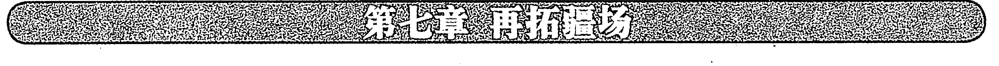

- 7.1 免杀技术 …… 217
  - 7.1.1 木马的特征码查找技术 …… 217
  - 7.1.2 免杀常用到的技术 …… 218
  - 7.1.3 文件捆绑技术 …… 221
  - 7.1.4 注入与隐藏技术 …… 222
- 7.2 逆向工程综合篇 …… 223
  - 7.2.1 网络数据包简介 …… 223
  - 7.2.2 几种网络数据加密方式 …… 224
  - 7.2.3 常见的数据包抓取工具 …… 227
  - 7.2.4 基于抓包技术的逆向攻击 …… 230
- 7.3 数据恢复 …… 230
- 7.4 病毒浅析 …… 231
  - 7.4.1 病毒的命名规则阐述 …… 231
  - 7.4.2 病毒分析环境的搭建 …… 234
  - 7.4.3 病毒行为分析报告 …… 236
  - 7.4.4 病毒的特征码提取 …… 238

## 第一章 知己知彼，百战不殆

在逆向工程中，掌握最基础的知识对于各种分析来说都是十分重要的，但过多的基础知识与理论不仅不会使读者感到有所进步，反而只会感到反感。为了照顾到各个层次的读者，笔者在这里所介绍的基础知识都是最简单的文字性概述，并没有对其本质以及原理做深入的分析。例如密码学一节中，笔者介绍了密码学的发展史以及常见的密码学算法，在密码学算法的介绍中没有涉及到算法的数学原理。

第一章的用途主要是为读者奠定后面章节中用到的一些术语知识以及相关部分理论的基础，相信读者很容易就会理解明白的。

### 1.1 Windows操作系统下的常识

#### 1.1.1 编程语言分类

随着计算机技术的迅猛发展，计算机编程语言的种类也越来越多。从发展过程来看，主要可以分为五大类：机器语言、汇编语言、高级语言、数据库管理语言和网络数据交互语言。机器语言就是由计算机直接识别的语言，二进制的0101……就是机器语言；汇编语言是最接近于机器语言的一门编程语言，是一种面向机器的低级语言，不容易阅读。由于汇编语言依赖于硬件，通过巧妙的程序设计能够充分发挥硬件的潜力，产生的代码运行效率高，因此，到目前为止，许多软件系统（例如操作系统等）的核心部分仍然用汇编语言来编写。高级语言，就是我们最常接触的编程语言，像VB、C、C++、Java、C#等等。数据库管理语言像SQL，也是我们常用的计算机语言。网络数据交互语言，像XML等等。

对于本书来说应用最为多的就是汇编语言。无论是何种语言编写的软件，在经过编译转化为可执行文件之后，都无法再次还原原来的代码，但在我们进行逆向分析的时候却要设法得到它们的代码，此时，我们就会想到反编译，就是常说的反汇编。将可执行文件进行反汇编后得到的反汇编代码并不是原先的代码，将这些代码保存后也无法再次编译。

通过反汇编技术我们可以看到原先程序的大致轮廓，通过这些反汇编的代码，我们也可以进行程序的修改等操作。

#### 1.1.2 编程语言与软件破解的关系

对于不同语言编写的软件，在进行破解的时候所采取的方式是不同的。就上面提到的各种编程语言来说，其中以VB的软件最为难破解。VB3、VB4都是解释语言，执行方式与传统的C/C++不同；到了VB5、VB6，此时的VB语言不再是单纯的解释语言了，它们的主程序部分是经过编译的，只有少部分程序是解释执行的。现在大多数程序员采用的VB版本是VB6.0，但针对这个版本的反编译工具还没有出现，这就对VB6.0编写的程序破解来说非常困难。由于本书主要为读者介绍软件破解的基本思路和容易掌握的常用方法，因而文章中不会涉及VB类难度太大的软件破解，本书将主要以C/C++、Delphi以及BC++编写的软件为主。

#### 1.1.3 汇编语言基础

##### 汇编语言简介

汇编语言（Assembly Language）是面向机器的程序设计语言。汇编语言是一种功能很强的程序设计语言，也是利用计算机所有硬件特性并能直接控制硬件的语言。汇编语言作为一门语言，对应于高级语言的编译器，需要一个“汇编器”来把汇编语言原文件汇编成机器可执行的代码。高级的汇编器，如MASM、TASM等等，为我们写汇编程序提供了很多类似于高级语言的特征，比如结构化、抽象等。在这样的环境中编写的汇编程序，有很大一部分是面向汇编器的伪指令，已经类同于高级语言。现在的汇编环境已经如此高级，即使全部用汇编语言来编写Windows的应用程序也是可行的，但这不是汇编语言的长处。汇编语言的长处在于编写高效且需要对机器硬件精确控制的程序。

##### 寄存器组

寄存器是CPU内部重要的数据存储资源，是汇编程序员能直接使用的硬件资源之一。由于寄存器的存取速度比内存快，所以，在用汇编语言编写程序时，要尽可能充分利用寄存器的存储功能。

寄存器一般用来保存程序的中间结果，为随后指令快速提供操作数，从而避免把中间结果存入内存，再读取内存的操作。在高级语言（如：C/C++语言）中，也有定义变量为寄存器类型的操作，这就是提高寄存器利用率的一种可行的方法。

另外，由于寄存器的个数和容量都有限，不可能把所有中间结果都存储在寄存器中，所以，要对寄存器进行适当的调度。根据指令的要求，如何安排适当的寄存器，避免操作数过多的传送操作是一项细致而又周密的工作。有关“寄存器的分配策略”在后续课程《编译原理》中会有详细的介绍。

由于16位/32位CPU是微机CPU的两个重要代表，所以，在此只介绍它们内部寄存器的名称及其主要功能。

- 1、16位寄存器组
  - 16位CPU所含有的寄存器有（见图1.1中16位寄存器部分）：4个数据寄存器（AX、BX、CX和DX）
  - 2个变址和指针寄存器（SI和DI）
  - 2个指针寄存器（SP和BP）；4个段寄存器（ES、CS、SS和DS）
  - 1个指令指针寄存器（IP）
  - 1个标志寄存器（Flags）。
- 2、32位寄存器组
  - 32位CPU除了包含先前CPU的所有寄存器，并把通用寄存器、指令指针和标志寄存器从16位扩充成32位之外，还增加了2个16位的段寄存器：FS和GS。
  - 32位CPU所含有的寄存器有（见图1.1中的寄存器）：4个数据寄存器（EAX、EBX、ECX和EDX）
  - 2个变址和指针寄存器（ESI和EDI）
  - 2个指针寄存器（ESP和EBP）；6个段寄存器（ES、CS、SS、DS、FS和GS）
  - 1个指令指针寄存器（EIP）
  - 1个标志寄存器（EFlags）。

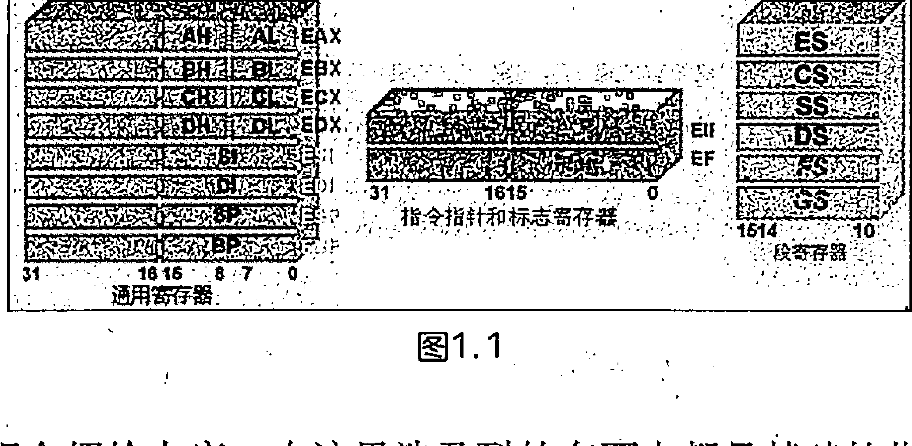

图1.1

##### 常见汇编指令

为了后面章节的应用，本节会将基础的汇编知识介绍给大家，在这里涉及到的东西大都是基础的指令……今，以及指令的使用方法，对于复杂的语法知识就不作具体介绍了。这里主要介绍一下数据传输指令、算术运算指令、逻辑运算指令、串指令、程序转移指令以及伪指令。

###### 一、数据传输指令

该指令组负责数据的传输功能，它们在存储器和寄存器、寄存器和输入输出端口之间传送数据，指令又可具体分为4小类。

####### 1. 通用数据传送指令

- MOV 传送字或字节
- MOVSX 先符号扩展，再传送
- MOVZX 先零扩展，再传送
- PUSH 把字压入堆栈
- POP 把字弹出堆栈
- PUSHA 把AX、CX、DX、BX、SP、BP、SI、DI依次压入堆栈
- POPA 把DI、SI、BP、SP、BX、DX、CX、AX依次弹出堆栈
- PUSHAD 把EAX、ECX、EDX、EBX、ESP、EBP、ESI、EDI依次压入堆栈
- POPAD 把EDI、ESI、EBP、ESP、EBX、EDX、ECX、EAX依次弹出堆栈
- BSWAP 交换32位寄存器里字节的顺序
- XCHG 交换字或字节（至少有一个操作数为寄存器，段寄存器不可作为操作数）
- CMPXCHG 比较并交换操作数（第二个操作数必须为累加器AL/AX/EAX）
- XADD 先交换再累加（结果在第一个操作数里）
- XLAT 字节查表转换

BX指向一张256字节的表的起点，AL为表的索引值（0-255，即0-FFH）；返回AL为查表结果（[BX+AL]→AL）。

####### 2. 输入输出端口传送指令

- IN I/O端口输入（语法：IN 累加器，{端口号 | DX}）
- OUT I/O端口输出（语法：OUT {端口号 | DX}，累加器）

输入输出端口由立即数方式指定时，其范围是0-255；由寄存器DX指定时，其范围是0-65535。

####### 3. 目的地址传送指令

- LEA 装入有效地址
- 例：LEA DX，string；把偏移地址存到DX
- LDS 传送目标指针，把指针内容装入DS
- 例：LDS SI，string；把段地址:偏移地址存到DS:SI
- LES 传送目标指针，把指针内容装入ES
- 例：LES DI，string；把段地址:偏移地址存到ES:DI
- LFS 传送目标指针，把指针内容装入FS
- 例：LFS DI，string；把段地址:偏移地址存到FS:DI
- LGS 传送目标指针，把指针内容装入GS
- 例：LGS DI，string；把段地址:偏移地址存到GS:DI
- LSS 传送目标指针，把指针内容装入SS
- 例：LSS DI，string；把段地址:偏移地址存到SS:DI

####### 4. 标志传送指令

- LAHF 标志寄存器传送，把标志装入AH
- SAHF 标志寄存器传送，把AH内容装入标志寄存器
- PUSHF 标志入栈
- POPF 标志出栈
- PUSHD 32位标志入栈
- POPD 32位标志出栈

###### 三、算术运算指令

该组指令主要负责程序中的算术运算。

- ADD 加法
- ADC 带进位加法
- INC 加1
- AAA 加法的ASCII码调整
- DAA 加法的十进制调整
- SUB 减法
- SBB 带借位减法
- DEC 减1
- NEG 求反（以0减之）
- CMP 比较（两操作数作减法，仅修改标志位，不回送结果）
- AAS 减法的ASCII码调整
- DAS 减法的十进制调整
- MUL 无符号乘法
- IMUL 整数乘法
- 以上两条，结果回送AH和AL（字节运算），或DX和AX（字运算）
- AAM 乘法的ASCII码调整
- DIV 无符号除法
- IDIV 整数除法
- 以上两条，结果回送：
- 商回送AL，余数回送AH（字节运算）
- 或商回送AX，余数回送DX（字运算）
- AAD 除法的ASCII码调整
- CBW 字节转换为字（把AL中字节的符号扩展到AH中去）
- CWD 字转换为双字（把AX中的字的符号扩展到DX中去）
- CWDE 字转换为双字（把AX中的字符号扩展到EAX中去）
- CDQ 双字扩展（把EAX中的字的符号扩展到EDX中去）

###### 二、逻辑运算指令

- AND 与运算
- OR 或运算
- XOR 异或运算
- NOT 取反
- TEST 测试（两操作数作与运算，仅修改标志位，不回送结果）
- SHL 逻辑左移
- SAL 算术左移（=SHL）
- SHR 逻辑右移
- SAR 算术右移（=SHR）
- ROL 循环左移
- ROR 循环右移
- RCL 通过进位的循环左移
- RCR 通过进位的循环右移

以上八种移位指令，其移位次数可达255次。  
移位一次时，可直接用操作码，如 SHL AX，1。  
移位>1次时，则由寄存器CL给出移位次数。

```
MOV CL，04
SHL AX，CL
```

###### 四、串指令

- DS:SI 源串段寄存器：源串变址
- ES:DI 目标串段寄存器：目标串变址
- CX 重复次数计数器
- AL/AX 扫描值
- D标志 0表示重复操作中SI和DI应自动增量；1表示应自动减量
- Z标志 用来控制扫描或比较操作的结束

- MOVS 串传送
- （MOVSB 传送字符、MOVSW 传送字、MOVSD 传送双字。）
- CMPS 串比较
- （CMPSB 比较字符、CMPSW 比较字）
- SCAS 串扫描
- 把AL或AX的内容与目标串作比较，比较结果反映在标志位
- LODS 装入串
- 把源串中的元素（字或字节）逐一装入AL或AX中
- （LODSB 传送字符、LODSW 传送字、LODSD 传送双字）
- STOS 保存串
- 是LODS的逆过程

- REP 当CX/ECX<>0时重复
- REPE/REPZ 当ZF=1或比较结果相等，且CX/ECX<>0时重复
- REPNE/REPNZ 当ZF=0或比较结果不相等，且CX/ECX<>0时重复
- REPC 当CF=1且CX/ECX<>0时重复
- REPNC 当CF=0且CX/ECX<>0时重复

###### 五、程序转移指令

该组指令中应用最多的就是跳转指令。

####### 1. 无条件转移指令（长转移）

- JMP 无条件转移指令
- CALL 过程调用，调用另一个子函数
- RET/RETF 过程返回

### 2. 条件转移指令（短转移，-128到+127的距离内）

- （当且仅当(SF XOR OF)=1时，OP1<OP2）
- JA/JNBE 不小于或不等于时转移
- JAE/JNB 大于或等于转移
- JB/JNAE 小于转移
- JBE/JNA 小于或等于转移
- 以上四条，测试无符号整数运算的结果（标志C和Z）
- JG/JNLE 大于转移
- JGE/JNL 大于或等于转移
- JL/JNGE 小于转移
- JLE/JNG 小于或等于转移
- 以上四条，测试带符号整数运算的结果（标志S、O和Z）
- JE/JZ 等于转移
- JNE/JNZ 不等于时转移
- JC 有进位时转移
- JNC 无进位时转移
- JNO 不溢出时转移
- JNP/JPO 奇偶性为奇数时转移
- JNS 符号位为“0”时转移
- JO 溢出转移
- JP/JPE 奇偶性为偶数时转移
- JS 符号位为“1”时转移

####### 3. 循环控制指令（短转移）

- LOOP CX不为零时循环
- LOOPE/LOOPZ CX不为零且标志Z=1时循环
- LOOPNE/LOOPNZ CX不为零且标志Z=0时循环
- JCXZ CX为零时转移
- JECXZ ECX为零时转移

####### 4. 中断指令

- INT 中断指令
- INTO 溢出中断
- IRET 中断返回

####### 5. 处理器控制指令

- HLT 处理器暂停，直到出现中断或复位信号才继续
- WAIT 当芯片引线TEST为高电平时使CPU进入等待状态
- ESC 转换到外处理器

## 第一章 知己知彼，百战不殆

- LOCK 封锁总线
- NOP 空操作
- STC 置进位标志位
- CLC 清进位标志位
- CMC 进位标志取反
- STD 置方向标志位
- CLD 清方向标志位
- STI 置中断允许位
- CLI 清中断允许位

###### 六、伪指令

- DW 定义字（2字节）
- PROC 定义过程
- ENDP 过程结束
- SEGMENT 定义段
- ASSUME 建立段寄存器寻址
- ENDS 段结束
- END 程序结束

关于汇编语言，这可以说是破解的基础，但对于大多没有学习过汇编的人来说难度会稍微大一些。如果大家想好好学习汇编，那应该找相应的书籍。个人感觉《Windows汇编语言程序设计》不错。但对于本书来说，汇编的知识大家只需要掌握一些基本的指令就可以了，跳转指令、比较指令以及逻辑运算指令即可。笔者给大家准备了一个指令速查的小软件，大家可以现用现查，非常方便。

## 1.1.4 Windows API简介

### 什么是Windows API？

Win32 API作为Microsoft 32位平台（包括：Windows 9x、Windows NT3.1 / 4.0 / 5.0、Windows CE）的应用程序编程接口，它是构筑所有32位Windows平台的基石，所有在Windows平台上运行的应用程序都可以调用这些函数。

从事Windows应用程序开发，离不开对Win32 API函数的调用。只有充分理解和利用API函数，才能深入到Windows的内部，充分挖掘系统提供的强大功能，熟练掌握其灵活性。Windows这个多作业系统除了协调应用程序的执行、分配内存、管理资源……之外，它同时也是一个很大的服务中心，调用这个服务中心的各种服务（每一种服务就是一个函数），可以帮应用程序实现开启视窗、描绘图形、使用周边设备等目的。由于这些函数服务的对象是应用程序（Application），所以便称之为Application Programming Interface，简称API函数。WIN32 API也就是Microsoft Windows 32位平台的应用程序编程接口。

标准Win32 API函数可以分为以下几类：窗口管理、窗口通用控制、Shell特性、图形设备接口、系统服务、国际特性、网络服务。在这几类中又以窗口管理类中的函数最为居多。

凡是在Windows工作环境下执行的应用程序，都可以调用Windows API。Windows API实际上就是一些封装起来的函数，而我们在使用的时候只需要提供相应的参数即可，我们不必去管这个过程是怎么实现的，表1.1列出一些破解过程中下断点常用到的API函数。

Windows API有上千个，要想全部记住可不是容易的事情，只有经常使用，才能够对常见的API比较熟悉。对于破解来说，上面几个就是经常用到的，建议读者将其掌握。

| API函数 | 说明 |
|---|---|
| MessageBoxA | 读取/创建、显示和操作一个消息框。 |
| GetPrivateProfileIntA | 为初始化文件（.ini文件）中指定的条目读取一个整数值。 |
| GetPrivateProfileSectionA | 获取指定小节（在.ini文件中）所有项名和值的一个列表。 |
| GetPrivateProfileStringA | 为初始化文件中指定的条目取得字符串。 |
| GetPrivateProfileStringA | 获取ini文件信息（读取、写入）。 |
| RegOpenKeyA | 打开一个现有的注册表项。 |
| RegOpenKeyExA | 打开一个现有的注册表项。 |
| RegCreateKeyA | 在指定的项下创建或打开一个项。 |
| RegCreateKeyExA | 在指定项下创建新项的更复杂的方式。 |
| RegDeleteKeyA | 删除现有项下的一个指定的子项。 |
| RegDeleteValueA | 删除指定项下的一个值。 |
| RegQueryValueA | 获取一个项的设置值。 |
| RegQueryValueExA | 获取一个项的设置值。 |
| RegSetValueA | 设置指定项或子项的值。 |
| RegSetValueExA | 设置指定项的值。 |
| RegCloseKey | 关闭系统注册表中的一个项（句柄）。 |
| CreateFileA | 打开和创建文件、管道、邮槽、通信服务、设备以及控制台。 |
| OpenFile | 这个函数执行大量不同的文件操作。 |
| ReadFile | 从文件中读出数据。 |
| CompareFileTime | 对两个文件的时间进行比较。 |
| GetFileTime | 获取文件的创建、最后访问和最后修改时间。 |
| GetLocalTime | 获取当前本地时间。 |
| GetSystemTime | 获取当前系统时间。 |

表1.1

#### 1.1.5 Windows 的消息机制

Windows是一个基于事件的、消息驱动的操作系统。在该操作系统下，用户对一个程序的窗口进行移动、单击、改变大小等操作时，就会触发一个相应的“事件”。操作系统每当检测到一个事件之后都会向特定的程序发送一个“消息”，从而使程序可以处理该事件。每个Windows的应用程序都是基于事件和消息的，而且包含一个主事件循环，这个循环的作用就是不停地检测用户是否有事件发生。每当检测到一个事件，系统就做出相应的反应，依次循环处理，直至用户终止程序，流程如图1.2所示。

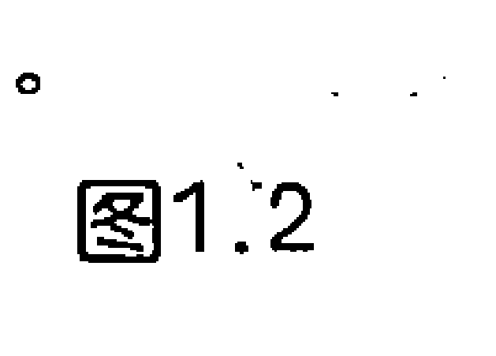

通过对消息的拦截，我们可以获取软件的按钮位置以及关键的代码，从而实现对软件的破解，这种破解方法又称为“消息嗅探的软件破解”方法。常见的与鼠标有关的消息以及其对应的值如表1.2。

| 消息名称 | 值（16进制） | 功能 |
|---|---|---|
| WM_LBUTTONDOWN | 201 | 按下鼠标左键 |
| WM_LBUTTONUP | 202 | 释放鼠标左键 |
| WM_LBUTTONDBLCLK | 203 | 双击鼠标左键 |
| WM_RBUTTONDOWN | 204 | 按下鼠标右键 |
| WM_RBUTTONUP | 205 | 释放鼠标右键 |
| WM_RBUTTONDBLCLK | 206 | 双击鼠标右键 |
| WM_MBUTTONDOWN | 207 | 按下鼠标中键 |
| WM_MBUTTONUP | 208 | 释放鼠标中键 |
| WM_MBUTTONDBLCLK | 209 | 双击鼠标中键 |

表1.2

## 1.1.6 PE文件介绍

##### 1. 简介

PE文件可以说是老生常谈的东西了，只要哪里涉及到了Windows，哪里就会介绍一下Windows PE。PE文件被称为可移植的执行体，是Portable Execute的全称，常见的EXE、DLL、OCX、SYS、COM都是PE文件，PE文件是微软Windows操作系统上的程序文件（可能是间接执行，如DLL）。其格式如图1.3所示。

PE文件格式的第一个组成部分是MS-DOS头部。在PE文件格式中，它并非一个新概念，因为它与MS-DOS 2.0以来就已有的MS-DOS头部是完全一样的。保留这个相同结构的最主要原因是，当你尝试在Windows 3.1以下或MS-DOS 2.0以上的系统下装载一个文件的时候，操作系统能够读取这个文件并明白它是和当前系统不相兼容的。换句话说，当你在MS-DOS 6.0下运行一个Windows NT可执行文件时，你会得到这样一条消息：“This program cannot be run in DOS mode.”

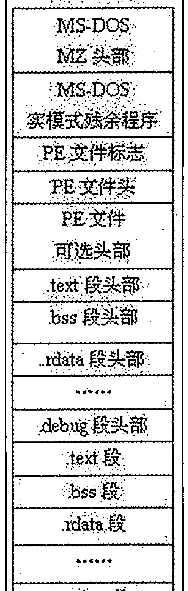

分的话，操作系统装载文件的时候就会失败。MS-DOS头部占据了PE文件的头64个字节。图1.4所示。

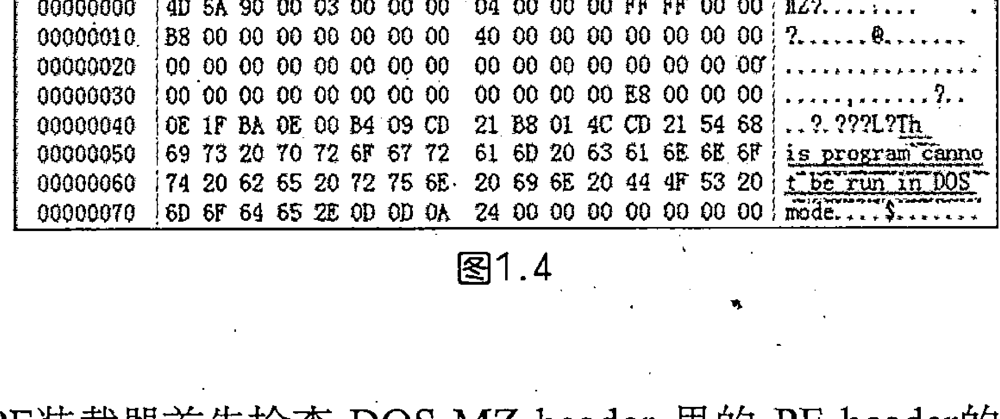

### 2. PE文件的执行顺序

当一个PE文件被执行时，PE装载器首先检查DOS MZ header里的PE header的偏移量。如果找到，则直接跳转到PE header的位置。

当PE装载器跳转到PE header后，第二步要做的就是检查PE header是否有效。如果该PE header有效，就跳转到PE header的尾部。

紧跟PE header尾部的是节表。PE装载器执行完第二步后开始读取节表中的节段信息，并采用文件映射方法将这些节段映射到内存，同时附上节表里指定节段的读写属性。

PE文件映射入内存后，PE装载器将继续处理PE文件中类似import table（输入表）的逻辑部分。

这四个步骤便是PE文件的执行顺序，具体细节读者可以参考相关文档。PE涉及到的知识非常的多，笔者在这里只做简要的介绍而不进行深入分析，读者只需了解即可，若想深入地学习，可以下载相关资料。

### 3. PE文件预定义段

一个典型Windows的应用程序拥有9个节段，值得注意的是节段的划分只与节的属性相关，具有相同属性的节将会被结合到一起，而这些节的名称只是它们的标识。这几个节分别是：text、bss、rdata、data、rsrc、edata、idata、pdata和debug段。一些应用程序不需要所有的这些段，同样还有一些应用程序为了自己特殊的需要而定义了更多的段。这种做法与MS-DOS和Windows 3.1中的代码段和数据段相似。事实上，应用程序定义一个独特的段的方法是使用标准编译器来指示对代码段和数据段的命名，或者使用名称段编译器选项-NT——就和Windows 3.1中应用程序定义独特的代码段和数据段一样。

###### 可执行代码段：.text

Windows 3.1和Windows NT之间的一个区别就是Windows NT默认的做法是将所有的代码段（正如它们在Windows 3.1中所提到的那样）组成了一个单独的段，名为“.text”。既然Windows NT使用了基于页面的虚拟内存管理系统，那么将分开的代码放入不同的段之中的做法就不太明智了。因此，拥有一个大的代码段对于操作系统和应用程序开发者来说，都是十分方便的。.text段也包含了早先提到过的入口点。IAT位于.text段之中的模块入口点之前。（IAT在.text段之中的存在非常有意义，因为这个表事实上是一系列的跳转指令，并且它们的跳转目标位置是已固定的地址。）当Windows NT的可执行映像装载入进程的地址空间时，IAT就和每一个导入函数的物理地址一同确定了。要在.text段之中查找IAT，装载器只要将模块的入口点定位，而且IAT恰恰出现在入口点之前。既然每个入口拥有相同的尺寸，那么向后退查找这个表的起始位置就很容易了。

###### 数据段：.bss、.rdata、.data

.bss段表示应用程序的未初始化数据，包括所有函数或源模块中声明为static的变量。

.rdata段表示只读的数据，比如字符串文字量、常量和调试目录信息。

所有其它变量（除了出现在栈上的自动变量）存储在 `.data` 段之中。基本上，这些是应用程序或模块的全局变量。

###### 资源段：.rsrc

`.rsrc` 段包含了模块的资源信息。它起始于一个资源目录结构，这个结构就像其它大多数结构一样，但是它的数据被更进一步地组织在了一棵资源树之中。

###### 导出数据段：.edata

`.edata` 段包含了应用程序或 DLL 的导出数据。在这个段出现的时候，它会到达一个包含导出信息的导出目录。

###### 导入数据段：.idata

`.idata` 段是导入数据，包括导入库和导入地址名称表。

###### 调试信息段：.debug

调试信息位于 `.debug` 段之中，同时 PE 文件格式也支持单独的调试文件（通常由 DBG 扩展名标识）作为一种将调试信息集中的方法。调试段包含了调试信息，但是调试目录却位于早先提到的 `.rdata` 段之中。这其中每个目录都涉及了 `.debug` 段之中的调试信息。

## 4. PE文件的映射机制

在 PE 文件的执行顺序中提到了“映射”，那什么又是映射呢？在 Windows 系统下，当一个 PE 应用程序运行时，这个 PE 文件在磁盘中的数据结构布局和内存中的数据结构布局是一致的。系统在载入一个可执行程序时，首先是 Windows 装载器（又称 PE 装载器）把磁盘中的文件映射到进程的地址空间，它遍历 PE 文件并决定文件的哪一部分被映射。其方式是将文件较高的偏移位置映射到较高的内存地址中。磁盘文件一旦被装入内存中，其某项的偏移地址可能与原始的偏移地址有所不同；但所表现的是一种从磁盘文件偏移到内存偏移的转换，如图1.5所示。

当 PE 文件被加载到内存后，内存中的版本称为模块（Module），映射文件的起始地址称为模块句柄（hModule），可以通过模块句柄访问内存中的其他数据结构。这个初始内存地址也称为该模块镜像基址（ImageBase）。载入一个 PE 程序的主要步骤如下：

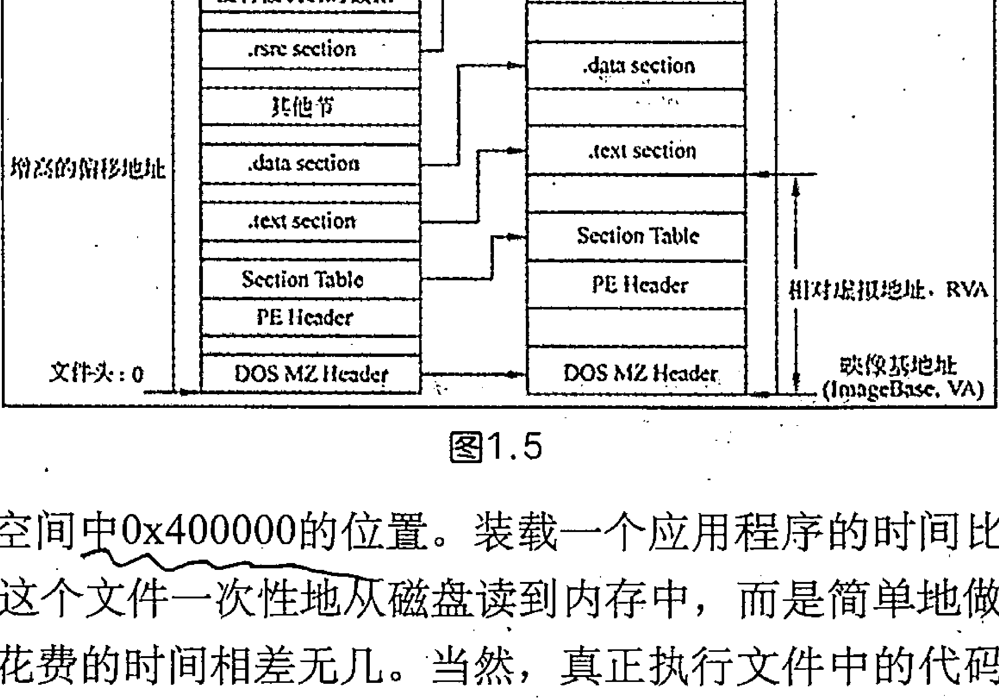

- 当 PE 文件被执行时，PE 装载器首先为进程分配一个 4GB 的虚拟地址空间，然后把程序所占用的磁盘空间作为虚拟内存映射到这个 4GB 的虚拟地址空间中。一般情况下，会映射到虚拟地址空间中 `0x400000` 的位置。装载一个应用程序的时间比一般人所设想的要少，因为装载一个 PE 文件并不是把这个文件一次性地从磁盘读到内存中，而是简单地做一个内存映射。映射一个大文件和映射一个小文件所花费的时间相差无几。当然，真正执行文件中的代码时，操作系统还是要把存在于磁盘上的虚拟内存中的代码交换到物理内存（RAM）中。但是，这种交换也不是把整个文件所占用的虚拟地址空间一次性地全部从磁盘交换到物理内存中，操作系统会根据需要和内存占用情况交换一页或多页。当然，这种交换是双向的，即存在于物理内存中的一部分当前没有被使用的页，也可能被交换到磁盘中。
- PE 装载器在内核中创建进程对象和主线程对象以及其他内容。
- PE 装载器搜索 PE 文件中的 Import Table（引入表），装载应用程序所使用的动态链接库。对动态链接库的装载与对应用程序的装载方法完全类似。
- PE 装载器执行 PE 文件首部所指定地址处的代码，开始执行应用程序主线程。

在这里大家需要掌握的就是 PE 文件的分段，我们在后面的章节中会用到本节中 PE 文件的概念。

## 1.1.7 Windows下的注册表

注册表（Registry）是 Microsoft Windows 中的一个重要的数据库，用于存储系统和应用程序的设置信息。早在 Windows 3.0 推出 OLE 技术的时候，注册表就已经出现。随后推出的 Windows NT 是第一个从系统级别广泛使用注册表的操作系统。但是，从 Microsoft Windows 95 开始，注册表才真正成为 Windows 用户经常接触的内容，并在其后的操作系统中继续沿用至今。

- 注册表的打开方式：
  - 运行中输入 `regedit.exe`（无权限限制）
  - Win2000/XP
    1. 开始 >> 运行中输入 `regedt32`
    2. 开始 >> 运行中输入 `regedit`
  - Windows Vista/7
    1. 在开始菜单搜索框中输入 `regedit` 并按回车键（需要管理员权限）
    2. 在运行中输入 `regedit.exe`（需要管理员权限）

下面对注册表的五大根键进行简单的介绍，图1.6所示。

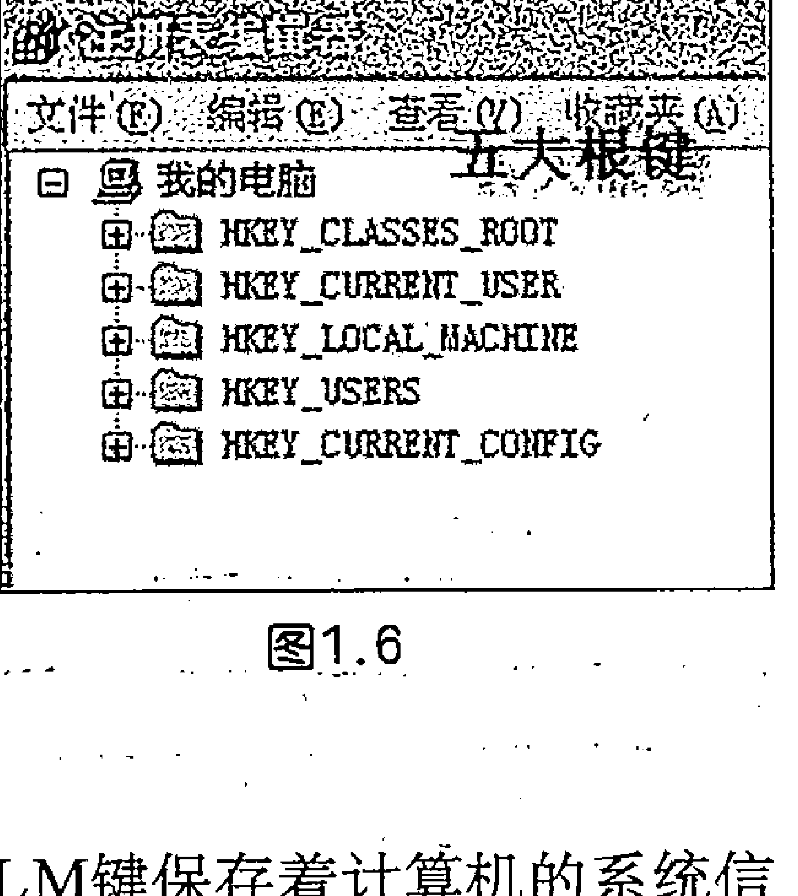

##### HKEY_LOCAL_MACHINE

HKEY_LOCAL_MACHINE 是一个显示控制系统和软件的处理键。HKLM 键保存着计算机的系统信息。它包括网络和硬件上所有的软件设置（比如文件的位置、注册和未注册的状态、版本号等等）。这些设置和用户无关，因为这些设置是针对使用这个系统的所有用户的。

##### HKEY_USERS

HKEY_USERS 保存了所有目前登录用户和缺省用户的设置。登录用户的改变就如同不同用户使用这个系统，SID 是用户信息的表现。使用程序重新找到任何用户的 `ntuser.dat` 文件并且把它放入注册表中观看和编辑。

##### HKEY_CURRENT_USER

HKEY_CURRENT_USER 包含着在 HKEY_USERS 安全辨别里列出的同样信息。任何在 HKEY_CURRENT_USER 里的改动也都会立即导致 HKEY_USERS 的改动，反之也是这样。HKEY_CURRENT_USER 允许程序员和开发者易于存取目前登录用户的设置。通过建立这个键，微软很容易在不涉及到用户 SID 下改变、添加和设置。也就是说，所有当前的操作改变只是针对当前用户而改变，并不影响其他用户。

##### HKEY_CLASSES_ROOT

在注册表中 HKEY_CLASSES_ROOT 是系统中控制所有数据文件的项。这个在 Win95 和 WinNT 中是相通的。HKEY_CLASSES_ROOT 控制键包括了所有文件扩展和所有和执行文件相关的文件。它同样也决定了当一个文件被双击时哪个应用程序做出响应。HKEY_CLASSES_ROOT 被用作程序员在安装软件时方便地发送信息。在 Win95 和 WinNT 中，HKEY_CLASSES_ROOT 和 HKEY_LOCAL_MACHINE\Software\Classes 是相同的。程序员在运行他们的启动程序时不需要担忧实际的位置，相反地，他们只需要在 HKEY_CLASSES_ROOT 中加入数据就可以了。

##### HKEY_CURRENT_CONFIG

Win95 一般只使用一个硬件配置文件。如果有多个硬件配置文件，HKEY_LOCAL_MACHINE\Config 中就会添加一个键。HKEY_LOCAL_MACHINE\Config 包含了 HKEY_LOCAL_MACHINE 中相同的数据。在启动时，你可以选择你愿意使用的配置文件。如果有多个安装，每次系统重新启动时，你就必须选择。HKEY_CURRENT_CONFIG 是在启动时控制目前硬件配置的键。在系统启动以后，任何地方的变化都会自动影响到它。程序员经常使用 HKEY_CURRENT_CONFIG 方便地存取配置信息。HKEY_CURRENT_CONFIG 包括了系统中现有的所有配置文件的细节。你的选择影响了哪一个硬件配置文件成为现在的。举例来说，如果配置 0002 被选择了，所有 0002 的配置信息会被映射到这些键上。HKEY_CURRENT_CONFIG 允许软件和设备驱动程序员很方便地更新注册表，而不涉及到多个配置文件信息。HKEY_LOCAL_MACHINE 中同样的数据都会同时地变化。

#### 1.1.8 虚拟机与虚拟机保护技术

虚拟机系统就是通过软件模拟的具有完整硬件系统功能的、运行在一个完全隔离环境中的完整计算机系统。虚拟机一般由编译器、解释器和虚拟 CPU 组成，如图1.7所示。

通过虚拟机软件，你可以在一台物理计算机上模拟出一台或多台虚拟的计算机，或者组建虚拟的计算机网络，这些虚拟机就像真正的计算机那样进行工作，例如用户可以在虚拟机中安装操作系统、安装应用程序、访问网络资源等等。对于用户而言，它只是运行在物理计算机上的一个应用程序，但是对于在虚拟机中运行的应用程序而言，它就像是在真正的计算机中进行工作。因此，当我们在虚拟机中进行软件评测时，系统一样会崩溃，但是崩溃的只是虚拟机上的操作系统，而不是物理计算机上的操作系统。并且，使用虚拟机的“Undo”（恢复）功能，可以马上恢复虚拟机到安装软件之前的状态。

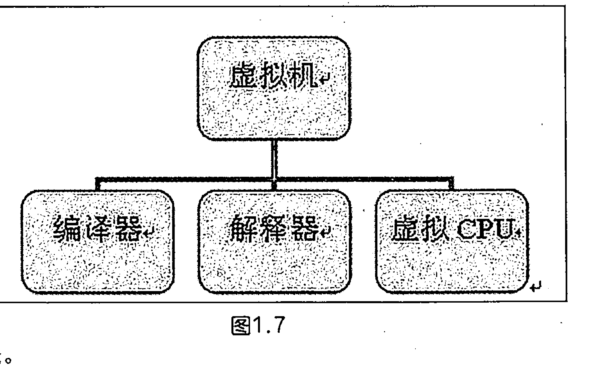

图1.7

虚拟机的用途：如果你需要做一些对系统可能有危害的试验，例如你要研究病毒或木马程序，但又怕自己的操作系统被感染，那就到虚拟机上实验。大名鼎鼎的木马程序灰鸽子的客户端装在你的实际操作系统上老是被杀毒软件查杀干扰，那就装在虚拟机上，而虚拟机上不装杀毒软件，这样灰鸽子就可以堂而皇之地悠哉落户于虚拟机上，通过虚拟网络照样可以监控肉鸡。再如有些网站有马或者怀疑有马，那就用虚拟机去测试，即使牺牲了，也不过是一台虚拟机而已，而不是物理机。虚拟机的应用可说十分广泛，危险软件测试、病毒与木马的分析、入侵等都可以用到虚拟机。正是因为虚拟机可以像真实的机器一样运行，从而使我们很多的危险操作都可以放心地在虚拟机上进行。

虚拟机保护技术与上面所说的虚拟机并不是同一个概念，它是一个用于软件保护的技术。它将原 PE 文件中的指令用自身定义的指令系统替换为一定的字节码，然后循环执行，直到 PE 文件源代码替换与执行完毕。采用虚拟机技术保护的软件在进行跟踪时很容易跟进虚拟机内部，此时会发现显示的指令基本无法理解，这就给软件破解者带来了一定的困难。常用的进行虚拟机保护的工具是 VMProtect，笔者在这里使用的是 V1.04 版本，软件主界面如图1.8所示。笔者在这里简要介绍一下该工具的使用方法。


图1.8

操作方法：

- 点击“文件”，选择要进行保护的软件。
- 点击“文件信息”（图1.9），选择要进行保护的区段（图1.10）；或者点击“项目”，添加要进行保护的地址（图1.11）。
- 基本信息填写完毕后点击“选项”选项卡，填写相关信息（图1.12）。
- 并选择要进行保护的方式。展开主窗口中的地址，选择要进行保护的代码范围或者要进行保护的函数（图1.13），选择完毕后点击开始即可完成保护。

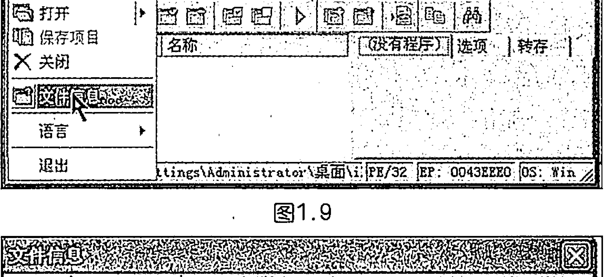

图1.9

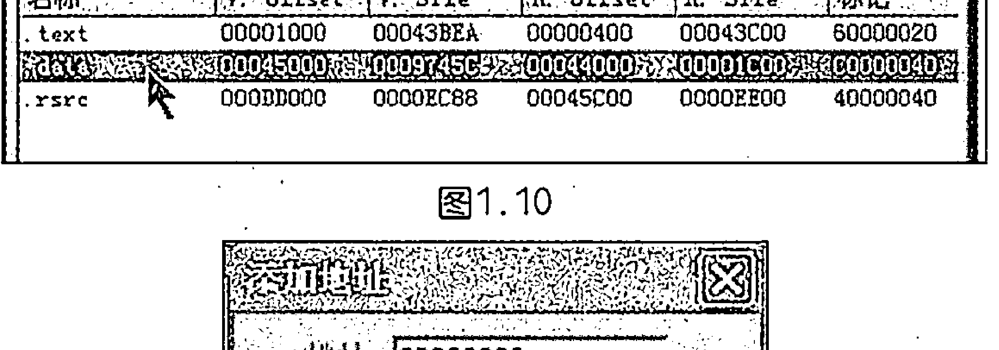

图1.10

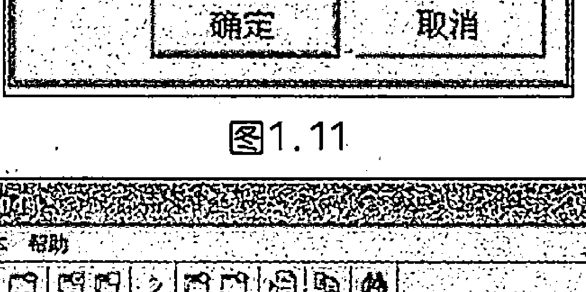

图1.11

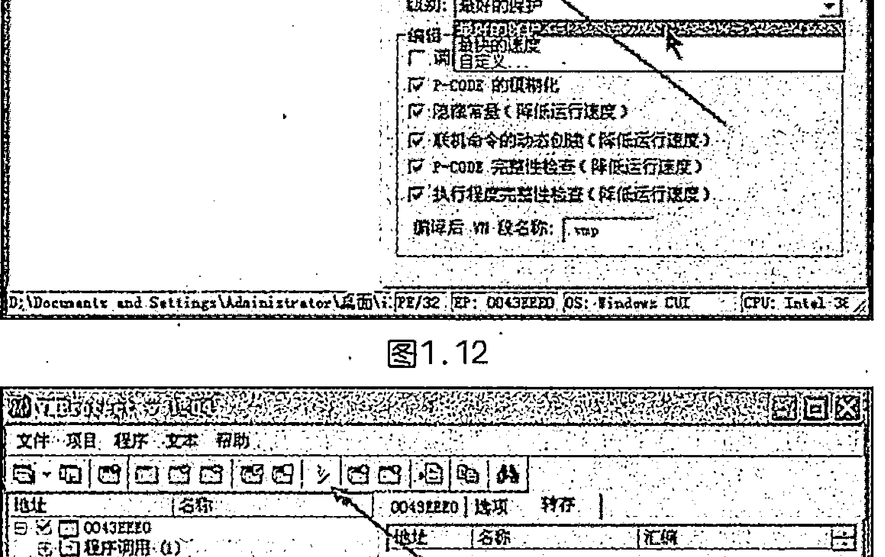

图1.12

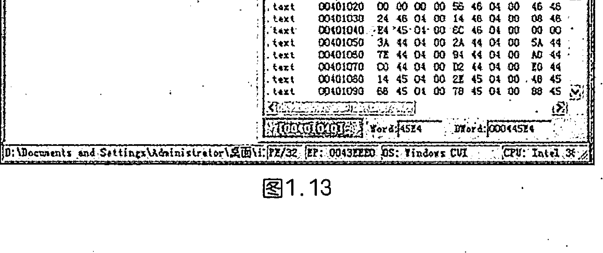

图1.13

## 1.1.9 Windows下的资源

### 概念：

资源是 PE 文件中非常重要的部分，几乎所有的 PE 文件中都包含资源。与导入表和导出表相比，资源的组织方式要复杂得多。资源按照类型的不同可分为字符串资源、图标资源、版本信息资源等等，PE 文件资源中的内容包括光标、图标、位图、菜单等十几种标准的类型，除此之外还可以使用自定义的类型（这些类型的资源在第5章中将有所介绍）。每种类型的资源中可能存在多个资源项，这些资源项用不同的 ID 或者名称来分辨，在某个资源 ID 下，还可以同时存在不同代码页的版本。

要将这么多种类型的不同 ID 的资源有序地组织起来，用类似于磁盘目录结构的方式是很不错的。打个比方，假如在磁盘的根目录下按照类型建立若干个第2层目录，目录名是“光标”“图标”“位图”和“菜单”等，就可以将各种资源分类放入这些目录中。假设现在有 n 个光标，那么在“光标”目录中再以光标 ID 为名建立 n 个第3层子目录，进入某个子目录后，再以代码页为名称建立不同文件，这样所有的资源就按照树型目录的方式组织起来了。现在要查找某个资源的话，那么按照根目录→资源类型→资源 ID→资源代码页这样的步骤一层层地进入相应的子目录并找到正确的资源。

PE 文件中组织资源的方式与上面的构思极其相似，正是按照根目录→资源类型→资源 ID 的3层树型目录结构来组织资源的，只不过在第3层目录中放置的代码页“文件”不是资源本身而是一个用来描述资源的结构罢了，通过这个结构中的指针才能最后找到资源数据。

### 获取资源的位置：

资源数据块的位置和大小可以从 PE 文件头中的 IMAGE_OPTIONAL_HEADER32 结构的数据目录字段中获取，与资源对应的项目是数据目录中的第3个 IMAGE_DATA_DIRECTORY 结构，从这个结构的 VirtualAddress 字段得到的就是资源块地址的 RVA 值。

从数据目录表中得到的资源块的起始地址就是资源根目录的起始地址，从这里开始就可以一层层地找到资源的所有信息了。

在获取资源块地址的时候，注意不要使用查找 “.rsrc” 节起始地址的方法，虽然在一般情况下资源总是在 “.rsrc” 节中，但这并不是必然的。

### 资源的创建：

资源文件编写是 PE 开发的标准步骤，不同的语言使用的资源编译器以及生成的 `.res` 文件格式都是一样的。资源编译器用来把资源脚本文件（`*.rc`）编译成资源文件（`*.res`）。MASM32 软件包中使用的是 Visual C++ 附带的 Rc.exe 程序，TASM 软件包中使用的是 BRC32.exe 或 BRCC32.exe，两者的用法都比较简单，它们有相同的命令行语法：

```text
Rc或BRC32 [选项] 资源脚本文件名
```

不过大多数情况下我们采用的是可视化资源编辑器，例如 Resource Workshop 资源编辑器、Visual C++ 资源编辑器。对于资源编辑的具体方法，笔者在这里就不具体介绍了。

#### 1.1.10 进程与线程

### 什么是多线程：

多线程是为了使得多个线程并行地工作以完成多项任务，以提高系统的效率。线程是在同一时间需要完成多项任务的时候被实现的。

使用线程的好处有以下几点：

- 使用线程可以把占据长时间的程序中的任务放到后台去处理。
- 用户界面可以更加吸引人，比如用户点击了一个按钮去触发某些事件的处理，可以弹出一个进度条来显示处理的进度。
- 程序的运行速度可能加快。
- 在一些等待的任务实现上，如用户输入、文件读写和网络收发数据等，线程就比较有用了。在这种情况下我们可以释放一些珍贵的资源，如占用的内存等等。

### 什么是多进程：

进程是程序在计算机上的一次执行活动。当你运行一个程序，你就启动了一个进程。显然，程序是死的（静态的），进程是活的（动态的）。进程可以分为系统进程和用户进程。凡是用于完成操作系统的各种功能的进程就是系统进程，它们就是处于运行状态下的操作系统本身；用户进程就不必多讲了，所有由你启动的进程都是用户进程。进程是操作系统进行资源分配的单位。

在 Windows 下，进程又被细化为线程，也就是一个进程下有多个能独立运行的更小的单位。

在同一个时间里，同一个计算机系统中如果允许两个或两个以上的进程处于运行状态，这便是多任务。现代的操作系统几乎都是多任务操作系统，能够同时管理多个进程的运行。多任务带来的好处是明显的，比如你可以边听 mp3 边上网，与此同时甚至可以将下载的文档打印出来，而这些任务之间丝毫不会相互干扰。

那么这里就涉及到并行的问题。原则上一个 CPU 只能分配给一个进程，以便运行这个进程。我们通常使用的计算机中只有一个 CPU，也就是说只有一颗心。要让它一心多用，同时运行多个进程，就必须使用并发技术。最容易理解的是“时间片轮转进程调度算法”：在操作系统的管理下，所有正在运行的进程轮流使用 CPU，每个进程允许占用 CPU 的时间非常短（例如 10 毫秒），这样用户根本感觉不出来 CPU 是在轮流为多个进程服务，就好像所有进程都在不断地运行一样。但实际上在任何一个时间内有且仅有一个进程占有 CPU。

如果一台计算机有多个 CPU，情况就不同了。如果进程数小于 CPU 数，则不同的进程可以分配给不同的 CPU 来运行，这样多个进程就是真正同时运行的，这便是并行。但如果进程数大于 CPU 数，则仍然需要使用并发技术。

在 Windows 中，进行 CPU 分配是以线程为单位的，一个进程可能由多个线程组成。这时情况更加复杂，但简单地说，有如下关系：

- 总线程数 <= CPU 数量：并行运行
- 总线程数 > CPU 数量：并发运行

并行运行的效率显然高于并发运行，所以在多 CPU 的计算机中，多任务的效率比较高。但是，如果在多 CPU 计算机中只运行一个进程线程，就不能发挥多 CPU 的优势。

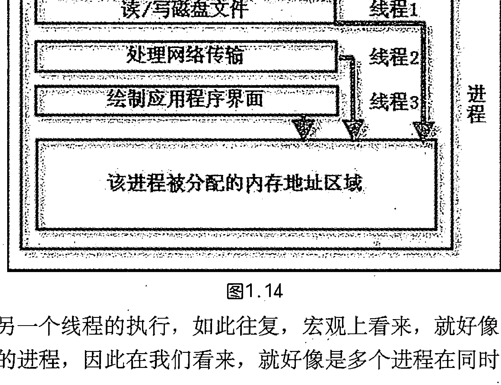

图1.14

这里涉及到多任务操作系统的问题，多任务操作系统如 Windows 的基本原理是：操作系统将 CPU 的时间片分配给多个线程，每个线程在操作系统指定的时间片内完成任务。多个线程分属于不同进程，操作系统不断从一个线程切换到另一个线程，宏观上看就好像多个线程在一起执行，因此看起来像是多个进程在同时执行，从而实现多任务。

#### 1.1.11 几种不同的“地址”

PE 文件的各种结构中，涉及到很多地址、偏移。有些是指在文件中的偏移地址，有些则是指在内存中的偏移。那么这些“地址”怎么区分呢？以下的第一种是指在文件中的地址，第二、三种是指在内存中的地址。

第一种，文件中的地址，又称文件偏移地址。比如用十六进制编辑器打开 PE 文件，看到的地址（偏移）就是文件中的地址，使用某个结构的文件地址，就可以在文件中找到该结构。

第二种，当文件被整个映射到内存时（例如某些 PE 分析软件将整个 PE 文件映射到内存中），这时是内存中的虚拟地址（VA），即映射到内存的地址加上该结构在文件中的地址。

第三种，当执行 PE 时，PE 文件会被装载器载入内存，这时经常需要的是 RVA。例如知道一个结构的 RVA，那么程序载入点加上 RVA 就可以得到该结构的内存地址。比如，如果 PE 文件装入虚拟地址（VA）空间的 `0x400000` 处，某一结构的 RVA 为 `0x1000`，那么其虚拟地址为 `0x401000`。

PE 文件格式要用到 RVA，主要是为了减少 PE 装载器的负担。因为每个模块都有可能被重载到任何虚拟地址空间，如果让 PE 装载器修正每个重定位项，这肯定是个梦魇。相反，如果所有重定位项都使用 RVA，那么 PE 装载器就不必操心那些东西了，即它只要将整个模块重定位到新的起始 VA。这就像相对路径和绝对路径的概念：RVA 类似相对路径，VA 就像绝对路径，如图1.15为几种不同的地址。

注意，RVA 和 VA 是指内存中，不是指文件中。RVA 是指相对于载入点的偏移而不是一个内存地址，只有 RVA 加上载入点的地址，才是一个实际的内存地址。

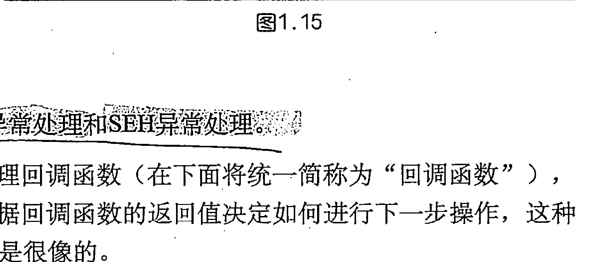

图1.15

## 1.2 Windows下的异常处理

Windows 下的异常处理可以有两种方式：筛选器异常处理和 SEH 异常处理。

筛选器异常处理的方式是由程序指定一个异常处理回调函数（在下面将统一简称为“回调函数”），当发生异常的时候，系统将调用这个回调函数，并根据回调函数的返回值决定如何进行下一步操作，这种方法和 DOS 系统中使用 INT 24h 中断来处理异常的方法是很像的。

在进程范围内，筛选器异常处理回调函数是唯一的，设置了一个新的回调函数后，原来的就失效了。

Windows 系统中还提供了另一种在每个线程之间独立的异常处理方法——结构化异常处理（Structured Exception Handling，简称 SEH）。SEH 是 Win32 系统中为数不多的应用广泛却又未被公开的特征之一。笔者主要介绍一下 SEH 异常。

#### 1.2.1 概念

SEH 异常就是指结构化异常处理。Win32 结构化异常处理是操作系统提供的一种服务。当某一线程发生异常时，程序的控制权会立即进入 Ring0 异常处理程序，这是属于操作系统的部分。如果发生的异常是页异常之类的异常，Ring0 处理程序可以处理完它后重新回到程序中执行，而被中断过的进程可能根本就不知道发生过异常。在编译器的 SEH 层减少了直接使用纯操作系统的 SEH 所带来的危害的同时，也将纯操作系统的 SEH 在大家的面前隐藏了起来。但程序遇到 SEH 异常时，异常交给系统处理，所以利用 SEH 异常可以一定程度地防止程序被调试（SEH 异常在壳里是很常见的）。

下面的几段反汇编代码是常见的 SEH 异常代码。

```asm
代码1:
push ********
mov eax,dword ptr fs:[0]
push eax
mov dword ptr fs:[0],esp
mov esi,0
mov eax,dword ptr ds:[esi]
```

代码2：
```asm
nop
push ********
mov eax, dword ptr fs:[0]
push eax
mov dword ptr fs:[0], esp
int 3
```

代码3：
```asm
push ********
mov eax, dword ptr fs:[0]
push eax
mov dword ptr fs:[0], esp
mov ebx, 0
div ebx
```

## 1.2.2 SEH异常的应用

SEH异常被广泛地应用于软件的反调试中，尤其是在软件保护壳中。熟悉这些异常对于手工脱壳，尤其是在脱未知的加密壳时是很重要的。在后面的脱壳章节中，读者会接触到利用SEH异常进行脱壳的方法。

Windows下的异常种类一般有四种表现方式：

- 1. 弹出一个只含有“确定”按钮的红色“X”对话框。
- 2. 弹出含有“调试”“关闭”两个按钮的“X”对话框。
- 3. 弹出只有一个“关闭”按钮的“X”对话框。
- 4. 触发异常，没有任何对话框弹出。

这四种模式机理是不同的。

### 1.3 软件保护技术

#### 1.3.1 常见软件保护技术分类

随着软件的不断发展、盗版的不断猖獗，软件保护的技术也不断提高。软件的算法也逐渐采用了密码学算法。像一些经典的、目前常见的软件保护技术，主要有序列号注册、试用时间限制、试用功能限制、磁盘保护、KeyFile保护、CD CHECK保护、软件加壳保护、License保护以及高端的基于硬件的加密狗保护等。正所谓道高一尺魔高一丈，软件的破解技术也不断提高。

下面是几种常见的软件保护方式的简介：

- 1. **序列号注册保护**：这也是目前最为流行的软件保护方式，因为这种方法实现起来比较容易。现在有两种免费软件可以使用：一种是自由软件（freeware），完全免费，没有任何使用限制；一种是共享软件（shareware），可以免费试用，如果要得到完全的功能或者服务，一般情况下需要注册。现在网上有很多免费软件，其中共享软件相对来说更多一些，真正免费的午餐还是不多的。有些共享软件没有任何限制，只是有可能会提示你该注册了，如果不注册的话，并不影响软件的正常使用，不会出现功能限制，但是注册之后会有更多的支持与服务；更多的共享软件都有诸多限制，比如使用天数限制、有效日期限制、次数限制、功能限制、未注册画面（NAG）、延迟或干脆禁用软件等等。软件的注册方式一般为：序列号 = F（注册名）。就是将用户输入的信息经过一定运算，然后和正确的注册信息相比较，如果相同则注册成功。需要说明的是，正确的注册信息并不一定是显式存在的。也就是说程序根据我们输入的信息计算出一个结果后，有可能直接和正确的注册信息相比较，也有可能是间接比较的。通常对于那些直接存在于内存中的注册码，我们比较容易破解；但是对于那些隐式存在于内存中的注册码，则需要我们仔细地去跟踪、分析程序，才能得到正确的注册码。对付这类软件通常需要更多的精力和耐心。图1.16为一款抓图软件“金山图霸”的注册画面。
- 2. **密码保护**：又称单一序列保护，这一类也是大家常见的加密保护方式。凡是需要你输入密码（PASSWORD）的地方都属于这类，有应用软件密码、游戏密码、文件密码等等（当然我们能破解的目标只是其中一部分）。如图1.17所示。
- 3. **加密狗保护**：加密狗保护也是当前很流行的软件保护方式，这类软件保护常用于大型商业软件，该类软件的破解也是很困难的。由于破解的复杂性，因而采用这类保护的软件也是越来越多，互联网上可以说是到处都能看到各种各样的“狗”。所谓“狗”，就是插在计算机接口上的一个数字电路，里面存着若干数据，软件通过计算机接口对这部分电路进行操作（读取、修改等），只有正确的“狗”才能使软件正常运行，从而达到保护软件、防止盗版的目的。加密狗安装如图1.18所示。

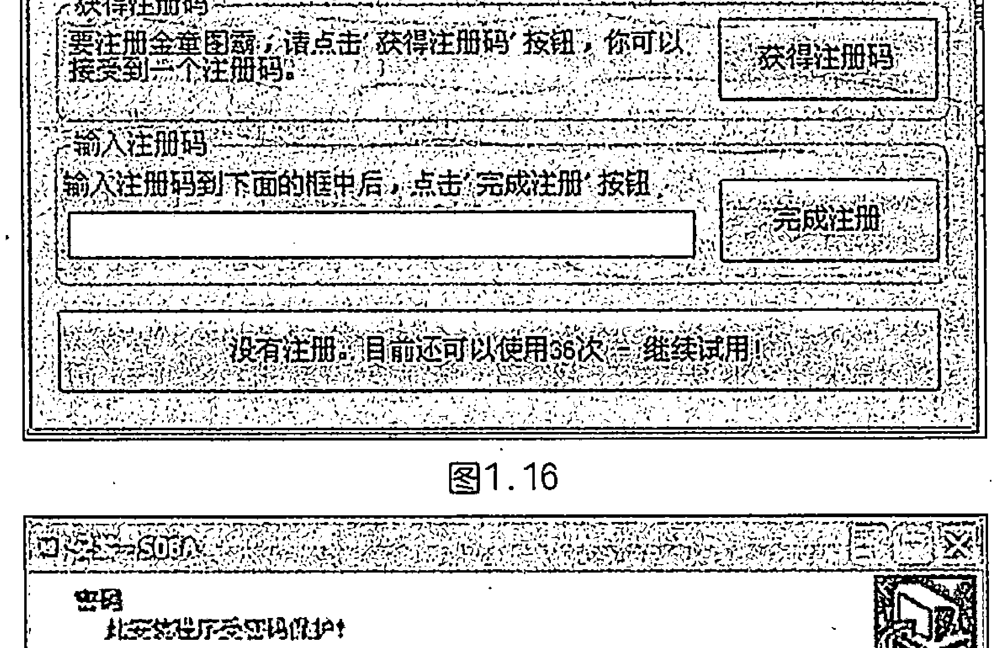

图1.16

- 4. **网卡加密**：主要是利用网卡的序列号来进行识别，只有随机带的网卡才能正常使用软件。这种软件的保护方式属于硬件保护，破解起来也很困难。

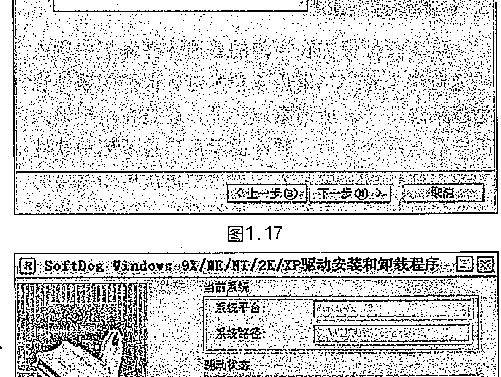

图1.17

- 5. **License保护**：这种加密多用于大型商业软件，软件通过正确的License文件运行。License文件都有固定格式（这里所说的不是有关License的说明性文本文档），一般是一个License对应软件的一个功能模块。如果想要增加软件功能，只要购买相应模块，得到一个License，然后就可以使用了，软件本身并不需要升级；或者是不同的License许可用户数量不同，有单用户License、多用户License，有单机版License、网络版License等。
- 6. **软件加壳保护**：就是通常说的加壳，利用专门的压缩软件将应用程序进行压缩，程序文件失去了本来的面目。在这种情况下要对软件进行破解，首先要做的就是脱壳。如果你用反汇编工具反汇编，那么你是什么也看不到的，因为软件本身已经被压缩，并不是真实的可执行文件代码了。图1.19与图1.20分别是未加壳与用“UPX 0.89.6 - 1.02”加壳后的软件开头反汇编代码。可以看出来差别实在是太大了。

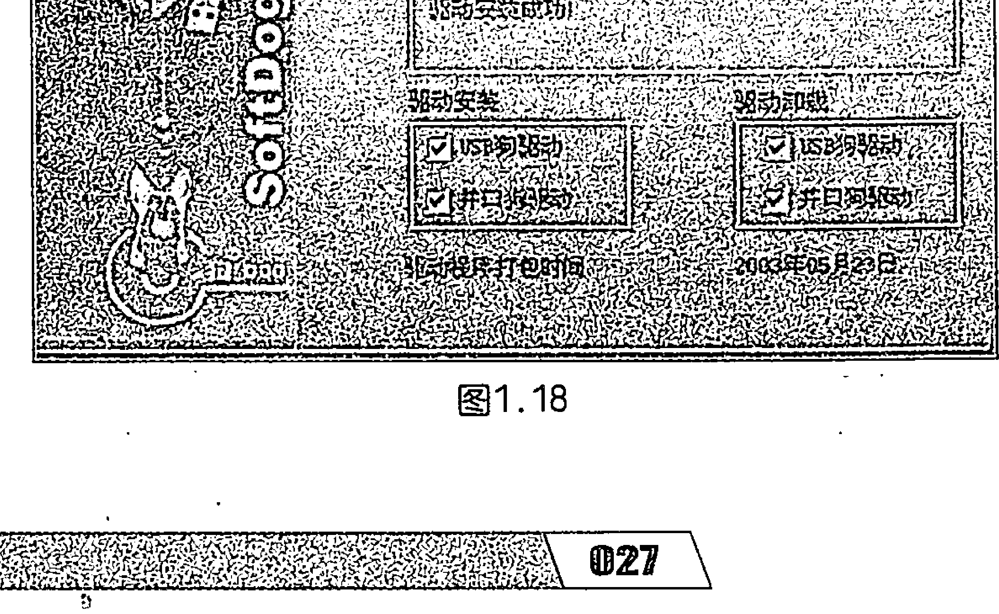

图1.18

- 7. **CD CHECK保护**

最简单也最常见的光盘保护，就是程序在启动时判断光驱中的光盘上是否存在特定文件，如果不存在则认为用户没有正版光盘，拒绝运行，运行界面如图1.21所示。

软件在程序运行过程中一般只在启动时进行验证，当启动完毕后不再检查光盘的存在与否。当然，对于保护强度较高的软件，作者会将部分关键程序代码直接放入光盘中，这样程序只要运行就离不开光盘。该类保护机制在Windows操作系统下的具体实现一般是这样的：先用GetLogicalDriveStrings()或GetLogicalDrives()得到系统中安装的所有驱动器列表，然后再用GetDriveType()检查每一个驱动器，如果是光驱则用CreateFileA()或FindFirstFileA()等函数检查特定文件存在与否，并可能进一步检查文件的属性、大小、内容等。这种光盘检查比较容易被破解，解密者只要利用上述函数设断点找到程序启动时检查光驱的地方，修改判断指令就可以跳过光盘检查。这类保护多用于游戏软件，程序运行时要求将原版CD碟放在光驱中，然后输入光盘附带的CD KEY，或者程序直接检查光盘上的特殊数据（指纹等），由此来判断使用的是否是正版光碟。

```asm
MOV EAX, DWORD PTR DS:[4C0088]
SHL EAX, 2
MOV DWORD PTR DS:[4C008F], EAX
PUSH EDX
PUSH 0
CALL <...GetModuleHandleA>
...
```

图1.19

```asm
PUSHAD
MOV ESI, ...
LEA EDI, DWORD PTR DS:[ESI+...]
...
NOP
NOP
INC ESI
```

图1.20

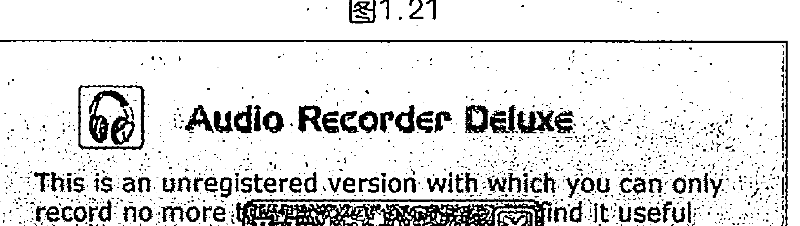

图1.21

- 8. **重启验证保护**

重启验证保护在当前普通软件保护中所占地位越来越高，采用该技术进行保护的软件也越来越多。所谓重启验证，就是在用户输入用户名与序列号后，软件提示用户重新启动软件（很多软件没有提示），当用户再次启动软件时就会检测用户输入的信息是否合法，但该检测不会有任何提示。如果注册信息合法，软件就会显示为注册状态，反之则为未注册状态。正是因为软件在启动过程中检测，而且检测不会有任何提示，这就给破解带来一定难度。但有利必有弊，既然软件是在启动时验证输入信息，这就说明软件将用户的注册信息保存到了某一个文件中。这样我们可以对软件对文件的读取进行拦截，从而找到读取验证信息的关键代码。有的软件在启动后会提示用户注册，而且注册后会提示用户重新启动，这也是暴露给软件破解者的一个好信息。如图1.22所示为某软件运行后的注册提示。

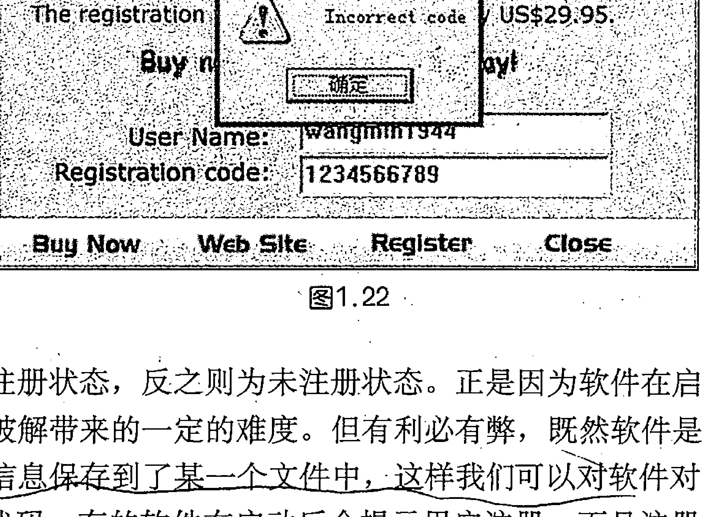

图1.22

常见的重启验证保护类型有注册表重启验证、ini文件重启验证、inf文件重启验证三类。当然有的软件会将信息保存到dat文件中也是可能的，不过最常见的就是上面的三类了。

- 9. **KEY file保护方式**

采用该类合法验证的软件一般情况下不会对用户有任何提示信息。软件在运行过程中会检查某个文件的有效性，这个文件可能是普通文本文件，也有可能是软件自己定义的特殊格式文件。我们把这种文件叫做KEY file，“钥匙文件”，就是开启该软件的钥匙。典型的软件就是卡巴斯基杀毒软件了。

- 10. 还有一些软件，用户使用的只是功能不完整的demo版本，只有在用户付给软件作者一定注册费用之后，软件作者才会通过邮寄方式将完整版软件邮寄给用户。对于这类共享软件我们是没有办法破解的，因为其共享软件本身就缺乏某些功能，要得到功能完全的正式版，唯一的办法就是通过正常渠道去注册。

#### 1.3.2 序列号保护机制

在日常生活中我们遇到最多的软件保护就是序列号保护了。序列号保护方式简单易用，因而受到很多软件作者的喜爱，但也正是鉴于它的简单性，也使得采用这种保护方式的软件最容易被破解。

序列号保护方式一般情况下是将用户输入的用户名采用某种计算方法计算得到一个特定长度的序列号，然后将用户输入的序列号与这个真正的序列号进行比较，从而判断软件注册的合法性。这里所说的计算方法可能是简单的异或运算，也可能是软件作者自己的一套算法，也可能是密码学算法。在这些算法当中，如果是密码学算法，那在破解难度上就提升了一个档次。下图1.23就是一个MD5算法的软件保护流程。

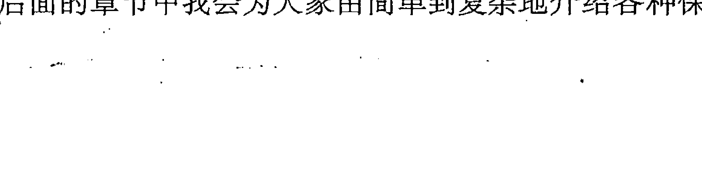

正所谓“知己知彼百战百胜”，既然清楚了软件的保护方式，那自然就有了相应的破解方法。但这些破解方法最基本的还是以反汇编为基础的，在后面的章节中我会为大家由简单到复杂地介绍各种保护方式相应的破解方法。

#### 1.3.3 常见软件破解方法

软件的保护种类虽然比较多，而且比较繁杂，但从破解角度来看，一种破解方法可以应付很多类型的保护机制。只要将几种破解方法灵活运用，彼此结合，软件破解就不在话下。常见的软件破解方法有字符串查找法、堆栈溯源法、消息断点法等，每一种方法的实行方式针对于特定的软件都有所不同。其中字符串查找法最为简单，但对于不同的软件又有着自己的特色。例如，软件加壳后可以先运行程序，然后再查找；未加壳的软件载入后可以直接查找。只有熟悉各种方法的特点与不同，才能够深入地了解软件破解，才能灵活地针对不同软件采用不同方法。

### 1.4 认识“壳”

#### 1.4.1 “壳”的由来

软件中壳的概念与自然界中壳的概念类似，究其本质而言都是为了保护内部的一些东西。在自然界中，壳这东西大家应该都不会陌生。自然界中植物用它来保护种子，动物用它来保护身体等等。同样，在一些计算机软件里，也有一段专门负责保护软件不被非法修改或反编译的程序。它们一般都是先于程序运行，拿到控制权，然后完成它们保护软件的任务。就像动植物的壳一般都在身体外面一样理所当然（但后来也出现了所谓的“壳中带核”的壳）。由于这段程序和自然界的壳在功能上有很多相同的地方，基于命名规则，大家就把这样的程序称为“壳”了。就像计算机病毒和自然界病毒一样，其实都是命名上的方法罢了。从功能上抽象，软件的壳和自然界中的壳相差无几，无非是保护、隐藏壳内的东西。而从技术角度出发，壳是一段执行于原始程序前的代码。原始程序的代码在加壳过程中可能被压缩、加密……当加壳后的文件执行时，壳这段代码先于原始程序运行，它把压缩、加密后的代码还原成原始程序代码，然后再把执行权交还给原始代码。软件的壳分为加密壳、压缩壳、伪装壳、多层壳等类，目的都是为了隐藏程序真正的OEP（入口点，防止被破解），见图1.24。

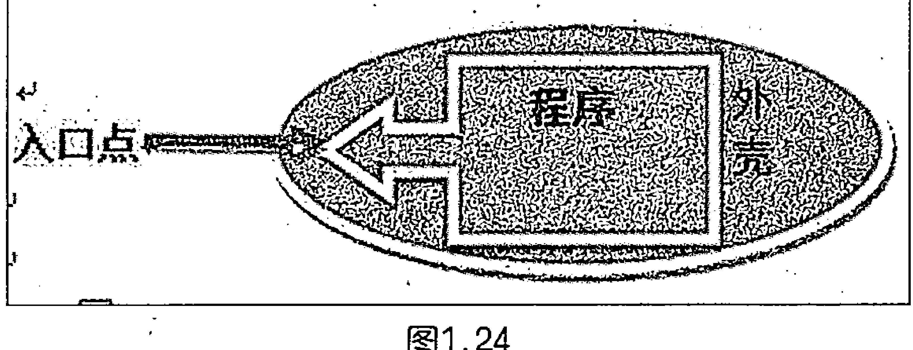

#### 1.4.2 “壳”的原理

加壳其实是利用特殊算法，对EXE、DLL文件里的资源进行压缩，改变其原来的特征码，隐藏一些字符串等等，使一些资源编辑软件不能正常打开或者修改。类似WINRAR的效果，只不过这个压缩后的文件可以独立运行，解压过程完全隐藏，都在内存中完成。

解压原理：是加壳工具在文件头里加了一段指令，告诉CPU怎么才能解压自己。现在的CPU都很快，所以这个解压过程你看不出什么东西。软件一下子就打开了，只有你机器配置非常差，才会感觉到不加壳和加壳后软件运行速度的差别。

当你加壳时，其实就是给可执行文件加上个外衣。用户执行的只是这个外壳程序。当你执行这个程序的时候，这个壳就会把原来的程序在内存中解开，解开后，以后的工作就交给真正的程序。所以，这些工作只是在内存中运行的，不可以了解具体是怎么样在内存中运行的。

通常说的对外壳加密的软件，都是指很多网上免费或者非免费的软件被一些专门的加壳程序加壳。因为有的时候程序会过大，需要压缩；但是大部分程序是因为防止反跟踪，防止程序被人跟踪调试，防止算法程序被别人静态分析，加密代码和数据，保护你的程序数据完整性，不被修改或者破解。

#### 1.4.3 “壳”在软件保护中的应用

软件加壳之后，原程序中的字符串以及其他信息就会被隐藏，因而壳常用于软件保护。在软件的加壳保护中，最常见的壳是加密壳。加密壳可以对代码进行加密，从而隐藏软件中的关键算法与关键信息，以阻止破解者对软件的静态分析。

认识了“壳”之后，我们在免杀与破解过程中所要做的第一步就是脱壳，让软件失去这层保护，这样我们就可以“为所欲为”。软件的脱壳方式主要分为两种：硬脱壳与动态脱壳。

**硬脱壳**：这是指找出加壳软件的加壳算法，写出逆向算法，就像压缩和解压缩一样。由于目前很多“壳”均带有加密、变形的特点，每次加壳生成的代码都不一样，硬脱壳对此无能为力，但由于其技术门槛较低，仍然被一些杀毒软件所使用。

**动态脱壳**：由于加壳程序运行时必须还原成原始形态，即加壳程序会在运行时自行脱掉“马甲”。目前有一种脱壳方式是抓取（Dump）内存中的镜像，再重构成标准的执行文件。相比硬脱壳方法，这种脱壳方法对自行加密、变形的壳处理效果更好。

### 1.5 密码学基础

本节中将对密码学的基本知识进行介绍，但并不会涉及很多算法与原理问题，只是进行简要介绍。

#### 1.5.1 密码学的历史

无论是网络传输中使用的安全传输协议，还是安全手段或安全措施，它们都需要使用加密算法和相应的解密算法。不了解与此相关的加密原理和算法，就很难深刻地认识各种安全传输协议，以及实现网络安全所采用的数字证书、数字签名等技术，所以我们在本节集中介绍一下。

> 第二章 知己知彼，百战不殆

##### 历史发展

信息的保护有着悠久的历史，从古埃及人坟墓中发现的早期编码与加密信息便可得出，“加密”的历史已经相当漫长了。斯巴达人最早将加密技术应用于军事领域进行军事情报传输。在 David Kahn 的经典著作《The Codebreakers》中，将密码学的发展归功于阿拉伯人。在历史记载中，“密码学”一词也是最早出现于阿拉伯科学家 al-Qalqashandi 著作的百科全书第十四卷中，这也是世界上最早出现的介绍密码分析法的著作。在欧洲的“黑暗时代”，一切发展都微乎其微，直到这个时代结束后，密码学的发展进入了快速发展时期。密码学的不断应用，使得各个国家逐渐开始重视这一领域。加上政府间谍网络的不断扩大，为了保证信息传输的安全性，密码学逐渐应用其中，并逐渐产生了一个新机构——“保密局”。直到20世纪，美国才设有官方保密局。在第一次世界大战中，美国的保密局“MI-8”成功地破获了日军密码。随着各国科学家、数学家的不断努力，加密技术从最原始的“秘密书写”，到后来的“轴编码法”，再到当今现代密码学，密码学的发展历经千年历史，在这千年之中也可以看到人类文明的不断进步。

#### 1.5.2 基本概念

加密方法属于计算机密码学范畴。长久以来，计算机密码学作为一门研究计算机数据加密、解密及其变换的艰深学科，鲜为普通用户所了解。直到最近几十年，随着计算机网络及通信技术的民用化发展，尤其是商业和金融事务的介入，密码学的研究才得到了前所未有的广泛重视，并在更为广泛的领域得到了应用。密码学涉及很多高深的数学理论，本节只会为读者简单介绍常见加密方式，不作深入分析。

所谓加密，就是把数据信息即明文转换为不可辨识的形式即密文的过程，目的是使不了解该数据信息的人不能够知道和识别。将密文转变为明文的过程就是解密。加密和解密过程形成加密系统，明文与密文统称为报文。任何加密系统，不论形式如何复杂、实现算法如何不同，但其基本组成部分是相同的，通常都包括如下4个部分：

- 1. 需要加密的报文，也称为明文；
- 2. 加密以后形成的报文，也称为密文；
- 3. 加密、解密的装置或算法；
- 4. 用于加密和解密的钥匙，称为密钥。密钥可以是数字、词汇或者语句。

报文加密后，发送方就要将密文通过通信渠道传输给接收方。传输过程中，即密文在通信渠道传输过程中是不安全的，可能被非法用户即第三方截取和窃听；但由于是密文，只要第三方没有密钥，只能得到一些无法理解其真实意义的密文信息，从而达到保密目的。整个过程如图1.25所示。

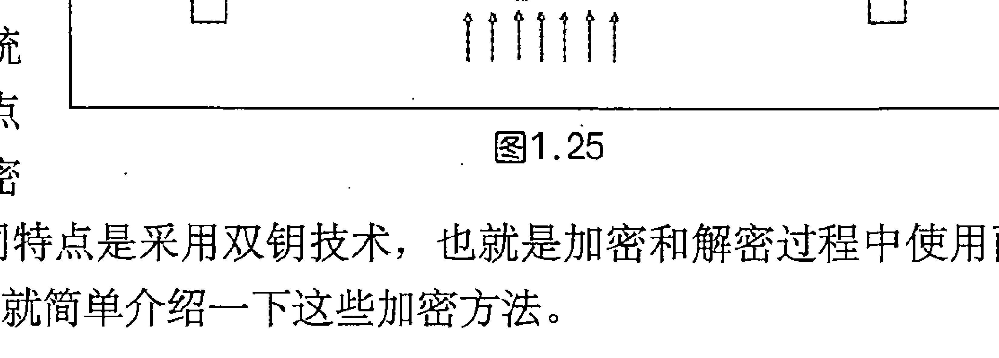

为便于研究，人们通常把这些方法分为传统加密方法和现代加密方法两大类。前者的共同特点是采用单钥技术，即加密和解密过程中使用同一密钥，所以它也称为对称式加密方法；而后者的共同特点是采用双钥技术，也就是加密和解密过程中使用两个不同的密钥，它也称为非对称式加密方法。下面就简单介绍一下这些加密方法。

#### 1.5.3 基于单钥技术的传统加密方法

这类方法主要包括代码加密法、替换加密法、变位加密法和一次性密码簿加密法等。

- 1. 代码加密法。通信双方使用预先设定的一组代码表达特定意义，而实现的一种最简单加密方法。代码可以是日常词汇、专用名词，也可以是某些特殊用语。例如：

  密文：姥姥家的黄狗三天后下崽。  
  明文：县城鬼子三天后出城扫荡。

  这种方法简单好用，但通常一次只能传送一组预先约定的信息，而且重复使用时不安全，因为那样的话窃密者会逐渐明白代码含义。

- 2. 替换加密法。这种方法是制定一种规则，将明文中的每个字母或每组字母替换成另一个或一组字母。例如，下面这组字母对应关系就构成了一个替换加密器：

  明文字母：A B C D E F……  
  密文字母：K U P S W B……

  虽然替换加密法比代码加密法应用范围要广，但使用得多了，窃密者就可以从多次搜集的密文中发现其中规律，破解加密方法。

- 3. 变位加密法。与前两种加密方法不同，变位加密法不隐藏原来明文字符，而是将字符重新排序。比如，加密方首先选择一个用数字表示的密钥，写成一行，然后把明文逐行写在数字下。按照密钥中数字指示的顺序，将原文重新抄写，就形成密文。例如：

  密钥：6835490271  
  明文：小赵拿走黑皮包交给李  
  密文：包李交拿黑走小给赵皮

- 4. 一次性密码簿加密法。这种方法要先制定出一个密码簿，该簿每一页都是不同代码表。加密时，使用一页上的代码加密一些词，用后撕掉或烧毁该页；然后再用另一页上的代码加密另一些词，直到全部明文都加密成为密文。破译密文的唯一办法就是获得一份相同的密码簿。

计算机出现以后，密码簿就无需使用纸张，而使用计算机和一系列数字来制作。加密时，根据密码簿里的数字对报文中的字母进行移位操作或进行按位异或计算，以加密报文。解密时，接收方需要根据持有的密码簿，将密文字母反向移位，或再次作异或计算，以求出明文。

数论中的“异或”规则是这样的：1^1=0，0^0=0；1^0=1，0^1=1。下面就是一个按位进行异或计算的加密和解密实例：

```text
加密过程中明文与密码按位异或计算，求出密文：
明文：101101011011
密码：011010101001
密文：110111110010

解密过程中密文与密码按位异或计算，求出明文：
密文：110111110010
密码：011010101001
明文：101101011011
```

顾名思义，一次性密码簿只能使用一次，以保证信息加密的安全性。但由于解密时需要密码簿，所以想要加密一段报文，发送方必须首先安全地护送密码簿到接收方（这一过程常称为“密钥分发”过程）。

如果双方相隔较远，如从美国五角大楼到英国中央情报局，则使用一次性密码簿的代价是很大的。这也是限制这种加密方法实用化和推广的最大障碍，因为既然有能力把密码簿安全地护送到接收方，那为什么不直接把报文本身安全地护送到目的地呢？

正因为传统加密方法在这方面的局限性，人们又想出了很多算法来加强和改进这些方法。下面我们就介绍几个比较著名的方法。

#### 1.5.4 改进的传统加密方法

我们首先需要说明数据块和数据流加密的概念。数据块加密是指把数据划分为某一特定长度的数据块，再分别进行加密。数据块之间的加密是相互独立的，因此，如果内容相同的数据块重复出现，密文也会呈现出某种规律性，从而会降低破解的难度。数据流加密是指使用加密后的密文前面的部分，来参与报文后面部分的加密。这种方法的好处是数据块之间的加密不再独立，即使有相同的数据重复出现，密文也不会呈现出明显的规律性，从而提高破译的难度。改进的传统加密方法便是应用了这种思想，这类方法常划为使用传统加密技术的现代加密方法。

- **1. 数据加密标准 DES**。DES（Data Encryption Standard）是美国政府1977年采用的加密标准，最初是由IBM公司在70年代初期开发的。美国政府在1981年又将DES进一步规定为ANSI标准。  
  DES是一个对称密钥系统，加密和解密使用相同的密钥。它通常选取一个64位（bit）的数据块，使用56位的密钥，在内部实现多次替换和变位操作来达到加密的目的。DES有ECB、CBC和CFB三种工作模式，其中ECB采用的是数据块加密模式，CBC与CFB采用的是数据流加密模式。  
  作为第一个公开的新式加密方法，DES的影响非常大。后来提出的许多密码方法都汲取了DES的思想和技术。但是，DES的缺点是它采用的密钥太短，只有56位，也就是说，所有可能的密钥只有2^56个。采用一些计算网络，若每秒钟测试5亿个密钥，则在4小时以内便可把所有可能的密钥都测试一遍。因此，随着计算机性能的提高，DES的破解难度已经降低，不太实用了。

- **2. 三层DES（Triple-DES）**。这种方法是DES的改进加密算法，它使用两把密钥对报文作三次DES加密，效果相当于将DES密钥的长度加倍。三层DES克服了DES的显著缺点，即其56位的短密钥。本来，三层DES是通过三次使用DES算法来对数据进行编码加密，在每一层上都使用不同的密钥，这样就可以用一个3×56=168位的密钥进行加密；但许多密码设计者认为168位的密钥已经超过实际需要了，所以便在第一层和第三层中使用相同的密钥，产生一个有效的112位的密钥长度。之所以没有直接采用两层DES，是因为第二层DES不是十分安全，它对一种称为“中间相遇”的密码分析攻击形式来说是极为脆弱的，所以还是采用了三层DES操作。

- **3. RC2和RC4**。RC指Rivest Code，它是以发明人美国麻省理工学院的Ron Rivest教授的姓氏命名的，由RSADSI公司发行，是不公开的专有算法。RC2和RC4使用可变长度（1至1024位）的密钥，实现不同级别的保密性。RC2采用的是数据块加密算法，RC4采用的是数据流加密算法。由于它们的具体算法不公开，所以没有人知道它们的可靠性到底能达到何种程度。有名的Netscape浏览器从2.0版就使用了RC2和RC4的加密算法。

- **4. 数字摘要（Digital Digest）**。该加密方法也是由Ron Rivest设计的，也被称为安全Hash编码法SHA（Secure Hash Algorithm）或MD5（MD Standards for Message Digest）。该编码法采用单向Hash函数将需加密的明文“摘要”成一串128 bit（位）的密文，这一串密文也称为数字指纹（Finger Print），它具有固定的长度。而且不同的明文摘要成密文时，其指纹结果也是不同的，而相同明文的摘要必定相同。这样，这串摘要便可以成为验证明文是否是“真身”的“指纹”了。SHA其实就是RC方法的一种实现。

- **5. 国际数据加密算法IDEA**。IDEA（International Data Encryption Algorithm）是1990年瑞士的James Massey、Xuejia Lai等人发表的一个数据块加密算法。该算法使用128位的密钥，能够有效地消除试图穷举搜索密钥的可能攻击。IDEA看起来是一个较“强”的算法，但由于出现没多久，所以目前暂时不知道它是否有漏洞。

- **6. 基于硬件的加密**。为克服软件加密算法在容易复制、容易尝试方面的不足，人们又开发了基于硬件的加密算法。如美国国家安全局为使用Clipper芯片，就秘密开发了一个民用加密算法SkipJack，采用80位的密钥，使得穷举搜索密钥不可行。而且由于在Clipper芯片的硬件中人为地加进了一些“机关”设置，增加了破解难度。

#### 1.5.5 基于双钥技术的现代加密方法

##### 工作原理分析

双钥技术就是公共密钥加密PKE（Public Key Encryption）技术，它使用两把密钥，一把公共密钥（Public Key）和一把专用密钥（Private Key），前者用于加密，后者用于解密。这种方法也称为“非对称式”加密方法，它解决了传统加密方法的根本性问题，极大地简化了密钥分发的工作量。它与传统加密方法相结合，还可以进一步增强传统加密方法的可靠性。更为突出的是，利用公共密钥加密技术可以实现数字签名。

为说明公共密钥技术的工作原理，我们还得从传统加密方法的工作原理说起。

传统加密方法的工作过程包括如下几部分：

- 1. 设置一个保险箱，并装置一把嵌入箱子的暗锁，这种锁只能使用钥匙才能锁上，再准备2把相同的钥匙。这对应于加密方法，钥匙对应于密钥。
- 2. 发信方和收信方必须各自持有1把开锁的钥匙。这对应于密钥分发过程。
- 3. 发信方将通信文件放入保险箱，并使用自己持有的钥匙把锁锁起来。这对应于加密过程。
- 4. 运送保险箱。这对应于信息传输过程。
- 5. 保险箱送到目的地后，收信人用自己持有的钥匙打开锁，取出通信文件。这对应于解密过程。

全部过程的根本困难是第（2）步，即通信双方必须都获得1把统一的钥匙，前文已经述及，这一步实现起来要付出很大代价。如果我们仔细分析一下，可以发现，发信人真正需要的仅仅是一个能装秘密文件并能锁上的保险箱，没有必要也持有1把钥匙。之所以要有钥匙，是因为使用了嵌入箱子的暗锁。显然，只要不使用这种锁，而使用一种不用钥匙也能锁上的锁，则发信人就可以在没有钥匙的情况下，锁住保险箱。基于这种思想，可以按如下过程进行加密：

- 1. 设置一个保险箱，并设置一把不需要使用钥匙就能锁上的锁，再准备1把钥匙。这对应于加密方法，钥匙对应于专用密钥。
- 2. 收信方持有这把开锁的钥匙；同时准备该钥匙可以开的锁，锁可以不止有1把，然后把锁公开发放出去。这里锁对应于公共钥匙，这个过程对应于公共密钥分发过程。
- 3. 任何人想与收信方通信，只需将通信文件放入保险箱，并使用收信方承认的锁锁起来。这对应于加密过程。
- 4. 运送保险箱。这对应于信息传输过程。
- 5. 保险箱送到目的地后，收信人用自己持有的唯一的一把钥匙打开锁，取出通信文件。这对应于解密过程。

由于可以开锁的钥匙只有一把，而且掌握在收信人手里。因此可以确信除收信人本人外，没有任何人能够打开锁着的保险箱并偷阅其中通信文件的内容，发信人对此也不例外。更为重要的是，密钥分发的难题也不复存在了，而是代之以锁的分发问题。分发锁是无须保密的，这无疑使以前的艰难工作简单了许多。这就是公钥加密技术的工作原理。

公共密钥加密系统中，收信人首先生成在数学上相互关联、但又不同的两把钥匙，一把公共密钥用于加密，另一把专用密钥用于解密，这一过程称为密钥配制过程。其中公共密钥相当于例子中不需使用钥匙就能锁上的锁，用于以后通信的加密；另一把专用密钥相当于例中提到的那把开锁的唯一的钥匙，用于通信的解密。收信人将唯一的专用密钥掌握和保存起来，把公共密钥通过各种方式公布出去，让想与收信人通信的人都能够得到。这个过程就是公共密钥的分发过程。发信人使用收信人的公共密钥对通信文件进行加密，加密后的密文发信人自己也无法解开，这相当于把信件十分可靠地锁在保险箱里。收信人在收到密文以后，用自己的专用密钥解开密文获得明文信息。

#### 1.5.6 常见的密码学算法

### 1、RSA算法

它是第一个既能用于数据加密也能用于数字签名的算法。它易于理解和操作，也很流行。算法的名字以发明者的名字命名：Ron Rivest、Adi Shamir和Leonard Adleman。但RSA的安全性一直未能得到理论上的证明。它经历了各种攻击，至今未被完全攻破。

**RSA算法的安全性**

RSA的安全性依赖于大数分解，但是否等同于大数分解一直未能得到理论上的证明，因为没有证明破解RSA就一定需要作大数分解。假设存在一种无须分解大数的算法，那它肯定可以修改成为大数分解算法。目前，RSA的一些变种算法已被证明等价于大数分解。不管怎样，分解n是最显然的攻击方法。现在，人们已能分解多个十进制位的大素数。因此，模数n必须选大一些，因具体适用情况而定。

**RSA算法的速度**

由于进行的都是大数计算，使得RSA最快的情况也比DES慢上百倍，无论是软件还是硬件实现。速度一直是RSA的缺陷。一般来说只用于少量数据加密。

RSA算法是第一个能同时用于加密和数字签名的算法，也易于理解和操作。RSA是被研究得最广泛的公钥算法，从提出到现在已近二十年，经历了各种攻击的考验，逐渐为人们接受，普遍认为是目前最优秀的公钥方案之一。RSA的安全性依赖于大数的因子分解，但并没有从理论上证明破译RSA的难度与大数分解难度等价。即RSA的重大缺陷是无法从理论上把握它的保密性能如何，而且密码学界多数人士倾向于因子分解不是NPC问题。RSA的缺点主要有：A）产生密钥很麻烦，受到素数产生技术的限制，因而难以做到一次一密。B）分组长度太大，为保证安全性，n至少也要600 bits以上，使运算代价很高，尤其是速度较慢，较对称密码算法慢几个数量级；且随着大数分解技术的发展，这个长度还在增加；不利于数据格式的标准化。目前，SET（Secure Electronic Transaction）协议中要求CA采用比特长的密钥，其他实体使用比特的密钥。

### 2、DES算法

DES算法简介

美国国家标准局1973年开始研究除国防部外的其它部门的计算机系统的数据加密标准，于1973年5月15日和1974年8月27日先后两次向公众发出了征求加密算法的公告。加密算法要达到的目的（通常称为DES密码算法要求）主要为以下四点：

- 提供高质量的数据保护，防止数据未经授权的泄露和未被察觉的修改；
- 具有相当高的复杂性，使得破译的开销超过可能获得的利益，同时又要便于理解和掌握；
- DES密码体制的安全性应该不依赖于算法的保密，其安全性仅以加密密钥的保密为基础；
- 实现经济、运行有效，并且适用于多种完全不同的应用。

1977年1月，美国政府颁布：采纳IBM公司设计的方案作为非机密数据的正式数据加密标准（DES即Data Encryption Standard）。

目前在国内，随着三金工程尤其是金卡工程的启动，DES算法在POS、ATM、磁卡及智能卡（IC卡）、加油站、高速公路收费站等领域被广泛应用，以此来实现关键数据的保密，如信用卡持卡人的PIN的加密传输、IC卡与POS间的双向认证、金融交易数据包的MAC校验等，均用到DES算法。

DES算法的入口参数有三个：Key、Data、Mode。其中Key为8个字节共64位，是DES算法的工作密钥；Data也为8个字节64位，是要被加密或被解密的数据；Mode为DES的工作方式，有两种：加密或解密。

DES算法是这样工作的：如Mode为加密，则用Key去把数据Data进行加密，生成Data的密码形式（64位）作为DES的输出结果；如Mode为解密，则用Key去把密码形式的数据Data解密，还原为Data的明码形式（64位）作为DES的输出结果。在通信网络的两端，双方约定一致的Key，在通信时源点用Key对核心数据进行DES加密，然后以密码形式在公共通信网（如电话网）中传输到通信网络的终点，数据到达目的地后，用同样的Key对密码数据进行解密，便再现了明码形式的核心数据。这样，便保证了核心数据（如PIN、MAC等）在公共通信网中传输的安全性和可靠性。

通过定期在通信网络的源端和目的端同时改用新的Key，便能更进一步提高数据的保密性，这正是现在金融交易网络的流行做法。

### DES算法的应用误区

DES算法具有极高安全性，到目前为止，除了用穷举搜索法对DES算法进行攻击外，还没有发现更有效的办法。而56位长的密钥的穷举空间为2^56，这意味着如果一台计算机的速度是每一秒钟检测一百万个密钥，则它搜索完全部密钥就需要将近2285年的时间。可见，这是难以实现的。当然，随着科学技术的发展，当出现超高速计算机后，我们可考虑把DES密钥的长度再增长一些，以此来达到更高的保密程度。

由上述DES算法介绍我们可以看到：DES算法中只用到64位密钥中的其中56位，而第8、16、24、……、64位这8个位并未参与DES运算。这一点向我们提出了一个应用上的要求，即DES的安全性是基于除了8、16、24、……、64位外的其余56位的组合变化2^56才得以保证的。因此，在实际应用中，我们应避开使用第8、16、24、……、64位作为有效数据位，而使用其它的56位作为有效数据位，才能保证DES算法安全可靠地发挥作用。如果不了解这一点，把密钥Key的8、16、24、……、64位作为有效数据使用，将不能保证DES加密数据的安全性，对运用DES来达到保密作用的系统产生数据被破译的危险，这正是DES算法在应用上的误区，留下了被人攻击、被人破译的极大隐患。

### 3、ElGamal算法

ElGamal算法既能用于数据加密也能用于数字签名，其安全性依赖于计算有限域上离散对数这一难题。

### ElGamal算法的安全性分析

ElGamal签名的安全性依赖于乘法群（IFp）*上的离散对数计算。素数p必须足够大，且p-1至少包含一个大素数因子以抵抗Pohlig & Hellman算法的攻击。M一般都应采用信息的HASH值（如SHA算法）。

ElGamal的安全性主要依赖于p和g，若选取不当则签名容易伪造，应保证g对于p-1的大素数因子不可约。D. Bleichenbacher在“Generating ElGamal Signatures Without Knowing the Secret Key”中提到了一些攻击方法和对策。ElGamal的一个不足之处是它的密文成倍扩张。

美国的DSS（Digital Signature Standard）的DSA（Digital Signature Algorithm）算法是经ElGamal算法演变而来。

### 4、DSA算法

Digital Signature Algorithm（DSA）是Schnorr和ElGamal签名算法的变种，被美国NIST作为DSS（Digital Signature Standard）。

DSA是基于整数有限域离散对数难题的，其安全性与RSA相比差不多。DSA的一个重要特点是两个素数公开，这样，当使用别人的p和q时，即使不知道私钥，你也能确认它们是否是随机产生的，还是做了手脚，RSA算法却做不到。

### 5、MD5算法

### MD5的安全性

MD5的全称是Message-Digest Algorithm 5，在90年代初由MIT的计算机科学实验室和RSA Data Security Inc发明，经MD2、MD3和MD4发展而来，MD5相对于以前的主要变化是：

- 1. 增加了第四轮运算。
- 2. 每一步均有唯一的加法常数。
- 3. 为减弱第二轮中函数G的对称性，从(X&Y)|(X&Z)|(Y&Z)变为(X&Z)|(Y&(~Z))。
- 4. 第一步加上了上一步的结果，这将引起更快的雪崩效应。
- 5. 改变了第二轮和第三轮中访问消息子分组的次序，使其更不相似。
- 6. 近似优化了每一轮中的循环左移位移量以实现更快的雪崩效应，各轮的位移量互不相同。

Message-Digest泛指字节串（Message）的Hash变换，就是把一个任意长度的字节串变换成一定长的大整数。请注意我使用了“字节串”而不是“字符串”这个词，是因为这种变换只与字节的值有关，与字符集或编码方式无关。

MD5将任意长度的“字节串”变换成一个128 bit的大整数，并且它是一个不可逆的字符串变换算法。换句话说，即使你看到源程序和算法描述，也无法将一个MD5的值变换回原始的字符串。从数学原理上说，是因为原始的字符串有无穷多个，这有点像不存在反函数的数学函数。

### MD5的用途

MD5的典型应用是对一段Message（字节串）产生fingerprint（指纹），以防止被“篡改”。举个例子，你将一段话写在一个叫readme.txt文件中，并对这个readme.txt产生一个MD5的值并记录在案，然后你可以传播这个文件给别人，别人如果修改了文件中的任何内容，你对这个文件重新计算MD5时就会发现。对文件进行MD5校验的工具一般是“文件MD5校验工具”，软件主界面如图1.26所示。点击“取文件MD5”…

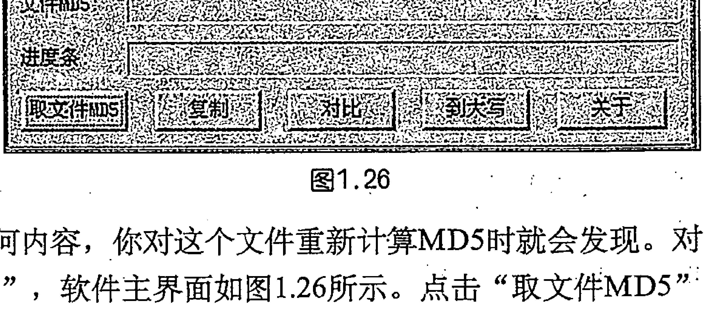

选择要提取MD5的文件即可显示出该文件的MD5。

例如一个名为test的文本文件，内容如图1.27所示，篡改后的文件内容如图1.28所示。

两个文件的MD5校验如图1.29、1.30所示；通过对比可以看见两个文件的MD5显然不同，说明文件已经被篡改。对字符串的MD5加密的工具很多，笔者这里使用的是黑鹰基地的一款。


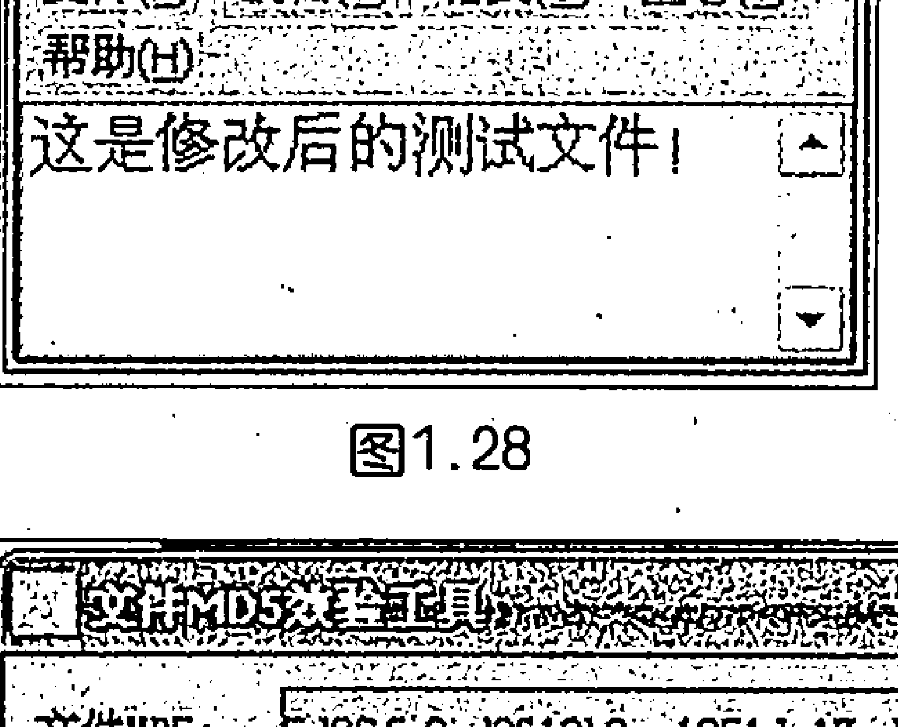

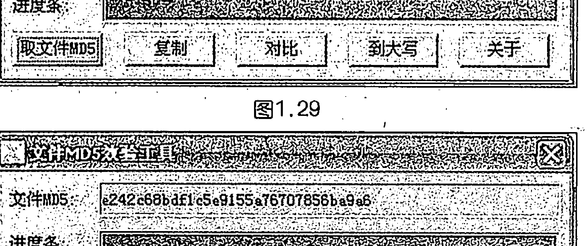

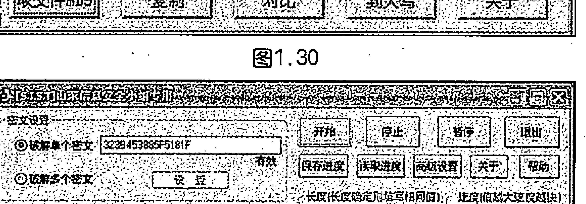

### MD5加密工具

如果再有一个第三方的认证机构，用MD5还可以防止文件作者的“抵赖”，这就是所谓的数字签名应用。MD5还广泛用于加密和解密技术上，在很多操作系统中，用户的密码是以MD5值（或类似的其它算法）的方式保存的，用户Login的时候，系统是把用户输入的密码计算成MD5值，然后再去和系统中保存的MD5值进行比较，而系统并不“知道”用户的密码是什么。

### 对于MD5的破解方式

对于MD5的破解方式没有逆向算法，也就是说不能够通过密文反向算出原始明文。这样，对于MD5的破解就只有暴力破解了。一些黑客破获这种密码的方法是使用字典法。有两种方法得到字典，一种是日常搜集的用作密码的字符串表，另一种是用排列组合方法生成的。先用MD5程序计算出这些字典项的MD5值，然后再用目标的MD5值在这个字典中检索。另一种破解方法就是直接穷举破解，这种方法类似于字典法，只不过这个“字典”不需要我们制作，而是使用破解工具直接从0开始尝试明文的MD5值是否与需要破解的密文相同，如果相同说明该明文就是目标密码。一个8位MD5密码的破解界面如图1.31所示。

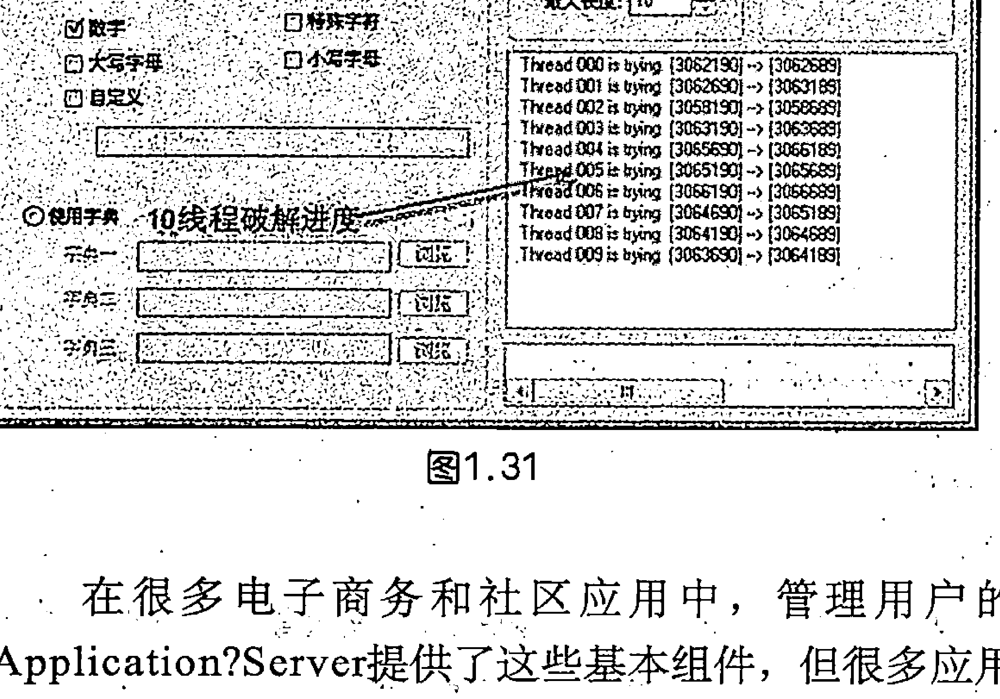

即使假设密码的最大长度为8，同时密码只能是字母和数字，共26+26+10=62个字符，排列组合出的字典的项数则是P(62,1)+P(62,2)+…+P(62,8)，那也已经是一个很天文的数字了，存储这个字典就需要TB级的磁盘组，而且这种方法还有一个前提，就是能获得目标账户的密码MD5值的情况下才可以。

在很多电子商务和社区应用中，管理用户的Account是一种最常用的基本功能，尽管很多Application Server提供了这些基本组件，但很多应用开发者为了管理的更大的灵活性还是喜欢采用关系数据库来管理用户。懒惰的做法是用户的密码往往使用明文或简单的变换后直接保存在数据库中，因此这些用户的密码对软件开发者或系统管理员来说可以说毫无保密可言。本文的目的是介绍MD5的JavaBean的实现，同时给出用MD5来处理用户的Account密码的例子，这种方法使得管理员和程序设计者都无法看到用户密码。

的密码，尽管他们可以初始化它们。但重要的一点是对于用户密码设置习惯的保护。

#### 1.5.7 密码学在软件保护领域的应用

通过上面几节对于密码学的介绍可以看出，密码学的应用领域不仅广泛，而且在破解的难度上也是很难的。就 MD5 密码而言，如果原来的明文是十分复杂而且位数很大的话，像大小写字母加数字，同时还有特殊符号的话，这样对于加密后的密文来说，要想通过暴力破解的手段几乎是不可能得到，例如 wang158@123321@MIN，几乎是不可破解的，除非你用几台像“天河一号”一样的大型机进行破解。

密码学在软件保护中的应用方向主要是这几种保护模式：网络验证和序列号验证。在网络验证中，软件通过将用户输入的注册名与序列号（或者通过一个算法进行计算）经过密码学加密后将密文发往服务器进行验证，在服务器的返回信息中有时也会对信息进行加密，这样即使是采用数据包抓取技术截获数据包后也无法对其进行逆向破解。序列号验证保护中，如果是纯粹地对用户名（或者通过某一个算法进行一定的计算）直接进行密码学加密后得到一个序列号，用户输入的序列号与该序列号进行比较，即便我们通过跟踪得到了真实的加密密文，我们也无法通过破解的方式得到原始真实序列号。当遇到这种情况时，我们能够做的唯一一件事情就是想办法跳过验证；因为破解几乎是不可能的了。

## 1.6 VB语言专题

### 1.6.1 VB的历史

现在所使用的语言是两种，一种是解释执行的，该类代码的编译为伪代码编译；另一种就是编译后才能够执行的语言，该类代码的编译为自然编译。解释执行的语言因为解释器不需要直接同机器码打交道，所以实现起来较为简单，而且便于在不同的平台上面移植；这一点从现在的编程语言解释执行的居多就能看出来，如 Visual Basic、Visual FoxPro、Power Builder、Java...等，这些编程语言中，最经典的要数 Visual Basic 了。编译执行的语言因为要直接同 CPU 的指令集打交道，具有很强的指令依赖性和系统依赖性，但编译后的程序执行效率要比解释语言要高得多，像现在的 Visual C/C++、Delphi 等都是很好的编译语言。

对于解释语言与编译语言所编制出来的代码安全性上而言，可以说是各有优缺点。伪代码编译模式图见图 1.32，自然编译模式图见图 1.33。

伪代码编译：每个 VB 源文件（包括 .frm、.bas、.cls 文件）经 VB IDE 编译后各自生成相应的 .obj 文件，经链接程序 link.exe 生成伪编译的可执行文件（EXE、DLL、OCX 等）。

自然编译：每个 VB 源文件由 C2.exe 编译生成汇编代码，生成相应 obj 文件，再由 link.exe 链接成为完整的可执行文件。

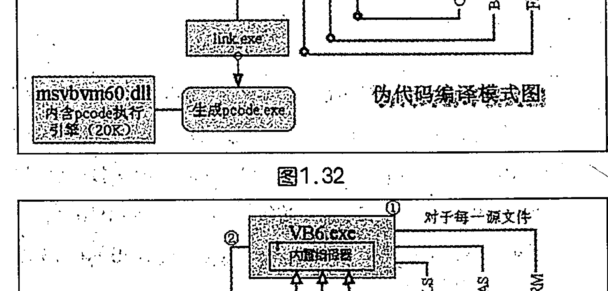

在 Windows 操作系统下对 VB 类型的软件进行跟踪时可以发现，程序代码跟踪的大部分时间里都是在 VBRUNxx 动态链接库，根本看不出源程序的基本流程来。这是因为对 VB 类型的软件进行跟踪，跟踪的是 VB 的解释器，而不是它的真正代码。要从解释器中看出代码的目的是什么是相当困难的。但解释语言有一个致命的弱点，那就是解释语言的程序代码都是以伪码的方式存放的，一旦被人找到了伪码与源码之间的对应关系，就很容易做出一个反编译器出来。

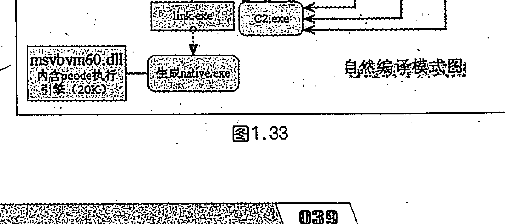

| 链接库 | 文件 | 说明 |
|---|---|---|
| VB3 链接库 | vbrun300.dll | 16 位 |
| VB4 链接库 | vb40016.dll | 16 位（较少见） |
| VB4 链接库 | vb40032.dll | 32 位 |
| VB5 链接库 | msvbvm50.dll | 32 位 |
| VB6 链接库 | msvbvm60.dll | 32 位 |

表 1.3

Visual Basic：VB3、VB4 都有相应的反编译器存在。而 VB5、VB6 不再是单纯的解释程序了，虽然里面还有解释执行的部分，但主程序部分是真正编译的。对于 VB3、VB4 来说，破解的难度上并不是很大，但对于 VB5/VB6 来说就不是那么容易了。Visual Basic 各版本的链接库如表 1.3。

| 函数名 | 功能 |
|---|---|
| Val() | 转换字符串为数字 |
| Str$() | 转换数字为字符串 |
| Left$() | 按要求从左取字符 |
| Right$() | 按要求从右取字符 |
| LTrim$() | 去除字符串左边空格 |
| RTrim$() | 去除字符串右边空格 |
| Trim$() | 去除字符串两边空格 |
| Asc() | 转换字符为 ANSI 码 |
| Chr$() | 转换 ANSI 码为字符 |
| __vbaStrComp | 字符串比较 |
| rtcMsgBox | 显示一个对话框 |

表 1.4

### 1.6.2 VB语言软件的反编译

这类软件的破解难度较其他同功能软件来说难度较大，对于网上的很多破解教程中，都会有针对于这类软件的专门介绍。由于它代码执行的特殊性，使得很多人望而却步。关键原因就是这类软件所调用的函数大部分来自于它相应版本的动态链接库，而对于 Windows 的 API 函数使用却不是很多。VB 类型软件的破解常用 SOFTICE 逆向分析或者用 SmartCheck 进行反编译。鉴于本书使用的分析平台为 OllyDbg，笔者就简单介绍一下在该平台下的破解方法。

VB 软件的保护方式与其他软件的保护方式相同，因而破解方法与破解其他软件类似，对于常用的 VB 函数也要掌握，下表是软件破解中常用到的 VB 函数。在 OllyDbg 平台下，有专门的函数断点插件，用户可以根据需求进行断点设置。如表 1.4。

- 软件是否已经加壳，如果有壳保护应先脱壳。
- 试注册，看软件是否有提示，并判断软件的注册类型。
- 载入软件进行分析，并选取破解方法。

图 1.34 中显示的是一个 VB 程序在注册失败时就会弹出提示，这个程序没有加壳，直接用 OD 载入。由于软件有错误提示，因此可以采用 OD 的插件对软件进行字符串查找，查找模式为 UNICODE，查找结果如图 1.35 所示。从查找结果中找到错误的提示信息后，双击这行代码来到相应的反汇编代码位置，代码如表所示。

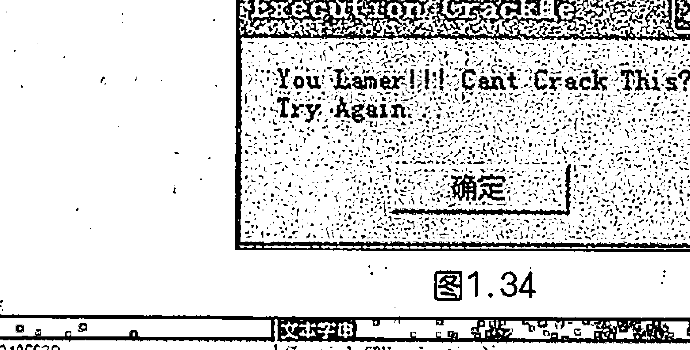

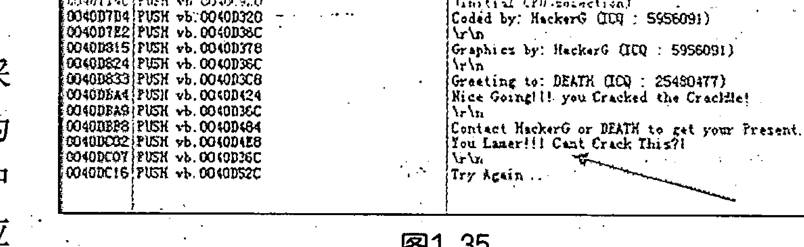

```asm
0040DB99  8945 AC          MOV DWORD PTR SS:[EBP-54],EAX
0040DB9C  74 5E            JE SHORT vb.0040DBFC   ; 跳向错误提示信息
0040DB9E  8B35 10F14000    MOV ESI,DWORD PTR DS:[<&MSVBVM50.__vbaStrCat>]
0040DBA4  68 24D44000      PUSH vb.0040D424      ; "Nice Going!!! you Cracked the CrackMe!"
0040DBA9  68 6CD34000      PUSH vb.0040D36C      ; "\r\n"
0040DBAE  FFD6             CALL ESI
0040DBB0  8BD0             MOV EDX,EAX
0040DBD1  6A 00            PUSH 0
0040DBD3  52               PUSH EDX
```

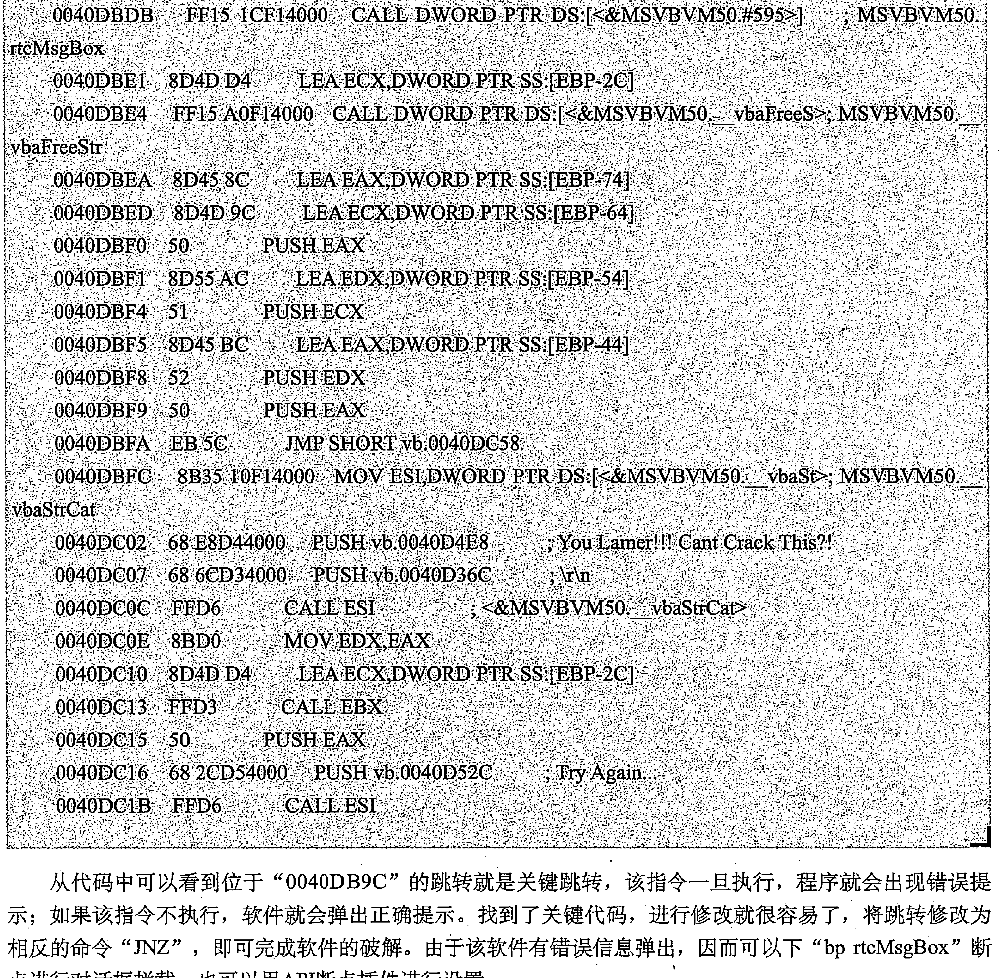

从代码中可以看到位于“0040DB9C”的跳转就是关键跳转，该指令一旦执行，程序就会出现错误提示；如果该指令不执行，软件就会弹出正确提示。找到了关键代码，进行修改就很容易了，将跳转修改为相反的命令“JNZ”，即可完成软件的破解。由于该软件有错误信息弹出，因而可以下“bp rtcMsgBox”断点进行对话框拦截，也可以用 API 断点插件进行设置。

### 1.7 花指令入门

#### 1.7.1 花指令简介

相信做过免杀的读者对花指令一定很熟悉了，这里简单介绍一下。“花指令”的意思是程序中有一些指令，由设计者特别构思，希望使反汇编的时候出错，让破解者无法清楚正确地反汇编程序的内容，迷失方向。经典的是一些跳转指令，目标位置是另一条指令的中间，这样在反汇编的时候便会出现混乱。花指令有可能利用各种 jmp、call、ret，一些堆栈技巧，位运算，等等。花指令本质上就是一堆无用的垃圾指令，主要是为了实现迷惑破解者的目的，这里给大家提供了一些互联网上常见的用于免杀的花指令。

伪装 PEtite 2.2 -> Ian Luck 汇编代码：

```asm
mov eax,0040E000
push 004153F3
push dword ptr fs:[0]
mov dword ptr fs:[0],esp
pushfw
pushad
push eax
xor ebx,ebx
pop eax
popad
popfw
pop dword ptr fs:[0]
pop eax
jmp XXXXXXXX ; 执行到程序的原有OEP
```

防杀精灵一号防杀代码：

```asm
push ebp
mov ebp,esp
push -1
push 666666
push 888888
mov eax,dword ptr fs:[0]
push eax
mov dword ptr fs:[0],esp
pop eax
mov dword ptr fs:[0],eax
pop eax
pop eax
pop eax
pop eax
mov ebp,eax
jmp 入口
```

防杀精灵终极防杀代码：

```asm
push ebp
mov ebp,esp
add esp,-0C
add esp,0C
push eax
jmp 入口
```

第一章 知己知彼，百战不殆

木马彩衣（金色鱼锦衣）花代码：

```asm
push ebp
mov ebp,esp
add esp,-0C
add esp,0C
mov eax,原入口
push eax
retn
```

木马彩衣伪装（虾米拔风）花代码：

```asm
push ebp
nop
nop
mov ebp,esp
inc ecx
nop
push edx
nop
nop
pop edx
nop
pop ebp
inc ecx
loopd
```

VC++5.0 伪装代码（木马彩衣无限复活泡）：

```asm
PUSH EBP
MOV EBP,ESP
PUSH -1
push 415448
PUSH 4021A8 ; 在这段代码中类似这样的操作数可以乱填
MOV EAX,DWORD PTR FS:[0]
PUSH EAX
MOV DWORD PTR FS:[0],ESP
ADD ESP,-6C
PUSH EBX
PUSH ESI
PUSH EDI
ADD BYTE PTR DS:[EAX],AL ; 这条指令可以不要
jo 00401000 ; 原入口
jno 00401000 ; 原入口
db 0e8h ; 花代码
```

这大套花指令是比较常见的比较流行的花指令，现在好像已经列入杀软的查杀范围之内了。那么怎么去编写属于自己的花指令呢？写花指令的基本原则就是要保持堆栈的平衡。只要保持了堆栈平衡，花指令就可以任意写。简单的花指令其实就像数学题一样简单，只要有加加减减就可以，例如：`inc ecx; dec ecx`，这就是一个简单的花指令片段，计数器加 1，然后再减 1，这样就保持了堆栈的平衡。再如：`push ebp; pop ebp`，把基址指针寄存器压入堆栈，然后再将基址指针寄存器弹出堆栈。总之只要可以维持堆栈平衡就可以创造自己的花指令。上面提到的“伪装代码”，其实就是提取一些编程语言的特征代码然后加到想要伪装的软件头部，这样查壳软件查出来的就是伪装后的壳，起到了迷惑破解者的目的。通过伪装之后一般情况下查壳软件会误报，这对于没有经验的用户来说是很有效的。

#### 1.7.2 花指令的应用

花指令的应用范围十分广泛，在木马与病毒的免杀中，添加花指令是最简单的躲过杀毒软件查杀的免杀方法，这也使得主流杀毒软件越来越多地能够识别花指令了。在软件的保护中，花指令的应用也不断增加。软件中添加花指令的目的就是让反汇编工具错误地识别指令，从而产生错误的指令代码来迷惑破解者。在软件保护中一般采用内联汇编的方法添加花指令，当然也可以在软件编写完毕后采用反汇编的方法添加，不过这种方法不推荐。反汇编模式添加可以实现软件外壳对查壳软件的欺骗；因而在某些情况下可以使用。

#### 1.7.3 怎样编写花指令

花指令的编写遵循堆栈平衡原理，只要能使堆栈平衡，这样的无用指令就可以当做花指令用。花指令的编写可以利用暗组出版的“花指令学习机”，如图 1.36，工具带有 6 个花指令的编写示例，对于花指令的学习很有帮助。下面是一组花指令的分析。

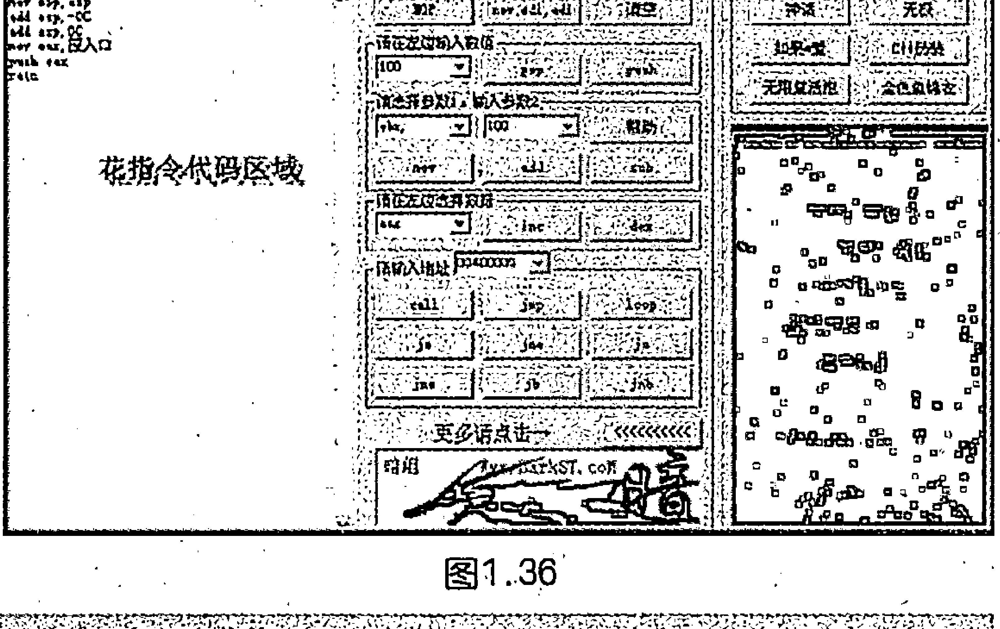

```asm
push ebp
mov ebp, esp
add esp, 0C          ; esp减去0CH
add esp, 0C          ; esp加上0CH（这两句执行完毕后，esp相当于没有变）
mov eax, 原入口      ; 程序入口点放入eax，准备返回
push eax             ; eax入栈
retn                 ; 返回到[eax]，开始执行程序代码
```

### 1.8 网络协议基础

#### 1.8.1 常见网络协议

网络协议就是为计算机网络中进行数据交换而建立的规则、标准或约定的集合。这里介绍基本的网络协议知识，目的是为了在后面的“数据包抓取技术”中有所应用。文中涉及到的多是简单基础的概念与理论性东西，并没有涉及到很深的原理性问题。

##### 网络协议的要素

协议是用来描述进程之间交换信息数据时的规则术语。在计算机网络中，两个相互通信的实体处在不同的地理位置，其上的两个进程相互通信，需要通过交换信息来协调它们的动作和达到同步，而信息的交换必须按照预先共同约定好的过程进行。

- 一个网络协议至少包括三要素：
- 语法：用来规定信息格式；数据及控制信息的格式、编码及信号电平等。
- 语义：用来说明通信双方应当怎么做；用于协调与差错处理的控制信息。
- 时序（定时）：详细说明事件的先后顺序；速度匹配和排序等。

##### 网络协议的工作方式

网络上的计算机之间又是如何交换信息的呢？就像我们说话用某种语言一样，在网络上的各台计算机之间也有一种语言，这就是网络协议，不同的计算机之间必须使用相同的网络协议才能进行通信。

网络协议是网络上所有设备（网络服务器、计算机及交换机、路由器、防火墙等）之间通信规则的集合，它规定了通信时信息必须采用的格式和这些格式的意义。大多数网络都采用分层的体系结构，每一层都建立在它的下层之上，向它的上一层提供一定的服务，而把如何实现这一服务的细节对上一层加以屏蔽。一台设备上的第 n 层与另一台设备上的第 n 层进行通信的规则就是第 n 层协议。在网络的各层中存在着许多协议，接收方和发送方同层的协议必须一致，否则一方将无法识别另一方发出的信息。网络协议使网络上各种设备能够相互交换信息。常见的协议有：TCP/IP 协议、IPX/SPX 协议、NetBEUI 协议等。

网络上的计算机之间又是如何交换信息的呢？就像我们说话用某种语言一样，在网络上的各台计算机之间也有一种语言，这就是网络协议，不同的计算机之间必须使用相同的网络协议才能进行通信。当然了，网络协议也有很多种，具体选择哪一种协议则要视情况而定。Internet 上的计算机使用的是 TCP/IP 协议。

ARPANET 网成功的主要原因是因为它使用了 TCP/IP 标准网络协议。TCP/IP（Transmission Control Protocol/Internet Protocol，传输控制协议/互联网协议）是 Internet 采用的一种标准网络协议。它是由 ARPA 于 1977 年到 1979 年推出的一种网络体系结构和协议规范。随着 Internet 网的发展，TCP/IP 也得到进一步的研究开发和推广应用，成为 Internet 网上的“通用语言”。

##### 网络协议的层次结构

由于网络节点之间联系的复杂性，在制定协议时，通常把复杂成分分解成一些简单成分，然后再将它们复合起来。最常用的复合技术就是层次方式，网络协议的层次结构如下：

- 结构中的每一层都规定有明确的任务及接口标准。
- 把用户的应用程序作为最高层。
- 除了最高层外，中间的每一层都向上一层提供服务，同时又是下一层的用户。
- 把物理通信线路作为最底层，它使用从最高层传送来的参数，是提供服务的基础。

##### 网络协议层次的划分

为了使不同计算机厂家生产的计算机能够相互通信，以便在更大的范围内建立计算机网络，国际标准化组织（ISO）在 1978 年提出了“开放系统互联参考模型”，即著名的 OSI/RM 模型（Open System Interconnection/Reference Model）。它将计算机网络体系结构的通信协议划分为七层，自下而上依次为：物理层（Physical Layer）、数据链路层（Data Link Layer）、网络层（Network Layer）、传输层（Transport Layer）、会话层（Session Layer）、表示层（Presentation Layer）、应用层（Application Layer）。

其中低四层完成数据传送服务，上面三层面向用户。对于每一层，至少制定两项标准：服务定义和协议规范。前者给出了该层所提供服务的准确定义，后者详细描述了该协议的动作和各种有关规程，以保证服务的提供。

##### 局域网常用的三种网络协议

TCP/IP 协议毫无疑问是这三大协议中最重要的一个，作为互联网的基础协议，没有它就根本不可能上网，任何和互联网有关的操作都离不开 TCP/IP 协议。不过 TCP/IP 协议也是这三大协议中配置最麻烦的一个，单机上网还好，而通过局域网访问互联网的话，就要详细设置 IP 地址、网关、子网掩码、DNS 服务器等参数。

TCP/IP 尽管是目前最流行的网络协议，但 TCP/IP 协议在局域网中的通信效率并不高，使用它在浏览“网上邻居”中的计算机时，经常会出现不能正常浏览的现象。此时安装 NetBEUI 协议就会解决这个问题。

NetBEUI 即 NetBIOS Enhanced User Interface，或 NetBIOS 增强用户接口。它是 NetBIOS 协议的增强版本，曾被许多操作系统采用，例如 Windows for Workgroup、Win9x 系列、Windows NT 等。NetBEUI 协议在许多情形下很有用，是 Windows 98 之前的操作系统的缺省协议。NetBEUI 协议是一种短小精悍、通信效率高的广播型协议，安装后不需要进行设置，特别适合于在“网络邻居”传送数据。所以建议除了 TCP/IP 协议之外，小型局域网的计算机也可以安上 NetBEUI 协议。另外还有一点要注意，如果一台只装了 TCP/IP 协议的 Windows 98 机器要想加入到 WinNT 域，也必须安装 NetBEUI 协议。

IPX/SPX 协议本来就是 Novell 开发的专用于 NetWare 网络中的协议，但是现在也非常常用——大部分可以联机的游戏都支持 IPX/SPX 协议，比如星际争霸、反恐精英等等。虽然这些游戏通过 TCP/IP 协议也能联机，但显然还是通过 IPX/SPX 协议更省事，因为根本不需要任何设置。除此之外，IPX/SPX 协议在局域网络中的用途似乎并不是很大，如果确定不在局域网中联机玩游戏，那么这个协议可有可无。

- 以用途划分的网络协议：
- 网际层协议：包括 IP 协议、ICMP 协议、ARP 协议、RARP 协议。
- 传输层协议：TCP 协议、UDP 协议。
- 应用层协议：FTP、Telnet、SMTP、HTTP、RIP、NFS、DNS。

#### 1.8.2 三次握手协议

三次握手协议是十分著名的协议类型，流程如图 1.37 所示。

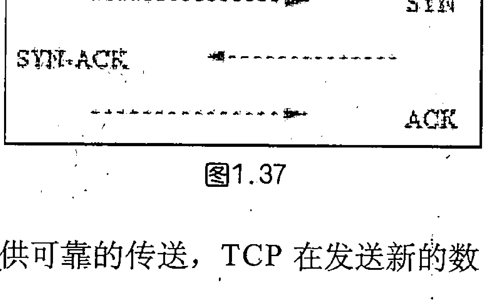

所谓的“三次握手”：对每次发送的数据量是怎样跟踪进行协商，使数据段的发送和接收同步，根据所接收到的数据量而确定的数据确认数及数据发送、接收完毕后何时撤消联系，并建立虚连接。为了提供可靠的传送，TCP 在发送新的数据……据之前约定，以特定的顺序将数据包编号，并需要这些包传送给目标机之后的确认消息。TCP 总是用来发送大批量的数据。当应用程序在收到数据后要做出确认时，也要用到 TCP。

- SYN：请求同步/同步序列号
- ACK：应答同步/确认字段

流程如图 1.38 所示。

在 TCP/IP 协议中，TCP 协议提供可靠的连接服务，采用三次握手建立一个连接。

- 1. 第一次握手：建立连接时，客户端发送 SYN 包（syn=j）到服务器，并进入 SYN_SENT 状态，等待服务器确认；
- 2. 第二次握手：服务器收到 SYN 包，必须确认客户端的 SYN（ack=j+1），同时自己也发送一个 SYN 包（syn=k），即 SYN+ACK 包，此时服务器进入 SYN_RECV 状态；
- 3. 第三次握手：客户端收到服务器的 SYN+ACK 包，向服务器发送确认包 ACK（ack=k+1），此包发送完毕，客户端和服务器进入 ESTABLISHED 状态，完成三次握手。

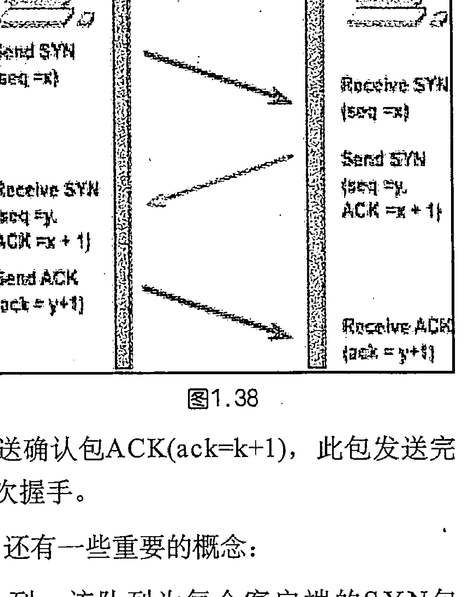

图 1.38

完成三次握手后，客户端与服务器开始传送数据。在上述过程中，还有一些重要的概念：

**未连接队列**：在三次握手协议中，服务器维护一个未连接队列。该队列为每个客户端的 SYN 包（syn=j）开设一个条目，该条目表明服务器已收到 SYN 包，并向客户端发出确认，正在等待客户端的确认包。这些条目所标识的连接在服务器处于 SYN_RECV 状态；当服务器收到客户端的确认包时，删除该条目，服务器进入 ESTABLISHED 状态。

**SYN-ACK 重传次数**：服务器发送完 SYN-ACK 包后，如果未收到客户端确认包，服务器进行首次重传；等待一段时间仍未收到客户端确认包，进行第二次重传；如果重传次数超过系统规定的最大重传次数，系统将该连接信息从半连接队列中删除。注意，每次重传等待的时间不一定相同。

**半连接存活时间**：是指半连接队列的条目存活的最长时间，也即服务器从收到 SYN 包到确认这个报文无效的最长时间。该时间值是所有重传请求包的最长等待时间总和。有时我们也称半连接存活时间为 Timeout 时间、SYN_RECV 存活时间。

## 第二章 工欲善其事，必先利其器

### 2.1 程序信息透视

#### 2.1.1 程序模块分析

在进行软件破解以及逆向工程分析的时候，对于软件信息的收集非常重要。我们常收集的信息主要有：软件是否加壳保护、软件的编写语言、软件的核心算法、软件的输入输出函数等。常用到的信息收集工具有：PEiD（查壳软件）、language2000（查壳软件）、ImportREC（输入表修复工具）、LordPE（PE 重建工具）、OLLYDBG（动态反汇编工具）、C32Asm（静态反汇编工具）等。

程序模块分析常采用的工具是 DiE64 与 Quick File Viewer，下面主要介绍一下这两款软件的用法以及相应的功能。

##### 工具一：DiE64

DiE64 主界面如图 2.1.1 所示，功能选项主要有：扫描、信息量、额外、区段、导入表、反汇编、十六进制。在信息刺探中主要用到的选项是扫描、信息量、区段、导入表。这几个功能各有特色，下面就主要功能进行说明，辅助测试软件为 ASProtect 2.0 [Overlay].exe。

###### 扫描

测试软件载入后界面信息如图 2.1.2 所示，图中分别标示了①②③三个位置。①是统计测试文件字节数大小，该测试软件大小为 1060946 字节。②主要是程序的入口点、偏移量的信息，本测试软件的入口点是“00001000”，文件偏移量为“00010600”。③是“扫描”选项中最为重要的一项信息，“编译器”指明了测试软件采用的是哪种语言编写，本例中可以看到采用的是 C 语言。“压缩器”显示的相关信息指明了软件是否被加壳；如果软件被加壳，该信息将提示相应的加壳类型以及版本信息。从图中可以看到软件采用了 ASProtect 这一款压缩壳进行了压缩，这里的功能类似于 PEiD。


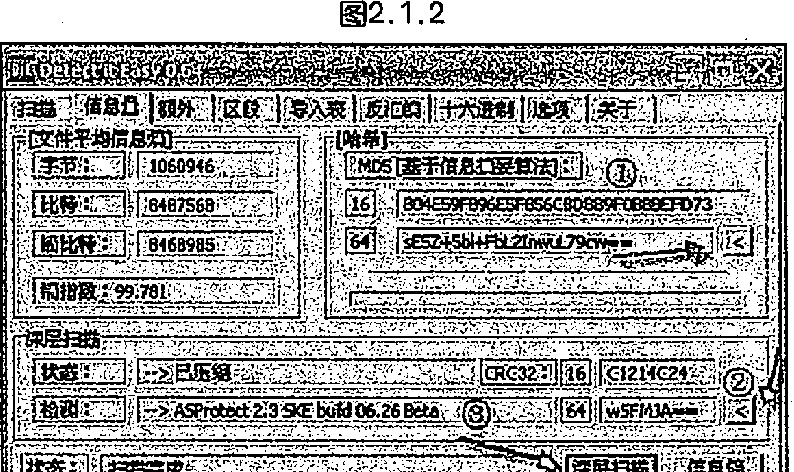

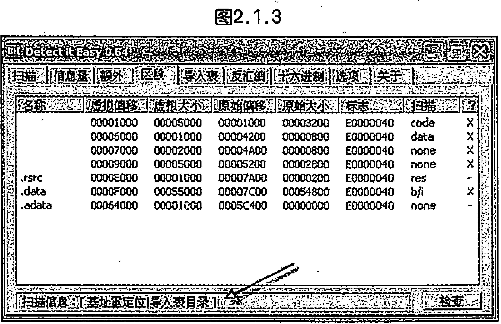

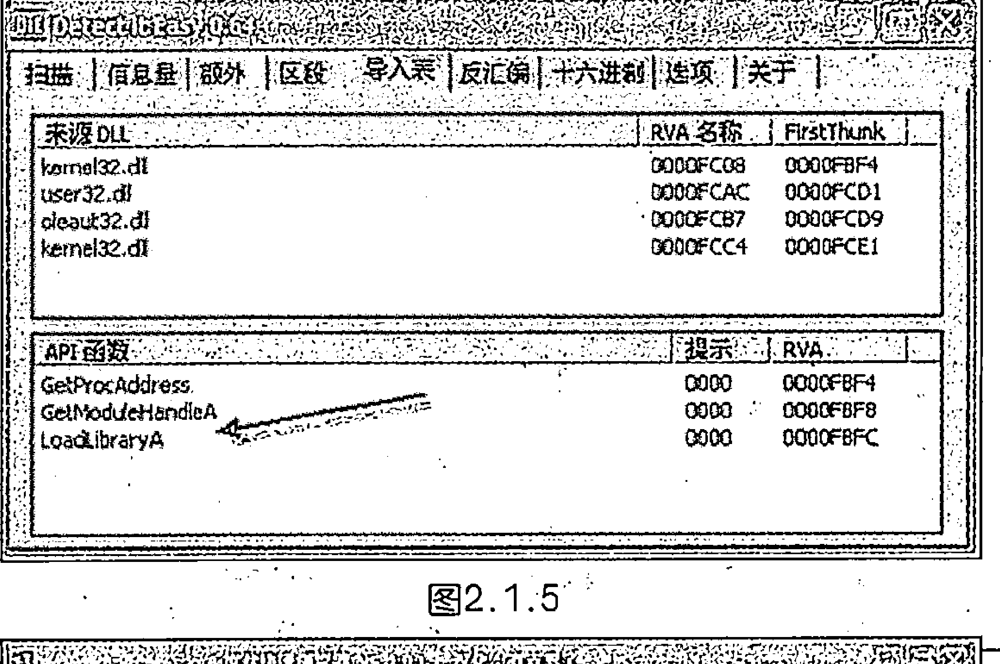

图 2.1.5


图 2.1.6

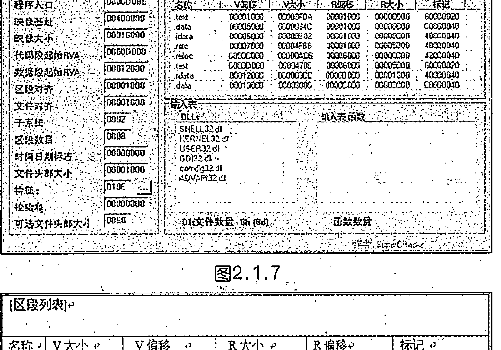

图 2.1.7

| 名称 | V大小 | V偏移 | R大小 | R偏移 | 标记 |
|---|---|---|---|---|---|
| .text | 00001000 | 00003FD4 | 00001000 | 00000000 | 60000020 |
| .data | 00005000 | 0000084C | 00001000 | 00001000 | C0000040 |
| .idata | 00006000 | 00002502 | 00001000 | 00002000 | 40000040 |
| .rsrc | 00007000 | 00004FB8 | 00001000 | 00003000 | 40000040 |
| ... | ... | ... | ... | ... | ... |

表 2.1

###### 信息量

“信息量”选项主要用于显示软件更加详细的信息，如图 2.1.3 所示。①显示的是软件的 MD5 校验信息，当单击下方的小箭头时，MD5 的相关信息就会显示。②显示的是 CRC32 校验的相关信息，当单击②附近的小箭头时，相关信息就会显示。③“深层扫描”的作用是获取软件是否加壳以及是什么版本的壳的详细信息，图中显示的是“ASProtect 2.3 SKE build”，版本是 6.26。

###### 区段

“区段”相关信息如图 2.1.4 所示。该选项的主要作用是获取程序相关区段的信息，图中显示该软件只有三个可见区段。选中相应的区段时，在窗口底部将会出现相关的提示。

###### 导入表

该选项的作用就是获取程序的输入函数，如图 2.1.5 所示。选中其中一个“来源 dll”时，在下方的窗口中就会出现相关的调用函数。这个功能在手工修复输入表时非常有用。但要注意的是，如果软件被加壳，这里提示的输入函数是不完整的，只能显示部分函数。

##### 工具二：Quick File Viewer

Quick File Viewer 是一款非常不错的软件信息刺探工具，界面简洁明了，功能虽然简单，但基本上已经在一个窗口把软件的所有基本信息都显示了。软件主界面如图 2.1.6 所示。界面主要可以分为三个大的部分：软件基本信息、区段信息、输入函数。详细介绍该软件的辅助程序是加了“EZIP 1.0”这一款壳的记事本与未加壳的记事本。

该程序不支持拖曳，只能用“打开”来载入相应的文件。载入加了壳的记事本后，程序反应如图 2.1.7 所示。在软件的基本信息一栏中已经显示了该加壳记事本的所有相关基本信息，其中包括程序入口点、映像基址、映像大小、代码与数据起始偏移、重定位地址以及校验和等相关信息。“区段”则显示该记事本的区段信息。该软件可以将被测软件的基本信息保存成为 txt 文本格式，这样便于研究。在“文件”→“保存信息到*.txt”选项中，例如其保存的基本信息中区段信息如表 2.1 所示。

选中任何一个输入表的 dll，在右边的输入表函数中都会出现相应的输入函数；但对于加壳软件不能够很好地显示，有时会出现乱码。像本例中加壳的记事本，输入表函数显示的是“Z”字符，就是无法识别了，如图 2.1.8 所示。为了对比说明，笔者载入未加壳的记事本，可以看到图 2.1.9 中的输入表函数很清楚地显示了出来。

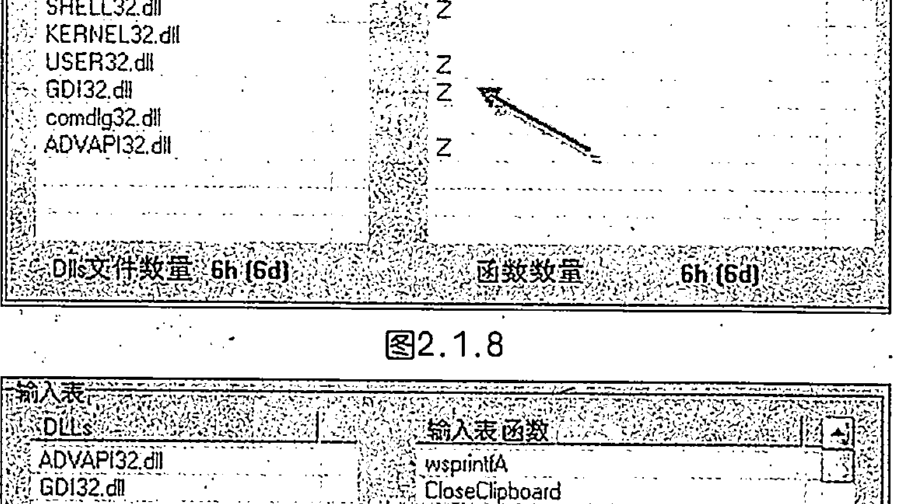

图 2.1.8

通过这些工具获取软件的基本信息，在进行逆向分析的时候是非常有用的。掌握了基本信息后，就可以用相应的工具或选择相应的方法对软件进行进一步的分析了。上面介绍的两款软件是笔者最常用的两款。当然，要实现相同信息的获取还有其他的工具，像 LoadPE，可以获取软件运行时加载的模块。只要掌握几种常见的工具即可，并不需要把所有工具都收入囊中，有时还会引起混乱。工具只是辅助我们进行分析，最主要的还是要靠自己对程序的分析。

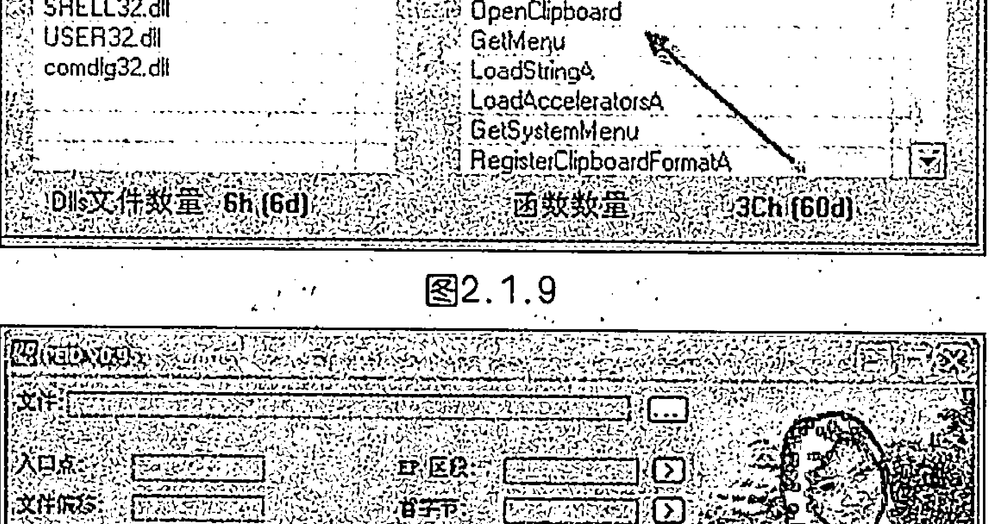

图 2.1.9

#### 2.1.2 外壳窥探

在获取了软件的基本信息后，就要更深入地去了解软件，包括软件加壳的真实状态、软件的核心算法等。软件是否真正加壳、加了什么样的壳以及壳的版本，这些信息的获取在进行进一步操作前都是非常重要的。如果要对一个软件进行破解，但并不知道软件加了壳而直接按照常规思路去着手——一定是会失败的。

软件外壳的查询有很多方法，最简单的方法就是用查壳类软件。不过鉴于当前加壳类软件的不断强大，读者在使用查壳类软件进行软件查壳时，最好多用几个不同的工具，看每一种工具的测试结果是否相同。如果不同，那么就要引起注意了，可能该软件的作者对外壳进行了变形，以达到欺骗查壳工具的目的。最好的方法是熟悉常见壳的特征代码，然后反汇编软件人工查看。如果对软件脱壳非常熟悉的话，那软件加的什么壳也就不重要了。

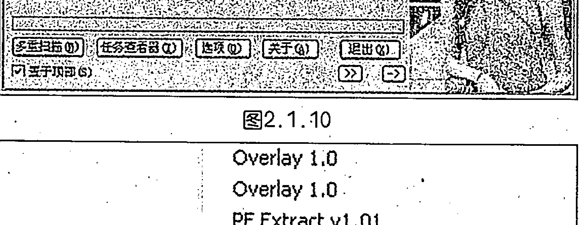

图 2.1.10

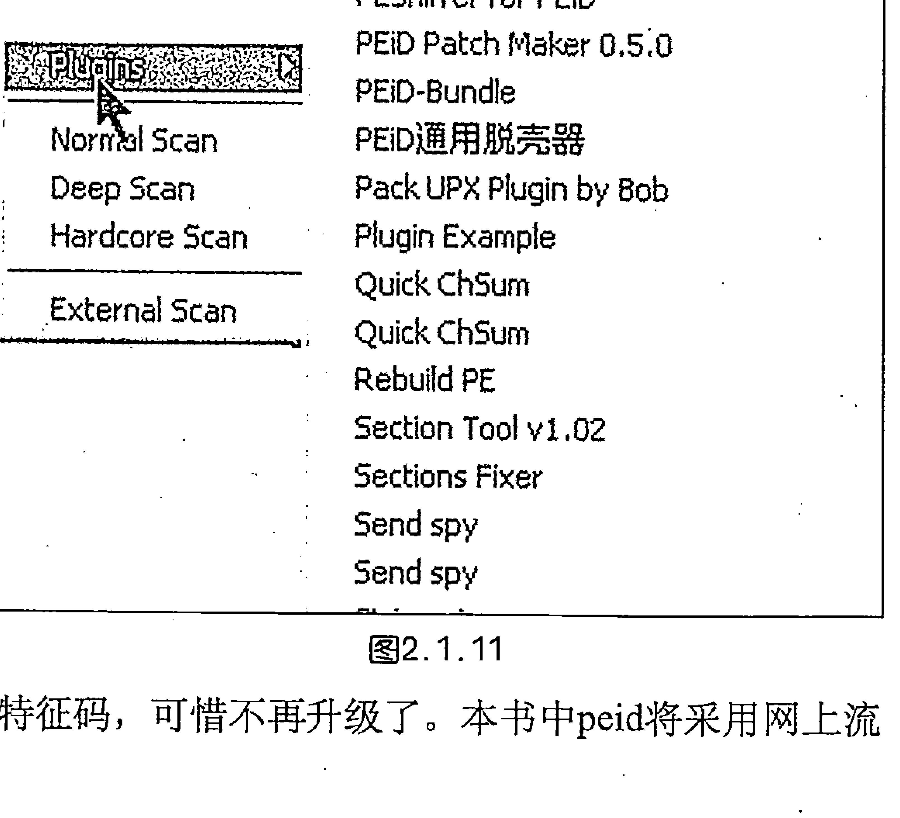

图 2.1.11

查壳类软件非常多，这里列举一些常用查壳类工具的使用方法，以供读者参考选用。

- 1、PEiD  
PeiD 是软件查壳中最常使用的工具，支持手工添加特征码，可惜不再升级了。本书中 PEiD 将采用网上流传比较广泛的一款 peid0.95 版，界面如图 2.1.10 所示。该版本的最大特色在于集成了众多插件，如图 2.1.11，共集成了 60 多个插件，包括一些常用的脱壳插件、扫描插件等。不过最常用的还是外壳扫描功能。扫描方式非常简单，该软件支持拖曳，测试软件如图 2.1.12 所示。直接用鼠标将待测软件拖到 PEiD 界面上即可。第一个 crackme 的测试结果如图 2.1.13 所示，其余结果依次为 Microsoft Visual C++ 6.0 [Overlay]、Microsoft Visual Basic 5.0 / 6.0、ASProtect 2.0 [Overlay]，读者可自行测试。与 PEiD 具有相同功能的工具还有 language2000，使用方法也很简单，直接拖曳即可，界面如图 2.1.14 所示。另一款功能比较强大的工具是 LastScanner 3.0，界面很华丽，功能也不错，界面如图 2.1.15 所示。

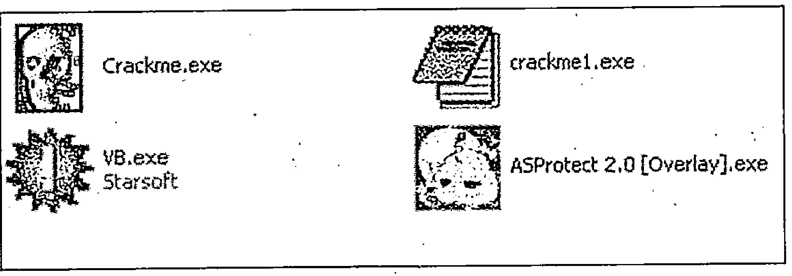

图 2.1.12

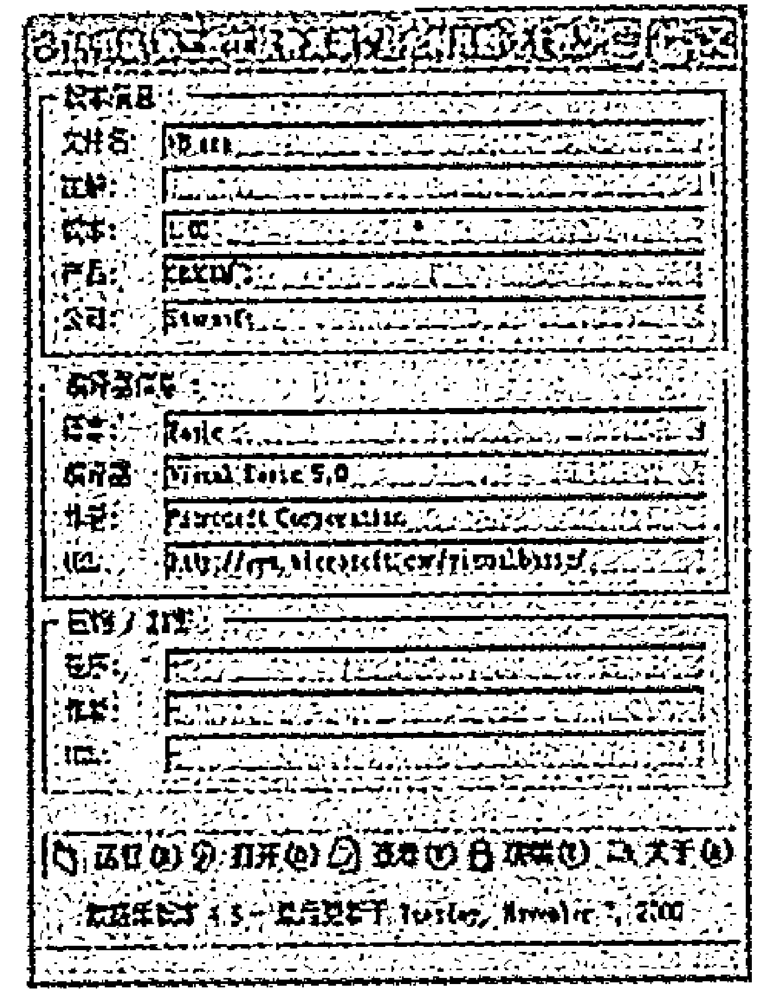

图 2.1.14

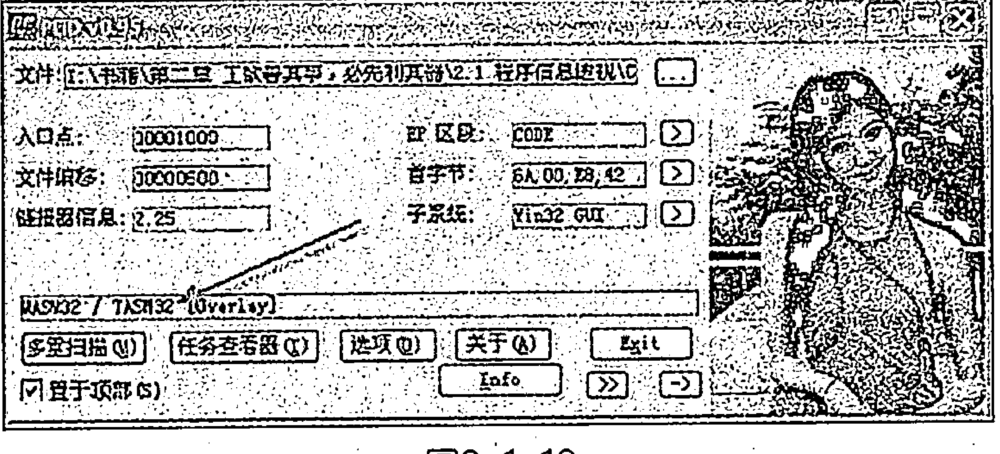

图 2.1.13

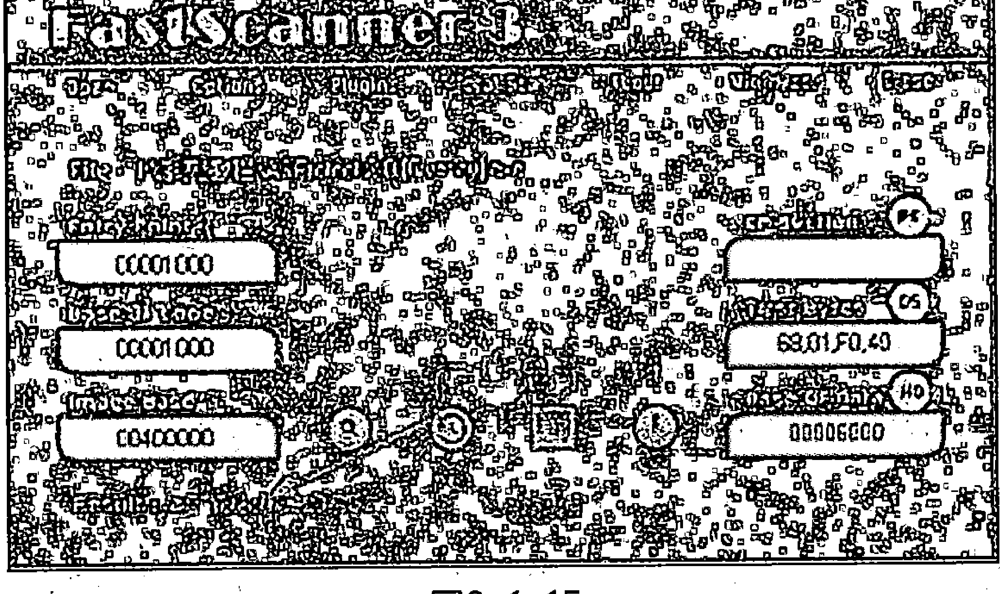

图 2.1.15

- 2、超级巡警自动脱壳机  
“超级巡警自动脱壳机”兼软件查壳、脱壳于一身，是一款非常不错的工具类软件。该软件有英文与中文两个版本，笔者在这里介绍中文版。软件主界面如图 2.1.16 所示。软件支持拖曳，只要将待测试的软件拖到主界面即可显示相关信息，如图 2.1.17 所示。如果脱壳机特征库中有该种壳的特征码，就会显示其中相关的信息；如果特征库中不含有该种壳的特征码，脱壳机将显示如图 2.1.18 所示的提示信息。对于支持的壳，只需要点击“给我脱”，即可脱掉该软件所加的壳。

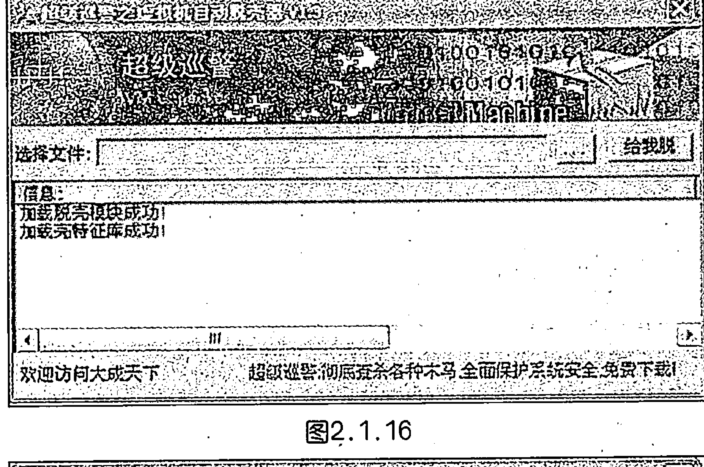

图 2.1.16

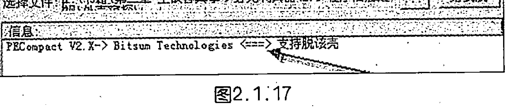

图 2.1.17


图 2.1.18


图 2.1.19

- 3、FFI  
FFI（File Format Identifier）是一款与 PEiD 相类似的查壳软件，支持手工添加特征码，支持拖拽，软件主界面如图 2.1.19 所示。该工具也是超级巡警的系列产品。

不同的查壳工具对某一些软件的外壳检测结果也是不同的。工具不是万能的，查壳工具也时常会被欺骗从而误导用户。在进行外壳检测时，如果对检测结果不肯定，建议多使用几款工具进行检测，对比各个工具的检测结果，从而做出下一步操作。

### 2.2 资源通杀

### 2.2.1 常见工具PK

在进行软件修改、汉化、DIY 的时候都要用到各种各样的工具，对一款好工具的选择也将直接关系到此次任务的成功与否。笔者在这里依次介绍四款比较常用工具的使用，读者可根据自己的爱好自行选择。

##### PE Explorer

相信这款工具读者已经很熟悉了，在软件的各种逆向操作中或多或少都会用到。软件支持拖拽，加载目标软件后界面如图 2.2.1 所示。一般情况下，工具在载入目标程序后都会来到这个界面“文件头信息”。

###### 工具栏

图 2.2.2 中的工具栏已经包含了“视图”“工具”两个选项中的所有功能，笔者在这里就只介绍工具栏的用法。

- 1. 文件头信息  
该选项可显示软件的基本信息，在工具加载完毕目标软件后会自动来到该功能界面，即图 2.2.1 所示的界面。

- 2. 数据目录  
选中该按钮后会来到图 2.2.3 所示的界面。该功能主要显示包括软件的导入表、导出表在内的基本信息。

- 3. 区段头  
界面如图 2.2.4 所示，该选项主要显示软件的区段信息，并给出了相应的参考。

- 4. 导入、导出  
这两个选项分别显示软件的输入表与输出表。点击相应的动态链接库后，在右面的窗口中会出现对应的函数。选择一个函数，在“语法细节”中会出现该函数的相关语法，不过信息是英文的。如图 2.2.5 所示。


图 2.2.1


图 2.2.2


图 2.2.3


图 2.2.4


- 5. 资源查看/编辑器  
该选项功能将显示软件的相关资源信息，如图 2.2.6 所示。资源中的各个项目将在后面的章节中具体介绍。


- 6. 反汇编  
该选项会将目标软件进行反汇编，如图 2.2.7 所示。不过一般情况下我们不会选用它的反汇编功能。


- 7. 属性扫描器  
该功能会扫描软件加载的所有 dll 动态链接库，并给出选中 dll 的相关信息，如图 2.2.8 所示。


- 8. 时间日期标志调整器  
该选项用于时间日期的调整，一般情况下不会用到该选项，如图 2.2.9 所示。


在这几个主要选项中，我们最常用到的是“资源查看/编辑器”，对于其他选项一般情况下用不到，其他功能都有相应的专门工具。

##### ResHacker

又一款强大的资源编辑工具，支持软件拖拽、资源替换、资源修改、资源导出与新资源添加。工具加载软件后主界面如图 2.2.10 所示。软件的主要功能选项位于“操作”菜单中，下面介绍一下主要操作。

操作菜单如图 2.2.11 所示。在进行软件 DIY 时，这款工具是最佳选择，从图中可以看到软件的强大功能。

替换图标：可以将软件图标替换成自己想要的图标，功能视图如图 2.2.12。“打开新的图标文件”可以选择四种类型的图标。笔者在测试时发现软件对 .exe 可执行文件的图标提取不是很好，建议读者选用 .ico 的标准格式。


替换位图：该选项用于软件中位图的替换，功能视图如图 2.2.13。“打开新位图文件”进行位图选择时最好采用 .bmp 的标准格式，还要注意选取的位图要与原位图大小相同，否则会出现错误。


替换指针：该选项用法与“替换位图”相同。

保存资源选项可以将资源进行保存，保存方式可以选择二进制文件或者 .res 格式。保存的文件可以用资源编辑器再次编辑。ResHacker 的详细使用方法可以查看“帮助”下的“目录”，选择“概述”选项，就会出现非常详细的介绍，如图 2.2.14。


##### Restorator

一款经典的资源编辑工具，主界面如图 2.2.15 所示，界面很华丽。这款软件有汉化补丁，读者可以自行寻找，安装完汉化补丁后即可方便使用。

软件不支持拖拽，加载目标软件后的界面如图 2.2.16 所示。这款软件可以说是集 PE Explorer 与 ResHacker 两款软件的资源编辑功能于一身。展开资源树以后，双击相应选项即可弹出可视化相关界面，如图 2.2.17 所示，这也正是 PE Explorer 的一大优点所在。在展开的资源上单击右键会弹出相应的功能菜单，功能包含了 ResHacker 资源编辑的几乎所有功能。安装汉化补丁后使用就比较简单了，与上面两款工具基本差不多，笔者在这里就不再赘述了。


### XNResourceEditor

另一款功能类似于 PE Explorer 的资源编辑工具，支持窗口显示、资源修改、资源导出、新资源添加等功能。该软件还支持控件的添加，软件载入目标软件后界面如图 2.2.18 所示。

工具的使用方法与 PE Explorer 类似，读者可边测试边学习。

常见的资源编辑工具就介绍完了，在后面的章节中，对 PE Explorer 与 ResHacker 的使用会比较多，读者应熟练掌握这几款工具的方法。PE Explorer 不仅在资源修改中起到很大的作用，而且它结合 DEDE 进行按钮事件的查找，可以对破解起到十分大的帮助。


#### 2.2.2 软件类型与工具的选择

软件的编写语言与软件资源的修改直接相关，不同类型的软件选取的工具也是不同的。对于 C/C++、Delphi 类型的软件，资源修改一般选用 PE Explorer 与 ResHacker，反编译选用 OD，DEDE 辅助查找按钮事件；VB 类型的软件，资源修改一般选用 GetVBRes 与“狂风VB语言汉化王”，反编译选用 OD、VBExplorer 与 Loader 辅助反编译；.NET 类型的软件，资源修改可选用 PE Explorer，反编译选用 DotNetHelper。

##### GetVBRes

GetVBRes 主要用于 VB 类型软件的资源修改，要注意的是软件不能是加壳的，界面如图 2.2.19 所示。软件不支持拖拽，载入目标软件后即可对资源进行修改与替换。

软件的左栏有“单字节资源”“双字节资源”“图像资源”三个功能菜单。“单字节资源”主要是软件中英文字符串资源，该选项中字符串分为“Unicode”与“Ansi”两种类型，其中 Unicode 类型就是我们要进行修改与汉化的字符串类型，Ansi 是软件内部的标识，一般情况下我们不会修改该选项下的字符串。选择要进行修改的字符串即可弹出修改对话框，如图 2.2.20 所示。

“双字节资源”选项可以显示软件中的中文信息，“Unicode”与“Ansi”两个类型与单字节资源相同，用法也与单字节资源相同，如图 2.2.21 所示。

“图像资源”会显示软件中所有的图片、位图与游标信息，双击要进行修改的图标即可打开该图片的窗口，如图 2.2.22 所示。


点击“图像浏览”左上角的保存按钮即可导出当前图像，或者在“图像管理”中的“导出图像”选项保存图像。


### 狂风VB语言汉化王

“狂风VB语言汉化王 0.99”是一款非常不错的 VB 软件汉化工具，界面如图 2.2.23 所示。


软件不支持拖拽，在载入待汉化的 VB 程序后，字符串选项有 ASCII 与 Unicode 两种模式，选择指定的模式即可进入相应的字符串窗口，在要进行汉化的字符串上双击即可进入汉化窗口，如图 2.2.24 所示。信息输入完毕后点击“替换字串”即可完成汉化。


“字体调整”选项可以将软件中字体进行修改，选中要进行修改的字体单击右键即可选择要修改为的字体模式，然后点击“替换字串”即可完成字体的修改，如图 2.2.25 所示。

“字典汉化”可以将汉化的字符信息保存为字典。

本软件对 VB 类型的软件汉化效果很好，而且界面华丽，在“辅助”选项中可以更换窗口效果。软件一共提供了两种窗口模式，读者可自行选择。


#### 2.2.3 软件汉化实例分析

软件的字符串信息加载一般有两种情况：一是字符串信息保存在软件中，随着软件的运行直接加载；另一种是软件加载配置文件，配置文件中则存放着字符串信息。这样在进行软件汉化的时候就存在着两种方式：一种是直接修改原程序的字符串信息，另一种就是修改配置文件。笔者就这两种加载模式进行说明。


- 1. 修改原文件

通过原文件的修改来进行软件汉化，关键是选取相应的工具。这里笔者选用一款 VB 语言写的 Crackme 来介绍一下软件的汉化实例，工具选择“狂风VB语言汉化王”。软件运行后的界面如图 2.2.26 所示。

运行工具，载入目标软件后软件自动进入“ASCII”模式，双击字符串进入编辑模式，如图 2.2.27 所示。依次将英文字符进行翻译，翻译过程中注意中文字符的长度不要长于原字符串。


在所有的字符串都汉化完毕后点击“替换字串”进入替换选项，如图 2.2.28 所示，选择相应的“替换选项”与“替换类型”，点击“替换”即可完成当前的汉化任务。

汉化后的软件运行界面如图 2.2.29 所示。到这里，直接修改原文件的软件汉化方法就为读者介绍完了。对于大型软件的汉化要注意的问题非常多，笔者就不赘述了，读者可以多多练习，掌握汉化的本质。

- 2. 修改配置文件


图 2.2.30


图 2.2.31


图 2.2.32


图 2.2.33


图 2.2.34

对于加载语言配置文件的软件来说，汉化是比较简单的，只需要对语言配置文件的内容进行相应的翻译即可完成汉化任务。语言配置文件一般情况下是 .ini 或 .lng 的文件类型。如图 2.2.30 所示的一款压缩软件 ASPACK 就是采用的加载配置模式，原程序为英文版本。配置文件为 language.ini，图 2.2.31。

配置文件的内容如图 2.2.32 所示，每个选项后面的“=”就是软件显示的信息，只要将这些英文字符翻译成相应的中文即可完成汉化。笔者修改后的配置文件如图 2.2.33 所示。

配置文件修改完保存后运行程序，界面如图 2.2.34 所示，原有的英文信息已经变成了中文。

在进行程序修改的软件汉化时要注意软件是否加壳。如果加壳，要先对软件进行脱壳处理；如果不脱壳的话，工具将无法加载相关的字符串信息。如果不想进行脱壳处理，则需要制作内存汉化补丁，通过补丁来直接修改内存中的字符串信息来实现汉化。

### 2.3 “我”的马甲

#### 2.3.1 加壳与脱壳工具速成

在软件保护中，我们常会用加壳软件对软件进行加壳保护，壳的选择将直接影响软件的保护强度。软件的“壳”主要分为压缩壳与加密壳两种：压缩壳主要用于软件体积的压缩，压缩后的软件便于在互联网上传播；加密壳是为了对软件进行保护，防止软件被反编译或破解。

- 1. dePack

一款来自俄国的 PE 文件压缩工具，使用方法很简单，点击“压缩”，选择要进行压缩的 PE 文件即可完成压缩，界面如图 2.3.1 所示。


图 2.3.1

- 2. FSG

一款相当经典的压缩工具，软件运行后即打开文件选择对话框，选择相应的 PE 文件即可完成压缩，压缩界面如图 2.3.2 所示。从截图中可以看到，该软件的压缩率是非常高的，可达到 93%。


图 2.3.2

- 3. UPX

很好用的 PE 文件压缩工具，也是我们经常看到的压缩软件之一，软件界面如图 2.3.3 所示。工具支持版本选择和压缩级别选择，可以根据需要选择适合的压缩级别。


图 2.3.3

- 4. 北斗压缩程序

北斗压缩程序是国产的一款压缩软件，目前的版本非常多，从 V4.1 开始，软件支持 .NET 程序压缩。软件的功能选项非常多，可以根据需要进行压缩选择。软件支持拖拽，载入目标软件后，点击“压缩”即可完成目标软件的压缩任务。界面如图 2.3.4 所示。

当前流行的压缩壳加壳软件非常多，除了上述四款常见的之外，还有蝎北压缩、PEspin、nPack、Petite、G/X Protector 等等，笔者在这里进行了部分收录。

##### 加密壳

加密壳的作用就是对软件进行加密，防止破解。在对软件的脱壳中，加密壳相对于压缩壳更难处理。加密壳常常对 API 加密，采用输入表重定位和 StolenCode 技术来保护软件。比较好的加密壳软件也常常是收费的，常见的有 Acprotect、ASProtect、yoda's Crypter 和穿山甲等等。

- 1. Acprotect 简介：

Acprotect 通过为程序加上一层坚硬的保护壳，可以非常有效地防止盗版，还可以为程序设置限制注册功能。即使你没有程序的源代码，也可以用 ACProtect 在程序上加上运行次数限制、运行天数限制、运行有效日期限制。通过公钥加密算法（RSA-1024）创建并校验注册 KEY，只有在 RSA-KEY 正确的情况下，才对那些受保护的代码进行正常解码。同时使用了内嵌式代码加密，可以有效防止加密软件从内存中被抓取，也就是无法被脱壳。内置反调试引擎，可以有效增加破解难度。专用的 API 系统，可以使 ACProtect 和你的软件紧密接口在一起，独一无二的嵌套加密技术，使得破解者要还原程序源代码变得极为艰难。

从简介中可以看出这款软件的特色所在。软件界面如图 2.3.5 所示，笔者就软件的“试用设置”功能做简要介绍。该选项可以对软件试用进行时间和试用次数上的限制，在基本试用信息填写完毕后如图 2.3.6，进入“保护”选项卡点击“保护”即可完成试用保护。当用户对软件的使用超过次数或时间后，软件就会弹出相应提示，如图 2.3.7 所示。

###### ASProtect

这一款软件的保护功能更加强大，在解密上的难度也大大增加。软件的保护选项中，除了常规的反调试保护、校验和保护、试用保护以及保护额外数据外，增加了基于硬件 ID 的密钥保护，软件主界面如图 2.3.8 所示。

### 基本使用方法：

选择完毕要进行保护的软件后，在图 2.3.9“保护选项”中选取基本的保护模式，然后进入“模式”选项卡。在这里笔者以“公用模式属性”演示，“模式到期”功能与 Acprotect 类似。在该选项中点击“添加模式”并输入模式名称后激活此模式。模式激活后下面有三个选项可供选择，可以为软件创建运行密码，也可以创建密钥。选择“使用密钥激活”后，


图 2.3.11

右栏中的“激活密钥属性”就可选了，选择一个 RSA 属性（当然你也可以选择“使用硬件锁定”或“使用到期日期”）后来到“激活密钥”选项卡。如果前面选择了“使用硬件锁定”或“使用到期日期”，则该选项卡中的“创建/检查激活密钥”中的“硬件 ID”或“到期日期”就会被激活。在“注册名”输入一个用户的注册名，点击“创建”即可完成密钥的创建工作。创建完毕后进行密钥验证。验证后在“激活密钥信息”中就会出现提示信息，如图 2.3.10。


图 2.3.12

在一个用户名注册后，为了不允许该用户名再次注册，需要将该密钥添加到“已封锁的激活密钥（黑名单）”中。这样，用另一个注册名创建密钥后得到的软件将不允许黑名单中的密钥进行激活。进入“保护”选项卡，点击“保护”即可完成软件的保护工作，如图 2.3.11 所示。到现在，目标软件就已经被密钥保护了，试运行软件如图 2.3.12 所示，提示要求输入用户名与密钥进行验证。


图 2.3.13

##### 脱壳工具

常见的脱壳工具可以分为通用脱壳工具和专用脱壳工具。通用脱壳工具常见的有超级巡警脱壳工具、万能脱壳机以及刚出现的华中帝国万能脱壳机……采用 PEiD 的脱壳插件以及 OD 的脱壳插件也可以进行广泛脱壳；专用脱壳机只针对于某一类特定壳进行脱壳，像 ACProtect 脱壳工具、Armadillo 脱壳工具、ASProtect 脱壳工具等等，如图 2.3.13、2.3.14 所示。脱壳工具的使用较加壳工具更为简单，基本上都支持拖拽。加载目标软件后即可进行脱壳操作。


图 2.3.14


图 2.3.15

### 2.3.2 壳中改“籽”——欺骗查壳工具

“壳中改籽”常用于免杀技术，目的是欺骗查壳工具。在软件保护技术中这项技术也可以使用，从而误导破解者。“壳中改籽”实质就是外壳代码修改，可以采用工具修改与手工修改两种方式。工具修改主要采用的工具是 reloc，方法是修改外壳特征码；手工修改主要用 OD 添加花指令进行代码跳转。


图 2.3.16

##### OD 代码修改法

在向目标软件进行欺骗代码添加时，要注意目标软件是否有空的区段。检测空段可以使用“空代码搜索器”。运行目标软件，选择相应的进程，填写“最小空间”，点击搜索即可完成空代码的搜索，如图 2.3.15 所示。如果搜索出来的空段大小不足，可以适当添加一些空段，工具是 zeroadd，填写要增加的空段名称以及空段大小，点击“生成新文件”即可完成空段的添加，如图 2.3.16 所示。

利用 DIE 可以看到空区段已经添加成功。在用 OD 进行指令添加时要注意，空段的选择最好是在程序的末尾，防止影响程序的正常运行。

第二章 工欲善其事，必先利其器

### 操作方法：

目标软件加壳状态如图 2.3.18，用空代码搜索器可以看到软件结尾的空代码段已经有了，如图 2.3.19 所示。OD 载入目标软件后来到选定的空段位置，这里选择程序向下的几行，如图 2.3.20。

选定空段后开始添加花指令，这里添加下列代码所示的花指令（花指令的添加一定要注意堆栈的平衡），在指令返回位置注意填写原程序的入口点，如图 2.3.21 所示。添加完毕代码后保存文件：

```asm
push ebp
mov ebp,esp
add esp,2C
add esp,2C
mov eax,0044a3ee ; 原入口点
push eax
retn
```


图 2.3.17


图 2.3.18


图 2.3.19


图 2.3.20


图 2.3.21

并记录新的程序入口点“00465994”。文件保存后最后一步就是软件入口点的修改，入口点的修改采用 LoadPE，“入口点地址”更改为新地址，不要忘记减去基址，如图 2.3.22 所示。


图 2.3.22

试运行软件，看软件是否正常运行。用 PEiD 查壳可以看到 PEiD 已经无法正确识别软件的外壳了，如图 2.3.23 所示。


图 2.3.23

### Reloc 外壳修改法：

reloc 是一款命令行下的工具，一般采用批处理 bat 文件和 reloc 程序放在同一目录，用批处理文件启动程序，这样使用比较方便。在对软件的外壳进行修改时需要编辑 bat 文件，该批处理的格式如下：

```bat
reloc 程序名称 $程序入口 $文件偏移量 $壳的区段入口 $区段偏移 参数
```

“程序名称”填写要进行修改的程序名，“程序入口点”以及“文件偏移量”都可以用 PEiD 获取，如图 2.3.24 所示。在 PEiD 中记录“EP 区段”显示的区段名称，图 2.3.25，点击该选项来到区段显示界面，找到特定的区段后点击右键，在弹出功能菜单中选择“Cave Finder”，图 2.3.26。


图 2.3.24


图 2.3.25


图 2.3.26

图2.3.27

图2.3.28

图2.3.29

2.3.26，此时将弹出新的窗口，如图2.3.27所示。将显示的数值记录下来，RVA:0013590，offset:00058990。

“参数”的选择一般按照以下规律：dll文件选择5，exe文件选择5-9之间的数，一般选择6就可以。到这里批处理文件中的信息就可以确定了，信息如下：

```
reloc test.exe $BD246 $2646 $13590 $58990 6
```

将目标程序放置于reloc同目录下，运行批处理即可完成外壳的修改。原程序外壳信息如图2.3.28所示，修改后外壳信息如图2.3.29所示。

这种方法可以欺骗查壳工具，但不能阻止OD正常载入程序。程序载入后一分析便可知道软件被修改过，这里只是提供一种方法与思路。

### 2.4 反汇编揭秘

#### 2.4.1 文本编辑工具

在破解中最常用的文本编辑工具是WinHex与UltraEdit。鉴于本书中使用的是WinHex，这里就主要介绍WinHex。

### WinHex简介

WinHex是一款以通用的16进制编辑器为核心，专门用来对付计算机取证、数据恢复、低级数据处理，以及IT安全性、各种日常紧急情况的高级工具：用来检查和修复各种文件、恢复删除文件、硬盘损坏、数码相机卡损坏造成的数据丢失等。得到ZDNet Software Library五星级最高评价，拥有强大的系统效用。功能包括（依照授权类型）：

- 硬盘、软盘、CD-ROM和DVD、ZIP、Smart Media、Compact Flash等磁盘编辑器
- 支持FAT、NTFS、Ext2/3、ReiserFS、Reiser4、UFS、CDFS、UDF文件系统
- 支持对磁盘阵列RAID系统和动态磁盘的重组、分析和数据恢复
- 多种数据恢复技术
- 可分析RAW格式原始数据镜像文件中的完整目录结构，支持分段保存的镜像文件
- 数据解释器，已知20种数据类型
- 使用模板编辑数据结构（例如：修复分区表/引导扇区）
- 连接和分割、以奇数偶数字节或字的方式合并、分解文件
- 分析和比较文件
- 搜索和替换功能尤其灵活
- 磁盘克隆（可在DOS环境下使用X-Ways Replica）
- 驱动器镜像和备份（可选压缩或分割成650 MB的档案）
- 程序接口（API）和脚本
- 256位AES加密、校验和、CRC32、哈希算法（MD5、SHA-1，…）
- 数据擦除功能，可彻底清除存储介质中残留数据
- 可导入剪贴板所有格式数据，包括ASCII、16进制数据
- 可进行2进制、16进制ASCII、Intel 16进制和Motorola S转换
- 字符集：ANSI ASCII、IBM ASCII、EBCDIC、（Unicode）
- 可进行窗口切换、打印、生成随机数字
- 支持打开大于4GB的文件，非常快速，容易使用

WinHex强大的功能并不意味着它的操作十分复杂，它的操作很容易上手。主界面如图2.4.1所示，软件支持拖曳，可将要编辑的文件直接拖到WinHex界面即可实现打开功能。

软件的功能很多，这里不能一一介绍，笔者只列举部分本书中用到的功能，其他功能读者可自行从中测试。

##### 主界面说明

主界面可分为4个模块：信息提示区域、文件偏移量区域、16进制代码区域以及ASCII码区域。在进行文件编辑时最常用到的是文件偏移量区域和16进制代码区域，如图2.4.2。

##### 搜索选项

该选项功能主要实现文本查找以及16进制查找，在软件破解的字符串查找法中可能会用到，界面如图2.4.3所示。以查找文本为例，查找框如图2.4.4所示。在输入框输入要查找的字符后，选择相应的搜索条件，点击确定即可进行搜索，文本搜索的结果将在ASCII码区域以蓝色背景显示。

##### 位置选项

从选项的名称中也可以看出，该功能与“位置”有关，如图2.4.5所示。该选项下最常用的一项是“转到偏移地址”，在免杀操作中的“大小写变换法”会用到该选项到达指定的位置。选项界面如图2.4.6，在“新位置”中填入文件偏移地址；“相对于”一般选择“开头”，点击确定即可到达指定偏移位置。

##### 视图选项

该选项主要对WinHex主界面进行设置，如图2.4.7所示。

##### 工具选项

该选项的功能比较多，如图2.4.8。该项涉及到很多高级应用，例如“打开磁盘”可以对磁盘中误删除的文件进行恢复。选择该项后来到磁盘选择选项图2.4.9，选择误删除文件所在的磁盘（K:），来到图2.4.10所示的界面。在界面中可以找到最近所有被删除的文件，在“文件名”一栏中，图标为“？”“X”的即为被删除的文件。

其中“？”的可以恢复，而“X”的已经不能恢复了。如果要恢复的文件比较多，不能确定文件内容，可以点击右键，在弹出选项中选择相应的程序即可查看要恢复的文件内容，图2.4.12。“恢复/复制”选项可将要恢复的文件另存到指定的位置。

在16进制代码区域单击右键会弹出相应的功能选项，如图2.4.13。右键的几个选项是我们经常用到的，“选块开始”将从当前位置开始选择数据块；“选块结尾”将结束选块。在选块结束后一般要对选择的数据进行操作，在选择区域点击右键即可弹出相应的选项，如图2.4.14所示。在弹出的菜单即可进行相应的操作，数据块的具体操作在后面的章节中会接触到，读者可先做了解。

### 2.4.2 反汇编工具

反汇编工具主要应用于软件的逆向分析与代码的二次开发。常见的反汇编工具又有动态反汇编工具与静态反汇编工具之分。常见的动态反汇编工具有SoftICE、IDA、OllyDbg；静态反汇编工具主要有W32Dasm。

图2.4.15

图2.4.16

图2.4.17

### （W32Dasm/C32Asm）

SoftICE可谓是反汇编的老大哥了，也是较早的逆向分析平台。虽然这款工具比较老了，但当前使用的用户人数并不少；IDA，反汇编编译器的经典之作，其强大的功能几乎可以做任何事情；然而功能强大的背景之下必然存在复杂的操作，这使得很多用户望而远之。软件主界面如图2.4.15所示。通过亮丽界面可以看出功能的强大。OllyDbg是新生代的反汇编平台，简洁界面、简单的操作，加上插件方式扩展的各种功能，使得OllyDbg成为众多用户的“宠儿”，本书也以OllyDbg为平台介绍各种逆向技术，软件主界面如图2.4.16。

图2.4.19

图2.4.18

图2.4.20

图2.4.21

静态反汇编工具W32Dasm与C32Asm的功能相差不大，各有各自的功能，主界面如图2.4.17、图2.4.18所示。W32Dasm在对原程序进行代码修改时，在指定的指令上单击右键即可弹出代码修改窗口，修改模式为16进制数据，如图2.4.19所示。C32Asm进行原代码修改时也是在指定的指令上点击右键，选择“对应HEX编辑”图2.4.20，此时将来到图2.4.21中的16进制代码区域。

> 工欲善其事，必先利其器

这两款工具的使用较为简单，读者可以根据按钮名称进行实验学习，笔者就不多赘述了。

#### 2.4.3 高级语言的反汇编结构

识别高级语言的反汇编结构对软件的逆向分析十分重要。反汇编的特性使得在阅读反汇编代码时显得很费力，更不用说识别出特定的函数结构了。由于当前C/C++仍是高级语言的主流，因而笔者在这里介绍C++语言结构对应的反汇编结构。

#### 1、FOR结构

从表2的C++与反汇编的对应可以看出：for循环在反汇编中就是累加、判断、跳转的结构。熟悉了上面的for结构，在对软件进行算法分析时可以非常容易地看出这个循环，从而掌握整个算法的关键。

#### 2、IF结构

```
if(a==1)
0040105F  cmp  dword ptr [ebp-4],1   //进行条件判断
00401063  jne  main+42h (00401082)   //不满足条件则跳走
cout<<"满足条件"<<endl;
00401065  push offset @ILT+10(endl) (0040100f)
...
0040107B  call @ILT+0(ostream::operator<<) (00401005)
else
00401080  jmp  main+5Dh (0040109d)
cout<<"不满足条件"<<endl;
00401082  push offset @ILT+10(endl) (0040100f)
...
00401098  call @ILT+0(ostream::operator<<) (00401005)
}
```

上面是简单的if条件判断，如果条件成立则输出“满足条件”，如果条件不成立则输出“不满足条件”。从对应的反汇编代码中可以看出该结构就是一个判断，然后是两个跳转。如果上面的代码形式变为：

```
if(条件)
函数一
else
函数二

此时反汇编结构将变为：
if(a==1)            //条件判断
0040105F  cmp  dword ptr [ebp-4],1
00401063  jne        main+2Ch (0040106c)
add1();            // 函数一
00401065  call       @ILT+25(add1) (0040101c)
else
0040106A  jmp        main+31h (00401071)
add2();            // 函数二
0040106C  call       @ILT+30(add2) (00401023)

提取关键部分则为：
CMP ……  // 条件判断
JNE ……  // 不满足条件则跳转
CALL …  // 满足条件则执行函数
JMP ……  // 上面函数执行完毕后跳出选择结构
CALL …  // 条件不满足则执行这个函数
```

#### 3、do……while结构

```
do
{
    n = n + 1;            // 这里是循环内部分
    0040102F  mov   eax,dword ptr [ebp-4]
    00401032  add   eax,1
    00401035  mov   dword ptr [ebp-4],eax
} while(n<10);

00401038  cmp   dword ptr [ebp-4],0Ah   // 判断条件是否成立
0040103C  jg    main+1Fh (00401020)     // 如果条件不成立则继续循环
0040103E  call  @ILT+25(add1) (0040101c) // 如果条件成立则跳出循环
// 执行循环后面的函数
```

do……while结构的实质就是：循环指令、条件判断、跳转至循环指令、指令。

#### 4、switch……case结构

```
switch(place)
{
    0040103E  mov  eax,dword ptr [ebp-4]
    00401042  mov  dword ptr [ebp-8],eax
    00401045  cmp  dword ptr [ebp-8],1   // 判断case值是否为1
    00401049  je   main+39h (00401059)   // case值满足1则跳转至指定函数1
    0040104B  cmp  dword ptr [ebp-8],2   // 判断case值是否为2
    00401055  je   main+47h (00401067)   // case值满足2则跳转至指定函数2
}
```

```
asm
00401057  jmp   main+4Bh (0040106e)   // case值不满足任何条件，执行默认函数
case 1: add();
00401059  call  @ILT+0(_add) (00401005)  // 指定函数1
    break;
0040105E  jmp   main+53h (00401073)   // 跳出结构
case 2: add();
00401060  call  @ILT+0(_add) (00401005)  // 指定函数2
    break;
00401065  jmp   main+53h (00401073)   // 跳出结构
default: default_add();
0040106E  call  @ILT+10(_default_add) (00401000) // 默认函数
    break;
}
```

switch……case结构在OD中会给出提示，并显示出相应的结构。

#### 5、反汇编中的函数

在汇编中函数的调用采用指令“CALL”，在函数执行完毕后会有一个返回值，这个返回值一般保存在EAX中。函数的调用方式是先将函数需要的参数用PUSH指令压入堆栈，参数压入堆栈的顺序按照从右到左的方式进行，例如一个函数是function(int a, int b, int c)，在反汇编中的指令格式则为：

```
asm
PUSH c
PUSH b
PUSH a
CALL function
```

下面的代码是一个简单的MessageBox函数调用示例：

```
asm
MessageBox(0, "hello", "test", 1);  // 共四个参数
0040103C  mov   esi, esp
0040103E  push  1                         // 从右至左压入第一个参数
00401040  push  offset string "test"      // 压入第二个参数
00401045  push  offset string "hello"     // 压入第三个参数
0040104A  push  0                         // 压入第四个参数
0040104C  call  dword ptr [_imp__MessageBoxA@16] // 调用函数
00401052  cmp   esi, esp
00401054  call  __chkesp (00401090)
    return 0;
00401059  xor   eax, eax                  // 返回值0保存到EAX中
```

高级语言对应的反汇编结构中，for、if、switch……case、do……while基本上都应用“检测条件—跳转”模式。在反汇编代码中能够识别出相应的结构，对于代码的逆向分析以及代码的二次开发都有着十分重要的作用。

#### 2.4.4 按钮事件

软件破解过程中常会涉及到一个术语“按钮事件”，那什么又是按钮事件呢？Windows操作系统是一个基于事件、消息驱动的操作系统，我们的任何操作都可以视为一个事件。在我们点击按钮时会发生一个事件，这个事件就是“按钮事件”。在进行软件破解时，有时我们无法从软件中找到任何有用的字符串、提示等，那是不是这样的软件就无法破解呢？当然不是。我们知道，在我们输入用户名与序列号后，只有在用户点击确定后，软件才会将输入的用户名与序列号传递给某一个函数进行合法性验证。这样就有了另一个思路：如果找到了与这个按钮相关的代码，就可以跟踪用户名与序列号的去向，从而进入验证的关键函数。

利用按钮事件进行破解的软件一般情况下是BC++/Delphi或者VB编写的程序。Delphi程序有专门进行按钮事件查找的反编译工具DarkDe（又称DEDE），辅助工具为PE Explorer。VB类型的程序在进行按钮事件查找时一般选用VBExplorer。

### Delphi程序的按钮事件查找

首先确定软件注册窗口的一些特征，图2.4.22中的注册窗口有英文提示和三个按钮，这些信息在用PE Explorer进行按钮定位时是十分有用的。

特征信息确认完毕后就可以进行按钮定位了。用PE Explorer载入目标程序，打开“资源查看/编辑器”后选择“RC数据”，如图2.4.23所示，从各个窗体中对目标按钮的位置进行确定。窗体的寻找也不是漫无目的的，一般情况下，与注册有关的窗体都会有“Reg”的字符串，如图2.4.24所示。确认了注册窗口所在的窗体“TFORM_REG”与按钮名称“button1”后，就可以寻找按钮对应的反汇编代码位置了。

打开DEDE后将目标软件拖拽至DEDE窗口中，DEDE便开始分析。分析完毕后会弹出成功提示，随即将出现图2.4.25所示的提示信息。为了节约时间这里点击“No”不进行分析（当然你可以选择“Yes”进行分析，但根据软件大小会花费不等的时间）。点击后又会出现图2.4.26所示的另一个提示信息，这里选择“No”。

此时DEDE已经分析完毕，进入“过程”选项卡，在“模块名”中寻找指定名称“TFORM_REG”，单击后即可在右边显示相应信息，然后寻找按钮名称“button1”，如图2.4.27所示。双击该事件即可来到对应的反汇编区域，如图2.4.28所示。

记录下入口点“004D9C28”后即可用OD载入目标程序，来到对应位置下断点进行破解了。

上面介绍的是用PE Explorer辅助进行按钮事件查找的方法，在DEDE中的“窗体”选项卡其实就可以实现PE Explorer的功能，而且在该选...

图2.4.22

图2.4.23

图2.4.25

图2.4.26

图2.4.24

## 第二章 工欲善其事，必先利其器


图2.4.27


图2.4.28


图2.4.29


图2.4.30


图2.4.31


图2.4.32

项卡下的使用更加简单。进入该选项卡后，如图2.4.29所示，双击左栏中模块名下的名称即可图形化显示该窗体，如图2.4.30所示。窗体的显示有利于我们确认当前窗体是否是我们要寻找的目标窗体。只需要将鼠标在按钮上移动即可显示当前按钮的名称，单击一个按钮即可来到对应的反汇编代码位置，如图2.4.31。

采用这两种方法达到的效果是相同的，都可以找到按钮对应的反汇编代码，但就操作而言，显然是第二种方法更为简单。但在某些情况下，DEDE不能很好地显示窗体，会不断出现错误提示而使DEDE的进程挂掉。在遇到这种情况时，第一种方法就有了用武之地。

### VB程序按钮事件的查找

VB程序按钮事件的查找选用VB反编译工具VBExplorer，在进行反编译前首先要确定软件没有加壳，或者已经脱壳。软件主界面如图2.4.32所示，软件不支持拖拽，需要从“反编译”选项打开要进行反编译的VB软件。这里查找一款试用软件的“现在注册”按钮的按钮事件，如图2.4.33。载入程序后在“工程”窗口即可看到相应的窗体，如图2.4.34，单击一个窗体即可在“属性”中看到相应的提示，如图2.4.35。通过标题“Caption”可以确认我们要找的按钮就在该窗体上，双击该窗体可以在主窗口看到该窗体上的相应控件，如图2.4.36。通过“属性”的下拉菜单，找到我们要找的按钮“注册”，如图2.4.37所示。找到按钮后点击即可显示该按钮对应的地址，如图2.4.38所示，该按钮的地址为“0042E130”。


图2.4.33


图2.4.34


图2.4.35


图2.4.36


图2.4.37


图2.4.38

### 2.5 程序修复工具

### 2.5.1 PE编辑工具

PE编辑工具主要用于程序的后期修复，最常用的是程序修复中的PE重建。PE的基本内容在前面的章节中已经介绍了，这里介绍一下PE编辑工具的使用。常用的PE编辑工具是LoadPE与PE Editor。

##### LoadPE

软件支持拖曳，在进行软件的PE重建时，点击“重建PE”，再拖入目标软件即可完成PE的重建工作，如图2.5.1所示。在PE重建之前要先对软件进行设置，打开“设置”面板，在图2.5.2的设置窗口中将“重建”栏目的状态窗口、脱壳修复、重组文件、重建输入表、验证PE选中，清除重定位表可以不选，绑定输入表一般情况下不要选择，转换ImageBase可以选中，不过一般情况下程序默认的机制都是00400000。设置完毕后就可对脱壳软件进行修复了。


图2.5.1


图2.5.2

##### PE Editor

软件支持拖拽，将目标软件拖至工具界面即可显示相关信息，如图2.5.3所示。进行PE重建时，点击“重建程序”进入设置面板，如图2.5.4所示。选中“重建输入表”下的“重建输入表”，“擦除重定位部分”可选。设置完毕后点击“执行”即可在结果中看到PE重建的执行状况。

PE重建用于软件脱壳后的修复，常与输入表修复一起操作。大多数情况下对于PE的重建选择LoadPE，读者可自行选择。


图2.5.3


图2.5.4

#### 2.5.2 输入表修复工具的使用

概念：

在Win32编程中常常用到“输入函数”（Import functions），输入函数就是被程序调用但其执行代码又不在程序中的函数，这些函数的代码位于一个或者多个DLL中，在调用者程序中只保留一些函数信息，包括函数名及其驻留的DLL名等。

对于存储在磁盘上的PE文件来说，它无法得知这些导入函数会在内存的哪个地方出现，只有当PE文件被装入内存的时候，Windows装载器才将DLL装入，并将调用导入函数的指令和函数实际所处的地址联系起来，这就是“动态链接”的概念。动态链接是通过PE文件中定义的“输入表”（Import Table）来完成的，导入表中保存的正是函数名和其驻留的DLL名等动态链接所必需的信息。

提到了输入表就不得不提一下输出表。当PE文件被执行的时候，Windows装载器将文件装入内存并将导入表中登记的DLL文件一并装入，再根据DLL文件中的函数导出信息对被执行文件的IAT表进行修正。在这些包含导出函数的DLL文件中，导出信息被保存在导出表中，通过导出表，DLL文件向系统提供导出函数的名称、序号和入口地址等信息，以便Windows装载器通过这些信息来完成动态链接的过程。

扩展名为.exe的PE文件中一般不存在导出表，而大部分的.dll文件中都包含导出表，但是这并不是必然的，比如用作纯资源的.dll文件就不提供导出函数，文件中也就不存在导出表。

## 第二章 工欲善其事，必先利其器


### 获取输入表：

导入表的位置和大小可以从PE文件头中IMAGE_OPTIONAL_HEADER32结构的数据目录字段中获取，对应的项是DataDirectory字段的第2个IMAGE_DATA_DIRECTORY结构。从IMAGE_DATA_DIRECTORY结构的VirtualAddress字段得到的是导入表的RVA值，如果在内存中查找导入表，那么将RVA值加上PE文件装入的基址就是实际的地址；如果在PE文件中查找导入表，那么需要将RVA首先转换成文件偏移。输入表的知识涉及到数据结构，感兴趣的读者可以参阅相关的资料，笔者在这里只介绍基本概念，以及获取方法。由于输入表中包含着程序所用到的所有函数，因而对输入表的保护成了软件保护的一个方式，常见的就是利用壳对程序进行加壳保护，这样程序的输入表就会被隐藏起来，有的程序也采用了输入表加密的方式对其进行保护。在我们进行软件脱壳的时候，有时会遇到这样的问题，软件已经脱壳完但却无法运行，而且弹出图2.5.5所示的错误提示。这就是因为在脱壳的过程中我们将输入表损坏了。


对于软件脱壳后输入表的修复，一般情况下用到一款专门的工具Import REC；这是一款非常不错的输入表修复工具，有英文版与汉化版两个版本，笔者在这里提供的是汉化版。软件主界面如图2.5.6所示，笔者在这里介绍一下软件的各项功能及使用方法。

### 使用方法：

选择“附加到一个活动进程”，这个进程就是进行输入表修复时选取的正在被调试的程序，即在OD调试器中调试的被脱壳程序。当原程序选择完毕时，“记录”窗口中会出现相应的信息，如图2.5.7中所示。在OEP框中填入被调试程序的入口地址（OD中的地址004*****减去基址00400000后的所得值），填入完毕后点击“查找IAT”，如图2.5.8所示，工具会自动查找原程序的IAT位置，等到查找完毕后，点击“获取输入表”。


此时“找到的输入表函数”窗口会显示找到的输入函数，并提示该输入函数是否有效，如图2.5.9。如果输入函数都有效，则可以进行修复了。“修复转存文件”，选择刚脱壳完毕的软件即可完成修复，如图2.5.10。到这里Import REC修复输入表的基本使用方法就为读者介绍完了。


Import REC的右栏有8个选项，各有不同的功能与设置。

### 选取DLL：

该选项是对DLL动态链接库脱壳后输入表修复使用的；使用方法与可执行文件相同。


图2.5.12

### 显示无效函数：

对于一些软件，在获取输入表后，“找到的输入表函数”窗口会将有效函数与无效函数同时显示出来，此时点击“显示无效函数”，软件会将有效函数隐藏，只显示无效函数，这样就可以在无效的函数中进行相应的操作了。在无效函数上点击右键可获得相关的菜单选项，如图2.5.11所示。“反汇编/十六进制查看”可以查看选定函数的反汇编代码或16进制代码；“跟踪级别1/2/3”可以对无效的函数进行跟踪，一定程度上可以修复部分无效函数；“高级命令”一般情况下不会用到，这里笔者就不再介绍；“剪切指针”“删除指针”二者在处理无效函数的最终结果是相同的，都是去除无效的函数，但速度不同。“展开节点”“收拢节点”就不用再说了。


图2.5.11

### 自动跟踪：

该选项可以使软件自动跟踪输入表函数，在无效函数的跟踪时可能会用到。

### 清除输入表：

清空“找到的输入表函数”窗口中的数据。

### 清除记录：

清空“记录”窗口中的记录。


图2.6.1

### 选项：

功能界面如图2.5.12所示，该选项的设置会影响到目标文件修复的成功与否。一般情况下“重建输入表”该栏目中的任何一项都不选中；“转存文件”一项选中；“进程属性”只选中“启用调试权限”；“活动进程信息”一项选中；“重新校正输出”不选。其余选项保持默认即可。

工具不是万能的，在工具无法修复输入表的时候就要进行手工修复，手工修复输入表的方式将在后面的章节中为读者介绍。

### 2.6 补丁工具精通

常见的补丁工具主要分为两大类：文件补丁制作与内存补丁制作工具；本节中将主要介绍这两种工具的基本应用，结合实例的补丁制作过程将在“5.4 软件破解补丁技术”中详细介绍。KeyMake、PatchMaker、CodeFusion是三款常用补丁工具，其中以KeyMake的使用最为居多。KeyMake兼具文件补丁制作与内存补丁制作两种功能，因而这里主要介绍KeyMake的基本使用方法。

注意：KeyMake在使用时杀毒软件可能会误报为木马。

软件主界面如图2.6.1所示，主要功能选项位于“其他”中，主要有“内存注册机”“制作文件补丁”“制作内存补丁”几项。由于后面的章节中只用到了文件补丁与内存补丁，因而这里只介绍这两个选项的使用。

### 制作文件补丁：

选择“制作文件补丁”后即可进入文件补丁制作界面，如图2.6.2所示。在个人信息以及补丁说明中填写必要的信息资料。“原始文件”选择未破解的文件，“已破解文件”选择破解完毕的文件，文件选择完毕后点击“制作”即可完成补丁的制作。


### 制作内存补丁：

选择该选项后即可打开补丁制作界面，“程序名称”选择未破解的原程序，“消息标题”与“启动提示”填写自己的信息，填写完毕后点击“添加”，弹出数据添加对话框，如图2.6.3所示。“修改地址”填写要修改的指令所在的内存地址，这里给出了一段示例代码。要进行修改的原指令地址为“00401150”，原指令为“0F84”，修改后的指令为“E9”，指令长度为“2”，这样一个地址的修改就完成了；如果有多个地址需要修改，那么就多次添加即可，添加完毕后点击“生成”即可完成内存补丁的制作。

内存补丁可应用于不完整的软件破解，而文件补丁则不适用于加壳软件。补丁不仅可以应用于软件的破解，在免杀过程中也可以采用对木马或者病毒打补丁的方式使之通过杀毒软件的查杀，因为补丁的实质就是代码修改。在后面的章节中会介绍补丁技术应用于软件破解的具体操作，这里只做简单介绍了。


### 原始指令：

```text
0040114D    83F8 00           CMP EAX,0
00401150    0F84 9?000000     JE Crackme.004011EF
00401156    83F8 04           CMP EAX,4
```

### 修改后的指令：

```text
0040114D    83F8 00           CMP EAX,0
00401150    E9 9A000000       JMP Crackme.004011EF
00401155    90                NOP
00401156    83F8 04           CMP EAX,4
```

## 2.7 OllyDbg专访

### 2.7.1 OllyDbg简介

OllyDbg简称OD，是一款具有可视化界面的32位反汇编调试器。它的特别之处在于可以在没有源代码时解决问题，并且可以处理其他编译器无法解决的难题，目前的最新版本是V1.10。

**支持的处理器：**

OllyDbg支持所有80x86、奔腾、MMX、3DNOW!、Athlon扩展指令集、SSE指令集以及相关的数据格式，但是不支持SSE2指令集。

**数据格式：**

OllyDbg的数据窗口能够显示的所有数据格式：HEX、ASCII、UNICODE、16/32位有/无符号/HEX整数、32/64/80位浮点数、地址、反汇编（MASM、IDEAL或是HLA）、PE文件头或线程数据块。

**代码高亮：**

OllyDbg的反汇编器可以高亮不同类型的指令（如：跳转、条件跳转、入栈、出栈、调用、返回、特殊的或是无效的指令）和不同的操作数（常规[general]、FPU/SSE、段/系统寄存器、在栈或内存中的操作数、常量）。用户可以根据需求定制个性化高亮方案，使OD的显示更加个性化，如图2.7.1、2.7.2、2.7.3所示。

除了这几项功能之外，它还集成了包括Run跟踪、Hit跟踪、Heap walk、显示SEH链、代码注释、单步执行、硬件断点、内存断点等多项功能于一身。OD还提供插件扩展其功能，使OD更加强大。

OllyDbg是当前一款非常好的调试工具，虽然IDA的功能更加强大，但其复杂的操作使用户望而远之，而OllyDbg则是很好的选择。本书的几乎全部内容也是以OllyDbg为平台进行的。


图2.7.1


图2.7.2


图2.7.3

### 2.7.2 OllyDbg中断点操作方法

OllyDbg中的断点主要分为普通断点、条件断点、条件记录断点、消息断点、跟踪断点、内存断点、硬件断点、函数断点8种类型。不同的断点类型有着不同的下断方法，也有着不同的适用条件，选择合适的断点对软件的调试非常重要。

##### 普通断点

普通断点是软件调试中最常用的断点，这种断点的实质是INT3中断。普通断点的下断方式是在要下断点的指令上单击然后按F2即可完成中断，也可以选择右键菜单，选择“断点”下的“切换”也可以实现，如图2.7.4所示。指令上的断点成功后该行指令的地址将呈现红色，如图2.7.5。当程序运行到断点指令时将会被中断下来。断点的删除只需要重复操作一遍即可。


普通断点的数量可以无限制设置，软件断点的设置信息将被保存到OllyDbg目录下的udd文件中，文件信息格式为.udd，正是因为OllyDbg保存了这些信息，才使得OllyDbg在重载软件后仍可以保存这些信息。用户可以在“插件”中选择删除这些信息，如图2.7.6所示。不要尝试在代码段以外的区域设置断点。


##### 条件断点

条件断点是根据用户在目标指令设定条件真假而确定是否在该行断下的断点方式，快捷键是Shift+F2。当调试器遇到这类断点时，它将计算表达式的值，如果用户设置的条件为真，程序将在该行指令暂停，此时断点生效；如果条件为假，则断点无效。该类断点的使用方法：在要中断的指令上按下Shift+F2或右键选择“断点”下的“条件”，此时会弹出条件对话框；在对话框中输入中断条件，如图2.7.7所示。在“0041064F”处下条件断点，中断条件为“eax == 0012ffe0”。当程序执行到这行指令时会计算eax的值，如果eax值为“0012ffe0”，程序就会在这里中断下来。


##### 条件记录断点

条件记录断点的快捷键是Shift+F4，是条件断点的另一种方式，每当遇到此类断点或者满足条件时，它将记录已知函数表达式或参数的值。设置方法如下：选择要设置该断点的指令，在“条件”中设置中断条件，“条件满足次数”选项中输入程序中断前条件满足的次数，每满足一次该数值就会减一，直到该数值为0时，断点就会生效，如图2.7.8。

另外，条件记录断点允许您传递一个或多个命令给插件。例如，您需要使用命令行插件改变一个寄存器的内容，然后继续执行程序。

##### 消息断点

消息断点和条件记录断点基本相同，除了OllyDbg会自动产生一个条件，这个条件允许在窗口过程的入口处设置某些消息断点外，用户还可以在窗口中设置它。消息断点在软件破解中也是经常用到的断点之一，例如在用户输入软件序列号后点击“确定”，此时系统就会接到一个来自该按钮的消息，如果在这个消息上设置断点，我们通过跟踪就可以找到这个关键的按钮事件。断点设置方法如下：

运行目标软件，在特定的软件界面显示之后，按 F10 暂停程序，然后点击“W”，在“类”一栏中找到目标按钮，点击右键，选择“在 classproc 上设置消息断点”，如图 2.7.9 所示。

在弹出的消息断点窗口中选择适当的消息即可，如图 2.7.10 所示。断点成功后，断点位置会高亮显示。

##### 跟踪断点

跟踪断点是在选中指令上设置的一种特殊的 INT3 断点。该类断点分为两类：Hit 跟踪与 Run 跟踪。Hit 跟踪可以显示出目前已执行的指令或函数过程，帮助用户检验代码的各个分支。如果设置了 Hit 跟踪，断点会在命令执行后移除，并在该地址处做一个标记；如果使用的是 Run 跟踪，就可以单步执行程序，它会在一个很大的循环缓冲区中模拟运行程序。这个模拟器包含了除了 SSE 指令集以外的所有寄存器、标志、线程错误、消息以及函数的参数。用户可以保存命令，这样可以非常方便地调试自修改代码（即包含 SMC 的程序），OllyDbg 会添加跟踪数据记录并且保持断点的激活状态。

##### 内存断点

OllyDbg 每一时刻只允许有一个内存断点。内存断点可以在反汇编窗口、CPU 窗口、数据窗口中选择一部分内存，然后按 F2 进行设置。如果有以前的内存断点，该断点设置后会自动删除。用户有两个选择：在内存访问（读、写、执行）时设置断点，或内存写入时设置断点。设置方法：

点击“查看”下的“内存”，或者按“Alt+M”打开内存镜像，在目标指令上按 F2 即可完成断点设置，如图 2.7.11 所示。

##### 硬断点

在 80x86 兼容的处理器上，允许您设置 4 个硬件断点。和内存断点不同，硬件断点并不会降低执行速度，但是最多只能覆盖 4 个字节。在单步执行或者跟踪代码时，OllyDbg 能够使用硬断点代替 INT3 断点。硬件断点的设置常在数据窗口中进行：在反汇编代码区域选择要下硬件中断的指令，点击右键“数据窗口中跟随”下的“选择”，如图 2.7.12 所示。这样数据窗口就会显示相应的指令，在显示的指令上单击右键，选择“断点”，然后根据需要选择相应的硬件断点即可，如图 2.7.13 所示。

##### 函数断点

函数断点是软件破解时常用的断点，就是常见的 API 断点。一般情况下，这类断点在命令行下输入“bpx 函数名”，例如“bpx MessageBoxA”即可完成对对话框的拦截。另一种函数断点的方式是利用 API 断点插件进行断点设置。

#### 2.7.3 OllyDbg 窗口说明

OllyDbg 的窗口主要有记录数据窗口、可执行模块窗口、内存映射窗口、线程窗口、句柄窗口、CPU 窗口、堆栈窗口、断点窗口、参考窗口、补丁窗口、源码窗口以及字符串参考窗口。在这些窗口中，我们最常用到的是 CPU 窗口、堆栈窗口、内存映射窗口和字符串参考窗口。

**CPU 窗口：**进行反汇编以及代码跟踪的主要窗口，该窗口可分为 5 部分，如图 2.7.14 所示。反汇编窗口是反汇编的主要区域，无论是代码跟踪还是分析都要用到该窗口；其他窗口辅助反汇编窗口对代码进行动态分析。

**堆栈窗口：**在进行软件破解时采用的堆栈调用法就会用到该窗口，点击“K”可打开该窗口，如图 2.7.15 所示。选中其中的一行代码，在“调用来自”一栏中双击即可回到对应的反汇编代码区域。

**内存映射窗口：**该窗口在进行软件脱壳时的内存镜像法中常会用到，点击“M”可打开该窗口。内存断点也是在该窗口中设置的，如图 2.7.16 所示。

**字符串参考窗口：**该窗口用于字符串查找，在软件破解中用到字符串查找法时会用到该窗口，如图 2.7.17 所示。选中目标字符串双击即可来到相对应的反汇编代码区域。

## 2.7.4 OllyDbg 常用的插件介绍

OllyDbg 的插件功能使得 OllyDbg 的功能更加强大。插件的安装非常简单，只需要将插件放置在 PLUGIN 文件夹中即可。启动 OllyDbg 即可在“插件”中看到添加的所有插件。在众多插件中，我们经常用到 API 断点插件、中间文件删除插件、调试器隐藏插件、超级字符串查找插件、命令行插件和进程 dump 插件等。

#### 2.7.5 OllyDbg 常用命令

OllyDbg 的使用经常会用到命令行命令，执行这些命令的前提是 OllyDbg 已安装命令行插件。常用命令如表 2.3 所示。

OllyDbg 常用快捷键如表 2.4 所示。

熟练地掌握使用命令行与快捷键对软件调试有着很大的帮助，表格中带有 * 是较常用到的命令与快捷方式。

| 命令 | 含义 |
|---|---|
| AT / FOLLOW* | 在地址进行反汇编 |
| ORIG* | 反汇编于 EIP |
| DUMP* | 在地址转存 |
| DA* | 转存为反汇编代码 |
| DB* | 转存在十六进制字节格式 |
| DC* | 转存在 ASCII 格式 |
| DD* | 转存在堆栈格式 |
| DU* | 转存至 UNICODE 格式 |
| DW* | 转存在十六进制字词格式 |
| STK* | 前往堆栈中的地址 |
| AS + 地址 + 字符串 | 在地址进行汇编 |
| L + 地址 + 字符串 | 在地址进行标号 |
| C + 地址 + 字符串 | 在地址进行注释 |
| BP* | 设置条件中断 |
| BPX* | 中断至全部调用 |
| BPD* | 清除位于全部调用的断点 |
| BC* | 清除断点 |
| MR* | 内存断点写访问时 |
| MW* | 内存断点写入时 |
| MD* | 清除内存断点 |
| HR* | 硬件中断在访问 |
| HW* | 硬件中断在写入 |
| HE* | 硬件中断在执行 |
| HD* | 清除硬件断点 |
| STOP* | 停止运行程序源码 |
| PAUSE* | 暂停程序调试 |
| RUN* | 运行程序进行调试 |
| CS* | 查看 Call 堆栈 |
| BRK* | 查看断点窗口 |
| CPU* | 查看 CPU 窗口 |
| MEM* | 查看内存窗口 |
| TU* | 运行到用户代码 |
| TR* | 运行到系统返回 |
| LOG* | 查看记录窗口 |

表 2.3

#### 2.7.6 OllyDbg 右键菜单详解

OllyDbg 的右键功能很多，不同的窗口有着不同的右键功能，繁多的选项使得第一次接触的用户无法下手，笔者在这里就常用的选项进行简介。

##### CPU 窗口反汇编区域

该区域下的右键菜单包括复制、二进制、汇编、注释、断点、转到、数据窗口中跟随、查找、复制到可执行文件、分析、运行脚本、用 OllyDump 脱壳调试进程、OllyFlow 图表、超级字符串参考、界面选项等多达 30 多项，而且还有多级菜单。

复制选项作用是将被调试程序的反汇编代码复制到剪贴板或保存到文件，便于以后的分析。

二进制选项包含“编辑”“用 00 填充”“用 nop 填充”“二进制复制”“二进制粘贴”共 5 个二级菜单。“编辑”选项进行选定代码的编辑，常用到将从另一个 OD 中进行二进制复制后粘贴到一个 OD 中，将复制的代码粘贴到“HEX”区域，如图 2.7.18 所示。用 00 填充与用 nop 填充功能相同，都是将选定的指令清空。

| 功能 | 快捷键 |
|---|---|
| 打开一个新的可执行程序 | F3 |
| 打开调试选项窗口 | Alt+O |
| 显示断点窗口 | Alt+B |
| 显示呼叫堆栈* | Alt+K |
| 显示补丁窗口 | Ctrl+P |
| 设置断点* | F2 |
| 显示 CPU 窗口 | Alt+C |
| 显示内存窗口* | Alt+M |
| 显示记录窗口 | Alt+L |
| 执行直到返回* | Ctrl+F9 |
| 执行程序* | Shift+F9 |
| 跟入被调试程序的 Call | Ctrl+F11 |
| 步过被调试程序的 Call* | F8 |
| 终止当前调试的程序 | Alt+F2 |
| 重新运行当前调试的程序 | Ctrl+F2 |
| 显示模块窗口 | Alt+E |
| 单步进入被调试程序的 Call 中* | F7 |
| 运行选定的程序进行调试* | F9 |
| 适时停止被调试程序的执行* | F12 |

表 2.4

“二进制复制”与“二进制粘贴”分别进行选定指令的复制与粘贴，粘贴显示的形式为指令的 16 进制代码。

汇编选项：对选定的指令进行代码修改的汇编操作，在选定的指令上敲空格可开启该选项。

注释选项：对选定的代码进行注释的添加，添加完毕后修改注释可选择“编辑注释”选项，如图 2.7.19 所示。

断点选项：包含 7 个二级选项，分别实现普通断点、内存访问、内存写入、硬件执行以及条件断点的设置。

转到选项：该选项中的二级菜单“上一个”“下一个”可实现向前与向后的功能，便于观察代码间的关系，但当代码执行后，执行顺序不可后退。该功能可用快捷键“+”“-”实现；“上个函数过程”与“下个函数过程”分别可以查看当前指令所在函数的上一个函数与下一个函数，这个功能在软件破解时会经常用到。

数据窗口中跟随选项：可以查看当前选定指令在数据窗口中的数据，如图 2.7.20 所示。

查找选项：该选项包含的二级菜单较多，如图 2.7.21 所示。其中的“所有模块中的名称”选项常用于 API 断点设置。利用该选项可以查看到调试程序中的所有 API 函数，从而可以进行断点设置。“所有参考文本字串”选项常用于不脱壳破解中的字符串查找。

复制到可执行文件选项：该选项用于软件修改后的保存，进行保存时一般选取该选项下的“保存所有修改”进行软件保存。

分析选项：用于 OD 对程序的代码分析，尤其在 OD 无法识别目标代码的时候采用该选项进行分析。

运行脚本选项：用于软件脱壳时的脚本脱壳。选择该选项，找到要打开的脚本文件即可完成。

用 OllyDump 脱壳调试进程选项：该选项常用于软件的脱壳，不过有时我们会选择 LoadPE 进行当前调试程序的脱壳工作。

超级字符串参考选项：用于软件破解时的字符串查找，该选项需要相关插件支持。字符串查找时分为 ASCII 与 UNICODE 两种类型，一般情况下，对于 C/C++、Delphi 的程序选择 ASCII 模式；VB 语言的程序采用 UNICODE 模式。

OllyFlow 图表选项：该选项需要 wingraph32 的辅助。该选项包含 5 个二级选项，可以根据需要以图表方式显示软件中函数的相互调用过程，如图 2.7.22 所示。

界面选项：该选项用于 OD 界面的字体、颜色调整，如图 2.7.23 所示。

##### 堆栈区域

该区域的右键菜单功能不是很多，比较常用的选项是“地址”和“复制到剪贴板”。地址选项下包含“绝对”“相对所选”和“相对于 ESP(EBP)”三个二级菜单，其中比较常用的是“相对所选”，这个选项可以很好地将反汇编窗口的数据与堆栈的数据相结合，如图 2.7.24 所示。

OD 当前已经有很多脱壳脚本以及插件，笔者已经将本书涉及到的所有插件与脚本进行了打包。读者在按书籍内容进行测试时，请先将 OD 的插件以及脚本进行安装。

### 2.8 IDA 零接触

### 1 软件环境

静态分析有很多好处，例如加壳的程序（尽管对于高手来说这并不会耗费太多时间），我们不需要寻找 OEP，也不需要解除自校验，只要修复 IAT，DUMP 下来就可以动手分析了。假如你需要修改程序，可以使用内存补丁技术。动态与静态、调试器与反汇编器结合可以简化分析任务，帮助我们理解代码。因此掌握一种反汇编器是非常必要的。IDA 可以说是这方面的首选工具，它为我们提供了丰富的功能，以帮助我们进行逆向分析。这从 IDA 复杂的工作界面便可以知道，如图 2.8.1 所示。

| 快捷键 | 功能 | 注释 |
|---|---|---|
| C | 转换为代码 | 一般在 IDA 无法识别代码时使用 |
| D | 转换为数据 | 这两个功能经常使用 |
| A | 转换为字符串 |  |
| N | 为标签重命名 | 方便记忆，避免重复分析 |
| ; | 添加注释 |  |
| R | 把立即值转换为字符 | 便于分析立即值 |
| H | 把立即值转换为 10 进制 |  |
| Q | 把立即值转换为 16 进制 |  |
| B | 把立即值转换为 2 进制 |  |
| G | 跳转到指定地址 |  |
| X | 交叉参考 | 便于查找 API 或变量的引用 |
| Shift+F12 | 计数器 |  |
| Alt+Enter | 新建窗口并跳转到选中地址 |  |
| Alt+F3 | 关闭当前分析窗口 |  |
| Esc | 返回前一个保存位置 |  |
| Ctrl+Enter | 返回后一个保存位置 |  |

在分辨率不高的情况下，这些工具栏与反汇编窗口挤在小屏幕里，看起来不爽。我一般把它关闭（查看 => 工具栏 => 主工具栏）以获得更好的视觉效果。当我们需要这些功能的时候，直接使用快捷键就可以了。下面是常用快捷键清单，见表 2.5。

在工具栏下面的便是工作窗口。主要的窗口分页有“IDA View-A”“Name”“Strings”“Exports”和“Imports”。对于后面 3 项相信大家都不会陌生了，它们分别是字符串参考、输出函数参考和输入函数参考。Name 是命名窗口，在那里可以看到我们命名的函数或者变量。这四个窗口都支持索引功能，可以通过双击来快速切换到分析窗口中的相关内容，使用起来十分方便，如图 2.8.2 所示。

```asm
; 图2.8.3 反汇编代码窗口示意
; loc_77F34B03:
;   mov ...
;   pop ebx
;   pop esi
;   pop edi
;   ret
```

IDA View-A 是分析窗口，支持两种显示模式，除了常见的反汇编模式之外，还提供图形视图以及其他有趣的功能，如图 2.8.3 所示。

一般我们在分析的时候，并不关心程序的机器码，所以 IDA 为我们自动隐藏了这些信息。如果你有需要，可以通过以下步骤来设置：

- 选项 => 常规 => 反汇编 => 显示反汇编行部分 => 机械码字节数 => 修改为你允许显示的大小

图形视图功能可将程序进行模块化显示，如图 2.8.4 所示为一加壳软件的分析视图。利用该功能可以对软件进行大体的模块分析、跳转判断分析。

上图中，标签 40EA0E 便是壳的出口代码地址。在 OD 中直接跳到该地址，下断点，然后运行到该地址处，再单步便能看到 OEP 了。假如希望通过跳转法找 OEP，相信图形视图比你在 OD 一个一个跳转跟随要快得多。

再来看看这个另类脱法。直接运行该程序，DUMP 下来，再使用 ImportREC 的 IAT AutoSearch 功能修复输入表。用 IDA 打开修复了输入表的 DUMP 文件。在 IMPORT 窗口随便选一个 API，通过交叉参考跳转到一个函数的代码，如图 2.8.5 所示。

我们选了 RegQueryValueExA，通过交叉参考，来到 sub_402488 处的函数代码，图 2.8.6。

用鼠标拖动缩略图中的虚线框到上方，便能看到该 CALL 的头部了。然后按图 2.8.7 指示操作：到这里处于最上层的函数，便是 OEP 了，使用 PE 工具修改文件入口为 10CC。现在函数可以正常工作了。这个方法的原理是通常我们写程序都有如下流程：

所以处于函数调用最上层的便是 MAIN 函数了。当然这个方法局限性很大，这里只是对该功能的一种介绍。我们留意到图表功能有两个选项，在上面的例子中，我们使用的是“交叉参考到”。我想细心的朋友大概能通过“交叉参考来自”左边的小图标猜出它的用途了。该功能可以显示目标函数调用了什么函数，当然也包括 API。这样除了观察函数的输入参数来判断是否关键 CALL 之外，又多了一个参考途径。

### 2 强大的 IDC

有时我们需要分析一些非文件格式的代码，例如 ShellCode、远线程注入和病毒。这些代码的特点便是动态获取 API，这给静态分析带来困难。尽管 IDA 支持分析二进制文件，但是缺少 IAT 的情况下，分析起来很不方便。频繁地切换调试器查看并不是一个好方法。IDC 是 IDA 的脚本语言，它功能强大，为我们提供了另一条与调试器交互的途径。

如何使调试器获得 IDA 分析得出的符号？

IDA 提供多种文件格式输出，调试器可以通过解释这些文件获得一些符号。你可以通过文件菜单中的……“创建MAP文件”可获得更多的信息。

以 OD 为例，它的 GODUP 插件支持解释 MAP 文件（还能加载 IDA 的 SIG）。在 IDA 中使用如下步骤：

- 菜单：文件 => 生成文件 => 生成 MAP 文件

即可创建 MAP 文件，然后切换到 OD，使用如下步骤便能获得符号了：

- 菜单：插件 => GODUP Plugin => Map Loader => Load labels

仍然以那个经典的 UPX 加壳的 NOTEPAD 为例子，这次我们用 OD 打开，在到达 OEP 之后 DUMP 下来，不修复输入表，直接用 IDA 载入后看到图 2.8.8 所示的界面：


需要注意的是，Make imports segment 是 PE 文件特有的选项，该选项会隐藏输入表区域的所有数据；同时你获得的好处也是能在图表功能中看到 API 的调用。假如你希望查看在输入表范围内的代码或者数据，你需要从菜单中选择“编辑”=>“区段”以删除遮挡数据的部分区段。

为了更真实地模拟从内存中截取代码的情况，在这里选择 Binary file，载入偏移量选 400000（根据实际代码在内存中的基址来选择），然后 IDA 就开始尝试分析可能存在于该文件中的代码了。对照 OD 中的 OEP 地址，在 IDA 中可以看到以下代码：

```asm
seg000:004010CC    push ebp
seg000:004010CD    mov  ebp, esp
seg000:004010CF    sub  esp, 44h
seg000:004010D2    push esi
seg000:004010D3    call dword_4063E4
seg000:004010D9    mov  esi, eax
seg000:004010DB    mov  al, [eax]
seg000:004010DD    cmp  al, 22h
seg000:004010DF    jnz  short loc_4010E0
```

OD 中对应的显示：

```asm
004010D3  FF15 E4634000   call dword ptr [4063E4] ; kernel32.GetCommandLineA
```

使用以下 ollyscript（附件中的 ollyGetSym.txt）提取 IAT 的符号：

```asm
var ea
var Ecount
var oFile

ask "请输入IAT起始地址"
cmp $RESULT,0
je ECancel
mov ea,$RESULT
ask "输出文件? "
cmp $RESULT,0
je ECancel
mov oFile,$RESULT

TryGetSym
GN[ea];
cmp $RESULT,00000000
je ETest
WRTA oFile,$RESULT,2
mov Ecount,0
add ea,4
jmp TryGetSym

ECancel:
msg "无效输入"
ret

ETest:
cmp Ecount,1
je SEnd
add Ecount,1
add ea,4
jmp TryGetSym

SEnd:
ret
```

使用下面 IDC 脚本获取符号并对相应地址重命名：

```c
#include <idc.idc>
static main() {
    auto Sbuffer,ea,zcount,filehandle,fileName,CustEa;
    fileName = AskFile(0,"*.*","打开IAT符号文件");
    CustEa = AskAddr(0, "目标IAT地址");
    filehandle = fopen(fileName, "r");
    for (ea = CustEa; zcount < 2; ea = ea + 4) {
        if (Dword(ea) != 0) {
            Sbuffer = readstr(filehandle);
            if (strlen(Sbuffer) < 2) {
                // ollyscript的输出文件存在无效字符
                Sbuffer = readstr(filehandle); // 如果字符无效则再取一次字符
            }
            MakeNameEx(ea, Sbuffer, SN_AUTO); // 为对应DWORD改名
            zcount = 0;
        } else {
            zcount = zcount + 1;
        }
    }
    fclose(filehandle);
}
```

正如 ollyscript 接近于 ASM，IDC 的函数及其语法也近似于 C 语言（详见 IDA 的帮助），在编写几个脚本之后，便能轻松掌握它的用法。


现在可以正常显示函数调用的 API 了。

下面来看看另外一个例子中 IDC 的表现。Exvirus.v 是一个木马程序，载入后如图 2.8.9。当然这里并不是要分析这个木马，更不会运行它，在静态分析的环境下很安全。

加密了的字符串总要在使用之前解密。也就是说，可以通过加密字符串的交叉引用定位解密代码。

图 2.8.9

```asm
lea     edx, [ebp+var_4]
mov     eax, offset s_XsXQqSxUsSq...
call    sub_404BEE
; 通过交叉引用定位的函数
```

由字符串参考中的“SOFTWARE\Borland\Delphi\RTL”可以判断该木马是用 Delphi 编写的（也可从函数的参数传递约定判断）。在详细分析之前，先在菜单中进行如下步骤操作：

- 文件 => 加载文件 => 加载 FLIRT 签名文件 => Delphi7 RTL/VCL/CLX

现在 IDA 将会根据 Delphi 的函数特征识别出一些库函数，这样可以减少很多工作量。

```asm
CODE:00404C2C   mov   [ebp+var_8],1      ; 已处理字符计数器
CODE:00404C33 loc_404C33:                ; CODE XREF: sub_404BEE+6A
CODE:00404C33   mov   eax,[ebp+var_4]
CODE:00404C36   mov   edx,[ebp+var_8]
CODE:00404C39   mov   bl,[eax+edx-1]     ; 单字节取字符解密
CODE:00404C3D   add   bl,80h
CODE:00404C40   lea   eax,[ebp+var_C]
CODE:00404C43   mov   edx,ebx
CODE:00404C45   call  @System@@LStrFromChar$qqrv
CODE:00404C4A   mov   edx,[ebp+var_C]
CODE:00404C4D   mov   eax,edi
CODE:00404C4E   call  @System@@LStrCat$qqrv
CODE:00404C54   inc   [ebp+var_8]
CODE:00404C57   dec   esi               ; 字符长度=0跳出循环，解密完毕
CODE:00404C58   jnz   short loc_404C33
```

函数较长，这里只列出关键代码。判断这部分为关键代码主要是因为整个函数就只有该处是循环。解密是对一定长度的数据进行运算，因此会有一个循环对字符串中的数据逐一解密。然后从输入参数与寄存器或者堆栈的关联便可以理解函数的关键部分是如何工作的。由于 IDA 已经为我们识别出 Delphi 的库函数，所以这里很容易便知道解密的方法是对目标字符串的每个字节都加上 80h。下面来看看我如何使用 IDC 来完成解密字符串的工作。

```c
#include "idc.idc"
static main() {
    auto ea,x,y,z,zbyte,SRange,TStrLen,DeCodeBuffer,DeCodeCounter,NotTarget;

    x = 0x404bee;
}
```

```c
for (y = RfirstB(x); y != BADADDR; y = RnextB(x, y)) { // 通过交叉参考取得函数调用地址
    for (SRange = 4; SRange < 0x50; SRange++) {
        z = y - SRange;
        zbyte = Byte(z);
        if (zbyte == 0xB8) { // mov eax,mem32 的机器码是 B8
            zbyte = Dword(z + 1);
            ea = Dword(zbyte);
            if (ea != 0xFFFFFFFF) { // 判断 mem32 是否有效，防止识别错误指令
                if (Byte(zbyte - 1) == 1) { // 在字符串指针前一个字节写入处理标记
                    break; // 避免重复处理
                }
                PatchByte(zbyte - 1, 1);
                TStrLen = 0;
                while (TStrLen < 0x30) { // 解密的循环
                    DeCodeCounter = zbyte + TStrLen;
                    DeCodeBuffer = Byte(DeCodeCounter) + 0x80;
                    if (DeCodeBuffer == 0x80) break;
                    PatchByte(DeCodeCounter, DeCodeBuffer);
                    TStrLen++;
                }
                MakeUnknown(zbyte, TStrLen, 0); // 取消 IDA 原来的分析结果
                MakeStr(zbyte, DeCodeCounter);  // 把该位置标记为字符串
                break;
            }
        }
    }
}
```


图 2.8.10

既然可以通过加密字符串定位目标函数，那么也可以通过加密函数定位加密字符串。通过使用解密函数的交叉引用，往上搜索解密第一条 mov eax, mem32 中的字符串。当然，这个脚本写得有点简陋，并不能完全解决程序中的加密字符串。这个任务就留给读者来挑战吧。这里要注意的是，我在编写 IDC 的过程中遇到很多 BUG，这是因为 IDA 区分大小写（调试了很久才知道）。此外，要转换数据类型得先把原来的分析结果取消才可以。最后要看到图 2.8.10 所示的窗口，在运行脚本后，你需要重新打开字符串参考窗口（不会自动刷新）。

## 3 静态脱壳

上一节我们用 IDC 完成了字符串解密的工作。既然脱壳的过程实际就是对源程序的解密，现在让我们来尝试在不运行壳的情况下把壳 MSLRHv0.31 解决掉。

首先用 IDA 加载该壳的主程序，来到如下所示的代码位置。

```asm
seg005:004560FA loc_4560FA:        ; CODE XREF: start+...
seg005:004560FA     call    sub_456109
seg005:004560FA start    endp      ; 入口函数的结尾
...
seg005:004560FF sub_4560FF proc near ; CODE XREF: ...
seg005:004560FF     call    sub_456DEF
...
seg005:00456104     call    sub_4560FF
...
seg005:00456109 sub_456109 proc near ; CODE XREF: ...
seg005:00456109     call    near ptr sub_4560FF+1 ; +1表示反汇编出现混乱
```

正常的交叉参考标记是绿色，当显示为红色时则证明与其他部分的反汇编代码产生冲突。另外在 jcc、jmp 和 call 后面出现“+X”的符号（X 为任意数字），一般也为反汇编出现混乱。在正式分析之前，我们必须找到花指令的规律，编写脚本，除去它的影响。现在我们从最初产生影响的地方开始。点击地址 4560FF，按 D。

```asm
seg005:004560FF byte_4560FF db 0E8h ; CODE XREF: ...
seg005:00456100 unk_456100  db 0EBh ; ?
seg005:00456101             db 0Ch
seg005:00456102             db 0
seg005:00456103             db 0
seg005:00456104             call near ptr byte_4560FE
```

注意 00456104 处也是花指令之一，它的作用就是让 IDA 误以为 004560FF 处为有效指令。因此也在该位置上按 D，将其转换为数据。而在 00456100 处按 C 转换为代码。

```asm
seg005:004560FA        call    sub_456109
seg005:004560FA start: endp
...
seg005:004560FF        db 0E8h
...
loc_456100:
    jmp short loc_45610E
...
seg005:00456102        db 0
seg005:00456103        db 0
seg005:00456104        db 0E8h
seg005:00456105        db 0FDh
seg005:00456106        db 0FFh
seg005:00456107        db 0FFh
seg005:00456108        db 0EEh
...
sub_456109 proc near
    call    loc_456100
...
loc_45610E:
    add     esp, 8
```

现在我们手动修正了一处被花掉的代码。我们知道 OPCODE 的 E8 和 EB 后面的实际是一个相对地址偏移，而不是地址编码（反汇编翻译成地址是便于分析）。因此可能你已经想到通过搜索内存中的相应指令序列，然后告诉 IDA 什么是代码，什么则不是。读者可以先试试自己找出壳中花指令的规律，然后对比一下结果。

经过手动整理之后，发现壳使用了下面 4 种花指令代码：

- 花指令1

```asm
call    label1
db 0E8h

label2:
    jmp label3
    db 0
    db 0
    db 0E8h
```

```asm
db 0F6h
db 0FFh
db 0FFh
db 0FFh
label1:
    call label2
label3:
    add esp,
```

- 花指令2

```asm
jz   label1
jnz  label1
db 0EBh
db 2
label1:
    jmp label2
    db 81h
label2:
```

- 花指令3

```asm
push eax
call label1
db 29h
db 5Ah
label1:
    pop eax
    imul eax, 3
    call label2
    db 29h
    db 5Ah
label2:
    add esp, 4
    pop eax
```

- 花指令4

```asm
jmp label1
```

```asm
db 68h
label1:
    jmp label2
    db 0C9h, 20h
label2:
    jmp label3
    db 0E8h
label3:
```

在知道花指令结构之后，容易写出下面脚本用 NOP（0x90h）来代替于此的反汇编器的数据：

```c
static PatchJunkCode() {
    auto x, FBin, ProcRange;

    FBin = "E8 0A 00 00 00 EB FB 0C 00 00 E8 F6 FF FF FF";
    // 花指令1的特征码
    for (x = FindBinary(MinEA(), 0x03, FBin); x != BADADDR; x = FindBinary(x, 0x03, FBin)) {
        x = x + 5;
        PatchByte(x, 0x90);
        x = x + 3;
        PatchByte(x, 0x90);
        x++;
        PatchWord(x, 0x9090);
        x = x + 2;
        PatchDword(x, 0x90909090);
    }

    FBin = "74 04 75 02 EB 02 EB 01 81";
    // 花指令2的特征码
    for (x = FindBinary(MinEA(), 0x03, FBin); x != BADADDR; x = FindBinary(x, 0x03, FBin)) {
        x = x + 4;
        PatchWord(x, 0x9090);
        x = x + 4;
        PatchByte(x, 0x90);
    }

    FBin = "50 E8 02 00 00 00 29 5A 58 6B C0 03 E8 02 00 00 00 29 5A 83 C4 04";
    // 花指令3的特征码
    for (x = FindBinary(MinEA(), 0x03, FBin); x != BADADDR; x = FindBinary(x, 0x03, FBin)) {
        ...
    }
}
```

## 第二章 工欲善其事，必先利其器

```c
x = x + 6;
PatchWord(x,0x9090);

x = x + 11;
PatchWord(x,0x9090);

...

FBin = "EB 01 68 EB 02 CD 20 EB 01 E8";
// 花指令4的特征码
for (x = FindBinary(MinEA(),0x03,FBin); x != BADADDR; x = FindBinary(x,0x03,FBin)) {
    x = x + 2;
    PatchByte(x,0x90);
    x = x + 3;
    PatchWord(x,0x9090);
    x = x + 4;
    PatchByte(x,0x90);
}
```

通过观察可知，花指令中并不包含任何有意义的数据。在花指令的前后，堆栈是平衡的，各寄存器的数据也是不变的。IDC 提供了隐藏区域的命令，现在来看以下脚本：

```c
static HideJunkCode() {
    auto x, y, FBin;

    FBin = "E8 0A 00 00 00 EB EB 0C 00 00 E8 F6 FF FF FF";

    for (x = FindBinary(MinEA(),0x03,FBin); x != BADADDR; x = FindBinary(x,0x03,FBin)) {
        MakeUnknown(x,0x17,1);
        y = x + 0x17;
        HideArea(x,y,atoa(x),atoa(x),atoa(y),1);
    }

    FBin = "74 04 75 02 EB 02 EB 01 81";

    for (x = FindBinary(MinEA(),0x03,FBin); x != BADADDR; x = FindBinary(x,0x03,FBin)) {
        MakeUnknown(x,0x09,1);
        y = x + 0x09;
        HideArea(x,y,atoa(x),atoa(x),atoa(y),1);
    }
}
```

```c
FBin = "\x50\xE8\x02\x00\x00\x00\x29\x5A\x58\x6B\xC0\x03\xE8\x02\x00\x00\x29\x5A\x83\xC4\x04";

for (x = FindBinary(MinEA(),0x03,FBin); x != BADADDR; x = FindBinary(x,0x03,FBin)) {
    MakeUnknown(x,0x17,1);
    y = x + 0x17;
    HideArea(x,y,atoa(x),atoa(x),atoa(y)-1);
}

FBin = "\xBB\x01\x68\xEB\x02\xCD\x20\xEB\x01\xE8";

for (x = FindBinary(MinEA(),0x03,FBin); x != BADADDR; x = FindBinary(x,0x03,FBin)) {
    MakeUnknown(x,0x0A,1);
    y = x + 0x0A;
    HideArea(x,y,atoa(x),atoa(x),atoa(y)-1);
}
```

由于花指令的关系，会使 IDA 错误识别指令，可能隐藏区域的边界刚好在一条指令的机器码中间，这样隐藏的操作便会失败。因此在隐藏指令执行之前，先使用 MakeUnknown 将目标代码设置为未识别的状态。在完成隐藏和替换之后，再使用分析引擎分析代码。

```c
static main() {
    auto x, FBin, ProcRange;

    HideJunkCode();
    PatchJunkCode();
    AnalyzeArea(MinEA(), MaxEA());
}

CleanJunkCode.idc
```

在运行脚本之后，现在让我们看看修复的成果。

```asm
seg005:0045639?        rdtsc
seg005:004563A1        push eax
seg005:004563A2        rdtsc
seg005:004563A4        seg005:004563A4    // 被隐藏的区域
seg005:004563BB        sub eax, [esp+8+arg_4]
seg005:004563BE        seg005:004563BE
seg005:004563C7        ------------------------------
```

```asm
seg005:004563C7
seg005:004563C7 loc_4563C7 ; CODE XREF: sub_4563B3:loc_4563C4
seg005:004563C7     add     esp, 4
seg005:004563CA
seg005:004563E1     cmp     eax, 0FFFh
seg005:004563F0 loc_4563F0 ; CODE XREF: sub_4563D9:loc_4563ED
seg005:004563F0     jbe     short loc_45640D
seg005:004563FC loc_4563FC ; CODE XREF: sub_4563D9:loc_4563F9
seg005:004563FC     int     3 ; Trap to Debugger
seg005:004563FD     mov     ax, 0FEh
seg005:0045640A loc_45640A ; CODE XREF: sub_4563D9:loc_456407
seg005:0045640A     out     64h, ax ; AT Keyboard controller 8042
seg005:0045640A                 ; Resend the last transmission
seg005:0045640D
```

修复之后的代码。

除了“sub eax, [esp-8+arg_4]”（实际上是 sub eax, [esp]）看起来有点怪之外，一切正常。作为一个壳，在解决了花指令之后，剩下的问题便只有反调试代码和解密（解压缩）代码了。例如上面列出的代码是通过时间校验检查调试器，一旦检查到，便使用特权级指令，让程序发生异常，无法继续运行下去。

当然，我们在静态的环境下，反调试技巧对于我们来说毫无意义。尽管如此，我们仍然需要知道程序会在什么时候运行到什么地方，最常见的利用系统机制莫过于 SEH 了，现在来看看下面代码：

```asm
seg005:00456A9B     call    $+5
seg005:00456AA0     add     dword ptr [esp+0], 136Fh
seg005:00456AA7     push    large dword ptr fs:0
seg005:00456AAE     mov     large fs:0, esp
```

设置 SEH 的代码。

“call $+5”指令后堆栈里的内容便是它的下一条指令在内存中的地址。这是病毒常用的重定位技巧。Shift+输入 0x00456AA0+0x136F 便能计算出异常处理函数的地址（457E0F）了。产生异常的代码：

```asm
seg005:0045745C     xor     eax, eax
seg005:0045745E     movzx   eax, byte ptr [eax]
```

现在我们应该跳到 457E0F 继续分析。我想你已经了解如何在静态环境下跟踪程序的流程，现在就让我们跟着程序的流程把解密相关的代码找出来。

```asm
seg005:00459191    push  ebx
seg005:00459192    xor   ecx, ecx
seg005:00459194    call  $+5
seg005:00459199    pop   edi
seg005:0045919A    add   edi, 9C4h
seg005:004591A0    pop   edx
seg005:004591A1    add   edx, 15h
seg005:004591A4    movzx eax, byte ptr [ecx+edi]
seg005:004591A8    xor   eax, edx
seg005:004591AA    mov   [ecx+edi], al
seg005:004591AD    inc   ecx
seg005:004591AE    cmp   ecx, 93h
seg005:004591B4    jb    short loc_4591A4
```

解密代码。

容易看出这就是解密代码，在循环之中，且有修改内存的指令。至于解密的 KEY，其实就是 00459191 处 ECX 的值 +15h。我希望你还记得到这里之前曾经看过下面代码：

```asm
seg005:004587B6    mov   eax, [esp+0Ch]
seg005:004587BA    xor   ecx, ecx
seg005:004587BC    xor   ecx, [eax+4]
seg005:004587BF    xor   ecx, [eax+8]
seg005:004587C2    xor   ecx, [eax+0Ch]
seg005:004587C5    xor   ecx, [eax+10h]
```

这一段是检查硬件断点的代码，假如没有设置硬件断点，那么 ECX 的结果应该是 0。假如你不能理解为什么，我建议你看看 SEH 以及关于反硬件断点的一些文章。

在知道解密代码的所有关键要素之后，就可以开始动手写脚本了。

```c
#include "idc.idc"

static main() {
    auto StartAddr, cKey, cBuffer, Counter;

    StartAddr = 0x00459199 + 0x9C4;
    cKey = 0x15;

    for (Counter = 0; Counter < 0x93; Counter++) {
        ...
    }
}
```

```c
Cbuffer = Byte(StartAddr) ^ cKey;      // movzx eax, byte ptr [ecx+edi]
                                        // xor   eax, edx
PatchByte(StartAddr, Cbuffer);         // mov   [ecx+edi], al
StartAddr++;

Patch1.idc
```

在 00459BF7 和 0045B1FC 处可以看到类似的加密代码，就不把脚本给出来了，我把它放在附件中，分别为 PATCH2.idc 和 PATCH3.idc。在第三次解密之后，终于看到不同的解密代码了，代码比较多，我把隐藏区域的部分删掉：

```asm
seg005:00461F8D    call $+5
seg005:00461F92    pop  ecx
seg005:00461F9D    sub  ecx, 5
seg005:00461FAA    xor  ebx, ebx
seg005:00461FB6    mov  eax, 0BE9Ch
seg005:00461FC5    mov  edi, ecx
seg005:00461FD1    sub  edi, eax
seg005:00461FDD    movzx eax, byte ptr [edi]
seg005:00461FEA    add  ebx, eax
seg005:00461FF6    inc  edi
seg005:00462001    cmp  edi, ecx
seg005:0046200B    jb   short loc_461FDD
```

自校验代码。

自校验代码的两个特征：一是读取代码，二是循环。对于那种单纯与校验结果比较控制流程的程序，我们是不需要理会自校验的。但是在这个例子里，紧跟后面的代码便是解密代码，并且自校验值作为解密 KEY，我们就得计算出它的校验值。

```asm
seg005:0046200F    mov  edi, offset unk_447000
seg005:00462014    mov  ecx, 0BC00h
seg005:00462019 loc_462019:
seg005:00462023    movzx eax, byte ptr [edi]
seg005:00462030    add  bl, bh
seg005:00462032    xor  bl, bh
seg005:00462034    xor  al, bl
seg005:00462040    mov  [edi], al
seg005:0046204C    inc  edi
seg005:00462057    dec  ecx
seg005:00462062    jnz  short loc_462019
```

相信有了前面的经验，要编写出以下脚本并不难。要注意的是，由于之前修复花指令曾经修改过文件，因此在编写好脚本之后，必须重新加载程序，然后按顺序把解密脚本运行一次，确保解出正确的代码。此外还需注意下面代码：

```asm
seg005:00462064    call    $+5
seg005:00462069    pop     ecx
seg005:0046206A    sub     [ecx-16h], ebx
seg005:0046206D    popa
seg005:0046206E    pusha
seg005:0046206F    mov     esi, offset unk_447000
seg005:00462074    lea     edi, [esi-46000h]
seg005:0046207A    push    edi
seg005:0046207B    or      ebp, 0FFFFFFF1h
seg005:0046207E    push    offset sub_4528D0
seg005:00462083    retn
```

这里 0046206A 的代码实际就是以前面的校验值对 0046207E 处的指令修改，校验不正确便无法得出正确的返回地址。在写脚本的时候遇到一个问题是，解密代码使用了 BL 和 BH，即 BX 的低八位和高八位寄存器。我们可以先将校验值写进一个 DWORD，然后获取其中第二个 BYTE 和第三个 BYTE，便可以得到它的值。由此便可得出下面的脚本：

```c
#include "idc.idc"

static main() {
    auto StartAddr, EndAddr, cKey, lKey, hKey, Cbuffer, Kbuffer, Counter;

    EndAddr = 0x00461F92 - 0x5;
    cKey = 0;

    for (StartAddr = EndAddr - 0x0BE9C; StartAddr < EndAddr; StartAddr++) {
        cKey = cKey + Byte(StartAddr);    // movzx eax, byte ptr [edi]
                                          // add ebx, eax
    }

    Kbuffer = Dword(MinEA());             // 从映像基址借用1个Dword
    PatchDword(MinEA(), cKey);
    lKey = Byte(MinEA());                 // 转换成 bl
    hKey = Byte(MinEA()+1);               // 转换成 bh
    StartAddr = 0x447000;

    for (Counter = 0x0BC00; Counter != 0; Counter--) {
        ...
    }
}
```

```c
lKey = lKey + hKey;                // add   bl, bh
lKey = lKey ^ hKey;                // xor   bl, bh
Cbuffer = Byte(StartAddr) ^ lKey;  // movzx eax, byte ptr [edi]
                                   // xor   al, bl
PatchByte(StartAddr, Cbuffer);     // mov   [edi], al
StartAddr++;
...

StartAddr = 0x462069 + 0x16;
PatchByte(MinEA(), lKey);
cKey = Dword(MinEA());
Cbuffer = Dword(StartAddr) - cKey;
PatchDword(StartAddr, Cbuffer);
PatchDword(MinEA(), Kbuffer);      // 恢复原来的数据
}

Patch4.idc
```

在还原代码之后，容易看出 0046207E 处，PUSH + RET 相当于一个绝对跳转。现在让我们看看 4528D0 处的代码。在 4528D0 处按 P，IDA 将认为该处为函数的起点，并为函数建立图形视图，如图 2.8.11。

看起来很复杂，或者的确复杂，但是我们只需要将它还原成 IDC 代码就可以了，甚至不需要我们理解算法的思想。可能你觉得在去除花指令影响之后，用 OD 改 EIP 直接运行相关代码也可以，内联汇编、写插件也可以。实际工作的时候，当然效率优先，选择最高效率的方法，但是将低级语言代码还原成高级语言代码，还是有一定意义的。例如你觉得 C 代码更容易理解一点，那么你可以先把汇编转成 C 代码，再理解。现在让我们切换到反汇编窗口再看代码：


```asm
seg001:004528D0    jmp   short loc_4528E2   ; 跳到开始位置
seg001:004528D0
seg001:004528D2    nop
seg001:004528D3    nop
seg001:004528D4    nop
seg001:004528D5    nop
seg001:004528D6    nop
seg001:004528D7    nop
seg001:004528D8 loc_4528D8:  ; CODE XREF: sub_4528D0+...
seg001:004528D8    mov   al, [esi]
seg001:004528DA    inc   esi
seg001:004528DB    mov   [edi], al
```

```asm
seg001:004528DD    inc     edi
seg001:004528DE loc_4528DE:    ; CODE XREF: sub_4528D0+BA
seg001:004528DE                 ; sub_4528D0+D1
seg001:004528DE    add     ebx, ebx
seg001:004528E0    jnz     short loc_4528E9
...
seg001:004528E2 loc_4528E2:    ; CODE XREF: sub_4528D0+99
seg001:004528E2    mov     ebx, [esi]    ; 从这里开始
...
seg001:004528E4 loc_4528E4:
seg001:004528E4    sub     esi, 4
seg001:004528E7    adc     ebx, ebx
...
seg001:004528E9 loc_4528E9:    ; CODE XREF: sub_4528D0+10099
seg001:004528E9    jb      short loc_4528D8
```

我们发现开始的地方需要访问 ESI 指向的内存，在回看发现解密代码需要的参数，在前面说的自修改代码部分（0046206F）已经处理过了。该处代码很容易转成高级语言，现在来看看如何重整代码的流程。跳转向上的时候，代表一个循环。这与高级语言是相通的，值得注意的是向下的跳转。达到某一条件，就绕过一部分代码，向后执行，这跟高级语言中的 if 控制语句，即遇到某一条件就执行随后代码。也就是说，我们得反转比较条件。

以给出的代码为例子，与自身相加，相当于乘 2，实际就是以个位向左位移操作。想想十进制中，把 1 向左移动一位，实际就是将 1 乘以 10。在二进制中也是一样，将一个二进制数向左移动一位，则是乘以 2。汇编指令 `jb` 仅在进位标记 CF=1 时跳转，也就是说 004528E7 处的 `adc ebx, ebx` 及后面的 `jb short loc_4528D8` 的意义为，将 EBX 中的数向左移一位，并检查最高位是否为 1，1 则向上跳转，也就是循环，0 则继续执行，即终止循环的条件。现在我们可以构造下面循环的框架：

```c
auto EBX, HighBitFlag;

while (HighBitFlag != 0) {
    HighBitFlag = EBX & 0x80000000;   // 与 0x80000000 进行 and 运算
    // 最高位不为 0 则 HighBitFlag 不为 0
    // 0x80000000 最高位为 1，其他位为 0
    EBX = EBX + EBX;                  // 向左位移
}
```

```c
auto EBX, IsNotZero;

IsNotZero = EBX & 0x7FFFFFFF;   // 0x7FFFFFFF 最高位为 0
                                // 屏蔽最高位，以检查后面的位
                                // 仅当最高位外全为 0，IsNotZero 为 0
if (IsNotZero == 0) {
    // 比如可以填上 004528E2 到 004528E7 的代码

    EBX = EBX + EBX;            // 注意这里与汇编的区别
                                // 先判断，然后才移位
}
```

注意这里与汇编代码的区别，由于我们无法在 IDC 上访问标志寄存器，也无法使用跳转。这里只能先判断最高位，然后才进行位移。下面让我们来直接看最后得出的 IDC 脚本：

```c
#include "idc.idc"

static main() {
    auto MyAddr, DeCodeAddr, HighBitFlag, EBX;
    auto EAX, ECX, EBP, ESI, EDX, CF, IsNotZero, Counter;

    MyAddr = 0x447000;
    DeCodeAddr = 0x447000 - 0x46000;
    ESI = DeCodeAddr;
    Counter = 0;          // 初始化循环条件
    CF = 0;               // 代表标志寄存器的 CF 位
    EBX = Dword(MyAddr);
    MyAddr = MyAddr + 4;
    HighBitFlag = EBX & 0x80000000;
    EBX = EBX + EBX;
    EBX++;

    // 为了统一循环入口，将部分代码移出循环执行。
    while (Counter != 1) {
        while (HighBitFlag != 0) {
            PatchByte(DeCodeAddr, Byte(MyAddr));
            MyAddr++;
            DeCodeAddr++;
            IsNotZero = EBX & 0x7FFFFFFF;
            if (IsNotZero == 0) {
                CF = 1;  // sub esi,-4 与 add esi,4 的区别就是前者 CF=1
                EBX = Dword(MyAddr);
                MyAddr = MyAddr + 4;
```

```c
                HighBitFlag = EBX & 0x80000000;
                EBX = EBX + EBX;
                EBX = EBX + CF;      // 加上 CF，模拟 ADC 指令
                CF = 0;

                EAX = 1;
                while (Counter != 1) {
                    // 4528F0 到 45291A，以 JMP 构成一个循环。因此使用 while 语句，构造
                    // 一个无限循环。在符合终止循环条件处使用 break 指令结束循环。
                    IsNotZero = EBX & 0x7FFFFFFF;
                    if (IsNotZero == 0) {
                        CF = 1;
                        EBX = Dword(MyAddr);
                        MyAddr = MyAddr + 4;
                    }

                    HighBitFlag = EBX & 0x80000000;
                    EBX = EBX + EBX;
                    EBX = EBX + CF;
                    CF = 0;

                    EAX = EAX + EAX;
                    if (HighBitFlag != 0) EAX++;

                    HighBitFlag = EBX & 0x80000000;
                    if (HighBitFlag != 0) {
                        IsNotZero = EBX & 0x7FFFFFFF;
                        if (IsNotZero != 0) { // 00452901 jnz short loc_45291C
                            EBX = EBX + EBX;
                            break;
                        }

                        EBX = Dword(MyAddr);
                        MyAddr = MyAddr + 4;
                        HighBitFlag = EBX & 0x80000000;
                        if (HighBitFlag != 0) { // 0045290A jb short loc_45291C
                            EBX = EBX + EBX;
                            EBX++;
                            break;
                        }

                        CF = 1;
                    }

                    EBX = EBX + EBX;
                    EBX = EBX + CF;
                    CF = 0;
                }

                EAX--;
                IsNotZero = EBX & 0x7FFFFFFF;
                if (IsNotZero == 0) {
                    CF = 1;
                    EBX = Dword(MyAddr);
                    MyAddr = MyAddr + 4;
                }

                HighBitFlag = EBX & 0x80000000;
                EBX = EBX + EBX;
                EBX = EBX + CF;
                CF = 0;
                EAX = EAX + EAX;
                if (HighBitFlag != 0) EAX++;

                ECX = 0; // xor ecx,ecx 常见的为寄存器赋值为 0 的语句。
                // 注意 00452921 jb short loc_452934 处，程序分开两条路线
                // 在 loc_45293F 处汇合。因此这里使用 if...else 语句重整程序流程。
                if (EAX < 3) { // 此处直接使用减法指令作比较，而不是使用 CMP
                    EAX = EAX - 3; // 因此只能在比较之后再减
                    IsNotZero = EBX & 0x7FFFFFFF;
                    if (IsNotZero == 0) {
                        CF = 1;
                        EBX = Dword(MyAddr);
                        MyAddr = MyAddr + 4;
                    }

                    HighBitFlag = EBX & 0x80000000;
                    EBX = EBX + EBX;
                    EBX = EBX + CF;
                    CF = 0;
                } else {
                    EAX = EAX - 3;
                    EAX = EAX << 8;
                    EAX = EAX + Byte(MyAddr);
                    MyAddr++;
                    EAX = EAX ^ 0xFFFFFF;
                    if (EAX == 0) break;
                    HighBitFlag = EAX & 1; // 检查 sar eax,1 是否影响 CF 位
                    EAX = EAX >> 1; // 检查结果再执行位移
                    EBP = EAX;
                }
                ECX = ECX + ECX;

                if (HighBitFlag != 0) ECX++;

                IsNotZero = EBX & 0x7FFFFFFF;
                if (IsNotZero == 0) {
                    CF = 1;
                    EBX = Dword(MyAddr);
                    MyAddr = MyAddr + 4;
                }

                HighBitFlag = EBX & 0x80000000;
                EBX = EBX + EBX;
                EBX = EBX + CF;
                CF = 0;
                ECX = ECX + ECX;
                if (HighBitFlag != 0) ECX++;
                if (ECX == 0) {
                    ECX++;
                    HighBitFlag = 0;
                }

                // 00452960  jnb   short loc_452951
                // 0045296B  jnb   short loc_452951
                // 此处有两个跳转指向循环入口，将 00452960 处的条件反转，翻译成 if
                // 语句，便可得到下面循环:

                while (HighBitFlag == 0) {
                    IsNotZero = EBX & 0x7FFFFFFF;
                    if (IsNotZero == 0) {
                        CF = 1;
                        EBX = Dword(MyAddr);
                        MyAddr = MyAddr + 4;
                    }

                    HighBitFlag = EBX & 0x80000000;
                    EBX = EBX + EBX;
                    EBX = EBX + CF;
                    CF = 0;
                    ECX = ECX + ECX;
                    if (HighBitFlag != 0) ECX++;

                    HighBitFlag = EBX & 0x80000000;
                    if (HighBitFlag != 0) {
                        IsNotZero = EBX & 0x7FFFFFFF;
                        if (IsNotZero != 0) {
                            EBX = EBX + EBX;
                            break;
                        }
                        EBX = Dword(MyAddr);
                        MyAddr = MyAddr + 4;
                        CF = 1;
                    }
                }

                HighBitFlag = EBX & 0x80000000;
            }
            EBX = EBX + EBX;
            EBX = EBX + CF;
            CF = 0;
        }
        ECX = ECX + 2;
    }

    // 高级语言的比较为有符号数的比较，而 0045297F jbe short loc_452990
    // 是无符号的比较，因此要先比较其最高位，模拟无符号数的比较
    HighBitFlag = EBP & 0x80000000;
    if (HighBitFlag != 0) {
        if (EBP < 0xFFFFFB00) CF = 1;
    } else {
        CF = 1;
    }
    ECX++;
    ECX = ECX + CF;
    CF = 0;
    EDX = DeCodeAddr + EBP;
    if (HighBitFlag != 0) {
        if (EBP > -4) CF = 1;
    }

    // 0045297F jbe short loc_452990 将此处分开两条路线，
    // 以 jmp loc_4528DE 重新汇合。这里同样使用 if...else 语句。
    if (CF == 1) {
        CF = 0;
        while (ECX != 0) {
            PatchByte(DeCodeAddr, Byte(EDX));
            EDX++;
            DeCodeAddr++;
            ECX--;
        }
    } else {
        while (Counter != 1) {
            PatchDword(DeCodeAddr, Dword(EDX));
            EDX = EDX + 4;
            DeCodeAddr = DeCodeAddr + 4;
            if (ECX <= 4) {
                ECX = ECX - 4;
                break;
            }
        }
    }

    ECX = ECX - 4;
    DeCodeAddr = DeCodeAddr + ECX;

    // 反汇编代码的循环入口（4528DE）与我们转换的循环入口不同（4528E9）
    // 跟开始的时候一样，入口之前的代码放到循环外面。
    IsNotZero = EBX & 0x7FFFFFFF;
    if (IsNotZero == 0) {
        CF = 1;
        EBX = Dword(MyAddr);
        MyAddr = MyAddr - 4;
    }

    HighBitFlag = EBX & 0x80000000;
    EBX = EBX + EBX;
    EBX = EBX + CF;
    CF = 0;
}
```

Patch5.idc

至此，我们成功将 004528D0 到 004529A1 处的代码转换成 C 代码。在完成如此复杂的代码还原之后，004529A6 到 004529D8 处的反汇编代码只是小菜一碟。里面的代码也很好理解，将符合 E8 01 和 E9 01 的机器码解密。位移指令可以通过借用程序中的一个闲置的 Dword，使用 IDC 提供的 Patch 系列指令来模拟，详见 Patch6.idc。在完成最后的解密代码后，便是 IAT 的修复了。现在看看下面代码：

```asm
004529DA    lea   edi, [esi+50000h]
004529E0    mov   eax, [edi]
004529E2    or    eax, eax
004529E4    jz    short loc_452A22
004529E6    mov   ebx, [edi+4]
004529E9    lea   eax, [eax+esi+549B0h]
004529F0    add   ebx, esi
004529F2    push  eax
004529F3    add   edi, 8
004529F6    call  dword ptr [esi+54A3Ch]
004529FC    xchg  eax, ebp
004529FD    mov   al, [edi]
004529FF    inc   edi
00452A00    or    al, al
```

## 第二章 工欲善其事，必先利其器

```asm
00452A02    jz   short loc_4529E0
00452A04    mov  ecx, edi
00452A06    push edi
00452A07    dec  eax
00452A08    repne scasb
00452A0A    push ebp
00452A0B    call dword ptr [esi+54A40h]
00452A11    or   eax, eax
00452A13    jz   short loc_452A1C
00452A15    mov  [ebx], eax
00452A17    add  ebx, 4
00452A1A    jmp  short loc_4529FD
```

在分析该处代码之前，显然应该先把 ESI 的值计算出来。鼠标点击 ESI，以高亮显示该寄存器，向上滚动反汇编窗口，发现从 004529A6 `pop esi` 处开始，ESI 便没有被修改过，而该处对应于：

```asm
seg005:0046206F    mov  esi, offset unk_447000
seg005:00462074    lea  edi, [esi-46000h]
seg005:0046207A    push edi
```

可见 ESI=0x401000，容易计算出 004529F6 和 00452A0B 处 CALL 的地址分别为 455A3Ch 和 455A40h。跳转到该地址，如图 2.8.12。


显然，这里便是壳填充 IAT 的地方了。那么 004529DA `lea edi, [esi+50000h]` 中，EDI 便是保存 API 名字的数据表。做脱壳机的任务就留给读者作课后练习，正如前面介绍的那样，只需要 API 的名字为相关 IAT 地址重命名，便能分析了。也就是说 00452A0B 处，调用 GetProcAddress，跟踪它的参数 `lpProcName`（00452A06 `push edi`），以及它的返回值（00452A15 `mov [ebx], eax`）；当然这里的跟踪，可以像刚才那样手动确认，也可以通过与调试器配合快速得出结果，来到 OEP，如图 2.8.13。不难得出下面脚本：

```asm
push 0                  ; lpModuleName
call j_GetModuleHandleA_
mov  hInstance, eax
call j_InitCommonControls_

push 0                  ; dwInitParam
push offset loc_413084  ; lpDialogFunc
push 0                  ; hWndParent
push 65h                ; lpTemplateName
push hInstance          ; hInstance
call j_DialogBoxParamA_

push 0                  ; uExitCode
call j_ExitProcess_
```


```c
#include "idc.idc"

static main() {
    auto ESI, EDI, EAX, EBX, Counter, cBuffer, BufLen, straa;
    ESI = 0x447000 - 0x46000;
}
```

```c
EDI = ESI + 0x50000;
Counter = MaxEA() - MinEA();
MakeUnknown(MinEA(), Counter, 1);   // 将整个程序标记未分析
AnalyzeArea(MinEA(), MaxEA());      // 分析整个程序
Counter = 0;
while (Counter != 1) {
    EAX = Dword(EDI);
    if (EAX == 0) break;
    EBX = Dword(EDI + 4);
    EBX = EBX + ESI;
    EDI = EDI + 8;
    while (Counter != 1) {
        EAX = Byte(EDI);
        EDI++;
        if (EAX == 0) break;
        cBuffer = GetString(EDI, -1, ASCSTR_C);
        straa = cBuffer + "_";   // IDA不允许重复命名，加上“_”避免重复
        MakeNameEx(EBX, straa, SN_AUTO);
        EBX = EBX + 4;
        EDI = EDI + strlen(cBuffer);
        EDI++;
    }
}
```

注意解密后，必须将整个程序标记为未分析，并重新分析，然后才能进行重命名。

到此，静态脱壳完毕。从这个例子也可以知道，对于掌握反汇编器的人来说，除非反调试机制与解密 KEY 关联，否则根本就没有强度可言。然而，IDA 博大精深，还有更多强大的功能，本文也只是抛砖引玉而已。

## 第二章 工欲善其事，必先利其器

## 第三章 脱壳，剥壳皮

### 3.1 软件的壳

#### 3.1.1 脱壳常用的断点函数

加壳软件在到达程序真正入口点之前都会对外壳以及程序进行一些处理，像 IAT 解密之类的。在进行这些处理之后，一般程序就会将控制权由外壳转让给真正的程序。我们进行软件的脱壳就是要在外壳将控制权转让给程序，也就是代码执行到程序真正入口点时截断程序。我们通常会在外壳运行的过程中跟踪程序，由于外壳执行过程中会用到许多的 API 函数对代码进行操作，因而这些 API 函数就成了我们跟踪程序外壳有效的手段之一。恰当合理地选择断点函数对外壳代码的跟踪来说可以节省大量的时间，脱壳中常见的断点函数有 VirtualAlloc、VirtualProtect、VirtualProtectEx、VirtualFree、GetModuleHandleA、KiFastSystemCallRet、LoadLibraryA。部分壳以及常用的函数如表 3.1.1。

在脱壳过程中恰当使用断点函数可以加快脱壳的速度，断点函数的发现不是想当然想出来的，而是在脱壳过程中逐渐发现的。读者可以在脱壳过程中尝试去发现可用的断点函数，这样以后脱壳就会快很多了。

| 外壳名称 | 断点函数 |
|---|---|
| UPX 0.89.6 - 1.02 / 1.06 - 1.24 | KiFastSystemCallRet, GetModuleHandleA |
| PE Pack 1.0 -> ANAKIN | VirtualFree, GetModuleHandleA |
| ASPack 2.12 -> Alexey Solodovnikov | KiFastSystemCallRet |
| PECompact 1.68 - 1.84 -> Jeremy Collake | GetModuleHandleA |
| EZIP 1.0 -> Jonathan Clark [today] | VirtualProtect |
| PE Diminisher v0.1 -> Teraphy | KiFastSystemCallRet |
| PEtShrinker 0.7.1 -> Virogen | GetProcessHeap |
| NsPack 3.4 -> North Star | VirtualFree |

表 3.1.1

#### 3.1.2 手工脱壳细节问题

在进行手工脱壳时，考察的不仅仅是对代码的分析与理解能力，更多的是耐心与细心。对于常见的壳可以按部就班地进行，一步一步向下执行代码即可；当遇到未知的壳的时候，尤其是未知的加密壳，不仅要一步一留神，而且要时刻注意 OD 四个窗口的变化以及指令的跳转状况。下面就介绍一下压缩壳与加密壳在进行手工脱壳中应注意的一些问题。

#### 压缩壳：

压缩壳对软件的保护强度比较弱，没有对软件的代码进行加密或代码抽取，而只是对软件的代码进行压缩。这类壳在进行手工脱壳时一般采用单步跟踪的方法即可。在跟踪的过程中遇到回跳的指令时一定不要跳走，要用 F4 步过该指令。

#### 加密壳：

加密壳的手工脱壳方法较压缩壳来说相对较难，一般情况下要先对加壳的程序总体单步运行几遍，以便确定应该采用什么方法进行脱壳。加密壳通常采用各种反调试、反跟踪机制对软件进行保护，因而在跟踪的时候会遇到很多的异常，因而该类壳进行脱壳时一般要先对 OD 的“调试选项”中的“异常”进行设置。如果 OD 载入程序后一运行便退出，说明软件的壳具有调试器检测机制，此时要用 OD 的隐藏插件对调试器进行隐藏。

无论是手工脱壳还是破解过程中，都要时时对软件的情况进行记录，或在 OD 中进行注释，这样便于后续的分析工作。查壳工作不能仅仅依赖于工具，因为工具有时也会被欺骗的。脱壳中注意跳转指令的跳转方向以及跳转的距离。手工脱壳除了要掌握常规的脱壳方法以外，还要自己分析加壳与脱壳的原理，另辟新路，这样才能有能力对付新壳强壳。

#### 3.1.3 加密壳与压缩壳的区分

脱壳过程中常会遇到一些没有见过的生僻壳，而在脱壳过程中选用的脱壳方法与壳的类型直接有关。那怎样区分一款未知壳是压缩壳还是加密壳呢？区分的方法是有的，因为不同类型的壳具有不同的特征。通用特点：普通压缩壳在 OllyDbg 调试时候没有异常；而加密壳有反跟踪、反调试代码，程序中有许多 SEH 陷阱，使 OllyDbg 调试时会产生异常。

对于未知壳保护的软件寻找 OEP 的一般思路如下：

OllyDbg 载入程序，根据上面的特点判断程序的加壳类型，是加密壳还是压缩壳。如果是压缩壳，OEP 的寻找相对来说容易些，程序中一般没有陷阱。外壳解压代码起始点如果是“pushfd”“pushad”（或者只有“pushad”），3.1.1 所示的是一款名为“32Lite 0.03a -> Oleg Prokhorov”的压缩壳的入口特征。在 OllyDbg 进行跟踪调试时如果发现有“popad”“popfd”（或者只有“popad”），图 3.1.2 所示的是名为“PC Shrinker 0.71 -> Virogen”的压缩壳的出口特征。而在这部分代码的不远处有跨段跳转指令“retn”或者是“jmp”，说明经过这些跳转指令后一般就会来到程序的 OEP 处。当然也会有比较特别的跳转指令，如 je OEP 等等。

在脱壳过程中要注意几个问题：

- 1. 单步往前走，如果程序遇到向后的跳转，要选择跳转的下一条指令按“F4”跳过。
- 2. 调试过程中注意观察“pushad、pushfd”、“popad、popfd”等指令。


在进行脱壳跟踪时常会用到 F4/F7/F8 这几个键，在不同的情况下它们的用途也是不同的：

- **F4**：执行到所选行，在首个选择的命令上设置一次性断点，然后继续执行调试程序，直到 OllyDbg 捕获到异常或者停止在该断点上。在程序执行到该命令之前，该一次性断点一直有效。如有必要，可在断点窗口中删除它。
- **F7**：单步步入到下一条命令；如果当前命令是一个函数【Call】，则会停在这个函数体的第一条命令上。如果当前命令含有 REP 前缀，则只执行一次重复操作。
- **F8**：单步步过到下一条命令。如果当前命令是一个函数，则一次执行完这个函数（除非这个函数内部包含断点，或发生了异常）。如果当前命令含有 REP 前缀，则会执行完重复操作，并停在下一条命令上。

在对未知壳进行初步跟踪分析时最常用的方法就是单步跟踪法，灵活地运用 F4/F7/F8 进行单步跟踪法可以对未知壳的运行进行初步的分析。在跟踪时要注意变形的跳转指令“call”，在进行第一次跟踪时，如果发现对于某些“call”指令用 F8 步过时程序运行了起来，说明这个“call”就是变形的“jmp”，在进行第二次跟踪时遇到该“call”指令就要选择 F7 跟进，这样就可以防止程序运行了。

如果程序的壳是加密壳，OEP 的寻找一般如下：

用 OD 载入程序后，首先对“调试”选项下的“异常”进行设置，一般情况下设置除了忽略在 KERNEL32 中的内存访问异常、整数除以零、无效的特权指令、所有 FPU 异常外，其他的异常不忽略，如图 3.1.3 所示。设置完毕后按 F9 运行程序，由于程序没有忽略掉所有的异常，因而在运行过程中会出现异常而使程序暂停。当程序运行到最后一次的异常的时候外壳执行完毕，此时也就到达 OEP 了。程序出现异常后按 Shift+F9 忽略异常，并计数忽略的异常次数 N（如果异常的数目很多，也可以使用“异常计数插件”进行计数）。显然最后一次异常后，程序会从壳跳到 OEP 开始执行，这就是我们寻找 OEP 的一个关键。最后一次异常后程序开始执行，重新载入程序运行，按 Shift+F9 忽略异常直到忽略第 N-1 次异常为止开始单步执行，这样就可以找到 OEP 了。如果程序按 Shift+F9 忽略异常时直接退出，说明该壳有调试器检测机制，最简单的方法就是用 OD 隐藏插件隐藏 OD。


在对加密壳进行跟踪时会遇到很多的异常，例如单步异常、int3 中断异常等等。单步异常是最常见的异常，作用就是阻止我们单步调试程序，即利用 F8、F7、F4 对程序进行跟踪。Int3 中断异常是检测调试器的异常，但是该异常只有在 Win9x 操作系统中有效，2000/XP 就会出现断点异常；其它的异常主要是干扰调试，减慢程序被分析的速度。这一系列的异常虽然干扰调试，但异常的处理也给我们指出了一条到达 OEP 的方法，就是 Shift+F9 略过所有异常，然后找到最后一处异常，再在它的恢复异常处下断点，跟踪到脱壳入口点。

上面介绍的寻找加密壳 OEP 的方法是常见的“最后一次异常法”，常见的脱壳方法主要有“命令查找法”、“单步跟踪法”、“ESP 定律法”、“模拟跟踪法”、“内存镜像法”、“最后一次异常法”、“SFX 自解压法”、“SEH 一次断点法”以及“函数断点法”等方法。各种方法都有着自己的特色，也有着自己的缺点，各种方法的相互结合并成为一种方法，这样才能够对付未来更加坚固的壳。

#### 3.1.4 常见语言软件入口点特征

明确常见编程语言软件的入口点特征对于手工脱壳来说是十分重要的，只有明确了入口点的特征，才能在脱壳过程中准确地在入口点暂停进行 dump。笔者在这里列举一些常见的入口点反汇编特征代码。

汇编

```asm
00401000  6A 00                push 0
00401002  E8 C50A0000          call <jmp.&KERNEL32.GetModuleHandleA>
00401007  A3 0C354000          mov dword ptr ds:[40350C],eax
0040100C  E8 B50A0000          call <jmp.&KERNEL32.GetCommandLineA>
00401011  A3 10354000          mov dword ptr ds:[403510],eax
```

Microsoft Visual Basic

```asm
0040116C  68 147C4000          push VB.00407C14
00401171  E8 F0FFFFFF          call <jmp.&MSVBVM60.#100>
00401176  0000                 add byte ptr ds:[eax],al
00401178  0000                 add byte ptr ds:[eax],al
```

```asm
Microsoft Visual C++
0046C07B  55              push ebp
0046C07C  8BEC            mov ebp,esp
0046C07E  6A FF           push -1
0046C080  68 18064C00     push UltraSna.004C0618
0046C085  68 F8364700     push UltraSna.004736F8
0046C08A  64:A1 00000000  mov eax,dword ptr fs:[0]

Borland Delphi
00458650  55              push ebp
00458651  8BEC            mov ebp,esp
00458653  83C4 F0         add esp,-10
00458656  B8 70844500     mov eax,Delphi.00458470
0045865B  E8 00D6FAFF     call Delphi.00405C60

Borland C++
0040163C  EB10            jmp short Borland_.0040164E
0040163E  66:623A         bound di,dword ptr ds:[edx]
00401641  43              inc ebx
00401642  2B2B            sub ebp,dword ptr ds:[ebx]
00401644  48              dec eax
```

### 3.2 手工脱壳实战之基础篇

#### 3.2.1 命令查找法

命令查找法脱壳是最简单的脱壳方法，正是因其简单性因而只对部分压缩壳起作用，但作为脱壳技术的一个方法还是要介绍的。由于外壳在代码开始处采用 pushad 指令将信息压入堆栈保护，因而在壳的出口点必然要用 popad 指令弹出，这里就根据这个原理有了一种脱壳方法——指令查找法，本节就介绍这种方法的操作。

该方法只需要查找到 popad（根据入口特征可能是双命令）这个代码即可。目标软件是用 dePack 加壳的记事本。在载入程序前设置 OD 忽略所有异常，载入程序，停在了图 3.2.1 所示的位置。

我们单步走一步来到图 3.2.2 的位置，很明显的入口特征，我们利用快捷键“Ctrl+S”打开搜索框，输入“popad”即可，如图 3.2.3 所示，点击查找，来到了图 3.2.4 所示的位置。从代码中可以看到有一个“jmp eax”，这里就应该是跳向程序真正入口点的代码，我们在首行代码“01013017”这里按 F2 下好断点，按“Shift+F9”运行程序，然后撤销断点，F8 单步向下跟踪直到走过“jmp eax”这个跳转即可。

跳转后来到了图 3.2.5 所示的位置，这里就是真正的程序入口点了，我们在这里直接脱壳保存文件，测试脱壳后的程序正常运行，不需要修复了，这里我们来优化一下。源程序大小为 63.8 KB，脱壳后的程序大小为 116 KB，接近两倍了，我们重建一下 PE。用 LoadPE 重建刚才脱壳完毕的程序，这里要注意设置如图 3.2.6 所示，选中“脱壳修复”与“验证 PE”，然后重建即可。重建 PE 后的程序大小为 68.8 KB，大小变小了。

这里还可以采用 ESP 定律法、SFX 法进行脱壳，其中 SFX 法脱壳速度非常快，设置完毕后载入程序基本马上就到出口点了，具体的操作流程笔者在这里就不再叙述了，读者可以自行尝试。

本小节中介绍的“popad”命令查找法虽然简单，但是也可以应付不少的压缩壳，对一些不能直接到出口点的程序可以缩短调试时间，当然这只能作为一种辅助的方法。


图 3.2.1


图 3.2.2


图 3.2.3


#### 3.2.2 单步跟踪法

单步跟踪法是所有脱壳方法的基础，也是对付未知壳的根本方法。在上一节中的命令查找法中也是基于单步跟踪法的。单步跟踪法就是利用单步跟踪的方法，对加壳程序进行追踪，分析外壳代码执行的状况，从而到达软件真正入口点的方法。由于该方法一般情况下是用 F8 一步一步执行的，因而称为单步跟踪法。

第一步，用 PEiD 对外壳信息进行查询，如图 3.2.7 所示。


第二步，设置 OD 忽略所有异常，用 OD 载入，程序停了下来，图 3.2.8 中所示。


然后开始 F8 单步跟踪，34 步 F8 之后是一个回跳，图 3.2.9 所示，这里选下一条指令。

按 F4 跳过，继续单步跟踪，58 步 F8 后是一个 RETN，我们跟进去，来到了图 3.2.10 所示的地方。


## 第三章 脱其壳，剥其皮


我们继续单步跟踪，不要嫌麻烦，因为这是基础呀。又是 67 个 F8 后来到了图 3.2.11 所示的地方，一个 RETN 跳转，我们选择下一条指令跳过，继续单步跟踪，9 步 F8 后是一个回跳。


我们跳过，图 3.2.12 所示，走一步到了 RETN，我们跟进去来到了图 3.2.13 所示的地方，我们继续单步跟踪，14 步 F8 后是一个回跳，我们跳过，图 3.2.14 所示。


我们跳过，继续跟踪，8 步 F8 后是跳转，图 3.2.15 所示，这里我们跟进去，来到了图 3.2.16 所示的地方。


继续单步跟踪，4 步 F8 之后是一个 RETN，我们 F8 跟进去，来到了这里，图 3.2.17 所示的地方。


我们继续 F8 单步跟踪，4 步 F8 后有个小的回跳，我们跳过后继续跟踪，3 步 F8 后还是小的回跳，继续跳过，跳过后来到了出口标志 POPAD，图 3.2.18 所示，我们继续跟踪，应该就在附近了。


走了几步后一个跳转，跟进来到了图 3.2.19 所示的地方，按 Shift+F9 运行看看，有异常。再按 Shift+F9，来到了图 3.2.20 所示的地方，呵呵，出来了，这不就是记事本的出口点吗。


我们用 OD 自带的脱壳插件脱掉就可以了，图 3.2.21，我们运行下看看，图 3.2.22。


看来程序正常，连修复都不用了。

小结：单步跟踪法执行的单步操作次数比较多；RETN 与回跳的指令也比较多；大家跟踪的时候注意不要分心，要保证程序一直向前走；这个程序中不是所有的 RETN 都可以 F4 步过，有的一跳就错误，所以大家要注意；还有就是并不一定要在笔……若示范的 RETN 位置步过了，也可以换一个地方，有兴趣的大家可以试一下。

## 3.2.3 ESP定律法

ESP 定律法是脱压缩壳与加密壳常用到的方法，这个方法的操作也是非常简单的。ESP 定律法的原理是利用堆栈平衡原理，具体内容大家就要学习汇编了，这里我们不需要明白怎么回事，只要会用就行。笔者这里用一款名为 32Lite 加壳软件加壳的文本编辑工具为例介绍该方法的操作流程，用到的软件有 OD、PEID、ImportREC、LoadPE。


第一步，仍然是 PEID 查壳，如图 3.2.23 所示。

第二步，设置 OD 的“调试选项”，如图 3.2.24，忽略所有异常，然后载入程序，停了下来，如图 3.2.25 所示。然后 F8 走一步，看到寄存器窗口 ESP 一条高亮显示，如图 3.2.26 所示。


然后在命令行输入“dd ESP地址”，即“dd 0012FFA4”，回车，看到数据窗口如图 3.2.27 所示。

选中图中黄色显示的地址，就是 ESP 那个地址，然后右键下断点，如图 3.2.28 所示。

然后按 Shift+F9 运行程序，执行后如图 3.2.29 所示，是一个跳转，好大一跳呀，可能回到出口点。我们 F8 跟进去看看，如图 3.2.30 所示，哈哈，到出口点了。


| 地址 | HEX数据 | 反汇编命令 |
|---|---|---|
| 00419D50 | 55 | push ebp |
| 00419D51 | 8BEC | mov ebp,esp |
| 00419D53 | 53 | push ebx |
| 00419D54 | 56 | push esi |

图 3.2.30

我们直接用 OD 的插件脱壳，保存，看看能不能正常运行，运行结果如图 3.2.31 所示，看来程序坏了。我们进入第三步，程序修复。

第三步，修复。先修复输入表，打开 ImportREC，选中我们 OD 载入的程序，如图 3.2.32 所示。


然后修改 OEP，改为我们的脱壳地址，如图 3.2.33，然后点击“自动查找IAT”，弹出图 3.2.34 所示。


点击确定，再点击“获取输入表”，如图 3.2.35 所示，点击后如图 3.2.36 所示。


看来函数都有效，运气不错，然后点击“修复转存文件”，选择我们脱壳后的文件，如图 3.2.37 所示。

选择后程序自动生成另一个文件，我们再看一下是否修复完毕，运行程序，还是失败，依旧是图 3.2.31 的错误提示。我们重建一下 PE 看看。打开 LoadPE，点击“重建PE”。


图 3.2.38 所示，载入我们修复完的程序，载入后如图 3.2.39 所示，点击“确定”。

然后再次运行我们的修复完毕的程序，运行正常，如图 3.2.40 所示。OK，完整的脱壳结束。

总结：这一节中我们注意这么几个问题：

- 1. pushad 这个关键词，这一步过后观察 ESP 是否高亮显示，如果有就用 ESP 定律试一下。
- 2. 设置断点的时候注意设置为“字”或“双字”，运行的时候按 Shift+F9。
- 3. 修复的时候注意先修复输入表，再重建 PE，如果颠倒可能出现问题。
- 4. 输入表修复的时候，注意修改 OEP 值。


#### 3.2.4 模拟跟踪法

模拟跟踪法由于其完全的自动化而受很多脱壳爱好者的喜爱，该方法适用于很多的压缩壳，在加密壳中也有使用。本节中笔者将以 PEDiminisher 这一款壳为例演示模拟跟踪法的脱壳过程。查壳结果如图 3.2.41 所示。


设置 OD 忽略所有异常然后载入程序，停在了图 2 所示的位置，而且恰好位于反汇编窗口的最顶端，这样模拟跟踪的起始地址就是“00417000”，在 OD 命令栏输入“tc eip<00417000”。

```text
tc eip<00417000
```

回车后 OD 就开始自动分析跟踪，在 OD 的状态栏中会看到“跟踪”两个字，如图 3.2.43 所示，下面我们要做的就是等待了。大约不到一分钟的时间就跟踪完毕了，程序来到了图 3.2.44 所示的位置。

我们在这里直接脱壳保存即可，脱壳完毕的程序可以直接运行，不需要修复。

这款壳还可以采用单步跟踪法、SFX 法、函数断点法进行脱壳，具体操作读者可以参见其他章节的介绍。


小结：

模拟跟踪法使用的关键是在命令行进行命令的设置“tc eip<地址>”，该命令实质是条件暂停，当条件满足时程序就会暂停。该地址是 OD 载入目标程序后在反汇编窗口最上方的指令所在的地址。

#### 3.2.5 内存镜像法

内存镜像法是一种非常灵活的方法，同样的软件对不同的内存镜像段下断点会有不同的结果。这一节中，笔者会用内存镜像法对 PE Pack 这款壳加壳的记事本进行脱壳，以便读者能够更深地体会这一方法的特色。

查壳结果如图 3.2.45 所示，在用 OD 载入程序之前首先设置 OD 忽略所有异常，然后载入程序，停在了图 3.2.46 所示的代码位置，下面我们打开内存镜像。

点击“查看->内存”，或者按“Alt+M”来到了内存镜像的位置，如图 3.2.47 所示。首先在“00407000”这一行按 F2 下好断点，按“Shift+F9”运行程序，来到了图 3.2.48 所示的代码位置。


然后再次打开内存镜像，在“00401000”这一段下好断点，如图 3.2.49，再次按“Shift+F9”运行程序，这次返回到图 3.2.50 所示的代码区域，这里就是真正的程序入口点了，我们在这里直接用 OD 的插件脱壳保存即可。脱壳后的程序可以直接运行，不需要修复了。


ESP 定律法也可以脱掉这个壳。忽略所有异常后载入程序，程序停在图 3.2.46 所示的入口点后，按 F8 单步走；当跳转之后来到图 3.2.51 所示的位置，“pushad”是很明显的标志了。走过这行代码后在 OD 的寄存器区域会看到 ESP 一项高亮显示，如图 3.2.52 所示。我们记下“0013FFA4”这个值，然后在 OD 的命令栏中输入“DD 0013FFA4”，回车后数据窗口如图 3.2.53 所示。


我们在这一行下断点，右键点击选择“断点->硬件访问->字”，下好断点后按“Shift+F9”运行程序后，来到图 3.2.54 所示的代码位置，这个跳转就跳向了“004010CC”，程序的真正入口地址，跳走后脱壳即可。


本节中对该软件进行了两种脱壳方法的介绍。对一种壳掌握多种脱壳方法可以拓展思路，而不至于每种壳只会一种方法进行脱壳。本节中主要介绍的是内存镜像法，在内存镜像段进行断点设置，也可以在图 3 中的 .reloc 段进行断点设置，运行后将来到图 3.2.55 所在的位置，随后进行单步跟踪法即可到达出口点。


#### 3.2.6 最后一次异常法

最后一次异常法是脱加密壳的常用方法，也是脱未知壳时最先采用的方法。由于加密壳设置了很多的异常与陷阱，因此我们用忽略异常的方式可以让程序顺利执行。下面我们就用 PEncrypt 4.0 这款加密壳来演示最后一次异常法脱壳的过程。

第一步，用 PEID 查壳，图 3.2.56 所示。

第二步，设置 OD，图 3.2.57 所示。设置完之后我们载入程序，停在了图 3.2.58 所示的地方。


停到这里之后，我们开始按 Shift+F9，直到程序运行。第一次，来到图 3.2.59 的位置；第二次，来到图 3.2.60 的位置；当我们按第 3 次的时候程序运行了。好，现在我们按 Ctrl+F2 重载程序，然后按 Shift+F9 的次数为 3-1=2，因为在最后一次的时候程序跳到了正常的出口，所以我们就在倒数第二次的时候停下来分析。


2 次 Shift+F9 后来到图 3.2.60，我们看堆栈里的数据，如图 3.2.61 所示。


我们来到“SE句柄”的地方，在主窗口按 Ctrl+G，输入句柄的信息“0040CD7”，回车之后按 F2 下断点，图 3.2.62 的位置。

然后按 Shift+F9 运行，再按 F8 来单步跟踪看看，走了几步来到了图 3.2.63 的地方。


注意这里有个回跳，我们选择下一条指令 F4 步过，继续 F8，走过去之后有个“JMP EBP”，如图 3.2.64 所示，我们跟进去就来到了图 3.2.65 的地方。


图 3.2.65


图 3.2.66


图 3.2.67

这不就是记事本的出口吗，我们直接用 OD 的插件脱掉壳。脱壳后测试一下，发现程序不能运行，如图 3.2.66 所示。

下面就是第三步，修复了。先修复输入表，别忘记修改 OEP 为我们脱壳的地址，减掉基址就是“000010CC”，然后点击“自动查找IAT”“获取输入表”，这时看到输入表函数都有效，如图 3.2.67 所示。

我们继续“修复转存文件”，选择刚脱壳的程序，修复完毕后程序仍然不能运行，下一步就是重建 PE；重建 PE 之后程序就可以正常运行了。

最后一次异常法适用于加密壳，异常方式的选择也是有根据的，并不是盲目地按 Shift+F9 对异常进行发现。一般情况下首先将 OD 设置为忽略所有异常，然后载入目标程序运行，如果此时还有异常产生，就要在 OD 中将最近的异常进行添加，直到程序成功运行。当程序成功运行以后，点击“查看”“记录”即可看到当前软件外壳的异常情况，如图 3.2.68 所示。

途中某软件运行时共有 32 次内存访问异常，2 次 INT3 异常。明确这些信息后就可以决定采用哪种异常方式进行脱壳了。当然也有一些壳采用这种方法并不能够发现异常，这种情况下就只有一次次尝试了。


图 3.2.68

## 3.2.7 SFX自解压法

SFX 法是一种很简单的脱壳方法，这类方法主要分为两种：“块模式跟踪”与“字节模式跟踪”。这种方法如果使用得当，脱壳基本上就是自动的了。

示例程序是一款被 WWPack32 加壳的 WIN98 记事本，查壳结果如图 3.2.69 所示。下面设置一下 OD，打开“选项->调试设置”，选择“SFX”选项卡，如图 3.2.70 进行设置，这里我们选择“块的方式跟踪实际入口”，设置完毕后忽略所有异常。


图 3.2.69

载入程序，在载入的同时我们会看到 OD 底栏会有提示，提示如图 3.2.71 所示，而且速度非常快，很短的时间之后 OD 就会自动停在程序的真实入口点，如图 3.2.72 所示。

再进行一次，这次选择“字节模式跟踪实际入口”，重载程序，正如选项后面的提示“速度非常慢”，这次就比上一次慢了很多，因为很准确所以就要牺牲速度。等待一段时间到达程序真实入口点。

WWPack32 这个壳利用 SFX 方法脱起来很快，当然我们不能仅局限于一种方法。对于一种壳我们应该用很多的方式把它脱掉。这款壳可以用 ESP 定律，但要注意一些小的细节。将 SFX 选项调为“停在自释放解释器的入口”，同时选择“通过异常转到SFX解释器”，然后忽略所有异常，重新载入程序，停在了外壳入口点，如图 3.2.73 所示。单步跟踪到“0040D006”时有个跳转，我们跳走，来到了图 3.2.74 所示的位置。往下看几行代码，“PUSHAD”，这里我们就可以用 ESP 定律了，寄存器状态如表 3.2.1。

选择完在转存中跟随后，数据窗口状态如图 3.2.75 所示。选中第一行“HEX转存”的第一部分“74 00 00 00”，在右键菜单中选择“断点->硬件访问->字”，这里选择“双字”也可以。下完断点后按“Shift+F9”运行程序。

来到了图 3.2.76 所示的代码区域，可以看到在不远的地方有一个跨段跳跃，这里就应该跳向转换真实入口了。“004010CC”其实也就是记事本的入口点了。

跳走后用 LoadPE 脱壳就可以了。用这两种方式脱壳后的程序都无法运行，运行结果如图 3.2.77 所示。

很显然需要修复，这里我们采用手工修复输入表的方式，因为程序不是万能的，以后会遇到许多程序无法修复的情况，所以要提高手动修复的能力。下面介绍两种手动查找 IAT 的方法，一种是利用 OD，另一种是利用侦测工具。


表 3.2.1

图 3.2.75（HEX转存表格）


首先用 OD 查找，重新载入程序，可以看见 call 就跟进，也可以直接在数据窗口找。这种方法较为简单，这里我们就用直接找的方法，至于 CALL 跟进的方法后面会介绍。将数据窗口调为“长型->地址”，这样便于观察。一下就来到了 IAT 的位置，如图 3.2.78 所示，全是函数，记下全为零的地址“004062E4”。然后向下找，也找到全为 0 的地方，那里就是结束的位置，如图 3.2.79 所示。

结束地址为“00406524”，这样 IAT 的大小就是 300H。打开 ImportREC，选择活动进程后将 OEP 更改为“10CC”，然后点击“自动查找IAT”，将 RVA 更改为“62E0”，大小为“300”，点击“获取输入表”。此时在“找到的输入表函数”一栏会看到有一个无效函数，如图 3.2.80 所示，直接删掉就可以。

然后点击“修复转存文件”选择刚才脱壳的文件即可（注意：如果在手工查找 IAT 时起始与结束地址选择有函数的一行，就不会有无效指针出现，不过最好开始与结尾都选择为 0 的一行）。到这里文件仍然不能运行，下面就要用 LoadPE 重建一下 PE，这里一定要注意 LoadPE 的设置，如图 3.2.81 所示。

如果设置错误，修复的文件是不能运行的。重建完毕之后程序即可正常运行。下面我们介绍一款新的软件 DIE，主界面如图 3.2.82 所示，应该算是 PEID 的超级加强版吧，附带了 PEID 的所有功能，同时更加强大。用它也可以查找 IAT，方法如下：载入原程序，点击“导入表”，如图 3.2.83 所示。

依次选择“来源dll中的”每一个 dll，“API函数”一栏就会显示当前的函数，分别记下第一个与最后一个函数的 RVA，然后在所有的起始与结束地址中寻找最大与最小的地址，那分别就是 IAT 结束与起始的地址。例如在本节中各函数如表 3.2.2。

| 来源dll | 起始函数 | RVA | 结束函数 | RVA |
|---|---|---|---|---|
| SHELL32.dll | DragFinish | 63F8 | DragQueryFileA | 640C |
| Kernel32.dll | lwrite | 635C | Global | 63F0 |
| User32.dll | wsprintfA | 6414 | LoadStringA | 6428 |
| GDI32.dll | GetObjectA | 62FC | GetStockObject | 6354 |
| Comdlg32.dll | GetOpenFileNameA | 6308 | GetFileTitleA | 6520 |
| ADVAPI32.dll | RegQueryValueExA | 6264 | RegCreateKeyA | 62F4 |

表 3.2.2

与我们找到的结束地址“6254”相比，差了后面全是零的一个地址，所以这个方法是正确的。这样找有点麻烦，这里只是为大家开阔一下思路。

## 3.2.8 SEH一次断点法

Petite2.2具有10级的压缩级别，可以同时压缩PE文件的输入/输出表，去除重定位表，并且加上检测病毒的功能。即可以用来给PE文件减肥，也可以用来保护自己的程序。评价：压缩级别选9级很费时间，压缩比同UPX和ASPack差不多，优点是具备病毒检测功能；病毒修改未脱壳后会有发现病毒警告，使用了结构化异常处理SEH反跟踪调试，正常运行时没影响。通过上面对Petite2.2的介绍，可以看出该壳是很强的一款压缩壳。这里笔者用一款通过该压缩壳压缩的 Windows 98 记事本为读者介绍异常法脱壳的一种特例方法——“SEH一次断点法”。

脱壳之前首先设置OD忽略所有异常，然后载入程序，停在了图3.2.84所示的程序入口点位置。然后单步向下跟踪运行，当单步跟踪到“pushfd”“pushad”两条指令时停止跟踪，即图3.2.84中红色箭头指向的代码。此时寄存器窗口出现了图3.2.85所示的提示。

这就是设置SEH断点时机，这里“pushfd”“pushad”就是外壳入口特征码；在主窗口按“Ctrl+G”，在输入框中输入“0012FFE0”，如图3.2.86所示，点击确定后来到了如图3.2.87所示的位置。OD无法识别的代码，我们不用管它，在这里按F2下好断点。

这时会有一个错误提示，如图3.2.88所示，我们点击“是”完成断点，然后按“Shift+F9”运行程序，来到图3.2.89所示的位置。

很显然我们来到出口点了，F8单步向下走，走过几行代码后跳转了，来到了程序的真正入口点，如图3.2.90所示，直接在这里脱壳即可。脱壳后的程序可以正常运行，不需要修复了。

SEH一次断点法可以用来对付很多的壳，这种方法的关键在于什么时候寻找SEH异常。通常情况下是载入程序后单步跟踪，当寄存器出现图3.2.85所示的提示的时候，就应该是下断点的好时机。

“SEH一次断点法”的操作方法就介绍完毕了。该壳还可以使用上一节中的方法进行脱壳操作，下面介绍这一款壳的“SFX法”，这种方法的具体操作在上一节中已经有了详细的介绍，这里我们直接使用。设置OD忽略所有异常，设置“选项”->“调试设置”->“SFX”，具体设置如图3.2.91所示，设置完毕后载入程序，载入后会看到程序自动运行到图3.2.89所示的位置。

下面我们继续单步跟踪就可以走到出口点了，然后脱壳即可。

#### 3.2.9 函数断点法

函数断点法就是利用API函数设置断点进行脱壳的方法，常见的断点函数在前面的章节中已经介绍了。这一节中我们来详细介绍什么是函数断点法，并且教给大家怎么在脱壳过程中去发现有用的函数用来作为脱壳的捷径，从而创造出属于自己的脱壳新思路。我们这里所说的函数是指Windows的API函数，程序在进行外壳代码执行的过程中需要对真实的程序代码进行解压和还原，而在这个过程中必定要用到Windows的许多函数，例如VirtualAlloc、VirtualProtect等等。下面就以北斗3.4这一款壳来介绍函数断点法的具体用法。

外壳检测如图3.2.92所示，首先设置OD忽略所有异常，载入程序，OD停在了图3.2.93所示的代码区。按照常规的思路我们会想到ESP定律，这个方法也可以到达出口点，读者可以自己尝试一下。

载入程序后在OD的命令栏中输入“bp VirtualFree”这个断点（注：BP用于条件中断，这里就是在程序使用VirtualFree这个函数的时候截断程序），回车，按“Shift+F9”运行程序，来到了图3.2.94所示的位置。很显然，这里是系统领空，按“Alt+F9”切换到用户代码区，回来后如图3.2.95所示。来到这里后单步走过“RETN 8”即可回到程序的领空，如图3.2.96所示。

来到这里后我们单步走，注意只向前走不能回跳，走了几十步之后来到了图3.2.97所示的位置，这里就是出口标志了，单步向下走即可来到出口点，图3.2.98所示，这里直接脱壳即可。

到这里VirtualFree这个函数我们就成功利用完了，下面我们来换一个函数VirtualProtect试一下。重新载入程序，在命令栏中输入“bp VirtualProtect”，回车，运行程序，来到了图3.2.99所示的位置，这里是系统领空，按“Alt+F9”回到了程序领空代码如表3.2.3。

通过上面的代码我们可以看到已经离出口不远了，不过在“0040D0F2”这里注意一下，由于外壳代码未完全处理完毕，所以选择下一条指令按F4后会再次来到图3.2.98所示的系统领空，按“Alt+F9”后再次到上表的代码区域，F8单步走即可到达真实的程序入口点。到这里VirtualProtect这个函数的利用也结束了，大家会发现用VirtualProtect函数断点脱壳的速度要快于VirtualFree函数断点的速度。其实好的方法就是在一次次的实验中寻找出来的。破解需要有灵活的脑筋，不能仅仅局限于前人的方法，我们在掌握前辈们的好方法的同时也要自我创新，寻找更加好的方法。下面教给大家怎样去发掘函数断点的好方法。

```asm
0040D0EB 5A          POP EDX
0040D0EC 5B          POP EBX
0040D0ED 59          POP ECX
0040D0EE 5E          POP ESI
...
0040D100 B8 01000000 MOV EAX,1
0040D106 C2 0000     RETN 0
...
0040D10A E9...       JMP ... ; 跨段跳转到真正入口点
```

表3.2.3

寻找函数断点方法一般采用单步跟踪法，因为单步跟踪法可以完整地分析一遍程序。OD载入程序，F8单步跟踪，跟踪的同时注意主窗口注释一栏的提示，我们就是要从注释栏的提示寻找相应的函数。当走过几步时来到了表3.2.4所示的代码区域，其中“VirtualAlloc”就是我们可以利用的一个函数。我们继续单步走，再次看到注释栏有函数出现，表3.2.5所示。

```asm
0040CED9 68 00100000    PUSH 1000
0040CEDE 6A 00          PUSH 0
0040CEE0 FF95...        CALL ... ; kernel32.VirtualAlloc
0040CEE6 85C0           TEST EAX,EAX
```

表3.2.4

```asm
0040CF3E FF B5...   PUSH DWORD PTR SS:[EBP-1D8]
0040CF44 FF B5...   PUSH DWORD PTR SS:[EBP-1DC] ; kernel32.VirtualAlloc
0040CF4A 8BF0       MOV ESI,EAX
```

表3.2.5

是与前面一样的函数，继续单步走，出现了一个新的函数“VirtualFree”，这不就是我们已用过的一个函数吗，表3.2.6所示的代码。

```asm
0040CF70 FF B5...   PUSH DWORD PTR SS:[EBP-25C]
0040CF76 FF95...    CALL DWORD PTR SS:[EBP-1D8] ; kernel32.VirtualFree
0040CF7C 8D85...    LEA EAX,DWORD PTR SS:[EBP-254]
```

表3.2.6

```asm
0040D0E4 50         PUSH EAX
0040D0E5 FF95...    CALL DWORD PTR SS:[EBP-1E0] ; kernel32.VirtualProtect
0040D0EB 5A         POP EDX
```

表3.2.7

继续跟踪，来到表3.2.7所示的代码段，再次出现一个函数“VirtualProtect”，这也是我们用过的函数之一，可见函数断点法都是一步一步测试出来的。

继续跟踪就来到了出口点，可见可以利用的函数就这些了，一共三个“VirtualAlloc”“VirtualFree”“VirtualProtect”，其中2个我们已经用过了，现在我们来测试“VirtualAlloc”这个函数看是否可以利用。重载程序，下断点“bp VirtualAlloc”，经过测试可以用，只是没有前面的函数断点快些。

本节主要为大家介绍函数断点法的使用，更重要的是教给大家怎样去自己发掘能用的断点。

## 3.2.10 Overlay[附加数据]处理

### Overlay[附加数据]处理

在软件脱壳之前我们都会用工具先查一下软件加的是什么类型的壳，在壳类型的后面我们经常会看见“[Overlay]”这样的说明，这种软件就是含有附加数据的软件了。

### 什么是附加数据呢？

“Overlay”在我们使用电脑时是随处可见的，只不过我们并没有去注意。每一种类型的文件都有对应的打开方式，像.wmv、.mp3、.rmvb需要影音播放器才能打开，.txt需要记事本才能打开。那Overlay又是什么意思呢？它其实真正的意思就是打开功能，将这些需要读取的数据放到PE文件的后面，让程序自动运行打开的功能。在PE里面，文件偏移表示为RA，文件偏移大小表示为RS，与其对应的虚拟地址偏移为VA，虚拟地址偏移大小为VS。在我们的磁盘上的PE文件里面，排列着的数据在运行的时候将被映射到内存空间，但附加数据是不会被映射到内存的，因此在进行PE信息查看时，没有虚拟地址偏移的数据段即是附加数据段。

一般情况下，带有附加数据的软件脱壳后软件的附加数据会丢失，此时脱壳后的软件就无法运行了，图3.2.100是一款含有附加数据的软件脱壳后的运行结果。同时，丢失附加数据的程序在体积上会大大缩小，因为程序大部分的空间是用来存放附加数据的，图3.2.101、图3.2.102分别是脱壳后与脱壳前软件的大小。

对于此类软件，附加数据的处理也成了软件脱壳后非常重要的一个环节。附加数据的处理可以采用手工处理与工具处理两种方式，下面笔者就这两种方式进行介绍。

##### 手工处理

明确了附加数据段不能被映射到内存这一点之后，我们就来分析一下程序的各个区段。这里笔者为大家介绍一款PE分析软件Stud_PE，支持拖放，功能强大，对PE区段的分析要比同类的其他软件好，界面如图3.2.103所示。

将要分析的程序拖拽入软件上即可完成分析，点击“Sections”选项卡打开区段界面，如图3.2.104所示。从图中可以看到“name”一栏中第三行数据名为“ExtraDat”，这就是附加数据段。有上面的知识我们可以知道，该数据段没有虚拟偏移地址，也没有虚拟大小，因而不会映射到内存中。该附加数据段的文件偏移为“0000CA00”，图中蓝色箭头指向的位置；大小为“00097AAE”，当然这个数据的大小我们可以不用记录，在进行数据的复制时我们可以一直复制到文件的最后。

明确了附加数据的起始位置、大小，下面就要从原程序中提取附加数据了，用到的工具是WinHex。打开WinHex后，同时载入原始程序与脱壳后的程序，在原程序中找到“0000CA00”的地址，如图3.2.105所示，点击右键，选择“选块开始”，然后将滚动条拖至最后，点击右键，选择“选块结尾”，如图3.2.106所示。

选择完毕后复制所选的内容，点击右键，选择“编辑”，弹出图3.2.107所示的菜单，“复制选块”选择“16进制数据”，然后打开脱壳后的程序来到结尾位置，进行数据粘贴，如图3.2.108所示。

数据粘贴完毕后保存程序，到此为止，附加数据的手工提取与修复就完成了。在手工进行附加数据的提取时要注意一个问题：以前见过网上有的教程是这样说的——“从原程序的尾部开始向前复制到全是00的位置，这就是附加数据了”。其实有的程序这样找是会产生数据丢失的，因为在附加数据中也可能会有00的空数据出现，建议读者采用地址寻找的方式，这样比较安全。

##### 工具处理

附加数据的工具处理方法就简单多了，这里为读者介绍两款可以进行附加数据处理的工具，读者可以根据自己的爱好自行选择。

- 第一款：PE文件附加数据读写专家  
  软件界面如图3.2.109所示，分别选择原始程序、脱壳后的程序，点击“植入附加数据”即可完成附加数据的修复，使用起来非常方便。“附加数据另存为”选项可以将附加数据保存为.oku格式的文件。

- 第二款：附加数据提取器  
  软件界面如图3.2.110所示，将原程序拖曳至窗口后，点击“附加数据转存”，选择脱壳后的程序，即可完成附加数据的转移。“保存附加数据”选项将会把附加数据保存为.raw格式。保存的附加数据也可以手工添加到脱壳后的软件中，用WinHex打开附加数据文件，并全部复制到脱壳后的程序结尾即可。

### 3.3 手工脱壳实战之高级篇

#### 3.3.1 认识脱壳脚本

OllyDbg的外置插件极大地扩展了它的功能，它的脚本运行插件更是使得软件的脱壳变得更为方便。高手们编写的各种脱壳脚本，使没有脱壳经验的用户在软件破解前的软件脱壳变得轻而易举。OllyDbg的脱壳脚本有着自己的一套类似于汇编的语法，当然这套语法是很简单的，笔者将大部分脚本命令与含义列表如下。通过对任意一款壳的手工脱壳分析后，都可以利用脚本命令编写出自己的脱壳脚本。

表3.3.1、表3.3.2、表3.3.3、表3.3.4（脚本命令、注释、示例）。

- 1、脚本命令及其注释、示例如表3.3.1至表3.3.4。
- 2、脚本中的注释

编写OD脚本的时候为了便于阅读代码，在代码中常会用到注释，脚本中可以使用“//”在任何地方进行注释。块注释必须另外起一行并以“/*”作为开始，以“*/”作为结束，“*/”也必须另起一行。

笔者在这里给出一些常用的指令组合，使用时只需进行简单修改、重新组合即可。

##### 函数断点指令

```asm
spa "VirtualFree", "kernel32.dll" //获取指定函数的地址
mov addr,$RESULT                  //函数地址放入变量
bp addr                           //下断点
run                               //运行程序
```

该代码段常用于脱壳中的“函数断点法”。

在特征代码处下断点：

```asm
findop eip,#FFE0#    //寻找特征代码
mov addr,$RESULT     //特征代码地址放入变量
bp addr
run
bc addr              //清除断点
```

该代码段常用于脱壳中的“特征查找法”。

硬件断点设置与删除：

```asm
sto              //F8单步执行
mov addr,esp     //将ESP放入变量
bphws addr,"r"   //设置硬件断点，读取时中断
run              //运行程序
bphwc addr       //删除硬件断点
```

该代码段常用于脱壳中的“ESP定律法”。

```asm
eob Break                //遇中断就跳到Break处执行
findop eip,#61#          //查找命令POPAD
bphws $RESULT,"x"        //在找到的位置下硬件执行断点
run                      //运行
Break:
bphwc $RESULT            //取消中断
msg "到达OEP!"
ret                      //执行完毕
```

该代码段常用于脱壳中的“命令查找法”。

注：本节脚本指令部分内容来源于SHaG的脚本说明，感谢SHaG的支持。

#### 3.3.2 手工编写脱壳脚本

通过前面的指令学习，相信编写一个脱壳脚本就已经简单多了。在编写脚本之前要先进行手工脱壳分析，以便确定所应该使用的指令组合。在运行脚本前先设置为忽略所有异常，提示指令为：msg "请设置

## 第三章 脱其壳，剥其皮

“OD忽略所有异常”。笔者这里用“PE Diminisher v0.1 -> Terapy *”进行实例说明。该壳采用函数断点法脱壳时，常用到的断点函数是“KiFastSystemCallRet”，对函数下断点的脚本命令就是：

```text
var addr1  //申请变量

gpa "函数名","函数所在的动态链接库"

mov addr1,$RESULT

bp addr1
```

手工脱壳中断点下完后就开始运行程序，脚本指令为“run”，运行到达断点后即可清除断点，脚本指令“bc addr1”；随后的操作是返回用户代码，指令“rtu”；再次单步走23步后来到一个回跳，在回跳的后面创建一个标签，并执行到该标签越过回跳：

`lbl 0041708D, "nextjmp"`。

随后再次7次F8即可到达OEP。到达后在当前代码给出注释，指令：`cmt eip,"这里是OEP"`。同时弹出一个提示，指令：`msg "到达OEP了，在这里脱壳即可……"`。综合上面的代码片段，即可得到一个完整的脱壳脚本，脚本完整代码如下：

```text
var addr1                    //申请变量
msg "请设置OD忽略所有异常"  //信息提示
gpa "KiFastSystemCallRet","ntdll.dll" //获取指定的函数地址
mov addr1,$RESULT            //函数地址放入变量addr1
bp addr1                     //对函数下断点
run                          //运行程序
bc addr1                     //清除断点
rtu                          //返回到用户代码
sto
......                       //总共23个sto
sto
bp 0041708D                  //在地址“0041708D”下断点
run                          //运行程序
bc 0041708D                  //清除断点
sto
......                       //总共7个sto
sto
cmt eip,"这里是OEP"          //在当前指令处进行注释
msg "到达OEP了，在这里脱壳即可……"
```

脚本中的 `sto` 指令较多，读者可以自行修改为其他指令进行简化。下面的脚本命令是32LITE V0.03的脱壳脚本，很简洁的一段指令。脱壳脚本的作用就是为了以后脱壳的方便。

```text
var addr        //申请变量
sto             //F8单步走一步
mov addr,esp    //将ESP放入变量
```

```text
bphws addr, "r"        //设置硬件断点，读或写中断
run                    //运行程序
sto                    //F8单步走
bphwc addr             //删除硬件断点
cmt eip,"到达OEP!"     //在当前指令处进行注释
```

PEtite 2.x [Level 0] -> Ian Luck 脱壳脚本指令：

```text
sto                    //单步执行
sto
sto
sto
sto
sto
sto

cob break              //遇中断就跳到break处执行
findop eip #61#        //查找POPAD
bphws $RESULT, "r"     //在找到的位置下硬件执行断点
run                    //F9运行
break
sto                    //F8
sto
bphwc $RESULT          //取消中断
msg "到达OEP!"
ret                    //执行完毕
```

### 3.3.3 ASProtect 2.1x的脱壳方法

ASProtect 的壳是一款保护强度很高的壳，当前 PEiD 查壳看到的版本主要是：ASProtect 1.23 RC1 -> Alexey Solodovnikov、ASProtect 1.2x-1.3x [Registered] -> Alexey Solodovnikov、ASProtect 2.1x SKE -> Alexey Solodovnikov。对于同一版本的壳也会有很多变化。其 Stolen Code 技术更是使手工脱壳变得更为复杂。

Stolen Code 就是“偷取代码”的意思，因为该壳会对软件的入口点代码进行抽取，这样即使我们来到了 OEP 也无法 dump 程序，因为代码已经不完整了。Stolen Code 的寻找也是非常麻烦的，少则5、6行代码，多则上百行代码，单凭手工分析会花费很多时间与精力。图3.3.1所示的入口点就是某一程序入口点代码被抽取后的状况。ASProtect 脱壳后不仅要处理 Stolen Code，而且还要处理程序校验。

ASProtect 2.1x 手工脱壳时一般先采用脚本寻找 OEP，然后再根据脚本提示进行下一步处理。通常情况下 ASProtect 2.1x SKE 的壳采用手工方法也能够找到 OEP，但脱壳后的效果不好。这里总结一下“ASProtect 2.1x SKE -> Alexey Solodovnikov”常见的几种脱壳方法。

## 第一部分：初级ASProtect 2.1x SKE脱壳

### 手工寻找OEP

ASProtect 加壳程序的入口一般都是图3.3.2所示的代码，这也可以作为判断该壳的特征码。手工寻找……

图3.3.1  
图3.3.2  
图3.3.3  
图3.3.4  
图3.3.5  
图3.3.6  
图3.3.7

OEP 一般采用最后一次异常法，如果在记录中程序运行时没有异常，则要采用第二种方法：特征查找法。

### 方法1：最后一次异常法

设置OD忽略所有异常后载入目标程序，运行程序。

通过查看记录可以发现该软件在运行过程中共有32次内存访问异常以及2次INT3异常。设置OD的异常选项为不忽略 INT3 中断异常，其余全部忽略。重新载入程序后按两次 Shift+F9，停在了图3.3.3所示的代码位置。此时打开内存镜像，在代码段设置断点，如图3.3.4，然后再次运行程序。

此时将来到图3.3.5所示的代码位置，很显然这里是 Delphi 程序的入口特征，这里就是 OEP 了。

### 方法2：特征查找法

特征查找法就是通过搜索特征的方法进行脱壳。忽略所有异常后载入程序，在命令行输入断点 `bp GetModuleHandleA`，回车后按 Shift+F9 两次，停在了图3.3.6所示的代码位置。

此时撤销断点，返回到如下的用户代码：

```asm
00C094AC  85C0  TEST EAX,EAX
kernel32.7C800000
```

此时按 Ctrl+B，输入以下指令：`83,C4,28,5D,5F,5E,5B,C3` 进行查找，查找到的结果如图3.3.7所示。此时按 Ctrl+L 来到最后一个有该特征的指令处，然后在指令上方的第一个 call 处下硬件执行断点，部分代码如下所示：

```asm
00BF89CA  8BC3           MOV EAX,EBX
00BF89CC  E843A2FCFF     CALL 00BC2C14
00BF89D1  E826F0FFFF     CALL 00BF79FC ; 在这里下硬件执行断点
00BF89D6  83C4 28        ADD ESP,28    ; 最后一处指令
00BF89D9  5D             POP EBP
```

断点设置完毕后按 Shift+F9 执行程序，此时程序会中断在该指令处，按 F7 跟进该 call，然后打开内存镜像，在代码段下断点，运行程序。当程序停止下来时到达的代码就是 OEP；如果程序有 Stolen Code，这里就是伪 OEP。

到达 OEP 后判断此处是否为真正 OEP。判断方法很简单：只要观察堆栈中程序的返回位置即可。如果返回到的位置是系统的领空，说明这里就是 OEP；如果返回到的是程序的领空，说明这里不是真正的 OEP。本例中的堆栈数据如下所示：

```text
0012FF28  005019B5  返回到 RegClean.005019B5 来自 RegClean.00407844
0012FF2C  FFFFFFCC
0012FF30  013A00CB
0012FF34  00400000  ASCII "MZP"
0012FF38  00000000
```

可见返回到的地址是程序的领空，说明这里不是真正的 OEP。该例中在堆栈返回到的一行指令点击右键，选择“跟随到反汇编窗口”，来到如下所示的代码位置：

```text
00501998  55              PUSH EBP
00501999  8BEC            MOV EBP,ESP
0050199B  B9 04000000     MOV ECX,4
...
005019AA  57              PUSH EDI
005019AB  B8 10FE4F00     MOV EAX,RegClean.004FFE10
005019B0  E8 8F5EF0FF     CALL RegClean.00407844
005019B5  33C0            XOR EAX,EAX   // 跟随到的位置
```

在这段代码的开始就是真正的 OEP。

说明：本例中到达伪 OEP 的方式具有通用性，但真正 OEP 的寻找具有特例性。

### 使用脚本寻找OEP

在 ASProtect 2.1x 的前期脱壳中应用最多的是脚本，该脚本支持多个版本的 ASProtect 脱壳。在运行脚本前先将 OD 设置为忽略所有异常，重新载入程序，通过插件运行脚本。当脚本出现图3.3.8所示的提示时点击“确定”。

图3.3.8

然后继续运行脚本，直到再次弹出提示信息，示例中该提示信息如图3.3.9所示。通过提示信息可以看到本例的软件没有 Stolen Code，直接在这里 dump 即可。这里说明一点，dump 程序时最好采用 LoadPE。程序 OEP 的获取用 OD 的脱壳插件即可获取，如图3.3.10所示，点击“获取EIP作为OEP”。然后用 ImportREC 进行修复，修复时注意将 OEP 进行修改（本例中的输入表函数都有效，不需要进行手工查找）。

图3.3.9  
图3.3.10

修复完毕后用 LoadPE 对程序重建 PE 即可。测试发现程序运行后马上退出，说明程序有校验。

###### 校验的处理

校验的出现说明程序能够正常运行，校验的处理也就成为最后一步。设置 OD 忽略所有异常后载入脱壳程序，入口代码如表3.3.5所示。载入程序后用 F8 单步跟踪，对每一个 call 单步跟过；如果此时程序退出，说明校验的位置就在该 call 中。通过跟踪发现，该软件的校验存在于第二个 call 中。发现校验存在的 call 后重新载入程序，用 F7 跟进含有校验的 call。

按照这个步骤依次寻找直至找到最后的 call 以及跳转即可，然后就是代码修改，一般情况下修改关键跳转即可。

## 第二部分：高级ASProtect 2.1x SKE脱壳

ASProtect 2.1x SKE 如果有 Stolen Code，此时就要进行修复了，修复方式采用区段填补的方法。一般情况下填补的区段有三部分：Stolen Code、VM 以及 Route Check。这里 OEP 的寻找以及 Stolen Code 的查找都用脚本处理。

设置 OD 忽略所有异常后载入目标程序，运行脚本。当脚本弹出图8的提示后，继续运行脚本，直到弹出图11所示的提示为止。脚本结束后，当前反汇编窗口代码的位置就是 Stolen Code 的起始位置。脚本结束后首先 dump 程序并记录 OEP 的值，然后用 ImportREC 修复。

ImportREC 载入进程后在 OEP 处填写 oep 值，此时发现 ImportREC 弹出图3.3.12所示的提示。当发现无效的 OEP 时尝试填写 1000，如果仍然无效则继续增加，每一次1000，笔者这里测试时输入到3000时即可。点击“获取输入表”后可以发现有2个无效的指针，而且这两个指针都位于 KERNEL32 内。在无效的函数上点击右键，选择“反汇编/16进制查看”即可得到该无效的函数名称，如图3.3.13所示。双击无效的函数，在“名称”中输入函数名称，点击“确定”即可，如图3.3.14所示。当这两个无效函数修改完毕后可以看到所有函数都有数了。

说明：如果在 KERNEL32 函数范围内有个别分散的函数没有修复，那就是 GetProcAddress；如果不在 KERNEL32 函数范围内并且集中有2个以上函数没有修复，那就是需要修复 SDK。函数处理完毕后，将 OEP 的值改为真正的值之后即可抓取脱壳文件，下面要做的就是填补区段了。

| 地址 | 指令 | 说明 |
|---|---|---|
| 006A0CBC | 55 | PUSH EBP |
| 006A0CBD | 8BEC | MOV EBP,ESP |
| 006A0CBF | 83C4 F0 | ADD ESP,-10 |
| 006A0CC2 | ... | MOV EAX,... |
| 006A0CC7 | ... | CALL dumped... |
| 006A0CCC | 56 | PUSH ESI |
| 006A0CCD | 53 | PUSH EBX |
| 006A0CCE | 51 | PUSH ECX |
| 006A0CCF | 6BF6 00 | IMUL ESI,ESI,0 |
| 006A0CD2 | E8 ... | CALL dumped...（在call中存在校验） |

表3.3.5

图3.3.14

```text
00287290 push ebp
00287291 mov ebp,esp
00287293 mov edx,[ebp+C]
00287296 mov eax,[ebp+8]
00287299 cmp eax,299458D
...
002872AC call 0027577C ; = kernel32.dll/0199/GetProcAddress
002872B1 pop ebp
002872B2 retn 8
```

图3.3.13  
图3.3.11  
图3.3.12

第二章 脱其壳，剥其皮

脚本运行完毕后来到如下所示的代码位置：

```asm
01100521  55                    PUSH EBP
01100522  EB 01                 JMP SHORT 01100525
01100524  9A 3DE64E46006>       CALL FAR 6500:464EF6BD    远调用
0110052B  EB 01                 JMP SHORT 0110052E
```

从这里开始用 F7 单步运行，直到运行到下列指令处：

```asm
01100F41  68 DF101001          PUSH 11010DF
01100F46  E8 B5F00B00          CALL 011C0000

特征就是
push*****
call*****
```

此时记录 call 的地址以及 call 到的地址（01100F46，011C0000），F7 跟进 call 后继续 F7 跟踪，寻找 VM。特征是 `call 寄存器`，下面的代码就是 VM 的所在：

```asm
011C0117  2BDE                 SUB EBX,EDI
011C0119  FFD3                 CALL EBX
011C011B  EB 01                JMP SHORT 011C011E
```

记录下此时寄存器的值（EBX=00E984FC），再次用 F7 跟进 call，下面寻找的就是 Route Check 了。进入这个 call 后就可以用 F8 单步执行了，特征仍然是 `call 寄存器`。代码如下所示：

```asm
00E98542  8B40 34              MOV EAX,DWORD PTR DS:[EAX+34]
00E98545  FFD0                 CALL EAX
00E98547  2945 0C              SUB DWORD PTR SS:[EBP+C],EAX
```

此时记录下寄存器的地址（EAX=010D0000）。到这里为止，Stolen Code、VM 以及 Route Check 三部分就查找完了，下面要做的就是填补区段。

增添区段前先要 dump 区段。打开内存镜像，按照地址从低到高的顺序对区段进行 dump，顺序分别是：

```text
VM           地址：00E984FC
Route Check  地址：010D0000
Stolen Code  地址：01100F46, 011C0000
```

一般情况下 dump 区段的数量是 VM 两段、Route Check 一段；Stolen Code 按照起始与结束地址计算，一般在10个以上（本例中是13个）。以 VM 为例，该段地址（00E984FC）所在的地址范围为 00E70000 到 00EB0000，如图3.3.15。在该段点击右键，选择 Dump Memory-Area。

“DUMP_00EB0000-00EB4000”。将所有的区段 dump 完毕后，下面要进行的就是区段的添加：


图3.3.15

打开 LoadPE，将脱壳后的程序拖曳至 LoadPE 界面，打开“区段”选项；在左端上单击右键，选择“从硬盘载入区段”，如图3.3.17，按照从低地址到高地址的顺序将区段添加。添加完毕后要对添加的所有区段进行地址修改。选中要修改的区段，点击右键选择“编辑区段头”，弹出编辑框后修改虚拟地址（地址=dump 的区段地址-00400000，例如一区段名称为 DUMP_00EB0000-00EB4000，则地址应为 00EB0000-00400000=AB0000）。为了便于查看，区段名最好也进行修改。修改完毕后重建 PE 完成该部分的操作，下面要处理的就是 Route Check。


图3.3.16


图3.3.17

用 OD 载入添加完区段的程序，单步运行查找 Route Check 的特征 CALL EAX，找到后从 call eax 上一行指令开始向下选中多行，如下所示：

```asm
00E98542  8B4034    MOV EAX,DWORD PTR DS:[EAX+34]
00E98545  FFD0      CALL EAX
......
```

然后用二进制粘贴 `90 90 90 8B 44 24 58 83 E8 05 90` 到该位置，修改后代码将变为：

```asm
NOP
NOP
NOP
MOV EAX,DWORD PTR SS:[ESP+58]
SUB EAX,5
NOP
```

修改完毕后复制选择部分到可执行文件，保存即可。

ASProtect 的壳变化很多，这里介绍的只是部分脱壳方法，这些方法基本上都是前人总结的。要想熟练地脱去 ASProtect 各个版本的壳，就需要多多练习，并从中总结方法。

## 3.3.4 SVKP1.4 手工脱壳方法

SVKP 的壳以其强大的代码抽取功能而著称，该壳进行手工脱壳时 OEP 的查找比较简单，但通常情况下对 Stolen Code 的查找会非常麻烦，这儿介绍一种常用的区段填补法来实现 Stolen Code 的填补。

伪 OEP 的查找采用 SFX 法（采用块方式跟踪真实入口），入口点如图3.3.18所示；找到伪 OEP 后，采用上一节查看记录的方法得到该软件运行时的异常次数，图3.3.19为忽略所有异常后的运行记录。从记录可看到有四次异常。获取了基本信息后就可以开始手工处理了。


图3.3.18

首先忽略所有异常，采用 SFX 法得到伪 OEP 后记录该地址（00427207）。设置 OD 忽略内存访问异常后重载程序，入口点代码如下：

```asm
00465000 > 60          PUSHAD
00465001   E8 00000000 CALL UnPackMe.00465006
00465006   5D          POP EBP
00465007   81ED 06000000 SUB EBP,6
```


走过 PUSHAD 后采用 ESP 定律，设置完毕硬件访问断点后运行程序，用 Shift+F9 忽略异常。当忽略最后一次异常时，来到图3.3.20所示的代码位置。打开内存镜像。

在第二个 PE Header 段按 F2 设置断点，再次按 Shift+F9 运行程序，直到来到下列代码为止：

```asm
0012FC40  60           PUSHAD
0012FC41  E8 03000000  CALL 0012FC49
0012FC46  D2EB         SHR BL,CL
0012FC48  0A58 EB      OR BL,BYTE PTR [EAX-15]
```


撤销硬件断点，按 Ctrl+G 查找伪 OEP（00427207）；找到后在伪 OEP 处 F2 下断点，下面要进行的就是跟踪了。点击“调试”-“跟踪步入”（或者按快捷键 Ctrl+F11），直到程序跟踪到该断点处为止。程序在伪 OEP 停下后，然后打开“查看”，选择“运行跟踪”，此时将打开图3.3.21所示的窗口。由于是从 pushad 开始执行的跟踪，因此找到 popad 指令即可，记录下 EAX 的值（EAX=00B6E159）。

到这里 Stolen Code 的处理就要开始了，我们只要将这段 Stolen Code 处理的程序段添加到脱壳程序中即可实现程序的成功处理。


返回到反汇编代码，打开 pe dumper 插件，如图3.3.22所示，点击 GetMap，此时将弹出区段窗口，找到 00B6E159 所在的区段 00B40000 以及相邻的下一个区段，找到后点击“ADD”。

即可将指定区段添加到程序中，添加框如图3.3.23所示。添加完毕后即可在图3.3.23的区段框中显示，如图3.3.24所示。添加完毕后点击“Get EIP As OEP”，并将“Options”选项全部勾选，然后点击“Dump”即可。


程序 dump 后就要用 ImportREC 修复输入表，修复时注意修改 OEP。如果有无效函数先用等级 1 修复，然后用插件修复；对于其他的无效函数，如果函数地址都位于刚添加的两个区段中，这样的函数就不用处理了，直接抓取程序就可以了。抓取完毕后重建 PE，然后修改程序入口点，用 LoadPE 的 PE 编辑器打开刚重建的程序，将入口点地址进行修改：新地址=EAX(00B6E159)值-00400000，即 76E159，修改完毕后保存即可。

这里只是简单地介绍了 SVKP1.4 的一种脱壳方法。对于该壳，关键是 Stolen Code 的处理。对于抽取指令较多时一般采用区段填补的方法，在指令较少时也可以通过寻找 Stolen Code，将其补回到程序入口即可。

### 3.4 程序脱壳后的修复

软件脱壳之后的修复非常重要，脱壳后软件的修复一般包含两个步骤：PE 重建和输入表重建。对于比较强的壳来说还要对软件进行区段添加，例如 ASProtect 2.1x 的一些壳就需要通过添加区段的方式来修复被抽取的代码。PE 重建只需要将脱壳后的软件用 PE Editor 或 LoadPE 直接重建即可。输入表的重建则包含了工具重建输入表和手工重建输入表。在进行手工 IAT 查找时有时会遇到 OEP 无效的情况，此时可以尝试将 OEP 从 1000 开始，每次增加 1000，一般情况下到达 4000 就差不多了；当然要根据实际情况进行确定。IAT 的查找除了通过常规的方法以外，也可以采用 FF 25 特征码搜索法。软件修复的成功与否将直接关系到我们后续的工作能否进行下去；然而利用工具修复的局限性太大，许多时候利用工具都是无法修复的，因此手工修复软件也是破解必备的功底。笔者以 FSG2.0 完整脱壳的手工修复为例，介绍一般 IAT 的手工查找方法以及特征码搜索法。

OD 设置为忽略全部异常，载入程序，停在了图3.4.1的位置。从壳开头来看应该是变形壳。

单步走两步后来到“0040015B”，这时我们看堆栈区，图3.4.2所示，红色箭头指向的地址不就是记事本的入口吗？

我们跟过去看看，在这行代码上单击右键，选择“数据窗口中跟随”。

图3.4.3所示，在数据窗口的“004010CC”位置下断点，图3.4.4所示，下硬件执行断点，这样可以保证程序执行到这个地址停下来。

我们按 Shift+F9 运行，停在图3.4.5的位置，这不就是程序入口点吗？


我们直接脱掉。无法运行，图3.4.6是运行结果。这个脱壳后的程序用 ImportREC 工具无法修复。


所以我们来手工修复它。打开 ImportREC，选择 OD 载入的程序，修改 OEP 为“10CC”，然后点击“自动查找 IAT”，图3.4.7所示。然后我们开始手工修复输入表。


在 OD 中如图3.4.8所指向的字符串就是输入表函数，虚线的值则是地址。我们激活数据窗口按 Ctrl+G，输入任意一个函数的地址跟进去看看，这里我们选择这个函数吧，“kernel32.GetCommandLineA”，地址为“004063E4”，如图3.4.9所示。


回车后看到数据窗口很多的函数，图3.4.10所示。这里我们要换一种数据显示，在数据窗口单击右键，图3.4.11所示：


在菜单中选择“Hex-->Hex/ASCII(8位)”，当然也可以选择16位，这里我选择8位。选择完毕后数据窗口将以16进制数据显示，如图3.4.12所示。我们向上找到全部为0的区域，图3.4.13所示红色箭头指向的位置就是输入表的真实位置，我们记下来“004062E4”。


继续往下翻，找到下面全是0的位置，图3.4.14所示，箭头指向输入表结束位置，我们记下地址。这一行开始是“00406DFC”，那往后数三个位应该是“00406DFF”，与起始位置相减：


004062E4－00406DFF=4E5，大家可以用 Windows 自带的计算器算，当然手工也很简单。计算完的结果就是输入表的大小。好，我们继续回到 ImportREC 的界面，在 RVA 输入“000062E4”，记住要减去基址“00400000”，在大小里填入“4E5”，图3.4.15所示，点击“获取输入表”。

如图3.4.16，函数无效，我们点击“显示无效函数”，图3.4.17所示，这里显示的都是无效的函数。

我们点击图中红色箭头的指针，右键选择“跟踪级别1（反汇编）”，图3.4.18所示。


选择完毕后看到记录显示图3.4.19所示，还是不行，我们就剪掉它，图3.4.20所示。


剪掉之后我们看到函数有效了，图3.4.21。下面我们选择要修复的文件，点击“修复转存文件”，选择我们刚刚脱壳要修复的文件。修复后的文件为图3.4.22，测试运行如图3.4.23所示，软件运行正常。


IAT 的特征码搜索法是一种简单的 IAT 查找方法，常用于 ASProtect、Armadillo 等壳脱壳后的程序修复中，操作步骤一般如下：

在 OD 中点击 E，打开“显示模块窗口”，来到图3.4.24所示的位置，点击第一行，即程序所在的位置，此时将来到反汇编窗口，按 Ctrl+B，在弹出的输入框中输入 FF 25，如图3.4.25所示。输入完毕后点击确定即可完成搜索。图3.4.26显示的结果就是搜索到的结果，然后在其中的一行指令上单击右键，选择“跟随到数据窗口”→“内存地址”，如图3.4.27，即可在数据窗口中显示图3.4.26所示的 IAT 信息。


本节中介绍了两种 IAT 信息的查找方法，其中特征码搜索法的操作相对较为简单。大家要注意的问题是：

- 在工具无法修复的时候选择手工修复；
- 正确记录输入表的开始与结束位置；
- 计算输入表的大小。

这里说明一下，输入表的大小并不是一定要准确地计算出来，也可以填一个比较大的数像 800、1000、1200，只不过会带进垃圾信息到程序里，有兴趣的读者可以试一下。

### 3.5 脱壳程序的“瘦身”

#### 3.5.1 重建 PE 缩减程序

PE 重建的方式以及工具在第二章中介绍了，只要对 PE Explorer 以及 PE Editor 设置完毕，载入目标程序即可。通过 PE 重建可以删减部分脱壳过程中产生的垃圾，使得程序的体积缩小。图3.5.1与图3.5.2分别显示的脱壳软件在进行 PE 重建前和重建后的文件大小。虽然变化并不是太大，但在某些情况下，通过 PE 重建可以缩减几乎一半的程序体积。

#### 3.5.2 手工删减区段压缩程序

在进行软件“瘦身”的过程中，除了采用 PE 重建的方式外，还有一种手工进行程序压缩的方法，就是区段删除法。采用这种方法可以将程序中没有用的垃圾信息删除，从而可以将程序压缩。在进行区段删减的时候要做的事情就是确定哪一个区段是没有用的。一般情况下我们采用测试的方法进行确定，如果被删除的区段不影响程序的正常运行，那么就可以确定这一个段是没有用的了。在进行区段删减的时候用到的工具是 CFF Explorer，当然也可以采用 PE Explorer 等工具进行区段删除。

工具支持拖拽，语言为英文。直接将要处理的程序拖到软件上即可，载入程序后如图3.5.3所示。载入完毕后开始删除区段，这里有一个小窍门来基本确定哪个节段是无效的：


## 第三章 脱其壳，剥其皮


图3.5.3

点击一个节段，如果软件下方的提示“This section contains:”中不包含任何信息，则该节段一般可以删除，如图3.5.4所示。

选中要删除的节段，单击右键可以弹出相应的功能菜单，选择“delete section（header and data）”，删除节段，包括节段头和数据，删除完毕后点击程序左上方保存图标即可完成保存。

如果不能够确定哪个节段是可以删除的，则需要对每一个进行测试。图3.5.5、图3.5.6是节段删减前后的程序大小对比。节段删减配合 PE 重建可以在更大程度上缩减程序的体积。


图3.5.4


图3.5.5


图3.5.6

## 第四章 万事俱备，只欠东风

### 4.1 软件破解方法分类

不同的软件有着不同的破解方法，在本书中介绍的破解方法主要有三类：静态破解法、动态破解法以及资源修改法。其中静态破解法较为简单，主要是动态破解法。该方法操作的不同又可分为六类：字符串查找法、堆栈暂停法、函数断点法、消息断点法、按钮事件法以及万能断点法（又称 Point-H 法）。其中消息断点法的使用较为复杂，在进行跟踪的时候常常会跟踪到系统的底层，使用该方法理论上可以对所有软件进行破解，但从操作角度来说该方法不实用。由于资源修改法与其他几种方法不同，因而归为单独一项。

下面就这几种方法进行简单介绍：

### 字符串查找法：

通过对软件中标志性字符串的查找来找到指定的代码位置，从而根据该位置的代码进行软件的破解。该方法适用于几乎所有的软件类型，但在进行字符串查找时要选择使用适用的查找方式——ASCII 或 UNICODE。一般情况下对于 VB 类型的软件采用 UNICODE，C 类采用 ASCII。图4.1.1为一款软件搜索到的关键信息。


图4.1.1


图4.1.2

在使用字符串查找法时，一般是将目标软件载入后，采用 OD 的超级字符串查找插件对软件的字符串进行搜索，这种查找方法我们称之为静态查找法。但在有些情况下，即便是软件没有加壳，静态查找法也不会查找到任何信息，如图4.1.2所示。当遇到这种情况时，我们就需要采用动态查找法。


图4.1.3

所谓动态查找法就是在 OD 载入目标软件后运行软件，当软件运行后暂停程序，然后在反汇编代码窗口点击右键，选择“搜索”下的“所有参考文本字符串”，如图4.1.3所示。这样就可以搜到相应的文本信息了，搜索结果如图4.1.4所示。


图4.1.4

### 堆栈暂停法：


图4.1.5

该方法常用于有提示性的软件注册方式。当对某一软件进行测试性注册时，软件弹出注册失败（或者其他）的提示窗口，此时暂停程序，程序将停在当前位置。打开堆栈窗口即可找到相应的提示信息，然后就可以来到提示信息所在的反汇编代码位置，从而可以根据代码提示进行软件破解。图4.1.5为一注册软件注册出现错误提示时的堆栈状态。

#### 函数断点法

该方法几乎适用于所有的软件类型，只不过对于不同的软件来说所用的断点函数是不同的。操作时一般用API断点插件进行函数断点设置，如图4.1.6，或者采用手工的方式在OD命令栏中设置，如图4.1.7。这里的函数断点法与软件脱壳中的函数断点法是一样的，本质是在OD中对相应的函数设置断点，当软件调用该函数时，软件就会在该函数处暂停下来，从而可以实现对软件代码的执行跟踪进行破解的方法。

#### 消息断点法

消息断点法通过拦截各种消息中断软件的运行，从而找到软件的关键部分，例如对“注册”进行鼠标左键弹起时（WM_LBUTTONUP）的消息拦截。当输入序列号后点击确定，当鼠标左键弹起时系统即会中断。该方法的使用有许多要注意的细节，方法的具体操作在后面的章节中会讲到。

#### 按钮事件法

这种方法是通过反编译工具找到指定按钮的反汇编位置，从而在OD拦截该位置代码进行代码执行追踪。按钮事件的查找方法在前面的章节中已经介绍了，该方法常用于Borland Delphi、Borland C++以及Microsoft Visual Basic三类软件的破解，因为这三类软件的按钮事件都可以通过相应的反编译工具找到。

#### 资源修改法

该方法的操作较为简单，一般针对于未注册启动时有注册窗口的软件较为适用，只要通过资源编辑工具找到指定的窗口资源进行删除即可实现破解。该方法主要适用于B类与C类程序。


#### 万能断点法

该方法使用API断点插件进行断点设置，其本质上应属于函数断点法，该方法断点设置如图4.1.8所示。


这几种不同的软件破解方法在后面的章节中会一一接触到，具体方法也会在第五章进行介绍。

### 4.2 编程语言与软件破解的关系

不同语言编写的软件在破解时采用的破解方法也是不同的，目前常见的类型有Microsoft Visual C++、Borland Delphi、Borland C++、Microsoft Visual Basic以及.NET类型。在C类程序中又主要分为Microsoft Visual C++ 7.0 Method1/Method2与Microsoft Visual C++ 6.0，从破解的角度来说，前者的破解难度相对要难于后者。从总体而言，B（Borland）类程序破解要显得最容易；然后是C类程序，最难破解的要数VB类。由于.NET不在本书的讨论范围，因而笔者就不在此介绍了。

### B类软件的破解

Borland Delphi与Borland C++属于同一家公司出品的编程语言，两者虽在名称上有所不同，但从本质来说是相同的，因而这两类编程语言就同属B类了。该类软件的破解相比较其他类型的软件要简单一些，其破解的主要方法有字符串查找法、堆栈暂停法、函数断点法、按钮事件法、消息断点法以及资源修改法。其中最容易使用的方法是字符串查找法，最准确的方法是按钮事件法。

### C类软件的破解

常见的C类软件用PEiD查看信息时主要分为Microsoft Visual C++ 7.0 Method1/Method2与Microsoft Visual C++ 6.0三类，对于这三类通用的破解方法是字符串查找法、函数断点法、万能断点法以及堆栈暂停法。由于C类语言目前还没有有效的按钮事件查看工具，因而对于C类软件来说按钮事件法是不可用的。C类软件在破解时进行的反向跟踪比较多，而且call的嵌套也非常深，有时可达10多个，在这方面使得C类软件的破解比较困难，尤其是Microsoft Visual C++ 7.0 Method2在这方面尤为显著。

### VB类软件的破解

提到VB，对于很多搞破解的来说就会感到很头疼，关键的原因就是在进行跟踪时大部分的时间都会浪费在VB的解析库里。对于这类软件的破解一般情况下采用字符串查找法、函数断点法、堆栈暂停法以及万能断点法。由于VB类型的软件所采用的函数与其他的有所不同，因而采用函数断点法时有专门的VB函数断点插件，可以用该插件进行断点设置。插件如图4.2.1所示。

不同的软件有着不同的破解方式，但很多方法都是通用的，消息断点法就适用于所有的软件类型。破解方法是在软件破解中逐渐总结出来的，并不是空想的，每一个方法的产生都是经过众多的实践才会得出的。


### 4.3 软件破解应注意的问题

软件破解是一门技术，更是一门艺术。软件破解虽然是逆向工程中一个小小的分支，但它涉及到的知识范围却是非常非常庞大的。精通破解的大师们可以随心所欲地对软件进行修改，可以对软件进行二次开发，增添自己想要的功能。作为初中级的软件破解，笔者在这里介绍一下软件破解应该注意的问题。

- 1. 明确软件的基本信息  
  所谓明确软件的基本信息，就是在破解前应该先了解软件是否进行了加壳保护，所采用的编程语言是什么等等。只有明确了这些基本的信息后，才能对软件进行下一步的操作。

- 2. 明确软件的保护方式  
  明确软件的保护方式是软件破解中的关键一步，只有这一步明确了，才能对软件的破解方法进行选取。常见的软件保护方式主要有序列号保护、NAG窗口保护、试用次数（时间）保护、功能限制、网络验证、重启验证等等。

- 3. 寻找软件的可疑点  
  软件的可疑点就是指软件注册与未注册之间的差异，这些差异包括启动时是否有注册提示框，软件的标题栏是否有“未注册”的字样，是否有按钮或某一些功能不可用等等。通过试运行软件以及对软件进行字符串查找可以获得一些信息。

- 4. 代码修改的细节  
  进行软件破解必然涉及到对代码的修改（当然也可以采用内存补丁的方式），对代码进行修改时以最少的修改数量为最优。当涉及到条件跳转时，有时将条件跳转修改为无条件是不可用的，此时就要寻找实现条件跳转的标志，从标志上对软件下手。当某一些软件修改的位置很多时，要对每个位置进行记录，方便以后的修改以及补丁的制作工作，尤其在进行不脱壳破解时记录更是要准确，否则在进行补丁制作时必定会失败。

## 第四章 万事俱备，只欠东风

## 第五章 坐镇三军，浴血沙场

### 5.1 基于静态分析的软件破解技术

软件破解技术从整体上可以分为静态破解技术与动态破解技术两个方向。从本章开始，笔者就从静态破解技术、动态破解技术两个方向以及基于资源修改的软件破解技术这个窍门，开始为读者介绍最简单的软件破解方法。为了保证文章的可读性以及可操作性，文中涉及到的理论知识比较少，大都以具体的实例操作为特色，保证大多数初学者一看即会操作。

#### 5.1.1 静态分析技术的限制

凡事有利必有弊，静态调试技术可以通观代码全局，可以一句一句地分析代码，从而明确各段代码的含义以及其相应的动作。但是，这种方式只能用于代码容量较少的小程序，一旦程序体积过大，静态调试技术就无用武之地了。而且就当前的软件保护机制来说，单凭静态调试技术恐怕难以胜任软件破解的任务。在上一节中的crackme，大小为8k，反汇编后的代码竟有4687行，恐怕这已经不是一个小数字了。即便能够分析完这些代码，但现在的软件采用了各种各样的保护方式，像动态解码、IAT加密，这样的程序即便是静态反编译出来后得到的代码也是无用的，因为没有经过解密，我们得到的都是加密后的密文。这种情况下，就只能采用动态分析技术，在程序的运行中跟踪程序，寻找关键进行破解。

#### 5.1.2 静态分析技术的应用

静态分析技术是利用静态反汇编工具，如W32Dasm，对要破解的软件进行反汇编，然后进行人工分析代码的过程。静态分析技术适用于小型的、并不复杂的软件，这样经过反汇编后生成的代码量较少，人工分析易于把握。如果对于比较大型的软件就不能够采用静态分析的方法，因为代码数量非常大，人工分析会出现混乱，而且不容易掌握程序流程。为了详细说明静态调试技术在软件破解中的应用，这里笔者通过一个Crackme的实例引领读者认识和应用这一方法。

Crackme是软件破解最常用的练习软件，因此笔者也从这种软件开始带领读者学习。收集一下软件的信息，软件经过Peid查壳显示为汇编语言编写的，无壳，这样我们就省去了脱壳的麻烦。运行程序，随便输入用户名，我们输入“canghaifuping”，注册码输入“123456789”，点击test，弹出错误窗口，很清楚的错误提示“Try again”，如图5.1.1。

现在我们来分析一下程序的流程：当我们输入注册码时，程序首先获取我们的注册信息，然后与正确的注册码对比；如果注册信息正确，那么程序正常运行；如果注册信息错误，那么就弹出错误的提示信息。好，那么我们现在想一下，既然程序要把我们的错误注册信息与正确的信息相互比较，那么我们在程序进行对比的时候截断程序就可以找到正确的注册信息；换一个思路，既然程序在比较完注册信息后根据注册信息的正确与否进行跳转，那么我们修改一下跳转，让错误的跳转提示跳转到正确的注册信息那里不就可以了吗。现在有这么两个思路，基于这是第一节，我们就先从比较简单的修改跳转开始学习。但这个关键的跳转在哪里呢？看到有错误提示，很显然错误的提示是从跳转那里跳过来的，那么我们找到错误的信息必然能够找到。


图5.1.1

## 第五章 坐镇三军，浴血沙场


图5.1.2


图5.1.3

用W32Dasm无级破解版载入程序，载入后如图5.1.2所示。下面我们开始寻找这个关键的跳转，点击调试器菜单栏的“PE信息”，选择“字符串参考”，图5.1.3所示。选择完命令后出现查找出来的字符串，图5.1.4所示，“Try again”不就是我们要找的错误提示吗？它上面的“Nope”则是错误提示的标题文字。仔细看看图5.1.1，是吧^^。我们选择错误的信息提示，双击，在调试器中相应的代码就以红色显示，如图5.1.5所示。找到了错误的提示信息，下面我们就开始找关键跳转，往上找跳转相关的代码。这里寻找关键跳转的时候也不是乱找的，从图5.1.5中我们可以知道错误提示信息起始于地址“004011EF”，为什么是这里呢？因为错误提示框的窗口标题是“Nope”，那自然上面的地址就是啦。

按照跳转地址寻找，一会儿找到了关键跳转，图5.1.6所示。下面我们来分析一下这一段的代码，如表5.1.1。


图5.1.4


图5.1.5


图5.1.6


图5.1.7

| 地址 | 指令 | 说明 |
|---|---|---|
| 004011D4 | Movsx eax, byte ptr [ecx+00402157] |  |
| 004011DB | Movsx ebx, byte ptr [ecx+004021BF] |  |
| 004011E2 | Cmp eax, ebx | 比较ebx的内容和寄存结果是否为0 |
| 004011E4 | Jne 004011EF | 如果上面的结果不为0则跳转错误提示信息 |
| 004011E6 | Cmp eax, 00000000 | 比较eax与0是否相等 |
| 004011E9 | Je 00401204 | 如果eax为0则跳转 |
| 004011EB | Inc ecx |  |
| 004011EC | Jmp 004011D4 |  |
| 004011EE | Ret |  |

表5.1.1

由于我们不知道注册码，所以上面的“Jne 004011EF”肯定要实现。那好，我们就在这里爆破，将JNE改为JE，相反地跳转，这样不管注册信息正确与否都不会跳转到错误的提示信息了。我们直接在这行代码上点击右键“编辑修改”，弹出图5.1.7所示的对话框，在图中箭头指向的位置修改为……


图5.1.8


图5.1.9


图5.1.10


图5.1.11


图5.1.12


图5.1.13

74即可，然后点击应用即可完成修改。软件会给我们保存为“Crackme_BAK.EXE”。由于这个软件只能保存一次修改，所以我们要再次载入刚修改的“Crackme_BAK.EXE”。好了，我们继续分析代码，在错误提示的下方我们可以看到图5.1.8所示的信息，这就是正确注册的提示信息。看跳转地址“00401204”，我们往上找，看看到底是哪个跳转过来的，很巧呀，“Je 00401204”就在错误跳转的下方。

我们继续分析上面的代码，[ecx + 00402157]内容送往eax，[ecx + 004021BB]内容送往ebx，然后比较eax、ebx，两者相减，相减的结果放入eax。如果结果不为0就跳向错误提示。上面分析中我们把代码改成了“Je 004011EF”，这样在比较完后这里就不会跳转，继续执行下一行代码“Cmp eax,00000000”。由于上面eax的内容不为0，所以这里相减后的值不为0，因此“Je 00401204”不会跳转，然后执行下面的两行代码“Inc ecx，Jmp 004011D4”开始循环这一段代码。

代码分析完了，我们要让跳转跳到正确的提示信息，那么我们就要“Je 00401204”执行跳转。在“Je 00401204”点击右键，如图5.1.9所示。将开始的代码“75”改为“74”，再次保存。我们来运行试试，图5.1.10所示，爆破成功。

这里补充一下，也许有人会问，为什么在代码里改成“74”“75”什么的？这里告诉大家怎么确定JMP、JNZ等指令对应的代码。大家用OD随便打开一个可执行程序，笔者这里用OD打开刚才爆破的软件，图5.1.11所示。在OD中汇编指令左边就可以看到其相应的HEX值，图中JNZ对应75，JE对应74，JMP对应EB。建议读者对常用指令的HEX值熟练掌握，这样对以后的应用会很方便。

用于静态分析的反汇编软件不仅有W32Dasm，还有C32Asm也很常用。主界面很简洁，不像W32Dasm那样黑乎乎的。它的界面如图5.1.12所示。笔者在这里采用另一个Crackme为读者介绍C32Asm用于静态分析进行软件破解。

软件经过分析是无壳的。运行程序，输入错误的序列号“11111111”，点击“Check”，弹出错误提示“Incorrect try again！”，图5.1.13所示。

## 第五章 从菜鸟到高手


思路与第一节的相同：找到错误提示信息相应的代码，然后分析提示来自于哪个跳转，再分析出跳转条件，以及如何创造这个条件，这样我们就可以破解了。

C32Asm载入程序，界面如图5.1.14所示。我们来找一下错误提示信息，点击“查看”，弹出如图5.1.15所示的菜单，选择“字符串”选项，弹出图5.1.16的窗口。这里就是程序找到的所有字符串，我们可以看到我们要找的错误提示信息“Incorrect try again!!”，图中已标注。展开后双击，主窗口就会来到相应的代码，图5.1.17所示。


下面我们要找到错误提示来自于哪个跳转。在图中可以看到提示信息的上面有“JmpBy:00401595”，这就是我们要找的跳转来源。我们向上寻找代码，很近的一处代码，图5.1.18所示。下面我们分析一下这里的代码。


```text
TEST EAX, EAX  ---->> 对两个操作数进行逻辑“与”操作，并根据运算结果设置相应的标志位，但并不保存该运算结果。
```


```text
JNZ SHORT 004015AD  ---->> 如果上面的结果不为0则跳转。
```

我们知道这个跳转是已经实现的，那么我们就把这个跳转改为相反的JZ即可完成爆破。我们选中要编辑的这一行代码，点击菜单栏上的“编辑”-->>“对应HEX编辑”，来到了图5.1.19所示的位置，我们将“74”改为“75”，保存即可。保存后我们看是否完成爆破，运行刚保存的文件，在输入框中随便输入，这里笔者还是输入“11111111”，OK。


弹出了正确的窗口，图5.1.20所示，爆破成功。到此为止我们还没有达到完美爆破，为什么这样说呢？大家来看，我们运行没有爆破的程序，直接点击check，图5.1.21所示弹出来“Enter Registration Number”。现在我们要做的是不用输入序列号，直接点击Check就弹出正确的信息。


图5.1.22


图5.1.23


表5.1.2

| 地址/HEX |
|---|
| 00001540: 0B 28 30 46 ... |
| 00001550: E8 03 90 08 ... |
| 00001560: FF 15 D4 20 ... 73 ... |
| 00001570: 40 68 2C 30 ... |

图5.1.24


图5.1.25

在图5.1.5中我们可以看到这句错误提示，我们展开后双击，图5.1.22所示，来到图5.1.23的位置。

我们向上分析一下代码，很显然如表5.1.2，“JNB SHORT 00401585”这个跳转没有实现，而去执行下面的三行代码，进而弹出没有输入序列号的错误提示信息。那么我们就改掉它，让跳转实现即可完成无序列号的爆破。选中这行代码，右键单击，在弹出的菜单中选择“对应HEX编辑”来到了相应的16进制区域，图5.1.24所示，将73改成75，保存。

最后测试刚修改过的程序，我们不输入任何信息，点击check，图5.1.25所示，爆破成功。这样我们就实现了软件的完全爆破；亦可以说是完美爆破。

到这里，基于静态分析技术的软件爆破就基本为读者介绍完了。通过上面的实例分析不难看出，静态调试技术必须要参照相应的软件提示才能够进行分析，如果没有相应的提示，那么在茫茫代码的海洋中要找到关键的代码几乎是不可能的。由于现在的软件保护机制比较强，因而大多数情况下还是要用动态调试器进行动态分析的。总结一下，静态调试工具只能用于破解比较简单、比较小的软件；基于静态调试技术的软件破解的基本思路，就是寻找错误提示信息相应的代码，找到关键的跳转，寻找满足跳转的条件，修改条件，完成破解。

静态分析技术除了寻找软件文本特征，采用修改关键位置代码的方式实现对软件的破解之外，在某些情况下还要对整个程序的静态反汇编代码进行分析。在这种情况下，对反汇编代码的阅读要求是非常高的，对于刚接触软件破解的读者来说是十分困难的。一般情况下，对于无法从静态分析入手时，就要选择动态破解技术了。

### 5.2 基于动态分析的软件破解技术

#### 5.2.1 动态分析技术的优势

相对于静态分析技术来说，动态分析技术可以说是无所不能了。动态分析中最为常用的软件有SoftICE、IDA与OD，就当前来说，应用最为居多的还应属OD了。OD操作相对简单，而且适用于目前大多数用户的操作系统XP。OD最大的特色就是能够“分析”软件，将软件的特点与“可疑”的地方展示出来，而且可以一步一步地跟踪软件，这就为我们实现软件的破解埋下了伏笔。

笔者用一个简单的小程序展现一下动态分析技术的特点。程序源代码如下：

```cpp
#include <iostream.h>
void main()
{
    ...
}
```

```cpp
again:
    int m;

    cout << "please input the password:" << endl;
    cin >> m;
    if (m == 1234)
        cout << "congratulation, the password is right" << endl;
    else
        cout << "sorry, the password is wrong" << endl;
    goto again;
```

很简单的一个 C++ 程序，功能相信读者能够看明白了，就是输入字符，如果输入的是 1234，就显示“congratulation, the password is right”，如果不是则显示“sorry, the password is wrong”，与单一序列号的软件保护方式相同。打开 OD 载入程序，停在了图 5.2.1 所示的位置。

下面我们慢慢跟踪，并尝试发现软件的特点，按 F8 单步跟踪到图 5.2.2 所示的位置时，OD 暂停了下来。

此时 DOS 窗口出现了“please input the password”的提示，显然这个 call 就是关键了。显然到这里我们可以看出动态调试的一个特色，这就是可以跟随程序单步执行。重新载入程序，仍然单步运行到这个 call，然后按 F7 跟到 call 里面，如图 5.2.3 所示，是一个跳转。


图 5.2.1


图 5.2.2


图 5.2.3

跳到了图 5.2.4 所示的位置，这里是一个子模块，继续向下分析。当来到图 5.2.5 所示的 call 时，F8 单步无法向下走，为什么呢？因为这里就是获取输入信息的地方了。

我们在窗口中输入 123 后回车，发现 OD 自动向下运行一行，来到了“00401081”的位置。这一行的代码是“cmp dword ptr ss:[ebp-4],4D2”，含义是比较 ss:[ebp-4] 处的数值与 4D2 的关系。通过寄存器我们可以看到 ebp 的值是“0012FF80”，减掉 4 应该就是“0012FF7C”，恰好是提示的数值，如图 5.2.6 所示。


图 5.2.4


图 5.2.5

16 进制的 7B 恰好是十进制的 123，也就是我们输入的值，而 4D2 对应的十进制恰好就是 1234，可见这里就是源程序中 if 比较的位置了。我们随意修改一下，将 4D2 改为 7B，这样程序就应该比较输入的数值与 123 的关系了。选中要修改的这行代码，按空格键进行修改，如图 5.2.7 所示（为了保证字节数的一致，将其余位置 nop 掉，如图 5.2.8 所示）。


图 5.2.6

保存程序，运行测试一下。测试结果如图 5.2.9 所示，修改成功。

通过对这一个简单小程序的动态分析，不难看出，动态分析在进行软件代码跟踪时有着无比的优势，源程序的各种特性都可以在 OD 的反汇编平台中以相应的汇编代码进行显示。例如源代码中的 if 判断，就是以汇编语言 cmp 表现出来的。动态分析平台可以将各个变量、常量以及即时的变化反映在 OD 的各个窗口中，方便用户对软件的分析。动态分析技术将在后面的章节中体现得更加淋漓尽致。


图 5.2.7


图 5.2.8


图 5.2.9

#### 5.2.2 单一序列号软件的破解

在软件的各种保护方法中，单一序列号保护方式是最简单、最容易被破解的保护方式。它的保护原理与密码保护一样：一个软件只有一个序列号，与用户名无关。这有点类似于对文件加密后的密码口令，密码正确则是注册用户，密码不正确则不是注册用户。不过现在这一种保护方式已经几乎没有了。

单一序列保护在验证的时候有两种验证方式：直接验证与间接验证。但无论是哪一种验证方式都是非常危险的，因为正确的序列号就藏在软件自身当中。

##### 1. 直接验证

直接验证就是将用户输入的序列号直接与软件真正的序列号进行比较，如果相等则作出一种反应，如果不相等则作出另一种反应。

例如下面的一段 C++ 源程序，很显然是一段直接判断序列号是否正确的代码。

```cpp
cout << "请输入序列号" << endl;
cin >> m;
if (m == 123)
{
    cout << "恭喜您，注册成功" << endl;
}
else
{
    cout << "对不起，注册失败" << endl;
    return 0;
}
```

这一类软件的弱点在于，序列号在程序中直接以明文的比较方式显示，这样直接通过反汇编进行动态调试即可发现序列。像下面的一个控制台程序，运行界面如图 5.2.10 所示，提示输入密码。当输入密码“1234”时直接提示错误。对于这种单一序列验证的软件破解，既可以采用静态调试技术进行静态分析，也可以利用动态调试技术进行动态跟踪。

笔者在这里直接用 OD 载入。载入后用 OD 的超级字符串查找插件查找 ASCII 码，查找结束后很清楚地看到图 5.2.11 所示的提示信息。

双击这行代码来到相应的反汇编代码位置，代码如下所示。

```asm
00401058  68 0F104000      push crack.0040100F
0040105D  68 60B14200      push crack.0042B160 ; please input the password.
00401062  B9 08014300      mov ecx,crack.00430108
00401067  E8 74060000      call crack.004016E0
...
00401076  50              push eax
00401077  B9 B8004300      mov ecx,crack.004300B8
0040107C  E8 AF010000      call crack.00401230 ; 获取用户输入的序列
00401081  837DFC7B         cmp dword ptr ss:[ebp-4],7B ; 用户输入的数据与7B进行比较
...
00401088  75 1D            jnz short crack.004010A7 ; 如果上面的比较不相等，则跳转到错误提示
0040108A  68 0F104000      push crack.0040100F
0040108F  68 1CA04200      push crack.0042A01C ; congratulation, the password is right
...
004010A5  EB 1B            jmp short crack.004010C2

004010A7  68 0F104000      push crack.0040100F ; 错误提示，来自“00401088”
004010AC  68 40B14200      push crack.0042B140 ; sorry, the password is wrong
004010B1  B9 08014300      mov ecx,crack.00430108
...
```


那这些代码应该怎么去分析呢？在错误提示的上一行代码“004010A7 68 0F104000 push crack.0040100F”，这一行代码是由“00401088”处的代码跳转而来，说明关键的跳转就在地址为“00401088”的代码“jnz short crack.004010A7”。这一行代码的执行条件是标志位“Z”的值为“1”，而“cmp dword ptr ss:[ebp-4],7B”这一行代码的作用就是重置标志位，如果两个数据的比较结果相同，则标志位“Z”置“1”，否则不变。在跟踪分析中我们不难发现，当单步执行到这一行代码时，提示窗口会出现如图 5.2.12 所示的提示。


这说明在“ss:[ebp-4]”中存放的数据就是十六进制的“4D2”，就是十进制的“1234”，也正是我们输入的假序列号。再来看“00401081”处的代码，将“4D2”与“7B”进行比较，如果相同则不跳转且继续向下执行到“0040108F”，就是正确的提示；如果不相同则跳转到错误的提示。这说明这里的比较就是真假序列号之间的比较，那么“7B”对应十进制的“123”，就应是真正的序列号了。我们用“123”进行一下测试，果然正确，如图 5.2.13 所示。

在单一序列号验证中，破解者很容易会找到真正的序列号。如果不想去寻找序列号，而想实现任意序列号都可以注册的话，就要进行代码修改，又称软件爆破。软件爆破一般情况下是找到关键的跳转，然后将这个关键跳转修改为相反的跳转即可实现爆破。本例中读者可以将“00401088”处的“jnz”修改为“je”，然后保存。这样对爆破后的软件就可以输入任意序列号了，当然不包括正确的。爆破后的结果如图 5.2.14 所示，只要不是正确的序列号都可以实现注册。单一序列的直接验证方式对于软件的保护来说已经不再适用，另一种相对复杂的方式就是间接验证。


##### 2. 间接验证

间接验证一般采用一定算法将用户输入的序列号进行某种运算后与正确的序列号进行比较。例如软件作者采用了 MD5 算法，将一个比较强壮的序列号进行 MD5 运算后作为真正的序列号；这样在破解者进行破解跟踪时，即便找到了进行比较的正确序列号，也无法进行逆向计算求出原来的序列号（如表 5.2.1），除非这个 MD5 序列非常容易破解。


比如说软件作者采用的原始软件序列号是 1234，经过 MD5 算法加密后的 16 位密文是 52D04DC20036DBD8，这样在 MD5 解密的网站可以很快得到原始序列，或者在本地进行密码爆破也可以很快地得到答案；如果软件作者的原始序列非常强大，像是 1a5YN@&4tSgb 这样的大小写字符再加上特殊符号，那基本上这个密码是不可破解的了。这也为软件的作者在进行软件保护时作了说明，那就是尽量多地采用密码学的一些经典算法，这样可以在一定程度上保证软件的安全性。

单一序列的间接验证保护中，软件作者不一定采用密码学的算法，可能是自己的一套算法，一般对于这样的算法都可以逆向得到原始序列。像简单的异或、与某一组数字的加减运算等等。

单一序列验证的软件保护方式中，以密码学算法为主导的最为居多，但从总体来看，在软件的序列号保护中采用更多的还是 F（用户名）=序列号 这样的方式。无论是哪种类型的软件保护方式，要进行破解时最为关键的还是要找到软件的判断与算法部分，只有这样才能够从根本上破解掉软件。

#### 5.2.3 普通算法的软件破解

动态调试技术的特色已经初露端倪，以 OD 为代表的动态分析平台更是引人入胜。从本节开始，笔者将带领读者进入软件破解的神秘大殿。

普通算法的软件保护方式是指没有采用密码学的加密算法，算法采用软件作者自己写的算法，按照保护方式“f（用户名）=序列号”进行注册保护的软件保护方式。这种软件保护方式是目前应用较为广泛的保护方式之一，但由于没有采用特殊的算法，因而也是最容易遭到破解的软件保护方法。

软件的破解方式按操作方法的不同主要分为代码修改破解与资源修改破解两类，其中代码修改的软件破解按照人们的习惯又可以分为字符串查找法、堆栈调用法和模块直接查找法三类，笔者将依次为读者介绍这三类方法。

## 第五章 尘镇三军、浴血沙场

##### 1. 软件信息的收集

软件信息的收集在软件破解的过程中非常重要，这就如同战争中获取军事情报一样。在软件破解中，软件信息的收集不外乎以下几点信息：

- 软件是否加壳
- 软件的编写语言是什么
- 软件的保护机制是什么
- 是否采用了特殊的密码学算法

尤其是壳的问题，在进行软件破解之前一定要先测试软件是否有加壳。因为加壳的软件破解相对较为复杂，如果软件加壳了，则首先应进行软件脱壳。脱壳完毕后看看软件的编写语言，正所谓“知己知彼百战百胜”，这里就像渗透过程中的信息采集过程。只要弄清楚这几点，就可以对症下药了。

##### 2. 试运行程序

试运行程序的目的是要寻找程序的特点，看其大致的功能结构，并进行注册测试，观察各类提示信息，了解程序对非法注册的处理机制，是直接退出程序呢，还是提示错误等等。

下面是对 EasyCleaner（一款垃圾清理软件）的动态破解分析。该软件采用注册表注册的方式，将注册信息存入注册表。每次软件启动时，软件会读取注册表相应键值，然后在程序内部进行计算，如果计算结果与注册码相符则注册成功，否则注册失败。这类软件的保护方式又被称为重启验证。

软件经过查壳软件侦测显示无壳，试运行注册，有错误提示。既然有错误提示，我们就采用第一种软件破解方法：字符串查找法。

###### 字符串查找法

从方法的名称也很容易猜想到具体的操作了，那就是查找相关字符串。OD 载入目标程序，停下来，如图 5.2.15 所示，标准的 VC 程序头。由于软件是用 Microsoft Visual C++ 写的，因此我们在进行字符串查找的时候应该用 ASCII 模式进行查找；如果是 VB 写的就应该用 UNICODE 模式。这里查找字符串的时候建议使用插件查找。点击 OD 菜单栏的“插件”→“超级字符串参考”→“查找 ASCII”，如图 5.2.16 所示。


在查找出来的众多字符串中找到我们的提示信息，如图 5.2.17 所示。可以很清楚地看到这里不仅有注册错误的提示信息，而且还有注册正确的提示信息。我们双击提示信息来到相对应的代码位置，如图 5.2.18 所示。


关键代码找到了，下面就是分析代码了。代码如下（代码中的机器码部分删除了，仅留下地址与相应的反汇编指令）。

```
004046DD    push 0                 ; /Style = MB_OK|MB_APPLMODAL
004046DF    push EasyClea.00410298 ; |registration failed
004046E4    push EasyClea.00410270 ; |You code is not valid, please register!
004046E9    push 0                 ; |hOwner = NULL
004046EB    call dword ptr ds:[<&USER32.MessageBoxA>] ; \MessageBoxA
004046F1    pop edi
004046F2    pop esi
004046F3    pop ebp
004046F4    xor eax,eax
004046F6    pop ebx
004046F7    retn
004046F8    push 0                 ; /Style = MB_OK|MB_APPLMODAL
004046FA    push EasyClea.00410254 ; |registration successful!
004046FF    push EasyClea.00410238 ; |thank you for registering !
00404704    push 0                 ; |hOwner = NULL
00404706    call dword ptr ds:[<&USER32.MessageBoxA>] ; \MessageBoxA
```


表 5.2.2


图 5.2.19


图 5.2.20

从代码中可以清楚地看到，正确提示信息相关的代码开始于“004046F8”，错误提示信息相关的代码开始于“004046DD”。那么在这些代码的上方必定存在判断注册码正确与否的代码，在注册码验证完毕之后到达关键的跳转：如果注册码正确，就跳向正确的提示信息；如果错误，就跳向错误的提示信息。也就是说，在提示信息代码的上方必定存在两个关键跳转，分别跳向“004046DD”与“004046F8”两个地址。下面笔者就来寻找这两个关键跳转。上表中的两个“push 0”分别是这两个提示信息代码的开始端，寻找关键跳转的时候只需寻找跳向这个地址的跳转即可，如表 5.2.2。

在 test 指令检测完毕后，就来到了关键的跳转指令“je short EasyClea.004046F8”，它的含义是若上一条测试指令结果为 0，即 ZF 标志位为 1 则跳转，标志位如图 5.2.19 所示。找到关键跳转我们也就找到了爆破的位置，将 je 改为 jnz 保存。

测试刚修改完毕的软件，随便输入序列号，点击“register”，如图5.2.20所示，注册成功，这样爆破就完成了，我们可以用任意的假注册码进行注册。

在基本爆破完成的基础上，我们进行更加完美的爆破。下面笔者将在此基础上实现无序列号注册。看一下不输入 name 与 code 时的错误提示信息，如图5.2.21所示。下面就寻找这个错误提示信息所对应的关键代码，双击信息图5.2.22，来到对应的代码区域，如图5.2.23所示。

找到了代码，下面就要找跳向这里的关键跳转。图5.2.24所示就是关键的跳转，这里可以看到有两个跳转都跳向提示信息。

我们都改掉，改为相反的跳转，如图5.2.25所示。保存修改的信息，运行刚修改过的软件，如图5.2.26所示，再次爆破成功。

字符串查找法是软件破解中最为常用的一种方法，这种方法通过寻找错误的提示信息进而找到关键的代码，通过对代码的修改实现任意序列号或无序列号注册。软件破解中对汇编知识的了解尤为重要，这里笔者为大家提供了汇编指令查询软件，对于每一条指令都可以查询到用法以及实例。本节中的演示软件采用的是注册表注册的方式，市面上有非常多的软件采用这种注册方式，大家可以采用 FileMon 进行监视，可观察到写入的注册表键值。当然在字符串查找中也可以看到相关的信息，如图5.2.27所示。关于注册表注册的软件，笔者将在后面的章节中介绍。

```text
本例中注册信息位置
[HKEY_LOCAL_MACHINE\SOFTWARE\
TRIO Software\EasyCleaner]
```

###### 堆栈调用法

“堆栈调用法”肯定与堆栈有关，这种方法是：在 OD 载入目标程序后，运行程序，输入错误的用户名与注册码，点击确定后，在程序有相关提示弹出后，通过查看堆栈进行代码追踪进行破解的方法。

仍然以 EasyCleaner 为例，用 OD 载入后，运行程序进行注册，输入用户名“wangmin1944”，注册码“123456”，点击确定，弹出窗口后，点击暂停按钮暂停程序（图5.2.28所示），或者按 F12 暂停。程序暂停后按“ALT+K”进入堆栈，或点击按钮“K”，进入堆栈中，如图5.2.29所示，当前的信息就是堆栈中相关的信息。

到这里应注意的问题就是怎样返回到源程序中相应的代码。当我们进入堆栈区域后，程序会在其中的一行代码用蓝色标记，在“调用来自”一栏中我们会看到许多的模块名称，选择以当前软件名称为名称的这行代码，在“调用来自”一栏中双击即可来到源程序相应的反汇编代码区域（本例中所示的两行代码都可以利用），如图5.2.30所示。

由于返回的这行代码是过程调用，说明注册码的判断就应该在这个 call 里面。为了跟踪进去，我们需要在上面一行代码下断点。下完断点后重新载入程序，运行，输入用户名与注册码后点击确定后，程序直接被 OD 截了下来，我们单步运行到 call 后按 F7 跟进 call，来到了图5.2.31所示的区域。

在这里我们可以看到一行很奇怪的字符串，没错，这行字符串就是注册码，我们记录下来就可以用真正的注册码注册了。在进行软件的动态跟踪时，应该注意各种比较特殊的字符串，因为这些字符串很有可能就是真正的注册码。字符串查找法与堆栈调用法适应于非常多软件破解，而且堆栈调用法的适用范围较字符串法要广一些，读者要根据不同情况适当地选择不同的方法。模块跟踪法主要适用于 Delphi 程序，在后面的章节中读者会接触到。

## 5.2.4 去除NAG窗口的软件破解

NAG 窗口就是“烦人的窗口”，是许多软件附加的一个窗口。在软件未注册时，该窗口会在软件运行时、运行过程中或软件关闭时弹出。这种窗口存在的目的就是为了让用户注册程序，图5.2.32所示的窗口就是我们常用的压缩软件 WinRAR 试用到期后的 NAG 窗口，每当软件运行后都会弹出。由于这种窗口的频繁出现比较讨厌，或许真的会有用户无法再忍受这种窗口而去注册该软件。对付这种软件有两种方法，一种就是把钱寄过去，不过这种方法很多人都不喜欢；另一种方法就是破解掉。

这种软件在破解的时候最好的方法就是用 OD 载入程序后运行，然后让软件弹出 NAG 窗口，再利用“堆栈暂停法”找到相应的代码即可。由于这款软件加了 ASPack 2.12 的壳，先进行脱壳。设置 OD 忽略所有异常，载入程序后如图5.2.33所示。

| 地址偏移 | HEX数据 | 反汇编 |
|---|---|---|
| 00570001 | 60 | pushad |
| 00570002 | E8 03000000 | call ... |
| 00570007 | E9 E8045D45 | jmp ... |
| 0057000C | 55 | push ebp |
| 0057000D | C3 | retn |

图5.2.33

很明显的标志，我们采用 ESP 定律完成脱壳。脱壳后的程序正常运行，不需要修复。OD 载入脱壳后的程序，停在入口点，如图5.2.34所示。运行程序，关闭的时候弹出 NAG 窗口，如图5.2.35所示。

| 地址偏移 | HEX数据 | 反汇编 |
|---|---|---|
| 004CFD50 | 55 | push ebp |
| 004CFD51 | 8BEC | mov ebp,esp |
| 004CFD53 | 83C4 F0 | add esp,-10 |
| 004CFD56 | 53 | push ebx |

图5.2.34

这时候我们暂停程序，采用堆栈调用法进行破解。点击“K”调用堆栈，来到图5.2.36所示的位置。

从这里已经能够很清楚地看到提示，我们选中最后一行双击后来到相应的代码区域，部分代码如表5.2.3所示。

```asm
004CF8CA 75 2F      jnz short ...
004CF8CC 6A 24      push 24
004CF8CE B9 ...     mov ecx,...
...
004CF8E7 75 12      jnz short ...
```

表5.2.3

从表1的代码中我们可以分析出，只要位于“004CF8CA”的跳转实现，在关闭软件的时候就不会有那个提示窗口了。将“jnz short ...004CF8FB”改为“jmp short ...004CF8FB”，修改后保存程序，程序正常运行，点击关闭后不再有提示窗口，NAG 窗口被去除。

这款软件每次运行时，360 主动防御都会提示该软件在注册表中修改主页，如图5.2.37所示。软件对主页的修改也很烦人，我们也将其定义为 NAG。

这里将继续深化破解，去除其修改主页的功能。既然软件是在注册表中修改的，程序中必然会有相应的注册表键值。用 OD 的插件超级字符串查找 ASCII 码，找相应的注册键值，如图5.2.38所示。

```asm
004CE311 84C0             test al,al
004CE313 74 18            je short ...004CE326
004CE315 B9 6CE34C00      mov ecx,... ; http://www.haoda123.com
...
004CE326 89C3             mov ebx,eax
```

表5.2.4

从表中可以看到，只要地址为“004CE313”跳转实现，我们就可以越过程序对注册表的修改。将代码“je short ...004CE326”修改为相反的跳转即可，跳转“jnz short 脱壳.004CE326”，也可以改为“jmp”。修改完毕后保存，运行修改完毕后的程序，主动防御监控没有发现该程序有注册表修改的动向，到这软件的注册表修改部分就处理完了。

软件的破解需要通过各种途径寻找相关信息，同时借助第三方监控软件的作用查看被破解软件的动作。在我们掌握了这些信息之后，就可以判定出相应的代码怎么去寻找。当一款软件被找到了要破解处的代码后，就意味着它的终结！

#### 5.2.5 试用次数限制的软件破解

试用次数限制是试用版软件常用的保护方式。这类软件在试用次数计数上主要有两种方式：一种是将试用次数写入注册表，每次运行的时候读取注册表并重新写入；第二种是创建一个新的文件，向文件中写入试用次数。对应软件的保护方式，该类软件的破解就有三种：一种是找到注册表关键键值并修改；第二种是找到程序创建的文件，修改文件中的数值；第三种就是破解软件使之成为注册版。就破解方法来说，第一种类似于注册表验证；第二种相对较为简单，但必须监控系统，找到软件生成的文件，这也是破解成功与否的关键；第三种比较难，但也是最常用、最直接的方式。

##### 按钮修改方法

试用版软件在试用次数达到上限以后，试用按钮大多数情况下会变成灰色。这种情况下可以考虑“功能限制的软件破解方式”对试用按钮进行突破。如图5.2.39所示为一款试用次数已到的软件，“继续试用”的按钮已经变成灰色；图5.2.40是破解后的情况，可以继续无限制试用。

这里笔者用该软件进行破解流程的介绍。由于按钮变灰，因而可以采用 EnableMenuItem 这个 API 进行断点设置。设置完毕后运行程序，此时程序将中断下来，取消断点后返回到用户代码，如图5.2.41所示。

表5.2.5（代码清单）

从此处的代码向上进行分析，来到了表5.2.5所示的代码位置。位于“0042DF81”处的跳转指令就是关键的跳转，如果该跳转指令执行，按钮设置的代码就会跳过不执行。

将“je”修改为“jmp”，保存文件，运行结果如图5.2.42所示。

##### 文件查找法

这个软件采用的是读取文件判断试用状态的方式，该标志文件的寻找可以采用 FileMon 进行监控找到，也可以从软件自身包含的字符串信息中寻找。由于软件是 VB 类型的软件，因而字符串的查找要选用 UNICODE 方式，结果如图5.2.43所示。

找到该文件，用 WinHex 打开后文件内容如图5.2.44所示，这就是试用计数的文件。在该文件中进行数值修改就可实现无限制使用。

##### 直接破解法

试用按钮破解与文件破解就完成了，但进入软件主界面后还会要求注册，如图5.2.45所示。下面就采用直接破解的方法从软件的注册框开始进行破解。输入序列号后软件会弹出错误提示，如图5.2.46。

既然软件有提示框，那就可以采用 API 函数进行拦截。鉴于该软件是 VB 类型的软件，因而这里要采用 rtcMsgBox 这个函数进行断点设置。笔者在这里采用暂停法，在软件弹出错误提示后暂停程序，然后返回到用户代码，返回位置如图5.2.47所示。

在该段的段首下断点，跟踪程序，发现“0042E5F6”是跳过错误提示的关键跳转，代码如下所示：

```asm
0042E5ED   FF15 20104000    CALL DWORD PTR DS:[<&MSVBVM60.__vbaFreeVar>]
0042E5F3   663BF3           CMP SI,BX
0042E5F6   0F84 45030000    JE 0042E941
0042E5FC   83EC 10          SUB ESP,10
0042E5FF   B9 0C400000      MOV ECX,400C
```

将这里的跳转指令修改为“jnz”即可完成注册破解。破解后界面如图5.2.48所示，原先的注册按钮变为“全自动挂机”，破解成功。

| 函数名称 | 破解功能 |
|---|---|
| CompareFileTime | 对两个文件的时间进行比较 |
| GetFileTime | 获取文件的创建、最后访问和最后修改时间 |
| GetLocalTime | 获取当前系统时间 |
| GetSystemTime | 获取当前系统时间 |
| GetTickCount | 获取系统定时器到现在的毫秒数 |
| SetFileTime | 设置文件时间 |

表5.2.6

试用次数限制的软件有的同时有功能限制，有的则是功能完整的。对于功能完整的试用软件来说，找到存放试用信息的方法最为实用；而同时具有功能限制的软件则最好采用注册破解的方式。当然，如果功能限制较容易去除的话，也可以采用破解功能限制的方法进行破解。

#### 5.2.6 试用时间限制的软件破解

许多软件在软件未注册前采取了很多的限制，比如有的软件只能用某几个功能，有的软件只能用几天、几个小时或几分钟。这种软件在游戏外挂里最多，像天空游戏外挂网站就有许多这种时间限制的试用外挂。说到软件的使用时间限制，就不得不谈一下 Windows 平台下与时间有关的一些 API 函数，常见的用于软件保护的时间函数如表5.2.6。

采用试用时间限制的软件保护技术的软件通常情况下有这样几种：总试用天数限制、每次试用时间限制。采用这种保护方式的软件在第一次运行的时候创建一个文件，并将当前的系统时间写入其中，或将时间直接写入注册表的某一个位置。假如试用的期限为10天，则软件每次启动的时候都将当前的日期与创建的文件中的日期进行对比：如果两个时间的差值大于10天，软件就拒绝运行，并弹出相应的提示；如果两次时间的差值不到10天，则继续试用；如果两次时间差值为负数，软件就拒绝运行。对于获取本地时间进行对比的软件，可以采用将系统时间后调的方式继续试用软件。

软件作者为了保护自己的合法权益，在软件试用时间的对比过程中可能会采取一些非常手段。比如说软件在获取时间时不从本地获取，而是从服务器获取，并将用户信息直接存到服务器，并不在本地存储任何与时间有关的信息；如果时间不对或是网络连接断开，软件则拒绝执行。对于这种保护的软件破解起来要相对复杂一些了，流程如图5.2.49。

采用时间限制保护方式的软件在进行破解时，可以用 FileMon 这一款软件对系统进行监视，然后安装或初始化运行软件，查看软件在安装或运行过程中生成了哪些文件，这些文件有可能就与时间有关。进行软件断点设置的时候可以下时间类、文件操作类或注册表类，当然对于不同的软件断点也是不同的，要随机应变，必要时也可以将这些断点都下上。笔者在这里采用一个实例为读者进行具体分析。

图5.2.49

没有注册的软件主界面如图5.2.50所示，在标题栏中很明显了：“evaluation mode.10 days left”“评估版本，剩余10天”，一个10天试用期的限制。初始化安装的时候运行 FileMon，可检测到软件在“C:\WINDOWS\system32”下生成了一个名为“swfDShare.dll”的 DLL 文件。在“help”一项中有注册选项，我们任意输入用户名“wangmin1944”，注册码“123456789”，点击确定之后软件要求我们重启软件。

图5.2.50

注意：在进行注册后，软件要求重新启动的软件属于重启验证型。本软件采用的是 ini 文件的重启验证类型。

设置 OD 忽略所有异常，载入程序。由于是基于 ini 文件的重启验证类型，所以我们要用到“bp GetPrivateProfileStringA”这个断点。下完断点后，按“shift+f9”运行程序，来到了图5.2.51所示的位置，这里是系统的领空。取消断点，我们按“alt+f9”返回用户代码区，如图5.2.52所示。

图5.2.51

到了这里之后我们要单步向下跟踪。当单步走到表5.2.7所示的代码区域时，在 OD 主窗口的注释栏就可以看到“UserName”“SerialNo”，还有一串很奇怪的字符串，这里我们就要注意了，可能就要到关键点了。

图5.2.52

## 第五章 尖锋三军，浴血沙场

我们继续向下单步跟踪，当走到表5.2.8所示的代码区域时，我们就来到了时间限制的关键地方。我们在主窗口的注释栏可以看到“evaluation mode”“days left”，由于“days left”前面应该有时间，因此在这行代码前面必然有计算时间的关键函数，前面的两个“call”就是关键了。跟踪到“004C2D97”时我们会在寄存器看到图5.2.53所示的提示，很奇怪的文件，走过这个调用后程序就会在“C:\WINDOWS\system32”下创建“swfDShare.dll”这个文件，先不用管它，我们继续分析，走过第二个call时在主窗口中可以看到图5.2.54所示的提示，说明这个call就是计算试用期“10”天的函数了。


到这里我们可以确定，如果要修改试用时间的话，肯定是要进刚才那个call了，暂时放下。在前面的分析中我们看到程序创建了一个文件，那这个文件是否与时间限制有关呢，找到这个文件用WinHex打开看看，图5.2.55所示。


看来这个文件确实与试用时间有关，里面有a、b两个时间。经笔者测试，时间限制为第一个，我们把它修改为“2009-11-15”，这样试用的时间应该变为4天（21-15=6，也就是用掉了6天），如图5.2.56所示。时间变了，这样以后每到期就可以修改日期无限制使用了。


注意：b的时间不能调到系统时间之后，否则软件会自动删除。有兴趣的读者可以自己尝试一下，别忘记备份。

至于怎么调整试用时间，就要修改上面说的那个call了，里面有算法。基于该算法的复杂性，笔者在这里就不再叙述，读者可以自行分析。

#### 5.2.7 基于功能限制的软件破解

在软件保护中常会见到一种功能限制的软件，在未注册或试用时间已到时软件的部分功能就会不可用，部分菜单变成灰色。这类软件主要分为两大类：一类在试用结束后菜单不为灰色，但点击后弹出功能禁用的提示；另一类就是菜单本身就不可用了。对于第一类软件的破解思路相对较简单，由于有提示信息，所以可以采用藏框的软件破解方式进行破解；对于第二类软件则要用到API函数进行断点设置，找到菜单设置的关键。常见的API函数是EnableWindow与EnableMenuItem两个，第一个是对窗口进行设定；第二个是对菜单进行设定。EnableMenuItem调用的反汇编代码格式为：

```asm
PUSH uEnable    // 菜单项码
PUSH uIDEnableItem    // 菜单ID，有“允许”“灰”“禁止”三种类型
PUSH hWnd             // 菜单句柄
Call [Kernel32!EnableMenuItem]
```


表5.2.9（反汇编代码与注释）


断点的设置可以采用OD命令行插件进行命令设置“bp EnableMenuItem”，也可以采用API断点插件进行设置。图5.2.57所示的是一款试用软件到期后该功能选项变为灰色不可用，图5.2.58是破解后的状况。断点设置完毕后用OD载入程序，程序运行后将暂停在系统领空，如图5.2.59所示。

按“Alt+F9”即可返回到程序领空，这里就是菜单选项设置的关键代码所在，该模块反汇编代码如表5.2.9所示，代码中给出了部分注释。

在进行单步跟踪时该模块的代码会连续跟入三次，在第一次来到“0046204A”处的代码时该跳转指令会执行，然后跳过菜单设置指令；第二次进入该模块指令后会执行菜单设置指令，当单步执行到该位置时，在堆栈窗口会看到图5.2.60所示的提示，其中的“3”就是菜单ID，这里的值是3，在该位置点击右键可以进行修改，将图5.2.61中的数值改为“2”即可显示为“MF_DISABLED”，此时菜单即为不可用。


图5.2.61

由于程序中对注册标志的检测较多，单单在这里修改标志还是不行的。笔者在进行跟踪时发现，该处菜单设置的作用是使菜单失效，菜单的正常显示已经在前面的函数中完成，这说明只要这里的指令不执行，菜单功能即可正常使用。在表5.2.9的代码中将“00462032”处的“JE”指令修改为无条件跳转“JMP”即可使功能恢复。


图5.2.62

在这个试用版软件使用次数已满之后，软件总共有2个功能是不可用的，图5.2.57中的“界面”是其中之一，另一个如图5.2.62所示。上面的代码修改后只会使“界面”功能生效，但不会影响“开始变换”选项。


表5.2.10

笔者在这里给出了表5.2.10中关键代码，将“004B7A35”处的跳转指令修改为“JMP”即可使所有功能生效，读者可以自行分析。

提示：第二处功能限制关键代码寻找时，可按如下步骤：

- 1. 寻找调用菜单设置指令的所有函数（在段首点击右键，选择“查看调用树”，也可以使用快捷键“Ctrl+K”）。
- 2. 在所有调用的函数上设置断点。
- 3. 运行程序，对不同的断点位置进行跟踪，查找关键。
- 4. 分析：程序在调用该位置的代码时，说明程序对是否注册已经检测完毕，而检测的关键必定位于该调用代码的上方。那么在设置完毕断点后，程序第一次暂停的位置上方必有关键检测以及相应的条件跳转指令。这样在第一次暂停的位置向上找即可找到关键call以及关键跳转（“004B7A7B”是第一个断点，向上第16行代码即是关键跳转）。


图5.2.63

#### 5.2.8 网络验证的软件破解

软件保护方式中，有一种保护方式是将用户输入的注册码与序列号通过网络发送到服务器上，在服务器端进行验证，然后将验证结果发送回来，而不是传统的在本地进行验证，这就是网络验证的软件保护方式。对于这类软件的破解，主要分为两种方式：一种是直接爆破软件，另一种是通过抓取网络数据包进行分析后进行本地欺骗注册。第一种方法直接对软件中进行操作，如果软件加了很强的壳，在脱壳失败以及不脱壳破解也失败时就要考虑第二种方法了。第二种方法先抓取数据包，分析服务器返回的数据，一般情况下，服务器返回的数据是一个标志值。然后在本地搭建服务器，通过修改host文件或者修改软件中主机地址对软件进行欺骗，并发给软件一个相应的值即可实现注册，流程如图5.2.63所示。

通过第二种方法破解的软件只能在本机使用，一旦离开本机后即无法注册。相比较而言第一种方式较为简单，而第二种方法抓取的数据包可能是加密的，这又涉及到数据包的解密问题，本节中采用的是第一种方法。

虽然是网络验证，但验证的成功与失败都与本地验证相似，因而常规的字符串查找法、堆栈暂停法等破解方法还是有用的。对于网络验证的软件破解来说，关键是找到验证返回的值，通过跟踪值的去向即可找到软件中处理返回值的关键。这里笔者用一款网络注册验证的软件进行实例分析。

源程序进行了加壳保护，PEID侦测将被欺骗为Delphi程序。软件脱壳后运行要求输入注册的邮箱如图5.2.64，输入后点击OK即可弹出相应的提示。由于这里没有接入网络，所以软件弹出了图5.2.65的错误提示信息。


图5.2.64


图5.2.65

既然软件有提示信息，那就可以考虑常规的“字符串查找法”进行字符串查找，从而找到突破的关键。通过搜索得到的各种字符串信息可以找到我们想要的内容，信息如图5.2.66所示。


图5.2.66

由于软件发送的信息不能到服务器，因而软件不会获得返回值，软件此时也不需要判断了，会直接给出错误提示。因此要先解除软件对信息发送的检测。双击错误提示来到反汇编代码处，下面就可以分析此处的代码了，错误提示信息处的部分代码如表5.2.11所示。

```
00446E69 83FF02 CMP EDI,2
00446E6C 7506 JNZ SHORT ...
00446E6E ...
...
00446ECC ... "SEO Elite's Licence Server is currently down..."
```

表5.2.11


图5.2.67

通过上面的代码注释可以看出，跳向网络错误提示信息的跳转总共有三个，但具体是哪一个还不能确定。提示信息能够出现，说明“00446E72”处的跳转没有执行，间接地说明“00446E6C”的跳转指令执行了。我们在“00446E79”处可以下断点进行跟踪，重载程序输入邮箱后发现程序暂停下来，我们在OD中进行单步跟踪可以发现“00446E7D”跳转指令没有执行，“00446E8F”处的跳转指令满足执行条件，跳转执行的标志是EAX为0。在这里修改标志位Z=1，不让程序跳走，继续向下跟踪，走过跳转后将标志位恢复。来到“00446E9C”发现该跳转指令不执行，直到程序运行到“00446EB8”处的call指令后，步过jmp指令，此时程序正常进入界面，如图5.2.67所示。

到这里程序的运行流程就已经清晰了；程序的关键跳转是“00446E8F”，关键标志是EAX，我们可以修改跳转“00446E8F”处的“JE”指令为“JNZ”实现破解。现在的软件只能在断网的情况下使用，如果软件将信息发送到服务器并获得返回值，此时修改此处的代码就会失效。在网络错误提示信息的下方就是其他的提示信息，只要让程序跳过所有的提示即可使软件完全破解。

网络验证的软件在软件的保护程度上可以说是很大的一个提高，但如果单靠网络验证注册码并返回数据的话还是容易被破解的。也有一部分软件在验证注册成功后会从指定的网址下载一个特定的文件，或者不断地从网络获取软件运行所需要的一些参数，而原程序中是不包含该文件或特定参数的，这样软件保护的强度就会加大，不是轻而易举能够破解的。

#### 5.2.9 基于注册表重启验证类型的软件破解

将注册信息写入注册表是当前很多软件的注册验证方式，当用户将用户名与序列号输入后，软件就会在注册表中创建一个新的键值来保存该信息。该类软件有两大类：第一类是验证成功之后将信息写入注册表，但每次重新启动都会再次进行验证；第二类是先将信息写入注册表，然后验证。一般情况下，第一类软件的破解会比较简单，这类软件在验证失败时一般会有错误提示（部分软件没有提示，这类软件破解相对较复杂），根据提示即可对软件进行跟踪破解。第二类软件在用户输入信息时并不会做合法性验证，而只是将信息写入注册表；但在软件每次启动时都会读取该信息，然后进行验证。如果验证失败，软件仍为未注册状态；如果验证成功，软件则为注册状态。这两类软件相比较而言，第一类软件的破解要比第二类简单。


由于软件是依赖注册表进行验证的，因而可以用注册表相关的函数断点对软件进行拦截，从而找到软件读取、写入注册表的关键部分。常用到的API函数有以下几个：

```
RegOpenKeyA、RegOpenKeyExA、RegCloseKey、RegQueryValueA、RegEnumKeyExA、
RegSetValueA、RegSetValueW、RegSetValueExA、RegSetValueExW 等
```

函数断点的设置可以使用API断点设置插件进行设置。除了采用API断点对软件进行拦截以外，还可以采用字符串查找法等常规方法，这类查找的信息包括软件的提示以及与注册表有关的字符串。通过寻找与注册表有关的字符串，可以确定注册表信息设置的关键代码所在。

下面用一款实例软件介绍基于注册表重启验证类型的软件破解的基本流程，以及应该注意的问题与细节。软件没有加壳保护，编写语言为Microsoft Visual C++ 6.0，采用注册表验证，属于第一类重启验证，软件运行后的主界面如图5.2.68所示。

点击“register”按钮后即可弹出注册窗口，输入用户名与序列号后会产生一个提示，如图5.2.69所示。很明显，既然软件有提示信息，我们就可以用字符串查找法查找提示信息，或采用堆栈暂停法进行跟踪。为了实现软件的普遍性分析，笔者这里只查找与注册表相关的信息，然后跟踪注册表选项。通过超级字符串查找可以找到图5.2.70所示的注册表信息。

双击注册表信息来到反汇编代码位置，该位置部分代码如表5.2.12。

该注册表区域代码是将注册信息写入注册表键值，而这段指令要执行的前提是注册信息验证成功，这说明这段指令的前面一定有主注册码信息验证以及相应的跳转。向上回溯寻找越过该段指令的跳转总共可以找到三部分代码，代码如表1所示。由于当前不能确定具体是哪一个跳转执行，因此我们应该在最前面的代码位置下断点，断点位于“0041AEEB”。

设置完毕断点后要进行的操作就是跟踪了，重载程序运行并注册。可以看到程序在断点的位置停了下来，下面就是单步跟踪。跟踪时第一个跳转指令执行，我们修改标志位Z阻止指令的执行；继续跟踪跳转指令二、三没有执行，跳转指令四执行，并越过⑤⑥⑦到达“0041AF20”。继续向下执行即可跳过一个循环来到第二部分跳转；修改标志位阻止跳转指令⑧⑨⑩的执行，直到进入第一部分跳转指令中的最后一个跳转，阻止该指令的执行即可顺利进入注册表设置指令。当这部分指令执行完毕后即可看到原来的“register”按钮变成了“about”，如图5.2.71所示。

点击即可看到成功注册的提示信息，如图5.2.72所示。

表中“0041AEEB”的指令含义是判断输入的序列号是否为20（16进制的14）位，笔者这里测试使用的是“123···0···123···0”20个数，在这个注册码的条件下，只要将第二部分的跳转指令修改为图5.2.73中的红色部分即可实现该序列号的注册。

虽然软件已经注册成功，但每次软件重新启动后都会是未注册状态，这是因为软件在重新启动的时候会再次读取注册信息并进行验证。


### 5.2.10 基于ini文件重启验证类型的软件破解

前面的章节中介绍了注册表类型的软件重启验证的破解，这一节中笔者将介绍另一种软件重启验证类型的破解技术。由于软件将注册信息写入不同类型的文件，因此破解方法也有所不同，但其思想都是相同的。

#### 什么是ini文件？

在程序中经常要用到设置或者其他少量数据的存盘，以便程序在下一次执行的时候可以使用，比如说保存本次程序执行时窗口的位置、大小，一些用户设置的数据等等。在DOS下编程的时候，我们一般自己产生一个文件，由自己把这些数据写到文件中，然后在下一次执行的时候再读出来使用。在Win32编程中当然你也可以这样干，但Windows已经为我们提供了两种方便的办法，那就是使用注册表或者ini文件（Profile）来保存少量数据。本文中先介绍一下ini文件的使用。

ini文件是文本文件，中间的数据格式一般为：

```ini
[Section1 Name]
KeyName1=value1
KeyName2=value2
...
[Section2 Name]
KeyName1=value1
KeyName2=value2
```

ini文件可以分为几个Section，每个Section的名称用[]括起来，在一个Section中，可以有很多的Key，每一个Key可以有一个值并占用一行，格式是Key=value。Win32对ini文件操作的API中，有一部分是对win.ini操作的，有一部分是对用户自定义的ini文件操作的。Win.ini和system.ini是Windows的两个非常重要的初始化文件，Windows将用户所作的选择以及各种变化的系统信息记录在这两个文件中。


| 偏移 | HEX数据 | 反汇编 |
|---|---|---|
| 004C3720 | 55 | push ebp |
| 004C3721 | 8BEC | mov ebp, esp |
| 004C3723 | 83C4F0 | add esp, -10 |
| 004C3726 | B8 ... | mov eax, ... |

图5.2.77

Ini类型文件常采用的断点函数是GetPrivateProfileStringA，如果该函数无效的话就应该采用CreateFileA、OpenFile、ReadFile、WriteFile等这几个函数，只不过一般情况下ini文件用GetPrivateProfileStringA这个API就已经够了。下面笔者通过具体的实例分析进行说明。

首先我们要先运行程序注册一下，看看有什么要注意的地方，图5.2.74所示。


很显然，软件已经提示我们要重启软件了。在程序同目录下有个文件如图5.2.75，我们打开看看，信息如图5.2.76所示。软件意图很明显，我们输入的用户名与序列号都将保存在这个文件中，当我们重启的时候，程序会从文件中读取用户名与序列号，然后在程序内部经过一定的算法算出序列号，再与我们的序列号进行对比，如果相同那就注册成功，如果不同就注册失败。


通过上面的分析我们就有思路了，在程序读取信息的时候中断程序，这样我们就可以找到相应算法和关键的跳转了。设置OD忽略所有异常，载入程序，停在了如图5.2.77所示的位置。

载入程序后在OD命令栏中输入“bp GetPrivateProfileStringA”，回车后即可下好断点；按“Shift+F9”来到了图5.2.78所示的代码位置。

这里是系统领空，我们需要切换到用户代码区。在“7C832B86”这里按 F2 撤销断点，按“Alt+F9”即可切换到用户代码区，如图 5.2.79 所示。

我们按 F8 单步跟踪，最后来到了表 5.2.13 所示的代码区域。代码中的“UserName”“SerialNo”就是“option.ini”文件中的用户名与序列号，从图 5.2.76 中也可以看出来。这说明程序开始从我们的文件中读取相应的信息了。在单步跟踪过程中要注意主窗口的提示区，图 5.2.80 中可以看到已经读出用户名了。

```asm
7C832B86  8BFF
7C832B88  55
7C832B89  8BEC
7C832B8B  53
...
```

图 5.2.78

```asm
0043C947  8BC8
0043C94B  8D95 00F8FFFF
0043C951  8B45 08
0043C95B  E8 D79BFCFF
...
```

图 5.2.79

```text
堆栈窗口数据（含 ASCII "wangmin1944"）
```

图 5.2.80

我们继续单步跟踪，走过了许多 call 之后来到了表 5.2.14 所示的代码区域。在跟踪到这里的时候，大家注意堆栈窗口的数据变化，这里会有图 5.2.81 所示的数据出现，很明显这就应该是真正的注册码了。

```asm
004C2CDF  ... ; ASCII "UserName"
004C2CE8  ... ; ASCII "SerialNo"
...
```

表 5.2.13

在上面的代码中我们可以看到“004C2D7F”位置的跳转。如果这个跳转没有实现，程序就会执行到“评估版本”，很显然就是没有注册了。如果程序在这里跳过去会是什么样呢？应该就是注册版了。我们修改代码“je”为“jnz”，保存修改，运行程序，在“Help”中点击“Register”，这时会看到图 5.2.82 所示的界面，已经注册给 wangmin1944 了，说明我们修改的位置是正确的。

```asm
004C2D7F  74 43      je short ...
004C2D81  ...
004C2D8A  call ...
...
```

表 5.2.14


如果我们把“option.ini”文件中的相关信息删掉，是不是会注册失败呢？我们将文件中的用户名与注册码删掉（图 5.2.83），重启程序看看，结果如图 5.2.84 所示。到这里这款软件就破解完毕了。

```text
堆栈/内存窗口数据（含 ASCII 字段）
```

图 5.2.81


图 5.2.84


图 5.2.82

重启验证类型软件的破解方法与其他类型的基本相同。这种类型软件破解的关键是找到程序读取文件的代码，找到这部分代码之后基本上就没有什么大问题了。

## 5.2.11 基于 inf 文件重启验证的软件破解技术

上一节中的 ini 文件相信读者已经有了大体的了解。与 ini 文件类似的重启验证类型的软件还有 inf 重启验证，本节就为读者介绍这类软件的破解思路以及要注意的问题。

### inf 文件

INF 是 Device Information File 的英文缩写，是 Microsoft 公司为硬件设备制造商发布其驱动程序推出的一种文件格式。INF 文件中包含硬件设备的信息或脚本以控制硬件操作。在 INF 文件中指明了硬件驱动该如何安装到系统中，源文件在哪里、安装到哪一个文件夹中、怎样在注册表中加入自身相关信息等等。安装监视器、调制解调器和打印机等设备所需的驱动程序，都是通过 INF 文件。正是 INF 的功劳，才使得 Windows 可以找到这些硬件设备的驱动并正确安装。当我们通过“开始→控制面板→添加删除程序→Windows 安装程序”来添加系统组件的时候，INF 文件将会自动调用。而在其他场合下，则需要在 INF 文件上点击鼠标右键，然后选择“安装”，你才能顺利安装应用程序。

##### 文件结构

INF 文件其实是一种纯文本文档，可以用任意一款文本编辑软件来打开进行编辑，如：记事本、写字板等。INF 文件有一整套的编写规则，每一个 INF 文件都是严格按照这些规则来编写的。

- 1. INF 文件是分节的，每一个 INF 文件由许多节组成，节名用方括号括起来。这些节名有些是系统定义好的，有一些是用户自定义的。每一个节名最长为 255 个字符（Windows 2000/XP/2003 操作系统中）或 28 个字符（Windows 98 操作系统中）。节与节之间没有先后顺序的区别。另外，同一个 INF 文件中如果出现两个同样的节名，则系统会自动将这两个节名下面的条目合并到一起。
- 2. 在节与节之间的内容叫条目，每一个节又是由许多条目组成的，每一个条目都是由形如“signature="$CHICAGO$"”的形式组成的。如果每一个条目的等号后有多个值，则每一个值之间用“,”号分隔开。
- 3. INF 文件对大小写不敏感。
- 4. “;”号后面的内容为注释。
- 5. 如果一个条目的内容过多，在一行无法书写完全，则用“\”将一行内容书写为多行。

了解 INF 的基本信息后就可以动手了。由于是对文件进行操作，文件类型不是注册表或 ini 文件，因而我们在破解过程中可能会用到的函数有 CreateFileA、OpenFile、ReadFile、WriteFile。不能确定的情况下可以将这些函数用 API 断点插件都下上断点，然后运行程序，这样就可以截断程序了。笔者这里选用一款基于 inf 文件重启验证的网络攻击软件的注册破解为读者介绍该类型软件的破解方法（部分杀毒软件会提示木马程序，放过即可）。

软件没有加壳，编写语言为 VB。软件运行后为未注册状态，同时在软件所在目录生成两个 inf 文件，如图 5.2.85 所示，其中 zcm.inf 文件就是记录注册信息的文件。软件运行一段时间后将弹出图 5.2.86 所示的注册提示框，点击确定后软件将直接退出。


摸清楚了软件的基本状况之后，就可以对软件实施“手术”了。用 OD 载入目标软件，很明显的 VB 入口特征，如图 5.2.87。既然软件是基于 inf 文件重启验证的，这里我们就尝试在命令行下 bp CreateFileA 这一个断点，如图 5.2.88。

断点设置完毕后按“Shift+F9”运行程序，此时程序将中断在图 5.2.89 所示的系统领空中，此时即可取消断点并返回到程序领空，如图 5.2.90 所示。

现在要做的就是对程序代码进行分析了。一般情况下，当中断返回后要对软件进行单步执行，此时可以发现一些关键信息。当执行到程序读取注册文件时，一般也就到达关键位置了。当然对于不同程序来说，跟踪的复杂程度是不同的。由于该 VB 程序涉及到的 VB 下函数比较多，对反汇编代码分析能力要求比较高，这里笔者就介绍一下这款软件的破解方法。对于这一大类重启验证来说，就是通过设置断点找到读取注册文件的关键代码，然后剩下的分析就要靠读者自己的代码阅读功底了。


返回到用户代码区域后用 F8 进行单步跟踪，当来到表 5.2.15 所示的代码位置时，就来到了关键位置。

修改跳转 JE 为 JNZ 即可实现注册破解，如图 5.2.91 所示，注册前状态如图 5.2.92。具体为什么会找到这个跳转，这就要靠对程序的单步分析了。

对于重启验证的软件来说，关键是找到读取注册文件的代码；找到该代码之后，再对程序代码进行单步跟踪并分析，方可找到关键跳转或者关键 call。对于不同的软件来说，代码分析难度各不相同，这就要求读者对汇编、反汇编代码十分熟悉，对程序执行流程很熟悉，这样才能准确找到程序软肋。

表 5.2.15


## 5.2.12 key 文件注册的软件破解

key 文件注册的软件安全性比较高，不同的软件对 key 文件的要求也是不同的。这类软件的验证机理如下：首先检查特定的 key 文件是否存在，这里的 key 文件有特定后缀与文件格式；如果检测到文件存在就读取文件内容，如果文件内容格式不对则终止，如果正确则继续读取；文件读取完毕后开始验证文件内容是否合法（或一边读取一边验证）；如果文件内容不合法则注册失败，反之注册成功。


由于未注册用户并不知道该软件的 key 文件是什么格式、什么名称，更无法知道注册文件的内容，这就给软件破解带来了很大难度。一般情况下，在破解这种软件时首先找到一个过期的注册文件，此时软件会显示 key 文件过期，但从这个过期 key 文件中我们可以获取一些关键信息，例如 key 文件格式、内容格式等等。

简单的 key 文件注册软件，其 key 文件比较小，里面内容相对也比较少；较为复杂的软件其 key 文件会比较大，而且里面的信息不全都是注册信息，混淆了许多垃圾信息，使破解者在破解时发生混乱。我们常见的一些杀毒软件，例如卡巴斯基，就是利用 key 文件进行注册的。key 文件中的信息可能是根据注册用户用户名及其他信息生成的序列，也可能是一段特定数据，只有在软件运行时读取这些数据，软件才能以注册模式运行。

对于 key 注册的软件，在不知道注册文件基本信息的时候，首先用 OD 或静态反汇编工具 C32ASM 进行反汇编，然后利用字符串查找功能寻找有用信息，比如特殊的文件名称、registered 或 unregistered 等注册信息。找到这样的信息之后回到相应反汇编代码区域，再分析代码，从而得出下一步操作。这里笔者以一款 crackme 为实例，简单介绍一下实际操作中的方法步骤以及应该注意的问题。

程序运行后的界面如图 5.2.93 所示，标题栏状态可以显示软件是否注册，“Try it”按钮就是用来打开 key 文件的。由于现在不知道 key 文件的任何信息，所以应该先查找软件中有关信息。程序没有加壳，故笔者在这里用 OD 载入，查找字符串，查找到的注册状态信息如图 5.2.94 所示。

双击来到反汇编代码区域，下面要进行的就是代码分析了。部分代码如表 5.2.16 所示。

从代码中可以看出，“00429DDE”处的跳转为关键跳转，如果这个跳转没有执行，那么我们就可以实现任意 key 文件注册。将代码“JNZ”修改为“JE”保存即可。保存修改完毕的软件，用一个写有 12345 的 key 文件注册一下，如图 5.2.95 所示。


```text
表5.2.16（反汇编代码片段）
```


注册成功。这样的修改相信读者都已经掌握，笔者在这里根据软件相关信息来逆向还原出 key 文件的真实面貌。

从代码分析中不难看出，软件对注册文件进行内容读取，每次只读取一个字符，并将每次读取的字符进行 ASCII 码累加，将累加结果放入 EBX 中储存。读取完毕后，将 EBX 的值与 20A9 进行比较，如果相等则注册成功，否则失败。很显然，只要注册文件满足内容的 ASCII 码累加值为 20A9 即可实现注册，例如注册文件中写入 85 个 a、一个 t 即可。

```text
表5.2.17（反汇编代码片段）
```

key 文件注册软件不一定非要通过逆向分析找出注册文件，只要在程序中找到关键对比部分以及关键跳转，进行代码修改即可；但对于复杂软件，需对程序进行认真分析，因为这类程序关键比较以及关键跳转会不止一处。另外，通过反汇编获取相关字符串信息也是非常重要的。

#### 5.2.13 CD-Check 光盘保护的软件破解

CD-Check 光盘保护技术最常用于游戏的保护。游戏生产厂商为了保护自己的版权，在游戏程序中设置光盘检测。最简单也最常见的光盘保护就是程序在启动时判断光驱中的光盘上是否存在特定文件。这个文件可能是一个有特殊名称的空文件，也可能是含有关键代码的文件。如果被检测文件不存在，则认为用户程序没有授权，程序将拒绝执行。在程序运行过程中一般不再检查光盘是否存在。

Windows 下的具体实现一般是这样的：先用 GetLogicalDriveStrings() 或 GetLogicalDrives() 得到系统中安装的所有驱动器列表，然后再用 GetDriveType() 检查每一个驱动器，如果是光驱则用 CreateFileA() 或 FindFirstFileA() 等函数检查特定文件存在与否，并可能进一步检查文件属性、大小、内容等。这种光盘检查比较容易被破解，解密者只要利用上述函数设断点找到程序启动时检查光驱的地方，修改判断指令就可以跳过光盘检查。

表 5.2.18（GetDriveType 返回值说明）

表 5.2.19（GetLogicalDriveStrings 函数说明）

表 5.2.20（GetFileAttributes 函数说明）

表 5.2.21（GetFileSize 函数说明）

表 5.2.22（错误码与说明）

一般情况下，具有光盘检测的程序在未检测到光盘时会有错误提示。我们可以利用这个错误提示，采用字符串查找法找到相应反汇编代码，然后再进行分析。也可以下相关断点，当程序调用这些函数时将会被拦截下来。大致步骤如下：

- 1. 将游戏（或其他程序）的光盘拿出，然后运行游戏，此时会出现一些错误提示，如：`Please insert the CD`，或 `You need the CD to play the ...` 等等。记录下这些字符串，用 OD 载入，利用超级字符串查找功能查找相应字符串。
- 2. 与断点相关的函数：
  - 1) GetDriveType(A)：判断一个磁盘驱动器的类型（表 5.2.18）。注意：该函数的返回值一般放在 EAX 中，将 EAX 由 5 改为 3 即可完成检查欺骗。有些程序可能检测光盘根目录相关文件，CD 的卷标也可能被检测。
  - 2) GetLogicalDrives：判断系统中存在哪些逻辑驱动器字母。这个函数没有参数，返回值是一个二进制位标志结构，表示各驱动器是否存在。
  - 3) GetLogicalDriveStrings：获取一个字符串，其中包含当前所有逻辑驱动器的根驱动器路径（表 5.2.19）。
  - 4) GetFileAttributesA：判断指定文件属性（表 5.2.20）。
  - 5) GetFileSize：判断文件长度（表 5.2.21）。
  - 6) GetLastError：针对之前调用的 API 函数，用这个函数取得扩展错误信息（表 5.2.22）。
  - 7) ReadFile：从文件中读出数据（表 5.2.22）。

## 第五章 坐镇三军，浴血沙场

基本的函数就是这些了。下面笔者用一个 crackme 进行实例分析，如何破解有 CD-Check 光盘保护的软件。初始运行程序，看程序有什么信息，主界面如图 5.2.96 所示。当点击“进行检测时”，弹出图 5.2.97 所示的错误提示。


软件没有加壳，所以直接用 OD 载入程序，用超级字符串查找插件寻找相关字符信息，如图 5.2.98 所示。在错误提示下方就是正确提示，我们选中这行代码双击来到相应反汇编代码位置，部分代码如表 5.2.23 所示。


分析一下代码，“0040134F”处的“CMP EAX,3”比较相等后，后一条指令跳转到“00401392”。在这一行指令上方有一个跳转，这个跳转恰好跳向了正确提示的代码位置。而这个跳向正确提示位置的代码要执行，则必须满足“00401389”处的比较相等。


那我们就将“0040138C”处的跳转“JE”修改为“JNZ”，这样应该就能够实现跳向正确提示。修改保存后测试发现仍然是错误提示，这说明“00401352”处的跳转必须修改为不执行。在“0040139C”的跳转是调回去进行循环，最终没有多大用处，所以关键还是“00401352”处的“JE SHORT cd_check.00401392”。在前面修改的基础上将这行代码修改为“JNZ SHORT cd_check.00401392”，再次保存测试，测试结果如图 5.2.99 所示，软件破解完成。


在上面的分析中，由于是采用跟踪寻找字符串的方法，所以要对很多代码进行分析。如果采用函数断点法，则可以直接找到关键点。采用 API 断点插件下断点，如图 5.2.100 所示。


断点完成后，直接运行程序，点击“进行检测”，此时 OD 将会将目标程序拦截下来并进入系统领空，如图 5.2.101 所示。


此时撤销断点，按“Alt+F9”返回到用户代码区域，此时程序将返回到图 5.2.102 所示的关键区域，然后再进行分析即可完成破解。基于 CD-Check 保护机制的软件，有简单的也有复杂的。其中简单的可以直接寻找关键跳转，然后修改跳转躲避检测即可；复杂的软件，作者会将关键代码写入光盘中，程序运行的时候……必须从光盘中读取关键代码才能够执行，对于这类软件的破解就非常困难了。

#### 5.2.14 注册码算法分析

软件的算法是软件保护的核心部分，特别是对于软件作者自己编写的算法，一旦破解者找到了算法的代码，也就意味着软件的“生命”即将结束。当然，如果软件的算法特别复杂，或是采用了密码学算法，对于这种情况下破解者要想解密也不是一件容易的事。

表5.2.24中可以看到用户名、算法以及序列号之间的关系了。算法的寻找根据不同类型的软件也有不同的寻找方法，其中以重启验证类型的软件算法比较难找，这主要是因为当我们输入错误的序列号后，软件不会将我们的序列号进行校对，而是在下次软件启动的时候将上一次输入的用户名与序列号进行计算和比较，如果不同，则软件依旧显示为未注册；如果相同，则显示已注册。这种验证方式不会给用户提示任何的错误信息，这就给我们寻找软件的破绽带来了困难。如果软件给出错的提示，那么跟踪错误信息就可以找到序列号比较的地方，也就会找到算法的位置。下面笔者以一款简单的 crackme 为读者进行实例分析。


软件采用汇编语言编写，没有加壳，运行后的主界面如图5.2.103所示。输入错误的序列号时有错误提示，如图5.2.104所示。既然有信息提示，这里就采用字符串查找法寻找错误信息。

```
（反汇编窗口截图，含字符串列表与地址）
```


```
（反汇编代码截图，对应表5.2.25）
```

查找到的字符串信息如图5.2.105，可以很明显地看到在错误提示信息的上方就是正确信息。

我们选择错误提示信息一行代码，双击后来到相应的反汇编代码，代码如表5.2.25所示。

通过对代码的分析，我们不难看出“004011B1”处的跳转与否直接受到“CMP EAX,1”指令的影响，而 EAX 的值就应该在“004011A9”处的“call”中算出，所以算法就应该在这个 call 中。我们在“004011A3”处下断点，跟踪进入 call 中寻找算法。Call 中代码如表5.2.26所示。

从上面的代码分析中可以看到算法流程很简单，将用户输入的序列号放入 EAX 后，每次取一位放入 BL 中，并循环左移8次，然后将 EDX 与 EBX 相加，所得结果放入 EDX；再取 EAX 中的第二位，并判断序列号是否已经取完，如果取完则跳出循环，否则继续循环。当序列号全部取完并计算完毕后，将累加数据 EDX 放入 EBX，然后依次取 EBX 中的第一位与16进制的38进行比较，第二位与16进制44比较，直到最后第八位与16进制38比较。通过8个比较我们可以得到最终计算完毕的序列号为 8DCAF368，也就是 EBX 中的值，得到这个值之后再根据算法逆向推算即可得到原来的注册码。在比较过程中有任何一位与比较的值不同时则跳出比较，此时将提示错误。

破解并不一定要找到注册码，因为根据算法的不同，可能逆向推算序列号会很麻烦。算法分析可以提高分析代码的能力，这对于逆向工程来说是非常重要的。


表5.2.26

#### 5.2.15 软件的不脱壳破解

软件作者为了保护自己的软件不被破解，通常情况下会加上各种各样的壳来保护自己的程序，因此一般情况下我们在破解过程中要做的第一件事就是首先脱壳。但是不是一定要脱壳之后软件才能被破解呢？答案是否定的。在某些情况下我们不一定要脱壳才能实现软件的破解，在加壳的状态下同样可以破解。

由于软件的外层有壳保护，因而我们即使将软件反汇编也不会查找有用的信息，找不到有用的信息那怎么寻找关键部分呢？既然软件被加壳保护，那么我们可以让软件运行起来，等到软件全部释放到内存后，此时软件就是“裸”的了。进行不脱壳软件破解时要注意以下几个问题：

- 1. 用 OD 加载目标软件，如果软件的外壳有调试器检测，就要隐藏 OD。
- 2. 在调试器中运行软件，等到软件运行后开始查找相关信息。
- 3. 在进行信息查找时，如果“超级字符串查找”找不到任何信息，就在反汇编窗口中单击右键，选择“参考”下的“所有参考文本字符串”，一般情况下这样可以找到相关信息。
- 4. 在进行有错误提示的软件不脱壳破解时，输入错误的序列号弹出错误提示后，暂停程序，点击“调试”下的“执行到用户代码”后，再点击程序弹出的“确定”，此时软件会返回到关键代码区域。


图5.2.106

注意了以上的几个问题后我们就可以开始破解了。笔者在这里用一个实例进行说明。目标软件加了一款名为：“NsPack 1.4 -> Liuxingping [Overlay]”的壳。设置 OD 忽略所有异常后载入程序，但由于这个软件是加壳的，所以是查不到任何东西的。OD 载入程序后按 F9 运行，软件运行后的时候会有一个提示如图5.2.106所示。

在这个提示出来之后不要点击确定，我们先暂停程序，点击“调试->暂停”，或者按键盘上的“F10”暂停程序，此时到了图5.2.107所示的代码位置。

按“Alt+F9”切换到用户代码区，此时的程序是回不到用户代码区的，我们点击提示信息的“确定”，来到了用户代码区，图5.2.108所示。


这时程序已经解码完毕了，应该可以查找到相关的字符信息，我们用插件查找。在查找到的字符串信息中会看到图5.2.109所示的信息，我们双击来到相应的反汇编代码区，部分代码如表5.2.27所示。下面就是代码分析了，“0042B7B3”处的跳转跳向了“0042B9E2”，这里显示的是未注册用户，如果此处的跳转指令没有执行，软件就会显示“注册VIP1用户：”，就是注册成功的。下面要做的就是将指令“jnz”修改为“je”。


但由于软件是在带壳的状态下进行的修改，因此在我们保存软件时会出现错误，如图5.2.110所示。

表5.2.27


这也是不脱壳破解的一个特点，由于我们不能够在原程序中修改代码，所以不脱壳破解中要用到内存补丁，就是在软件完全释放到内存后将内存中的指令进行修改。在这里用 keymake 进行内存补丁制作，地址为“0042B7B3”，原始指令“0F85”，修改指令“0F84”，字节长度为“2”。具体制作过程，读者可以参照“5.4.3 内存补丁”。

**注意：**这里的指令“0F85”是反汇编指令“JNZ”对应的机器码，“0F84”则是反汇编指令“JZ”对应的机器码。

不脱壳破解与脱壳破解的不同之处在于这种破解不能够在原程序中修改指令，指令的修改要用到内存补丁。而且不脱壳破解在进行字符串信息查找时也是在软件运行后，有时插件不一定能够找到相关键信息。由于这种破解方法不能在原程序中修改指令，所以在进行破解分析时要将一些信息记录下来，便于补丁制作过程中的使用。

#### 5.2.16 密码学加密软件的破解

密码学应用于软件保护后，对于序列号的追踪就显得很困难了，即使找到了真正的加密序列号，破解也显得非常困难。一个简单的软件算法流程是这样的：用户输入用户名与序列号，软件将用户名进行 MD5 加密，然后将用户输入的序列号与加密的用户名进行比较，如果不相等则退出程序或提示错误，如果相等则成功注册。

这类软件的破解方式与其他的相同，难点就在于加密序列号的破解。常见的加密算法有 MD5、DES、DSA 等，对加密的序列号如果要进行解密只能够采用暴力破解的方式，常见的密码破解方式有直接破解与字典破解。字典破解需要首先进行字典的制作，字典制作的工具常用“超级字典生成器”，软件主界面如图5.2.111。


图5.2.111

该字典工具的字典生成速度比较快，生成的模式主要有“数字”“字母”（包括大小写两种方式）以及“生日”模式。选择适当的模式后进入“生成字典”选项卡，选择密码位数以及字典存放的位置，如图5.2.112所示，点击生成即可进行字典的生成工作。生成大字典时会占用较大的空间，因而字典存放的位置要注意。


图5.2.112

直接破解也采用穷举的方式，只不过不需要字典而已，针对不同的加密方式有不同的工具进行破解。对于 MD5 加密来说，常用到的破解工具是急速 MD5 破解工具，如图5.2.113所示。工具支持单密文破解以及多密文破解模式，支持进度保存，支持字典模式，根据计算机配置可调整线程数目达到高速破解的目的。


图5.2.113

这里以单密文破解为例介绍一下使用方法。在“破解单个密文”中输入 MD5 序列，在“字符设置”中进行破解设置，选择“使用字符集”或是“使用字典”；设置完毕后对密码的长度进行设置，然后根据计算机的配置选择适当的进程。进程数目越大，破解的速度越快，但对计算机资源的消耗也越大。在所有信息填写完毕后点击开始即可进行破解，如果长时间内密码没有破解出来，可以点击“保存进度”对破解的进度进行保存，下次破解时读取该进度即可。例如：crack 进行 MD5 加密后的16位密码散列为：93A8A79078CB5C11，下面就用这款工具进行密码破解，填写内容后开始破解，如图5.2.114所示。


图5.2.114

破解完成后会弹出提示信息，如图5.2.115。


图5.2.115

本例中的密码破解是在知道密码位数以及原密码是小写字母的前提下进行的，因而在很快的时间内即可得到结果。而类似于“c1h2f3”这样的简单密码进行 MD5 加密后，设置密码位数为6，采用20线程在4核的计算机上进行破解时耗时居然为27分钟35秒。但一般情况下这些信息是未知的，此时要进行破解就会非常困难，可以说就是时间上的挑战了。软件破解中如果遇到了对序列号进行加密的软件，用户基本可以放弃对序列号的追踪而采用别的方法进行破解了，因为要破解这个加密的序列号几乎是不可能了。

#### 5.2.17 消息断点的软件破解方法

利用消息断点对软件进行破解的方法适用于几乎所有类型的软件，该方法使用时的关键是消息的选择，以及断点设置的位置。错误的消息选择以及错误的断点位置将直接使破解失败。由于软件在使用过程中应用最多的是鼠标，因而在消息选择时常选用的也是鼠标类的消息，鼠标类消息的对应值以及注释在第一章中已经介绍了，读者可以参考。

利用该方法进行消息断点设置的按钮一般情况下是输入注册码后的确认按钮，对于主界面的注册按钮一般不用。感兴趣的读者可以对这些按钮进行测试，可以发现进行跟踪时全都在系统的领空。笔者这里用5.2.3节的软件进行实例讲解。


图5.2.116

用 OD 载入目标程序后，运行程序，在注册框中输入注册信息，然后暂停程序，点击打开“显示”窗口，找到注册界面上的注册按钮位置，如图5.2.116所示。在指定的按钮位置上点击右键，此时会弹出断点设置窗口，在“消息”中选择相应的消息，这里选择值为202（鼠标左键弹起）的消息，并选择“仅中断在当前窗口”，暂停程序选择“按消息”，“条件满足次数”输入1，如图5.2.117所示。


图5.2.117


图5.2.118


图5.2.119

设置完毕后点击确定即可完成断点的设置，此时点击“查看”选择返回到用户代码后单击注册按钮，等待软件处理。由于设置了消息断点，因而软件的运行能够一步一步地看出来。当出现提示时点击确定按钮，此时 OD 会来到图5.2.118所示的代码位置，这里就是软件的关键位置了。向上寻找即可找到关键跳转，如图5.2.119所示，将跳转修改即可。笔者这里介绍的消息断点法与堆栈暂停法类似，这个方法也是最简单的消息断点法。当然消息断点法不仅仅可以这样使用，它还可以结合 RUN 跟踪同时进行，更多的使用方法等待大家去发掘。

### 5.3 资源修改的软件破解技术

#### 5.3.1 软件的资源类型

“资源”的含义在第二章中已经介绍了，不同的软件中资源的类型与数量都是不同的，怎样获取资源以及区分资源类型都是通过工具实现的，这里就用 PE Explorer 具体分析一下软件的资源。

进行软件资源分析前要确保软件没有加壳或已经完整脱壳。软件载入后，PE Explorer 即可对软件进行资源分析，分析结果如图5.3.1所示。截图中列出的各个项目就是不同的资源类型了，笔者在这里就各个项目进行一下分析说明。


图5.3.1

### 项目1：PNG

该资源项目为图片资源，而且软件中封装的该图片资源格式为 PNG 格式（读者在进行其他软件分析时会看到 BMP，这说明该图片资源格式为 bmp 格式），展开该项目后可以看到相关的图片，如图5.3.2所示。


图5.3.2

### 项目2：REGISTRY

该项目为注册表资源，里面包含了该软件所有与注册表相关的信息，展开项目即可看到相关信息，项目信息如图5.3.3所示。对于注册表注册的相关软件来说，在这里就可以找到相关的软件信息。


图5.3.3

### 项目3：光标项

该项目资源决定软件中鼠标的形状，项目展开后如图5.3.4所示。


图5.3.4

### 项目4：位图

位图（Bitmap）是 Windows 操作系统存储图像的方式。图像中的每个像素对应存储器中的一个或多个数据位；如单色位图每个像素对应1位，16色位图每个像素对应4位，256色位图为8位，全彩色为24位等，所有的像素数据按照一行行的顺序排列在存储器中；每个像素对应的位数称为颜色深度。

位图的优越之处是操作速度很快，计算机的屏幕显示是由硬件从视频缓冲区中的数据映射的，向视频缓冲区中拷贝数据就可以直接将图像显示在屏幕上，所以以位图的方式存储像素，显示图形的时间几乎就是向视频缓冲区拷贝数据的时间。

单纯意义上的“位图”指的就是存放在内存中、可以马上使用的位图，它的颜色深度总是对应当前设备（如屏幕或打印机等）的颜色深度，不和具体的设备对应，位图数据是没有意义的，因为无法知道要把数据中的多少位解释成一个像素。

这里的位图就是位于工具栏的按钮图标，位图的 ID 与工具栏的 ID 一一对应，如图5.3.5所示。


图5.3.5

### 项目5：图标项

该项目中含有各种图标，这些图标都是程序中的按钮图标，在进行软件 DIY 的时候可以对这些按钮进行修改，使之更加个性化。

### 项目6：菜单

该项目对应的就是软件的菜单资源，该项目里包含了软件的所有菜单，展开后如图5.3.6所示。


### 项目7：对话框

该项目包含了软件的所有对话框，在进行软件注册框删除时会用到该项目，展开后如图5.3.7所示。点击一个选项会弹出对应对话框。


### 项目8：字符串

该项目中包含了软件的字符串信息，在进行软件汉化时会用到该项目。如图5.3.8所示。

### 项目9：加速器

加速器又名加速键，实质就是我们常说的快捷键。修改该项目的内容可以改变功能的快捷方式按键。如图5.3.9所示。


### 项目10：光标组

该项目指定了在何种情况下使用何种光标样式，该项目的数目与光标项相同。项目中的“光标入口指令”就是对应的“光标项”的 ID，如图5.3.10所示。


### 项目11：图标组

该项目指定在何种情况下应显示哪个图标，与“光标组”类似，如图5.3.11所示。


### 项目12：版本号

该项目为软件版本的相关信息，如图5.3.12所示。

### 项目13：显现

该项目包含软件的描述信息，如图5.3.13所示。

### 项目14：对话框

项目中包含了“对话框”项目中的相关信息，每一组数据分别与对应编号的对话框一一对应，如图5.3.14所示。


### 项目15：工具栏

项目中包含了软件工具的相关信息与图标，这些图标与“位图”中的图标一一对应，如图5.3.15所示。


PE Explorer 对资源的描述基本上就这些了，这些资源我们会用到的并不多。在进行软件汉化时会用到“字符串”与“对话框”；进行软件破解时会用到“对话框”；进行软件 DIY 时会用到“字符串”“版本号”等。资源的修改比较简单，关键在于修改工具的使用，在下面的章节中，笔者会对各个资源项目的修改进行介绍。


#### 5.3.2 基于资源修改的软件破解技术

资源修改常用于软件的汉化，但在某些情况下，也可用于软件的破解。在上一节中读者对资源的各个项目已经有了了解，本节中笔者以 PE Explorer 资源修改软件的使用为主体，为读者介绍资源修改工具在软件破解方面的使用技巧。

在进行资源修改的软件破解前要先确定软件的基本信息，只有软件的基本信息确定后才能够选取相应的工具。目标软件是“金墓图霸8.3.0”，编写语言是 Microsoft Visual C++ 7.0，加壳状态：无壳；软件保护方式：试用次数限制，序列号保护。未注册软件初次运行时会弹出注册窗口，可见资源中应该到“对话框”一项中寻找该窗口。运行主程序如图5.3.16所示。

笔者这里的软件已经超过使用次数，主界面已经没有试用选项了。PEiD 查壳无壳后打开 PExplorer，载入目标软件主程序，载入后如图5.3.17所示。

载入完毕点击“资源查看/编辑器”，即图5.3.17中的箭头所指按钮，点击后来到图5.3.18所示的界面。

在这里我们选择“对话框”。展开对话框这一项，任意选中其中的一项就会出现该项对应的窗口，如图5.3.19所示。


依次测试找到软件起始的界面。找到后应该是第907对话框，双击进入编辑模式，如图5.3.20所示。


这里我们就可以进行相应的资源修改，达到汉化或者软件 DIY 了。由于我们是在破解这款软件，让软件运行的时候直接进入主界面而不出现提示，所以这里我们就不进行资源编辑了，我们直接删除第907对话框的资源即可完成。选中907对话框，点击右键选择“删除资源”，或者点击工具栏上的“X”图标，如图5.3.21所示。


图5.3.21

删除资源后保存即可。测试刚才修改完毕的软件我们可以看到，软件直接进入主界面，没有再出现那个提示框。到这里这款软件的破解就完成了。这种方法适用于每次运行就弹出窗口的软件，但并不是适用于所有类型的软件。还需要注意的是软件是否加壳，如果软件加了壳，就要先对软件进行脱壳处理；还要注意软件编写所用的语言，一般情况下 PExplorer 适用于 C 语言、Delphi 语言以及 BC++，对于 VB 语言类型的软件支持不好。

### 5.4 软件破解补丁技术

#### 5.4.1 什么是补丁

电脑的补丁按应用属性来说大致可分为六类：系统补丁、软件补丁、游戏补丁、汉化补丁、硬件补丁和破解补丁。

**下面分别介绍：**

- 1. **系统补丁**

系统补丁顾名思义就是操作系统的不定期错误漏洞修复程序，有微软的，有 Unix 的，有 Linux 的，也有 Solaris 的，体积也大小不一。操作系统运行的稳定性，关系到运行于系统里的软件程序是否容易中途出现非法操作，系统是否会在运行过程中容易产生死机现象。一旦死机将导致辛辛苦苦的工作因没有保存而丢失，特别是当你输入了成千上万文字，遇到此种情况真是欲哭无泪。

- 2. **软件补丁**

软件补丁常常是因为发现了软件的小错误，为了修复个别小错误而推出，或者为了增强某个个别的小功能而发布。也有的是为了增强文件抵抗电脑病毒感染而发布的补丁，如微软的 Office 为了抵抗宏病毒而打补丁。在日常的电脑使用过程中，我们最多的就是直接跟软件打交道，有时可能会发现软件有 Bug。如果不及时为软件打上补丁，可能会导致数据丢失，那就悔得不偿失了。

- 3. **游戏补丁**

电脑游戏有时会因为操作系统的版本问题而使游戏不能正常运行，如 Win98 时代开发的游戏，可能不能在 Win2000 或者 WinXP 环境下运行；有时会因为安装了其他的软件而产生了冲突，于是游戏程序也罢工了，这样不得不重新安装游戏或者把有冲突的软件删除。游戏开发商会因此而发布一些游戏补丁，打了补丁之后，游戏程序又可以恢复活力了！

- 4. **汉化补丁**

许多软件都是英文版本的，国人的英语水平普遍不高，包括笔者。因为这个，影响了不少人学习电脑的兴趣。为了占领市场，软件开发商提供了中文版本；为了大家学习方便，爱好汉化工作的国人制作了汉化包。汉化补丁的出现，让我们学习软件更加容易上手！

- 5. **硬件补丁**

电脑是由一块块的硬件组装起来的，没有了硬件的支持也就没有电脑的使用，所以硬件是最基本的。但如果没有了软件，硬件也只能是一堆毫无用处的废铁。因为硬件的驱动是由软件来完成的。所以，硬件打补丁实质上就是软件打补丁，就是硬件驱动的补丁。

- 6. **破解补丁**

破解补丁是为了对某一类软件实现破解的补丁，这种补丁的作用是实现对某一类特定软件的注册码破解。这类补丁在应用上又分为文件补丁与内存补丁。如果不发布破解补丁的话，就需要对每一个软件进行破解，这是非常麻烦的。假设是一个操作系统，如果不使用补丁的话，用户需要下载整个破解好的系统，而有了破解补丁，用户只需要下载这个补丁就可以了。

在软件破解中经常用到的补丁有两类，这两类就是汉化补丁和破解补丁。

#### 5.4.2 文件补丁

文件补丁就是对文件打的补丁，补丁实质就是一个小程序，这个小程序的功能就是修改目标程序。文件补丁就是直接对程序文件进行修改的小程序。在软件破解中我们会经常用到文件补丁，但文件补丁不是万能的，它并不能够对所有的软件实现破解，一个补丁只能对某一个或某一类软件的破解。同时，在目标软件未脱壳的情况下，一般是不会用文件补丁的，此时应用的补丁是内存补丁。


图5.4.1

由于现在的工具比较多，所以在我们制作文件补丁的时候不需要去手工编写补丁代码，我们可以直接使用工具来实现补丁的制作。笔者在这里用前面章节中已经破解的软件 WinSWF extractor 为读者介绍 KeyMake、PatchMaker 与 CodeFusion 3.0 三补丁工具的实际操作流程。

原程序是有10天试用限制的试用版软件，破解之后的软件是没有使用时间限制的软件。

##### KeyMake

运行 KeyMake 后，点击其他，选择“制作文件补丁”，如图5.4.1所示。

在弹出的图5.4.2窗口中填写破解相关的信息。

在“原始文件”中选择未破解的文件，“已破解文件”选择破解完毕的文件，所有信息填写完毕后，点击制作。此时弹出了界面选择的窗口，选择一个你喜欢的界面后点击“确定”，如图5.4.3。


图5.4.2

保存即可完成补丁的制作。运行界面如图5.4.4所示。

将补丁程序与目标程序放于同一目录下，运行补丁，补丁成功运行后会出现图5.4.5的提示。


图5.4.3


图5.4.5


图5.4.6


图5.4.4


图5.4.7

##### PatchMaker

该补丁工具的主界面如图5.4.6所示，该工具在创建补丁时可以选择背景音乐。“原始文件”与“破解文件”与 KeyMake 相同。在各种信息填写完毕后点击“创建补丁”即可完成。

该工具创建的补丁界面较为华丽，运行结果如图5.4.7所示。点击“CRACK”选择目标文件即可完成破解工作。


图5.4.8

##### CodeFusion 3.0

工具主界面如图5.4.8所示，在相关信息填写完毕后点击“下一步”，来到图5.4.9所示的界面。

点击“+”添加目标文件，界面信息如图5.4.10所示。完成后点击“确定”回到图5.4.9的界面，填写“被补丁数据”，点击“+”后出现选择菜单，如图5.4.11所示。


图5.4.9

由于我们已经破解了软件，所以在这里选择“文件比较”就可以了。选择完毕后来到图5.4.12所示的界面，在这里选择已经破解的文件，然后单击“比较”……


图5.4.11


图5.4.10

此时程序会自动比较两个程序的不同。可以看到软件的提示在偏移量“000C217F”处，原始数据为“74”，破解后的文件是“EB”。单击“确定”，继续返回到图5.4.9的窗口。继续点击“下一步”，来到图5.4.13所示的窗口，点击“创建 win32 可执行程序”，选择放置保存路径，点击“结束”即可完成补丁的创建，补丁运行结果如图5.4.14所示。


图5.4.14


图5.4.12


图5.4.13

文件补丁的使用为软件破解的发布提供了很好的途径，用户不再需要长时间下载破解的软件，只需要下载一个很小的补丁即可。文件补丁的制作工具主要就是以上三个，读者可以根据自己的爱好选择适合的补丁工具进行补丁制作。文件补丁不适合于不脱壳破解的软件，对于这类软件的补丁编写，要采用内存补丁技术，内存补丁的制作将在下一节中介绍。

#### 5.4.3 内存补丁

“内存补丁”就是在内存中打的补丁，由于不脱壳软件在原文件中代码是不允许修改的，这样我们就没有办法进行代码修改来实现破解，然而软件最终都要加载到内存，那我们对内存进行修改能否实现破解呢？答案是“可以”。这样“内存补丁”就应运而生了。“内存补丁”的作用就是通过修改内存来实现软件的不脱壳破解。本节中笔者就会以一款实例软件不脱壳破解为前导，为读者介绍内存补丁的制作过程以及补丁工具的使用。


图5.4.15

```asm
... ENTER KEY CAREFULLY
Wrong Input
...
```

图5.4.16

```asm
0047C540 ... ; ENTER KEY CAREFULLY
0047C56B ... ; Wrong Input
```

表5.4.1

```asm
0047C48E ...
0047C493 0F85 ...
...
```

表5.4.2

### 破解过程：

目标软件所加壳为“UPX 0.89.6 - 1.02 / 1.05 - 2.90”。OD 设置忽略所有异常之后载入程序后运行，在弹出的输入框中随意输入序列号“123456”，此时有错误信息提示，图5.4.15所示。

此时暂停程序，并按“Alt+F9”执行到用户代码，返回到程序领空后用插件查找字符信息，在查找到的字符信息中找到错误提示，如图5.4.16所示。

双击相应的代码来到反汇编代码区域，部分代码如表5.4.1所示。这部分代码包含了两个错误提示，其中一个就是我们输入错误序列号后的提示。

从提示的代码位置开始向上寻找关键部分，来到了表5.4.2所示的代码中；表中的跳转指令若单步执行，软件就会出现错误提示；那我们要做的就很简单了，那就是将内存中地址为“0047C493”的指令“0F85”修改为“0F84”即可。找到了关键，我们就开始制作内存补丁了。

打开 KeyMake，在“其他”中选择“制作内存补丁”，菜单选项如图5.4.17所示。


图5.4.18

在弹出的内存补丁窗口中填写相关的信息。“程序名称”选择要进行补丁的目标程序；“修改地址”填写要修改指令的内存地址，本例中为“0047C493”；“修改长度”为指令的长度，这里是“2”；“原始指令”即为原来的指令，本例中为“0F85”；“修改指令”为要修改的指令，本例为“0F84”。所有信息填写完毕后如图5.4.18所示。填完信息后点击“添加”即可完成信息的添加。如果有多条内存指令需要修改那就要多次添加，本例中只有一条指令需要修改。


图5.4.17

所有指令添加完毕后点击“生成”，保存，即可完成内存补丁的制作。生成的补丁程序如图5.4.19所示。


图5.4.19

测试运行：将补丁与目标程序放于相同文件夹下，运行补丁程序，界面如图5.4.20。


图5.4.20

点击“确定”后目标程序就会执行，此时我们输入任意序列号“123456”后，程序成功注册，正常界面如图5.4.21所示。


图5.4.21

内存补丁的制作并不麻烦；判定能否制作成功的关键在于目标程序的破解分析，只要能够找到关键代码，然后制作补丁即可。

### 5.5 程序多开限制的破解

很多程序有运行实例限制，就是说一次只能运行一个程序，当再运行第二个时就会提示错误或者直接退出程序。这类保护常用在网络游戏中，像大型网络游戏《完美世界国际版》就有这种限制保护，这种限制又称为“多开限制”。对于采用这类保护的软件，一般的破解思路如下：先运行一个实例，然后用 OD 再次载入一个，然后跟踪即可找到检测的关键，从而去除检测代码，实现破解。采用多开限制的程序在运行第二个实例的时候，一部分程序会给出提示，也有一部分程序直接退出。本节中将分别对这两类软件的限制解除进行实例讲解。

#### 无提示信息的多开限制

这是一个 crackme，软件只能运行一个，当运行第二个时就会自动退出。这里运行一个实例后，用 OD 载入该程序并单步执行。等到程序退出后即可找到程序检测的关键位置，代码如表5.5.1所示。

```asm
0000100C  | 6A 00                 PUSH 0
0000100E  | 68 7A1A0400           PUSH crack.00101A7A
00001013  | E8A5040000            CALL <JMP.&USER32.FindWindowA>
00001018  | 0BC0                  OR EAX,EAX
0000101A  | 74 01                 JE SHORT crack.0040101D
0000101C  | C3                    RETN
0000101D  | C705 64204000 00000000 MOV DWORD PTR DS:[402064],0
00001027  | C705 68204000 00000000 MOV DWORD PTR DS:[402068],crack.WndProc
00001031  | C705 6C204000 00000000 MOV DWORD PTR DS:[40206C],0
```

表5.5.1

通过对代码的单步跟踪可以发现，只要 EAX 值为0，程序就可以多开执行。这样只需将指令“OR EAX,EAX”修改为“XOR EAX,EAX”，或将 JE 指令修改为 JMP 即可完成破解工作，图5.5.1所示。


图5.5.1

#### 有提示信息的多开限制

在进行软件破解监控以及病毒或者木马行为监控时会用到的一款软件就是 Filemon。细心的用户会发现，这款监控工具是有多开限制的，当运行第二个实例时就会弹出如图5.5.2所示的提示信息。


图5.5.2

由于软件会有禁止多开的提示信息，因而此类软件的限制解除就会相对较为简单，我们可以采用软件破解中的字符串查找法或者对暂停进行处理。笔者这里采用堆栈暂停法进行介绍。首先运行一个实例，然后用 OD 载入目标程序，运行，直到程序弹出提示后暂停程序。选择“返回到用户代码”，然后点击提示框的“确定”，此时 OD 将返回到如图5.5.3所示的反汇编代码区域。


图5.5.3

从图中可以看出，在返回位置的上方不远处有一个跳转指令“JNZ”，如表5.5.2所示，只要将该跳转修改即可实现跳过提示信息。

```asm
00402C79  83F8 04        CMP EAX,4
00402C7C  751C           JNZ SHORT Filemon.00402C9A
00402C7E  6A 10          PUSH 10
```

表5.5.2

对于大多数多开限制的软件来说，基本上采用这种跳转修改的方法就可以实现验证跳过。笔者在这里介绍的是最常见的方式。对于上面的 Filemon 实例来说，修改跳转后软件仍然是无法运行的，关键的原因在于该软件需要加载一个名为 FILEM701.SYS 的驱动程序，这样就会使得两个程序共用这一个驱动时发生冲突，使得软件即便跳过多实例检测后也是会出错的，错误提示如图5.5.4所示。


图5.5.4

笔者在这里采用这个软件进行介绍的原因是为了说明这几个问题：

- 对于普通应用程序来说，如果有多开限制的提示信息，一般采用常规的软件破解方法几乎可实现限制的突破。
- 如果要修改的软件需要加载驱动程序，那么该软件在进行修改时一定要注意，否则极易造成软件崩溃。
- 对于关键的跳转修改后如果失败，则需要看此次失败是否有新的提示信息，再顺从该提示信息继续查找关键代码。

本节中实例的破解很简单，但对于大型软件来说破解就会很复杂。该类软件的破解思路就是这样，只不过对于不同的软件来说在操作方法上会有所不同。

## 第六章 脱壳追击

### 6.1 软件的校验

软件的保护中，除了会用加壳、加花指令等方式之外，软件作者还会采用软件校验方式对软件进行保护。软件的校验方式主要分为文件校验与内存校验两种。文件校验主要是检验软件自身的大小，采用这种保护方式的软件比较多。内存校验主要是在软件加载到内存后对代码的大小进行校验，这种校验主要用于对付软件的内存补丁。

#### 6.1.1 文件校验

文件校验一般情况下是针对于软件自身大小的校验。比如我们在进行软件破解时 NOP 掉了几行代码，此时软件的大小一定会发生变化。修改后的软件运行后首先获取自身的大小，然后将这个数值与软件作者封装到软件中的数值进行比较，如果不符合比较结果，软件就会拒绝执行，或直接退出。有过脱壳经验的人会发现，有的软件在进行脱壳后，一运行就会直接退出，这种情况下软件会有校验代码。

为了使软件的破解难度增加，软件作者会将进行校验的代码放到另一个文件中，比如放到 DLL 链接库中。软件加载这个链接库后，这个函数获取指定文件的大小，然后与预设值进行比较，一旦不符合条件，软件就会采取下一步措施，流程图如图 6.1.1 所示。


图 6.1.1

当软件进行校验时会采用比较的方式，即反汇编代码“cmp a,b”，随后一般是功能跳转，即“je”或“jnz”之类的跳转；根据上面的比较结果，程序选择是继续执行还是拒绝执行。这种比较方法较为简单，其执行代码大致如表 6.1.1。

```asm
Mov eax, 操作数 a
Mov ebx, 操作数 b
cmp eax, ebx
Jnz short example:0040153C
```

表 6.1.1

直接进行比较的校验方式代码基本上就是这样。但是为了防止被破解者一眼看出关键跳转所在的位置，也就是校验的位置，软件作者会将跳转放到离比较位置比较远的地方，当程序执行到这里时再根据标志位进行跳转，代码流程如表 6.1.2。

```asm
Mov eax, 操作数 a
Mov ebx, 操作数 b
cmp eax, ebx
Lea esi, dword ptr ds:[edi+10]
Add eax, 20C
...
cmp eax, ebx
Jnz short example:00401251
```

表 6.1.2

进行有校验功能的软件破解时，首先要做的是得到原始文件的大小，并转化为十六进制记下。如果软件有校验提示，则寻找相应的字符串，也就是采用字符串查找法，定位到具体代码，然后向上寻找校验位置。如果软件没有提示，而是直接退出，此时要对退出函数 ExitProcess 下断点，然后逆向寻找调用退出函数的调用，即可找到相应的校验。笔者在这里采用一款名为 teleport pro 的软件为实例进行讲述。程序没有加壳保护，原始大小为 929,792 字节，即十六进制 E3000h，编写语言是 Microsoft Visual C++ 6.0。

程序运行时都有一个 NAG 窗口，笔者去除窗口后，运行程序，发现有两个验证：一个是程序名称验证，即源程序的名称不能改动，如图 6.1.2 所示。当去除这个验证的时候就会发现第二个验证——文件校验，如图 6.1.3 所示。


由于这个软件有信息提示，这里就采用字符串查找法。OD 载入程序后，用超级字符串查找进行搜索。查找结果如图 6.1.4 所示。双击代码来到相应的反汇编代码区域，如图 6.1.5 所示。


在这里很容易发现不远处就是一个跳转，跳转上方就是比较，不过校验的位置不在这里。笔者可以尝试在“0040D553”处下断点，当程序运行到比较位置时，进行比较的两个值不是文件大小。将这里的“JE”修改为“JMP”也可以实现破解。为了寻找文件对比的关键，笔者选择了距离该处较远的位置下断点，如图 6.1.6 所示，当然也可以到段首。


运行程序，到断点之后单步跟踪。当来到图 6.1.6 中“0040D51C”时，在提示中我们可以看到图 6.1.7 所示的信息。进行比较的两个数 EDI 与 EAX 中，EAX 的值恰好就是原程序的大小，说明这个比较就是文件校验的关键所在了。当比较结果 EDI 与 EAX 不等时，语句“JNB SHORT 有校验.0040D546”就会执行，来到相应的校验提示信息处，这样程序就检测出文件被修改了。除了在上面所说的位置进行修改外，在这里也可以修改，笔者将这个跳转地址修改成了“0040D56C”并保存文件，这样文件校验就解除了。


带有提示信息的文件校验类型，除了可以采用字符串查找法之外，还可以采用堆栈暂停法。如果是 VB 类型的程序，可以尝试下断点“bpx rtcMsgBox”或“bpx rtcFileLen”，这样就可以找到校验提示的相关代码。

### 6.2 SMC技术

#### 6.2.1 SMC技术简介

SMC 是英文 Self-Modifying Code 的缩写形式，也就是说可以在一段代码执行之前先对它进行修改。SMC 技术的实现，以汇编代码最为方便。由于 SMC 技术可以对代码进行自修改，就可以利用它的这个特点，在进行软件破解时对关键指令进行动态修改，达到“自己破解自己”的效果。SMC 技术还常用于加壳技术：外壳对可执行文件的代码进行加密，等到软件运行后再动态地对软件进行解密，这样可以很好地防止软件被静态分析，因为这样看到的程序代码都是加密后的，没有任何意义。

下面用罗云彬老师的一段汇编程序说明 SMC 技术的简单运用。

注意：对于 Ring3 程序来说，.code 段默认是不可写！所以 MASM 里通过链接改变其属性：

```asm
############################################
.386
.model flat, stdcall
option casemap:none ; case sensitive

############################################
include masm32\include\windows.inc
include masm32\include\user32.inc
include masm32\include\kernel32.inc

includelib masm32\lib\user32.lib
includelib masm32\lib\kernel32.lib

CalledProc PROTO ; 过程1
ReplaceMentProc PROTO ; 过程2

############################################
.data
lnth1      dd 0
szDlgTitle db 'SMC实例分析',0
Phony      db '第一次调用过程',0
Replc      db '第二次调用过程',0
ttl1       db '原始代码',0
ttl2       db '修改后的代码',0

############################################
.code
start:

invoke CalledProc ; 第一次调用第一个过程，显示“第一次调用过程”
lea eax, rpEnd     ; 找找rpEnd在哪里，原来是在第二个过程末尾
lea edx, rpStart   ; 第二个过程的开始处
sub eax, edx       ; 这两个LABEL的偏移量相减是什么呢
mov lnth1, eax     ; 得到了第一个过程的代码长度，放在lnth1
lea esi, rpStart   ; rpStart，这是第二个过程的开始处=>ESI
lea edi, ppStart   ; ppStart，这是第一个过程的开始处=>EDI
mov ecx, lnth1     ; 把长度放在ECX
```

```asm
rep movsb
```

这个指令的作用是把 ECX 个字节从 ESI 处搬到 EDI 处（大概就是这个意思），详情请查手册。

执行完后会怎么样呢，你一定猜到了，这时过程 1 实际上已经是过程 2 的内容了。

```asm
invoke CalledProc ; 再调用第一个过程，显示出来的是 This is 2st call of proc
invoke ExitProcess,0 ; 退出程序
```

```asm
############################################################
CalledProc proc

ppStart: ; 两个冒号表示这个LABEL是全局的，因为默认的LABEL只能在本过程内使用
invoke MessageBox,0,ADDR Phony,ADDR ttl1,MB_OK ; 对话框显示 This is 1st call of proc
ppEnd:

; 下面的NOP是为了给复制过来的过程2留下地方，每个NOP可以占一个字节
nop
nop
nop
nop
nop
nop
nop
nop
nop
ret

CalledProc endp
############################################################
```

```asm
ReplaceMentProc proc

; 这个过程2永远不会被执行，但它的代码
; 却被复制了过去

rpStart:
push MB_OK or MB_ICONEXCLAMATION
lea eax, ttl2
push eax
lea eax, Replc
push eax
push 0
lea eax, MessageBox
call eax    ; 对话框显示“This is 2st call of proc”

rpEnd:

ret
ReplaceMentProc endp

////////////////////////////////////////////

end start
```

#### 6.2.2 SMC补丁技术

通过上一节我们可以明白 SMC 技术的基本状况。鉴于它的代码自修改功能，SMC 技术常被应用到软件破解技术，尤其是在不脱壳破解中的应用更为广泛。在这一点上类似于软件的内存补丁，可以说 SMC 就是将内存补丁直接写到了软件中。

在对加壳软件添加 SMC 补丁时，要确定将补丁代码添加到程序空段的哪个位置。由于程序是加壳的，因而添加代码的位置很可能会被重定位而丢失，而且有时代码可能无法在程序中保存。补丁代码的位置一般情况下选择 SFX 段，如图 6.2.1 所示。空段选择时要先确认该位置的代码修改后能否保存。空代码位置添加的指令一般是跳转的判断标志，而不是修改跳转本身的指令，如图 6.2.2 所示。


### 6.3 软件保护技术

#### 6.3.1 反调试技术

软件作者为了防止软件被逆向分析，通常会采用各种各样的技术手段来阻碍软件的逆向分析，其中最常见的技术就是反调试技术。反调试技术不仅用于商业软件的保护，在木马与病毒中，反调试技术也有着广泛的应用。

“反调试”就是不让调试。被保护的软件程序中包含有各种检测程序自身是否处于被调试状态的代码，或者通过操作系统的状态来发现自身是否正在被调试。检测方式也是多种多样，主要分为断点检测、计算校验和、调试器检测、单步执行检测、运行速度检测、指令预取检测等等。

- 1. 断点检测

在 OD 反汇编调试器中，断点的反汇编指令是 int3，机器指令为 CC。这样软件为了检测自身是否被设置了断点，就可以直接查找该机器指令。包含有断点检测的软件中同样也包含处理断点的机制，当程序遇到断点后就会跳向程序自身的断点处理机制进行处理，同时程序也就发现自己被设置了断点，在处理机制中做出相应的反应，是继续执行程序还是退出。

当程序检测到被设置断点后，可以覆盖掉用户设置的断点。有的病毒采用了反向解密循环来覆盖病毒中的断点，达到反调试的作用。程序也可以使用 SMC 技术进行自我修正，从而达到删除自身断点的目的。

- 2. 计算校验和

恶意软件也可以计算自身的校验和，如果校验和发生变化，那么病毒会假定它正在被调试，并且其代码内部已被放置断点。VAMPiRE 是一款抗反调试工具，可用来逃避断点检测。VAMPiRE 通过在内存中维护一张断点表来达到目的，该表记录已被设置的所有断点。该程序由一个页故障处理程序（PFH）、一个通用保护故障处理程序（GPFH）、一个单步处理程序和一个框架 API 组成。当一个断点被触发的时候，控制权要么传给 PFH（处理设置在代码、数据或者内存映射 I/O 中的断点），要么传给 GPFH（处理遗留的 I/O 断点）。单步处理程序用于存放断点，使断点可以多次使用。

- 3. 检测调试器

在 Linux 系统上检测调试器有一个简单的方法，只要调用 Ptrace 即可，因为对于一个特定的进程而言无法连续调用 Ptrace 两次以上。在 Windows 中，如果程序目前处于被调试状态的话，系统调用 IsDebuggerPresent 将返回 1，否则返回 0。这个系统调用简单检查一个标志位，当调试器正在运行时该标志位被置 1。直接通过进程环境块的第二个字节就可以完成这项检查，以下代码为大家展示的就是这种技术：

```asm
mov eax, fs:[30h]
mov eax, byte [eax+2]
test eax, eax
jne @DebuggerDetected
```

在上面的代码中，eax 被设置为 PEB（进程环境块），然后访问 PEB 的第二个字节，并将该字节内容移入 eax。通过查看 eax 是否为零，即可完成这项检测。如果为零，则不存在调试器；否则，说明存在一个调试器。

如果某个进程为提前运行的调试器所创建，那么系统就会给 ntdll.dll 中的堆操作例程设置某些标志，这些标志分别是 FLG_HEAP_ENABLE_TAIL_CHECK、FLG_HEAP_ENABLE_FREE_CHECK 和 FLG_HEAP_VALIDATE_PARAMETERS。我们可以通过下列代码来检查这些标志：

```asm
mov eax, fs:[30h]
mov eax, [eax+68h]
and eax, 0x70
test eax, eax
jne @DebuggerDetected
```

在上面的代码中，我们还是访问 PEB，然后通过将 PEB 的地址加上偏移量 68h 到达堆操作例程所使用的这些标志的起始位置，通过检查这些标志就能知道是否存在调试器。

检查堆头部内诸如 ForceFlags 之类的标志也能检测是否有调试器在运行，如下所示：

```asm
mov eax, fs:[30h]
mov eax, [eax+18h] ; process heap
mov eax, [eax+10h] ; heap flags
test eax, eax
jne @DebuggerDetected
```

上面的代码向我们展示了如何通过 PEB 的偏移量来访问进程的堆及堆标志，通过检查这些内容，我们就能知道 ForceFlags 标志是否已经被当前运行的调试器提前设置为 1 了。

另一种检测调试器的方法是使用 NtQueryInformationProcess 这个系统调用。我们可以将 ProcessInformationClass 设为 7 来调用该函数，这样会引用 ProcessDebugPort。如果该进程正在被调试，该函数将返回 -1。示例代码如下所示：

```asm
push 0
push 4
push offset isdebugged
push 7 ; ProcessDebugPort
push -1
call NtQueryInformationProcess
test eax, eax
jne @ExitError
cmp isdebugged, 0
jne @DebuggerDetected
```

在本例中，首先把 NtQueryInformationProcess 的参数压入堆栈。这些参数介绍如下：第一个是句柄（在本例中是 0），第二个是进程信息的长度（在本例中为 4 字节），接下来是进程信息类别（在本例中是 7，表示 ProcessDebugPort），下一个是一个变量，用于返回是否存在调试器的信息。如果该值为非零值，那么说明该进程正运行在一个调试器下；否则说明一切正常。最后一个参数是返回长度。使用这些参数调用 NtQueryInformationProcess 后的返回值位于 isdebugged 中，随后测试该返回值是否为 0 即可。

另外，还有其他一些检测调试器的方法，如检查设备列表是否含有调试器名称，检查是否存在用于调试器的注册表键，以及通过扫描内存以检查其中是否含有调试器代码等。

另一种非常类似于 EPO 的方法是，通知 PE 加载器通过 PE 头部中的线程局部存储器（TLS）表项来引用程序入口点。这会导致首先执行 TLS 中的代码，而不是先去读取程序入口点。因此，TLS 在程序启动时就可以完成反调试所需检测。从 TLS 启动使得病毒得以在调试器启动之前就开始运行，因为一些调试器是在程序主入口点处切入的。

- 4. 单步执行检测

恶意软件还能够通过检查单步执行来检测调试器。要想检测单步执行，我们可以把一个值放进堆栈指针，然后看看这个值是否还在那里。如果该值在那里，这意味着代码正在被单步执行。当调试器单步执行一个进程时，当其取得控制需要把某些指令压入栈，并在执行下一个指令之前将其出栈。所以，如果该值仍然在那里，就意味着其他正在运行的进程已经在使用堆栈。下面的示例代码展示了恶意软件是如何通过堆栈状态来检测单步执行的：

```asm
Mov bp,sp ; 选择堆栈指针
Push ax ; 将ax压入堆栈
Pop ax ; 从堆栈中取出该值
Cmp word ptr [bp-2],ax ; 跟堆栈中的值进行比较
Jne debug ; 如果不同，说明发现了调试器。
```

如上面的注释所述，一个值被压入堆栈然后又被弹出。如果存在调试器，那么堆栈指针 -2 位置上的值就会跟刚才弹出堆栈的值有所不同，这时就可以采取适当的行动。

- 5. 运行速度检测

通过观察程序在运行时是否减速，恶意代码也可以检测出调试器。如果程序在运行时速度显著放缓，那就很可能意味着代码正在单步执行。因此，如果两次调用的时间相差甚远，那么恶意软件就需要采取相应行动了。Linux 跟踪工具包 LTTng/LTTV 通过观察减速问题来跟踪病毒。当 LTTng/LTTV 跟踪程序时，它不需要在程序运行时添加断点或者从事任何分析。此外，它还使用了一种无锁机制，这意味着它不会锁定任何 Linux 内核代码，即使这些内核代码是被跟踪程序需要使用的部分也是如此，所以它不会导致被跟踪程序的减速和等待。

- 6. 指令预取检测

如果恶意代码篡改了指令序列中的下一条指令并且该新指令被执行了的话，那么说明一个调试器正在运行。这是指令预取所致：如果该新指令被预取，就意味着进程执行过程中有其他程序切入。否则，被预取和执行的应该是原来的指令。

- 7. 覆盖调试程序信息

一些恶意软件使用各种技术来覆盖调试信息，这会导致调试器或者病毒本身功能失常。通过钩住中断 INT 1 和 INT 3（INT 3 是调试器使用的操作码 0xCC），恶意软件还可能致使调试器丢失其上下文。这对正常运行中的病毒来说毫无妨碍。另一种选择是钩住各种中断，并调用另外的中断来间接运行病毒代码。

下面是 Tequila 病毒用来钩住 INT 1 的代码：

```asm
new_interrupt_one:
push bp
mov bp,sp
cs cmp b[0a],1 ; masm mod needed
```

```asm
je 0506 ; masm mod needed
cmp w[bp-4],0954
ja 050b ; masm mod needed
push ax
push es
les ax,[bp-2]
cs mov w[09a0],ax ; masm mod needed
cs mov w[09a2],es ; masm mod needed
cs mov b[0a],1
pop es
pop ax
and w[bp-6],0feff
pop bp
iret
```

一般情况下，当没有安装调试器的时候，钩子例程被设置为 IRET。V2Px 使用钩子来解密带有 INT 1 和 INT 3 的病毒体。在代码运行期间，会不断地用到 INT 1 和 INT 3 向量，有关计算是通过中断向量表来完成的。

一些病毒还会清空调试寄存器 DRn 的内容。有两种方法达到此目的，一是使用系统调用 NtGetContextThread 和 NtSetContextThread。二是引起一个异常，修改线程上下文，然后用新的上下文恢复正常运行，如下所示：

```asm
push offset handler
push dword ptr fs:[0]
mov fs:[0],esp
xor eax,eax
div eax ; generate exception
pop fs:[0]
add esp,4

handler:
mov ecx,[esp+0Ch] ; skip div
add dword ptr [ecx+0B8h],2 ; skip div
mov dword ptr [ecx+04h],0 ; clean dr0
mov dword ptr [ecx+08h],0 ; clean dr1
mov dword ptr [ecx+0Ch],0 ; clean dr2
mov dword ptr [ecx+10h],0 ; clean dr3
mov dword ptr [ecx+14h],0 ; clean dr6
mov dword ptr [ecx+18h],0 ; clean dr7
xor eax,eax
ret
```

上面的第一行代码将处理程序的偏移量压入堆栈，以确保当异常被抛出时它自己的处理程序能取得控制权。之后进行相应设置，包括用自己异或自己的方式将 eax 设为 0，以将控制权传送给该处理程序。`div eax` 指令会引起异常，因为 eax 为 0，所以 AX 将被除以零。该处理程序然后跳过除法指令，清空 dr0-dr7，同样也把 eax 置 0，表示异常将被处理，然后恢复运行。

##### 8. 解除调试器线程

我们可以通过系统调用 NtSetInformationThread 从调试器拆卸线程。为此，将 ThreadInformationClass 设为 0x11（ThreadHideFromDebugger）来调用 NtSetInformationThread，如果存在调试器的话，这会将程序的线程从调试器拆下来。以下代码就是一个例子：

```asm
push 0
push 0
push 11h ; ThreadHideFromDebugger
push -2
call NtSetInformationThread
```

在本例中，首先将 NtSetInformationThread 的参数压入堆栈，然后调用该函数来把程序的线程从调试器中去掉。这是因为这里的 0 用于线程的信息长度和线程信息；传递的 -2 用于线程句柄，传递的 11h 用于线程信息类别，这里的值表示 ThreadHideFromDebugger。

本文中，我们介绍了恶意软件用以阻碍对其进行逆向工程的若干反调试技术，同时介绍了逆向病毒和各种反检测技术的组合。我们应该很好地理解这些技术，只有这样才能够更有效地对恶意软件进行动态检测和分析。

#### 6.3.2 反跟踪技术

无论是商业软件、木马还是病毒，都不想被逆向分析，因而在这类程序的自我保护中除了应用反调试技术以外，还会用到其他的技术，反跟踪技术就是其中之一。本节中笔者罗列了一些常见的反跟踪类型，感谢 Blowfish 对原文的总结与整理。

##### Anti-Debug

- 1. **MeltICE 子类型**
  - 类型：检测 SoftICE、TRW2000
  - 平台：Windows 9x、Windows NT
  - 原理：用 CreateFileA() 或 _lopen() 函数试图获得 SoftICE 的驱动程序 `"\\.\SICE"`（Windows 9x 版本）、`"\\.\SIWDEBUG"`、`"\\.\NTICE"`（Windows NT 版本）、`"\\.\SIWVID"` 等的句柄，如果成功则说明 SoftICE 驻留在内存中。

- 2. **VWIN32_Int41Dispatch 子类型**
  - 类型：检测 SoftICE
  - 平台：Windows 9x
  - 原理：VWIN32.VxD（其 VxD ID 为 0x002A）提供一个名为 VWIN32_Int41Dispatch 的 VxD service（其 service ID 为 0x002A），系统内核使用此服务来与系统级调试器如 WinDBG、SoftICE 等进行通信。其中 0x4F 号子功能是用来查询调试器是否已经驻留内存并能否处理保护模式程序，如果是的话则调试器应返回 0xF386。

- 3. **给 SoftICE 发送命令**
  - 类型：检测 SoftICE
  - 平台：Windows 9x、Windows NT
  - 原理：通过调试中断 int 3 给 SoftICE 发送命令让其执行，其中 SI 和 DI 寄存器中放的分别是固定值 0x4647（"FG"）和 0x4A4D（"JM"）。AX 中存放的是子功能号，值为 0x0911 表示让 SoftICE 执行命令，此时 DX 指向一个命令字符串如 "HBOOT" 等。AX 还可以为其它子功能号，比如让 SoftICE 修改断点设置等。

- 4. **BoundsChecker 后门**
  - 类型：检测 SoftICE
  - 平台：Windows 9x、Windows NT
  - 原理：这是 SoftICE 为 BoundsChecker 留的一个公开的接口，入口参数 EBP=0x4243484B（即 "BCHK"），AL=4，如果 SoftICE 在内存中则应返回 AL=0。

这种方法一般也要结合 SEH（结构化异常处理）来实现，否则当 SoftICE 不存在时就会引起非法操作。

- 5. **ICECream 子类型**
  - 类型：检测 SoftICE、TRW2000
  - 平台：Windows 9x
  - 原理：调试器驻留后修改 INT 1 和 INT 3 的入口，指向它自己的处理程序，所以入口高位偏移与其他中断不同。其他所有中断入口高位偏移都相同。

- 6. **INT 68h 子类型**
  - 类型：检测 SoftICE
  - 平台：Windows 9x
  - 原理：

```asm
MOV AH, 43h
INT 68h
CMP AX, 0F386h ; 检测此处是否被调试器设置 0F386h
JZ SoftICE_is_here
```

- 7. **搜索特征串**
  - 类型：检测 SoftICE
  - 平台：Windows 9x
  - 原理：通过在内存中搜索 SoftICE 的特征串来发现 SoftICE，这一般要结合 SEH 一起使用，以防止引起内存保护出错而使得程序被终止。这种方法在 DOS 下是可行的。由于 Windows 95 之后的操作系统中的每个 "ring 3" 进程的地址空间是独立的，使得这种方法受到限制。比如在内存中搜索 "WINICE.BR"。

- 8. **IsDebuggerPresent 子类型**
  - 类型：检测 SoftICE
  - 平台：Windows NT
  - 原理：调用 kernel32.dll 输出的函数 IsDebuggerPresent() 来检测是否有调试器存在。这个函数只能检查使用 Debug API 来跟踪程序的调试器，无法检测 SoftICE 之类的系统级调试器。

#### 6.3.3 进程守护技术

在病毒与木马的编写技术中，为了保护程序的进程不被意外结束，常会采用进程守护来对程序进程进行保护。进程守护是指防止进程被结束掉，用一些编程技术把它保护起来。在进程守护技术中最为常用也是最为简单的进程守护方法是双进程守护，同时也存在多进程守护。采用进程守护技术会占用一定的 CPU 资源，进程守护的数量越多，占用的资源相对也会较多。这里介绍一般的双进程守护的方法思路，给出的源代码可以实现简单进程守护的目的，在任务管理器中也可以看到相关的进程。

所谓的双进程守护，就是两个程序有部分相同的源代码，一起启动后，在一方被某种方式退出时再把它启动起来，达到双方都不会被退出的效果。一般的这种双进程守护，可能会占用比较多的 CPU，本文实现的方法所占用的 CPU 还是比较少的。

### 具体的思路是：

- 1. 定义一个全局句柄 m_hProcess，用于存储另一进程的句柄。
- 2. 程序启动后，先枚举所有的进程列表，查看是否有另一进程，如果有的话，通过 OpenProcess 得到其进程句柄，存储在 1 中的变量中。
- 3. 此时判断该句柄是否为 NULL，不为 NULL 就用 WaitForSingleObject 等待直到这个进程被终止，并且再把 m_hProcess 置 NULL。
- 4. 接着 3，创建另一进程，因为不论原来的另一进程被杀掉还是本来进程列表就没有此进程，都要创建该进程。
- 5. 创建另一进程句柄，然后等待其结束，如果结束了，重复 2，3，4。

### 具体代码：

```cpp
void CProcWatchDlg::test()
```

```cpp
...ProcessList()
{
    if(m_hProcess != NULL)
    {
        WaitForSingleObject(m_hProcess, INFINITE);
        m_hProcess = NULL;
    }

    CreateProcess();
}

void CProcWatchDlg::CreateProcess()
{
    // 创建另一进程
    CreateProcess();
    // 等待结束
    WaitForSingleObject(pi.hProcess, INFINITE);
    // 重复
    test();
}

// 枚举所有进程
void CProcWatchDlg::ProcessList()
{}
```

进程守护技术可以保护当前的目标进程不被非法结束，该技术常用于杀毒软件的自我保护，当然，病毒在很多情况下也会使用该技术对自己进行保护。一部分加壳软件也采用了该技术防止外壳被脱掉，例如我们熟悉的“穿山甲”壳，其中有一种就是双进程保护的。

#### 6.3.4 调试器攻击技术

本节罗列了可用来主动攻击调试器的技术，如果进程正在被调试那么执行会突然停止，断点将被禁用。和前面描述的技术类似，结合反-反汇编技术隐藏起来使用效果会更佳。

##### 1. Misdirection and Stopping Execution via Exceptions

线性地跟踪能够让逆向分析人员容易理解并掌握代码的真正目的。因此壳使用一些技术使得跟踪代码不再是线性的且更加费时。

一个普遍使用的技巧是在脱壳的过程中抛出一些异常，通过抛出一些可捕获的异常，逆向分析人员必须熟悉异常发生的时候 EIP 指向何处，当异常处理例程执行完之后 EIP 又指向何处。

另外异常是壳用来反复停止脱壳代码执行的手段之一，因为当进程被调试时抛出异常，调试器会暂停脱壳代码的执行。壳通常使用结构化异常处理（SEH）14 作为异常处理的机制，然而新壳也开始使用向量化异常 15。

##### 示例

下面示例代码抛出溢出异常（通过 INTO）产生错误，通过数轮循环后由 ROL 指令来修改溢出标志。但是由于溢出异常是一个陷阱异常，EIP 将指向 JMP 指令。如果逆向分析人员使用 OllyDbg 并且没有将异常传递给进程（通过 Shift+F7/F8/F9）而是继续步进，进程将会进入一个死循环。

```asm
; set up exception handler
push        exception_handler
push        dword [fs:0]
mov         [fs:0],esp
; throw an exception
mov         ecx,1
loop:
rol         ecx,1
into
jmp         loop
; restore exception handler
pop         dword [fs:0]
add         esp,4
...
exception_handler
; EAX = CONTEXT record
mov         eax,[esp+0xc]
; set ContextEIP upon return
add         dword [eax+0xb8],2
xor         eax,eax
retn
```

壳通常会抛出违规访问（0xC0000005）、断点（0x80000003）和单步（0x80000004）异常。

### 对策：

当壳使用可捕获的异常仅仅是为了执行不同的代码时，可以通过 选项 -> 调试选项 -> 异常选项卡 配置 OllyDbg 使得异常处理例程自动被调用。逆向分析人员也可以添加那些不能通过复选框选择的自定义异常。当壳在异常处理例程内部执行重要操作时，逆向分析人员可以在异常处理例程中下断，其地址可以在 OllyDbg 中通过 视图 -> SEH 链 看到。然后 Shift+F7/F8/F9 将控制移交给异常处理例程。

##### 2. Blocking Input

为了防止逆向分析人员控制调试器，当脱壳主例程运行的时候，壳可以通过调用 user32!BlockInput() API 来阻断键盘和鼠标的输入。通过垃圾代码和反-反编译技术进行隐藏使用这种方法，如果逆向分析人员没有识别出来的话是很有效的。一旦生效系统看上去没有反应，只剩下逆向分析人员在那里莫名其妙。

典型的场景可能是逆向分析人员在 GetProcAddress() 内下断，然后运行脱壳代码直到被断下。但是跳过一段垃圾代码之后先调用 BlockInput()。当 GetProcAddress() 断点断下来后，逆向分析人员会突然困惑地发现无法控制调试器了，不知究竟发生了什么。

### 示例：

BlockInput() 需要一个 boolean 型的参数 fBlockIt。如果这个参数是 true，键盘和鼠标事件被阻断；如果是 false，键盘和鼠标事件被解除阻断：

```asm
Block input:
push TRUE
call [BlockInput]

Unpacking code.

Unblock input:
push FALSE
call [BlockInput]
```

### 对策：

幸好最简单的方法就是补丁 BlockInput() 使它直接返回。这是补丁 user32!BlockInput() 入口的 ollyscript 脚本：

```asm
gpa "BlockInput","user32.dll"
mov [$RESULT],#C20400# // retn 4
```

Olly Advanced 插件同样有补 BlockInput() 的选项。另外，可以同时按 CTRL+ALT+DELETE 键手工解除阻断。

##### 3. ThreadHideFromDebugger

这项技术用到了常常被用来设置线程优先级的 API ntdll!NtSetInformationThread()，不过这个 API 也能够用来防止调试事件被发往调试器。

NtSetInformationThread() 的参数列表如下。要实现这一功能，ThreadHideFromDebugger（0x11）被当作 ThreadInformationClass 参数传递，ThreadHandle 通常设为当前线程的句柄（0xFFFFFFFF）。

```c
NTSTATUS NTAPI NtSetInformationThread(
  HANDLE ThreadHandle,
  THREAD_INFORMATION_CLASS ThreadInformationClass,
  PVOID ThreadInformation,
  ULONG ThreadInformationLength
);
```

## 第六章 乘胜追击

ThreadHideFromDebugger 内部设置内核结构 ETHREAD16 的 HideThreadFromDebugger 成员。一旦这个成员设置以后，主要用来向调试器发送事件的内核函数 _DbgkpSendApiMessage() 将不再被调用。

### 示例：

调用 NtSetInformationThread() 的一个典型示例：

```asm
push    0                      ; InformationLength
push    NULL                   ; ThreadInformation
push    ThreadHideFromDebugger ; 0x11
push    0xfffffffe             ; GetCurrentThread()
call    [NtSetInformationThread]
```

### 对策：

可以在 ntdll!NtSetInformationThread() 里下断，断下来后，逆向分析人员可以操纵 EIP 防止 API 调用到达内核，这些都可以通过 ollyscript 来自动完成。另外，Olly Advanced 插件也有补这个 API 的选项。补过之后一旦 ThreadInformationClass 参数为 HideThreadFromDebugger，API 将不再深入内核，仅仅执行一个简单的返回。

##### 4. Disabling Breakpoints

另外一种攻击调试器的方法就是禁用断点。是通过 CONTEXT 结构修改调试寄存器来禁用硬件断点。

### 示例：

在这个示例中，通过传入异常处理例程的 CONTEXT 记录，调试寄存器被清空了。

```asm
set up exception handler
push    exception_handler
push    dword fs:[0]
mov     fs:[0],esp ; throw an exception
xor     eax,eax
mov     dword [eax],0 ; restore exception handler
pop     dword [fs:0]
add     esp,4
...
exception_handler: EAX = CONTEXT record
mov     eax,[esp+0xc] ; Clear Debug Registers: Context.Dr0-Dr3,Dr6,Dr7
mov     dword [eax+0x04],0
mov     dword [eax+0x08],0
mov     dword [eax+0x0C],0
mov     dword [eax+0x10],0
mov     dword [eax+0x14],0
mov     dword [eax+0x18],0
```

```asm
setContext.EIP upon return
add dword [eax+0x8],6
xor eax,eax
retn
```

对于软件断点，壳可以直接搜索 INT3（0xCC）并用任意/随机的操作码加以替换。这样做以后，软件断点失效，并且原始的指令将会被破坏。

##### 对策

显然，当硬件断点被检测以后可以用软件断点来代替，反之亦然。如果两者都被检测，可以试试 OllyDbg 的内存访问/写入断点功能。

##### 5.6 OllyDbg：OutputDebugString() Format String Bug

这个调试器攻击手段只对 OllyDbg 有效。已知 OllyDbg 面对能导致崩溃或执行任意代码的格式化字符串漏洞是脆弱的，这个漏洞是由于向 kernel32!OutputDebugString() 传递了不当的字符串参数引起的。这个漏洞在当前 OllyDbg（1.10）依然存在，并且仍然没有打补丁。

##### 示例

下面这个简单的示例将导致 OllyDbg 抛出违规访问异常或不可预期的终止。

```asm
push szFormatString
call [OutputDebugStringA]

szFormatString db "%s%s",0
```

##### 对策

可以通过补丁 kernel32!OutputDebugStringA() 入口使之直接返回来加以解决。

#### 6.3.5 代码变形技术

代码变形是网页木马、高级壳或病毒使用的一种保护技术。通过代码变形，简单的指令变成了复杂的指令序列。要想实现代码的变形，就要求在程序中包含能识别关键代码的函数，这个函数能够明确代码的功能，并能够产生相同功能的不同代码，这样就能够很好地实现变形伪装的作用。

一段简单的原代码如下所示：

```asm
mov eax,ebx
test eax,eax
```

采用一个函数对原代码进行变形后的代码如下：

```asm
push ebx
pop eax
or  eax,eax
```

可以看出，代码的形式已经完全发生了变化，但代码的功能却是相同的。代码变形技术结合花指令的使用，二者结合使得代码变形成为一种可以有效减缓逆向分析人员理解受保护代码速度的技术。

##### 示例

为了说明，下面是一个通过代码变形并在置换后的代码间插入了垃圾代码的调试器检测例程：

```asm
004018A8    MOV ECX,A104B412
004018AD    PUSH 004018C1
004018B2    RETN
004018B3    SHR EDX,5
004018B6    ADD ESI,EDX
004018B8    JMP SHORT 004018BA
004018BA    XOR EDX,EDX
004018BC    MOV EAX,DWORD PTR DS:[ESI]
004018BE    STC
004018BF    JB SHORT 004018DE
004018C1    SUB ECX,EBX
004018C3    MOV EDX,9A01AB1F
004018C8    MOV ESI,DWORD PTR FS:[ECX]
004018CB    LEA ECX,DWORD PTR DS:[EDX+FFFF7FF7]
004018D1    MOV EDX,600
004018D6    TEST ECX,2B73
004018DC    JMP SHORT 004018B3
004018DE    MOV ESI,EAX
004018E0    MOV EAX,A35ABDE4
004018E5    MOV ECX,FAD1203A
004018EA    MOV EBX,51AD5EE2
004018EF    DIV EBX
004018F1    ADD BX,44A5
004018F6    ADD ESI,EAX
004018F8    MOVZX EDI,BYTE PTR DS:[ESI]
004018FB    OR EDI,EDI
004018FD    JNZ SHORT 00401906
```

其实这是一个很简单的调试器检测例程：

```asm
00401081    MOV EAX,DWORD PTR FS:[18]
00401087    MOV EAX,DWORD PTR DS:[EAX+30]
0040108A    MOVZX EAX,BYTE PTR DS:[EAX+2]
0040108E    TEST EAX,EAX
00401090    JNZ SHORT 00401099
```

##### 对策

垃圾代码和代码变形是一种用来考验耐心和浪费逆向分析人员时间的方式。因此，重要的是知道这些混淆技术背后隐藏的指令是否值得去理解（是不是仅仅执行解密、壳的初始化等动作）。

避免跟踪进入这些难懂指令的方法之一是在壳最常用的 API 下断点（如：VirtualAlloc、VirtualProtect、LoadLibrary、GetProcAddress 等），并把这些 API 当作跟踪的标志。如果在这些跟踪标志之间出了错，这时候就对这一段代码进行详细跟踪。另外，设置内存访问、写入断点，也让逆向分析人员能有针对性地分析那些修改、访问受保护进程最有趣部分的代码，而不是跟踪大量代码最终却（很可能）发现是一个确定的例程。

#### 6.3.6 其他技术

本节罗列了不属于前面任一分类的一些高级和其他的反逆向技术。这些技术多用于软件的外壳技术中。

##### 1. Debugger Blocker

Armadillo 壳引入了称之为 Debugger Blocker 的功能，它可以阻止逆向分析人员将调试器附加到一个受保护的进程。这个保护是通过调用 Windows 提供的调试函数来实现的。具体来说就是脱壳代码扮演一个调试器的角色（父进程），通过它打开、调试/控制包含脱壳后程序的子进程。

由于受保护的进程已经被调试，通过 kernel32!DebugActiveProcess() 来附加调试器将会失败，原因是相应的 native API ntdll!NtDebugActiveProcess() 将返回 STATUS_PORT_ALREADY_SET。NtDebugActiveProcess() 失败的根本原因在于内核结构 EPROCESS 的 DebugPort 成员已经被设置过了。

为了附加调试器到受保护的进程，多个逆向论坛发布的解决方法是在父进程的上下文里调用 kernel32!DebugActiveProcessStop()。可以通过附加调试器到父进程，在 kernel32!WaitForDebugEvent() 内部下断，断下来后，注入一段调用 DebugActiveProcessStop(childProcessID) 的代码并执行，一旦调用成功，这时就可以附加调试器到受保护的进程了。

##### 2. TLS Callbacks

另一个被壳使用的技术就是在实际的入口点代码执行之前执行代码，这是通过使用 Thread Local Storage（TLS）回调函数来实现的。壳通过这些回调函数执行调试器检测及解密例程，这样逆向分析人员将无法跟踪这些例程。

TLS 回调可以使用诸如 pedump 之类的 PE 文件分析工具来识别。如果可执行文件中存在 TLS 条目，数据条目将会显示出来。


接着显示 TLS 条目的实际内容。AddressOfCallBacks 成员指向一个以 null 结尾的回调函数数组。


在这个例子中，RVA 0x4610fc 指向回调函数指针（0x490f43 和 0x44654e），默认情况下 OllyDbg 载入这个例子将会暂停在入口点。由于 TLS 回调函数是在实际的入口点执行之前被调用的，OllyDbg 应该配置一下，使其在 TLS 回调被调用之前中断在实际的 loader。可以通过选择“选项 -> 调试选项 -> 事件 -> 第一次中断于 -> 系统断点”来设置中断于 ntdll.dll 内的实际 loader 代码。

这样设置以后，OllyDbg 将会中断在位于执行 TLS 回调的 ntdll!LdrpRunInitializeRoutines() 之前的 ntdll!LdrpInitializeProcess()，这时就可以在回调例程中下断点并跟踪了。

##### 3. Stolen Codes

代码抽取基本上就是壳移走受保护程序的一部分（通常是入口点的少量指令），这部分指令被复制并在分配的内存中执行。这在某种程度上保护了程序，因为如果从内存中 dump 受保护进程，被抽取的指令将不会被恢复。

这是一个可执行文件的原始入口点代码：

```asm
004011CB   MOV EAX,DWORD PTR FS:[0]
004011D1   PUSH EBP
004011D2   MOV EBP,ESP
004011D4   PUSH -1
004011D6   PUSH 0047401C
004011DB   PUSH 0040109A
004011E0   PUSH EAX
004011E1   MOV DWORD PTR FS:[0],ESP
004011E8   SUB ESP,10
004011EB   PUSH EBX
004011EC   PUSH ESI
004011ED   PUSH EDI
```

下面是被 Enigma 加密壳偷取了前两个指令的同一段代码：

```asm
004011CB    POP EBX
004011CC    CMP EBX,EBX
004011CE    DEC ESP
004011CF    POP ES
004011D0    JECXZ SHORT 00401169
004011D2    MOV EBP,ESP
004011D4    PUSH -1
004011D6    PUSH 0047401C
004011DB    PUSH 0040109A
004011E0    PUSH EAX
004011E1    MOV DWORD PTR FS:[0],ESP
004011E8    SUB ESP,10
004011EB    PUSH EBX
004011EC    PUSH ESI
004011ED    PUSH EDI
```

这是被 ASProtect 壳偷取了数条指令的相同例子。它增加了一条 jmp 指令，指向内存中一段执行被偷代码的过程，被偷的指令和垃圾代码搅杂在一起，想要恢复被偷的代码困难重重。

```asm
004011CB    JMP 00B70361
004011D0    JNO SHORT 00401198
004011D3    INC EBX
004011D4    ADC AL,0B3
004011D6    JL SHORT 00401196
004011D8    INT1
004011D9    LAHF
004011DA    PUSH FD
004011DB    MOV EBX,1D0F0294
004011E0    PUSH ES
004011E1    MOV EBX,A732E973
004011E6    ADC BYTE PTR DS:[EDX+E],CH
004011E9    MOV ECX,EBP
004011EB    DAS
004011EC    DAA
004011ED    AND DWORD PTR DS:[EBX+58BA76D7],ECX
```

##### 4. API Redirection

API 重定向是用来防止逆向分析人员轻易重建受保护程序输入表的一种方法。原始的输入表被销毁，对 API 的调用被重定向到位于内存中的例程，然后由这些例程负责调用实际的 API。

在这个例子中代码调用了 kernel32!CopyFileA() API：

```asm
00404F05    LEA EDI,DWORD PTR SS:[EBP-20C]
00404F0B    PUSH EDI
00404F0C    PUSH DWORD PTR SS:[EBP-210]
00404F12    CALL <JMP.&KERNEL32.CopyFileA>
```

被调用的代码是一个 JMP 指令，跳转到输入表中的函数地址。

```asm
004056B8    JMP DWORD PTR DS:[<&KERNEL32.CopyFileA>]
```

然而当 ASProtect 壳重定向 KERNEL32!CopyFileA() API 时，这段代码被修改为一个 call 指令，调用壳自己分配的内存中的过程。

```asm
004056B8    CALL 00D90000
```

##### 5. Multi-Threaded Packers

对于多线程壳，另一个线程常常用于执行一些诸如解密受保护程序这样必需的操作。多线程壳复杂度增加了，由于跟踪代码变得复杂，理解代码的难度也大大增加了。PECrypt 是一款多线程壳，它用第 2 个线程来解密数据，然后这些数据被主线程使用，这些线程之间通过事件对象进行同步。

### 6.4 软件 DIY 实例分析

软件 DIY 其实就是修改软件的各种资源，包括标题文字、对话框、提示信息、位图等等，使之成为更具个性化、更加符合自己爱好的软件。软件 DIY 的前提是资源文件能够打开，并且可以进行替换，例如一个软件如果加了壳，那就要先脱掉壳，然后才能进行资源编辑。软件 DIY 与软件的汉化有些类似，只不过修改的内容不尽相同。在 DIY 的过程中，最主要的就是对工具的使用，而且不同语言编写的软件所采用的工具也是不同的。例如 VB 类的软件，在进行资源修改时使用的软件是 GetVBRes；C/C++ 以及 Delphi 类的软件可以使用 pexplorer、ResHacker 等。资源编辑的工具软件有很多，但对于不同的软件来说，相同的工具也会产生不同的效果。文章中笔者将以 pexplorer 这一款软件为例为读者演示软件 DIY 的过程，通过这一节的内容，相信读者会创作出更加个性化的个人专版软件。


图 6.4.1

软件的基本信息查看完毕之后开始 DIY 这一款软件。图 6.4.1 是原先软件的界面，图 6.4.2 是修改完毕后的界面。PEExplorer 载入目标程序，点击工具栏的“资源查看编辑器”，图 6.4.3 所示。图 6.4.4 中在资源选项里有关于本软件各种资源，我们也就是要修改这些资源。


点击位图上面的“+”展开位图选项，图 6.4.5，位图格式为 BMP，图像为图 6.4.6 所示。双击要修改的位图资源（这里只有一个），来到编辑窗口图 6.4.7，注意位图的大小为 72×72，我们在进行资源替换的时候所选用的位图也要是这个大小。点击替换资源图标，选择要替换成的位图文件，注意文件格式为 BMP，图 6.4.8 所示。


选择完毕后点击确定，在弹出的警告信息中点击“是”即可完成位图资源的替换，图 6.4.9 所示。位图替换完成以后进行程序图标的替换，展开“图标项”，图 6.4.10 所示，双击后来到替换窗口，注意程序图标的图像大小为 32×32，格式为 ICO。


选择要修改成的图标，点击确定，完成程序图标的替换。然后进行对话框相关信息的替换，展开“对话框”，图 6.4.11 所示，选中“100”选项，弹出了图 6.4.12 所示的对话框，双击“100”选项进入编辑模式，图 6.4.13 所示。


## 第八章 乘胜追击


图 6.4.13

在标题中修改想要的文本即可，这里我们改成“最终版”，相应的，版权所有我们改成自己的，以及邮箱、QQ 等信息，这里笔者就不一一示范了。软件中的其他资源相同的修改方法。

本节笔者就软件 DIY 进行了简单的示范性操作，目的在于读者可以修改出自己的个性化东西来，切勿应用于非法用途，这里仅作技术讲解。简单的资源修改通过点点鼠标就可以实现，要注意的几点就是资源的大小要尽量与源程序的资源一致，这样可以最大限度地保证软件不出问题。如果要对软件本身的功能进行添加或删除，这就需要有一定的汇编语言能力。不过作为基本的修改，笔者认为已经可以实现软件个性化的目的。

## 第七章 再拓疆场

### 7.1 免杀技术

#### 7.1.1 木马的特征码查找技术

特征码的查找依赖于工具，常用的工具是 MyCCL，该工具常用于文件特征码的查找，在进行内存特征码查找时需要用 TK.Loader 辅助进行。

打开 MyCCL 后，图 7.1.1 在“文件”中选择要进行免杀的程序（若程序加壳保护，则该程序要进行脱壳处理），“目录”是存放分块文件的文件夹，“分块块数”与“分块长度”的设置要根据计算机的配置状况，如果计算机的配置较高，可以将“分块块数”设置得较大一些，勾选“复合定位”选项，设置完毕后如图 7.1.2 所示。点击“生成”按钮，工具就会开始对软件进行分块设置，完成后会出现如图 7.1.3 所示的提示。完成后对输出文件夹进行查杀处理，笔者这里选用的杀毒软件是金山毒霸，查杀结果如图 7.1.4 所示。


点击“清除”，杀毒软件会删除输出文件夹中的病毒文件，删除完毕后点击“二次处理”，此时工具将再次进行分块处理，当分块结束后再再次查杀，不断循环上述步骤，直到没有带病毒的文件产生为止。

不再有病毒文件生成后，点击“特征区间”，此时将弹出图 7.1.5 所示的特征码界面。由于免杀文件的不同，这里的特征区间可能不止一个。选中一个特征区间，点击右键，在弹出的菜单中选择“符合定位此处特征码”后，再次点击“生成”按钮，工具将对该区间文件进行重新分块，分块结束后进行查毒处理，直到特征区间中的特征码长度为 2 为止。到这里，文件的特征码已经查找结束了，特征码起始位置的文件偏移为“0000903E”，特征码长度为 2。


特征码定位中还有另一款工具 CH_SignatureZero 可以进行自动化处理，软件界面如图 7.1.6 所示。软件的使用很简单，但进行特征码定……


此时软件的执行速度会非常慢，不建议使用。

#### 7.1.2 免杀常用到的技术

为了对付杀毒软件的查杀，在进行木马的免杀时用到的方法也是非常多的。对于文件免杀来说，最常用到的方法就是特征码修改，这种方法可以从根本上解决杀毒软件对木马的查杀。其他的方法还有入口点修改法、加壳保护法、代码跳转法、等价替换法、大小写转化法等。从操作的实质来说，代码跳转法、等价替换法、大小写转化法都应该属于特征码的修改，因为进行操作的代码都是特征码所在的代码区域。不同的方法能够实现不同的效果，不同的方法难易程度也是不同的，要根据实际的情况恰当地选取适用的方法。


##### 入口点修改法

这种方法最为简单，只需要使用工具修改一下目标软件的入口点即可完成操作，在一定情况下可以实现免杀操作。用到的工具软件是 LoadPE 的 PE 编辑器功能，打开目标软件后来到图7.1.7所示的界面，将“入口点地址”加1即可完成操作。然后点击“保存”“确定”即可。

保存后要对软件进行测试，看软件能否正常工作；如果软件不能运行，说明该软件不能采用这种方法。一般情况下，加壳软件、采用 MASM32/TASM32 语言的软件、VB 的软件不适用这种方法。

##### 加壳保护法

该方法的操作也比较简单，而且在很大程度上能够实现免杀操作。从方法的名称也能够看出，具体操作应该是用加壳软件对目标软件进行加壳。由于当前很多的壳都被用于免杀操作中，因而杀毒软件对部分外壳的特征码进行病毒定义，无论该壳保护的是什么软件都将被定义为病毒或者木马；而且杀毒软件也能对大部分常见的壳进行脱壳处理。加壳免杀所采用的壳最好是不常见的生僻壳，这样免杀的几率会比较高。

##### 代码跳转法

这种方法常用于对特征码无法进行修改的情况下，将部分代码转移到空段位置。这种方法的使用要首先确定软件含有足够的空段，如果不够可以采用 zeroadd 进行添加。例如下面所示代码中含有特征码，但该位置的代码无法修改。

```asm
0040DC2E  6A 00                      PUSH 0
0040DC31  51                         PUSH ECX
0040DC32  C745 BC08000000            MOV DWORD PTR SS:[EBP-44],8 ; 特征码所在位置1
0040DC39  FF15 1CF14000              CALL DWORD PTR DS:[<&MSVBVM50.#595>] ; MSVBVM50.rtcMsgBox
0040DC3E  8D4D D4                    LEA ECX,DWORD PTR SS:[EBP-2C] ; 特征码所在位置2
0040DC42  FF15 A0F14000              CALL DWORD PTR DS:[<&MSVBVM50.__vbaFreeS>] ; MSVBVM50.__vbaFreeStr
0040DC48  8D55 8C                    LEA EDX,DWORD PTR SS:[EBP-74]
0040DC4B  8D45 9C                    LEA EAX,DWORD PTR SS:[EBP-64]
0040DC4E  52                         PUSH EDX
```

此时在程序的末尾找到一段空段，然后将部分代码转移到空段去，并将该区域的代码去掉，修改后的代码如下所示。

```asm
0040DC2F  E9 26010000    JMP chap601.0040DD58 ; 跳转到空段的代码位置
0040DC34  0000           ADD BYTE PTR DS:[EAX],AL
0040DC36  0000           ADD BYTE PTR DS:[EAX],AL
0040DC38  0000           ADD BYTE PTR DS:[EAX],AL
0040DC3A  0000           ADD BYTE PTR DS:[EAX],AL
0040DC3C  0000           ADD BYTE PTR DS:[EAX],AL
0040DC3E  0000           ADD BYTE PTR DS:[EAX],AL
0040DC40  0000           ADD BYTE PTR DS:[EAX],AL
0040DC42  0000           ADD BYTE PTR DS:[EAX],AL
0040DC44  0000           ADD BYTE PTR DS:[EAX],AL
0040DC46  0000           ADD BYTE PTR DS:[EAX],AL
0040DC48  0000           ADD BYTE PTR DS:[EAX],AL
0040DC4A  0000           ADD BYTE PTR DS:[EAX],AL
0040DC4C  0000           ADD BYTE PTR DS:[EAX],AL
0040DC4E  52             PUSH EDX ; 原代码的结束位置
...
0040DD56  0000           ADD BYTE PTR DS:[EAX],AL
0040DD58  6A00           PUSH 0 ; 原代码的起始位置
0040DD5A  0040DC         ADD BYTE PTR DS:[EAX-24],AL
0040DD5D  3151EC         XOR DWORD PTR DS:[ECX-14],EDX
...
0040DD72  FF15 1CF14000  CALL DWORD PTR DS:[<&MSVBVM50.#595>] ; MSVBVM50.rtcMsgBox
0040DD78  E9 D1FEFFFF    JMP chap601.0040DC4E ; 跳回到原代码的结束位置
0040DD7D  0000           ADD BYTE PTR DS:[EAX],AL
```

采用这种方法进行跳转后可以实现一定的免杀，但在代码进行转移时要确定起始转移的代码，因为有时上下两句代码是不能拆开的。测试的方法是选中这段要转移的代码，用 0 填充掉，如果这段代码的前一行与后一行没有发生变化，那么这一段代码就可以转移。


##### 等价替换法

等价替换法就是对特征码所在的这行代码采用另一行相同功能的代码进行替换。这种方法可以与代码跳转法结合使用，这样的免杀效果会更佳。例如一特征码所在行的代码为“SUB EAX,2C”，这样就可以将这行代码等价地修改为“ADD EAX,-2C”。这个例子是个简单的加减转换的例子，要实现更加复杂的多行代码的功能等价，就要对汇编熟练掌握。


##### 大小写转化法

大小写转化法就是将特征码中的大小写字母相互转化，从而实现特征码的修改。这种方法使用的工具一般是 winhex，根据特征码的文件偏移位置找到特征码对应的数据，在特征码对应的字母上点击右键，选择“编辑”下的“转换”，选择转换的模式，如图7.1.8所示，这里选择“小写字母->大写字母”即可实现大小写字母的转换工作。大小写字母转换法适用于特征码对应字符为英文字母模式，如果是乱码就不能使用了。


##### 输入表函数转移法

通过特征码查找，如果找到文件的特征码位于输入表函数时，此时对文件进行免杀的方法就要用到输入表函数转移法。假设一个文件的特征码位于输入表函数 VirtualAlloc，如图7.1.9，用 winhex 打开文件来到该特征码处，偏移地址为 00078100。


用 CC 进行进制转换可以得到虚拟地址为 00484300，如图7.1.10所示。在输入表的最后空白位置重写该函数，注意留出 3 个空格的位置，并记录下新函数的文件偏移地址 00078158，虚拟地址为 00484358，如图7.1.11所示。函数写完后在 winhex 中保存文件，然后用 LordPE 打开该文件，点击“PE编辑器”，载入该文件，点击图7.1.12中的“区段”选项来到图7.1.13所示的界面，点击“输入表”打开输入表函数，在导入表选项中选择输入表函数所在的 dll 动态链接库后即可显示当前该库的输入函数，如图7.1.14所示。

在显示的函数中找到要进行更新的函数，点击右键，在弹出的菜单中选择“编辑”进入编辑选项，在“ThunkValue”框中输入新函数的地址值 84358（虚拟偏移量-00400000），如图7.1.15所示。


图7.1.15

如果信息填写完毕后在“ApiName”一栏中显示正确的函数名称，则表示函数更新成功，然后保存文件即可。用 winhex 再次载入刚更新完毕的文件，并将原函数用16进制 0 填充掉保存即可。到此输入表函数转移法就结束了，测试文件正常运行，没有错误。


图7.1.16

各种免杀方法各有优点与缺点，各种方法的适用范围与操作方法也各有不同，效果也各有差异。在方法选择上要根据实际情况进行恰当的选择，各种方法相互结合才能够使免杀效果更好。

#### 7.1.3 文件捆绑技术

所谓“文件捆绑”就是将两个或两个以上的文件捆绑在一起形成一个文件的过程。在执行这个文件的时候，捆绑在一起的这几个文件都被执行。进行捆绑的文件可以是相同的格式，也可以是不同的格式。通过文件捆绑，用户可以将木马或病毒捆绑到一个正常的文件中，当接收该文件的另一用户运行该文件时，就会感染木马或者病毒。捆绑的文件常利用欺骗的方式进行传播，例如互联网上经常使用的游戏外挂，大多数情况下这类外挂都捆绑有盗号木马，使用该外挂的用户游戏账号就会被盗取。目前网络上流行的捆绑技术主要有多文件捆绑、资源融合捆绑技术以及漏洞利用捆绑。

##### 多文件捆绑

多文件捆绑是各种捆绑技术中最简单也是最常用的捆绑方式，也是最流行的捆绑技术实现方式之一。进行多文件捆绑时，捆绑的文件不一定都是可执行文件，但捆绑之后生成的文件是可执行文件。多文件捆绑时常选用的捆绑工具是“万能捆绑机”，界面如图7.1.16所示。该软件支持多文件进行捆绑，支持捆绑图标更换以及密码设置。

“增加文件”选项选择要进行捆绑的文件，文件的格式可以任意选择，文件添加完毕后选择适当的图标就可以了。在图标选择的时候，为了使文件的欺骗性更高，可以将文件的图标换成文本文件的图标。多文件捆绑除了用于木马传播以外，还经常用于免杀，不过通过的几率不是很大，但可以作为一种方式。


图7.1.17

##### 文件捆绑的检测

为了防止文件中捆有病毒或者木马，对可疑的文件常进行一些捆绑检查，检测文件是否已经被捆绑。检测文件捆绑时常用两种方法：第一种是用 winhex 文本编辑工具打开文件，然后寻找可执行文件的文件头，如果发现有不止一个可执行文件头，说明文件已经被捆绑了。图7.1.17是一个捆绑文件的文件头，图7.1.18是这个捆绑文件中间部分的另一个文件头。


另一种方法是选用检测工具进行检测，常用到的工具是“反文件捆绑器”，加载目标文件点击“扫描文件”即可完成对目标文件的扫描工作。如果软件被捆绑文件，工具就会出现提示，如图7.1.19所示。“分解文件”可以将捆绑在一起的文件进行分离。


在进行反捆绑检测时笔者发现这样一个问题：捆绑两个以上的可执行文件时，只要多捆绑一个文本文件，此时检测工具就无法检测出该文件进行过捆绑，如图7.1.20所示，除非运行文件弹出文本，不过一旦运行文件也就达到欺骗的目的了。


当遇到这种情况时，为了进一步检测软件的安全性，笔者建议使用文件捆绑提取工具进行文件提取测试。如果文件没有捆绑，工具就会显示图7.1.21所示的提示。如果文件捆绑有多个文件，即便检测工具无法检测出来，提取工具也会显示提取的文件个数，这样就可以知道文件是否捆绑，并且可以同时提取出捆绑的文件，如图7.1.22所示。


笔者曾经在一本杂志上看到一位作者介绍查看一个文件是否被捆绑了其他程序的方法，方法是看可执行文件的输入表是否包含两个以上的 user32.dll。笔者在测试时发现这种方法并不一定正确，笔者这里提供了一款 crackme，分析结果如图7.1.23所示，这个小程序只有一个文件，但却包含了很多同名库。另一个捆绑了两个文件的程序也只含有一个 user32.dll，分析结果如图7.1.24所示。


工具并不是万能的，有时工具的检测也会出现错误，不同的工具也会检测出不同的结果。在实现同一目标时最好同时选用多款工具进行操作，这样的可靠性会比较高。进行捆绑检测时最安全的方法还是手工查找文件头，对程序进行完整的逆向分析，只有这样才会比较安全。

#### 7.1.4 注入与隐藏技术

木马与病毒的诞生，同时也带动着各种新型技术的产生。为了保护木马与病毒运行后不被用户发现，它们的作者便采用各种各样的方法将其隐藏保护起来。有的将程序进程注册为系统服务，有的干脆将进程注入到系统进程中以寻求保护。

进程隐藏技术按发展的时间大致可以分为两代：

##### 第一代进程隐藏技术：Windows 98 的后门

在 Windows 98 中，微软提供了一种能够将进程注册为服务进程的方法。尽管微软没有公开提供这种方法的技术实现细节（因为 Windows 的后续版本中没有提供这个机制），但仍有高手发现了这个秘密，这种技术称为 RegisterServiceProcess。只要利用此方法，任何程序的进程都能将自己注册为服务进程，而服务进程在 Windows 98 中的任务管理器中恰巧又是不显示的，所以便被木马程序钻了空子。

##### 第二代进程隐藏技术：进程注入

在 Windows 中，每个进程都有自己的私有内存地址空间。当使用指针（一种访问内存的机制）访问内存时，一个进程无法访问另一个进程的内存地址空间。各个进程之间相互独立，互不干涉。这样做同时也保证了程序的稳定性，如果某一个进程存在一个错误，改写了一个随机地址上的内存，这个错误却不会影响另一个进程使用的内存。

独立的地址空间对于编程人员和用户来说都是非常有利的。对于编程人员来说，系统更容易捕获随意的内存读取和写入操作。对于用户来说，操作系统将变得更加健壮，因为一个应用程序无法破坏另一个进程或操作系统的运行。当然，操作系统的这个健壮特性是要付出代价的，因为要编写能够与其他进程进行通信，或者能够对其他进程进行操作的应用程序将要困难得多。但仍有很多种方法可以打破进程的界限，访问另一个进程的地址空间，那就是“进程插入”（Process Injection）。一旦木马的动态链接库插入了另一个进程的地址空间后，就可以对另一个进程为所欲为。

进程注入是当前最为流行的木马隐藏方式，各种盗号木马也都开始采用此种方式。经常使用的灰鸽子如图7.1.25，就可以实现注入到系统进程中以寻求保护。进程注入虽然用户难以察觉，但如果安装有主流的杀毒软件或者360保险箱的话，就可以对进程进行注入保护，当有进程试图插入到其他进程中时杀软就会报警。


图7.1.25

为了防止被木马或者病毒感染，用户除了及时打好补丁、安装可以及时更新的杀毒软件外，对于不明的程序也不要随意运行，这样就可以避免被木马或者病毒感染。

### 7.2 逆向工程综合篇

#### 7.2.1 网络数据包简介

##### 什么是数据包？

“包”（Packet）是 TCP/IP 协议通信传输中的数据单位，一般也称“数据包”。有人说，局域网中传输的不是“帧”（Frame）吗？没错，但是 TCP/IP 协议是工作在 OSI 模型第三层（网络层）、第四层（传输层）上的，而帧是工作在第二层（数据链路层）。上一层的内容由下一层的内容来传输，所以在局域网中，“包”是包含在“帧”里的。

名词解释：OSI（Open System Interconnection，模型如图7.2.1所示，开放系统互联模型）是由国际标准化组织（ISO）定义的标准，它定义了一种分层体系结构，在其中的每一层定义了针对不同通信级别的协议。

OSI 模型有 7 层，7 层分别是：物理层、数据链路层、网络层、传输层、会话层、表示层、应用层。OSI 模型在逻辑上可分为两个部分：低层的 1～4 层关注的是原始数据的传输；高层的 5～7 层关注的是网络下的应用程序。

我们可以用一个形象一些的例子对数据包的概念加以说明：我们在邮局邮寄产品时，虽然产品本身带有自己的包装盒，但是在邮寄的时候只用产品原包装盒来包装显然是不行的，必须把内装产品的包装盒放到一个邮局指定的专用纸箱里，这样才能够邮寄。这里，产品包装盒相当于数据包，里面放着的产品相当于可用的数据，而专用纸箱就相当于帧，且一个帧中只有一个数据包。


图7.2.1

“包”听起来非常抽象，那么是不是不可见的呢？通过一定技术手段，是可以感知到数据包的存在的。比如在 Windows 2000 Server 中，把鼠标移动到任务栏右下角的网卡图标上（网卡需要接好双绞线、连入网络），就可以看到“发送：××包，收到：××包”的提示。通过数据包捕获软件，也可以将数据包捕获并加以分析。常见的网络游戏外挂就涉及到了数据包的抓取与修改。外挂抓取特定的数据包后对指定的位置数据进行修改，例如游戏中人物的经验值，修改完毕后再发送到服务器端，这样有些游戏人物的经验值就会变成刚刚修改的值。

数据包的抓取与分析用途十分广泛，不仅在游戏中使用，而且在软件破解以及会话劫持等技术中都有着广泛的使用。数据包的抓取有现成的工具，像 WPE、Sniffer 等等都是很好的数据包抓取工具。数据包在网络中为了安全传输，现在我们抓取的数据包一般情况下都是加密的，要想对数据包进行解密，就要知道数据的加密方式，有时还要进行密钥的抓取工作，可以说是很困难的。

#### 7.2.2 常见的网络数据加密方式

为了保证数据在网络传输中的安全，数据加密应运而生，而且成为了所有通信安全的基石。数据加密过程是由形形色色的加密算法来具体实施，它以很小的代价提供很大的安全保护。在多数情况下，数据加密是保证信息机密性的唯一方法。据不完全统计，到目前为止，已经公开发表的各种加密算法多达数百种。如果按照收发双方密钥是否相同来分类，可以将这些加密算法分为常规密码算法和公钥密码算法。加密技术的应用是多方面的，但最为广泛的还是在电子商务和 VPN 上的应用。

在常规密码中，收信方和发信方使用相同的密钥，即加密密钥和解密密钥是相同或等价的。比较著名的常规密码算法有：

- 美国的 DES 及其各种变形，比如 Triple DES、GDES、New DES 和 DES 的前身 Lucifer
- 欧洲的 IDEA
- 日本的 FEAL N、LOKI 91、Skipjack、RC4、RC5
- 以及以代换密码和转轮密码为代表的古典密码等

在众多的常规密码中影响最大的是 DES 密码。

常规密码的优点是有很强的保密强度，且经受住时间的检验和攻击，但其密钥必须通过安全的途径传送。因此，其密钥管理成为系统安全的重要因素。

在公钥密码中，收信方和发信方使用的密钥互不相同，而且几乎不可能从加密密钥推导解密密钥。比较著名的公钥密码算法有：

- RSA
- 背包密码
- McEliece 密码
- Diffie-Hellman
- Rabin
- Ong Fiat Shamir
- 零知识证明的算法
- 椭圆曲线
- ElGamal 算法

最有影响的公钥密码算法是 RSA，它能抵抗到目前为止已知的所有密码攻击。

公钥密码的优点是可以适应网络的开放性要求，且密钥管理问题也较为简单，尤其可方便地实现数字签名和验证。但其算法复杂，加密数据的速率较低。尽管如此，随着现代电子技术和密码技术的发展，公...钥密码算法将是一种很有前途的网络安全加密体制。

当然，在实际应用中，人们通常将常规密码和公钥密码结合在一起使用。比如：利用 DES 或者 IDEA 来加密信息，而采用 RSA 来传递会话密钥。如果按照每次加密所处理的比特来分类，可以将加密算法分为序列密码和分组密码。前者每次只加密一个比特，而后者则先将信息序列分组，每次处理一个组。

密码技术是网络安全最有效的技术之一。一个加密网络，不但可以防止非授权用户的搭线窃听和入网，而且也是对付恶意软件的有效方法之一。

一般的数据加密可以在通信的三个层次来实现，它们分别是：链路加密、节点加密和端到端加密。

##### 1. 链路加密

###### 什么是链路加密？

链路加密是传输数据仅在物理层前的数据链路层进行加密。接收方是传送路径上的各台节点机，信息在每台节点机内部要被解密和再加密，依次进行，直至到达目的地。

对于在两个网络节点间的某一次通信链路，链路加密能为网上传输的数据提供安全保证。对于链路加密（又称在线加密），所有消息在被传输之前进行加密，在每一个节点对接收到的消息进行解密，然后先使用下一个链路的密钥对消息进行加密，再进行传输。在到达目的地之前，一条消息可能要经过许多通信链路的传输。

由于在每一个中间传输节点，消息均被解密后重新进行加密，因此，包括路由信息在内的链路上的所有数据均以密文形式出现。这样，链路加密就掩盖了被传输消息的源点与终点。由于填充技术的使用，以及填充字符在不需要传输数据的情况下就可以进行加密，这使得消息的频率和长度特性得以掩盖，从而可以防止对通信业务进行分析。

尽管链路加密在计算机网络环境中使用得相当普遍，但它并非没有问题。链路加密通常用在点对点的同步或异步线路上，它要求先对链路两端的加密设备进行同步，然后使用一种链模式对链路上传输的数据进行加密。这就给网络的性能和可管理性带来了副作用。

在线路/信号经常不通的海外或卫星网络中，链路上的加密设备需要频繁地进行同步，带来的后果是数据丢失或重传。另一方面，即使仅一小部分数据需要进行加密，也会使得所有传输数据被加密。

##### 2. 节点加密

在一个网络节点中，链路加密仅在通信链路上提供安全性，消息以明文形式存在，因此所有节点在物理上必须是安全的，否则就会泄漏明文内容。然而，保证每一个节点的安全性需要较高的费用。为每一个节点提供加密硬件设备和一个安全的物理环境所需要的费用由以下几部分组成：保护节点物理安全的雇员开销，为确保安全策略和程序的正确执行而进行审计时的费用，以及为防止安全性被破坏时带来损失而参加保险的费用。

在传统的加密算法中，用于解密消息的密钥与用于加密的密钥是相同的，该密钥必须被秘密保存，并按一定规则进行变化。这样，密钥分配在链路加密系统中就成了一个问题，因为每一个节点必须存储与其相连接的所有链路的加密密钥，这就需要对密钥进行物理传送或者建立专用网络设施。而网络节点地理分布的广阔性使得这一过程变得复杂，同时增加了密钥连续分配时的费用。

##### 3. 端到端加密

端到端加密是为数据从一端传送到另一端提供的加密方式。数据在发送端被加密，在最终目的地（接收端）被解密，中间节点处不以明文的形式出现。

采用端到端加密是在应用层完成，即传输前的高层中完成。除报头外的报文均以密文的形式贯穿于全部传输过程。只是在发送端和最终端才有加、解密设备，而在中间任何节点报文均不解密，因此不需要有密码设备。同链路加密相比，可减少密码设备的数量。另一方面，信息是由报头和报文组成的，报文为要传送的信息，报头为路由选择信息。由于网络传输中要涉及路由选择，在链路加密时，报文和报头两者均须加密。而在端到端加密时，由于通道上的每一个中间节点虽不对报文解密，但为将报文传送到目的地，必须检查路由选择信息，因此只能加密报文，而不能对报头加密。这样就容易被某些通信分析发觉，而从中获取某些敏感信息。

##### 数据加密技术在互联网中的应用

数据加密技术的应用是多方面的，但最为广泛的还是在电子商务和 VPN 上的应用，下面就分别简叙。

- 1. 在电子商务方面的应用

电子商务（E-business）要求顾客可以在网上进行各种商务活动，不必担心自己的信用卡会被人盗用。在过去，用户为了防止信用卡号码被窃取，一般是通过电话订货，然后使用用户的信用卡进行付款。现在人们开始用 RSA（一种公开/私有密钥）的加密技术，提高信用卡交易的安全性，从而使电子商务走向实用成为可能。

许多人都知道 NETSCAPE 公司是 Internet 商业中领先技术的提供者，该公司提供了一种基于 RSA 和保密密钥的、应用于因特网的技术，被称为安全套接层（Secure Sockets Layer，SSL）。

也许很多人知道 Socket，它是一个编程界面，并不提供任何安全措施，而 SSL 不但提供编程界面，而且向上提供一种安全的服务。SSL 3.0 现在已经应用到了服务器和浏览器上，SSL 2.0 则只能应用于服务器端。

SSL 3.0 用一种电子证书（electronic certificate）来实行身份验证。验证后，双方就可以用保密密钥进行安全会话了。它同时使用“对称”和“非对称”加密方法，在客户与电子商务服务器进行沟通的过程中，客户会产生一个 Session Key，然后客户用服务器端的公钥将 Session Key 进行加密，再传给服务器端。在双方都知道 Session Key 后，传输的数据都是以 Session Key 进行加密与解密的。但服务器端发给用户的公钥必须先向有关发证机关申请，以得到公正。

基于 SSL 3.0 提供的安全保障，用户就可以自由订购商品并且给出信用卡号了，也可以在网上和合作伙伴交流商业信息，并且让供应商把订单和收货单从网上发过来。这样可以节省大量纸张，为公司节省大量电话、传真费用。在过去，电子信息交换（Electronic Data Interchange，EDI）、信息交易（information transaction）和金融交易（financial transaction），都是在专用网络上完成的，使用专用网的费用大大高于互联网。正是这样巨大的诱惑，才使人们开始发展因特网上的电子商务，但不要忘记数据加密。

- 2. 加密技术在 VPN 中的应用

现在，越来越多的公司走向国际化，一个公司可能在多个国家都有办事机构或销售中心，每一个机构都有自己的局域网 LAN（Local Area Network），但在当今的网络社会，人们的要求不仅如此；用户希望将这些 LAN 连接在一起组成一个公司的广域网，这在现在已不是什么难事了。

事实上，很多公司都已经这样做了，但他们一般使用租用专用线路来连接这些局域网，他们考虑的就是网络的安全问题。现在具有加密/解密功能的路由器已到处都是，这就使人们通过互联网连接这些局域网成为可能，这就是我们通常所说的虚拟专用网（Virtual Private Network，VPN）。

当数据要发送到另一个 VPN 的局域网时，该数据首先被用户端连接到互联网上的路由器进行硬件加密，数据在互联网上是以加密的形式传送的。当到达目的 LAN 的路由器时，该路由器就会对数据进行解密，这样目的 LAN 中的用户就可以看到真正的信息了。

#### 7.2.3 常见的数据包抓取工具

数据包抓取有专门的抓取工具，不同的工具也有着不同的优点与缺点。笔者在这里简要介绍几款常见的数据包抓取工具，主要有 WPE、网管大师、PackAssist 以及 Ethereal，这里主要介绍前三款工具的使用。

##### WPE Pro

该抓包分析工具是使用最多的工具之一，常用于网络游戏外挂制作。软件运行的主界面如图 7.2.2 所示。该软件采用指定进程方式对进程的网络通信进行数据包抓取。在抓包之前，首先在“目标程序”中选择要进行数据包抓取的进程，这里以 QQ 通信为例，选取 QQ 进程，如图 7.2.3 所示。


选取完相应进程以后，要进行的操作就是设置过滤器。一般情况下采用“查看”下的“选项”对过滤器进行设置，图 7.2.4。打开选项后就会来到图 7.2.5 所示的对话框，在这里设置要进行数据包捕获的模式。“发送”“发送到”选项将只捕获该指定进程发送的数据包；“接收”“接收到”选项将只捕获该指定进程接收到的数据包。“封包 MAX”选项可以设定数据包捕获的最大值，默认情况下为 5000。如果工具无法捕获到任何数据，此时将“winsock 功能”切换为“winsock 2.0”进行测试。选项设置完毕后点击“开始进行数据包的捕获”。例如这里设置捕获模式为捕获发送数据包，当用该进程的 QQ 进行聊天时，工具就会捕获聊天数据，并显示捕获的数据包情况。如图 7.2.6 为数据包捕获状态，也可以切换“详情”到“量表”，此时状态如图 7.2.7 所示，二者功能一样。

当数据包捕获完毕后，点击停止数据包捕获，此时软件主界面将显示出已经捕获的所有发送数据包的信息，如图 7.2.8 所示。在要进行修改的数据包上点击右键，选择“发送”，此时将打开数据包编辑对话框，如图 7.2.9，可以直接对数据包的 16 进制信息进行修改。双击要修改的数据，该数据就会变为红色背景，直接用键盘输入即可实现修改，如图 7.2.10。如果要修改的数据大于原数据包长度，此时要修改“封包大小”和“增加字节”。如果该数据包要发送到原先地址，则选择“开启封包”；如果要发往其他地址，则要选择“新的封包”，此时要修改“IP”与“端口号”。修改完毕后选择发送次数以及发送间隔时间，全部设置完毕后点击按钮即可实现数据包再次发送。


##### 网管大师

网管大师数据包捕获工具是一款不错的数据包捕获工具，可以不指定进程捕获以及条件捕获，软件主界面如图 7.2.11 所示。如果不在“数据捕获筛选设置”中进行任何设置，此时软件捕获的数据包将是本机与外界通信的所有数据包。例如筛选设置如图 7.2.12 所示，“筛选目标”选择“目的地址”，“筛选动作”选择“排除”，“内容”输入本机 IP 地址。应用筛选后，软件接收的数据包将是从本机发出的数据包，而发回的数据包将不会被截获。这里以 126 邮箱登录为例进行演示。按上述设定筛选后，将用户名与登录密码输入输入框，这里先取消“SSL”安全登录，点击“开始捕捉”，然后登录邮箱，此时软件开始数据包抓取工作，如图 7.2.13 所示。其中第二行数据包就是捕获的登录账号与登录密码，内容如图 7.2.14 所示。


这里能够捕获登录密码，说明 126 邮箱在不选定 SSL 安全登录时，登录信息的发送是明文传输的。其实不止是 126 邮箱系统，很多邮箱系统在不选择 SSL 安全登录时都是明文信息发送，这样是非常危险的。笔者在这里建议读者，只要在进行网页账号登录时，最好选择系统提供的安全登录模式。这样即便登录信息被窃取，对方所获得的信息也是加密的。


图7.2.15

软件提供了数据库保存功能，只要选定即可将再次捕获的数据保存到数据库中；“数据导出”功能可以将捕获的数据导出成文件，如图 7.2.15 所示，方便以后的数据分析。

##### PackAssist

PackAssist（封包助手）是一个能拦截网络应用程序数据包的数据包抓取软件。拦截函数包括 Send、Recv、WSASend、WSARecv、SendTo、RecvFrom、WSASendTo、WSARecvFrom，以及 Connect 与 Accept 函数，从而可以精确地得到数据包去向。该工具还支持数据发送，同时附带了算法接口，用户可以自行编写加密解密算法，封包助手即可加载，使得用户对数据包的分析更加方便。软件主界面如图 7.2.16 所示。


图7.2.17


图7.2.19


图7.2.16


图7.2.18


图7.2.20

工具的使用方法与 WPE Pro 类似，也是要选中要进行数据包抓取的进程。选择方法是通过“系统”中选择“打开进程”，在如图 7.2.17 的界面中选择要进行数据包捕获的进程。

进程选择完毕后，即可开始对指定进程进行数据包抓取；如果要停止，则点击即可停止对当前进程的数据包获取。单击任何抓取的数据包，即可在下面显示抓取数据的详细信息，如图 7.2.18 所示。如果要对数据进行修改，则要选择进行修改的 16 进制数据，选择后直接输入要修改成的数据即可，如图 7.2.19 所示。工具支持数据包发送，在要发送的数据上点击右键，选择“发送此数据”即可将选中数据发送到目标地址，如图 7.2.20 所示。

#### 7.2.4 基于抓包技术的逆向攻击

笔者在进行软件捆绑测试时，无意中通过数据包抓取发现电脑中了一个木马程序。这里借这次机会为读者介绍一下怎样通过抓取数据包来发现系统中的问题，并实现一次逆向攻击。由于不能确定木马进程，因而这里选取的抓包工具为 WPE Pro。在进行数据包抓取时尽量关闭安全的网络通信进程，以免抓取的数据包过多，不利于分析。


启动 WPE Pro 后点击“开始捕捉”，开始抓取与本地通信的所有数据包。等到一段时间后可以看见软件已经抓取了一定数量的数据包。从第一个数据包开始查看，来到了图 7.2.21 所示的数据位置。文本内容如表 1 所示，其中的“GET /myip.txt”这一行引起了注意：什么程序会到网络中获取“myip.txt”的文本呢？而且网址也很奇怪“16702.kkii.net”。

到这里说明一个程序访问网址“http://14062.99rr.net/myip.txt”。我们打开指定网址，网页如图 7.2.22 所示。很明显电脑已经中“灰鸽子”了，而且这个 IP 地址就是攻击者的地址（或者是路由器的外网地址）。得到地址后先查询该 IP 的地理位置，如图 7.2.23 所示。既然地址找到了，剩下的就要靠自己发挥了：可以通过扫描工具来判断该主机是否含有漏洞，等等。


### 7.3 数据恢复

在日常生活中，经常会遇到文件误删除或因磁盘格式化而丢失文件的情况。当遇到这种情况时，有经验的用户会采用数据恢复工具对丢失文件进行恢复，没有经验的用户就只有伤心了。采用工具对数据进行恢复时，要确保要恢复文件所在的磁盘没有再次被写入信息，否则恢复成功率不是很高。这里就介绍一下采用工具 DiskGenius 以及前面介绍的 WinHex 对丢失文件进行恢复的常见方法。


#### DiskGenius

DiskGenius 是一款功能十分强大的磁盘工具，支持 IDE、SCSI、SATA 等各种类型的硬盘，支持 U 盘、USB 硬盘、存储卡等移动存储设备。不过我们最关心的还是它的数据恢复功能。软件主界面如图 7.3.1 所示。软件功能很多，这里只介绍对于文件误删除以及磁盘格式化的数据恢复，其他功能不做赘述。


#### 文件误删除恢复

我们在 P: 盘放置了一名为 default.jpg 的图片文件，如图 7.3.2 所示，现在将其删除，并进行删除后的恢复。

在主界面区域选中要恢复文件所在的磁盘，在工具栏中点击“恢复文件”选项，如图 7.3.3。此时将弹出数据恢复对话框，如图 7.3.4。由于是对删除文件进行恢复，因而这里选择“恢复误删除的文件”。点击开始后，可以看见软件开始搜索当前磁盘，如图 7.3.5。当检索完毕后，在主界面就会出现目标磁盘被删除的所有文件信息，如图 7.3.6。


“丢失的文件”中包含了在 default.jpg 写入该磁盘以前所能被恢复的文件。由于我们在将 default.jpg 删除后没有再次向磁盘写入数据，因而工具很容易将 default.jpg 恢复，并且非常确定该文件没有丢失，因而直接在上面显示了出来。数据恢复完毕以后，下面要进行的就是将丢失文件拷贝出来。选择要提取出的文件，点击右键，选择“复制到…”，将文件另存到指定位置，如图 7.3.7。保存完毕后，数据恢复也就结束了。


#### 磁盘格式化后文件的恢复

磁盘格式化后文件的恢复过程与误删除后文件恢复差不多。选择要恢复的磁盘后，点击“恢复文件”，在弹出的文件恢复对话框中选择“误格式化后的文件恢复”即可，如图 7.3.8。

采用 DiskGenius 对数据恢复的操作是十分便捷的。当然，在没有这款工具的情况下，也可以采用手工恢复方式对数据进行恢复，用到的工具是 WinHex。使用该工具进行数据恢复，在该软件的介绍中已经做了简单介绍。利用该工具对数据恢复可以达到与 DiskGenius 同样的效果，但操作起来比较复杂，涉及到磁盘的很多知识，笔者就不再深入介绍了。

### 7.4 病毒浅析

#### 7.4.1 病毒的命名规则阐述

不同的编程语言有着不同的名称，自然病毒也有自己的名称。不过这里所说的病毒名称，不是病毒编写者为病毒起的名字，而是安全界按照某一个规则为这些病毒与木马所起的统一规范名称。病毒命名的一般格式为：\<病毒前缀>.\<病毒名>.\<病毒后缀>。例如：金山毒霸在扫描一款 NT 弱口令扫描器“NTSCAN”时所提示的病毒信息为：Win32.Hack.Agent.eq.159744。如图 7.4.1 所示。

不同的杀毒软件来说，对同一种病毒的报告或许有些不同，但从其本质来说应该是大同小异的，笔者在这里对名称的各个部分进行一下详细的介绍。


图7.4.1

##### 病毒前缀

“病毒前缀”是指一个病毒的种类，是用以区别该病毒所属种类的关键标志。对于不同种类的病毒来说，它们所拥有的前缀也是不同的。像我们在杀毒软件报告中经常见到的病毒前缀 Trojan（木马病毒）、Worm（蠕虫病毒）等等。

##### 病毒名

“病毒名”是指一个病毒的家族特征，是用来区别和标识病毒家族的，例如以前著名的 CIH 病毒，它们的家族名都是统一的“CIH”，以及振荡波蠕虫病毒的家族名是“Sasser”。

##### 病毒后缀

“病毒名后缀”用来说明该病毒是某一类病毒的一个变种，用以区别其他的变种病毒。为了方便起见，规定病毒的后缀采用英文中的26个字母来表示，如 Trojan.CIH.b 就是指 CIH 木马病毒的变种 B（或称为“CIH木马病毒B变种”）。某一类病毒的变种越多，说明该病毒的抗杀能力越强。如果变种的数目非常多，已经超过了英文字母的标示范围，此时可以采用英文字母加数字的方式进行表示，例如 Trojan.CIH.h2。

明确了病毒命名的基本特征，这样我们就可以知道杀毒软件报告中病毒木马的所属类型，而且可以初步断定杀毒软件是否对我们的应用程序进行了误报。

在当今病毒与木马横行的网络世界里，木马与病毒的种类更是不计其数，但虽其种类繁多，却总属于既定的类别，笔者这里搜集了一下常见的病毒种类，以便读者了解。

在 Windows 操作系统下，常见的病毒主要分为系统病毒、蠕虫病毒、木马病毒、黑客病毒、脚本病毒、宏病毒、后门病毒、病毒种植程序病毒、破坏性程序病毒、玩笑病毒以及捆绑机病毒，下面就这几类病毒进行简单的介绍。

##### 1. 系统病毒

系统病毒，顾名思义，肯定是与操作系统有关的病毒，该类病毒的病毒前缀为：Win32、PE、Win95、W32、W95 等。这些病毒的一般共有特性是可以感染 Windows 操作系统下后缀为 .exe 和 .dll 类的可执行文件，并通过这些文件进行传播，如 CIH 病毒就是其中的一种。

##### 2. 蠕虫病毒

该类病毒的前缀是：Worm。这种病毒的共有特性是通过网络或者系统漏洞进行传播，很大部分的蠕虫病毒都有向外发送带毒邮件、阻塞网络的特性。比如冲击波（阻塞网络）、小邮差（发带毒邮件）等都是臭名昭著的蠕虫类病毒。

##### 3. 木马病毒、黑客病毒

木马病毒其前缀是：Trojan，黑客病毒前缀名一般为 Hack。木马病毒的共有特性是通过网络或者系统漏洞进入用户的系统并隐藏，然后向外界泄露用户的信息，而黑客病毒则有一个可视的界面，能对用户的电脑进行远程控制。在某些情况下，一些常见的黑客工具也会被定义为黑客病毒类。木马、黑客病毒往往是成对出现的，即木马病毒负责侵入用户的电脑，而黑客病毒则会通过该木马病毒来进行控制，现在这两种类型都越来越趋向于整合了。一般的木马如 QQ 消息尾巴木马 Trojan.QQ3344，还有大家可能遇见比较多的针对网络游戏的木马病毒如 Trojan.LMir.PSW.60。这里补充一点，病毒名中有 PSW 或者什么 PWD 之类的一般都表示这个病毒有盗取密码的功能（这些字母一般都为“密码”的英文“password”的缩写）。一些黑客程序如：网络克星（Hack.Nether.Client）等。

##### 4. 脚本病毒

脚本病毒的前缀是：Script。脚本病毒的共有特性是使用脚本语言编写，通过网页进行传播的病毒，常见的“海阳顶端 ASP 木马”就属于脚本病毒。其他常见的脚本病毒如红色代码（Script.Redlof）。脚本病毒的后缀还有 VBS 与 JS，脚本病毒的后缀说明该脚本病毒是用何种语言编写的，如 VBS 脚本病毒就是利用 VBScript 脚本编写的，常见的病毒还有像欢乐时光（VBS.Happytime）、十四日（JS.Fortnight.c.s）等。

##### 5. 宏病毒

其实宏病毒也是脚本病毒的一种，由于它的特殊性，因此在这里单独算成一类。宏病毒的前缀是：Macro，第二前缀是：Word、Word97、Excel、Excel97 等。凡是只感染 WORD97 及以前版本 WORD 文档的病毒采用 Word97 作为第二前缀，格式是：Macro.Word97；凡是只感染 WORD97 以后版本 WORD 文档的病毒采用 Word 作为第二前缀，格式是：Macro.Word；凡是只感染 EXCEL97 及以前版本 EXCEL 文档的病毒采用 Excel97 作为第二前缀，格式是：Macro.Excel97；凡是只感染 EXCEL97 以后版本 EXCEL 文档的病毒采用 Excel 作为第二前缀，格式是：Macro.Excel，依此类推。该类病毒的共有特性是能感染 OFFICE 系列文档，然后通过 OFFICE 通用模板进行传播，如：著名的美丽莎（Macro.Melissa）。

##### 6. 后门病毒

后门病毒的前缀是：Backdoor。该类病毒的共有特性是通过网络传播，给系统开后门，给用户电脑带来安全隐患。如曾经在互联网流传的 IRC 后门病毒 Backdoor.IRCBot 就是其中的一种。

## 7. 病毒种植程序病毒

通过该类病毒的名称可以看出这类病毒主要的作用就是释放其他的病毒，所以又称“种植”。这类病毒的共有特性是运行时会从体内释放出一个或几个新的病毒到系统目录下，由释放出来的新病毒产生破坏。如：冰河播种者（Dropper.BingHe2.2C）、MSN 射手（Dropper.Worm.Smibag）等。

##### 8. 破坏性程序病毒

破坏性程序病毒的前缀是：Harm。这类病毒的共有特性是本身具有好看的图标来诱惑用户点击，当用户点击这类病毒时，病毒便会直接对用户计算机产生破坏。如：格式化C盘（Harm.FormatC.f）、杀手命令（Harm.Command.Killer）等。

##### 9. 玩笑病毒

玩笑病毒的前缀是：Joke，也称恶作剧病毒。这类病毒的共有特性是本身具有好看的图标来诱惑用户点击，当用户点击这类病毒时，病毒会做出各种破坏操作来吓唬用户，其实病毒并没有对用户电脑进行任何破坏。如：女鬼（Joke.Girlghost）病毒。

##### 10. 捆绑机病毒

捆绑机病毒的前缀是：Binder。这类病毒的共有特性是病毒作者会使用特定的捆绑程序将病毒与一些应用程序如 QQ、IE 捆绑起来，表面上看是一个正常的文件，当用户运行这些捆绑病毒时，会表面上运行这些应用程序，然后隐藏运行捆绑在一起的病毒，从而给用户造成危害。如：捆绑QQ（Binder.QQPass.QQBin）、系统杀手（Binder.KillSys）等。在杀毒软件的病毒日志报告中最常见的病毒种类就是上面所介绍的了，当然也会有其他的一些类型，如 DOS、Exploit 等，这里就不做具体的介绍了。

通过上面的基础知识相信读者已经具备了初步分析病毒种类的能力了，当然对于病毒的具体提取以及分析就要靠对程序的逆向分析经验了，像病毒特征码的提取就需要有反汇编功底。

#### 7.4.2 病毒分析环境的搭建

病毒环境的搭建在病毒的分析中起着非常重要的作用，如果分析环境没有搭建好，轻则使病毒的分析失败，没有得到真实的病毒信息；重则使得系统感染，甚至崩溃。笔者在这里介绍一下常见的病毒分析环境的搭建以及分析工具的组合。

首先是系统，病毒分析环境下的系统可以是真实的系统，也可以是虚拟的系统，不过相比较而言，虚拟的系统更加安全，至少不会因为病毒的误运行而使系统中毒。在真实的系统进行病毒分析时一般要安装还原系统，常见的还原系统有影子系统、冰点等，而且在该环境下要将杀毒软件的实时文件监控功能关闭，或者直接将杀毒软件退出，这样就可以避免杀毒软件对病毒的处理。除了真实系统之外另一个选择就是虚拟机了，在虚拟机中进行病毒的分析是最常用，也是最安全的方法。鉴于虚拟机的安装教程比较多，笔者在这里就不再赘述安装过程了。对病毒进行分析的逆向分析软件一般使用 IDA 或者 OllyDbg，鉴于使用的简单程度来说，笔者在这里推荐使用 OllyDbg，而且 OllyDbg 可以使用专门的病毒分析插件 OllySafe，插件如图7.4.2所示，共三个文件，使用时直接放入 OllyDbg 的插件目录下即可。

病毒的分析离不开系统监控软件辅助，只有在辅助监控软件对系统的全面监控下，我们才能够查到病毒或者木马对系统做了什么，运行过程中产生了什么文件，位于系统的什么位置。这些信息也是我们进行病毒分析所要得出的结论。常用的监控软件有 Filemon、Regmon 以及 EQSysSecure，有时还会用到 Regshot。这里简要介绍一下这几款软件的功能以及使用方法。


##### Filemon

该软件在软件破解中会经常用到，起作用就是监控目标软件产生了什么文件以及访问的位置，软件在每次运行时会弹出图7.4.3所示的过滤界面，在“包含”中输入要进行监控的程序即可，软件主界面如图7.4.4所示。当程序运行时，软件就会监控目标程序的所有动向，并将其记录在日志窗口中。软件可以将产生的日志保存为文档，在“文件”中选择“保存”即可将其保存为 .log 的日志文档。


图7.4.4

##### Regmon

软件的使用方法与 Filemon 类似，也是首先进行过滤设置，如图7.4.5所示，设置完毕后即可进入主界面。该软件用于对目标程序进行注册表的行为监控，监控结果如图7.4.6所示。


图7.4.5


图7.4.6


图7.4.7


图7.4.8

##### Regshot

该软件用于对比注册表的变化，软件主界面如图7.4.7所示。设置报告存放的位置，点击“快照(B)”，此时将弹出图7.4.8所示的注册表根键选择菜单，这里可以选择全部注册表或者只选择其中的一个根键，选择完毕后，即可开始快照的抓取。在进行测试前抓取一次，在进行测试后抓取一次，然后就是两次注册表结果的对比操作了。点击“比较”即可进行比较操作。

以上的三款软件都是在目标软件运行之后才会得出结果，无疑这就给系统带来了一定的风险，而 EQSysSecure 则是在程序运行过程中以程序的各种操作进行拦截，同时生成报告。鉴于大多数的读者没有接触过该软件，笔者在这里进行一下简单的介绍。


图7.4.9

简介：EQSecure 又名魔法盾，是一款 HIPS 类型的软件，此类软件可以通过编制相应的规则来实现对系统各类操作的自由控制，对经过允许的程序和对计算机的各类操作方可执行；对未经允许的程序和对计算机的各类操作不能执行，从而阻止各种有害程序的入侵和运行，达到对计算机系统保护的目的。其与防毒程序的不同在于：防毒程序是通过对已知病毒的查杀来起到保护作用，对新出现的未知病毒没有作用，具有滞后性；而 HIPS 类软件是通过对程序操作动作的控制来实现防护作用，不依赖于病毒库，可以预防未知的病毒等各种有害程序。尤其在各种木马程序、流氓程序盛行的今天，传统杀毒软件显得苍白无力，HIPS 类软件的防护作用就越来越突出。软件运行的主界面如图7.4.9所示，首次运行软件需要对软件进行相应的设置，在 EQSysSecure 未知的软件运行时，EQSysSecure 会拦截其一切操作并进行提示，提示信息如图7.4.10所示。在该软件的应用中我们主要是利用它的日志功能，在托盘区点击右键，选择“查看日志”（图7.4.11），即可打开日志列表，如图7.4.12。日志中详细地包含了各个应用程序运行期间的动作，这些日志也是我们进行病毒分析的参考资料。


仅仅依赖工具我们只能看到程序的动态操作，对于程序的内部分析还要进行反汇编操作，通过对病毒代码的分析从其本质了解这个病毒的机理，进而写出对应的专杀工具。

#### 7.4.3 病毒行为分析报告

病毒的行为分析是反病毒工程师必做的工作之一，这里笔者简单介绍一下病毒行为分析的基本步骤，以及应注意的问题。

行为分析之前要先获得病毒的样本，对于病毒样本的提取由于涉及到的问题很多以及获取样本的环境比较复杂，笔者在这里就不介绍了。获取病毒的样本后，搭建分析环境，一般采用虚拟机测试的方法。将病毒样本复制到虚拟机后，将监控软件 Filemon、Regmon、EQSysSecure 开启，同时将虚拟机中的杀毒软件关闭，Filemon 与 Regmon 的过滤名称中填入要测试的病毒名称，如图7.4.13所示。设置完毕后开启 EQSysSecure，在虚拟机中运行测试的病毒（笔者这里用一款黑客工具进行演示）。


运行的同时 EQSysSecure 就会弹出警告提示，如图7.4.14所示，为了进一步分析程序，这里要点击“允许操作”，即可进入下一步监控。如果目标程序加载的组件或者动作比较多时，EQSysSecure 就会对其每一次操作进行拦截，并保存在日志中，等到程序完全执行后日志的记录也会结束。EQSysSecure 关于 test.exe 的日志记录如图7.4.15所示。


图7.4.15

注册表监控状况如图7.4.16所示，文件监控如图7.4.17所示。由于当前的病毒与木马基本上都有进程注入的功能，所以笔者建议采用 360 安全保险箱将主要的系统进程加入保护行列，这样就可以监控目标木马或者病毒是否对主要的系统进程进行了代码注入。通过监控软件对目标程序的监控后，我们就可以分析出该木马或者病毒程序在运行过程中调用了什么文件、生成了什么文件、对注册表进行了什么操作、是否有进程注入的操作等等。又为了更加准确地得知该病毒或者木马的详细信息，还要采用数据包抓取技术分析该程序的网络通信状况。对于正规的杀毒软件厂家来说，反病毒工程师还要对程序进行详细的代码分析，以获取更加详尽的信息。


图7.4.16


图7.4.17

在基本的信息获取完毕后，下面要做的就是写出分析报告了，报告的书写要尽量详细，评估要尽量准确，书写的内容包括：

- 1. 该木马或者病毒类型。
- 2. 程序运行的条件（有时病毒的发作是需要一定条件的，例如等待某一个时间的到来）。
- 3. 程序运行时的动作（包括生成文件、注册表动作、注入进程等信息）。
- 4. 程序的内部特征。
- 5. 防范措施。

在病毒或者木马的行为分析中也会使用 OD，行为抓取中起关键作用的是它的一款插件 OllySafe，在上一节中已经介绍了，这里就介绍一下该插件的使用。OD 的程序名称一定要是 OllyDbg，插件目录下最好删除隐藏插件，因为有时 OD 的隐藏会使得插件失效。将目标程序拖至 OD 界面，此时会弹出图7.4.18所示的对话框，分别选中图中标示的两个选项后，点击 OD 的运行按钮，此时插件便开始工作。


图7.4.18

插件将会拦截目标程序的所有动作，并将每一个动作以提示框的形式显示出来，如图7.4.19所示。点击“是”继续执行下一步，依次循环。


图7.4.19

直到程序运行到弹出图7.4.20所示的对话框为止。到这里，目标程序的动作基本结束了，下面就是创建进程了。此时点击“否”可以阻止进程的创建，当然，如果使用的是虚拟机可以让程序执行，这样便于我们观察程序下一步的动作。


图7.4.20


图7.4.21


图7.4.22


图7.4.23

点击“否”，此时发现目标程序重新启动，而且出现了有意思的信息，如图7.4.21所示，看来自标程序要搞破坏了。

我们继续点击“否”，弹出图7.4.22的信息，目标程序要删除文件，点击“否”，继续执行，直到程序结束进程。在监控过程中目标程序的所有动作都将会被记录到日志中，日志信息如图7.4.23所示。通过对日志的分析，我们可以得到目标程序的所有行为，进而得出详细的分析报告，这也正是 OllySafe 插件的好用之处。

笔者这里只介绍的是简单木马分析的方法及注意的问题，对一个未知的病毒或者木马来说，分析可是一件很复杂的事情，尤其是进行代码分析时，要详尽地对其反汇编代码进行阅读；在判断木马或者病毒传播情况时还要创建有漏洞的系统以实现诱惑病毒的目的。

#### 7.4.4 病毒的特征码提取

病毒的特征码就像我们每一个人的指纹一样，不同的人指纹是不同的，对于不同的病毒来说，它们所具有的特征码也是不同的，这样杀毒软件就可以根据不同的特征码来区分不同的病毒，也利用这个特征来区分某一个应用程序是病毒还是正常程序。

病毒特征码的提取并不是很神秘的，只要懂得反汇编，并且具有一定的程序逆向分析经验，就可以对病毒或者木马进行简单的特征码提取。病毒的特征码一般是16进制的机器码，该特征码的获得是在反编译器（IDA 或者 OllyDbg）对病毒或者木马进行逆向分析所得到的。特征码的获取位置一般是该程序中比较特别的位置，一般是区别于其他程序的代码，例如灰鸽子的特征码就可以提取“上线网址”字符串所在位置的代码。做过木马免杀的朋友会发现，很多情况下杀毒软件就会将特征码定位在字符串上，而且这些字符串是该程序特有的。例如在一款灰鸽子木马中有这样几行代码：

```asm
004F209A    8807            MOV BYTE PTR DS:[EDI],AL
004F209C    EB 01           JMP SHORT 木马.004F209F
004F209E    0047 4A         ADD BYTE PTR DS:[EDI+4A],AL
004F20A1    ^75 B4          JNZ SHORT 木马.004F2057
004F20A3    90              NOP
```

```
004F20A4 ^ EB 83        JMP SHORT 004F2029
004F20A6   8804BA       MOV BYTE PTR DS:[EDX+EDI*4],AL
004F20A9   1867D6       SBB BYTE PTR DS:[EDI-2A],AH
004F20AC ^ 78 D2        JS SHORT 004F2080
004F20AE   8C6E70       MOV WORD PTR DS:[ESI+70],GS
004F20B1   1E           PUSH DS
```

这一段代码有接连的4个跳转，这就可以作为它区别于其他程序的特征码，提取16进制信息后就是“88 07 EB 01 00 47 4A 75 B4 90 EB 83 88 04 BA 18 67 D6 78 D2 8C 6E 70 1E”。当然这里只是举一个例子进行说明，特征码的提取一定要选择比较特殊的一段，而且要尽量是这个程序所特有的。

注意：由于病毒的特征码也是由人工提取的，因此在一定程度上并不能保证所有病毒的特征码都不相同，这也是杀毒软件有时会对正常应用程序误杀误报的原因所在。

## 第七章 再拓疆场